# APA Simulink 全层级架构与模块原理详解

> 这份文档带你一起读 `F515_APA_Seres_V3p24_offline.slx` 和它配套的 MATLAB 文件。原始架构分析：2026-11-09；讲解风格调整：2026-11-12；原理重写与跨章节图解补充：2026-11-13。
> 我们先看整辆车是怎么完成泊车的，再进入每个子系统，看看它拿到什么信息、为什么要做这一步、结果交给谁。
> 这里讲的是原始 Simulink 模型。我们没有修改模型、调整布局或运行仿真，也没有补造回放数据；它与当前 `apa.zip` 中 C/MBD 实现的区别仍然保留，不因为文字改得容易读了，就把尚未验证的内容说成已经跑通。

> **当前实现来源约定（2026-11-16）**：后续 APA 的 GAASD 模块构建，以本目录 `apa_1112.zip` 和 `carla_bridge_1112.zip` 内实际运行源码、接口及配套配置为第一参照；本文及原 Simulink 仅用于理解原理和历史架构，冲突时不以原模型覆盖当前实现。两包整体流程已按源码核对，参见 [联调代码评估第三节](APA_CARLA联调代码评估_20261113.md#3-两个包现在怎样配合)；该评估中的既有测试结论仍对应 11 月 13 日，本次没有重新进行物理闭环测试。
> 当前主线是：Bridge 构造车辆、车位和环境 → 任务准入及输入校验 → 停稳确认 → 独立 worker 规划、候选安全检查与名义执行预演 → 接收端用当前场景复核 → 路径跟踪与换向协调 → C 执行器生成踏板和挡位 → Bridge 核验并执行 → 同帧反馈。在线安全可转入停车、恢复重规划或故障分支。原模型的完整搜位/感知融合链路、状态树和 Planner_Core/MEB 分工，不能直接当作两包的现行模块布局。

## 目录与查阅方法

- [一、范围、证据与层级的含义](#scope)
- [二、完整系统如何协同](#overview)
- [三、输入、信号转换、定位与同步](#input-navigation)
- [四、超声、自由空间与环境融合](#perception)
- [五、车位处理与跨帧跟踪](#slots)
- [六、功能管理与主状态机](#state-management)
- [七、几何规划](#geometry)
- [八、搜索式局部规划](#search)
- [九、规划核心与历史路径管理](#postprocess)
- [十、MoCo 运动控制](#moco)
- [十一、安全、底盘、诊断与对外输出](#safety)
- [十二、调度与跨周期闭环](#scheduling)
- [十三、普通元件的作用与读图规则](#primitives)
- [十四、完整层级导航树](#hierarchy)
- [十五、全部子系统逐项说明](#catalogue)
- [十六、全部外部 MATLAB 文件索引与作用](#matlab-catalogue)
- [十七、结论、边界与阅读建议](#conclusion)

**第一次看，建议先读第二章，再读五至十章。** 每章先读“原理讲解”，把工作过程理解后，再看后面对应的模块分工。第六章从状态机基本概念一直讲到一项泊车任务的执行与异常处理，可以连续阅读，不必先翻状态和转移明细。

正文先讲清工作原理、设计理由和模块间的配合，只保留理解所需的重点公式。精确阈值、状态编号、每条转移和代码细节主要放在后面的完整索引中；不要求先读代码再回来拼原理。

**图也按用途分开阅读。** 职责图说明模块如何配合，不等同于逐线连接和实际调用顺序；状态图标明层级或所选转移；几何、数值和时序教学示意则在副标题中明确假设，不作为测试数据。相邻图的说明会指出是整体的一部分、前图的下一步，还是从另一个层面解释同一任务，避免只看图号猜关系。

等你在 MATLAB 里进入某一层，再到后面的明细中搜索它的完整路径或 SID。那里保留了端口、子模块、参数和原始代码，方便一边看画布、一边对照。较长的细节放在折叠区域里，用到时展开即可；阅读器不支持折叠时，也不会丢内容。

<a id="scope"></a>
## 一、范围、证据与层级的含义

### 1.1 到底有几个“工程”

先把你打开模型时遇到的困惑说清楚：**这里主要是同一个 SLX 模型，不是一下子打开了好几个独立工程。** `Moco3`、`Geo_Planning1`、`APA_Ctrl_Module`、`Planner_Core` 这些标签页，是你站在不同层级看同一套系统。

这份文件保存时，多个子系统的 `Open=on`，所以重新打开就会恢复那些页面。真正的最外层是 `F515_APA_Seres_V3p24_offline`。拿横向控制举例，往里走的关系是这样的：

```text
F515_APA_Seres_V3p24_offline
└─ Moco3
   └─ APA_Ctrl_Module
      └─ LatCtrl_F1
         ├─ StrAng_Ctrl
         └─ StrLimit
```

你从 Moco3 点进 APA_Ctrl_Module，再点进 LatCtrl_F1，做的事情始终是“把外面这个方块拆开看”，不是启动另一个程序。几何规划和运动控制也在同一个根模型下，只不过前者回答“路怎么走”，后者回答“车现在怎样沿着这条路走”。

### 1.2 本文所说的“完整”

这次不是只挑几块主要算法来讲，而是从根模型往里一直查看：36 个顶层子系统，加上内部各层，一共覆盖 858 个子系统。其中 258 个对应 Stateflow/MATLAB Function，另外 600 个是普通 Simulink 子系统；最深到根下面第 8 层。整个模型共有 28,958 个 Block。

配套还有 189 个 `.m` 文件，以及模型内部的 199 段脚本。注意，199 段脚本并不等于 199 个 MATLAB Function 方块，因为原生 Stateflow 里面也可以写 MATLAB 函数，一段脚本里还可能继续定义局部函数。

看图时，下面几种“层级”要分开理解，否则很容易越看越乱：

- **子系统层级**：双击一个方块，进去看它由哪些输入、输出和内部模块组成。
- **Chart 内部层级**：进入后看到的是状态、图形函数、junction 和转移，不再是普通的信号方块连线。
- **MATLAB 函数层级**：一个主函数还可以调用局部函数、外部文件或类方法。
- **总线字段层级**：画布上虽然只有一个端口，里面却可能装着速度、挡位、状态等很多字段。
- **注释分组**：Stateflow 的 GROUP_STATE 经常只是为了把图整理清楚，或写一段说明，不代表车辆又多了一种控制模式。

### 1.3 证据与结论强度

文中的解释不是只看模块名猜出来的，而是对着模型内部的 `simulink/blockdiagram.xml`、`simulink/stateflow.xml`、参数、活动配置和配套 MATLAB 代码整理的。你可以用每个条目的 SID 找 Simulink 方块，用 SSID 对照 Chart 里的状态和转移。

189 个 `.m` 文件也逐一比较过：原解压文件与参考包中的 UTF-8 副本，统一编码和行尾后，文本是一致的。因此这里解释原模型时，没有拿后来修改的 C 代码来替代原来的 MATLAB 逻辑。模型的 SHA-256 留在下面，后续换了文件时，可以确认是不是还在讨论同一份模型：

```text
2d6788b3ee229ce24e337728dfbe7a971baa580b9f4cfcd20eb845e777ffbede
```

这份模型保存于 R2017b；本机安装的是 R2024b，但这不表示文件已经被升级或重新生成。

后面还会反复看到“未注释”这个标记。它的意思只是：当前方块和上层没有查到 `Commented=on/through`。**没有被注释掉，不等于每个工况都会执行。** 比如数据都接好了，但触发没有到，子系统仍可能不运行。`through` 和 `on` 也不是同一种处理，所以明细保留原字段，方便你继续查，而不是统一把它们当成“删掉了”。

<a id="overview"></a>
## 二、完整系统如何协同

### 2.1 不是一条纯串行流水线

整套 APA 的工作，是把车辆与环境的信息变成一项能够持续执行的泊车任务。定位提供车辆位姿，环境处理提供边界和障碍，车位处理建立目标；规划生成路线，运动控制沿路线执行，主状态负责阶段和权限，安全链持续限制有风险的运动。

下面把这些职责放回对应模块。它是一条闭环，但不是所有模块都排着队、一轮只走一遍；里面还有并行的规划、保存下来的历史，以及随时参与的安全判断。

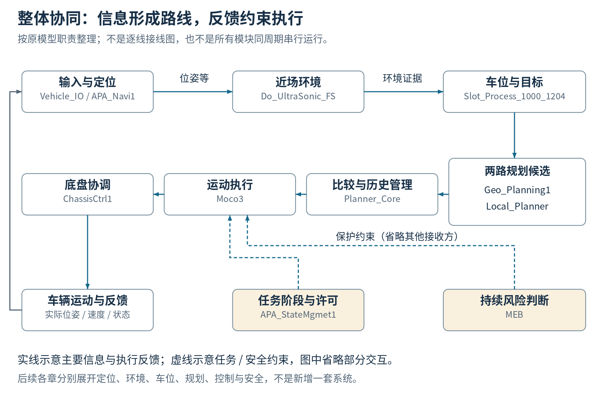

**图 2-1 是职责概览，不是逐根连线或同周期执行顺序。** 两路规划各自提供候选，Planner_Core 管理采用与更新，MoCo 和底盘协调执行；下方主状态与安全约束持续参与。图3-1、图4-1、图5-1及后面的规划控制图分别展开其中不同部分。

读这张图时，先抓住一条线：**输入告诉系统发生了什么，定位和环境处理把信息整理好，车位模块确定目标，规划找路，MoCo 执行，车辆动起来后再反馈回来。** 主状态和安全模块会影响这条线，决定什么时候允许继续、什么时候需要等待或停下。

图中的箭头是在帮助理解分工，不是在规定所有模块都必须同周期、按这个顺序执行。真正的连接、Goto/From 标签和调度关系，后面的逐层说明里都保留着。

以一次倒车入库为例，可以把配合理解得更具体一些。搜位时，驾驶员带着车辆经过车位，定位把车辆运动记录下来，车位模块把不同帧中的同一停车空间对应起来。选定目标后，规划依据当前姿态、车辆转弯能力和边界构造候选，后处理选出适合当前任务的执行路线。

主状态确认相关车辆和底盘条件后，MoCo 才组织当前段的转向、行驶和停车。路线中需要换向时，车辆可以暂时停止，但整项泊车任务仍在执行。途中若出现新障碍或驾驶员干预，安全与状态管理让任务进入相应保护、等待或退出分支，再决定是否继续。

这个例子的重点是：**环境和目标持续更新，路径并非永远固定，车辆执行也不是盲目播放一串指令。多个模块围绕当前任务状态和实际反馈，反复完成“判断—执行—再判断”。**

### 2.2 贯穿全系统的四类对象

贯穿各层的信息主要有以下四类。把它们分开，能够看清同一根总线里的字段分别服务于哪种工作。

**第一类是车辆状态。** 速度、挡位、转角、横摆、里程、位姿、底盘响应和驾驶员操作，都在回答“车现在在哪里，朝哪边，怎样运动，能不能交给系统控制”。这些是后面算路径、算误差的基础。

**第二类是环境与车位。** 超声距离、视觉车位角点、边界、目标框、限位器和地锁等，在回答“哪里有空位，哪里不能碰”。这里很多输入已经是感知处理的结果，不是模型自己从原始摄像头画面开始识别一切。

**第三类是规划对象。** 车位 ID、目标位姿、候选路径、点列、方向、段数、有效标志和更新编号，说明“准备停哪里，考虑过哪些路，当前这条路是不是新的、能不能用”。

**第四类是执行对象。** 控制阶段、目标速度、剩余距离、转向和挡位请求，以及暂停、制动、控制允许等，说明“这一周期到底要让车做什么”。

这样区分之后，就容易看懂总线了：一个端口里可以同时装着很多字段。画布上只画了一根线，不代表它只传一个物理量。

### 2.3 为什么模块这么多

如果只是画出一条理想泊车曲线，确实不需要这么大的图。但这份模型还要处理输入转换、车位忽隐忽现、多个车位的记忆、不同泊车类型、候选选择、路径更新、换挡、近障保护、底盘响应和 HMI 显示，所以外围逻辑也占了不少地方。

另外，**28,958 个 Block 不等于 28,958 个算法。** 很多只是 `From`、`Goto`、端口、类型转换、总线拆装或回放源。有的子系统看起来方块很多，实际是在搬运和整理信号；有的 Chart 只占一个方块，进去却有几千行算法。

因此看图时先弄清“它解决哪个问题”，不要用方块多少判断复杂度。以后迁移到 GAASD，也应该按功能来拆，而不是每分到差不多数量的方块，就算一层。

<a id="input-navigation"></a>
## 三、输入、信号转换、定位与同步

### 3.1 `Input_module`：感知与外部输入的入口组织

你可以先把这一层理解成“把外部信息接进来，并按模型需要的格式摆好”。它最后形成 `Rx_Signals`，内部包括超声 CAN 整理、`From_Vis_Slot`、`GPS`、`SensorSig`、`VSLAM`、`Vis_Dirty_Check` 等分支。

这些分支带来的东西并不一样：超声主要给距离和状态，视觉车位给角点与属性，VSLAM/GPS 类信息则提供外部位置参考或辅助信息。把它们放在一起，是为了让后面的算法有统一的入口，而不是让它们变成同一种测量。

看到内部大量的 `FromWorkspace`，就能理解这份离线模型的数据从哪里来：它读的是 MATLAB 工作区里的回放变量。因此方块名称里有 CAN，不代表此刻连着真实 CAN 总线；这里的输入也不等于实时网络接收器。

还有一个读图细节：`F515_LongHor_UltrasoundSensor_CAN` 已注释停用，带 `1` 的版本未注释。它们不是两套同时累加执行的超声处理，后面的明细会把这一点标出来。

这一层先做好字段对应、缩放、类型转换和有效性整理。至于信息拿到后能不能启控，是后面主状态和安全模块要回答的问题。

### 3.2 `Vehicle_IO` 与 `HMI`

这两块可以并着看：`Vehicle_IO` 告诉系统“车辆现在是什么状态”，`HMI` 告诉系统“驾驶员现在想做什么”。它们分别输出车辆信号和人机交互总线。最外层没有常规输入端口，是因为内部直接从回放源等组件取数据。

比如驾驶员发出激活、选车位、确认、暂停或退出的请求，HMI 负责把意图表达出来，但不会替主状态决定“一收到请求就开始走”。车辆条件和底盘条件合不合适，还得继续往后判断。

### 3.3 两级车辆信号转换

这里连续出现两个 Convert，很容易觉得是不是重复了。区别在于，**第一级按信号从哪里来整理，第二级按 APA 要怎么用整理。**

`Vehicle_Signal_Convert` 先按 BCM、EPB、EPS、ESP、IVI、VCU 等来源，把原始字段整理出来；`APA_Veh_Signal_Convert` 再把结果组合成 APA 常用的 BCM、底盘状态、底盘信号、诊断和 HMI 等分组。这样后面的算法不用各自重新理解一遍不同 ECU 的原始格式。

你在里面看到的运算，通常是在做这些事：

- 把整数、浮点或枚举转成后续模块需要的类型。
- 用比例和偏置把原始数值还原成有物理意义的数。
- 把底盘状态码转换成内部能直接判断的条件。
- 用 BusSelector 取字段，再用 BusCreator 按使用方式重新组合。

这里最值得留意的是单位。看到速度就默认是 m/s、看到角度就默认是 rad，很容易读错；要沿着 Gain、Sum 和转换参数，看看这一层到底做了什么换算。

### 3.4 `APA_Navi1`：给所有空间计算一个相对稳定的参考

车辆向前行驶后，一个静止车位在车身坐标中的位置也会改变。因此，直接比较不同帧的局部角点，会把自车运动混进目标变化中。定位提供车辆的连续位姿，使环境、车位和历史路径能够放到同一空间基准下处理。

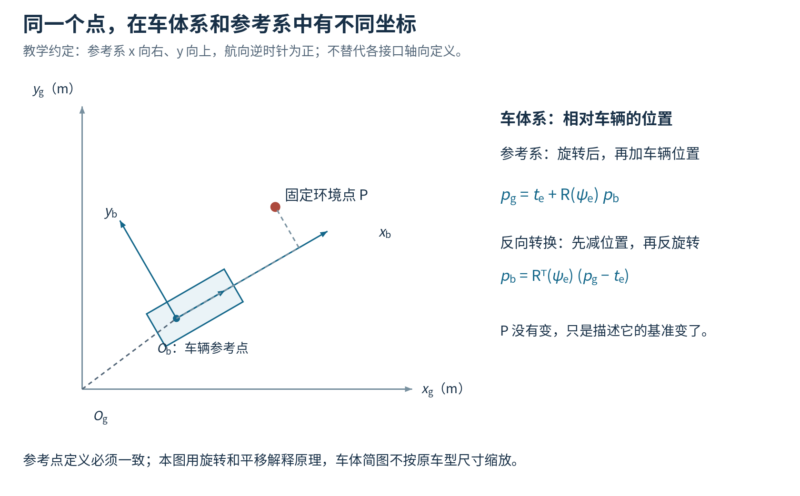

**图 3-1 先看两个原点，再看同一个环境点 P。** 车体系随车平移和旋转，参考系中的描述则先旋转再平移。图中轴向是明确写出的教学约定，不替代某个外部接口的符号定义；图5-1会沿用这一思路解释车位记忆。

这就是定位这一层为什么必要。`APA_Navi1` 里有 `APA_Navi` 和 `LRAS_Navi`，通过里程、方向、带符号的车速、角度归一化和滤波等处理，给后面的空间计算提供车辆位姿。LRAS 导航代码在这里存在，但不意味着最外层 LRAS 功能已经启用。

有了车辆位姿，就能把车身坐标里的点转换到一个共同的参考坐标里。平面变换可以这样理解：先把点按车辆朝向旋转，再加上车辆本身的位置。

$$
\begin{bmatrix}x_g\\y_g\end{bmatrix}
=\begin{bmatrix}x_e\\y_e\end{bmatrix}
+\begin{bmatrix}\cos\psi&-\sin\psi\\\sin\psi&\cos\psi\end{bmatrix}
\begin{bmatrix}x_b\\y_b\end{bmatrix}.
$$

式中 `g` 是参考坐标，`b` 是车体坐标，`(x_e,y_e,ψ)` 是车辆位姿。这样做以后，不同帧的车位、边界和历史路径才有了可比较的基础。

这只是帮助读懂转换的统一写法；真正对照辅助函数时，还要看参数顺序和轴向定义。这里不是其他项目里的东、北坐标约定，不能直接照搬。

### 3.5 `Kalman_Filtering_kinematics`：运动模型与速度/横摆观测融合

这块可以抓住一句话来读：**先按车辆运动规律估计它应该走到哪里，再用实际测到的速度和横摆角速度来修正。** 它保存的状态是：

$$
\boldsymbol{x}=\left[x,\ y,\ v,\ \psi,\ \omega\right]^{\mathsf T}.
$$

其中 `x,y` 是位置，`v` 是速度，`ψ` 是航向，`ω` 是横摆角速度。脚本里的 `d_t=0.02`，也就是说，这段计算本身按 20 ms 来推算运动；外面的任务是不是也这样调用，要到调度部分继续核对。

第一步是预测。已知上一周期的状态，利用运动模型往前推一步；与此同时，也要推算“这次估计有多不确定”：

$$
\hat{\boldsymbol{x}}^-_k=f\left(\hat{\boldsymbol{x}}_{k-1}\right),\qquad
\boldsymbol{P}^-_k=\boldsymbol{F}_k\boldsymbol{P}_{k-1}\boldsymbol{F}_k^{\mathsf T}+\boldsymbol{Q},
$$

第二步是更新。拿实际测量和预测结果比较，算出偏差，再决定这次应该修正多少：

$$
\boldsymbol{K}_k=\boldsymbol{P}^-_k\boldsymbol{H}^{\mathsf T}
\left[\boldsymbol{H}\boldsymbol{P}^-_k\boldsymbol{H}^{\mathsf T}+\boldsymbol{R}\right]^{-1},\qquad
\hat{\boldsymbol{x}}_k=\hat{\boldsymbol{x}}^-_k+
\boldsymbol{K}_k\left[\boldsymbol{z}_k-h\left(\hat{\boldsymbol{x}}^-_k\right)\right].
$$

`P` 可以理解成“对当前估计有多大把握”；`Q` 表示运动模型自身的不确定性；`R` 表示测量的不确定性；`K` 就是在这两边之间决定权重。预测不太可靠时，测量可以多起一些作用；测量本身噪声大时，就不能跟着它乱跳。

这里的运动假设属于 CTRV，也就是用一段时间内近似恒定的速度和转率来推算。它的作用不是凭空提供绝对位置，所以不能把它当成完整的 GPS/IMU 组合导航，也不能指望它自动消掉全部里程漂移。

再看它为什么要保存 `x_memory`、`y_memory`、`phi_memory`、上一挡位和位置重置编号：换挡或重置参考位置之后，当前这一段估计要和之前的运动接上。没有这些记忆，坐标关系就可能突然断开。

转率很小时采用近似直行关系，转率明显时采用圆弧关系，这是该运动模型处理直行与转弯的方式。具体矩阵、分支顺序及数值计算细节保留在后面的脚本明细中；本节重点是理解预测、测量修正与跨周期记忆的配合，不把静态说明当成运行验证。

### 3.6 `SnsrTimeSynch`：数据新鲜度与时刻对应

有了坐标，还要解决时间问题：车辆状态可能已经更新了，视觉结果却还是上一帧的。即使两份数据单独都没错，拿错时刻配在一起，也会把车位或边界算偏。

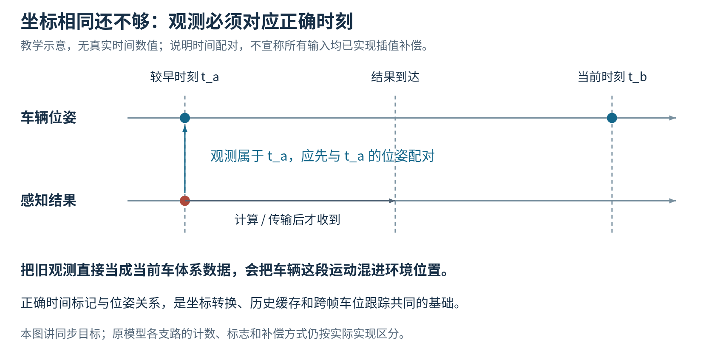

**图 3-2 与图3-1分别处理时间和空间。** 观测较晚收到，不表示它描述的就是当前时刻。先建立观测与对应车辆位姿的关系，才适合继续变换和融合；具体支路是否插值或补偿到当前时刻，仍按原实现区分。

这一层用计数、标志和脚本整理同步信息，再交给车位等模块。读它时，重点看“这份感知属于什么时候”“车辆位姿用的是哪个时刻”，而不只是看数据有没有到。

因此它是在帮助后面的模块正确配对数据。是不是已经做到所有传感器的硬件时钟同步，则要看输入时间定义和实际补偿代码，不能只凭 TimeSynch 这个名字判断。

<a id="perception"></a>
## 四、超声、自由空间与环境融合

### 4.1 原理讲解：把零散测量整理成车辆能使用的环境

这一层完成的是**环境的几何整理**：把传感器送来的零散点、距离和类别，逐步整理成墙边、路沿、柱体轮廓等对象，再交给规划和安全模块。后面的算法需要物体的位置和形状，而不是一堆尚未对应起来的测量。

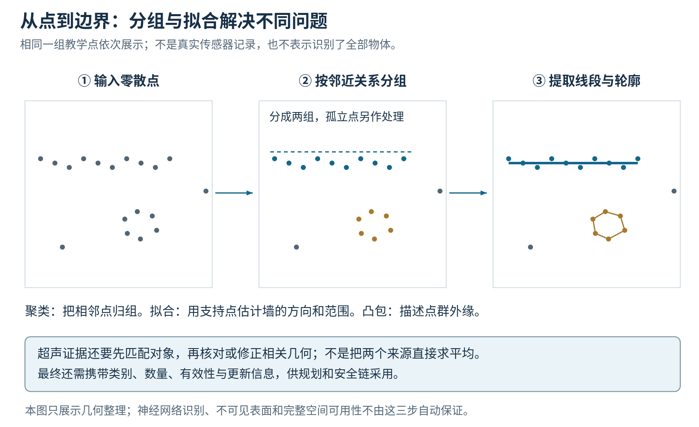

**图 4-1 从左向右使用同一组教学点。** 聚类划分局部点群，直线拟合与轮廓提取再用不同形状描述它们；它们不是三种互相替代的识别器。超声的作用是带着对应关系核对近场几何，而不是直接平均两份坐标。

本模型在这里接收的已经是视觉自由空间、目标类别和超声等处理结果，不是从原始摄像头画面开始做识别。整个过程是：**统一坐标和时刻 → 合并近期证据 → 把点分组 → 提取线段或轮廓 → 用超声核对近场位置 → 输出边界及有效信息。**

#### 1. 共同的空间基准让历史观测能够继续使用

车身坐标跟着车辆移动。墙没有动，车向前开了一点，墙相对车的位置仍然会改变。不同帧的点不能直接叠加，否则同一堵墙可能出现几份错开的轮廓。

模型利用车辆位置和朝向，通过旋转、平移，把历史观测与当前观测转换到可比较的参考系。这样上一帧的证据才能继续帮助解释这一帧环境，短时漏掉几个点也不必立刻丢掉整段边界。

缓存不是永久地图。车辆离开、观测变旧或定位基准重置后，相应历史还要更新或清理，防止过期障碍一直留在车辆附近。

#### 2. 聚类先把同一片结构的点放到一起

墙边通常是一串相邻点，柱体也会形成局部点群。聚类先按空间邻近关系分组，让后续处理能够分别分析各片结构。

这里使用的 DBSCAN，可以理解成“从局部足够密集的点群开始，沿相邻的密集区域逐步扩展”。孤立点不容易形成一组，稀疏点则可能被已有点群吸收为边缘部分。它利用的是邻域密度，不需要预先指定一定有几个障碍物。

距离半径决定多近的点可以连在一起，邻居数门槛决定多密集才足以形成一组。半径过大可能把墙和邻近柱体合并，过小可能把同一面墙分成几段。**聚类得到的是几何分组，还不是完整的物体识别结果。**

#### 3. 拟合把一组点变成有方向、有范围的边界

对于墙面或路沿，一条线段比几十个散点更方便用于规划。点群里混有误测时，直接平均会把方向拉偏。

RANSAC 先用少量点提出一条候选直线，再检查其余点有多少落在直线附近。反复尝试后，保留获得较多点支持的候选，让少数离群点不容易主导整条边界。

选出支持该直线的点后，模型再用 PCA 确定点群延展最明显的方向。可以想成沿一堆细长点云放一把尺，让尺子顺着点云长轴，再用沿尺子的最远两端确定线段范围。

因此，这里是**先排除明显不合群的点，再由相互支持的点共同确定墙的方向和长度**，不是随便取两个点就认定有一堵墙。

#### 4. 轮廓表示与超声修正补全近场几何

柱体未必适合压成一条线。凸包把点群最外缘连成凸轮廓，为后续检查提供一个有面积的对象。它包住的是观测点，不会自动恢复没有被看到的背面。

视觉通常提供结构，超声提供车辆附近的距离证据。融合时先确认二者描述同一对象，再用近场测量核对或修正相关几何。例如确认回波来自某段墙后，可以在对应分支中调整墙的位置，而不是任意改变整片环境。

最终输出要携带对象数量、类别、有效性和更新信息。超声没有有效回波，不等于该方向确认没有障碍。

这一层的作用是：**把测量整理成相对稳定、可解释的空间对象，让规划有边界可检查，让安全模块有距离和状态可判断。** 它不直接决定本周期的转向和速度。

主要对应 [processFSPoints.m](/data/aiden/文档/Pro/APA/APA-Simulink/APA/USSubFcn/processFSPoints.m)、[ultrasonicCorrection.m](/data/aiden/文档/Pro/APA/APA-Simulink/APA/USSubFcn/ultrasonicCorrection.m)。具体阈值、缓存和修正分支保留在实现明细中。

### 4.2 `Do_UltraSonic_FS` 的三个主要输出

`Do_UltraSonic_FS` 把超声、视觉自由空间、车辆位姿以及任务和运动反馈组合起来，整理车辆周围的近场环境，提供可用于后续空间判断的信息。

它有 10 个普通输入、3 个普通输出。读输出时，可以分别理解成三件事：超声处理信息告诉后面近场测量是什么；`Ego_Trajectory` 告诉后面车辆最近走过哪里；`Fusion_Boundary` 告诉后面规划和安全检查要考虑哪些边界。

三者有关联，但不能互相替代。车辆走过的历史不是将来准备走的规划，超声的某个距离值也不等于一整条完整边界。

### 4.3 `LongHor_USS_Reconstructed`

先把超声这一组信息整理好。不同探头的位置、排列、距离和状态，要用后面模块能理解的方式对应起来，否则同一个数组位置究竟代表哪一侧探头都会弄混。

读这一层时，距离和有效状态要一起看。“没拿到有效测量”不等于“没有障碍物”，这两种情况如果混在一起，后面的环境判断就会失去依据。

### 4.4 `Save_Ego_Trajectory`

这块记的是“车辆刚刚怎么走过来”，供环境缓存、历史目标或规划相关处理参考，不是在这里重新规划一条泊车路线。

连续几次的位置记录，让环境缓存和历史目标能够跟随车辆运动进行对应。脚本用跨调用记忆保存近期轨迹，再按相应条件初始化或清理，避免每一帧都丢失前面的空间关系。

### 4.5 `Vis_FS_Cache`

视觉边界短时漏检时，直接丢弃旧结果会使规划看到的可用空间忽大忽小。缓存保留近期仍适用的信息，再用新观测更新，缓解这种不连续。

这段脚本保存了 `cached_slot_id_list`、`cached_slot_pts_list`、`cache_valid`、`frame_count`，还会调用 `processFSPoints` 和 `ultrasonicCorrection`。所以它不是一个“输入什么就输出什么”的通道，而是在保留历史的同时更新当前结果。

不过，记住过去不等于永远相信过去。还要有更新、失效和重置条件，才能避免旧障碍一直留在地图里。读缓存代码时，要把“怎样保存”和“何时不用了”一起看。

### 4.6 `processFSPoints` 与 `ultrasonicCorrection`

这两个函数展开后都比较长，但可以先把分工抓住：一个主要处理自由空间点和边界，另一个把超声的近场证据带进来，对相关空间结果进行修正和管理。

这里融合的不是两个同类标量，而是点、线、框及相应类别、几何关系和有效状态。视觉提供结构，超声提供近场距离证据；建立对应后再修正相关几何，比直接对所有坐标求均值更符合这些信息的物理含义。

本章前面的原理讲解已经对应了聚类、直线拟合、轮廓和超声修正的主要作用。具体对象分支、锁定范围及更新条件保留在附录，便于需要时查询，不必先展开全部局部函数才能理解两者的配合。

### 4.7 `Subsystem2` 下的功能分工

这一层里模块比较多，可以顺着“先拿证据，再整理对象，最后形成空间条件或提示”来读：

- `USS_OBJ_SP_Extract`：先把超声里的对象和空间点整理出来，给后续处理提供近场证据。
- `Vis_FS_Edge_Pt_Extract`：从视觉自由空间中取出边缘点，让后面的几何判断有具体边界可用。
- `OBJ_Fusion` 与 `Obj_Management`：前者侧重把信息放到一起，后者继续保存和更新对象，避免同一个障碍换了来源或帧号就被当成完全不同的东西。
- `Extract_VehBox_Feature`：把车辆框中后面真正需要的特征提取出来。
- `Use_USS_Check_OD_Box`：用超声证据再检查目标框是否与近场情况相符；这里同样需要坐标和时刻能对得上。
- `Gen_SP_Slot` 与 `Adjust_PSL_Pt`：形成或调整停车空间相关的点和几何信息；具体是哪类对象，还要接着看字段和条件。
- `Near_Boundary`：看看车辆或目标离哪条边界比较近，给后面的空间限制提供依据。
- `FS_Car_Warning` 与 `fsDynamicBoundaryWarning`：把空间关系或动态边界变化转成预警、限制相关信息；有预警不等于这里已经直接发出了转向命令。
- `Search_Suspend`：在环境或任务条件不合适时，形成暂停搜索的判断。
- `Rooling_Cnt`：帮助下游识别这是不是一次新更新，本身不估计环境几何。

知道分工以后，再去看具体输入、条件和输出会轻松很多。阈值仍要回到实际代码里查，不能靠这些中文解释反推一个数值。

<a id="slots"></a>
## 五、车位处理与跨帧跟踪

### 5.1 原理讲解：持续认出并记住同一个车位

车位处理把每帧可能有抖动、漏检和顺序变化的观测，整理成**可以持续选择、规划和执行的车位对象**。它不只有四个角，还带着身份、入口方向、几何形状、目标位置和当前可用状态。

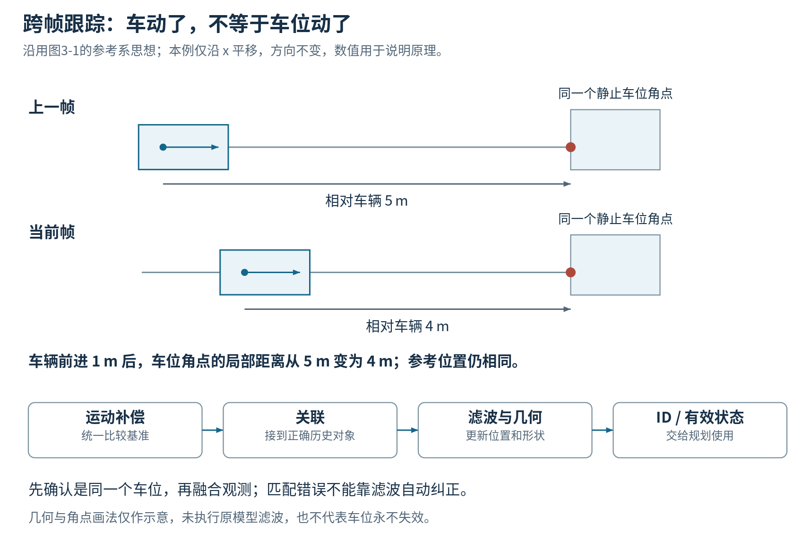

**图 5-1 是图3-1在车位跟踪中的具体应用。** 车辆前进 1 m 后，静止角点相对车辆从 5 m 变为 4 m，不能据此认为车位移动。下方流程接着解释怎样关联到历史对象，再更新几何和有效状态，而不是把每帧检测都当成新车位。

车辆从车位旁边慢慢开过时，视觉每帧给出的角点会变化，车位也可能短暂离开视野。系统需要维持“这还是刚才那个车位”的认识，否则用户选中的目标可能跳变，规划终点也会跟着变。

整个过程是：**补偿车辆运动 → 匹配历史车位 → 预测与测量融合 → 检查几何 → 管理保留和失效 → 形成规划目标。**

#### 1. 运动补偿统一新旧观测的比较基准

一个静止角点原先在车前 5 m，车辆朝向不变并前进 1 m 后，它会出现在车前约 4 m。这种变化来自车辆运动，不是车位移动。

模型利用车辆位姿，把历史角点与新角点放到共同参考系中比较。转弯时补偿旋转，定位原点重置时也要处理历史对象。完成这一步后，剩余偏差才适合用于判断车位是否变化、测量是否有噪声。

#### 2. 数据关联把当前观测接到正确的历史对象上

当前帧可能同时出现几个相邻车位。关联依据距离、重叠程度、类型和已有身份等信息，判断新观测属于哪个历史车位，再决定更新已有对象还是建立新对象。

**关联先于滤波。** 如果把左边车位的新观测接到了右边车位的历史上，滤波只会把错误融合得更平滑，并不能自动找回正确身份。

本模型使用的度量也有具体定义：当前 `MDCal_2D` 使用欧氏距离，`iou_area.m` 用交集面积除以两者较大面积。这些度量为关联提供证据，不能仅凭函数名字套用其他库的公式和阈值。

#### 3. 滤波在历史预测和当前测量之间分配信任

匹配成功后，历史提供连续预测，当前观测提供新的位置证据。Kalman 更新可以这样理解：先算这次测量与原先预测相差多少，再按双方可信程度，把预测向测量修正一部分。

测量噪声大时，不适合每帧都跟着它跳；历史预测不确定时，也不能一直拒绝新的证据。协方差记录估计的不确定性，增益决定这次修正有多大。

例如预测角点在 2.0 m，观测为 2.2 m，更新值未必取平均，而是依据信任程度位于两者之间。这个例子只是解释权重，不是当前模型某次输出。

`Slot_4Points_Tracking1` 还把车辆位置和坐标变换放入观测关系，先使预测与测量处于可比较的坐标下，再计算残差。它不是把四个不同坐标的数直接平均。

#### 4. 几何整理把稳定角点变成可泊车目标

四个角各自稳定，不代表组合起来就一定是合理车位。模型继续整理角点顺序、入口边、车位方向和目标点等几何关系。

入口边说明车辆从哪里进，车位方向决定最终车身朝向，目标位姿则要考虑车辆尺寸和泊入方式。任意一个角点都不能直接作为车辆最终位置。

`Slot_Pts_Modify`、`VisSlot_TgtPts1`、`Slot_TgtPts_ReCal1` 等把“看到一个四边形”进一步整理为“具有明确入口和目标的停车空间”，并不意味着把所有车位强制改成同样大小的矩形。

#### 5. 跨帧记忆稳定任务，失效管理防止使用过期目标

短时没有观测时，可以按条件保留历史，观测恢复后继续更新，而不是立刻删掉用户已经选择的目标。但目标离开范围、几何失效、任务改变或定位重置，也可能要求清理。

车位 ID 维持身份，更新编号告诉规划有新内容，有效状态说明当前能否使用。**角点描述空间，身份和状态说明这份空间属于谁、此刻还能不能用。**

对应 [车位处理层](#ss-804690) 和 `Slot_4Points_Tracking1`。具体关联条件、滤波矩阵和清理规则放在后面的实现明细，不需要先记住它们才能理解主流程。

### 5.2 `Slot_Process_1000_1204` 的职责

这一层要把“感知这次看到了什么车位”变成“系统持续记住并准备用来泊车的车位”。因此，除了感知角点，它还要看车辆状态、定位、主状态、同步信息、规划和运动控制反馈、自车历史与融合边界，最后给出 `Slot_Process` 和日志。

你可以把输入和输出的区别记成：**输入更像一次观测，输出已经是一组带身份和历史的车位。** 每个车位不只有四个点，还包括目标、有效性和规划状态等信息。

原模型里可以看到 20 槽位的多车位结构，后面每个车位还可能有自己的候选路径。所以这里要做的是列表管理，不只是算一个车位中心。

### 5.3 活跃的主要分支与旧版本

先顺着当前未注释的这组看：`Slot_4Points_Tracking1`、`Slot_Buffer2`、`Slot_Pts_Modify`、`Slot_TgtPts_ReCal1`、`VisSlot_TgtPts1`、`NewBmpGen1`、`TgtPtsLoknOutput1` 和 `adjust_HMI_slots_1204\n\n`。

同一层还留着 Tracking2、Buffer3、旧角点/目标计算和旧 HMI 调整等注释分支。这些是对照历史实现时有用的材料，但不要把它们和当前分支一起理解成同时执行。

也不要靠 `1/2/3` 后缀猜新旧：有的带 1 才是当前分支。这里判断用的是实际 `Commented` 标记，以及上层有没有被注释。

### 5.4 从一帧检测到稳定车位对象

假设这帧看见一个车位，下一帧车开近了一些，它的角点位置和检测结果都有轻微变化。系统首先要判断“这还是不是刚才那个车位”，确认之后，才谈得上更新它。整个处理可以这样串起来：

1. **先放到能比较的坐标里。** 当前观测和历史车位不能各用各的参考系。
2. **判断是不是同一个车位。** 车位身份、角点距离、几何重叠等信息都可以作为依据。
3. **更新已有估计。** 先预测，再用新观测修正，而不是一帧一个全新结果。
4. **决定继续保留还是删除。** 新对象需要建立，稳定对象可以累计信心，短时漏检可以暂时维持，过期或无效对象则要清掉。
5. **检查几何是否合理。** 角点顺序、宽深、左右侧和目标位姿要对应得上。
6. **接上任务与规划状态。** 哪个被选中、哪个已经规划、哪个需要更新，不能和几何分开丢失。
7. **整理给界面看的结果。** HMI 需要的是能持续识别、便于显示的车位列表，而不是每帧乱跳的原始点。

因此，这条链是有记忆的。以后即使想简化接口，也不能只留下几个角点，把 ID、更新标记和历史一起删掉，否则车位切换和重规划的行为也会跟着变。

### 5.5 `Slot_4Points_Tracking1` 中的滤波

这里同样能看到 `Kalman_Predict`、`Kalman_Update`，但不要和导航那套五状态滤波器混在一起：导航在估计车辆怎么动，这里围绕车位/目标与车辆的坐标关系来处理观测。

过程仍然是先预测状态和协方差，再根据测量残差计算修正。值得看的是观测矩阵 `H` 中还带着车辆航向的旋转项：这说明“测到了什么”本身就与车辆当前朝向有关，滤波和坐标转换不是互不相干的两步。

用一句话概括，**要先把车自己移动造成的观测变化考虑进去，再判断车位本身有没有变化。** 一个静止车位在车体系里不断向后移动，并不是它真的在倒退。

### 5.6 两个容易被名称误导的计算

这一处适合停下来对照公式，因为光看名字很容易套错理论。`MDCal_2D` 当前实际采用的是：

$$d=\sqrt{\Delta\boldsymbol{x}\,\Delta\boldsymbol{x}^{\mathsf T}}.$$

也就是把位置差的各分量平方相加再开方，算的是欧氏距离。那条带协方差逆矩阵的 Mahalanobis 距离计算在这里是注释，所以虽然名字里有 MD，解释时仍要按正在使用的式子来讲。

同样，`SPTSubFcn/iou_area.m` 这个名字容易让人直接想到标准 IoU，但这里算的是：

$$r=\frac{A_{\cap}}{\max\left(A_1,A_2\right)}.$$

`A₁,A₂` 是两个车位的多边形面积，`A∩` 是重叠部分。它表示“重叠面积占较大车位面积的多少”，不是标准交并比 `A∩/(A₁+A₂−A∩)`。

这并不妨碍它被用来衡量重叠，只是你在理解一个重叠阈值时，必须知道分母到底是什么。名称一样或相近，数值的含义未必相同。

### 5.7 `PillarPat_Tracking`：目标轨迹管理的另一个例子

这段内嵌函数把“跟踪不是把检测原样发出去”体现得很清楚。它先预测，再找能对应的测量；对应上了就更新，随后打分、删除不合适的历史、建立新对象，最后才决定哪些结果可以输出。

代码里能看到最多 20 条轨迹、最多 8 个量测的数组结构。关联时会看距离条件，也会管理某个量测是否已经被用过；分数达到条件后才发布。

所以你看到的跟踪结果，是经过这些判断后留下来的结果。这里不因为它做了匹配，就认定一定用了匈牙利分配或完整概率关联；具体怎么配，还是看脚本里的实际规则。

### 5.8 几何修正、目标点与缓冲

跟踪之后，车位还需要变成规划真正能用的目标。`Slot_Pts_Modify` 先处理角点几何；`VisSlot_TgtPts1`、`Slot_TgtPts_ReCal1` 进一步计算或重算目标位姿；`Slot_Buffer2` 保存车位信息；`TgtPtsLoknOutput1` 则整理当前锁定或选中的目标输出。

这里要区分三个看起来很接近的东西：车位四角、车辆最终要到达的位姿、界面上显示的中心。它们不是天然相同的。

例如车辆的目标如果以某个车身参考点来描述，就还要考虑车辆尺寸、车位朝向、边界和泊车类型。因此不能把四个角点简单取平均，就直接当作目标后轴位置。

<a id="state-management"></a>
## 六、功能管理与主状态机

本章先用四张图建立直觉，再结合文字理解设计。**图 6-1 看包含关系，图 6-2 看正常推进，图 6-3 看不同原因的停下与恢复，图 6-4 看任务和车辆机动怎样配合。** 不需要先背状态英文名。

前三张图按原模型的运行状态与转移核对，箭头文字是条件摘要，不是把多个条件缩成一个充分条件。第四张明确作为教学示意，不是测试记录，也不预设每段花多少时间。图片直接嵌入，无需 Mermaid 插件；可编辑矢量原图及来源核对记录保存在配套 `assets/state_management_illustrated/` 中。

### 6.1 原理讲解：状态机把泊车组织成有记忆、有先后关系的任务

**状态机不是计算车辆该转多少、该开多快的控制器，而是管理泊车任务进度和控制权限的协调器。** 它记录系统当前处于哪个阶段，结合驾驶员操作、路径结果、车辆条件和底盘反馈，决定下一步能做什么。

同样是车速为零，可能有完全不同的含义：还没开启泊车、正在等底盘准备、正在换向、被驾驶员暂停，或者已经完成。单看车速，无法区分这些情况。状态机保存的“当前状态”，就是用来补上这份任务背景。

#### 1. 状态、转移条件和动作共同组成状态机

可以先把它理解成一套会记住进度的操作流程，而不是每个周期从头执行一遍的固定清单。

- **状态**表示当前阶段，例如搜索车位、等待底盘、自动执行、暂停或完成。
- **转移条件**决定何时可以离开当前阶段，例如底盘准备完成，或驾驶员发出新的恢复请求。
- **状态动作**负责在这一阶段设置请求、整理提示、维护原因和计数等信息。

它与普通无记忆条件判断的区别，在于同一个输入会结合当前阶段得到不同结果。恢复操作在暂停阶段有明确作用，在尚未开始任务时则不能直接把车辆变成自动行驶。

#### 2. 每次更新都延续上一次的任务进度

运行时，系统保留当前激活的状态，以及暂停原因、历史按键、计数等记忆。下一次收到调度后，读取最新输入，按照当前状态及相关层级的转移规则继续判断。

满足转移条件，就离开原阶段并进入新阶段，执行相应动作；条件不满足，就保持当前阶段，执行适用的持续处理。具体求值顺序由 Stateflow 的层级和转移顺序确定，不是把图上所有箭头同时执行。

因此，“留在等待”也是明确的结果：它表示仍在等某项条件，而不是程序没有运行。底盘尚未就绪时，系统可以继续更新提示和计数，同时不推进到正常行驶阶段。

#### 3. 进入、保持和退出分别处理不同事情

进入状态时，通常建立本阶段需要的初始条件，例如清零本阶段计数、记录暂停原因或设置任务阶段。保持期间，持续读取反馈、维护请求并累计时间。退出时，清理不应带入下一阶段的记忆，或交接下一阶段所需的信息。

以本模型的 `ChassisWait` 为例：进入时设置参数、任务请求和准备子状态；等待期间继续处理开关、提示和计数；离开时整理暂停、重规划等相关计数。这不是单纯写一个“等待中”数字。

所以状态机真正实现的是**阶段记忆 + 有条件的阶段切换 + 与阶段对应的动作**。只改输出状态码，不能代替真正走完状态转换。

### 6.2 原模型的设计：用分层状态管理不同范围的事情

本模型使用 `APA_StateMgmet1` 下的 Stateflow Chart 管理主任务。它不是把所有模式放在同一层，而是采用嵌套结构。下面按原图展示运行状态的包含关系，不把图形函数、junction 和注释分组列为运行状态。

从设计思路看，这套状态机先按任务进度划分关闭、待命、搜位、执行和结束；再把执行中不同原因的等待、保护和重规划拆开，因为它们需要不同的恢复条件；最后为各阶段安排请求、提示、进入清理和超时等动作。共同退出规则放在父层，具体机动进度交给 MoCo。这样划分的依据是职责和后续行为不同，而不是图上需要多少个方框。

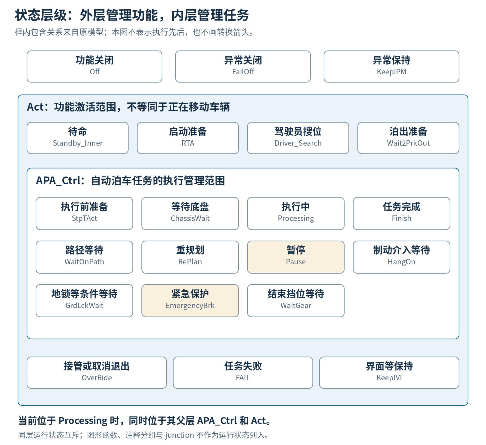

**图 6-1 的读法：先看最外层，再看框里面的子状态。** `Processing` 属于 `APA_Ctrl`，`APA_Ctrl` 又属于 `Act`；因此执行、暂停、重规划等仍受共同父层规则管理。同一行的左右位置只用于排版，不表示必须依次经过。

这份层级有三个作用。

**第一，区分“功能可用”和“正在自动控制”。** 进入 `Act` 不等于车辆已经被接管；待命、准备和驾驶员搜位都在它里面。系统可以已经开启，但车辆仍由驾驶员操作。

**第二，把执行任务的共同规则放在共同父层。** `Processing`、暂停、重规划和紧急保护都属于 `APA_Ctrl` 范围。这个父层有通向失败、接管或其他任务阶段的转移，不必把相同退出逻辑在每个子状态中各抄一套。

**第三，把一件事的内部步骤继续细分。** 对外看都是自动泊车任务，内部还要区分等待底盘、正常执行和路径等待。当前这棵业务状态树中的同层状态互斥，而父状态与其激活的子状态可以同时成立，例如当前在 `Act / APA_Ctrl / Processing`。

层级与对外状态码也不是一一对应。模型中 `ChassisWait` 和 `Processing` 都可以输出 `APA_State=3`，再用 `SubSts` 区分准备与执行。这说明一个对外阶段码未必包含内部全部进度。

### 6.3 一次正常泊车从启动到结束的推进过程

把主线连起来，可以理解为：**功能启用 → 搜位和目标准备 → 执行前确认 → 等待底盘 → 沿路径执行 → 结束确认。** 下面讲的是原图中一条主要泊入通路，不是覆盖所有车位和特殊工况的唯一顺序。

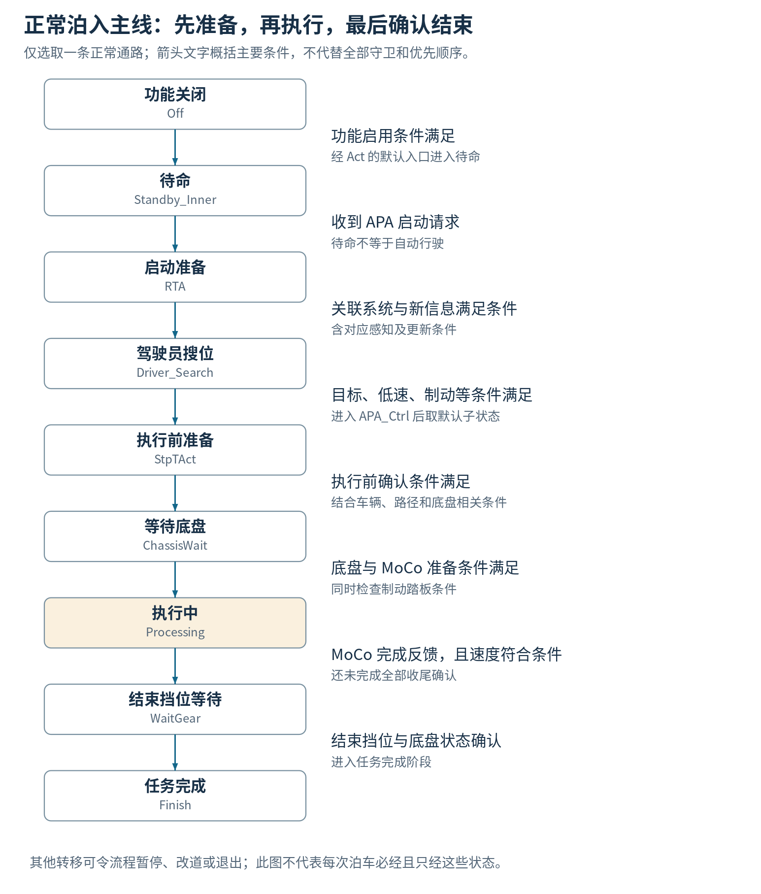

**图 6-2 的读法：沿左侧箭头向下，右侧说明允许推进的主要依据。** 第一条箭头经 `Act` 默认入口到达待命，搜位进入执行管理时也经过父层及默认入口，图中已明确标注。进入执行前准备并不等于已经运动，执行反馈完成也不等于已经完成全部收尾。

#### 1. 从关闭进入待命，再建立搜位条件

功能总条件允许后，主状态从 `Off` 进入 `Act`，默认先到 `Standby_Inner`。此时还没有理由让车辆自动移动。

APA 启动请求到来后，可进入 `RTA`。这个阶段要等待关联系统和信息更新等条件就绪，再转入 `Driver_Search`。可以把它理解为先把参与泊车的系统组织起来，而不是按下开关就直接开始转向。

#### 2. 驾驶员搜位，系统建立目标和可用路径

在 `Driver_Search` 阶段，系统处理车位、方向、可用性与提示，驾驶员仍可以驾驶车辆寻找合适位置。车位处理与规划模块为后续任务提供目标和路径信息，主状态机负责决定这些结果与当前操作是否足以推进任务。

原图的泊入入口会检查目标、车辆速度、制动操作及相关有效性条件。其含义是：选定一个车位，与已经满足自动执行条件，是两件不同的事。

泊出则有 `Wait2PrkOut` 支路，结合车辆所处位置、泊出方向和路径条件准备任务，不必先重新执行完整的沿路搜位过程。

#### 3. 进入执行管理，先确认车辆与底盘准备

满足相应条件后进入 `APA_Ctrl`，默认先到 `StpTAct`，然后按实际条件进入 `ChassisWait`。

这里把“驾驶员已经同意泊车”和“底盘已经能够执行”分开。车辆条件、底盘控制状态、MoCo 进展和制动踏板等共同决定是否可以继续。主状态机向下提出任务请求，再等下游反馈，形成一个准备握手过程。

因此车辆暂时没有移动，并不一定是控制器没算出速度，也可能是任务仍停在准备阶段。

#### 4. 正常执行期间，主状态和 MoCo 各自承担不同工作

准备条件满足后进入 `Processing`。主状态继续监视任务是否允许推进；MoCo 则沿当前路径选择执行段、计算跟踪请求，并组织停稳、转向和换向。

一次倒车泊入可能包含“倒车一段—停车—前进调整—再倒车”。主任务可以一直属于执行范围，底层却经历多个运动阶段。**主状态是整项任务的进度，MoCo 状态是当前机动的进度。**

执行过程中，一旦收到路径停车要求、重规划信息、驾驶员干预或安全风险，主状态再切换到对应分支，而不是任由正常执行一直持续。

#### 5. 到达结束条件后，继续完成收尾确认

MoCo 的完成反馈与低速条件，可以让主状态进入 `WaitGear`。相关挡位及底盘状态确认后，再进入 `Finish`，整理完成提示和后续退出处理。

这把“轨迹执行完成”与“整个任务收尾完成”分开了。某个模块给出完成标志，不意味着主状态、底盘、显示和控制权限都已经在同一瞬间结束。

### 6.4 暂停、路径变化、风险和退出采用不同处理

正常主线只说明顺利情况下怎样推进。实际车辆还需要根据停下来的原因，决定保留什么、等待什么、如何恢复。**状态分开，是因为恢复条件和后续动作不同，不是为了给相同的零车速重复命名。**

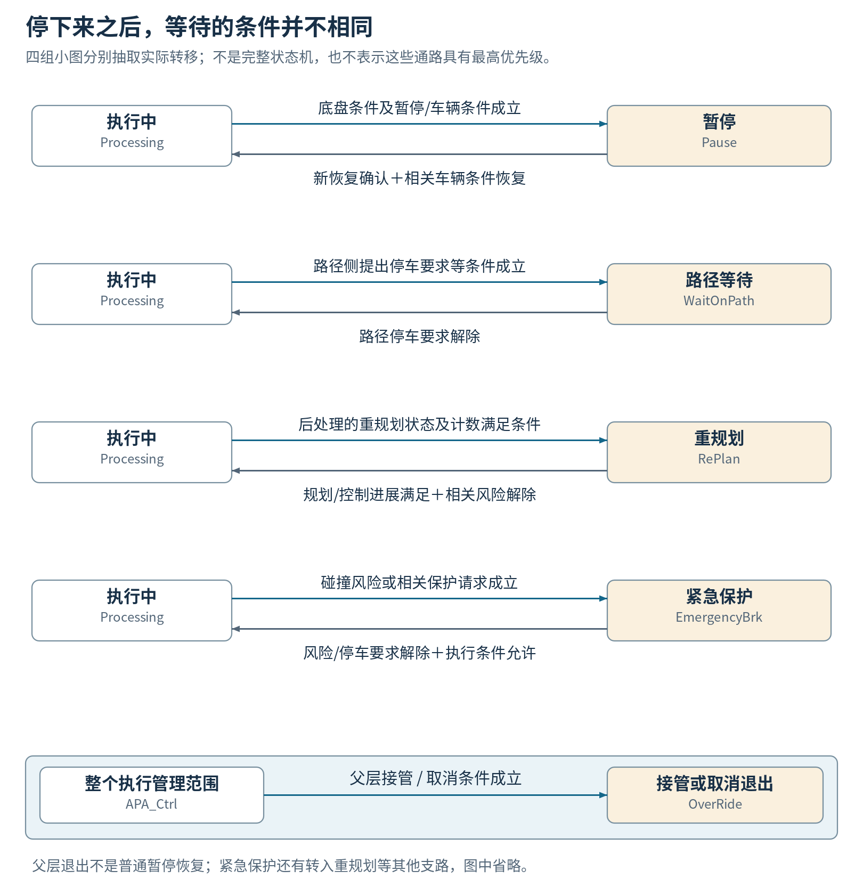

**图 6-3 的读法：每一行单独看，上方箭头表示进入原因，下方箭头表示返回所需条件。** 暂停需要新的恢复确认，路径等待有自己的解除条件，重规划要结合规划/控制进展和风险；不能只因为车速变为零，就把它们视为同一种状态。

最下方的退出箭头特意从父状态 `APA_Ctrl` 画出，因为原图在父层管理这类退出。其他转移仍可能介入，例如紧急保护还可进入重规划；图中不展示全部支路和优先顺序。

#### 1. 驾驶员或车辆条件引起的暂停

`Pause` 会处理驾驶员暂停及车门、安全带等相关条件；`HangOn` 有制动介入等对应分支。这些阶段保留任务背景，同时等待相应条件恢复或进一步退出。

原图中，`Pause` 返回执行的一条通路要求恢复请求出现新的上升沿，并且相关车辆条件重新满足。仅仅松开导致暂停的操作，不一定等同于重新授权继续。

上升沿就是“上一周期未按下，这一周期刚按下”。保留按键历史，是为了区分一次新的确认与按钮一直保持按下，避免旧请求被重复当成新操作。

#### 2. 路径要求等待，与必须重新规划分别处理

`WaitOnPath` 对应路径侧提出的停车或等待要求。相关要求解除后，原图有返回执行的通路；是否还经过其他分支，要结合当时的反馈。

`RePlan` 则表示任务进入重规划协调：记录这次进度，等待规划结果和风险条件允许后继续。原路当前不能使用时，系统需要新的或经过处理的执行依据，而不是只把车速重新放开。

`GrdLckWait` 结合地锁/相关提示及路径风险等条件组织确认和等待。它与普通按键暂停保留不同的原因和提示，恢复规则也不完全相同。

#### 3. 紧急保护与普通暂停的目标不同

`EmergencyBrk` 在碰撞风险或相关保护请求出现时参与任务协调，和 MEB、MoCo、底盘的停车处理配合。此时首要事情是限制危险运动，不是继续优化路径长度。

风险解除后，原图既有满足条件返回执行的通路，也有停稳后转入重规划等通路。因此不能统一解释为“紧急保护一解除就恢复”，也不能统一解释为“任何保护之后都必须再次按恢复键”。

具体选择由本阶段条件、子状态反馈和转移顺序共同决定。某些相同时间到来的事件还会触发父层的失败或退出规则。

#### 4. 接管、失败和关闭不按普通暂停处理

`OverRide` 用于接管、取消等对应退出，`FAIL` 用于任务失败，`Off` 表示功能关闭。它们和可恢复等待的区别在于，原来的自动执行授权或任务条件已经改变。

暂停可以保留后续继续的可能性；退出则需要按相应流程交还或结束任务。若把这些状态都合成一个“停止”，后续就无法可靠区分应该恢复旧任务、开始新任务，还是持续保持退出。

### 6.5 让状态转换可靠的关键：历史、计时和条件确认

状态机不能只看某个瞬间的输入，还要处理持续时间和历史变化。

**历史记录事件。** 上一次按键、上一次阶段和前一次风险状态，帮助区分“刚发生”与“仍然存在”。例如一次恢复事件不应因为按键保持高电平就在每次更新时反复触发。

**计数记录阶段进展。** 某阶段进入时清零计数，保持时累计，再用于等待或超时判断。计数对应的实际时间取决于更新周期，以及期间是否暂停或重置；不是所有叫 `index` 的值都表示同一个计时器。

**条件确认防止短时跳变反复切换任务。** `Filter`、`FuctionMonitor`、`StrTakeOver` 等外围模块整理开关、功能条件与接管信息，再供主状态使用。瞬间噪声和一次明确的驾驶员操作，需要有不同处理方式。

**转移顺序处理同时发生的条件。** 当前层级、转移的检查顺序和父子关系，共同决定多个条件同时成立时走哪条路径。这是本模型的具体仲裁机制，不是额外叠加一个没有在图中出现的统一评分器。

这些机制的共同目的，是让任务推进有明确依据、暂停有原因、恢复有条件、超时有处理，而不是让车辆在几个模式之间反复跳动。

### 6.6 主状态、规划状态和运动控制状态如何配合

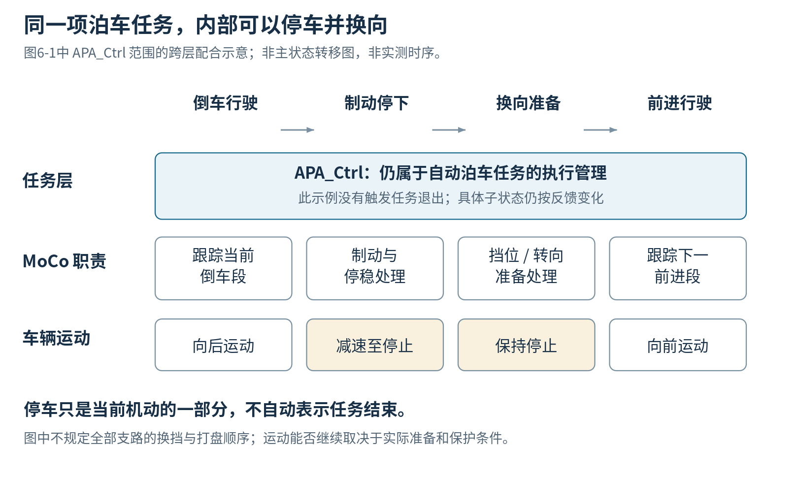

**图 6-4 以图6-1的 APA_Ctrl 大框为背景，但不是该框子状态的逐项展开。** 第一行表示主任务范围，第二行是 MoCo 执行层的职责，第三行是车辆运动。竖着对照同一阶段，横着看一次换向：车辆可以停稳和准备，而泊车任务尚未退出。图中的 MoCo 职责不属于图6-1列出的那套主状态枚举，主任务内部子状态仍按反馈变化。

这个例子不规定原图所有支路的换挡与转向准备顺序，也不声称整个过程一直停留在 `Processing`。它只说明“任务没有结束”和“车辆暂时不动”完全可以同时成立。

三个层面分别保留自己需要的进度。

**主状态管理整项任务。** 它输出任务阶段、请求、方向和提示等信息，结合驾驶员、车辆与底盘条件决定任务如何推进。

**规划状态管理路径的产生和采用。** 它区分当前目标与规划进展、候选是否有效、是否有更新或需要重规划。主任务在执行中时，规划也可能正在产生新的候选。

**MoCo 状态管理车辆此刻的机动。** 它区分准备、移动、停稳和换向等阶段，计算本周期需要的纵向、横向请求。

三者通过明确的信号协调，而不是共享一个含义完全相同的状态码。例如主状态的 `APA_State`、规划侧的 `EnumParkingSysMainState` 和控制侧的 `APA_Ctrl_Status`，都需要按各自定义解释。

尤其要区分**任务请求、运动许可与实际运动**。原模型在 `Pause`、`Finish` 等状态仍可保持 `APA_Req=1`，它不能单独当成“允许车辆以非零速度行驶”的开关。下游还要结合阶段、保护和底盘条件处理。

把三层放在一起理解，就是：**主状态决定任务应当如何继续，规划提供现在能采用的路线，MoCo 决定车辆怎样执行这段路线，底盘反馈再推动它们进入下一步。** 完整图和原始条件见 [APA 主状态管理层](#ss-813710)。

<a id="geometry"></a>
## 七、几何规划

### 7.1 原理讲解：用车辆能走出的直线和圆弧连接目标

几何规划根据起点、终点和可用空间，直接构造车辆能够行驶的路线。泊车目标包含位置和朝向：不只是把车送进某个区域，还要让车身最终沿车位方向摆正。

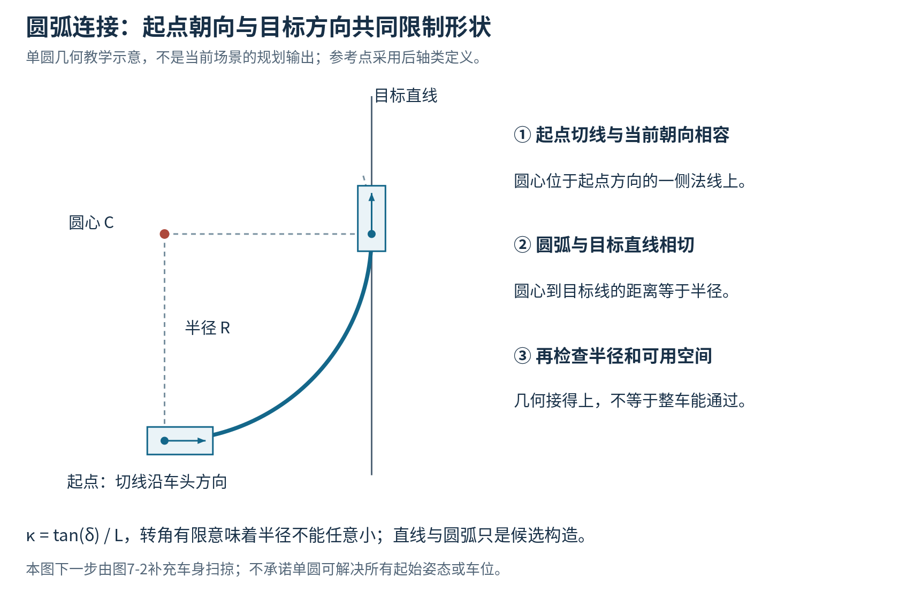

**图 7-1 先看起点车头方向，再看圆心与目标直线。** 起点切线与车辆朝向相容，终点切线与目标方向相容；半径同时受到几何关系和车辆转向能力约束。本图只画连接原理，图7-2继续补上整车外形检查。

低速时可以用运动学自行车模型近似车辆：转角为零时近似直行，转角保持不变时近似沿圆弧行驶。因此路线可以拆成少量“直走、向一侧转弯、必要时停车换向”的片段。

#### 1. 转弯能力限制了可用路径

设轴距为 $L$，等效前轮角为 $\delta$，后轴参考轨迹的曲率近似为：

$$
\kappa=\frac{\tan\delta}{L}.
$$

曲率表示路线弯得多急，绝对值的倒数就是半径。转角有限，所以半径不能任意小。几何规划必须在这个约束下连接目标，不能画一条车辆实际转不过来的曲线。

这里说的是后轴轨迹。车头、车尾和内外侧车轮走出的圆并不相同，检查空间时还要考虑整车外形。

#### 2. 单圆连接由位置、朝向和相切关系确定

圆弧经过起点时，起始切线要与车辆朝向相容，所以圆心只能位于该方向的一侧法线上。圆弧与目标直线相切时，圆心到目标线的距离又必须等于半径。

两个条件放在一起，就能求圆心、半径和相接位置，再确定车辆沿哪段弧到达。`geo_circle_1pt1line` 等完成的就是这类构造，不是先任意选一个圆再尝试塞进车位。

例如车辆要从横向通道倒进纵向车位，圆弧既要接住当前朝向，又要在接近车位时把车身转到目标方向。位置与朝向共同限制路径。求出的半径过小，或相接位置没有空间，就需要其他构造。

#### 3. 多段与换向增加了受限空间中的调整余地

单圆不一定同时满足起始姿态、目标方向和通道宽度。增加直线、另一段圆弧或一次换向，就增加了调整方式。

“倒车转入—向前修正—再倒车摆正”能够利用车位内外的不同空间，但会增加停车和换挡。因此除了接得上，还需要考虑机动次数和路径质量。

垂直、平行、断头等车位的空间分布不同，模型分别组织业务分支，再复用单圆、双圆和局部修正计算。`geo_vt_1R_fix` 是特定构造的局部调整，不保证任意场景都能一把入库。

#### 4. 候选要让整车通过，再转换为控制点列

后轴线没有穿过障碍，不代表车头外角和车尾都有空间。车辆沿路转动时，外形会扫过一片区域，危险点及直线、圆弧区间检查就是把尺寸和边界纳入判断。

通过检查后，还要把几何段采样成位置、航向和有符号步进里程，供 MoCo 选择参考点、判断进度和剩余距离。点列同时带着有效数量、方向和更新信息，不能只留下坐标。

最后形成的是**路径候选**。圆弧相接不代表转向机构能够瞬时完成角度变化，实际怎样转向、减速和停稳仍由后续执行链处理。

主要对应 [单圆连接](/data/aiden/文档/Pro/APA/APA-Simulink/APA/GeoPlanningSubFcn/geo_circle_1pt1line.m)、[双圆连接](/data/aiden/文档/Pro/APA/APA-Simulink/APA/GeoPlanningSubFcn/geo_2Circle_Link.m) 及本章中的各泊车类型、碰撞检查和离散化模块。

### 7.2 `Geo_Planning1` 解决什么问题

`Geo_Planning1` 根据车辆位姿、目标车位和附近障碍，构造满足转弯约束的直线与圆弧组合，形成泊入或泊出的路径候选。核心在 `Geo_Planning_Seres`，配套计算分散在 `GeoPlanningSubFcn` 的外部函数中。

它拿到的不只是一个终点。车位、边界、MoCo、MEB 和主状态，也会影响现在是否适合规划、应该给哪个车位规划、走哪一种泊入或泊出分支，以及算出来的候选能不能用。

### 7.3 为什么用直线和圆弧

泊车速度较低时，我们可以先用运动学自行车模型理解转弯。轴距 `L` 和前轮转角 `δ`，决定了转弯曲率和半径：

$$\kappa=\frac{\tan\delta}{L},\qquad R=\frac{L}{\tan\delta}.$$

这组关系的直观意思是：在这种近似下，转角保持不变，车就沿一个相应半径的圆走；转角为零，就近似走直线。所以把几段直线和圆弧接起来，是一种计算相对直接、又方便检查的泊车路径构造方式。

不过，画得出这条曲线，只解决了几何问题。车能不能及时把转角转到位、转角变化是否太快、速度是否合适，还要由后面的控制与限制处理，不能把几何可行直接当成任何速度下都能跟上。

### 7.4 主要泊车类型分支

车位形式和车辆起始姿态不同，适合的几何构造也不同。因此主入口下面不是只有一种通用拼法，而是分成这些分支：

- `geo_VT_PathPlanning`：围绕垂直车位处理入口位置、转弯空间和入位过程。
- `geo_HT_PathPlanning`：围绕平行车位处理纵向空间和多段转向连接。
- `geo_DthEdVT_PathPlanning`：单独处理垂直断头等更受限的空间。
- `geo_VH_PathPlanning`：处理另一类车辆与车位相对方向的入位情况；缩写的精确含义仍要对照入口条件和车位类别，不能只按字母展开。
- `geo_PkOutFt_PathPlanning` 等：车要从车位里出去时，检查允许方向并构造泊出路径。
- `geo_vt_planning_in_slot`、入口/第一段修正类函数：车已经靠近车位或进入车位一部分时，处理这种不同于普通起点的情况。

上层会看状态、类型、位置和有效性来选择或更新结果，不是每个分支都对同一车位同时执行一遍。

### 7.5 `geo_slotPlanSelect`：先决定给哪个车位算

前面保存了多个车位，到了规划这里，还得先决定“这一轮先算谁”。这个函数结合车位状态、车辆相对位置和任务模式，从列表里挑出待规划对象。

正在搜索车位，与已经选定目标、需要在执行中重规划，选择条件并不一样。被选中的目标、需要重新规划的目标，也有相应优先关系。

这样既不用每次都给全部车位重新计算，也能保持车位 ID 和路径结果的对应。否则路径即使算得对，拿错车位去用，后面的任务仍然会出问题。

### 7.6 圆弧连接、危险点与几何检查

你可以把这一组函数分成“怎么接”和“接完会不会碰”两部分来读。`geo_2Circle_Link` 及 VT/HT 变体，连同 `geo_circle_1pt1line`、`geo_circle_2line_R` 等，负责在点、直线、半径等条件下构造连接；入口点和危险点计算，则把周围空间的限制带进来。

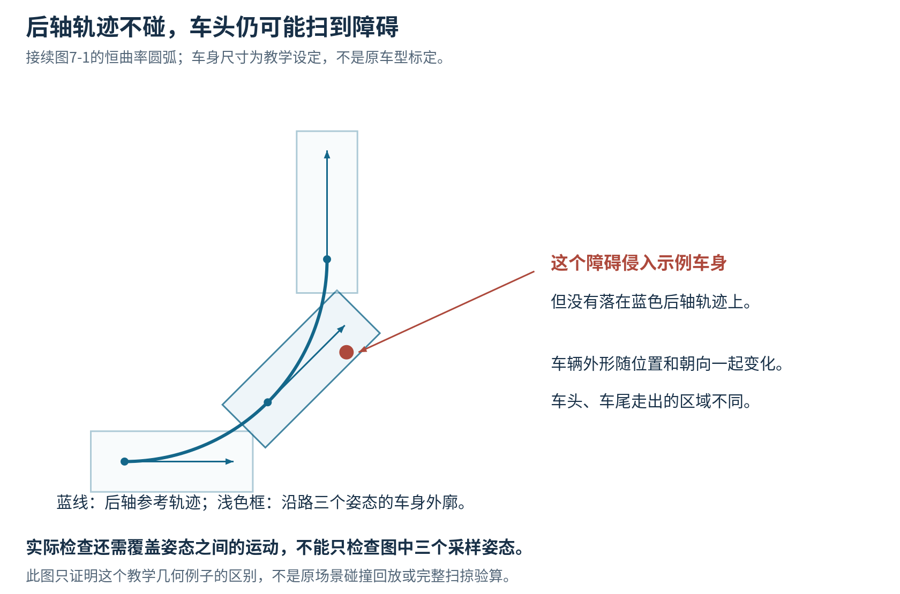

**图 7-2 接续图7-1，但把有尺寸的车身放到了路线上。** 红色障碍位于示例车身内，却没有落在蓝色后轴轨迹上，说明只检查参考线会漏掉外廓侵入。三个姿态用于解释，不代替姿态之间的区间检查；图8-2再解释一种凸形状相交判断方法。

车辆有宽度和前后悬，转弯时外侧车身还会扫过更大的范围。只检查参考点会漏掉车头外角或尾部的侵入，因此需要把外形随位置、航向的变化纳入空间检查。

因此还要用 `geo_line_Intrv_check`、`geo_circle_Intrv_check` 等分别检查直线和圆弧区间；泊入、泊出又保留各自的变体。危险点和区间检查，就是让“整辆车能不能过”进入几何计算，而不是只看一条中心线。

### 7.7 路径离散化

几何规划内部很适合用少量参数表达一段路：从哪里开始、走多长、曲率多少、前进还是倒车。但控制器每次要找参考点、算误差，用点列会更方便。

于是 `geo_LnDirectDisctet`、`geo_TrnDirectDisctet`、`geo_PthDiscret_*` 等把前面的直线和圆弧采样成一串位置、航向和步进里程，让规划结果能继续交给 MoCo。

这里的 `OdoStp` 要结合步进量和方向来读，不要直接当成从起点一直累计增长的绝对弧长。点列之外，点数、数组上限、有效标志和更新标记也要一起传递，否则后面不知道哪些点有效、这是不是一条新路径。

### 7.8 `PlanningParameter1`、`Pos_Confrm` 和包装层

在核心几何函数周围，还需要有人把车辆尺寸、规划参数和位置条件准备好。参数层负责提供标定，位置确认层负责整理可用的起始/目标条件，滚动计数则帮助下游知道结果有没有更新。

这些部分不是另一种搜索算法，却直接影响核心算法算的是什么问题。例如轴距或车宽换了，转弯和碰撞约束就会变化。

原标定里可见车长约 4.763 m、车宽 1.855 m、后悬 1.007 m、轴距 2.78 m、最小转弯半径 5.5 m。看到 `MaxStrAng=500` 时尤其要留意：这不是说前轮能转 500 rad，要结合原转向信号的尺度和定义来看。当前 CARLA C 实现又用了另一组车辆参数，所以对比时先统一这些条件，才能讨论结果是否等价。

<a id="search"></a>
## 八、搜索式局部规划

### 8.1 原理讲解：按车辆能完成的小动作逐步找路

搜索式规划从当前车辆姿态出发，尝试若干种前进、倒车和转向动作，把有希望的尝试继续向前延伸，直到得到能够连接目标的路线。

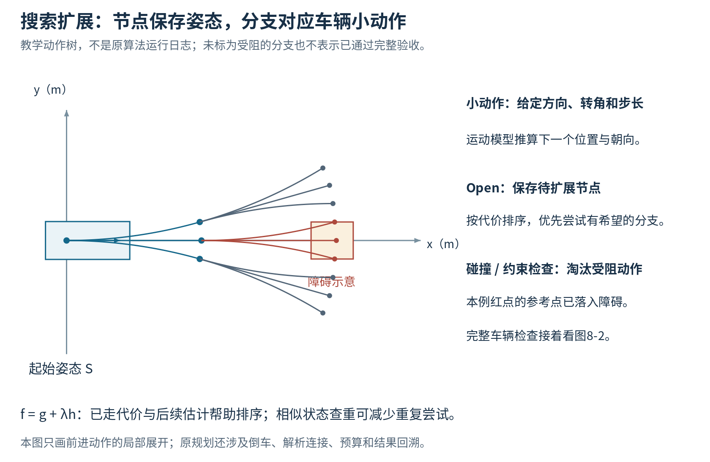

**图 8-1 展示局部尝试，不展示一条已经求出的完整路线。** 每条小弧由转角和步长推算，节点还带着朝向；红点的参考位置已侵入示例障碍。其他分支只是待检查或待扩展，不能因此当成已经通过整车碰撞验收。

它与几何规划的区别，是**不只依赖事先组织好的一组曲线构造，而是在可行运动中逐步寻找组合**。两者在原模型中提供不同来源的候选，再交给后处理选择，并不是固定先后调用的一对函数。

#### 1. 每个节点代表车辆的一种姿态

节点不仅包含位置，还包含车头朝向。车辆在相同位置朝向不同，后面能走的路线就不同；因此不能像只在平面上找一条折线那样处理。

扩展节点时，给定一个转角和一段带方向的距离，利用低速车辆模型推算下一个位置和朝向。枚举几种转角、前进或倒车，就形成多条可以继续尝试的分支。

这些动作遵守车辆不能任意横移、转弯半径有限的约束。节点连接因此从一开始就更接近车辆能够完成的运动，而不是先找一条任意折线，再指望控制器把它跟出来。

#### 2. 优先级决定先沿哪条尝试继续走

所有分支都不断尝试，数量会迅速增长。搜索需要优先处理更有希望的节点，通常结合两部分评价：

$$
f=g+\lambda h.
$$

$g$ 是已经走出部分的代价，$h$ 是到目标还需要多少调整的估计，$\lambda$ 控制估计项的影响。它不是最终路线质量的全部定义，而是帮助分配搜索计算的排序依据。

本模型的启发估计按车位分支使用目标相关横向偏差、航向差等量。航向差乘转弯半径后得到距离尺度，表达把车身转到目标方向需要付出的运动量级。当前实现不能直接解释为另一套“RS 加二维 Dijkstra 双启发式”。

Open 保存待扩展节点，优先队列从中取出当前更值得尝试的节点；Closed、哈希等结构管理已处理或相似的状态，减少重复尝试。

#### 3. 连续姿态与离散管理各有用途

Hybrid A* 保留连续位置和航向来描述实际运动，又把相近状态按位置、角度等离散索引归类，便于查找和比较。

保留连续姿态，使每个节点不必强行落在网格中心；离散管理，则避免把每一点微小差异都当成全新的无限分支。这就是“混合”的主要含义。

分辨率太粗，可能把具有不同通过能力的姿态合在一起；太细则增加计算和存储。步长过大可能错过窄入口，过小则需要更多扩展。因此搜索结果和耗时都与这些设置有关。

#### 4. 碰撞检查在搜索过程中淘汰不能通过的动作

尝试动作时，要检查车辆外形是否侵入障碍，而不只是检查节点中心。

其中 SAT 的直觉是：把车辆与障碍分别投影到若干方向上，只要能在一个必要方向上把两段投影分开，两个凸形状就不相交。矩形、八边形、线段等对象使用相应几何检查。

这相当于每走一小步就排除不合适的空间分支。还需要考虑中间车身扫掠和安全余量，不能仅凭动作两端没碰撞就认定全段可行。

#### 5. 解析连接收尾，父节点关系还原整条路线

终点附近继续靠小步试探效率不高，模型还会尝试 RS 等解析连接：直接构造从某个节点到目标的若干直线、圆弧和换向组合，经过相应检查后作为路径尾部。

这种连接是在实际找一段路线，与仅给节点估分的启发式不同。找到尾部后，再沿父节点关系向前回溯，把前面已经走出的片段接成完整候选。

可以用通道中间有柱子的场景理解整个过程：直接接目标的动作被碰撞检查拒绝；向一侧转动、前后调整的分支继续保留；排序机制优先扩展更接近可用入口的姿态，最后尝试连接目标。这里只是说明搜索如何工作，不代表当前场景一定有解。

搜索还受动作集合、离散精度和计算预算限制。返回失败可能来自预算或条件限制，不等于数学上已经证明不存在任何可行路线。主要实现对应 `Local_Planner/path_planning_alg`、`VehicleDynamic.m` 及本章的节点管理、代价和碰撞模块。

### 8.2 `Local_Planner` 与几何规划互补

前面的几何方法，是在已知结构下直接构造一条路。这里换一种思路：从当前姿态出发，尝试一小段运动，再尝试下一小段，看看能不能逐步找到通往目标的路线。

主实现放在 `path_planning_alg`，里面还有很多局部函数。外部的 `ClassHybridAStar` 只是提供数据或组织支持的一部分，所以只打开这个类文件，还没有看完真正的搜索流程。

这种方法能应对一些不规则起点或复杂边界，但也有计算预算和离散误差，不是给任何场景都保证找到解。

在原模型里，几何候选和搜索候选一起交给 `Planner_Core`。两者不是一个固定的“先算几何，失败才准搜索”的串行流程；什么时候执行、什么时候更新，还要一起看各层状态与调度。

### 8.3 搜索节点与动作

一个搜索节点，可以先理解成“车辆到达了某个位置，并且朝着某个方向”。继续往外扩展时，还需要记住运动方向、转向量、从哪个节点走来，以及已经花了多少代价。

`VehicleDynamic.m` 根据给定转角和一小段前进或倒退距离，推算下一个位姿，作为搜索扩展的基本动作。`D` 是带符号的步进距离，`δ` 是模型所用转角，`L` 是轴距。小转角时这样推算：

$$x_2=x_1+D\cos\psi_1,\quad y_2=y_1+D\sin\psi_1,\quad
\psi_2=\psi_1+\frac{D}{L}\tan\delta.$$

转角不接近零时，就按圆弧关系计算，用 `Δψ=D/R` 更新航向，再做角度归一化。很多这样的小段连起来，搜索才有了可以尝试的路线。

所以这里的“车辆模型”是帮助搜索推算下一个姿态，并没有在模拟发动机、轮胎、制动器和完整车身动力学。

### 8.4 Open/Closed、优先队列与哈希

如果每种转角和方向都一直往下试，分支会很快变多，而且很多尝试会走到差不多的地方。搜索因此需要两件事：先试哪些节点，以及哪些地方已经试过了。

`PriorityQueueNodesList` 按代价取待扩展节点，`HashNodesList` 帮助查找和管理节点，`HybridNode` 等保存具体状态与回溯关系。

这些结构是在帮助搜索把计算用在更有希望的方向，并减少重复尝试，不是在提高控制器的采样频率。所谓混合搜索，也要同时保留离散索引和连续位姿：索引帮助查找，连续状态才能表示车辆真正的位置和朝向。

### 8.5 代价函数必须按实现理解

候选节点多了以后，要有一个尺度决定先继续尝试谁。`getTotalCost.m` 可以用下面的形式来理解：

$$f=g+\lambda h$$

这里一部分代表已经走出的轨迹代价，另一部分代表后面到目标还有多困难。不过实际代码先令 `total_cost=traj_cost`，只有 `planner_global.conf.use_g_cost` 对应条件成立，才加上启发项；`λ` 对应 `H_COST`。开关怎么起作用，要按这几行实际逻辑看，不能按变量名自行反过来解释。

同样，`getHeuristicCost.m` 的注释讨论了 A*、势场、RS 等选择，但当前 `cost_A_star`、`cost_potential_field`、`cost_RS` 都先置为零。实际返回的分支主要看目标坐标系里的横向偏差、航向差和车位类型。

例如，航向差被这样换成一个距离尺度：

$$h_{\psi}=R_{\min}\left|\operatorname{wrap}\left(\psi_g-\psi\right)\right|.$$

航向差用 rad 表示，乘上半径后得到与调整方向所需路径长度相关的尺度，便于和距离类量共同参与评价。

但不同车位分支仍然不同：垂直、断头和平行车位，不一定采用同样的组合。这里不是所有场景统一做一次“欧氏距离加航向差”就结束。

### 8.6 碰撞检测

搜索中每试一段路，都要考虑它是否侵入障碍。`VehicleCollisionCheck`、`collision_Check_SAT`、八边形变体、点在多边形内判断、线段相交和边界检查，是为不同几何对象做这件事。

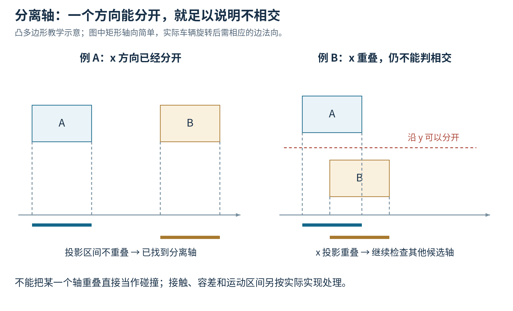

**图 8-2 解释图7-2和图8-1所需空间检查中的一种几何原理。** 左例沿 x 已能分开；右例虽然 x 投影重叠，沿 y 仍能分开。因此找到一个分离轴就可判不相交，而只有某一个轴重叠还不能直接判碰撞。

SAT 可以这样理解：试着找一个方向，把两个凸形状投影到这个方向上。如果有一个方向能让两段投影完全分开，它们就没有相交；如果所需的分离轴都没能分开它们，再按所用模型作相交判断。

矩形、八边形、线段和散点代表的对象不一样，所以看见几个“碰撞检测”函数，先看各自拿什么几何模型来检查，不要急着认为重复。

还有一个容易忽略的地方：一小段运动的终点没碰到，不等于中途的车身一定没扫到。要继续看采样和区间检查怎么做。这份说明把结构和方法讲清楚，但没有据此验证所有场景的安全余量。

### 8.7 特殊入口与受限空间处理

搜索之前，车不一定正处在一个干净、标准的起点。例如已经在车位里一部分，或者需要先拉出来一点，再重新倒入。

`escape_trouble`、`vt_slot_fitting_planning`、`vt_slot_pull_n_back_path_gen`、`get_planning_start_pos` 和搜索顺序列表等局部函数，就在处理这些不同的起点与计划顺序。

这也解释了为什么工程里的搜索不是只有一段 Hybrid A* 主循环：前面要把问题准备好，后面要把结果整理成可以执行的路径，还要判断终点误差是否允许、失败属于哪一种情况。

<a id="postprocess"></a>
## 九、规划核心与历史路径管理

### 9.1 原理讲解：从多条候选中维护一条适合当前执行的路径

几何规划和搜索规划各自提出候选，车辆最终只能执行其中一条。`Planner_Core` 的任务不是再增加一种求路方法，而是把候选、当前目标和车辆已经走到的位置联系起来，维护一条此刻能够继续采用的路径。

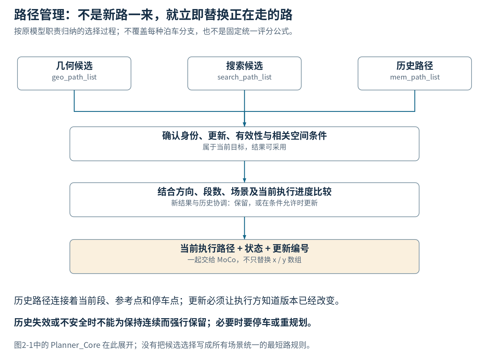

**图 9-1 展开图2-1中的 Planner_Core。** 几何、搜索与历史是不同来源；比较不只看长度，还要结合有效性、空间、方向及执行进度。输出包含路径状态与版本，图10-2的执行链据此识别应采用的参考，不是直接收到哪个候选就换哪个。

这里的重点是**选择与接续**。还没有开始执行时，可以从零比较候选；车辆已经走了一半时，新路再好，也需要与当前姿态和执行进度相容。

#### 1. 先确认收到的是哪个目标的哪一次结果

不同规划器更新速度不同，一条总线每个周期都存在，不等于里面每次都是新路径。模型通过来源计数、车位身份、有效标志和点数等信息，识别候选是否更新、是否属于当前任务。

这一步类似为结果建立“归属和版本”。属于另一个车位的路，或者没有更新的旧结果，都不能因为坐标看起来正常就直接当成新的执行依据。

#### 2. 可用性先于长度和机动质量

比较首先处理类型、有效性、碰撞风险和起步方向等条件，再进入段数及其他几何特征的比较。`ClassPath.qualityCompare` 中可以看到这种有先后顺序的判断。

一条 8 m 的路径如果与障碍相交，不会因为比 10 m 的无碰撞路径更短就自动占优。任务要求先倒车时，一条必须先前进的新路，也需要按相应条件判断。

这些比较不都是压成一个加权总分。有的条件足以先决定结果，后面的长度等指标就没有必要再参与。因此这里更接近带优先关系的业务选择，而不是只做一次最短路排序。

#### 3. 换向和当前场景影响路径质量

换向意味着停车、准备挡位和重新起步，路径稍短但频繁揉库，不一定更适合执行。模型因此考虑段数、换向位置及车位和环境条件。

但少换向也不是任何时候都必须坚持的绝对规则。通道受限时，多一次调整可能是获得可行路线所必需的。比较逻辑要在“能够完成”和“执行更合理”之间作出具体选择。

原模型的几何/搜索融合及不同泊车类别还有默认选择等分支，所以不能用一句“总是取段数最少”概括所有情况。

#### 4. 历史路径是车辆正在执行的承诺

保存历史路径，是因为车辆已经在某条路上形成了执行进度：当前段、最近参考点、剩余距离和下一个换向点，都与这条路径有关。

如果每来一个候选就无条件换掉它，这些进度可能失效，参考方向和转向请求也可能跳变。模型把新候选与历史比较，符合条件才更新，减少没有必要的变化。

历史又不能为了连续而永远保留。环境变化、目标变化或旧路失效时，需要停车、更新或重规划。**保留历史是有条件地保持执行连续，不是优先维护一条已经不安全的旧路。**

#### 5. 路径调整与更新通知共同完成交接

车辆走过一部分后，有些路径点已不再需要；接近库内目标时，也可能使用相应局部修正。跳点、直线简化和局部连接，分别调整点列或段结构，不能把它们都理解成重新从头求一条路。

局部三次曲线可以通过两端位置和切线方向构造连接，帮助把当前位置与目标方向接起来。但端点接得上，不自动代表全段曲率和碰撞都满足要求，还要结合调用条件和相应检查。

采用更新后，路径编号、有效状态和相关执行信息也要同步交给 MoCo。定位参考改变时，历史坐标还需要转换或作相应失效处理。只替换坐标数组、不更新版本和进度，会让下游继续拿旧索引解释新路径。

这层最终输出的是**当前应当执行的路径及其状态和版本**。主要对应 `Planner_Post_Process`、`search_path_list`、`geo_path_list`、`mem_path_list` 和 [ClassPath.m](/data/aiden/文档/Pro/APA/APA-Simulink/APA/PlanningSubFcn/ClassPath.m)。

### 9.2 `Planner_Core` 不是又一个独立规划器

`Planner_Core` 把几何、搜索候选与历史执行路径放在一起，结合当前任务和执行进度，决定保留还是替换，整理出现在适合采用的路径。主要实现是 `Planner_Post_Process`。

它还要一起看车位、定位、主状态、控制和安全反馈，最后整理成 MoCo 使用的 `Planning_Out`。因此它不是再单独搜索一次，而是在管理候选、历史和执行之间的衔接。

### 9.3 三类路径记忆

脚本里分别保存 `search_path_list`、`geo_path_list`、`mem_path_list`，还记着来源的滚动计数、路径更新编号、上一任务状态和重规划计数。

前两类可以理解成“搜索最近给的结果”和“几何最近给的结果”；历史路径则是之前留下来、当前可供继续使用或比较的结果。

车辆已经沿原路形成执行进度，新路即使更短，也可能与当前位置接不上，或让参考点和跟踪误差突变。历史比较使更新具有依据。**保留旧路径是在维持执行连续性，不是单纯为了少算一次。**

### 9.4 处理链路

可以顺着下面这个顺序读后处理，先不用被每个标志变量打断：

1. 先检查输入路径能不能用：有效标志、点数、来源更新和对应车位是否正确。
2. 把路径与车位、目标和规划状态对应起来，避免比较错对象。
3. 再把几何候选、搜索候选与历史路径放到一起，决定保留还是替换。
4. 如果采用了变化，更新路径编号、规划状态和需要制动等信息。
5. 遇到定位重置、跟踪误差、限位器或不同重规划阶段时，做对应的补充处理。
6. 最后输出选好的执行点列和日志，而不是把全部候选都丢给底盘选择。

### 9.5 为什么不能只选最短

这里的比较不是只算一个“长度乘权重”的总分，而是先后检查多种条件。有的条件优先于长度：路径是否有效、是否涉及前进和倒车切换、属于哪种重规划、目标误差怎样，以及能不能接上当前执行状态。

你可以设想一种情况：新路径稍短，但要求车辆突然换向，或者起点与当前姿态不连续。对正在执行的车来说，它未必比原来的路更合适。

所以这层看起来有很多选择分支，是因为“更好”不仅是“更短”，还包括能否稳定、合理地接着执行。

### 9.6 定位重置、路径坐标与更新编号

历史路径保存下来了，也要知道它是在什么坐标下保存的。如果定位原点变了，车辆和路径却还各用各的坐标，看起来就会突然错开。因此需要相应转换、作废或重算历史路径。

更新编号让 MoCo 识别路径已经改变，从而按相应流程处理索引和执行状态。点列更新但标记未更新，会使下游继续用旧进度解释新的路线。

这就是为什么迁移接口时，不能只拿走 `x[]/y[]`。点数、有效性、方向和里程、车位 ID、定位重置与更新编号，都在帮助后面正确理解这组坐标。

<a id="moco"></a>
## 十、MoCo 运动控制

### 10.1 原理讲解：让车辆按顺序执行路径，并持续修正偏差

规划给出的是一条路，MoCo 要把它变成车辆当前能够执行的动作。这里同时包含两件事：**运动阶段管理**和**闭环跟踪计算**。

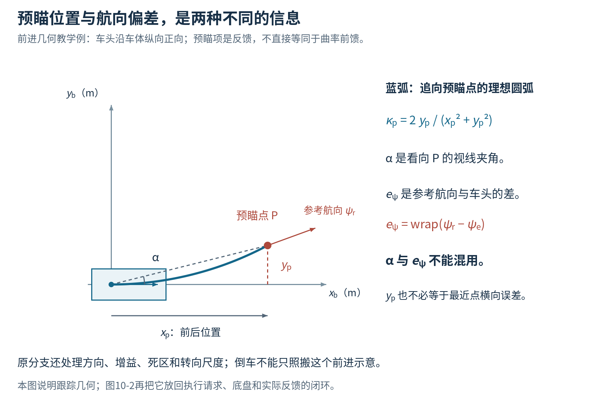

**图 10-1 只解释横向跟踪几何。** 灰色视线指向预瞄点，蓝弧展示追向该点的理想运动；红箭头给出参考航向。视线夹角 α 与航向误差不同，预瞄点的侧向坐标也不必等于最近点横向误差。整个请求与反馈如何接起来，再看图10-2。

阶段管理负责准备、行驶、停车和换向的先后；闭环跟踪则依据车辆实际位置和运动反馈，持续修正目标请求。只有公式没有阶段管理，换向等动作可能衔接错误；只有阶段管理没有反馈修正，车辆也不能准确沿路行驶。

#### 1. 点列先变成当前执行段和参考位置

路径带着位置、航向、方向及步进里程。MoCo 根据当前姿态和已走进度，确定正在执行哪一段、参考点在哪里、离本段停车点还有多远。

相邻段可能行驶方向相反，因此不能仅按最近空间点就随意跳到另一段。系统还需要保存段号、点索引等执行记忆，并在收到新路径时处理更新关系。

这一步把“整条泊车路线”缩小成“眼下正在执行的一段”，后面的横纵控制才有明确参照。

#### 2. 横向跟踪同时修正位置和朝向

把参考点变到车身附近的坐标系，就能得到它在车前后、左右的位置；把参考航向与实际车头方向比较，就得到航向误差。

预瞄跟踪不是等车辆偏到路径外再生硬拉回，而是看路径前方一段，把当前车辆朝预瞄点引导。纯追踪的标准几何关系可以写成：

$$
\kappa_p=\frac{2y_p}{x_p^2+y_p^2},
\qquad
\delta_p=\arctan\left(L\kappa_p\right).
$$

这里 $x_p,y_p$ 是预瞄点相对车辆参考点的位置，$L$ 是轴距，$\kappa_p$ 是所需曲率，$\delta_p$ 是理想等效前轮角。这个式子来自一段与当前车头方向相切、又经过预瞄点的圆弧。

同样的横向偏差下，点很近会要求更急的修正，点远一些通常更缓，但也可能切弯。预瞄距离因此影响响应与平顺性。

原模型在部分分支中还组合航向修正：即使参考点已经很靠近车辆前方，车身也可能没有沿车位方向摆正，航向项继续帮助调整姿态。预瞄几何项依赖实际位姿，本身仍属于反馈，不应直接称为独立的曲率前馈。

上述公式帮助理解原理；模型各分支的点选取、增益、方向和尺度并不完全相同。尤其倒车时，车辆位置和车头方向的变化关系与前进不同，需要相应的方向处理，不能只把速度符号改负。

#### 3. 纵向安排让车辆在当前空间内继续走并适时停下

`LongiCtrl_Pre1` 结合车位类型、方向、剩余路径、转向点和近障情况组织 `TarSpd`、`APA_Dist2Go` 及阻塞相关输出。

远离停车点时可以维持对应场景的目标，接近段末或障碍时降低请求，停稳后再进入下一阶段。剩余距离很重要：相同车速下，前方还有几米与只剩几十厘米，需要不同处理。

这里强调的是原 Simulink 的纵向请求组织，不把后来 APA C/CARLA 包中新增的最终踏板执行器或加速度内环反写成原模型已经具有的实现。

目标逐步下降也不自动等于车辆实际平稳减速。底盘有响应延迟，实际速度需要反馈；速度变化有斜坡，也不等于已经对加速度变化率施加完整硬约束。

#### 4. 停稳、准备和换向把各段连接成可执行机动

一条前后交替的泊车路径，不能在方向标志改变时就让车辆立刻反向。MoCo 用执行状态来组织本段结束、停止、挡位及转向准备，再进入下一段。

`APA_Ctrl_Chart` 中有等待、准备和移动等状态。例如一条 `SteerReady` 到 `Move` 的通路，会一起看实际转向与请求差、挡位就绪和计数条件。这表示“请求已发出”和“允许开始这一段运动”是两件事。

实际图中还有特殊支路和计数替代条件，所以不是所有情形都严格按同一个“停车—换挡—打盘”顺序执行。理解重点是：**用反馈把运动阶段衔接起来，而不是只按预设时间盲目播放路径。**

#### 5. 限制与底盘适配把理想请求变成能执行的请求

理想跟踪计算可能产生过大的转角或过快的变化。幅值限制约束最大请求，变化率限制约束每次变化幅度，滤波缓解高频变化，三者作用不同。

限制会让请求更容易执行，也可能带来滞后。因此路径曲率变化、纵向速度安排和转向限制需要配合，不能指望只加一个滤波就解决所有跟踪问题。

输出还要匹配底盘定义。原模型部分转向分支有角度换算和方向盘侧缩放，其结果不能直接等同于上述公式的前轮 rad，更不能不经适配就当成 CARLA 的归一化 steer。

#### 6. 实际反馈让这个过程成为闭环

每次更新后，车辆实际位姿、速度、转向和挡位再进入下一次计算。横向偏差仍在，就继续修正；段末尚未满足条件，就继续处理停车或等待；新的路径、安全信息或驾驶员操作到来，则协调切换执行阶段。

因此 MoCo 不是把预先算好的转向序列依次播出来，而是**根据实际进度决定当前做哪一步，并在这一步中持续修正车辆与参考的差异**。主要对应 [MoCo 层](#ss-808527) 及本章后面的路径转换、执行状态、横纵控制和限制模块。

### 10.2 `Moco3`：把空间路径变成可执行动作

规划把路交过来之后，车还不能只按点列一直走。现在能不能动、这一段该前进还是倒车、转向准备好了没有、距离段尾还有多远，这些都由 MoCo 继续协调。

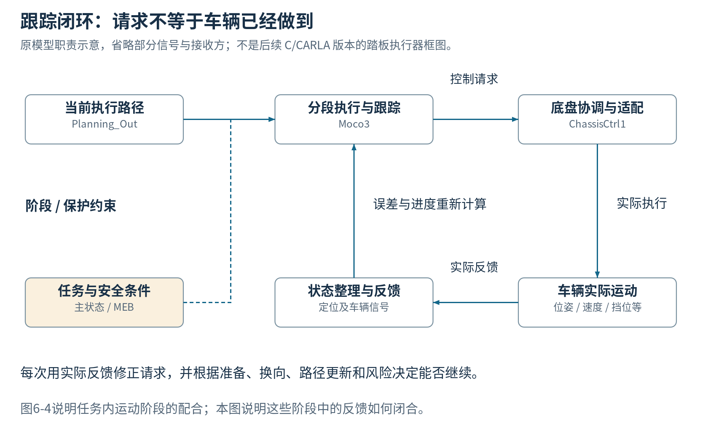

**图 10-2 把图10-1的跟踪计算放回整体闭环。** MoCo 输出请求，底盘按相应条件协调执行，实际位姿和车辆状态再进入后续更新。图6-4解释同一任务内怎样停稳和换向，本图解释这些运动阶段中的反馈；二者不是同一张状态转移图。

`Moco3` 的主要内部层是 `APA_Ctrl_Module`，周围还有挡位控制、HMI 路径点整理、滚动计数和超声信号整理。它需要车辆和定位、规划、MEB、主状态、车位、传感器、底盘响应和融合边界等信息，才能把“路怎么走”变成“这一周期让车做什么”。

### 10.3 `APA_Ctrl_Chart`：执行状态机

内部能看到 `NoAct`、`APA_Process`、`Path_Global_Initial`、`InitialStp`、`SteerReady`、`Hang`、`WaitOnPath`、`Stop`、`Back_Up`、`ChgGear`、`Move`、`ResetGear`、`Pause`、`PathBrk`、`APA_Finish`、`FailCtrl` 等状态，以及保留的 LRAS 相关分支。

先不背状态码，把它看成“安排每一段路怎么执行”的流程：

- 新路径到了，先整理点列、分段和索引，让后面的计算从正确位置开始。
- 确定当前段朝哪个方向走，再看挡位是否一致。
- 有些阶段先把转向调整好，或等执行条件满足，然后才能让车移动。
- 移动中持续更新剩余距离、已通过的点，以及该不该刹停或换向。
- 到段尾或发现风险时先停下来，再决定换挡、重规划，还是结束。

这也是为什么不能只把目标速度从正变负，就认为完成了前进切倒车。底盘要真的停稳、收到换挡请求、反馈挡位已到位，控制许可和故障/超时条件也要配合。

### 10.4 Chart 内主要图形函数的职责

读图形函数时，可以按执行前后分几组。`Pathrefresh` 先处理新路径；`PathInitial`、`StpInitial` 准备路径和当前段；`LockDir` 固定当前方向；`GearCheck` 检查挡位；`Veh_PosCal` 整理控制使用的车辆位置；`DistRefresh`、`ReCal_Dist`、`DistReset` 则持续更新或重置距离量。

另一组围绕点列本身工作：`PathPoint_Transfer` 参与坐标转换，`Reset_PathPtInterpolate`、`Reset_RevPtIdx`、`ReverseBlockPt`、`ForwardBlockPt`、`RevPtsSelect`、`BrakePtsSelect`、`PathBrkSelectCal` 等处理插值、索引、方向边界和刹停点选择。具体分支仍要顺着各自的转移读。

这些名称出现在 Chart 里，不表示每一个都是车辆会持续停留的运行状态。图形函数更像“需要时进去执行一段程序”，沿 junction 和转移完成计算；后面的明细把它们和 OR/AND 运行状态分开列，便于你区分。

### 10.5 路径坐标转换与跟踪误差

规划点通常保存在参考坐标中，控制需要把它变成相对车辆的前后、左右位置。因此先减去车辆位置，再按车辆当前航向反向旋转：

$$
\begin{bmatrix}x_b\\y_b\end{bmatrix}=
\boldsymbol{R}^{\mathsf T}(\psi_e)
\left[\begin{bmatrix}x_g\\y_g\end{bmatrix}-
\begin{bmatrix}x_e\\y_e\end{bmatrix}\right].
$$

得到的 `x_b` 反映点在车前后方向的位置，`y_b` 反映侧向位置。航向误差还要做归一化，前进和倒车时误差怎样对应到转向，也不能不加区别地照搬。

预瞄点就是在这样的局部关系里起作用。只把车当前所在点的横向偏差拉回零还不够：车可能位置对了但朝向不对，也可能必须提前转一点才能跟上前方曲线。预瞄让控制不只盯着脚下这一点。

### 10.6 `LongiCtrl_Pre1`：按场景和剩余空间组织纵向请求

纵向这块先回答“现在应该以多快的目标速度走、还允许走多远”，不是上来就把速度误差乘一个 Kp。它有约 30 个输入，输出 `TarSpd`、`APA_Dist2Go`、`LongiBlock_Flag`；请求、阶段、碰撞与超声、方向、剩余距离、挡位、车辆、点列、车位、重规划和减速带等信息都会参与。

`LongiCtrl_mod1` 内部分垂直、平行、前向入位、转向点和沿轨迹倒车等情况，就是因为这些场景允许的速度和停车条件并不一样。空间很宽时怎么走，与已经接近目标或障碍时怎么走，不应该只用一个不变的速度请求。

从物理上讲，离停车点越来越近，目标速度就需要与剩余制动空间相适应。但实际采用 `sqrt(2ad)`，还是分段阈值或其他逻辑，要看具体分支。这份文档保留原动作，是为了让你能对照着确认，而不是替原实现补出一个看起来合理的统一公式。

另外，原模型里的目标速度与当前 C/MBD 运行实现中后来加入的加速度控制结构，要分开看；我们之前 ACC bridge 里的 PI/PID 链路，也不能直接当成这里已经实现的内容。

### 10.7 `LatCtrl_F1/StrAng_Ctrl`：预瞄跟踪与航向修正组合

这一层把预瞄几何修正与航向修正组合为转向请求。预瞄项引导车辆接近前方路径，航向项让车身逐渐与路径方向一致；接近车位终点时，后者有助于避免位置接近了却仍然斜着停。

不同运动阶段采用不同的点选取、增益和方向处理。对很小的误差还可以设置死区，减少请求来回变化，但死区过大也可能留下姿态偏差。前进、倒车和段末切换不能完全共用不加区分的符号与参数。

本章 10.1 的标准几何式用于说明预瞄原理，原 Chart 还有分支缩放、角度换算和取整。最终 `Str_Ang` 属于模型的转向请求尺度，不能直接当成等效前轮 rad，也不能直接送给 CARLA 的归一化 steer；底盘适配仍是执行链的一部分。

### 10.8 为什么横向里还有很多分支

同样一个横向偏差，放在直线段、转弯段、末段、倒车或换向附近，合适的反应可能不同。例如快到目标时，继续强烈追一个很近的预瞄点，不一定有利于最终姿态。

所以图里会出现预瞄项与航向项互相冲突时的抑制、末段调整、保持转向、零位修正，以及针对泊车类型的处理。这些分支是在照顾不同执行阶段，而不是每一块都对应一种全新的控制算法。

`WHIStrAng_06` 还会记住转角修正的状态，把当前和历史方向盘量、控制状态放在一起判断；这就不能把它当成一个输入乘系数就输出的无状态计算。

### 10.9 `StrLimit`、`StrAng Limit1`、`StrSpdUp1`

跟踪公式算出的量，只是“希望怎么转”，执行器未必能马上做到。接下来还要限制它的幅值、变化速度，并结合当前阶段决定怎样发出去。

幅值限制管的是“别超出可转范围”；变化速度限制管的是“别要求方向盘瞬间跳过去”；准备和保持逻辑则协调车辆低速执行的过程。

这样也能看清两种连续性的区别：规划负责几何上怎么接，控制负责执行请求怎么变化。路径画得平顺，不能替代执行器限幅；反过来，有限幅也不能把一条几何上不合理的路自动修好。

### 10.10 重规划、近障减速与局部保护

路径刚算出来时可行，不代表车辆走到一半时，周围和跟踪状态还完全一样。如果边界变了，或者车辆偏离使剩余空间变小，就要决定减速、制动，还是重新规划。

`DecelerateAndReplan1`、`Target_Pose_CollisionDetect_Front`、`Target_Pose_Flg`、`CollisionBasedAx`、`CutFirst15Pts` 等，就是把这些空间和执行变化接回控制过程。

这里要区分响应层次：规划检查未来路线，MoCo 在执行过程中加限制，MEB 再处理相应的安全保护。都在看障碍，并不就表示它们是在重复做同一件事。

`ObjNotice` 中地锁、锥桶等提示和判断分支也有类似作用：虽然不是主跟踪公式，却可能影响车辆应不应该继续走，不能因为它不直接算转角就全部略过。

<a id="safety"></a>
## 十一、安全、底盘、诊断与对外输出

### 11.1 原理讲解：持续检查眼下的运动是否还允许继续

规划时没有碰撞，不代表执行过程中始终安全。障碍会变化，感知与定位有误差，车辆也不可能完全贴着理想路线走。安全链因此持续监视当前运动，并把风险交给控制、主状态和底盘处理。

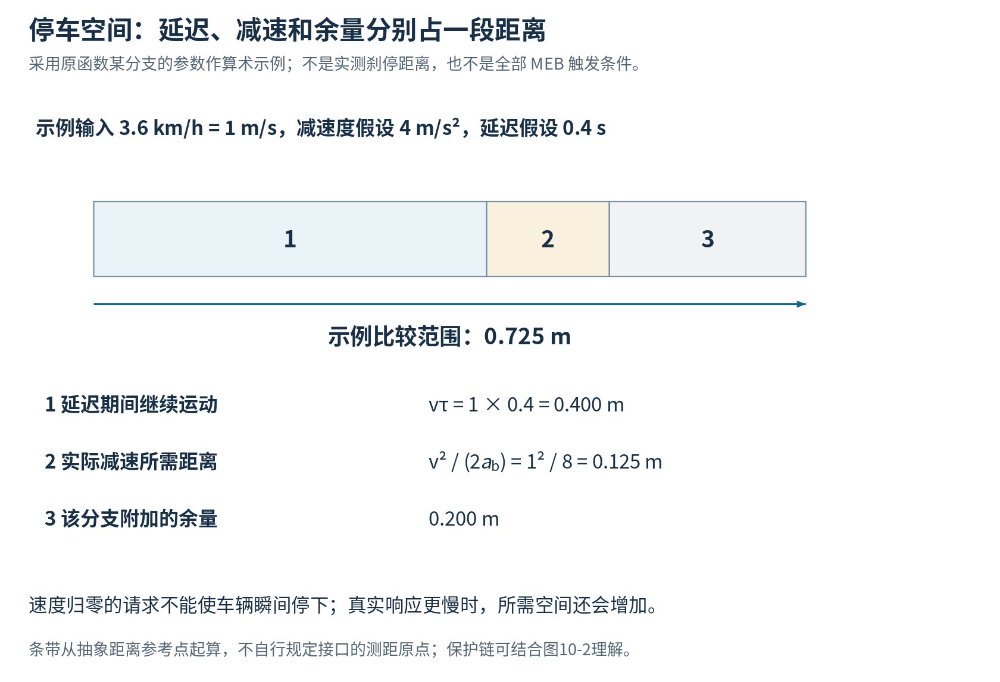

**图 11-1 解释图10-2保护约束背后的停车空间。** 输入先从 3.6 km/h 换为 1 m/s，再按该处分支的假设拆成延迟距离、减速距离和附加余量。0.725 m 只是这个算术例子的范围，不是实测刹停保证，也不是全部 MEB 判断条件。

它与规划检查的分工是：**规划判断候选路线能否采用，在线保护判断眼下继续运动是否需要限制或停车。** 两者配合，而不是前者完成后就不再检查环境。

#### 1. 风险判断把距离、状态、方向和计划运动放在一起

MEB 先整理传感器距离、状态、接近趋势和检测运动信息，再判断相关方向是否存在风险。

单个距离值不够：测量是否有效、是不是车辆将要驶向的一侧、计划还走多远、车目前多快，都影响这个距离的意义。传感器过近状态与正常测得的远距离，也不能用完全相同的方式处理。

本模型相关分支会比较障碍距离、预留余量和剩余路径。可以理解成：当前准备继续走的空间已经侵入近障范围时，需要提出保护条件，而不是等车辆参考点真正撞上障碍再处理。

#### 2. 停车空间包含减速距离和响应期间继续走的距离

目标速度或剩余路径被设为零，不代表车辆物理速度立刻归零。车辆收到停车请求后，还有信息处理、底盘响应和实际减速过程。

若用恒定减速度近似，所需停车空间可理解为：

$$
d_b=\frac{v^2}{2a_b}+v\tau.
$$

$v$ 是当前速度，$a_b>0$ 是假定可用减速度大小，$\tau$ 是响应延迟。第一项是减速所需距离，第二项是延迟期间继续前进的距离，实际判据还可以留出余量。

速度增加会使第一项按平方增加；延迟变长会增加第二项。因此即使泊车速度低，靠得很近时也不能忽略响应时间。

原模型近零剩余路径的相关保护分支包含这种计算，并将输入车速除以 3.6 后使用。这里需要尊重原信号单位和当前分支条件，不能把这个说明式单独当成全部 MEB 触发规则。

#### 3. 触发保护与确认风险解除采用不同规则

距离在阈值附近波动时，若进入和退出采用完全相同的条件，制动请求容易反复开关。保持、计数和释放规则，就是为了区分短时变化与持续风险。

可以理解成进入保护后需要更充分的解除证据，而不是测量只改善一点就马上继续。模型中触发与 Release 相关函数使用不同偏移和条件，并由外层状态解释结果；Release 函数的风险输出为真，并不等于允许释放。

风险解除后是否直接继续、等待确认或重规划，还需要主状态和控制阶段共同处理，不能由一个距离比较替代整项任务管理。

#### 4. 轮挡信息用于空间限制，与真实接触检测不同

轮挡位置会影响车轮可以接近的范围和相关停车处理。模型的 `Find_wheel_block` 从已有对象中筛选符合状态的轮挡并输出几何信息，为后续逻辑提供依据。

知道轮挡在哪里，与确认轮胎已经压到轮挡，是两类信息。这里不能把几何筛选解释成已经利用扭矩、轮速等完成真实接触识别，也不能由此直接推导出固定的驻车动作。

#### 5. 请求、权限和物理执行形成完整保护链

风险标志本身不是制动力。MEB 判断风险，MoCo 和主状态处理当前运动与任务阶段，`ChassisCtrl1` 再结合底盘条件组织请求和握手，车辆实际状态继续反馈。

因此判断保护效果，要同时看风险是否被识别、请求是否正确传递、底盘是否接受，以及车辆最终有没有及时停下。诊断信息、HMI 提示和底盘请求分别承担不同职责。

这条链的原理是**持续检查当前风险，并通过任务和底盘协调限制运动**；其实际停车能力仍依赖测量、单位、延迟、路面和底盘响应，不能仅凭模型中存在保护模块就认定绝对安全。对应 [MEB 层](#ss-811183) 及本章后面的状态、底盘和诊断模块。

### 11.2 `MEB`：运动中的碰撞风险与制动保护

车辆已经开始动以后，还要不断看近场风险。MEB 可以按“整理传感器、整理检测轨迹、判断碰撞、处理轮挡或限位器”这几部分来读。

`Sensor_Signal_Process` 先把传感器排列、距离和状态整理好；`Collision_Traj` 准备检测要用的运动/轨迹信息；`Collision_Detection` 结合距离、状态、运动方向和车辆等条件判断风险；`Wheel_Block_Process` 处理近轮挡等对象。

规划碰撞检查决定候选是否可用，MEB 持续关注实际执行中的近场风险。它把风险交给任务和控制链，具体的制动请求再结合当前阶段与底盘条件形成。

传感器是否有效、数据有多少延迟、底盘是否真正执行，都会影响效果。所以这里说明它怎么起作用，并不等于已经验证了某个功能安全等级。

### 11.3 `StateCal`

这层把运动控制、命令、车位和导航等信息再放到一起，补充一些主状态或控制需要的判断，里面能看到 `BlockMonitor`、`Ramp_Eval`。

它们的具体输入、比较和阈值，在后面的对应条目里。读的时候先看实际在判断什么，不要仅凭名称就把某一块当成完整坡度估计系统，或把整个 StateCal 当成一套完整诊断系统。

### 11.4 `ChassisCtrl1`

这一层是从“算法想让车做什么”走到“底盘能够接受什么请求”的关键一段。APA、MoCo、MEB 和诊断给来的信息，要在这里整理成底盘命令和握手状态。内部能看到 `ADS_Req`、`APA_ESC`、`EPS`、`EPS1` 和转角等辅助处理。

算法目标与底盘执行之间需要明确的权限和反馈关系。底盘只有在模式、请求有效性、驾驶员状态、挡位及 EPS/ESC 等条件适用时才接受对应命令；限制和异常处理也可能抑制请求，因此不能把目标数值直接等同于实际动作。

以后如果出现“算法有输出，车却不动”，要把算法请求和底盘响应一起看。只盯着目标曲线，往往找不到问题在哪一层。

### 11.5 `Diagnose` 与 `DTC`

这两块围绕输入、车辆和功能状态整理诊断条件与故障相关信息。读时把“检测出什么问题”和“遇到问题采取什么动作”分开：检测结果可以交给主状态，再由主状态决定暂停、退出或其他处理。

所以一个故障标志、一条诊断码和一次控制退出，并不是三个可以互相替换的字段。

### 11.6 `PDC`

停车时即使不去规划一条完整自动泊车路线，也需要知道周围距离并做相应提示。PDC 是这一类距离处理/提示支路，会使用传感器、车辆和主状态信息。

它与自动泊车规划并列存在。两个模块都用了距离阈值，不代表它们在解决同一个问题；根层另外还有显示或终端支路，也不一定直接参与控制。

### 11.7 CAN、网络、HMI 与调试输出

车要执行，界面也要知道任务状态和路径，这些信息最后要按各自接口的字段发出去。`F515_MDC_Out_CAN` 整理 CAN 侧输出，`F515_MDC_Out1` 整理其他对外及 HMI 信息，包括路径显示点和方向等。

这时重点已经不是再找一条新路，而是“前面算出的结果，怎样让接收方看懂”。因此这里主要看打包、字段对应和协议适配。

根层 `Subsystem` 还放着导航、挡位、地锁等观察/输出相关分支，其中部分发送或显示支路已注释。`Subsystem3`、`Subsystem5` 虽然没有普通输出，也可能在记录、显示或写数据；不能因为看不见输出线，就直接认为它没有作用。

### 11.8 停用与替代功能

这份模型也保留了当前不启用的功能，比如顶层 `APA_LAEB`、`LRAS_Module`、`LRAS_State`、`APA_ChassisCtrl`、`SVM_Diagnose` 等注释分支。为了让其他模块的接口仍能接上，`Subsystem4` 给出常量替代的 LRAS/LAEB 信息；MoCo 某一处 AEB 模式等输入，也在根层接了常量零。

读到这里，可以理解为什么“图里有这块”不等于“当前正在用这块”。它是一份有功能取舍的保存配置，不是所有保留分支同时开启。

反过来，某个辅助功能停用，也不能立刻推出核心 APA 完全不能泊车。还是要沿你准备测试的任务，看看必要的那条链是否接通、输入是否具备。

<a id="scheduling"></a>
## 十二、调度与跨周期闭环

### 12.1 当前活动配置

到这里再回头看时间，就能理解为什么有的结果更新快，有的更新慢。当前保存的活动配置是 `Configuration1`，使用 `grt.tlc`，固定步长 0.005 s，StopTime 为 14。文件里还保留了 dSPACE 相关配置，但这次解释的是当前选中的这一套。

根层 `dSpace_Comms_OS` 用 `j/i/k/n/o` 计数，发出 16 路函数调用事件。可以把基础步长理解成时钟每走一格，调度就看“这一格轮到哪些任务”。只有收到对应调用的子系统才执行，不是所有算法每 5 ms 都重新算一次。

### 12.2 事件名不等于实际周期

如果调度 Chart 确实每 5 ms 被调用一次，就可以根据计数条件往下推：

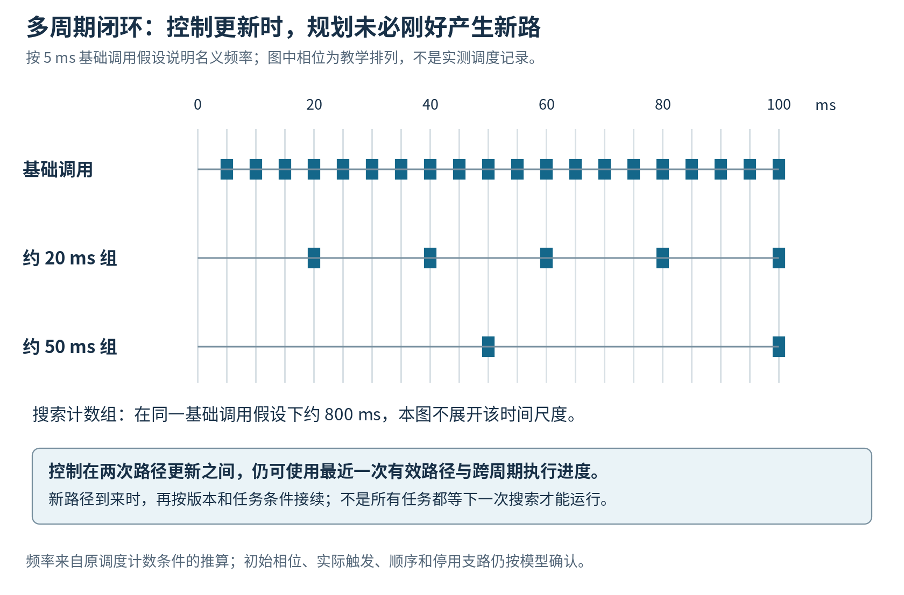

**图 12-1 为前面各模块补上时间维度。** 在基础调用假设下，某次控制更新时，车位或规划可能没有新结果，仍需使用最近有效信息与执行记忆。图中触发相位只为说明更新频率，不能拿它推断原模型每次实际调用的精确先后。

- `j % 4` 这一组约 20 ms：诊断、主状态、PDC、导航、LAEB、同步、超声等。
- `i % 10` 这一组约 50 ms：车位、几何规划、规划后处理等。
- `n % 160` 这一组约 800 ms：局部搜索规划。
- `k % 4` 这一组约 20 ms：LRAS、MEB、MoCo、输出等。
- `o % 10` 这一组约 50 ms：IVI 相关。

这里是对代码条件的推算，不是拿计时工具实际量过。第一次在什么时刻触发、复位和加一谁先做、同周期谁先执行，还要继续看计数初值与语句顺序。

这份模型有些事件名写着 20ms/100ms，计数条件却不完全对应。所以理解周期时以实际调用和计数逻辑为线索，不能看到名字就把它当作已确认的运行周期。

### 12.3 为什么看起来有“反馈连线”却不会立即无限循环

你可能会看到：规划用主状态，主状态又看 MoCo，MoCo 还在用规划。它们并不是在同一个瞬间不停互相调用，而是通过 UnitDelay、Delay、persistent 和任务顺序，把上一周期或最近一次更新留下来，供这次计算使用。

例如搜索不需要和控制一样快。MoCo 大多数周期都可以继续沿已经保存的路径执行，等规划有新结果再处理更新；主状态则继续看执行反馈，决定任务是否推进。

有了这些记忆和时序，反馈才变成一个按周期运行的闭环。不同任务还可能读到对方最近一次更新的结果，而不是恰好同一采样时刻的新值。

### 12.4 迁移时必须保留的时间语义

以后把逻辑迁移到 GAASD，除了“这个算式怎么连”，还要把下面几件事一起带过去：

- 信号使用当前值或上一周期值的关系。
- 每个跨周期记忆的初值、更新和清零条件。
- 路径、车位更新计数及位置重置编号的变化条件。
- 各任务的调用周期、同周期执行顺序及未更新时的保持方式。
- 计数阈值与实际时间的换算关系。

如果只复制数学表达式，却改了这些时间关系，代码也许能编译，跑出的行为仍可能与原模型不同。

<a id="primitives"></a>
## 十三、普通元件的作用与读图规则

### 13.1 接口与信号整理

你在深层看到的很多方块，其实不是又增加了一种算法，而是在整理数据怎么进来、怎么出去。`Inport/Outport` 是当前层的边界；BusSelector 从总线中取字段，BusCreator 再把字段组合起来。

Mux/Demux 主要合并、拆分向量通道，与有字段含义的结构总线不能直接当成一回事。Selector 则进一步按索引取数组元素，读它时要看维度、索引方式和范围。

`From/Goto` 可以理解成图上没有直接画出来的连线。但同名不代表任何位置都能接到一起，还要看 local/scoped/global 范围和 `GotoTagVisibility`。因此追信号时，除了找同名标签，也要确认它在哪个范围内可见。

### 13.2 数值计算

Gain 对输入乘一个系数，既可以调节算法增益，也可以完成单位换算，具体由输入和系数的物理含义决定。Sum 按端口符号加减，Product 按配置相乘或相除，Trigonometry/Math 则执行选定的数学函数。

再看选择与限幅：Switch 根据控制端以及 Criteria/Threshold 选数据，MultiPortSwitch 按索引选候选，MinMax 取极值，Saturate 限制上下边界。这些通常是在当前输入下选一个结果，与 Stateflow 长时间停留在某个模式的“状态”不是同一种机制。

### 13.3 布尔与状态

RelationalOperator 把数值比较变成判断，Logic 再把判断组合起来；Delay/UnitDelay 则让这一层能记住过去。你顺着它们看，往往就能理解某个保持、边沿或去抖是怎样做出来的。

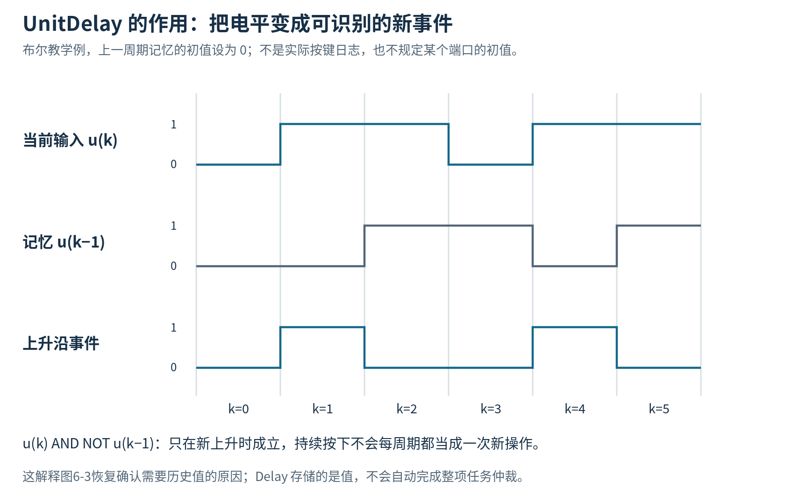

**图 13-1 回到图6-3的恢复确认。** 输入保持为 1 时，只有第一次从 0 变 1 产生新事件；上一周期记忆使程序能够区分新按下与一直按住。这里初值人为设为 0 用于说明，不替代各实际 Delay 块的初始化参数。

这里不要略过初值、采样时间和重置条件。上一周期保存了什么，直接影响这一周期会走哪条分支。

Reference 表示库链接，实例参数还可能放在 InstanceData 中，后面的明细已经把相关参数合在一起列出。模型中的 380 个 Reference 都来自 Simulink 库，不是缺了 380 个业务模块文件。

### 13.4 Stateflow 与内部 S-Function

如果看到 S-Function，也先别以为缺了外部 C 代码。本模型的 258 个 S-Function 都使用 `sf_sfun`，它们是 Stateflow/MATLAB Function 的内部表示，真正要读的逻辑在对应 Chart 里面。

TriggerPort、EnablePort、ActionPort 则在回答“什么时候执行”。所以检查一个子系统时，不光看数值线有没有接齐，还要看触发、使能或动作入口有没有满足条件。

### 13.5 记录与常量

Scope、Display、ToWorkspace、Terminator 等，很多是在看数、记数据或接住不再使用的输出，不能全部算作控制算法。不过 DataStoreWrite 会写存储，即使没有普通输出线，也可能影响其他地方读到的值。

Constant 也要看用途：有的是标定，有的是给停用功能补一个固定输入。尤其是常量零，不一定只是一个可以忽略的占位符。

FromWorkspace 则要有真正的工作区数据可读。信号字典里定义了一个名字，并不等于已经有了完整回放序列，这也是“图能打开”和“仿真能跑起来”之间的一处区别。

---

下面开始对照真实层级逐块看。前面讲的是“这些部分为什么这样配合”，后面保留的是“到模型里具体在哪里、接了什么、算了什么”。原代码中的公式仍按原样放着，方便你对照分支、单位和细节，不把代码重新包装成另一套实现。


<a id="hierarchy"></a>
## 十四、完整层级导航树

这棵树可以当作模型里的导航。往右缩进一层，就是双击后再进去一层；`[注释/旁路]` 也会沿上层传下来。遇到 Chart 时，进去要读状态、函数和转移，不能仍按普通算子连线来理解。

- [<code>APA_ChassisCtrl</code>](#ss-749775)：子系统；SID 749775；[注释/旁路]

  - [<code>AEB_Moudle</code>](#ss-749781)：子系统；SID 749781；[注释/旁路]

    - [<code>AEB_Ctrl</code>](#ss-749786)：Chart；SID 749786；[注释/旁路]

    - [<code>Subsystem</code>](#ss-749878)：子系统；SID 749878；[注释/旁路]

  - [<code>APA_Moudle</code>](#ss-749927)：子系统；SID 749927；[注释/旁路]

    - [<code>APA_Set</code>](#ss-749934)：Chart；SID 749934；[注释/旁路]

    - [<code>Chart</code>](#ss-749941)：Chart；SID 749941；[注释/旁路]

    - [<code>MocoBlock</code>](#ss-750037)：Chart；SID 750037；[注释/旁路]

    - [<code>StrAngReq_Satur</code>](#ss-750038)：Chart；SID 750038；[注释/旁路]

    - [<code>Subsystem</code>](#ss-750039)：子系统；SID 750039；[注释/旁路]

  - [<code>Pre_Process</code>](#ss-750091)：子系统；SID 750091；[注释/旁路]

- [<code>APA_LAEB</code>](#ss-750219)：子系统；SID 750219；[注释/旁路]

  - [<code>APA_LAEB_Feature</code>](#ss-750225)：子系统；SID 750225；[注释/旁路]

    - [<code>APA_LAEB</code>](#ss-750230)：子系统；SID 750230；[注释/旁路]

      - [<code>Adas_Condition_input</code>](#ss-750234)：子系统；SID 750234；[注释/旁路]

      - [<code>Enabled</code>](#ss-750239)：子系统；SID 750239；[注释/旁路]

        - [<code>Diagnose</code>](#ss-750244)：子系统；SID 750244；[注释/旁路]

        - [<code>ExecuteOutput_Process</code>](#ss-750246)：子系统；SID 750246；[注释/旁路]

          - [<code>Chart</code>](#ss-750254)：Chart；SID 750254；[注释/旁路]

          - [<code>PostProcess_LAEB</code>](#ss-750298)：子系统；SID 750298；[注释/旁路]

            - [<code>Subsystem1</code>](#ss-750314)：子系统；SID 750314；[注释/旁路]

            - [<code>Subsystem2</code>](#ss-750320)：子系统；SID 750320；[注释/旁路]

            - [<code>Subsystem3</code>](#ss-750326)：子系统；SID 750326；[注释/旁路]

            - [<code>Subsystem4</code>](#ss-750331)：子系统；SID 750331；[注释/旁路]

            - [<code>Subsystem5</code>](#ss-750336)：子系统；SID 750336；[注释/旁路]

          - [<code>Subsystem</code>](#ss-750346)：子系统；SID 750346；[注释/旁路]

        - [<code>LAEB_Inhibit</code>](#ss-750447)：子系统；SID 750447；[注释/旁路]

          - [<code>Subsystem</code>](#ss-750479)：子系统；SID 750479；[注释/旁路]

          - [<code>Subsystem1</code>](#ss-750581)：子系统；SID 750581；[注释/旁路]

            - [<code>Chart</code>](#ss-750583)：Chart；SID 750583；[注释/旁路]

        - [<code>LAEB_OS</code>](#ss-750588)：Chart；SID 750588；[注释/旁路]

        - [<code>LAEB_State_Management</code>](#ss-750589)：子系统；SID 750589；[注释/旁路]

          - [<code>Function_Limit_Allow</code>](#ss-750633)：子系统；SID 750633；[注释/旁路]

          - [<code>LAEB_State_Management</code>](#ss-750674)：Chart；SID 750674；[注释/旁路]

          - [<code>Subsystem</code>](#ss-750675)：子系统；SID 750675；[注释/旁路]

          - [<code>Subsystem1</code>](#ss-750724)：子系统；SID 750724；[注释/旁路]

        - [<code>Signals_Regroup</code>](#ss-750755)：子系统；SID 750755；[注释/旁路]

          - [<code>AEB_Target_info_Regroup1</code>](#ss-750760)：子系统；SID 750760；[注释/旁路]

          - [<code>FLT3_5_Object_Regroup1</code>](#ss-751053)：子系统；SID 751053；[注释/旁路]

          - [<code>SubjectInternal_Regroup</code>](#ss-751192)：子系统；SID 751192；[注释/旁路]

          - [<code>SubjectVehicle_Regroup</code>](#ss-751199)：子系统；SID 751199；[注释/旁路]

            - [<code>ACC_Decel_ReqSt_M5</code>](#ss-751235)：子系统；SID 751235；[注释/旁路]

            - [<code>ACC_Decel_Value_M5</code>](#ss-751239)：子系统；SID 751239；[注释/旁路]

            - [<code>APA_State_M5</code>](#ss-751243)：子系统；SID 751243；[注释/旁路]

            - [<code>BrkPdlSt_M5</code>](#ss-751247)：子系统；SID 751247；[注释/旁路]

            - [<code>BrkSysAutBrkStat_M5</code>](#ss-751251)：子系统；SID 751251；[注释/旁路]

            - [<code>DoorOpenAct_M5</code>](#ss-751269)：子系统；SID 751269；[注释/旁路]

            - [<code>eps_sasSteeringAngle_M5</code>](#ss-751502)：子系统；SID 751502；[注释/旁路]

            - [<code>esc_yawRate_M5</code>](#ss-751506)：子系统；SID 751506；[注释/旁路]

            - [<code>FCW_Sensitivity_Req_M5</code>](#ss-751339)：子系统；SID 751339；[注释/旁路]

            - [<code>GearBox_M5</code>](#ss-751381)：子系统；SID 751381；[注释/旁路]

            - [<code>ic_vehicleSpeedDisp_M5</code>](#ss-751516)：子系统；SID 751516；[注释/旁路]

            - [<code>MCBP_M5</code>](#ss-751424)：子系统；SID 751424；[注释/旁路]

            - [<code>SafeBeltAct_M5</code>](#ss-751428)：子系统；SID 751428；[注释/旁路]

            - [<code>SetTestMode_M5</code>](#ss-751432)：子系统；SID 751432；[注释/旁路]

            - [<code>SteeringWheelSpeed_M5</code>](#ss-751436)：子系统；SID 751436；[注释/旁路]

            - [<code>Subsystem</code>](#ss-751440)：子系统；SID 751440；[注释/旁路]

            - [<code>Subsystem1</code>](#ss-751444)：子系统；SID 751444；[注释/旁路]

            - [<code>Subsystem2</code>](#ss-751449)：子系统；SID 751449；[注释/旁路]

            - [<code>Subsystem3</code>](#ss-751453)：子系统；SID 751453；[注释/旁路]

            - [<code>TurnLightAct_M5</code>](#ss-751459)：子系统；SID 751459；[注释/旁路]

            - [<code>vcu_accPedalPosition_M5</code>](#ss-751520)：子系统；SID 751520；[注释/旁路]

            - [<code>vcu_ready_M5</code>](#ss-751524)：子系统；SID 751524；[注释/旁路]

            - [<code>VehicleSpeed_mps_M5</code>](#ss-751497)：子系统；SID 751497；[注释/旁路]

          - [<code>SubjectVehicle_Regroup1</code>](#ss-751601)：子系统；SID 751601；[注释/旁路]

          - [<code>Subsystem</code>](#ss-751630)：子系统；SID 751630；[注释/旁路]

          - [<code>Ultrasonic_Amplitude_Regroup</code>](#ss-751645)：子系统；SID 751645；[注释/旁路]

          - [<code>Ultrasonic_Counter_Regroup</code>](#ss-751732)：子系统；SID 751732；[注释/旁路]

          - [<code>Ultrasonic_Distance_Regroup</code>](#ss-751759)：子系统；SID 751759；[注释/旁路]

          - [<code>Ultrasonic_ErrorStatus_Regroup</code>](#ss-751846)：子系统；SID 751846；[注释/旁路]

          - [<code>Ultrasonic_Ringtime_Regroup</code>](#ss-751873)：子系统；SID 751873；[注释/旁路]

        - [<code>TTC_Distance_Judge</code>](#ss-751972)：子系统；SID 751972；[注释/旁路]

          - [<code>Curve_Radius</code>](#ss-751992)：子系统；SID 751992；[注释/旁路]

          - [<code>MATLAB Function1</code>](#ss-752154)：MATLAB Function；SID 752154；[注释/旁路]

          - [<code>MATLAB Function2</code>](#ss-752155)：MATLAB Function；SID 752155；[注释/旁路]

          - [<code>MATLAB Function3</code>](#ss-752156)：MATLAB Function；SID 752156；[注释/旁路]

          - [<code>MATLAB Function4</code>](#ss-752157)：MATLAB Function；SID 752157；[注释/旁路]

          - [<code>MATLAB Function5</code>](#ss-752158)：MATLAB Function；SID 752158；[注释/旁路]

          - [<code>ReferenceLine_Index_S</code>](#ss-752160)：MATLAB Function；SID 752160；[注释/旁路]

          - [<code>Subsystem</code>](#ss-752164)：子系统；SID 752164；[注释/旁路]

      - [<code>NoEnabled</code>](#ss-752282)：子系统；SID 752282；[注释/旁路]

        - [<code>Subsystem1</code>](#ss-752287)：子系统；SID 752287；[注释/旁路]

        - [<code>Subsystem2</code>](#ss-752292)：子系统；SID 752292；[注释/旁路]

        - [<code>Subsystem3</code>](#ss-752297)：子系统；SID 752297；[注释/旁路]

        - [<code>Subsystem5</code>](#ss-752301)：子系统；SID 752301；[注释/旁路]

      - [<code>Subsystem</code>](#ss-752308)：子系统；SID 752308；[注释/旁路]

    - [<code>Input_Interface</code>](#ss-752343)：子系统；SID 752343；[注释/旁路]

      - [<code>InternalSignals_Interface</code>](#ss-752382)：子系统；SID 752382；[注释/旁路]

      - [<code>MATLAB Function</code>](#ss-752389)：MATLAB Function；SID 752389；[注释/旁路]

      - [<code>Subsystem</code>](#ss-752391)：子系统；SID 752391；[注释/旁路]

      - [<code>Subsystem1</code>](#ss-752635)：子系统；SID 752635；[注释/旁路]

      - [<code>Subsystem2</code>](#ss-752878)：子系统；SID 752878；[注释/旁路]

      - [<code>Subsystem3</code>](#ss-753121)：子系统；SID 753121；[注释/旁路]

      - [<code>Subsystem4</code>](#ss-753302)：子系统；SID 753302；[注释/旁路]

      - [<code>Vehicle_Interface</code>](#ss-753366)：子系统；SID 753366；[注释/旁路]

        - [<code>SafeBeltAct_M5</code>](#ss-753509)：子系统；SID 753509；[注释/旁路]

        - [<code>SetTestMode_M5</code>](#ss-753514)：子系统；SID 753514；[注释/旁路]

  - [<code>Uisee_LAEB_Control_OS</code>](#ss-753597)：Chart；SID 753597；[注释/旁路]

- [<code>APA_Navi1</code>](#ss-814766)：子系统；SID 814766

  - [<code>APA_Navi</code>](#ss-814771)：子系统；SID 814771

    - [<code>Chart</code>](#ss-814776)：Chart；SID 814776

    - [<code>navi1</code>](#ss-814815)：子系统；SID 814815

      - [<code>act_dir_cal</code>](#ss-815136)：MATLAB Function；SID 815136

      - [<code>Kalman_Filtering_kinematics</code>](#ss-815002)：MATLAB Function；SID 815002

      - [<code>MATLAB Function1</code>](#ss-815003)：MATLAB Function；SID 815003

      - [<code>MATLAB Function2</code>](#ss-815004)：MATLAB Function；SID 815004

      - [<code>MATLAB Function3</code>](#ss-815005)：MATLAB Function；SID 815005

      - [<code>MATLAB Function5</code>](#ss-815006)：MATLAB Function；SID 815006

      - [<code>Odo1</code>](#ss-815011)：子系统；SID 815011

        - [<code>MATLAB Function</code>](#ss-815080)：MATLAB Function；SID 815080

        - [<code>MATLAB Function1</code>](#ss-815081)：MATLAB Function；SID 815081

      - [<code>phi_Cal</code>](#ss-815137)：子系统；SID 815137

        - [<code>trap int</code>](#ss-815289)：子系统；SID 815289

        - [<code>trap int1</code>](#ss-815302)：子系统；SID 815302；[注释/旁路]

        - [<code>Vr cal</code>](#ss-815146)：子系统；SID 815146

          - [<code>Subsystem</code>](#ss-815155)：子系统；SID 815155

          - [<code>Subsystem1</code>](#ss-815166)：子系统；SID 815166

        - [<code>YawRate_Filter</code>](#ss-815178)：子系统；SID 815178

          - [<code>lowpass filter</code>](#ss-815184)：子系统；SID 815184

          - [<code>working condition recongnize</code>](#ss-815195)：子系统；SID 815195

            - [<code>Quintic_mean_filter</code>](#ss-815208)：子系统；SID 815208

            - [<code>Quintic_mean_filter1</code>](#ss-815217)：子系统；SID 815217

            - [<code>uisee_fless</code>](#ss-815227)：子系统；SID 815227

              - [<code>uisee_fequal</code>](#ss-815233)：子系统；SID 815233

            - [<code>uisee_fless1</code>](#ss-815242)：子系统；SID 815242

              - [<code>uisee_fequal</code>](#ss-815248)：子系统；SID 815248

            - [<code>uisee_fless2</code>](#ss-815257)：子系统；SID 815257

              - [<code>uisee_fequal</code>](#ss-815263)：子系统；SID 815263

            - [<code>uisee_fless3</code>](#ss-815272)：子系统；SID 815272

              - [<code>uisee_fequal</code>](#ss-815278)：子系统；SID 815278

      - [<code>spd_with_dir</code>](#ss-815324)：MATLAB Function；SID 815324

      - [<code>within_2pi</code>](#ss-815325)：MATLAB Function；SID 815325

      - [<code>within_2pi1</code>](#ss-815326)：MATLAB Function；SID 815326

    - [<code>Rolling_counter_generator</code>](#ss-814789)：子系统；SID 814789

    - [<code>Rolling_counter_generator1</code>](#ss-814801)：子系统；SID 814801

  - [<code>LRAS_Navi</code>](#ss-815365)：子系统；SID 815365

    - [<code>Chart</code>](#ss-815371)：Chart；SID 815371

    - [<code>navi</code>](#ss-815409)：子系统；SID 815409

      - [<code>act_dir_cal</code>](#ss-815717)：MATLAB Function；SID 815717

      - [<code>Kalman_Filtering_kinematics</code>](#ss-815597)：MATLAB Function；SID 815597

      - [<code>MATLAB Function</code>](#ss-815598)：MATLAB Function；SID 815598

      - [<code>MATLAB Function1</code>](#ss-815599)：MATLAB Function；SID 815599

      - [<code>MATLAB Function2</code>](#ss-815600)：MATLAB Function；SID 815600

      - [<code>MATLAB Function3</code>](#ss-815601)：MATLAB Function；SID 815601

      - [<code>Odo1</code>](#ss-815606)：子系统；SID 815606

        - [<code>MATLAB Function</code>](#ss-815669)：MATLAB Function；SID 815669

        - [<code>MATLAB Function1</code>](#ss-815670)：MATLAB Function；SID 815670

      - [<code>phi_Cal</code>](#ss-815718)：子系统；SID 815718

        - [<code>trap int</code>](#ss-815870)：子系统；SID 815870

        - [<code>trap int1</code>](#ss-815883)：子系统；SID 815883；[注释/旁路]

        - [<code>Vr cal</code>](#ss-815727)：子系统；SID 815727

          - [<code>Subsystem</code>](#ss-815736)：子系统；SID 815736

          - [<code>Subsystem1</code>](#ss-815747)：子系统；SID 815747

        - [<code>YawRate_Filter</code>](#ss-815759)：子系统；SID 815759

          - [<code>lowpass filter</code>](#ss-815765)：子系统；SID 815765

          - [<code>working condition recongnize</code>](#ss-815776)：子系统；SID 815776

            - [<code>Quintic_mean_filter</code>](#ss-815789)：子系统；SID 815789

            - [<code>Quintic_mean_filter1</code>](#ss-815798)：子系统；SID 815798

            - [<code>uisee_fless</code>](#ss-815808)：子系统；SID 815808

              - [<code>uisee_fequal</code>](#ss-815814)：子系统；SID 815814

            - [<code>uisee_fless1</code>](#ss-815823)：子系统；SID 815823

              - [<code>uisee_fequal</code>](#ss-815829)：子系统；SID 815829

            - [<code>uisee_fless2</code>](#ss-815838)：子系统；SID 815838

              - [<code>uisee_fequal</code>](#ss-815844)：子系统；SID 815844

            - [<code>uisee_fless3</code>](#ss-815853)：子系统；SID 815853

              - [<code>uisee_fequal</code>](#ss-815859)：子系统；SID 815859

      - [<code>spd_with_dir</code>](#ss-815905)：MATLAB Function；SID 815905

      - [<code>within_2pi</code>](#ss-815906)：MATLAB Function；SID 815906

      - [<code>within_2pi1</code>](#ss-815907)：MATLAB Function；SID 815907

    - [<code>Rolling_counter_generator</code>](#ss-815383)：子系统；SID 815383

    - [<code>Rolling_counter_generator1</code>](#ss-815395)：子系统；SID 815395

- [<code>APA_StateMgmet1</code>](#ss-813710)：子系统；SID 813710

  - [<code>APA_Main_STATE</code>](#ss-813725)：子系统；SID 813725

    - [<code>APA_Main_STATE</code>](#ss-813745)：Chart；SID 813745

    - [<code>Chart</code>](#ss-813770)：Chart；SID 813770

    - [<code>Filter</code>](#ss-813822)：子系统；SID 813822

    - [<code>FuctionMonitor</code>](#ss-813921)：子系统；SID 813921

      - [<code>Filter</code>](#ss-813924)：子系统；SID 813924

      - [<code>Subsystem</code>](#ss-813934)：子系统；SID 813934

    - [<code>IVI_Set</code>](#ss-814011)：子系统；SID 814011；[注释/旁路]

    - [<code>StrTakeOver</code>](#ss-814046)：子系统；SID 814046

    - [<code>Subsystem</code>](#ss-814058)：子系统；SID 814058

    - [<code>Subsystem1</code>](#ss-814067)：子系统；SID 814067

    - [<code>Subsystem10</code>](#ss-814093)：子系统；SID 814093

    - [<code>Subsystem2</code>](#ss-814097)：子系统；SID 814097

    - [<code>Subsystem3</code>](#ss-814104)：子系统；SID 814104；[注释/旁路]

    - [<code>Subsystem4</code>](#ss-814133)：子系统；SID 814133

    - [<code>Subsystem5</code>](#ss-814138)：子系统；SID 814138

    - [<code>Subsystem6</code>](#ss-814152)：子系统；SID 814152

    - [<code>Subsystem7</code>](#ss-814160)：子系统；SID 814160

    - [<code>Subsystem8</code>](#ss-814174)：子系统；SID 814174

    - [<code>Subsystem9</code>](#ss-814180)：子系统；SID 814180

  - [<code>Changelog</code>](#ss-814286)：子系统；SID 814286

  - [<code>F515_FuncSW</code>](#ss-814293)：子系统；SID 814293

    - [<code>Act</code>](#ss-814295)：子系统；SID 814295

      - [<code>Act</code>](#ss-814297)：Chart；SID 814297

    - [<code>Subsystem</code>](#ss-814360)：子系统；SID 814360

    - [<code>Subsystem1</code>](#ss-814374)：子系统；SID 814374

  - [<code>Rolling_counter_generator</code>](#ss-814486)：子系统；SID 814486

  - [<code>Subsystem</code>](#ss-814497)：子系统；SID 814497

  - [<code>Subsystem1</code>](#ss-814500)：子系统；SID 814500

    - [<code>Subsystem</code>](#ss-814505)：子系统；SID 814505

    - [<code>Subsystem1</code>](#ss-814513)：子系统；SID 814513

  - [<code>Subsystem2</code>](#ss-814524)：子系统；SID 814524

  - [<code>Subsystem3</code>](#ss-814535)：子系统；SID 814535

  - [<code>Subsystem6</code>](#ss-814542)：子系统；SID 814542

    - [<code>SteepJdg</code>](#ss-814547)：Chart；SID 814547

  - [<code>ToIVI</code>](#ss-814550)：子系统；SID 814550

    - [<code>Subsystem</code>](#ss-814597)：子系统；SID 814597

      - [<code>APA_FuncSt</code>](#ss-814604)：MATLAB Function；SID 814604

      - [<code>Subsystem</code>](#ss-814651)：子系统；SID 814651

      - [<code>Subsystem1</code>](#ss-814662)：子系统；SID 814662

    - [<code>Subsystem1</code>](#ss-814671)：子系统；SID 814671

    - [<code>Subsystem2</code>](#ss-814687)：子系统；SID 814687

    - [<code>Subsystem3</code>](#ss-814702)：子系统；SID 814702

    - [<code>Subsystem4</code>](#ss-814721)：子系统；SID 814721

    - [<code>Subsystem5</code>](#ss-814735)：子系统；SID 814735

- [<code>APA_Veh_Signal_Convert</code>](#ss-756043)：子系统；SID 756043

  - [<code>BCM_Signal</code>](#ss-756046)：子系统；SID 756046

    - [<code>BCM_IgnitionConvert</code>](#ss-756048)：子系统；SID 756048

    - [<code>HV_StateConvert</code>](#ss-756097)：子系统；SID 756097

    - [<code>MirrorFoldStatusConvert</code>](#ss-756109)：子系统；SID 756109

    - [<code>PEPS_PowerConvert</code>](#ss-756122)：子系统；SID 756122

  - [<code>Chassis_Ctrl_Sts</code>](#ss-756148)：子系统；SID 756148

  - [<code>Chassis_Signal</code>](#ss-756172)：子系统；SID 756172

    - [<code>EPB_StateConvert</code>](#ss-756230)：子系统；SID 756230

    - [<code>Gear</code>](#ss-756243)：子系统；SID 756243

    - [<code>Subsystem</code>](#ss-756258)：子系统；SID 756258

      - [<code>DataSave</code>](#ss-756282)：子系统；SID 756282

      - [<code>DataSave1</code>](#ss-756290)：子系统；SID 756290

      - [<code>DataSave2</code>](#ss-756298)：子系统；SID 756298

      - [<code>DataSave3</code>](#ss-756306)：子系统；SID 756306

      - [<code>Subsystem</code>](#ss-756348)：子系统；SID 756348

      - [<code>YaeRateModf</code>](#ss-756367)：Chart；SID 756367

    - [<code>Subsystem1</code>](#ss-756372)：子系统；SID 756372

    - [<code>Subsystem2</code>](#ss-756383)：子系统；SID 756383

    - [<code>Subsystem3</code>](#ss-756394)：子系统；SID 756394

    - [<code>Subsystem4</code>](#ss-756405)：子系统；SID 756405

    - [<code>Subsystem5</code>](#ss-756416)：子系统；SID 756416

  - [<code>Diagnose_Signal</code>](#ss-756443)：子系统；SID 756443

  - [<code>HMI_Signal</code>](#ss-756521)：子系统；SID 756521

- [<code>Chart</code>](#ss-753644)：Chart；SID 753644

- [<code>ChassisCtrl1</code>](#ss-816325)：子系统；SID 816325

  - [<code>ADS_Req</code>](#ss-816331)：子系统；SID 816331

  - [<code>APA_ESC</code>](#ss-816341)：Chart；SID 816341

  - [<code>EPS</code>](#ss-816411)：Chart；SID 816411

  - [<code>EPS1</code>](#ss-816412)：Chart；SID 816412

  - [<code>Subsystem</code>](#ss-816458)：子系统；SID 816458

  - [<code>Subsystem1</code>](#ss-816475)：子系统；SID 816475

  - [<code>Subsystem2</code>](#ss-816505)：子系统；SID 816505

    - [<code>AngCal</code>](#ss-816509)：MATLAB Function；SID 816509

  - [<code>Subsystem3</code>](#ss-816514)：子系统；SID 816514

- [<code>Diagnose</code>](#ss-815943)：子系统；SID 815943

  - [<code>Chart</code>](#ss-815969)：Chart；SID 815969

  - [<code>StateMonitor</code>](#ss-816052)：子系统；SID 816052

    - [<code>Subsystem3</code>](#ss-816086)：子系统；SID 816086

  - [<code>Subsystem</code>](#ss-816114)：子系统；SID 816114

  - [<code>Subsystem1</code>](#ss-816120)：子系统；SID 816120

  - [<code>Subsystem10</code>](#ss-816129)：子系统；SID 816129

    - [<code>Subsystem</code>](#ss-816162)：子系统；SID 816162

    - [<code>Subsystem1</code>](#ss-816186)：子系统；SID 816186

  - [<code>Subsystem11</code>](#ss-816212)：子系统；SID 816212

    - [<code>LivingCheck</code>](#ss-816233)：Chart；SID 816233

    - [<code>LivingCheck1</code>](#ss-816234)：Chart；SID 816234

    - [<code>LivingCheck2</code>](#ss-816235)：Chart；SID 816235

    - [<code>LivingCheck3</code>](#ss-816236)：Chart；SID 816236

    - [<code>LivingCheck4</code>](#ss-816237)：Chart；SID 816237

  - [<code>Subsystem2</code>](#ss-816256)：子系统；SID 816256

  - [<code>Subsystem3</code>](#ss-816265)：子系统；SID 816265

    - [<code>Subsystem</code>](#ss-816270)：子系统；SID 816270

    - [<code>Subsystem1</code>](#ss-816278)：子系统；SID 816278

  - [<code>Subsystem4</code>](#ss-816289)：子系统；SID 816289

    - [<code>LivingCheck</code>](#ss-816302)：Chart；SID 816302

    - [<code>LivingCheck1</code>](#ss-816303)：Chart；SID 816303

    - [<code>LivingCheck2</code>](#ss-816304)：Chart；SID 816304

- [<code>Do_UltraSonic_FS</code>](#ss-806662)：子系统；SID 806662

  - [<code>LongHor_USS_Reconstructed</code>](#ss-806760)：子系统；SID 806760

  - [<code>MainFuc_Trigger</code>](#ss-807655)：Chart；SID 807655

  - [<code>MEB_Act</code>](#ss-807652)：子系统；SID 807652

  - [<code>Save_Ego_Trajectory</code>](#ss-807656)：MATLAB Function；SID 807656

  - [<code>Subsystem</code>](#ss-807657)：子系统；SID 807657

  - [<code>Subsystem1</code>](#ss-807661)：子系统；SID 807661

  - [<code>Subsystem2</code>](#ss-807665)：子系统；SID 807665

    - [<code>Adjust_PSL_Pt</code>](#ss-807682)：MATLAB Function；SID 807682

    - [<code>Extract_VehBox_Feature</code>](#ss-807740)：MATLAB Function；SID 807740

    - [<code>FS_Car_Warning</code>](#ss-807741)：MATLAB Function；SID 807741

    - [<code>fsDynamicBoundaryWarning</code>](#ss-808475)：MATLAB Function；SID 808475

    - [<code>Gen_SP_Slot</code>](#ss-808238)：MATLAB Function；SID 808238

    - [<code>Near_Boundary</code>](#ss-808455)：MATLAB Function；SID 808455

    - [<code>OBJ_Fusion</code>](#ss-808456)：MATLAB Function；SID 808456

    - [<code>Obj_Management</code>](#ss-808457)：MATLAB Function；SID 808457

    - [<code>Rooling_Cnt</code>](#ss-808459)：Chart；SID 808459

    - [<code>Search_Suspend</code>](#ss-808461)：MATLAB Function；SID 808461

    - [<code>Use_USS_Check_OD_Box</code>](#ss-808472)：MATLAB Function；SID 808472

    - [<code>USS_OBJ_SP_Extract</code>](#ss-808471)：MATLAB Function；SID 808471

    - [<code>Vis_FS_Cache</code>](#ss-808473)：MATLAB Function；SID 808473

    - [<code>Vis_FS_Edge_Pt_Extract</code>](#ss-808474)：MATLAB Function；SID 808474

  - [<code>Subsystem3</code>](#ss-808492)：子系统；SID 808492

  - [<code>Subsystem4</code>](#ss-808496)：子系统；SID 808496

  - [<code>Subsystem6</code>](#ss-808501)：子系统；SID 808501

  - [<code>Subsystem7</code>](#ss-808505)：子系统；SID 808505

  - [<code>Subsystem8</code>](#ss-808509)：子系统；SID 808509

  - [<code>Subsystem9</code>](#ss-808513)：子系统；SID 808513

- [<code>dSpace_Comms_OS</code>](#ss-756038)：Chart；SID 756038

- [<code>DTC</code>](#ss-756527)：子系统；SID 756527

  - [<code>DTC_Veh_Fail</code>](#ss-756534)：子系统；SID 756534

    - [<code>Chart</code>](#ss-756537)：Chart；SID 756537

  - [<code>DTC_Veh_Invalid</code>](#ss-756555)：子系统；SID 756555

    - [<code>Chart</code>](#ss-756558)：Chart；SID 756558

    - [<code>Subsystem</code>](#ss-756586)：子系统；SID 756586

    - [<code>Subsystem1</code>](#ss-756601)：子系统；SID 756601

    - [<code>Subsystem3</code>](#ss-756616)：子系统；SID 756616

  - [<code>MATLAB Function</code>](#ss-756641)：MATLAB Function；SID 756641

- [<code>F515_MDC_Out1</code>](#ss-753890)：子系统；SID 753890

  - [<code>Chart</code>](#ss-753907)：Chart；SID 753907；[注释/旁路]

  - [<code>GoDir</code>](#ss-754015)：子系统；SID 754015

  - [<code>MATLAB Function2</code>](#ss-780283)：MATLAB Function；SID 780283

  - [<code>Parameter</code>](#ss-753972)：子系统；SID 753972

  - [<code>PthPts_IVI</code>](#ss-754001)：Chart；SID 754001

  - [<code>Subsystem1</code>](#ss-754024)：子系统；SID 754024

- [<code>F515_MDC_Out_CAN</code>](#ss-754043)：子系统；SID 754043

  - [<code>0x240</code>](#ss-754050)：子系统；SID 754050

    - [<code>Chart</code>](#ss-754058)：Chart；SID 754058

    - [<code>Subsystem</code>](#ss-754063)：子系统；SID 754063

  - [<code>Subsystem</code>](#ss-754096)：子系统；SID 754096

  - [<code>Subsystem1</code>](#ss-754108)：子系统；SID 754108

  - [<code>Subsystem3</code>](#ss-754115)：子系统；SID 754115

  - [<code>Subsystem4</code>](#ss-754122)：子系统；SID 754122

  - [<code>Subsystem5</code>](#ss-754130)：子系统；SID 754130

  - [<code>Subsystem6</code>](#ss-754145)：子系统；SID 754145

- [<code>Geo_Planning1</code>](#ss-806070)：子系统；SID 806070

  - [<code>Chart1</code>](#ss-806096)：Chart；SID 806096

  - [<code>Geo_Planning_Seres</code>](#ss-806164)：MATLAB Function；SID 806164

  - [<code>PlanningParameter1</code>](#ss-806190)：子系统；SID 806190

  - [<code>Pos_Confrm</code>](#ss-806220)：子系统；SID 806220

  - [<code>Pos_Confrm1</code>](#ss-806233)：子系统；SID 806233；[注释/旁路]

  - [<code>Rolling_counter_generator</code>](#ss-806258)：子系统；SID 806258

  - [<code>Subsystem</code>](#ss-806272)：子系统；SID 806272

    - [<code>Chart</code>](#ss-806300)：Chart；SID 806300

    - [<code>Chart1</code>](#ss-806301)：Chart；SID 806301

    - [<code>Chart2</code>](#ss-806302)：Chart；SID 806302

    - [<code>FLS</code>](#ss-806355)：子系统；SID 806355；[注释/旁路]

      - [<code>FLS</code>](#ss-806363)：Chart；SID 806363；[注释/旁路]

    - [<code>Subsystem</code>](#ss-806390)：子系统；SID 806390

    - [<code>Subsystem1</code>](#ss-806396)：子系统；SID 806396；[注释/旁路]

      - [<code>FRS</code>](#ss-806404)：Chart；SID 806404；[注释/旁路]

    - [<code>Subsystem2</code>](#ss-806409)：子系统；SID 806409；[注释/旁路]

      - [<code>RLS</code>](#ss-806417)：Chart；SID 806417；[注释/旁路]

    - [<code>Subsystem3</code>](#ss-806422)：子系统；SID 806422；[注释/旁路]

      - [<code>RRS</code>](#ss-806431)：Chart；SID 806431；[注释/旁路]

    - [<code>Subsystem4</code>](#ss-806435)：子系统；SID 806435

    - [<code>Subsystem5</code>](#ss-806441)：子系统；SID 806441

    - [<code>Subsystem6</code>](#ss-806447)：子系统；SID 806447

  - [<code>Subsystem2</code>](#ss-806461)：子系统；SID 806461；[注释/旁路]

    - [<code>Subsystem1</code>](#ss-806491)：子系统；SID 806491；[注释/旁路]

      - [<code>Chart</code>](#ss-806517)：Chart；SID 806517；[注释/旁路]

      - [<code>Chart1</code>](#ss-806518)：Chart；SID 806518；[注释/旁路]

      - [<code>Chart2</code>](#ss-806519)：Chart；SID 806519；[注释/旁路]

      - [<code>FLS</code>](#ss-806572)：子系统；SID 806572；[注释/旁路]

        - [<code>FLS</code>](#ss-806580)：Chart；SID 806580；[注释/旁路]

      - [<code>Subsystem1</code>](#ss-806605)：子系统；SID 806605；[注释/旁路]

        - [<code>FRS</code>](#ss-806613)：Chart；SID 806613；[注释/旁路]

      - [<code>Subsystem2</code>](#ss-806618)：子系统；SID 806618；[注释/旁路]

        - [<code>RLS</code>](#ss-806626)：Chart；SID 806626；[注释/旁路]

      - [<code>Subsystem3</code>](#ss-806631)：子系统；SID 806631；[注释/旁路]

        - [<code>RRS</code>](#ss-806640)：Chart；SID 806640；[注释/旁路]

- [<code>HMI</code>](#ss-756657)：子系统；SID 756657

- [<code>Input_module</code>](#ss-756742)：子系统；SID 756742

  - [<code>F515_LongHor_UltrasoundSensor_CAN</code>](#ss-756745)：子系统；SID 756745；[注释/旁路]

  - [<code>F515_LongHor_UltrasoundSensor_CAN1</code>](#ss-757422)：子系统；SID 757422

  - [<code>From_Vis_Slot</code>](#ss-758093)：子系统；SID 758093

    - [<code>0x72F</code>](#ss-758094)：子系统；SID 758094

    - [<code>Slot_Points</code>](#ss-758133)：子系统；SID 758133

      - [<code>0x1</code>](#ss-758135)：子系统；SID 758135

      - [<code>0x10</code>](#ss-758148)：子系统；SID 758148

      - [<code>0x19</code>](#ss-758161)：子系统；SID 758161

      - [<code>0x2</code>](#ss-758174)：子系统；SID 758174

      - [<code>0x20</code>](#ss-758187)：子系统；SID 758187

      - [<code>0x21</code>](#ss-758200)：子系统；SID 758200

      - [<code>0x22</code>](#ss-758213)：子系统；SID 758213

      - [<code>0x3</code>](#ss-758226)：子系统；SID 758226

      - [<code>0x4</code>](#ss-758239)：子系统；SID 758239

      - [<code>0x5</code>](#ss-758252)：子系统；SID 758252

      - [<code>0x6</code>](#ss-758265)：子系统；SID 758265

      - [<code>0x7</code>](#ss-758278)：子系统；SID 758278

      - [<code>0x711</code>](#ss-758291)：子系统；SID 758291

      - [<code>0x712</code>](#ss-758300)：子系统；SID 758300

      - [<code>0x713</code>](#ss-758309)：子系统；SID 758309

      - [<code>0x714</code>](#ss-758318)：子系统；SID 758318

      - [<code>0x715</code>](#ss-758327)：子系统；SID 758327

      - [<code>0x716</code>](#ss-758336)：子系统；SID 758336

      - [<code>0x717</code>](#ss-758345)：子系统；SID 758345

      - [<code>0x718</code>](#ss-758354)：子系统；SID 758354

      - [<code>0x719</code>](#ss-758363)：子系统；SID 758363

      - [<code>0x71A</code>](#ss-758372)：子系统；SID 758372

      - [<code>0x71B</code>](#ss-758381)：子系统；SID 758381

      - [<code>0x71C</code>](#ss-758390)：子系统；SID 758390

      - [<code>0x71D</code>](#ss-758399)：子系统；SID 758399

      - [<code>0x71E</code>](#ss-758408)：子系统；SID 758408

      - [<code>0x721</code>](#ss-758417)：子系统；SID 758417

      - [<code>0x722</code>](#ss-758426)：子系统；SID 758426

      - [<code>0x723</code>](#ss-758435)：子系统；SID 758435

      - [<code>0x724</code>](#ss-758444)：子系统；SID 758444

      - [<code>0x725</code>](#ss-758453)：子系统；SID 758453

      - [<code>0x726</code>](#ss-758462)：子系统；SID 758462

      - [<code>0x727</code>](#ss-758471)：子系统；SID 758471

      - [<code>0x728</code>](#ss-758480)：子系统；SID 758480

      - [<code>0x729</code>](#ss-758489)：子系统；SID 758489

      - [<code>0x72A</code>](#ss-758498)：子系统；SID 758498

      - [<code>0x72B</code>](#ss-758507)：子系统；SID 758507

      - [<code>0x72C</code>](#ss-758516)：子系统；SID 758516

      - [<code>0x72D</code>](#ss-758525)：子系统；SID 758525

      - [<code>0x72E</code>](#ss-758534)：子系统；SID 758534

      - [<code>0x8</code>](#ss-758543)：子系统；SID 758543

      - [<code>0x9</code>](#ss-758556)：子系统；SID 758556

    - [<code>Subsystem</code>](#ss-758640)：子系统；SID 758640

    - [<code>Subsystem1</code>](#ss-758791)：子系统；SID 758791

    - [<code>Subsystem10</code>](#ss-758796)：子系统；SID 758796

    - [<code>Subsystem11</code>](#ss-758891)：子系统；SID 758891

    - [<code>Subsystem12</code>](#ss-758896)：子系统；SID 758896

    - [<code>Subsystem13</code>](#ss-758941)：子系统；SID 758941

    - [<code>Subsystem2</code>](#ss-759176)：子系统；SID 759176

    - [<code>Subsystem3</code>](#ss-759265)：子系统；SID 759265

    - [<code>Subsystem4</code>](#ss-759270)：子系统；SID 759270

    - [<code>Subsystem5</code>](#ss-759275)：子系统；SID 759275

    - [<code>Subsystem6</code>](#ss-759280)：子系统；SID 759280

    - [<code>Subsystem7</code>](#ss-759428)：子系统；SID 759428

    - [<code>Subsystem8</code>](#ss-759540)：子系统；SID 759540

    - [<code>Subsystem9</code>](#ss-759581)：子系统；SID 759581

    - [<code>Vis_Cone</code>](#ss-759705)：子系统；SID 759705

    - [<code>Vis_SpdBump</code>](#ss-759739)：子系统；SID 759739

    - [<code>VisSlot_SlotLock</code>](#ss-759586)：子系统；SID 759586

    - [<code>VisSlot_StpBump</code>](#ss-759634)：子系统；SID 759634

  - [<code>GPS</code>](#ss-759763)：子系统；SID 759763

  - [<code>M5_TTEUltrasoundSensor_CAN</code>](#ss-759776)：子系统；SID 759776；[注释/旁路]

  - [<code>SensorSig</code>](#ss-760429)：子系统；SID 760429

    - [<code>F_US_ValidCheck</code>](#ss-760484)：子系统；SID 760484

    - [<code>R_US_ValidCheck</code>](#ss-760584)：子系统；SID 760584

  - [<code>Subsystem1</code>](#ss-760598)：子系统；SID 760598

    - [<code>FrSpc0</code>](#ss-760656)：子系统；SID 760656

    - [<code>Subsystem</code>](#ss-760894)：子系统；SID 760894

    - [<code>Subsystem30</code>](#ss-761035)：子系统；SID 761035

    - [<code>VFS01</code>](#ss-761174)：子系统；SID 761174

    - [<code>VFS02</code>](#ss-761194)：子系统；SID 761194

    - [<code>VFS03</code>](#ss-761214)：子系统；SID 761214

    - [<code>VFS04</code>](#ss-761234)：子系统；SID 761234

    - [<code>VFS05</code>](#ss-761254)：子系统；SID 761254

    - [<code>VFS06</code>](#ss-761274)：子系统；SID 761274

    - [<code>VFS07</code>](#ss-761294)：子系统；SID 761294

    - [<code>VFS09</code>](#ss-761314)：子系统；SID 761314

    - [<code>VFS1</code>](#ss-761334)：子系统；SID 761334

    - [<code>VFS10</code>](#ss-761354)：子系统；SID 761354

    - [<code>VFS11</code>](#ss-761374)：子系统；SID 761374

    - [<code>VFS12</code>](#ss-761394)：子系统；SID 761394

    - [<code>VFS13</code>](#ss-761414)：子系统；SID 761414

    - [<code>VFS14</code>](#ss-761434)：子系统；SID 761434

    - [<code>VFS15</code>](#ss-761454)：子系统；SID 761454

    - [<code>VFS16</code>](#ss-761474)：子系统；SID 761474

    - [<code>VFS17</code>](#ss-761494)：子系统；SID 761494

    - [<code>VFS18</code>](#ss-761514)：子系统；SID 761514

    - [<code>VFS19</code>](#ss-761534)：子系统；SID 761534

    - [<code>VFS20</code>](#ss-761554)：子系统；SID 761554

    - [<code>VFS21</code>](#ss-761574)：子系统；SID 761574

    - [<code>VFS22</code>](#ss-761594)：子系统；SID 761594

    - [<code>VFS23</code>](#ss-761614)：子系统；SID 761614

    - [<code>VFS24</code>](#ss-761634)：子系统；SID 761634

    - [<code>VFS25</code>](#ss-761654)：子系统；SID 761654

    - [<code>VFS26</code>](#ss-761674)：子系统；SID 761674

    - [<code>VFS27</code>](#ss-761694)：子系统；SID 761694

    - [<code>VFS28</code>](#ss-761714)：子系统；SID 761714

    - [<code>VFS29</code>](#ss-761734)：子系统；SID 761734

    - [<code>VFS30</code>](#ss-761754)：子系统；SID 761754

  - [<code>Vehicle_Signals</code>](#ss-761786)：子系统；SID 761786；[注释/旁路]

  - [<code>Vis_Dirty_Check</code>](#ss-762090)：子系统；SID 762090

  - [<code>VSLAM</code>](#ss-761775)：子系统；SID 761775

- [<code>Local_Planner</code>](#ss-804467)：子系统；SID 804467

  - [<code>path_planning_alg</code>](#ss-804550)：MATLAB Function；SID 804550

  - [<code>Rolling_counter_generator</code>](#ss-804535)：子系统；SID 804535

- [<code>LRAS_Module</code>](#ss-754285)：子系统；SID 754285；[注释/旁路]

  - [<code>LRAS_Path_Management</code>](#ss-754323)：子系统；SID 754323；[注释/旁路]

    - [<code>APA_Act</code>](#ss-754332)：子系统；SID 754332；[注释/旁路]

    - [<code>Diagnose</code>](#ss-754369)：子系统；SID 754369；[注释/旁路]

      - [<code>Subsystem</code>](#ss-754389)：子系统；SID 754389；[注释/旁路]

    - [<code>Path_Manage</code>](#ss-754433)：Chart；SID 754433；[注释/旁路]

  - [<code>Rolling_counter_generator</code>](#ss-754442)：子系统；SID 754442；[注释/旁路]

  - [<code>Subsystem</code>](#ss-754453)：子系统；SID 754453；[注释/旁路]

    - [<code>SenSig_Scale</code>](#ss-754455)：子系统；SID 754455；[注释/旁路]

      - [<code>FLS</code>](#ss-754503)：子系统；SID 754503；[注释/旁路]

        - [<code>FLS</code>](#ss-754511)：Chart；SID 754511；[注释/旁路]

      - [<code>Subsystem1</code>](#ss-754516)：子系统；SID 754516；[注释/旁路]

        - [<code>FRS</code>](#ss-754524)：Chart；SID 754524；[注释/旁路]

      - [<code>Subsystem2</code>](#ss-754529)：子系统；SID 754529；[注释/旁路]

        - [<code>RLS</code>](#ss-754537)：Chart；SID 754537；[注释/旁路]

      - [<code>Subsystem3</code>](#ss-754542)：子系统；SID 754542；[注释/旁路]

        - [<code>RRS</code>](#ss-754551)：Chart；SID 754551；[注释/旁路]

    - [<code>US_Signals</code>](#ss-754556)：子系统；SID 754556；[注释/旁路]

- [<code>LRAS_State</code>](#ss-754607)：子系统；SID 754607；[注释/旁路]

  - [<code>LRAS_State</code>](#ss-754643)：Chart；SID 754643；[注释/旁路]

  - [<code>StrTakeOver</code>](#ss-754644)：子系统；SID 754644；[注释/旁路]

  - [<code>Subsystem</code>](#ss-754654)：子系统；SID 754654；[注释/旁路]

- [<code>MEB</code>](#ss-811183)：子系统；SID 811183

  - [<code>Change_Log</code>](#ss-811196)：子系统；SID 811196

  - [<code>Collision_Detection</code>](#ss-811199)：子系统；SID 811199

    - [<code>Chart</code>](#ss-811218)：Chart；SID 811218

    - [<code>Emerg_Collision_Detect</code>](#ss-811229)：Chart；SID 811229

    - [<code>Subsystem</code>](#ss-811316)：子系统；SID 811316

    - [<code>VCUMode</code>](#ss-811333)：子系统；SID 811333

  - [<code>Collision_Traj</code>](#ss-811344)：子系统；SID 811344

    - [<code>MATLAB Function</code>](#ss-811408)：MATLAB Function；SID 811408

    - [<code>MATLAB Function2</code>](#ss-811409)：MATLAB Function；SID 811409

  - [<code>MATLAB Function</code>](#ss-811491)：MATLAB Function；SID 811491

  - [<code>Rolling_counter_generator</code>](#ss-811492)：子系统；SID 811492

  - [<code>Sensor_Signal_Process</code>](#ss-811505)：子系统；SID 811505

    - [<code>SenSig_Scale</code>](#ss-811525)：子系统；SID 811525

      - [<code>FnR_US_valid_check</code>](#ss-811568)：子系统；SID 811568

        - [<code>FnR_US_valid_check</code>](#ss-811579)：Chart；SID 811579

      - [<code>FnR_US_valid_check1</code>](#ss-811584)：子系统；SID 811584

        - [<code>FnR_US_valid_check</code>](#ss-811595)：Chart；SID 811595

      - [<code>FnR_US_valid_check2</code>](#ss-811600)：子系统；SID 811600

        - [<code>FnR_US_valid_check</code>](#ss-811611)：Chart；SID 811611

      - [<code>FnR_US_valid_check3</code>](#ss-811616)：子系统；SID 811616

        - [<code>FnR_US_valid_check</code>](#ss-811627)：Chart；SID 811627

      - [<code>FnR_US_valid_check4</code>](#ss-811632)：子系统；SID 811632

        - [<code>FnR_US_valid_check</code>](#ss-811643)：Chart；SID 811643

      - [<code>FnR_US_valid_check5</code>](#ss-811648)：子系统；SID 811648

        - [<code>FnR_US_valid_check</code>](#ss-811659)：Chart；SID 811659

      - [<code>FnR_US_valid_check6</code>](#ss-811664)：子系统；SID 811664

        - [<code>FnR_US_valid_check</code>](#ss-811675)：Chart；SID 811675

      - [<code>FnR_US_valid_check7</code>](#ss-811680)：子系统；SID 811680

        - [<code>FnR_US_valid_check</code>](#ss-811691)：Chart；SID 811691

      - [<code>Rolling_counter_generator</code>](#ss-811745)：子系统；SID 811745

      - [<code>Side_US_valid_check</code>](#ss-811757)：子系统；SID 811757

        - [<code>Side_US_valid_check</code>](#ss-811768)：Chart；SID 811768

      - [<code>Side_US_valid_check1</code>](#ss-811773)：子系统；SID 811773

        - [<code>Side_US_valid_check</code>](#ss-811784)：Chart；SID 811784

      - [<code>Side_US_valid_check2</code>](#ss-811789)：子系统；SID 811789

        - [<code>Side_US_valid_check</code>](#ss-811800)：Chart；SID 811800

      - [<code>Side_US_valid_check3</code>](#ss-811805)：子系统；SID 811805

        - [<code>Side_US_valid_check</code>](#ss-811816)：Chart；SID 811816

    - [<code>US_Dist_Cal</code>](#ss-811822)：子系统；SID 811822

      - [<code>Subsystem1</code>](#ss-811961)：子系统；SID 811961

        - [<code>US_Trend_Judge</code>](#ss-811972)：Chart；SID 811972

      - [<code>Subsystem10</code>](#ss-811978)：子系统；SID 811978

        - [<code>US_Trend_Judge</code>](#ss-811989)：Chart；SID 811989

      - [<code>Subsystem11</code>](#ss-811995)：子系统；SID 811995

        - [<code>US_Trend_Judge</code>](#ss-812006)：Chart；SID 812006

      - [<code>Subsystem12</code>](#ss-812012)：子系统；SID 812012

        - [<code>US_Trend_Judge</code>](#ss-812023)：Chart；SID 812023

      - [<code>Subsystem2</code>](#ss-812029)：子系统；SID 812029

        - [<code>US_Trend_Judge</code>](#ss-812040)：Chart；SID 812040

      - [<code>Subsystem3</code>](#ss-812046)：子系统；SID 812046

        - [<code>US_Trend_Judge</code>](#ss-812057)：Chart；SID 812057

      - [<code>Subsystem4</code>](#ss-812063)：子系统；SID 812063

        - [<code>US_Trend_Judge</code>](#ss-812074)：Chart；SID 812074

      - [<code>Subsystem5</code>](#ss-812080)：子系统；SID 812080

        - [<code>US_Trend_Judge</code>](#ss-812091)：Chart；SID 812091

      - [<code>Subsystem6</code>](#ss-812097)：子系统；SID 812097

        - [<code>US_Trend_Judge</code>](#ss-812108)：Chart；SID 812108

      - [<code>Subsystem7</code>](#ss-812114)：子系统；SID 812114

        - [<code>US_Trend_Judge</code>](#ss-812125)：Chart；SID 812125

      - [<code>Subsystem8</code>](#ss-812131)：子系统；SID 812131

        - [<code>US_Trend_Judge</code>](#ss-812142)：Chart；SID 812142

      - [<code>Subsystem9</code>](#ss-812148)：子系统；SID 812148

        - [<code>US_Trend_Judge</code>](#ss-812159)：Chart；SID 812159

    - [<code>US_Signal_Regroup</code>](#ss-812166)：子系统；SID 812166

      - [<code>obs_coor_cal</code>](#ss-812307)：子系统；SID 812307

        - [<code>MATLAB Function</code>](#ss-812364)：MATLAB Function；SID 812364

        - [<code>obs_cal_by_sensor_pos_LGM</code>](#ss-812366)：子系统；SID 812366

          - [<code>MATLAB Function</code>](#ss-812391)：MATLAB Function；SID 812391

        - [<code>obs_cal_by_triangle_positioning1</code>](#ss-812394)：MATLAB Function；SID 812394

  - [<code>Subsystem</code>](#ss-812413)：子系统；SID 812413

    - [<code>Chart</code>](#ss-812424)：Chart；SID 812424

    - [<code>MATLAB Function1</code>](#ss-812470)：MATLAB Function；SID 812470

  - [<code>Subsystem2</code>](#ss-812481)：子系统；SID 812481

    - [<code>MATLAB Function</code>](#ss-812552)：MATLAB Function；SID 812552

    - [<code>MATLAB Function1</code>](#ss-812553)：MATLAB Function；SID 812553

    - [<code>MATLAB Function2</code>](#ss-812554)：MATLAB Function；SID 812554

    - [<code>MATLAB Function3</code>](#ss-812555)：MATLAB Function；SID 812555

    - [<code>MATLAB Function4</code>](#ss-812556)：MATLAB Function；SID 812556

    - [<code>Subsystem</code>](#ss-812557)：子系统；SID 812557

    - [<code>Subsystem1</code>](#ss-812565)：子系统；SID 812565

  - [<code>Subsystem3</code>](#ss-812580)：子系统；SID 812580

    - [<code>MATLAB Function</code>](#ss-812602)：MATLAB Function；SID 812602

  - [<code>Wheel_Block_Process</code>](#ss-812609)：子系统；SID 812609

    - [<code>Find_wheel_block</code>](#ss-812614)：MATLAB Function；SID 812614

    - [<code>Subsystem</code>](#ss-812631)：子系统；SID 812631

      - [<code>cheek_wheel_block</code>](#ss-812664)：Chart；SID 812664；[注释/旁路]

      - [<code>MATLAB Function</code>](#ss-812660)：MATLAB Function；SID 812660

- [<code>Moco3</code>](#ss-808527)：子系统；SID 808527

  - [<code>APA_Ctrl_Module</code>](#ss-808545)：子系统；SID 808545

    - [<code>APA_Ctrl_Chart</code>](#ss-808565)：Chart；SID 808565

    - [<code>Chart1</code>](#ss-808591)：Chart；SID 808591

    - [<code>Chart2</code>](#ss-808592)：Chart；SID 808592；[注释/旁路]

    - [<code>CollisionBasedAx</code>](#ss-808593)：Chart；SID 808593

    - [<code>CutFirst15Pts</code>](#ss-808614)：Chart；SID 808614

    - [<code>CutFirst15Pts2</code>](#ss-808615)：Chart；SID 808615

    - [<code>GearChck</code>](#ss-808819)：Chart；SID 808819

    - [<code>LatCtrl_F1</code>](#ss-808920)：子系统；SID 808920

      - [<code>Curvature estimation</code>](#ss-808958)：MATLAB Function；SID 808958

      - [<code>Curvature estimation1</code>](#ss-808959)：MATLAB Function；SID 808959

      - [<code>Curvature estimation2</code>](#ss-808960)：MATLAB Function；SID 808960

      - [<code>Curvature estimation3</code>](#ss-808961)：MATLAB Function；SID 808961

      - [<code>Curve Interpolation1</code>](#ss-808962)：Chart；SID 808962

      - [<code>Curve Interpolation2</code>](#ss-808963)：Chart；SID 808963

      - [<code>DecelerateAndReplan1</code>](#ss-809081)：Chart；SID 809081

      - [<code>Gear</code>](#ss-809262)：子系统；SID 809262

      - [<code>Gear1</code>](#ss-809274)：子系统；SID 809274

      - [<code>StrAng Limit1</code>](#ss-809356)：Chart；SID 809356

      - [<code>StrAng_Ctrl</code>](#ss-809357)：Chart；SID 809357

      - [<code>StrLimit</code>](#ss-809358)：子系统；SID 809358

        - [<code>Chart</code>](#ss-809362)：Chart；SID 809362

        - [<code>k_Delta\n1</code>](#ss-809393)：MATLAB Function；SID 809393；[注释/旁路]

        - [<code>k_Delta\n2</code>](#ss-809394)：MATLAB Function；SID 809394

        - [<code>k_Gap_Thd1</code>](#ss-809395)：MATLAB Function；SID 809395

        - [<code>k_Gap_Thd3</code>](#ss-809396)：MATLAB Function；SID 809396；[注释/旁路]

        - [<code>Subsystem2</code>](#ss-809380)：子系统；SID 809380

      - [<code>StrSpdUp1</code>](#ss-809398)：子系统；SID 809398

        - [<code>Chart</code>](#ss-809415)：Chart；SID 809415

        - [<code>MATLAB Function1</code>](#ss-809485)：MATLAB Function；SID 809485

        - [<code>StrSpd</code>](#ss-809486)：MATLAB Function；SID 809486

        - [<code>StrSpd1</code>](#ss-809487)：MATLAB Function；SID 809487；[注释/旁路]

      - [<code>Subsystem3</code>](#ss-809492)：子系统；SID 809492

        - [<code>Chart4</code>](#ss-809496)：Chart；SID 809496

      - [<code>Subsystem5_3_Flg2</code>](#ss-809503)：子系统；SID 809503

        - [<code>Chart1</code>](#ss-809514)：Chart；SID 809514

      - [<code>Target_Pose_CollisionDetect_Front</code>](#ss-809581)：子系统；SID 809581

        - [<code>Target_Pose_More</code>](#ss-809620)：Chart；SID 809620

      - [<code>Target_Pose_Flg</code>](#ss-809627)：子系统；SID 809627

        - [<code>Target_Pose_B_C</code>](#ss-809666)：Chart；SID 809666

    - [<code>LongiCtrl_Pre1</code>](#ss-809710)：子系统；SID 809710

      - [<code>Subsystem</code>](#ss-809838)：子系统；SID 809838

        - [<code>Chart</code>](#ss-809891)：Chart；SID 809891

        - [<code>Chart1</code>](#ss-809892)：Chart；SID 809892

        - [<code>Chart2</code>](#ss-809893)：Chart；SID 809893

        - [<code>LongiCtrl_mod1</code>](#ss-810170)：Chart；SID 810170

        - [<code>MATLAB Function</code>](#ss-810171)：MATLAB Function；SID 810171

        - [<code>MATLAB Function1</code>](#ss-810172)：MATLAB Function；SID 810172

        - [<code>MATLAB Function2</code>](#ss-810173)：MATLAB Function；SID 810173

        - [<code>MATLAB Function3</code>](#ss-810174)：MATLAB Function；SID 810174

        - [<code>MATLAB Function4</code>](#ss-810175)：MATLAB Function；SID 810175

        - [<code>MATLAB Function5</code>](#ss-810176)：MATLAB Function；SID 810176

        - [<code>MATLAB Function6</code>](#ss-810177)：MATLAB Function；SID 810177

        - [<code>MATLAB Function8</code>](#ss-810178)：MATLAB Function；SID 810178

        - [<code>StandStill_Sts2</code>](#ss-810183)：子系统；SID 810183

        - [<code>Subsystem</code>](#ss-810187)：子系统；SID 810187

          - [<code>Filter</code>](#ss-810201)：子系统；SID 810201

          - [<code>MATLAB Function</code>](#ss-810242)：MATLAB Function；SID 810242

    - [<code>MATLAB Function</code>](#ss-810303)：MATLAB Function；SID 810303

    - [<code>ObjNotice</code>](#ss-810310)：子系统；SID 810310

      - [<code>Chart</code>](#ss-810327)：Chart；SID 810327

      - [<code>GrdLck_Notice</code>](#ss-810424)：Chart；SID 810424

      - [<code>TrfCone_Notice</code>](#ss-810431)：Chart；SID 810431

    - [<code>StandStill_Sts</code>](#ss-810469)：子系统；SID 810469

    - [<code>Subsystem</code>](#ss-810477)：子系统；SID 810477

      - [<code>Subsystem</code>](#ss-810534)：子系统；SID 810534

      - [<code>Subsystem1</code>](#ss-810542)：子系统；SID 810542

      - [<code>Subsystem10</code>](#ss-810550)：子系统；SID 810550

      - [<code>Subsystem11</code>](#ss-810558)：子系统；SID 810558

      - [<code>Subsystem2</code>](#ss-810566)：子系统；SID 810566

      - [<code>Subsystem3</code>](#ss-810574)：子系统；SID 810574

      - [<code>Subsystem4</code>](#ss-810582)：子系统；SID 810582

      - [<code>Subsystem5</code>](#ss-810590)：子系统；SID 810590

      - [<code>Subsystem6</code>](#ss-810598)：子系统；SID 810598

      - [<code>Subsystem7</code>](#ss-810606)：子系统；SID 810606

      - [<code>Subsystem8</code>](#ss-810614)：子系统；SID 810614

      - [<code>Subsystem9</code>](#ss-810622)：子系统；SID 810622

    - [<code>Subsystem1</code>](#ss-810634)：子系统；SID 810634

      - [<code>Chart</code>](#ss-810638)：Chart；SID 810638

    - [<code>Subsystem2</code>](#ss-810645)：子系统；SID 810645

    - [<code>Subsystem3</code>](#ss-810651)：子系统；SID 810651

    - [<code>Subsystem4</code>](#ss-810704)：子系统；SID 810704

  - [<code>E115GearCtrl</code>](#ss-810836)：Chart；SID 810836

  - [<code>Gear_Ctrl</code>](#ss-810920)：子系统；SID 810920

  - [<code>OldChangeLog</code>](#ss-810993)：子系统；SID 810993

  - [<code>PointPos_HMI</code>](#ss-810999)：Chart；SID 810999

  - [<code>Rolling_counter_generator</code>](#ss-811005)：子系统；SID 811005

  - [<code>Subsystem</code>](#ss-811018)：子系统；SID 811018

    - [<code>SenSig_Scale</code>](#ss-811020)：子系统；SID 811020

      - [<code>FLS</code>](#ss-811068)：子系统；SID 811068

        - [<code>FLS</code>](#ss-811076)：Chart；SID 811076

      - [<code>Subsystem1</code>](#ss-811081)：子系统；SID 811081

        - [<code>FRS</code>](#ss-811089)：Chart；SID 811089

      - [<code>Subsystem2</code>](#ss-811094)：子系统；SID 811094

        - [<code>RLS</code>](#ss-811102)：Chart；SID 811102

      - [<code>Subsystem3</code>](#ss-811107)：子系统；SID 811107

        - [<code>RRS</code>](#ss-811116)：Chart；SID 811116

    - [<code>US_Signals</code>](#ss-811121)：子系统；SID 811121

- [<code>PDC</code>](#ss-616546)：子系统；SID 616546

  - [<code>dSpace_Comms_OS</code>](#ss-616860)：Chart；SID 616860

  - [<code>Subsystem3</code>](#ss-616562)：子系统；SID 616562

    - [<code>PDC_System</code>](#ss-616656)：Chart；SID 616656

    - [<code>Rolling_counter_generator</code>](#ss-616657)：子系统；SID 616657

    - [<code>Subsystem</code>](#ss-616668)：子系统；SID 616668

    - [<code>Subsystem1</code>](#ss-616712)：子系统；SID 616712

      - [<code>Subsystem</code>](#ss-616726)：子系统；SID 616726

      - [<code>Subsystem1</code>](#ss-616733)：子系统；SID 616733

      - [<code>Subsystem10</code>](#ss-616740)：子系统；SID 616740

      - [<code>Subsystem11</code>](#ss-616747)：子系统；SID 616747

      - [<code>Subsystem2</code>](#ss-616754)：子系统；SID 616754

      - [<code>Subsystem3</code>](#ss-616761)：子系统；SID 616761

      - [<code>Subsystem4</code>](#ss-616768)：子系统；SID 616768

      - [<code>Subsystem5</code>](#ss-616775)：子系统；SID 616775

      - [<code>Subsystem6</code>](#ss-616782)：子系统；SID 616782

      - [<code>Subsystem7</code>](#ss-616789)：子系统；SID 616789

      - [<code>Subsystem8</code>](#ss-616796)：子系统；SID 616796

      - [<code>Subsystem9</code>](#ss-616803)：子系统；SID 616803

    - [<code>Subsystem2</code>](#ss-616816)：子系统；SID 616816

- [<code>Planner_Core</code>](#ss-804553)：子系统；SID 804553

  - [<code>MATLAB Function1</code>](#ss-804643)：MATLAB Function；SID 804643

  - [<code>Planner_Post_Process</code>](#ss-804645)：MATLAB Function；SID 804645

  - [<code>Rolling_counter_generator</code>](#ss-804647)：子系统；SID 804647

  - [<code>Subsystem1</code>](#ss-804660)：子系统；SID 804660

  - [<code>Subsystem2</code>](#ss-804669)：子系统；SID 804669

  - [<code>Subsystem4</code>](#ss-804674)：子系统；SID 804674

  - [<code>Subsystem5</code>](#ss-804680)：子系统；SID 804680

- [<code>RTI Data</code>](#ss-231151)：子系统；SID 231151

  - [<code>RTI Data Store</code>](#ss-817367)：子系统；SID 817367

    - [<code>RTI Data Store</code>](#ss-817368)：子系统；SID 817368

      - [<code>RTI Data Store</code>](#ss-817369)：子系统；SID 817369

        - [<code>RTI Data Store</code>](#ss-817370)：子系统；SID 817370

- [<code>Slot_Process_1000_1204</code>](#ss-804690)：子系统；SID 804690

  - [<code>adjust_HMI_slots_1121</code>](#ss-805363)：MATLAB Function；SID 805363；[注释/旁路]

  - [<code>adjust_HMI_slots_1204\n\n</code>](#ss-805364)：MATLAB Function；SID 805364

  - [<code>MATLAB Function</code>](#ss-805252)：MATLAB Function；SID 805252

  - [<code>MATLAB Function1</code>](#ss-805253)：MATLAB Function；SID 805253

  - [<code>MATLAB Function2</code>](#ss-805254)：MATLAB Function；SID 805254

  - [<code>MATLAB Function3</code>](#ss-805255)：MATLAB Function；SID 805255

  - [<code>MATLAB Function4</code>](#ss-805256)：MATLAB Function；SID 805256

  - [<code>NewBmpGen</code>](#ss-805263)：MATLAB Function；SID 805263；[注释/旁路]

  - [<code>NewBmpGen1</code>](#ss-805264)：MATLAB Function；SID 805264

  - [<code>Rolling_counter_generator</code>](#ss-805267)：子系统；SID 805267

  - [<code>Slot_4Points_Tracking1</code>](#ss-805280)：Chart；SID 805280

  - [<code>Slot_4Points_Tracking2</code>](#ss-805281)：Chart；SID 805281；[注释/旁路]

  - [<code>Slot_Buffer2</code>](#ss-805282)：MATLAB Function；SID 805282

  - [<code>Slot_Buffer3</code>](#ss-805283)：MATLAB Function；SID 805283；[注释/旁路]

  - [<code>Slot_Pts_Modify</code>](#ss-805286)：MATLAB Function；SID 805286

  - [<code>Slot_Pts_Modify1</code>](#ss-805287)：MATLAB Function；SID 805287；[注释/旁路]

  - [<code>Slot_TgtPts_ReCal</code>](#ss-805288)：Chart；SID 805288；[注释/旁路]

  - [<code>Slot_TgtPts_ReCal1</code>](#ss-805289)：Chart；SID 805289

  - [<code>Subsystem</code>](#ss-805298)：子系统；SID 805298

  - [<code>Subsystem1</code>](#ss-805306)：子系统；SID 805306

    - [<code>MATLAB Function</code>](#ss-805322)：MATLAB Function；SID 805322

  - [<code>Subsystem2</code>](#ss-805324)：子系统；SID 805324

    - [<code>MATLAB Function</code>](#ss-805328)：MATLAB Function；SID 805328

  - [<code>Subsystem5</code>](#ss-805330)：子系统；SID 805330

  - [<code>TgtPtsLoknOutput1</code>](#ss-805350)：MATLAB Function；SID 805350

  - [<code>VisSlot_TgtPts1</code>](#ss-805361)：Chart；SID 805361

  - [<code>VisSlot_TgtPts2</code>](#ss-805362)：Chart；SID 805362；[注释/旁路]

- [<code>SnsrTimeSynch</code>](#ss-812677)：子系统；SID 812677

  - [<code>FSTimeSynch</code>](#ss-812707)：Chart；SID 812707

  - [<code>MATLAB Function1</code>](#ss-812792)：MATLAB Function；SID 812792

  - [<code>MATLAB Function2</code>](#ss-812793)：MATLAB Function；SID 812793

  - [<code>MATLAB Function3</code>](#ss-812794)：MATLAB Function；SID 812794

  - [<code>MATLAB Function4</code>](#ss-812795)：MATLAB Function；SID 812795

  - [<code>Rolling_counter_generator</code>](#ss-812798)：子系统；SID 812798

- [<code>StateCal</code>](#ss-812833)：子系统；SID 812833

  - [<code>BlockMonitor</code>](#ss-812841)：子系统；SID 812841

    - [<code>BlkJdg1</code>](#ss-812850)：Chart；SID 812850

    - [<code>BlockProcess</code>](#ss-812853)：子系统；SID 812853

    - [<code>BlockPt_map</code>](#ss-812895)：Chart；SID 812895

    - [<code>Filter</code>](#ss-812933)：子系统；SID 812933

    - [<code>Subsystem</code>](#ss-812993)：子系统；SID 812993

    - [<code>Subsystem1</code>](#ss-813007)：子系统；SID 813007

    - [<code>Subsystem4</code>](#ss-813021)：子系统；SID 813021

    - [<code>VehDirJdg</code>](#ss-813031)：子系统；SID 813031

  - [<code>Ramp_Eval</code>](#ss-813068)：子系统；SID 813068

    - [<code>Ramp_Eval</code>](#ss-813095)：子系统；SID 813095

      - [<code>CA_KF</code>](#ss-813106)：子系统；SID 813106

        - [<code>CA_KF</code>](#ss-813111)：MATLAB Function；SID 813111

      - [<code>Chart</code>](#ss-813138)：Chart；SID 813138

      - [<code>Dynamic_EKF</code>](#ss-813142)：子系统；SID 813142

        - [<code>EKF_Cal_Theta</code>](#ss-813151)：MATLAB Function；SID 813151

        - [<code>Fx_Cal</code>](#ss-813168)：MATLAB Function；SID 813168

        - [<code>m_cal</code>](#ss-813180)：MATLAB Function；SID 813180

      - [<code>Pre_process</code>](#ss-813223)：子系统；SID 813223

      - [<code>Subsystem</code>](#ss-813457)：子系统；SID 813457

      - [<code>Subsystem1</code>](#ss-813465)：子系统；SID 813465

      - [<code>Theta_Filter</code>](#ss-813474)：子系统；SID 813474

        - [<code>Filter</code>](#ss-813526)：子系统；SID 813526

        - [<code>Filter2</code>](#ss-813558)：子系统；SID 813558

        - [<code>MATLAB Function</code>](#ss-813632)：MATLAB Function；SID 813632

    - [<code>Vehicle_Signals_Transfer</code>](#ss-813664)：子系统；SID 813664

- [<code>Subsystem</code>](#ss-754725)：子系统；SID 754725

  - [<code>APA_PthPtsScope</code>](#ss-754728)：子系统；SID 754728；[注释/旁路]

    - [<code>Chart</code>](#ss-754731)：Chart；SID 754731；[注释/旁路]

  - [<code>Chart</code>](#ss-754936)：Chart；SID 754936

  - [<code>dSpace_Comms_OS</code>](#ss-755678)：Chart；SID 755678

  - [<code>Gear_Ctrl</code>](#ss-755225)：子系统；SID 755225

  - [<code>GrdLock</code>](#ss-755245)：子系统；SID 755245

  - [<code>HMI</code>](#ss-755264)：子系统；SID 755264；[注释/旁路]

  - [<code>LRAS</code>](#ss-755278)：子系统；SID 755278；[注释/旁路]

  - [<code>Navi</code>](#ss-755412)：子系统；SID 755412

  - [<code>PthSndTrig</code>](#ss-755476)：子系统；SID 755476；[注释/旁路]

  - [<code>SendPath</code>](#ss-755549)：子系统；SID 755549；[注释/旁路]

    - [<code>PathScope</code>](#ss-755555)：子系统；SID 755555；[注释/旁路]

      - [<code>SendPath</code>](#ss-755584)：Chart；SID 755584；[注释/旁路]

  - [<code>Subsystem</code>](#ss-755592)：子系统；SID 755592；[注释/旁路]

    - [<code>Chart</code>](#ss-755596)：Chart；SID 755596；[注释/旁路]

  - [<code>Subsystem1</code>](#ss-755608)：子系统；SID 755608；[注释/旁路]

  - [<code>Subsystem2</code>](#ss-755629)：子系统；SID 755629；[注释/旁路]

    - [<code>Chart</code>](#ss-755634)：Chart；SID 755634；[注释/旁路]

- [<code>Subsystem1</code>](#ss-755683)：子系统；SID 755683

  - [<code>Chart</code>](#ss-755709)：Chart；SID 755709

  - [<code>Chart1</code>](#ss-755710)：Chart；SID 755710

  - [<code>Chart2</code>](#ss-755711)：Chart；SID 755711

  - [<code>FLS</code>](#ss-755764)：子系统；SID 755764

    - [<code>FLS</code>](#ss-755772)：Chart；SID 755772

  - [<code>Subsystem1</code>](#ss-755797)：子系统；SID 755797

    - [<code>FRS</code>](#ss-755805)：Chart；SID 755805

  - [<code>Subsystem2</code>](#ss-755810)：子系统；SID 755810

    - [<code>RLS</code>](#ss-755818)：Chart；SID 755818

  - [<code>Subsystem3</code>](#ss-755823)：子系统；SID 755823

    - [<code>RRS</code>](#ss-755832)：Chart；SID 755832

- [<code>Subsystem2</code>](#ss-755840)：子系统；SID 755840；[注释/旁路]

- [<code>Subsystem3</code>](#ss-755904)：子系统；SID 755904

- [<code>Subsystem4</code>](#ss-631353)：子系统；SID 631353

- [<code>Subsystem5</code>](#ss-755939)：子系统；SID 755939

- [<code>SVM_Diagnose</code>](#ss-754703)：子系统；SID 754703；[注释/旁路]

  - [<code>Chart</code>](#ss-754706)：Chart；SID 754706；[注释/旁路]

  - [<code>Chart1</code>](#ss-754707)：Chart；SID 754707；[注释/旁路]

- [<code>Vehicle_IO</code>](#ss-762109)：子系统；SID 762109

- [<code>Vehicle_Signal_Convert</code>](#ss-762485)：子系统；SID 762485

  - [<code>BCM_Signals</code>](#ss-762487)：子系统；SID 762487

    - [<code>Not</code>](#ss-762541)：子系统；SID 762541

  - [<code>ChgLog</code>](#ss-762554)：子系统；SID 762554

  - [<code>EPB_Signals</code>](#ss-762556)：子系统；SID 762556

  - [<code>EPS_Signals</code>](#ss-762566)：子系统；SID 762566

    - [<code>Subsystem3</code>](#ss-762584)：子系统；SID 762584

  - [<code>ESP_Signals</code>](#ss-762593)：子系统；SID 762593

    - [<code>ESP_FdBck_Signals</code>](#ss-762596)：子系统；SID 762596

    - [<code>ESP_State</code>](#ss-762613)：子系统；SID 762613

      - [<code>Subsystem3</code>](#ss-762653)：子系统；SID 762653

    - [<code>ESP_VD_Signals</code>](#ss-762662)：子系统；SID 762662

      - [<code>Not</code>](#ss-762681)：子系统；SID 762681

      - [<code>Subsystem</code>](#ss-762689)：子系统；SID 762689

      - [<code>Subsystem1</code>](#ss-762697)：子系统；SID 762697

      - [<code>Subsystem2</code>](#ss-762705)：子系统；SID 762705

      - [<code>Subsystem3</code>](#ss-762713)：子系统；SID 762713

      - [<code>Subsystem4</code>](#ss-762721)：子系统；SID 762721

    - [<code>SumOfEdge</code>](#ss-762730)：子系统；SID 762730

      - [<code>Subsystem1</code>](#ss-762742)：子系统；SID 762742

      - [<code>Subsystem2</code>](#ss-762750)：子系统；SID 762750

      - [<code>Subsystem3</code>](#ss-762758)：子系统；SID 762758

      - [<code>Subsystem4</code>](#ss-762766)：子系统；SID 762766

      - [<code>Subsystem5</code>](#ss-762774)：子系统；SID 762774

      - [<code>Subsystem6</code>](#ss-762782)：子系统；SID 762782

      - [<code>Subsystem7</code>](#ss-762790)：子系统；SID 762790

      - [<code>Subsystem8</code>](#ss-762798)：子系统；SID 762798

    - [<code>WheelSpeed</code>](#ss-762807)：子系统；SID 762807

      - [<code>Subsystem1</code>](#ss-762819)：子系统；SID 762819

      - [<code>Subsystem2</code>](#ss-762827)：子系统；SID 762827

      - [<code>Subsystem3</code>](#ss-762835)：子系统；SID 762835

      - [<code>Subsystem4</code>](#ss-762843)：子系统；SID 762843

  - [<code>IVI_Signals</code>](#ss-762853)：子系统；SID 762853

  - [<code>VCU_Signals</code>](#ss-762882)：子系统；SID 762882

    - [<code>Not</code>](#ss-762905)：子系统；SID 762905

    - [<code>Not1</code>](#ss-762913)：子系统；SID 762913

    - [<code>Subsystem</code>](#ss-762921)：子系统；SID 762921


<a id="catalogue"></a>
## 十五、全部子系统逐项说明

下面从根模型一直往里看完 858 个子系统。每一条都按同一个思路读：先弄清这块在帮谁做什么，再看输入输出、内部子块、具体计算和要记住的历史。碰到通用名称时，我们顺着连接解释；没有明确依据的业务含义，就留到父层和代码中继续确认，不硬起一个看似合理的名字。


<a id="root-details"></a>
### 15.0 根模型

先在这一层认路：回放从哪里进来、哪些任务由事件调用、主要算法放在哪、结果往哪里出去，以及哪些只是观察分支。

**先看它拿到什么、输出什么，以及什么时候执行**

这里没有普通输入输出端口。别急着判断它没有作用，再看看内部是否从 FromWorkspace、From/Goto、存储或事件拿到数据。

**进入这一层，你会看到**：这一层直接放了 Block 531 个；其中直接子系统 36 个；展开分支后能看到的显式连接 597 条（这里数的是分支后的连接，不是只数最开始画出的线）。

| 直接子模块 | 类型 | 功能分工 |
| --- | --- | --- |
| [APA_ChassisCtrl](#ss-749775) | 普通子系统；注释分支 | 保留的另一套 APA 底盘控制分支；本快照已注释，不能与 ChassisCtrl1 同时按活动控制链解释。 |
| [APA_LAEB](#ss-750219) | 普通子系统；注释分支 | 保留的 LAEB 分支；顶层已注释，当前主链使用的相关替代信息需沿根层常量与总线查阅。 |
| [APA_Navi1](#ss-814766) | 普通子系统 | 先用车速、方向、横摆等整理车辆位姿和里程，再交给 APA/LRAS 相关处理。后面追车位、看历史路径时，才知道这些点和现在的车是什么位置关系。 |
| [APA_StateMgmet1](#ss-813710) | 普通子系统 | 这块管泊车任务走到哪一步。它把驾驶员意图、底盘和诊断条件，以及规划、MoCo 的反馈放在一起，决定继续搜索、执行，还是先等待、暂停或结束。 |
| [APA_Veh_Signal_Convert](#ss-756043) | 普通子系统 | 这一层按 APA 实际怎么使用信息，把车辆、底盘、诊断和 HMI 重新分组，让后面的算法拿到一套一致的车辆总线。 |
| [Chart](#ss-753644) | Chart | 根层独立 Chart 辅助逻辑；其业务含义以数据名、状态和动作原文为准，不由通用名称推断。 |
| [ChassisCtrl1](#ss-816325) | 普通子系统 | 算法有了请求，还要让底盘能理解、也允许执行。这块把主状态、MoCo、MEB 和诊断信息整理成底盘命令与握手状态。 |
| [Diagnose](#ss-815943) | 普通子系统 | 功能诊断条件整理与监测，为主状态和底盘控制提供许可/故障依据。 |
| [Do_UltraSonic_FS](#ss-806662) | 普通子系统 | 这块一起看超声、视觉自由空间、目标和历史，整理车附近到底有什么。结果分成处理信息、自车历史与融合边界，供后面车位、规划和保护使用。 |
| [dSpace_Comms_OS](#ss-756038) | Chart | 它不算泊车路径，而是在安排什么时候调用哪些任务。顺着计数条件和函数调用输出看，就能理解各块为什么不是同一频率执行。 |
| [DTC](#ss-756527) | 普通子系统 | 诊断故障相关信息处理；检测结果与主状态采取的控制行为分属不同层次。 |
| [F515_MDC_Out1](#ss-753890) | 普通子系统 | 对外/人机信息整理：包括方向、路径显示点和参数等字段的打包输出，不承担新的路径搜索。 |
| [F515_MDC_Out_CAN](#ss-754043) | 普通子系统 | CAN 侧输出字段整理：按接口结构组合控制与状态信号，需与底盘协议约定一起理解。 |
| [Geo_Planning1](#ss-806070) | 普通子系统 | 这块按泊车类型，把直线和圆弧等接成候选，检查空间后再变成点列。结果与搜索候选一起交给 Planner_Core，再决定现在采用哪条。 |
| [HMI](#ss-756657) | 普通子系统 | 驾驶员和人机交互回放入口：形成 HMI_Signals，供功能激活、任务选择等后续判断使用。 |
| [Input_module](#ss-756742) | 普通子系统 | 感知及外部数据入口：将超声、视觉车位、GPS、VSLAM 等来源整理为 Rx_Signals，属于输入适配而不是路径规划。 |
| [Local_Planner](#ss-804467) | 普通子系统 | 它从当前姿态尝试一小段段运动，比较代价并排除碰撞，逐步找出候选路径。特殊车位和受限起点还需要各自的处理分支。 |
| [LRAS_Module](#ss-754285) | 普通子系统；注释分支 | 保留的 LRAS 功能分支，顶层已注释；不据存在的代码认定功能已启用。 |
| [LRAS_State](#ss-754607) | 普通子系统；注释分支 | 保留的 LRAS 状态分支，顶层已注释；与 APA 主状态不能按同一状态码表理解。 |
| [MEB](#ss-811183) | 普通子系统 | 车辆执行中，这块继续看近场碰撞风险，结合传感器、轨迹和轮挡等信息，给主状态、MoCo 和底盘提供保护条件。 |
| [Moco3](#ss-808527) | 普通子系统 | 路径有了以后，这块继续安排每段怎么走：方向和挡位对不对、还剩多远、速度和转向怎么给，以及遇到近障或新路径时怎样调整。 |
| [PDC](#ss-616546) | 普通子系统 | 停车距离相关处理与提示支路：消费传感器、车辆和 APA 状态，不等同泊车路径规划。 |
| [Planner_Core](#ss-804553) | 普通子系统 | 几何和搜索把候选交来后，这块再结合车位、历史和当前执行情况决定用哪条，并把路径更新、制动和重规划信息一起整理好。 |
| [RTI Data](#ss-231151) | 普通子系统 | RTI 相关数据存储/配置辅助层，没有普通算法输入输出，不能当成另一个泊车规划器。 |
| [Slot_Process_1000_1204](#ss-804690) | 普通子系统 | 它把每帧看到的车位接成持续记住的车位列表：跟踪角点、保存和修正几何、计算目标，再整理给任务和界面使用。 |
| [SnsrTimeSynch](#ss-812677) | 普通子系统 | 这里主要对齐“这份感知”和“这份车辆状态”属于什么时刻，并整理更新/同步信息，避免把不同帧的数据直接配在一起。 |
| [StateCal](#ss-812833) | 普通子系统 | 状态辅助计算：包括 BlockMonitor 和 Ramp_Eval，结合车辆、控制、车位、导航等反馈提供补充状态条件。 |
| [Subsystem](#ss-754725) | 普通子系统 | 根层观察/输出辅助容器，包含导航、挡位、地锁及部分已注释的发送/显示分支，不是主算法串行链的统一入口。 |
| [Subsystem1](#ss-755683) | 普通子系统 | 传感器总线相关的根层辅助处理，内有 FLS 及多个 Chart；具体输出由下列端口、动作与运算确定。 |
| [Subsystem2](#ss-755840) | 普通子系统；注释分支 | 已注释的根层辅助分支，保留结构供追溯，不计作当前已启用功能。 |
| [Subsystem3](#ss-755904) | 普通子系统 | 接收 PDC_Out 的无普通输出辅助支路；作用应按记录、显示或其他实际块的副作用理解。 |
| [Subsystem4](#ss-631353) | 普通子系统 | 替代输出层：为未启用的 LRAS/LAEB 等功能输出固定信息，常量取值本身具有功能配置含义。 |
| [Subsystem5](#ss-755939) | 普通子系统 | 根层无普通输出的辅助支路；应查看内部记录/显示/写入操作，不按无输出直接判定无用。 |
| [SVM_Diagnose](#ss-754703) | 普通子系统；注释分支 | 保留的 SVM 诊断分支，顶层已注释。 |
| [Vehicle_IO](#ss-762109) | 普通子系统 | 车辆回放入口：从工作区读取车辆相关字段，形成 Vehicle_Signals。没有普通输入不代表没有外部数据依赖。 |
| [Vehicle_Signal_Convert](#ss-762485) | 普通子系统 | 这一层先按各 ECU 的来源把原始字段整理出来，做必要的缩放、状态码和类型转换。先把原始信号讲清楚，下一层才好按功能重新分组。 |

<details>
<summary>画布上原本写了什么：帮助理解当时思路，不等于已经测试通过</summary>


- MCU
- &lt;!DOCTYPE HTML PUBLIC "-//W3C//DTD HTML 4.0//EN" "http://www.w3.org/TR/REC-html40/strict.dtd"&gt;\n&lt;html&gt;&lt;head&gt;&lt;meta name="qrichtext" content="1" /&gt;&lt;style type="text/css"&gt;\np, li { white-space: pre-wrap; }\n&lt;/style&gt;&lt;/head&gt;&lt;body style=" font-family:'Helvetica'; font-size:10px; font-weight:400; font-style:normal;"&gt;\n&lt;p style=" margin-top:0px; margin-bottom:0px; margin-left:0px; margin-right:0px; -qt-block-indent:0; text-indent:0px;"&gt;&lt;span style=" font-family:'Times New Roman'; font-size:20px;"&gt;集成模型F515&lt;/span&gt;&lt;/p&gt;\n&lt;p style=" margin-top:0px; margin-bottom:0px; margin-left:0px; margin-right:0px; -qt-block-indent:0; text-indent:0px;"&gt;&lt;span style=" font-family:'Times New Roman'; font-size:20px;"&gt;APA_StateMgmet	0p93&lt;/span&gt;&lt;/p&gt;\n&lt;p style=" margin-top:0px; margin-bottom:0px; margin-left:0px; margin-right:0px; -qt-block-indent:0; text-indent:0px;"&gt;&lt;span style=" font-family:'Times New Roman'; font-size:20px;"&gt;Navi 						1p24&lt;/span&gt;&lt;/p&gt;\n&lt;p style=" margin-top:0px; margin-bottom:0px; margin-left:0px; margin-right:0px; -qt-block-indent:0; text-indent:0px;"&gt;&lt;span style=" font-family:'Times New Roman'; font-size:20px;"&gt;SnsrTimeSynch  		1p31&lt;/span&gt;&lt;/p&gt;\n&lt;p style=" margin-top:0px; margin-bottom:0px; margin-left:0px; margin-right:0px; -qt-block-indent:0; text-indent:0px;"&gt;&lt;span style=" font-family:'Times New Roman'; font-size:20px;"&gt;UltraSonic_FS			1p61&lt;/span&gt;&lt;/p&gt;\n&lt;p style=" margin-top:0px; margin-bottom:0px; margin-left:0px; margin-right:0px; -qt-block-indent:0; text-indent:0px;"&gt;&lt;span style=" font-family:'Times New Roman'; font-size:20px;"&gt;Slot_Process			5p19&lt;/span&gt;&lt;/p&gt;\n&lt;p style=" margin-top:0px; margin-bottom:0px; margin-left:0px; margin-right:0px; -qt-block-indent:0; text-indent:0px;"&gt;&lt;span style=" font-family:'Times New Roman'; font-size:20px;"&gt;Planner_Core			5p12&lt;/span&gt;&lt;/p&gt;\n&lt;p style=" margin-top:0px; margin-bottom:0px; margin-left:0px; margin-right:0px; -qt-block-indent:0; text-indent:0px;"&gt;&lt;span style=" font-family:'Times New Roman'; font-size:20px;"&gt;Local_Planner			5p12&lt;/span&gt;&lt;/p&gt;\n&lt;p style=" margin-top:0px; margin-bottom:0px; margin-left:0px; margin-right:0px; -qt-block-indent:0; text-indent:0px;"&gt;&lt;span style=" font-family:'Times New Roman'; font-size:20px;"&gt;Moco						0p87&lt;/span&gt;&lt;/p&gt;\n&lt;p style=" margin-top:0px; margin-bottom:0px; margin-left:0px; margin-right:0px; -qt-block-indent:0; text-indent:0px;"&gt;&lt;span style=" font-family:'Times New Roman'; font-size:20px;"&gt;APA_ChassisCtrl	0p25&lt;/span&gt;&lt;/p&gt;\n&lt;p style=" margin-top:0px; margin-bottom:0px; margin-left:0px; margin-right:0px; -qt-block-indent:0; text-indent:0px;"&gt;&lt;span style=" font-family:'Times New Roman'; font-size:20px;"&gt;Geo_Plan                2p07&lt;/span&gt;&lt;/p&gt;\n&lt;p style=" margin-top:0px; margin-bottom:0px; margin-left:0px; margin-right:0px; -qt-block-indent:0; text-indent:0px;"&gt;&lt;span style=" font-family:'Times New Roman'; font-size:20px;"&gt;PDC_Module			2p07		&lt;/span&gt;&lt;/p&gt;\n&lt;p style=" margin-top:0px; margin-bottom:0px; margin-left:0px; margin-right:0px; -qt-block-indent:0; text-indent:0px;"&gt;&lt;span style=" font-family:'Times New Roman'; font-size:20px;"&gt;LRAS_Module		(移除)&lt;/span&gt;&lt;/p&gt;\n&lt;p style=" margin-top:0px; margin-bottom:0px; margin-left:0px; margin-right:0px; -qt-block-indent:0; text-indent:0px;"&gt;&lt;span style=" font-family:'Times New Roman'; font-size:20px;"&gt;LAEB                    	(移除)&lt;/span&gt;&lt;/p&gt;\n&lt;p style="-qt-paragraph-type:empty; margin-top:0px; margin-bottom:0px; margin-left:0px; margin-right:0px; -qt-block-indent:0; text-indent:0px;"&gt;&lt;br /&gt;&lt;/p&gt;&lt;/body&gt;&lt;/html&gt;
- RemovedFunction
- 0x7AC
- 0x7AD
- 0x706


</details>

**顺着下面这些输入，看它具体怎么算**：输入按 `u1/u2/...` 对应元件端口，而不是本文表格排序；带注释的元件不按当前必执行解释。

| 节点与 SID | 输入来自哪里 | 运算/选择原理 | 实际参数 |
| --- | --- | --- | --- |
| <code>Equal [753889]</code> | <code>u1=Bus\nSelector4.APA_StpNum; u2=Bus\nSelector4.APA_StpNow</code> | <code>y = (u1 == u2)，输出比较结果</code> | <code>Operator===</code> |
| <code>Selector [754719]</code> | <code>u1=Bus\nSelector25.Vis_Slot.APA_TrFcConePt</code> | <code>按索引选数组元素</code> | <code>NumberOfDimensions=2; IndexMode=One-based</code> |
| <code>Selector1 [754720]</code> | <code>u1=Bus\nSelector25.Vis_Slot.APA_TrFcCone_Class</code> | <code>按索引选数组元素</code> | <code>NumberOfDimensions=1; IndexMode=One-based</code> |
| <code>Selector2 [754721]</code> | <code>u1=Bus\nSelector22.APA_TrFcCone_Class_Synch</code> | <code>按索引选数组元素</code> | <code>NumberOfDimensions=2; IndexMode=One-based</code> |
| <code>Selector3 [754722]</code> | <code>u1=Bus\nSelector22.APA_TrFcConePt_Synch</code> | <code>按索引选数组元素</code> | <code>NumberOfDimensions=2; IndexMode=One-based</code> |
| <code>Selector4 [754723]</code> | <code>u1=Bus\nSelector23.Slot_Track_Info.TrFcConePt_Track_Class</code> | <code>按索引选数组元素</code> | <code>NumberOfDimensions=2; IndexMode=One-based</code> |
| <code>Selector5 [754724]</code> | <code>u1=Bus\nSelector23.Slot_Track_Info.TrFcConePt_Track</code> | <code>按索引选数组元素</code> | <code>NumberOfDimensions=2; IndexMode=One-based</code> |

**它会记住哪些历史信息**：下面是这一层能直接看到的记忆；子模块自己保存的 persistent 变量和 Stateflow 状态，再点进对应条目看。

| 节点/类型 | 保存什么输入 | 初值、延时或存储名 |
| --- | --- | --- |
| <code>Delay/Delay</code> | <code>u1=From78[tag=Sub_AEBMode]</code> | <code>DelayLength=1; InitialCondition=0.0; InitialConditionSource=Dialog; ExternalReset=None; SampleTime=-1</code> |
| <code>Delay3/Delay</code> | <code>u1=Bus\nSelector.Collision_Flag</code> | <code>DelayLength=1; InitialCondition=0; InitialConditionSource=Dialog; ExternalReset=None; SampleTime=-1</code> |
| <code>Delay4/Delay</code> | <code>u1=Bus\nSelector.collision_us_info.collision_us_id</code> | <code>DelayLength=1; InitialCondition=0; InitialConditionSource=Dialog; ExternalReset=None; SampleTime=-1</code> |
| <code>Unit Delay1/UnitDelay</code> | <code>u1=Bus\nSelector37.APA_Ctrl_version.APA_Ctrl_RC</code> | <code>InitialCondition=0; SampleTime=-1</code> |
| <code>Unit Delay2/UnitDelay</code> | <code>u1=Bus\nSelector36.Local_Planner_RC</code> | <code>InitialCondition=0; SampleTime=-1</code> |
| <code>Unit Delay3/UnitDelay</code> | <code>u1=Bus\nSelector35.APA_Geo_RC</code> | <code>InitialCondition=0; SampleTime=-1</code> |
| <code>Unit Delay4/UnitDelay</code> | <code>u1=Bus\nSelector34.Slot_Process_RC</code> | <code>InitialCondition=0; SampleTime=-1</code> |

<details>
<summary>这一层的小方块分别在忙什么：类型、接口、回放和参数</summary>


前面已经讲过的运算、记忆和子层接口，这里就不再重复列一遍。端口、路由和显示等相似小块按类型放在一起看；取字段、读回放、提供参数的部分仍逐项保留。表里不放位置和字号，主要看默认参数加上实例设置后实际用了什么；继承或未保存的属性留给模型继续确认。名称中的 `\n` 表示原名称里的换行。

| 基础块类型 | 本层数量 | 原理/作用 |
| --- | --- | --- |
| BusCreator | 12 | 组合结构总线 |
| BusSelector | 42 | 从结构总线选字段 |
| Clock | 1 | 仿真时间 |
| Constant | 3 | 提供常量或工作区标定表达式 |
| DataTypeConversion | 20 | 转换数据表示/类型 |
| Delay | 3 | 保存历史采样值 |
| Display | 7 | 数值显示 |
| From | 256 | 按可见域读取 Goto 标签信号 |
| FromWorkspace | 16 | 读取工作区回放变量 |
| Goto | 53 | 按标签发布信号 |
| Ground | 2 | 提供地/零输入 |
| Mux | 10 | 合并向量通道 |
| RelationalOperator | 1 | 比较形成判断 |
| Reshape | 16 | 改变数组形状 |
| Scope | 13 | 波形观察 |
| Selector | 6 | 按索引选数组元素 |
| Terminator | 22 | 接收不再使用的输出 |
| ToWorkspace | 8 | 记录到工作区 |
| UnitDelay | 4 | 保存上一采样值 |


| SID | 名称 | 类型 | 参数/定义 |
| --- | --- | --- | --- |
| 82766 | <code>Bus\nCreator</code> | BusCreator | <code>Inputs=1; OutDataTypeStr=Inherit: auto; NonVirtualBus=off</code> |
| 753599 | <code>Bus\nCreator1</code> | BusCreator | <code>Inputs=22; OutDataTypeStr=Inherit: auto; NonVirtualBus=off</code> |
| 738471 | <code>Bus\nCreator10</code> | BusCreator | <code>Inputs=6; OutDataTypeStr=Inherit: auto; NonVirtualBus=off</code> |
| 791247 | <code>Bus\nCreator11</code>（注释） | BusCreator | <code>Inputs=11; OutDataTypeStr=Inherit: auto; NonVirtualBus=off</code> |
| 753600 | <code>Bus\nCreator2</code> | BusCreator | <code>Inputs=60; OutDataTypeStr=Inherit: auto; NonVirtualBus=off</code> |
| 753601 | <code>Bus\nCreator3</code> | BusCreator | <code>Inputs=22; OutDataTypeStr=Inherit: auto; NonVirtualBus=off</code> |
| 753605 | <code>Bus\nCreator4</code>（注释） | BusCreator | <code>Inputs=15; OutDataTypeStr=Inherit: auto; NonVirtualBus=off</code> |
| 753602 | <code>Bus\nCreator5</code> | BusCreator | <code>Inputs=9; OutDataTypeStr=Inherit: auto; NonVirtualBus=off</code> |
| 753603 | <code>Bus\nCreator6</code>（注释） | BusCreator | <code>Inputs=6; OutDataTypeStr=Inherit: auto; NonVirtualBus=off</code> |
| 753604 | <code>Bus\nCreator7</code>（注释） | BusCreator | <code>Inputs=7; OutDataTypeStr=Inherit: auto; NonVirtualBus=off</code> |
| 527366 | <code>Bus\nCreator8</code>（注释） | BusCreator | <code>Inputs=15; OutDataTypeStr=Inherit: auto; NonVirtualBus=off</code> |
| 753606 | <code>Bus\nCreator9</code> | BusCreator | <code>Inputs=8; OutDataTypeStr=Inherit: auto; NonVirtualBus=off</code> |
| 753607 | <code>Bus\nSelector</code> | BusSelector | <code>OutputSignals=Collision_Flag,collision_us_info.collision_us_id; OutputAsBus=off</code> |
| 753608 | <code>Bus\nSelector1</code> | BusSelector | <code>OutputSignals=Fusion_FreeSpace_Pts,Fusion_FreeSpace_Pts_Num,Fs_Outof_FSD_BD,Fsd_Boundary_Pts,Fsd_Boundary_Pts_Num; OutputAsBus=off</code> |
| 753609 | <code>Bus\nSelector10</code> | BusSelector | <code>OutputSignals=LRAS_Path.LRAS_MapSts,LRAS_Path.LRAS_PathValid,LRAS_Path.LRAS_PathClearRS,LRAS_Path.LRAS_PathLen,LRAS_Path.LRAS_PathPtN; OutputAsBus=off</code> |
| 753610 | <code>Bus\nSelector11</code> | BusSelector | <code>OutputSignals=LRAS_State.LRAS_Sts; OutputAsBus=off</code> |
| 753611 | <code>Bus\nSelector12</code> | BusSelector | <code>OutputSignals=SubState,GrdLckIgnore; OutputAsBus=off</code> |
| 753612 | <code>Bus\nSelector13</code>（注释） | BusSelector | <code>OutputSignals=APA_SM_version.LRAS_RC; OutputAsBus=off</code> |
| 753613 | <code>Bus\nSelector14</code>（注释） | BusSelector | <code>OutputSignals=LRAS_Navi_Info.Pos_X,LRAS_Navi_Info.Pos_Y,LRAS_Navi_Info.Pos_Phi,LRAS_Navi_Info.Pos_Odo,LRAS_Navi_Info.Pos_Reset_Idx,LRAS_Navi_Info.Navi_LRAS_Version.Navi_LRAS_RC; OutputAsBus=off</code> |
| 753614 | <code>Bus\nSelector15</code>（注释） | BusSelector | <code>OutputSignals=Navi_Info.Pos_Reset_X_Mem,Navi_Info.Pos_Reset_Y_Mem,Navi_Info.Pos_Reset_Phi_Mem,Navi_Info.Pos_Reset_RC_Mem,Navi_Info.Pos_Odo_Stp,Navi_Info.Pos_YawRate,Navi_Info.Navi_LRAS_Version.Navi_LRAS_RC; OutputAsBus=off</code> |
| 753615 | <code>Bus\nSelector16</code> | BusSelector | <code>OutputSignals=Sensors_Signals,Vis_Slot.Slot_Points,Vis_Slot.Slot_VisNum,Vis_Slot.APA_TrFcConePt,Vis_Slot.APA_TrFcCone_Class; OutputAsBus=off</code> |
| 753616 | <code>Bus\nSelector17</code> | BusSelector | <code>OutputSignals=Slot_Buffer_Info.Slot_Track_for_Plan,Slot_Buffer_Info.Slot_Track_Entr,Slot_Buffer_Info.Slot_Track_for_Plan_TgtPts,Slot_Buffer_Info.Slot_Track_StpBmp,Slot_Buffer_Info.Slot_Track_for_Plan_Status,Slot_Buffer_Info.Slot_Track_ID_for_Plan,Slot_Buffer_Info.Slot_Track_for_Plan_Num,Slot_Buffer_Info.Slot_Track_Dir,Slot_Buffer_Info.Slot_Track_for_Plan_SubStatus,StpBmp_Mdfy.StpBmpPtMdfy,StpBmp_Mdfy.StpBmp_NmMdfy,Slot_Track_Info.Host_Veh_in_Slot_Flg,Slot_Track_Info.TrFcConePt_Track,Slot_Track_Info.TrFcConePt_Track_Num,Slot_Track_Info.TrFcConePt_Track_Class,Pos_Reset_Idx,Slot_Buffer_Info.PkOut_Avl_Num,Slot_Buffer_Info.Tgt_Slot_ID,StpBmp_Inst.StpBmp_Track_Num_Inst,StpBmp_Inst.Slot_Track_StpBmp_Inst,block_insert_flag,Slot_Buffer_Info.Slot_Avlb2HMI,Slot_Buffer_Info.PkOut_AvlFlg,Slot_Buffer_Info.Slot_Type,Slot_Track_Info.GrdLok_Track,Slot_Track_Info.GrdLok_Track_Num; OutputAsBus=off</code> |
| 753617 | <code>Bus\nSelector18</code> | BusSelector | <code>OutputSignals=Pos_X,Pos_Y,Pos_Phi,Pos_YawRate,Pos_Odo_Stp,Pos_Reset_Idx; OutputAsBus=off</code> |
| 753618 | <code>Bus\nSelector19</code> | BusSelector | <code>OutputSignals=Slot_Buffer_Info.Slot_Track_for_Plan_Status,Slot_Buffer_Info.Slot_Track_for_Plan_Num,Slot_Buffer_Info.Slot_Track_GrdLok,Slot_Track_Info.TrFcConePt_Track,Slot_Track_Info.TrFcConePt_Track_Num,Slot_Track_Info.TrFcConePt_Track_Class,Slot_Track_Info.TrfcCon_In_Slot_Flg; OutputAsBus=off</code> |
| 753619 | <code>Bus\nSelector2</code> | BusSelector | <code>OutputSignals=Pos_X,Pos_Y,Pos_Phi,Pos_YawRate,Pos_Odo_Stp,Pos_Reset_Idx; OutputAsBus=off</code> |
| 753620 | <code>Bus\nSelector20</code>（注释） | BusSelector | <code>OutputSignals=APA_State; OutputAsBus=off</code> |
| 753621 | <code>Bus\nSelector21</code>（注释） | BusSelector | <code>OutputSignals=Pos_X,Pos_Y,Pos_Phi,Pos_YawRate,Pos_Odo_Stp,Pos_Reset_Idx; OutputAsBus=off</code> |
| 753622 | <code>Bus\nSelector22</code> | BusSelector | <code>OutputSignals=APA_TrFcConePt_Synch,APA_TrFcCone_Class_Synch; OutputAsBus=off</code> |
| 753623 | <code>Bus\nSelector23</code> | BusSelector | <code>OutputSignals=Slot_Track_Info.TrFcConePt_Track,Slot_Track_Info.TrFcConePt_Track_Class; OutputAsBus=off</code> |
| 527368 | <code>Bus\nSelector24</code>（注释） | BusSelector | <code>OutputSignals=Slot_Buffer_Info.Slot_Track_for_Plan_Status,Slot_Buffer_Info.Slot_Track_for_Plan_Num,Slot_Buffer_Info.Slot_Track_GrdLok,Slot_Track_Info.TrFcConePt_Track,Slot_Track_Info.TrFcConePt_Track_Num,Slot_Track_Info.TrFcConePt_Track_Class; OutputAsBus=off</code> |
| 753625 | <code>Bus\nSelector25</code> | BusSelector | <code>OutputSignals=Vis_Slot.APA_TrFcConePt,Vis_Slot.APA_TrFcCone_Class; OutputAsBus=off</code> |
| 753626 | <code>Bus\nSelector26</code> | BusSelector | <code>OutputSignals=PthPts_IVI,PthPtN_IVI; OutputAsBus=off</code> |
| 753627 | <code>Bus\nSelector27</code> | BusSelector | <code>OutputSignals=VehPos,Slot_Buffer_Info.Slot2HMI,Slot_Buffer_Info.Slot_Track_for_Plan_TgtPts,Slot_Buffer_Info.Slot_Track_Entr; OutputAsBus=off</code> |
| 753628 | <code>Bus\nSelector28</code> | BusSelector | <code>OutputSignals=F515_MDC_State_Out.APA_suspendreason,APA_State,APA_SW,SearchSuspend,AVM_tmp,F515_MDC_State_Out.AVM_apa_sts,F515_MDC_State_Out.FailBrkMode,DirtyTrriger,F515_MDC_State_Out.APA_parkout_available,F515_MDC_State_Out.APA_funcSts; OutputAsBus=off</code> |
| 753629 | <code>Bus\nSelector29</code> | BusSelector | <code>OutputSignals=textinfo1_tmp,TriggerMode,APA_SwCache,AVM_CoolCnt,index,Pause_Cnt,PsCnt; OutputAsBus=off</code> |
| 753624 | <code>Bus\nSelector3</code>（注释） | BusSelector | <code>OutputSignals=Slot_Buffer_Info.Slot_Track_for_Plan_Status,Slot_Buffer_Info.Slot_Track_for_Plan_Num,Slot_Buffer_Info.Slot_Track_GrdLok,Slot_Track_Info.TrFcConePt_Track,Slot_Track_Info.TrFcConePt_Track_Num,Slot_Track_Info.TrFcConePt_Track_Class; OutputAsBus=off</code> |
| 753631 | <code>Bus\nSelector30</code> | BusSelector | <code>OutputSignals=APA_NxtPt_HMI,PthPts_IVI,PthPtN_IVI; OutputAsBus=off</code> |
| 753632 | <code>Bus\nSelector31</code> | BusSelector | <code>OutputSignals=PthPtSlct,PthPtSlctN; OutputAsBus=off</code> |
| 753633 | <code>Bus\nSelector32</code> | BusSelector | <code>OutputSignals=FaultMod,FaultModSub; OutputAsBus=off</code> |
| 753634 | <code>Bus\nSelector33</code> | BusSelector | <code>OutputSignals=F515_MDC_Out_Internet.RemainingDistanceInfo.remainingDistance; OutputAsBus=off</code> |
| 738472 | <code>Bus\nSelector34</code> | BusSelector | <code>OutputSignals=Slot_Process_RC; OutputAsBus=off</code> |
| 738473 | <code>Bus\nSelector35</code> | BusSelector | <code>OutputSignals=APA_Geo_RC; OutputAsBus=off</code> |
| 738474 | <code>Bus\nSelector36</code> | BusSelector | <code>OutputSignals=Local_Planner_RC; OutputAsBus=off</code> |
| 738475 | <code>Bus\nSelector37</code> | BusSelector | <code>OutputSignals=APA_Ctrl_version.APA_Ctrl_RC; OutputAsBus=off</code> |
| 753635 | <code>Bus\nSelector38</code> | BusSelector | <code>OutputSignals=NoticeClass; OutputAsBus=off</code> |
| 753636 | <code>Bus\nSelector39</code>（注释） | BusSelector | <code>OutputSignals=HMI_Signals; OutputAsBus=off</code> |
| 753630 | <code>Bus\nSelector4</code> | BusSelector | <code>OutputSignals=APA_StpNum,APA_StpNow,APA_Ctrl_Status,GrdLck_NoticeFlg; OutputAsBus=off</code> |
| 753638 | <code>Bus\nSelector40</code>（注释） | BusSelector | <code>OutputSignals=System_APAMode; OutputAsBus=off</code> |
| 753643 | <code>Bus\nSelector41</code>（注释） | BusSelector | <code>OutputSignals=0x3BC.AVM_apa_sts,0x3BC.AVM_available,0x1F6.APA_funcSts; OutputAsBus=off</code> |
| 753637 | <code>Bus\nSelector5</code> | BusSelector | <code>OutputSignals=Need_Brake_Flag,Pos_Brake; OutputAsBus=off</code> |
| 753639 | <code>Bus\nSelector6</code> | BusSelector | <code>OutputSignals=Chassis_Signal.VehSpd,HMI_Signals.APA_PkOutDir; OutputAsBus=off</code> |
| 753640 | <code>Bus\nSelector7</code> | BusSelector | <code>OutputSignals=System_APAMode,ESP_ChckSts,EPS_ChckSts,LongiCtrlSignal.APA_brakeModeSts; OutputAsBus=off</code> |
| 753641 | <code>Bus\nSelector8</code> | BusSelector | <code>OutputSignals=APA_State,APA_Dir_tmp,SearchSuspend,APA_HandleSlotSW; OutputAsBus=off</code> |
| 753642 | <code>Bus\nSelector9</code> | BusSelector | <code>OutputSignals=0x37E.APA_textinfo1,0x37E.APA_textinfo2; OutputAsBus=off</code> |
| 82768 | <code>Constant</code> | Constant | <code>Value=0; OutDataTypeStr=uint8</code> |
| 631246 | <code>Constant5</code> | Constant | <code>Value=0; OutDataTypeStr=uint8</code> |
| 754158 | <code>From\nWorkspace1</code>（注释） | FromWorkspace | <code>VariableName=APA_37E__APA_textinfo1; SampleTime=0; Interpolate=off; OutputAfterFinalValue=Holding final value</code> |
| 754159 | <code>From\nWorkspace10</code> | FromWorkspace | <code>VariableName=APA_Status_1__APA_State; SampleTime=-1; Interpolate=off; OutputAfterFinalValue=Holding final value</code> |
| 754160 | <code>From\nWorkspace11</code>（注释） | FromWorkspace | <code>VariableName=APA_PathPoint_1__APA_PathPtNm; SampleTime=-1; Interpolate=off; OutputAfterFinalValue=Holding final value</code> |
| 754161 | <code>From\nWorkspace12</code> | FromWorkspace | <code>VariableName=APA_1F6__APA_parkout_available; SampleTime=-1; Interpolate=off; OutputAfterFinalValue=Holding final value</code> |
| 754162 | <code>From\nWorkspace13</code> | FromWorkspace | <code>VariableName=APA_1F6__APA_funcSts; SampleTime=-1; Interpolate=off; OutputAfterFinalValue=Holding final value</code> |
| 754163 | <code>From\nWorkspace14</code>（注释） | FromWorkspace | <code>VariableName=ESP_196__ESP_InputRodStroke; SampleTime=-1; Interpolate=off; OutputAfterFinalValue=Holding final value</code> |
| 754164 | <code>From\nWorkspace173</code> | FromWorkspace | <code>VariableName=HZP_ChassisCmd__ChassisCtrl_CheckState; SampleTime=-1; Interpolate=off; OutputAfterFinalValue=Holding final value</code> |
| 754165 | <code>From\nWorkspace2</code> | FromWorkspace | <code>VariableName=APA_37E__APA_textinfo2; SampleTime=0; Interpolate=off; OutputAfterFinalValue=Holding final value</code> |
| 754166 | <code>From\nWorkspace3</code> | FromWorkspace | <code>VariableName=APA_1F6__APA_brakeModeSts; SampleTime=-1; Interpolate=off; OutputAfterFinalValue=Holding final value</code> |
| 754167 | <code>From\nWorkspace4</code> | FromWorkspace | <code>VariableName=IC_368__IC_vSpeedDisp; SampleTime=-1; Interpolate=off; OutputAfterFinalValue=Holding final value</code> |
| 754168 | <code>From\nWorkspace5</code> | FromWorkspace | <code>VariableName=APA_Status_1__APA_State; SampleTime=-1; Interpolate=off; OutputAfterFinalValue=Holding final value</code> |
| 754169 | <code>From\nWorkspace6</code> | FromWorkspace | <code>VariableName=ESP_1B4__ESP_apaLongCtrlFaultSts; SampleTime=-1; Interpolate=off; OutputAfterFinalValue=Holding final value</code> |
| 754170 | <code>From\nWorkspace7</code>（注释） | FromWorkspace | <code>VariableName=ESP_1B4__ESP_apaLongCtrlFaultSts; SampleTime=-1; Interpolate=off; OutputAfterFinalValue=Holding final value</code> |
| 754171 | <code>From\nWorkspace8</code> | FromWorkspace | <code>VariableName=APA_37E__APA_suspendreason; SampleTime=-1; Interpolate=off; OutputAfterFinalValue=Holding final value</code> |
| 754172 | <code>From\nWorkspace9</code> | FromWorkspace | <code>VariableName=APA_HMI_Display__APA_RollCnt; SampleTime=-1; Interpolate=off; OutputAfterFinalValue=Holding final value</code> |
| 754670 | <code>Msg_ROL__ROL_Amplitude2</code> | FromWorkspace | <code>VariableName=HZP_VISRollCnt__VisDirtyCheck; SampleTime=-1; Interpolate=off; OutputAfterFinalValue=Setting to zero</code> |
| 754687 | <code>Reshape</code> | Reshape | <code>OutputDimensionality=Row vector (2-D); OutputDimensions=[1,1]</code> |
| 754688 | <code>Reshape1</code> | Reshape | <code>OutputDimensionality=1-D array; OutputDimensions=[1,1]</code> |
| 754689 | <code>Reshape10</code> | Reshape | <code>OutputDimensionality=1-D array; OutputDimensions=[1,1]</code> |
| 754690 | <code>Reshape11</code> | Reshape | <code>OutputDimensionality=1-D array; OutputDimensions=[1,1]</code> |
| 754691 | <code>Reshape12</code> | Reshape | <code>OutputDimensionality=1-D array; OutputDimensions=[1,1]</code> |
| 754692 | <code>Reshape13</code> | Reshape | <code>OutputDimensionality=1-D array; OutputDimensions=[1,1]</code> |
| 754693 | <code>Reshape14</code> | Reshape | <code>OutputDimensionality=1-D array; OutputDimensions=[1,1]</code> |
| 754694 | <code>Reshape15</code> | Reshape | <code>OutputDimensionality=1-D array; OutputDimensions=[1,1]</code> |
| 754695 | <code>Reshape2</code>（注释） | Reshape | <code>OutputDimensionality=Row vector (2-D); OutputDimensions=[1,1]</code> |
| 754696 | <code>Reshape3</code> | Reshape | <code>OutputDimensionality=1-D array; OutputDimensions=[1,1]</code> |
| 754697 | <code>Reshape4</code> | Reshape | <code>OutputDimensionality=1-D array; OutputDimensions=[1,1]</code> |
| 754698 | <code>Reshape5</code> | Reshape | <code>OutputDimensionality=1-D array; OutputDimensions=[1,1]</code> |
| 754699 | <code>Reshape6</code> | Reshape | <code>OutputDimensionality=1-D array; OutputDimensions=[1,1]</code> |
| 754700 | <code>Reshape7</code> | Reshape | <code>OutputDimensionality=1-D array; OutputDimensions=[1,1]</code> |
| 754701 | <code>Reshape8</code> | Reshape | <code>OutputDimensionality=1-D array; OutputDimensions=[1,1]</code> |
| 754702 | <code>Reshape9</code> | Reshape | <code>OutputDimensionality=1-D array; OutputDimensions=[1,1]</code> |
| 151957 | <code>To Workspace</code>（注释） | ToWorkspace | <code>VariableName=zzzsltTrk1; SaveFormat=Timeseries; SampleTime=0.02</code> |
| 151960 | <code>To Workspace1</code>（注释） | ToWorkspace | <code>VariableName=zzzsltTrk2; SaveFormat=Timeseries; SampleTime=-1</code> |
| 755993 | <code>To Workspace2</code> | ToWorkspace | <code>VariableName=zzzLocakPlanIn; SaveFormat=Timeseries; SampleTime=0.02</code> |
| 755994 | <code>To Workspace3</code>（注释） | ToWorkspace | <code>VariableName=zzzMoco; SaveFormat=Timeseries; SampleTime=0.02</code> |
| 755995 | <code>To Workspace4</code>（注释） | ToWorkspace | <code>VariableName=zzzGrdNotice1; SaveFormat=Timeseries; SampleTime=-1</code> |
| 527367 | <code>To Workspace5</code>（注释） | ToWorkspace | <code>VariableName=zzzGrdNotice; SaveFormat=Timeseries; SampleTime=-1</code> |
| 755996 | <code>To Workspace6</code>（注释） | ToWorkspace | <code>VariableName=zzzIVI; SaveFormat=Timeseries; SampleTime=0.01</code> |
| 791246 | <code>To Workspace7</code>（注释） | ToWorkspace | <code>VariableName=zzzPlannercore; SaveFormat=Timeseries; SampleTime=0.02</code> |
| 738492 | <code>calibrating</code> | Constant | <code>Value=0; OutDataTypeStr=Inherit: Inherit from 'Constant value'</code> |


**类型转换配置分组**（相同配置放在一组，方便看它们怎样换类型，并不是新加的算法）：

| 实际转换配置 | 节点数 |
| --- | --- |
| <code>OutDataTypeStr=single; ConvertRealWorld=Real World Value (RWV); RndMeth=Floor; SaturateOnIntegerOverflow=off</code> | 1 |
| <code>OutDataTypeStr=uint8; ConvertRealWorld=Real World Value (RWV); RndMeth=Floor; SaturateOnIntegerOverflow=off</code> | 19 |


</details>

<details>
<summary>顺着本层连线走一遍：输入怎样经过计算到达输出</summary>


````text
Clock:out:1 -> Display:in:1
Local_Planner.Planning_ForLog -> Goto28[tag=Local_Planner_ForLog]
From13[tag=Navi_Info] -> Do_UltraSonic_FS.From_Navi
From16[tag=APA_State_Out] -> Do_UltraSonic_FS.From_StateMgmet
Slot_Process_1000_1204.Slot_Process_ForLog -> Goto24[tag=Slot_ProcessForLog]
Planner_Core.Planning_ForLog -> Goto25[tag=Planner_Core_ForLog]
Planner_Core.Planning_Out -> Goto10[tag=Planner_Core]
From31[tag=Navi_Info] -> Moco3.Navi_Info
From18[tag=Rx_Signals] -> Slot_Process_1000_1204.From_Sensor
From30[tag=Moco_Out] -> APA_StateMgmet1.From_Moco
Moco3.Moco_ForLog -> Goto26[tag=Moco_ForLog]
From7[tag=Rx_Signals] -> SnsrTimeSynch.From_Sensor
From27[tag=MEB_Out] -> Local_Planner.From_MEB
From26[tag=Slot_Process] -> Local_Planner.From_Slot_Process
From39[tag=Planner_Core] -> Moco3.From_Planning
From83[tag=Slot_Process] -> APA_StateMgmet1.From_SlotProcess
From4[tag=Rx_Signals] -> APA_StateMgmet1.Rx_Signals
From42[tag=Slot_Process] -> Moco3.From_SlotProcess
Slot_Process_1000_1204.Slot_Process -> To Workspace:in:1
Slot_Process_1000_1204.Slot_Process -> Goto8[tag=Slot_Process]
From38[tag=do_ultrasonic_fs_100ms] -> Do_UltraSonic_FS:trigger
From19[tag=Navi_Info] -> Slot_Process_1000_1204.From_Navi
From70[tag=MEB_Out] -> Moco3.From_MEB
From3[tag=trig_APA_StateMag_20ms] -> APA_StateMgmet1:trigger
From14[tag=Rx_Signals] -> Do_UltraSonic_FS.From_Sensor
From22[tag=SnsrTimeSynch_Info] -> Slot_Process_1000_1204.SnsrTimeSynch_Info
From8[tag=Navi_Info] -> SnsrTimeSynch.From_Navi
From[tag=APA_SignalsCmd] -> APA_StateMgmet1.ChassisCtrl
From81[tag=APA_State_Out] -> Moco3.From_StateMgmet
Moco3.Moco_Info -> Goto9[tag=Moco_Out]
MEB.MEB_ForLog -> Goto27[tag=MEB_ForLog]
From29[tag=Moco_Out] -> Local_Planner.From_MoCo
From40[tag=trig_APA_Sys_Navi_20ms] -> APA_Navi1:trigger
From25[tag=Navi_Info] -> Local_Planner.From_Navi
From115[tag=LRAS_Out] -> APA_Navi1.LRAS_Out
From50[tag=Planner_Core] -> Slot_Process_1000_1204.From_Planning
From21[tag=APA_State_Out] -> Slot_Process_1000_1204.From_StateMgmet
From37[tag=Planner_Core] -> APA_StateMgmet1.From_PathPlan
From41[tag=Rx_Signals] -> MEB.From_Sensor
Local_Planner.Local_Planner_Out -> Goto21[tag=Local_Planner]
MEB.MEB_Info -> Goto12[tag=MEB_Out]
APA_StateMgmet1.APA_StateMgmet -> Goto11[tag=APA_State_Out] | 线名=APA_StateMgmet
From28[tag=APA_State_Out] -> Local_Planner.From_StateMgmet
From1[tag=trig_APA_SnsrTimeSynch_20ms] -> SnsrTimeSynch:trigger
Constant[值=0] -> Bus\nCreator:in:1 | 线名=ACC_State
From23[tag=MEB_Out] -> APA_StateMgmet1.From_MEB
From43[tag=Rx_Signals] -> Moco3.From_Sensor
Bus\nCreator:out:1 -> APA_StateMgmet1.From_HAP | 线名=From_HAP
From9[tag=SnsrTimeSynch_Info] -> Do_UltraSonic_FS.SnsrTimeSynch_Info
From72[tag=APA_State_Out] -> MEB.From_StateMgmet
From73[tag=Navi_Info] -> MEB.From_Navi
From74[tag=Moco_Out] -> MEB.From_Moco
Delay:out:1 -> Moco3.Sub_AEBMode | 线名=Sub_AEBMode
From78[tag=Sub_AEBMode] -> Delay:in:1
Moco3.AEB_CtrlCmd -> Goto33[tag=AEB_CtrlCmd]
From48[tag=APA_State_Out] -> Planner_Core.From_StateMgmet
From46[tag=Local_Planner] -> Planner_Core.From_Local_Planner
From45[tag=Slot_Process] -> Planner_Core.From_Slot_Process
From44[tag=Navi_Info] -> Planner_Core.From_Navi
From69[tag=Moco_Out] -> Planner_Core.From_Moco
From71[tag=Moco_Out] -> Slot_Process_1000_1204.FromMoCo
APA_StateMgmet1.APA_StateMgmet_ForLog -> Goto13[tag=APA_State_ForLog]
APA_Navi1.Navi_Info -> Goto16[tag=Navi_Info]
APA_Navi1.Navi_Info_ForLog -> Goto22[tag=Navi_ForLog]
SnsrTimeSynch.SnsrTimeSynch_Info -> Goto14[tag=SnsrTimeSynch_Info]
From75[tag=Navi_Info] -> To Workspace1:in:1
From76[tag=Slot_Process] -> MEB.Slot_Process
From85[tag=APA_SignalsCmd] -> Moco3.APA_SignalsCmd
From5[tag=trig_APA_Moco_20ms] -> Moco3:trigger
From49[tag=trig_APA_Planner_core_20ms] -> Planner_Core:trigger
From17[tag=trig_APA_MEB_20ms] -> MEB:trigger
From6[tag=Slot_Process] -> Do_UltraSonic_FS.Slot_Process
From11[tag=do_APA_Planning_800ms] -> Local_Planner:trigger
From100[tag=LRAS_Out] -> APA_StateMgmet1.LRAS_Out
From103[tag=LRAS_Out] -> Moco3.LRAS
APA_Navi1.LRAS_Navi_Info -> Goto37[tag=LRAS_Navi_Info]
From15[tag=Moco_Out] -> APA_Navi1.Moco_Out
From116[tag=Moco_Out] -> Do_UltraSonic_FS.From_Moco
From117[tag=Planner_Core] -> Do_UltraSonic_FS.From_Planning
From119[tag=APA_State_Out] -> APA_Navi1.From_StateMgmet
From120[tag=MEB_Out] -> Do_UltraSonic_FS.MEB_Out
From121[tag=Rx_Signals] -> Planner_Core.RX_Signals
From123[tag=LRAS_Out] -> Planner_Core.From_LRAS
From125[tag=MEB_Out] -> Planner_Core.From_MEB
From20[tag=Fusion_Boundary] -> APA_StateMgmet1.Fusion_Boundary
From150[tag=GeoPlaningOut] -> Planner_Core.From_Geo_Planner
From140[tag=trig_APA_LAEB_20ms] -> StateCal:trigger
From152[tag=Planner_Core] -> Local_Planner.From_Planner_Core
From157[tag=APA_LAEB_Output] -> APA_StateMgmet1.LAEB
From129[tag=Planner_Core_ForLog] -> Do_UltraSonic_FS.From_Planning_Log
From136[tag=APA_State_Out] -> PDC.From_StateMgmet
From135[tag=Rx_Signals] -> PDC.FromRx
From132[tag=trig_APA_PDC_20ms] -> PDC:trigger
PDC.PDC_Out -> Goto44[tag=PDC_Out]
From133[tag=PDC_Out] -> APA_StateMgmet1.PDC_Out
From137[tag=SnsrTimeSynch_Info] -> MEB.SnsrTimeSynch_Info
Bus\nSelector24.Slot_Buffer_Info.Slot_Track_for_Plan_Status -> Bus\nCreator8:in:3 | 线名=<Slot_Track_for_Plan_Status>
Bus\nSelector24.Slot_Track_Info.TrFcConePt_Track_Num -> Bus\nCreator8:in:7 | 线名=<TrFcConePt_Track_Num>
From165[tag=APA_CtrlState] -> Bus\nCreator8:in:2
Ground:out:1 -> Bus\nCreator8:in:15 | 线名=GrdLck_NoticeSig
Bus\nSelector24.Slot_Track_Info.TrFcConePt_Track_Class -> Bus\nCreator8:in:8 | 线名=<TrFcConePt_Track_Class>
Bus\nSelector24.Slot_Buffer_Info.Slot_Track_GrdLok -> Bus\nCreator8:in:5 | 线名=<Slot_Track_GrdLok>
From166[tag=SlotProcess] -> Bus\nSelector24:in:1
From169[tag=APA_GoDir] -> Bus\nCreator8:in:13
From164[tag=APA_State] -> Bus\nCreator8:in:1
Bus\nSelector24.Slot_Track_Info.TrFcConePt_Track -> Bus\nCreator8:in:6 | 线名=<TrFcConePt_Track>
From167[tag=PthPtStpSelect] -> Bus\nCreator8:in:11
From170[tag=Navi_Pos] -> Bus\nCreator8:in:14
Bus\nSelector24.Slot_Buffer_Info.Slot_Track_for_Plan_Num -> Bus\nCreator8:in:4 | 线名=<Slot_Track_for_Plan_Num>
From171[tag=LRAS_Sts] -> Bus\nCreator8:in:9
Bus\nCreator8:out:1 -> To Workspace5:in:1
From172[tag=LRAS_Ctrl_Sts] -> Bus\nCreator8:in:10
From168[tag=PthPtStpSlctN] -> Bus\nCreator8:in:12
Do_UltraSonic_FS.Ego_Trajectory -> Goto45[tag=Ego_Trajectory]
Do_UltraSonic_FS.Fusion_Boundary -> Goto46[tag=Fusion_Boundary]
From173[tag=Ego_Trajectory] -> Slot_Process_1000_1204.Ego_Trajectory
From174[tag=Fusion_Boundary] -> Slot_Process_1000_1204.Fusion_Boundary
From144[tag=Fusion_Boundary] -> Planner_Core.From_FuBD
From176[tag=Fusion_Boundary] -> Local_Planner.Fuse_BD
From177[tag=Ego_Trajectory] -> Local_Planner.Ego_Traj
From178[tag=trig_APA_GeoPlanner_50ms] -> Geo_Planning1:trigger
Geo_Planning1.GeoPlaningOut -> Goto47[tag=GeoPlaningOut]
Geo_Planning1.GeoPlaningForLog -> Goto48[tag=GeoPlaningForLog]
From179[tag=APA_State_Out] -> Geo_Planning1.From_StateMgmet
From181[tag=Navi_Info] -> Geo_Planning1.From_Navi
From180[tag=Slot_Process] -> Geo_Planning1.From_Slot_Process
From186[tag=Fusion_Boundary] -> Geo_Planning1.From_UltraSonic_FS
From182[tag=Moco_Out] -> Geo_Planning1.From_Moco
From183[tag=Rx_Signals] -> Geo_Planning1.RX_Signals
From184[tag=LRAS_Out] -> Geo_Planning1.From_LRAS
From185[tag=MEB_Out] -> Geo_Planning1.From_MEB
From82[tag=Fusion_Boundary] -> Moco3.FusionBoundary
Do_UltraSonic_FS.APA_US_Pro_Version -> Terminator20:in:1
From145[tag=Moco_Out] -> Diagnose.Moco_Out
From143[tag=Rx_Signals] -> Diagnose.VSLAM_Sig
From68[tag=VehConvert] -> Do_UltraSonic_FS.From_VehConvert
From68[tag=VehConvert] -> SnsrTimeSynch.From_VehConvert
From68[tag=VehConvert] -> PDC.From_VehConvert
From68[tag=VehConvert] -> Slot_Process_1000_1204.From_VehConvert
From68[tag=VehConvert] -> Geo_Planning1.From_VehConvert
From68[tag=VehConvert] -> Planner_Core.From_VehConvert
From68[tag=VehConvert] -> Local_Planner.From_VehConvert
From68[tag=VehConvert] -> MEB.From_VehConvert
From68[tag=VehConvert] -> Moco3.VehConvert
Diagnose.DiagnoseSignals -> Goto40[tag=DiagnoseSignals]
From146[tag=APA_SignalsCmd] -> Diagnose.ChassisCmd
From187[tag=DiagnoseSignals] -> APA_StateMgmet1.DiagnoseSignals
From142[tag=trig_APA_Diagnose_20ms] -> Diagnose:trigger
From188[tag=APA_State_Out] -> Diagnose.APA_StateMgment
From12[tag=trig_APA_SlotProcess_20ms] -> Slot_Process_1000_1204:trigger
From191[tag=APA_State_Out] -> ChassisCtrl1.APA_StateMgmet
From193[tag=MEB_Out] -> ChassisCtrl1.MEB_Out
From175[tag=Moco_Out] -> ChassisCtrl1.Moco_Out
From192[tag=VehSignal] -> ChassisCtrl1.VSC_Out
ChassisCtrl1.ChassisCtrl -> Goto42[tag=APA_SignalsCmd]
Constant5[值=0] -> Goto50[tag=Sub_AEBMode]
From34[tag=AEB_CtrlCmd] -> Terminator25:in:1
From36[tag=trig_APA_Out_20ms] -> ChassisCtrl1:trigger
Subsystem4.LRAS_Info -> Goto35[tag=LRAS_Out]
Subsystem4.LAEB_Feature_Output -> Goto49[tag=APA_LAEB_Output]
From80[tag=DTC_Signals] -> Diagnose.DTC_Signals
From209[tag=VehConvert] -> StateCal.In1
From210[tag=VehConvert] -> Diagnose.Veh_Signals
From211[tag=VehConvert] -> APA_StateMgmet1.VehConvert
From212[tag=VehConvert] -> APA_Navi1.From_VehConvert
StateCal.Out1 -> Goto52[tag=StateCal]
From215[tag=Navi_Info] -> StateCal.Navi_Info
From216[tag=Slot_Process] -> StateCal.From_SlotProcess
From217[tag=APA_SignalsCmd] -> StateCal.APA_SignalsCmd
From218[tag=Moco_Out] -> StateCal.From_Moco
From214[tag=APA_State_Out] -> StateCal.In6
From213[tag=StateCal] -> APA_StateMgmet1.StateCal
From219[tag=StateCal] -> Moco3.In12
From126[tag=StateCal] -> Slot_Process_1000_1204.StateCal
From221[tag=APA_State_Out] -> SnsrTimeSynch.APA_State
Data Type Conversion10:out:1 -> Bus\nCreator10:in:4 | 线名=Task05_RollCnt
Unit Delay3:out:1 -> Data Type Conversion10:in:1
Data Type Conversion9:out:1 -> Bus\nCreator10:in:5 | 线名=Task06_RollCnt
From242[tag=GeoPlaningOut] -> Bus\nSelector35:in:1
Bus\nSelector36.Local_Planner_RC -> Unit Delay2:in:1 | 线名=<Local_Planner_RC>
Data Type Conversion13:out:1 -> Bus\nCreator10:in:6 | 线名=cameraCalibrating
Data Type Conversion11:out:1 -> Bus\nCreator10:in:1 | 线名=Task01_RollCnt
Unit Delay1:out:1 -> BDPT:in:1
Unit Delay1:out:1 -> Data Type Conversion12:in:1
Unit Delay2:out:1 -> Data Type Conversion11:in:1
From243[tag=Local_Planner] -> Bus\nSelector36:in:1
From245[tag=Fusion_Boundary] -> Terminator11:in:1
Bus\nSelector35.APA_Geo_RC -> Unit Delay3:in:1 | 线名=<APA_Geo_RC>
Bus\nSelector34.Slot_Process_RC -> Unit Delay4:in:1 | 线名=<Slot_Process_RC>
Data Type Conversion12:out:1 -> Bus\nCreator10:in:2 | 线名=Task02_RollCnt
From241[tag=Slot_Process] -> Bus\nSelector34:in:1
BDPT:out:1 -> Bus\nCreator10:in:3 | 线名=Task04_RollCnt
Bus\nCreator10:out:1 -> Goto53[tag=RollingCnt] | 线名=RollingCnt
From244[tag=Moco_Out] -> Bus\nSelector37:in:1
Unit Delay4:out:1 -> Data Type Conversion9:in:1
Bus\nSelector37.APA_Ctrl_version.APA_Ctrl_RC -> Unit Delay1:in:1 | 线名=<APA_Ctrl_RC>
calibrating[值=0] -> Data Type Conversion13:in:1
From246[tag=RollingCnt] -> Diagnose.In7
From247[tag=DiagnoseSignals] -> ChassisCtrl1.DiagnoseSignals
From206[tag=CollisionDetect] -> LRAS_State.MEB_Out
Bus\nSelector15.Navi_Info.Pos_Reset_X_Mem -> Bus\nCreator7:in:1 | 线名=<Pos_Reset_X_Mem>
From232[tag=Moco_Out] -> Bus\nSelector26:in:1
Bus\nSelector29.TriggerMode -> chassisctrl2:in:3 | 线名=<TriggerMode>
Bus\nSelector29.TriggerMode -> Mux6:in:4 | 线名=<TriggerMode>
From208[tag=Chassis_Signal] -> Bus\nSelector39:in:1
Bus\nSelector18.Pos_YawRate -> Bus\nCreator3:in:6 | 线名=<Pos_YawRate>
Bus\nSelector28.APA_SW -> Mux6:in:3 | 线名=<APA_SW>
From\nWorkspace9 -> chassisctrl2:in:2
Reshape12:out:1 -> Bus\nCreator3:in:21 | 线名=PtIVI
From207[tag=StateMonitor] -> LRAS_State.StateMonitor
From\nWorkspace14 -> Data Type Conversion2:in:1
Bus\nSelector29.AVM_CoolCnt -> Terminator4:in:1 | 线名=<AVM_CoolCnt>
Bus\nSelector29.index -> textinfo:in:2 | 线名=<index>
Bus\nSelector31.PthPtSlctN -> Data Type Conversion7:in:1 | 线名=<PthPtSlctN>
Bus\nSelector28.F515_MDC_State_Out.APA_funcSts -> Mux8:in:2 | 线名=<APA_funcSts>
From94[tag=VehConvert] -> Bus\nSelector6:in:1
From205[tag=APA_ChassisCmd] -> Bus\nSelector40:in:1
From203[tag=DiagnoseSignals] -> LRAS_State.DiagnoseSignals
Bus\nSelector17.Slot_Track_Info.GrdLok_Track -> Bus\nCreator2:in:40 | 线名=<GrdLok_Track>
Bus\nSelector15.Navi_Info.Pos_Reset_Y_Mem -> Bus\nCreator7:in:2 | 线名=<Pos_Reset_Y_Mem>
Bus\nSelector40.System_APAMode -> LRAS_State.ChassisCtrlSts | 线名=<System_APAMode>
Data Type Conversion5:out:1 -> Mux5:in:1
Bus\nSelector18.Pos_X -> Mux2:in:1 | 线名=<Pos_X>
From201[tag=Chassis_Ctrl] -> LRAS_State.Moco
Bus\nSelector26.PthPts_IVI -> Bus\nCreator9:in:7 | 线名=<PthPts_IVI>
Mux1:out:1 -> textinfo:in:3
Reshape15:out:1 -> Bus\nCreator2:in:39 | 线名=SlotType
From225[tag=Moco_ForLog] -> Bus\nSelector31:in:1
Data Type Conversion1:out:1 -> Mux58:in:1
Bus\nSelector17.Slot_Track_Info.TrFcConePt_Track_Class -> Reshape6:in:1 | 线名=<TrFcConePt_Track_Class>
From\nWorkspace12 -> textinfo5:in:1
Mux8:out:1 -> textinfo3:in:2
Data Type Conversion17:out:1 -> chassisctrl2:in:1 | 线名=CAN
Bus\nSelector17.Slot_Buffer_Info.Slot_Type -> Reshape15:in:1 | 线名=<Slot_Type>
From\nWorkspace13 -> Data Type Conversion18:in:1
Bus\nSelector28.F515_MDC_State_Out.APA_parkout_available -> textinfo5:in:2 | 线名=<APA_parkout_available>
Bus\nSelector28.SearchSuspend -> Mux1:in:2 | 线名=<SearchSuspend>
Data Type Conversion16:out:1 -> Mux7:in:1
F515_MDC_Out1.F515_MDC_Out_Internet -> Bus\nCreator9:in:2
SVM_Diagnose.SV_FaultFlg -> Terminator5:in:1
Bus\nSelector29.APA_SwCache -> Mux6:in:5 | 线名=<APA_SwCache>
From195[tag=Moco_Out] -> Bus\nSelector38:in:1
Bus\nCreator9:out:1 -> Bus\nSelector33:in:1
Bus\nCreator9:out:1 -> To Workspace6:in:1
Bus\nSelector19.Slot_Track_Info.TrfcCon_In_Slot_Flg -> Reshape4:in:1 | 线名=<TrfcCon_In_Slot_Flg>
From\nWorkspace8 -> Data Type Conversion16:in:1
Mux7:out:1 -> textinfo3:in:3
Reshape10:out:1 -> Bus\nCreator2:in:20 | 线名=Slot_Track_for_Plan_Status
From128[tag=VehConvert] -> F515_MDC_Out_CAN.In4
Bus\nSelector17.Slot_Buffer_Info.Slot_Track_for_Plan_SubStatus -> Reshape7:in:1 | 线名=<Slot_Track_for_Plan_SubStatus>
Bus\nSelector17.Slot_Buffer_Info.Slot_Track_Entr -> Bus\nCreator2:in:17 | 线名=<Slot_Track_Entr>
Bus\nSelector6.Chassis_Signal.VehSpd -> Bus\nCreator2:in:1 | 线名=<VehSpd>
Bus\nSelector30.APA_NxtPt_HMI -> Reshape11:in:1 | 线名=<APA_NxtPt_HMI>
From\nWorkspace3 -> Data Type Conversion5:in:1
From\nWorkspace7 -> Data Type Conversion15:in:1
Bus\nSelector1.Fsd_Boundary_Pts -> Bus\nCreator2:in:14 | 线名=<Fsd_Boundary_Pts>
Bus\nSelector28.F515_MDC_State_Out.FailBrkMode -> textinfo2:in:3 | 线名=<FailBrkMode>
Bus\nSelector30.PthPtN_IVI -> Chart.PathPtNIVI | 线名=<PthPtN_IVI>
Bus\nSelector29.textinfo1_tmp -> Terminator9:in:1 | 线名=<textinfo1_tmp>
Mux:out:1 -> Reshape:in:1
From\nWorkspace4 -> Terminator12:in:1
Bus\nSelector8.APA_State -> Bus\nCreator2:in:3 | 线名=<APA_State>
From231[tag=Planner_Core_ForLog] -> Bus\nCreator2:in:45
From60[tag=APA_State_ForLog] -> Bus\nCreator1:in:9
Bus\nSelector26.PthPtN_IVI -> Bus\nCreator9:in:8 | 线名=<PthPtN_IVI>
Bus\nSelector16.Vis_Slot.APA_TrFcCone_Class -> Bus\nCreator2:in:51 | 线名=<APA_TrFcCone_Class>
From52[tag=LRAS_Sts] -> Bus\nCreator4:in:9
Bus\nSelector8.SearchSuspend -> Bus\nCreator2:in:5 | 线名=<SearchSuspend>
From\nWorkspace173 -> Data Type Conversion1:in:1
Bus\nSelector19.Slot_Track_Info.TrFcConePt_Track_Class -> Reshape3:in:1 | 线名=<TrFcConePt_Track_Class>
Bus\nSelector19.Slot_Track_Info.TrFcConePt_Track_Num -> Bus\nCreator3:in:15 | 线名=<TrFcConePt_Track_Num>
From111[tag=LRAS_ForLog] -> Bus\nSelector13:in:1
Reshape9:out:1 -> Bus\nCreator2:in:21 | 线名=Slot_Track_ID_for_Plan
Bus\nCreator5:out:1 -> Terminator:in:1
Bus\nSelector28.DirtyTrriger -> textinfo4:in:1 | 线名=<DirtyTrriger>
From97[tag=Slot_Process] -> Bus\nSelector17:in:1
Bus\nSelector17.Slot_Buffer_Info.Slot_Track_StpBmp -> Bus\nCreator2:in:19 | 线名=<Slot_Track_StpBmp>
Selector3:out:1 -> PathPts2:in:1
From153[tag=GeoPlaningForLog] -> Bus\nCreator2:in:56
Bus\nSelector8.APA_HandleSlotSW -> Bus\nCreator2:in:6 | 线名=<APA_HandleSlotSW>
Reshape8:out:1 -> Bus\nCreator2:in:23 | 线名=Slot_Track_Dir
Delay4:out:1 -> Bus\nCreator2:in:55 | 线名=collision_us_id
Bus\nSelector2.Pos_Y -> Mux:in:2 | 线名=<Pos_Y>
From118[tag=Local_Planner] -> Bus\nCreator2:in:46
Bus\nSelector17.Slot_Buffer_Info.Slot_Track_for_Plan -> Bus\nCreator2:in:16 | 线名=<Slot_Track_for_Plan>
From101[tag=Rx_Signals] -> LRAS_Module.Sensor
From122[tag=Rx_Signals] -> Bus\nSelector16:in:1
Bus\nSelector4.GrdLck_NoticeFlg -> Bus\nCreator2:in:44 | 线名=<GrdLck_NoticeFlg>
Data Type Conversion:out:1 -> Bus\nCreator2:in:10 | 线名=Navi_PosIdx
Bus\nSelector27.Slot_Buffer_Info.Slot_Track_Entr -> Bus\nCreator9:in:6 | 线名=<Slot_Track_Entr>
From53[tag=LRAS_Ctrl_Sts] -> Bus\nCreator4:in:10
Bus\nCreator4:out:1 -> To Workspace4:in:1
From\nWorkspace5 -> Data Type Conversion6:in:1
Bus\nSelector3.Slot_Track_Info.TrFcConePt_Track -> Bus\nCreator4:in:6 | 线名=<TrFcConePt_Track>
Bus\nSelector2.Pos_Reset_Idx -> Data Type Conversion:in:1 | 线名=<Pos_Reset_Idx>
From33[tag=PthPtStpSelect] -> Bus\nCreator4:in:11
Ground1:out:1 -> Bus\nCreator4:in:15 | 线名=GrdLck_NoticeSig
From32[tag=SlotProcess] -> Bus\nSelector3:in:1
From24[tag=APA_CtrlState] -> Bus\nCreator4:in:2
Bus\nSelector3.Slot_Track_Info.TrFcConePt_Track_Num -> Bus\nCreator4:in:7 | 线名=<TrFcConePt_Track_Num>
From55[tag=Slot_Process] -> LRAS_Module.Slot_Info
Bus\nSelector23.Slot_Track_Info.TrFcConePt_Track -> Selector5:in:1 | 线名=<TrFcConePt_Track>
Bus\nSelector28.APA_State -> Mux6:in:2 | 线名=<APA_State>
Bus\nSelector28.APA_State -> textinfo4:in:3 | 线名=<APA_State>
Bus\nSelector28.APA_State -> textinfo2:in:1 | 线名=<APA_State>
Bus\nSelector28.APA_State -> textinfo3:in:1 | 线名=<APA_State>
Bus\nSelector23.Slot_Track_Info.TrFcConePt_Track_Class -> Selector4:in:1 | 线名=<TrFcConePt_Track_Class>
From\nWorkspace6 -> Data Type Conversion14:in:1
Reshape1:out:1 -> Bus\nCreator3:in:5 | 线名=VehPos
Bus\nSelector.Collision_Flag -> Delay3:in:1 | 线名=<Collision_Flag>
From63[tag=SnsrTimeSynch_Info] -> Bus\nCreator1:in:3
Reshape5:out:1 -> Bus\nCreator3:in:4 | 线名=Pos_Brake
Bus\nSelector3.Slot_Buffer_Info.Slot_Track_for_Plan_Num -> Bus\nCreator4:in:4 | 线名=<Slot_Track_for_Plan_Num>
From35[tag=PthPtStpSlctN] -> Bus\nCreator4:in:12
Bus\nSelector32.FaultModSub -> chassisctrl1:in:2 | 线名=<FaultModSub>
Reshape13:out:1 -> Bus\nCreator3:in:22 | 线名=MocoPt
Bus\nSelector17.StpBmp_Mdfy.StpBmp_NmMdfy -> Bus\nCreator2:in:26 | 线名=<StpBmp_NmMdfy>
LRAS_Module.LRAS_ForLog -> Goto36[tag=LRAS_ForLog]
Bus\nSelector21.Pos_Y -> Mux3:in:2 | 线名=<Pos_Y>
Bus\nSelector5.Pos_Brake -> Reshape5:in:1 | 线名=<Pos_Brake>
Reshape11:out:1 -> Bus\nCreator3:in:20 | 线名=KeyPt
Data Type Conversion7:out:1 -> Chart.PathPtN
From227[tag=DiagnoseSignals] -> Bus\nCreator1:in:22
From229[tag=Navi_Info] -> Bus\nSelector2:in:1
Reshape7:out:1 -> Bus\nCreator2:in:24 | 线名=Slot_Track_for_Plan_SubStatus
Bus\nSelector21.Pos_X -> Mux3:in:1 | 线名=<Pos_X>
From104[tag=LRAS_Out] -> Bus\nCreator1:in:17
Data Type Conversion8:out:1 -> Chart.PathPt
From134[tag=PDC_Out] -> Subsystem3.PDC_Out | 线名=PDC_Out
Selector:out:1 -> PathPts:in:1
From10[tag=APA_State_Out] -> APA_ChassisCtrl.APA_StateMag
Bus\nSelector22.APA_TrFcConePt_Synch -> Selector3:in:1 | 线名=<APA_TrFcConePt_Synch>
Bus\nSelector3.Slot_Track_Info.TrFcConePt_Track_Class -> Bus\nCreator4:in:8 | 线名=<TrFcConePt_Track_Class>
Reshape3:out:1 -> Bus\nCreator3:in:16 | 线名=TrfcConePtTrkClass
From93[tag=VehConvert] -> APA_ChassisCtrl.VehConvert
Bus\nSelector10.LRAS_Path.LRAS_MapSts -> Bus\nCreator5:in:4 | 线名=<LRAS_MapSts>
Bus\nSelector12.GrdLckIgnore -> Bus\nCreator5:in:3 | 线名=<GrdLckIgnore>
Bus\nSelector12.SubState -> Bus\nCreator5:in:2 | 线名=<SubState>
Selector2:out:1 -> PathPts3:in:1
From57[tag=Moco_Out] -> APA_ChassisCtrl.APA_CtrlCmd
Bus\nSelector25.Vis_Slot.APA_TrFcCone_Class -> Selector1:in:1 | 线名=<APA_TrFcCone_Class>
From108[tag=LRAS_Out] -> Bus\nSelector10:in:1
From92[tag=AEB_CtrlCmd] -> APA_ChassisCtrl.AEB_CtrlCmd
Msg_ROL__ROL_Amplitude2 -> textinfo4:in:2
Reshape:out:1 -> Bus\nCreator2:in:7 | 线名=VehPos
Bus\nCreator1:out:1 -> Subsystem.In1
From236[tag=Moco_Out] -> LRAS_Module.Moco
From234[tag=APA_State_Out] -> LRAS_Module.APA_StateMgmet
Bus\nSelector5.Need_Brake_Flag -> Bus\nCreator3:in:3 | 线名=<Need_Brake_Flag>
Bus\nSelector17.Slot_Buffer_Info.Slot_Track_Dir -> Reshape8:in:1 | 线名=<Slot_Track_Dir>
From110[tag=APA_State_Out] -> Bus\nSelector11:in:1
Reshape4:out:1 -> Bus\nCreator3:in:17 | 线名=TrfcConInSlotFlg
From84[tag=Local_Planner] -> Bus\nCreator1:in:6
From90[tag=Moco_ForLog] -> Bus\nCreator1:in:15
From87[tag=MEB_ForLog] -> Bus\nCreator1:in:14
From86[tag=Local_Planner_ForLog] -> Bus\nCreator1:in:13
From91[tag=Slot_ProcessForLog] -> Bus\nCreator1:in:11
From88[tag=MEB_Out] -> Bus\nCreator1:in:7
From235[tag=MEB_Out] -> LRAS_Module.MEB
From77[tag=Planner_Core] -> Bus\nCreator1:in:5
From66[tag=Slot_Process] -> Bus\nCreator1:in:4
Bus\nSelector2.Pos_Phi -> Mux:in:3 | 线名=<Pos_Phi>
From56[tag=APA_State_Out] -> Bus\nCreator1:in:1
Bus\nSelector15.Navi_Info.Navi_LRAS_Version.Navi_LRAS_RC -> Bus\nCreator7:in:7 | 线名=<Navi_LRAS_RC>
Bus\nSelector15.Navi_Info.Pos_Reset_RC_Mem -> Bus\nCreator7:in:4 | 线名=<Pos_Reset_RC_Mem>
Bus\nSelector3.Slot_Buffer_Info.Slot_Track_GrdLok -> Bus\nCreator4:in:5 | 线名=<Slot_Track_GrdLok>
From113[tag=LRAS_Out] -> Bus\nSelector15:in:1
Chart.PtIVI -> Reshape12:in:1
Bus\nSelector14.LRAS_Navi_Info.Pos_Reset_Idx -> Bus\nCreator6:in:5 | 线名=<Pos_Reset_Idx>
Bus\nSelector25.Vis_Slot.APA_TrFcConePt -> Selector:in:1 | 线名=<APA_TrFcConePt>
Bus\nSelector14.LRAS_Navi_Info.Pos_Odo -> Bus\nCreator6:in:4 | 线名=<Pos_Odo>
Bus\nSelector14.LRAS_Navi_Info.Pos_Phi -> Bus\nCreator6:in:3 | 线名=<Pos_Phi>
Bus\nSelector10.LRAS_Path.LRAS_PathLen -> Bus\nCreator5:in:7 | 线名=<LRAS_PathLen>
From199[tag=Chassis_Signal] -> SVM_Diagnose.VehConvert
From112[tag=LRAS_Out] -> Bus\nSelector14:in:1
From79[tag=Planner_Core_ForLog] -> Bus\nCreator1:in:12
Bus\nSelector14.LRAS_Navi_Info.Pos_X -> Bus\nCreator6:in:1 | 线名=<Pos_X>
Mux3:out:1 -> Reshape2:in:1
APA_ChassisCtrl.MRR_ACCreq -> Goto31[tag=ACC_SignalsCmd]
From163[tag=LRAS_Navi_Info] -> Bus\nSelector21:in:1
From\nWorkspace10 -> Data Type Conversion17:in:1
From131[tag=Rx_Signals] -> APA_LAEB.From_VehConvert
Reshape2:out:1 -> Bus\nCreator3:in:19 | 线名=LRAS_VehPos
Bus\nSelector21.Pos_Odo_Stp -> Terminator14:in:1 | 线名=<Pos_Odo_Stp>
From230[tag=APA_State_Out] -> Bus\nSelector8:in:1
From162[tag=APA_LAEB_Output] -> APA_ChassisCtrl.LAEB_Feature_Output
From98[tag=Moco_Out] -> Bus\nCreator2:in:59
From98[tag=Moco_Out] -> Bus\nCreator3:in:1
Bus\nSelector19.Slot_Buffer_Info.Slot_Track_for_Plan_Status -> Bus\nCreator3:in:11 | 线名=<Slot_Track_for_Plan_Status>
Bus\nSelector19.Slot_Buffer_Info.Slot_Track_GrdLok -> Bus\nCreator3:in:13 | 线名=<Slot_Track_GrdLok>
Bus\nSelector19.Slot_Buffer_Info.Slot_Track_for_Plan_Num -> Bus\nCreator3:in:12 | 线名=<Slot_Track_for_Plan_Num>
Mux2:out:1 -> Reshape1:in:1
From155[tag=Rx_Signals] -> APA_LAEB.Rx_Signals
APA_LAEB.Feature_Output -> Terminator21:in:1
From\nWorkspace11 -> Bus\nCreator3:in:10 | 线名=PthPtN
From158[tag=SnsrTimeSynch_Info] -> APA_LAEB.TimeSynch_Info
Bus\nCreator7:out:1 -> Terminator3:in:1
Bus\nSelector18.Pos_Reset_Idx -> Bus\nCreator3:in:8 | 线名=<Pos_Reset_Idx>
From154[tag=Navi_Info] -> Bus\nSelector18:in:1
Bus\nSelector15.Navi_Info.Pos_Odo_Stp -> Bus\nCreator7:in:5 | 线名=<Pos_Odo_Stp>
From233[tag=VehConvert] -> LRAS_Module.VehConvert
Bus\nSelector41.0x3BC.AVM_available -> Terminator7:in:1 | 线名=<AVM_available>
Bus\nSelector17.block_insert_flag -> Bus\nCreator2:in:36 | 线名=<block_insert_flag>
From109[tag=Moco_Out] -> Bus\nSelector12:in:1
Data Type Conversion4:out:1 -> Mux4:in:1
Bus\nSelector4.APA_Ctrl_Status -> Bus\nCreator2:in:43 | 线名=<APA_Ctrl_Status>
From114[tag=LRAS_Navi_Info] -> LRAS_Module.LRAS_Navi_Info
From58[tag=Sub_AEBMode] -> Bus\nCreator1:in:16
Bus\nCreator6:out:1 -> Terminator1:in:1
Bus\nSelector17.StpBmp_Inst.Slot_Track_StpBmp_Inst -> Bus\nCreator2:in:35 | 线名=<Slot_Track_StpBmp_Inst>
Bus\nSelector28.F515_MDC_State_Out.APA_suspendreason -> Mux7:in:2 | 线名=<APA_suspendreason>
Mux4:out:1 -> textinfo:in:4
Bus\nSelector17.Slot_Buffer_Info.Slot_Avlb2HMI -> Bus\nCreator2:in:37 | 线名=<Slot_Avlb2HMI>
Bus\nSelector9.0x37E.APA_textinfo1 -> Mux1:in:3 | 线名=<APA_textinfo1>
Bus\nSelector17.Slot_Track_Info.GrdLok_Track_Num -> Bus\nCreator2:in:41 | 线名=<GrdLok_Track_Num>
From\nWorkspace2 -> Data Type Conversion4:in:1
From61[tag=Navi_Info] -> Bus\nCreator1:in:2
Bus\nSelector17.StpBmp_Inst.StpBmp_Track_Num_Inst -> Bus\nCreator2:in:34 | 线名=<StpBmp_Track_Num_Inst>
Bus\nSelector11.LRAS_State.LRAS_Sts -> Bus\nCreator5:in:1 | 线名=<LRAS_Sts>
Data Type Conversion2:out:1 -> Mux1:in:1
Bus\nSelector22.APA_TrFcCone_Class_Synch -> Selector2:in:1 | 线名=<APA_TrFcCone_Class_Synch>
From62[tag=Navi_ForLog] -> Bus\nCreator1:in:10
Bus\nCreator2:out:1 -> To Workspace2:in:1
From197[tag=PDC_Out] -> F515_MDC_Out_CAN.In2
From189[tag=APA_SignalsCmd] -> F515_MDC_Out_CAN.In7
From147[tag=DiagnoseSignals] -> F515_MDC_Out_CAN.In3
From47[tag=APA_GoDir] -> Bus\nCreator4:in:13
From224[tag=Moco_Out] -> Bus\nSelector30:in:1
From196[tag=APA_State_Out] -> F515_MDC_Out_CAN.In1
Chart.PtOIVI -> Reshape13:in:1
From202[tag=Chassis_Signal] -> LRAS_State.ChassisSig
Bus\nSelector7.EPS_ChckSts -> chassisctrl:in:3 | 线名=<EPS_ChckSts>
Subsystem1.Out1 -> Bus\nCreator2:in:47
Bus\nSelector7.ESP_ChckSts -> chassisctrl:in:2 | 线名=<ESP_ChckSts>
Data Type Conversion3:out:1 -> Bus\nCreator2:in:31 | 线名=SPT_PosIdx
Bus\nSelector16.Vis_Slot.APA_TrFcConePt -> Bus\nCreator2:in:50 | 线名=<APA_TrFcConePt>
From107[tag=APA_SignalsCmd] -> Bus\nSelector7:in:1
From2[tag=APA_State] -> Bus\nCreator4:in:1
From99[tag=Planner_Core] -> Bus\nSelector5:in:1
Mux58:out:1 -> chassisctrl:in:1
APA_ChassisCtrl.APA_SignalsCmd -> Terminator22:in:1
Data Type Conversion18:out:1 -> Mux8:in:1
From127[tag=Planner_Core] -> Bus\nCreator2:in:53
Bus\nSelector17.Slot_Buffer_Info.Slot_Track_for_Plan_Status -> Reshape10:in:1 | 线名=<Slot_Track_for_Plan_Status>
LRAS_Module.LRAS_Out -> Terminator26:in:1
Selector4:out:1 -> PathPts5:in:1
From194[tag=Slot_Process] -> Bus\nSelector27:in:1
From67[tag=APA_SignalsCmd] -> Bus\nCreator1:in:20
From130[tag=MEB_Out] -> Bus\nSelector:in:1
Bus\nSelector15.Navi_Info.Pos_YawRate -> Bus\nCreator7:in:6 | 线名=<Pos_YawRate>
F515_MDC_Out_CAN.F515_MDC_Out_CAN -> Bus\nSelector41:in:1
F515_MDC_Out_CAN.F515_MDC_Out_CAN -> Bus\nSelector9:in:1
F515_MDC_Out_CAN.F515_MDC_Out_CAN -> Subsystem5.In1
F515_MDC_Out_CAN.F515_MDC_Out_CAN -> Bus\nCreator9:in:1
From54[tag=Moco_Out] -> F515_MDC_Out1.In5
From102[tag=LRAS_ForLog] -> Bus\nCreator1:in:18
From149[tag=Slot_Process] -> F515_MDC_Out_CAN.In6
Bus\nSelector16.Sensors_Signals -> Subsystem1.<Sensors_Signals> | 线名=<Sensors_Signals>
From190[tag=Slot_Process] -> F515_MDC_Out1.In6
Bus\nSelector17.Slot_Buffer_Info.PkOut_Avl_Num -> Bus\nCreator2:in:32 | 线名=<PkOut_Avl_Num>
From156[tag=APA_State_Out] -> APA_LAEB.APA_State
Bus\nSelector10.LRAS_Path.LRAS_PathClearRS -> Bus\nCreator5:in:6 | 线名=<LRAS_PathClearRS>
APA_ChassisCtrl.MRR_AEBreq -> Goto32[tag=AEB_SignalsCmd]
Bus\nSelector39.HMI_Signals -> LRAS_State.HMI_Signals | 线名=<HMI_Signals>
Bus\nSelector1.Fsd_Boundary_Pts_Num -> Bus\nCreator2:in:15 | 线名=<Fsd_Boundary_Pts_Num>
Bus\nSelector9.0x37E.APA_textinfo2 -> Mux4:in:2 | 线名=<APA_textinfo2>
From228[tag=APA_State_Out] -> F515_MDC_Out1.In1
Bus\nSelector10.LRAS_Path.LRAS_PathPtN -> Bus\nCreator5:in:8 | 线名=<LRAS_PathPtN>
From151[tag=GeoPlaningForLog] -> Bus\nCreator1:in:19
Bus\nSelector1.Fusion_FreeSpace_Pts -> Bus\nCreator2:in:11 | 线名=<Fusion_FreeSpace_Pts>
Bus\nSelector17.Slot_Track_Info.TrFcConePt_Track -> Bus\nCreator2:in:28 | 线名=<TrFcConePt_Track>
Bus\nSelector8.APA_Dir_tmp -> Bus\nCreator2:in:4 | 线名=<APA_Dir_tmp>
Bus\nSelector32.FaultMod -> chassisctrl1:in:1 | 线名=<FaultMod>
From200[tag=LRAS_Out] -> LRAS_State.LRAS
Bus\nSelector1.Fusion_FreeSpace_Pts_Num -> Bus\nCreator2:in:12 | 线名=<Fusion_FreeSpace_Pts_Num>
Bus\nSelector2.Pos_X -> Mux:in:1 | 线名=<Pos_X>
Bus\nSelector17.StpBmp_Mdfy.StpBmpPtMdfy -> Bus\nCreator2:in:25 | 线名=<StpBmpPtMdfy>
From222[tag=Moco_Out] -> Bus\nSelector4:in:1
Bus\nSelector2.Pos_YawRate -> Bus\nCreator2:in:8 | 线名=<Pos_YawRate>
Bus\nSelector16.Vis_Slot.Slot_Points -> Bus\nCreator2:in:48 | 线名=<Slot_Points>
Bus\nCreator3:out:1 -> To Workspace3:in:1
Bus\nSelector17.Slot_Buffer_Info.Slot_Track_for_Plan_TgtPts -> Bus\nCreator2:in:18 | 线名=<Slot_Track_for_Plan_TgtPts>
Bus\nSelector2.Pos_Odo_Stp -> Bus\nCreator2:in:9 | 线名=<Pos_Odo_Stp>
Bus\nSelector27.Slot_Buffer_Info.Slot2HMI -> Bus\nCreator9:in:4 | 线名=<Slot2HMI>
Reshape6:out:1 -> Bus\nCreator2:in:30 | 线名=TrFcConePt_Track_Class
Bus\nSelector.collision_us_info.collision_us_id -> Delay4:in:1 | 线名=<collision_us_id>
From139[tag=Slot_Process] -> Bus\nSelector23:in:1
Bus\nSelector17.Slot_Track_Info.TrFcConePt_Track_Num -> Bus\nCreator2:in:29 | 线名=<TrFcConePt_Track_Num>
Delay3:out:1 -> Bus\nCreator2:in:54 | 线名=Collision_Flag
From223[tag=APA_State_ForLog] -> Bus\nSelector29:in:1
Bus\nSelector17.Slot_Buffer_Info.Slot_Track_for_Plan_Num -> Bus\nCreator2:in:22 | 线名=<Slot_Track_for_Plan_Num>
Data Type Conversion6:out:1 -> textinfo1:in:1
Data Type Conversion6:out:1 -> Mux6:in:1
Bus\nSelector27.VehPos -> Bus\nCreator9:in:3 | 线名=<VehPos>
From198[tag=APA_State_Out] -> Bus\nSelector28:in:1
Bus\nSelector17.Slot_Buffer_Info.Slot_Track_ID_for_Plan -> Reshape9:in:1 | 线名=<Slot_Track_ID_for_Plan>
Bus\nSelector7.LongiCtrlSignal.APA_brakeModeSts -> Mux5:in:2 | 线名=<APA_brakeModeSts>
From220[tag=StateCal] -> Bus\nCreator1:in:21
Bus\nSelector18.Pos_Odo_Stp -> Bus\nCreator3:in:7 | 线名=<Pos_Odo_Stp>
From124[tag=LRAS_Out] -> Bus\nCreator2:in:52
Bus\nSelector15.Navi_Info.Pos_Reset_Phi_Mem -> Bus\nCreator7:in:3 | 线名=<Pos_Reset_Phi_Mem>
Mux5:out:1 -> chassisctrl:in:4
Bus\nSelector18.Pos_Phi -> Mux2:in:3 | 线名=<Pos_Phi>
From59[tag=Navi_Info] -> LRAS_Module.Navi_Info
Bus\nSelector19.Slot_Track_Info.TrFcConePt_Track -> Bus\nCreator3:in:14 | 线名=<TrFcConePt_Track>
Bus\nSelector16.Vis_Slot.Slot_VisNum -> Bus\nCreator2:in:49 | 线名=<Slot_VisNum>
Data Type Conversion14:out:1 -> textinfo2:in:2 | 线名=ESP_apaLongCtrlFaultSts
Bus\nSelector17.Pos_Reset_Idx -> Data Type Conversion3:in:1 | 线名=<Pos_Reset_Idx>
Bus\nSelector21.Pos_YawRate -> Terminator13:in:1 | 线名=<Pos_YawRate>
Bus\nSelector7.System_APAMode -> Mux58:in:2 | 线名=<System_APAMode>
Bus\nSelector31.PthPtSlct -> Data Type Conversion8:in:1 | 线名=<PthPtSlct>
Bus\nSelector38.NoticeClass -> textinfo3:in:4 | 线名=<NoticeClass>
Bus\nSelector41.0x1F6.APA_funcSts -> Terminator8:in:1 | 线名=<APA_funcSts>
Bus\nSelector13.APA_SM_version.LRAS_RC -> Bus\nCreator5:in:9 | 线名=<LRAS_RC>
APA_ChassisCtrl.Sub_AEBMode -> Terminator24:in:1
From64[tag=LRAS_Navi_Info] -> Bus\nCreator2:in:57
Bus\nSelector10.LRAS_Path.LRAS_PathValid -> Bus\nCreator5:in:5 | 线名=<LRAS_PathValid>
Bus\nSelector33.F515_MDC_Out_Internet.RemainingDistanceInfo.remainingDistance -> textinfo1:in:2 | 线名=<remainingDistance>
From89[tag=Moco_Out] -> Bus\nCreator1:in:8
Bus\nSelector4.APA_StpNow -> Equal:in:2 | 线名=<APA_StpNow>
Bus\nSelector6.HMI_Signals.APA_PkOutDir -> Bus\nCreator2:in:2 | 线名=<APA_PkOutDir>
Bus\nSelector14.LRAS_Navi_Info.Navi_LRAS_Version.Navi_LRAS_RC -> Bus\nCreator6:in:6 | 线名=<Navi_LRAS_RC>
Bus\nSelector18.Pos_Y -> Mux2:in:2 | 线名=<Pos_Y>
From138[tag=SnsrTimeSynch_Info] -> Bus\nSelector22:in:1
Mux6:out:1 -> textinfo:in:1
Bus\nSelector3.Slot_Buffer_Info.Slot_Track_for_Plan_Status -> Bus\nCreator4:in:3 | 线名=<Slot_Track_for_Plan_Status>
Equal:out:1 -> Bus\nCreator2:in:42 | 线名=LastStpFlg
Bus\nSelector30.PthPts_IVI -> Chart.PathPtIVI | 线名=<PthPts_IVI>
Selector5:out:1 -> PathPts4:in:1
Bus\nSelector21.Pos_Reset_Idx -> Terminator15:in:1 | 线名=<Pos_Reset_Idx>
Bus\nSelector28.F515_MDC_State_Out.AVM_apa_sts -> Mux6:in:7 | 线名=<AVM_apa_sts>
Bus\nSelector21.Pos_Phi -> Mux3:in:3 | 线名=<Pos_Phi>
Bus\nSelector28.AVM_tmp -> Mux6:in:6 | 线名=<AVM_tmp>
From160[tag=APA_State_Out] -> Bus\nSelector20:in:1
From96[tag=Moco_ForLog] -> Bus\nCreator2:in:58
From96[tag=Moco_ForLog] -> Bus\nCreator3:in:2
From161[tag=Slot_Process] -> Bus\nSelector19:in:1
Bus\nSelector4.APA_StpNum -> Equal:in:1 | 线名=<APA_StpNum>
Bus\nSelector17.Slot_Buffer_Info.PkOut_AvlFlg -> Reshape14:in:1 | 线名=<PkOut_AvlFlg>
Reshape14:out:1 -> Bus\nCreator2:in:38 | 线名=PkOut_AvlFlg
From204[tag=APA_STATE] -> LRAS_State.APA_State
Bus\nSelector14.LRAS_Navi_Info.Pos_Y -> Bus\nCreator6:in:2 | 线名=<Pos_Y>
Bus\nSelector1.Fs_Outof_FSD_BD -> Bus\nCreator2:in:13 | 线名=<Fs_Outof_FSD_BD>
Selector1:out:1 -> PathPts1:in:1
Bus\nSelector20.APA_State -> Bus\nCreator3:in:18 | 线名=<APA_State>
From65[tag=trig_APA_IVIOut_50ms] -> F515_MDC_Out1:trigger
Bus\nSelector17.Slot_Buffer_Info.Tgt_Slot_ID -> Bus\nCreator2:in:33 | 线名=<Tgt_Slot_ID>
From51[tag=Navi_Pos] -> Bus\nCreator4:in:14
LRAS_State.LRAS_StateOut -> Terminator2:in:1
From226[tag=DiagnoseSignals] -> Bus\nSelector32:in:1
Bus\nSelector17.Slot_Track_Info.Host_Veh_in_Slot_Flg -> Bus\nCreator2:in:27 | 线名=<Host_Veh_in_Slot_Flg>
Subsystem2.PthPoint -> Bus\nCreator3:in:9
Bus\nSelector27.Slot_Buffer_Info.Slot_Track_for_Plan_TgtPts -> Bus\nCreator9:in:5 | 线名=<Slot_Track_for_Plan_TgtPts>
Bus\nSelector41.0x3BC.AVM_apa_sts -> Terminator6:in:1 | 线名=<AVM_apa_sts>
From159[tag=Rx_Signals] -> Bus\nSelector25:in:1
From141[tag=Fusion_Boundary] -> Bus\nSelector1:in:1
From95[tag=trig_LRAS_20ms] -> Terminator27:in:1
dSpace_Comms_OS.trig_APA_SlotProcess_20ms() -> Goto2[tag=trig_APA_SlotProcess_20ms]
dSpace_Comms_OS.trig_LRAS_20ms() -> Goto30[tag=trig_LRAS_20ms]
dSpace_Comms_OS.do_APA_Planning_800ms() -> Goto15[tag=do_APA_Planning_800ms]
dSpace_Comms_OS.trig_APA_Planner_core_20ms() -> Goto20[tag=trig_APA_Planner_core_20ms]
dSpace_Comms_OS.trig_APA_MEB_20ms() -> Goto18[tag=trig_APA_MEB_20ms]
dSpace_Comms_OS.trig_APA_Out_20ms() -> Goto7[tag=trig_APA_Out_20ms]
dSpace_Comms_OS.do_ultrasonic_fs_100ms() -> Goto29[tag=do_ultrasonic_fs_100ms]
dSpace_Comms_OS.trig_APA_Sys_Navi_20ms() -> Goto1[tag=trig_APA_Sys_Navi_20ms]
dSpace_Comms_OS.trig_APA_Diagnose_20ms() -> Goto23[tag=trig_APA_Diagnose_20ms]
dSpace_Comms_OS.trig_APA_GeoPlanner_50ms() -> Goto39[tag=trig_APA_GeoPlanner_50ms]
dSpace_Comms_OS.trig_APA_LAEB_20ms() -> Goto38[tag=trig_APA_LAEB_20ms]
dSpace_Comms_OS.trig_APA_Moco_20ms() -> Goto17[tag=trig_APA_Moco_20ms]
dSpace_Comms_OS.trig_APA_SnsrTimeSynch_20ms() -> Goto3[tag=trig_APA_SnsrTimeSynch_20ms]
dSpace_Comms_OS.trig_APA_StateMag_20ms() -> Goto19[tag=trig_APA_StateMag_20ms]
dSpace_Comms_OS.trig_APA_IVIOut_50ms() -> Goto5[tag=trig_APA_IVIOut_50ms]
dSpace_Comms_OS.trig_APA_PDC_20ms() -> Goto43[tag=trig_APA_PDC_20ms]
Vehicle_Signal_Convert.VSC_Out -> Goto4[tag=VehSignal]
From105[tag=VehCANData] -> Vehicle_Signal_Convert.Vehicle_Signals
HMI.HMI_Signals -> APA_Veh_Signal_Convert.HMI_Signals
Input_module.Rx_Signals -> Goto6[tag=Rx_Signals]
APA_Veh_Signal_Convert.VehConvert -> Goto41[tag=VehConvert]
Vehicle_IO.Vehicle_Signals -> Goto51[tag=VehCANData]
From106[tag=VehCANData] -> DTC.In1
From148[tag=VehSignal] -> APA_Veh_Signal_Convert.Vehicle_Signals
DTC.DTC_Signals -> Goto34[tag=DTC_Signals]
From237[tag=GeoPlaningOut] -> Bus\nCreator2:in:60
Bus\nCreator11:out:1 -> To Workspace7:in:1 | 线名=Plannercore
From238[tag=VehConvert] -> Bus\nCreator11:in:1
From251[tag=Navi_Info] -> Bus\nCreator11:in:5
From254[tag=APA_State_Out] -> Bus\nCreator11:in:2
From253[tag=Local_Planner] -> Bus\nCreator11:in:3
From252[tag=Slot_Process] -> Bus\nCreator11:in:4
From255[tag=Moco_Out] -> Bus\nCreator11:in:6
From239[tag=Rx_Signals] -> Bus\nCreator11:in:7
From240[tag=LRAS_Out] -> Bus\nCreator11:in:8
From248[tag=MEB_Out] -> Bus\nCreator11:in:9
From250[tag=GeoPlaningOut] -> Bus\nCreator11:in:10
From249[tag=Fusion_Boundary] -> Bus\nCreator11:in:11
Bus\nSelector29.Pause_Cnt -> textinfo6:in:1 | 线名=<Pause_Cnt>
Bus\nSelector29.PsCnt -> textinfo6:in:2 | 线名=<PsCnt>
````


</details>


<a id="ss-749775"></a>

### 15.1 `APA_ChassisCtrl`

**在模型中的位置**：根下第 1 层；SID=<code>749775</code>；父层：[根模型](#root-details)。

**这块目前是否启用**：自己或上层有 Commented 标记；这一支按注释/旁路配置保留下来，读时与当前使用的分支分开看；本块的 Commented 原字段=<code>on</code>。

**这块在做什么，为什么需要它**：保留的另一套 APA 底盘控制分支；本快照已注释，不能与 ChassisCtrl1 同时按活动控制链解释。

**先看它拿到什么、输出什么，以及什么时候执行**

| 方向/类型 | 端口号 | 原始名称 | 如何理解它的作用 |
| --- | --- | --- | --- |
| Inport | 1 | <code>VehConvert</code> | 已整理的车辆状态/信号总线，不是待执行路径；在上一层接自 From93[tag=VehConvert] |
| Inport | 2 | <code>APA_StateMag</code> | APA 任务状态/许可相关信息；勿与控制阶段或车位状态枚举混用；在上一层接自 From10[tag=APA_State_Out] |
| Inport | 3 | <code>APA_CtrlCmd</code> | 这根输入线从上一层的这里来：From57[tag=Moco_Out] |
| Inport | 4 | <code>AEB_CtrlCmd</code> | 这根输入线从上一层的这里来：From92[tag=AEB_CtrlCmd] |
| Inport | 5 | <code>LAEB_Feature_Output</code> | 这根输入线从上一层的这里来：From162[tag=APA_LAEB_Output] |
| Outport | 1 | <code>APA_SignalsCmd</code> | 顺着这一层往回看，输出由 From[tag=APA_SignalsCmd] 驱动 |
| Outport | 2 | <code>MRR_AEBreq</code> | 顺着这一层往回看，输出由 From2[tag=MRR_AEBreq] 驱动 |
| Outport | 3 | <code>MRR_ACCreq</code> | 顺着这一层往回看，输出由 From19[tag=MRR_ACCreq] 驱动 |
| Outport | 4 | <code>Sub_AEBMode</code> | 顺着这一层往回看，输出由 From1[tag=Sub_AEBMode] 驱动 |

<details>
<summary>退回上一层，看这块从哪里接进来、又把结果送到哪里</summary>


| 来源 | → 目的 | 显式线名 |
| --- | --- | --- |
| <code>From10[tag=APA_State_Out]</code> | <code>APA_ChassisCtrl.APA_StateMag</code> |  |
| <code>From93[tag=VehConvert]</code> | <code>APA_ChassisCtrl.VehConvert</code> |  |
| <code>From57[tag=Moco_Out]</code> | <code>APA_ChassisCtrl.APA_CtrlCmd</code> |  |
| <code>From92[tag=AEB_CtrlCmd]</code> | <code>APA_ChassisCtrl.AEB_CtrlCmd</code> |  |
| <code>APA_ChassisCtrl.MRR_ACCreq</code> | <code>Goto31[tag=ACC_SignalsCmd]</code> |  |
| <code>From162[tag=APA_LAEB_Output]</code> | <code>APA_ChassisCtrl.LAEB_Feature_Output</code> |  |
| <code>APA_ChassisCtrl.APA_SignalsCmd</code> | <code>Terminator22:in:1</code> |  |
| <code>APA_ChassisCtrl.MRR_AEBreq</code> | <code>Goto32[tag=AEB_SignalsCmd]</code> |  |
| <code>APA_ChassisCtrl.Sub_AEBMode</code> | <code>Terminator24:in:1</code> |  |


这里先追到上一层直接画出的连接。若遇到其他容器或 Goto 标签，还需要继续确认层级和可见范围，不能把同名标签直接当成全局相连。
</details>

**进入这一层，你会看到**：这一层直接放了 Block 43 个；其中直接子系统 3 个；展开分支后能看到的显式连接 30 条（这里数的是分支后的连接，不是只数最开始画出的线）。

| 直接子模块 | 类型 | 功能分工 |
| --- | --- | --- |
| [APA_ChassisCtrl/AEB_Moudle](#ss-749781) | 普通子系统；注释分支 | 这一层把上层 APA_ChassisCtrl 的这组工作再分小。可以先看下表每个子块在做什么，再看当前层怎样把输入输出、信号和执行条件接起来。 |
| [APA_ChassisCtrl/APA_Moudle](#ss-749927) | 普通子系统；注释分支 | 这一层把上层 APA_ChassisCtrl 的这组工作再分小。可以先看下表每个子块在做什么，再看当前层怎样把输入输出、信号和执行条件接起来。 |
| [APA_ChassisCtrl/Pre_Process](#ss-750091) | 普通子系统；注释分支 | 它在帮上层 APA_ChassisCtrl 完成一小步计算或判断。先顺着下面的输入、算式和选择条件看输出怎样得到，再回到上层理解用途，不用从通用名字里猜另一种算法。 |

<details>
<summary>画布上原本写了什么：帮助理解当时思路，不等于已经测试通过</summary>


- &lt;!DOCTYPE HTML PUBLIC "-//W3C//DTD HTML 4.0//EN" "http://www.w3.org/TR/REC-html40/strict.dtd"&gt;\n&lt;html&gt;&lt;head&gt;&lt;meta name="qrichtext" content="1" /&gt;&lt;style type="text/css"&gt;\np, li { white-space: pre-wrap; }\n&lt;/style&gt;&lt;/head&gt;&lt;body style=" font-family:'Helvetica'; font-size:10px; font-weight:400; font-style:normal;"&gt;\n&lt;p style=" margin-top:0px; margin-bottom:0px; margin-left:0px; margin-right:0px; -qt-block-indent:0; text-indent:0px;"&gt;&lt;span style=" font-size:10px;"&gt;Version  V1p01&lt;/span&gt;&lt;/p&gt;\n&lt;p style=" margin-top:0px; margin-bottom:0px; margin-left:0px; margin-right:0px; -qt-block-indent:0; text-indent:0px;"&gt;&lt;span style=" font-size:10px;"&gt;UpDate: 2024/07/10&lt;/span&gt;&lt;/p&gt;\n&lt;p style=" margin-top:0px; margin-bottom:0px; margin-left:0px; margin-right:0px; -qt-block-indent:0; text-indent:0px;"&gt;&lt;span style=" font-size:10px;"&gt;	初版释放&lt;/span&gt;&lt;/p&gt;\n&lt;p style="-qt-paragraph-type:empty; margin-top:0px; margin-bottom:0px; margin-left:0px; margin-right:0px; -qt-block-indent:0; text-indent:0px;"&gt;&lt;br /&gt;&lt;/p&gt;\n&lt;p style=" margin-top:0px; margin-bottom:0px; margin-left:0px; margin-right:0px; -qt-block-indent:0; text-indent:0px;"&gt;&lt;span style=" font-size:10px;"&gt;Version  V1p02&lt;/span&gt;&lt;/p&gt;\n&lt;p style=" margin-top:0px; margin-bottom:0px; margin-left:0px; margin-right:0px; -qt-block-indent:0; text-indent:0px;"&gt;&lt;span style=" font-size:10px;"&gt;UpDate: 2024/07/17&lt;/span&gt;&lt;/p&gt;\n&lt;p style=" margin-top:0px; margin-bottom:0px; margin-left:0px; margin-right:0px; -qt-block-indent:0; text-indent:0px;"&gt;&lt;span style=" font-size:10px;"&gt;	针对0705出现的握手失败的情况，增加EPS握手在EPSCtrlSts=3时的退出并重握手逻辑&lt;/span&gt;&lt;/p&gt;\n&lt;p style="-qt-paragraph-type:empty; margin-top:0px; margin-bottom:0px; margin-left:0px; margin-right:0px; -qt-block-indent:0; text-indent:0px;"&gt;&lt;br /&gt;&lt;/p&gt;\n&lt;p style=" margin-top:0px; margin-bottom:0px; margin-left:0px; margin-right:0px; -qt-block-indent:0; text-indent:0px;"&gt;&lt;span style=" font-size:10px;"&gt;Version  V1p03&lt;/span&gt;&lt;/p&gt;\n&lt;p style=" margin-top:0px; margin-bottom:0px; margin-left:0px; margin-right:0px; -qt-block-indent:0; text-indent:0px;"&gt;&lt;span style=" font-size:10px;"&gt;UpDate: 2024/07/29&lt;/span&gt;&lt;/p&gt;\n&lt;p style=" margin-top:0px; margin-bottom:0px; margin-left:0px; margin-right:0px; -qt-block-indent:0; text-indent:0px;"&gt;&lt;span style=" font-size:10px;"&gt;	去掉Dist2Go归零后速度限制清零的逻辑&lt;/span&gt;&lt;/p&gt;\n&lt;p style="-qt-paragraph-type:empty; margin-top:0px; margin-bottom:0px; margin-left:0px; margin-right:0px; -qt-block-indent:0; text-indent:0px;"&gt;&lt;br /&gt;&lt;/p&gt;\n&lt;p style=" margin-top:0px; margin-bottom:0px; margin-left:0px; margin-right:0px; -qt-block-indent:0; text-indent:0px;"&gt;&lt;span style=" font-size:10px;"&gt;Version  V1p04&lt;/span&gt;&lt;/p&gt;\n&lt;p style=" margin-top:0px; margin-bottom:0px; margin-left:0px; margin-right:0px; -qt-block-indent:0; text-indent:0px;"&gt;&lt;span style=" font-size:10px;"&gt;UpDate: 2024/08/8&lt;/span&gt;&lt;/p&gt;\n&lt;p style=" margin-top:0px; margin-bottom:0px; margin-left:0px; margin-right:0px; -qt-block-indent:0; text-indent:0px;"&gt;&lt;span style=" font-size:10px;"&gt;	EndOut状态需要等待进入P挡才能跳转退出，去掉VCU_req的判定.&lt;/span&gt;&lt;/p&gt;\n&lt;p style="-qt-paragraph-type:empty; margin-top:0px; margin-bottom:0px; margin-left:0px; margin-right:0px; -qt-block-indent:0; text-indent:0px;"&gt;&lt;br /&gt;&lt;/p&gt;\n&lt;p style=" margin-top:0px; margin-bottom:0px; margin-left:0px; margin-right:0px; -qt-block-indent:0; text-indent:0px;"&gt;&lt;span style=" font-size:10px;"&gt;Version  V1p05&lt;/span&gt;&lt;/p&gt;\n&lt;p style=" margin-top:0px; margin-bottom:0px; margin-left:0px; margin-right:0px; -qt-block-indent:0; text-indent:0px;"&gt;&lt;span style=" font-size:10px;"&gt;UpDate: 2024/08/27&lt;/span&gt;&lt;/p&gt;\n&lt;p style=" margin-top:0px; margin-bottom:0px; margin-left:0px; margin-right:0px; -qt-block-indent:0; text-indent:0px;"&gt;&lt;span style=" font-size:10px;"&gt;在重新握手前强制等待5个周期&lt;/span&gt;&lt;/p&gt;\n&lt;p style="-qt-paragraph-type:empty; margin-top:0px; margin-bottom:0px; margin-left:0px; margin-right:0px; -qt-block-indent:0; text-indent:0px;"&gt;&lt;br /&gt;&lt;/p&gt;\n&lt;p style=" margin-top:0px; margin-bottom:0px; margin-left:0px; margin-right:0px; -qt-block-indent:0; text-indent:0px;"&gt;&lt;span style=" font-size:10px;"&gt;Version  V1p06&lt;/span&gt;&lt;/p&gt;\n&lt;p style=" margin-top:0px; margin-bottom:0px; margin-left:0px; margin-right:0px; -qt-block-indent:0; text-indent:0px;"&gt;&lt;span style=" font-size:10px;"&gt;UpDate: 2024/08/31&lt;/span&gt;&lt;/p&gt;\n&lt;p style=" margin-top:0px; margin-bottom:0px; margin-left:0px; margin-right:0px; -qt-block-indent:0; text-indent:0px;"&gt;&lt;span style=" font-size:10px;"&gt;增加EPS/ESC全部退控且就位时从5中跳出的逻辑&lt;/span&gt;&lt;/p&gt;\n&lt;p style="-qt-paragraph-type:empty; margin-top:0px; margin-bottom:0px; margin-left:0px; margin-right:0px; -qt-block-indent:0; text-indent:0px;"&gt;&lt;br /&gt;&lt;/p&gt;\n&lt;p style=" margin-top:0px; margin-bottom:0px; margin-left:0px; margin-right:0px; -qt-block-indent:0; text-indent:0px;"&gt;&lt;span style=" font-size:10px;"&gt;Version V1p07&lt;/span&gt;&lt;/p&gt;\n&lt;p style=" margin-top:0px; margin-bottom:0px; margin-left:0px; margin-right:0px; -qt-block-indent:0; text-indent:0px;"&gt;&lt;span style=" font-size:10px;"&gt;UpDate: 2024/09/09&lt;/span&gt;&lt;/p&gt;\n&lt;p style=" margin-top:0px; margin-bottom:0px; margin-left:0px; margin-right:0px; -qt-block-indent:0; text-indent:0px;"&gt;&lt;span style=" font-size:10px;"&gt;增加ChassisCtrlSts2→5的跳转，解决在功能关闭时无法退出握手的问题&lt;/span&gt;&lt;/p&gt;\n&lt;p style="-qt-paragraph-type:empty; margin-top:0px; margin-bottom:0px; margin-left:0px; margin-right:0px; -qt-block-indent:0; text-indent:0px;"&gt;&lt;br /&gt;&lt;/p&gt;\n&lt;p style=" margin-top:0px; margin-bottom:0px; margin-left:0px; margin-right:0px; -qt-block-indent:0; text-indent:0px;"&gt;&lt;span style=" font-size:10px;"&gt;Version V1p08&lt;/span&gt;&lt;/p&gt;\n&lt;p style=" margin-top:0px; margin-bottom:0px; margin-left:0px; margin-right:0px; -qt-block-indent:0; text-indent:0px;"&gt;&lt;span style=" font-size:10px;"&gt;UpDate: 2024/09/12&lt;/span&gt;&lt;/p&gt;\n&lt;p style=" margin-top:0px; margin-bottom:0px; margin-left:0px; margin-right:0px; -qt-block-indent:0; text-indent:0px;"&gt;&lt;span style=" font-size:10px;"&gt;EPS握手状态中等待达到180ms，返回初始状态重新请求，以期消除EPSFault 6&lt;/span&gt;&lt;/p&gt;\n&lt;p style="-qt-paragraph-type:empty; margin-top:0px; margin-bottom:0px; margin-left:0px; margin-right:0px; -qt-block-indent:0; text-indent:0px;"&gt;&lt;br /&gt;&lt;/p&gt;\n&lt;p style=" margin-top:0px; margin-bottom:0px; margin-left:0px; margin-right:0px; -qt-block-indent:0; text-indent:0px;"&gt;&lt;span style=" font-size:10px;"&gt;Version V1p09&lt;/span&gt;&lt;/p&gt;\n&lt;p style=" margin-top:0px; margin-bottom:0px; margin-left:0px; margin-right:0px; -qt-block-indent:0; text-indent:0px;"&gt;&lt;span style=" font-size:10px;"&gt;UpDate: 2024/09/24&lt;/span&gt;&lt;/p&gt;\n&lt;p style=" margin-top:0px; margin-bottom:0px; margin-left:0px; margin-right:0px; -qt-block-indent:0; text-indent:0px;"&gt;&lt;span style=" font-size:10px;"&gt;增加APA_Ctrl_SubState，在MEB触发后的倒车脱困阶段返回控制执行状态&lt;/span&gt;&lt;/p&gt;\n&lt;p style="-qt-paragraph-type:empty; margin-top:0px; margin-bottom:0px; margin-left:0px; margin-right:0px; -qt-block-indent:0; text-indent:0px;"&gt;&lt;br /&gt;&lt;/p&gt;\n&lt;p style=" margin-top:0px; margin-bottom:0px; margin-left:0px; margin-right:0px; -qt-block-indent:0; text-indent:0px;"&gt;&lt;span style=" font-size:10px;"&gt;Version V1p10&lt;/span&gt;&lt;/p&gt;\n&lt;p style=" margin-top:0px; margin-bottom:0px; margin-left:0px; margin-right:0px; -qt-block-indent:0; text-indent:0px;"&gt;&lt;span style=" font-size:10px;"&gt;UpDate: 2024/09/24&lt;/span&gt;&lt;/p&gt;\n&lt;p style=" margin-top:0px; margin-bottom:0px; margin-left:0px; margin-right:0px; -qt-block-indent:0; text-indent:0px;"&gt;&lt;span style=" font-size:10px;"&gt;修复APAState=5时的连续挂起问题&lt;/span&gt;&lt;/p&gt;\n&lt;p style="-qt-paragraph-type:empty; margin-top:0px; margin-bottom:0px; margin-left:0px; margin-right:0px; -qt-block-indent:0; text-indent:0px;"&gt;&lt;br /&gt;&lt;/p&gt;\n&lt;p style=" margin-top:0px; margin-bottom:0px; margin-left:0px; margin-right:0px; -qt-block-indent:0; text-indent:0px;"&gt;&lt;span style=" font-size:10px;"&gt;Version V1p11&lt;/span&gt;&lt;/p&gt;\n&lt;p style=" margin-top:0px; margin-bottom:0px; margin-left:0px; margin-right:0px; -qt-block-indent:0; text-indent:0px;"&gt;&lt;span style=" font-size:10px;"&gt;UpDate: 2024/09/30&lt;/span&gt;&lt;/p&gt;\n&lt;p style=" margin-top:0px; margin-bottom:0px; margin-left:0px; margin-right:0px; -qt-block-indent:0; text-indent:0px;"&gt;&lt;span style=" font-size:10px;"&gt;(1) 修复ESC_CtrlFaultFlg选择错误的问题&lt;/span&gt;&lt;/p&gt;\n&lt;p style=" margin-top:0px; margin-bottom:0px; margin-left:0px; margin-right:0px; -qt-block-indent:0; text-indent:0px;"&gt;&lt;span style=" font-size:10px;"&gt;(2) 增加MocoRollingcount的状态检查，如果Moco模块卡住超过1s，退出底盘握手&lt;/span&gt;&lt;/p&gt;\n&lt;p style="-qt-paragraph-type:empty; margin-top:0px; margin-bottom:0px; margin-left:0px; margin-right:0px; -qt-block-indent:0; text-indent:0px;"&gt;&lt;br /&gt;&lt;/p&gt;\n&lt;p style=" margin-top:0px; margin-bottom:0px; margin-left:0px; margin-right:0px; -qt-block-indent:0; text-indent:0px;"&gt;&lt;span style=" font-size:10px;"&gt;Version V1p12&lt;/span&gt;&lt;/p&gt;\n&lt;p style=" margin-top:0px; margin-bottom:0px; margin-left:0px; margin-right:0px; -qt-block-indent:0; text-indent:0px;"&gt;&lt;span style=" font-size:10px;"&gt;UpDate: 2024/10/09&lt;/span&gt;&lt;/p&gt;\n&lt;p style=" margin-top:0px; margin-bottom:0px; margin-left:0px; margin-right:0px; -qt-block-indent:0; text-indent:0px;"&gt;&lt;span style=" font-size:10px;"&gt;握手退出时增加循迹倒车工作状态的判断，防止APA非工作状态造成握手中断的情况&lt;/span&gt;&lt;/p&gt;\n&lt;p style="-qt-paragraph-type:empty; margin-top:0px; margin-bottom:0px; margin-left:0px; margin-right:0px; -qt-block-indent:0; text-indent:0px;"&gt;&lt;br /&gt;&lt;/p&gt;\n&lt;p style=" margin-top:0px; margin-bottom:0px; margin-left:0px; margin-right:0px; -qt-block-indent:0; text-indent:0px;"&gt;&lt;span style=" font-size:10px;"&gt;Version V1p13&lt;/span&gt;&lt;/p&gt;\n&lt;p style=" margin-top:0px; margin-bottom:0px; margin-left:0px; margin-right:0px; -qt-block-indent:0; text-indent:0px;"&gt;&lt;span style=" font-size:10px;"&gt;UpDate: 2024/10/21&lt;/span&gt;&lt;/p&gt;\n&lt;p style=" margin-top:0px; margin-bottom:0px; margin-left:0px; margin-right:0px; -qt-block-indent:0; text-indent:0px;"&gt;&lt;span style=" font-size:10px;"&gt;添加ChassisCtrl=2时VCU_Req异常撤销的退出握手条件（针对主状态退出但握手延时进入场景的保护）&lt;/span&gt;&lt;/p&gt;\n&lt;p style="-qt-paragraph-type:empty; margin-top:0px; margin-bottom:0px; margin-left:0px; margin-right:0px; -qt-block-indent:0; text-indent:0px;"&gt;&lt;br /&gt;&lt;/p&gt;\n&lt;p style=" margin-top:0px; margin-bottom:0px; margin-left:0px; margin-right:0px; -qt-block-indent:0; text-indent:0px;"&gt;&lt;span style=" font-size:10px;"&gt;Version V1p14&lt;/span&gt;&lt;/p&gt;\n&lt;p style=" margin-top:0px; margin-bottom:0px; margin-left:0px; margin-right:0px; -qt-block-indent:0; text-indent:0px;"&gt;&lt;span style=" font-size:10px;"&gt;UpDate：2024/11/11&lt;/span&gt;&lt;/p&gt;\n&lt;p style=" margin-top:0px; margin-bottom:0px; margin-left:0px; margin-right:0px; -qt-block-indent:0; text-indent:0px;"&gt;&lt;span style=" font-size:10px;"&gt;接入LAEB_Feature_Output，响应其AEB及EPB请求&lt;/span&gt;&lt;/p&gt;\n&lt;p style=" margin-top:0px; margin-bottom:0px; margin-left:0px; margin-right:0px; -qt-block-indent:0; text-indent:0px;"&gt;&lt;span style=" font-size:10px;"&gt;APA_SignalsCmd中增加APA_25A中ADS_EPBCtrlReq/ADS_EPBCtrlReqValid的定义&lt;/span&gt;&lt;/p&gt;\n&lt;p style="-qt-paragraph-type:empty; margin-top:0px; margin-bottom:0px; margin-left:0px; margin-right:0px; -qt-block-indent:0; text-indent:0px;"&gt;&lt;br /&gt;&lt;/p&gt;\n&lt;p style=" margin-top:0px; margin-bottom:0px; margin-left:0px; margin-right:0px; -qt-block-indent:0; text-indent:0px;"&gt;&lt;span style=" font-size:10px;"&gt;Version V1p15&lt;/span&gt;&lt;/p&gt;\n&lt;p style=" margin-top:0px; margin-bottom:0px; margin-left:0px; margin-right:0px; -qt-block-indent:0; text-indent:0px;"&gt;&lt;span style=" font-size:10px;"&gt;UpDate: 2024/11/12&lt;/span&gt;&lt;/p&gt;\n&lt;p style=" margin-top:0px; margin-bottom:0px; margin-left:0px; margin-right:0px; -qt-block-indent:0; text-indent:0px;"&gt;&lt;span style=" font-size:10px;"&gt;更新LAEB工作状态，修复LAEB减速度输出问题；AEB输出报文只保留请求和减速度，其它信号设为0；&lt;/span&gt;&lt;/p&gt;\n&lt;p style="-qt-paragraph-type:empty; margin-top:0px; margin-bottom:0px; margin-left:0px; margin-right:0px; -qt-block-indent:0; text-indent:0px;"&gt;&lt;br /&gt;&lt;/p&gt;\n&lt;p style=" margin-top:0px; margin-bottom:0px; margin-left:0px; margin-right:0px; -qt-block-indent:0; text-indent:0px;"&gt;&lt;span style=" font-size:10px;"&gt;Version V1p16&lt;/span&gt;&lt;/p&gt;\n&lt;p style=" margin-top:0px; margin-bottom:0px; margin-left:0px; margin-right:0px; -qt-block-indent:0; text-indent:0px;"&gt;&lt;span style=" font-size:10px;"&gt;UpDate: 2024/11/13&lt;/span&gt;&lt;/p&gt;\n&lt;p style=" margin-top:0px; margin-bottom:0px; margin-left:0px; margin-right:0px; -qt-block-indent:0; text-indent:0px;"&gt;&lt;span style=" font-size:10px;"&gt;LAEB功能状态下且请求EPB时，通过apa_targetGearReq请求P挡；&lt;/span&gt;&lt;/p&gt;\n&lt;p style="-qt-paragraph-type:empty; margin-top:0px; margin-bottom:0px; margin-left:0px; margin-right:0px; -qt-block-indent:0; text-indent:0px;"&gt;&lt;br /&gt;&lt;/p&gt;\n&lt;p style=" margin-top:0px; margin-bottom:0px; margin-left:0px; margin-right:0px; -qt-block-indent:0; text-indent:0px;"&gt;&lt;span style=" font-size:10px;"&gt;Version V1p17&lt;/span&gt;&lt;/p&gt;\n&lt;p style=" margin-top:0px; margin-bottom:0px; margin-left:0px; margin-right:0px; -qt-block-indent:0; text-indent:0px;"&gt;&lt;span style=" font-size:10px;"&gt;UpDate：2024/11/27&lt;/span&gt;&lt;/p&gt;\n&lt;p style=" margin-top:0px; margin-bottom:0px; margin-left:0px; margin-right:0px; -qt-block-indent:0; text-indent:0px;"&gt;&lt;span style=" font-size:10px;"&gt;调整标定量AEB_Cal_srb_increaseTime = 0.36，增大MEB请求减速度的斜率；&lt;/span&gt;&lt;/p&gt;\n&lt;p style="-qt-paragraph-type:empty; margin-top:0px; margin-bottom:0px; margin-left:0px; margin-right:0px; -qt-block-indent:0; text-indent:0px;"&gt;&lt;br /&gt;&lt;/p&gt;&lt;/body&gt;&lt;/html&gt;


</details>

<details>
<summary>这一层的小方块分别在忙什么：类型、接口、回放和参数</summary>


前面已经讲过的运算、记忆和子层接口，这里就不再重复列一遍。端口、路由和显示等相似小块按类型放在一起看；取字段、读回放、提供参数的部分仍逐项保留。表里不放位置和字号，主要看默认参数加上实例设置后实际用了什么；继承或未保存的属性留给模型继续确认。名称中的 `\n` 表示原名称里的换行。

| 基础块类型 | 本层数量 | 原理/作用 |
| --- | --- | --- |
| BusCreator | 1 | 组合结构总线 |
| Constant | 1 | 提供常量或工作区标定表达式 |
| From | 16 | 按可见域读取 Goto 标签信号 |
| Goto | 12 | 按标签发布信号 |
| Inport | 5 | 当前子系统输入边界 |
| Outport | 4 | 当前子系统输出边界 |
| Terminator | 1 | 接收不再使用的输出 |


| SID | 名称 | 类型 | 参数/定义 |
| --- | --- | --- | --- |
| 749926 | <code>APA_ChassisCtrl_ver</code>（注释） | Constant | <code>Value=0.17; OutDataTypeStr=Inherit: Inherit from 'Constant value'</code> |
| 750062 | <code>Bus\nCreator</code>（注释） | BusCreator | <code>Inputs=2; OutDataTypeStr=Inherit: auto; NonVirtualBus=off</code> |


</details>

<details>
<summary>顺着本层连线走一遍：输入怎样经过计算到达输出</summary>


````text
From[tag=APA_SignalsCmd] -> APA_SignalsCmd
VehConvert -> Goto[tag=VehConvert]
APA_CtrlCmd -> Goto1[tag=APA_CtrlCmd]
APA_StateMag -> Goto2[tag=APA_StateMag]
From14[tag=APA_CtrlCmd] -> APA_Moudle.APA_CtrlCmd
From13[tag=Sub_AEBMode] -> APA_Moudle.Sub_AEBMode
APA_Moudle.APA_SignalsCmd -> Goto9[tag=APA_SignalsCmd]
From21[tag=APA_StateMag] -> APA_Moudle.APA_StateMgmet
AEB_Moudle.MRR_ACCreq -> Goto12[tag=MRR_ACCreq]
From15[tag=APA_Ctrl_Rules] -> APA_Moudle.APA_Control_Rules
AEB_Moudle.Sub_AEBMode -> Goto4[tag=Sub_AEBMode]
AEB_Moudle.AEB_SignalsCmd -> Goto16[tag=MRR_AEBreq]
From18[tag=AEB_Ctrl_Rules] -> AEB_Moudle.AEB_Ctrl_Rules
From17[tag=AEB_CtrlCmd] -> AEB_Moudle.AEB_CtrlCmd
Pre_Process.APA_Ctrl_Rules -> Goto14[tag=APA_Ctrl_Rules]
Pre_Process.AEB_Ctrl_Rules -> Goto18[tag=AEB_Ctrl_Rules]
From5[tag=VehConvert] -> Pre_Process.Vehicle_Signals
From2[tag=MRR_AEBreq] -> MRR_AEBreq
From19[tag=MRR_ACCreq] -> MRR_ACCreq
AEB_CtrlCmd -> Goto3[tag=AEB_CtrlCmd]
From1[tag=Sub_AEBMode] -> Sub_AEBMode
From3[tag=AEB_CtrlCmd] -> APA_Moudle.AEB_CtrlCmd
APA_ChassisCtrl_ver[值=0.17] -> Terminator:in:1
LAEB_Feature_Output -> Goto5[tag=LAEB_Feature_Output]
From4[tag=LAEB_Feature_Output] -> AEB_Moudle.LAEB_Feature_Output
From6[tag=APA_StateMag] -> AEB_Moudle.APA_StateMag
AEB_Moudle.LAEB_Ready -> Goto6[tag=LAEB_Ready]
Bus\nCreator:out:1 -> APA_Moudle.LAEB_Feature_EPB | 线名=LAEB_Feature_EPB
From8[tag=LAEB_Feature_Output] -> Bus\nCreator:in:1
From7[tag=LAEB_Ready] -> Bus\nCreator:in:2
````


</details>


<a id="ss-749781"></a>

### 15.2 `APA_ChassisCtrl/AEB_Moudle`

**在模型中的位置**：根下第 2 层；SID=<code>749781</code>；父层：[APA_ChassisCtrl](#ss-749775)。

**这块目前是否启用**：自己或上层有 Commented 标记；这一支按注释/旁路配置保留下来，读时与当前使用的分支分开看；本块的 Commented 原字段=<code>未设置</code>。

**这块在做什么，为什么需要它**：这一层把上层 APA_ChassisCtrl 的这组工作再分小。可以先看下表每个子块在做什么，再看当前层怎样把输入输出、信号和执行条件接起来。

**先看它拿到什么、输出什么，以及什么时候执行**

| 方向/类型 | 端口号 | 原始名称 | 如何理解它的作用 |
| --- | --- | --- | --- |
| Inport | 1 | <code>AEB_CtrlCmd</code> | 这根输入线从上一层的这里来：From17[tag=AEB_CtrlCmd] |
| Inport | 2 | <code>AEB_Ctrl_Rules</code> | 这根输入线从上一层的这里来：From18[tag=AEB_Ctrl_Rules] |
| Inport | 3 | <code>LAEB_Feature_Output</code> | 这根输入线从上一层的这里来：From4[tag=LAEB_Feature_Output] |
| Inport | 4 | <code>APA_StateMag</code> | APA 任务状态/许可相关信息；勿与控制阶段或车位状态枚举混用；在上一层接自 From6[tag=APA_StateMag] |
| Outport | 1 | <code>AEB_SignalsCmd</code> | 顺着这一层往回看，输出由 From15[tag=MRR_AEBreq] 驱动 |
| Outport | 2 | <code>MRR_ACCreq</code> | 顺着这一层往回看，输出由 From13[tag=MRR_ACCreq] 驱动 |
| Outport | 3 | <code>Sub_AEBMode</code> | 顺着这一层往回看，输出由 From[tag=Sub_AEBMode] 驱动 |
| Outport | 4 | <code>LAEB_Ready</code> | 顺着这一层往回看，输出由 From39[tag=LAEB_Ready] 驱动 |

<details>
<summary>退回上一层，看这块从哪里接进来、又把结果送到哪里</summary>


| 来源 | → 目的 | 显式线名 |
| --- | --- | --- |
| <code>AEB_Moudle.MRR_ACCreq</code> | <code>Goto12[tag=MRR_ACCreq]</code> |  |
| <code>AEB_Moudle.Sub_AEBMode</code> | <code>Goto4[tag=Sub_AEBMode]</code> |  |
| <code>AEB_Moudle.AEB_SignalsCmd</code> | <code>Goto16[tag=MRR_AEBreq]</code> |  |
| <code>From18[tag=AEB_Ctrl_Rules]</code> | <code>AEB_Moudle.AEB_Ctrl_Rules</code> |  |
| <code>From17[tag=AEB_CtrlCmd]</code> | <code>AEB_Moudle.AEB_CtrlCmd</code> |  |
| <code>From4[tag=LAEB_Feature_Output]</code> | <code>AEB_Moudle.LAEB_Feature_Output</code> |  |
| <code>From6[tag=APA_StateMag]</code> | <code>AEB_Moudle.APA_StateMag</code> |  |
| <code>AEB_Moudle.LAEB_Ready</code> | <code>Goto6[tag=LAEB_Ready]</code> |  |


这里先追到上一层直接画出的连接。若遇到其他容器或 Goto 标签，还需要继续确认层级和可见范围，不能把同名标签直接当成全局相连。
</details>

**进入这一层，你会看到**：这一层直接放了 Block 117 个；其中直接子系统 2 个；展开分支后能看到的显式连接 100 条（这里数的是分支后的连接，不是只数最开始画出的线）。

| 直接子模块 | 类型 | 功能分工 |
| --- | --- | --- |
| [APA_ChassisCtrl/AEB_Moudle/AEB_Ctrl](#ss-749786) | Chart；注释分支 | 这一块属于 APA_ChassisCtrl/AEB_Moudle，会一起看条件、历史和事件来决定输出，不只是把输入代进一个固定算式。下面先分清运行状态和函数，再顺着转移看它怎样判断。 |
| [APA_ChassisCtrl/AEB_Moudle/Subsystem](#ss-749878) | 普通子系统；注释分支 | 它在帮上层 APA_ChassisCtrl/AEB_Moudle 完成一小步计算或判断。先顺着下面的输入、算式和选择条件看输出怎样得到，再回到上层理解用途，不用从通用名字里猜另一种算法。 |

**顺着下面这些输入，看它具体怎么算**：输入按 `u1/u2/...` 对应元件端口，而不是本文表格排序；带注释的元件不按当前必执行解释。

| 节点与 SID | 输入来自哪里 | 运算/选择原理 | 实际参数 |
| --- | --- | --- | --- |
| <code>Switch [749904]</code>（注释） | <code>u1=From27[tag=LAEB_Req_TarAx]; u2=From24[tag=LAEB_Ready]; u3=From28[tag=mrr_aebTargetAx_MEB]</code> | <code>若 u2 ~= 0 则选 u1，否则选 u3；Threshold=0</code> | <code>Criteria=u2 ~= 0; Threshold=0</code> |
| <code>Switch1 [749905]</code>（注释） | <code>u1=From26[tag=LAEB_Brk_Flag]; u2=From24[tag=LAEB_Ready]; u3=From29[tag=mrr_aebVReq_MEB]</code> | <code>若 u2 ~= 0 则选 u1，否则选 u3；Threshold=0</code> | <code>Criteria=u2 ~= 0; Threshold=0</code> |

**它会记住哪些历史信息**：下面是这一层能直接看到的记忆；子模块自己保存的 persistent 变量和 Stateflow 状态，再点进对应条目看。

| 节点/类型 | 保存什么输入 | 初值、延时或存储名 |
| --- | --- | --- |
| <code>Delay/Delay</code> | <code>u1=From35[tag=mrr_aebTargetAx]</code> | <code>DelayLength=1; InitialCondition=0.0; InitialConditionSource=Dialog; ExternalReset=None; SampleTime=-1</code> |

<details>
<summary>这一层的小方块分别在忙什么：类型、接口、回放和参数</summary>


前面已经讲过的运算、记忆和子层接口，这里就不再重复列一遍。端口、路由和显示等相似小块按类型放在一起看；取字段、读回放、提供参数的部分仍逐项保留。表里不放位置和字号，主要看默认参数加上实例设置后实际用了什么；继承或未保存的属性留给模型继续确认。名称中的 `\n` 表示原名称里的换行。

| 基础块类型 | 本层数量 | 原理/作用 |
| --- | --- | --- |
| BusCreator | 2 | 组合结构总线 |
| BusSelector | 4 | 从结构总线选字段 |
| Constant | 16 | 提供常量或工作区标定表达式 |
| DataTypeConversion | 8 | 转换数据表示/类型 |
| Delay | 1 | 保存历史采样值 |
| From | 34 | 按可见域读取 Goto 标签信号 |
| Goto | 32 | 按标签发布信号 |
| Inport | 4 | 当前子系统输入边界 |
| Outport | 4 | 当前子系统输出边界 |
| Switch | 2 | 按控制端条件选择数据分支 |
| Terminator | 8 | 接收不再使用的输出 |


| SID | 名称 | 类型 | 参数/定义 |
| --- | --- | --- | --- |
| 749787 | <code>Brk_DccL1</code>（注释） | Constant | <code>Value=AEB_Cal__Brk_DccL1; OutDataTypeStr=Inherit: Inherit from 'Constant value'</code> |
| 749788 | <code>Brk_DccL2</code>（注释） | Constant | <code>Value=AEB_Cal__Brk_DccL2; OutDataTypeStr=Inherit: Inherit from 'Constant value'</code> |
| 749789 | <code>Brk_DccL3</code>（注释） | Constant | <code>Value=AEB_Cal__Brk_DccL3; OutDataTypeStr=Inherit: Inherit from 'Constant value'</code> |
| 749790 | <code>Bus\nCreator</code>（注释） | BusCreator | <code>Inputs=7; OutDataTypeStr=Inherit: auto; NonVirtualBus=off</code> |
| 749791 | <code>Bus\nCreator16</code>（注释） | BusCreator | <code>Inputs=15; OutDataTypeStr=Inherit: auto; NonVirtualBus=off</code> |
| 749792 | <code>Bus\nSelector</code>（注释） | BusSelector | <code>OutputSignals=vehicleSpeed_mps,Diagnosis_Flg,Vehicle_Stopped_AEB,DriverBrake,SystemEnable; OutputAsBus=off</code> |
| 749793 | <code>Bus\nSelector1</code>（注释） | BusSelector | <code>OutputSignals=APA_LongiReq,Collision_Flag,Crash_Mode; OutputAsBus=off</code> |
| 749794 | <code>Bus\nSelector2</code>（注释） | BusSelector | <code>OutputSignals=mrr_aebReq,mrr_aebTargetAx,ADS_EPB_CtrlReq,APA_laeb_SW_Sts; OutputAsBus=off</code> |
| 749795 | <code>Bus\nSelector3</code>（注释） | BusSelector | <code>OutputSignals=APA_State,LRAS_State.LRAS_Sts; OutputAsBus=off</code> |
| 749796 | <code>Constant</code>（注释） | Constant | <code>Value=0; OutDataTypeStr=uint8</code> |
| 749797 | <code>Constant2</code>（注释） | Constant | <code>Value=0; OutDataTypeStr=uint8</code> |
| 749798 | <code>Constant4</code>（注释） | Constant | <code>Value=0; OutDataTypeStr=uint8</code> |
| 749799 | <code>Constant5</code>（注释） | Constant | <code>Value=0; OutDataTypeStr=uint8</code> |
| 749800 | <code>Constant6</code>（注释） | Constant | <code>Value=0; OutDataTypeStr=uint8</code> |
| 749801 | <code>Constant7</code>（注释） | Constant | <code>Value=0; OutDataTypeStr=uint8</code> |
| 749802 | <code>Constant8</code>（注释） | Constant | <code>Value=0; OutDataTypeStr=uint8</code> |
| 749914 | <code>mrr_PEBSWarning</code>（注释） | Constant | <code>Value=0; OutDataTypeStr=uint8</code> |
| 749915 | <code>mrr_accTakeOverReq</code>（注释） | Constant | <code>Value=0; OutDataTypeStr=uint8</code> |
| 749916 | <code>mrr_pcwOnOffStatus</code>（注释） | Constant | <code>Value=0; OutDataTypeStr=uint8</code> |
| 749917 | <code>mrr_textInfo</code>（注释） | Constant | <code>Value=0; OutDataTypeStr=uint8</code> |
| 749918 | <code>mrr_timeGapSet</code>（注释） | Constant | <code>Value=0; OutDataTypeStr=uint8</code> |
| 749919 | <code>mrr_vSetDis</code>（注释） | Constant | <code>Value=0; OutDataTypeStr=double</code> |


**类型转换配置分组**（相同配置放在一组，方便看它们怎样换类型，并不是新加的算法）：

| 实际转换配置 | 节点数 |
| --- | --- |
| <code>OutDataTypeStr=Inherit: Inherit via back propagation; ConvertRealWorld=Real World Value (RWV); RndMeth=Floor; SaturateOnIntegerOverflow=off</code> | 8 |


</details>

<details>
<summary>顺着本层连线走一遍：输入怎样经过计算到达输出</summary>


````text
AEB_CtrlCmd -> Goto2[tag=AEB_CtrlCmd]
From20[tag=AEB_Ctrl_Rules] -> Bus\nSelector:in:1
From9[tag=AEB_CtrlCmd] -> Bus\nSelector1:in:1
Bus\nSelector.vehicleSpeed_mps -> Goto5[tag=Vehicle_Speed] | 线名=<vehicleSpeed_mps>
Bus\nSelector1.APA_LongiReq -> Data Type Conversion6:in:1 | 线名=<APA_LongiReq>
Bus\nSelector1.Collision_Flag -> Data Type Conversion7:in:1 | 线名=<Collision_Flag>
Bus\nCreator16:out:1 -> Goto16[tag=MRR_AEBreq] | 线名=MRR_AEBreq
From15[tag=MRR_AEBreq] -> AEB_SignalsCmd
AEB_Ctrl_Rules -> Goto[tag=AEB_Ctrl_Rules]
Bus\nSelector.DriverBrake -> Goto19[tag=DriverBrake] | 线名=<DriverBrake>
Bus\nSelector.Vehicle_Stopped_AEB -> Data Type Conversion:in:1 | 线名=<Vehicle_Stopped_AEB>
Bus\nSelector.Diagnosis_Flg -> Goto3[tag=Diagnosis_Flg] | 线名=<Diagnosis_Flg>
From5[tag=SW_AEB_ON] -> AEB_Ctrl.SW_AEB_ON
From7[tag=Collision_Flag] -> AEB_Ctrl.Collision_Flag
From23[tag=DriverBrake] -> AEB_Ctrl.DriverBrake
AEB_Ctrl.mrr_abaLevel -> Terminator4:in:1
AEB_Ctrl.mrr_abaReq -> Terminator5:in:1
AEB_Ctrl.mrr_abpReq -> Terminator6:in:1
AEB_Ctrl.mrr_aebOnOffStatus -> Terminator7:in:1
AEB_Ctrl.mrr_aebPReq -> Terminator8:in:1
AEB_Ctrl.mrr_aebTargetAx -> Goto21[tag=mrr_aebTargetAx_MEB]
AEB_Ctrl.mrr_aebVReq -> Goto22[tag=mrr_aebVReq_MEB]
AEB_Ctrl.mrr_awbLevel -> Terminator9:in:1
AEB_Ctrl.mrr_awbReq -> Terminator10:in:1
Constant[值=0] -> Bus\nCreator16:in:1 | 线名=mrr_abaLevel
Constant2[值=0] -> Bus\nCreator16:in:2 | 线名=mrr_abaReq
Constant4[值=0] -> Bus\nCreator16:in:3 | 线名=mrr_abpReq
Constant5[值=0] -> Bus\nCreator16:in:4 | 线名=mrr_aebOnOffStatus
Constant6[值=0] -> Bus\nCreator16:in:5 | 线名=mrr_aebPReq
From32[tag=mrr_aebVReq] -> Bus\nCreator16:in:7
Constant8[值=0] -> Bus\nCreator16:in:9 | 线名=mrr_awbReq
From31[tag=mrr_aebTargetAx] -> Bus\nCreator16:in:6
Constant7[值=0] -> Bus\nCreator16:in:8 | 线名=mrr_awbLevel
mrr_accTakeOverReq[值=0] -> Bus\nCreator16:in:10 | 线名=mrr_accTakeOverReq
mrr_vSetDis[值=0] -> Bus\nCreator16:in:11 | 线名=mrr_vSetDis
mrr_PEBSWarning[值=0] -> Bus\nCreator16:in:12 | 线名=mrr_PEBSWarning
mrr_timeGapSet[值=0] -> Bus\nCreator16:in:13 | 线名=mrr_timeGapSet
mrr_pcwOnOffStatus[值=0] -> Bus\nCreator16:in:14 | 线名=mrr_pcwOnOffStatus
mrr_textInfo[值=0] -> Bus\nCreator16:in:15 | 线名=mrr_textInfo
Data Type Conversion6:out:1 -> Goto11[tag=SW_AEB_ON] | 线名=SW_AEB_ON
Data Type Conversion7:out:1 -> Goto1[tag=Collision_Flag] | 线名=Collision_Flag
Delay:out:1 -> AEB_Ctrl.TargetAx_EBA_AEB | 线名=Targex_EBA_AEB
Brk_DccL1[值=AEB_Cal__Brk_DccL1] -> AEB_Ctrl.Brk_DccL1 | 线名=Brk_DccL1
Brk_DccL2[值=AEB_Cal__Brk_DccL2] -> AEB_Ctrl.Brk_DccL2 | 线名=Brk_DccL2
Brk_DccL3[值=AEB_Cal__Brk_DccL3] -> AEB_Ctrl.Brk_DccL3 | 线名=Brk_DccL3
From35[tag=mrr_aebTargetAx] -> Delay:in:1
From8[tag=Diagnosis_Flg] -> AEB_Ctrl.Diagnosis_Flg
From17[tag=Vehicle_Speed] -> AEB_Ctrl.Vehicle_Speed
From21[tag=Vehicle_Stopped] -> AEB_Ctrl.Vehicle_Stopped
Bus\nSelector.SystemEnable -> Goto10[tag=SystemEnable] | 线名=<SystemEnable>
From1[tag=SystemEnable] -> AEB_Ctrl.SystemEnable
AEB_Ctrl.mrr_accState -> Goto12[tag=mrr_accState]
AEB_Ctrl.mrr_accTargetAx -> Goto13[tag=mrr_accTargetAx]
AEB_Ctrl.mrr_accStandstillReq -> Goto14[tag=mrr_accStandstillReq]
AEB_Ctrl.mrr_accTargetAxLowerLimit -> Goto15[tag=mrr_accTargetAxLowerLimit]
AEB_Ctrl.mrr_accTargetAxUpperLimit -> Goto25[tag=mrr_accTargetAxUpperLimit]
AEB_Ctrl.mrr_accTargetAxLowerComftBand -> Goto26[tag=mrr_accTargetAxLowerComftBand]
AEB_Ctrl.mrr_accTargetAxUpperComftBand -> Goto27[tag=mrr_accTargetAxUpperComftBand]
From2[tag=mrr_accState] -> Bus\nCreator:in:1
From3[tag=mrr_accTargetAx] -> Bus\nCreator:in:2
From4[tag=mrr_accStandstillReq] -> Bus\nCreator:in:3
From6[tag=mrr_accTargetAxLowerLimit] -> Bus\nCreator:in:4
From10[tag=mrr_accTargetAxUpperLimit] -> Bus\nCreator:in:5
From11[tag=mrr_accTargetAxLowerComftBand] -> Bus\nCreator:in:6
From12[tag=mrr_accTargetAxUpperComftBand] -> Bus\nCreator:in:7
Bus\nCreator:out:1 -> Goto8[tag=MRR_ACCreq] | 线名=MRR_ACCreq
From13[tag=MRR_ACCreq] -> MRR_ACCreq
Data Type Conversion:out:1 -> Goto6[tag=Vehicle_Stopped] | 线名=Vehicle_Stopped
AEB_Ctrl.Sub_AEBMode -> Goto4[tag=Sub_AEBMode]
From[tag=Sub_AEBMode] -> Sub_AEBMode
Bus\nSelector1.Crash_Mode -> Data Type Conversion1:in:1 | 线名=<Crash_Mode>
Data Type Conversion1:out:1 -> Goto28[tag=Crash_Mode] | 线名=Crash_Mode
From14[tag=Crash_Mode] -> AEB_Ctrl.Crash_Mode
LAEB_Feature_Output -> Goto29[tag=LAEB_Feature_Output]
APA_StateMag -> Goto34[tag=APA_StateMag]
Bus\nSelector2.ADS_EPB_CtrlReq -> Data Type Conversion4:in:1 | 线名=<ADS_EPB_CtrlReq>
Bus\nSelector2.mrr_aebTargetAx -> Data Type Conversion3:in:1 | 线名=<mrr_aebTargetAx>
Bus\nSelector2.APA_laeb_SW_Sts -> Data Type Conversion5:in:1 | 线名=<APA_laeb_SW_Sts>
Data Type Conversion5:out:1 -> Goto33[tag=LAEB_SW_Sts] | 线名=LAEB_SW_Sts
Data Type Conversion3:out:1 -> Goto31[tag=LAEB_Req_TarAx] | 线名=LAEB_Req_TarAx
Data Type Conversion4:out:1 -> Terminator:in:1 | 线名=LAEB_EPB_Req
From16[tag=LAEB_Feature_Output] -> Bus\nSelector2:in:1
Bus\nSelector2.mrr_aebReq -> Data Type Conversion2:in:1 | 线名=<mrr_aebReq>
From18[tag=APA_StateMag] -> Bus\nSelector3:in:1
Bus\nSelector3.APA_State -> Goto35[tag=APA_State] | 线名=<APA_State>
Bus\nSelector3.LRAS_State.LRAS_Sts -> Goto36[tag=LRAS_Sts] | 线名=<LRAS_Sts>
From25[tag=LRAS_Sts] -> Subsystem.LRAS_Sts
From22[tag=APA_State] -> Subsystem.APA_State
From19[tag=LAEB_SW_Sts] -> Subsystem.LAEB_SW_Sts
Subsystem.LAEB_Ready -> Goto37[tag=LAEB_Ready] | 线名=LAEB_Ready
From39[tag=LAEB_Ready] -> LAEB_Ready
From24[tag=LAEB_Ready] -> Switch:in:2
From24[tag=LAEB_Ready] -> Switch1:in:2
Data Type Conversion2:out:1 -> Goto30[tag=LAEB_Brk_Flag] | 线名=LAEB_Brk_Flag
Switch:out:1 -> Goto7[tag=mrr_aebTargetAx] | 线名=mrr_aebTargetAx
Switch1:out:1 -> Goto9[tag=mrr_aebVReq] | 线名=mrr_aebVReq
From26[tag=LAEB_Brk_Flag] -> Switch1:in:1
From27[tag=LAEB_Req_TarAx] -> Switch:in:1
From28[tag=mrr_aebTargetAx_MEB] -> Switch:in:3
From29[tag=mrr_aebVReq_MEB] -> Switch1:in:3
````


</details>


<a id="ss-749786"></a>

### 15.3 `APA_ChassisCtrl/AEB_Moudle/AEB_Ctrl`

**在模型中的位置**：根下第 3 层；SID=<code>749786</code>；父层：[APA_ChassisCtrl/AEB_Moudle](#ss-749781)。

**这块目前是否启用**：自己或上层有 Commented 标记；这一支按注释/旁路配置保留下来，读时与当前使用的分支分开看；本块的 Commented 原字段=<code>未设置</code>。

**这块在做什么，为什么需要它**：这一块属于 APA_ChassisCtrl/AEB_Moudle，会一起看条件、历史和事件来决定输出，不只是把输入代进一个固定算式。下面先分清运行状态和函数，再顺着转移看它怎样判断。

**先看它拿到什么、输出什么，以及什么时候执行**

| 方向/类型 | 端口号 | 原始名称 | 如何理解它的作用 |
| --- | --- | --- | --- |
| Inport | 1 | <code>SW_AEB_ON</code> | 这根输入线从上一层的这里来：From5[tag=SW_AEB_ON] |
| Inport | 2 | <code>Collision_Flag</code> | 这根输入线从上一层的这里来：From7[tag=Collision_Flag] |
| Inport | 3 | <code>Diagnosis_Flg</code> | 这根输入线从上一层的这里来：From8[tag=Diagnosis_Flg] |
| Inport | 4 | <code>Vehicle_Speed</code> | 这根输入线从上一层的这里来：From17[tag=Vehicle_Speed] |
| Inport | 5 | <code>Vehicle_Stopped</code> | 这根输入线从上一层的这里来：From21[tag=Vehicle_Stopped] |
| Inport | 6 | <code>DriverBrake</code> | 这根输入线从上一层的这里来：From23[tag=DriverBrake] |
| Inport | 7 | <code>TargetAx_EBA_AEB</code> | 这根输入线从上一层的这里来：Delay:out:1 |
| Inport | 8 | <code>Brk_DccL1</code> | 这根输入线从上一层的这里来：Brk_DccL1[值=AEB_Cal__Brk_DccL1] |
| Inport | 9 | <code>Brk_DccL2</code> | 这根输入线从上一层的这里来：Brk_DccL2[值=AEB_Cal__Brk_DccL2] |
| Inport | 10 | <code>Brk_DccL3</code> | 这根输入线从上一层的这里来：Brk_DccL3[值=AEB_Cal__Brk_DccL3] |
| Inport | 11 | <code>SystemEnable</code> | 这根输入线从上一层的这里来：From1[tag=SystemEnable] |
| Inport | 12 | <code>Crash_Mode</code> | 这根输入线从上一层的这里来：From14[tag=Crash_Mode] |
| Outport | 1 | <code>mrr_abaLevel</code> | 顺着这一层往回看，输出由  SFunction :out:2 驱动 |
| Outport | 2 | <code>mrr_abaReq</code> | 顺着这一层往回看，输出由  SFunction :out:3 驱动 |
| Outport | 3 | <code>mrr_abpReq</code> | 顺着这一层往回看，输出由  SFunction :out:4 驱动 |
| Outport | 4 | <code>mrr_aebOnOffStatus</code> | 顺着这一层往回看，输出由  SFunction :out:5 驱动 |
| Outport | 5 | <code>mrr_aebPReq</code> | 顺着这一层往回看，输出由  SFunction :out:6 驱动 |
| Outport | 6 | <code>mrr_aebTargetAx</code> | 顺着这一层往回看，输出由  SFunction :out:7 驱动 |
| Outport | 7 | <code>mrr_aebVReq</code> | 顺着这一层往回看，输出由  SFunction :out:8 驱动 |
| Outport | 8 | <code>mrr_awbLevel</code> | 顺着这一层往回看，输出由  SFunction :out:9 驱动 |
| Outport | 9 | <code>mrr_awbReq</code> | 顺着这一层往回看，输出由  SFunction :out:10 驱动 |
| Outport | 10 | <code>mrr_accState</code> | 顺着这一层往回看，输出由  SFunction :out:11 驱动 |
| Outport | 11 | <code>mrr_accTargetAx</code> | 顺着这一层往回看，输出由  SFunction :out:12 驱动 |
| Outport | 12 | <code>mrr_accStandstillReq</code> | 顺着这一层往回看，输出由  SFunction :out:13 驱动 |
| Outport | 13 | <code>mrr_accTargetAxLowerLimit</code> | 顺着这一层往回看，输出由  SFunction :out:14 驱动 |
| Outport | 14 | <code>mrr_accTargetAxUpperLimit</code> | 顺着这一层往回看，输出由  SFunction :out:15 驱动 |
| Outport | 15 | <code>mrr_accTargetAxLowerComftBand</code> | 顺着这一层往回看，输出由  SFunction :out:16 驱动 |
| Outport | 16 | <code>mrr_accTargetAxUpperComftBand</code> | 顺着这一层往回看，输出由  SFunction :out:17 驱动 |
| Outport | 17 | <code>Sub_AEBMode</code> | 顺着这一层往回看，输出由  SFunction :out:18 驱动 |

<details>
<summary>退回上一层，看这块从哪里接进来、又把结果送到哪里</summary>


| 来源 | → 目的 | 显式线名 |
| --- | --- | --- |
| <code>From5[tag=SW_AEB_ON]</code> | <code>AEB_Ctrl.SW_AEB_ON</code> |  |
| <code>From7[tag=Collision_Flag]</code> | <code>AEB_Ctrl.Collision_Flag</code> |  |
| <code>From23[tag=DriverBrake]</code> | <code>AEB_Ctrl.DriverBrake</code> |  |
| <code>AEB_Ctrl.mrr_abaLevel</code> | <code>Terminator4:in:1</code> |  |
| <code>AEB_Ctrl.mrr_abaReq</code> | <code>Terminator5:in:1</code> |  |
| <code>AEB_Ctrl.mrr_abpReq</code> | <code>Terminator6:in:1</code> |  |
| <code>AEB_Ctrl.mrr_aebOnOffStatus</code> | <code>Terminator7:in:1</code> |  |
| <code>AEB_Ctrl.mrr_aebPReq</code> | <code>Terminator8:in:1</code> |  |
| <code>AEB_Ctrl.mrr_aebTargetAx</code> | <code>Goto21[tag=mrr_aebTargetAx_MEB]</code> |  |
| <code>AEB_Ctrl.mrr_aebVReq</code> | <code>Goto22[tag=mrr_aebVReq_MEB]</code> |  |
| <code>AEB_Ctrl.mrr_awbLevel</code> | <code>Terminator9:in:1</code> |  |
| <code>AEB_Ctrl.mrr_awbReq</code> | <code>Terminator10:in:1</code> |  |
| <code>Delay:out:1</code> | <code>AEB_Ctrl.TargetAx_EBA_AEB</code> | Targex_EBA_AEB |
| <code>Brk_DccL1[值=AEB_Cal__Brk_DccL1]</code> | <code>AEB_Ctrl.Brk_DccL1</code> | Brk_DccL1 |
| <code>Brk_DccL2[值=AEB_Cal__Brk_DccL2]</code> | <code>AEB_Ctrl.Brk_DccL2</code> | Brk_DccL2 |
| <code>Brk_DccL3[值=AEB_Cal__Brk_DccL3]</code> | <code>AEB_Ctrl.Brk_DccL3</code> | Brk_DccL3 |
| <code>From8[tag=Diagnosis_Flg]</code> | <code>AEB_Ctrl.Diagnosis_Flg</code> |  |
| <code>From17[tag=Vehicle_Speed]</code> | <code>AEB_Ctrl.Vehicle_Speed</code> |  |
| <code>From21[tag=Vehicle_Stopped]</code> | <code>AEB_Ctrl.Vehicle_Stopped</code> |  |
| <code>From1[tag=SystemEnable]</code> | <code>AEB_Ctrl.SystemEnable</code> |  |
| <code>AEB_Ctrl.mrr_accState</code> | <code>Goto12[tag=mrr_accState]</code> |  |
| <code>AEB_Ctrl.mrr_accTargetAx</code> | <code>Goto13[tag=mrr_accTargetAx]</code> |  |
| <code>AEB_Ctrl.mrr_accStandstillReq</code> | <code>Goto14[tag=mrr_accStandstillReq]</code> |  |
| <code>AEB_Ctrl.mrr_accTargetAxLowerLimit</code> | <code>Goto15[tag=mrr_accTargetAxLowerLimit]</code> |  |
| <code>AEB_Ctrl.mrr_accTargetAxUpperLimit</code> | <code>Goto25[tag=mrr_accTargetAxUpperLimit]</code> |  |
| <code>AEB_Ctrl.mrr_accTargetAxLowerComftBand</code> | <code>Goto26[tag=mrr_accTargetAxLowerComftBand]</code> |  |
| <code>AEB_Ctrl.mrr_accTargetAxUpperComftBand</code> | <code>Goto27[tag=mrr_accTargetAxUpperComftBand]</code> |  |
| <code>AEB_Ctrl.Sub_AEBMode</code> | <code>Goto4[tag=Sub_AEBMode]</code> |  |
| <code>From14[tag=Crash_Mode]</code> | <code>AEB_Ctrl.Crash_Mode</code> |  |


这里先追到上一层直接画出的连接。若遇到其他容器或 Goto 标签，还需要继续确认层级和可见范围，不能把同名标签直接当成全局相连。
</details>

**进入这一层，你会看到**：这一层直接放了 Block 32 个；其中直接子系统 0 个；展开分支后能看到的显式连接 31 条（这里数的是分支后的连接，不是只数最开始画出的线）。

#### Stateflow / MATLAB 实现明细

Chart ID：<code>23567</code>；类型：<code>原生图形 Chart</code>；动作语言原字段：<code>2</code>；按用户指定执行次序：<code>1</code>。

读这张表时，先用 scope 区分输入、输出、内部量和事件。原定义没写出的初值或参数，就继续回模型查，不替它默认补一个物理值。

<details>
<summary>这张 Chart 用了哪些输入、输出、内部变量和事件</summary>


| 类别/作用域 | 名称 | 类型、维度或其他定义 |
| --- | --- | --- |
| data/OUTPUT_DATA | <code>mrr_abaLevel</code> | dataType=uint8; props.size=1; props.primitive=SF_UINT8_TYPE; props.isSigned=1; props.wordLength=16; props.frame=SF_FRAME_NO; props.name=inherit |
| data/OUTPUT_DATA | <code>mrr_abaReq</code> | dataType=uint8; props.size=1; props.primitive=SF_UINT8_TYPE; props.isSigned=1; props.wordLength=16; props.frame=SF_FRAME_NO; props.name=inherit |
| data/OUTPUT_DATA | <code>mrr_abpReq</code> | dataType=uint8; props.size=1; props.primitive=SF_UINT8_TYPE; props.isSigned=1; props.wordLength=16; props.frame=SF_FRAME_NO; props.name=inherit |
| data/OUTPUT_DATA | <code>mrr_aebOnOffStatus</code> | dataType=uint8; props.size=1; props.primitive=SF_UINT8_TYPE; props.isSigned=1; props.wordLength=16; props.frame=SF_FRAME_NO; props.name=inherit |
| data/OUTPUT_DATA | <code>mrr_aebPReq</code> | dataType=uint8; props.size=1; props.primitive=SF_UINT8_TYPE; props.isSigned=1; props.wordLength=16; props.frame=SF_FRAME_NO; props.name=inherit |
| data/OUTPUT_DATA | <code>mrr_aebTargetAx</code> | dataType=double; props.size=1; props.primitive=SF_DOUBLE_TYPE; props.isSigned=1; props.wordLength=16; props.frame=SF_FRAME_NO; props.name=inherit |
| data/OUTPUT_DATA | <code>mrr_aebVReq</code> | dataType=uint8; props.size=1; props.primitive=SF_UINT8_TYPE; props.isSigned=1; props.wordLength=16; props.frame=SF_FRAME_NO; props.name=inherit |
| data/OUTPUT_DATA | <code>mrr_awbLevel</code> | dataType=uint8; props.size=1; props.primitive=SF_UINT8_TYPE; props.isSigned=1; props.wordLength=16; props.frame=SF_FRAME_NO; props.name=inherit |
| data/OUTPUT_DATA | <code>mrr_awbReq</code> | dataType=uint8; props.size=1; props.primitive=SF_UINT8_TYPE; props.isSigned=1; props.wordLength=16; props.frame=SF_FRAME_NO; props.name=inherit |
| data/INPUT_DATA | <code>SW_AEB_ON</code> | dataType=uint8; props.size=1; props.primitive=SF_UINT8_TYPE; props.isSigned=1; props.wordLength=16; props.frame=SF_FRAME_INHERITED; props.name=inherit |
| data/INPUT_DATA | <code>Collision_Flag</code> | dataType=uint8; props.size=1; props.primitive=SF_UINT8_TYPE; props.isSigned=1; props.wordLength=16; props.frame=SF_FRAME_INHERITED; props.name=inherit |
| data/INPUT_DATA | <code>Diagnosis_Flg</code> | dataType=uint8; props.size=1; props.primitive=SF_UINT8_TYPE; props.isSigned=1; props.wordLength=16; props.frame=SF_FRAME_INHERITED; props.name=inherit |
| data/INPUT_DATA | <code>Vehicle_Speed</code> | dataType=double; props.size=1; props.primitive=SF_DOUBLE_TYPE; props.isSigned=1; props.wordLength=16; props.frame=SF_FRAME_INHERITED; props.name=inherit |
| data/INPUT_DATA | <code>Vehicle_Stopped</code> | dataType=uint8; props.size=1; props.primitive=SF_UINT8_TYPE; props.isSigned=1; props.wordLength=16; props.frame=SF_FRAME_INHERITED; props.name=inherit |
| data/INPUT_DATA | <code>DriverBrake</code> | dataType=uint8; props.size=1; props.primitive=SF_UINT8_TYPE; props.isSigned=1; props.wordLength=16; props.frame=SF_FRAME_INHERITED; props.name=inherit |
| data/INPUT_DATA | <code>TargetAx_EBA_AEB</code> | dataType=double; props.size=1; props.primitive=SF_DOUBLE_TYPE; props.isSigned=1; props.wordLength=16; props.frame=SF_FRAME_INHERITED; props.name=inherit |
| data/LOCAL_DATA | <code>counter_ABPReq</code> | dataType=uint8; props.size=1; props.primitive=SF_UINT8_TYPE; props.isSigned=1; props.wordLength=16; props.frame=SF_FRAME_INHERITED; props.name=inherit |
| data/LOCAL_DATA | <code>counter_brkReq</code> | dataType=uint16; props.size=1; props.primitive=SF_UINT16_TYPE; props.isSigned=1; props.wordLength=16; props.frame=SF_FRAME_INHERITED; props.name=inherit |
| data/LOCAL_DATA | <code>counter_SRBReq</code> | dataType=uint8; props.size=1; props.primitive=SF_UINT8_TYPE; props.isSigned=1; props.wordLength=16; props.frame=SF_FRAME_INHERITED; props.name=inherit |
| data/LOCAL_DATA | <code>counter_Hold</code> | dataType=uint16; props.size=1; props.primitive=SF_UINT16_TYPE; props.isSigned=1; props.wordLength=16; props.frame=SF_FRAME_INHERITED; props.name=inherit |
| data/INPUT_DATA | <code>Brk_DccL1</code> | dataType=double; props.size=1; props.primitive=SF_DOUBLE_TYPE; props.isSigned=1; props.wordLength=16; props.frame=SF_FRAME_INHERITED; props.name=inherit |
| data/INPUT_DATA | <code>Brk_DccL2</code> | dataType=double; props.size=1; props.primitive=SF_DOUBLE_TYPE; props.isSigned=1; props.wordLength=16; props.frame=SF_FRAME_INHERITED; props.name=inherit |
| data/PARAMETER_DATA | <code>AEB_OFF</code> | paramIndexForInitFromWorkspace=15; dataType=uint8; props.size=1; props.primitive=SF_UINT8_TYPE; props.isSigned=1; props.wordLength=16; props.frame=SF_FRAME_INHERITED; props.name=inherit |
| data/PARAMETER_DATA | <code>AEB_INITIAL</code> | paramIndexForInitFromWorkspace=14; dataType=uint8; props.size=1; props.primitive=SF_UINT8_TYPE; props.isSigned=1; props.wordLength=16; props.frame=SF_FRAME_INHERITED; props.name=inherit |
| data/PARAMETER_DATA | <code>AEB_ACTV</code> | paramIndexForInitFromWorkspace=1; dataType=uint8; props.size=1; props.primitive=SF_UINT8_TYPE; props.isSigned=1; props.wordLength=16; props.frame=SF_FRAME_INHERITED; props.name=inherit |
| data/PARAMETER_DATA | <code>AEB_FAIL</code> | paramIndexForInitFromWorkspace=12; dataType=uint8; props.size=1; props.primitive=SF_UINT8_TYPE; props.isSigned=1; props.wordLength=16; props.frame=SF_FRAME_INHERITED; props.name=inherit |
| data/INPUT_DATA | <code>Brk_DccL3</code> | dataType=double; props.size=1; props.primitive=SF_DOUBLE_TYPE; props.isSigned=1; props.wordLength=16; props.frame=SF_FRAME_INHERITED; props.name=inherit |
| data/LOCAL_DATA | <code>Response_Time</code> | dataType=double; props.size=1; props.primitive=SF_DOUBLE_TYPE; props.isSigned=1; props.wordLength=16; props.frame=SF_FRAME_INHERITED; props.name=inherit |
| data/LOCAL_DATA | <code>Stop_distance</code> | dataType=double; props.size=1; props.primitive=SF_DOUBLE_TYPE; props.isSigned=1; props.wordLength=16; props.frame=SF_FRAME_INHERITED; props.name=inherit |
| data/LOCAL_DATA | <code>Remain_Dis</code> | dataType=double; props.size=1; props.primitive=SF_DOUBLE_TYPE; props.isSigned=1; props.wordLength=16; props.frame=SF_FRAME_INHERITED; props.name=inherit |
| data/LOCAL_DATA | <code>aeb_srb_initDcc</code> | dataType=double; props.size=1; props.primitive=SF_DOUBLE_TYPE; props.isSigned=1; props.wordLength=16; props.frame=SF_FRAME_INHERITED; props.name=inherit |
| data/LOCAL_DATA | <code>aeb_brk_cmdDcc</code> | dataType=double; props.size=1; props.primitive=SF_DOUBLE_TYPE; props.isSigned=1; props.wordLength=16; props.frame=SF_FRAME_INHERITED; props.name=inherit |
| data/LOCAL_DATA | <code>aeb_srb_increaseCycle</code> | dataType=double; props.size=1; props.primitive=SF_DOUBLE_TYPE; props.isSigned=1; props.wordLength=16; props.frame=SF_FRAME_INHERITED; props.name=inherit |
| data/LOCAL_DATA | <code>aeb_srb_increaseDelta</code> | dataType=double; props.size=1; props.primitive=SF_DOUBLE_TYPE; props.isSigned=1; props.wordLength=16; props.frame=SF_FRAME_INHERITED; props.name=inherit |
| data/PARAMETER_DATA | <code>AEB_Cal_Pf2Brk_VelThre</code> | paramIndexForInitFromWorkspace=5; dataType=double; props.size=1; props.primitive=SF_DOUBLE_TYPE; props.isSigned=1; props.wordLength=16; props.frame=SF_FRAME_INHERITED; props.name=inherit |
| data/PARAMETER_DATA | <code>AEB_Cal_Pf2Brk_Cnt</code> | paramIndexForInitFromWorkspace=4; dataType=uint8; props.size=1; props.primitive=SF_UINT8_TYPE; props.isSigned=1; props.wordLength=16; props.frame=SF_FRAME_INHERITED; props.name=inherit |
| data/PARAMETER_DATA | <code>AEB_STEP_TIME_MS</code> | paramIndexForInitFromWorkspace=16; dataType=double; props.size=1; props.primitive=SF_DOUBLE_TYPE; props.isSigned=1; props.wordLength=16; props.frame=SF_FRAME_INHERITED; props.name=inherit |
| data/PARAMETER_DATA | <code>AEB_Cal_srb_increaseTime</code> | paramIndexForInitFromWorkspace=9; dataType=double; props.size=1; props.primitive=SF_DOUBLE_TYPE; props.isSigned=1; props.wordLength=16; props.frame=SF_FRAME_INHERITED; props.name=inherit |
| data/PARAMETER_DATA | <code>AEB_Cal_Response_Time</code> | paramIndexForInitFromWorkspace=6; dataType=double; props.size=1; props.primitive=SF_DOUBLE_TYPE; props.isSigned=1; props.wordLength=16; props.frame=SF_FRAME_INHERITED; props.name=inherit |
| data/PARAMETER_DATA | <code>AEB_Cal_Stop_distance</code> | paramIndexForInitFromWorkspace=8; dataType=double; props.size=1; props.primitive=SF_DOUBLE_TYPE; props.isSigned=1; props.wordLength=16; props.frame=SF_FRAME_INHERITED; props.name=inherit |
| data/PARAMETER_DATA | <code>AEB_Cal_StopHold_Cnt</code> | paramIndexForInitFromWorkspace=7; dataType=uint8; props.size=1; props.primitive=SF_UINT8_TYPE; props.isSigned=1; props.wordLength=16; props.frame=SF_FRAME_INHERITED; props.name=inherit |
| data/INPUT_DATA | <code>SystemEnable</code> | dataType=uint8; props.size=1; props.primitive=SF_UINT8_TYPE; props.isSigned=1; props.wordLength=16; props.frame=SF_FRAME_INHERITED; props.name=inherit |
| data/OUTPUT_DATA | <code>mrr_accState</code> | dataType=uint8; props.size=1; props.primitive=SF_UINT8_TYPE; props.isSigned=1; props.wordLength=16; props.frame=SF_FRAME_NO; props.name=inherit |
| data/OUTPUT_DATA | <code>mrr_accTargetAx</code> | dataType=double; props.size=1; props.primitive=SF_DOUBLE_TYPE; props.isSigned=1; props.wordLength=16; props.frame=SF_FRAME_NO; props.name=inherit |
| data/OUTPUT_DATA | <code>mrr_accStandstillReq</code> | dataType=uint8; props.size=1; props.primitive=SF_UINT8_TYPE; props.isSigned=1; props.wordLength=16; props.frame=SF_FRAME_NO; props.name=inherit |
| data/OUTPUT_DATA | <code>mrr_accTargetAxLowerLimit</code> | dataType=double; props.size=1; props.primitive=SF_DOUBLE_TYPE; props.isSigned=1; props.wordLength=16; props.frame=SF_FRAME_NO; props.name=inherit |
| data/OUTPUT_DATA | <code>mrr_accTargetAxUpperLimit</code> | dataType=double; props.size=1; props.primitive=SF_DOUBLE_TYPE; props.isSigned=1; props.wordLength=16; props.frame=SF_FRAME_NO; props.name=inherit |
| data/OUTPUT_DATA | <code>mrr_accTargetAxLowerComftBand</code> | dataType=double; props.size=1; props.primitive=SF_DOUBLE_TYPE; props.isSigned=1; props.wordLength=16; props.frame=SF_FRAME_NO; props.name=inherit |
| data/OUTPUT_DATA | <code>mrr_accTargetAxUpperComftBand</code> | dataType=double; props.size=1; props.primitive=SF_DOUBLE_TYPE; props.isSigned=1; props.wordLength=16; props.frame=SF_FRAME_NO; props.name=inherit |
| data/LOCAL_DATA | <code>AEBMode</code> | dataType=uint8; props.size=1; props.primitive=SF_UINT8_TYPE; props.isSigned=1; props.wordLength=16; props.frame=SF_FRAME_NO; props.name=inherit |
| data/PARAMETER_DATA | <code>AEB_HOLD</code> | paramIndexForInitFromWorkspace=13; dataType=uint8; props.size=1; props.primitive=SF_UINT8_TYPE; props.isSigned=1; props.wordLength=16; props.frame=SF_FRAME_INHERITED; props.name=inherit |
| data/PARAMETER_DATA | <code>AEB_Complete</code> | paramIndexForInitFromWorkspace=10; dataType=uint8; props.size=1; props.primitive=SF_UINT8_TYPE; props.isSigned=1; props.wordLength=16; props.frame=SF_FRAME_INHERITED; props.name=inherit |
| data/OUTPUT_DATA | <code>Sub_AEBMode</code> | dataType=uint8; props.size=1; props.primitive=SF_UINT8_TYPE; props.isSigned=1; props.wordLength=16; props.frame=SF_FRAME_NO; props.name=inherit |
| data/PARAMETER_DATA | <code>AEB_Ctrl</code> | paramIndexForInitFromWorkspace=11; dataType=uint8; props.size=1; props.primitive=SF_UINT8_TYPE; props.isSigned=1; props.wordLength=16; props.frame=SF_FRAME_INHERITED; props.name=inherit |
| data/PARAMETER_DATA | <code>ABP_Ctrl</code> | dataType=uint8; props.size=1; props.primitive=SF_UINT8_TYPE; props.isSigned=1; props.wordLength=16; props.frame=SF_FRAME_INHERITED; props.name=inherit |
| data/INPUT_DATA | <code>Crash_Mode</code> | dataType=Inherit: Same as Simulink; props.size=-1; props.method=SF_INHERITED_TYPE; props.primitive=SF_DOUBLE_TYPE; props.isSigned=1; props.wordLength=16; props.complexity=SF_COMPLEX_INHERITED; props.frame=SF_FRAME_INHERITED; props.name=inherit |
| data/PARAMETER_DATA | <code>AEB_Cal_Brk_Mild_DccL1</code> | paramIndexForInitFromWorkspace=2; dataType=double; props.size=-1; props.primitive=SF_DOUBLE_TYPE; props.isSigned=1; props.wordLength=16; props.complexity=SF_COMPLEX_INHERITED; props.frame=SF_FRAME_INHERITED; props.name=inherit |
| data/PARAMETER_DATA | <code>AEB_Cal_Brk_Mild_DccL2</code> | paramIndexForInitFromWorkspace=3; dataType=double; props.size=-1; props.primitive=SF_DOUBLE_TYPE; props.isSigned=1; props.wordLength=16; props.complexity=SF_COMPLEX_INHERITED; props.frame=SF_FRAME_INHERITED; props.name=inherit |


</details>

**打开这张 Chart，可以分开看**：互斥运行状态 11 个、并行运行状态 0 个、函数状态 13 个、说明/分组 GROUP_STATE 0 个。这里把函数和说明分组单独列出，避免把它们也数成车辆的运行模式。

**运行时会进入哪些状态，各自做什么**：

- SSID <code>52</code>；OR_STATE；subviewer=<code>23567</code>；分解=<code>CLUSTER_STATE</code>


````text
INITIAL
en:
AEBMode = AEB_INITIAL;
Sub_AEBMode = AEB_INITIAL;
AEB_Output_Ini();
% ACC_Output_Ini();
````


- SSID <code>59</code>；OR_STATE；subviewer=<code>23567</code>；分解=<code>CLUSTER_STATE</code>


````text
FAIL 
en:
AEBMode = AEB_FAIL;
Sub_AEBMode = AEB_FAIL;
AEB_Output_Fail();
%ACC_Output_Fail();
````


- SSID <code>22</code>；OR_STATE；subviewer=<code>23567</code>；分解=<code>CLUSTER_STATE</code>


````text
OFF
en:
AEBMode = AEB_OFF;
Sub_AEBMode = AEB_OFF;
AEB_Output_Off();
ACC_Output_Off();
````


- SSID <code>61</code>；OR_STATE；subviewer=<code>23567</code>；分解=<code>CLUSTER_STATE</code>


````text
ACTIVE
en:
AEBMode = AEB_ACTV;
Sub_AEBMode = AEB_ACTV;
````


- SSID <code>95</code>；OR_STATE；subviewer=<code>23567</code>；分解=<code>CLUSTER_STATE</code>


````text
AEB_Active
en:
Sub_AEBMode = AEB_Ctrl;
counter_brkReq = uint16(1);
aeb_brk_cmdDcc = max(abs(TargetAx_EBA_AEB),0);
AEB_Output_Active();
du:
counter_brkReq = counter_brkReq+uint16(1);
````


- SSID <code>109</code>；OR_STATE；subviewer=<code>23567</code>；分解=<code>CLUSTER_STATE</code>


````text
Brake
````


- SSID <code>114</code>；OR_STATE；subviewer=<code>23567</code>；分解=<code>CLUSTER_STATE</code>


````text
SRB
en:
AEB_IniDcc_Cal();
aeb_srb_increaseCycle=(1000*AEB_Cal_srb_increaseTime)/AEB_STEP_TIME_MS;
aeb_srb_increaseDelta = (aeb_srb_initDcc-aeb_brk_cmdDcc)/aeb_srb_increaseCycle;
aeb_brk_cmdDcc = aeb_brk_cmdDcc + aeb_srb_increaseDelta;
counter_SRBReq = uint8(1);
AEB_Output_Active();
du:
counter_SRBReq = counter_SRBReq + 1;
aeb_brk_cmdDcc = aeb_brk_cmdDcc + aeb_srb_increaseDelta;
AEB_Output_Active();
````


- SSID <code>113</code>；OR_STATE；subviewer=<code>23567</code>；分解=<code>CLUSTER_STATE</code>


````text
SRB_Maintain
````


- SSID <code>76</code>；OR_STATE；subviewer=<code>23567</code>；分解=<code>CLUSTER_STATE</code>


````text
ABP_Active

en:
Sub_AEBMode = ABP_Ctrl;
counter_ABPReq = uint8(1);
AEB_Output_PFill();
du:
counter_ABPReq = counter_ABPReq + uint8(1);
````


- SSID <code>100</code>；OR_STATE；subviewer=<code>23567</code>；分解=<code>CLUSTER_STATE</code>


````text
AEB_Complete

en:
Sub_AEBMode = AEB_Complete;
AEB_Output_Complete();
% ACC_Output_Complete();
````


- SSID <code>97</code>；OR_STATE；subviewer=<code>23567</code>；分解=<code>CLUSTER_STATE</code>


````text
AEB_HOLD

en:
Sub_AEBMode = AEB_HOLD;
AEB_Output_Hold();
% ACC_Output_Hold();
counter_Hold = uint16(1);
du:
counter_Hold = counter_Hold + uint16(1);
````


**需要时会调用哪些图形/内嵌函数**：这些更像 Chart 里的一段段程序，不是车辆会一直停留的运行模式。

| SSID | 函数签名/名称 | 实现形式与查阅方法 |
| --- | --- | --- |
| <code>47</code> | <code>AEB_Output_Ini</code> | 图形函数；沿 subviewer=47 的转移与 junction 阅读条件和动作 |
| <code>203</code> | <code>ACC_Output_Ini</code> | 图形函数；沿 subviewer=203 的转移与 junction 阅读条件和动作 |
| <code>54</code> | <code>AEB_Output_Fail</code> | 图形函数；沿 subviewer=54 的转移与 junction 阅读条件和动作 |
| <code>208</code> | <code>ACC_Output_Fail</code> | 图形函数；沿 subviewer=208 的转移与 junction 阅读条件和动作 |
| <code>25</code> | <code>AEB_Output_Off</code> | 图形函数；沿 subviewer=25 的转移与 junction 阅读条件和动作 |
| <code>190</code> | <code>ACC_Output_Off</code> | 图形函数；沿 subviewer=190 的转移与 junction 阅读条件和动作 |
| <code>116</code> | <code>AEB_Output_Active</code> | 图形函数；沿 subviewer=116 的转移与 junction 阅读条件和动作 |
| <code>121</code> | <code>AEB_IniDcc_Cal</code> | 图形函数；沿 subviewer=121 的转移与 junction 阅读条件和动作 |
| <code>82</code> | <code>AEB_Output_PFill</code> | 图形函数；沿 subviewer=82 的转移与 junction 阅读条件和动作 |
| <code>174</code> | <code>AEB_Output_Complete</code> | 图形函数；沿 subviewer=174 的转移与 junction 阅读条件和动作 |
| <code>179</code> | <code>ACC_Output_Complete</code> | 图形函数；沿 subviewer=179 的转移与 junction 阅读条件和动作 |
| <code>102</code> | <code>AEB_Output_Hold</code> | 图形函数；沿 subviewer=102 的转移与 junction 阅读条件和动作 |
| <code>184</code> | <code>ACC_Output_Hold</code> | 图形函数；沿 subviewer=184 的转移与 junction 阅读条件和动作 |

<details>
<summary>全部转移拓扑、条件和动作（59 条；其中 35 条有标签）</summary>


`[条件]{条件动作}/转移动作` 按 Stateflow 语义阅读。空标签的连线仍保留，因为它们连接默认入口或 junction；exec 是显式次序字段，不是全局排序。subviewer 用于还原所属图形层级，不能只按本清单行号推断执行顺序。


````text
T50 | 默认/边界() -> 48(junction) | subviewer=47 | exec=1
(无标签)

T51 | 48(junction) -> 49(junction) | subviewer=47 | exec=1
{
mrr_aebOnOffStatus = uint8(0);
mrr_abpReq = uint8(0);
mrr_abaReq = uint8(0);
mrr_abaLevel = uint8(0);
mrr_awbReq = uint8(0);
mrr_awbLevel = uint8(0);
mrr_aebPReq = uint8(0);
mrr_aebVReq = uint8(0);
mrr_aebTargetAx = 0;
}

T206 | 默认/边界() -> 204(junction) | subviewer=203 | exec=1
(无标签)

T207 | 204(junction) -> 205(junction) | subviewer=203 | exec=1
{
mrr_accState = uint8(0);
mrr_accTargetAx = 0;
mrr_accStandstillReq = uint8(0);
mrr_accTargetAxLowerLimit = 0;
mrr_accTargetAxUpperLimit = 0;
mrr_accTargetAxLowerComftBand = 0;
mrr_accTargetAxUpperComftBand = 0;
}

T57 | 默认/边界() -> 55(junction) | subviewer=54 | exec=1
(无标签)

T58 | 55(junction) -> 56(junction) | subviewer=54 | exec=1
{
mrr_aebOnOffStatus = uint8(0);
mrr_abpReq = uint8(0);
mrr_abaReq = uint8(0);
mrr_abaLevel = uint8(0);
mrr_awbReq = uint8(0);
mrr_awbLevel = uint8(0);
mrr_aebPReq = uint8(0);
mrr_aebVReq = uint8(0);
mrr_aebTargetAx = 0;
}

T211 | 默认/边界() -> 209(junction) | subviewer=208 | exec=1
(无标签)

T212 | 209(junction) -> 210(junction) | subviewer=208 | exec=1
{
mrr_accState = uint8(0);
mrr_accTargetAx = 0;
mrr_accStandstillReq = uint8(0);
mrr_accTargetAxLowerLimit = 0;
mrr_accTargetAxUpperLimit = 0;
mrr_accTargetAxLowerComftBand = 0;
mrr_accTargetAxUpperComftBand = 0;
}

T28 | 默认/边界() -> 26(junction) | subviewer=25 | exec=1
(无标签)

T29 | 26(junction) -> 27(junction) | subviewer=25 | exec=1
{
mrr_aebOnOffStatus = uint8(0);
mrr_abpReq = uint8(0);
mrr_abaReq = uint8(0);
mrr_abaLevel = uint8(0);
mrr_awbReq = uint8(0);
mrr_awbLevel = uint8(0);
mrr_aebPReq = uint8(0);
mrr_aebVReq = uint8(0);
mrr_aebTargetAx = 0;
}

T193 | 默认/边界() -> 191(junction) | subviewer=190 | exec=1
(无标签)

T194 | 191(junction) -> 192(junction) | subviewer=190 | exec=1
{
mrr_accState = uint8(0);
mrr_accTargetAx = 0;
mrr_accStandstillReq = uint8(0);
mrr_accTargetAxLowerLimit = 0;
mrr_accTargetAxUpperLimit = 0;
mrr_accTargetAxLowerComftBand = 0;
mrr_accTargetAxUpperComftBand = 0;
}

T119 | 默认/边界() -> 117(junction) | subviewer=116 | exec=1
(无标签)

T120 | 117(junction) -> 118(junction) | subviewer=116 | exec=1
{
mrr_aebOnOffStatus = uint8(0);
mrr_abpReq = uint8(0);
mrr_abaReq = uint8(0);
mrr_abaLevel = uint8(0);
mrr_awbReq = uint8(0);
mrr_awbLevel = uint8(0);
mrr_aebPReq = uint8(0);
mrr_aebVReq = uint8(1);
mrr_aebTargetAx = aeb_brk_cmdDcc;
}

T124 | 默认/边界() -> 219(junction) | subviewer=121 | exec=1
{
Remain_Dis = max(0.1, AEB_Cal_Stop_distance - AEB_Cal_Response_Time* Vehicle_Speed);
}

T222 | 219(junction) -> 221(junction) | subviewer=121 | exec=1
[Crash_Mode == uint8(3) || Crash_Mode == uint8(4)]

T220 | 219(junction) -> 122(junction) | subviewer=121 | exec=2
(无标签)

T224 | 221(junction) -> 223(junction) | subviewer=121 | exec=1
(无标签)

T127 | 122(junction) -> 126(junction) | subviewer=121 | exec=1
[Vehicle_Speed < 0.5]

T226 | 223(junction) -> 225(junction) | subviewer=121 | exec=1
[Vehicle_Speed < 0.27]

T138 | 122(junction) -> 137(junction) | subviewer=121 | exec=2
(无标签)

T136 | 126(junction) -> 135(junction) | subviewer=121 | exec=1
{
aeb_srb_initDcc = min(Brk_DccL1,(-Vehicle_Speed^2/(2*Remain_Dis)));
}

T230 | 223(junction) -> 229(junction) | subviewer=121 | exec=2
{
aeb_srb_initDcc = min(AEB_Cal_Brk_Mild_DccL2,(-Vehicle_Speed^2/(2*Remain_Dis)));
}

T228 | 225(junction) -> 227(junction) | subviewer=121 | exec=1
{
aeb_srb_initDcc = min(AEB_Cal_Brk_Mild_DccL1,(-Vehicle_Speed^2/(2*Remain_Dis)));
}

T140 | 137(junction) -> 139(junction) | subviewer=121 | exec=1
[Vehicle_Speed > 1]

T146 | 137(junction) -> 145(junction) | subviewer=121 | exec=2
{
aeb_srb_initDcc = min(Brk_DccL2,(-Vehicle_Speed^2/(2*Remain_Dis)));
}

T144 | 139(junction) -> 143(junction) | subviewer=121 | exec=1
{
aeb_srb_initDcc = min(Brk_DccL3,(-Vehicle_Speed^2/(2*Remain_Dis)));
}

T147 | 143(junction) -> 145(junction) | subviewer=121 | exec=1
(无标签)

T148 | 135(junction) -> 143(junction) | subviewer=121 | exec=1
(无标签)

T232 | 229(junction) -> 135(junction) | subviewer=121 | exec=1
(无标签)

T231 | 227(junction) -> 229(junction) | subviewer=121 | exec=1
(无标签)

T150 | 145(junction) -> 149(junction) | subviewer=121 | exec=1
(无标签)

T111 | 默认/边界() -> 114(SRB) | subviewer=23567 | exec=1
(无标签)

T112 | 114(SRB) -> 113(SRB_Maintain) | subviewer=23567 | exec=1
[counter_SRBReq >= aeb_srb_increaseCycle]

T115 | 默认/边界() -> 109(Brake) | subviewer=23567 | exec=1
(无标签)

T85 | 默认/边界() -> 83(junction) | subviewer=82 | exec=1
(无标签)

T86 | 83(junction) -> 84(junction) | subviewer=82 | exec=1
{
mrr_aebOnOffStatus = uint8(0);
mrr_abpReq = uint8(0);
mrr_abaReq = uint8(0);
mrr_abaLevel = uint8(0);
mrr_awbReq = uint8(0);
mrr_awbLevel = uint8(0);
mrr_aebPReq = uint8(0);
mrr_aebVReq = uint8(0);
mrr_aebTargetAx = 0;
}

T177 | 默认/边界() -> 175(junction) | subviewer=174 | exec=1
(无标签)

T178 | 175(junction) -> 176(junction) | subviewer=174 | exec=1
{
mrr_aebOnOffStatus = uint8(0);
mrr_abpReq = uint8(0);
mrr_abaReq = uint8(0);
mrr_abaLevel = uint8(0);
mrr_awbReq = uint8(0);
mrr_awbLevel = uint8(0);
mrr_aebPReq = uint8(0);
mrr_aebVReq = uint8(0);
mrr_aebTargetAx = 0;
}

T182 | 默认/边界() -> 180(junction) | subviewer=179 | exec=1
(无标签)

T183 | 180(junction) -> 181(junction) | subviewer=179 | exec=1
{
mrr_accState = uint8(0);
mrr_accTargetAx = 0;
mrr_accStandstillReq = uint8(0);
mrr_accTargetAxLowerLimit = 0;
mrr_accTargetAxUpperLimit = 0;
mrr_accTargetAxLowerComftBand = 0;
mrr_accTargetAxUpperComftBand = 0;
}

T105 | 默认/边界() -> 103(junction) | subviewer=102 | exec=1
(无标签)

T106 | 103(junction) -> 104(junction) | subviewer=102 | exec=1
{
mrr_aebOnOffStatus = uint8(0);
mrr_abpReq = uint8(0);
mrr_abaReq = uint8(0);
mrr_abaLevel = uint8(0);
mrr_awbReq = uint8(0);
mrr_awbLevel = uint8(0);
mrr_aebPReq = uint8(0);
mrr_aebVReq = uint8(0);
mrr_aebTargetAx = 0;
}

T187 | 默认/边界() -> 185(junction) | subviewer=184 | exec=1
(无标签)

T188 | 185(junction) -> 186(junction) | subviewer=184 | exec=1
{
mrr_accState = uint8(6);
mrr_accTargetAx = -2;
mrr_accStandstillReq = uint8(1);
mrr_accTargetAxLowerLimit = -1;
mrr_accTargetAxUpperLimit = 1;
mrr_accTargetAxLowerComftBand = 0;
mrr_accTargetAxUpperComftBand = 0;
}

T77 | 默认/边界() -> 76(ABP_Active) | subviewer=23567 | exec=1
(无标签)

T96 | 76(ABP_Active) -> 95(AEB_Active) | subviewer=23567 | exec=1
[counter_ABPReq > AEB_Cal_Pf2Brk_Cnt || ...
Vehicle_Speed > AEB_Cal_Pf2Brk_VelThre]

T98 | 95(AEB_Active) -> 97(AEB_HOLD) | subviewer=23567 | exec=1
[Vehicle_Stopped == uint8(1)]

T101 | 97(AEB_HOLD) -> 100(AEB_Complete) | subviewer=23567 | exec=1
[counter_Hold >= AEB_Cal_StopHold_Cnt]

T62 | 59(FAIL ) -> 22(OFF) | subviewer=23567 | exec=1
[SW_AEB_ON ~= uint8(1)]

T24 | 默认/边界() -> 22(OFF) | subviewer=23567 | exec=1
(无标签)

T60 | 52(INITIAL) -> 59(FAIL ) | subviewer=23567 | exec=1
[Diagnosis_Flg ~= uint8(1) || SystemEnable ~= uint8(1)]

T53 | 22(OFF) -> 52(INITIAL) | subviewer=23567 | exec=1
[SW_AEB_ON == uint8(1)]

T63 | 52(INITIAL) -> 22(OFF) | subviewer=23567 | exec=2
[SW_AEB_ON ~= uint8(1)]

T70 | 59(FAIL ) -> 52(INITIAL) | subviewer=23567 | exec=2
[Diagnosis_Flg == uint8(1) && SystemEnable == uint8(1)]

T69 | 52(INITIAL) -> 61(ACTIVE) | subviewer=23567 | exec=3
[Collision_Flag == uint8(1)]

T108 | 61(ACTIVE) -> 52(INITIAL) | subviewer=23567 | exec=2
[Collision_Flag ~= uint8(1)]

T172 | 61(ACTIVE) -> 59(FAIL ) | subviewer=23567 | exec=3
[Diagnosis_Flg ~= uint8(1) || ...
SystemEnable ~= uint8(1)]

T71 | 61(ACTIVE) -> 22(OFF) | subviewer=23567 | exec=1
[SW_AEB_ON ~= uint8(1)]
````


</details>

<details>
<summary>这一层的小方块分别在忙什么：类型、接口、回放和参数</summary>


前面已经讲过的运算、记忆和子层接口，这里就不再重复列一遍。端口、路由和显示等相似小块按类型放在一起看；取字段、读回放、提供参数的部分仍逐项保留。表里不放位置和字号，主要看默认参数加上实例设置后实际用了什么；继承或未保存的属性留给模型继续确认。名称中的 `\n` 表示原名称里的换行。

| 基础块类型 | 本层数量 | 原理/作用 |
| --- | --- | --- |
| Demux | 1 | 拆分向量通道 |
| Inport | 12 | 当前子系统输入边界 |
| Outport | 17 | 当前子系统输出边界 |
| S-Function | 1 | Stateflow 内部 sf_sfun 包装 |
| Terminator | 1 | 接收不再使用的输出 |


</details>


<a id="ss-749878"></a>

### 15.4 `APA_ChassisCtrl/AEB_Moudle/Subsystem`

**在模型中的位置**：根下第 3 层；SID=<code>749878</code>；父层：[APA_ChassisCtrl/AEB_Moudle](#ss-749781)。

**这块目前是否启用**：自己或上层有 Commented 标记；这一支按注释/旁路配置保留下来，读时与当前使用的分支分开看；本块的 Commented 原字段=<code>未设置</code>。

**这块在做什么，为什么需要它**：它在帮上层 APA_ChassisCtrl/AEB_Moudle 完成一小步计算或判断。先顺着下面的输入、算式和选择条件看输出怎样得到，再回到上层理解用途，不用从通用名字里猜另一种算法。

**先看它拿到什么、输出什么，以及什么时候执行**

| 方向/类型 | 端口号 | 原始名称 | 如何理解它的作用 |
| --- | --- | --- | --- |
| Inport | 1 | <code>LAEB_SW_Sts</code> | 这根输入线从上一层的这里来：From19[tag=LAEB_SW_Sts] |
| Inport | 2 | <code>APA_State</code> | APA 任务状态/许可相关信息；勿与控制阶段或车位状态枚举混用；在上一层接自 From22[tag=APA_State] |
| Inport | 3 | <code>LRAS_Sts</code> | 这根输入线从上一层的这里来：From25[tag=LRAS_Sts] |
| Outport | 1 | <code>LAEB_Ready</code> | 顺着这一层往回看，输出由 Data Type Conversion8:out:1 驱动 |

<details>
<summary>退回上一层，看这块从哪里接进来、又把结果送到哪里</summary>


| 来源 | → 目的 | 显式线名 |
| --- | --- | --- |
| <code>From25[tag=LRAS_Sts]</code> | <code>Subsystem.LRAS_Sts</code> |  |
| <code>From22[tag=APA_State]</code> | <code>Subsystem.APA_State</code> |  |
| <code>From19[tag=LAEB_SW_Sts]</code> | <code>Subsystem.LAEB_SW_Sts</code> |  |
| <code>Subsystem.LAEB_Ready</code> | <code>Goto37[tag=LAEB_Ready]</code> | LAEB_Ready |


这里先追到上一层直接画出的连接。若遇到其他容器或 Goto 标签，还需要继续确认层级和可见范围，不能把同名标签直接当成全局相连。
</details>

**进入这一层，你会看到**：这一层直接放了 Block 25 个；其中直接子系统 0 个；展开分支后能看到的显式连接 34 条（这里数的是分支后的连接，不是只数最开始画出的线）。

**顺着下面这些输入，看它具体怎么算**：输入按 `u1/u2/...` 对应元件端口，而不是本文表格排序；带注释的元件不按当前必执行解释。

| 节点与 SID | 输入来自哪里 | 运算/选择原理 | 实际参数 |
| --- | --- | --- | --- |
| <code>Compare\nTo Constant [749882]</code>（注释） | <code>u1=LAEB_SW_Sts</code> | <code>y = (u == 1)，库链接比较</code> | <code>SourceBlock=simulink/Logic and Bit\nOperations/Compare\nTo Constant; SourceType=Compare To Constant; ContentPreviewEnabled=off; OutDataTypeStr=boolean; ZeroCross=on; const=1; relop===</code> |
| <code>Compare\nTo Constant1 [749883]</code>（注释） | <code>u1=APA_State</code> | <code>y = (u == 0)，库链接比较</code> | <code>SourceBlock=simulink/Logic and Bit\nOperations/Compare\nTo Constant; SourceType=Compare To Constant; ContentPreviewEnabled=off; OutDataTypeStr=boolean; ZeroCross=on; const=0; relop===</code> |
| <code>Compare\nTo Constant10 [749884]</code>（注释） | <code>u1=LRAS_Sts</code> | <code>y = (u == 10)，库链接比较</code> | <code>SourceBlock=simulink/Logic and Bit\nOperations/Compare\nTo Constant; SourceType=Compare To Constant; ContentPreviewEnabled=off; OutDataTypeStr=boolean; ZeroCross=on; const=10; relop===</code> |
| <code>Compare\nTo Constant11 [749885]</code>（注释） | <code>u1=LRAS_Sts</code> | <code>y = (u == 11)，库链接比较</code> | <code>SourceBlock=simulink/Logic and Bit\nOperations/Compare\nTo Constant; SourceType=Compare To Constant; ContentPreviewEnabled=off; OutDataTypeStr=boolean; ZeroCross=on; const=11; relop===</code> |
| <code>Compare\nTo Constant12 [749886]</code>（注释） | <code>u1=LRAS_Sts</code> | <code>y = (u == 12)，库链接比较</code> | <code>SourceBlock=simulink/Logic and Bit\nOperations/Compare\nTo Constant; SourceType=Compare To Constant; ContentPreviewEnabled=off; OutDataTypeStr=boolean; ZeroCross=on; const=12; relop===</code> |
| <code>Compare\nTo Constant2 [749887]</code>（注释） | <code>u1=APA_State</code> | <code>y = (u == 1)，库链接比较</code> | <code>SourceBlock=simulink/Logic and Bit\nOperations/Compare\nTo Constant; SourceType=Compare To Constant; ContentPreviewEnabled=off; OutDataTypeStr=boolean; ZeroCross=on; const=1; relop===</code> |
| <code>Compare\nTo Constant3 [749888]</code>（注释） | <code>u1=APA_State</code> | <code>y = (u == 12)，库链接比较</code> | <code>SourceBlock=simulink/Logic and Bit\nOperations/Compare\nTo Constant; SourceType=Compare To Constant; ContentPreviewEnabled=off; OutDataTypeStr=boolean; ZeroCross=on; const=12; relop===</code> |
| <code>Compare\nTo Constant4 [749889]</code>（注释） | <code>u1=APA_State</code> | <code>y = (u == 13)，库链接比较</code> | <code>SourceBlock=simulink/Logic and Bit\nOperations/Compare\nTo Constant; SourceType=Compare To Constant; ContentPreviewEnabled=off; OutDataTypeStr=boolean; ZeroCross=on; const=13; relop===</code> |
| <code>Compare\nTo Constant5 [749890]</code>（注释） | <code>u1=APA_State</code> | <code>y = (u == 15)，库链接比较</code> | <code>SourceBlock=simulink/Logic and Bit\nOperations/Compare\nTo Constant; SourceType=Compare To Constant; ContentPreviewEnabled=off; OutDataTypeStr=boolean; ZeroCross=on; const=15; relop===</code> |
| <code>Compare\nTo Constant6 [749891]</code>（注释） | <code>u1=APA_State</code> | <code>y = (u == 16)，库链接比较</code> | <code>SourceBlock=simulink/Logic and Bit\nOperations/Compare\nTo Constant; SourceType=Compare To Constant; ContentPreviewEnabled=off; OutDataTypeStr=boolean; ZeroCross=on; const=16; relop===</code> |
| <code>Compare\nTo Constant7 [749892]</code>（注释） | <code>u1=LRAS_Sts</code> | <code>y = (u == 0)，库链接比较</code> | <code>SourceBlock=simulink/Logic and Bit\nOperations/Compare\nTo Constant; SourceType=Compare To Constant; ContentPreviewEnabled=off; OutDataTypeStr=boolean; ZeroCross=on; const=0; relop===</code> |
| <code>Compare\nTo Constant8 [749893]</code>（注释） | <code>u1=LRAS_Sts</code> | <code>y = (u == 1)，库链接比较</code> | <code>SourceBlock=simulink/Logic and Bit\nOperations/Compare\nTo Constant; SourceType=Compare To Constant; ContentPreviewEnabled=off; OutDataTypeStr=boolean; ZeroCross=on; const=1; relop===</code> |
| <code>Compare\nTo Constant9 [749894]</code>（注释） | <code>u1=LRAS_Sts</code> | <code>y = (u == 2)，库链接比较</code> | <code>SourceBlock=simulink/Logic and Bit\nOperations/Compare\nTo Constant; SourceType=Compare To Constant; ContentPreviewEnabled=off; OutDataTypeStr=boolean; ZeroCross=on; const=2; relop===</code> |
| <code>Logical\nOperator [749898]</code>（注释） | <code>u1=Compare\nTo Constant1:out:1; u2=Compare\nTo Constant2:out:1; u3=Compare\nTo Constant3:out:1; u4=Compare\nTo Constant4:out:1; u5=Compare\nTo Constant5:out:1; u6=Compare\nTo Constant6:out:1</code> | <code>OR 布尔组合，不自行保留历史</code> | <code>Operator=OR; Inputs=6</code> |
| <code>Logical\nOperator1 [749899]</code>（注释） | <code>u1=Compare\nTo Constant7:out:1; u2=Compare\nTo Constant8:out:1; u3=Compare\nTo Constant9:out:1; u4=Compare\nTo Constant10:out:1; u5=Compare\nTo Constant11:out:1; u6=Compare\nTo Constant12:out:1</code> | <code>OR 布尔组合，不自行保留历史</code> | <code>Operator=OR; Inputs=6</code> |
| <code>Logical\nOperator2 [749900]</code>（注释） | <code>u1=Compare\nTo Constant:out:1; u2=Switch:out:1</code> | <code>AND 布尔组合，不自行保留历史</code> | <code>Operator=AND; Inputs=2</code> |
| <code>Logical\nOperator3 [749901]</code>（注释） | <code>u1=Logical\nOperator:out:1; u2=Logical\nOperator1:out:1</code> | <code>AND 布尔组合，不自行保留历史</code> | <code>Operator=AND; Inputs=2</code> |
| <code>Switch [749902]</code>（注释） | <code>u1=Constant1[值=1]; u2=Logical\nOperator3:out:1; u3=Constant2[值=0]</code> | <code>若 u2 ~= 0 则选 u1，否则选 u3；Threshold=0</code> | <code>Criteria=u2 ~= 0; Threshold=0</code> |

<details>
<summary>这一层的小方块分别在忙什么：类型、接口、回放和参数</summary>


前面已经讲过的运算、记忆和子层接口，这里就不再重复列一遍。端口、路由和显示等相似小块按类型放在一起看；取字段、读回放、提供参数的部分仍逐项保留。表里不放位置和字号，主要看默认参数加上实例设置后实际用了什么；继承或未保存的属性留给模型继续确认。名称中的 `\n` 表示原名称里的换行。

| 基础块类型 | 本层数量 | 原理/作用 |
| --- | --- | --- |
| Constant | 2 | 提供常量或工作区标定表达式 |
| DataTypeConversion | 1 | 转换数据表示/类型 |
| Inport | 3 | 当前子系统输入边界 |
| Logic | 4 | 布尔条件组合 |
| Outport | 1 | 当前子系统输出边界 |
| Reference | 13 | Simulink 库链接元件 |
| Switch | 1 | 按控制端条件选择数据分支 |


| SID | 名称 | 类型 | 参数/定义 |
| --- | --- | --- | --- |
| 749895 | <code>Constant1</code>（注释） | Constant | <code>Value=1; OutDataTypeStr=Inherit: Inherit from 'Constant value'</code> |
| 749896 | <code>Constant2</code>（注释） | Constant | <code>Value=0; OutDataTypeStr=Inherit: Inherit from 'Constant value'</code> |


**类型转换配置分组**（相同配置放在一组，方便看它们怎样换类型，并不是新加的算法）：

| 实际转换配置 | 节点数 |
| --- | --- |
| <code>OutDataTypeStr=uint8; ConvertRealWorld=Real World Value (RWV); RndMeth=Floor; SaturateOnIntegerOverflow=off</code> | 1 |


</details>

<details>
<summary>顺着本层连线走一遍：输入怎样经过计算到达输出</summary>


````text
Compare\nTo Constant:out:1 -> Logical\nOperator2:in:1
Logical\nOperator2:out:1 -> Data Type Conversion8:in:1 | 线名=LAEB_Ready
LAEB_SW_Sts -> Compare\nTo Constant:in:1
Data Type Conversion8:out:1 -> LAEB_Ready
APA_State -> Compare\nTo Constant6:in:1
APA_State -> Compare\nTo Constant5:in:1
APA_State -> Compare\nTo Constant4:in:1
APA_State -> Compare\nTo Constant3:in:1
APA_State -> Compare\nTo Constant2:in:1
APA_State -> Compare\nTo Constant1:in:1
Compare\nTo Constant1:out:1 -> Logical\nOperator:in:1
Compare\nTo Constant2:out:1 -> Logical\nOperator:in:2
Compare\nTo Constant3:out:1 -> Logical\nOperator:in:3
Compare\nTo Constant4:out:1 -> Logical\nOperator:in:4
Compare\nTo Constant5:out:1 -> Logical\nOperator:in:5
Compare\nTo Constant6:out:1 -> Logical\nOperator:in:6
Compare\nTo Constant11:out:1 -> Logical\nOperator1:in:5
Compare\nTo Constant9:out:1 -> Logical\nOperator1:in:3
Compare\nTo Constant12:out:1 -> Logical\nOperator1:in:6
Compare\nTo Constant7:out:1 -> Logical\nOperator1:in:1
Compare\nTo Constant8:out:1 -> Logical\nOperator1:in:2
Compare\nTo Constant10:out:1 -> Logical\nOperator1:in:4
LRAS_Sts -> Compare\nTo Constant9:in:1
LRAS_Sts -> Compare\nTo Constant12:in:1
LRAS_Sts -> Compare\nTo Constant11:in:1
LRAS_Sts -> Compare\nTo Constant10:in:1
LRAS_Sts -> Compare\nTo Constant8:in:1
LRAS_Sts -> Compare\nTo Constant7:in:1
Logical\nOperator:out:1 -> Logical\nOperator3:in:1
Logical\nOperator1:out:1 -> Logical\nOperator3:in:2
Logical\nOperator3:out:1 -> Switch:in:2
Constant1[值=1] -> Switch:in:1
Constant2[值=0] -> Switch:in:3
Switch:out:1 -> Logical\nOperator2:in:2
````


</details>


<a id="ss-749927"></a>

### 15.5 `APA_ChassisCtrl/APA_Moudle`

**在模型中的位置**：根下第 2 层；SID=<code>749927</code>；父层：[APA_ChassisCtrl](#ss-749775)。

**这块目前是否启用**：自己或上层有 Commented 标记；这一支按注释/旁路配置保留下来，读时与当前使用的分支分开看；本块的 Commented 原字段=<code>未设置</code>。

**这块在做什么，为什么需要它**：这一层把上层 APA_ChassisCtrl 的这组工作再分小。可以先看下表每个子块在做什么，再看当前层怎样把输入输出、信号和执行条件接起来。

**先看它拿到什么、输出什么，以及什么时候执行**

| 方向/类型 | 端口号 | 原始名称 | 如何理解它的作用 |
| --- | --- | --- | --- |
| Inport | 1 | <code>APA_Control_Rules</code> | 这根输入线从上一层的这里来：From15[tag=APA_Ctrl_Rules] |
| Inport | 2 | <code>APA_CtrlCmd</code> | 这根输入线从上一层的这里来：From14[tag=APA_CtrlCmd] |
| Inport | 3 | <code>APA_StateMgmet</code> | APA 任务状态/许可相关信息；勿与控制阶段或车位状态枚举混用；在上一层接自 From21[tag=APA_StateMag] |
| Inport | 4 | <code>Sub_AEBMode</code> | 这根输入线从上一层的这里来：From13[tag=Sub_AEBMode] |
| Inport | 5 | <code>AEB_CtrlCmd</code> | 这根输入线从上一层的这里来：From3[tag=AEB_CtrlCmd] |
| Inport | 6 | <code>LAEB_Feature_EPB</code> | 这根输入线从上一层的这里来：Bus\nCreator:out:1 |
| Outport | 1 | <code>APA_SignalsCmd</code> | 顺着这一层往回看，输出由 Bus\nCreator:out:1 驱动 |

<details>
<summary>退回上一层，看这块从哪里接进来、又把结果送到哪里</summary>


| 来源 | → 目的 | 显式线名 |
| --- | --- | --- |
| <code>From14[tag=APA_CtrlCmd]</code> | <code>APA_Moudle.APA_CtrlCmd</code> |  |
| <code>From13[tag=Sub_AEBMode]</code> | <code>APA_Moudle.Sub_AEBMode</code> |  |
| <code>APA_Moudle.APA_SignalsCmd</code> | <code>Goto9[tag=APA_SignalsCmd]</code> |  |
| <code>From21[tag=APA_StateMag]</code> | <code>APA_Moudle.APA_StateMgmet</code> |  |
| <code>From15[tag=APA_Ctrl_Rules]</code> | <code>APA_Moudle.APA_Control_Rules</code> |  |
| <code>From3[tag=AEB_CtrlCmd]</code> | <code>APA_Moudle.AEB_CtrlCmd</code> |  |
| <code>Bus\nCreator:out:1</code> | <code>APA_Moudle.LAEB_Feature_EPB</code> | LAEB_Feature_EPB |


这里先追到上一层直接画出的连接。若遇到其他容器或 Goto 标签，还需要继续确认层级和可见范围，不能把同名标签直接当成全局相连。
</details>

**进入这一层，你会看到**：这一层直接放了 Block 119 个；其中直接子系统 5 个；展开分支后能看到的显式连接 120 条（这里数的是分支后的连接，不是只数最开始画出的线）。

| 直接子模块 | 类型 | 功能分工 |
| --- | --- | --- |
| [APA_ChassisCtrl/APA_Moudle/APA_Set](#ss-749934) | Chart；注释分支 | 这一块属于 APA_ChassisCtrl/APA_Moudle，会一起看条件、历史和事件来决定输出，不只是把输入代进一个固定算式。下面先分清运行状态和函数，再顺着转移看它怎样判断。 |
| [APA_ChassisCtrl/APA_Moudle/Chart](#ss-749941) | Chart；注释分支 | 这一块属于 APA_ChassisCtrl/APA_Moudle，会一起看条件、历史和事件来决定输出，不只是把输入代进一个固定算式。下面先分清运行状态和函数，再顺着转移看它怎样判断。 |
| [APA_ChassisCtrl/APA_Moudle/MocoBlock](#ss-750037) | Chart；注释分支 | 这一块属于 APA_ChassisCtrl/APA_Moudle，会一起看条件、历史和事件来决定输出，不只是把输入代进一个固定算式。下面先分清运行状态和函数，再顺着转移看它怎样判断。 |
| [APA_ChassisCtrl/APA_Moudle/StrAngReq_Satur](#ss-750038) | Chart；注释分支 | 这一块属于 APA_ChassisCtrl/APA_Moudle，会一起看条件、历史和事件来决定输出，不只是把输入代进一个固定算式。下面先分清运行状态和函数，再顺着转移看它怎样判断。 |
| [APA_ChassisCtrl/APA_Moudle/Subsystem](#ss-750039) | 普通子系统；注释分支 | 它在帮上层 APA_ChassisCtrl/APA_Moudle 完成一小步计算或判断。先顺着下面的输入、算式和选择条件看输出怎样得到，再回到上层理解用途，不用从通用名字里猜另一种算法。 |

<details>
<summary>画布上原本写了什么：帮助理解当时思路，不等于已经测试通过</summary>


- Gear P
- 1- P\n2- R\n3- N\n4- D
- 1- P\n2- R\n3- N\n4- D


</details>

**顺着下面这些输入，看它具体怎么算**：输入按 `u1/u2/...` 对应元件端口，而不是本文表格排序；带注释的元件不按当前必执行解释。

| 节点与 SID | 输入来自哪里 | 运算/选择原理 | 实际参数 |
| --- | --- | --- | --- |
| <code>Compare\nTo Constant [749942]</code>（注释） | <code>u1=From34[tag=LAEB_Ready]</code> | <code>y = (u == 1)，库链接比较</code> | <code>SourceBlock=simulink/Logic and Bit\nOperations/Compare\nTo Constant; SourceType=Compare To Constant; ContentPreviewEnabled=off; OutDataTypeStr=boolean; ZeroCross=on; const=1; relop===</code> |
| <code>Compare\nTo Zero [749943]</code>（注释） | <code>u1=Max:out:1</code> | <code>库实现：Compare To Zero；按右列实例参数执行</code> | <code>SourceBlock=simulink/Logic and Bit\nOperations/Compare\nTo Zero; SourceType=Compare To Zero; ContentPreviewEnabled=off; OutDataTypeStr=boolean; ZeroCross=on; relop=&lt;=</code> |
| <code>Logical\nOperator [750035]</code>（注释） | <code>u1=From38[tag=LAEB_EPB_Req]; u2=From37[tag=LAEB_Ready]</code> | <code>AND 布尔组合，不自行保留历史</code> | <code>Operator=AND; Inputs=2</code> |
| <code>Max [750036]</code>（注释） | <code>u1=Constant19[值=0]; u2=From7[tag=TarLen_Out]</code> | <code>max 选择输入或维度极值</code> | <code>Function=max; Inputs=2</code> |
| <code>Switch [750051]</code>（注释） | <code>u1=From33[tag=LAEB_EPB_Req]; u2=Compare\nTo Constant:out:1; u3=Constant[值=0]</code> | <code>若 u2 ~= 0 则选 u1，否则选 u3；Threshold=0</code> | <code>Criteria=u2 ~= 0; Threshold=0</code> |
| <code>Switch1 [750052]</code>（注释） | <code>u1=Constant18[值=0]; u2=Compare\nTo Zero:out:1; u3=Constant1[值=0]</code> | <code>若 u2 &gt; Threshold 则选 u1，否则选 u3；Threshold=0</code> | <code>Criteria=u2 &gt; Threshold; Threshold=0</code> |
| <code>Switch2 [750053]</code>（注释） | <code>u1=Constant3[值=1]; u2=Logical\nOperator:out:1; u3=Chart.apa_targetGearReq</code> | <code>若 u2 ~= 0 则选 u1，否则选 u3；Threshold=0</code> | <code>Criteria=u2 ~= 0; Threshold=0</code> |

**它会记住哪些历史信息**：下面是这一层能直接看到的记忆；子模块自己保存的 persistent 变量和 Stateflow 状态，再点进对应条目看。

| 节点/类型 | 保存什么输入 | 初值、延时或存储名 |
| --- | --- | --- |
| <code>Delay/Delay</code> | <code>u1=From15[tag=Sys_APAMode]</code> | <code>DelayLength=1; InitialCondition=0.0; InitialConditionSource=Dialog; ExternalReset=None; SampleTime=-1</code> |
| <code>Delay1/Delay</code> | <code>u1=StrAngReq_Satur.SteeringAngleCmd</code> | <code>DelayLength=1; InitialCondition=0; InitialConditionSource=Dialog; ExternalReset=None; SampleTime=-1</code> |
| <code>Delay2/Delay</code> | <code>u1=From8[tag=APA_State]</code> | <code>DelayLength=1; InitialCondition=0; InitialConditionSource=Dialog; ExternalReset=None; SampleTime=-1</code> |
| <code>Delay3/Delay</code> | <code>u1=From28[tag=LRAS_State]</code> | <code>DelayLength=1; InitialCondition=0; InitialConditionSource=Dialog; ExternalReset=None; SampleTime=-1</code> |
| <code>Delay4/Delay</code> | <code>u1=Data Type Conversion:out:1</code> | <code>DelayLength=1; InitialCondition=0; InitialConditionSource=Dialog; ExternalReset=None; SampleTime=-1</code> |

<details>
<summary>这一层的小方块分别在忙什么：类型、接口、回放和参数</summary>


前面已经讲过的运算、记忆和子层接口，这里就不再重复列一遍。端口、路由和显示等相似小块按类型放在一起看；取字段、读回放、提供参数的部分仍逐项保留。表里不放位置和字号，主要看默认参数加上实例设置后实际用了什么；继承或未保存的属性留给模型继续确认。名称中的 `\n` 表示原名称里的换行。

| 基础块类型 | 本层数量 | 原理/作用 |
| --- | --- | --- |
| BusCreator | 1 | 组合结构总线 |
| BusSelector | 5 | 从结构总线选字段 |
| Constant | 8 | 提供常量或工作区标定表达式 |
| DataTypeConversion | 9 | 转换数据表示/类型 |
| Delay | 5 | 保存历史采样值 |
| From | 39 | 按可见域读取 Goto 标签信号 |
| Goto | 32 | 按标签发布信号 |
| Inport | 6 | 当前子系统输入边界 |
| Logic | 1 | 布尔条件组合 |
| MinMax | 1 | 选择极小/极大值 |
| Outport | 1 | 当前子系统输出边界 |
| Reference | 2 | Simulink 库链接元件 |
| Switch | 3 | 按控制端条件选择数据分支 |
| Terminator | 1 | 接收不再使用的输出 |


| SID | 名称 | 类型 | 参数/定义 |
| --- | --- | --- | --- |
| 749935 | <code>Bus\nCreator</code>（注释） | BusCreator | <code>Inputs=15; OutDataTypeStr=Inherit: auto; NonVirtualBus=off</code> |
| 749936 | <code>Bus\nSelector</code>（注释） | BusSelector | <code>OutputSignals=eps_apaControlSts,eps_apaControFaultSts,Related_Available,Vehicle_Stopped,ESC_apaLongCtrlSts,ESC_apaLongCtrlFaultSts,ESC_apaLongCtrlStsAvailable,esc_vehicleStandstill,vcu_actualGearValid,DriverBrake,eps_sasSteeringAngle,GearPos; OutputAsBus=off</code> |
| 749937 | <code>Bus\nSelector1</code>（注释） | BusSelector | <code>OutputSignals=APA_LongiReq,APA_Dist2Go,APA_SpdLmt,APA_StrAngReq,APA_Gear_Req,SubState,APA_Ctrl_version.APA_Ctrl_RC; OutputAsBus=off</code> |
| 749938 | <code>Bus\nSelector2</code>（注释） | BusSelector | <code>OutputSignals=LAEB_Feature_Output.ADS_EPB_CtrlReq,LAEB_Ready; OutputAsBus=off</code> |
| 749939 | <code>Bus\nSelector5</code>（注释） | BusSelector | <code>OutputSignals=APA_State,LRAS_State.LRAS_Sts; OutputAsBus=off</code> |
| 749940 | <code>Bus\nSelector6</code>（注释） | BusSelector | <code>OutputSignals=Collision_Flag; OutputAsBus=off</code> |
| 749944 | <code>Constant</code>（注释） | Constant | <code>Value=0; OutDataTypeStr=Inherit: Inherit from 'Constant value'</code> |
| 749945 | <code>Constant1</code>（注释） | Constant | <code>Value=0; OutDataTypeStr=Inherit: Inherit from 'Constant value'</code> |
| 749946 | <code>Constant18</code>（注释） | Constant | <code>Value=0; OutDataTypeStr=Inherit: Inherit from 'Constant value'</code> |
| 749947 | <code>Constant19</code>（注释） | Constant | <code>Value=0; OutDataTypeStr=Inherit: Inherit from 'Constant value'</code> |
| 749948 | <code>Constant2</code>（注释） | Constant | <code>Value=0; OutDataTypeStr=Inherit: Inherit from 'Constant value'</code> |
| 749949 | <code>Constant3</code>（注释） | Constant | <code>Value=1; OutDataTypeStr=uint8</code> |
| 750055 | <code>k_AngGapMax</code>（注释） | Constant | <code>Value=130; OutDataTypeStr=Inherit: Inherit from 'Constant value'</code> |
| 750056 | <code>k_AngStepMax</code>（注释） | Constant | <code>Value=11; OutDataTypeStr=Inherit: Inherit from 'Constant value'</code> |


**类型转换配置分组**（相同配置放在一组，方便看它们怎样换类型，并不是新加的算法）：

| 实际转换配置 | 节点数 |
| --- | --- |
| <code>OutDataTypeStr=Inherit: Inherit via back propagation; ConvertRealWorld=Real World Value (RWV); RndMeth=Floor; SaturateOnIntegerOverflow=off</code> | 2 |
| <code>OutDataTypeStr=uint8; ConvertRealWorld=Real World Value (RWV); RndMeth=Floor; SaturateOnIntegerOverflow=off</code> | 7 |


</details>

<details>
<summary>顺着本层连线走一遍：输入怎样经过计算到达输出</summary>


````text
APA_Control_Rules -> Bus\nSelector:in:1
APA_CtrlCmd -> Bus\nSelector1:in:1
Bus\nSelector.eps_apaControlSts -> Goto3[tag=eps_apaControlSts] | 线名=<eps_apaControlSts>
Bus\nSelector.eps_apaControFaultSts -> Goto4[tag=eps_apaControFaultSts] | 线名=<eps_apaControFaultSts>
Bus\nSelector.Related_Available -> Goto5[tag=Related_Available] | 线名=<Related_Available>
Bus\nSelector.Vehicle_Stopped -> Goto6[tag=Vehicle_Stopped] | 线名=<Vehicle_Stopped>
Bus\nSelector.ESC_apaLongCtrlSts -> Goto7[tag=ESC_apaLongCtrlSts] | 线名=<ESC_apaLongCtrlSts>
Bus\nSelector.ESC_apaLongCtrlFaultSts -> Goto8[tag=ESC_apaLongCtrlFaultSts] | 线名=<ESC_apaLongCtrlFaultSts>
Bus\nSelector.ESC_apaLongCtrlStsAvailable -> Goto9[tag=ESC_apaLongCtrlStsAvailable] | 线名=<ESC_apaLongCtrlStsAvailable>
Bus\nSelector.esc_vehicleStandstill -> Goto10[tag=esc_vehicleStandstill] | 线名=<esc_vehicleStandstill>
Chart.apa_stopDistance -> Bus\nCreator:in:1
Chart.apa_brakeModeReq -> Bus\nCreator:in:2
Chart.apa_speedLimitation -> Bus\nCreator:in:3
Chart.apa_targetGearReq -> Switch2:in:3
Chart.apa_brakeModeSts -> Bus\nCreator:in:5
Chart.apa_epsControlReq -> Bus\nCreator:in:6
Chart.apa_funcSts -> Bus\nCreator:in:7
Chart.apa_epsSterAngTarValReq -> Bus\nCreator:in:8
Chart.apa_APAorRPAmode -> Bus\nCreator:in:9
Chart.apa_FailurebrakeMode -> Bus\nCreator:in:10
Bus\nCreator:out:1 -> APA_SignalsCmd | 线名=APA_SignalsCmd
Bus\nSelector.vcu_actualGearValid -> Goto18[tag=vcu_actualGearValid] | 线名=<vcu_actualGearValid>
Bus\nSelector.DriverBrake -> Goto19[tag=DriverBrake] | 线名=<DriverBrake>
From1[tag=eps_apaControlSts] -> Chart.eps_apaControlSts
From2[tag=eps_apaControFaultSts] -> Chart.eps_apaControFaultSts
From12[tag=Related_Available] -> Chart.Related_Available
From13[tag=Vehicle_Stopped] -> Chart.Vehicle_Stopped
From3[tag=ESC_apaLongCtrlSts] -> Chart.ESC_apaLongCtrlSts
From10[tag=ESC_apaLongCtrlFaultSts] -> Chart.ESC_apaLongCtrlFaultSts
From11[tag=ESC_apaLongCtrlStsAvailable] -> Chart.ESC_apaLongCtrlStsAvailable
From14[tag=esc_vehicleStandstill] -> Chart.esc_vehicleStandstill
From18[tag=vcu_actualGearValid] -> Chart.vcu_actualGearValid
From19[tag=DriverBrake] -> Chart.DriverBrake
From[tag=VCU_Req] -> Data Type Conversion18:in:1
From25[tag=SpdLimit_Mod] -> Chart.SpdLimit
From6[tag=Dist2Go] -> Chart.Dist2Go
From16[tag=GearCmd] -> Data Type Conversion19:in:1
Data Type Conversion18:out:1 -> Chart.VCU_Req | 线名=VCU_Req
Data Type Conversion19:out:1 -> Chart.GearCmd | 线名=GearCmd
APA_Set.APA_Set -> Goto20[tag=APA_Set]
From22[tag=APA_Set] -> Data Type Conversion21:in:1
Data Type Conversion21:out:1 -> Chart.APA_Set | 线名=APA_Set
Compare\nTo Zero:out:1 -> Switch1:in:2
Constant18[值=0] -> Switch1:in:1
From7[tag=TarLen_Out] -> Max:in:2
Constant19[值=0] -> Max:in:1
Max:out:1 -> Compare\nTo Zero:in:1 | 线名=Dist2Go
Max:out:1 -> Goto15[tag=Dist2Go] | 线名=Dist2Go
Data Type Conversion1:out:1 -> Goto21[tag=SpdLimit_Mod] | 线名=SpdLimit
From24[tag=SpdLimit] -> Data Type Conversion1:in:1
Bus\nSelector.eps_sasSteeringAngle -> Goto12[tag=eps_sasSteeringAngle] | 线名=<eps_sasSteeringAngle>
From4[tag=eps_sasSteeringAngle] -> Chart.eps_sasSteeringAngle
From5[tag=TarLen_Out] -> Bus\nCreator:in:11
Chart.System_APAMode -> Goto22[tag=Sys_APAMode]
From15[tag=Sys_APAMode] -> Delay:in:1
Delay:out:1 -> APA_Set.APA_mode | 线名=APA_mode
From21[tag=VCU_Req] -> APA_Set.VCU_Req
From27[tag=APA_Set] -> Bus\nCreator:in:12
k_AngGapMax[值=130] -> StrAngReq_Satur.k_AngGapMax
Delay1:out:1 -> StrAngReq_Satur.SteeringAngleCmdLst
k_AngStepMax[值=11] -> StrAngReq_Satur.k_AngStepMax
StrAngReq_Satur.SteeringAngleCmd -> Chart.SteeringAngleCmd | 线名=SteeringAngleCmd
StrAngReq_Satur.SteeringAngleCmd -> Delay1:in:1 | 线名=SteeringAngleCmd
From17[tag=SteeringAngleCmd] -> StrAngReq_Satur.SteeringAngleReq
From8[tag=APA_State] -> Chart.APA_State
From8[tag=APA_State] -> Delay2:in:1
From9[tag=Sys_APAMode] -> Bus\nCreator:in:13
Data Type Conversion2:out:1 -> Chart.vcu_actualGear | 线名=vcu_actualGear
Bus\nSelector1.APA_LongiReq -> Goto11[tag=VCU_Req] | 线名=<APA_LongiReq>
Bus\nSelector1.APA_Dist2Go -> Goto1[tag=TarLen_Out] | 线名=<APA_Dist2Go>
Bus\nSelector1.APA_SpdLmt -> Goto13[tag=SpdLimit] | 线名=<APA_SpdLmt>
Bus\nSelector1.APA_StrAngReq -> Goto14[tag=SteeringAngleCmd] | 线名=<APA_StrAngReq>
Bus\nSelector1.APA_Gear_Req -> Goto16[tag=GearCmd] | 线名=<APA_Gear_Req>
APA_StateMgmet -> Bus\nSelector5:in:1
Bus\nSelector5.APA_State -> Goto2[tag=APA_State] | 线名=<APA_State>
Sub_AEBMode -> Goto[tag=Sub_AEBMode]
Bus\nSelector6.Collision_Flag -> Goto17[tag=Collision_Flag] | 线名=<Collision_Flag>
From26[tag=Sub_AEBMode] -> Chart.Sub_AEBMode
AEB_CtrlCmd -> Bus\nSelector6:in:1
From23[tag=eps_sasSteeringAngle] -> StrAngReq_Satur.Chassis_StrAng
From20[tag=GearPos] -> Data Type Conversion2:in:1
Bus\nSelector.GearPos -> Goto24[tag=GearPos] | 线名=<GearPos>
From29[tag=Collision_Flag] -> Chart.Collision_Flag
Delay2:out:1 -> Chart.APA_StateLst
Bus\nSelector5.LRAS_State.LRAS_Sts -> Goto23[tag=LRAS_State] | 线名=<LRAS_Sts>
Delay3:out:1 -> Chart.LRAS_StsLst
From28[tag=LRAS_State] -> Subsystem.In1
From28[tag=LRAS_State] -> Chart.LRAS_Sts
From28[tag=LRAS_State] -> Delay3:in:1
Constant1[值=0] -> Switch1:in:3
Switch1:out:1 -> Terminator:in:1 | 线名=SpdLimit
Bus\nSelector1.SubState -> Goto25[tag=SubState] | 线名=<SubState>
From30[tag=SubState] -> Chart.CtrlSubState
Bus\nSelector1.APA_Ctrl_version.APA_Ctrl_RC -> Goto26[tag=MocoRC] | 线名=<APA_Ctrl_RC>
Data Type Conversion:out:1 -> Delay4:in:1
Data Type Conversion:out:1 -> MocoBlock.MocoRC
Delay4:out:1 -> MocoBlock.MocoRCLst
MocoBlock.MocoBlock -> Goto27[tag=MocoBlockFLg]
From32[tag=MocoBlockFLg] -> Chart.MocoBlock
From31[tag=MocoRC] -> Data Type Conversion:in:1
Subsystem.Out1 -> Chart.LRAS_Act
LAEB_Feature_EPB -> Bus\nSelector2:in:1
Bus\nSelector2.LAEB_Feature_Output.ADS_EPB_CtrlReq -> Data Type Conversion3:in:1 | 线名=<ADS_EPB_CtrlReq>
Bus\nSelector2.LAEB_Ready -> Goto29[tag=LAEB_Ready] | 线名=<LAEB_Ready>
Data Type Conversion3:out:1 -> Goto28[tag=LAEB_EPB_Req] | 线名=LAEB_EPB_Req
Compare\nTo Constant:out:1 -> Switch:in:2
From33[tag=LAEB_EPB_Req] -> Switch:in:1
From34[tag=LAEB_Ready] -> Compare\nTo Constant:in:1
Constant[值=0] -> Switch:in:3
Switch:out:1 -> Data Type \nConversion:in:1
Data Type \nConversion:out:1 -> Goto30[tag=ADS_EPBCtrlReq] | 线名=ADS_EPBCtrlReq
Constant2[值=0] -> Data Type \nConversion1:in:1
Data Type \nConversion1:out:1 -> Goto31[tag=ADS_EPBCtrlReqValid] | 线名=ADS_EPBCtrlReqValid
From35[tag=ADS_EPBCtrlReq] -> Bus\nCreator:in:14
From36[tag=ADS_EPBCtrlReqValid] -> Bus\nCreator:in:15
Switch2:out:1 -> Bus\nCreator:in:4 | 线名=apa_targetGearReq
From37[tag=LAEB_Ready] -> Logical\nOperator:in:2
From38[tag=LAEB_EPB_Req] -> Logical\nOperator:in:1
Logical\nOperator:out:1 -> Switch2:in:2
Constant3[值=1] -> Switch2:in:1
````


</details>


<a id="ss-749934"></a>

### 15.6 `APA_ChassisCtrl/APA_Moudle/APA_Set`

**在模型中的位置**：根下第 3 层；SID=<code>749934</code>；父层：[APA_ChassisCtrl/APA_Moudle](#ss-749927)。

**这块目前是否启用**：自己或上层有 Commented 标记；这一支按注释/旁路配置保留下来，读时与当前使用的分支分开看；本块的 Commented 原字段=<code>未设置</code>。

**这块在做什么，为什么需要它**：这一块属于 APA_ChassisCtrl/APA_Moudle，会一起看条件、历史和事件来决定输出，不只是把输入代进一个固定算式。下面先分清运行状态和函数，再顺着转移看它怎样判断。

**先看它拿到什么、输出什么，以及什么时候执行**

| 方向/类型 | 端口号 | 原始名称 | 如何理解它的作用 |
| --- | --- | --- | --- |
| Inport | 1 | <code>APA_mode</code> | 这根输入线从上一层的这里来：Delay:out:1 |
| Inport | 2 | <code>VCU_Req</code> | 这根输入线从上一层的这里来：From21[tag=VCU_Req] |
| Outport | 1 | <code>APA_Set</code> | 顺着这一层往回看，输出由  SFunction :out:2 驱动 |

<details>
<summary>退回上一层，看这块从哪里接进来、又把结果送到哪里</summary>


| 来源 | → 目的 | 显式线名 |
| --- | --- | --- |
| <code>APA_Set.APA_Set</code> | <code>Goto20[tag=APA_Set]</code> |  |
| <code>Delay:out:1</code> | <code>APA_Set.APA_mode</code> | APA_mode |
| <code>From21[tag=VCU_Req]</code> | <code>APA_Set.VCU_Req</code> |  |


这里先追到上一层直接画出的连接。若遇到其他容器或 Goto 标签，还需要继续确认层级和可见范围，不能把同名标签直接当成全局相连。
</details>

**进入这一层，你会看到**：这一层直接放了 Block 6 个；其中直接子系统 0 个；展开分支后能看到的显式连接 5 条（这里数的是分支后的连接，不是只数最开始画出的线）。

#### Stateflow / MATLAB 实现明细

Chart ID：<code>52376</code>；类型：<code>原生图形 Chart</code>；动作语言原字段：<code>未单独给出</code>；按用户指定执行次序：<code>1</code>。

读这张表时，先用 scope 区分输入、输出、内部量和事件。原定义没写出的初值或参数，就继续回模型查，不替它默认补一个物理值。

<details>
<summary>这张 Chart 用了哪些输入、输出、内部变量和事件</summary>


| 类别/作用域 | 名称 | 类型、维度或其他定义 |
| --- | --- | --- |
| data/OUTPUT_DATA | <code>APA_Set</code> | dataType=uint8; props.initialValue=uint8(0); props.size=1; props.primitive=SF_UINT8_TYPE; props.isSigned=1; props.wordLength=16; props.frame=SF_FRAME_NO; props.name=inherit |
| data/INPUT_DATA | <code>APA_mode</code> | dataType=uint8; props.size=1; props.primitive=SF_UINT8_TYPE; props.isSigned=1; props.wordLength=16; props.frame=SF_FRAME_INHERITED; props.name=inherit |
| data/INPUT_DATA | <code>VCU_Req</code> | dataType=uint8; props.size=1; props.primitive=SF_UINT8_TYPE; props.isSigned=1; props.wordLength=16; props.frame=SF_FRAME_INHERITED; props.name=inherit |
| data/LOCAL_DATA | <code>cnt</code> | dataType=uint8; props.initialValue=uint8(0); props.size=1; props.primitive=SF_UINT8_TYPE; props.isSigned=1; props.wordLength=16; props.frame=SF_FRAME_INHERITED; props.name=inherit |
| data/LOCAL_DATA | <code>cnt_Break</code> | dataType=uint8; props.initialValue=uint8(0); props.primitive=SF_UINT8_TYPE; props.isSigned=1; props.wordLength=16; props.name=inherit |


</details>

**打开这张 Chart，可以分开看**：互斥运行状态 2 个、并行运行状态 0 个、函数状态 0 个、说明/分组 GROUP_STATE 0 个。这里把函数和说明分组单独列出，避免把它们也数成车辆的运行模式。

**运行时会进入哪些状态，各自做什么**：

- SSID <code>6</code>；OR_STATE；subviewer=<code>52376</code>；分解=<code>CLUSTER_STATE</code>


````text
SetOff
en:
APA_Set = uint8(0);
````


- SSID <code>10</code>；OR_STATE；subviewer=<code>52376</code>；分解=<code>CLUSTER_STATE</code>


````text
SetOn
en:
APA_Set = uint8(1);
cnt = uint8(0);
du:
cnt++;
````


<details>
<summary>全部转移拓扑、条件和动作（3 条；其中 2 条有标签）</summary>


`[条件]{条件动作}/转移动作` 按 Stateflow 语义阅读。空标签的连线仍保留，因为它们连接默认入口或 junction；exec 是显式次序字段，不是全局排序。subviewer 用于还原所属图形层级，不能只按本清单行号推断执行顺序。


````text
T7 | 默认/边界() -> 6(SetOff) | subviewer=52376 | exec=1
(无标签)

T9 | 6(SetOff) -> 10(SetOn) | subviewer=52376 | exec=1
[APA_mode == uint8(1) && VCU_Req == uint8(1)]

T12 | 10(SetOn) -> 6(SetOff) | subviewer=52376 | exec=1
[cnt > 3]
````


</details>

<details>
<summary>这一层的小方块分别在忙什么：类型、接口、回放和参数</summary>


前面已经讲过的运算、记忆和子层接口，这里就不再重复列一遍。端口、路由和显示等相似小块按类型放在一起看；取字段、读回放、提供参数的部分仍逐项保留。表里不放位置和字号，主要看默认参数加上实例设置后实际用了什么；继承或未保存的属性留给模型继续确认。名称中的 `\n` 表示原名称里的换行。

| 基础块类型 | 本层数量 | 原理/作用 |
| --- | --- | --- |
| Demux | 1 | 拆分向量通道 |
| Inport | 2 | 当前子系统输入边界 |
| Outport | 1 | 当前子系统输出边界 |
| S-Function | 1 | Stateflow 内部 sf_sfun 包装 |
| Terminator | 1 | 接收不再使用的输出 |


</details>


<a id="ss-749941"></a>

### 15.7 `APA_ChassisCtrl/APA_Moudle/Chart`

**在模型中的位置**：根下第 3 层；SID=<code>749941</code>；父层：[APA_ChassisCtrl/APA_Moudle](#ss-749927)。

**这块目前是否启用**：自己或上层有 Commented 标记；这一支按注释/旁路配置保留下来，读时与当前使用的分支分开看；本块的 Commented 原字段=<code>未设置</code>。

**这块在做什么，为什么需要它**：这一块属于 APA_ChassisCtrl/APA_Moudle，会一起看条件、历史和事件来决定输出，不只是把输入代进一个固定算式。下面先分清运行状态和函数，再顺着转移看它怎样判断。

**先看它拿到什么、输出什么，以及什么时候执行**

| 方向/类型 | 端口号 | 原始名称 | 如何理解它的作用 |
| --- | --- | --- | --- |
| Inport | 1 | <code>eps_apaControlSts</code> | 这根输入线从上一层的这里来：From1[tag=eps_apaControlSts] |
| Inport | 2 | <code>eps_apaControFaultSts</code> | 这根输入线从上一层的这里来：From2[tag=eps_apaControFaultSts] |
| Inport | 3 | <code>Related_Available</code> | 这根输入线从上一层的这里来：From12[tag=Related_Available] |
| Inport | 4 | <code>Vehicle_Stopped</code> | 这根输入线从上一层的这里来：From13[tag=Vehicle_Stopped] |
| Inport | 5 | <code>ESC_apaLongCtrlSts</code> | 这根输入线从上一层的这里来：From3[tag=ESC_apaLongCtrlSts] |
| Inport | 6 | <code>ESC_apaLongCtrlFaultSts</code> | 这根输入线从上一层的这里来：From10[tag=ESC_apaLongCtrlFaultSts] |
| Inport | 7 | <code>ESC_apaLongCtrlStsAvailable</code> | 这根输入线从上一层的这里来：From11[tag=ESC_apaLongCtrlStsAvailable] |
| Inport | 8 | <code>esc_vehicleStandstill</code> | 这根输入线从上一层的这里来：From14[tag=esc_vehicleStandstill] |
| Inport | 9 | <code>vcu_actualGearValid</code> | 这根输入线从上一层的这里来：From18[tag=vcu_actualGearValid] |
| Inport | 10 | <code>DriverBrake</code> | 这根输入线从上一层的这里来：From19[tag=DriverBrake] |
| Inport | 11 | <code>VCU_Req</code> | 这根输入线从上一层的这里来：Data Type Conversion18:out:1 |
| Inport | 12 | <code>SpdLimit</code> | 这根输入线从上一层的这里来：From25[tag=SpdLimit_Mod] |
| Inport | 13 | <code>Dist2Go</code> | 这根输入线从上一层的这里来：From6[tag=Dist2Go] |
| Inport | 14 | <code>SteeringAngleCmd</code> | 这根输入线从上一层的这里来：StrAngReq_Satur.SteeringAngleCmd |
| Inport | 15 | <code>GearCmd</code> | 这根输入线从上一层的这里来：Data Type Conversion19:out:1 |
| Inport | 16 | <code>APA_Set</code> | 这根输入线从上一层的这里来：Data Type Conversion21:out:1 |
| Inport | 17 | <code>eps_sasSteeringAngle</code> | 这根输入线从上一层的这里来：From4[tag=eps_sasSteeringAngle] |
| Inport | 18 | <code>APA_State</code> | APA 任务状态/许可相关信息；勿与控制阶段或车位状态枚举混用；在上一层接自 From8[tag=APA_State] |
| Inport | 19 | <code>APA_StateLst</code> | APA 任务状态/许可相关信息；勿与控制阶段或车位状态枚举混用；在上一层接自 Delay2:out:1 |
| Inport | 20 | <code>LRAS_Act</code> | 这根输入线从上一层的这里来：Subsystem.Out1 |
| Inport | 21 | <code>LRAS_Sts</code> | 这根输入线从上一层的这里来：From28[tag=LRAS_State] |
| Inport | 22 | <code>LRAS_StsLst</code> | 这根输入线从上一层的这里来：Delay3:out:1 |
| Inport | 23 | <code>vcu_actualGear</code> | 这根输入线从上一层的这里来：Data Type Conversion2:out:1 |
| Inport | 24 | <code>Sub_AEBMode</code> | 这根输入线从上一层的这里来：From26[tag=Sub_AEBMode] |
| Inport | 25 | <code>Collision_Flag</code> | 这根输入线从上一层的这里来：From29[tag=Collision_Flag] |
| Inport | 26 | <code>CtrlSubState</code> | 这根输入线从上一层的这里来：From30[tag=SubState] |
| Inport | 27 | <code>MocoBlock</code> | 这根输入线从上一层的这里来：From32[tag=MocoBlockFLg] |
| Outport | 1 | <code>apa_stopDistance</code> | 顺着这一层往回看，输出由  SFunction :out:2 驱动 |
| Outport | 2 | <code>apa_brakeModeReq</code> | 顺着这一层往回看，输出由  SFunction :out:3 驱动 |
| Outport | 3 | <code>apa_speedLimitation</code> | 顺着这一层往回看，输出由  SFunction :out:4 驱动 |
| Outport | 4 | <code>apa_targetGearReq</code> | 顺着这一层往回看，输出由  SFunction :out:5 驱动 |
| Outport | 5 | <code>apa_brakeModeSts</code> | 顺着这一层往回看，输出由  SFunction :out:6 驱动 |
| Outport | 6 | <code>apa_epsControlReq</code> | 顺着这一层往回看，输出由  SFunction :out:7 驱动 |
| Outport | 7 | <code>apa_funcSts</code> | 顺着这一层往回看，输出由  SFunction :out:8 驱动 |
| Outport | 8 | <code>apa_epsSterAngTarValReq</code> | 顺着这一层往回看，输出由  SFunction :out:9 驱动 |
| Outport | 9 | <code>apa_APAorRPAmode</code> | 顺着这一层往回看，输出由  SFunction :out:10 驱动 |
| Outport | 10 | <code>apa_FailurebrakeMode</code> | 顺着这一层往回看，输出由  SFunction :out:11 驱动 |
| Outport | 11 | <code>System_APAMode</code> | 顺着这一层往回看，输出由  SFunction :out:12 驱动 |

<details>
<summary>退回上一层，看这块从哪里接进来、又把结果送到哪里</summary>


| 来源 | → 目的 | 显式线名 |
| --- | --- | --- |
| <code>Chart.apa_stopDistance</code> | <code>Bus\nCreator:in:1</code> |  |
| <code>Chart.apa_brakeModeReq</code> | <code>Bus\nCreator:in:2</code> |  |
| <code>Chart.apa_speedLimitation</code> | <code>Bus\nCreator:in:3</code> |  |
| <code>Chart.apa_targetGearReq</code> | <code>Switch2:in:3</code> |  |
| <code>Chart.apa_brakeModeSts</code> | <code>Bus\nCreator:in:5</code> |  |
| <code>Chart.apa_epsControlReq</code> | <code>Bus\nCreator:in:6</code> |  |
| <code>Chart.apa_funcSts</code> | <code>Bus\nCreator:in:7</code> |  |
| <code>Chart.apa_epsSterAngTarValReq</code> | <code>Bus\nCreator:in:8</code> |  |
| <code>Chart.apa_APAorRPAmode</code> | <code>Bus\nCreator:in:9</code> |  |
| <code>Chart.apa_FailurebrakeMode</code> | <code>Bus\nCreator:in:10</code> |  |
| <code>From1[tag=eps_apaControlSts]</code> | <code>Chart.eps_apaControlSts</code> |  |
| <code>From2[tag=eps_apaControFaultSts]</code> | <code>Chart.eps_apaControFaultSts</code> |  |
| <code>From12[tag=Related_Available]</code> | <code>Chart.Related_Available</code> |  |
| <code>From13[tag=Vehicle_Stopped]</code> | <code>Chart.Vehicle_Stopped</code> |  |
| <code>From3[tag=ESC_apaLongCtrlSts]</code> | <code>Chart.ESC_apaLongCtrlSts</code> |  |
| <code>From10[tag=ESC_apaLongCtrlFaultSts]</code> | <code>Chart.ESC_apaLongCtrlFaultSts</code> |  |
| <code>From11[tag=ESC_apaLongCtrlStsAvailable]</code> | <code>Chart.ESC_apaLongCtrlStsAvailable</code> |  |
| <code>From14[tag=esc_vehicleStandstill]</code> | <code>Chart.esc_vehicleStandstill</code> |  |
| <code>From18[tag=vcu_actualGearValid]</code> | <code>Chart.vcu_actualGearValid</code> |  |
| <code>From19[tag=DriverBrake]</code> | <code>Chart.DriverBrake</code> |  |
| <code>From25[tag=SpdLimit_Mod]</code> | <code>Chart.SpdLimit</code> |  |
| <code>From6[tag=Dist2Go]</code> | <code>Chart.Dist2Go</code> |  |
| <code>Data Type Conversion18:out:1</code> | <code>Chart.VCU_Req</code> | VCU_Req |
| <code>Data Type Conversion19:out:1</code> | <code>Chart.GearCmd</code> | GearCmd |
| <code>Data Type Conversion21:out:1</code> | <code>Chart.APA_Set</code> | APA_Set |
| <code>From4[tag=eps_sasSteeringAngle]</code> | <code>Chart.eps_sasSteeringAngle</code> |  |
| <code>Chart.System_APAMode</code> | <code>Goto22[tag=Sys_APAMode]</code> |  |
| <code>StrAngReq_Satur.SteeringAngleCmd</code> | <code>Chart.SteeringAngleCmd</code> | SteeringAngleCmd |
| <code>From8[tag=APA_State]</code> | <code>Chart.APA_State</code> |  |
| <code>Data Type Conversion2:out:1</code> | <code>Chart.vcu_actualGear</code> | vcu_actualGear |
| <code>From26[tag=Sub_AEBMode]</code> | <code>Chart.Sub_AEBMode</code> |  |
| <code>From29[tag=Collision_Flag]</code> | <code>Chart.Collision_Flag</code> |  |
| <code>Delay2:out:1</code> | <code>Chart.APA_StateLst</code> |  |
| <code>Delay3:out:1</code> | <code>Chart.LRAS_StsLst</code> |  |
| <code>From28[tag=LRAS_State]</code> | <code>Chart.LRAS_Sts</code> |  |
| <code>From30[tag=SubState]</code> | <code>Chart.CtrlSubState</code> |  |
| <code>From32[tag=MocoBlockFLg]</code> | <code>Chart.MocoBlock</code> |  |
| <code>Subsystem.Out1</code> | <code>Chart.LRAS_Act</code> |  |


这里先追到上一层直接画出的连接。若遇到其他容器或 Goto 标签，还需要继续确认层级和可见范围，不能把同名标签直接当成全局相连。
</details>

**进入这一层，你会看到**：这一层直接放了 Block 41 个；其中直接子系统 0 个；展开分支后能看到的显式连接 40 条（这里数的是分支后的连接，不是只数最开始画出的线）。

#### Stateflow / MATLAB 实现明细

Chart ID：<code>52388</code>；类型：<code>原生图形 Chart</code>；动作语言原字段：<code>2</code>；按用户指定执行次序：<code>1</code>。

读这张表时，先用 scope 区分输入、输出、内部量和事件。原定义没写出的初值或参数，就继续回模型查，不替它默认补一个物理值。

<details>
<summary>这张 Chart 用了哪些输入、输出、内部变量和事件</summary>


| 类别/作用域 | 名称 | 类型、维度或其他定义 |
| --- | --- | --- |
| data/LOCAL_DATA | <code>Cnt_Break</code> | dataType=uint8; props.initialValue=uint8(0); props.size=1; props.primitive=SF_UINT8_TYPE; props.isSigned=1; props.wordLength=16; props.frame=SF_FRAME_INHERITED; props.name=inherit |
| data/INPUT_DATA | <code>eps_apaControlSts</code> | dataType=uint8; props.size=1; props.primitive=SF_UINT8_TYPE; props.isSigned=1; props.wordLength=16; props.frame=SF_FRAME_INHERITED; props.name=inherit |
| data/INPUT_DATA | <code>eps_apaControFaultSts</code> | dataType=uint8; props.size=1; props.primitive=SF_UINT8_TYPE; props.isSigned=1; props.wordLength=16; props.frame=SF_FRAME_INHERITED; props.name=inherit |
| data/INPUT_DATA | <code>Related_Available</code> | dataType=boolean; props.size=1; props.primitive=SF_BOOLEAN_TYPE; props.isSigned=1; props.wordLength=16; props.frame=SF_FRAME_INHERITED; props.name=inherit |
| data/INPUT_DATA | <code>Vehicle_Stopped</code> | dataType=boolean; props.size=1; props.primitive=SF_BOOLEAN_TYPE; props.isSigned=1; props.wordLength=16; props.frame=SF_FRAME_INHERITED; props.name=inherit |
| data/INPUT_DATA | <code>ESC_apaLongCtrlSts</code> | dataType=uint8; props.size=1; props.primitive=SF_UINT8_TYPE; props.isSigned=1; props.wordLength=16; props.frame=SF_FRAME_INHERITED; props.name=inherit |
| data/INPUT_DATA | <code>ESC_apaLongCtrlFaultSts</code> | dataType=uint8; props.size=1; props.primitive=SF_UINT8_TYPE; props.isSigned=1; props.wordLength=16; props.frame=SF_FRAME_INHERITED; props.name=inherit |
| data/INPUT_DATA | <code>ESC_apaLongCtrlStsAvailable</code> | dataType=uint8; props.size=1; props.primitive=SF_UINT8_TYPE; props.isSigned=1; props.wordLength=16; props.frame=SF_FRAME_INHERITED; props.name=inherit |
| data/INPUT_DATA | <code>esc_vehicleStandstill</code> | dataType=boolean; props.size=1; props.primitive=SF_BOOLEAN_TYPE; props.isSigned=1; props.wordLength=16; props.frame=SF_FRAME_INHERITED; props.name=inherit |
| data/INPUT_DATA | <code>vcu_actualGearValid</code> | dataType=boolean; props.size=1; props.primitive=SF_BOOLEAN_TYPE; props.isSigned=1; props.wordLength=16; props.frame=SF_FRAME_INHERITED; props.name=inherit |
| data/INPUT_DATA | <code>DriverBrake</code> | dataType=uint8; props.size=1; props.primitive=SF_UINT8_TYPE; props.isSigned=1; props.wordLength=16; props.complexity=SF_COMPLEX_INHERITED; props.frame=SF_FRAME_INHERITED; props.name=inherit |
| data/INPUT_DATA | <code>VCU_Req</code> | dataType=uint8; props.size=1; props.primitive=SF_UINT8_TYPE; props.isSigned=1; props.wordLength=16; props.complexity=SF_COMPLEX_INHERITED; props.frame=SF_FRAME_INHERITED; props.name=inherit |
| data/INPUT_DATA | <code>SpdLimit</code> | dataType=double; props.size=1; props.primitive=SF_DOUBLE_TYPE; props.isSigned=1; props.wordLength=16; props.complexity=SF_COMPLEX_INHERITED; props.frame=SF_FRAME_INHERITED; props.name=inherit |
| data/INPUT_DATA | <code>Dist2Go</code> | dataType=double; props.size=1; props.primitive=SF_DOUBLE_TYPE; props.isSigned=1; props.wordLength=16; props.complexity=SF_COMPLEX_INHERITED; props.frame=SF_FRAME_INHERITED; props.name=inherit |
| data/INPUT_DATA | <code>SteeringAngleCmd</code> | dataType=double; props.size=1; props.primitive=SF_DOUBLE_TYPE; props.isSigned=1; props.wordLength=16; props.complexity=SF_COMPLEX_INHERITED; props.frame=SF_FRAME_INHERITED; props.name=inherit |
| data/INPUT_DATA | <code>GearCmd</code> | dataType=uint8; props.size=1; props.primitive=SF_UINT8_TYPE; props.isSigned=1; props.wordLength=16; props.complexity=SF_COMPLEX_INHERITED; props.frame=SF_FRAME_INHERITED; props.name=inherit |
| data/OUTPUT_DATA | <code>apa_stopDistance</code> | dataType=double; props.initialValue=0; props.size=1; props.primitive=SF_DOUBLE_TYPE; props.isSigned=1; props.wordLength=16; props.frame=SF_FRAME_NO; props.name=inherit |
| data/OUTPUT_DATA | <code>apa_brakeModeReq</code> | dataType=uint8; props.initialValue=uint8(0); props.size=1; props.primitive=SF_UINT8_TYPE; props.isSigned=1; props.wordLength=16; props.frame=SF_FRAME_NO; props.name=inherit |
| data/OUTPUT_DATA | <code>apa_speedLimitation</code> | dataType=double; props.initialValue=0; props.size=1; props.primitive=SF_DOUBLE_TYPE; props.isSigned=1; props.wordLength=16; props.frame=SF_FRAME_NO; props.name=inherit |
| data/OUTPUT_DATA | <code>apa_targetGearReq</code> | dataType=uint8; props.initialValue=uint8(0); props.size=1; props.primitive=SF_UINT8_TYPE; props.isSigned=1; props.wordLength=16; props.frame=SF_FRAME_NO; props.name=inherit |
| data/OUTPUT_DATA | <code>apa_brakeModeSts</code> | dataType=uint8; props.initialValue=uint8(0); props.size=1; props.primitive=SF_UINT8_TYPE; props.isSigned=1; props.wordLength=16; props.frame=SF_FRAME_NO; props.name=inherit |
| data/OUTPUT_DATA | <code>apa_epsControlReq</code> | dataType=uint8; props.initialValue=uint8(0); props.size=1; props.primitive=SF_UINT8_TYPE; props.isSigned=1; props.wordLength=16; props.frame=SF_FRAME_NO; props.name=inherit |
| data/OUTPUT_DATA | <code>apa_funcSts</code> | dataType=uint8; props.initialValue=uint8(0); props.size=1; props.primitive=SF_UINT8_TYPE; props.isSigned=1; props.wordLength=16; props.frame=SF_FRAME_NO; props.name=inherit |
| data/OUTPUT_DATA | <code>apa_epsSterAngTarValReq</code> | dataType=double; props.initialValue=0; props.size=1; props.primitive=SF_DOUBLE_TYPE; props.isSigned=1; props.wordLength=16; props.frame=SF_FRAME_NO; props.name=inherit |
| data/OUTPUT_DATA | <code>apa_APAorRPAmode</code> | dataType=uint8; props.initialValue=uint8(0); props.size=1; props.primitive=SF_UINT8_TYPE; props.isSigned=1; props.wordLength=16; props.frame=SF_FRAME_NO; props.name=inherit |
| data/OUTPUT_DATA | <code>apa_FailurebrakeMode</code> | dataType=uint8; props.initialValue=uint8(0); props.size=1; props.primitive=SF_UINT8_TYPE; props.isSigned=1; props.wordLength=16; props.frame=SF_FRAME_NO; props.name=inherit |
| data/LOCAL_DATA | <code>long_valid_flg</code> | dataType=uint8; props.size=1; props.primitive=SF_UINT8_TYPE; props.isSigned=1; props.wordLength=16; props.complexity=SF_COMPLEX_INHERITED; props.frame=SF_FRAME_INHERITED; props.name=inherit |
| data/LOCAL_DATA | <code>EPS_Interface_Succed</code> | dataType=uint8; props.size=1; props.primitive=SF_UINT8_TYPE; props.isSigned=1; props.wordLength=16; props.complexity=SF_COMPLEX_INHERITED; props.frame=SF_FRAME_INHERITED; props.name=inherit |
| data/LOCAL_DATA | <code>ESC_Interface_Succed</code> | dataType=uint8; props.size=1; props.primitive=SF_UINT8_TYPE; props.isSigned=1; props.wordLength=16; props.complexity=SF_COMPLEX_INHERITED; props.frame=SF_FRAME_INHERITED; props.name=inherit |
| data/LOCAL_DATA | <code>Cnt</code> | dataType=uint8; props.size=1; props.primitive=SF_UINT8_TYPE; props.isSigned=1; props.wordLength=16; props.complexity=SF_COMPLEX_INHERITED; props.frame=SF_FRAME_INHERITED; props.name=inherit |
| data/LOCAL_DATA | <code>lat_valid_flg</code> | dataType=uint8; props.size=1; props.primitive=SF_UINT8_TYPE; props.isSigned=1; props.wordLength=16; props.complexity=SF_COMPLEX_INHERITED; props.frame=SF_FRAME_INHERITED; props.name=inherit |
| data/LOCAL_DATA | <code>CntL</code> | dataType=uint8; props.size=1; props.primitive=SF_UINT8_TYPE; props.isSigned=1; props.wordLength=16; props.complexity=SF_COMPLEX_INHERITED; props.frame=SF_FRAME_INHERITED; props.name=inherit |
| data/LOCAL_DATA | <code>CntY</code> | dataType=uint8; props.size=1; props.primitive=SF_UINT8_TYPE; props.isSigned=1; props.wordLength=16; props.complexity=SF_COMPLEX_INHERITED; props.frame=SF_FRAME_INHERITED; props.name=inherit |
| data/INPUT_DATA | <code>APA_Set</code> | dataType=uint8; props.size=1; props.primitive=SF_UINT8_TYPE; props.isSigned=1; props.wordLength=16; props.complexity=SF_COMPLEX_INHERITED; props.frame=SF_FRAME_INHERITED; props.name=inherit |
| data/PARAMETER_DATA | <code>APA_OFF</code> | paramIndexForInitFromWorkspace=7; dataType=uint8; props.size=1; props.primitive=SF_UINT8_TYPE; props.isSigned=1; props.wordLength=16; props.complexity=SF_COMPLEX_INHERITED; props.frame=SF_FRAME_INHERITED; props.name=inherit |
| data/PARAMETER_DATA | <code>APA_STAND_BY</code> | paramIndexForInitFromWorkspace=9; dataType=uint8; props.size=1; props.primitive=SF_UINT8_TYPE; props.isSigned=1; props.wordLength=16; props.complexity=SF_COMPLEX_INHERITED; props.frame=SF_FRAME_INHERITED; props.name=inherit |
| data/PARAMETER_DATA | <code>APA_ACTIVE</code> | paramIndexForInitFromWorkspace=1; dataType=uint8; props.size=1; props.primitive=SF_UINT8_TYPE; props.isSigned=1; props.wordLength=16; props.complexity=SF_COMPLEX_INHERITED; props.frame=SF_FRAME_INHERITED; props.name=inherit |
| data/PARAMETER_DATA | <code>APA_InI</code> | paramIndexForInitFromWorkspace=6; dataType=uint8; props.size=1; props.primitive=SF_UINT8_TYPE; props.isSigned=1; props.wordLength=16; props.complexity=SF_COMPLEX_INHERITED; props.frame=SF_FRAME_INHERITED; props.name=inherit |
| data/PARAMETER_DATA | <code>APA_ENDOUT</code> | paramIndexForInitFromWorkspace=3; dataType=uint8; props.size=1; props.primitive=SF_UINT8_TYPE; props.isSigned=1; props.wordLength=16; props.complexity=SF_COMPLEX_INHERITED; props.frame=SF_FRAME_INHERITED; props.name=inherit |
| data/PARAMETER_DATA | <code>APA_PreACTIVE</code> | paramIndexForInitFromWorkspace=8; dataType=uint8; props.size=1; props.primitive=SF_UINT8_TYPE; props.isSigned=1; props.wordLength=16; props.complexity=SF_COMPLEX_INHERITED; props.frame=SF_FRAME_INHERITED; props.name=inherit |
| data/LOCAL_DATA | <code>APA_Interpt</code> | dataType=uint8; props.size=1; props.primitive=SF_UINT8_TYPE; props.isSigned=1; props.wordLength=16; props.frame=SF_FRAME_INHERITED; props.name=inherit |
| data/INPUT_DATA | <code>eps_sasSteeringAngle</code> | dataType=double; props.size=1; props.primitive=SF_DOUBLE_TYPE; props.isSigned=1; props.wordLength=16; props.complexity=SF_COMPLEX_INHERITED; props.frame=SF_FRAME_INHERITED; props.name=inherit |
| data/OUTPUT_DATA | <code>System_APAMode</code> | dataType=uint8; props.initialValue=uint8(0); props.size=1; props.primitive=SF_UINT8_TYPE; props.isSigned=1; props.wordLength=16; props.complexity=SF_COMPLEX_INHERITED; props.frame=SF_FRAME_NO; props.name=inherit |
| data/INPUT_DATA | <code>APA_State</code> | dataType=uint8; props.size=1; props.primitive=SF_UINT8_TYPE; props.isSigned=1; props.wordLength=16; props.complexity=SF_COMPLEX_INHERITED; props.frame=SF_FRAME_INHERITED; props.name=inherit |
| data/INPUT_DATA | <code>APA_StateLst</code> | dataType=uint8; props.size=1; props.primitive=SF_UINT8_TYPE; props.isSigned=1; props.wordLength=16; props.complexity=SF_COMPLEX_INHERITED; props.frame=SF_FRAME_INHERITED; props.name=inherit |
| data/INPUT_DATA | <code>LRAS_Act</code> | dataType=uint8; props.size=1; props.primitive=SF_UINT8_TYPE; props.isSigned=1; props.wordLength=16; props.complexity=SF_COMPLEX_INHERITED; props.frame=SF_FRAME_INHERITED; props.name=inherit |
| data/INPUT_DATA | <code>LRAS_Sts</code> | dataType=uint8; props.size=1; props.primitive=SF_UINT8_TYPE; props.isSigned=1; props.wordLength=16; props.complexity=SF_COMPLEX_INHERITED; props.frame=SF_FRAME_INHERITED; props.name=inherit |
| data/INPUT_DATA | <code>LRAS_StsLst</code> | dataType=uint8; props.size=1; props.primitive=SF_UINT8_TYPE; props.isSigned=1; props.wordLength=16; props.complexity=SF_COMPLEX_INHERITED; props.frame=SF_FRAME_INHERITED; props.name=inherit |
| data/INPUT_DATA | <code>vcu_actualGear</code> | dataType=uint8; props.size=1; props.primitive=SF_UINT8_TYPE; props.isSigned=1; props.wordLength=16; props.complexity=SF_COMPLEX_INHERITED; props.frame=SF_FRAME_INHERITED; props.name=inherit |
| data/INPUT_DATA | <code>Sub_AEBMode</code> | dataType=uint8; props.size=1; props.primitive=SF_UINT8_TYPE; props.isSigned=1; props.wordLength=16; props.frame=SF_FRAME_INHERITED; props.name=inherit |
| data/INPUT_DATA | <code>Collision_Flag</code> | dataType=uint8; props.size=1; props.primitive=SF_UINT8_TYPE; props.isSigned=1; props.wordLength=16; props.frame=SF_FRAME_INHERITED; props.name=inherit |
| data/PARAMETER_DATA | <code>AEB_Complete</code> | dataType=uint8; props.size=1; props.primitive=SF_UINT8_TYPE; props.isSigned=1; props.wordLength=16; props.frame=SF_FRAME_INHERITED; props.name=inherit |
| data/PARAMETER_DATA | <code>APA_Ctrl</code> | paramIndexForInitFromWorkspace=2; dataType=uint8; props.size=1; props.primitive=SF_UINT8_TYPE; props.isSigned=1; props.wordLength=16; props.frame=SF_FRAME_INHERITED; props.name=inherit |
| data/PARAMETER_DATA | <code>APA_HangOn</code> | paramIndexForInitFromWorkspace=5; dataType=uint8; props.size=1; props.primitive=SF_UINT8_TYPE; props.isSigned=1; props.wordLength=16; props.frame=SF_FRAME_INHERITED; props.name=inherit |
| data/PARAMETER_DATA | <code>APA_Error</code> | paramIndexForInitFromWorkspace=4; dataType=uint8; props.size=1; props.primitive=SF_UINT8_TYPE; props.isSigned=1; props.wordLength=16; props.frame=SF_FRAME_INHERITED; props.name=inherit |
| data/LOCAL_DATA | <code>index</code> | dataType=uint16; props.size=1; props.primitive=SF_UINT16_TYPE; props.isSigned=1; props.wordLength=16; props.complexity=SF_COMPLEX_INHERITED; props.frame=SF_FRAME_INHERITED; props.name=inherit |
| data/LOCAL_DATA | <code>CntEPS</code> | dataType=uint8; props.size=1; props.primitive=SF_UINT8_TYPE; props.isSigned=1; props.wordLength=16; props.complexity=SF_COMPLEX_INHERITED; props.frame=SF_FRAME_INHERITED; props.name=inherit |
| data/INPUT_DATA | <code>CtrlSubState</code> | dataType=uint8; props.size=1; props.primitive=SF_UINT8_TYPE; props.isSigned=1; props.wordLength=16; props.complexity=SF_COMPLEX_INHERITED; props.frame=SF_FRAME_INHERITED; props.name=inherit |
| data/INPUT_DATA | <code>MocoBlock</code> | dataType=uint8; props.size=1; props.primitive=SF_UINT8_TYPE; props.isSigned=1; props.wordLength=16; props.complexity=SF_COMPLEX_INHERITED; props.frame=SF_FRAME_INHERITED; props.name=inherit |


</details>

**打开这张 Chart，可以分开看**：互斥运行状态 20 个、并行运行状态 2 个、函数状态 11 个、说明/分组 GROUP_STATE 24 个。这里把函数和说明分组单独列出，避免把它们也数成车辆的运行模式。

**运行时会进入哪些状态，各自做什么**：

- SSID <code>26</code>；OR_STATE；subviewer=<code>52388</code>；分解=<code>CLUSTER_STATE</code>


````text
OFF
en:
System_APAMode = APA_OFF;
Ctrl_Output_Ini();
index=uint16(0)
du:
Ctrl_Output_Ini();
index = min(200,index + 1);
ex:
index=uint16(0);
````


- SSID <code>294</code>；OR_STATE；subviewer=<code>52388</code>；分解=<code>CLUSTER_STATE</code>


````text
Pre_ACTIVE
en:
System_APAMode = APA_PreACTIVE;
Ctrl_PreActive();
Cnt = 0;
du:
Ctrl_PreActive();
Cnt =Cnt +1;
Cnt_Satur();
````


- SSID <code>245</code>；OR_STATE；subviewer=<code>52388</code>；分解=<code>CLUSTER_STATE</code>


````text
INITIAL
en:
System_APAMode = APA_InI;
Ctrl_Output_Ini();
du:
Ctrl_Output_Ini();
````


- SSID <code>27</code>；OR_STATE；subviewer=<code>52388</code>；分解=<code>SET_STATE</code>


````text
STAND_BY
en:
System_APAMode = APA_STAND_BY;
````


- SSID <code>172</code>；AND_STATE；subviewer=<code>52388</code>；分解=<code>CLUSTER_STATE</code>


````text
EPS_Interact
````


- SSID <code>213</code>；OR_STATE；subviewer=<code>172</code>；分解=<code>CLUSTER_STATE</code>


````text
EPS_off
en:
apa_epsControlReq = uint8(0);
apa_targetGearReq = 0;
Lat_Judge();
du:
Lat_Judge();
````


- SSID <code>218</code>；OR_STATE；subviewer=<code>172</code>；分解=<code>CLUSTER_STATE</code>


````text
EPS_Pre
en:
CntEPS = uint8(0);
apa_epsControlReq = uint8(1);
du:
CntEPS = CntEPS + 1;
````


- SSID <code>217</code>；OR_STATE；subviewer=<code>172</code>；分解=<code>CLUSTER_STATE</code>


````text
ESP_Standby
en:
apa_targetGearReq = uint8(4); % D
apa_epsControlReq = uint8(2);
CntY = 0;
du:
CntY =CntY +1;
Cnt_Satur();
````


- SSID <code>277</code>；OR_STATE；subviewer=<code>172</code>；分解=<code>CLUSTER_STATE</code>


````text
ESP_Active1
en:
EPS_Interface_Succed = uint8(1);
du:
EPS_Interface_Succed = uint8(1);
````


- SSID <code>170</code>；AND_STATE；subviewer=<code>52388</code>；分解=<code>CLUSTER_STATE</code>


````text
ESC_Interact
````


- SSID <code>173</code>；OR_STATE；subviewer=<code>170</code>；分解=<code>CLUSTER_STATE</code>


````text
ESC_off
en:
Long_Judge()
du:
Long_Judge()
````


- SSID <code>190</code>；OR_STATE；subviewer=<code>170</code>；分解=<code>CLUSTER_STATE</code>


````text
ESC_Standby
en:
apa_brakeModeReq = uint8(1);
apa_brakeModeSts = uint8(2);
CntL = 0;
du:
CntL =CntL +1;
Cnt_Satur();
````


- SSID <code>174</code>；OR_STATE；subviewer=<code>170</code>；分解=<code>CLUSTER_STATE</code>


````text
ESC_Active
en:
ESC_Interface_Succed = uint8(1);
du:
ESC_Interface_Succed = uint8(1);
````


- SSID <code>28</code>；OR_STATE；subviewer=<code>52388</code>；分解=<code>CLUSTER_STATE</code>


````text
ACTIVE
en:
System_APAMode = APA_ACTIVE;
````


- SSID <code>337</code>；OR_STATE；subviewer=<code>52388</code>；分解=<code>CLUSTER_STATE</code>


````text
APA_Active
````


- SSID <code>340</code>；OR_STATE；subviewer=<code>337</code>；分解=<code>CLUSTER_STATE</code>


````text
APA_Step1
en:
System_APAMode = APA_Ctrl;
Ctrl_Output();
du:
Ctrl_Output();
````


- SSID <code>347</code>；OR_STATE；subviewer=<code>337</code>；分解=<code>CLUSTER_STATE</code>


````text
APA_Step2
en:
System_APAMode = APA_HangOn;
Cnt_Break = uint8(1);
Ctrl_LongHangon();
du:
Cnt_Break = Cnt_Break +1;
Ctrl_LongHangon();
if Cnt_Break > 200
    Cnt_Break = uint8(200);
end
````


- SSID <code>349</code>；OR_STATE；subviewer=<code>337</code>；分解=<code>CLUSTER_STATE</code>


````text
APA_Step3
en:
System_APAMode = APA_Error;
Ctrl_OutputEnd();
du:
Ctrl_OutputEnd();
APA_Interpt = uint8(1);
````


- SSID <code>280</code>；OR_STATE；subviewer=<code>52388</code>；分解=<code>CLUSTER_STATE</code>


````text
ENDOUT
en:
System_APAMode = APA_ENDOUT;
````


- SSID <code>324</code>；OR_STATE；subviewer=<code>52388</code>；分解=<code>CLUSTER_STATE</code>


````text
APA_END
````


- SSID <code>326</code>；OR_STATE；subviewer=<code>324</code>；分解=<code>CLUSTER_STATE</code>


````text
APA_Step1
en:
apa_stopDistance = 0;
apa_speedLimitation = 0;
apa_targetGearReq = uint8(1); % P
apa_brakeModeReq = uint8(1); % Automatic Park
apa_brakeModeSts = uint8(3);% Sucessfully Finished
apa_funcSts = uint8(3); % Guidance active
apa_epsControlReq = uint8(0);
du:
apa_stopDistance = 0;
apa_brakeModeReq = uint8(1); % Automatic Park
apa_speedLimitation = 0;
apa_targetGearReq = uint8(1); % P
apa_brakeModeSts = uint8(3);% Sucessfully Finished
apa_funcSts = uint8(3); % Guidance active
apa_epsControlReq = uint8(0);
````


- SSID <code>328</code>；OR_STATE；subviewer=<code>324</code>；分解=<code>CLUSTER_STATE</code>


````text
APA_STep2
en:
apa_stopDistance = 0;
apa_brakeModeReq = uint8(0); % No Action
apa_speedLimitation = 0;
apa_targetGearReq = uint8(0);
apa_brakeModeSts = uint8(1);% standby
apa_funcSts = uint8(1); % standby
apa_epsControlReq = uint8(0);
du:
apa_stopDistance = 0;
apa_brakeModeReq = uint8(0); % No Action
apa_speedLimitation = 0;
apa_targetGearReq = uint8(0);
apa_brakeModeSts = uint8(1);% standby
apa_funcSts = uint8(1); % standby
apa_epsControlReq = uint8(0);
````


**需要时会调用哪些图形/内嵌函数**：这些更像 Chart 里的一段段程序，不是车辆会一直停留的运行模式。

| SSID | 函数签名/名称 | 实现形式与查阅方法 |
| --- | --- | --- |
| <code>256</code> | <code>Ctrl_Output_Ini</code> | 图形函数；沿 subviewer=256 的转移与 junction 阅读条件和动作 |
| <code>295</code> | <code>Ctrl_PreActive</code> | 图形函数；沿 subviewer=295 的转移与 junction 阅读条件和动作 |
| <code>367</code> | <code>Cnt_Satur</code> | 图形函数；沿 subviewer=367 的转移与 junction 阅读条件和动作 |
| <code>261</code> | <code>Ctrl_Output_Ini</code> | 图形函数；沿 subviewer=261 的转移与 junction 阅读条件和动作 |
| <code>219</code> | <code>Lat_Judge</code> | 图形函数；沿 subviewer=219 的转移与 junction 阅读条件和动作 |
| <code>203</code> | <code>Cnt_Satur</code> | 图形函数；沿 subviewer=203 的转移与 junction 阅读条件和动作 |
| <code>176</code> | <code>Long_Judge</code> | 图形函数；沿 subviewer=176 的转移与 junction 阅读条件和动作 |
| <code>193</code> | <code>Cnt_Satur</code> | 图形函数；沿 subviewer=193 的转移与 junction 阅读条件和动作 |
| <code>342</code> | <code>Ctrl_Output</code> | 图形函数；沿 subviewer=342 的转移与 junction 阅读条件和动作 |
| <code>351</code> | <code>Ctrl_LongHangon</code> | 图形函数；沿 subviewer=351 的转移与 junction 阅读条件和动作 |
| <code>356</code> | <code>Ctrl_OutputEnd</code> | 图形函数；沿 subviewer=356 的转移与 junction 阅读条件和动作 |

<details>
<summary>这些框是怎样分组和写说明的，不要和运行状态混在一起</summary>


| GROUP SSID | 所属 subviewer | 原标签 |
| --- | --- | --- |
| <code>406</code> | <code>52388</code> | &lt;!DOCTYPE HTML PUBLIC "-//W3C//DTD HTML 4.0//EN" "http://www.w3.org/TR/REC-html40/strict.dtd"&gt;\n&lt;html&gt;&lt;head&gt;&lt;meta name="qrichtext" content="1" /&gt;&lt;style type="text/css"&gt;\np, li { white-space: pre-wrap; }\n&lt;/style&gt;&lt;/head&gt;&lt;body style=" font-family:'Helvetica'; font-size:12px; font-weight:400; font-style:normal;"&gt;\n&lt;p style=" margin-top:0px; margin-bottom:0px; margin-left:0px; margin-right:0px; -qt-block-indent:0; text-indent:0px;"&gt;&lt;span style=" font-size:12px;"&gt;0 - OFF	    &lt;/span&gt;&lt;span style=" font-size:12px; color:#00b0f0;"&gt;请求全部清零&lt;/span&gt;&lt;/p&gt;\n&lt;p style=" margin-top:0px; margin-bottom:0px; margin-left:0px; margin-right:0px; -qt-block-indent:0; text-indent:0px;"&gt;&lt;span style=" font-size:12px;"&gt;     &lt;/span&gt;&lt;span style=" font-size:12px; color:#ff0000;"&gt; 0→1：请求VCU&lt;/span&gt;&lt;/p&gt;\n&lt;p style="-qt-paragraph-type:empty; margin-top:0px; margin-bottom:0px; margin-left:0px; margin-right:0px; -qt-block-indent:0; text-indent:0px;"&gt;&lt;br /&gt;&lt;/p&gt;\n&lt;p style=" margin-top:0px; margin-bottom:0px; margin-left:0px; margin-right:0px; -qt-block-indent:0; text-indent:0px;"&gt;&lt;span style=" font-size:12px;"&gt;1 - Initial      &lt;/span&gt;&lt;span style=" font-size:12px; color:#00b0f0;"&gt;brakeModeSts请求standby	APAFuncSts请求Searching&lt;/span&gt;&lt;/p&gt;\n&lt;p style=" margin-top:0px; margin-bottom:0px; margin-left:0px; margin-right:0px; -qt-block-indent:0; text-indent:0px;"&gt;&lt;span style=" font-size:12px;"&gt;      &lt;/span&gt;&lt;span style=" font-size:12px; color:#ff0000;"&gt;1→2： APA_Set=1（进入Initial且请求Req，维持5个周期）&lt;/span&gt;&lt;/p&gt;\n&lt;p style="-qt-paragraph-type:empty; margin-top:0px; margin-bottom:0px; margin-left:0px; margin-right:0px; -qt-block-indent:0; text-indent:0px;"&gt;&lt;br /&gt;&lt;/p&gt;\n&lt;p style=" margin-top:0px; margin-bottom:0px; margin-left:0px; margin-right:0px; -qt-block-indent:0; text-indent:0px;"&gt;&lt;span style=" font-size:12px;"&gt;2 - Standby   运行ESC握手与EPS握手&lt;/span&gt;&lt;/p&gt;\n&lt;p style=" margin-top:0px; margin-bottom:0px; margin-left:0px; margin-right:0px; -qt-block-indent:0; text-indent:0px;"&gt;&lt;span style=" font-size:12px;"&gt;	ESC握手：①&lt;/span&gt;&lt;span style=" font-size:12px; text-decoration: underline;"&gt;车辆静止 &amp;amp;&amp;amp; 驾驶员刹车&lt;/span&gt;&lt;span style=" font-size:12px;"&gt;  &amp;amp;&amp;amp; EPS/ESC无报错 &amp;amp;&amp;amp; 档位信号正常 &amp;amp;&amp;amp; ESC_apaLongCtrlStsAvailable可用&lt;/span&gt;&lt;/p&gt;\n&lt;p style=" margin-top:0px; margin-bottom:0px; margin-left:0px; margin-right:0px; -qt-block-indent:0; text-indent:0px;"&gt;&lt;span style=" font-size:12px;"&gt;		 &lt;/span&gt;&lt;span style=" font-size:12px; color:#00b0f0;"&gt; brakeModeReq 请求1 （APA）&lt;/span&gt;&lt;/p&gt;\n&lt;p style=" margin-top:0px; margin-bottom:0px; margin-left:0px; margin-right:0px; -qt-block-indent:0; text-indent:0px;"&gt;&lt;span style=" font-size:12px; color:#00b0f0;"&gt;		  brakeModeSts  请求2（Active）&lt;/span&gt;&lt;/p&gt;\n&lt;p style=" margin-top:0px; margin-bottom:0px; margin-left:0px; margin-right:0px; -qt-block-indent:0; text-indent:0px;"&gt;&lt;span style=" font-size:12px;"&gt;			②等待 ESC_apaLongCtrlSts = APAActive ， 完成握手&lt;/span&gt;&lt;/p&gt;\n&lt;p style=" margin-top:0px; margin-bottom:0px; margin-left:0px; margin-right:0px; -qt-block-indent:0; text-indent:0px;"&gt;&lt;span style=" font-size:12px;"&gt;	EPS握手：① &lt;/span&gt;&lt;span style=" font-size:12px; text-decoration: underline;"&gt;车辆静止&lt;/span&gt;&lt;span style=" font-size:12px;"&gt; &amp;amp;&amp;amp; EPS/ESC无报错 &amp;amp;&amp;amp; eps_apaControFaultSts正常 &amp;amp;&amp;amp; eps_apaControlSts = 0(standby)&lt;/span&gt;&lt;/p&gt;\n&lt;p style=" margin-top:0px; margin-bottom:0px; margin-left:0px; margin-right:0px; -qt-block-indent:0; text-indent:0px;"&gt;&lt;span style=" font-size:12px;"&gt;		  &lt;/span&gt;&lt;span style=" font-size:12px; color:#00b0f0;"&gt;epsControlReq 请求1（RequestCotrol）&lt;/span&gt;&lt;/p&gt;\n&lt;p style=" margin-top:0px; margin-bottom:0px; margin-left:0px; margin-right:0px; -qt-block-indent:0; text-indent:0px;"&gt;&lt;span style=" font-size:12px;"&gt;		② eps_apaControlSts = 1（正在接受APA control）&lt;/span&gt;&lt;/p&gt;\n&lt;p style=" margin-top:0px; margin-bottom:0px; margin-left:0px; margin-right:0px; -qt-block-indent:0; text-indent:0px;"&gt;&lt;span style=" font-size:12px;"&gt;		  &lt;/span&gt;&lt;span style=" font-size:12px; color:#00b0f0;"&gt;targetGearReq 请求D档&lt;/span&gt;&lt;/p&gt;\n&lt;p style=" margin-top:0px; margin-bottom:0px; margin-left:0px; margin-right:0px; -qt-block-indent:0; text-indent:0px;"&gt;&lt;span style=" font-size:12px; color:#00b0f0;"&gt;		  epsControlReq 请求2（Control Active）&lt;/span&gt;&lt;/p&gt;\n&lt;p style=" margin-top:0px; margin-bottom:0px; margin-left:0px; margin-right:0px; -qt-block-indent:0; text-indent:0px;"&gt;&lt;span style=" font-size:12px;"&gt;		③ eps_apaControlSts = 2（Active APA） 完成握手&lt;/span&gt;&lt;/p&gt;\n&lt;p style=" margin-top:0px; margin-bottom:0px; margin-left:0px; margin-right:0px; -qt-block-indent:0; text-indent:0px;"&gt;&lt;span style=" font-size:12px;"&gt;      &lt;/span&gt;&lt;span style=" font-size:12px; color:#ff0000;"&gt;2→3： EPS握手完成 &amp;amp;&amp;amp; ESC握手完成  &amp;amp;&amp;amp; 驾驶员松开制动&lt;/span&gt;&lt;/p&gt;\n&lt;p style="-qt-paragraph-type:empty; margin-top:0px; margin-bottom:0px; margin-left:0px; margin-right:0px; -qt-block-indent:0; text-indent:0px; color:#ff0000;"&gt;&lt;br /&gt;&lt;/p&gt;\n&lt;p style=" margin-top:0px; margin-bottom:0px; margin-left:0px; margin-right:0px; -qt-block-indent:0; text-indent:0px;"&gt;&lt;span style=" font-size:12px;"&gt;3 - preactive  &lt;/span&gt;&lt;/p&gt;\n&lt;p style=" margin-top:0px; margin-bottom:0px; margin-left:0px; margin-right:0px; -qt-block-indent:0; text-indent:0px;"&gt;&lt;span style=" font-size:12px;"&gt;	&lt;/span&gt;&lt;span style=" font-size:12px; color:#00b0f0;"&gt;brakeModeSts请求2（Active）    &lt;/span&gt;&lt;/p&gt;\n&lt;p style=" margin-top:0px; margin-bottom:0px; margin-left:0px; margin-right:0px; -qt-block-indent:0; text-indent:0px;"&gt;&lt;span style=" font-size:12px; color:#00b0f0;"&gt;	brakeModeReq 请求1 （APA）&lt;/span&gt;&lt;/p&gt;\n&lt;p style=" margin-top:0px; margin-bottom:0px; margin-left:0px; margin-right:0px; -qt-block-indent:0; text-indent:0px;"&gt;&lt;span style=" font-size:12px; color:#00b0f0;"&gt;	epsControlReq 请求2（Control Active）&lt;/span&gt;&lt;/p&gt;\n&lt;p style=" margin-top:0px; margin-bottom:0px; margin-left:0px; margin-right:0px; -qt-block-indent:0; text-indent:0px;"&gt;&lt;span style=" font-size:12px; color:#00b0f0;"&gt;	APAFuncSts请求3（Guidance active）&lt;/span&gt;&lt;/p&gt;\n&lt;p style=" margin-top:0px; margin-bottom:0px; margin-left:0px; margin-right:0px; -qt-block-indent:0; text-indent:0px;"&gt;&lt;span style=" font-size:12px; color:#00b0f0;"&gt;	档位请求透传&lt;/span&gt;&lt;/p&gt;\n&lt;p style=" margin-top:0px; margin-bottom:0px; margin-left:0px; margin-right:0px; -qt-block-indent:0; text-indent:0px;"&gt;&lt;span style=" font-size:12px;"&gt;     &lt;/span&gt;&lt;span style=" font-size:12px; color:#ff0000;"&gt;3→4： 3中运行2个周期&lt;/span&gt;&lt;/p&gt;\n&lt;p style=" margin-top:0px; margin-bottom:0px; margin-left:0px; margin-right:0px; -qt-block-indent:0; text-indent:0px;"&gt;&lt;span style=" font-size:12px;"&gt;4- active&lt;/span&gt;&lt;/p&gt;\n&lt;p style=" margin-top:0px; margin-bottom:0px; margin-left:0px; margin-right:0px; -qt-block-indent:0; text-indent:0px;"&gt;&lt;span style=" font-size:12px;"&gt;	&lt;/span&gt;&lt;span style=" font-size:12px; color:#ff0000;"&gt;4→5： APA_Fail/takeover&lt;/span&gt;&lt;/p&gt;\n&lt;p style=" margin-top:0px; margin-bottom:0px; margin-left:0px; margin-right:0px; -qt-block-indent:0; text-indent:0px;"&gt;&lt;span style=" font-size:12px;"&gt;5- endout&lt;/span&gt;&lt;/p&gt;&lt;/body&gt;&lt;/html&gt; |
| <code>379</code> | <code>52388</code> | 0 - OFF\n1 - Initial\n2 - Standby\n3 - preactive\n4- active\n5- endout\n6- Ctrl\n7- HangOn\n9- Error |
| <code>424</code> | <code>52388</code> | 3 |
| <code>423</code> | <code>52388</code> | 1 |
| <code>422</code> | <code>52388</code> | 2 |
| <code>407</code> | <code>52388</code> | Fail |
| <code>426</code> | <code>52388</code> | ...\n&amp;&amp; apa_funcSts == uint8(1) |
| <code>409</code> | <code>337</code> | 6 |
| <code>417</code> | <code>337</code> | EmergBrk &#124;&#124; 驾驶员制动 |
| <code>397</code> | <code>337</code> | HangOn |
| <code>410</code> | <code>337</code> | 7 |
| <code>386</code> | <code>337</code> | %RPA 遥控泊车 |
| <code>387</code> | <code>337</code> | % 制动失效后的刹车模式 |
| <code>418</code> | <code>337</code> | 无碰撞&amp;(停车3s后恢复泊车&#124;&#124;驾驶员松开刹车&#124;&#124;执行3类重规划) |
| <code>384</code> | <code>337</code> | HangOn |
| <code>380</code> | <code>337</code> | 2 - Unexpect Gear\n3 - Unexpect EPB\n4 - Unexpect Gear intervention |
| <code>385</code> | <code>337</code> | 0 - standby\n1 - Reply for control\n2 - Active\n3 - Abort APA\n7 - Failure |
| <code>408</code> | <code>337</code> | 9 |
| <code>411</code> | <code>337</code> | ...\n&#124;&#124; APA_State==uint8(4) |
| <code>382</code> | <code>52388</code> | error\nerror\nnot available\nEPS不可恢复Error\n |
| <code>421</code> | <code>52388</code> | VCU_Req ~= true &#124;&#124;  |
| <code>412</code> | <code>52388</code> | 5 |
| <code>420</code> | <code>324</code> | 2:Abnormal Signal信号异常,不响应APA握手请求或中断APA控制 |
| <code>381</code> | <code>52388</code> | P |


</details>

<details>
<summary>全部转移拓扑、条件和动作（69 条；其中 46 条有标签）</summary>


`[条件]{条件动作}/转移动作` 按 Stateflow 语义阅读。空标签的连线仍保留，因为它们连接默认入口或 junction；exec 是显式次序字段，不是全局排序。subviewer 用于还原所属图形层级，不能只按本清单行号推断执行顺序。


````text
T259 | 默认/边界() -> 257(junction) | subviewer=52388 | exec=1
(无标签)

T260 | 257(junction) -> 258(junction) | subviewer=52388 | exec=1
{
apa_stopDistance = 0;
apa_brakeModeReq = uint8(0);
apa_speedLimitation = 0;
apa_targetGearReq = 0;
apa_brakeModeSts = uint8(0);
apa_epsControlReq = uint8(0);
apa_funcSts = uint8(0);
apa_epsSterAngTarValReq = eps_sasSteeringAngle;
apa_APAorRPAmode = uint8(0);
apa_FailurebrakeMode = uint8(0);
}

T298 | 默认/边界() -> 296(junction) | subviewer=295 | exec=1
(无标签)

T299 | 296(junction) -> 297(junction) | subviewer=295 | exec=1
{
apa_brakeModeSts = uint8(2);%  Active
apa_brakeModeReq = uint8(1); % Automatic Park
apa_epsControlReq = uint8(2); % EPS control active
apa_targetGearReq = GearCmd;

apa_stopDistance = 0;
apa_speedLimitation = 0;
apa_epsSterAngTarValReq = eps_sasSteeringAngle;

apa_funcSts = uint8(3); % Guidance active
apa_APAorRPAmode = uint8(0); % APA
apa_FailurebrakeMode = uint8(0); %  Idleno braking
}

T372 | 默认/边界() -> 368(junction) | subviewer=367 | exec=1
(无标签)

T373 | 368(junction) -> 369(junction) | subviewer=367 | exec=1
[Cnt > 200]

T374 | 368(junction) -> 370(junction) | subviewer=367 | exec=2
(无标签)

T375 | 369(junction) -> 371(junction) | subviewer=367 | exec=1
{
Cnt = 200;
}

T376 | 371(junction) -> 370(junction) | subviewer=367 | exec=1
(无标签)

T264 | 默认/边界() -> 262(junction) | subviewer=52388 | exec=1
(无标签)

T265 | 262(junction) -> 263(junction) | subviewer=52388 | exec=1
{
apa_brakeModeSts = uint8(1); % standby 
apa_brakeModeReq = uint8(0);
apa_epsControlReq = uint8(0);
apa_targetGearReq = 0;

apa_stopDistance = 0;
apa_speedLimitation = 0;
apa_epsSterAngTarValReq = eps_sasSteeringAngle;

apa_funcSts = uint8(2); % Serching
apa_APAorRPAmode = uint8(0);
apa_FailurebrakeMode = uint8(0);
}

T225 | 默认/边界() -> 220(junction) | subviewer=172 | exec=1
(无标签)

T226 | 220(junction) -> 221(junction) | subviewer=172 | exec=1
[Vehicle_Stopped== true && Related_Available ==true && ...
 eps_apaControFaultSts ~= uint8(4) ]

T227 | 220(junction) -> 222(junction) | subviewer=172 | exec=2
{
lat_valid_flg = uint8(0);
}

T228 | 221(junction) -> 223(junction) | subviewer=172 | exec=1
{
lat_valid_flg = uint8(1);
}

T229 | 223(junction) -> 222(junction) | subviewer=172 | exec=1
(无标签)

T230 | 222(junction) -> 224(junction) | subviewer=172 | exec=1
(无标签)

T208 | 默认/边界() -> 204(junction) | subviewer=172 | exec=1
(无标签)

T209 | 204(junction) -> 205(junction) | subviewer=172 | exec=1
[CntY > 200]

T210 | 204(junction) -> 206(junction) | subviewer=172 | exec=2
(无标签)

T211 | 205(junction) -> 207(junction) | subviewer=172 | exec=1
{
CntY = 200;
}

T212 | 207(junction) -> 206(junction) | subviewer=172 | exec=1
(无标签)

T214 | 默认/边界() -> 213(EPS_off) | subviewer=172 | exec=1
{
EPS_Interface_Succed = uint8(0);
}

T428 | 218(EPS_Pre) -> 213(EPS_off) | subviewer=172 | exec=2
[CntEPS > uint8(8)]

T419 | 217(ESP_Standby) -> 213(EPS_off) | subviewer=172 | exec=2
[eps_apaControlSts == uint8(3)]

T216 | 213(EPS_off) -> 218(EPS_Pre) | subviewer=172 | exec=1
[lat_valid_flg == uint8(1) &&...
eps_apaControlSts == uint8(0)]

T215 | 218(EPS_Pre) -> 217(ESP_Standby) | subviewer=172 | exec=1
[eps_apaControlSts == uint8(1)]

T278 | 217(ESP_Standby) -> 277(ESP_Active1) | subviewer=172 | exec=1
[eps_apaControlSts == uint8(2)]

T182 | 默认/边界() -> 177(junction) | subviewer=170 | exec=1
(无标签)

T183 | 177(junction) -> 178(junction) | subviewer=170 | exec=1
[esc_vehicleStandstill == true && DriverBrake == uint8(1) ...
 && Related_Available ==true && vcu_actualGearValid == true ]

T184 | 177(junction) -> 179(junction) | subviewer=170 | exec=2
{
long_valid_flg = uint8(0);
}

T185 | 178(junction) -> 180(junction) | subviewer=170 | exec=1
{
long_valid_flg = uint8(1);
}

T186 | 180(junction) -> 179(junction) | subviewer=170 | exec=1
(无标签)

T187 | 179(junction) -> 181(junction) | subviewer=170 | exec=1
(无标签)

T198 | 默认/边界() -> 194(junction) | subviewer=170 | exec=1
(无标签)

T199 | 194(junction) -> 195(junction) | subviewer=170 | exec=1
[CntL > 200]

T200 | 194(junction) -> 196(junction) | subviewer=170 | exec=2
(无标签)

T201 | 195(junction) -> 197(junction) | subviewer=170 | exec=1
{
CntL = 200;
}

T202 | 197(junction) -> 196(junction) | subviewer=170 | exec=1
(无标签)

T175 | 默认/边界() -> 173(ESC_off) | subviewer=170 | exec=1
{
ESC_Interface_Succed = uint8(0);
}

T191 | 173(ESC_off) -> 190(ESC_Standby) | subviewer=170 | exec=1
[long_valid_flg == uint8(1) &&...
ESC_apaLongCtrlStsAvailable == uint8(1)]

T192 | 190(ESC_Standby) -> 174(ESC_Active) | subviewer=170 | exec=1
[ESC_apaLongCtrlSts == uint8(2)]

T345 | 默认/边界() -> 343(junction) | subviewer=337 | exec=1
(无标签)

T346 | 343(junction) -> 344(junction) | subviewer=337 | exec=1
{
apa_brakeModeSts = uint8(2);%  Active
apa_brakeModeReq = uint8(1); % Automatic Park
apa_epsControlReq = uint8(2); % EPS control active
apa_targetGearReq = GearCmd;

apa_stopDistance = Dist2Go;
apa_speedLimitation = SpdLimit;
apa_epsSterAngTarValReq = SteeringAngleCmd;

apa_funcSts = uint8(3); % Guidance active
apa_APAorRPAmode = uint8(0); % APA
apa_FailurebrakeMode = uint8(0); %  Idleno braking
}

T354 | 默认/边界() -> 352(junction) | subviewer=337 | exec=1
(无标签)

T355 | 352(junction) -> 353(junction) | subviewer=337 | exec=1
{
apa_brakeModeSts = uint8(2);%  Active
apa_brakeModeReq = uint8(1); % Automatic Park
apa_epsControlReq = uint8(2); % EPS control active
apa_targetGearReq = GearCmd;

apa_stopDistance = 0;
apa_speedLimitation = 0;
apa_epsSterAngTarValReq = SteeringAngleCmd;

apa_funcSts = uint8(3); % Guidance active
apa_APAorRPAmode = uint8(0); % APA
apa_FailurebrakeMode = uint8(0); %  Idleno braking
}

T359 | 默认/边界() -> 357(junction) | subviewer=337 | exec=1
(无标签)

T360 | 357(junction) -> 358(junction) | subviewer=337 | exec=1
{
apa_brakeModeSts = uint8(1);%  standby
apa_brakeModeReq = uint8(0); % No Action
apa_epsControlReq = uint8(0); % No request
apa_targetGearReq = uint8(0); % No request

apa_stopDistance = 0;
apa_epsSterAngTarValReq = eps_sasSteeringAngle;
apa_speedLimitation = 0;

apa_funcSts = uint8(1); % standby

apa_APAorRPAmode = uint8(0); % APA
apa_FailurebrakeMode = uint8(0); %  Idleno brakin
}

T338 | 默认/边界() -> 340(APA_Step1) | subviewer=337 | exec=1
{
APA_Interpt = uint8(0);
}

T396 | 340(APA_Step1) -> 347(APA_Step2) | subviewer=337 | exec=3
[APA_State==uint8(5)&&CtrlSubState == uint8(1)...
|| LRAS_Sts==uint8(5)...
|| APA_State==uint8(4)...
|| LRAS_Sts==uint8(7)]

T416 | 347(APA_Step2) -> 340(APA_Step1) | subviewer=337 | exec=3
[Collision_Flag == uint8(0) &&...
((Cnt_Break > 150 && LRAS_Sts==uint8(4)) ||...
(LRAS_Sts == uint8(4) && LRAS_StsLst == uint8(7)))]

T398 | 347(APA_Step2) -> 340(APA_Step1) | subviewer=337 | exec=2
[Collision_Flag == uint8(0) &&...
((Cnt_Break > 100 && APA_State==uint8(3))||...
(APA_State==uint8(3)&&APA_StateLst==uint8(4))||...
(APA_State==uint8(18))||...
(APA_State==uint8(5)&&CtrlSubState >uint8(1)))]

T339 | 340(APA_Step1) -> 349(APA_Step3) | subviewer=337 | exec=2
[ESC_apaLongCtrlFaultSts == uint8(2) ||...
ESC_apaLongCtrlFaultSts == uint8(3) ||...
ESC_apaLongCtrlFaultSts == uint8(4)]

T348 | 340(APA_Step1) -> 349(APA_Step3) | subviewer=337 | exec=1
[eps_apaControlSts ~= uint8(2) ]

T399 | 347(APA_Step2) -> 349(APA_Step3) | subviewer=337 | exec=1
[eps_apaControlSts ~= uint8(2)]

T327 | 默认/边界() -> 326(APA_Step1) | subviewer=324 | exec=1
(无标签)

T329 | 326(APA_Step1) -> 328(APA_STep2) | subviewer=324 | exec=1
[ESC_apaLongCtrlFaultSts == uint8(2)]

T301 | 294(Pre_ACTIVE) -> 26(OFF) | subviewer=52388 | exec=1
[VCU_Req ~= uint8(1)]

T276 | 27(STAND_BY) -> 26(OFF) | subviewer=52388 | exec=2
[VCU_Req ~= uint8(1)]

T25 | 默认/边界() -> 26(OFF) | subviewer=52388 | exec=1
(无标签)

T273 | 26(OFF) -> 245(INITIAL) | subviewer=52388 | exec=1
[VCU_Req == uint8(1)...
&& index > uint16(3)]

T275 | 245(INITIAL) -> 27(STAND_BY) | subviewer=52388 | exec=1
[APA_Set == uint8(1)]

T32 | 27(STAND_BY) -> 294(Pre_ACTIVE) | subviewer=52388 | exec=1
[ESC_Interface_Succed  == uint8(1) &&...
EPS_Interface_Succed == uint8(1) && ...
DriverBrake ~= uint8(1)]

T274 | 245(INITIAL) -> 26(OFF) | subviewer=52388 | exec=2
[VCU_Req ~= uint8(1)]

T402 | 27(STAND_BY) -> 280(ENDOUT) | subviewer=52388 | exec=2
[((APA_State==uint8(13)||APA_State==uint8(6))...
&& LRAS_Act==uint8(0))...
||LRAS_Sts==uint8(10)||VCU_Req ~= uint8(1)]

T361 | 28(ACTIVE) -> 245(INITIAL) | subviewer=52388 | exec=2
[ESC_apaLongCtrlSts == uint8(7) ||...
 ESC_apaLongCtrlFaultSts == uint8(7) ||...
ESC_apaLongCtrlStsAvailable == uint8(0) ||...
eps_apaControFaultSts == uint8(15)]

T300 | 294(Pre_ACTIVE) -> 28(ACTIVE) | subviewer=52388 | exec=2
[Cnt > 1]

T331 | 280(ENDOUT) -> 26(OFF) | subviewer=52388 | exec=1
[vcu_actualGear == uint8(3)...
||(ESC_apaLongCtrlStsAvailable == uint8(1) &&...
ESC_apaLongCtrlFaultSts == uint8(0) &&...
ESC_apaLongCtrlSts == uint8(1) && ...
eps_apaControFaultSts == uint8(0) &&...
eps_apaControlSts == uint8(0))]

T305 | 28(ACTIVE) -> 280(ENDOUT) | subviewer=52388 | exec=1
[APA_Interpt == uint8(1) ||...
GearCmd == uint8(1) ||...
APA_State==uint8(6) || APA_State==uint8(8) ||...
LRAS_Sts==uint8(10) || LRAS_Sts==uint8(11)|| MocoBlock == uint8(1)]
````


</details>

<details>
<summary>这一层的小方块分别在忙什么：类型、接口、回放和参数</summary>


前面已经讲过的运算、记忆和子层接口，这里就不再重复列一遍。端口、路由和显示等相似小块按类型放在一起看；取字段、读回放、提供参数的部分仍逐项保留。表里不放位置和字号，主要看默认参数加上实例设置后实际用了什么；继承或未保存的属性留给模型继续确认。名称中的 `\n` 表示原名称里的换行。

| 基础块类型 | 本层数量 | 原理/作用 |
| --- | --- | --- |
| Demux | 1 | 拆分向量通道 |
| Inport | 27 | 当前子系统输入边界 |
| Outport | 11 | 当前子系统输出边界 |
| S-Function | 1 | Stateflow 内部 sf_sfun 包装 |
| Terminator | 1 | 接收不再使用的输出 |


</details>


<a id="ss-750037"></a>

### 15.8 `APA_ChassisCtrl/APA_Moudle/MocoBlock`

**在模型中的位置**：根下第 3 层；SID=<code>750037</code>；父层：[APA_ChassisCtrl/APA_Moudle](#ss-749927)。

**这块目前是否启用**：自己或上层有 Commented 标记；这一支按注释/旁路配置保留下来，读时与当前使用的分支分开看；本块的 Commented 原字段=<code>未设置</code>。

**这块在做什么，为什么需要它**：这一块属于 APA_ChassisCtrl/APA_Moudle，会一起看条件、历史和事件来决定输出，不只是把输入代进一个固定算式。下面先分清运行状态和函数，再顺着转移看它怎样判断。

**先看它拿到什么、输出什么，以及什么时候执行**

| 方向/类型 | 端口号 | 原始名称 | 如何理解它的作用 |
| --- | --- | --- | --- |
| Inport | 1 | <code>MocoRC</code> | 这根输入线从上一层的这里来：Data Type Conversion:out:1 |
| Inport | 2 | <code>MocoRCLst</code> | 这根输入线从上一层的这里来：Delay4:out:1 |
| Outport | 1 | <code>MocoBlock</code> | 顺着这一层往回看，输出由  SFunction :out:2 驱动 |

<details>
<summary>退回上一层，看这块从哪里接进来、又把结果送到哪里</summary>


| 来源 | → 目的 | 显式线名 |
| --- | --- | --- |
| <code>Data Type Conversion:out:1</code> | <code>MocoBlock.MocoRC</code> |  |
| <code>Delay4:out:1</code> | <code>MocoBlock.MocoRCLst</code> |  |
| <code>MocoBlock.MocoBlock</code> | <code>Goto27[tag=MocoBlockFLg]</code> |  |


这里先追到上一层直接画出的连接。若遇到其他容器或 Goto 标签，还需要继续确认层级和可见范围，不能把同名标签直接当成全局相连。
</details>

**进入这一层，你会看到**：这一层直接放了 Block 6 个；其中直接子系统 0 个；展开分支后能看到的显式连接 5 条（这里数的是分支后的连接，不是只数最开始画出的线）。

#### Stateflow / MATLAB 实现明细

Chart ID：<code>23748</code>；类型：<code>原生图形 Chart</code>；动作语言原字段：<code>2</code>；按用户指定执行次序：<code>1</code>。

读这张表时，先用 scope 区分输入、输出、内部量和事件。原定义没写出的初值或参数，就继续回模型查，不替它默认补一个物理值。

<details>
<summary>这张 Chart 用了哪些输入、输出、内部变量和事件</summary>


| 类别/作用域 | 名称 | 类型、维度或其他定义 |
| --- | --- | --- |
| data/INPUT_DATA | <code>MocoRC</code> | dataType=uint8; props.size=1; props.primitive=SF_UINT8_TYPE; props.isSigned=1; props.wordLength=16; props.complexity=SF_COMPLEX_INHERITED; props.frame=SF_FRAME_INHERITED; props.name=inherit |
| data/INPUT_DATA | <code>MocoRCLst</code> | dataType=uint8; props.size=1; props.primitive=SF_UINT8_TYPE; props.isSigned=1; props.wordLength=16; props.complexity=SF_COMPLEX_INHERITED; props.frame=SF_FRAME_INHERITED; props.name=inherit |
| data/LOCAL_DATA | <code>Cnt</code> | dataType=uint16; props.initialValue=uint16(0); props.size=1; props.primitive=SF_UINT16_TYPE; props.isSigned=1; props.wordLength=16; props.complexity=SF_COMPLEX_INHERITED; props.frame=SF_FRAME_INHERITED; props.name=inherit |
| data/OUTPUT_DATA | <code>MocoBlock</code> | dataType=uint8; props.initialValue=uint8(0); props.size=1; props.primitive=SF_UINT8_TYPE; props.isSigned=1; props.wordLength=16; props.complexity=SF_COMPLEX_INHERITED; props.frame=SF_FRAME_NO; props.name=inherit |


</details>

**打开这张 Chart，可以分开看**：互斥运行状态 0 个、并行运行状态 0 个、函数状态 0 个、说明/分组 GROUP_STATE 0 个。这里把函数和说明分组单独列出，避免把它们也数成车辆的运行模式。

<details>
<summary>全部转移拓扑、条件和动作（17 条；其中 8 条有标签）</summary>


`[条件]{条件动作}/转移动作` 按 Stateflow 语义阅读。空标签的连线仍保留，因为它们连接默认入口或 junction；exec 是显式次序字段，不是全局排序。subviewer 用于还原所属图形层级，不能只按本清单行号推断执行顺序。


````text
T6 | 默认/边界() -> 5(junction) | subviewer=23748 | exec=1
(无标签)

T8 | 5(junction) -> 7(junction) | subviewer=23748 | exec=1
(无标签)

T10 | 7(junction) -> 9(junction) | subviewer=23748 | exec=1
[MocoRC == MocoRCLst]

T14 | 7(junction) -> 13(junction) | subviewer=23748 | exec=2
{
Cnt = uint16(0); 
}

T12 | 9(junction) -> 11(junction) | subviewer=23748 | exec=1
{
Cnt = Cnt + 1;
}

T15 | 11(junction) -> 13(junction) | subviewer=23748 | exec=1
(无标签)

T17 | 13(junction) -> 16(junction) | subviewer=23748 | exec=1
(无标签)

T19 | 16(junction) -> 18(junction) | subviewer=23748 | exec=1
[Cnt > uint16(1000)]

T23 | 16(junction) -> 22(junction) | subviewer=23748 | exec=2
(无标签)

T21 | 18(junction) -> 20(junction) | subviewer=23748 | exec=1
{
Cnt = uint16(1000);
}

T24 | 20(junction) -> 22(junction) | subviewer=23748 | exec=1
(无标签)

T26 | 22(junction) -> 25(junction) | subviewer=23748 | exec=1
(无标签)

T28 | 25(junction) -> 27(junction) | subviewer=23748 | exec=1
[Cnt > uint8(50)]

T30 | 25(junction) -> 29(junction) | subviewer=23748 | exec=2
{
MocoBlock = uint8(0);
}

T32 | 27(junction) -> 31(junction) | subviewer=23748 | exec=1
{
MocoBlock = uint8(1);
}

T33 | 31(junction) -> 29(junction) | subviewer=23748 | exec=1
(无标签)

T35 | 29(junction) -> 34(junction) | subviewer=23748 | exec=1
(无标签)
````


</details>

<details>
<summary>这一层的小方块分别在忙什么：类型、接口、回放和参数</summary>


前面已经讲过的运算、记忆和子层接口，这里就不再重复列一遍。端口、路由和显示等相似小块按类型放在一起看；取字段、读回放、提供参数的部分仍逐项保留。表里不放位置和字号，主要看默认参数加上实例设置后实际用了什么；继承或未保存的属性留给模型继续确认。名称中的 `\n` 表示原名称里的换行。

| 基础块类型 | 本层数量 | 原理/作用 |
| --- | --- | --- |
| Demux | 1 | 拆分向量通道 |
| Inport | 2 | 当前子系统输入边界 |
| Outport | 1 | 当前子系统输出边界 |
| S-Function | 1 | Stateflow 内部 sf_sfun 包装 |
| Terminator | 1 | 接收不再使用的输出 |


</details>


<a id="ss-750038"></a>

### 15.9 `APA_ChassisCtrl/APA_Moudle/StrAngReq_Satur`

**在模型中的位置**：根下第 3 层；SID=<code>750038</code>；父层：[APA_ChassisCtrl/APA_Moudle](#ss-749927)。

**这块目前是否启用**：自己或上层有 Commented 标记；这一支按注释/旁路配置保留下来，读时与当前使用的分支分开看；本块的 Commented 原字段=<code>未设置</code>。

**这块在做什么，为什么需要它**：这一块属于 APA_ChassisCtrl/APA_Moudle，会一起看条件、历史和事件来决定输出，不只是把输入代进一个固定算式。下面先分清运行状态和函数，再顺着转移看它怎样判断。

**先看它拿到什么、输出什么，以及什么时候执行**

| 方向/类型 | 端口号 | 原始名称 | 如何理解它的作用 |
| --- | --- | --- | --- |
| Inport | 1 | <code>SteeringAngleReq</code> | 这根输入线从上一层的这里来：From17[tag=SteeringAngleCmd] |
| Inport | 2 | <code>Chassis_StrAng</code> | 底盘状态、请求或响应信息；方向以本端口和父层连线区分；在上一层接自 From23[tag=eps_sasSteeringAngle] |
| Inport | 3 | <code>k_AngGapMax</code> | 这根输入线从上一层的这里来：k_AngGapMax[值=130] |
| Inport | 4 | <code>k_AngStepMax</code> | 这根输入线从上一层的这里来：k_AngStepMax[值=11] |
| Inport | 5 | <code>SteeringAngleCmdLst</code> | 这根输入线从上一层的这里来：Delay1:out:1 |
| Outport | 1 | <code>SteeringAngleCmd</code> | 顺着这一层往回看，输出由  SFunction :out:2 驱动 |

<details>
<summary>退回上一层，看这块从哪里接进来、又把结果送到哪里</summary>


| 来源 | → 目的 | 显式线名 |
| --- | --- | --- |
| <code>k_AngGapMax[值=130]</code> | <code>StrAngReq_Satur.k_AngGapMax</code> |  |
| <code>Delay1:out:1</code> | <code>StrAngReq_Satur.SteeringAngleCmdLst</code> |  |
| <code>k_AngStepMax[值=11]</code> | <code>StrAngReq_Satur.k_AngStepMax</code> |  |
| <code>StrAngReq_Satur.SteeringAngleCmd</code> | <code>Chart.SteeringAngleCmd</code> | SteeringAngleCmd |
| <code>StrAngReq_Satur.SteeringAngleCmd</code> | <code>Delay1:in:1</code> | SteeringAngleCmd |
| <code>From17[tag=SteeringAngleCmd]</code> | <code>StrAngReq_Satur.SteeringAngleReq</code> |  |
| <code>From23[tag=eps_sasSteeringAngle]</code> | <code>StrAngReq_Satur.Chassis_StrAng</code> |  |


这里先追到上一层直接画出的连接。若遇到其他容器或 Goto 标签，还需要继续确认层级和可见范围，不能把同名标签直接当成全局相连。
</details>

**进入这一层，你会看到**：这一层直接放了 Block 9 个；其中直接子系统 0 个；展开分支后能看到的显式连接 8 条（这里数的是分支后的连接，不是只数最开始画出的线）。

#### Stateflow / MATLAB 实现明细

Chart ID：<code>52609</code>；类型：<code>原生图形 Chart</code>；动作语言原字段：<code>2</code>；按用户指定执行次序：<code>1</code>。

读这张表时，先用 scope 区分输入、输出、内部量和事件。原定义没写出的初值或参数，就继续回模型查，不替它默认补一个物理值。

<details>
<summary>这张 Chart 用了哪些输入、输出、内部变量和事件</summary>


| 类别/作用域 | 名称 | 类型、维度或其他定义 |
| --- | --- | --- |
| data/INPUT_DATA | <code>SteeringAngleReq</code> | dataType=double; props.size=1; props.primitive=SF_DOUBLE_TYPE; props.isSigned=1; props.wordLength=16; props.complexity=SF_COMPLEX_INHERITED; props.frame=SF_FRAME_INHERITED; props.name=inherit |
| data/INPUT_DATA | <code>Chassis_StrAng</code> | dataType=double; props.size=1; props.primitive=SF_DOUBLE_TYPE; props.isSigned=1; props.wordLength=16; props.complexity=SF_COMPLEX_INHERITED; props.frame=SF_FRAME_INHERITED; props.name=inherit |
| data/INPUT_DATA | <code>k_AngGapMax</code> | dataType=double; props.size=1; props.primitive=SF_DOUBLE_TYPE; props.isSigned=1; props.wordLength=16; props.complexity=SF_COMPLEX_INHERITED; props.frame=SF_FRAME_INHERITED; props.name=inherit |
| data/INPUT_DATA | <code>k_AngStepMax</code> | dataType=double; props.size=1; props.primitive=SF_DOUBLE_TYPE; props.isSigned=1; props.wordLength=16; props.complexity=SF_COMPLEX_INHERITED; props.frame=SF_FRAME_INHERITED; props.name=inherit |
| data/OUTPUT_DATA | <code>SteeringAngleCmd</code> | dataType=double; props.size=1; props.primitive=SF_DOUBLE_TYPE; props.isSigned=1; props.wordLength=16; props.complexity=SF_COMPLEX_INHERITED; props.frame=SF_FRAME_NO; props.name=inherit |
| data/INPUT_DATA | <code>SteeringAngleCmdLst</code> | dataType=double; props.size=1; props.primitive=SF_DOUBLE_TYPE; props.isSigned=1; props.wordLength=16; props.complexity=SF_COMPLEX_INHERITED; props.frame=SF_FRAME_INHERITED; props.name=inherit |


</details>

**打开这张 Chart，可以分开看**：互斥运行状态 0 个、并行运行状态 0 个、函数状态 0 个、说明/分组 GROUP_STATE 0 个。这里把函数和说明分组单独列出，避免把它们也数成车辆的运行模式。

<details>
<summary>全部转移拓扑、条件和动作（20 条；其中 9 条有标签）</summary>


`[条件]{条件动作}/转移动作` 按 Stateflow 语义阅读。空标签的连线仍保留，因为它们连接默认入口或 junction；exec 是显式次序字段，不是全局排序。subviewer 用于还原所属图形层级，不能只按本清单行号推断执行顺序。


````text
T8 | 默认/边界() -> 7(junction) | subviewer=52609 | exec=1
(无标签)

T10 | 7(junction) -> 9(junction) | subviewer=52609 | exec=1
(无标签)

T12 | 9(junction) -> 11(junction) | subviewer=52609 | exec=1
[SteeringAngleReq > Chassis_StrAng + k_AngGapMax]

T16 | 9(junction) -> 15(junction) | subviewer=52609 | exec=2
(无标签)

T14 | 11(junction) -> 13(junction) | subviewer=52609 | exec=1
{
SteeringAngleCmd = Chassis_StrAng + k_AngGapMax;
}

T18 | 15(junction) -> 17(junction) | subviewer=52609 | exec=1
[SteeringAngleReq < Chassis_StrAng - k_AngGapMax]

T23 | 15(junction) -> 22(junction) | subviewer=52609 | exec=2
{
SteeringAngleCmd = SteeringAngleReq;
}

T20 | 17(junction) -> 19(junction) | subviewer=52609 | exec=1
{
SteeringAngleCmd = Chassis_StrAng - k_AngGapMax;
}

T24 | 19(junction) -> 22(junction) | subviewer=52609 | exec=1
(无标签)

T21 | 13(junction) -> 19(junction) | subviewer=52609 | exec=1
(无标签)

T26 | 22(junction) -> 25(junction) | subviewer=52609 | exec=1
(无标签)

T28 | 25(junction) -> 27(junction) | subviewer=52609 | exec=1
[SteeringAngleCmd > SteeringAngleCmdLst + k_AngStepMax]

T30 | 25(junction) -> 29(junction) | subviewer=52609 | exec=2
(无标签)

T32 | 27(junction) -> 31(junction) | subviewer=52609 | exec=1
{
SteeringAngleCmd = SteeringAngleCmdLst + k_AngStepMax;
}

T34 | 29(junction) -> 33(junction) | subviewer=52609 | exec=1
[SteeringAngleCmd < SteeringAngleCmdLst - k_AngStepMax]

T38 | 29(junction) -> 37(junction) | subviewer=52609 | exec=2
(无标签)

T36 | 33(junction) -> 35(junction) | subviewer=52609 | exec=1
{
SteeringAngleCmd = SteeringAngleCmdLst - k_AngStepMax;
}

T40 | 35(junction) -> 37(junction) | subviewer=52609 | exec=1
(无标签)

T39 | 31(junction) -> 35(junction) | subviewer=52609 | exec=1
(无标签)

T42 | 37(junction) -> 41(junction) | subviewer=52609 | exec=1
(无标签)
````


</details>

<details>
<summary>这一层的小方块分别在忙什么：类型、接口、回放和参数</summary>


前面已经讲过的运算、记忆和子层接口，这里就不再重复列一遍。端口、路由和显示等相似小块按类型放在一起看；取字段、读回放、提供参数的部分仍逐项保留。表里不放位置和字号，主要看默认参数加上实例设置后实际用了什么；继承或未保存的属性留给模型继续确认。名称中的 `\n` 表示原名称里的换行。

| 基础块类型 | 本层数量 | 原理/作用 |
| --- | --- | --- |
| Demux | 1 | 拆分向量通道 |
| Inport | 5 | 当前子系统输入边界 |
| Outport | 1 | 当前子系统输出边界 |
| S-Function | 1 | Stateflow 内部 sf_sfun 包装 |
| Terminator | 1 | 接收不再使用的输出 |


</details>


<a id="ss-750039"></a>

### 15.10 `APA_ChassisCtrl/APA_Moudle/Subsystem`

**在模型中的位置**：根下第 3 层；SID=<code>750039</code>；父层：[APA_ChassisCtrl/APA_Moudle](#ss-749927)。

**这块目前是否启用**：自己或上层有 Commented 标记；这一支按注释/旁路配置保留下来，读时与当前使用的分支分开看；本块的 Commented 原字段=<code>未设置</code>。

**这块在做什么，为什么需要它**：它在帮上层 APA_ChassisCtrl/APA_Moudle 完成一小步计算或判断。先顺着下面的输入、算式和选择条件看输出怎样得到，再回到上层理解用途，不用从通用名字里猜另一种算法。

**先看它拿到什么、输出什么，以及什么时候执行**

| 方向/类型 | 端口号 | 原始名称 | 如何理解它的作用 |
| --- | --- | --- | --- |
| Inport | 1 | <code>In1</code> | 这根输入线从上一层的这里来：From28[tag=LRAS_State] |
| Outport | 1 | <code>Out1</code> | 顺着这一层往回看，输出由 Data Type Conversion:out:1 驱动 |

<details>
<summary>退回上一层，看这块从哪里接进来、又把结果送到哪里</summary>


| 来源 | → 目的 | 显式线名 |
| --- | --- | --- |
| <code>From28[tag=LRAS_State]</code> | <code>Subsystem.In1</code> |  |
| <code>Subsystem.Out1</code> | <code>Chart.LRAS_Act</code> |  |


这里先追到上一层直接画出的连接。若遇到其他容器或 Goto 标签，还需要继续确认层级和可见范围，不能把同名标签直接当成全局相连。
</details>

**进入这一层，你会看到**：这一层直接放了 Block 11 个；其中直接子系统 0 个；展开分支后能看到的显式连接 16 条（这里数的是分支后的连接，不是只数最开始画出的线）。

**顺着下面这些输入，看它具体怎么算**：输入按 `u1/u2/...` 对应元件端口，而不是本文表格排序；带注释的元件不按当前必执行解释。

| 节点与 SID | 输入来自哪里 | 运算/选择原理 | 实际参数 |
| --- | --- | --- | --- |
| <code>Compare\nTo Constant [750041]</code>（注释） | <code>u1=In1</code> | <code>y = (u == 3)，库链接比较</code> | <code>SourceBlock=simulink/Logic and Bit\nOperations/Compare\nTo Constant; SourceType=Compare To Constant; ContentPreviewEnabled=off; OutDataTypeStr=boolean; ZeroCross=on; const=3; relop===</code> |
| <code>Compare\nTo Constant1 [750042]</code>（注释） | <code>u1=In1</code> | <code>y = (u == 4)，库链接比较</code> | <code>SourceBlock=simulink/Logic and Bit\nOperations/Compare\nTo Constant; SourceType=Compare To Constant; ContentPreviewEnabled=off; OutDataTypeStr=boolean; ZeroCross=on; const=4; relop===</code> |
| <code>Compare\nTo Constant2 [750043]</code>（注释） | <code>u1=In1</code> | <code>y = (u == 5)，库链接比较</code> | <code>SourceBlock=simulink/Logic and Bit\nOperations/Compare\nTo Constant; SourceType=Compare To Constant; ContentPreviewEnabled=off; OutDataTypeStr=boolean; ZeroCross=on; const=5; relop===</code> |
| <code>Compare\nTo Constant3 [750044]</code>（注释） | <code>u1=In1</code> | <code>y = (u == 6)，库链接比较</code> | <code>SourceBlock=simulink/Logic and Bit\nOperations/Compare\nTo Constant; SourceType=Compare To Constant; ContentPreviewEnabled=off; OutDataTypeStr=boolean; ZeroCross=on; const=6; relop===</code> |
| <code>Compare\nTo Constant4 [750045]</code>（注释） | <code>u1=In1</code> | <code>y = (u == 7)，库链接比较</code> | <code>SourceBlock=simulink/Logic and Bit\nOperations/Compare\nTo Constant; SourceType=Compare To Constant; ContentPreviewEnabled=off; OutDataTypeStr=boolean; ZeroCross=on; const=7; relop===</code> |
| <code>Compare\nTo Constant5 [750046]</code>（注释） | <code>u1=In1</code> | <code>y = (u == 8)，库链接比较</code> | <code>SourceBlock=simulink/Logic and Bit\nOperations/Compare\nTo Constant; SourceType=Compare To Constant; ContentPreviewEnabled=off; OutDataTypeStr=boolean; ZeroCross=on; const=8; relop===</code> |
| <code>Compare\nTo Constant6 [750047]</code>（注释） | <code>u1=In1</code> | <code>y = (u == 9)，库链接比较</code> | <code>SourceBlock=simulink/Logic and Bit\nOperations/Compare\nTo Constant; SourceType=Compare To Constant; ContentPreviewEnabled=off; OutDataTypeStr=boolean; ZeroCross=on; const=9; relop===</code> |
| <code>Logical\nOperator [750049]</code>（注释） | <code>u1=Compare\nTo Constant:out:1; u2=Compare\nTo Constant1:out:1; u3=Compare\nTo Constant2:out:1; u4=Compare\nTo Constant3:out:1; u5=Compare\nTo Constant4:out:1; u6=Compare\nTo Constant5:out:1; u7=Compare\nTo Constant6:out:1</code> | <code>OR 布尔组合，不自行保留历史</code> | <code>Operator=OR; Inputs=7</code> |

<details>
<summary>这一层的小方块分别在忙什么：类型、接口、回放和参数</summary>


前面已经讲过的运算、记忆和子层接口，这里就不再重复列一遍。端口、路由和显示等相似小块按类型放在一起看；取字段、读回放、提供参数的部分仍逐项保留。表里不放位置和字号，主要看默认参数加上实例设置后实际用了什么；继承或未保存的属性留给模型继续确认。名称中的 `\n` 表示原名称里的换行。

| 基础块类型 | 本层数量 | 原理/作用 |
| --- | --- | --- |
| DataTypeConversion | 1 | 转换数据表示/类型 |
| Inport | 1 | 当前子系统输入边界 |
| Logic | 1 | 布尔条件组合 |
| Outport | 1 | 当前子系统输出边界 |
| Reference | 7 | Simulink 库链接元件 |


**类型转换配置分组**（相同配置放在一组，方便看它们怎样换类型，并不是新加的算法）：

| 实际转换配置 | 节点数 |
| --- | --- |
| <code>OutDataTypeStr=uint8; ConvertRealWorld=Real World Value (RWV); RndMeth=Floor; SaturateOnIntegerOverflow=off</code> | 1 |


</details>

<details>
<summary>顺着本层连线走一遍：输入怎样经过计算到达输出</summary>


````text
In1 -> Compare\nTo Constant:in:1
In1 -> Compare\nTo Constant1:in:1
In1 -> Compare\nTo Constant2:in:1
In1 -> Compare\nTo Constant3:in:1
In1 -> Compare\nTo Constant4:in:1
In1 -> Compare\nTo Constant6:in:1
In1 -> Compare\nTo Constant5:in:1
Compare\nTo Constant:out:1 -> Logical\nOperator:in:1
Compare\nTo Constant1:out:1 -> Logical\nOperator:in:2
Compare\nTo Constant2:out:1 -> Logical\nOperator:in:3
Compare\nTo Constant3:out:1 -> Logical\nOperator:in:4
Compare\nTo Constant4:out:1 -> Logical\nOperator:in:5
Compare\nTo Constant5:out:1 -> Logical\nOperator:in:6
Compare\nTo Constant6:out:1 -> Logical\nOperator:in:7
Data Type Conversion:out:1 -> Out1 | 线名=LRAS_Act
Logical\nOperator:out:1 -> Data Type Conversion:in:1 | 线名=LRAS_Act
````


</details>


<a id="ss-750091"></a>

### 15.11 `APA_ChassisCtrl/Pre_Process`

**在模型中的位置**：根下第 2 层；SID=<code>750091</code>；父层：[APA_ChassisCtrl](#ss-749775)。

**这块目前是否启用**：自己或上层有 Commented 标记；这一支按注释/旁路配置保留下来，读时与当前使用的分支分开看；本块的 Commented 原字段=<code>未设置</code>。

**这块在做什么，为什么需要它**：它在帮上层 APA_ChassisCtrl 完成一小步计算或判断。先顺着下面的输入、算式和选择条件看输出怎样得到，再回到上层理解用途，不用从通用名字里猜另一种算法。

**先看它拿到什么、输出什么，以及什么时候执行**

| 方向/类型 | 端口号 | 原始名称 | 如何理解它的作用 |
| --- | --- | --- | --- |
| Inport | 1 | <code>Vehicle_Signals</code> | 这根输入线从上一层的这里来：From5[tag=VehConvert] |
| Outport | 1 | <code>APA_Ctrl_Rules</code> | 顺着这一层往回看，输出由 From15[tag=APA_Ctrl_Rules] 驱动 |
| Outport | 2 | <code>AEB_Ctrl_Rules</code> | 顺着这一层往回看，输出由 From39[tag=AEB_Ctrl_Rules] 驱动 |

<details>
<summary>退回上一层，看这块从哪里接进来、又把结果送到哪里</summary>


| 来源 | → 目的 | 显式线名 |
| --- | --- | --- |
| <code>Pre_Process.APA_Ctrl_Rules</code> | <code>Goto14[tag=APA_Ctrl_Rules]</code> |  |
| <code>Pre_Process.AEB_Ctrl_Rules</code> | <code>Goto18[tag=AEB_Ctrl_Rules]</code> |  |
| <code>From5[tag=VehConvert]</code> | <code>Pre_Process.Vehicle_Signals</code> |  |


这里先追到上一层直接画出的连接。若遇到其他容器或 Goto 标签，还需要继续确认层级和可见范围，不能把同名标签直接当成全局相连。
</details>

**进入这一层，你会看到**：这一层直接放了 Block 120 个；其中直接子系统 0 个；展开分支后能看到的显式连接 108 条（这里数的是分支后的连接，不是只数最开始画出的线）。

**顺着下面这些输入，看它具体怎么算**：输入按 `u1/u2/...` 对应元件端口，而不是本文表格排序；带注释的元件不按当前必执行解释。

| 节点与 SID | 输入来自哪里 | 运算/选择原理 | 实际参数 |
| --- | --- | --- | --- |
| <code>Compare\nTo Constant [750096]</code>（注释） | <code>u1=From7[tag=esc_vehicleSpeed]</code> | <code>y = (u &lt;= 1)，库链接比较</code> | <code>SourceBlock=simulink/Logic and Bit\nOperations/Compare\nTo Constant; SourceType=Compare To Constant; ContentPreviewEnabled=off; OutDataTypeStr=boolean; ZeroCross=on; const=1; relop=&lt;=</code> |
| <code>Compare\nTo Constant1 [750097]</code>（注释） | <code>u1=From5[tag=esc_vehicleStandstill]</code> | <code>y = (u == 1)，库链接比较</code> | <code>SourceBlock=simulink/Logic and Bit\nOperations/Compare\nTo Constant; SourceType=Compare To Constant; ContentPreviewEnabled=off; OutDataTypeStr=boolean; ZeroCross=on; const=1; relop===</code> |
| <code>Compare\nTo Constant4 [750098]</code>（注释） | <code>u1=From42[tag=esc_vehicleSpeed]</code> | <code>y = (u &lt;= 0.3)，库链接比较</code> | <code>SourceBlock=simulink/Logic and Bit\nOperations/Compare\nTo Constant; SourceType=Compare To Constant; ContentPreviewEnabled=off; OutDataTypeStr=boolean; ZeroCross=on; const=0.3; relop=&lt;=</code> |
| <code>Compare\nTo Constant5 [750099]</code>（注释） | <code>u1=From40[tag=esc_vehicleStandstill]</code> | <code>y = (u == 1)，库链接比较</code> | <code>SourceBlock=simulink/Logic and Bit\nOperations/Compare\nTo Constant; SourceType=Compare To Constant; ContentPreviewEnabled=off; OutDataTypeStr=boolean; ZeroCross=on; const=1; relop===</code> |
| <code>Compare\nTo Constant6 [750100]</code>（注释） | <code>u1=From28[tag=iB_brakePedalApplied]</code> | <code>y = (u == 1)，库链接比较</code> | <code>SourceBlock=simulink/Logic and Bit\nOperations/Compare\nTo Constant; SourceType=Compare To Constant; ContentPreviewEnabled=off; OutDataTypeStr=boolean; ZeroCross=on; const=1; relop===</code> |
| <code>Compare\nTo Constant7 [750101]</code>（注释） | <code>u1=From29[tag=iB_brakePedalApplied_Q]</code> | <code>y = (u == 1)，库链接比较</code> | <code>SourceBlock=simulink/Logic and Bit\nOperations/Compare\nTo Constant; SourceType=Compare To Constant; ContentPreviewEnabled=off; OutDataTypeStr=boolean; ZeroCross=on; const=1; relop===</code> |
| <code>Gain [750171]</code>（注释） | <code>u1=From23[tag=esc_vehicleSpeed]</code> | <code>y = (1/3.6) × u；乘法模式=Element-wise(K.*u)</code> | <code>Gain=1/3.6; Multiplication=Element-wise(K.*u)</code> |
| <code>Gain1 [750172]</code>（注释） | <code>u1=Bus\nSelector1.Chassis_Signal.BrlPedalSts</code> | <code>y = (1/100) × u；乘法模式=Element-wise(K.*u)</code> | <code>Gain=1/100; Multiplication=Element-wise(K.*u)</code> |
| <code>Logical\nOperator [750204]</code>（注释） | <code>u1=From3[tag=esc_cddAvailable]; u2=From4[tag=esc_hccAvailable]; u3=From6[tag=esc_vehicleStandstillValid]; u4=From8[tag=esc_vehicleSpeedValid]; u5=From16[tag=VCU_apa_Available]; u6=From19[tag=vcu_actualGearValid]; u7=From20[tag=vcu_ready]; u8=From32[tag=eps_sasSteeringAngleApdValid]; u9=From33[tag=eps_sasSteeringAngleValid]</code> | <code>AND 布尔组合，不自行保留历史</code> | <code>Operator=AND; Inputs=9</code> |
| <code>Logical\nOperator1 [750205]</code>（注释） | <code>u1=Compare\nTo Constant:out:1; u2=Compare\nTo Constant1:out:1</code> | <code>OR 布尔组合，不自行保留历史</code> | <code>Operator=OR; Inputs=2</code> |
| <code>Logical\nOperator3 [750206]</code>（注释） | <code>u1=From41[tag=esc_vehicleStandstillValid]; u2=From43[tag=esc_vehicleSpeedValid]; u3=From36[tag=iB_brakePedalApplied_Q]; u4=From30[tag=vcu_actualGearValid]; u5=From37[tag=eps_sasSteeringAngleApdValid]; u6=From38[tag=eps_sasSteeringAngleValid]</code> | <code>AND 布尔组合，不自行保留历史</code> | <code>Operator=AND; Inputs=6</code> |
| <code>Logical\nOperator4 [750207]</code>（注释） | <code>u1=Compare\nTo Constant4:out:1; u2=Compare\nTo Constant5:out:1</code> | <code>OR 布尔组合，不自行保留历史</code> | <code>Operator=OR; Inputs=2</code> |
| <code>Logical\nOperator5 [750208]</code>（注释） | <code>u1=Compare\nTo Constant6:out:1; u2=Compare\nTo Constant7:out:1</code> | <code>AND 布尔组合，不自行保留历史</code> | <code>Operator=AND; Inputs=2</code> |
| <code>Logical\nOperator6 [750209]</code>（注释） | <code>u1=From44[tag=SystemControlAvalible]; u2=From24[tag=VCU_ESC_Ready]; u3=From[tag=vcu_ready]</code> | <code>AND 布尔组合，不自行保留历史</code> | <code>Operator=AND; Inputs=3</code> |

<details>
<summary>这一层的小方块分别在忙什么：类型、接口、回放和参数</summary>


前面已经讲过的运算、记忆和子层接口，这里就不再重复列一遍。端口、路由和显示等相似小块按类型放在一起看；取字段、读回放、提供参数的部分仍逐项保留。表里不放位置和字号，主要看默认参数加上实例设置后实际用了什么；继承或未保存的属性留给模型继续确认。名称中的 `\n` 表示原名称里的换行。

| 基础块类型 | 本层数量 | 原理/作用 |
| --- | --- | --- |
| BusCreator | 2 | 组合结构总线 |
| BusSelector | 1 | 从结构总线选字段 |
| DataTypeConversion | 25 | 转换数据表示/类型 |
| From | 44 | 按可见域读取 Goto 标签信号 |
| Gain | 2 | 比例或矩阵缩放 |
| Goto | 31 | 按标签发布信号 |
| Inport | 1 | 当前子系统输入边界 |
| Logic | 6 | 布尔条件组合 |
| Outport | 2 | 当前子系统输出边界 |
| Reference | 6 | Simulink 库链接元件 |


| SID | 名称 | 类型 | 参数/定义 |
| --- | --- | --- | --- |
| 750093 | <code>Bus\nCreator</code>（注释） | BusCreator | <code>Inputs=12; OutDataTypeStr=Inherit: auto; NonVirtualBus=off</code> |
| 750094 | <code>Bus\nCreator1</code>（注释） | BusCreator | <code>Inputs=5; OutDataTypeStr=Inherit: auto; NonVirtualBus=off</code> |
| 750095 | <code>Bus\nSelector1</code>（注释） | BusSelector | <code>OutputSignals=Chassis_Ctrl_Sts.StrAutoCtrlSt,Diagnose_Signal.Sys_FaultSignals.EPS_APA_Fault,Chassis_Signal.esc_cddAvailable,Chassis_Signal.esc_hhcAvailable,Chassis_Signal.DrivingDir,Diagnose_Signal.ValidSignals.VehSpd_Valid,Chassis_Signal.VehSpd,Chassis_Signal.VehSpd_Quality,Chassis_Ctrl_Sts.DriveAutoCtrlSt,Diagnose_Signal.Sys_FaultSignals.ESC_APA_Fault,Chassis_Signal.ESC_apaLongCtrlStsAvailable,Chassis_Signal.BrlPedalSts,Chassis_Signal.iB_brakePedalApplied_Q,Chassis_Ctrl_Sts.SysCtrlSt,Chassis_Signal.vcu_ready,Diagnose_Signal.ValidSignals.Gear_Valid,Diagnose_Signal.ValidSignals.StrSpdValid,Diagnose_Signal.ValidSignals.StrAngValid,Chassis_Signal.StrWhAng,Chassis_Signal.vcu_ready,Chassis_Signal.esc_vlcAvalible,Chassis_Signal.GearPos; OutputAsBus=off</code> |


**类型转换配置分组**（相同配置放在一组，方便看它们怎样换类型，并不是新加的算法）：

| 实际转换配置 | 节点数 |
| --- | --- |
| <code>OutDataTypeStr=Inherit: Inherit via back propagation; ConvertRealWorld=Real World Value (RWV); RndMeth=Floor; SaturateOnIntegerOverflow=off</code> | 1 |
| <code>OutDataTypeStr=boolean; ConvertRealWorld=Real World Value (RWV); RndMeth=Floor; SaturateOnIntegerOverflow=off</code> | 14 |
| <code>OutDataTypeStr=double; ConvertRealWorld=Real World Value (RWV); RndMeth=Floor; SaturateOnIntegerOverflow=off</code> | 1 |
| <code>OutDataTypeStr=uint8; ConvertRealWorld=Real World Value (RWV); RndMeth=Floor; SaturateOnIntegerOverflow=off</code> | 9 |


</details>

<details>
<summary>顺着本层连线走一遍：输入怎样经过计算到达输出</summary>


````text
Vehicle_Signals -> Goto[tag=Vehicle_Signals]
From3[tag=esc_cddAvailable] -> Logical\nOperator:in:1
From4[tag=esc_hccAvailable] -> Logical\nOperator:in:2
From6[tag=esc_vehicleStandstillValid] -> Logical\nOperator:in:3
From8[tag=esc_vehicleSpeedValid] -> Logical\nOperator:in:4
Logical\nOperator:out:1 -> Goto12[tag=Related_Available] | 线名=Related_Available
From7[tag=esc_vehicleSpeed] -> Compare\nTo Constant:in:1
From5[tag=esc_vehicleStandstill] -> Compare\nTo Constant1:in:1
Compare\nTo Constant:out:1 -> Logical\nOperator1:in:1
Compare\nTo Constant1:out:1 -> Logical\nOperator1:in:2
Logical\nOperator1:out:1 -> Goto13[tag=Vehicle_Stopped] | 线名=Vehicle_Stopped
From1[tag=eps_apaControlSts] -> Bus\nCreator:in:1
From2[tag=eps_apaControFaultSts] -> Bus\nCreator:in:2
From12[tag=Related_Available] -> Bus\nCreator:in:3
From13[tag=Vehicle_Stopped] -> Bus\nCreator:in:4
From9[tag=ESC_apaLongCtrlSts] -> Bus\nCreator:in:5
From10[tag=ESC_apaLongCtrlFaultSts] -> Bus\nCreator:in:6
From11[tag=ESC_apaLongCtrlStsAvailable] -> Bus\nCreator:in:7
Bus\nCreator:out:1 -> Goto15[tag=APA_Ctrl_Rules] | 线名=APA_Ctrl_Rules
From15[tag=APA_Ctrl_Rules] -> APA_Ctrl_Rules
From14[tag=esc_vehicleStandstill] -> Bus\nCreator:in:8
From16[tag=VCU_apa_Available] -> Logical\nOperator:in:5
From19[tag=vcu_actualGearValid] -> Logical\nOperator:in:6
From20[tag=vcu_ready] -> Logical\nOperator:in:7
From21[tag=vcu_actualGearValid] -> Bus\nCreator:in:9
From22[tag=DriverBrake] -> Bus\nCreator:in:10
From32[tag=eps_sasSteeringAngleApdValid] -> Logical\nOperator:in:8
From33[tag=eps_sasSteeringAngleValid] -> Logical\nOperator:in:9
From34[tag=eps_sasSteeringAngle] -> Bus\nCreator:in:11
Data Type Conversion20:out:1 -> Goto27[tag=DriverBrake] | 线名=DriverBrake
Data Type Conversion19:out:1 -> Goto23[tag=Vehicle_Stopped_AEB] | 线名=Vehicle_Stopped_AEB
Compare\nTo Constant7:out:1 -> Logical\nOperator5:in:2
From35[tag=DriverBrake] -> Bus\nCreator1:in:4
From36[tag=iB_brakePedalApplied_Q] -> Logical\nOperator3:in:3
From37[tag=eps_sasSteeringAngleApdValid] -> Logical\nOperator3:in:5
Compare\nTo Constant6:out:1 -> Logical\nOperator5:in:1
From31[tag=Diagnosis_Flg] -> Bus\nCreator1:in:2
From39[tag=AEB_Ctrl_Rules] -> AEB_Ctrl_Rules
From41[tag=esc_vehicleStandstillValid] -> Logical\nOperator3:in:1
From42[tag=esc_vehicleSpeed] -> Compare\nTo Constant4:in:1
From30[tag=vcu_actualGearValid] -> Logical\nOperator3:in:4
From43[tag=esc_vehicleSpeedValid] -> Logical\nOperator3:in:2
Bus\nCreator1:out:1 -> Goto26[tag=AEB_Ctrl_Rules] | 线名=AEB_Ctrl_Rules
Logical\nOperator4:out:1 -> Data Type Conversion19:in:1
From[tag=vcu_ready] -> Logical\nOperator6:in:3
From26[tag=SystemEnable] -> Bus\nCreator1:in:5
From17[tag=Vehicle_Stopped_AEB] -> Bus\nCreator1:in:3
Compare\nTo Constant5:out:1 -> Logical\nOperator4:in:2
Data Type Conversion21:out:1 -> Goto28[tag=SystemEnable] | 线名=SystemEnable
Logical\nOperator5:out:1 -> Data Type Conversion20:in:1
Logical\nOperator6:out:1 -> Data Type Conversion21:in:1
From40[tag=esc_vehicleStandstill] -> Compare\nTo Constant5:in:1
From28[tag=iB_brakePedalApplied] -> Compare\nTo Constant6:in:1
From24[tag=VCU_ESC_Ready] -> Logical\nOperator6:in:2
Compare\nTo Constant4:out:1 -> Logical\nOperator4:in:1
From23[tag=esc_vehicleSpeed] -> Gain:in:1
Logical\nOperator3:out:1 -> Data Type Conversion22:in:1
From38[tag=eps_sasSteeringAngleValid] -> Logical\nOperator3:in:6
From29[tag=iB_brakePedalApplied_Q] -> Compare\nTo Constant7:in:1
Data Type Conversion22:out:1 -> Goto22[tag=Diagnosis_Flg] | 线名=Diagnosis_Flg
From44[tag=SystemControlAvalible] -> Logical\nOperator6:in:1
Gain:out:1 -> Bus\nCreator1:in:1 | 线名=vehicleSpeed_mps
Data Type Conversion32:out:1 -> Goto37[tag=vcu_ready] | 线名=vcu_ready
Data Type Conversion30:out:1 -> Goto35[tag=iB_brakePedalApplied_Q] | 线名=iB_brakePedalApplied_Q
Data Type Conversion39:out:1 -> Goto45[tag=esc_vehicleStandstill] | 线名=esc_vehicleStandstill
Data Type Conversion36:out:1 -> Goto41[tag=eps_sasSteeringAngleValid] | 线名=eps_sasSteeringAngleValid
Bus\nSelector1.Diagnose_Signal.Sys_FaultSignals.EPS_APA_Fault -> Data Type Conversion27:in:1 | 线名=<EPS_APA_Fault>
Bus\nSelector1.Chassis_Signal.iB_brakePedalApplied_Q -> Data Type Conversion30:in:1 | 线名=<iB_brakePedalApplied_Q>
Data Type Conversion31:out:1 -> Goto36[tag=VCU_apa_Available] | 线名=VCU_apa_Available
Bus\nSelector1.Chassis_Ctrl_Sts.SysCtrlSt -> Data Type Conversion31:in:1 | 线名=<SysCtrlSt>
Data Type Conversion42:out:1 -> Goto48[tag=esc_vehicleSpeedValid] | 线名=esc_vehicleSpeedValid
Data Type Conversion33:out:1 -> Goto38[tag=vcu_actualGearValid] | 线名=vcu_actualGearValid
Data Type Conversion35:out:1 -> Goto40[tag=eps_sasSteeringAngleApdValid] | 线名=eps_sasSteeringAngleApdValid
Data Type Conversion44:out:1 -> Goto32[tag=ESC_apaLongCtrlFaultSts] | 线名=ESC_apaLongCtrlFaultSts
Data Type Conversion40:out:1 -> Goto46[tag=esc_vehicleStandstillValid] | 线名=esc_vehicleStandstillValid
Bus\nSelector1.Diagnose_Signal.ValidSignals.VehSpd_Valid -> Data Type Conversion40:in:1 | 线名=<VehSpd_Valid>
Bus\nSelector1.Chassis_Signal.esc_cddAvailable -> Data Type Conversion37:in:1 | 线名=<esc_cddAvailable>
Bus\nSelector1.Chassis_Signal.VehSpd_Quality -> Data Type Conversion42:in:1 | 线名=<VehSpd_Quality>
Data Type Conversion26:out:1 -> Goto31[tag=eps_apaControlSts] | 线名=eps_apaControlSts
Data Type Conversion28:out:1 -> Goto33[tag=ESC_apaLongCtrlStsAvailable] | 线名=ESC_apaLongCtrlStsAvailable
Data Type Conversion41:out:1 -> Goto47[tag=esc_vehicleSpeed] | 线名=esc_vehicleSpeed
Data Type Conversion37:out:1 -> Goto43[tag=esc_cddAvailable] | 线名=esc_cddAvailable
Bus\nSelector1.Chassis_Signal.vcu_ready -> Data Type Conversion32:in:1 | 线名=<vcu_ready>
Bus\nSelector1.Diagnose_Signal.Sys_FaultSignals.ESC_APA_Fault -> Data Type Conversion44:in:1 | 线名=<ESC_APA_Fault>
Bus\nSelector1.Chassis_Signal.DrivingDir -> Data Type Conversion39:in:1 | 线名=<DrivingDir>
Data Type Conversion29:out:1 -> Goto34[tag=iB_brakePedalApplied] | 线名=iB_brakePedalApplied
Data Type Conversion38:out:1 -> Goto44[tag=esc_hccAvailable] | 线名=esc_hccAvailable
From18[tag=Vehicle_Signals] -> Bus\nSelector1:in:1
Bus\nSelector1.Chassis_Signal.esc_hhcAvailable -> Data Type Conversion38:in:1 | 线名=<esc_hhcAvailable>
Data Type Conversion27:out:1 -> Goto39[tag=eps_apaControFaultSts] | 线名=eps_apaControFaultSts
Data Type Conversion43:out:1 -> Goto49[tag=ESC_apaLongCtrlSts] | 线名=ESC_apaLongCtrlSts
Data Type Conversion45:out:1 -> Goto51[tag=VCU_ESC_Ready] | 线名=VCU_ESC_Ready
Bus\nSelector1.Chassis_Signal.vcu_ready -> Data Type Conversion45:in:1 | 线名=<vcu_ready>
Bus\nSelector1.Chassis_Signal.esc_vlcAvalible -> Data Type Conversion47:in:1 | 线名=<esc_vlcAvalible>
Data Type Conversion47:out:1 -> Goto52[tag=SystemControlAvalible] | 线名=SystemControlAvalible
Bus\nSelector1.Chassis_Signal.VehSpd -> Data Type Conversion41:in:1 | 线名=<VehSpd>
Bus\nSelector1.Chassis_Signal.ESC_apaLongCtrlStsAvailable -> Data Type Conversion28:in:1 | 线名=<ESC_apaLongCtrlStsAvailable>
Bus\nSelector1.Chassis_Signal.BrlPedalSts -> Gain1:in:1 | 线名=<BrlPedalSts>
Bus\nSelector1.Diagnose_Signal.ValidSignals.Gear_Valid -> Data Type Conversion33:in:1 | 线名=<Gear_Valid>
Bus\nSelector1.Diagnose_Signal.ValidSignals.StrSpdValid -> Data Type Conversion35:in:1 | 线名=<StrSpdValid>
Bus\nSelector1.Diagnose_Signal.ValidSignals.StrAngValid -> Data Type Conversion36:in:1 | 线名=<StrAngValid>
Bus\nSelector1.Chassis_Signal.StrWhAng -> Data Type Conversion1:in:1 | 线名=<StrWhAng>
Data Type Conversion1:out:1 -> Goto42[tag=eps_sasSteeringAngle] | 线名=eps_sasSteeringAngle
Bus\nSelector1.Chassis_Signal.GearPos -> Goto1[tag=GearPos] | 线名=<GearPos>
From25[tag=GearPos] -> Bus\nCreator:in:12
Gain1:out:1 -> Data Type Conversion29:in:1
Bus\nSelector1.Chassis_Ctrl_Sts.StrAutoCtrlSt -> Data Type Conversion26:in:1 | 线名=<StrAutoCtrlSt>
Bus\nSelector1.Chassis_Ctrl_Sts.DriveAutoCtrlSt -> Data Type Conversion43:in:1 | 线名=<DriveAutoCtrlSt>
````


</details>


<a id="ss-750219"></a>

### 15.12 `APA_LAEB`

**在模型中的位置**：根下第 1 层；SID=<code>750219</code>；父层：[根模型](#root-details)。

**这块目前是否启用**：自己或上层有 Commented 标记；这一支按注释/旁路配置保留下来，读时与当前使用的分支分开看；本块的 Commented 原字段=<code>on</code>。

**这块在做什么，为什么需要它**：保留的 LAEB 分支；顶层已注释，当前主链使用的相关替代信息需沿根层常量与总线查阅。

**先看它拿到什么、输出什么，以及什么时候执行**

| 方向/类型 | 端口号 | 原始名称 | 如何理解它的作用 |
| --- | --- | --- | --- |
| Inport | 1 | <code>Rx_Signals</code> | 传感器/外部输入结果总线，需结合有效与时间信息解释；在上一层接自 From155[tag=Rx_Signals] |
| Inport | 2 | <code>APA_State</code> | APA 任务状态/许可相关信息；勿与控制阶段或车位状态枚举混用；在上一层接自 From156[tag=APA_State_Out] |
| Inport | 3 | <code>TimeSynch_Info</code> | 这根输入线从上一层的这里来：From158[tag=SnsrTimeSynch_Info] |
| Inport | 4 | <code>From_VehConvert</code> | 已整理的车辆状态/信号总线，不是待执行路径；在上一层接自 From131[tag=Rx_Signals] |
| Outport | 1 | <code>Feature_Output</code> | 顺着这一层往回看，输出由 APA_LAEB_Feature.LAEB_Feature_Output 驱动 |
| TriggerPort | 1 | <code>do_UISEE_Feature_20ms</code> | 这是让本层开始执行的入口。数据接好了，还得等对应触发或函数调用到达。 |

<details>
<summary>退回上一层，看这块从哪里接进来、又把结果送到哪里</summary>


| 来源 | → 目的 | 显式线名 |
| --- | --- | --- |
| <code>From131[tag=Rx_Signals]</code> | <code>APA_LAEB.From_VehConvert</code> |  |
| <code>From155[tag=Rx_Signals]</code> | <code>APA_LAEB.Rx_Signals</code> |  |
| <code>APA_LAEB.Feature_Output</code> | <code>Terminator21:in:1</code> |  |
| <code>From158[tag=SnsrTimeSynch_Info]</code> | <code>APA_LAEB.TimeSynch_Info</code> |  |
| <code>From156[tag=APA_State_Out]</code> | <code>APA_LAEB.APA_State</code> |  |


这里先追到上一层直接画出的连接。若遇到其他容器或 Goto 标签，还需要继续确认层级和可见范围，不能把同名标签直接当成全局相连。
</details>

**进入这一层，你会看到**：这一层直接放了 Block 22 个；其中直接子系统 2 个；展开分支后能看到的显式连接 17 条（这里数的是分支后的连接，不是只数最开始画出的线）。

| 直接子模块 | 类型 | 功能分工 |
| --- | --- | --- |
| [APA_LAEB/APA_LAEB_Feature](#ss-750225) | 普通子系统；注释分支 | 这一层把上层 APA_LAEB 的这组工作再分小。可以先看下表每个子块在做什么，再看当前层怎样把输入输出、信号和执行条件接起来。 |
| [APA_LAEB/Uisee_LAEB_Control_OS](#ss-753597) | Chart；注释分支 | 这一块属于 APA_LAEB，会一起看条件、历史和事件来决定输出，不只是把输入代进一个固定算式。下面先分清运行状态和函数，再顺着转移看它怎样判断。 |

<details>
<summary>这一层的小方块分别在忙什么：类型、接口、回放和参数</summary>


前面已经讲过的运算、记忆和子层接口，这里就不再重复列一遍。端口、路由和显示等相似小块按类型放在一起看；取字段、读回放、提供参数的部分仍逐项保留。表里不放位置和字号，主要看默认参数加上实例设置后实际用了什么；继承或未保存的属性留给模型继续确认。名称中的 `\n` 表示原名称里的换行。

| 基础块类型 | 本层数量 | 原理/作用 |
| --- | --- | --- |
| BusCreator | 1 | 组合结构总线 |
| BusSelector | 2 | 从结构总线选字段 |
| From | 5 | 按可见域读取 Goto 标签信号 |
| Goto | 5 | 按标签发布信号 |
| Inport | 4 | 当前子系统输入边界 |
| Outport | 1 | 当前子系统输出边界 |
| Terminator | 1 | 接收不再使用的输出 |
| TriggerPort | 1 | 触发/函数调用执行条件 |


| SID | 名称 | 类型 | 参数/定义 |
| --- | --- | --- | --- |
| 750224 | <code>do_UISEE_Feature_20ms</code>（注释） | TriggerPort | <code>TriggerType=function-call; SampleTime=1</code> |
| 753583 | <code>Bus\nCreator</code>（注释） | BusCreator | <code>Inputs=4; OutDataTypeStr=Inherit: auto; NonVirtualBus=off</code> |
| 753584 | <code>Bus\nSelector</code>（注释） | BusSelector | <code>OutputSignals=APA_State,LRAS_State.LRAS_Sts; OutputAsBus=off</code> |
| 753585 | <code>Bus\nSelector1</code>（注释） | BusSelector | <code>OutputSignals=Vis_FrSpcPt_Synch,Vis_FreSpc_Cls_Synch; OutputAsBus=off</code> |


</details>

<details>
<summary>顺着本层连线走一遍：输入怎样经过计算到达输出</summary>


````text
APA_LAEB_Feature.LAEB_Feature_Output -> Feature_Output
Rx_Signals -> Goto1[tag=Rx_Signals]
TimeSynch_Info -> Bus\nSelector1:in:1
APA_State -> Bus\nSelector:in:1
Bus\nCreator:out:1 -> Goto5[tag=Internal_Signals] | 线名=Internal_Signals
Bus\nSelector.APA_State -> Bus\nCreator:in:1 | 线名=<APA_State>
Bus\nSelector.LRAS_State.LRAS_Sts -> Bus\nCreator:in:2 | 线名=<LRAS_Sts>
Bus\nSelector1.Vis_FrSpcPt_Synch -> Bus\nCreator:in:3 | 线名=<Vis_FrSpcPt_Synch>
Bus\nSelector1.Vis_FreSpc_Cls_Synch -> Bus\nCreator:in:4 | 线名=<Vis_FreSpc_Cls_Synch>
From5[tag=Rx_Signals] -> APA_LAEB_Feature.Rx_Signals
From4[tag=Internal_Signals] -> APA_LAEB_Feature.Internal_Signals
From1[tag=do_LAEB_Feature] -> APA_LAEB_Feature:trigger
Uisee_LAEB_Control_OS.do_AEB_Feature() -> Goto4[tag=do_LAEB_Feature]
Uisee_LAEB_Control_OS.do_ACC_Feature() -> Goto3[tag=do_ACC_Feature]
From[tag=do_ACC_Feature] -> Terminator:in:1
From_VehConvert -> Goto11[tag=Veh_Signal]
From2[tag=Veh_Signal] -> APA_LAEB_Feature.Veh_Signal
````


</details>


<a id="ss-750225"></a>

### 15.13 `APA_LAEB/APA_LAEB_Feature`

**在模型中的位置**：根下第 2 层；SID=<code>750225</code>；父层：[APA_LAEB](#ss-750219)。

**这块目前是否启用**：自己或上层有 Commented 标记；这一支按注释/旁路配置保留下来，读时与当前使用的分支分开看；本块的 Commented 原字段=<code>未设置</code>。

**这块在做什么，为什么需要它**：这一层把上层 APA_LAEB 的这组工作再分小。可以先看下表每个子块在做什么，再看当前层怎样把输入输出、信号和执行条件接起来。

**先看它拿到什么、输出什么，以及什么时候执行**

| 方向/类型 | 端口号 | 原始名称 | 如何理解它的作用 |
| --- | --- | --- | --- |
| Inport | 1 | <code>Rx_Signals</code> | 传感器/外部输入结果总线，需结合有效与时间信息解释；在上一层接自 From5[tag=Rx_Signals] |
| Inport | 2 | <code>Internal_Signals</code> | 这根输入线从上一层的这里来：From4[tag=Internal_Signals] |
| Inport | 3 | <code>Veh_Signal</code> | 已整理的车辆状态/信号总线，不是待执行路径；在上一层接自 From2[tag=Veh_Signal] |
| Outport | 1 | <code>LAEB_Feature_Output</code> | 顺着这一层往回看，输出由 APA_LAEB.LAEB_Feature_Output 驱动 |
| TriggerPort | 1 | <code>do_LAEB_Feature</code> | 这是让本层开始执行的入口。数据接好了，还得等对应触发或函数调用到达。 |

<details>
<summary>退回上一层，看这块从哪里接进来、又把结果送到哪里</summary>


| 来源 | → 目的 | 显式线名 |
| --- | --- | --- |
| <code>APA_LAEB_Feature.LAEB_Feature_Output</code> | <code>Feature_Output</code> |  |
| <code>From5[tag=Rx_Signals]</code> | <code>APA_LAEB_Feature.Rx_Signals</code> |  |
| <code>From4[tag=Internal_Signals]</code> | <code>APA_LAEB_Feature.Internal_Signals</code> |  |
| <code>From1[tag=do_LAEB_Feature]</code> | <code>APA_LAEB_Feature:trigger</code> |  |
| <code>From2[tag=Veh_Signal]</code> | <code>APA_LAEB_Feature.Veh_Signal</code> |  |


这里先追到上一层直接画出的连接。若遇到其他容器或 Goto 标签，还需要继续确认层级和可见范围，不能把同名标签直接当成全局相连。
</details>

**进入这一层，你会看到**：这一层直接放了 Block 7 个；其中直接子系统 2 个；展开分支后能看到的显式连接 7 条（这里数的是分支后的连接，不是只数最开始画出的线）。

| 直接子模块 | 类型 | 功能分工 |
| --- | --- | --- |
| [APA_LAEB/APA_LAEB_Feature/APA_LAEB](#ss-750230) | 普通子系统；注释分支 | 这一层把上层 APA_LAEB/APA_LAEB_Feature 的这组工作再分小。可以先看下表每个子块在做什么，再看当前层怎样把输入输出、信号和执行条件接起来。 |
| [APA_LAEB/APA_LAEB_Feature/Input_Interface](#ss-752343) | 普通子系统；注释分支 | 这一层把上层 APA_LAEB/APA_LAEB_Feature 的这组工作再分小。可以先看下表每个子块在做什么，再看当前层怎样把输入输出、信号和执行条件接起来。 |

<details>
<summary>这一层的小方块分别在忙什么：类型、接口、回放和参数</summary>


前面已经讲过的运算、记忆和子层接口，这里就不再重复列一遍。端口、路由和显示等相似小块按类型放在一起看；取字段、读回放、提供参数的部分仍逐项保留。表里不放位置和字号，主要看默认参数加上实例设置后实际用了什么；继承或未保存的属性留给模型继续确认。名称中的 `\n` 表示原名称里的换行。

| 基础块类型 | 本层数量 | 原理/作用 |
| --- | --- | --- |
| Inport | 3 | 当前子系统输入边界 |
| Outport | 1 | 当前子系统输出边界 |
| TriggerPort | 1 | 触发/函数调用执行条件 |


| SID | 名称 | 类型 | 参数/定义 |
| --- | --- | --- | --- |
| 750229 | <code>do_LAEB_Feature</code>（注释） | TriggerPort | <code>TriggerType=function-call; SampleTime=1</code> |


</details>

<details>
<summary>顺着本层连线走一遍：输入怎样经过计算到达输出</summary>


````text
Input_Interface.Signals_from_Sensors -> APA_LAEB.Signals_from_Sensors
Input_Interface.Signals_from_Vehicle -> APA_LAEB.Signals_from_Vehicle
Input_Interface.Signals_from_Internal -> APA_LAEB.Signals_from_Internal
Internal_Signals -> Input_Interface.Internal_Signals
APA_LAEB.LAEB_Feature_Output -> LAEB_Feature_Output
Rx_Signals -> Input_Interface.Rx_Signals
Veh_Signal -> Input_Interface.Veh_Signal
````


</details>


<a id="ss-750230"></a>

### 15.14 `APA_LAEB/APA_LAEB_Feature/APA_LAEB`

**在模型中的位置**：根下第 3 层；SID=<code>750230</code>；父层：[APA_LAEB/APA_LAEB_Feature](#ss-750225)。

**这块目前是否启用**：自己或上层有 Commented 标记；这一支按注释/旁路配置保留下来，读时与当前使用的分支分开看；本块的 Commented 原字段=<code>未设置</code>。

**这块在做什么，为什么需要它**：这一层把上层 APA_LAEB/APA_LAEB_Feature 的这组工作再分小。可以先看下表每个子块在做什么，再看当前层怎样把输入输出、信号和执行条件接起来。

**先看它拿到什么、输出什么，以及什么时候执行**

| 方向/类型 | 端口号 | 原始名称 | 如何理解它的作用 |
| --- | --- | --- | --- |
| Inport | 1 | <code>Signals_from_Sensors</code> | 传感器/外部输入结果总线，需结合有效与时间信息解释；在上一层接自 Input_Interface.Signals_from_Sensors |
| Inport | 2 | <code>Signals_from_Vehicle</code> | 这根输入线从上一层的这里来：Input_Interface.Signals_from_Vehicle |
| Inport | 3 | <code>Signals_from_Internal</code> | 这根输入线从上一层的这里来：Input_Interface.Signals_from_Internal |
| Outport | 1 | <code>LAEB_Feature_Output</code> | 顺着这一层往回看，输出由 Subsystem.LAEB_Feature_Output 驱动 |

<details>
<summary>退回上一层，看这块从哪里接进来、又把结果送到哪里</summary>


| 来源 | → 目的 | 显式线名 |
| --- | --- | --- |
| <code>Input_Interface.Signals_from_Sensors</code> | <code>APA_LAEB.Signals_from_Sensors</code> |  |
| <code>Input_Interface.Signals_from_Vehicle</code> | <code>APA_LAEB.Signals_from_Vehicle</code> |  |
| <code>Input_Interface.Signals_from_Internal</code> | <code>APA_LAEB.Signals_from_Internal</code> |  |
| <code>APA_LAEB.LAEB_Feature_Output</code> | <code>LAEB_Feature_Output</code> |  |


这里先追到上一层直接画出的连接。若遇到其他容器或 Goto 标签，还需要继续确认层级和可见范围，不能把同名标签直接当成全局相连。
</details>

**进入这一层，你会看到**：这一层直接放了 Block 31 个；其中直接子系统 4 个；展开分支后能看到的显式连接 23 条（这里数的是分支后的连接，不是只数最开始画出的线）。

| 直接子模块 | 类型 | 功能分工 |
| --- | --- | --- |
| [APA_LAEB/APA_LAEB_Feature/APA_LAEB/Adas_Condition_input](#ss-750234) | 普通子系统；注释分支 | 它在帮上层 APA_LAEB/APA_LAEB_Feature/APA_LAEB 完成一小步计算或判断。先顺着下面的输入、算式和选择条件看输出怎样得到，再回到上层理解用途，不用从通用名字里猜另一种算法。 |
| [APA_LAEB/APA_LAEB_Feature/APA_LAEB/Enabled](#ss-750239) | 普通子系统；注释分支 | 这一层把上层 APA_LAEB/APA_LAEB_Feature/APA_LAEB 的这组工作再分小。可以先看下表每个子块在做什么，再看当前层怎样把输入输出、信号和执行条件接起来。 |
| [APA_LAEB/APA_LAEB_Feature/APA_LAEB/NoEnabled](#ss-752282) | 普通子系统；注释分支 | 这一层把上层 APA_LAEB/APA_LAEB_Feature/APA_LAEB 的这组工作再分小。可以先看下表每个子块在做什么，再看当前层怎样把输入输出、信号和执行条件接起来。 |
| [APA_LAEB/APA_LAEB_Feature/APA_LAEB/Subsystem](#ss-752308) | 普通子系统；注释分支 | 它在帮上层 APA_LAEB/APA_LAEB_Feature/APA_LAEB 完成一小步计算或判断。先顺着下面的输入、算式和选择条件看输出怎样得到，再回到上层理解用途，不用从通用名字里猜另一种算法。 |

**顺着下面这些输入，看它具体怎么算**：输入按 `u1/u2/...` 对应元件端口，而不是本文表格排序；带注释的元件不按当前必执行解释。

| 节点与 SID | 输入来自哪里 | 运算/选择原理 | 实际参数 |
| --- | --- | --- | --- |
| <code>If [752278]</code>（注释） | <code>u1=From4[tag=Allow_LAEB]</code> | <code>发出条件动作控制</code> | <code>IfExpression=u1 == 1; ShowElse=on</code> |

<details>
<summary>这一层的小方块分别在忙什么：类型、接口、回放和参数</summary>


前面已经讲过的运算、记忆和子层接口，这里就不再重复列一遍。端口、路由和显示等相似小块按类型放在一起看；取字段、读回放、提供参数的部分仍逐项保留。表里不放位置和字号，主要看默认参数加上实例设置后实际用了什么；继承或未保存的属性留给模型继续确认。名称中的 `\n` 表示原名称里的换行。

| 基础块类型 | 本层数量 | 原理/作用 |
| --- | --- | --- |
| BusCreator | 1 | 组合结构总线 |
| Constant | 3 | 提供常量或工作区标定表达式 |
| From | 8 | 按可见域读取 Goto 标签信号 |
| Goto | 7 | 按标签发布信号 |
| If | 1 | 发出条件动作控制 |
| Inport | 3 | 当前子系统输入边界 |
| Outport | 1 | 当前子系统输出边界 |
| Terminator | 3 | 接收不再使用的输出 |


| SID | 名称 | 类型 | 参数/定义 |
| --- | --- | --- | --- |
| 750238 | <code>Bus\nCreator1</code>（注释） | BusCreator | <code>Inputs=3; OutDataTypeStr=Inherit: auto; NonVirtualBus=off</code> |
| 752279 | <code>LAEB_MainVersion</code>（注释） | Constant | <code>Value=0; OutDataTypeStr=uint8</code> |
| 752280 | <code>LAEB_SubSubVersion</code>（注释） | Constant | <code>Value=1; OutDataTypeStr=uint8</code> |
| 752281 | <code>LAEB_SubVersion</code>（注释） | Constant | <code>Value=9; OutDataTypeStr=uint8</code> |


</details>

<details>
<summary>顺着本层连线走一遍：输入怎样经过计算到达输出</summary>


````text
Signals_from_Sensors -> Goto3[tag=Signals_from_Sensors]
Signals_from_Vehicle -> Goto[tag=Signals_from_Vehicle]
Signals_from_Internal -> Goto1[tag=Signals_from_Internal]
Adas_Condition_input.Allow_APA_LAEB -> Goto2[tag=Allow_LAEB]
LAEB_SubVersion[值=9] -> Bus\nCreator1:in:2 | 线名=LAEB_SubVersion
Bus\nCreator1:out:1 -> Goto10[tag=LAEB_version] | 线名=LAEB_version
LAEB_SubSubVersion[值=1] -> Bus\nCreator1:in:3 | 线名=LAEB_SubSubVersion
LAEB_MainVersion[值=0] -> Bus\nCreator1:in:1 | 线名=LAEB_MainVersion
From4[tag=Allow_LAEB] -> If:in:1
If:out:2 -> NoEnabled:ifaction
If:out:1 -> Enabled:ifaction
NoEnabled.CtrlSignal_0_Output -> Goto4[tag=CtrlSignal_0_Output]
NoEnabled.CtrlSignal_0_Output_Internal -> Terminator1:in:1
NoEnabled.To_HMI_0_Output -> Terminator2:in:1
From[tag=Signals_from_Sensors] -> Enabled.Signals_from_Sensors
From1[tag=Signals_from_Vehicle] -> Enabled.Signals_from_Vehicle
From2[tag=Signals_from_Internal] -> Enabled.Signals_from_Internal
Enabled.CtrlSignal_Output -> Goto5[tag=CtrlSignal_Output]
From6[tag=Allow_LAEB] -> Subsystem.Allow_LAEB
From5[tag=CtrlSignal_Output] -> Subsystem.CtrlSignal_Output
From3[tag=CtrlSignal_0_Output] -> Subsystem.CtrlSignal_0_Output
Subsystem.LAEB_Feature_Output -> LAEB_Feature_Output
From7[tag=LAEB_version] -> Terminator:in:1
````


</details>


<a id="ss-750234"></a>

### 15.15 `APA_LAEB/APA_LAEB_Feature/APA_LAEB/Adas_Condition_input`

**在模型中的位置**：根下第 4 层；SID=<code>750234</code>；父层：[APA_LAEB/APA_LAEB_Feature/APA_LAEB](#ss-750230)。

**这块目前是否启用**：自己或上层有 Commented 标记；这一支按注释/旁路配置保留下来，读时与当前使用的分支分开看；本块的 Commented 原字段=<code>未设置</code>。

**这块在做什么，为什么需要它**：它在帮上层 APA_LAEB/APA_LAEB_Feature/APA_LAEB 完成一小步计算或判断。先顺着下面的输入、算式和选择条件看输出怎样得到，再回到上层理解用途，不用从通用名字里猜另一种算法。

**先看它拿到什么、输出什么，以及什么时候执行**

| 方向/类型 | 端口号 | 原始名称 | 如何理解它的作用 |
| --- | --- | --- | --- |
| Outport | 1 | <code>Allow_APA_LAEB</code> | 顺着这一层往回看，输出由 Compare\nTo Constant:out:1 驱动 |

<details>
<summary>退回上一层，看这块从哪里接进来、又把结果送到哪里</summary>


| 来源 | → 目的 | 显式线名 |
| --- | --- | --- |
| <code>Adas_Condition_input.Allow_APA_LAEB</code> | <code>Goto2[tag=Allow_LAEB]</code> |  |


这里先追到上一层直接画出的连接。若遇到其他容器或 Goto 标签，还需要继续确认层级和可见范围，不能把同名标签直接当成全局相连。
</details>

**进入这一层，你会看到**：这一层直接放了 Block 3 个；其中直接子系统 0 个；展开分支后能看到的显式连接 2 条（这里数的是分支后的连接，不是只数最开始画出的线）。

**顺着下面这些输入，看它具体怎么算**：输入按 `u1/u2/...` 对应元件端口，而不是本文表格排序；带注释的元件不按当前必执行解释。

| 节点与 SID | 输入来自哪里 | 运算/选择原理 | 实际参数 |
| --- | --- | --- | --- |
| <code>Compare\nTo Constant [750235]</code>（注释） | <code>u1=Constant6[值=1]</code> | <code>y = (u == 1)，库链接比较</code> | <code>SourceBlock=simulink/Logic and Bit\nOperations/Compare\nTo Constant; SourceType=Compare To Constant; ContentPreviewEnabled=off; OutDataTypeStr=boolean; ZeroCross=on; const=1; relop===</code> |

<details>
<summary>这一层的小方块分别在忙什么：类型、接口、回放和参数</summary>


前面已经讲过的运算、记忆和子层接口，这里就不再重复列一遍。端口、路由和显示等相似小块按类型放在一起看；取字段、读回放、提供参数的部分仍逐项保留。表里不放位置和字号，主要看默认参数加上实例设置后实际用了什么；继承或未保存的属性留给模型继续确认。名称中的 `\n` 表示原名称里的换行。

| 基础块类型 | 本层数量 | 原理/作用 |
| --- | --- | --- |
| Constant | 1 | 提供常量或工作区标定表达式 |
| Outport | 1 | 当前子系统输出边界 |
| Reference | 1 | Simulink 库链接元件 |


| SID | 名称 | 类型 | 参数/定义 |
| --- | --- | --- | --- |
| 750236 | <code>Constant6</code>（注释） | Constant | <code>Value=1; OutDataTypeStr=Inherit: Inherit from 'Constant value'</code> |


</details>

<details>
<summary>顺着本层连线走一遍：输入怎样经过计算到达输出</summary>


````text
Compare\nTo Constant:out:1 -> Allow_APA_LAEB | 线名=Allow_APA_LAEB
Constant6[值=1] -> Compare\nTo Constant:in:1 | 线名=<Allow_AEB>
````


</details>


<a id="ss-750239"></a>

### 15.16 `APA_LAEB/APA_LAEB_Feature/APA_LAEB/Enabled`

**在模型中的位置**：根下第 4 层；SID=<code>750239</code>；父层：[APA_LAEB/APA_LAEB_Feature/APA_LAEB](#ss-750230)。

**这块目前是否启用**：自己或上层有 Commented 标记；这一支按注释/旁路配置保留下来，读时与当前使用的分支分开看；本块的 Commented 原字段=<code>未设置</code>。

**这块在做什么，为什么需要它**：这一层把上层 APA_LAEB/APA_LAEB_Feature/APA_LAEB 的这组工作再分小。可以先看下表每个子块在做什么，再看当前层怎样把输入输出、信号和执行条件接起来。

**先看它拿到什么、输出什么，以及什么时候执行**

| 方向/类型 | 端口号 | 原始名称 | 如何理解它的作用 |
| --- | --- | --- | --- |
| Inport | 1 | <code>Signals_from_Sensors</code> | 传感器/外部输入结果总线，需结合有效与时间信息解释；在上一层接自 From[tag=Signals_from_Sensors] |
| Inport | 2 | <code>Signals_from_Vehicle</code> | 这根输入线从上一层的这里来：From1[tag=Signals_from_Vehicle] |
| Inport | 3 | <code>Signals_from_Internal</code> | 这根输入线从上一层的这里来：From2[tag=Signals_from_Internal] |
| Outport | 1 | <code>CtrlSignal_Output</code> | 顺着这一层往回看，输出由 From11[tag=CtrlSignal_Output] 驱动 |
| ActionPort | 1 | <code>Action Port</code> | 这一层什么时候运行，由上一层 If/动作控制来决定。 |

<details>
<summary>退回上一层，看这块从哪里接进来、又把结果送到哪里</summary>


| 来源 | → 目的 | 显式线名 |
| --- | --- | --- |
| <code>If:out:1</code> | <code>Enabled:ifaction</code> |  |
| <code>From[tag=Signals_from_Sensors]</code> | <code>Enabled.Signals_from_Sensors</code> |  |
| <code>From1[tag=Signals_from_Vehicle]</code> | <code>Enabled.Signals_from_Vehicle</code> |  |
| <code>From2[tag=Signals_from_Internal]</code> | <code>Enabled.Signals_from_Internal</code> |  |
| <code>Enabled.CtrlSignal_Output</code> | <code>Goto5[tag=CtrlSignal_Output]</code> |  |


这里先追到上一层直接画出的连接。若遇到其他容器或 Goto 标签，还需要继续确认层级和可见范围，不能把同名标签直接当成全局相连。
</details>

**进入这一层，你会看到**：这一层直接放了 Block 60 个；其中直接子系统 7 个；展开分支后能看到的显式连接 47 条（这里数的是分支后的连接，不是只数最开始画出的线）。

| 直接子模块 | 类型 | 功能分工 |
| --- | --- | --- |
| [APA_LAEB/APA_LAEB_Feature/APA_LAEB/Enabled/Diagnose](#ss-750244) | 普通子系统；注释分支 | 这一小层主要把信号接好、整理后继续传下去。可以先看下面的来源和去向；没有明确说明的缩写，不必急着替它猜一个算法名。 |
| [APA_LAEB/APA_LAEB_Feature/APA_LAEB/Enabled/ExecuteOutput_Process](#ss-750246) | 普通子系统；注释分支 | 这一层把上层 APA_LAEB/APA_LAEB_Feature/APA_LAEB/Enabled 的这组工作再分小。可以先看下表每个子块在做什么，再看当前层怎样把输入输出、信号和执行条件接起来。 |
| [APA_LAEB/APA_LAEB_Feature/APA_LAEB/Enabled/LAEB_Inhibit](#ss-750447) | 普通子系统；注释分支 | 这一层把上层 APA_LAEB/APA_LAEB_Feature/APA_LAEB/Enabled 的这组工作再分小。可以先看下表每个子块在做什么，再看当前层怎样把输入输出、信号和执行条件接起来。 |
| [APA_LAEB/APA_LAEB_Feature/APA_LAEB/Enabled/LAEB_OS](#ss-750588) | Chart；注释分支 | 这一块属于 APA_LAEB/APA_LAEB_Feature/APA_LAEB/Enabled，会一起看条件、历史和事件来决定输出，不只是把输入代进一个固定算式。下面先分清运行状态和函数，再顺着转移看它怎样判断。 |
| [APA_LAEB/APA_LAEB_Feature/APA_LAEB/Enabled/LAEB_State_Management](#ss-750589) | 普通子系统；注释分支 | 这一层把上层 APA_LAEB/APA_LAEB_Feature/APA_LAEB/Enabled 的这组工作再分小。可以先看下表每个子块在做什么，再看当前层怎样把输入输出、信号和执行条件接起来。 |
| [APA_LAEB/APA_LAEB_Feature/APA_LAEB/Enabled/Signals_Regroup](#ss-750755) | 普通子系统；注释分支 | 这一层把上层 APA_LAEB/APA_LAEB_Feature/APA_LAEB/Enabled 的这组工作再分小。可以先看下表每个子块在做什么，再看当前层怎样把输入输出、信号和执行条件接起来。 |
| [APA_LAEB/APA_LAEB_Feature/APA_LAEB/Enabled/TTC_Distance_Judge](#ss-751972) | 普通子系统；注释分支 | 这一层把上层 APA_LAEB/APA_LAEB_Feature/APA_LAEB/Enabled 的这组工作再分小。可以先看下表每个子块在做什么，再看当前层怎样把输入输出、信号和执行条件接起来。 |

**它会记住哪些历史信息**：下面是这一层能直接看到的记忆；子模块自己保存的 persistent 变量和 Stateflow 状态，再点进对应条目看。

| 节点/类型 | 保存什么输入 | 初值、延时或存储名 |
| --- | --- | --- |
| <code>Unit Delay/UnitDelay</code> | <code>u1=From8[tag=Signals_Internal_FromExc]</code> | <code>InitialCondition=0; SampleTime=-1</code> |

<details>
<summary>这一层的小方块分别在忙什么：类型、接口、回放和参数</summary>


前面已经讲过的运算、记忆和子层接口，这里就不再重复列一遍。端口、路由和显示等相似小块按类型放在一起看；取字段、读回放、提供参数的部分仍逐项保留。表里不放位置和字号，主要看默认参数加上实例设置后实际用了什么；继承或未保存的属性留给模型继续确认。名称中的 `\n` 表示原名称里的换行。

| 基础块类型 | 本层数量 | 原理/作用 |
| --- | --- | --- |
| ActionPort | 1 | 条件动作子系统执行边界 |
| From | 26 | 按可见域读取 Goto 标签信号 |
| Goto | 20 | 按标签发布信号 |
| Inport | 3 | 当前子系统输入边界 |
| Outport | 1 | 当前子系统输出边界 |
| Terminator | 1 | 接收不再使用的输出 |
| UnitDelay | 1 | 保存上一采样值 |


| SID | 名称 | 类型 | 参数/定义 |
| --- | --- | --- | --- |
| 750243 | <code>Action Port</code>（注释） | ActionPort | <code>InitializeStates=held</code> |


</details>

<details>
<summary>顺着本层连线走一遍：输入怎样经过计算到达输出</summary>


````text
From43[tag=Signals_from_Sensors] -> Signals_Regroup.Signals_from_Sensors
From44[tag=Signals_from_Vehicle] -> Signals_Regroup.Signals_from_Vehicle
From14[tag=do_LAEB_InputProcess] -> Signals_Regroup:trigger
Signals_from_Sensors -> Goto27[tag=Signals_from_Sensors]
Signals_from_Vehicle -> Goto28[tag=Signals_from_Vehicle]
LAEB_OS.do_LAEB_StateTransition -> Goto12[tag=do_LAEB_StateTransition]
LAEB_OS.do_LAEB_Inhibit -> Goto17[tag=do_LAEB_Inhibit]
LAEB_OS.do_LAEB_Algorithm -> Goto11[tag=do_LAEB_Algorithm]
LAEB_OS.do_LAEB_InputProcess -> Goto19[tag=do_LAEB_InputProcess]
LAEB_OS.do_Match_Platform -> Goto13[tag=do_Match_Platform]
LAEB_OS.do_HMI_OutputProcess -> Goto9[tag=do_HMI_OutputProcess]
LAEB_OS.do_LAEB_Diagnose -> Goto34[tag=do_LAEB_Diagnose]
Signals_from_Internal -> Goto35[tag=Signals_from_Internal]
From31[tag=do_LAEB_Diagnose] -> Diagnose:trigger
From45[tag=do_LAEB_Algorithm] -> TTC_Distance_Judge:trigger
From71[tag=do_LAEB_Inhibit] -> LAEB_Inhibit:trigger
From87[tag=do_LAEB_StateTransition] -> LAEB_State_Management:trigger
From19[tag=do_Match_Platform] -> ExecuteOutput_Process:trigger
From23[tag=Signals_from_Internal] -> Signals_Regroup.Signals_from_Internal
Signals_Regroup.Ultrasonic_Data_Array -> Goto2[tag=Ultrasonic_Data_Array]
Signals_Regroup.SurVision_FrSpc_Info -> Goto1[tag=SurVision_FrSpc_Info]
Signals_Regroup.SubjectVehicle -> Goto[tag=SubjectVehicle]
From[tag=SubjectVehicle] -> TTC_Distance_Judge.SubjectVehicle
From1[tag=SurVision_FrSpc_Info] -> TTC_Distance_Judge.SurVision_FrSpc_Info
From2[tag=Ultrasonic_Data_Array] -> TTC_Distance_Judge.Ultrasonic_Data_Array
TTC_Distance_Judge.LAEB_Judge_Info -> Goto3[tag=LAEB_Judge_Info]
From3[tag=SubjectVehicle] -> LAEB_State_Management.SubjectVehicle
From4[tag=LAEB_Judge_Info] -> LAEB_State_Management.LAEB_Judge_Info
Signals_Regroup.Internal_Signals -> Goto4[tag=Internal_Signals]
From5[tag=Internal_Signals] -> LAEB_State_Management.Internal_Signals
LAEB_State_Management.APA_laeb_Sts -> Goto5[tag=APA_laeb_Sts]
From6[tag=APA_laeb_Sts] -> ExecuteOutput_Process.APA_laeb_Sts
From7[tag=SubjectVehicle] -> ExecuteOutput_Process.SubjectVehicle
ExecuteOutput_Process.CtrlSignal_Output -> Goto6[tag=CtrlSignal_Output]
ExecuteOutput_Process.Signals_Internal_FromExc -> Goto7[tag=Signals_Internal_FromExc]
From8[tag=Signals_Internal_FromExc] -> Unit Delay:in:1
Unit Delay:out:1 -> LAEB_State_Management.Signals_Internal_FromExc
From9[tag=SubjectVehicle] -> LAEB_Inhibit.SubjectVehicle
LAEB_Inhibit.Allow_Laeb_Vehicle -> Goto8[tag=Allow_Laeb_Vehicle]
From10[tag=Allow_Laeb_Vehicle] -> LAEB_State_Management.Allow_Laeb_Vehicle
From11[tag=CtrlSignal_Output] -> CtrlSignal_Output
LAEB_State_Management.APA_laeb_SW_Sts -> Goto10[tag=APA_laeb_SW_Sts]
From12[tag=APA_laeb_SW_Sts] -> ExecuteOutput_Process.APA_laeb_SW_Sts
From13[tag=do_HMI_OutputProcess] -> Terminator:in:1
From15[tag=Internal_Signals] -> LAEB_Inhibit.Internal_Signals
From16[tag=Internal_Signals] -> TTC_Distance_Judge.Internal_Signals
From17[tag=SurVision_FrSpc_Info] -> LAEB_Inhibit.SurVision_FrSpc_Info
````


</details>


<a id="ss-750244"></a>

### 15.17 `APA_LAEB/APA_LAEB_Feature/APA_LAEB/Enabled/Diagnose`

**在模型中的位置**：根下第 5 层；SID=<code>750244</code>；父层：[APA_LAEB/APA_LAEB_Feature/APA_LAEB/Enabled](#ss-750239)。

**这块目前是否启用**：自己或上层有 Commented 标记；这一支按注释/旁路配置保留下来，读时与当前使用的分支分开看；本块的 Commented 原字段=<code>未设置</code>。

**这块在做什么，为什么需要它**：这一小层主要把信号接好、整理后继续传下去。可以先看下面的来源和去向；没有明确说明的缩写，不必急着替它猜一个算法名。

**先看它拿到什么、输出什么，以及什么时候执行**

| 方向/类型 | 端口号 | 原始名称 | 如何理解它的作用 |
| --- | --- | --- | --- |
| TriggerPort | 1 | <code>do_AEB_InputProcess</code> | 这是让本层开始执行的入口。数据接好了，还得等对应触发或函数调用到达。 |

<details>
<summary>退回上一层，看这块从哪里接进来、又把结果送到哪里</summary>


| 来源 | → 目的 | 显式线名 |
| --- | --- | --- |
| <code>From31[tag=do_LAEB_Diagnose]</code> | <code>Diagnose:trigger</code> |  |


这里先追到上一层直接画出的连接。若遇到其他容器或 Goto 标签，还需要继续确认层级和可见范围，不能把同名标签直接当成全局相连。
</details>

**进入这一层，你会看到**：这一层直接放了 Block 1 个；其中直接子系统 0 个；展开分支后能看到的显式连接 0 条（这里数的是分支后的连接，不是只数最开始画出的线）。

<details>
<summary>这一层的小方块分别在忙什么：类型、接口、回放和参数</summary>


前面已经讲过的运算、记忆和子层接口，这里就不再重复列一遍。端口、路由和显示等相似小块按类型放在一起看；取字段、读回放、提供参数的部分仍逐项保留。表里不放位置和字号，主要看默认参数加上实例设置后实际用了什么；继承或未保存的属性留给模型继续确认。名称中的 `\n` 表示原名称里的换行。

| 基础块类型 | 本层数量 | 原理/作用 |
| --- | --- | --- |
| TriggerPort | 1 | 触发/函数调用执行条件 |


| SID | 名称 | 类型 | 参数/定义 |
| --- | --- | --- | --- |
| 750245 | <code>do_AEB_InputProcess</code>（注释） | TriggerPort | <code>TriggerType=either; SampleTime=1</code> |


</details>


<a id="ss-750246"></a>

### 15.18 `APA_LAEB/APA_LAEB_Feature/APA_LAEB/Enabled/ExecuteOutput_Process`

**在模型中的位置**：根下第 5 层；SID=<code>750246</code>；父层：[APA_LAEB/APA_LAEB_Feature/APA_LAEB/Enabled](#ss-750239)。

**这块目前是否启用**：自己或上层有 Commented 标记；这一支按注释/旁路配置保留下来，读时与当前使用的分支分开看；本块的 Commented 原字段=<code>未设置</code>。

**这块在做什么，为什么需要它**：这一层把上层 APA_LAEB/APA_LAEB_Feature/APA_LAEB/Enabled 的这组工作再分小。可以先看下表每个子块在做什么，再看当前层怎样把输入输出、信号和执行条件接起来。

**先看它拿到什么、输出什么，以及什么时候执行**

| 方向/类型 | 端口号 | 原始名称 | 如何理解它的作用 |
| --- | --- | --- | --- |
| Inport | 1 | <code>SubjectVehicle</code> | 这根输入线从上一层的这里来：From7[tag=SubjectVehicle] |
| Inport | 2 | <code>APA_laeb_Sts</code> | 这根输入线从上一层的这里来：From6[tag=APA_laeb_Sts] |
| Inport | 3 | <code>APA_laeb_SW_Sts</code> | 这根输入线从上一层的这里来：From12[tag=APA_laeb_SW_Sts] |
| Outport | 1 | <code>CtrlSignal_Output</code> | 顺着这一层往回看，输出由 Bus\nCreator:out:1 驱动 |
| Outport | 2 | <code>Signals_Internal_FromExc</code> | 顺着这一层往回看，输出由 Bus\nCreator1:out:1 驱动 |
| TriggerPort | 1 | <code>do_Match_Platform</code> | 这是让本层开始执行的入口。数据接好了，还得等对应触发或函数调用到达。 |

<details>
<summary>退回上一层，看这块从哪里接进来、又把结果送到哪里</summary>


| 来源 | → 目的 | 显式线名 |
| --- | --- | --- |
| <code>From19[tag=do_Match_Platform]</code> | <code>ExecuteOutput_Process:trigger</code> |  |
| <code>From6[tag=APA_laeb_Sts]</code> | <code>ExecuteOutput_Process.APA_laeb_Sts</code> |  |
| <code>From7[tag=SubjectVehicle]</code> | <code>ExecuteOutput_Process.SubjectVehicle</code> |  |
| <code>ExecuteOutput_Process.CtrlSignal_Output</code> | <code>Goto6[tag=CtrlSignal_Output]</code> |  |
| <code>ExecuteOutput_Process.Signals_Internal_FromExc</code> | <code>Goto7[tag=Signals_Internal_FromExc]</code> |  |
| <code>From12[tag=APA_laeb_SW_Sts]</code> | <code>ExecuteOutput_Process.APA_laeb_SW_Sts</code> |  |


这里先追到上一层直接画出的连接。若遇到其他容器或 Goto 标签，还需要继续确认层级和可见范围，不能把同名标签直接当成全局相连。
</details>

**进入这一层，你会看到**：这一层直接放了 Block 60 个；其中直接子系统 3 个；展开分支后能看到的显式连接 50 条（这里数的是分支后的连接，不是只数最开始画出的线）。

| 直接子模块 | 类型 | 功能分工 |
| --- | --- | --- |
| [APA_LAEB/APA_LAEB_Feature/APA_LAEB/Enabled/ExecuteOutput_Process/Chart](#ss-750254) | Chart；注释分支 | 这一块属于 APA_LAEB/APA_LAEB_Feature/APA_LAEB/Enabled/ExecuteOutput_Process，会一起看条件、历史和事件来决定输出，不只是把输入代进一个固定算式。下面先分清运行状态和函数，再顺着转移看它怎样判断。 |
| [APA_LAEB/APA_LAEB_Feature/APA_LAEB/Enabled/ExecuteOutput_Process/PostProcess_LAEB](#ss-750298) | 普通子系统；注释分支 | 这一层把上层 APA_LAEB/APA_LAEB_Feature/APA_LAEB/Enabled/ExecuteOutput_Process 的这组工作再分小。可以先看下表每个子块在做什么，再看当前层怎样把输入输出、信号和执行条件接起来。 |
| [APA_LAEB/APA_LAEB_Feature/APA_LAEB/Enabled/ExecuteOutput_Process/Subsystem](#ss-750346) | 普通子系统；注释分支 | 它在帮上层 APA_LAEB/APA_LAEB_Feature/APA_LAEB/Enabled/ExecuteOutput_Process 完成一小步计算或判断。先顺着下面的输入、算式和选择条件看输出怎样得到，再回到上层理解用途，不用从通用名字里猜另一种算法。 |

<details>
<summary>画布上原本写了什么：帮助理解当时思路，不等于已经测试通过</summary>


- 0x00	DEFAULT\n0x01	PARKED\n0x02	RELEASED\n0x03	PARKING\n0x04	RELEASING
- &lt;!DOCTYPE HTML PUBLIC "-//W3C//DTD HTML 4.0//EN" "http://www.w3.org/TR/REC-html40/strict.dtd"&gt;\n&lt;html&gt;&lt;head&gt;&lt;meta name="qrichtext" content="1" /&gt;&lt;style type="text/css"&gt;\np, li { white-space: pre-wrap; }\n&lt;/style&gt;&lt;/head&gt;&lt;body style=" font-family:'Helvetica'; font-size:10px; font-weight:400; font-style:normal;"&gt;\n&lt;p style=" margin-top:0px; margin-bottom:0px; margin-left:0px; margin-right:0px; -qt-block-indent:0; text-indent:0px;"&gt;&lt;span style=" font-size:10px;"&gt;APA_laeb_Sts = 0x00：OFF&lt;/span&gt;&lt;/p&gt;\n&lt;p style=" margin-top:0px; margin-bottom:0px; margin-left:0px; margin-right:0px; -qt-block-indent:0; text-indent:0px;"&gt;&lt;span style=" font-size:10px;"&gt;APA_laeb_Sts = 0x01：Standby&lt;/span&gt;&lt;/p&gt;\n&lt;p style=" margin-top:0px; margin-bottom:0px; margin-left:0px; margin-right:0px; -qt-block-indent:0; text-indent:0px;"&gt;&lt;span style=" font-size:10px;"&gt;APA_laeb_Sts = 0x02：Active&lt;/span&gt;&lt;/p&gt;\n&lt;p style=" margin-top:0px; margin-bottom:0px; margin-left:0px; margin-right:0px; -qt-block-indent:0; text-indent:0px;"&gt;&lt;span style=" font-size:10px;"&gt;APA_laeb_Sts = 0x03：Failure&lt;/span&gt;&lt;/p&gt;\n&lt;p style=" margin-top:0px; margin-bottom:0px; margin-left:0px; margin-right:0px; -qt-block-indent:0; text-indent:0px;"&gt;&lt;span style=" font-size:10px;"&gt;APA_laeb_Sts = 0x04：Inactive&lt;/span&gt;&lt;/p&gt;&lt;/body&gt;&lt;/html&gt;


</details>

<details>
<summary>这一层的小方块分别在忙什么：类型、接口、回放和参数</summary>


前面已经讲过的运算、记忆和子层接口，这里就不再重复列一遍。端口、路由和显示等相似小块按类型放在一起看；取字段、读回放、提供参数的部分仍逐项保留。表里不放位置和字号，主要看默认参数加上实例设置后实际用了什么；继承或未保存的属性留给模型继续确认。名称中的 `\n` 表示原名称里的换行。

| 基础块类型 | 本层数量 | 原理/作用 |
| --- | --- | --- |
| BusCreator | 2 | 组合结构总线 |
| BusSelector | 1 | 从结构总线选字段 |
| Constant | 1 | 提供常量或工作区标定表达式 |
| From | 24 | 按可见域读取 Goto 标签信号 |
| Goto | 18 | 按标签发布信号 |
| Inport | 3 | 当前子系统输入边界 |
| Outport | 2 | 当前子系统输出边界 |
| Terminator | 5 | 接收不再使用的输出 |
| TriggerPort | 1 | 触发/函数调用执行条件 |


| SID | 名称 | 类型 | 参数/定义 |
| --- | --- | --- | --- |
| 750250 | <code>do_Match_Platform</code>（注释） | TriggerPort | <code>TriggerType=either; SampleTime=1</code> |
| 750251 | <code>Bus\nCreator</code>（注释） | BusCreator | <code>Inputs=4; OutDataTypeStr=Inherit: auto; NonVirtualBus=off</code> |
| 750252 | <code>Bus\nCreator1</code>（注释） | BusCreator | <code>Inputs=2; OutDataTypeStr=Inherit: auto; NonVirtualBus=off</code> |
| 750253 | <code>Bus\nSelector</code>（注释） | BusSelector | <code>OutputSignals=VehicleSpeed,EPB_Status,WheelDirectionFL,WheelDirectionFR,WheelDirectionRL,WheelDirectionRR,WheelSpeedRL,WheelSpeedRR,WheelSpeedFL,WheelSpeedFR; OutputAsBus=off</code> |
| 750255 | <code>Constant</code>（注释） | Constant | <code>Value=k_APA_LAEB_BrkIncreese_Rate; OutDataTypeStr=Inherit: Inherit from 'Constant value'</code> |


</details>

<details>
<summary>顺着本层连线走一遍：输入怎样经过计算到达输出</summary>


````text
SubjectVehicle -> Goto[tag=SubjectVehicle]
APA_laeb_Sts -> Goto1[tag=APA_laeb_Sts]
From[tag=SubjectVehicle] -> Bus\nSelector:in:1
Bus\nSelector.VehicleSpeed -> Goto2[tag=VehicleSpeed] | 线名=<VehicleSpeed>
Bus\nSelector.EPB_Status -> Goto3[tag=EPB_Status] | 线名=<EPB_Status>
From8[tag=WheelDirectionRL] -> Subsystem.WheelDirectionRL
From11[tag=WheelSpeedFR] -> Subsystem.WheelSpeedFR
From7[tag=WheelDirectionFR] -> Subsystem.WheelDirectionFR
From9[tag=WheelDirectionRR] -> Subsystem.WheelDirectionRR
From10[tag=WheelSpeedFL] -> Subsystem.WheelSpeedFL
From6[tag=WheelDirectionFL] -> Subsystem.WheelDirectionFL
From12[tag=WheelSpeedRR] -> Subsystem.WheelSpeedRR
From13[tag=WheelSpeedRL] -> Subsystem.WheelSpeedRL
Bus\nSelector.WheelDirectionFR -> Goto5[tag=WheelDirectionFR] | 线名=<WheelDirectionFR>
Bus\nSelector.WheelDirectionFL -> Goto4[tag=WheelDirectionFL] | 线名=<WheelDirectionFL>
Bus\nSelector.WheelDirectionRL -> Goto6[tag=WheelDirectionRL] | 线名=<WheelDirectionRL>
Bus\nSelector.WheelDirectionRR -> Goto7[tag=WheelDirectionRR] | 线名=<WheelDirectionRR>
Bus\nSelector.WheelSpeedRL -> Goto10[tag=WheelSpeedRL] | 线名=<WheelSpeedRL>
Bus\nSelector.WheelSpeedRR -> Goto11[tag=WheelSpeedRR] | 线名=<WheelSpeedRR>
Bus\nSelector.WheelSpeedFL -> Goto8[tag=WheelSpeedFL] | 线名=<WheelSpeedFL>
Bus\nSelector.WheelSpeedFR -> Goto9[tag=WheelSpeedFR] | 线名=<WheelSpeedFR>
Subsystem.Host_Stop_Judge -> Goto12[tag=Host_Stop_Judge]
From1[tag=Host_Stop_Judge] -> Chart.Host_Stop_Judge
From3[tag=EPB_Status] -> Chart.EPB_Status
From2[tag=VehicleSpeed] -> Chart.Laeb_kph_veh_currentSpd
From4[tag=APA_laeb_Sts] -> Chart.APA_laeb_Sts
Constant[值=k_APA_LAEB_BrkIncreese_Rate] -> Chart.k_APA_LAEB_BrkIncreese_Rate
Chart.APA_laeb_BrkReq -> Goto13[tag=APA_laeb_BrkReq]
Chart.APA_laeb_TargetAx_BrkReq -> Goto14[tag=APA_laeb_TargetAx_BrkReq]
Chart.APA_laeb_EPBApply -> Goto15[tag=APA_laeb_EPBApply]
Chart.EPB_Lock_Fail_Flg -> Goto16[tag=EPB_Lock_Fail_Flg]
From5[tag=APA_laeb_BrkReq] -> PostProcess_LAEB.APA_laeb_BrkReq
From14[tag=APA_laeb_TargetAx_BrkReq] -> PostProcess_LAEB.APA_laeb_TargetAx_BrkReq
From15[tag=APA_laeb_EPBApply] -> PostProcess_LAEB.APA_laeb_EPBApply
From16[tag=EPB_Lock_Fail_Flg] -> PostProcess_LAEB.EPB_Lock_Fail_Flg
PostProcess_LAEB.mrr_aebReq -> Bus\nCreator:in:1
PostProcess_LAEB.mrr_aebTargetAx -> Bus\nCreator:in:2
PostProcess_LAEB.ADS_EPB_CtrlReq -> Bus\nCreator:in:3
PostProcess_LAEB.EPB_Lock_Fail_Flg_Internal -> Bus\nCreator1:in:1
Bus\nCreator:out:1 -> CtrlSignal_Output | 线名=CtrlSignal_Output
Bus\nCreator1:out:1 -> Signals_Internal_FromExc | 线名=Signals_Internal_FromExc
From17[tag=APA_laeb_BrkReq] -> Bus\nCreator1:in:2
APA_laeb_SW_Sts -> Goto17[tag=APA_laeb_SW_Sts]
From22[tag=APA_laeb_SW_Sts] -> PostProcess_LAEB.APA_laeb_SW_Sts_In
PostProcess_LAEB.APA_laeb_SW_Sts -> Bus\nCreator:in:4
From18[tag=APA_laeb_BrkReq] -> Terminator_1:in:1
From19[tag=APA_laeb_TargetAx_BrkReq] -> Terminator_2:in:1
From20[tag=APA_laeb_EPBApply] -> Terminator_3:in:1
From21[tag=EPB_Lock_Fail_Flg] -> Terminator_4:in:1
From23[tag=Host_Stop_Judge] -> Terminator_5:in:1
````


</details>


<a id="ss-750254"></a>

### 15.19 `APA_LAEB/APA_LAEB_Feature/APA_LAEB/Enabled/ExecuteOutput_Process/Chart`

**在模型中的位置**：根下第 6 层；SID=<code>750254</code>；父层：[APA_LAEB/APA_LAEB_Feature/APA_LAEB/Enabled/ExecuteOutput_Process](#ss-750246)。

**这块目前是否启用**：自己或上层有 Commented 标记；这一支按注释/旁路配置保留下来，读时与当前使用的分支分开看；本块的 Commented 原字段=<code>未设置</code>。

**这块在做什么，为什么需要它**：这一块属于 APA_LAEB/APA_LAEB_Feature/APA_LAEB/Enabled/ExecuteOutput_Process，会一起看条件、历史和事件来决定输出，不只是把输入代进一个固定算式。下面先分清运行状态和函数，再顺着转移看它怎样判断。

**先看它拿到什么、输出什么，以及什么时候执行**

| 方向/类型 | 端口号 | 原始名称 | 如何理解它的作用 |
| --- | --- | --- | --- |
| Inport | 1 | <code>Laeb_kph_veh_currentSpd</code> | 这根输入线从上一层的这里来：From2[tag=VehicleSpeed] |
| Inport | 2 | <code>EPB_Status</code> | 这根输入线从上一层的这里来：From3[tag=EPB_Status] |
| Inport | 3 | <code>APA_laeb_Sts</code> | 这根输入线从上一层的这里来：From4[tag=APA_laeb_Sts] |
| Inport | 4 | <code>k_APA_LAEB_BrkIncreese_Rate</code> | 这根输入线从上一层的这里来：Constant[值=k_APA_LAEB_BrkIncreese_Rate] |
| Inport | 5 | <code>Host_Stop_Judge</code> | 这根输入线从上一层的这里来：From1[tag=Host_Stop_Judge] |
| Outport | 1 | <code>APA_laeb_BrkReq</code> | 顺着这一层往回看，输出由  SFunction :out:2 驱动 |
| Outport | 2 | <code>APA_laeb_TargetAx_BrkReq</code> | 顺着这一层往回看，输出由  SFunction :out:3 驱动 |
| Outport | 3 | <code>APA_laeb_EPBApply</code> | 顺着这一层往回看，输出由  SFunction :out:4 驱动 |
| Outport | 4 | <code>EPB_Lock_Fail_Flg</code> | 顺着这一层往回看，输出由  SFunction :out:5 驱动 |

<details>
<summary>退回上一层，看这块从哪里接进来、又把结果送到哪里</summary>


| 来源 | → 目的 | 显式线名 |
| --- | --- | --- |
| <code>From1[tag=Host_Stop_Judge]</code> | <code>Chart.Host_Stop_Judge</code> |  |
| <code>From3[tag=EPB_Status]</code> | <code>Chart.EPB_Status</code> |  |
| <code>From2[tag=VehicleSpeed]</code> | <code>Chart.Laeb_kph_veh_currentSpd</code> |  |
| <code>From4[tag=APA_laeb_Sts]</code> | <code>Chart.APA_laeb_Sts</code> |  |
| <code>Constant[值=k_APA_LAEB_BrkIncreese_Rate]</code> | <code>Chart.k_APA_LAEB_BrkIncreese_Rate</code> |  |
| <code>Chart.APA_laeb_BrkReq</code> | <code>Goto13[tag=APA_laeb_BrkReq]</code> |  |
| <code>Chart.APA_laeb_TargetAx_BrkReq</code> | <code>Goto14[tag=APA_laeb_TargetAx_BrkReq]</code> |  |
| <code>Chart.APA_laeb_EPBApply</code> | <code>Goto15[tag=APA_laeb_EPBApply]</code> |  |
| <code>Chart.EPB_Lock_Fail_Flg</code> | <code>Goto16[tag=EPB_Lock_Fail_Flg]</code> |  |


这里先追到上一层直接画出的连接。若遇到其他容器或 Goto 标签，还需要继续确认层级和可见范围，不能把同名标签直接当成全局相连。
</details>

**进入这一层，你会看到**：这一层直接放了 Block 12 个；其中直接子系统 0 个；展开分支后能看到的显式连接 11 条（这里数的是分支后的连接，不是只数最开始画出的线）。

#### Stateflow / MATLAB 实现明细

Chart ID：<code>24206</code>；类型：<code>原生图形 Chart</code>；动作语言原字段：<code>未单独给出</code>；按用户指定执行次序：<code>1</code>。

读这张表时，先用 scope 区分输入、输出、内部量和事件。原定义没写出的初值或参数，就继续回模型查，不替它默认补一个物理值。

<details>
<summary>这张 Chart 用了哪些输入、输出、内部变量和事件</summary>


| 类别/作用域 | 名称 | 类型、维度或其他定义 |
| --- | --- | --- |
| data/INPUT_DATA | <code>Laeb_kph_veh_currentSpd</code> | dataType=single; props.primitive=SF_SINGLE_TYPE; props.isSigned=1; props.wordLength=16; props.name=inherit |
| data/INPUT_DATA | <code>EPB_Status</code> | dataType=uint8; props.primitive=SF_UINT8_TYPE; props.isSigned=1; props.wordLength=16; props.name=inherit |
| data/INPUT_DATA | <code>APA_laeb_Sts</code> | dataType=uint8; props.primitive=SF_UINT8_TYPE; props.isSigned=1; props.wordLength=16; props.name=inherit |
| data/INPUT_DATA | <code>k_APA_LAEB_BrkIncreese_Rate</code> | dataType=single; props.primitive=SF_SINGLE_TYPE; props.isSigned=1; props.wordLength=16; props.name=inherit |
| data/LOCAL_DATA | <code>Laeb_Cal_BrkIncrease_Step</code> | dataType=single; props.primitive=SF_SINGLE_TYPE; props.isSigned=1; props.wordLength=16; props.name=inherit |
| data/INPUT_DATA | <code>Host_Stop_Judge</code> | dataType=boolean; props.primitive=SF_BOOLEAN_TYPE; props.isSigned=1; props.wordLength=16; props.name=inherit |
| data/OUTPUT_DATA | <code>APA_laeb_BrkReq</code> | dataType=uint8; props.primitive=SF_UINT8_TYPE; props.isSigned=1; props.wordLength=16; props.frame=SF_FRAME_NO; props.name=inherit |
| data/OUTPUT_DATA | <code>APA_laeb_TargetAx_BrkReq</code> | dataType=single; props.primitive=SF_SINGLE_TYPE; props.isSigned=1; props.wordLength=16; props.frame=SF_FRAME_NO; props.name=inherit |
| data/OUTPUT_DATA | <code>APA_laeb_EPBApply</code> | dataType=uint8; props.primitive=SF_UINT8_TYPE; props.isSigned=1; props.wordLength=16; props.frame=SF_FRAME_NO; props.name=inherit |
| data/OUTPUT_DATA | <code>EPB_Lock_Fail_Flg</code> | dataType=uint8; props.primitive=SF_UINT8_TYPE; props.isSigned=1; props.wordLength=16; props.frame=SF_FRAME_NO; props.name=inherit |
| data/LOCAL_DATA | <code>aeb_b_self_holdflg</code> | dataType=uint8; props.primitive=SF_UINT8_TYPE; props.isSigned=1; props.wordLength=16; props.name=inherit |
| data/LOCAL_DATA | <code>Cnt_LC_EPB_Locking</code> | dataType=uint8; props.primitive=SF_UINT8_TYPE; props.isSigned=1; props.wordLength=16; props.name=inherit |
| data/LOCAL_DATA | <code>LAEB_Local_Final_Dec</code> | dataType=single; props.primitive=SF_SINGLE_TYPE; props.isSigned=1; props.wordLength=16; props.name=inherit |
| data/LOCAL_DATA | <code>stop_flag</code> | dataType=uint8; props.primitive=SF_UINT8_TYPE; props.isSigned=1; props.wordLength=16; props.name=inherit |
| data/LOCAL_DATA | <code>Cnt_LC_BrkWork</code> | dataType=uint8; props.primitive=SF_UINT8_TYPE; props.isSigned=1; props.wordLength=16; props.name=inherit |
| data/LOCAL_DATA | <code>APA_laeb_Sts_Last</code> | dataType=uint8; props.primitive=SF_UINT8_TYPE; props.isSigned=1; props.wordLength=16; props.frame=SF_FRAME_INHERITED; props.name=inherit |


</details>

**打开这张 Chart，可以分开看**：互斥运行状态 7 个、并行运行状态 0 个、函数状态 3 个、说明/分组 GROUP_STATE 2 个。这里把函数和说明分组单独列出，避免把它们也数成车辆的运行模式。

**运行时会进入哪些状态，各自做什么**：

- SSID <code>3</code>；OR_STATE；subviewer=<code>24206</code>；分解=<code>CLUSTER_STATE</code>


````text
Work
````


- SSID <code>4</code>；OR_STATE；subviewer=<code>24206</code>；分解=<code>CLUSTER_STATE</code>


````text
Brake_Execute

en:
spdCheck();
LaebBrakeInit();
Cnt_LC_BrkWork = uint8(0);
APA_laeb_BrkReq = uint8(1);
APA_laeb_TargetAx_BrkReq = single(0);
APA_laeb_EPBApply = uint8(0);
Laeb_Cal_BrkIncrease_Step = k_APA_LAEB_BrkIncreese_Rate/50;
EPB_Lock_Fail_Flg = uint8(0);
BrakeTargetAxUpdate();

du:
spdCheck();
BrakeTargetAxUpdate();
Cnt_LC_BrkWork = min(Cnt_LC_BrkWork + uint8(1),252);
````


- SSID <code>6</code>；OR_STATE；subviewer=<code>24206</code>；分解=<code>CLUSTER_STATE</code>


````text
EPB_Execute
````


- SSID <code>62</code>；OR_STATE；subviewer=<code>24206</code>；分解=<code>CLUSTER_STATE</code>


````text
EPB_Locking

en:
APA_laeb_EPBApply = uint8(1);
Cnt_LC_EPB_Locking = uint8(0);
EPB_Lock_Fail_Flg = uint8(0);
du:
Cnt_LC_EPB_Locking = Cnt_LC_EPB_Locking + uint8(0);
````


- SSID <code>66</code>；OR_STATE；subviewer=<code>24206</code>；分解=<code>CLUSTER_STATE</code>


````text
EPB_Locked

en:
APA_laeb_EPBApply = uint8(0);
EPB_Lock_Fail_Flg = uint8(0);
````


- SSID <code>67</code>；OR_STATE；subviewer=<code>24206</code>；分解=<code>CLUSTER_STATE</code>


````text
EPB_Lock_Fail

en:
APA_laeb_EPBApply = uint8(0);
EPB_Lock_Fail_Flg = uint8(1);
````


- SSID <code>1</code>；OR_STATE；subviewer=<code>24206</code>；分解=<code>CLUSTER_STATE</code>


````text
Off

en:
APA_laeb_BrkReq = uint8(0);
APA_laeb_TargetAx_BrkReq = single(0);
APA_laeb_EPBApply = uint8(0);
EPB_Lock_Fail_Flg = uint8(0);

APA_laeb_Sts_Last = APA_laeb_Sts;

du:
APA_laeb_Sts_Last = APA_laeb_Sts;
````


**需要时会调用哪些图形/内嵌函数**：这些更像 Chart 里的一段段程序，不是车辆会一直停留的运行模式。

| SSID | 函数签名/名称 | 实现形式与查阅方法 |
| --- | --- | --- |
| <code>11</code> | <code>spdCheck</code> | 图形函数；沿 subviewer=11 的转移与 junction 阅读条件和动作 |
| <code>31</code> | <code>LaebBrakeInit</code> | 图形函数；沿 subviewer=31 的转移与 junction 阅读条件和动作 |
| <code>46</code> | <code>BrakeTargetAxUpdate</code> | 图形函数；沿 subviewer=46 的转移与 junction 阅读条件和动作 |

<details>
<summary>这些框是怎样分组和写说明的，不要和运行状态混在一起</summary>


| GROUP SSID | 所属 subviewer | 原标签 |
| --- | --- | --- |
| <code>9</code> | <code>24206</code> | &lt;!DOCTYPE HTML PUBLIC "-//W3C//DTD HTML 4.0//EN" "http://www.w3.org/TR/REC-html40/strict.dtd"&gt;\n&lt;html&gt;&lt;head&gt;&lt;meta name="qrichtext" content="1" /&gt;&lt;style type="text/css"&gt;\np, li { white-space: pre-wrap; }\n&lt;/style&gt;&lt;/head&gt;&lt;body style=" font-family:'Helvetica'; font-size:12px; font-weight:400; font-style:normal;"&gt;\n&lt;p style=" margin-top:0px; margin-bottom:0px; margin-left:0px; margin-right:0px; -qt-block-indent:0; text-indent:0px;"&gt;&lt;span style=" font-size:10px;"&gt;APA_laeb_Sts = 0x00：OFF&lt;/span&gt;&lt;/p&gt;\n&lt;p style=" margin-top:0px; margin-bottom:0px; margin-left:0px; margin-right:0px; -qt-block-indent:0; text-indent:0px;"&gt;&lt;span style=" font-size:10px;"&gt;APA_laeb_Sts = 0x01：Standby&lt;/span&gt;&lt;/p&gt;\n&lt;p style=" margin-top:0px; margin-bottom:0px; margin-left:0px; margin-right:0px; -qt-block-indent:0; text-indent:0px;"&gt;&lt;span style=" font-size:10px;"&gt;APA_laeb_Sts = 0x02：Active&lt;/span&gt;&lt;/p&gt;\n&lt;p style=" margin-top:0px; margin-bottom:0px; margin-left:0px; margin-right:0px; -qt-block-indent:0; text-indent:0px;"&gt;&lt;span style=" font-size:10px;"&gt;APA_laeb_Sts = 0x03：Failure&lt;/span&gt;&lt;/p&gt;\n&lt;p style=" margin-top:0px; margin-bottom:0px; margin-left:0px; margin-right:0px; -qt-block-indent:0; text-indent:0px;"&gt;&lt;span style=" font-size:10px;"&gt;APA_laeb_Sts = 0x04：Inactive&lt;/span&gt;&lt;/p&gt;&lt;/body&gt;&lt;/html&gt; |
| <code>69</code> | <code>24206</code> | EPB_Status\n0x00	DEFAULT\n0x01	PARKED\n0x02	RELEASED\n0x03	PARKING\n0x04	RELEASING |


</details>

<details>
<summary>全部转移拓扑、条件和动作（31 条；其中 17 条有标签）</summary>


`[条件]{条件动作}/转移动作` 按 Stateflow 语义阅读。空标签的连线仍保留，因为它们连接默认入口或 junction；exec 是显式次序字段，不是全局排序。subviewer 用于还原所属图形层级，不能只按本清单行号推断执行顺序。


````text
T13 | 默认/边界() -> 12(junction) | subviewer=11 | exec=1
(无标签)

T15 | 12(junction) -> 14(junction) | subviewer=11 | exec=1
[Laeb_kph_veh_currentSpd < single(0.5)]

T20 | 12(junction) -> 18(junction) | subviewer=11 | exec=2
{
stop_flag = uint8(0);
}

T17 | 14(junction) -> 16(junction) | subviewer=11 | exec=1
{
stop_flag = uint8(1);
}

T19 | 16(junction) -> 18(junction) | subviewer=11 | exec=1
(无标签)

T23 | 18(junction) -> 22(junction) | subviewer=11 | exec=1
(无标签)

T25 | 22(junction) -> 24(junction) | subviewer=11 | exec=1
[Laeb_kph_veh_currentSpd < single(2)]

T30 | 22(junction) -> 28(junction) | subviewer=11 | exec=2
(无标签)

T27 | 24(junction) -> 26(junction) | subviewer=11 | exec=1
{
aeb_b_self_holdflg=uint8(1);
}

T29 | 26(junction) -> 28(junction) | subviewer=11 | exec=1
(无标签)

T60 | 28(junction) -> 59(junction) | subviewer=11 | exec=1
(无标签)

T33 | 默认/边界() -> 32(junction) | subviewer=31 | exec=1
(无标签)

T39 | 32(junction) -> 38(junction) | subviewer=31 | exec=1
[Laeb_kph_veh_currentSpd > single(2.5)]

T35 | 32(junction) -> 34(junction) | subviewer=31 | exec=2
{
LAEB_Local_Final_Dec = single(3.5);
}

T41 | 38(junction) -> 40(junction) | subviewer=31 | exec=1
{
LAEB_Local_Final_Dec = (single(3.5) + (Laeb_kph_veh_currentSpd - single(2.5))*single(0.4)); 
}

T42 | 40(junction) -> 34(junction) | subviewer=31 | exec=1
(无标签)

T37 | 34(junction) -> 36(junction) | subviewer=31 | exec=1
{
LAEB_Local_Final_Dec = -min(LAEB_Local_Final_Dec,single(5));
}

T48 | 默认/边界() -> 47(junction) | subviewer=46 | exec=1
(无标签)

T50 | 47(junction) -> 49(junction) | subviewer=46 | exec=1
[APA_laeb_TargetAx_BrkReq > LAEB_Local_Final_Dec]

T55 | 47(junction) -> 53(junction) | subviewer=46 | exec=2
(无标签)

T52 | 49(junction) -> 51(junction) | subviewer=46 | exec=1
{
APA_laeb_TargetAx_BrkReq = ...
APA_laeb_TargetAx_BrkReq - Laeb_Cal_BrkIncrease_Step;
}

T54 | 51(junction) -> 53(junction) | subviewer=46 | exec=1
(无标签)

T57 | 53(junction) -> 56(junction) | subviewer=46 | exec=1
{
APA_laeb_TargetAx_BrkReq = max(APA_laeb_TargetAx_BrkReq,LAEB_Local_Final_Dec);
}

T63 | 默认/边界() -> 62(EPB_Locking) | subviewer=24206 | exec=1
(无标签)

T68 | 62(EPB_Locking) -> 66(EPB_Locked) | subviewer=24206 | exec=1
[EPB_Status == uint8(1) ]

T70 | 62(EPB_Locking) -> 67(EPB_Lock_Fail) | subviewer=24206 | exec=2
[Cnt_LC_EPB_Locking > uint8(149)]

T5 | 默认/边界() -> 4(Brake_Execute) | subviewer=24206 | exec=1
(无标签)

T7 | 4(Brake_Execute) -> 6(EPB_Execute) | subviewer=24206 | exec=1
[stop_flag == uint8(1) &&...
Host_Stop_Judge == true]

T2 | 默认/边界() -> 1(Off) | subviewer=24206 | exec=1
(无标签)

T8 | 1(Off) -> 3(Work) | subviewer=24206 | exec=1
[APA_laeb_Sts == uint8(2) && ...
APA_laeb_Sts_Last != uint8(2)]

T10 | 3(Work) -> 1(Off) | subviewer=24206 | exec=1
[APA_laeb_Sts != uint8(2) ||...
Cnt_LC_BrkWork > uint8(200)]
````


</details>

<details>
<summary>这一层的小方块分别在忙什么：类型、接口、回放和参数</summary>


前面已经讲过的运算、记忆和子层接口，这里就不再重复列一遍。端口、路由和显示等相似小块按类型放在一起看；取字段、读回放、提供参数的部分仍逐项保留。表里不放位置和字号，主要看默认参数加上实例设置后实际用了什么；继承或未保存的属性留给模型继续确认。名称中的 `\n` 表示原名称里的换行。

| 基础块类型 | 本层数量 | 原理/作用 |
| --- | --- | --- |
| Demux | 1 | 拆分向量通道 |
| Inport | 5 | 当前子系统输入边界 |
| Outport | 4 | 当前子系统输出边界 |
| S-Function | 1 | Stateflow 内部 sf_sfun 包装 |
| Terminator | 1 | 接收不再使用的输出 |


</details>


<a id="ss-750298"></a>

### 15.20 `APA_LAEB/APA_LAEB_Feature/APA_LAEB/Enabled/ExecuteOutput_Process/PostProcess_LAEB`

**在模型中的位置**：根下第 6 层；SID=<code>750298</code>；父层：[APA_LAEB/APA_LAEB_Feature/APA_LAEB/Enabled/ExecuteOutput_Process](#ss-750246)。

**这块目前是否启用**：自己或上层有 Commented 标记；这一支按注释/旁路配置保留下来，读时与当前使用的分支分开看；本块的 Commented 原字段=<code>未设置</code>。

**这块在做什么，为什么需要它**：这一层把上层 APA_LAEB/APA_LAEB_Feature/APA_LAEB/Enabled/ExecuteOutput_Process 的这组工作再分小。可以先看下表每个子块在做什么，再看当前层怎样把输入输出、信号和执行条件接起来。

**先看它拿到什么、输出什么，以及什么时候执行**

| 方向/类型 | 端口号 | 原始名称 | 如何理解它的作用 |
| --- | --- | --- | --- |
| Inport | 1 | <code>APA_laeb_BrkReq</code> | 这根输入线从上一层的这里来：From5[tag=APA_laeb_BrkReq] |
| Inport | 2 | <code>APA_laeb_TargetAx_BrkReq</code> | 这根输入线从上一层的这里来：From14[tag=APA_laeb_TargetAx_BrkReq] |
| Inport | 3 | <code>APA_laeb_EPBApply</code> | 这根输入线从上一层的这里来：From15[tag=APA_laeb_EPBApply] |
| Inport | 4 | <code>APA_laeb_SW_Sts_In</code> | 这根输入线从上一层的这里来：From22[tag=APA_laeb_SW_Sts] |
| Inport | 5 | <code>EPB_Lock_Fail_Flg</code> | 这根输入线从上一层的这里来：From16[tag=EPB_Lock_Fail_Flg] |
| Outport | 1 | <code>mrr_aebReq</code> | 顺着这一层往回看，输出由 Subsystem1.mrr_aebReq 驱动 |
| Outport | 2 | <code>mrr_aebTargetAx</code> | 顺着这一层往回看，输出由 Subsystem3.mrr_aebTargetAx 驱动 |
| Outport | 3 | <code>ADS_EPB_CtrlReq</code> | 顺着这一层往回看，输出由 Subsystem2.ADS_EPB_CtrlReq 驱动 |
| Outport | 4 | <code>APA_laeb_SW_Sts</code> | 顺着这一层往回看，输出由 Subsystem5.APA_laeb_SW_Sts 驱动 |
| Outport | 5 | <code>EPB_Lock_Fail_Flg_Internal</code> | 顺着这一层往回看，输出由 Subsystem4.EPB_Lock_Fail_Flg_Internal 驱动 |

<details>
<summary>退回上一层，看这块从哪里接进来、又把结果送到哪里</summary>


| 来源 | → 目的 | 显式线名 |
| --- | --- | --- |
| <code>From5[tag=APA_laeb_BrkReq]</code> | <code>PostProcess_LAEB.APA_laeb_BrkReq</code> |  |
| <code>From14[tag=APA_laeb_TargetAx_BrkReq]</code> | <code>PostProcess_LAEB.APA_laeb_TargetAx_BrkReq</code> |  |
| <code>From15[tag=APA_laeb_EPBApply]</code> | <code>PostProcess_LAEB.APA_laeb_EPBApply</code> |  |
| <code>From16[tag=EPB_Lock_Fail_Flg]</code> | <code>PostProcess_LAEB.EPB_Lock_Fail_Flg</code> |  |
| <code>PostProcess_LAEB.mrr_aebReq</code> | <code>Bus\nCreator:in:1</code> |  |
| <code>PostProcess_LAEB.mrr_aebTargetAx</code> | <code>Bus\nCreator:in:2</code> |  |
| <code>PostProcess_LAEB.ADS_EPB_CtrlReq</code> | <code>Bus\nCreator:in:3</code> |  |
| <code>PostProcess_LAEB.EPB_Lock_Fail_Flg_Internal</code> | <code>Bus\nCreator1:in:1</code> |  |
| <code>From22[tag=APA_laeb_SW_Sts]</code> | <code>PostProcess_LAEB.APA_laeb_SW_Sts_In</code> |  |
| <code>PostProcess_LAEB.APA_laeb_SW_Sts</code> | <code>Bus\nCreator:in:4</code> |  |


这里先追到上一层直接画出的连接。若遇到其他容器或 Goto 标签，还需要继续确认层级和可见范围，不能把同名标签直接当成全局相连。
</details>

**进入这一层，你会看到**：这一层直接放了 Block 25 个；其中直接子系统 5 个；展开分支后能看到的显式连接 15 条（这里数的是分支后的连接，不是只数最开始画出的线）。

| 直接子模块 | 类型 | 功能分工 |
| --- | --- | --- |
| [APA_LAEB/APA_LAEB_Feature/APA_LAEB/Enabled/ExecuteOutput_Process/PostProcess_LAEB/Subsystem1](#ss-750314) | 普通子系统；注释分支 | 它在帮上层 APA_LAEB/APA_LAEB_Feature/APA_LAEB/Enabled/ExecuteOutput_Process/PostProcess_LAEB 完成一小步计算或判断。先顺着下面的输入、算式和选择条件看输出怎样得到，再回到上层理解用途，不用从通用名字里猜另一种算法。 |
| [APA_LAEB/APA_LAEB_Feature/APA_LAEB/Enabled/ExecuteOutput_Process/PostProcess_LAEB/Subsystem2](#ss-750320) | 普通子系统；注释分支 | 它在帮上层 APA_LAEB/APA_LAEB_Feature/APA_LAEB/Enabled/ExecuteOutput_Process/PostProcess_LAEB 完成一小步计算或判断。先顺着下面的输入、算式和选择条件看输出怎样得到，再回到上层理解用途，不用从通用名字里猜另一种算法。 |
| [APA_LAEB/APA_LAEB_Feature/APA_LAEB/Enabled/ExecuteOutput_Process/PostProcess_LAEB/Subsystem3](#ss-750326) | 普通子系统；注释分支 | 它在帮上层 APA_LAEB/APA_LAEB_Feature/APA_LAEB/Enabled/ExecuteOutput_Process/PostProcess_LAEB 完成一小步计算或判断。先顺着下面的输入、算式和选择条件看输出怎样得到，再回到上层理解用途，不用从通用名字里猜另一种算法。 |
| [APA_LAEB/APA_LAEB_Feature/APA_LAEB/Enabled/ExecuteOutput_Process/PostProcess_LAEB/Subsystem4](#ss-750331) | 普通子系统；注释分支 | 它在帮上层 APA_LAEB/APA_LAEB_Feature/APA_LAEB/Enabled/ExecuteOutput_Process/PostProcess_LAEB 完成一小步计算或判断。先顺着下面的输入、算式和选择条件看输出怎样得到，再回到上层理解用途，不用从通用名字里猜另一种算法。 |
| [APA_LAEB/APA_LAEB_Feature/APA_LAEB/Enabled/ExecuteOutput_Process/PostProcess_LAEB/Subsystem5](#ss-750336) | 普通子系统；注释分支 | 它在帮上层 APA_LAEB/APA_LAEB_Feature/APA_LAEB/Enabled/ExecuteOutput_Process/PostProcess_LAEB 完成一小步计算或判断。先顺着下面的输入、算式和选择条件看输出怎样得到，再回到上层理解用途，不用从通用名字里猜另一种算法。 |

<details>
<summary>这一层的小方块分别在忙什么：类型、接口、回放和参数</summary>


前面已经讲过的运算、记忆和子层接口，这里就不再重复列一遍。端口、路由和显示等相似小块按类型放在一起看；取字段、读回放、提供参数的部分仍逐项保留。表里不放位置和字号，主要看默认参数加上实例设置后实际用了什么；继承或未保存的属性留给模型继续确认。名称中的 `\n` 表示原名称里的换行。

| 基础块类型 | 本层数量 | 原理/作用 |
| --- | --- | --- |
| From | 5 | 按可见域读取 Goto 标签信号 |
| Goto | 5 | 按标签发布信号 |
| Inport | 5 | 当前子系统输入边界 |
| Outport | 5 | 当前子系统输出边界 |


</details>

<details>
<summary>顺着本层连线走一遍：输入怎样经过计算到达输出</summary>


````text
EPB_Lock_Fail_Flg -> Goto[tag=EPB_Lock_Fail_Flg]
APA_laeb_EPBApply -> Goto1[tag=APA_laeb_EPBApply]
APA_laeb_TargetAx_BrkReq -> Goto2[tag=APA_laeb_TargetAx_BrkReq]
APA_laeb_BrkReq -> Goto3[tag=APA_laeb_BrkReq]
From[tag=APA_laeb_BrkReq] -> Subsystem1.APA_laeb_BrkReq
From1[tag=APA_laeb_TargetAx_BrkReq] -> Subsystem3.APA_laeb_TargetAx_BrkReq
From2[tag=APA_laeb_EPBApply] -> Subsystem2.APA_laeb_EPBApply
Subsystem1.mrr_aebReq -> mrr_aebReq
Subsystem3.mrr_aebTargetAx -> mrr_aebTargetAx
Subsystem2.ADS_EPB_CtrlReq -> ADS_EPB_CtrlReq
From3[tag=EPB_Lock_Fail_Flg] -> Subsystem4.EPB_Lock_Fail_Flg_In
Subsystem4.EPB_Lock_Fail_Flg_Internal -> EPB_Lock_Fail_Flg_Internal
APA_laeb_SW_Sts_In -> Goto4[tag=APA_laeb_SW_Sts]
From4[tag=APA_laeb_SW_Sts] -> Subsystem5.APA_laeb_SW_Sts_In
Subsystem5.APA_laeb_SW_Sts -> APA_laeb_SW_Sts | 线名=APA_laeb_SW_Sts
````


</details>


<a id="ss-750314"></a>

### 15.21 `APA_LAEB/APA_LAEB_Feature/APA_LAEB/Enabled/ExecuteOutput_Process/PostProcess_LAEB/Subsystem1`

**在模型中的位置**：根下第 7 层；SID=<code>750314</code>；父层：[APA_LAEB/APA_LAEB_Feature/APA_LAEB/Enabled/ExecuteOutput_Process/PostProcess_LAEB](#ss-750298)。

**这块目前是否启用**：自己或上层有 Commented 标记；这一支按注释/旁路配置保留下来，读时与当前使用的分支分开看；本块的 Commented 原字段=<code>未设置</code>。

**这块在做什么，为什么需要它**：它在帮上层 APA_LAEB/APA_LAEB_Feature/APA_LAEB/Enabled/ExecuteOutput_Process/PostProcess_LAEB 完成一小步计算或判断。先顺着下面的输入、算式和选择条件看输出怎样得到，再回到上层理解用途，不用从通用名字里猜另一种算法。

**先看它拿到什么、输出什么，以及什么时候执行**

| 方向/类型 | 端口号 | 原始名称 | 如何理解它的作用 |
| --- | --- | --- | --- |
| Inport | 1 | <code>APA_laeb_BrkReq</code> | 这根输入线从上一层的这里来：From[tag=APA_laeb_BrkReq] |
| Outport | 1 | <code>mrr_aebReq</code> | 顺着这一层往回看，输出由 Data Type Conversion:out:1 驱动 |

<details>
<summary>退回上一层，看这块从哪里接进来、又把结果送到哪里</summary>


| 来源 | → 目的 | 显式线名 |
| --- | --- | --- |
| <code>From[tag=APA_laeb_BrkReq]</code> | <code>Subsystem1.APA_laeb_BrkReq</code> |  |
| <code>Subsystem1.mrr_aebReq</code> | <code>mrr_aebReq</code> |  |


这里先追到上一层直接画出的连接。若遇到其他容器或 Goto 标签，还需要继续确认层级和可见范围，不能把同名标签直接当成全局相连。
</details>

**进入这一层，你会看到**：这一层直接放了 Block 4 个；其中直接子系统 0 个；展开分支后能看到的显式连接 3 条（这里数的是分支后的连接，不是只数最开始画出的线）。

<details>
<summary>画布上原本写了什么：帮助理解当时思路，不等于已经测试通过</summary>


- 0x00	No DEMAND\n0x01	DEMAND


</details>

**顺着下面这些输入，看它具体怎么算**：输入按 `u1/u2/...` 对应元件端口，而不是本文表格排序；带注释的元件不按当前必执行解释。

| 节点与 SID | 输入来自哪里 | 运算/选择原理 | 实际参数 |
| --- | --- | --- | --- |
| <code>Saturation [750317]</code>（注释） | <code>u1=APA_laeb_BrkReq</code> | <code>y = min(max(u, 0), 1)</code> | <code>UpperLimit=1; LowerLimit=0</code> |

<details>
<summary>这一层的小方块分别在忙什么：类型、接口、回放和参数</summary>


前面已经讲过的运算、记忆和子层接口，这里就不再重复列一遍。端口、路由和显示等相似小块按类型放在一起看；取字段、读回放、提供参数的部分仍逐项保留。表里不放位置和字号，主要看默认参数加上实例设置后实际用了什么；继承或未保存的属性留给模型继续确认。名称中的 `\n` 表示原名称里的换行。

| 基础块类型 | 本层数量 | 原理/作用 |
| --- | --- | --- |
| DataTypeConversion | 1 | 转换数据表示/类型 |
| Inport | 1 | 当前子系统输入边界 |
| Outport | 1 | 当前子系统输出边界 |
| Saturate | 1 | 上下界限幅 |


**类型转换配置分组**（相同配置放在一组，方便看它们怎样换类型，并不是新加的算法）：

| 实际转换配置 | 节点数 |
| --- | --- |
| <code>OutDataTypeStr=uint8; ConvertRealWorld=Real World Value (RWV); RndMeth=Floor; SaturateOnIntegerOverflow=off</code> | 1 |


</details>

<details>
<summary>顺着本层连线走一遍：输入怎样经过计算到达输出</summary>


````text
Saturation:out:1 -> Data Type Conversion:in:1
APA_laeb_BrkReq -> Saturation:in:1
Data Type Conversion:out:1 -> mrr_aebReq | 线名=mrr_aebReq
````


</details>


<a id="ss-750320"></a>

### 15.22 `APA_LAEB/APA_LAEB_Feature/APA_LAEB/Enabled/ExecuteOutput_Process/PostProcess_LAEB/Subsystem2`

**在模型中的位置**：根下第 7 层；SID=<code>750320</code>；父层：[APA_LAEB/APA_LAEB_Feature/APA_LAEB/Enabled/ExecuteOutput_Process/PostProcess_LAEB](#ss-750298)。

**这块目前是否启用**：自己或上层有 Commented 标记；这一支按注释/旁路配置保留下来，读时与当前使用的分支分开看；本块的 Commented 原字段=<code>未设置</code>。

**这块在做什么，为什么需要它**：它在帮上层 APA_LAEB/APA_LAEB_Feature/APA_LAEB/Enabled/ExecuteOutput_Process/PostProcess_LAEB 完成一小步计算或判断。先顺着下面的输入、算式和选择条件看输出怎样得到，再回到上层理解用途，不用从通用名字里猜另一种算法。

**先看它拿到什么、输出什么，以及什么时候执行**

| 方向/类型 | 端口号 | 原始名称 | 如何理解它的作用 |
| --- | --- | --- | --- |
| Inport | 1 | <code>APA_laeb_EPBApply</code> | 这根输入线从上一层的这里来：From2[tag=APA_laeb_EPBApply] |
| Outport | 1 | <code>ADS_EPB_CtrlReq</code> | 顺着这一层往回看，输出由 Data Type Conversion:out:1 驱动 |

<details>
<summary>退回上一层，看这块从哪里接进来、又把结果送到哪里</summary>


| 来源 | → 目的 | 显式线名 |
| --- | --- | --- |
| <code>From2[tag=APA_laeb_EPBApply]</code> | <code>Subsystem2.APA_laeb_EPBApply</code> |  |
| <code>Subsystem2.ADS_EPB_CtrlReq</code> | <code>ADS_EPB_CtrlReq</code> |  |


这里先追到上一层直接画出的连接。若遇到其他容器或 Goto 标签，还需要继续确认层级和可见范围，不能把同名标签直接当成全局相连。
</details>

**进入这一层，你会看到**：这一层直接放了 Block 4 个；其中直接子系统 0 个；展开分支后能看到的显式连接 3 条（这里数的是分支后的连接，不是只数最开始画出的线）。

<details>
<summary>画布上原本写了什么：帮助理解当时思路，不等于已经测试通过</summary>


- 0x00	NoRequest\n0x01	Lock\n0x02	Release\n0x03	Reserved


</details>

**顺着下面这些输入，看它具体怎么算**：输入按 `u1/u2/...` 对应元件端口，而不是本文表格排序；带注释的元件不按当前必执行解释。

| 节点与 SID | 输入来自哪里 | 运算/选择原理 | 实际参数 |
| --- | --- | --- | --- |
| <code>Saturation [750323]</code>（注释） | <code>u1=APA_laeb_EPBApply</code> | <code>y = min(max(u, 0), 3)</code> | <code>UpperLimit=3; LowerLimit=0</code> |

<details>
<summary>这一层的小方块分别在忙什么：类型、接口、回放和参数</summary>


前面已经讲过的运算、记忆和子层接口，这里就不再重复列一遍。端口、路由和显示等相似小块按类型放在一起看；取字段、读回放、提供参数的部分仍逐项保留。表里不放位置和字号，主要看默认参数加上实例设置后实际用了什么；继承或未保存的属性留给模型继续确认。名称中的 `\n` 表示原名称里的换行。

| 基础块类型 | 本层数量 | 原理/作用 |
| --- | --- | --- |
| DataTypeConversion | 1 | 转换数据表示/类型 |
| Inport | 1 | 当前子系统输入边界 |
| Outport | 1 | 当前子系统输出边界 |
| Saturate | 1 | 上下界限幅 |


**类型转换配置分组**（相同配置放在一组，方便看它们怎样换类型，并不是新加的算法）：

| 实际转换配置 | 节点数 |
| --- | --- |
| <code>OutDataTypeStr=uint8; ConvertRealWorld=Real World Value (RWV); RndMeth=Floor; SaturateOnIntegerOverflow=off</code> | 1 |


</details>

<details>
<summary>顺着本层连线走一遍：输入怎样经过计算到达输出</summary>


````text
Data Type Conversion:out:1 -> ADS_EPB_CtrlReq | 线名=ADS_EPB_CtrlReq
APA_laeb_EPBApply -> Saturation:in:1
Saturation:out:1 -> Data Type Conversion:in:1
````


</details>


<a id="ss-750326"></a>

### 15.23 `APA_LAEB/APA_LAEB_Feature/APA_LAEB/Enabled/ExecuteOutput_Process/PostProcess_LAEB/Subsystem3`

**在模型中的位置**：根下第 7 层；SID=<code>750326</code>；父层：[APA_LAEB/APA_LAEB_Feature/APA_LAEB/Enabled/ExecuteOutput_Process/PostProcess_LAEB](#ss-750298)。

**这块目前是否启用**：自己或上层有 Commented 标记；这一支按注释/旁路配置保留下来，读时与当前使用的分支分开看；本块的 Commented 原字段=<code>未设置</code>。

**这块在做什么，为什么需要它**：它在帮上层 APA_LAEB/APA_LAEB_Feature/APA_LAEB/Enabled/ExecuteOutput_Process/PostProcess_LAEB 完成一小步计算或判断。先顺着下面的输入、算式和选择条件看输出怎样得到，再回到上层理解用途，不用从通用名字里猜另一种算法。

**先看它拿到什么、输出什么，以及什么时候执行**

| 方向/类型 | 端口号 | 原始名称 | 如何理解它的作用 |
| --- | --- | --- | --- |
| Inport | 1 | <code>APA_laeb_TargetAx_BrkReq</code> | 这根输入线从上一层的这里来：From1[tag=APA_laeb_TargetAx_BrkReq] |
| Outport | 1 | <code>mrr_aebTargetAx</code> | 顺着这一层往回看，输出由 Data Type Conversion:out:1 驱动 |

<details>
<summary>退回上一层，看这块从哪里接进来、又把结果送到哪里</summary>


| 来源 | → 目的 | 显式线名 |
| --- | --- | --- |
| <code>From1[tag=APA_laeb_TargetAx_BrkReq]</code> | <code>Subsystem3.APA_laeb_TargetAx_BrkReq</code> |  |
| <code>Subsystem3.mrr_aebTargetAx</code> | <code>mrr_aebTargetAx</code> |  |


这里先追到上一层直接画出的连接。若遇到其他容器或 Goto 标签，还需要继续确认层级和可见范围，不能把同名标签直接当成全局相连。
</details>

**进入这一层，你会看到**：这一层直接放了 Block 4 个；其中直接子系统 0 个；展开分支后能看到的显式连接 3 条（这里数的是分支后的连接，不是只数最开始画出的线）。

**顺着下面这些输入，看它具体怎么算**：输入按 `u1/u2/...` 对应元件端口，而不是本文表格排序；带注释的元件不按当前必执行解释。

| 节点与 SID | 输入来自哪里 | 运算/选择原理 | 实际参数 |
| --- | --- | --- | --- |
| <code>Saturation [750329]</code>（注释） | <code>u1=APA_laeb_TargetAx_BrkReq</code> | <code>y = min(max(u, -16), 16)</code> | <code>UpperLimit=16; LowerLimit=-16</code> |

<details>
<summary>这一层的小方块分别在忙什么：类型、接口、回放和参数</summary>


前面已经讲过的运算、记忆和子层接口，这里就不再重复列一遍。端口、路由和显示等相似小块按类型放在一起看；取字段、读回放、提供参数的部分仍逐项保留。表里不放位置和字号，主要看默认参数加上实例设置后实际用了什么；继承或未保存的属性留给模型继续确认。名称中的 `\n` 表示原名称里的换行。

| 基础块类型 | 本层数量 | 原理/作用 |
| --- | --- | --- |
| DataTypeConversion | 1 | 转换数据表示/类型 |
| Inport | 1 | 当前子系统输入边界 |
| Outport | 1 | 当前子系统输出边界 |
| Saturate | 1 | 上下界限幅 |


**类型转换配置分组**（相同配置放在一组，方便看它们怎样换类型，并不是新加的算法）：

| 实际转换配置 | 节点数 |
| --- | --- |
| <code>OutDataTypeStr=single; ConvertRealWorld=Real World Value (RWV); RndMeth=Floor; SaturateOnIntegerOverflow=off</code> | 1 |


</details>

<details>
<summary>顺着本层连线走一遍：输入怎样经过计算到达输出</summary>


````text
Data Type Conversion:out:1 -> mrr_aebTargetAx | 线名=mrr_aebTargetAx
APA_laeb_TargetAx_BrkReq -> Saturation:in:1
Saturation:out:1 -> Data Type Conversion:in:1
````


</details>


<a id="ss-750331"></a>

### 15.24 `APA_LAEB/APA_LAEB_Feature/APA_LAEB/Enabled/ExecuteOutput_Process/PostProcess_LAEB/Subsystem4`

**在模型中的位置**：根下第 7 层；SID=<code>750331</code>；父层：[APA_LAEB/APA_LAEB_Feature/APA_LAEB/Enabled/ExecuteOutput_Process/PostProcess_LAEB](#ss-750298)。

**这块目前是否启用**：自己或上层有 Commented 标记；这一支按注释/旁路配置保留下来，读时与当前使用的分支分开看；本块的 Commented 原字段=<code>未设置</code>。

**这块在做什么，为什么需要它**：它在帮上层 APA_LAEB/APA_LAEB_Feature/APA_LAEB/Enabled/ExecuteOutput_Process/PostProcess_LAEB 完成一小步计算或判断。先顺着下面的输入、算式和选择条件看输出怎样得到，再回到上层理解用途，不用从通用名字里猜另一种算法。

**先看它拿到什么、输出什么，以及什么时候执行**

| 方向/类型 | 端口号 | 原始名称 | 如何理解它的作用 |
| --- | --- | --- | --- |
| Inport | 1 | <code>EPB_Lock_Fail_Flg_In</code> | 这根输入线从上一层的这里来：From3[tag=EPB_Lock_Fail_Flg] |
| Outport | 1 | <code>EPB_Lock_Fail_Flg_Internal</code> | 顺着这一层往回看，输出由 Data Type Conversion:out:1 驱动 |

<details>
<summary>退回上一层，看这块从哪里接进来、又把结果送到哪里</summary>


| 来源 | → 目的 | 显式线名 |
| --- | --- | --- |
| <code>From3[tag=EPB_Lock_Fail_Flg]</code> | <code>Subsystem4.EPB_Lock_Fail_Flg_In</code> |  |
| <code>Subsystem4.EPB_Lock_Fail_Flg_Internal</code> | <code>EPB_Lock_Fail_Flg_Internal</code> |  |


这里先追到上一层直接画出的连接。若遇到其他容器或 Goto 标签，还需要继续确认层级和可见范围，不能把同名标签直接当成全局相连。
</details>

**进入这一层，你会看到**：这一层直接放了 Block 4 个；其中直接子系统 0 个；展开分支后能看到的显式连接 3 条（这里数的是分支后的连接，不是只数最开始画出的线）。

**顺着下面这些输入，看它具体怎么算**：输入按 `u1/u2/...` 对应元件端口，而不是本文表格排序；带注释的元件不按当前必执行解释。

| 节点与 SID | 输入来自哪里 | 运算/选择原理 | 实际参数 |
| --- | --- | --- | --- |
| <code>Saturation [750334]</code>（注释） | <code>u1=EPB_Lock_Fail_Flg_In</code> | <code>y = min(max(u, 0), 1)</code> | <code>UpperLimit=1; LowerLimit=0</code> |

<details>
<summary>这一层的小方块分别在忙什么：类型、接口、回放和参数</summary>


前面已经讲过的运算、记忆和子层接口，这里就不再重复列一遍。端口、路由和显示等相似小块按类型放在一起看；取字段、读回放、提供参数的部分仍逐项保留。表里不放位置和字号，主要看默认参数加上实例设置后实际用了什么；继承或未保存的属性留给模型继续确认。名称中的 `\n` 表示原名称里的换行。

| 基础块类型 | 本层数量 | 原理/作用 |
| --- | --- | --- |
| DataTypeConversion | 1 | 转换数据表示/类型 |
| Inport | 1 | 当前子系统输入边界 |
| Outport | 1 | 当前子系统输出边界 |
| Saturate | 1 | 上下界限幅 |


**类型转换配置分组**（相同配置放在一组，方便看它们怎样换类型，并不是新加的算法）：

| 实际转换配置 | 节点数 |
| --- | --- |
| <code>OutDataTypeStr=uint8; ConvertRealWorld=Real World Value (RWV); RndMeth=Floor; SaturateOnIntegerOverflow=off</code> | 1 |


</details>

<details>
<summary>顺着本层连线走一遍：输入怎样经过计算到达输出</summary>


````text
Saturation:out:1 -> Data Type Conversion:in:1
EPB_Lock_Fail_Flg_In -> Saturation:in:1
Data Type Conversion:out:1 -> EPB_Lock_Fail_Flg_Internal | 线名=EPB_Lock_Fail_Flg_Internal
````


</details>


<a id="ss-750336"></a>

### 15.25 `APA_LAEB/APA_LAEB_Feature/APA_LAEB/Enabled/ExecuteOutput_Process/PostProcess_LAEB/Subsystem5`

**在模型中的位置**：根下第 7 层；SID=<code>750336</code>；父层：[APA_LAEB/APA_LAEB_Feature/APA_LAEB/Enabled/ExecuteOutput_Process/PostProcess_LAEB](#ss-750298)。

**这块目前是否启用**：自己或上层有 Commented 标记；这一支按注释/旁路配置保留下来，读时与当前使用的分支分开看；本块的 Commented 原字段=<code>未设置</code>。

**这块在做什么，为什么需要它**：它在帮上层 APA_LAEB/APA_LAEB_Feature/APA_LAEB/Enabled/ExecuteOutput_Process/PostProcess_LAEB 完成一小步计算或判断。先顺着下面的输入、算式和选择条件看输出怎样得到，再回到上层理解用途，不用从通用名字里猜另一种算法。

**先看它拿到什么、输出什么，以及什么时候执行**

| 方向/类型 | 端口号 | 原始名称 | 如何理解它的作用 |
| --- | --- | --- | --- |
| Inport | 1 | <code>APA_laeb_SW_Sts_In</code> | 这根输入线从上一层的这里来：From4[tag=APA_laeb_SW_Sts] |
| Outport | 1 | <code>APA_laeb_SW_Sts</code> | 顺着这一层往回看，输出由 Data Type Conversion:out:1 驱动 |

<details>
<summary>退回上一层，看这块从哪里接进来、又把结果送到哪里</summary>


| 来源 | → 目的 | 显式线名 |
| --- | --- | --- |
| <code>From4[tag=APA_laeb_SW_Sts]</code> | <code>Subsystem5.APA_laeb_SW_Sts_In</code> |  |
| <code>Subsystem5.APA_laeb_SW_Sts</code> | <code>APA_laeb_SW_Sts</code> | APA_laeb_SW_Sts |


这里先追到上一层直接画出的连接。若遇到其他容器或 Goto 标签，还需要继续确认层级和可见范围，不能把同名标签直接当成全局相连。
</details>

**进入这一层，你会看到**：这一层直接放了 Block 4 个；其中直接子系统 0 个；展开分支后能看到的显式连接 3 条（这里数的是分支后的连接，不是只数最开始画出的线）。

**顺着下面这些输入，看它具体怎么算**：输入按 `u1/u2/...` 对应元件端口，而不是本文表格排序；带注释的元件不按当前必执行解释。

| 节点与 SID | 输入来自哪里 | 运算/选择原理 | 实际参数 |
| --- | --- | --- | --- |
| <code>Saturation [750339]</code>（注释） | <code>u1=APA_laeb_SW_Sts_In</code> | <code>y = min(max(u, 0), 2)</code> | <code>UpperLimit=2; LowerLimit=0</code> |

<details>
<summary>这一层的小方块分别在忙什么：类型、接口、回放和参数</summary>


前面已经讲过的运算、记忆和子层接口，这里就不再重复列一遍。端口、路由和显示等相似小块按类型放在一起看；取字段、读回放、提供参数的部分仍逐项保留。表里不放位置和字号，主要看默认参数加上实例设置后实际用了什么；继承或未保存的属性留给模型继续确认。名称中的 `\n` 表示原名称里的换行。

| 基础块类型 | 本层数量 | 原理/作用 |
| --- | --- | --- |
| DataTypeConversion | 1 | 转换数据表示/类型 |
| Inport | 1 | 当前子系统输入边界 |
| Outport | 1 | 当前子系统输出边界 |
| Saturate | 1 | 上下界限幅 |


**类型转换配置分组**（相同配置放在一组，方便看它们怎样换类型，并不是新加的算法）：

| 实际转换配置 | 节点数 |
| --- | --- |
| <code>OutDataTypeStr=uint8; ConvertRealWorld=Real World Value (RWV); RndMeth=Floor; SaturateOnIntegerOverflow=off</code> | 1 |


</details>

<details>
<summary>顺着本层连线走一遍：输入怎样经过计算到达输出</summary>


````text
Saturation:out:1 -> Data Type Conversion:in:1
APA_laeb_SW_Sts_In -> Saturation:in:1
Data Type Conversion:out:1 -> APA_laeb_SW_Sts | 线名=APA_laeb_SW_Sts
````


</details>


<a id="ss-750346"></a>

### 15.26 `APA_LAEB/APA_LAEB_Feature/APA_LAEB/Enabled/ExecuteOutput_Process/Subsystem`

**在模型中的位置**：根下第 6 层；SID=<code>750346</code>；父层：[APA_LAEB/APA_LAEB_Feature/APA_LAEB/Enabled/ExecuteOutput_Process](#ss-750246)。

**这块目前是否启用**：自己或上层有 Commented 标记；这一支按注释/旁路配置保留下来，读时与当前使用的分支分开看；本块的 Commented 原字段=<code>未设置</code>。

**这块在做什么，为什么需要它**：它在帮上层 APA_LAEB/APA_LAEB_Feature/APA_LAEB/Enabled/ExecuteOutput_Process 完成一小步计算或判断。先顺着下面的输入、算式和选择条件看输出怎样得到，再回到上层理解用途，不用从通用名字里猜另一种算法。

**先看它拿到什么、输出什么，以及什么时候执行**

| 方向/类型 | 端口号 | 原始名称 | 如何理解它的作用 |
| --- | --- | --- | --- |
| Inport | 1 | <code>WheelDirectionFL</code> | 这根输入线从上一层的这里来：From6[tag=WheelDirectionFL] |
| Inport | 2 | <code>WheelDirectionFR</code> | 这根输入线从上一层的这里来：From7[tag=WheelDirectionFR] |
| Inport | 3 | <code>WheelDirectionRL</code> | 这根输入线从上一层的这里来：From8[tag=WheelDirectionRL] |
| Inport | 4 | <code>WheelDirectionRR</code> | 这根输入线从上一层的这里来：From9[tag=WheelDirectionRR] |
| Inport | 5 | <code>WheelSpeedFL</code> | 这根输入线从上一层的这里来：From10[tag=WheelSpeedFL] |
| Inport | 6 | <code>WheelSpeedFR</code> | 这根输入线从上一层的这里来：From11[tag=WheelSpeedFR] |
| Inport | 7 | <code>WheelSpeedRL</code> | 这根输入线从上一层的这里来：From13[tag=WheelSpeedRL] |
| Inport | 8 | <code>WheelSpeedRR</code> | 这根输入线从上一层的这里来：From12[tag=WheelSpeedRR] |
| Outport | 1 | <code>Host_Stop_Judge</code> | 顺着这一层往回看，输出由 Logical\nOperator2:out:1 驱动 |

<details>
<summary>退回上一层，看这块从哪里接进来、又把结果送到哪里</summary>


| 来源 | → 目的 | 显式线名 |
| --- | --- | --- |
| <code>From8[tag=WheelDirectionRL]</code> | <code>Subsystem.WheelDirectionRL</code> |  |
| <code>From11[tag=WheelSpeedFR]</code> | <code>Subsystem.WheelSpeedFR</code> |  |
| <code>From7[tag=WheelDirectionFR]</code> | <code>Subsystem.WheelDirectionFR</code> |  |
| <code>From9[tag=WheelDirectionRR]</code> | <code>Subsystem.WheelDirectionRR</code> |  |
| <code>From10[tag=WheelSpeedFL]</code> | <code>Subsystem.WheelSpeedFL</code> |  |
| <code>From6[tag=WheelDirectionFL]</code> | <code>Subsystem.WheelDirectionFL</code> |  |
| <code>From12[tag=WheelSpeedRR]</code> | <code>Subsystem.WheelSpeedRR</code> |  |
| <code>From13[tag=WheelSpeedRL]</code> | <code>Subsystem.WheelSpeedRL</code> |  |
| <code>Subsystem.Host_Stop_Judge</code> | <code>Goto12[tag=Host_Stop_Judge]</code> |  |


这里先追到上一层直接画出的连接。若遇到其他容器或 Goto 标签，还需要继续确认层级和可见范围，不能把同名标签直接当成全局相连。
</details>

**进入这一层，你会看到**：这一层直接放了 Block 44 个；其中直接子系统 0 个；展开分支后能看到的显式连接 35 条（这里数的是分支后的连接，不是只数最开始画出的线）。

<details>
<summary>画布上原本写了什么：帮助理解当时思路，不等于已经测试通过</summary>


- 0: Invalid\n1:Forward\n2:Reverse\n3:Stop


</details>

**顺着下面这些输入，看它具体怎么算**：输入按 `u1/u2/...` 对应元件端口，而不是本文表格排序；带注释的元件不按当前必执行解释。

| 节点与 SID | 输入来自哪里 | 运算/选择原理 | 实际参数 |
| --- | --- | --- | --- |
| <code>Logical\nOperator [750379]</code>（注释） | <code>u1=Relational\nOperator:out:1; u2=Relational\nOperator1:out:1; u3=Relational\nOperator2:out:1; u4=Relational\nOperator3:out:1</code> | <code>AND 布尔组合，不自行保留历史</code> | <code>Operator=AND; Inputs=4</code> |
| <code>Logical\nOperator1 [750380]</code>（注释） | <code>u1=Relational\nOperator4:out:1; u2=Relational\nOperator5:out:1; u3=Relational\nOperator6:out:1; u4=Relational\nOperator7:out:1</code> | <code>AND 布尔组合，不自行保留历史</code> | <code>Operator=AND; Inputs=4</code> |
| <code>Logical\nOperator2 [750381]</code>（注释） | <code>u1=Logical\nOperator:out:1; u2=Logical\nOperator1:out:1</code> | <code>AND 布尔组合，不自行保留历史</code> | <code>Operator=AND; Inputs=2</code> |
| <code>Relational\nOperator [750382]</code>（注释） | <code>u1=From[tag=WheelDirectionFL]; u2=Constant[值=3]</code> | <code>y = (u1 == u2)，输出比较结果</code> | <code>Operator===</code> |
| <code>Relational\nOperator1 [750383]</code>（注释） | <code>u1=From1[tag=WheelDirectionFR]; u2=Constant1[值=3]</code> | <code>y = (u1 == u2)，输出比较结果</code> | <code>Operator===</code> |
| <code>Relational\nOperator2 [750384]</code>（注释） | <code>u1=From2[tag=WheelDirectionRL]; u2=Constant2[值=3]</code> | <code>y = (u1 == u2)，输出比较结果</code> | <code>Operator===</code> |
| <code>Relational\nOperator3 [750385]</code>（注释） | <code>u1=From3[tag=WheelDirectionRR]; u2=Constant3[值=3]</code> | <code>y = (u1 == u2)，输出比较结果</code> | <code>Operator===</code> |
| <code>Relational\nOperator4 [750386]</code>（注释） | <code>u1=From4[tag=WheelSpeedFL]; u2=Constant4[值=0.5]</code> | <code>y = (u1 &lt; u2)，输出比较结果</code> | <code>Operator=&lt;</code> |
| <code>Relational\nOperator5 [750387]</code>（注释） | <code>u1=From5[tag=WheelSpeedFR]; u2=Constant5[值=0.5]</code> | <code>y = (u1 &lt; u2)，输出比较结果</code> | <code>Operator=&lt;</code> |
| <code>Relational\nOperator6 [750388]</code>（注释） | <code>u1=From6[tag=WheelSpeedRL]; u2=Constant6[值=0.5]</code> | <code>y = (u1 &lt; u2)，输出比较结果</code> | <code>Operator=&lt;</code> |
| <code>Relational\nOperator7 [750389]</code>（注释） | <code>u1=From7[tag=WheelSpeedRR]; u2=Constant7[值=0.5]</code> | <code>y = (u1 &lt; u2)，输出比较结果</code> | <code>Operator=&lt;</code> |

<details>
<summary>这一层的小方块分别在忙什么：类型、接口、回放和参数</summary>


前面已经讲过的运算、记忆和子层接口，这里就不再重复列一遍。端口、路由和显示等相似小块按类型放在一起看；取字段、读回放、提供参数的部分仍逐项保留。表里不放位置和字号，主要看默认参数加上实例设置后实际用了什么；继承或未保存的属性留给模型继续确认。名称中的 `\n` 表示原名称里的换行。

| 基础块类型 | 本层数量 | 原理/作用 |
| --- | --- | --- |
| Constant | 8 | 提供常量或工作区标定表达式 |
| From | 8 | 按可见域读取 Goto 标签信号 |
| Goto | 8 | 按标签发布信号 |
| Inport | 8 | 当前子系统输入边界 |
| Logic | 3 | 布尔条件组合 |
| Outport | 1 | 当前子系统输出边界 |
| RelationalOperator | 8 | 比较形成判断 |


| SID | 名称 | 类型 | 参数/定义 |
| --- | --- | --- | --- |
| 750355 | <code>Constant</code>（注释） | Constant | <code>Value=3; OutDataTypeStr=uint8</code> |
| 750356 | <code>Constant1</code>（注释） | Constant | <code>Value=3; OutDataTypeStr=uint8</code> |
| 750357 | <code>Constant2</code>（注释） | Constant | <code>Value=3; OutDataTypeStr=uint8</code> |
| 750358 | <code>Constant3</code>（注释） | Constant | <code>Value=3; OutDataTypeStr=uint8</code> |
| 750359 | <code>Constant4</code>（注释） | Constant | <code>Value=0.5; OutDataTypeStr=single</code> |
| 750360 | <code>Constant5</code>（注释） | Constant | <code>Value=0.5; OutDataTypeStr=single</code> |
| 750361 | <code>Constant6</code>（注释） | Constant | <code>Value=0.5; OutDataTypeStr=single</code> |
| 750362 | <code>Constant7</code>（注释） | Constant | <code>Value=0.5; OutDataTypeStr=single</code> |


</details>

<details>
<summary>顺着本层连线走一遍：输入怎样经过计算到达输出</summary>


````text
WheelDirectionFL -> Goto[tag=WheelDirectionFL]
WheelDirectionFR -> Goto1[tag=WheelDirectionFR]
WheelDirectionRL -> Goto2[tag=WheelDirectionRL]
WheelDirectionRR -> Goto3[tag=WheelDirectionRR]
WheelSpeedFL -> Goto4[tag=WheelSpeedFL]
WheelSpeedFR -> Goto5[tag=WheelSpeedFR]
WheelSpeedRL -> Goto6[tag=WheelSpeedRL]
WheelSpeedRR -> Goto7[tag=WheelSpeedRR]
From[tag=WheelDirectionFL] -> Relational\nOperator:in:1
Constant[值=3] -> Relational\nOperator:in:2
Constant1[值=3] -> Relational\nOperator1:in:2
From1[tag=WheelDirectionFR] -> Relational\nOperator1:in:1
Constant2[值=3] -> Relational\nOperator2:in:2
From2[tag=WheelDirectionRL] -> Relational\nOperator2:in:1
Constant3[值=3] -> Relational\nOperator3:in:2
From3[tag=WheelDirectionRR] -> Relational\nOperator3:in:1
Relational\nOperator:out:1 -> Logical\nOperator:in:1
Relational\nOperator1:out:1 -> Logical\nOperator:in:2
Relational\nOperator2:out:1 -> Logical\nOperator:in:3
Relational\nOperator3:out:1 -> Logical\nOperator:in:4
From4[tag=WheelSpeedFL] -> Relational\nOperator4:in:1
Constant4[值=0.5] -> Relational\nOperator4:in:2
Constant5[值=0.5] -> Relational\nOperator5:in:2
From5[tag=WheelSpeedFR] -> Relational\nOperator5:in:1
Constant6[值=0.5] -> Relational\nOperator6:in:2
From6[tag=WheelSpeedRL] -> Relational\nOperator6:in:1
Constant7[值=0.5] -> Relational\nOperator7:in:2
From7[tag=WheelSpeedRR] -> Relational\nOperator7:in:1
Relational\nOperator4:out:1 -> Logical\nOperator1:in:1
Relational\nOperator5:out:1 -> Logical\nOperator1:in:2
Relational\nOperator6:out:1 -> Logical\nOperator1:in:3
Relational\nOperator7:out:1 -> Logical\nOperator1:in:4
Logical\nOperator:out:1 -> Logical\nOperator2:in:1
Logical\nOperator1:out:1 -> Logical\nOperator2:in:2
Logical\nOperator2:out:1 -> Host_Stop_Judge | 线名=Host_Stop_Judge
````


</details>


<a id="ss-750447"></a>

### 15.27 `APA_LAEB/APA_LAEB_Feature/APA_LAEB/Enabled/LAEB_Inhibit`

**在模型中的位置**：根下第 5 层；SID=<code>750447</code>；父层：[APA_LAEB/APA_LAEB_Feature/APA_LAEB/Enabled](#ss-750239)。

**这块目前是否启用**：自己或上层有 Commented 标记；这一支按注释/旁路配置保留下来，读时与当前使用的分支分开看；本块的 Commented 原字段=<code>未设置</code>。

**这块在做什么，为什么需要它**：这一层把上层 APA_LAEB/APA_LAEB_Feature/APA_LAEB/Enabled 的这组工作再分小。可以先看下表每个子块在做什么，再看当前层怎样把输入输出、信号和执行条件接起来。

**先看它拿到什么、输出什么，以及什么时候执行**

| 方向/类型 | 端口号 | 原始名称 | 如何理解它的作用 |
| --- | --- | --- | --- |
| Inport | 1 | <code>SubjectVehicle</code> | 这根输入线从上一层的这里来：From9[tag=SubjectVehicle] |
| Inport | 2 | <code>Internal_Signals</code> | 这根输入线从上一层的这里来：From15[tag=Internal_Signals] |
| Inport | 3 | <code>SurVision_FrSpc_Info</code> | 这根输入线从上一层的这里来：From17[tag=SurVision_FrSpc_Info] |
| Outport | 1 | <code>Allow_Laeb_Vehicle</code> | 顺着这一层往回看，输出由 Subsystem.Allow_Laeb_Vehicle 驱动 |
| TriggerPort | 1 | <code>do_AEB_Algorithm</code> | 这是让本层开始执行的入口。数据接好了，还得等对应触发或函数调用到达。 |

<details>
<summary>退回上一层，看这块从哪里接进来、又把结果送到哪里</summary>


| 来源 | → 目的 | 显式线名 |
| --- | --- | --- |
| <code>From71[tag=do_LAEB_Inhibit]</code> | <code>LAEB_Inhibit:trigger</code> |  |
| <code>From9[tag=SubjectVehicle]</code> | <code>LAEB_Inhibit.SubjectVehicle</code> |  |
| <code>LAEB_Inhibit.Allow_Laeb_Vehicle</code> | <code>Goto8[tag=Allow_Laeb_Vehicle]</code> |  |
| <code>From15[tag=Internal_Signals]</code> | <code>LAEB_Inhibit.Internal_Signals</code> |  |
| <code>From17[tag=SurVision_FrSpc_Info]</code> | <code>LAEB_Inhibit.SurVision_FrSpc_Info</code> |  |


这里先追到上一层直接画出的连接。若遇到其他容器或 Goto 标签，还需要继续确认层级和可见范围，不能把同名标签直接当成全局相连。
</details>

**进入这一层，你会看到**：这一层直接放了 Block 34 个；其中直接子系统 2 个；展开分支后能看到的显式连接 26 条（这里数的是分支后的连接，不是只数最开始画出的线）。

| 直接子模块 | 类型 | 功能分工 |
| --- | --- | --- |
| [APA_LAEB/APA_LAEB_Feature/APA_LAEB/Enabled/LAEB_Inhibit/Subsystem](#ss-750479) | 普通子系统；注释分支 | 这块不只看眼前的输入，还会用保存下来的历史值，再去比较和选分支。所以它可能在做保持、边沿判断、去抖或计数。先找延时和初值，再顺着逻辑走，就能确认本处到底是哪一种。 |
| [APA_LAEB/APA_LAEB_Feature/APA_LAEB/Enabled/LAEB_Inhibit/Subsystem1](#ss-750581) | 普通子系统；注释分支 | 这一层把上层 APA_LAEB/APA_LAEB_Feature/APA_LAEB/Enabled/LAEB_Inhibit 的这组工作再分小。可以先看下表每个子块在做什么，再看当前层怎样把输入输出、信号和执行条件接起来。 |

<details>
<summary>这一层的小方块分别在忙什么：类型、接口、回放和参数</summary>


前面已经讲过的运算、记忆和子层接口，这里就不再重复列一遍。端口、路由和显示等相似小块按类型放在一起看；取字段、读回放、提供参数的部分仍逐项保留。表里不放位置和字号，主要看默认参数加上实例设置后实际用了什么；继承或未保存的属性留给模型继续确认。名称中的 `\n` 表示原名称里的换行。

| 基础块类型 | 本层数量 | 原理/作用 |
| --- | --- | --- |
| BusSelector | 3 | 从结构总线选字段 |
| From | 12 | 按可见域读取 Goto 标签信号 |
| Goto | 12 | 按标签发布信号 |
| Inport | 3 | 当前子系统输入边界 |
| Outport | 1 | 当前子系统输出边界 |
| TriggerPort | 1 | 触发/函数调用执行条件 |


| SID | 名称 | 类型 | 参数/定义 |
| --- | --- | --- | --- |
| 750451 | <code>do_AEB_Algorithm</code>（注释） | TriggerPort | <code>TriggerType=either; SampleTime=1</code> |
| 750452 | <code>Bus\nSelector1</code>（注释） | BusSelector | <code>OutputSignals=VehicleSpeed,VehicleSpeed_mps,SteeringWheelAngle,SteeringWheelSpeed,MasterCylinderPressure,AccelerationPedalPosition,BrkPdlSt; OutputAsBus=off</code> |
| 750453 | <code>Bus\nSelector2</code>（注释） | BusSelector | <code>OutputSignals=APA_State; OutputAsBus=off</code> |
| 750454 | <code>Bus\nSelector3</code>（注释） | BusSelector | <code>OutputSignals=FreSpc_Pt_Cnt_Array; OutputAsBus=off</code> |


</details>

<details>
<summary>顺着本层连线走一遍：输入怎样经过计算到达输出</summary>


````text
Bus\nSelector1.VehicleSpeed_mps -> Goto6[tag=VehicleSpeed_mps] | 线名=<VehicleSpeed_mps>
Bus\nSelector1.SteeringWheelAngle -> Goto16[tag=SteeringWheelAngle] | 线名=<SteeringWheelAngle>
Bus\nSelector1.SteeringWheelSpeed -> Goto17[tag=SteeringWheelSpeed] | 线名=<SteeringWheelSpeed>
From5[tag=SubjectVehicle] -> Bus\nSelector1:in:1
SubjectVehicle -> Goto[tag=SubjectVehicle]
Bus\nSelector1.MasterCylinderPressure -> Goto1[tag=MasterCylinderPressure] | 线名=<MasterCylinderPressure>
Bus\nSelector1.AccelerationPedalPosition -> Goto2[tag=AccelerationPedalPosition] | 线名=<AccelerationPedalPosition>
Bus\nSelector1.BrkPdlSt -> Goto3[tag=BrkPdlSt] | 线名=<BrkPdlSt>
From[tag=VehicleSpeed_mps] -> Subsystem.VehicleSpeed_mps
From1[tag=SteeringWheelAngle] -> Subsystem.SteeringWheelAngle
From2[tag=SteeringWheelSpeed] -> Subsystem.SteeringWheelSpeed
From3[tag=MasterCylinderPressure] -> Subsystem.MasterCylinderPressure
From4[tag=AccelerationPedalPosition] -> Subsystem.AccelerationPedalPosition
From6[tag=BrkPdlSt] -> Subsystem.BrkPdlSt
Subsystem.Allow_Laeb_Vehicle -> Allow_Laeb_Vehicle
Internal_Signals -> Goto4[tag=Internal_Signals]
From7[tag=Internal_Signals] -> Bus\nSelector2:in:1
Bus\nSelector2.APA_State -> Goto5[tag=APA_State] | 线名=<APA_State>
From8[tag=APA_State] -> Subsystem.APA_State
Bus\nSelector1.VehicleSpeed -> Goto7[tag=VehicleSpeed] | 线名=<VehicleSpeed>
From9[tag=VehicleSpeed] -> Subsystem.VehicleSpeed
SurVision_FrSpc_Info -> Goto8[tag=SurVision_FrSpc_Info]
From10[tag=SurVision_FrSpc_Info] -> Bus\nSelector3:in:1
Bus\nSelector3.FreSpc_Pt_Cnt_Array -> Goto9[tag=FreSpc_Pt_Cnt_Array] | 线名=<FreSpc_Pt_Cnt_Array>
From11[tag=FreSpc_Pt_Cnt_Array] -> Subsystem1.FreSpc_Pt_Cnt_Array
Subsystem1.FreSpc_Block_Flg -> Subsystem.FreSpc_Block_Flg
````


</details>


<a id="ss-750479"></a>

### 15.28 `APA_LAEB/APA_LAEB_Feature/APA_LAEB/Enabled/LAEB_Inhibit/Subsystem`

**在模型中的位置**：根下第 6 层；SID=<code>750479</code>；父层：[APA_LAEB/APA_LAEB_Feature/APA_LAEB/Enabled/LAEB_Inhibit](#ss-750447)。

**这块目前是否启用**：自己或上层有 Commented 标记；这一支按注释/旁路配置保留下来，读时与当前使用的分支分开看；本块的 Commented 原字段=<code>未设置</code>。

**这块在做什么，为什么需要它**：这块不只看眼前的输入，还会用保存下来的历史值，再去比较和选分支。所以它可能在做保持、边沿判断、去抖或计数。先找延时和初值，再顺着逻辑走，就能确认本处到底是哪一种。

**先看它拿到什么、输出什么，以及什么时候执行**

| 方向/类型 | 端口号 | 原始名称 | 如何理解它的作用 |
| --- | --- | --- | --- |
| Inport | 1 | <code>VehicleSpeed</code> | 这根输入线从上一层的这里来：From9[tag=VehicleSpeed] |
| Inport | 2 | <code>VehicleSpeed_mps</code> | 这根输入线从上一层的这里来：From[tag=VehicleSpeed_mps] |
| Inport | 3 | <code>SteeringWheelAngle</code> | 这根输入线从上一层的这里来：From1[tag=SteeringWheelAngle] |
| Inport | 4 | <code>SteeringWheelSpeed</code> | 这根输入线从上一层的这里来：From2[tag=SteeringWheelSpeed] |
| Inport | 5 | <code>MasterCylinderPressure</code> | 这根输入线从上一层的这里来：From3[tag=MasterCylinderPressure] |
| Inport | 6 | <code>AccelerationPedalPosition</code> | 这根输入线从上一层的这里来：From4[tag=AccelerationPedalPosition] |
| Inport | 7 | <code>BrkPdlSt</code> | 这根输入线从上一层的这里来：From6[tag=BrkPdlSt] |
| Inport | 8 | <code>APA_State</code> | APA 任务状态/许可相关信息；勿与控制阶段或车位状态枚举混用；在上一层接自 From8[tag=APA_State] |
| Inport | 9 | <code>FreSpc_Block_Flg</code> | 这根输入线从上一层的这里来：Subsystem1.FreSpc_Block_Flg |
| Outport | 1 | <code>Allow_Laeb_Vehicle</code> | 顺着这一层往回看，输出由 Logical\nOperator:out:1 驱动 |

<details>
<summary>退回上一层，看这块从哪里接进来、又把结果送到哪里</summary>


| 来源 | → 目的 | 显式线名 |
| --- | --- | --- |
| <code>From[tag=VehicleSpeed_mps]</code> | <code>Subsystem.VehicleSpeed_mps</code> |  |
| <code>From1[tag=SteeringWheelAngle]</code> | <code>Subsystem.SteeringWheelAngle</code> |  |
| <code>From2[tag=SteeringWheelSpeed]</code> | <code>Subsystem.SteeringWheelSpeed</code> |  |
| <code>From3[tag=MasterCylinderPressure]</code> | <code>Subsystem.MasterCylinderPressure</code> |  |
| <code>From4[tag=AccelerationPedalPosition]</code> | <code>Subsystem.AccelerationPedalPosition</code> |  |
| <code>From6[tag=BrkPdlSt]</code> | <code>Subsystem.BrkPdlSt</code> |  |
| <code>Subsystem.Allow_Laeb_Vehicle</code> | <code>Allow_Laeb_Vehicle</code> |  |
| <code>From8[tag=APA_State]</code> | <code>Subsystem.APA_State</code> |  |
| <code>From9[tag=VehicleSpeed]</code> | <code>Subsystem.VehicleSpeed</code> |  |
| <code>Subsystem1.FreSpc_Block_Flg</code> | <code>Subsystem.FreSpc_Block_Flg</code> |  |


这里先追到上一层直接画出的连接。若遇到其他容器或 Goto 标签，还需要继续确认层级和可见范围，不能把同名标签直接当成全局相连。
</details>

**进入这一层，你会看到**：这一层直接放了 Block 98 个；其中直接子系统 0 个；展开分支后能看到的显式连接 87 条（这里数的是分支后的连接，不是只数最开始画出的线）。

<details>
<summary>画布上原本写了什么：帮助理解当时思路，不等于已经测试通过</summary>


- &lt;!DOCTYPE HTML PUBLIC "-//W3C//DTD HTML 4.0//EN" "http://www.w3.org/TR/REC-html40/strict.dtd"&gt;\n&lt;html&gt;&lt;head&gt;&lt;meta name="qrichtext" content="1" /&gt;&lt;style type="text/css"&gt;\np, li { white-space: pre-wrap; }\n&lt;/style&gt;&lt;/head&gt;&lt;body style=" font-family:'Helvetica'; font-size:10px; font-weight:400; font-style:normal;"&gt;\n&lt;p style=" margin-top:0px; margin-bottom:0px; margin-left:0px; margin-right:0px; -qt-block-indent:0; text-indent:0px;"&gt;&lt;span style=" font-size:14px; font-weight:600; color:#ff0000;"&gt;按照赛力斯要求，增加油门变化率大于500%/s&lt;/span&gt;&lt;/p&gt;&lt;/body&gt;&lt;/html&gt;


</details>

**顺着下面这些输入，看它具体怎么算**：输入按 `u1/u2/...` 对应元件端口，而不是本文表格排序；带注释的元件不按当前必执行解释。

| 节点与 SID | 输入来自哪里 | 运算/选择原理 | 实际参数 |
| --- | --- | --- | --- |
| <code>Add1 [750489]</code>（注释） | <code>u1=Switch2:out:1; u2=Constant9[值=0.02]</code> | <code>按 Inputs=+- 及端口次序组合输入；竖线只表示图标分组</code> | <code>Inputs=+-; CollapseMode=All dimensions</code> |
| <code>Add4 [750490]</code>（注释） | <code>u1=From1[tag=AccelerationPedalPosition]; u2=Delay4:out:1</code> | <code>按 Inputs=+- 及端口次序组合输入；竖线只表示图标分组</code> | <code>Inputs=+-; CollapseMode=All dimensions</code> |
| <code>Gain4 [750528]</code>（注释） | <code>u1=Add4:out:1</code> | <code>y = (1/0.02) × u；乘法模式=Element-wise(K.*u)</code> | <code>Gain=1/0.02; Multiplication=Element-wise(K.*u)</code> |
| <code>Logical\nOperator [750542]</code>（注释） | <code>u1=Data Type Conversion:out:1; u2=Data Type Conversion1:out:1; u3=Data Type Conversion2:out:1; u4=Data Type Conversion3:out:1</code> | <code>AND 布尔组合，不自行保留历史</code> | <code>Operator=AND; Inputs=4</code> |
| <code>Logical\nOperator1 [750543]</code>（注释） | <code>u1=Relational\nOperator:out:1; u2=Logical\nOperator2:out:1</code> | <code>AND 布尔组合，不自行保留历史</code> | <code>Operator=AND; Inputs=2</code> |
| <code>Logical\nOperator19 [750544]</code>（注释） | <code>u1=Logical\nOperator21:out:1; u2=Unit Delay7:out:1; u3=Unit Delay8:out:1; u4=Unit Delay2:out:1; u5=Unit Delay3:out:1; u6=Unit Delay4:out:1; u7=Unit Delay5:out:1</code> | <code>AND 布尔组合，不自行保留历史</code> | <code>Operator=AND; Inputs=7</code> |
| <code>Logical\nOperator2 [750545]</code>（注释） | <code>u1=Relational\nOperator2:out:1; u2=Relational\nOperator3:out:1</code> | <code>OR 布尔组合，不自行保留历史</code> | <code>Operator=OR; Inputs=2</code> |
| <code>Logical\nOperator21 [750546]</code>（注释） | <code>u1=Logical\nOperator3:out:1</code> | <code>NOT 布尔组合，不自行保留历史</code> | <code>Operator=NOT; Inputs=2</code> |
| <code>Logical\nOperator22 [750547]</code>（注释） | <code>u1=Logical\nOperator26:out:1</code> | <code>NOT 布尔组合，不自行保留历史</code> | <code>Operator=NOT; Inputs=2</code> |
| <code>Logical\nOperator26 [750548]</code>（注释） | <code>u1=Relational\nOperator7:out:1; u2=Relational\nOperator15:out:1</code> | <code>OR 布尔组合，不自行保留历史</code> | <code>Operator=OR; Inputs=2</code> |
| <code>Logical\nOperator3 [750549]</code>（注释） | <code>u1=Relational\nOperator1:out:1; u2=Relational\nOperator4:out:1</code> | <code>AND 布尔组合，不自行保留历史</code> | <code>Operator=AND; Inputs=2</code> |
| <code>Lookup\nTable\nDynamic [750550]</code>（注释） | <code>u1=From15[tag=VehicleSpeed]; u2=Constant12[值=[0 1 2 3 4 5 6 7 8 11]]; u3=Constant7[值=[0.5 1 1.75 2.1 2.5 3 5 5 5 5]]</code> | <code>库实现：Lookup Table Dynamic；按右列实例参数执行</code> | <code>SourceBlock=simulink/Lookup\nTables/Lookup\nTable\nDynamic; SourceType=Lookup Table Dynamic; DoSatur=off; LockScale=off; LookUpMeth=Interpolation-Use End Values; OutDataType=fixdt('double'); OutDataTypeStr=double; OutScaling=[]; OutputDataTypeScalingMode=Specify via dialog; RndMeth=Floor</code> |
| <code>Relational\nOperator [750551]</code>（注释） | <code>u1=Unit Delay:out:1; u2=Constant4[值=13]</code> | <code>y = (u1 == u2)，输出比较结果</code> | <code>Operator===</code> |
| <code>Relational\nOperator1 [750552]</code>（注释） | <code>u1=From2[tag=BrkPdlSt]; u2=Constant2[值=0]</code> | <code>y = (u1 &gt; u2)，输出比较结果</code> | <code>Operator=&gt;</code> |
| <code>Relational\nOperator15 [750553]</code>（注释） | <code>u1=Gain4:out:1; u2=Constant1[值=500]</code> | <code>y = (u1 &gt; u2)，输出比较结果</code> | <code>Operator=&gt;</code> |
| <code>Relational\nOperator2 [750554]</code>（注释） | <code>u1=From10[tag=APA_State]; u2=Constant5[值=14]</code> | <code>y = (u1 == u2)，输出比较结果</code> | <code>Operator===</code> |
| <code>Relational\nOperator3 [750555]</code>（注释） | <code>u1=From10[tag=APA_State]; u2=Constant6[值=1]</code> | <code>y = (u1 == u2)，输出比较结果</code> | <code>Operator===</code> |
| <code>Relational\nOperator4 [750556]</code>（注释） | <code>u1=From6[tag=MasterCylinderPressure]; u2=Lookup\nTable\nDynamic:out:1</code> | <code>y = (u1 &gt; u2)，输出比较结果</code> | <code>Operator=&gt;</code> |
| <code>Relational\nOperator5 [750557]</code>（注释） | <code>u1=Saturation1:out:1; u2=Constant17[值=0.1]</code> | <code>y = (u1 &gt; u2)，输出比较结果</code> | <code>Operator=&gt;</code> |
| <code>Relational\nOperator6 [750558]</code>（注释） | <code>u1=From16[tag=FreSpc_Block_Flg]; u2=Constant3[值=0]</code> | <code>y = (u1 == u2)，输出比较结果</code> | <code>Operator===</code> |
| <code>Relational\nOperator7 [750559]</code>（注释） | <code>u1=From[tag=AccelerationPedalPosition]; u2=Constant[值=k_APA_LAEB_ThrottlePos_Max]</code> | <code>y = (u1 &gt; u2)，输出比较结果</code> | <code>Operator=&gt;</code> |
| <code>Saturation1 [750560]</code>（注释） | <code>u1=Add1:out:1</code> | <code>y = min(max(u, -0.03), inf)</code> | <code>UpperLimit=inf; LowerLimit=-0.03</code> |
| <code>Switch2 [750561]</code>（注释） | <code>u1=Constant8[值=0.6]; u2=Logical\nOperator1:out:1; u3=Unit Delay1:out:1</code> | <code>若 u2 ~= 0 则选 u1，否则选 u3；Threshold=0</code> | <code>Criteria=u2 ~= 0; Threshold=0</code> |
| <code>Switch3 [750562]</code>（注释） | <code>u1=Constant10[值=0]; u2=Relational\nOperator5:out:1; u3=Constant11[值=1]</code> | <code>若 u2 ~= 0 则选 u1，否则选 u3；Threshold=0</code> | <code>Criteria=u2 ~= 0; Threshold=0</code> |

**它会记住哪些历史信息**：下面是这一层能直接看到的记忆；子模块自己保存的 persistent 变量和 Stateflow 状态，再点进对应条目看。

| 节点/类型 | 保存什么输入 | 初值、延时或存储名 |
| --- | --- | --- |
| <code>Delay4/Delay</code> | <code>u1=From1[tag=AccelerationPedalPosition]</code> | <code>DelayLength=1; InitialCondition=0; InitialConditionSource=Dialog; ExternalReset=None; SampleTime=-1</code> |
| <code>Unit Delay/UnitDelay</code> | <code>u1=From9[tag=APA_State]</code> | <code>InitialCondition=0; SampleTime=-1</code> |
| <code>Unit Delay1/UnitDelay</code> | <code>u1=Saturation1:out:1</code> | <code>InitialCondition=0; SampleTime=-1</code> |
| <code>Unit Delay2/UnitDelay</code> | <code>u1=Unit Delay8:out:1</code> | <code>InitialCondition=0; SampleTime=-1</code> |
| <code>Unit Delay3/UnitDelay</code> | <code>u1=Unit Delay2:out:1</code> | <code>InitialCondition=0; SampleTime=-1</code> |
| <code>Unit Delay4/UnitDelay</code> | <code>u1=Unit Delay3:out:1</code> | <code>InitialCondition=0; SampleTime=-1</code> |
| <code>Unit Delay5/UnitDelay</code> | <code>u1=Unit Delay4:out:1</code> | <code>InitialCondition=0; SampleTime=-1</code> |
| <code>Unit Delay7/UnitDelay</code> | <code>u1=Logical\nOperator21:out:1</code> | <code>InitialCondition=0; SampleTime=-1</code> |
| <code>Unit Delay8/UnitDelay</code> | <code>u1=Unit Delay7:out:1</code> | <code>InitialCondition=0; SampleTime=-1</code> |

<details>
<summary>这一层的小方块分别在忙什么：类型、接口、回放和参数</summary>


前面已经讲过的运算、记忆和子层接口，这里就不再重复列一遍。端口、路由和显示等相似小块按类型放在一起看；取字段、读回放、提供参数的部分仍逐项保留。表里不放位置和字号，主要看默认参数加上实例设置后实际用了什么；继承或未保存的属性留给模型继续确认。名称中的 `\n` 表示原名称里的换行。

| 基础块类型 | 本层数量 | 原理/作用 |
| --- | --- | --- |
| Constant | 14 | 提供常量或工作区标定表达式 |
| DataTypeConversion | 4 | 转换数据表示/类型 |
| Delay | 1 | 保存历史采样值 |
| From | 18 | 按可见域读取 Goto 标签信号 |
| Gain | 1 | 比例或矩阵缩放 |
| Goto | 13 | 按标签发布信号 |
| Inport | 9 | 当前子系统输入边界 |
| Logic | 8 | 布尔条件组合 |
| Outport | 1 | 当前子系统输出边界 |
| Reference | 1 | Simulink 库链接元件 |
| RelationalOperator | 9 | 比较形成判断 |
| Saturate | 1 | 上下界限幅 |
| Sum | 2 | 按符号组合求和/差 |
| Switch | 2 | 按控制端条件选择数据分支 |
| Terminator | 6 | 接收不再使用的输出 |
| UnitDelay | 8 | 保存上一采样值 |


| SID | 名称 | 类型 | 参数/定义 |
| --- | --- | --- | --- |
| 750491 | <code>Constant</code>（注释） | Constant | <code>Value=k_APA_LAEB_ThrottlePos_Max; OutDataTypeStr=Inherit: Inherit from 'Constant value'</code> |
| 750492 | <code>Constant1</code>（注释） | Constant | <code>Value=500; OutDataTypeStr=single</code> |
| 750493 | <code>Constant10</code>（注释） | Constant | <code>Value=0; OutDataTypeStr=boolean</code> |
| 750494 | <code>Constant11</code>（注释） | Constant | <code>Value=1; OutDataTypeStr=boolean</code> |
| 750495 | <code>Constant12</code>（注释） | Constant | <code>Value=[0 1 2 3 4 5 6 7 8 11]; OutDataTypeStr=single</code> |
| 750496 | <code>Constant17</code>（注释） | Constant | <code>Value=0.1; OutDataTypeStr=single</code> |
| 750497 | <code>Constant2</code>（注释） | Constant | <code>Value=0; OutDataTypeStr=uint8</code> |
| 750498 | <code>Constant3</code>（注释） | Constant | <code>Value=0; OutDataTypeStr=uint8</code> |
| 750499 | <code>Constant4</code>（注释） | Constant | <code>Value=13; OutDataTypeStr=uint8</code> |
| 750500 | <code>Constant5</code>（注释） | Constant | <code>Value=14; OutDataTypeStr=uint8</code> |
| 750501 | <code>Constant6</code>（注释） | Constant | <code>Value=1; OutDataTypeStr=uint8</code> |
| 750502 | <code>Constant7</code>（注释） | Constant | <code>Value=[0.5 1 1.75 2.1 2.5 3 5 5 5 5]; OutDataTypeStr=single</code> |
| 750503 | <code>Constant8</code>（注释） | Constant | <code>Value=0.6; OutDataTypeStr=Inherit: Inherit from 'Constant value'</code> |
| 750504 | <code>Constant9</code>（注释） | Constant | <code>Value=0.02; OutDataTypeStr=single</code> |


**类型转换配置分组**（相同配置放在一组，方便看它们怎样换类型，并不是新加的算法）：

| 实际转换配置 | 节点数 |
| --- | --- |
| <code>OutDataTypeStr=boolean; ConvertRealWorld=Real World Value (RWV); RndMeth=Floor; SaturateOnIntegerOverflow=off</code> | 4 |


</details>

<details>
<summary>顺着本层连线走一遍：输入怎样经过计算到达输出</summary>


````text
VehicleSpeed_mps -> Goto[tag=VehicleSpeed_mps]
SteeringWheelAngle -> Goto1[tag=SteeringWheelAngle]
SteeringWheelSpeed -> Goto2[tag=SteeringWheelSpeed]
MasterCylinderPressure -> Goto3[tag=MasterCylinderPressure]
AccelerationPedalPosition -> Goto4[tag=AccelerationPedalPosition]
BrkPdlSt -> Goto5[tag=BrkPdlSt]
Relational\nOperator7:out:1 -> Logical\nOperator26:in:1 | 线名=GasOverrideRaw
From1[tag=AccelerationPedalPosition] -> Add4:in:1
From1[tag=AccelerationPedalPosition] -> Delay4:in:1
Gain4:out:1 -> Relational\nOperator15:in:1
Constant[值=k_APA_LAEB_ThrottlePos_Max] -> Relational\nOperator7:in:2
Delay4:out:1 -> Add4:in:2
Constant1[值=500] -> Relational\nOperator15:in:2
Add4:out:1 -> Gain4:in:1
From[tag=AccelerationPedalPosition] -> Relational\nOperator7:in:1
Relational\nOperator15:out:1 -> Logical\nOperator26:in:2
Logical\nOperator22:out:1 -> Goto38[tag=GasOverride] | 线名=GasOverride
Logical\nOperator26:out:1 -> Logical\nOperator22:in:1
Constant2[值=0] -> Relational\nOperator1:in:2
Unit Delay7:out:1 -> Unit Delay8:in:1
Unit Delay7:out:1 -> Logical\nOperator19:in:2
Relational\nOperator1:out:1 -> Logical\nOperator3:in:1
Logical\nOperator21:out:1 -> Unit Delay7:in:1
Logical\nOperator21:out:1 -> Logical\nOperator19:in:1
Unit Delay8:out:1 -> Unit Delay2:in:1
Unit Delay8:out:1 -> Logical\nOperator19:in:3
Logical\nOperator19:out:1 -> Goto45[tag=BrakeOverride] | 线名=BrakeOverride
From2[tag=BrkPdlSt] -> Relational\nOperator1:in:1
From3[tag=GasOverride] -> Data Type Conversion:in:1
From4[tag=BrakeOverride] -> Data Type Conversion1:in:1
Data Type Conversion:out:1 -> Logical\nOperator:in:1
Data Type Conversion1:out:1 -> Logical\nOperator:in:2
Logical\nOperator:out:1 -> Allow_Laeb_Vehicle | 线名=Allow_Laeb_Vehicle
From5[tag=VehicleSpeed_mps] -> Terminator1:in:1
From6[tag=MasterCylinderPressure] -> Relational\nOperator4:in:1
From8[tag=SteeringWheelAngle] -> Terminator3:in:1
From7[tag=SteeringWheelSpeed] -> Terminator4:in:1
APA_State -> Goto6[tag=APA_State]
Relational\nOperator5:out:1 -> Switch3:in:2
Constant17[值=0.1] -> Relational\nOperator5:in:2
Switch2:out:1 -> Add1:in:1
Logical\nOperator1:out:1 -> Switch2:in:2
Constant8[值=0.6] -> Switch2:in:1
Unit Delay1:out:1 -> Switch2:in:3
Saturation1:out:1 -> Unit Delay1:in:1
Saturation1:out:1 -> Relational\nOperator5:in:1
Add1:out:1 -> Saturation1:in:1
Switch3:out:1 -> Goto7[tag=Laeb_APA_StateCvt_Allow] | 线名=Laeb_APA_StateCvt_Allow
Constant11[值=1] -> Switch3:in:3
Constant9[值=0.02] -> Add1:in:2
Constant10[值=0] -> Switch3:in:1
From9[tag=APA_State] -> Unit Delay:in:1
Relational\nOperator:out:1 -> Logical\nOperator1:in:1
Constant4[值=13] -> Relational\nOperator:in:2
Logical\nOperator2:out:1 -> Logical\nOperator1:in:2
From10[tag=APA_State] -> Relational\nOperator3:in:1
From10[tag=APA_State] -> Relational\nOperator2:in:1
Constant5[值=14] -> Relational\nOperator2:in:2
Unit Delay:out:1 -> Relational\nOperator:in:1
Relational\nOperator2:out:1 -> Logical\nOperator2:in:1
Relational\nOperator3:out:1 -> Logical\nOperator2:in:2
Constant6[值=1] -> Relational\nOperator3:in:2
From11[tag=Laeb_APA_StateCvt_Allow] -> Data Type Conversion2:in:1
Data Type Conversion2:out:1 -> Logical\nOperator:in:3
Lookup\nTable\nDynamic:out:1 -> Relational\nOperator4:in:2
Relational\nOperator4:out:1 -> Logical\nOperator3:in:2
Logical\nOperator3:out:1 -> Logical\nOperator21:in:1
VehicleSpeed -> Goto8[tag=VehicleSpeed]
From15[tag=VehicleSpeed] -> Lookup\nTable\nDynamic:in:1
Constant7[值=[0.5 1 1.75 2.1 2.5 3 5 5 5 5]] -> Lookup\nTable\nDynamic:in:3
Constant12[值=[0 1 2 3 4 5 6 7 8 11]] -> Lookup\nTable\nDynamic:in:2
Unit Delay2:out:1 -> Unit Delay3:in:1
Unit Delay2:out:1 -> Logical\nOperator19:in:4
Unit Delay3:out:1 -> Unit Delay4:in:1
Unit Delay3:out:1 -> Logical\nOperator19:in:5
Unit Delay4:out:1 -> Unit Delay5:in:1
Unit Delay4:out:1 -> Logical\nOperator19:in:6
Unit Delay5:out:1 -> Logical\nOperator19:in:7
FreSpc_Block_Flg -> Goto9[tag=FreSpc_Block_Flg]
From16[tag=FreSpc_Block_Flg] -> Relational\nOperator6:in:1
Constant3[值=0] -> Relational\nOperator6:in:2
Relational\nOperator6:out:1 -> Goto10[tag=FreSpc_Block_Allow] | 线名=FreSpc_Block_Allow
From17[tag=FreSpc_Block_Allow] -> Data Type Conversion3:in:1
Data Type Conversion3:out:1 -> Logical\nOperator:in:4
From12[tag=BrakeOverride] -> Terminator_4:in:1
From13[tag=BrkPdlSt] -> Terminator_5:in:1
From14[tag=MasterCylinderPressure] -> Terminator_6:in:1
````


</details>


<a id="ss-750581"></a>

### 15.29 `APA_LAEB/APA_LAEB_Feature/APA_LAEB/Enabled/LAEB_Inhibit/Subsystem1`

**在模型中的位置**：根下第 6 层；SID=<code>750581</code>；父层：[APA_LAEB/APA_LAEB_Feature/APA_LAEB/Enabled/LAEB_Inhibit](#ss-750447)。

**这块目前是否启用**：自己或上层有 Commented 标记；这一支按注释/旁路配置保留下来，读时与当前使用的分支分开看；本块的 Commented 原字段=<code>未设置</code>。

**这块在做什么，为什么需要它**：这一层把上层 APA_LAEB/APA_LAEB_Feature/APA_LAEB/Enabled/LAEB_Inhibit 的这组工作再分小。可以先看下表每个子块在做什么，再看当前层怎样把输入输出、信号和执行条件接起来。

**先看它拿到什么、输出什么，以及什么时候执行**

| 方向/类型 | 端口号 | 原始名称 | 如何理解它的作用 |
| --- | --- | --- | --- |
| Inport | 1 | <code>FreSpc_Pt_Cnt_Array</code> | 这根输入线从上一层的这里来：From11[tag=FreSpc_Pt_Cnt_Array] |
| Outport | 1 | <code>FreSpc_Block_Flg</code> | 顺着这一层往回看，输出由 Chart.FreSpc_Block_Flg 驱动 |

<details>
<summary>退回上一层，看这块从哪里接进来、又把结果送到哪里</summary>


| 来源 | → 目的 | 显式线名 |
| --- | --- | --- |
| <code>From11[tag=FreSpc_Pt_Cnt_Array]</code> | <code>Subsystem1.FreSpc_Pt_Cnt_Array</code> |  |
| <code>Subsystem1.FreSpc_Block_Flg</code> | <code>Subsystem.FreSpc_Block_Flg</code> |  |


这里先追到上一层直接画出的连接。若遇到其他容器或 Goto 标签，还需要继续确认层级和可见范围，不能把同名标签直接当成全局相连。
</details>

**进入这一层，你会看到**：这一层直接放了 Block 5 个；其中直接子系统 1 个；展开分支后能看到的显式连接 5 条（这里数的是分支后的连接，不是只数最开始画出的线）。

| 直接子模块 | 类型 | 功能分工 |
| --- | --- | --- |
| [APA_LAEB/APA_LAEB_Feature/APA_LAEB/Enabled/LAEB_Inhibit/Subsystem1/Chart](#ss-750583) | Chart；注释分支 | 这一块属于 APA_LAEB/APA_LAEB_Feature/APA_LAEB/Enabled/LAEB_Inhibit/Subsystem1，会一起看条件、历史和事件来决定输出，不只是把输入代进一个固定算式。下面先分清运行状态和函数，再顺着转移看它怎样判断。 |

**它会记住哪些历史信息**：下面是这一层能直接看到的记忆；子模块自己保存的 persistent 变量和 Stateflow 状态，再点进对应条目看。

| 节点/类型 | 保存什么输入 | 初值、延时或存储名 |
| --- | --- | --- |
| <code>Unit Delay/UnitDelay</code> | <code>u1=FreSpc_Pt_Cnt_Array</code> | <code>InitialCondition=zeros(30,1); SampleTime=-1</code> |

<details>
<summary>这一层的小方块分别在忙什么：类型、接口、回放和参数</summary>


前面已经讲过的运算、记忆和子层接口，这里就不再重复列一遍。端口、路由和显示等相似小块按类型放在一起看；取字段、读回放、提供参数的部分仍逐项保留。表里不放位置和字号，主要看默认参数加上实例设置后实际用了什么；继承或未保存的属性留给模型继续确认。名称中的 `\n` 表示原名称里的换行。

| 基础块类型 | 本层数量 | 原理/作用 |
| --- | --- | --- |
| Display | 1 | 数值显示 |
| Inport | 1 | 当前子系统输入边界 |
| Outport | 1 | 当前子系统输出边界 |
| UnitDelay | 1 | 保存上一采样值 |


</details>

<details>
<summary>顺着本层连线走一遍：输入怎样经过计算到达输出</summary>


````text
FreSpc_Pt_Cnt_Array -> Display:in:1
FreSpc_Pt_Cnt_Array -> Unit Delay:in:1
FreSpc_Pt_Cnt_Array -> Chart.FreSpc_Pt_Cnt_Array
Unit Delay:out:1 -> Chart.FreSpc_Pt_Cnt_Array_delay
Chart.FreSpc_Block_Flg -> FreSpc_Block_Flg
````


</details>


<a id="ss-750583"></a>

### 15.30 `APA_LAEB/APA_LAEB_Feature/APA_LAEB/Enabled/LAEB_Inhibit/Subsystem1/Chart`

**在模型中的位置**：根下第 7 层；SID=<code>750583</code>；父层：[APA_LAEB/APA_LAEB_Feature/APA_LAEB/Enabled/LAEB_Inhibit/Subsystem1](#ss-750581)。

**这块目前是否启用**：自己或上层有 Commented 标记；这一支按注释/旁路配置保留下来，读时与当前使用的分支分开看；本块的 Commented 原字段=<code>未设置</code>。

**这块在做什么，为什么需要它**：这一块属于 APA_LAEB/APA_LAEB_Feature/APA_LAEB/Enabled/LAEB_Inhibit/Subsystem1，会一起看条件、历史和事件来决定输出，不只是把输入代进一个固定算式。下面先分清运行状态和函数，再顺着转移看它怎样判断。

**先看它拿到什么、输出什么，以及什么时候执行**

| 方向/类型 | 端口号 | 原始名称 | 如何理解它的作用 |
| --- | --- | --- | --- |
| Inport | 1 | <code>FreSpc_Pt_Cnt_Array</code> | 这根输入线从上一层的这里来：FreSpc_Pt_Cnt_Array |
| Inport | 2 | <code>FreSpc_Pt_Cnt_Array_delay</code> | 这根输入线从上一层的这里来：Unit Delay:out:1 |
| Outport | 1 | <code>FreSpc_Block_Flg</code> | 顺着这一层往回看，输出由  SFunction :out:2 驱动 |

<details>
<summary>退回上一层，看这块从哪里接进来、又把结果送到哪里</summary>


| 来源 | → 目的 | 显式线名 |
| --- | --- | --- |
| <code>FreSpc_Pt_Cnt_Array</code> | <code>Chart.FreSpc_Pt_Cnt_Array</code> |  |
| <code>Unit Delay:out:1</code> | <code>Chart.FreSpc_Pt_Cnt_Array_delay</code> |  |
| <code>Chart.FreSpc_Block_Flg</code> | <code>FreSpc_Block_Flg</code> |  |


这里先追到上一层直接画出的连接。若遇到其他容器或 Goto 标签，还需要继续确认层级和可见范围，不能把同名标签直接当成全局相连。
</details>

**进入这一层，你会看到**：这一层直接放了 Block 6 个；其中直接子系统 0 个；展开分支后能看到的显式连接 5 条（这里数的是分支后的连接，不是只数最开始画出的线）。

#### Stateflow / MATLAB 实现明细

Chart ID：<code>23785</code>；类型：<code>原生图形 Chart</code>；动作语言原字段：<code>2</code>；按用户指定执行次序：<code>1</code>。

读这张表时，先用 scope 区分输入、输出、内部量和事件。原定义没写出的初值或参数，就继续回模型查，不替它默认补一个物理值。

<details>
<summary>这张 Chart 用了哪些输入、输出、内部变量和事件</summary>


| 类别/作用域 | 名称 | 类型、维度或其他定义 |
| --- | --- | --- |
| data/INPUT_DATA | <code>FreSpc_Pt_Cnt_Array</code> | dataType=uint8; props.size=[30,1]; props.primitive=SF_UINT8_TYPE; props.isSigned=1; props.wordLength=16; props.complexity=SF_COMPLEX_INHERITED; props.frame=SF_FRAME_INHERITED; props.name=inherit |
| data/INPUT_DATA | <code>FreSpc_Pt_Cnt_Array_delay</code> | dataType=uint8; props.size=[30,1]; props.primitive=SF_UINT8_TYPE; props.isSigned=1; props.wordLength=16; props.complexity=SF_COMPLEX_INHERITED; props.frame=SF_FRAME_INHERITED; props.name=inherit |
| data/LOCAL_DATA | <code>Temp_Pt_Cnt_Rmb</code> | dataType=uint8; props.initialValue=uint8(zeros(30,1)); props.size=[30,1]; props.primitive=SF_UINT8_TYPE; props.isSigned=1; props.wordLength=16; props.complexity=SF_COMPLEX_INHERITED; props.frame=SF_FRAME_INHERITED; props.name=inherit |
| data/OUTPUT_DATA | <code>FreSpc_Block_Flg</code> | dataType=uint8; props.size=1; props.primitive=SF_UINT8_TYPE; props.isSigned=1; props.wordLength=16; props.complexity=SF_COMPLEX_INHERITED; props.frame=SF_FRAME_NO; props.name=inherit |
| data/LOCAL_DATA | <code>ii</code> | dataType=uint8; props.size=1; props.primitive=SF_UINT8_TYPE; props.isSigned=1; props.wordLength=16; props.complexity=SF_COMPLEX_INHERITED; props.frame=SF_FRAME_INHERITED; props.name=inherit |


</details>

**打开这张 Chart，可以分开看**：互斥运行状态 0 个、并行运行状态 0 个、函数状态 0 个、说明/分组 GROUP_STATE 0 个。这里把函数和说明分组单独列出，避免把它们也数成车辆的运行模式。

<details>
<summary>全部转移拓扑、条件和动作（12 条；其中 8 条有标签）</summary>


`[条件]{条件动作}/转移动作` 按 Stateflow 语义阅读。空标签的连线仍保留，因为它们连接默认入口或 junction；exec 是显式次序字段，不是全局排序。subviewer 用于还原所属图形层级，不能只按本清单行号推断执行顺序。


````text
T6 | 默认/边界() -> 5(junction) | subviewer=23785 | exec=1
{
FreSpc_Block_Flg = uint8(0);
ii = uint8(1);
}

T9 | 5(junction) -> 8(junction) | subviewer=23785 | exec=1
[ii <= uint8(30)]

T15 | 8(junction) -> 14(junction) | subviewer=23785 | exec=1
[FreSpc_Pt_Cnt_Array(ii,1) == FreSpc_Pt_Cnt_Array_delay(ii,1)]

T13 | 10(junction) -> 5(junction) | subviewer=23785 | exec=1
{
ii = ii + 1;
}

T34 | 5(junction) -> 33(junction) | subviewer=23785 | exec=2
(无标签)

T18 | 8(junction) -> 10(junction) | subviewer=23785 | exec=2
{
Temp_Pt_Cnt_Rmb(ii,1) = uint8(0);
}

T17 | 14(junction) -> 16(junction) | subviewer=23785 | exec=1
{
Temp_Pt_Cnt_Rmb(ii,1) = min(Temp_Pt_Cnt_Rmb(ii,1) + uint8(1),uint8(250));
}

T38 | 16(junction) -> 10(junction) | subviewer=23785 | exec=2
(无标签)

T27 | 16(junction) -> 26(junction) | subviewer=23785 | exec=1
[Temp_Pt_Cnt_Rmb(ii,1) > uint8(40)]

T29 | 26(junction) -> 28(junction) | subviewer=23785 | exec=1
{
FreSpc_Block_Flg = uint8(1);
}

T35 | 28(junction) -> 33(junction) | subviewer=23785 | exec=1
(无标签)

T37 | 33(junction) -> 36(junction) | subviewer=23785 | exec=1
(无标签)
````


</details>

<details>
<summary>这一层的小方块分别在忙什么：类型、接口、回放和参数</summary>


前面已经讲过的运算、记忆和子层接口，这里就不再重复列一遍。端口、路由和显示等相似小块按类型放在一起看；取字段、读回放、提供参数的部分仍逐项保留。表里不放位置和字号，主要看默认参数加上实例设置后实际用了什么；继承或未保存的属性留给模型继续确认。名称中的 `\n` 表示原名称里的换行。

| 基础块类型 | 本层数量 | 原理/作用 |
| --- | --- | --- |
| Demux | 1 | 拆分向量通道 |
| Inport | 2 | 当前子系统输入边界 |
| Outport | 1 | 当前子系统输出边界 |
| S-Function | 1 | Stateflow 内部 sf_sfun 包装 |
| Terminator | 1 | 接收不再使用的输出 |


</details>


<a id="ss-750588"></a>

### 15.31 `APA_LAEB/APA_LAEB_Feature/APA_LAEB/Enabled/LAEB_OS`

**在模型中的位置**：根下第 5 层；SID=<code>750588</code>；父层：[APA_LAEB/APA_LAEB_Feature/APA_LAEB/Enabled](#ss-750239)。

**这块目前是否启用**：自己或上层有 Commented 标记；这一支按注释/旁路配置保留下来，读时与当前使用的分支分开看；本块的 Commented 原字段=<code>未设置</code>。

**这块在做什么，为什么需要它**：这一块属于 APA_LAEB/APA_LAEB_Feature/APA_LAEB/Enabled，会一起看条件、历史和事件来决定输出，不只是把输入代进一个固定算式。下面先分清运行状态和函数，再顺着转移看它怎样判断。

**先看它拿到什么、输出什么，以及什么时候执行**

| 方向/类型 | 端口号 | 原始名称 | 如何理解它的作用 |
| --- | --- | --- | --- |
| Outport | 1 | <code>do_LAEB_InputProcess</code> | 顺着这一层往回看，输出由  SFunction :out:2 驱动 |
| Outport | 2 | <code>do_LAEB_Algorithm</code> | 顺着这一层往回看，输出由  SFunction :out:3 驱动 |
| Outport | 3 | <code>do_LAEB_Inhibit</code> | 顺着这一层往回看，输出由  SFunction :out:4 驱动 |
| Outport | 4 | <code>do_LAEB_StateTransition</code> | 顺着这一层往回看，输出由  SFunction :out:5 驱动 |
| Outport | 5 | <code>do_Match_Platform</code> | 顺着这一层往回看，输出由  SFunction :out:6 驱动 |
| Outport | 6 | <code>do_HMI_OutputProcess</code> | 顺着这一层往回看，输出由  SFunction :out:7 驱动 |
| Outport | 7 | <code>do_LAEB_Diagnose</code> | 诊断条件、故障或许可相关信息；由  SFunction :out:8 驱动 |

<details>
<summary>退回上一层，看这块从哪里接进来、又把结果送到哪里</summary>


| 来源 | → 目的 | 显式线名 |
| --- | --- | --- |
| <code>LAEB_OS.do_LAEB_StateTransition</code> | <code>Goto12[tag=do_LAEB_StateTransition]</code> |  |
| <code>LAEB_OS.do_LAEB_Inhibit</code> | <code>Goto17[tag=do_LAEB_Inhibit]</code> |  |
| <code>LAEB_OS.do_LAEB_Algorithm</code> | <code>Goto11[tag=do_LAEB_Algorithm]</code> |  |
| <code>LAEB_OS.do_LAEB_InputProcess</code> | <code>Goto19[tag=do_LAEB_InputProcess]</code> |  |
| <code>LAEB_OS.do_Match_Platform</code> | <code>Goto13[tag=do_Match_Platform]</code> |  |
| <code>LAEB_OS.do_HMI_OutputProcess</code> | <code>Goto9[tag=do_HMI_OutputProcess]</code> |  |
| <code>LAEB_OS.do_LAEB_Diagnose</code> | <code>Goto34[tag=do_LAEB_Diagnose]</code> |  |


这里先追到上一层直接画出的连接。若遇到其他容器或 Goto 标签，还需要继续确认层级和可见范围，不能把同名标签直接当成全局相连。
</details>

**进入这一层，你会看到**：这一层直接放了 Block 11 个；其中直接子系统 0 个；展开分支后能看到的显式连接 10 条（这里数的是分支后的连接，不是只数最开始画出的线）。

#### Stateflow / MATLAB 实现明细

Chart ID：<code>24527</code>；类型：<code>原生图形 Chart</code>；动作语言原字段：<code>2</code>；按用户指定执行次序：<code>1</code>。

读这张表时，先用 scope 区分输入、输出、内部量和事件。原定义没写出的初值或参数，就继续回模型查，不替它默认补一个物理值。

<details>
<summary>这张 Chart 用了哪些输入、输出、内部变量和事件</summary>


| 类别/作用域 | 名称 | 类型、维度或其他定义 |
| --- | --- | --- |
| data/OUTPUT_DATA | <code>do_LAEB_InputProcess</code> | dataType=boolean; props.size=1; props.primitive=SF_BOOLEAN_TYPE; props.isSigned=1; props.wordLength=16; props.frame=SF_FRAME_NO; props.name=inherit |
| data/OUTPUT_DATA | <code>do_LAEB_Algorithm</code> | dataType=boolean; props.size=1; props.primitive=SF_BOOLEAN_TYPE; props.isSigned=1; props.wordLength=16; props.frame=SF_FRAME_NO; props.name=inherit |
| data/OUTPUT_DATA | <code>do_LAEB_Inhibit</code> | dataType=boolean; props.size=1; props.primitive=SF_BOOLEAN_TYPE; props.isSigned=1; props.wordLength=16; props.frame=SF_FRAME_NO; props.name=inherit |
| data/OUTPUT_DATA | <code>do_LAEB_StateTransition</code> | dataType=boolean; props.size=1; props.primitive=SF_BOOLEAN_TYPE; props.isSigned=1; props.wordLength=16; props.frame=SF_FRAME_NO; props.name=inherit |
| data/OUTPUT_DATA | <code>do_Match_Platform</code> | dataType=boolean; props.size=1; props.primitive=SF_BOOLEAN_TYPE; props.isSigned=1; props.wordLength=16; props.frame=SF_FRAME_NO; props.name=inherit |
| data/OUTPUT_DATA | <code>do_HMI_OutputProcess</code> | dataType=boolean; props.size=1; props.primitive=SF_BOOLEAN_TYPE; props.isSigned=1; props.wordLength=16; props.frame=SF_FRAME_NO; props.name=inherit |
| data/OUTPUT_DATA | <code>do_LAEB_Diagnose</code> | dataType=boolean; props.size=1; props.primitive=SF_BOOLEAN_TYPE; props.isSigned=1; props.wordLength=16; props.frame=SF_FRAME_NO; props.name=inherit |


</details>

**打开这张 Chart，可以分开看**：互斥运行状态 2 个、并行运行状态 0 个、函数状态 0 个、说明/分组 GROUP_STATE 0 个。这里把函数和说明分组单独列出，避免把它们也数成车辆的运行模式。

**运行时会进入哪些状态，各自做什么**：

- SSID <code>20</code>；OR_STATE；subviewer=<code>24527</code>；分解=<code>CLUSTER_STATE</code>


````text
false
en:
do_LAEB_InputProcess=false;
do_LAEB_Inhibit=false;
do_LAEB_Algorithm=false;
do_LAEB_StateTransition=false;
do_Match_Platform=false;
do_HMI_OutputProcess = false;
do_LAEB_Diagnose = false;
````


- SSID <code>21</code>；OR_STATE；subviewer=<code>24527</code>；分解=<code>CLUSTER_STATE</code>


````text
true
en:
do_LAEB_InputProcess=true;
do_LAEB_Inhibit=true;
do_LAEB_Algorithm=true;
do_LAEB_StateTransition=true;
do_Match_Platform=true;
do_HMI_OutputProcess = true;
do_LAEB_Diagnose = true;
````


<details>
<summary>全部转移拓扑、条件和动作（3 条；其中 1 条有标签）</summary>


`[条件]{条件动作}/转移动作` 按 Stateflow 语义阅读。空标签的连线仍保留，因为它们连接默认入口或 junction；exec 是显式次序字段，不是全局排序。subviewer 用于还原所属图形层级，不能只按本清单行号推断执行顺序。


````text
T1 | 默认/边界() -> 20(false) | subviewer=24527 | exec=1
{
do_LAEB_InputProcess=false;
do_LAEB_Inhibit=false;
do_LAEB_Algorithm=false;
do_LAEB_StateTransition=false;
do_Match_Platform=false;
do_HMI_OutputProcess = false;
do_LAEB_Diagnose;
}

T23 | 20(false) -> 21(true) | subviewer=24527 | exec=1
(无标签)

T22 | 21(true) -> 20(false) | subviewer=24527 | exec=1
(无标签)
````


</details>

<details>
<summary>这一层的小方块分别在忙什么：类型、接口、回放和参数</summary>


前面已经讲过的运算、记忆和子层接口，这里就不再重复列一遍。端口、路由和显示等相似小块按类型放在一起看；取字段、读回放、提供参数的部分仍逐项保留。表里不放位置和字号，主要看默认参数加上实例设置后实际用了什么；继承或未保存的属性留给模型继续确认。名称中的 `\n` 表示原名称里的换行。

| 基础块类型 | 本层数量 | 原理/作用 |
| --- | --- | --- |
| Demux | 1 | 拆分向量通道 |
| Ground | 1 | 提供地/零输入 |
| Outport | 7 | 当前子系统输出边界 |
| S-Function | 1 | Stateflow 内部 sf_sfun 包装 |
| Terminator | 1 | 接收不再使用的输出 |


</details>


<a id="ss-750589"></a>

### 15.32 `APA_LAEB/APA_LAEB_Feature/APA_LAEB/Enabled/LAEB_State_Management`

**在模型中的位置**：根下第 5 层；SID=<code>750589</code>；父层：[APA_LAEB/APA_LAEB_Feature/APA_LAEB/Enabled](#ss-750239)。

**这块目前是否启用**：自己或上层有 Commented 标记；这一支按注释/旁路配置保留下来，读时与当前使用的分支分开看；本块的 Commented 原字段=<code>未设置</code>。

**这块在做什么，为什么需要它**：这一层把上层 APA_LAEB/APA_LAEB_Feature/APA_LAEB/Enabled 的这组工作再分小。可以先看下表每个子块在做什么，再看当前层怎样把输入输出、信号和执行条件接起来。

**先看它拿到什么、输出什么，以及什么时候执行**

| 方向/类型 | 端口号 | 原始名称 | 如何理解它的作用 |
| --- | --- | --- | --- |
| Inport | 1 | <code>SubjectVehicle</code> | 这根输入线从上一层的这里来：From3[tag=SubjectVehicle] |
| Inport | 2 | <code>LAEB_Judge_Info</code> | 这根输入线从上一层的这里来：From4[tag=LAEB_Judge_Info] |
| Inport | 3 | <code>Internal_Signals</code> | 这根输入线从上一层的这里来：From5[tag=Internal_Signals] |
| Inport | 4 | <code>Allow_Laeb_Vehicle</code> | 这根输入线从上一层的这里来：From10[tag=Allow_Laeb_Vehicle] |
| Inport | 5 | <code>Signals_Internal_FromExc</code> | 这根输入线从上一层的这里来：Unit Delay:out:1 |
| Outport | 1 | <code>APA_laeb_Sts</code> | 顺着这一层往回看，输出由 LAEB_State_Management.APA_laeb_Sts 驱动 |
| Outport | 2 | <code>APA_laeb_SW_Sts</code> | 顺着这一层往回看，输出由 From23[tag=APA_laeb_SW_Sts] 驱动 |
| TriggerPort | 1 | <code>do_AEB_StateTransition</code> | 这是让本层开始执行的入口。数据接好了，还得等对应触发或函数调用到达。 |

<details>
<summary>退回上一层，看这块从哪里接进来、又把结果送到哪里</summary>


| 来源 | → 目的 | 显式线名 |
| --- | --- | --- |
| <code>From87[tag=do_LAEB_StateTransition]</code> | <code>LAEB_State_Management:trigger</code> |  |
| <code>From3[tag=SubjectVehicle]</code> | <code>LAEB_State_Management.SubjectVehicle</code> |  |
| <code>From4[tag=LAEB_Judge_Info]</code> | <code>LAEB_State_Management.LAEB_Judge_Info</code> |  |
| <code>From5[tag=Internal_Signals]</code> | <code>LAEB_State_Management.Internal_Signals</code> |  |
| <code>LAEB_State_Management.APA_laeb_Sts</code> | <code>Goto5[tag=APA_laeb_Sts]</code> |  |
| <code>Unit Delay:out:1</code> | <code>LAEB_State_Management.Signals_Internal_FromExc</code> |  |
| <code>From10[tag=Allow_Laeb_Vehicle]</code> | <code>LAEB_State_Management.Allow_Laeb_Vehicle</code> |  |
| <code>LAEB_State_Management.APA_laeb_SW_Sts</code> | <code>Goto10[tag=APA_laeb_SW_Sts]</code> |  |


这里先追到上一层直接画出的连接。若遇到其他容器或 Goto 标签，还需要继续确认层级和可见范围，不能把同名标签直接当成全局相连。
</details>

**进入这一层，你会看到**：这一层直接放了 Block 72 个；其中直接子系统 4 个；展开分支后能看到的显式连接 52 条（这里数的是分支后的连接，不是只数最开始画出的线）。

| 直接子模块 | 类型 | 功能分工 |
| --- | --- | --- |
| [APA_LAEB/APA_LAEB_Feature/APA_LAEB/Enabled/LAEB_State_Management/Function_Limit_Allow](#ss-750633) | 普通子系统；注释分支 | 这块不只看眼前的输入，还会用保存下来的历史值，再去比较和选分支。所以它可能在做保持、边沿判断、去抖或计数。先找延时和初值，再顺着逻辑走，就能确认本处到底是哪一种。 |
| [APA_LAEB/APA_LAEB_Feature/APA_LAEB/Enabled/LAEB_State_Management/LAEB_State_Management](#ss-750674) | Chart；注释分支 | 这一块属于 APA_LAEB/APA_LAEB_Feature/APA_LAEB/Enabled/LAEB_State_Management，会一起看条件、历史和事件来决定输出，不只是把输入代进一个固定算式。下面先分清运行状态和函数，再顺着转移看它怎样判断。 |
| [APA_LAEB/APA_LAEB_Feature/APA_LAEB/Enabled/LAEB_State_Management/Subsystem](#ss-750675) | 普通子系统；注释分支 | 它在帮上层 APA_LAEB/APA_LAEB_Feature/APA_LAEB/Enabled/LAEB_State_Management 完成一小步计算或判断。先顺着下面的输入、算式和选择条件看输出怎样得到，再回到上层理解用途，不用从通用名字里猜另一种算法。 |
| [APA_LAEB/APA_LAEB_Feature/APA_LAEB/Enabled/LAEB_State_Management/Subsystem1](#ss-750724) | 普通子系统；注释分支 | 它在帮上层 APA_LAEB/APA_LAEB_Feature/APA_LAEB/Enabled/LAEB_State_Management 完成一小步计算或判断。先顺着下面的输入、算式和选择条件看输出怎样得到，再回到上层理解用途，不用从通用名字里猜另一种算法。 |

<details>
<summary>画布上原本写了什么：帮助理解当时思路，不等于已经测试通过</summary>


- &lt;!DOCTYPE HTML PUBLIC "-//W3C//DTD HTML 4.0//EN" "http://www.w3.org/TR/REC-html40/strict.dtd"&gt;\n&lt;html&gt;&lt;head&gt;&lt;meta name="qrichtext" content="1" /&gt;&lt;style type="text/css"&gt;\np, li { white-space: pre-wrap; }\n&lt;/style&gt;&lt;/head&gt;&lt;body style=" font-family:'Helvetica'; font-size:10px; font-weight:400; font-style:normal;"&gt;\n&lt;p style=" margin-top:0px; margin-bottom:0px; margin-left:0px; margin-right:0px; -qt-block-indent:0; text-indent:0px;"&gt;APA_laeb_Sts = 0x00：OFF&lt;/p&gt;\n&lt;p style=" margin-top:0px; margin-bottom:0px; margin-left:0px; margin-right:0px; -qt-block-indent:0; text-indent:0px;"&gt;APA_laeb_Sts = 0x01：Standby&lt;/p&gt;\n&lt;p style=" margin-top:0px; margin-bottom:0px; margin-left:0px; margin-right:0px; -qt-block-indent:0; text-indent:0px;"&gt;APA_laeb_Sts = 0x02：Active&lt;/p&gt;\n&lt;p style=" margin-top:0px; margin-bottom:0px; margin-left:0px; margin-right:0px; -qt-block-indent:0; text-indent:0px;"&gt;APA_laeb_Sts = 0x03：Failure&lt;/p&gt;\n&lt;p style=" margin-top:0px; margin-bottom:0px; margin-left:0px; margin-right:0px; -qt-block-indent:0; text-indent:0px;"&gt;APA_laeb_Sts = 0x04：Inactive&lt;/p&gt;&lt;/body&gt;&lt;/html&gt;


</details>

<details>
<summary>这一层的小方块分别在忙什么：类型、接口、回放和参数</summary>


前面已经讲过的运算、记忆和子层接口，这里就不再重复列一遍。端口、路由和显示等相似小块按类型放在一起看；取字段、读回放、提供参数的部分仍逐项保留。表里不放位置和字号，主要看默认参数加上实例设置后实际用了什么；继承或未保存的属性留给模型继续确认。名称中的 `\n` 表示原名称里的换行。

| 基础块类型 | 本层数量 | 原理/作用 |
| --- | --- | --- |
| BusSelector | 4 | 从结构总线选字段 |
| Constant | 3 | 提供常量或工作区标定表达式 |
| DataTypeConversion | 5 | 转换数据表示/类型 |
| From | 25 | 按可见域读取 Goto 标签信号 |
| Goto | 21 | 按标签发布信号 |
| Inport | 5 | 当前子系统输入边界 |
| Outport | 2 | 当前子系统输出边界 |
| Terminator | 2 | 接收不再使用的输出 |
| TriggerPort | 1 | 触发/函数调用执行条件 |


| SID | 名称 | 类型 | 参数/定义 |
| --- | --- | --- | --- |
| 750595 | <code>do_AEB_StateTransition</code>（注释） | TriggerPort | <code>TriggerType=either; SampleTime=1</code> |
| 750596 | <code>Bus\nSelector</code>（注释） | BusSelector | <code>OutputSignals=VehicleSpeed,Gear_Status,Power_IGN,EPB_Status,APA_laeb_SW_Cmd; OutputAsBus=off</code> |
| 750597 | <code>Bus\nSelector1</code>（注释） | BusSelector | <code>OutputSignals=LAEB_Collision_Flg; OutputAsBus=off</code> |
| 750598 | <code>Bus\nSelector2</code>（注释） | BusSelector | <code>OutputSignals=APA_State,LRAS_State; OutputAsBus=off</code> |
| 750599 | <code>Bus\nSelector3</code>（注释） | BusSelector | <code>OutputSignals=EPB_Lock_Fail_Flg_Internal,APA_laeb_BrkReq; OutputAsBus=off</code> |
| 750600 | <code>Constant</code>（注释） | Constant | <code>Value=0; OutDataTypeStr=Inherit: Inherit from 'Constant value'</code> |
| 750601 | <code>Constant2</code>（注释） | Constant | <code>Value=0; OutDataTypeStr=Inherit: Inherit from 'Constant value'</code> |
| 750602 | <code>Constant3</code>（注释） | Constant | <code>Value=0; OutDataTypeStr=Inherit: Inherit from 'Constant value'</code> |


**类型转换配置分组**（相同配置放在一组，方便看它们怎样换类型，并不是新加的算法）：

| 实际转换配置 | 节点数 |
| --- | --- |
| <code>OutDataTypeStr=uint8; ConvertRealWorld=Real World Value (RWV); RndMeth=Floor; SaturateOnIntegerOverflow=off</code> | 5 |


</details>

<details>
<summary>顺着本层连线走一遍：输入怎样经过计算到达输出</summary>


````text
SubjectVehicle -> Goto[tag=SubjectVehicle]
LAEB_Judge_Info -> Goto1[tag=LAEB_Judge_Info]
From[tag=SubjectVehicle] -> Bus\nSelector:in:1
Bus\nSelector.Gear_Status -> Goto3[tag=Gear_Status] | 线名=<Gear_Status>
From1[tag=LAEB_Judge_Info] -> Bus\nSelector1:in:1
Bus\nSelector1.LAEB_Collision_Flg -> Goto2[tag=LAEB_Collision_Flg] | 线名=<LAEB_Collision_Flg>
Bus\nSelector.VehicleSpeed -> Goto4[tag=VehicleSpeed] | 线名=<VehicleSpeed>
Bus\nSelector.Power_IGN -> Goto6[tag=Power_IGN] | 线名=<Power_IGN>
Bus\nSelector.EPB_Status -> Goto7[tag=EPB_Status] | 线名=<EPB_Status>
Bus\nSelector.APA_laeb_SW_Cmd -> Goto5[tag=APA_laeb_SW_Cmd] | 线名=<APA_laeb_SW_Cmd>
From2[tag=LAEB_Collision_Flg] -> LAEB_State_Management.LAEB_Collision_Flg
From3[tag=Power_IGN] -> LAEB_State_Management.Power_IGN
From4[tag=Gear_Status] -> LAEB_State_Management.Gear_Status
From5[tag=VehicleSpeed] -> LAEB_State_Management.Vehicle_Speed
From6[tag=APA_laeb_SW_Cmd] -> LAEB_State_Management.APA_laeb_SW_Cmd
From7[tag=EPB_Status] -> LAEB_State_Management.EPB_Status
Internal_Signals -> Goto8[tag=Internal_Signals]
From8[tag=Internal_Signals] -> Bus\nSelector2:in:1
Bus\nSelector2.APA_State -> Goto9[tag=APA_State] | 线名=<APA_State>
From9[tag=APA_State] -> Subsystem.APA_State
From10[tag=APA_RPA_ActiveSt] -> LAEB_State_Management.APA_RPA_ActiveSt
Subsystem.APA_RPA_ActiveSt -> Goto10[tag=APA_RPA_ActiveSt]
From11[tag=Dig_Failure_LAEB] -> LAEB_State_Management.Dig_Failure_LAEB
Data Type Conversion:out:1 -> Goto11[tag=Dig_Failure_LAEB] | 线名=Dig_Failure_LAEB
Constant[值=0] -> Data Type Conversion:in:1
From12[tag=Laeb_ActTime_Limit_Allow] -> LAEB_State_Management.Laeb_ActTime_Limit_Allow
From22[tag=Allow_Laeb_Vehicle] -> LAEB_State_Management.Laeb_Allow
From14[tag=Laeb_TakeOver_Flg] -> LAEB_State_Management.Laeb_TakeOver_Flg
Constant2[值=0] -> Data Type Conversion2:in:1
Data Type Conversion2:out:1 -> Goto12[tag=Laeb_Allow] | 线名=Laeb_Allow
Data Type Conversion3:out:1 -> Goto14[tag=Laeb_TakeOver_Flg] | 线名=Laeb_TakeOver_Flg
Constant3[值=0] -> Data Type Conversion3:in:1
From16[tag=Power_IGN] -> Subsystem1.Power_IGN
From15[tag=Dig_Failure_LAEB] -> Subsystem1.Dig_Failure_LAEB
From17[tag=APA_laeb_SW_Cmd] -> Subsystem1.APA_laeb_SW_Cmd
Subsystem1.APA_laeb_SW_Sts -> Goto15[tag=APA_laeb_SW_Sts]
LAEB_State_Management.APA_laeb_Sts -> APA_laeb_Sts
Signals_Internal_FromExc -> Goto16[tag=Signals_Internal_FromExc]
From18[tag=Signals_Internal_FromExc] -> Bus\nSelector3:in:1
Bus\nSelector3.EPB_Lock_Fail_Flg_Internal -> Data Type Conversion1:in:1 | 线名=<EPB_Lock_Fail_Flg_Internal>
Data Type Conversion1:out:1 -> Goto17[tag=EPB_Lock_Fail_Flg] | 线名=EPB_Lock_Fail_Flg
From19[tag=EPB_Lock_Fail_Flg] -> LAEB_State_Management.EPB_Lock_Fail_Flg
Bus\nSelector3.APA_laeb_BrkReq -> Data Type Conversion4:in:1 | 线名=<APA_laeb_BrkReq>
Data Type Conversion4:out:1 -> Goto18[tag=APA_laeb_BrkReq] | 线名=APA_laeb_BrkReq
From20[tag=APA_laeb_BrkReq] -> Function_Limit_Allow.APA_laeb_BrkReq
Function_Limit_Allow.Laeb_ActTime_Limit_Allow -> Goto19[tag=Laeb_ActTime_Limit_Allow]
Allow_Laeb_Vehicle -> Goto13[tag=Allow_Laeb_Vehicle]
Bus\nSelector2.LRAS_State -> Goto20[tag=LRAS_State] | 线名=<LRAS_State>
From13[tag=LRAS_State] -> Subsystem.LRAS_State
From23[tag=APA_laeb_SW_Sts] -> APA_laeb_SW_Sts
From21[tag=VehicleSpeed] -> Terminator_1:in:1
From24[tag=Laeb_Allow] -> Terminator:in:1
````


</details>


<a id="ss-750633"></a>

### 15.33 `APA_LAEB/APA_LAEB_Feature/APA_LAEB/Enabled/LAEB_State_Management/Function_Limit_Allow`

**在模型中的位置**：根下第 6 层；SID=<code>750633</code>；父层：[APA_LAEB/APA_LAEB_Feature/APA_LAEB/Enabled/LAEB_State_Management](#ss-750589)。

**这块目前是否启用**：自己或上层有 Commented 标记；这一支按注释/旁路配置保留下来，读时与当前使用的分支分开看；本块的 Commented 原字段=<code>未设置</code>。

**这块在做什么，为什么需要它**：这块不只看眼前的输入，还会用保存下来的历史值，再去比较和选分支。所以它可能在做保持、边沿判断、去抖或计数。先找延时和初值，再顺着逻辑走，就能确认本处到底是哪一种。

**先看它拿到什么、输出什么，以及什么时候执行**

| 方向/类型 | 端口号 | 原始名称 | 如何理解它的作用 |
| --- | --- | --- | --- |
| Inport | 1 | <code>APA_laeb_BrkReq</code> | 这根输入线从上一层的这里来：From20[tag=APA_laeb_BrkReq] |
| Outport | 1 | <code>Laeb_ActTime_Limit_Allow</code> | 顺着这一层往回看，输出由 From2[tag=Laeb_ActTime_Limit_Allow] 驱动 |

<details>
<summary>退回上一层，看这块从哪里接进来、又把结果送到哪里</summary>


| 来源 | → 目的 | 显式线名 |
| --- | --- | --- |
| <code>From20[tag=APA_laeb_BrkReq]</code> | <code>Function_Limit_Allow.APA_laeb_BrkReq</code> |  |
| <code>Function_Limit_Allow.Laeb_ActTime_Limit_Allow</code> | <code>Goto19[tag=Laeb_ActTime_Limit_Allow]</code> |  |


这里先追到上一层直接画出的连接。若遇到其他容器或 Goto 标签，还需要继续确认层级和可见范围，不能把同名标签直接当成全局相连。
</details>

**进入这一层，你会看到**：这一层直接放了 Block 19 个；其中直接子系统 0 个；展开分支后能看到的显式连接 17 条（这里数的是分支后的连接，不是只数最开始画出的线）。

**顺着下面这些输入，看它具体怎么算**：输入按 `u1/u2/...` 对应元件端口，而不是本文表格排序；带注释的元件不按当前必执行解释。

| 节点与 SID | 输入来自哪里 | 运算/选择原理 | 实际参数 |
| --- | --- | --- | --- |
| <code>Add1 [750635]</code>（注释） | <code>u1=Switch2:out:1; u2=Constant9[值=0.02]</code> | <code>按 Inputs=+- 及端口次序组合输入；竖线只表示图标分组</code> | <code>Inputs=+-; CollapseMode=All dimensions</code> |
| <code>Relational\nOperator2 [750646]</code>（注释） | <code>u1=From[tag=APA_laeb_BrkReq]; u2=Constant6[值=uint8(1)]</code> | <code>y = (u1 == u2)，输出比较结果</code> | <code>Operator===</code> |
| <code>Relational\nOperator5 [750647]</code>（注释） | <code>u1=Saturation1:out:1; u2=Constant17[值=0.1]</code> | <code>y = (u1 &gt; u2)，输出比较结果</code> | <code>Operator=&gt;</code> |
| <code>Saturation1 [750648]</code>（注释） | <code>u1=Add1:out:1</code> | <code>y = min(max(u, -0.03), inf)</code> | <code>UpperLimit=inf; LowerLimit=-0.03</code> |
| <code>Switch2 [750649]</code>（注释） | <code>u1=Constant8[值=k_APA_LAEB_ActiveTime_Limit]; u2=Relational\nOperator2:out:1; u3=Unit Delay1:out:1</code> | <code>若 u2 ~= 0 则选 u1，否则选 u3；Threshold=0</code> | <code>Criteria=u2 ~= 0; Threshold=0</code> |
| <code>Switch3 [750650]</code>（注释） | <code>u1=Constant10[值=uint8(0)]; u2=Relational\nOperator5:out:1; u3=Constant11[值=uint8(1)]</code> | <code>若 u2 ~= 0 则选 u1，否则选 u3；Threshold=0</code> | <code>Criteria=u2 ~= 0; Threshold=0</code> |

**它会记住哪些历史信息**：下面是这一层能直接看到的记忆；子模块自己保存的 persistent 变量和 Stateflow 状态，再点进对应条目看。

| 节点/类型 | 保存什么输入 | 初值、延时或存储名 |
| --- | --- | --- |
| <code>Unit Delay1/UnitDelay</code> | <code>u1=Saturation1:out:1</code> | <code>InitialCondition=0; SampleTime=-1</code> |

<details>
<summary>这一层的小方块分别在忙什么：类型、接口、回放和参数</summary>


前面已经讲过的运算、记忆和子层接口，这里就不再重复列一遍。端口、路由和显示等相似小块按类型放在一起看；取字段、读回放、提供参数的部分仍逐项保留。表里不放位置和字号，主要看默认参数加上实例设置后实际用了什么；继承或未保存的属性留给模型继续确认。名称中的 `\n` 表示原名称里的换行。

| 基础块类型 | 本层数量 | 原理/作用 |
| --- | --- | --- |
| Constant | 6 | 提供常量或工作区标定表达式 |
| From | 2 | 按可见域读取 Goto 标签信号 |
| Goto | 2 | 按标签发布信号 |
| Inport | 1 | 当前子系统输入边界 |
| Outport | 1 | 当前子系统输出边界 |
| RelationalOperator | 2 | 比较形成判断 |
| Saturate | 1 | 上下界限幅 |
| Sum | 1 | 按符号组合求和/差 |
| Switch | 2 | 按控制端条件选择数据分支 |
| UnitDelay | 1 | 保存上一采样值 |


| SID | 名称 | 类型 | 参数/定义 |
| --- | --- | --- | --- |
| 750636 | <code>Constant10</code>（注释） | Constant | <code>Value=uint8(0); OutDataTypeStr=Inherit: Inherit from 'Constant value'</code> |
| 750637 | <code>Constant11</code>（注释） | Constant | <code>Value=uint8(1); OutDataTypeStr=Inherit: Inherit from 'Constant value'</code> |
| 750638 | <code>Constant17</code>（注释） | Constant | <code>Value=0.1; OutDataTypeStr=single</code> |
| 750639 | <code>Constant6</code>（注释） | Constant | <code>Value=uint8(1); OutDataTypeStr=Inherit: Inherit from 'Constant value'</code> |
| 750640 | <code>Constant8</code>（注释） | Constant | <code>Value=k_APA_LAEB_ActiveTime_Limit; OutDataTypeStr=Inherit: Inherit from 'Constant value'</code> |
| 750641 | <code>Constant9</code>（注释） | Constant | <code>Value=0.02; OutDataTypeStr=single</code> |


</details>

<details>
<summary>顺着本层连线走一遍：输入怎样经过计算到达输出</summary>


````text
APA_laeb_BrkReq -> Goto[tag=APA_laeb_BrkReq]
Constant11[值=uint8(1)] -> Switch3:in:3
Constant10[值=uint8(0)] -> Switch3:in:1
Saturation1:out:1 -> Unit Delay1:in:1
Saturation1:out:1 -> Relational\nOperator5:in:1
Unit Delay1:out:1 -> Switch2:in:3
Add1:out:1 -> Saturation1:in:1
Constant9[值=0.02] -> Add1:in:2
Switch2:out:1 -> Add1:in:1
Constant8[值=k_APA_LAEB_ActiveTime_Limit] -> Switch2:in:1
Relational\nOperator2:out:1 -> Switch2:in:2
Constant6[值=uint8(1)] -> Relational\nOperator2:in:2
From[tag=APA_laeb_BrkReq] -> Relational\nOperator2:in:1
From2[tag=Laeb_ActTime_Limit_Allow] -> Laeb_ActTime_Limit_Allow
Constant17[值=0.1] -> Relational\nOperator5:in:2
Relational\nOperator5:out:1 -> Switch3:in:2
Switch3:out:1 -> Goto1[tag=Laeb_ActTime_Limit_Allow] | 线名=Laeb_ActTime_Limit_Allow
````


</details>


<a id="ss-750674"></a>

### 15.34 `APA_LAEB/APA_LAEB_Feature/APA_LAEB/Enabled/LAEB_State_Management/LAEB_State_Management`

**在模型中的位置**：根下第 6 层；SID=<code>750674</code>；父层：[APA_LAEB/APA_LAEB_Feature/APA_LAEB/Enabled/LAEB_State_Management](#ss-750589)。

**这块目前是否启用**：自己或上层有 Commented 标记；这一支按注释/旁路配置保留下来，读时与当前使用的分支分开看；本块的 Commented 原字段=<code>未设置</code>。

**这块在做什么，为什么需要它**：这一块属于 APA_LAEB/APA_LAEB_Feature/APA_LAEB/Enabled/LAEB_State_Management，会一起看条件、历史和事件来决定输出，不只是把输入代进一个固定算式。下面先分清运行状态和函数，再顺着转移看它怎样判断。

**先看它拿到什么、输出什么，以及什么时候执行**

| 方向/类型 | 端口号 | 原始名称 | 如何理解它的作用 |
| --- | --- | --- | --- |
| Inport | 1 | <code>Power_IGN</code> | 这根输入线从上一层的这里来：From3[tag=Power_IGN] |
| Inport | 2 | <code>Dig_Failure_LAEB</code> | 这根输入线从上一层的这里来：From11[tag=Dig_Failure_LAEB] |
| Inport | 3 | <code>APA_laeb_SW_Cmd</code> | 这根输入线从上一层的这里来：From6[tag=APA_laeb_SW_Cmd] |
| Inport | 4 | <code>Vehicle_Speed</code> | 这根输入线从上一层的这里来：From5[tag=VehicleSpeed] |
| Inport | 5 | <code>EPB_Status</code> | 这根输入线从上一层的这里来：From7[tag=EPB_Status] |
| Inport | 6 | <code>Gear_Status</code> | 这根输入线从上一层的这里来：From4[tag=Gear_Status] |
| Inport | 7 | <code>APA_RPA_ActiveSt</code> | 这根输入线从上一层的这里来：From10[tag=APA_RPA_ActiveSt] |
| Inport | 8 | <code>LAEB_Collision_Flg</code> | 这根输入线从上一层的这里来：From2[tag=LAEB_Collision_Flg] |
| Inport | 9 | <code>Laeb_ActTime_Limit_Allow</code> | 这根输入线从上一层的这里来：From12[tag=Laeb_ActTime_Limit_Allow] |
| Inport | 10 | <code>Laeb_Allow</code> | 这根输入线从上一层的这里来：From22[tag=Allow_Laeb_Vehicle] |
| Inport | 11 | <code>Laeb_TakeOver_Flg</code> | 这根输入线从上一层的这里来：From14[tag=Laeb_TakeOver_Flg] |
| Inport | 12 | <code>EPB_Lock_Fail_Flg</code> | 这根输入线从上一层的这里来：From19[tag=EPB_Lock_Fail_Flg] |
| Outport | 1 | <code>APA_laeb_Sts</code> | 顺着这一层往回看，输出由  SFunction :out:2 驱动 |

<details>
<summary>退回上一层，看这块从哪里接进来、又把结果送到哪里</summary>


| 来源 | → 目的 | 显式线名 |
| --- | --- | --- |
| <code>From2[tag=LAEB_Collision_Flg]</code> | <code>LAEB_State_Management.LAEB_Collision_Flg</code> |  |
| <code>From3[tag=Power_IGN]</code> | <code>LAEB_State_Management.Power_IGN</code> |  |
| <code>From4[tag=Gear_Status]</code> | <code>LAEB_State_Management.Gear_Status</code> |  |
| <code>From5[tag=VehicleSpeed]</code> | <code>LAEB_State_Management.Vehicle_Speed</code> |  |
| <code>From6[tag=APA_laeb_SW_Cmd]</code> | <code>LAEB_State_Management.APA_laeb_SW_Cmd</code> |  |
| <code>From7[tag=EPB_Status]</code> | <code>LAEB_State_Management.EPB_Status</code> |  |
| <code>From10[tag=APA_RPA_ActiveSt]</code> | <code>LAEB_State_Management.APA_RPA_ActiveSt</code> |  |
| <code>From11[tag=Dig_Failure_LAEB]</code> | <code>LAEB_State_Management.Dig_Failure_LAEB</code> |  |
| <code>From12[tag=Laeb_ActTime_Limit_Allow]</code> | <code>LAEB_State_Management.Laeb_ActTime_Limit_Allow</code> |  |
| <code>From22[tag=Allow_Laeb_Vehicle]</code> | <code>LAEB_State_Management.Laeb_Allow</code> |  |
| <code>From14[tag=Laeb_TakeOver_Flg]</code> | <code>LAEB_State_Management.Laeb_TakeOver_Flg</code> |  |
| <code>LAEB_State_Management.APA_laeb_Sts</code> | <code>APA_laeb_Sts</code> |  |
| <code>From19[tag=EPB_Lock_Fail_Flg]</code> | <code>LAEB_State_Management.EPB_Lock_Fail_Flg</code> |  |


这里先追到上一层直接画出的连接。若遇到其他容器或 Goto 标签，还需要继续确认层级和可见范围，不能把同名标签直接当成全局相连。
</details>

**进入这一层，你会看到**：这一层直接放了 Block 16 个；其中直接子系统 0 个；展开分支后能看到的显式连接 15 条（这里数的是分支后的连接，不是只数最开始画出的线）。

#### Stateflow / MATLAB 实现明细

Chart ID：<code>24541</code>；类型：<code>原生图形 Chart</code>；动作语言原字段：<code>未单独给出</code>；按用户指定执行次序：<code>1</code>。

读这张表时，先用 scope 区分输入、输出、内部量和事件。原定义没写出的初值或参数，就继续回模型查，不替它默认补一个物理值。

<details>
<summary>这张 Chart 用了哪些输入、输出、内部变量和事件</summary>


| 类别/作用域 | 名称 | 类型、维度或其他定义 |
| --- | --- | --- |
| data/FUNCTION_OUTPUT_DATA | <code>LAEB_Tigger_Fcn</code> | dataType=uint8; props.size=1; props.primitive=SF_UINT8_TYPE; props.isSigned=1; props.wordLength=16; props.frame=SF_FRAME_INHERITED; props.name=inherit |
| data/LOCAL_DATA | <code>Cnt_FcnTigger</code> | dataType=uint8; props.primitive=SF_UINT8_TYPE; props.isSigned=1; props.wordLength=16; props.name=inherit |
| data/LOCAL_DATA | <code>temp</code> | dataType=uint8; props.primitive=SF_UINT8_TYPE; props.isSigned=1; props.wordLength=16; props.name=inherit |
| data/INPUT_DATA | <code>Power_IGN</code> | dataType=uint8; props.size=1; props.primitive=SF_UINT8_TYPE; props.isSigned=1; props.wordLength=16; props.frame=SF_FRAME_INHERITED; props.name=inherit |
| data/INPUT_DATA | <code>Dig_Failure_LAEB</code> | dataType=uint8; props.size=1; props.primitive=SF_UINT8_TYPE; props.isSigned=1; props.wordLength=16; props.frame=SF_FRAME_INHERITED; props.name=inherit |
| data/INPUT_DATA | <code>APA_laeb_SW_Cmd</code> | dataType=uint8; props.size=1; props.primitive=SF_UINT8_TYPE; props.isSigned=1; props.wordLength=16; props.frame=SF_FRAME_INHERITED; props.name=inherit |
| data/INPUT_DATA | <code>Vehicle_Speed</code> | dataType=single; props.size=1; props.primitive=SF_SINGLE_TYPE; props.isSigned=1; props.wordLength=16; props.frame=SF_FRAME_INHERITED; props.name=inherit |
| data/INPUT_DATA | <code>EPB_Status</code> | dataType=uint8; props.size=1; props.primitive=SF_UINT8_TYPE; props.isSigned=1; props.wordLength=16; props.frame=SF_FRAME_INHERITED; props.name=inherit |
| data/INPUT_DATA | <code>Gear_Status</code> | dataType=uint8; props.size=1; props.primitive=SF_UINT8_TYPE; props.isSigned=1; props.wordLength=16; props.frame=SF_FRAME_INHERITED; props.name=inherit |
| data/INPUT_DATA | <code>APA_RPA_ActiveSt</code> | dataType=uint8; props.size=1; props.primitive=SF_UINT8_TYPE; props.isSigned=1; props.wordLength=16; props.frame=SF_FRAME_INHERITED; props.name=inherit |
| data/INPUT_DATA | <code>LAEB_Collision_Flg</code> | dataType=boolean; props.size=1; props.primitive=SF_BOOLEAN_TYPE; props.isSigned=1; props.wordLength=16; props.frame=SF_FRAME_INHERITED; props.name=inherit |
| data/OUTPUT_DATA | <code>APA_laeb_Sts</code> | dataType=uint8; props.size=1; props.primitive=SF_UINT8_TYPE; props.isSigned=1; props.wordLength=16; props.frame=SF_FRAME_NO; props.name=inherit |
| data/INPUT_DATA | <code>Laeb_ActTime_Limit_Allow</code> | dataType=uint8; props.size=1; props.primitive=SF_UINT8_TYPE; props.isSigned=1; props.wordLength=16; props.frame=SF_FRAME_INHERITED; props.name=inherit |
| data/INPUT_DATA | <code>Laeb_Allow</code> | dataType=boolean; props.size=1; props.primitive=SF_BOOLEAN_TYPE; props.isSigned=1; props.wordLength=16; props.frame=SF_FRAME_INHERITED; props.name=inherit |
| data/INPUT_DATA | <code>Laeb_TakeOver_Flg</code> | dataType=uint8; props.size=1; props.primitive=SF_UINT8_TYPE; props.isSigned=1; props.wordLength=16; props.frame=SF_FRAME_INHERITED; props.name=inherit |
| data/LOCAL_DATA | <code>LAEB_Tigger_Flg</code> | dataType=uint8; props.size=1; props.primitive=SF_UINT8_TYPE; props.isSigned=1; props.wordLength=16; props.frame=SF_FRAME_INHERITED; props.name=inherit |
| data/LOCAL_DATA | <code>LAEB_Tigger_Fcn</code> | dataType=uint8; props.size=1; props.primitive=SF_UINT8_TYPE; props.isSigned=1; props.wordLength=16; props.frame=SF_FRAME_INHERITED; props.name=inherit |
| data/PARAMETER_DATA | <code>LAEB_POWERMODE_OFF</code> | paramIndexForInitFromWorkspace=2; dataType=uint8; props.size=1; props.primitive=SF_UINT8_TYPE; props.isSigned=1; props.wordLength=16; props.frame=SF_FRAME_INHERITED; props.name=inherit |
| data/PARAMETER_DATA | <code>LAEB_POWERMODE_ON</code> | paramIndexForInitFromWorkspace=3; dataType=uint8; props.size=1; props.primitive=SF_UINT8_TYPE; props.isSigned=1; props.wordLength=16; props.frame=SF_FRAME_INHERITED; props.name=inherit |
| data/PARAMETER_DATA | <code>LAEB_EPB_PARKED</code> | dataType=uint8; props.size=1; props.primitive=SF_UINT8_TYPE; props.isSigned=1; props.wordLength=16; props.frame=SF_FRAME_INHERITED; props.name=inherit |
| data/PARAMETER_DATA | <code>LAEB_GEAR_PARK</code> | paramIndexForInitFromWorkspace=1; dataType=uint8; props.size=1; props.primitive=SF_UINT8_TYPE; props.isSigned=1; props.wordLength=16; props.frame=SF_FRAME_INHERITED; props.name=inherit |
| data/INPUT_DATA | <code>EPB_Lock_Fail_Flg</code> | dataType=uint8; props.size=1; props.primitive=SF_UINT8_TYPE; props.isSigned=1; props.wordLength=16; props.frame=SF_FRAME_INHERITED; props.name=inherit |
| data/LOCAL_DATA | <code>Cnt_LAEB_Active</code> | dataType=uint8; props.size=1; props.primitive=SF_UINT8_TYPE; props.isSigned=1; props.wordLength=16; props.frame=SF_FRAME_INHERITED; props.name=inherit |


</details>

**打开这张 Chart，可以分开看**：互斥运行状态 6 个、并行运行状态 0 个、函数状态 1 个、说明/分组 GROUP_STATE 0 个。这里把函数和说明分组单独列出，避免把它们也数成车辆的运行模式。

**运行时会进入哪些状态，各自做什么**：

- SSID <code>4</code>；OR_STATE；subviewer=<code>24541</code>；分解=<code>CLUSTER_STATE</code>


````text
LAEB_On
````


- SSID <code>5</code>；OR_STATE；subviewer=<code>24541</code>；分解=<code>CLUSTER_STATE</code>


````text
Standby


en:
APA_laeb_Sts = uint8(1);
````


- SSID <code>7</code>；OR_STATE；subviewer=<code>24541</code>；分解=<code>CLUSTER_STATE</code>


````text
Inactive

en:
APA_laeb_Sts = uint8(4);
LAEB_Tigger_Flg =  FunctionTiggerCheck();
du:
LAEB_Tigger_Flg =  FunctionTiggerCheck();
````


- SSID <code>8</code>；OR_STATE；subviewer=<code>24541</code>；分解=<code>CLUSTER_STATE</code>


````text
Active

en:
APA_laeb_Sts = uint8(2);
Cnt_LAEB_Active = uint8(0);

du:
Cnt_LAEB_Active = min(Cnt_LAEB_Active+uint8(1),254);
````


- SSID <code>1</code>；OR_STATE；subviewer=<code>24541</code>；分解=<code>CLUSTER_STATE</code>


````text
OFF

en:
APA_laeb_Sts = uint8(0);
````


- SSID <code>3</code>；OR_STATE；subviewer=<code>24541</code>；分解=<code>CLUSTER_STATE</code>


````text
Failure

en:
APA_laeb_Sts = uint8(3);
````


**需要时会调用哪些图形/内嵌函数**：这些更像 Chart 里的一段段程序，不是车辆会一直停留的运行模式。

| SSID | 函数签名/名称 | 实现形式与查阅方法 |
| --- | --- | --- |
| <code>37</code> | <code>LAEB_Tigger_Fcn =  FunctionTiggerCheck</code> | 图形函数；沿 subviewer=37 的转移与 junction 阅读条件和动作 |

<details>
<summary>全部转移拓扑、条件和动作（22 条；其中 18 条有标签）</summary>


`[条件]{条件动作}/转移动作` 按 Stateflow 语义阅读。空标签的连线仍保留，因为它们连接默认入口或 junction；exec 是显式次序字段，不是全局排序。subviewer 用于还原所属图形层级，不能只按本清单行号推断执行顺序。


````text
T44 | 默认/边界() -> 54(junction) | subviewer=37 | exec=1
{
temp=0;
}

T45 | 54(junction) -> 53(junction) | subviewer=37 | exec=1
[LAEB_Collision_Flg == true &&...
Laeb_Allow == true]

T48 | 54(junction) -> 47(junction) | subviewer=37 | exec=2
{
Cnt_FcnTigger = uint8(0);
}

T49 | 53(junction) -> 46(junction) | subviewer=37 | exec=1
{
Cnt_FcnTigger = Cnt_FcnTigger + uint8(1);
}

T50 | 46(junction) -> 43(junction) | subviewer=37 | exec=1
[Cnt_FcnTigger > uint8(5)]

T60 | 47(junction) -> 46(junction) | subviewer=37 | exec=1
(无标签)

T57 | 46(junction) -> 58(junction) | subviewer=37 | exec=2
{
temp=uint8(0);
}

T59 | 43(junction) -> 52(junction) | subviewer=37 | exec=1
{
temp=uint8(1);
Cnt_FcnTigger = uint8(0);
}

T55 | 58(junction) -> 52(junction) | subviewer=37 | exec=1
(无标签)

T51 | 52(junction) -> 61(junction) | subviewer=37 | exec=1
{
LAEB_Tigger_Fcn = temp;
}

T6 | 默认/边界() -> 5(Standby) | subviewer=24541 | exec=1
(无标签)

T11 | 5(Standby) -> 7(Inactive) | subviewer=24541 | exec=1
[Vehicle_Speed > single(0.5) &&...
Vehicle_Speed < single(10) &&...
Laeb_ActTime_Limit_Allow == uint8(1)&&...
APA_RPA_ActiveSt == uint8(0)]

T12 | 7(Inactive) -> 5(Standby) | subviewer=24541 | exec=1
[Vehicle_Speed < single(0.1) ||...
Vehicle_Speed > single(10.5) ||...
Laeb_ActTime_Limit_Allow == uint8(0) ||...
APA_RPA_ActiveSt == uint8(1) ||...
EPB_Status == LAEB_EPB_PARKED||...
Gear_Status == LAEB_GEAR_PARK]

T15 | 8(Active) -> 5(Standby) | subviewer=24541 | exec=1
[Vehicle_Speed > single(10) ||...
APA_RPA_ActiveSt == uint8(1) ||...
EPB_Status == LAEB_EPB_PARKED||...
Gear_Status == LAEB_GEAR_PARK ||...
EPB_Lock_Fail_Flg == uint8(1)||...
Cnt_LAEB_Active > uint8(252)]

T14 | 7(Inactive) -> 8(Active) | subviewer=24541 | exec=2
[LAEB_Tigger_Flg == uint8(1)]

T2 | 默认/边界() -> 1(OFF) | subviewer=24541 | exec=1
(无标签)

T9 | 1(OFF) -> 4(LAEB_On) | subviewer=24541 | exec=1
[Power_IGN == LAEB_POWERMODE_ON &&...
Dig_Failure_LAEB == uint8(0) &&...
APA_laeb_SW_Cmd == uint8(1)]

T16 | 4(LAEB_On) -> 1(OFF) | subviewer=24541 | exec=1
[Power_IGN == LAEB_POWERMODE_OFF ||...
APA_laeb_SW_Cmd == uint8(0)]

T17 | 3(Failure) -> 1(OFF) | subviewer=24541 | exec=1
[Power_IGN == LAEB_POWERMODE_OFF &&...
Dig_Failure_LAEB == uint8(0) &&...
APA_laeb_SW_Cmd == uint8(0)]

T10 | 1(OFF) -> 3(Failure) | subviewer=24541 | exec=2
[Power_IGN == LAEB_POWERMODE_ON &&...
Dig_Failure_LAEB == uint8(1) &&...
APA_laeb_SW_Cmd == uint8(1)]

T18 | 3(Failure) -> 4(LAEB_On) | subviewer=24541 | exec=2
[Power_IGN == LAEB_POWERMODE_ON &&...
Dig_Failure_LAEB == uint8(0) &&...
APA_laeb_SW_Cmd == uint8(1)]

T19 | 4(LAEB_On) -> 3(Failure) | subviewer=24541 | exec=2
[Dig_Failure_LAEB == uint8(1)]
````


</details>

<details>
<summary>这一层的小方块分别在忙什么：类型、接口、回放和参数</summary>


前面已经讲过的运算、记忆和子层接口，这里就不再重复列一遍。端口、路由和显示等相似小块按类型放在一起看；取字段、读回放、提供参数的部分仍逐项保留。表里不放位置和字号，主要看默认参数加上实例设置后实际用了什么；继承或未保存的属性留给模型继续确认。名称中的 `\n` 表示原名称里的换行。

| 基础块类型 | 本层数量 | 原理/作用 |
| --- | --- | --- |
| Demux | 1 | 拆分向量通道 |
| Inport | 12 | 当前子系统输入边界 |
| Outport | 1 | 当前子系统输出边界 |
| S-Function | 1 | Stateflow 内部 sf_sfun 包装 |
| Terminator | 1 | 接收不再使用的输出 |


</details>


<a id="ss-750675"></a>

### 15.35 `APA_LAEB/APA_LAEB_Feature/APA_LAEB/Enabled/LAEB_State_Management/Subsystem`

**在模型中的位置**：根下第 6 层；SID=<code>750675</code>；父层：[APA_LAEB/APA_LAEB_Feature/APA_LAEB/Enabled/LAEB_State_Management](#ss-750589)。

**这块目前是否启用**：自己或上层有 Commented 标记；这一支按注释/旁路配置保留下来，读时与当前使用的分支分开看；本块的 Commented 原字段=<code>未设置</code>。

**这块在做什么，为什么需要它**：它在帮上层 APA_LAEB/APA_LAEB_Feature/APA_LAEB/Enabled/LAEB_State_Management 完成一小步计算或判断。先顺着下面的输入、算式和选择条件看输出怎样得到，再回到上层理解用途，不用从通用名字里猜另一种算法。

**先看它拿到什么、输出什么，以及什么时候执行**

| 方向/类型 | 端口号 | 原始名称 | 如何理解它的作用 |
| --- | --- | --- | --- |
| Inport | 1 | <code>APA_State</code> | APA 任务状态/许可相关信息；勿与控制阶段或车位状态枚举混用；在上一层接自 From9[tag=APA_State] |
| Inport | 2 | <code>LRAS_State</code> | 这根输入线从上一层的这里来：From13[tag=LRAS_State] |
| Outport | 1 | <code>APA_RPA_ActiveSt</code> | 顺着这一层往回看，输出由 Data Type Conversion:out:1 驱动 |

<details>
<summary>退回上一层，看这块从哪里接进来、又把结果送到哪里</summary>


| 来源 | → 目的 | 显式线名 |
| --- | --- | --- |
| <code>From9[tag=APA_State]</code> | <code>Subsystem.APA_State</code> |  |
| <code>Subsystem.APA_RPA_ActiveSt</code> | <code>Goto10[tag=APA_RPA_ActiveSt]</code> |  |
| <code>From13[tag=LRAS_State]</code> | <code>Subsystem.LRAS_State</code> |  |


这里先追到上一层直接画出的连接。若遇到其他容器或 Goto 标签，还需要继续确认层级和可见范围，不能把同名标签直接当成全局相连。
</details>

**进入这一层，你会看到**：这一层直接放了 Block 48 个；其中直接子系统 0 个；展开分支后能看到的显式连接 45 条（这里数的是分支后的连接，不是只数最开始画出的线）。

**顺着下面这些输入，看它具体怎么算**：输入按 `u1/u2/...` 对应元件端口，而不是本文表格排序；带注释的元件不按当前必执行解释。

| 节点与 SID | 输入来自哪里 | 运算/选择原理 | 实际参数 |
| --- | --- | --- | --- |
| <code>Logical\nOperator [750707]</code>（注释） | <code>u1=Relational\nOperator:out:1; u2=Relational\nOperator1:out:1; u3=Relational\nOperator2:out:1; u4=Relational\nOperator3:out:1; u5=Relational\nOperator4:out:1; u6=Relational\nOperator5:out:1</code> | <code>OR 布尔组合，不自行保留历史</code> | <code>Operator=OR; Inputs=6</code> |
| <code>Logical\nOperator1 [750708]</code>（注释） | <code>u1=Relational\nOperator6:out:1; u2=Relational\nOperator7:out:1; u3=Relational\nOperator8:out:1; u4=Relational\nOperator9:out:1; u5=Relational\nOperator10:out:1; u6=Relational\nOperator11:out:1</code> | <code>OR 布尔组合，不自行保留历史</code> | <code>Operator=OR; Inputs=6</code> |
| <code>Logical\nOperator2 [750709]</code>（注释） | <code>u1=Logical\nOperator:out:1; u2=Logical\nOperator1:out:1</code> | <code>AND 布尔组合，不自行保留历史</code> | <code>Operator=AND; Inputs=2</code> |
| <code>Relational\nOperator [750710]</code>（注释） | <code>u1=From[tag=APA_State]; u2=Constant1[值=0]</code> | <code>y = (u1 == u2)，输出比较结果</code> | <code>Operator===</code> |
| <code>Relational\nOperator1 [750711]</code>（注释） | <code>u1=From1[tag=APA_State]; u2=Constant2[值=1]</code> | <code>y = (u1 == u2)，输出比较结果</code> | <code>Operator===</code> |
| <code>Relational\nOperator10 [750712]</code>（注释） | <code>u1=From10[tag=LRAS_State]; u2=Constant13[值=11]</code> | <code>y = (u1 == u2)，输出比较结果</code> | <code>Operator===</code> |
| <code>Relational\nOperator11 [750713]</code>（注释） | <code>u1=From11[tag=LRAS_State]; u2=Constant14[值=12]</code> | <code>y = (u1 == u2)，输出比较结果</code> | <code>Operator===</code> |
| <code>Relational\nOperator2 [750714]</code>（注释） | <code>u1=From2[tag=APA_State]; u2=Constant5[值=12]</code> | <code>y = (u1 == u2)，输出比较结果</code> | <code>Operator===</code> |
| <code>Relational\nOperator3 [750715]</code>（注释） | <code>u1=From3[tag=APA_State]; u2=Constant6[值=13]</code> | <code>y = (u1 == u2)，输出比较结果</code> | <code>Operator===</code> |
| <code>Relational\nOperator4 [750716]</code>（注释） | <code>u1=From4[tag=APA_State]; u2=Constant7[值=15]</code> | <code>y = (u1 == u2)，输出比较结果</code> | <code>Operator===</code> |
| <code>Relational\nOperator5 [750717]</code>（注释） | <code>u1=From5[tag=APA_State]; u2=Constant8[值=16]</code> | <code>y = (u1 == u2)，输出比较结果</code> | <code>Operator===</code> |
| <code>Relational\nOperator6 [750718]</code>（注释） | <code>u1=From7[tag=LRAS_State]; u2=Constant9[值=0]</code> | <code>y = (u1 == u2)，输出比较结果</code> | <code>Operator===</code> |
| <code>Relational\nOperator7 [750719]</code>（注释） | <code>u1=From6[tag=LRAS_State]; u2=Constant10[值=1]</code> | <code>y = (u1 == u2)，输出比较结果</code> | <code>Operator===</code> |
| <code>Relational\nOperator8 [750720]</code>（注释） | <code>u1=From8[tag=LRAS_State]; u2=Constant11[值=2]</code> | <code>y = (u1 == u2)，输出比较结果</code> | <code>Operator===</code> |
| <code>Relational\nOperator9 [750721]</code>（注释） | <code>u1=From9[tag=LRAS_State]; u2=Constant12[值=10]</code> | <code>y = (u1 == u2)，输出比较结果</code> | <code>Operator===</code> |
| <code>Switch [750722]</code>（注释） | <code>u1=Constant4[值=0]; u2=Logical\nOperator2:out:1; u3=Constant3[值=1]</code> | <code>若 u2 ~= 0 则选 u1，否则选 u3；Threshold=0</code> | <code>Criteria=u2 ~= 0; Threshold=0</code> |

<details>
<summary>这一层的小方块分别在忙什么：类型、接口、回放和参数</summary>


前面已经讲过的运算、记忆和子层接口，这里就不再重复列一遍。端口、路由和显示等相似小块按类型放在一起看；取字段、读回放、提供参数的部分仍逐项保留。表里不放位置和字号，主要看默认参数加上实例设置后实际用了什么；继承或未保存的属性留给模型继续确认。名称中的 `\n` 表示原名称里的换行。

| 基础块类型 | 本层数量 | 原理/作用 |
| --- | --- | --- |
| Constant | 14 | 提供常量或工作区标定表达式 |
| DataTypeConversion | 1 | 转换数据表示/类型 |
| From | 12 | 按可见域读取 Goto 标签信号 |
| Goto | 2 | 按标签发布信号 |
| Inport | 2 | 当前子系统输入边界 |
| Logic | 3 | 布尔条件组合 |
| Outport | 1 | 当前子系统输出边界 |
| RelationalOperator | 12 | 比较形成判断 |
| Switch | 1 | 按控制端条件选择数据分支 |


| SID | 名称 | 类型 | 参数/定义 |
| --- | --- | --- | --- |
| 750678 | <code>Constant1</code>（注释） | Constant | <code>Value=0; OutDataTypeStr=uint8</code> |
| 750679 | <code>Constant10</code>（注释） | Constant | <code>Value=1; OutDataTypeStr=uint8</code> |
| 750680 | <code>Constant11</code>（注释） | Constant | <code>Value=2; OutDataTypeStr=uint8</code> |
| 750681 | <code>Constant12</code>（注释） | Constant | <code>Value=10; OutDataTypeStr=uint8</code> |
| 750682 | <code>Constant13</code>（注释） | Constant | <code>Value=11; OutDataTypeStr=uint8</code> |
| 750683 | <code>Constant14</code>（注释） | Constant | <code>Value=12; OutDataTypeStr=uint8</code> |
| 750684 | <code>Constant2</code>（注释） | Constant | <code>Value=1; OutDataTypeStr=uint8</code> |
| 750685 | <code>Constant3</code>（注释） | Constant | <code>Value=1; OutDataTypeStr=Inherit: Inherit from 'Constant value'</code> |
| 750686 | <code>Constant4</code>（注释） | Constant | <code>Value=0; OutDataTypeStr=Inherit: Inherit from 'Constant value'</code> |
| 750687 | <code>Constant5</code>（注释） | Constant | <code>Value=12; OutDataTypeStr=uint8</code> |
| 750688 | <code>Constant6</code>（注释） | Constant | <code>Value=13; OutDataTypeStr=uint8</code> |
| 750689 | <code>Constant7</code>（注释） | Constant | <code>Value=15; OutDataTypeStr=uint8</code> |
| 750690 | <code>Constant8</code>（注释） | Constant | <code>Value=16; OutDataTypeStr=uint8</code> |
| 750691 | <code>Constant9</code>（注释） | Constant | <code>Value=0; OutDataTypeStr=uint8</code> |


**类型转换配置分组**（相同配置放在一组，方便看它们怎样换类型，并不是新加的算法）：

| 实际转换配置 | 节点数 |
| --- | --- |
| <code>OutDataTypeStr=uint8; ConvertRealWorld=Real World Value (RWV); RndMeth=Floor; SaturateOnIntegerOverflow=off</code> | 1 |


</details>

<details>
<summary>顺着本层连线走一遍：输入怎样经过计算到达输出</summary>


````text
Data Type Conversion:out:1 -> APA_RPA_ActiveSt | 线名=APA_RPA_ActiveSt
APA_State -> Goto[tag=APA_State]
From[tag=APA_State] -> Relational\nOperator:in:1
Constant1[值=0] -> Relational\nOperator:in:2
Constant2[值=1] -> Relational\nOperator1:in:2
From1[tag=APA_State] -> Relational\nOperator1:in:1
Relational\nOperator:out:1 -> Logical\nOperator:in:1
Relational\nOperator1:out:1 -> Logical\nOperator:in:2
Logical\nOperator2:out:1 -> Switch:in:2
Constant3[值=1] -> Switch:in:3
Constant4[值=0] -> Switch:in:1
Switch:out:1 -> Data Type Conversion:in:1
LRAS_State -> Goto1[tag=LRAS_State]
From2[tag=APA_State] -> Relational\nOperator2:in:1
Constant5[值=12] -> Relational\nOperator2:in:2
Constant6[值=13] -> Relational\nOperator3:in:2
From3[tag=APA_State] -> Relational\nOperator3:in:1
From4[tag=APA_State] -> Relational\nOperator4:in:1
Constant7[值=15] -> Relational\nOperator4:in:2
Constant8[值=16] -> Relational\nOperator5:in:2
From5[tag=APA_State] -> Relational\nOperator5:in:1
Relational\nOperator2:out:1 -> Logical\nOperator:in:3
Relational\nOperator3:out:1 -> Logical\nOperator:in:4
Relational\nOperator4:out:1 -> Logical\nOperator:in:5
Relational\nOperator5:out:1 -> Logical\nOperator:in:6
Constant9[值=0] -> Relational\nOperator6:in:2
From7[tag=LRAS_State] -> Relational\nOperator6:in:1
From6[tag=LRAS_State] -> Relational\nOperator7:in:1
Constant10[值=1] -> Relational\nOperator7:in:2
Constant11[值=2] -> Relational\nOperator8:in:2
From8[tag=LRAS_State] -> Relational\nOperator8:in:1
From9[tag=LRAS_State] -> Relational\nOperator9:in:1
Constant12[值=10] -> Relational\nOperator9:in:2
Constant13[值=11] -> Relational\nOperator10:in:2
From10[tag=LRAS_State] -> Relational\nOperator10:in:1
From11[tag=LRAS_State] -> Relational\nOperator11:in:1
Constant14[值=12] -> Relational\nOperator11:in:2
Relational\nOperator6:out:1 -> Logical\nOperator1:in:1
Relational\nOperator7:out:1 -> Logical\nOperator1:in:2
Relational\nOperator8:out:1 -> Logical\nOperator1:in:3
Relational\nOperator9:out:1 -> Logical\nOperator1:in:4
Relational\nOperator10:out:1 -> Logical\nOperator1:in:5
Relational\nOperator11:out:1 -> Logical\nOperator1:in:6
Logical\nOperator:out:1 -> Logical\nOperator2:in:1
Logical\nOperator1:out:1 -> Logical\nOperator2:in:2
````


</details>


<a id="ss-750724"></a>

### 15.36 `APA_LAEB/APA_LAEB_Feature/APA_LAEB/Enabled/LAEB_State_Management/Subsystem1`

**在模型中的位置**：根下第 6 层；SID=<code>750724</code>；父层：[APA_LAEB/APA_LAEB_Feature/APA_LAEB/Enabled/LAEB_State_Management](#ss-750589)。

**这块目前是否启用**：自己或上层有 Commented 标记；这一支按注释/旁路配置保留下来，读时与当前使用的分支分开看；本块的 Commented 原字段=<code>未设置</code>。

**这块在做什么，为什么需要它**：它在帮上层 APA_LAEB/APA_LAEB_Feature/APA_LAEB/Enabled/LAEB_State_Management 完成一小步计算或判断。先顺着下面的输入、算式和选择条件看输出怎样得到，再回到上层理解用途，不用从通用名字里猜另一种算法。

**先看它拿到什么、输出什么，以及什么时候执行**

| 方向/类型 | 端口号 | 原始名称 | 如何理解它的作用 |
| --- | --- | --- | --- |
| Inport | 1 | <code>Power_IGN</code> | 这根输入线从上一层的这里来：From16[tag=Power_IGN] |
| Inport | 2 | <code>Dig_Failure_LAEB</code> | 这根输入线从上一层的这里来：From15[tag=Dig_Failure_LAEB] |
| Inport | 3 | <code>APA_laeb_SW_Cmd</code> | 这根输入线从上一层的这里来：From17[tag=APA_laeb_SW_Cmd] |
| Outport | 1 | <code>APA_laeb_SW_Sts</code> | 顺着这一层往回看，输出由 Switch:out:1 驱动 |

<details>
<summary>退回上一层，看这块从哪里接进来、又把结果送到哪里</summary>


| 来源 | → 目的 | 显式线名 |
| --- | --- | --- |
| <code>From16[tag=Power_IGN]</code> | <code>Subsystem1.Power_IGN</code> |  |
| <code>From15[tag=Dig_Failure_LAEB]</code> | <code>Subsystem1.Dig_Failure_LAEB</code> |  |
| <code>From17[tag=APA_laeb_SW_Cmd]</code> | <code>Subsystem1.APA_laeb_SW_Cmd</code> |  |
| <code>Subsystem1.APA_laeb_SW_Sts</code> | <code>Goto15[tag=APA_laeb_SW_Sts]</code> |  |


这里先追到上一层直接画出的连接。若遇到其他容器或 Goto 标签，还需要继续确认层级和可见范围，不能把同名标签直接当成全局相连。
</details>

**进入这一层，你会看到**：这一层直接放了 Block 23 个；其中直接子系统 0 个；展开分支后能看到的显式连接 19 条（这里数的是分支后的连接，不是只数最开始画出的线）。

<details>
<summary>画布上原本写了什么：帮助理解当时思路，不等于已经测试通过</summary>


- 0x00  OFF\n0x01  ON\n0x02 Inhibit
- 0x00  OFF\n0x01  ON\n0x02 Inhibit


</details>

**顺着下面这些输入，看它具体怎么算**：输入按 `u1/u2/...` 对应元件端口，而不是本文表格排序；带注释的元件不按当前必执行解释。

| 节点与 SID | 输入来自哪里 | 运算/选择原理 | 实际参数 |
| --- | --- | --- | --- |
| <code>Relational\nOperator [750741]</code>（注释） | <code>u1=From[tag=Power_IGN]; u2=Constant[值=LAEB_POWERMODE_OFF]</code> | <code>y = (u1 == u2)，输出比较结果</code> | <code>Operator===</code> |
| <code>Relational\nOperator1 [750742]</code>（注释） | <code>u1=From1[tag=Dig_Failure_LAEB]; u2=Constant2[值=1]</code> | <code>y = (u1 == u2)，输出比较结果</code> | <code>Operator===</code> |
| <code>Relational\nOperator2 [750743]</code>（注释） | <code>u1=From3[tag=APA_laeb_SW_Cmd]; u2=Constant6[值=1]</code> | <code>y = (u1 == u2)，输出比较结果</code> | <code>Operator===</code> |
| <code>Switch [750744]</code>（注释） | <code>u1=Constant1[值=2]; u2=Relational\nOperator:out:1; u3=Switch1:out:1</code> | <code>若 u2 ~= 0 则选 u1，否则选 u3；Threshold=0</code> | <code>Criteria=u2 ~= 0; Threshold=0</code> |
| <code>Switch1 [750745]</code>（注释） | <code>u1=Constant3[值=2]; u2=Relational\nOperator1:out:1; u3=Switch2:out:1</code> | <code>若 u2 ~= 0 则选 u1，否则选 u3；Threshold=0</code> | <code>Criteria=u2 ~= 0; Threshold=0</code> |
| <code>Switch2 [750746]</code>（注释） | <code>u1=Constant4[值=1]; u2=Relational\nOperator2:out:1; u3=Constant5[值=0]</code> | <code>若 u2 ~= 0 则选 u1，否则选 u3；Threshold=0</code> | <code>Criteria=u2 ~= 0; Threshold=0</code> |

<details>
<summary>这一层的小方块分别在忙什么：类型、接口、回放和参数</summary>


前面已经讲过的运算、记忆和子层接口，这里就不再重复列一遍。端口、路由和显示等相似小块按类型放在一起看；取字段、读回放、提供参数的部分仍逐项保留。表里不放位置和字号，主要看默认参数加上实例设置后实际用了什么；继承或未保存的属性留给模型继续确认。名称中的 `\n` 表示原名称里的换行。

| 基础块类型 | 本层数量 | 原理/作用 |
| --- | --- | --- |
| Constant | 7 | 提供常量或工作区标定表达式 |
| From | 3 | 按可见域读取 Goto 标签信号 |
| Goto | 3 | 按标签发布信号 |
| Inport | 3 | 当前子系统输入边界 |
| Outport | 1 | 当前子系统输出边界 |
| RelationalOperator | 3 | 比较形成判断 |
| Switch | 3 | 按控制端条件选择数据分支 |


| SID | 名称 | 类型 | 参数/定义 |
| --- | --- | --- | --- |
| 750728 | <code>Constant</code>（注释） | Constant | <code>Value=LAEB_POWERMODE_OFF; OutDataTypeStr=Inherit: Inherit from 'Constant value'</code> |
| 750729 | <code>Constant1</code>（注释） | Constant | <code>Value=2; OutDataTypeStr=uint8</code> |
| 750730 | <code>Constant2</code>（注释） | Constant | <code>Value=1; OutDataTypeStr=uint8</code> |
| 750731 | <code>Constant3</code>（注释） | Constant | <code>Value=2; OutDataTypeStr=uint8</code> |
| 750732 | <code>Constant4</code>（注释） | Constant | <code>Value=1; OutDataTypeStr=uint8</code> |
| 750733 | <code>Constant5</code>（注释） | Constant | <code>Value=0; OutDataTypeStr=uint8</code> |
| 750734 | <code>Constant6</code>（注释） | Constant | <code>Value=1; OutDataTypeStr=uint8</code> |


</details>

<details>
<summary>顺着本层连线走一遍：输入怎样经过计算到达输出</summary>


````text
Power_IGN -> Goto[tag=Power_IGN]
Dig_Failure_LAEB -> Goto1[tag=Dig_Failure_LAEB]
APA_laeb_SW_Cmd -> Goto2[tag=APA_laeb_SW_Cmd]
From[tag=Power_IGN] -> Relational\nOperator:in:1
Relational\nOperator:out:1 -> Switch:in:2
Constant[值=LAEB_POWERMODE_OFF] -> Relational\nOperator:in:2
Constant1[值=2] -> Switch:in:1
Switch1:out:1 -> Switch:in:3
Relational\nOperator1:out:1 -> Switch1:in:2
From1[tag=Dig_Failure_LAEB] -> Relational\nOperator1:in:1
Constant2[值=1] -> Relational\nOperator1:in:2
Constant3[值=2] -> Switch1:in:1
Switch2:out:1 -> Switch1:in:3
Relational\nOperator2:out:1 -> Switch2:in:2
From3[tag=APA_laeb_SW_Cmd] -> Relational\nOperator2:in:1
Constant4[值=1] -> Switch2:in:1
Constant5[值=0] -> Switch2:in:3
Constant6[值=1] -> Relational\nOperator2:in:2
Switch:out:1 -> APA_laeb_SW_Sts | 线名=APA_laeb_SW_Sts
````


</details>


<a id="ss-750755"></a>

### 15.37 `APA_LAEB/APA_LAEB_Feature/APA_LAEB/Enabled/Signals_Regroup`

**在模型中的位置**：根下第 5 层；SID=<code>750755</code>；父层：[APA_LAEB/APA_LAEB_Feature/APA_LAEB/Enabled](#ss-750239)。

**这块目前是否启用**：自己或上层有 Commented 标记；这一支按注释/旁路配置保留下来，读时与当前使用的分支分开看；本块的 Commented 原字段=<code>未设置</code>。

**这块在做什么，为什么需要它**：这一层把上层 APA_LAEB/APA_LAEB_Feature/APA_LAEB/Enabled 的这组工作再分小。可以先看下表每个子块在做什么，再看当前层怎样把输入输出、信号和执行条件接起来。

**先看它拿到什么、输出什么，以及什么时候执行**

| 方向/类型 | 端口号 | 原始名称 | 如何理解它的作用 |
| --- | --- | --- | --- |
| Inport | 1 | <code>Signals_from_Sensors</code> | 传感器/外部输入结果总线，需结合有效与时间信息解释；在上一层接自 From43[tag=Signals_from_Sensors] |
| Inport | 2 | <code>Signals_from_Vehicle</code> | 这根输入线从上一层的这里来：From44[tag=Signals_from_Vehicle] |
| Inport | 3 | <code>Signals_from_Internal</code> | 这根输入线从上一层的这里来：From23[tag=Signals_from_Internal] |
| Outport | 1 | <code>SubjectVehicle</code> | 顺着这一层往回看，输出由 From89[tag=SubjectVehicle] 驱动 |
| Outport | 2 | <code>SurVision_FrSpc_Info</code> | 顺着这一层往回看，输出由 From2[tag=SurVision_FrSpc_Info] 驱动 |
| Outport | 3 | <code>Ultrasonic_Data_Array</code> | 顺着这一层往回看，输出由 From3[tag=Ultrasonic_Data_Array] 驱动 |
| Outport | 4 | <code>Internal_Signals</code> | 顺着这一层往回看，输出由 From52[tag=Internal_Signals] 驱动 |
| TriggerPort | 1 | <code>do_AEB_InputProcess</code> | 这是让本层开始执行的入口。数据接好了，还得等对应触发或函数调用到达。 |

<details>
<summary>退回上一层，看这块从哪里接进来、又把结果送到哪里</summary>


| 来源 | → 目的 | 显式线名 |
| --- | --- | --- |
| <code>From43[tag=Signals_from_Sensors]</code> | <code>Signals_Regroup.Signals_from_Sensors</code> |  |
| <code>From44[tag=Signals_from_Vehicle]</code> | <code>Signals_Regroup.Signals_from_Vehicle</code> |  |
| <code>From14[tag=do_LAEB_InputProcess]</code> | <code>Signals_Regroup:trigger</code> |  |
| <code>From23[tag=Signals_from_Internal]</code> | <code>Signals_Regroup.Signals_from_Internal</code> |  |
| <code>Signals_Regroup.Ultrasonic_Data_Array</code> | <code>Goto2[tag=Ultrasonic_Data_Array]</code> |  |
| <code>Signals_Regroup.SurVision_FrSpc_Info</code> | <code>Goto1[tag=SurVision_FrSpc_Info]</code> |  |
| <code>Signals_Regroup.SubjectVehicle</code> | <code>Goto[tag=SubjectVehicle]</code> |  |
| <code>Signals_Regroup.Internal_Signals</code> | <code>Goto4[tag=Internal_Signals]</code> |  |


这里先追到上一层直接画出的连接。若遇到其他容器或 Goto 标签，还需要继续确认层级和可见范围，不能把同名标签直接当成全局相连。
</details>

**进入这一层，你会看到**：这一层直接放了 Block 141 个；其中直接子系统 11 个；展开分支后能看到的显式连接 210 条（这里数的是分支后的连接，不是只数最开始画出的线）。

| 直接子模块 | 类型 | 功能分工 |
| --- | --- | --- |
| [APA_LAEB/APA_LAEB_Feature/APA_LAEB/Enabled/Signals_Regroup/AEB_Target_info_Regroup1](#ss-750760) | 普通子系统；注释分支 | 它在帮上层 APA_LAEB/APA_LAEB_Feature/APA_LAEB/Enabled/Signals_Regroup 完成一小步计算或判断。先顺着下面的输入、算式和选择条件看输出怎样得到，再回到上层理解用途，不用从通用名字里猜另一种算法。 |
| [APA_LAEB/APA_LAEB_Feature/APA_LAEB/Enabled/Signals_Regroup/FLT3_5_Object_Regroup1](#ss-751053) | 普通子系统；注释分支 | 这里主要在整理接口：取出需要的字段，换成后面要用的类型，再按用途组合。它让前后两层接得上，不是另外增加一种规划或控制算法。 |
| [APA_LAEB/APA_LAEB_Feature/APA_LAEB/Enabled/Signals_Regroup/SubjectInternal_Regroup](#ss-751192) | 普通子系统；注释分支 | 这里主要在整理接口：取出需要的字段，换成后面要用的类型，再按用途组合。它让前后两层接得上，不是另外增加一种规划或控制算法。 |
| [APA_LAEB/APA_LAEB_Feature/APA_LAEB/Enabled/Signals_Regroup/SubjectVehicle_Regroup](#ss-751199) | 普通子系统；注释分支 | 这一层把上层 APA_LAEB/APA_LAEB_Feature/APA_LAEB/Enabled/Signals_Regroup 的这组工作再分小。可以先看下表每个子块在做什么，再看当前层怎样把输入输出、信号和执行条件接起来。 |
| [APA_LAEB/APA_LAEB_Feature/APA_LAEB/Enabled/Signals_Regroup/SubjectVehicle_Regroup1](#ss-751601) | 普通子系统；注释分支 | 这里主要在整理接口：取出需要的字段，换成后面要用的类型，再按用途组合。它让前后两层接得上，不是另外增加一种规划或控制算法。 |
| [APA_LAEB/APA_LAEB_Feature/APA_LAEB/Enabled/Signals_Regroup/Subsystem](#ss-751630) | 普通子系统；注释分支 | 它在帮上层 APA_LAEB/APA_LAEB_Feature/APA_LAEB/Enabled/Signals_Regroup 完成一小步计算或判断。先顺着下面的输入、算式和选择条件看输出怎样得到，再回到上层理解用途，不用从通用名字里猜另一种算法。 |
| [APA_LAEB/APA_LAEB_Feature/APA_LAEB/Enabled/Signals_Regroup/Ultrasonic_Amplitude_Regroup](#ss-751645) | 普通子系统；注释分支 | 它在帮上层 APA_LAEB/APA_LAEB_Feature/APA_LAEB/Enabled/Signals_Regroup 完成一小步计算或判断。先顺着下面的输入、算式和选择条件看输出怎样得到，再回到上层理解用途，不用从通用名字里猜另一种算法。 |
| [APA_LAEB/APA_LAEB_Feature/APA_LAEB/Enabled/Signals_Regroup/Ultrasonic_Counter_Regroup](#ss-751732) | 普通子系统；注释分支 | 这里主要在整理接口：取出需要的字段，换成后面要用的类型，再按用途组合。它让前后两层接得上，不是另外增加一种规划或控制算法。 |
| [APA_LAEB/APA_LAEB_Feature/APA_LAEB/Enabled/Signals_Regroup/Ultrasonic_Distance_Regroup](#ss-751759) | 普通子系统；注释分支 | 它在帮上层 APA_LAEB/APA_LAEB_Feature/APA_LAEB/Enabled/Signals_Regroup 完成一小步计算或判断。先顺着下面的输入、算式和选择条件看输出怎样得到，再回到上层理解用途，不用从通用名字里猜另一种算法。 |
| [APA_LAEB/APA_LAEB_Feature/APA_LAEB/Enabled/Signals_Regroup/Ultrasonic_ErrorStatus_Regroup](#ss-751846) | 普通子系统；注释分支 | 这里主要在整理接口：取出需要的字段，换成后面要用的类型，再按用途组合。它让前后两层接得上，不是另外增加一种规划或控制算法。 |
| [APA_LAEB/APA_LAEB_Feature/APA_LAEB/Enabled/Signals_Regroup/Ultrasonic_Ringtime_Regroup](#ss-751873) | 普通子系统；注释分支 | 它在帮上层 APA_LAEB/APA_LAEB_Feature/APA_LAEB/Enabled/Signals_Regroup 完成一小步计算或判断。先顺着下面的输入、算式和选择条件看输出怎样得到，再回到上层理解用途，不用从通用名字里猜另一种算法。 |

<details>
<summary>画布上原本写了什么：帮助理解当时思路，不等于已经测试通过</summary>


- FOL FCL FCR FOR  ROL RCL RCR RCL  FSL FSR RSL RSR 
- &lt;!DOCTYPE HTML PUBLIC "-//W3C//DTD HTML 4.0//EN" "http://www.w3.org/TR/REC-html40/strict.dtd"&gt;\n&lt;html&gt;&lt;head&gt;&lt;meta name="qrichtext" content="1" /&gt;&lt;style type="text/css"&gt;\np, li { white-space: pre-wrap; }\n&lt;/style&gt;&lt;/head&gt;&lt;body style=" font-family:'Helvetica'; font-size:10px; font-weight:400; font-style:normal;"&gt;\n&lt;p style=" margin-top:0px; margin-bottom:0px; margin-left:0px; margin-right:0px; -qt-block-indent:0; text-indent:0px;"&gt;&lt;span style=" font-size:36px; font-weight:600; color:#c00000;"&gt;unit: Surround_Vision_FreeSpace_Regroup&lt;/span&gt;&lt;/p&gt;&lt;/body&gt;&lt;/html&gt;
- &lt;!DOCTYPE HTML PUBLIC "-//W3C//DTD HTML 4.0//EN" "http://www.w3.org/TR/REC-html40/strict.dtd"&gt;\n&lt;html&gt;&lt;head&gt;&lt;meta name="qrichtext" content="1" /&gt;&lt;style type="text/css"&gt;\np, li { white-space: pre-wrap; }\n&lt;/style&gt;&lt;/head&gt;&lt;body style=" font-family:'Helvetica'; font-size:10px; font-weight:400; font-style:normal;"&gt;\n&lt;p style=" margin-top:0px; margin-bottom:0px; margin-left:0px; margin-right:0px; -qt-block-indent:0; text-indent:0px;"&gt;&lt;span style=" font-size:36px; font-weight:600; color:#c00000;"&gt;unit: Vehicle_Signals_Regroup&lt;/span&gt;&lt;/p&gt;&lt;/body&gt;&lt;/html&gt;
- &lt;!DOCTYPE HTML PUBLIC "-//W3C//DTD HTML 4.0//EN" "http://www.w3.org/TR/REC-html40/strict.dtd"&gt;\n&lt;html&gt;&lt;head&gt;&lt;meta name="qrichtext" content="1" /&gt;&lt;style type="text/css"&gt;\np, li { white-space: pre-wrap; }\n&lt;/style&gt;&lt;/head&gt;&lt;body style=" font-family:'Helvetica'; font-size:10px; font-weight:400; font-style:normal;"&gt;\n&lt;p style=" margin-top:0px; margin-bottom:0px; margin-left:0px; margin-right:0px; -qt-block-indent:0; text-indent:0px;"&gt;&lt;span style=" font-size:36px; font-weight:600; color:#c00000;"&gt;unit: Ultrasonic_Data_Regroup&lt;/span&gt;&lt;/p&gt;&lt;/body&gt;&lt;/html&gt;


</details>

<details>
<summary>这一层的小方块分别在忙什么：类型、接口、回放和参数</summary>


前面已经讲过的运算、记忆和子层接口，这里就不再重复列一遍。端口、路由和显示等相似小块按类型放在一起看；取字段、读回放、提供参数的部分仍逐项保留。表里不放位置和字号，主要看默认参数加上实例设置后实际用了什么；继承或未保存的属性留给模型继续确认。名称中的 `\n` 表示原名称里的换行。

| 基础块类型 | 本层数量 | 原理/作用 |
| --- | --- | --- |
| BusCreator | 4 | 组合结构总线 |
| BusSelector | 8 | 从结构总线选字段 |
| From | 58 | 按可见域读取 Goto 标签信号 |
| Goto | 52 | 按标签发布信号 |
| Inport | 3 | 当前子系统输入边界 |
| Outport | 4 | 当前子系统输出边界 |
| TriggerPort | 1 | 触发/函数调用执行条件 |


| SID | 名称 | 类型 | 参数/定义 |
| --- | --- | --- | --- |
| 750759 | <code>do_AEB_InputProcess</code>（注释） | TriggerPort | <code>TriggerType=either; SampleTime=1</code> |
| 751041 | <code>Bus\nCreator</code>（注释） | BusCreator | <code>Inputs=34; OutDataTypeStr=Inherit: auto; NonVirtualBus=off</code> |
| 751042 | <code>Bus\nCreator1</code>（注释） | BusCreator | <code>Inputs=4; OutDataTypeStr=Inherit: auto; NonVirtualBus=off</code> |
| 751043 | <code>Bus\nCreator2</code>（注释） | BusCreator | <code>Inputs=5; OutDataTypeStr=Inherit: auto; NonVirtualBus=off</code> |
| 751044 | <code>Bus\nCreator3</code>（注释） | BusCreator | <code>Inputs=2; OutDataTypeStr=Inherit: auto; NonVirtualBus=off</code> |
| 751045 | <code>Bus\nSelector</code>（注释） | BusSelector | <code>OutputSignals=FreSpc_Pt_PosX_Array,FreSpc_Pt_PosY_Array,FreSpc_Pt_class_Array,FreSpc_Pt_Cnt_Array; OutputAsBus=off</code> |
| 751046 | <code>Bus\nSelector1</code>（注释） | BusSelector | <code>OutputSignals=esc_longAcceleration,esc_lateralAcceleration,esc_yawRate,esc_vehicleSpeed,vcu_ready,vcu_accPedalPosition,vcu_overrideStatus,vcu_brakePedalSts,vcu_actualGear,iB_brakePedalApplied,eps_sasSteeringAngle,eps_sasSteeringAngleSpd,esc_masCylBrakePressure,ic_vehicleSpeedDisp,bcm_doorFLSts,bcm_doorFRSts,bcm_doorRLSts,bcm_doorRRSts,LtTrnLgSt,RtTrnLgSt,esc_epbStatus,EPBM_FailStatus,FCW_Sensitivity_Req,BrkSysAutBrkStat,SafeBeltAct,APA_Laeb_SW,WheelDirectionFL,WheelDirectionFR,WheelDirectionRL,WheelDirectionRR,WheelSpeedRL,WheelSpeedRR,WheelSpeedFL,WheelSpeedFR; OutputAsBus=off</code> |
| 751047 | <code>Bus\nSelector2</code>（注释） | BusSelector | <code>OutputSignals=Ultrasonic_Data.FOL_counter,Ultrasonic_Data.FCL_counter,Ultrasonic_Data.FCR_counter,Ultrasonic_Data.FOR_counter,Ultrasonic_Data.ROL_counter,Ultrasonic_Data.RCL_counter,Ultrasonic_Data.RCR_counter,Ultrasonic_Data.ROR_counter,Ultrasonic_Data.FSL_counter,Ultrasonic_Data.FSR_counter,Ultrasonic_Data.RSL_counter,Ultrasonic_Data.RSR_counter; OutputAsBus=off</code> |
| 751048 | <code>Bus\nSelector3</code>（注释） | BusSelector | <code>OutputSignals=Ultrasonic_Data.FOL_ErrorStatus,Ultrasonic_Data.FCL_ErrorStatus,Ultrasonic_Data.FCR_ErrorStatus,Ultrasonic_Data.FOR_ErrorStatus,Ultrasonic_Data.ROL_ErrorStatus,Ultrasonic_Data.RCL_ErrorStatus,Ultrasonic_Data.RCR_ErrorStatus,Ultrasonic_Data.ROR_ErrorStatus,Ultrasonic_Data.FSL_ErrorStatus,Ultrasonic_Data.FSR_ErrorStatus,Ultrasonic_Data.RSL_ErrorStatus,Ultrasonic_Data.RSR_ErrorStatus; OutputAsBus=off</code> |
| 751049 | <code>Bus\nSelector4</code>（注释） | BusSelector | <code>OutputSignals=Ultrasonic_Data.FOL_Distance,Ultrasonic_Data.FCL_Distance,Ultrasonic_Data.FCR_Distance,Ultrasonic_Data.FOR_Distance,Ultrasonic_Data.ROL_Distance,Ultrasonic_Data.RCL_Distance,Ultrasonic_Data.RCR_Distance,Ultrasonic_Data.ROR_Distance,Ultrasonic_Data.FSL_Distance,Ultrasonic_Data.FSR_Distance,Ultrasonic_Data.RSL_Distance,Ultrasonic_Data.RSR_Distance; OutputAsBus=off</code> |
| 751050 | <code>Bus\nSelector5</code>（注释） | BusSelector | <code>OutputSignals=Ultrasonic_Data.FOL_Amplitude,Ultrasonic_Data.FCL_Amplitude,Ultrasonic_Data.FCR_Amplitude,Ultrasonic_Data.FOR_Amplitude,Ultrasonic_Data.ROL_Amplitude,Ultrasonic_Data.RCL_Amplitude,Ultrasonic_Data.RCR_Amplitude,Ultrasonic_Data.ROR_Amplitude,Ultrasonic_Data.FSL_Amplitude,Ultrasonic_Data.FSR_Amplitude,Ultrasonic_Data.RSL_Amplitude,Ultrasonic_Data.RSR_Amplitude; OutputAsBus=off</code> |
| 751051 | <code>Bus\nSelector6</code>（注释） | BusSelector | <code>OutputSignals=Ultrasonic_Data.FOL_Ringtime,Ultrasonic_Data.FCL_Ringtime,Ultrasonic_Data.FCR_Ringtime,Ultrasonic_Data.FOR_Ringtime,Ultrasonic_Data.ROL_Ringtime,Ultrasonic_Data.RCL_Ringtime,Ultrasonic_Data.RCR_Ringtime,Ultrasonic_Data.ROR_Ringtime,Ultrasonic_Data.FSL_Ringtime,Ultrasonic_Data.FSR_Ringtime,Ultrasonic_Data.RSL_Ringtime,Ultrasonic_Data.RSR_Ringtime; OutputAsBus=off</code> |
| 751052 | <code>Bus\nSelector7</code>（注释） | BusSelector | <code>OutputSignals=APA_State,LRAS_State; OutputAsBus=off</code> |


</details>

<details>
<summary>顺着本层连线走一遍：输入怎样经过计算到达输出</summary>


````text
Signals_from_Sensors -> Goto1[tag=Signals_from_Sensors]
Signals_from_Vehicle -> Goto5[tag=Signals_from_Vehicle]
SubjectVehicle_Regroup.Acceleration_X -> Goto21[tag=Acceleration_X]
From[tag=Signals_from_Vehicle] -> Bus\nSelector1:in:1
From89[tag=SubjectVehicle] -> SubjectVehicle
From2[tag=SurVision_FrSpc_Info] -> SurVision_FrSpc_Info
From3[tag=Ultrasonic_Data_Array] -> Ultrasonic_Data_Array
Signals_from_Internal -> Goto11[tag=Signals_from_Internal]
Bus\nSelector1.esc_longAcceleration -> SubjectVehicle_Regroup.esc_longAcceleration_In | 线名=<esc_longAcceleration>
Bus\nSelector1.esc_lateralAcceleration -> SubjectVehicle_Regroup.esc_lateralAcceleration_In | 线名=<esc_lateralAcceleration>
Bus\nSelector1.esc_yawRate -> SubjectVehicle_Regroup.esc_yawRate_In | 线名=<esc_yawRate>
Bus\nSelector1.esc_vehicleSpeed -> SubjectVehicle_Regroup.esc_vehicleSpeed_In | 线名=<esc_vehicleSpeed>
Bus\nSelector1.vcu_ready -> SubjectVehicle_Regroup.vcu_ready_In | 线名=<vcu_ready>
Bus\nSelector1.vcu_accPedalPosition -> SubjectVehicle_Regroup.vcu_accPedalPosition_In | 线名=<vcu_accPedalPosition>
Bus\nSelector1.vcu_overrideStatus -> SubjectVehicle_Regroup.vcu_overrideStatus_In | 线名=<vcu_overrideStatus>
Bus\nSelector1.vcu_brakePedalSts -> SubjectVehicle_Regroup.vcu_brakePedalSts_In | 线名=<vcu_brakePedalSts>
Bus\nSelector1.vcu_actualGear -> SubjectVehicle_Regroup.vcu_actualGear_In | 线名=<vcu_actualGear>
Bus\nSelector1.iB_brakePedalApplied -> SubjectVehicle_Regroup.iB_brakePedalApplied_In | 线名=<iB_brakePedalApplied>
Bus\nSelector1.eps_sasSteeringAngle -> SubjectVehicle_Regroup.eps_sasSteeringAngle_In | 线名=<eps_sasSteeringAngle>
Bus\nSelector1.eps_sasSteeringAngleSpd -> SubjectVehicle_Regroup.eps_sasSteeringAngleSpd_In | 线名=<eps_sasSteeringAngleSpd>
Bus\nSelector1.esc_masCylBrakePressure -> SubjectVehicle_Regroup.esc_masCylBrakePressure_In | 线名=<esc_masCylBrakePressure>
Bus\nSelector1.ic_vehicleSpeedDisp -> SubjectVehicle_Regroup.ic_vehicleSpeedDisp_In | 线名=<ic_vehicleSpeedDisp>
Bus\nSelector1.bcm_doorFLSts -> SubjectVehicle_Regroup.bcm_doorFLSts_In | 线名=<bcm_doorFLSts>
Bus\nSelector1.bcm_doorFRSts -> SubjectVehicle_Regroup.bcm_doorFRSts_In | 线名=<bcm_doorFRSts>
Bus\nSelector1.bcm_doorRLSts -> SubjectVehicle_Regroup.bcm_doorRLSts_In | 线名=<bcm_doorRLSts>
Bus\nSelector1.bcm_doorRRSts -> SubjectVehicle_Regroup.bcm_doorRRSts_In | 线名=<bcm_doorRRSts>
Bus\nSelector1.LtTrnLgSt -> SubjectVehicle_Regroup.LtTrnLgSt_In | 线名=<LtTrnLgSt>
Bus\nSelector1.RtTrnLgSt -> SubjectVehicle_Regroup.RtTrnLgSt_In | 线名=<RtTrnLgSt>
Bus\nSelector1.esc_epbStatus -> SubjectVehicle_Regroup.esc_epbStatus_In | 线名=<esc_epbStatus>
Bus\nSelector1.EPBM_FailStatus -> SubjectVehicle_Regroup.EPBM_FailStatus_In | 线名=<EPBM_FailStatus>
Bus\nSelector1.FCW_Sensitivity_Req -> SubjectVehicle_Regroup.FCW_Sensitivity_Req_In | 线名=<FCW_Sensitivity_Req>
Bus\nSelector1.BrkSysAutBrkStat -> SubjectVehicle_Regroup.BrkSysAutBrkStat_In | 线名=<BrkSysAutBrkStat>
Bus\nSelector1.SafeBeltAct -> SubjectVehicle_Regroup.SafeBeltAct_In | 线名=<SafeBeltAct>
Bus\nSelector1.APA_Laeb_SW -> SubjectVehicle_Regroup.APA_Laeb_SW_In | 线名=<APA_Laeb_SW>
SubjectVehicle_Regroup.Acceleration_Y -> Goto13[tag=Acceleration_Y]
SubjectVehicle_Regroup.VehicleSpeed -> Goto59[tag=VehicleSpeed]
SubjectVehicle_Regroup.Power_IGN -> Goto62[tag=Power_IGN]
SubjectVehicle_Regroup.Gear_Status -> Goto63[tag=Gear_Status]
SubjectVehicle_Regroup.BrkPdlPos -> Goto64[tag=BrkPdlPos]
SubjectVehicle_Regroup.BrkSysAutBrkStat_Temp -> Goto65[tag=BrkSysAutBrkStat]
SubjectVehicle_Regroup.YawRate_Filtered -> Goto66[tag=YawRate_Filtered]
SubjectVehicle_Regroup.ic_sts_veh_speed -> Goto84[tag=ic_sts_veh_speed]
SubjectVehicle_Regroup.APA_laeb_SW_Cmd -> Goto83[tag=APA_laeb_SW_Cmd]
SubjectVehicle_Regroup.ACC_Decel_ReqSt -> Goto82[tag=ACC_Decel_ReqSt]
SubjectVehicle_Regroup.ACC_Decel_Value -> Goto81[tag=ACC_Decel_Value]
SubjectVehicle_Regroup.BrkPdlSt -> Goto80[tag=BrkPdlSt]
SubjectVehicle_Regroup.SafeBeltAct -> Goto79[tag=SafeBeltAct]
SubjectVehicle_Regroup.DoorOpenAct -> Goto76[tag=DoorOpenAct]
SubjectVehicle_Regroup.VehicleSpeed_mps -> Goto75[tag=VehicleSpeed_mps]
SubjectVehicle_Regroup.TurnLightAct -> Goto74[tag=TurnLightAct]
SubjectVehicle_Regroup.tbd -> Goto73[tag=tbd]
SubjectVehicle_Regroup.SteeringWheelAngle -> Goto68[tag=SteeringWheelAngle]
SubjectVehicle_Regroup.MasterCylinderPressure -> Goto69[tag=MasterCylinderPressure]
SubjectVehicle_Regroup.AccelerationPedalPosition -> Goto70[tag=AccelerationPedalPosition]
SubjectVehicle_Regroup.SteeringWheelSpeed -> Goto71[tag=SteeringWheelSpeed]
SubjectVehicle_Regroup.FCW_Sensitivity_Req -> Goto72[tag=FCW_Sensitivity_Req]
From17[tag=Acceleration_X] -> Bus\nCreator:in:1
From18[tag=Acceleration_Y] -> Bus\nCreator:in:2
From19[tag=VehicleSpeed] -> Bus\nCreator:in:3
From20[tag=Power_IGN] -> Bus\nCreator:in:4
From21[tag=Gear_Status] -> Bus\nCreator:in:5
From22[tag=BrkPdlPos] -> Bus\nCreator:in:6
From23[tag=BrkSysAutBrkStat] -> Bus\nCreator:in:7
From24[tag=YawRate_Filtered] -> Bus\nCreator:in:8
From25[tag=SteeringWheelAngle] -> Bus\nCreator:in:9
From26[tag=MasterCylinderPressure] -> Bus\nCreator:in:10
From27[tag=AccelerationPedalPosition] -> Bus\nCreator:in:11
From28[tag=SteeringWheelSpeed] -> Bus\nCreator:in:12
From29[tag=FCW_Sensitivity_Req] -> Bus\nCreator:in:13
From30[tag=tbd] -> Bus\nCreator:in:14
From31[tag=TurnLightAct] -> Bus\nCreator:in:15
From32[tag=VehicleSpeed_mps] -> Bus\nCreator:in:16
From33[tag=DoorOpenAct] -> Bus\nCreator:in:17
From34[tag=SafeBeltAct] -> Bus\nCreator:in:18
From35[tag=BrkPdlSt] -> Bus\nCreator:in:19
From36[tag=ACC_Decel_Value] -> Bus\nCreator:in:20
From37[tag=ACC_Decel_ReqSt] -> Bus\nCreator:in:21
From38[tag=APA_laeb_SW_Cmd] -> Bus\nCreator:in:22
From39[tag=ic_sts_veh_speed] -> Bus\nCreator:in:23
From40[tag=tbd2] -> Bus\nCreator:in:24
Bus\nCreator:out:1 -> Goto85[tag=SubjectVehicle] | 线名=SubjectVehicle
SubjectVehicle_Regroup.tbd_2 -> Goto124[tag=tbd2]
From41[tag=WheelDirectionFL] -> Bus\nCreator:in:25
From1[tag=Signals_from_Sensors] -> Bus\nSelector:in:1
Bus\nSelector.FreSpc_Pt_PosX_Array -> Subsystem.FreSpc_Pt_PosX_Array_In | 线名=<FreSpc_Pt_PosX_Array>
Bus\nSelector.FreSpc_Pt_PosY_Array -> Subsystem.FreSpc_Pt_PosY_Array_In | 线名=<FreSpc_Pt_PosY_Array>
Bus\nSelector.FreSpc_Pt_class_Array -> Subsystem.FreSpc_Pt_class_Array_In | 线名=<FreSpc_Pt_class_Array>
Subsystem.FreSpc_Pt_class_Array_Out -> Goto4[tag=FreSpc_Pt_class_Array]
Subsystem.FreSpc_Pt_PosY_Array_Out -> Goto2[tag=FreSpc_Pt_PosY_Array]
Subsystem.FreSpc_Pt_PosX_Array_Out -> Goto3[tag=FreSpc_Pt_PosX_Array]
From5[tag=FreSpc_Pt_PosY_Array] -> Bus\nCreator1:in:2
From6[tag=FreSpc_Pt_class_Array] -> Bus\nCreator1:in:3
From4[tag=FreSpc_Pt_PosX_Array] -> Bus\nCreator1:in:1
Bus\nCreator1:out:1 -> Goto[tag=SurVision_FrSpc_Info] | 线名=SurVision_FrSpc_Info
From7[tag=Signals_from_Sensors] -> Bus\nSelector2:in:1
From8[tag=Signals_from_Sensors] -> Bus\nSelector3:in:1
From9[tag=Signals_from_Sensors] -> Bus\nSelector4:in:1
From10[tag=Signals_from_Sensors] -> Bus\nSelector5:in:1
From11[tag=Signals_from_Sensors] -> Bus\nSelector6:in:1
Ultrasonic_Counter_Regroup.Ultrasonic_Cnt_Array -> Goto6[tag=Ultrasonic_Cnt_Array]
Ultrasonic_ErrorStatus_Regroup.Ultrasonic_ErrorSt_Array -> Goto7[tag=Ultrasonic_ErrorSt_Array]
Ultrasonic_Distance_Regroup.Ultrasonic_Distance_Array -> Goto8[tag=Ultrasonic_Distance_Array]
Ultrasonic_Amplitude_Regroup.Ultrasonic_Amp_Array -> Goto9[tag=Ultrasonic_Amp_Array]
Ultrasonic_Ringtime_Regroup.Ultrasonic_Ringtime_Array -> Goto10[tag=Ultrasonic_Ringtime_Array]
From12[tag=Ultrasonic_Cnt_Array] -> Bus\nCreator2:in:1
From13[tag=Ultrasonic_ErrorSt_Array] -> Bus\nCreator2:in:2
From14[tag=Ultrasonic_Distance_Array] -> Bus\nCreator2:in:3
From15[tag=Ultrasonic_Amp_Array] -> Bus\nCreator2:in:4
From16[tag=Ultrasonic_Ringtime_Array] -> Bus\nCreator2:in:5
Bus\nCreator2:out:1 -> Goto12[tag=Ultrasonic_Data_Array] | 线名=Ultrasonic_Data_Array
Bus\nSelector1.WheelDirectionFL -> SubjectVehicle_Regroup.WheelDirectionFL_In | 线名=<WheelDirectionFL>
Bus\nSelector1.WheelDirectionFR -> SubjectVehicle_Regroup.WheelDirectionFR_In | 线名=<WheelDirectionFR>
Bus\nSelector1.WheelDirectionRL -> SubjectVehicle_Regroup.WheelDirectionRL_In | 线名=<WheelDirectionRL>
Bus\nSelector1.WheelDirectionRR -> SubjectVehicle_Regroup.WheelDirectionRR_In | 线名=<WheelDirectionRR>
Bus\nSelector1.WheelSpeedRL -> SubjectVehicle_Regroup.WheelSpeedRL_In | 线名=<WheelSpeedRL>
Bus\nSelector1.WheelSpeedRR -> SubjectVehicle_Regroup.WheelSpeedRR_In | 线名=<WheelSpeedRR>
Bus\nSelector1.WheelSpeedFL -> SubjectVehicle_Regroup.WheelSpeedFL_In | 线名=<WheelSpeedFL>
Bus\nSelector1.WheelSpeedFR -> SubjectVehicle_Regroup.WheelSpeedFR_In | 线名=<WheelSpeedFR>
SubjectVehicle_Regroup.WheelDirectionFL -> Goto14[tag=WheelDirectionFL]
SubjectVehicle_Regroup.WheelDirectionFR -> Goto15[tag=WheelDirectionFR]
SubjectVehicle_Regroup.WheelDirectionRL -> Goto16[tag=WheelDirectionRL]
SubjectVehicle_Regroup.WheelDirectionRR -> Goto17[tag=WheelDirectionRR]
SubjectVehicle_Regroup.WheelSpeedRL -> Goto18[tag=WheelSpeedRL]
SubjectVehicle_Regroup.WheelSpeedRR -> Goto19[tag=WheelSpeedRR]
SubjectVehicle_Regroup.WheelSpeedFL -> Goto20[tag=WheelSpeedFL]
SubjectVehicle_Regroup.WheelSpeedFR -> Goto22[tag=WheelSpeedFR]
From42[tag=WheelDirectionFR] -> Bus\nCreator:in:26
From43[tag=WheelDirectionRL] -> Bus\nCreator:in:27
From44[tag=WheelDirectionRR] -> Bus\nCreator:in:28
From45[tag=WheelSpeedRL] -> Bus\nCreator:in:29
From46[tag=WheelSpeedRR] -> Bus\nCreator:in:30
From47[tag=WheelSpeedFL] -> Bus\nCreator:in:31
From48[tag=WheelSpeedFR] -> Bus\nCreator:in:32
From49[tag=EPB_Status] -> Bus\nCreator:in:33
SubjectVehicle_Regroup.EPB_Status -> Goto23[tag=EPB_Status]
SubjectVehicle_Regroup.EPB_FailStatus -> Goto24[tag=EPB_FailStatus]
From50[tag=EPB_FailStatus] -> Bus\nCreator:in:34
From51[tag=Signals_from_Internal] -> Bus\nSelector7:in:1
Bus\nSelector7.APA_State -> SubjectInternal_Regroup.APA_State_In | 线名=<APA_State>
SubjectInternal_Regroup.APA_State -> Goto25[tag=APA_State]
From52[tag=Internal_Signals] -> Internal_Signals
From53[tag=APA_State] -> Bus\nCreator3:in:1
Bus\nCreator3:out:1 -> Goto26[tag=Internal_Signals] | 线名=Internal_Signals
Bus\nSelector2.Ultrasonic_Data.FOL_counter -> Ultrasonic_Counter_Regroup.In1 | 线名=<FOL_counter>
Bus\nSelector2.Ultrasonic_Data.FCL_counter -> Ultrasonic_Counter_Regroup.In2 | 线名=<FCL_counter>
Bus\nSelector2.Ultrasonic_Data.FCR_counter -> Ultrasonic_Counter_Regroup.In3 | 线名=<FCR_counter>
Bus\nSelector2.Ultrasonic_Data.FOR_counter -> Ultrasonic_Counter_Regroup.In4 | 线名=<FOR_counter>
Bus\nSelector2.Ultrasonic_Data.ROL_counter -> Ultrasonic_Counter_Regroup.In5 | 线名=<ROL_counter>
Bus\nSelector2.Ultrasonic_Data.RCL_counter -> Ultrasonic_Counter_Regroup.In6 | 线名=<RCL_counter>
Bus\nSelector2.Ultrasonic_Data.RCR_counter -> Ultrasonic_Counter_Regroup.In7 | 线名=<RCR_counter>
Bus\nSelector2.Ultrasonic_Data.ROR_counter -> Ultrasonic_Counter_Regroup.In8 | 线名=<ROR_counter>
Bus\nSelector2.Ultrasonic_Data.FSL_counter -> Ultrasonic_Counter_Regroup.In9 | 线名=<FSL_counter>
Bus\nSelector2.Ultrasonic_Data.FSR_counter -> Ultrasonic_Counter_Regroup.In10 | 线名=<FSR_counter>
Bus\nSelector2.Ultrasonic_Data.RSL_counter -> Ultrasonic_Counter_Regroup.In11 | 线名=<RSL_counter>
Bus\nSelector2.Ultrasonic_Data.RSR_counter -> Ultrasonic_Counter_Regroup.In12 | 线名=<RSR_counter>
Bus\nSelector3.Ultrasonic_Data.FOL_ErrorStatus -> Ultrasonic_ErrorStatus_Regroup.In1 | 线名=<FOL_ErrorStatus>
Bus\nSelector3.Ultrasonic_Data.FCL_ErrorStatus -> Ultrasonic_ErrorStatus_Regroup.In2 | 线名=<FCL_ErrorStatus>
Bus\nSelector3.Ultrasonic_Data.FCR_ErrorStatus -> Ultrasonic_ErrorStatus_Regroup.In3 | 线名=<FCR_ErrorStatus>
Bus\nSelector3.Ultrasonic_Data.FOR_ErrorStatus -> Ultrasonic_ErrorStatus_Regroup.In4 | 线名=<FOR_ErrorStatus>
Bus\nSelector3.Ultrasonic_Data.ROL_ErrorStatus -> Ultrasonic_ErrorStatus_Regroup.In5 | 线名=<ROL_ErrorStatus>
Bus\nSelector3.Ultrasonic_Data.RCL_ErrorStatus -> Ultrasonic_ErrorStatus_Regroup.In6 | 线名=<RCL_ErrorStatus>
Bus\nSelector3.Ultrasonic_Data.RCR_ErrorStatus -> Ultrasonic_ErrorStatus_Regroup.In7 | 线名=<RCR_ErrorStatus>
Bus\nSelector3.Ultrasonic_Data.ROR_ErrorStatus -> Ultrasonic_ErrorStatus_Regroup.In8 | 线名=<ROR_ErrorStatus>
Bus\nSelector3.Ultrasonic_Data.FSL_ErrorStatus -> Ultrasonic_ErrorStatus_Regroup.In9 | 线名=<FSL_ErrorStatus>
Bus\nSelector3.Ultrasonic_Data.FSR_ErrorStatus -> Ultrasonic_ErrorStatus_Regroup.In10 | 线名=<FSR_ErrorStatus>
Bus\nSelector3.Ultrasonic_Data.RSL_ErrorStatus -> Ultrasonic_ErrorStatus_Regroup.In11 | 线名=<RSL_ErrorStatus>
Bus\nSelector3.Ultrasonic_Data.RSR_ErrorStatus -> Ultrasonic_ErrorStatus_Regroup.In12 | 线名=<RSR_ErrorStatus>
Bus\nSelector4.Ultrasonic_Data.FOL_Distance -> Ultrasonic_Distance_Regroup.In1 | 线名=<FOL_Distance>
Bus\nSelector4.Ultrasonic_Data.FCL_Distance -> Ultrasonic_Distance_Regroup.In2 | 线名=<FCL_Distance>
Bus\nSelector4.Ultrasonic_Data.FCR_Distance -> Ultrasonic_Distance_Regroup.In3 | 线名=<FCR_Distance>
Bus\nSelector4.Ultrasonic_Data.FOR_Distance -> Ultrasonic_Distance_Regroup.In4 | 线名=<FOR_Distance>
Bus\nSelector4.Ultrasonic_Data.ROL_Distance -> Ultrasonic_Distance_Regroup.In5 | 线名=<ROL_Distance>
Bus\nSelector4.Ultrasonic_Data.RCL_Distance -> Ultrasonic_Distance_Regroup.In6 | 线名=<RCL_Distance>
Bus\nSelector4.Ultrasonic_Data.RCR_Distance -> Ultrasonic_Distance_Regroup.In7 | 线名=<RCR_Distance>
Bus\nSelector4.Ultrasonic_Data.ROR_Distance -> Ultrasonic_Distance_Regroup.In8 | 线名=<ROR_Distance>
Bus\nSelector4.Ultrasonic_Data.FSL_Distance -> Ultrasonic_Distance_Regroup.In9 | 线名=<FSL_Distance>
Bus\nSelector4.Ultrasonic_Data.FSR_Distance -> Ultrasonic_Distance_Regroup.In10 | 线名=<FSR_Distance>
Bus\nSelector4.Ultrasonic_Data.RSL_Distance -> Ultrasonic_Distance_Regroup.In11 | 线名=<RSL_Distance>
Bus\nSelector4.Ultrasonic_Data.RSR_Distance -> Ultrasonic_Distance_Regroup.In12 | 线名=<RSR_Distance>
Bus\nSelector5.Ultrasonic_Data.FOL_Amplitude -> Ultrasonic_Amplitude_Regroup.In1 | 线名=<FOL_Amplitude>
Bus\nSelector5.Ultrasonic_Data.FCL_Amplitude -> Ultrasonic_Amplitude_Regroup.In2 | 线名=<FCL_Amplitude>
Bus\nSelector5.Ultrasonic_Data.FCR_Amplitude -> Ultrasonic_Amplitude_Regroup.In3 | 线名=<FCR_Amplitude>
Bus\nSelector5.Ultrasonic_Data.FOR_Amplitude -> Ultrasonic_Amplitude_Regroup.In4 | 线名=<FOR_Amplitude>
Bus\nSelector5.Ultrasonic_Data.ROL_Amplitude -> Ultrasonic_Amplitude_Regroup.In5 | 线名=<ROL_Amplitude>
Bus\nSelector5.Ultrasonic_Data.RCL_Amplitude -> Ultrasonic_Amplitude_Regroup.In6 | 线名=<RCL_Amplitude>
Bus\nSelector5.Ultrasonic_Data.RCR_Amplitude -> Ultrasonic_Amplitude_Regroup.In7 | 线名=<RCR_Amplitude>
Bus\nSelector5.Ultrasonic_Data.ROR_Amplitude -> Ultrasonic_Amplitude_Regroup.In8 | 线名=<ROR_Amplitude>
Bus\nSelector5.Ultrasonic_Data.FSL_Amplitude -> Ultrasonic_Amplitude_Regroup.In9 | 线名=<FSL_Amplitude>
Bus\nSelector5.Ultrasonic_Data.FSR_Amplitude -> Ultrasonic_Amplitude_Regroup.In10 | 线名=<FSR_Amplitude>
Bus\nSelector5.Ultrasonic_Data.RSL_Amplitude -> Ultrasonic_Amplitude_Regroup.In11 | 线名=<RSL_Amplitude>
Bus\nSelector5.Ultrasonic_Data.RSR_Amplitude -> Ultrasonic_Amplitude_Regroup.In12 | 线名=<RSR_Amplitude>
Bus\nSelector6.Ultrasonic_Data.FOL_Ringtime -> Ultrasonic_Ringtime_Regroup.In1 | 线名=<FOL_Ringtime>
Bus\nSelector6.Ultrasonic_Data.FCL_Ringtime -> Ultrasonic_Ringtime_Regroup.In2 | 线名=<FCL_Ringtime>
Bus\nSelector6.Ultrasonic_Data.FCR_Ringtime -> Ultrasonic_Ringtime_Regroup.In3 | 线名=<FCR_Ringtime>
Bus\nSelector6.Ultrasonic_Data.FOR_Ringtime -> Ultrasonic_Ringtime_Regroup.In4 | 线名=<FOR_Ringtime>
Bus\nSelector6.Ultrasonic_Data.ROL_Ringtime -> Ultrasonic_Ringtime_Regroup.In5 | 线名=<ROL_Ringtime>
Bus\nSelector6.Ultrasonic_Data.RCL_Ringtime -> Ultrasonic_Ringtime_Regroup.In6 | 线名=<RCL_Ringtime>
Bus\nSelector6.Ultrasonic_Data.RCR_Ringtime -> Ultrasonic_Ringtime_Regroup.In7 | 线名=<RCR_Ringtime>
Bus\nSelector6.Ultrasonic_Data.ROR_Ringtime -> Ultrasonic_Ringtime_Regroup.In8 | 线名=<ROR_Ringtime>
Bus\nSelector6.Ultrasonic_Data.FSL_Ringtime -> Ultrasonic_Ringtime_Regroup.In9 | 线名=<FSL_Ringtime>
Bus\nSelector6.Ultrasonic_Data.FSR_Ringtime -> Ultrasonic_Ringtime_Regroup.In10 | 线名=<FSR_Ringtime>
Bus\nSelector6.Ultrasonic_Data.RSL_Ringtime -> Ultrasonic_Ringtime_Regroup.In11 | 线名=<RSL_Ringtime>
Bus\nSelector6.Ultrasonic_Data.RSR_Ringtime -> Ultrasonic_Ringtime_Regroup.In12 | 线名=<RSR_Ringtime>
Bus\nSelector7.LRAS_State -> SubjectInternal_Regroup.LRAS_State_In | 线名=<LRAS_State>
SubjectInternal_Regroup.LRAS_State -> Goto27[tag=LRAS_State]
From54[tag=LRAS_State] -> Bus\nCreator3:in:2
From55[tag=Signals_from_Internal] -> SubjectVehicle_Regroup.In35
Bus\nSelector.FreSpc_Pt_Cnt_Array -> Subsystem.FreSpc_Pt_Cnt_Array_In | 线名=<FreSpc_Pt_Cnt_Array>
Subsystem.FreSpc_Pt_Cnt_Array_Out -> Goto28[tag=FreSpc_Pt_Cnt_Array]
From56[tag=FreSpc_Pt_Cnt_Array] -> Bus\nCreator1:in:4
````


</details>


<a id="ss-750760"></a>

### 15.38 `APA_LAEB/APA_LAEB_Feature/APA_LAEB/Enabled/Signals_Regroup/AEB_Target_info_Regroup1`

**在模型中的位置**：根下第 6 层；SID=<code>750760</code>；父层：[APA_LAEB/APA_LAEB_Feature/APA_LAEB/Enabled/Signals_Regroup](#ss-750755)。

**这块目前是否启用**：自己或上层有 Commented 标记；这一支按注释/旁路配置保留下来，读时与当前使用的分支分开看；本块的 Commented 原字段=<code>on</code>。

**这块在做什么，为什么需要它**：它在帮上层 APA_LAEB/APA_LAEB_Feature/APA_LAEB/Enabled/Signals_Regroup 完成一小步计算或判断。先顺着下面的输入、算式和选择条件看输出怎样得到，再回到上层理解用途，不用从通用名字里猜另一种算法。

**先看它拿到什么、输出什么，以及什么时候执行**

| 方向/类型 | 端口号 | 原始名称 | 如何理解它的作用 |
| --- | --- | --- | --- |
| Inport | 1 | <code>AEB_Vector</code> | 这是局部或通用名字。先顺着本层计算和上一层连接看它在传什么，不急着按名字认定单位或对象。 |
| Inport | 2 | <code>AEB_Target_Potential</code> | 这是局部或通用名字。先顺着本层计算和上一层连接看它在传什么，不急着按名字认定单位或对象。 |
| Inport | 3 | <code>AEB_Target_FLT2</code> | 这是局部或通用名字。先顺着本层计算和上一层连接看它在传什么，不急着按名字认定单位或对象。 |
| Inport | 4 | <code>AEB_Cal_Default_OBS_LongPos</code> | 这是局部或通用名字。先顺着本层计算和上一层连接看它在传什么，不急着按名字认定单位或对象。 |
| Outport | 1 | <code>AEB_Target_Car_Info</code> | 顺着这一层往回看，输出由 From108[tag=AEB_Target_Car_Info] 驱动 |
| Outport | 2 | <code>AEB_Target_VRU_Info</code> | 顺着这一层往回看，输出由 From109[tag=AEB_Target_VRU_Info] 驱动 |
| Outport | 3 | <code>AEB_Target_FLT2_Info</code> | 顺着这一层往回看，输出由 From110[tag=AEB_Target_FLT2_Info] 驱动 |

**进入这一层，你会看到**：这一层直接放了 Block 278 个；其中直接子系统 0 个；展开分支后能看到的显式连接 271 条（这里数的是分支后的连接，不是只数最开始画出的线）。

<details>
<summary>画布上原本写了什么：帮助理解当时思路，不等于已经测试通过</summary>


- 如果目标类型为空，即无目标，则也拓传第一个目标信息至车目标信息
- 20240506：对于车辆目标类目新增三轮车类型\n（AEB_CLASS_TRICYCLE == uint8(7)）


</details>

**顺着下面这些输入，看它具体怎么算**：输入按 `u1/u2/...` 对应元件端口，而不是本文表格排序；带注释的元件不按当前必执行解释。

| 节点与 SID | 输入来自哪里 | 运算/选择原理 | 实际参数 |
| --- | --- | --- | --- |
| <code>AEB_Target_Car_Ax [750765]</code>（注释） | <code>u1=From12[tag=AEB_Target_Ax]; u2=Logical\nOperator:out:1; u3=From11[tag=AEB_Target_Potential_Ax]</code> | <code>若 u2 ~= 0 则选 u1，否则选 u3；Threshold=0</code> | <code>Criteria=u2 ~= 0; Threshold=0</code> |
| <code>AEB_Target_Car_Ax1 [750766]</code>（注释） | <code>u1=From34[tag=AEB_Target_Ax]; u2=Logical\nOperator1:out:1; u3=From33[tag=AEB_Target_Potential_Ax]</code> | <code>若 u2 ~= 0 则选 u1，否则选 u3；Threshold=0</code> | <code>Criteria=u2 ~= 0; Threshold=0</code> |
| <code>AEB_Target_Car_Class [750767]</code>（注释） | <code>u1=From14[tag=AEB_Target_Class]; u2=Logical\nOperator:out:1; u3=From13[tag=AEB_Target_Potential_Class]</code> | <code>若 u2 ~= 0 则选 u1，否则选 u3；Threshold=0</code> | <code>Criteria=u2 ~= 0; Threshold=0</code> |
| <code>AEB_Target_Car_Class1 [750768]</code>（注释） | <code>u1=From36[tag=AEB_Target_Class]; u2=Logical\nOperator1:out:1; u3=From35[tag=AEB_Target_Potential_Class]</code> | <code>若 u2 ~= 0 则选 u1，否则选 u3；Threshold=0</code> | <code>Criteria=u2 ~= 0; Threshold=0</code> |
| <code>AEB_Target_Car_FuseStatus [750769]</code>（注释） | <code>u1=From24[tag=AEB_Target_FuseStatus]; u2=Logical\nOperator:out:1; u3=From23[tag=AEB_Target_Potential_FuseStatus]</code> | <code>若 u2 ~= 0 则选 u1，否则选 u3；Threshold=0</code> | <code>Criteria=u2 ~= 0; Threshold=0</code> |
| <code>AEB_Target_Car_FuseStatus1 [750770]</code>（注释） | <code>u1=From47[tag=AEB_Target_FuseStatus]; u2=Logical\nOperator1:out:1; u3=From46[tag=AEB_Target_Potential_FuseStatus]</code> | <code>若 u2 ~= 0 则选 u1，否则选 u3；Threshold=0</code> | <code>Criteria=u2 ~= 0; Threshold=0</code> |
| <code>AEB_Target_Car_Heading [750771]</code>（注释） | <code>u1=From22[tag=AEB_Target_Heading]; u2=Logical\nOperator:out:1; u3=From21[tag=AEB_Target_Potential_Heading]</code> | <code>若 u2 ~= 0 则选 u1，否则选 u3；Threshold=0</code> | <code>Criteria=u2 ~= 0; Threshold=0</code> |
| <code>AEB_Target_Car_Heading1 [750772]</code>（注释） | <code>u1=From45[tag=AEB_Target_Heading]; u2=Logical\nOperator1:out:1; u3=From44[tag=AEB_Target_Potential_Heading]</code> | <code>若 u2 ~= 0 则选 u1，否则选 u3；Threshold=0</code> | <code>Criteria=u2 ~= 0; Threshold=0</code> |
| <code>AEB_Target_Car_Height [750773]</code>（注释） | <code>u1=From20[tag=AEB_Target_Height]; u2=Logical\nOperator:out:1; u3=From19[tag=AEB_Target_Potential_Height]</code> | <code>若 u2 ~= 0 则选 u1，否则选 u3；Threshold=0</code> | <code>Criteria=u2 ~= 0; Threshold=0</code> |
| <code>AEB_Target_Car_Height1 [750774]</code>（注释） | <code>u1=From43[tag=AEB_Target_Height]; u2=Logical\nOperator1:out:1; u3=From41[tag=AEB_Target_Potential_Height]</code> | <code>若 u2 ~= 0 则选 u1，否则选 u3；Threshold=0</code> | <code>Criteria=u2 ~= 0; Threshold=0</code> |
| <code>AEB_Target_Car_ID [750775]</code>（注释） | <code>u1=From1[tag=AEB_Target_ID]; u2=Logical\nOperator:out:1; u3=From2[tag=AEB_Target_Potential_ID]</code> | <code>若 u2 ~= 0 则选 u1，否则选 u3；Threshold=0</code> | <code>Criteria=u2 ~= 0; Threshold=0</code> |
| <code>AEB_Target_Car_ID1 [750776]</code>（注释） | <code>u1=From31[tag=AEB_Target_ID]; u2=Logical\nOperator1:out:1; u3=From42[tag=AEB_Target_Potential_ID]</code> | <code>若 u2 ~= 0 则选 u1，否则选 u3；Threshold=0</code> | <code>Criteria=u2 ~= 0; Threshold=0</code> |
| <code>AEB_Target_Car_KOF [750777]</code>（注释） | <code>u1=Constant[值=1]; u2=Logical\nOperator:out:1; u3=Constant2[值=0]</code> | <code>若 u2 ~= 0 则选 u1，否则选 u3；Threshold=0</code> | <code>Criteria=u2 ~= 0; Threshold=0</code> |
| <code>AEB_Target_Car_KOF1 [750778]</code>（注释） | <code>u1=Constant6[值=1]; u2=Logical\nOperator1:out:1; u3=Constant7[值=0]</code> | <code>若 u2 ~= 0 则选 u1，否则选 u3；Threshold=0</code> | <code>Criteria=u2 ~= 0; Threshold=0</code> |
| <code>AEB_Target_Car_RC [750779]</code>（注释） | <code>u1=From27[tag=AEB_Target_RC]; u2=Logical\nOperator:out:1; u3=From30[tag=AEB_Target_Potential_RC]</code> | <code>若 u2 ~= 0 则选 u1，否则选 u3；Threshold=0</code> | <code>Criteria=u2 ~= 0; Threshold=0</code> |
| <code>AEB_Target_Car_RC1 [750780]</code>（注释） | <code>u1=From50[tag=AEB_Target_RC]; u2=Logical\nOperator1:out:1; u3=From54[tag=AEB_Target_Potential_RC]</code> | <code>若 u2 ~= 0 则选 u1，否则选 u3；Threshold=0</code> | <code>Criteria=u2 ~= 0; Threshold=0</code> |
| <code>AEB_Target_Car_RCS [750781]</code>（注释） | <code>u1=From16[tag=AEB_Target_RCS]; u2=Logical\nOperator:out:1; u3=From15[tag=AEB_Target_Potential_RCS]</code> | <code>若 u2 ~= 0 则选 u1，否则选 u3；Threshold=0</code> | <code>Criteria=u2 ~= 0; Threshold=0</code> |
| <code>AEB_Target_Car_RCS1 [750782]</code>（注释） | <code>u1=From38[tag=AEB_Target_RCS]; u2=Logical\nOperator1:out:1; u3=From37[tag=AEB_Target_Potential_RCS]</code> | <code>若 u2 ~= 0 则选 u1，否则选 u3；Threshold=0</code> | <code>Criteria=u2 ~= 0; Threshold=0</code> |
| <code>AEB_Target_Car_RadID [750783]</code>（注释） | <code>u1=From26[tag=AEB_Target_RadID]; u2=Logical\nOperator:out:1; u3=From25[tag=AEB_Target_Potential_RadID]</code> | <code>若 u2 ~= 0 则选 u1，否则选 u3；Threshold=0</code> | <code>Criteria=u2 ~= 0; Threshold=0</code> |
| <code>AEB_Target_Car_RadID1 [750784]</code>（注释） | <code>u1=From49[tag=AEB_Target_RadID]; u2=Logical\nOperator1:out:1; u3=From48[tag=AEB_Target_Potential_RadID]</code> | <code>若 u2 ~= 0 则选 u1，否则选 u3；Threshold=0</code> | <code>Criteria=u2 ~= 0; Threshold=0</code> |
| <code>AEB_Target_Car_Rx [750785]</code>（注释） | <code>u1=From3[tag=AEB_Target_Rx]; u2=Logical\nOperator:out:1; u3=From4[tag=AEB_Target_Potential_Rx]</code> | <code>若 u2 ~= 0 则选 u1，否则选 u3；Threshold=0</code> | <code>Criteria=u2 ~= 0; Threshold=0</code> |
| <code>AEB_Target_Car_Rx1 [750786]</code>（注释） | <code>u1=From53[tag=AEB_Target_Rx]; u2=Logical\nOperator1:out:1; u3=From55[tag=AEB_Target_Potential_Rx]</code> | <code>若 u2 ~= 0 则选 u1，否则选 u3；Threshold=0</code> | <code>Criteria=u2 ~= 0; Threshold=0</code> |
| <code>AEB_Target_Car_Ry [750787]</code>（注释） | <code>u1=From5[tag=AEB_Target_Ry]; u2=Logical\nOperator:out:1; u3=From6[tag=AEB_Target_Potential_Ry]</code> | <code>若 u2 ~= 0 则选 u1，否则选 u3；Threshold=0</code> | <code>Criteria=u2 ~= 0; Threshold=0</code> |
| <code>AEB_Target_Car_Ry1 [750788]</code>（注释） | <code>u1=From56[tag=AEB_Target_Ry]; u2=Logical\nOperator1:out:1; u3=From57[tag=AEB_Target_Potential_Ry]</code> | <code>若 u2 ~= 0 则选 u1，否则选 u3；Threshold=0</code> | <code>Criteria=u2 ~= 0; Threshold=0</code> |
| <code>AEB_Target_Car_VisID [750789]</code>（注释） | <code>u1=From28[tag=AEB_Target_VisID]; u2=Logical\nOperator:out:1; u3=From29[tag=AEB_Target_Potential_VisID]</code> | <code>若 u2 ~= 0 则选 u1，否则选 u3；Threshold=0</code> | <code>Criteria=u2 ~= 0; Threshold=0</code> |
| <code>AEB_Target_Car_VisID1 [750790]</code>（注释） | <code>u1=From51[tag=AEB_Target_VisID]; u2=Logical\nOperator1:out:1; u3=From52[tag=AEB_Target_Potential_VisID]</code> | <code>若 u2 ~= 0 则选 u1，否则选 u3；Threshold=0</code> | <code>Criteria=u2 ~= 0; Threshold=0</code> |
| <code>AEB_Target_Car_Vx [750791]</code>（注释） | <code>u1=From7[tag=AEB_Target_Vx]; u2=Logical\nOperator:out:1; u3=From8[tag=AEB_Target_Potential_Vx]</code> | <code>若 u2 ~= 0 则选 u1，否则选 u3；Threshold=0</code> | <code>Criteria=u2 ~= 0; Threshold=0</code> |
| <code>AEB_Target_Car_Vx1 [750792]</code>（注释） | <code>u1=From58[tag=AEB_Target_Vx]; u2=Logical\nOperator1:out:1; u3=From59[tag=AEB_Target_Potential_Vx]</code> | <code>若 u2 ~= 0 则选 u1，否则选 u3；Threshold=0</code> | <code>Criteria=u2 ~= 0; Threshold=0</code> |
| <code>AEB_Target_Car_Vy [750793]</code>（注释） | <code>u1=From9[tag=AEB_Target_Vy]; u2=Logical\nOperator:out:1; u3=From10[tag=AEB_Target_Potential_Vy]</code> | <code>若 u2 ~= 0 则选 u1，否则选 u3；Threshold=0</code> | <code>Criteria=u2 ~= 0; Threshold=0</code> |
| <code>AEB_Target_Car_Vy1 [750794]</code>（注释） | <code>u1=From60[tag=AEB_Target_Vy]; u2=Logical\nOperator1:out:1; u3=From32[tag=AEB_Target_Potential_Vy]</code> | <code>若 u2 ~= 0 则选 u1，否则选 u3；Threshold=0</code> | <code>Criteria=u2 ~= 0; Threshold=0</code> |
| <code>AEB_Target_Car_Width [750795]</code>（注释） | <code>u1=From18[tag=AEB_Target_Width]; u2=Logical\nOperator:out:1; u3=From17[tag=AEB_Target_Potential_Width]</code> | <code>若 u2 ~= 0 则选 u1，否则选 u3；Threshold=0</code> | <code>Criteria=u2 ~= 0; Threshold=0</code> |
| <code>AEB_Target_Car_Width1 [750796]</code>（注释） | <code>u1=From40[tag=AEB_Target_Width]; u2=Logical\nOperator1:out:1; u3=From39[tag=AEB_Target_Potential_Width]</code> | <code>若 u2 ~= 0 则选 u1，否则选 u3；Threshold=0</code> | <code>Criteria=u2 ~= 0; Threshold=0</code> |
| <code>Logical\nOperator [751025]</code>（注释） | <code>u1=Relational\nOperator6:out:1; u2=Relational\nOperator:out:1; u3=Relational\nOperator1:out:1; u4=Relational\nOperator2:out:1; u5=Relational\nOperator3:out:1</code> | <code>OR 布尔组合，不自行保留历史</code> | <code>Operator=OR; Inputs=5</code> |
| <code>Logical\nOperator1 [751026]</code>（注释） | <code>u1=Logical\nOperator:out:1</code> | <code>NOT 布尔组合，不自行保留历史</code> | <code>Operator=NOT; Inputs=2</code> |
| <code>Relational\nOperator [751027]</code>（注释） | <code>u1=From[tag=AEB_Target_Class]; u2=Constant1[值=AEB_CLASS_CAR]</code> | <code>y = (u1 == u2)，输出比较结果</code> | <code>Operator===</code> |
| <code>Relational\nOperator1 [751028]</code>（注释） | <code>u1=From[tag=AEB_Target_Class]; u2=Constant3[值=AEB_CLASS_TRUCK]</code> | <code>y = (u1 == u2)，输出比较结果</code> | <code>Operator===</code> |
| <code>Relational\nOperator2 [751029]</code>（注释） | <code>u1=From[tag=AEB_Target_Class]; u2=Constant4[值=AEB_CLASS_BUS]</code> | <code>y = (u1 == u2)，输出比较结果</code> | <code>Operator===</code> |
| <code>Relational\nOperator3 [751030]</code>（注释） | <code>u1=From[tag=AEB_Target_Class]; u2=Constant5[值=AEB_CLASS_UNKNOWN]</code> | <code>y = (u1 == u2)，输出比较结果</code> | <code>Operator===</code> |
| <code>Relational\nOperator4 [751031]</code>（注释） | <code>u1=From112[tag=AEB_Target_Car_ID]; u2=Constant8[值=0]</code> | <code>y = (u1 &gt; u2)，输出比较结果</code> | <code>Operator=&gt;</code> |
| <code>Relational\nOperator5 [751032]</code>（注释） | <code>u1=From114[tag=AEB_Target_VRU_ID]; u2=Constant9[值=0]</code> | <code>y = (u1 &gt; u2)，输出比较结果</code> | <code>Operator=&gt;</code> |
| <code>Relational\nOperator6 [751033]</code>（注释） | <code>u1=From[tag=AEB_Target_Class]; u2=Constant24[值=AEB_CLASS_TRICYCLE]</code> | <code>y = (u1 == u2)，输出比较结果</code> | <code>Operator===</code> |
| <code>Switch [751034]</code>（注释） | <code>u1=AEB_Target_Car_Rx:out:1; u2=Relational\nOperator4:out:1; u3=From111[tag=AEB_Cal_Default_OBS_LongPos]</code> | <code>若 u2 ~= 0 则选 u1，否则选 u3；Threshold=0</code> | <code>Criteria=u2 ~= 0; Threshold=0</code> |
| <code>Switch1 [751035]</code>（注释） | <code>u1=AEB_Target_Car_Rx1:out:1; u2=Relational\nOperator5:out:1; u3=From113[tag=AEB_Cal_Default_OBS_LongPos]</code> | <code>若 u2 ~= 0 则选 u1，否则选 u3；Threshold=0</code> | <code>Criteria=u2 ~= 0; Threshold=0</code> |

<details>
<summary>这一层的小方块分别在忙什么：类型、接口、回放和参数</summary>


前面已经讲过的运算、记忆和子层接口，这里就不再重复列一遍。端口、路由和显示等相似小块按类型放在一起看；取字段、读回放、提供参数的部分仍逐项保留。表里不放位置和字号，主要看默认参数加上实例设置后实际用了什么；继承或未保存的属性留给模型继续确认。名称中的 `\n` 表示原名称里的换行。

| 基础块类型 | 本层数量 | 原理/作用 |
| --- | --- | --- |
| BusCreator | 3 | 组合结构总线 |
| BusSelector | 3 | 从结构总线选字段 |
| Constant | 24 | 提供常量或工作区标定表达式 |
| DataTypeConversion | 15 | 转换数据表示/类型 |
| From | 102 | 按可见域读取 Goto 标签信号 |
| Goto | 81 | 按标签发布信号 |
| Inport | 4 | 当前子系统输入边界 |
| Logic | 2 | 布尔条件组合 |
| Outport | 3 | 当前子系统输出边界 |
| RelationalOperator | 7 | 比较形成判断 |
| Switch | 34 | 按控制端条件选择数据分支 |


| SID | 名称 | 类型 | 参数/定义 |
| --- | --- | --- | --- |
| 750812 | <code>Bus\nCreator</code>（注释） | BusCreator | <code>Inputs=16; OutDataTypeStr=Inherit: auto; NonVirtualBus=off</code> |
| 750813 | <code>Bus\nCreator1</code>（注释） | BusCreator | <code>Inputs=16; OutDataTypeStr=Inherit: auto; NonVirtualBus=off</code> |
| 750814 | <code>Bus\nCreator2</code>（注释） | BusCreator | <code>Inputs=15; OutDataTypeStr=Inherit: auto; NonVirtualBus=off</code> |
| 750815 | <code>Bus\nSelector</code>（注释） | BusSelector | <code>OutputSignals=AEB_Target_ID,AEB_Target_Rx,AEB_Target_Ry,AEB_Target_Vx,AEB_Target_Vy,AEB_Target_Ax,AEB_Target_Class,AEB_Target_RCS,AEB_Target_Width,AEB_Target_Height,AEB_Target_Heading,AEB_Target_FuseStatus,AEB_Target_RadID,AEB_Target_VisID,AEB_Target_RC; OutputAsBus=off</code> |
| 750816 | <code>Bus\nSelector1</code>（注释） | BusSelector | <code>OutputSignals=AEB_Target_Potential_ID,AEB_Target_Potential_Rx,AEB_Target_Potential_Ry,AEB_Target_Potential_Vx,AEB_Target_Potential_Vy,AEB_Target_Potential_Ax,AEB_Target_Potential_Class,AEB_Target_Potential_RCS,AEB_Target_Potential_Width,AEB_Target_Potential_Height,AEB_Target_Potential_Heading,AEB_Target_Potential_FuseStatus,AEB_Target_Potential_RadID,AEB_Target_Potential_VisID,AEB_Target_Potential_RC; OutputAsBus=off</code> |
| 750817 | <code>Bus\nSelector2</code>（注释） | BusSelector | <code>OutputSignals=AEB_Target_FLT2_ID,AEB_Target_FLT2_Rx,AEB_Target_FLT2_Ry,AEB_Target_FLT2_Vx,AEB_Target_FLT2_Vy,AEB_Target_FLT2_Ax,AEB_Target_FLT2_Class,AEB_Target_FLT2_RCS,AEB_Target_FLT2_Width,AEB_Target_FLT2_Height,AEB_Target_FLT2_Heading,AEB_Target_FLT2_FuseStatus,AEB_Target_FLT2_RadID,AEB_Target_FLT2_VisID,AEB_Target_FLT2_RC; OutputAsBus=off</code> |
| 750818 | <code>Constant</code>（注释） | Constant | <code>Value=1; OutDataTypeStr=uint8</code> |
| 750819 | <code>Constant1</code>（注释） | Constant | <code>Value=AEB_CLASS_CAR; OutDataTypeStr=Inherit: Inherit from 'Constant value'</code> |
| 750820 | <code>Constant10</code>（注释） | Constant | <code>Value=0; OutDataTypeStr=single</code> |
| 750821 | <code>Constant12</code>（注释） | Constant | <code>Value=0; OutDataTypeStr=uint8</code> |
| 750822 | <code>Constant13</code>（注释） | Constant | <code>Value=0; OutDataTypeStr=single</code> |
| 750823 | <code>Constant14</code>（注释） | Constant | <code>Value=0; OutDataTypeStr=single</code> |
| 750824 | <code>Constant15</code>（注释） | Constant | <code>Value=0; OutDataTypeStr=single</code> |
| 750825 | <code>Constant16</code>（注释） | Constant | <code>Value=0; OutDataTypeStr=uint8</code> |
| 750826 | <code>Constant17</code>（注释） | Constant | <code>Value=0; OutDataTypeStr=int16</code> |
| 750827 | <code>Constant18</code>（注释） | Constant | <code>Value=0; OutDataTypeStr=single</code> |
| 750828 | <code>Constant19</code>（注释） | Constant | <code>Value=0; OutDataTypeStr=single</code> |
| 750829 | <code>Constant2</code>（注释） | Constant | <code>Value=0; OutDataTypeStr=uint8</code> |
| 750830 | <code>Constant20</code>（注释） | Constant | <code>Value=0; OutDataTypeStr=single</code> |
| 750831 | <code>Constant21</code>（注释） | Constant | <code>Value=0; OutDataTypeStr=uint8</code> |
| 750832 | <code>Constant22</code>（注释） | Constant | <code>Value=0; OutDataTypeStr=uint8</code> |
| 750833 | <code>Constant23</code>（注释） | Constant | <code>Value=0; OutDataTypeStr=uint8</code> |
| 750834 | <code>Constant24</code>（注释） | Constant | <code>Value=AEB_CLASS_TRICYCLE; OutDataTypeStr=Inherit: Inherit from 'Constant value'</code> |
| 750835 | <code>Constant3</code>（注释） | Constant | <code>Value=AEB_CLASS_TRUCK; OutDataTypeStr=Inherit: Inherit from 'Constant value'</code> |
| 750836 | <code>Constant4</code>（注释） | Constant | <code>Value=AEB_CLASS_BUS; OutDataTypeStr=Inherit: Inherit from 'Constant value'</code> |
| 750837 | <code>Constant5</code>（注释） | Constant | <code>Value=AEB_CLASS_UNKNOWN; OutDataTypeStr=Inherit: Inherit from 'Constant value'</code> |
| 750838 | <code>Constant6</code>（注释） | Constant | <code>Value=1; OutDataTypeStr=uint8</code> |
| 750839 | <code>Constant7</code>（注释） | Constant | <code>Value=0; OutDataTypeStr=uint8</code> |
| 750840 | <code>Constant8</code>（注释） | Constant | <code>Value=0; OutDataTypeStr=uint8</code> |
| 750841 | <code>Constant9</code>（注释） | Constant | <code>Value=0; OutDataTypeStr=uint8</code> |


**类型转换配置分组**（相同配置放在一组，方便看它们怎样换类型，并不是新加的算法）：

| 实际转换配置 | 节点数 |
| --- | --- |
| <code>OutDataTypeStr=int16; ConvertRealWorld=Real World Value (RWV); RndMeth=Floor; SaturateOnIntegerOverflow=off</code> | 1 |
| <code>OutDataTypeStr=single; ConvertRealWorld=Real World Value (RWV); RndMeth=Floor; SaturateOnIntegerOverflow=off</code> | 8 |
| <code>OutDataTypeStr=uint8; ConvertRealWorld=Real World Value (RWV); RndMeth=Floor; SaturateOnIntegerOverflow=off</code> | 6 |


</details>

<details>
<summary>顺着本层连线走一遍：输入怎样经过计算到达输出</summary>


````text
From115[tag=AEB_Cal_Default_OBS_LongPos] -> AEB_Target_FLT2_Rx:in:1
From[tag=AEB_Target_Class] -> Relational\nOperator:in:1
From[tag=AEB_Target_Class] -> Relational\nOperator3:in:1
From[tag=AEB_Target_Class] -> Relational\nOperator2:in:1
From[tag=AEB_Target_Class] -> Relational\nOperator1:in:1
From[tag=AEB_Target_Class] -> Relational\nOperator6:in:1
Constant24[值=AEB_CLASS_TRICYCLE] -> Relational\nOperator6:in:2
Relational\nOperator6:out:1 -> Logical\nOperator:in:1
AEB_Target_Car_Rx1:out:1 -> Switch1:in:1 | 线名=AEB_Target_VRU_Rx
Relational\nOperator5:out:1 -> Switch1:in:2
From114[tag=AEB_Target_VRU_ID] -> Relational\nOperator5:in:1
Constant9[值=0] -> Relational\nOperator5:in:2
From113[tag=AEB_Cal_Default_OBS_LongPos] -> Switch1:in:3
From111[tag=AEB_Cal_Default_OBS_LongPos] -> Switch:in:3
AEB_Target_Car_Rx:out:1 -> Switch:in:1 | 线名=AEB_Target_Car_Rx
Constant8[值=0] -> Relational\nOperator4:in:2
From112[tag=AEB_Target_Car_ID] -> Relational\nOperator4:in:1
Relational\nOperator4:out:1 -> Switch:in:2
AEB_Cal_Default_OBS_LongPos -> Goto80[tag=AEB_Cal_Default_OBS_LongPos]
From110[tag=AEB_Target_FLT2_Info] -> AEB_Target_FLT2_Info
From109[tag=AEB_Target_VRU_Info] -> AEB_Target_VRU_Info
From108[tag=AEB_Target_Car_Info] -> AEB_Target_Car_Info
Bus\nCreator2:out:1 -> Goto79[tag=AEB_Target_FLT2_Info] | 线名=AEB_Target_FLT2_Info
From106[tag=AEB_Target_FLT2_RC] -> AEB_Target_RC:in:1
Constant23[值=0] -> AEB_Target_VisID:in:1
Constant22[值=0] -> AEB_Target_RadID:in:1
Constant21[值=0] -> AEB_Target_FuseStatus:in:1
Constant20[值=0] -> AEB_Target_FLT2_Heading:in:1
Constant10[值=0] -> AEB_Target_FLT2_Height:in:1
Constant13[值=0] -> AEB_Target_FLT2_Width:in:1
Constant17[值=0] -> AEB_Target_FLT2_RCS:in:1
Constant16[值=0] -> AEB_Target_FLT2_Class:in:1
Constant14[值=0] -> AEB_Target_FLT2_Ax:in:1
Constant15[值=0] -> AEB_Target_FLT2_Vy:in:1
Constant18[值=0] -> AEB_Target_FLT2_Vx:in:1
Constant19[值=0] -> AEB_Target_FLT2_Ry:in:1
Constant12[值=0] -> AEB_Target_FLT2_ID:in:1
AEB_Target_VisID:out:1 -> Bus\nCreator2:in:14 | 线名=AEB_Target_FLT2_VisID
AEB_Target_FLT2_Heading:out:1 -> Bus\nCreator2:in:11 | 线名=AEB_Target_FLT2_Heading
AEB_Target_RC:out:1 -> Bus\nCreator2:in:15 | 线名=AEB_Target_FLT2_RC
AEB_Target_FLT2_Height:out:1 -> Bus\nCreator2:in:10 | 线名=AEB_Target_FLT2_Height
AEB_Target_FLT2_Ax:out:1 -> Bus\nCreator2:in:6 | 线名=AEB_Target_FLT2_Ax
AEB_Target_FLT2_RCS:out:1 -> Bus\nCreator2:in:8 | 线名=AEB_Target_FLT2_RCS
AEB_Target_FuseStatus:out:1 -> Bus\nCreator2:in:12 | 线名=AEB_Target_FLT2_FuseStatus
AEB_Target_FLT2_Rx:out:1 -> Bus\nCreator2:in:2 | 线名=AEB_Target_FLT2_Rx
AEB_Target_FLT2_Vy:out:1 -> Bus\nCreator2:in:5 | 线名=AEB_Target_FLT2_Vy
AEB_Target_FLT2_ID:out:1 -> Bus\nCreator2:in:1 | 线名=AEB_Target_FLT2_ID
AEB_Target_RadID:out:1 -> Bus\nCreator2:in:13 | 线名=AEB_Target_FLT2_RadID
AEB_Target_FLT2_Vx:out:1 -> Bus\nCreator2:in:4 | 线名=AEB_Target_FLT2_Vx
AEB_Target_FLT2_Width:out:1 -> Bus\nCreator2:in:9 | 线名=AEB_Target_FLT2_Width
AEB_Target_FLT2_Ry:out:1 -> Bus\nCreator2:in:3 | 线名=AEB_Target_FLT2_Ry
AEB_Target_FLT2_Class:out:1 -> Bus\nCreator2:in:7 | 线名=AEB_Target_FLT2_Class
Bus\nCreator1:out:1 -> Goto78[tag=AEB_Target_VRU_Info] | 线名=AEB_Target_VRU_Info
From92[tag=AEB_Target_VRU_KOF] -> Bus\nCreator1:in:16
From91[tag=AEB_Target_VRU_RC] -> Bus\nCreator1:in:15
From90[tag=AEB_Target_VRU_VisID] -> Bus\nCreator1:in:14
From89[tag=AEB_Target_VRU_RadID] -> Bus\nCreator1:in:13
From88[tag=AEB_Target_VRU_FuseStatus] -> Bus\nCreator1:in:12
From87[tag=AEB_Target_VRU_Heading] -> Bus\nCreator1:in:11
From86[tag=AEB_Target_VRU_Height] -> Bus\nCreator1:in:10
From85[tag=AEB_Target_VRU_Width] -> Bus\nCreator1:in:9
From84[tag=AEB_Target_VRU_RCS] -> Bus\nCreator1:in:8
From83[tag=AEB_Target_VRU_Class] -> Bus\nCreator1:in:7
From82[tag=AEB_Target_VRU_Ax] -> Bus\nCreator1:in:6
From81[tag=AEB_Target_VRU_Vy] -> Bus\nCreator1:in:5
From80[tag=AEB_Target_VRU_Vx] -> Bus\nCreator1:in:4
From79[tag=AEB_Target_VRU_Ry] -> Bus\nCreator1:in:3
From78[tag=AEB_Target_VRU_Rx] -> Bus\nCreator1:in:2
From77[tag=AEB_Target_VRU_ID] -> Bus\nCreator1:in:1
Bus\nCreator:out:1 -> Goto77[tag=AEB_Target_Car_Info] | 线名=AEB_Target_Car_Info
From76[tag=AEB_Target_Car_KOF] -> Bus\nCreator:in:16
From75[tag=AEB_Target_Car_RC] -> Bus\nCreator:in:15
From74[tag=AEB_Target_Car_VisID] -> Bus\nCreator:in:14
From73[tag=AEB_Target_Car_RadID] -> Bus\nCreator:in:13
From72[tag=AEB_Target_Car_FuseStatus] -> Bus\nCreator:in:12
From71[tag=AEB_Target_Car_Heading] -> Bus\nCreator:in:11
From70[tag=AEB_Target_Car_Height] -> Bus\nCreator:in:10
From69[tag=AEB_Target_Car_Width] -> Bus\nCreator:in:9
From68[tag=AEB_Target_Car_RCS] -> Bus\nCreator:in:8
From67[tag=AEB_Target_Car_Class] -> Bus\nCreator:in:7
From66[tag=AEB_Target_Car_Ax] -> Bus\nCreator:in:6
From65[tag=AEB_Target_Car_Vy] -> Bus\nCreator:in:5
From64[tag=AEB_Target_Car_Vx] -> Bus\nCreator:in:4
From63[tag=AEB_Target_Car_Ry] -> Bus\nCreator:in:3
From62[tag=AEB_Target_Car_Rx] -> Bus\nCreator:in:2
From61[tag=AEB_Target_Car_ID] -> Bus\nCreator:in:1
Constant5[值=AEB_CLASS_UNKNOWN] -> Relational\nOperator3:in:2
Relational\nOperator3:out:1 -> Logical\nOperator:in:5
From31[tag=AEB_Target_ID] -> AEB_Target_Car_ID1:in:1
From42[tag=AEB_Target_Potential_ID] -> AEB_Target_Car_ID1:in:3
From53[tag=AEB_Target_Rx] -> AEB_Target_Car_Rx1:in:1
From55[tag=AEB_Target_Potential_Rx] -> AEB_Target_Car_Rx1:in:3
From56[tag=AEB_Target_Ry] -> AEB_Target_Car_Ry1:in:1
From57[tag=AEB_Target_Potential_Ry] -> AEB_Target_Car_Ry1:in:3
From58[tag=AEB_Target_Vx] -> AEB_Target_Car_Vx1:in:1
From59[tag=AEB_Target_Potential_Vx] -> AEB_Target_Car_Vx1:in:3
From60[tag=AEB_Target_Vy] -> AEB_Target_Car_Vy1:in:1
From32[tag=AEB_Target_Potential_Vy] -> AEB_Target_Car_Vy1:in:3
From33[tag=AEB_Target_Potential_Ax] -> AEB_Target_Car_Ax1:in:3
From34[tag=AEB_Target_Ax] -> AEB_Target_Car_Ax1:in:1
From35[tag=AEB_Target_Potential_Class] -> AEB_Target_Car_Class1:in:3
From36[tag=AEB_Target_Class] -> AEB_Target_Car_Class1:in:1
From37[tag=AEB_Target_Potential_RCS] -> AEB_Target_Car_RCS1:in:3
From38[tag=AEB_Target_RCS] -> AEB_Target_Car_RCS1:in:1
From39[tag=AEB_Target_Potential_Width] -> AEB_Target_Car_Width1:in:3
From40[tag=AEB_Target_Width] -> AEB_Target_Car_Width1:in:1
From41[tag=AEB_Target_Potential_Height] -> AEB_Target_Car_Height1:in:3
From43[tag=AEB_Target_Height] -> AEB_Target_Car_Height1:in:1
From44[tag=AEB_Target_Potential_Heading] -> AEB_Target_Car_Heading1:in:3
From45[tag=AEB_Target_Heading] -> AEB_Target_Car_Heading1:in:1
From46[tag=AEB_Target_Potential_FuseStatus] -> AEB_Target_Car_FuseStatus1:in:3
From47[tag=AEB_Target_FuseStatus] -> AEB_Target_Car_FuseStatus1:in:1
From48[tag=AEB_Target_Potential_RadID] -> AEB_Target_Car_RadID1:in:3
From49[tag=AEB_Target_RadID] -> AEB_Target_Car_RadID1:in:1
From51[tag=AEB_Target_VisID] -> AEB_Target_Car_VisID1:in:1
From52[tag=AEB_Target_Potential_VisID] -> AEB_Target_Car_VisID1:in:3
Logical\nOperator1:out:1 -> AEB_Target_Car_ID1:in:2
Logical\nOperator1:out:1 -> AEB_Target_Car_Rx1:in:2
Logical\nOperator1:out:1 -> AEB_Target_Car_Ry1:in:2
Logical\nOperator1:out:1 -> AEB_Target_Car_Vx1:in:2
Logical\nOperator1:out:1 -> AEB_Target_Car_Ax1:in:2
Logical\nOperator1:out:1 -> AEB_Target_Car_Class1:in:2
Logical\nOperator1:out:1 -> AEB_Target_Car_RCS1:in:2
Logical\nOperator1:out:1 -> AEB_Target_Car_Width1:in:2
Logical\nOperator1:out:1 -> AEB_Target_Car_Height1:in:2
Logical\nOperator1:out:1 -> AEB_Target_Car_Heading1:in:2
Logical\nOperator1:out:1 -> AEB_Target_Car_FuseStatus1:in:2
Logical\nOperator1:out:1 -> AEB_Target_Car_VisID1:in:2
Logical\nOperator1:out:1 -> AEB_Target_Car_KOF1:in:2
Logical\nOperator1:out:1 -> AEB_Target_Car_RC1:in:2
Logical\nOperator1:out:1 -> AEB_Target_Car_RadID1:in:2
Logical\nOperator1:out:1 -> AEB_Target_Car_Vy1:in:2
From50[tag=AEB_Target_RC] -> AEB_Target_Car_RC1:in:1
From54[tag=AEB_Target_Potential_RC] -> AEB_Target_Car_RC1:in:3
AEB_Target_Car_ID1:out:1 -> Goto61[tag=AEB_Target_VRU_ID] | 线名=AEB_Target_VRU_ID
Switch1:out:1 -> Goto62[tag=AEB_Target_VRU_Rx] | 线名=AEB_Target_VRU_Rx
AEB_Target_Car_Ry1:out:1 -> Goto63[tag=AEB_Target_VRU_Ry] | 线名=AEB_Target_VRU_Ry
AEB_Target_Car_Vx1:out:1 -> Goto64[tag=AEB_Target_VRU_Vx] | 线名=AEB_Target_VRU_Vx
AEB_Target_Car_Vy1:out:1 -> Goto65[tag=AEB_Target_VRU_Vy] | 线名=AEB_Target_VRU_Vy
AEB_Target_Car_Ax1:out:1 -> Goto66[tag=AEB_Target_VRU_Ax] | 线名=AEB_Target_VRU_Ax
AEB_Target_Car_Class1:out:1 -> Goto67[tag=AEB_Target_VRU_Class] | 线名=AEB_Target_VRU_Class
AEB_Target_Car_RCS1:out:1 -> Goto68[tag=AEB_Target_VRU_RCS] | 线名=AEB_Target_VRU_RCS
AEB_Target_Car_Width1:out:1 -> Goto69[tag=AEB_Target_VRU_Width] | 线名=AEB_Target_VRU_Width
AEB_Target_Car_Height1:out:1 -> Goto70[tag=AEB_Target_VRU_Height] | 线名=AEB_Target_VRU_Height
AEB_Target_Car_Heading1:out:1 -> Goto71[tag=AEB_Target_VRU_Heading] | 线名=AEB_Target_VRU_Heading
AEB_Target_Car_FuseStatus1:out:1 -> Goto72[tag=AEB_Target_VRU_FuseStatus] | 线名=AEB_Target_VRU_FuseStatus
AEB_Target_Car_RadID1:out:1 -> Goto73[tag=AEB_Target_VRU_RadID] | 线名=AEB_Target_VRU_RadID
AEB_Target_Car_VisID1:out:1 -> Goto74[tag=AEB_Target_VRU_VisID] | 线名=AEB_Target_VRU_VisID
AEB_Target_Car_RC1:out:1 -> Goto75[tag=AEB_Target_VRU_RC] | 线名=AEB_Target_VRU_RC
Constant6[值=1] -> AEB_Target_Car_KOF1:in:1 | 线名=Key_Object_Flg
Constant7[值=0] -> AEB_Target_Car_KOF1:in:3 | 线名=Key_Object_Flg
AEB_Target_Car_KOF1:out:1 -> Goto76[tag=AEB_Target_VRU_KOF] | 线名=AEB_Target_VRU_KOF
Relational\nOperator2:out:1 -> Logical\nOperator:in:4
Relational\nOperator1:out:1 -> Logical\nOperator:in:3
Constant4[值=AEB_CLASS_BUS] -> Relational\nOperator2:in:2
Constant3[值=AEB_CLASS_TRUCK] -> Relational\nOperator1:in:2
Relational\nOperator:out:1 -> Logical\nOperator:in:2
AEB_Target_Car_KOF:out:1 -> Goto60[tag=AEB_Target_Car_KOF] | 线名=AEB_Target_Car_KOF
Constant2[值=0] -> AEB_Target_Car_KOF:in:3 | 线名=Key_Object_Flg
Constant[值=1] -> AEB_Target_Car_KOF:in:1 | 线名=Key_Object_Flg
AEB_Target_Car_RC:out:1 -> Goto59[tag=AEB_Target_Car_RC] | 线名=AEB_Target_Car_RC
AEB_Target_Car_VisID:out:1 -> Goto58[tag=AEB_Target_Car_VisID] | 线名=AEB_Target_Car_VisID
AEB_Target_Car_RadID:out:1 -> Goto57[tag=AEB_Target_Car_RadID] | 线名=AEB_Target_Car_RadID
AEB_Target_Car_FuseStatus:out:1 -> Goto56[tag=AEB_Target_Car_FuseStatus] | 线名=AEB_Target_Car_FuseStatus
AEB_Target_Car_Heading:out:1 -> Goto55[tag=AEB_Target_Car_Heading] | 线名=AEB_Target_Car_Heading
AEB_Target_Car_Height:out:1 -> Goto54[tag=AEB_Target_Car_Height] | 线名=AEB_Target_Car_Height
AEB_Target_Car_Width:out:1 -> Goto53[tag=AEB_Target_Car_Width] | 线名=AEB_Target_Car_Width
AEB_Target_Car_RCS:out:1 -> Goto52[tag=AEB_Target_Car_RCS] | 线名=AEB_Target_Car_RCS
AEB_Target_Car_Class:out:1 -> Goto51[tag=AEB_Target_Car_Class] | 线名=AEB_Target_Car_Class
AEB_Target_Car_Ax:out:1 -> Goto50[tag=AEB_Target_Car_Ax] | 线名=AEB_Target_Car_Ax
AEB_Target_Car_Vy:out:1 -> Goto49[tag=AEB_Target_Car_Vy] | 线名=AEB_Target_Car_Vy
AEB_Target_Car_Vx:out:1 -> Goto48[tag=AEB_Target_Car_Vx] | 线名=AEB_Target_Car_Vx
AEB_Target_Car_Ry:out:1 -> Goto47[tag=AEB_Target_Car_Ry] | 线名=AEB_Target_Car_Ry
Switch:out:1 -> Goto46[tag=AEB_Target_Car_Rx] | 线名=AEB_Target_Car_Rx
AEB_Target_Car_ID:out:1 -> Goto45[tag=AEB_Target_Car_ID] | 线名=AEB_Target_Car_ID
From30[tag=AEB_Target_Potential_RC] -> AEB_Target_Car_RC:in:3
From27[tag=AEB_Target_RC] -> AEB_Target_Car_RC:in:1
Logical\nOperator:out:1 -> Logical\nOperator1:in:1
Logical\nOperator:out:1 -> AEB_Target_Car_ID:in:2
Logical\nOperator:out:1 -> AEB_Target_Car_Rx:in:2
Logical\nOperator:out:1 -> AEB_Target_Car_Vy:in:2
Logical\nOperator:out:1 -> AEB_Target_Car_Ax:in:2
Logical\nOperator:out:1 -> AEB_Target_Car_RCS:in:2
Logical\nOperator:out:1 -> AEB_Target_Car_Heading:in:2
Logical\nOperator:out:1 -> AEB_Target_Car_FuseStatus:in:2
Logical\nOperator:out:1 -> AEB_Target_Car_RadID:in:2
Logical\nOperator:out:1 -> AEB_Target_Car_VisID:in:2
Logical\nOperator:out:1 -> AEB_Target_Car_RC:in:2
Logical\nOperator:out:1 -> AEB_Target_Car_KOF:in:2
Logical\nOperator:out:1 -> AEB_Target_Car_Height:in:2
Logical\nOperator:out:1 -> AEB_Target_Car_Width:in:2
Logical\nOperator:out:1 -> AEB_Target_Car_Class:in:2
Logical\nOperator:out:1 -> AEB_Target_Car_Vx:in:2
Logical\nOperator:out:1 -> AEB_Target_Car_Ry:in:2
From29[tag=AEB_Target_Potential_VisID] -> AEB_Target_Car_VisID:in:3
From28[tag=AEB_Target_VisID] -> AEB_Target_Car_VisID:in:1
From26[tag=AEB_Target_RadID] -> AEB_Target_Car_RadID:in:1
From25[tag=AEB_Target_Potential_RadID] -> AEB_Target_Car_RadID:in:3
From24[tag=AEB_Target_FuseStatus] -> AEB_Target_Car_FuseStatus:in:1
From23[tag=AEB_Target_Potential_FuseStatus] -> AEB_Target_Car_FuseStatus:in:3
From22[tag=AEB_Target_Heading] -> AEB_Target_Car_Heading:in:1
From21[tag=AEB_Target_Potential_Heading] -> AEB_Target_Car_Heading:in:3
From20[tag=AEB_Target_Height] -> AEB_Target_Car_Height:in:1
From19[tag=AEB_Target_Potential_Height] -> AEB_Target_Car_Height:in:3
From18[tag=AEB_Target_Width] -> AEB_Target_Car_Width:in:1
From17[tag=AEB_Target_Potential_Width] -> AEB_Target_Car_Width:in:3
From16[tag=AEB_Target_RCS] -> AEB_Target_Car_RCS:in:1
From15[tag=AEB_Target_Potential_RCS] -> AEB_Target_Car_RCS:in:3
From14[tag=AEB_Target_Class] -> AEB_Target_Car_Class:in:1
From13[tag=AEB_Target_Potential_Class] -> AEB_Target_Car_Class:in:3
From12[tag=AEB_Target_Ax] -> AEB_Target_Car_Ax:in:1
From11[tag=AEB_Target_Potential_Ax] -> AEB_Target_Car_Ax:in:3
From10[tag=AEB_Target_Potential_Vy] -> AEB_Target_Car_Vy:in:3
From9[tag=AEB_Target_Vy] -> AEB_Target_Car_Vy:in:1
From8[tag=AEB_Target_Potential_Vx] -> AEB_Target_Car_Vx:in:3
From7[tag=AEB_Target_Vx] -> AEB_Target_Car_Vx:in:1
From6[tag=AEB_Target_Potential_Ry] -> AEB_Target_Car_Ry:in:3
From5[tag=AEB_Target_Ry] -> AEB_Target_Car_Ry:in:1
From4[tag=AEB_Target_Potential_Rx] -> AEB_Target_Car_Rx:in:3
From3[tag=AEB_Target_Rx] -> AEB_Target_Car_Rx:in:1
From2[tag=AEB_Target_Potential_ID] -> AEB_Target_Car_ID:in:3
From1[tag=AEB_Target_ID] -> AEB_Target_Car_ID:in:1
Constant1[值=AEB_CLASS_CAR] -> Relational\nOperator:in:2
Bus\nSelector2.AEB_Target_FLT2_RC -> Goto44[tag=AEB_Target_FLT2_RC] | 线名=<AEB_Target_FLT2_RC>
Bus\nSelector2.AEB_Target_FLT2_VisID -> Goto43[tag=AEB_Target_FLT2_VisID] | 线名=<AEB_Target_FLT2_VisID>
Bus\nSelector2.AEB_Target_FLT2_RadID -> Goto42[tag=AEB_Target_FLT2_RadID] | 线名=<AEB_Target_FLT2_RadID>
Bus\nSelector2.AEB_Target_FLT2_FuseStatus -> Goto41[tag=AEB_Target_FLT2_FuseStatus] | 线名=<AEB_Target_FLT2_FuseStatus>
Bus\nSelector2.AEB_Target_FLT2_Heading -> Goto40[tag=AEB_Target_FLT2_Heading] | 线名=<AEB_Target_FLT2_Heading>
Bus\nSelector2.AEB_Target_FLT2_Height -> Goto39[tag=AEB_Target_FLT2_Height] | 线名=<AEB_Target_FLT2_Height>
Bus\nSelector2.AEB_Target_FLT2_Width -> Goto38[tag=AEB_Target_FLT2_Width] | 线名=<AEB_Target_FLT2_Width>
Bus\nSelector2.AEB_Target_FLT2_RCS -> Goto37[tag=AEB_Target_FLT2_RCS] | 线名=<AEB_Target_FLT2_RCS>
Bus\nSelector2.AEB_Target_FLT2_Class -> Goto36[tag=AEB_Target_FLT2_Class] | 线名=<AEB_Target_FLT2_Class>
Bus\nSelector2.AEB_Target_FLT2_Ax -> Goto35[tag=AEB_Target_FLT2_Ax] | 线名=<AEB_Target_FLT2_Ax>
Bus\nSelector2.AEB_Target_FLT2_Vy -> Goto34[tag=AEB_Target_FLT2_Vy] | 线名=<AEB_Target_FLT2_Vy>
Bus\nSelector2.AEB_Target_FLT2_Vx -> Goto33[tag=AEB_Target_FLT2_Vx] | 线名=<AEB_Target_FLT2_Vx>
Bus\nSelector2.AEB_Target_FLT2_Ry -> Goto32[tag=AEB_Target_FLT2_Ry] | 线名=<AEB_Target_FLT2_Ry>
Bus\nSelector2.AEB_Target_FLT2_Rx -> Goto31[tag=AEB_Target_FLT2_Rx] | 线名=<AEB_Target_FLT2_Rx>
Bus\nSelector2.AEB_Target_FLT2_ID -> Goto30[tag=AEB_Target_FLT2_ID] | 线名=<AEB_Target_FLT2_ID>
Bus\nSelector.AEB_Target_RC -> Goto29[tag=AEB_Target_RC] | 线名=<AEB_Target_RC>
Bus\nSelector.AEB_Target_VisID -> Goto28[tag=AEB_Target_VisID] | 线名=<AEB_Target_VisID>
Bus\nSelector.AEB_Target_RadID -> Goto27[tag=AEB_Target_RadID] | 线名=<AEB_Target_RadID>
Bus\nSelector.AEB_Target_FuseStatus -> Goto26[tag=AEB_Target_FuseStatus] | 线名=<AEB_Target_FuseStatus>
Bus\nSelector.AEB_Target_Heading -> Goto25[tag=AEB_Target_Heading] | 线名=<AEB_Target_Heading>
Bus\nSelector.AEB_Target_Height -> Goto24[tag=AEB_Target_Height] | 线名=<AEB_Target_Height>
Bus\nSelector.AEB_Target_Width -> Goto23[tag=AEB_Target_Width] | 线名=<AEB_Target_Width>
Bus\nSelector.AEB_Target_RCS -> Goto22[tag=AEB_Target_RCS] | 线名=<AEB_Target_RCS>
Bus\nSelector.AEB_Target_Class -> Goto21[tag=AEB_Target_Class] | 线名=<AEB_Target_Class>
Bus\nSelector.AEB_Target_Ax -> Goto20[tag=AEB_Target_Ax] | 线名=<AEB_Target_Ax>
Bus\nSelector.AEB_Target_Vy -> Goto19[tag=AEB_Target_Vy] | 线名=<AEB_Target_Vy>
Bus\nSelector.AEB_Target_Vx -> Goto18[tag=AEB_Target_Vx] | 线名=<AEB_Target_Vx>
Bus\nSelector.AEB_Target_Ry -> Goto17[tag=AEB_Target_Ry] | 线名=<AEB_Target_Ry>
Bus\nSelector.AEB_Target_Rx -> Goto16[tag=AEB_Target_Rx] | 线名=<AEB_Target_Rx>
AEB_Vector -> Bus\nSelector:in:1
Bus\nSelector.AEB_Target_ID -> Goto15[tag=AEB_Target_ID] | 线名=<AEB_Target_ID>
Bus\nSelector1.AEB_Target_Potential_Height -> Goto9[tag=AEB_Target_Potential_Height] | 线名=<AEB_Target_Potential_Height>
Bus\nSelector1.AEB_Target_Potential_RC -> Goto14[tag=AEB_Target_Potential_RC] | 线名=<AEB_Target_Potential_RC>
Bus\nSelector1.AEB_Target_Potential_VisID -> Goto13[tag=AEB_Target_Potential_VisID] | 线名=<AEB_Target_Potential_VisID>
Bus\nSelector1.AEB_Target_Potential_RadID -> Goto12[tag=AEB_Target_Potential_RadID] | 线名=<AEB_Target_Potential_RadID>
Bus\nSelector1.AEB_Target_Potential_FuseStatus -> Goto11[tag=AEB_Target_Potential_FuseStatus] | 线名=<AEB_Target_Potential_FuseStatus>
Bus\nSelector1.AEB_Target_Potential_Heading -> Goto10[tag=AEB_Target_Potential_Heading] | 线名=<AEB_Target_Potential_Heading>
Bus\nSelector1.AEB_Target_Potential_Width -> Goto8[tag=AEB_Target_Potential_Width] | 线名=<AEB_Target_Potential_Width>
Bus\nSelector1.AEB_Target_Potential_RCS -> Goto7[tag=AEB_Target_Potential_RCS] | 线名=<AEB_Target_Potential_RCS>
Bus\nSelector1.AEB_Target_Potential_Class -> Goto6[tag=AEB_Target_Potential_Class] | 线名=<AEB_Target_Potential_Class>
Bus\nSelector1.AEB_Target_Potential_Ax -> Goto5[tag=AEB_Target_Potential_Ax] | 线名=<AEB_Target_Potential_Ax>
Bus\nSelector1.AEB_Target_Potential_Vy -> Goto4[tag=AEB_Target_Potential_Vy] | 线名=<AEB_Target_Potential_Vy>
Bus\nSelector1.AEB_Target_Potential_Vx -> Goto3[tag=AEB_Target_Potential_Vx] | 线名=<AEB_Target_Potential_Vx>
Bus\nSelector1.AEB_Target_Potential_Ry -> Goto2[tag=AEB_Target_Potential_Ry] | 线名=<AEB_Target_Potential_Ry>
Bus\nSelector1.AEB_Target_Potential_Rx -> Goto1[tag=AEB_Target_Potential_Rx] | 线名=<AEB_Target_Potential_Rx>
Bus\nSelector1.AEB_Target_Potential_ID -> Goto[tag=AEB_Target_Potential_ID] | 线名=<AEB_Target_Potential_ID>
AEB_Target_FLT2 -> Bus\nSelector2:in:1
AEB_Target_Potential -> Bus\nSelector1:in:1
````


</details>


<a id="ss-751053"></a>

### 15.39 `APA_LAEB/APA_LAEB_Feature/APA_LAEB/Enabled/Signals_Regroup/FLT3_5_Object_Regroup1`

**在模型中的位置**：根下第 6 层；SID=<code>751053</code>；父层：[APA_LAEB/APA_LAEB_Feature/APA_LAEB/Enabled/Signals_Regroup](#ss-750755)。

**这块目前是否启用**：自己或上层有 Commented 标记；这一支按注释/旁路配置保留下来，读时与当前使用的分支分开看；本块的 Commented 原字段=<code>on</code>。

**这块在做什么，为什么需要它**：这里主要在整理接口：取出需要的字段，换成后面要用的类型，再按用途组合。它让前后两层接得上，不是另外增加一种规划或控制算法。

**先看它拿到什么、输出什么，以及什么时候执行**

| 方向/类型 | 端口号 | 原始名称 | 如何理解它的作用 |
| --- | --- | --- | --- |
| Inport | 1 | <code>AEBObjRightLane_ori</code> | 这是局部或通用名字。先顺着本层计算和上一层连接看它在传什么，不急着按名字认定单位或对象。 |
| Inport | 2 | <code>AEBObjLeftLane_ori</code> | 这是局部或通用名字。先顺着本层计算和上一层连接看它在传什么，不急着按名字认定单位或对象。 |
| Outport | 1 | <code>AEBObjRightLane</code> | 顺着这一层往回看，输出由 Bus\nCreator:out:1 驱动 |
| Outport | 2 | <code>AEBObjLeftLane</code> | 顺着这一层往回看，输出由 Bus\nCreator1:out:1 驱动 |

**进入这一层，你会看到**：这一层直接放了 Block 28 个；其中直接子系统 0 个；展开分支后能看到的显式连接 44 条（这里数的是分支后的连接，不是只数最开始画出的线）。

<details>
<summary>这一层的小方块分别在忙什么：类型、接口、回放和参数</summary>


前面已经讲过的运算、记忆和子层接口，这里就不再重复列一遍。端口、路由和显示等相似小块按类型放在一起看；取字段、读回放、提供参数的部分仍逐项保留。表里不放位置和字号，主要看默认参数加上实例设置后实际用了什么；继承或未保存的属性留给模型继续确认。名称中的 `\n` 表示原名称里的换行。

| 基础块类型 | 本层数量 | 原理/作用 |
| --- | --- | --- |
| BusCreator | 2 | 组合结构总线 |
| BusSelector | 2 | 从结构总线选字段 |
| DataTypeConversion | 20 | 转换数据表示/类型 |
| Inport | 2 | 当前子系统输入边界 |
| Outport | 2 | 当前子系统输出边界 |


| SID | 名称 | 类型 | 参数/定义 |
| --- | --- | --- | --- |
| 751066 | <code>Bus\nCreator</code>（注释） | BusCreator | <code>Inputs=10; OutDataTypeStr=Inherit: auto; NonVirtualBus=off</code> |
| 751067 | <code>Bus\nCreator1</code>（注释） | BusCreator | <code>Inputs=10; OutDataTypeStr=Inherit: auto; NonVirtualBus=off</code> |
| 751068 | <code>Bus\nSelector</code>（注释） | BusSelector | <code>OutputSignals=AEBObjRightLane_ID,AEBObjRightLane_LonRange,AEBObjRightLane_LatRange,AEBObjRightLane_LonVel,AEBObjRightLane_LatVel,AEBObjRightLane_Width,AEBObjRightLane_Type,AEBObjRightLane_FusStat,AEBObjRightLane_Conf,AEBObjRightLane_RC; OutputAsBus=off</code> |
| 751069 | <code>Bus\nSelector1</code>（注释） | BusSelector | <code>OutputSignals=AEBObjLeftLane_ID,AEBObjLeftLane_LonRange,AEBObjLeftLane_LatRange,AEBObjLeftLane_LonVel,AEBObjLeftLane_LatVel,AEBObjLeftLane_Width,AEBObjLeftLane_Type,AEBObjLeftLane_FusStat,AEBObjLeftLane_Conf,AEBObjLeftLane_RC; OutputAsBus=off</code> |


**类型转换配置分组**（相同配置放在一组，方便看它们怎样换类型，并不是新加的算法）：

| 实际转换配置 | 节点数 |
| --- | --- |
| <code>OutDataTypeStr=single; ConvertRealWorld=Real World Value (RWV); RndMeth=Floor; SaturateOnIntegerOverflow=off</code> | 10 |
| <code>OutDataTypeStr=uint8; ConvertRealWorld=Real World Value (RWV); RndMeth=Floor; SaturateOnIntegerOverflow=off</code> | 10 |


</details>

<details>
<summary>顺着本层连线走一遍：输入怎样经过计算到达输出</summary>


````text
Bus\nCreator1:out:1 -> AEBObjLeftLane | 线名=AEBObjLeftLane
Data Type Conversion18:out:1 -> Bus\nCreator1:in:6 | 线名=AEBObjLeftLane_Width
Bus\nSelector1.AEBObjLeftLane_Type -> Data Type Conversion19:in:1 | 线名=<AEBObjLeftLane_Type>
Data Type Conversion17:out:1 -> Bus\nCreator1:in:1 | 线名=AEBObjLeftLane_ID
Bus\nSelector1.AEBObjLeftLane_FusStat -> Data Type Conversion20:in:1 | 线名=<AEBObjLeftLane_FusStat>
Bus\nSelector1.AEBObjLeftLane_Width -> Data Type Conversion18:in:1 | 线名=<AEBObjLeftLane_Width>
Bus\nSelector1.AEBObjLeftLane_LatVel -> Data Type Conversion16:in:1 | 线名=<AEBObjLeftLane_LatVel>
Data Type Conversion6:out:1 -> Bus\nCreator1:in:2 | 线名=AEBObjLeftLane_LonRange
Data Type Conversion16:out:1 -> Bus\nCreator1:in:5 | 线名=AEBObjLeftLane_LatVel
Bus\nSelector1.AEBObjLeftLane_LonVel -> Data Type Conversion15:in:1 | 线名=<AEBObjLeftLane_LonVel>
Data Type Conversion20:out:1 -> Bus\nCreator1:in:8 | 线名=AEBObjLeftLane_FusStat
Data Type Conversion15:out:1 -> Bus\nCreator1:in:4 | 线名=AEBObjLeftLane_LonVel
AEBObjLeftLane_ori -> Bus\nSelector1:in:1
Data Type Conversion12:out:1 -> Bus\nCreator1:in:9 | 线名=AEBObjLeftLane_Conf
Data Type Conversion14:out:1 -> Bus\nCreator1:in:3 | 线名=AEBObjLeftLane_LatRange
Bus\nSelector1.AEBObjLeftLane_RC -> Data Type Conversion13:in:1 | 线名=<AEBObjLeftLane_RC>
Bus\nSelector1.AEBObjLeftLane_Conf -> Data Type Conversion12:in:1 | 线名=<AEBObjLeftLane_Conf>
Data Type Conversion13:out:1 -> Bus\nCreator1:in:10 | 线名=AEBObjLeftLane_RC
Data Type Conversion19:out:1 -> Bus\nCreator1:in:7 | 线名=AEBObjLeftLane_Type
Bus\nSelector1.AEBObjLeftLane_LatRange -> Data Type Conversion14:in:1 | 线名=<AEBObjLeftLane_LatRange>
Bus\nSelector1.AEBObjLeftLane_LonRange -> Data Type Conversion6:in:1 | 线名=<AEBObjLeftLane_LonRange>
Bus\nSelector1.AEBObjLeftLane_ID -> Data Type Conversion17:in:1 | 线名=<AEBObjLeftLane_ID>
AEBObjRightLane_ori -> Bus\nSelector:in:1
Bus\nCreator:out:1 -> AEBObjRightLane | 线名=AEBObjRightLane
Bus\nSelector.AEBObjRightLane_RC -> AEBObjRightLane_RC:in:1 | 线名=<AEBObjRightLane_RC>
Bus\nSelector.AEBObjRightLane_Type -> AEBObjRightLane_Type:in:1 | 线名=<AEBObjRightLane_Type>
AEBObjRightLane_ID:out:1 -> Bus\nCreator:in:1 | 线名=AEBObjRightLane_ID
Bus\nSelector.AEBObjRightLane_ID -> AEBObjRightLane_ID:in:1 | 线名=<AEBObjRightLane_ID>
Bus\nSelector.AEBObjRightLane_FusStat -> AEBObjRightLane_FusStat:in:1 | 线名=<AEBObjRightLane_FusStat>
Bus\nSelector.AEBObjRightLane_LonVel -> AEBObjRightLane_LonVel:in:1 | 线名=<AEBObjRightLane_LonVel>
Bus\nSelector.AEBObjRightLane_LonRange -> AEBObjRightLane_LonRange:in:1 | 线名=<AEBObjRightLane_LonRange>
Bus\nSelector.AEBObjRightLane_LatVel -> AEBObjRightLane_LatVel:in:1 | 线名=<AEBObjRightLane_LatVel>
AEBObjRightLane_LatRange:out:1 -> Bus\nCreator:in:3 | 线名=AEBObjRightLane_LatRange
Bus\nSelector.AEBObjRightLane_Width -> AEBObjRightLane_Width:in:1 | 线名=<AEBObjRightLane_Width>
AEBObjRightLane_RC:out:1 -> Bus\nCreator:in:10 | 线名=AEBObjRightLane_RC
AEBObjRightLane_LonRange:out:1 -> Bus\nCreator:in:2 | 线名=AEBObjRightLane_LonRange
AEBObjRightLane_LonVel:out:1 -> Bus\nCreator:in:4 | 线名=AEBObjRightLane_LonVel
AEBObjRightLane_FusStat:out:1 -> Bus\nCreator:in:8 | 线名=AEBObjRightLane_FusStat
AEBObjRightLane_Width:out:1 -> Bus\nCreator:in:6 | 线名=AEBObjRightLane_Width
Bus\nSelector.AEBObjRightLane_LatRange -> AEBObjRightLane_LatRange:in:1 | 线名=<AEBObjRightLane_LatRange>
AEBObjRightLane_Conf:out:1 -> Bus\nCreator:in:9 | 线名=AEBObjRightLane_Conf
Bus\nSelector.AEBObjRightLane_Conf -> AEBObjRightLane_Conf:in:1 | 线名=<AEBObjRightLane_Conf>
AEBObjRightLane_LatVel:out:1 -> Bus\nCreator:in:5 | 线名=AEBObjRightLane_LatVel
AEBObjRightLane_Type:out:1 -> Bus\nCreator:in:7 | 线名=AEBObjRightLane_Type
````


</details>


<a id="ss-751192"></a>

### 15.40 `APA_LAEB/APA_LAEB_Feature/APA_LAEB/Enabled/Signals_Regroup/SubjectInternal_Regroup`

**在模型中的位置**：根下第 6 层；SID=<code>751192</code>；父层：[APA_LAEB/APA_LAEB_Feature/APA_LAEB/Enabled/Signals_Regroup](#ss-750755)。

**这块目前是否启用**：自己或上层有 Commented 标记；这一支按注释/旁路配置保留下来，读时与当前使用的分支分开看；本块的 Commented 原字段=<code>未设置</code>。

**这块在做什么，为什么需要它**：这里主要在整理接口：取出需要的字段，换成后面要用的类型，再按用途组合。它让前后两层接得上，不是另外增加一种规划或控制算法。

**先看它拿到什么、输出什么，以及什么时候执行**

| 方向/类型 | 端口号 | 原始名称 | 如何理解它的作用 |
| --- | --- | --- | --- |
| Inport | 1 | <code>APA_State_In</code> | APA 任务状态/许可相关信息；勿与控制阶段或车位状态枚举混用；在上一层接自 Bus\nSelector7.APA_State |
| Inport | 2 | <code>LRAS_State_In</code> | 这根输入线从上一层的这里来：Bus\nSelector7.LRAS_State |
| Outport | 1 | <code>APA_State</code> | APA 任务状态/许可相关信息；勿与控制阶段或车位状态枚举混用；由 Data Type Conversion:out:1 驱动 |
| Outport | 2 | <code>LRAS_State</code> | 顺着这一层往回看，输出由 Data Type Conversion1:out:1 驱动 |

<details>
<summary>退回上一层，看这块从哪里接进来、又把结果送到哪里</summary>


| 来源 | → 目的 | 显式线名 |
| --- | --- | --- |
| <code>Bus\nSelector7.APA_State</code> | <code>SubjectInternal_Regroup.APA_State_In</code> | &lt;APA_State&gt; |
| <code>SubjectInternal_Regroup.APA_State</code> | <code>Goto25[tag=APA_State]</code> |  |
| <code>Bus\nSelector7.LRAS_State</code> | <code>SubjectInternal_Regroup.LRAS_State_In</code> | &lt;LRAS_State&gt; |
| <code>SubjectInternal_Regroup.LRAS_State</code> | <code>Goto27[tag=LRAS_State]</code> |  |


这里先追到上一层直接画出的连接。若遇到其他容器或 Goto 标签，还需要继续确认层级和可见范围，不能把同名标签直接当成全局相连。
</details>

**进入这一层，你会看到**：这一层直接放了 Block 6 个；其中直接子系统 0 个；展开分支后能看到的显式连接 4 条（这里数的是分支后的连接，不是只数最开始画出的线）。

<details>
<summary>这一层的小方块分别在忙什么：类型、接口、回放和参数</summary>


前面已经讲过的运算、记忆和子层接口，这里就不再重复列一遍。端口、路由和显示等相似小块按类型放在一起看；取字段、读回放、提供参数的部分仍逐项保留。表里不放位置和字号，主要看默认参数加上实例设置后实际用了什么；继承或未保存的属性留给模型继续确认。名称中的 `\n` 表示原名称里的换行。

| 基础块类型 | 本层数量 | 原理/作用 |
| --- | --- | --- |
| DataTypeConversion | 2 | 转换数据表示/类型 |
| Inport | 2 | 当前子系统输入边界 |
| Outport | 2 | 当前子系统输出边界 |


**类型转换配置分组**（相同配置放在一组，方便看它们怎样换类型，并不是新加的算法）：

| 实际转换配置 | 节点数 |
| --- | --- |
| <code>OutDataTypeStr=uint8; ConvertRealWorld=Real World Value (RWV); RndMeth=Floor; SaturateOnIntegerOverflow=off</code> | 2 |


</details>

<details>
<summary>顺着本层连线走一遍：输入怎样经过计算到达输出</summary>


````text
APA_State_In -> Data Type Conversion:in:1
Data Type Conversion:out:1 -> APA_State | 线名=APA_State
LRAS_State_In -> Data Type Conversion1:in:1
Data Type Conversion1:out:1 -> LRAS_State | 线名=LRAS_State
````


</details>


<a id="ss-751199"></a>

### 15.41 `APA_LAEB/APA_LAEB_Feature/APA_LAEB/Enabled/Signals_Regroup/SubjectVehicle_Regroup`

**在模型中的位置**：根下第 6 层；SID=<code>751199</code>；父层：[APA_LAEB/APA_LAEB_Feature/APA_LAEB/Enabled/Signals_Regroup](#ss-750755)。

**这块目前是否启用**：自己或上层有 Commented 标记；这一支按注释/旁路配置保留下来，读时与当前使用的分支分开看；本块的 Commented 原字段=<code>未设置</code>。

**这块在做什么，为什么需要它**：这一层把上层 APA_LAEB/APA_LAEB_Feature/APA_LAEB/Enabled/Signals_Regroup 的这组工作再分小。可以先看下表每个子块在做什么，再看当前层怎样把输入输出、信号和执行条件接起来。

**先看它拿到什么、输出什么，以及什么时候执行**

| 方向/类型 | 端口号 | 原始名称 | 如何理解它的作用 |
| --- | --- | --- | --- |
| Inport | 1 | <code>esc_longAcceleration_In</code> | 这根输入线从上一层的这里来：Bus\nSelector1.esc_longAcceleration |
| Inport | 2 | <code>esc_lateralAcceleration_In</code> | 这根输入线从上一层的这里来：Bus\nSelector1.esc_lateralAcceleration |
| Inport | 3 | <code>esc_yawRate_In</code> | 这根输入线从上一层的这里来：Bus\nSelector1.esc_yawRate |
| Inport | 4 | <code>esc_vehicleSpeed_In</code> | 这根输入线从上一层的这里来：Bus\nSelector1.esc_vehicleSpeed |
| Inport | 5 | <code>vcu_ready_In</code> | 这根输入线从上一层的这里来：Bus\nSelector1.vcu_ready |
| Inport | 6 | <code>vcu_accPedalPosition_In</code> | 这根输入线从上一层的这里来：Bus\nSelector1.vcu_accPedalPosition |
| Inport | 7 | <code>vcu_overrideStatus_In</code> | 这根输入线从上一层的这里来：Bus\nSelector1.vcu_overrideStatus |
| Inport | 8 | <code>vcu_brakePedalSts_In</code> | 这根输入线从上一层的这里来：Bus\nSelector1.vcu_brakePedalSts |
| Inport | 9 | <code>vcu_actualGear_In</code> | 这根输入线从上一层的这里来：Bus\nSelector1.vcu_actualGear |
| Inport | 10 | <code>iB_brakePedalApplied_In</code> | 这根输入线从上一层的这里来：Bus\nSelector1.iB_brakePedalApplied |
| Inport | 11 | <code>eps_sasSteeringAngle_In</code> | 这根输入线从上一层的这里来：Bus\nSelector1.eps_sasSteeringAngle |
| Inport | 12 | <code>eps_sasSteeringAngleSpd_In</code> | 这根输入线从上一层的这里来：Bus\nSelector1.eps_sasSteeringAngleSpd |
| Inport | 13 | <code>esc_masCylBrakePressure_In</code> | 这根输入线从上一层的这里来：Bus\nSelector1.esc_masCylBrakePressure |
| Inport | 14 | <code>ic_vehicleSpeedDisp_In</code> | 这根输入线从上一层的这里来：Bus\nSelector1.ic_vehicleSpeedDisp |
| Inport | 15 | <code>bcm_doorFLSts_In</code> | 这根输入线从上一层的这里来：Bus\nSelector1.bcm_doorFLSts |
| Inport | 16 | <code>bcm_doorFRSts_In</code> | 这根输入线从上一层的这里来：Bus\nSelector1.bcm_doorFRSts |
| Inport | 17 | <code>bcm_doorRLSts_In</code> | 这根输入线从上一层的这里来：Bus\nSelector1.bcm_doorRLSts |
| Inport | 18 | <code>bcm_doorRRSts_In</code> | 这根输入线从上一层的这里来：Bus\nSelector1.bcm_doorRRSts |
| Inport | 19 | <code>LtTrnLgSt_In</code> | 这根输入线从上一层的这里来：Bus\nSelector1.LtTrnLgSt |
| Inport | 20 | <code>RtTrnLgSt_In</code> | 这根输入线从上一层的这里来：Bus\nSelector1.RtTrnLgSt |
| Inport | 21 | <code>esc_epbStatus_In</code> | 这根输入线从上一层的这里来：Bus\nSelector1.esc_epbStatus |
| Inport | 22 | <code>EPBM_FailStatus_In</code> | 这根输入线从上一层的这里来：Bus\nSelector1.EPBM_FailStatus |
| Inport | 23 | <code>FCW_Sensitivity_Req_In</code> | 这根输入线从上一层的这里来：Bus\nSelector1.FCW_Sensitivity_Req |
| Inport | 24 | <code>BrkSysAutBrkStat_In</code> | 这根输入线从上一层的这里来：Bus\nSelector1.BrkSysAutBrkStat |
| Inport | 25 | <code>SafeBeltAct_In</code> | 这根输入线从上一层的这里来：Bus\nSelector1.SafeBeltAct |
| Inport | 26 | <code>APA_Laeb_SW_In</code> | 这根输入线从上一层的这里来：Bus\nSelector1.APA_Laeb_SW |
| Inport | 27 | <code>WheelDirectionFL_In</code> | 这根输入线从上一层的这里来：Bus\nSelector1.WheelDirectionFL |
| Inport | 28 | <code>WheelDirectionFR_In</code> | 这根输入线从上一层的这里来：Bus\nSelector1.WheelDirectionFR |
| Inport | 29 | <code>WheelDirectionRL_In</code> | 这根输入线从上一层的这里来：Bus\nSelector1.WheelDirectionRL |
| Inport | 30 | <code>WheelDirectionRR_In</code> | 这根输入线从上一层的这里来：Bus\nSelector1.WheelDirectionRR |
| Inport | 31 | <code>WheelSpeedRL_In</code> | 这根输入线从上一层的这里来：Bus\nSelector1.WheelSpeedRL |
| Inport | 32 | <code>WheelSpeedRR_In</code> | 这根输入线从上一层的这里来：Bus\nSelector1.WheelSpeedRR |
| Inport | 33 | <code>WheelSpeedFL_In</code> | 这根输入线从上一层的这里来：Bus\nSelector1.WheelSpeedFL |
| Inport | 34 | <code>WheelSpeedFR_In</code> | 这根输入线从上一层的这里来：Bus\nSelector1.WheelSpeedFR |
| Inport | 35 | <code>In35</code> | 这根输入线从上一层的这里来：From55[tag=Signals_from_Internal] |
| Outport | 1 | <code>Acceleration_X</code> | 顺着这一层往回看，输出由 Subsystem.Acceleration_X 驱动 |
| Outport | 2 | <code>Acceleration_Y</code> | 顺着这一层往回看，输出由 Subsystem1.Acceleration_Y 驱动 |
| Outport | 3 | <code>VehicleSpeed</code> | 顺着这一层往回看，输出由 Subsystem2.VehicleSpeed 驱动 |
| Outport | 4 | <code>Power_IGN</code> | 顺着这一层往回看，输出由 vcu_ready_M5.Power_IGN 驱动 |
| Outport | 5 | <code>Gear_Status</code> | 顺着这一层往回看，输出由 GearBox_M5.Gear_Status 驱动 |
| Outport | 6 | <code>BrkPdlPos</code> | 顺着这一层往回看，输出由 Subsystem3.BrkPdlPos 驱动 |
| Outport | 7 | <code>BrkSysAutBrkStat_Temp</code> | 顺着这一层往回看，输出由 BrkSysAutBrkStat_M5.BrkSysAutBrkStat_out 驱动 |
| Outport | 8 | <code>YawRate_Filtered</code> | 顺着这一层往回看，输出由 esc_yawRate_M5.YawRate_Filtered 驱动 |
| Outport | 9 | <code>SteeringWheelAngle</code> | 顺着这一层往回看，输出由 eps_sasSteeringAngle_M5.SteeringWheelAngle 驱动 |
| Outport | 10 | <code>MasterCylinderPressure</code> | 顺着这一层往回看，输出由 MCBP_M5.MasterCylinderPressure 驱动 |
| Outport | 11 | <code>AccelerationPedalPosition</code> | 顺着这一层往回看，输出由 vcu_accPedalPosition_M5.AccelerationPedalPosition 驱动 |
| Outport | 12 | <code>SteeringWheelSpeed</code> | 顺着这一层往回看，输出由 SteeringWheelSpeed_M5.SteeringWheelSpeed 驱动 |
| Outport | 13 | <code>FCW_Sensitivity_Req</code> | 顺着这一层往回看，输出由 FCW_Sensitivity_Req_M5.FCW_Sensitivity_Req 驱动 |
| Outport | 14 | <code>tbd</code> | 顺着这一层往回看，输出由 Constant[值=0] 驱动 |
| Outport | 15 | <code>TurnLightAct</code> | 顺着这一层往回看，输出由 TurnLightAct_M5.TurnLightAct 驱动 |
| Outport | 16 | <code>VehicleSpeed_mps</code> | 顺着这一层往回看，输出由 VehicleSpeed_mps_M5.VehicleSpeed_mps 驱动 |
| Outport | 17 | <code>DoorOpenAct</code> | 顺着这一层往回看，输出由 DoorOpenAct_M5.DoorOpenAct 驱动 |
| Outport | 18 | <code>SafeBeltAct</code> | 顺着这一层往回看，输出由 SafeBeltAct_M5.SafeBeltAct 驱动 |
| Outport | 19 | <code>BrkPdlSt</code> | 顺着这一层往回看，输出由 BrkPdlSt_M5.BrkPdlSt 驱动 |
| Outport | 20 | <code>ACC_Decel_Value</code> | 顺着这一层往回看，输出由 ACC_Decel_Value_M5.ACC_Decel_Value 驱动 |
| Outport | 21 | <code>ACC_Decel_ReqSt</code> | 顺着这一层往回看，输出由 ACC_Decel_ReqSt_M5.ACC_Decel_ReqSt 驱动 |
| Outport | 22 | <code>APA_laeb_SW_Cmd</code> | 顺着这一层往回看，输出由 SetTestMode_M5.APA_laeb_SW_Cmd 驱动 |
| Outport | 23 | <code>ic_sts_veh_speed</code> | 顺着这一层往回看，输出由 ic_vehicleSpeedDisp_M5.ic_sts_veh_speed 驱动 |
| Outport | 24 | <code>tbd_2</code> | 顺着这一层往回看，输出由 APA_State_M5.APA_State 驱动 |
| Outport | 25 | <code>WheelDirectionFL</code> | 顺着这一层往回看，输出由 Data Type Conversion:out:1 驱动 |
| Outport | 26 | <code>WheelDirectionFR</code> | 顺着这一层往回看，输出由 Data Type Conversion1:out:1 驱动 |
| Outport | 27 | <code>WheelDirectionRL</code> | 顺着这一层往回看，输出由 Data Type Conversion2:out:1 驱动 |
| Outport | 28 | <code>WheelDirectionRR</code> | 顺着这一层往回看，输出由 Data Type Conversion3:out:1 驱动 |
| Outport | 29 | <code>WheelSpeedRL</code> | 顺着这一层往回看，输出由 Data Type Conversion4:out:1 驱动 |
| Outport | 30 | <code>WheelSpeedRR</code> | 顺着这一层往回看，输出由 Data Type Conversion5:out:1 驱动 |
| Outport | 31 | <code>WheelSpeedFL</code> | 顺着这一层往回看，输出由 Data Type Conversion6:out:1 驱动 |
| Outport | 32 | <code>WheelSpeedFR</code> | 顺着这一层往回看，输出由 Data Type Conversion7:out:1 驱动 |
| Outport | 33 | <code>EPB_Status</code> | 顺着这一层往回看，输出由 Data Type Conversion8:out:1 驱动 |
| Outport | 34 | <code>EPB_FailStatus</code> | 顺着这一层往回看，输出由 Data Type Conversion9:out:1 驱动 |

<details>
<summary>退回上一层，看这块从哪里接进来、又把结果送到哪里</summary>


| 来源 | → 目的 | 显式线名 |
| --- | --- | --- |
| <code>SubjectVehicle_Regroup.Acceleration_X</code> | <code>Goto21[tag=Acceleration_X]</code> |  |
| <code>Bus\nSelector1.esc_longAcceleration</code> | <code>SubjectVehicle_Regroup.esc_longAcceleration_In</code> | &lt;esc_longAcceleration&gt; |
| <code>Bus\nSelector1.esc_lateralAcceleration</code> | <code>SubjectVehicle_Regroup.esc_lateralAcceleration_In</code> | &lt;esc_lateralAcceleration&gt; |
| <code>Bus\nSelector1.esc_yawRate</code> | <code>SubjectVehicle_Regroup.esc_yawRate_In</code> | &lt;esc_yawRate&gt; |
| <code>Bus\nSelector1.esc_vehicleSpeed</code> | <code>SubjectVehicle_Regroup.esc_vehicleSpeed_In</code> | &lt;esc_vehicleSpeed&gt; |
| <code>Bus\nSelector1.vcu_ready</code> | <code>SubjectVehicle_Regroup.vcu_ready_In</code> | &lt;vcu_ready&gt; |
| <code>Bus\nSelector1.vcu_accPedalPosition</code> | <code>SubjectVehicle_Regroup.vcu_accPedalPosition_In</code> | &lt;vcu_accPedalPosition&gt; |
| <code>Bus\nSelector1.vcu_overrideStatus</code> | <code>SubjectVehicle_Regroup.vcu_overrideStatus_In</code> | &lt;vcu_overrideStatus&gt; |
| <code>Bus\nSelector1.vcu_brakePedalSts</code> | <code>SubjectVehicle_Regroup.vcu_brakePedalSts_In</code> | &lt;vcu_brakePedalSts&gt; |
| <code>Bus\nSelector1.vcu_actualGear</code> | <code>SubjectVehicle_Regroup.vcu_actualGear_In</code> | &lt;vcu_actualGear&gt; |
| <code>Bus\nSelector1.iB_brakePedalApplied</code> | <code>SubjectVehicle_Regroup.iB_brakePedalApplied_In</code> | &lt;iB_brakePedalApplied&gt; |
| <code>Bus\nSelector1.eps_sasSteeringAngle</code> | <code>SubjectVehicle_Regroup.eps_sasSteeringAngle_In</code> | &lt;eps_sasSteeringAngle&gt; |
| <code>Bus\nSelector1.eps_sasSteeringAngleSpd</code> | <code>SubjectVehicle_Regroup.eps_sasSteeringAngleSpd_In</code> | &lt;eps_sasSteeringAngleSpd&gt; |
| <code>Bus\nSelector1.esc_masCylBrakePressure</code> | <code>SubjectVehicle_Regroup.esc_masCylBrakePressure_In</code> | &lt;esc_masCylBrakePressure&gt; |
| <code>Bus\nSelector1.ic_vehicleSpeedDisp</code> | <code>SubjectVehicle_Regroup.ic_vehicleSpeedDisp_In</code> | &lt;ic_vehicleSpeedDisp&gt; |
| <code>Bus\nSelector1.bcm_doorFLSts</code> | <code>SubjectVehicle_Regroup.bcm_doorFLSts_In</code> | &lt;bcm_doorFLSts&gt; |
| <code>Bus\nSelector1.bcm_doorFRSts</code> | <code>SubjectVehicle_Regroup.bcm_doorFRSts_In</code> | &lt;bcm_doorFRSts&gt; |
| <code>Bus\nSelector1.bcm_doorRLSts</code> | <code>SubjectVehicle_Regroup.bcm_doorRLSts_In</code> | &lt;bcm_doorRLSts&gt; |
| <code>Bus\nSelector1.bcm_doorRRSts</code> | <code>SubjectVehicle_Regroup.bcm_doorRRSts_In</code> | &lt;bcm_doorRRSts&gt; |
| <code>Bus\nSelector1.LtTrnLgSt</code> | <code>SubjectVehicle_Regroup.LtTrnLgSt_In</code> | &lt;LtTrnLgSt&gt; |
| <code>Bus\nSelector1.RtTrnLgSt</code> | <code>SubjectVehicle_Regroup.RtTrnLgSt_In</code> | &lt;RtTrnLgSt&gt; |
| <code>Bus\nSelector1.esc_epbStatus</code> | <code>SubjectVehicle_Regroup.esc_epbStatus_In</code> | &lt;esc_epbStatus&gt; |
| <code>Bus\nSelector1.EPBM_FailStatus</code> | <code>SubjectVehicle_Regroup.EPBM_FailStatus_In</code> | &lt;EPBM_FailStatus&gt; |
| <code>Bus\nSelector1.FCW_Sensitivity_Req</code> | <code>SubjectVehicle_Regroup.FCW_Sensitivity_Req_In</code> | &lt;FCW_Sensitivity_Req&gt; |
| <code>Bus\nSelector1.BrkSysAutBrkStat</code> | <code>SubjectVehicle_Regroup.BrkSysAutBrkStat_In</code> | &lt;BrkSysAutBrkStat&gt; |
| <code>Bus\nSelector1.SafeBeltAct</code> | <code>SubjectVehicle_Regroup.SafeBeltAct_In</code> | &lt;SafeBeltAct&gt; |
| <code>Bus\nSelector1.APA_Laeb_SW</code> | <code>SubjectVehicle_Regroup.APA_Laeb_SW_In</code> | &lt;APA_Laeb_SW&gt; |
| <code>SubjectVehicle_Regroup.Acceleration_Y</code> | <code>Goto13[tag=Acceleration_Y]</code> |  |
| <code>SubjectVehicle_Regroup.VehicleSpeed</code> | <code>Goto59[tag=VehicleSpeed]</code> |  |
| <code>SubjectVehicle_Regroup.Power_IGN</code> | <code>Goto62[tag=Power_IGN]</code> |  |
| <code>SubjectVehicle_Regroup.Gear_Status</code> | <code>Goto63[tag=Gear_Status]</code> |  |
| <code>SubjectVehicle_Regroup.BrkPdlPos</code> | <code>Goto64[tag=BrkPdlPos]</code> |  |
| <code>SubjectVehicle_Regroup.BrkSysAutBrkStat_Temp</code> | <code>Goto65[tag=BrkSysAutBrkStat]</code> |  |
| <code>SubjectVehicle_Regroup.YawRate_Filtered</code> | <code>Goto66[tag=YawRate_Filtered]</code> |  |
| <code>SubjectVehicle_Regroup.ic_sts_veh_speed</code> | <code>Goto84[tag=ic_sts_veh_speed]</code> |  |
| <code>SubjectVehicle_Regroup.APA_laeb_SW_Cmd</code> | <code>Goto83[tag=APA_laeb_SW_Cmd]</code> |  |
| <code>SubjectVehicle_Regroup.ACC_Decel_ReqSt</code> | <code>Goto82[tag=ACC_Decel_ReqSt]</code> |  |
| <code>SubjectVehicle_Regroup.ACC_Decel_Value</code> | <code>Goto81[tag=ACC_Decel_Value]</code> |  |
| <code>SubjectVehicle_Regroup.BrkPdlSt</code> | <code>Goto80[tag=BrkPdlSt]</code> |  |
| <code>SubjectVehicle_Regroup.SafeBeltAct</code> | <code>Goto79[tag=SafeBeltAct]</code> |  |
| <code>SubjectVehicle_Regroup.DoorOpenAct</code> | <code>Goto76[tag=DoorOpenAct]</code> |  |
| <code>SubjectVehicle_Regroup.VehicleSpeed_mps</code> | <code>Goto75[tag=VehicleSpeed_mps]</code> |  |
| <code>SubjectVehicle_Regroup.TurnLightAct</code> | <code>Goto74[tag=TurnLightAct]</code> |  |
| <code>SubjectVehicle_Regroup.tbd</code> | <code>Goto73[tag=tbd]</code> |  |
| <code>SubjectVehicle_Regroup.SteeringWheelAngle</code> | <code>Goto68[tag=SteeringWheelAngle]</code> |  |
| <code>SubjectVehicle_Regroup.MasterCylinderPressure</code> | <code>Goto69[tag=MasterCylinderPressure]</code> |  |
| <code>SubjectVehicle_Regroup.AccelerationPedalPosition</code> | <code>Goto70[tag=AccelerationPedalPosition]</code> |  |
| <code>SubjectVehicle_Regroup.SteeringWheelSpeed</code> | <code>Goto71[tag=SteeringWheelSpeed]</code> |  |
| <code>SubjectVehicle_Regroup.FCW_Sensitivity_Req</code> | <code>Goto72[tag=FCW_Sensitivity_Req]</code> |  |
| <code>SubjectVehicle_Regroup.tbd_2</code> | <code>Goto124[tag=tbd2]</code> |  |
| <code>Bus\nSelector1.WheelDirectionFL</code> | <code>SubjectVehicle_Regroup.WheelDirectionFL_In</code> | &lt;WheelDirectionFL&gt; |
| <code>Bus\nSelector1.WheelDirectionFR</code> | <code>SubjectVehicle_Regroup.WheelDirectionFR_In</code> | &lt;WheelDirectionFR&gt; |
| <code>Bus\nSelector1.WheelDirectionRL</code> | <code>SubjectVehicle_Regroup.WheelDirectionRL_In</code> | &lt;WheelDirectionRL&gt; |
| <code>Bus\nSelector1.WheelDirectionRR</code> | <code>SubjectVehicle_Regroup.WheelDirectionRR_In</code> | &lt;WheelDirectionRR&gt; |
| <code>Bus\nSelector1.WheelSpeedRL</code> | <code>SubjectVehicle_Regroup.WheelSpeedRL_In</code> | &lt;WheelSpeedRL&gt; |
| <code>Bus\nSelector1.WheelSpeedRR</code> | <code>SubjectVehicle_Regroup.WheelSpeedRR_In</code> | &lt;WheelSpeedRR&gt; |
| <code>Bus\nSelector1.WheelSpeedFL</code> | <code>SubjectVehicle_Regroup.WheelSpeedFL_In</code> | &lt;WheelSpeedFL&gt; |
| <code>Bus\nSelector1.WheelSpeedFR</code> | <code>SubjectVehicle_Regroup.WheelSpeedFR_In</code> | &lt;WheelSpeedFR&gt; |
| <code>SubjectVehicle_Regroup.WheelDirectionFL</code> | <code>Goto14[tag=WheelDirectionFL]</code> |  |
| <code>SubjectVehicle_Regroup.WheelDirectionFR</code> | <code>Goto15[tag=WheelDirectionFR]</code> |  |
| <code>SubjectVehicle_Regroup.WheelDirectionRL</code> | <code>Goto16[tag=WheelDirectionRL]</code> |  |
| <code>SubjectVehicle_Regroup.WheelDirectionRR</code> | <code>Goto17[tag=WheelDirectionRR]</code> |  |
| <code>SubjectVehicle_Regroup.WheelSpeedRL</code> | <code>Goto18[tag=WheelSpeedRL]</code> |  |
| <code>SubjectVehicle_Regroup.WheelSpeedRR</code> | <code>Goto19[tag=WheelSpeedRR]</code> |  |
| <code>SubjectVehicle_Regroup.WheelSpeedFL</code> | <code>Goto20[tag=WheelSpeedFL]</code> |  |
| <code>SubjectVehicle_Regroup.WheelSpeedFR</code> | <code>Goto22[tag=WheelSpeedFR]</code> |  |
| <code>SubjectVehicle_Regroup.EPB_Status</code> | <code>Goto23[tag=EPB_Status]</code> |  |
| <code>SubjectVehicle_Regroup.EPB_FailStatus</code> | <code>Goto24[tag=EPB_FailStatus]</code> |  |
| <code>From55[tag=Signals_from_Internal]</code> | <code>SubjectVehicle_Regroup.In35</code> |  |


这里先追到上一层直接画出的连接。若遇到其他容器或 Goto 标签，还需要继续确认层级和可见范围，不能把同名标签直接当成全局相连。
</details>

**进入这一层，你会看到**：这一层直接放了 Block 183 个；其中直接子系统 23 个；展开分支后能看到的显式连接 110 条（这里数的是分支后的连接，不是只数最开始画出的线）。

| 直接子模块 | 类型 | 功能分工 |
| --- | --- | --- |
| [APA_LAEB/APA_LAEB_Feature/APA_LAEB/Enabled/Signals_Regroup/SubjectVehicle_Regroup/ACC_Decel_ReqSt_M5](#ss-751235) | 普通子系统；注释分支 | 这里主要在整理接口：取出需要的字段，换成后面要用的类型，再按用途组合。它让前后两层接得上，不是另外增加一种规划或控制算法。 |
| [APA_LAEB/APA_LAEB_Feature/APA_LAEB/Enabled/Signals_Regroup/SubjectVehicle_Regroup/ACC_Decel_Value_M5](#ss-751239) | 普通子系统；注释分支 | 这里主要在整理接口：取出需要的字段，换成后面要用的类型，再按用途组合。它让前后两层接得上，不是另外增加一种规划或控制算法。 |
| [APA_LAEB/APA_LAEB_Feature/APA_LAEB/Enabled/Signals_Regroup/SubjectVehicle_Regroup/APA_State_M5](#ss-751243) | 普通子系统；注释分支 | 这里主要在整理接口：取出需要的字段，换成后面要用的类型，再按用途组合。它让前后两层接得上，不是另外增加一种规划或控制算法。 |
| [APA_LAEB/APA_LAEB_Feature/APA_LAEB/Enabled/Signals_Regroup/SubjectVehicle_Regroup/BrkPdlSt_M5](#ss-751247) | 普通子系统；注释分支 | 这里主要在整理接口：取出需要的字段，换成后面要用的类型，再按用途组合。它让前后两层接得上，不是另外增加一种规划或控制算法。 |
| [APA_LAEB/APA_LAEB_Feature/APA_LAEB/Enabled/Signals_Regroup/SubjectVehicle_Regroup/BrkSysAutBrkStat_M5](#ss-751251) | 普通子系统；注释分支 | 这里主要在整理接口：取出需要的字段，换成后面要用的类型，再按用途组合。它让前后两层接得上，不是另外增加一种规划或控制算法。 |
| [APA_LAEB/APA_LAEB_Feature/APA_LAEB/Enabled/Signals_Regroup/SubjectVehicle_Regroup/DoorOpenAct_M5](#ss-751269) | 普通子系统；注释分支 | 它在帮上层 APA_LAEB/APA_LAEB_Feature/APA_LAEB/Enabled/Signals_Regroup/SubjectVehicle_Regroup 完成一小步计算或判断。先顺着下面的输入、算式和选择条件看输出怎样得到，再回到上层理解用途，不用从通用名字里猜另一种算法。 |
| [APA_LAEB/APA_LAEB_Feature/APA_LAEB/Enabled/Signals_Regroup/SubjectVehicle_Regroup/eps_sasSteeringAngle_M5](#ss-751502) | 普通子系统；注释分支 | 这里主要在整理接口：取出需要的字段，换成后面要用的类型，再按用途组合。它让前后两层接得上，不是另外增加一种规划或控制算法。 |
| [APA_LAEB/APA_LAEB_Feature/APA_LAEB/Enabled/Signals_Regroup/SubjectVehicle_Regroup/esc_yawRate_M5](#ss-751506) | 普通子系统；注释分支 | 它在帮上层 APA_LAEB/APA_LAEB_Feature/APA_LAEB/Enabled/Signals_Regroup/SubjectVehicle_Regroup 完成一小步计算或判断。先顺着下面的输入、算式和选择条件看输出怎样得到，再回到上层理解用途，不用从通用名字里猜另一种算法。 |
| [APA_LAEB/APA_LAEB_Feature/APA_LAEB/Enabled/Signals_Regroup/SubjectVehicle_Regroup/FCW_Sensitivity_Req_M5](#ss-751339) | 普通子系统；注释分支 | 这里主要在整理接口：取出需要的字段，换成后面要用的类型，再按用途组合。它让前后两层接得上，不是另外增加一种规划或控制算法。 |
| [APA_LAEB/APA_LAEB_Feature/APA_LAEB/Enabled/Signals_Regroup/SubjectVehicle_Regroup/GearBox_M5](#ss-751381) | 普通子系统；注释分支 | 这里主要在整理接口：取出需要的字段，换成后面要用的类型，再按用途组合。它让前后两层接得上，不是另外增加一种规划或控制算法。 |
| [APA_LAEB/APA_LAEB_Feature/APA_LAEB/Enabled/Signals_Regroup/SubjectVehicle_Regroup/ic_vehicleSpeedDisp_M5](#ss-751516) | 普通子系统；注释分支 | 这里主要在整理接口：取出需要的字段，换成后面要用的类型，再按用途组合。它让前后两层接得上，不是另外增加一种规划或控制算法。 |
| [APA_LAEB/APA_LAEB_Feature/APA_LAEB/Enabled/Signals_Regroup/SubjectVehicle_Regroup/MCBP_M5](#ss-751424) | 普通子系统；注释分支 | 这里主要在整理接口：取出需要的字段，换成后面要用的类型，再按用途组合。它让前后两层接得上，不是另外增加一种规划或控制算法。 |
| [APA_LAEB/APA_LAEB_Feature/APA_LAEB/Enabled/Signals_Regroup/SubjectVehicle_Regroup/SafeBeltAct_M5](#ss-751428) | 普通子系统；注释分支 | 这里主要在整理接口：取出需要的字段，换成后面要用的类型，再按用途组合。它让前后两层接得上，不是另外增加一种规划或控制算法。 |
| [APA_LAEB/APA_LAEB_Feature/APA_LAEB/Enabled/Signals_Regroup/SubjectVehicle_Regroup/SetTestMode_M5](#ss-751432) | 普通子系统；注释分支 | 这里主要在整理接口：取出需要的字段，换成后面要用的类型，再按用途组合。它让前后两层接得上，不是另外增加一种规划或控制算法。 |
| [APA_LAEB/APA_LAEB_Feature/APA_LAEB/Enabled/Signals_Regroup/SubjectVehicle_Regroup/SteeringWheelSpeed_M5](#ss-751436) | 普通子系统；注释分支 | 这里主要在整理接口：取出需要的字段，换成后面要用的类型，再按用途组合。它让前后两层接得上，不是另外增加一种规划或控制算法。 |
| [APA_LAEB/APA_LAEB_Feature/APA_LAEB/Enabled/Signals_Regroup/SubjectVehicle_Regroup/Subsystem](#ss-751440) | 普通子系统；注释分支 | 这里主要在整理接口：取出需要的字段，换成后面要用的类型，再按用途组合。它让前后两层接得上，不是另外增加一种规划或控制算法。 |
| [APA_LAEB/APA_LAEB_Feature/APA_LAEB/Enabled/Signals_Regroup/SubjectVehicle_Regroup/Subsystem1](#ss-751444) | 普通子系统；注释分支 | 它在帮上层 APA_LAEB/APA_LAEB_Feature/APA_LAEB/Enabled/Signals_Regroup/SubjectVehicle_Regroup 完成一小步计算或判断。先顺着下面的输入、算式和选择条件看输出怎样得到，再回到上层理解用途，不用从通用名字里猜另一种算法。 |
| [APA_LAEB/APA_LAEB_Feature/APA_LAEB/Enabled/Signals_Regroup/SubjectVehicle_Regroup/Subsystem2](#ss-751449) | 普通子系统；注释分支 | 这里主要在整理接口：取出需要的字段，换成后面要用的类型，再按用途组合。它让前后两层接得上，不是另外增加一种规划或控制算法。 |
| [APA_LAEB/APA_LAEB_Feature/APA_LAEB/Enabled/Signals_Regroup/SubjectVehicle_Regroup/Subsystem3](#ss-751453) | 普通子系统；注释分支 | 这里主要在整理接口：取出需要的字段，换成后面要用的类型，再按用途组合。它让前后两层接得上，不是另外增加一种规划或控制算法。 |
| [APA_LAEB/APA_LAEB_Feature/APA_LAEB/Enabled/Signals_Regroup/SubjectVehicle_Regroup/TurnLightAct_M5](#ss-751459) | 普通子系统；注释分支 | 它在帮上层 APA_LAEB/APA_LAEB_Feature/APA_LAEB/Enabled/Signals_Regroup/SubjectVehicle_Regroup 完成一小步计算或判断。先顺着下面的输入、算式和选择条件看输出怎样得到，再回到上层理解用途，不用从通用名字里猜另一种算法。 |
| [APA_LAEB/APA_LAEB_Feature/APA_LAEB/Enabled/Signals_Regroup/SubjectVehicle_Regroup/vcu_accPedalPosition_M5](#ss-751520) | 普通子系统；注释分支 | 这里主要在整理接口：取出需要的字段，换成后面要用的类型，再按用途组合。它让前后两层接得上，不是另外增加一种规划或控制算法。 |
| [APA_LAEB/APA_LAEB_Feature/APA_LAEB/Enabled/Signals_Regroup/SubjectVehicle_Regroup/vcu_ready_M5](#ss-751524) | 普通子系统；注释分支 | 它在帮上层 APA_LAEB/APA_LAEB_Feature/APA_LAEB/Enabled/Signals_Regroup/SubjectVehicle_Regroup 完成一小步计算或判断。先顺着下面的输入、算式和选择条件看输出怎样得到，再回到上层理解用途，不用从通用名字里猜另一种算法。 |
| [APA_LAEB/APA_LAEB_Feature/APA_LAEB/Enabled/Signals_Regroup/SubjectVehicle_Regroup/VehicleSpeed_mps_M5](#ss-751497) | 普通子系统；注释分支 | 它在帮上层 APA_LAEB/APA_LAEB_Feature/APA_LAEB/Enabled/Signals_Regroup/SubjectVehicle_Regroup 完成一小步计算或判断。先顺着下面的输入、算式和选择条件看输出怎样得到，再回到上层理解用途，不用从通用名字里猜另一种算法。 |

<details>
<summary>画布上原本写了什么：帮助理解当时思路，不等于已经测试通过</summary>


- &lt;!DOCTYPE HTML PUBLIC "-//W3C//DTD HTML 4.0//EN" "http://www.w3.org/TR/REC-html40/strict.dtd"&gt;\n&lt;html&gt;&lt;head&gt;&lt;meta name="qrichtext" content="1" /&gt;&lt;style type="text/css"&gt;\np, li { white-space: pre-wrap; }\n&lt;/style&gt;&lt;/head&gt;&lt;body style=" font-family:'Helvetica'; font-size:10px; font-weight:400; font-style:normal;"&gt;\n&lt;p style=" margin-top:0px; margin-bottom:0px; margin-left:0px; margin-right:0px; -qt-block-indent:0; text-indent:0px;"&gt;&lt;span style=" font-size:9px; color:#0070c0;"&gt;M5: 纵向加速度 unit：m/s2&lt;/span&gt;&lt;/p&gt;\n&lt;p style=" margin-top:0px; margin-bottom:0px; margin-left:0px; margin-right:0px; -qt-block-indent:0; text-indent:0px;"&gt;&lt;span style=" font-size:9px; color:#0070c0;"&gt;Rnage:  -21~21&lt;/span&gt;&lt;/p&gt;&lt;/body&gt;&lt;/html&gt;
- &lt;!DOCTYPE HTML PUBLIC "-//W3C//DTD HTML 4.0//EN" "http://www.w3.org/TR/REC-html40/strict.dtd"&gt;\n&lt;html&gt;&lt;head&gt;&lt;meta name="qrichtext" content="1" /&gt;&lt;style type="text/css"&gt;\np, li { white-space: pre-wrap; }\n&lt;/style&gt;&lt;/head&gt;&lt;body style=" font-family:'Helvetica'; font-size:10px; font-weight:400; font-style:normal;"&gt;\n&lt;p style=" margin-top:0px; margin-bottom:0px; margin-left:0px; margin-right:0px; -qt-block-indent:0; text-indent:0px;"&gt;&lt;span style=" font-size:9px; color:#0070c0;"&gt;M5: 横摆角速度 unit：deg/s  &lt;/span&gt;&lt;span style=" font-size:9px; font-weight:600; color:#c00000;"&gt;方向待确认 左负右正&lt;/span&gt;&lt;/p&gt;\n&lt;p style=" margin-top:0px; margin-bottom:0px; margin-left:0px; margin-right:0px; -qt-block-indent:0; text-indent:0px;"&gt;&lt;span style=" font-size:9px; font-weight:600; color:#c00000;"&gt;Range: -163.84 ~163.835&lt;/span&gt;&lt;/p&gt;&lt;/body&gt;&lt;/html&gt;
- &lt;!DOCTYPE HTML PUBLIC "-//W3C//DTD HTML 4.0//EN" "http://www.w3.org/TR/REC-html40/strict.dtd"&gt;\n&lt;html&gt;&lt;head&gt;&lt;meta name="qrichtext" content="1" /&gt;&lt;style type="text/css"&gt;\np, li { white-space: pre-wrap; }\n&lt;/style&gt;&lt;/head&gt;&lt;body style=" font-family:'Helvetica'; font-size:10px; font-weight:400; font-style:normal;"&gt;\n&lt;p style=" margin-top:0px; margin-bottom:0px; margin-left:0px; margin-right:0px; -qt-block-indent:0; text-indent:0px;"&gt;&lt;span style=" font-size:9px; color:#0070c0;"&gt;M5: 横向加速度 unit：m/s2&lt;/span&gt;&lt;/p&gt;\n&lt;p style=" margin-top:0px; margin-bottom:0px; margin-left:0px; margin-right:0px; -qt-block-indent:0; text-indent:0px;"&gt;&lt;span style=" font-size:9px; color:#0070c0;"&gt;Range: -21~21&lt;/span&gt;&lt;/p&gt;&lt;/body&gt;&lt;/html&gt;
- &lt;!DOCTYPE HTML PUBLIC "-//W3C//DTD HTML 4.0//EN" "http://www.w3.org/TR/REC-html40/strict.dtd"&gt;\n&lt;html&gt;&lt;head&gt;&lt;meta name="qrichtext" content="1" /&gt;&lt;style type="text/css"&gt;\np, li { white-space: pre-wrap; }\n&lt;/style&gt;&lt;/head&gt;&lt;body style=" font-family:'Helvetica'; font-size:10px; font-weight:400; font-style:normal;"&gt;\n&lt;p style=" margin-top:0px; margin-bottom:0px; margin-left:0px; margin-right:0px; -qt-block-indent:0; text-indent:0px;"&gt;&lt;span style=" font-size:9px; color:#0070c0;"&gt;M5: vcu Ready Status&lt;/span&gt;&lt;/p&gt;\n&lt;p style=" margin-top:0px; margin-bottom:0px; margin-left:0px; margin-right:0px; -qt-block-indent:0; text-indent:0px;"&gt;&lt;span style=" font-size:9px; color:#0070c0;"&gt;0x00：Not Ready&lt;/span&gt;&lt;/p&gt;\n&lt;p style=" margin-top:0px; margin-bottom:0px; margin-left:0px; margin-right:0px; -qt-block-indent:0; text-indent:0px;"&gt;&lt;span style=" font-size:9px; color:#0070c0;"&gt;0x01：Ready&lt;/span&gt;&lt;/p&gt;&lt;/body&gt;&lt;/html&gt;
- &lt;!DOCTYPE HTML PUBLIC "-//W3C//DTD HTML 4.0//EN" "http://www.w3.org/TR/REC-html40/strict.dtd"&gt;\n&lt;html&gt;&lt;head&gt;&lt;meta name="qrichtext" content="1" /&gt;&lt;style type="text/css"&gt;\np, li { white-space: pre-wrap; }\n&lt;/style&gt;&lt;/head&gt;&lt;body style=" font-family:'Helvetica'; font-size:10px; font-weight:400; font-style:normal;"&gt;\n&lt;p style=" margin-top:0px; margin-bottom:0px; margin-left:0px; margin-right:0px; -qt-block-indent:0; text-indent:0px;"&gt;&lt;span style=" font-size:9px; color:#0070c0;"&gt;M5: Acc Pedal Position&lt;/span&gt;&lt;/p&gt;\n&lt;p style=" margin-top:0px; margin-bottom:0px; margin-left:0px; margin-right:0px; -qt-block-indent:0; text-indent:0px;"&gt;&lt;span style=" font-size:9px; color:#0070c0;"&gt;unit: %&lt;/span&gt;&lt;/p&gt;\n&lt;p style=" margin-top:0px; margin-bottom:0px; margin-left:0px; margin-right:0px; -qt-block-indent:0; text-indent:0px;"&gt;&lt;span style=" font-size:9px; color:#0070c0;"&gt;Range: 0~100&lt;/span&gt;&lt;/p&gt;&lt;/body&gt;&lt;/html&gt;
- &lt;!DOCTYPE HTML PUBLIC "-//W3C//DTD HTML 4.0//EN" "http://www.w3.org/TR/REC-html40/strict.dtd"&gt;\n&lt;html&gt;&lt;head&gt;&lt;meta name="qrichtext" content="1" /&gt;&lt;style type="text/css"&gt;\np, li { white-space: pre-wrap; }\n&lt;/style&gt;&lt;/head&gt;&lt;body style=" font-family:'Helvetica'; font-size:10px; font-weight:400; font-style:normal;"&gt;\n&lt;p style=" margin-top:0px; margin-bottom:0px; margin-left:0px; margin-right:0px; -qt-block-indent:0; text-indent:0px;"&gt;&lt;span style=" font-size:9px; color:#0070c0;"&gt;M5: 速度 unit：kph&lt;/span&gt;&lt;/p&gt;\n&lt;p style=" margin-top:0px; margin-bottom:0px; margin-left:0px; margin-right:0px; -qt-block-indent:0; text-indent:0px;"&gt;&lt;span style=" font-size:9px; color:#0070c0;"&gt;Range: 0 ~ 270&lt;/span&gt;&lt;/p&gt;&lt;/body&gt;&lt;/html&gt;
- &lt;!DOCTYPE HTML PUBLIC "-//W3C//DTD HTML 4.0//EN" "http://www.w3.org/TR/REC-html40/strict.dtd"&gt;\n&lt;html&gt;&lt;head&gt;&lt;meta name="qrichtext" content="1" /&gt;&lt;style type="text/css"&gt;\np, li { white-space: pre-wrap; }\n&lt;/style&gt;&lt;/head&gt;&lt;body style=" font-family:'Helvetica'; font-size:10px; font-weight:400; font-style:normal;"&gt;\n&lt;p style=" margin-top:0px; margin-bottom:0px; margin-left:0px; margin-right:0px; -qt-block-indent:0; text-indent:0px;"&gt;&lt;span style=" font-size:9px; color:#0070c0;"&gt;M5: Turn Light Rt&lt;/span&gt;&lt;/p&gt;\n&lt;p style=" margin-top:0px; margin-bottom:0px; margin-left:0px; margin-right:0px; -qt-block-indent:0; text-indent:0px;"&gt;&lt;span style=" font-size:9px; color:#0070c0;"&gt;0x00：Close&lt;/span&gt;&lt;/p&gt;\n&lt;p style=" margin-top:0px; margin-bottom:0px; margin-left:0px; margin-right:0px; -qt-block-indent:0; text-indent:0px;"&gt;&lt;span style=" font-size:9px; color:#0070c0;"&gt;0x01：Open&lt;/span&gt;&lt;/p&gt;&lt;/body&gt;&lt;/html&gt;
- &lt;!DOCTYPE HTML PUBLIC "-//W3C//DTD HTML 4.0//EN" "http://www.w3.org/TR/REC-html40/strict.dtd"&gt;\n&lt;html&gt;&lt;head&gt;&lt;meta name="qrichtext" content="1" /&gt;&lt;style type="text/css"&gt;\np, li { white-space: pre-wrap; }\n&lt;/style&gt;&lt;/head&gt;&lt;body style=" font-family:'Helvetica'; font-size:10px; font-weight:400; font-style:normal;"&gt;\n&lt;p style=" margin-top:0px; margin-bottom:0px; margin-left:0px; margin-right:0px; -qt-block-indent:0; text-indent:0px;"&gt;&lt;span style=" font-size:9px; color:#0070c0;"&gt;M5: door RL&lt;/span&gt;&lt;/p&gt;\n&lt;p style=" margin-top:0px; margin-bottom:0px; margin-left:0px; margin-right:0px; -qt-block-indent:0; text-indent:0px;"&gt;&lt;span style=" font-size:9px; color:#0070c0;"&gt;0x00：Close&lt;/span&gt;&lt;/p&gt;\n&lt;p style=" margin-top:0px; margin-bottom:0px; margin-left:0px; margin-right:0px; -qt-block-indent:0; text-indent:0px;"&gt;&lt;span style=" font-size:9px; color:#0070c0;"&gt;0x01：Open&lt;/span&gt;&lt;/p&gt;&lt;/body&gt;&lt;/html&gt;
- &lt;!DOCTYPE HTML PUBLIC "-//W3C//DTD HTML 4.0//EN" "http://www.w3.org/TR/REC-html40/strict.dtd"&gt;\n&lt;html&gt;&lt;head&gt;&lt;meta name="qrichtext" content="1" /&gt;&lt;style type="text/css"&gt;\np, li { white-space: pre-wrap; }\n&lt;/style&gt;&lt;/head&gt;&lt;body style=" font-family:'Helvetica'; font-size:10px; font-weight:400; font-style:normal;"&gt;\n&lt;p style=" margin-top:0px; margin-bottom:0px; margin-left:0px; margin-right:0px; -qt-block-indent:0; text-indent:0px;"&gt;&lt;span style=" font-size:9px; color:#0070c0;"&gt;M5: door RR&lt;/span&gt;&lt;/p&gt;\n&lt;p style=" margin-top:0px; margin-bottom:0px; margin-left:0px; margin-right:0px; -qt-block-indent:0; text-indent:0px;"&gt;&lt;span style=" font-size:9px; color:#0070c0;"&gt;0x00：Close&lt;/span&gt;&lt;/p&gt;\n&lt;p style=" margin-top:0px; margin-bottom:0px; margin-left:0px; margin-right:0px; -qt-block-indent:0; text-indent:0px;"&gt;&lt;span style=" font-size:9px; color:#0070c0;"&gt;0x01：Open&lt;/span&gt;&lt;/p&gt;&lt;/body&gt;&lt;/html&gt;
- &lt;!DOCTYPE HTML PUBLIC "-//W3C//DTD HTML 4.0//EN" "http://www.w3.org/TR/REC-html40/strict.dtd"&gt;\n&lt;html&gt;&lt;head&gt;&lt;meta name="qrichtext" content="1" /&gt;&lt;style type="text/css"&gt;\np, li { white-space: pre-wrap; }\n&lt;/style&gt;&lt;/head&gt;&lt;body style=" font-family:'Helvetica'; font-size:10px; font-weight:400; font-style:normal;"&gt;\n&lt;p style=" margin-top:0px; margin-bottom:0px; margin-left:0px; margin-right:0px; -qt-block-indent:0; text-indent:0px;"&gt;&lt;span style=" font-size:9px; color:#0070c0;"&gt;M5: vcu Brake Pedal controlled by driver Or Cmd&lt;/span&gt;&lt;/p&gt;\n&lt;p style=" margin-top:0px; margin-bottom:0px; margin-left:0px; margin-right:0px; -qt-block-indent:0; text-indent:0px;"&gt;&lt;span style=" font-size:9px; color:#0070c0;"&gt;0x00：Normal Open&lt;/span&gt;&lt;/p&gt;\n&lt;p style=" margin-top:0px; margin-bottom:0px; margin-left:0px; margin-right:0px; -qt-block-indent:0; text-indent:0px;"&gt;&lt;span style=" font-size:9px; color:#0070c0;"&gt;0x01：Normal Closed&lt;/span&gt;&lt;/p&gt;&lt;/body&gt;&lt;/html&gt;
- &lt;!DOCTYPE HTML PUBLIC "-//W3C//DTD HTML 4.0//EN" "http://www.w3.org/TR/REC-html40/strict.dtd"&gt;\n&lt;html&gt;&lt;head&gt;&lt;meta name="qrichtext" content="1" /&gt;&lt;style type="text/css"&gt;\np, li { white-space: pre-wrap; }\n&lt;/style&gt;&lt;/head&gt;&lt;body style=" font-family:'Helvetica'; font-size:10px; font-weight:400; font-style:normal;"&gt;\n&lt;p style=" margin-top:0px; margin-bottom:0px; margin-left:0px; margin-right:0px; -qt-block-indent:0; text-indent:0px;"&gt;&lt;span style=" font-size:9px; color:#0070c0;"&gt;M5: iB Brake pedal Applied Status&lt;/span&gt;&lt;/p&gt;\n&lt;p style=" margin-top:0px; margin-bottom:0px; margin-left:0px; margin-right:0px; -qt-block-indent:0; text-indent:0px;"&gt;&lt;span style=" font-size:9px; color:#0070c0;"&gt;0x00：brake pedal not applied&lt;/span&gt;&lt;/p&gt;\n&lt;p style=" margin-top:0px; margin-bottom:0px; margin-left:0px; margin-right:0px; -qt-block-indent:0; text-indent:0px;"&gt;&lt;span style=" font-size:9px; color:#0070c0;"&gt;0x01：brake pedal applied&lt;/span&gt;&lt;/p&gt;&lt;/body&gt;&lt;/html&gt;
- &lt;!DOCTYPE HTML PUBLIC "-//W3C//DTD HTML 4.0//EN" "http://www.w3.org/TR/REC-html40/strict.dtd"&gt;\n&lt;html&gt;&lt;head&gt;&lt;meta name="qrichtext" content="1" /&gt;&lt;style type="text/css"&gt;\np, li { white-space: pre-wrap; }\n&lt;/style&gt;&lt;/head&gt;&lt;body style=" font-family:'Helvetica'; font-size:10px; font-weight:400; font-style:normal;"&gt;\n&lt;p style=" margin-top:0px; margin-bottom:0px; margin-left:0px; margin-right:0px; -qt-block-indent:0; text-indent:0px;"&gt;&lt;span style=" font-size:9px; color:#0070c0;"&gt;M5: door FR&lt;/span&gt;&lt;/p&gt;\n&lt;p style=" margin-top:0px; margin-bottom:0px; margin-left:0px; margin-right:0px; -qt-block-indent:0; text-indent:0px;"&gt;&lt;span style=" font-size:9px; color:#0070c0;"&gt;0x00：Close&lt;/span&gt;&lt;/p&gt;\n&lt;p style=" margin-top:0px; margin-bottom:0px; margin-left:0px; margin-right:0px; -qt-block-indent:0; text-indent:0px;"&gt;&lt;span style=" font-size:9px; color:#0070c0;"&gt;0x01：Open&lt;/span&gt;&lt;/p&gt;&lt;/body&gt;&lt;/html&gt;
- &lt;!DOCTYPE HTML PUBLIC "-//W3C//DTD HTML 4.0//EN" "http://www.w3.org/TR/REC-html40/strict.dtd"&gt;\n&lt;html&gt;&lt;head&gt;&lt;meta name="qrichtext" content="1" /&gt;&lt;style type="text/css"&gt;\np, li { white-space: pre-wrap; }\n&lt;/style&gt;&lt;/head&gt;&lt;body style=" font-family:'Helvetica'; font-size:10px; font-weight:400; font-style:normal;"&gt;\n&lt;p style=" margin-top:0px; margin-bottom:0px; margin-left:0px; margin-right:0px; -qt-block-indent:0; text-indent:0px;"&gt;&lt;span style=" font-size:9px; color:#0070c0;"&gt;M5: steering angle Spd unit：deg/s  &lt;/span&gt;&lt;span style=" font-size:9px; font-weight:600; color:#c00000;"&gt;方向待确认 &lt;/span&gt;&lt;/p&gt;\n&lt;p style=" margin-top:0px; margin-bottom:0px; margin-left:0px; margin-right:0px; -qt-block-indent:0; text-indent:0px;"&gt;&lt;span style=" font-size:9px; font-weight:600; color:#c00000;"&gt;Range: -1300 ~ 1300&lt;/span&gt;&lt;/p&gt;&lt;/body&gt;&lt;/html&gt;
- &lt;!DOCTYPE HTML PUBLIC "-//W3C//DTD HTML 4.0//EN" "http://www.w3.org/TR/REC-html40/strict.dtd"&gt;\n&lt;html&gt;&lt;head&gt;&lt;meta name="qrichtext" content="1" /&gt;&lt;style type="text/css"&gt;\np, li { white-space: pre-wrap; }\n&lt;/style&gt;&lt;/head&gt;&lt;body style=" font-family:'Helvetica'; font-size:10px; font-weight:400; font-style:normal;"&gt;\n&lt;p style=" margin-top:0px; margin-bottom:0px; margin-left:0px; margin-right:0px; -qt-block-indent:0; text-indent:0px;"&gt;&lt;span style=" font-size:9px; color:#0070c0;"&gt;M5: Turn Light Lt&lt;/span&gt;&lt;/p&gt;\n&lt;p style=" margin-top:0px; margin-bottom:0px; margin-left:0px; margin-right:0px; -qt-block-indent:0; text-indent:0px;"&gt;&lt;span style=" font-size:9px; color:#0070c0;"&gt;0x00：Close&lt;/span&gt;&lt;/p&gt;\n&lt;p style=" margin-top:0px; margin-bottom:0px; margin-left:0px; margin-right:0px; -qt-block-indent:0; text-indent:0px;"&gt;&lt;span style=" font-size:9px; color:#0070c0;"&gt;0x01：Open&lt;/span&gt;&lt;/p&gt;&lt;/body&gt;&lt;/html&gt;
- &lt;!DOCTYPE HTML PUBLIC "-//W3C//DTD HTML 4.0//EN" "http://www.w3.org/TR/REC-html40/strict.dtd"&gt;\n&lt;html&gt;&lt;head&gt;&lt;meta name="qrichtext" content="1" /&gt;&lt;style type="text/css"&gt;\np, li { white-space: pre-wrap; }\n&lt;/style&gt;&lt;/head&gt;&lt;body style=" font-family:'Helvetica'; font-size:10px; font-weight:400; font-style:normal;"&gt;\n&lt;p style=" margin-top:0px; margin-bottom:0px; margin-left:0px; margin-right:0px; -qt-block-indent:0; text-indent:0px;"&gt;&lt;span style=" font-size:9px; color:#0070c0;"&gt;M5: Master Cyl Brk Pressure unit：bar&lt;/span&gt;&lt;/p&gt;\n&lt;p style=" margin-top:0px; margin-bottom:0px; margin-left:0px; margin-right:0px; -qt-block-indent:0; text-indent:0px;"&gt;&lt;span style=" font-size:9px; color:#0070c0;"&gt;Rnage:  0 ~ 250&lt;/span&gt;&lt;/p&gt;&lt;/body&gt;&lt;/html&gt;
- &lt;!DOCTYPE HTML PUBLIC "-//W3C//DTD HTML 4.0//EN" "http://www.w3.org/TR/REC-html40/strict.dtd"&gt;\n&lt;html&gt;&lt;head&gt;&lt;meta name="qrichtext" content="1" /&gt;&lt;style type="text/css"&gt;\np, li { white-space: pre-wrap; }\n&lt;/style&gt;&lt;/head&gt;&lt;body style=" font-family:'Helvetica'; font-size:10px; font-weight:400; font-style:normal;"&gt;\n&lt;p style=" margin-top:0px; margin-bottom:0px; margin-left:0px; margin-right:0px; -qt-block-indent:0; text-indent:0px;"&gt;&lt;span style=" font-size:9px; color:#0070c0;"&gt;M5: vcu Override Status&lt;/span&gt;&lt;/p&gt;\n&lt;p style=" margin-top:0px; margin-bottom:0px; margin-left:0px; margin-right:0px; -qt-block-indent:0; text-indent:0px;"&gt;&lt;span style=" font-size:9px; color:#0070c0;"&gt;0x00：Not Override&lt;/span&gt;&lt;/p&gt;\n&lt;p style=" margin-top:0px; margin-bottom:0px; margin-left:0px; margin-right:0px; -qt-block-indent:0; text-indent:0px;"&gt;&lt;span style=" font-size:9px; color:#0070c0;"&gt;0x01：Driver Override&lt;/span&gt;&lt;/p&gt;&lt;/body&gt;&lt;/html&gt;
- &lt;!DOCTYPE HTML PUBLIC "-//W3C//DTD HTML 4.0//EN" "http://www.w3.org/TR/REC-html40/strict.dtd"&gt;\n&lt;html&gt;&lt;head&gt;&lt;meta name="qrichtext" content="1" /&gt;&lt;style type="text/css"&gt;\np, li { white-space: pre-wrap; }\n&lt;/style&gt;&lt;/head&gt;&lt;body style=" font-family:'Helvetica'; font-size:10px; font-weight:400; font-style:normal;"&gt;\n&lt;p style=" margin-top:0px; margin-bottom:0px; margin-left:0px; margin-right:0px; -qt-block-indent:0; text-indent:0px;"&gt;&lt;span style=" font-size:9px; color:#0070c0;"&gt;M5: Gear Status&lt;/span&gt;&lt;/p&gt;\n&lt;p style=" margin-top:0px; margin-bottom:0px; margin-left:0px; margin-right:0px; -qt-block-indent:0; text-indent:0px;"&gt;&lt;span style=" font-size:9px; color:#0070c0;"&gt;0x00：P&lt;/span&gt;&lt;/p&gt;\n&lt;p style=" margin-top:0px; margin-bottom:0px; margin-left:0px; margin-right:0px; -qt-block-indent:0; text-indent:0px;"&gt;&lt;span style=" font-size:9px; color:#0070c0;"&gt;0x01：R&lt;/span&gt;&lt;/p&gt;\n&lt;p style=" margin-top:0px; margin-bottom:0px; margin-left:0px; margin-right:0px; -qt-block-indent:0; text-indent:0px;"&gt;&lt;span style=" font-size:9px; color:#0070c0;"&gt;0x02:   N&lt;/span&gt;&lt;/p&gt;\n&lt;p style=" margin-top:0px; margin-bottom:0px; margin-left:0px; margin-right:0px; -qt-block-indent:0; text-indent:0px;"&gt;&lt;span style=" font-size:9px; color:#0070c0;"&gt;0x03:   D&lt;/span&gt;&lt;/p&gt;&lt;/body&gt;&lt;/html&gt;
- &lt;!DOCTYPE HTML PUBLIC "-//W3C//DTD HTML 4.0//EN" "http://www.w3.org/TR/REC-html40/strict.dtd"&gt;\n&lt;html&gt;&lt;head&gt;&lt;meta name="qrichtext" content="1" /&gt;&lt;style type="text/css"&gt;\np, li { white-space: pre-wrap; }\n&lt;/style&gt;&lt;/head&gt;&lt;body style=" font-family:'Helvetica'; font-size:10px; font-weight:400; font-style:normal;"&gt;\n&lt;p style=" margin-top:0px; margin-bottom:0px; margin-left:0px; margin-right:0px; -qt-block-indent:0; text-indent:0px;"&gt;&lt;span style=" font-size:9px; color:#0070c0;"&gt;M5: Vehicle Spd Disp unit：kph&lt;/span&gt;&lt;/p&gt;\n&lt;p style=" margin-top:0px; margin-bottom:0px; margin-left:0px; margin-right:0px; -qt-block-indent:0; text-indent:0px;"&gt;&lt;span style=" font-size:9px; color:#0070c0;"&gt;Rnage:  0 ~ 280&lt;/span&gt;&lt;/p&gt;&lt;/body&gt;&lt;/html&gt;
- &lt;!DOCTYPE HTML PUBLIC "-//W3C//DTD HTML 4.0//EN" "http://www.w3.org/TR/REC-html40/strict.dtd"&gt;\n&lt;html&gt;&lt;head&gt;&lt;meta name="qrichtext" content="1" /&gt;&lt;style type="text/css"&gt;\np, li { white-space: pre-wrap; }\n&lt;/style&gt;&lt;/head&gt;&lt;body style=" font-family:'Helvetica'; font-size:10px; font-weight:400; font-style:normal;"&gt;\n&lt;p style=" margin-top:0px; margin-bottom:0px; margin-left:0px; margin-right:0px; -qt-block-indent:0; text-indent:0px;"&gt;&lt;span style=" font-size:9px; color:#0070c0;"&gt;M5: steering angle unit：deg  &lt;/span&gt;&lt;span style=" font-size:9px; font-weight:600; color:#c00000;"&gt;方向待确认 左正右负&lt;/span&gt;&lt;/p&gt;\n&lt;p style=" margin-top:0px; margin-bottom:0px; margin-left:0px; margin-right:0px; -qt-block-indent:0; text-indent:0px;"&gt;&lt;span style=" font-size:9px; font-weight:600; color:#c00000;"&gt;Range: -780 ~ 780&lt;/span&gt;&lt;/p&gt;&lt;/body&gt;&lt;/html&gt;
- &lt;!DOCTYPE HTML PUBLIC "-//W3C//DTD HTML 4.0//EN" "http://www.w3.org/TR/REC-html40/strict.dtd"&gt;\n&lt;html&gt;&lt;head&gt;&lt;meta name="qrichtext" content="1" /&gt;&lt;style type="text/css"&gt;\np, li { white-space: pre-wrap; }\n&lt;/style&gt;&lt;/head&gt;&lt;body style=" font-family:'Helvetica'; font-size:10px; font-weight:400; font-style:normal;"&gt;\n&lt;p style=" margin-top:0px; margin-bottom:0px; margin-left:0px; margin-right:0px; -qt-block-indent:0; text-indent:0px;"&gt;&lt;span style=" font-size:9px; color:#0070c0;"&gt;M5: door FL&lt;/span&gt;&lt;/p&gt;\n&lt;p style=" margin-top:0px; margin-bottom:0px; margin-left:0px; margin-right:0px; -qt-block-indent:0; text-indent:0px;"&gt;&lt;span style=" font-size:9px; color:#0070c0;"&gt;0x00：Close&lt;/span&gt;&lt;/p&gt;\n&lt;p style=" margin-top:0px; margin-bottom:0px; margin-left:0px; margin-right:0px; -qt-block-indent:0; text-indent:0px;"&gt;&lt;span style=" font-size:9px; color:#0070c0;"&gt;0x01：Open&lt;/span&gt;&lt;/p&gt;&lt;/body&gt;&lt;/html&gt;
- &lt;!DOCTYPE HTML PUBLIC "-//W3C//DTD HTML 4.0//EN" "http://www.w3.org/TR/REC-html40/strict.dtd"&gt;\n&lt;html&gt;&lt;head&gt;&lt;meta name="qrichtext" content="1" /&gt;&lt;style type="text/css"&gt;\np, li { white-space: pre-wrap; }\n&lt;/style&gt;&lt;/head&gt;&lt;body style=" font-family:'Helvetica'; font-size:10px; font-weight:400; font-style:normal;"&gt;\n&lt;p style=" margin-top:0px; margin-bottom:0px; margin-left:0px; margin-right:0px; -qt-block-indent:0; text-indent:0px;"&gt;&lt;span style=" font-size:8px; font-weight:600; color:#c00000;"&gt;unit:m/s2&lt;/span&gt;&lt;/p&gt;&lt;/body&gt;&lt;/html&gt;
- &lt;!DOCTYPE HTML PUBLIC "-//W3C//DTD HTML 4.0//EN" "http://www.w3.org/TR/REC-html40/strict.dtd"&gt;\n&lt;html&gt;&lt;head&gt;&lt;meta name="qrichtext" content="1" /&gt;&lt;style type="text/css"&gt;\np, li { white-space: pre-wrap; }\n&lt;/style&gt;&lt;/head&gt;&lt;body style=" font-family:'Helvetica'; font-size:10px; font-weight:400; font-style:normal;"&gt;\n&lt;p style=" margin-top:0px; margin-bottom:0px; margin-left:0px; margin-right:0px; -qt-block-indent:0; text-indent:0px;"&gt;&lt;span style=" font-size:7px; font-weight:600; color:#c00000;"&gt;Left is positiven, Right is negative.&lt;/span&gt;&lt;/p&gt;\n&lt;p style=" margin-top:0px; margin-bottom:0px; margin-left:0px; margin-right:0px; -qt-block-indent:0; text-indent:0px;"&gt;&lt;span style=" font-size:7px; font-weight:600; color:#c00000;"&gt;unit:m/s2&lt;/span&gt;&lt;/p&gt;&lt;/body&gt;&lt;/html&gt;
- &lt;!DOCTYPE HTML PUBLIC "-//W3C//DTD HTML 4.0//EN" "http://www.w3.org/TR/REC-html40/strict.dtd"&gt;\n&lt;html&gt;&lt;head&gt;&lt;meta name="qrichtext" content="1" /&gt;&lt;style type="text/css"&gt;\np, li { white-space: pre-wrap; }\n&lt;/style&gt;&lt;/head&gt;&lt;body style=" font-family:'Helvetica'; font-size:10px; font-weight:400; font-style:normal;"&gt;\n&lt;p style=" margin-top:0px; margin-bottom:0px; margin-left:0px; margin-right:0px; -qt-block-indent:0; text-indent:0px;"&gt;&lt;span style=" font-size:8px; font-weight:600; color:#c00000;"&gt;unit:kph&lt;/span&gt;&lt;/p&gt;&lt;/body&gt;&lt;/html&gt;
- &lt;!DOCTYPE HTML PUBLIC "-//W3C//DTD HTML 4.0//EN" "http://www.w3.org/TR/REC-html40/strict.dtd"&gt;\n&lt;html&gt;&lt;head&gt;&lt;meta name="qrichtext" content="1" /&gt;&lt;style type="text/css"&gt;\np, li { white-space: pre-wrap; }\n&lt;/style&gt;&lt;/head&gt;&lt;body style=" font-family:'Helvetica'; font-size:10px; font-weight:400; font-style:normal;"&gt;\n&lt;p style=" margin-top:0px; margin-bottom:0px; margin-left:0px; margin-right:0px; -qt-block-indent:0; text-indent:0px;"&gt;&lt;span style=" font-size:7px; font-weight:600; color:#c00000;"&gt;AEB_POWERMODE_OFF = uint8(0);&lt;/span&gt;&lt;/p&gt;\n&lt;p style=" margin-top:0px; margin-bottom:0px; margin-left:0px; margin-right:0px; -qt-block-indent:0; text-indent:0px;"&gt;&lt;span style=" font-size:7px; font-weight:600; color:#c00000;"&gt;AEB_POWERMODE_CRANKING = uint8(1);&lt;/span&gt;&lt;/p&gt;\n&lt;p style=" margin-top:0px; margin-bottom:0px; margin-left:0px; margin-right:0px; -qt-block-indent:0; text-indent:0px;"&gt;&lt;span style=" font-size:7px; font-weight:600; color:#c00000;"&gt;AEB_POWERMODE_RUN = uint8(2);&lt;/span&gt;&lt;/p&gt;&lt;/body&gt;&lt;/html&gt;
- &lt;!DOCTYPE HTML PUBLIC "-//W3C//DTD HTML 4.0//EN" "http://www.w3.org/TR/REC-html40/strict.dtd"&gt;\n&lt;html&gt;&lt;head&gt;&lt;meta name="qrichtext" content="1" /&gt;&lt;style type="text/css"&gt;\np, li { white-space: pre-wrap; }\n&lt;/style&gt;&lt;/head&gt;&lt;body style=" font-family:'Helvetica'; font-size:10px; font-weight:400; font-style:normal;"&gt;\n&lt;p style=" margin-top:0px; margin-bottom:0px; margin-left:0px; margin-right:0px; -qt-block-indent:0; text-indent:0px;"&gt;&lt;span style=" font-size:7px; font-weight:600; color:#c00000;"&gt;AEB_GEAR_UNDIFNED = uint8(0);&lt;/span&gt;&lt;/p&gt;\n&lt;p style=" margin-top:0px; margin-bottom:0px; margin-left:0px; margin-right:0px; -qt-block-indent:0; text-indent:0px;"&gt;&lt;span style=" font-size:7px; font-weight:600; color:#c00000;"&gt;AEB_GEAR_REVERSE = uint8(1);&lt;/span&gt;&lt;/p&gt;\n&lt;p style=" margin-top:0px; margin-bottom:0px; margin-left:0px; margin-right:0px; -qt-block-indent:0; text-indent:0px;"&gt;&lt;span style=" font-size:7px; font-weight:600; color:#c00000;"&gt;AEB_GEAR_NORMAL = uint8(2);&lt;/span&gt;&lt;/p&gt;\n&lt;p style=" margin-top:0px; margin-bottom:0px; margin-left:0px; margin-right:0px; -qt-block-indent:0; text-indent:0px;"&gt;&lt;span style=" font-size:7px; font-weight:600; color:#c00000;"&gt;AEB_GEAR_DRIVE = uint8(3);&lt;/span&gt;&lt;/p&gt;&lt;/body&gt;&lt;/html&gt;
- &lt;!DOCTYPE HTML PUBLIC "-//W3C//DTD HTML 4.0//EN" "http://www.w3.org/TR/REC-html40/strict.dtd"&gt;\n&lt;html&gt;&lt;head&gt;&lt;meta name="qrichtext" content="1" /&gt;&lt;style type="text/css"&gt;\np, li { white-space: pre-wrap; }\n&lt;/style&gt;&lt;/head&gt;&lt;body style=" font-family:'Helvetica'; font-size:10px; font-weight:400; font-style:normal;"&gt;\n&lt;p style=" margin-top:0px; margin-bottom:0px; margin-left:0px; margin-right:0px; -qt-block-indent:0; text-indent:0px;"&gt;&lt;span style=" font-size:8px; font-weight:600; color:#c00000;"&gt;unit:%&lt;/span&gt;&lt;/p&gt;&lt;/body&gt;&lt;/html&gt;
- &lt;!DOCTYPE HTML PUBLIC "-//W3C//DTD HTML 4.0//EN" "http://www.w3.org/TR/REC-html40/strict.dtd"&gt;\n&lt;html&gt;&lt;head&gt;&lt;meta name="qrichtext" content="1" /&gt;&lt;style type="text/css"&gt;\np, li { white-space: pre-wrap; }\n&lt;/style&gt;&lt;/head&gt;&lt;body style=" font-family:'Helvetica'; font-size:10px; font-weight:400; font-style:normal;"&gt;\n&lt;p style=" margin-top:0px; margin-bottom:0px; margin-left:0px; margin-right:0px; -qt-block-indent:0; text-indent:0px;"&gt;&lt;span style=" font-size:8px; font-weight:600; color:#c00000;"&gt;left is positive, right  is positive negative&lt;/span&gt;&lt;/p&gt;\n&lt;p style=" margin-top:0px; margin-bottom:0px; margin-left:0px; margin-right:0px; -qt-block-indent:0; text-indent:0px;"&gt;&lt;span style=" font-size:8px; font-weight:600; color:#c00000;"&gt;degree/s&lt;/span&gt;&lt;/p&gt;&lt;/body&gt;&lt;/html&gt;
- &lt;!DOCTYPE HTML PUBLIC "-//W3C//DTD HTML 4.0//EN" "http://www.w3.org/TR/REC-html40/strict.dtd"&gt;\n&lt;html&gt;&lt;head&gt;&lt;meta name="qrichtext" content="1" /&gt;&lt;style type="text/css"&gt;\np, li { white-space: pre-wrap; }\n&lt;/style&gt;&lt;/head&gt;&lt;body style=" font-family:'Helvetica'; font-size:10px; font-weight:400; font-style:normal;"&gt;\n&lt;p style=" margin-top:0px; margin-bottom:0px; margin-left:0px; margin-right:0px; -qt-block-indent:0; text-indent:0px;"&gt;&lt;span style=" font-family:'Bahnschrift'; font-size:10px; font-weight:600; color:#c00000;"&gt;deg/sec&lt;/span&gt;&lt;/p&gt;&lt;/body&gt;&lt;/html&gt;
- &lt;!DOCTYPE HTML PUBLIC "-//W3C//DTD HTML 4.0//EN" "http://www.w3.org/TR/REC-html40/strict.dtd"&gt;\n&lt;html&gt;&lt;head&gt;&lt;meta name="qrichtext" content="1" /&gt;&lt;style type="text/css"&gt;\np, li { white-space: pre-wrap; }\n&lt;/style&gt;&lt;/head&gt;&lt;body style=" font-family:'Helvetica'; font-size:10px; font-weight:400; font-style:normal;"&gt;\n&lt;p style=" margin-top:0px; margin-bottom:0px; margin-left:0px; margin-right:0px; -qt-block-indent:0; text-indent:0px;"&gt;&lt;span style=" font-size:10px; font-weight:600; color:#c00000;"&gt;left is positive, right  is negative&lt;/span&gt;&lt;/p&gt;\n&lt;p style=" margin-top:0px; margin-bottom:0px; margin-left:0px; margin-right:0px; -qt-block-indent:0; text-indent:0px;"&gt;&lt;span style=" font-size:10px; font-weight:600; color:#c00000;"&gt;degree&lt;/span&gt;&lt;/p&gt;&lt;/body&gt;&lt;/html&gt;
- &lt;!DOCTYPE HTML PUBLIC "-//W3C//DTD HTML 4.0//EN" "http://www.w3.org/TR/REC-html40/strict.dtd"&gt;\n&lt;html&gt;&lt;head&gt;&lt;meta name="qrichtext" content="1" /&gt;&lt;style type="text/css"&gt;\np, li { white-space: pre-wrap; }\n&lt;/style&gt;&lt;/head&gt;&lt;body style=" font-family:'Helvetica'; font-size:10px; font-weight:400; font-style:normal;"&gt;\n&lt;p style=" margin-top:0px; margin-bottom:0px; margin-left:0px; margin-right:0px; -qt-block-indent:0; text-indent:0px;"&gt;&lt;span style=" font-size:10px; font-weight:600; color:#c00000;"&gt;Bar&lt;/span&gt;&lt;/p&gt;&lt;/body&gt;&lt;/html&gt;
- &lt;!DOCTYPE HTML PUBLIC "-//W3C//DTD HTML 4.0//EN" "http://www.w3.org/TR/REC-html40/strict.dtd"&gt;\n&lt;html&gt;&lt;head&gt;&lt;meta name="qrichtext" content="1" /&gt;&lt;style type="text/css"&gt;\np, li { white-space: pre-wrap; }\n&lt;/style&gt;&lt;/head&gt;&lt;body style=" font-family:'Helvetica'; font-size:10px; font-weight:400; font-style:normal;"&gt;\n&lt;p style=" margin-top:0px; margin-bottom:0px; margin-left:0px; margin-right:0px; -qt-block-indent:0; text-indent:0px;"&gt;&lt;span style=" font-size:10px; font-weight:600; color:#c00000;"&gt;%&lt;/span&gt;&lt;/p&gt;&lt;/body&gt;&lt;/html&gt;
- &lt;!DOCTYPE HTML PUBLIC "-//W3C//DTD HTML 4.0//EN" "http://www.w3.org/TR/REC-html40/strict.dtd"&gt;\n&lt;html&gt;&lt;head&gt;&lt;meta name="qrichtext" content="1" /&gt;&lt;style type="text/css"&gt;\np, li { white-space: pre-wrap; }\n&lt;/style&gt;&lt;/head&gt;&lt;body style=" font-family:'Helvetica'; font-size:10px; font-weight:400; font-style:normal;"&gt;\n&lt;p style=" margin-top:0px; margin-bottom:0px; margin-left:0px; margin-right:0px; -qt-block-indent:0; text-indent:0px;"&gt;&lt;span style=" font-size:8px; font-weight:600; color:#c00000;"&gt;Turn Lamp&lt;/span&gt;&lt;/p&gt;\n&lt;p style=" margin-top:0px; margin-bottom:0px; margin-left:0px; margin-right:0px; -qt-block-indent:0; text-indent:0px;"&gt;&lt;span style=" font-size:8px; font-weight:600; color:#c00000;"&gt;0x00: Closed&lt;/span&gt;&lt;/p&gt;\n&lt;p style=" margin-top:0px; margin-bottom:0px; margin-left:0px; margin-right:0px; -qt-block-indent:0; text-indent:0px;"&gt;&lt;span style=" font-size:8px; font-weight:600; color:#c00000;"&gt;0x01: Left turn lamp open&lt;/span&gt;&lt;/p&gt;\n&lt;p style=" margin-top:0px; margin-bottom:0px; margin-left:0px; margin-right:0px; -qt-block-indent:0; text-indent:0px;"&gt;&lt;span style=" font-size:8px; font-weight:600; color:#c00000;"&gt;0x02: Right turn lamp open&lt;/span&gt;&lt;/p&gt;\n&lt;p style=" margin-top:0px; margin-bottom:0px; margin-left:0px; margin-right:0px; -qt-block-indent:0; text-indent:0px;"&gt;&lt;span style=" font-size:8px; font-weight:600; color:#c00000;"&gt;0x03: Both open&lt;/span&gt;&lt;/p&gt;&lt;/body&gt;&lt;/html&gt;
- &lt;!DOCTYPE HTML PUBLIC "-//W3C//DTD HTML 4.0//EN" "http://www.w3.org/TR/REC-html40/strict.dtd"&gt;\n&lt;html&gt;&lt;head&gt;&lt;meta name="qrichtext" content="1" /&gt;&lt;style type="text/css"&gt;\np, li { white-space: pre-wrap; }\n&lt;/style&gt;&lt;/head&gt;&lt;body style=" font-family:'Helvetica'; font-size:10px; font-weight:400; font-style:normal;"&gt;\n&lt;p style=" margin-top:0px; margin-bottom:0px; margin-left:0px; margin-right:0px; -qt-block-indent:0; text-indent:0px;"&gt;&lt;span style=" font-size:7px; font-weight:600; color:#c00000;"&gt;Door open&lt;/span&gt;&lt;/p&gt;\n&lt;p style=" margin-top:0px; margin-bottom:0px; margin-left:0px; margin-right:0px; -qt-block-indent:0; text-indent:0px;"&gt;&lt;span style=" font-size:7px; font-weight:600; color:#c00000;"&gt;0x00: closed&lt;/span&gt;&lt;/p&gt;\n&lt;p style=" margin-top:0px; margin-bottom:0px; margin-left:0px; margin-right:0px; -qt-block-indent:0; text-indent:0px;"&gt;&lt;span style=" font-size:7px; font-weight:600; color:#c00000;"&gt;0x01: left door open &lt;/span&gt;&lt;/p&gt;\n&lt;p style=" margin-top:0px; margin-bottom:0px; margin-left:0px; margin-right:0px; -qt-block-indent:0; text-indent:0px;"&gt;&lt;span style=" font-size:7px; font-weight:600; color:#c00000;"&gt;0x02: right door open&lt;/span&gt;&lt;/p&gt;\n&lt;p style=" margin-top:0px; margin-bottom:0px; margin-left:0px; margin-right:0px; -qt-block-indent:0; text-indent:0px;"&gt;&lt;span style=" font-size:7px; font-weight:600; color:#c00000;"&gt;0x03: both open&lt;/span&gt;&lt;/p&gt;&lt;/body&gt;&lt;/html&gt;


</details>

<details>
<summary>这一层的小方块分别在忙什么：类型、接口、回放和参数</summary>


前面已经讲过的运算、记忆和子层接口，这里就不再重复列一遍。端口、路由和显示等相似小块按类型放在一起看；取字段、读回放、提供参数的部分仍逐项保留。表里不放位置和字号，主要看默认参数加上实例设置后实际用了什么；继承或未保存的属性留给模型继续确认。名称中的 `\n` 表示原名称里的换行。

| 基础块类型 | 本层数量 | 原理/作用 |
| --- | --- | --- |
| BusSelector | 1 | 从结构总线选字段 |
| Constant | 3 | 提供常量或工作区标定表达式 |
| DataTypeConversion | 10 | 转换数据表示/类型 |
| From | 38 | 按可见域读取 Goto 标签信号 |
| Goto | 37 | 按标签发布信号 |
| Inport | 35 | 当前子系统输入边界 |
| Outport | 34 | 当前子系统输出边界 |
| Terminator | 2 | 接收不再使用的输出 |


| SID | 名称 | 类型 | 参数/定义 |
| --- | --- | --- | --- |
| 751255 | <code>Bus\nSelector</code>（注释） | BusSelector | <code>OutputSignals=APA_State; OutputAsBus=off</code> |
| 751256 | <code>Constant</code>（注释） | Constant | <code>Value=0; OutDataTypeStr=uint8</code> |
| 751257 | <code>Constant1</code>（注释） | Constant | <code>Value=0; OutDataTypeStr=Inherit: Inherit from 'Constant value'</code> |
| 751258 | <code>Constant2</code>（注释） | Constant | <code>Value=0; OutDataTypeStr=Inherit: Inherit from 'Constant value'</code> |


**类型转换配置分组**（相同配置放在一组，方便看它们怎样换类型，并不是新加的算法）：

| 实际转换配置 | 节点数 |
| --- | --- |
| <code>OutDataTypeStr=single; ConvertRealWorld=Real World Value (RWV); RndMeth=Floor; SaturateOnIntegerOverflow=off</code> | 4 |
| <code>OutDataTypeStr=uint8; ConvertRealWorld=Real World Value (RWV); RndMeth=Floor; SaturateOnIntegerOverflow=off</code> | 6 |


</details>

<details>
<summary>顺着本层连线走一遍：输入怎样经过计算到达输出</summary>


````text
FCW_Sensitivity_Req_M5.FCW_Sensitivity_Req -> FCW_Sensitivity_Req
TurnLightAct_M5.TurnLightAct -> TurnLightAct
Constant[值=0] -> tbd | 线名=tbd
eps_sasSteeringAngle_M5.SteeringWheelAngle -> SteeringWheelAngle
MCBP_M5.MasterCylinderPressure -> MasterCylinderPressure
vcu_accPedalPosition_M5.AccelerationPedalPosition -> AccelerationPedalPosition
SteeringWheelSpeed_M5.SteeringWheelSpeed -> SteeringWheelSpeed
esc_yawRate_M5.YawRate_Filtered -> YawRate_Filtered
GearBox_M5.Gear_Status -> Gear_Status
vcu_ready_M5.Power_IGN -> Power_IGN
BrkSysAutBrkStat_M5.BrkSysAutBrkStat_out -> BrkSysAutBrkStat_Temp
Subsystem1.Acceleration_Y -> Acceleration_Y
Subsystem2.VehicleSpeed -> VehicleSpeed
Subsystem3.BrkPdlPos -> BrkPdlPos
Subsystem.Acceleration_X -> Acceleration_X
VehicleSpeed_mps_M5.VehicleSpeed_mps -> VehicleSpeed_mps
DoorOpenAct_M5.DoorOpenAct -> DoorOpenAct
BrkPdlSt_M5.BrkPdlSt -> BrkPdlSt
ACC_Decel_Value_M5.ACC_Decel_Value -> ACC_Decel_Value
ic_vehicleSpeedDisp_M5.ic_sts_veh_speed -> ic_sts_veh_speed
eps_sasSteeringAngle_In -> Goto22[tag=eps_sasSteeringAngle]
eps_sasSteeringAngleSpd_In -> Goto23[tag=eps_sasSteeringAngleSpd]
bcm_doorRLSts_In -> Goto40[tag=bcm_doorRLSts]
esc_longAcceleration_In -> Goto6[tag=esc_longAcceleration]
LtTrnLgSt_In -> Goto42[tag=LtTrnLgSt]
esc_masCylBrakePressure_In -> Goto36[tag=esc_masCylBrakePressure]
iB_brakePedalApplied_In -> Goto21[tag=iB_brakePedalApplied]
ic_vehicleSpeedDisp_In -> Goto37[tag=ic_vehicleSpeedDisp]
bcm_doorRRSts_In -> Goto41[tag=bcm_doorRRSts]
vcu_ready_In -> Goto16[tag=vcu_ready]
esc_lateralAcceleration_In -> Goto10[tag=esc_lateralAcceleration]
RtTrnLgSt_In -> Goto43[tag=RtTrnLgSt]
vcu_overrideStatus_In -> Goto18[tag=vcu_overrideStatus]
bcm_doorFRSts_In -> Goto39[tag=bcm_doorFRSts]
bcm_doorFLSts_In -> Goto38[tag=bcm_doorFLSts]
esc_yawRate_In -> Goto14[tag=esc_yawRate]
vcu_brakePedalSts_In -> Goto19[tag=vcu_brakePedalSts]
vcu_accPedalPosition_In -> Goto17[tag=vcu_accPedalPosition]
vcu_actualGear_In -> Goto20[tag=vcu_actualGear]
esc_vehicleSpeed_In -> Goto15[tag=esc_vehicleSpeed]
esc_epbStatus_In -> Goto44[tag=esc_epbStatus]
EPBM_FailStatus_In -> Goto45[tag=EPBM_FailStatus]
FCW_Sensitivity_Req_In -> Goto5[tag=FCW_Sensitivity_Req]
BrkSysAutBrkStat_In -> Goto[tag=BrkSysAutBrkStat]
SafeBeltAct_In -> Goto46[tag=SafeBeltAct]
APA_Laeb_SW_In -> Goto47[tag=APA_Laeb_SW]
From[tag=esc_longAcceleration] -> Subsystem.esc_longAcceleration_In
From1[tag=esc_lateralAcceleration] -> Subsystem1.esc_lateralAcceleration_In
From7[tag=esc_vehicleSpeed] -> Subsystem2.esc_vehicleSpeed_In
From27[tag=vcu_ready] -> vcu_ready_M5.vcu_ready_In
From2[tag=vcu_actualGear] -> GearBox_M5.vcu_actualGear_In
From5[tag=esc_masCylBrakePressure] -> MCBP_M5.esc_masCylBrakePressure_In
From8[tag=eps_sasSteeringAngleSpd] -> SteeringWheelSpeed_M5.eps_sasSteeringAngle_In
From4[tag=vcu_accPedalPosition] -> vcu_accPedalPosition_M5.vcu_actualGear_In
From6[tag=eps_sasSteeringAngle] -> eps_sasSteeringAngle_M5.eps_sasSteeringAngle_In
From26[tag=esc_yawRate] -> esc_yawRate_M5.YawRate_In
From28[tag=bcm_doorRLSts] -> DoorOpenAct_M5.bcm_doorRLSts_In
From10[tag=RtTrnLgSt] -> TurnLightAct_M5.RtTrnLgSt_In
From11[tag=bcm_doorFLSts] -> DoorOpenAct_M5.bcm_doorFLSts_In
From17[tag=bcm_doorFRSts] -> DoorOpenAct_M5.bcm_doorFRSts_In
From9[tag=LtTrnLgSt] -> TurnLightAct_M5.LtTrnLgSt_In
From29[tag=bcm_doorRRSts] -> DoorOpenAct_M5.bcm_doorRRSts_In
From3[tag=BrkSysAutBrkStat] -> BrkSysAutBrkStat_M5.BrkSysAutBrkStat_In
From18[tag=esc_vehicleSpeed] -> VehicleSpeed_mps_M5.esc_vehicleSpeed_In
From22[tag=iB_brakePedalApplied] -> BrkPdlSt_M5.vcu_brakePedalSts_In
From21[tag=ic_vehicleSpeedDisp] -> ic_vehicleSpeedDisp_M5.ic_vehicleSpeedDisp_In
From23[tag=FCW_Sensitivity_Req] -> FCW_Sensitivity_Req_M5.FCW_Sensitivity_Req_In
From14[tag=SafeBeltAct] -> SafeBeltAct_M5.SafeBeltAct_In
SafeBeltAct_M5.SafeBeltAct -> SafeBeltAct
From19[tag=ACC_Decel_Value] -> ACC_Decel_Value_M5.ACC_Decel_Value_In
From16[tag=ACC_Decel_ReqSt] -> ACC_Decel_ReqSt_M5.ACC_Decel_ReqSt_In
ACC_Decel_ReqSt_M5.ACC_Decel_ReqSt -> ACC_Decel_ReqSt
From20[tag=APA_Laeb_SW] -> SetTestMode_M5.APA_Laeb_SW_In
SetTestMode_M5.APA_laeb_SW_Cmd -> APA_laeb_SW_Cmd
From15[tag=APA_State] -> APA_State_M5.APA_State_In
APA_State_M5.APA_State -> tbd_2
WheelDirectionFL_In -> Goto1[tag=WheelDirectionFL]
WheelDirectionFR_In -> Goto2[tag=WheelDirectionFR]
WheelDirectionRL_In -> Goto3[tag=WheelDirectionRL]
WheelDirectionRR_In -> Goto4[tag=WheelDirectionRR]
WheelSpeedRL_In -> Goto7[tag=WheelSpeedRL]
WheelSpeedRR_In -> Goto8[tag=WheelSpeedRR]
WheelSpeedFL_In -> Goto9[tag=WheelSpeedFL]
WheelSpeedFR_In -> Goto11[tag=WheelSpeedFR]
From24[tag=WheelDirectionFL] -> Data Type Conversion:in:1
From25[tag=WheelDirectionFR] -> Data Type Conversion1:in:1
From30[tag=WheelDirectionRL] -> Data Type Conversion2:in:1
From31[tag=WheelDirectionRR] -> Data Type Conversion3:in:1
From32[tag=WheelSpeedRL] -> Data Type Conversion4:in:1
From33[tag=WheelSpeedRR] -> Data Type Conversion5:in:1
From34[tag=WheelSpeedFL] -> Data Type Conversion6:in:1
From35[tag=WheelSpeedFR] -> Data Type Conversion7:in:1
Data Type Conversion:out:1 -> WheelDirectionFL | 线名=WheelDirectionFL
Data Type Conversion1:out:1 -> WheelDirectionFR | 线名=WheelDirectionFR
Data Type Conversion2:out:1 -> WheelDirectionRL | 线名=WheelDirectionRL
Data Type Conversion3:out:1 -> WheelDirectionRR | 线名=WheelDirectionRR
Data Type Conversion4:out:1 -> WheelSpeedRL | 线名=WheelSpeedRL
Data Type Conversion5:out:1 -> WheelSpeedRR | 线名=WheelSpeedRR
Data Type Conversion6:out:1 -> WheelSpeedFL | 线名=WheelSpeedFL
Data Type Conversion7:out:1 -> WheelSpeedFR | 线名=WheelSpeedFR
From36[tag=esc_epbStatus] -> Data Type Conversion8:in:1
From37[tag=EPBM_FailStatus] -> Data Type Conversion9:in:1
Data Type Conversion9:out:1 -> EPB_FailStatus | 线名=EPB_FailStatus
Data Type Conversion8:out:1 -> EPB_Status | 线名=EPB_Status
In35 -> Bus\nSelector:in:1
Bus\nSelector.APA_State -> Goto12[tag=APA_State] | 线名=<APA_State>
Constant1[值=0] -> Goto13[tag=ACC_Decel_Value]
Constant2[值=0] -> Goto24[tag=ACC_Decel_ReqSt]
From12[tag=vcu_overrideStatus] -> Terminator:in:1
From13[tag=vcu_brakePedalSts] -> Terminator1:in:1
````


</details>


<a id="ss-751235"></a>

### 15.42 `APA_LAEB/APA_LAEB_Feature/APA_LAEB/Enabled/Signals_Regroup/SubjectVehicle_Regroup/ACC_Decel_ReqSt_M5`

**在模型中的位置**：根下第 7 层；SID=<code>751235</code>；父层：[APA_LAEB/APA_LAEB_Feature/APA_LAEB/Enabled/Signals_Regroup/SubjectVehicle_Regroup](#ss-751199)。

**这块目前是否启用**：自己或上层有 Commented 标记；这一支按注释/旁路配置保留下来，读时与当前使用的分支分开看；本块的 Commented 原字段=<code>未设置</code>。

**这块在做什么，为什么需要它**：这里主要在整理接口：取出需要的字段，换成后面要用的类型，再按用途组合。它让前后两层接得上，不是另外增加一种规划或控制算法。

**先看它拿到什么、输出什么，以及什么时候执行**

| 方向/类型 | 端口号 | 原始名称 | 如何理解它的作用 |
| --- | --- | --- | --- |
| Inport | 1 | <code>ACC_Decel_ReqSt_In</code> | 这根输入线从上一层的这里来：From16[tag=ACC_Decel_ReqSt] |
| Outport | 1 | <code>ACC_Decel_ReqSt</code> | 顺着这一层往回看，输出由 Data Type Conversion:out:1 驱动 |

<details>
<summary>退回上一层，看这块从哪里接进来、又把结果送到哪里</summary>


| 来源 | → 目的 | 显式线名 |
| --- | --- | --- |
| <code>From16[tag=ACC_Decel_ReqSt]</code> | <code>ACC_Decel_ReqSt_M5.ACC_Decel_ReqSt_In</code> |  |
| <code>ACC_Decel_ReqSt_M5.ACC_Decel_ReqSt</code> | <code>ACC_Decel_ReqSt</code> |  |


这里先追到上一层直接画出的连接。若遇到其他容器或 Goto 标签，还需要继续确认层级和可见范围，不能把同名标签直接当成全局相连。
</details>

**进入这一层，你会看到**：这一层直接放了 Block 3 个；其中直接子系统 0 个；展开分支后能看到的显式连接 2 条（这里数的是分支后的连接，不是只数最开始画出的线）。

<details>
<summary>这一层的小方块分别在忙什么：类型、接口、回放和参数</summary>


前面已经讲过的运算、记忆和子层接口，这里就不再重复列一遍。端口、路由和显示等相似小块按类型放在一起看；取字段、读回放、提供参数的部分仍逐项保留。表里不放位置和字号，主要看默认参数加上实例设置后实际用了什么；继承或未保存的属性留给模型继续确认。名称中的 `\n` 表示原名称里的换行。

| 基础块类型 | 本层数量 | 原理/作用 |
| --- | --- | --- |
| DataTypeConversion | 1 | 转换数据表示/类型 |
| Inport | 1 | 当前子系统输入边界 |
| Outport | 1 | 当前子系统输出边界 |


**类型转换配置分组**（相同配置放在一组，方便看它们怎样换类型，并不是新加的算法）：

| 实际转换配置 | 节点数 |
| --- | --- |
| <code>OutDataTypeStr=uint8; ConvertRealWorld=Real World Value (RWV); RndMeth=Floor; SaturateOnIntegerOverflow=off</code> | 1 |


</details>

<details>
<summary>顺着本层连线走一遍：输入怎样经过计算到达输出</summary>


````text
Data Type Conversion:out:1 -> ACC_Decel_ReqSt | 线名=ACC_Decel_ReqSt
ACC_Decel_ReqSt_In -> Data Type Conversion:in:1
````


</details>


<a id="ss-751239"></a>

### 15.43 `APA_LAEB/APA_LAEB_Feature/APA_LAEB/Enabled/Signals_Regroup/SubjectVehicle_Regroup/ACC_Decel_Value_M5`

**在模型中的位置**：根下第 7 层；SID=<code>751239</code>；父层：[APA_LAEB/APA_LAEB_Feature/APA_LAEB/Enabled/Signals_Regroup/SubjectVehicle_Regroup](#ss-751199)。

**这块目前是否启用**：自己或上层有 Commented 标记；这一支按注释/旁路配置保留下来，读时与当前使用的分支分开看；本块的 Commented 原字段=<code>未设置</code>。

**这块在做什么，为什么需要它**：这里主要在整理接口：取出需要的字段，换成后面要用的类型，再按用途组合。它让前后两层接得上，不是另外增加一种规划或控制算法。

**先看它拿到什么、输出什么，以及什么时候执行**

| 方向/类型 | 端口号 | 原始名称 | 如何理解它的作用 |
| --- | --- | --- | --- |
| Inport | 1 | <code>ACC_Decel_Value_In</code> | 这根输入线从上一层的这里来：From19[tag=ACC_Decel_Value] |
| Outport | 1 | <code>ACC_Decel_Value</code> | 顺着这一层往回看，输出由 Data Type Conversion:out:1 驱动 |

<details>
<summary>退回上一层，看这块从哪里接进来、又把结果送到哪里</summary>


| 来源 | → 目的 | 显式线名 |
| --- | --- | --- |
| <code>ACC_Decel_Value_M5.ACC_Decel_Value</code> | <code>ACC_Decel_Value</code> |  |
| <code>From19[tag=ACC_Decel_Value]</code> | <code>ACC_Decel_Value_M5.ACC_Decel_Value_In</code> |  |


这里先追到上一层直接画出的连接。若遇到其他容器或 Goto 标签，还需要继续确认层级和可见范围，不能把同名标签直接当成全局相连。
</details>

**进入这一层，你会看到**：这一层直接放了 Block 3 个；其中直接子系统 0 个；展开分支后能看到的显式连接 2 条（这里数的是分支后的连接，不是只数最开始画出的线）。

<details>
<summary>这一层的小方块分别在忙什么：类型、接口、回放和参数</summary>


前面已经讲过的运算、记忆和子层接口，这里就不再重复列一遍。端口、路由和显示等相似小块按类型放在一起看；取字段、读回放、提供参数的部分仍逐项保留。表里不放位置和字号，主要看默认参数加上实例设置后实际用了什么；继承或未保存的属性留给模型继续确认。名称中的 `\n` 表示原名称里的换行。

| 基础块类型 | 本层数量 | 原理/作用 |
| --- | --- | --- |
| DataTypeConversion | 1 | 转换数据表示/类型 |
| Inport | 1 | 当前子系统输入边界 |
| Outport | 1 | 当前子系统输出边界 |


**类型转换配置分组**（相同配置放在一组，方便看它们怎样换类型，并不是新加的算法）：

| 实际转换配置 | 节点数 |
| --- | --- |
| <code>OutDataTypeStr=uint8; ConvertRealWorld=Real World Value (RWV); RndMeth=Floor; SaturateOnIntegerOverflow=off</code> | 1 |


</details>

<details>
<summary>顺着本层连线走一遍：输入怎样经过计算到达输出</summary>


````text
ACC_Decel_Value_In -> Data Type Conversion:in:1
Data Type Conversion:out:1 -> ACC_Decel_Value | 线名=ACC_Decel_Value
````


</details>


<a id="ss-751243"></a>

### 15.44 `APA_LAEB/APA_LAEB_Feature/APA_LAEB/Enabled/Signals_Regroup/SubjectVehicle_Regroup/APA_State_M5`

**在模型中的位置**：根下第 7 层；SID=<code>751243</code>；父层：[APA_LAEB/APA_LAEB_Feature/APA_LAEB/Enabled/Signals_Regroup/SubjectVehicle_Regroup](#ss-751199)。

**这块目前是否启用**：自己或上层有 Commented 标记；这一支按注释/旁路配置保留下来，读时与当前使用的分支分开看；本块的 Commented 原字段=<code>未设置</code>。

**这块在做什么，为什么需要它**：这里主要在整理接口：取出需要的字段，换成后面要用的类型，再按用途组合。它让前后两层接得上，不是另外增加一种规划或控制算法。

**先看它拿到什么、输出什么，以及什么时候执行**

| 方向/类型 | 端口号 | 原始名称 | 如何理解它的作用 |
| --- | --- | --- | --- |
| Inport | 1 | <code>APA_State_In</code> | APA 任务状态/许可相关信息；勿与控制阶段或车位状态枚举混用；在上一层接自 From15[tag=APA_State] |
| Outport | 1 | <code>APA_State</code> | APA 任务状态/许可相关信息；勿与控制阶段或车位状态枚举混用；由 Data Type Conversion:out:1 驱动 |

<details>
<summary>退回上一层，看这块从哪里接进来、又把结果送到哪里</summary>


| 来源 | → 目的 | 显式线名 |
| --- | --- | --- |
| <code>From15[tag=APA_State]</code> | <code>APA_State_M5.APA_State_In</code> |  |
| <code>APA_State_M5.APA_State</code> | <code>tbd_2</code> |  |


这里先追到上一层直接画出的连接。若遇到其他容器或 Goto 标签，还需要继续确认层级和可见范围，不能把同名标签直接当成全局相连。
</details>

**进入这一层，你会看到**：这一层直接放了 Block 3 个；其中直接子系统 0 个；展开分支后能看到的显式连接 2 条（这里数的是分支后的连接，不是只数最开始画出的线）。

<details>
<summary>这一层的小方块分别在忙什么：类型、接口、回放和参数</summary>


前面已经讲过的运算、记忆和子层接口，这里就不再重复列一遍。端口、路由和显示等相似小块按类型放在一起看；取字段、读回放、提供参数的部分仍逐项保留。表里不放位置和字号，主要看默认参数加上实例设置后实际用了什么；继承或未保存的属性留给模型继续确认。名称中的 `\n` 表示原名称里的换行。

| 基础块类型 | 本层数量 | 原理/作用 |
| --- | --- | --- |
| DataTypeConversion | 1 | 转换数据表示/类型 |
| Inport | 1 | 当前子系统输入边界 |
| Outport | 1 | 当前子系统输出边界 |


**类型转换配置分组**（相同配置放在一组，方便看它们怎样换类型，并不是新加的算法）：

| 实际转换配置 | 节点数 |
| --- | --- |
| <code>OutDataTypeStr=uint8; ConvertRealWorld=Real World Value (RWV); RndMeth=Floor; SaturateOnIntegerOverflow=off</code> | 1 |


</details>

<details>
<summary>顺着本层连线走一遍：输入怎样经过计算到达输出</summary>


````text
Data Type Conversion:out:1 -> APA_State | 线名=tbd2
APA_State_In -> Data Type Conversion:in:1
````


</details>


<a id="ss-751247"></a>

### 15.45 `APA_LAEB/APA_LAEB_Feature/APA_LAEB/Enabled/Signals_Regroup/SubjectVehicle_Regroup/BrkPdlSt_M5`

**在模型中的位置**：根下第 7 层；SID=<code>751247</code>；父层：[APA_LAEB/APA_LAEB_Feature/APA_LAEB/Enabled/Signals_Regroup/SubjectVehicle_Regroup](#ss-751199)。

**这块目前是否启用**：自己或上层有 Commented 标记；这一支按注释/旁路配置保留下来，读时与当前使用的分支分开看；本块的 Commented 原字段=<code>未设置</code>。

**这块在做什么，为什么需要它**：这里主要在整理接口：取出需要的字段，换成后面要用的类型，再按用途组合。它让前后两层接得上，不是另外增加一种规划或控制算法。

**先看它拿到什么、输出什么，以及什么时候执行**

| 方向/类型 | 端口号 | 原始名称 | 如何理解它的作用 |
| --- | --- | --- | --- |
| Inport | 1 | <code>vcu_brakePedalSts_In</code> | 这根输入线从上一层的这里来：From22[tag=iB_brakePedalApplied] |
| Outport | 1 | <code>BrkPdlSt</code> | 顺着这一层往回看，输出由 Data Type Conversion:out:1 驱动 |

<details>
<summary>退回上一层，看这块从哪里接进来、又把结果送到哪里</summary>


| 来源 | → 目的 | 显式线名 |
| --- | --- | --- |
| <code>BrkPdlSt_M5.BrkPdlSt</code> | <code>BrkPdlSt</code> |  |
| <code>From22[tag=iB_brakePedalApplied]</code> | <code>BrkPdlSt_M5.vcu_brakePedalSts_In</code> |  |


这里先追到上一层直接画出的连接。若遇到其他容器或 Goto 标签，还需要继续确认层级和可见范围，不能把同名标签直接当成全局相连。
</details>

**进入这一层，你会看到**：这一层直接放了 Block 3 个；其中直接子系统 0 个；展开分支后能看到的显式连接 2 条（这里数的是分支后的连接，不是只数最开始画出的线）。

<details>
<summary>这一层的小方块分别在忙什么：类型、接口、回放和参数</summary>


前面已经讲过的运算、记忆和子层接口，这里就不再重复列一遍。端口、路由和显示等相似小块按类型放在一起看；取字段、读回放、提供参数的部分仍逐项保留。表里不放位置和字号，主要看默认参数加上实例设置后实际用了什么；继承或未保存的属性留给模型继续确认。名称中的 `\n` 表示原名称里的换行。

| 基础块类型 | 本层数量 | 原理/作用 |
| --- | --- | --- |
| DataTypeConversion | 1 | 转换数据表示/类型 |
| Inport | 1 | 当前子系统输入边界 |
| Outport | 1 | 当前子系统输出边界 |


**类型转换配置分组**（相同配置放在一组，方便看它们怎样换类型，并不是新加的算法）：

| 实际转换配置 | 节点数 |
| --- | --- |
| <code>OutDataTypeStr=uint8; ConvertRealWorld=Real World Value (RWV); RndMeth=Floor; SaturateOnIntegerOverflow=off</code> | 1 |


</details>

<details>
<summary>顺着本层连线走一遍：输入怎样经过计算到达输出</summary>


````text
vcu_brakePedalSts_In -> Data Type Conversion:in:1
Data Type Conversion:out:1 -> BrkPdlSt | 线名=BrkPdlSt
````


</details>


<a id="ss-751251"></a>

### 15.46 `APA_LAEB/APA_LAEB_Feature/APA_LAEB/Enabled/Signals_Regroup/SubjectVehicle_Regroup/BrkSysAutBrkStat_M5`

**在模型中的位置**：根下第 7 层；SID=<code>751251</code>；父层：[APA_LAEB/APA_LAEB_Feature/APA_LAEB/Enabled/Signals_Regroup/SubjectVehicle_Regroup](#ss-751199)。

**这块目前是否启用**：自己或上层有 Commented 标记；这一支按注释/旁路配置保留下来，读时与当前使用的分支分开看；本块的 Commented 原字段=<code>未设置</code>。

**这块在做什么，为什么需要它**：这里主要在整理接口：取出需要的字段，换成后面要用的类型，再按用途组合。它让前后两层接得上，不是另外增加一种规划或控制算法。

**先看它拿到什么、输出什么，以及什么时候执行**

| 方向/类型 | 端口号 | 原始名称 | 如何理解它的作用 |
| --- | --- | --- | --- |
| Inport | 1 | <code>BrkSysAutBrkStat_In</code> | 这根输入线从上一层的这里来：From3[tag=BrkSysAutBrkStat] |
| Outport | 1 | <code>BrkSysAutBrkStat_out</code> | 顺着这一层往回看，输出由 Data Type Conversion:out:1 驱动 |

<details>
<summary>退回上一层，看这块从哪里接进来、又把结果送到哪里</summary>


| 来源 | → 目的 | 显式线名 |
| --- | --- | --- |
| <code>BrkSysAutBrkStat_M5.BrkSysAutBrkStat_out</code> | <code>BrkSysAutBrkStat_Temp</code> |  |
| <code>From3[tag=BrkSysAutBrkStat]</code> | <code>BrkSysAutBrkStat_M5.BrkSysAutBrkStat_In</code> |  |


这里先追到上一层直接画出的连接。若遇到其他容器或 Goto 标签，还需要继续确认层级和可见范围，不能把同名标签直接当成全局相连。
</details>

**进入这一层，你会看到**：这一层直接放了 Block 3 个；其中直接子系统 0 个；展开分支后能看到的显式连接 2 条（这里数的是分支后的连接，不是只数最开始画出的线）。

<details>
<summary>这一层的小方块分别在忙什么：类型、接口、回放和参数</summary>


前面已经讲过的运算、记忆和子层接口，这里就不再重复列一遍。端口、路由和显示等相似小块按类型放在一起看；取字段、读回放、提供参数的部分仍逐项保留。表里不放位置和字号，主要看默认参数加上实例设置后实际用了什么；继承或未保存的属性留给模型继续确认。名称中的 `\n` 表示原名称里的换行。

| 基础块类型 | 本层数量 | 原理/作用 |
| --- | --- | --- |
| DataTypeConversion | 1 | 转换数据表示/类型 |
| Inport | 1 | 当前子系统输入边界 |
| Outport | 1 | 当前子系统输出边界 |


**类型转换配置分组**（相同配置放在一组，方便看它们怎样换类型，并不是新加的算法）：

| 实际转换配置 | 节点数 |
| --- | --- |
| <code>OutDataTypeStr=uint8; ConvertRealWorld=Real World Value (RWV); RndMeth=Floor; SaturateOnIntegerOverflow=off</code> | 1 |


</details>

<details>
<summary>顺着本层连线走一遍：输入怎样经过计算到达输出</summary>


````text
BrkSysAutBrkStat_In -> Data Type Conversion:in:1
Data Type Conversion:out:1 -> BrkSysAutBrkStat_out | 线名=BrkSysAutBrkStat
````


</details>


<a id="ss-751269"></a>

### 15.47 `APA_LAEB/APA_LAEB_Feature/APA_LAEB/Enabled/Signals_Regroup/SubjectVehicle_Regroup/DoorOpenAct_M5`

**在模型中的位置**：根下第 7 层；SID=<code>751269</code>；父层：[APA_LAEB/APA_LAEB_Feature/APA_LAEB/Enabled/Signals_Regroup/SubjectVehicle_Regroup](#ss-751199)。

**这块目前是否启用**：自己或上层有 Commented 标记；这一支按注释/旁路配置保留下来，读时与当前使用的分支分开看；本块的 Commented 原字段=<code>未设置</code>。

**这块在做什么，为什么需要它**：它在帮上层 APA_LAEB/APA_LAEB_Feature/APA_LAEB/Enabled/Signals_Regroup/SubjectVehicle_Regroup 完成一小步计算或判断。先顺着下面的输入、算式和选择条件看输出怎样得到，再回到上层理解用途，不用从通用名字里猜另一种算法。

**先看它拿到什么、输出什么，以及什么时候执行**

| 方向/类型 | 端口号 | 原始名称 | 如何理解它的作用 |
| --- | --- | --- | --- |
| Inport | 1 | <code>bcm_doorFLSts_In</code> | 这根输入线从上一层的这里来：From11[tag=bcm_doorFLSts] |
| Inport | 2 | <code>bcm_doorFRSts_In</code> | 这根输入线从上一层的这里来：From17[tag=bcm_doorFRSts] |
| Inport | 3 | <code>bcm_doorRLSts_In</code> | 这根输入线从上一层的这里来：From28[tag=bcm_doorRLSts] |
| Inport | 4 | <code>bcm_doorRRSts_In</code> | 这根输入线从上一层的这里来：From29[tag=bcm_doorRRSts] |
| Outport | 1 | <code>DoorOpenAct</code> | 顺着这一层往回看，输出由 Switch:out:1 驱动 |

<details>
<summary>退回上一层，看这块从哪里接进来、又把结果送到哪里</summary>


| 来源 | → 目的 | 显式线名 |
| --- | --- | --- |
| <code>DoorOpenAct_M5.DoorOpenAct</code> | <code>DoorOpenAct</code> |  |
| <code>From28[tag=bcm_doorRLSts]</code> | <code>DoorOpenAct_M5.bcm_doorRLSts_In</code> |  |
| <code>From11[tag=bcm_doorFLSts]</code> | <code>DoorOpenAct_M5.bcm_doorFLSts_In</code> |  |
| <code>From17[tag=bcm_doorFRSts]</code> | <code>DoorOpenAct_M5.bcm_doorFRSts_In</code> |  |
| <code>From29[tag=bcm_doorRRSts]</code> | <code>DoorOpenAct_M5.bcm_doorRRSts_In</code> |  |


这里先追到上一层直接画出的连接。若遇到其他容器或 Goto 标签，还需要继续确认层级和可见范围，不能把同名标签直接当成全局相连。
</details>

**进入这一层，你会看到**：这一层直接放了 Block 67 个；其中直接子系统 0 个；展开分支后能看到的显式连接 58 条（这里数的是分支后的连接，不是只数最开始画出的线）。

<details>
<summary>画布上原本写了什么：帮助理解当时思路，不等于已经测试通过</summary>


- &lt;!DOCTYPE HTML PUBLIC "-//W3C//DTD HTML 4.0//EN" "http://www.w3.org/TR/REC-html40/strict.dtd"&gt;\n&lt;html&gt;&lt;head&gt;&lt;meta name="qrichtext" content="1" /&gt;&lt;style type="text/css"&gt;\np, li { white-space: pre-wrap; }\n&lt;/style&gt;&lt;/head&gt;&lt;body style=" font-family:'Helvetica'; font-size:10px; font-weight:400; font-style:normal;"&gt;\n&lt;p style=" margin-top:0px; margin-bottom:0px; margin-left:0px; margin-right:0px; -qt-block-indent:0; text-indent:0px;"&gt;&lt;span style=" font-size:10px; font-weight:600; color:#c00000;"&gt;Door open&lt;/span&gt;&lt;/p&gt;\n&lt;p style=" margin-top:0px; margin-bottom:0px; margin-left:0px; margin-right:0px; -qt-block-indent:0; text-indent:0px;"&gt;&lt;span style=" font-size:10px; font-weight:600; color:#c00000;"&gt;0x00: closed&lt;/span&gt;&lt;/p&gt;\n&lt;p style=" margin-top:0px; margin-bottom:0px; margin-left:0px; margin-right:0px; -qt-block-indent:0; text-indent:0px;"&gt;&lt;span style=" font-size:10px; font-weight:600; color:#c00000;"&gt;0x01: left door open &lt;/span&gt;&lt;/p&gt;\n&lt;p style=" margin-top:0px; margin-bottom:0px; margin-left:0px; margin-right:0px; -qt-block-indent:0; text-indent:0px;"&gt;&lt;span style=" font-size:10px; font-weight:600; color:#c00000;"&gt;0x02: right door open&lt;/span&gt;&lt;/p&gt;\n&lt;p style=" margin-top:0px; margin-bottom:0px; margin-left:0px; margin-right:0px; -qt-block-indent:0; text-indent:0px;"&gt;&lt;span style=" font-size:10px; font-weight:600; color:#c00000;"&gt;0x03: both open&lt;/span&gt;&lt;/p&gt;&lt;/body&gt;&lt;/html&gt;
- &lt;!DOCTYPE HTML PUBLIC "-//W3C//DTD HTML 4.0//EN" "http://www.w3.org/TR/REC-html40/strict.dtd"&gt;\n&lt;html&gt;&lt;head&gt;&lt;meta name="qrichtext" content="1" /&gt;&lt;style type="text/css"&gt;\np, li { white-space: pre-wrap; }\n&lt;/style&gt;&lt;/head&gt;&lt;body style=" font-family:'Helvetica'; font-size:10px; font-weight:400; font-style:normal;"&gt;\n&lt;p style=" margin-top:0px; margin-bottom:0px; margin-left:0px; margin-right:0px; -qt-block-indent:0; text-indent:0px;"&gt;&lt;span style=" font-size:18px; color:#0070c0;"&gt;M5: door RR&lt;/span&gt;&lt;/p&gt;\n&lt;p style=" margin-top:0px; margin-bottom:0px; margin-left:0px; margin-right:0px; -qt-block-indent:0; text-indent:0px;"&gt;&lt;span style=" font-size:12px; color:#0070c0;"&gt;0x00：Close&lt;/span&gt;&lt;/p&gt;\n&lt;p style=" margin-top:0px; margin-bottom:0px; margin-left:0px; margin-right:0px; -qt-block-indent:0; text-indent:0px;"&gt;&lt;span style=" font-size:12px; color:#0070c0;"&gt;0x01：Open&lt;/span&gt;&lt;/p&gt;&lt;/body&gt;&lt;/html&gt;


</details>

**顺着下面这些输入，看它具体怎么算**：输入按 `u1/u2/...` 对应元件端口，而不是本文表格排序；带注释的元件不按当前必执行解释。

| 节点与 SID | 输入来自哪里 | 运算/选择原理 | 实际参数 |
| --- | --- | --- | --- |
| <code>Logical\nOperator [751314]</code>（注释） | <code>u1=Relational\nOperator:out:1; u2=Relational\nOperator1:out:1</code> | <code>AND 布尔组合，不自行保留历史</code> | <code>Operator=AND; Inputs=2</code> |
| <code>Logical\nOperator1 [751315]</code>（注释） | <code>u1=Relational\nOperator2:out:1; u2=Relational\nOperator3:out:1</code> | <code>AND 布尔组合，不自行保留历史</code> | <code>Operator=AND; Inputs=2</code> |
| <code>Logical\nOperator2 [751316]</code>（注释） | <code>u1=Relational\nOperator4:out:1; u2=Relational\nOperator5:out:1</code> | <code>AND 布尔组合，不自行保留历史</code> | <code>Operator=AND; Inputs=2</code> |
| <code>Logical\nOperator3 [751317]</code>（注释） | <code>u1=Relational\nOperator6:out:1; u2=Relational\nOperator7:out:1</code> | <code>OR 布尔组合，不自行保留历史</code> | <code>Operator=OR; Inputs=2</code> |
| <code>Logical\nOperator4 [751318]</code>（注释） | <code>u1=Relational\nOperator8:out:1; u2=Relational\nOperator9:out:1</code> | <code>OR 布尔组合，不自行保留历史</code> | <code>Operator=OR; Inputs=2</code> |
| <code>Relational\nOperator [751319]</code>（注释） | <code>u1=From[tag=LtDoorSt]; u2=Constant[值=0]</code> | <code>y = (u1 == u2)，输出比较结果</code> | <code>Operator===</code> |
| <code>Relational\nOperator1 [751320]</code>（注释） | <code>u1=From6[tag=RtDoorSt]; u2=Constant3[值=0]</code> | <code>y = (u1 == u2)，输出比较结果</code> | <code>Operator===</code> |
| <code>Relational\nOperator2 [751321]</code>（注释） | <code>u1=From2[tag=LtDoorSt]; u2=Constant2[值=1]</code> | <code>y = (u1 == u2)，输出比较结果</code> | <code>Operator===</code> |
| <code>Relational\nOperator3 [751322]</code>（注释） | <code>u1=From1[tag=RtDoorSt]; u2=Constant4[值=1]</code> | <code>y = (u1 == u2)，输出比较结果</code> | <code>Operator===</code> |
| <code>Relational\nOperator4 [751323]</code>（注释） | <code>u1=From4[tag=LtDoorSt]; u2=Constant6[值=1]</code> | <code>y = (u1 == u2)，输出比较结果</code> | <code>Operator===</code> |
| <code>Relational\nOperator5 [751324]</code>（注释） | <code>u1=From3[tag=RtDoorSt]; u2=Constant7[值=0]</code> | <code>y = (u1 == u2)，输出比较结果</code> | <code>Operator===</code> |
| <code>Relational\nOperator6 [751325]</code>（注释） | <code>u1=From7[tag=bcm_doorFLSts]; u2=Constant10[值=1]</code> | <code>y = (u1 == u2)，输出比较结果</code> | <code>Operator===</code> |
| <code>Relational\nOperator7 [751326]</code>（注释） | <code>u1=From5[tag=bcm_doorRLSts]; u2=Constant11[值=1]</code> | <code>y = (u1 == u2)，输出比较结果</code> | <code>Operator===</code> |
| <code>Relational\nOperator8 [751327]</code>（注释） | <code>u1=From8[tag=bcm_doorFRSts]; u2=Constant14[值=1]</code> | <code>y = (u1 == u2)，输出比较结果</code> | <code>Operator===</code> |
| <code>Relational\nOperator9 [751328]</code>（注释） | <code>u1=From9[tag=bcm_doorRRSts]; u2=Constant15[值=1]</code> | <code>y = (u1 == u2)，输出比较结果</code> | <code>Operator===</code> |
| <code>Switch [751329]</code>（注释） | <code>u1=Constant1[值=0]; u2=Logical\nOperator:out:1; u3=Switch1:out:1</code> | <code>若 u2 ~= 0 则选 u1，否则选 u3；Threshold=0</code> | <code>Criteria=u2 ~= 0; Threshold=0</code> |
| <code>Switch1 [751330]</code>（注释） | <code>u1=Constant5[值=3]; u2=Logical\nOperator1:out:1; u3=Switch2:out:1</code> | <code>若 u2 ~= 0 则选 u1，否则选 u3；Threshold=0</code> | <code>Criteria=u2 ~= 0; Threshold=0</code> |
| <code>Switch2 [751331]</code>（注释） | <code>u1=Constant8[值=1]; u2=Logical\nOperator2:out:1; u3=Constant9[值=2]</code> | <code>若 u2 ~= 0 则选 u1，否则选 u3；Threshold=0</code> | <code>Criteria=u2 ~= 0; Threshold=0</code> |
| <code>Switch3 [751332]</code>（注释） | <code>u1=Constant12[值=0]; u2=Logical\nOperator3:out:1; u3=Ground_1:out:1</code> | <code>若 u2 ~= 0 则选 u1，否则选 u3；Threshold=0</code> | <code>Criteria=u2 ~= 0; Threshold=0</code> |
| <code>Switch4 [751333]</code>（注释） | <code>u1=Constant16[值=0]; u2=Logical\nOperator4:out:1; u3=Ground_2:out:1</code> | <code>若 u2 ~= 0 则选 u1，否则选 u3；Threshold=0</code> | <code>Criteria=u2 ~= 0; Threshold=0</code> |

<details>
<summary>这一层的小方块分别在忙什么：类型、接口、回放和参数</summary>


前面已经讲过的运算、记忆和子层接口，这里就不再重复列一遍。端口、路由和显示等相似小块按类型放在一起看；取字段、读回放、提供参数的部分仍逐项保留。表里不放位置和字号，主要看默认参数加上实例设置后实际用了什么；继承或未保存的属性留给模型继续确认。名称中的 `\n` 表示原名称里的换行。

| 基础块类型 | 本层数量 | 原理/作用 |
| --- | --- | --- |
| Constant | 18 | 提供常量或工作区标定表达式 |
| DataTypeConversion | 4 | 转换数据表示/类型 |
| From | 10 | 按可见域读取 Goto 标签信号 |
| Goto | 6 | 按标签发布信号 |
| Ground | 2 | 提供地/零输入 |
| Inport | 4 | 当前子系统输入边界 |
| Logic | 5 | 布尔条件组合 |
| Outport | 1 | 当前子系统输出边界 |
| RelationalOperator | 10 | 比较形成判断 |
| Switch | 5 | 按控制端条件选择数据分支 |
| Terminator | 2 | 接收不再使用的输出 |


| SID | 名称 | 类型 | 参数/定义 |
| --- | --- | --- | --- |
| 751274 | <code>Constant</code>（注释） | Constant | <code>Value=0; OutDataTypeStr=uint8</code> |
| 751275 | <code>Constant1</code>（注释） | Constant | <code>Value=0; OutDataTypeStr=uint8</code> |
| 751276 | <code>Constant10</code>（注释） | Constant | <code>Value=1; OutDataTypeStr=uint8</code> |
| 751277 | <code>Constant11</code>（注释） | Constant | <code>Value=1; OutDataTypeStr=uint8</code> |
| 751278 | <code>Constant12</code>（注释） | Constant | <code>Value=0; OutDataTypeStr=uint8</code> |
| 751279 | <code>Constant13</code>（注释） | Constant | <code>Value=1; OutDataTypeStr=uint8</code> |
| 751280 | <code>Constant14</code>（注释） | Constant | <code>Value=1; OutDataTypeStr=uint8</code> |
| 751281 | <code>Constant15</code>（注释） | Constant | <code>Value=1; OutDataTypeStr=uint8</code> |
| 751282 | <code>Constant16</code>（注释） | Constant | <code>Value=0; OutDataTypeStr=uint8</code> |
| 751283 | <code>Constant17</code>（注释） | Constant | <code>Value=1; OutDataTypeStr=uint8</code> |
| 751284 | <code>Constant2</code>（注释） | Constant | <code>Value=1; OutDataTypeStr=uint8</code> |
| 751285 | <code>Constant3</code>（注释） | Constant | <code>Value=0; OutDataTypeStr=uint8</code> |
| 751286 | <code>Constant4</code>（注释） | Constant | <code>Value=1; OutDataTypeStr=uint8</code> |
| 751287 | <code>Constant5</code>（注释） | Constant | <code>Value=3; OutDataTypeStr=uint8</code> |
| 751288 | <code>Constant6</code>（注释） | Constant | <code>Value=1; OutDataTypeStr=uint8</code> |
| 751289 | <code>Constant7</code>（注释） | Constant | <code>Value=0; OutDataTypeStr=uint8</code> |
| 751290 | <code>Constant8</code>（注释） | Constant | <code>Value=1; OutDataTypeStr=uint8</code> |
| 751291 | <code>Constant9</code>（注释） | Constant | <code>Value=2; OutDataTypeStr=uint8</code> |


**类型转换配置分组**（相同配置放在一组，方便看它们怎样换类型，并不是新加的算法）：

| 实际转换配置 | 节点数 |
| --- | --- |
| <code>OutDataTypeStr=uint8; ConvertRealWorld=Real World Value (RWV); RndMeth=Floor; SaturateOnIntegerOverflow=off</code> | 4 |


</details>

<details>
<summary>顺着本层连线走一遍：输入怎样经过计算到达输出</summary>


````text
Constant8[值=1] -> Switch2:in:1
Constant9[值=2] -> Switch2:in:3
Logical\nOperator2:out:1 -> Switch2:in:2
Relational\nOperator5:out:1 -> Logical\nOperator2:in:2
From3[tag=RtDoorSt] -> Relational\nOperator5:in:1
From4[tag=LtDoorSt] -> Relational\nOperator4:in:1
Constant7[值=0] -> Relational\nOperator5:in:2
Relational\nOperator4:out:1 -> Logical\nOperator2:in:1
Constant6[值=1] -> Relational\nOperator4:in:2
Switch2:out:1 -> Switch1:in:3
Constant5[值=3] -> Switch1:in:1
Logical\nOperator1:out:1 -> Switch1:in:2
Constant2[值=1] -> Relational\nOperator2:in:2
Relational\nOperator2:out:1 -> Logical\nOperator1:in:1
Constant4[值=1] -> Relational\nOperator3:in:2
From2[tag=LtDoorSt] -> Relational\nOperator2:in:1
From1[tag=RtDoorSt] -> Relational\nOperator3:in:1
Relational\nOperator3:out:1 -> Logical\nOperator1:in:2
Relational\nOperator1:out:1 -> Logical\nOperator:in:2
From6[tag=RtDoorSt] -> Relational\nOperator1:in:1
From[tag=LtDoorSt] -> Relational\nOperator:in:1
Data Type Conversion1:out:1 -> Goto1[tag=bcm_doorFRSts]
Data Type Conversion:out:1 -> Goto[tag=bcm_doorFLSts]
Constant3[值=0] -> Relational\nOperator1:in:2
Relational\nOperator:out:1 -> Logical\nOperator:in:1
bcm_doorFRSts_In -> Data Type Conversion1:in:1
Switch1:out:1 -> Switch:in:3
Logical\nOperator:out:1 -> Switch:in:2
Constant[值=0] -> Relational\nOperator:in:2
Constant1[值=0] -> Switch:in:1
bcm_doorFLSts_In -> Data Type Conversion:in:1
Switch:out:1 -> DoorOpenAct | 线名=DoorOpenAct
bcm_doorRLSts_In -> Data Type Conversion2:in:1
bcm_doorRRSts_In -> Data Type Conversion3:in:1
Data Type Conversion2:out:1 -> Goto2[tag=bcm_doorRLSts]
Data Type Conversion3:out:1 -> Goto3[tag=bcm_doorRRSts]
Constant10[值=1] -> Relational\nOperator6:in:2
Relational\nOperator6:out:1 -> Logical\nOperator3:in:1
Constant11[值=1] -> Relational\nOperator7:in:2
From7[tag=bcm_doorFLSts] -> Relational\nOperator6:in:1
From5[tag=bcm_doorRLSts] -> Relational\nOperator7:in:1
Relational\nOperator7:out:1 -> Logical\nOperator3:in:2
Logical\nOperator3:out:1 -> Switch3:in:2
Constant12[值=0] -> Switch3:in:1
Switch3:out:1 -> Goto4[tag=LtDoorSt]
Switch4:out:1 -> Goto5[tag=RtDoorSt]
Constant16[值=0] -> Switch4:in:1
Logical\nOperator4:out:1 -> Switch4:in:2
Relational\nOperator9:out:1 -> Logical\nOperator4:in:2
From9[tag=bcm_doorRRSts] -> Relational\nOperator9:in:1
From8[tag=bcm_doorFRSts] -> Relational\nOperator8:in:1
Constant15[值=1] -> Relational\nOperator9:in:2
Relational\nOperator8:out:1 -> Logical\nOperator4:in:1
Constant14[值=1] -> Relational\nOperator8:in:2
Constant13[值=1] -> Terminator_1:in:1
Constant17[值=1] -> Terminator_2:in:1
Ground_1:out:1 -> Switch3:in:3
Ground_2:out:1 -> Switch4:in:3
````


</details>


<a id="ss-751502"></a>

### 15.48 `APA_LAEB/APA_LAEB_Feature/APA_LAEB/Enabled/Signals_Regroup/SubjectVehicle_Regroup/eps_sasSteeringAngle_M5`

**在模型中的位置**：根下第 7 层；SID=<code>751502</code>；父层：[APA_LAEB/APA_LAEB_Feature/APA_LAEB/Enabled/Signals_Regroup/SubjectVehicle_Regroup](#ss-751199)。

**这块目前是否启用**：自己或上层有 Commented 标记；这一支按注释/旁路配置保留下来，读时与当前使用的分支分开看；本块的 Commented 原字段=<code>未设置</code>。

**这块在做什么，为什么需要它**：这里主要在整理接口：取出需要的字段，换成后面要用的类型，再按用途组合。它让前后两层接得上，不是另外增加一种规划或控制算法。

**先看它拿到什么、输出什么，以及什么时候执行**

| 方向/类型 | 端口号 | 原始名称 | 如何理解它的作用 |
| --- | --- | --- | --- |
| Inport | 1 | <code>eps_sasSteeringAngle_In</code> | 这根输入线从上一层的这里来：From6[tag=eps_sasSteeringAngle] |
| Outport | 1 | <code>SteeringWheelAngle</code> | 顺着这一层往回看，输出由 Data Type Conversion:out:1 驱动 |

<details>
<summary>退回上一层，看这块从哪里接进来、又把结果送到哪里</summary>


| 来源 | → 目的 | 显式线名 |
| --- | --- | --- |
| <code>eps_sasSteeringAngle_M5.SteeringWheelAngle</code> | <code>SteeringWheelAngle</code> |  |
| <code>From6[tag=eps_sasSteeringAngle]</code> | <code>eps_sasSteeringAngle_M5.eps_sasSteeringAngle_In</code> |  |


这里先追到上一层直接画出的连接。若遇到其他容器或 Goto 标签，还需要继续确认层级和可见范围，不能把同名标签直接当成全局相连。
</details>

**进入这一层，你会看到**：这一层直接放了 Block 3 个；其中直接子系统 0 个；展开分支后能看到的显式连接 2 条（这里数的是分支后的连接，不是只数最开始画出的线）。

<details>
<summary>这一层的小方块分别在忙什么：类型、接口、回放和参数</summary>


前面已经讲过的运算、记忆和子层接口，这里就不再重复列一遍。端口、路由和显示等相似小块按类型放在一起看；取字段、读回放、提供参数的部分仍逐项保留。表里不放位置和字号，主要看默认参数加上实例设置后实际用了什么；继承或未保存的属性留给模型继续确认。名称中的 `\n` 表示原名称里的换行。

| 基础块类型 | 本层数量 | 原理/作用 |
| --- | --- | --- |
| DataTypeConversion | 1 | 转换数据表示/类型 |
| Inport | 1 | 当前子系统输入边界 |
| Outport | 1 | 当前子系统输出边界 |


**类型转换配置分组**（相同配置放在一组，方便看它们怎样换类型，并不是新加的算法）：

| 实际转换配置 | 节点数 |
| --- | --- |
| <code>OutDataTypeStr=single; ConvertRealWorld=Real World Value (RWV); RndMeth=Floor; SaturateOnIntegerOverflow=off</code> | 1 |


</details>

<details>
<summary>顺着本层连线走一遍：输入怎样经过计算到达输出</summary>


````text
Data Type Conversion:out:1 -> SteeringWheelAngle | 线名=SteeringWheelAngle
eps_sasSteeringAngle_In -> Data Type Conversion:in:1
````


</details>


<a id="ss-751506"></a>

### 15.49 `APA_LAEB/APA_LAEB_Feature/APA_LAEB/Enabled/Signals_Regroup/SubjectVehicle_Regroup/esc_yawRate_M5`

**在模型中的位置**：根下第 7 层；SID=<code>751506</code>；父层：[APA_LAEB/APA_LAEB_Feature/APA_LAEB/Enabled/Signals_Regroup/SubjectVehicle_Regroup](#ss-751199)。

**这块目前是否启用**：自己或上层有 Commented 标记；这一支按注释/旁路配置保留下来，读时与当前使用的分支分开看；本块的 Commented 原字段=<code>未设置</code>。

**这块在做什么，为什么需要它**：它在帮上层 APA_LAEB/APA_LAEB_Feature/APA_LAEB/Enabled/Signals_Regroup/SubjectVehicle_Regroup 完成一小步计算或判断。先顺着下面的输入、算式和选择条件看输出怎样得到，再回到上层理解用途，不用从通用名字里猜另一种算法。

**先看它拿到什么、输出什么，以及什么时候执行**

| 方向/类型 | 端口号 | 原始名称 | 如何理解它的作用 |
| --- | --- | --- | --- |
| Inport | 1 | <code>YawRate_In</code> | 这根输入线从上一层的这里来：From26[tag=esc_yawRate] |
| Outport | 1 | <code>YawRate_Filtered</code> | 顺着这一层往回看，输出由 Subtract1:out:1 驱动 |

<details>
<summary>退回上一层，看这块从哪里接进来、又把结果送到哪里</summary>


| 来源 | → 目的 | 显式线名 |
| --- | --- | --- |
| <code>esc_yawRate_M5.YawRate_Filtered</code> | <code>YawRate_Filtered</code> |  |
| <code>From26[tag=esc_yawRate]</code> | <code>esc_yawRate_M5.YawRate_In</code> |  |


这里先追到上一层直接画出的连接。若遇到其他容器或 Goto 标签，还需要继续确认层级和可见范围，不能把同名标签直接当成全局相连。
</details>

**进入这一层，你会看到**：这一层直接放了 Block 8 个；其中直接子系统 0 个；展开分支后能看到的显式连接 9 条（这里数的是分支后的连接，不是只数最开始画出的线）。

<details>
<summary>画布上原本写了什么：帮助理解当时思路，不等于已经测试通过</summary>


- 改变yawrate的方向，后端输入为左正右负


</details>

**顺着下面这些输入，看它具体怎么算**：输入按 `u1/u2/...` 对应元件端口，而不是本文表格排序；带注释的元件不按当前必执行解释。

| 节点与 SID | 输入来自哪里 | 运算/选择原理 | 实际参数 |
| --- | --- | --- | --- |
| <code>Gain [751508]</code>（注释） | <code>u1=YawRate_In</code> | <code>y = (-1) × u；乘法模式=Element-wise(K.*u)</code> | <code>Gain=-1; Multiplication=Element-wise(K.*u)</code> |
| <code>Product1 [751509]</code>（注释） | <code>u1=Subtract:out:1; u2=k_filter_cal_a[值=0.9]</code> | <code>按 Inputs=2 执行乘/除；Multiplication=Element-wise(.*)</code> | <code>Inputs=2; Multiplication=Element-wise(.*)</code> |
| <code>Subtract [751510]</code>（注释） | <code>u1=Gain:out:1; u2=Unit Delay:out:1</code> | <code>按 Inputs=+- 及端口次序组合输入；竖线只表示图标分组</code> | <code>Inputs=+-; CollapseMode=All dimensions</code> |
| <code>Subtract1 [751511]</code>（注释） | <code>u1=Gain:out:1; u2=Product1:out:1</code> | <code>按 Inputs=+- 及端口次序组合输入；竖线只表示图标分组</code> | <code>Inputs=+-; CollapseMode=All dimensions</code> |

**它会记住哪些历史信息**：下面是这一层能直接看到的记忆；子模块自己保存的 persistent 变量和 Stateflow 状态，再点进对应条目看。

| 节点/类型 | 保存什么输入 | 初值、延时或存储名 |
| --- | --- | --- |
| <code>Unit Delay/UnitDelay</code> | <code>u1=Subtract1:out:1</code> | <code>InitialCondition=0; SampleTime=-1</code> |

<details>
<summary>这一层的小方块分别在忙什么：类型、接口、回放和参数</summary>


前面已经讲过的运算、记忆和子层接口，这里就不再重复列一遍。端口、路由和显示等相似小块按类型放在一起看；取字段、读回放、提供参数的部分仍逐项保留。表里不放位置和字号，主要看默认参数加上实例设置后实际用了什么；继承或未保存的属性留给模型继续确认。名称中的 `\n` 表示原名称里的换行。

| 基础块类型 | 本层数量 | 原理/作用 |
| --- | --- | --- |
| Constant | 1 | 提供常量或工作区标定表达式 |
| Gain | 1 | 比例或矩阵缩放 |
| Inport | 1 | 当前子系统输入边界 |
| Outport | 1 | 当前子系统输出边界 |
| Product | 1 | 按配置做乘/除运算 |
| Sum | 2 | 按符号组合求和/差 |
| UnitDelay | 1 | 保存上一采样值 |


| SID | 名称 | 类型 | 参数/定义 |
| --- | --- | --- | --- |
| 751513 | <code>k_filter_cal_a</code>（注释） | Constant | <code>Value=0.9; OutDataTypeStr=single</code> |


</details>

<details>
<summary>顺着本层连线走一遍：输入怎样经过计算到达输出</summary>


````text
YawRate_In -> Gain:in:1
Unit Delay:out:1 -> Subtract:in:2
Product1:out:1 -> Subtract1:in:2
Subtract1:out:1 -> Unit Delay:in:1 | 线名=YawRate_Filtered
Subtract1:out:1 -> YawRate_Filtered | 线名=YawRate_Filtered
Subtract:out:1 -> Product1:in:1
k_filter_cal_a[值=0.9] -> Product1:in:2 | 线名=k_filter_cal_a
Gain:out:1 -> Subtract1:in:1
Gain:out:1 -> Subtract:in:1
````


</details>


<a id="ss-751339"></a>

### 15.50 `APA_LAEB/APA_LAEB_Feature/APA_LAEB/Enabled/Signals_Regroup/SubjectVehicle_Regroup/FCW_Sensitivity_Req_M5`

**在模型中的位置**：根下第 7 层；SID=<code>751339</code>；父层：[APA_LAEB/APA_LAEB_Feature/APA_LAEB/Enabled/Signals_Regroup/SubjectVehicle_Regroup](#ss-751199)。

**这块目前是否启用**：自己或上层有 Commented 标记；这一支按注释/旁路配置保留下来，读时与当前使用的分支分开看；本块的 Commented 原字段=<code>未设置</code>。

**这块在做什么，为什么需要它**：这里主要在整理接口：取出需要的字段，换成后面要用的类型，再按用途组合。它让前后两层接得上，不是另外增加一种规划或控制算法。

**先看它拿到什么、输出什么，以及什么时候执行**

| 方向/类型 | 端口号 | 原始名称 | 如何理解它的作用 |
| --- | --- | --- | --- |
| Inport | 1 | <code>FCW_Sensitivity_Req_In</code> | 这根输入线从上一层的这里来：From23[tag=FCW_Sensitivity_Req] |
| Outport | 1 | <code>FCW_Sensitivity_Req</code> | 顺着这一层往回看，输出由 Data Type Conversion:out:1 驱动 |

<details>
<summary>退回上一层，看这块从哪里接进来、又把结果送到哪里</summary>


| 来源 | → 目的 | 显式线名 |
| --- | --- | --- |
| <code>FCW_Sensitivity_Req_M5.FCW_Sensitivity_Req</code> | <code>FCW_Sensitivity_Req</code> |  |
| <code>From23[tag=FCW_Sensitivity_Req]</code> | <code>FCW_Sensitivity_Req_M5.FCW_Sensitivity_Req_In</code> |  |


这里先追到上一层直接画出的连接。若遇到其他容器或 Goto 标签，还需要继续确认层级和可见范围，不能把同名标签直接当成全局相连。
</details>

**进入这一层，你会看到**：这一层直接放了 Block 3 个；其中直接子系统 0 个；展开分支后能看到的显式连接 2 条（这里数的是分支后的连接，不是只数最开始画出的线）。

<details>
<summary>这一层的小方块分别在忙什么：类型、接口、回放和参数</summary>


前面已经讲过的运算、记忆和子层接口，这里就不再重复列一遍。端口、路由和显示等相似小块按类型放在一起看；取字段、读回放、提供参数的部分仍逐项保留。表里不放位置和字号，主要看默认参数加上实例设置后实际用了什么；继承或未保存的属性留给模型继续确认。名称中的 `\n` 表示原名称里的换行。

| 基础块类型 | 本层数量 | 原理/作用 |
| --- | --- | --- |
| DataTypeConversion | 1 | 转换数据表示/类型 |
| Inport | 1 | 当前子系统输入边界 |
| Outport | 1 | 当前子系统输出边界 |


**类型转换配置分组**（相同配置放在一组，方便看它们怎样换类型，并不是新加的算法）：

| 实际转换配置 | 节点数 |
| --- | --- |
| <code>OutDataTypeStr=uint8; ConvertRealWorld=Real World Value (RWV); RndMeth=Floor; SaturateOnIntegerOverflow=off</code> | 1 |


</details>

<details>
<summary>顺着本层连线走一遍：输入怎样经过计算到达输出</summary>


````text
Data Type Conversion:out:1 -> FCW_Sensitivity_Req | 线名=FCW_Sensitivity_Req
FCW_Sensitivity_Req_In -> Data Type Conversion:in:1
````


</details>


<a id="ss-751381"></a>

### 15.51 `APA_LAEB/APA_LAEB_Feature/APA_LAEB/Enabled/Signals_Regroup/SubjectVehicle_Regroup/GearBox_M5`

**在模型中的位置**：根下第 7 层；SID=<code>751381</code>；父层：[APA_LAEB/APA_LAEB_Feature/APA_LAEB/Enabled/Signals_Regroup/SubjectVehicle_Regroup](#ss-751199)。

**这块目前是否启用**：自己或上层有 Commented 标记；这一支按注释/旁路配置保留下来，读时与当前使用的分支分开看；本块的 Commented 原字段=<code>未设置</code>。

**这块在做什么，为什么需要它**：这里主要在整理接口：取出需要的字段，换成后面要用的类型，再按用途组合。它让前后两层接得上，不是另外增加一种规划或控制算法。

**先看它拿到什么、输出什么，以及什么时候执行**

| 方向/类型 | 端口号 | 原始名称 | 如何理解它的作用 |
| --- | --- | --- | --- |
| Inport | 1 | <code>vcu_actualGear_In</code> | 这根输入线从上一层的这里来：From2[tag=vcu_actualGear] |
| Outport | 1 | <code>Gear_Status</code> | 顺着这一层往回看，输出由 Data Type Conversion:out:1 驱动 |

<details>
<summary>退回上一层，看这块从哪里接进来、又把结果送到哪里</summary>


| 来源 | → 目的 | 显式线名 |
| --- | --- | --- |
| <code>GearBox_M5.Gear_Status</code> | <code>Gear_Status</code> |  |
| <code>From2[tag=vcu_actualGear]</code> | <code>GearBox_M5.vcu_actualGear_In</code> |  |


这里先追到上一层直接画出的连接。若遇到其他容器或 Goto 标签，还需要继续确认层级和可见范围，不能把同名标签直接当成全局相连。
</details>

**进入这一层，你会看到**：这一层直接放了 Block 3 个；其中直接子系统 0 个；展开分支后能看到的显式连接 2 条（这里数的是分支后的连接，不是只数最开始画出的线）。

<details>
<summary>画布上原本写了什么：帮助理解当时思路，不等于已经测试通过</summary>


- &lt;!DOCTYPE HTML PUBLIC "-//W3C//DTD HTML 4.0//EN" "http://www.w3.org/TR/REC-html40/strict.dtd"&gt;\n&lt;html&gt;&lt;head&gt;&lt;meta name="qrichtext" content="1" /&gt;&lt;style type="text/css"&gt;\np, li { white-space: pre-wrap; }\n&lt;/style&gt;&lt;/head&gt;&lt;body style=" font-family:'Helvetica'; font-size:10px; font-weight:400; font-style:normal;"&gt;\n&lt;p style=" margin-top:0px; margin-bottom:0px; margin-left:0px; margin-right:0px; -qt-block-indent:0; text-indent:0px;"&gt;&lt;span style=" font-size:18px; color:#0070c0;"&gt;M5: Gear Status&lt;/span&gt;&lt;/p&gt;\n&lt;p style=" margin-top:0px; margin-bottom:0px; margin-left:0px; margin-right:0px; -qt-block-indent:0; text-indent:0px;"&gt;&lt;span style=" font-size:12px; color:#0070c0;"&gt;0x00：P&lt;/span&gt;&lt;/p&gt;\n&lt;p style=" margin-top:0px; margin-bottom:0px; margin-left:0px; margin-right:0px; -qt-block-indent:0; text-indent:0px;"&gt;&lt;span style=" font-size:12px; color:#0070c0;"&gt;0x01：R&lt;/span&gt;&lt;/p&gt;\n&lt;p style=" margin-top:0px; margin-bottom:0px; margin-left:0px; margin-right:0px; -qt-block-indent:0; text-indent:0px;"&gt;&lt;span style=" font-size:12px; color:#0070c0;"&gt;0x02:   N&lt;/span&gt;&lt;/p&gt;\n&lt;p style=" margin-top:0px; margin-bottom:0px; margin-left:0px; margin-right:0px; -qt-block-indent:0; text-indent:0px;"&gt;&lt;span style=" font-size:12px; color:#0070c0;"&gt;0x03:   D&lt;/span&gt;&lt;/p&gt;&lt;/body&gt;&lt;/html&gt;
- &lt;!DOCTYPE HTML PUBLIC "-//W3C//DTD HTML 4.0//EN" "http://www.w3.org/TR/REC-html40/strict.dtd"&gt;\n&lt;html&gt;&lt;head&gt;&lt;meta name="qrichtext" content="1" /&gt;&lt;style type="text/css"&gt;\np, li { white-space: pre-wrap; }\n&lt;/style&gt;&lt;/head&gt;&lt;body style=" font-family:'Helvetica'; font-size:10px; font-weight:400; font-style:normal;"&gt;\n&lt;p style=" margin-top:0px; margin-bottom:0px; margin-left:0px; margin-right:0px; -qt-block-indent:0; text-indent:0px;"&gt;&lt;span style=" font-size:10px; font-weight:600; color:#c00000;"&gt;LAEB_GEAR_PARK = uint8(0);&lt;/span&gt;&lt;/p&gt;\n&lt;p style=" margin-top:0px; margin-bottom:0px; margin-left:0px; margin-right:0px; -qt-block-indent:0; text-indent:0px;"&gt;&lt;span style=" font-size:10px; font-weight:600; color:#c00000;"&gt;LAEB_GEAR_REVERSE = uint8(1);&lt;/span&gt;&lt;/p&gt;\n&lt;p style=" margin-top:0px; margin-bottom:0px; margin-left:0px; margin-right:0px; -qt-block-indent:0; text-indent:0px;"&gt;&lt;span style=" font-size:10px; font-weight:600; color:#c00000;"&gt;LAEB_GEAR_NORMAL = uint8(2);&lt;/span&gt;&lt;/p&gt;\n&lt;p style=" margin-top:0px; margin-bottom:0px; margin-left:0px; margin-right:0px; -qt-block-indent:0; text-indent:0px;"&gt;&lt;span style=" font-size:10px; font-weight:600; color:#c00000;"&gt;LAEB_GEAR_DRIVE = uint8(3);&lt;/span&gt;&lt;/p&gt;\n&lt;p style="-qt-paragraph-type:empty; margin-top:0px; margin-bottom:0px; margin-left:0px; margin-right:0px; -qt-block-indent:0; text-indent:0px;"&gt;&lt;br /&gt;&lt;/p&gt;&lt;/body&gt;&lt;/html&gt;


</details>

<details>
<summary>这一层的小方块分别在忙什么：类型、接口、回放和参数</summary>


前面已经讲过的运算、记忆和子层接口，这里就不再重复列一遍。端口、路由和显示等相似小块按类型放在一起看；取字段、读回放、提供参数的部分仍逐项保留。表里不放位置和字号，主要看默认参数加上实例设置后实际用了什么；继承或未保存的属性留给模型继续确认。名称中的 `\n` 表示原名称里的换行。

| 基础块类型 | 本层数量 | 原理/作用 |
| --- | --- | --- |
| DataTypeConversion | 1 | 转换数据表示/类型 |
| Inport | 1 | 当前子系统输入边界 |
| Outport | 1 | 当前子系统输出边界 |


**类型转换配置分组**（相同配置放在一组，方便看它们怎样换类型，并不是新加的算法）：

| 实际转换配置 | 节点数 |
| --- | --- |
| <code>OutDataTypeStr=uint8; ConvertRealWorld=Real World Value (RWV); RndMeth=Floor; SaturateOnIntegerOverflow=off</code> | 1 |


</details>

<details>
<summary>顺着本层连线走一遍：输入怎样经过计算到达输出</summary>


````text
Data Type Conversion:out:1 -> Gear_Status | 线名=Gear_Status
vcu_actualGear_In -> Data Type Conversion:in:1
````


</details>


<a id="ss-751516"></a>

### 15.52 `APA_LAEB/APA_LAEB_Feature/APA_LAEB/Enabled/Signals_Regroup/SubjectVehicle_Regroup/ic_vehicleSpeedDisp_M5`

**在模型中的位置**：根下第 7 层；SID=<code>751516</code>；父层：[APA_LAEB/APA_LAEB_Feature/APA_LAEB/Enabled/Signals_Regroup/SubjectVehicle_Regroup](#ss-751199)。

**这块目前是否启用**：自己或上层有 Commented 标记；这一支按注释/旁路配置保留下来，读时与当前使用的分支分开看；本块的 Commented 原字段=<code>未设置</code>。

**这块在做什么，为什么需要它**：这里主要在整理接口：取出需要的字段，换成后面要用的类型，再按用途组合。它让前后两层接得上，不是另外增加一种规划或控制算法。

**先看它拿到什么、输出什么，以及什么时候执行**

| 方向/类型 | 端口号 | 原始名称 | 如何理解它的作用 |
| --- | --- | --- | --- |
| Inport | 1 | <code>ic_vehicleSpeedDisp_In</code> | 这根输入线从上一层的这里来：From21[tag=ic_vehicleSpeedDisp] |
| Outport | 1 | <code>ic_sts_veh_speed</code> | 顺着这一层往回看，输出由 Data Type Conversion:out:1 驱动 |

<details>
<summary>退回上一层，看这块从哪里接进来、又把结果送到哪里</summary>


| 来源 | → 目的 | 显式线名 |
| --- | --- | --- |
| <code>ic_vehicleSpeedDisp_M5.ic_sts_veh_speed</code> | <code>ic_sts_veh_speed</code> |  |
| <code>From21[tag=ic_vehicleSpeedDisp]</code> | <code>ic_vehicleSpeedDisp_M5.ic_vehicleSpeedDisp_In</code> |  |


这里先追到上一层直接画出的连接。若遇到其他容器或 Goto 标签，还需要继续确认层级和可见范围，不能把同名标签直接当成全局相连。
</details>

**进入这一层，你会看到**：这一层直接放了 Block 3 个；其中直接子系统 0 个；展开分支后能看到的显式连接 2 条（这里数的是分支后的连接，不是只数最开始画出的线）。

<details>
<summary>这一层的小方块分别在忙什么：类型、接口、回放和参数</summary>


前面已经讲过的运算、记忆和子层接口，这里就不再重复列一遍。端口、路由和显示等相似小块按类型放在一起看；取字段、读回放、提供参数的部分仍逐项保留。表里不放位置和字号，主要看默认参数加上实例设置后实际用了什么；继承或未保存的属性留给模型继续确认。名称中的 `\n` 表示原名称里的换行。

| 基础块类型 | 本层数量 | 原理/作用 |
| --- | --- | --- |
| DataTypeConversion | 1 | 转换数据表示/类型 |
| Inport | 1 | 当前子系统输入边界 |
| Outport | 1 | 当前子系统输出边界 |


**类型转换配置分组**（相同配置放在一组，方便看它们怎样换类型，并不是新加的算法）：

| 实际转换配置 | 节点数 |
| --- | --- |
| <code>OutDataTypeStr=single; ConvertRealWorld=Real World Value (RWV); RndMeth=Floor; SaturateOnIntegerOverflow=off</code> | 1 |


</details>

<details>
<summary>顺着本层连线走一遍：输入怎样经过计算到达输出</summary>


````text
Data Type Conversion:out:1 -> ic_sts_veh_speed | 线名=ic_sts_veh_speed
ic_vehicleSpeedDisp_In -> Data Type Conversion:in:1
````


</details>


<a id="ss-751424"></a>

### 15.53 `APA_LAEB/APA_LAEB_Feature/APA_LAEB/Enabled/Signals_Regroup/SubjectVehicle_Regroup/MCBP_M5`

**在模型中的位置**：根下第 7 层；SID=<code>751424</code>；父层：[APA_LAEB/APA_LAEB_Feature/APA_LAEB/Enabled/Signals_Regroup/SubjectVehicle_Regroup](#ss-751199)。

**这块目前是否启用**：自己或上层有 Commented 标记；这一支按注释/旁路配置保留下来，读时与当前使用的分支分开看；本块的 Commented 原字段=<code>未设置</code>。

**这块在做什么，为什么需要它**：这里主要在整理接口：取出需要的字段，换成后面要用的类型，再按用途组合。它让前后两层接得上，不是另外增加一种规划或控制算法。

**先看它拿到什么、输出什么，以及什么时候执行**

| 方向/类型 | 端口号 | 原始名称 | 如何理解它的作用 |
| --- | --- | --- | --- |
| Inport | 1 | <code>esc_masCylBrakePressure_In</code> | 这根输入线从上一层的这里来：From5[tag=esc_masCylBrakePressure] |
| Outport | 1 | <code>MasterCylinderPressure</code> | 顺着这一层往回看，输出由 Data Type Conversion:out:1 驱动 |

<details>
<summary>退回上一层，看这块从哪里接进来、又把结果送到哪里</summary>


| 来源 | → 目的 | 显式线名 |
| --- | --- | --- |
| <code>MCBP_M5.MasterCylinderPressure</code> | <code>MasterCylinderPressure</code> |  |
| <code>From5[tag=esc_masCylBrakePressure]</code> | <code>MCBP_M5.esc_masCylBrakePressure_In</code> |  |


这里先追到上一层直接画出的连接。若遇到其他容器或 Goto 标签，还需要继续确认层级和可见范围，不能把同名标签直接当成全局相连。
</details>

**进入这一层，你会看到**：这一层直接放了 Block 3 个；其中直接子系统 0 个；展开分支后能看到的显式连接 2 条（这里数的是分支后的连接，不是只数最开始画出的线）。

<details>
<summary>这一层的小方块分别在忙什么：类型、接口、回放和参数</summary>


前面已经讲过的运算、记忆和子层接口，这里就不再重复列一遍。端口、路由和显示等相似小块按类型放在一起看；取字段、读回放、提供参数的部分仍逐项保留。表里不放位置和字号，主要看默认参数加上实例设置后实际用了什么；继承或未保存的属性留给模型继续确认。名称中的 `\n` 表示原名称里的换行。

| 基础块类型 | 本层数量 | 原理/作用 |
| --- | --- | --- |
| DataTypeConversion | 1 | 转换数据表示/类型 |
| Inport | 1 | 当前子系统输入边界 |
| Outport | 1 | 当前子系统输出边界 |


**类型转换配置分组**（相同配置放在一组，方便看它们怎样换类型，并不是新加的算法）：

| 实际转换配置 | 节点数 |
| --- | --- |
| <code>OutDataTypeStr=single; ConvertRealWorld=Real World Value (RWV); RndMeth=Floor; SaturateOnIntegerOverflow=off</code> | 1 |


</details>

<details>
<summary>顺着本层连线走一遍：输入怎样经过计算到达输出</summary>


````text
esc_masCylBrakePressure_In -> Data Type Conversion:in:1
Data Type Conversion:out:1 -> MasterCylinderPressure | 线名=MasterCylinderPressure
````


</details>


<a id="ss-751428"></a>

### 15.54 `APA_LAEB/APA_LAEB_Feature/APA_LAEB/Enabled/Signals_Regroup/SubjectVehicle_Regroup/SafeBeltAct_M5`

**在模型中的位置**：根下第 7 层；SID=<code>751428</code>；父层：[APA_LAEB/APA_LAEB_Feature/APA_LAEB/Enabled/Signals_Regroup/SubjectVehicle_Regroup](#ss-751199)。

**这块目前是否启用**：自己或上层有 Commented 标记；这一支按注释/旁路配置保留下来，读时与当前使用的分支分开看；本块的 Commented 原字段=<code>未设置</code>。

**这块在做什么，为什么需要它**：这里主要在整理接口：取出需要的字段，换成后面要用的类型，再按用途组合。它让前后两层接得上，不是另外增加一种规划或控制算法。

**先看它拿到什么、输出什么，以及什么时候执行**

| 方向/类型 | 端口号 | 原始名称 | 如何理解它的作用 |
| --- | --- | --- | --- |
| Inport | 1 | <code>SafeBeltAct_In</code> | 这根输入线从上一层的这里来：From14[tag=SafeBeltAct] |
| Outport | 1 | <code>SafeBeltAct</code> | 顺着这一层往回看，输出由 Data Type Conversion:out:1 驱动 |

<details>
<summary>退回上一层，看这块从哪里接进来、又把结果送到哪里</summary>


| 来源 | → 目的 | 显式线名 |
| --- | --- | --- |
| <code>From14[tag=SafeBeltAct]</code> | <code>SafeBeltAct_M5.SafeBeltAct_In</code> |  |
| <code>SafeBeltAct_M5.SafeBeltAct</code> | <code>SafeBeltAct</code> |  |


这里先追到上一层直接画出的连接。若遇到其他容器或 Goto 标签，还需要继续确认层级和可见范围，不能把同名标签直接当成全局相连。
</details>

**进入这一层，你会看到**：这一层直接放了 Block 3 个；其中直接子系统 0 个；展开分支后能看到的显式连接 2 条（这里数的是分支后的连接，不是只数最开始画出的线）。

<details>
<summary>这一层的小方块分别在忙什么：类型、接口、回放和参数</summary>


前面已经讲过的运算、记忆和子层接口，这里就不再重复列一遍。端口、路由和显示等相似小块按类型放在一起看；取字段、读回放、提供参数的部分仍逐项保留。表里不放位置和字号，主要看默认参数加上实例设置后实际用了什么；继承或未保存的属性留给模型继续确认。名称中的 `\n` 表示原名称里的换行。

| 基础块类型 | 本层数量 | 原理/作用 |
| --- | --- | --- |
| DataTypeConversion | 1 | 转换数据表示/类型 |
| Inport | 1 | 当前子系统输入边界 |
| Outport | 1 | 当前子系统输出边界 |


**类型转换配置分组**（相同配置放在一组，方便看它们怎样换类型，并不是新加的算法）：

| 实际转换配置 | 节点数 |
| --- | --- |
| <code>OutDataTypeStr=uint8; ConvertRealWorld=Real World Value (RWV); RndMeth=Floor; SaturateOnIntegerOverflow=off</code> | 1 |


</details>

<details>
<summary>顺着本层连线走一遍：输入怎样经过计算到达输出</summary>


````text
Data Type Conversion:out:1 -> SafeBeltAct | 线名=SafeBeltAct
SafeBeltAct_In -> Data Type Conversion:in:1
````


</details>


<a id="ss-751432"></a>

### 15.55 `APA_LAEB/APA_LAEB_Feature/APA_LAEB/Enabled/Signals_Regroup/SubjectVehicle_Regroup/SetTestMode_M5`

**在模型中的位置**：根下第 7 层；SID=<code>751432</code>；父层：[APA_LAEB/APA_LAEB_Feature/APA_LAEB/Enabled/Signals_Regroup/SubjectVehicle_Regroup](#ss-751199)。

**这块目前是否启用**：自己或上层有 Commented 标记；这一支按注释/旁路配置保留下来，读时与当前使用的分支分开看；本块的 Commented 原字段=<code>未设置</code>。

**这块在做什么，为什么需要它**：这里主要在整理接口：取出需要的字段，换成后面要用的类型，再按用途组合。它让前后两层接得上，不是另外增加一种规划或控制算法。

**先看它拿到什么、输出什么，以及什么时候执行**

| 方向/类型 | 端口号 | 原始名称 | 如何理解它的作用 |
| --- | --- | --- | --- |
| Inport | 1 | <code>APA_Laeb_SW_In</code> | 这根输入线从上一层的这里来：From20[tag=APA_Laeb_SW] |
| Outport | 1 | <code>APA_laeb_SW_Cmd</code> | 顺着这一层往回看，输出由 Data Type Conversion:out:1 驱动 |

<details>
<summary>退回上一层，看这块从哪里接进来、又把结果送到哪里</summary>


| 来源 | → 目的 | 显式线名 |
| --- | --- | --- |
| <code>From20[tag=APA_Laeb_SW]</code> | <code>SetTestMode_M5.APA_Laeb_SW_In</code> |  |
| <code>SetTestMode_M5.APA_laeb_SW_Cmd</code> | <code>APA_laeb_SW_Cmd</code> |  |


这里先追到上一层直接画出的连接。若遇到其他容器或 Goto 标签，还需要继续确认层级和可见范围，不能把同名标签直接当成全局相连。
</details>

**进入这一层，你会看到**：这一层直接放了 Block 3 个；其中直接子系统 0 个；展开分支后能看到的显式连接 2 条（这里数的是分支后的连接，不是只数最开始画出的线）。

<details>
<summary>这一层的小方块分别在忙什么：类型、接口、回放和参数</summary>


前面已经讲过的运算、记忆和子层接口，这里就不再重复列一遍。端口、路由和显示等相似小块按类型放在一起看；取字段、读回放、提供参数的部分仍逐项保留。表里不放位置和字号，主要看默认参数加上实例设置后实际用了什么；继承或未保存的属性留给模型继续确认。名称中的 `\n` 表示原名称里的换行。

| 基础块类型 | 本层数量 | 原理/作用 |
| --- | --- | --- |
| DataTypeConversion | 1 | 转换数据表示/类型 |
| Inport | 1 | 当前子系统输入边界 |
| Outport | 1 | 当前子系统输出边界 |


**类型转换配置分组**（相同配置放在一组，方便看它们怎样换类型，并不是新加的算法）：

| 实际转换配置 | 节点数 |
| --- | --- |
| <code>OutDataTypeStr=uint8; ConvertRealWorld=Real World Value (RWV); RndMeth=Floor; SaturateOnIntegerOverflow=off</code> | 1 |


</details>

<details>
<summary>顺着本层连线走一遍：输入怎样经过计算到达输出</summary>


````text
APA_Laeb_SW_In -> Data Type Conversion:in:1
Data Type Conversion:out:1 -> APA_laeb_SW_Cmd | 线名=APA_laeb_SW_Cmd
````


</details>


<a id="ss-751436"></a>

### 15.56 `APA_LAEB/APA_LAEB_Feature/APA_LAEB/Enabled/Signals_Regroup/SubjectVehicle_Regroup/SteeringWheelSpeed_M5`

**在模型中的位置**：根下第 7 层；SID=<code>751436</code>；父层：[APA_LAEB/APA_LAEB_Feature/APA_LAEB/Enabled/Signals_Regroup/SubjectVehicle_Regroup](#ss-751199)。

**这块目前是否启用**：自己或上层有 Commented 标记；这一支按注释/旁路配置保留下来，读时与当前使用的分支分开看；本块的 Commented 原字段=<code>未设置</code>。

**这块在做什么，为什么需要它**：这里主要在整理接口：取出需要的字段，换成后面要用的类型，再按用途组合。它让前后两层接得上，不是另外增加一种规划或控制算法。

**先看它拿到什么、输出什么，以及什么时候执行**

| 方向/类型 | 端口号 | 原始名称 | 如何理解它的作用 |
| --- | --- | --- | --- |
| Inport | 1 | <code>eps_sasSteeringAngle_In</code> | 这根输入线从上一层的这里来：From8[tag=eps_sasSteeringAngleSpd] |
| Outport | 1 | <code>SteeringWheelSpeed</code> | 顺着这一层往回看，输出由 Data Type Conversion:out:1 驱动 |

<details>
<summary>退回上一层，看这块从哪里接进来、又把结果送到哪里</summary>


| 来源 | → 目的 | 显式线名 |
| --- | --- | --- |
| <code>SteeringWheelSpeed_M5.SteeringWheelSpeed</code> | <code>SteeringWheelSpeed</code> |  |
| <code>From8[tag=eps_sasSteeringAngleSpd]</code> | <code>SteeringWheelSpeed_M5.eps_sasSteeringAngle_In</code> |  |


这里先追到上一层直接画出的连接。若遇到其他容器或 Goto 标签，还需要继续确认层级和可见范围，不能把同名标签直接当成全局相连。
</details>

**进入这一层，你会看到**：这一层直接放了 Block 3 个；其中直接子系统 0 个；展开分支后能看到的显式连接 2 条（这里数的是分支后的连接，不是只数最开始画出的线）。

<details>
<summary>这一层的小方块分别在忙什么：类型、接口、回放和参数</summary>


前面已经讲过的运算、记忆和子层接口，这里就不再重复列一遍。端口、路由和显示等相似小块按类型放在一起看；取字段、读回放、提供参数的部分仍逐项保留。表里不放位置和字号，主要看默认参数加上实例设置后实际用了什么；继承或未保存的属性留给模型继续确认。名称中的 `\n` 表示原名称里的换行。

| 基础块类型 | 本层数量 | 原理/作用 |
| --- | --- | --- |
| DataTypeConversion | 1 | 转换数据表示/类型 |
| Inport | 1 | 当前子系统输入边界 |
| Outport | 1 | 当前子系统输出边界 |


**类型转换配置分组**（相同配置放在一组，方便看它们怎样换类型，并不是新加的算法）：

| 实际转换配置 | 节点数 |
| --- | --- |
| <code>OutDataTypeStr=single; ConvertRealWorld=Real World Value (RWV); RndMeth=Floor; SaturateOnIntegerOverflow=off</code> | 1 |


</details>

<details>
<summary>顺着本层连线走一遍：输入怎样经过计算到达输出</summary>


````text
eps_sasSteeringAngle_In -> Data Type Conversion:in:1
Data Type Conversion:out:1 -> SteeringWheelSpeed | 线名=SteeringWheelSpeed
````


</details>


<a id="ss-751440"></a>

### 15.57 `APA_LAEB/APA_LAEB_Feature/APA_LAEB/Enabled/Signals_Regroup/SubjectVehicle_Regroup/Subsystem`

**在模型中的位置**：根下第 7 层；SID=<code>751440</code>；父层：[APA_LAEB/APA_LAEB_Feature/APA_LAEB/Enabled/Signals_Regroup/SubjectVehicle_Regroup](#ss-751199)。

**这块目前是否启用**：自己或上层有 Commented 标记；这一支按注释/旁路配置保留下来，读时与当前使用的分支分开看；本块的 Commented 原字段=<code>未设置</code>。

**这块在做什么，为什么需要它**：这里主要在整理接口：取出需要的字段，换成后面要用的类型，再按用途组合。它让前后两层接得上，不是另外增加一种规划或控制算法。

**先看它拿到什么、输出什么，以及什么时候执行**

| 方向/类型 | 端口号 | 原始名称 | 如何理解它的作用 |
| --- | --- | --- | --- |
| Inport | 1 | <code>esc_longAcceleration_In</code> | 这根输入线从上一层的这里来：From[tag=esc_longAcceleration] |
| Outport | 1 | <code>Acceleration_X</code> | 顺着这一层往回看，输出由 Data Type Conversion:out:1 驱动 |

<details>
<summary>退回上一层，看这块从哪里接进来、又把结果送到哪里</summary>


| 来源 | → 目的 | 显式线名 |
| --- | --- | --- |
| <code>Subsystem.Acceleration_X</code> | <code>Acceleration_X</code> |  |
| <code>From[tag=esc_longAcceleration]</code> | <code>Subsystem.esc_longAcceleration_In</code> |  |


这里先追到上一层直接画出的连接。若遇到其他容器或 Goto 标签，还需要继续确认层级和可见范围，不能把同名标签直接当成全局相连。
</details>

**进入这一层，你会看到**：这一层直接放了 Block 3 个；其中直接子系统 0 个；展开分支后能看到的显式连接 2 条（这里数的是分支后的连接，不是只数最开始画出的线）。

<details>
<summary>这一层的小方块分别在忙什么：类型、接口、回放和参数</summary>


前面已经讲过的运算、记忆和子层接口，这里就不再重复列一遍。端口、路由和显示等相似小块按类型放在一起看；取字段、读回放、提供参数的部分仍逐项保留。表里不放位置和字号，主要看默认参数加上实例设置后实际用了什么；继承或未保存的属性留给模型继续确认。名称中的 `\n` 表示原名称里的换行。

| 基础块类型 | 本层数量 | 原理/作用 |
| --- | --- | --- |
| DataTypeConversion | 1 | 转换数据表示/类型 |
| Inport | 1 | 当前子系统输入边界 |
| Outport | 1 | 当前子系统输出边界 |


**类型转换配置分组**（相同配置放在一组，方便看它们怎样换类型，并不是新加的算法）：

| 实际转换配置 | 节点数 |
| --- | --- |
| <code>OutDataTypeStr=single; ConvertRealWorld=Real World Value (RWV); RndMeth=Floor; SaturateOnIntegerOverflow=off</code> | 1 |


</details>

<details>
<summary>顺着本层连线走一遍：输入怎样经过计算到达输出</summary>


````text
esc_longAcceleration_In -> Data Type Conversion:in:1
Data Type Conversion:out:1 -> Acceleration_X | 线名=Acceleration_X
````


</details>


<a id="ss-751444"></a>

### 15.58 `APA_LAEB/APA_LAEB_Feature/APA_LAEB/Enabled/Signals_Regroup/SubjectVehicle_Regroup/Subsystem1`

**在模型中的位置**：根下第 7 层；SID=<code>751444</code>；父层：[APA_LAEB/APA_LAEB_Feature/APA_LAEB/Enabled/Signals_Regroup/SubjectVehicle_Regroup](#ss-751199)。

**这块目前是否启用**：自己或上层有 Commented 标记；这一支按注释/旁路配置保留下来，读时与当前使用的分支分开看；本块的 Commented 原字段=<code>未设置</code>。

**这块在做什么，为什么需要它**：它在帮上层 APA_LAEB/APA_LAEB_Feature/APA_LAEB/Enabled/Signals_Regroup/SubjectVehicle_Regroup 完成一小步计算或判断。先顺着下面的输入、算式和选择条件看输出怎样得到，再回到上层理解用途，不用从通用名字里猜另一种算法。

**先看它拿到什么、输出什么，以及什么时候执行**

| 方向/类型 | 端口号 | 原始名称 | 如何理解它的作用 |
| --- | --- | --- | --- |
| Inport | 1 | <code>esc_lateralAcceleration_In</code> | 这根输入线从上一层的这里来：From1[tag=esc_lateralAcceleration] |
| Outport | 1 | <code>Acceleration_Y</code> | 顺着这一层往回看，输出由 Data Type Conversion:out:1 驱动 |

<details>
<summary>退回上一层，看这块从哪里接进来、又把结果送到哪里</summary>


| 来源 | → 目的 | 显式线名 |
| --- | --- | --- |
| <code>Subsystem1.Acceleration_Y</code> | <code>Acceleration_Y</code> |  |
| <code>From1[tag=esc_lateralAcceleration]</code> | <code>Subsystem1.esc_lateralAcceleration_In</code> |  |


这里先追到上一层直接画出的连接。若遇到其他容器或 Goto 标签，还需要继续确认层级和可见范围，不能把同名标签直接当成全局相连。
</details>

**进入这一层，你会看到**：这一层直接放了 Block 4 个；其中直接子系统 0 个；展开分支后能看到的显式连接 3 条（这里数的是分支后的连接，不是只数最开始画出的线）。

**顺着下面这些输入，看它具体怎么算**：输入按 `u1/u2/...` 对应元件端口，而不是本文表格排序；带注释的元件不按当前必执行解释。

| 节点与 SID | 输入来自哪里 | 运算/选择原理 | 实际参数 |
| --- | --- | --- | --- |
| <code>Gain [751447]</code>（注释） | <code>u1=esc_lateralAcceleration_In</code> | <code>y = (-1) × u；乘法模式=Element-wise(K.*u)</code> | <code>Gain=-1; Multiplication=Element-wise(K.*u)</code> |

<details>
<summary>这一层的小方块分别在忙什么：类型、接口、回放和参数</summary>


前面已经讲过的运算、记忆和子层接口，这里就不再重复列一遍。端口、路由和显示等相似小块按类型放在一起看；取字段、读回放、提供参数的部分仍逐项保留。表里不放位置和字号，主要看默认参数加上实例设置后实际用了什么；继承或未保存的属性留给模型继续确认。名称中的 `\n` 表示原名称里的换行。

| 基础块类型 | 本层数量 | 原理/作用 |
| --- | --- | --- |
| DataTypeConversion | 1 | 转换数据表示/类型 |
| Gain | 1 | 比例或矩阵缩放 |
| Inport | 1 | 当前子系统输入边界 |
| Outport | 1 | 当前子系统输出边界 |


**类型转换配置分组**（相同配置放在一组，方便看它们怎样换类型，并不是新加的算法）：

| 实际转换配置 | 节点数 |
| --- | --- |
| <code>OutDataTypeStr=single; ConvertRealWorld=Real World Value (RWV); RndMeth=Floor; SaturateOnIntegerOverflow=off</code> | 1 |


</details>

<details>
<summary>顺着本层连线走一遍：输入怎样经过计算到达输出</summary>


````text
Data Type Conversion:out:1 -> Acceleration_Y | 线名=Acceleration_Y
esc_lateralAcceleration_In -> Gain:in:1
Gain:out:1 -> Data Type Conversion:in:1
````


</details>


<a id="ss-751449"></a>

### 15.59 `APA_LAEB/APA_LAEB_Feature/APA_LAEB/Enabled/Signals_Regroup/SubjectVehicle_Regroup/Subsystem2`

**在模型中的位置**：根下第 7 层；SID=<code>751449</code>；父层：[APA_LAEB/APA_LAEB_Feature/APA_LAEB/Enabled/Signals_Regroup/SubjectVehicle_Regroup](#ss-751199)。

**这块目前是否启用**：自己或上层有 Commented 标记；这一支按注释/旁路配置保留下来，读时与当前使用的分支分开看；本块的 Commented 原字段=<code>未设置</code>。

**这块在做什么，为什么需要它**：这里主要在整理接口：取出需要的字段，换成后面要用的类型，再按用途组合。它让前后两层接得上，不是另外增加一种规划或控制算法。

**先看它拿到什么、输出什么，以及什么时候执行**

| 方向/类型 | 端口号 | 原始名称 | 如何理解它的作用 |
| --- | --- | --- | --- |
| Inport | 1 | <code>esc_vehicleSpeed_In</code> | 这根输入线从上一层的这里来：From7[tag=esc_vehicleSpeed] |
| Outport | 1 | <code>VehicleSpeed</code> | 顺着这一层往回看，输出由 Data Type Conversion:out:1 驱动 |

<details>
<summary>退回上一层，看这块从哪里接进来、又把结果送到哪里</summary>


| 来源 | → 目的 | 显式线名 |
| --- | --- | --- |
| <code>Subsystem2.VehicleSpeed</code> | <code>VehicleSpeed</code> |  |
| <code>From7[tag=esc_vehicleSpeed]</code> | <code>Subsystem2.esc_vehicleSpeed_In</code> |  |


这里先追到上一层直接画出的连接。若遇到其他容器或 Goto 标签，还需要继续确认层级和可见范围，不能把同名标签直接当成全局相连。
</details>

**进入这一层，你会看到**：这一层直接放了 Block 3 个；其中直接子系统 0 个；展开分支后能看到的显式连接 2 条（这里数的是分支后的连接，不是只数最开始画出的线）。

<details>
<summary>这一层的小方块分别在忙什么：类型、接口、回放和参数</summary>


前面已经讲过的运算、记忆和子层接口，这里就不再重复列一遍。端口、路由和显示等相似小块按类型放在一起看；取字段、读回放、提供参数的部分仍逐项保留。表里不放位置和字号，主要看默认参数加上实例设置后实际用了什么；继承或未保存的属性留给模型继续确认。名称中的 `\n` 表示原名称里的换行。

| 基础块类型 | 本层数量 | 原理/作用 |
| --- | --- | --- |
| DataTypeConversion | 1 | 转换数据表示/类型 |
| Inport | 1 | 当前子系统输入边界 |
| Outport | 1 | 当前子系统输出边界 |


**类型转换配置分组**（相同配置放在一组，方便看它们怎样换类型，并不是新加的算法）：

| 实际转换配置 | 节点数 |
| --- | --- |
| <code>OutDataTypeStr=single; ConvertRealWorld=Real World Value (RWV); RndMeth=Floor; SaturateOnIntegerOverflow=off</code> | 1 |


</details>

<details>
<summary>顺着本层连线走一遍：输入怎样经过计算到达输出</summary>


````text
esc_vehicleSpeed_In -> Data Type Conversion:in:1
Data Type Conversion:out:1 -> VehicleSpeed | 线名=VehicleSpeed
````


</details>


<a id="ss-751453"></a>

### 15.60 `APA_LAEB/APA_LAEB_Feature/APA_LAEB/Enabled/Signals_Regroup/SubjectVehicle_Regroup/Subsystem3`

**在模型中的位置**：根下第 7 层；SID=<code>751453</code>；父层：[APA_LAEB/APA_LAEB_Feature/APA_LAEB/Enabled/Signals_Regroup/SubjectVehicle_Regroup](#ss-751199)。

**这块目前是否启用**：自己或上层有 Commented 标记；这一支按注释/旁路配置保留下来，读时与当前使用的分支分开看；本块的 Commented 原字段=<code>未设置</code>。

**这块在做什么，为什么需要它**：这里主要在整理接口：取出需要的字段，换成后面要用的类型，再按用途组合。它让前后两层接得上，不是另外增加一种规划或控制算法。

**先看它拿到什么、输出什么，以及什么时候执行**

| 方向/类型 | 端口号 | 原始名称 | 如何理解它的作用 |
| --- | --- | --- | --- |
| Outport | 1 | <code>BrkPdlPos</code> | 顺着这一层往回看，输出由 Data Type Conversion:out:1 驱动 |

<details>
<summary>退回上一层，看这块从哪里接进来、又把结果送到哪里</summary>


| 来源 | → 目的 | 显式线名 |
| --- | --- | --- |
| <code>Subsystem3.BrkPdlPos</code> | <code>BrkPdlPos</code> |  |


这里先追到上一层直接画出的连接。若遇到其他容器或 Goto 标签，还需要继续确认层级和可见范围，不能把同名标签直接当成全局相连。
</details>

**进入这一层，你会看到**：这一层直接放了 Block 3 个；其中直接子系统 0 个；展开分支后能看到的显式连接 2 条（这里数的是分支后的连接，不是只数最开始画出的线）。

<details>
<summary>这一层的小方块分别在忙什么：类型、接口、回放和参数</summary>


前面已经讲过的运算、记忆和子层接口，这里就不再重复列一遍。端口、路由和显示等相似小块按类型放在一起看；取字段、读回放、提供参数的部分仍逐项保留。表里不放位置和字号，主要看默认参数加上实例设置后实际用了什么；继承或未保存的属性留给模型继续确认。名称中的 `\n` 表示原名称里的换行。

| 基础块类型 | 本层数量 | 原理/作用 |
| --- | --- | --- |
| Constant | 1 | 提供常量或工作区标定表达式 |
| DataTypeConversion | 1 | 转换数据表示/类型 |
| Outport | 1 | 当前子系统输出边界 |


| SID | 名称 | 类型 | 参数/定义 |
| --- | --- | --- | --- |
| 751454 | <code>Constant</code>（注释） | Constant | <code>Value=0; OutDataTypeStr=Inherit: Inherit from 'Constant value'</code> |


**类型转换配置分组**（相同配置放在一组，方便看它们怎样换类型，并不是新加的算法）：

| 实际转换配置 | 节点数 |
| --- | --- |
| <code>OutDataTypeStr=single; ConvertRealWorld=Real World Value (RWV); RndMeth=Floor; SaturateOnIntegerOverflow=off</code> | 1 |


</details>

<details>
<summary>顺着本层连线走一遍：输入怎样经过计算到达输出</summary>


````text
Data Type Conversion:out:1 -> BrkPdlPos | 线名=BrkPdlPos
Constant[值=0] -> Data Type Conversion:in:1
````


</details>


<a id="ss-751459"></a>

### 15.61 `APA_LAEB/APA_LAEB_Feature/APA_LAEB/Enabled/Signals_Regroup/SubjectVehicle_Regroup/TurnLightAct_M5`

**在模型中的位置**：根下第 7 层；SID=<code>751459</code>；父层：[APA_LAEB/APA_LAEB_Feature/APA_LAEB/Enabled/Signals_Regroup/SubjectVehicle_Regroup](#ss-751199)。

**这块目前是否启用**：自己或上层有 Commented 标记；这一支按注释/旁路配置保留下来，读时与当前使用的分支分开看；本块的 Commented 原字段=<code>未设置</code>。

**这块在做什么，为什么需要它**：它在帮上层 APA_LAEB/APA_LAEB_Feature/APA_LAEB/Enabled/Signals_Regroup/SubjectVehicle_Regroup 完成一小步计算或判断。先顺着下面的输入、算式和选择条件看输出怎样得到，再回到上层理解用途，不用从通用名字里猜另一种算法。

**先看它拿到什么、输出什么，以及什么时候执行**

| 方向/类型 | 端口号 | 原始名称 | 如何理解它的作用 |
| --- | --- | --- | --- |
| Inport | 1 | <code>LtTrnLgSt_In</code> | 这根输入线从上一层的这里来：From9[tag=LtTrnLgSt] |
| Inport | 2 | <code>RtTrnLgSt_In</code> | 这根输入线从上一层的这里来：From10[tag=RtTrnLgSt] |
| Outport | 1 | <code>TurnLightAct</code> | 顺着这一层往回看，输出由 Switch:out:1 驱动 |

<details>
<summary>退回上一层，看这块从哪里接进来、又把结果送到哪里</summary>


| 来源 | → 目的 | 显式线名 |
| --- | --- | --- |
| <code>TurnLightAct_M5.TurnLightAct</code> | <code>TurnLightAct</code> |  |
| <code>From10[tag=RtTrnLgSt]</code> | <code>TurnLightAct_M5.RtTrnLgSt_In</code> |  |
| <code>From9[tag=LtTrnLgSt]</code> | <code>TurnLightAct_M5.LtTrnLgSt_In</code> |  |


这里先追到上一层直接画出的连接。若遇到其他容器或 Goto 标签，还需要继续确认层级和可见范围，不能把同名标签直接当成全局相连。
</details>

**进入这一层，你会看到**：这一层直接放了 Block 35 个；其中直接子系统 0 个；展开分支后能看到的显式连接 32 条（这里数的是分支后的连接，不是只数最开始画出的线）。

<details>
<summary>画布上原本写了什么：帮助理解当时思路，不等于已经测试通过</summary>


- &lt;!DOCTYPE HTML PUBLIC "-//W3C//DTD HTML 4.0//EN" "http://www.w3.org/TR/REC-html40/strict.dtd"&gt;\n&lt;html&gt;&lt;head&gt;&lt;meta name="qrichtext" content="1" /&gt;&lt;style type="text/css"&gt;\np, li { white-space: pre-wrap; }\n&lt;/style&gt;&lt;/head&gt;&lt;body style=" font-family:'Helvetica'; font-size:10px; font-weight:400; font-style:normal;"&gt;\n&lt;p style=" margin-top:0px; margin-bottom:0px; margin-left:0px; margin-right:0px; -qt-block-indent:0; text-indent:0px;"&gt;&lt;span style=" font-size:10px; font-weight:600; color:#c00000;"&gt;Turn Lamp&lt;/span&gt;&lt;/p&gt;\n&lt;p style=" margin-top:0px; margin-bottom:0px; margin-left:0px; margin-right:0px; -qt-block-indent:0; text-indent:0px;"&gt;&lt;span style=" font-size:10px; font-weight:600; color:#c00000;"&gt;0x00: Closed&lt;/span&gt;&lt;/p&gt;\n&lt;p style=" margin-top:0px; margin-bottom:0px; margin-left:0px; margin-right:0px; -qt-block-indent:0; text-indent:0px;"&gt;&lt;span style=" font-size:10px; font-weight:600; color:#c00000;"&gt;0x01: Left turn lamp open&lt;/span&gt;&lt;/p&gt;\n&lt;p style=" margin-top:0px; margin-bottom:0px; margin-left:0px; margin-right:0px; -qt-block-indent:0; text-indent:0px;"&gt;&lt;span style=" font-size:10px; font-weight:600; color:#c00000;"&gt;0x02: Right turn lamp open&lt;/span&gt;&lt;/p&gt;\n&lt;p style=" margin-top:0px; margin-bottom:0px; margin-left:0px; margin-right:0px; -qt-block-indent:0; text-indent:0px;"&gt;&lt;span style=" font-size:10px; font-weight:600; color:#c00000;"&gt;0x03: Both open&lt;/span&gt;&lt;/p&gt;&lt;/body&gt;&lt;/html&gt;
- &lt;!DOCTYPE HTML PUBLIC "-//W3C//DTD HTML 4.0//EN" "http://www.w3.org/TR/REC-html40/strict.dtd"&gt;\n&lt;html&gt;&lt;head&gt;&lt;meta name="qrichtext" content="1" /&gt;&lt;style type="text/css"&gt;\np, li { white-space: pre-wrap; }\n&lt;/style&gt;&lt;/head&gt;&lt;body style=" font-family:'Helvetica'; font-size:10px; font-weight:400; font-style:normal;"&gt;\n&lt;p style=" margin-top:0px; margin-bottom:0px; margin-left:0px; margin-right:0px; -qt-block-indent:0; text-indent:0px;"&gt;&lt;span style=" font-size:18px; color:#0070c0;"&gt;M5: Turn Light Rt&lt;/span&gt;&lt;/p&gt;\n&lt;p style=" margin-top:0px; margin-bottom:0px; margin-left:0px; margin-right:0px; -qt-block-indent:0; text-indent:0px;"&gt;&lt;span style=" font-size:12px; color:#0070c0;"&gt;0x00：Close&lt;/span&gt;&lt;/p&gt;\n&lt;p style=" margin-top:0px; margin-bottom:0px; margin-left:0px; margin-right:0px; -qt-block-indent:0; text-indent:0px;"&gt;&lt;span style=" font-size:12px; color:#0070c0;"&gt;0x01：Open&lt;/span&gt;&lt;/p&gt;&lt;/body&gt;&lt;/html&gt;


</details>

**顺着下面这些输入，看它具体怎么算**：输入按 `u1/u2/...` 对应元件端口，而不是本文表格排序；带注释的元件不按当前必执行解释。

| 节点与 SID | 输入来自哪里 | 运算/选择原理 | 实际参数 |
| --- | --- | --- | --- |
| <code>Logical\nOperator [751482]</code>（注释） | <code>u1=Relational\nOperator:out:1; u2=Relational\nOperator1:out:1</code> | <code>AND 布尔组合，不自行保留历史</code> | <code>Operator=AND; Inputs=2</code> |
| <code>Logical\nOperator1 [751483]</code>（注释） | <code>u1=Relational\nOperator2:out:1; u2=Relational\nOperator3:out:1</code> | <code>AND 布尔组合，不自行保留历史</code> | <code>Operator=AND; Inputs=2</code> |
| <code>Logical\nOperator2 [751484]</code>（注释） | <code>u1=Relational\nOperator4:out:1; u2=Relational\nOperator5:out:1</code> | <code>AND 布尔组合，不自行保留历史</code> | <code>Operator=AND; Inputs=2</code> |
| <code>Relational\nOperator [751485]</code>（注释） | <code>u1=From[tag=LtTrnLgSt]; u2=Constant[值=0]</code> | <code>y = (u1 == u2)，输出比较结果</code> | <code>Operator===</code> |
| <code>Relational\nOperator1 [751486]</code>（注释） | <code>u1=From6[tag=RtTrnLgSt]; u2=Constant3[值=0]</code> | <code>y = (u1 == u2)，输出比较结果</code> | <code>Operator===</code> |
| <code>Relational\nOperator2 [751487]</code>（注释） | <code>u1=From2[tag=LtTrnLgSt]; u2=Constant2[值=1]</code> | <code>y = (u1 == u2)，输出比较结果</code> | <code>Operator===</code> |
| <code>Relational\nOperator3 [751488]</code>（注释） | <code>u1=From1[tag=RtTrnLgSt]; u2=Constant4[值=1]</code> | <code>y = (u1 == u2)，输出比较结果</code> | <code>Operator===</code> |
| <code>Relational\nOperator4 [751489]</code>（注释） | <code>u1=From4[tag=LtTrnLgSt]; u2=Constant6[值=1]</code> | <code>y = (u1 == u2)，输出比较结果</code> | <code>Operator===</code> |
| <code>Relational\nOperator5 [751490]</code>（注释） | <code>u1=From3[tag=RtTrnLgSt]; u2=Constant7[值=0]</code> | <code>y = (u1 == u2)，输出比较结果</code> | <code>Operator===</code> |
| <code>Switch [751491]</code>（注释） | <code>u1=Constant1[值=0]; u2=Logical\nOperator:out:1; u3=Switch1:out:1</code> | <code>若 u2 ~= 0 则选 u1，否则选 u3；Threshold=0</code> | <code>Criteria=u2 ~= 0; Threshold=0</code> |
| <code>Switch1 [751492]</code>（注释） | <code>u1=Constant5[值=3]; u2=Logical\nOperator1:out:1; u3=Switch2:out:1</code> | <code>若 u2 ~= 0 则选 u1，否则选 u3；Threshold=0</code> | <code>Criteria=u2 ~= 0; Threshold=0</code> |
| <code>Switch2 [751493]</code>（注释） | <code>u1=Constant8[值=1]; u2=Logical\nOperator2:out:1; u3=Constant9[值=2]</code> | <code>若 u2 ~= 0 则选 u1，否则选 u3；Threshold=0</code> | <code>Criteria=u2 ~= 0; Threshold=0</code> |

<details>
<summary>这一层的小方块分别在忙什么：类型、接口、回放和参数</summary>


前面已经讲过的运算、记忆和子层接口，这里就不再重复列一遍。端口、路由和显示等相似小块按类型放在一起看；取字段、读回放、提供参数的部分仍逐项保留。表里不放位置和字号，主要看默认参数加上实例设置后实际用了什么；继承或未保存的属性留给模型继续确认。名称中的 `\n` 表示原名称里的换行。

| 基础块类型 | 本层数量 | 原理/作用 |
| --- | --- | --- |
| Constant | 10 | 提供常量或工作区标定表达式 |
| DataTypeConversion | 2 | 转换数据表示/类型 |
| From | 6 | 按可见域读取 Goto 标签信号 |
| Goto | 2 | 按标签发布信号 |
| Inport | 2 | 当前子系统输入边界 |
| Logic | 3 | 布尔条件组合 |
| Outport | 1 | 当前子系统输出边界 |
| RelationalOperator | 6 | 比较形成判断 |
| Switch | 3 | 按控制端条件选择数据分支 |


| SID | 名称 | 类型 | 参数/定义 |
| --- | --- | --- | --- |
| 751462 | <code>Constant</code>（注释） | Constant | <code>Value=0; OutDataTypeStr=uint8</code> |
| 751463 | <code>Constant1</code>（注释） | Constant | <code>Value=0; OutDataTypeStr=uint8</code> |
| 751464 | <code>Constant2</code>（注释） | Constant | <code>Value=1; OutDataTypeStr=uint8</code> |
| 751465 | <code>Constant3</code>（注释） | Constant | <code>Value=0; OutDataTypeStr=uint8</code> |
| 751466 | <code>Constant4</code>（注释） | Constant | <code>Value=1; OutDataTypeStr=uint8</code> |
| 751467 | <code>Constant5</code>（注释） | Constant | <code>Value=3; OutDataTypeStr=uint8</code> |
| 751468 | <code>Constant6</code>（注释） | Constant | <code>Value=1; OutDataTypeStr=uint8</code> |
| 751469 | <code>Constant7</code>（注释） | Constant | <code>Value=0; OutDataTypeStr=uint8</code> |
| 751470 | <code>Constant8</code>（注释） | Constant | <code>Value=1; OutDataTypeStr=uint8</code> |
| 751471 | <code>Constant9</code>（注释） | Constant | <code>Value=2; OutDataTypeStr=uint8</code> |


**类型转换配置分组**（相同配置放在一组，方便看它们怎样换类型，并不是新加的算法）：

| 实际转换配置 | 节点数 |
| --- | --- |
| <code>OutDataTypeStr=uint8; ConvertRealWorld=Real World Value (RWV); RndMeth=Floor; SaturateOnIntegerOverflow=off</code> | 2 |


</details>

<details>
<summary>顺着本层连线走一遍：输入怎样经过计算到达输出</summary>


````text
Switch:out:1 -> TurnLightAct | 线名=TurnLightAct
LtTrnLgSt_In -> Data Type Conversion:in:1
Constant1[值=0] -> Switch:in:1
Constant[值=0] -> Relational\nOperator:in:2
Logical\nOperator:out:1 -> Switch:in:2
Switch1:out:1 -> Switch:in:3
RtTrnLgSt_In -> Data Type Conversion1:in:1
Relational\nOperator:out:1 -> Logical\nOperator:in:1
Constant3[值=0] -> Relational\nOperator1:in:2
Data Type Conversion:out:1 -> Goto[tag=LtTrnLgSt]
Data Type Conversion1:out:1 -> Goto1[tag=RtTrnLgSt]
From[tag=LtTrnLgSt] -> Relational\nOperator:in:1
From6[tag=RtTrnLgSt] -> Relational\nOperator1:in:1
Relational\nOperator1:out:1 -> Logical\nOperator:in:2
Relational\nOperator3:out:1 -> Logical\nOperator1:in:2
From1[tag=RtTrnLgSt] -> Relational\nOperator3:in:1
From2[tag=LtTrnLgSt] -> Relational\nOperator2:in:1
Constant4[值=1] -> Relational\nOperator3:in:2
Relational\nOperator2:out:1 -> Logical\nOperator1:in:1
Constant2[值=1] -> Relational\nOperator2:in:2
Logical\nOperator1:out:1 -> Switch1:in:2
Constant5[值=3] -> Switch1:in:1
Switch2:out:1 -> Switch1:in:3
Constant6[值=1] -> Relational\nOperator4:in:2
Relational\nOperator4:out:1 -> Logical\nOperator2:in:1
Constant7[值=0] -> Relational\nOperator5:in:2
From4[tag=LtTrnLgSt] -> Relational\nOperator4:in:1
From3[tag=RtTrnLgSt] -> Relational\nOperator5:in:1
Relational\nOperator5:out:1 -> Logical\nOperator2:in:2
Logical\nOperator2:out:1 -> Switch2:in:2
Constant9[值=2] -> Switch2:in:3
Constant8[值=1] -> Switch2:in:1
````


</details>


<a id="ss-751520"></a>

### 15.62 `APA_LAEB/APA_LAEB_Feature/APA_LAEB/Enabled/Signals_Regroup/SubjectVehicle_Regroup/vcu_accPedalPosition_M5`

**在模型中的位置**：根下第 7 层；SID=<code>751520</code>；父层：[APA_LAEB/APA_LAEB_Feature/APA_LAEB/Enabled/Signals_Regroup/SubjectVehicle_Regroup](#ss-751199)。

**这块目前是否启用**：自己或上层有 Commented 标记；这一支按注释/旁路配置保留下来，读时与当前使用的分支分开看；本块的 Commented 原字段=<code>未设置</code>。

**这块在做什么，为什么需要它**：这里主要在整理接口：取出需要的字段，换成后面要用的类型，再按用途组合。它让前后两层接得上，不是另外增加一种规划或控制算法。

**先看它拿到什么、输出什么，以及什么时候执行**

| 方向/类型 | 端口号 | 原始名称 | 如何理解它的作用 |
| --- | --- | --- | --- |
| Inport | 1 | <code>vcu_actualGear_In</code> | 这根输入线从上一层的这里来：From4[tag=vcu_accPedalPosition] |
| Outport | 1 | <code>AccelerationPedalPosition</code> | 顺着这一层往回看，输出由 Data Type Conversion:out:1 驱动 |

<details>
<summary>退回上一层，看这块从哪里接进来、又把结果送到哪里</summary>


| 来源 | → 目的 | 显式线名 |
| --- | --- | --- |
| <code>vcu_accPedalPosition_M5.AccelerationPedalPosition</code> | <code>AccelerationPedalPosition</code> |  |
| <code>From4[tag=vcu_accPedalPosition]</code> | <code>vcu_accPedalPosition_M5.vcu_actualGear_In</code> |  |


这里先追到上一层直接画出的连接。若遇到其他容器或 Goto 标签，还需要继续确认层级和可见范围，不能把同名标签直接当成全局相连。
</details>

**进入这一层，你会看到**：这一层直接放了 Block 3 个；其中直接子系统 0 个；展开分支后能看到的显式连接 2 条（这里数的是分支后的连接，不是只数最开始画出的线）。

<details>
<summary>这一层的小方块分别在忙什么：类型、接口、回放和参数</summary>


前面已经讲过的运算、记忆和子层接口，这里就不再重复列一遍。端口、路由和显示等相似小块按类型放在一起看；取字段、读回放、提供参数的部分仍逐项保留。表里不放位置和字号，主要看默认参数加上实例设置后实际用了什么；继承或未保存的属性留给模型继续确认。名称中的 `\n` 表示原名称里的换行。

| 基础块类型 | 本层数量 | 原理/作用 |
| --- | --- | --- |
| DataTypeConversion | 1 | 转换数据表示/类型 |
| Inport | 1 | 当前子系统输入边界 |
| Outport | 1 | 当前子系统输出边界 |


**类型转换配置分组**（相同配置放在一组，方便看它们怎样换类型，并不是新加的算法）：

| 实际转换配置 | 节点数 |
| --- | --- |
| <code>OutDataTypeStr=single; ConvertRealWorld=Real World Value (RWV); RndMeth=Floor; SaturateOnIntegerOverflow=off</code> | 1 |


</details>

<details>
<summary>顺着本层连线走一遍：输入怎样经过计算到达输出</summary>


````text
vcu_actualGear_In -> Data Type Conversion:in:1
Data Type Conversion:out:1 -> AccelerationPedalPosition | 线名=AccelerationPedalPosition
````


</details>


<a id="ss-751524"></a>

### 15.63 `APA_LAEB/APA_LAEB_Feature/APA_LAEB/Enabled/Signals_Regroup/SubjectVehicle_Regroup/vcu_ready_M5`

**在模型中的位置**：根下第 7 层；SID=<code>751524</code>；父层：[APA_LAEB/APA_LAEB_Feature/APA_LAEB/Enabled/Signals_Regroup/SubjectVehicle_Regroup](#ss-751199)。

**这块目前是否启用**：自己或上层有 Commented 标记；这一支按注释/旁路配置保留下来，读时与当前使用的分支分开看；本块的 Commented 原字段=<code>未设置</code>。

**这块在做什么，为什么需要它**：它在帮上层 APA_LAEB/APA_LAEB_Feature/APA_LAEB/Enabled/Signals_Regroup/SubjectVehicle_Regroup 完成一小步计算或判断。先顺着下面的输入、算式和选择条件看输出怎样得到，再回到上层理解用途，不用从通用名字里猜另一种算法。

**先看它拿到什么、输出什么，以及什么时候执行**

| 方向/类型 | 端口号 | 原始名称 | 如何理解它的作用 |
| --- | --- | --- | --- |
| Inport | 1 | <code>vcu_ready_In</code> | 这根输入线从上一层的这里来：From27[tag=vcu_ready] |
| Outport | 1 | <code>Power_IGN</code> | 顺着这一层往回看，输出由 Switch:out:1 驱动 |

<details>
<summary>退回上一层，看这块从哪里接进来、又把结果送到哪里</summary>


| 来源 | → 目的 | 显式线名 |
| --- | --- | --- |
| <code>vcu_ready_M5.Power_IGN</code> | <code>Power_IGN</code> |  |
| <code>From27[tag=vcu_ready]</code> | <code>vcu_ready_M5.vcu_ready_In</code> |  |


这里先追到上一层直接画出的连接。若遇到其他容器或 Goto 标签，还需要继续确认层级和可见范围，不能把同名标签直接当成全局相连。
</details>

**进入这一层，你会看到**：这一层直接放了 Block 8 个；其中直接子系统 0 个；展开分支后能看到的显式连接 7 条（这里数的是分支后的连接，不是只数最开始画出的线）。

<details>
<summary>画布上原本写了什么：帮助理解当时思路，不等于已经测试通过</summary>


- &lt;!DOCTYPE HTML PUBLIC "-//W3C//DTD HTML 4.0//EN" "http://www.w3.org/TR/REC-html40/strict.dtd"&gt;\n&lt;html&gt;&lt;head&gt;&lt;meta name="qrichtext" content="1" /&gt;&lt;style type="text/css"&gt;\np, li { white-space: pre-wrap; }\n&lt;/style&gt;&lt;/head&gt;&lt;body style=" font-family:'Helvetica'; font-size:10px; font-weight:400; font-style:normal;"&gt;\n&lt;p style=" margin-top:0px; margin-bottom:0px; margin-left:0px; margin-right:0px; -qt-block-indent:0; text-indent:0px;"&gt;&lt;span style=" font-size:18px; color:#0070c0;"&gt;M5: vcu Ready Status&lt;/span&gt;&lt;/p&gt;\n&lt;p style=" margin-top:0px; margin-bottom:0px; margin-left:0px; margin-right:0px; -qt-block-indent:0; text-indent:0px;"&gt;&lt;span style=" font-size:12px; color:#0070c0;"&gt;0x00：Not Ready&lt;/span&gt;&lt;/p&gt;\n&lt;p style=" margin-top:0px; margin-bottom:0px; margin-left:0px; margin-right:0px; -qt-block-indent:0; text-indent:0px;"&gt;&lt;span style=" font-size:12px; color:#0070c0;"&gt;0x01：Ready&lt;/span&gt;&lt;/p&gt;&lt;/body&gt;&lt;/html&gt;


</details>

**顺着下面这些输入，看它具体怎么算**：输入按 `u1/u2/...` 对应元件端口，而不是本文表格排序；带注释的元件不按当前必执行解释。

| 节点与 SID | 输入来自哪里 | 运算/选择原理 | 实际参数 |
| --- | --- | --- | --- |
| <code>Relational\nOperator [751530]</code>（注释） | <code>u1=Data Type Conversion:out:1; u2=Constant2[值=0]</code> | <code>y = (u1 &gt; u2)，输出比较结果</code> | <code>Operator=&gt;</code> |
| <code>Switch [751531]</code>（注释） | <code>u1=Constant[值=1]; u2=Relational\nOperator:out:1; u3=Constant1[值=0]</code> | <code>若 u2 ~= 0 则选 u1，否则选 u3；Threshold=0</code> | <code>Criteria=u2 ~= 0; Threshold=0</code> |

<details>
<summary>这一层的小方块分别在忙什么：类型、接口、回放和参数</summary>


前面已经讲过的运算、记忆和子层接口，这里就不再重复列一遍。端口、路由和显示等相似小块按类型放在一起看；取字段、读回放、提供参数的部分仍逐项保留。表里不放位置和字号，主要看默认参数加上实例设置后实际用了什么；继承或未保存的属性留给模型继续确认。名称中的 `\n` 表示原名称里的换行。

| 基础块类型 | 本层数量 | 原理/作用 |
| --- | --- | --- |
| Constant | 3 | 提供常量或工作区标定表达式 |
| DataTypeConversion | 1 | 转换数据表示/类型 |
| Inport | 1 | 当前子系统输入边界 |
| Outport | 1 | 当前子系统输出边界 |
| RelationalOperator | 1 | 比较形成判断 |
| Switch | 1 | 按控制端条件选择数据分支 |


| SID | 名称 | 类型 | 参数/定义 |
| --- | --- | --- | --- |
| 751526 | <code>Constant</code>（注释） | Constant | <code>Value=1; OutDataTypeStr=uint8</code> |
| 751527 | <code>Constant1</code>（注释） | Constant | <code>Value=0; OutDataTypeStr=uint8</code> |
| 751528 | <code>Constant2</code>（注释） | Constant | <code>Value=0; OutDataTypeStr=uint8</code> |


**类型转换配置分组**（相同配置放在一组，方便看它们怎样换类型，并不是新加的算法）：

| 实际转换配置 | 节点数 |
| --- | --- |
| <code>OutDataTypeStr=uint8; ConvertRealWorld=Real World Value (RWV); RndMeth=Floor; SaturateOnIntegerOverflow=off</code> | 1 |


</details>

<details>
<summary>顺着本层连线走一遍：输入怎样经过计算到达输出</summary>


````text
Relational\nOperator:out:1 -> Switch:in:2
Constant2[值=0] -> Relational\nOperator:in:2
Constant1[值=0] -> Switch:in:3
Constant[值=1] -> Switch:in:1
vcu_ready_In -> Data Type Conversion:in:1
Switch:out:1 -> Power_IGN | 线名=Power_IGN
Data Type Conversion:out:1 -> Relational\nOperator:in:1
````


</details>


<a id="ss-751497"></a>

### 15.64 `APA_LAEB/APA_LAEB_Feature/APA_LAEB/Enabled/Signals_Regroup/SubjectVehicle_Regroup/VehicleSpeed_mps_M5`

**在模型中的位置**：根下第 7 层；SID=<code>751497</code>；父层：[APA_LAEB/APA_LAEB_Feature/APA_LAEB/Enabled/Signals_Regroup/SubjectVehicle_Regroup](#ss-751199)。

**这块目前是否启用**：自己或上层有 Commented 标记；这一支按注释/旁路配置保留下来，读时与当前使用的分支分开看；本块的 Commented 原字段=<code>未设置</code>。

**这块在做什么，为什么需要它**：它在帮上层 APA_LAEB/APA_LAEB_Feature/APA_LAEB/Enabled/Signals_Regroup/SubjectVehicle_Regroup 完成一小步计算或判断。先顺着下面的输入、算式和选择条件看输出怎样得到，再回到上层理解用途，不用从通用名字里猜另一种算法。

**先看它拿到什么、输出什么，以及什么时候执行**

| 方向/类型 | 端口号 | 原始名称 | 如何理解它的作用 |
| --- | --- | --- | --- |
| Inport | 1 | <code>esc_vehicleSpeed_In</code> | 这根输入线从上一层的这里来：From18[tag=esc_vehicleSpeed] |
| Outport | 1 | <code>VehicleSpeed_mps</code> | 顺着这一层往回看，输出由 Data Type Conversion:out:1 驱动 |

<details>
<summary>退回上一层，看这块从哪里接进来、又把结果送到哪里</summary>


| 来源 | → 目的 | 显式线名 |
| --- | --- | --- |
| <code>VehicleSpeed_mps_M5.VehicleSpeed_mps</code> | <code>VehicleSpeed_mps</code> |  |
| <code>From18[tag=esc_vehicleSpeed]</code> | <code>VehicleSpeed_mps_M5.esc_vehicleSpeed_In</code> |  |


这里先追到上一层直接画出的连接。若遇到其他容器或 Goto 标签，还需要继续确认层级和可见范围，不能把同名标签直接当成全局相连。
</details>

**进入这一层，你会看到**：这一层直接放了 Block 4 个；其中直接子系统 0 个；展开分支后能看到的显式连接 3 条（这里数的是分支后的连接，不是只数最开始画出的线）。

**顺着下面这些输入，看它具体怎么算**：输入按 `u1/u2/...` 对应元件端口，而不是本文表格排序；带注释的元件不按当前必执行解释。

| 节点与 SID | 输入来自哪里 | 运算/选择原理 | 实际参数 |
| --- | --- | --- | --- |
| <code>Gain [751500]</code>（注释） | <code>u1=esc_vehicleSpeed_In</code> | <code>y = (1/3.6) × u；乘法模式=Element-wise(K.*u)</code> | <code>Gain=1/3.6; Multiplication=Element-wise(K.*u)</code> |

<details>
<summary>这一层的小方块分别在忙什么：类型、接口、回放和参数</summary>


前面已经讲过的运算、记忆和子层接口，这里就不再重复列一遍。端口、路由和显示等相似小块按类型放在一起看；取字段、读回放、提供参数的部分仍逐项保留。表里不放位置和字号，主要看默认参数加上实例设置后实际用了什么；继承或未保存的属性留给模型继续确认。名称中的 `\n` 表示原名称里的换行。

| 基础块类型 | 本层数量 | 原理/作用 |
| --- | --- | --- |
| DataTypeConversion | 1 | 转换数据表示/类型 |
| Gain | 1 | 比例或矩阵缩放 |
| Inport | 1 | 当前子系统输入边界 |
| Outport | 1 | 当前子系统输出边界 |


**类型转换配置分组**（相同配置放在一组，方便看它们怎样换类型，并不是新加的算法）：

| 实际转换配置 | 节点数 |
| --- | --- |
| <code>OutDataTypeStr=single; ConvertRealWorld=Real World Value (RWV); RndMeth=Floor; SaturateOnIntegerOverflow=off</code> | 1 |


</details>

<details>
<summary>顺着本层连线走一遍：输入怎样经过计算到达输出</summary>


````text
Data Type Conversion:out:1 -> VehicleSpeed_mps | 线名=VehicleSpeed_mps
esc_vehicleSpeed_In -> Gain:in:1
Gain:out:1 -> Data Type Conversion:in:1
````


</details>


<a id="ss-751601"></a>

### 15.65 `APA_LAEB/APA_LAEB_Feature/APA_LAEB/Enabled/Signals_Regroup/SubjectVehicle_Regroup1`

**在模型中的位置**：根下第 6 层；SID=<code>751601</code>；父层：[APA_LAEB/APA_LAEB_Feature/APA_LAEB/Enabled/Signals_Regroup](#ss-750755)。

**这块目前是否启用**：自己或上层有 Commented 标记；这一支按注释/旁路配置保留下来，读时与当前使用的分支分开看；本块的 Commented 原字段=<code>on</code>。

**这块在做什么，为什么需要它**：这里主要在整理接口：取出需要的字段，换成后面要用的类型，再按用途组合。它让前后两层接得上，不是另外增加一种规划或控制算法。

**先看它拿到什么、输出什么，以及什么时候执行**

| 方向/类型 | 端口号 | 原始名称 | 如何理解它的作用 |
| --- | --- | --- | --- |
| Inport | 1 | <code>Signals_from_Vehicle_ori</code> | 这是局部或通用名字。先顺着本层计算和上一层连接看它在传什么，不急着按名字认定单位或对象。 |
| Outport | 1 | <code>SubjectVehicle</code> | 顺着这一层往回看，输出由 Bus\nCreator5:out:1 驱动 |

**进入这一层，你会看到**：这一层直接放了 Block 28 个；其中直接子系统 0 个；展开分支后能看到的显式连接 50 条（这里数的是分支后的连接，不是只数最开始画出的线）。

<details>
<summary>这一层的小方块分别在忙什么：类型、接口、回放和参数</summary>


前面已经讲过的运算、记忆和子层接口，这里就不再重复列一遍。端口、路由和显示等相似小块按类型放在一起看；取字段、读回放、提供参数的部分仍逐项保留。表里不放位置和字号，主要看默认参数加上实例设置后实际用了什么；继承或未保存的属性留给模型继续确认。名称中的 `\n` 表示原名称里的换行。

| 基础块类型 | 本层数量 | 原理/作用 |
| --- | --- | --- |
| BusCreator | 1 | 组合结构总线 |
| BusSelector | 1 | 从结构总线选字段 |
| DataTypeConversion | 24 | 转换数据表示/类型 |
| Inport | 1 | 当前子系统输入边界 |
| Outport | 1 | 当前子系统输出边界 |


| SID | 名称 | 类型 | 参数/定义 |
| --- | --- | --- | --- |
| 751612 | <code>Bus\nCreator5</code>（注释） | BusCreator | <code>Inputs=24; OutDataTypeStr=Inherit: auto; NonVirtualBus=off</code> |
| 751613 | <code>Bus\nSelector</code>（注释） | BusSelector | <code>OutputSignals=Acceleration_X,Acceleration_Y,VehicleSpeed,EngineSt,ActualGear,BrkPdlPos,BrkSysAutBrkStat,YawRate_Filtered,SW_AEB_ON,SteeringWheelAngle,MasterCylinderPressure,AccelerationPedalPosition,SteeringWheelSpeed,FCW_Sensitivity_Req,SW_FCW_ON,TurnLightAct,VehicleSpeed_mps,DoorOpenAct,SafeBeltAct,BrkPdlSt,ACC_Decel_Value,ACC_Decel_ReqSt,SetTestMode,ic_sts_veh_speed; OutputAsBus=off</code> |


**类型转换配置分组**（相同配置放在一组，方便看它们怎样换类型，并不是新加的算法）：

| 实际转换配置 | 节点数 |
| --- | --- |
| <code>OutDataTypeStr=single; ConvertRealWorld=Real World Value (RWV); RndMeth=Floor; SaturateOnIntegerOverflow=off</code> | 12 |
| <code>OutDataTypeStr=uint8; ConvertRealWorld=Real World Value (RWV); RndMeth=Floor; SaturateOnIntegerOverflow=off</code> | 12 |


</details>

<details>
<summary>顺着本层连线走一遍：输入怎样经过计算到达输出</summary>


````text
ic_sts_veh_speed:out:1 -> Bus\nCreator5:in:24 | 线名=ic_sts_veh_speed
Bus\nSelector.ic_sts_veh_speed -> ic_sts_veh_speed:in:1 | 线名=<ic_sts_veh_speed>
SetTestMode:out:1 -> Bus\nCreator5:in:23 | 线名=SetTestMode
Bus\nSelector.SetTestMode -> SetTestMode:in:1 | 线名=<SetTestMode>
ACC_Decel_ReqSt:out:1 -> Bus\nCreator5:in:22 | 线名=ACC_Decel_ReqSt
ACC_Decel_Value:out:1 -> Bus\nCreator5:in:21 | 线名=ACC_Decel_Value
Bus\nSelector.ACC_Decel_Value -> ACC_Decel_Value:in:1 | 线名=<ACC_Decel_Value>
Bus\nSelector.ACC_Decel_ReqSt -> ACC_Decel_ReqSt:in:1 | 线名=<ACC_Decel_ReqSt>
BrkPdlSt:out:1 -> Bus\nCreator5:in:20 | 线名=BrkPdlSt
Bus\nSelector.BrkPdlSt -> BrkPdlSt:in:1 | 线名=<BrkPdlSt>
SafeBeltAct:out:1 -> Bus\nCreator5:in:19 | 线名=SafeBeltAct
Bus\nSelector.SafeBeltAct -> SafeBeltAct:in:1 | 线名=<SafeBeltAct>
DoorOpenAct:out:1 -> Bus\nCreator5:in:18 | 线名=DoorOpenAct
Bus\nSelector.DoorOpenAct -> DoorOpenAct:in:1 | 线名=<DoorOpenAct>
VehicleSpeed_mps:out:1 -> Bus\nCreator5:in:17 | 线名=VehicleSpeed_mps
Bus\nSelector.VehicleSpeed_mps -> VehicleSpeed_mps:in:1 | 线名=<VehicleSpeed_mps>
SW_AEB_ON:out:1 -> Bus\nCreator5:in:9 | 线名=SW_AEB_ON
Acceleration_X:out:1 -> Bus\nCreator5:in:1 | 线名=Acceleration_X
BrkPdlPos:out:1 -> Bus\nCreator5:in:6 | 线名=BrkPdlPos
VehicleSpeed:out:1 -> Bus\nCreator5:in:3 | 线名=VehicleSpeed
Acceleration_Y:out:1 -> Bus\nCreator5:in:2 | 线名=Acceleration_Y
BrkSysAutBrkStat:out:1 -> Bus\nCreator5:in:7 | 线名=BrkSysAutBrkStat
EngineSt:out:1 -> Bus\nCreator5:in:4 | 线名=EngineSt
ActualGear:out:1 -> Bus\nCreator5:in:5 | 线名=ActualGear
YawRate_Filtered:out:1 -> Bus\nCreator5:in:8 | 线名=YawRate_Filtered
SteeringWheelSpeed:out:1 -> Bus\nCreator5:in:13 | 线名=SteeringWheelSpeed
AccelerationPedalPosition:out:1 -> Bus\nCreator5:in:12 | 线名=AccelerationPedalPosition
MasterCylinderPressure:out:1 -> Bus\nCreator5:in:11 | 线名=MasterCylinderPressure
SteeringWheelAngle:out:1 -> Bus\nCreator5:in:10 | 线名=SteeringWheelAngle
SW_FCW_ON:out:1 -> Bus\nCreator5:in:15 | 线名=SW_FCW_ON
TurnLightAct:out:1 -> Bus\nCreator5:in:16 | 线名=TurnLightAct
FCW_Sensitivity_Req:out:1 -> Bus\nCreator5:in:14 | 线名=FCW_Sensitivity_Req
Bus\nSelector.FCW_Sensitivity_Req -> FCW_Sensitivity_Req:in:1 | 线名=<FCW_Sensitivity_Req>
Bus\nSelector.SW_FCW_ON -> SW_FCW_ON:in:1 | 线名=<SW_FCW_ON>
Bus\nSelector.TurnLightAct -> TurnLightAct:in:1 | 线名=<TurnLightAct>
Bus\nSelector.VehicleSpeed -> VehicleSpeed:in:1 | 线名=<VehicleSpeed>
Bus\nSelector.Acceleration_X -> Acceleration_X:in:1 | 线名=<Acceleration_X>
Bus\nSelector.SW_AEB_ON -> SW_AEB_ON:in:1 | 线名=<SW_AEB_ON>
Bus\nCreator5:out:1 -> SubjectVehicle | 线名=SubjectVehicle
Bus\nSelector.BrkSysAutBrkStat -> BrkSysAutBrkStat:in:1 | 线名=<BrkSysAutBrkStat>
Bus\nSelector.AccelerationPedalPosition -> AccelerationPedalPosition:in:1 | 线名=<AccelerationPedalPosition>
Bus\nSelector.EngineSt -> EngineSt:in:1 | 线名=<EngineSt>
Bus\nSelector.ActualGear -> ActualGear:in:1 | 线名=<ActualGear>
Bus\nSelector.SteeringWheelAngle -> SteeringWheelAngle:in:1 | 线名=<SteeringWheelAngle>
Bus\nSelector.BrkPdlPos -> BrkPdlPos:in:1 | 线名=<BrkPdlPos>
Bus\nSelector.YawRate_Filtered -> YawRate_Filtered:in:1 | 线名=<YawRate_Filtered>
Signals_from_Vehicle_ori -> Bus\nSelector:in:1
Bus\nSelector.SteeringWheelSpeed -> SteeringWheelSpeed:in:1 | 线名=<SteeringWheelSpeed>
Bus\nSelector.MasterCylinderPressure -> MasterCylinderPressure:in:1 | 线名=<MasterCylinderPressure>
Bus\nSelector.Acceleration_Y -> Acceleration_Y:in:1 | 线名=<Acceleration_Y>
````


</details>


<a id="ss-751630"></a>

### 15.66 `APA_LAEB/APA_LAEB_Feature/APA_LAEB/Enabled/Signals_Regroup/Subsystem`

**在模型中的位置**：根下第 6 层；SID=<code>751630</code>；父层：[APA_LAEB/APA_LAEB_Feature/APA_LAEB/Enabled/Signals_Regroup](#ss-750755)。

**这块目前是否启用**：自己或上层有 Commented 标记；这一支按注释/旁路配置保留下来，读时与当前使用的分支分开看；本块的 Commented 原字段=<code>未设置</code>。

**这块在做什么，为什么需要它**：它在帮上层 APA_LAEB/APA_LAEB_Feature/APA_LAEB/Enabled/Signals_Regroup 完成一小步计算或判断。先顺着下面的输入、算式和选择条件看输出怎样得到，再回到上层理解用途，不用从通用名字里猜另一种算法。

**先看它拿到什么、输出什么，以及什么时候执行**

| 方向/类型 | 端口号 | 原始名称 | 如何理解它的作用 |
| --- | --- | --- | --- |
| Inport | 1 | <code>FreSpc_Pt_PosX_Array_In</code> | 这根输入线从上一层的这里来：Bus\nSelector.FreSpc_Pt_PosX_Array |
| Inport | 2 | <code>FreSpc_Pt_PosY_Array_In</code> | 这根输入线从上一层的这里来：Bus\nSelector.FreSpc_Pt_PosY_Array |
| Inport | 3 | <code>FreSpc_Pt_class_Array_In</code> | 这根输入线从上一层的这里来：Bus\nSelector.FreSpc_Pt_class_Array |
| Inport | 4 | <code>FreSpc_Pt_Cnt_Array_In</code> | 这根输入线从上一层的这里来：Bus\nSelector.FreSpc_Pt_Cnt_Array |
| Outport | 1 | <code>FreSpc_Pt_PosX_Array_Out</code> | 顺着这一层往回看，输出由 Add:out:1 驱动 |
| Outport | 2 | <code>FreSpc_Pt_PosY_Array_Out</code> | 顺着这一层往回看，输出由 Data Type Conversion1:out:1 驱动 |
| Outport | 3 | <code>FreSpc_Pt_class_Array_Out</code> | 顺着这一层往回看，输出由 Data Type Conversion2:out:1 驱动 |
| Outport | 4 | <code>FreSpc_Pt_Cnt_Array_Out</code> | 顺着这一层往回看，输出由 Data Type Conversion3:out:1 驱动 |

<details>
<summary>退回上一层，看这块从哪里接进来、又把结果送到哪里</summary>


| 来源 | → 目的 | 显式线名 |
| --- | --- | --- |
| <code>Bus\nSelector.FreSpc_Pt_PosX_Array</code> | <code>Subsystem.FreSpc_Pt_PosX_Array_In</code> | &lt;FreSpc_Pt_PosX_Array&gt; |
| <code>Bus\nSelector.FreSpc_Pt_PosY_Array</code> | <code>Subsystem.FreSpc_Pt_PosY_Array_In</code> | &lt;FreSpc_Pt_PosY_Array&gt; |
| <code>Bus\nSelector.FreSpc_Pt_class_Array</code> | <code>Subsystem.FreSpc_Pt_class_Array_In</code> | &lt;FreSpc_Pt_class_Array&gt; |
| <code>Subsystem.FreSpc_Pt_class_Array_Out</code> | <code>Goto4[tag=FreSpc_Pt_class_Array]</code> |  |
| <code>Subsystem.FreSpc_Pt_PosY_Array_Out</code> | <code>Goto2[tag=FreSpc_Pt_PosY_Array]</code> |  |
| <code>Subsystem.FreSpc_Pt_PosX_Array_Out</code> | <code>Goto3[tag=FreSpc_Pt_PosX_Array]</code> |  |
| <code>Bus\nSelector.FreSpc_Pt_Cnt_Array</code> | <code>Subsystem.FreSpc_Pt_Cnt_Array_In</code> | &lt;FreSpc_Pt_Cnt_Array&gt; |
| <code>Subsystem.FreSpc_Pt_Cnt_Array_Out</code> | <code>Goto28[tag=FreSpc_Pt_Cnt_Array]</code> |  |


这里先追到上一层直接画出的连接。若遇到其他容器或 Goto 标签，还需要继续确认层级和可见范围，不能把同名标签直接当成全局相连。
</details>

**进入这一层，你会看到**：这一层直接放了 Block 14 个；其中直接子系统 0 个；展开分支后能看到的显式连接 10 条（这里数的是分支后的连接，不是只数最开始画出的线）。

**顺着下面这些输入，看它具体怎么算**：输入按 `u1/u2/...` 对应元件端口，而不是本文表格排序；带注释的元件不按当前必执行解释。

| 节点与 SID | 输入来自哪里 | 运算/选择原理 | 实际参数 |
| --- | --- | --- | --- |
| <code>Add [751635]</code>（注释） | <code>u1=Data Type Conversion:out:1; u2=Constant[值=0]</code> | <code>按 Inputs=++ 及端口次序组合输入；竖线只表示图标分组</code> | <code>Inputs=++; CollapseMode=All dimensions</code> |

<details>
<summary>这一层的小方块分别在忙什么：类型、接口、回放和参数</summary>


前面已经讲过的运算、记忆和子层接口，这里就不再重复列一遍。端口、路由和显示等相似小块按类型放在一起看；取字段、读回放、提供参数的部分仍逐项保留。表里不放位置和字号，主要看默认参数加上实例设置后实际用了什么；继承或未保存的属性留给模型继续确认。名称中的 `\n` 表示原名称里的换行。

| 基础块类型 | 本层数量 | 原理/作用 |
| --- | --- | --- |
| Constant | 1 | 提供常量或工作区标定表达式 |
| DataTypeConversion | 4 | 转换数据表示/类型 |
| Inport | 4 | 当前子系统输入边界 |
| Outport | 4 | 当前子系统输出边界 |
| Sum | 1 | 按符号组合求和/差 |


| SID | 名称 | 类型 | 参数/定义 |
| --- | --- | --- | --- |
| 751636 | <code>Constant</code>（注释） | Constant | <code>Value=0; OutDataTypeStr=single</code> |


**类型转换配置分组**（相同配置放在一组，方便看它们怎样换类型，并不是新加的算法）：

| 实际转换配置 | 节点数 |
| --- | --- |
| <code>OutDataTypeStr=single; ConvertRealWorld=Real World Value (RWV); RndMeth=Floor; SaturateOnIntegerOverflow=off</code> | 2 |
| <code>OutDataTypeStr=uint8; ConvertRealWorld=Real World Value (RWV); RndMeth=Floor; SaturateOnIntegerOverflow=off</code> | 2 |


</details>

<details>
<summary>顺着本层连线走一遍：输入怎样经过计算到达输出</summary>


````text
FreSpc_Pt_PosX_Array_In -> Data Type Conversion:in:1
FreSpc_Pt_PosY_Array_In -> Data Type Conversion1:in:1
FreSpc_Pt_class_Array_In -> Data Type Conversion2:in:1
Add:out:1 -> FreSpc_Pt_PosX_Array_Out | 线名=FreSpc_Pt_PosX_Array
Data Type Conversion1:out:1 -> FreSpc_Pt_PosY_Array_Out | 线名=FreSpc_Pt_PosY_Array
Data Type Conversion2:out:1 -> FreSpc_Pt_class_Array_Out | 线名=FreSpc_Pt_class_Array
Data Type Conversion:out:1 -> Add:in:1
Constant[值=0] -> Add:in:2
FreSpc_Pt_Cnt_Array_In -> Data Type Conversion3:in:1
Data Type Conversion3:out:1 -> FreSpc_Pt_Cnt_Array_Out | 线名=FreSpc_Pt_Cnt_Array
````


</details>


<a id="ss-751645"></a>

### 15.67 `APA_LAEB/APA_LAEB_Feature/APA_LAEB/Enabled/Signals_Regroup/Ultrasonic_Amplitude_Regroup`

**在模型中的位置**：根下第 6 层；SID=<code>751645</code>；父层：[APA_LAEB/APA_LAEB_Feature/APA_LAEB/Enabled/Signals_Regroup](#ss-750755)。

**这块目前是否启用**：自己或上层有 Commented 标记；这一支按注释/旁路配置保留下来，读时与当前使用的分支分开看；本块的 Commented 原字段=<code>未设置</code>。

**这块在做什么，为什么需要它**：它在帮上层 APA_LAEB/APA_LAEB_Feature/APA_LAEB/Enabled/Signals_Regroup 完成一小步计算或判断。先顺着下面的输入、算式和选择条件看输出怎样得到，再回到上层理解用途，不用从通用名字里猜另一种算法。

**先看它拿到什么、输出什么，以及什么时候执行**

| 方向/类型 | 端口号 | 原始名称 | 如何理解它的作用 |
| --- | --- | --- | --- |
| Inport | 1 | <code>In1</code> | 这根输入线从上一层的这里来：Bus\nSelector5.Ultrasonic_Data.FOL_Amplitude |
| Inport | 2 | <code>In2</code> | 这根输入线从上一层的这里来：Bus\nSelector5.Ultrasonic_Data.FCL_Amplitude |
| Inport | 3 | <code>In3</code> | 这根输入线从上一层的这里来：Bus\nSelector5.Ultrasonic_Data.FCR_Amplitude |
| Inport | 4 | <code>In4</code> | 这根输入线从上一层的这里来：Bus\nSelector5.Ultrasonic_Data.FOR_Amplitude |
| Inport | 5 | <code>In5</code> | 这根输入线从上一层的这里来：Bus\nSelector5.Ultrasonic_Data.ROL_Amplitude |
| Inport | 6 | <code>In6</code> | 这根输入线从上一层的这里来：Bus\nSelector5.Ultrasonic_Data.RCL_Amplitude |
| Inport | 7 | <code>In7</code> | 这根输入线从上一层的这里来：Bus\nSelector5.Ultrasonic_Data.RCR_Amplitude |
| Inport | 8 | <code>In8</code> | 这根输入线从上一层的这里来：Bus\nSelector5.Ultrasonic_Data.ROR_Amplitude |
| Inport | 9 | <code>In9</code> | 这根输入线从上一层的这里来：Bus\nSelector5.Ultrasonic_Data.FSL_Amplitude |
| Inport | 10 | <code>In10</code> | 这根输入线从上一层的这里来：Bus\nSelector5.Ultrasonic_Data.FSR_Amplitude |
| Inport | 11 | <code>In11</code> | 这根输入线从上一层的这里来：Bus\nSelector5.Ultrasonic_Data.RSL_Amplitude |
| Inport | 12 | <code>In12</code> | 这根输入线从上一层的这里来：Bus\nSelector5.Ultrasonic_Data.RSR_Amplitude |
| Outport | 1 | <code>Ultrasonic_Amp_Array</code> | 顺着这一层往回看，输出由 Mux:out:1 驱动 |

<details>
<summary>退回上一层，看这块从哪里接进来、又把结果送到哪里</summary>


| 来源 | → 目的 | 显式线名 |
| --- | --- | --- |
| <code>Ultrasonic_Amplitude_Regroup.Ultrasonic_Amp_Array</code> | <code>Goto9[tag=Ultrasonic_Amp_Array]</code> |  |
| <code>Bus\nSelector5.Ultrasonic_Data.FOL_Amplitude</code> | <code>Ultrasonic_Amplitude_Regroup.In1</code> | &lt;FOL_Amplitude&gt; |
| <code>Bus\nSelector5.Ultrasonic_Data.FCL_Amplitude</code> | <code>Ultrasonic_Amplitude_Regroup.In2</code> | &lt;FCL_Amplitude&gt; |
| <code>Bus\nSelector5.Ultrasonic_Data.FCR_Amplitude</code> | <code>Ultrasonic_Amplitude_Regroup.In3</code> | &lt;FCR_Amplitude&gt; |
| <code>Bus\nSelector5.Ultrasonic_Data.FOR_Amplitude</code> | <code>Ultrasonic_Amplitude_Regroup.In4</code> | &lt;FOR_Amplitude&gt; |
| <code>Bus\nSelector5.Ultrasonic_Data.ROL_Amplitude</code> | <code>Ultrasonic_Amplitude_Regroup.In5</code> | &lt;ROL_Amplitude&gt; |
| <code>Bus\nSelector5.Ultrasonic_Data.RCL_Amplitude</code> | <code>Ultrasonic_Amplitude_Regroup.In6</code> | &lt;RCL_Amplitude&gt; |
| <code>Bus\nSelector5.Ultrasonic_Data.RCR_Amplitude</code> | <code>Ultrasonic_Amplitude_Regroup.In7</code> | &lt;RCR_Amplitude&gt; |
| <code>Bus\nSelector5.Ultrasonic_Data.ROR_Amplitude</code> | <code>Ultrasonic_Amplitude_Regroup.In8</code> | &lt;ROR_Amplitude&gt; |
| <code>Bus\nSelector5.Ultrasonic_Data.FSL_Amplitude</code> | <code>Ultrasonic_Amplitude_Regroup.In9</code> | &lt;FSL_Amplitude&gt; |
| <code>Bus\nSelector5.Ultrasonic_Data.FSR_Amplitude</code> | <code>Ultrasonic_Amplitude_Regroup.In10</code> | &lt;FSR_Amplitude&gt; |
| <code>Bus\nSelector5.Ultrasonic_Data.RSL_Amplitude</code> | <code>Ultrasonic_Amplitude_Regroup.In11</code> | &lt;RSL_Amplitude&gt; |
| <code>Bus\nSelector5.Ultrasonic_Data.RSR_Amplitude</code> | <code>Ultrasonic_Amplitude_Regroup.In12</code> | &lt;RSR_Amplitude&gt; |


这里先追到上一层直接画出的连接。若遇到其他容器或 Goto 标签，还需要继续确认层级和可见范围，不能把同名标签直接当成全局相连。
</details>

**进入这一层，你会看到**：这一层直接放了 Block 86 个；其中直接子系统 0 个；展开分支后能看到的显式连接 97 条（这里数的是分支后的连接，不是只数最开始画出的线）。

**顺着下面这些输入，看它具体怎么算**：输入按 `u1/u2/...` 对应元件端口，而不是本文表格排序；带注释的元件不按当前必执行解释。

| 节点与 SID | 输入来自哪里 | 运算/选择原理 | 实际参数 |
| --- | --- | --- | --- |
| <code>Gain [751694]</code>（注释） | <code>u1=Data Type Conversion:out:1</code> | <code>y = (1) × u；乘法模式=Element-wise(K.*u)</code> | <code>Gain=1; Multiplication=Element-wise(K.*u)</code> |
| <code>Gain1 [751695]</code>（注释） | <code>u1=Data Type Conversion1:out:1</code> | <code>y = (1) × u；乘法模式=Element-wise(K.*u)</code> | <code>Gain=1; Multiplication=Element-wise(K.*u)</code> |
| <code>Gain10 [751696]</code>（注释） | <code>u1=Data Type Conversion10:out:1</code> | <code>y = (1) × u；乘法模式=Element-wise(K.*u)</code> | <code>Gain=1; Multiplication=Element-wise(K.*u)</code> |
| <code>Gain11 [751697]</code>（注释） | <code>u1=Data Type Conversion11:out:1</code> | <code>y = (1) × u；乘法模式=Element-wise(K.*u)</code> | <code>Gain=1; Multiplication=Element-wise(K.*u)</code> |
| <code>Gain2 [751698]</code>（注释） | <code>u1=Data Type Conversion2:out:1</code> | <code>y = (1) × u；乘法模式=Element-wise(K.*u)</code> | <code>Gain=1; Multiplication=Element-wise(K.*u)</code> |
| <code>Gain3 [751699]</code>（注释） | <code>u1=Data Type Conversion3:out:1</code> | <code>y = (1) × u；乘法模式=Element-wise(K.*u)</code> | <code>Gain=1; Multiplication=Element-wise(K.*u)</code> |
| <code>Gain4 [751700]</code>（注释） | <code>u1=Data Type Conversion4:out:1</code> | <code>y = (1) × u；乘法模式=Element-wise(K.*u)</code> | <code>Gain=1; Multiplication=Element-wise(K.*u)</code> |
| <code>Gain5 [751701]</code>（注释） | <code>u1=Data Type Conversion5:out:1</code> | <code>y = (1) × u；乘法模式=Element-wise(K.*u)</code> | <code>Gain=1; Multiplication=Element-wise(K.*u)</code> |
| <code>Gain6 [751702]</code>（注释） | <code>u1=Data Type Conversion6:out:1</code> | <code>y = (1) × u；乘法模式=Element-wise(K.*u)</code> | <code>Gain=1; Multiplication=Element-wise(K.*u)</code> |
| <code>Gain7 [751703]</code>（注释） | <code>u1=Data Type Conversion7:out:1</code> | <code>y = (1) × u；乘法模式=Element-wise(K.*u)</code> | <code>Gain=1; Multiplication=Element-wise(K.*u)</code> |
| <code>Gain8 [751704]</code>（注释） | <code>u1=Data Type Conversion8:out:1</code> | <code>y = (1) × u；乘法模式=Element-wise(K.*u)</code> | <code>Gain=1; Multiplication=Element-wise(K.*u)</code> |
| <code>Gain9 [751705]</code>（注释） | <code>u1=Data Type Conversion9:out:1</code> | <code>y = (1) × u；乘法模式=Element-wise(K.*u)</code> | <code>Gain=1; Multiplication=Element-wise(K.*u)</code> |
| <code>Relational\nOperator [751707]</code>（注释） | <code>u1=In1; u2=Constant[值=65535]</code> | <code>y = (u1 ~= u2)，输出比较结果</code> | <code>Operator=~=</code> |
| <code>Relational\nOperator1 [751708]</code>（注释） | <code>u1=In2; u2=Constant2[值=65535]</code> | <code>y = (u1 ~= u2)，输出比较结果</code> | <code>Operator=~=</code> |
| <code>Relational\nOperator10 [751709]</code>（注释） | <code>u1=In11; u2=Constant20[值=65535]</code> | <code>y = (u1 ~= u2)，输出比较结果</code> | <code>Operator=~=</code> |
| <code>Relational\nOperator11 [751710]</code>（注释） | <code>u1=In12; u2=Constant22[值=65535]</code> | <code>y = (u1 ~= u2)，输出比较结果</code> | <code>Operator=~=</code> |
| <code>Relational\nOperator2 [751711]</code>（注释） | <code>u1=In3; u2=Constant4[值=65535]</code> | <code>y = (u1 ~= u2)，输出比较结果</code> | <code>Operator=~=</code> |
| <code>Relational\nOperator3 [751712]</code>（注释） | <code>u1=In4; u2=Constant6[值=65535]</code> | <code>y = (u1 ~= u2)，输出比较结果</code> | <code>Operator=~=</code> |
| <code>Relational\nOperator4 [751713]</code>（注释） | <code>u1=In5; u2=Constant8[值=65535]</code> | <code>y = (u1 ~= u2)，输出比较结果</code> | <code>Operator=~=</code> |
| <code>Relational\nOperator5 [751714]</code>（注释） | <code>u1=In6; u2=Constant10[值=65535]</code> | <code>y = (u1 ~= u2)，输出比较结果</code> | <code>Operator=~=</code> |
| <code>Relational\nOperator6 [751715]</code>（注释） | <code>u1=In7; u2=Constant12[值=65535]</code> | <code>y = (u1 ~= u2)，输出比较结果</code> | <code>Operator=~=</code> |
| <code>Relational\nOperator7 [751716]</code>（注释） | <code>u1=In8; u2=Constant14[值=65535]</code> | <code>y = (u1 ~= u2)，输出比较结果</code> | <code>Operator=~=</code> |
| <code>Relational\nOperator8 [751717]</code>（注释） | <code>u1=In9; u2=Constant16[值=65535]</code> | <code>y = (u1 ~= u2)，输出比较结果</code> | <code>Operator=~=</code> |
| <code>Relational\nOperator9 [751718]</code>（注释） | <code>u1=In10; u2=Constant18[值=65535]</code> | <code>y = (u1 ~= u2)，输出比较结果</code> | <code>Operator=~=</code> |
| <code>Switch [751719]</code>（注释） | <code>u1=In1; u2=Relational\nOperator:out:1; u3=Constant1[值=0]</code> | <code>若 u2 ~= 0 则选 u1，否则选 u3；Threshold=0</code> | <code>Criteria=u2 ~= 0; Threshold=0</code> |
| <code>Switch1 [751720]</code>（注释） | <code>u1=In2; u2=Relational\nOperator1:out:1; u3=Constant3[值=0]</code> | <code>若 u2 ~= 0 则选 u1，否则选 u3；Threshold=0</code> | <code>Criteria=u2 ~= 0; Threshold=0</code> |
| <code>Switch10 [751721]</code>（注释） | <code>u1=In11; u2=Relational\nOperator10:out:1; u3=Constant21[值=0]</code> | <code>若 u2 ~= 0 则选 u1，否则选 u3；Threshold=0</code> | <code>Criteria=u2 ~= 0; Threshold=0</code> |
| <code>Switch11 [751722]</code>（注释） | <code>u1=In12; u2=Relational\nOperator11:out:1; u3=Constant23[值=0]</code> | <code>若 u2 ~= 0 则选 u1，否则选 u3；Threshold=0</code> | <code>Criteria=u2 ~= 0; Threshold=0</code> |
| <code>Switch2 [751723]</code>（注释） | <code>u1=In3; u2=Relational\nOperator2:out:1; u3=Constant5[值=0]</code> | <code>若 u2 ~= 0 则选 u1，否则选 u3；Threshold=0</code> | <code>Criteria=u2 ~= 0; Threshold=0</code> |
| <code>Switch3 [751724]</code>（注释） | <code>u1=In4; u2=Relational\nOperator3:out:1; u3=Constant7[值=0]</code> | <code>若 u2 ~= 0 则选 u1，否则选 u3；Threshold=0</code> | <code>Criteria=u2 ~= 0; Threshold=0</code> |
| <code>Switch4 [751725]</code>（注释） | <code>u1=In5; u2=Relational\nOperator4:out:1; u3=Constant9[值=0]</code> | <code>若 u2 ~= 0 则选 u1，否则选 u3；Threshold=0</code> | <code>Criteria=u2 ~= 0; Threshold=0</code> |
| <code>Switch5 [751726]</code>（注释） | <code>u1=In6; u2=Relational\nOperator5:out:1; u3=Constant11[值=0]</code> | <code>若 u2 ~= 0 则选 u1，否则选 u3；Threshold=0</code> | <code>Criteria=u2 ~= 0; Threshold=0</code> |
| <code>Switch6 [751727]</code>（注释） | <code>u1=In7; u2=Relational\nOperator6:out:1; u3=Constant13[值=0]</code> | <code>若 u2 ~= 0 则选 u1，否则选 u3；Threshold=0</code> | <code>Criteria=u2 ~= 0; Threshold=0</code> |
| <code>Switch7 [751728]</code>（注释） | <code>u1=In8; u2=Relational\nOperator7:out:1; u3=Constant15[值=0]</code> | <code>若 u2 ~= 0 则选 u1，否则选 u3；Threshold=0</code> | <code>Criteria=u2 ~= 0; Threshold=0</code> |
| <code>Switch8 [751729]</code>（注释） | <code>u1=In9; u2=Relational\nOperator8:out:1; u3=Constant17[值=0]</code> | <code>若 u2 ~= 0 则选 u1，否则选 u3；Threshold=0</code> | <code>Criteria=u2 ~= 0; Threshold=0</code> |
| <code>Switch9 [751730]</code>（注释） | <code>u1=In10; u2=Relational\nOperator9:out:1; u3=Constant19[值=0]</code> | <code>若 u2 ~= 0 则选 u1，否则选 u3；Threshold=0</code> | <code>Criteria=u2 ~= 0; Threshold=0</code> |

<details>
<summary>这一层的小方块分别在忙什么：类型、接口、回放和参数</summary>


前面已经讲过的运算、记忆和子层接口，这里就不再重复列一遍。端口、路由和显示等相似小块按类型放在一起看；取字段、读回放、提供参数的部分仍逐项保留。表里不放位置和字号，主要看默认参数加上实例设置后实际用了什么；继承或未保存的属性留给模型继续确认。名称中的 `\n` 表示原名称里的换行。

| 基础块类型 | 本层数量 | 原理/作用 |
| --- | --- | --- |
| Constant | 24 | 提供常量或工作区标定表达式 |
| DataTypeConversion | 12 | 转换数据表示/类型 |
| Gain | 12 | 比例或矩阵缩放 |
| Inport | 12 | 当前子系统输入边界 |
| Mux | 1 | 合并向量通道 |
| Outport | 1 | 当前子系统输出边界 |
| RelationalOperator | 12 | 比较形成判断 |
| Switch | 12 | 按控制端条件选择数据分支 |


| SID | 名称 | 类型 | 参数/定义 |
| --- | --- | --- | --- |
| 751658 | <code>Constant</code>（注释） | Constant | <code>Value=65535; OutDataTypeStr=uint16</code> |
| 751659 | <code>Constant1</code>（注释） | Constant | <code>Value=0; OutDataTypeStr=uint16</code> |
| 751660 | <code>Constant10</code>（注释） | Constant | <code>Value=65535; OutDataTypeStr=uint16</code> |
| 751661 | <code>Constant11</code>（注释） | Constant | <code>Value=0; OutDataTypeStr=uint16</code> |
| 751662 | <code>Constant12</code>（注释） | Constant | <code>Value=65535; OutDataTypeStr=uint16</code> |
| 751663 | <code>Constant13</code>（注释） | Constant | <code>Value=0; OutDataTypeStr=uint16</code> |
| 751664 | <code>Constant14</code>（注释） | Constant | <code>Value=65535; OutDataTypeStr=uint16</code> |
| 751665 | <code>Constant15</code>（注释） | Constant | <code>Value=0; OutDataTypeStr=uint16</code> |
| 751666 | <code>Constant16</code>（注释） | Constant | <code>Value=65535; OutDataTypeStr=uint16</code> |
| 751667 | <code>Constant17</code>（注释） | Constant | <code>Value=0; OutDataTypeStr=uint16</code> |
| 751668 | <code>Constant18</code>（注释） | Constant | <code>Value=65535; OutDataTypeStr=uint16</code> |
| 751669 | <code>Constant19</code>（注释） | Constant | <code>Value=0; OutDataTypeStr=uint16</code> |
| 751670 | <code>Constant2</code>（注释） | Constant | <code>Value=65535; OutDataTypeStr=uint16</code> |
| 751671 | <code>Constant20</code>（注释） | Constant | <code>Value=65535; OutDataTypeStr=uint16</code> |
| 751672 | <code>Constant21</code>（注释） | Constant | <code>Value=0; OutDataTypeStr=uint16</code> |
| 751673 | <code>Constant22</code>（注释） | Constant | <code>Value=65535; OutDataTypeStr=uint16</code> |
| 751674 | <code>Constant23</code>（注释） | Constant | <code>Value=0; OutDataTypeStr=uint16</code> |
| 751675 | <code>Constant3</code>（注释） | Constant | <code>Value=0; OutDataTypeStr=uint16</code> |
| 751676 | <code>Constant4</code>（注释） | Constant | <code>Value=65535; OutDataTypeStr=uint16</code> |
| 751677 | <code>Constant5</code>（注释） | Constant | <code>Value=0; OutDataTypeStr=uint16</code> |
| 751678 | <code>Constant6</code>（注释） | Constant | <code>Value=65535; OutDataTypeStr=uint16</code> |
| 751679 | <code>Constant7</code>（注释） | Constant | <code>Value=0; OutDataTypeStr=uint16</code> |
| 751680 | <code>Constant8</code>（注释） | Constant | <code>Value=65535; OutDataTypeStr=uint16</code> |
| 751681 | <code>Constant9</code>（注释） | Constant | <code>Value=0; OutDataTypeStr=uint16</code> |


**类型转换配置分组**（相同配置放在一组，方便看它们怎样换类型，并不是新加的算法）：

| 实际转换配置 | 节点数 |
| --- | --- |
| <code>OutDataTypeStr=single; ConvertRealWorld=Real World Value (RWV); RndMeth=Floor; SaturateOnIntegerOverflow=off</code> | 12 |


</details>

<details>
<summary>顺着本层连线走一遍：输入怎样经过计算到达输出</summary>


````text
Gain11:out:1 -> Mux:in:12
Gain10:out:1 -> Mux:in:11
Gain9:out:1 -> Mux:in:10
Gain8:out:1 -> Mux:in:9
Gain7:out:1 -> Mux:in:8
Gain6:out:1 -> Mux:in:7
Gain5:out:1 -> Mux:in:6
Gain4:out:1 -> Mux:in:5
Gain3:out:1 -> Mux:in:4
Gain2:out:1 -> Mux:in:3
Gain1:out:1 -> Mux:in:2
In12 -> Switch11:in:1
In12 -> Relational\nOperator11:in:1
Constant22[值=65535] -> Relational\nOperator11:in:2
Relational\nOperator11:out:1 -> Switch11:in:2
Switch11:out:1 -> Data Type Conversion11:in:1
Constant23[值=0] -> Switch11:in:3
Data Type Conversion11:out:1 -> Gain11:in:1
Data Type Conversion10:out:1 -> Gain10:in:1
Constant21[值=0] -> Switch10:in:3
Switch10:out:1 -> Data Type Conversion10:in:1
Relational\nOperator10:out:1 -> Switch10:in:2
Constant20[值=65535] -> Relational\nOperator10:in:2
In11 -> Relational\nOperator10:in:1
In11 -> Switch10:in:1
In10 -> Switch9:in:1
In10 -> Relational\nOperator9:in:1
Constant18[值=65535] -> Relational\nOperator9:in:2
Relational\nOperator9:out:1 -> Switch9:in:2
Switch9:out:1 -> Data Type Conversion9:in:1
Constant19[值=0] -> Switch9:in:3
Data Type Conversion9:out:1 -> Gain9:in:1
Data Type Conversion8:out:1 -> Gain8:in:1
Constant17[值=0] -> Switch8:in:3
Switch8:out:1 -> Data Type Conversion8:in:1
Relational\nOperator8:out:1 -> Switch8:in:2
Constant16[值=65535] -> Relational\nOperator8:in:2
In9 -> Relational\nOperator8:in:1
In9 -> Switch8:in:1
In8 -> Switch7:in:1
In8 -> Relational\nOperator7:in:1
Constant14[值=65535] -> Relational\nOperator7:in:2
Relational\nOperator7:out:1 -> Switch7:in:2
Switch7:out:1 -> Data Type Conversion7:in:1
Constant15[值=0] -> Switch7:in:3
Data Type Conversion7:out:1 -> Gain7:in:1
Data Type Conversion6:out:1 -> Gain6:in:1
Constant13[值=0] -> Switch6:in:3
Switch6:out:1 -> Data Type Conversion6:in:1
Relational\nOperator6:out:1 -> Switch6:in:2
Constant12[值=65535] -> Relational\nOperator6:in:2
In7 -> Relational\nOperator6:in:1
In7 -> Switch6:in:1
In6 -> Switch5:in:1
In6 -> Relational\nOperator5:in:1
Constant10[值=65535] -> Relational\nOperator5:in:2
Relational\nOperator5:out:1 -> Switch5:in:2
Switch5:out:1 -> Data Type Conversion5:in:1
Constant11[值=0] -> Switch5:in:3
Data Type Conversion5:out:1 -> Gain5:in:1
Data Type Conversion4:out:1 -> Gain4:in:1
Constant9[值=0] -> Switch4:in:3
Switch4:out:1 -> Data Type Conversion4:in:1
Relational\nOperator4:out:1 -> Switch4:in:2
Constant8[值=65535] -> Relational\nOperator4:in:2
In5 -> Relational\nOperator4:in:1
In5 -> Switch4:in:1
In4 -> Switch3:in:1
In4 -> Relational\nOperator3:in:1
Constant6[值=65535] -> Relational\nOperator3:in:2
Relational\nOperator3:out:1 -> Switch3:in:2
Switch3:out:1 -> Data Type Conversion3:in:1
Constant7[值=0] -> Switch3:in:3
Data Type Conversion3:out:1 -> Gain3:in:1
Data Type Conversion2:out:1 -> Gain2:in:1
Constant5[值=0] -> Switch2:in:3
Switch2:out:1 -> Data Type Conversion2:in:1
Relational\nOperator2:out:1 -> Switch2:in:2
Constant4[值=65535] -> Relational\nOperator2:in:2
In3 -> Relational\nOperator2:in:1
In3 -> Switch2:in:1
In2 -> Switch1:in:1
In2 -> Relational\nOperator1:in:1
Constant2[值=65535] -> Relational\nOperator1:in:2
Relational\nOperator1:out:1 -> Switch1:in:2
Switch1:out:1 -> Data Type Conversion1:in:1
Constant3[值=0] -> Switch1:in:3
Data Type Conversion1:out:1 -> Gain1:in:1
Data Type Conversion:out:1 -> Gain:in:1
Constant1[值=0] -> Switch:in:3
Switch:out:1 -> Data Type Conversion:in:1
Relational\nOperator:out:1 -> Switch:in:2
Constant[值=65535] -> Relational\nOperator:in:2
In1 -> Relational\nOperator:in:1
In1 -> Switch:in:1
Gain:out:1 -> Mux:in:1
Mux:out:1 -> Ultrasonic_Amp_Array | 线名=Ultrasonic_Amp_Array
````


</details>


<a id="ss-751732"></a>

### 15.68 `APA_LAEB/APA_LAEB_Feature/APA_LAEB/Enabled/Signals_Regroup/Ultrasonic_Counter_Regroup`

**在模型中的位置**：根下第 6 层；SID=<code>751732</code>；父层：[APA_LAEB/APA_LAEB_Feature/APA_LAEB/Enabled/Signals_Regroup](#ss-750755)。

**这块目前是否启用**：自己或上层有 Commented 标记；这一支按注释/旁路配置保留下来，读时与当前使用的分支分开看；本块的 Commented 原字段=<code>未设置</code>。

**这块在做什么，为什么需要它**：这里主要在整理接口：取出需要的字段，换成后面要用的类型，再按用途组合。它让前后两层接得上，不是另外增加一种规划或控制算法。

**先看它拿到什么、输出什么，以及什么时候执行**

| 方向/类型 | 端口号 | 原始名称 | 如何理解它的作用 |
| --- | --- | --- | --- |
| Inport | 1 | <code>In1</code> | 这根输入线从上一层的这里来：Bus\nSelector2.Ultrasonic_Data.FOL_counter |
| Inport | 2 | <code>In2</code> | 这根输入线从上一层的这里来：Bus\nSelector2.Ultrasonic_Data.FCL_counter |
| Inport | 3 | <code>In3</code> | 这根输入线从上一层的这里来：Bus\nSelector2.Ultrasonic_Data.FCR_counter |
| Inport | 4 | <code>In4</code> | 这根输入线从上一层的这里来：Bus\nSelector2.Ultrasonic_Data.FOR_counter |
| Inport | 5 | <code>In5</code> | 这根输入线从上一层的这里来：Bus\nSelector2.Ultrasonic_Data.ROL_counter |
| Inport | 6 | <code>In6</code> | 这根输入线从上一层的这里来：Bus\nSelector2.Ultrasonic_Data.RCL_counter |
| Inport | 7 | <code>In7</code> | 这根输入线从上一层的这里来：Bus\nSelector2.Ultrasonic_Data.RCR_counter |
| Inport | 8 | <code>In8</code> | 这根输入线从上一层的这里来：Bus\nSelector2.Ultrasonic_Data.ROR_counter |
| Inport | 9 | <code>In9</code> | 这根输入线从上一层的这里来：Bus\nSelector2.Ultrasonic_Data.FSL_counter |
| Inport | 10 | <code>In10</code> | 这根输入线从上一层的这里来：Bus\nSelector2.Ultrasonic_Data.FSR_counter |
| Inport | 11 | <code>In11</code> | 这根输入线从上一层的这里来：Bus\nSelector2.Ultrasonic_Data.RSL_counter |
| Inport | 12 | <code>In12</code> | 这根输入线从上一层的这里来：Bus\nSelector2.Ultrasonic_Data.RSR_counter |
| Outport | 1 | <code>Ultrasonic_Cnt_Array</code> | 顺着这一层往回看，输出由 Mux:out:1 驱动 |

<details>
<summary>退回上一层，看这块从哪里接进来、又把结果送到哪里</summary>


| 来源 | → 目的 | 显式线名 |
| --- | --- | --- |
| <code>Ultrasonic_Counter_Regroup.Ultrasonic_Cnt_Array</code> | <code>Goto6[tag=Ultrasonic_Cnt_Array]</code> |  |
| <code>Bus\nSelector2.Ultrasonic_Data.FOL_counter</code> | <code>Ultrasonic_Counter_Regroup.In1</code> | &lt;FOL_counter&gt; |
| <code>Bus\nSelector2.Ultrasonic_Data.FCL_counter</code> | <code>Ultrasonic_Counter_Regroup.In2</code> | &lt;FCL_counter&gt; |
| <code>Bus\nSelector2.Ultrasonic_Data.FCR_counter</code> | <code>Ultrasonic_Counter_Regroup.In3</code> | &lt;FCR_counter&gt; |
| <code>Bus\nSelector2.Ultrasonic_Data.FOR_counter</code> | <code>Ultrasonic_Counter_Regroup.In4</code> | &lt;FOR_counter&gt; |
| <code>Bus\nSelector2.Ultrasonic_Data.ROL_counter</code> | <code>Ultrasonic_Counter_Regroup.In5</code> | &lt;ROL_counter&gt; |
| <code>Bus\nSelector2.Ultrasonic_Data.RCL_counter</code> | <code>Ultrasonic_Counter_Regroup.In6</code> | &lt;RCL_counter&gt; |
| <code>Bus\nSelector2.Ultrasonic_Data.RCR_counter</code> | <code>Ultrasonic_Counter_Regroup.In7</code> | &lt;RCR_counter&gt; |
| <code>Bus\nSelector2.Ultrasonic_Data.ROR_counter</code> | <code>Ultrasonic_Counter_Regroup.In8</code> | &lt;ROR_counter&gt; |
| <code>Bus\nSelector2.Ultrasonic_Data.FSL_counter</code> | <code>Ultrasonic_Counter_Regroup.In9</code> | &lt;FSL_counter&gt; |
| <code>Bus\nSelector2.Ultrasonic_Data.FSR_counter</code> | <code>Ultrasonic_Counter_Regroup.In10</code> | &lt;FSR_counter&gt; |
| <code>Bus\nSelector2.Ultrasonic_Data.RSL_counter</code> | <code>Ultrasonic_Counter_Regroup.In11</code> | &lt;RSL_counter&gt; |
| <code>Bus\nSelector2.Ultrasonic_Data.RSR_counter</code> | <code>Ultrasonic_Counter_Regroup.In12</code> | &lt;RSR_counter&gt; |


这里先追到上一层直接画出的连接。若遇到其他容器或 Goto 标签，还需要继续确认层级和可见范围，不能把同名标签直接当成全局相连。
</details>

**进入这一层，你会看到**：这一层直接放了 Block 26 个；其中直接子系统 0 个；展开分支后能看到的显式连接 25 条（这里数的是分支后的连接，不是只数最开始画出的线）。

<details>
<summary>这一层的小方块分别在忙什么：类型、接口、回放和参数</summary>


前面已经讲过的运算、记忆和子层接口，这里就不再重复列一遍。端口、路由和显示等相似小块按类型放在一起看；取字段、读回放、提供参数的部分仍逐项保留。表里不放位置和字号，主要看默认参数加上实例设置后实际用了什么；继承或未保存的属性留给模型继续确认。名称中的 `\n` 表示原名称里的换行。

| 基础块类型 | 本层数量 | 原理/作用 |
| --- | --- | --- |
| DataTypeConversion | 12 | 转换数据表示/类型 |
| Inport | 12 | 当前子系统输入边界 |
| Mux | 1 | 合并向量通道 |
| Outport | 1 | 当前子系统输出边界 |


**类型转换配置分组**（相同配置放在一组，方便看它们怎样换类型，并不是新加的算法）：

| 实际转换配置 | 节点数 |
| --- | --- |
| <code>OutDataTypeStr=uint8; ConvertRealWorld=Real World Value (RWV); RndMeth=Floor; SaturateOnIntegerOverflow=off</code> | 12 |


</details>

<details>
<summary>顺着本层连线走一遍：输入怎样经过计算到达输出</summary>


````text
In1 -> Data Type Conversion:in:1
In2 -> Data Type Conversion1:in:1
In3 -> Data Type Conversion2:in:1
In4 -> Data Type Conversion3:in:1
In5 -> Data Type Conversion4:in:1
In6 -> Data Type Conversion5:in:1
In7 -> Data Type Conversion6:in:1
In8 -> Data Type Conversion7:in:1
In9 -> Data Type Conversion8:in:1
In10 -> Data Type Conversion9:in:1
In11 -> Data Type Conversion10:in:1
In12 -> Data Type Conversion11:in:1
Data Type Conversion:out:1 -> Mux:in:1
Data Type Conversion1:out:1 -> Mux:in:2
Data Type Conversion2:out:1 -> Mux:in:3
Data Type Conversion3:out:1 -> Mux:in:4
Data Type Conversion4:out:1 -> Mux:in:5
Data Type Conversion5:out:1 -> Mux:in:6
Data Type Conversion6:out:1 -> Mux:in:7
Data Type Conversion7:out:1 -> Mux:in:8
Data Type Conversion8:out:1 -> Mux:in:9
Data Type Conversion9:out:1 -> Mux:in:10
Data Type Conversion10:out:1 -> Mux:in:11
Data Type Conversion11:out:1 -> Mux:in:12
Mux:out:1 -> Ultrasonic_Cnt_Array | 线名=Ultrasonic_Cnt_Array
````


</details>


<a id="ss-751759"></a>

### 15.69 `APA_LAEB/APA_LAEB_Feature/APA_LAEB/Enabled/Signals_Regroup/Ultrasonic_Distance_Regroup`

**在模型中的位置**：根下第 6 层；SID=<code>751759</code>；父层：[APA_LAEB/APA_LAEB_Feature/APA_LAEB/Enabled/Signals_Regroup](#ss-750755)。

**这块目前是否启用**：自己或上层有 Commented 标记；这一支按注释/旁路配置保留下来，读时与当前使用的分支分开看；本块的 Commented 原字段=<code>未设置</code>。

**这块在做什么，为什么需要它**：它在帮上层 APA_LAEB/APA_LAEB_Feature/APA_LAEB/Enabled/Signals_Regroup 完成一小步计算或判断。先顺着下面的输入、算式和选择条件看输出怎样得到，再回到上层理解用途，不用从通用名字里猜另一种算法。

**先看它拿到什么、输出什么，以及什么时候执行**

| 方向/类型 | 端口号 | 原始名称 | 如何理解它的作用 |
| --- | --- | --- | --- |
| Inport | 1 | <code>In1</code> | 这根输入线从上一层的这里来：Bus\nSelector4.Ultrasonic_Data.FOL_Distance |
| Inport | 2 | <code>In2</code> | 这根输入线从上一层的这里来：Bus\nSelector4.Ultrasonic_Data.FCL_Distance |
| Inport | 3 | <code>In3</code> | 这根输入线从上一层的这里来：Bus\nSelector4.Ultrasonic_Data.FCR_Distance |
| Inport | 4 | <code>In4</code> | 这根输入线从上一层的这里来：Bus\nSelector4.Ultrasonic_Data.FOR_Distance |
| Inport | 5 | <code>In5</code> | 这根输入线从上一层的这里来：Bus\nSelector4.Ultrasonic_Data.ROL_Distance |
| Inport | 6 | <code>In6</code> | 这根输入线从上一层的这里来：Bus\nSelector4.Ultrasonic_Data.RCL_Distance |
| Inport | 7 | <code>In7</code> | 这根输入线从上一层的这里来：Bus\nSelector4.Ultrasonic_Data.RCR_Distance |
| Inport | 8 | <code>In8</code> | 这根输入线从上一层的这里来：Bus\nSelector4.Ultrasonic_Data.ROR_Distance |
| Inport | 9 | <code>In9</code> | 这根输入线从上一层的这里来：Bus\nSelector4.Ultrasonic_Data.FSL_Distance |
| Inport | 10 | <code>In10</code> | 这根输入线从上一层的这里来：Bus\nSelector4.Ultrasonic_Data.FSR_Distance |
| Inport | 11 | <code>In11</code> | 这根输入线从上一层的这里来：Bus\nSelector4.Ultrasonic_Data.RSL_Distance |
| Inport | 12 | <code>In12</code> | 这根输入线从上一层的这里来：Bus\nSelector4.Ultrasonic_Data.RSR_Distance |
| Outport | 1 | <code>Ultrasonic_Distance_Array</code> | 顺着这一层往回看，输出由 Mux:out:1 驱动 |

<details>
<summary>退回上一层，看这块从哪里接进来、又把结果送到哪里</summary>


| 来源 | → 目的 | 显式线名 |
| --- | --- | --- |
| <code>Ultrasonic_Distance_Regroup.Ultrasonic_Distance_Array</code> | <code>Goto8[tag=Ultrasonic_Distance_Array]</code> |  |
| <code>Bus\nSelector4.Ultrasonic_Data.FOL_Distance</code> | <code>Ultrasonic_Distance_Regroup.In1</code> | &lt;FOL_Distance&gt; |
| <code>Bus\nSelector4.Ultrasonic_Data.FCL_Distance</code> | <code>Ultrasonic_Distance_Regroup.In2</code> | &lt;FCL_Distance&gt; |
| <code>Bus\nSelector4.Ultrasonic_Data.FCR_Distance</code> | <code>Ultrasonic_Distance_Regroup.In3</code> | &lt;FCR_Distance&gt; |
| <code>Bus\nSelector4.Ultrasonic_Data.FOR_Distance</code> | <code>Ultrasonic_Distance_Regroup.In4</code> | &lt;FOR_Distance&gt; |
| <code>Bus\nSelector4.Ultrasonic_Data.ROL_Distance</code> | <code>Ultrasonic_Distance_Regroup.In5</code> | &lt;ROL_Distance&gt; |
| <code>Bus\nSelector4.Ultrasonic_Data.RCL_Distance</code> | <code>Ultrasonic_Distance_Regroup.In6</code> | &lt;RCL_Distance&gt; |
| <code>Bus\nSelector4.Ultrasonic_Data.RCR_Distance</code> | <code>Ultrasonic_Distance_Regroup.In7</code> | &lt;RCR_Distance&gt; |
| <code>Bus\nSelector4.Ultrasonic_Data.ROR_Distance</code> | <code>Ultrasonic_Distance_Regroup.In8</code> | &lt;ROR_Distance&gt; |
| <code>Bus\nSelector4.Ultrasonic_Data.FSL_Distance</code> | <code>Ultrasonic_Distance_Regroup.In9</code> | &lt;FSL_Distance&gt; |
| <code>Bus\nSelector4.Ultrasonic_Data.FSR_Distance</code> | <code>Ultrasonic_Distance_Regroup.In10</code> | &lt;FSR_Distance&gt; |
| <code>Bus\nSelector4.Ultrasonic_Data.RSL_Distance</code> | <code>Ultrasonic_Distance_Regroup.In11</code> | &lt;RSL_Distance&gt; |
| <code>Bus\nSelector4.Ultrasonic_Data.RSR_Distance</code> | <code>Ultrasonic_Distance_Regroup.In12</code> | &lt;RSR_Distance&gt; |


这里先追到上一层直接画出的连接。若遇到其他容器或 Goto 标签，还需要继续确认层级和可见范围，不能把同名标签直接当成全局相连。
</details>

**进入这一层，你会看到**：这一层直接放了 Block 86 个；其中直接子系统 0 个；展开分支后能看到的显式连接 97 条（这里数的是分支后的连接，不是只数最开始画出的线）。

**顺着下面这些输入，看它具体怎么算**：输入按 `u1/u2/...` 对应元件端口，而不是本文表格排序；带注释的元件不按当前必执行解释。

| 节点与 SID | 输入来自哪里 | 运算/选择原理 | 实际参数 |
| --- | --- | --- | --- |
| <code>Gain [751808]</code>（注释） | <code>u1=Data Type Conversion:out:1</code> | <code>y = (0.01) × u；乘法模式=Element-wise(K.*u)</code> | <code>Gain=0.01; Multiplication=Element-wise(K.*u)</code> |
| <code>Gain1 [751809]</code>（注释） | <code>u1=Data Type Conversion1:out:1</code> | <code>y = (0.01) × u；乘法模式=Element-wise(K.*u)</code> | <code>Gain=0.01; Multiplication=Element-wise(K.*u)</code> |
| <code>Gain10 [751810]</code>（注释） | <code>u1=Data Type Conversion10:out:1</code> | <code>y = (0.01) × u；乘法模式=Element-wise(K.*u)</code> | <code>Gain=0.01; Multiplication=Element-wise(K.*u)</code> |
| <code>Gain11 [751811]</code>（注释） | <code>u1=Data Type Conversion11:out:1</code> | <code>y = (0.01) × u；乘法模式=Element-wise(K.*u)</code> | <code>Gain=0.01; Multiplication=Element-wise(K.*u)</code> |
| <code>Gain2 [751812]</code>（注释） | <code>u1=Data Type Conversion2:out:1</code> | <code>y = (0.01) × u；乘法模式=Element-wise(K.*u)</code> | <code>Gain=0.01; Multiplication=Element-wise(K.*u)</code> |
| <code>Gain3 [751813]</code>（注释） | <code>u1=Data Type Conversion3:out:1</code> | <code>y = (0.01) × u；乘法模式=Element-wise(K.*u)</code> | <code>Gain=0.01; Multiplication=Element-wise(K.*u)</code> |
| <code>Gain4 [751814]</code>（注释） | <code>u1=Data Type Conversion4:out:1</code> | <code>y = (0.01) × u；乘法模式=Element-wise(K.*u)</code> | <code>Gain=0.01; Multiplication=Element-wise(K.*u)</code> |
| <code>Gain5 [751815]</code>（注释） | <code>u1=Data Type Conversion5:out:1</code> | <code>y = (0.01) × u；乘法模式=Element-wise(K.*u)</code> | <code>Gain=0.01; Multiplication=Element-wise(K.*u)</code> |
| <code>Gain6 [751816]</code>（注释） | <code>u1=Data Type Conversion6:out:1</code> | <code>y = (0.01) × u；乘法模式=Element-wise(K.*u)</code> | <code>Gain=0.01; Multiplication=Element-wise(K.*u)</code> |
| <code>Gain7 [751817]</code>（注释） | <code>u1=Data Type Conversion7:out:1</code> | <code>y = (0.01) × u；乘法模式=Element-wise(K.*u)</code> | <code>Gain=0.01; Multiplication=Element-wise(K.*u)</code> |
| <code>Gain8 [751818]</code>（注释） | <code>u1=Data Type Conversion8:out:1</code> | <code>y = (0.01) × u；乘法模式=Element-wise(K.*u)</code> | <code>Gain=0.01; Multiplication=Element-wise(K.*u)</code> |
| <code>Gain9 [751819]</code>（注释） | <code>u1=Data Type Conversion9:out:1</code> | <code>y = (0.01) × u；乘法模式=Element-wise(K.*u)</code> | <code>Gain=0.01; Multiplication=Element-wise(K.*u)</code> |
| <code>Relational\nOperator [751821]</code>（注释） | <code>u1=In1; u2=Constant[值=65535]</code> | <code>y = (u1 ~= u2)，输出比较结果</code> | <code>Operator=~=</code> |
| <code>Relational\nOperator1 [751822]</code>（注释） | <code>u1=In2; u2=Constant2[值=65535]</code> | <code>y = (u1 ~= u2)，输出比较结果</code> | <code>Operator=~=</code> |
| <code>Relational\nOperator10 [751823]</code>（注释） | <code>u1=In11; u2=Constant20[值=65535]</code> | <code>y = (u1 ~= u2)，输出比较结果</code> | <code>Operator=~=</code> |
| <code>Relational\nOperator11 [751824]</code>（注释） | <code>u1=In12; u2=Constant22[值=65535]</code> | <code>y = (u1 ~= u2)，输出比较结果</code> | <code>Operator=~=</code> |
| <code>Relational\nOperator2 [751825]</code>（注释） | <code>u1=In3; u2=Constant4[值=65535]</code> | <code>y = (u1 ~= u2)，输出比较结果</code> | <code>Operator=~=</code> |
| <code>Relational\nOperator3 [751826]</code>（注释） | <code>u1=In4; u2=Constant6[值=65535]</code> | <code>y = (u1 ~= u2)，输出比较结果</code> | <code>Operator=~=</code> |
| <code>Relational\nOperator4 [751827]</code>（注释） | <code>u1=In5; u2=Constant8[值=65535]</code> | <code>y = (u1 ~= u2)，输出比较结果</code> | <code>Operator=~=</code> |
| <code>Relational\nOperator5 [751828]</code>（注释） | <code>u1=In6; u2=Constant10[值=65535]</code> | <code>y = (u1 ~= u2)，输出比较结果</code> | <code>Operator=~=</code> |
| <code>Relational\nOperator6 [751829]</code>（注释） | <code>u1=In7; u2=Constant12[值=65535]</code> | <code>y = (u1 ~= u2)，输出比较结果</code> | <code>Operator=~=</code> |
| <code>Relational\nOperator7 [751830]</code>（注释） | <code>u1=In8; u2=Constant14[值=65535]</code> | <code>y = (u1 ~= u2)，输出比较结果</code> | <code>Operator=~=</code> |
| <code>Relational\nOperator8 [751831]</code>（注释） | <code>u1=In9; u2=Constant16[值=65535]</code> | <code>y = (u1 ~= u2)，输出比较结果</code> | <code>Operator=~=</code> |
| <code>Relational\nOperator9 [751832]</code>（注释） | <code>u1=In10; u2=Constant18[值=65535]</code> | <code>y = (u1 ~= u2)，输出比较结果</code> | <code>Operator=~=</code> |
| <code>Switch [751833]</code>（注释） | <code>u1=In1; u2=Relational\nOperator:out:1; u3=Constant1[值=0]</code> | <code>若 u2 ~= 0 则选 u1，否则选 u3；Threshold=0</code> | <code>Criteria=u2 ~= 0; Threshold=0</code> |
| <code>Switch1 [751834]</code>（注释） | <code>u1=In2; u2=Relational\nOperator1:out:1; u3=Constant3[值=0]</code> | <code>若 u2 ~= 0 则选 u1，否则选 u3；Threshold=0</code> | <code>Criteria=u2 ~= 0; Threshold=0</code> |
| <code>Switch10 [751835]</code>（注释） | <code>u1=In11; u2=Relational\nOperator10:out:1; u3=Constant21[值=0]</code> | <code>若 u2 ~= 0 则选 u1，否则选 u3；Threshold=0</code> | <code>Criteria=u2 ~= 0; Threshold=0</code> |
| <code>Switch11 [751836]</code>（注释） | <code>u1=In12; u2=Relational\nOperator11:out:1; u3=Constant23[值=0]</code> | <code>若 u2 ~= 0 则选 u1，否则选 u3；Threshold=0</code> | <code>Criteria=u2 ~= 0; Threshold=0</code> |
| <code>Switch2 [751837]</code>（注释） | <code>u1=In3; u2=Relational\nOperator2:out:1; u3=Constant5[值=0]</code> | <code>若 u2 ~= 0 则选 u1，否则选 u3；Threshold=0</code> | <code>Criteria=u2 ~= 0; Threshold=0</code> |
| <code>Switch3 [751838]</code>（注释） | <code>u1=In4; u2=Relational\nOperator3:out:1; u3=Constant7[值=0]</code> | <code>若 u2 ~= 0 则选 u1，否则选 u3；Threshold=0</code> | <code>Criteria=u2 ~= 0; Threshold=0</code> |
| <code>Switch4 [751839]</code>（注释） | <code>u1=In5; u2=Relational\nOperator4:out:1; u3=Constant9[值=0]</code> | <code>若 u2 ~= 0 则选 u1，否则选 u3；Threshold=0</code> | <code>Criteria=u2 ~= 0; Threshold=0</code> |
| <code>Switch5 [751840]</code>（注释） | <code>u1=In6; u2=Relational\nOperator5:out:1; u3=Constant11[值=0]</code> | <code>若 u2 ~= 0 则选 u1，否则选 u3；Threshold=0</code> | <code>Criteria=u2 ~= 0; Threshold=0</code> |
| <code>Switch6 [751841]</code>（注释） | <code>u1=In7; u2=Relational\nOperator6:out:1; u3=Constant13[值=0]</code> | <code>若 u2 ~= 0 则选 u1，否则选 u3；Threshold=0</code> | <code>Criteria=u2 ~= 0; Threshold=0</code> |
| <code>Switch7 [751842]</code>（注释） | <code>u1=In8; u2=Relational\nOperator7:out:1; u3=Constant15[值=0]</code> | <code>若 u2 ~= 0 则选 u1，否则选 u3；Threshold=0</code> | <code>Criteria=u2 ~= 0; Threshold=0</code> |
| <code>Switch8 [751843]</code>（注释） | <code>u1=In9; u2=Relational\nOperator8:out:1; u3=Constant17[值=0]</code> | <code>若 u2 ~= 0 则选 u1，否则选 u3；Threshold=0</code> | <code>Criteria=u2 ~= 0; Threshold=0</code> |
| <code>Switch9 [751844]</code>（注释） | <code>u1=In10; u2=Relational\nOperator9:out:1; u3=Constant19[值=0]</code> | <code>若 u2 ~= 0 则选 u1，否则选 u3；Threshold=0</code> | <code>Criteria=u2 ~= 0; Threshold=0</code> |

<details>
<summary>这一层的小方块分别在忙什么：类型、接口、回放和参数</summary>


前面已经讲过的运算、记忆和子层接口，这里就不再重复列一遍。端口、路由和显示等相似小块按类型放在一起看；取字段、读回放、提供参数的部分仍逐项保留。表里不放位置和字号，主要看默认参数加上实例设置后实际用了什么；继承或未保存的属性留给模型继续确认。名称中的 `\n` 表示原名称里的换行。

| 基础块类型 | 本层数量 | 原理/作用 |
| --- | --- | --- |
| Constant | 24 | 提供常量或工作区标定表达式 |
| DataTypeConversion | 12 | 转换数据表示/类型 |
| Gain | 12 | 比例或矩阵缩放 |
| Inport | 12 | 当前子系统输入边界 |
| Mux | 1 | 合并向量通道 |
| Outport | 1 | 当前子系统输出边界 |
| RelationalOperator | 12 | 比较形成判断 |
| Switch | 12 | 按控制端条件选择数据分支 |


| SID | 名称 | 类型 | 参数/定义 |
| --- | --- | --- | --- |
| 751772 | <code>Constant</code>（注释） | Constant | <code>Value=65535; OutDataTypeStr=uint16</code> |
| 751773 | <code>Constant1</code>（注释） | Constant | <code>Value=0; OutDataTypeStr=uint16</code> |
| 751774 | <code>Constant10</code>（注释） | Constant | <code>Value=65535; OutDataTypeStr=uint16</code> |
| 751775 | <code>Constant11</code>（注释） | Constant | <code>Value=0; OutDataTypeStr=uint16</code> |
| 751776 | <code>Constant12</code>（注释） | Constant | <code>Value=65535; OutDataTypeStr=uint16</code> |
| 751777 | <code>Constant13</code>（注释） | Constant | <code>Value=0; OutDataTypeStr=uint16</code> |
| 751778 | <code>Constant14</code>（注释） | Constant | <code>Value=65535; OutDataTypeStr=uint16</code> |
| 751779 | <code>Constant15</code>（注释） | Constant | <code>Value=0; OutDataTypeStr=uint16</code> |
| 751780 | <code>Constant16</code>（注释） | Constant | <code>Value=65535; OutDataTypeStr=uint16</code> |
| 751781 | <code>Constant17</code>（注释） | Constant | <code>Value=0; OutDataTypeStr=uint16</code> |
| 751782 | <code>Constant18</code>（注释） | Constant | <code>Value=65535; OutDataTypeStr=uint16</code> |
| 751783 | <code>Constant19</code>（注释） | Constant | <code>Value=0; OutDataTypeStr=uint16</code> |
| 751784 | <code>Constant2</code>（注释） | Constant | <code>Value=65535; OutDataTypeStr=uint16</code> |
| 751785 | <code>Constant20</code>（注释） | Constant | <code>Value=65535; OutDataTypeStr=uint16</code> |
| 751786 | <code>Constant21</code>（注释） | Constant | <code>Value=0; OutDataTypeStr=uint16</code> |
| 751787 | <code>Constant22</code>（注释） | Constant | <code>Value=65535; OutDataTypeStr=uint16</code> |
| 751788 | <code>Constant23</code>（注释） | Constant | <code>Value=0; OutDataTypeStr=uint16</code> |
| 751789 | <code>Constant3</code>（注释） | Constant | <code>Value=0; OutDataTypeStr=uint16</code> |
| 751790 | <code>Constant4</code>（注释） | Constant | <code>Value=65535; OutDataTypeStr=uint16</code> |
| 751791 | <code>Constant5</code>（注释） | Constant | <code>Value=0; OutDataTypeStr=uint16</code> |
| 751792 | <code>Constant6</code>（注释） | Constant | <code>Value=65535; OutDataTypeStr=uint16</code> |
| 751793 | <code>Constant7</code>（注释） | Constant | <code>Value=0; OutDataTypeStr=uint16</code> |
| 751794 | <code>Constant8</code>（注释） | Constant | <code>Value=65535; OutDataTypeStr=uint16</code> |
| 751795 | <code>Constant9</code>（注释） | Constant | <code>Value=0; OutDataTypeStr=uint16</code> |


**类型转换配置分组**（相同配置放在一组，方便看它们怎样换类型，并不是新加的算法）：

| 实际转换配置 | 节点数 |
| --- | --- |
| <code>OutDataTypeStr=single; ConvertRealWorld=Real World Value (RWV); RndMeth=Floor; SaturateOnIntegerOverflow=off</code> | 12 |


</details>

<details>
<summary>顺着本层连线走一遍：输入怎样经过计算到达输出</summary>


````text
Mux:out:1 -> Ultrasonic_Distance_Array | 线名=Ultrasonic_Distance_Array
Gain:out:1 -> Mux:in:1
In1 -> Switch:in:1
In1 -> Relational\nOperator:in:1
Constant[值=65535] -> Relational\nOperator:in:2
Relational\nOperator:out:1 -> Switch:in:2
Switch:out:1 -> Data Type Conversion:in:1
Constant1[值=0] -> Switch:in:3
Data Type Conversion:out:1 -> Gain:in:1
Data Type Conversion1:out:1 -> Gain1:in:1
Constant3[值=0] -> Switch1:in:3
Switch1:out:1 -> Data Type Conversion1:in:1
Relational\nOperator1:out:1 -> Switch1:in:2
Constant2[值=65535] -> Relational\nOperator1:in:2
In2 -> Relational\nOperator1:in:1
In2 -> Switch1:in:1
In3 -> Switch2:in:1
In3 -> Relational\nOperator2:in:1
Constant4[值=65535] -> Relational\nOperator2:in:2
Relational\nOperator2:out:1 -> Switch2:in:2
Switch2:out:1 -> Data Type Conversion2:in:1
Constant5[值=0] -> Switch2:in:3
Data Type Conversion2:out:1 -> Gain2:in:1
Data Type Conversion3:out:1 -> Gain3:in:1
Constant7[值=0] -> Switch3:in:3
Switch3:out:1 -> Data Type Conversion3:in:1
Relational\nOperator3:out:1 -> Switch3:in:2
Constant6[值=65535] -> Relational\nOperator3:in:2
In4 -> Relational\nOperator3:in:1
In4 -> Switch3:in:1
In5 -> Switch4:in:1
In5 -> Relational\nOperator4:in:1
Constant8[值=65535] -> Relational\nOperator4:in:2
Relational\nOperator4:out:1 -> Switch4:in:2
Switch4:out:1 -> Data Type Conversion4:in:1
Constant9[值=0] -> Switch4:in:3
Data Type Conversion4:out:1 -> Gain4:in:1
Data Type Conversion5:out:1 -> Gain5:in:1
Constant11[值=0] -> Switch5:in:3
Switch5:out:1 -> Data Type Conversion5:in:1
Relational\nOperator5:out:1 -> Switch5:in:2
Constant10[值=65535] -> Relational\nOperator5:in:2
In6 -> Relational\nOperator5:in:1
In6 -> Switch5:in:1
In7 -> Switch6:in:1
In7 -> Relational\nOperator6:in:1
Constant12[值=65535] -> Relational\nOperator6:in:2
Relational\nOperator6:out:1 -> Switch6:in:2
Switch6:out:1 -> Data Type Conversion6:in:1
Constant13[值=0] -> Switch6:in:3
Data Type Conversion6:out:1 -> Gain6:in:1
Data Type Conversion7:out:1 -> Gain7:in:1
Constant15[值=0] -> Switch7:in:3
Switch7:out:1 -> Data Type Conversion7:in:1
Relational\nOperator7:out:1 -> Switch7:in:2
Constant14[值=65535] -> Relational\nOperator7:in:2
In8 -> Relational\nOperator7:in:1
In8 -> Switch7:in:1
In9 -> Switch8:in:1
In9 -> Relational\nOperator8:in:1
Constant16[值=65535] -> Relational\nOperator8:in:2
Relational\nOperator8:out:1 -> Switch8:in:2
Switch8:out:1 -> Data Type Conversion8:in:1
Constant17[值=0] -> Switch8:in:3
Data Type Conversion8:out:1 -> Gain8:in:1
Data Type Conversion9:out:1 -> Gain9:in:1
Constant19[值=0] -> Switch9:in:3
Switch9:out:1 -> Data Type Conversion9:in:1
Relational\nOperator9:out:1 -> Switch9:in:2
Constant18[值=65535] -> Relational\nOperator9:in:2
In10 -> Relational\nOperator9:in:1
In10 -> Switch9:in:1
In11 -> Switch10:in:1
In11 -> Relational\nOperator10:in:1
Constant20[值=65535] -> Relational\nOperator10:in:2
Relational\nOperator10:out:1 -> Switch10:in:2
Switch10:out:1 -> Data Type Conversion10:in:1
Constant21[值=0] -> Switch10:in:3
Data Type Conversion10:out:1 -> Gain10:in:1
Data Type Conversion11:out:1 -> Gain11:in:1
Constant23[值=0] -> Switch11:in:3
Switch11:out:1 -> Data Type Conversion11:in:1
Relational\nOperator11:out:1 -> Switch11:in:2
Constant22[值=65535] -> Relational\nOperator11:in:2
In12 -> Relational\nOperator11:in:1
In12 -> Switch11:in:1
Gain1:out:1 -> Mux:in:2
Gain2:out:1 -> Mux:in:3
Gain3:out:1 -> Mux:in:4
Gain4:out:1 -> Mux:in:5
Gain5:out:1 -> Mux:in:6
Gain6:out:1 -> Mux:in:7
Gain7:out:1 -> Mux:in:8
Gain8:out:1 -> Mux:in:9
Gain9:out:1 -> Mux:in:10
Gain10:out:1 -> Mux:in:11
Gain11:out:1 -> Mux:in:12
````


</details>


<a id="ss-751846"></a>

### 15.70 `APA_LAEB/APA_LAEB_Feature/APA_LAEB/Enabled/Signals_Regroup/Ultrasonic_ErrorStatus_Regroup`

**在模型中的位置**：根下第 6 层；SID=<code>751846</code>；父层：[APA_LAEB/APA_LAEB_Feature/APA_LAEB/Enabled/Signals_Regroup](#ss-750755)。

**这块目前是否启用**：自己或上层有 Commented 标记；这一支按注释/旁路配置保留下来，读时与当前使用的分支分开看；本块的 Commented 原字段=<code>未设置</code>。

**这块在做什么，为什么需要它**：这里主要在整理接口：取出需要的字段，换成后面要用的类型，再按用途组合。它让前后两层接得上，不是另外增加一种规划或控制算法。

**先看它拿到什么、输出什么，以及什么时候执行**

| 方向/类型 | 端口号 | 原始名称 | 如何理解它的作用 |
| --- | --- | --- | --- |
| Inport | 1 | <code>In1</code> | 这根输入线从上一层的这里来：Bus\nSelector3.Ultrasonic_Data.FOL_ErrorStatus |
| Inport | 2 | <code>In2</code> | 这根输入线从上一层的这里来：Bus\nSelector3.Ultrasonic_Data.FCL_ErrorStatus |
| Inport | 3 | <code>In3</code> | 这根输入线从上一层的这里来：Bus\nSelector3.Ultrasonic_Data.FCR_ErrorStatus |
| Inport | 4 | <code>In4</code> | 这根输入线从上一层的这里来：Bus\nSelector3.Ultrasonic_Data.FOR_ErrorStatus |
| Inport | 5 | <code>In5</code> | 这根输入线从上一层的这里来：Bus\nSelector3.Ultrasonic_Data.ROL_ErrorStatus |
| Inport | 6 | <code>In6</code> | 这根输入线从上一层的这里来：Bus\nSelector3.Ultrasonic_Data.RCL_ErrorStatus |
| Inport | 7 | <code>In7</code> | 这根输入线从上一层的这里来：Bus\nSelector3.Ultrasonic_Data.RCR_ErrorStatus |
| Inport | 8 | <code>In8</code> | 这根输入线从上一层的这里来：Bus\nSelector3.Ultrasonic_Data.ROR_ErrorStatus |
| Inport | 9 | <code>In9</code> | 这根输入线从上一层的这里来：Bus\nSelector3.Ultrasonic_Data.FSL_ErrorStatus |
| Inport | 10 | <code>In10</code> | 这根输入线从上一层的这里来：Bus\nSelector3.Ultrasonic_Data.FSR_ErrorStatus |
| Inport | 11 | <code>In11</code> | 这根输入线从上一层的这里来：Bus\nSelector3.Ultrasonic_Data.RSL_ErrorStatus |
| Inport | 12 | <code>In12</code> | 这根输入线从上一层的这里来：Bus\nSelector3.Ultrasonic_Data.RSR_ErrorStatus |
| Outport | 1 | <code>Ultrasonic_ErrorSt_Array</code> | 顺着这一层往回看，输出由 Mux:out:1 驱动 |

<details>
<summary>退回上一层，看这块从哪里接进来、又把结果送到哪里</summary>


| 来源 | → 目的 | 显式线名 |
| --- | --- | --- |
| <code>Ultrasonic_ErrorStatus_Regroup.Ultrasonic_ErrorSt_Array</code> | <code>Goto7[tag=Ultrasonic_ErrorSt_Array]</code> |  |
| <code>Bus\nSelector3.Ultrasonic_Data.FOL_ErrorStatus</code> | <code>Ultrasonic_ErrorStatus_Regroup.In1</code> | &lt;FOL_ErrorStatus&gt; |
| <code>Bus\nSelector3.Ultrasonic_Data.FCL_ErrorStatus</code> | <code>Ultrasonic_ErrorStatus_Regroup.In2</code> | &lt;FCL_ErrorStatus&gt; |
| <code>Bus\nSelector3.Ultrasonic_Data.FCR_ErrorStatus</code> | <code>Ultrasonic_ErrorStatus_Regroup.In3</code> | &lt;FCR_ErrorStatus&gt; |
| <code>Bus\nSelector3.Ultrasonic_Data.FOR_ErrorStatus</code> | <code>Ultrasonic_ErrorStatus_Regroup.In4</code> | &lt;FOR_ErrorStatus&gt; |
| <code>Bus\nSelector3.Ultrasonic_Data.ROL_ErrorStatus</code> | <code>Ultrasonic_ErrorStatus_Regroup.In5</code> | &lt;ROL_ErrorStatus&gt; |
| <code>Bus\nSelector3.Ultrasonic_Data.RCL_ErrorStatus</code> | <code>Ultrasonic_ErrorStatus_Regroup.In6</code> | &lt;RCL_ErrorStatus&gt; |
| <code>Bus\nSelector3.Ultrasonic_Data.RCR_ErrorStatus</code> | <code>Ultrasonic_ErrorStatus_Regroup.In7</code> | &lt;RCR_ErrorStatus&gt; |
| <code>Bus\nSelector3.Ultrasonic_Data.ROR_ErrorStatus</code> | <code>Ultrasonic_ErrorStatus_Regroup.In8</code> | &lt;ROR_ErrorStatus&gt; |
| <code>Bus\nSelector3.Ultrasonic_Data.FSL_ErrorStatus</code> | <code>Ultrasonic_ErrorStatus_Regroup.In9</code> | &lt;FSL_ErrorStatus&gt; |
| <code>Bus\nSelector3.Ultrasonic_Data.FSR_ErrorStatus</code> | <code>Ultrasonic_ErrorStatus_Regroup.In10</code> | &lt;FSR_ErrorStatus&gt; |
| <code>Bus\nSelector3.Ultrasonic_Data.RSL_ErrorStatus</code> | <code>Ultrasonic_ErrorStatus_Regroup.In11</code> | &lt;RSL_ErrorStatus&gt; |
| <code>Bus\nSelector3.Ultrasonic_Data.RSR_ErrorStatus</code> | <code>Ultrasonic_ErrorStatus_Regroup.In12</code> | &lt;RSR_ErrorStatus&gt; |


这里先追到上一层直接画出的连接。若遇到其他容器或 Goto 标签，还需要继续确认层级和可见范围，不能把同名标签直接当成全局相连。
</details>

**进入这一层，你会看到**：这一层直接放了 Block 26 个；其中直接子系统 0 个；展开分支后能看到的显式连接 25 条（这里数的是分支后的连接，不是只数最开始画出的线）。

<details>
<summary>这一层的小方块分别在忙什么：类型、接口、回放和参数</summary>


前面已经讲过的运算、记忆和子层接口，这里就不再重复列一遍。端口、路由和显示等相似小块按类型放在一起看；取字段、读回放、提供参数的部分仍逐项保留。表里不放位置和字号，主要看默认参数加上实例设置后实际用了什么；继承或未保存的属性留给模型继续确认。名称中的 `\n` 表示原名称里的换行。

| 基础块类型 | 本层数量 | 原理/作用 |
| --- | --- | --- |
| DataTypeConversion | 12 | 转换数据表示/类型 |
| Inport | 12 | 当前子系统输入边界 |
| Mux | 1 | 合并向量通道 |
| Outport | 1 | 当前子系统输出边界 |


**类型转换配置分组**（相同配置放在一组，方便看它们怎样换类型，并不是新加的算法）：

| 实际转换配置 | 节点数 |
| --- | --- |
| <code>OutDataTypeStr=uint8; ConvertRealWorld=Real World Value (RWV); RndMeth=Floor; SaturateOnIntegerOverflow=off</code> | 12 |


</details>

<details>
<summary>顺着本层连线走一遍：输入怎样经过计算到达输出</summary>


````text
Mux:out:1 -> Ultrasonic_ErrorSt_Array | 线名=Ultrasonic_ErrorSt_Array
Data Type Conversion11:out:1 -> Mux:in:12
Data Type Conversion10:out:1 -> Mux:in:11
Data Type Conversion9:out:1 -> Mux:in:10
Data Type Conversion8:out:1 -> Mux:in:9
Data Type Conversion7:out:1 -> Mux:in:8
Data Type Conversion6:out:1 -> Mux:in:7
Data Type Conversion5:out:1 -> Mux:in:6
Data Type Conversion4:out:1 -> Mux:in:5
Data Type Conversion3:out:1 -> Mux:in:4
Data Type Conversion2:out:1 -> Mux:in:3
Data Type Conversion1:out:1 -> Mux:in:2
Data Type Conversion:out:1 -> Mux:in:1
In12 -> Data Type Conversion11:in:1
In11 -> Data Type Conversion10:in:1
In10 -> Data Type Conversion9:in:1
In9 -> Data Type Conversion8:in:1
In8 -> Data Type Conversion7:in:1
In7 -> Data Type Conversion6:in:1
In6 -> Data Type Conversion5:in:1
In5 -> Data Type Conversion4:in:1
In4 -> Data Type Conversion3:in:1
In3 -> Data Type Conversion2:in:1
In2 -> Data Type Conversion1:in:1
In1 -> Data Type Conversion:in:1
````


</details>


<a id="ss-751873"></a>

### 15.71 `APA_LAEB/APA_LAEB_Feature/APA_LAEB/Enabled/Signals_Regroup/Ultrasonic_Ringtime_Regroup`

**在模型中的位置**：根下第 6 层；SID=<code>751873</code>；父层：[APA_LAEB/APA_LAEB_Feature/APA_LAEB/Enabled/Signals_Regroup](#ss-750755)。

**这块目前是否启用**：自己或上层有 Commented 标记；这一支按注释/旁路配置保留下来，读时与当前使用的分支分开看；本块的 Commented 原字段=<code>未设置</code>。

**这块在做什么，为什么需要它**：它在帮上层 APA_LAEB/APA_LAEB_Feature/APA_LAEB/Enabled/Signals_Regroup 完成一小步计算或判断。先顺着下面的输入、算式和选择条件看输出怎样得到，再回到上层理解用途，不用从通用名字里猜另一种算法。

**先看它拿到什么、输出什么，以及什么时候执行**

| 方向/类型 | 端口号 | 原始名称 | 如何理解它的作用 |
| --- | --- | --- | --- |
| Inport | 1 | <code>In1</code> | 这根输入线从上一层的这里来：Bus\nSelector6.Ultrasonic_Data.FOL_Ringtime |
| Inport | 2 | <code>In2</code> | 这根输入线从上一层的这里来：Bus\nSelector6.Ultrasonic_Data.FCL_Ringtime |
| Inport | 3 | <code>In3</code> | 这根输入线从上一层的这里来：Bus\nSelector6.Ultrasonic_Data.FCR_Ringtime |
| Inport | 4 | <code>In4</code> | 这根输入线从上一层的这里来：Bus\nSelector6.Ultrasonic_Data.FOR_Ringtime |
| Inport | 5 | <code>In5</code> | 这根输入线从上一层的这里来：Bus\nSelector6.Ultrasonic_Data.ROL_Ringtime |
| Inport | 6 | <code>In6</code> | 这根输入线从上一层的这里来：Bus\nSelector6.Ultrasonic_Data.RCL_Ringtime |
| Inport | 7 | <code>In7</code> | 这根输入线从上一层的这里来：Bus\nSelector6.Ultrasonic_Data.RCR_Ringtime |
| Inport | 8 | <code>In8</code> | 这根输入线从上一层的这里来：Bus\nSelector6.Ultrasonic_Data.ROR_Ringtime |
| Inport | 9 | <code>In9</code> | 这根输入线从上一层的这里来：Bus\nSelector6.Ultrasonic_Data.FSL_Ringtime |
| Inport | 10 | <code>In10</code> | 这根输入线从上一层的这里来：Bus\nSelector6.Ultrasonic_Data.FSR_Ringtime |
| Inport | 11 | <code>In11</code> | 这根输入线从上一层的这里来：Bus\nSelector6.Ultrasonic_Data.RSL_Ringtime |
| Inport | 12 | <code>In12</code> | 这根输入线从上一层的这里来：Bus\nSelector6.Ultrasonic_Data.RSR_Ringtime |
| Outport | 1 | <code>Ultrasonic_Ringtime_Array</code> | 顺着这一层往回看，输出由 Mux:out:1 驱动 |

<details>
<summary>退回上一层，看这块从哪里接进来、又把结果送到哪里</summary>


| 来源 | → 目的 | 显式线名 |
| --- | --- | --- |
| <code>Ultrasonic_Ringtime_Regroup.Ultrasonic_Ringtime_Array</code> | <code>Goto10[tag=Ultrasonic_Ringtime_Array]</code> |  |
| <code>Bus\nSelector6.Ultrasonic_Data.FOL_Ringtime</code> | <code>Ultrasonic_Ringtime_Regroup.In1</code> | &lt;FOL_Ringtime&gt; |
| <code>Bus\nSelector6.Ultrasonic_Data.FCL_Ringtime</code> | <code>Ultrasonic_Ringtime_Regroup.In2</code> | &lt;FCL_Ringtime&gt; |
| <code>Bus\nSelector6.Ultrasonic_Data.FCR_Ringtime</code> | <code>Ultrasonic_Ringtime_Regroup.In3</code> | &lt;FCR_Ringtime&gt; |
| <code>Bus\nSelector6.Ultrasonic_Data.FOR_Ringtime</code> | <code>Ultrasonic_Ringtime_Regroup.In4</code> | &lt;FOR_Ringtime&gt; |
| <code>Bus\nSelector6.Ultrasonic_Data.ROL_Ringtime</code> | <code>Ultrasonic_Ringtime_Regroup.In5</code> | &lt;ROL_Ringtime&gt; |
| <code>Bus\nSelector6.Ultrasonic_Data.RCL_Ringtime</code> | <code>Ultrasonic_Ringtime_Regroup.In6</code> | &lt;RCL_Ringtime&gt; |
| <code>Bus\nSelector6.Ultrasonic_Data.RCR_Ringtime</code> | <code>Ultrasonic_Ringtime_Regroup.In7</code> | &lt;RCR_Ringtime&gt; |
| <code>Bus\nSelector6.Ultrasonic_Data.ROR_Ringtime</code> | <code>Ultrasonic_Ringtime_Regroup.In8</code> | &lt;ROR_Ringtime&gt; |
| <code>Bus\nSelector6.Ultrasonic_Data.FSL_Ringtime</code> | <code>Ultrasonic_Ringtime_Regroup.In9</code> | &lt;FSL_Ringtime&gt; |
| <code>Bus\nSelector6.Ultrasonic_Data.FSR_Ringtime</code> | <code>Ultrasonic_Ringtime_Regroup.In10</code> | &lt;FSR_Ringtime&gt; |
| <code>Bus\nSelector6.Ultrasonic_Data.RSL_Ringtime</code> | <code>Ultrasonic_Ringtime_Regroup.In11</code> | &lt;RSL_Ringtime&gt; |
| <code>Bus\nSelector6.Ultrasonic_Data.RSR_Ringtime</code> | <code>Ultrasonic_Ringtime_Regroup.In12</code> | &lt;RSR_Ringtime&gt; |


这里先追到上一层直接画出的连接。若遇到其他容器或 Goto 标签，还需要继续确认层级和可见范围，不能把同名标签直接当成全局相连。
</details>

**进入这一层，你会看到**：这一层直接放了 Block 86 个；其中直接子系统 0 个；展开分支后能看到的显式连接 97 条（这里数的是分支后的连接，不是只数最开始画出的线）。

**顺着下面这些输入，看它具体怎么算**：输入按 `u1/u2/...` 对应元件端口，而不是本文表格排序；带注释的元件不按当前必执行解释。

| 节点与 SID | 输入来自哪里 | 运算/选择原理 | 实际参数 |
| --- | --- | --- | --- |
| <code>Gain [751922]</code>（注释） | <code>u1=Data Type Conversion:out:1</code> | <code>y = (1) × u；乘法模式=Element-wise(K.*u)</code> | <code>Gain=1; Multiplication=Element-wise(K.*u)</code> |
| <code>Gain1 [751923]</code>（注释） | <code>u1=Data Type Conversion1:out:1</code> | <code>y = (1) × u；乘法模式=Element-wise(K.*u)</code> | <code>Gain=1; Multiplication=Element-wise(K.*u)</code> |
| <code>Gain10 [751924]</code>（注释） | <code>u1=Data Type Conversion10:out:1</code> | <code>y = (1) × u；乘法模式=Element-wise(K.*u)</code> | <code>Gain=1; Multiplication=Element-wise(K.*u)</code> |
| <code>Gain11 [751925]</code>（注释） | <code>u1=Data Type Conversion11:out:1</code> | <code>y = (1) × u；乘法模式=Element-wise(K.*u)</code> | <code>Gain=1; Multiplication=Element-wise(K.*u)</code> |
| <code>Gain2 [751926]</code>（注释） | <code>u1=Data Type Conversion2:out:1</code> | <code>y = (1) × u；乘法模式=Element-wise(K.*u)</code> | <code>Gain=1; Multiplication=Element-wise(K.*u)</code> |
| <code>Gain3 [751927]</code>（注释） | <code>u1=Data Type Conversion3:out:1</code> | <code>y = (1) × u；乘法模式=Element-wise(K.*u)</code> | <code>Gain=1; Multiplication=Element-wise(K.*u)</code> |
| <code>Gain4 [751928]</code>（注释） | <code>u1=Data Type Conversion4:out:1</code> | <code>y = (1) × u；乘法模式=Element-wise(K.*u)</code> | <code>Gain=1; Multiplication=Element-wise(K.*u)</code> |
| <code>Gain5 [751929]</code>（注释） | <code>u1=Data Type Conversion5:out:1</code> | <code>y = (1) × u；乘法模式=Element-wise(K.*u)</code> | <code>Gain=1; Multiplication=Element-wise(K.*u)</code> |
| <code>Gain6 [751930]</code>（注释） | <code>u1=Data Type Conversion6:out:1</code> | <code>y = (1) × u；乘法模式=Element-wise(K.*u)</code> | <code>Gain=1; Multiplication=Element-wise(K.*u)</code> |
| <code>Gain7 [751931]</code>（注释） | <code>u1=Data Type Conversion7:out:1</code> | <code>y = (1) × u；乘法模式=Element-wise(K.*u)</code> | <code>Gain=1; Multiplication=Element-wise(K.*u)</code> |
| <code>Gain8 [751932]</code>（注释） | <code>u1=Data Type Conversion8:out:1</code> | <code>y = (1) × u；乘法模式=Element-wise(K.*u)</code> | <code>Gain=1; Multiplication=Element-wise(K.*u)</code> |
| <code>Gain9 [751933]</code>（注释） | <code>u1=Data Type Conversion9:out:1</code> | <code>y = (1) × u；乘法模式=Element-wise(K.*u)</code> | <code>Gain=1; Multiplication=Element-wise(K.*u)</code> |
| <code>Relational\nOperator [751935]</code>（注释） | <code>u1=In1; u2=Constant[值=65535]</code> | <code>y = (u1 ~= u2)，输出比较结果</code> | <code>Operator=~=</code> |
| <code>Relational\nOperator1 [751936]</code>（注释） | <code>u1=In2; u2=Constant2[值=65535]</code> | <code>y = (u1 ~= u2)，输出比较结果</code> | <code>Operator=~=</code> |
| <code>Relational\nOperator10 [751937]</code>（注释） | <code>u1=In11; u2=Constant20[值=65535]</code> | <code>y = (u1 ~= u2)，输出比较结果</code> | <code>Operator=~=</code> |
| <code>Relational\nOperator11 [751938]</code>（注释） | <code>u1=In12; u2=Constant22[值=65535]</code> | <code>y = (u1 ~= u2)，输出比较结果</code> | <code>Operator=~=</code> |
| <code>Relational\nOperator2 [751939]</code>（注释） | <code>u1=In3; u2=Constant4[值=65535]</code> | <code>y = (u1 ~= u2)，输出比较结果</code> | <code>Operator=~=</code> |
| <code>Relational\nOperator3 [751940]</code>（注释） | <code>u1=In4; u2=Constant6[值=65535]</code> | <code>y = (u1 ~= u2)，输出比较结果</code> | <code>Operator=~=</code> |
| <code>Relational\nOperator4 [751941]</code>（注释） | <code>u1=In5; u2=Constant8[值=65535]</code> | <code>y = (u1 ~= u2)，输出比较结果</code> | <code>Operator=~=</code> |
| <code>Relational\nOperator5 [751942]</code>（注释） | <code>u1=In6; u2=Constant10[值=65535]</code> | <code>y = (u1 ~= u2)，输出比较结果</code> | <code>Operator=~=</code> |
| <code>Relational\nOperator6 [751943]</code>（注释） | <code>u1=In7; u2=Constant12[值=65535]</code> | <code>y = (u1 ~= u2)，输出比较结果</code> | <code>Operator=~=</code> |
| <code>Relational\nOperator7 [751944]</code>（注释） | <code>u1=In8; u2=Constant14[值=65535]</code> | <code>y = (u1 ~= u2)，输出比较结果</code> | <code>Operator=~=</code> |
| <code>Relational\nOperator8 [751945]</code>（注释） | <code>u1=In9; u2=Constant16[值=65535]</code> | <code>y = (u1 ~= u2)，输出比较结果</code> | <code>Operator=~=</code> |
| <code>Relational\nOperator9 [751946]</code>（注释） | <code>u1=In10; u2=Constant18[值=65535]</code> | <code>y = (u1 ~= u2)，输出比较结果</code> | <code>Operator=~=</code> |
| <code>Switch [751947]</code>（注释） | <code>u1=In1; u2=Relational\nOperator:out:1; u3=Constant1[值=0]</code> | <code>若 u2 ~= 0 则选 u1，否则选 u3；Threshold=0</code> | <code>Criteria=u2 ~= 0; Threshold=0</code> |
| <code>Switch1 [751948]</code>（注释） | <code>u1=In2; u2=Relational\nOperator1:out:1; u3=Constant3[值=0]</code> | <code>若 u2 ~= 0 则选 u1，否则选 u3；Threshold=0</code> | <code>Criteria=u2 ~= 0; Threshold=0</code> |
| <code>Switch10 [751949]</code>（注释） | <code>u1=In11; u2=Relational\nOperator10:out:1; u3=Constant21[值=0]</code> | <code>若 u2 ~= 0 则选 u1，否则选 u3；Threshold=0</code> | <code>Criteria=u2 ~= 0; Threshold=0</code> |
| <code>Switch11 [751950]</code>（注释） | <code>u1=In12; u2=Relational\nOperator11:out:1; u3=Constant23[值=0]</code> | <code>若 u2 ~= 0 则选 u1，否则选 u3；Threshold=0</code> | <code>Criteria=u2 ~= 0; Threshold=0</code> |
| <code>Switch2 [751951]</code>（注释） | <code>u1=In3; u2=Relational\nOperator2:out:1; u3=Constant5[值=0]</code> | <code>若 u2 ~= 0 则选 u1，否则选 u3；Threshold=0</code> | <code>Criteria=u2 ~= 0; Threshold=0</code> |
| <code>Switch3 [751952]</code>（注释） | <code>u1=In4; u2=Relational\nOperator3:out:1; u3=Constant7[值=0]</code> | <code>若 u2 ~= 0 则选 u1，否则选 u3；Threshold=0</code> | <code>Criteria=u2 ~= 0; Threshold=0</code> |
| <code>Switch4 [751953]</code>（注释） | <code>u1=In5; u2=Relational\nOperator4:out:1; u3=Constant9[值=0]</code> | <code>若 u2 ~= 0 则选 u1，否则选 u3；Threshold=0</code> | <code>Criteria=u2 ~= 0; Threshold=0</code> |
| <code>Switch5 [751954]</code>（注释） | <code>u1=In6; u2=Relational\nOperator5:out:1; u3=Constant11[值=0]</code> | <code>若 u2 ~= 0 则选 u1，否则选 u3；Threshold=0</code> | <code>Criteria=u2 ~= 0; Threshold=0</code> |
| <code>Switch6 [751955]</code>（注释） | <code>u1=In7; u2=Relational\nOperator6:out:1; u3=Constant13[值=0]</code> | <code>若 u2 ~= 0 则选 u1，否则选 u3；Threshold=0</code> | <code>Criteria=u2 ~= 0; Threshold=0</code> |
| <code>Switch7 [751956]</code>（注释） | <code>u1=In8; u2=Relational\nOperator7:out:1; u3=Constant15[值=0]</code> | <code>若 u2 ~= 0 则选 u1，否则选 u3；Threshold=0</code> | <code>Criteria=u2 ~= 0; Threshold=0</code> |
| <code>Switch8 [751957]</code>（注释） | <code>u1=In9; u2=Relational\nOperator8:out:1; u3=Constant17[值=0]</code> | <code>若 u2 ~= 0 则选 u1，否则选 u3；Threshold=0</code> | <code>Criteria=u2 ~= 0; Threshold=0</code> |
| <code>Switch9 [751958]</code>（注释） | <code>u1=In10; u2=Relational\nOperator9:out:1; u3=Constant19[值=0]</code> | <code>若 u2 ~= 0 则选 u1，否则选 u3；Threshold=0</code> | <code>Criteria=u2 ~= 0; Threshold=0</code> |

<details>
<summary>这一层的小方块分别在忙什么：类型、接口、回放和参数</summary>


前面已经讲过的运算、记忆和子层接口，这里就不再重复列一遍。端口、路由和显示等相似小块按类型放在一起看；取字段、读回放、提供参数的部分仍逐项保留。表里不放位置和字号，主要看默认参数加上实例设置后实际用了什么；继承或未保存的属性留给模型继续确认。名称中的 `\n` 表示原名称里的换行。

| 基础块类型 | 本层数量 | 原理/作用 |
| --- | --- | --- |
| Constant | 24 | 提供常量或工作区标定表达式 |
| DataTypeConversion | 12 | 转换数据表示/类型 |
| Gain | 12 | 比例或矩阵缩放 |
| Inport | 12 | 当前子系统输入边界 |
| Mux | 1 | 合并向量通道 |
| Outport | 1 | 当前子系统输出边界 |
| RelationalOperator | 12 | 比较形成判断 |
| Switch | 12 | 按控制端条件选择数据分支 |


| SID | 名称 | 类型 | 参数/定义 |
| --- | --- | --- | --- |
| 751886 | <code>Constant</code>（注释） | Constant | <code>Value=65535; OutDataTypeStr=uint16</code> |
| 751887 | <code>Constant1</code>（注释） | Constant | <code>Value=0; OutDataTypeStr=uint16</code> |
| 751888 | <code>Constant10</code>（注释） | Constant | <code>Value=65535; OutDataTypeStr=uint16</code> |
| 751889 | <code>Constant11</code>（注释） | Constant | <code>Value=0; OutDataTypeStr=uint16</code> |
| 751890 | <code>Constant12</code>（注释） | Constant | <code>Value=65535; OutDataTypeStr=uint16</code> |
| 751891 | <code>Constant13</code>（注释） | Constant | <code>Value=0; OutDataTypeStr=uint16</code> |
| 751892 | <code>Constant14</code>（注释） | Constant | <code>Value=65535; OutDataTypeStr=uint16</code> |
| 751893 | <code>Constant15</code>（注释） | Constant | <code>Value=0; OutDataTypeStr=uint16</code> |
| 751894 | <code>Constant16</code>（注释） | Constant | <code>Value=65535; OutDataTypeStr=uint16</code> |
| 751895 | <code>Constant17</code>（注释） | Constant | <code>Value=0; OutDataTypeStr=uint16</code> |
| 751896 | <code>Constant18</code>（注释） | Constant | <code>Value=65535; OutDataTypeStr=uint16</code> |
| 751897 | <code>Constant19</code>（注释） | Constant | <code>Value=0; OutDataTypeStr=uint16</code> |
| 751898 | <code>Constant2</code>（注释） | Constant | <code>Value=65535; OutDataTypeStr=uint16</code> |
| 751899 | <code>Constant20</code>（注释） | Constant | <code>Value=65535; OutDataTypeStr=uint16</code> |
| 751900 | <code>Constant21</code>（注释） | Constant | <code>Value=0; OutDataTypeStr=uint16</code> |
| 751901 | <code>Constant22</code>（注释） | Constant | <code>Value=65535; OutDataTypeStr=uint16</code> |
| 751902 | <code>Constant23</code>（注释） | Constant | <code>Value=0; OutDataTypeStr=uint16</code> |
| 751903 | <code>Constant3</code>（注释） | Constant | <code>Value=0; OutDataTypeStr=uint16</code> |
| 751904 | <code>Constant4</code>（注释） | Constant | <code>Value=65535; OutDataTypeStr=uint16</code> |
| 751905 | <code>Constant5</code>（注释） | Constant | <code>Value=0; OutDataTypeStr=uint16</code> |
| 751906 | <code>Constant6</code>（注释） | Constant | <code>Value=65535; OutDataTypeStr=uint16</code> |
| 751907 | <code>Constant7</code>（注释） | Constant | <code>Value=0; OutDataTypeStr=uint16</code> |
| 751908 | <code>Constant8</code>（注释） | Constant | <code>Value=65535; OutDataTypeStr=uint16</code> |
| 751909 | <code>Constant9</code>（注释） | Constant | <code>Value=0; OutDataTypeStr=uint16</code> |


**类型转换配置分组**（相同配置放在一组，方便看它们怎样换类型，并不是新加的算法）：

| 实际转换配置 | 节点数 |
| --- | --- |
| <code>OutDataTypeStr=single; ConvertRealWorld=Real World Value (RWV); RndMeth=Floor; SaturateOnIntegerOverflow=off</code> | 12 |


</details>

<details>
<summary>顺着本层连线走一遍：输入怎样经过计算到达输出</summary>


````text
Mux:out:1 -> Ultrasonic_Ringtime_Array | 线名=Ultrasonic_Ringtime_Array
Gain:out:1 -> Mux:in:1
In1 -> Switch:in:1
In1 -> Relational\nOperator:in:1
Constant[值=65535] -> Relational\nOperator:in:2
Relational\nOperator:out:1 -> Switch:in:2
Switch:out:1 -> Data Type Conversion:in:1
Constant1[值=0] -> Switch:in:3
Data Type Conversion:out:1 -> Gain:in:1
Data Type Conversion1:out:1 -> Gain1:in:1
Constant3[值=0] -> Switch1:in:3
Switch1:out:1 -> Data Type Conversion1:in:1
Relational\nOperator1:out:1 -> Switch1:in:2
Constant2[值=65535] -> Relational\nOperator1:in:2
In2 -> Relational\nOperator1:in:1
In2 -> Switch1:in:1
In3 -> Switch2:in:1
In3 -> Relational\nOperator2:in:1
Constant4[值=65535] -> Relational\nOperator2:in:2
Relational\nOperator2:out:1 -> Switch2:in:2
Switch2:out:1 -> Data Type Conversion2:in:1
Constant5[值=0] -> Switch2:in:3
Data Type Conversion2:out:1 -> Gain2:in:1
Data Type Conversion3:out:1 -> Gain3:in:1
Constant7[值=0] -> Switch3:in:3
Switch3:out:1 -> Data Type Conversion3:in:1
Relational\nOperator3:out:1 -> Switch3:in:2
Constant6[值=65535] -> Relational\nOperator3:in:2
In4 -> Relational\nOperator3:in:1
In4 -> Switch3:in:1
In5 -> Switch4:in:1
In5 -> Relational\nOperator4:in:1
Constant8[值=65535] -> Relational\nOperator4:in:2
Relational\nOperator4:out:1 -> Switch4:in:2
Switch4:out:1 -> Data Type Conversion4:in:1
Constant9[值=0] -> Switch4:in:3
Data Type Conversion4:out:1 -> Gain4:in:1
Data Type Conversion5:out:1 -> Gain5:in:1
Constant11[值=0] -> Switch5:in:3
Switch5:out:1 -> Data Type Conversion5:in:1
Relational\nOperator5:out:1 -> Switch5:in:2
Constant10[值=65535] -> Relational\nOperator5:in:2
In6 -> Relational\nOperator5:in:1
In6 -> Switch5:in:1
In7 -> Switch6:in:1
In7 -> Relational\nOperator6:in:1
Constant12[值=65535] -> Relational\nOperator6:in:2
Relational\nOperator6:out:1 -> Switch6:in:2
Switch6:out:1 -> Data Type Conversion6:in:1
Constant13[值=0] -> Switch6:in:3
Data Type Conversion6:out:1 -> Gain6:in:1
Data Type Conversion7:out:1 -> Gain7:in:1
Constant15[值=0] -> Switch7:in:3
Switch7:out:1 -> Data Type Conversion7:in:1
Relational\nOperator7:out:1 -> Switch7:in:2
Constant14[值=65535] -> Relational\nOperator7:in:2
In8 -> Relational\nOperator7:in:1
In8 -> Switch7:in:1
In9 -> Switch8:in:1
In9 -> Relational\nOperator8:in:1
Constant16[值=65535] -> Relational\nOperator8:in:2
Relational\nOperator8:out:1 -> Switch8:in:2
Switch8:out:1 -> Data Type Conversion8:in:1
Constant17[值=0] -> Switch8:in:3
Data Type Conversion8:out:1 -> Gain8:in:1
Data Type Conversion9:out:1 -> Gain9:in:1
Constant19[值=0] -> Switch9:in:3
Switch9:out:1 -> Data Type Conversion9:in:1
Relational\nOperator9:out:1 -> Switch9:in:2
Constant18[值=65535] -> Relational\nOperator9:in:2
In10 -> Relational\nOperator9:in:1
In10 -> Switch9:in:1
In11 -> Switch10:in:1
In11 -> Relational\nOperator10:in:1
Constant20[值=65535] -> Relational\nOperator10:in:2
Relational\nOperator10:out:1 -> Switch10:in:2
Switch10:out:1 -> Data Type Conversion10:in:1
Constant21[值=0] -> Switch10:in:3
Data Type Conversion10:out:1 -> Gain10:in:1
Data Type Conversion11:out:1 -> Gain11:in:1
Constant23[值=0] -> Switch11:in:3
Switch11:out:1 -> Data Type Conversion11:in:1
Relational\nOperator11:out:1 -> Switch11:in:2
Constant22[值=65535] -> Relational\nOperator11:in:2
In12 -> Relational\nOperator11:in:1
In12 -> Switch11:in:1
Gain1:out:1 -> Mux:in:2
Gain2:out:1 -> Mux:in:3
Gain3:out:1 -> Mux:in:4
Gain4:out:1 -> Mux:in:5
Gain5:out:1 -> Mux:in:6
Gain6:out:1 -> Mux:in:7
Gain7:out:1 -> Mux:in:8
Gain8:out:1 -> Mux:in:9
Gain9:out:1 -> Mux:in:10
Gain10:out:1 -> Mux:in:11
Gain11:out:1 -> Mux:in:12
````


</details>


<a id="ss-751972"></a>

### 15.72 `APA_LAEB/APA_LAEB_Feature/APA_LAEB/Enabled/TTC_Distance_Judge`

**在模型中的位置**：根下第 5 层；SID=<code>751972</code>；父层：[APA_LAEB/APA_LAEB_Feature/APA_LAEB/Enabled](#ss-750239)。

**这块目前是否启用**：自己或上层有 Commented 标记；这一支按注释/旁路配置保留下来，读时与当前使用的分支分开看；本块的 Commented 原字段=<code>未设置</code>。

**这块在做什么，为什么需要它**：这一层把上层 APA_LAEB/APA_LAEB_Feature/APA_LAEB/Enabled 的这组工作再分小。可以先看下表每个子块在做什么，再看当前层怎样把输入输出、信号和执行条件接起来。

**先看它拿到什么、输出什么，以及什么时候执行**

| 方向/类型 | 端口号 | 原始名称 | 如何理解它的作用 |
| --- | --- | --- | --- |
| Inport | 1 | <code>SubjectVehicle</code> | 这根输入线从上一层的这里来：From[tag=SubjectVehicle] |
| Inport | 2 | <code>SurVision_FrSpc_Info</code> | 这根输入线从上一层的这里来：From1[tag=SurVision_FrSpc_Info] |
| Inport | 3 | <code>Ultrasonic_Data_Array</code> | 这根输入线从上一层的这里来：From2[tag=Ultrasonic_Data_Array] |
| Inport | 4 | <code>Internal_Signals</code> | 这根输入线从上一层的这里来：From16[tag=Internal_Signals] |
| Outport | 1 | <code>LAEB_Judge_Info</code> | 顺着这一层往回看，输出由 Bus\nCreator:out:1 驱动 |
| TriggerPort | 1 | <code>do_AEB_Algorithm</code> | 这是让本层开始执行的入口。数据接好了，还得等对应触发或函数调用到达。 |

<details>
<summary>退回上一层，看这块从哪里接进来、又把结果送到哪里</summary>


| 来源 | → 目的 | 显式线名 |
| --- | --- | --- |
| <code>From45[tag=do_LAEB_Algorithm]</code> | <code>TTC_Distance_Judge:trigger</code> |  |
| <code>From[tag=SubjectVehicle]</code> | <code>TTC_Distance_Judge.SubjectVehicle</code> |  |
| <code>From1[tag=SurVision_FrSpc_Info]</code> | <code>TTC_Distance_Judge.SurVision_FrSpc_Info</code> |  |
| <code>From2[tag=Ultrasonic_Data_Array]</code> | <code>TTC_Distance_Judge.Ultrasonic_Data_Array</code> |  |
| <code>TTC_Distance_Judge.LAEB_Judge_Info</code> | <code>Goto3[tag=LAEB_Judge_Info]</code> |  |
| <code>From16[tag=Internal_Signals]</code> | <code>TTC_Distance_Judge.Internal_Signals</code> |  |


这里先追到上一层直接画出的连接。若遇到其他容器或 Goto 标签，还需要继续确认层级和可见范围，不能把同名标签直接当成全局相连。
</details>

**进入这一层，你会看到**：这一层直接放了 Block 163 个；其中直接子系统 8 个；展开分支后能看到的显式连接 127 条（这里数的是分支后的连接，不是只数最开始画出的线）。

| 直接子模块 | 类型 | 功能分工 |
| --- | --- | --- |
| [APA_LAEB/APA_LAEB_Feature/APA_LAEB/Enabled/TTC_Distance_Judge/Curve_Radius](#ss-751992) | 普通子系统；注释分支 | 这块不只看眼前的输入，还会用保存下来的历史值，再去比较和选分支。所以它可能在做保持、边沿判断、去抖或计数。先找延时和初值，再顺着逻辑走，就能确认本处到底是哪一种。 |
| [APA_LAEB/APA_LAEB_Feature/APA_LAEB/Enabled/TTC_Distance_Judge/MATLAB Function1](#ss-752154) | MATLAB Function；注释分支 | 这个方块把函数 function [path_x,path_y] = fcn(Radius, Host_Move_Dct) 放进了画布。它是在给上层 APA_LAEB/APA_LAEB_Feature/APA_LAEB/Enabled/TTC_Distance_Judge 做哪一步，可以从下面的输入、输出和实际调用顺着看；方块本身的通用名不一定说明用途。 |
| [APA_LAEB/APA_LAEB_Feature/APA_LAEB/Enabled/TTC_Distance_Judge/MATLAB Function2](#ss-752155) | MATLAB Function；注释分支 | 这个方块把函数 function [path_heading,path_kappa] = fcn(path_x,path_y) 放进了画布。它是在给上层 APA_LAEB/APA_LAEB_Feature/APA_LAEB/Enabled/TTC_Distance_Judge 做哪一步，可以从下面的输入、输出和实际调用顺着看；方块本身的通用名不一定说明用途。 |
| [APA_LAEB/APA_LAEB_Feature/APA_LAEB/Enabled/TTC_Distance_Judge/MATLAB Function3](#ss-752156) | MATLAB Function；注释分支 | 这个方块把函数 function [host_moving_x,host_moving_y,host_moving_heading] = fcn(host_vx, path_x, path_y, Index_Station, path_heading) 放进了画布。它是在给上层 APA_LAEB/APA_LAEB_Feature/APA_LAEB/Enabled/TTC_Distance_Judge 做哪一步，可以从下面的输入、输出和实际调用顺着看；方块本身的通用名不一定说明用途。 |
| [APA_LAEB/APA_LAEB_Feature/APA_LAEB/Enabled/TTC_Distance_Judge/MATLAB Function4](#ss-752157) | MATLAB Function；注释分支 | 这个方块把函数 function [obstacle_x,obstacle_y,obstacle_type,obstacle_class,obstacle_idx,obstacle_num] = fcn(APA_State, Radius, Host_Move_Dct,... 放进了画布。它是在给上层 APA_LAEB/APA_LAEB_Feature/APA_LAEB/Enabled/TTC_Distance_Judge 做哪一步，可以从下面的输入、输出和实际调用顺着看；方块本身的通用名不一定说明用途。 |
| [APA_LAEB/APA_LAEB_Feature/APA_LAEB/Enabled/TTC_Distance_Judge/MATLAB Function5](#ss-752158) | MATLAB Function；注释分支 | 这个方块把函数 function [Time_to_Collision,TTC_e_willcollision,Check_Cycle_Pos_Updated_x,Check_Cycle_Pos_Updated_y,debug_index]=... 放进了画布。它是在给上层 APA_LAEB/APA_LAEB_Feature/APA_LAEB/Enabled/TTC_Distance_Judge 做哪一步，可以从下面的输入、输出和实际调用顺着看；方块本身的通用名不一定说明用途。 |
| [APA_LAEB/APA_LAEB_Feature/APA_LAEB/Enabled/TTC_Distance_Judge/ReferenceLine_Index_S](#ss-752160) | MATLAB Function；注释分支 | 这个方块把函数 function Index_Station = fcn(ReferenceLine_x,ReferenceLine_y,Start_Pos_x,Start_Pos_y,match_idx) 放进了画布。它是在给上层 APA_LAEB/APA_LAEB_Feature/APA_LAEB/Enabled/TTC_Distance_Judge 做哪一步，可以从下面的输入、输出和实际调用顺着看；方块本身的通用名不一定说明用途。 |
| [APA_LAEB/APA_LAEB_Feature/APA_LAEB/Enabled/TTC_Distance_Judge/Subsystem](#ss-752164) | 普通子系统；注释分支 | 它在帮上层 APA_LAEB/APA_LAEB_Feature/APA_LAEB/Enabled/TTC_Distance_Judge 完成一小步计算或判断。先顺着下面的输入、算式和选择条件看输出怎样得到，再回到上层理解用途，不用从通用名字里猜另一种算法。 |

<details>
<summary>画布上原本写了什么：帮助理解当时思路，不等于已经测试通过</summary>


- FOL FCL FCR FOR  ROL RCL RCR RCL  FSL FSR RSL RSR 
- 左正右负
- 0: Invalid\n1:Forward\n2:Reverse\n3:Stop
- FOL FCL FCR FOR  ROL RCL RCR RCL  FSL FSR RSL RSR 


</details>

**顺着下面这些输入，看它具体怎么算**：输入按 `u1/u2/...` 对应元件端口，而不是本文表格排序；带注释的元件不按当前必执行解释。

| 节点与 SID | 输入来自哪里 | 运算/选择原理 | 实际参数 |
| --- | --- | --- | --- |
| <code>Gain1 [752102]</code>（注释） | <code>u1=From60[tag=VehicleSpeed_mps]</code> | <code>y = (3.6) × u；乘法模式=Element-wise(K.*u)</code> | <code>Gain=3.6; Multiplication=Element-wise(K.*u)</code> |
| <code>Gain6 [752103]</code>（注释） | <code>u1=MATLAB Function1.path_y</code> | <code>y = (-1) × u；乘法模式=Element-wise(K.*u)</code> | <code>Gain=-1; Multiplication=Element-wise(K.*u)</code> |
| <code>Logical\nOperator [752152]</code>（注释） | <code>u1=Relational\nOperator1:out:1; u2=Relational\nOperator2:out:1</code> | <code>OR 布尔组合，不自行保留历史</code> | <code>Operator=OR; Inputs=2</code> |
| <code>Lookup\nTable\nDynamic [752153]</code>（注释） | <code>u1=Gain1:out:1; u2=Constant5[值=[0 2 4 6 8 10]]; u3=Constant6[值=[0.30 0.40 0.60 0.63 0.65 0.70]]</code> | <code>库实现：Lookup Table Dynamic；按右列实例参数执行</code> | <code>SourceBlock=simulink/Lookup\nTables/Lookup\nTable\nDynamic; SourceType=Lookup Table Dynamic; DoSatur=off; LockScale=off; LookUpMeth=Interpolation-Use End Values; OutDataType=fixdt('double'); OutDataTypeStr=double; OutScaling=[]; OutputDataTypeScalingMode=Specify via dialog; RndMeth=Floor</code> |
| <code>MinMax [752159]</code>（注释） | <code>u1=From96[tag=Time_to_Collision_Vis]; u2=From95[tag=Time_to_Collision_uss]</code> | <code>min 选择输入或维度极值</code> | <code>Function=min; Inputs=2</code> |
| <code>Relational\nOperator [752161]</code>（注释） | <code>u1=From99[tag=Time_to_Collision]; u2=Lookup\nTable\nDynamic:out:1</code> | <code>y = (u1 &lt; u2)，输出比较结果</code> | <code>Operator=&lt;</code> |
| <code>Relational\nOperator1 [752162]</code>（注释） | <code>u1=From100[tag=TTC_e_willcollision_Vis]; u2=Constant4[值=1]</code> | <code>y = (u1 == u2)，输出比较结果</code> | <code>Operator===</code> |
| <code>Relational\nOperator2 [752163]</code>（注释） | <code>u1=From101[tag=TTC_e_willcollision_uss]; u2=Constant7[值=1]</code> | <code>y = (u1 == u2)，输出比较结果</code> | <code>Operator===</code> |

<details>
<summary>这一层的小方块分别在忙什么：类型、接口、回放和参数</summary>


前面已经讲过的运算、记忆和子层接口，这里就不再重复列一遍。端口、路由和显示等相似小块按类型放在一起看；取字段、读回放、提供参数的部分仍逐项保留。表里不放位置和字号，主要看默认参数加上实例设置后实际用了什么；继承或未保存的属性留给模型继续确认。名称中的 `\n` 表示原名称里的换行。

| 基础块类型 | 本层数量 | 原理/作用 |
| --- | --- | --- |
| BusCreator | 1 | 组合结构总线 |
| BusSelector | 4 | 从结构总线选字段 |
| Constant | 9 | 提供常量或工作区标定表达式 |
| DataTypeConversion | 1 | 转换数据表示/类型 |
| From | 64 | 按可见域读取 Goto 标签信号 |
| Gain | 2 | 比例或矩阵缩放 |
| Goto | 48 | 按标签发布信号 |
| Inport | 4 | 当前子系统输入边界 |
| Logic | 1 | 布尔条件组合 |
| MinMax | 1 | 选择极小/极大值 |
| Outport | 1 | 当前子系统输出边界 |
| Reference | 1 | Simulink 库链接元件 |
| RelationalOperator | 3 | 比较形成判断 |
| Terminator | 14 | 接收不再使用的输出 |
| TriggerPort | 1 | 触发/函数调用执行条件 |


| SID | 名称 | 类型 | 参数/定义 |
| --- | --- | --- | --- |
| 751977 | <code>do_AEB_Algorithm</code>（注释） | TriggerPort | <code>TriggerType=either; SampleTime=1</code> |
| 751978 | <code>Bus\nCreator</code>（注释） | BusCreator | <code>Inputs=3; OutDataTypeStr=Inherit: auto; NonVirtualBus=off</code> |
| 751979 | <code>Bus\nSelector</code>（注释） | BusSelector | <code>OutputSignals=FreSpc_Pt_PosX_Array,FreSpc_Pt_PosY_Array,FreSpc_Pt_class_Array; OutputAsBus=off</code> |
| 751980 | <code>Bus\nSelector1</code>（注释） | BusSelector | <code>OutputSignals=VehicleSpeed_mps,SteeringWheelAngle,SteeringWheelSpeed,WheelDirectionFL,WheelDirectionFR,WheelDirectionRL,WheelDirectionRR,WheelSpeedRL,WheelSpeedRR,WheelSpeedFL,WheelSpeedFR,VehicleSpeed; OutputAsBus=off</code> |
| 751981 | <code>Bus\nSelector2</code>（注释） | BusSelector | <code>OutputSignals=Ultrasonic_Distance_Array,Ultrasonic_Cnt_Array; OutputAsBus=off</code> |
| 751982 | <code>Bus\nSelector3</code>（注释） | BusSelector | <code>OutputSignals=APA_State; OutputAsBus=off</code> |
| 751983 | <code>Constant</code>（注释） | Constant | <code>Value=5; OutDataTypeStr=single</code> |
| 751984 | <code>Constant1</code>（注释） | Constant | <code>Value=0; OutDataTypeStr=Inherit: Inherit from 'Constant value'</code> |
| 751985 | <code>Constant2</code>（注释） | Constant | <code>Value=0; OutDataTypeStr=Inherit: Inherit from 'Constant value'</code> |
| 751986 | <code>Constant3</code>（注释） | Constant | <code>Value=6; OutDataTypeStr=Inherit: Inherit from 'Constant value'</code> |
| 751987 | <code>Constant4</code>（注释） | Constant | <code>Value=1; OutDataTypeStr=uint8</code> |
| 751988 | <code>Constant5</code>（注释） | Constant | <code>Value=[0 2 4 6 8 10]; OutDataTypeStr=Inherit: Inherit from 'Constant value'</code> |
| 751989 | <code>Constant6</code>（注释） | Constant | <code>Value=[0.30 0.40 0.60 0.63 0.65 0.70]; OutDataTypeStr=Inherit: Inherit from 'Constant value'</code> |
| 751990 | <code>Constant7</code>（注释） | Constant | <code>Value=1; OutDataTypeStr=uint8</code> |
| 751991 | <code>Constant8</code>（注释） | Constant | <code>Value=0; OutDataTypeStr=uint8</code> |


**类型转换配置分组**（相同配置放在一组，方便看它们怎样换类型，并不是新加的算法）：

| 实际转换配置 | 节点数 |
| --- | --- |
| <code>OutDataTypeStr=uint8; ConvertRealWorld=Real World Value (RWV); RndMeth=Floor; SaturateOnIntegerOverflow=off</code> | 1 |


</details>

<details>
<summary>顺着本层连线走一遍：输入怎样经过计算到达输出</summary>


````text
SubjectVehicle -> Goto[tag=SubjectVehicle]
SurVision_FrSpc_Info -> Goto1[tag=SurVision_FrSpc_Info]
Ultrasonic_Data_Array -> Goto2[tag=Ultrasonic_Data_Array]
From[tag=SurVision_FrSpc_Info] -> Bus\nSelector:in:1
Bus\nSelector.FreSpc_Pt_PosX_Array -> Goto3[tag=FreSpc_Pt_PosX_Array] | 线名=<FreSpc_Pt_PosX_Array>
Bus\nSelector.FreSpc_Pt_PosY_Array -> Goto4[tag=FreSpc_Pt_PosY_Array] | 线名=<FreSpc_Pt_PosY_Array>
Bus\nSelector.FreSpc_Pt_class_Array -> Goto5[tag=FreSpc_Pt_class_Array] | 线名=<FreSpc_Pt_class_Array>
From5[tag=SubjectVehicle] -> Bus\nSelector1:in:1
Bus\nSelector1.VehicleSpeed_mps -> Goto6[tag=VehicleSpeed_mps] | 线名=<VehicleSpeed_mps>
Bus\nSelector1.WheelDirectionFL -> Goto7[tag=WheelDirectionFL] | 线名=<WheelDirectionFL>
Bus\nSelector1.WheelDirectionFR -> Goto8[tag=WheelDirectionFR] | 线名=<WheelDirectionFR>
Bus\nSelector1.WheelDirectionRL -> Goto9[tag=WheelDirectionRL] | 线名=<WheelDirectionRL>
Bus\nSelector1.WheelDirectionRR -> Goto10[tag=WheelDirectionRR] | 线名=<WheelDirectionRR>
Bus\nSelector1.WheelSpeedRL -> Goto11[tag=WheelSpeedRL] | 线名=<WheelSpeedRL>
Bus\nSelector1.WheelSpeedRR -> Goto12[tag=WheelSpeedRR] | 线名=<WheelSpeedRR>
Bus\nSelector1.WheelSpeedFL -> Goto13[tag=WheelSpeedFL] | 线名=<WheelSpeedFL>
Bus\nSelector1.WheelSpeedFR -> Goto14[tag=WheelSpeedFR] | 线名=<WheelSpeedFR>
From6[tag=WheelDirectionFL] -> Subsystem.WheelDirectionFL
From7[tag=WheelDirectionFR] -> Subsystem.WheelDirectionFR
From8[tag=WheelDirectionRL] -> Subsystem.WheelDirectionRL
From9[tag=WheelDirectionRR] -> Subsystem.WheelDirectionRR
From10[tag=WheelSpeedFL] -> Subsystem.WheelSpeedFL
From11[tag=WheelSpeedFR] -> Subsystem.WheelSpeedFR
From13[tag=WheelSpeedRL] -> Subsystem.WheelSpeedRL
From12[tag=WheelSpeedRR] -> Subsystem.WheelSpeedRR
Subsystem.Host_Move_Dct -> Goto15[tag=Host_Move_Dct]
Bus\nSelector1.SteeringWheelSpeed -> Goto17[tag=SteeringWheelSpeed] | 线名=<SteeringWheelSpeed>
Bus\nSelector1.SteeringWheelAngle -> Goto16[tag=SteeringWheelAngle] | 线名=<SteeringWheelAngle>
From14[tag=SteeringWheelAngle] -> Curve_Radius.SteeringWheelAngle
From15[tag=SteeringWheelSpeed] -> Curve_Radius.SteeringWheelSpeed
Curve_Radius.Host_Radius -> Goto21[tag=Host_Radius]
MATLAB Function1.path_y -> Gain6:in:1
From32[tag=Host_Radius] -> MATLAB Function1.Radius
MATLAB Function1.path_x -> Goto19[tag=path_x]
Gain6:out:1 -> Goto20[tag=path_y]
From20[tag=Host_Move_Dct] -> MATLAB Function1.Host_Move_Dct
MATLAB Function2.path_kappa -> Goto22[tag=path_kappa]
From25[tag=path_x] -> MATLAB Function2.path_x
MATLAB Function2.path_heading -> Goto18[tag=path_heading]
From26[tag=path_y] -> MATLAB Function2.path_y
From36[tag=path_x] -> ReferenceLine_Index_S.ReferenceLine_x
Constant2[值=0] -> ReferenceLine_Index_S.Start_Pos_y
From37[tag=path_y] -> ReferenceLine_Index_S.ReferenceLine_y
Constant1[值=0] -> ReferenceLine_Index_S.Start_Pos_x
Constant3[值=6] -> ReferenceLine_Index_S.match_idx
ReferenceLine_Index_S.Index_Station -> Goto30[tag=Index_Station]
From21[tag=VehicleSpeed_mps] -> MATLAB Function3.host_vx
From23[tag=Index_Station] -> MATLAB Function3.Index_Station
From24[tag=path_heading] -> MATLAB Function3.path_heading
From27[tag=path_x] -> MATLAB Function3.path_x
From28[tag=path_y] -> MATLAB Function3.path_y
MATLAB Function3.host_moving_heading -> Goto23[tag=host_moving_heading]
MATLAB Function3.host_moving_y -> Goto25[tag=host_moving_y]
MATLAB Function3.host_moving_x -> Goto24[tag=host_moving_x]
From99[tag=Time_to_Collision] -> Relational\nOperator:in:1
From59[tag=TTC_e_willcollision] -> Bus\nCreator:in:2
Bus\nCreator:out:1 -> LAEB_Judge_Info | 线名=LAEB_Judge_Info
From60[tag=VehicleSpeed_mps] -> Gain1:in:1
Gain1:out:1 -> Lookup\nTable\nDynamic:in:1
Constant5[值=[0 2 4 6 8 10]] -> Lookup\nTable\nDynamic:in:2
Constant6[值=[0.30 0.40 0.60 0.63 0.65 0.70]] -> Lookup\nTable\nDynamic:in:3
Lookup\nTable\nDynamic:out:1 -> Relational\nOperator:in:2
Relational\nOperator:out:1 -> Goto37[tag=LAEB_Collision_Flg] | 线名=LAEB_Collision_Flg
From62[tag=Time_to_Collision] -> Bus\nCreator:in:3
From61[tag=LAEB_Collision_Flg] -> Bus\nCreator:in:1
From64[tag=Ultrasonic_Data_Array] -> Bus\nSelector2:in:1
Bus\nSelector2.Ultrasonic_Distance_Array -> Goto38[tag=Ultrasonic_Distance_Array] | 线名=<Ultrasonic_Distance_Array>
From47[tag=host_moving_y] -> MATLAB Function5.host_moving_y
From33[tag=FreSpc_Pt_PosX_Array] -> MATLAB Function4.FreSpc_Pt_PosX_Array
From34[tag=FreSpc_Pt_PosY_Array] -> MATLAB Function4.FreSpc_Pt_PosY_Array
From48[tag=host_moving_heading] -> MATLAB Function5.host_moving_heading
From46[tag=host_moving_x] -> MATLAB Function5.host_moving_x
From41[tag=obstacle_type] -> MATLAB Function5.obstacle_type
From39[tag=obstacle_x] -> MATLAB Function5.obstacle_x
From40[tag=obstacle_y] -> MATLAB Function5.obstacle_y
MATLAB Function4.obstacle_y -> Goto27[tag=obstacle_y]
MATLAB Function5.TTC_e_willcollision -> Goto36[tag=TTC_e_willcollision_Vis]
MATLAB Function5.Check_Cycle_Pos_Updated_y -> Goto33[tag=Check_Cycle_Pos_Updated_y]
MATLAB Function5.Check_Cycle_Pos_Updated_x -> Goto32[tag=Check_Cycle_Pos_Updated_x]
MATLAB Function5.debug_index -> Goto34[tag=debug_index]
From42[tag=obstacle_idx] -> MATLAB Function5.obstacle_idx
MATLAB Function5.Time_to_Collision -> Goto35[tag=Time_to_Collision_Vis]
From31[tag=Host_Radius] -> MATLAB Function4.Radius
MATLAB Function4.obstacle_type -> Goto28[tag=obstacle_type]
MATLAB Function4.obstacle_idx -> Goto29[tag=obstacle_idx]
MATLAB Function4.obstacle_x -> Goto26[tag=obstacle_x]
MATLAB Function4.obstacle_num -> Goto31[tag=obstacle_num]
From30[tag=Host_Move_Dct] -> MATLAB Function4.Host_Move_Dct
From50[tag=Host_Move_Dct] -> MATLAB Function5.Host_Move_Dct
From49[tag=obstacle_num] -> MATLAB Function5.obstacle_num
From96[tag=Time_to_Collision_Vis] -> MinMax:in:1
From95[tag=Time_to_Collision_uss] -> MinMax:in:2
MinMax:out:1 -> Goto62[tag=Time_to_Collision] | 线名=Time_to_Collision
From100[tag=TTC_e_willcollision_Vis] -> Relational\nOperator1:in:1
From101[tag=TTC_e_willcollision_uss] -> Relational\nOperator2:in:1
Constant4[值=1] -> Relational\nOperator1:in:2
Constant7[值=1] -> Relational\nOperator2:in:2
Relational\nOperator1:out:1 -> Logical\nOperator:in:1
Relational\nOperator2:out:1 -> Logical\nOperator:in:2
Logical\nOperator:out:1 -> Data Type Conversion:in:1
Data Type Conversion:out:1 -> Goto63[tag=TTC_e_willcollision] | 线名=TTC_e_willcollision
Bus\nSelector2.Ultrasonic_Cnt_Array -> Goto56[tag=Ultrasonic_Cnt_Array] | 线名=<Ultrasonic_Cnt_Array>
Curve_Radius.Curve_Direction -> Terminator_4:in:1
From1[tag=path_kappa] -> Terminator3:in:1
From2[tag=Check_Cycle_Pos_Updated_x] -> Terminator4:in:1
From3[tag=Check_Cycle_Pos_Updated_y] -> Terminator5:in:1
From4[tag=debug_index] -> Terminator6:in:1
Internal_Signals -> Goto57[tag=Internal_Signals]
From121[tag=Internal_Signals] -> Bus\nSelector3:in:1
Bus\nSelector3.APA_State -> Goto58[tag=APA_State] | 线名=<APA_State>
From122[tag=APA_State] -> MATLAB Function4.APA_State
From115[tag=Ultrasonic_Distance_Array] -> Terminator:in:1
From127[tag=Ultrasonic_Cnt_Array] -> Terminator1:in:1
Bus\nSelector1.VehicleSpeed -> Goto65[tag=VehicleSpeed] | 线名=<VehicleSpeed>
From58[tag=VehicleSpeed] -> MATLAB Function5.VehicleSpeed
From134[tag=FreSpc_Pt_class_Array] -> MATLAB Function4.FreSpc_Pt_class_Array
MATLAB Function4.obstacle_class -> Goto66[tag=obstacle_class]
From135[tag=obstacle_class] -> MATLAB Function5.obstacle_class
From116[tag=Time_to_Collision] -> Terminator_26:in:1
From117[tag=LAEB_Collision_Flg] -> Terminator_27:in:1
From118[tag=TTC_e_willcollision] -> Terminator_28:in:1
From119[tag=Time_to_Collision_uss] -> Terminator_29:in:1
From120[tag=Time_to_Collision_Vis] -> Terminator_30:in:1
From126[tag=APA_State] -> Terminator_31:in:1
From131[tag=Host_Radius] -> Terminator_32:in:1
Constant[值=5] -> Goto59[tag=Time_to_Collision_uss]
Constant8[值=0] -> Goto60[tag=TTC_e_willcollision_uss]
````


</details>


<a id="ss-751992"></a>

### 15.73 `APA_LAEB/APA_LAEB_Feature/APA_LAEB/Enabled/TTC_Distance_Judge/Curve_Radius`

**在模型中的位置**：根下第 6 层；SID=<code>751992</code>；父层：[APA_LAEB/APA_LAEB_Feature/APA_LAEB/Enabled/TTC_Distance_Judge](#ss-751972)。

**这块目前是否启用**：自己或上层有 Commented 标记；这一支按注释/旁路配置保留下来，读时与当前使用的分支分开看；本块的 Commented 原字段=<code>未设置</code>。

**这块在做什么，为什么需要它**：这块不只看眼前的输入，还会用保存下来的历史值，再去比较和选分支。所以它可能在做保持、边沿判断、去抖或计数。先找延时和初值，再顺着逻辑走，就能确认本处到底是哪一种。

**先看它拿到什么、输出什么，以及什么时候执行**

| 方向/类型 | 端口号 | 原始名称 | 如何理解它的作用 |
| --- | --- | --- | --- |
| Inport | 1 | <code>SteeringWheelAngle</code> | 这根输入线从上一层的这里来：From14[tag=SteeringWheelAngle] |
| Inport | 2 | <code>SteeringWheelSpeed</code> | 这根输入线从上一层的这里来：From15[tag=SteeringWheelSpeed] |
| Outport | 1 | <code>Curve_Direction</code> | 顺着这一层往回看，输出由 Switch3:out:1 驱动 |
| Outport | 2 | <code>Host_Radius</code> | 顺着这一层往回看，输出由 Product2:out:1 驱动 |

<details>
<summary>退回上一层，看这块从哪里接进来、又把结果送到哪里</summary>


| 来源 | → 目的 | 显式线名 |
| --- | --- | --- |
| <code>From14[tag=SteeringWheelAngle]</code> | <code>Curve_Radius.SteeringWheelAngle</code> |  |
| <code>From15[tag=SteeringWheelSpeed]</code> | <code>Curve_Radius.SteeringWheelSpeed</code> |  |
| <code>Curve_Radius.Host_Radius</code> | <code>Goto21[tag=Host_Radius]</code> |  |
| <code>Curve_Radius.Curve_Direction</code> | <code>Terminator_4:in:1</code> |  |


这里先追到上一层直接画出的连接。若遇到其他容器或 Goto 标签，还需要继续确认层级和可见范围，不能把同名标签直接当成全局相连。
</details>

**进入这一层，你会看到**：这一层直接放了 Block 42 个；其中直接子系统 0 个；展开分支后能看到的显式连接 40 条（这里数的是分支后的连接，不是只数最开始画出的线）。

<details>
<summary>画布上原本写了什么：帮助理解当时思路，不等于已经测试通过</summary>


- 左正右负
- &lt;!DOCTYPE HTML PUBLIC "-//W3C//DTD HTML 4.0//EN" "http://www.w3.org/TR/REC-html40/strict.dtd"&gt;\n&lt;html&gt;&lt;head&gt;&lt;meta name="qrichtext" content="1" /&gt;&lt;style type="text/css"&gt;\np, li { white-space: pre-wrap; }\n&lt;/style&gt;&lt;/head&gt;&lt;body style=" font-family:'Helvetica'; font-size:10px; font-weight:400; font-style:normal;"&gt;\n&lt;p style=" margin-top:0px; margin-bottom:0px; margin-left:0px; margin-right:0px; -qt-block-indent:1; text-indent:0px; -qt-user-state:39; line-height:100%;"&gt;&lt;span style=" font-size:18px;"&gt;Change log&lt;/span&gt;&lt;/p&gt;\n&lt;ol style="margin-top: 0px; margin-bottom: 0px; margin-left: 0px; margin-right: 0px; -qt-list-indent: 1;"&gt;&lt;li style=" font-size:18px;" style=" margin-top:0px; margin-bottom:0px; margin-left:12px; margin-right:0px; -qt-block-indent:1; text-indent:0px; -qt-user-state:55; line-height:100%;"&gt;&lt;span style=" font-size:18px;"&gt;删除半径限幅，仅保留绝对值&lt;/span&gt;&lt;/li&gt;\n&lt;li style=" font-size:18px;" style=" margin-top:0px; margin-bottom:0px; margin-left:12px; margin-right:0px; -qt-block-indent:1; text-indent:0px; line-height:100%;"&gt;&lt;span style=" font-size:18px;"&gt;增加绝对值，在对除数限制位置逻辑层面只考虑了正数&lt;/span&gt;&lt;/li&gt;\n&lt;li style=" font-size:18px;" style=" margin-top:0px; margin-bottom:0px; margin-left:12px; margin-right:0px; -qt-block-indent:1; text-indent:0px; line-height:100%;"&gt;&lt;span style=" font-size:18px;"&gt;车速作为除数增加除0保护&lt;/span&gt;&lt;/li&gt;&lt;/ol&gt;&lt;/body&gt;&lt;/html&gt;


</details>

**顺着下面这些输入，看它具体怎么算**：输入按 `u1/u2/...` 对应元件端口，而不是本文表格排序；带注释的元件不按当前必执行解释。

| 节点与 SID | 输入来自哪里 | 运算/选择原理 | 实际参数 |
| --- | --- | --- | --- |
| <code>Abs1 [751995]</code>（注释） | <code>u1=Subtract3:out:1</code> | <code>y = &#124;u&#124;</code> | <code>未单独覆盖相关参数；按模型/库默认设置</code> |
| <code>Abs3 [751996]</code>（注释） | <code>u1=Product2:out:1</code> | <code>y = &#124;u&#124;</code> | <code>未单独覆盖相关参数；按模型/库默认设置</code> |
| <code>Add3 [751997]</code>（注释） | <code>u1=Gain5:out:1; u2=From2[tag=SteeringWheelAngle]</code> | <code>按 Inputs=++ 及端口次序组合输入；竖线只表示图标分组</code> | <code>Inputs=++; CollapseMode=All dimensions</code> |
| <code>Compare\nTo Constant [751998]</code>（注释） | <code>u1=Abs1:out:1</code> | <code>y = (u &gt; 0.0001)，库链接比较</code> | <code>SourceBlock=simulink/Logic and Bit\nOperations/Compare\nTo Constant; SourceType=Compare To Constant; ContentPreviewEnabled=off; OutDataTypeStr=boolean; ZeroCross=on; const=0.0001; relop=&gt;</code> |
| <code>Compare\nTo Constant2 [751999]</code>（注释） | <code>u1=Abs3:out:1</code> | <code>y = (u &gt; 700)，库链接比较</code> | <code>SourceBlock=simulink/Logic and Bit\nOperations/Compare\nTo Constant; SourceType=Compare To Constant; ContentPreviewEnabled=on; OutDataTypeStr=boolean; ZeroCross=on; const=700; relop=&gt;</code> |
| <code>Compare\nTo Constant6 [752000]</code>（注释） | <code>u1=Product2:out:1</code> | <code>y = (u &gt; 0)，库链接比较</code> | <code>SourceBlock=simulink/Logic and Bit\nOperations/Compare\nTo Constant; SourceType=Compare To Constant; ContentPreviewEnabled=on; OutDataTypeStr=boolean; ZeroCross=on; const=0; relop=&gt;</code> |
| <code>Gain1 [752009]</code>（注释） | <code>u1=Add3:out:1</code> | <code>y = (1/k_APA_LAEB_Host_StrWhl_Ratio) × u；乘法模式=Element-wise(K.*u)</code> | <code>Gain=1/k_APA_LAEB_Host_StrWhl_Ratio; Multiplication=Element-wise(K.*u)</code> |
| <code>Gain2 [752010]</code>（注释） | <code>u1=Gain1:out:1</code> | <code>y = (pi/180) × u；乘法模式=Element-wise(K.*u)</code> | <code>Gain=pi/180; Multiplication=Element-wise(K.*u)</code> |
| <code>Gain5 [752011]</code>（注释） | <code>u1=From4[tag=SteeringWheelSpeed]</code> | <code>y = (0.15) × u；乘法模式=Element-wise(K.*u)</code> | <code>Gain=0.15; Multiplication=Element-wise(K.*u)</code> |
| <code>Gain6 [752012]</code>（注释） | <code>u1=Data Type Conversion:out:1</code> | <code>y = (1) × u；乘法模式=Element-wise(K.*u)</code> | <code>Gain=1; Multiplication=Element-wise(K.*u)</code> |
| <code>Product1 [752018]</code>（注释） | <code>u1=Sin:out:1; u2=Constant[值=k_APA_LAEB_Host_WhlBse]</code> | <code>按 Inputs=*/ 执行乘/除；Multiplication=Element-wise(.*)</code> | <code>Inputs=*/; Multiplication=Element-wise(.*)</code> |
| <code>Product2 [752019]</code>（注释） | <code>u1=Constant2[值=1]; u2=Switch24:out:1</code> | <code>按 Inputs=*/ 执行乘/除；Multiplication=Element-wise(.*)</code> | <code>Inputs=*/; Multiplication=Element-wise(.*)</code> |
| <code>Product4 [752020]</code>（注释） | <code>u1=Subtract2:out:1; u2=k_filter_cal_a1[值=0.95]</code> | <code>按 Inputs=2 执行乘/除；Multiplication=Element-wise(.*)</code> | <code>Inputs=2; Multiplication=Element-wise(.*)</code> |
| <code>Sin [752022]</code>（注释） | <code>u1=Gain2:out:1</code> | <code>y = sin(u)，参数见右列</code> | <code>Operator=sin; ApproximationMethod=None</code> |
| <code>Subtract2 [752024]</code>（注释） | <code>u1=Product1:out:1; u2=Unit Delay1:out:1</code> | <code>按 Inputs=+- 及端口次序组合输入；竖线只表示图标分组</code> | <code>Inputs=+-; CollapseMode=All dimensions</code> |
| <code>Subtract3 [752025]</code>（注释） | <code>u1=Product1:out:1; u2=Product4:out:1</code> | <code>按 Inputs=+- 及端口次序组合输入；竖线只表示图标分组</code> | <code>Inputs=+-; CollapseMode=All dimensions</code> |
| <code>Switch24 [752026]</code>（注释） | <code>u1=Subtract3:out:1; u2=Compare\nTo Constant:out:1; u3=Constant3[值=-0.0001]</code> | <code>若 u2 ~= 0 则选 u1，否则选 u3；Threshold=0</code> | <code>Criteria=u2 ~= 0; Threshold=0</code> |
| <code>Switch3 [752027]</code>（注释） | <code>u1=Straight1[值=0]; u2=Compare\nTo Constant2:out:1; u3=Switch4:out:1</code> | <code>若 u2 ~= 0 则选 u1，否则选 u3；Threshold=0</code> | <code>Criteria=u2 ~= 0; Threshold=0</code> |
| <code>Switch4 [752028]</code>（注释） | <code>u1=Left1[值=1]; u2=Compare\nTo Constant6:out:1; u3=Right1[值=2]</code> | <code>若 u2 ~= 0 则选 u1，否则选 u3；Threshold=0</code> | <code>Criteria=u2 ~= 0; Threshold=0</code> |

**它会记住哪些历史信息**：下面是这一层能直接看到的记忆；子模块自己保存的 persistent 变量和 Stateflow 状态，再点进对应条目看。

| 节点/类型 | 保存什么输入 | 初值、延时或存储名 |
| --- | --- | --- |
| <code>Unit Delay1/UnitDelay</code> | <code>u1=Subtract3:out:1</code> | <code>InitialCondition=0; SampleTime=-1</code> |

<details>
<summary>这一层的小方块分别在忙什么：类型、接口、回放和参数</summary>


前面已经讲过的运算、记忆和子层接口，这里就不再重复列一遍。端口、路由和显示等相似小块按类型放在一起看；取字段、读回放、提供参数的部分仍逐项保留。表里不放位置和字号，主要看默认参数加上实例设置后实际用了什么；继承或未保存的属性留给模型继续确认。名称中的 `\n` 表示原名称里的换行。

| 基础块类型 | 本层数量 | 原理/作用 |
| --- | --- | --- |
| Abs | 2 | 取绝对值 |
| Constant | 7 | 提供常量或工作区标定表达式 |
| DataTypeConversion | 1 | 转换数据表示/类型 |
| From | 4 | 按可见域读取 Goto 标签信号 |
| Gain | 4 | 比例或矩阵缩放 |
| Goto | 3 | 按标签发布信号 |
| Ground | 1 | 提供地/零输入 |
| Inport | 2 | 当前子系统输入边界 |
| Outport | 2 | 当前子系统输出边界 |
| Product | 3 | 按配置做乘/除运算 |
| Reference | 3 | Simulink 库链接元件 |
| Sum | 3 | 按符号组合求和/差 |
| Switch | 3 | 按控制端条件选择数据分支 |
| Terminator | 2 | 接收不再使用的输出 |
| Trigonometry | 1 | 指定三角/反三角函数 |
| UnitDelay | 1 | 保存上一采样值 |


| SID | 名称 | 类型 | 参数/定义 |
| --- | --- | --- | --- |
| 752001 | <code>Constant</code>（注释） | Constant | <code>Value=k_APA_LAEB_Host_WhlBse; OutDataTypeStr=single</code> |
| 752002 | <code>Constant2</code>（注释） | Constant | <code>Value=1; OutDataTypeStr=single</code> |
| 752003 | <code>Constant3</code>（注释） | Constant | <code>Value=-0.0001; OutDataTypeStr=single</code> |
| 752017 | <code>Left1</code>（注释） | Constant | <code>Value=1; OutDataTypeStr=Inherit: Inherit from 'Constant value'</code> |
| 752021 | <code>Right1</code>（注释） | Constant | <code>Value=2; OutDataTypeStr=Inherit: Inherit from 'Constant value'</code> |
| 752023 | <code>Straight1</code>（注释） | Constant | <code>Value=0; OutDataTypeStr=Inherit: Inherit from 'Constant value'</code> |
| 752032 | <code>k_filter_cal_a1</code>（注释） | Constant | <code>Value=0.95; OutDataTypeStr=single</code> |


**类型转换配置分组**（相同配置放在一组，方便看它们怎样换类型，并不是新加的算法）：

| 实际转换配置 | 节点数 |
| --- | --- |
| <code>OutDataTypeStr=Inherit: Inherit via back propagation; ConvertRealWorld=Real World Value (RWV); RndMeth=Floor; SaturateOnIntegerOverflow=off</code> | 1 |


</details>

<details>
<summary>顺着本层连线走一遍：输入怎样经过计算到达输出</summary>


````text
SteeringWheelAngle -> Goto2[tag=SteeringWheelAngle]
Product1:out:1 -> Subtract2:in:1 | 线名=Radius_SW
Product1:out:1 -> Subtract3:in:1 | 线名=Radius_SW
Constant[值=k_APA_LAEB_Host_WhlBse] -> Product1:in:2
Add3:out:1 -> Gain1:in:1 | 线名=SteeringWheelAngle_Cp
Gain1:out:1 -> Gain2:in:1
Gain2:out:1 -> Sin:in:1
Sin:out:1 -> Product1:in:1
Constant2[值=1] -> Product2:in:1
Switch3:out:1 -> Curve_Direction | 线名=Curve_Direction
Switch24:out:1 -> Product2:in:2
Subtract3:out:1 -> Switch24:in:1
Subtract3:out:1 -> Abs1:in:1
Subtract3:out:1 -> Unit Delay1:in:1
Compare\nTo Constant:out:1 -> Switch24:in:2
Abs1:out:1 -> Compare\nTo Constant:in:1
Constant3[值=-0.0001] -> Switch24:in:3
Compare\nTo Constant2:out:1 -> Switch3:in:2
Product2:out:1 -> Abs3:in:1 | 线名=Host_Radius
Product2:out:1 -> Host_Radius | 线名=Host_Radius
Product2:out:1 -> Compare\nTo Constant6:in:1 | 线名=Host_Radius
Compare\nTo Constant6:out:1 -> Switch4:in:2
Left1[值=1] -> Switch4:in:1
Right1[值=2] -> Switch4:in:3
Straight1[值=0] -> Switch3:in:1
Switch4:out:1 -> Switch3:in:3
Abs3:out:1 -> Compare\nTo Constant2:in:1
Product4:out:1 -> Subtract3:in:2
k_filter_cal_a1[值=0.95] -> Product4:in:2 | 线名=k_filter_cal_a
Unit Delay1:out:1 -> Subtract2:in:2
Subtract2:out:1 -> Product4:in:1
SteeringWheelSpeed -> Goto3[tag=SteeringAngleSpeed]
From2[tag=SteeringWheelAngle] -> Add3:in:2
From4[tag=SteeringWheelSpeed] -> Gain5:in:1 | 线名=SteeringWheelSpeed_WithSign
Gain5:out:1 -> Add3:in:1
From7[tag=SteeringAngleSpeed] -> Data Type Conversion:in:1
Gain6:out:1 -> Goto6[tag=SteeringWheelSpeed]
Data Type Conversion:out:1 -> Gain6:in:1
From8[tag=SteeringWheelAngle] -> Terminator_1:in:1 | 线名=SteeringWheelAngle
Ground_1:out:1 -> Terminator_2:in:1
````


</details>


<a id="ss-752154"></a>

### 15.74 `APA_LAEB/APA_LAEB_Feature/APA_LAEB/Enabled/TTC_Distance_Judge/MATLAB Function1`

**在模型中的位置**：根下第 6 层；SID=<code>752154</code>；父层：[APA_LAEB/APA_LAEB_Feature/APA_LAEB/Enabled/TTC_Distance_Judge](#ss-751972)。

**这块目前是否启用**：自己或上层有 Commented 标记；这一支按注释/旁路配置保留下来，读时与当前使用的分支分开看；本块的 Commented 原字段=<code>未设置</code>。

**这块在做什么，为什么需要它**：这个方块把函数 function [path_x,path_y] = fcn(Radius, Host_Move_Dct) 放进了画布。它是在给上层 APA_LAEB/APA_LAEB_Feature/APA_LAEB/Enabled/TTC_Distance_Judge 做哪一步，可以从下面的输入、输出和实际调用顺着看；方块本身的通用名不一定说明用途。

**先看它拿到什么、输出什么，以及什么时候执行**

| 方向/类型 | 端口号 | 原始名称 | 如何理解它的作用 |
| --- | --- | --- | --- |
| Inport | 1 | <code>Radius</code> | 这根输入线从上一层的这里来：From32[tag=Host_Radius] |
| Inport | 2 | <code>Host_Move_Dct</code> | 这根输入线从上一层的这里来：From20[tag=Host_Move_Dct] |
| Outport | 1 | <code>path_x</code> | 顺着这一层往回看，输出由  SFunction :out:2 驱动 |
| Outport | 2 | <code>path_y</code> | 顺着这一层往回看，输出由  SFunction :out:3 驱动 |

<details>
<summary>退回上一层，看这块从哪里接进来、又把结果送到哪里</summary>


| 来源 | → 目的 | 显式线名 |
| --- | --- | --- |
| <code>MATLAB Function1.path_y</code> | <code>Gain6:in:1</code> |  |
| <code>From32[tag=Host_Radius]</code> | <code>MATLAB Function1.Radius</code> |  |
| <code>MATLAB Function1.path_x</code> | <code>Goto19[tag=path_x]</code> |  |
| <code>From20[tag=Host_Move_Dct]</code> | <code>MATLAB Function1.Host_Move_Dct</code> |  |


这里先追到上一层直接画出的连接。若遇到其他容器或 Goto 标签，还需要继续确认层级和可见范围，不能把同名标签直接当成全局相连。
</details>

**进入这一层，你会看到**：这一层直接放了 Block 7 个；其中直接子系统 0 个；展开分支后能看到的显式连接 6 条（这里数的是分支后的连接，不是只数最开始画出的线）。

#### Stateflow / MATLAB 实现明细

Chart ID：<code>24603</code>；类型：<code>EML_CHART</code>；动作语言原字段：<code>未单独给出</code>；按用户指定执行次序：<code>默认</code>。

读这张表时，先用 scope 区分输入、输出、内部量和事件。原定义没写出的初值或参数，就继续回模型查，不替它默认补一个物理值。

<details>
<summary>这张 Chart 用了哪些输入、输出、内部变量和事件</summary>


| 类别/作用域 | 名称 | 类型、维度或其他定义 |
| --- | --- | --- |
| data/INPUT_DATA | <code>Radius</code> | dataType=Inherit: Same as Simulink; props.size=-1; props.method=SF_INHERITED_TYPE; props.primitive=SF_DOUBLE_TYPE; props.complexity=SF_COMPLEX_INHERITED; props.name=inherit |
| data/OUTPUT_DATA | <code>path_x</code> | dataType=Inherit: Same as Simulink; props.size=-1; props.method=SF_INHERITED_TYPE; props.primitive=SF_DOUBLE_TYPE; props.isSigned=1; props.wordLength=16; props.complexity=SF_COMPLEX_INHERITED; props.frame=SF_FRAME_NO; props.name=inherit |
| data/OUTPUT_DATA | <code>path_y</code> | dataType=Inherit: Same as Simulink; props.size=-1; props.method=SF_INHERITED_TYPE; props.primitive=SF_DOUBLE_TYPE; props.isSigned=1; props.wordLength=16; props.complexity=SF_COMPLEX_INHERITED; props.frame=SF_FRAME_NO; props.name=inherit |
| data/INPUT_DATA | <code>Host_Move_Dct</code> | dataType=Inherit: Same as Simulink; props.size=-1; props.method=SF_INHERITED_TYPE; props.primitive=SF_DOUBLE_TYPE; props.isSigned=1; props.wordLength=16; props.complexity=SF_COMPLEX_INHERITED; props.frame=SF_FRAME_INHERITED; props.name=inherit |


</details>

**打开这张 Chart，可以分开看**：互斥运行状态 0 个、并行运行状态 0 个、函数状态 1 个、说明/分组 GROUP_STATE 0 个。这里把函数和说明分组单独列出，避免把它们也数成车辆的运行模式。

**需要时会调用哪些图形/内嵌函数**：这些更像 Chart 里的一段段程序，不是车辆会一直停留的运行模式。

| SSID | 函数签名/名称 | 实现形式与查阅方法 |
| --- | --- | --- |
| <code>1</code> | <code>eML_blk_kernel()</code> | MATLAB 脚本，完整实现列于本条下方 |

<details>
<summary>全部转移拓扑、条件和动作（1 条；其中 1 条有标签）</summary>


`[条件]{条件动作}/转移动作` 按 Stateflow 语义阅读。空标签的连线仍保留，因为它们连接默认入口或 junction；exec 是显式次序字段，不是全局排序。subviewer 用于还原所属图形层级，不能只按本清单行号推断执行顺序。


````text
T2 | 默认/边界() -> 3(junction) | subviewer=24603 | exec=1
{eML_blk_kernel();}
````


</details>

##### 内嵌脚本 1：<code>function [path_x,path_y] = fcn(Radius, Host_Move_Dct)</code>

**从这个入口开始看，再留意它记住了什么**


````matlab
function [path_x,path_y] = fcn(Radius, Host_Move_Dct)
````


下面这些变量会跨调用保留下来。先记住它们的用途，再到代码中找什么时候更新、什么时候清空；仅有声明不表示每次都在更新：这段脚本没有显式声明 persistent/global；若功能还依赖历史，要继续看它的输入、调用函数或父层。

**先读读作者留下的说明**：这里也可能有旧设计或调试记录，要和下面的实际代码对着看：

- figure(5)
- plot(temp_first_y,temp_first_x,'r.')
- hold on
- plot(lat_dis_end,long_dis_end,'b^')
- plot(path_theta_y,path_theta_x,'bo')
- path_y(6:80,1) = linspace(lat_dis_start,lat_dis_end,75)';
- path_x(6:80,1) = interp1(temp_first_y',temp_first_x',linspace(lat_dis_start,lat_dis_end,75),'linear')';
- 由原点转换至后轴中心，纵向距离差距1.465m （3.85 - 4.77/2）
- path_x = path_x - 1.465;

**再看看可能用到了哪些配套文件**：按同名调用文本没查到对应外部 .m 文件；它仍可能使用 MATLAB 内建函数、类方法或动态调用。

<details>
<summary>继续往里读：函数、类和对应源码位置</summary>


| 源码行 | 声明 | 这一段可以先抓住的内容 |
| --- | --- | --- |
| 1–46 | <code>function [path_x,path_y] = fcn(Radius, Host_Move_Dct)</code> | figure(5)；plot(temp_first_y,temp_first_x,'r.') |


这些行号是按相邻声明划出来的，方便先找到位置；要确认嵌套函数或类方法具体到哪里结束，还得结合 end 一起看。
</details>

<details>
<summary>展开看原脚本：需要核对具体公式或分支时再读</summary>


````matlab
function [path_x,path_y] = fcn(Radius, Host_Move_Dct)
temp_first_x = zeros(1,80);
temp_first_y = zeros(1,80);
path_x = zeros(80,1);
path_y = zeros(80,1);

width = 2;%车宽度2m
theta_range = linspace(0,0.3*pi,60);%角度
center_x = 0;
center_y = Radius;
lat_dis_start = 0;
lat_dis_end = -sign(Radius)*6;

[temp_first_y,temp_first_x] = pol2cart(theta_range,Radius);%转45°角度，以该转弯半径
temp_first_y = temp_first_y - center_y;
long_dis_end = interp1(temp_first_y',temp_first_x',lat_dis_end,'linear','extrap')';%%
% figure(5)
% plot(temp_first_y,temp_first_x,'r.')
% hold on
% plot(lat_dis_end,long_dis_end,'b^')
% hold on

[theta_end,rho] = cart2pol(abs(lat_dis_end + center_y),long_dis_end);

theta_path = linspace(0,theta_end,75);%角度

[path_theta_y,path_theta_x] = pol2cart(theta_path,Radius);%转45°角度，以该转弯半径
path_theta_y = path_theta_y - center_y;
% 
% plot(path_theta_y,path_theta_x,'bo')

path_y(6:80,1) = path_theta_y';
path_x(6:80,1) = path_theta_x';

% path_y(6:80,1) = linspace(lat_dis_start,lat_dis_end,75)';
% path_x(6:80,1) = interp1(temp_first_y',temp_first_x',linspace(lat_dis_start,lat_dis_end,75),'linear')';

path_x(1:5,1) = linspace(-3,-0.8,5)';
path_y(1:80,1) = interp1(path_theta_x',path_theta_y',path_x(1:80,1),'linear','extrap')';

if Host_Move_Dct == uint8(2)
    path_x = - path_x;
end

% 由原点转换至后轴中心，纵向距离差距1.465m （3.85 - 4.77/2）
%path_x = path_x - 1.465;
````


</details>

<details>
<summary>这一层的小方块分别在忙什么：类型、接口、回放和参数</summary>


前面已经讲过的运算、记忆和子层接口，这里就不再重复列一遍。端口、路由和显示等相似小块按类型放在一起看；取字段、读回放、提供参数的部分仍逐项保留。表里不放位置和字号，主要看默认参数加上实例设置后实际用了什么；继承或未保存的属性留给模型继续确认。名称中的 `\n` 表示原名称里的换行。

| 基础块类型 | 本层数量 | 原理/作用 |
| --- | --- | --- |
| Demux | 1 | 拆分向量通道 |
| Inport | 2 | 当前子系统输入边界 |
| Outport | 2 | 当前子系统输出边界 |
| S-Function | 1 | Stateflow 内部 sf_sfun 包装 |
| Terminator | 1 | 接收不再使用的输出 |


</details>


<a id="ss-752155"></a>

### 15.75 `APA_LAEB/APA_LAEB_Feature/APA_LAEB/Enabled/TTC_Distance_Judge/MATLAB Function2`

**在模型中的位置**：根下第 6 层；SID=<code>752155</code>；父层：[APA_LAEB/APA_LAEB_Feature/APA_LAEB/Enabled/TTC_Distance_Judge](#ss-751972)。

**这块目前是否启用**：自己或上层有 Commented 标记；这一支按注释/旁路配置保留下来，读时与当前使用的分支分开看；本块的 Commented 原字段=<code>未设置</code>。

**这块在做什么，为什么需要它**：这个方块把函数 function [path_heading,path_kappa] = fcn(path_x,path_y) 放进了画布。它是在给上层 APA_LAEB/APA_LAEB_Feature/APA_LAEB/Enabled/TTC_Distance_Judge 做哪一步，可以从下面的输入、输出和实际调用顺着看；方块本身的通用名不一定说明用途。

**先看它拿到什么、输出什么，以及什么时候执行**

| 方向/类型 | 端口号 | 原始名称 | 如何理解它的作用 |
| --- | --- | --- | --- |
| Inport | 1 | <code>path_x</code> | 这根输入线从上一层的这里来：From25[tag=path_x] |
| Inport | 2 | <code>path_y</code> | 这根输入线从上一层的这里来：From26[tag=path_y] |
| Outport | 1 | <code>path_heading</code> | 顺着这一层往回看，输出由  SFunction :out:2 驱动 |
| Outport | 2 | <code>path_kappa</code> | 顺着这一层往回看，输出由  SFunction :out:3 驱动 |

<details>
<summary>退回上一层，看这块从哪里接进来、又把结果送到哪里</summary>


| 来源 | → 目的 | 显式线名 |
| --- | --- | --- |
| <code>MATLAB Function2.path_kappa</code> | <code>Goto22[tag=path_kappa]</code> |  |
| <code>From25[tag=path_x]</code> | <code>MATLAB Function2.path_x</code> |  |
| <code>MATLAB Function2.path_heading</code> | <code>Goto18[tag=path_heading]</code> |  |
| <code>From26[tag=path_y]</code> | <code>MATLAB Function2.path_y</code> |  |


这里先追到上一层直接画出的连接。若遇到其他容器或 Goto 标签，还需要继续确认层级和可见范围，不能把同名标签直接当成全局相连。
</details>

**进入这一层，你会看到**：这一层直接放了 Block 7 个；其中直接子系统 0 个；展开分支后能看到的显式连接 6 条（这里数的是分支后的连接，不是只数最开始画出的线）。

#### Stateflow / MATLAB 实现明细

Chart ID：<code>30031</code>；类型：<code>EML_CHART</code>；动作语言原字段：<code>未单独给出</code>；按用户指定执行次序：<code>默认</code>。

读这张表时，先用 scope 区分输入、输出、内部量和事件。原定义没写出的初值或参数，就继续回模型查，不替它默认补一个物理值。

<details>
<summary>这张 Chart 用了哪些输入、输出、内部变量和事件</summary>


| 类别/作用域 | 名称 | 类型、维度或其他定义 |
| --- | --- | --- |
| data/INPUT_DATA | <code>path_x</code> | dataType=Inherit: Same as Simulink; props.size=-1; props.method=SF_INHERITED_TYPE; props.primitive=SF_DOUBLE_TYPE; props.complexity=SF_COMPLEX_INHERITED; props.name=inherit |
| data/OUTPUT_DATA | <code>path_heading</code> | dataType=Inherit: Same as Simulink; props.size=-1; props.method=SF_INHERITED_TYPE; props.primitive=SF_DOUBLE_TYPE; props.complexity=SF_COMPLEX_INHERITED; props.frame=SF_FRAME_NO; props.name=inherit |
| data/INPUT_DATA | <code>path_y</code> | dataType=Inherit: Same as Simulink; props.size=-1; props.method=SF_INHERITED_TYPE; props.primitive=SF_DOUBLE_TYPE; props.isSigned=1; props.wordLength=16; props.complexity=SF_COMPLEX_INHERITED; props.frame=SF_FRAME_INHERITED; props.name=inherit |
| data/OUTPUT_DATA | <code>path_kappa</code> | dataType=Inherit: Same as Simulink; props.size=-1; props.method=SF_INHERITED_TYPE; props.primitive=SF_DOUBLE_TYPE; props.isSigned=1; props.wordLength=16; props.complexity=SF_COMPLEX_INHERITED; props.frame=SF_FRAME_NO; props.name=inherit |


</details>

**打开这张 Chart，可以分开看**：互斥运行状态 0 个、并行运行状态 0 个、函数状态 1 个、说明/分组 GROUP_STATE 0 个。这里把函数和说明分组单独列出，避免把它们也数成车辆的运行模式。

**需要时会调用哪些图形/内嵌函数**：这些更像 Chart 里的一段段程序，不是车辆会一直停留的运行模式。

| SSID | 函数签名/名称 | 实现形式与查阅方法 |
| --- | --- | --- |
| <code>1</code> | <code>eML_blk_kernel()</code> | MATLAB 脚本，完整实现列于本条下方 |

<details>
<summary>全部转移拓扑、条件和动作（1 条；其中 1 条有标签）</summary>


`[条件]{条件动作}/转移动作` 按 Stateflow 语义阅读。空标签的连线仍保留，因为它们连接默认入口或 junction；exec 是显式次序字段，不是全局排序。subviewer 用于还原所属图形层级，不能只按本清单行号推断执行顺序。


````text
T2 | 默认/边界() -> 3(junction) | subviewer=30031 | exec=1
{eML_blk_kernel();}
````


</details>

##### 内嵌脚本 1：<code>function [path_heading,path_kappa] = fcn(path_x,path_y)</code>

**从这个入口开始看，再留意它记住了什么**


````matlab
function [path_heading,path_kappa] = fcn(path_x,path_y)
````


下面这些变量会跨调用保留下来。先记住它们的用途，再到代码中找什么时候更新、什么时候清空；仅有声明不表示每次都在更新：这段脚本没有显式声明 persistent/global；若功能还依赖历史，要继续看它的输入、调用函数或父层。

**先读读作者留下的说明**：这里也可能有旧设计或调试记录，要和下面的实际代码对着看：

- 该函数将计算path的切线方向与x轴的夹角和曲率
- 输入：path_x,y路径坐标
- 输出：path heading kappa 路径的heading和曲率
- 原理 heading = arctan(dy/dx);
- kappa = dheading/ds;
- ds = (dx^2 + dy^2)^0.5
- 用中点欧拉法要比向前欧拉法向后欧拉法更精确，但是也可能计算出的结果比精确值多一个pi
- 在这里对dx,dy做中点欧拉法，使用四象限反正切计算角度
- 为了防止dheading出现多一个2pi的错误，假设真实的dheading较小，用sin(dheading)近似dheading

**再看看可能用到了哪些配套文件**：按同名调用文本没查到对应外部 .m 文件；它仍可能使用 MATLAB 内建函数、类方法或动态调用。

<details>
<summary>继续往里读：函数、类和对应源码位置</summary>


| 源码行 | 声明 | 这一段可以先抓住的内容 |
| --- | --- | --- |
| 1–31 | <code>function [path_heading,path_kappa] = fcn(path_x,path_y)</code> | 该函数将计算path的切线方向与x轴的夹角和曲率；输入：path_x,y路径坐标 |


这些行号是按相邻声明划出来的，方便先找到位置；要确认嵌套函数或类方法具体到哪里结束，还得结合 end 一起看。
</details>

<details>
<summary>展开看原脚本：需要核对具体公式或分支时再读</summary>


````matlab
function [path_heading,path_kappa] = fcn(path_x,path_y)
%该函数将计算path的切线方向与x轴的夹角和曲率
%输入：path_x,y路径坐标
%输出：path heading kappa 路径的heading和曲率
%原理 heading = arctan(dy/dx);
%     kappa = dheading/ds;
%     ds = (dx^2 + dy^2)^0.5

dx = diff(path_x);
dy = diff(path_y);
%用中点欧拉法要比向前欧拉法向后欧拉法更精确，但是也可能计算出的结果比精确值多一个pi
%在这里对dx,dy做中点欧拉法，使用四象限反正切计算角度
dx_pre = [dx(1);dx];
dx_after = [dx;dx(end)];
dx_final = (dx_pre + dx_after)/2;

dy_pre = [dy(1);dy];
dy_after = [dy;dy(end)];
dy_final = (dy_pre + dy_after)/2;

ds_final = sqrt(dx_final.^2 + dy_final.^2);
path_heading = atan2(dy_final,dx_final);

dheading = diff(path_heading);
dheading_pre = [dheading(1);dheading];
dheading_after = [dheading;dheading(end)];
dheading_final = (dheading_pre + dheading_after) / 2;
%为了防止dheading出现多一个2pi的错误，假设真实的dheading较小，用sin(dheading)近似dheading
path_kappa = sin(dheading_final) ./ ds_final;
````


</details>

<details>
<summary>这一层的小方块分别在忙什么：类型、接口、回放和参数</summary>


前面已经讲过的运算、记忆和子层接口，这里就不再重复列一遍。端口、路由和显示等相似小块按类型放在一起看；取字段、读回放、提供参数的部分仍逐项保留。表里不放位置和字号，主要看默认参数加上实例设置后实际用了什么；继承或未保存的属性留给模型继续确认。名称中的 `\n` 表示原名称里的换行。

| 基础块类型 | 本层数量 | 原理/作用 |
| --- | --- | --- |
| Demux | 1 | 拆分向量通道 |
| Inport | 2 | 当前子系统输入边界 |
| Outport | 2 | 当前子系统输出边界 |
| S-Function | 1 | Stateflow 内部 sf_sfun 包装 |
| Terminator | 1 | 接收不再使用的输出 |


</details>


<a id="ss-752156"></a>

### 15.76 `APA_LAEB/APA_LAEB_Feature/APA_LAEB/Enabled/TTC_Distance_Judge/MATLAB Function3`

**在模型中的位置**：根下第 6 层；SID=<code>752156</code>；父层：[APA_LAEB/APA_LAEB_Feature/APA_LAEB/Enabled/TTC_Distance_Judge](#ss-751972)。

**这块目前是否启用**：自己或上层有 Commented 标记；这一支按注释/旁路配置保留下来，读时与当前使用的分支分开看；本块的 Commented 原字段=<code>未设置</code>。

**这块在做什么，为什么需要它**：这个方块把函数 function [host_moving_x,host_moving_y,host_moving_heading] = fcn(host_vx, path_x, path_y, Index_Station, path_heading) 放进了画布。它是在给上层 APA_LAEB/APA_LAEB_Feature/APA_LAEB/Enabled/TTC_Distance_Judge 做哪一步，可以从下面的输入、输出和实际调用顺着看；方块本身的通用名不一定说明用途。

**先看它拿到什么、输出什么，以及什么时候执行**

| 方向/类型 | 端口号 | 原始名称 | 如何理解它的作用 |
| --- | --- | --- | --- |
| Inport | 1 | <code>host_vx</code> | 这根输入线从上一层的这里来：From21[tag=VehicleSpeed_mps] |
| Inport | 2 | <code>path_x</code> | 这根输入线从上一层的这里来：From27[tag=path_x] |
| Inport | 3 | <code>path_y</code> | 这根输入线从上一层的这里来：From28[tag=path_y] |
| Inport | 4 | <code>Index_Station</code> | 这根输入线从上一层的这里来：From23[tag=Index_Station] |
| Inport | 5 | <code>path_heading</code> | 这根输入线从上一层的这里来：From24[tag=path_heading] |
| Outport | 1 | <code>host_moving_x</code> | 顺着这一层往回看，输出由  SFunction :out:2 驱动 |
| Outport | 2 | <code>host_moving_y</code> | 顺着这一层往回看，输出由  SFunction :out:3 驱动 |
| Outport | 3 | <code>host_moving_heading</code> | 顺着这一层往回看，输出由  SFunction :out:4 驱动 |

<details>
<summary>退回上一层，看这块从哪里接进来、又把结果送到哪里</summary>


| 来源 | → 目的 | 显式线名 |
| --- | --- | --- |
| <code>From21[tag=VehicleSpeed_mps]</code> | <code>MATLAB Function3.host_vx</code> |  |
| <code>From23[tag=Index_Station]</code> | <code>MATLAB Function3.Index_Station</code> |  |
| <code>From24[tag=path_heading]</code> | <code>MATLAB Function3.path_heading</code> |  |
| <code>From27[tag=path_x]</code> | <code>MATLAB Function3.path_x</code> |  |
| <code>From28[tag=path_y]</code> | <code>MATLAB Function3.path_y</code> |  |
| <code>MATLAB Function3.host_moving_heading</code> | <code>Goto23[tag=host_moving_heading]</code> |  |
| <code>MATLAB Function3.host_moving_y</code> | <code>Goto25[tag=host_moving_y]</code> |  |
| <code>MATLAB Function3.host_moving_x</code> | <code>Goto24[tag=host_moving_x]</code> |  |


这里先追到上一层直接画出的连接。若遇到其他容器或 Goto 标签，还需要继续确认层级和可见范围，不能把同名标签直接当成全局相连。
</details>

**进入这一层，你会看到**：这一层直接放了 Block 11 个；其中直接子系统 0 个；展开分支后能看到的显式连接 10 条（这里数的是分支后的连接，不是只数最开始画出的线）。

#### Stateflow / MATLAB 实现明细

Chart ID：<code>30040</code>；类型：<code>EML_CHART</code>；动作语言原字段：<code>未单独给出</code>；按用户指定执行次序：<code>默认</code>。

读这张表时，先用 scope 区分输入、输出、内部量和事件。原定义没写出的初值或参数，就继续回模型查，不替它默认补一个物理值。

<details>
<summary>这张 Chart 用了哪些输入、输出、内部变量和事件</summary>


| 类别/作用域 | 名称 | 类型、维度或其他定义 |
| --- | --- | --- |
| data/OUTPUT_DATA | <code>host_moving_x</code> | dataType=Inherit: Same as Simulink; props.size=-1; props.method=SF_INHERITED_TYPE; props.primitive=SF_DOUBLE_TYPE; props.isSigned=1; props.wordLength=16; props.complexity=SF_COMPLEX_INHERITED; props.frame=SF_FRAME_NO; props.name=inherit |
| data/OUTPUT_DATA | <code>host_moving_y</code> | dataType=Inherit: Same as Simulink; props.size=-1; props.method=SF_INHERITED_TYPE; props.primitive=SF_DOUBLE_TYPE; props.isSigned=1; props.wordLength=16; props.complexity=SF_COMPLEX_INHERITED; props.frame=SF_FRAME_NO; props.name=inherit |
| data/INPUT_DATA | <code>host_vx</code> | dataType=Inherit: Same as Simulink; props.size=-1; props.method=SF_INHERITED_TYPE; props.primitive=SF_DOUBLE_TYPE; props.complexity=SF_COMPLEX_INHERITED; props.name=inherit |
| data/INPUT_DATA | <code>path_x</code> | dataType=Inherit: Same as Simulink; props.size=-1; props.method=SF_INHERITED_TYPE; props.primitive=SF_DOUBLE_TYPE; props.isSigned=1; props.wordLength=16; props.complexity=SF_COMPLEX_INHERITED; props.frame=SF_FRAME_INHERITED; props.name=inherit |
| data/INPUT_DATA | <code>path_y</code> | dataType=Inherit: Same as Simulink; props.size=-1; props.method=SF_INHERITED_TYPE; props.primitive=SF_DOUBLE_TYPE; props.isSigned=1; props.wordLength=16; props.complexity=SF_COMPLEX_INHERITED; props.frame=SF_FRAME_INHERITED; props.name=inherit |
| data/OUTPUT_DATA | <code>host_moving_heading</code> | dataType=Inherit: Same as Simulink; props.size=-1; props.method=SF_INHERITED_TYPE; props.primitive=SF_DOUBLE_TYPE; props.complexity=SF_COMPLEX_INHERITED; props.frame=SF_FRAME_NO; props.name=inherit |
| data/INPUT_DATA | <code>Index_Station</code> | dataType=Inherit: Same as Simulink; props.size=-1; props.method=SF_INHERITED_TYPE; props.primitive=SF_DOUBLE_TYPE; props.isSigned=1; props.wordLength=16; props.complexity=SF_COMPLEX_INHERITED; props.frame=SF_FRAME_INHERITED; props.name=inherit |
| data/INPUT_DATA | <code>path_heading</code> | dataType=Inherit: Same as Simulink; props.size=-1; props.method=SF_INHERITED_TYPE; props.primitive=SF_DOUBLE_TYPE; props.isSigned=1; props.wordLength=16; props.complexity=SF_COMPLEX_INHERITED; props.frame=SF_FRAME_INHERITED; props.name=inherit |


</details>

**打开这张 Chart，可以分开看**：互斥运行状态 0 个、并行运行状态 0 个、函数状态 1 个、说明/分组 GROUP_STATE 0 个。这里把函数和说明分组单独列出，避免把它们也数成车辆的运行模式。

**需要时会调用哪些图形/内嵌函数**：这些更像 Chart 里的一段段程序，不是车辆会一直停留的运行模式。

| SSID | 函数签名/名称 | 实现形式与查阅方法 |
| --- | --- | --- |
| <code>1</code> | <code>eML_blk_kernel()</code> | MATLAB 脚本，完整实现列于本条下方 |

<details>
<summary>全部转移拓扑、条件和动作（1 条；其中 1 条有标签）</summary>


`[条件]{条件动作}/转移动作` 按 Stateflow 语义阅读。空标签的连线仍保留，因为它们连接默认入口或 junction；exec 是显式次序字段，不是全局排序。subviewer 用于还原所属图形层级，不能只按本清单行号推断执行顺序。


````text
T2 | 默认/边界() -> 3(junction) | subviewer=30040 | exec=1
{eML_blk_kernel();}
````


</details>

##### 内嵌脚本 1：<code>function [host_moving_x,host_moving_y,host_moving_heading] = fcn(host_vx, path_x, path_y, Index_Station, path_heading)</code>

**从这个入口开始看，再留意它记住了什么**


````matlab
function [host_moving_x,host_moving_y,host_moving_heading] = fcn(host_vx, path_x, path_y, Index_Station, path_heading)
````


下面这些变量会跨调用保留下来。先记住它们的用途，再到代码中找什么时候更新、什么时候清空；仅有声明不表示每次都在更新：这段脚本没有显式声明 persistent/global；若功能还依赖历史，要继续看它的输入、调用函数或父层。

**再看看可能用到了哪些配套文件**：按同名调用文本没查到对应外部 .m 文件；它仍可能使用 MATLAB 内建函数、类方法或动态调用。

<details>
<summary>继续往里读：函数、类和对应源码位置</summary>


| 源码行 | 声明 | 这一段可以先抓住的内容 |
| --- | --- | --- |
| 1–18 | <code>function [host_moving_x,host_moving_y,host_moving_heading] = fcn(host_vx, path_x, path_y, Index_Station, path_heading)</code> | 这里没有可直接解释用途的原注释；可以从下面的输入、判断、运算和调用顺着读。 |


这些行号是按相邻声明划出来的，方便先找到位置；要确认嵌套函数或类方法具体到哪里结束，还得结合 end 一起看。
</details>

<details>
<summary>展开看原脚本：需要核对具体公式或分支时再读</summary>


````matlab
function [host_moving_x,host_moving_y,host_moving_heading] = fcn(host_vx, path_x, path_y, Index_Station, path_heading)

host_moving_x = single(zeros(150,1));
host_moving_y = single(zeros(150,1));
host_moving_heading = single(zeros(150,1));

station_host = single(zeros(150,1));
time_list = single((0.01:0.01:1.5)');

station_host = host_vx * time_list;

host_moving_x = interp1(Index_Station,path_x,station_host,'linear','extrap');
host_moving_y = interp1(Index_Station,path_y,station_host,'linear','extrap');
host_moving_heading = interp1(Index_Station,path_heading,station_host,'linear','extrap');


debug = 0;
````


</details>

<details>
<summary>这一层的小方块分别在忙什么：类型、接口、回放和参数</summary>


前面已经讲过的运算、记忆和子层接口，这里就不再重复列一遍。端口、路由和显示等相似小块按类型放在一起看；取字段、读回放、提供参数的部分仍逐项保留。表里不放位置和字号，主要看默认参数加上实例设置后实际用了什么；继承或未保存的属性留给模型继续确认。名称中的 `\n` 表示原名称里的换行。

| 基础块类型 | 本层数量 | 原理/作用 |
| --- | --- | --- |
| Demux | 1 | 拆分向量通道 |
| Inport | 5 | 当前子系统输入边界 |
| Outport | 3 | 当前子系统输出边界 |
| S-Function | 1 | Stateflow 内部 sf_sfun 包装 |
| Terminator | 1 | 接收不再使用的输出 |


</details>


<a id="ss-752157"></a>

### 15.77 `APA_LAEB/APA_LAEB_Feature/APA_LAEB/Enabled/TTC_Distance_Judge/MATLAB Function4`

**在模型中的位置**：根下第 6 层；SID=<code>752157</code>；父层：[APA_LAEB/APA_LAEB_Feature/APA_LAEB/Enabled/TTC_Distance_Judge](#ss-751972)。

**这块目前是否启用**：自己或上层有 Commented 标记；这一支按注释/旁路配置保留下来，读时与当前使用的分支分开看；本块的 Commented 原字段=<code>未设置</code>。

**这块在做什么，为什么需要它**：这个方块把函数 function [obstacle_x,obstacle_y,obstacle_type,obstacle_class,obstacle_idx,obstacle_num] = fcn(APA_State, Radius, Host_Move_Dct,... 放进了画布。它是在给上层 APA_LAEB/APA_LAEB_Feature/APA_LAEB/Enabled/TTC_Distance_Judge 做哪一步，可以从下面的输入、输出和实际调用顺着看；方块本身的通用名不一定说明用途。

**先看它拿到什么、输出什么，以及什么时候执行**

| 方向/类型 | 端口号 | 原始名称 | 如何理解它的作用 |
| --- | --- | --- | --- |
| Inport | 1 | <code>APA_State</code> | APA 任务状态/许可相关信息；勿与控制阶段或车位状态枚举混用；在上一层接自 From122[tag=APA_State] |
| Inport | 2 | <code>Radius</code> | 这根输入线从上一层的这里来：From31[tag=Host_Radius] |
| Inport | 3 | <code>Host_Move_Dct</code> | 这根输入线从上一层的这里来：From30[tag=Host_Move_Dct] |
| Inport | 4 | <code>FreSpc_Pt_PosX_Array</code> | 这根输入线从上一层的这里来：From33[tag=FreSpc_Pt_PosX_Array] |
| Inport | 5 | <code>FreSpc_Pt_PosY_Array</code> | 这根输入线从上一层的这里来：From34[tag=FreSpc_Pt_PosY_Array] |
| Inport | 6 | <code>FreSpc_Pt_class_Array</code> | 这根输入线从上一层的这里来：From134[tag=FreSpc_Pt_class_Array] |
| Outport | 1 | <code>obstacle_x</code> | 顺着这一层往回看，输出由  SFunction :out:2 驱动 |
| Outport | 2 | <code>obstacle_y</code> | 顺着这一层往回看，输出由  SFunction :out:3 驱动 |
| Outport | 3 | <code>obstacle_type</code> | 顺着这一层往回看，输出由  SFunction :out:4 驱动 |
| Outport | 4 | <code>obstacle_class</code> | 顺着这一层往回看，输出由  SFunction :out:5 驱动 |
| Outport | 5 | <code>obstacle_idx</code> | 顺着这一层往回看，输出由  SFunction :out:6 驱动 |
| Outport | 6 | <code>obstacle_num</code> | 顺着这一层往回看，输出由  SFunction :out:7 驱动 |

<details>
<summary>退回上一层，看这块从哪里接进来、又把结果送到哪里</summary>


| 来源 | → 目的 | 显式线名 |
| --- | --- | --- |
| <code>From33[tag=FreSpc_Pt_PosX_Array]</code> | <code>MATLAB Function4.FreSpc_Pt_PosX_Array</code> |  |
| <code>From34[tag=FreSpc_Pt_PosY_Array]</code> | <code>MATLAB Function4.FreSpc_Pt_PosY_Array</code> |  |
| <code>MATLAB Function4.obstacle_y</code> | <code>Goto27[tag=obstacle_y]</code> |  |
| <code>From31[tag=Host_Radius]</code> | <code>MATLAB Function4.Radius</code> |  |
| <code>MATLAB Function4.obstacle_type</code> | <code>Goto28[tag=obstacle_type]</code> |  |
| <code>MATLAB Function4.obstacle_idx</code> | <code>Goto29[tag=obstacle_idx]</code> |  |
| <code>MATLAB Function4.obstacle_x</code> | <code>Goto26[tag=obstacle_x]</code> |  |
| <code>MATLAB Function4.obstacle_num</code> | <code>Goto31[tag=obstacle_num]</code> |  |
| <code>From30[tag=Host_Move_Dct]</code> | <code>MATLAB Function4.Host_Move_Dct</code> |  |
| <code>From122[tag=APA_State]</code> | <code>MATLAB Function4.APA_State</code> |  |
| <code>From134[tag=FreSpc_Pt_class_Array]</code> | <code>MATLAB Function4.FreSpc_Pt_class_Array</code> |  |
| <code>MATLAB Function4.obstacle_class</code> | <code>Goto66[tag=obstacle_class]</code> |  |


这里先追到上一层直接画出的连接。若遇到其他容器或 Goto 标签，还需要继续确认层级和可见范围，不能把同名标签直接当成全局相连。
</details>

**进入这一层，你会看到**：这一层直接放了 Block 15 个；其中直接子系统 0 个；展开分支后能看到的显式连接 14 条（这里数的是分支后的连接，不是只数最开始画出的线）。

#### Stateflow / MATLAB 实现明细

Chart ID：<code>30053</code>；类型：<code>EML_CHART</code>；动作语言原字段：<code>未单独给出</code>；按用户指定执行次序：<code>默认</code>。

读这张表时，先用 scope 区分输入、输出、内部量和事件。原定义没写出的初值或参数，就继续回模型查，不替它默认补一个物理值。

<details>
<summary>这张 Chart 用了哪些输入、输出、内部变量和事件</summary>


| 类别/作用域 | 名称 | 类型、维度或其他定义 |
| --- | --- | --- |
| data/INPUT_DATA | <code>APA_State</code> | dataType=uint8; props.size=1; props.primitive=SF_UINT8_TYPE; props.isSigned=1; props.wordLength=16; props.complexity=SF_COMPLEX_INHERITED; props.frame=SF_FRAME_INHERITED; props.name=inherit |
| data/INPUT_DATA | <code>Radius</code> | dataType=single; props.size=1; props.primitive=SF_SINGLE_TYPE; props.complexity=SF_COMPLEX_INHERITED; props.name=inherit |
| data/OUTPUT_DATA | <code>obstacle_x</code> | dataType=single; props.size=[120,1]; props.primitive=SF_SINGLE_TYPE; props.isSigned=1; props.wordLength=16; props.complexity=SF_COMPLEX_INHERITED; props.frame=SF_FRAME_NO; props.name=inherit |
| data/OUTPUT_DATA | <code>obstacle_y</code> | dataType=single; props.size=[120,1]; props.primitive=SF_SINGLE_TYPE; props.isSigned=1; props.wordLength=16; props.complexity=SF_COMPLEX_INHERITED; props.frame=SF_FRAME_NO; props.name=inherit |
| data/INPUT_DATA | <code>Host_Move_Dct</code> | dataType=uint8; props.size=1; props.primitive=SF_UINT8_TYPE; props.isSigned=1; props.wordLength=16; props.complexity=SF_COMPLEX_INHERITED; props.frame=SF_FRAME_INHERITED; props.name=inherit |
| data/INPUT_DATA | <code>FreSpc_Pt_PosX_Array</code> | dataType=single; props.size=[120,1]; props.primitive=SF_SINGLE_TYPE; props.isSigned=1; props.wordLength=16; props.complexity=SF_COMPLEX_INHERITED; props.frame=SF_FRAME_INHERITED; props.name=inherit |
| data/INPUT_DATA | <code>FreSpc_Pt_PosY_Array</code> | dataType=single; props.size=[120,1]; props.primitive=SF_SINGLE_TYPE; props.isSigned=1; props.wordLength=16; props.complexity=SF_COMPLEX_INHERITED; props.frame=SF_FRAME_INHERITED; props.name=inherit |
| data/OUTPUT_DATA | <code>obstacle_type</code> | dataType=uint8; props.size=[120,1]; props.primitive=SF_UINT8_TYPE; props.isSigned=1; props.wordLength=16; props.complexity=SF_COMPLEX_INHERITED; props.frame=SF_FRAME_NO; props.name=inherit |
| data/OUTPUT_DATA | <code>obstacle_class</code> | dataType=uint8; props.size=[120,1]; props.primitive=SF_UINT8_TYPE; props.isSigned=1; props.wordLength=16; props.complexity=SF_COMPLEX_INHERITED; props.frame=SF_FRAME_NO; props.name=inherit |
| data/OUTPUT_DATA | <code>obstacle_idx</code> | dataType=uint8; props.size=[120,1]; props.primitive=SF_UINT8_TYPE; props.isSigned=1; props.wordLength=16; props.complexity=SF_COMPLEX_INHERITED; props.frame=SF_FRAME_NO; props.name=inherit |
| data/OUTPUT_DATA | <code>obstacle_num</code> | dataType=uint8; props.size=1; props.primitive=SF_UINT8_TYPE; props.isSigned=1; props.wordLength=16; props.complexity=SF_COMPLEX_INHERITED; props.frame=SF_FRAME_NO; props.name=inherit |
| data/INPUT_DATA | <code>FreSpc_Pt_class_Array</code> | dataType=uint8; props.size=[120,1]; props.primitive=SF_UINT8_TYPE; props.isSigned=1; props.wordLength=16; props.complexity=SF_COMPLEX_INHERITED; props.frame=SF_FRAME_INHERITED; props.name=inherit |


</details>

**打开这张 Chart，可以分开看**：互斥运行状态 0 个、并行运行状态 0 个、函数状态 1 个、说明/分组 GROUP_STATE 0 个。这里把函数和说明分组单独列出，避免把它们也数成车辆的运行模式。

**需要时会调用哪些图形/内嵌函数**：这些更像 Chart 里的一段段程序，不是车辆会一直停留的运行模式。

| SSID | 函数签名/名称 | 实现形式与查阅方法 |
| --- | --- | --- |
| <code>1</code> | <code>eML_blk_kernel()</code> | MATLAB 脚本，完整实现列于本条下方 |

<details>
<summary>全部转移拓扑、条件和动作（1 条；其中 1 条有标签）</summary>


`[条件]{条件动作}/转移动作` 按 Stateflow 语义阅读。空标签的连线仍保留，因为它们连接默认入口或 junction；exec 是显式次序字段，不是全局排序。subviewer 用于还原所属图形层级，不能只按本清单行号推断执行顺序。


````text
T2 | 默认/边界() -> 3(junction) | subviewer=30053 | exec=1
{eML_blk_kernel();}
````


</details>

##### 内嵌脚本 1：<code>function [obstacle_x,obstacle_y,obstacle_type,obstacle_class,obstacle_idx,obstacle_num] = fcn(APA_State, Radius, Host_Move_Dct,...</code>

**从这个入口开始看，再留意它记住了什么**


````matlab
function [obstacle_x,obstacle_y,obstacle_type,obstacle_class,obstacle_idx,obstacle_num] = fcn(APA_State, Radius, Host_Move_Dct,...
````


下面这些变量会跨调用保留下来。先记住它们的用途，再到代码中找什么时候更新、什么时候清空；仅有声明不表示每次都在更新：这段脚本没有显式声明 persistent/global；若功能还依赖历史，要继续看它的输入、调用函数或父层。

**先读读作者留下的说明**：这里也可能有旧设计或调试记录，要和下面的实际代码对着看：

- Output Initial
- Temp Varible Initial
- 初始化判断是否存在freespace边界
- 对于角度判断阈值进行处理
- 获取转向方向
- 计算在行驶路径范围内的点
- 筛选可行驶区域边界点
- temp_obstacle_x(idx_obstacle,1) = FreSpc_Pt_PosX_Array(i,1);
- temp_obstacle_y(idx_obstacle,1) = FreSpc_Pt_PosY_Array(i,1);
- temp_obstacle_type(idx_obstacle,1) = uint8(1);

**再看看可能用到了哪些配套文件**：按同名调用文本没查到对应外部 .m 文件；它仍可能使用 MATLAB 内建函数、类方法或动态调用。

<details>
<summary>继续往里读：函数、类和对应源码位置</summary>


| 源码行 | 声明 | 这一段可以先抓住的内容 |
| --- | --- | --- |
| 1–180 | <code>function [obstacle_x,obstacle_y,obstacle_type,obstacle_class,obstacle_idx,obstacle_num] = fcn(APA_State, Radius, Host_Move_Dct,...</code> | Output Initial；Temp Varible Initial |


这些行号是按相邻声明划出来的，方便先找到位置；要确认嵌套函数或类方法具体到哪里结束，还得结合 end 一起看。
</details>

<details>
<summary>展开看原脚本：需要核对具体公式或分支时再读</summary>


````matlab
function [obstacle_x,obstacle_y,obstacle_type,obstacle_class,obstacle_idx,obstacle_num] = fcn(APA_State, Radius, Host_Move_Dct,...
    FreSpc_Pt_PosX_Array, FreSpc_Pt_PosY_Array, FreSpc_Pt_class_Array)

% Output Initial
obstacle_x = single(zeros(120,1));
obstacle_y = single(zeros(120,1));
obstacle_type = uint8(zeros(120,1));
obstacle_class = uint8(zeros(120,1));
obstacle_idx = uint8(zeros(120,1));
obstacle_num = uint8(0);
N_FreSpc_Pt = uint8(120);

% Temp Varible Initial
FreSpc_Pt_x = single(0);
FreSpc_Pt_y = single(0);
FreSpc_Pt_Radius = single(0);
FreSpc_Pt_theta = single(0);

Safe_Theta = single(0);
Safe_Theta_dis = single(0);

temp_obstacle_x = single(zeros(120,1));
temp_obstacle_y = single(zeros(120,1));
temp_obstacle_type = uint8(zeros(120,1));
temp_obstacle_class = uint8(0);
temp_obstacle_idx = uint8(zeros(120,1));
temp_obstacle_num = uint8(0);

width = single(2);%车宽度2m

%% 初始化判断是否存在freespace边界
FreSpc_Available_Flg = uint8(1);

if sum(abs(FreSpc_Pt_PosX_Array) < 1.4651) == 120 || sum(abs(FreSpc_Pt_PosY_Array) < 0.001) == 120
    FreSpc_Available_Flg = uint8(0);
end

if APA_State == uint8(13) || APA_State == uint8(12)||APA_State == uint8(9)|| FreSpc_Available_Flg == uint8(0)%% 9 12 13
    return;
end
%% 对于角度判断阈值进行处理
if Host_Move_Dct == uint8(2) %% 如果为倒车 0: Invalid 1:Forward 2:Reverse 3:Stop
    Safe_Theta_dis = single(20);% 8 + 1.465;
else
    Safe_Theta_dis = single(20);% 8 + 4.77 - 1.465;
end
Safe_Theta = single(180*Safe_Theta_dis/(pi*abs(Radius)));
Safe_Theta = min(Safe_Theta,single(180));
%% 获取转向方向
Radius_dirction = uint8(0);%默认为右
if Radius > single(0) %如果大于0则为左，左正右负
    Radius_dirction = uint8(1);
end

%% 计算在行驶路径范围内的点
idx_obstacle = uint8(0);
for i = 1:N_FreSpc_Pt
    FreSpc_Pt_x = FreSpc_Pt_PosX_Array(i,1);
    FreSpc_Pt_y = -FreSpc_Pt_PosY_Array(i,1) + Radius;
    [FreSpc_Pt_theta,FreSpc_Pt_Radius] = cart2pol(FreSpc_Pt_y,FreSpc_Pt_x);
    FreSpc_Pt_theta = 180*FreSpc_Pt_theta/pi;
    %% 筛选可行驶区域边界点
    if Host_Move_Dct == uint8(2) %% 倒车工况
        if (FreSpc_Pt_theta < 0 && FreSpc_Pt_theta > -Safe_Theta && Radius_dirction == uint8(1))||...
                (FreSpc_Pt_theta < -(180 - Safe_Theta) && FreSpc_Pt_theta > -180 && Radius_dirction == uint8(0))
            if (FreSpc_Pt_Radius < abs(Radius) + 1.5 * width/2) && (FreSpc_Pt_Radius > abs(Radius) - width/2)
                idx_obstacle = idx_obstacle + uint8(1);
                %                 temp_obstacle_x(idx_obstacle,1) = FreSpc_Pt_PosX_Array(i,1);
                %                 temp_obstacle_y(idx_obstacle,1) = FreSpc_Pt_PosY_Array(i,1);
                %                 temp_obstacle_type(idx_obstacle,1) = uint8(1);
                temp_obstacle_idx(idx_obstacle,1) = i;
                temp_obstacle_num = idx_obstacle;
            end
        end
    else %% 非倒车，左转+右转
        if (FreSpc_Pt_theta > 0 && FreSpc_Pt_theta < Safe_Theta && Radius_dirction == uint8(1))||...
                (FreSpc_Pt_theta > (180 - Safe_Theta) && FreSpc_Pt_theta < 180 && Radius_dirction == uint8(0))
            if (FreSpc_Pt_Radius < abs(Radius) + 1.5 * width/2) && (FreSpc_Pt_Radius > abs(Radius) - width/2)
                idx_obstacle = idx_obstacle + uint8(1);
                %                 temp_obstacle_x(idx_obstacle,1) = FreSpc_Pt_PosX_Array(i,1);
                %                 temp_obstacle_y(idx_obstacle,1) = FreSpc_Pt_PosY_Array(i,1);
                %                 temp_obstacle_type(idx_obstacle,1) = uint8(1);
                temp_obstacle_idx(idx_obstacle,1) = i;
                temp_obstacle_num = idx_obstacle;
            end
        end
    end
    
    
end


%% 更新整理碰撞点
if temp_obstacle_num == 0
    return; %% 无碰撞点，直接返回
end

idx_obstacle = 0;
Add_index_num = 2;
idx_obs_before = zeros(Add_index_num,1);
idx_obs_behind = zeros(Add_index_num,1);

for i = 1:temp_obstacle_num
    idx_obs = temp_obstacle_idx(i,1);
    temp_obstacle_type(idx_obs,1) = 1;
    
    for j = 1:Add_index_num
        
        if j < idx_obs
            idx_obs_before(Add_index_num - j+1,1) = idx_obs - j;
        else
            idx_obs_before(Add_index_num - j+1,1) = 120 - j + idx_obs;
        end
        
        if idx_obs + j > 120
            idx_obs_behind(j,1) =  idx_obs + j  - 120 ;
        else
            idx_obs_behind(j,1) = idx_obs + j;
        end
        
        if temp_obstacle_type(idx_obs_before(Add_index_num - j+1,1),1) ~= 1
            temp_obstacle_type(idx_obs_before(Add_index_num - j+1,1),1) = 2;
        end
        
        if temp_obstacle_type(idx_obs_behind(j,1),1) ~= 1
            temp_obstacle_type(idx_obs_behind(j,1),1) = 2;
        end
    end
    
end

%% 输出赋值
idx_obstacle = uint8(0);

for i = 1:N_FreSpc_Pt
    if temp_obstacle_type(i,1) > 0
        idx_obstacle = idx_obstacle + uint8(1);
        obstacle_x(idx_obstacle,1) = FreSpc_Pt_PosX_Array(i,1);
        obstacle_y(idx_obstacle,1) = FreSpc_Pt_PosY_Array(i,1);
        obstacle_idx(idx_obstacle,1) = i;
        obstacle_type(idx_obstacle,1) = temp_obstacle_type(i,1);
        obstacle_num = idx_obstacle;
        
        %% 类别处理
        temp_obstacle_class = FreSpc_Pt_class_Array(i,1);
        if temp_obstacle_class > uint8(16)
            temp_obstacle_class = temp_obstacle_class - uint8(16);
        end
        
%         %针对插值点处理
%         if temp_obstacle_class == uint8(6) 
%             if i == uint8(1)
%                 temp_obstacle_class = FreSpc_Pt_class_Array(end,1);
%             end                             
%         end
        
        if temp_obstacle_class == uint8(3) || ...%% 3 停车场立柱
                temp_obstacle_class == uint8(1) ||...%% 1 停其他类障碍物
                temp_obstacle_class == uint8(4) ||...%% 4 停车场墙壁
                temp_obstacle_class == uint8(13) ||...%% 13 锥形桶
                temp_obstacle_class == uint8(14) ||...%% 14 汽车
                temp_obstacle_class == uint8(10) ||...%% 10 行人
                temp_obstacle_class == uint8(11) ||...%% 11 自行车类
                temp_obstacle_class == uint8(12) ||...%% 12 纸箱
                temp_obstacle_class == uint8(8) %% 8 悬空点
            
            obstacle_class(idx_obstacle,1) = uint8(1);
        end
    end
    
end

%
%
% obstacle_x = temp_obstacle_x;
% obstacle_y = temp_obstacle_y;
% obstacle_type = temp_obstacle_type;
% obstacle_idx = temp_obstacle_idx;
% obstacle_num = temp_obstacle_num;
````


</details>

<details>
<summary>这一层的小方块分别在忙什么：类型、接口、回放和参数</summary>


前面已经讲过的运算、记忆和子层接口，这里就不再重复列一遍。端口、路由和显示等相似小块按类型放在一起看；取字段、读回放、提供参数的部分仍逐项保留。表里不放位置和字号，主要看默认参数加上实例设置后实际用了什么；继承或未保存的属性留给模型继续确认。名称中的 `\n` 表示原名称里的换行。

| 基础块类型 | 本层数量 | 原理/作用 |
| --- | --- | --- |
| Demux | 1 | 拆分向量通道 |
| Inport | 6 | 当前子系统输入边界 |
| Outport | 6 | 当前子系统输出边界 |
| S-Function | 1 | Stateflow 内部 sf_sfun 包装 |
| Terminator | 1 | 接收不再使用的输出 |


</details>


<a id="ss-752158"></a>

### 15.78 `APA_LAEB/APA_LAEB_Feature/APA_LAEB/Enabled/TTC_Distance_Judge/MATLAB Function5`

**在模型中的位置**：根下第 6 层；SID=<code>752158</code>；父层：[APA_LAEB/APA_LAEB_Feature/APA_LAEB/Enabled/TTC_Distance_Judge](#ss-751972)。

**这块目前是否启用**：自己或上层有 Commented 标记；这一支按注释/旁路配置保留下来，读时与当前使用的分支分开看；本块的 Commented 原字段=<code>未设置</code>。

**这块在做什么，为什么需要它**：这个方块把函数 function [Time_to_Collision,TTC_e_willcollision,Check_Cycle_Pos_Updated_x,Check_Cycle_Pos_Updated_y,debug_index]=... 放进了画布。它是在给上层 APA_LAEB/APA_LAEB_Feature/APA_LAEB/Enabled/TTC_Distance_Judge 做哪一步，可以从下面的输入、输出和实际调用顺着看；方块本身的通用名不一定说明用途。

**先看它拿到什么、输出什么，以及什么时候执行**

| 方向/类型 | 端口号 | 原始名称 | 如何理解它的作用 |
| --- | --- | --- | --- |
| Inport | 1 | <code>obstacle_x</code> | 这根输入线从上一层的这里来：From39[tag=obstacle_x] |
| Inport | 2 | <code>obstacle_y</code> | 这根输入线从上一层的这里来：From40[tag=obstacle_y] |
| Inport | 3 | <code>obstacle_type</code> | 这根输入线从上一层的这里来：From41[tag=obstacle_type] |
| Inport | 4 | <code>obstacle_idx</code> | 这根输入线从上一层的这里来：From42[tag=obstacle_idx] |
| Inport | 5 | <code>obstacle_num</code> | 这根输入线从上一层的这里来：From49[tag=obstacle_num] |
| Inport | 6 | <code>obstacle_class</code> | 这根输入线从上一层的这里来：From135[tag=obstacle_class] |
| Inport | 7 | <code>VehicleSpeed</code> | 这根输入线从上一层的这里来：From58[tag=VehicleSpeed] |
| Inport | 8 | <code>host_moving_x</code> | 这根输入线从上一层的这里来：From46[tag=host_moving_x] |
| Inport | 9 | <code>host_moving_y</code> | 这根输入线从上一层的这里来：From47[tag=host_moving_y] |
| Inport | 10 | <code>host_moving_heading</code> | 这根输入线从上一层的这里来：From48[tag=host_moving_heading] |
| Inport | 11 | <code>Host_Move_Dct</code> | 这根输入线从上一层的这里来：From50[tag=Host_Move_Dct] |
| Outport | 1 | <code>Time_to_Collision</code> | 顺着这一层往回看，输出由  SFunction :out:2 驱动 |
| Outport | 2 | <code>TTC_e_willcollision</code> | 顺着这一层往回看，输出由  SFunction :out:3 驱动 |
| Outport | 3 | <code>Check_Cycle_Pos_Updated_x</code> | 顺着这一层往回看，输出由  SFunction :out:4 驱动 |
| Outport | 4 | <code>Check_Cycle_Pos_Updated_y</code> | 顺着这一层往回看，输出由  SFunction :out:5 驱动 |
| Outport | 5 | <code>debug_index</code> | 顺着这一层往回看，输出由  SFunction :out:6 驱动 |

<details>
<summary>退回上一层，看这块从哪里接进来、又把结果送到哪里</summary>


| 来源 | → 目的 | 显式线名 |
| --- | --- | --- |
| <code>From47[tag=host_moving_y]</code> | <code>MATLAB Function5.host_moving_y</code> |  |
| <code>From48[tag=host_moving_heading]</code> | <code>MATLAB Function5.host_moving_heading</code> |  |
| <code>From46[tag=host_moving_x]</code> | <code>MATLAB Function5.host_moving_x</code> |  |
| <code>From41[tag=obstacle_type]</code> | <code>MATLAB Function5.obstacle_type</code> |  |
| <code>From39[tag=obstacle_x]</code> | <code>MATLAB Function5.obstacle_x</code> |  |
| <code>From40[tag=obstacle_y]</code> | <code>MATLAB Function5.obstacle_y</code> |  |
| <code>MATLAB Function5.TTC_e_willcollision</code> | <code>Goto36[tag=TTC_e_willcollision_Vis]</code> |  |
| <code>MATLAB Function5.Check_Cycle_Pos_Updated_y</code> | <code>Goto33[tag=Check_Cycle_Pos_Updated_y]</code> |  |
| <code>MATLAB Function5.Check_Cycle_Pos_Updated_x</code> | <code>Goto32[tag=Check_Cycle_Pos_Updated_x]</code> |  |
| <code>MATLAB Function5.debug_index</code> | <code>Goto34[tag=debug_index]</code> |  |
| <code>From42[tag=obstacle_idx]</code> | <code>MATLAB Function5.obstacle_idx</code> |  |
| <code>MATLAB Function5.Time_to_Collision</code> | <code>Goto35[tag=Time_to_Collision_Vis]</code> |  |
| <code>From50[tag=Host_Move_Dct]</code> | <code>MATLAB Function5.Host_Move_Dct</code> |  |
| <code>From49[tag=obstacle_num]</code> | <code>MATLAB Function5.obstacle_num</code> |  |
| <code>From58[tag=VehicleSpeed]</code> | <code>MATLAB Function5.VehicleSpeed</code> |  |
| <code>From135[tag=obstacle_class]</code> | <code>MATLAB Function5.obstacle_class</code> |  |


这里先追到上一层直接画出的连接。若遇到其他容器或 Goto 标签，还需要继续确认层级和可见范围，不能把同名标签直接当成全局相连。
</details>

**进入这一层，你会看到**：这一层直接放了 Block 19 个；其中直接子系统 0 个；展开分支后能看到的显式连接 18 条（这里数的是分支后的连接，不是只数最开始画出的线）。

#### Stateflow / MATLAB 实现明细

Chart ID：<code>30070</code>；类型：<code>EML_CHART</code>；动作语言原字段：<code>未单独给出</code>；按用户指定执行次序：<code>默认</code>。

读这张表时，先用 scope 区分输入、输出、内部量和事件。原定义没写出的初值或参数，就继续回模型查，不替它默认补一个物理值。

<details>
<summary>这张 Chart 用了哪些输入、输出、内部变量和事件</summary>


| 类别/作用域 | 名称 | 类型、维度或其他定义 |
| --- | --- | --- |
| data/INPUT_DATA | <code>obstacle_x</code> | dataType=single; props.size=[120,1]; props.primitive=SF_SINGLE_TYPE; props.complexity=SF_COMPLEX_INHERITED; props.name=inherit |
| data/OUTPUT_DATA | <code>Time_to_Collision</code> | dataType=single; props.size=1; props.primitive=SF_SINGLE_TYPE; props.complexity=SF_COMPLEX_INHERITED; props.frame=SF_FRAME_NO; props.name=inherit |
| data/INPUT_DATA | <code>obstacle_y</code> | dataType=single; props.size=[120,1]; props.primitive=SF_SINGLE_TYPE; props.isSigned=1; props.wordLength=16; props.complexity=SF_COMPLEX_INHERITED; props.frame=SF_FRAME_INHERITED; props.name=inherit |
| data/INPUT_DATA | <code>obstacle_type</code> | dataType=uint8; props.size=[120,1]; props.primitive=SF_UINT8_TYPE; props.isSigned=1; props.wordLength=16; props.complexity=SF_COMPLEX_INHERITED; props.frame=SF_FRAME_INHERITED; props.name=inherit |
| data/INPUT_DATA | <code>obstacle_idx</code> | dataType=uint8; props.size=[120,1]; props.primitive=SF_UINT8_TYPE; props.isSigned=1; props.wordLength=16; props.complexity=SF_COMPLEX_INHERITED; props.frame=SF_FRAME_INHERITED; props.name=inherit |
| data/INPUT_DATA | <code>obstacle_num</code> | dataType=uint8; props.size=1; props.primitive=SF_UINT8_TYPE; props.isSigned=1; props.wordLength=16; props.complexity=SF_COMPLEX_INHERITED; props.frame=SF_FRAME_INHERITED; props.name=inherit |
| data/INPUT_DATA | <code>obstacle_class</code> | dataType=uint8; props.size=[120,1]; props.primitive=SF_UINT8_TYPE; props.isSigned=1; props.wordLength=16; props.complexity=SF_COMPLEX_INHERITED; props.frame=SF_FRAME_INHERITED; props.name=inherit |
| data/INPUT_DATA | <code>VehicleSpeed</code> | dataType=single; props.size=1; props.primitive=SF_SINGLE_TYPE; props.isSigned=1; props.wordLength=16; props.complexity=SF_COMPLEX_INHERITED; props.frame=SF_FRAME_INHERITED; props.name=inherit |
| data/INPUT_DATA | <code>host_moving_x</code> | dataType=single; props.size=150; props.primitive=SF_SINGLE_TYPE; props.isSigned=1; props.wordLength=16; props.complexity=SF_COMPLEX_INHERITED; props.frame=SF_FRAME_INHERITED; props.name=inherit |
| data/INPUT_DATA | <code>host_moving_y</code> | dataType=single; props.size=150; props.primitive=SF_SINGLE_TYPE; props.isSigned=1; props.wordLength=16; props.complexity=SF_COMPLEX_INHERITED; props.frame=SF_FRAME_INHERITED; props.name=inherit |
| data/INPUT_DATA | <code>host_moving_heading</code> | dataType=single; props.size=150; props.primitive=SF_SINGLE_TYPE; props.isSigned=1; props.wordLength=16; props.complexity=SF_COMPLEX_INHERITED; props.frame=SF_FRAME_INHERITED; props.name=inherit |
| data/INPUT_DATA | <code>Host_Move_Dct</code> | dataType=uint8; props.size=1; props.primitive=SF_UINT8_TYPE; props.isSigned=1; props.wordLength=16; props.complexity=SF_COMPLEX_INHERITED; props.frame=SF_FRAME_INHERITED; props.name=inherit |
| data/OUTPUT_DATA | <code>TTC_e_willcollision</code> | dataType=uint8; props.size=1; props.primitive=SF_UINT8_TYPE; props.isSigned=1; props.wordLength=16; props.complexity=SF_COMPLEX_INHERITED; props.frame=SF_FRAME_NO; props.name=inherit |
| data/PARAMETER_DATA | <code>k_APA_LAEB_Host_Length</code> | dataType=single; props.size=1; props.primitive=SF_SINGLE_TYPE; props.isSigned=1; props.wordLength=16; props.complexity=SF_COMPLEX_INHERITED; props.frame=SF_FRAME_INHERITED; props.name=inherit |
| data/PARAMETER_DATA | <code>k_APA_LAEB_Host_Width</code> | paramIndexForInitFromWorkspace=2; dataType=single; props.size=1; props.primitive=SF_SINGLE_TYPE; props.isSigned=1; props.wordLength=16; props.complexity=SF_COMPLEX_INHERITED; props.frame=SF_FRAME_INHERITED; props.name=inherit |
| data/PARAMETER_DATA | <code>k_APA_LAEB_Host_RearAx2Center</code> | paramIndexForInitFromWorkspace=1; dataType=single; props.size=-1; props.primitive=SF_SINGLE_TYPE; props.isSigned=1; props.wordLength=16; props.complexity=SF_COMPLEX_INHERITED; props.frame=SF_FRAME_INHERITED; props.name=inherit |
| data/OUTPUT_DATA | <code>Check_Cycle_Pos_Updated_x</code> | dataType=single; props.size=1; props.primitive=SF_SINGLE_TYPE; props.isSigned=1; props.wordLength=16; props.complexity=SF_COMPLEX_INHERITED; props.frame=SF_FRAME_NO; props.name=inherit |
| data/OUTPUT_DATA | <code>Check_Cycle_Pos_Updated_y</code> | dataType=single; props.size=1; props.primitive=SF_SINGLE_TYPE; props.isSigned=1; props.wordLength=16; props.complexity=SF_COMPLEX_INHERITED; props.frame=SF_FRAME_NO; props.name=inherit |
| data/OUTPUT_DATA | <code>debug_index</code> | dataType=double; props.size=1; props.primitive=SF_DOUBLE_TYPE; props.isSigned=1; props.wordLength=16; props.complexity=SF_COMPLEX_INHERITED; props.frame=SF_FRAME_NO; props.name=inherit |


</details>

**打开这张 Chart，可以分开看**：互斥运行状态 0 个、并行运行状态 0 个、函数状态 1 个、说明/分组 GROUP_STATE 0 个。这里把函数和说明分组单独列出，避免把它们也数成车辆的运行模式。

**需要时会调用哪些图形/内嵌函数**：这些更像 Chart 里的一段段程序，不是车辆会一直停留的运行模式。

| SSID | 函数签名/名称 | 实现形式与查阅方法 |
| --- | --- | --- |
| <code>1</code> | <code>eML_blk_kernel()</code> | MATLAB 脚本，完整实现列于本条下方 |

<details>
<summary>全部转移拓扑、条件和动作（1 条；其中 1 条有标签）</summary>


`[条件]{条件动作}/转移动作` 按 Stateflow 语义阅读。空标签的连线仍保留，因为它们连接默认入口或 junction；exec 是显式次序字段，不是全局排序。subviewer 用于还原所属图形层级，不能只按本清单行号推断执行顺序。


````text
T2 | 默认/边界() -> 3(junction) | subviewer=30070 | exec=1
{eML_blk_kernel();}
````


</details>

##### 内嵌脚本 1：<code>function [Time_to_Collision,TTC_e_willcollision,Check_Cycle_Pos_Updated_x,Check_Cycle_Pos_Updated_y,debug_index]=...</code>

**从这个入口开始看，再留意它记住了什么**


````matlab
function [Time_to_Collision,TTC_e_willcollision,Check_Cycle_Pos_Updated_x,Check_Cycle_Pos_Updated_y,debug_index]=...
````


下面这些变量会跨调用保留下来。先记住它们的用途，再到代码中找什么时候更新、什么时候清空；仅有声明不表示每次都在更新：这段脚本没有显式声明 persistent/global；若功能还依赖历史，要继续看它的输入、调用函数或父层。

**先读读作者留下的说明**：这里也可能有旧设计或调试记录，要和下面的实际代码对着看：

- Init
- 确认是否存在碰撞点，如果不存在，则
- 确认校验圆前后
- 前校验圆圆心初始位置
- Angle_Range = single(50.5171);
- 循环点校验障碍物距离
- angle_obs = (atan2(Check_Cycle_Pos_Updated(1,2) - obs_pt_y,Check_Cycle_Pos_Updated(1,1) - obs_pt_x)...
- - path_axis_heading + pi) * 180/pi;
- if distance * abs(cos(angle_obs*pi/180)) &lt; rho
- debug = 1;

**再看看可能用到了哪些配套文件**：按同名调用文本没查到对应外部 .m 文件；它仍可能使用 MATLAB 内建函数、类方法或动态调用。

<details>
<summary>继续往里读：函数、类和对应源码位置</summary>


| 源码行 | 声明 | 这一段可以先抓住的内容 |
| --- | --- | --- |
| 1–100 | <code>function [Time_to_Collision,TTC_e_willcollision,Check_Cycle_Pos_Updated_x,Check_Cycle_Pos_Updated_y,debug_index]=...</code> | Init；确认是否存在碰撞点，如果不存在，则 |


这些行号是按相邻声明划出来的，方便先找到位置；要确认嵌套函数或类方法具体到哪里结束，还得结合 end 一起看。
</details>

<details>
<summary>展开看原脚本：需要核对具体公式或分支时再读</summary>


````matlab
function [Time_to_Collision,TTC_e_willcollision,Check_Cycle_Pos_Updated_x,Check_Cycle_Pos_Updated_y,debug_index]=...
    fcn(obstacle_x, obstacle_y,...
    obstacle_type, obstacle_idx, obstacle_num,...
    obstacle_class, VehicleSpeed, host_moving_x, host_moving_y, host_moving_heading, Host_Move_Dct,...
    k_APA_LAEB_Host_Length, k_APA_LAEB_Host_Width, k_APA_LAEB_Host_RearAx2Center)
%% Init
Time_to_Collision = single(5);  %%默认最大TTC为5s
TTC_e_willcollision = uint8(0);%% 默认无碰撞风险

time = single(0);% 初始时间
Delta_t = single(0.01);%初始间隔时间
debug_index = 1;

Check_Cycle_Pos_Updated_x = single(0);
Check_Cycle_Pos_Updated_y = single(0);

%% 确认是否存在碰撞点，如果不存在，则
if obstacle_num == uint8(0)
    return;
end

%% 确认校验圆前后
%前校验圆圆心初始位置
Cycle_offset = single((k_APA_LAEB_Host_Length)/3);
rho = single(((k_APA_LAEB_Host_Length/6)^2 + k_APA_LAEB_Host_Width^2/4)^0.5);
Check_Cycle_Pos_Inital = single([0,Cycle_offset + k_APA_LAEB_Host_RearAx2Center]);% 默认为前进 前校验圆
Check_Cycle_Pos_Updated = single([0,0]);
if Host_Move_Dct == uint8(2) %% 如果倒车使用后校验圆
    Check_Cycle_Pos_Inital = single([0,-Cycle_offset + k_APA_LAEB_Host_RearAx2Center]);
end
Check_Cycle_Pos_Updated = Check_Cycle_Pos_Inital;

%%Angle_Range = single(50.5171);
fct_VehSpd = min(VehicleSpeed/3,1);
Angle_Range = single(30) + single(15) * fct_VehSpd;

%% 循环点校验障碍物距离
obs_pt_x = single(0);
obs_pt_y = single(0);
obs_class = uint8(0);
distance = single(0);
angle_obs = single(0);

for i= 1:150 % 针对时间层面进行循环校验
    Cnt_Obs_Harzard = uint8(0);
    time = time + Delta_t;
    path_axis_x = host_moving_x(i,1);
    path_axis_y = host_moving_y(i,1);
    path_axis_heading = host_moving_heading(i,1);
    
    Check_Cycle_Pos_Updated(1,2) = -sin(-path_axis_heading)*(abs(Check_Cycle_Pos_Inital(1,2))) + path_axis_y;
    Check_Cycle_Pos_Updated(1,1) = cos(-path_axis_heading)*(abs(Check_Cycle_Pos_Inital(1,2))) + path_axis_x;
    
    for j = 1:obstacle_num
        obs_pt_x = obstacle_x(j,1);
        obs_pt_y = obstacle_y(j,1);
        obs_class = obstacle_class(j,1);
        distance = norm(Check_Cycle_Pos_Updated - [obs_pt_x,obs_pt_y]);%% 求两点模，即两点距离
%         angle_obs = (atan2(Check_Cycle_Pos_Updated(1,2) - obs_pt_y,Check_Cycle_Pos_Updated(1,1) - obs_pt_x)...
%             - path_axis_heading + pi) * 180/pi;
        if Host_Move_Dct == uint8(1)
            if Check_Cycle_Pos_Updated(1,1) < obs_pt_x
                angle_obs = (atan((Check_Cycle_Pos_Updated(1,2) - obs_pt_y)/(Check_Cycle_Pos_Updated(1,1) - obs_pt_x))...
                    - path_axis_heading)*180/pi;
            else
                angle_obs = single(179);
            end
        else
            if Check_Cycle_Pos_Updated(1,1) > obs_pt_x
                angle_obs = (atan((Check_Cycle_Pos_Updated(1,2) - obs_pt_y)/(Check_Cycle_Pos_Updated(1,1) - obs_pt_x))...
                    - sign(path_axis_heading)*(abs(path_axis_heading)-pi))*180/pi;
            else
                angle_obs = single(179);
            end
        end
        
        if angle_obs > 180
            angle_obs = angle_obs - 360;
        end
%         if distance * abs(cos(angle_obs*pi/180)) < rho 
%             debug = 1;
%         end
        if distance * abs(cos(angle_obs*pi/180)) < rho && abs(angle_obs) < Angle_Range && obs_class == uint8(1)
            Time_to_Collision = min(time,Time_to_Collision);
            TTC_e_willcollision = uint8(1);
            Cnt_Obs_Harzard = Cnt_Obs_Harzard + uint8(1);
        end
    end
    
    if TTC_e_willcollision == uint8(1) && Cnt_Obs_Harzard > uint8(1)
        break;
    end
    
end
debug_index = i;
Check_Cycle_Pos_Updated_x = Check_Cycle_Pos_Updated(1,1);
Check_Cycle_Pos_Updated_y = Check_Cycle_Pos_Updated(1,2);


end
````


</details>

<details>
<summary>这一层的小方块分别在忙什么：类型、接口、回放和参数</summary>


前面已经讲过的运算、记忆和子层接口，这里就不再重复列一遍。端口、路由和显示等相似小块按类型放在一起看；取字段、读回放、提供参数的部分仍逐项保留。表里不放位置和字号，主要看默认参数加上实例设置后实际用了什么；继承或未保存的属性留给模型继续确认。名称中的 `\n` 表示原名称里的换行。

| 基础块类型 | 本层数量 | 原理/作用 |
| --- | --- | --- |
| Demux | 1 | 拆分向量通道 |
| Inport | 11 | 当前子系统输入边界 |
| Outport | 5 | 当前子系统输出边界 |
| S-Function | 1 | Stateflow 内部 sf_sfun 包装 |
| Terminator | 1 | 接收不再使用的输出 |


</details>


<a id="ss-752160"></a>

### 15.79 `APA_LAEB/APA_LAEB_Feature/APA_LAEB/Enabled/TTC_Distance_Judge/ReferenceLine_Index_S`

**在模型中的位置**：根下第 6 层；SID=<code>752160</code>；父层：[APA_LAEB/APA_LAEB_Feature/APA_LAEB/Enabled/TTC_Distance_Judge](#ss-751972)。

**这块目前是否启用**：自己或上层有 Commented 标记；这一支按注释/旁路配置保留下来，读时与当前使用的分支分开看；本块的 Commented 原字段=<code>未设置</code>。

**这块在做什么，为什么需要它**：这个方块把函数 function Index_Station = fcn(ReferenceLine_x,ReferenceLine_y,Start_Pos_x,Start_Pos_y,match_idx) 放进了画布。它是在给上层 APA_LAEB/APA_LAEB_Feature/APA_LAEB/Enabled/TTC_Distance_Judge 做哪一步，可以从下面的输入、输出和实际调用顺着看；方块本身的通用名不一定说明用途。

**先看它拿到什么、输出什么，以及什么时候执行**

| 方向/类型 | 端口号 | 原始名称 | 如何理解它的作用 |
| --- | --- | --- | --- |
| Inport | 1 | <code>ReferenceLine_x</code> | 这根输入线从上一层的这里来：From36[tag=path_x] |
| Inport | 2 | <code>ReferenceLine_y</code> | 这根输入线从上一层的这里来：From37[tag=path_y] |
| Inport | 3 | <code>Start_Pos_x</code> | 这根输入线从上一层的这里来：Constant1[值=0] |
| Inport | 4 | <code>Start_Pos_y</code> | 这根输入线从上一层的这里来：Constant2[值=0] |
| Inport | 5 | <code>match_idx</code> | 这根输入线从上一层的这里来：Constant3[值=6] |
| Outport | 1 | <code>Index_Station</code> | 顺着这一层往回看，输出由  SFunction :out:2 驱动 |

<details>
<summary>退回上一层，看这块从哪里接进来、又把结果送到哪里</summary>


| 来源 | → 目的 | 显式线名 |
| --- | --- | --- |
| <code>From36[tag=path_x]</code> | <code>ReferenceLine_Index_S.ReferenceLine_x</code> |  |
| <code>Constant2[值=0]</code> | <code>ReferenceLine_Index_S.Start_Pos_y</code> |  |
| <code>From37[tag=path_y]</code> | <code>ReferenceLine_Index_S.ReferenceLine_y</code> |  |
| <code>Constant1[值=0]</code> | <code>ReferenceLine_Index_S.Start_Pos_x</code> |  |
| <code>Constant3[值=6]</code> | <code>ReferenceLine_Index_S.match_idx</code> |  |
| <code>ReferenceLine_Index_S.Index_Station</code> | <code>Goto30[tag=Index_Station]</code> |  |


这里先追到上一层直接画出的连接。若遇到其他容器或 Goto 标签，还需要继续确认层级和可见范围，不能把同名标签直接当成全局相连。
</details>

**进入这一层，你会看到**：这一层直接放了 Block 9 个；其中直接子系统 0 个；展开分支后能看到的显式连接 8 条（这里数的是分支后的连接，不是只数最开始画出的线）。

#### Stateflow / MATLAB 实现明细

Chart ID：<code>30144</code>；类型：<code>EML_CHART</code>；动作语言原字段：<code>未单独给出</code>；按用户指定执行次序：<code>默认</code>。

读这张表时，先用 scope 区分输入、输出、内部量和事件。原定义没写出的初值或参数，就继续回模型查，不替它默认补一个物理值。

<details>
<summary>这张 Chart 用了哪些输入、输出、内部变量和事件</summary>


| 类别/作用域 | 名称 | 类型、维度或其他定义 |
| --- | --- | --- |
| data/INPUT_DATA | <code>ReferenceLine_x</code> | dataType=Inherit: Same as Simulink; props.size=-1; props.method=SF_INHERITED_TYPE; props.primitive=SF_DOUBLE_TYPE; props.complexity=SF_COMPLEX_INHERITED; props.name=inherit |
| data/OUTPUT_DATA | <code>Index_Station</code> | dataType=Inherit: Same as Simulink; props.size=-1; props.method=SF_INHERITED_TYPE; props.primitive=SF_DOUBLE_TYPE; props.complexity=SF_COMPLEX_INHERITED; props.frame=SF_FRAME_NO; props.name=inherit |
| data/INPUT_DATA | <code>ReferenceLine_y</code> | dataType=Inherit: Same as Simulink; props.size=-1; props.method=SF_INHERITED_TYPE; props.primitive=SF_DOUBLE_TYPE; props.isSigned=1; props.wordLength=16; props.complexity=SF_COMPLEX_INHERITED; props.frame=SF_FRAME_INHERITED; props.name=inherit |
| data/INPUT_DATA | <code>Start_Pos_x</code> | dataType=Inherit: Same as Simulink; props.size=-1; props.method=SF_INHERITED_TYPE; props.primitive=SF_DOUBLE_TYPE; props.isSigned=1; props.wordLength=16; props.complexity=SF_COMPLEX_INHERITED; props.frame=SF_FRAME_INHERITED; props.name=inherit |
| data/INPUT_DATA | <code>Start_Pos_y</code> | dataType=Inherit: Same as Simulink; props.size=-1; props.method=SF_INHERITED_TYPE; props.primitive=SF_DOUBLE_TYPE; props.isSigned=1; props.wordLength=16; props.complexity=SF_COMPLEX_INHERITED; props.frame=SF_FRAME_INHERITED; props.name=inherit |
| data/INPUT_DATA | <code>match_idx</code> | dataType=Inherit: Same as Simulink; props.size=-1; props.method=SF_INHERITED_TYPE; props.primitive=SF_DOUBLE_TYPE; props.isSigned=1; props.wordLength=16; props.complexity=SF_COMPLEX_INHERITED; props.frame=SF_FRAME_INHERITED; props.name=inherit |


</details>

**打开这张 Chart，可以分开看**：互斥运行状态 0 个、并行运行状态 0 个、函数状态 1 个、说明/分组 GROUP_STATE 0 个。这里把函数和说明分组单独列出，避免把它们也数成车辆的运行模式。

**需要时会调用哪些图形/内嵌函数**：这些更像 Chart 里的一段段程序，不是车辆会一直停留的运行模式。

| SSID | 函数签名/名称 | 实现形式与查阅方法 |
| --- | --- | --- |
| <code>1</code> | <code>eML_blk_kernel()</code> | MATLAB 脚本，完整实现列于本条下方 |

<details>
<summary>全部转移拓扑、条件和动作（1 条；其中 1 条有标签）</summary>


`[条件]{条件动作}/转移动作` 按 Stateflow 语义阅读。空标签的连线仍保留，因为它们连接默认入口或 junction；exec 是显式次序字段，不是全局排序。subviewer 用于还原所属图形层级，不能只按本清单行号推断执行顺序。


````text
T2 | 默认/边界() -> 3(junction) | subviewer=30144 | exec=1
{eML_blk_kernel();}
````


</details>

##### 内嵌脚本 1：<code>function Index_Station = fcn(ReferenceLine_x,ReferenceLine_y,Start_Pos_x,Start_Pos_y,match_idx)</code>

**从这个入口开始看，再留意它记住了什么**


````matlab
function Index_Station = fcn(ReferenceLine_x,ReferenceLine_y,Start_Pos_x,Start_Pos_y,match_idx)
````


下面这些变量会跨调用保留下来。先记住它们的用途，再到代码中找什么时候更新、什么时候清空；仅有声明不表示每次都在更新：这段脚本没有显式声明 persistent/global；若功能还依赖历史，要继续看它的输入、调用函数或父层。

**先读读作者留下的说明**：这里也可能有旧设计或调试记录，要和下面的实际代码对着看：

- 函数目的是将参考线根据起点计算index和距离S的数组
- 输入： ReferenceLine_x 参考线x坐标，车参考系
- ReferenceLine_y 参考线y坐标，车参考系
- Start_Pos_x 起点x坐标 Start_Pos_y 起点y坐标
- 输出：Index_Station 参考线index和弧长数组关系
- ddz 20220505
- 参考线离散点数
- 输出初始化
- 如果没有启用功能，返回
- if Spd_LC_Flg == false

**再看看可能用到了哪些配套文件**：按同名调用文本没查到对应外部 .m 文件；它仍可能使用 MATLAB 内建函数、类方法或动态调用。

<details>
<summary>继续往里读：函数、类和对应源码位置</summary>


| 源码行 | 声明 | 这一段可以先抓住的内容 |
| --- | --- | --- |
| 1–51 | <code>function Index_Station = fcn(ReferenceLine_x,ReferenceLine_y,Start_Pos_x,Start_Pos_y,match_idx)</code> | 函数目的是将参考线根据起点计算index和距离S的数组；输入： ReferenceLine_x 参考线x坐标，车参考系 |


这些行号是按相邻声明划出来的，方便先找到位置；要确认嵌套函数或类方法具体到哪里结束，还得结合 end 一起看。
</details>

<details>
<summary>展开看原脚本：需要核对具体公式或分支时再读</summary>


````matlab
function Index_Station = fcn(ReferenceLine_x,ReferenceLine_y,Start_Pos_x,Start_Pos_y,match_idx)
%函数目的是将参考线根据起点计算index和距离S的数组
%输入： ReferenceLine_x 参考线x坐标，车参考系
%       ReferenceLine_y 参考线y坐标，车参考系
%       Start_Pos_x 起点x坐标 Start_Pos_y 起点y坐标
%输出：Index_Station 参考线index和弧长数组关系
%%%%%%%%%% ddz 20220505


%参考线离散点数
n = 80;
%输出初始化
Index_Station = zeros(n,1);

%% 如果没有启用功能，返回
% if Spd_LC_Flg == false
%     return
% end
%%


%计算所有点长度累加
for i = 2:n
    Index_Station(i) = sqrt((ReferenceLine_x(i) - ReferenceLine_x(i-1))^2 + (ReferenceLine_y(i) - ReferenceLine_y(i-1))^2) + Index_Station(i-1);
end

s_temp = Index_Station(match_idx); %匹配点位置
ds_match = sqrt((ReferenceLine_x(match_idx) - Start_Pos_x)^2 + (ReferenceLine_y(match_idx) - Start_Pos_y)^2);

if match_idx > 1
    dis_last = (ReferenceLine_x(match_idx-1) - Start_Pos_x)^2 + (ReferenceLine_y(match_idx-1) - Start_Pos_y)^2;
    dis_next = (ReferenceLine_x(match_idx+1) - Start_Pos_x)^2 + (ReferenceLine_y(match_idx+1) - Start_Pos_y)^2;    
else
    dis_last = -1;
    dis_next = (ReferenceLine_x(match_idx+1) - Start_Pos_x)^2 + (ReferenceLine_y(match_idx+1) - Start_Pos_y)^2;
end

if dis_next > dis_last
    s0 = s_temp - ds_match;
else
    s0 = s_temp + ds_match;
end
%%输出
Index_Station(1:80) = Index_Station(1:80) - ones(80,1) * s0;


    
    
    
````


</details>

<details>
<summary>这一层的小方块分别在忙什么：类型、接口、回放和参数</summary>


前面已经讲过的运算、记忆和子层接口，这里就不再重复列一遍。端口、路由和显示等相似小块按类型放在一起看；取字段、读回放、提供参数的部分仍逐项保留。表里不放位置和字号，主要看默认参数加上实例设置后实际用了什么；继承或未保存的属性留给模型继续确认。名称中的 `\n` 表示原名称里的换行。

| 基础块类型 | 本层数量 | 原理/作用 |
| --- | --- | --- |
| Demux | 1 | 拆分向量通道 |
| Inport | 5 | 当前子系统输入边界 |
| Outport | 1 | 当前子系统输出边界 |
| S-Function | 1 | Stateflow 内部 sf_sfun 包装 |
| Terminator | 1 | 接收不再使用的输出 |


</details>


<a id="ss-752164"></a>

### 15.80 `APA_LAEB/APA_LAEB_Feature/APA_LAEB/Enabled/TTC_Distance_Judge/Subsystem`

**在模型中的位置**：根下第 6 层；SID=<code>752164</code>；父层：[APA_LAEB/APA_LAEB_Feature/APA_LAEB/Enabled/TTC_Distance_Judge](#ss-751972)。

**这块目前是否启用**：自己或上层有 Commented 标记；这一支按注释/旁路配置保留下来，读时与当前使用的分支分开看；本块的 Commented 原字段=<code>未设置</code>。

**这块在做什么，为什么需要它**：它在帮上层 APA_LAEB/APA_LAEB_Feature/APA_LAEB/Enabled/TTC_Distance_Judge 完成一小步计算或判断。先顺着下面的输入、算式和选择条件看输出怎样得到，再回到上层理解用途，不用从通用名字里猜另一种算法。

**先看它拿到什么、输出什么，以及什么时候执行**

| 方向/类型 | 端口号 | 原始名称 | 如何理解它的作用 |
| --- | --- | --- | --- |
| Inport | 1 | <code>WheelDirectionFL</code> | 这根输入线从上一层的这里来：From6[tag=WheelDirectionFL] |
| Inport | 2 | <code>WheelDirectionFR</code> | 这根输入线从上一层的这里来：From7[tag=WheelDirectionFR] |
| Inport | 3 | <code>WheelDirectionRL</code> | 这根输入线从上一层的这里来：From8[tag=WheelDirectionRL] |
| Inport | 4 | <code>WheelDirectionRR</code> | 这根输入线从上一层的这里来：From9[tag=WheelDirectionRR] |
| Inport | 5 | <code>WheelSpeedFL</code> | 这根输入线从上一层的这里来：From10[tag=WheelSpeedFL] |
| Inport | 6 | <code>WheelSpeedFR</code> | 这根输入线从上一层的这里来：From11[tag=WheelSpeedFR] |
| Inport | 7 | <code>WheelSpeedRL</code> | 这根输入线从上一层的这里来：From13[tag=WheelSpeedRL] |
| Inport | 8 | <code>WheelSpeedRR</code> | 这根输入线从上一层的这里来：From12[tag=WheelSpeedRR] |
| Outport | 1 | <code>Host_Move_Dct</code> | 顺着这一层往回看，输出由 Switch:out:1 驱动 |

<details>
<summary>退回上一层，看这块从哪里接进来、又把结果送到哪里</summary>


| 来源 | → 目的 | 显式线名 |
| --- | --- | --- |
| <code>From6[tag=WheelDirectionFL]</code> | <code>Subsystem.WheelDirectionFL</code> |  |
| <code>From7[tag=WheelDirectionFR]</code> | <code>Subsystem.WheelDirectionFR</code> |  |
| <code>From8[tag=WheelDirectionRL]</code> | <code>Subsystem.WheelDirectionRL</code> |  |
| <code>From9[tag=WheelDirectionRR]</code> | <code>Subsystem.WheelDirectionRR</code> |  |
| <code>From10[tag=WheelSpeedFL]</code> | <code>Subsystem.WheelSpeedFL</code> |  |
| <code>From11[tag=WheelSpeedFR]</code> | <code>Subsystem.WheelSpeedFR</code> |  |
| <code>From13[tag=WheelSpeedRL]</code> | <code>Subsystem.WheelSpeedRL</code> |  |
| <code>From12[tag=WheelSpeedRR]</code> | <code>Subsystem.WheelSpeedRR</code> |  |
| <code>Subsystem.Host_Move_Dct</code> | <code>Goto15[tag=Host_Move_Dct]</code> |  |


这里先追到上一层直接画出的连接。若遇到其他容器或 Goto 标签，还需要继续确认层级和可见范围，不能把同名标签直接当成全局相连。
</details>

**进入这一层，你会看到**：这一层直接放了 Block 68 个；其中直接子系统 0 个；展开分支后能看到的显式连接 55 条（这里数的是分支后的连接，不是只数最开始画出的线）。

<details>
<summary>画布上原本写了什么：帮助理解当时思路，不等于已经测试通过</summary>


- 0: Invalid\n1:Forward\n2:Reverse\n3:Stop
- 0: Invalid\n1:Forward\n2:Reverse\n3:Stop


</details>

**顺着下面这些输入，看它具体怎么算**：输入按 `u1/u2/...` 对应元件端口，而不是本文表格排序；带注释的元件不按当前必执行解释。

| 节点与 SID | 输入来自哪里 | 运算/选择原理 | 实际参数 |
| --- | --- | --- | --- |
| <code>Add [752173]</code>（注释） | <code>u1=Data Type Conversion:out:1; u2=Data Type Conversion1:out:1; u3=Data Type Conversion2:out:1; u4=Data Type Conversion3:out:1</code> | <code>按 Inputs=++++ 及端口次序组合输入；竖线只表示图标分组</code> | <code>Inputs=++++; CollapseMode=All dimensions</code> |
| <code>Add1 [752174]</code>（注释） | <code>u1=Data Type Conversion4:out:1; u2=Data Type Conversion5:out:1; u3=Data Type Conversion6:out:1; u4=Data Type Conversion7:out:1</code> | <code>按 Inputs=++++ 及端口次序组合输入；竖线只表示图标分组</code> | <code>Inputs=++++; CollapseMode=All dimensions</code> |
| <code>Relational\nOperator [752216]</code>（注释） | <code>u1=From[tag=WheelDirectionFL]; u2=Constant[值=1]</code> | <code>y = (u1 == u2)，输出比较结果</code> | <code>Operator===</code> |
| <code>Relational\nOperator1 [752217]</code>（注释） | <code>u1=From1[tag=WheelDirectionFR]; u2=Constant1[值=1]</code> | <code>y = (u1 == u2)，输出比较结果</code> | <code>Operator===</code> |
| <code>Relational\nOperator2 [752218]</code>（注释） | <code>u1=From2[tag=WheelDirectionRL]; u2=Constant2[值=1]</code> | <code>y = (u1 == u2)，输出比较结果</code> | <code>Operator===</code> |
| <code>Relational\nOperator3 [752219]</code>（注释） | <code>u1=From3[tag=WheelDirectionRR]; u2=Constant3[值=1]</code> | <code>y = (u1 == u2)，输出比较结果</code> | <code>Operator===</code> |
| <code>Relational\nOperator4 [752220]</code>（注释） | <code>u1=Add:out:1; u2=Constant4[值=3]</code> | <code>y = (u1 &gt;= u2)，输出比较结果</code> | <code>Operator=&gt;=</code> |
| <code>Relational\nOperator5 [752221]</code>（注释） | <code>u1=From4[tag=WheelDirectionFL]; u2=Constant6[值=2]</code> | <code>y = (u1 == u2)，输出比较结果</code> | <code>Operator===</code> |
| <code>Relational\nOperator6 [752222]</code>（注释） | <code>u1=From5[tag=WheelDirectionFR]; u2=Constant7[值=2]</code> | <code>y = (u1 == u2)，输出比较结果</code> | <code>Operator===</code> |
| <code>Relational\nOperator7 [752223]</code>（注释） | <code>u1=From6[tag=WheelDirectionRL]; u2=Constant8[值=2]</code> | <code>y = (u1 == u2)，输出比较结果</code> | <code>Operator===</code> |
| <code>Relational\nOperator8 [752224]</code>（注释） | <code>u1=From7[tag=WheelDirectionRR]; u2=Constant9[值=2]</code> | <code>y = (u1 == u2)，输出比较结果</code> | <code>Operator===</code> |
| <code>Relational\nOperator9 [752225]</code>（注释） | <code>u1=Add1:out:1; u2=Constant10[值=3]</code> | <code>y = (u1 &gt;= u2)，输出比较结果</code> | <code>Operator=&gt;=</code> |
| <code>Switch [752226]</code>（注释） | <code>u1=Constant5[值=1]; u2=Relational\nOperator4:out:1; u3=Switch1:out:1</code> | <code>若 u2 ~= 0 则选 u1，否则选 u3；Threshold=0</code> | <code>Criteria=u2 ~= 0; Threshold=0</code> |
| <code>Switch1 [752227]</code>（注释） | <code>u1=Constant11[值=2]; u2=Relational\nOperator9:out:1; u3=Constant12[值=3]</code> | <code>若 u2 ~= 0 则选 u1，否则选 u3；Threshold=0</code> | <code>Criteria=u2 ~= 0; Threshold=0</code> |

<details>
<summary>这一层的小方块分别在忙什么：类型、接口、回放和参数</summary>


前面已经讲过的运算、记忆和子层接口，这里就不再重复列一遍。端口、路由和显示等相似小块按类型放在一起看；取字段、读回放、提供参数的部分仍逐项保留。表里不放位置和字号，主要看默认参数加上实例设置后实际用了什么；继承或未保存的属性留给模型继续确认。名称中的 `\n` 表示原名称里的换行。

| 基础块类型 | 本层数量 | 原理/作用 |
| --- | --- | --- |
| Constant | 13 | 提供常量或工作区标定表达式 |
| DataTypeConversion | 8 | 转换数据表示/类型 |
| From | 12 | 按可见域读取 Goto 标签信号 |
| Goto | 8 | 按标签发布信号 |
| Inport | 8 | 当前子系统输入边界 |
| Outport | 1 | 当前子系统输出边界 |
| RelationalOperator | 10 | 比较形成判断 |
| Sum | 2 | 按符号组合求和/差 |
| Switch | 2 | 按控制端条件选择数据分支 |
| Terminator | 4 | 接收不再使用的输出 |


| SID | 名称 | 类型 | 参数/定义 |
| --- | --- | --- | --- |
| 752175 | <code>Constant</code>（注释） | Constant | <code>Value=1; OutDataTypeStr=uint8</code> |
| 752176 | <code>Constant1</code>（注释） | Constant | <code>Value=1; OutDataTypeStr=uint8</code> |
| 752177 | <code>Constant10</code>（注释） | Constant | <code>Value=3; OutDataTypeStr=uint8</code> |
| 752178 | <code>Constant11</code>（注释） | Constant | <code>Value=2; OutDataTypeStr=uint8</code> |
| 752179 | <code>Constant12</code>（注释） | Constant | <code>Value=3; OutDataTypeStr=uint8</code> |
| 752180 | <code>Constant2</code>（注释） | Constant | <code>Value=1; OutDataTypeStr=uint8</code> |
| 752181 | <code>Constant3</code>（注释） | Constant | <code>Value=1; OutDataTypeStr=uint8</code> |
| 752182 | <code>Constant4</code>（注释） | Constant | <code>Value=3; OutDataTypeStr=uint8</code> |
| 752183 | <code>Constant5</code>（注释） | Constant | <code>Value=1; OutDataTypeStr=uint8</code> |
| 752184 | <code>Constant6</code>（注释） | Constant | <code>Value=2; OutDataTypeStr=uint8</code> |
| 752185 | <code>Constant7</code>（注释） | Constant | <code>Value=2; OutDataTypeStr=uint8</code> |
| 752186 | <code>Constant8</code>（注释） | Constant | <code>Value=2; OutDataTypeStr=uint8</code> |
| 752187 | <code>Constant9</code>（注释） | Constant | <code>Value=2; OutDataTypeStr=uint8</code> |


**类型转换配置分组**（相同配置放在一组，方便看它们怎样换类型，并不是新加的算法）：

| 实际转换配置 | 节点数 |
| --- | --- |
| <code>OutDataTypeStr=uint8; ConvertRealWorld=Real World Value (RWV); RndMeth=Floor; SaturateOnIntegerOverflow=off</code> | 8 |


</details>

<details>
<summary>顺着本层连线走一遍：输入怎样经过计算到达输出</summary>


````text
WheelDirectionFL -> Goto[tag=WheelDirectionFL]
WheelDirectionFR -> Goto1[tag=WheelDirectionFR]
WheelDirectionRL -> Goto2[tag=WheelDirectionRL]
WheelDirectionRR -> Goto3[tag=WheelDirectionRR]
WheelSpeedFL -> Goto4[tag=WheelSpeedFL]
WheelSpeedFR -> Goto5[tag=WheelSpeedFR]
WheelSpeedRL -> Goto6[tag=WheelSpeedRL]
WheelSpeedRR -> Goto7[tag=WheelSpeedRR]
From[tag=WheelDirectionFL] -> Relational\nOperator:in:1
Constant[值=1] -> Relational\nOperator:in:2
Constant1[值=1] -> Relational\nOperator1:in:2
From1[tag=WheelDirectionFR] -> Relational\nOperator1:in:1
Constant2[值=1] -> Relational\nOperator2:in:2
From2[tag=WheelDirectionRL] -> Relational\nOperator2:in:1
Constant3[值=1] -> Relational\nOperator3:in:2
From3[tag=WheelDirectionRR] -> Relational\nOperator3:in:1
Relational\nOperator:out:1 -> Data Type Conversion:in:1
Relational\nOperator1:out:1 -> Data Type Conversion1:in:1
Relational\nOperator2:out:1 -> Data Type Conversion2:in:1
Relational\nOperator3:out:1 -> Data Type Conversion3:in:1
Data Type Conversion:out:1 -> Add:in:1
Data Type Conversion1:out:1 -> Add:in:2
Data Type Conversion2:out:1 -> Add:in:3
Data Type Conversion3:out:1 -> Add:in:4
Constant4[值=3] -> Relational\nOperator4:in:2
Add:out:1 -> Relational\nOperator4:in:1
Relational\nOperator4:out:1 -> Switch:in:2
Constant5[值=1] -> Switch:in:1
Data Type Conversion7:out:1 -> Add1:in:4
Data Type Conversion6:out:1 -> Add1:in:3
Data Type Conversion5:out:1 -> Add1:in:2
Data Type Conversion4:out:1 -> Add1:in:1
Relational\nOperator8:out:1 -> Data Type Conversion7:in:1
Relational\nOperator7:out:1 -> Data Type Conversion6:in:1
Relational\nOperator6:out:1 -> Data Type Conversion5:in:1
Relational\nOperator5:out:1 -> Data Type Conversion4:in:1
From7[tag=WheelDirectionRR] -> Relational\nOperator8:in:1
Constant9[值=2] -> Relational\nOperator8:in:2
From6[tag=WheelDirectionRL] -> Relational\nOperator7:in:1
Constant8[值=2] -> Relational\nOperator7:in:2
From5[tag=WheelDirectionFR] -> Relational\nOperator6:in:1
Constant7[值=2] -> Relational\nOperator6:in:2
Constant6[值=2] -> Relational\nOperator5:in:2
From4[tag=WheelDirectionFL] -> Relational\nOperator5:in:1
Constant10[值=3] -> Relational\nOperator9:in:2
Add1:out:1 -> Relational\nOperator9:in:1
Relational\nOperator9:out:1 -> Switch1:in:2
Constant11[值=2] -> Switch1:in:1
Switch1:out:1 -> Switch:in:3
Constant12[值=3] -> Switch1:in:3
Switch:out:1 -> Host_Move_Dct | 线名=Host_Move_Dct
From8[tag=WheelSpeedFL] -> Terminator:in:1
From9[tag=WheelSpeedFR] -> Terminator1:in:1
From10[tag=WheelSpeedRL] -> Terminator2:in:1
From11[tag=WheelSpeedRR] -> Terminator3:in:1
````


</details>


<a id="ss-752282"></a>

### 15.81 `APA_LAEB/APA_LAEB_Feature/APA_LAEB/NoEnabled`

**在模型中的位置**：根下第 4 层；SID=<code>752282</code>；父层：[APA_LAEB/APA_LAEB_Feature/APA_LAEB](#ss-750230)。

**这块目前是否启用**：自己或上层有 Commented 标记；这一支按注释/旁路配置保留下来，读时与当前使用的分支分开看；本块的 Commented 原字段=<code>未设置</code>。

**这块在做什么，为什么需要它**：这一层把上层 APA_LAEB/APA_LAEB_Feature/APA_LAEB 的这组工作再分小。可以先看下表每个子块在做什么，再看当前层怎样把输入输出、信号和执行条件接起来。

**先看它拿到什么、输出什么，以及什么时候执行**

| 方向/类型 | 端口号 | 原始名称 | 如何理解它的作用 |
| --- | --- | --- | --- |
| Outport | 1 | <code>CtrlSignal_0_Output</code> | 顺着这一层往回看，输出由 Bus\nCreator:out:1 驱动 |
| Outport | 2 | <code>CtrlSignal_0_Output_Internal</code> | 顺着这一层往回看，输出由 Constant[值=0] 驱动 |
| Outport | 3 | <code>To_HMI_0_Output</code> | 顺着这一层往回看，输出由 Constant1[值=0] 驱动 |
| ActionPort | 1 | <code>Action Port</code> | 这一层什么时候运行，由上一层 If/动作控制来决定。 |

<details>
<summary>退回上一层，看这块从哪里接进来、又把结果送到哪里</summary>


| 来源 | → 目的 | 显式线名 |
| --- | --- | --- |
| <code>If:out:2</code> | <code>NoEnabled:ifaction</code> |  |
| <code>NoEnabled.CtrlSignal_0_Output</code> | <code>Goto4[tag=CtrlSignal_0_Output]</code> |  |
| <code>NoEnabled.CtrlSignal_0_Output_Internal</code> | <code>Terminator1:in:1</code> |  |
| <code>NoEnabled.To_HMI_0_Output</code> | <code>Terminator2:in:1</code> |  |


这里先追到上一层直接画出的连接。若遇到其他容器或 Goto 标签，还需要继续确认层级和可见范围，不能把同名标签直接当成全局相连。
</details>

**进入这一层，你会看到**：这一层直接放了 Block 11 个；其中直接子系统 4 个；展开分支后能看到的显式连接 7 条（这里数的是分支后的连接，不是只数最开始画出的线）。

| 直接子模块 | 类型 | 功能分工 |
| --- | --- | --- |
| [APA_LAEB/APA_LAEB_Feature/APA_LAEB/NoEnabled/Subsystem1](#ss-752287) | 普通子系统；注释分支 | 这里主要在整理接口：取出需要的字段，换成后面要用的类型，再按用途组合。它让前后两层接得上，不是另外增加一种规划或控制算法。 |
| [APA_LAEB/APA_LAEB_Feature/APA_LAEB/NoEnabled/Subsystem2](#ss-752292) | 普通子系统；注释分支 | 这里主要在整理接口：取出需要的字段，换成后面要用的类型，再按用途组合。它让前后两层接得上，不是另外增加一种规划或控制算法。 |
| [APA_LAEB/APA_LAEB_Feature/APA_LAEB/NoEnabled/Subsystem3](#ss-752297) | 普通子系统；注释分支 | 这里主要在整理接口：取出需要的字段，换成后面要用的类型，再按用途组合。它让前后两层接得上，不是另外增加一种规划或控制算法。 |
| [APA_LAEB/APA_LAEB_Feature/APA_LAEB/NoEnabled/Subsystem5](#ss-752301) | 普通子系统；注释分支 | 这里主要在整理接口：取出需要的字段，换成后面要用的类型，再按用途组合。它让前后两层接得上，不是另外增加一种规划或控制算法。 |

<details>
<summary>这一层的小方块分别在忙什么：类型、接口、回放和参数</summary>


前面已经讲过的运算、记忆和子层接口，这里就不再重复列一遍。端口、路由和显示等相似小块按类型放在一起看；取字段、读回放、提供参数的部分仍逐项保留。表里不放位置和字号，主要看默认参数加上实例设置后实际用了什么；继承或未保存的属性留给模型继续确认。名称中的 `\n` 表示原名称里的换行。

| 基础块类型 | 本层数量 | 原理/作用 |
| --- | --- | --- |
| ActionPort | 1 | 条件动作子系统执行边界 |
| BusCreator | 1 | 组合结构总线 |
| Constant | 2 | 提供常量或工作区标定表达式 |
| Outport | 3 | 当前子系统输出边界 |


| SID | 名称 | 类型 | 参数/定义 |
| --- | --- | --- | --- |
| 752283 | <code>Action Port</code>（注释） | ActionPort | <code>InitializeStates=held</code> |
| 752284 | <code>Bus\nCreator</code>（注释） | BusCreator | <code>Inputs=4; OutDataTypeStr=Inherit: auto; NonVirtualBus=off</code> |
| 752285 | <code>Constant</code>（注释） | Constant | <code>Value=0; OutDataTypeStr=Inherit: Inherit from 'Constant value'</code> |
| 752286 | <code>Constant1</code>（注释） | Constant | <code>Value=0; OutDataTypeStr=Inherit: Inherit from 'Constant value'</code> |


</details>

<details>
<summary>顺着本层连线走一遍：输入怎样经过计算到达输出</summary>


````text
Constant[值=0] -> CtrlSignal_0_Output_Internal
Constant1[值=0] -> To_HMI_0_Output
Subsystem1.mrr_aebReq_0 -> Bus\nCreator:in:1
Subsystem3.mrr_aebTargetAx_0 -> Bus\nCreator:in:2
Subsystem2.ADS_EPB_CtrlReq_0 -> Bus\nCreator:in:3
Bus\nCreator:out:1 -> CtrlSignal_0_Output | 线名=CtrlSignal_0_Output
Subsystem5.APA_laeb_SW_Sts_0 -> Bus\nCreator:in:4
````


</details>


<a id="ss-752287"></a>

### 15.82 `APA_LAEB/APA_LAEB_Feature/APA_LAEB/NoEnabled/Subsystem1`

**在模型中的位置**：根下第 5 层；SID=<code>752287</code>；父层：[APA_LAEB/APA_LAEB_Feature/APA_LAEB/NoEnabled](#ss-752282)。

**这块目前是否启用**：自己或上层有 Commented 标记；这一支按注释/旁路配置保留下来，读时与当前使用的分支分开看；本块的 Commented 原字段=<code>未设置</code>。

**这块在做什么，为什么需要它**：这里主要在整理接口：取出需要的字段，换成后面要用的类型，再按用途组合。它让前后两层接得上，不是另外增加一种规划或控制算法。

**先看它拿到什么、输出什么，以及什么时候执行**

| 方向/类型 | 端口号 | 原始名称 | 如何理解它的作用 |
| --- | --- | --- | --- |
| Outport | 1 | <code>mrr_aebReq_0</code> | 顺着这一层往回看，输出由 Data Type Conversion:out:1 驱动 |

<details>
<summary>退回上一层，看这块从哪里接进来、又把结果送到哪里</summary>


| 来源 | → 目的 | 显式线名 |
| --- | --- | --- |
| <code>Subsystem1.mrr_aebReq_0</code> | <code>Bus\nCreator:in:1</code> |  |


这里先追到上一层直接画出的连接。若遇到其他容器或 Goto 标签，还需要继续确认层级和可见范围，不能把同名标签直接当成全局相连。
</details>

**进入这一层，你会看到**：这一层直接放了 Block 3 个；其中直接子系统 0 个；展开分支后能看到的显式连接 2 条（这里数的是分支后的连接，不是只数最开始画出的线）。

<details>
<summary>画布上原本写了什么：帮助理解当时思路，不等于已经测试通过</summary>


- 0x00	No DEMAND\n0x01	DEMAND


</details>

<details>
<summary>这一层的小方块分别在忙什么：类型、接口、回放和参数</summary>


前面已经讲过的运算、记忆和子层接口，这里就不再重复列一遍。端口、路由和显示等相似小块按类型放在一起看；取字段、读回放、提供参数的部分仍逐项保留。表里不放位置和字号，主要看默认参数加上实例设置后实际用了什么；继承或未保存的属性留给模型继续确认。名称中的 `\n` 表示原名称里的换行。

| 基础块类型 | 本层数量 | 原理/作用 |
| --- | --- | --- |
| Constant | 1 | 提供常量或工作区标定表达式 |
| DataTypeConversion | 1 | 转换数据表示/类型 |
| Outport | 1 | 当前子系统输出边界 |


| SID | 名称 | 类型 | 参数/定义 |
| --- | --- | --- | --- |
| 752288 | <code>Constant</code>（注释） | Constant | <code>Value=0; OutDataTypeStr=uint8</code> |


**类型转换配置分组**（相同配置放在一组，方便看它们怎样换类型，并不是新加的算法）：

| 实际转换配置 | 节点数 |
| --- | --- |
| <code>OutDataTypeStr=uint8; ConvertRealWorld=Real World Value (RWV); RndMeth=Floor; SaturateOnIntegerOverflow=off</code> | 1 |


</details>

<details>
<summary>顺着本层连线走一遍：输入怎样经过计算到达输出</summary>


````text
Data Type Conversion:out:1 -> mrr_aebReq_0 | 线名=mrr_aebReq_0
Constant[值=0] -> Data Type Conversion:in:1
````


</details>


<a id="ss-752292"></a>

### 15.83 `APA_LAEB/APA_LAEB_Feature/APA_LAEB/NoEnabled/Subsystem2`

**在模型中的位置**：根下第 5 层；SID=<code>752292</code>；父层：[APA_LAEB/APA_LAEB_Feature/APA_LAEB/NoEnabled](#ss-752282)。

**这块目前是否启用**：自己或上层有 Commented 标记；这一支按注释/旁路配置保留下来，读时与当前使用的分支分开看；本块的 Commented 原字段=<code>未设置</code>。

**这块在做什么，为什么需要它**：这里主要在整理接口：取出需要的字段，换成后面要用的类型，再按用途组合。它让前后两层接得上，不是另外增加一种规划或控制算法。

**先看它拿到什么、输出什么，以及什么时候执行**

| 方向/类型 | 端口号 | 原始名称 | 如何理解它的作用 |
| --- | --- | --- | --- |
| Outport | 1 | <code>ADS_EPB_CtrlReq_0</code> | 顺着这一层往回看，输出由 Data Type Conversion:out:1 驱动 |

<details>
<summary>退回上一层，看这块从哪里接进来、又把结果送到哪里</summary>


| 来源 | → 目的 | 显式线名 |
| --- | --- | --- |
| <code>Subsystem2.ADS_EPB_CtrlReq_0</code> | <code>Bus\nCreator:in:3</code> |  |


这里先追到上一层直接画出的连接。若遇到其他容器或 Goto 标签，还需要继续确认层级和可见范围，不能把同名标签直接当成全局相连。
</details>

**进入这一层，你会看到**：这一层直接放了 Block 3 个；其中直接子系统 0 个；展开分支后能看到的显式连接 2 条（这里数的是分支后的连接，不是只数最开始画出的线）。

<details>
<summary>画布上原本写了什么：帮助理解当时思路，不等于已经测试通过</summary>


- 0x00	NoRequest\n0x01	Lock\n0x02	Release\n0x03	Reserved


</details>

<details>
<summary>这一层的小方块分别在忙什么：类型、接口、回放和参数</summary>


前面已经讲过的运算、记忆和子层接口，这里就不再重复列一遍。端口、路由和显示等相似小块按类型放在一起看；取字段、读回放、提供参数的部分仍逐项保留。表里不放位置和字号，主要看默认参数加上实例设置后实际用了什么；继承或未保存的属性留给模型继续确认。名称中的 `\n` 表示原名称里的换行。

| 基础块类型 | 本层数量 | 原理/作用 |
| --- | --- | --- |
| Constant | 1 | 提供常量或工作区标定表达式 |
| DataTypeConversion | 1 | 转换数据表示/类型 |
| Outport | 1 | 当前子系统输出边界 |


| SID | 名称 | 类型 | 参数/定义 |
| --- | --- | --- | --- |
| 752293 | <code>Constant</code>（注释） | Constant | <code>Value=0; OutDataTypeStr=uint8</code> |


**类型转换配置分组**（相同配置放在一组，方便看它们怎样换类型，并不是新加的算法）：

| 实际转换配置 | 节点数 |
| --- | --- |
| <code>OutDataTypeStr=uint8; ConvertRealWorld=Real World Value (RWV); RndMeth=Floor; SaturateOnIntegerOverflow=off</code> | 1 |


</details>

<details>
<summary>顺着本层连线走一遍：输入怎样经过计算到达输出</summary>


````text
Data Type Conversion:out:1 -> ADS_EPB_CtrlReq_0 | 线名=ADS_EPB_CtrlReq_0
Constant[值=0] -> Data Type Conversion:in:1
````


</details>


<a id="ss-752297"></a>

### 15.84 `APA_LAEB/APA_LAEB_Feature/APA_LAEB/NoEnabled/Subsystem3`

**在模型中的位置**：根下第 5 层；SID=<code>752297</code>；父层：[APA_LAEB/APA_LAEB_Feature/APA_LAEB/NoEnabled](#ss-752282)。

**这块目前是否启用**：自己或上层有 Commented 标记；这一支按注释/旁路配置保留下来，读时与当前使用的分支分开看；本块的 Commented 原字段=<code>未设置</code>。

**这块在做什么，为什么需要它**：这里主要在整理接口：取出需要的字段，换成后面要用的类型，再按用途组合。它让前后两层接得上，不是另外增加一种规划或控制算法。

**先看它拿到什么、输出什么，以及什么时候执行**

| 方向/类型 | 端口号 | 原始名称 | 如何理解它的作用 |
| --- | --- | --- | --- |
| Outport | 1 | <code>mrr_aebTargetAx_0</code> | 顺着这一层往回看，输出由 Data Type Conversion:out:1 驱动 |

<details>
<summary>退回上一层，看这块从哪里接进来、又把结果送到哪里</summary>


| 来源 | → 目的 | 显式线名 |
| --- | --- | --- |
| <code>Subsystem3.mrr_aebTargetAx_0</code> | <code>Bus\nCreator:in:2</code> |  |


这里先追到上一层直接画出的连接。若遇到其他容器或 Goto 标签，还需要继续确认层级和可见范围，不能把同名标签直接当成全局相连。
</details>

**进入这一层，你会看到**：这一层直接放了 Block 3 个；其中直接子系统 0 个；展开分支后能看到的显式连接 2 条（这里数的是分支后的连接，不是只数最开始画出的线）。

<details>
<summary>这一层的小方块分别在忙什么：类型、接口、回放和参数</summary>


前面已经讲过的运算、记忆和子层接口，这里就不再重复列一遍。端口、路由和显示等相似小块按类型放在一起看；取字段、读回放、提供参数的部分仍逐项保留。表里不放位置和字号，主要看默认参数加上实例设置后实际用了什么；继承或未保存的属性留给模型继续确认。名称中的 `\n` 表示原名称里的换行。

| 基础块类型 | 本层数量 | 原理/作用 |
| --- | --- | --- |
| Constant | 1 | 提供常量或工作区标定表达式 |
| DataTypeConversion | 1 | 转换数据表示/类型 |
| Outport | 1 | 当前子系统输出边界 |


| SID | 名称 | 类型 | 参数/定义 |
| --- | --- | --- | --- |
| 752298 | <code>Constant</code>（注释） | Constant | <code>Value=0; OutDataTypeStr=uint8</code> |


**类型转换配置分组**（相同配置放在一组，方便看它们怎样换类型，并不是新加的算法）：

| 实际转换配置 | 节点数 |
| --- | --- |
| <code>OutDataTypeStr=single; ConvertRealWorld=Real World Value (RWV); RndMeth=Floor; SaturateOnIntegerOverflow=off</code> | 1 |


</details>

<details>
<summary>顺着本层连线走一遍：输入怎样经过计算到达输出</summary>


````text
Data Type Conversion:out:1 -> mrr_aebTargetAx_0 | 线名=mrr_aebTargetAx_0
Constant[值=0] -> Data Type Conversion:in:1
````


</details>


<a id="ss-752301"></a>

### 15.85 `APA_LAEB/APA_LAEB_Feature/APA_LAEB/NoEnabled/Subsystem5`

**在模型中的位置**：根下第 5 层；SID=<code>752301</code>；父层：[APA_LAEB/APA_LAEB_Feature/APA_LAEB/NoEnabled](#ss-752282)。

**这块目前是否启用**：自己或上层有 Commented 标记；这一支按注释/旁路配置保留下来，读时与当前使用的分支分开看；本块的 Commented 原字段=<code>未设置</code>。

**这块在做什么，为什么需要它**：这里主要在整理接口：取出需要的字段，换成后面要用的类型，再按用途组合。它让前后两层接得上，不是另外增加一种规划或控制算法。

**先看它拿到什么、输出什么，以及什么时候执行**

| 方向/类型 | 端口号 | 原始名称 | 如何理解它的作用 |
| --- | --- | --- | --- |
| Outport | 1 | <code>APA_laeb_SW_Sts_0</code> | 顺着这一层往回看，输出由 Data Type Conversion:out:1 驱动 |

<details>
<summary>退回上一层，看这块从哪里接进来、又把结果送到哪里</summary>


| 来源 | → 目的 | 显式线名 |
| --- | --- | --- |
| <code>Subsystem5.APA_laeb_SW_Sts_0</code> | <code>Bus\nCreator:in:4</code> |  |


这里先追到上一层直接画出的连接。若遇到其他容器或 Goto 标签，还需要继续确认层级和可见范围，不能把同名标签直接当成全局相连。
</details>

**进入这一层，你会看到**：这一层直接放了 Block 3 个；其中直接子系统 0 个；展开分支后能看到的显式连接 2 条（这里数的是分支后的连接，不是只数最开始画出的线）。

<details>
<summary>这一层的小方块分别在忙什么：类型、接口、回放和参数</summary>


前面已经讲过的运算、记忆和子层接口，这里就不再重复列一遍。端口、路由和显示等相似小块按类型放在一起看；取字段、读回放、提供参数的部分仍逐项保留。表里不放位置和字号，主要看默认参数加上实例设置后实际用了什么；继承或未保存的属性留给模型继续确认。名称中的 `\n` 表示原名称里的换行。

| 基础块类型 | 本层数量 | 原理/作用 |
| --- | --- | --- |
| Constant | 1 | 提供常量或工作区标定表达式 |
| DataTypeConversion | 1 | 转换数据表示/类型 |
| Outport | 1 | 当前子系统输出边界 |


| SID | 名称 | 类型 | 参数/定义 |
| --- | --- | --- | --- |
| 752302 | <code>Constant</code>（注释） | Constant | <code>Value=0; OutDataTypeStr=Inherit: Inherit from 'Constant value'</code> |


**类型转换配置分组**（相同配置放在一组，方便看它们怎样换类型，并不是新加的算法）：

| 实际转换配置 | 节点数 |
| --- | --- |
| <code>OutDataTypeStr=uint8; ConvertRealWorld=Real World Value (RWV); RndMeth=Floor; SaturateOnIntegerOverflow=off</code> | 1 |


</details>

<details>
<summary>顺着本层连线走一遍：输入怎样经过计算到达输出</summary>


````text
Data Type Conversion:out:1 -> APA_laeb_SW_Sts_0 | 线名=APA_laeb_SW_Sts_0
Constant[值=0] -> Data Type Conversion:in:1
````


</details>


<a id="ss-752308"></a>

### 15.86 `APA_LAEB/APA_LAEB_Feature/APA_LAEB/Subsystem`

**在模型中的位置**：根下第 4 层；SID=<code>752308</code>；父层：[APA_LAEB/APA_LAEB_Feature/APA_LAEB](#ss-750230)。

**这块目前是否启用**：自己或上层有 Commented 标记；这一支按注释/旁路配置保留下来，读时与当前使用的分支分开看；本块的 Commented 原字段=<code>未设置</code>。

**这块在做什么，为什么需要它**：它在帮上层 APA_LAEB/APA_LAEB_Feature/APA_LAEB 完成一小步计算或判断。先顺着下面的输入、算式和选择条件看输出怎样得到，再回到上层理解用途，不用从通用名字里猜另一种算法。

**先看它拿到什么、输出什么，以及什么时候执行**

| 方向/类型 | 端口号 | 原始名称 | 如何理解它的作用 |
| --- | --- | --- | --- |
| Inport | 1 | <code>Allow_LAEB</code> | 这根输入线从上一层的这里来：From6[tag=Allow_LAEB] |
| Inport | 2 | <code>CtrlSignal_Output</code> | 这根输入线从上一层的这里来：From5[tag=CtrlSignal_Output] |
| Inport | 3 | <code>CtrlSignal_0_Output</code> | 这根输入线从上一层的这里来：From3[tag=CtrlSignal_0_Output] |
| Outport | 1 | <code>LAEB_Feature_Output</code> | 顺着这一层往回看，输出由 Bus\nCreator:out:1 驱动 |

<details>
<summary>退回上一层，看这块从哪里接进来、又把结果送到哪里</summary>


| 来源 | → 目的 | 显式线名 |
| --- | --- | --- |
| <code>From6[tag=Allow_LAEB]</code> | <code>Subsystem.Allow_LAEB</code> |  |
| <code>From5[tag=CtrlSignal_Output]</code> | <code>Subsystem.CtrlSignal_Output</code> |  |
| <code>From3[tag=CtrlSignal_0_Output]</code> | <code>Subsystem.CtrlSignal_0_Output</code> |  |
| <code>Subsystem.LAEB_Feature_Output</code> | <code>LAEB_Feature_Output</code> |  |


这里先追到上一层直接画出的连接。若遇到其他容器或 Goto 标签，还需要继续确认层级和可见范围，不能把同名标签直接当成全局相连。
</details>

**进入这一层，你会看到**：这一层直接放了 Block 29 个；其中直接子系统 0 个；展开分支后能看到的显式连接 28 条（这里数的是分支后的连接，不是只数最开始画出的线）。

**顺着下面这些输入，看它具体怎么算**：输入按 `u1/u2/...` 对应元件端口，而不是本文表格排序；带注释的元件不按当前必执行解释。

| 节点与 SID | 输入来自哪里 | 运算/选择原理 | 实际参数 |
| --- | --- | --- | --- |
| <code>DecelerationRequest [752321]</code>（注释） | <code>u1=Bus\nSelector1.mrr_aebReq; u2=From[tag=Allow_LAEB]; u3=Bus\nSelector.mrr_aebReq_0</code> | <code>若 u2 ~= 0 则选 u1，否则选 u3；Threshold=0</code> | <code>Criteria=u2 ~= 0; Threshold=0</code> |
| <code>DecelerationRequest1 [752322]</code>（注释） | <code>u1=Bus\nSelector3.mrr_aebTargetAx; u2=From[tag=Allow_LAEB]; u3=Bus\nSelector2.mrr_aebTargetAx_0</code> | <code>若 u2 ~= 0 则选 u1，否则选 u3；Threshold=0</code> | <code>Criteria=u2 ~= 0; Threshold=0</code> |
| <code>DecelerationRequest2 [752323]</code>（注释） | <code>u1=Bus\nSelector5.ADS_EPB_CtrlReq; u2=From[tag=Allow_LAEB]; u3=Bus\nSelector4.ADS_EPB_CtrlReq_0</code> | <code>若 u2 ~= 0 则选 u1，否则选 u3；Threshold=0</code> | <code>Criteria=u2 ~= 0; Threshold=0</code> |
| <code>DecelerationRequest3 [752324]</code>（注释） | <code>u1=Bus\nSelector7.APA_laeb_SW_Sts; u2=From[tag=Allow_LAEB]; u3=Bus\nSelector6.APA_laeb_SW_Sts_0</code> | <code>若 u2 ~= 0 则选 u1，否则选 u3；Threshold=0</code> | <code>Criteria=u2 ~= 0; Threshold=0</code> |

<details>
<summary>这一层的小方块分别在忙什么：类型、接口、回放和参数</summary>


前面已经讲过的运算、记忆和子层接口，这里就不再重复列一遍。端口、路由和显示等相似小块按类型放在一起看；取字段、读回放、提供参数的部分仍逐项保留。表里不放位置和字号，主要看默认参数加上实例设置后实际用了什么；继承或未保存的属性留给模型继续确认。名称中的 `\n` 表示原名称里的换行。

| 基础块类型 | 本层数量 | 原理/作用 |
| --- | --- | --- |
| BusCreator | 1 | 组合结构总线 |
| BusSelector | 8 | 从结构总线选字段 |
| From | 9 | 按可见域读取 Goto 标签信号 |
| Goto | 3 | 按标签发布信号 |
| Inport | 3 | 当前子系统输入边界 |
| Outport | 1 | 当前子系统输出边界 |
| Switch | 4 | 按控制端条件选择数据分支 |


| SID | 名称 | 类型 | 参数/定义 |
| --- | --- | --- | --- |
| 752312 | <code>Bus\nCreator</code>（注释） | BusCreator | <code>Inputs=4; OutDataTypeStr=Inherit: auto; NonVirtualBus=off</code> |
| 752313 | <code>Bus\nSelector</code>（注释） | BusSelector | <code>OutputSignals=mrr_aebReq_0; OutputAsBus=off</code> |
| 752314 | <code>Bus\nSelector1</code>（注释） | BusSelector | <code>OutputSignals=mrr_aebReq; OutputAsBus=off</code> |
| 752315 | <code>Bus\nSelector2</code>（注释） | BusSelector | <code>OutputSignals=mrr_aebTargetAx_0; OutputAsBus=off</code> |
| 752316 | <code>Bus\nSelector3</code>（注释） | BusSelector | <code>OutputSignals=mrr_aebTargetAx; OutputAsBus=off</code> |
| 752317 | <code>Bus\nSelector4</code>（注释） | BusSelector | <code>OutputSignals=ADS_EPB_CtrlReq_0; OutputAsBus=off</code> |
| 752318 | <code>Bus\nSelector5</code>（注释） | BusSelector | <code>OutputSignals=ADS_EPB_CtrlReq; OutputAsBus=off</code> |
| 752319 | <code>Bus\nSelector6</code>（注释） | BusSelector | <code>OutputSignals=APA_laeb_SW_Sts_0; OutputAsBus=off</code> |
| 752320 | <code>Bus\nSelector7</code>（注释） | BusSelector | <code>OutputSignals=APA_laeb_SW_Sts; OutputAsBus=off</code> |


</details>

<details>
<summary>顺着本层连线走一遍：输入怎样经过计算到达输出</summary>


````text
Allow_LAEB -> Goto[tag=Allow_LAEB]
CtrlSignal_Output -> Goto1[tag=CtrlSignal_Output]
CtrlSignal_0_Output -> Goto2[tag=CtrlSignal_0_Output]
From[tag=Allow_LAEB] -> DecelerationRequest3:in:2
From[tag=Allow_LAEB] -> DecelerationRequest2:in:2
From[tag=Allow_LAEB] -> DecelerationRequest1:in:2
From[tag=Allow_LAEB] -> DecelerationRequest:in:2
From8[tag=CtrlSignal_Output] -> Bus\nSelector1:in:1
Bus\nSelector.mrr_aebReq_0 -> DecelerationRequest:in:3 | 线名=<mrr_aebReq_0>
Bus\nSelector1.mrr_aebReq -> DecelerationRequest:in:1 | 线名=<mrr_aebReq>
From7[tag=CtrlSignal_0_Output] -> Bus\nSelector:in:1
From1[tag=CtrlSignal_0_Output] -> Bus\nSelector2:in:1
Bus\nSelector3.mrr_aebTargetAx -> DecelerationRequest1:in:1 | 线名=<mrr_aebTargetAx>
Bus\nSelector2.mrr_aebTargetAx_0 -> DecelerationRequest1:in:3 | 线名=<mrr_aebTargetAx_0>
From2[tag=CtrlSignal_Output] -> Bus\nSelector3:in:1
From4[tag=CtrlSignal_Output] -> Bus\nSelector5:in:1
Bus\nSelector4.ADS_EPB_CtrlReq_0 -> DecelerationRequest2:in:3 | 线名=<ADS_EPB_CtrlReq_0>
Bus\nSelector5.ADS_EPB_CtrlReq -> DecelerationRequest2:in:1 | 线名=<ADS_EPB_CtrlReq>
From3[tag=CtrlSignal_0_Output] -> Bus\nSelector4:in:1
DecelerationRequest2:out:1 -> Bus\nCreator:in:3 | 线名=ADS_EPB_CtrlReq
DecelerationRequest1:out:1 -> Bus\nCreator:in:2 | 线名=mrr_aebTargetAx
DecelerationRequest:out:1 -> Bus\nCreator:in:1 | 线名=mrr_aebReq
Bus\nCreator:out:1 -> LAEB_Feature_Output | 线名=LAEB_Feature_Output
DecelerationRequest3:out:1 -> Bus\nCreator:in:4 | 线名=APA_laeb_SW_Sts
From5[tag=CtrlSignal_0_Output] -> Bus\nSelector6:in:1
Bus\nSelector7.APA_laeb_SW_Sts -> DecelerationRequest3:in:1 | 线名=<APA_laeb_SW_Sts>
Bus\nSelector6.APA_laeb_SW_Sts_0 -> DecelerationRequest3:in:3 | 线名=<APA_laeb_SW_Sts_0>
From6[tag=CtrlSignal_Output] -> Bus\nSelector7:in:1
````


</details>


<a id="ss-752343"></a>

### 15.87 `APA_LAEB/APA_LAEB_Feature/Input_Interface`

**在模型中的位置**：根下第 3 层；SID=<code>752343</code>；父层：[APA_LAEB/APA_LAEB_Feature](#ss-750225)。

**这块目前是否启用**：自己或上层有 Commented 标记；这一支按注释/旁路配置保留下来，读时与当前使用的分支分开看；本块的 Commented 原字段=<code>未设置</code>。

**这块在做什么，为什么需要它**：这一层把上层 APA_LAEB/APA_LAEB_Feature 的这组工作再分小。可以先看下表每个子块在做什么，再看当前层怎样把输入输出、信号和执行条件接起来。

**先看它拿到什么、输出什么，以及什么时候执行**

| 方向/类型 | 端口号 | 原始名称 | 如何理解它的作用 |
| --- | --- | --- | --- |
| Inport | 1 | <code>Rx_Signals</code> | 传感器/外部输入结果总线，需结合有效与时间信息解释；在上一层接自 Rx_Signals |
| Inport | 2 | <code>Internal_Signals</code> | 这根输入线从上一层的这里来：Internal_Signals |
| Inport | 3 | <code>Veh_Signal</code> | 已整理的车辆状态/信号总线，不是待执行路径；在上一层接自 Veh_Signal |
| Outport | 1 | <code>Signals_from_Sensors</code> | 传感器/外部输入结果总线，需结合有效与时间信息解释；由 Bus\nCreator7:out:1 驱动 |
| Outport | 2 | <code>Signals_from_Vehicle</code> | 顺着这一层往回看，输出由 From10[tag=Signals_from_Vehicle] 驱动 |
| Outport | 3 | <code>Signals_from_Internal</code> | 顺着这一层往回看，输出由 From9[tag=Signals_from_Internal] 驱动 |

<details>
<summary>退回上一层，看这块从哪里接进来、又把结果送到哪里</summary>


| 来源 | → 目的 | 显式线名 |
| --- | --- | --- |
| <code>Input_Interface.Signals_from_Sensors</code> | <code>APA_LAEB.Signals_from_Sensors</code> |  |
| <code>Input_Interface.Signals_from_Vehicle</code> | <code>APA_LAEB.Signals_from_Vehicle</code> |  |
| <code>Input_Interface.Signals_from_Internal</code> | <code>APA_LAEB.Signals_from_Internal</code> |  |
| <code>Internal_Signals</code> | <code>Input_Interface.Internal_Signals</code> |  |
| <code>Rx_Signals</code> | <code>Input_Interface.Rx_Signals</code> |  |
| <code>Veh_Signal</code> | <code>Input_Interface.Veh_Signal</code> |  |


这里先追到上一层直接画出的连接。若遇到其他容器或 Goto 标签，还需要继续确认层级和可见范围，不能把同名标签直接当成全局相连。
</details>

**进入这一层，你会看到**：这一层直接放了 Block 51 个；其中直接子系统 8 个；展开分支后能看到的显式连接 608 条（这里数的是分支后的连接，不是只数最开始画出的线）。

| 直接子模块 | 类型 | 功能分工 |
| --- | --- | --- |
| [APA_LAEB/APA_LAEB_Feature/Input_Interface/InternalSignals_Interface](#ss-752382) | 普通子系统；注释分支 | 这里主要在整理接口：取出需要的字段，换成后面要用的类型，再按用途组合。它让前后两层接得上，不是另外增加一种规划或控制算法。 |
| [APA_LAEB/APA_LAEB_Feature/Input_Interface/MATLAB Function](#ss-752389) | MATLAB Function；注释分支 | 这个方块把函数 function [FreSpc_Pt_PosX_Array,FreSpc_Pt_PosY_Array, FreSpc_Pt_class_Array] = ... 放进了画布。它是在给上层 APA_LAEB/APA_LAEB_Feature/Input_Interface 做哪一步，可以从下面的输入、输出和实际调用顺着看；方块本身的通用名不一定说明用途。 |
| [APA_LAEB/APA_LAEB_Feature/Input_Interface/Subsystem](#ss-752391) | 普通子系统；注释分支 | 这里主要在整理接口：取出需要的字段，换成后面要用的类型，再按用途组合。它让前后两层接得上，不是另外增加一种规划或控制算法。 |
| [APA_LAEB/APA_LAEB_Feature/Input_Interface/Subsystem1](#ss-752635) | 普通子系统；注释分支 | 这里主要在整理接口：取出需要的字段，换成后面要用的类型，再按用途组合。它让前后两层接得上，不是另外增加一种规划或控制算法。 |
| [APA_LAEB/APA_LAEB_Feature/Input_Interface/Subsystem2](#ss-752878) | 普通子系统；注释分支 | 这里主要在整理接口：取出需要的字段，换成后面要用的类型，再按用途组合。它让前后两层接得上，不是另外增加一种规划或控制算法。 |
| [APA_LAEB/APA_LAEB_Feature/Input_Interface/Subsystem3](#ss-753121) | 普通子系统；注释分支 | 这里主要在整理接口：取出需要的字段，换成后面要用的类型，再按用途组合。它让前后两层接得上，不是另外增加一种规划或控制算法。 |
| [APA_LAEB/APA_LAEB_Feature/Input_Interface/Subsystem4](#ss-753302) | 普通子系统；注释分支 | 这里主要在整理接口：取出需要的字段，换成后面要用的类型，再按用途组合。它让前后两层接得上，不是另外增加一种规划或控制算法。 |
| [APA_LAEB/APA_LAEB_Feature/Input_Interface/Vehicle_Interface](#ss-753366) | 普通子系统；注释分支 | 这一层把上层 APA_LAEB/APA_LAEB_Feature/Input_Interface 的这组工作再分小。可以先看下表每个子块在做什么，再看当前层怎样把输入输出、信号和执行条件接起来。 |

<details>
<summary>画布上原本写了什么：帮助理解当时思路，不等于已经测试通过</summary>


- %FOL FCL FCR FOR  ROL RCL RCR ROR  FSL FSR RSL RSR


</details>

<details>
<summary>这一层的小方块分别在忙什么：类型、接口、回放和参数</summary>


前面已经讲过的运算、记忆和子层接口，这里就不再重复列一遍。端口、路由和显示等相似小块按类型放在一起看；取字段、读回放、提供参数的部分仍逐项保留。表里不放位置和字号，主要看默认参数加上实例设置后实际用了什么；继承或未保存的属性留给模型继续确认。名称中的 `\n` 表示原名称里的换行。

| 基础块类型 | 本层数量 | 原理/作用 |
| --- | --- | --- |
| BusCreator | 4 | 组合结构总线 |
| BusSelector | 8 | 从结构总线选字段 |
| From | 14 | 按可见域读取 Goto 标签信号 |
| Goto | 9 | 按标签发布信号 |
| Inport | 3 | 当前子系统输入边界 |
| Outport | 3 | 当前子系统输出边界 |
| Scope | 1 | 波形观察 |
| Terminator | 1 | 接收不再使用的输出 |


| SID | 名称 | 类型 | 参数/定义 |
| --- | --- | --- | --- |
| 752347 | <code>Bus\nCreator</code>（注释） | BusCreator | <code>Inputs=60; OutDataTypeStr=Inherit: auto; NonVirtualBus=off</code> |
| 752348 | <code>Bus\nCreator1</code>（注释） | BusCreator | <code>Inputs=2; OutDataTypeStr=Inherit: auto; NonVirtualBus=off</code> |
| 752349 | <code>Bus\nCreator5</code>（注释） | BusCreator | <code>Inputs=34; OutDataTypeStr=Inherit: auto; NonVirtualBus=off</code> |
| 752350 | <code>Bus\nCreator7</code>（注释） | BusCreator | <code>Inputs=5; OutDataTypeStr=Inherit: auto; NonVirtualBus=off</code> |
| 752351 | <code>Bus\nSelector</code>（注释） | BusSelector | <code>OutputSignals=SrdVision_FrSpc_Data.FrSpc_Pts_1.FrSpc_Pt001X,SrdVision_FrSpc_Data.FrSpc_Pts_1.FrSpc_Pt002X,SrdVision_FrSpc_Data.FrSpc_Pts_1.FrSpc_Pt003X,SrdVision_FrSpc_Data.FrSpc_Pts_1.FrSpc_Pt004X,SrdVision_FrSpc_Data.FrSpc_Pts_2.FrSpc_Pt005X,SrdVision_FrSpc_Data.FrSpc_Pts_2.FrSpc_Pt006X,SrdVision_FrSpc_Data.FrSpc_Pts_2.FrSpc_Pt007X,SrdVision_FrSpc_Data.FrSpc_Pts_2.FrSpc_Pt008X,SrdVision_FrSpc_Data.FrSpc_Pts_3.FrSpc_Pt009X,SrdVision_FrSpc_Data.FrSpc_Pts_3.FrSpc_Pt010X,SrdVision_FrSpc_Data.FrSpc_Pts_3.FrSpc_Pt011X,SrdVision_FrSpc_Data.FrSpc_Pts_3.FrSpc_Pt012X,SrdVision_FrSpc_Data.FrSpc_Pts_4.FrSpc_Pt013X,SrdVision_FrSpc_Data.FrSpc_Pts_4.FrSpc_Pt014X,SrdVision_FrSpc_Data.FrSpc_Pts_4.FrSpc_Pt015X,SrdVision_FrSpc_Data.FrSpc_Pts_4.FrSpc_Pt016X,SrdVision_FrSpc_Data.FrSpc_Pts_5.FrSpc_Pt017X,SrdVision_FrSpc_Data.FrSpc_Pts_5.FrSpc_Pt018X,SrdVision_FrSpc_Data.FrSpc_Pts_5.FrSpc_Pt019X,SrdVision_FrSpc_Data.FrSpc_Pts_5.FrSpc_Pt020X,SrdVision_FrSpc_Data.FrSpc_Pts_6.FrSpc_Pt021X,SrdVision_FrSpc_Data.FrSpc_Pts_6.FrSpc_Pt022X,SrdVision_FrSpc_Data.FrSpc_Pts_6.FrSpc_Pt023X,SrdVision_FrSpc_Data.FrSpc_Pts_6.FrSpc_Pt024X,SrdVision_FrSpc_Data.FrSpc_Pts_7.FrSpc_Pt025X,SrdVision_FrSpc_Data.FrSpc_Pts_7.FrSpc_Pt026X,SrdVision_FrSpc_Data.FrSpc_Pts_7.FrSpc_Pt027X,SrdVision_FrSpc_Data.FrSpc_Pts_7.FrSpc_Pt028X,SrdVision_FrSpc_Data.FrSpc_Pts_8.FrSpc_Pt029X,SrdVision_FrSpc_Data.FrSpc_Pts_8.FrSpc_Pt030X,SrdVision_FrSpc_Data.FrSpc_Pts_8.FrSpc_Pt031X,SrdVision_FrSpc_Data.FrSpc_Pts_8.FrSpc_Pt032X,SrdVision_FrSpc_Data.FrSpc_Pts_9.FrSpc_Pt033X,SrdVision_FrSpc_Data.FrSpc_Pts_9.FrSpc_Pt034X,SrdVision_FrSpc_Data.FrSpc_Pts_9.FrSpc_Pt035X,SrdVision_FrSpc_Data.FrSpc_Pts_9.FrSpc_Pt036X,SrdVision_FrSpc_Data.FrSpc_Pts_10.FrSpc_Pt037X,SrdVision_FrSpc_Data.FrSpc_Pts_10.FrSpc_Pt038X,SrdVision_FrSpc_Data.FrSpc_Pts_10.FrSpc_Pt039X,SrdVision_FrSpc_Data.FrSpc_Pts_10.FrSpc_Pt040X,SrdVision_FrSpc_Data.FrSpc_Pts_11.FrSpc_Pt041X,SrdVision_FrSpc_Data.FrSpc_Pts_11.FrSpc_Pt042X,SrdVision_FrSpc_Data.FrSpc_Pts_11.FrSpc_Pt043X,SrdVision_FrSpc_Data.FrSpc_Pts_11.FrSpc_Pt044X,SrdVision_FrSpc_Data.FrSpc_Pts_12.FrSpc_Pt045X,SrdVision_FrSpc_Data.FrSpc_Pts_12.FrSpc_Pt046X,SrdVision_FrSpc_Data.FrSpc_Pts_12.FrSpc_Pt047X,SrdVision_FrSpc_Data.FrSpc_Pts_12.FrSpc_Pt048X,SrdVision_FrSpc_Data.FrSpc_Pts_13.FrSpc_Pt049X,SrdVision_FrSpc_Data.FrSpc_Pts_13.FrSpc_Pt050X,SrdVision_FrSpc_Data.FrSpc_Pts_13.FrSpc_Pt051X,SrdVision_FrSpc_Data.FrSpc_Pts_13.FrSpc_Pt052X,SrdVision_FrSpc_Data.FrSpc_Pts_14.FrSpc_Pt053X,SrdVision_FrSpc_Data.FrSpc_Pts_14.FrSpc_Pt054X,SrdVision_FrSpc_Data.FrSpc_Pts_14.FrSpc_Pt055X,SrdVision_FrSpc_Data.FrSpc_Pts_14.FrSpc_Pt056X,SrdVision_FrSpc_Data.FrSpc_Pts_15.FrSpc_Pt057X,SrdVision_FrSpc_Data.FrSpc_Pts_15.FrSpc_Pt058X,SrdVision_FrSpc_Data.FrSpc_Pts_15.FrSpc_Pt059X,SrdVision_FrSpc_Data.FrSpc_Pts_15.FrSpc_Pt060X,SrdVision_FrSpc_Data.FrSpc_Pts_16.FrSpc_Pt061X,SrdVision_FrSpc_Data.FrSpc_Pts_16.FrSpc_Pt062X,SrdVision_FrSpc_Data.FrSpc_Pts_16.FrSpc_Pt063X,SrdVision_FrSpc_Data.FrSpc_Pts_16.FrSpc_Pt064X,SrdVision_FrSpc_Data.FrSpc_Pts_17.FrSpc_Pt065X,SrdVision_FrSpc_Data.FrSpc_Pts_17.FrSpc_Pt066X,SrdVision_FrSpc_Data.FrSpc_Pts_17.FrSpc_Pt067X,SrdVision_FrSpc_Data.FrSpc_Pts_17.FrSpc_Pt068X,SrdVision_FrSpc_Data.FrSpc_Pts_18.FrSpc_Pt069X,SrdVision_FrSpc_Data.FrSpc_Pts_18.FrSpc_Pt070X,SrdVision_FrSpc_Data.FrSpc_Pts_18.FrSpc_Pt071X,SrdVision_FrSpc_Data.FrSpc_Pts_18.FrSpc_Pt072X,SrdVision_FrSpc_Data.FrSpc_Pts_19.FrSpc_Pt073X,SrdVision_FrSpc_Data.FrSpc_Pts_19.FrSpc_Pt074X,SrdVision_FrSpc_Data.FrSpc_Pts_19.FrSpc_Pt075X,SrdVision_FrSpc_Data.FrSpc_Pts_19.FrSpc_Pt076X,SrdVision_FrSpc_Data.FrSpc_Pts_20.FrSpc_Pt077X,SrdVision_FrSpc_Data.FrSpc_Pts_20.FrSpc_Pt078X,SrdVision_FrSpc_Data.FrSpc_Pts_20.FrSpc_Pt079X,SrdVision_FrSpc_Data.FrSpc_Pts_20.FrSpc_Pt080X,SrdVision_FrSpc_Data.FrSpc_Pts_21.FrSpc_Pt081X,SrdVision_FrSpc_Data.FrSpc_Pts_21.FrSpc_Pt082X,SrdVision_FrSpc_Data.FrSpc_Pts_21.FrSpc_Pt083X,SrdVision_FrSpc_Data.FrSpc_Pts_21.FrSpc_Pt084X,SrdVision_FrSpc_Data.FrSpc_Pts_22.FrSpc_Pt085X,SrdVision_FrSpc_Data.FrSpc_Pts_22.FrSpc_Pt086X,SrdVision_FrSpc_Data.FrSpc_Pts_22.FrSpc_Pt087X,SrdVision_FrSpc_Data.FrSpc_Pts_22.FrSpc_Pt088X,SrdVision_FrSpc_Data.FrSpc_Pts_23.FrSpc_Pt089X,SrdVision_FrSpc_Data.FrSpc_Pts_23.FrSpc_Pt090X,SrdVision_FrSpc_Data.FrSpc_Pts_23.FrSpc_Pt091X,SrdVision_FrSpc_Data.FrSpc_Pts_23.FrSpc_Pt092X,SrdVision_FrSpc_Data.FrSpc_Pts_24.FrSpc_Pt093X,SrdVision_FrSpc_Data.FrSpc_Pts_24.FrSpc_Pt094X,SrdVision_FrSpc_Data.FrSpc_Pts_24.FrSpc_Pt095X,SrdVision_FrSpc_Data.FrSpc_Pts_24.FrSpc_Pt096X,SrdVision_FrSpc_Data.FrSpc_Pts_25.FrSpc_Pt097X,SrdVision_FrSpc_Data.FrSpc_Pts_25.FrSpc_Pt098X,SrdVision_FrSpc_Data.FrSpc_Pts_25.FrSpc_Pt099X,SrdVision_FrSpc_Data.FrSpc_Pts_25.FrSpc_Pt100X,SrdVision_FrSpc_Data.FrSpc_Pts_26.FrSpc_Pt101X,SrdVision_FrSpc_Data.FrSpc_Pts_26.FrSpc_Pt102X,SrdVision_FrSpc_Data.FrSpc_Pts_26.FrSpc_Pt103X,SrdVision_FrSpc_Data.FrSpc_Pts_26.FrSpc_Pt104X,SrdVision_FrSpc_Data.FrSpc_Pts_27.FrSpc_Pt105X,SrdVision_FrSpc_Data.FrSpc_Pts_27.FrSpc_Pt106X,SrdVision_FrSpc_Data.FrSpc_Pts_27.FrSpc_Pt107X,SrdVision_FrSpc_Data.FrSpc_Pts_27.FrSpc_Pt108X,SrdVision_FrSpc_Data.FrSpc_Pts_28.FrSpc_Pt109X,SrdVision_FrSpc_Data.FrSpc_Pts_28.FrSpc_Pt110X,SrdVision_FrSpc_Data.FrSpc_Pts_28.FrSpc_Pt111X,SrdVision_FrSpc_Data.FrSpc_Pts_28.FrSpc_Pt112X,SrdVision_FrSpc_Data.FrSpc_Pts_29.FrSpc_Pt113X,SrdVision_FrSpc_Data.FrSpc_Pts_29.FrSpc_Pt114X,SrdVision_FrSpc_Data.FrSpc_Pts_29.FrSpc_Pt115X,SrdVision_FrSpc_Data.FrSpc_Pts_29.FrSpc_Pt116X,SrdVision_FrSpc_Data.FrSpc_Pts_30.FrSpc_Pt117X,SrdVision_FrSpc_Data.FrSpc_Pts_30.FrSpc_Pt118X,SrdVision_FrSpc_Data.FrSpc_Pts_30.FrSpc_Pt119X,SrdVision_FrSpc_Data.FrSpc_Pts_30.FrSpc_Pt120X; OutputAsBus=off</code> |
| 752352 | <code>Bus\nSelector1</code>（注释） | BusSelector | <code>OutputSignals=SrdVision_FrSpc_Data.FrSpc_Pts_1.FrSpc_Pt001Y,SrdVision_FrSpc_Data.FrSpc_Pts_1.FrSpc_Pt002Y,SrdVision_FrSpc_Data.FrSpc_Pts_1.FrSpc_Pt003Y,SrdVision_FrSpc_Data.FrSpc_Pts_1.FrSpc_Pt004Y,SrdVision_FrSpc_Data.FrSpc_Pts_2.FrSpc_Pt005Y,SrdVision_FrSpc_Data.FrSpc_Pts_2.FrSpc_Pt006Y,SrdVision_FrSpc_Data.FrSpc_Pts_2.FrSpc_Pt007Y,SrdVision_FrSpc_Data.FrSpc_Pts_2.FrSpc_Pt008Y,SrdVision_FrSpc_Data.FrSpc_Pts_3.FrSpc_Pt009Y,SrdVision_FrSpc_Data.FrSpc_Pts_3.FrSpc_Pt010Y,SrdVision_FrSpc_Data.FrSpc_Pts_3.FrSpc_Pt011Y,SrdVision_FrSpc_Data.FrSpc_Pts_3.FrSpc_Pt012Y,SrdVision_FrSpc_Data.FrSpc_Pts_4.FrSpc_Pt013Y,SrdVision_FrSpc_Data.FrSpc_Pts_4.FrSpc_Pt014Y,SrdVision_FrSpc_Data.FrSpc_Pts_4.FrSpc_Pt015Y,SrdVision_FrSpc_Data.FrSpc_Pts_4.FrSpc_Pt016Y,SrdVision_FrSpc_Data.FrSpc_Pts_5.FrSpc_Pt017Y,SrdVision_FrSpc_Data.FrSpc_Pts_5.FrSpc_Pt018Y,SrdVision_FrSpc_Data.FrSpc_Pts_5.FrSpc_Pt019Y,SrdVision_FrSpc_Data.FrSpc_Pts_5.FrSpc_Pt020Y,SrdVision_FrSpc_Data.FrSpc_Pts_6.FrSpc_Pt021Y,SrdVision_FrSpc_Data.FrSpc_Pts_6.FrSpc_Pt022Y,SrdVision_FrSpc_Data.FrSpc_Pts_6.FrSpc_Pt023Y,SrdVision_FrSpc_Data.FrSpc_Pts_6.FrSpc_Pt024Y,SrdVision_FrSpc_Data.FrSpc_Pts_7.FrSpc_Pt025Y,SrdVision_FrSpc_Data.FrSpc_Pts_7.FrSpc_Pt026Y,SrdVision_FrSpc_Data.FrSpc_Pts_7.FrSpc_Pt027Y,SrdVision_FrSpc_Data.FrSpc_Pts_7.FrSpc_Pt028Y,SrdVision_FrSpc_Data.FrSpc_Pts_8.FrSpc_Pt029Y,SrdVision_FrSpc_Data.FrSpc_Pts_8.FrSpc_Pt030Y,SrdVision_FrSpc_Data.FrSpc_Pts_8.FrSpc_Pt031Y,SrdVision_FrSpc_Data.FrSpc_Pts_8.FrSpc_Pt032Y,SrdVision_FrSpc_Data.FrSpc_Pts_9.FrSpc_Pt033Y,SrdVision_FrSpc_Data.FrSpc_Pts_9.FrSpc_Pt034Y,SrdVision_FrSpc_Data.FrSpc_Pts_9.FrSpc_Pt035Y,SrdVision_FrSpc_Data.FrSpc_Pts_9.FrSpc_Pt036Y,SrdVision_FrSpc_Data.FrSpc_Pts_10.FrSpc_Pt037Y,SrdVision_FrSpc_Data.FrSpc_Pts_10.FrSpc_Pt038Y,SrdVision_FrSpc_Data.FrSpc_Pts_10.FrSpc_Pt039Y,SrdVision_FrSpc_Data.FrSpc_Pts_10.FrSpc_Pt040Y,SrdVision_FrSpc_Data.FrSpc_Pts_11.FrSpc_Pt041Y,SrdVision_FrSpc_Data.FrSpc_Pts_11.FrSpc_Pt042Y,SrdVision_FrSpc_Data.FrSpc_Pts_11.FrSpc_Pt043Y,SrdVision_FrSpc_Data.FrSpc_Pts_11.FrSpc_Pt044Y,SrdVision_FrSpc_Data.FrSpc_Pts_12.FrSpc_Pt045Y,SrdVision_FrSpc_Data.FrSpc_Pts_12.FrSpc_Pt046Y,SrdVision_FrSpc_Data.FrSpc_Pts_12.FrSpc_Pt047Y,SrdVision_FrSpc_Data.FrSpc_Pts_12.FrSpc_Pt048Y,SrdVision_FrSpc_Data.FrSpc_Pts_13.FrSpc_Pt049Y,SrdVision_FrSpc_Data.FrSpc_Pts_13.FrSpc_Pt050Y,SrdVision_FrSpc_Data.FrSpc_Pts_13.FrSpc_Pt051Y,SrdVision_FrSpc_Data.FrSpc_Pts_13.FrSpc_Pt052Y,SrdVision_FrSpc_Data.FrSpc_Pts_14.FrSpc_Pt053Y,SrdVision_FrSpc_Data.FrSpc_Pts_14.FrSpc_Pt054Y,SrdVision_FrSpc_Data.FrSpc_Pts_14.FrSpc_Pt055Y,SrdVision_FrSpc_Data.FrSpc_Pts_14.FrSpc_Pt056Y,SrdVision_FrSpc_Data.FrSpc_Pts_15.FrSpc_Pt057Y,SrdVision_FrSpc_Data.FrSpc_Pts_15.FrSpc_Pt058Y,SrdVision_FrSpc_Data.FrSpc_Pts_15.FrSpc_Pt059Y,SrdVision_FrSpc_Data.FrSpc_Pts_15.FrSpc_Pt060Y,SrdVision_FrSpc_Data.FrSpc_Pts_16.FrSpc_Pt061Y,SrdVision_FrSpc_Data.FrSpc_Pts_16.FrSpc_Pt062Y,SrdVision_FrSpc_Data.FrSpc_Pts_16.FrSpc_Pt063Y,SrdVision_FrSpc_Data.FrSpc_Pts_16.FrSpc_Pt064Y,SrdVision_FrSpc_Data.FrSpc_Pts_17.FrSpc_Pt065Y,SrdVision_FrSpc_Data.FrSpc_Pts_17.FrSpc_Pt066Y,SrdVision_FrSpc_Data.FrSpc_Pts_17.FrSpc_Pt067Y,SrdVision_FrSpc_Data.FrSpc_Pts_17.FrSpc_Pt068Y,SrdVision_FrSpc_Data.FrSpc_Pts_18.FrSpc_Pt069Y,SrdVision_FrSpc_Data.FrSpc_Pts_18.FrSpc_Pt070Y,SrdVision_FrSpc_Data.FrSpc_Pts_18.FrSpc_Pt071Y,SrdVision_FrSpc_Data.FrSpc_Pts_18.FrSpc_Pt072Y,SrdVision_FrSpc_Data.FrSpc_Pts_19.FrSpc_Pt073Y,SrdVision_FrSpc_Data.FrSpc_Pts_19.FrSpc_Pt074Y,SrdVision_FrSpc_Data.FrSpc_Pts_19.FrSpc_Pt075Y,SrdVision_FrSpc_Data.FrSpc_Pts_19.FrSpc_Pt076Y,SrdVision_FrSpc_Data.FrSpc_Pts_20.FrSpc_Pt077Y,SrdVision_FrSpc_Data.FrSpc_Pts_20.FrSpc_Pt078Y,SrdVision_FrSpc_Data.FrSpc_Pts_20.FrSpc_Pt079Y,SrdVision_FrSpc_Data.FrSpc_Pts_20.FrSpc_Pt080Y,SrdVision_FrSpc_Data.FrSpc_Pts_21.FrSpc_Pt081Y,SrdVision_FrSpc_Data.FrSpc_Pts_21.FrSpc_Pt082Y,SrdVision_FrSpc_Data.FrSpc_Pts_21.FrSpc_Pt083Y,SrdVision_FrSpc_Data.FrSpc_Pts_21.FrSpc_Pt084Y,SrdVision_FrSpc_Data.FrSpc_Pts_22.FrSpc_Pt085Y,SrdVision_FrSpc_Data.FrSpc_Pts_22.FrSpc_Pt086Y,SrdVision_FrSpc_Data.FrSpc_Pts_22.FrSpc_Pt087Y,SrdVision_FrSpc_Data.FrSpc_Pts_22.FrSpc_Pt088Y,SrdVision_FrSpc_Data.FrSpc_Pts_23.FrSpc_Pt089Y,SrdVision_FrSpc_Data.FrSpc_Pts_23.FrSpc_Pt090Y,SrdVision_FrSpc_Data.FrSpc_Pts_23.FrSpc_Pt091Y,SrdVision_FrSpc_Data.FrSpc_Pts_23.FrSpc_Pt092Y,SrdVision_FrSpc_Data.FrSpc_Pts_24.FrSpc_Pt093Y,SrdVision_FrSpc_Data.FrSpc_Pts_24.FrSpc_Pt094Y,SrdVision_FrSpc_Data.FrSpc_Pts_24.FrSpc_Pt095Y,SrdVision_FrSpc_Data.FrSpc_Pts_24.FrSpc_Pt096Y,SrdVision_FrSpc_Data.FrSpc_Pts_25.FrSpc_Pt097Y,SrdVision_FrSpc_Data.FrSpc_Pts_25.FrSpc_Pt098Y,SrdVision_FrSpc_Data.FrSpc_Pts_25.FrSpc_Pt099Y,SrdVision_FrSpc_Data.FrSpc_Pts_25.FrSpc_Pt100Y,SrdVision_FrSpc_Data.FrSpc_Pts_26.FrSpc_Pt101Y,SrdVision_FrSpc_Data.FrSpc_Pts_26.FrSpc_Pt102Y,SrdVision_FrSpc_Data.FrSpc_Pts_26.FrSpc_Pt103Y,SrdVision_FrSpc_Data.FrSpc_Pts_26.FrSpc_Pt104Y,SrdVision_FrSpc_Data.FrSpc_Pts_27.FrSpc_Pt105Y,SrdVision_FrSpc_Data.FrSpc_Pts_27.FrSpc_Pt106Y,SrdVision_FrSpc_Data.FrSpc_Pts_27.FrSpc_Pt107Y,SrdVision_FrSpc_Data.FrSpc_Pts_27.FrSpc_Pt108Y,SrdVision_FrSpc_Data.FrSpc_Pts_28.FrSpc_Pt109Y,SrdVision_FrSpc_Data.FrSpc_Pts_28.FrSpc_Pt110Y,SrdVision_FrSpc_Data.FrSpc_Pts_28.FrSpc_Pt111Y,SrdVision_FrSpc_Data.FrSpc_Pts_28.FrSpc_Pt112Y,SrdVision_FrSpc_Data.FrSpc_Pts_29.FrSpc_Pt113Y,SrdVision_FrSpc_Data.FrSpc_Pts_29.FrSpc_Pt114Y,SrdVision_FrSpc_Data.FrSpc_Pts_29.FrSpc_Pt115Y,SrdVision_FrSpc_Data.FrSpc_Pts_29.FrSpc_Pt116Y,SrdVision_FrSpc_Data.FrSpc_Pts_30.FrSpc_Pt117Y,SrdVision_FrSpc_Data.FrSpc_Pts_30.FrSpc_Pt118Y,SrdVision_FrSpc_Data.FrSpc_Pts_30.FrSpc_Pt119Y,SrdVision_FrSpc_Data.FrSpc_Pts_30.FrSpc_Pt120Y; OutputAsBus=off</code> |
| 752353 | <code>Bus\nSelector2</code>（注释） | BusSelector | <code>OutputSignals=Vehicle_Signals.ESC_yawState.esc_longAcceleration,Vehicle_Signals.ESC_yawState.esc_lateralAcceleration,Vehicle_Signals.ESC_yawState.esc_yawRate,Vehicle_Signals.ESC_state1.esc_vehicleSpeed,Vehicle_Signals.VCU_stateCha1.vcu_ready,Vehicle_Signals.VCU_stateCha2.vcu_accPedalPosition,Vehicle_Signals.VCU_stateCha2.vcu_overrideStatus,Vehicle_Signals.VCU_stateCha2.vcu_brakePedalSts,Vehicle_Signals.VCU_stateCha2.vcu_actualGear,Vehicle_Signals.iB_esc2.iB_brakePedalApplied,Vehicle_Signals.EPS_sas.eps_sasSteeringAngle,Vehicle_Signals.EPS_sas.eps_sasSteeringAngleSpd,Vehicle_Signals.ESC_state1.esc_masCylBrakePressure,Vehicle_Signals.IC_state.ic_vehicleSpeedDisp,Vehicle_Signals.BCM_state.bcm_doorFLSts,Vehicle_Signals.BCM_state.bcm_doorFRSts,Vehicle_Signals.BCM_state.bcm_doorRLSts,Vehicle_Signals.BCM_state.bcm_doorRRSts,Vehicle_Signals.BCM_state.LtTrnLgSt,Vehicle_Signals.BCM_state.RtTrnLgSt,Vehicle_Signals.ESC_wssFront.esc_wheelDirectionFL,Vehicle_Signals.ESC_wssFront.esc_wheelDirectionFR,Vehicle_Signals.ESC_wssRear.esc_wheelDirectionRL,Vehicle_Signals.ESC_wssRear.esc_wheelDirectionRR,Vehicle_Signals.ESC_wheelSpd_Rear.esc_wheelSpeedRL,Vehicle_Signals.ESC_wheelSpd_Rear.esc_wheelSpeedRR,Vehicle_Signals.ESC_wheelSpd_Front.esc_wheelSpeedFL,Vehicle_Signals.ESC_wheelSpd_Front.esc_wheelSpeedFR,Vehicle_Signals.ESC_epb.esc_epbStatus,Vehicle_Signals.ESC_epb.esc_epbFaultLamp,HMI_Signals.HZP_Button.AEB_Act; OutputAsBus=off</code> |
| 752354 | <code>Bus\nSelector3</code>（注释） | BusSelector | <code>OutputSignals=SrdVision_FrSpc_Data.FrSpc_Pts_Cls1.FrSpc_Pt001_cls,SrdVision_FrSpc_Data.FrSpc_Pts_Cls1.FrSpc_Pt002_cls,SrdVision_FrSpc_Data.FrSpc_Pts_Cls1.FrSpc_Pt003_cls,SrdVision_FrSpc_Data.FrSpc_Pts_Cls1.FrSpc_Pt004_cls,SrdVision_FrSpc_Data.FrSpc_Pts_Cls1.FrSpc_Pt005_cls,SrdVision_FrSpc_Data.FrSpc_Pts_Cls1.FrSpc_Pt006_cls,SrdVision_FrSpc_Data.FrSpc_Pts_Cls1.FrSpc_Pt007_cls,SrdVision_FrSpc_Data.FrSpc_Pts_Cls1.FrSpc_Pt008_cls,SrdVision_FrSpc_Data.FrSpc_Pts_Cls1.FrSpc_Pt009_cls,SrdVision_FrSpc_Data.FrSpc_Pts_Cls1.FrSpc_Pt010_cls,SrdVision_FrSpc_Data.FrSpc_Pts_Cls1.FrSpc_Pt011_cls,SrdVision_FrSpc_Data.FrSpc_Pts_Cls1.FrSpc_Pt012_cls,SrdVision_FrSpc_Data.FrSpc_Pts_Cls2.FrSpc_Pt013_cls,SrdVision_FrSpc_Data.FrSpc_Pts_Cls2.FrSpc_Pt014_cls,SrdVision_FrSpc_Data.FrSpc_Pts_Cls2.FrSpc_Pt015_cls,SrdVision_FrSpc_Data.FrSpc_Pts_Cls2.FrSpc_Pt016_cls,SrdVision_FrSpc_Data.FrSpc_Pts_Cls2.FrSpc_Pt017_cls,SrdVision_FrSpc_Data.FrSpc_Pts_Cls2.FrSpc_Pt018_cls,SrdVision_FrSpc_Data.FrSpc_Pts_Cls2.FrSpc_Pt019_cls,SrdVision_FrSpc_Data.FrSpc_Pts_Cls2.FrSpc_Pt020_cls,SrdVision_FrSpc_Data.FrSpc_Pts_Cls2.FrSpc_Pt021_cls,SrdVision_FrSpc_Data.FrSpc_Pts_Cls2.FrSpc_Pt022_cls,SrdVision_FrSpc_Data.FrSpc_Pts_Cls2.FrSpc_Pt023_cls,SrdVision_FrSpc_Data.FrSpc_Pts_Cls2.FrSpc_Pt024_cls,SrdVision_FrSpc_Data.FrSpc_Pts_Cls3.FrSpc_Pt025_cls,SrdVision_FrSpc_Data.FrSpc_Pts_Cls3.FrSpc_Pt026_cls,SrdVision_FrSpc_Data.FrSpc_Pts_Cls3.FrSpc_Pt027_cls,SrdVision_FrSpc_Data.FrSpc_Pts_Cls3.FrSpc_Pt028_cls,SrdVision_FrSpc_Data.FrSpc_Pts_Cls3.FrSpc_Pt029_cls,SrdVision_FrSpc_Data.FrSpc_Pts_Cls3.FrSpc_Pt030_cls,SrdVision_FrSpc_Data.FrSpc_Pts_Cls3.FrSpc_Pt031_cls,SrdVision_FrSpc_Data.FrSpc_Pts_Cls3.FrSpc_Pt032_cls,SrdVision_FrSpc_Data.FrSpc_Pts_Cls3.FrSpc_Pt033_cls,SrdVision_FrSpc_Data.FrSpc_Pts_Cls3.FrSpc_Pt034_cls,SrdVision_FrSpc_Data.FrSpc_Pts_Cls3.FrSpc_Pt035_cls,SrdVision_FrSpc_Data.FrSpc_Pts_Cls3.FrSpc_Pt036_cls,SrdVision_FrSpc_Data.FrSpc_Pts_Cls4.FrSpc_Pt037_cls,SrdVision_FrSpc_Data.FrSpc_Pts_Cls4.FrSpc_Pt038_cls,SrdVision_FrSpc_Data.FrSpc_Pts_Cls4.FrSpc_Pt039_cls,SrdVision_FrSpc_Data.FrSpc_Pts_Cls4.FrSpc_Pt040_cls,SrdVision_FrSpc_Data.FrSpc_Pts_Cls4.FrSpc_Pt041_cls,SrdVision_FrSpc_Data.FrSpc_Pts_Cls4.FrSpc_Pt042_cls,SrdVision_FrSpc_Data.FrSpc_Pts_Cls4.FrSpc_Pt043_cls,SrdVision_FrSpc_Data.FrSpc_Pts_Cls4.FrSpc_Pt044_cls,SrdVision_FrSpc_Data.FrSpc_Pts_Cls4.FrSpc_Pt045_cls,SrdVision_FrSpc_Data.FrSpc_Pts_Cls4.FrSpc_Pt046_cls,SrdVision_FrSpc_Data.FrSpc_Pts_Cls4.FrSpc_Pt047_cls,SrdVision_FrSpc_Data.FrSpc_Pts_Cls4.FrSpc_Pt048_cls,SrdVision_FrSpc_Data.FrSpc_Pts_Cls5.FrSpc_Pt049_cls,SrdVision_FrSpc_Data.FrSpc_Pts_Cls5.FrSpc_Pt050_cls,SrdVision_FrSpc_Data.FrSpc_Pts_Cls5.FrSpc_Pt051_cls,SrdVision_FrSpc_Data.FrSpc_Pts_Cls5.FrSpc_Pt052_cls,SrdVision_FrSpc_Data.FrSpc_Pts_Cls5.FrSpc_Pt053_cls,SrdVision_FrSpc_Data.FrSpc_Pts_Cls5.FrSpc_Pt054_cls,SrdVision_FrSpc_Data.FrSpc_Pts_Cls5.FrSpc_Pt055_cls,SrdVision_FrSpc_Data.FrSpc_Pts_Cls5.FrSpc_Pt056_cls,SrdVision_FrSpc_Data.FrSpc_Pts_Cls5.FrSpc_Pt057_cls,SrdVision_FrSpc_Data.FrSpc_Pts_Cls5.FrSpc_Pt058_cls,SrdVision_FrSpc_Data.FrSpc_Pts_Cls5.FrSpc_Pt059_cls,SrdVision_FrSpc_Data.FrSpc_Pts_Cls5.FrSpc_Pt060_cls,SrdVision_FrSpc_Data.FrSpc_Pts_Cls6.FrSpc_Pt061_cls,SrdVision_FrSpc_Data.FrSpc_Pts_Cls6.FrSpc_Pt062_cls,SrdVision_FrSpc_Data.FrSpc_Pts_Cls6.FrSpc_Pt063_cls,SrdVision_FrSpc_Data.FrSpc_Pts_Cls6.FrSpc_Pt064_cls,SrdVision_FrSpc_Data.FrSpc_Pts_Cls6.FrSpc_Pt065_cls,SrdVision_FrSpc_Data.FrSpc_Pts_Cls6.FrSpc_Pt066_cls,SrdVision_FrSpc_Data.FrSpc_Pts_Cls6.FrSpc_Pt067_cls,SrdVision_FrSpc_Data.FrSpc_Pts_Cls6.FrSpc_Pt068_cls,SrdVision_FrSpc_Data.FrSpc_Pts_Cls6.FrSpc_Pt069_cls,SrdVision_FrSpc_Data.FrSpc_Pts_Cls6.FrSpc_Pt070_cls,SrdVision_FrSpc_Data.FrSpc_Pts_Cls6.FrSpc_Pt071_cls,SrdVision_FrSpc_Data.FrSpc_Pts_Cls6.FrSpc_Pt072_cls,SrdVision_FrSpc_Data.FrSpc_Pts_Cls7.FrSpc_Pt073_cls,SrdVision_FrSpc_Data.FrSpc_Pts_Cls7.FrSpc_Pt074_cls,SrdVision_FrSpc_Data.FrSpc_Pts_Cls7.FrSpc_Pt075_cls,SrdVision_FrSpc_Data.FrSpc_Pts_Cls7.FrSpc_Pt076_cls,SrdVision_FrSpc_Data.FrSpc_Pts_Cls7.FrSpc_Pt077_cls,SrdVision_FrSpc_Data.FrSpc_Pts_Cls7.FrSpc_Pt078_cls,SrdVision_FrSpc_Data.FrSpc_Pts_Cls7.FrSpc_Pt079_cls,SrdVision_FrSpc_Data.FrSpc_Pts_Cls7.FrSpc_Pt080_cls,SrdVision_FrSpc_Data.FrSpc_Pts_Cls7.FrSpc_Pt081_cls,SrdVision_FrSpc_Data.FrSpc_Pts_Cls7.FrSpc_Pt082_cls,SrdVision_FrSpc_Data.FrSpc_Pts_Cls7.FrSpc_Pt083_cls,SrdVision_FrSpc_Data.FrSpc_Pts_Cls7.FrSpc_Pt084_cls,SrdVision_FrSpc_Data.FrSpc_Pts_Cls8.FrSpc_Pt085_cls,SrdVision_FrSpc_Data.FrSpc_Pts_Cls8.FrSpc_Pt086_cls,SrdVision_FrSpc_Data.FrSpc_Pts_Cls8.FrSpc_Pt087_cls,SrdVision_FrSpc_Data.FrSpc_Pts_Cls8.FrSpc_Pt088_cls,SrdVision_FrSpc_Data.FrSpc_Pts_Cls8.FrSpc_Pt089_cls,SrdVision_FrSpc_Data.FrSpc_Pts_Cls8.FrSpc_Pt090_cls,SrdVision_FrSpc_Data.FrSpc_Pts_Cls8.FrSpc_Pt091_cls,SrdVision_FrSpc_Data.FrSpc_Pts_Cls8.FrSpc_Pt092_cls,SrdVision_FrSpc_Data.FrSpc_Pts_Cls8.FrSpc_Pt093_cls,SrdVision_FrSpc_Data.FrSpc_Pts_Cls8.FrSpc_Pt094_cls,SrdVision_FrSpc_Data.FrSpc_Pts_Cls8.FrSpc_Pt095_cls,SrdVision_FrSpc_Data.FrSpc_Pts_Cls8.FrSpc_Pt096_cls,SrdVision_FrSpc_Data.FrSpc_Pts_Cls9.FrSpc_Pt097_cls,SrdVision_FrSpc_Data.FrSpc_Pts_Cls9.FrSpc_Pt098_cls,SrdVision_FrSpc_Data.FrSpc_Pts_Cls9.FrSpc_Pt099_cls,SrdVision_FrSpc_Data.FrSpc_Pts_Cls9.FrSpc_Pt100_cls,SrdVision_FrSpc_Data.FrSpc_Pts_Cls9.FrSpc_Pt101_cls,SrdVision_FrSpc_Data.FrSpc_Pts_Cls9.FrSpc_Pt102_cls,SrdVision_FrSpc_Data.FrSpc_Pts_Cls9.FrSpc_Pt103_cls,SrdVision_FrSpc_Data.FrSpc_Pts_Cls9.FrSpc_Pt104_cls,SrdVision_FrSpc_Data.FrSpc_Pts_Cls9.FrSpc_Pt105_cls,SrdVision_FrSpc_Data.FrSpc_Pts_Cls9.FrSpc_Pt106_cls,SrdVision_FrSpc_Data.FrSpc_Pts_Cls9.FrSpc_Pt107_cls,SrdVision_FrSpc_Data.FrSpc_Pts_Cls9.FrSpc_Pt108_cls,SrdVision_FrSpc_Data.FrSpc_Pts_Cls10.FrSpc_Pt109_cls,SrdVision_FrSpc_Data.FrSpc_Pts_Cls10.FrSpc_Pt110_cls,SrdVision_FrSpc_Data.FrSpc_Pts_Cls10.FrSpc_Pt111_cls,SrdVision_FrSpc_Data.FrSpc_Pts_Cls10.FrSpc_Pt112_cls,SrdVision_FrSpc_Data.FrSpc_Pts_Cls10.FrSpc_Pt113_cls,SrdVision_FrSpc_Data.FrSpc_Pts_Cls10.FrSpc_Pt114_cls,SrdVision_FrSpc_Data.FrSpc_Pts_Cls10.FrSpc_Pt115_cls,SrdVision_FrSpc_Data.FrSpc_Pts_Cls10.FrSpc_Pt116_cls,SrdVision_FrSpc_Data.FrSpc_Pts_Cls10.FrSpc_Pt117_cls,SrdVision_FrSpc_Data.FrSpc_Pts_Cls10.FrSpc_Pt118_cls,SrdVision_FrSpc_Data.FrSpc_Pts_Cls10.FrSpc_Pt119_cls,SrdVision_FrSpc_Data.FrSpc_Pts_Cls10.FrSpc_Pt120_cls; OutputAsBus=off</code> |
| 752355 | <code>Bus\nSelector4</code>（注释） | BusSelector | <code>OutputSignals=FreeSpace.Vis_FrSpc.FrSpc_RllCnt.VFS0RllCnt,FreeSpace.Vis_FrSpc.FrSpc_RllCnt.VFS01RllCnt,FreeSpace.Vis_FrSpc.FrSpc_RllCnt.VFS02RllCnt,FreeSpace.Vis_FrSpc.FrSpc_RllCnt.VFS03RllCnt,FreeSpace.Vis_FrSpc.FrSpc_RllCnt.VFS04RllCnt,FreeSpace.Vis_FrSpc.FrSpc_RllCnt.VFS05RllCnt,FreeSpace.Vis_FrSpc.FrSpc_RllCnt.VFS06RllCnt,FreeSpace.Vis_FrSpc.FrSpc_RllCnt.VFS07RllCnt,FreeSpace.Vis_FrSpc.FrSpc_RllCnt.VFS08RllCnt,FreeSpace.Vis_FrSpc.FrSpc_RllCnt.VFS09RllCnt,FreeSpace.Vis_FrSpc.FrSpc_RllCnt.VFS10RllCnt,FreeSpace.Vis_FrSpc.FrSpc_RllCnt.VFS11RllCnt,FreeSpace.Vis_FrSpc.FrSpc_RllCnt.VFS12RllCnt,FreeSpace.Vis_FrSpc.FrSpc_RllCnt.VFS13RllCnt,FreeSpace.Vis_FrSpc.FrSpc_RllCnt.VFS14RllCnt,FreeSpace.Vis_FrSpc.FrSpc_RllCnt.VFS15RllCnt,FreeSpace.Vis_FrSpc.FrSpc_RllCnt.VFS16RllCnt,FreeSpace.Vis_FrSpc.FrSpc_RllCnt.VFS17RllCnt,FreeSpace.Vis_FrSpc.FrSpc_RllCnt.VFS18RllCnt,FreeSpace.Vis_FrSpc.FrSpc_RllCnt.VFS19RllCnt,FreeSpace.Vis_FrSpc.FrSpc_RllCnt.VFS20RllCnt,FreeSpace.Vis_FrSpc.FrSpc_RllCnt.VFS21RllCnt,FreeSpace.Vis_FrSpc.FrSpc_RllCnt.VFS22RllCnt,FreeSpace.Vis_FrSpc.FrSpc_RllCnt.VFS23RllCnt,FreeSpace.Vis_FrSpc.FrSpc_RllCnt.VFS24RllCnt,FreeSpace.Vis_FrSpc.FrSpc_RllCnt.VFS25RllCnt,FreeSpace.Vis_FrSpc.FrSpc_RllCnt.VFS26RllCnt,FreeSpace.Vis_FrSpc.FrSpc_RllCnt.VFS27RllCnt,FreeSpace.Vis_FrSpc.FrSpc_RllCnt.VFS28RllCnt,FreeSpace.Vis_FrSpc.FrSpc_RllCnt.VFS29RllCnt,FreeSpace.Vis_FrSpc.FrSpc_RllCnt.VFS30RllCnt; OutputAsBus=off</code> |
| 752356 | <code>Bus\nSelector5</code>（注释） | BusSelector | <code>OutputSignals=Vis_FrSpcPt_Synch,Vis_FreSpc_Cls_Synch; OutputAsBus=off</code> |
| 752357 | <code>Bus\nSelector6</code>（注释） | BusSelector | <code>OutputSignals=APA_State,LRAS_Sts; OutputAsBus=off</code> |
| 752358 | <code>Bus\nSelector7</code>（注释） | BusSelector | <code>OutputSignals=Sensors_Signals.UltraSonic_Signals.URC_General_Status_1.Sig_Sensor_FML_counter,Sensors_Signals.UltraSonic_Signals.URC_General_Status_1.Sig_Sensor_FML_Status,Sensors_Signals.UltraSonic_Signals.URC_General_Status_1.Sig_Sensor_FML_Distance,Sensors_Signals.UltraSonic_Signals.URC_General_Status_1.Sig_Sensor_FML_Amp,Sensors_Signals.UltraSonic_Signals.URC_General_Status_1.Sig_Sensor_FML_RT,Sensors_Signals.UltraSonic_Signals.URC_General_Status_1.Sig_Sensor_FMR_counter,Sensors_Signals.UltraSonic_Signals.URC_General_Status_1.Sig_Sensor_FMR_Status,Sensors_Signals.UltraSonic_Signals.URC_General_Status_1.Sig_Sensor_FMR_Distance,Sensors_Signals.UltraSonic_Signals.URC_General_Status_1.Sig_Sensor_FMR_Amp,Sensors_Signals.UltraSonic_Signals.URC_General_Status_1.Sig_Sensor_FMR_RT,Sensors_Signals.UltraSonic_Signals.URC_General_Status_1.Sig_Sensor_FL_counter,Sensors_Signals.UltraSonic_Signals.URC_General_Status_1.Sig_Sensor_FL_Status,Sensors_Signals.UltraSonic_Signals.URC_General_Status_1.Sig_Sensor_FL_Distance,Sensors_Signals.UltraSonic_Signals.URC_General_Status_1.Sig_Sensor_FL_Amp,Sensors_Signals.UltraSonic_Signals.URC_General_Status_1.Sig_Sensor_FL_RT,Sensors_Signals.UltraSonic_Signals.URC_General_Status_1.Sig_Sensor_FR_counter,Sensors_Signals.UltraSonic_Signals.URC_General_Status_1.Sig_Sensor_FR_Status,Sensors_Signals.UltraSonic_Signals.URC_General_Status_1.Sig_Sensor_FR_Distance,Sensors_Signals.UltraSonic_Signals.URC_General_Status_1.Sig_Sensor_FR_Amp,Sensors_Signals.UltraSonic_Signals.URC_General_Status_1.Sig_Sensor_FR_RT,Sensors_Signals.UltraSonic_Signals.URC_General_Status_3.Sig_Sensor_FLS_counter,Sensors_Signals.UltraSonic_Signals.URC_General_Status_3.Sig_Sensor_FLS_Status,Sensors_Signals.UltraSonic_Signals.URC_General_Status_3.Sig_Sensor_FLS_Distance,Sensors_Signals.UltraSonic_Signals.URC_General_Status_3.Sig_Sensor_FLS_Amp,Sensors_Signals.UltraSonic_Signals.URC_General_Status_3.Sig_Sensor_FLS_RT,Sensors_Signals.UltraSonic_Signals.URC_General_Status_3.Sig_Sensor_FRS_counter,Sensors_Signals.UltraSonic_Signals.URC_General_Status_3.Sig_Sensor_FRS_Status,Sensors_Signals.UltraSonic_Signals.URC_General_Status_3.Sig_Sensor_FRS_Distance,Sensors_Signals.UltraSonic_Signals.URC_General_Status_3.Sig_Sensor_FRS_Amp,Sensors_Signals.UltraSonic_Signals.URC_General_Status_3.Sig_Sensor_FRS_RT,Sensors_Signals.UltraSonic_Signals.URC_General_Status_2.Sig_Sensor_RML_counter,Sensors_Signals.UltraSonic_Signals.URC_General_Status_2.Sig_Sensor_RML_Status,Sensors_Signals.UltraSonic_Signals.URC_General_Status_2.Sig_Sensor_RML_Distance,Sensors_Signals.UltraSonic_Signals.URC_General_Status_2.Sig_Sensor_RML_Amp,Sensors_Signals.UltraSonic_Signals.URC_General_Status_2.Sig_Sensor_RML_RT,Sensors_Signals.UltraSonic_Signals.URC_General_Status_2.Sig_Sensor_RMR_counter,Sensors_Signals.UltraSonic_Signals.URC_General_Status_2.Sig_Sensor_RMR_Status,Sensors_Signals.UltraSonic_Signals.URC_General_Status_2.Sig_Sensor_RMR_Distance,Sensors_Signals.UltraSonic_Signals.URC_General_Status_2.Sig_Sensor_RMR_Amp,Sensors_Signals.UltraSonic_Signals.URC_General_Status_2.Sig_Sensor_RMR_RT,Sensors_Signals.UltraSonic_Signals.URC_General_Status_2.Sig_Sensor_RL_counter,Sensors_Signals.UltraSonic_Signals.URC_General_Status_2.Sig_Sensor_RL_Status,Sensors_Signals.UltraSonic_Signals.URC_General_Status_2.Sig_Sensor_RL_Distance,Sensors_Signals.UltraSonic_Signals.URC_General_Status_2.Sig_Sensor_RL_Amp,Sensors_Signals.UltraSonic_Signals.URC_General_Status_2.Sig_Sensor_RL_RT,Sensors_Signals.UltraSonic_Signals.URC_General_Status_2.Sig_Sensor_RR_counter,Sensors_Signals.UltraSonic_Signals.URC_General_Status_2.Sig_Sensor_RR_Status,Sensors_Signals.UltraSonic_Signals.URC_General_Status_2.Sig_Sensor_RR_Distance,Sensors_Signals.UltraSonic_Signals.URC_General_Status_2.Sig_Sensor_RR_Amp,Sensors_Signals.UltraSonic_Signals.URC_General_Status_2.Sig_Sensor_RR_RT,Sensors_Signals.UltraSonic_Signals.URC_General_Status_3.Sig_Sensor_RLS_counter,Sensors_Signals.UltraSonic_Signals.URC_General_Status_3.Sig_Sensor_RLS_Status,Sensors_Signals.UltraSonic_Signals.URC_General_Status_3.Sig_Sensor_RLS_Distance,Sensors_Signals.UltraSonic_Signals.URC_General_Status_3.Sig_Sensor_RLS_Amp,Sensors_Signals.UltraSonic_Signals.URC_General_Status_3.Sig_Sensor_RLS_RT,Sensors_Signals.UltraSonic_Signals.URC_General_Status_3.Sig_Sensor_RRS_counter,Sensors_Signals.UltraSonic_Signals.URC_General_Status_3.Sig_Sensor_RRS_Status,Sensors_Signals.UltraSonic_Signals.URC_General_Status_3.Sig_Sensor_RRS_Distance,Sensors_Signals.UltraSonic_Signals.URC_General_Status_3.Sig_Sensor_RRS_Amp,Sensors_Signals.UltraSonic_Signals.URC_General_Status_3.Sig_Sensor_RRS_RT; OutputAsBus=off</code> |


</details>

<details>
<summary>顺着本层连线走一遍：输入怎样经过计算到达输出</summary>


````text
Bus\nSelector2.Vehicle_Signals.ESC_yawState.esc_longAcceleration -> Vehicle_Interface.esc_longAcceleration_In | 线名=<esc_longAcceleration>
Bus\nSelector2.Vehicle_Signals.ESC_yawState.esc_lateralAcceleration -> Vehicle_Interface.esc_lateralAcceleration_In | 线名=<esc_lateralAcceleration>
Bus\nSelector2.Vehicle_Signals.ESC_yawState.esc_yawRate -> Vehicle_Interface.esc_yawRate_In | 线名=<esc_yawRate>
Bus\nSelector2.Vehicle_Signals.ESC_state1.esc_vehicleSpeed -> Vehicle_Interface.esc_vehicleSpeed_In | 线名=<esc_vehicleSpeed>
Bus\nSelector2.Vehicle_Signals.VCU_stateCha1.vcu_ready -> Vehicle_Interface.vcu_ready_In | 线名=<vcu_ready>
Bus\nSelector2.Vehicle_Signals.VCU_stateCha2.vcu_accPedalPosition -> Vehicle_Interface.vcu_accPedalPosition_In | 线名=<vcu_accPedalPosition>
Bus\nSelector2.Vehicle_Signals.VCU_stateCha2.vcu_overrideStatus -> Vehicle_Interface.vcu_overrideStatus_In | 线名=<vcu_overrideStatus>
Bus\nSelector2.Vehicle_Signals.VCU_stateCha2.vcu_brakePedalSts -> Vehicle_Interface.vcu_brakePedalSts_In | 线名=<vcu_brakePedalSts>
Bus\nSelector2.Vehicle_Signals.VCU_stateCha2.vcu_actualGear -> Vehicle_Interface.vcu_actualGear_In | 线名=<vcu_actualGear>
Bus\nSelector2.Vehicle_Signals.iB_esc2.iB_brakePedalApplied -> Vehicle_Interface.iB_brakePedalApplied_In | 线名=<iB_brakePedalApplied>
Bus\nSelector2.Vehicle_Signals.EPS_sas.eps_sasSteeringAngle -> Vehicle_Interface.eps_sasSteeringAngle_In | 线名=<eps_sasSteeringAngle>
Bus\nSelector2.Vehicle_Signals.EPS_sas.eps_sasSteeringAngleSpd -> Vehicle_Interface.eps_sasSteeringAngleSpd_In | 线名=<eps_sasSteeringAngleSpd>
Bus\nSelector2.Vehicle_Signals.ESC_state1.esc_masCylBrakePressure -> Vehicle_Interface.esc_masCylBrakePressure_In | 线名=<esc_masCylBrakePressure>
Bus\nSelector2.Vehicle_Signals.IC_state.ic_vehicleSpeedDisp -> Vehicle_Interface.ic_vehicleSpeedDisp_In | 线名=<ic_vehicleSpeedDisp>
Bus\nSelector2.Vehicle_Signals.BCM_state.bcm_doorFLSts -> Vehicle_Interface.bcm_doorFLSts_In | 线名=<bcm_doorFLSts>
Bus\nSelector2.Vehicle_Signals.BCM_state.bcm_doorFRSts -> Vehicle_Interface.bcm_doorFRSts_In | 线名=<bcm_doorFRSts>
Bus\nSelector2.Vehicle_Signals.BCM_state.bcm_doorRLSts -> Vehicle_Interface.bcm_doorRLSts_In | 线名=<bcm_doorRLSts>
Bus\nSelector2.Vehicle_Signals.BCM_state.bcm_doorRRSts -> Vehicle_Interface.bcm_doorRRSts_In | 线名=<bcm_doorRRSts>
Bus\nCreator5:out:1 -> Goto8[tag=Signals_from_Vehicle] | 线名=Signals_from_Vehicle
Vehicle_Interface.esc_longAcceleration -> Bus\nCreator5:in:1
Vehicle_Interface.esc_lateralAcceleration -> Bus\nCreator5:in:2
Vehicle_Interface.esc_yawRate -> Bus\nCreator5:in:3
Vehicle_Interface.esc_vehicleSpeed -> Bus\nCreator5:in:4
Vehicle_Interface.vcu_ready -> Bus\nCreator5:in:5
Vehicle_Interface.vcu_accPedalPosition -> Bus\nCreator5:in:6
Vehicle_Interface.vcu_overrideStatus -> Bus\nCreator5:in:7
Vehicle_Interface.vcu_brakePedalSts -> Bus\nCreator5:in:8
Vehicle_Interface.vcu_actualGear -> Bus\nCreator5:in:9
Vehicle_Interface.iB_brakePedalApplied -> Bus\nCreator5:in:10
Vehicle_Interface.eps_sasSteeringAngle -> Bus\nCreator5:in:11
Vehicle_Interface.eps_sasSteeringAngleSpd -> Bus\nCreator5:in:12
Vehicle_Interface.esc_masCylBrakePressure -> Bus\nCreator5:in:13
Vehicle_Interface.ic_vehicleSpeedDisp -> Bus\nCreator5:in:14
Vehicle_Interface.bcm_doorFLSts -> Bus\nCreator5:in:15
Vehicle_Interface.bcm_doorFRSts -> Bus\nCreator5:in:16
Vehicle_Interface.bcm_doorRLSts -> Bus\nCreator5:in:17
Vehicle_Interface.bcm_doorRRSts -> Bus\nCreator5:in:18
Vehicle_Interface.LtTrnLgSt -> Bus\nCreator5:in:19
Vehicle_Interface.RtTrnLgSt -> Bus\nCreator5:in:20
Vehicle_Interface.esc_epbStatus -> Bus\nCreator5:in:21
Vehicle_Interface.EPBM_FailStatus -> Bus\nCreator5:in:22
Vehicle_Interface.FCW_Sensitivity_Req -> Bus\nCreator5:in:23
Vehicle_Interface.BrkSysAutBrkStat -> Bus\nCreator5:in:24
Vehicle_Interface.SafeBeltAct -> Bus\nCreator5:in:25
Vehicle_Interface.APA_Laeb_SW -> Bus\nCreator5:in:26
Bus\nCreator7:out:1 -> Signals_from_Sensors | 线名=Signals_from_Sensors
From10[tag=Signals_from_Vehicle] -> Signals_from_Vehicle
From9[tag=Signals_from_Internal] -> Signals_from_Internal
Vehicle_Interface.WheelDirectionFL -> Bus\nCreator5:in:27
Vehicle_Interface.WheelDirectionRL -> Bus\nCreator5:in:29
Vehicle_Interface.WheelDirectionFR -> Bus\nCreator5:in:28
Vehicle_Interface.WheelDirectionRR -> Bus\nCreator5:in:30
Vehicle_Interface.WheelSpeedRL -> Bus\nCreator5:in:31
Vehicle_Interface.WheelSpeedRR -> Bus\nCreator5:in:32
Vehicle_Interface.WheelSpeedFL -> Bus\nCreator5:in:33
Vehicle_Interface.WheelSpeedFR -> Bus\nCreator5:in:34
From[tag=Sensors_Signals] -> Bus\nSelector:in:1
Bus\nSelector.SrdVision_FrSpc_Data.FrSpc_Pts_1.FrSpc_Pt001X -> Scope:in:1 | 线名=<FrSpc_Pt001X>
Bus\nSelector.SrdVision_FrSpc_Data.FrSpc_Pts_1.FrSpc_Pt001X -> Subsystem.In1 | 线名=<FrSpc_Pt001X>
Bus\nSelector.SrdVision_FrSpc_Data.FrSpc_Pts_1.FrSpc_Pt002X -> Subsystem.In2 | 线名=<FrSpc_Pt002X>
Bus\nSelector.SrdVision_FrSpc_Data.FrSpc_Pts_1.FrSpc_Pt003X -> Subsystem.In3 | 线名=<FrSpc_Pt003X>
Bus\nSelector.SrdVision_FrSpc_Data.FrSpc_Pts_1.FrSpc_Pt004X -> Subsystem.In4 | 线名=<FrSpc_Pt004X>
Bus\nSelector.SrdVision_FrSpc_Data.FrSpc_Pts_2.FrSpc_Pt005X -> Subsystem.In5 | 线名=<FrSpc_Pt005X>
Bus\nSelector.SrdVision_FrSpc_Data.FrSpc_Pts_2.FrSpc_Pt006X -> Subsystem.In6 | 线名=<FrSpc_Pt006X>
Bus\nSelector.SrdVision_FrSpc_Data.FrSpc_Pts_2.FrSpc_Pt007X -> Subsystem.In7 | 线名=<FrSpc_Pt007X>
Bus\nSelector.SrdVision_FrSpc_Data.FrSpc_Pts_2.FrSpc_Pt008X -> Subsystem.In8 | 线名=<FrSpc_Pt008X>
Bus\nSelector.SrdVision_FrSpc_Data.FrSpc_Pts_3.FrSpc_Pt009X -> Subsystem.In9 | 线名=<FrSpc_Pt009X>
Bus\nSelector.SrdVision_FrSpc_Data.FrSpc_Pts_3.FrSpc_Pt010X -> Subsystem.In10 | 线名=<FrSpc_Pt010X>
Bus\nSelector.SrdVision_FrSpc_Data.FrSpc_Pts_3.FrSpc_Pt011X -> Subsystem.In11 | 线名=<FrSpc_Pt011X>
Bus\nSelector.SrdVision_FrSpc_Data.FrSpc_Pts_3.FrSpc_Pt012X -> Subsystem.In12 | 线名=<FrSpc_Pt012X>
Bus\nSelector.SrdVision_FrSpc_Data.FrSpc_Pts_4.FrSpc_Pt013X -> Subsystem.In13 | 线名=<FrSpc_Pt013X>
Bus\nSelector.SrdVision_FrSpc_Data.FrSpc_Pts_4.FrSpc_Pt014X -> Subsystem.In14 | 线名=<FrSpc_Pt014X>
Bus\nSelector.SrdVision_FrSpc_Data.FrSpc_Pts_4.FrSpc_Pt015X -> Subsystem.In15 | 线名=<FrSpc_Pt015X>
Bus\nSelector.SrdVision_FrSpc_Data.FrSpc_Pts_4.FrSpc_Pt016X -> Subsystem.In16 | 线名=<FrSpc_Pt016X>
Bus\nSelector.SrdVision_FrSpc_Data.FrSpc_Pts_5.FrSpc_Pt017X -> Subsystem.In17 | 线名=<FrSpc_Pt017X>
Bus\nSelector.SrdVision_FrSpc_Data.FrSpc_Pts_5.FrSpc_Pt018X -> Subsystem.In18 | 线名=<FrSpc_Pt018X>
Bus\nSelector.SrdVision_FrSpc_Data.FrSpc_Pts_5.FrSpc_Pt019X -> Subsystem.In19 | 线名=<FrSpc_Pt019X>
Bus\nSelector.SrdVision_FrSpc_Data.FrSpc_Pts_5.FrSpc_Pt020X -> Subsystem.In20 | 线名=<FrSpc_Pt020X>
Bus\nSelector.SrdVision_FrSpc_Data.FrSpc_Pts_6.FrSpc_Pt021X -> Subsystem.In21 | 线名=<FrSpc_Pt021X>
Bus\nSelector.SrdVision_FrSpc_Data.FrSpc_Pts_6.FrSpc_Pt022X -> Subsystem.In22 | 线名=<FrSpc_Pt022X>
Bus\nSelector.SrdVision_FrSpc_Data.FrSpc_Pts_6.FrSpc_Pt023X -> Subsystem.In23 | 线名=<FrSpc_Pt023X>
Bus\nSelector.SrdVision_FrSpc_Data.FrSpc_Pts_6.FrSpc_Pt024X -> Subsystem.In24 | 线名=<FrSpc_Pt024X>
Bus\nSelector.SrdVision_FrSpc_Data.FrSpc_Pts_7.FrSpc_Pt025X -> Subsystem.In25 | 线名=<FrSpc_Pt025X>
Bus\nSelector.SrdVision_FrSpc_Data.FrSpc_Pts_7.FrSpc_Pt026X -> Subsystem.In26 | 线名=<FrSpc_Pt026X>
Bus\nSelector.SrdVision_FrSpc_Data.FrSpc_Pts_7.FrSpc_Pt027X -> Subsystem.In27 | 线名=<FrSpc_Pt027X>
Bus\nSelector.SrdVision_FrSpc_Data.FrSpc_Pts_7.FrSpc_Pt028X -> Subsystem.In28 | 线名=<FrSpc_Pt028X>
Bus\nSelector.SrdVision_FrSpc_Data.FrSpc_Pts_8.FrSpc_Pt029X -> Subsystem.In29 | 线名=<FrSpc_Pt029X>
Bus\nSelector.SrdVision_FrSpc_Data.FrSpc_Pts_8.FrSpc_Pt030X -> Subsystem.In30 | 线名=<FrSpc_Pt030X>
Bus\nSelector.SrdVision_FrSpc_Data.FrSpc_Pts_8.FrSpc_Pt031X -> Subsystem.In31 | 线名=<FrSpc_Pt031X>
Bus\nSelector.SrdVision_FrSpc_Data.FrSpc_Pts_8.FrSpc_Pt032X -> Subsystem.In32 | 线名=<FrSpc_Pt032X>
Bus\nSelector.SrdVision_FrSpc_Data.FrSpc_Pts_9.FrSpc_Pt033X -> Subsystem.In33 | 线名=<FrSpc_Pt033X>
Bus\nSelector.SrdVision_FrSpc_Data.FrSpc_Pts_9.FrSpc_Pt034X -> Subsystem.In34 | 线名=<FrSpc_Pt034X>
Bus\nSelector.SrdVision_FrSpc_Data.FrSpc_Pts_9.FrSpc_Pt035X -> Subsystem.In35 | 线名=<FrSpc_Pt035X>
Bus\nSelector.SrdVision_FrSpc_Data.FrSpc_Pts_9.FrSpc_Pt036X -> Subsystem.In36 | 线名=<FrSpc_Pt036X>
Bus\nSelector.SrdVision_FrSpc_Data.FrSpc_Pts_10.FrSpc_Pt037X -> Subsystem.In37 | 线名=<FrSpc_Pt037X>
Bus\nSelector.SrdVision_FrSpc_Data.FrSpc_Pts_10.FrSpc_Pt038X -> Subsystem.In38 | 线名=<FrSpc_Pt038X>
Bus\nSelector.SrdVision_FrSpc_Data.FrSpc_Pts_10.FrSpc_Pt039X -> Subsystem.In39 | 线名=<FrSpc_Pt039X>
Bus\nSelector.SrdVision_FrSpc_Data.FrSpc_Pts_10.FrSpc_Pt040X -> Subsystem.In40 | 线名=<FrSpc_Pt040X>
Bus\nSelector.SrdVision_FrSpc_Data.FrSpc_Pts_11.FrSpc_Pt041X -> Subsystem.In41 | 线名=<FrSpc_Pt041X>
Bus\nSelector.SrdVision_FrSpc_Data.FrSpc_Pts_11.FrSpc_Pt042X -> Subsystem.In42 | 线名=<FrSpc_Pt042X>
Bus\nSelector.SrdVision_FrSpc_Data.FrSpc_Pts_11.FrSpc_Pt043X -> Subsystem.In43 | 线名=<FrSpc_Pt043X>
Bus\nSelector.SrdVision_FrSpc_Data.FrSpc_Pts_11.FrSpc_Pt044X -> Subsystem.In44 | 线名=<FrSpc_Pt044X>
Bus\nSelector.SrdVision_FrSpc_Data.FrSpc_Pts_12.FrSpc_Pt045X -> Subsystem.In45 | 线名=<FrSpc_Pt045X>
Bus\nSelector.SrdVision_FrSpc_Data.FrSpc_Pts_12.FrSpc_Pt046X -> Subsystem.In46 | 线名=<FrSpc_Pt046X>
Bus\nSelector.SrdVision_FrSpc_Data.FrSpc_Pts_12.FrSpc_Pt047X -> Subsystem.In47 | 线名=<FrSpc_Pt047X>
Bus\nSelector.SrdVision_FrSpc_Data.FrSpc_Pts_12.FrSpc_Pt048X -> Subsystem.In48 | 线名=<FrSpc_Pt048X>
Bus\nSelector.SrdVision_FrSpc_Data.FrSpc_Pts_13.FrSpc_Pt049X -> Subsystem.In49 | 线名=<FrSpc_Pt049X>
Bus\nSelector.SrdVision_FrSpc_Data.FrSpc_Pts_13.FrSpc_Pt050X -> Subsystem.In50 | 线名=<FrSpc_Pt050X>
Bus\nSelector.SrdVision_FrSpc_Data.FrSpc_Pts_13.FrSpc_Pt051X -> Subsystem.In51 | 线名=<FrSpc_Pt051X>
Bus\nSelector.SrdVision_FrSpc_Data.FrSpc_Pts_13.FrSpc_Pt052X -> Subsystem.In52 | 线名=<FrSpc_Pt052X>
Bus\nSelector.SrdVision_FrSpc_Data.FrSpc_Pts_14.FrSpc_Pt053X -> Subsystem.In53 | 线名=<FrSpc_Pt053X>
Bus\nSelector.SrdVision_FrSpc_Data.FrSpc_Pts_14.FrSpc_Pt054X -> Subsystem.In54 | 线名=<FrSpc_Pt054X>
Bus\nSelector.SrdVision_FrSpc_Data.FrSpc_Pts_14.FrSpc_Pt055X -> Subsystem.In55 | 线名=<FrSpc_Pt055X>
Bus\nSelector.SrdVision_FrSpc_Data.FrSpc_Pts_14.FrSpc_Pt056X -> Subsystem.In56 | 线名=<FrSpc_Pt056X>
Bus\nSelector.SrdVision_FrSpc_Data.FrSpc_Pts_15.FrSpc_Pt057X -> Subsystem.In57 | 线名=<FrSpc_Pt057X>
Bus\nSelector.SrdVision_FrSpc_Data.FrSpc_Pts_15.FrSpc_Pt058X -> Subsystem.In58 | 线名=<FrSpc_Pt058X>
Bus\nSelector.SrdVision_FrSpc_Data.FrSpc_Pts_15.FrSpc_Pt059X -> Subsystem.In59 | 线名=<FrSpc_Pt059X>
Bus\nSelector.SrdVision_FrSpc_Data.FrSpc_Pts_15.FrSpc_Pt060X -> Subsystem.In60 | 线名=<FrSpc_Pt060X>
Bus\nSelector.SrdVision_FrSpc_Data.FrSpc_Pts_16.FrSpc_Pt061X -> Subsystem.In61 | 线名=<FrSpc_Pt061X>
Bus\nSelector.SrdVision_FrSpc_Data.FrSpc_Pts_16.FrSpc_Pt062X -> Subsystem.In62 | 线名=<FrSpc_Pt062X>
Bus\nSelector.SrdVision_FrSpc_Data.FrSpc_Pts_16.FrSpc_Pt063X -> Subsystem.In63 | 线名=<FrSpc_Pt063X>
Bus\nSelector.SrdVision_FrSpc_Data.FrSpc_Pts_16.FrSpc_Pt064X -> Subsystem.In64 | 线名=<FrSpc_Pt064X>
Bus\nSelector.SrdVision_FrSpc_Data.FrSpc_Pts_17.FrSpc_Pt065X -> Subsystem.In65 | 线名=<FrSpc_Pt065X>
Bus\nSelector.SrdVision_FrSpc_Data.FrSpc_Pts_17.FrSpc_Pt066X -> Subsystem.In66 | 线名=<FrSpc_Pt066X>
Bus\nSelector.SrdVision_FrSpc_Data.FrSpc_Pts_17.FrSpc_Pt067X -> Subsystem.In67 | 线名=<FrSpc_Pt067X>
Bus\nSelector.SrdVision_FrSpc_Data.FrSpc_Pts_17.FrSpc_Pt068X -> Subsystem.In68 | 线名=<FrSpc_Pt068X>
Bus\nSelector.SrdVision_FrSpc_Data.FrSpc_Pts_18.FrSpc_Pt069X -> Subsystem.In69 | 线名=<FrSpc_Pt069X>
Bus\nSelector.SrdVision_FrSpc_Data.FrSpc_Pts_18.FrSpc_Pt070X -> Subsystem.In70 | 线名=<FrSpc_Pt070X>
Bus\nSelector.SrdVision_FrSpc_Data.FrSpc_Pts_18.FrSpc_Pt071X -> Subsystem.In71 | 线名=<FrSpc_Pt071X>
Bus\nSelector.SrdVision_FrSpc_Data.FrSpc_Pts_18.FrSpc_Pt072X -> Subsystem.In72 | 线名=<FrSpc_Pt072X>
Bus\nSelector.SrdVision_FrSpc_Data.FrSpc_Pts_19.FrSpc_Pt073X -> Subsystem.In73 | 线名=<FrSpc_Pt073X>
Bus\nSelector.SrdVision_FrSpc_Data.FrSpc_Pts_19.FrSpc_Pt074X -> Subsystem.In74 | 线名=<FrSpc_Pt074X>
Bus\nSelector.SrdVision_FrSpc_Data.FrSpc_Pts_19.FrSpc_Pt075X -> Subsystem.In75 | 线名=<FrSpc_Pt075X>
Bus\nSelector.SrdVision_FrSpc_Data.FrSpc_Pts_19.FrSpc_Pt076X -> Subsystem.In76 | 线名=<FrSpc_Pt076X>
Bus\nSelector.SrdVision_FrSpc_Data.FrSpc_Pts_20.FrSpc_Pt077X -> Subsystem.In77 | 线名=<FrSpc_Pt077X>
Bus\nSelector.SrdVision_FrSpc_Data.FrSpc_Pts_20.FrSpc_Pt078X -> Subsystem.In78 | 线名=<FrSpc_Pt078X>
Bus\nSelector.SrdVision_FrSpc_Data.FrSpc_Pts_20.FrSpc_Pt079X -> Subsystem.In79 | 线名=<FrSpc_Pt079X>
Bus\nSelector.SrdVision_FrSpc_Data.FrSpc_Pts_20.FrSpc_Pt080X -> Subsystem.In80 | 线名=<FrSpc_Pt080X>
Bus\nSelector.SrdVision_FrSpc_Data.FrSpc_Pts_21.FrSpc_Pt081X -> Subsystem.In81 | 线名=<FrSpc_Pt081X>
Bus\nSelector.SrdVision_FrSpc_Data.FrSpc_Pts_21.FrSpc_Pt082X -> Subsystem.In82 | 线名=<FrSpc_Pt082X>
Bus\nSelector.SrdVision_FrSpc_Data.FrSpc_Pts_21.FrSpc_Pt083X -> Subsystem.In83 | 线名=<FrSpc_Pt083X>
Bus\nSelector.SrdVision_FrSpc_Data.FrSpc_Pts_21.FrSpc_Pt084X -> Subsystem.In84 | 线名=<FrSpc_Pt084X>
Bus\nSelector.SrdVision_FrSpc_Data.FrSpc_Pts_22.FrSpc_Pt085X -> Subsystem.In85 | 线名=<FrSpc_Pt085X>
Bus\nSelector.SrdVision_FrSpc_Data.FrSpc_Pts_22.FrSpc_Pt086X -> Subsystem.In86 | 线名=<FrSpc_Pt086X>
Bus\nSelector.SrdVision_FrSpc_Data.FrSpc_Pts_22.FrSpc_Pt087X -> Subsystem.In87 | 线名=<FrSpc_Pt087X>
Bus\nSelector.SrdVision_FrSpc_Data.FrSpc_Pts_22.FrSpc_Pt088X -> Subsystem.In88 | 线名=<FrSpc_Pt088X>
Bus\nSelector.SrdVision_FrSpc_Data.FrSpc_Pts_23.FrSpc_Pt089X -> Subsystem.In89 | 线名=<FrSpc_Pt089X>
Bus\nSelector.SrdVision_FrSpc_Data.FrSpc_Pts_23.FrSpc_Pt090X -> Subsystem.In90 | 线名=<FrSpc_Pt090X>
Bus\nSelector.SrdVision_FrSpc_Data.FrSpc_Pts_23.FrSpc_Pt091X -> Subsystem.In91 | 线名=<FrSpc_Pt091X>
Bus\nSelector.SrdVision_FrSpc_Data.FrSpc_Pts_23.FrSpc_Pt092X -> Subsystem.In92 | 线名=<FrSpc_Pt092X>
Bus\nSelector.SrdVision_FrSpc_Data.FrSpc_Pts_24.FrSpc_Pt093X -> Subsystem.In93 | 线名=<FrSpc_Pt093X>
Bus\nSelector.SrdVision_FrSpc_Data.FrSpc_Pts_24.FrSpc_Pt094X -> Subsystem.In94 | 线名=<FrSpc_Pt094X>
Bus\nSelector.SrdVision_FrSpc_Data.FrSpc_Pts_24.FrSpc_Pt095X -> Subsystem.In95 | 线名=<FrSpc_Pt095X>
Bus\nSelector.SrdVision_FrSpc_Data.FrSpc_Pts_24.FrSpc_Pt096X -> Subsystem.In96 | 线名=<FrSpc_Pt096X>
Bus\nSelector.SrdVision_FrSpc_Data.FrSpc_Pts_25.FrSpc_Pt097X -> Subsystem.In97 | 线名=<FrSpc_Pt097X>
Bus\nSelector.SrdVision_FrSpc_Data.FrSpc_Pts_25.FrSpc_Pt098X -> Subsystem.In98 | 线名=<FrSpc_Pt098X>
Bus\nSelector.SrdVision_FrSpc_Data.FrSpc_Pts_25.FrSpc_Pt099X -> Subsystem.In99 | 线名=<FrSpc_Pt099X>
Bus\nSelector.SrdVision_FrSpc_Data.FrSpc_Pts_25.FrSpc_Pt100X -> Subsystem.In100 | 线名=<FrSpc_Pt100X>
Bus\nSelector.SrdVision_FrSpc_Data.FrSpc_Pts_26.FrSpc_Pt101X -> Subsystem.In101 | 线名=<FrSpc_Pt101X>
Bus\nSelector.SrdVision_FrSpc_Data.FrSpc_Pts_26.FrSpc_Pt102X -> Subsystem.In102 | 线名=<FrSpc_Pt102X>
Bus\nSelector.SrdVision_FrSpc_Data.FrSpc_Pts_26.FrSpc_Pt103X -> Subsystem.In103 | 线名=<FrSpc_Pt103X>
Bus\nSelector.SrdVision_FrSpc_Data.FrSpc_Pts_26.FrSpc_Pt104X -> Subsystem.In104 | 线名=<FrSpc_Pt104X>
Bus\nSelector.SrdVision_FrSpc_Data.FrSpc_Pts_27.FrSpc_Pt105X -> Subsystem.In105 | 线名=<FrSpc_Pt105X>
Bus\nSelector.SrdVision_FrSpc_Data.FrSpc_Pts_27.FrSpc_Pt106X -> Subsystem.In106 | 线名=<FrSpc_Pt106X>
Bus\nSelector.SrdVision_FrSpc_Data.FrSpc_Pts_27.FrSpc_Pt107X -> Subsystem.In107 | 线名=<FrSpc_Pt107X>
Bus\nSelector.SrdVision_FrSpc_Data.FrSpc_Pts_27.FrSpc_Pt108X -> Subsystem.In108 | 线名=<FrSpc_Pt108X>
Bus\nSelector.SrdVision_FrSpc_Data.FrSpc_Pts_28.FrSpc_Pt109X -> Subsystem.In109 | 线名=<FrSpc_Pt109X>
Bus\nSelector.SrdVision_FrSpc_Data.FrSpc_Pts_28.FrSpc_Pt110X -> Subsystem.In110 | 线名=<FrSpc_Pt110X>
Bus\nSelector.SrdVision_FrSpc_Data.FrSpc_Pts_28.FrSpc_Pt111X -> Subsystem.In111 | 线名=<FrSpc_Pt111X>
Bus\nSelector.SrdVision_FrSpc_Data.FrSpc_Pts_28.FrSpc_Pt112X -> Subsystem.In112 | 线名=<FrSpc_Pt112X>
Bus\nSelector.SrdVision_FrSpc_Data.FrSpc_Pts_29.FrSpc_Pt113X -> Subsystem.In113 | 线名=<FrSpc_Pt113X>
Bus\nSelector.SrdVision_FrSpc_Data.FrSpc_Pts_29.FrSpc_Pt114X -> Subsystem.In114 | 线名=<FrSpc_Pt114X>
Bus\nSelector.SrdVision_FrSpc_Data.FrSpc_Pts_29.FrSpc_Pt115X -> Subsystem.In115 | 线名=<FrSpc_Pt115X>
Bus\nSelector.SrdVision_FrSpc_Data.FrSpc_Pts_29.FrSpc_Pt116X -> Subsystem.In116 | 线名=<FrSpc_Pt116X>
Bus\nSelector.SrdVision_FrSpc_Data.FrSpc_Pts_30.FrSpc_Pt117X -> Subsystem.In117 | 线名=<FrSpc_Pt117X>
Bus\nSelector.SrdVision_FrSpc_Data.FrSpc_Pts_30.FrSpc_Pt118X -> Subsystem.In118 | 线名=<FrSpc_Pt118X>
Bus\nSelector.SrdVision_FrSpc_Data.FrSpc_Pts_30.FrSpc_Pt119X -> Subsystem.In119 | 线名=<FrSpc_Pt119X>
Bus\nSelector.SrdVision_FrSpc_Data.FrSpc_Pts_30.FrSpc_Pt120X -> Subsystem.In120 | 线名=<FrSpc_Pt120X>
Bus\nSelector1.SrdVision_FrSpc_Data.FrSpc_Pts_30.FrSpc_Pt120Y -> Subsystem1.In120 | 线名=<FrSpc_Pt120Y>
Bus\nSelector1.SrdVision_FrSpc_Data.FrSpc_Pts_30.FrSpc_Pt119Y -> Subsystem1.In119 | 线名=<FrSpc_Pt119Y>
Bus\nSelector1.SrdVision_FrSpc_Data.FrSpc_Pts_30.FrSpc_Pt118Y -> Subsystem1.In118 | 线名=<FrSpc_Pt118Y>
Bus\nSelector1.SrdVision_FrSpc_Data.FrSpc_Pts_30.FrSpc_Pt117Y -> Subsystem1.In117 | 线名=<FrSpc_Pt117Y>
Bus\nSelector1.SrdVision_FrSpc_Data.FrSpc_Pts_29.FrSpc_Pt116Y -> Subsystem1.In116 | 线名=<FrSpc_Pt116Y>
Bus\nSelector1.SrdVision_FrSpc_Data.FrSpc_Pts_29.FrSpc_Pt115Y -> Subsystem1.In115 | 线名=<FrSpc_Pt115Y>
Bus\nSelector1.SrdVision_FrSpc_Data.FrSpc_Pts_29.FrSpc_Pt114Y -> Subsystem1.In114 | 线名=<FrSpc_Pt114Y>
Bus\nSelector1.SrdVision_FrSpc_Data.FrSpc_Pts_29.FrSpc_Pt113Y -> Subsystem1.In113 | 线名=<FrSpc_Pt113Y>
Bus\nSelector1.SrdVision_FrSpc_Data.FrSpc_Pts_28.FrSpc_Pt112Y -> Subsystem1.In112 | 线名=<FrSpc_Pt112Y>
Bus\nSelector1.SrdVision_FrSpc_Data.FrSpc_Pts_28.FrSpc_Pt111Y -> Subsystem1.In111 | 线名=<FrSpc_Pt111Y>
Bus\nSelector1.SrdVision_FrSpc_Data.FrSpc_Pts_28.FrSpc_Pt110Y -> Subsystem1.In110 | 线名=<FrSpc_Pt110Y>
Bus\nSelector1.SrdVision_FrSpc_Data.FrSpc_Pts_28.FrSpc_Pt109Y -> Subsystem1.In109 | 线名=<FrSpc_Pt109Y>
Bus\nSelector1.SrdVision_FrSpc_Data.FrSpc_Pts_27.FrSpc_Pt108Y -> Subsystem1.In108 | 线名=<FrSpc_Pt108Y>
Bus\nSelector1.SrdVision_FrSpc_Data.FrSpc_Pts_27.FrSpc_Pt107Y -> Subsystem1.In107 | 线名=<FrSpc_Pt107Y>
Bus\nSelector1.SrdVision_FrSpc_Data.FrSpc_Pts_27.FrSpc_Pt106Y -> Subsystem1.In106 | 线名=<FrSpc_Pt106Y>
Bus\nSelector1.SrdVision_FrSpc_Data.FrSpc_Pts_27.FrSpc_Pt105Y -> Subsystem1.In105 | 线名=<FrSpc_Pt105Y>
Bus\nSelector1.SrdVision_FrSpc_Data.FrSpc_Pts_26.FrSpc_Pt104Y -> Subsystem1.In104 | 线名=<FrSpc_Pt104Y>
Bus\nSelector1.SrdVision_FrSpc_Data.FrSpc_Pts_26.FrSpc_Pt103Y -> Subsystem1.In103 | 线名=<FrSpc_Pt103Y>
Bus\nSelector1.SrdVision_FrSpc_Data.FrSpc_Pts_26.FrSpc_Pt102Y -> Subsystem1.In102 | 线名=<FrSpc_Pt102Y>
Bus\nSelector1.SrdVision_FrSpc_Data.FrSpc_Pts_26.FrSpc_Pt101Y -> Subsystem1.In101 | 线名=<FrSpc_Pt101Y>
Bus\nSelector1.SrdVision_FrSpc_Data.FrSpc_Pts_25.FrSpc_Pt100Y -> Subsystem1.In100 | 线名=<FrSpc_Pt100Y>
Bus\nSelector1.SrdVision_FrSpc_Data.FrSpc_Pts_25.FrSpc_Pt099Y -> Subsystem1.In99 | 线名=<FrSpc_Pt099Y>
Bus\nSelector1.SrdVision_FrSpc_Data.FrSpc_Pts_25.FrSpc_Pt098Y -> Subsystem1.In98 | 线名=<FrSpc_Pt098Y>
Bus\nSelector1.SrdVision_FrSpc_Data.FrSpc_Pts_25.FrSpc_Pt097Y -> Subsystem1.In97 | 线名=<FrSpc_Pt097Y>
Bus\nSelector1.SrdVision_FrSpc_Data.FrSpc_Pts_24.FrSpc_Pt096Y -> Subsystem1.In96 | 线名=<FrSpc_Pt096Y>
Bus\nSelector1.SrdVision_FrSpc_Data.FrSpc_Pts_24.FrSpc_Pt095Y -> Subsystem1.In95 | 线名=<FrSpc_Pt095Y>
Bus\nSelector1.SrdVision_FrSpc_Data.FrSpc_Pts_24.FrSpc_Pt094Y -> Subsystem1.In94 | 线名=<FrSpc_Pt094Y>
Bus\nSelector1.SrdVision_FrSpc_Data.FrSpc_Pts_24.FrSpc_Pt093Y -> Subsystem1.In93 | 线名=<FrSpc_Pt093Y>
Bus\nSelector1.SrdVision_FrSpc_Data.FrSpc_Pts_23.FrSpc_Pt092Y -> Subsystem1.In92 | 线名=<FrSpc_Pt092Y>
Bus\nSelector1.SrdVision_FrSpc_Data.FrSpc_Pts_23.FrSpc_Pt091Y -> Subsystem1.In91 | 线名=<FrSpc_Pt091Y>
Bus\nSelector1.SrdVision_FrSpc_Data.FrSpc_Pts_23.FrSpc_Pt090Y -> Subsystem1.In90 | 线名=<FrSpc_Pt090Y>
Bus\nSelector1.SrdVision_FrSpc_Data.FrSpc_Pts_23.FrSpc_Pt089Y -> Subsystem1.In89 | 线名=<FrSpc_Pt089Y>
Bus\nSelector1.SrdVision_FrSpc_Data.FrSpc_Pts_22.FrSpc_Pt088Y -> Subsystem1.In88 | 线名=<FrSpc_Pt088Y>
Bus\nSelector1.SrdVision_FrSpc_Data.FrSpc_Pts_22.FrSpc_Pt087Y -> Subsystem1.In87 | 线名=<FrSpc_Pt087Y>
Bus\nSelector1.SrdVision_FrSpc_Data.FrSpc_Pts_22.FrSpc_Pt086Y -> Subsystem1.In86 | 线名=<FrSpc_Pt086Y>
Bus\nSelector1.SrdVision_FrSpc_Data.FrSpc_Pts_22.FrSpc_Pt085Y -> Subsystem1.In85 | 线名=<FrSpc_Pt085Y>
Bus\nSelector1.SrdVision_FrSpc_Data.FrSpc_Pts_21.FrSpc_Pt084Y -> Subsystem1.In84 | 线名=<FrSpc_Pt084Y>
Bus\nSelector1.SrdVision_FrSpc_Data.FrSpc_Pts_21.FrSpc_Pt083Y -> Subsystem1.In83 | 线名=<FrSpc_Pt083Y>
Bus\nSelector1.SrdVision_FrSpc_Data.FrSpc_Pts_21.FrSpc_Pt082Y -> Subsystem1.In82 | 线名=<FrSpc_Pt082Y>
Bus\nSelector1.SrdVision_FrSpc_Data.FrSpc_Pts_21.FrSpc_Pt081Y -> Subsystem1.In81 | 线名=<FrSpc_Pt081Y>
Bus\nSelector1.SrdVision_FrSpc_Data.FrSpc_Pts_20.FrSpc_Pt080Y -> Subsystem1.In80 | 线名=<FrSpc_Pt080Y>
Bus\nSelector1.SrdVision_FrSpc_Data.FrSpc_Pts_20.FrSpc_Pt079Y -> Subsystem1.In79 | 线名=<FrSpc_Pt079Y>
Bus\nSelector1.SrdVision_FrSpc_Data.FrSpc_Pts_20.FrSpc_Pt078Y -> Subsystem1.In78 | 线名=<FrSpc_Pt078Y>
Bus\nSelector1.SrdVision_FrSpc_Data.FrSpc_Pts_20.FrSpc_Pt077Y -> Subsystem1.In77 | 线名=<FrSpc_Pt077Y>
Bus\nSelector1.SrdVision_FrSpc_Data.FrSpc_Pts_19.FrSpc_Pt076Y -> Subsystem1.In76 | 线名=<FrSpc_Pt076Y>
Bus\nSelector1.SrdVision_FrSpc_Data.FrSpc_Pts_19.FrSpc_Pt075Y -> Subsystem1.In75 | 线名=<FrSpc_Pt075Y>
Bus\nSelector1.SrdVision_FrSpc_Data.FrSpc_Pts_19.FrSpc_Pt074Y -> Subsystem1.In74 | 线名=<FrSpc_Pt074Y>
Bus\nSelector1.SrdVision_FrSpc_Data.FrSpc_Pts_19.FrSpc_Pt073Y -> Subsystem1.In73 | 线名=<FrSpc_Pt073Y>
Bus\nSelector1.SrdVision_FrSpc_Data.FrSpc_Pts_18.FrSpc_Pt072Y -> Subsystem1.In72 | 线名=<FrSpc_Pt072Y>
Bus\nSelector1.SrdVision_FrSpc_Data.FrSpc_Pts_18.FrSpc_Pt071Y -> Subsystem1.In71 | 线名=<FrSpc_Pt071Y>
Bus\nSelector1.SrdVision_FrSpc_Data.FrSpc_Pts_18.FrSpc_Pt070Y -> Subsystem1.In70 | 线名=<FrSpc_Pt070Y>
Bus\nSelector1.SrdVision_FrSpc_Data.FrSpc_Pts_18.FrSpc_Pt069Y -> Subsystem1.In69 | 线名=<FrSpc_Pt069Y>
Bus\nSelector1.SrdVision_FrSpc_Data.FrSpc_Pts_17.FrSpc_Pt068Y -> Subsystem1.In68 | 线名=<FrSpc_Pt068Y>
Bus\nSelector1.SrdVision_FrSpc_Data.FrSpc_Pts_17.FrSpc_Pt067Y -> Subsystem1.In67 | 线名=<FrSpc_Pt067Y>
Bus\nSelector1.SrdVision_FrSpc_Data.FrSpc_Pts_17.FrSpc_Pt066Y -> Subsystem1.In66 | 线名=<FrSpc_Pt066Y>
Bus\nSelector1.SrdVision_FrSpc_Data.FrSpc_Pts_17.FrSpc_Pt065Y -> Subsystem1.In65 | 线名=<FrSpc_Pt065Y>
Bus\nSelector1.SrdVision_FrSpc_Data.FrSpc_Pts_16.FrSpc_Pt064Y -> Subsystem1.In64 | 线名=<FrSpc_Pt064Y>
Bus\nSelector1.SrdVision_FrSpc_Data.FrSpc_Pts_16.FrSpc_Pt063Y -> Subsystem1.In63 | 线名=<FrSpc_Pt063Y>
Bus\nSelector1.SrdVision_FrSpc_Data.FrSpc_Pts_16.FrSpc_Pt062Y -> Subsystem1.In62 | 线名=<FrSpc_Pt062Y>
Bus\nSelector1.SrdVision_FrSpc_Data.FrSpc_Pts_16.FrSpc_Pt061Y -> Subsystem1.In61 | 线名=<FrSpc_Pt061Y>
Bus\nSelector1.SrdVision_FrSpc_Data.FrSpc_Pts_15.FrSpc_Pt060Y -> Subsystem1.In60 | 线名=<FrSpc_Pt060Y>
Bus\nSelector1.SrdVision_FrSpc_Data.FrSpc_Pts_15.FrSpc_Pt059Y -> Subsystem1.In59 | 线名=<FrSpc_Pt059Y>
Bus\nSelector1.SrdVision_FrSpc_Data.FrSpc_Pts_15.FrSpc_Pt058Y -> Subsystem1.In58 | 线名=<FrSpc_Pt058Y>
Bus\nSelector1.SrdVision_FrSpc_Data.FrSpc_Pts_15.FrSpc_Pt057Y -> Subsystem1.In57 | 线名=<FrSpc_Pt057Y>
Bus\nSelector1.SrdVision_FrSpc_Data.FrSpc_Pts_14.FrSpc_Pt056Y -> Subsystem1.In56 | 线名=<FrSpc_Pt056Y>
Bus\nSelector1.SrdVision_FrSpc_Data.FrSpc_Pts_14.FrSpc_Pt055Y -> Subsystem1.In55 | 线名=<FrSpc_Pt055Y>
Bus\nSelector1.SrdVision_FrSpc_Data.FrSpc_Pts_14.FrSpc_Pt054Y -> Subsystem1.In54 | 线名=<FrSpc_Pt054Y>
Bus\nSelector1.SrdVision_FrSpc_Data.FrSpc_Pts_14.FrSpc_Pt053Y -> Subsystem1.In53 | 线名=<FrSpc_Pt053Y>
Bus\nSelector1.SrdVision_FrSpc_Data.FrSpc_Pts_13.FrSpc_Pt052Y -> Subsystem1.In52 | 线名=<FrSpc_Pt052Y>
Bus\nSelector1.SrdVision_FrSpc_Data.FrSpc_Pts_13.FrSpc_Pt051Y -> Subsystem1.In51 | 线名=<FrSpc_Pt051Y>
Bus\nSelector1.SrdVision_FrSpc_Data.FrSpc_Pts_13.FrSpc_Pt050Y -> Subsystem1.In50 | 线名=<FrSpc_Pt050Y>
Bus\nSelector1.SrdVision_FrSpc_Data.FrSpc_Pts_13.FrSpc_Pt049Y -> Subsystem1.In49 | 线名=<FrSpc_Pt049Y>
Bus\nSelector1.SrdVision_FrSpc_Data.FrSpc_Pts_12.FrSpc_Pt048Y -> Subsystem1.In48 | 线名=<FrSpc_Pt048Y>
Bus\nSelector1.SrdVision_FrSpc_Data.FrSpc_Pts_12.FrSpc_Pt047Y -> Subsystem1.In47 | 线名=<FrSpc_Pt047Y>
Bus\nSelector1.SrdVision_FrSpc_Data.FrSpc_Pts_12.FrSpc_Pt046Y -> Subsystem1.In46 | 线名=<FrSpc_Pt046Y>
Bus\nSelector1.SrdVision_FrSpc_Data.FrSpc_Pts_12.FrSpc_Pt045Y -> Subsystem1.In45 | 线名=<FrSpc_Pt045Y>
Bus\nSelector1.SrdVision_FrSpc_Data.FrSpc_Pts_11.FrSpc_Pt044Y -> Subsystem1.In44 | 线名=<FrSpc_Pt044Y>
Bus\nSelector1.SrdVision_FrSpc_Data.FrSpc_Pts_11.FrSpc_Pt043Y -> Subsystem1.In43 | 线名=<FrSpc_Pt043Y>
Bus\nSelector1.SrdVision_FrSpc_Data.FrSpc_Pts_11.FrSpc_Pt042Y -> Subsystem1.In42 | 线名=<FrSpc_Pt042Y>
Bus\nSelector1.SrdVision_FrSpc_Data.FrSpc_Pts_11.FrSpc_Pt041Y -> Subsystem1.In41 | 线名=<FrSpc_Pt041Y>
Bus\nSelector1.SrdVision_FrSpc_Data.FrSpc_Pts_10.FrSpc_Pt040Y -> Subsystem1.In40 | 线名=<FrSpc_Pt040Y>
Bus\nSelector1.SrdVision_FrSpc_Data.FrSpc_Pts_10.FrSpc_Pt039Y -> Subsystem1.In39 | 线名=<FrSpc_Pt039Y>
Bus\nSelector1.SrdVision_FrSpc_Data.FrSpc_Pts_10.FrSpc_Pt038Y -> Subsystem1.In38 | 线名=<FrSpc_Pt038Y>
Bus\nSelector1.SrdVision_FrSpc_Data.FrSpc_Pts_10.FrSpc_Pt037Y -> Subsystem1.In37 | 线名=<FrSpc_Pt037Y>
Bus\nSelector1.SrdVision_FrSpc_Data.FrSpc_Pts_9.FrSpc_Pt036Y -> Subsystem1.In36 | 线名=<FrSpc_Pt036Y>
Bus\nSelector1.SrdVision_FrSpc_Data.FrSpc_Pts_9.FrSpc_Pt035Y -> Subsystem1.In35 | 线名=<FrSpc_Pt035Y>
Bus\nSelector1.SrdVision_FrSpc_Data.FrSpc_Pts_9.FrSpc_Pt034Y -> Subsystem1.In34 | 线名=<FrSpc_Pt034Y>
Bus\nSelector1.SrdVision_FrSpc_Data.FrSpc_Pts_9.FrSpc_Pt033Y -> Subsystem1.In33 | 线名=<FrSpc_Pt033Y>
Bus\nSelector1.SrdVision_FrSpc_Data.FrSpc_Pts_8.FrSpc_Pt032Y -> Subsystem1.In32 | 线名=<FrSpc_Pt032Y>
Bus\nSelector1.SrdVision_FrSpc_Data.FrSpc_Pts_8.FrSpc_Pt031Y -> Subsystem1.In31 | 线名=<FrSpc_Pt031Y>
Bus\nSelector1.SrdVision_FrSpc_Data.FrSpc_Pts_8.FrSpc_Pt030Y -> Subsystem1.In30 | 线名=<FrSpc_Pt030Y>
Bus\nSelector1.SrdVision_FrSpc_Data.FrSpc_Pts_8.FrSpc_Pt029Y -> Subsystem1.In29 | 线名=<FrSpc_Pt029Y>
Bus\nSelector1.SrdVision_FrSpc_Data.FrSpc_Pts_7.FrSpc_Pt028Y -> Subsystem1.In28 | 线名=<FrSpc_Pt028Y>
Bus\nSelector1.SrdVision_FrSpc_Data.FrSpc_Pts_7.FrSpc_Pt027Y -> Subsystem1.In27 | 线名=<FrSpc_Pt027Y>
Bus\nSelector1.SrdVision_FrSpc_Data.FrSpc_Pts_7.FrSpc_Pt026Y -> Subsystem1.In26 | 线名=<FrSpc_Pt026Y>
Bus\nSelector1.SrdVision_FrSpc_Data.FrSpc_Pts_7.FrSpc_Pt025Y -> Subsystem1.In25 | 线名=<FrSpc_Pt025Y>
Bus\nSelector1.SrdVision_FrSpc_Data.FrSpc_Pts_6.FrSpc_Pt024Y -> Subsystem1.In24 | 线名=<FrSpc_Pt024Y>
Bus\nSelector1.SrdVision_FrSpc_Data.FrSpc_Pts_6.FrSpc_Pt023Y -> Subsystem1.In23 | 线名=<FrSpc_Pt023Y>
Bus\nSelector1.SrdVision_FrSpc_Data.FrSpc_Pts_6.FrSpc_Pt022Y -> Subsystem1.In22 | 线名=<FrSpc_Pt022Y>
Bus\nSelector1.SrdVision_FrSpc_Data.FrSpc_Pts_6.FrSpc_Pt021Y -> Subsystem1.In21 | 线名=<FrSpc_Pt021Y>
Bus\nSelector1.SrdVision_FrSpc_Data.FrSpc_Pts_5.FrSpc_Pt020Y -> Subsystem1.In20 | 线名=<FrSpc_Pt020Y>
Bus\nSelector1.SrdVision_FrSpc_Data.FrSpc_Pts_5.FrSpc_Pt019Y -> Subsystem1.In19 | 线名=<FrSpc_Pt019Y>
Bus\nSelector1.SrdVision_FrSpc_Data.FrSpc_Pts_5.FrSpc_Pt018Y -> Subsystem1.In18 | 线名=<FrSpc_Pt018Y>
Bus\nSelector1.SrdVision_FrSpc_Data.FrSpc_Pts_5.FrSpc_Pt017Y -> Subsystem1.In17 | 线名=<FrSpc_Pt017Y>
Bus\nSelector1.SrdVision_FrSpc_Data.FrSpc_Pts_4.FrSpc_Pt016Y -> Subsystem1.In16 | 线名=<FrSpc_Pt016Y>
Bus\nSelector1.SrdVision_FrSpc_Data.FrSpc_Pts_4.FrSpc_Pt015Y -> Subsystem1.In15 | 线名=<FrSpc_Pt015Y>
Bus\nSelector1.SrdVision_FrSpc_Data.FrSpc_Pts_4.FrSpc_Pt014Y -> Subsystem1.In14 | 线名=<FrSpc_Pt014Y>
Bus\nSelector1.SrdVision_FrSpc_Data.FrSpc_Pts_4.FrSpc_Pt013Y -> Subsystem1.In13 | 线名=<FrSpc_Pt013Y>
Bus\nSelector1.SrdVision_FrSpc_Data.FrSpc_Pts_3.FrSpc_Pt012Y -> Subsystem1.In12 | 线名=<FrSpc_Pt012Y>
Bus\nSelector1.SrdVision_FrSpc_Data.FrSpc_Pts_3.FrSpc_Pt011Y -> Subsystem1.In11 | 线名=<FrSpc_Pt011Y>
Bus\nSelector1.SrdVision_FrSpc_Data.FrSpc_Pts_3.FrSpc_Pt010Y -> Subsystem1.In10 | 线名=<FrSpc_Pt010Y>
Bus\nSelector1.SrdVision_FrSpc_Data.FrSpc_Pts_3.FrSpc_Pt009Y -> Subsystem1.In9 | 线名=<FrSpc_Pt009Y>
Bus\nSelector1.SrdVision_FrSpc_Data.FrSpc_Pts_2.FrSpc_Pt008Y -> Subsystem1.In8 | 线名=<FrSpc_Pt008Y>
Bus\nSelector1.SrdVision_FrSpc_Data.FrSpc_Pts_2.FrSpc_Pt007Y -> Subsystem1.In7 | 线名=<FrSpc_Pt007Y>
Bus\nSelector1.SrdVision_FrSpc_Data.FrSpc_Pts_2.FrSpc_Pt006Y -> Subsystem1.In6 | 线名=<FrSpc_Pt006Y>
Bus\nSelector1.SrdVision_FrSpc_Data.FrSpc_Pts_2.FrSpc_Pt005Y -> Subsystem1.In5 | 线名=<FrSpc_Pt005Y>
Bus\nSelector1.SrdVision_FrSpc_Data.FrSpc_Pts_1.FrSpc_Pt004Y -> Subsystem1.In4 | 线名=<FrSpc_Pt004Y>
Bus\nSelector1.SrdVision_FrSpc_Data.FrSpc_Pts_1.FrSpc_Pt003Y -> Subsystem1.In3 | 线名=<FrSpc_Pt003Y>
Bus\nSelector1.SrdVision_FrSpc_Data.FrSpc_Pts_1.FrSpc_Pt002Y -> Subsystem1.In2 | 线名=<FrSpc_Pt002Y>
Bus\nSelector1.SrdVision_FrSpc_Data.FrSpc_Pts_1.FrSpc_Pt001Y -> Subsystem1.In1 | 线名=<FrSpc_Pt001Y>
From1[tag=Sensors_Signals] -> Bus\nSelector1:in:1
From2[tag=Sensors_Signals] -> Bus\nSelector3:in:1
Bus\nSelector3.SrdVision_FrSpc_Data.FrSpc_Pts_Cls1.FrSpc_Pt001_cls -> Subsystem2.In1 | 线名=<FrSpc_Pt001_cls>
Bus\nSelector3.SrdVision_FrSpc_Data.FrSpc_Pts_Cls1.FrSpc_Pt002_cls -> Subsystem2.In2 | 线名=<FrSpc_Pt002_cls>
Bus\nSelector3.SrdVision_FrSpc_Data.FrSpc_Pts_Cls1.FrSpc_Pt003_cls -> Subsystem2.In3 | 线名=<FrSpc_Pt003_cls>
Bus\nSelector3.SrdVision_FrSpc_Data.FrSpc_Pts_Cls1.FrSpc_Pt004_cls -> Subsystem2.In4 | 线名=<FrSpc_Pt004_cls>
Bus\nSelector3.SrdVision_FrSpc_Data.FrSpc_Pts_Cls1.FrSpc_Pt005_cls -> Subsystem2.In5 | 线名=<FrSpc_Pt005_cls>
Bus\nSelector3.SrdVision_FrSpc_Data.FrSpc_Pts_Cls1.FrSpc_Pt006_cls -> Subsystem2.In6 | 线名=<FrSpc_Pt006_cls>
Bus\nSelector3.SrdVision_FrSpc_Data.FrSpc_Pts_Cls1.FrSpc_Pt007_cls -> Subsystem2.In7 | 线名=<FrSpc_Pt007_cls>
Bus\nSelector3.SrdVision_FrSpc_Data.FrSpc_Pts_Cls1.FrSpc_Pt008_cls -> Subsystem2.In8 | 线名=<FrSpc_Pt008_cls>
Bus\nSelector3.SrdVision_FrSpc_Data.FrSpc_Pts_Cls1.FrSpc_Pt009_cls -> Subsystem2.In9 | 线名=<FrSpc_Pt009_cls>
Bus\nSelector3.SrdVision_FrSpc_Data.FrSpc_Pts_Cls1.FrSpc_Pt010_cls -> Subsystem2.In10 | 线名=<FrSpc_Pt010_cls>
Bus\nSelector3.SrdVision_FrSpc_Data.FrSpc_Pts_Cls1.FrSpc_Pt011_cls -> Subsystem2.In11 | 线名=<FrSpc_Pt011_cls>
Bus\nSelector3.SrdVision_FrSpc_Data.FrSpc_Pts_Cls1.FrSpc_Pt012_cls -> Subsystem2.In12 | 线名=<FrSpc_Pt012_cls>
Bus\nSelector3.SrdVision_FrSpc_Data.FrSpc_Pts_Cls2.FrSpc_Pt013_cls -> Subsystem2.In13 | 线名=<FrSpc_Pt013_cls>
Bus\nSelector3.SrdVision_FrSpc_Data.FrSpc_Pts_Cls2.FrSpc_Pt014_cls -> Subsystem2.In14 | 线名=<FrSpc_Pt014_cls>
Bus\nSelector3.SrdVision_FrSpc_Data.FrSpc_Pts_Cls2.FrSpc_Pt015_cls -> Subsystem2.In15 | 线名=<FrSpc_Pt015_cls>
Bus\nSelector3.SrdVision_FrSpc_Data.FrSpc_Pts_Cls2.FrSpc_Pt016_cls -> Subsystem2.In16 | 线名=<FrSpc_Pt016_cls>
Bus\nSelector3.SrdVision_FrSpc_Data.FrSpc_Pts_Cls2.FrSpc_Pt017_cls -> Subsystem2.In17 | 线名=<FrSpc_Pt017_cls>
Bus\nSelector3.SrdVision_FrSpc_Data.FrSpc_Pts_Cls2.FrSpc_Pt018_cls -> Subsystem2.In18 | 线名=<FrSpc_Pt018_cls>
Bus\nSelector3.SrdVision_FrSpc_Data.FrSpc_Pts_Cls2.FrSpc_Pt019_cls -> Subsystem2.In19 | 线名=<FrSpc_Pt019_cls>
Bus\nSelector3.SrdVision_FrSpc_Data.FrSpc_Pts_Cls2.FrSpc_Pt020_cls -> Subsystem2.In20 | 线名=<FrSpc_Pt020_cls>
Bus\nSelector3.SrdVision_FrSpc_Data.FrSpc_Pts_Cls2.FrSpc_Pt021_cls -> Subsystem2.In21 | 线名=<FrSpc_Pt021_cls>
Bus\nSelector3.SrdVision_FrSpc_Data.FrSpc_Pts_Cls2.FrSpc_Pt022_cls -> Subsystem2.In22 | 线名=<FrSpc_Pt022_cls>
Bus\nSelector3.SrdVision_FrSpc_Data.FrSpc_Pts_Cls2.FrSpc_Pt023_cls -> Subsystem2.In23 | 线名=<FrSpc_Pt023_cls>
Bus\nSelector3.SrdVision_FrSpc_Data.FrSpc_Pts_Cls2.FrSpc_Pt024_cls -> Subsystem2.In24 | 线名=<FrSpc_Pt024_cls>
Bus\nSelector3.SrdVision_FrSpc_Data.FrSpc_Pts_Cls3.FrSpc_Pt025_cls -> Subsystem2.In25 | 线名=<FrSpc_Pt025_cls>
Bus\nSelector3.SrdVision_FrSpc_Data.FrSpc_Pts_Cls3.FrSpc_Pt026_cls -> Subsystem2.In26 | 线名=<FrSpc_Pt026_cls>
Bus\nSelector3.SrdVision_FrSpc_Data.FrSpc_Pts_Cls3.FrSpc_Pt027_cls -> Subsystem2.In27 | 线名=<FrSpc_Pt027_cls>
Bus\nSelector3.SrdVision_FrSpc_Data.FrSpc_Pts_Cls3.FrSpc_Pt028_cls -> Subsystem2.In28 | 线名=<FrSpc_Pt028_cls>
Bus\nSelector3.SrdVision_FrSpc_Data.FrSpc_Pts_Cls3.FrSpc_Pt029_cls -> Subsystem2.In29 | 线名=<FrSpc_Pt029_cls>
Bus\nSelector3.SrdVision_FrSpc_Data.FrSpc_Pts_Cls3.FrSpc_Pt030_cls -> Subsystem2.In30 | 线名=<FrSpc_Pt030_cls>
Bus\nSelector3.SrdVision_FrSpc_Data.FrSpc_Pts_Cls3.FrSpc_Pt031_cls -> Subsystem2.In31 | 线名=<FrSpc_Pt031_cls>
Bus\nSelector3.SrdVision_FrSpc_Data.FrSpc_Pts_Cls3.FrSpc_Pt032_cls -> Subsystem2.In32 | 线名=<FrSpc_Pt032_cls>
Bus\nSelector3.SrdVision_FrSpc_Data.FrSpc_Pts_Cls3.FrSpc_Pt033_cls -> Subsystem2.In33 | 线名=<FrSpc_Pt033_cls>
Bus\nSelector3.SrdVision_FrSpc_Data.FrSpc_Pts_Cls3.FrSpc_Pt034_cls -> Subsystem2.In34 | 线名=<FrSpc_Pt034_cls>
Bus\nSelector3.SrdVision_FrSpc_Data.FrSpc_Pts_Cls3.FrSpc_Pt035_cls -> Subsystem2.In35 | 线名=<FrSpc_Pt035_cls>
Bus\nSelector3.SrdVision_FrSpc_Data.FrSpc_Pts_Cls3.FrSpc_Pt036_cls -> Subsystem2.In36 | 线名=<FrSpc_Pt036_cls>
Bus\nSelector3.SrdVision_FrSpc_Data.FrSpc_Pts_Cls4.FrSpc_Pt037_cls -> Subsystem2.In37 | 线名=<FrSpc_Pt037_cls>
Bus\nSelector3.SrdVision_FrSpc_Data.FrSpc_Pts_Cls4.FrSpc_Pt038_cls -> Subsystem2.In38 | 线名=<FrSpc_Pt038_cls>
Bus\nSelector3.SrdVision_FrSpc_Data.FrSpc_Pts_Cls4.FrSpc_Pt039_cls -> Subsystem2.In39 | 线名=<FrSpc_Pt039_cls>
Bus\nSelector3.SrdVision_FrSpc_Data.FrSpc_Pts_Cls4.FrSpc_Pt040_cls -> Subsystem2.In40 | 线名=<FrSpc_Pt040_cls>
Bus\nSelector3.SrdVision_FrSpc_Data.FrSpc_Pts_Cls4.FrSpc_Pt041_cls -> Subsystem2.In41 | 线名=<FrSpc_Pt041_cls>
Bus\nSelector3.SrdVision_FrSpc_Data.FrSpc_Pts_Cls4.FrSpc_Pt042_cls -> Subsystem2.In42 | 线名=<FrSpc_Pt042_cls>
Bus\nSelector3.SrdVision_FrSpc_Data.FrSpc_Pts_Cls4.FrSpc_Pt043_cls -> Subsystem2.In43 | 线名=<FrSpc_Pt043_cls>
Bus\nSelector3.SrdVision_FrSpc_Data.FrSpc_Pts_Cls4.FrSpc_Pt044_cls -> Subsystem2.In44 | 线名=<FrSpc_Pt044_cls>
Bus\nSelector3.SrdVision_FrSpc_Data.FrSpc_Pts_Cls4.FrSpc_Pt045_cls -> Subsystem2.In45 | 线名=<FrSpc_Pt045_cls>
Bus\nSelector3.SrdVision_FrSpc_Data.FrSpc_Pts_Cls4.FrSpc_Pt046_cls -> Subsystem2.In46 | 线名=<FrSpc_Pt046_cls>
Bus\nSelector3.SrdVision_FrSpc_Data.FrSpc_Pts_Cls4.FrSpc_Pt047_cls -> Subsystem2.In47 | 线名=<FrSpc_Pt047_cls>
Bus\nSelector3.SrdVision_FrSpc_Data.FrSpc_Pts_Cls4.FrSpc_Pt048_cls -> Subsystem2.In48 | 线名=<FrSpc_Pt048_cls>
Bus\nSelector3.SrdVision_FrSpc_Data.FrSpc_Pts_Cls5.FrSpc_Pt049_cls -> Subsystem2.In49 | 线名=<FrSpc_Pt049_cls>
Bus\nSelector3.SrdVision_FrSpc_Data.FrSpc_Pts_Cls5.FrSpc_Pt050_cls -> Subsystem2.In50 | 线名=<FrSpc_Pt050_cls>
Bus\nSelector3.SrdVision_FrSpc_Data.FrSpc_Pts_Cls5.FrSpc_Pt051_cls -> Subsystem2.In51 | 线名=<FrSpc_Pt051_cls>
Bus\nSelector3.SrdVision_FrSpc_Data.FrSpc_Pts_Cls5.FrSpc_Pt052_cls -> Subsystem2.In52 | 线名=<FrSpc_Pt052_cls>
Bus\nSelector3.SrdVision_FrSpc_Data.FrSpc_Pts_Cls5.FrSpc_Pt053_cls -> Subsystem2.In53 | 线名=<FrSpc_Pt053_cls>
Bus\nSelector3.SrdVision_FrSpc_Data.FrSpc_Pts_Cls5.FrSpc_Pt054_cls -> Subsystem2.In54 | 线名=<FrSpc_Pt054_cls>
Bus\nSelector3.SrdVision_FrSpc_Data.FrSpc_Pts_Cls5.FrSpc_Pt055_cls -> Subsystem2.In55 | 线名=<FrSpc_Pt055_cls>
Bus\nSelector3.SrdVision_FrSpc_Data.FrSpc_Pts_Cls5.FrSpc_Pt056_cls -> Subsystem2.In56 | 线名=<FrSpc_Pt056_cls>
Bus\nSelector3.SrdVision_FrSpc_Data.FrSpc_Pts_Cls5.FrSpc_Pt057_cls -> Subsystem2.In57 | 线名=<FrSpc_Pt057_cls>
Bus\nSelector3.SrdVision_FrSpc_Data.FrSpc_Pts_Cls5.FrSpc_Pt058_cls -> Subsystem2.In58 | 线名=<FrSpc_Pt058_cls>
Bus\nSelector3.SrdVision_FrSpc_Data.FrSpc_Pts_Cls5.FrSpc_Pt059_cls -> Subsystem2.In59 | 线名=<FrSpc_Pt059_cls>
Bus\nSelector3.SrdVision_FrSpc_Data.FrSpc_Pts_Cls5.FrSpc_Pt060_cls -> Subsystem2.In60 | 线名=<FrSpc_Pt060_cls>
Bus\nSelector3.SrdVision_FrSpc_Data.FrSpc_Pts_Cls6.FrSpc_Pt061_cls -> Subsystem2.In61 | 线名=<FrSpc_Pt061_cls>
Bus\nSelector3.SrdVision_FrSpc_Data.FrSpc_Pts_Cls6.FrSpc_Pt062_cls -> Subsystem2.In62 | 线名=<FrSpc_Pt062_cls>
Bus\nSelector3.SrdVision_FrSpc_Data.FrSpc_Pts_Cls6.FrSpc_Pt063_cls -> Subsystem2.In63 | 线名=<FrSpc_Pt063_cls>
Bus\nSelector3.SrdVision_FrSpc_Data.FrSpc_Pts_Cls6.FrSpc_Pt064_cls -> Subsystem2.In64 | 线名=<FrSpc_Pt064_cls>
Bus\nSelector3.SrdVision_FrSpc_Data.FrSpc_Pts_Cls6.FrSpc_Pt065_cls -> Subsystem2.In65 | 线名=<FrSpc_Pt065_cls>
Bus\nSelector3.SrdVision_FrSpc_Data.FrSpc_Pts_Cls6.FrSpc_Pt066_cls -> Subsystem2.In66 | 线名=<FrSpc_Pt066_cls>
Bus\nSelector3.SrdVision_FrSpc_Data.FrSpc_Pts_Cls6.FrSpc_Pt067_cls -> Subsystem2.In67 | 线名=<FrSpc_Pt067_cls>
Bus\nSelector3.SrdVision_FrSpc_Data.FrSpc_Pts_Cls6.FrSpc_Pt068_cls -> Subsystem2.In68 | 线名=<FrSpc_Pt068_cls>
Bus\nSelector3.SrdVision_FrSpc_Data.FrSpc_Pts_Cls6.FrSpc_Pt069_cls -> Subsystem2.In69 | 线名=<FrSpc_Pt069_cls>
Bus\nSelector3.SrdVision_FrSpc_Data.FrSpc_Pts_Cls6.FrSpc_Pt070_cls -> Subsystem2.In70 | 线名=<FrSpc_Pt070_cls>
Bus\nSelector3.SrdVision_FrSpc_Data.FrSpc_Pts_Cls6.FrSpc_Pt071_cls -> Subsystem2.In71 | 线名=<FrSpc_Pt071_cls>
Bus\nSelector3.SrdVision_FrSpc_Data.FrSpc_Pts_Cls6.FrSpc_Pt072_cls -> Subsystem2.In72 | 线名=<FrSpc_Pt072_cls>
Bus\nSelector3.SrdVision_FrSpc_Data.FrSpc_Pts_Cls7.FrSpc_Pt073_cls -> Subsystem2.In73 | 线名=<FrSpc_Pt073_cls>
Bus\nSelector3.SrdVision_FrSpc_Data.FrSpc_Pts_Cls7.FrSpc_Pt074_cls -> Subsystem2.In74 | 线名=<FrSpc_Pt074_cls>
Bus\nSelector3.SrdVision_FrSpc_Data.FrSpc_Pts_Cls7.FrSpc_Pt075_cls -> Subsystem2.In75 | 线名=<FrSpc_Pt075_cls>
Bus\nSelector3.SrdVision_FrSpc_Data.FrSpc_Pts_Cls7.FrSpc_Pt076_cls -> Subsystem2.In76 | 线名=<FrSpc_Pt076_cls>
Bus\nSelector3.SrdVision_FrSpc_Data.FrSpc_Pts_Cls7.FrSpc_Pt077_cls -> Subsystem2.In77 | 线名=<FrSpc_Pt077_cls>
Bus\nSelector3.SrdVision_FrSpc_Data.FrSpc_Pts_Cls7.FrSpc_Pt078_cls -> Subsystem2.In78 | 线名=<FrSpc_Pt078_cls>
Bus\nSelector3.SrdVision_FrSpc_Data.FrSpc_Pts_Cls7.FrSpc_Pt079_cls -> Subsystem2.In79 | 线名=<FrSpc_Pt079_cls>
Bus\nSelector3.SrdVision_FrSpc_Data.FrSpc_Pts_Cls7.FrSpc_Pt080_cls -> Subsystem2.In80 | 线名=<FrSpc_Pt080_cls>
Bus\nSelector3.SrdVision_FrSpc_Data.FrSpc_Pts_Cls7.FrSpc_Pt081_cls -> Subsystem2.In81 | 线名=<FrSpc_Pt081_cls>
Bus\nSelector3.SrdVision_FrSpc_Data.FrSpc_Pts_Cls7.FrSpc_Pt082_cls -> Subsystem2.In82 | 线名=<FrSpc_Pt082_cls>
Bus\nSelector3.SrdVision_FrSpc_Data.FrSpc_Pts_Cls7.FrSpc_Pt083_cls -> Subsystem2.In83 | 线名=<FrSpc_Pt083_cls>
Bus\nSelector3.SrdVision_FrSpc_Data.FrSpc_Pts_Cls7.FrSpc_Pt084_cls -> Subsystem2.In84 | 线名=<FrSpc_Pt084_cls>
Bus\nSelector3.SrdVision_FrSpc_Data.FrSpc_Pts_Cls8.FrSpc_Pt085_cls -> Subsystem2.In85 | 线名=<FrSpc_Pt085_cls>
Bus\nSelector3.SrdVision_FrSpc_Data.FrSpc_Pts_Cls8.FrSpc_Pt086_cls -> Subsystem2.In86 | 线名=<FrSpc_Pt086_cls>
Bus\nSelector3.SrdVision_FrSpc_Data.FrSpc_Pts_Cls8.FrSpc_Pt087_cls -> Subsystem2.In87 | 线名=<FrSpc_Pt087_cls>
Bus\nSelector3.SrdVision_FrSpc_Data.FrSpc_Pts_Cls8.FrSpc_Pt088_cls -> Subsystem2.In88 | 线名=<FrSpc_Pt088_cls>
Bus\nSelector3.SrdVision_FrSpc_Data.FrSpc_Pts_Cls8.FrSpc_Pt089_cls -> Subsystem2.In89 | 线名=<FrSpc_Pt089_cls>
Bus\nSelector3.SrdVision_FrSpc_Data.FrSpc_Pts_Cls8.FrSpc_Pt090_cls -> Subsystem2.In90 | 线名=<FrSpc_Pt090_cls>
Bus\nSelector3.SrdVision_FrSpc_Data.FrSpc_Pts_Cls8.FrSpc_Pt091_cls -> Subsystem2.In91 | 线名=<FrSpc_Pt091_cls>
Bus\nSelector3.SrdVision_FrSpc_Data.FrSpc_Pts_Cls8.FrSpc_Pt092_cls -> Subsystem2.In92 | 线名=<FrSpc_Pt092_cls>
Bus\nSelector3.SrdVision_FrSpc_Data.FrSpc_Pts_Cls8.FrSpc_Pt093_cls -> Subsystem2.In93 | 线名=<FrSpc_Pt093_cls>
Bus\nSelector3.SrdVision_FrSpc_Data.FrSpc_Pts_Cls8.FrSpc_Pt094_cls -> Subsystem2.In94 | 线名=<FrSpc_Pt094_cls>
Bus\nSelector3.SrdVision_FrSpc_Data.FrSpc_Pts_Cls8.FrSpc_Pt095_cls -> Subsystem2.In95 | 线名=<FrSpc_Pt095_cls>
Bus\nSelector3.SrdVision_FrSpc_Data.FrSpc_Pts_Cls8.FrSpc_Pt096_cls -> Subsystem2.In96 | 线名=<FrSpc_Pt096_cls>
Bus\nSelector3.SrdVision_FrSpc_Data.FrSpc_Pts_Cls9.FrSpc_Pt097_cls -> Subsystem2.In97 | 线名=<FrSpc_Pt097_cls>
Bus\nSelector3.SrdVision_FrSpc_Data.FrSpc_Pts_Cls9.FrSpc_Pt098_cls -> Subsystem2.In98 | 线名=<FrSpc_Pt098_cls>
Bus\nSelector3.SrdVision_FrSpc_Data.FrSpc_Pts_Cls9.FrSpc_Pt099_cls -> Subsystem2.In99 | 线名=<FrSpc_Pt099_cls>
Bus\nSelector3.SrdVision_FrSpc_Data.FrSpc_Pts_Cls9.FrSpc_Pt100_cls -> Subsystem2.In100 | 线名=<FrSpc_Pt100_cls>
Bus\nSelector3.SrdVision_FrSpc_Data.FrSpc_Pts_Cls9.FrSpc_Pt101_cls -> Subsystem2.In101 | 线名=<FrSpc_Pt101_cls>
Bus\nSelector3.SrdVision_FrSpc_Data.FrSpc_Pts_Cls9.FrSpc_Pt102_cls -> Subsystem2.In102 | 线名=<FrSpc_Pt102_cls>
Bus\nSelector3.SrdVision_FrSpc_Data.FrSpc_Pts_Cls9.FrSpc_Pt103_cls -> Subsystem2.In103 | 线名=<FrSpc_Pt103_cls>
Bus\nSelector3.SrdVision_FrSpc_Data.FrSpc_Pts_Cls9.FrSpc_Pt104_cls -> Subsystem2.In104 | 线名=<FrSpc_Pt104_cls>
Bus\nSelector3.SrdVision_FrSpc_Data.FrSpc_Pts_Cls9.FrSpc_Pt105_cls -> Subsystem2.In105 | 线名=<FrSpc_Pt105_cls>
Bus\nSelector3.SrdVision_FrSpc_Data.FrSpc_Pts_Cls9.FrSpc_Pt106_cls -> Subsystem2.In106 | 线名=<FrSpc_Pt106_cls>
Bus\nSelector3.SrdVision_FrSpc_Data.FrSpc_Pts_Cls9.FrSpc_Pt107_cls -> Subsystem2.In107 | 线名=<FrSpc_Pt107_cls>
Bus\nSelector3.SrdVision_FrSpc_Data.FrSpc_Pts_Cls9.FrSpc_Pt108_cls -> Subsystem2.In108 | 线名=<FrSpc_Pt108_cls>
Bus\nSelector3.SrdVision_FrSpc_Data.FrSpc_Pts_Cls10.FrSpc_Pt109_cls -> Subsystem2.In109 | 线名=<FrSpc_Pt109_cls>
Bus\nSelector3.SrdVision_FrSpc_Data.FrSpc_Pts_Cls10.FrSpc_Pt110_cls -> Subsystem2.In110 | 线名=<FrSpc_Pt110_cls>
Bus\nSelector3.SrdVision_FrSpc_Data.FrSpc_Pts_Cls10.FrSpc_Pt111_cls -> Subsystem2.In111 | 线名=<FrSpc_Pt111_cls>
Bus\nSelector3.SrdVision_FrSpc_Data.FrSpc_Pts_Cls10.FrSpc_Pt112_cls -> Subsystem2.In112 | 线名=<FrSpc_Pt112_cls>
Bus\nSelector3.SrdVision_FrSpc_Data.FrSpc_Pts_Cls10.FrSpc_Pt113_cls -> Subsystem2.In113 | 线名=<FrSpc_Pt113_cls>
Bus\nSelector3.SrdVision_FrSpc_Data.FrSpc_Pts_Cls10.FrSpc_Pt114_cls -> Subsystem2.In114 | 线名=<FrSpc_Pt114_cls>
Bus\nSelector3.SrdVision_FrSpc_Data.FrSpc_Pts_Cls10.FrSpc_Pt115_cls -> Subsystem2.In115 | 线名=<FrSpc_Pt115_cls>
Bus\nSelector3.SrdVision_FrSpc_Data.FrSpc_Pts_Cls10.FrSpc_Pt116_cls -> Subsystem2.In116 | 线名=<FrSpc_Pt116_cls>
Bus\nSelector3.SrdVision_FrSpc_Data.FrSpc_Pts_Cls10.FrSpc_Pt117_cls -> Subsystem2.In117 | 线名=<FrSpc_Pt117_cls>
Bus\nSelector3.SrdVision_FrSpc_Data.FrSpc_Pts_Cls10.FrSpc_Pt118_cls -> Subsystem2.In118 | 线名=<FrSpc_Pt118_cls>
Bus\nSelector3.SrdVision_FrSpc_Data.FrSpc_Pts_Cls10.FrSpc_Pt119_cls -> Subsystem2.In119 | 线名=<FrSpc_Pt119_cls>
Bus\nSelector3.SrdVision_FrSpc_Data.FrSpc_Pts_Cls10.FrSpc_Pt120_cls -> Subsystem2.In120 | 线名=<FrSpc_Pt120_cls>
Subsystem3.Out1 -> Bus\nCreator:in:1
Subsystem3.Out2 -> Bus\nCreator:in:2
Subsystem3.Out3 -> Bus\nCreator:in:3
Subsystem3.Out4 -> Bus\nCreator:in:4
Subsystem3.Out5 -> Bus\nCreator:in:5
Subsystem3.Out6 -> Bus\nCreator:in:6
Subsystem3.Out7 -> Bus\nCreator:in:7
Subsystem3.Out8 -> Bus\nCreator:in:8
Subsystem3.Out9 -> Bus\nCreator:in:9
Subsystem3.Out10 -> Bus\nCreator:in:10
Subsystem3.Out11 -> Bus\nCreator:in:11
Subsystem3.Out12 -> Bus\nCreator:in:12
Subsystem3.Out13 -> Bus\nCreator:in:13
Subsystem3.Out14 -> Bus\nCreator:in:14
Subsystem3.Out15 -> Bus\nCreator:in:15
Subsystem3.Out16 -> Bus\nCreator:in:16
Subsystem3.Out17 -> Bus\nCreator:in:17
Subsystem3.Out18 -> Bus\nCreator:in:18
Subsystem3.Out19 -> Bus\nCreator:in:19
Subsystem3.Out20 -> Bus\nCreator:in:20
Subsystem3.Out21 -> Bus\nCreator:in:21
Subsystem3.Out22 -> Bus\nCreator:in:22
Subsystem3.Out23 -> Bus\nCreator:in:23
Subsystem3.Out24 -> Bus\nCreator:in:24
Subsystem3.Out25 -> Bus\nCreator:in:25
Subsystem3.Out26 -> Bus\nCreator:in:26
Subsystem3.Out27 -> Bus\nCreator:in:27
Subsystem3.Out28 -> Bus\nCreator:in:28
Subsystem3.Out29 -> Bus\nCreator:in:29
Subsystem3.Out30 -> Bus\nCreator:in:30
Subsystem3.Out31 -> Bus\nCreator:in:31
Subsystem3.Out32 -> Bus\nCreator:in:32
Subsystem3.Out33 -> Bus\nCreator:in:33
Subsystem3.Out34 -> Bus\nCreator:in:34
Subsystem3.Out35 -> Bus\nCreator:in:35
Subsystem3.Out36 -> Bus\nCreator:in:36
Subsystem3.Out37 -> Bus\nCreator:in:37
Subsystem3.Out38 -> Bus\nCreator:in:38
Subsystem3.Out39 -> Bus\nCreator:in:39
Subsystem3.Out40 -> Bus\nCreator:in:40
Subsystem3.Out41 -> Bus\nCreator:in:41
Subsystem3.Out42 -> Bus\nCreator:in:42
Subsystem3.Out43 -> Bus\nCreator:in:43
Subsystem3.Out44 -> Bus\nCreator:in:44
Subsystem3.Out45 -> Bus\nCreator:in:45
Subsystem3.Out46 -> Bus\nCreator:in:46
Subsystem3.Out47 -> Bus\nCreator:in:47
Subsystem3.Out48 -> Bus\nCreator:in:48
Subsystem3.Out49 -> Bus\nCreator:in:49
Subsystem3.Out50 -> Bus\nCreator:in:50
Subsystem3.Out51 -> Bus\nCreator:in:51
Subsystem3.Out52 -> Bus\nCreator:in:52
Subsystem3.Out53 -> Bus\nCreator:in:53
Subsystem3.Out54 -> Bus\nCreator:in:54
Subsystem3.Out55 -> Bus\nCreator:in:55
Subsystem3.Out56 -> Bus\nCreator:in:56
Subsystem3.Out57 -> Bus\nCreator:in:57
Subsystem3.Out58 -> Bus\nCreator:in:58
Subsystem3.Out59 -> Bus\nCreator:in:59
Subsystem3.Out60 -> Bus\nCreator:in:60
Bus\nCreator:out:1 -> Goto6[tag=Ultrasonic_Data] | 线名=Ultrasonic_Data
From13[tag=Ultrasonic_Data] -> Bus\nCreator7:in:1
From4[tag=FreSpc_Pt_PosX_Array] -> Bus\nCreator7:in:2
From5[tag=FreSpc_Pt_PosY_Array] -> Bus\nCreator7:in:3
From6[tag=FreSpc_Pt_class_Array] -> Bus\nCreator7:in:4
Internal_Signals -> Goto9[tag=Internal_Signals]
From8[tag=Internal_Signals] -> Bus\nSelector6:in:1
Bus\nSelector6.APA_State -> InternalSignals_Interface.APA_State_In | 线名=<APA_State>
InternalSignals_Interface.APA_State -> Bus\nCreator1:in:1
Bus\nCreator1:out:1 -> Goto[tag=Signals_from_Internal] | 线名=Signals_from_Internal
Bus\nSelector6.LRAS_Sts -> InternalSignals_Interface.LRAS_State_In | 线名=<LRAS_Sts>
InternalSignals_Interface.LRAS_State -> Bus\nCreator1:in:2
Rx_Signals -> Goto10[tag=Rx_Signals]
Veh_Signal -> Bus\nSelector2:in:1
Bus\nSelector2.Vehicle_Signals.ESC_epb.esc_epbFaultLamp -> Vehicle_Interface.EPBM_FailStatus_In | 线名=<esc_epbFaultLamp>
Bus\nSelector2.Vehicle_Signals.ESC_epb.esc_epbStatus -> Vehicle_Interface.esc_epbStatus_In | 线名=<esc_epbStatus>
Bus\nSelector2.Vehicle_Signals.ESC_wheelSpd_Front.esc_wheelSpeedFR -> Vehicle_Interface.esc_wheelSpeedFR | 线名=<esc_wheelSpeedFR>
Bus\nSelector2.Vehicle_Signals.ESC_wheelSpd_Front.esc_wheelSpeedFL -> Vehicle_Interface.esc_wheelSpeedFL | 线名=<esc_wheelSpeedFL>
Bus\nSelector2.Vehicle_Signals.ESC_wheelSpd_Rear.esc_wheelSpeedRR -> Vehicle_Interface.esc_wheelSpeedRR | 线名=<esc_wheelSpeedRR>
Bus\nSelector2.Vehicle_Signals.ESC_wheelSpd_Rear.esc_wheelSpeedRL -> Vehicle_Interface.esc_wheelSpeedRL | 线名=<esc_wheelSpeedRL>
Bus\nSelector2.Vehicle_Signals.ESC_wssRear.esc_wheelDirectionRR -> Vehicle_Interface.esc_wheelDirectionRR | 线名=<esc_wheelDirectionRR>
Bus\nSelector2.Vehicle_Signals.ESC_wssRear.esc_wheelDirectionRL -> Vehicle_Interface.esc_wheelDirectionRL | 线名=<esc_wheelDirectionRL>
Bus\nSelector2.Vehicle_Signals.ESC_wssFront.esc_wheelDirectionFR -> Vehicle_Interface.esc_wheelDirectionFR | 线名=<esc_wheelDirectionFR>
Bus\nSelector2.Vehicle_Signals.ESC_wssFront.esc_wheelDirectionFL -> Vehicle_Interface.esc_wheelDirectionFL | 线名=<esc_wheelDirectionFL>
Bus\nSelector2.Vehicle_Signals.BCM_state.RtTrnLgSt -> Vehicle_Interface.RtTrnLgSt_In | 线名=<RtTrnLgSt>
Bus\nSelector2.Vehicle_Signals.BCM_state.LtTrnLgSt -> Vehicle_Interface.LtTrnLgSt_In | 线名=<LtTrnLgSt>
Bus\nSelector2.HMI_Signals.HZP_Button.AEB_Act -> Vehicle_Interface.APA_Laeb_SW_In | 线名=<AEB_Act>
From7[tag=Internal_Signals] -> Bus\nSelector5:in:1
Bus\nSelector5.Vis_FrSpcPt_Synch -> MATLAB Function.Vis_FrSpcPt_Synch | 线名=<Vis_FrSpcPt_Synch>
Bus\nSelector5.Vis_FreSpc_Cls_Synch -> MATLAB Function.Vis_FreSpc_Cls_Synch | 线名=<Vis_FreSpc_Cls_Synch>
MATLAB Function.FreSpc_Pt_PosX_Array -> Goto2[tag=FreSpc_Pt_PosX_Array]
MATLAB Function.FreSpc_Pt_class_Array -> Goto5[tag=FreSpc_Pt_class_Array]
MATLAB Function.FreSpc_Pt_PosY_Array -> Goto3[tag=FreSpc_Pt_PosY_Array]
From12[tag=Rx_Signals] -> Bus\nSelector7:in:1
Bus\nSelector7.Sensors_Signals.UltraSonic_Signals.URC_General_Status_1.Sig_Sensor_FML_counter -> Subsystem3.FCL_counter | 线名=<Sig_Sensor_FML_counter>
Bus\nSelector7.Sensors_Signals.UltraSonic_Signals.URC_General_Status_1.Sig_Sensor_FML_Status -> Subsystem3.FCL_ErrorStatus | 线名=<Sig_Sensor_FML_Status>
Bus\nSelector7.Sensors_Signals.UltraSonic_Signals.URC_General_Status_1.Sig_Sensor_FML_Distance -> Subsystem3.FCL_Distance | 线名=<Sig_Sensor_FML_Distance>
Bus\nSelector7.Sensors_Signals.UltraSonic_Signals.URC_General_Status_1.Sig_Sensor_FML_Amp -> Subsystem3.FCL_Amplitude | 线名=<Sig_Sensor_FML_Amp>
Bus\nSelector7.Sensors_Signals.UltraSonic_Signals.URC_General_Status_1.Sig_Sensor_FML_RT -> Subsystem3.FCL_Ringtime | 线名=<Sig_Sensor_FML_RT>
Bus\nSelector7.Sensors_Signals.UltraSonic_Signals.URC_General_Status_1.Sig_Sensor_FMR_counter -> Subsystem3.FCR_counter | 线名=<Sig_Sensor_FMR_counter>
Bus\nSelector7.Sensors_Signals.UltraSonic_Signals.URC_General_Status_1.Sig_Sensor_FMR_Status -> Subsystem3.FCR_ErrorStatus | 线名=<Sig_Sensor_FMR_Status>
Bus\nSelector7.Sensors_Signals.UltraSonic_Signals.URC_General_Status_1.Sig_Sensor_FMR_Distance -> Subsystem3.FCR_Distance | 线名=<Sig_Sensor_FMR_Distance>
Bus\nSelector7.Sensors_Signals.UltraSonic_Signals.URC_General_Status_1.Sig_Sensor_FMR_Amp -> Subsystem3.FCR_Amplitude | 线名=<Sig_Sensor_FMR_Amp>
Bus\nSelector7.Sensors_Signals.UltraSonic_Signals.URC_General_Status_1.Sig_Sensor_FMR_RT -> Subsystem3.FCR_Ringtime | 线名=<Sig_Sensor_FMR_RT>
Bus\nSelector7.Sensors_Signals.UltraSonic_Signals.URC_General_Status_1.Sig_Sensor_FL_counter -> Subsystem3.FOL_counter | 线名=<Sig_Sensor_FL_counter>
Bus\nSelector7.Sensors_Signals.UltraSonic_Signals.URC_General_Status_1.Sig_Sensor_FL_Status -> Subsystem3.FOL_ErrorStatus | 线名=<Sig_Sensor_FL_Status>
Bus\nSelector7.Sensors_Signals.UltraSonic_Signals.URC_General_Status_1.Sig_Sensor_FL_Distance -> Subsystem3.FOL_Distance | 线名=<Sig_Sensor_FL_Distance>
Bus\nSelector7.Sensors_Signals.UltraSonic_Signals.URC_General_Status_1.Sig_Sensor_FL_Amp -> Subsystem3.FOL_Amplitude | 线名=<Sig_Sensor_FL_Amp>
Bus\nSelector7.Sensors_Signals.UltraSonic_Signals.URC_General_Status_1.Sig_Sensor_FL_RT -> Subsystem3.FOL_Ringtime | 线名=<Sig_Sensor_FL_RT>
Bus\nSelector7.Sensors_Signals.UltraSonic_Signals.URC_General_Status_1.Sig_Sensor_FR_counter -> Subsystem3.FOR_counter | 线名=<Sig_Sensor_FR_counter>
Bus\nSelector7.Sensors_Signals.UltraSonic_Signals.URC_General_Status_1.Sig_Sensor_FR_Status -> Subsystem3.FOR_ErrorStatus | 线名=<Sig_Sensor_FR_Status>
Bus\nSelector7.Sensors_Signals.UltraSonic_Signals.URC_General_Status_1.Sig_Sensor_FR_Distance -> Subsystem3.FOR_Distance | 线名=<Sig_Sensor_FR_Distance>
Bus\nSelector7.Sensors_Signals.UltraSonic_Signals.URC_General_Status_1.Sig_Sensor_FR_Amp -> Subsystem3.FOR_Amplitude | 线名=<Sig_Sensor_FR_Amp>
Bus\nSelector7.Sensors_Signals.UltraSonic_Signals.URC_General_Status_1.Sig_Sensor_FR_RT -> Subsystem3.FOR_Ringtime | 线名=<Sig_Sensor_FR_RT>
Bus\nSelector7.Sensors_Signals.UltraSonic_Signals.URC_General_Status_3.Sig_Sensor_FLS_counter -> Subsystem3.FSL_counter | 线名=<Sig_Sensor_FLS_counter>
Bus\nSelector7.Sensors_Signals.UltraSonic_Signals.URC_General_Status_3.Sig_Sensor_FLS_Status -> Subsystem3.FSL_ErrorStatus | 线名=<Sig_Sensor_FLS_Status>
Bus\nSelector7.Sensors_Signals.UltraSonic_Signals.URC_General_Status_3.Sig_Sensor_FLS_Distance -> Subsystem3.FSL_Distance | 线名=<Sig_Sensor_FLS_Distance>
Bus\nSelector7.Sensors_Signals.UltraSonic_Signals.URC_General_Status_3.Sig_Sensor_FLS_Amp -> Subsystem3.FSL_Amplitude | 线名=<Sig_Sensor_FLS_Amp>
Bus\nSelector7.Sensors_Signals.UltraSonic_Signals.URC_General_Status_3.Sig_Sensor_FLS_RT -> Subsystem3.FSL_Ringtime | 线名=<Sig_Sensor_FLS_RT>
Bus\nSelector7.Sensors_Signals.UltraSonic_Signals.URC_General_Status_3.Sig_Sensor_FRS_counter -> Subsystem3.FSR_counter | 线名=<Sig_Sensor_FRS_counter>
Bus\nSelector7.Sensors_Signals.UltraSonic_Signals.URC_General_Status_3.Sig_Sensor_FRS_Status -> Subsystem3.FSR_ErrorStatus | 线名=<Sig_Sensor_FRS_Status>
Bus\nSelector7.Sensors_Signals.UltraSonic_Signals.URC_General_Status_3.Sig_Sensor_FRS_Distance -> Subsystem3.FSR_Distance | 线名=<Sig_Sensor_FRS_Distance>
Bus\nSelector7.Sensors_Signals.UltraSonic_Signals.URC_General_Status_3.Sig_Sensor_FRS_Amp -> Subsystem3.FSR_Amplitude | 线名=<Sig_Sensor_FRS_Amp>
Bus\nSelector7.Sensors_Signals.UltraSonic_Signals.URC_General_Status_3.Sig_Sensor_FRS_RT -> Subsystem3.FSR_Ringtime | 线名=<Sig_Sensor_FRS_RT>
Bus\nSelector7.Sensors_Signals.UltraSonic_Signals.URC_General_Status_2.Sig_Sensor_RML_counter -> Subsystem3.RCL_counter | 线名=<Sig_Sensor_RML_counter>
Bus\nSelector7.Sensors_Signals.UltraSonic_Signals.URC_General_Status_2.Sig_Sensor_RML_Status -> Subsystem3.RCL_ErrorStatus | 线名=<Sig_Sensor_RML_Status>
Bus\nSelector7.Sensors_Signals.UltraSonic_Signals.URC_General_Status_2.Sig_Sensor_RML_Distance -> Subsystem3.RCL_Distance | 线名=<Sig_Sensor_RML_Distance>
Bus\nSelector7.Sensors_Signals.UltraSonic_Signals.URC_General_Status_2.Sig_Sensor_RML_Amp -> Subsystem3.RCL_Amplitude | 线名=<Sig_Sensor_RML_Amp>
Bus\nSelector7.Sensors_Signals.UltraSonic_Signals.URC_General_Status_2.Sig_Sensor_RML_RT -> Subsystem3.RCL_Ringtime | 线名=<Sig_Sensor_RML_RT>
Bus\nSelector7.Sensors_Signals.UltraSonic_Signals.URC_General_Status_2.Sig_Sensor_RMR_counter -> Subsystem3.RCR_counter | 线名=<Sig_Sensor_RMR_counter>
Bus\nSelector7.Sensors_Signals.UltraSonic_Signals.URC_General_Status_2.Sig_Sensor_RMR_Status -> Subsystem3.RCR_ErrorStatus | 线名=<Sig_Sensor_RMR_Status>
Bus\nSelector7.Sensors_Signals.UltraSonic_Signals.URC_General_Status_2.Sig_Sensor_RMR_Distance -> Subsystem3.RCR_Distance | 线名=<Sig_Sensor_RMR_Distance>
Bus\nSelector7.Sensors_Signals.UltraSonic_Signals.URC_General_Status_2.Sig_Sensor_RMR_Amp -> Subsystem3.RCR_Amplitude | 线名=<Sig_Sensor_RMR_Amp>
Bus\nSelector7.Sensors_Signals.UltraSonic_Signals.URC_General_Status_2.Sig_Sensor_RMR_RT -> Subsystem3.RCR_Ringtime | 线名=<Sig_Sensor_RMR_RT>
Bus\nSelector7.Sensors_Signals.UltraSonic_Signals.URC_General_Status_2.Sig_Sensor_RL_counter -> Subsystem3.ROL_counter | 线名=<Sig_Sensor_RL_counter>
Bus\nSelector7.Sensors_Signals.UltraSonic_Signals.URC_General_Status_2.Sig_Sensor_RL_Status -> Subsystem3.ROL_ErrorStatus | 线名=<Sig_Sensor_RL_Status>
Bus\nSelector7.Sensors_Signals.UltraSonic_Signals.URC_General_Status_2.Sig_Sensor_RL_Distance -> Subsystem3.ROL_Distance | 线名=<Sig_Sensor_RL_Distance>
Bus\nSelector7.Sensors_Signals.UltraSonic_Signals.URC_General_Status_2.Sig_Sensor_RL_Amp -> Subsystem3.ROL_Amplitude | 线名=<Sig_Sensor_RL_Amp>
Bus\nSelector7.Sensors_Signals.UltraSonic_Signals.URC_General_Status_2.Sig_Sensor_RL_RT -> Subsystem3.ROL_Ringtime | 线名=<Sig_Sensor_RL_RT>
Bus\nSelector7.Sensors_Signals.UltraSonic_Signals.URC_General_Status_2.Sig_Sensor_RR_counter -> Subsystem3.ROR_counter | 线名=<Sig_Sensor_RR_counter>
Bus\nSelector7.Sensors_Signals.UltraSonic_Signals.URC_General_Status_2.Sig_Sensor_RR_Status -> Subsystem3.ROR_ErrorStatus | 线名=<Sig_Sensor_RR_Status>
Bus\nSelector7.Sensors_Signals.UltraSonic_Signals.URC_General_Status_2.Sig_Sensor_RR_Distance -> Subsystem3.ROR_Distance | 线名=<Sig_Sensor_RR_Distance>
Bus\nSelector7.Sensors_Signals.UltraSonic_Signals.URC_General_Status_2.Sig_Sensor_RR_Amp -> Subsystem3.ROR_Amplitude | 线名=<Sig_Sensor_RR_Amp>
Bus\nSelector7.Sensors_Signals.UltraSonic_Signals.URC_General_Status_2.Sig_Sensor_RR_RT -> Subsystem3.ROR_Ringtime | 线名=<Sig_Sensor_RR_RT>
Bus\nSelector7.Sensors_Signals.UltraSonic_Signals.URC_General_Status_3.Sig_Sensor_RLS_counter -> Subsystem3.RSL_counter | 线名=<Sig_Sensor_RLS_counter>
Bus\nSelector7.Sensors_Signals.UltraSonic_Signals.URC_General_Status_3.Sig_Sensor_RLS_Status -> Subsystem3.RSL_ErrorStatus | 线名=<Sig_Sensor_RLS_Status>
Bus\nSelector7.Sensors_Signals.UltraSonic_Signals.URC_General_Status_3.Sig_Sensor_RLS_Distance -> Subsystem3.RSL_Distance | 线名=<Sig_Sensor_RLS_Distance>
Bus\nSelector7.Sensors_Signals.UltraSonic_Signals.URC_General_Status_3.Sig_Sensor_RLS_Amp -> Subsystem3.RSL_Amplitude | 线名=<Sig_Sensor_RLS_Amp>
Bus\nSelector7.Sensors_Signals.UltraSonic_Signals.URC_General_Status_3.Sig_Sensor_RLS_RT -> Subsystem3.RSL_Ringtime | 线名=<Sig_Sensor_RLS_RT>
Bus\nSelector7.Sensors_Signals.UltraSonic_Signals.URC_General_Status_3.Sig_Sensor_RRS_counter -> Subsystem3.RSR_counter | 线名=<Sig_Sensor_RRS_counter>
Bus\nSelector7.Sensors_Signals.UltraSonic_Signals.URC_General_Status_3.Sig_Sensor_RRS_Status -> Subsystem3.RSR_ErrorStatus | 线名=<Sig_Sensor_RRS_Status>
Bus\nSelector7.Sensors_Signals.UltraSonic_Signals.URC_General_Status_3.Sig_Sensor_RRS_Distance -> Subsystem3.RSR_Distance | 线名=<Sig_Sensor_RRS_Distance>
Bus\nSelector7.Sensors_Signals.UltraSonic_Signals.URC_General_Status_3.Sig_Sensor_RRS_Amp -> Subsystem3.RSR_Amplitude | 线名=<Sig_Sensor_RRS_Amp>
Bus\nSelector7.Sensors_Signals.UltraSonic_Signals.URC_General_Status_3.Sig_Sensor_RRS_RT -> Subsystem3.RSR_Ringtime | 线名=<Sig_Sensor_RRS_RT>
From3[tag=Rx_Signals] -> Bus\nSelector4:in:1
Bus\nSelector4.FreeSpace.Vis_FrSpc.FrSpc_RllCnt.VFS0RllCnt -> Subsystem4.VFS0RllCnt | 线名=<VFS0RllCnt>
Bus\nSelector4.FreeSpace.Vis_FrSpc.FrSpc_RllCnt.VFS01RllCnt -> Subsystem4.VFS01RllCnt | 线名=<VFS01RllCnt>
Bus\nSelector4.FreeSpace.Vis_FrSpc.FrSpc_RllCnt.VFS02RllCnt -> Subsystem4.VFS02RllCnt | 线名=<VFS02RllCnt>
Bus\nSelector4.FreeSpace.Vis_FrSpc.FrSpc_RllCnt.VFS03RllCnt -> Subsystem4.VFS03RllCnt | 线名=<VFS03RllCnt>
Bus\nSelector4.FreeSpace.Vis_FrSpc.FrSpc_RllCnt.VFS04RllCnt -> Subsystem4.VFS04RllCnt | 线名=<VFS04RllCnt>
Bus\nSelector4.FreeSpace.Vis_FrSpc.FrSpc_RllCnt.VFS05RllCnt -> Subsystem4.VFS05RllCnt | 线名=<VFS05RllCnt>
Bus\nSelector4.FreeSpace.Vis_FrSpc.FrSpc_RllCnt.VFS06RllCnt -> Subsystem4.VFS06RllCnt | 线名=<VFS06RllCnt>
Bus\nSelector4.FreeSpace.Vis_FrSpc.FrSpc_RllCnt.VFS07RllCnt -> Subsystem4.VFS07RllCnt | 线名=<VFS07RllCnt>
Bus\nSelector4.FreeSpace.Vis_FrSpc.FrSpc_RllCnt.VFS08RllCnt -> Subsystem4.VFS08RllCnt | 线名=<VFS08RllCnt>
Bus\nSelector4.FreeSpace.Vis_FrSpc.FrSpc_RllCnt.VFS09RllCnt -> Subsystem4.VFS09RllCnt | 线名=<VFS09RllCnt>
Bus\nSelector4.FreeSpace.Vis_FrSpc.FrSpc_RllCnt.VFS10RllCnt -> Subsystem4.VFS10RllCnt | 线名=<VFS10RllCnt>
Bus\nSelector4.FreeSpace.Vis_FrSpc.FrSpc_RllCnt.VFS11RllCnt -> Subsystem4.VFS11RllCnt | 线名=<VFS11RllCnt>
Bus\nSelector4.FreeSpace.Vis_FrSpc.FrSpc_RllCnt.VFS12RllCnt -> Subsystem4.VFS12RllCnt | 线名=<VFS12RllCnt>
Bus\nSelector4.FreeSpace.Vis_FrSpc.FrSpc_RllCnt.VFS13RllCnt -> Subsystem4.VFS13RllCnt | 线名=<VFS13RllCnt>
Bus\nSelector4.FreeSpace.Vis_FrSpc.FrSpc_RllCnt.VFS14RllCnt -> Subsystem4.VFS14RllCnt | 线名=<VFS14RllCnt>
Bus\nSelector4.FreeSpace.Vis_FrSpc.FrSpc_RllCnt.VFS15RllCnt -> Subsystem4.VFS15RllCnt | 线名=<VFS15RllCnt>
Bus\nSelector4.FreeSpace.Vis_FrSpc.FrSpc_RllCnt.VFS16RllCnt -> Subsystem4.VFS16RllCnt | 线名=<VFS16RllCnt>
Bus\nSelector4.FreeSpace.Vis_FrSpc.FrSpc_RllCnt.VFS17RllCnt -> Subsystem4.VFS17RllCnt | 线名=<VFS17RllCnt>
Bus\nSelector4.FreeSpace.Vis_FrSpc.FrSpc_RllCnt.VFS18RllCnt -> Subsystem4.VFS18RllCnt | 线名=<VFS18RllCnt>
Bus\nSelector4.FreeSpace.Vis_FrSpc.FrSpc_RllCnt.VFS19RllCnt -> Subsystem4.VFS19RllCnt | 线名=<VFS19RllCnt>
Bus\nSelector4.FreeSpace.Vis_FrSpc.FrSpc_RllCnt.VFS20RllCnt -> Subsystem4.VFS20RllCnt | 线名=<VFS20RllCnt>
Bus\nSelector4.FreeSpace.Vis_FrSpc.FrSpc_RllCnt.VFS21RllCnt -> Subsystem4.VFS21RllCnt | 线名=<VFS21RllCnt>
Bus\nSelector4.FreeSpace.Vis_FrSpc.FrSpc_RllCnt.VFS22RllCnt -> Subsystem4.VFS22RllCnt | 线名=<VFS22RllCnt>
Bus\nSelector4.FreeSpace.Vis_FrSpc.FrSpc_RllCnt.VFS23RllCnt -> Subsystem4.VFS23RllCnt | 线名=<VFS23RllCnt>
Bus\nSelector4.FreeSpace.Vis_FrSpc.FrSpc_RllCnt.VFS24RllCnt -> Subsystem4.VFS24RllCnt | 线名=<VFS24RllCnt>
Bus\nSelector4.FreeSpace.Vis_FrSpc.FrSpc_RllCnt.VFS25RllCnt -> Subsystem4.VFS25RllCnt | 线名=<VFS25RllCnt>
Bus\nSelector4.FreeSpace.Vis_FrSpc.FrSpc_RllCnt.VFS26RllCnt -> Subsystem4.VFS26RllCnt | 线名=<VFS26RllCnt>
Bus\nSelector4.FreeSpace.Vis_FrSpc.FrSpc_RllCnt.VFS27RllCnt -> Subsystem4.VFS27RllCnt | 线名=<VFS27RllCnt>
Bus\nSelector4.FreeSpace.Vis_FrSpc.FrSpc_RllCnt.VFS28RllCnt -> Subsystem4.VFS28RllCnt | 线名=<VFS28RllCnt>
Bus\nSelector4.FreeSpace.Vis_FrSpc.FrSpc_RllCnt.VFS29RllCnt -> Subsystem4.VFS29RllCnt | 线名=<VFS29RllCnt>
Subsystem4.FreSpc_Pt_Cnt_Array -> Goto1[tag=FreSpc_Pt_Cnt_Array]
From11[tag=FreSpc_Pt_Cnt_Array] -> Bus\nCreator7:in:5
Bus\nSelector4.FreeSpace.Vis_FrSpc.FrSpc_RllCnt.VFS30RllCnt -> Terminator_1:in:1 | 线名=<VFS30RllCnt>
````


</details>


<a id="ss-752382"></a>

### 15.88 `APA_LAEB/APA_LAEB_Feature/Input_Interface/InternalSignals_Interface`

**在模型中的位置**：根下第 4 层；SID=<code>752382</code>；父层：[APA_LAEB/APA_LAEB_Feature/Input_Interface](#ss-752343)。

**这块目前是否启用**：自己或上层有 Commented 标记；这一支按注释/旁路配置保留下来，读时与当前使用的分支分开看；本块的 Commented 原字段=<code>未设置</code>。

**这块在做什么，为什么需要它**：这里主要在整理接口：取出需要的字段，换成后面要用的类型，再按用途组合。它让前后两层接得上，不是另外增加一种规划或控制算法。

**先看它拿到什么、输出什么，以及什么时候执行**

| 方向/类型 | 端口号 | 原始名称 | 如何理解它的作用 |
| --- | --- | --- | --- |
| Inport | 1 | <code>APA_State_In</code> | APA 任务状态/许可相关信息；勿与控制阶段或车位状态枚举混用；在上一层接自 Bus\nSelector6.APA_State |
| Inport | 2 | <code>LRAS_State_In</code> | 这根输入线从上一层的这里来：Bus\nSelector6.LRAS_Sts |
| Outport | 1 | <code>APA_State</code> | APA 任务状态/许可相关信息；勿与控制阶段或车位状态枚举混用；由 Data Type Conversion:out:1 驱动 |
| Outport | 2 | <code>LRAS_State</code> | 顺着这一层往回看，输出由 Data Type Conversion1:out:1 驱动 |

<details>
<summary>退回上一层，看这块从哪里接进来、又把结果送到哪里</summary>


| 来源 | → 目的 | 显式线名 |
| --- | --- | --- |
| <code>Bus\nSelector6.APA_State</code> | <code>InternalSignals_Interface.APA_State_In</code> | &lt;APA_State&gt; |
| <code>InternalSignals_Interface.APA_State</code> | <code>Bus\nCreator1:in:1</code> |  |
| <code>Bus\nSelector6.LRAS_Sts</code> | <code>InternalSignals_Interface.LRAS_State_In</code> | &lt;LRAS_Sts&gt; |
| <code>InternalSignals_Interface.LRAS_State</code> | <code>Bus\nCreator1:in:2</code> |  |


这里先追到上一层直接画出的连接。若遇到其他容器或 Goto 标签，还需要继续确认层级和可见范围，不能把同名标签直接当成全局相连。
</details>

**进入这一层，你会看到**：这一层直接放了 Block 6 个；其中直接子系统 0 个；展开分支后能看到的显式连接 4 条（这里数的是分支后的连接，不是只数最开始画出的线）。

<details>
<summary>这一层的小方块分别在忙什么：类型、接口、回放和参数</summary>


前面已经讲过的运算、记忆和子层接口，这里就不再重复列一遍。端口、路由和显示等相似小块按类型放在一起看；取字段、读回放、提供参数的部分仍逐项保留。表里不放位置和字号，主要看默认参数加上实例设置后实际用了什么；继承或未保存的属性留给模型继续确认。名称中的 `\n` 表示原名称里的换行。

| 基础块类型 | 本层数量 | 原理/作用 |
| --- | --- | --- |
| DataTypeConversion | 2 | 转换数据表示/类型 |
| Inport | 2 | 当前子系统输入边界 |
| Outport | 2 | 当前子系统输出边界 |


**类型转换配置分组**（相同配置放在一组，方便看它们怎样换类型，并不是新加的算法）：

| 实际转换配置 | 节点数 |
| --- | --- |
| <code>OutDataTypeStr=uint8; ConvertRealWorld=Real World Value (RWV); RndMeth=Floor; SaturateOnIntegerOverflow=off</code> | 2 |


</details>

<details>
<summary>顺着本层连线走一遍：输入怎样经过计算到达输出</summary>


````text
Data Type Conversion:out:1 -> APA_State | 线名=APA_State
APA_State_In -> Data Type Conversion:in:1
LRAS_State_In -> Data Type Conversion1:in:1
Data Type Conversion1:out:1 -> LRAS_State | 线名=LRAS_State
````


</details>


<a id="ss-752389"></a>

### 15.89 `APA_LAEB/APA_LAEB_Feature/Input_Interface/MATLAB Function`

**在模型中的位置**：根下第 4 层；SID=<code>752389</code>；父层：[APA_LAEB/APA_LAEB_Feature/Input_Interface](#ss-752343)。

**这块目前是否启用**：自己或上层有 Commented 标记；这一支按注释/旁路配置保留下来，读时与当前使用的分支分开看；本块的 Commented 原字段=<code>未设置</code>。

**这块在做什么，为什么需要它**：这个方块把函数 function [FreSpc_Pt_PosX_Array,FreSpc_Pt_PosY_Array, FreSpc_Pt_class_Array] = ... 放进了画布。它是在给上层 APA_LAEB/APA_LAEB_Feature/Input_Interface 做哪一步，可以从下面的输入、输出和实际调用顺着看；方块本身的通用名不一定说明用途。

**先看它拿到什么、输出什么，以及什么时候执行**

| 方向/类型 | 端口号 | 原始名称 | 如何理解它的作用 |
| --- | --- | --- | --- |
| Inport | 1 | <code>Vis_FrSpcPt_Synch</code> | 这根输入线从上一层的这里来：Bus\nSelector5.Vis_FrSpcPt_Synch |
| Inport | 2 | <code>Vis_FreSpc_Cls_Synch</code> | 这根输入线从上一层的这里来：Bus\nSelector5.Vis_FreSpc_Cls_Synch |
| Outport | 1 | <code>FreSpc_Pt_PosX_Array</code> | 顺着这一层往回看，输出由  SFunction :out:2 驱动 |
| Outport | 2 | <code>FreSpc_Pt_PosY_Array</code> | 顺着这一层往回看，输出由  SFunction :out:3 驱动 |
| Outport | 3 | <code>FreSpc_Pt_class_Array</code> | 顺着这一层往回看，输出由  SFunction :out:4 驱动 |

<details>
<summary>退回上一层，看这块从哪里接进来、又把结果送到哪里</summary>


| 来源 | → 目的 | 显式线名 |
| --- | --- | --- |
| <code>Bus\nSelector5.Vis_FrSpcPt_Synch</code> | <code>MATLAB Function.Vis_FrSpcPt_Synch</code> | &lt;Vis_FrSpcPt_Synch&gt; |
| <code>Bus\nSelector5.Vis_FreSpc_Cls_Synch</code> | <code>MATLAB Function.Vis_FreSpc_Cls_Synch</code> | &lt;Vis_FreSpc_Cls_Synch&gt; |
| <code>MATLAB Function.FreSpc_Pt_PosX_Array</code> | <code>Goto2[tag=FreSpc_Pt_PosX_Array]</code> |  |
| <code>MATLAB Function.FreSpc_Pt_class_Array</code> | <code>Goto5[tag=FreSpc_Pt_class_Array]</code> |  |
| <code>MATLAB Function.FreSpc_Pt_PosY_Array</code> | <code>Goto3[tag=FreSpc_Pt_PosY_Array]</code> |  |


这里先追到上一层直接画出的连接。若遇到其他容器或 Goto 标签，还需要继续确认层级和可见范围，不能把同名标签直接当成全局相连。
</details>

**进入这一层，你会看到**：这一层直接放了 Block 8 个；其中直接子系统 0 个；展开分支后能看到的显式连接 7 条（这里数的是分支后的连接，不是只数最开始画出的线）。

#### Stateflow / MATLAB 实现明细

Chart ID：<code>30155</code>；类型：<code>EML_CHART</code>；动作语言原字段：<code>未单独给出</code>；按用户指定执行次序：<code>默认</code>。

读这张表时，先用 scope 区分输入、输出、内部量和事件。原定义没写出的初值或参数，就继续回模型查，不替它默认补一个物理值。

<details>
<summary>这张 Chart 用了哪些输入、输出、内部变量和事件</summary>


| 类别/作用域 | 名称 | 类型、维度或其他定义 |
| --- | --- | --- |
| data/INPUT_DATA | <code>Vis_FrSpcPt_Synch</code> | dataType=single; props.size=[120,2]; props.primitive=SF_SINGLE_TYPE; props.complexity=SF_COMPLEX_INHERITED; props.name=inherit |
| data/OUTPUT_DATA | <code>FreSpc_Pt_PosX_Array</code> | dataType=single; props.size=[120,1]; props.primitive=SF_SINGLE_TYPE; props.complexity=SF_COMPLEX_INHERITED; props.frame=SF_FRAME_NO; props.name=inherit |
| data/OUTPUT_DATA | <code>FreSpc_Pt_PosY_Array</code> | dataType=single; props.size=[120,1]; props.primitive=SF_SINGLE_TYPE; props.isSigned=1; props.wordLength=16; props.complexity=SF_COMPLEX_INHERITED; props.frame=SF_FRAME_NO; props.name=inherit |
| data/INPUT_DATA | <code>Vis_FreSpc_Cls_Synch</code> | dataType=uint8; props.size=[120,1]; props.primitive=SF_UINT8_TYPE; props.isSigned=1; props.wordLength=16; props.complexity=SF_COMPLEX_INHERITED; props.frame=SF_FRAME_INHERITED; props.name=inherit |
| data/OUTPUT_DATA | <code>FreSpc_Pt_class_Array</code> | dataType=uint8; props.size=[120,1]; props.primitive=SF_UINT8_TYPE; props.isSigned=1; props.wordLength=16; props.complexity=SF_COMPLEX_INHERITED; props.frame=SF_FRAME_NO; props.name=inherit |


</details>

**打开这张 Chart，可以分开看**：互斥运行状态 0 个、并行运行状态 0 个、函数状态 1 个、说明/分组 GROUP_STATE 0 个。这里把函数和说明分组单独列出，避免把它们也数成车辆的运行模式。

**需要时会调用哪些图形/内嵌函数**：这些更像 Chart 里的一段段程序，不是车辆会一直停留的运行模式。

| SSID | 函数签名/名称 | 实现形式与查阅方法 |
| --- | --- | --- |
| <code>1</code> | <code>eML_blk_kernel()</code> | MATLAB 脚本，完整实现列于本条下方 |

<details>
<summary>全部转移拓扑、条件和动作（1 条；其中 1 条有标签）</summary>


`[条件]{条件动作}/转移动作` 按 Stateflow 语义阅读。空标签的连线仍保留，因为它们连接默认入口或 junction；exec 是显式次序字段，不是全局排序。subviewer 用于还原所属图形层级，不能只按本清单行号推断执行顺序。


````text
T2 | 默认/边界() -> 3(junction) | subviewer=30155 | exec=1
{eML_blk_kernel();}
````


</details>

##### 内嵌脚本 1：<code>function [FreSpc_Pt_PosX_Array,FreSpc_Pt_PosY_Array, FreSpc_Pt_class_Array] = ...</code>

**从这个入口开始看，再留意它记住了什么**


````matlab
function [FreSpc_Pt_PosX_Array,FreSpc_Pt_PosY_Array, FreSpc_Pt_class_Array] = ...
````


下面这些变量会跨调用保留下来。先记住它们的用途，再到代码中找什么时候更新、什么时候清空；仅有声明不表示每次都在更新：这段脚本没有显式声明 persistent/global；若功能还依赖历史，要继续看它的输入、调用函数或父层。

**再看看可能用到了哪些配套文件**：按同名调用文本没查到对应外部 .m 文件；它仍可能使用 MATLAB 内建函数、类方法或动态调用。

<details>
<summary>继续往里读：函数、类和对应源码位置</summary>


| 源码行 | 声明 | 这一段可以先抓住的内容 |
| --- | --- | --- |
| 1–12 | <code>function [FreSpc_Pt_PosX_Array,FreSpc_Pt_PosY_Array, FreSpc_Pt_class_Array] = ...</code> | 这里没有可直接解释用途的原注释；可以从下面的输入、判断、运算和调用顺着读。 |


这些行号是按相邻声明划出来的，方便先找到位置；要确认嵌套函数或类方法具体到哪里结束，还得结合 end 一起看。
</details>

<details>
<summary>展开看原脚本：需要核对具体公式或分支时再读</summary>


````matlab
function [FreSpc_Pt_PosX_Array,FreSpc_Pt_PosY_Array, FreSpc_Pt_class_Array] = ...
fcn(Vis_FrSpcPt_Synch, Vis_FreSpc_Cls_Synch)

FreSpc_Pt_PosX_Array = single(zeros(120,1));
FreSpc_Pt_PosY_Array = single(zeros(120,1));
FreSpc_Pt_class_Array = uint8(zeros(120,1));

FreSpc_Pt_class_Array = Vis_FreSpc_Cls_Synch;
FreSpc_Pt_PosX_Array = Vis_FrSpcPt_Synch(1:120,1);
FreSpc_Pt_PosY_Array = Vis_FrSpcPt_Synch(1:120,2);

end
````


</details>

<details>
<summary>这一层的小方块分别在忙什么：类型、接口、回放和参数</summary>


前面已经讲过的运算、记忆和子层接口，这里就不再重复列一遍。端口、路由和显示等相似小块按类型放在一起看；取字段、读回放、提供参数的部分仍逐项保留。表里不放位置和字号，主要看默认参数加上实例设置后实际用了什么；继承或未保存的属性留给模型继续确认。名称中的 `\n` 表示原名称里的换行。

| 基础块类型 | 本层数量 | 原理/作用 |
| --- | --- | --- |
| Demux | 1 | 拆分向量通道 |
| Inport | 2 | 当前子系统输入边界 |
| Outport | 3 | 当前子系统输出边界 |
| S-Function | 1 | Stateflow 内部 sf_sfun 包装 |
| Terminator | 1 | 接收不再使用的输出 |


</details>


<a id="ss-752391"></a>

### 15.90 `APA_LAEB/APA_LAEB_Feature/Input_Interface/Subsystem`

**在模型中的位置**：根下第 4 层；SID=<code>752391</code>；父层：[APA_LAEB/APA_LAEB_Feature/Input_Interface](#ss-752343)。

**这块目前是否启用**：自己或上层有 Commented 标记；这一支按注释/旁路配置保留下来，读时与当前使用的分支分开看；本块的 Commented 原字段=<code>on</code>。

**这块在做什么，为什么需要它**：这里主要在整理接口：取出需要的字段，换成后面要用的类型，再按用途组合。它让前后两层接得上，不是另外增加一种规划或控制算法。

**先看它拿到什么、输出什么，以及什么时候执行**

| 方向/类型 | 端口号 | 原始名称 | 如何理解它的作用 |
| --- | --- | --- | --- |
| Inport | 1 | <code>In1</code> | 这根输入线从上一层的这里来：Bus\nSelector.SrdVision_FrSpc_Data.FrSpc_Pts_1.FrSpc_Pt001X |
| Inport | 2 | <code>In2</code> | 这根输入线从上一层的这里来：Bus\nSelector.SrdVision_FrSpc_Data.FrSpc_Pts_1.FrSpc_Pt002X |
| Inport | 3 | <code>In3</code> | 这根输入线从上一层的这里来：Bus\nSelector.SrdVision_FrSpc_Data.FrSpc_Pts_1.FrSpc_Pt003X |
| Inport | 4 | <code>In4</code> | 这根输入线从上一层的这里来：Bus\nSelector.SrdVision_FrSpc_Data.FrSpc_Pts_1.FrSpc_Pt004X |
| Inport | 5 | <code>In5</code> | 这根输入线从上一层的这里来：Bus\nSelector.SrdVision_FrSpc_Data.FrSpc_Pts_2.FrSpc_Pt005X |
| Inport | 6 | <code>In6</code> | 这根输入线从上一层的这里来：Bus\nSelector.SrdVision_FrSpc_Data.FrSpc_Pts_2.FrSpc_Pt006X |
| Inport | 7 | <code>In7</code> | 这根输入线从上一层的这里来：Bus\nSelector.SrdVision_FrSpc_Data.FrSpc_Pts_2.FrSpc_Pt007X |
| Inport | 8 | <code>In8</code> | 这根输入线从上一层的这里来：Bus\nSelector.SrdVision_FrSpc_Data.FrSpc_Pts_2.FrSpc_Pt008X |
| Inport | 9 | <code>In9</code> | 这根输入线从上一层的这里来：Bus\nSelector.SrdVision_FrSpc_Data.FrSpc_Pts_3.FrSpc_Pt009X |
| Inport | 10 | <code>In10</code> | 这根输入线从上一层的这里来：Bus\nSelector.SrdVision_FrSpc_Data.FrSpc_Pts_3.FrSpc_Pt010X |
| Inport | 11 | <code>In11</code> | 这根输入线从上一层的这里来：Bus\nSelector.SrdVision_FrSpc_Data.FrSpc_Pts_3.FrSpc_Pt011X |
| Inport | 12 | <code>In12</code> | 这根输入线从上一层的这里来：Bus\nSelector.SrdVision_FrSpc_Data.FrSpc_Pts_3.FrSpc_Pt012X |
| Inport | 13 | <code>In13</code> | 这根输入线从上一层的这里来：Bus\nSelector.SrdVision_FrSpc_Data.FrSpc_Pts_4.FrSpc_Pt013X |
| Inport | 14 | <code>In14</code> | 这根输入线从上一层的这里来：Bus\nSelector.SrdVision_FrSpc_Data.FrSpc_Pts_4.FrSpc_Pt014X |
| Inport | 15 | <code>In15</code> | 这根输入线从上一层的这里来：Bus\nSelector.SrdVision_FrSpc_Data.FrSpc_Pts_4.FrSpc_Pt015X |
| Inport | 16 | <code>In16</code> | 这根输入线从上一层的这里来：Bus\nSelector.SrdVision_FrSpc_Data.FrSpc_Pts_4.FrSpc_Pt016X |
| Inport | 17 | <code>In17</code> | 这根输入线从上一层的这里来：Bus\nSelector.SrdVision_FrSpc_Data.FrSpc_Pts_5.FrSpc_Pt017X |
| Inport | 18 | <code>In18</code> | 这根输入线从上一层的这里来：Bus\nSelector.SrdVision_FrSpc_Data.FrSpc_Pts_5.FrSpc_Pt018X |
| Inport | 19 | <code>In19</code> | 这根输入线从上一层的这里来：Bus\nSelector.SrdVision_FrSpc_Data.FrSpc_Pts_5.FrSpc_Pt019X |
| Inport | 20 | <code>In20</code> | 这根输入线从上一层的这里来：Bus\nSelector.SrdVision_FrSpc_Data.FrSpc_Pts_5.FrSpc_Pt020X |
| Inport | 21 | <code>In21</code> | 这根输入线从上一层的这里来：Bus\nSelector.SrdVision_FrSpc_Data.FrSpc_Pts_6.FrSpc_Pt021X |
| Inport | 22 | <code>In22</code> | 这根输入线从上一层的这里来：Bus\nSelector.SrdVision_FrSpc_Data.FrSpc_Pts_6.FrSpc_Pt022X |
| Inport | 23 | <code>In23</code> | 这根输入线从上一层的这里来：Bus\nSelector.SrdVision_FrSpc_Data.FrSpc_Pts_6.FrSpc_Pt023X |
| Inport | 24 | <code>In24</code> | 这根输入线从上一层的这里来：Bus\nSelector.SrdVision_FrSpc_Data.FrSpc_Pts_6.FrSpc_Pt024X |
| Inport | 25 | <code>In25</code> | 这根输入线从上一层的这里来：Bus\nSelector.SrdVision_FrSpc_Data.FrSpc_Pts_7.FrSpc_Pt025X |
| Inport | 26 | <code>In26</code> | 这根输入线从上一层的这里来：Bus\nSelector.SrdVision_FrSpc_Data.FrSpc_Pts_7.FrSpc_Pt026X |
| Inport | 27 | <code>In27</code> | 这根输入线从上一层的这里来：Bus\nSelector.SrdVision_FrSpc_Data.FrSpc_Pts_7.FrSpc_Pt027X |
| Inport | 28 | <code>In28</code> | 这根输入线从上一层的这里来：Bus\nSelector.SrdVision_FrSpc_Data.FrSpc_Pts_7.FrSpc_Pt028X |
| Inport | 29 | <code>In29</code> | 这根输入线从上一层的这里来：Bus\nSelector.SrdVision_FrSpc_Data.FrSpc_Pts_8.FrSpc_Pt029X |
| Inport | 30 | <code>In30</code> | 这根输入线从上一层的这里来：Bus\nSelector.SrdVision_FrSpc_Data.FrSpc_Pts_8.FrSpc_Pt030X |
| Inport | 31 | <code>In31</code> | 这根输入线从上一层的这里来：Bus\nSelector.SrdVision_FrSpc_Data.FrSpc_Pts_8.FrSpc_Pt031X |
| Inport | 32 | <code>In32</code> | 这根输入线从上一层的这里来：Bus\nSelector.SrdVision_FrSpc_Data.FrSpc_Pts_8.FrSpc_Pt032X |
| Inport | 33 | <code>In33</code> | 这根输入线从上一层的这里来：Bus\nSelector.SrdVision_FrSpc_Data.FrSpc_Pts_9.FrSpc_Pt033X |
| Inport | 34 | <code>In34</code> | 这根输入线从上一层的这里来：Bus\nSelector.SrdVision_FrSpc_Data.FrSpc_Pts_9.FrSpc_Pt034X |
| Inport | 35 | <code>In35</code> | 这根输入线从上一层的这里来：Bus\nSelector.SrdVision_FrSpc_Data.FrSpc_Pts_9.FrSpc_Pt035X |
| Inport | 36 | <code>In36</code> | 这根输入线从上一层的这里来：Bus\nSelector.SrdVision_FrSpc_Data.FrSpc_Pts_9.FrSpc_Pt036X |
| Inport | 37 | <code>In37</code> | 这根输入线从上一层的这里来：Bus\nSelector.SrdVision_FrSpc_Data.FrSpc_Pts_10.FrSpc_Pt037X |
| Inport | 38 | <code>In38</code> | 这根输入线从上一层的这里来：Bus\nSelector.SrdVision_FrSpc_Data.FrSpc_Pts_10.FrSpc_Pt038X |
| Inport | 39 | <code>In39</code> | 这根输入线从上一层的这里来：Bus\nSelector.SrdVision_FrSpc_Data.FrSpc_Pts_10.FrSpc_Pt039X |
| Inport | 40 | <code>In40</code> | 这根输入线从上一层的这里来：Bus\nSelector.SrdVision_FrSpc_Data.FrSpc_Pts_10.FrSpc_Pt040X |
| Inport | 41 | <code>In41</code> | 这根输入线从上一层的这里来：Bus\nSelector.SrdVision_FrSpc_Data.FrSpc_Pts_11.FrSpc_Pt041X |
| Inport | 42 | <code>In42</code> | 这根输入线从上一层的这里来：Bus\nSelector.SrdVision_FrSpc_Data.FrSpc_Pts_11.FrSpc_Pt042X |
| Inport | 43 | <code>In43</code> | 这根输入线从上一层的这里来：Bus\nSelector.SrdVision_FrSpc_Data.FrSpc_Pts_11.FrSpc_Pt043X |
| Inport | 44 | <code>In44</code> | 这根输入线从上一层的这里来：Bus\nSelector.SrdVision_FrSpc_Data.FrSpc_Pts_11.FrSpc_Pt044X |
| Inport | 45 | <code>In45</code> | 这根输入线从上一层的这里来：Bus\nSelector.SrdVision_FrSpc_Data.FrSpc_Pts_12.FrSpc_Pt045X |
| Inport | 46 | <code>In46</code> | 这根输入线从上一层的这里来：Bus\nSelector.SrdVision_FrSpc_Data.FrSpc_Pts_12.FrSpc_Pt046X |
| Inport | 47 | <code>In47</code> | 这根输入线从上一层的这里来：Bus\nSelector.SrdVision_FrSpc_Data.FrSpc_Pts_12.FrSpc_Pt047X |
| Inport | 48 | <code>In48</code> | 这根输入线从上一层的这里来：Bus\nSelector.SrdVision_FrSpc_Data.FrSpc_Pts_12.FrSpc_Pt048X |
| Inport | 49 | <code>In49</code> | 这根输入线从上一层的这里来：Bus\nSelector.SrdVision_FrSpc_Data.FrSpc_Pts_13.FrSpc_Pt049X |
| Inport | 50 | <code>In50</code> | 这根输入线从上一层的这里来：Bus\nSelector.SrdVision_FrSpc_Data.FrSpc_Pts_13.FrSpc_Pt050X |
| Inport | 51 | <code>In51</code> | 这根输入线从上一层的这里来：Bus\nSelector.SrdVision_FrSpc_Data.FrSpc_Pts_13.FrSpc_Pt051X |
| Inport | 52 | <code>In52</code> | 这根输入线从上一层的这里来：Bus\nSelector.SrdVision_FrSpc_Data.FrSpc_Pts_13.FrSpc_Pt052X |
| Inport | 53 | <code>In53</code> | 这根输入线从上一层的这里来：Bus\nSelector.SrdVision_FrSpc_Data.FrSpc_Pts_14.FrSpc_Pt053X |
| Inport | 54 | <code>In54</code> | 这根输入线从上一层的这里来：Bus\nSelector.SrdVision_FrSpc_Data.FrSpc_Pts_14.FrSpc_Pt054X |
| Inport | 55 | <code>In55</code> | 这根输入线从上一层的这里来：Bus\nSelector.SrdVision_FrSpc_Data.FrSpc_Pts_14.FrSpc_Pt055X |
| Inport | 56 | <code>In56</code> | 这根输入线从上一层的这里来：Bus\nSelector.SrdVision_FrSpc_Data.FrSpc_Pts_14.FrSpc_Pt056X |
| Inport | 57 | <code>In57</code> | 这根输入线从上一层的这里来：Bus\nSelector.SrdVision_FrSpc_Data.FrSpc_Pts_15.FrSpc_Pt057X |
| Inport | 58 | <code>In58</code> | 这根输入线从上一层的这里来：Bus\nSelector.SrdVision_FrSpc_Data.FrSpc_Pts_15.FrSpc_Pt058X |
| Inport | 59 | <code>In59</code> | 这根输入线从上一层的这里来：Bus\nSelector.SrdVision_FrSpc_Data.FrSpc_Pts_15.FrSpc_Pt059X |
| Inport | 60 | <code>In60</code> | 这根输入线从上一层的这里来：Bus\nSelector.SrdVision_FrSpc_Data.FrSpc_Pts_15.FrSpc_Pt060X |
| Inport | 61 | <code>In61</code> | 这根输入线从上一层的这里来：Bus\nSelector.SrdVision_FrSpc_Data.FrSpc_Pts_16.FrSpc_Pt061X |
| Inport | 62 | <code>In62</code> | 这根输入线从上一层的这里来：Bus\nSelector.SrdVision_FrSpc_Data.FrSpc_Pts_16.FrSpc_Pt062X |
| Inport | 63 | <code>In63</code> | 这根输入线从上一层的这里来：Bus\nSelector.SrdVision_FrSpc_Data.FrSpc_Pts_16.FrSpc_Pt063X |
| Inport | 64 | <code>In64</code> | 这根输入线从上一层的这里来：Bus\nSelector.SrdVision_FrSpc_Data.FrSpc_Pts_16.FrSpc_Pt064X |
| Inport | 65 | <code>In65</code> | 这根输入线从上一层的这里来：Bus\nSelector.SrdVision_FrSpc_Data.FrSpc_Pts_17.FrSpc_Pt065X |
| Inport | 66 | <code>In66</code> | 这根输入线从上一层的这里来：Bus\nSelector.SrdVision_FrSpc_Data.FrSpc_Pts_17.FrSpc_Pt066X |
| Inport | 67 | <code>In67</code> | 这根输入线从上一层的这里来：Bus\nSelector.SrdVision_FrSpc_Data.FrSpc_Pts_17.FrSpc_Pt067X |
| Inport | 68 | <code>In68</code> | 这根输入线从上一层的这里来：Bus\nSelector.SrdVision_FrSpc_Data.FrSpc_Pts_17.FrSpc_Pt068X |
| Inport | 69 | <code>In69</code> | 这根输入线从上一层的这里来：Bus\nSelector.SrdVision_FrSpc_Data.FrSpc_Pts_18.FrSpc_Pt069X |
| Inport | 70 | <code>In70</code> | 这根输入线从上一层的这里来：Bus\nSelector.SrdVision_FrSpc_Data.FrSpc_Pts_18.FrSpc_Pt070X |
| Inport | 71 | <code>In71</code> | 这根输入线从上一层的这里来：Bus\nSelector.SrdVision_FrSpc_Data.FrSpc_Pts_18.FrSpc_Pt071X |
| Inport | 72 | <code>In72</code> | 这根输入线从上一层的这里来：Bus\nSelector.SrdVision_FrSpc_Data.FrSpc_Pts_18.FrSpc_Pt072X |
| Inport | 73 | <code>In73</code> | 这根输入线从上一层的这里来：Bus\nSelector.SrdVision_FrSpc_Data.FrSpc_Pts_19.FrSpc_Pt073X |
| Inport | 74 | <code>In74</code> | 这根输入线从上一层的这里来：Bus\nSelector.SrdVision_FrSpc_Data.FrSpc_Pts_19.FrSpc_Pt074X |
| Inport | 75 | <code>In75</code> | 这根输入线从上一层的这里来：Bus\nSelector.SrdVision_FrSpc_Data.FrSpc_Pts_19.FrSpc_Pt075X |
| Inport | 76 | <code>In76</code> | 这根输入线从上一层的这里来：Bus\nSelector.SrdVision_FrSpc_Data.FrSpc_Pts_19.FrSpc_Pt076X |
| Inport | 77 | <code>In77</code> | 这根输入线从上一层的这里来：Bus\nSelector.SrdVision_FrSpc_Data.FrSpc_Pts_20.FrSpc_Pt077X |
| Inport | 78 | <code>In78</code> | 这根输入线从上一层的这里来：Bus\nSelector.SrdVision_FrSpc_Data.FrSpc_Pts_20.FrSpc_Pt078X |
| Inport | 79 | <code>In79</code> | 这根输入线从上一层的这里来：Bus\nSelector.SrdVision_FrSpc_Data.FrSpc_Pts_20.FrSpc_Pt079X |
| Inport | 80 | <code>In80</code> | 这根输入线从上一层的这里来：Bus\nSelector.SrdVision_FrSpc_Data.FrSpc_Pts_20.FrSpc_Pt080X |
| Inport | 81 | <code>In81</code> | 这根输入线从上一层的这里来：Bus\nSelector.SrdVision_FrSpc_Data.FrSpc_Pts_21.FrSpc_Pt081X |
| Inport | 82 | <code>In82</code> | 这根输入线从上一层的这里来：Bus\nSelector.SrdVision_FrSpc_Data.FrSpc_Pts_21.FrSpc_Pt082X |
| Inport | 83 | <code>In83</code> | 这根输入线从上一层的这里来：Bus\nSelector.SrdVision_FrSpc_Data.FrSpc_Pts_21.FrSpc_Pt083X |
| Inport | 84 | <code>In84</code> | 这根输入线从上一层的这里来：Bus\nSelector.SrdVision_FrSpc_Data.FrSpc_Pts_21.FrSpc_Pt084X |
| Inport | 85 | <code>In85</code> | 这根输入线从上一层的这里来：Bus\nSelector.SrdVision_FrSpc_Data.FrSpc_Pts_22.FrSpc_Pt085X |
| Inport | 86 | <code>In86</code> | 这根输入线从上一层的这里来：Bus\nSelector.SrdVision_FrSpc_Data.FrSpc_Pts_22.FrSpc_Pt086X |
| Inport | 87 | <code>In87</code> | 这根输入线从上一层的这里来：Bus\nSelector.SrdVision_FrSpc_Data.FrSpc_Pts_22.FrSpc_Pt087X |
| Inport | 88 | <code>In88</code> | 这根输入线从上一层的这里来：Bus\nSelector.SrdVision_FrSpc_Data.FrSpc_Pts_22.FrSpc_Pt088X |
| Inport | 89 | <code>In89</code> | 这根输入线从上一层的这里来：Bus\nSelector.SrdVision_FrSpc_Data.FrSpc_Pts_23.FrSpc_Pt089X |
| Inport | 90 | <code>In90</code> | 这根输入线从上一层的这里来：Bus\nSelector.SrdVision_FrSpc_Data.FrSpc_Pts_23.FrSpc_Pt090X |
| Inport | 91 | <code>In91</code> | 这根输入线从上一层的这里来：Bus\nSelector.SrdVision_FrSpc_Data.FrSpc_Pts_23.FrSpc_Pt091X |
| Inport | 92 | <code>In92</code> | 这根输入线从上一层的这里来：Bus\nSelector.SrdVision_FrSpc_Data.FrSpc_Pts_23.FrSpc_Pt092X |
| Inport | 93 | <code>In93</code> | 这根输入线从上一层的这里来：Bus\nSelector.SrdVision_FrSpc_Data.FrSpc_Pts_24.FrSpc_Pt093X |
| Inport | 94 | <code>In94</code> | 这根输入线从上一层的这里来：Bus\nSelector.SrdVision_FrSpc_Data.FrSpc_Pts_24.FrSpc_Pt094X |
| Inport | 95 | <code>In95</code> | 这根输入线从上一层的这里来：Bus\nSelector.SrdVision_FrSpc_Data.FrSpc_Pts_24.FrSpc_Pt095X |
| Inport | 96 | <code>In96</code> | 这根输入线从上一层的这里来：Bus\nSelector.SrdVision_FrSpc_Data.FrSpc_Pts_24.FrSpc_Pt096X |
| Inport | 97 | <code>In97</code> | 这根输入线从上一层的这里来：Bus\nSelector.SrdVision_FrSpc_Data.FrSpc_Pts_25.FrSpc_Pt097X |
| Inport | 98 | <code>In98</code> | 这根输入线从上一层的这里来：Bus\nSelector.SrdVision_FrSpc_Data.FrSpc_Pts_25.FrSpc_Pt098X |
| Inport | 99 | <code>In99</code> | 这根输入线从上一层的这里来：Bus\nSelector.SrdVision_FrSpc_Data.FrSpc_Pts_25.FrSpc_Pt099X |
| Inport | 100 | <code>In100</code> | 这根输入线从上一层的这里来：Bus\nSelector.SrdVision_FrSpc_Data.FrSpc_Pts_25.FrSpc_Pt100X |
| Inport | 101 | <code>In101</code> | 这根输入线从上一层的这里来：Bus\nSelector.SrdVision_FrSpc_Data.FrSpc_Pts_26.FrSpc_Pt101X |
| Inport | 102 | <code>In102</code> | 这根输入线从上一层的这里来：Bus\nSelector.SrdVision_FrSpc_Data.FrSpc_Pts_26.FrSpc_Pt102X |
| Inport | 103 | <code>In103</code> | 这根输入线从上一层的这里来：Bus\nSelector.SrdVision_FrSpc_Data.FrSpc_Pts_26.FrSpc_Pt103X |
| Inport | 104 | <code>In104</code> | 这根输入线从上一层的这里来：Bus\nSelector.SrdVision_FrSpc_Data.FrSpc_Pts_26.FrSpc_Pt104X |
| Inport | 105 | <code>In105</code> | 这根输入线从上一层的这里来：Bus\nSelector.SrdVision_FrSpc_Data.FrSpc_Pts_27.FrSpc_Pt105X |
| Inport | 106 | <code>In106</code> | 这根输入线从上一层的这里来：Bus\nSelector.SrdVision_FrSpc_Data.FrSpc_Pts_27.FrSpc_Pt106X |
| Inport | 107 | <code>In107</code> | 这根输入线从上一层的这里来：Bus\nSelector.SrdVision_FrSpc_Data.FrSpc_Pts_27.FrSpc_Pt107X |
| Inport | 108 | <code>In108</code> | 这根输入线从上一层的这里来：Bus\nSelector.SrdVision_FrSpc_Data.FrSpc_Pts_27.FrSpc_Pt108X |
| Inport | 109 | <code>In109</code> | 这根输入线从上一层的这里来：Bus\nSelector.SrdVision_FrSpc_Data.FrSpc_Pts_28.FrSpc_Pt109X |
| Inport | 110 | <code>In110</code> | 这根输入线从上一层的这里来：Bus\nSelector.SrdVision_FrSpc_Data.FrSpc_Pts_28.FrSpc_Pt110X |
| Inport | 111 | <code>In111</code> | 这根输入线从上一层的这里来：Bus\nSelector.SrdVision_FrSpc_Data.FrSpc_Pts_28.FrSpc_Pt111X |
| Inport | 112 | <code>In112</code> | 这根输入线从上一层的这里来：Bus\nSelector.SrdVision_FrSpc_Data.FrSpc_Pts_28.FrSpc_Pt112X |
| Inport | 113 | <code>In113</code> | 这根输入线从上一层的这里来：Bus\nSelector.SrdVision_FrSpc_Data.FrSpc_Pts_29.FrSpc_Pt113X |
| Inport | 114 | <code>In114</code> | 这根输入线从上一层的这里来：Bus\nSelector.SrdVision_FrSpc_Data.FrSpc_Pts_29.FrSpc_Pt114X |
| Inport | 115 | <code>In115</code> | 这根输入线从上一层的这里来：Bus\nSelector.SrdVision_FrSpc_Data.FrSpc_Pts_29.FrSpc_Pt115X |
| Inport | 116 | <code>In116</code> | 这根输入线从上一层的这里来：Bus\nSelector.SrdVision_FrSpc_Data.FrSpc_Pts_29.FrSpc_Pt116X |
| Inport | 117 | <code>In117</code> | 这根输入线从上一层的这里来：Bus\nSelector.SrdVision_FrSpc_Data.FrSpc_Pts_30.FrSpc_Pt117X |
| Inport | 118 | <code>In118</code> | 这根输入线从上一层的这里来：Bus\nSelector.SrdVision_FrSpc_Data.FrSpc_Pts_30.FrSpc_Pt118X |
| Inport | 119 | <code>In119</code> | 这根输入线从上一层的这里来：Bus\nSelector.SrdVision_FrSpc_Data.FrSpc_Pts_30.FrSpc_Pt119X |
| Inport | 120 | <code>In120</code> | 这根输入线从上一层的这里来：Bus\nSelector.SrdVision_FrSpc_Data.FrSpc_Pts_30.FrSpc_Pt120X |
| Outport | 1 | <code>FreSpc_Pt_PosX_Array</code> | 顺着这一层往回看，输出由 Mux:out:1 驱动 |

<details>
<summary>退回上一层，看这块从哪里接进来、又把结果送到哪里</summary>


| 来源 | → 目的 | 显式线名 |
| --- | --- | --- |
| <code>Bus\nSelector.SrdVision_FrSpc_Data.FrSpc_Pts_1.FrSpc_Pt001X</code> | <code>Subsystem.In1</code> | &lt;FrSpc_Pt001X&gt; |
| <code>Bus\nSelector.SrdVision_FrSpc_Data.FrSpc_Pts_1.FrSpc_Pt002X</code> | <code>Subsystem.In2</code> | &lt;FrSpc_Pt002X&gt; |
| <code>Bus\nSelector.SrdVision_FrSpc_Data.FrSpc_Pts_1.FrSpc_Pt003X</code> | <code>Subsystem.In3</code> | &lt;FrSpc_Pt003X&gt; |
| <code>Bus\nSelector.SrdVision_FrSpc_Data.FrSpc_Pts_1.FrSpc_Pt004X</code> | <code>Subsystem.In4</code> | &lt;FrSpc_Pt004X&gt; |
| <code>Bus\nSelector.SrdVision_FrSpc_Data.FrSpc_Pts_2.FrSpc_Pt005X</code> | <code>Subsystem.In5</code> | &lt;FrSpc_Pt005X&gt; |
| <code>Bus\nSelector.SrdVision_FrSpc_Data.FrSpc_Pts_2.FrSpc_Pt006X</code> | <code>Subsystem.In6</code> | &lt;FrSpc_Pt006X&gt; |
| <code>Bus\nSelector.SrdVision_FrSpc_Data.FrSpc_Pts_2.FrSpc_Pt007X</code> | <code>Subsystem.In7</code> | &lt;FrSpc_Pt007X&gt; |
| <code>Bus\nSelector.SrdVision_FrSpc_Data.FrSpc_Pts_2.FrSpc_Pt008X</code> | <code>Subsystem.In8</code> | &lt;FrSpc_Pt008X&gt; |
| <code>Bus\nSelector.SrdVision_FrSpc_Data.FrSpc_Pts_3.FrSpc_Pt009X</code> | <code>Subsystem.In9</code> | &lt;FrSpc_Pt009X&gt; |
| <code>Bus\nSelector.SrdVision_FrSpc_Data.FrSpc_Pts_3.FrSpc_Pt010X</code> | <code>Subsystem.In10</code> | &lt;FrSpc_Pt010X&gt; |
| <code>Bus\nSelector.SrdVision_FrSpc_Data.FrSpc_Pts_3.FrSpc_Pt011X</code> | <code>Subsystem.In11</code> | &lt;FrSpc_Pt011X&gt; |
| <code>Bus\nSelector.SrdVision_FrSpc_Data.FrSpc_Pts_3.FrSpc_Pt012X</code> | <code>Subsystem.In12</code> | &lt;FrSpc_Pt012X&gt; |
| <code>Bus\nSelector.SrdVision_FrSpc_Data.FrSpc_Pts_4.FrSpc_Pt013X</code> | <code>Subsystem.In13</code> | &lt;FrSpc_Pt013X&gt; |
| <code>Bus\nSelector.SrdVision_FrSpc_Data.FrSpc_Pts_4.FrSpc_Pt014X</code> | <code>Subsystem.In14</code> | &lt;FrSpc_Pt014X&gt; |
| <code>Bus\nSelector.SrdVision_FrSpc_Data.FrSpc_Pts_4.FrSpc_Pt015X</code> | <code>Subsystem.In15</code> | &lt;FrSpc_Pt015X&gt; |
| <code>Bus\nSelector.SrdVision_FrSpc_Data.FrSpc_Pts_4.FrSpc_Pt016X</code> | <code>Subsystem.In16</code> | &lt;FrSpc_Pt016X&gt; |
| <code>Bus\nSelector.SrdVision_FrSpc_Data.FrSpc_Pts_5.FrSpc_Pt017X</code> | <code>Subsystem.In17</code> | &lt;FrSpc_Pt017X&gt; |
| <code>Bus\nSelector.SrdVision_FrSpc_Data.FrSpc_Pts_5.FrSpc_Pt018X</code> | <code>Subsystem.In18</code> | &lt;FrSpc_Pt018X&gt; |
| <code>Bus\nSelector.SrdVision_FrSpc_Data.FrSpc_Pts_5.FrSpc_Pt019X</code> | <code>Subsystem.In19</code> | &lt;FrSpc_Pt019X&gt; |
| <code>Bus\nSelector.SrdVision_FrSpc_Data.FrSpc_Pts_5.FrSpc_Pt020X</code> | <code>Subsystem.In20</code> | &lt;FrSpc_Pt020X&gt; |
| <code>Bus\nSelector.SrdVision_FrSpc_Data.FrSpc_Pts_6.FrSpc_Pt021X</code> | <code>Subsystem.In21</code> | &lt;FrSpc_Pt021X&gt; |
| <code>Bus\nSelector.SrdVision_FrSpc_Data.FrSpc_Pts_6.FrSpc_Pt022X</code> | <code>Subsystem.In22</code> | &lt;FrSpc_Pt022X&gt; |
| <code>Bus\nSelector.SrdVision_FrSpc_Data.FrSpc_Pts_6.FrSpc_Pt023X</code> | <code>Subsystem.In23</code> | &lt;FrSpc_Pt023X&gt; |
| <code>Bus\nSelector.SrdVision_FrSpc_Data.FrSpc_Pts_6.FrSpc_Pt024X</code> | <code>Subsystem.In24</code> | &lt;FrSpc_Pt024X&gt; |
| <code>Bus\nSelector.SrdVision_FrSpc_Data.FrSpc_Pts_7.FrSpc_Pt025X</code> | <code>Subsystem.In25</code> | &lt;FrSpc_Pt025X&gt; |
| <code>Bus\nSelector.SrdVision_FrSpc_Data.FrSpc_Pts_7.FrSpc_Pt026X</code> | <code>Subsystem.In26</code> | &lt;FrSpc_Pt026X&gt; |
| <code>Bus\nSelector.SrdVision_FrSpc_Data.FrSpc_Pts_7.FrSpc_Pt027X</code> | <code>Subsystem.In27</code> | &lt;FrSpc_Pt027X&gt; |
| <code>Bus\nSelector.SrdVision_FrSpc_Data.FrSpc_Pts_7.FrSpc_Pt028X</code> | <code>Subsystem.In28</code> | &lt;FrSpc_Pt028X&gt; |
| <code>Bus\nSelector.SrdVision_FrSpc_Data.FrSpc_Pts_8.FrSpc_Pt029X</code> | <code>Subsystem.In29</code> | &lt;FrSpc_Pt029X&gt; |
| <code>Bus\nSelector.SrdVision_FrSpc_Data.FrSpc_Pts_8.FrSpc_Pt030X</code> | <code>Subsystem.In30</code> | &lt;FrSpc_Pt030X&gt; |
| <code>Bus\nSelector.SrdVision_FrSpc_Data.FrSpc_Pts_8.FrSpc_Pt031X</code> | <code>Subsystem.In31</code> | &lt;FrSpc_Pt031X&gt; |
| <code>Bus\nSelector.SrdVision_FrSpc_Data.FrSpc_Pts_8.FrSpc_Pt032X</code> | <code>Subsystem.In32</code> | &lt;FrSpc_Pt032X&gt; |
| <code>Bus\nSelector.SrdVision_FrSpc_Data.FrSpc_Pts_9.FrSpc_Pt033X</code> | <code>Subsystem.In33</code> | &lt;FrSpc_Pt033X&gt; |
| <code>Bus\nSelector.SrdVision_FrSpc_Data.FrSpc_Pts_9.FrSpc_Pt034X</code> | <code>Subsystem.In34</code> | &lt;FrSpc_Pt034X&gt; |
| <code>Bus\nSelector.SrdVision_FrSpc_Data.FrSpc_Pts_9.FrSpc_Pt035X</code> | <code>Subsystem.In35</code> | &lt;FrSpc_Pt035X&gt; |
| <code>Bus\nSelector.SrdVision_FrSpc_Data.FrSpc_Pts_9.FrSpc_Pt036X</code> | <code>Subsystem.In36</code> | &lt;FrSpc_Pt036X&gt; |
| <code>Bus\nSelector.SrdVision_FrSpc_Data.FrSpc_Pts_10.FrSpc_Pt037X</code> | <code>Subsystem.In37</code> | &lt;FrSpc_Pt037X&gt; |
| <code>Bus\nSelector.SrdVision_FrSpc_Data.FrSpc_Pts_10.FrSpc_Pt038X</code> | <code>Subsystem.In38</code> | &lt;FrSpc_Pt038X&gt; |
| <code>Bus\nSelector.SrdVision_FrSpc_Data.FrSpc_Pts_10.FrSpc_Pt039X</code> | <code>Subsystem.In39</code> | &lt;FrSpc_Pt039X&gt; |
| <code>Bus\nSelector.SrdVision_FrSpc_Data.FrSpc_Pts_10.FrSpc_Pt040X</code> | <code>Subsystem.In40</code> | &lt;FrSpc_Pt040X&gt; |
| <code>Bus\nSelector.SrdVision_FrSpc_Data.FrSpc_Pts_11.FrSpc_Pt041X</code> | <code>Subsystem.In41</code> | &lt;FrSpc_Pt041X&gt; |
| <code>Bus\nSelector.SrdVision_FrSpc_Data.FrSpc_Pts_11.FrSpc_Pt042X</code> | <code>Subsystem.In42</code> | &lt;FrSpc_Pt042X&gt; |
| <code>Bus\nSelector.SrdVision_FrSpc_Data.FrSpc_Pts_11.FrSpc_Pt043X</code> | <code>Subsystem.In43</code> | &lt;FrSpc_Pt043X&gt; |
| <code>Bus\nSelector.SrdVision_FrSpc_Data.FrSpc_Pts_11.FrSpc_Pt044X</code> | <code>Subsystem.In44</code> | &lt;FrSpc_Pt044X&gt; |
| <code>Bus\nSelector.SrdVision_FrSpc_Data.FrSpc_Pts_12.FrSpc_Pt045X</code> | <code>Subsystem.In45</code> | &lt;FrSpc_Pt045X&gt; |
| <code>Bus\nSelector.SrdVision_FrSpc_Data.FrSpc_Pts_12.FrSpc_Pt046X</code> | <code>Subsystem.In46</code> | &lt;FrSpc_Pt046X&gt; |
| <code>Bus\nSelector.SrdVision_FrSpc_Data.FrSpc_Pts_12.FrSpc_Pt047X</code> | <code>Subsystem.In47</code> | &lt;FrSpc_Pt047X&gt; |
| <code>Bus\nSelector.SrdVision_FrSpc_Data.FrSpc_Pts_12.FrSpc_Pt048X</code> | <code>Subsystem.In48</code> | &lt;FrSpc_Pt048X&gt; |
| <code>Bus\nSelector.SrdVision_FrSpc_Data.FrSpc_Pts_13.FrSpc_Pt049X</code> | <code>Subsystem.In49</code> | &lt;FrSpc_Pt049X&gt; |
| <code>Bus\nSelector.SrdVision_FrSpc_Data.FrSpc_Pts_13.FrSpc_Pt050X</code> | <code>Subsystem.In50</code> | &lt;FrSpc_Pt050X&gt; |
| <code>Bus\nSelector.SrdVision_FrSpc_Data.FrSpc_Pts_13.FrSpc_Pt051X</code> | <code>Subsystem.In51</code> | &lt;FrSpc_Pt051X&gt; |
| <code>Bus\nSelector.SrdVision_FrSpc_Data.FrSpc_Pts_13.FrSpc_Pt052X</code> | <code>Subsystem.In52</code> | &lt;FrSpc_Pt052X&gt; |
| <code>Bus\nSelector.SrdVision_FrSpc_Data.FrSpc_Pts_14.FrSpc_Pt053X</code> | <code>Subsystem.In53</code> | &lt;FrSpc_Pt053X&gt; |
| <code>Bus\nSelector.SrdVision_FrSpc_Data.FrSpc_Pts_14.FrSpc_Pt054X</code> | <code>Subsystem.In54</code> | &lt;FrSpc_Pt054X&gt; |
| <code>Bus\nSelector.SrdVision_FrSpc_Data.FrSpc_Pts_14.FrSpc_Pt055X</code> | <code>Subsystem.In55</code> | &lt;FrSpc_Pt055X&gt; |
| <code>Bus\nSelector.SrdVision_FrSpc_Data.FrSpc_Pts_14.FrSpc_Pt056X</code> | <code>Subsystem.In56</code> | &lt;FrSpc_Pt056X&gt; |
| <code>Bus\nSelector.SrdVision_FrSpc_Data.FrSpc_Pts_15.FrSpc_Pt057X</code> | <code>Subsystem.In57</code> | &lt;FrSpc_Pt057X&gt; |
| <code>Bus\nSelector.SrdVision_FrSpc_Data.FrSpc_Pts_15.FrSpc_Pt058X</code> | <code>Subsystem.In58</code> | &lt;FrSpc_Pt058X&gt; |
| <code>Bus\nSelector.SrdVision_FrSpc_Data.FrSpc_Pts_15.FrSpc_Pt059X</code> | <code>Subsystem.In59</code> | &lt;FrSpc_Pt059X&gt; |
| <code>Bus\nSelector.SrdVision_FrSpc_Data.FrSpc_Pts_15.FrSpc_Pt060X</code> | <code>Subsystem.In60</code> | &lt;FrSpc_Pt060X&gt; |
| <code>Bus\nSelector.SrdVision_FrSpc_Data.FrSpc_Pts_16.FrSpc_Pt061X</code> | <code>Subsystem.In61</code> | &lt;FrSpc_Pt061X&gt; |
| <code>Bus\nSelector.SrdVision_FrSpc_Data.FrSpc_Pts_16.FrSpc_Pt062X</code> | <code>Subsystem.In62</code> | &lt;FrSpc_Pt062X&gt; |
| <code>Bus\nSelector.SrdVision_FrSpc_Data.FrSpc_Pts_16.FrSpc_Pt063X</code> | <code>Subsystem.In63</code> | &lt;FrSpc_Pt063X&gt; |
| <code>Bus\nSelector.SrdVision_FrSpc_Data.FrSpc_Pts_16.FrSpc_Pt064X</code> | <code>Subsystem.In64</code> | &lt;FrSpc_Pt064X&gt; |
| <code>Bus\nSelector.SrdVision_FrSpc_Data.FrSpc_Pts_17.FrSpc_Pt065X</code> | <code>Subsystem.In65</code> | &lt;FrSpc_Pt065X&gt; |
| <code>Bus\nSelector.SrdVision_FrSpc_Data.FrSpc_Pts_17.FrSpc_Pt066X</code> | <code>Subsystem.In66</code> | &lt;FrSpc_Pt066X&gt; |
| <code>Bus\nSelector.SrdVision_FrSpc_Data.FrSpc_Pts_17.FrSpc_Pt067X</code> | <code>Subsystem.In67</code> | &lt;FrSpc_Pt067X&gt; |
| <code>Bus\nSelector.SrdVision_FrSpc_Data.FrSpc_Pts_17.FrSpc_Pt068X</code> | <code>Subsystem.In68</code> | &lt;FrSpc_Pt068X&gt; |
| <code>Bus\nSelector.SrdVision_FrSpc_Data.FrSpc_Pts_18.FrSpc_Pt069X</code> | <code>Subsystem.In69</code> | &lt;FrSpc_Pt069X&gt; |
| <code>Bus\nSelector.SrdVision_FrSpc_Data.FrSpc_Pts_18.FrSpc_Pt070X</code> | <code>Subsystem.In70</code> | &lt;FrSpc_Pt070X&gt; |
| <code>Bus\nSelector.SrdVision_FrSpc_Data.FrSpc_Pts_18.FrSpc_Pt071X</code> | <code>Subsystem.In71</code> | &lt;FrSpc_Pt071X&gt; |
| <code>Bus\nSelector.SrdVision_FrSpc_Data.FrSpc_Pts_18.FrSpc_Pt072X</code> | <code>Subsystem.In72</code> | &lt;FrSpc_Pt072X&gt; |
| <code>Bus\nSelector.SrdVision_FrSpc_Data.FrSpc_Pts_19.FrSpc_Pt073X</code> | <code>Subsystem.In73</code> | &lt;FrSpc_Pt073X&gt; |
| <code>Bus\nSelector.SrdVision_FrSpc_Data.FrSpc_Pts_19.FrSpc_Pt074X</code> | <code>Subsystem.In74</code> | &lt;FrSpc_Pt074X&gt; |
| <code>Bus\nSelector.SrdVision_FrSpc_Data.FrSpc_Pts_19.FrSpc_Pt075X</code> | <code>Subsystem.In75</code> | &lt;FrSpc_Pt075X&gt; |
| <code>Bus\nSelector.SrdVision_FrSpc_Data.FrSpc_Pts_19.FrSpc_Pt076X</code> | <code>Subsystem.In76</code> | &lt;FrSpc_Pt076X&gt; |
| <code>Bus\nSelector.SrdVision_FrSpc_Data.FrSpc_Pts_20.FrSpc_Pt077X</code> | <code>Subsystem.In77</code> | &lt;FrSpc_Pt077X&gt; |
| <code>Bus\nSelector.SrdVision_FrSpc_Data.FrSpc_Pts_20.FrSpc_Pt078X</code> | <code>Subsystem.In78</code> | &lt;FrSpc_Pt078X&gt; |
| <code>Bus\nSelector.SrdVision_FrSpc_Data.FrSpc_Pts_20.FrSpc_Pt079X</code> | <code>Subsystem.In79</code> | &lt;FrSpc_Pt079X&gt; |
| <code>Bus\nSelector.SrdVision_FrSpc_Data.FrSpc_Pts_20.FrSpc_Pt080X</code> | <code>Subsystem.In80</code> | &lt;FrSpc_Pt080X&gt; |
| <code>Bus\nSelector.SrdVision_FrSpc_Data.FrSpc_Pts_21.FrSpc_Pt081X</code> | <code>Subsystem.In81</code> | &lt;FrSpc_Pt081X&gt; |
| <code>Bus\nSelector.SrdVision_FrSpc_Data.FrSpc_Pts_21.FrSpc_Pt082X</code> | <code>Subsystem.In82</code> | &lt;FrSpc_Pt082X&gt; |
| <code>Bus\nSelector.SrdVision_FrSpc_Data.FrSpc_Pts_21.FrSpc_Pt083X</code> | <code>Subsystem.In83</code> | &lt;FrSpc_Pt083X&gt; |
| <code>Bus\nSelector.SrdVision_FrSpc_Data.FrSpc_Pts_21.FrSpc_Pt084X</code> | <code>Subsystem.In84</code> | &lt;FrSpc_Pt084X&gt; |
| <code>Bus\nSelector.SrdVision_FrSpc_Data.FrSpc_Pts_22.FrSpc_Pt085X</code> | <code>Subsystem.In85</code> | &lt;FrSpc_Pt085X&gt; |
| <code>Bus\nSelector.SrdVision_FrSpc_Data.FrSpc_Pts_22.FrSpc_Pt086X</code> | <code>Subsystem.In86</code> | &lt;FrSpc_Pt086X&gt; |
| <code>Bus\nSelector.SrdVision_FrSpc_Data.FrSpc_Pts_22.FrSpc_Pt087X</code> | <code>Subsystem.In87</code> | &lt;FrSpc_Pt087X&gt; |
| <code>Bus\nSelector.SrdVision_FrSpc_Data.FrSpc_Pts_22.FrSpc_Pt088X</code> | <code>Subsystem.In88</code> | &lt;FrSpc_Pt088X&gt; |
| <code>Bus\nSelector.SrdVision_FrSpc_Data.FrSpc_Pts_23.FrSpc_Pt089X</code> | <code>Subsystem.In89</code> | &lt;FrSpc_Pt089X&gt; |
| <code>Bus\nSelector.SrdVision_FrSpc_Data.FrSpc_Pts_23.FrSpc_Pt090X</code> | <code>Subsystem.In90</code> | &lt;FrSpc_Pt090X&gt; |
| <code>Bus\nSelector.SrdVision_FrSpc_Data.FrSpc_Pts_23.FrSpc_Pt091X</code> | <code>Subsystem.In91</code> | &lt;FrSpc_Pt091X&gt; |
| <code>Bus\nSelector.SrdVision_FrSpc_Data.FrSpc_Pts_23.FrSpc_Pt092X</code> | <code>Subsystem.In92</code> | &lt;FrSpc_Pt092X&gt; |
| <code>Bus\nSelector.SrdVision_FrSpc_Data.FrSpc_Pts_24.FrSpc_Pt093X</code> | <code>Subsystem.In93</code> | &lt;FrSpc_Pt093X&gt; |
| <code>Bus\nSelector.SrdVision_FrSpc_Data.FrSpc_Pts_24.FrSpc_Pt094X</code> | <code>Subsystem.In94</code> | &lt;FrSpc_Pt094X&gt; |
| <code>Bus\nSelector.SrdVision_FrSpc_Data.FrSpc_Pts_24.FrSpc_Pt095X</code> | <code>Subsystem.In95</code> | &lt;FrSpc_Pt095X&gt; |
| <code>Bus\nSelector.SrdVision_FrSpc_Data.FrSpc_Pts_24.FrSpc_Pt096X</code> | <code>Subsystem.In96</code> | &lt;FrSpc_Pt096X&gt; |
| <code>Bus\nSelector.SrdVision_FrSpc_Data.FrSpc_Pts_25.FrSpc_Pt097X</code> | <code>Subsystem.In97</code> | &lt;FrSpc_Pt097X&gt; |
| <code>Bus\nSelector.SrdVision_FrSpc_Data.FrSpc_Pts_25.FrSpc_Pt098X</code> | <code>Subsystem.In98</code> | &lt;FrSpc_Pt098X&gt; |
| <code>Bus\nSelector.SrdVision_FrSpc_Data.FrSpc_Pts_25.FrSpc_Pt099X</code> | <code>Subsystem.In99</code> | &lt;FrSpc_Pt099X&gt; |
| <code>Bus\nSelector.SrdVision_FrSpc_Data.FrSpc_Pts_25.FrSpc_Pt100X</code> | <code>Subsystem.In100</code> | &lt;FrSpc_Pt100X&gt; |
| <code>Bus\nSelector.SrdVision_FrSpc_Data.FrSpc_Pts_26.FrSpc_Pt101X</code> | <code>Subsystem.In101</code> | &lt;FrSpc_Pt101X&gt; |
| <code>Bus\nSelector.SrdVision_FrSpc_Data.FrSpc_Pts_26.FrSpc_Pt102X</code> | <code>Subsystem.In102</code> | &lt;FrSpc_Pt102X&gt; |
| <code>Bus\nSelector.SrdVision_FrSpc_Data.FrSpc_Pts_26.FrSpc_Pt103X</code> | <code>Subsystem.In103</code> | &lt;FrSpc_Pt103X&gt; |
| <code>Bus\nSelector.SrdVision_FrSpc_Data.FrSpc_Pts_26.FrSpc_Pt104X</code> | <code>Subsystem.In104</code> | &lt;FrSpc_Pt104X&gt; |
| <code>Bus\nSelector.SrdVision_FrSpc_Data.FrSpc_Pts_27.FrSpc_Pt105X</code> | <code>Subsystem.In105</code> | &lt;FrSpc_Pt105X&gt; |
| <code>Bus\nSelector.SrdVision_FrSpc_Data.FrSpc_Pts_27.FrSpc_Pt106X</code> | <code>Subsystem.In106</code> | &lt;FrSpc_Pt106X&gt; |
| <code>Bus\nSelector.SrdVision_FrSpc_Data.FrSpc_Pts_27.FrSpc_Pt107X</code> | <code>Subsystem.In107</code> | &lt;FrSpc_Pt107X&gt; |
| <code>Bus\nSelector.SrdVision_FrSpc_Data.FrSpc_Pts_27.FrSpc_Pt108X</code> | <code>Subsystem.In108</code> | &lt;FrSpc_Pt108X&gt; |
| <code>Bus\nSelector.SrdVision_FrSpc_Data.FrSpc_Pts_28.FrSpc_Pt109X</code> | <code>Subsystem.In109</code> | &lt;FrSpc_Pt109X&gt; |
| <code>Bus\nSelector.SrdVision_FrSpc_Data.FrSpc_Pts_28.FrSpc_Pt110X</code> | <code>Subsystem.In110</code> | &lt;FrSpc_Pt110X&gt; |
| <code>Bus\nSelector.SrdVision_FrSpc_Data.FrSpc_Pts_28.FrSpc_Pt111X</code> | <code>Subsystem.In111</code> | &lt;FrSpc_Pt111X&gt; |
| <code>Bus\nSelector.SrdVision_FrSpc_Data.FrSpc_Pts_28.FrSpc_Pt112X</code> | <code>Subsystem.In112</code> | &lt;FrSpc_Pt112X&gt; |
| <code>Bus\nSelector.SrdVision_FrSpc_Data.FrSpc_Pts_29.FrSpc_Pt113X</code> | <code>Subsystem.In113</code> | &lt;FrSpc_Pt113X&gt; |
| <code>Bus\nSelector.SrdVision_FrSpc_Data.FrSpc_Pts_29.FrSpc_Pt114X</code> | <code>Subsystem.In114</code> | &lt;FrSpc_Pt114X&gt; |
| <code>Bus\nSelector.SrdVision_FrSpc_Data.FrSpc_Pts_29.FrSpc_Pt115X</code> | <code>Subsystem.In115</code> | &lt;FrSpc_Pt115X&gt; |
| <code>Bus\nSelector.SrdVision_FrSpc_Data.FrSpc_Pts_29.FrSpc_Pt116X</code> | <code>Subsystem.In116</code> | &lt;FrSpc_Pt116X&gt; |
| <code>Bus\nSelector.SrdVision_FrSpc_Data.FrSpc_Pts_30.FrSpc_Pt117X</code> | <code>Subsystem.In117</code> | &lt;FrSpc_Pt117X&gt; |
| <code>Bus\nSelector.SrdVision_FrSpc_Data.FrSpc_Pts_30.FrSpc_Pt118X</code> | <code>Subsystem.In118</code> | &lt;FrSpc_Pt118X&gt; |
| <code>Bus\nSelector.SrdVision_FrSpc_Data.FrSpc_Pts_30.FrSpc_Pt119X</code> | <code>Subsystem.In119</code> | &lt;FrSpc_Pt119X&gt; |
| <code>Bus\nSelector.SrdVision_FrSpc_Data.FrSpc_Pts_30.FrSpc_Pt120X</code> | <code>Subsystem.In120</code> | &lt;FrSpc_Pt120X&gt; |


这里先追到上一层直接画出的连接。若遇到其他容器或 Goto 标签，还需要继续确认层级和可见范围，不能把同名标签直接当成全局相连。
</details>

**进入这一层，你会看到**：这一层直接放了 Block 243 个；其中直接子系统 0 个；展开分支后能看到的显式连接 242 条（这里数的是分支后的连接，不是只数最开始画出的线）。

<details>
<summary>这一层的小方块分别在忙什么：类型、接口、回放和参数</summary>


前面已经讲过的运算、记忆和子层接口，这里就不再重复列一遍。端口、路由和显示等相似小块按类型放在一起看；取字段、读回放、提供参数的部分仍逐项保留。表里不放位置和字号，主要看默认参数加上实例设置后实际用了什么；继承或未保存的属性留给模型继续确认。名称中的 `\n` 表示原名称里的换行。

| 基础块类型 | 本层数量 | 原理/作用 |
| --- | --- | --- |
| DataTypeConversion | 120 | 转换数据表示/类型 |
| Display | 1 | 数值显示 |
| Inport | 120 | 当前子系统输入边界 |
| Mux | 1 | 合并向量通道 |
| Outport | 1 | 当前子系统输出边界 |


**类型转换配置分组**（相同配置放在一组，方便看它们怎样换类型，并不是新加的算法）：

| 实际转换配置 | 节点数 |
| --- | --- |
| <code>OutDataTypeStr=single; ConvertRealWorld=Real World Value (RWV); RndMeth=Floor; SaturateOnIntegerOverflow=off</code> | 120 |


</details>

<details>
<summary>顺着本层连线走一遍：输入怎样经过计算到达输出</summary>


````text
Data Type Conversion:out:1 -> Mux:in:1
In1 -> Data Type Conversion:in:1
Data Type Conversion1:out:1 -> Mux:in:2
In2 -> Data Type Conversion1:in:1
In4 -> Data Type Conversion3:in:1
Data Type Conversion3:out:1 -> Mux:in:4
Data Type Conversion2:out:1 -> Mux:in:3
In3 -> Data Type Conversion2:in:1
In6 -> Data Type Conversion5:in:1
Data Type Conversion5:out:1 -> Mux:in:6
Data Type Conversion4:out:1 -> Mux:in:5
In5 -> Data Type Conversion4:in:1
In7 -> Data Type Conversion6:in:1
Data Type Conversion7:out:1 -> Mux:in:8
Data Type Conversion6:out:1 -> Mux:in:7
In8 -> Data Type Conversion7:in:1
Data Type Conversion14:out:1 -> Mux:in:15
Data Type Conversion15:out:1 -> Mux:in:16
In16 -> Data Type Conversion15:in:1
In13 -> Data Type Conversion12:in:1
In15 -> Data Type Conversion14:in:1
Data Type Conversion12:out:1 -> Mux:in:13
In10 -> Data Type Conversion9:in:1
In14 -> Data Type Conversion13:in:1
Data Type Conversion13:out:1 -> Mux:in:14
Data Type Conversion9:out:1 -> Mux:in:10
Data Type Conversion8:out:1 -> Mux:in:9
In9 -> Data Type Conversion8:in:1
In11 -> Data Type Conversion10:in:1
Data Type Conversion11:out:1 -> Mux:in:12
Data Type Conversion10:out:1 -> Mux:in:11
In12 -> Data Type Conversion11:in:1
Data Type Conversion22:out:1 -> Mux:in:23
Data Type Conversion23:out:1 -> Mux:in:24
In24 -> Data Type Conversion23:in:1
In21 -> Data Type Conversion20:in:1
In23 -> Data Type Conversion22:in:1
Data Type Conversion20:out:1 -> Mux:in:21
In18 -> Data Type Conversion17:in:1
In22 -> Data Type Conversion21:in:1
Data Type Conversion21:out:1 -> Mux:in:22
Data Type Conversion17:out:1 -> Mux:in:18
Data Type Conversion16:out:1 -> Mux:in:17
In17 -> Data Type Conversion16:in:1
In19 -> Data Type Conversion18:in:1
Data Type Conversion19:out:1 -> Mux:in:20
Data Type Conversion18:out:1 -> Mux:in:19
In20 -> Data Type Conversion19:in:1
Data Type Conversion45:out:1 -> Mux:in:32
In32 -> Data Type Conversion45:in:1
In29 -> Data Type Conversion42:in:1
In31 -> Data Type Conversion44:in:1
Data Type Conversion42:out:1 -> Mux:in:29
Data Type Conversion43:out:1 -> Mux:in:30
In25 -> Data Type Conversion24:in:1
In36 -> Data Type Conversion27:in:1
In33 -> Data Type Conversion46:in:1
Data Type Conversion46:out:1 -> Mux:in:33
Data Type Conversion31:out:1 -> Mux:in:40
In34 -> Data Type Conversion47:in:1
In40 -> Data Type Conversion31:in:1
In38 -> Data Type Conversion29:in:1
In37 -> Data Type Conversion28:in:1
In39 -> Data Type Conversion30:in:1
Data Type Conversion44:out:1 -> Mux:in:31
Data Type Conversion30:out:1 -> Mux:in:39
Data Type Conversion25:out:1 -> Mux:in:26
Data Type Conversion26:out:1 -> Mux:in:35
Data Type Conversion36:out:1 -> Mux:in:27
In28 -> Data Type Conversion41:in:1
Data Type Conversion29:out:1 -> Mux:in:38
In43 -> Data Type Conversion34:in:1
Data Type Conversion34:out:1 -> Mux:in:43
In26 -> Data Type Conversion25:in:1
In30 -> Data Type Conversion43:in:1
Data Type Conversion33:out:1 -> Mux:in:42
Data Type Conversion41:out:1 -> Mux:in:28
In41 -> Data Type Conversion32:in:1
In35 -> Data Type Conversion26:in:1
Data Type Conversion32:out:1 -> Mux:in:41
In44 -> Data Type Conversion35:in:1
Data Type Conversion47:out:1 -> Mux:in:34
In46 -> Data Type Conversion38:in:1
Data Type Conversion40:out:1 -> Mux:in:48
Data Type Conversion35:out:1 -> Mux:in:44
Data Type Conversion37:out:1 -> Mux:in:45
Data Type Conversion28:out:1 -> Mux:in:37
Data Type Conversion24:out:1 -> Mux:in:25
In47 -> Data Type Conversion39:in:1
In45 -> Data Type Conversion37:in:1
In27 -> Data Type Conversion36:in:1
Data Type Conversion27:out:1 -> Mux:in:36
Data Type Conversion39:out:1 -> Mux:in:47
Data Type Conversion38:out:1 -> Mux:in:46
In42 -> Data Type Conversion33:in:1
In48 -> Data Type Conversion40:in:1
In50 -> Data Type Conversion49:in:1
Data Type Conversion48:out:1 -> Mux:in:49
In49 -> Data Type Conversion48:in:1
Data Type Conversion49:out:1 -> Mux:in:50
Data Type Conversion87:out:1 -> Mux:in:79
In82 -> Data Type Conversion90:in:1
In58 -> Data Type Conversion97:in:1
Data Type Conversion97:out:1 -> Mux:in:58
In55 -> Data Type Conversion84:in:1
In57 -> Data Type Conversion96:in:1
Data Type Conversion84:out:1 -> Mux:in:55
In56 -> Data Type Conversion95:in:1
Data Type Conversion95:out:1 -> Mux:in:56
In51 -> Data Type Conversion50:in:1
Data Type Conversion50:out:1 -> Mux:in:51
In62 -> Data Type Conversion53:in:1
Data Type Conversion52:out:1 -> Mux:in:61
Data Type Conversion53:out:1 -> Mux:in:62
Data Type Conversion99:out:1 -> Mux:in:60
In61 -> Data Type Conversion52:in:1
Data Type Conversion55:out:1 -> Mux:in:64
Data Type Conversion57:out:1 -> Mux:in:66
In64 -> Data Type Conversion55:in:1
In66 -> Data Type Conversion57:in:1
In63 -> Data Type Conversion54:in:1
In65 -> Data Type Conversion56:in:1
Data Type Conversion96:out:1 -> Mux:in:57
Data Type Conversion94:out:1 -> Mux:in:100
In100 -> Data Type Conversion94:in:1
In99 -> Data Type Conversion93:in:1
Data Type Conversion62:out:1 -> Mux:in:53
In54 -> Data Type Conversion73:in:1
Data Type Conversion60:out:1 -> Mux:in:69
In52 -> Data Type Conversion51:in:1
Data Type Conversion58:out:1 -> Mux:in:67
In70 -> Data Type Conversion61:in:1
Data Type Conversion65:out:1 -> Mux:in:73
Data Type Conversion66:out:1 -> Mux:in:74
Data Type Conversion61:out:1 -> Mux:in:70
In71 -> Data Type Conversion63:in:1
In79 -> Data Type Conversion87:in:1
In53 -> Data Type Conversion62:in:1
Data Type Conversion82:out:1 -> Mux:in:96
In92 -> Data Type Conversion77:in:1
In74 -> Data Type Conversion66:in:1
In68 -> Data Type Conversion59:in:1
In95 -> Data Type Conversion81:in:1
Data Type Conversion71:out:1 -> Mux:in:87
Data Type Conversion51:out:1 -> Mux:in:52
Data Type Conversion67:out:1 -> Mux:in:75
Data Type Conversion79:out:1 -> Mux:in:94
Data Type Conversion81:out:1 -> Mux:in:95
Data Type Conversion85:out:1 -> Mux:in:98
Data Type Conversion92:out:1 -> Mux:in:84
In94 -> Data Type Conversion79:in:1
In69 -> Data Type Conversion60:in:1
In85 -> Data Type Conversion69:in:1
Data Type Conversion77:out:1 -> Mux:in:92
Data Type Conversion86:out:1 -> Mux:in:78
Data Type Conversion76:out:1 -> Mux:in:91
In81 -> Data Type Conversion89:in:1
In80 -> Data Type Conversion88:in:1
Data Type Conversion90:out:1 -> Mux:in:82
In76 -> Data Type Conversion68:in:1
Data Type Conversion64:out:1 -> Mux:in:72
In93 -> Data Type Conversion78:in:1
Data Type Conversion70:out:1 -> Mux:in:86
Data Type Conversion80:out:1 -> Mux:in:77
Data Type Conversion63:out:1 -> Mux:in:71
Data Type Conversion54:out:1 -> Mux:in:63
Data Type Conversion74:out:1 -> Mux:in:89
Data Type Conversion56:out:1 -> Mux:in:65
In78 -> Data Type Conversion86:in:1
Data Type Conversion93:out:1 -> Mux:in:99
Data Type Conversion69:out:1 -> Mux:in:85
Data Type Conversion68:out:1 -> Mux:in:76
In59 -> Data Type Conversion98:in:1
In89 -> Data Type Conversion74:in:1
In96 -> Data Type Conversion82:in:1
Data Type Conversion89:out:1 -> Mux:in:81
Data Type Conversion78:out:1 -> Mux:in:93
Data Type Conversion83:out:1 -> Mux:in:97
In60 -> Data Type Conversion99:in:1
Data Type Conversion91:out:1 -> Mux:in:83
In98 -> Data Type Conversion85:in:1
In84 -> Data Type Conversion92:in:1
Data Type Conversion59:out:1 -> Mux:in:68
Data Type Conversion73:out:1 -> Mux:in:54
In90 -> Data Type Conversion75:in:1
In91 -> Data Type Conversion76:in:1
In72 -> Data Type Conversion64:in:1
In87 -> Data Type Conversion71:in:1
In83 -> Data Type Conversion91:in:1
Data Type Conversion75:out:1 -> Mux:in:90
In97 -> Data Type Conversion83:in:1
Data Type Conversion88:out:1 -> Mux:in:80
Data Type Conversion98:out:1 -> Mux:in:59
In77 -> Data Type Conversion80:in:1
Data Type Conversion72:out:1 -> Mux:in:88
In75 -> Data Type Conversion67:in:1
In88 -> Data Type Conversion72:in:1
In73 -> Data Type Conversion65:in:1
In86 -> Data Type Conversion70:in:1
In67 -> Data Type Conversion58:in:1
In110 -> Data Type Conversion109:in:1
Data Type Conversion109:out:1 -> Mux:in:110
In101 -> Data Type Conversion100:in:1
Data Type Conversion106:out:1 -> Mux:in:107
In108 -> Data Type Conversion107:in:1
Data Type Conversion102:out:1 -> Mux:in:103
In106 -> Data Type Conversion105:in:1
In107 -> Data Type Conversion106:in:1
Data Type Conversion108:out:1 -> Mux:in:109
In103 -> Data Type Conversion102:in:1
In104 -> Data Type Conversion103:in:1
Data Type Conversion104:out:1 -> Mux:in:105
Data Type Conversion103:out:1 -> Mux:in:104
Data Type Conversion107:out:1 -> Mux:in:108
In102 -> Data Type Conversion101:in:1
In105 -> Data Type Conversion104:in:1
In109 -> Data Type Conversion108:in:1
Data Type Conversion101:out:1 -> Mux:in:102
Data Type Conversion100:out:1 -> Mux:in:101
Data Type Conversion105:out:1 -> Mux:in:106
In120 -> Data Type Conversion119:in:1
Data Type Conversion119:out:1 -> Mux:in:120
In111 -> Data Type Conversion110:in:1
Data Type Conversion116:out:1 -> Mux:in:117
In118 -> Data Type Conversion117:in:1
Data Type Conversion112:out:1 -> Mux:in:113
In116 -> Data Type Conversion115:in:1
In117 -> Data Type Conversion116:in:1
Data Type Conversion118:out:1 -> Mux:in:119
In113 -> Data Type Conversion112:in:1
In114 -> Data Type Conversion113:in:1
Data Type Conversion114:out:1 -> Mux:in:115
Data Type Conversion113:out:1 -> Mux:in:114
Data Type Conversion117:out:1 -> Mux:in:118
In112 -> Data Type Conversion111:in:1
In115 -> Data Type Conversion114:in:1
In119 -> Data Type Conversion118:in:1
Data Type Conversion111:out:1 -> Mux:in:112
Data Type Conversion110:out:1 -> Mux:in:111
Data Type Conversion115:out:1 -> Mux:in:116
Mux:out:1 -> Display:in:1 | 线名=FreSpc_Pt_PosX_Array
Mux:out:1 -> FreSpc_Pt_PosX_Array | 线名=FreSpc_Pt_PosX_Array
````


</details>


<a id="ss-752635"></a>

### 15.91 `APA_LAEB/APA_LAEB_Feature/Input_Interface/Subsystem1`

**在模型中的位置**：根下第 4 层；SID=<code>752635</code>；父层：[APA_LAEB/APA_LAEB_Feature/Input_Interface](#ss-752343)。

**这块目前是否启用**：自己或上层有 Commented 标记；这一支按注释/旁路配置保留下来，读时与当前使用的分支分开看；本块的 Commented 原字段=<code>on</code>。

**这块在做什么，为什么需要它**：这里主要在整理接口：取出需要的字段，换成后面要用的类型，再按用途组合。它让前后两层接得上，不是另外增加一种规划或控制算法。

**先看它拿到什么、输出什么，以及什么时候执行**

| 方向/类型 | 端口号 | 原始名称 | 如何理解它的作用 |
| --- | --- | --- | --- |
| Inport | 1 | <code>In1</code> | 这根输入线从上一层的这里来：Bus\nSelector1.SrdVision_FrSpc_Data.FrSpc_Pts_1.FrSpc_Pt001Y |
| Inport | 2 | <code>In2</code> | 这根输入线从上一层的这里来：Bus\nSelector1.SrdVision_FrSpc_Data.FrSpc_Pts_1.FrSpc_Pt002Y |
| Inport | 3 | <code>In3</code> | 这根输入线从上一层的这里来：Bus\nSelector1.SrdVision_FrSpc_Data.FrSpc_Pts_1.FrSpc_Pt003Y |
| Inport | 4 | <code>In4</code> | 这根输入线从上一层的这里来：Bus\nSelector1.SrdVision_FrSpc_Data.FrSpc_Pts_1.FrSpc_Pt004Y |
| Inport | 5 | <code>In5</code> | 这根输入线从上一层的这里来：Bus\nSelector1.SrdVision_FrSpc_Data.FrSpc_Pts_2.FrSpc_Pt005Y |
| Inport | 6 | <code>In6</code> | 这根输入线从上一层的这里来：Bus\nSelector1.SrdVision_FrSpc_Data.FrSpc_Pts_2.FrSpc_Pt006Y |
| Inport | 7 | <code>In7</code> | 这根输入线从上一层的这里来：Bus\nSelector1.SrdVision_FrSpc_Data.FrSpc_Pts_2.FrSpc_Pt007Y |
| Inport | 8 | <code>In8</code> | 这根输入线从上一层的这里来：Bus\nSelector1.SrdVision_FrSpc_Data.FrSpc_Pts_2.FrSpc_Pt008Y |
| Inport | 9 | <code>In9</code> | 这根输入线从上一层的这里来：Bus\nSelector1.SrdVision_FrSpc_Data.FrSpc_Pts_3.FrSpc_Pt009Y |
| Inport | 10 | <code>In10</code> | 这根输入线从上一层的这里来：Bus\nSelector1.SrdVision_FrSpc_Data.FrSpc_Pts_3.FrSpc_Pt010Y |
| Inport | 11 | <code>In11</code> | 这根输入线从上一层的这里来：Bus\nSelector1.SrdVision_FrSpc_Data.FrSpc_Pts_3.FrSpc_Pt011Y |
| Inport | 12 | <code>In12</code> | 这根输入线从上一层的这里来：Bus\nSelector1.SrdVision_FrSpc_Data.FrSpc_Pts_3.FrSpc_Pt012Y |
| Inport | 13 | <code>In13</code> | 这根输入线从上一层的这里来：Bus\nSelector1.SrdVision_FrSpc_Data.FrSpc_Pts_4.FrSpc_Pt013Y |
| Inport | 14 | <code>In14</code> | 这根输入线从上一层的这里来：Bus\nSelector1.SrdVision_FrSpc_Data.FrSpc_Pts_4.FrSpc_Pt014Y |
| Inport | 15 | <code>In15</code> | 这根输入线从上一层的这里来：Bus\nSelector1.SrdVision_FrSpc_Data.FrSpc_Pts_4.FrSpc_Pt015Y |
| Inport | 16 | <code>In16</code> | 这根输入线从上一层的这里来：Bus\nSelector1.SrdVision_FrSpc_Data.FrSpc_Pts_4.FrSpc_Pt016Y |
| Inport | 17 | <code>In17</code> | 这根输入线从上一层的这里来：Bus\nSelector1.SrdVision_FrSpc_Data.FrSpc_Pts_5.FrSpc_Pt017Y |
| Inport | 18 | <code>In18</code> | 这根输入线从上一层的这里来：Bus\nSelector1.SrdVision_FrSpc_Data.FrSpc_Pts_5.FrSpc_Pt018Y |
| Inport | 19 | <code>In19</code> | 这根输入线从上一层的这里来：Bus\nSelector1.SrdVision_FrSpc_Data.FrSpc_Pts_5.FrSpc_Pt019Y |
| Inport | 20 | <code>In20</code> | 这根输入线从上一层的这里来：Bus\nSelector1.SrdVision_FrSpc_Data.FrSpc_Pts_5.FrSpc_Pt020Y |
| Inport | 21 | <code>In21</code> | 这根输入线从上一层的这里来：Bus\nSelector1.SrdVision_FrSpc_Data.FrSpc_Pts_6.FrSpc_Pt021Y |
| Inport | 22 | <code>In22</code> | 这根输入线从上一层的这里来：Bus\nSelector1.SrdVision_FrSpc_Data.FrSpc_Pts_6.FrSpc_Pt022Y |
| Inport | 23 | <code>In23</code> | 这根输入线从上一层的这里来：Bus\nSelector1.SrdVision_FrSpc_Data.FrSpc_Pts_6.FrSpc_Pt023Y |
| Inport | 24 | <code>In24</code> | 这根输入线从上一层的这里来：Bus\nSelector1.SrdVision_FrSpc_Data.FrSpc_Pts_6.FrSpc_Pt024Y |
| Inport | 25 | <code>In25</code> | 这根输入线从上一层的这里来：Bus\nSelector1.SrdVision_FrSpc_Data.FrSpc_Pts_7.FrSpc_Pt025Y |
| Inport | 26 | <code>In26</code> | 这根输入线从上一层的这里来：Bus\nSelector1.SrdVision_FrSpc_Data.FrSpc_Pts_7.FrSpc_Pt026Y |
| Inport | 27 | <code>In27</code> | 这根输入线从上一层的这里来：Bus\nSelector1.SrdVision_FrSpc_Data.FrSpc_Pts_7.FrSpc_Pt027Y |
| Inport | 28 | <code>In28</code> | 这根输入线从上一层的这里来：Bus\nSelector1.SrdVision_FrSpc_Data.FrSpc_Pts_7.FrSpc_Pt028Y |
| Inport | 29 | <code>In29</code> | 这根输入线从上一层的这里来：Bus\nSelector1.SrdVision_FrSpc_Data.FrSpc_Pts_8.FrSpc_Pt029Y |
| Inport | 30 | <code>In30</code> | 这根输入线从上一层的这里来：Bus\nSelector1.SrdVision_FrSpc_Data.FrSpc_Pts_8.FrSpc_Pt030Y |
| Inport | 31 | <code>In31</code> | 这根输入线从上一层的这里来：Bus\nSelector1.SrdVision_FrSpc_Data.FrSpc_Pts_8.FrSpc_Pt031Y |
| Inport | 32 | <code>In32</code> | 这根输入线从上一层的这里来：Bus\nSelector1.SrdVision_FrSpc_Data.FrSpc_Pts_8.FrSpc_Pt032Y |
| Inport | 33 | <code>In33</code> | 这根输入线从上一层的这里来：Bus\nSelector1.SrdVision_FrSpc_Data.FrSpc_Pts_9.FrSpc_Pt033Y |
| Inport | 34 | <code>In34</code> | 这根输入线从上一层的这里来：Bus\nSelector1.SrdVision_FrSpc_Data.FrSpc_Pts_9.FrSpc_Pt034Y |
| Inport | 35 | <code>In35</code> | 这根输入线从上一层的这里来：Bus\nSelector1.SrdVision_FrSpc_Data.FrSpc_Pts_9.FrSpc_Pt035Y |
| Inport | 36 | <code>In36</code> | 这根输入线从上一层的这里来：Bus\nSelector1.SrdVision_FrSpc_Data.FrSpc_Pts_9.FrSpc_Pt036Y |
| Inport | 37 | <code>In37</code> | 这根输入线从上一层的这里来：Bus\nSelector1.SrdVision_FrSpc_Data.FrSpc_Pts_10.FrSpc_Pt037Y |
| Inport | 38 | <code>In38</code> | 这根输入线从上一层的这里来：Bus\nSelector1.SrdVision_FrSpc_Data.FrSpc_Pts_10.FrSpc_Pt038Y |
| Inport | 39 | <code>In39</code> | 这根输入线从上一层的这里来：Bus\nSelector1.SrdVision_FrSpc_Data.FrSpc_Pts_10.FrSpc_Pt039Y |
| Inport | 40 | <code>In40</code> | 这根输入线从上一层的这里来：Bus\nSelector1.SrdVision_FrSpc_Data.FrSpc_Pts_10.FrSpc_Pt040Y |
| Inport | 41 | <code>In41</code> | 这根输入线从上一层的这里来：Bus\nSelector1.SrdVision_FrSpc_Data.FrSpc_Pts_11.FrSpc_Pt041Y |
| Inport | 42 | <code>In42</code> | 这根输入线从上一层的这里来：Bus\nSelector1.SrdVision_FrSpc_Data.FrSpc_Pts_11.FrSpc_Pt042Y |
| Inport | 43 | <code>In43</code> | 这根输入线从上一层的这里来：Bus\nSelector1.SrdVision_FrSpc_Data.FrSpc_Pts_11.FrSpc_Pt043Y |
| Inport | 44 | <code>In44</code> | 这根输入线从上一层的这里来：Bus\nSelector1.SrdVision_FrSpc_Data.FrSpc_Pts_11.FrSpc_Pt044Y |
| Inport | 45 | <code>In45</code> | 这根输入线从上一层的这里来：Bus\nSelector1.SrdVision_FrSpc_Data.FrSpc_Pts_12.FrSpc_Pt045Y |
| Inport | 46 | <code>In46</code> | 这根输入线从上一层的这里来：Bus\nSelector1.SrdVision_FrSpc_Data.FrSpc_Pts_12.FrSpc_Pt046Y |
| Inport | 47 | <code>In47</code> | 这根输入线从上一层的这里来：Bus\nSelector1.SrdVision_FrSpc_Data.FrSpc_Pts_12.FrSpc_Pt047Y |
| Inport | 48 | <code>In48</code> | 这根输入线从上一层的这里来：Bus\nSelector1.SrdVision_FrSpc_Data.FrSpc_Pts_12.FrSpc_Pt048Y |
| Inport | 49 | <code>In49</code> | 这根输入线从上一层的这里来：Bus\nSelector1.SrdVision_FrSpc_Data.FrSpc_Pts_13.FrSpc_Pt049Y |
| Inport | 50 | <code>In50</code> | 这根输入线从上一层的这里来：Bus\nSelector1.SrdVision_FrSpc_Data.FrSpc_Pts_13.FrSpc_Pt050Y |
| Inport | 51 | <code>In51</code> | 这根输入线从上一层的这里来：Bus\nSelector1.SrdVision_FrSpc_Data.FrSpc_Pts_13.FrSpc_Pt051Y |
| Inport | 52 | <code>In52</code> | 这根输入线从上一层的这里来：Bus\nSelector1.SrdVision_FrSpc_Data.FrSpc_Pts_13.FrSpc_Pt052Y |
| Inport | 53 | <code>In53</code> | 这根输入线从上一层的这里来：Bus\nSelector1.SrdVision_FrSpc_Data.FrSpc_Pts_14.FrSpc_Pt053Y |
| Inport | 54 | <code>In54</code> | 这根输入线从上一层的这里来：Bus\nSelector1.SrdVision_FrSpc_Data.FrSpc_Pts_14.FrSpc_Pt054Y |
| Inport | 55 | <code>In55</code> | 这根输入线从上一层的这里来：Bus\nSelector1.SrdVision_FrSpc_Data.FrSpc_Pts_14.FrSpc_Pt055Y |
| Inport | 56 | <code>In56</code> | 这根输入线从上一层的这里来：Bus\nSelector1.SrdVision_FrSpc_Data.FrSpc_Pts_14.FrSpc_Pt056Y |
| Inport | 57 | <code>In57</code> | 这根输入线从上一层的这里来：Bus\nSelector1.SrdVision_FrSpc_Data.FrSpc_Pts_15.FrSpc_Pt057Y |
| Inport | 58 | <code>In58</code> | 这根输入线从上一层的这里来：Bus\nSelector1.SrdVision_FrSpc_Data.FrSpc_Pts_15.FrSpc_Pt058Y |
| Inport | 59 | <code>In59</code> | 这根输入线从上一层的这里来：Bus\nSelector1.SrdVision_FrSpc_Data.FrSpc_Pts_15.FrSpc_Pt059Y |
| Inport | 60 | <code>In60</code> | 这根输入线从上一层的这里来：Bus\nSelector1.SrdVision_FrSpc_Data.FrSpc_Pts_15.FrSpc_Pt060Y |
| Inport | 61 | <code>In61</code> | 这根输入线从上一层的这里来：Bus\nSelector1.SrdVision_FrSpc_Data.FrSpc_Pts_16.FrSpc_Pt061Y |
| Inport | 62 | <code>In62</code> | 这根输入线从上一层的这里来：Bus\nSelector1.SrdVision_FrSpc_Data.FrSpc_Pts_16.FrSpc_Pt062Y |
| Inport | 63 | <code>In63</code> | 这根输入线从上一层的这里来：Bus\nSelector1.SrdVision_FrSpc_Data.FrSpc_Pts_16.FrSpc_Pt063Y |
| Inport | 64 | <code>In64</code> | 这根输入线从上一层的这里来：Bus\nSelector1.SrdVision_FrSpc_Data.FrSpc_Pts_16.FrSpc_Pt064Y |
| Inport | 65 | <code>In65</code> | 这根输入线从上一层的这里来：Bus\nSelector1.SrdVision_FrSpc_Data.FrSpc_Pts_17.FrSpc_Pt065Y |
| Inport | 66 | <code>In66</code> | 这根输入线从上一层的这里来：Bus\nSelector1.SrdVision_FrSpc_Data.FrSpc_Pts_17.FrSpc_Pt066Y |
| Inport | 67 | <code>In67</code> | 这根输入线从上一层的这里来：Bus\nSelector1.SrdVision_FrSpc_Data.FrSpc_Pts_17.FrSpc_Pt067Y |
| Inport | 68 | <code>In68</code> | 这根输入线从上一层的这里来：Bus\nSelector1.SrdVision_FrSpc_Data.FrSpc_Pts_17.FrSpc_Pt068Y |
| Inport | 69 | <code>In69</code> | 这根输入线从上一层的这里来：Bus\nSelector1.SrdVision_FrSpc_Data.FrSpc_Pts_18.FrSpc_Pt069Y |
| Inport | 70 | <code>In70</code> | 这根输入线从上一层的这里来：Bus\nSelector1.SrdVision_FrSpc_Data.FrSpc_Pts_18.FrSpc_Pt070Y |
| Inport | 71 | <code>In71</code> | 这根输入线从上一层的这里来：Bus\nSelector1.SrdVision_FrSpc_Data.FrSpc_Pts_18.FrSpc_Pt071Y |
| Inport | 72 | <code>In72</code> | 这根输入线从上一层的这里来：Bus\nSelector1.SrdVision_FrSpc_Data.FrSpc_Pts_18.FrSpc_Pt072Y |
| Inport | 73 | <code>In73</code> | 这根输入线从上一层的这里来：Bus\nSelector1.SrdVision_FrSpc_Data.FrSpc_Pts_19.FrSpc_Pt073Y |
| Inport | 74 | <code>In74</code> | 这根输入线从上一层的这里来：Bus\nSelector1.SrdVision_FrSpc_Data.FrSpc_Pts_19.FrSpc_Pt074Y |
| Inport | 75 | <code>In75</code> | 这根输入线从上一层的这里来：Bus\nSelector1.SrdVision_FrSpc_Data.FrSpc_Pts_19.FrSpc_Pt075Y |
| Inport | 76 | <code>In76</code> | 这根输入线从上一层的这里来：Bus\nSelector1.SrdVision_FrSpc_Data.FrSpc_Pts_19.FrSpc_Pt076Y |
| Inport | 77 | <code>In77</code> | 这根输入线从上一层的这里来：Bus\nSelector1.SrdVision_FrSpc_Data.FrSpc_Pts_20.FrSpc_Pt077Y |
| Inport | 78 | <code>In78</code> | 这根输入线从上一层的这里来：Bus\nSelector1.SrdVision_FrSpc_Data.FrSpc_Pts_20.FrSpc_Pt078Y |
| Inport | 79 | <code>In79</code> | 这根输入线从上一层的这里来：Bus\nSelector1.SrdVision_FrSpc_Data.FrSpc_Pts_20.FrSpc_Pt079Y |
| Inport | 80 | <code>In80</code> | 这根输入线从上一层的这里来：Bus\nSelector1.SrdVision_FrSpc_Data.FrSpc_Pts_20.FrSpc_Pt080Y |
| Inport | 81 | <code>In81</code> | 这根输入线从上一层的这里来：Bus\nSelector1.SrdVision_FrSpc_Data.FrSpc_Pts_21.FrSpc_Pt081Y |
| Inport | 82 | <code>In82</code> | 这根输入线从上一层的这里来：Bus\nSelector1.SrdVision_FrSpc_Data.FrSpc_Pts_21.FrSpc_Pt082Y |
| Inport | 83 | <code>In83</code> | 这根输入线从上一层的这里来：Bus\nSelector1.SrdVision_FrSpc_Data.FrSpc_Pts_21.FrSpc_Pt083Y |
| Inport | 84 | <code>In84</code> | 这根输入线从上一层的这里来：Bus\nSelector1.SrdVision_FrSpc_Data.FrSpc_Pts_21.FrSpc_Pt084Y |
| Inport | 85 | <code>In85</code> | 这根输入线从上一层的这里来：Bus\nSelector1.SrdVision_FrSpc_Data.FrSpc_Pts_22.FrSpc_Pt085Y |
| Inport | 86 | <code>In86</code> | 这根输入线从上一层的这里来：Bus\nSelector1.SrdVision_FrSpc_Data.FrSpc_Pts_22.FrSpc_Pt086Y |
| Inport | 87 | <code>In87</code> | 这根输入线从上一层的这里来：Bus\nSelector1.SrdVision_FrSpc_Data.FrSpc_Pts_22.FrSpc_Pt087Y |
| Inport | 88 | <code>In88</code> | 这根输入线从上一层的这里来：Bus\nSelector1.SrdVision_FrSpc_Data.FrSpc_Pts_22.FrSpc_Pt088Y |
| Inport | 89 | <code>In89</code> | 这根输入线从上一层的这里来：Bus\nSelector1.SrdVision_FrSpc_Data.FrSpc_Pts_23.FrSpc_Pt089Y |
| Inport | 90 | <code>In90</code> | 这根输入线从上一层的这里来：Bus\nSelector1.SrdVision_FrSpc_Data.FrSpc_Pts_23.FrSpc_Pt090Y |
| Inport | 91 | <code>In91</code> | 这根输入线从上一层的这里来：Bus\nSelector1.SrdVision_FrSpc_Data.FrSpc_Pts_23.FrSpc_Pt091Y |
| Inport | 92 | <code>In92</code> | 这根输入线从上一层的这里来：Bus\nSelector1.SrdVision_FrSpc_Data.FrSpc_Pts_23.FrSpc_Pt092Y |
| Inport | 93 | <code>In93</code> | 这根输入线从上一层的这里来：Bus\nSelector1.SrdVision_FrSpc_Data.FrSpc_Pts_24.FrSpc_Pt093Y |
| Inport | 94 | <code>In94</code> | 这根输入线从上一层的这里来：Bus\nSelector1.SrdVision_FrSpc_Data.FrSpc_Pts_24.FrSpc_Pt094Y |
| Inport | 95 | <code>In95</code> | 这根输入线从上一层的这里来：Bus\nSelector1.SrdVision_FrSpc_Data.FrSpc_Pts_24.FrSpc_Pt095Y |
| Inport | 96 | <code>In96</code> | 这根输入线从上一层的这里来：Bus\nSelector1.SrdVision_FrSpc_Data.FrSpc_Pts_24.FrSpc_Pt096Y |
| Inport | 97 | <code>In97</code> | 这根输入线从上一层的这里来：Bus\nSelector1.SrdVision_FrSpc_Data.FrSpc_Pts_25.FrSpc_Pt097Y |
| Inport | 98 | <code>In98</code> | 这根输入线从上一层的这里来：Bus\nSelector1.SrdVision_FrSpc_Data.FrSpc_Pts_25.FrSpc_Pt098Y |
| Inport | 99 | <code>In99</code> | 这根输入线从上一层的这里来：Bus\nSelector1.SrdVision_FrSpc_Data.FrSpc_Pts_25.FrSpc_Pt099Y |
| Inport | 100 | <code>In100</code> | 这根输入线从上一层的这里来：Bus\nSelector1.SrdVision_FrSpc_Data.FrSpc_Pts_25.FrSpc_Pt100Y |
| Inport | 101 | <code>In101</code> | 这根输入线从上一层的这里来：Bus\nSelector1.SrdVision_FrSpc_Data.FrSpc_Pts_26.FrSpc_Pt101Y |
| Inport | 102 | <code>In102</code> | 这根输入线从上一层的这里来：Bus\nSelector1.SrdVision_FrSpc_Data.FrSpc_Pts_26.FrSpc_Pt102Y |
| Inport | 103 | <code>In103</code> | 这根输入线从上一层的这里来：Bus\nSelector1.SrdVision_FrSpc_Data.FrSpc_Pts_26.FrSpc_Pt103Y |
| Inport | 104 | <code>In104</code> | 这根输入线从上一层的这里来：Bus\nSelector1.SrdVision_FrSpc_Data.FrSpc_Pts_26.FrSpc_Pt104Y |
| Inport | 105 | <code>In105</code> | 这根输入线从上一层的这里来：Bus\nSelector1.SrdVision_FrSpc_Data.FrSpc_Pts_27.FrSpc_Pt105Y |
| Inport | 106 | <code>In106</code> | 这根输入线从上一层的这里来：Bus\nSelector1.SrdVision_FrSpc_Data.FrSpc_Pts_27.FrSpc_Pt106Y |
| Inport | 107 | <code>In107</code> | 这根输入线从上一层的这里来：Bus\nSelector1.SrdVision_FrSpc_Data.FrSpc_Pts_27.FrSpc_Pt107Y |
| Inport | 108 | <code>In108</code> | 这根输入线从上一层的这里来：Bus\nSelector1.SrdVision_FrSpc_Data.FrSpc_Pts_27.FrSpc_Pt108Y |
| Inport | 109 | <code>In109</code> | 这根输入线从上一层的这里来：Bus\nSelector1.SrdVision_FrSpc_Data.FrSpc_Pts_28.FrSpc_Pt109Y |
| Inport | 110 | <code>In110</code> | 这根输入线从上一层的这里来：Bus\nSelector1.SrdVision_FrSpc_Data.FrSpc_Pts_28.FrSpc_Pt110Y |
| Inport | 111 | <code>In111</code> | 这根输入线从上一层的这里来：Bus\nSelector1.SrdVision_FrSpc_Data.FrSpc_Pts_28.FrSpc_Pt111Y |
| Inport | 112 | <code>In112</code> | 这根输入线从上一层的这里来：Bus\nSelector1.SrdVision_FrSpc_Data.FrSpc_Pts_28.FrSpc_Pt112Y |
| Inport | 113 | <code>In113</code> | 这根输入线从上一层的这里来：Bus\nSelector1.SrdVision_FrSpc_Data.FrSpc_Pts_29.FrSpc_Pt113Y |
| Inport | 114 | <code>In114</code> | 这根输入线从上一层的这里来：Bus\nSelector1.SrdVision_FrSpc_Data.FrSpc_Pts_29.FrSpc_Pt114Y |
| Inport | 115 | <code>In115</code> | 这根输入线从上一层的这里来：Bus\nSelector1.SrdVision_FrSpc_Data.FrSpc_Pts_29.FrSpc_Pt115Y |
| Inport | 116 | <code>In116</code> | 这根输入线从上一层的这里来：Bus\nSelector1.SrdVision_FrSpc_Data.FrSpc_Pts_29.FrSpc_Pt116Y |
| Inport | 117 | <code>In117</code> | 这根输入线从上一层的这里来：Bus\nSelector1.SrdVision_FrSpc_Data.FrSpc_Pts_30.FrSpc_Pt117Y |
| Inport | 118 | <code>In118</code> | 这根输入线从上一层的这里来：Bus\nSelector1.SrdVision_FrSpc_Data.FrSpc_Pts_30.FrSpc_Pt118Y |
| Inport | 119 | <code>In119</code> | 这根输入线从上一层的这里来：Bus\nSelector1.SrdVision_FrSpc_Data.FrSpc_Pts_30.FrSpc_Pt119Y |
| Inport | 120 | <code>In120</code> | 这根输入线从上一层的这里来：Bus\nSelector1.SrdVision_FrSpc_Data.FrSpc_Pts_30.FrSpc_Pt120Y |
| Outport | 1 | <code>FreSpc_Pt_PosY_Array</code> | 顺着这一层往回看，输出由 Mux:out:1 驱动 |

<details>
<summary>退回上一层，看这块从哪里接进来、又把结果送到哪里</summary>


| 来源 | → 目的 | 显式线名 |
| --- | --- | --- |
| <code>Bus\nSelector1.SrdVision_FrSpc_Data.FrSpc_Pts_30.FrSpc_Pt120Y</code> | <code>Subsystem1.In120</code> | &lt;FrSpc_Pt120Y&gt; |
| <code>Bus\nSelector1.SrdVision_FrSpc_Data.FrSpc_Pts_30.FrSpc_Pt119Y</code> | <code>Subsystem1.In119</code> | &lt;FrSpc_Pt119Y&gt; |
| <code>Bus\nSelector1.SrdVision_FrSpc_Data.FrSpc_Pts_30.FrSpc_Pt118Y</code> | <code>Subsystem1.In118</code> | &lt;FrSpc_Pt118Y&gt; |
| <code>Bus\nSelector1.SrdVision_FrSpc_Data.FrSpc_Pts_30.FrSpc_Pt117Y</code> | <code>Subsystem1.In117</code> | &lt;FrSpc_Pt117Y&gt; |
| <code>Bus\nSelector1.SrdVision_FrSpc_Data.FrSpc_Pts_29.FrSpc_Pt116Y</code> | <code>Subsystem1.In116</code> | &lt;FrSpc_Pt116Y&gt; |
| <code>Bus\nSelector1.SrdVision_FrSpc_Data.FrSpc_Pts_29.FrSpc_Pt115Y</code> | <code>Subsystem1.In115</code> | &lt;FrSpc_Pt115Y&gt; |
| <code>Bus\nSelector1.SrdVision_FrSpc_Data.FrSpc_Pts_29.FrSpc_Pt114Y</code> | <code>Subsystem1.In114</code> | &lt;FrSpc_Pt114Y&gt; |
| <code>Bus\nSelector1.SrdVision_FrSpc_Data.FrSpc_Pts_29.FrSpc_Pt113Y</code> | <code>Subsystem1.In113</code> | &lt;FrSpc_Pt113Y&gt; |
| <code>Bus\nSelector1.SrdVision_FrSpc_Data.FrSpc_Pts_28.FrSpc_Pt112Y</code> | <code>Subsystem1.In112</code> | &lt;FrSpc_Pt112Y&gt; |
| <code>Bus\nSelector1.SrdVision_FrSpc_Data.FrSpc_Pts_28.FrSpc_Pt111Y</code> | <code>Subsystem1.In111</code> | &lt;FrSpc_Pt111Y&gt; |
| <code>Bus\nSelector1.SrdVision_FrSpc_Data.FrSpc_Pts_28.FrSpc_Pt110Y</code> | <code>Subsystem1.In110</code> | &lt;FrSpc_Pt110Y&gt; |
| <code>Bus\nSelector1.SrdVision_FrSpc_Data.FrSpc_Pts_28.FrSpc_Pt109Y</code> | <code>Subsystem1.In109</code> | &lt;FrSpc_Pt109Y&gt; |
| <code>Bus\nSelector1.SrdVision_FrSpc_Data.FrSpc_Pts_27.FrSpc_Pt108Y</code> | <code>Subsystem1.In108</code> | &lt;FrSpc_Pt108Y&gt; |
| <code>Bus\nSelector1.SrdVision_FrSpc_Data.FrSpc_Pts_27.FrSpc_Pt107Y</code> | <code>Subsystem1.In107</code> | &lt;FrSpc_Pt107Y&gt; |
| <code>Bus\nSelector1.SrdVision_FrSpc_Data.FrSpc_Pts_27.FrSpc_Pt106Y</code> | <code>Subsystem1.In106</code> | &lt;FrSpc_Pt106Y&gt; |
| <code>Bus\nSelector1.SrdVision_FrSpc_Data.FrSpc_Pts_27.FrSpc_Pt105Y</code> | <code>Subsystem1.In105</code> | &lt;FrSpc_Pt105Y&gt; |
| <code>Bus\nSelector1.SrdVision_FrSpc_Data.FrSpc_Pts_26.FrSpc_Pt104Y</code> | <code>Subsystem1.In104</code> | &lt;FrSpc_Pt104Y&gt; |
| <code>Bus\nSelector1.SrdVision_FrSpc_Data.FrSpc_Pts_26.FrSpc_Pt103Y</code> | <code>Subsystem1.In103</code> | &lt;FrSpc_Pt103Y&gt; |
| <code>Bus\nSelector1.SrdVision_FrSpc_Data.FrSpc_Pts_26.FrSpc_Pt102Y</code> | <code>Subsystem1.In102</code> | &lt;FrSpc_Pt102Y&gt; |
| <code>Bus\nSelector1.SrdVision_FrSpc_Data.FrSpc_Pts_26.FrSpc_Pt101Y</code> | <code>Subsystem1.In101</code> | &lt;FrSpc_Pt101Y&gt; |
| <code>Bus\nSelector1.SrdVision_FrSpc_Data.FrSpc_Pts_25.FrSpc_Pt100Y</code> | <code>Subsystem1.In100</code> | &lt;FrSpc_Pt100Y&gt; |
| <code>Bus\nSelector1.SrdVision_FrSpc_Data.FrSpc_Pts_25.FrSpc_Pt099Y</code> | <code>Subsystem1.In99</code> | &lt;FrSpc_Pt099Y&gt; |
| <code>Bus\nSelector1.SrdVision_FrSpc_Data.FrSpc_Pts_25.FrSpc_Pt098Y</code> | <code>Subsystem1.In98</code> | &lt;FrSpc_Pt098Y&gt; |
| <code>Bus\nSelector1.SrdVision_FrSpc_Data.FrSpc_Pts_25.FrSpc_Pt097Y</code> | <code>Subsystem1.In97</code> | &lt;FrSpc_Pt097Y&gt; |
| <code>Bus\nSelector1.SrdVision_FrSpc_Data.FrSpc_Pts_24.FrSpc_Pt096Y</code> | <code>Subsystem1.In96</code> | &lt;FrSpc_Pt096Y&gt; |
| <code>Bus\nSelector1.SrdVision_FrSpc_Data.FrSpc_Pts_24.FrSpc_Pt095Y</code> | <code>Subsystem1.In95</code> | &lt;FrSpc_Pt095Y&gt; |
| <code>Bus\nSelector1.SrdVision_FrSpc_Data.FrSpc_Pts_24.FrSpc_Pt094Y</code> | <code>Subsystem1.In94</code> | &lt;FrSpc_Pt094Y&gt; |
| <code>Bus\nSelector1.SrdVision_FrSpc_Data.FrSpc_Pts_24.FrSpc_Pt093Y</code> | <code>Subsystem1.In93</code> | &lt;FrSpc_Pt093Y&gt; |
| <code>Bus\nSelector1.SrdVision_FrSpc_Data.FrSpc_Pts_23.FrSpc_Pt092Y</code> | <code>Subsystem1.In92</code> | &lt;FrSpc_Pt092Y&gt; |
| <code>Bus\nSelector1.SrdVision_FrSpc_Data.FrSpc_Pts_23.FrSpc_Pt091Y</code> | <code>Subsystem1.In91</code> | &lt;FrSpc_Pt091Y&gt; |
| <code>Bus\nSelector1.SrdVision_FrSpc_Data.FrSpc_Pts_23.FrSpc_Pt090Y</code> | <code>Subsystem1.In90</code> | &lt;FrSpc_Pt090Y&gt; |
| <code>Bus\nSelector1.SrdVision_FrSpc_Data.FrSpc_Pts_23.FrSpc_Pt089Y</code> | <code>Subsystem1.In89</code> | &lt;FrSpc_Pt089Y&gt; |
| <code>Bus\nSelector1.SrdVision_FrSpc_Data.FrSpc_Pts_22.FrSpc_Pt088Y</code> | <code>Subsystem1.In88</code> | &lt;FrSpc_Pt088Y&gt; |
| <code>Bus\nSelector1.SrdVision_FrSpc_Data.FrSpc_Pts_22.FrSpc_Pt087Y</code> | <code>Subsystem1.In87</code> | &lt;FrSpc_Pt087Y&gt; |
| <code>Bus\nSelector1.SrdVision_FrSpc_Data.FrSpc_Pts_22.FrSpc_Pt086Y</code> | <code>Subsystem1.In86</code> | &lt;FrSpc_Pt086Y&gt; |
| <code>Bus\nSelector1.SrdVision_FrSpc_Data.FrSpc_Pts_22.FrSpc_Pt085Y</code> | <code>Subsystem1.In85</code> | &lt;FrSpc_Pt085Y&gt; |
| <code>Bus\nSelector1.SrdVision_FrSpc_Data.FrSpc_Pts_21.FrSpc_Pt084Y</code> | <code>Subsystem1.In84</code> | &lt;FrSpc_Pt084Y&gt; |
| <code>Bus\nSelector1.SrdVision_FrSpc_Data.FrSpc_Pts_21.FrSpc_Pt083Y</code> | <code>Subsystem1.In83</code> | &lt;FrSpc_Pt083Y&gt; |
| <code>Bus\nSelector1.SrdVision_FrSpc_Data.FrSpc_Pts_21.FrSpc_Pt082Y</code> | <code>Subsystem1.In82</code> | &lt;FrSpc_Pt082Y&gt; |
| <code>Bus\nSelector1.SrdVision_FrSpc_Data.FrSpc_Pts_21.FrSpc_Pt081Y</code> | <code>Subsystem1.In81</code> | &lt;FrSpc_Pt081Y&gt; |
| <code>Bus\nSelector1.SrdVision_FrSpc_Data.FrSpc_Pts_20.FrSpc_Pt080Y</code> | <code>Subsystem1.In80</code> | &lt;FrSpc_Pt080Y&gt; |
| <code>Bus\nSelector1.SrdVision_FrSpc_Data.FrSpc_Pts_20.FrSpc_Pt079Y</code> | <code>Subsystem1.In79</code> | &lt;FrSpc_Pt079Y&gt; |
| <code>Bus\nSelector1.SrdVision_FrSpc_Data.FrSpc_Pts_20.FrSpc_Pt078Y</code> | <code>Subsystem1.In78</code> | &lt;FrSpc_Pt078Y&gt; |
| <code>Bus\nSelector1.SrdVision_FrSpc_Data.FrSpc_Pts_20.FrSpc_Pt077Y</code> | <code>Subsystem1.In77</code> | &lt;FrSpc_Pt077Y&gt; |
| <code>Bus\nSelector1.SrdVision_FrSpc_Data.FrSpc_Pts_19.FrSpc_Pt076Y</code> | <code>Subsystem1.In76</code> | &lt;FrSpc_Pt076Y&gt; |
| <code>Bus\nSelector1.SrdVision_FrSpc_Data.FrSpc_Pts_19.FrSpc_Pt075Y</code> | <code>Subsystem1.In75</code> | &lt;FrSpc_Pt075Y&gt; |
| <code>Bus\nSelector1.SrdVision_FrSpc_Data.FrSpc_Pts_19.FrSpc_Pt074Y</code> | <code>Subsystem1.In74</code> | &lt;FrSpc_Pt074Y&gt; |
| <code>Bus\nSelector1.SrdVision_FrSpc_Data.FrSpc_Pts_19.FrSpc_Pt073Y</code> | <code>Subsystem1.In73</code> | &lt;FrSpc_Pt073Y&gt; |
| <code>Bus\nSelector1.SrdVision_FrSpc_Data.FrSpc_Pts_18.FrSpc_Pt072Y</code> | <code>Subsystem1.In72</code> | &lt;FrSpc_Pt072Y&gt; |
| <code>Bus\nSelector1.SrdVision_FrSpc_Data.FrSpc_Pts_18.FrSpc_Pt071Y</code> | <code>Subsystem1.In71</code> | &lt;FrSpc_Pt071Y&gt; |
| <code>Bus\nSelector1.SrdVision_FrSpc_Data.FrSpc_Pts_18.FrSpc_Pt070Y</code> | <code>Subsystem1.In70</code> | &lt;FrSpc_Pt070Y&gt; |
| <code>Bus\nSelector1.SrdVision_FrSpc_Data.FrSpc_Pts_18.FrSpc_Pt069Y</code> | <code>Subsystem1.In69</code> | &lt;FrSpc_Pt069Y&gt; |
| <code>Bus\nSelector1.SrdVision_FrSpc_Data.FrSpc_Pts_17.FrSpc_Pt068Y</code> | <code>Subsystem1.In68</code> | &lt;FrSpc_Pt068Y&gt; |
| <code>Bus\nSelector1.SrdVision_FrSpc_Data.FrSpc_Pts_17.FrSpc_Pt067Y</code> | <code>Subsystem1.In67</code> | &lt;FrSpc_Pt067Y&gt; |
| <code>Bus\nSelector1.SrdVision_FrSpc_Data.FrSpc_Pts_17.FrSpc_Pt066Y</code> | <code>Subsystem1.In66</code> | &lt;FrSpc_Pt066Y&gt; |
| <code>Bus\nSelector1.SrdVision_FrSpc_Data.FrSpc_Pts_17.FrSpc_Pt065Y</code> | <code>Subsystem1.In65</code> | &lt;FrSpc_Pt065Y&gt; |
| <code>Bus\nSelector1.SrdVision_FrSpc_Data.FrSpc_Pts_16.FrSpc_Pt064Y</code> | <code>Subsystem1.In64</code> | &lt;FrSpc_Pt064Y&gt; |
| <code>Bus\nSelector1.SrdVision_FrSpc_Data.FrSpc_Pts_16.FrSpc_Pt063Y</code> | <code>Subsystem1.In63</code> | &lt;FrSpc_Pt063Y&gt; |
| <code>Bus\nSelector1.SrdVision_FrSpc_Data.FrSpc_Pts_16.FrSpc_Pt062Y</code> | <code>Subsystem1.In62</code> | &lt;FrSpc_Pt062Y&gt; |
| <code>Bus\nSelector1.SrdVision_FrSpc_Data.FrSpc_Pts_16.FrSpc_Pt061Y</code> | <code>Subsystem1.In61</code> | &lt;FrSpc_Pt061Y&gt; |
| <code>Bus\nSelector1.SrdVision_FrSpc_Data.FrSpc_Pts_15.FrSpc_Pt060Y</code> | <code>Subsystem1.In60</code> | &lt;FrSpc_Pt060Y&gt; |
| <code>Bus\nSelector1.SrdVision_FrSpc_Data.FrSpc_Pts_15.FrSpc_Pt059Y</code> | <code>Subsystem1.In59</code> | &lt;FrSpc_Pt059Y&gt; |
| <code>Bus\nSelector1.SrdVision_FrSpc_Data.FrSpc_Pts_15.FrSpc_Pt058Y</code> | <code>Subsystem1.In58</code> | &lt;FrSpc_Pt058Y&gt; |
| <code>Bus\nSelector1.SrdVision_FrSpc_Data.FrSpc_Pts_15.FrSpc_Pt057Y</code> | <code>Subsystem1.In57</code> | &lt;FrSpc_Pt057Y&gt; |
| <code>Bus\nSelector1.SrdVision_FrSpc_Data.FrSpc_Pts_14.FrSpc_Pt056Y</code> | <code>Subsystem1.In56</code> | &lt;FrSpc_Pt056Y&gt; |
| <code>Bus\nSelector1.SrdVision_FrSpc_Data.FrSpc_Pts_14.FrSpc_Pt055Y</code> | <code>Subsystem1.In55</code> | &lt;FrSpc_Pt055Y&gt; |
| <code>Bus\nSelector1.SrdVision_FrSpc_Data.FrSpc_Pts_14.FrSpc_Pt054Y</code> | <code>Subsystem1.In54</code> | &lt;FrSpc_Pt054Y&gt; |
| <code>Bus\nSelector1.SrdVision_FrSpc_Data.FrSpc_Pts_14.FrSpc_Pt053Y</code> | <code>Subsystem1.In53</code> | &lt;FrSpc_Pt053Y&gt; |
| <code>Bus\nSelector1.SrdVision_FrSpc_Data.FrSpc_Pts_13.FrSpc_Pt052Y</code> | <code>Subsystem1.In52</code> | &lt;FrSpc_Pt052Y&gt; |
| <code>Bus\nSelector1.SrdVision_FrSpc_Data.FrSpc_Pts_13.FrSpc_Pt051Y</code> | <code>Subsystem1.In51</code> | &lt;FrSpc_Pt051Y&gt; |
| <code>Bus\nSelector1.SrdVision_FrSpc_Data.FrSpc_Pts_13.FrSpc_Pt050Y</code> | <code>Subsystem1.In50</code> | &lt;FrSpc_Pt050Y&gt; |
| <code>Bus\nSelector1.SrdVision_FrSpc_Data.FrSpc_Pts_13.FrSpc_Pt049Y</code> | <code>Subsystem1.In49</code> | &lt;FrSpc_Pt049Y&gt; |
| <code>Bus\nSelector1.SrdVision_FrSpc_Data.FrSpc_Pts_12.FrSpc_Pt048Y</code> | <code>Subsystem1.In48</code> | &lt;FrSpc_Pt048Y&gt; |
| <code>Bus\nSelector1.SrdVision_FrSpc_Data.FrSpc_Pts_12.FrSpc_Pt047Y</code> | <code>Subsystem1.In47</code> | &lt;FrSpc_Pt047Y&gt; |
| <code>Bus\nSelector1.SrdVision_FrSpc_Data.FrSpc_Pts_12.FrSpc_Pt046Y</code> | <code>Subsystem1.In46</code> | &lt;FrSpc_Pt046Y&gt; |
| <code>Bus\nSelector1.SrdVision_FrSpc_Data.FrSpc_Pts_12.FrSpc_Pt045Y</code> | <code>Subsystem1.In45</code> | &lt;FrSpc_Pt045Y&gt; |
| <code>Bus\nSelector1.SrdVision_FrSpc_Data.FrSpc_Pts_11.FrSpc_Pt044Y</code> | <code>Subsystem1.In44</code> | &lt;FrSpc_Pt044Y&gt; |
| <code>Bus\nSelector1.SrdVision_FrSpc_Data.FrSpc_Pts_11.FrSpc_Pt043Y</code> | <code>Subsystem1.In43</code> | &lt;FrSpc_Pt043Y&gt; |
| <code>Bus\nSelector1.SrdVision_FrSpc_Data.FrSpc_Pts_11.FrSpc_Pt042Y</code> | <code>Subsystem1.In42</code> | &lt;FrSpc_Pt042Y&gt; |
| <code>Bus\nSelector1.SrdVision_FrSpc_Data.FrSpc_Pts_11.FrSpc_Pt041Y</code> | <code>Subsystem1.In41</code> | &lt;FrSpc_Pt041Y&gt; |
| <code>Bus\nSelector1.SrdVision_FrSpc_Data.FrSpc_Pts_10.FrSpc_Pt040Y</code> | <code>Subsystem1.In40</code> | &lt;FrSpc_Pt040Y&gt; |
| <code>Bus\nSelector1.SrdVision_FrSpc_Data.FrSpc_Pts_10.FrSpc_Pt039Y</code> | <code>Subsystem1.In39</code> | &lt;FrSpc_Pt039Y&gt; |
| <code>Bus\nSelector1.SrdVision_FrSpc_Data.FrSpc_Pts_10.FrSpc_Pt038Y</code> | <code>Subsystem1.In38</code> | &lt;FrSpc_Pt038Y&gt; |
| <code>Bus\nSelector1.SrdVision_FrSpc_Data.FrSpc_Pts_10.FrSpc_Pt037Y</code> | <code>Subsystem1.In37</code> | &lt;FrSpc_Pt037Y&gt; |
| <code>Bus\nSelector1.SrdVision_FrSpc_Data.FrSpc_Pts_9.FrSpc_Pt036Y</code> | <code>Subsystem1.In36</code> | &lt;FrSpc_Pt036Y&gt; |
| <code>Bus\nSelector1.SrdVision_FrSpc_Data.FrSpc_Pts_9.FrSpc_Pt035Y</code> | <code>Subsystem1.In35</code> | &lt;FrSpc_Pt035Y&gt; |
| <code>Bus\nSelector1.SrdVision_FrSpc_Data.FrSpc_Pts_9.FrSpc_Pt034Y</code> | <code>Subsystem1.In34</code> | &lt;FrSpc_Pt034Y&gt; |
| <code>Bus\nSelector1.SrdVision_FrSpc_Data.FrSpc_Pts_9.FrSpc_Pt033Y</code> | <code>Subsystem1.In33</code> | &lt;FrSpc_Pt033Y&gt; |
| <code>Bus\nSelector1.SrdVision_FrSpc_Data.FrSpc_Pts_8.FrSpc_Pt032Y</code> | <code>Subsystem1.In32</code> | &lt;FrSpc_Pt032Y&gt; |
| <code>Bus\nSelector1.SrdVision_FrSpc_Data.FrSpc_Pts_8.FrSpc_Pt031Y</code> | <code>Subsystem1.In31</code> | &lt;FrSpc_Pt031Y&gt; |
| <code>Bus\nSelector1.SrdVision_FrSpc_Data.FrSpc_Pts_8.FrSpc_Pt030Y</code> | <code>Subsystem1.In30</code> | &lt;FrSpc_Pt030Y&gt; |
| <code>Bus\nSelector1.SrdVision_FrSpc_Data.FrSpc_Pts_8.FrSpc_Pt029Y</code> | <code>Subsystem1.In29</code> | &lt;FrSpc_Pt029Y&gt; |
| <code>Bus\nSelector1.SrdVision_FrSpc_Data.FrSpc_Pts_7.FrSpc_Pt028Y</code> | <code>Subsystem1.In28</code> | &lt;FrSpc_Pt028Y&gt; |
| <code>Bus\nSelector1.SrdVision_FrSpc_Data.FrSpc_Pts_7.FrSpc_Pt027Y</code> | <code>Subsystem1.In27</code> | &lt;FrSpc_Pt027Y&gt; |
| <code>Bus\nSelector1.SrdVision_FrSpc_Data.FrSpc_Pts_7.FrSpc_Pt026Y</code> | <code>Subsystem1.In26</code> | &lt;FrSpc_Pt026Y&gt; |
| <code>Bus\nSelector1.SrdVision_FrSpc_Data.FrSpc_Pts_7.FrSpc_Pt025Y</code> | <code>Subsystem1.In25</code> | &lt;FrSpc_Pt025Y&gt; |
| <code>Bus\nSelector1.SrdVision_FrSpc_Data.FrSpc_Pts_6.FrSpc_Pt024Y</code> | <code>Subsystem1.In24</code> | &lt;FrSpc_Pt024Y&gt; |
| <code>Bus\nSelector1.SrdVision_FrSpc_Data.FrSpc_Pts_6.FrSpc_Pt023Y</code> | <code>Subsystem1.In23</code> | &lt;FrSpc_Pt023Y&gt; |
| <code>Bus\nSelector1.SrdVision_FrSpc_Data.FrSpc_Pts_6.FrSpc_Pt022Y</code> | <code>Subsystem1.In22</code> | &lt;FrSpc_Pt022Y&gt; |
| <code>Bus\nSelector1.SrdVision_FrSpc_Data.FrSpc_Pts_6.FrSpc_Pt021Y</code> | <code>Subsystem1.In21</code> | &lt;FrSpc_Pt021Y&gt; |
| <code>Bus\nSelector1.SrdVision_FrSpc_Data.FrSpc_Pts_5.FrSpc_Pt020Y</code> | <code>Subsystem1.In20</code> | &lt;FrSpc_Pt020Y&gt; |
| <code>Bus\nSelector1.SrdVision_FrSpc_Data.FrSpc_Pts_5.FrSpc_Pt019Y</code> | <code>Subsystem1.In19</code> | &lt;FrSpc_Pt019Y&gt; |
| <code>Bus\nSelector1.SrdVision_FrSpc_Data.FrSpc_Pts_5.FrSpc_Pt018Y</code> | <code>Subsystem1.In18</code> | &lt;FrSpc_Pt018Y&gt; |
| <code>Bus\nSelector1.SrdVision_FrSpc_Data.FrSpc_Pts_5.FrSpc_Pt017Y</code> | <code>Subsystem1.In17</code> | &lt;FrSpc_Pt017Y&gt; |
| <code>Bus\nSelector1.SrdVision_FrSpc_Data.FrSpc_Pts_4.FrSpc_Pt016Y</code> | <code>Subsystem1.In16</code> | &lt;FrSpc_Pt016Y&gt; |
| <code>Bus\nSelector1.SrdVision_FrSpc_Data.FrSpc_Pts_4.FrSpc_Pt015Y</code> | <code>Subsystem1.In15</code> | &lt;FrSpc_Pt015Y&gt; |
| <code>Bus\nSelector1.SrdVision_FrSpc_Data.FrSpc_Pts_4.FrSpc_Pt014Y</code> | <code>Subsystem1.In14</code> | &lt;FrSpc_Pt014Y&gt; |
| <code>Bus\nSelector1.SrdVision_FrSpc_Data.FrSpc_Pts_4.FrSpc_Pt013Y</code> | <code>Subsystem1.In13</code> | &lt;FrSpc_Pt013Y&gt; |
| <code>Bus\nSelector1.SrdVision_FrSpc_Data.FrSpc_Pts_3.FrSpc_Pt012Y</code> | <code>Subsystem1.In12</code> | &lt;FrSpc_Pt012Y&gt; |
| <code>Bus\nSelector1.SrdVision_FrSpc_Data.FrSpc_Pts_3.FrSpc_Pt011Y</code> | <code>Subsystem1.In11</code> | &lt;FrSpc_Pt011Y&gt; |
| <code>Bus\nSelector1.SrdVision_FrSpc_Data.FrSpc_Pts_3.FrSpc_Pt010Y</code> | <code>Subsystem1.In10</code> | &lt;FrSpc_Pt010Y&gt; |
| <code>Bus\nSelector1.SrdVision_FrSpc_Data.FrSpc_Pts_3.FrSpc_Pt009Y</code> | <code>Subsystem1.In9</code> | &lt;FrSpc_Pt009Y&gt; |
| <code>Bus\nSelector1.SrdVision_FrSpc_Data.FrSpc_Pts_2.FrSpc_Pt008Y</code> | <code>Subsystem1.In8</code> | &lt;FrSpc_Pt008Y&gt; |
| <code>Bus\nSelector1.SrdVision_FrSpc_Data.FrSpc_Pts_2.FrSpc_Pt007Y</code> | <code>Subsystem1.In7</code> | &lt;FrSpc_Pt007Y&gt; |
| <code>Bus\nSelector1.SrdVision_FrSpc_Data.FrSpc_Pts_2.FrSpc_Pt006Y</code> | <code>Subsystem1.In6</code> | &lt;FrSpc_Pt006Y&gt; |
| <code>Bus\nSelector1.SrdVision_FrSpc_Data.FrSpc_Pts_2.FrSpc_Pt005Y</code> | <code>Subsystem1.In5</code> | &lt;FrSpc_Pt005Y&gt; |
| <code>Bus\nSelector1.SrdVision_FrSpc_Data.FrSpc_Pts_1.FrSpc_Pt004Y</code> | <code>Subsystem1.In4</code> | &lt;FrSpc_Pt004Y&gt; |
| <code>Bus\nSelector1.SrdVision_FrSpc_Data.FrSpc_Pts_1.FrSpc_Pt003Y</code> | <code>Subsystem1.In3</code> | &lt;FrSpc_Pt003Y&gt; |
| <code>Bus\nSelector1.SrdVision_FrSpc_Data.FrSpc_Pts_1.FrSpc_Pt002Y</code> | <code>Subsystem1.In2</code> | &lt;FrSpc_Pt002Y&gt; |
| <code>Bus\nSelector1.SrdVision_FrSpc_Data.FrSpc_Pts_1.FrSpc_Pt001Y</code> | <code>Subsystem1.In1</code> | &lt;FrSpc_Pt001Y&gt; |


这里先追到上一层直接画出的连接。若遇到其他容器或 Goto 标签，还需要继续确认层级和可见范围，不能把同名标签直接当成全局相连。
</details>

**进入这一层，你会看到**：这一层直接放了 Block 242 个；其中直接子系统 0 个；展开分支后能看到的显式连接 241 条（这里数的是分支后的连接，不是只数最开始画出的线）。

<details>
<summary>这一层的小方块分别在忙什么：类型、接口、回放和参数</summary>


前面已经讲过的运算、记忆和子层接口，这里就不再重复列一遍。端口、路由和显示等相似小块按类型放在一起看；取字段、读回放、提供参数的部分仍逐项保留。表里不放位置和字号，主要看默认参数加上实例设置后实际用了什么；继承或未保存的属性留给模型继续确认。名称中的 `\n` 表示原名称里的换行。

| 基础块类型 | 本层数量 | 原理/作用 |
| --- | --- | --- |
| DataTypeConversion | 120 | 转换数据表示/类型 |
| Inport | 120 | 当前子系统输入边界 |
| Mux | 1 | 合并向量通道 |
| Outport | 1 | 当前子系统输出边界 |


**类型转换配置分组**（相同配置放在一组，方便看它们怎样换类型，并不是新加的算法）：

| 实际转换配置 | 节点数 |
| --- | --- |
| <code>OutDataTypeStr=single; ConvertRealWorld=Real World Value (RWV); RndMeth=Floor; SaturateOnIntegerOverflow=off</code> | 120 |


</details>

<details>
<summary>顺着本层连线走一遍：输入怎样经过计算到达输出</summary>


````text
Mux:out:1 -> FreSpc_Pt_PosY_Array | 线名=FreSpc_Pt_PosY_Array
Data Type Conversion115:out:1 -> Mux:in:116
Data Type Conversion110:out:1 -> Mux:in:111
Data Type Conversion111:out:1 -> Mux:in:112
In119 -> Data Type Conversion118:in:1
In115 -> Data Type Conversion114:in:1
In112 -> Data Type Conversion111:in:1
Data Type Conversion117:out:1 -> Mux:in:118
Data Type Conversion113:out:1 -> Mux:in:114
Data Type Conversion114:out:1 -> Mux:in:115
In114 -> Data Type Conversion113:in:1
In113 -> Data Type Conversion112:in:1
Data Type Conversion118:out:1 -> Mux:in:119
In117 -> Data Type Conversion116:in:1
In116 -> Data Type Conversion115:in:1
Data Type Conversion112:out:1 -> Mux:in:113
In118 -> Data Type Conversion117:in:1
Data Type Conversion116:out:1 -> Mux:in:117
In111 -> Data Type Conversion110:in:1
Data Type Conversion119:out:1 -> Mux:in:120
In120 -> Data Type Conversion119:in:1
Data Type Conversion105:out:1 -> Mux:in:106
Data Type Conversion100:out:1 -> Mux:in:101
Data Type Conversion101:out:1 -> Mux:in:102
In109 -> Data Type Conversion108:in:1
In105 -> Data Type Conversion104:in:1
In102 -> Data Type Conversion101:in:1
Data Type Conversion107:out:1 -> Mux:in:108
Data Type Conversion103:out:1 -> Mux:in:104
Data Type Conversion104:out:1 -> Mux:in:105
In104 -> Data Type Conversion103:in:1
In103 -> Data Type Conversion102:in:1
Data Type Conversion108:out:1 -> Mux:in:109
In107 -> Data Type Conversion106:in:1
In106 -> Data Type Conversion105:in:1
Data Type Conversion102:out:1 -> Mux:in:103
In108 -> Data Type Conversion107:in:1
Data Type Conversion106:out:1 -> Mux:in:107
In101 -> Data Type Conversion100:in:1
Data Type Conversion109:out:1 -> Mux:in:110
In110 -> Data Type Conversion109:in:1
In67 -> Data Type Conversion58:in:1
In86 -> Data Type Conversion70:in:1
In73 -> Data Type Conversion65:in:1
In88 -> Data Type Conversion72:in:1
In75 -> Data Type Conversion67:in:1
Data Type Conversion72:out:1 -> Mux:in:88
In77 -> Data Type Conversion80:in:1
Data Type Conversion98:out:1 -> Mux:in:59
Data Type Conversion88:out:1 -> Mux:in:80
In97 -> Data Type Conversion83:in:1
Data Type Conversion75:out:1 -> Mux:in:90
In83 -> Data Type Conversion91:in:1
In87 -> Data Type Conversion71:in:1
In72 -> Data Type Conversion64:in:1
In91 -> Data Type Conversion76:in:1
In90 -> Data Type Conversion75:in:1
Data Type Conversion73:out:1 -> Mux:in:54
Data Type Conversion59:out:1 -> Mux:in:68
In84 -> Data Type Conversion92:in:1
In98 -> Data Type Conversion85:in:1
Data Type Conversion91:out:1 -> Mux:in:83
In60 -> Data Type Conversion99:in:1
Data Type Conversion83:out:1 -> Mux:in:97
Data Type Conversion78:out:1 -> Mux:in:93
Data Type Conversion89:out:1 -> Mux:in:81
In96 -> Data Type Conversion82:in:1
In89 -> Data Type Conversion74:in:1
In59 -> Data Type Conversion98:in:1
Data Type Conversion68:out:1 -> Mux:in:76
Data Type Conversion69:out:1 -> Mux:in:85
Data Type Conversion93:out:1 -> Mux:in:99
In78 -> Data Type Conversion86:in:1
Data Type Conversion56:out:1 -> Mux:in:65
Data Type Conversion74:out:1 -> Mux:in:89
Data Type Conversion54:out:1 -> Mux:in:63
Data Type Conversion63:out:1 -> Mux:in:71
Data Type Conversion80:out:1 -> Mux:in:77
Data Type Conversion70:out:1 -> Mux:in:86
In93 -> Data Type Conversion78:in:1
Data Type Conversion64:out:1 -> Mux:in:72
In76 -> Data Type Conversion68:in:1
Data Type Conversion90:out:1 -> Mux:in:82
In80 -> Data Type Conversion88:in:1
In81 -> Data Type Conversion89:in:1
Data Type Conversion76:out:1 -> Mux:in:91
Data Type Conversion86:out:1 -> Mux:in:78
Data Type Conversion77:out:1 -> Mux:in:92
In85 -> Data Type Conversion69:in:1
In69 -> Data Type Conversion60:in:1
In94 -> Data Type Conversion79:in:1
Data Type Conversion92:out:1 -> Mux:in:84
Data Type Conversion85:out:1 -> Mux:in:98
Data Type Conversion81:out:1 -> Mux:in:95
Data Type Conversion79:out:1 -> Mux:in:94
Data Type Conversion67:out:1 -> Mux:in:75
Data Type Conversion51:out:1 -> Mux:in:52
Data Type Conversion71:out:1 -> Mux:in:87
In95 -> Data Type Conversion81:in:1
In68 -> Data Type Conversion59:in:1
In74 -> Data Type Conversion66:in:1
In92 -> Data Type Conversion77:in:1
Data Type Conversion82:out:1 -> Mux:in:96
In53 -> Data Type Conversion62:in:1
In79 -> Data Type Conversion87:in:1
In71 -> Data Type Conversion63:in:1
Data Type Conversion61:out:1 -> Mux:in:70
Data Type Conversion66:out:1 -> Mux:in:74
Data Type Conversion65:out:1 -> Mux:in:73
In70 -> Data Type Conversion61:in:1
Data Type Conversion58:out:1 -> Mux:in:67
In52 -> Data Type Conversion51:in:1
Data Type Conversion60:out:1 -> Mux:in:69
In54 -> Data Type Conversion73:in:1
Data Type Conversion62:out:1 -> Mux:in:53
In99 -> Data Type Conversion93:in:1
In100 -> Data Type Conversion94:in:1
Data Type Conversion94:out:1 -> Mux:in:100
Data Type Conversion96:out:1 -> Mux:in:57
In65 -> Data Type Conversion56:in:1
In63 -> Data Type Conversion54:in:1
In66 -> Data Type Conversion57:in:1
In64 -> Data Type Conversion55:in:1
Data Type Conversion57:out:1 -> Mux:in:66
Data Type Conversion55:out:1 -> Mux:in:64
In61 -> Data Type Conversion52:in:1
Data Type Conversion99:out:1 -> Mux:in:60
Data Type Conversion53:out:1 -> Mux:in:62
Data Type Conversion52:out:1 -> Mux:in:61
In62 -> Data Type Conversion53:in:1
Data Type Conversion50:out:1 -> Mux:in:51
In51 -> Data Type Conversion50:in:1
Data Type Conversion95:out:1 -> Mux:in:56
In56 -> Data Type Conversion95:in:1
Data Type Conversion84:out:1 -> Mux:in:55
In57 -> Data Type Conversion96:in:1
In55 -> Data Type Conversion84:in:1
Data Type Conversion97:out:1 -> Mux:in:58
In58 -> Data Type Conversion97:in:1
In82 -> Data Type Conversion90:in:1
Data Type Conversion87:out:1 -> Mux:in:79
Data Type Conversion49:out:1 -> Mux:in:50
In49 -> Data Type Conversion48:in:1
Data Type Conversion48:out:1 -> Mux:in:49
In50 -> Data Type Conversion49:in:1
In48 -> Data Type Conversion40:in:1
In42 -> Data Type Conversion33:in:1
Data Type Conversion38:out:1 -> Mux:in:46
Data Type Conversion39:out:1 -> Mux:in:47
Data Type Conversion27:out:1 -> Mux:in:36
In27 -> Data Type Conversion36:in:1
In45 -> Data Type Conversion37:in:1
In47 -> Data Type Conversion39:in:1
Data Type Conversion24:out:1 -> Mux:in:25
Data Type Conversion28:out:1 -> Mux:in:37
Data Type Conversion37:out:1 -> Mux:in:45
Data Type Conversion35:out:1 -> Mux:in:44
Data Type Conversion40:out:1 -> Mux:in:48
In46 -> Data Type Conversion38:in:1
Data Type Conversion47:out:1 -> Mux:in:34
In44 -> Data Type Conversion35:in:1
Data Type Conversion32:out:1 -> Mux:in:41
In35 -> Data Type Conversion26:in:1
In41 -> Data Type Conversion32:in:1
Data Type Conversion41:out:1 -> Mux:in:28
Data Type Conversion33:out:1 -> Mux:in:42
In30 -> Data Type Conversion43:in:1
In26 -> Data Type Conversion25:in:1
Data Type Conversion34:out:1 -> Mux:in:43
In43 -> Data Type Conversion34:in:1
Data Type Conversion29:out:1 -> Mux:in:38
In28 -> Data Type Conversion41:in:1
Data Type Conversion36:out:1 -> Mux:in:27
Data Type Conversion26:out:1 -> Mux:in:35
Data Type Conversion25:out:1 -> Mux:in:26
Data Type Conversion30:out:1 -> Mux:in:39
Data Type Conversion44:out:1 -> Mux:in:31
In39 -> Data Type Conversion30:in:1
In37 -> Data Type Conversion28:in:1
In38 -> Data Type Conversion29:in:1
In40 -> Data Type Conversion31:in:1
In34 -> Data Type Conversion47:in:1
Data Type Conversion31:out:1 -> Mux:in:40
Data Type Conversion46:out:1 -> Mux:in:33
In33 -> Data Type Conversion46:in:1
In36 -> Data Type Conversion27:in:1
In25 -> Data Type Conversion24:in:1
Data Type Conversion43:out:1 -> Mux:in:30
Data Type Conversion42:out:1 -> Mux:in:29
In31 -> Data Type Conversion44:in:1
In29 -> Data Type Conversion42:in:1
In32 -> Data Type Conversion45:in:1
Data Type Conversion45:out:1 -> Mux:in:32
In20 -> Data Type Conversion19:in:1
Data Type Conversion18:out:1 -> Mux:in:19
Data Type Conversion19:out:1 -> Mux:in:20
In19 -> Data Type Conversion18:in:1
In17 -> Data Type Conversion16:in:1
Data Type Conversion16:out:1 -> Mux:in:17
Data Type Conversion17:out:1 -> Mux:in:18
Data Type Conversion21:out:1 -> Mux:in:22
In22 -> Data Type Conversion21:in:1
In18 -> Data Type Conversion17:in:1
Data Type Conversion20:out:1 -> Mux:in:21
In23 -> Data Type Conversion22:in:1
In21 -> Data Type Conversion20:in:1
In24 -> Data Type Conversion23:in:1
Data Type Conversion23:out:1 -> Mux:in:24
Data Type Conversion22:out:1 -> Mux:in:23
In12 -> Data Type Conversion11:in:1
Data Type Conversion10:out:1 -> Mux:in:11
Data Type Conversion11:out:1 -> Mux:in:12
In11 -> Data Type Conversion10:in:1
In9 -> Data Type Conversion8:in:1
Data Type Conversion8:out:1 -> Mux:in:9
Data Type Conversion9:out:1 -> Mux:in:10
Data Type Conversion13:out:1 -> Mux:in:14
In14 -> Data Type Conversion13:in:1
In10 -> Data Type Conversion9:in:1
Data Type Conversion12:out:1 -> Mux:in:13
In15 -> Data Type Conversion14:in:1
In13 -> Data Type Conversion12:in:1
In16 -> Data Type Conversion15:in:1
Data Type Conversion15:out:1 -> Mux:in:16
Data Type Conversion14:out:1 -> Mux:in:15
In8 -> Data Type Conversion7:in:1
Data Type Conversion6:out:1 -> Mux:in:7
Data Type Conversion7:out:1 -> Mux:in:8
In7 -> Data Type Conversion6:in:1
In5 -> Data Type Conversion4:in:1
Data Type Conversion4:out:1 -> Mux:in:5
Data Type Conversion5:out:1 -> Mux:in:6
In6 -> Data Type Conversion5:in:1
In3 -> Data Type Conversion2:in:1
Data Type Conversion2:out:1 -> Mux:in:3
Data Type Conversion3:out:1 -> Mux:in:4
In4 -> Data Type Conversion3:in:1
In2 -> Data Type Conversion1:in:1
Data Type Conversion1:out:1 -> Mux:in:2
In1 -> Data Type Conversion:in:1
Data Type Conversion:out:1 -> Mux:in:1
````


</details>


<a id="ss-752878"></a>

### 15.92 `APA_LAEB/APA_LAEB_Feature/Input_Interface/Subsystem2`

**在模型中的位置**：根下第 4 层；SID=<code>752878</code>；父层：[APA_LAEB/APA_LAEB_Feature/Input_Interface](#ss-752343)。

**这块目前是否启用**：自己或上层有 Commented 标记；这一支按注释/旁路配置保留下来，读时与当前使用的分支分开看；本块的 Commented 原字段=<code>on</code>。

**这块在做什么，为什么需要它**：这里主要在整理接口：取出需要的字段，换成后面要用的类型，再按用途组合。它让前后两层接得上，不是另外增加一种规划或控制算法。

**先看它拿到什么、输出什么，以及什么时候执行**

| 方向/类型 | 端口号 | 原始名称 | 如何理解它的作用 |
| --- | --- | --- | --- |
| Inport | 1 | <code>In1</code> | 这根输入线从上一层的这里来：Bus\nSelector3.SrdVision_FrSpc_Data.FrSpc_Pts_Cls1.FrSpc_Pt001_cls |
| Inport | 2 | <code>In2</code> | 这根输入线从上一层的这里来：Bus\nSelector3.SrdVision_FrSpc_Data.FrSpc_Pts_Cls1.FrSpc_Pt002_cls |
| Inport | 3 | <code>In3</code> | 这根输入线从上一层的这里来：Bus\nSelector3.SrdVision_FrSpc_Data.FrSpc_Pts_Cls1.FrSpc_Pt003_cls |
| Inport | 4 | <code>In4</code> | 这根输入线从上一层的这里来：Bus\nSelector3.SrdVision_FrSpc_Data.FrSpc_Pts_Cls1.FrSpc_Pt004_cls |
| Inport | 5 | <code>In5</code> | 这根输入线从上一层的这里来：Bus\nSelector3.SrdVision_FrSpc_Data.FrSpc_Pts_Cls1.FrSpc_Pt005_cls |
| Inport | 6 | <code>In6</code> | 这根输入线从上一层的这里来：Bus\nSelector3.SrdVision_FrSpc_Data.FrSpc_Pts_Cls1.FrSpc_Pt006_cls |
| Inport | 7 | <code>In7</code> | 这根输入线从上一层的这里来：Bus\nSelector3.SrdVision_FrSpc_Data.FrSpc_Pts_Cls1.FrSpc_Pt007_cls |
| Inport | 8 | <code>In8</code> | 这根输入线从上一层的这里来：Bus\nSelector3.SrdVision_FrSpc_Data.FrSpc_Pts_Cls1.FrSpc_Pt008_cls |
| Inport | 9 | <code>In9</code> | 这根输入线从上一层的这里来：Bus\nSelector3.SrdVision_FrSpc_Data.FrSpc_Pts_Cls1.FrSpc_Pt009_cls |
| Inport | 10 | <code>In10</code> | 这根输入线从上一层的这里来：Bus\nSelector3.SrdVision_FrSpc_Data.FrSpc_Pts_Cls1.FrSpc_Pt010_cls |
| Inport | 11 | <code>In11</code> | 这根输入线从上一层的这里来：Bus\nSelector3.SrdVision_FrSpc_Data.FrSpc_Pts_Cls1.FrSpc_Pt011_cls |
| Inport | 12 | <code>In12</code> | 这根输入线从上一层的这里来：Bus\nSelector3.SrdVision_FrSpc_Data.FrSpc_Pts_Cls1.FrSpc_Pt012_cls |
| Inport | 13 | <code>In13</code> | 这根输入线从上一层的这里来：Bus\nSelector3.SrdVision_FrSpc_Data.FrSpc_Pts_Cls2.FrSpc_Pt013_cls |
| Inport | 14 | <code>In14</code> | 这根输入线从上一层的这里来：Bus\nSelector3.SrdVision_FrSpc_Data.FrSpc_Pts_Cls2.FrSpc_Pt014_cls |
| Inport | 15 | <code>In15</code> | 这根输入线从上一层的这里来：Bus\nSelector3.SrdVision_FrSpc_Data.FrSpc_Pts_Cls2.FrSpc_Pt015_cls |
| Inport | 16 | <code>In16</code> | 这根输入线从上一层的这里来：Bus\nSelector3.SrdVision_FrSpc_Data.FrSpc_Pts_Cls2.FrSpc_Pt016_cls |
| Inport | 17 | <code>In17</code> | 这根输入线从上一层的这里来：Bus\nSelector3.SrdVision_FrSpc_Data.FrSpc_Pts_Cls2.FrSpc_Pt017_cls |
| Inport | 18 | <code>In18</code> | 这根输入线从上一层的这里来：Bus\nSelector3.SrdVision_FrSpc_Data.FrSpc_Pts_Cls2.FrSpc_Pt018_cls |
| Inport | 19 | <code>In19</code> | 这根输入线从上一层的这里来：Bus\nSelector3.SrdVision_FrSpc_Data.FrSpc_Pts_Cls2.FrSpc_Pt019_cls |
| Inport | 20 | <code>In20</code> | 这根输入线从上一层的这里来：Bus\nSelector3.SrdVision_FrSpc_Data.FrSpc_Pts_Cls2.FrSpc_Pt020_cls |
| Inport | 21 | <code>In21</code> | 这根输入线从上一层的这里来：Bus\nSelector3.SrdVision_FrSpc_Data.FrSpc_Pts_Cls2.FrSpc_Pt021_cls |
| Inport | 22 | <code>In22</code> | 这根输入线从上一层的这里来：Bus\nSelector3.SrdVision_FrSpc_Data.FrSpc_Pts_Cls2.FrSpc_Pt022_cls |
| Inport | 23 | <code>In23</code> | 这根输入线从上一层的这里来：Bus\nSelector3.SrdVision_FrSpc_Data.FrSpc_Pts_Cls2.FrSpc_Pt023_cls |
| Inport | 24 | <code>In24</code> | 这根输入线从上一层的这里来：Bus\nSelector3.SrdVision_FrSpc_Data.FrSpc_Pts_Cls2.FrSpc_Pt024_cls |
| Inport | 25 | <code>In25</code> | 这根输入线从上一层的这里来：Bus\nSelector3.SrdVision_FrSpc_Data.FrSpc_Pts_Cls3.FrSpc_Pt025_cls |
| Inport | 26 | <code>In26</code> | 这根输入线从上一层的这里来：Bus\nSelector3.SrdVision_FrSpc_Data.FrSpc_Pts_Cls3.FrSpc_Pt026_cls |
| Inport | 27 | <code>In27</code> | 这根输入线从上一层的这里来：Bus\nSelector3.SrdVision_FrSpc_Data.FrSpc_Pts_Cls3.FrSpc_Pt027_cls |
| Inport | 28 | <code>In28</code> | 这根输入线从上一层的这里来：Bus\nSelector3.SrdVision_FrSpc_Data.FrSpc_Pts_Cls3.FrSpc_Pt028_cls |
| Inport | 29 | <code>In29</code> | 这根输入线从上一层的这里来：Bus\nSelector3.SrdVision_FrSpc_Data.FrSpc_Pts_Cls3.FrSpc_Pt029_cls |
| Inport | 30 | <code>In30</code> | 这根输入线从上一层的这里来：Bus\nSelector3.SrdVision_FrSpc_Data.FrSpc_Pts_Cls3.FrSpc_Pt030_cls |
| Inport | 31 | <code>In31</code> | 这根输入线从上一层的这里来：Bus\nSelector3.SrdVision_FrSpc_Data.FrSpc_Pts_Cls3.FrSpc_Pt031_cls |
| Inport | 32 | <code>In32</code> | 这根输入线从上一层的这里来：Bus\nSelector3.SrdVision_FrSpc_Data.FrSpc_Pts_Cls3.FrSpc_Pt032_cls |
| Inport | 33 | <code>In33</code> | 这根输入线从上一层的这里来：Bus\nSelector3.SrdVision_FrSpc_Data.FrSpc_Pts_Cls3.FrSpc_Pt033_cls |
| Inport | 34 | <code>In34</code> | 这根输入线从上一层的这里来：Bus\nSelector3.SrdVision_FrSpc_Data.FrSpc_Pts_Cls3.FrSpc_Pt034_cls |
| Inport | 35 | <code>In35</code> | 这根输入线从上一层的这里来：Bus\nSelector3.SrdVision_FrSpc_Data.FrSpc_Pts_Cls3.FrSpc_Pt035_cls |
| Inport | 36 | <code>In36</code> | 这根输入线从上一层的这里来：Bus\nSelector3.SrdVision_FrSpc_Data.FrSpc_Pts_Cls3.FrSpc_Pt036_cls |
| Inport | 37 | <code>In37</code> | 这根输入线从上一层的这里来：Bus\nSelector3.SrdVision_FrSpc_Data.FrSpc_Pts_Cls4.FrSpc_Pt037_cls |
| Inport | 38 | <code>In38</code> | 这根输入线从上一层的这里来：Bus\nSelector3.SrdVision_FrSpc_Data.FrSpc_Pts_Cls4.FrSpc_Pt038_cls |
| Inport | 39 | <code>In39</code> | 这根输入线从上一层的这里来：Bus\nSelector3.SrdVision_FrSpc_Data.FrSpc_Pts_Cls4.FrSpc_Pt039_cls |
| Inport | 40 | <code>In40</code> | 这根输入线从上一层的这里来：Bus\nSelector3.SrdVision_FrSpc_Data.FrSpc_Pts_Cls4.FrSpc_Pt040_cls |
| Inport | 41 | <code>In41</code> | 这根输入线从上一层的这里来：Bus\nSelector3.SrdVision_FrSpc_Data.FrSpc_Pts_Cls4.FrSpc_Pt041_cls |
| Inport | 42 | <code>In42</code> | 这根输入线从上一层的这里来：Bus\nSelector3.SrdVision_FrSpc_Data.FrSpc_Pts_Cls4.FrSpc_Pt042_cls |
| Inport | 43 | <code>In43</code> | 这根输入线从上一层的这里来：Bus\nSelector3.SrdVision_FrSpc_Data.FrSpc_Pts_Cls4.FrSpc_Pt043_cls |
| Inport | 44 | <code>In44</code> | 这根输入线从上一层的这里来：Bus\nSelector3.SrdVision_FrSpc_Data.FrSpc_Pts_Cls4.FrSpc_Pt044_cls |
| Inport | 45 | <code>In45</code> | 这根输入线从上一层的这里来：Bus\nSelector3.SrdVision_FrSpc_Data.FrSpc_Pts_Cls4.FrSpc_Pt045_cls |
| Inport | 46 | <code>In46</code> | 这根输入线从上一层的这里来：Bus\nSelector3.SrdVision_FrSpc_Data.FrSpc_Pts_Cls4.FrSpc_Pt046_cls |
| Inport | 47 | <code>In47</code> | 这根输入线从上一层的这里来：Bus\nSelector3.SrdVision_FrSpc_Data.FrSpc_Pts_Cls4.FrSpc_Pt047_cls |
| Inport | 48 | <code>In48</code> | 这根输入线从上一层的这里来：Bus\nSelector3.SrdVision_FrSpc_Data.FrSpc_Pts_Cls4.FrSpc_Pt048_cls |
| Inport | 49 | <code>In49</code> | 这根输入线从上一层的这里来：Bus\nSelector3.SrdVision_FrSpc_Data.FrSpc_Pts_Cls5.FrSpc_Pt049_cls |
| Inport | 50 | <code>In50</code> | 这根输入线从上一层的这里来：Bus\nSelector3.SrdVision_FrSpc_Data.FrSpc_Pts_Cls5.FrSpc_Pt050_cls |
| Inport | 51 | <code>In51</code> | 这根输入线从上一层的这里来：Bus\nSelector3.SrdVision_FrSpc_Data.FrSpc_Pts_Cls5.FrSpc_Pt051_cls |
| Inport | 52 | <code>In52</code> | 这根输入线从上一层的这里来：Bus\nSelector3.SrdVision_FrSpc_Data.FrSpc_Pts_Cls5.FrSpc_Pt052_cls |
| Inport | 53 | <code>In53</code> | 这根输入线从上一层的这里来：Bus\nSelector3.SrdVision_FrSpc_Data.FrSpc_Pts_Cls5.FrSpc_Pt053_cls |
| Inport | 54 | <code>In54</code> | 这根输入线从上一层的这里来：Bus\nSelector3.SrdVision_FrSpc_Data.FrSpc_Pts_Cls5.FrSpc_Pt054_cls |
| Inport | 55 | <code>In55</code> | 这根输入线从上一层的这里来：Bus\nSelector3.SrdVision_FrSpc_Data.FrSpc_Pts_Cls5.FrSpc_Pt055_cls |
| Inport | 56 | <code>In56</code> | 这根输入线从上一层的这里来：Bus\nSelector3.SrdVision_FrSpc_Data.FrSpc_Pts_Cls5.FrSpc_Pt056_cls |
| Inport | 57 | <code>In57</code> | 这根输入线从上一层的这里来：Bus\nSelector3.SrdVision_FrSpc_Data.FrSpc_Pts_Cls5.FrSpc_Pt057_cls |
| Inport | 58 | <code>In58</code> | 这根输入线从上一层的这里来：Bus\nSelector3.SrdVision_FrSpc_Data.FrSpc_Pts_Cls5.FrSpc_Pt058_cls |
| Inport | 59 | <code>In59</code> | 这根输入线从上一层的这里来：Bus\nSelector3.SrdVision_FrSpc_Data.FrSpc_Pts_Cls5.FrSpc_Pt059_cls |
| Inport | 60 | <code>In60</code> | 这根输入线从上一层的这里来：Bus\nSelector3.SrdVision_FrSpc_Data.FrSpc_Pts_Cls5.FrSpc_Pt060_cls |
| Inport | 61 | <code>In61</code> | 这根输入线从上一层的这里来：Bus\nSelector3.SrdVision_FrSpc_Data.FrSpc_Pts_Cls6.FrSpc_Pt061_cls |
| Inport | 62 | <code>In62</code> | 这根输入线从上一层的这里来：Bus\nSelector3.SrdVision_FrSpc_Data.FrSpc_Pts_Cls6.FrSpc_Pt062_cls |
| Inport | 63 | <code>In63</code> | 这根输入线从上一层的这里来：Bus\nSelector3.SrdVision_FrSpc_Data.FrSpc_Pts_Cls6.FrSpc_Pt063_cls |
| Inport | 64 | <code>In64</code> | 这根输入线从上一层的这里来：Bus\nSelector3.SrdVision_FrSpc_Data.FrSpc_Pts_Cls6.FrSpc_Pt064_cls |
| Inport | 65 | <code>In65</code> | 这根输入线从上一层的这里来：Bus\nSelector3.SrdVision_FrSpc_Data.FrSpc_Pts_Cls6.FrSpc_Pt065_cls |
| Inport | 66 | <code>In66</code> | 这根输入线从上一层的这里来：Bus\nSelector3.SrdVision_FrSpc_Data.FrSpc_Pts_Cls6.FrSpc_Pt066_cls |
| Inport | 67 | <code>In67</code> | 这根输入线从上一层的这里来：Bus\nSelector3.SrdVision_FrSpc_Data.FrSpc_Pts_Cls6.FrSpc_Pt067_cls |
| Inport | 68 | <code>In68</code> | 这根输入线从上一层的这里来：Bus\nSelector3.SrdVision_FrSpc_Data.FrSpc_Pts_Cls6.FrSpc_Pt068_cls |
| Inport | 69 | <code>In69</code> | 这根输入线从上一层的这里来：Bus\nSelector3.SrdVision_FrSpc_Data.FrSpc_Pts_Cls6.FrSpc_Pt069_cls |
| Inport | 70 | <code>In70</code> | 这根输入线从上一层的这里来：Bus\nSelector3.SrdVision_FrSpc_Data.FrSpc_Pts_Cls6.FrSpc_Pt070_cls |
| Inport | 71 | <code>In71</code> | 这根输入线从上一层的这里来：Bus\nSelector3.SrdVision_FrSpc_Data.FrSpc_Pts_Cls6.FrSpc_Pt071_cls |
| Inport | 72 | <code>In72</code> | 这根输入线从上一层的这里来：Bus\nSelector3.SrdVision_FrSpc_Data.FrSpc_Pts_Cls6.FrSpc_Pt072_cls |
| Inport | 73 | <code>In73</code> | 这根输入线从上一层的这里来：Bus\nSelector3.SrdVision_FrSpc_Data.FrSpc_Pts_Cls7.FrSpc_Pt073_cls |
| Inport | 74 | <code>In74</code> | 这根输入线从上一层的这里来：Bus\nSelector3.SrdVision_FrSpc_Data.FrSpc_Pts_Cls7.FrSpc_Pt074_cls |
| Inport | 75 | <code>In75</code> | 这根输入线从上一层的这里来：Bus\nSelector3.SrdVision_FrSpc_Data.FrSpc_Pts_Cls7.FrSpc_Pt075_cls |
| Inport | 76 | <code>In76</code> | 这根输入线从上一层的这里来：Bus\nSelector3.SrdVision_FrSpc_Data.FrSpc_Pts_Cls7.FrSpc_Pt076_cls |
| Inport | 77 | <code>In77</code> | 这根输入线从上一层的这里来：Bus\nSelector3.SrdVision_FrSpc_Data.FrSpc_Pts_Cls7.FrSpc_Pt077_cls |
| Inport | 78 | <code>In78</code> | 这根输入线从上一层的这里来：Bus\nSelector3.SrdVision_FrSpc_Data.FrSpc_Pts_Cls7.FrSpc_Pt078_cls |
| Inport | 79 | <code>In79</code> | 这根输入线从上一层的这里来：Bus\nSelector3.SrdVision_FrSpc_Data.FrSpc_Pts_Cls7.FrSpc_Pt079_cls |
| Inport | 80 | <code>In80</code> | 这根输入线从上一层的这里来：Bus\nSelector3.SrdVision_FrSpc_Data.FrSpc_Pts_Cls7.FrSpc_Pt080_cls |
| Inport | 81 | <code>In81</code> | 这根输入线从上一层的这里来：Bus\nSelector3.SrdVision_FrSpc_Data.FrSpc_Pts_Cls7.FrSpc_Pt081_cls |
| Inport | 82 | <code>In82</code> | 这根输入线从上一层的这里来：Bus\nSelector3.SrdVision_FrSpc_Data.FrSpc_Pts_Cls7.FrSpc_Pt082_cls |
| Inport | 83 | <code>In83</code> | 这根输入线从上一层的这里来：Bus\nSelector3.SrdVision_FrSpc_Data.FrSpc_Pts_Cls7.FrSpc_Pt083_cls |
| Inport | 84 | <code>In84</code> | 这根输入线从上一层的这里来：Bus\nSelector3.SrdVision_FrSpc_Data.FrSpc_Pts_Cls7.FrSpc_Pt084_cls |
| Inport | 85 | <code>In85</code> | 这根输入线从上一层的这里来：Bus\nSelector3.SrdVision_FrSpc_Data.FrSpc_Pts_Cls8.FrSpc_Pt085_cls |
| Inport | 86 | <code>In86</code> | 这根输入线从上一层的这里来：Bus\nSelector3.SrdVision_FrSpc_Data.FrSpc_Pts_Cls8.FrSpc_Pt086_cls |
| Inport | 87 | <code>In87</code> | 这根输入线从上一层的这里来：Bus\nSelector3.SrdVision_FrSpc_Data.FrSpc_Pts_Cls8.FrSpc_Pt087_cls |
| Inport | 88 | <code>In88</code> | 这根输入线从上一层的这里来：Bus\nSelector3.SrdVision_FrSpc_Data.FrSpc_Pts_Cls8.FrSpc_Pt088_cls |
| Inport | 89 | <code>In89</code> | 这根输入线从上一层的这里来：Bus\nSelector3.SrdVision_FrSpc_Data.FrSpc_Pts_Cls8.FrSpc_Pt089_cls |
| Inport | 90 | <code>In90</code> | 这根输入线从上一层的这里来：Bus\nSelector3.SrdVision_FrSpc_Data.FrSpc_Pts_Cls8.FrSpc_Pt090_cls |
| Inport | 91 | <code>In91</code> | 这根输入线从上一层的这里来：Bus\nSelector3.SrdVision_FrSpc_Data.FrSpc_Pts_Cls8.FrSpc_Pt091_cls |
| Inport | 92 | <code>In92</code> | 这根输入线从上一层的这里来：Bus\nSelector3.SrdVision_FrSpc_Data.FrSpc_Pts_Cls8.FrSpc_Pt092_cls |
| Inport | 93 | <code>In93</code> | 这根输入线从上一层的这里来：Bus\nSelector3.SrdVision_FrSpc_Data.FrSpc_Pts_Cls8.FrSpc_Pt093_cls |
| Inport | 94 | <code>In94</code> | 这根输入线从上一层的这里来：Bus\nSelector3.SrdVision_FrSpc_Data.FrSpc_Pts_Cls8.FrSpc_Pt094_cls |
| Inport | 95 | <code>In95</code> | 这根输入线从上一层的这里来：Bus\nSelector3.SrdVision_FrSpc_Data.FrSpc_Pts_Cls8.FrSpc_Pt095_cls |
| Inport | 96 | <code>In96</code> | 这根输入线从上一层的这里来：Bus\nSelector3.SrdVision_FrSpc_Data.FrSpc_Pts_Cls8.FrSpc_Pt096_cls |
| Inport | 97 | <code>In97</code> | 这根输入线从上一层的这里来：Bus\nSelector3.SrdVision_FrSpc_Data.FrSpc_Pts_Cls9.FrSpc_Pt097_cls |
| Inport | 98 | <code>In98</code> | 这根输入线从上一层的这里来：Bus\nSelector3.SrdVision_FrSpc_Data.FrSpc_Pts_Cls9.FrSpc_Pt098_cls |
| Inport | 99 | <code>In99</code> | 这根输入线从上一层的这里来：Bus\nSelector3.SrdVision_FrSpc_Data.FrSpc_Pts_Cls9.FrSpc_Pt099_cls |
| Inport | 100 | <code>In100</code> | 这根输入线从上一层的这里来：Bus\nSelector3.SrdVision_FrSpc_Data.FrSpc_Pts_Cls9.FrSpc_Pt100_cls |
| Inport | 101 | <code>In101</code> | 这根输入线从上一层的这里来：Bus\nSelector3.SrdVision_FrSpc_Data.FrSpc_Pts_Cls9.FrSpc_Pt101_cls |
| Inport | 102 | <code>In102</code> | 这根输入线从上一层的这里来：Bus\nSelector3.SrdVision_FrSpc_Data.FrSpc_Pts_Cls9.FrSpc_Pt102_cls |
| Inport | 103 | <code>In103</code> | 这根输入线从上一层的这里来：Bus\nSelector3.SrdVision_FrSpc_Data.FrSpc_Pts_Cls9.FrSpc_Pt103_cls |
| Inport | 104 | <code>In104</code> | 这根输入线从上一层的这里来：Bus\nSelector3.SrdVision_FrSpc_Data.FrSpc_Pts_Cls9.FrSpc_Pt104_cls |
| Inport | 105 | <code>In105</code> | 这根输入线从上一层的这里来：Bus\nSelector3.SrdVision_FrSpc_Data.FrSpc_Pts_Cls9.FrSpc_Pt105_cls |
| Inport | 106 | <code>In106</code> | 这根输入线从上一层的这里来：Bus\nSelector3.SrdVision_FrSpc_Data.FrSpc_Pts_Cls9.FrSpc_Pt106_cls |
| Inport | 107 | <code>In107</code> | 这根输入线从上一层的这里来：Bus\nSelector3.SrdVision_FrSpc_Data.FrSpc_Pts_Cls9.FrSpc_Pt107_cls |
| Inport | 108 | <code>In108</code> | 这根输入线从上一层的这里来：Bus\nSelector3.SrdVision_FrSpc_Data.FrSpc_Pts_Cls9.FrSpc_Pt108_cls |
| Inport | 109 | <code>In109</code> | 这根输入线从上一层的这里来：Bus\nSelector3.SrdVision_FrSpc_Data.FrSpc_Pts_Cls10.FrSpc_Pt109_cls |
| Inport | 110 | <code>In110</code> | 这根输入线从上一层的这里来：Bus\nSelector3.SrdVision_FrSpc_Data.FrSpc_Pts_Cls10.FrSpc_Pt110_cls |
| Inport | 111 | <code>In111</code> | 这根输入线从上一层的这里来：Bus\nSelector3.SrdVision_FrSpc_Data.FrSpc_Pts_Cls10.FrSpc_Pt111_cls |
| Inport | 112 | <code>In112</code> | 这根输入线从上一层的这里来：Bus\nSelector3.SrdVision_FrSpc_Data.FrSpc_Pts_Cls10.FrSpc_Pt112_cls |
| Inport | 113 | <code>In113</code> | 这根输入线从上一层的这里来：Bus\nSelector3.SrdVision_FrSpc_Data.FrSpc_Pts_Cls10.FrSpc_Pt113_cls |
| Inport | 114 | <code>In114</code> | 这根输入线从上一层的这里来：Bus\nSelector3.SrdVision_FrSpc_Data.FrSpc_Pts_Cls10.FrSpc_Pt114_cls |
| Inport | 115 | <code>In115</code> | 这根输入线从上一层的这里来：Bus\nSelector3.SrdVision_FrSpc_Data.FrSpc_Pts_Cls10.FrSpc_Pt115_cls |
| Inport | 116 | <code>In116</code> | 这根输入线从上一层的这里来：Bus\nSelector3.SrdVision_FrSpc_Data.FrSpc_Pts_Cls10.FrSpc_Pt116_cls |
| Inport | 117 | <code>In117</code> | 这根输入线从上一层的这里来：Bus\nSelector3.SrdVision_FrSpc_Data.FrSpc_Pts_Cls10.FrSpc_Pt117_cls |
| Inport | 118 | <code>In118</code> | 这根输入线从上一层的这里来：Bus\nSelector3.SrdVision_FrSpc_Data.FrSpc_Pts_Cls10.FrSpc_Pt118_cls |
| Inport | 119 | <code>In119</code> | 这根输入线从上一层的这里来：Bus\nSelector3.SrdVision_FrSpc_Data.FrSpc_Pts_Cls10.FrSpc_Pt119_cls |
| Inport | 120 | <code>In120</code> | 这根输入线从上一层的这里来：Bus\nSelector3.SrdVision_FrSpc_Data.FrSpc_Pts_Cls10.FrSpc_Pt120_cls |
| Outport | 1 | <code>FreSpc_Pt_class_Array</code> | 顺着这一层往回看，输出由 Mux:out:1 驱动 |

<details>
<summary>退回上一层，看这块从哪里接进来、又把结果送到哪里</summary>


| 来源 | → 目的 | 显式线名 |
| --- | --- | --- |
| <code>Bus\nSelector3.SrdVision_FrSpc_Data.FrSpc_Pts_Cls1.FrSpc_Pt001_cls</code> | <code>Subsystem2.In1</code> | &lt;FrSpc_Pt001_cls&gt; |
| <code>Bus\nSelector3.SrdVision_FrSpc_Data.FrSpc_Pts_Cls1.FrSpc_Pt002_cls</code> | <code>Subsystem2.In2</code> | &lt;FrSpc_Pt002_cls&gt; |
| <code>Bus\nSelector3.SrdVision_FrSpc_Data.FrSpc_Pts_Cls1.FrSpc_Pt003_cls</code> | <code>Subsystem2.In3</code> | &lt;FrSpc_Pt003_cls&gt; |
| <code>Bus\nSelector3.SrdVision_FrSpc_Data.FrSpc_Pts_Cls1.FrSpc_Pt004_cls</code> | <code>Subsystem2.In4</code> | &lt;FrSpc_Pt004_cls&gt; |
| <code>Bus\nSelector3.SrdVision_FrSpc_Data.FrSpc_Pts_Cls1.FrSpc_Pt005_cls</code> | <code>Subsystem2.In5</code> | &lt;FrSpc_Pt005_cls&gt; |
| <code>Bus\nSelector3.SrdVision_FrSpc_Data.FrSpc_Pts_Cls1.FrSpc_Pt006_cls</code> | <code>Subsystem2.In6</code> | &lt;FrSpc_Pt006_cls&gt; |
| <code>Bus\nSelector3.SrdVision_FrSpc_Data.FrSpc_Pts_Cls1.FrSpc_Pt007_cls</code> | <code>Subsystem2.In7</code> | &lt;FrSpc_Pt007_cls&gt; |
| <code>Bus\nSelector3.SrdVision_FrSpc_Data.FrSpc_Pts_Cls1.FrSpc_Pt008_cls</code> | <code>Subsystem2.In8</code> | &lt;FrSpc_Pt008_cls&gt; |
| <code>Bus\nSelector3.SrdVision_FrSpc_Data.FrSpc_Pts_Cls1.FrSpc_Pt009_cls</code> | <code>Subsystem2.In9</code> | &lt;FrSpc_Pt009_cls&gt; |
| <code>Bus\nSelector3.SrdVision_FrSpc_Data.FrSpc_Pts_Cls1.FrSpc_Pt010_cls</code> | <code>Subsystem2.In10</code> | &lt;FrSpc_Pt010_cls&gt; |
| <code>Bus\nSelector3.SrdVision_FrSpc_Data.FrSpc_Pts_Cls1.FrSpc_Pt011_cls</code> | <code>Subsystem2.In11</code> | &lt;FrSpc_Pt011_cls&gt; |
| <code>Bus\nSelector3.SrdVision_FrSpc_Data.FrSpc_Pts_Cls1.FrSpc_Pt012_cls</code> | <code>Subsystem2.In12</code> | &lt;FrSpc_Pt012_cls&gt; |
| <code>Bus\nSelector3.SrdVision_FrSpc_Data.FrSpc_Pts_Cls2.FrSpc_Pt013_cls</code> | <code>Subsystem2.In13</code> | &lt;FrSpc_Pt013_cls&gt; |
| <code>Bus\nSelector3.SrdVision_FrSpc_Data.FrSpc_Pts_Cls2.FrSpc_Pt014_cls</code> | <code>Subsystem2.In14</code> | &lt;FrSpc_Pt014_cls&gt; |
| <code>Bus\nSelector3.SrdVision_FrSpc_Data.FrSpc_Pts_Cls2.FrSpc_Pt015_cls</code> | <code>Subsystem2.In15</code> | &lt;FrSpc_Pt015_cls&gt; |
| <code>Bus\nSelector3.SrdVision_FrSpc_Data.FrSpc_Pts_Cls2.FrSpc_Pt016_cls</code> | <code>Subsystem2.In16</code> | &lt;FrSpc_Pt016_cls&gt; |
| <code>Bus\nSelector3.SrdVision_FrSpc_Data.FrSpc_Pts_Cls2.FrSpc_Pt017_cls</code> | <code>Subsystem2.In17</code> | &lt;FrSpc_Pt017_cls&gt; |
| <code>Bus\nSelector3.SrdVision_FrSpc_Data.FrSpc_Pts_Cls2.FrSpc_Pt018_cls</code> | <code>Subsystem2.In18</code> | &lt;FrSpc_Pt018_cls&gt; |
| <code>Bus\nSelector3.SrdVision_FrSpc_Data.FrSpc_Pts_Cls2.FrSpc_Pt019_cls</code> | <code>Subsystem2.In19</code> | &lt;FrSpc_Pt019_cls&gt; |
| <code>Bus\nSelector3.SrdVision_FrSpc_Data.FrSpc_Pts_Cls2.FrSpc_Pt020_cls</code> | <code>Subsystem2.In20</code> | &lt;FrSpc_Pt020_cls&gt; |
| <code>Bus\nSelector3.SrdVision_FrSpc_Data.FrSpc_Pts_Cls2.FrSpc_Pt021_cls</code> | <code>Subsystem2.In21</code> | &lt;FrSpc_Pt021_cls&gt; |
| <code>Bus\nSelector3.SrdVision_FrSpc_Data.FrSpc_Pts_Cls2.FrSpc_Pt022_cls</code> | <code>Subsystem2.In22</code> | &lt;FrSpc_Pt022_cls&gt; |
| <code>Bus\nSelector3.SrdVision_FrSpc_Data.FrSpc_Pts_Cls2.FrSpc_Pt023_cls</code> | <code>Subsystem2.In23</code> | &lt;FrSpc_Pt023_cls&gt; |
| <code>Bus\nSelector3.SrdVision_FrSpc_Data.FrSpc_Pts_Cls2.FrSpc_Pt024_cls</code> | <code>Subsystem2.In24</code> | &lt;FrSpc_Pt024_cls&gt; |
| <code>Bus\nSelector3.SrdVision_FrSpc_Data.FrSpc_Pts_Cls3.FrSpc_Pt025_cls</code> | <code>Subsystem2.In25</code> | &lt;FrSpc_Pt025_cls&gt; |
| <code>Bus\nSelector3.SrdVision_FrSpc_Data.FrSpc_Pts_Cls3.FrSpc_Pt026_cls</code> | <code>Subsystem2.In26</code> | &lt;FrSpc_Pt026_cls&gt; |
| <code>Bus\nSelector3.SrdVision_FrSpc_Data.FrSpc_Pts_Cls3.FrSpc_Pt027_cls</code> | <code>Subsystem2.In27</code> | &lt;FrSpc_Pt027_cls&gt; |
| <code>Bus\nSelector3.SrdVision_FrSpc_Data.FrSpc_Pts_Cls3.FrSpc_Pt028_cls</code> | <code>Subsystem2.In28</code> | &lt;FrSpc_Pt028_cls&gt; |
| <code>Bus\nSelector3.SrdVision_FrSpc_Data.FrSpc_Pts_Cls3.FrSpc_Pt029_cls</code> | <code>Subsystem2.In29</code> | &lt;FrSpc_Pt029_cls&gt; |
| <code>Bus\nSelector3.SrdVision_FrSpc_Data.FrSpc_Pts_Cls3.FrSpc_Pt030_cls</code> | <code>Subsystem2.In30</code> | &lt;FrSpc_Pt030_cls&gt; |
| <code>Bus\nSelector3.SrdVision_FrSpc_Data.FrSpc_Pts_Cls3.FrSpc_Pt031_cls</code> | <code>Subsystem2.In31</code> | &lt;FrSpc_Pt031_cls&gt; |
| <code>Bus\nSelector3.SrdVision_FrSpc_Data.FrSpc_Pts_Cls3.FrSpc_Pt032_cls</code> | <code>Subsystem2.In32</code> | &lt;FrSpc_Pt032_cls&gt; |
| <code>Bus\nSelector3.SrdVision_FrSpc_Data.FrSpc_Pts_Cls3.FrSpc_Pt033_cls</code> | <code>Subsystem2.In33</code> | &lt;FrSpc_Pt033_cls&gt; |
| <code>Bus\nSelector3.SrdVision_FrSpc_Data.FrSpc_Pts_Cls3.FrSpc_Pt034_cls</code> | <code>Subsystem2.In34</code> | &lt;FrSpc_Pt034_cls&gt; |
| <code>Bus\nSelector3.SrdVision_FrSpc_Data.FrSpc_Pts_Cls3.FrSpc_Pt035_cls</code> | <code>Subsystem2.In35</code> | &lt;FrSpc_Pt035_cls&gt; |
| <code>Bus\nSelector3.SrdVision_FrSpc_Data.FrSpc_Pts_Cls3.FrSpc_Pt036_cls</code> | <code>Subsystem2.In36</code> | &lt;FrSpc_Pt036_cls&gt; |
| <code>Bus\nSelector3.SrdVision_FrSpc_Data.FrSpc_Pts_Cls4.FrSpc_Pt037_cls</code> | <code>Subsystem2.In37</code> | &lt;FrSpc_Pt037_cls&gt; |
| <code>Bus\nSelector3.SrdVision_FrSpc_Data.FrSpc_Pts_Cls4.FrSpc_Pt038_cls</code> | <code>Subsystem2.In38</code> | &lt;FrSpc_Pt038_cls&gt; |
| <code>Bus\nSelector3.SrdVision_FrSpc_Data.FrSpc_Pts_Cls4.FrSpc_Pt039_cls</code> | <code>Subsystem2.In39</code> | &lt;FrSpc_Pt039_cls&gt; |
| <code>Bus\nSelector3.SrdVision_FrSpc_Data.FrSpc_Pts_Cls4.FrSpc_Pt040_cls</code> | <code>Subsystem2.In40</code> | &lt;FrSpc_Pt040_cls&gt; |
| <code>Bus\nSelector3.SrdVision_FrSpc_Data.FrSpc_Pts_Cls4.FrSpc_Pt041_cls</code> | <code>Subsystem2.In41</code> | &lt;FrSpc_Pt041_cls&gt; |
| <code>Bus\nSelector3.SrdVision_FrSpc_Data.FrSpc_Pts_Cls4.FrSpc_Pt042_cls</code> | <code>Subsystem2.In42</code> | &lt;FrSpc_Pt042_cls&gt; |
| <code>Bus\nSelector3.SrdVision_FrSpc_Data.FrSpc_Pts_Cls4.FrSpc_Pt043_cls</code> | <code>Subsystem2.In43</code> | &lt;FrSpc_Pt043_cls&gt; |
| <code>Bus\nSelector3.SrdVision_FrSpc_Data.FrSpc_Pts_Cls4.FrSpc_Pt044_cls</code> | <code>Subsystem2.In44</code> | &lt;FrSpc_Pt044_cls&gt; |
| <code>Bus\nSelector3.SrdVision_FrSpc_Data.FrSpc_Pts_Cls4.FrSpc_Pt045_cls</code> | <code>Subsystem2.In45</code> | &lt;FrSpc_Pt045_cls&gt; |
| <code>Bus\nSelector3.SrdVision_FrSpc_Data.FrSpc_Pts_Cls4.FrSpc_Pt046_cls</code> | <code>Subsystem2.In46</code> | &lt;FrSpc_Pt046_cls&gt; |
| <code>Bus\nSelector3.SrdVision_FrSpc_Data.FrSpc_Pts_Cls4.FrSpc_Pt047_cls</code> | <code>Subsystem2.In47</code> | &lt;FrSpc_Pt047_cls&gt; |
| <code>Bus\nSelector3.SrdVision_FrSpc_Data.FrSpc_Pts_Cls4.FrSpc_Pt048_cls</code> | <code>Subsystem2.In48</code> | &lt;FrSpc_Pt048_cls&gt; |
| <code>Bus\nSelector3.SrdVision_FrSpc_Data.FrSpc_Pts_Cls5.FrSpc_Pt049_cls</code> | <code>Subsystem2.In49</code> | &lt;FrSpc_Pt049_cls&gt; |
| <code>Bus\nSelector3.SrdVision_FrSpc_Data.FrSpc_Pts_Cls5.FrSpc_Pt050_cls</code> | <code>Subsystem2.In50</code> | &lt;FrSpc_Pt050_cls&gt; |
| <code>Bus\nSelector3.SrdVision_FrSpc_Data.FrSpc_Pts_Cls5.FrSpc_Pt051_cls</code> | <code>Subsystem2.In51</code> | &lt;FrSpc_Pt051_cls&gt; |
| <code>Bus\nSelector3.SrdVision_FrSpc_Data.FrSpc_Pts_Cls5.FrSpc_Pt052_cls</code> | <code>Subsystem2.In52</code> | &lt;FrSpc_Pt052_cls&gt; |
| <code>Bus\nSelector3.SrdVision_FrSpc_Data.FrSpc_Pts_Cls5.FrSpc_Pt053_cls</code> | <code>Subsystem2.In53</code> | &lt;FrSpc_Pt053_cls&gt; |
| <code>Bus\nSelector3.SrdVision_FrSpc_Data.FrSpc_Pts_Cls5.FrSpc_Pt054_cls</code> | <code>Subsystem2.In54</code> | &lt;FrSpc_Pt054_cls&gt; |
| <code>Bus\nSelector3.SrdVision_FrSpc_Data.FrSpc_Pts_Cls5.FrSpc_Pt055_cls</code> | <code>Subsystem2.In55</code> | &lt;FrSpc_Pt055_cls&gt; |
| <code>Bus\nSelector3.SrdVision_FrSpc_Data.FrSpc_Pts_Cls5.FrSpc_Pt056_cls</code> | <code>Subsystem2.In56</code> | &lt;FrSpc_Pt056_cls&gt; |
| <code>Bus\nSelector3.SrdVision_FrSpc_Data.FrSpc_Pts_Cls5.FrSpc_Pt057_cls</code> | <code>Subsystem2.In57</code> | &lt;FrSpc_Pt057_cls&gt; |
| <code>Bus\nSelector3.SrdVision_FrSpc_Data.FrSpc_Pts_Cls5.FrSpc_Pt058_cls</code> | <code>Subsystem2.In58</code> | &lt;FrSpc_Pt058_cls&gt; |
| <code>Bus\nSelector3.SrdVision_FrSpc_Data.FrSpc_Pts_Cls5.FrSpc_Pt059_cls</code> | <code>Subsystem2.In59</code> | &lt;FrSpc_Pt059_cls&gt; |
| <code>Bus\nSelector3.SrdVision_FrSpc_Data.FrSpc_Pts_Cls5.FrSpc_Pt060_cls</code> | <code>Subsystem2.In60</code> | &lt;FrSpc_Pt060_cls&gt; |
| <code>Bus\nSelector3.SrdVision_FrSpc_Data.FrSpc_Pts_Cls6.FrSpc_Pt061_cls</code> | <code>Subsystem2.In61</code> | &lt;FrSpc_Pt061_cls&gt; |
| <code>Bus\nSelector3.SrdVision_FrSpc_Data.FrSpc_Pts_Cls6.FrSpc_Pt062_cls</code> | <code>Subsystem2.In62</code> | &lt;FrSpc_Pt062_cls&gt; |
| <code>Bus\nSelector3.SrdVision_FrSpc_Data.FrSpc_Pts_Cls6.FrSpc_Pt063_cls</code> | <code>Subsystem2.In63</code> | &lt;FrSpc_Pt063_cls&gt; |
| <code>Bus\nSelector3.SrdVision_FrSpc_Data.FrSpc_Pts_Cls6.FrSpc_Pt064_cls</code> | <code>Subsystem2.In64</code> | &lt;FrSpc_Pt064_cls&gt; |
| <code>Bus\nSelector3.SrdVision_FrSpc_Data.FrSpc_Pts_Cls6.FrSpc_Pt065_cls</code> | <code>Subsystem2.In65</code> | &lt;FrSpc_Pt065_cls&gt; |
| <code>Bus\nSelector3.SrdVision_FrSpc_Data.FrSpc_Pts_Cls6.FrSpc_Pt066_cls</code> | <code>Subsystem2.In66</code> | &lt;FrSpc_Pt066_cls&gt; |
| <code>Bus\nSelector3.SrdVision_FrSpc_Data.FrSpc_Pts_Cls6.FrSpc_Pt067_cls</code> | <code>Subsystem2.In67</code> | &lt;FrSpc_Pt067_cls&gt; |
| <code>Bus\nSelector3.SrdVision_FrSpc_Data.FrSpc_Pts_Cls6.FrSpc_Pt068_cls</code> | <code>Subsystem2.In68</code> | &lt;FrSpc_Pt068_cls&gt; |
| <code>Bus\nSelector3.SrdVision_FrSpc_Data.FrSpc_Pts_Cls6.FrSpc_Pt069_cls</code> | <code>Subsystem2.In69</code> | &lt;FrSpc_Pt069_cls&gt; |
| <code>Bus\nSelector3.SrdVision_FrSpc_Data.FrSpc_Pts_Cls6.FrSpc_Pt070_cls</code> | <code>Subsystem2.In70</code> | &lt;FrSpc_Pt070_cls&gt; |
| <code>Bus\nSelector3.SrdVision_FrSpc_Data.FrSpc_Pts_Cls6.FrSpc_Pt071_cls</code> | <code>Subsystem2.In71</code> | &lt;FrSpc_Pt071_cls&gt; |
| <code>Bus\nSelector3.SrdVision_FrSpc_Data.FrSpc_Pts_Cls6.FrSpc_Pt072_cls</code> | <code>Subsystem2.In72</code> | &lt;FrSpc_Pt072_cls&gt; |
| <code>Bus\nSelector3.SrdVision_FrSpc_Data.FrSpc_Pts_Cls7.FrSpc_Pt073_cls</code> | <code>Subsystem2.In73</code> | &lt;FrSpc_Pt073_cls&gt; |
| <code>Bus\nSelector3.SrdVision_FrSpc_Data.FrSpc_Pts_Cls7.FrSpc_Pt074_cls</code> | <code>Subsystem2.In74</code> | &lt;FrSpc_Pt074_cls&gt; |
| <code>Bus\nSelector3.SrdVision_FrSpc_Data.FrSpc_Pts_Cls7.FrSpc_Pt075_cls</code> | <code>Subsystem2.In75</code> | &lt;FrSpc_Pt075_cls&gt; |
| <code>Bus\nSelector3.SrdVision_FrSpc_Data.FrSpc_Pts_Cls7.FrSpc_Pt076_cls</code> | <code>Subsystem2.In76</code> | &lt;FrSpc_Pt076_cls&gt; |
| <code>Bus\nSelector3.SrdVision_FrSpc_Data.FrSpc_Pts_Cls7.FrSpc_Pt077_cls</code> | <code>Subsystem2.In77</code> | &lt;FrSpc_Pt077_cls&gt; |
| <code>Bus\nSelector3.SrdVision_FrSpc_Data.FrSpc_Pts_Cls7.FrSpc_Pt078_cls</code> | <code>Subsystem2.In78</code> | &lt;FrSpc_Pt078_cls&gt; |
| <code>Bus\nSelector3.SrdVision_FrSpc_Data.FrSpc_Pts_Cls7.FrSpc_Pt079_cls</code> | <code>Subsystem2.In79</code> | &lt;FrSpc_Pt079_cls&gt; |
| <code>Bus\nSelector3.SrdVision_FrSpc_Data.FrSpc_Pts_Cls7.FrSpc_Pt080_cls</code> | <code>Subsystem2.In80</code> | &lt;FrSpc_Pt080_cls&gt; |
| <code>Bus\nSelector3.SrdVision_FrSpc_Data.FrSpc_Pts_Cls7.FrSpc_Pt081_cls</code> | <code>Subsystem2.In81</code> | &lt;FrSpc_Pt081_cls&gt; |
| <code>Bus\nSelector3.SrdVision_FrSpc_Data.FrSpc_Pts_Cls7.FrSpc_Pt082_cls</code> | <code>Subsystem2.In82</code> | &lt;FrSpc_Pt082_cls&gt; |
| <code>Bus\nSelector3.SrdVision_FrSpc_Data.FrSpc_Pts_Cls7.FrSpc_Pt083_cls</code> | <code>Subsystem2.In83</code> | &lt;FrSpc_Pt083_cls&gt; |
| <code>Bus\nSelector3.SrdVision_FrSpc_Data.FrSpc_Pts_Cls7.FrSpc_Pt084_cls</code> | <code>Subsystem2.In84</code> | &lt;FrSpc_Pt084_cls&gt; |
| <code>Bus\nSelector3.SrdVision_FrSpc_Data.FrSpc_Pts_Cls8.FrSpc_Pt085_cls</code> | <code>Subsystem2.In85</code> | &lt;FrSpc_Pt085_cls&gt; |
| <code>Bus\nSelector3.SrdVision_FrSpc_Data.FrSpc_Pts_Cls8.FrSpc_Pt086_cls</code> | <code>Subsystem2.In86</code> | &lt;FrSpc_Pt086_cls&gt; |
| <code>Bus\nSelector3.SrdVision_FrSpc_Data.FrSpc_Pts_Cls8.FrSpc_Pt087_cls</code> | <code>Subsystem2.In87</code> | &lt;FrSpc_Pt087_cls&gt; |
| <code>Bus\nSelector3.SrdVision_FrSpc_Data.FrSpc_Pts_Cls8.FrSpc_Pt088_cls</code> | <code>Subsystem2.In88</code> | &lt;FrSpc_Pt088_cls&gt; |
| <code>Bus\nSelector3.SrdVision_FrSpc_Data.FrSpc_Pts_Cls8.FrSpc_Pt089_cls</code> | <code>Subsystem2.In89</code> | &lt;FrSpc_Pt089_cls&gt; |
| <code>Bus\nSelector3.SrdVision_FrSpc_Data.FrSpc_Pts_Cls8.FrSpc_Pt090_cls</code> | <code>Subsystem2.In90</code> | &lt;FrSpc_Pt090_cls&gt; |
| <code>Bus\nSelector3.SrdVision_FrSpc_Data.FrSpc_Pts_Cls8.FrSpc_Pt091_cls</code> | <code>Subsystem2.In91</code> | &lt;FrSpc_Pt091_cls&gt; |
| <code>Bus\nSelector3.SrdVision_FrSpc_Data.FrSpc_Pts_Cls8.FrSpc_Pt092_cls</code> | <code>Subsystem2.In92</code> | &lt;FrSpc_Pt092_cls&gt; |
| <code>Bus\nSelector3.SrdVision_FrSpc_Data.FrSpc_Pts_Cls8.FrSpc_Pt093_cls</code> | <code>Subsystem2.In93</code> | &lt;FrSpc_Pt093_cls&gt; |
| <code>Bus\nSelector3.SrdVision_FrSpc_Data.FrSpc_Pts_Cls8.FrSpc_Pt094_cls</code> | <code>Subsystem2.In94</code> | &lt;FrSpc_Pt094_cls&gt; |
| <code>Bus\nSelector3.SrdVision_FrSpc_Data.FrSpc_Pts_Cls8.FrSpc_Pt095_cls</code> | <code>Subsystem2.In95</code> | &lt;FrSpc_Pt095_cls&gt; |
| <code>Bus\nSelector3.SrdVision_FrSpc_Data.FrSpc_Pts_Cls8.FrSpc_Pt096_cls</code> | <code>Subsystem2.In96</code> | &lt;FrSpc_Pt096_cls&gt; |
| <code>Bus\nSelector3.SrdVision_FrSpc_Data.FrSpc_Pts_Cls9.FrSpc_Pt097_cls</code> | <code>Subsystem2.In97</code> | &lt;FrSpc_Pt097_cls&gt; |
| <code>Bus\nSelector3.SrdVision_FrSpc_Data.FrSpc_Pts_Cls9.FrSpc_Pt098_cls</code> | <code>Subsystem2.In98</code> | &lt;FrSpc_Pt098_cls&gt; |
| <code>Bus\nSelector3.SrdVision_FrSpc_Data.FrSpc_Pts_Cls9.FrSpc_Pt099_cls</code> | <code>Subsystem2.In99</code> | &lt;FrSpc_Pt099_cls&gt; |
| <code>Bus\nSelector3.SrdVision_FrSpc_Data.FrSpc_Pts_Cls9.FrSpc_Pt100_cls</code> | <code>Subsystem2.In100</code> | &lt;FrSpc_Pt100_cls&gt; |
| <code>Bus\nSelector3.SrdVision_FrSpc_Data.FrSpc_Pts_Cls9.FrSpc_Pt101_cls</code> | <code>Subsystem2.In101</code> | &lt;FrSpc_Pt101_cls&gt; |
| <code>Bus\nSelector3.SrdVision_FrSpc_Data.FrSpc_Pts_Cls9.FrSpc_Pt102_cls</code> | <code>Subsystem2.In102</code> | &lt;FrSpc_Pt102_cls&gt; |
| <code>Bus\nSelector3.SrdVision_FrSpc_Data.FrSpc_Pts_Cls9.FrSpc_Pt103_cls</code> | <code>Subsystem2.In103</code> | &lt;FrSpc_Pt103_cls&gt; |
| <code>Bus\nSelector3.SrdVision_FrSpc_Data.FrSpc_Pts_Cls9.FrSpc_Pt104_cls</code> | <code>Subsystem2.In104</code> | &lt;FrSpc_Pt104_cls&gt; |
| <code>Bus\nSelector3.SrdVision_FrSpc_Data.FrSpc_Pts_Cls9.FrSpc_Pt105_cls</code> | <code>Subsystem2.In105</code> | &lt;FrSpc_Pt105_cls&gt; |
| <code>Bus\nSelector3.SrdVision_FrSpc_Data.FrSpc_Pts_Cls9.FrSpc_Pt106_cls</code> | <code>Subsystem2.In106</code> | &lt;FrSpc_Pt106_cls&gt; |
| <code>Bus\nSelector3.SrdVision_FrSpc_Data.FrSpc_Pts_Cls9.FrSpc_Pt107_cls</code> | <code>Subsystem2.In107</code> | &lt;FrSpc_Pt107_cls&gt; |
| <code>Bus\nSelector3.SrdVision_FrSpc_Data.FrSpc_Pts_Cls9.FrSpc_Pt108_cls</code> | <code>Subsystem2.In108</code> | &lt;FrSpc_Pt108_cls&gt; |
| <code>Bus\nSelector3.SrdVision_FrSpc_Data.FrSpc_Pts_Cls10.FrSpc_Pt109_cls</code> | <code>Subsystem2.In109</code> | &lt;FrSpc_Pt109_cls&gt; |
| <code>Bus\nSelector3.SrdVision_FrSpc_Data.FrSpc_Pts_Cls10.FrSpc_Pt110_cls</code> | <code>Subsystem2.In110</code> | &lt;FrSpc_Pt110_cls&gt; |
| <code>Bus\nSelector3.SrdVision_FrSpc_Data.FrSpc_Pts_Cls10.FrSpc_Pt111_cls</code> | <code>Subsystem2.In111</code> | &lt;FrSpc_Pt111_cls&gt; |
| <code>Bus\nSelector3.SrdVision_FrSpc_Data.FrSpc_Pts_Cls10.FrSpc_Pt112_cls</code> | <code>Subsystem2.In112</code> | &lt;FrSpc_Pt112_cls&gt; |
| <code>Bus\nSelector3.SrdVision_FrSpc_Data.FrSpc_Pts_Cls10.FrSpc_Pt113_cls</code> | <code>Subsystem2.In113</code> | &lt;FrSpc_Pt113_cls&gt; |
| <code>Bus\nSelector3.SrdVision_FrSpc_Data.FrSpc_Pts_Cls10.FrSpc_Pt114_cls</code> | <code>Subsystem2.In114</code> | &lt;FrSpc_Pt114_cls&gt; |
| <code>Bus\nSelector3.SrdVision_FrSpc_Data.FrSpc_Pts_Cls10.FrSpc_Pt115_cls</code> | <code>Subsystem2.In115</code> | &lt;FrSpc_Pt115_cls&gt; |
| <code>Bus\nSelector3.SrdVision_FrSpc_Data.FrSpc_Pts_Cls10.FrSpc_Pt116_cls</code> | <code>Subsystem2.In116</code> | &lt;FrSpc_Pt116_cls&gt; |
| <code>Bus\nSelector3.SrdVision_FrSpc_Data.FrSpc_Pts_Cls10.FrSpc_Pt117_cls</code> | <code>Subsystem2.In117</code> | &lt;FrSpc_Pt117_cls&gt; |
| <code>Bus\nSelector3.SrdVision_FrSpc_Data.FrSpc_Pts_Cls10.FrSpc_Pt118_cls</code> | <code>Subsystem2.In118</code> | &lt;FrSpc_Pt118_cls&gt; |
| <code>Bus\nSelector3.SrdVision_FrSpc_Data.FrSpc_Pts_Cls10.FrSpc_Pt119_cls</code> | <code>Subsystem2.In119</code> | &lt;FrSpc_Pt119_cls&gt; |
| <code>Bus\nSelector3.SrdVision_FrSpc_Data.FrSpc_Pts_Cls10.FrSpc_Pt120_cls</code> | <code>Subsystem2.In120</code> | &lt;FrSpc_Pt120_cls&gt; |


这里先追到上一层直接画出的连接。若遇到其他容器或 Goto 标签，还需要继续确认层级和可见范围，不能把同名标签直接当成全局相连。
</details>

**进入这一层，你会看到**：这一层直接放了 Block 242 个；其中直接子系统 0 个；展开分支后能看到的显式连接 241 条（这里数的是分支后的连接，不是只数最开始画出的线）。

<details>
<summary>这一层的小方块分别在忙什么：类型、接口、回放和参数</summary>


前面已经讲过的运算、记忆和子层接口，这里就不再重复列一遍。端口、路由和显示等相似小块按类型放在一起看；取字段、读回放、提供参数的部分仍逐项保留。表里不放位置和字号，主要看默认参数加上实例设置后实际用了什么；继承或未保存的属性留给模型继续确认。名称中的 `\n` 表示原名称里的换行。

| 基础块类型 | 本层数量 | 原理/作用 |
| --- | --- | --- |
| DataTypeConversion | 120 | 转换数据表示/类型 |
| Inport | 120 | 当前子系统输入边界 |
| Mux | 1 | 合并向量通道 |
| Outport | 1 | 当前子系统输出边界 |


**类型转换配置分组**（相同配置放在一组，方便看它们怎样换类型，并不是新加的算法）：

| 实际转换配置 | 节点数 |
| --- | --- |
| <code>OutDataTypeStr=uint8; ConvertRealWorld=Real World Value (RWV); RndMeth=Floor; SaturateOnIntegerOverflow=off</code> | 120 |


</details>

<details>
<summary>顺着本层连线走一遍：输入怎样经过计算到达输出</summary>


````text
Mux:out:1 -> FreSpc_Pt_class_Array | 线名=FreSpc_Pt_class_Array
Data Type Conversion115:out:1 -> Mux:in:116
Data Type Conversion110:out:1 -> Mux:in:111
Data Type Conversion111:out:1 -> Mux:in:112
In119 -> Data Type Conversion118:in:1
In115 -> Data Type Conversion114:in:1
In112 -> Data Type Conversion111:in:1
Data Type Conversion117:out:1 -> Mux:in:118
Data Type Conversion113:out:1 -> Mux:in:114
Data Type Conversion114:out:1 -> Mux:in:115
In114 -> Data Type Conversion113:in:1
In113 -> Data Type Conversion112:in:1
Data Type Conversion118:out:1 -> Mux:in:119
In117 -> Data Type Conversion116:in:1
In116 -> Data Type Conversion115:in:1
Data Type Conversion112:out:1 -> Mux:in:113
In118 -> Data Type Conversion117:in:1
Data Type Conversion116:out:1 -> Mux:in:117
In111 -> Data Type Conversion110:in:1
Data Type Conversion119:out:1 -> Mux:in:120
In120 -> Data Type Conversion119:in:1
Data Type Conversion105:out:1 -> Mux:in:106
Data Type Conversion100:out:1 -> Mux:in:101
Data Type Conversion101:out:1 -> Mux:in:102
In109 -> Data Type Conversion108:in:1
In105 -> Data Type Conversion104:in:1
In102 -> Data Type Conversion101:in:1
Data Type Conversion107:out:1 -> Mux:in:108
Data Type Conversion103:out:1 -> Mux:in:104
Data Type Conversion104:out:1 -> Mux:in:105
In104 -> Data Type Conversion103:in:1
In103 -> Data Type Conversion102:in:1
Data Type Conversion108:out:1 -> Mux:in:109
In107 -> Data Type Conversion106:in:1
In106 -> Data Type Conversion105:in:1
Data Type Conversion102:out:1 -> Mux:in:103
In108 -> Data Type Conversion107:in:1
Data Type Conversion106:out:1 -> Mux:in:107
In101 -> Data Type Conversion100:in:1
Data Type Conversion109:out:1 -> Mux:in:110
In110 -> Data Type Conversion109:in:1
In67 -> Data Type Conversion66:in:1
In86 -> Data Type Conversion85:in:1
In73 -> Data Type Conversion72:in:1
In88 -> Data Type Conversion87:in:1
In75 -> Data Type Conversion74:in:1
Data Type Conversion87:out:1 -> Mux:in:88
In77 -> Data Type Conversion76:in:1
Data Type Conversion58:out:1 -> Mux:in:59
Data Type Conversion79:out:1 -> Mux:in:80
In97 -> Data Type Conversion96:in:1
Data Type Conversion89:out:1 -> Mux:in:90
In83 -> Data Type Conversion82:in:1
In87 -> Data Type Conversion86:in:1
In72 -> Data Type Conversion71:in:1
In91 -> Data Type Conversion90:in:1
In90 -> Data Type Conversion89:in:1
Data Type Conversion53:out:1 -> Mux:in:54
Data Type Conversion67:out:1 -> Mux:in:68
In84 -> Data Type Conversion83:in:1
In98 -> Data Type Conversion97:in:1
Data Type Conversion82:out:1 -> Mux:in:83
In60 -> Data Type Conversion59:in:1
Data Type Conversion96:out:1 -> Mux:in:97
Data Type Conversion92:out:1 -> Mux:in:93
Data Type Conversion80:out:1 -> Mux:in:81
In96 -> Data Type Conversion95:in:1
In89 -> Data Type Conversion88:in:1
In59 -> Data Type Conversion58:in:1
Data Type Conversion75:out:1 -> Mux:in:76
Data Type Conversion84:out:1 -> Mux:in:85
Data Type Conversion98:out:1 -> Mux:in:99
In78 -> Data Type Conversion77:in:1
Data Type Conversion64:out:1 -> Mux:in:65
Data Type Conversion88:out:1 -> Mux:in:89
Data Type Conversion62:out:1 -> Mux:in:63
Data Type Conversion70:out:1 -> Mux:in:71
Data Type Conversion76:out:1 -> Mux:in:77
Data Type Conversion85:out:1 -> Mux:in:86
In93 -> Data Type Conversion92:in:1
Data Type Conversion71:out:1 -> Mux:in:72
In76 -> Data Type Conversion75:in:1
Data Type Conversion81:out:1 -> Mux:in:82
In80 -> Data Type Conversion79:in:1
In81 -> Data Type Conversion80:in:1
Data Type Conversion90:out:1 -> Mux:in:91
Data Type Conversion77:out:1 -> Mux:in:78
Data Type Conversion91:out:1 -> Mux:in:92
In85 -> Data Type Conversion84:in:1
In69 -> Data Type Conversion68:in:1
In94 -> Data Type Conversion93:in:1
Data Type Conversion83:out:1 -> Mux:in:84
Data Type Conversion97:out:1 -> Mux:in:98
Data Type Conversion94:out:1 -> Mux:in:95
Data Type Conversion93:out:1 -> Mux:in:94
Data Type Conversion74:out:1 -> Mux:in:75
Data Type Conversion51:out:1 -> Mux:in:52
Data Type Conversion86:out:1 -> Mux:in:87
In95 -> Data Type Conversion94:in:1
In68 -> Data Type Conversion67:in:1
In74 -> Data Type Conversion73:in:1
In92 -> Data Type Conversion91:in:1
Data Type Conversion95:out:1 -> Mux:in:96
In53 -> Data Type Conversion52:in:1
In79 -> Data Type Conversion78:in:1
In71 -> Data Type Conversion70:in:1
Data Type Conversion69:out:1 -> Mux:in:70
Data Type Conversion73:out:1 -> Mux:in:74
Data Type Conversion72:out:1 -> Mux:in:73
In70 -> Data Type Conversion69:in:1
Data Type Conversion66:out:1 -> Mux:in:67
In52 -> Data Type Conversion51:in:1
Data Type Conversion68:out:1 -> Mux:in:69
In54 -> Data Type Conversion53:in:1
Data Type Conversion52:out:1 -> Mux:in:53
In99 -> Data Type Conversion98:in:1
In100 -> Data Type Conversion99:in:1
Data Type Conversion99:out:1 -> Mux:in:100
Data Type Conversion56:out:1 -> Mux:in:57
In65 -> Data Type Conversion64:in:1
In63 -> Data Type Conversion62:in:1
In66 -> Data Type Conversion65:in:1
In64 -> Data Type Conversion63:in:1
Data Type Conversion65:out:1 -> Mux:in:66
Data Type Conversion63:out:1 -> Mux:in:64
In61 -> Data Type Conversion60:in:1
Data Type Conversion59:out:1 -> Mux:in:60
Data Type Conversion61:out:1 -> Mux:in:62
Data Type Conversion60:out:1 -> Mux:in:61
In62 -> Data Type Conversion61:in:1
Data Type Conversion50:out:1 -> Mux:in:51
In51 -> Data Type Conversion50:in:1
Data Type Conversion55:out:1 -> Mux:in:56
In56 -> Data Type Conversion55:in:1
Data Type Conversion54:out:1 -> Mux:in:55
In57 -> Data Type Conversion56:in:1
In55 -> Data Type Conversion54:in:1
Data Type Conversion57:out:1 -> Mux:in:58
In58 -> Data Type Conversion57:in:1
In82 -> Data Type Conversion81:in:1
Data Type Conversion78:out:1 -> Mux:in:79
Data Type Conversion49:out:1 -> Mux:in:50
In49 -> Data Type Conversion48:in:1
Data Type Conversion48:out:1 -> Mux:in:49
In50 -> Data Type Conversion49:in:1
In48 -> Data Type Conversion47:in:1
In42 -> Data Type Conversion41:in:1
Data Type Conversion45:out:1 -> Mux:in:46
Data Type Conversion46:out:1 -> Mux:in:47
Data Type Conversion35:out:1 -> Mux:in:36
In27 -> Data Type Conversion26:in:1
In45 -> Data Type Conversion44:in:1
In47 -> Data Type Conversion46:in:1
Data Type Conversion24:out:1 -> Mux:in:25
Data Type Conversion36:out:1 -> Mux:in:37
Data Type Conversion44:out:1 -> Mux:in:45
Data Type Conversion43:out:1 -> Mux:in:44
Data Type Conversion47:out:1 -> Mux:in:48
In46 -> Data Type Conversion45:in:1
Data Type Conversion33:out:1 -> Mux:in:34
In44 -> Data Type Conversion43:in:1
Data Type Conversion40:out:1 -> Mux:in:41
In35 -> Data Type Conversion34:in:1
In41 -> Data Type Conversion40:in:1
Data Type Conversion27:out:1 -> Mux:in:28
Data Type Conversion41:out:1 -> Mux:in:42
In30 -> Data Type Conversion29:in:1
In26 -> Data Type Conversion25:in:1
Data Type Conversion42:out:1 -> Mux:in:43
In43 -> Data Type Conversion42:in:1
Data Type Conversion37:out:1 -> Mux:in:38
In28 -> Data Type Conversion27:in:1
Data Type Conversion26:out:1 -> Mux:in:27
Data Type Conversion34:out:1 -> Mux:in:35
Data Type Conversion25:out:1 -> Mux:in:26
Data Type Conversion38:out:1 -> Mux:in:39
Data Type Conversion30:out:1 -> Mux:in:31
In39 -> Data Type Conversion38:in:1
In37 -> Data Type Conversion36:in:1
In38 -> Data Type Conversion37:in:1
In40 -> Data Type Conversion39:in:1
In34 -> Data Type Conversion33:in:1
Data Type Conversion39:out:1 -> Mux:in:40
Data Type Conversion32:out:1 -> Mux:in:33
In33 -> Data Type Conversion32:in:1
In36 -> Data Type Conversion35:in:1
In25 -> Data Type Conversion24:in:1
Data Type Conversion29:out:1 -> Mux:in:30
Data Type Conversion28:out:1 -> Mux:in:29
In31 -> Data Type Conversion30:in:1
In29 -> Data Type Conversion28:in:1
In32 -> Data Type Conversion31:in:1
Data Type Conversion31:out:1 -> Mux:in:32
In20 -> Data Type Conversion19:in:1
Data Type Conversion18:out:1 -> Mux:in:19
Data Type Conversion19:out:1 -> Mux:in:20
In19 -> Data Type Conversion18:in:1
In17 -> Data Type Conversion16:in:1
Data Type Conversion16:out:1 -> Mux:in:17
Data Type Conversion17:out:1 -> Mux:in:18
Data Type Conversion21:out:1 -> Mux:in:22
In22 -> Data Type Conversion21:in:1
In18 -> Data Type Conversion17:in:1
Data Type Conversion20:out:1 -> Mux:in:21
In23 -> Data Type Conversion22:in:1
In21 -> Data Type Conversion20:in:1
In24 -> Data Type Conversion23:in:1
Data Type Conversion23:out:1 -> Mux:in:24
Data Type Conversion22:out:1 -> Mux:in:23
In12 -> Data Type Conversion11:in:1
Data Type Conversion10:out:1 -> Mux:in:11
Data Type Conversion11:out:1 -> Mux:in:12
In11 -> Data Type Conversion10:in:1
In9 -> Data Type Conversion8:in:1
Data Type Conversion8:out:1 -> Mux:in:9
Data Type Conversion9:out:1 -> Mux:in:10
Data Type Conversion13:out:1 -> Mux:in:14
In14 -> Data Type Conversion13:in:1
In10 -> Data Type Conversion9:in:1
Data Type Conversion12:out:1 -> Mux:in:13
In15 -> Data Type Conversion14:in:1
In13 -> Data Type Conversion12:in:1
In16 -> Data Type Conversion15:in:1
Data Type Conversion15:out:1 -> Mux:in:16
Data Type Conversion14:out:1 -> Mux:in:15
In8 -> Data Type Conversion7:in:1
Data Type Conversion6:out:1 -> Mux:in:7
Data Type Conversion7:out:1 -> Mux:in:8
In7 -> Data Type Conversion6:in:1
In5 -> Data Type Conversion4:in:1
Data Type Conversion4:out:1 -> Mux:in:5
Data Type Conversion5:out:1 -> Mux:in:6
In6 -> Data Type Conversion5:in:1
In3 -> Data Type Conversion2:in:1
Data Type Conversion2:out:1 -> Mux:in:3
Data Type Conversion3:out:1 -> Mux:in:4
In4 -> Data Type Conversion3:in:1
In2 -> Data Type Conversion1:in:1
Data Type Conversion1:out:1 -> Mux:in:2
In1 -> Data Type Conversion:in:1
Data Type Conversion:out:1 -> Mux:in:1
````


</details>


<a id="ss-753121"></a>

### 15.93 `APA_LAEB/APA_LAEB_Feature/Input_Interface/Subsystem3`

**在模型中的位置**：根下第 4 层；SID=<code>753121</code>；父层：[APA_LAEB/APA_LAEB_Feature/Input_Interface](#ss-752343)。

**这块目前是否启用**：自己或上层有 Commented 标记；这一支按注释/旁路配置保留下来，读时与当前使用的分支分开看；本块的 Commented 原字段=<code>未设置</code>。

**这块在做什么，为什么需要它**：这里主要在整理接口：取出需要的字段，换成后面要用的类型，再按用途组合。它让前后两层接得上，不是另外增加一种规划或控制算法。

**先看它拿到什么、输出什么，以及什么时候执行**

| 方向/类型 | 端口号 | 原始名称 | 如何理解它的作用 |
| --- | --- | --- | --- |
| Inport | 1 | <code>FCL_counter</code> | 这根输入线从上一层的这里来：Bus\nSelector7.Sensors_Signals.UltraSonic_Signals.URC_General_Status_1.Sig_Sensor_FML_counter |
| Inport | 2 | <code>FCL_ErrorStatus</code> | 这根输入线从上一层的这里来：Bus\nSelector7.Sensors_Signals.UltraSonic_Signals.URC_General_Status_1.Sig_Sensor_FML_Status |
| Inport | 3 | <code>FCL_Distance</code> | 这根输入线从上一层的这里来：Bus\nSelector7.Sensors_Signals.UltraSonic_Signals.URC_General_Status_1.Sig_Sensor_FML_Distance |
| Inport | 4 | <code>FCL_Amplitude</code> | 这根输入线从上一层的这里来：Bus\nSelector7.Sensors_Signals.UltraSonic_Signals.URC_General_Status_1.Sig_Sensor_FML_Amp |
| Inport | 5 | <code>FCL_Ringtime</code> | 这根输入线从上一层的这里来：Bus\nSelector7.Sensors_Signals.UltraSonic_Signals.URC_General_Status_1.Sig_Sensor_FML_RT |
| Inport | 6 | <code>FCR_counter</code> | 这根输入线从上一层的这里来：Bus\nSelector7.Sensors_Signals.UltraSonic_Signals.URC_General_Status_1.Sig_Sensor_FMR_counter |
| Inport | 7 | <code>FCR_ErrorStatus</code> | 这根输入线从上一层的这里来：Bus\nSelector7.Sensors_Signals.UltraSonic_Signals.URC_General_Status_1.Sig_Sensor_FMR_Status |
| Inport | 8 | <code>FCR_Distance</code> | 这根输入线从上一层的这里来：Bus\nSelector7.Sensors_Signals.UltraSonic_Signals.URC_General_Status_1.Sig_Sensor_FMR_Distance |
| Inport | 9 | <code>FCR_Amplitude</code> | 这根输入线从上一层的这里来：Bus\nSelector7.Sensors_Signals.UltraSonic_Signals.URC_General_Status_1.Sig_Sensor_FMR_Amp |
| Inport | 10 | <code>FCR_Ringtime</code> | 这根输入线从上一层的这里来：Bus\nSelector7.Sensors_Signals.UltraSonic_Signals.URC_General_Status_1.Sig_Sensor_FMR_RT |
| Inport | 11 | <code>FOL_counter</code> | 这根输入线从上一层的这里来：Bus\nSelector7.Sensors_Signals.UltraSonic_Signals.URC_General_Status_1.Sig_Sensor_FL_counter |
| Inport | 12 | <code>FOL_ErrorStatus</code> | 这根输入线从上一层的这里来：Bus\nSelector7.Sensors_Signals.UltraSonic_Signals.URC_General_Status_1.Sig_Sensor_FL_Status |
| Inport | 13 | <code>FOL_Distance</code> | 这根输入线从上一层的这里来：Bus\nSelector7.Sensors_Signals.UltraSonic_Signals.URC_General_Status_1.Sig_Sensor_FL_Distance |
| Inport | 14 | <code>FOL_Amplitude</code> | 这根输入线从上一层的这里来：Bus\nSelector7.Sensors_Signals.UltraSonic_Signals.URC_General_Status_1.Sig_Sensor_FL_Amp |
| Inport | 15 | <code>FOL_Ringtime</code> | 这根输入线从上一层的这里来：Bus\nSelector7.Sensors_Signals.UltraSonic_Signals.URC_General_Status_1.Sig_Sensor_FL_RT |
| Inport | 16 | <code>FOR_counter</code> | 这根输入线从上一层的这里来：Bus\nSelector7.Sensors_Signals.UltraSonic_Signals.URC_General_Status_1.Sig_Sensor_FR_counter |
| Inport | 17 | <code>FOR_ErrorStatus</code> | 这根输入线从上一层的这里来：Bus\nSelector7.Sensors_Signals.UltraSonic_Signals.URC_General_Status_1.Sig_Sensor_FR_Status |
| Inport | 18 | <code>FOR_Distance</code> | 这根输入线从上一层的这里来：Bus\nSelector7.Sensors_Signals.UltraSonic_Signals.URC_General_Status_1.Sig_Sensor_FR_Distance |
| Inport | 19 | <code>FOR_Amplitude</code> | 这根输入线从上一层的这里来：Bus\nSelector7.Sensors_Signals.UltraSonic_Signals.URC_General_Status_1.Sig_Sensor_FR_Amp |
| Inport | 20 | <code>FOR_Ringtime</code> | 这根输入线从上一层的这里来：Bus\nSelector7.Sensors_Signals.UltraSonic_Signals.URC_General_Status_1.Sig_Sensor_FR_RT |
| Inport | 21 | <code>FSL_counter</code> | 这根输入线从上一层的这里来：Bus\nSelector7.Sensors_Signals.UltraSonic_Signals.URC_General_Status_3.Sig_Sensor_FLS_counter |
| Inport | 22 | <code>FSL_ErrorStatus</code> | 这根输入线从上一层的这里来：Bus\nSelector7.Sensors_Signals.UltraSonic_Signals.URC_General_Status_3.Sig_Sensor_FLS_Status |
| Inport | 23 | <code>FSL_Distance</code> | 这根输入线从上一层的这里来：Bus\nSelector7.Sensors_Signals.UltraSonic_Signals.URC_General_Status_3.Sig_Sensor_FLS_Distance |
| Inport | 24 | <code>FSL_Amplitude</code> | 这根输入线从上一层的这里来：Bus\nSelector7.Sensors_Signals.UltraSonic_Signals.URC_General_Status_3.Sig_Sensor_FLS_Amp |
| Inport | 25 | <code>FSL_Ringtime</code> | 这根输入线从上一层的这里来：Bus\nSelector7.Sensors_Signals.UltraSonic_Signals.URC_General_Status_3.Sig_Sensor_FLS_RT |
| Inport | 26 | <code>FSR_counter</code> | 这根输入线从上一层的这里来：Bus\nSelector7.Sensors_Signals.UltraSonic_Signals.URC_General_Status_3.Sig_Sensor_FRS_counter |
| Inport | 27 | <code>FSR_ErrorStatus</code> | 这根输入线从上一层的这里来：Bus\nSelector7.Sensors_Signals.UltraSonic_Signals.URC_General_Status_3.Sig_Sensor_FRS_Status |
| Inport | 28 | <code>FSR_Distance</code> | 这根输入线从上一层的这里来：Bus\nSelector7.Sensors_Signals.UltraSonic_Signals.URC_General_Status_3.Sig_Sensor_FRS_Distance |
| Inport | 29 | <code>FSR_Amplitude</code> | 这根输入线从上一层的这里来：Bus\nSelector7.Sensors_Signals.UltraSonic_Signals.URC_General_Status_3.Sig_Sensor_FRS_Amp |
| Inport | 30 | <code>FSR_Ringtime</code> | 这根输入线从上一层的这里来：Bus\nSelector7.Sensors_Signals.UltraSonic_Signals.URC_General_Status_3.Sig_Sensor_FRS_RT |
| Inport | 31 | <code>RCL_counter</code> | 这根输入线从上一层的这里来：Bus\nSelector7.Sensors_Signals.UltraSonic_Signals.URC_General_Status_2.Sig_Sensor_RML_counter |
| Inport | 32 | <code>RCL_ErrorStatus</code> | 这根输入线从上一层的这里来：Bus\nSelector7.Sensors_Signals.UltraSonic_Signals.URC_General_Status_2.Sig_Sensor_RML_Status |
| Inport | 33 | <code>RCL_Distance</code> | 这根输入线从上一层的这里来：Bus\nSelector7.Sensors_Signals.UltraSonic_Signals.URC_General_Status_2.Sig_Sensor_RML_Distance |
| Inport | 34 | <code>RCL_Amplitude</code> | 这根输入线从上一层的这里来：Bus\nSelector7.Sensors_Signals.UltraSonic_Signals.URC_General_Status_2.Sig_Sensor_RML_Amp |
| Inport | 35 | <code>RCL_Ringtime</code> | 这根输入线从上一层的这里来：Bus\nSelector7.Sensors_Signals.UltraSonic_Signals.URC_General_Status_2.Sig_Sensor_RML_RT |
| Inport | 36 | <code>RCR_counter</code> | 这根输入线从上一层的这里来：Bus\nSelector7.Sensors_Signals.UltraSonic_Signals.URC_General_Status_2.Sig_Sensor_RMR_counter |
| Inport | 37 | <code>RCR_ErrorStatus</code> | 这根输入线从上一层的这里来：Bus\nSelector7.Sensors_Signals.UltraSonic_Signals.URC_General_Status_2.Sig_Sensor_RMR_Status |
| Inport | 38 | <code>RCR_Distance</code> | 这根输入线从上一层的这里来：Bus\nSelector7.Sensors_Signals.UltraSonic_Signals.URC_General_Status_2.Sig_Sensor_RMR_Distance |
| Inport | 39 | <code>RCR_Amplitude</code> | 这根输入线从上一层的这里来：Bus\nSelector7.Sensors_Signals.UltraSonic_Signals.URC_General_Status_2.Sig_Sensor_RMR_Amp |
| Inport | 40 | <code>RCR_Ringtime</code> | 这根输入线从上一层的这里来：Bus\nSelector7.Sensors_Signals.UltraSonic_Signals.URC_General_Status_2.Sig_Sensor_RMR_RT |
| Inport | 41 | <code>ROL_counter</code> | 这根输入线从上一层的这里来：Bus\nSelector7.Sensors_Signals.UltraSonic_Signals.URC_General_Status_2.Sig_Sensor_RL_counter |
| Inport | 42 | <code>ROL_ErrorStatus</code> | 这根输入线从上一层的这里来：Bus\nSelector7.Sensors_Signals.UltraSonic_Signals.URC_General_Status_2.Sig_Sensor_RL_Status |
| Inport | 43 | <code>ROL_Distance</code> | 这根输入线从上一层的这里来：Bus\nSelector7.Sensors_Signals.UltraSonic_Signals.URC_General_Status_2.Sig_Sensor_RL_Distance |
| Inport | 44 | <code>ROL_Amplitude</code> | 这根输入线从上一层的这里来：Bus\nSelector7.Sensors_Signals.UltraSonic_Signals.URC_General_Status_2.Sig_Sensor_RL_Amp |
| Inport | 45 | <code>ROL_Ringtime</code> | 这根输入线从上一层的这里来：Bus\nSelector7.Sensors_Signals.UltraSonic_Signals.URC_General_Status_2.Sig_Sensor_RL_RT |
| Inport | 46 | <code>ROR_counter</code> | 这根输入线从上一层的这里来：Bus\nSelector7.Sensors_Signals.UltraSonic_Signals.URC_General_Status_2.Sig_Sensor_RR_counter |
| Inport | 47 | <code>ROR_ErrorStatus</code> | 这根输入线从上一层的这里来：Bus\nSelector7.Sensors_Signals.UltraSonic_Signals.URC_General_Status_2.Sig_Sensor_RR_Status |
| Inport | 48 | <code>ROR_Distance</code> | 这根输入线从上一层的这里来：Bus\nSelector7.Sensors_Signals.UltraSonic_Signals.URC_General_Status_2.Sig_Sensor_RR_Distance |
| Inport | 49 | <code>ROR_Amplitude</code> | 这根输入线从上一层的这里来：Bus\nSelector7.Sensors_Signals.UltraSonic_Signals.URC_General_Status_2.Sig_Sensor_RR_Amp |
| Inport | 50 | <code>ROR_Ringtime</code> | 这根输入线从上一层的这里来：Bus\nSelector7.Sensors_Signals.UltraSonic_Signals.URC_General_Status_2.Sig_Sensor_RR_RT |
| Inport | 51 | <code>RSL_counter</code> | 这根输入线从上一层的这里来：Bus\nSelector7.Sensors_Signals.UltraSonic_Signals.URC_General_Status_3.Sig_Sensor_RLS_counter |
| Inport | 52 | <code>RSL_ErrorStatus</code> | 这根输入线从上一层的这里来：Bus\nSelector7.Sensors_Signals.UltraSonic_Signals.URC_General_Status_3.Sig_Sensor_RLS_Status |
| Inport | 53 | <code>RSL_Distance</code> | 这根输入线从上一层的这里来：Bus\nSelector7.Sensors_Signals.UltraSonic_Signals.URC_General_Status_3.Sig_Sensor_RLS_Distance |
| Inport | 54 | <code>RSL_Amplitude</code> | 这根输入线从上一层的这里来：Bus\nSelector7.Sensors_Signals.UltraSonic_Signals.URC_General_Status_3.Sig_Sensor_RLS_Amp |
| Inport | 55 | <code>RSL_Ringtime</code> | 这根输入线从上一层的这里来：Bus\nSelector7.Sensors_Signals.UltraSonic_Signals.URC_General_Status_3.Sig_Sensor_RLS_RT |
| Inport | 56 | <code>RSR_counter</code> | 这根输入线从上一层的这里来：Bus\nSelector7.Sensors_Signals.UltraSonic_Signals.URC_General_Status_3.Sig_Sensor_RRS_counter |
| Inport | 57 | <code>RSR_ErrorStatus</code> | 这根输入线从上一层的这里来：Bus\nSelector7.Sensors_Signals.UltraSonic_Signals.URC_General_Status_3.Sig_Sensor_RRS_Status |
| Inport | 58 | <code>RSR_Distance</code> | 这根输入线从上一层的这里来：Bus\nSelector7.Sensors_Signals.UltraSonic_Signals.URC_General_Status_3.Sig_Sensor_RRS_Distance |
| Inport | 59 | <code>RSR_Amplitude</code> | 这根输入线从上一层的这里来：Bus\nSelector7.Sensors_Signals.UltraSonic_Signals.URC_General_Status_3.Sig_Sensor_RRS_Amp |
| Inport | 60 | <code>RSR_Ringtime</code> | 这根输入线从上一层的这里来：Bus\nSelector7.Sensors_Signals.UltraSonic_Signals.URC_General_Status_3.Sig_Sensor_RRS_RT |
| Outport | 1 | <code>Out1</code> | 顺着这一层往回看，输出由 Data Type Conversion:out:1 驱动 |
| Outport | 2 | <code>Out2</code> | 顺着这一层往回看，输出由 Data Type Conversion1:out:1 驱动 |
| Outport | 3 | <code>Out3</code> | 顺着这一层往回看，输出由 Data Type Conversion2:out:1 驱动 |
| Outport | 4 | <code>Out4</code> | 顺着这一层往回看，输出由 Data Type Conversion3:out:1 驱动 |
| Outport | 5 | <code>Out5</code> | 顺着这一层往回看，输出由 Data Type Conversion4:out:1 驱动 |
| Outport | 6 | <code>Out6</code> | 顺着这一层往回看，输出由 Data Type Conversion5:out:1 驱动 |
| Outport | 7 | <code>Out7</code> | 顺着这一层往回看，输出由 Data Type Conversion6:out:1 驱动 |
| Outport | 8 | <code>Out8</code> | 顺着这一层往回看，输出由 Data Type Conversion7:out:1 驱动 |
| Outport | 9 | <code>Out9</code> | 顺着这一层往回看，输出由 Data Type Conversion8:out:1 驱动 |
| Outport | 10 | <code>Out10</code> | 顺着这一层往回看，输出由 Data Type Conversion9:out:1 驱动 |
| Outport | 11 | <code>Out11</code> | 顺着这一层往回看，输出由 Data Type Conversion10:out:1 驱动 |
| Outport | 12 | <code>Out12</code> | 顺着这一层往回看，输出由 Data Type Conversion11:out:1 驱动 |
| Outport | 13 | <code>Out13</code> | 顺着这一层往回看，输出由 Data Type Conversion12:out:1 驱动 |
| Outport | 14 | <code>Out14</code> | 顺着这一层往回看，输出由 Data Type Conversion13:out:1 驱动 |
| Outport | 15 | <code>Out15</code> | 顺着这一层往回看，输出由 Data Type Conversion14:out:1 驱动 |
| Outport | 16 | <code>Out16</code> | 顺着这一层往回看，输出由 Data Type Conversion15:out:1 驱动 |
| Outport | 17 | <code>Out17</code> | 顺着这一层往回看，输出由 Data Type Conversion16:out:1 驱动 |
| Outport | 18 | <code>Out18</code> | 顺着这一层往回看，输出由 Data Type Conversion17:out:1 驱动 |
| Outport | 19 | <code>Out19</code> | 顺着这一层往回看，输出由 Data Type Conversion18:out:1 驱动 |
| Outport | 20 | <code>Out20</code> | 顺着这一层往回看，输出由 Data Type Conversion19:out:1 驱动 |
| Outport | 21 | <code>Out21</code> | 顺着这一层往回看，输出由 Data Type Conversion20:out:1 驱动 |
| Outport | 22 | <code>Out22</code> | 顺着这一层往回看，输出由 Data Type Conversion21:out:1 驱动 |
| Outport | 23 | <code>Out23</code> | 顺着这一层往回看，输出由 Data Type Conversion22:out:1 驱动 |
| Outport | 24 | <code>Out24</code> | 顺着这一层往回看，输出由 Data Type Conversion23:out:1 驱动 |
| Outport | 25 | <code>Out25</code> | 顺着这一层往回看，输出由 Data Type Conversion24:out:1 驱动 |
| Outport | 26 | <code>Out26</code> | 顺着这一层往回看，输出由 Data Type Conversion25:out:1 驱动 |
| Outport | 27 | <code>Out27</code> | 顺着这一层往回看，输出由 Data Type Conversion26:out:1 驱动 |
| Outport | 28 | <code>Out28</code> | 顺着这一层往回看，输出由 Data Type Conversion27:out:1 驱动 |
| Outport | 29 | <code>Out29</code> | 顺着这一层往回看，输出由 Data Type Conversion28:out:1 驱动 |
| Outport | 30 | <code>Out30</code> | 顺着这一层往回看，输出由 Data Type Conversion29:out:1 驱动 |
| Outport | 31 | <code>Out31</code> | 顺着这一层往回看，输出由 Data Type Conversion30:out:1 驱动 |
| Outport | 32 | <code>Out32</code> | 顺着这一层往回看，输出由 Data Type Conversion31:out:1 驱动 |
| Outport | 33 | <code>Out33</code> | 顺着这一层往回看，输出由 Data Type Conversion42:out:1 驱动 |
| Outport | 34 | <code>Out34</code> | 顺着这一层往回看，输出由 Data Type Conversion53:out:1 驱动 |
| Outport | 35 | <code>Out35</code> | 顺着这一层往回看，输出由 Data Type Conversion54:out:1 驱动 |
| Outport | 36 | <code>Out36</code> | 顺着这一层往回看，输出由 Data Type Conversion55:out:1 驱动 |
| Outport | 37 | <code>Out37</code> | 顺着这一层往回看，输出由 Data Type Conversion56:out:1 驱动 |
| Outport | 38 | <code>Out38</code> | 顺着这一层往回看，输出由 Data Type Conversion57:out:1 驱动 |
| Outport | 39 | <code>Out39</code> | 顺着这一层往回看，输出由 Data Type Conversion58:out:1 驱动 |
| Outport | 40 | <code>Out40</code> | 顺着这一层往回看，输出由 Data Type Conversion59:out:1 驱动 |
| Outport | 41 | <code>Out41</code> | 顺着这一层往回看，输出由 Data Type Conversion32:out:1 驱动 |
| Outport | 42 | <code>Out42</code> | 顺着这一层往回看，输出由 Data Type Conversion33:out:1 驱动 |
| Outport | 43 | <code>Out43</code> | 顺着这一层往回看，输出由 Data Type Conversion34:out:1 驱动 |
| Outport | 44 | <code>Out44</code> | 顺着这一层往回看，输出由 Data Type Conversion35:out:1 驱动 |
| Outport | 45 | <code>Out45</code> | 顺着这一层往回看，输出由 Data Type Conversion36:out:1 驱动 |
| Outport | 46 | <code>Out46</code> | 顺着这一层往回看，输出由 Data Type Conversion37:out:1 驱动 |
| Outport | 47 | <code>Out47</code> | 顺着这一层往回看，输出由 Data Type Conversion38:out:1 驱动 |
| Outport | 48 | <code>Out48</code> | 顺着这一层往回看，输出由 Data Type Conversion39:out:1 驱动 |
| Outport | 49 | <code>Out49</code> | 顺着这一层往回看，输出由 Data Type Conversion40:out:1 驱动 |
| Outport | 50 | <code>Out50</code> | 顺着这一层往回看，输出由 Data Type Conversion41:out:1 驱动 |
| Outport | 51 | <code>Out51</code> | 顺着这一层往回看，输出由 Data Type Conversion43:out:1 驱动 |
| Outport | 52 | <code>Out52</code> | 顺着这一层往回看，输出由 Data Type Conversion44:out:1 驱动 |
| Outport | 53 | <code>Out53</code> | 顺着这一层往回看，输出由 Data Type Conversion45:out:1 驱动 |
| Outport | 54 | <code>Out54</code> | 顺着这一层往回看，输出由 Data Type Conversion46:out:1 驱动 |
| Outport | 55 | <code>Out55</code> | 顺着这一层往回看，输出由 Data Type Conversion47:out:1 驱动 |
| Outport | 56 | <code>Out56</code> | 顺着这一层往回看，输出由 Data Type Conversion48:out:1 驱动 |
| Outport | 57 | <code>Out57</code> | 顺着这一层往回看，输出由 Data Type Conversion49:out:1 驱动 |
| Outport | 58 | <code>Out58</code> | 顺着这一层往回看，输出由 Data Type Conversion50:out:1 驱动 |
| Outport | 59 | <code>Out59</code> | 顺着这一层往回看，输出由 Data Type Conversion51:out:1 驱动 |
| Outport | 60 | <code>Out60</code> | 顺着这一层往回看，输出由 Data Type Conversion52:out:1 驱动 |

<details>
<summary>退回上一层，看这块从哪里接进来、又把结果送到哪里</summary>


| 来源 | → 目的 | 显式线名 |
| --- | --- | --- |
| <code>Subsystem3.Out1</code> | <code>Bus\nCreator:in:1</code> |  |
| <code>Subsystem3.Out2</code> | <code>Bus\nCreator:in:2</code> |  |
| <code>Subsystem3.Out3</code> | <code>Bus\nCreator:in:3</code> |  |
| <code>Subsystem3.Out4</code> | <code>Bus\nCreator:in:4</code> |  |
| <code>Subsystem3.Out5</code> | <code>Bus\nCreator:in:5</code> |  |
| <code>Subsystem3.Out6</code> | <code>Bus\nCreator:in:6</code> |  |
| <code>Subsystem3.Out7</code> | <code>Bus\nCreator:in:7</code> |  |
| <code>Subsystem3.Out8</code> | <code>Bus\nCreator:in:8</code> |  |
| <code>Subsystem3.Out9</code> | <code>Bus\nCreator:in:9</code> |  |
| <code>Subsystem3.Out10</code> | <code>Bus\nCreator:in:10</code> |  |
| <code>Subsystem3.Out11</code> | <code>Bus\nCreator:in:11</code> |  |
| <code>Subsystem3.Out12</code> | <code>Bus\nCreator:in:12</code> |  |
| <code>Subsystem3.Out13</code> | <code>Bus\nCreator:in:13</code> |  |
| <code>Subsystem3.Out14</code> | <code>Bus\nCreator:in:14</code> |  |
| <code>Subsystem3.Out15</code> | <code>Bus\nCreator:in:15</code> |  |
| <code>Subsystem3.Out16</code> | <code>Bus\nCreator:in:16</code> |  |
| <code>Subsystem3.Out17</code> | <code>Bus\nCreator:in:17</code> |  |
| <code>Subsystem3.Out18</code> | <code>Bus\nCreator:in:18</code> |  |
| <code>Subsystem3.Out19</code> | <code>Bus\nCreator:in:19</code> |  |
| <code>Subsystem3.Out20</code> | <code>Bus\nCreator:in:20</code> |  |
| <code>Subsystem3.Out21</code> | <code>Bus\nCreator:in:21</code> |  |
| <code>Subsystem3.Out22</code> | <code>Bus\nCreator:in:22</code> |  |
| <code>Subsystem3.Out23</code> | <code>Bus\nCreator:in:23</code> |  |
| <code>Subsystem3.Out24</code> | <code>Bus\nCreator:in:24</code> |  |
| <code>Subsystem3.Out25</code> | <code>Bus\nCreator:in:25</code> |  |
| <code>Subsystem3.Out26</code> | <code>Bus\nCreator:in:26</code> |  |
| <code>Subsystem3.Out27</code> | <code>Bus\nCreator:in:27</code> |  |
| <code>Subsystem3.Out28</code> | <code>Bus\nCreator:in:28</code> |  |
| <code>Subsystem3.Out29</code> | <code>Bus\nCreator:in:29</code> |  |
| <code>Subsystem3.Out30</code> | <code>Bus\nCreator:in:30</code> |  |
| <code>Subsystem3.Out31</code> | <code>Bus\nCreator:in:31</code> |  |
| <code>Subsystem3.Out32</code> | <code>Bus\nCreator:in:32</code> |  |
| <code>Subsystem3.Out33</code> | <code>Bus\nCreator:in:33</code> |  |
| <code>Subsystem3.Out34</code> | <code>Bus\nCreator:in:34</code> |  |
| <code>Subsystem3.Out35</code> | <code>Bus\nCreator:in:35</code> |  |
| <code>Subsystem3.Out36</code> | <code>Bus\nCreator:in:36</code> |  |
| <code>Subsystem3.Out37</code> | <code>Bus\nCreator:in:37</code> |  |
| <code>Subsystem3.Out38</code> | <code>Bus\nCreator:in:38</code> |  |
| <code>Subsystem3.Out39</code> | <code>Bus\nCreator:in:39</code> |  |
| <code>Subsystem3.Out40</code> | <code>Bus\nCreator:in:40</code> |  |
| <code>Subsystem3.Out41</code> | <code>Bus\nCreator:in:41</code> |  |
| <code>Subsystem3.Out42</code> | <code>Bus\nCreator:in:42</code> |  |
| <code>Subsystem3.Out43</code> | <code>Bus\nCreator:in:43</code> |  |
| <code>Subsystem3.Out44</code> | <code>Bus\nCreator:in:44</code> |  |
| <code>Subsystem3.Out45</code> | <code>Bus\nCreator:in:45</code> |  |
| <code>Subsystem3.Out46</code> | <code>Bus\nCreator:in:46</code> |  |
| <code>Subsystem3.Out47</code> | <code>Bus\nCreator:in:47</code> |  |
| <code>Subsystem3.Out48</code> | <code>Bus\nCreator:in:48</code> |  |
| <code>Subsystem3.Out49</code> | <code>Bus\nCreator:in:49</code> |  |
| <code>Subsystem3.Out50</code> | <code>Bus\nCreator:in:50</code> |  |
| <code>Subsystem3.Out51</code> | <code>Bus\nCreator:in:51</code> |  |
| <code>Subsystem3.Out52</code> | <code>Bus\nCreator:in:52</code> |  |
| <code>Subsystem3.Out53</code> | <code>Bus\nCreator:in:53</code> |  |
| <code>Subsystem3.Out54</code> | <code>Bus\nCreator:in:54</code> |  |
| <code>Subsystem3.Out55</code> | <code>Bus\nCreator:in:55</code> |  |
| <code>Subsystem3.Out56</code> | <code>Bus\nCreator:in:56</code> |  |
| <code>Subsystem3.Out57</code> | <code>Bus\nCreator:in:57</code> |  |
| <code>Subsystem3.Out58</code> | <code>Bus\nCreator:in:58</code> |  |
| <code>Subsystem3.Out59</code> | <code>Bus\nCreator:in:59</code> |  |
| <code>Subsystem3.Out60</code> | <code>Bus\nCreator:in:60</code> |  |
| <code>Bus\nSelector7.Sensors_Signals.UltraSonic_Signals.URC_General_Status_1.Sig_Sensor_FML_counter</code> | <code>Subsystem3.FCL_counter</code> | &lt;Sig_Sensor_FML_counter&gt; |
| <code>Bus\nSelector7.Sensors_Signals.UltraSonic_Signals.URC_General_Status_1.Sig_Sensor_FML_Status</code> | <code>Subsystem3.FCL_ErrorStatus</code> | &lt;Sig_Sensor_FML_Status&gt; |
| <code>Bus\nSelector7.Sensors_Signals.UltraSonic_Signals.URC_General_Status_1.Sig_Sensor_FML_Distance</code> | <code>Subsystem3.FCL_Distance</code> | &lt;Sig_Sensor_FML_Distance&gt; |
| <code>Bus\nSelector7.Sensors_Signals.UltraSonic_Signals.URC_General_Status_1.Sig_Sensor_FML_Amp</code> | <code>Subsystem3.FCL_Amplitude</code> | &lt;Sig_Sensor_FML_Amp&gt; |
| <code>Bus\nSelector7.Sensors_Signals.UltraSonic_Signals.URC_General_Status_1.Sig_Sensor_FML_RT</code> | <code>Subsystem3.FCL_Ringtime</code> | &lt;Sig_Sensor_FML_RT&gt; |
| <code>Bus\nSelector7.Sensors_Signals.UltraSonic_Signals.URC_General_Status_1.Sig_Sensor_FMR_counter</code> | <code>Subsystem3.FCR_counter</code> | &lt;Sig_Sensor_FMR_counter&gt; |
| <code>Bus\nSelector7.Sensors_Signals.UltraSonic_Signals.URC_General_Status_1.Sig_Sensor_FMR_Status</code> | <code>Subsystem3.FCR_ErrorStatus</code> | &lt;Sig_Sensor_FMR_Status&gt; |
| <code>Bus\nSelector7.Sensors_Signals.UltraSonic_Signals.URC_General_Status_1.Sig_Sensor_FMR_Distance</code> | <code>Subsystem3.FCR_Distance</code> | &lt;Sig_Sensor_FMR_Distance&gt; |
| <code>Bus\nSelector7.Sensors_Signals.UltraSonic_Signals.URC_General_Status_1.Sig_Sensor_FMR_Amp</code> | <code>Subsystem3.FCR_Amplitude</code> | &lt;Sig_Sensor_FMR_Amp&gt; |
| <code>Bus\nSelector7.Sensors_Signals.UltraSonic_Signals.URC_General_Status_1.Sig_Sensor_FMR_RT</code> | <code>Subsystem3.FCR_Ringtime</code> | &lt;Sig_Sensor_FMR_RT&gt; |
| <code>Bus\nSelector7.Sensors_Signals.UltraSonic_Signals.URC_General_Status_1.Sig_Sensor_FL_counter</code> | <code>Subsystem3.FOL_counter</code> | &lt;Sig_Sensor_FL_counter&gt; |
| <code>Bus\nSelector7.Sensors_Signals.UltraSonic_Signals.URC_General_Status_1.Sig_Sensor_FL_Status</code> | <code>Subsystem3.FOL_ErrorStatus</code> | &lt;Sig_Sensor_FL_Status&gt; |
| <code>Bus\nSelector7.Sensors_Signals.UltraSonic_Signals.URC_General_Status_1.Sig_Sensor_FL_Distance</code> | <code>Subsystem3.FOL_Distance</code> | &lt;Sig_Sensor_FL_Distance&gt; |
| <code>Bus\nSelector7.Sensors_Signals.UltraSonic_Signals.URC_General_Status_1.Sig_Sensor_FL_Amp</code> | <code>Subsystem3.FOL_Amplitude</code> | &lt;Sig_Sensor_FL_Amp&gt; |
| <code>Bus\nSelector7.Sensors_Signals.UltraSonic_Signals.URC_General_Status_1.Sig_Sensor_FL_RT</code> | <code>Subsystem3.FOL_Ringtime</code> | &lt;Sig_Sensor_FL_RT&gt; |
| <code>Bus\nSelector7.Sensors_Signals.UltraSonic_Signals.URC_General_Status_1.Sig_Sensor_FR_counter</code> | <code>Subsystem3.FOR_counter</code> | &lt;Sig_Sensor_FR_counter&gt; |
| <code>Bus\nSelector7.Sensors_Signals.UltraSonic_Signals.URC_General_Status_1.Sig_Sensor_FR_Status</code> | <code>Subsystem3.FOR_ErrorStatus</code> | &lt;Sig_Sensor_FR_Status&gt; |
| <code>Bus\nSelector7.Sensors_Signals.UltraSonic_Signals.URC_General_Status_1.Sig_Sensor_FR_Distance</code> | <code>Subsystem3.FOR_Distance</code> | &lt;Sig_Sensor_FR_Distance&gt; |
| <code>Bus\nSelector7.Sensors_Signals.UltraSonic_Signals.URC_General_Status_1.Sig_Sensor_FR_Amp</code> | <code>Subsystem3.FOR_Amplitude</code> | &lt;Sig_Sensor_FR_Amp&gt; |
| <code>Bus\nSelector7.Sensors_Signals.UltraSonic_Signals.URC_General_Status_1.Sig_Sensor_FR_RT</code> | <code>Subsystem3.FOR_Ringtime</code> | &lt;Sig_Sensor_FR_RT&gt; |
| <code>Bus\nSelector7.Sensors_Signals.UltraSonic_Signals.URC_General_Status_3.Sig_Sensor_FLS_counter</code> | <code>Subsystem3.FSL_counter</code> | &lt;Sig_Sensor_FLS_counter&gt; |
| <code>Bus\nSelector7.Sensors_Signals.UltraSonic_Signals.URC_General_Status_3.Sig_Sensor_FLS_Status</code> | <code>Subsystem3.FSL_ErrorStatus</code> | &lt;Sig_Sensor_FLS_Status&gt; |
| <code>Bus\nSelector7.Sensors_Signals.UltraSonic_Signals.URC_General_Status_3.Sig_Sensor_FLS_Distance</code> | <code>Subsystem3.FSL_Distance</code> | &lt;Sig_Sensor_FLS_Distance&gt; |
| <code>Bus\nSelector7.Sensors_Signals.UltraSonic_Signals.URC_General_Status_3.Sig_Sensor_FLS_Amp</code> | <code>Subsystem3.FSL_Amplitude</code> | &lt;Sig_Sensor_FLS_Amp&gt; |
| <code>Bus\nSelector7.Sensors_Signals.UltraSonic_Signals.URC_General_Status_3.Sig_Sensor_FLS_RT</code> | <code>Subsystem3.FSL_Ringtime</code> | &lt;Sig_Sensor_FLS_RT&gt; |
| <code>Bus\nSelector7.Sensors_Signals.UltraSonic_Signals.URC_General_Status_3.Sig_Sensor_FRS_counter</code> | <code>Subsystem3.FSR_counter</code> | &lt;Sig_Sensor_FRS_counter&gt; |
| <code>Bus\nSelector7.Sensors_Signals.UltraSonic_Signals.URC_General_Status_3.Sig_Sensor_FRS_Status</code> | <code>Subsystem3.FSR_ErrorStatus</code> | &lt;Sig_Sensor_FRS_Status&gt; |
| <code>Bus\nSelector7.Sensors_Signals.UltraSonic_Signals.URC_General_Status_3.Sig_Sensor_FRS_Distance</code> | <code>Subsystem3.FSR_Distance</code> | &lt;Sig_Sensor_FRS_Distance&gt; |
| <code>Bus\nSelector7.Sensors_Signals.UltraSonic_Signals.URC_General_Status_3.Sig_Sensor_FRS_Amp</code> | <code>Subsystem3.FSR_Amplitude</code> | &lt;Sig_Sensor_FRS_Amp&gt; |
| <code>Bus\nSelector7.Sensors_Signals.UltraSonic_Signals.URC_General_Status_3.Sig_Sensor_FRS_RT</code> | <code>Subsystem3.FSR_Ringtime</code> | &lt;Sig_Sensor_FRS_RT&gt; |
| <code>Bus\nSelector7.Sensors_Signals.UltraSonic_Signals.URC_General_Status_2.Sig_Sensor_RML_counter</code> | <code>Subsystem3.RCL_counter</code> | &lt;Sig_Sensor_RML_counter&gt; |
| <code>Bus\nSelector7.Sensors_Signals.UltraSonic_Signals.URC_General_Status_2.Sig_Sensor_RML_Status</code> | <code>Subsystem3.RCL_ErrorStatus</code> | &lt;Sig_Sensor_RML_Status&gt; |
| <code>Bus\nSelector7.Sensors_Signals.UltraSonic_Signals.URC_General_Status_2.Sig_Sensor_RML_Distance</code> | <code>Subsystem3.RCL_Distance</code> | &lt;Sig_Sensor_RML_Distance&gt; |
| <code>Bus\nSelector7.Sensors_Signals.UltraSonic_Signals.URC_General_Status_2.Sig_Sensor_RML_Amp</code> | <code>Subsystem3.RCL_Amplitude</code> | &lt;Sig_Sensor_RML_Amp&gt; |
| <code>Bus\nSelector7.Sensors_Signals.UltraSonic_Signals.URC_General_Status_2.Sig_Sensor_RML_RT</code> | <code>Subsystem3.RCL_Ringtime</code> | &lt;Sig_Sensor_RML_RT&gt; |
| <code>Bus\nSelector7.Sensors_Signals.UltraSonic_Signals.URC_General_Status_2.Sig_Sensor_RMR_counter</code> | <code>Subsystem3.RCR_counter</code> | &lt;Sig_Sensor_RMR_counter&gt; |
| <code>Bus\nSelector7.Sensors_Signals.UltraSonic_Signals.URC_General_Status_2.Sig_Sensor_RMR_Status</code> | <code>Subsystem3.RCR_ErrorStatus</code> | &lt;Sig_Sensor_RMR_Status&gt; |
| <code>Bus\nSelector7.Sensors_Signals.UltraSonic_Signals.URC_General_Status_2.Sig_Sensor_RMR_Distance</code> | <code>Subsystem3.RCR_Distance</code> | &lt;Sig_Sensor_RMR_Distance&gt; |
| <code>Bus\nSelector7.Sensors_Signals.UltraSonic_Signals.URC_General_Status_2.Sig_Sensor_RMR_Amp</code> | <code>Subsystem3.RCR_Amplitude</code> | &lt;Sig_Sensor_RMR_Amp&gt; |
| <code>Bus\nSelector7.Sensors_Signals.UltraSonic_Signals.URC_General_Status_2.Sig_Sensor_RMR_RT</code> | <code>Subsystem3.RCR_Ringtime</code> | &lt;Sig_Sensor_RMR_RT&gt; |
| <code>Bus\nSelector7.Sensors_Signals.UltraSonic_Signals.URC_General_Status_2.Sig_Sensor_RL_counter</code> | <code>Subsystem3.ROL_counter</code> | &lt;Sig_Sensor_RL_counter&gt; |
| <code>Bus\nSelector7.Sensors_Signals.UltraSonic_Signals.URC_General_Status_2.Sig_Sensor_RL_Status</code> | <code>Subsystem3.ROL_ErrorStatus</code> | &lt;Sig_Sensor_RL_Status&gt; |
| <code>Bus\nSelector7.Sensors_Signals.UltraSonic_Signals.URC_General_Status_2.Sig_Sensor_RL_Distance</code> | <code>Subsystem3.ROL_Distance</code> | &lt;Sig_Sensor_RL_Distance&gt; |
| <code>Bus\nSelector7.Sensors_Signals.UltraSonic_Signals.URC_General_Status_2.Sig_Sensor_RL_Amp</code> | <code>Subsystem3.ROL_Amplitude</code> | &lt;Sig_Sensor_RL_Amp&gt; |
| <code>Bus\nSelector7.Sensors_Signals.UltraSonic_Signals.URC_General_Status_2.Sig_Sensor_RL_RT</code> | <code>Subsystem3.ROL_Ringtime</code> | &lt;Sig_Sensor_RL_RT&gt; |
| <code>Bus\nSelector7.Sensors_Signals.UltraSonic_Signals.URC_General_Status_2.Sig_Sensor_RR_counter</code> | <code>Subsystem3.ROR_counter</code> | &lt;Sig_Sensor_RR_counter&gt; |
| <code>Bus\nSelector7.Sensors_Signals.UltraSonic_Signals.URC_General_Status_2.Sig_Sensor_RR_Status</code> | <code>Subsystem3.ROR_ErrorStatus</code> | &lt;Sig_Sensor_RR_Status&gt; |
| <code>Bus\nSelector7.Sensors_Signals.UltraSonic_Signals.URC_General_Status_2.Sig_Sensor_RR_Distance</code> | <code>Subsystem3.ROR_Distance</code> | &lt;Sig_Sensor_RR_Distance&gt; |
| <code>Bus\nSelector7.Sensors_Signals.UltraSonic_Signals.URC_General_Status_2.Sig_Sensor_RR_Amp</code> | <code>Subsystem3.ROR_Amplitude</code> | &lt;Sig_Sensor_RR_Amp&gt; |
| <code>Bus\nSelector7.Sensors_Signals.UltraSonic_Signals.URC_General_Status_2.Sig_Sensor_RR_RT</code> | <code>Subsystem3.ROR_Ringtime</code> | &lt;Sig_Sensor_RR_RT&gt; |
| <code>Bus\nSelector7.Sensors_Signals.UltraSonic_Signals.URC_General_Status_3.Sig_Sensor_RLS_counter</code> | <code>Subsystem3.RSL_counter</code> | &lt;Sig_Sensor_RLS_counter&gt; |
| <code>Bus\nSelector7.Sensors_Signals.UltraSonic_Signals.URC_General_Status_3.Sig_Sensor_RLS_Status</code> | <code>Subsystem3.RSL_ErrorStatus</code> | &lt;Sig_Sensor_RLS_Status&gt; |
| <code>Bus\nSelector7.Sensors_Signals.UltraSonic_Signals.URC_General_Status_3.Sig_Sensor_RLS_Distance</code> | <code>Subsystem3.RSL_Distance</code> | &lt;Sig_Sensor_RLS_Distance&gt; |
| <code>Bus\nSelector7.Sensors_Signals.UltraSonic_Signals.URC_General_Status_3.Sig_Sensor_RLS_Amp</code> | <code>Subsystem3.RSL_Amplitude</code> | &lt;Sig_Sensor_RLS_Amp&gt; |
| <code>Bus\nSelector7.Sensors_Signals.UltraSonic_Signals.URC_General_Status_3.Sig_Sensor_RLS_RT</code> | <code>Subsystem3.RSL_Ringtime</code> | &lt;Sig_Sensor_RLS_RT&gt; |
| <code>Bus\nSelector7.Sensors_Signals.UltraSonic_Signals.URC_General_Status_3.Sig_Sensor_RRS_counter</code> | <code>Subsystem3.RSR_counter</code> | &lt;Sig_Sensor_RRS_counter&gt; |
| <code>Bus\nSelector7.Sensors_Signals.UltraSonic_Signals.URC_General_Status_3.Sig_Sensor_RRS_Status</code> | <code>Subsystem3.RSR_ErrorStatus</code> | &lt;Sig_Sensor_RRS_Status&gt; |
| <code>Bus\nSelector7.Sensors_Signals.UltraSonic_Signals.URC_General_Status_3.Sig_Sensor_RRS_Distance</code> | <code>Subsystem3.RSR_Distance</code> | &lt;Sig_Sensor_RRS_Distance&gt; |
| <code>Bus\nSelector7.Sensors_Signals.UltraSonic_Signals.URC_General_Status_3.Sig_Sensor_RRS_Amp</code> | <code>Subsystem3.RSR_Amplitude</code> | &lt;Sig_Sensor_RRS_Amp&gt; |
| <code>Bus\nSelector7.Sensors_Signals.UltraSonic_Signals.URC_General_Status_3.Sig_Sensor_RRS_RT</code> | <code>Subsystem3.RSR_Ringtime</code> | &lt;Sig_Sensor_RRS_RT&gt; |


这里先追到上一层直接画出的连接。若遇到其他容器或 Goto 标签，还需要继续确认层级和可见范围，不能把同名标签直接当成全局相连。
</details>

**进入这一层，你会看到**：这一层直接放了 Block 180 个；其中直接子系统 0 个；展开分支后能看到的显式连接 120 条（这里数的是分支后的连接，不是只数最开始画出的线）。

<details>
<summary>这一层的小方块分别在忙什么：类型、接口、回放和参数</summary>


前面已经讲过的运算、记忆和子层接口，这里就不再重复列一遍。端口、路由和显示等相似小块按类型放在一起看；取字段、读回放、提供参数的部分仍逐项保留。表里不放位置和字号，主要看默认参数加上实例设置后实际用了什么；继承或未保存的属性留给模型继续确认。名称中的 `\n` 表示原名称里的换行。

| 基础块类型 | 本层数量 | 原理/作用 |
| --- | --- | --- |
| DataTypeConversion | 60 | 转换数据表示/类型 |
| Inport | 60 | 当前子系统输入边界 |
| Outport | 60 | 当前子系统输出边界 |


**类型转换配置分组**（相同配置放在一组，方便看它们怎样换类型，并不是新加的算法）：

| 实际转换配置 | 节点数 |
| --- | --- |
| <code>OutDataTypeStr=uint16; ConvertRealWorld=Real World Value (RWV); RndMeth=Floor; SaturateOnIntegerOverflow=off</code> | 36 |
| <code>OutDataTypeStr=uint8; ConvertRealWorld=Real World Value (RWV); RndMeth=Floor; SaturateOnIntegerOverflow=off</code> | 24 |


</details>

<details>
<summary>顺着本层连线走一遍：输入怎样经过计算到达输出</summary>


````text
FCL_counter -> Data Type Conversion:in:1
Data Type Conversion:out:1 -> Out1 | 线名=FCL_counter
FCL_ErrorStatus -> Data Type Conversion1:in:1
FCL_Distance -> Data Type Conversion2:in:1
FCL_Amplitude -> Data Type Conversion3:in:1
FCL_Ringtime -> Data Type Conversion4:in:1
Data Type Conversion4:out:1 -> Out5 | 线名=FCL_Ringtime
Data Type Conversion1:out:1 -> Out2 | 线名=FCL_ErrorStatus
Data Type Conversion2:out:1 -> Out3 | 线名=FCL_Distance
Data Type Conversion3:out:1 -> Out4 | 线名=FCL_Amplitude
Data Type Conversion8:out:1 -> Out9 | 线名=FCR_Amplitude
Data Type Conversion7:out:1 -> Out8 | 线名=FCR_Distance
Data Type Conversion6:out:1 -> Out7 | 线名=FCR_ErrorStatus
Data Type Conversion9:out:1 -> Out10 | 线名=FCR_Ringtime
FCR_Ringtime -> Data Type Conversion9:in:1
FCR_Amplitude -> Data Type Conversion8:in:1
FCR_Distance -> Data Type Conversion7:in:1
FCR_ErrorStatus -> Data Type Conversion6:in:1
Data Type Conversion5:out:1 -> Out6 | 线名=FCR_counter
FCR_counter -> Data Type Conversion5:in:1
Data Type Conversion13:out:1 -> Out14 | 线名=FOL_Amplitude
Data Type Conversion12:out:1 -> Out13 | 线名=FOL_Distance
Data Type Conversion11:out:1 -> Out12 | 线名=FOL_ErrorStatus
Data Type Conversion14:out:1 -> Out15 | 线名=FOL_Ringtime
FOL_Ringtime -> Data Type Conversion14:in:1
FOL_Amplitude -> Data Type Conversion13:in:1
FOL_Distance -> Data Type Conversion12:in:1
FOL_ErrorStatus -> Data Type Conversion11:in:1
Data Type Conversion10:out:1 -> Out11 | 线名=FOL_counter
FOL_counter -> Data Type Conversion10:in:1
FOR_counter -> Data Type Conversion15:in:1
Data Type Conversion15:out:1 -> Out16 | 线名=FOR_counter
FOR_ErrorStatus -> Data Type Conversion16:in:1
FOR_Distance -> Data Type Conversion17:in:1
FOR_Amplitude -> Data Type Conversion18:in:1
FOR_Ringtime -> Data Type Conversion19:in:1
Data Type Conversion19:out:1 -> Out20 | 线名=FOR_Ringtime
Data Type Conversion16:out:1 -> Out17 | 线名=FOR_ErrorStatus
Data Type Conversion17:out:1 -> Out18 | 线名=FOR_Distance
Data Type Conversion18:out:1 -> Out19 | 线名=FOR_Amplitude
FSL_counter -> Data Type Conversion20:in:1
Data Type Conversion20:out:1 -> Out21 | 线名=FSL_counter
FSL_ErrorStatus -> Data Type Conversion21:in:1
FSL_Distance -> Data Type Conversion22:in:1
FSL_Amplitude -> Data Type Conversion23:in:1
FSL_Ringtime -> Data Type Conversion24:in:1
Data Type Conversion24:out:1 -> Out25 | 线名=FSL_Ringtime
Data Type Conversion21:out:1 -> Out22 | 线名=FSL_ErrorStatus
Data Type Conversion22:out:1 -> Out23 | 线名=FSL_Distance
Data Type Conversion23:out:1 -> Out24 | 线名=FSL_Amplitude
Data Type Conversion28:out:1 -> Out29 | 线名=FSR_Amplitude
Data Type Conversion27:out:1 -> Out28 | 线名=FSR_Distance
Data Type Conversion26:out:1 -> Out27 | 线名=FSR_ErrorStatus
Data Type Conversion29:out:1 -> Out30 | 线名=FSR_Ringtime
FSR_Ringtime -> Data Type Conversion29:in:1
FSR_Amplitude -> Data Type Conversion28:in:1
FSR_Distance -> Data Type Conversion27:in:1
FSR_ErrorStatus -> Data Type Conversion26:in:1
Data Type Conversion25:out:1 -> Out26 | 线名=FSR_counter
FSR_counter -> Data Type Conversion25:in:1
RSR_counter -> Data Type Conversion48:in:1
Data Type Conversion48:out:1 -> Out56 | 线名=RSR_counter
RSR_ErrorStatus -> Data Type Conversion49:in:1
RSR_Distance -> Data Type Conversion50:in:1
RSR_Amplitude -> Data Type Conversion51:in:1
RSR_Ringtime -> Data Type Conversion52:in:1
Data Type Conversion52:out:1 -> Out60 | 线名=RSR_Ringtime
Data Type Conversion49:out:1 -> Out57 | 线名=RSR_ErrorStatus
Data Type Conversion50:out:1 -> Out58 | 线名=RSR_Distance
Data Type Conversion51:out:1 -> Out59 | 线名=RSR_Amplitude
Data Type Conversion46:out:1 -> Out54 | 线名=RSL_Amplitude
Data Type Conversion45:out:1 -> Out53 | 线名=RSL_Distance
Data Type Conversion44:out:1 -> Out52 | 线名=RSL_ErrorStatus
Data Type Conversion47:out:1 -> Out55 | 线名=RSL_Ringtime
RSL_Ringtime -> Data Type Conversion47:in:1
RSL_Amplitude -> Data Type Conversion46:in:1
RSL_Distance -> Data Type Conversion45:in:1
RSL_ErrorStatus -> Data Type Conversion44:in:1
Data Type Conversion43:out:1 -> Out51 | 线名=RSL_counter
RSL_counter -> Data Type Conversion43:in:1
Data Type Conversion40:out:1 -> Out49 | 线名=ROR_Amplitude
Data Type Conversion39:out:1 -> Out48 | 线名=ROR_Distance
Data Type Conversion38:out:1 -> Out47 | 线名=ROR_ErrorStatus
Data Type Conversion41:out:1 -> Out50 | 线名=ROR_Ringtime
ROR_Ringtime -> Data Type Conversion41:in:1
ROR_Amplitude -> Data Type Conversion40:in:1
ROR_Distance -> Data Type Conversion39:in:1
ROR_ErrorStatus -> Data Type Conversion38:in:1
Data Type Conversion37:out:1 -> Out46 | 线名=ROR_counter
ROR_counter -> Data Type Conversion37:in:1
ROL_counter -> Data Type Conversion32:in:1
Data Type Conversion32:out:1 -> Out41 | 线名=ROL_counter
ROL_ErrorStatus -> Data Type Conversion33:in:1
ROL_Distance -> Data Type Conversion34:in:1
ROL_Amplitude -> Data Type Conversion35:in:1
ROL_Ringtime -> Data Type Conversion36:in:1
Data Type Conversion36:out:1 -> Out45 | 线名=ROL_Ringtime
Data Type Conversion33:out:1 -> Out42 | 线名=ROL_ErrorStatus
Data Type Conversion34:out:1 -> Out43 | 线名=ROL_Distance
Data Type Conversion35:out:1 -> Out44 | 线名=ROL_Amplitude
RCR_counter -> Data Type Conversion55:in:1
Data Type Conversion55:out:1 -> Out36 | 线名=RCR_counter
RCR_ErrorStatus -> Data Type Conversion56:in:1
RCR_Distance -> Data Type Conversion57:in:1
RCR_Amplitude -> Data Type Conversion58:in:1
RCR_Ringtime -> Data Type Conversion59:in:1
Data Type Conversion59:out:1 -> Out40 | 线名=RCR_Ringtime
Data Type Conversion56:out:1 -> Out37 | 线名=RCR_ErrorStatus
Data Type Conversion57:out:1 -> Out38 | 线名=RCR_Distance
Data Type Conversion58:out:1 -> Out39 | 线名=RCR_Amplitude
Data Type Conversion53:out:1 -> Out34 | 线名=RCL_Amplitude
Data Type Conversion42:out:1 -> Out33 | 线名=RCL_Distance
Data Type Conversion31:out:1 -> Out32 | 线名=RCL_ErrorStatus
Data Type Conversion54:out:1 -> Out35 | 线名=RCL_Ringtime
RCL_Ringtime -> Data Type Conversion54:in:1
RCL_Amplitude -> Data Type Conversion53:in:1
RCL_Distance -> Data Type Conversion42:in:1
RCL_ErrorStatus -> Data Type Conversion31:in:1
Data Type Conversion30:out:1 -> Out31 | 线名=RCL_counter
RCL_counter -> Data Type Conversion30:in:1
````


</details>


<a id="ss-753302"></a>

### 15.94 `APA_LAEB/APA_LAEB_Feature/Input_Interface/Subsystem4`

**在模型中的位置**：根下第 4 层；SID=<code>753302</code>；父层：[APA_LAEB/APA_LAEB_Feature/Input_Interface](#ss-752343)。

**这块目前是否启用**：自己或上层有 Commented 标记；这一支按注释/旁路配置保留下来，读时与当前使用的分支分开看；本块的 Commented 原字段=<code>未设置</code>。

**这块在做什么，为什么需要它**：这里主要在整理接口：取出需要的字段，换成后面要用的类型，再按用途组合。它让前后两层接得上，不是另外增加一种规划或控制算法。

**先看它拿到什么、输出什么，以及什么时候执行**

| 方向/类型 | 端口号 | 原始名称 | 如何理解它的作用 |
| --- | --- | --- | --- |
| Inport | 1 | <code>VFS0RllCnt</code> | 这根输入线从上一层的这里来：Bus\nSelector4.FreeSpace.Vis_FrSpc.FrSpc_RllCnt.VFS0RllCnt |
| Inport | 2 | <code>VFS01RllCnt</code> | 这根输入线从上一层的这里来：Bus\nSelector4.FreeSpace.Vis_FrSpc.FrSpc_RllCnt.VFS01RllCnt |
| Inport | 3 | <code>VFS02RllCnt</code> | 这根输入线从上一层的这里来：Bus\nSelector4.FreeSpace.Vis_FrSpc.FrSpc_RllCnt.VFS02RllCnt |
| Inport | 4 | <code>VFS03RllCnt</code> | 这根输入线从上一层的这里来：Bus\nSelector4.FreeSpace.Vis_FrSpc.FrSpc_RllCnt.VFS03RllCnt |
| Inport | 5 | <code>VFS04RllCnt</code> | 这根输入线从上一层的这里来：Bus\nSelector4.FreeSpace.Vis_FrSpc.FrSpc_RllCnt.VFS04RllCnt |
| Inport | 6 | <code>VFS05RllCnt</code> | 这根输入线从上一层的这里来：Bus\nSelector4.FreeSpace.Vis_FrSpc.FrSpc_RllCnt.VFS05RllCnt |
| Inport | 7 | <code>VFS06RllCnt</code> | 这根输入线从上一层的这里来：Bus\nSelector4.FreeSpace.Vis_FrSpc.FrSpc_RllCnt.VFS06RllCnt |
| Inport | 8 | <code>VFS07RllCnt</code> | 这根输入线从上一层的这里来：Bus\nSelector4.FreeSpace.Vis_FrSpc.FrSpc_RllCnt.VFS07RllCnt |
| Inport | 9 | <code>VFS08RllCnt</code> | 这根输入线从上一层的这里来：Bus\nSelector4.FreeSpace.Vis_FrSpc.FrSpc_RllCnt.VFS08RllCnt |
| Inport | 10 | <code>VFS09RllCnt</code> | 这根输入线从上一层的这里来：Bus\nSelector4.FreeSpace.Vis_FrSpc.FrSpc_RllCnt.VFS09RllCnt |
| Inport | 11 | <code>VFS10RllCnt</code> | 这根输入线从上一层的这里来：Bus\nSelector4.FreeSpace.Vis_FrSpc.FrSpc_RllCnt.VFS10RllCnt |
| Inport | 12 | <code>VFS11RllCnt</code> | 这根输入线从上一层的这里来：Bus\nSelector4.FreeSpace.Vis_FrSpc.FrSpc_RllCnt.VFS11RllCnt |
| Inport | 13 | <code>VFS12RllCnt</code> | 这根输入线从上一层的这里来：Bus\nSelector4.FreeSpace.Vis_FrSpc.FrSpc_RllCnt.VFS12RllCnt |
| Inport | 14 | <code>VFS13RllCnt</code> | 这根输入线从上一层的这里来：Bus\nSelector4.FreeSpace.Vis_FrSpc.FrSpc_RllCnt.VFS13RllCnt |
| Inport | 15 | <code>VFS14RllCnt</code> | 这根输入线从上一层的这里来：Bus\nSelector4.FreeSpace.Vis_FrSpc.FrSpc_RllCnt.VFS14RllCnt |
| Inport | 16 | <code>VFS15RllCnt</code> | 这根输入线从上一层的这里来：Bus\nSelector4.FreeSpace.Vis_FrSpc.FrSpc_RllCnt.VFS15RllCnt |
| Inport | 17 | <code>VFS16RllCnt</code> | 这根输入线从上一层的这里来：Bus\nSelector4.FreeSpace.Vis_FrSpc.FrSpc_RllCnt.VFS16RllCnt |
| Inport | 18 | <code>VFS17RllCnt</code> | 这根输入线从上一层的这里来：Bus\nSelector4.FreeSpace.Vis_FrSpc.FrSpc_RllCnt.VFS17RllCnt |
| Inport | 19 | <code>VFS18RllCnt</code> | 这根输入线从上一层的这里来：Bus\nSelector4.FreeSpace.Vis_FrSpc.FrSpc_RllCnt.VFS18RllCnt |
| Inport | 20 | <code>VFS19RllCnt</code> | 这根输入线从上一层的这里来：Bus\nSelector4.FreeSpace.Vis_FrSpc.FrSpc_RllCnt.VFS19RllCnt |
| Inport | 21 | <code>VFS20RllCnt</code> | 这根输入线从上一层的这里来：Bus\nSelector4.FreeSpace.Vis_FrSpc.FrSpc_RllCnt.VFS20RllCnt |
| Inport | 22 | <code>VFS21RllCnt</code> | 这根输入线从上一层的这里来：Bus\nSelector4.FreeSpace.Vis_FrSpc.FrSpc_RllCnt.VFS21RllCnt |
| Inport | 23 | <code>VFS22RllCnt</code> | 这根输入线从上一层的这里来：Bus\nSelector4.FreeSpace.Vis_FrSpc.FrSpc_RllCnt.VFS22RllCnt |
| Inport | 24 | <code>VFS23RllCnt</code> | 这根输入线从上一层的这里来：Bus\nSelector4.FreeSpace.Vis_FrSpc.FrSpc_RllCnt.VFS23RllCnt |
| Inport | 25 | <code>VFS24RllCnt</code> | 这根输入线从上一层的这里来：Bus\nSelector4.FreeSpace.Vis_FrSpc.FrSpc_RllCnt.VFS24RllCnt |
| Inport | 26 | <code>VFS25RllCnt</code> | 这根输入线从上一层的这里来：Bus\nSelector4.FreeSpace.Vis_FrSpc.FrSpc_RllCnt.VFS25RllCnt |
| Inport | 27 | <code>VFS26RllCnt</code> | 这根输入线从上一层的这里来：Bus\nSelector4.FreeSpace.Vis_FrSpc.FrSpc_RllCnt.VFS26RllCnt |
| Inport | 28 | <code>VFS27RllCnt</code> | 这根输入线从上一层的这里来：Bus\nSelector4.FreeSpace.Vis_FrSpc.FrSpc_RllCnt.VFS27RllCnt |
| Inport | 29 | <code>VFS28RllCnt</code> | 这根输入线从上一层的这里来：Bus\nSelector4.FreeSpace.Vis_FrSpc.FrSpc_RllCnt.VFS28RllCnt |
| Inport | 30 | <code>VFS29RllCnt</code> | 这根输入线从上一层的这里来：Bus\nSelector4.FreeSpace.Vis_FrSpc.FrSpc_RllCnt.VFS29RllCnt |
| Outport | 1 | <code>FreSpc_Pt_Cnt_Array</code> | 顺着这一层往回看，输出由 Mux:out:1 驱动 |

<details>
<summary>退回上一层，看这块从哪里接进来、又把结果送到哪里</summary>


| 来源 | → 目的 | 显式线名 |
| --- | --- | --- |
| <code>Bus\nSelector4.FreeSpace.Vis_FrSpc.FrSpc_RllCnt.VFS0RllCnt</code> | <code>Subsystem4.VFS0RllCnt</code> | &lt;VFS0RllCnt&gt; |
| <code>Bus\nSelector4.FreeSpace.Vis_FrSpc.FrSpc_RllCnt.VFS01RllCnt</code> | <code>Subsystem4.VFS01RllCnt</code> | &lt;VFS01RllCnt&gt; |
| <code>Bus\nSelector4.FreeSpace.Vis_FrSpc.FrSpc_RllCnt.VFS02RllCnt</code> | <code>Subsystem4.VFS02RllCnt</code> | &lt;VFS02RllCnt&gt; |
| <code>Bus\nSelector4.FreeSpace.Vis_FrSpc.FrSpc_RllCnt.VFS03RllCnt</code> | <code>Subsystem4.VFS03RllCnt</code> | &lt;VFS03RllCnt&gt; |
| <code>Bus\nSelector4.FreeSpace.Vis_FrSpc.FrSpc_RllCnt.VFS04RllCnt</code> | <code>Subsystem4.VFS04RllCnt</code> | &lt;VFS04RllCnt&gt; |
| <code>Bus\nSelector4.FreeSpace.Vis_FrSpc.FrSpc_RllCnt.VFS05RllCnt</code> | <code>Subsystem4.VFS05RllCnt</code> | &lt;VFS05RllCnt&gt; |
| <code>Bus\nSelector4.FreeSpace.Vis_FrSpc.FrSpc_RllCnt.VFS06RllCnt</code> | <code>Subsystem4.VFS06RllCnt</code> | &lt;VFS06RllCnt&gt; |
| <code>Bus\nSelector4.FreeSpace.Vis_FrSpc.FrSpc_RllCnt.VFS07RllCnt</code> | <code>Subsystem4.VFS07RllCnt</code> | &lt;VFS07RllCnt&gt; |
| <code>Bus\nSelector4.FreeSpace.Vis_FrSpc.FrSpc_RllCnt.VFS08RllCnt</code> | <code>Subsystem4.VFS08RllCnt</code> | &lt;VFS08RllCnt&gt; |
| <code>Bus\nSelector4.FreeSpace.Vis_FrSpc.FrSpc_RllCnt.VFS09RllCnt</code> | <code>Subsystem4.VFS09RllCnt</code> | &lt;VFS09RllCnt&gt; |
| <code>Bus\nSelector4.FreeSpace.Vis_FrSpc.FrSpc_RllCnt.VFS10RllCnt</code> | <code>Subsystem4.VFS10RllCnt</code> | &lt;VFS10RllCnt&gt; |
| <code>Bus\nSelector4.FreeSpace.Vis_FrSpc.FrSpc_RllCnt.VFS11RllCnt</code> | <code>Subsystem4.VFS11RllCnt</code> | &lt;VFS11RllCnt&gt; |
| <code>Bus\nSelector4.FreeSpace.Vis_FrSpc.FrSpc_RllCnt.VFS12RllCnt</code> | <code>Subsystem4.VFS12RllCnt</code> | &lt;VFS12RllCnt&gt; |
| <code>Bus\nSelector4.FreeSpace.Vis_FrSpc.FrSpc_RllCnt.VFS13RllCnt</code> | <code>Subsystem4.VFS13RllCnt</code> | &lt;VFS13RllCnt&gt; |
| <code>Bus\nSelector4.FreeSpace.Vis_FrSpc.FrSpc_RllCnt.VFS14RllCnt</code> | <code>Subsystem4.VFS14RllCnt</code> | &lt;VFS14RllCnt&gt; |
| <code>Bus\nSelector4.FreeSpace.Vis_FrSpc.FrSpc_RllCnt.VFS15RllCnt</code> | <code>Subsystem4.VFS15RllCnt</code> | &lt;VFS15RllCnt&gt; |
| <code>Bus\nSelector4.FreeSpace.Vis_FrSpc.FrSpc_RllCnt.VFS16RllCnt</code> | <code>Subsystem4.VFS16RllCnt</code> | &lt;VFS16RllCnt&gt; |
| <code>Bus\nSelector4.FreeSpace.Vis_FrSpc.FrSpc_RllCnt.VFS17RllCnt</code> | <code>Subsystem4.VFS17RllCnt</code> | &lt;VFS17RllCnt&gt; |
| <code>Bus\nSelector4.FreeSpace.Vis_FrSpc.FrSpc_RllCnt.VFS18RllCnt</code> | <code>Subsystem4.VFS18RllCnt</code> | &lt;VFS18RllCnt&gt; |
| <code>Bus\nSelector4.FreeSpace.Vis_FrSpc.FrSpc_RllCnt.VFS19RllCnt</code> | <code>Subsystem4.VFS19RllCnt</code> | &lt;VFS19RllCnt&gt; |
| <code>Bus\nSelector4.FreeSpace.Vis_FrSpc.FrSpc_RllCnt.VFS20RllCnt</code> | <code>Subsystem4.VFS20RllCnt</code> | &lt;VFS20RllCnt&gt; |
| <code>Bus\nSelector4.FreeSpace.Vis_FrSpc.FrSpc_RllCnt.VFS21RllCnt</code> | <code>Subsystem4.VFS21RllCnt</code> | &lt;VFS21RllCnt&gt; |
| <code>Bus\nSelector4.FreeSpace.Vis_FrSpc.FrSpc_RllCnt.VFS22RllCnt</code> | <code>Subsystem4.VFS22RllCnt</code> | &lt;VFS22RllCnt&gt; |
| <code>Bus\nSelector4.FreeSpace.Vis_FrSpc.FrSpc_RllCnt.VFS23RllCnt</code> | <code>Subsystem4.VFS23RllCnt</code> | &lt;VFS23RllCnt&gt; |
| <code>Bus\nSelector4.FreeSpace.Vis_FrSpc.FrSpc_RllCnt.VFS24RllCnt</code> | <code>Subsystem4.VFS24RllCnt</code> | &lt;VFS24RllCnt&gt; |
| <code>Bus\nSelector4.FreeSpace.Vis_FrSpc.FrSpc_RllCnt.VFS25RllCnt</code> | <code>Subsystem4.VFS25RllCnt</code> | &lt;VFS25RllCnt&gt; |
| <code>Bus\nSelector4.FreeSpace.Vis_FrSpc.FrSpc_RllCnt.VFS26RllCnt</code> | <code>Subsystem4.VFS26RllCnt</code> | &lt;VFS26RllCnt&gt; |
| <code>Bus\nSelector4.FreeSpace.Vis_FrSpc.FrSpc_RllCnt.VFS27RllCnt</code> | <code>Subsystem4.VFS27RllCnt</code> | &lt;VFS27RllCnt&gt; |
| <code>Bus\nSelector4.FreeSpace.Vis_FrSpc.FrSpc_RllCnt.VFS28RllCnt</code> | <code>Subsystem4.VFS28RllCnt</code> | &lt;VFS28RllCnt&gt; |
| <code>Bus\nSelector4.FreeSpace.Vis_FrSpc.FrSpc_RllCnt.VFS29RllCnt</code> | <code>Subsystem4.VFS29RllCnt</code> | &lt;VFS29RllCnt&gt; |
| <code>Subsystem4.FreSpc_Pt_Cnt_Array</code> | <code>Goto1[tag=FreSpc_Pt_Cnt_Array]</code> |  |


这里先追到上一层直接画出的连接。若遇到其他容器或 Goto 标签，还需要继续确认层级和可见范围，不能把同名标签直接当成全局相连。
</details>

**进入这一层，你会看到**：这一层直接放了 Block 62 个；其中直接子系统 0 个；展开分支后能看到的显式连接 61 条（这里数的是分支后的连接，不是只数最开始画出的线）。

<details>
<summary>这一层的小方块分别在忙什么：类型、接口、回放和参数</summary>


前面已经讲过的运算、记忆和子层接口，这里就不再重复列一遍。端口、路由和显示等相似小块按类型放在一起看；取字段、读回放、提供参数的部分仍逐项保留。表里不放位置和字号，主要看默认参数加上实例设置后实际用了什么；继承或未保存的属性留给模型继续确认。名称中的 `\n` 表示原名称里的换行。

| 基础块类型 | 本层数量 | 原理/作用 |
| --- | --- | --- |
| DataTypeConversion | 30 | 转换数据表示/类型 |
| Inport | 30 | 当前子系统输入边界 |
| Mux | 1 | 合并向量通道 |
| Outport | 1 | 当前子系统输出边界 |


**类型转换配置分组**（相同配置放在一组，方便看它们怎样换类型，并不是新加的算法）：

| 实际转换配置 | 节点数 |
| --- | --- |
| <code>OutDataTypeStr=uint8; ConvertRealWorld=Real World Value (RWV); RndMeth=Floor; SaturateOnIntegerOverflow=off</code> | 30 |


</details>

<details>
<summary>顺着本层连线走一遍：输入怎样经过计算到达输出</summary>


````text
VFS0RllCnt -> Data Type Conversion:in:1
VFS01RllCnt -> Data Type Conversion1:in:1
VFS02RllCnt -> Data Type Conversion2:in:1
VFS03RllCnt -> Data Type Conversion3:in:1
VFS04RllCnt -> Data Type Conversion4:in:1
VFS05RllCnt -> Data Type Conversion5:in:1
VFS06RllCnt -> Data Type Conversion6:in:1
VFS07RllCnt -> Data Type Conversion7:in:1
VFS08RllCnt -> Data Type Conversion8:in:1
VFS09RllCnt -> Data Type Conversion9:in:1
VFS10RllCnt -> Data Type Conversion10:in:1
VFS11RllCnt -> Data Type Conversion11:in:1
VFS12RllCnt -> Data Type Conversion12:in:1
VFS13RllCnt -> Data Type Conversion13:in:1
VFS14RllCnt -> Data Type Conversion14:in:1
VFS15RllCnt -> Data Type Conversion15:in:1
VFS16RllCnt -> Data Type Conversion16:in:1
VFS17RllCnt -> Data Type Conversion17:in:1
VFS18RllCnt -> Data Type Conversion18:in:1
VFS19RllCnt -> Data Type Conversion19:in:1
VFS20RllCnt -> Data Type Conversion20:in:1
VFS21RllCnt -> Data Type Conversion21:in:1
VFS22RllCnt -> Data Type Conversion22:in:1
VFS23RllCnt -> Data Type Conversion23:in:1
VFS24RllCnt -> Data Type Conversion24:in:1
VFS25RllCnt -> Data Type Conversion25:in:1
VFS26RllCnt -> Data Type Conversion26:in:1
VFS27RllCnt -> Data Type Conversion27:in:1
VFS28RllCnt -> Data Type Conversion28:in:1
VFS29RllCnt -> Data Type Conversion29:in:1
Data Type Conversion:out:1 -> Mux:in:1
Data Type Conversion1:out:1 -> Mux:in:2
Data Type Conversion2:out:1 -> Mux:in:3
Data Type Conversion3:out:1 -> Mux:in:4
Data Type Conversion4:out:1 -> Mux:in:5
Data Type Conversion5:out:1 -> Mux:in:6
Data Type Conversion6:out:1 -> Mux:in:7
Data Type Conversion7:out:1 -> Mux:in:8
Data Type Conversion8:out:1 -> Mux:in:9
Data Type Conversion9:out:1 -> Mux:in:10
Data Type Conversion10:out:1 -> Mux:in:11
Data Type Conversion11:out:1 -> Mux:in:12
Data Type Conversion12:out:1 -> Mux:in:13
Data Type Conversion13:out:1 -> Mux:in:14
Data Type Conversion14:out:1 -> Mux:in:15
Data Type Conversion15:out:1 -> Mux:in:16
Data Type Conversion16:out:1 -> Mux:in:17
Data Type Conversion17:out:1 -> Mux:in:18
Data Type Conversion18:out:1 -> Mux:in:19
Data Type Conversion19:out:1 -> Mux:in:20
Data Type Conversion20:out:1 -> Mux:in:21
Data Type Conversion21:out:1 -> Mux:in:22
Data Type Conversion22:out:1 -> Mux:in:23
Data Type Conversion23:out:1 -> Mux:in:24
Data Type Conversion24:out:1 -> Mux:in:25
Data Type Conversion25:out:1 -> Mux:in:26
Data Type Conversion26:out:1 -> Mux:in:27
Data Type Conversion27:out:1 -> Mux:in:28
Data Type Conversion28:out:1 -> Mux:in:29
Data Type Conversion29:out:1 -> Mux:in:30
Mux:out:1 -> FreSpc_Pt_Cnt_Array | 线名=FreSpc_Pt_Cnt_Array
````


</details>


<a id="ss-753366"></a>

### 15.95 `APA_LAEB/APA_LAEB_Feature/Input_Interface/Vehicle_Interface`

**在模型中的位置**：根下第 4 层；SID=<code>753366</code>；父层：[APA_LAEB/APA_LAEB_Feature/Input_Interface](#ss-752343)。

**这块目前是否启用**：自己或上层有 Commented 标记；这一支按注释/旁路配置保留下来，读时与当前使用的分支分开看；本块的 Commented 原字段=<code>未设置</code>。

**这块在做什么，为什么需要它**：这一层把上层 APA_LAEB/APA_LAEB_Feature/Input_Interface 的这组工作再分小。可以先看下表每个子块在做什么，再看当前层怎样把输入输出、信号和执行条件接起来。

**先看它拿到什么、输出什么，以及什么时候执行**

| 方向/类型 | 端口号 | 原始名称 | 如何理解它的作用 |
| --- | --- | --- | --- |
| Inport | 1 | <code>esc_longAcceleration_In</code> | 这根输入线从上一层的这里来：Bus\nSelector2.Vehicle_Signals.ESC_yawState.esc_longAcceleration |
| Inport | 2 | <code>esc_lateralAcceleration_In</code> | 这根输入线从上一层的这里来：Bus\nSelector2.Vehicle_Signals.ESC_yawState.esc_lateralAcceleration |
| Inport | 3 | <code>esc_yawRate_In</code> | 这根输入线从上一层的这里来：Bus\nSelector2.Vehicle_Signals.ESC_yawState.esc_yawRate |
| Inport | 4 | <code>esc_vehicleSpeed_In</code> | 这根输入线从上一层的这里来：Bus\nSelector2.Vehicle_Signals.ESC_state1.esc_vehicleSpeed |
| Inport | 5 | <code>vcu_ready_In</code> | 这根输入线从上一层的这里来：Bus\nSelector2.Vehicle_Signals.VCU_stateCha1.vcu_ready |
| Inport | 6 | <code>vcu_accPedalPosition_In</code> | 这根输入线从上一层的这里来：Bus\nSelector2.Vehicle_Signals.VCU_stateCha2.vcu_accPedalPosition |
| Inport | 7 | <code>vcu_overrideStatus_In</code> | 这根输入线从上一层的这里来：Bus\nSelector2.Vehicle_Signals.VCU_stateCha2.vcu_overrideStatus |
| Inport | 8 | <code>vcu_brakePedalSts_In</code> | 这根输入线从上一层的这里来：Bus\nSelector2.Vehicle_Signals.VCU_stateCha2.vcu_brakePedalSts |
| Inport | 9 | <code>vcu_actualGear_In</code> | 这根输入线从上一层的这里来：Bus\nSelector2.Vehicle_Signals.VCU_stateCha2.vcu_actualGear |
| Inport | 10 | <code>iB_brakePedalApplied_In</code> | 这根输入线从上一层的这里来：Bus\nSelector2.Vehicle_Signals.iB_esc2.iB_brakePedalApplied |
| Inport | 11 | <code>eps_sasSteeringAngle_In</code> | 这根输入线从上一层的这里来：Bus\nSelector2.Vehicle_Signals.EPS_sas.eps_sasSteeringAngle |
| Inport | 12 | <code>eps_sasSteeringAngleSpd_In</code> | 这根输入线从上一层的这里来：Bus\nSelector2.Vehicle_Signals.EPS_sas.eps_sasSteeringAngleSpd |
| Inport | 13 | <code>esc_masCylBrakePressure_In</code> | 这根输入线从上一层的这里来：Bus\nSelector2.Vehicle_Signals.ESC_state1.esc_masCylBrakePressure |
| Inport | 14 | <code>ic_vehicleSpeedDisp_In</code> | 这根输入线从上一层的这里来：Bus\nSelector2.Vehicle_Signals.IC_state.ic_vehicleSpeedDisp |
| Inport | 15 | <code>bcm_doorFLSts_In</code> | 这根输入线从上一层的这里来：Bus\nSelector2.Vehicle_Signals.BCM_state.bcm_doorFLSts |
| Inport | 16 | <code>bcm_doorFRSts_In</code> | 这根输入线从上一层的这里来：Bus\nSelector2.Vehicle_Signals.BCM_state.bcm_doorFRSts |
| Inport | 17 | <code>bcm_doorRLSts_In</code> | 这根输入线从上一层的这里来：Bus\nSelector2.Vehicle_Signals.BCM_state.bcm_doorRLSts |
| Inport | 18 | <code>bcm_doorRRSts_In</code> | 这根输入线从上一层的这里来：Bus\nSelector2.Vehicle_Signals.BCM_state.bcm_doorRRSts |
| Inport | 19 | <code>LtTrnLgSt_In</code> | 这根输入线从上一层的这里来：Bus\nSelector2.Vehicle_Signals.BCM_state.LtTrnLgSt |
| Inport | 20 | <code>RtTrnLgSt_In</code> | 这根输入线从上一层的这里来：Bus\nSelector2.Vehicle_Signals.BCM_state.RtTrnLgSt |
| Inport | 21 | <code>esc_wheelDirectionFL</code> | 这根输入线从上一层的这里来：Bus\nSelector2.Vehicle_Signals.ESC_wssFront.esc_wheelDirectionFL |
| Inport | 22 | <code>esc_wheelDirectionFR</code> | 这根输入线从上一层的这里来：Bus\nSelector2.Vehicle_Signals.ESC_wssFront.esc_wheelDirectionFR |
| Inport | 23 | <code>esc_wheelDirectionRL</code> | 这根输入线从上一层的这里来：Bus\nSelector2.Vehicle_Signals.ESC_wssRear.esc_wheelDirectionRL |
| Inport | 24 | <code>esc_wheelDirectionRR</code> | 这根输入线从上一层的这里来：Bus\nSelector2.Vehicle_Signals.ESC_wssRear.esc_wheelDirectionRR |
| Inport | 25 | <code>esc_wheelSpeedRL</code> | 这根输入线从上一层的这里来：Bus\nSelector2.Vehicle_Signals.ESC_wheelSpd_Rear.esc_wheelSpeedRL |
| Inport | 26 | <code>esc_wheelSpeedRR</code> | 这根输入线从上一层的这里来：Bus\nSelector2.Vehicle_Signals.ESC_wheelSpd_Rear.esc_wheelSpeedRR |
| Inport | 27 | <code>esc_wheelSpeedFL</code> | 这根输入线从上一层的这里来：Bus\nSelector2.Vehicle_Signals.ESC_wheelSpd_Front.esc_wheelSpeedFL |
| Inport | 28 | <code>esc_wheelSpeedFR</code> | 这根输入线从上一层的这里来：Bus\nSelector2.Vehicle_Signals.ESC_wheelSpd_Front.esc_wheelSpeedFR |
| Inport | 29 | <code>esc_epbStatus_In</code> | 这根输入线从上一层的这里来：Bus\nSelector2.Vehicle_Signals.ESC_epb.esc_epbStatus |
| Inport | 30 | <code>EPBM_FailStatus_In</code> | 这根输入线从上一层的这里来：Bus\nSelector2.Vehicle_Signals.ESC_epb.esc_epbFaultLamp |
| Inport | 31 | <code>APA_Laeb_SW_In</code> | 这根输入线从上一层的这里来：Bus\nSelector2.HMI_Signals.HZP_Button.AEB_Act |
| Outport | 1 | <code>esc_longAcceleration</code> | 顺着这一层往回看，输出由 Data Type Conversion:out:1 驱动 |
| Outport | 2 | <code>esc_lateralAcceleration</code> | 顺着这一层往回看，输出由 Data Type Conversion2:out:1 驱动 |
| Outport | 3 | <code>esc_yawRate</code> | 顺着这一层往回看，输出由 Data Type Conversion3:out:1 驱动 |
| Outport | 4 | <code>esc_vehicleSpeed</code> | 顺着这一层往回看，输出由 Data Type Conversion4:out:1 驱动 |
| Outport | 5 | <code>vcu_ready</code> | 顺着这一层往回看，输出由 Data Type Conversion5:out:1 驱动 |
| Outport | 6 | <code>vcu_accPedalPosition</code> | 顺着这一层往回看，输出由 Data Type Conversion6:out:1 驱动 |
| Outport | 7 | <code>vcu_overrideStatus</code> | 顺着这一层往回看，输出由 Data Type Conversion1:out:1 驱动 |
| Outport | 8 | <code>vcu_brakePedalSts</code> | 顺着这一层往回看，输出由 Data Type Conversion7:out:1 驱动 |
| Outport | 9 | <code>vcu_actualGear</code> | 顺着这一层往回看，输出由 Data Type Conversion8:out:1 驱动 |
| Outport | 10 | <code>iB_brakePedalApplied</code> | 顺着这一层往回看，输出由 Data Type Conversion9:out:1 驱动 |
| Outport | 11 | <code>eps_sasSteeringAngle</code> | 顺着这一层往回看，输出由 Data Type Conversion11:out:1 驱动 |
| Outport | 12 | <code>eps_sasSteeringAngleSpd</code> | 顺着这一层往回看，输出由 Data Type Conversion12:out:1 驱动 |
| Outport | 13 | <code>esc_masCylBrakePressure</code> | 顺着这一层往回看，输出由 Data Type Conversion13:out:1 驱动 |
| Outport | 14 | <code>ic_vehicleSpeedDisp</code> | 顺着这一层往回看，输出由 Data Type Conversion14:out:1 驱动 |
| Outport | 15 | <code>bcm_doorFLSts</code> | 顺着这一层往回看，输出由 Data Type Conversion10:out:1 驱动 |
| Outport | 16 | <code>bcm_doorFRSts</code> | 顺着这一层往回看，输出由 Data Type Conversion15:out:1 驱动 |
| Outport | 17 | <code>bcm_doorRLSts</code> | 顺着这一层往回看，输出由 Data Type Conversion16:out:1 驱动 |
| Outport | 18 | <code>bcm_doorRRSts</code> | 顺着这一层往回看，输出由 Data Type Conversion17:out:1 驱动 |
| Outport | 19 | <code>LtTrnLgSt</code> | 顺着这一层往回看，输出由 Data Type Conversion18:out:1 驱动 |
| Outport | 20 | <code>RtTrnLgSt</code> | 顺着这一层往回看，输出由 Data Type Conversion19:out:1 驱动 |
| Outport | 21 | <code>esc_epbStatus</code> | 顺着这一层往回看，输出由 Data Type Conversion20:out:1 驱动 |
| Outport | 22 | <code>EPBM_FailStatus</code> | 顺着这一层往回看，输出由 Data Type Conversion21:out:1 驱动 |
| Outport | 23 | <code>FCW_Sensitivity_Req</code> | 顺着这一层往回看，输出由 Data Type Conversion24:out:1 驱动 |
| Outport | 24 | <code>BrkSysAutBrkStat</code> | 顺着这一层往回看，输出由 Data Type Conversion25:out:1 驱动 |
| Outport | 25 | <code>SafeBeltAct</code> | 顺着这一层往回看，输出由 Data Type Conversion26:out:1 驱动 |
| Outport | 26 | <code>APA_Laeb_SW</code> | 顺着这一层往回看，输出由 Data Type Conversion27:out:1 驱动 |
| Outport | 27 | <code>WheelDirectionFL</code> | 顺着这一层往回看，输出由 Data Type Conversion22:out:1 驱动 |
| Outport | 28 | <code>WheelDirectionFR</code> | 顺着这一层往回看，输出由 Data Type Conversion23:out:1 驱动 |
| Outport | 29 | <code>WheelDirectionRL</code> | 顺着这一层往回看，输出由 Data Type Conversion28:out:1 驱动 |
| Outport | 30 | <code>WheelDirectionRR</code> | 顺着这一层往回看，输出由 Data Type Conversion29:out:1 驱动 |
| Outport | 31 | <code>WheelSpeedRL</code> | 顺着这一层往回看，输出由 Data Type Conversion31:out:1 驱动 |
| Outport | 32 | <code>WheelSpeedRR</code> | 顺着这一层往回看，输出由 Data Type Conversion30:out:1 驱动 |
| Outport | 33 | <code>WheelSpeedFL</code> | 顺着这一层往回看，输出由 Data Type Conversion32:out:1 驱动 |
| Outport | 34 | <code>WheelSpeedFR</code> | 顺着这一层往回看，输出由 Data Type Conversion33:out:1 驱动 |

<details>
<summary>退回上一层，看这块从哪里接进来、又把结果送到哪里</summary>


| 来源 | → 目的 | 显式线名 |
| --- | --- | --- |
| <code>Bus\nSelector2.Vehicle_Signals.ESC_yawState.esc_longAcceleration</code> | <code>Vehicle_Interface.esc_longAcceleration_In</code> | &lt;esc_longAcceleration&gt; |
| <code>Bus\nSelector2.Vehicle_Signals.ESC_yawState.esc_lateralAcceleration</code> | <code>Vehicle_Interface.esc_lateralAcceleration_In</code> | &lt;esc_lateralAcceleration&gt; |
| <code>Bus\nSelector2.Vehicle_Signals.ESC_yawState.esc_yawRate</code> | <code>Vehicle_Interface.esc_yawRate_In</code> | &lt;esc_yawRate&gt; |
| <code>Bus\nSelector2.Vehicle_Signals.ESC_state1.esc_vehicleSpeed</code> | <code>Vehicle_Interface.esc_vehicleSpeed_In</code> | &lt;esc_vehicleSpeed&gt; |
| <code>Bus\nSelector2.Vehicle_Signals.VCU_stateCha1.vcu_ready</code> | <code>Vehicle_Interface.vcu_ready_In</code> | &lt;vcu_ready&gt; |
| <code>Bus\nSelector2.Vehicle_Signals.VCU_stateCha2.vcu_accPedalPosition</code> | <code>Vehicle_Interface.vcu_accPedalPosition_In</code> | &lt;vcu_accPedalPosition&gt; |
| <code>Bus\nSelector2.Vehicle_Signals.VCU_stateCha2.vcu_overrideStatus</code> | <code>Vehicle_Interface.vcu_overrideStatus_In</code> | &lt;vcu_overrideStatus&gt; |
| <code>Bus\nSelector2.Vehicle_Signals.VCU_stateCha2.vcu_brakePedalSts</code> | <code>Vehicle_Interface.vcu_brakePedalSts_In</code> | &lt;vcu_brakePedalSts&gt; |
| <code>Bus\nSelector2.Vehicle_Signals.VCU_stateCha2.vcu_actualGear</code> | <code>Vehicle_Interface.vcu_actualGear_In</code> | &lt;vcu_actualGear&gt; |
| <code>Bus\nSelector2.Vehicle_Signals.iB_esc2.iB_brakePedalApplied</code> | <code>Vehicle_Interface.iB_brakePedalApplied_In</code> | &lt;iB_brakePedalApplied&gt; |
| <code>Bus\nSelector2.Vehicle_Signals.EPS_sas.eps_sasSteeringAngle</code> | <code>Vehicle_Interface.eps_sasSteeringAngle_In</code> | &lt;eps_sasSteeringAngle&gt; |
| <code>Bus\nSelector2.Vehicle_Signals.EPS_sas.eps_sasSteeringAngleSpd</code> | <code>Vehicle_Interface.eps_sasSteeringAngleSpd_In</code> | &lt;eps_sasSteeringAngleSpd&gt; |
| <code>Bus\nSelector2.Vehicle_Signals.ESC_state1.esc_masCylBrakePressure</code> | <code>Vehicle_Interface.esc_masCylBrakePressure_In</code> | &lt;esc_masCylBrakePressure&gt; |
| <code>Bus\nSelector2.Vehicle_Signals.IC_state.ic_vehicleSpeedDisp</code> | <code>Vehicle_Interface.ic_vehicleSpeedDisp_In</code> | &lt;ic_vehicleSpeedDisp&gt; |
| <code>Bus\nSelector2.Vehicle_Signals.BCM_state.bcm_doorFLSts</code> | <code>Vehicle_Interface.bcm_doorFLSts_In</code> | &lt;bcm_doorFLSts&gt; |
| <code>Bus\nSelector2.Vehicle_Signals.BCM_state.bcm_doorFRSts</code> | <code>Vehicle_Interface.bcm_doorFRSts_In</code> | &lt;bcm_doorFRSts&gt; |
| <code>Bus\nSelector2.Vehicle_Signals.BCM_state.bcm_doorRLSts</code> | <code>Vehicle_Interface.bcm_doorRLSts_In</code> | &lt;bcm_doorRLSts&gt; |
| <code>Bus\nSelector2.Vehicle_Signals.BCM_state.bcm_doorRRSts</code> | <code>Vehicle_Interface.bcm_doorRRSts_In</code> | &lt;bcm_doorRRSts&gt; |
| <code>Vehicle_Interface.esc_longAcceleration</code> | <code>Bus\nCreator5:in:1</code> |  |
| <code>Vehicle_Interface.esc_lateralAcceleration</code> | <code>Bus\nCreator5:in:2</code> |  |
| <code>Vehicle_Interface.esc_yawRate</code> | <code>Bus\nCreator5:in:3</code> |  |
| <code>Vehicle_Interface.esc_vehicleSpeed</code> | <code>Bus\nCreator5:in:4</code> |  |
| <code>Vehicle_Interface.vcu_ready</code> | <code>Bus\nCreator5:in:5</code> |  |
| <code>Vehicle_Interface.vcu_accPedalPosition</code> | <code>Bus\nCreator5:in:6</code> |  |
| <code>Vehicle_Interface.vcu_overrideStatus</code> | <code>Bus\nCreator5:in:7</code> |  |
| <code>Vehicle_Interface.vcu_brakePedalSts</code> | <code>Bus\nCreator5:in:8</code> |  |
| <code>Vehicle_Interface.vcu_actualGear</code> | <code>Bus\nCreator5:in:9</code> |  |
| <code>Vehicle_Interface.iB_brakePedalApplied</code> | <code>Bus\nCreator5:in:10</code> |  |
| <code>Vehicle_Interface.eps_sasSteeringAngle</code> | <code>Bus\nCreator5:in:11</code> |  |
| <code>Vehicle_Interface.eps_sasSteeringAngleSpd</code> | <code>Bus\nCreator5:in:12</code> |  |
| <code>Vehicle_Interface.esc_masCylBrakePressure</code> | <code>Bus\nCreator5:in:13</code> |  |
| <code>Vehicle_Interface.ic_vehicleSpeedDisp</code> | <code>Bus\nCreator5:in:14</code> |  |
| <code>Vehicle_Interface.bcm_doorFLSts</code> | <code>Bus\nCreator5:in:15</code> |  |
| <code>Vehicle_Interface.bcm_doorFRSts</code> | <code>Bus\nCreator5:in:16</code> |  |
| <code>Vehicle_Interface.bcm_doorRLSts</code> | <code>Bus\nCreator5:in:17</code> |  |
| <code>Vehicle_Interface.bcm_doorRRSts</code> | <code>Bus\nCreator5:in:18</code> |  |
| <code>Vehicle_Interface.LtTrnLgSt</code> | <code>Bus\nCreator5:in:19</code> |  |
| <code>Vehicle_Interface.RtTrnLgSt</code> | <code>Bus\nCreator5:in:20</code> |  |
| <code>Vehicle_Interface.esc_epbStatus</code> | <code>Bus\nCreator5:in:21</code> |  |
| <code>Vehicle_Interface.EPBM_FailStatus</code> | <code>Bus\nCreator5:in:22</code> |  |
| <code>Vehicle_Interface.FCW_Sensitivity_Req</code> | <code>Bus\nCreator5:in:23</code> |  |
| <code>Vehicle_Interface.BrkSysAutBrkStat</code> | <code>Bus\nCreator5:in:24</code> |  |
| <code>Vehicle_Interface.SafeBeltAct</code> | <code>Bus\nCreator5:in:25</code> |  |
| <code>Vehicle_Interface.APA_Laeb_SW</code> | <code>Bus\nCreator5:in:26</code> |  |
| <code>Vehicle_Interface.WheelDirectionFL</code> | <code>Bus\nCreator5:in:27</code> |  |
| <code>Vehicle_Interface.WheelDirectionRL</code> | <code>Bus\nCreator5:in:29</code> |  |
| <code>Vehicle_Interface.WheelDirectionFR</code> | <code>Bus\nCreator5:in:28</code> |  |
| <code>Vehicle_Interface.WheelDirectionRR</code> | <code>Bus\nCreator5:in:30</code> |  |
| <code>Vehicle_Interface.WheelSpeedRL</code> | <code>Bus\nCreator5:in:31</code> |  |
| <code>Vehicle_Interface.WheelSpeedRR</code> | <code>Bus\nCreator5:in:32</code> |  |
| <code>Vehicle_Interface.WheelSpeedFL</code> | <code>Bus\nCreator5:in:33</code> |  |
| <code>Vehicle_Interface.WheelSpeedFR</code> | <code>Bus\nCreator5:in:34</code> |  |
| <code>Bus\nSelector2.Vehicle_Signals.ESC_epb.esc_epbFaultLamp</code> | <code>Vehicle_Interface.EPBM_FailStatus_In</code> | &lt;esc_epbFaultLamp&gt; |
| <code>Bus\nSelector2.Vehicle_Signals.ESC_epb.esc_epbStatus</code> | <code>Vehicle_Interface.esc_epbStatus_In</code> | &lt;esc_epbStatus&gt; |
| <code>Bus\nSelector2.Vehicle_Signals.ESC_wheelSpd_Front.esc_wheelSpeedFR</code> | <code>Vehicle_Interface.esc_wheelSpeedFR</code> | &lt;esc_wheelSpeedFR&gt; |
| <code>Bus\nSelector2.Vehicle_Signals.ESC_wheelSpd_Front.esc_wheelSpeedFL</code> | <code>Vehicle_Interface.esc_wheelSpeedFL</code> | &lt;esc_wheelSpeedFL&gt; |
| <code>Bus\nSelector2.Vehicle_Signals.ESC_wheelSpd_Rear.esc_wheelSpeedRR</code> | <code>Vehicle_Interface.esc_wheelSpeedRR</code> | &lt;esc_wheelSpeedRR&gt; |
| <code>Bus\nSelector2.Vehicle_Signals.ESC_wheelSpd_Rear.esc_wheelSpeedRL</code> | <code>Vehicle_Interface.esc_wheelSpeedRL</code> | &lt;esc_wheelSpeedRL&gt; |
| <code>Bus\nSelector2.Vehicle_Signals.ESC_wssRear.esc_wheelDirectionRR</code> | <code>Vehicle_Interface.esc_wheelDirectionRR</code> | &lt;esc_wheelDirectionRR&gt; |
| <code>Bus\nSelector2.Vehicle_Signals.ESC_wssRear.esc_wheelDirectionRL</code> | <code>Vehicle_Interface.esc_wheelDirectionRL</code> | &lt;esc_wheelDirectionRL&gt; |
| <code>Bus\nSelector2.Vehicle_Signals.ESC_wssFront.esc_wheelDirectionFR</code> | <code>Vehicle_Interface.esc_wheelDirectionFR</code> | &lt;esc_wheelDirectionFR&gt; |
| <code>Bus\nSelector2.Vehicle_Signals.ESC_wssFront.esc_wheelDirectionFL</code> | <code>Vehicle_Interface.esc_wheelDirectionFL</code> | &lt;esc_wheelDirectionFL&gt; |
| <code>Bus\nSelector2.Vehicle_Signals.BCM_state.RtTrnLgSt</code> | <code>Vehicle_Interface.RtTrnLgSt_In</code> | &lt;RtTrnLgSt&gt; |
| <code>Bus\nSelector2.Vehicle_Signals.BCM_state.LtTrnLgSt</code> | <code>Vehicle_Interface.LtTrnLgSt_In</code> | &lt;LtTrnLgSt&gt; |
| <code>Bus\nSelector2.HMI_Signals.HZP_Button.AEB_Act</code> | <code>Vehicle_Interface.APA_Laeb_SW_In</code> | &lt;AEB_Act&gt; |


这里先追到上一层直接画出的连接。若遇到其他容器或 Goto 标签，还需要继续确认层级和可见范围，不能把同名标签直接当成全局相连。
</details>

**进入这一层，你会看到**：这一层直接放了 Block 184 个；其中直接子系统 2 个；展开分支后能看到的显式连接 109 条（这里数的是分支后的连接，不是只数最开始画出的线）。

| 直接子模块 | 类型 | 功能分工 |
| --- | --- | --- |
| [APA_LAEB/APA_LAEB_Feature/Input_Interface/Vehicle_Interface/SafeBeltAct_M5](#ss-753509) | 普通子系统；注释分支 | 这里主要在整理接口：取出需要的字段，换成后面要用的类型，再按用途组合。它让前后两层接得上，不是另外增加一种规划或控制算法。 |
| [APA_LAEB/APA_LAEB_Feature/Input_Interface/Vehicle_Interface/SetTestMode_M5](#ss-753514) | 普通子系统；注释分支 | 这里主要在整理接口：取出需要的字段，换成后面要用的类型，再按用途组合。它让前后两层接得上，不是另外增加一种规划或控制算法。 |

<details>
<summary>画布上原本写了什么：帮助理解当时思路，不等于已经测试通过</summary>


- &lt;!DOCTYPE HTML PUBLIC "-//W3C//DTD HTML 4.0//EN" "http://www.w3.org/TR/REC-html40/strict.dtd"&gt;\n&lt;html&gt;&lt;head&gt;&lt;meta name="qrichtext" content="1" /&gt;&lt;style type="text/css"&gt;\np, li { white-space: pre-wrap; }\n&lt;/style&gt;&lt;/head&gt;&lt;body style=" font-family:'Helvetica'; font-size:10px; font-weight:400; font-style:normal;"&gt;\n&lt;p style=" margin-top:0px; margin-bottom:0px; margin-left:0px; margin-right:0px; -qt-block-indent:0; text-indent:0px;"&gt;&lt;span style=" font-size:18px; color:#0070c0;"&gt;M5: 纵向加速度 unit：m/s2&lt;/span&gt;&lt;/p&gt;\n&lt;p style=" margin-top:0px; margin-bottom:0px; margin-left:0px; margin-right:0px; -qt-block-indent:0; text-indent:0px;"&gt;&lt;span style=" font-size:18px; color:#0070c0;"&gt;Rnage:  -21~21&lt;/span&gt;&lt;/p&gt;&lt;/body&gt;&lt;/html&gt;
- &lt;!DOCTYPE HTML PUBLIC "-//W3C//DTD HTML 4.0//EN" "http://www.w3.org/TR/REC-html40/strict.dtd"&gt;\n&lt;html&gt;&lt;head&gt;&lt;meta name="qrichtext" content="1" /&gt;&lt;style type="text/css"&gt;\np, li { white-space: pre-wrap; }\n&lt;/style&gt;&lt;/head&gt;&lt;body style=" font-family:'Helvetica'; font-size:10px; font-weight:400; font-style:normal;"&gt;\n&lt;p style=" margin-top:0px; margin-bottom:0px; margin-left:0px; margin-right:0px; -qt-block-indent:0; text-indent:0px;"&gt;&lt;span style=" font-size:18px; color:#0070c0;"&gt;M5: 横向加速度 unit：m/s2&lt;/span&gt;&lt;/p&gt;\n&lt;p style=" margin-top:0px; margin-bottom:0px; margin-left:0px; margin-right:0px; -qt-block-indent:0; text-indent:0px;"&gt;&lt;span style=" font-size:18px; color:#0070c0;"&gt;Range: -21~21&lt;/span&gt;&lt;/p&gt;&lt;/body&gt;&lt;/html&gt;
- &lt;!DOCTYPE HTML PUBLIC "-//W3C//DTD HTML 4.0//EN" "http://www.w3.org/TR/REC-html40/strict.dtd"&gt;\n&lt;html&gt;&lt;head&gt;&lt;meta name="qrichtext" content="1" /&gt;&lt;style type="text/css"&gt;\np, li { white-space: pre-wrap; }\n&lt;/style&gt;&lt;/head&gt;&lt;body style=" font-family:'Helvetica'; font-size:10px; font-weight:400; font-style:normal;"&gt;\n&lt;p style=" margin-top:0px; margin-bottom:0px; margin-left:0px; margin-right:0px; -qt-block-indent:0; text-indent:0px;"&gt;&lt;span style=" font-size:18px; color:#0070c0;"&gt;M5: 横摆角速度 unit：deg/s  &lt;/span&gt;&lt;span style=" font-size:18px; font-weight:600; color:#c00000;"&gt;方向待确认 左负右正&lt;/span&gt;&lt;/p&gt;\n&lt;p style=" margin-top:0px; margin-bottom:0px; margin-left:0px; margin-right:0px; -qt-block-indent:0; text-indent:0px;"&gt;&lt;span style=" font-size:18px; font-weight:600; color:#c00000;"&gt;Range: -163.84 ~163.835&lt;/span&gt;&lt;/p&gt;&lt;/body&gt;&lt;/html&gt;
- &lt;!DOCTYPE HTML PUBLIC "-//W3C//DTD HTML 4.0//EN" "http://www.w3.org/TR/REC-html40/strict.dtd"&gt;\n&lt;html&gt;&lt;head&gt;&lt;meta name="qrichtext" content="1" /&gt;&lt;style type="text/css"&gt;\np, li { white-space: pre-wrap; }\n&lt;/style&gt;&lt;/head&gt;&lt;body style=" font-family:'Helvetica'; font-size:10px; font-weight:400; font-style:normal;"&gt;\n&lt;p style=" margin-top:0px; margin-bottom:0px; margin-left:0px; margin-right:0px; -qt-block-indent:0; text-indent:0px;"&gt;&lt;span style=" font-size:18px; color:#0070c0;"&gt;M5: 速度 unit：kph&lt;/span&gt;&lt;/p&gt;\n&lt;p style=" margin-top:0px; margin-bottom:0px; margin-left:0px; margin-right:0px; -qt-block-indent:0; text-indent:0px;"&gt;&lt;span style=" font-size:18px; color:#0070c0;"&gt;Range: 0 ~ 270&lt;/span&gt;&lt;/p&gt;&lt;/body&gt;&lt;/html&gt;
- &lt;!DOCTYPE HTML PUBLIC "-//W3C//DTD HTML 4.0//EN" "http://www.w3.org/TR/REC-html40/strict.dtd"&gt;\n&lt;html&gt;&lt;head&gt;&lt;meta name="qrichtext" content="1" /&gt;&lt;style type="text/css"&gt;\np, li { white-space: pre-wrap; }\n&lt;/style&gt;&lt;/head&gt;&lt;body style=" font-family:'Helvetica'; font-size:10px; font-weight:400; font-style:normal;"&gt;\n&lt;p style=" margin-top:0px; margin-bottom:0px; margin-left:0px; margin-right:0px; -qt-block-indent:0; text-indent:0px;"&gt;&lt;span style=" font-size:18px; color:#0070c0;"&gt;M5: vcu Ready Status&lt;/span&gt;&lt;/p&gt;\n&lt;p style=" margin-top:0px; margin-bottom:0px; margin-left:0px; margin-right:0px; -qt-block-indent:0; text-indent:0px;"&gt;&lt;span style=" font-size:12px; color:#0070c0;"&gt;0x00：Not Ready&lt;/span&gt;&lt;/p&gt;\n&lt;p style=" margin-top:0px; margin-bottom:0px; margin-left:0px; margin-right:0px; -qt-block-indent:0; text-indent:0px;"&gt;&lt;span style=" font-size:12px; color:#0070c0;"&gt;0x01：Ready&lt;/span&gt;&lt;/p&gt;&lt;/body&gt;&lt;/html&gt;
- &lt;!DOCTYPE HTML PUBLIC "-//W3C//DTD HTML 4.0//EN" "http://www.w3.org/TR/REC-html40/strict.dtd"&gt;\n&lt;html&gt;&lt;head&gt;&lt;meta name="qrichtext" content="1" /&gt;&lt;style type="text/css"&gt;\np, li { white-space: pre-wrap; }\n&lt;/style&gt;&lt;/head&gt;&lt;body style=" font-family:'Helvetica'; font-size:10px; font-weight:400; font-style:normal;"&gt;\n&lt;p style=" margin-top:0px; margin-bottom:0px; margin-left:0px; margin-right:0px; -qt-block-indent:0; text-indent:0px;"&gt;&lt;span style=" font-size:18px; color:#0070c0;"&gt;M5: Acc Pedal Position&lt;/span&gt;&lt;/p&gt;\n&lt;p style=" margin-top:0px; margin-bottom:0px; margin-left:0px; margin-right:0px; -qt-block-indent:0; text-indent:0px;"&gt;&lt;span style=" font-size:12px; color:#0070c0;"&gt;unit: %&lt;/span&gt;&lt;/p&gt;\n&lt;p style=" margin-top:0px; margin-bottom:0px; margin-left:0px; margin-right:0px; -qt-block-indent:0; text-indent:0px;"&gt;&lt;span style=" font-size:12px; color:#0070c0;"&gt;Range: 0~100&lt;/span&gt;&lt;/p&gt;&lt;/body&gt;&lt;/html&gt;
- &lt;!DOCTYPE HTML PUBLIC "-//W3C//DTD HTML 4.0//EN" "http://www.w3.org/TR/REC-html40/strict.dtd"&gt;\n&lt;html&gt;&lt;head&gt;&lt;meta name="qrichtext" content="1" /&gt;&lt;style type="text/css"&gt;\np, li { white-space: pre-wrap; }\n&lt;/style&gt;&lt;/head&gt;&lt;body style=" font-family:'Helvetica'; font-size:10px; font-weight:400; font-style:normal;"&gt;\n&lt;p style=" margin-top:0px; margin-bottom:0px; margin-left:0px; margin-right:0px; -qt-block-indent:0; text-indent:0px;"&gt;&lt;span style=" font-size:18px; color:#0070c0;"&gt;M5: vcu Override Status&lt;/span&gt;&lt;/p&gt;\n&lt;p style=" margin-top:0px; margin-bottom:0px; margin-left:0px; margin-right:0px; -qt-block-indent:0; text-indent:0px;"&gt;&lt;span style=" font-size:12px; color:#0070c0;"&gt;0x00：Not Override&lt;/span&gt;&lt;/p&gt;\n&lt;p style=" margin-top:0px; margin-bottom:0px; margin-left:0px; margin-right:0px; -qt-block-indent:0; text-indent:0px;"&gt;&lt;span style=" font-size:12px; color:#0070c0;"&gt;0x01：Driver Override&lt;/span&gt;&lt;/p&gt;&lt;/body&gt;&lt;/html&gt;
- &lt;!DOCTYPE HTML PUBLIC "-//W3C//DTD HTML 4.0//EN" "http://www.w3.org/TR/REC-html40/strict.dtd"&gt;\n&lt;html&gt;&lt;head&gt;&lt;meta name="qrichtext" content="1" /&gt;&lt;style type="text/css"&gt;\np, li { white-space: pre-wrap; }\n&lt;/style&gt;&lt;/head&gt;&lt;body style=" font-family:'Helvetica'; font-size:10px; font-weight:400; font-style:normal;"&gt;\n&lt;p style=" margin-top:0px; margin-bottom:0px; margin-left:0px; margin-right:0px; -qt-block-indent:0; text-indent:0px;"&gt;&lt;span style=" font-size:18px; color:#0070c0;"&gt;M5: vcu Brake Pedal controlled by driver Or Cmd&lt;/span&gt;&lt;/p&gt;\n&lt;p style=" margin-top:0px; margin-bottom:0px; margin-left:0px; margin-right:0px; -qt-block-indent:0; text-indent:0px;"&gt;&lt;span style=" font-size:12px; color:#0070c0;"&gt;0x00：Normal Open&lt;/span&gt;&lt;/p&gt;\n&lt;p style=" margin-top:0px; margin-bottom:0px; margin-left:0px; margin-right:0px; -qt-block-indent:0; text-indent:0px;"&gt;&lt;span style=" font-size:12px; color:#0070c0;"&gt;0x01：Normal Closed&lt;/span&gt;&lt;/p&gt;&lt;/body&gt;&lt;/html&gt;
- &lt;!DOCTYPE HTML PUBLIC "-//W3C//DTD HTML 4.0//EN" "http://www.w3.org/TR/REC-html40/strict.dtd"&gt;\n&lt;html&gt;&lt;head&gt;&lt;meta name="qrichtext" content="1" /&gt;&lt;style type="text/css"&gt;\np, li { white-space: pre-wrap; }\n&lt;/style&gt;&lt;/head&gt;&lt;body style=" font-family:'Helvetica'; font-size:10px; font-weight:400; font-style:normal;"&gt;\n&lt;p style=" margin-top:0px; margin-bottom:0px; margin-left:0px; margin-right:0px; -qt-block-indent:0; text-indent:0px;"&gt;&lt;span style=" font-size:18px; color:#0070c0;"&gt;M5: Gear Status&lt;/span&gt;&lt;/p&gt;\n&lt;p style=" margin-top:0px; margin-bottom:0px; margin-left:0px; margin-right:0px; -qt-block-indent:0; text-indent:0px;"&gt;&lt;span style=" font-size:12px; color:#0070c0;"&gt;0x00：P&lt;/span&gt;&lt;/p&gt;\n&lt;p style=" margin-top:0px; margin-bottom:0px; margin-left:0px; margin-right:0px; -qt-block-indent:0; text-indent:0px;"&gt;&lt;span style=" font-size:12px; color:#0070c0;"&gt;0x01：R&lt;/span&gt;&lt;/p&gt;\n&lt;p style=" margin-top:0px; margin-bottom:0px; margin-left:0px; margin-right:0px; -qt-block-indent:0; text-indent:0px;"&gt;&lt;span style=" font-size:12px; color:#0070c0;"&gt;0x02:   N&lt;/span&gt;&lt;/p&gt;\n&lt;p style=" margin-top:0px; margin-bottom:0px; margin-left:0px; margin-right:0px; -qt-block-indent:0; text-indent:0px;"&gt;&lt;span style=" font-size:12px; color:#0070c0;"&gt;0x03:   D&lt;/span&gt;&lt;/p&gt;&lt;/body&gt;&lt;/html&gt;
- &lt;!DOCTYPE HTML PUBLIC "-//W3C//DTD HTML 4.0//EN" "http://www.w3.org/TR/REC-html40/strict.dtd"&gt;\n&lt;html&gt;&lt;head&gt;&lt;meta name="qrichtext" content="1" /&gt;&lt;style type="text/css"&gt;\np, li { white-space: pre-wrap; }\n&lt;/style&gt;&lt;/head&gt;&lt;body style=" font-family:'Helvetica'; font-size:10px; font-weight:400; font-style:normal;"&gt;\n&lt;p style=" margin-top:0px; margin-bottom:0px; margin-left:0px; margin-right:0px; -qt-block-indent:0; text-indent:0px;"&gt;&lt;span style=" font-size:18px; color:#0070c0;"&gt;M5: iB Brake pedal Applied Status&lt;/span&gt;&lt;/p&gt;\n&lt;p style=" margin-top:0px; margin-bottom:0px; margin-left:0px; margin-right:0px; -qt-block-indent:0; text-indent:0px;"&gt;&lt;span style=" font-size:12px; color:#0070c0;"&gt;0x00：brake pedal not applied&lt;/span&gt;&lt;/p&gt;\n&lt;p style=" margin-top:0px; margin-bottom:0px; margin-left:0px; margin-right:0px; -qt-block-indent:0; text-indent:0px;"&gt;&lt;span style=" font-size:12px; color:#0070c0;"&gt;0x01：brake pedal applied&lt;/span&gt;&lt;/p&gt;&lt;/body&gt;&lt;/html&gt;
- &lt;!DOCTYPE HTML PUBLIC "-//W3C//DTD HTML 4.0//EN" "http://www.w3.org/TR/REC-html40/strict.dtd"&gt;\n&lt;html&gt;&lt;head&gt;&lt;meta name="qrichtext" content="1" /&gt;&lt;style type="text/css"&gt;\np, li { white-space: pre-wrap; }\n&lt;/style&gt;&lt;/head&gt;&lt;body style=" font-family:'Helvetica'; font-size:10px; font-weight:400; font-style:normal;"&gt;\n&lt;p style=" margin-top:0px; margin-bottom:0px; margin-left:0px; margin-right:0px; -qt-block-indent:0; text-indent:0px;"&gt;&lt;span style=" font-size:18px; color:#0070c0;"&gt;M5: steering angle unit：deg  &lt;/span&gt;&lt;span style=" font-size:18px; font-weight:600; color:#c00000;"&gt;方向待确认 左正右负&lt;/span&gt;&lt;/p&gt;\n&lt;p style=" margin-top:0px; margin-bottom:0px; margin-left:0px; margin-right:0px; -qt-block-indent:0; text-indent:0px;"&gt;&lt;span style=" font-size:18px; font-weight:600; color:#c00000;"&gt;Range: -780 ~ 780&lt;/span&gt;&lt;/p&gt;&lt;/body&gt;&lt;/html&gt;
- &lt;!DOCTYPE HTML PUBLIC "-//W3C//DTD HTML 4.0//EN" "http://www.w3.org/TR/REC-html40/strict.dtd"&gt;\n&lt;html&gt;&lt;head&gt;&lt;meta name="qrichtext" content="1" /&gt;&lt;style type="text/css"&gt;\np, li { white-space: pre-wrap; }\n&lt;/style&gt;&lt;/head&gt;&lt;body style=" font-family:'Helvetica'; font-size:10px; font-weight:400; font-style:normal;"&gt;\n&lt;p style=" margin-top:0px; margin-bottom:0px; margin-left:0px; margin-right:0px; -qt-block-indent:0; text-indent:0px;"&gt;&lt;span style=" font-size:18px; color:#0070c0;"&gt;M5: steering angle Spd unit：deg/s  &lt;/span&gt;&lt;span style=" font-size:18px; font-weight:600; color:#c00000;"&gt;方向待确认 &lt;/span&gt;&lt;/p&gt;\n&lt;p style=" margin-top:0px; margin-bottom:0px; margin-left:0px; margin-right:0px; -qt-block-indent:0; text-indent:0px;"&gt;&lt;span style=" font-size:18px; font-weight:600; color:#c00000;"&gt;Range: -1300 ~ 1300&lt;/span&gt;&lt;/p&gt;&lt;/body&gt;&lt;/html&gt;
- &lt;!DOCTYPE HTML PUBLIC "-//W3C//DTD HTML 4.0//EN" "http://www.w3.org/TR/REC-html40/strict.dtd"&gt;\n&lt;html&gt;&lt;head&gt;&lt;meta name="qrichtext" content="1" /&gt;&lt;style type="text/css"&gt;\np, li { white-space: pre-wrap; }\n&lt;/style&gt;&lt;/head&gt;&lt;body style=" font-family:'Helvetica'; font-size:10px; font-weight:400; font-style:normal;"&gt;\n&lt;p style=" margin-top:0px; margin-bottom:0px; margin-left:0px; margin-right:0px; -qt-block-indent:0; text-indent:0px;"&gt;&lt;span style=" font-size:18px; color:#0070c0;"&gt;M5: Master Cyl Brk Pressure unit：bar&lt;/span&gt;&lt;/p&gt;\n&lt;p style=" margin-top:0px; margin-bottom:0px; margin-left:0px; margin-right:0px; -qt-block-indent:0; text-indent:0px;"&gt;&lt;span style=" font-size:18px; color:#0070c0;"&gt;Rnage:  0 ~ 250&lt;/span&gt;&lt;/p&gt;&lt;/body&gt;&lt;/html&gt;
- &lt;!DOCTYPE HTML PUBLIC "-//W3C//DTD HTML 4.0//EN" "http://www.w3.org/TR/REC-html40/strict.dtd"&gt;\n&lt;html&gt;&lt;head&gt;&lt;meta name="qrichtext" content="1" /&gt;&lt;style type="text/css"&gt;\np, li { white-space: pre-wrap; }\n&lt;/style&gt;&lt;/head&gt;&lt;body style=" font-family:'Helvetica'; font-size:10px; font-weight:400; font-style:normal;"&gt;\n&lt;p style=" margin-top:0px; margin-bottom:0px; margin-left:0px; margin-right:0px; -qt-block-indent:0; text-indent:0px;"&gt;&lt;span style=" font-size:18px; color:#0070c0;"&gt;M5: Vehicle Spd Disp unit：kph&lt;/span&gt;&lt;/p&gt;\n&lt;p style=" margin-top:0px; margin-bottom:0px; margin-left:0px; margin-right:0px; -qt-block-indent:0; text-indent:0px;"&gt;&lt;span style=" font-size:18px; color:#0070c0;"&gt;Rnage:  0 ~ 280&lt;/span&gt;&lt;/p&gt;&lt;/body&gt;&lt;/html&gt;
- &lt;!DOCTYPE HTML PUBLIC "-//W3C//DTD HTML 4.0//EN" "http://www.w3.org/TR/REC-html40/strict.dtd"&gt;\n&lt;html&gt;&lt;head&gt;&lt;meta name="qrichtext" content="1" /&gt;&lt;style type="text/css"&gt;\np, li { white-space: pre-wrap; }\n&lt;/style&gt;&lt;/head&gt;&lt;body style=" font-family:'Helvetica'; font-size:10px; font-weight:400; font-style:normal;"&gt;\n&lt;p style=" margin-top:0px; margin-bottom:0px; margin-left:0px; margin-right:0px; -qt-block-indent:0; text-indent:0px;"&gt;&lt;span style=" font-size:18px; color:#0070c0;"&gt;M5: door FL&lt;/span&gt;&lt;/p&gt;\n&lt;p style=" margin-top:0px; margin-bottom:0px; margin-left:0px; margin-right:0px; -qt-block-indent:0; text-indent:0px;"&gt;&lt;span style=" font-size:12px; color:#0070c0;"&gt;0x00：Close&lt;/span&gt;&lt;/p&gt;\n&lt;p style=" margin-top:0px; margin-bottom:0px; margin-left:0px; margin-right:0px; -qt-block-indent:0; text-indent:0px;"&gt;&lt;span style=" font-size:12px; color:#0070c0;"&gt;0x01：Open&lt;/span&gt;&lt;/p&gt;&lt;/body&gt;&lt;/html&gt;
- &lt;!DOCTYPE HTML PUBLIC "-//W3C//DTD HTML 4.0//EN" "http://www.w3.org/TR/REC-html40/strict.dtd"&gt;\n&lt;html&gt;&lt;head&gt;&lt;meta name="qrichtext" content="1" /&gt;&lt;style type="text/css"&gt;\np, li { white-space: pre-wrap; }\n&lt;/style&gt;&lt;/head&gt;&lt;body style=" font-family:'Helvetica'; font-size:10px; font-weight:400; font-style:normal;"&gt;\n&lt;p style=" margin-top:0px; margin-bottom:0px; margin-left:0px; margin-right:0px; -qt-block-indent:0; text-indent:0px;"&gt;&lt;span style=" font-size:18px; color:#0070c0;"&gt;M5: door FR&lt;/span&gt;&lt;/p&gt;\n&lt;p style=" margin-top:0px; margin-bottom:0px; margin-left:0px; margin-right:0px; -qt-block-indent:0; text-indent:0px;"&gt;&lt;span style=" font-size:12px; color:#0070c0;"&gt;0x00：Close&lt;/span&gt;&lt;/p&gt;\n&lt;p style=" margin-top:0px; margin-bottom:0px; margin-left:0px; margin-right:0px; -qt-block-indent:0; text-indent:0px;"&gt;&lt;span style=" font-size:12px; color:#0070c0;"&gt;0x01：Open&lt;/span&gt;&lt;/p&gt;&lt;/body&gt;&lt;/html&gt;
- &lt;!DOCTYPE HTML PUBLIC "-//W3C//DTD HTML 4.0//EN" "http://www.w3.org/TR/REC-html40/strict.dtd"&gt;\n&lt;html&gt;&lt;head&gt;&lt;meta name="qrichtext" content="1" /&gt;&lt;style type="text/css"&gt;\np, li { white-space: pre-wrap; }\n&lt;/style&gt;&lt;/head&gt;&lt;body style=" font-family:'Helvetica'; font-size:10px; font-weight:400; font-style:normal;"&gt;\n&lt;p style=" margin-top:0px; margin-bottom:0px; margin-left:0px; margin-right:0px; -qt-block-indent:0; text-indent:0px;"&gt;&lt;span style=" font-size:18px; color:#0070c0;"&gt;M5: door RL&lt;/span&gt;&lt;/p&gt;\n&lt;p style=" margin-top:0px; margin-bottom:0px; margin-left:0px; margin-right:0px; -qt-block-indent:0; text-indent:0px;"&gt;&lt;span style=" font-size:12px; color:#0070c0;"&gt;0x00：Close&lt;/span&gt;&lt;/p&gt;\n&lt;p style=" margin-top:0px; margin-bottom:0px; margin-left:0px; margin-right:0px; -qt-block-indent:0; text-indent:0px;"&gt;&lt;span style=" font-size:12px; color:#0070c0;"&gt;0x01：Open&lt;/span&gt;&lt;/p&gt;&lt;/body&gt;&lt;/html&gt;
- &lt;!DOCTYPE HTML PUBLIC "-//W3C//DTD HTML 4.0//EN" "http://www.w3.org/TR/REC-html40/strict.dtd"&gt;\n&lt;html&gt;&lt;head&gt;&lt;meta name="qrichtext" content="1" /&gt;&lt;style type="text/css"&gt;\np, li { white-space: pre-wrap; }\n&lt;/style&gt;&lt;/head&gt;&lt;body style=" font-family:'Helvetica'; font-size:10px; font-weight:400; font-style:normal;"&gt;\n&lt;p style=" margin-top:0px; margin-bottom:0px; margin-left:0px; margin-right:0px; -qt-block-indent:0; text-indent:0px;"&gt;&lt;span style=" font-size:18px; color:#0070c0;"&gt;M5: door RR&lt;/span&gt;&lt;/p&gt;\n&lt;p style=" margin-top:0px; margin-bottom:0px; margin-left:0px; margin-right:0px; -qt-block-indent:0; text-indent:0px;"&gt;&lt;span style=" font-size:12px; color:#0070c0;"&gt;0x00：Close&lt;/span&gt;&lt;/p&gt;\n&lt;p style=" margin-top:0px; margin-bottom:0px; margin-left:0px; margin-right:0px; -qt-block-indent:0; text-indent:0px;"&gt;&lt;span style=" font-size:12px; color:#0070c0;"&gt;0x01：Open&lt;/span&gt;&lt;/p&gt;&lt;/body&gt;&lt;/html&gt;
- &lt;!DOCTYPE HTML PUBLIC "-//W3C//DTD HTML 4.0//EN" "http://www.w3.org/TR/REC-html40/strict.dtd"&gt;\n&lt;html&gt;&lt;head&gt;&lt;meta name="qrichtext" content="1" /&gt;&lt;style type="text/css"&gt;\np, li { white-space: pre-wrap; }\n&lt;/style&gt;&lt;/head&gt;&lt;body style=" font-family:'Helvetica'; font-size:10px; font-weight:400; font-style:normal;"&gt;\n&lt;p style=" margin-top:0px; margin-bottom:0px; margin-left:0px; margin-right:0px; -qt-block-indent:0; text-indent:0px;"&gt;&lt;span style=" font-size:18px; color:#0070c0;"&gt;M5: Turn Light Lt&lt;/span&gt;&lt;/p&gt;\n&lt;p style=" margin-top:0px; margin-bottom:0px; margin-left:0px; margin-right:0px; -qt-block-indent:0; text-indent:0px;"&gt;&lt;span style=" font-size:12px; color:#0070c0;"&gt;0x00：Close&lt;/span&gt;&lt;/p&gt;\n&lt;p style=" margin-top:0px; margin-bottom:0px; margin-left:0px; margin-right:0px; -qt-block-indent:0; text-indent:0px;"&gt;&lt;span style=" font-size:12px; color:#0070c0;"&gt;0x01：Open&lt;/span&gt;&lt;/p&gt;&lt;/body&gt;&lt;/html&gt;
- &lt;!DOCTYPE HTML PUBLIC "-//W3C//DTD HTML 4.0//EN" "http://www.w3.org/TR/REC-html40/strict.dtd"&gt;\n&lt;html&gt;&lt;head&gt;&lt;meta name="qrichtext" content="1" /&gt;&lt;style type="text/css"&gt;\np, li { white-space: pre-wrap; }\n&lt;/style&gt;&lt;/head&gt;&lt;body style=" font-family:'Helvetica'; font-size:10px; font-weight:400; font-style:normal;"&gt;\n&lt;p style=" margin-top:0px; margin-bottom:0px; margin-left:0px; margin-right:0px; -qt-block-indent:0; text-indent:0px;"&gt;&lt;span style=" font-size:18px; color:#0070c0;"&gt;M5: Turn Light Rt&lt;/span&gt;&lt;/p&gt;\n&lt;p style=" margin-top:0px; margin-bottom:0px; margin-left:0px; margin-right:0px; -qt-block-indent:0; text-indent:0px;"&gt;&lt;span style=" font-size:12px; color:#0070c0;"&gt;0x00：Close&lt;/span&gt;&lt;/p&gt;\n&lt;p style=" margin-top:0px; margin-bottom:0px; margin-left:0px; margin-right:0px; -qt-block-indent:0; text-indent:0px;"&gt;&lt;span style=" font-size:12px; color:#0070c0;"&gt;0x01：Open&lt;/span&gt;&lt;/p&gt;&lt;/body&gt;&lt;/html&gt;


</details>

<details>
<summary>这一层的小方块分别在忙什么：类型、接口、回放和参数</summary>


前面已经讲过的运算、记忆和子层接口，这里就不再重复列一遍。端口、路由和显示等相似小块按类型放在一起看；取字段、读回放、提供参数的部分仍逐项保留。表里不放位置和字号，主要看默认参数加上实例设置后实际用了什么；继承或未保存的属性留给模型继续确认。名称中的 `\n` 表示原名称里的换行。

| 基础块类型 | 本层数量 | 原理/作用 |
| --- | --- | --- |
| Constant | 2 | 提供常量或工作区标定表达式 |
| DataTypeConversion | 34 | 转换数据表示/类型 |
| From | 40 | 按可见域读取 Goto 标签信号 |
| Goto | 35 | 按标签发布信号 |
| Inport | 31 | 当前子系统输入边界 |
| Outport | 34 | 当前子系统输出边界 |
| Terminator | 6 | 接收不再使用的输出 |


| SID | 名称 | 类型 | 参数/定义 |
| --- | --- | --- | --- |
| 753398 | <code>Constant</code>（注释） | Constant | <code>Value=0; OutDataTypeStr=Inherit: Inherit from 'Constant value'</code> |
| 753399 | <code>Constant1</code>（注释） | Constant | <code>Value=0; OutDataTypeStr=Inherit: Inherit from 'Constant value'</code> |


**类型转换配置分组**（相同配置放在一组，方便看它们怎样换类型，并不是新加的算法）：

| 实际转换配置 | 节点数 |
| --- | --- |
| <code>OutDataTypeStr=single; ConvertRealWorld=Real World Value (RWV); RndMeth=Floor; SaturateOnIntegerOverflow=off</code> | 14 |
| <code>OutDataTypeStr=uint8; ConvertRealWorld=Real World Value (RWV); RndMeth=Floor; SaturateOnIntegerOverflow=off</code> | 20 |


</details>

<details>
<summary>顺着本层连线走一遍：输入怎样经过计算到达输出</summary>


````text
esc_epbStatus_In -> Goto44[tag=esc_epbStatus]
vcu_accPedalPosition_In -> Goto17[tag=vcu_accPedalPosition]
bcm_doorFLSts_In -> Goto38[tag=bcm_doorFLSts]
esc_lateralAcceleration_In -> Goto10[tag=esc_lateralAcceleration]
vcu_brakePedalSts_In -> Goto19[tag=vcu_brakePedalSts]
vcu_actualGear_In -> Goto20[tag=vcu_actualGear]
bcm_doorFRSts_In -> Goto39[tag=bcm_doorFRSts]
esc_longAcceleration_In -> Goto6[tag=esc_longAcceleration]
eps_sasSteeringAngle_In -> Goto22[tag=eps_sasSteeringAngle]
vcu_overrideStatus_In -> Goto18[tag=vcu_overrideStatus]
iB_brakePedalApplied_In -> Goto21[tag=iB_brakePedalApplied]
esc_masCylBrakePressure_In -> Goto36[tag=esc_masCylBrakePressure]
ic_vehicleSpeedDisp_In -> Goto37[tag=ic_vehicleSpeedDisp]
bcm_doorRRSts_In -> Goto41[tag=bcm_doorRRSts]
bcm_doorRLSts_In -> Goto40[tag=bcm_doorRLSts]
esc_yawRate_In -> Goto14[tag=esc_yawRate]
RtTrnLgSt_In -> Goto43[tag=RtTrnLgSt]
LtTrnLgSt_In -> Goto42[tag=LtTrnLgSt]
vcu_ready_In -> Goto16[tag=vcu_ready]
eps_sasSteeringAngleSpd_In -> Goto23[tag=eps_sasSteeringAngleSpd]
EPBM_FailStatus_In -> Goto45[tag=EPBM_FailStatus]
SafeBeltAct_M5.SafeBeltAct -> Goto46[tag=SafeBeltAct]
SetTestMode_M5.SetTestMode -> Goto47[tag=SetTestMode]
From[tag=esc_longAcceleration] -> Data Type Conversion:in:1
From1[tag=esc_lateralAcceleration] -> Data Type Conversion2:in:1
From2[tag=esc_yawRate] -> Data Type Conversion3:in:1
From3[tag=esc_vehicleSpeed] -> Data Type Conversion4:in:1
From4[tag=vcu_ready] -> Data Type Conversion5:in:1
From5[tag=vcu_accPedalPosition] -> Data Type Conversion6:in:1
From6[tag=vcu_overrideStatus] -> Data Type Conversion1:in:1
From7[tag=vcu_brakePedalSts] -> Data Type Conversion7:in:1
From8[tag=vcu_actualGear] -> Data Type Conversion8:in:1
From9[tag=iB_brakePedalApplied] -> Data Type Conversion9:in:1
From10[tag=eps_sasSteeringAngle] -> Data Type Conversion11:in:1
From11[tag=eps_sasSteeringAngleSpd] -> Data Type Conversion12:in:1
From12[tag=esc_masCylBrakePressure] -> Data Type Conversion13:in:1
From13[tag=ic_vehicleSpeedDisp] -> Data Type Conversion14:in:1
From14[tag=bcm_doorFLSts] -> Data Type Conversion10:in:1
From15[tag=bcm_doorFRSts] -> Data Type Conversion15:in:1
From16[tag=bcm_doorRLSts] -> Data Type Conversion16:in:1
From17[tag=bcm_doorRRSts] -> Data Type Conversion17:in:1
From18[tag=LtTrnLgSt] -> Data Type Conversion18:in:1
From19[tag=RtTrnLgSt] -> Data Type Conversion19:in:1
From39[tag=esc_epbStatus] -> Data Type Conversion20:in:1
From40[tag=EPBM_FailStatus] -> Data Type Conversion21:in:1
From24[tag=FCW_Sensitivity_Req] -> Data Type Conversion24:in:1
From26[tag=SafeBeltAct] -> Data Type Conversion26:in:1
From25[tag=BrkSysAutBrkStat] -> Data Type Conversion25:in:1
Data Type Conversion:out:1 -> esc_longAcceleration | 线名=esc_longAcceleration
Data Type Conversion2:out:1 -> esc_lateralAcceleration | 线名=esc_lateralAcceleration
Data Type Conversion3:out:1 -> esc_yawRate | 线名=esc_yawRate
Data Type Conversion4:out:1 -> esc_vehicleSpeed | 线名=esc_vehicleSpeed
Data Type Conversion5:out:1 -> vcu_ready | 线名=vcu_ready
Data Type Conversion6:out:1 -> vcu_accPedalPosition | 线名=vcu_accPedalPosition
Data Type Conversion1:out:1 -> vcu_overrideStatus | 线名=vcu_overrideStatus
Data Type Conversion7:out:1 -> vcu_brakePedalSts | 线名=vcu_brakePedalSts
Data Type Conversion8:out:1 -> vcu_actualGear | 线名=vcu_actualGear
Data Type Conversion9:out:1 -> iB_brakePedalApplied | 线名=iB_brakePedalApplied
Data Type Conversion11:out:1 -> eps_sasSteeringAngle | 线名=eps_sasSteeringAngle
Data Type Conversion12:out:1 -> eps_sasSteeringAngleSpd | 线名=eps_sasSteeringAngleSpd
Data Type Conversion13:out:1 -> esc_masCylBrakePressure | 线名=esc_masCylBrakePressure
Data Type Conversion14:out:1 -> ic_vehicleSpeedDisp | 线名=ic_vehicleSpeedDisp
Data Type Conversion10:out:1 -> bcm_doorFLSts | 线名=bcm_doorFLSts
Data Type Conversion15:out:1 -> bcm_doorFRSts | 线名=bcm_doorFRSts
Data Type Conversion16:out:1 -> bcm_doorRLSts | 线名=bcm_doorRLSts
Data Type Conversion17:out:1 -> bcm_doorRRSts | 线名=bcm_doorRRSts
Data Type Conversion18:out:1 -> LtTrnLgSt | 线名=LtTrnLgSt
Data Type Conversion19:out:1 -> RtTrnLgSt | 线名=RtTrnLgSt
Data Type Conversion20:out:1 -> esc_epbStatus | 线名=esc_epbStatus
Data Type Conversion21:out:1 -> EPBM_FailStatus | 线名=EPBM_FailStatus
Data Type Conversion24:out:1 -> FCW_Sensitivity_Req | 线名=FCW_Sensitivity_Req
Data Type Conversion25:out:1 -> BrkSysAutBrkStat | 线名=BrkSysAutBrkStat
Data Type Conversion26:out:1 -> SafeBeltAct | 线名=SafeBeltAct
Data Type Conversion27:out:1 -> APA_Laeb_SW | 线名=APA_Laeb_SW
esc_wheelDirectionFL -> Goto1[tag=esc_wheelDirectionFL]
esc_wheelDirectionFR -> Goto2[tag=esc_wheelDirectionFR]
esc_wheelDirectionRL -> Goto3[tag=esc_wheelDirectionRL]
esc_wheelDirectionRR -> Goto4[tag=esc_wheelDirectionRR]
esc_wheelSpeedRL -> Goto5[tag=esc_wheelSpeedRL]
esc_wheelSpeedRR -> Goto7[tag=esc_wheelSpeedRR]
esc_wheelSpeedFL -> Goto8[tag=esc_wheelSpeedFL]
esc_wheelSpeedFR -> Goto9[tag=esc_wheelSpeedFR]
From31[tag=esc_wheelDirectionFL] -> Data Type Conversion22:in:1
From32[tag=esc_wheelDirectionFR] -> Data Type Conversion23:in:1
From33[tag=esc_wheelDirectionRL] -> Data Type Conversion28:in:1
From34[tag=esc_wheelDirectionRR] -> Data Type Conversion29:in:1
From35[tag=esc_wheelSpeedRL] -> Data Type Conversion31:in:1
From36[tag=esc_wheelSpeedRR] -> Data Type Conversion30:in:1
From37[tag=esc_wheelSpeedFL] -> Data Type Conversion32:in:1
From38[tag=esc_wheelSpeedFR] -> Data Type Conversion33:in:1
Data Type Conversion22:out:1 -> WheelDirectionFL | 线名=WheelDirectionFL
Data Type Conversion23:out:1 -> WheelDirectionFR | 线名=WheelDirectionFR
Data Type Conversion28:out:1 -> WheelDirectionRL | 线名=WheelDirectionRL
Data Type Conversion29:out:1 -> WheelDirectionRR | 线名=WheelDirectionRR
Data Type Conversion31:out:1 -> WheelSpeedRL | 线名=WheelSpeedRL
Data Type Conversion30:out:1 -> WheelSpeedRR | 线名=WheelSpeedRR
Data Type Conversion32:out:1 -> WheelSpeedFL | 线名=WheelSpeedFL
Data Type Conversion33:out:1 -> WheelSpeedFR | 线名=WheelSpeedFR
APA_Laeb_SW_In -> Goto11[tag=APA_Laeb_SW]
From20[tag=APA_Laeb_SW] -> Data Type Conversion27:in:1
esc_vehicleSpeed_In -> Goto15[tag=esc_vehicleSpeed]
From22[tag=eps_sasSteeringAngle] -> Terminator_1:in:1
From23[tag=eps_sasSteeringAngleSpd] -> Terminator_2:in:1
From28[tag=esc_longAcceleration] -> Terminator_3:in:1
From29[tag=esc_yawRate] -> Terminator_4:in:1
From30[tag=esc_vehicleSpeed] -> Terminator_5:in:1
Constant[值=0] -> Goto[tag=FCW_Sensitivity_Req]
Constant1[值=0] -> Goto12[tag=BrkSysAutBrkStat]
From21[tag=SetTestMode] -> Terminator_6:in:1
````


</details>


<a id="ss-753509"></a>

### 15.96 `APA_LAEB/APA_LAEB_Feature/Input_Interface/Vehicle_Interface/SafeBeltAct_M5`

**在模型中的位置**：根下第 5 层；SID=<code>753509</code>；父层：[APA_LAEB/APA_LAEB_Feature/Input_Interface/Vehicle_Interface](#ss-753366)。

**这块目前是否启用**：自己或上层有 Commented 标记；这一支按注释/旁路配置保留下来，读时与当前使用的分支分开看；本块的 Commented 原字段=<code>未设置</code>。

**这块在做什么，为什么需要它**：这里主要在整理接口：取出需要的字段，换成后面要用的类型，再按用途组合。它让前后两层接得上，不是另外增加一种规划或控制算法。

**先看它拿到什么、输出什么，以及什么时候执行**

| 方向/类型 | 端口号 | 原始名称 | 如何理解它的作用 |
| --- | --- | --- | --- |
| Outport | 1 | <code>SafeBeltAct</code> | 顺着这一层往回看，输出由 Data Type Conversion:out:1 驱动 |

<details>
<summary>退回上一层，看这块从哪里接进来、又把结果送到哪里</summary>


| 来源 | → 目的 | 显式线名 |
| --- | --- | --- |
| <code>SafeBeltAct_M5.SafeBeltAct</code> | <code>Goto46[tag=SafeBeltAct]</code> |  |


这里先追到上一层直接画出的连接。若遇到其他容器或 Goto 标签，还需要继续确认层级和可见范围，不能把同名标签直接当成全局相连。
</details>

**进入这一层，你会看到**：这一层直接放了 Block 3 个；其中直接子系统 0 个；展开分支后能看到的显式连接 2 条（这里数的是分支后的连接，不是只数最开始画出的线）。

<details>
<summary>画布上原本写了什么：帮助理解当时思路，不等于已经测试通过</summary>


- &lt;!DOCTYPE HTML PUBLIC "-//W3C//DTD HTML 4.0//EN" "http://www.w3.org/TR/REC-html40/strict.dtd"&gt;\n&lt;html&gt;&lt;head&gt;&lt;meta name="qrichtext" content="1" /&gt;&lt;style type="text/css"&gt;\np, li { white-space: pre-wrap; }\n&lt;/style&gt;&lt;/head&gt;&lt;body style=" font-family:'Helvetica'; font-size:10px; font-weight:400; font-style:normal;"&gt;\n&lt;p style=" margin-top:0px; margin-bottom:0px; margin-left:0px; margin-right:0px; -qt-block-indent:0; text-indent:0px;"&gt;&lt;span style=" font-size:10px; color:#00b050;"&gt;Safety belt of DST. &lt;/span&gt;&lt;/p&gt;\n&lt;p style=" margin-top:0px; margin-bottom:0px; margin-left:0px; margin-right:0px; -qt-block-indent:0; text-indent:0px;"&gt;&lt;span style=" font-size:10px; color:#00b050;"&gt;0x00: All unbuckle&lt;/span&gt;&lt;/p&gt;\n&lt;p style=" margin-top:0px; margin-bottom:0px; margin-left:0px; margin-right:0px; -qt-block-indent:0; text-indent:0px;"&gt;&lt;span style=" font-size:10px; color:#00b050;"&gt;0x01: Driver Buckle &lt;/span&gt;&lt;/p&gt;\n&lt;p style=" margin-top:0px; margin-bottom:0px; margin-left:0px; margin-right:0px; -qt-block-indent:0; text-indent:0px;"&gt;&lt;span style=" font-size:10px; color:#00b050;"&gt;0x02: Psngr Buckle&lt;/span&gt;&lt;/p&gt;\n&lt;p style=" margin-top:0px; margin-bottom:0px; margin-left:0px; margin-right:0px; -qt-block-indent:0; text-indent:0px;"&gt;&lt;span style=" font-size:10px; color:#00b050;"&gt;0x03: All Buckle&lt;/span&gt;&lt;/p&gt;&lt;/body&gt;&lt;/html&gt;


</details>

<details>
<summary>这一层的小方块分别在忙什么：类型、接口、回放和参数</summary>


前面已经讲过的运算、记忆和子层接口，这里就不再重复列一遍。端口、路由和显示等相似小块按类型放在一起看；取字段、读回放、提供参数的部分仍逐项保留。表里不放位置和字号，主要看默认参数加上实例设置后实际用了什么；继承或未保存的属性留给模型继续确认。名称中的 `\n` 表示原名称里的换行。

| 基础块类型 | 本层数量 | 原理/作用 |
| --- | --- | --- |
| Constant | 1 | 提供常量或工作区标定表达式 |
| DataTypeConversion | 1 | 转换数据表示/类型 |
| Outport | 1 | 当前子系统输出边界 |


| SID | 名称 | 类型 | 参数/定义 |
| --- | --- | --- | --- |
| 753510 | <code>Constant</code>（注释） | Constant | <code>Value=3; OutDataTypeStr=Inherit: Inherit from 'Constant value'</code> |


**类型转换配置分组**（相同配置放在一组，方便看它们怎样换类型，并不是新加的算法）：

| 实际转换配置 | 节点数 |
| --- | --- |
| <code>OutDataTypeStr=uint8; ConvertRealWorld=Real World Value (RWV); RndMeth=Floor; SaturateOnIntegerOverflow=off</code> | 1 |


</details>

<details>
<summary>顺着本层连线走一遍：输入怎样经过计算到达输出</summary>


````text
Constant[值=3] -> Data Type Conversion:in:1
Data Type Conversion:out:1 -> SafeBeltAct | 线名=SafeBeltAct
````


</details>


<a id="ss-753514"></a>

### 15.97 `APA_LAEB/APA_LAEB_Feature/Input_Interface/Vehicle_Interface/SetTestMode_M5`

**在模型中的位置**：根下第 5 层；SID=<code>753514</code>；父层：[APA_LAEB/APA_LAEB_Feature/Input_Interface/Vehicle_Interface](#ss-753366)。

**这块目前是否启用**：自己或上层有 Commented 标记；这一支按注释/旁路配置保留下来，读时与当前使用的分支分开看；本块的 Commented 原字段=<code>未设置</code>。

**这块在做什么，为什么需要它**：这里主要在整理接口：取出需要的字段，换成后面要用的类型，再按用途组合。它让前后两层接得上，不是另外增加一种规划或控制算法。

**先看它拿到什么、输出什么，以及什么时候执行**

| 方向/类型 | 端口号 | 原始名称 | 如何理解它的作用 |
| --- | --- | --- | --- |
| Outport | 1 | <code>SetTestMode</code> | 顺着这一层往回看，输出由 Data Type Conversion:out:1 驱动 |

<details>
<summary>退回上一层，看这块从哪里接进来、又把结果送到哪里</summary>


| 来源 | → 目的 | 显式线名 |
| --- | --- | --- |
| <code>SetTestMode_M5.SetTestMode</code> | <code>Goto47[tag=SetTestMode]</code> |  |


这里先追到上一层直接画出的连接。若遇到其他容器或 Goto 标签，还需要继续确认层级和可见范围，不能把同名标签直接当成全局相连。
</details>

**进入这一层，你会看到**：这一层直接放了 Block 3 个；其中直接子系统 0 个；展开分支后能看到的显式连接 2 条（这里数的是分支后的连接，不是只数最开始画出的线）。

<details>
<summary>这一层的小方块分别在忙什么：类型、接口、回放和参数</summary>


前面已经讲过的运算、记忆和子层接口，这里就不再重复列一遍。端口、路由和显示等相似小块按类型放在一起看；取字段、读回放、提供参数的部分仍逐项保留。表里不放位置和字号，主要看默认参数加上实例设置后实际用了什么；继承或未保存的属性留给模型继续确认。名称中的 `\n` 表示原名称里的换行。

| 基础块类型 | 本层数量 | 原理/作用 |
| --- | --- | --- |
| Constant | 1 | 提供常量或工作区标定表达式 |
| DataTypeConversion | 1 | 转换数据表示/类型 |
| Outport | 1 | 当前子系统输出边界 |


| SID | 名称 | 类型 | 参数/定义 |
| --- | --- | --- | --- |
| 753515 | <code>Constant</code>（注释） | Constant | <code>Value=0; OutDataTypeStr=Inherit: Inherit from 'Constant value'</code> |


**类型转换配置分组**（相同配置放在一组，方便看它们怎样换类型，并不是新加的算法）：

| 实际转换配置 | 节点数 |
| --- | --- |
| <code>OutDataTypeStr=uint8; ConvertRealWorld=Real World Value (RWV); RndMeth=Floor; SaturateOnIntegerOverflow=off</code> | 1 |


</details>

<details>
<summary>顺着本层连线走一遍：输入怎样经过计算到达输出</summary>


````text
Data Type Conversion:out:1 -> SetTestMode | 线名=SetTestMode
Constant[值=0] -> Data Type Conversion:in:1
````


</details>


<a id="ss-753597"></a>

### 15.98 `APA_LAEB/Uisee_LAEB_Control_OS`

**在模型中的位置**：根下第 2 层；SID=<code>753597</code>；父层：[APA_LAEB](#ss-750219)。

**这块目前是否启用**：自己或上层有 Commented 标记；这一支按注释/旁路配置保留下来，读时与当前使用的分支分开看；本块的 Commented 原字段=<code>未设置</code>。

**这块在做什么，为什么需要它**：这一块属于 APA_LAEB，会一起看条件、历史和事件来决定输出，不只是把输入代进一个固定算式。下面先分清运行状态和函数，再顺着转移看它怎样判断。

**先看它拿到什么、输出什么，以及什么时候执行**

| 方向/类型 | 端口号 | 原始名称 | 如何理解它的作用 |
| --- | --- | --- | --- |
| Outport | 1 | <code>do_ACC_Feature()</code> | 顺着这一层往回看，输出由  Demux :out:1 驱动 |
| Outport | 2 | <code>do_AEB_Feature()</code> | 顺着这一层往回看，输出由  Demux :out:2 驱动 |

<details>
<summary>退回上一层，看这块从哪里接进来、又把结果送到哪里</summary>


| 来源 | → 目的 | 显式线名 |
| --- | --- | --- |
| <code>Uisee_LAEB_Control_OS.do_AEB_Feature()</code> | <code>Goto4[tag=do_LAEB_Feature]</code> |  |
| <code>Uisee_LAEB_Control_OS.do_ACC_Feature()</code> | <code>Goto3[tag=do_ACC_Feature]</code> |  |


这里先追到上一层直接画出的连接。若遇到其他容器或 Goto 标签，还需要继续确认层级和可见范围，不能把同名标签直接当成全局相连。
</details>

**进入这一层，你会看到**：这一层直接放了 Block 5 个；其中直接子系统 0 个；展开分支后能看到的显式连接 4 条（这里数的是分支后的连接，不是只数最开始画出的线）。

#### Stateflow / MATLAB 实现明细

Chart ID：<code>30165</code>；类型：<code>原生图形 Chart</code>；动作语言原字段：<code>2</code>；按用户指定执行次序：<code>1</code>。

读这张表时，先用 scope 区分输入、输出、内部量和事件。原定义没写出的初值或参数，就继续回模型查，不替它默认补一个物理值。

<details>
<summary>这张 Chart 用了哪些输入、输出、内部变量和事件</summary>


| 类别/作用域 | 名称 | 类型、维度或其他定义 |
| --- | --- | --- |
| event/OUTPUT_EVENT | <code>do_ACC_Feature</code> | trigger=FUNCTION_CALL_EVENT |
| event/OUTPUT_EVENT | <code>do_AEB_Feature</code> | trigger=FUNCTION_CALL_EVENT |


</details>

**打开这张 Chart，可以分开看**：互斥运行状态 0 个、并行运行状态 0 个、函数状态 0 个、说明/分组 GROUP_STATE 0 个。这里把函数和说明分组单独列出，避免把它们也数成车辆的运行模式。

<details>
<summary>全部转移拓扑、条件和动作（2 条；其中 1 条有标签）</summary>


`[条件]{条件动作}/转移动作` 按 Stateflow 语义阅读。空标签的连线仍保留，因为它们连接默认入口或 junction；exec 是显式次序字段，不是全局排序。subviewer 用于还原所属图形层级，不能只按本清单行号推断执行顺序。


````text
T1 | 默认/边界() -> 2(junction) | subviewer=30165 | exec=1
(无标签)

T8 | 2(junction) -> 7(junction) | subviewer=30165 | exec=1
{
do_ACC_Feature;
do_AEB_Feature;
}
````


</details>

<details>
<summary>这一层的小方块分别在忙什么：类型、接口、回放和参数</summary>


前面已经讲过的运算、记忆和子层接口，这里就不再重复列一遍。端口、路由和显示等相似小块按类型放在一起看；取字段、读回放、提供参数的部分仍逐项保留。表里不放位置和字号，主要看默认参数加上实例设置后实际用了什么；继承或未保存的属性留给模型继续确认。名称中的 `\n` 表示原名称里的换行。

| 基础块类型 | 本层数量 | 原理/作用 |
| --- | --- | --- |
| Demux | 1 | 拆分向量通道 |
| Ground | 1 | 提供地/零输入 |
| Outport | 2 | 当前子系统输出边界 |
| S-Function | 1 | Stateflow 内部 sf_sfun 包装 |


</details>


<a id="ss-814766"></a>

### 15.99 `APA_Navi1`

**在模型中的位置**：根下第 1 层；SID=<code>814766</code>；父层：[根模型](#root-details)。

**这块目前是否启用**：自己和上层都没有查到 Commented=on/through；接下来还要看触发、使能和状态条件，才能知道什么时候真正执行；本块的 Commented 原字段=<code>未设置</code>。

**这块在做什么，为什么需要它**：先用车速、方向、横摆等整理车辆位姿和里程，再交给 APA/LRAS 相关处理。后面追车位、看历史路径时，才知道这些点和现在的车是什么位置关系。

**先看它拿到什么、输出什么，以及什么时候执行**

| 方向/类型 | 端口号 | 原始名称 | 如何理解它的作用 |
| --- | --- | --- | --- |
| Inport | 1 | <code>From_VehConvert</code> | 已整理的车辆状态/信号总线，不是待执行路径；在上一层接自 From212[tag=VehConvert] |
| Inport | 2 | <code>From_StateMgmet</code> | APA 任务状态/许可相关信息；勿与控制阶段或车位状态枚举混用；在上一层接自 From119[tag=APA_State_Out] |
| Inport | 3 | <code>LRAS_Out</code> | 这根输入线从上一层的这里来：From115[tag=LRAS_Out] |
| Inport | 4 | <code>Moco_Out</code> | 运动控制执行状态/请求/反馈信息；在上一层接自 From15[tag=Moco_Out] |
| Outport | 1 | <code>Navi_Info</code> | 定位/里程/位姿及相关更新信息，供坐标变换和距离计算；由 APA_Navi.Navi_Info 驱动 |
| Outport | 2 | <code>LRAS_Navi_Info</code> | 定位/里程/位姿及相关更新信息，供坐标变换和距离计算；由 LRAS_Navi.Navi_Info 驱动 |
| Outport | 3 | <code>Navi_Info_ForLog</code> | 这是供观察和调试用的信息，和真正发给执行链的主输出分开看。 |
| TriggerPort | 1 | <code>Trigger</code> | 这是让本层开始执行的入口。数据接好了，还得等对应触发或函数调用到达。 |

<details>
<summary>退回上一层，看这块从哪里接进来、又把结果送到哪里</summary>


| 来源 | → 目的 | 显式线名 |
| --- | --- | --- |
| <code>From40[tag=trig_APA_Sys_Navi_20ms]</code> | <code>APA_Navi1:trigger</code> |  |
| <code>From115[tag=LRAS_Out]</code> | <code>APA_Navi1.LRAS_Out</code> |  |
| <code>APA_Navi1.Navi_Info</code> | <code>Goto16[tag=Navi_Info]</code> |  |
| <code>APA_Navi1.Navi_Info_ForLog</code> | <code>Goto22[tag=Navi_ForLog]</code> |  |
| <code>APA_Navi1.LRAS_Navi_Info</code> | <code>Goto37[tag=LRAS_Navi_Info]</code> |  |
| <code>From15[tag=Moco_Out]</code> | <code>APA_Navi1.Moco_Out</code> |  |
| <code>From119[tag=APA_State_Out]</code> | <code>APA_Navi1.From_StateMgmet</code> |  |
| <code>From212[tag=VehConvert]</code> | <code>APA_Navi1.From_VehConvert</code> |  |


这里先追到上一层直接画出的连接。若遇到其他容器或 Goto 标签，还需要继续确认层级和可见范围，不能把同名标签直接当成全局相连。
</details>

**进入这一层，你会看到**：这一层直接放了 Block 26 个；其中直接子系统 2 个；展开分支后能看到的显式连接 17 条（这里数的是分支后的连接，不是只数最开始画出的线）。

| 直接子模块 | 类型 | 功能分工 |
| --- | --- | --- |
| [APA_Navi1/APA_Navi](#ss-814771) | 普通子系统 | 这一层把上层 APA_Navi1 的这组工作再分小。可以先看下表每个子块在做什么，再看当前层怎样把输入输出、信号和执行条件接起来。 |
| [APA_Navi1/LRAS_Navi](#ss-815365) | 普通子系统 | 这一层把上层 APA_Navi1 的这组工作再分小。可以先看下表每个子块在做什么，再看当前层怎样把输入输出、信号和执行条件接起来。 |

<details>
<summary>画布上原本写了什么：帮助理解当时思路，不等于已经测试通过</summary>


- 循迹倒车坐标重置Flag
- &lt;!DOCTYPE HTML PUBLIC "-//W3C//DTD HTML 4.0//EN" "http://www.w3.org/TR/REC-html40/strict.dtd"&gt;\n&lt;html&gt;&lt;head&gt;&lt;meta name="qrichtext" content="1" /&gt;&lt;style type="text/css"&gt;\np, li { white-space: pre-wrap; }\n&lt;/style&gt;&lt;/head&gt;&lt;body style=" font-family:'Helvetica'; font-size:10px; font-weight:400; font-style:normal;"&gt;\n&lt;p style=" margin-top:0px; margin-bottom:0px; margin-left:0px; margin-right:0px; -qt-block-indent:0; text-indent:0px; -qt-user-state:81;"&gt;&lt;span style=" font-family:'Microsoft YaHei'; font-size:10px;"&gt;Change Log&lt;/span&gt;&lt;/p&gt;\n&lt;p style=" margin-top:0px; margin-bottom:0px; margin-left:0px; margin-right:0px; -qt-block-indent:0; text-indent:0px;"&gt;&lt;span style=" font-family:'Microsoft YaHei'; font-size:10px;"&gt;20240806 v1p01修订：&lt;/span&gt;&lt;/p&gt;\n&lt;ol style="margin-top: 0px; margin-bottom: 0px; margin-left: 0px; margin-right: 0px; -qt-list-indent: 1;"&gt;&lt;li style=" font-family:'Microsoft YaHei';" style=" margin-top:0px; margin-bottom:0px; margin-left:12px; margin-right:0px; -qt-block-indent:0; text-indent:0px; -qt-user-state:285;"&gt;&lt;span style=" font-size:10px;"&gt;同步Navi v1p01修订，增加标定量P_enable_Yaw_add_offset_LRAS；&lt;/span&gt;&lt;/li&gt;&lt;/ol&gt;\n&lt;p style=" margin-top:0px; margin-bottom:0px; margin-left:0px; margin-right:0px; -qt-block-indent:0; text-indent:0px;"&gt;&lt;span style=" font-family:'Microsoft YaHei'; font-size:10px;"&gt;20240813 v1p02修订：&lt;/span&gt;&lt;/p&gt;\n&lt;ol style="margin-top: 0px; margin-bottom: 0px; margin-left: 0px; margin-right: 0px; -qt-list-indent: 1;"&gt;&lt;li style=" font-family:'Microsoft YaHei';" style=" margin-top:0px; margin-bottom:0px; margin-left:12px; margin-right:0px; -qt-block-indent:0; text-indent:0px; -qt-user-state:166;"&gt;&lt;span style=" font-size:10px;"&gt;同步Navi v1p02修订；&lt;/span&gt;&lt;/li&gt;&lt;/ol&gt;\n&lt;p style=" margin-top:0px; margin-bottom:0px; margin-left:0px; margin-right:0px; -qt-block-indent:0; text-indent:0px;"&gt;&lt;span style=" font-family:'Microsoft YaHei'; font-size:10px;"&gt;20240829 v1p03修订&lt;/span&gt;&lt;/p&gt;\n&lt;ol style="margin-top: 0px; margin-bottom: 0px; margin-left: 0px; margin-right: 0px; -qt-list-indent: 1;"&gt;&lt;li style=" font-family:'Microsoft YaHei';" style=" margin-top:0px; margin-bottom:0px; margin-left:12px; margin-right:0px; -qt-block-indent:0; text-indent:0px; -qt-user-state:206;"&gt;&lt;span style=" font-size:10px;"&gt;同步Navi v1p03修订；&lt;/span&gt;&lt;/li&gt;&lt;/ol&gt;\n&lt;p style=" margin-top:0px; margin-bottom:0px; margin-left:0px; margin-right:0px; -qt-block-indent:0; text-indent:0px;"&gt;&lt;span style=" font-family:'Microsoft YaHei'; font-size:10px;"&gt;20240830 v1p04修订&lt;/span&gt;&lt;/p&gt;\n&lt;ol style="margin-top: 0px; margin-bottom: 0px; margin-left: 0px; margin-right: 0px; -qt-list-indent: 1;"&gt;&lt;li style=" font-family:'Microsoft YaHei';" style=" margin-top:0px; margin-bottom:0px; margin-left:12px; margin-right:0px; -qt-block-indent:0; text-indent:0px; -qt-user-state:81;"&gt;&lt;span style=" font-size:10px;"&gt;关闭基于LRAS_Ctrl_Status的重置；&lt;/span&gt;&lt;/li&gt;&lt;/ol&gt;\n&lt;p style=" margin-top:0px; margin-bottom:0px; margin-left:0px; margin-right:0px; -qt-block-indent:0; text-indent:0px;"&gt;&lt;span style=" font-family:'Microsoft YaHei'; font-size:10px;"&gt;20240907 v1p05修订&lt;/span&gt;&lt;/p&gt;\n&lt;ol style="margin-top: 0px; margin-bottom: 0px; margin-left: 0px; margin-right: 0px; -qt-list-indent: 1;"&gt;&lt;li style=" font-family:'Microsoft YaHei';" style=" margin-top:0px; margin-bottom:0px; margin-left:12px; margin-right:0px; -qt-block-indent:0; text-indent:0px; -qt-user-state:132;"&gt;&lt;span style=" font-size:10px;"&gt;同步Navi v1p05修订；&lt;/span&gt;&lt;/li&gt;&lt;/ol&gt;\n&lt;p style=" margin-top:0px; margin-bottom:0px; margin-left:0px; margin-right:0px; -qt-block-indent:0; text-indent:0px;"&gt;&lt;span style=" font-family:'Microsoft YaHei'; font-size:10px;"&gt;20240911 v1p06修订&lt;/span&gt;&lt;/p&gt;\n&lt;ol style="margin-top: 0px; margin-bottom: 0px; margin-left: 0px; margin-right: 0px; -qt-list-indent: 1;"&gt;&lt;li style=" font-family:'Microsoft YaHei';" style=" margin-top:0px; margin-bottom:0px; margin-left:12px; margin-right:0px; -qt-block-indent:0; text-indent:0px; -qt-user-state:167;"&gt;&lt;span style=" font-size:10px;"&gt;同步Navi v1p06修订；&lt;/span&gt;&lt;/li&gt;&lt;/ol&gt;\n&lt;p style=" margin-top:0px; margin-bottom:0px; margin-left:0px; margin-right:0px; -qt-block-indent:0; text-indent:0px;"&gt;&lt;span style=" font-family:'Microsoft YaHei'; font-size:10px;"&gt;20240912 v1p07修订&lt;/span&gt;&lt;/p&gt;\n&lt;ol style="margin-top: 0px; margin-bottom: 0px; margin-left: 0px; margin-right: 0px; -qt-list-indent: 1;"&gt;&lt;li style=" font-family:'Microsoft YaHei';" style=" margin-top:0px; margin-bottom:0px; margin-left:12px; margin-right:0px; -qt-block-indent:0; text-indent:0px; -qt-user-state:191;"&gt;&lt;span style=" font-size:10px;"&gt;同步Navi v1p07修订；&lt;/span&gt;&lt;/li&gt;&lt;/ol&gt;\n&lt;p style=" margin-top:0px; margin-bottom:0px; margin-left:0px; margin-right:0px; -qt-block-indent:0; text-indent:0px;"&gt;&lt;span style=" font-family:'Microsoft YaHei'; font-size:10px;"&gt;20240913 v1p08修订&lt;/span&gt;&lt;/p&gt;\n&lt;ol style="margin-top: 0px; margin-bottom: 0px; margin-left: 0px; margin-right: 0px; -qt-list-indent: 1;"&gt;&lt;li style=" font-family:'Microsoft YaHei';" style=" margin-top:0px; margin-bottom:0px; margin-left:12px; margin-right:0px; -qt-block-indent:0; text-indent:0px; -qt-user-state:261;"&gt;&lt;span style=" font-size:10px;"&gt;同步Navi v1p08修订；&lt;/span&gt;&lt;/li&gt;&lt;/ol&gt;\n&lt;p style=" margin-top:0px; margin-bottom:0px; margin-left:0px; margin-right:0px; -qt-block-indent:0; text-indent:0px;"&gt;&lt;span style=" font-family:'Microsoft YaHei'; font-size:10px;"&gt;20240914 v1p09修订&lt;/span&gt;&lt;/p&gt;\n&lt;ol style="margin-top: 0px; margin-bottom: 0px; margin-left: 0px; margin-right: 0px; -qt-list-indent: 1;"&gt;&lt;li style=" font-family:'Microsoft YaHei';" style=" margin-top:0px; margin-bottom:0px; margin-left:12px; margin-right:0px; -qt-block-indent:0; text-indent:0px; -qt-user-state:251;"&gt;&lt;span style=" font-size:10px;"&gt;同步Navi v1p09修订；&lt;/span&gt;&lt;/li&gt;&lt;/ol&gt;\n&lt;p style=" margin-top:0px; margin-bottom:0px; margin-left:0px; margin-right:0px; -qt-block-indent:0; text-indent:0px;"&gt;&lt;span style=" font-family:'Microsoft YaHei'; font-size:10px;"&gt;20240927 v1p10修订&lt;/span&gt;&lt;/p&gt;\n&lt;ol style="margin-top: 0px; margin-bottom: 0px; margin-left: 0px; margin-right: 0px; -qt-list-indent: 1;"&gt;&lt;li style=" font-family:'Microsoft YaHei';" style=" margin-top:0px; margin-bottom:0px; margin-left:12px; margin-right:0px; -qt-block-indent:0; text-indent:0px; -qt-user-state:128;"&gt;&lt;span style=" font-size:10px;"&gt;同步Navi v1p10修订；&lt;/span&gt;&lt;/li&gt;&lt;/ol&gt;\n&lt;p style=" margin-top:0px; margin-bottom:0px; margin-left:0px; margin-right:0px; -qt-block-indent:0; text-indent:0px;"&gt;&lt;span style=" font-family:'Microsoft YaHei'; font-size:10px;"&gt;20241011 v1p11修订&lt;/span&gt;&lt;/p&gt;\n&lt;ol style="margin-top: 0px; margin-bottom: 0px; margin-left: 0px; margin-right: 0px; -qt-list-indent: 1;"&gt;&lt;li style=" font-family:'Microsoft YaHei';" style=" margin-top:0px; margin-bottom:0px; margin-left:12px; margin-right:0px; -qt-block-indent:0; text-indent:0px; -qt-user-state:526;"&gt;&lt;span style=" font-size:10px;"&gt;同步版本号；&lt;/span&gt;&lt;/li&gt;&lt;/ol&gt;\n&lt;p style="-qt-paragraph-type:empty; margin-top:0px; margin-bottom:0px; margin-left:0px; margin-right:0px; -qt-block-indent:0; text-indent:0px; font-family:'Microsoft YaHei';"&gt;&lt;br /&gt;&lt;/p&gt;\n&lt;p style="-qt-paragraph-type:empty; margin-top:0px; margin-bottom:0px; margin-left:0px; margin-right:0px; -qt-block-indent:1; text-indent:0px; font-family:'Microsoft YaHei';"&gt;&lt;br /&gt;&lt;/p&gt;&lt;/body&gt;&lt;/html&gt;
- &lt;!DOCTYPE HTML PUBLIC "-//W3C//DTD HTML 4.0//EN" "http://www.w3.org/TR/REC-html40/strict.dtd"&gt;\n&lt;html&gt;&lt;head&gt;&lt;meta name="qrichtext" content="1" /&gt;&lt;style type="text/css"&gt;\np, li { white-space: pre-wrap; }\n&lt;/style&gt;&lt;/head&gt;&lt;body style=" font-family:'Helvetica'; font-size:10px; font-weight:400; font-style:normal;"&gt;\n&lt;p style=" margin-top:0px; margin-bottom:0px; margin-left:0px; margin-right:0px; -qt-block-indent:0; text-indent:0px;"&gt;&lt;span style=" font-family:'Microsoft YaHei'; font-size:10px;"&gt;Change Log&lt;/span&gt;&lt;/p&gt;\n&lt;p style=" margin-top:0px; margin-bottom:0px; margin-left:0px; margin-right:0px; -qt-block-indent:0; text-indent:0px;"&gt;&lt;span style=" font-family:'Microsoft YaHei'; font-size:10px;"&gt;20240806 v1p01：&lt;/span&gt;&lt;/p&gt;\n&lt;ol style="margin-top: 0px; margin-bottom: 0px; margin-left: 0px; margin-right: 0px; -qt-list-indent: 1;"&gt;&lt;li style=" font-family:'Microsoft YaHei';" style=" margin-top:0px; margin-bottom:0px; margin-left:12px; margin-right:0px; -qt-block-indent:0; text-indent:0px; -qt-user-state:43;"&gt;&lt;span style=" font-size:10px;"&gt;调整Yawrate零飘补偿策略；&lt;/span&gt;&lt;/li&gt;\n&lt;li style=" font-family:'Microsoft YaHei';" style=" margin-top:0px; margin-bottom:0px; margin-left:12px; margin-right:0px; -qt-block-indent:0; text-indent:0px;"&gt;&lt;span style=" font-size:10px;"&gt;增加运动过程中的Yawrate补偿（0.02），增加标定量P_enable_Yaw_add_offset；&lt;/span&gt;&lt;/li&gt;\n&lt;li style=" font-family:'Microsoft YaHei';" style=" margin-top:0px; margin-bottom:0px; margin-left:12px; margin-right:0px; -qt-block-indent:0; text-indent:0px;"&gt;&lt;span style=" font-size:10px;"&gt;同步标定量更新k_Navi_Reset_Phi_Thresh = 45/180*pi;&lt;/span&gt;&lt;/li&gt;&lt;/ol&gt;\n&lt;p style=" margin-top:0px; margin-bottom:0px; margin-left:0px; margin-right:0px; -qt-block-indent:0; text-indent:0px;"&gt;&lt;span style=" font-family:'Microsoft YaHei'; font-size:10px;"&gt;20240813 v1p02：&lt;/span&gt;&lt;/p&gt;\n&lt;ol style="margin-top: 0px; margin-bottom: 0px; margin-left: 0px; margin-right: 0px; -qt-list-indent: 1;"&gt;&lt;li style=" font-family:'Microsoft YaHei';" style=" margin-top:0px; margin-bottom:0px; margin-left:12px; margin-right:0px; -qt-block-indent:0; text-indent:0px; -qt-user-state:30;"&gt;&lt;span style=" font-size:10px;"&gt;调整运动过程中的Yawrate补偿，+0.05(&amp;gt;0.7),+0.08(&amp;lt;-0.7);&lt;/span&gt;&lt;/li&gt;&lt;/ol&gt;\n&lt;p style=" margin-top:0px; margin-bottom:0px; margin-left:0px; margin-right:0px; -qt-block-indent:0; text-indent:0px;"&gt;&lt;span style=" font-family:'Microsoft YaHei'; font-size:10px;"&gt;20240829 v1p03:&lt;/span&gt;&lt;/p&gt;\n&lt;ol style="margin-top: 0px; margin-bottom: 0px; margin-left: 0px; margin-right: 0px; -qt-list-indent: 1;"&gt;&lt;li style=" font-family:'Microsoft YaHei';" style=" margin-top:0px; margin-bottom:0px; margin-left:12px; margin-right:0px; -qt-block-indent:0; text-indent:0px;"&gt;&lt;span style=" font-size:10px;"&gt;基于RTK数据调整yawrate，优化航向表现；&lt;/span&gt;&lt;/li&gt;&lt;/ol&gt;\n&lt;p style=" margin-top:0px; margin-bottom:0px; margin-left:0px; margin-right:0px; -qt-block-indent:0; text-indent:0px;"&gt;&lt;span style=" font-family:'Microsoft YaHei'; font-size:10px;"&gt;20240830 v1p04 更新版本号&lt;/span&gt;&lt;/p&gt;\n&lt;p style=" margin-top:0px; margin-bottom:0px; margin-left:0px; margin-right:0px; -qt-block-indent:0; text-indent:0px;"&gt;&lt;span style=" font-family:'Microsoft YaHei'; font-size:10px;"&gt;20240907 v1p05：&lt;/span&gt;&lt;/p&gt;\n&lt;ol style="margin-top: 0px; margin-bottom: 0px; margin-left: 0px; margin-right: 0px; -qt-list-indent: 1;"&gt;&lt;li style=" font-family:'Microsoft YaHei';" style=" margin-top:0px; margin-bottom:0px; margin-left:12px; margin-right:0px; -qt-block-indent:0; text-indent:0px;"&gt;&lt;span style=" font-size:10px;"&gt;使用轮速差对Yawrate进行修正补偿；调整标定量k_CTRV_comp_odo_x=0.9；k_CTRV_comp_odo_y=0.9；&lt;/span&gt;&lt;/li&gt;&lt;/ol&gt;\n&lt;p style=" margin-top:0px; margin-bottom:0px; margin-left:0px; margin-right:0px; -qt-block-indent:0; text-indent:0px;"&gt;&lt;span style=" font-family:'Microsoft YaHei'; font-size:10px;"&gt;20240911 v1p06：&lt;/span&gt;&lt;/p&gt;\n&lt;ol style="margin-top: 0px; margin-bottom: 0px; margin-left: 0px; margin-right: 0px; -qt-list-indent: 1;"&gt;&lt;li style=" font-family:'Microsoft YaHei';" style=" margin-top:0px; margin-bottom:0px; margin-left:12px; margin-right:0px; -qt-block-indent:0; text-indent:0px; -qt-user-state:31;"&gt;&lt;span style=" font-size:10px;"&gt;调整轮速差矫正的限制条件，调整标定量k_Navi_HdInt_SwThd=1；&lt;/span&gt;&lt;/li&gt;\n&lt;li style=" font-family:'Microsoft YaHei';" style=" margin-top:0px; margin-bottom:0px; margin-left:12px; margin-right:0px; -qt-block-indent:0; text-indent:0px;"&gt;&lt;span style=" font-size:10px;"&gt;针对2、3型重置，限定最小时间间隔20个周期；&lt;/span&gt;&lt;/li&gt;&lt;/ol&gt;\n&lt;p style=" margin-top:0px; margin-bottom:0px; margin-left:0px; margin-right:0px; -qt-block-indent:0; text-indent:0px;"&gt;&lt;span style=" font-family:'Microsoft YaHei'; font-size:10px;"&gt;20240912 v1p07：&lt;/span&gt;&lt;/p&gt;\n&lt;ol style="margin-top: 0px; margin-bottom: 0px; margin-left: 0px; margin-right: 0px; -qt-list-indent: 1;"&gt;&lt;li style=" font-family:'Microsoft YaHei';" style=" margin-top:0px; margin-bottom:0px; margin-left:12px; margin-right:0px; -qt-block-indent:0; text-indent:0px; -qt-user-state:30;"&gt;&lt;span style=" font-size:10px;"&gt;修复数据溢出bug，调整滤波参数；&lt;/span&gt;&lt;/li&gt;&lt;/ol&gt;\n&lt;p style=" margin-top:0px; margin-bottom:0px; margin-left:0px; margin-right:0px; -qt-block-indent:0; text-indent:0px;"&gt;&lt;span style=" font-family:'Microsoft YaHei'; font-size:10px;"&gt;20240913 v1p08:&lt;/span&gt;&lt;/p&gt;\n&lt;ol style="margin-top: 0px; margin-bottom: 0px; margin-left: 0px; margin-right: 0px; -qt-list-indent: 1;"&gt;&lt;li style=" font-family:'Microsoft YaHei';" style=" margin-top:0px; margin-bottom:0px; margin-left:12px; margin-right:0px; -qt-block-indent:0; text-indent:0px;"&gt;&lt;span style=" font-size:10px;"&gt;增加轮速差航向矫正基于APA_State的重置；调整矫正比例和触发阈值，移除yawrate门限限制；&lt;/span&gt;&lt;/li&gt;&lt;/ol&gt;\n&lt;p style=" margin-top:0px; margin-bottom:0px; margin-left:0px; margin-right:0px; -qt-block-indent:0; text-indent:0px;"&gt;&lt;span style=" font-family:'Microsoft YaHei'; font-size:10px;"&gt;20240914 v1p09：&lt;/span&gt;&lt;/p&gt;\n&lt;ol style="margin-top: 0px; margin-bottom: 0px; margin-left: 0px; margin-right: 0px; -qt-list-indent: 1;"&gt;&lt;li style=" font-family:'Microsoft YaHei';" style=" margin-top:0px; margin-bottom:0px; margin-left:12px; margin-right:0px; -qt-block-indent:0; text-indent:0px; -qt-user-state:30;"&gt;&lt;span style=" font-size:10px;"&gt;轮速差矫正限制角度在0.6~1度之间，避免因轮速差在+-180附近波动导致需要矫正的误差过大，进而导致白框随主车运动&lt;/span&gt;&lt;/li&gt;&lt;/ol&gt;\n&lt;p style=" margin-top:0px; margin-bottom:0px; margin-left:0px; margin-right:0px; -qt-block-indent:0; text-indent:0px;"&gt;&lt;span style=" font-family:'Microsoft YaHei'; font-size:10px;"&gt;20240927 v1p10：&lt;/span&gt;&lt;/p&gt;\n&lt;ol style="margin-top: 0px; margin-bottom: 0px; margin-left: 0px; margin-right: 0px; -qt-list-indent: 1;"&gt;&lt;li style=" font-family:'Microsoft YaHei';" style=" margin-top:0px; margin-bottom:0px; margin-left:12px; margin-right:0px; -qt-block-indent:0; text-indent:0px; -qt-user-state:26;"&gt;&lt;span style=" font-size:10px;"&gt;检查并补充各变量数据类型约束；&lt;/span&gt;&lt;/li&gt;&lt;/ol&gt;\n&lt;p style=" margin-top:0px; margin-bottom:0px; margin-left:0px; margin-right:0px; -qt-block-indent:0; text-indent:0px;"&gt;&lt;span style=" font-family:'Microsoft YaHei'; font-size:10px;"&gt;20241011 v1p11:&lt;/span&gt;&lt;/p&gt;\n&lt;ol style="margin-top: 0px; margin-bottom: 0px; margin-left: 0px; margin-right: 0px; -qt-list-indent: 1;"&gt;&lt;li style=" font-family:'Microsoft YaHei';" style=" margin-top:0px; margin-bottom:0px; margin-left:12px; margin-right:0px; -qt-block-indent:0; text-indent:0px; -qt-user-state:30;"&gt;&lt;span style=" font-size:10px;"&gt;调整重置条件满足后触发重置时的判断逻辑，避免因为重置周期保护导致Pos_Reset_Idx未更新，进而导致推算位姿和运动学模型位姿重置不同步的问题；&lt;/span&gt;&lt;/li&gt;&lt;/ol&gt;\n&lt;p style=" margin-top:0px; margin-bottom:0px; margin-left:0px; margin-right:0px; -qt-block-indent:0; text-indent:0px;"&gt;&lt;span style=" font-family:'Microsoft YaHei'; font-size:10px;"&gt;20241111 v1p12：&lt;/span&gt;&lt;/p&gt;\n&lt;ol style="margin-top: 0px; margin-bottom: 0px; margin-left: 0px; margin-right: 0px; -qt-list-indent: 1;"&gt;&lt;li style=" font-family:'Microsoft YaHei';" style=" margin-top:0px; margin-bottom:0px; margin-left:12px; margin-right:0px; -qt-block-indent:0; text-indent:0px;"&gt;&lt;span style=" font-size:10px;"&gt;非功能状态时，避免因return导致Reset_Idx归零，保证两部分reset_idx的一致性。便于观测重置状态；&lt;/span&gt;&lt;/li&gt;&lt;/ol&gt;\n&lt;p style=" margin-top:0px; margin-bottom:0px; margin-left:0px; margin-right:0px; -qt-block-indent:0; text-indent:0px;"&gt;&lt;span style=" font-family:'Microsoft YaHei'; font-size:10px;"&gt;20250311 v1p13&lt;/span&gt;&lt;/p&gt;\n&lt;p style=" margin-top:0px; margin-bottom:0px; margin-left:0px; margin-right:0px; -qt-block-indent:0; text-indent:0px;"&gt;&lt;span style=" font-family:'Microsoft YaHei'; font-size:10px;"&gt;	  1.暂时屏蔽使用轮齿脉冲差所得的角度进行角度修正&lt;/span&gt;&lt;/p&gt;\n&lt;p style=" margin-top:0px; margin-bottom:0px; margin-left:0px; margin-right:0px; -qt-block-indent:0; text-indent:0px;"&gt;&lt;span style=" font-family:'Microsoft YaHei'; font-size:10px;"&gt;20250314 v1p14&lt;/span&gt;&lt;/p&gt;\n&lt;p style=" margin-top:0px; margin-bottom:0px; margin-left:0px; margin-right:0px; -qt-block-indent:0; text-indent:0px;"&gt;&lt;span style=" font-family:'Microsoft YaHei'; font-size:10px;"&gt;	 1.低速大转角情况下使用轮速差方向进行航向修正&lt;/span&gt;&lt;/p&gt;\n&lt;p style=" margin-top:0px; margin-bottom:0px; margin-left:0px; margin-right:0px; -qt-block-indent:0; text-indent:0px;"&gt;&lt;span style=" font-family:'Microsoft YaHei'; font-size:10px;"&gt;20250414 v1p15&lt;/span&gt;&lt;/p&gt;\n&lt;p style=" margin-top:0px; margin-bottom:0px; margin-left:0px; margin-right:0px; -qt-block-indent:0; text-indent:0px;"&gt;&lt;span style=" font-family:'Microsoft YaHei'; font-size:10px;"&gt;	 1.YawRate积分方法改为RK4积分&lt;/span&gt;&lt;/p&gt;\n&lt;p style=" margin-top:0px; margin-bottom:0px; margin-left:0px; margin-right:0px; -qt-block-indent:0; text-indent:0px;"&gt;&lt;span style=" font-family:'Microsoft YaHei'; font-size:10px;"&gt;20250623 v1p16&lt;/span&gt;&lt;/p&gt;\n&lt;p style=" margin-top:0px; margin-bottom:0px; margin-left:0px; margin-right:0px; -qt-block-indent:0; text-indent:0px;"&gt;&lt;span style=" font-family:'Microsoft YaHei'; font-size:10px;"&gt;	1. 轮速方向改为使用前轮（驱动轮）&lt;/span&gt;&lt;/p&gt;\n&lt;p style=" margin-top:0px; margin-bottom:0px; margin-left:0px; margin-right:0px; -qt-block-indent:0; text-indent:0px;"&gt;&lt;span style=" font-family:'Microsoft YaHei'; font-size:10px;"&gt;20250717 v1p17&lt;/span&gt;&lt;/p&gt;\n&lt;p style=" margin-top:0px; margin-bottom:0px; margin-left:0px; margin-right:0px; -qt-block-indent:0; text-indent:0px;"&gt;&lt;span style=" font-family:'Microsoft YaHei'; font-size:10px;"&gt;	1.F515零飘处理逻辑及参数修改&lt;/span&gt;&lt;/p&gt;\n&lt;p style=" margin-top:0px; margin-bottom:0px; margin-left:0px; margin-right:0px; -qt-block-indent:0; text-indent:0px;"&gt;&lt;span style=" font-family:'Microsoft YaHei'; font-size:10px;"&gt;	2.增加输出Reset_Idx_Vis，用于君杰车位后处理&lt;/span&gt;&lt;/p&gt;\n&lt;p style=" margin-top:0px; margin-bottom:0px; margin-left:0px; margin-right:0px; -qt-block-indent:0; text-indent:0px;"&gt;&lt;span style=" font-family:'Microsoft YaHei'; font-size:10px;"&gt;20250717 v1p18&lt;/span&gt;&lt;/p&gt;\n&lt;p style=" margin-top:0px; margin-bottom:0px; margin-left:0px; margin-right:0px; -qt-block-indent:0; text-indent:0px;"&gt;&lt;span style=" font-family:'Microsoft YaHei'; font-size:10px;"&gt;	1.F515零飘处理: 零飘补偿转为持久变量，运动过程中也启用（车速&amp;gt;0.15m/s）&lt;/span&gt;&lt;/p&gt;\n&lt;p style=" margin-top:0px; margin-bottom:0px; margin-left:0px; margin-right:0px; -qt-block-indent:0; text-indent:0px;"&gt;&lt;span style=" font-family:'Microsoft YaHei'; font-size:10px;"&gt;20250830 v1p19&lt;/span&gt;&lt;/p&gt;\n&lt;p style=" margin-top:0px; margin-bottom:0px; margin-left:0px; margin-right:0px; -qt-block-indent:0; text-indent:0px;"&gt;&lt;span style=" font-family:'Microsoft YaHei'; font-size:10px;"&gt;	1.二轮差速模型非预期生效Bug修复。YawrateBiosCal&lt;/span&gt;&lt;/p&gt;\n&lt;p style=" margin-top:0px; margin-bottom:0px; margin-left:0px; margin-right:0px; -qt-block-indent:0; text-indent:0px;"&gt;&lt;span style=" font-family:'Microsoft YaHei'; font-size:10px;"&gt;20250831 v1p20&lt;/span&gt;&lt;/p&gt;\n&lt;p style=" margin-top:0px; margin-bottom:0px; margin-left:0px; margin-right:0px; -qt-block-indent:0; text-indent:0px;"&gt;&lt;span style=" font-family:'Microsoft YaHei'; font-size:10px;"&gt;	1.YawrateBiosCal函数在零飘为负时，符号取反问题修复&lt;/span&gt;&lt;/p&gt;\n&lt;p style=" margin-top:0px; margin-bottom:0px; margin-left:0px; margin-right:0px; -qt-block-indent:0; text-indent:0px;"&gt;&lt;span style=" font-family:'Microsoft YaHei'; font-size:10px;"&gt;20250901 v1p21&lt;/span&gt;&lt;/p&gt;\n&lt;p style=" margin-top:0px; margin-bottom:0px; margin-left:0px; margin-right:0px; -qt-block-indent:0; text-indent:0px;"&gt;&lt;span style=" font-family:'Microsoft YaHei'; font-size:10px;"&gt;	1.Debug版本  适配VSC关闭前端Yawrate静止置零，使用NAVI内部零飘补偿&lt;/span&gt;&lt;/p&gt;\n&lt;p style=" margin-top:0px; margin-bottom:0px; margin-left:0px; margin-right:0px; -qt-block-indent:0; text-indent:0px;"&gt;&lt;span style=" font-family:'Microsoft YaHei'; font-size:10px;"&gt;		静止判定周期50-&amp;gt;20，静止判定条件仅用车速&lt;/span&gt;&lt;/p&gt;\n&lt;p style=" margin-top:0px; margin-bottom:0px; margin-left:0px; margin-right:0px; -qt-block-indent:0; text-indent:0px;"&gt;&lt;span style=" font-family:'Microsoft YaHei'; font-size:10px;"&gt;		积分方式 RK4-&amp;gt;矩形积分&lt;/span&gt;&lt;/p&gt;\n&lt;p style=" margin-top:0px; margin-bottom:0px; margin-left:0px; margin-right:0px; -qt-block-indent:0; text-indent:0px;"&gt;&lt;span style=" font-family:'Microsoft YaHei'; font-size:10px;"&gt;20250902 v1p22&lt;/span&gt;&lt;/p&gt;\n&lt;p style=" margin-top:0px; margin-bottom:0px; margin-left:0px; margin-right:0px; -qt-block-indent:0; text-indent:0px;"&gt;&lt;span style=" font-family:'Microsoft YaHei'; font-size:10px;"&gt;	1.Debug版本  静止判定周期20-&amp;gt;30，零飘补偿生效条件去除车速&lt;/span&gt;&lt;/p&gt;\n&lt;p style=" margin-top:0px; margin-bottom:0px; margin-left:0px; margin-right:0px; -qt-block-indent:0; text-indent:0px;"&gt;&lt;span style=" font-family:'Microsoft YaHei'; font-size:10px;"&gt;20250904 v1p23&lt;/span&gt;&lt;/p&gt;\n&lt;p style=" margin-top:0px; margin-bottom:0px; margin-left:0px; margin-right:0px; -qt-block-indent:0; text-indent:0px;"&gt;&lt;span style=" font-family:'Microsoft YaHei'; font-size:10px;"&gt;	1.暂时关闭轮速计对Yaw补偿，调整标定量 k_Static_Yaw_Offset_Thresh 0.2-&amp;gt;0.12&lt;/span&gt;&lt;/p&gt;\n&lt;p style=" margin-top:0px; margin-bottom:0px; margin-left:0px; margin-right:0px; -qt-block-indent:0; text-indent:0px;"&gt;&lt;span style=" font-family:'Microsoft YaHei'; font-size:10px;"&gt;20251212 v1p24&lt;/span&gt;&lt;/p&gt;\n&lt;p style=" margin-top:0px; margin-bottom:0px; margin-left:0px; margin-right:0px; -qt-block-indent:0; text-indent:0px;"&gt;&lt;span style=" font-family:'Microsoft YaHei'; font-size:10px;"&gt;	1.针对部分工况下零飘计算不准确的问题，增加方向盘转角速度限制&lt;/span&gt;&lt;/p&gt;\n&lt;p style=" margin-top:0px; margin-bottom:0px; margin-left:0px; margin-right:0px; -qt-block-indent:0; text-indent:0px;"&gt;&lt;span style=" font-family:'Microsoft YaHei'; font-size:10px;"&gt;		&lt;/span&gt;&lt;/p&gt;&lt;/body&gt;&lt;/html&gt;
- 模型输入
- 车辆底盘运动信息
- 泊车功能控制状态
- 循迹倒车功能控制状态
- APA_Navi
- LRAS_Navi


</details>

<details>
<summary>这一层的小方块分别在忙什么：类型、接口、回放和参数</summary>


前面已经讲过的运算、记忆和子层接口，这里就不再重复列一遍。端口、路由和显示等相似小块按类型放在一起看；取字段、读回放、提供参数的部分仍逐项保留。表里不放位置和字号，主要看默认参数加上实例设置后实际用了什么；继承或未保存的属性留给模型继续确认。名称中的 `\n` 表示原名称里的换行。

| 基础块类型 | 本层数量 | 原理/作用 |
| --- | --- | --- |
| BusSelector | 3 | 从结构总线选字段 |
| DataTypeConversion | 1 | 转换数据表示/类型 |
| From | 5 | 按可见域读取 Goto 标签信号 |
| FromWorkspace | 1 | 读取工作区回放变量 |
| Goto | 4 | 按标签发布信号 |
| Ground | 1 | 提供地/零输入 |
| Inport | 4 | 当前子系统输入边界 |
| Outport | 3 | 当前子系统输出边界 |
| Terminator | 1 | 接收不再使用的输出 |
| TriggerPort | 1 | 触发/函数调用执行条件 |


| SID | 名称 | 类型 | 参数/定义 |
| --- | --- | --- | --- |
| 816550 | <code>Trigger</code> | TriggerPort | <code>TriggerType=function-call; SampleTime=1</code> |
| 815350 | <code>Bus\nSelector</code> | BusSelector | <code>OutputSignals=LRAS_Path.LRAS_MapSts; OutputAsBus=off</code> |
| 815351 | <code>Bus\nSelector1</code> | BusSelector | <code>OutputSignals=LRAS_Ctrl_Status; OutputAsBus=off</code> |
| 815352 | <code>Bus\nSelector4</code> | BusSelector | <code>OutputSignals=APA_State; OutputAsBus=off</code> |
| 815354 | <code>From\nWorkspace6</code>（注释） | FromWorkspace | <code>VariableName=LRAS_Info__LRAS_CtrlSts; SampleTime=-1; Interpolate=off; OutputAfterFinalValue=Holding final value</code> |


**类型转换配置分组**（相同配置放在一组，方便看它们怎样换类型，并不是新加的算法）：

| 实际转换配置 | 节点数 |
| --- | --- |
| <code>OutDataTypeStr=uint8; ConvertRealWorld=Real World Value (RWV); RndMeth=Floor; SaturateOnIntegerOverflow=off</code> | 1 |


</details>

<details>
<summary>顺着本层连线走一遍：输入怎样经过计算到达输出</summary>


````text
From\nWorkspace6 -> LRAS_CtrlSts:in:1
LRAS_CtrlSts:out:1 -> Terminator1:in:1 | 线名=LRAS_Ctrl_Status
Bus\nSelector1.LRAS_Ctrl_Status -> Goto5[tag=LRAS_Ctrl_Status] | 线名=<LRAS_Ctrl_Status>
Moco_Out -> Bus\nSelector1:in:1
From5[tag=LRAS_MapSts] -> LRAS_Navi.LRAS_MapSts
From7[tag=LRAS_Ctrl_Status] -> LRAS_Navi.LRAS_Ctrl_Status
From3[tag=APA_State] -> APA_Navi.APA_State
Bus\nSelector4.APA_State -> Goto3[tag=APA_State] | 线名=<APA_State>
Bus\nSelector.LRAS_Path.LRAS_MapSts -> Goto2[tag=LRAS_MapSts] | 线名=<LRAS_MapSts>
LRAS_Out -> Bus\nSelector:in:1
From1[tag=Chassis_Signal] -> LRAS_Navi.Chassis
LRAS_Navi.Navi_Info -> LRAS_Navi_Info | 线名=LRAS_Navi_Info
Ground:out:1 -> Navi_Info_ForLog
From[tag=Chassis_Signal] -> APA_Navi.Chassis
From_VehConvert -> Goto[tag=Chassis_Signal]
From_StateMgmet -> Bus\nSelector4:in:1
APA_Navi.Navi_Info -> Navi_Info | 线名=Navi_Info
````


</details>


<a id="ss-814771"></a>

### 15.100 `APA_Navi1/APA_Navi`

**在模型中的位置**：根下第 2 层；SID=<code>814771</code>；父层：[APA_Navi1](#ss-814766)。

**这块目前是否启用**：自己和上层都没有查到 Commented=on/through；接下来还要看触发、使能和状态条件，才能知道什么时候真正执行；本块的 Commented 原字段=<code>未设置</code>。

**这块在做什么，为什么需要它**：这一层把上层 APA_Navi1 的这组工作再分小。可以先看下表每个子块在做什么，再看当前层怎样把输入输出、信号和执行条件接起来。

**先看它拿到什么、输出什么，以及什么时候执行**

| 方向/类型 | 端口号 | 原始名称 | 如何理解它的作用 |
| --- | --- | --- | --- |
| Inport | 1 | <code>Chassis</code> | 底盘状态、请求或响应信息；方向以本端口和父层连线区分；在上一层接自 From[tag=Chassis_Signal] |
| Inport | 2 | <code>APA_State</code> | APA 任务状态/许可相关信息；勿与控制阶段或车位状态枚举混用；在上一层接自 From3[tag=APA_State] |
| Outport | 1 | <code>Navi_Info</code> | 定位/里程/位姿及相关更新信息，供坐标变换和距离计算；由 Bus\nCreator:out:1 驱动 |

<details>
<summary>退回上一层，看这块从哪里接进来、又把结果送到哪里</summary>


| 来源 | → 目的 | 显式线名 |
| --- | --- | --- |
| <code>From3[tag=APA_State]</code> | <code>APA_Navi.APA_State</code> |  |
| <code>From[tag=Chassis_Signal]</code> | <code>APA_Navi.Chassis</code> |  |
| <code>APA_Navi.Navi_Info</code> | <code>Navi_Info</code> | Navi_Info |


这里先追到上一层直接画出的连接。若遇到其他容器或 Goto 标签，还需要继续确认层级和可见范围，不能把同名标签直接当成全局相连。
</details>

**进入这一层，你会看到**：这一层直接放了 Block 24 个；其中直接子系统 4 个；展开分支后能看到的显式连接 36 条（这里数的是分支后的连接，不是只数最开始画出的线）。

| 直接子模块 | 类型 | 功能分工 |
| --- | --- | --- |
| [APA_Navi1/APA_Navi/Chart](#ss-814776) | Chart | 这一块属于 APA_Navi1/APA_Navi，会一起看条件、历史和事件来决定输出，不只是把输入代进一个固定算式。下面先分清运行状态和函数，再顺着转移看它怎样判断。 |
| [APA_Navi1/APA_Navi/navi1](#ss-814815) | 普通子系统 | 这一层把上层 APA_Navi1/APA_Navi 的这组工作再分小。可以先看下表每个子块在做什么，再看当前层怎样把输入输出、信号和执行条件接起来。 |
| [APA_Navi1/APA_Navi/Rolling_counter_generator](#ss-814789) | 普通子系统 | 它主要告诉后面“这是不是一次新结果”。结果被保持时，数值未必看得出更新，滚动计数就能帮助区分新旧；这里不估计车辆或环境的物理状态。 |
| [APA_Navi1/APA_Navi/Rolling_counter_generator1](#ss-814801) | 普通子系统 | 它主要告诉后面“这是不是一次新结果”。结果被保持时，数值未必看得出更新，滚动计数就能帮助区分新旧；这里不估计车辆或环境的物理状态。 |

**顺着下面这些输入，看它具体怎么算**：输入按 `u1/u2/...` 对应元件端口，而不是本文表格排序；带注释的元件不按当前必执行解释。

| 节点与 SID | 输入来自哪里 | 运算/选择原理 | 实际参数 |
| --- | --- | --- | --- |
| <code>Gain [814778]</code> | <code>u1=navi1.OdoStp</code> | <code>y = (1) × u；乘法模式=Element-wise(K.*u)</code> | <code>Gain=1; Multiplication=Element-wise(K.*u)</code> |
| <code>Gain1 [814779]</code> | <code>u1=navi1.Reset_Idx</code> | <code>y = (1) × u；乘法模式=Element-wise(K.*u)</code> | <code>Gain=1; Multiplication=Element-wise(K.*u)</code> |
| <code>Gain10 [814780]</code> | <code>u1=navi1.Reset_Idx_Vis</code> | <code>y = (1) × u；乘法模式=Element-wise(K.*u)</code> | <code>Gain=1; Multiplication=Element-wise(K.*u)</code> |
| <code>Gain2 [814781]</code> | <code>u1=navi1.Odo</code> | <code>y = (1) × u；乘法模式=Element-wise(K.*u)</code> | <code>Gain=1; Multiplication=Element-wise(K.*u)</code> |
| <code>Gain3 [814782]</code> | <code>u1=navi1.phi</code> | <code>y = (1) × u；乘法模式=Element-wise(K.*u)</code> | <code>Gain=1; Multiplication=Element-wise(K.*u)</code> |
| <code>Gain4 [814783]</code> | <code>u1=navi1.x</code> | <code>y = (1) × u；乘法模式=Element-wise(K.*u)</code> | <code>Gain=1; Multiplication=Element-wise(K.*u)</code> |
| <code>Gain5 [814784]</code> | <code>u1=navi1.y</code> | <code>y = (1) × u；乘法模式=Element-wise(K.*u)</code> | <code>Gain=1; Multiplication=Element-wise(K.*u)</code> |
| <code>Gain6 [814785]</code> | <code>u1=navi1.YawRate_Filtered</code> | <code>y = (1) × u；乘法模式=Element-wise(K.*u)</code> | <code>Gain=1; Multiplication=Element-wise(K.*u)</code> |
| <code>Gain7 [814786]</code> | <code>u1=navi1.phi_reset</code> | <code>y = (1) × u；乘法模式=Element-wise(K.*u)</code> | <code>Gain=1; Multiplication=Element-wise(K.*u)</code> |
| <code>Gain8 [814787]</code> | <code>u1=navi1.x_reset</code> | <code>y = (1) × u；乘法模式=Element-wise(K.*u)</code> | <code>Gain=1; Multiplication=Element-wise(K.*u)</code> |
| <code>Gain9 [814788]</code> | <code>u1=navi1.y_reset</code> | <code>y = (1) × u；乘法模式=Element-wise(K.*u)</code> | <code>Gain=1; Multiplication=Element-wise(K.*u)</code> |

**它会记住哪些历史信息**：下面是这一层能直接看到的记忆；子模块自己保存的 persistent 变量和 Stateflow 状态，再点进对应条目看。

| 节点/类型 | 保存什么输入 | 初值、延时或存储名 |
| --- | --- | --- |
| <code>Delay/Delay</code> | <code>u1=navi1.Reset_Idx</code> | <code>DelayLength=1; InitialCondition=0.0; InitialConditionSource=Dialog; ExternalReset=None; SampleTime=-1</code> |

<details>
<summary>这一层的小方块分别在忙什么：类型、接口、回放和参数</summary>


前面已经讲过的运算、记忆和子层接口，这里就不再重复列一遍。端口、路由和显示等相似小块按类型放在一起看；取字段、读回放、提供参数的部分仍逐项保留。表里不放位置和字号，主要看默认参数加上实例设置后实际用了什么；继承或未保存的属性留给模型继续确认。名称中的 `\n` 表示原名称里的换行。

| 基础块类型 | 本层数量 | 原理/作用 |
| --- | --- | --- |
| BusCreator | 2 | 组合结构总线 |
| Constant | 2 | 提供常量或工作区标定表达式 |
| Delay | 1 | 保存历史采样值 |
| Gain | 11 | 比例或矩阵缩放 |
| Inport | 2 | 当前子系统输入边界 |
| Outport | 1 | 当前子系统输出边界 |
| Terminator | 1 | 接收不再使用的输出 |


| SID | 名称 | 类型 | 参数/定义 |
| --- | --- | --- | --- |
| 814774 | <code>Bus\nCreator</code> | BusCreator | <code>Inputs=14; OutDataTypeStr=Inherit: auto; NonVirtualBus=off</code> |
| 814775 | <code>Bus\nCreator1</code> | BusCreator | <code>Inputs=3; OutDataTypeStr=Inherit: auto; NonVirtualBus=off</code> |
| 814813 | <code>apa_navi_ver1</code> | Constant | <code>Value=1; OutDataTypeStr=Inherit: Inherit from 'Constant value'</code> |
| 814814 | <code>apa_navi_ver_sub</code> | Constant | <code>Value=0.22; OutDataTypeStr=Inherit: Inherit from 'Constant value'</code> |


</details>

<details>
<summary>顺着本层连线走一遍：输入怎样经过计算到达输出</summary>


````text
apa_navi_ver_sub[值=0.22] -> Bus\nCreator1:in:2 | 线名=apa_navi_ver_sub
apa_navi_ver1[值=1] -> Bus\nCreator1:in:1 | 线名=apa_navi_ver
Rolling_counter_generator1.APANavi_RC -> Bus\nCreator1:in:3
Bus\nCreator1:out:1 -> Bus\nCreator:in:1 | 线名=APA_Navi_Version
navi1.reset_type -> Terminator1:in:1
Gain9:out:1 -> Bus\nCreator:in:10 | 线名=Pos_Reset_Y_Mem
Gain8:out:1 -> Bus\nCreator:in:9 | 线名=Pos_Reset_X_Mem
Gain7:out:1 -> Bus\nCreator:in:8 | 线名=Pos_Reset_Phi_Mem
navi1.y_reset -> Gain9:in:1
navi1.x_reset -> Gain8:in:1
navi1.phi_reset -> Gain7:in:1
Chart.Pos_Reset_RC_Mem -> Bus\nCreator:in:13
Delay:out:1 -> Chart.Reset_Idx_Z_In
Rolling_counter_generator.Pos_RC -> Bus\nCreator:in:12
Rolling_counter_generator.Pos_RC -> Chart.Pos_RC_In
APA_State -> navi1.APA_State
Gain1:out:1 -> Bus\nCreator:in:11 | 线名=Pos_Reset_Idx
navi1.Reset_Idx -> Chart.Reset_Idx_In
navi1.Reset_Idx -> Delay:in:1
navi1.Reset_Idx -> Gain1:in:1
Gain6:out:1 -> Bus\nCreator:in:3 | 线名=Pos_YawRate
Gain2:out:1 -> Bus\nCreator:in:4 | 线名=Pos_Odo
Gain:out:1 -> Bus\nCreator:in:2 | 线名=Pos_Odo_Stp
Gain4:out:1 -> Bus\nCreator:in:6 | 线名=Pos_X
Gain3:out:1 -> Bus\nCreator:in:5 | 线名=Pos_Phi
Gain5:out:1 -> Bus\nCreator:in:7 | 线名=Pos_Y
navi1.YawRate_Filtered -> Gain6:in:1
Chassis -> navi1.Chassis_signal
navi1.phi -> Gain3:in:1
navi1.y -> Gain5:in:1
navi1.OdoStp -> Gain:in:1
navi1.Odo -> Gain2:in:1
Bus\nCreator:out:1 -> Navi_Info | 线名=Navi_Info
navi1.x -> Gain4:in:1
navi1.Reset_Idx_Vis -> Gain10:in:1
Gain10:out:1 -> Bus\nCreator:in:14 | 线名=Reset_Idx_Vis
````


</details>


<a id="ss-814776"></a>

### 15.101 `APA_Navi1/APA_Navi/Chart`

**在模型中的位置**：根下第 3 层；SID=<code>814776</code>；父层：[APA_Navi1/APA_Navi](#ss-814771)。

**这块目前是否启用**：自己和上层都没有查到 Commented=on/through；接下来还要看触发、使能和状态条件，才能知道什么时候真正执行；本块的 Commented 原字段=<code>未设置</code>。

**这块在做什么，为什么需要它**：这一块属于 APA_Navi1/APA_Navi，会一起看条件、历史和事件来决定输出，不只是把输入代进一个固定算式。下面先分清运行状态和函数，再顺着转移看它怎样判断。

**先看它拿到什么、输出什么，以及什么时候执行**

| 方向/类型 | 端口号 | 原始名称 | 如何理解它的作用 |
| --- | --- | --- | --- |
| Inport | 1 | <code>Pos_RC_In</code> | 这根输入线从上一层的这里来：Rolling_counter_generator.Pos_RC |
| Inport | 2 | <code>Reset_Idx_In</code> | 这根输入线从上一层的这里来：navi1.Reset_Idx |
| Inport | 3 | <code>Reset_Idx_Z_In</code> | 这根输入线从上一层的这里来：Delay:out:1 |
| Outport | 1 | <code>Pos_Reset_RC_Mem</code> | 顺着这一层往回看，输出由  SFunction :out:2 驱动 |

<details>
<summary>退回上一层，看这块从哪里接进来、又把结果送到哪里</summary>


| 来源 | → 目的 | 显式线名 |
| --- | --- | --- |
| <code>Chart.Pos_Reset_RC_Mem</code> | <code>Bus\nCreator:in:13</code> |  |
| <code>Delay:out:1</code> | <code>Chart.Reset_Idx_Z_In</code> |  |
| <code>Rolling_counter_generator.Pos_RC</code> | <code>Chart.Pos_RC_In</code> |  |
| <code>navi1.Reset_Idx</code> | <code>Chart.Reset_Idx_In</code> |  |


这里先追到上一层直接画出的连接。若遇到其他容器或 Goto 标签，还需要继续确认层级和可见范围，不能把同名标签直接当成全局相连。
</details>

**进入这一层，你会看到**：这一层直接放了 Block 7 个；其中直接子系统 0 个；展开分支后能看到的显式连接 6 条（这里数的是分支后的连接，不是只数最开始画出的线）。

#### Stateflow / MATLAB 实现明细

Chart ID：<code>23871</code>；类型：<code>原生图形 Chart</code>；动作语言原字段：<code>2</code>；按用户指定执行次序：<code>1</code>。

读这张表时，先用 scope 区分输入、输出、内部量和事件。原定义没写出的初值或参数，就继续回模型查，不替它默认补一个物理值。

<details>
<summary>这张 Chart 用了哪些输入、输出、内部变量和事件</summary>


| 类别/作用域 | 名称 | 类型、维度或其他定义 |
| --- | --- | --- |
| data/INPUT_DATA | <code>Pos_RC_In</code> | dataType=uint8; props.size=-1; props.primitive=SF_UINT8_TYPE; props.isSigned=1; props.wordLength=16; props.frame=SF_FRAME_INHERITED; props.name=inherit |
| data/INPUT_DATA | <code>Reset_Idx_In</code> | dataType=uint8; props.size=-1; props.primitive=SF_UINT8_TYPE; props.isSigned=1; props.wordLength=16; props.frame=SF_FRAME_INHERITED; props.name=inherit |
| data/INPUT_DATA | <code>Reset_Idx_Z_In</code> | dataType=uint8; props.size=-1; props.primitive=SF_UINT8_TYPE; props.isSigned=1; props.wordLength=16; props.frame=SF_FRAME_INHERITED; props.name=inherit |
| data/OUTPUT_DATA | <code>Pos_Reset_RC_Mem</code> | dataType=uint8; props.initialValue=uint8(0); props.size=-1; props.primitive=SF_UINT8_TYPE; props.isSigned=1; props.wordLength=16; props.frame=SF_FRAME_NO; props.name=inherit |


</details>

**打开这张 Chart，可以分开看**：互斥运行状态 0 个、并行运行状态 0 个、函数状态 0 个、说明/分组 GROUP_STATE 0 个。这里把函数和说明分组单独列出，避免把它们也数成车辆的运行模式。

<details>
<summary>全部转移拓扑、条件和动作（6 条；其中 2 条有标签）</summary>


`[条件]{条件动作}/转移动作` 按 Stateflow 语义阅读。空标签的连线仍保留，因为它们连接默认入口或 junction；exec 是显式次序字段，不是全局排序。subviewer 用于还原所属图形层级，不能只按本清单行号推断执行顺序。


````text
T7 | 默认/边界() -> 6(junction) | subviewer=23871 | exec=1
(无标签)

T9 | 6(junction) -> 8(junction) | subviewer=23871 | exec=1
[Reset_Idx_In ~= Reset_Idx_Z_In]

T13 | 6(junction) -> 12(junction) | subviewer=23871 | exec=2
(无标签)

T11 | 8(junction) -> 10(junction) | subviewer=23871 | exec=1
{
Pos_Reset_RC_Mem = Pos_RC_In;
}

T14 | 10(junction) -> 12(junction) | subviewer=23871 | exec=1
(无标签)

T16 | 12(junction) -> 15(junction) | subviewer=23871 | exec=1
(无标签)
````


</details>

<details>
<summary>这一层的小方块分别在忙什么：类型、接口、回放和参数</summary>


前面已经讲过的运算、记忆和子层接口，这里就不再重复列一遍。端口、路由和显示等相似小块按类型放在一起看；取字段、读回放、提供参数的部分仍逐项保留。表里不放位置和字号，主要看默认参数加上实例设置后实际用了什么；继承或未保存的属性留给模型继续确认。名称中的 `\n` 表示原名称里的换行。

| 基础块类型 | 本层数量 | 原理/作用 |
| --- | --- | --- |
| Demux | 1 | 拆分向量通道 |
| Inport | 3 | 当前子系统输入边界 |
| Outport | 1 | 当前子系统输出边界 |
| S-Function | 1 | Stateflow 内部 sf_sfun 包装 |
| Terminator | 1 | 接收不再使用的输出 |


</details>


<a id="ss-814815"></a>

### 15.102 `APA_Navi1/APA_Navi/navi1`

**在模型中的位置**：根下第 3 层；SID=<code>814815</code>；父层：[APA_Navi1/APA_Navi](#ss-814771)。

**这块目前是否启用**：自己和上层都没有查到 Commented=on/through；接下来还要看触发、使能和状态条件，才能知道什么时候真正执行；本块的 Commented 原字段=<code>未设置</code>。

**这块在做什么，为什么需要它**：这一层把上层 APA_Navi1/APA_Navi 的这组工作再分小。可以先看下表每个子块在做什么，再看当前层怎样把输入输出、信号和执行条件接起来。

**先看它拿到什么、输出什么，以及什么时候执行**

| 方向/类型 | 端口号 | 原始名称 | 如何理解它的作用 |
| --- | --- | --- | --- |
| Inport | 1 | <code>Chassis_signal</code> | 底盘状态、请求或响应信息；方向以本端口和父层连线区分；在上一层接自 Chassis |
| Inport | 2 | <code>APA_State</code> | APA 任务状态/许可相关信息；勿与控制阶段或车位状态枚举混用；在上一层接自 APA_State |
| Outport | 1 | <code>OdoStp</code> | 顺着这一层往回看，输出由 From35[tag=Odo_Stp] 驱动 |
| Outport | 2 | <code>YawRate_Filtered</code> | 顺着这一层往回看，输出由 From41[tag=YawRate_Filtered] 驱动 |
| Outport | 3 | <code>Odo</code> | 顺着这一层往回看，输出由 From59[tag=Odo_out_new] 驱动 |
| Outport | 4 | <code>phi</code> | 顺着这一层往回看，输出由 within_2pi.phi_out 驱动 |
| Outport | 5 | <code>x</code> | 顺着这一层往回看，输出由 From49[tag=x_out] 驱动 |
| Outport | 6 | <code>y</code> | 顺着这一层往回看，输出由 From50[tag=y_out] 驱动 |
| Outport | 7 | <code>phi_reset</code> | 顺着这一层往回看，输出由 within_2pi1.phi_reset_out 驱动 |
| Outport | 8 | <code>x_reset</code> | 顺着这一层往回看，输出由 From44[tag=x_reset] 驱动 |
| Outport | 9 | <code>y_reset</code> | 顺着这一层往回看，输出由 From45[tag=y_reset] 驱动 |
| Outport | 10 | <code>Reset_Idx</code> | 顺着这一层往回看，输出由 From46[tag=Reset_Idx] 驱动 |
| Outport | 11 | <code>reset_type</code> | 顺着这一层往回看，输出由 From47[tag=reset_type] 驱动 |
| Outport | 12 | <code>Reset_Idx_Vis</code> | 顺着这一层往回看，输出由 From30[tag=Reset_Idx_Vis] 驱动 |

<details>
<summary>退回上一层，看这块从哪里接进来、又把结果送到哪里</summary>


| 来源 | → 目的 | 显式线名 |
| --- | --- | --- |
| <code>navi1.reset_type</code> | <code>Terminator1:in:1</code> |  |
| <code>navi1.y_reset</code> | <code>Gain9:in:1</code> |  |
| <code>navi1.x_reset</code> | <code>Gain8:in:1</code> |  |
| <code>navi1.phi_reset</code> | <code>Gain7:in:1</code> |  |
| <code>APA_State</code> | <code>navi1.APA_State</code> |  |
| <code>navi1.Reset_Idx</code> | <code>Chart.Reset_Idx_In</code> |  |
| <code>navi1.Reset_Idx</code> | <code>Delay:in:1</code> |  |
| <code>navi1.Reset_Idx</code> | <code>Gain1:in:1</code> |  |
| <code>navi1.YawRate_Filtered</code> | <code>Gain6:in:1</code> |  |
| <code>Chassis</code> | <code>navi1.Chassis_signal</code> |  |
| <code>navi1.phi</code> | <code>Gain3:in:1</code> |  |
| <code>navi1.y</code> | <code>Gain5:in:1</code> |  |
| <code>navi1.OdoStp</code> | <code>Gain:in:1</code> |  |
| <code>navi1.Odo</code> | <code>Gain2:in:1</code> |  |
| <code>navi1.x</code> | <code>Gain4:in:1</code> |  |
| <code>navi1.Reset_Idx_Vis</code> | <code>Gain10:in:1</code> |  |


这里先追到上一层直接画出的连接。若遇到其他容器或 Goto 标签，还需要继续确认层级和可见范围，不能把同名标签直接当成全局相连。
</details>

**进入这一层，你会看到**：这一层直接放了 Block 243 个；其中直接子系统 11 个；展开分支后能看到的显式连接 230 条（这里数的是分支后的连接，不是只数最开始画出的线）。

| 直接子模块 | 类型 | 功能分工 |
| --- | --- | --- |
| [APA_Navi1/APA_Navi/navi1/act_dir_cal](#ss-815136) | MATLAB Function | 这个方块把函数 function act_Dir = act_dir_cal(Dir_RL, Dir_RR) 放进了画布。它是在给上层 APA_Navi1/APA_Navi/navi1 做哪一步，可以从下面的输入、输出和实际调用顺着看；方块本身的通用名不一定说明用途。 |
| [APA_Navi1/APA_Navi/navi1/Kalman_Filtering_kinematics](#ss-815002) | MATLAB Function | 先按运动模型预测位置、速度、航向和横摆率，再用速度/横摆测量修正；换挡或重置时，还要把坐标记忆接好。 |
| [APA_Navi1/APA_Navi/navi1/MATLAB Function1](#ss-815003) | MATLAB Function | 这个方块把函数 function [Odo_out, phi_out, x_out, y_out, phi_reset_out, x_reset_out, y_reset_out, Reset_Idx_out, reset_type, Reset_Idx_Vis_out] = Navi_update(Odo_Stp, GearDir, Delta_phi, APA_State, Reset_Odo_Thresh, Reset_Phi_Thresh, enable_reset, coor_pre) 放进了画布。它是在给上层 APA_Navi1/APA_Navi/navi1 做哪一步，可以从下面的输入、输出和实际调用顺着看；方块本身的通用名不一定说明用途。 |
| [APA_Navi1/APA_Navi/navi1/MATLAB Function2](#ss-815004) | MATLAB Function | 这个方块把函数 function [Yaw_out, reset_idx_out,static_yaw_offset_out,Cnt_out] = fcn(VehSpd_Valid, VehSpd, StrWhAng_Valid, StrWhAng, StrWhSpd_Valid, StrWhSpd, YawRate, enable_reset, offset_Thresh, APA_State, APA_State_z, yaw_buffer, enable_add_offset) 放进了画布。它是在给上层 APA_Navi1/APA_Navi/navi1 做哪一步，可以从下面的输入、输出和实际调用顺着看；方块本身的通用名不一定说明用途。 |
| [APA_Navi1/APA_Navi/navi1/MATLAB Function3](#ss-815005) | MATLAB Function | 这个方块把函数 function Odo_new = fcn(x_out,y_out,phi_out,vector_pre,Reset_Idx) 放进了画布。它是在给上层 APA_Navi1/APA_Navi/navi1 做哪一步，可以从下面的输入、输出和实际调用顺着看；方块本身的通用名不一定说明用途。 |
| [APA_Navi1/APA_Navi/navi1/MATLAB Function5](#ss-815006) | MATLAB Function | 这个方块把函数 function [Delta_phi, WhPls_out, FilteredAngle_out, flag] = Wheel_Diff_Corr(APA_State, Pls_DeltaAng_Stp, YawRate, k_Navi_SampleTime, k_Navi_HdInt_SwThd,k_Navi_HdInt_RfshRtI, VehSpd, StrWhAng, StrWhSpd) 放进了画布。它是在给上层 APA_Navi1/APA_Navi/navi1 做哪一步，可以从下面的输入、输出和实际调用顺着看；方块本身的通用名不一定说明用途。 |
| [APA_Navi1/APA_Navi/navi1/Odo1](#ss-815011) | 普通子系统 | 这一层把上层 APA_Navi1/APA_Navi/navi1 的这组工作再分小。可以先看下表每个子块在做什么，再看当前层怎样把输入输出、信号和执行条件接起来。 |
| [APA_Navi1/APA_Navi/navi1/phi_Cal](#ss-815137) | 普通子系统 | 这一层把上层 APA_Navi1/APA_Navi/navi1 的这组工作再分小。可以先看下表每个子块在做什么，再看当前层怎样把输入输出、信号和执行条件接起来。 |
| [APA_Navi1/APA_Navi/navi1/spd_with_dir](#ss-815324) | MATLAB Function | 这个方块把函数 function Spd_pro = dir_spd(act_dir, act_dir_z, VehSpd) 放进了画布。它是在给上层 APA_Navi1/APA_Navi/navi1 做哪一步，可以从下面的输入、输出和实际调用顺着看；方块本身的通用名不一定说明用途。 |
| [APA_Navi1/APA_Navi/navi1/within_2pi](#ss-815325) | MATLAB Function | 这个方块把函数 function phi_out = mod2pi(alpha) 放进了画布。它是在给上层 APA_Navi1/APA_Navi/navi1 做哪一步，可以从下面的输入、输出和实际调用顺着看；方块本身的通用名不一定说明用途。 |
| [APA_Navi1/APA_Navi/navi1/within_2pi1](#ss-815326) | MATLAB Function | 这个方块把函数 function phi_reset_out = mod2pi(alpha) 放进了画布。它是在给上层 APA_Navi1/APA_Navi/navi1 做哪一步，可以从下面的输入、输出和实际调用顺着看；方块本身的通用名不一定说明用途。 |

<details>
<summary>画布上原本写了什么：帮助理解当时思路，不等于已经测试通过</summary>


- 车辆位姿推算
- &lt;!DOCTYPE HTML PUBLIC "-//W3C//DTD HTML 4.0//EN" "http://www.w3.org/TR/REC-html40/strict.dtd"&gt;\n&lt;html&gt;&lt;head&gt;&lt;meta name="qrichtext" content="1" /&gt;&lt;style type="text/css"&gt;\np, li { white-space: pre-wrap; }\n&lt;/style&gt;&lt;/head&gt;&lt;body style=" font-family:'Helvetica'; font-size:10px; font-weight:400; font-style:normal;"&gt;\n&lt;ol style="margin-top: 0px; margin-bottom: 0px; margin-left: 0px; margin-right: 0px; -qt-list-indent: 1;"&gt;&lt;li style=" margin-top:0px; margin-bottom:0px; margin-left:12px; margin-right:0px; -qt-block-indent:0; text-indent:0px; -qt-user-state:429;"&gt;&lt;span style=" font-size:10px;"&gt;Yawrate滤波，供外部使用&lt;/span&gt;&lt;/li&gt;&lt;/ol&gt;&lt;/body&gt;&lt;/html&gt;
- &lt;!DOCTYPE HTML PUBLIC "-//W3C//DTD HTML 4.0//EN" "http://www.w3.org/TR/REC-html40/strict.dtd"&gt;\n&lt;html&gt;&lt;head&gt;&lt;meta name="qrichtext" content="1" /&gt;&lt;style type="text/css"&gt;\np, li { white-space: pre-wrap; }\n&lt;/style&gt;&lt;/head&gt;&lt;body style=" font-family:'Helvetica'; font-size:10px; font-weight:400; font-style:normal;"&gt;\n&lt;ol style="margin-top: 0px; margin-bottom: 0px; margin-left: 0px; margin-right: 0px; -qt-list-indent: 1;"&gt;&lt;li style=" margin-top:0px; margin-bottom:0px; margin-left:12px; margin-right:0px; -qt-block-indent:0; text-indent:0px; -qt-user-state:40;"&gt;&lt;span style=" font-size:10px;"&gt;基于轮齿脉冲计算单位行驶里程&lt;/span&gt;&lt;/li&gt;\n&lt;li style=" margin-top:0px; margin-bottom:0px; margin-left:12px; margin-right:0px; -qt-block-indent:0; text-indent:0px;"&gt;&lt;span style=" font-size:10px;"&gt;基于车轮旋转方向确定行驶方向&lt;/span&gt;&lt;/li&gt;\n&lt;li style=" margin-top:0px; margin-bottom:0px; margin-left:12px; margin-right:0px; -qt-block-indent:0; text-indent:0px;"&gt;&lt;span style=" font-size:10px;"&gt;基于量后轮轮速差计算车辆偏转角度&lt;/span&gt;&lt;/li&gt;&lt;/ol&gt;&lt;/body&gt;&lt;/html&gt;
- 加权输出
- 运动状态估计
- Yawrate零飘补偿
- &lt;!DOCTYPE HTML PUBLIC "-//W3C//DTD HTML 4.0//EN" "http://www.w3.org/TR/REC-html40/strict.dtd"&gt;\n&lt;html&gt;&lt;head&gt;&lt;meta name="qrichtext" content="1" /&gt;&lt;style type="text/css"&gt;\np, li { white-space: pre-wrap; }\n&lt;/style&gt;&lt;/head&gt;&lt;body style=" font-family:'Helvetica'; font-size:10px; font-weight:400; font-style:normal;"&gt;\n&lt;ol style="margin-top: 0px; margin-bottom: 0px; margin-left: 0px; margin-right: 0px; -qt-list-indent: 1;"&gt;&lt;li style=" margin-top:0px; margin-bottom:0px; margin-left:12px; margin-right:0px; -qt-block-indent:0; text-indent:0px; -qt-user-state:303;"&gt;基于yawrate或轮速差，计算当前步长车辆偏转角度&lt;/li&gt;&lt;/ol&gt;&lt;/body&gt;&lt;/html&gt;


</details>

**顺着下面这些输入，看它具体怎么算**：输入按 `u1/u2/...` 对应元件端口，而不是本文表格排序；带注释的元件不按当前必执行解释。

| 节点与 SID | 输入来自哪里 | 运算/选择原理 | 实际参数 |
| --- | --- | --- | --- |
| <code>1-D Lookup\nTable1 [814818]</code> | <code>u1=Abs1:out:1</code> | <code>按断点与表数据查表/插值</code> | <code>NumberOfTableDimensions=1; Table=[0.99,0.9,0.3,0.1,0.01]; BreakpointsForDimension1=[0,100,200,300,500]; BreakpointsForDimension2=[10,22,31]; InterpMethod=Linear; ExtrapMethod=Linear</code> |
| <code>Abs1 [814819]</code> | <code>u1=Bus\nSelector6.Chassis_Signal.StrWhAng</code> | <code>y = &#124;u&#124;</code> | <code>未单独覆盖相关参数；按模型/库默认设置</code> |
| <code>Add2 [814820]</code> | <code>u1=Product2:out:1; u2=Product3:out:1</code> | <code>按 Inputs=++ 及端口次序组合输入；竖线只表示图标分组</code> | <code>Inputs=++; CollapseMode=All dimensions</code> |
| <code>Add3 [814821]</code> | <code>u1=Data Type Conversion26:out:1; u2=Data Type Conversion11:out:1</code> | <code>按 Inputs=-+ 及端口次序组合输入；竖线只表示图标分组</code> | <code>Inputs=-+; CollapseMode=All dimensions</code> |
| <code>Add4 [814822]</code> | <code>u1=Product4:out:1; u2=Product5:out:1</code> | <code>按 Inputs=++ 及端口次序组合输入；竖线只表示图标分组</code> | <code>Inputs=++; CollapseMode=All dimensions</code> |
| <code>Add5 [814823]</code> | <code>u1=Data Type Conversion25:out:1; u2=Data Type Conversion20:out:1</code> | <code>按 Inputs=-+ 及端口次序组合输入；竖线只表示图标分组</code> | <code>Inputs=-+; CollapseMode=All dimensions</code> |
| <code>Add6 [814824]</code> | <code>u1=Product6:out:1; u2=Product7:out:1</code> | <code>按 Inputs=++ 及端口次序组合输入；竖线只表示图标分组</code> | <code>Inputs=++; CollapseMode=All dimensions</code> |
| <code>Add7 [814825]</code> | <code>u1=Data Type Conversion27:out:1; u2=Data Type Conversion19:out:1</code> | <code>按 Inputs=-+ 及端口次序组合输入；竖线只表示图标分组</code> | <code>Inputs=-+; CollapseMode=All dimensions</code> |
| <code>Gain1 [814962]</code> | <code>u1=From7[tag=Yaw_out]</code> | <code>y = (pi/180) × u；乘法模式=Element-wise(K.*u)</code> | <code>Gain=pi/180; Multiplication=Element-wise(K.*u)</code> |
| <code>Gain2 [814963]</code> | <code>u1=From58[tag=Odo_new]</code> | <code>y = (1) × u；乘法模式=Element-wise(K.*u)</code> | <code>Gain=1; Multiplication=Element-wise(K.*u)</code> |
| <code>Gain3 [814964]</code> | <code>u1=MATLAB Function5.Delta_phi</code> | <code>y = (pi/180) × u；乘法模式=Element-wise(K.*u)</code> | <code>Gain=pi/180; Multiplication=Element-wise(K.*u)</code> |
| <code>Product [815106]</code> | <code>u1=Bus\nSelector3.Chassis_Signal.vcu_frontMotorRpm; u2=Constant10[值=k_Navi_VehSpd_MotorRpm_Gain]</code> | <code>按 Inputs=2 执行乘/除；Multiplication=Element-wise(.*)</code> | <code>Inputs=2; Multiplication=Element-wise(.*)</code> |
| <code>Product2 [815107]</code> | <code>u1=From21[tag=x_odo]; u2=Data Type Conversion26:out:1</code> | <code>按 Inputs=2 执行乘/除；Multiplication=Element-wise(.*)</code> | <code>Inputs=2; Multiplication=Element-wise(.*)</code> |
| <code>Product3 [815108]</code> | <code>u1=Add3:out:1; u2=From15[tag=x_kal]</code> | <code>按 Inputs=2 执行乘/除；Multiplication=Element-wise(.*)</code> | <code>Inputs=2; Multiplication=Element-wise(.*)</code> |
| <code>Product4 [815109]</code> | <code>u1=From22[tag=phi_odo]; u2=Data Type Conversion25:out:1</code> | <code>按 Inputs=2 执行乘/除；Multiplication=Element-wise(.*)</code> | <code>Inputs=2; Multiplication=Element-wise(.*)</code> |
| <code>Product5 [815110]</code> | <code>u1=Add5:out:1; u2=From16[tag=phi_kal]</code> | <code>按 Inputs=2 执行乘/除；Multiplication=Element-wise(.*)</code> | <code>Inputs=2; Multiplication=Element-wise(.*)</code> |
| <code>Product6 [815111]</code> | <code>u1=From27[tag=y_odo]; u2=Data Type Conversion27:out:1</code> | <code>按 Inputs=2 执行乘/除；Multiplication=Element-wise(.*)</code> | <code>Inputs=2; Multiplication=Element-wise(.*)</code> |
| <code>Product7 [815112]</code> | <code>u1=Add7:out:1; u2=From26[tag=y_kal]</code> | <code>按 Inputs=2 执行乘/除；Multiplication=Element-wise(.*)</code> | <code>Inputs=2; Multiplication=Element-wise(.*)</code> |
| <code>Switch [815113]</code> | <code>u1=Add2:out:1; u2=Constant12[值=P_enable_CTRV_comp]; u3=From23[tag=x_odo]</code> | <code>若 u2 ~= 0 则选 u1，否则选 u3；Threshold=0</code> | <code>Criteria=u2 ~= 0; Threshold=0</code> |
| <code>Switch1 [815114]</code> | <code>u1=Add6:out:1; u2=Constant4[值=P_enable_CTRV_comp]; u3=From29[tag=y_odo]</code> | <code>若 u2 ~= 0 则选 u1，否则选 u3；Threshold=0</code> | <code>Criteria=u2 ~= 0; Threshold=0</code> |
| <code>Switch2 [815115]</code> | <code>u1=Add4:out:1; u2=Constant7[值=P_enable_CTRV_comp]; u3=From31[tag=phi_odo]</code> | <code>若 u2 ~= 0 则选 u1，否则选 u3；Threshold=0</code> | <code>Criteria=u2 ~= 0; Threshold=0</code> |

**它会记住哪些历史信息**：下面是这一层能直接看到的记忆；子模块自己保存的 persistent 变量和 Stateflow 状态，再点进对应条目看。

| 节点/类型 | 保存什么输入 | 初值、延时或存储名 |
| --- | --- | --- |
| <code>Delay/Delay</code> | <code>u1=From5[tag=act_Dir]</code> | <code>DelayLength=1; InitialCondition=0.0; InitialConditionSource=Dialog; ExternalReset=None; SampleTime=-1</code> |
| <code>Delay1/Delay</code> | <code>u1=From28[tag=APA_State]</code> | <code>DelayLength=1; InitialCondition=0.0; InitialConditionSource=Dialog; ExternalReset=None; SampleTime=-1</code> |
| <code>Unit Delay/UnitDelay</code> | <code>u1=Kalman_Filtering_kinematics.Vehicle_vector_est</code> | <code>InitialCondition=[0 0 0 0 0]; SampleTime=-1</code> |
| <code>Unit Delay1/UnitDelay</code> | <code>u1=Kalman_Filtering_kinematics.P_matrix</code> | <code>InitialCondition=eye(5); SampleTime=-1</code> |
| <code>Unit Delay2/UnitDelay</code> | <code>u1=Data Type Conversion10:out:1</code> | <code>InitialCondition=[0 0 0]; SampleTime=-1</code> |
| <code>Unit Delay3/UnitDelay</code> | <code>u1=Mux2:out:1</code> | <code>InitialCondition=[0 0 0]; SampleTime=-1</code> |
| <code>Unit Delay7/UnitDelay</code> | <code>u1=From40[tag=yaw_buffer]</code> | <code>InitialCondition=zeros(24,1); SampleTime=-1</code> |

<details>
<summary>这一层的小方块分别在忙什么：类型、接口、回放和参数</summary>


前面已经讲过的运算、记忆和子层接口，这里就不再重复列一遍。端口、路由和显示等相似小块按类型放在一起看；取字段、读回放、提供参数的部分仍逐项保留。表里不放位置和字号，主要看默认参数加上实例设置后实际用了什么；继承或未保存的属性留给模型继续确认。名称中的 `\n` 表示原名称里的换行。

| 基础块类型 | 本层数量 | 原理/作用 |
| --- | --- | --- |
| Abs | 1 | 取绝对值 |
| BusSelector | 7 | 从结构总线选字段 |
| Constant | 17 | 提供常量或工作区标定表达式 |
| DataTypeConversion | 47 | 转换数据表示/类型 |
| Delay | 2 | 保存历史采样值 |
| Demux | 1 | 拆分向量通道 |
| From | 62 | 按可见域读取 Goto 标签信号 |
| Gain | 3 | 比例或矩阵缩放 |
| Goto | 37 | 按标签发布信号 |
| Inport | 2 | 当前子系统输入边界 |
| Lookup_n-D | 1 | 按断点与表数据查表/插值 |
| Mux | 4 | 合并向量通道 |
| Outport | 12 | 当前子系统输出边界 |
| Product | 7 | 按配置做乘/除运算 |
| Sum | 6 | 按符号组合求和/差 |
| Switch | 3 | 按控制端条件选择数据分支 |
| Terminator | 15 | 接收不再使用的输出 |
| UnitDelay | 5 | 保存上一采样值 |


| SID | 名称 | 类型 | 参数/定义 |
| --- | --- | --- | --- |
| 814826 | <code>Bus\nSelector</code> | BusSelector | <code>OutputSignals=Chassis_Signal.VehSpd,Chassis_Signal.YawRate,Chassis_Signal.WhSpdDir_RL,Chassis_Signal.WhSpdDir_RR; OutputAsBus=off</code> |
| 814827 | <code>Bus\nSelector1</code> | BusSelector | <code>OutputSignals=Chassis_Signal.YawRate,Chassis_Signal.StrWhAng,Chassis_Signal.WhSpd_RL,Chassis_Signal.WhSpdDir_FL,Chassis_Signal.WhSpd_RR,Chassis_Signal.WhSpdDir_FR; OutputAsBus=off</code> |
| 814828 | <code>Bus\nSelector2</code> | BusSelector | <code>OutputSignals=Chassis_Signal.VehSpd_Quality,Chassis_Signal.VehSpd,Chassis_Signal.eps_sasSteeringAngleValid,Chassis_Signal.StrWhAng,Chassis_Signal.eps_sasSteeringAngleSpdValid,Chassis_Signal.StrWhSpd,Chassis_Signal.YawRate; OutputAsBus=off</code> |
| 814829 | <code>Bus\nSelector3</code> | BusSelector | <code>OutputSignals=Chassis_Signal.vcu_frontMotorRpm; OutputAsBus=off</code> |
| 814830 | <code>Bus\nSelector4</code> | BusSelector | <code>OutputSignals=Chassis_Signal.YawRate; OutputAsBus=off</code> |
| 814831 | <code>Bus\nSelector5</code> | BusSelector | <code>OutputSignals=Chassis_Signal.VehSpd,Chassis_Signal.StrWhAng,Chassis_Signal.StrWhSpd; OutputAsBus=off</code> |
| 814832 | <code>Bus\nSelector6</code> | BusSelector | <code>OutputSignals=Chassis_Signal.StrWhAng; OutputAsBus=off</code> |
| 814833 | <code>Constant</code> | Constant | <code>Value=k_Navi_Reset_Odo_Thresh; OutDataTypeStr=single</code> |
| 814834 | <code>Constant1</code> | Constant | <code>Value=P_enable_Yaw_add_offset; OutDataTypeStr=boolean</code> |
| 814835 | <code>Constant10</code> | Constant | <code>Value=k_Navi_VehSpd_MotorRpm_Gain; OutDataTypeStr=single</code> |
| 814836 | <code>Constant11</code> | Constant | <code>Value=k_CTRV_comp_odo_phi; OutDataTypeStr=single</code> |
| 814837 | <code>Constant12</code> | Constant | <code>Value=P_enable_CTRV_comp; OutDataTypeStr=boolean</code> |
| 814838 | <code>Constant13</code> | Constant | <code>Value=k_CTRV_comp_odo_x; OutDataTypeStr=single</code> |
| 814839 | <code>Constant14</code> | Constant | <code>Value=k_CTRV_comp_odo_y; OutDataTypeStr=single</code> |
| 814840 | <code>Constant15</code> | Constant | <code>Value=1; OutDataTypeStr=Inherit: Inherit from 'Constant value'</code> |
| 814841 | <code>Constant16</code> | Constant | <code>Value=1; OutDataTypeStr=Inherit: Inherit from 'Constant value'</code> |
| 814842 | <code>Constant2</code> | Constant | <code>Value=P_enable_Pos_Reset; OutDataTypeStr=boolean</code> |
| 814843 | <code>Constant3</code> | Constant | <code>Value=k_Navi_Reset_Phi_Thresh; OutDataTypeStr=single</code> |
| 814844 | <code>Constant4</code> | Constant | <code>Value=P_enable_CTRV_comp; OutDataTypeStr=boolean</code> |
| 814845 | <code>Constant5</code> | Constant | <code>Value=1; OutDataTypeStr=Inherit: Inherit from 'Constant value'</code> |
| 814846 | <code>Constant6</code> | Constant | <code>Value=1; OutDataTypeStr=Inherit: Inherit from 'Constant value'</code> |
| 814847 | <code>Constant7</code> | Constant | <code>Value=P_enable_CTRV_comp; OutDataTypeStr=boolean</code> |
| 814848 | <code>Constant8</code> | Constant | <code>Value=P_enable_Yaw_Reset; OutDataTypeStr=boolean</code> |
| 814849 | <code>Constant9</code> | Constant | <code>Value=k_Static_Yaw_Offset_Thresh; OutDataTypeStr=single</code> |


**类型转换配置分组**（相同配置放在一组，方便看它们怎样换类型，并不是新加的算法）：

| 实际转换配置 | 节点数 |
| --- | --- |
| <code>OutDataTypeStr=boolean; ConvertRealWorld=Real World Value (RWV); RndMeth=Floor; SaturateOnIntegerOverflow=off</code> | 4 |
| <code>OutDataTypeStr=int8; ConvertRealWorld=Real World Value (RWV); RndMeth=Floor; SaturateOnIntegerOverflow=off</code> | 2 |
| <code>OutDataTypeStr=single; ConvertRealWorld=Real World Value (RWV); RndMeth=Floor; SaturateOnIntegerOverflow=off</code> | 31 |
| <code>OutDataTypeStr=uint8; ConvertRealWorld=Real World Value (RWV); RndMeth=Floor; SaturateOnIntegerOverflow=off</code> | 10 |


</details>

<details>
<summary>顺着本层连线走一遍：输入怎样经过计算到达输出</summary>


````text
MATLAB Function1.Odo_out -> Goto30[tag=Odo]
MATLAB Function1.phi_out -> Goto15[tag=phi_odo]
MATLAB Function1.x_out -> Goto16[tag=x_odo]
MATLAB Function1.y_out -> Goto17[tag=y_odo]
From1[tag=Chassis_signal] -> Bus\nSelector1:in:1
Bus\nSelector1.Chassis_Signal.WhSpdDir_FL -> Data Type Conversion4:in:1 | 线名=<WhSpdDir_FL>
Bus\nSelector1.Chassis_Signal.WhSpd_RL -> Data Type Conversion37:in:1 | 线名=<WhSpd_RL>
Data Type Conversion5:out:1 -> phi_Cal.<WheelSpeedDirection_FR>
Bus\nSelector1.Chassis_Signal.YawRate -> Data Type Conversion35:in:1 | 线名=<YawRate>
Bus\nSelector1.Chassis_Signal.WhSpdDir_FR -> Data Type Conversion5:in:1 | 线名=<WhSpdDir_FR>
Data Type Conversion4:out:1 -> phi_Cal.<WheelSpeedDirection_FL>
Bus\nSelector1.Chassis_Signal.WhSpd_RR -> Data Type Conversion38:in:1 | 线名=<WhSpd_RR>
Bus\nSelector1.Chassis_Signal.StrWhAng -> Data Type Conversion36:in:1 | 线名=<StrWhAng>
MATLAB Function1.Reset_Idx_out -> Goto13[tag=Reset_Idx]
Constant[值=k_Navi_Reset_Odo_Thresh] -> Data Type Conversion31:in:1
APA_State -> Goto[tag=APA_State]
From[tag=APA_State] -> Data Type Conversion30:in:1
MATLAB Function1.phi_reset_out -> Goto31[tag=phi_reset]
MATLAB Function1.x_reset_out -> Goto32[tag=x_reset]
MATLAB Function1.y_reset_out -> Goto33[tag=y_reset]
MATLAB Function1.reset_type -> Goto34[tag=reset_type]
phi_Cal.Delta_phi -> Terminator2:in:1
Constant2[值=P_enable_Pos_Reset] -> Data Type Conversion33:in:1
Constant3[值=k_Navi_Reset_Phi_Thresh] -> Data Type Conversion32:in:1
Chassis_signal -> Goto1[tag=Chassis_signal]
From2[tag=Chassis_signal] -> Bus\nSelector:in:1
Bus\nSelector.Chassis_Signal.WhSpdDir_RL -> Goto2[tag=WSDir_RL] | 线名=<WhSpdDir_RL>
Bus\nSelector.Chassis_Signal.WhSpdDir_RR -> Goto3[tag=WSDir_RR] | 线名=<WhSpdDir_RR>
Bus\nSelector.Chassis_Signal.VehSpd -> Goto4[tag=VehSpd] | 线名=<VehSpd>
Bus\nSelector.Chassis_Signal.YawRate -> Terminator8:in:1 | 线名=<YawRate>
From3[tag=WSDir_RL] -> act_dir_cal.Dir_RL
From4[tag=WSDir_RR] -> act_dir_cal.Dir_RR
act_dir_cal.act_Dir -> Goto6[tag=act_Dir]
From5[tag=act_Dir] -> Delay:in:1
From5[tag=act_Dir] -> spd_with_dir.act_dir
Delay:out:1 -> spd_with_dir.act_dir_z
From6[tag=VehSpd] -> spd_with_dir.VehSpd
spd_with_dir.Spd_pro -> Terminator12:in:1
Mux:out:1 -> Goto9[tag=Measurement_vector] | 线名=Measurement_vector
From9[tag=act_Dir] -> Data Type Conversion:in:1
Data Type Conversion:out:1 -> Kalman_Filtering_kinematics.Gear
Kalman_Filtering_kinematics.Vehicle_vector_est -> Unit Delay:in:1
Unit Delay:out:1 -> Goto10[tag=Vehicle_vector_est]
Kalman_Filtering_kinematics.P_matrix -> Unit Delay1:in:1
Unit Delay1:out:1 -> Goto11[tag=P_matrix]
Kalman_Filtering_kinematics.x_out -> Goto18[tag=x_kal]
Kalman_Filtering_kinematics.x_out -> Mux1:in:1
Kalman_Filtering_kinematics.y_out -> Goto19[tag=y_kal]
Kalman_Filtering_kinematics.y_out -> Mux1:in:2
Kalman_Filtering_kinematics.phi_out -> Goto20[tag=phi_kal]
Kalman_Filtering_kinematics.phi_out -> Mux1:in:3
Mux1:out:1 -> Goto12[tag=Vector_out]
From10[tag=Vehicle_vector_est] -> Data Type Conversion7:in:1
Data Type Conversion7:out:1 -> Kalman_Filtering_kinematics.Vehicle_vector_pre
From11[tag=Measurement_vector] -> Data Type Conversion8:in:1
Data Type Conversion8:out:1 -> Kalman_Filtering_kinematics.Measurement_vector
From12[tag=P_matrix] -> Data Type Conversion9:in:1
Data Type Conversion9:out:1 -> Kalman_Filtering_kinematics.P_pre
Unit Delay2:out:1 -> Kalman_Filtering_kinematics.Vector_out_z
From13[tag=Vector_out] -> Data Type Conversion10:in:1
Data Type Conversion10:out:1 -> Unit Delay2:in:1
Gain1:out:1 -> Mux:in:2
From14[tag=Reset_Idx] -> Data Type Conversion34:in:1
Constant5[值=1] -> Data Type Conversion28:in:1
From21[tag=x_odo] -> Product2:in:1
Product2:out:1 -> Add2:in:1
Product3:out:1 -> Add2:in:2
From15[tag=x_kal] -> Product3:in:2
Add3:out:1 -> Product3:in:1
Constant6[值=1] -> Data Type Conversion11:in:1
Constant12[值=P_enable_CTRV_comp] -> Switch:in:2
From23[tag=x_odo] -> Switch:in:3
Switch:out:1 -> Goto36[tag=x_out] | 线名=x_out
Add2:out:1 -> Switch:in:1
Add6:out:1 -> Switch1:in:1
From29[tag=y_odo] -> Switch1:in:3
Constant4[值=P_enable_CTRV_comp] -> Switch1:in:2
From27[tag=y_odo] -> Product6:in:1
Product7:out:1 -> Add6:in:2
Constant15[值=1] -> Data Type Conversion19:in:1
From26[tag=y_kal] -> Product7:in:2
Product6:out:1 -> Add6:in:1
Add7:out:1 -> Product7:in:1
Switch1:out:1 -> Goto37[tag=y_out] | 线名=y_out
Add4:out:1 -> Switch2:in:1
From31[tag=phi_odo] -> Switch2:in:3
Switch2:out:1 -> Goto35[tag=phi_out] | 线名=phi_out
Constant7[值=P_enable_CTRV_comp] -> Switch2:in:2
From22[tag=phi_odo] -> Product4:in:1
Product5:out:1 -> Add4:in:2
Constant16[值=1] -> Data Type Conversion20:in:1
From16[tag=phi_kal] -> Product5:in:2
Product4:out:1 -> Add4:in:1
Add5:out:1 -> Product5:in:1
From51[tag=x_out] -> Mux2:in:1
From19[tag=y_out] -> Mux2:in:2
From20[tag=phi_out] -> Mux2:in:3
Mux2:out:1 -> Unit Delay3:in:1
Unit Delay3:out:1 -> Data Type Conversion21:in:1 | 线名=Final_coor_pre
From33[tag=Final_coor_pre] -> MATLAB Function1.coor_pre
Data Type Conversion11:out:1 -> Add3:in:2
Data Type Conversion19:out:1 -> Add7:in:2
Data Type Conversion20:out:1 -> Add5:in:2
Data Type Conversion21:out:1 -> Goto25[tag=Final_coor_pre] | 线名=Final_coor_pre
From35[tag=Odo_Stp] -> OdoStp
From36[tag=GearDir] -> Data Type Conversion23:in:1
phi_Cal.YawRate_Filtered -> Goto29[tag=YawRate_Filtered]
From41[tag=YawRate_Filtered] -> YawRate_Filtered
From48[tag=Odo] -> Terminator10:in:1
From43[tag=phi_reset] -> within_2pi1.alpha
From44[tag=x_reset] -> x_reset
From45[tag=y_reset] -> y_reset
From46[tag=Reset_Idx] -> Reset_Idx
From47[tag=reset_type] -> reset_type
From42[tag=phi_out] -> within_2pi.alpha
From49[tag=x_out] -> x
From50[tag=y_out] -> y
From52[tag=x_out] -> MATLAB Function3.x_out
From53[tag=y_out] -> MATLAB Function3.y_out
From32[tag=phi_out] -> MATLAB Function3.phi_out
From54[tag=Final_coor_pre] -> MATLAB Function3.vector_pre
From55[tag=Reset_Idx] -> MATLAB Function3.Reset_Idx
MATLAB Function3.Odo_new -> Goto21[tag=Odo_new]
From58[tag=Odo_new] -> Gain2:in:1
Gain2:out:1 -> Goto23[tag=Odo_out_new] | 线名=Odo_out
From59[tag=Odo_out_new] -> Odo
From7[tag=Yaw_out] -> Gain1:in:1
Data Type Conversion25:out:1 -> Add5:in:1
Data Type Conversion25:out:1 -> Product4:in:2
Data Type Conversion26:out:1 -> Add3:in:1
Data Type Conversion26:out:1 -> Product2:in:2
Data Type Conversion27:out:1 -> Add7:in:1
Data Type Conversion27:out:1 -> Product6:in:2
within_2pi.phi_out -> phi | 线名=phi_out
within_2pi1.phi_reset_out -> phi_reset | 线名=phi_reset_out
Data Type Conversion28:out:1 -> Kalman_Filtering_kinematics.enable_state
From17[tag=vcu_rearMotorRpm] -> Mux:in:1
Bus\nSelector3.Chassis_Signal.vcu_frontMotorRpm -> Product:in:1 | 线名=<vcu_frontMotorRpm>
From18[tag=Chassis_signal] -> Bus\nSelector3:in:1
Product:out:1 -> Goto5[tag=vcu_rearMotorRpm] | 线名=vcu_rearMotorRpm
Constant10[值=k_Navi_VehSpd_MotorRpm_Gain] -> Product:in:2
Odo1.RR_Whl_Pls -> Terminator19:in:1
Odo1.PlsDeltaAng_Stp -> Goto22[tag=PlsDeltaAng_Stp]
Odo1.Odo_Stp -> Goto26[tag=Odo_Stp]
Odo1.GearDir -> Goto27[tag=GearDir]
From38[tag=Chassis_signal] -> Odo1.Vehicle_Signals
Odo1.PlsDelta_Stp -> Terminator1:in:1
Odo1.RL_Whl_Pls -> Terminator20:in:1
Unit Delay7:out:1 -> Mux5:in:2
From39[tag=Chassis_signal] -> Bus\nSelector4:in:1
Mux5:out:1 -> Demux1:in:1
Data Type Conversion2:out:1 -> Mux5:in:1
Data Type Conversion17:out:1 -> MATLAB Function2.VehSpd | 线名=VehSpd
Demux1:out:1 -> Goto38[tag=yaw_buffer]
Demux1:out:2 -> Terminator11:in:1
Data Type Conversion18:out:1 -> MATLAB Function2.StrWhAng_Valid | 线名=StrWhAng_Valid
Data Type Conversion12:out:1 -> MATLAB Function2.StrWhAng | 线名=StrWhAng
Bus\nSelector2.Chassis_Signal.YawRate -> Data Type Conversion15:in:1 | 线名=<YawRate>
Bus\nSelector2.Chassis_Signal.eps_sasSteeringAngleValid -> Data Type Conversion18:in:1 | 线名=<eps_sasSteeringAngleValid>
Bus\nSelector2.Chassis_Signal.VehSpd -> Data Type Conversion17:in:1 | 线名=<VehSpd>
Bus\nSelector2.Chassis_Signal.StrWhAng -> Data Type Conversion12:in:1 | 线名=<StrWhAng>
MATLAB Function2.Yaw_out -> Goto39[tag=Yaw_out]
Constant9[值=k_Static_Yaw_Offset_Thresh] -> Data Type Conversion40:in:1
From40[tag=yaw_buffer] -> Unit Delay7:in:1
MATLAB Function2.Cnt_out -> Terminator5:in:1
Bus\nSelector2.Chassis_Signal.VehSpd_Quality -> Data Type Conversion16:in:1 | 线名=<VehSpd_Quality>
From28[tag=APA_State] -> Data Type Conversion41:in:1
From28[tag=APA_State] -> Delay1:in:1
Delay1:out:1 -> Data Type Conversion42:in:1
Bus\nSelector4.Chassis_Signal.YawRate -> Data Type Conversion2:in:1 | 线名=<YawRate>
Data Type Conversion16:out:1 -> MATLAB Function2.VehSpd_Valid | 线名=VehSpd_Valid
Data Type Conversion14:out:1 -> MATLAB Function2.StrWhSpd | 线名=StrWhSpd
From24[tag=Chassis_signal] -> Bus\nSelector2:in:1
Constant8[值=P_enable_Yaw_Reset] -> Data Type Conversion39:in:1
Bus\nSelector2.Chassis_Signal.StrWhSpd -> Data Type Conversion14:in:1 | 线名=<StrWhSpd>
Bus\nSelector2.Chassis_Signal.eps_sasSteeringAngleSpdValid -> Data Type Conversion13:in:1 | 线名=<eps_sasSteeringAngleSpdValid>
Data Type Conversion13:out:1 -> MATLAB Function2.StrWhSpd_Valid | 线名=StrWhSpd_Valid
MATLAB Function2.reset_idx_out -> Terminator3:in:1
From56[tag=yaw_buffer] -> Data Type Conversion43:in:1
Data Type Conversion15:out:1 -> MATLAB Function2.YawRate | 线名=YawRate
MATLAB Function2.static_yaw_offset_out -> Terminator4:in:1
Constant1[值=P_enable_Yaw_add_offset] -> Data Type Conversion44:in:1
Constant13[值=k_CTRV_comp_odo_x] -> Data Type Conversion26:in:1
Constant14[值=k_CTRV_comp_odo_y] -> Data Type Conversion27:in:1
Constant11[值=k_CTRV_comp_odo_phi] -> Data Type Conversion25:in:1
From25[tag=Delta_phi] -> Data Type Conversion24:in:1
MATLAB Function5.WhPls_out -> Terminator7:in:1
MATLAB Function5.Delta_phi -> Gain3:in:1
Gain3:out:1 -> Goto8[tag=Delta_phi]
MATLAB Function5.flag -> Terminator:in:1
Data Type Conversion23:out:1 -> MATLAB Function1.GearDir | 线名=GearDir
Data Type Conversion24:out:1 -> MATLAB Function1.Delta_phi
Data Type Conversion30:out:1 -> MATLAB Function1.APA_State | 线名=APA_State
Data Type Conversion31:out:1 -> MATLAB Function1.Reset_Odo_Thresh
Data Type Conversion32:out:1 -> MATLAB Function1.Reset_Phi_Thresh
Data Type Conversion33:out:1 -> MATLAB Function1.enable_reset
Data Type Conversion34:out:1 -> Kalman_Filtering_kinematics.Reset_Idx
Data Type Conversion35:out:1 -> phi_Cal.<YawRate_Raw>
Data Type Conversion36:out:1 -> phi_Cal.<SteeringWheelAngle>
Data Type Conversion37:out:1 -> phi_Cal.<WheelSpeed_RL>
Data Type Conversion38:out:1 -> phi_Cal.<WheelSpeed_RR>
Data Type Conversion39:out:1 -> MATLAB Function2.enable_reset
Data Type Conversion40:out:1 -> MATLAB Function2.offset_Thresh
Data Type Conversion41:out:1 -> MATLAB Function2.APA_State
Data Type Conversion42:out:1 -> MATLAB Function2.APA_State_z
Data Type Conversion43:out:1 -> MATLAB Function2.yaw_buffer
Data Type Conversion44:out:1 -> MATLAB Function2.enable_add_offset
Kalman_Filtering_kinematics.Reset_Idx_CTRV_out -> Terminator9:in:1
Data Type Conversion48:out:1 -> MATLAB Function5.VehSpd
From37[tag=Yaw_out] -> Data Type Conversion51:in:1
1-D Lookup\nTable1:out:1 -> Data Type Conversion46:in:1
From60[tag=Chassis_signal] -> Bus\nSelector6:in:1
Data Type Conversion46:out:1 -> MATLAB Function5.k_Navi_HdInt_RfshRtI
From57[tag=PlsDeltaAng_Stp] -> Data Type Conversion45:in:1
Bus\nSelector6.Chassis_Signal.StrWhAng -> Abs1:in:1 | 线名=<StrWhAng>
Data Type Conversion47:out:1 -> MATLAB Function5.APA_State
From34[tag=APA_State] -> Data Type Conversion47:in:1
Data Type Conversion50:out:1 -> MATLAB Function5.StrWhSpd
From61[tag=Chassis_signal] -> Bus\nSelector5:in:1
Bus\nSelector5.Chassis_Signal.VehSpd -> Data Type Conversion48:in:1 | 线名=<VehSpd>
Data Type Conversion49:out:1 -> MATLAB Function5.StrWhAng
Abs1:out:1 -> 1-D Lookup\nTable1:in:1
Bus\nSelector5.Chassis_Signal.StrWhSpd -> Data Type Conversion50:in:1 | 线名=<StrWhSpd>
Data Type Conversion45:out:1 -> MATLAB Function5.Pls_DeltaAng_Stp
Bus\nSelector5.Chassis_Signal.StrWhAng -> Data Type Conversion49:in:1 | 线名=<StrWhAng>
From8[tag=Odo_Stp] -> MATLAB Function1.Odo_Stp
Data Type Conversion51:out:1 -> MATLAB Function5.YawRate
MATLAB Function5.FilteredAngle_out -> Terminator6:in:1
MATLAB Function1.Reset_Idx_Vis_out -> Goto7[tag=Reset_Idx_Vis]
From30[tag=Reset_Idx_Vis] -> Reset_Idx_Vis
````


</details>


<a id="ss-815136"></a>

### 15.103 `APA_Navi1/APA_Navi/navi1/act_dir_cal`

**在模型中的位置**：根下第 4 层；SID=<code>815136</code>；父层：[APA_Navi1/APA_Navi/navi1](#ss-814815)。

**这块目前是否启用**：自己和上层都没有查到 Commented=on/through；接下来还要看触发、使能和状态条件，才能知道什么时候真正执行；本块的 Commented 原字段=<code>未设置</code>。

**这块在做什么，为什么需要它**：这个方块把函数 function act_Dir = act_dir_cal(Dir_RL, Dir_RR) 放进了画布。它是在给上层 APA_Navi1/APA_Navi/navi1 做哪一步，可以从下面的输入、输出和实际调用顺着看；方块本身的通用名不一定说明用途。

**先看它拿到什么、输出什么，以及什么时候执行**

| 方向/类型 | 端口号 | 原始名称 | 如何理解它的作用 |
| --- | --- | --- | --- |
| Inport | 1 | <code>Dir_RL</code> | 这根输入线从上一层的这里来：From3[tag=WSDir_RL] |
| Inport | 2 | <code>Dir_RR</code> | 这根输入线从上一层的这里来：From4[tag=WSDir_RR] |
| Outport | 1 | <code>act_Dir</code> | 顺着这一层往回看，输出由  SFunction :out:2 驱动 |

<details>
<summary>退回上一层，看这块从哪里接进来、又把结果送到哪里</summary>


| 来源 | → 目的 | 显式线名 |
| --- | --- | --- |
| <code>From3[tag=WSDir_RL]</code> | <code>act_dir_cal.Dir_RL</code> |  |
| <code>From4[tag=WSDir_RR]</code> | <code>act_dir_cal.Dir_RR</code> |  |
| <code>act_dir_cal.act_Dir</code> | <code>Goto6[tag=act_Dir]</code> |  |


这里先追到上一层直接画出的连接。若遇到其他容器或 Goto 标签，还需要继续确认层级和可见范围，不能把同名标签直接当成全局相连。
</details>

**进入这一层，你会看到**：这一层直接放了 Block 6 个；其中直接子系统 0 个；展开分支后能看到的显式连接 5 条（这里数的是分支后的连接，不是只数最开始画出的线）。

#### Stateflow / MATLAB 实现明细

Chart ID：<code>24677</code>；类型：<code>EML_CHART</code>；动作语言原字段：<code>未单独给出</code>；按用户指定执行次序：<code>默认</code>。

读这张表时，先用 scope 区分输入、输出、内部量和事件。原定义没写出的初值或参数，就继续回模型查，不替它默认补一个物理值。

<details>
<summary>这张 Chart 用了哪些输入、输出、内部变量和事件</summary>


| 类别/作用域 | 名称 | 类型、维度或其他定义 |
| --- | --- | --- |
| data/INPUT_DATA | <code>Dir_RL</code> | dataType=Inherit: Same as Simulink; props.size=-1; props.method=SF_INHERITED_TYPE; props.primitive=SF_DOUBLE_TYPE; props.complexity=SF_COMPLEX_INHERITED; props.name=inherit |
| data/OUTPUT_DATA | <code>act_Dir</code> | dataType=Inherit: Same as Simulink; props.size=-1; props.method=SF_INHERITED_TYPE; props.primitive=SF_DOUBLE_TYPE; props.complexity=SF_COMPLEX_INHERITED; props.frame=SF_FRAME_NO; props.name=inherit |
| data/INPUT_DATA | <code>Dir_RR</code> | dataType=Inherit: Same as Simulink; props.size=-1; props.method=SF_INHERITED_TYPE; props.primitive=SF_DOUBLE_TYPE; props.isSigned=1; props.wordLength=16; props.complexity=SF_COMPLEX_INHERITED; props.frame=SF_FRAME_INHERITED; props.name=inherit |


</details>

**打开这张 Chart，可以分开看**：互斥运行状态 0 个、并行运行状态 0 个、函数状态 1 个、说明/分组 GROUP_STATE 0 个。这里把函数和说明分组单独列出，避免把它们也数成车辆的运行模式。

**需要时会调用哪些图形/内嵌函数**：这些更像 Chart 里的一段段程序，不是车辆会一直停留的运行模式。

| SSID | 函数签名/名称 | 实现形式与查阅方法 |
| --- | --- | --- |
| <code>1</code> | <code>eML_blk_kernel()</code> | MATLAB 脚本，完整实现列于本条下方 |

<details>
<summary>全部转移拓扑、条件和动作（1 条；其中 1 条有标签）</summary>


`[条件]{条件动作}/转移动作` 按 Stateflow 语义阅读。空标签的连线仍保留，因为它们连接默认入口或 junction；exec 是显式次序字段，不是全局排序。subviewer 用于还原所属图形层级，不能只按本清单行号推断执行顺序。


````text
T2 | 默认/边界() -> 3(junction) | subviewer=24677 | exec=1
{eML_blk_kernel();}
````


</details>

##### 内嵌脚本 1：<code>function act_Dir = act_dir_cal(Dir_RL, Dir_RR)</code>

**从这个入口开始看，再留意它记住了什么**


````matlab
function act_Dir = act_dir_cal(Dir_RL, Dir_RR)
````


下面这些变量会跨调用保留下来。先记住它们的用途，再到代码中找什么时候更新、什么时候清空；仅有声明不表示每次都在更新：这段脚本没有显式声明 persistent/global；若功能还依赖历史，要继续看它的输入、调用函数或父层。

**再看看可能用到了哪些配套文件**：按同名调用文本没查到对应外部 .m 文件；它仍可能使用 MATLAB 内建函数、类方法或动态调用。

<details>
<summary>继续往里读：函数、类和对应源码位置</summary>


| 源码行 | 声明 | 这一段可以先抓住的内容 |
| --- | --- | --- |
| 1–11 | <code>function act_Dir = act_dir_cal(Dir_RL, Dir_RR)</code> | 这里没有可直接解释用途的原注释；可以从下面的输入、判断、运算和调用顺着读。 |


这些行号是按相邻声明划出来的，方便先找到位置；要确认嵌套函数或类方法具体到哪里结束，还得结合 end 一起看。
</details>

<details>
<summary>展开看原脚本：需要核对具体公式或分支时再读</summary>


````matlab
function act_Dir = act_dir_cal(Dir_RL, Dir_RR)

if Dir_RL == 1 || Dir_RR == 1
    act_Dir = int8(1);
elseif Dir_RL == 2 || Dir_RR == 2
    act_Dir = int8(-1);
else
    act_Dir = int8(0) ;
end

end
````


</details>

<details>
<summary>这一层的小方块分别在忙什么：类型、接口、回放和参数</summary>


前面已经讲过的运算、记忆和子层接口，这里就不再重复列一遍。端口、路由和显示等相似小块按类型放在一起看；取字段、读回放、提供参数的部分仍逐项保留。表里不放位置和字号，主要看默认参数加上实例设置后实际用了什么；继承或未保存的属性留给模型继续确认。名称中的 `\n` 表示原名称里的换行。

| 基础块类型 | 本层数量 | 原理/作用 |
| --- | --- | --- |
| Demux | 1 | 拆分向量通道 |
| Inport | 2 | 当前子系统输入边界 |
| Outport | 1 | 当前子系统输出边界 |
| S-Function | 1 | Stateflow 内部 sf_sfun 包装 |
| Terminator | 1 | 接收不再使用的输出 |


</details>


<a id="ss-815002"></a>

### 15.104 `APA_Navi1/APA_Navi/navi1/Kalman_Filtering_kinematics`

**在模型中的位置**：根下第 4 层；SID=<code>815002</code>；父层：[APA_Navi1/APA_Navi/navi1](#ss-814815)。

**这块目前是否启用**：自己和上层都没有查到 Commented=on/through；接下来还要看触发、使能和状态条件，才能知道什么时候真正执行；本块的 Commented 原字段=<code>未设置</code>。

**这块在做什么，为什么需要它**：先按运动模型预测位置、速度、航向和横摆率，再用速度/横摆测量修正；换挡或重置时，还要把坐标记忆接好。

**先看它拿到什么、输出什么，以及什么时候执行**

| 方向/类型 | 端口号 | 原始名称 | 如何理解它的作用 |
| --- | --- | --- | --- |
| Inport | 1 | <code>enable_state</code> | 这根输入线从上一层的这里来：Data Type Conversion28:out:1 |
| Inport | 2 | <code>Reset_Idx</code> | 这根输入线从上一层的这里来：Data Type Conversion34:out:1 |
| Inport | 3 | <code>Gear</code> | 这根输入线从上一层的这里来：Data Type Conversion:out:1 |
| Inport | 4 | <code>Vehicle_vector_pre</code> | 这根输入线从上一层的这里来：Data Type Conversion7:out:1 |
| Inport | 5 | <code>Measurement_vector</code> | 这根输入线从上一层的这里来：Data Type Conversion8:out:1 |
| Inport | 6 | <code>P_pre</code> | 这根输入线从上一层的这里来：Data Type Conversion9:out:1 |
| Inport | 7 | <code>Vector_out_z</code> | 这根输入线从上一层的这里来：Unit Delay2:out:1 |
| Outport | 1 | <code>Vehicle_vector_est</code> | 顺着这一层往回看，输出由  SFunction :out:2 驱动 |
| Outport | 2 | <code>P_matrix</code> | 顺着这一层往回看，输出由  SFunction :out:3 驱动 |
| Outport | 3 | <code>x_out</code> | 顺着这一层往回看，输出由  SFunction :out:4 驱动 |
| Outport | 4 | <code>y_out</code> | 顺着这一层往回看，输出由  SFunction :out:5 驱动 |
| Outport | 5 | <code>phi_out</code> | 顺着这一层往回看，输出由  SFunction :out:6 驱动 |
| Outport | 6 | <code>Reset_Idx_CTRV_out</code> | 顺着这一层往回看，输出由  SFunction :out:7 驱动 |

<details>
<summary>退回上一层，看这块从哪里接进来、又把结果送到哪里</summary>


| 来源 | → 目的 | 显式线名 |
| --- | --- | --- |
| <code>Data Type Conversion:out:1</code> | <code>Kalman_Filtering_kinematics.Gear</code> |  |
| <code>Kalman_Filtering_kinematics.Vehicle_vector_est</code> | <code>Unit Delay:in:1</code> |  |
| <code>Kalman_Filtering_kinematics.P_matrix</code> | <code>Unit Delay1:in:1</code> |  |
| <code>Kalman_Filtering_kinematics.x_out</code> | <code>Goto18[tag=x_kal]</code> |  |
| <code>Kalman_Filtering_kinematics.x_out</code> | <code>Mux1:in:1</code> |  |
| <code>Kalman_Filtering_kinematics.y_out</code> | <code>Goto19[tag=y_kal]</code> |  |
| <code>Kalman_Filtering_kinematics.y_out</code> | <code>Mux1:in:2</code> |  |
| <code>Kalman_Filtering_kinematics.phi_out</code> | <code>Goto20[tag=phi_kal]</code> |  |
| <code>Kalman_Filtering_kinematics.phi_out</code> | <code>Mux1:in:3</code> |  |
| <code>Data Type Conversion7:out:1</code> | <code>Kalman_Filtering_kinematics.Vehicle_vector_pre</code> |  |
| <code>Data Type Conversion8:out:1</code> | <code>Kalman_Filtering_kinematics.Measurement_vector</code> |  |
| <code>Data Type Conversion9:out:1</code> | <code>Kalman_Filtering_kinematics.P_pre</code> |  |
| <code>Unit Delay2:out:1</code> | <code>Kalman_Filtering_kinematics.Vector_out_z</code> |  |
| <code>Data Type Conversion28:out:1</code> | <code>Kalman_Filtering_kinematics.enable_state</code> |  |
| <code>Data Type Conversion34:out:1</code> | <code>Kalman_Filtering_kinematics.Reset_Idx</code> |  |
| <code>Kalman_Filtering_kinematics.Reset_Idx_CTRV_out</code> | <code>Terminator9:in:1</code> |  |


这里先追到上一层直接画出的连接。若遇到其他容器或 Goto 标签，还需要继续确认层级和可见范围，不能把同名标签直接当成全局相连。
</details>

**进入这一层，你会看到**：这一层直接放了 Block 16 个；其中直接子系统 0 个；展开分支后能看到的显式连接 15 条（这里数的是分支后的连接，不是只数最开始画出的线）。

#### Stateflow / MATLAB 实现明细

Chart ID：<code>23888</code>；类型：<code>EML_CHART</code>；动作语言原字段：<code>未单独给出</code>；按用户指定执行次序：<code>默认</code>。

读这张表时，先用 scope 区分输入、输出、内部量和事件。原定义没写出的初值或参数，就继续回模型查，不替它默认补一个物理值。

<details>
<summary>这张 Chart 用了哪些输入、输出、内部变量和事件</summary>


| 类别/作用域 | 名称 | 类型、维度或其他定义 |
| --- | --- | --- |
| data/INPUT_DATA | <code>enable_state</code> | dataType=Inherit: Same as Simulink; props.size=-1; props.method=SF_INHERITED_TYPE; props.primitive=SF_DOUBLE_TYPE; props.isSigned=1; props.wordLength=16; props.complexity=SF_COMPLEX_INHERITED; props.frame=SF_FRAME_INHERITED; props.name=inherit |
| data/INPUT_DATA | <code>Reset_Idx</code> | dataType=Inherit: Same as Simulink; props.size=-1; props.method=SF_INHERITED_TYPE; props.primitive=SF_DOUBLE_TYPE; props.isSigned=1; props.wordLength=16; props.complexity=SF_COMPLEX_INHERITED; props.frame=SF_FRAME_INHERITED; props.name=inherit |
| data/INPUT_DATA | <code>Gear</code> | dataType=Inherit: Same as Simulink; props.size=-1; props.method=SF_INHERITED_TYPE; props.primitive=SF_DOUBLE_TYPE; props.complexity=SF_COMPLEX_INHERITED; props.name=inherit |
| data/OUTPUT_DATA | <code>Vehicle_vector_est</code> | dataType=Inherit: Same as Simulink; props.size=-1; props.method=SF_INHERITED_TYPE; props.primitive=SF_DOUBLE_TYPE; props.complexity=SF_COMPLEX_INHERITED; props.frame=SF_FRAME_NO; props.name=inherit |
| data/INPUT_DATA | <code>Vehicle_vector_pre</code> | dataType=Inherit: Same as Simulink; props.size=-1; props.method=SF_INHERITED_TYPE; props.primitive=SF_DOUBLE_TYPE; props.isSigned=1; props.wordLength=16; props.complexity=SF_COMPLEX_INHERITED; props.frame=SF_FRAME_INHERITED; props.name=inherit |
| data/INPUT_DATA | <code>Measurement_vector</code> | dataType=Inherit: Same as Simulink; props.size=-1; props.method=SF_INHERITED_TYPE; props.primitive=SF_DOUBLE_TYPE; props.isSigned=1; props.wordLength=16; props.complexity=SF_COMPLEX_INHERITED; props.frame=SF_FRAME_INHERITED; props.name=inherit |
| data/INPUT_DATA | <code>P_pre</code> | dataType=Inherit: Same as Simulink; props.size=-1; props.method=SF_INHERITED_TYPE; props.primitive=SF_DOUBLE_TYPE; props.isSigned=1; props.wordLength=16; props.complexity=SF_COMPLEX_INHERITED; props.frame=SF_FRAME_INHERITED; props.name=inherit |
| data/INPUT_DATA | <code>Vector_out_z</code> | dataType=Inherit: Same as Simulink; props.size=-1; props.method=SF_INHERITED_TYPE; props.primitive=SF_DOUBLE_TYPE; props.isSigned=1; props.wordLength=16; props.complexity=SF_COMPLEX_INHERITED; props.frame=SF_FRAME_INHERITED; props.name=inherit |
| data/OUTPUT_DATA | <code>P_matrix</code> | dataType=Inherit: Same as Simulink; props.size=-1; props.method=SF_INHERITED_TYPE; props.primitive=SF_DOUBLE_TYPE; props.isSigned=1; props.wordLength=16; props.complexity=SF_COMPLEX_INHERITED; props.frame=SF_FRAME_NO; props.name=inherit |
| data/OUTPUT_DATA | <code>x_out</code> | dataType=Inherit: Same as Simulink; props.size=-1; props.method=SF_INHERITED_TYPE; props.primitive=SF_DOUBLE_TYPE; props.isSigned=1; props.wordLength=16; props.complexity=SF_COMPLEX_INHERITED; props.frame=SF_FRAME_NO; props.name=inherit |
| data/OUTPUT_DATA | <code>y_out</code> | dataType=Inherit: Same as Simulink; props.size=-1; props.method=SF_INHERITED_TYPE; props.primitive=SF_DOUBLE_TYPE; props.isSigned=1; props.wordLength=16; props.complexity=SF_COMPLEX_INHERITED; props.frame=SF_FRAME_NO; props.name=inherit |
| data/OUTPUT_DATA | <code>phi_out</code> | dataType=Inherit: Same as Simulink; props.size=-1; props.method=SF_INHERITED_TYPE; props.primitive=SF_DOUBLE_TYPE; props.isSigned=1; props.wordLength=16; props.complexity=SF_COMPLEX_INHERITED; props.frame=SF_FRAME_NO; props.name=inherit |
| data/OUTPUT_DATA | <code>Reset_Idx_CTRV_out</code> | dataType=Inherit: Same as Simulink; props.size=-1; props.method=SF_INHERITED_TYPE; props.primitive=SF_DOUBLE_TYPE; props.isSigned=1; props.wordLength=16; props.complexity=SF_COMPLEX_INHERITED; props.frame=SF_FRAME_NO; props.name=inherit |


</details>

**打开这张 Chart，可以分开看**：互斥运行状态 0 个、并行运行状态 0 个、函数状态 1 个、说明/分组 GROUP_STATE 0 个。这里把函数和说明分组单独列出，避免把它们也数成车辆的运行模式。

**需要时会调用哪些图形/内嵌函数**：这些更像 Chart 里的一段段程序，不是车辆会一直停留的运行模式。

| SSID | 函数签名/名称 | 实现形式与查阅方法 |
| --- | --- | --- |
| <code>1</code> | <code>eML_blk_kernel()</code> | MATLAB 脚本，完整实现列于本条下方 |

<details>
<summary>全部转移拓扑、条件和动作（1 条；其中 1 条有标签）</summary>


`[条件]{条件动作}/转移动作` 按 Stateflow 语义阅读。空标签的连线仍保留，因为它们连接默认入口或 junction；exec 是显式次序字段，不是全局排序。subviewer 用于还原所属图形层级，不能只按本清单行号推断执行顺序。


````text
T2 | 默认/边界() -> 3(junction) | subviewer=23888 | exec=1
{eML_blk_kernel();}
````


</details>

##### 内嵌脚本 1：<code>function [Vehicle_vector_est,P_matrix, x_out, y_out, phi_out, Reset_Idx_CTRV_out] = Kalman_Filtering_kinematics(enable_state, Reset_Idx, Gear, Vehicle_vector_pre, Measurement_vector, P_pre, Vector_out_z)</code>

**从这个入口开始看，再留意它记住了什么**


````matlab
function [Vehicle_vector_est,P_matrix, x_out, y_out, phi_out, Reset_Idx_CTRV_out] = Kalman_Filtering_kinematics(enable_state, Reset_Idx, Gear, Vehicle_vector_pre, Measurement_vector, P_pre, Vector_out_z)
````


下面这些变量会跨调用保留下来。先记住它们的用途，再到代码中找什么时候更新、什么时候清空；仅有声明不表示每次都在更新：
````matlab
persistent phi_memory;
persistent Reset_Idx_z;
````


**先读读作者留下的说明**：这里也可能有旧设计或调试记录，要和下面的实际代码对着看：

- 过程噪声
- 测量噪声
- 状态转移矩阵
- 测量矩阵
- 卡尔曼预测
- 更新车辆状态
- 更新P
- x_out = Vehicle_vector_est(1)  + x_memory;
- y_out = Vehicle_vector_est(2) + y_memory;

**再看看可能用到了哪些配套文件**：按同名调用文本没查到对应外部 .m 文件；它仍可能使用 MATLAB 内建函数、类方法或动态调用。

<details>
<summary>继续往里读：函数、类和对应源码位置</summary>


| 源码行 | 声明 | 这一段可以先抓住的内容 |
| --- | --- | --- |
| 1–177 | <code>function [Vehicle_vector_est,P_matrix, x_out, y_out, phi_out, Reset_Idx_CTRV_out] = Kalman_Filtering_kinematics(enable_state, Reset_Idx, Gear, Vehicle_vector_pre, Measurement_vector, P_pre, Vector_out_z)</code> | 过程噪声；测量噪声 |


这些行号是按相邻声明划出来的，方便先找到位置；要确认嵌套函数或类方法具体到哪里结束，还得结合 end 一起看。
</details>

<details>
<summary>展开看原脚本：需要核对具体公式或分支时再读</summary>


````matlab
function [Vehicle_vector_est,P_matrix, x_out, y_out, phi_out, Reset_Idx_CTRV_out] = Kalman_Filtering_kinematics(enable_state, Reset_Idx, Gear, Vehicle_vector_pre, Measurement_vector, P_pre, Vector_out_z)

if enable_state == false
    x_out = single(0);
    y_out = single(0);
    phi_out = single(0);
    Vehicle_vector_est = single([0 0 0 0 0]');
    P_matrix = single(eye(5));
    Reset_Idx_CTRV_out = uint8(0);
    return;
end


d_t = 0.02;

persistent x_memory;  % 记录每次换挡后，上一次的位置
persistent y_memory;
persistent phi_memory;


persistent Gear_z;
persistent Reset_Idx_z;
persistent Reset_Idx_CTRV;

if isempty(x_memory)
    x_memory = single(0);
    y_memory = single(0);
    phi_memory = single(0);
    Gear_z = int8(2); % 用于区分第一次进入
    Reset_Idx_z = uint8(0);
    Reset_Idx_CTRV = uint8(0);
end

x = single(0);
y = single(0);
v = single(0);
phi = single(0);
w = single(0);
Reset_Idx_CTRV_out = uint8(0);


v_measure = Measurement_vector(1);
w_measure = Measurement_vector(2);
z_Current = [v_measure w_measure]';


if Gear ~= Gear_z && Gear_z ~= int8(2) && Gear ~= int8(0)
    x_memory = Vector_out_z(1);
    y_memory = Vector_out_z(2);
    phi_memory = Vector_out_z(3);

    x = single(0);
    y = single(0);
    v = v_measure;
    phi = single(0);
    w = w_measure;
    else
    x = Vehicle_vector_pre(1);
    y = Vehicle_vector_pre(2);
    v = Vehicle_vector_pre(3);
    phi = Vehicle_vector_pre(4);
    w = Vehicle_vector_pre(5);
end

if Reset_Idx ~= Reset_Idx_z
    x_memory = single(0);
    y_memory = single(0);
    phi_memory = single(0);
    
    x = single(0);
    y = single(0);
    v  = v_measure;
    phi = single(0);
    w = w_measure;
    if Reset_Idx_CTRV < uint8(15)
        Reset_Idx_CTRV = Reset_Idx_CTRV + uint8(1);
    else
        Reset_Idx_CTRV = uint8(0);
    end
end

%%

X_pre = [x y v phi w]';


%% 过程噪声

std_noise_a = 0.25;
std_noise_yaw_dd = 0.25;
Q_t = [std_noise_a^2, 0; 0, std_noise_yaw_dd^2];
temp = [0.5 * d_t^2 * cos(phi), 0;
    0.5 * d_t^2 * sin(phi), 0;
    d_t, 0;
    0, 0.5 * d_t^2;
    0, d_t];
Q = temp * Q_t * temp';

%% 测量噪声
set_noise_v = 0.15;
set_noise_w = 0.15;
R = [set_noise_v^2, 0;
    0, set_noise_w^2];

%% 状态转移矩阵
JA = [1, 0, 1/w * (-sin(phi) + sin(w * d_t + phi)), v/w * (-cos(phi) + cos(w * d_t + phi)), v * d_t/w * cos(w * d_t + phi) - v/w^2 * (-sin(phi) + sin(w * d_t + phi));
    0, 1, 1/w * (cos(phi) - cos(w * d_t + phi)), v/w * (sin(w * d_t + phi) - sin(phi)), v * d_t/w * sin(w * d_t + phi) - v/w^2 * (cos(phi) - cos(w * d_t + phi));
    0 0 1 0 0;
    0 0 0 1 d_t;
    0 0 0 0 1];
JA1 = [1, 0, d_t * cos(phi), -v * d_t * sin(phi), 0;
    0, 1, d_t * sin(phi), v * d_t * cos(phi), 0;
    0, 0, 1, 0, 0;
    0, 0, 0, 1, d_t;
    0, 0, 0, 0, 1];
%% 测量矩阵
H = [0, 0, 1, 0, 0;
    0, 0, 0, 0, 1];
Mat = zeros(2,2);

%% 卡尔曼预测

if abs(w) < 0.0001
    x_p = x + v * cos(phi) * d_t;
    y_p = y + v * sin(phi) * d_t;
    v_p = v;
    phi_p = phi + (w * d_t) ;
    w_p = w;
    Current_vehicle_vector_Esti = [x_p, y_p, v_p, phi_p, w_p]';
    P_Current_Esti = JA1 * P_pre * JA1' +Q;
else
    x_p = x + v/w * sin(w * d_t + phi) - v/w * sin(phi);
    y_p = y + v/w * cos(phi) - v/w * cos(w * d_t + phi);
    v_p = v;
    phi_p = phi + (w * d_t) ;
    w_p = w;
    Current_vehicle_vector_Esti = [x_p, y_p, v_p, phi_p, w_p]';
    P_Current_Esti = JA * P_pre * JA' + Q;
end
    
%% 更新

Mat = H * P_Current_Esti * H' + R;
sum_temp = single(0);
for i =1:1:4
    sum_temp = sum_temp + Mat(i);
end

if sum_temp ~=0
    Kal_gain = P_Current_Esti * H' / (H * P_Current_Esti * H' + R);
else
    Matrix_small_const = 0.0001 * ones(2,2);
    Kal_gain = P_Current_Esti * H'/Matrix_small_const;
end

%% 更新车辆状态
Kalman_vehicle_vector_current = Current_vehicle_vector_Esti + Kal_gain * (z_Current - H * Current_vehicle_vector_Esti);

%% 更新P
P_Current_update = P_Current_Esti - Kal_gain * H * P_Current_Esti;

%% 输出
Vehicle_vector_est = Kalman_vehicle_vector_current;
P_matrix = P_Current_update;

% x_out = Vehicle_vector_est(1)  + x_memory;
% y_out = Vehicle_vector_est(2) + y_memory;
x_out = cos(phi_memory) * Vehicle_vector_est(1) - sin(phi_memory) * Vehicle_vector_est(2) + x_memory;
y_out = sin(phi_memory) * Vehicle_vector_est(1) + cos(phi_memory) * Vehicle_vector_est(2) + y_memory;
phi_out = Vehicle_vector_est(4) + phi_memory;
Gear_z = Gear;
Reset_Idx_z = Reset_Idx;
Reset_Idx_CTRV_out = Reset_Idx_CTRV;

end
````


</details>

<details>
<summary>这一层的小方块分别在忙什么：类型、接口、回放和参数</summary>


前面已经讲过的运算、记忆和子层接口，这里就不再重复列一遍。端口、路由和显示等相似小块按类型放在一起看；取字段、读回放、提供参数的部分仍逐项保留。表里不放位置和字号，主要看默认参数加上实例设置后实际用了什么；继承或未保存的属性留给模型继续确认。名称中的 `\n` 表示原名称里的换行。

| 基础块类型 | 本层数量 | 原理/作用 |
| --- | --- | --- |
| Demux | 1 | 拆分向量通道 |
| Inport | 7 | 当前子系统输入边界 |
| Outport | 6 | 当前子系统输出边界 |
| S-Function | 1 | Stateflow 内部 sf_sfun 包装 |
| Terminator | 1 | 接收不再使用的输出 |


</details>


<a id="ss-815003"></a>

### 15.105 `APA_Navi1/APA_Navi/navi1/MATLAB Function1`

**在模型中的位置**：根下第 4 层；SID=<code>815003</code>；父层：[APA_Navi1/APA_Navi/navi1](#ss-814815)。

**这块目前是否启用**：自己和上层都没有查到 Commented=on/through；接下来还要看触发、使能和状态条件，才能知道什么时候真正执行；本块的 Commented 原字段=<code>未设置</code>。

**这块在做什么，为什么需要它**：这个方块把函数 function [Odo_out, phi_out, x_out, y_out, phi_reset_out, x_reset_out, y_reset_out, Reset_Idx_out, reset_type, Reset_Idx_Vis_out] = Navi_update(Odo_Stp, GearDir, Delta_phi, APA_State, Reset_Odo_Thresh, Reset_Phi_Thresh, enable_reset, coor_pre) 放进了画布。它是在给上层 APA_Navi1/APA_Navi/navi1 做哪一步，可以从下面的输入、输出和实际调用顺着看；方块本身的通用名不一定说明用途。

**先看它拿到什么、输出什么，以及什么时候执行**

| 方向/类型 | 端口号 | 原始名称 | 如何理解它的作用 |
| --- | --- | --- | --- |
| Inport | 1 | <code>Odo_Stp</code> | 这根输入线从上一层的这里来：From8[tag=Odo_Stp] |
| Inport | 2 | <code>GearDir</code> | 这根输入线从上一层的这里来：Data Type Conversion23:out:1 |
| Inport | 3 | <code>Delta_phi</code> | 这根输入线从上一层的这里来：Data Type Conversion24:out:1 |
| Inport | 4 | <code>APA_State</code> | APA 任务状态/许可相关信息；勿与控制阶段或车位状态枚举混用；在上一层接自 Data Type Conversion30:out:1 |
| Inport | 5 | <code>Reset_Odo_Thresh</code> | 这根输入线从上一层的这里来：Data Type Conversion31:out:1 |
| Inport | 6 | <code>Reset_Phi_Thresh</code> | 这根输入线从上一层的这里来：Data Type Conversion32:out:1 |
| Inport | 7 | <code>enable_reset</code> | 这根输入线从上一层的这里来：Data Type Conversion33:out:1 |
| Inport | 8 | <code>coor_pre</code> | 这根输入线从上一层的这里来：From33[tag=Final_coor_pre] |
| Outport | 1 | <code>Odo_out</code> | 顺着这一层往回看，输出由  SFunction :out:2 驱动 |
| Outport | 2 | <code>phi_out</code> | 顺着这一层往回看，输出由  SFunction :out:3 驱动 |
| Outport | 3 | <code>x_out</code> | 顺着这一层往回看，输出由  SFunction :out:4 驱动 |
| Outport | 4 | <code>y_out</code> | 顺着这一层往回看，输出由  SFunction :out:5 驱动 |
| Outport | 5 | <code>phi_reset_out</code> | 顺着这一层往回看，输出由  SFunction :out:6 驱动 |
| Outport | 6 | <code>x_reset_out</code> | 顺着这一层往回看，输出由  SFunction :out:7 驱动 |
| Outport | 7 | <code>y_reset_out</code> | 顺着这一层往回看，输出由  SFunction :out:8 驱动 |
| Outport | 8 | <code>Reset_Idx_out</code> | 顺着这一层往回看，输出由  SFunction :out:9 驱动 |
| Outport | 9 | <code>reset_type</code> | 顺着这一层往回看，输出由  SFunction :out:10 驱动 |
| Outport | 10 | <code>Reset_Idx_Vis_out</code> | 顺着这一层往回看，输出由  SFunction :out:11 驱动 |

<details>
<summary>退回上一层，看这块从哪里接进来、又把结果送到哪里</summary>


| 来源 | → 目的 | 显式线名 |
| --- | --- | --- |
| <code>MATLAB Function1.Odo_out</code> | <code>Goto30[tag=Odo]</code> |  |
| <code>MATLAB Function1.phi_out</code> | <code>Goto15[tag=phi_odo]</code> |  |
| <code>MATLAB Function1.x_out</code> | <code>Goto16[tag=x_odo]</code> |  |
| <code>MATLAB Function1.y_out</code> | <code>Goto17[tag=y_odo]</code> |  |
| <code>MATLAB Function1.Reset_Idx_out</code> | <code>Goto13[tag=Reset_Idx]</code> |  |
| <code>MATLAB Function1.phi_reset_out</code> | <code>Goto31[tag=phi_reset]</code> |  |
| <code>MATLAB Function1.x_reset_out</code> | <code>Goto32[tag=x_reset]</code> |  |
| <code>MATLAB Function1.y_reset_out</code> | <code>Goto33[tag=y_reset]</code> |  |
| <code>MATLAB Function1.reset_type</code> | <code>Goto34[tag=reset_type]</code> |  |
| <code>From33[tag=Final_coor_pre]</code> | <code>MATLAB Function1.coor_pre</code> |  |
| <code>Data Type Conversion23:out:1</code> | <code>MATLAB Function1.GearDir</code> | GearDir |
| <code>Data Type Conversion24:out:1</code> | <code>MATLAB Function1.Delta_phi</code> |  |
| <code>Data Type Conversion30:out:1</code> | <code>MATLAB Function1.APA_State</code> | APA_State |
| <code>Data Type Conversion31:out:1</code> | <code>MATLAB Function1.Reset_Odo_Thresh</code> |  |
| <code>Data Type Conversion32:out:1</code> | <code>MATLAB Function1.Reset_Phi_Thresh</code> |  |
| <code>Data Type Conversion33:out:1</code> | <code>MATLAB Function1.enable_reset</code> |  |
| <code>From8[tag=Odo_Stp]</code> | <code>MATLAB Function1.Odo_Stp</code> |  |
| <code>MATLAB Function1.Reset_Idx_Vis_out</code> | <code>Goto7[tag=Reset_Idx_Vis]</code> |  |


这里先追到上一层直接画出的连接。若遇到其他容器或 Goto 标签，还需要继续确认层级和可见范围，不能把同名标签直接当成全局相连。
</details>

**进入这一层，你会看到**：这一层直接放了 Block 21 个；其中直接子系统 0 个；展开分支后能看到的显式连接 20 条（这里数的是分支后的连接，不是只数最开始画出的线）。

#### Stateflow / MATLAB 实现明细

Chart ID：<code>24504</code>；类型：<code>EML_CHART</code>；动作语言原字段：<code>未单独给出</code>；按用户指定执行次序：<code>默认</code>。

读这张表时，先用 scope 区分输入、输出、内部量和事件。原定义没写出的初值或参数，就继续回模型查，不替它默认补一个物理值。

<details>
<summary>这张 Chart 用了哪些输入、输出、内部变量和事件</summary>


| 类别/作用域 | 名称 | 类型、维度或其他定义 |
| --- | --- | --- |
| data/INPUT_DATA | <code>Odo_Stp</code> | dataType=Inherit: Same as Simulink; props.size=-1; props.method=SF_INHERITED_TYPE; props.primitive=SF_DOUBLE_TYPE; props.complexity=SF_COMPLEX_INHERITED; props.name=inherit |
| data/INPUT_DATA | <code>GearDir</code> | dataType=Inherit: Same as Simulink; props.size=-1; props.method=SF_INHERITED_TYPE; props.primitive=SF_DOUBLE_TYPE; props.isSigned=1; props.wordLength=16; props.complexity=SF_COMPLEX_INHERITED; props.frame=SF_FRAME_INHERITED; props.name=inherit |
| data/OUTPUT_DATA | <code>Odo_out</code> | dataType=Inherit: Same as Simulink; props.size=-1; props.method=SF_INHERITED_TYPE; props.primitive=SF_DOUBLE_TYPE; props.complexity=SF_COMPLEX_INHERITED; props.frame=SF_FRAME_NO; props.name=inherit |
| data/INPUT_DATA | <code>Delta_phi</code> | dataType=Inherit: Same as Simulink; props.size=-1; props.method=SF_INHERITED_TYPE; props.primitive=SF_DOUBLE_TYPE; props.isSigned=1; props.wordLength=16; props.complexity=SF_COMPLEX_INHERITED; props.frame=SF_FRAME_INHERITED; props.name=inherit |
| data/INPUT_DATA | <code>APA_State</code> | dataType=Inherit: Same as Simulink; props.size=-1; props.method=SF_INHERITED_TYPE; props.primitive=SF_DOUBLE_TYPE; props.isSigned=1; props.wordLength=16; props.complexity=SF_COMPLEX_INHERITED; props.frame=SF_FRAME_INHERITED; props.name=inherit |
| data/OUTPUT_DATA | <code>phi_out</code> | dataType=Inherit: Same as Simulink; props.size=-1; props.method=SF_INHERITED_TYPE; props.primitive=SF_DOUBLE_TYPE; props.isSigned=1; props.wordLength=16; props.complexity=SF_COMPLEX_INHERITED; props.frame=SF_FRAME_NO; props.name=inherit |
| data/OUTPUT_DATA | <code>x_out</code> | dataType=Inherit: Same as Simulink; props.size=-1; props.method=SF_INHERITED_TYPE; props.primitive=SF_DOUBLE_TYPE; props.isSigned=1; props.wordLength=16; props.complexity=SF_COMPLEX_INHERITED; props.frame=SF_FRAME_NO; props.name=inherit |
| data/OUTPUT_DATA | <code>y_out</code> | dataType=Inherit: Same as Simulink; props.size=-1; props.method=SF_INHERITED_TYPE; props.primitive=SF_DOUBLE_TYPE; props.isSigned=1; props.wordLength=16; props.complexity=SF_COMPLEX_INHERITED; props.frame=SF_FRAME_NO; props.name=inherit |
| data/OUTPUT_DATA | <code>phi_reset_out</code> | dataType=Inherit: Same as Simulink; props.size=-1; props.method=SF_INHERITED_TYPE; props.primitive=SF_DOUBLE_TYPE; props.isSigned=1; props.wordLength=16; props.complexity=SF_COMPLEX_INHERITED; props.frame=SF_FRAME_NO; props.name=inherit |
| data/OUTPUT_DATA | <code>x_reset_out</code> | dataType=Inherit: Same as Simulink; props.size=-1; props.method=SF_INHERITED_TYPE; props.primitive=SF_DOUBLE_TYPE; props.isSigned=1; props.wordLength=16; props.complexity=SF_COMPLEX_INHERITED; props.frame=SF_FRAME_NO; props.name=inherit |
| data/OUTPUT_DATA | <code>y_reset_out</code> | dataType=Inherit: Same as Simulink; props.size=-1; props.method=SF_INHERITED_TYPE; props.primitive=SF_DOUBLE_TYPE; props.isSigned=1; props.wordLength=16; props.complexity=SF_COMPLEX_INHERITED; props.frame=SF_FRAME_NO; props.name=inherit |
| data/OUTPUT_DATA | <code>Reset_Idx_out</code> | dataType=Inherit: Same as Simulink; props.size=-1; props.method=SF_INHERITED_TYPE; props.primitive=SF_DOUBLE_TYPE; props.isSigned=1; props.wordLength=16; props.complexity=SF_COMPLEX_INHERITED; props.frame=SF_FRAME_NO; props.name=inherit |
| data/INPUT_DATA | <code>Reset_Odo_Thresh</code> | dataType=Inherit: Same as Simulink; props.size=-1; props.method=SF_INHERITED_TYPE; props.primitive=SF_DOUBLE_TYPE; props.isSigned=1; props.wordLength=16; props.complexity=SF_COMPLEX_INHERITED; props.frame=SF_FRAME_INHERITED; props.name=inherit |
| data/INPUT_DATA | <code>Reset_Phi_Thresh</code> | dataType=Inherit: Same as Simulink; props.size=-1; props.method=SF_INHERITED_TYPE; props.primitive=SF_DOUBLE_TYPE; props.isSigned=1; props.wordLength=16; props.complexity=SF_COMPLEX_INHERITED; props.frame=SF_FRAME_INHERITED; props.name=inherit |
| data/OUTPUT_DATA | <code>reset_type</code> | dataType=Inherit: Same as Simulink; props.size=-1; props.method=SF_INHERITED_TYPE; props.primitive=SF_DOUBLE_TYPE; props.isSigned=1; props.wordLength=16; props.complexity=SF_COMPLEX_INHERITED; props.frame=SF_FRAME_NO; props.name=inherit |
| data/INPUT_DATA | <code>enable_reset</code> | dataType=Inherit: Same as Simulink; props.size=-1; props.method=SF_INHERITED_TYPE; props.primitive=SF_DOUBLE_TYPE; props.isSigned=1; props.wordLength=16; props.complexity=SF_COMPLEX_INHERITED; props.frame=SF_FRAME_INHERITED; props.name=inherit |
| data/INPUT_DATA | <code>coor_pre</code> | dataType=Inherit: Same as Simulink; props.size=-1; props.method=SF_INHERITED_TYPE; props.primitive=SF_DOUBLE_TYPE; props.isSigned=1; props.wordLength=16; props.complexity=SF_COMPLEX_INHERITED; props.frame=SF_FRAME_INHERITED; props.name=inherit |
| data/OUTPUT_DATA | <code>Reset_Idx_Vis_out</code> | dataType=Inherit: Same as Simulink; props.size=-1; props.method=SF_INHERITED_TYPE; props.primitive=SF_DOUBLE_TYPE; props.isSigned=1; props.wordLength=16; props.complexity=SF_COMPLEX_INHERITED; props.frame=SF_FRAME_NO; props.name=inherit |


</details>

**打开这张 Chart，可以分开看**：互斥运行状态 0 个、并行运行状态 0 个、函数状态 1 个、说明/分组 GROUP_STATE 0 个。这里把函数和说明分组单独列出，避免把它们也数成车辆的运行模式。

**需要时会调用哪些图形/内嵌函数**：这些更像 Chart 里的一段段程序，不是车辆会一直停留的运行模式。

| SSID | 函数签名/名称 | 实现形式与查阅方法 |
| --- | --- | --- |
| <code>1</code> | <code>eML_blk_kernel()</code> | MATLAB 脚本，完整实现列于本条下方 |

<details>
<summary>全部转移拓扑、条件和动作（1 条；其中 1 条有标签）</summary>


`[条件]{条件动作}/转移动作` 按 Stateflow 语义阅读。空标签的连线仍保留，因为它们连接默认入口或 junction；exec 是显式次序字段，不是全局排序。subviewer 用于还原所属图形层级，不能只按本清单行号推断执行顺序。


````text
T2 | 默认/边界() -> 3(junction) | subviewer=24504 | exec=1
{eML_blk_kernel();}
````


</details>

##### 内嵌脚本 1：<code>function [Odo_out, phi_out, x_out, y_out, phi_reset_out, x_reset_out, y_reset_out, Reset_Idx_out, reset_type, Reset_Idx_Vis_out] = Navi_update(Odo_Stp, GearDir, Delta_phi, APA_State, Reset_Odo_Thresh, Reset_Phi_Thresh, enable_reset, coor_pre)</code>

**从这个入口开始看，再留意它记住了什么**


````matlab
function [Odo_out, phi_out, x_out, y_out, phi_reset_out, x_reset_out, y_reset_out, Reset_Idx_out, reset_type, Reset_Idx_Vis_out] = Navi_update(Odo_Stp, GearDir, Delta_phi, APA_State, Reset_Odo_Thresh, Reset_Phi_Thresh, enable_reset, coor_pre)
````


下面这些变量会跨调用保留下来。先记住它们的用途，再到代码中找什么时候更新、什么时候清空；仅有声明不表示每次都在更新：
````matlab
persistent Odo_relative;
persistent coordinate_relative coordinate_relative_reset;
persistent APA_State_z
persistent GearDir_z;
````


**先读读作者留下的说明**：这里也可能有旧设计或调试记录，要和下面的实际代码对着看：

- 重置条件一：功能未开启或无需工作
- 重置条件二：第一次进入功能
- 重置条件三：里程超过阈值、航向角超过阈值，切入D档，且未处于泊车控制过程中
- 每次先进行计数，等于0才可以进行2/3类型的重置
- 坐标重置
- 重置完成之后，再初始化计数器
- return;
- 坐标推算

**再看看可能用到了哪些配套文件**：[PlanningSubFcn/mod2pi.m](#m-158)

<details>
<summary>继续往里读：函数、类和对应源码位置</summary>


| 源码行 | 声明 | 这一段可以先抓住的内容 |
| --- | --- | --- |
| 1–152 | <code>function [Odo_out, phi_out, x_out, y_out, phi_reset_out, x_reset_out, y_reset_out, Reset_Idx_out, reset_type, Reset_Idx_Vis_out] = Navi_update(Odo_Stp, GearDir, Delta_phi, APA_State, Reset_Odo_Thresh, Reset_Phi_Thresh, enable_reset, coor_pre)</code> | 重置条件一：功能未开启或无需工作；重置条件二：第一次进入功能 |
| 153–160 | <code>function ret_alpha = mod2pi(alpha)</code> | 这里没有可直接解释用途的原注释；可以从下面的输入、判断、运算和调用顺着读。 |


这些行号是按相邻声明划出来的，方便先找到位置；要确认嵌套函数或类方法具体到哪里结束，还得结合 end 一起看。
</details>

<details>
<summary>展开看原脚本：需要核对具体公式或分支时再读</summary>


````matlab
function [Odo_out, phi_out, x_out, y_out, phi_reset_out, x_reset_out, y_reset_out, Reset_Idx_out, reset_type, Reset_Idx_Vis_out] = Navi_update(Odo_Stp, GearDir, Delta_phi, APA_State, Reset_Odo_Thresh, Reset_Phi_Thresh, enable_reset, coor_pre)
persistent Odo_relative;
persistent phi_relative phi_relative_reset;
persistent coordinate_relative coordinate_relative_reset;
persistent Reset_Idx;persistent Reset_Idx_Vis;
persistent APA_State_z
persistent reset_type_z;
persistent GearDir_z;
persistent Reset_minT_Cnt;

Reset_Idx_Max = uint8(15);
Reset_minT = uint8(20);

if isempty(phi_relative)
    Odo_relative = single(0);
    phi_relative = single(0);
    phi_relative_reset = single(0);
    coordinate_relative = single([0, 0]);
    coordinate_relative_reset = single([0, 0]);
    Reset_Idx = uint8(0);
    Reset_Idx_Vis = uint8(0);
    APA_State_z = uint8(0);
    reset_type_z = uint8(0);
    GearDir_z = GearDir;
    Reset_minT_Cnt = uint8(0);
end
Odo_out = single(0);
phi_out =single(0);
x_out = single(0);
y_out = single(0);
phi_reset_out = single(0);
x_reset_out = single(0);
y_reset_out = single(0);
Reset_Idx_out = uint8(0);
coor_out_pre = single([0,0]);
phi_out_pre = single(0);
Reset_cancel_flag = uint8(0);

coor_out_pre(1) = coor_pre(1);
coor_out_pre(2) = coor_pre(2);
phi_out_pre = coor_pre(3);

%{
APA_State
0:未开启
1:驾驶员控制搜索车位中
2:沿训练轨迹搜索车位中（HZP）
3:泊车过程中
4:功能暂停
5:紧急停车
6:泊车失败，请求接管
7:泊车完成
8:OverRide（驾驶员接管）
9:FailOff(底盘故障退出)
10:RePlan（重规划中）
11:功能完成等待P档
12:Off（系统完全关闭）
13:StandyInner（等待开关激活）
14:RTA（等待视觉就位）
15:Stp2Act(等待底盘就位)
16:泊出工况下的搜索车位中

搜索状态 ：APA_State == 1、15
APA功能状态：  APA_State == 3、4、5、10、11、16、17、18、20
APA非功能状态：APA_State == 6、7、8、9、12、13、14、19

%}
reset_type = uint8(0);
%% 重置条件一：功能未开启或无需工作
if uint8(0) == APA_State || uint8(6) == APA_State || uint8(7) == APA_State || uint8(8) == APA_State ...
        || uint8(9) == APA_State || uint8(12) == APA_State || uint8(13) == APA_State ...
        || uint8(14) == APA_State || uint8(19) == APA_State
    reset_type = uint8(1);

%% 重置条件二：第一次进入功能
elseif uint8(15) == APA_State && uint8(15) ~= APA_State_z ...
        || uint8(1) == APA_State && uint8(1) ~= APA_State_z
    reset_type = uint8(2);

%% 重置条件三：里程超过阈值、航向角超过阈值，切入D档，且未处于泊车控制过程中
elseif (Odo_relative + abs(Odo_Stp) > Reset_Odo_Thresh || abs(phi_relative + Delta_phi) > Reset_Phi_Thresh || GearDir_z ~= GearDir && uint8(1) == GearDir)...
        && uint8(3) ~= APA_State && uint8(4) ~= APA_State && uint8(5) ~= APA_State ...
        && uint8(10) ~= APA_State && uint8(11) ~= APA_State && uint8(16) ~= APA_State ...
        && uint8(17) ~= APA_State && uint8(18) ~= APA_State && uint8(20) ~= APA_State
    reset_type = uint8(3);
end
APA_State_z = APA_State;
GearDir_z = GearDir;
if ~enable_reset
    reset_type = uint8(0); % 屏蔽坐标重置功能
end

% 每次先进行计数，等于0才可以进行2/3类型的重置
if Reset_minT_Cnt >= uint8(1)                        
    Reset_minT_Cnt = Reset_minT_Cnt - uint8(1);
end

%% 坐标重置
if uint8(0) ~= reset_type   %触发重置
    if Reset_minT_Cnt == uint8(0) || uint8(1) ==reset_type    %重置类型1不受约束，重置类型2，3需要满足倒计时清零
        if uint8(1) ~= reset_type || uint8(1) ==reset_type && uint8(1) ~= reset_type_z
            coordinate_relative_reset = coor_out_pre + [cos(phi_out_pre), sin(phi_out_pre)] * Odo_Stp;
            phi_relative_reset = phi_out_pre + Delta_phi;
            if Reset_Idx < Reset_Idx_Max
                Reset_Idx = Reset_Idx + uint8(1);
            else
                Reset_Idx = uint8(0);
            end
        else % uint8(1) ==reset_type && uint8(1) == reset_type_z
            coordinate_relative_reset = single([0, 0]);
            phi_relative_reset = single(0);
        end
        Odo_relative = single(0);
        phi_relative = single(0);
        coordinate_relative = single([0, 0]);
    else    %重置类型为2/3，且倒计时还没清零，那此次重置失败
        Reset_cancel_flag = uint8(1);
    end
    if Reset_Idx_Vis < Reset_Idx_Max
        Reset_Idx_Vis = Reset_Idx_Vis + uint8(1);
    else
        Reset_Idx_Vis = uint8(0);
    end
end
% 重置完成之后，再初始化计数器
if (reset_type == uint8(2) || reset_type == uint8(3)) && Reset_minT_Cnt == uint8(0)
    Reset_minT_Cnt = Reset_minT;
end

if uint8(1) ==reset_type && uint8(1) == reset_type_z
    reset_type_z = reset_type;
% return;
elseif Reset_cancel_flag == uint8(0)
    reset_type_z = reset_type;
end

%% 坐标推算
Odo_relative = Odo_relative + abs(Odo_Stp);
coordinate_relative = coordinate_relative + [cos(phi_relative), sin(phi_relative)] * Odo_Stp;
phi_relative = phi_relative + Delta_phi;

Odo_out = Odo_relative;
phi_out =phi_relative;
x_out = coordinate_relative(1);
y_out = coordinate_relative(2);
phi_reset_out = phi_relative_reset;
x_reset_out = coordinate_relative_reset(1);
y_reset_out = coordinate_relative_reset(2);
Reset_Idx_out = Reset_Idx;
Reset_Idx_Vis_out = Reset_Idx_Vis;
end

function ret_alpha = mod2pi(alpha)
ret_alpha = rem(alpha,2*pi); % 求整除x/2pi的余数，将ret_alpha限制在[-2pi, 2pi]范围内
if ret_alpha < -pi
    ret_alpha = ret_alpha + 2*pi;
elseif ret_alpha > pi
    ret_alpha = ret_alpha - 2*pi;
end
end
````


</details>

<details>
<summary>这一层的小方块分别在忙什么：类型、接口、回放和参数</summary>


前面已经讲过的运算、记忆和子层接口，这里就不再重复列一遍。端口、路由和显示等相似小块按类型放在一起看；取字段、读回放、提供参数的部分仍逐项保留。表里不放位置和字号，主要看默认参数加上实例设置后实际用了什么；继承或未保存的属性留给模型继续确认。名称中的 `\n` 表示原名称里的换行。

| 基础块类型 | 本层数量 | 原理/作用 |
| --- | --- | --- |
| Demux | 1 | 拆分向量通道 |
| Inport | 8 | 当前子系统输入边界 |
| Outport | 10 | 当前子系统输出边界 |
| S-Function | 1 | Stateflow 内部 sf_sfun 包装 |
| Terminator | 1 | 接收不再使用的输出 |


</details>


<a id="ss-815004"></a>

### 15.106 `APA_Navi1/APA_Navi/navi1/MATLAB Function2`

**在模型中的位置**：根下第 4 层；SID=<code>815004</code>；父层：[APA_Navi1/APA_Navi/navi1](#ss-814815)。

**这块目前是否启用**：自己和上层都没有查到 Commented=on/through；接下来还要看触发、使能和状态条件，才能知道什么时候真正执行；本块的 Commented 原字段=<code>未设置</code>。

**这块在做什么，为什么需要它**：这个方块把函数 function [Yaw_out, reset_idx_out,static_yaw_offset_out,Cnt_out] = fcn(VehSpd_Valid, VehSpd, StrWhAng_Valid, StrWhAng, StrWhSpd_Valid, StrWhSpd, YawRate, enable_reset, offset_Thresh, APA_State, APA_State_z, yaw_buffer, enable_add_offset) 放进了画布。它是在给上层 APA_Navi1/APA_Navi/navi1 做哪一步，可以从下面的输入、输出和实际调用顺着看；方块本身的通用名不一定说明用途。

**先看它拿到什么、输出什么，以及什么时候执行**

| 方向/类型 | 端口号 | 原始名称 | 如何理解它的作用 |
| --- | --- | --- | --- |
| Inport | 1 | <code>VehSpd_Valid</code> | 这根输入线从上一层的这里来：Data Type Conversion16:out:1 |
| Inport | 2 | <code>VehSpd</code> | 这根输入线从上一层的这里来：Data Type Conversion17:out:1 |
| Inport | 3 | <code>StrWhAng_Valid</code> | 这根输入线从上一层的这里来：Data Type Conversion18:out:1 |
| Inport | 4 | <code>StrWhAng</code> | 这根输入线从上一层的这里来：Data Type Conversion12:out:1 |
| Inport | 5 | <code>StrWhSpd_Valid</code> | 这根输入线从上一层的这里来：Data Type Conversion13:out:1 |
| Inport | 6 | <code>StrWhSpd</code> | 这根输入线从上一层的这里来：Data Type Conversion14:out:1 |
| Inport | 7 | <code>YawRate</code> | 这根输入线从上一层的这里来：Data Type Conversion15:out:1 |
| Inport | 8 | <code>enable_reset</code> | 这根输入线从上一层的这里来：Data Type Conversion39:out:1 |
| Inport | 9 | <code>offset_Thresh</code> | 这根输入线从上一层的这里来：Data Type Conversion40:out:1 |
| Inport | 10 | <code>APA_State</code> | APA 任务状态/许可相关信息；勿与控制阶段或车位状态枚举混用；在上一层接自 Data Type Conversion41:out:1 |
| Inport | 11 | <code>APA_State_z</code> | APA 任务状态/许可相关信息；勿与控制阶段或车位状态枚举混用；在上一层接自 Data Type Conversion42:out:1 |
| Inport | 12 | <code>yaw_buffer</code> | 这根输入线从上一层的这里来：Data Type Conversion43:out:1 |
| Inport | 13 | <code>enable_add_offset</code> | 这根输入线从上一层的这里来：Data Type Conversion44:out:1 |
| Outport | 1 | <code>Yaw_out</code> | 顺着这一层往回看，输出由  SFunction :out:2 驱动 |
| Outport | 2 | <code>reset_idx_out</code> | 顺着这一层往回看，输出由  SFunction :out:3 驱动 |
| Outport | 3 | <code>static_yaw_offset_out</code> | 顺着这一层往回看，输出由  SFunction :out:4 驱动 |
| Outport | 4 | <code>Cnt_out</code> | 顺着这一层往回看，输出由  SFunction :out:5 驱动 |

<details>
<summary>退回上一层，看这块从哪里接进来、又把结果送到哪里</summary>


| 来源 | → 目的 | 显式线名 |
| --- | --- | --- |
| <code>Data Type Conversion17:out:1</code> | <code>MATLAB Function2.VehSpd</code> | VehSpd |
| <code>Data Type Conversion18:out:1</code> | <code>MATLAB Function2.StrWhAng_Valid</code> | StrWhAng_Valid |
| <code>Data Type Conversion12:out:1</code> | <code>MATLAB Function2.StrWhAng</code> | StrWhAng |
| <code>MATLAB Function2.Yaw_out</code> | <code>Goto39[tag=Yaw_out]</code> |  |
| <code>MATLAB Function2.Cnt_out</code> | <code>Terminator5:in:1</code> |  |
| <code>Data Type Conversion16:out:1</code> | <code>MATLAB Function2.VehSpd_Valid</code> | VehSpd_Valid |
| <code>Data Type Conversion14:out:1</code> | <code>MATLAB Function2.StrWhSpd</code> | StrWhSpd |
| <code>Data Type Conversion13:out:1</code> | <code>MATLAB Function2.StrWhSpd_Valid</code> | StrWhSpd_Valid |
| <code>MATLAB Function2.reset_idx_out</code> | <code>Terminator3:in:1</code> |  |
| <code>Data Type Conversion15:out:1</code> | <code>MATLAB Function2.YawRate</code> | YawRate |
| <code>MATLAB Function2.static_yaw_offset_out</code> | <code>Terminator4:in:1</code> |  |
| <code>Data Type Conversion39:out:1</code> | <code>MATLAB Function2.enable_reset</code> |  |
| <code>Data Type Conversion40:out:1</code> | <code>MATLAB Function2.offset_Thresh</code> |  |
| <code>Data Type Conversion41:out:1</code> | <code>MATLAB Function2.APA_State</code> |  |
| <code>Data Type Conversion42:out:1</code> | <code>MATLAB Function2.APA_State_z</code> |  |
| <code>Data Type Conversion43:out:1</code> | <code>MATLAB Function2.yaw_buffer</code> |  |
| <code>Data Type Conversion44:out:1</code> | <code>MATLAB Function2.enable_add_offset</code> |  |


这里先追到上一层直接画出的连接。若遇到其他容器或 Goto 标签，还需要继续确认层级和可见范围，不能把同名标签直接当成全局相连。
</details>

**进入这一层，你会看到**：这一层直接放了 Block 20 个；其中直接子系统 0 个；展开分支后能看到的显式连接 19 条（这里数的是分支后的连接，不是只数最开始画出的线）。

#### Stateflow / MATLAB 实现明细

Chart ID：<code>24612</code>；类型：<code>EML_CHART</code>；动作语言原字段：<code>未单独给出</code>；按用户指定执行次序：<code>默认</code>。

读这张表时，先用 scope 区分输入、输出、内部量和事件。原定义没写出的初值或参数，就继续回模型查，不替它默认补一个物理值。

<details>
<summary>这张 Chart 用了哪些输入、输出、内部变量和事件</summary>


| 类别/作用域 | 名称 | 类型、维度或其他定义 |
| --- | --- | --- |
| data/INPUT_DATA | <code>VehSpd_Valid</code> | dataType=Inherit: Same as Simulink; props.size=-1; props.method=SF_INHERITED_TYPE; props.primitive=SF_DOUBLE_TYPE; props.complexity=SF_COMPLEX_INHERITED; props.name=inherit |
| data/OUTPUT_DATA | <code>Yaw_out</code> | dataType=Inherit: Same as Simulink; props.size=-1; props.method=SF_INHERITED_TYPE; props.primitive=SF_DOUBLE_TYPE; props.complexity=SF_COMPLEX_INHERITED; props.frame=SF_FRAME_NO; props.name=inherit |
| data/INPUT_DATA | <code>VehSpd</code> | dataType=Inherit: Same as Simulink; props.size=-1; props.method=SF_INHERITED_TYPE; props.primitive=SF_DOUBLE_TYPE; props.isSigned=1; props.wordLength=16; props.complexity=SF_COMPLEX_INHERITED; props.frame=SF_FRAME_INHERITED; props.name=inherit |
| data/INPUT_DATA | <code>StrWhAng_Valid</code> | dataType=Inherit: Same as Simulink; props.size=-1; props.method=SF_INHERITED_TYPE; props.primitive=SF_DOUBLE_TYPE; props.isSigned=1; props.wordLength=16; props.complexity=SF_COMPLEX_INHERITED; props.frame=SF_FRAME_INHERITED; props.name=inherit |
| data/INPUT_DATA | <code>StrWhAng</code> | dataType=Inherit: Same as Simulink; props.size=-1; props.method=SF_INHERITED_TYPE; props.primitive=SF_DOUBLE_TYPE; props.isSigned=1; props.wordLength=16; props.complexity=SF_COMPLEX_INHERITED; props.frame=SF_FRAME_INHERITED; props.name=inherit |
| data/INPUT_DATA | <code>StrWhSpd_Valid</code> | dataType=Inherit: Same as Simulink; props.size=-1; props.method=SF_INHERITED_TYPE; props.primitive=SF_DOUBLE_TYPE; props.isSigned=1; props.wordLength=16; props.complexity=SF_COMPLEX_INHERITED; props.frame=SF_FRAME_INHERITED; props.name=inherit |
| data/INPUT_DATA | <code>StrWhSpd</code> | dataType=Inherit: Same as Simulink; props.size=-1; props.method=SF_INHERITED_TYPE; props.primitive=SF_DOUBLE_TYPE; props.isSigned=1; props.wordLength=16; props.complexity=SF_COMPLEX_INHERITED; props.frame=SF_FRAME_INHERITED; props.name=inherit |
| data/INPUT_DATA | <code>YawRate</code> | dataType=Inherit: Same as Simulink; props.size=-1; props.method=SF_INHERITED_TYPE; props.primitive=SF_DOUBLE_TYPE; props.isSigned=1; props.wordLength=16; props.complexity=SF_COMPLEX_INHERITED; props.frame=SF_FRAME_INHERITED; props.name=inherit |
| data/INPUT_DATA | <code>enable_reset</code> | dataType=Inherit: Same as Simulink; props.size=-1; props.method=SF_INHERITED_TYPE; props.primitive=SF_DOUBLE_TYPE; props.isSigned=1; props.wordLength=16; props.complexity=SF_COMPLEX_INHERITED; props.frame=SF_FRAME_INHERITED; props.name=inherit |
| data/OUTPUT_DATA | <code>reset_idx_out</code> | dataType=Inherit: Same as Simulink; props.size=-1; props.method=SF_INHERITED_TYPE; props.primitive=SF_DOUBLE_TYPE; props.isSigned=1; props.wordLength=16; props.complexity=SF_COMPLEX_INHERITED; props.frame=SF_FRAME_NO; props.name=inherit |
| data/INPUT_DATA | <code>offset_Thresh</code> | dataType=Inherit: Same as Simulink; props.size=-1; props.method=SF_INHERITED_TYPE; props.primitive=SF_DOUBLE_TYPE; props.isSigned=1; props.wordLength=16; props.complexity=SF_COMPLEX_INHERITED; props.frame=SF_FRAME_INHERITED; props.name=inherit |
| data/OUTPUT_DATA | <code>static_yaw_offset_out</code> | dataType=Inherit: Same as Simulink; props.size=-1; props.method=SF_INHERITED_TYPE; props.primitive=SF_DOUBLE_TYPE; props.isSigned=1; props.wordLength=16; props.complexity=SF_COMPLEX_INHERITED; props.frame=SF_FRAME_NO; props.name=inherit |
| data/INPUT_DATA | <code>APA_State</code> | dataType=Inherit: Same as Simulink; props.size=-1; props.method=SF_INHERITED_TYPE; props.primitive=SF_DOUBLE_TYPE; props.isSigned=1; props.wordLength=16; props.complexity=SF_COMPLEX_INHERITED; props.frame=SF_FRAME_INHERITED; props.name=inherit |
| data/INPUT_DATA | <code>APA_State_z</code> | dataType=Inherit: Same as Simulink; props.size=-1; props.method=SF_INHERITED_TYPE; props.primitive=SF_DOUBLE_TYPE; props.isSigned=1; props.wordLength=16; props.complexity=SF_COMPLEX_INHERITED; props.frame=SF_FRAME_INHERITED; props.name=inherit |
| data/OUTPUT_DATA | <code>Cnt_out</code> | dataType=Inherit: Same as Simulink; props.size=-1; props.method=SF_INHERITED_TYPE; props.primitive=SF_DOUBLE_TYPE; props.isSigned=1; props.wordLength=16; props.complexity=SF_COMPLEX_INHERITED; props.frame=SF_FRAME_NO; props.name=inherit |
| data/INPUT_DATA | <code>yaw_buffer</code> | dataType=Inherit: Same as Simulink; props.size=-1; props.method=SF_INHERITED_TYPE; props.primitive=SF_DOUBLE_TYPE; props.isSigned=1; props.wordLength=16; props.complexity=SF_COMPLEX_INHERITED; props.frame=SF_FRAME_INHERITED; props.name=inherit |
| data/INPUT_DATA | <code>enable_add_offset</code> | dataType=Inherit: Same as Simulink; props.size=-1; props.method=SF_INHERITED_TYPE; props.primitive=SF_DOUBLE_TYPE; props.isSigned=1; props.wordLength=16; props.complexity=SF_COMPLEX_INHERITED; props.frame=SF_FRAME_INHERITED; props.name=inherit |


</details>

**打开这张 Chart，可以分开看**：互斥运行状态 0 个、并行运行状态 0 个、函数状态 1 个、说明/分组 GROUP_STATE 0 个。这里把函数和说明分组单独列出，避免把它们也数成车辆的运行模式。

**需要时会调用哪些图形/内嵌函数**：这些更像 Chart 里的一段段程序，不是车辆会一直停留的运行模式。

| SSID | 函数签名/名称 | 实现形式与查阅方法 |
| --- | --- | --- |
| <code>1</code> | <code>eML_blk_kernel()</code> | MATLAB 脚本，完整实现列于本条下方 |

<details>
<summary>全部转移拓扑、条件和动作（1 条；其中 1 条有标签）</summary>


`[条件]{条件动作}/转移动作` 按 Stateflow 语义阅读。空标签的连线仍保留，因为它们连接默认入口或 junction；exec 是显式次序字段，不是全局排序。subviewer 用于还原所属图形层级，不能只按本清单行号推断执行顺序。


````text
T2 | 默认/边界() -> 3(junction) | subviewer=24612 | exec=1
{eML_blk_kernel();}
````


</details>

##### 内嵌脚本 1：<code>function [Yaw_out, reset_idx_out,static_yaw_offset_out,Cnt_out] = fcn(VehSpd_Valid, VehSpd, StrWhAng_Valid, StrWhAng, StrWhSpd_Valid, StrWhSpd, YawRate, enable_reset, offset_Thresh, APA_State, APA_State_z, yaw_buffer, enable_add_offset)</code>

**从这个入口开始看，再留意它记住了什么**


````matlab
function [Yaw_out, reset_idx_out,static_yaw_offset_out,Cnt_out] = fcn(VehSpd_Valid, VehSpd, StrWhAng_Valid, StrWhAng, StrWhSpd_Valid, StrWhSpd, YawRate, enable_reset, offset_Thresh, APA_State, APA_State_z, yaw_buffer, enable_add_offset)
````


下面这些变量会跨调用保留下来。先记住它们的用途，再到代码中找什么时候更新、什么时候清空；仅有声明不表示每次都在更新：
````matlab
persistent static_yaw_offset_sum_temp;
persistent hold_Cnt;
persistent hold_flag_z;
````


**先读读作者留下的说明**：这里也可能有旧设计或调试记录，要和下面的实际代码对着看：

- 静止状态判定
- 车速 方向盘转角有效
- 车速 &lt; 0.01 &amp;&amp; &#124;转角&#124; &lt; 60 deg
- 车速 &lt; 1 &amp;&amp; &#124;转角&#124; &lt; 5 deg &amp;&amp; &#124;转速&#124; &lt; 1.2deg/s
- if (VehSpd &lt; 0.01 &amp;&amp; abs(StrWhAng) &lt; 60 &#124;&#124; VehSpd &lt;1 &amp;&amp; abs(StrWhAng) &lt;5)&amp;&amp; abs(StrWhSpd) &lt; 1.2
- offset重置判定
- if uint8(1) == APA_State &amp;&amp; uint8(1) ~= APA_State_z...
- &#124;&#124; uint8(0) == APA_State &#124;&#124; uint8(6) == APA_State &#124;&#124; uint8(7) == APA_State &#124;&#124; uint8(8) == APA_State &#124;&#124; uint8(9) == APA_State...
- &#124;&#124; uint8(12) == APA_State &#124;&#124; uint8(13) == APA_State &#124;&#124; uint8(14) == APA_State &#124;&#124; uint8(19) == APA_State
- static_yaw_offset = single(0);

**再看看可能用到了哪些配套文件**：按同名调用文本没查到对应外部 .m 文件；它仍可能使用 MATLAB 内建函数、类方法或动态调用。

<details>
<summary>继续往里读：函数、类和对应源码位置</summary>


| 源码行 | 声明 | 这一段可以先抓住的内容 |
| --- | --- | --- |
| 1–110 | <code>function [Yaw_out, reset_idx_out,static_yaw_offset_out,Cnt_out] = fcn(VehSpd_Valid, VehSpd, StrWhAng_Valid, StrWhAng, StrWhSpd_Valid, StrWhSpd, YawRate, enable_reset, offset_Thresh, APA_State, APA_State_z, yaw_buffer, enable_add_offset)</code> | 静止状态判定；车速 方向盘转角有效 |
| 111–131 | <code>function [static_yaw_offset] = YawrateBiosCal(Yawbuffer, Offsetrate) % buffer大小目前为[25,1]</code> | 这里没有可直接解释用途的原注释；可以从下面的输入、判断、运算和调用顺着读。 |


这些行号是按相邻声明划出来的，方便先找到位置；要确认嵌套函数或类方法具体到哪里结束，还得结合 end 一起看。
</details>

<details>
<summary>展开看原脚本：需要核对具体公式或分支时再读</summary>


````matlab
function [Yaw_out, reset_idx_out,static_yaw_offset_out,Cnt_out] = fcn(VehSpd_Valid, VehSpd, StrWhAng_Valid, StrWhAng, StrWhSpd_Valid, StrWhSpd, YawRate, enable_reset, offset_Thresh, APA_State, APA_State_z, yaw_buffer, enable_add_offset)

persistent static_yaw_offset;
persistent static_yaw_offset_hold;
persistent static_yaw_offset_sum_temp;
persistent reset_idx;
persistent hold_Cnt;
persistent YawRate_z;
persistent hold_flag_z;

Reset_Idx_Max = uint8(15);
Cnt_Max = uint8(30);

if isempty(static_yaw_offset)
    static_yaw_offset = single(0);
    static_yaw_offset_hold = single(0);
    static_yaw_offset_sum_temp = single(0);
    reset_idx = uint8(0);
    hold_Cnt = uint8(0);
    YawRate_z = single(0);
    hold_flag_z = uint8(0);
end

still_status_temp = uint8(0);
reset_idx_out = uint8(0);
static_yaw_offset_out = single(0);
Cnt_out = uint8(0);
buffer_temp = single(zeros(25,1));
buffer = single(zeros(25,1));
hold_flag = uint8(0);
%% 静止状态判定
% 车速 方向盘转角有效
% 车速 < 0.01 && |转角| < 60 deg
% 车速 < 1 && |转角| < 5 deg && |转速| < 1.2deg/s
if 1 == VehSpd_Valid && 1 == StrWhAng_Valid && 1 == StrWhSpd_Valid
    %     if (VehSpd < 0.01 && abs(StrWhAng) < 60 || VehSpd <1 && abs(StrWhAng) <5)&& abs(StrWhSpd) < 1.2
    if VehSpd < 0.01 && abs(StrWhSpd) < 1.2
        still_status_temp = uint8(1);
    else
        still_status_temp = uint8(0);
    end
else
    still_status_temp = uint8(0);
end

%% offset重置判定

% if uint8(1) == APA_State && uint8(1) ~= APA_State_z...
%         || uint8(0) == APA_State || uint8(6) == APA_State || uint8(7) == APA_State || uint8(8) == APA_State || uint8(9) == APA_State...
%         || uint8(12) == APA_State || uint8(13) == APA_State || uint8(14) == APA_State || uint8(19) == APA_State
%     static_yaw_offset = single(0);
%     static_yaw_offset_sum_temp = single(0);
% end

if uint8(1) == still_status_temp && abs(YawRate) < offset_Thresh  %车辆静止且yawrate存在单方向漂移
    if hold_Cnt < Cnt_Max
        hold_Cnt = hold_Cnt + uint8(1);
        hold_flag = uint8(0);
    else
        hold_flag = uint8(1);
    end
else
    hold_Cnt = uint8(0);
end

if hold_flag_z == uint8(0) && hold_flag == uint8(1)
    if reset_idx < Reset_Idx_Max
        reset_idx = reset_idx + uint8(1);
    else
        reset_idx = uint8(0);
    end
end

if hold_flag == uint8(1)
%      static_yaw_offset = sum(yaw_buffer) / 25;
static_yaw_offset = YawrateBiosCal(yaw_buffer, 0.1);
end


% if enable_add_offset
%     if VehSpd < 2 && StrWhAng > 160
%         YawRate = YawRate - 0.1;
%     end
% end
if static_yaw_offset ~= 0
static_yaw_offset_hold = static_yaw_offset;
end

if enable_reset 
    Yaw_out = YawRate + static_yaw_offset_hold;
else
    Yaw_out = YawRate;
end


static_yaw_offset_out = static_yaw_offset_hold;
reset_idx_out = reset_idx;
Cnt_out = hold_Cnt;
YawRate_z = YawRate;
hold_flag_z = hold_flag;

end


%% 使用Yawratebuffer计算当前漂移
%       static_yaw_offset ：当前静态误差补偿数值
%                           0 无漂移 其他值为补偿值
%       Offsetrate        : 偏移允许范围 默认0.15 (百分比，表示偏移0.5之上的百分比)

function [static_yaw_offset] = YawrateBiosCal(Yawbuffer, Offsetrate) % buffer大小目前为[25,1]

Buffersize = length(Yawbuffer);
cnt = 0;
for i = 1:Buffersize
    if Yawbuffer(i) > 0 % 统计buffer内正值
        cnt = cnt+1;
    end
end

static_yaw_offset_temp = sum(Yawbuffer) / Buffersize;

if cnt > (0.5 + Offsetrate) * Buffersize            % 如果正值 > (0.5 + Offsetrate) * buffersize ,补偿为负值
    static_yaw_offset = -static_yaw_offset_temp;
elseif cnt < (0.5 - Offsetrate) * Buffersize        % 如果正值 < (0.5 - Offsetrate) * buffersize ,补偿为正值
    static_yaw_offset = -static_yaw_offset_temp;
else
    static_yaw_offset = single(0);
end

end
````


</details>

<details>
<summary>这一层的小方块分别在忙什么：类型、接口、回放和参数</summary>


前面已经讲过的运算、记忆和子层接口，这里就不再重复列一遍。端口、路由和显示等相似小块按类型放在一起看；取字段、读回放、提供参数的部分仍逐项保留。表里不放位置和字号，主要看默认参数加上实例设置后实际用了什么；继承或未保存的属性留给模型继续确认。名称中的 `\n` 表示原名称里的换行。

| 基础块类型 | 本层数量 | 原理/作用 |
| --- | --- | --- |
| Demux | 1 | 拆分向量通道 |
| Inport | 13 | 当前子系统输入边界 |
| Outport | 4 | 当前子系统输出边界 |
| S-Function | 1 | Stateflow 内部 sf_sfun 包装 |
| Terminator | 1 | 接收不再使用的输出 |


</details>


<a id="ss-815005"></a>

### 15.107 `APA_Navi1/APA_Navi/navi1/MATLAB Function3`

**在模型中的位置**：根下第 4 层；SID=<code>815005</code>；父层：[APA_Navi1/APA_Navi/navi1](#ss-814815)。

**这块目前是否启用**：自己和上层都没有查到 Commented=on/through；接下来还要看触发、使能和状态条件，才能知道什么时候真正执行；本块的 Commented 原字段=<code>未设置</code>。

**这块在做什么，为什么需要它**：这个方块把函数 function Odo_new = fcn(x_out,y_out,phi_out,vector_pre,Reset_Idx) 放进了画布。它是在给上层 APA_Navi1/APA_Navi/navi1 做哪一步，可以从下面的输入、输出和实际调用顺着看；方块本身的通用名不一定说明用途。

**先看它拿到什么、输出什么，以及什么时候执行**

| 方向/类型 | 端口号 | 原始名称 | 如何理解它的作用 |
| --- | --- | --- | --- |
| Inport | 1 | <code>x_out</code> | 这根输入线从上一层的这里来：From52[tag=x_out] |
| Inport | 2 | <code>y_out</code> | 这根输入线从上一层的这里来：From53[tag=y_out] |
| Inport | 3 | <code>phi_out</code> | 这根输入线从上一层的这里来：From32[tag=phi_out] |
| Inport | 4 | <code>vector_pre</code> | 这根输入线从上一层的这里来：From54[tag=Final_coor_pre] |
| Inport | 5 | <code>Reset_Idx</code> | 这根输入线从上一层的这里来：From55[tag=Reset_Idx] |
| Outport | 1 | <code>Odo_new</code> | 顺着这一层往回看，输出由  SFunction :out:2 驱动 |

<details>
<summary>退回上一层，看这块从哪里接进来、又把结果送到哪里</summary>


| 来源 | → 目的 | 显式线名 |
| --- | --- | --- |
| <code>From52[tag=x_out]</code> | <code>MATLAB Function3.x_out</code> |  |
| <code>From53[tag=y_out]</code> | <code>MATLAB Function3.y_out</code> |  |
| <code>From32[tag=phi_out]</code> | <code>MATLAB Function3.phi_out</code> |  |
| <code>From54[tag=Final_coor_pre]</code> | <code>MATLAB Function3.vector_pre</code> |  |
| <code>From55[tag=Reset_Idx]</code> | <code>MATLAB Function3.Reset_Idx</code> |  |
| <code>MATLAB Function3.Odo_new</code> | <code>Goto21[tag=Odo_new]</code> |  |


这里先追到上一层直接画出的连接。若遇到其他容器或 Goto 标签，还需要继续确认层级和可见范围，不能把同名标签直接当成全局相连。
</details>

**进入这一层，你会看到**：这一层直接放了 Block 9 个；其中直接子系统 0 个；展开分支后能看到的显式连接 8 条（这里数的是分支后的连接，不是只数最开始画出的线）。

#### Stateflow / MATLAB 实现明细

Chart ID：<code>24634</code>；类型：<code>EML_CHART</code>；动作语言原字段：<code>未单独给出</code>；按用户指定执行次序：<code>默认</code>。

读这张表时，先用 scope 区分输入、输出、内部量和事件。原定义没写出的初值或参数，就继续回模型查，不替它默认补一个物理值。

<details>
<summary>这张 Chart 用了哪些输入、输出、内部变量和事件</summary>


| 类别/作用域 | 名称 | 类型、维度或其他定义 |
| --- | --- | --- |
| data/INPUT_DATA | <code>x_out</code> | dataType=Inherit: Same as Simulink; props.size=-1; props.method=SF_INHERITED_TYPE; props.primitive=SF_DOUBLE_TYPE; props.complexity=SF_COMPLEX_INHERITED; props.name=inherit |
| data/OUTPUT_DATA | <code>Odo_new</code> | dataType=Inherit: Same as Simulink; props.size=-1; props.method=SF_INHERITED_TYPE; props.primitive=SF_DOUBLE_TYPE; props.complexity=SF_COMPLEX_INHERITED; props.frame=SF_FRAME_NO; props.name=inherit |
| data/INPUT_DATA | <code>y_out</code> | dataType=Inherit: Same as Simulink; props.size=-1; props.method=SF_INHERITED_TYPE; props.primitive=SF_DOUBLE_TYPE; props.isSigned=1; props.wordLength=16; props.complexity=SF_COMPLEX_INHERITED; props.frame=SF_FRAME_INHERITED; props.name=inherit |
| data/INPUT_DATA | <code>phi_out</code> | dataType=Inherit: Same as Simulink; props.size=-1; props.method=SF_INHERITED_TYPE; props.primitive=SF_DOUBLE_TYPE; props.isSigned=1; props.wordLength=16; props.complexity=SF_COMPLEX_INHERITED; props.frame=SF_FRAME_INHERITED; props.name=inherit |
| data/INPUT_DATA | <code>vector_pre</code> | dataType=Inherit: Same as Simulink; props.size=-1; props.method=SF_INHERITED_TYPE; props.primitive=SF_DOUBLE_TYPE; props.isSigned=1; props.wordLength=16; props.complexity=SF_COMPLEX_INHERITED; props.frame=SF_FRAME_INHERITED; props.name=inherit |
| data/INPUT_DATA | <code>Reset_Idx</code> | dataType=Inherit: Same as Simulink; props.size=-1; props.method=SF_INHERITED_TYPE; props.primitive=SF_DOUBLE_TYPE; props.isSigned=1; props.wordLength=16; props.complexity=SF_COMPLEX_INHERITED; props.frame=SF_FRAME_INHERITED; props.name=inherit |


</details>

**打开这张 Chart，可以分开看**：互斥运行状态 0 个、并行运行状态 0 个、函数状态 1 个、说明/分组 GROUP_STATE 0 个。这里把函数和说明分组单独列出，避免把它们也数成车辆的运行模式。

**需要时会调用哪些图形/内嵌函数**：这些更像 Chart 里的一段段程序，不是车辆会一直停留的运行模式。

| SSID | 函数签名/名称 | 实现形式与查阅方法 |
| --- | --- | --- |
| <code>1</code> | <code>eML_blk_kernel()</code> | MATLAB 脚本，完整实现列于本条下方 |

<details>
<summary>全部转移拓扑、条件和动作（1 条；其中 1 条有标签）</summary>


`[条件]{条件动作}/转移动作` 按 Stateflow 语义阅读。空标签的连线仍保留，因为它们连接默认入口或 junction；exec 是显式次序字段，不是全局排序。subviewer 用于还原所属图形层级，不能只按本清单行号推断执行顺序。


````text
T2 | 默认/边界() -> 3(junction) | subviewer=24634 | exec=1
{eML_blk_kernel();}
````


</details>

##### 内嵌脚本 1：<code>function Odo_new = fcn(x_out,y_out,phi_out,vector_pre,Reset_Idx)</code>

**从这个入口开始看，再留意它记住了什么**


````matlab
function Odo_new = fcn(x_out,y_out,phi_out,vector_pre,Reset_Idx)
````


下面这些变量会跨调用保留下来。先记住它们的用途，再到代码中找什么时候更新、什么时候清空；仅有声明不表示每次都在更新：
````matlab

````


**再看看可能用到了哪些配套文件**：按同名调用文本没查到对应外部 .m 文件；它仍可能使用 MATLAB 内建函数、类方法或动态调用。

<details>
<summary>继续往里读：函数、类和对应源码位置</summary>


| 源码行 | 声明 | 这一段可以先抓住的内容 |
| --- | --- | --- |
| 1–26 | <code>function Odo_new = fcn(x_out,y_out,phi_out,vector_pre,Reset_Idx)</code> | 这里没有可直接解释用途的原注释；可以从下面的输入、判断、运算和调用顺着读。 |


这些行号是按相邻声明划出来的，方便先找到位置；要确认嵌套函数或类方法具体到哪里结束，还得结合 end 一起看。
</details>

<details>
<summary>展开看原脚本：需要核对具体公式或分支时再读</summary>


````matlab
function Odo_new = fcn(x_out,y_out,phi_out,vector_pre,Reset_Idx)

persistent Odo_temp;
persistent Reset_Idx_z;
Odo_new = single(0);
reset_flag = uint8(0);

if isempty(Odo_temp)
    Odo_temp = single(0);
    Reset_Idx_z = uint8(0);
end

if Reset_Idx ~= Reset_Idx_z
    Odo_temp = single(0);
    reset_flag = uint8(1);
end

x_pre = vector_pre(1);
y_pre = vector_pre(2);
if reset_flag == 0
    Odo_temp = Odo_temp + sqrt((x_out - x_pre)^2 + (y_out - y_pre)^2);
end
Odo_new = Odo_temp;
Reset_Idx_z = Reset_Idx;

end
````


</details>

<details>
<summary>这一层的小方块分别在忙什么：类型、接口、回放和参数</summary>


前面已经讲过的运算、记忆和子层接口，这里就不再重复列一遍。端口、路由和显示等相似小块按类型放在一起看；取字段、读回放、提供参数的部分仍逐项保留。表里不放位置和字号，主要看默认参数加上实例设置后实际用了什么；继承或未保存的属性留给模型继续确认。名称中的 `\n` 表示原名称里的换行。

| 基础块类型 | 本层数量 | 原理/作用 |
| --- | --- | --- |
| Demux | 1 | 拆分向量通道 |
| Inport | 5 | 当前子系统输入边界 |
| Outport | 1 | 当前子系统输出边界 |
| S-Function | 1 | Stateflow 内部 sf_sfun 包装 |
| Terminator | 1 | 接收不再使用的输出 |


</details>


<a id="ss-815006"></a>

### 15.108 `APA_Navi1/APA_Navi/navi1/MATLAB Function5`

**在模型中的位置**：根下第 4 层；SID=<code>815006</code>；父层：[APA_Navi1/APA_Navi/navi1](#ss-814815)。

**这块目前是否启用**：自己和上层都没有查到 Commented=on/through；接下来还要看触发、使能和状态条件，才能知道什么时候真正执行；本块的 Commented 原字段=<code>未设置</code>。

**这块在做什么，为什么需要它**：这个方块把函数 function [Delta_phi, WhPls_out, FilteredAngle_out, flag] = Wheel_Diff_Corr(APA_State, Pls_DeltaAng_Stp, YawRate, k_Navi_SampleTime, k_Navi_HdInt_SwThd,k_Navi_HdInt_RfshRtI, VehSpd, StrWhAng, StrWhSpd) 放进了画布。它是在给上层 APA_Navi1/APA_Navi/navi1 做哪一步，可以从下面的输入、输出和实际调用顺着看；方块本身的通用名不一定说明用途。

**先看它拿到什么、输出什么，以及什么时候执行**

| 方向/类型 | 端口号 | 原始名称 | 如何理解它的作用 |
| --- | --- | --- | --- |
| Inport | 1 | <code>APA_State</code> | APA 任务状态/许可相关信息；勿与控制阶段或车位状态枚举混用；在上一层接自 Data Type Conversion47:out:1 |
| Inport | 2 | <code>Pls_DeltaAng_Stp</code> | 这根输入线从上一层的这里来：Data Type Conversion45:out:1 |
| Inport | 3 | <code>YawRate</code> | 这根输入线从上一层的这里来：Data Type Conversion51:out:1 |
| Inport | 4 | <code>k_Navi_HdInt_RfshRtI</code> | 这根输入线从上一层的这里来：Data Type Conversion46:out:1 |
| Inport | 5 | <code>VehSpd</code> | 这根输入线从上一层的这里来：Data Type Conversion48:out:1 |
| Inport | 6 | <code>StrWhAng</code> | 这根输入线从上一层的这里来：Data Type Conversion49:out:1 |
| Inport | 7 | <code>StrWhSpd</code> | 这根输入线从上一层的这里来：Data Type Conversion50:out:1 |
| Outport | 1 | <code>Delta_phi</code> | 顺着这一层往回看，输出由  SFunction :out:2 驱动 |
| Outport | 2 | <code>WhPls_out</code> | 顺着这一层往回看，输出由  SFunction :out:3 驱动 |
| Outport | 3 | <code>FilteredAngle_out</code> | 顺着这一层往回看，输出由  SFunction :out:4 驱动 |
| Outport | 4 | <code>flag</code> | 顺着这一层往回看，输出由  SFunction :out:5 驱动 |

<details>
<summary>退回上一层，看这块从哪里接进来、又把结果送到哪里</summary>


| 来源 | → 目的 | 显式线名 |
| --- | --- | --- |
| <code>MATLAB Function5.WhPls_out</code> | <code>Terminator7:in:1</code> |  |
| <code>MATLAB Function5.Delta_phi</code> | <code>Gain3:in:1</code> |  |
| <code>MATLAB Function5.flag</code> | <code>Terminator:in:1</code> |  |
| <code>Data Type Conversion48:out:1</code> | <code>MATLAB Function5.VehSpd</code> |  |
| <code>Data Type Conversion46:out:1</code> | <code>MATLAB Function5.k_Navi_HdInt_RfshRtI</code> |  |
| <code>Data Type Conversion47:out:1</code> | <code>MATLAB Function5.APA_State</code> |  |
| <code>Data Type Conversion50:out:1</code> | <code>MATLAB Function5.StrWhSpd</code> |  |
| <code>Data Type Conversion49:out:1</code> | <code>MATLAB Function5.StrWhAng</code> |  |
| <code>Data Type Conversion45:out:1</code> | <code>MATLAB Function5.Pls_DeltaAng_Stp</code> |  |
| <code>Data Type Conversion51:out:1</code> | <code>MATLAB Function5.YawRate</code> |  |
| <code>MATLAB Function5.FilteredAngle_out</code> | <code>Terminator6:in:1</code> |  |


这里先追到上一层直接画出的连接。若遇到其他容器或 Goto 标签，还需要继续确认层级和可见范围，不能把同名标签直接当成全局相连。
</details>

**进入这一层，你会看到**：这一层直接放了 Block 14 个；其中直接子系统 0 个；展开分支后能看到的显式连接 13 条（这里数的是分支后的连接，不是只数最开始画出的线）。

#### Stateflow / MATLAB 实现明细

Chart ID：<code>24645</code>；类型：<code>EML_CHART</code>；动作语言原字段：<code>未单独给出</code>；按用户指定执行次序：<code>默认</code>。

读这张表时，先用 scope 区分输入、输出、内部量和事件。原定义没写出的初值或参数，就继续回模型查，不替它默认补一个物理值。

<details>
<summary>这张 Chart 用了哪些输入、输出、内部变量和事件</summary>


| 类别/作用域 | 名称 | 类型、维度或其他定义 |
| --- | --- | --- |
| data/INPUT_DATA | <code>APA_State</code> | dataType=Inherit: Same as Simulink; props.size=-1; props.method=SF_INHERITED_TYPE; props.primitive=SF_DOUBLE_TYPE; props.isSigned=1; props.wordLength=16; props.complexity=SF_COMPLEX_INHERITED; props.frame=SF_FRAME_INHERITED; props.name=inherit |
| data/INPUT_DATA | <code>Pls_DeltaAng_Stp</code> | dataType=Inherit: Same as Simulink; props.size=-1; props.method=SF_INHERITED_TYPE; props.primitive=SF_DOUBLE_TYPE; props.complexity=SF_COMPLEX_INHERITED; props.name=inherit |
| data/OUTPUT_DATA | <code>Delta_phi</code> | dataType=Inherit: Same as Simulink; props.size=-1; props.method=SF_INHERITED_TYPE; props.primitive=SF_DOUBLE_TYPE; props.complexity=SF_COMPLEX_INHERITED; props.frame=SF_FRAME_NO; props.name=inherit |
| data/INPUT_DATA | <code>YawRate</code> | dataType=Inherit: Same as Simulink; props.size=-1; props.method=SF_INHERITED_TYPE; props.primitive=SF_DOUBLE_TYPE; props.isSigned=1; props.wordLength=16; props.complexity=SF_COMPLEX_INHERITED; props.frame=SF_FRAME_INHERITED; props.name=inherit |
| data/PARAMETER_DATA | <code>k_Navi_SampleTime</code> | paramIndexForInitFromWorkspace=1; dataType=Inherit: Same as Simulink; props.size=-1; props.method=SF_INHERITED_TYPE; props.primitive=SF_DOUBLE_TYPE; props.isSigned=1; props.wordLength=16; props.complexity=SF_COMPLEX_INHERITED; props.frame=SF_FRAME_INHERITED; props.name=inherit |
| data/PARAMETER_DATA | <code>k_Navi_HdInt_SwThd</code> | dataType=Inherit: Same as Simulink; props.size=-1; props.method=SF_INHERITED_TYPE; props.primitive=SF_DOUBLE_TYPE; props.isSigned=1; props.wordLength=16; props.complexity=SF_COMPLEX_INHERITED; props.frame=SF_FRAME_INHERITED; props.name=inherit |
| data/INPUT_DATA | <code>k_Navi_HdInt_RfshRtI</code> | dataType=Inherit: Same as Simulink; props.size=-1; props.method=SF_INHERITED_TYPE; props.primitive=SF_DOUBLE_TYPE; props.isSigned=1; props.wordLength=16; props.complexity=SF_COMPLEX_INHERITED; props.frame=SF_FRAME_INHERITED; props.name=inherit |
| data/OUTPUT_DATA | <code>WhPls_out</code> | dataType=Inherit: Same as Simulink; props.size=-1; props.method=SF_INHERITED_TYPE; props.primitive=SF_DOUBLE_TYPE; props.isSigned=1; props.wordLength=16; props.complexity=SF_COMPLEX_INHERITED; props.frame=SF_FRAME_NO; props.name=inherit |
| data/OUTPUT_DATA | <code>FilteredAngle_out</code> | dataType=Inherit: Same as Simulink; props.size=-1; props.method=SF_INHERITED_TYPE; props.primitive=SF_DOUBLE_TYPE; props.isSigned=1; props.wordLength=16; props.complexity=SF_COMPLEX_INHERITED; props.frame=SF_FRAME_NO; props.name=inherit |
| data/OUTPUT_DATA | <code>flag</code> | dataType=Inherit: Same as Simulink; props.size=-1; props.method=SF_INHERITED_TYPE; props.primitive=SF_DOUBLE_TYPE; props.isSigned=1; props.wordLength=16; props.complexity=SF_COMPLEX_INHERITED; props.frame=SF_FRAME_NO; props.name=inherit |
| data/INPUT_DATA | <code>VehSpd</code> | dataType=Inherit: Same as Simulink; props.size=-1; props.method=SF_INHERITED_TYPE; props.primitive=SF_DOUBLE_TYPE; props.isSigned=1; props.wordLength=16; props.complexity=SF_COMPLEX_INHERITED; props.frame=SF_FRAME_INHERITED; props.name=inherit |
| data/INPUT_DATA | <code>StrWhAng</code> | dataType=Inherit: Same as Simulink; props.size=-1; props.method=SF_INHERITED_TYPE; props.primitive=SF_DOUBLE_TYPE; props.isSigned=1; props.wordLength=16; props.complexity=SF_COMPLEX_INHERITED; props.frame=SF_FRAME_INHERITED; props.name=inherit |
| data/INPUT_DATA | <code>StrWhSpd</code> | dataType=Inherit: Same as Simulink; props.size=-1; props.method=SF_INHERITED_TYPE; props.primitive=SF_DOUBLE_TYPE; props.isSigned=1; props.wordLength=16; props.complexity=SF_COMPLEX_INHERITED; props.frame=SF_FRAME_INHERITED; props.name=inherit |


</details>

**打开这张 Chart，可以分开看**：互斥运行状态 0 个、并行运行状态 0 个、函数状态 1 个、说明/分组 GROUP_STATE 0 个。这里把函数和说明分组单独列出，避免把它们也数成车辆的运行模式。

**需要时会调用哪些图形/内嵌函数**：这些更像 Chart 里的一段段程序，不是车辆会一直停留的运行模式。

| SSID | 函数签名/名称 | 实现形式与查阅方法 |
| --- | --- | --- |
| <code>1</code> | <code>eML_blk_kernel()</code> | MATLAB 脚本，完整实现列于本条下方 |

<details>
<summary>全部转移拓扑、条件和动作（1 条；其中 1 条有标签）</summary>


`[条件]{条件动作}/转移动作` 按 Stateflow 语义阅读。空标签的连线仍保留，因为它们连接默认入口或 junction；exec 是显式次序字段，不是全局排序。subviewer 用于还原所属图形层级，不能只按本清单行号推断执行顺序。


````text
T2 | 默认/边界() -> 3(junction) | subviewer=24645 | exec=1
{eML_blk_kernel();}
````


</details>

##### 内嵌脚本 1：<code>function [Delta_phi, WhPls_out, FilteredAngle_out, flag] = Wheel_Diff_Corr(APA_State, Pls_DeltaAng_Stp, YawRate, k_Navi_SampleTime, k_Navi_HdInt_SwThd,k_Navi_HdInt_RfshRtI, VehSpd, StrWhAng, StrWhSpd)</code>

**从这个入口开始看，再留意它记住了什么**


````matlab
function [Delta_phi, WhPls_out, FilteredAngle_out, flag] = Wheel_Diff_Corr(APA_State, Pls_DeltaAng_Stp, YawRate, k_Navi_SampleTime, k_Navi_HdInt_SwThd,k_Navi_HdInt_RfshRtI, VehSpd, StrWhAng, StrWhSpd)
````


下面这些变量会跨调用保留下来。先记住它们的用途，再到代码中找什么时候更新、什么时候清空；仅有声明不表示每次都在更新：
````matlab
persistent APA_State_z;
````


**先读读作者留下的说明**：这里也可能有旧设计或调试记录，要和下面的实际代码对着看：

- RK4积分实现
- FilteredAngle = RK4_integration(YawRate, k_Navi_SampleTime, FilteredAngle_total);
- 角度校正 （轮速差与Yaw积分）
- if abs(FilteredAngle - WhlPls_total) &gt; k_Navi_HdInt_SwThd &amp;&amp; abs(FilteredAngle - WhlPls_total) &lt; 1 ...
- &amp;&amp; VehSpd &lt; 1 &amp;&amp; StrWhAng &gt; 160
- FilteredAngle = FilteredAngle * k_Navi_HdInt_RfshRtI + (1-k_Navi_HdInt_RfshRtI) * WhlPls_total;
- flag = uint8(1);
- end

**再看看可能用到了哪些配套文件**：按同名调用文本没查到对应外部 .m 文件；它仍可能使用 MATLAB 内建函数、类方法或动态调用。

<details>
<summary>继续往里读：函数、类和对应源码位置</summary>


| 源码行 | 声明 | 这一段可以先抓住的内容 |
| --- | --- | --- |
| 1–38 | <code>function [Delta_phi, WhPls_out, FilteredAngle_out, flag] = Wheel_Diff_Corr(APA_State, Pls_DeltaAng_Stp, YawRate, k_Navi_SampleTime, k_Navi_HdInt_SwThd,k_Navi_HdInt_RfshRtI, VehSpd, StrWhAng, StrWhSpd)</code> | RK4积分实现；FilteredAngle = RK4_integration(YawRate, k_Navi_SampleTime, FilteredAngle_total); |
| 39–46 | <code>function FilteredAngle = RK4_integration(YawRate, h, currentAngle)</code> | 这里没有可直接解释用途的原注释；可以从下面的输入、判断、运算和调用顺着读。 |
| 47–54 | <code>function ret_alpha = modpi(alpha)</code> | 这里没有可直接解释用途的原注释；可以从下面的输入、判断、运算和调用顺着读。 |


这些行号是按相邻声明划出来的，方便先找到位置；要确认嵌套函数或类方法具体到哪里结束，还得结合 end 一起看。
</details>

<details>
<summary>展开看原脚本：需要核对具体公式或分支时再读</summary>


````matlab
function [Delta_phi, WhPls_out, FilteredAngle_out, flag] = Wheel_Diff_Corr(APA_State, Pls_DeltaAng_Stp, YawRate, k_Navi_SampleTime, k_Navi_HdInt_SwThd,k_Navi_HdInt_RfshRtI, VehSpd, StrWhAng, StrWhSpd)

persistent WhlPls_total;
persistent FilteredAngle_total;
persistent APA_State_z;

if isempty(WhlPls_total)
    WhlPls_total = single(0);
    FilteredAngle_total = single(0);
    APA_State_z = uint8(0);
end
flag = uint8(0);
if APA_State_z ~= uint8(1) && APA_State == uint8(1)
    WhlPls_total = single(0);
    FilteredAngle_total = single(0);
end

WhlPls_total = WhlPls_total + Pls_DeltaAng_Stp;
FilteredAngle = FilteredAngle_total + YawRate * k_Navi_SampleTime;
%% RK4积分实现
% FilteredAngle = RK4_integration(YawRate, k_Navi_SampleTime, FilteredAngle_total);
%% 角度校正 （轮速差与Yaw积分）

% if abs(FilteredAngle - WhlPls_total) > k_Navi_HdInt_SwThd && abs(FilteredAngle - WhlPls_total) < 1 ...
%         && VehSpd < 1 && StrWhAng > 160
%     FilteredAngle = FilteredAngle * k_Navi_HdInt_RfshRtI + (1-k_Navi_HdInt_RfshRtI) * WhlPls_total;
%     flag = uint8(1);
% end


Delta_phi = FilteredAngle - FilteredAngle_total;
WhlPls_total = modpi(WhlPls_total);
FilteredAngle_total = modpi(FilteredAngle);
WhPls_out = WhlPls_total;
FilteredAngle_out = FilteredAngle_total;
APA_State_z = APA_State;
end

function FilteredAngle = RK4_integration(YawRate, h, currentAngle)
k1 = YawRate * h;
k2 = (YawRate + k1/2) * h;
k3 = (YawRate + k2/2) * h;
k4 = (YawRate + k3) * h;
FilteredAngle = currentAngle + (k1 + 2*k2 + 2*k3 + k4)/6;
end

function ret_alpha = modpi(alpha)
ret_alpha = rem(alpha, 360);
if ret_alpha <-180
    ret_alpha = ret_alpha + 360;
elseif ret_alpha > 180
    ret_alpha = ret_alpha - 360;
end
end
````


</details>

<details>
<summary>这一层的小方块分别在忙什么：类型、接口、回放和参数</summary>


前面已经讲过的运算、记忆和子层接口，这里就不再重复列一遍。端口、路由和显示等相似小块按类型放在一起看；取字段、读回放、提供参数的部分仍逐项保留。表里不放位置和字号，主要看默认参数加上实例设置后实际用了什么；继承或未保存的属性留给模型继续确认。名称中的 `\n` 表示原名称里的换行。

| 基础块类型 | 本层数量 | 原理/作用 |
| --- | --- | --- |
| Demux | 1 | 拆分向量通道 |
| Inport | 7 | 当前子系统输入边界 |
| Outport | 4 | 当前子系统输出边界 |
| S-Function | 1 | Stateflow 内部 sf_sfun 包装 |
| Terminator | 1 | 接收不再使用的输出 |


</details>


<a id="ss-815011"></a>

### 15.109 `APA_Navi1/APA_Navi/navi1/Odo1`

**在模型中的位置**：根下第 4 层；SID=<code>815011</code>；父层：[APA_Navi1/APA_Navi/navi1](#ss-814815)。

**这块目前是否启用**：自己和上层都没有查到 Commented=on/through；接下来还要看触发、使能和状态条件，才能知道什么时候真正执行；本块的 Commented 原字段=<code>未设置</code>。

**这块在做什么，为什么需要它**：这一层把上层 APA_Navi1/APA_Navi/navi1 的这组工作再分小。可以先看下表每个子块在做什么，再看当前层怎样把输入输出、信号和执行条件接起来。

**先看它拿到什么、输出什么，以及什么时候执行**

| 方向/类型 | 端口号 | 原始名称 | 如何理解它的作用 |
| --- | --- | --- | --- |
| Inport | 1 | <code>Vehicle_Signals</code> | 这根输入线从上一层的这里来：From38[tag=Chassis_signal] |
| Outport | 1 | <code>Odo_Stp</code> | 顺着这一层往回看，输出由 Gain:out:1 驱动 |
| Outport | 2 | <code>GearDir</code> | 顺着这一层往回看，输出由 From13[tag=GearDir] 驱动 |
| Outport | 3 | <code>PlsDelta_Stp</code> | 顺着这一层往回看，输出由 Switch2:out:1 驱动 |
| Outport | 4 | <code>PlsDeltaAng_Stp</code> | 顺着这一层往回看，输出由 Multiport\nSwitch3:out:1 驱动 |
| Outport | 5 | <code>RR_Whl_Pls</code> | 顺着这一层往回看，输出由 From14[tag=RR_Whl_Pls] 驱动 |
| Outport | 6 | <code>RL_Whl_Pls</code> | 顺着这一层往回看，输出由 From15[tag=RL_Whl_Pls] 驱动 |

<details>
<summary>退回上一层，看这块从哪里接进来、又把结果送到哪里</summary>


| 来源 | → 目的 | 显式线名 |
| --- | --- | --- |
| <code>Odo1.RR_Whl_Pls</code> | <code>Terminator19:in:1</code> |  |
| <code>Odo1.PlsDeltaAng_Stp</code> | <code>Goto22[tag=PlsDeltaAng_Stp]</code> |  |
| <code>Odo1.Odo_Stp</code> | <code>Goto26[tag=Odo_Stp]</code> |  |
| <code>Odo1.GearDir</code> | <code>Goto27[tag=GearDir]</code> |  |
| <code>From38[tag=Chassis_signal]</code> | <code>Odo1.Vehicle_Signals</code> |  |
| <code>Odo1.PlsDelta_Stp</code> | <code>Terminator1:in:1</code> |  |
| <code>Odo1.RL_Whl_Pls</code> | <code>Terminator20:in:1</code> |  |


这里先追到上一层直接画出的连接。若遇到其他容器或 Goto 标签，还需要继续确认层级和可见范围，不能把同名标签直接当成全局相连。
</details>

**进入这一层，你会看到**：这一层直接放了 Block 90 个；其中直接子系统 2 个；展开分支后能看到的显式连接 99 条（这里数的是分支后的连接，不是只数最开始画出的线）。

| 直接子模块 | 类型 | 功能分工 |
| --- | --- | --- |
| [APA_Navi1/APA_Navi/navi1/Odo1/MATLAB Function](#ss-815080) | MATLAB Function | 这个方块把函数 function y = fcn(u) 放进了画布。它是在给上层 APA_Navi1/APA_Navi/navi1/Odo1 做哪一步，可以从下面的输入、输出和实际调用顺着看；方块本身的通用名不一定说明用途。 |
| [APA_Navi1/APA_Navi/navi1/Odo1/MATLAB Function1](#ss-815081) | MATLAB Function | 这个方块把函数 function y = fcn(u) 放进了画布。它是在给上层 APA_Navi1/APA_Navi/navi1/Odo1 做哪一步，可以从下面的输入、输出和实际调用顺着看；方块本身的通用名不一定说明用途。 |

<details>
<summary>画布上原本写了什么：帮助理解当时思路，不等于已经测试通过</summary>


- 0-N\n1-D\n2-R\n3-P
- 0-Stop\n1-Forward\n2-Backward
- 0-Stop\n1-Forward\n2-Backward
- 0-Stop\n1-Forward\n2-Backward


</details>

**顺着下面这些输入，看它具体怎么算**：输入按 `u1/u2/...` 对应元件端口，而不是本文表格排序；带注释的元件不按当前必执行解释。

| 节点与 SID | 输入来自哪里 | 运算/选择原理 | 实际参数 |
| --- | --- | --- | --- |
| <code>Add [815013]</code> | <code>u1=MATLAB Function.y; u2=MATLAB Function1.y</code> | <code>按 Inputs=++ 及端口次序组合输入；竖线只表示图标分组</code> | <code>Inputs=++; CollapseMode=All dimensions</code> |
| <code>Add1 [815014]</code> | <code>u1=Delay:out:1; u2=Bus\nSelector6.Chassis_Signal.WhPulse_RL</code> | <code>按 Inputs=+- 及端口次序组合输入；竖线只表示图标分组</code> | <code>Inputs=+-; CollapseMode=All dimensions</code> |
| <code>Add2 [815015]</code> | <code>u1=Delay1:out:1; u2=Bus\nSelector6.Chassis_Signal.WhPulse_RR</code> | <code>按 Inputs=+- 及端口次序组合输入；竖线只表示图标分组</code> | <code>Inputs=+-; CollapseMode=All dimensions</code> |
| <code>Add3 [815016]</code> | <code>u1=Bus\nSelector6.Chassis_Signal.WhPulse_RL; u2=Constant[值=65534]; u3=Delay:out:1</code> | <code>按 Inputs=++- 及端口次序组合输入；竖线只表示图标分组</code> | <code>Inputs=++-; CollapseMode=All dimensions</code> |
| <code>Add4 [815017]</code> | <code>u1=Bus\nSelector6.Chassis_Signal.WhPulse_RL; u2=Delay:out:1</code> | <code>按 Inputs=+- 及端口次序组合输入；竖线只表示图标分组</code> | <code>Inputs=+-; CollapseMode=All dimensions</code> |
| <code>Add5 [815018]</code> | <code>u1=Bus\nSelector6.Chassis_Signal.WhPulse_RR; u2=Constant1[值=65534]; u3=Delay1:out:1</code> | <code>按 Inputs=++- 及端口次序组合输入；竖线只表示图标分组</code> | <code>Inputs=++-; CollapseMode=All dimensions</code> |
| <code>Add6 [815019]</code> | <code>u1=Bus\nSelector6.Chassis_Signal.WhPulse_RR; u2=Delay1:out:1</code> | <code>按 Inputs=+- 及端口次序组合输入；竖线只表示图标分组</code> | <code>Inputs=+-; CollapseMode=All dimensions</code> |
| <code>Add7 [815020]</code> | <code>u1=From2[tag=RR_Whl_Pls]; u2=From3[tag=RL_Whl_Pls]</code> | <code>按 Inputs=+- 及端口次序组合输入；竖线只表示图标分组</code> | <code>Inputs=+-; CollapseMode=All dimensions</code> |
| <code>Add8 [815021]</code> | <code>u1=From8[tag=RR_Whl_Pls]; u2=From9[tag=RL_Whl_Pls]</code> | <code>按 Inputs=+- 及端口次序组合输入；竖线只表示图标分组</code> | <code>Inputs=+-; CollapseMode=All dimensions</code> |
| <code>Add9 [815022]</code> | <code>u1=Data Type Conversion:out:1; u2=Data Type Conversion1:out:1</code> | <code>按 Inputs=2 及端口次序组合输入；竖线只表示图标分组</code> | <code>Inputs=2; CollapseMode=All dimensions</code> |
| <code>Compare\nTo Constant [815024]</code> | <code>u1=Add1:out:1</code> | <code>y = (u &gt;= 10000)，库链接比较</code> | <code>SourceBlock=simulink/Logic and Bit\nOperations/Compare\nTo Constant; SourceType=Compare To Constant; ContentPreviewEnabled=off; OutDataTypeStr=boolean; ZeroCross=on; const=10000; relop=&gt;=</code> |
| <code>Compare\nTo Constant1 [815025]</code> | <code>u1=Add2:out:1</code> | <code>y = (u &gt;= 10000)，库链接比较</code> | <code>SourceBlock=simulink/Logic and Bit\nOperations/Compare\nTo Constant; SourceType=Compare To Constant; ContentPreviewEnabled=off; OutDataTypeStr=boolean; ZeroCross=on; const=10000; relop=&gt;=</code> |
| <code>Compare\nTo Constant2 [815026]</code> | <code>u1=From6[tag=RL_Dir]</code> | <code>y = (u == 0)，库链接比较</code> | <code>SourceBlock=simulink/Logic and Bit\nOperations/Compare\nTo Constant; SourceType=Compare To Constant; ContentPreviewEnabled=off; OutDataTypeStr=boolean; ZeroCross=on; const=0; relop===</code> |
| <code>Compare\nTo Constant3 [815027]</code> | <code>u1=From7[tag=RR_Dir]</code> | <code>y = (u == 0)，库链接比较</code> | <code>SourceBlock=simulink/Logic and Bit\nOperations/Compare\nTo Constant; SourceType=Compare To Constant; ContentPreviewEnabled=off; OutDataTypeStr=boolean; ZeroCross=on; const=0; relop===</code> |
| <code>Compare\nTo Constant4 [815028]</code> | <code>u1=From11[tag=RL_Dir]</code> | <code>y = (u == 0)，库链接比较</code> | <code>SourceBlock=simulink/Logic and Bit\nOperations/Compare\nTo Constant; SourceType=Compare To Constant; ContentPreviewEnabled=off; OutDataTypeStr=boolean; ZeroCross=on; const=0; relop===</code> |
| <code>Compare\nTo Constant5 [815029]</code> | <code>u1=From12[tag=RR_Dir]</code> | <code>y = (u == 0)，库链接比较</code> | <code>SourceBlock=simulink/Logic and Bit\nOperations/Compare\nTo Constant; SourceType=Compare To Constant; ContentPreviewEnabled=off; OutDataTypeStr=boolean; ZeroCross=on; const=0; relop===</code> |
| <code>Gain [815067]</code> | <code>u1=Add:out:1</code> | <code>y = (0.5) × u；乘法模式=Element-wise(K.*u)</code> | <code>Gain=0.5; Multiplication=Element-wise(K.*u)</code> |
| <code>Gain4 [815068]</code> | <code>u1=Add8:out:1</code> | <code>y = (1/1.575) × u；乘法模式=Element-wise(K.*u)</code> | <code>Gain=1/1.575; Multiplication=Element-wise(K.*u)</code> |
| <code>Gain5 [815069]</code> | <code>u1=Gain4:out:1</code> | <code>y = (180/pi) × u；乘法模式=Element-wise(K.*u)</code> | <code>Gain=180/pi; Multiplication=Element-wise(K.*u)</code> |
| <code>Gain6 [815070]</code> | <code>u1=From10[tag=YawRate]</code> | <code>y = (k_Navi_SampleTime) × u；乘法模式=Element-wise(K.*u)</code> | <code>Gain=k_Navi_SampleTime; Multiplication=Element-wise(K.*u)</code> |
| <code>Logical\nOperator [815079]</code> | <code>u1=Compare\nTo Constant2:out:1; u2=Compare\nTo Constant3:out:1</code> | <code>OR 布尔组合，不自行保留历史</code> | <code>Operator=OR; Inputs=2</code> |
| <code>Multiport\nSwitch [815082]</code> | <code>u1=From4[tag=FL_Dir]; u2=From[tag=GearDir]; u3=Constant2[值=1]; u4=Constant3[值=-1]; u5=From16[tag=GearDir]</code> | <code>按索引选择候选输入</code> | <code>DataPortOrder=Zero-based contiguous; DataPortIndices={1,2,3}; Inputs=4; DataPortForDefault=Last data port</code> |
| <code>Multiport\nSwitch1 [815083]</code> | <code>u1=From5[tag=FR_Dir]; u2=From1[tag=GearDir]; u3=Constant5[值=1]; u4=Constant6[值=-1]; u5=From17[tag=GearDir]</code> | <code>按索引选择候选输入</code> | <code>DataPortOrder=Zero-based contiguous; DataPortIndices={1,2,3}; Inputs=4; DataPortForDefault=Last data port</code> |
| <code>Multiport\nSwitch2 [815084]</code> | <code>u1=Bus\nSelector6.Chassis_Signal.GearPos; u2=Constant8[值=0]; u3=Constant10[值=1]; u4=Constant11[值=-1]; u5=Constant9[值=0]</code> | <code>按索引选择候选输入</code> | <code>DataPortOrder=Zero-based contiguous; DataPortIndices={1,2,3}; Inputs=4; DataPortForDefault=Last data port</code> |
| <code>Multiport\nSwitch3 [815085]</code> | <code>u1=Saturation2:out:1; u2=Gain5:out:1; u3=Gain6:out:1; u4=Constant7[值=0]; u5=Constant7[值=0]</code> | <code>按索引选择候选输入</code> | <code>DataPortOrder=Zero-based contiguous; DataPortIndices={1,2,3}; Inputs=4; DataPortForDefault=Last data port</code> |
| <code>Product [815086]</code> | <code>u1=Multiport\nSwitch:out:1; u2=Switch:out:1; u3=Dist_WhPls_m[值=k_Navi_Dist_WhPls]</code> | <code>按 Inputs=3 执行乘/除；Multiplication=Element-wise(.*)</code> | <code>Inputs=3; Multiplication=Element-wise(.*)</code> |
| <code>Product1 [815087]</code> | <code>u1=Dist_WhPls_m[值=k_Navi_Dist_WhPls]; u2=Switch1:out:1; u3=Multiport\nSwitch1:out:1</code> | <code>按 Inputs=3 执行乘/除；Multiplication=Element-wise(.*)</code> | <code>Inputs=3; Multiplication=Element-wise(.*)</code> |
| <code>Saturation [815088]</code> | <code>u1=Bus\nSelector6.Chassis_Signal.WhSpdDir_FL</code> | <code>y = min(max(u, 0), 3)</code> | <code>UpperLimit=3; LowerLimit=0</code> |
| <code>Saturation1 [815089]</code> | <code>u1=Bus\nSelector6.Chassis_Signal.WhSpdDir_FR</code> | <code>y = min(max(u, 0), 3)</code> | <code>UpperLimit=3; LowerLimit=0</code> |
| <code>Saturation2 [815090]</code> | <code>u1=Add9:out:1</code> | <code>y = min(max(u, 0), 3)</code> | <code>UpperLimit=3; LowerLimit=0</code> |
| <code>Saturation3 [815091]</code> | <code>u1=Bus\nSelector6.Chassis_Signal.WhSpdDir_RL</code> | <code>y = min(max(u, 0), 3)</code> | <code>UpperLimit=3; LowerLimit=0</code> |
| <code>Saturation4 [815092]</code> | <code>u1=Bus\nSelector6.Chassis_Signal.WhSpdDir_RR</code> | <code>y = min(max(u, 0), 3)</code> | <code>UpperLimit=3; LowerLimit=0</code> |
| <code>Switch [815093]</code> | <code>u1=Add3:out:1; u2=Compare\nTo Constant:out:1; u3=Add4:out:1</code> | <code>若 u2 ~= 0 则选 u1，否则选 u3；Threshold=0</code> | <code>Criteria=u2 ~= 0; Threshold=0</code> |
| <code>Switch1 [815094]</code> | <code>u1=Add5:out:1; u2=Compare\nTo Constant1:out:1; u3=Add6:out:1</code> | <code>若 u2 ~= 0 则选 u1，否则选 u3；Threshold=0</code> | <code>Criteria=u2 ~= 0; Threshold=0</code> |
| <code>Switch2 [815095]</code> | <code>u1=Constant4[值=0]; u2=Logical\nOperator:out:1; u3=Add7:out:1</code> | <code>若 u2 ~= 0 则选 u1，否则选 u3；Threshold=0</code> | <code>Criteria=u2 ~= 0; Threshold=0</code> |

**它会记住哪些历史信息**：下面是这一层能直接看到的记忆；子模块自己保存的 persistent 变量和 Stateflow 状态，再点进对应条目看。

| 节点/类型 | 保存什么输入 | 初值、延时或存储名 |
| --- | --- | --- |
| <code>Delay/Delay</code> | <code>u1=Bus\nSelector6.Chassis_Signal.WhPulse_RL; u2=Bus\nSelector6.Chassis_Signal.WhPulse_RL</code> | <code>DelayLength=1; InitialCondition=0; InitialConditionSource=Input port; ExternalReset=None; SampleTime=-1</code> |
| <code>Delay1/Delay</code> | <code>u1=Bus\nSelector6.Chassis_Signal.WhPulse_RR; u2=Bus\nSelector6.Chassis_Signal.WhPulse_RR</code> | <code>DelayLength=1; InitialCondition=0; InitialConditionSource=Input port; ExternalReset=None; SampleTime=-1</code> |

<details>
<summary>这一层的小方块分别在忙什么：类型、接口、回放和参数</summary>


前面已经讲过的运算、记忆和子层接口，这里就不再重复列一遍。端口、路由和显示等相似小块按类型放在一起看；取字段、读回放、提供参数的部分仍逐项保留。表里不放位置和字号，主要看默认参数加上实例设置后实际用了什么；继承或未保存的属性留给模型继续确认。名称中的 `\n` 表示原名称里的换行。

| 基础块类型 | 本层数量 | 原理/作用 |
| --- | --- | --- |
| BusSelector | 1 | 从结构总线选字段 |
| Constant | 13 | 提供常量或工作区标定表达式 |
| DataTypeConversion | 4 | 转换数据表示/类型 |
| Delay | 2 | 保存历史采样值 |
| From | 18 | 按可见域读取 Goto 标签信号 |
| Gain | 4 | 比例或矩阵缩放 |
| Goto | 8 | 按标签发布信号 |
| Inport | 1 | 当前子系统输入边界 |
| Logic | 1 | 布尔条件组合 |
| MultiPortSwitch | 4 | 按索引选择候选输入 |
| Outport | 6 | 当前子系统输出边界 |
| Product | 2 | 按配置做乘/除运算 |
| Reference | 6 | Simulink 库链接元件 |
| Saturate | 5 | 上下界限幅 |
| Sum | 10 | 按符号组合求和/差 |
| Switch | 3 | 按控制端条件选择数据分支 |


| SID | 名称 | 类型 | 参数/定义 |
| --- | --- | --- | --- |
| 815023 | <code>Bus\nSelector6</code> | BusSelector | <code>OutputSignals=Chassis_Signal.WhSpdDir_FL,Chassis_Signal.WhPulse_RL,Chassis_Signal.WhPulse_RR,Chassis_Signal.WhSpdDir_FR,Chassis_Signal.GearPos,Chassis_Signal.YawRate,Chassis_Signal.WhSpdDir_RL,Chassis_Signal.WhSpdDir_RR; OutputAsBus=off</code> |
| 815030 | <code>Constant</code> | Constant | <code>Value=65534; OutDataTypeStr=Inherit: Inherit from 'Constant value'</code> |
| 815031 | <code>Constant1</code> | Constant | <code>Value=65534; OutDataTypeStr=Inherit: Inherit from 'Constant value'</code> |
| 815032 | <code>Constant10</code> | Constant | <code>Value=1; OutDataTypeStr=Inherit: Inherit from 'Constant value'</code> |
| 815033 | <code>Constant11</code> | Constant | <code>Value=-1; OutDataTypeStr=Inherit: Inherit from 'Constant value'</code> |
| 815034 | <code>Constant2</code> | Constant | <code>Value=1; OutDataTypeStr=Inherit: Inherit from 'Constant value'</code> |
| 815035 | <code>Constant3</code> | Constant | <code>Value=-1; OutDataTypeStr=Inherit: Inherit from 'Constant value'</code> |
| 815036 | <code>Constant4</code> | Constant | <code>Value=0; OutDataTypeStr=Inherit: Inherit from 'Constant value'</code> |
| 815037 | <code>Constant5</code> | Constant | <code>Value=1; OutDataTypeStr=Inherit: Inherit from 'Constant value'</code> |
| 815038 | <code>Constant6</code> | Constant | <code>Value=-1; OutDataTypeStr=Inherit: Inherit from 'Constant value'</code> |
| 815039 | <code>Constant7</code> | Constant | <code>Value=0; OutDataTypeStr=Inherit: Inherit from 'Constant value'</code> |
| 815040 | <code>Constant8</code> | Constant | <code>Value=0; OutDataTypeStr=Inherit: Inherit from 'Constant value'</code> |
| 815041 | <code>Constant9</code> | Constant | <code>Value=0; OutDataTypeStr=Inherit: Inherit from 'Constant value'</code> |
| 815048 | <code>Dist_WhPls_m</code> | Constant | <code>Value=k_Navi_Dist_WhPls; OutDataTypeStr=Inherit: Inherit from 'Constant value'</code> |


**类型转换配置分组**（相同配置放在一组，方便看它们怎样换类型，并不是新加的算法）：

| 实际转换配置 | 节点数 |
| --- | --- |
| <code>OutDataTypeStr=single; ConvertRealWorld=Real World Value (RWV); RndMeth=Floor; SaturateOnIntegerOverflow=off</code> | 2 |
| <code>OutDataTypeStr=uint8; ConvertRealWorld=Real World Value (RWV); RndMeth=Floor; SaturateOnIntegerOverflow=off</code> | 2 |


</details>

<details>
<summary>顺着本层连线走一遍：输入怎样经过计算到达输出</summary>


````text
From1[tag=GearDir] -> Multiport\nSwitch1:in:2
Constant6[值=-1] -> Multiport\nSwitch1:in:4
Constant5[值=1] -> Multiport\nSwitch1:in:3
From[tag=GearDir] -> Multiport\nSwitch:in:2
Constant3[值=-1] -> Multiport\nSwitch:in:4
Constant2[值=1] -> Multiport\nSwitch:in:3
Gain:out:1 -> Odo_Stp | 线名=Odo_Stp
Add:out:1 -> Gain:in:1
Delay:out:1 -> Add3:in:3
Delay:out:1 -> Add4:in:2
Delay:out:1 -> Add1:in:1
Add1:out:1 -> Compare\nTo Constant:in:1
Compare\nTo Constant:out:1 -> Switch:in:2
Constant[值=65534] -> Add3:in:2
Add3:out:1 -> Switch:in:1
Add4:out:1 -> Switch:in:3
Switch:out:1 -> Product:in:2
Switch1:out:1 -> Product1:in:2
Add6:out:1 -> Switch1:in:3
Add5:out:1 -> Switch1:in:1
Constant1[值=65534] -> Add5:in:2
Compare\nTo Constant1:out:1 -> Switch1:in:2
Add2:out:1 -> Compare\nTo Constant1:in:1
Delay1:out:1 -> Add5:in:3
Delay1:out:1 -> Add6:in:2
Delay1:out:1 -> Add2:in:1
Saturation:out:1 -> Goto3[tag=FL_Dir]
Multiport\nSwitch:out:1 -> Product:in:1
Multiport\nSwitch1:out:1 -> Product1:in:3
From5[tag=FR_Dir] -> Multiport\nSwitch1:in:1
Dist_WhPls_m[值=k_Navi_Dist_WhPls] -> Product1:in:1
Dist_WhPls_m[值=k_Navi_Dist_WhPls] -> Product:in:3
Bus\nSelector6.Chassis_Signal.WhPulse_RL -> Add4:in:1 | 线名=<WhPulse_RL>
Bus\nSelector6.Chassis_Signal.WhPulse_RL -> Add3:in:1 | 线名=<WhPulse_RL>
Bus\nSelector6.Chassis_Signal.WhPulse_RL -> Delay:in:1 | 线名=<WhPulse_RL>
Bus\nSelector6.Chassis_Signal.WhPulse_RL -> Delay:in:2 | 线名=<WhPulse_RL>
Bus\nSelector6.Chassis_Signal.WhPulse_RL -> Add1:in:2 | 线名=<WhPulse_RL>
Vehicle_Signals -> Bus\nSelector6:in:1
Bus\nSelector6.Chassis_Signal.WhSpdDir_FL -> Saturation:in:1 | 线名=<WhSpdDir_FL>
Bus\nSelector6.Chassis_Signal.WhPulse_RR -> Add6:in:1 | 线名=<WhPulse_RR>
Bus\nSelector6.Chassis_Signal.WhPulse_RR -> Add2:in:2 | 线名=<WhPulse_RR>
Bus\nSelector6.Chassis_Signal.WhPulse_RR -> Delay1:in:2 | 线名=<WhPulse_RR>
Bus\nSelector6.Chassis_Signal.WhPulse_RR -> Delay1:in:1 | 线名=<WhPulse_RR>
Bus\nSelector6.Chassis_Signal.WhPulse_RR -> Add5:in:1 | 线名=<WhPulse_RR>
Bus\nSelector6.Chassis_Signal.WhSpdDir_FR -> Saturation1:in:1 | 线名=<WhSpdDir_FR>
Bus\nSelector6.Chassis_Signal.GearPos -> Multiport\nSwitch2:in:1 | 线名=<GearPos>
Multiport\nSwitch2:out:1 -> Goto[tag=GearDir]
Constant8[值=0] -> Multiport\nSwitch2:in:2
Constant9[值=0] -> Multiport\nSwitch2:in:5
Constant10[值=1] -> Multiport\nSwitch2:in:3
Constant11[值=-1] -> Multiport\nSwitch2:in:4
From2[tag=RR_Whl_Pls] -> Add7:in:1
From3[tag=RL_Whl_Pls] -> Add7:in:2
Switch2:out:1 -> PlsDelta_Stp | 线名=PlsDelta_Stp
From4[tag=FL_Dir] -> Multiport\nSwitch:in:1
Saturation1:out:1 -> Goto4[tag=FR_Dir]
From6[tag=RL_Dir] -> Compare\nTo Constant2:in:1
Compare\nTo Constant3:out:1 -> Logical\nOperator:in:2
Compare\nTo Constant2:out:1 -> Logical\nOperator:in:1
Logical\nOperator:out:1 -> Switch2:in:2
Add7:out:1 -> Switch2:in:3 | 线名=PlsDelta_Stp
From7[tag=RR_Dir] -> Compare\nTo Constant3:in:1
Constant4[值=0] -> Switch2:in:1
Multiport\nSwitch3:out:1 -> PlsDeltaAng_Stp | 线名=PlsDeltaAng_Stp
Add8:out:1 -> Gain4:in:1 | 线名=PlsDelta_Stp
From9[tag=RL_Whl_Pls] -> Add8:in:2
From8[tag=RR_Whl_Pls] -> Add8:in:1
Gain4:out:1 -> Gain5:in:1
Bus\nSelector6.Chassis_Signal.YawRate -> Goto5[tag=YawRate] | 线名=<YawRate>
From10[tag=YawRate] -> Gain6:in:1
Gain6:out:1 -> Multiport\nSwitch3:in:3
Gain5:out:1 -> Multiport\nSwitch3:in:2
From12[tag=RR_Dir] -> Compare\nTo Constant5:in:1
Compare\nTo Constant4:out:1 -> Data Type Conversion:in:1
Compare\nTo Constant5:out:1 -> Data Type Conversion1:in:1
From11[tag=RL_Dir] -> Compare\nTo Constant4:in:1
Data Type Conversion:out:1 -> Add9:in:1
Data Type Conversion1:out:1 -> Add9:in:2
Add9:out:1 -> Saturation2:in:1
Constant7[值=0] -> Multiport\nSwitch3:in:4
Constant7[值=0] -> Multiport\nSwitch3:in:5
Saturation2:out:1 -> Multiport\nSwitch3:in:1
MATLAB Function.y -> Goto2[tag=RL_Whl_Pls]
MATLAB Function.y -> Add:in:1
MATLAB Function1.y -> Goto1[tag=RR_Whl_Pls]
MATLAB Function1.y -> Add:in:2
From13[tag=GearDir] -> GearDir | 线名=GearDir
Data Type Conversion2:out:1 -> MATLAB Function.u
Product:out:1 -> Data Type Conversion2:in:1
Product1:out:1 -> Data Type Conversion3:in:1
Data Type Conversion3:out:1 -> MATLAB Function1.u
From14[tag=RR_Whl_Pls] -> RR_Whl_Pls
From15[tag=RL_Whl_Pls] -> RL_Whl_Pls
Bus\nSelector6.Chassis_Signal.WhSpdDir_RL -> Saturation3:in:1 | 线名=<WhSpdDir_RL>
Bus\nSelector6.Chassis_Signal.WhSpdDir_RR -> Saturation4:in:1 | 线名=<WhSpdDir_RR>
From16[tag=GearDir] -> Multiport\nSwitch:in:5
From17[tag=GearDir] -> Multiport\nSwitch1:in:5
Saturation3:out:1 -> Goto6[tag=RL_Dir]
Saturation4:out:1 -> Goto7[tag=RR_Dir]
````


</details>


<a id="ss-815080"></a>

### 15.110 `APA_Navi1/APA_Navi/navi1/Odo1/MATLAB Function`

**在模型中的位置**：根下第 5 层；SID=<code>815080</code>；父层：[APA_Navi1/APA_Navi/navi1/Odo1](#ss-815011)。

**这块目前是否启用**：自己和上层都没有查到 Commented=on/through；接下来还要看触发、使能和状态条件，才能知道什么时候真正执行；本块的 Commented 原字段=<code>未设置</code>。

**这块在做什么，为什么需要它**：这个方块把函数 function y = fcn(u) 放进了画布。它是在给上层 APA_Navi1/APA_Navi/navi1/Odo1 做哪一步，可以从下面的输入、输出和实际调用顺着看；方块本身的通用名不一定说明用途。

**先看它拿到什么、输出什么，以及什么时候执行**

| 方向/类型 | 端口号 | 原始名称 | 如何理解它的作用 |
| --- | --- | --- | --- |
| Inport | 1 | <code>u</code> | 这根输入线从上一层的这里来：Data Type Conversion2:out:1 |
| Outport | 1 | <code>y</code> | 顺着这一层往回看，输出由  SFunction :out:2 驱动 |

<details>
<summary>退回上一层，看这块从哪里接进来、又把结果送到哪里</summary>


| 来源 | → 目的 | 显式线名 |
| --- | --- | --- |
| <code>MATLAB Function.y</code> | <code>Goto2[tag=RL_Whl_Pls]</code> |  |
| <code>MATLAB Function.y</code> | <code>Add:in:1</code> |  |
| <code>Data Type Conversion2:out:1</code> | <code>MATLAB Function.u</code> |  |


这里先追到上一层直接画出的连接。若遇到其他容器或 Goto 标签，还需要继续确认层级和可见范围，不能把同名标签直接当成全局相连。
</details>

**进入这一层，你会看到**：这一层直接放了 Block 5 个；其中直接子系统 0 个；展开分支后能看到的显式连接 4 条（这里数的是分支后的连接，不是只数最开始画出的线）。

#### Stateflow / MATLAB 实现明细

Chart ID：<code>24663</code>；类型：<code>EML_CHART</code>；动作语言原字段：<code>未单独给出</code>；按用户指定执行次序：<code>默认</code>。

读这张表时，先用 scope 区分输入、输出、内部量和事件。原定义没写出的初值或参数，就继续回模型查，不替它默认补一个物理值。

<details>
<summary>这张 Chart 用了哪些输入、输出、内部变量和事件</summary>


| 类别/作用域 | 名称 | 类型、维度或其他定义 |
| --- | --- | --- |
| data/INPUT_DATA | <code>u</code> | dataType=Inherit: Same as Simulink; props.size=-1; props.method=SF_INHERITED_TYPE; props.primitive=SF_DOUBLE_TYPE; props.complexity=SF_COMPLEX_INHERITED; props.name=inherit |
| data/OUTPUT_DATA | <code>y</code> | dataType=Inherit: Same as Simulink; props.size=-1; props.method=SF_INHERITED_TYPE; props.primitive=SF_DOUBLE_TYPE; props.complexity=SF_COMPLEX_INHERITED; props.frame=SF_FRAME_NO; props.name=inherit |


</details>

**打开这张 Chart，可以分开看**：互斥运行状态 0 个、并行运行状态 0 个、函数状态 1 个、说明/分组 GROUP_STATE 0 个。这里把函数和说明分组单独列出，避免把它们也数成车辆的运行模式。

**需要时会调用哪些图形/内嵌函数**：这些更像 Chart 里的一段段程序，不是车辆会一直停留的运行模式。

| SSID | 函数签名/名称 | 实现形式与查阅方法 |
| --- | --- | --- |
| <code>1</code> | <code>eML_blk_kernel()</code> | MATLAB 脚本，完整实现列于本条下方 |

<details>
<summary>全部转移拓扑、条件和动作（1 条；其中 1 条有标签）</summary>


`[条件]{条件动作}/转移动作` 按 Stateflow 语义阅读。空标签的连线仍保留，因为它们连接默认入口或 junction；exec 是显式次序字段，不是全局排序。subviewer 用于还原所属图形层级，不能只按本清单行号推断执行顺序。


````text
T2 | 默认/边界() -> 3(junction) | subviewer=24663 | exec=1
{eML_blk_kernel();}
````


</details>

##### 内嵌脚本 1：<code>function y = fcn(u)</code>

**从这个入口开始看，再留意它记住了什么**


````matlab
function y = fcn(u)
````


下面这些变量会跨调用保留下来。先记住它们的用途，再到代码中找什么时候更新、什么时候清空；仅有声明不表示每次都在更新：
````matlab

````


**再看看可能用到了哪些配套文件**：按同名调用文本没查到对应外部 .m 文件；它仍可能使用 MATLAB 内建函数、类方法或动态调用。

<details>
<summary>继续往里读：函数、类和对应源码位置</summary>


| 源码行 | 声明 | 这一段可以先抓住的内容 |
| --- | --- | --- |
| 1–20 | <code>function y = fcn(u)</code> | 这里没有可直接解释用途的原注释；可以从下面的输入、判断、运算和调用顺着读。 |


这些行号是按相邻声明划出来的，方便先找到位置；要确认嵌套函数或类方法具体到哪里结束，还得结合 end 一起看。
</details>

<details>
<summary>展开看原脚本：需要核对具体公式或分支时再读</summary>


````matlab
function y = fcn(u)

persistent entry_flag;

if isempty(entry_flag)
    entry_flag = uint8(1);
end

if entry_flag == uint8(1) && u ~= single(0)
    y = single(0);
    entry_flag = uint8(0);
else
    if abs(u)>10
        y = single(0);
    else
        y = u;
    end
end

end
````


</details>

<details>
<summary>这一层的小方块分别在忙什么：类型、接口、回放和参数</summary>


前面已经讲过的运算、记忆和子层接口，这里就不再重复列一遍。端口、路由和显示等相似小块按类型放在一起看；取字段、读回放、提供参数的部分仍逐项保留。表里不放位置和字号，主要看默认参数加上实例设置后实际用了什么；继承或未保存的属性留给模型继续确认。名称中的 `\n` 表示原名称里的换行。

| 基础块类型 | 本层数量 | 原理/作用 |
| --- | --- | --- |
| Demux | 1 | 拆分向量通道 |
| Inport | 1 | 当前子系统输入边界 |
| Outport | 1 | 当前子系统输出边界 |
| S-Function | 1 | Stateflow 内部 sf_sfun 包装 |
| Terminator | 1 | 接收不再使用的输出 |


</details>


<a id="ss-815081"></a>

### 15.111 `APA_Navi1/APA_Navi/navi1/Odo1/MATLAB Function1`

**在模型中的位置**：根下第 5 层；SID=<code>815081</code>；父层：[APA_Navi1/APA_Navi/navi1/Odo1](#ss-815011)。

**这块目前是否启用**：自己和上层都没有查到 Commented=on/through；接下来还要看触发、使能和状态条件，才能知道什么时候真正执行；本块的 Commented 原字段=<code>未设置</code>。

**这块在做什么，为什么需要它**：这个方块把函数 function y = fcn(u) 放进了画布。它是在给上层 APA_Navi1/APA_Navi/navi1/Odo1 做哪一步，可以从下面的输入、输出和实际调用顺着看；方块本身的通用名不一定说明用途。

**先看它拿到什么、输出什么，以及什么时候执行**

| 方向/类型 | 端口号 | 原始名称 | 如何理解它的作用 |
| --- | --- | --- | --- |
| Inport | 1 | <code>u</code> | 这根输入线从上一层的这里来：Data Type Conversion3:out:1 |
| Outport | 1 | <code>y</code> | 顺着这一层往回看，输出由  SFunction :out:2 驱动 |

<details>
<summary>退回上一层，看这块从哪里接进来、又把结果送到哪里</summary>


| 来源 | → 目的 | 显式线名 |
| --- | --- | --- |
| <code>MATLAB Function1.y</code> | <code>Goto1[tag=RR_Whl_Pls]</code> |  |
| <code>MATLAB Function1.y</code> | <code>Add:in:2</code> |  |
| <code>Data Type Conversion3:out:1</code> | <code>MATLAB Function1.u</code> |  |


这里先追到上一层直接画出的连接。若遇到其他容器或 Goto 标签，还需要继续确认层级和可见范围，不能把同名标签直接当成全局相连。
</details>

**进入这一层，你会看到**：这一层直接放了 Block 5 个；其中直接子系统 0 个；展开分支后能看到的显式连接 4 条（这里数的是分支后的连接，不是只数最开始画出的线）。

#### Stateflow / MATLAB 实现明细

Chart ID：<code>24670</code>；类型：<code>EML_CHART</code>；动作语言原字段：<code>未单独给出</code>；按用户指定执行次序：<code>默认</code>。

读这张表时，先用 scope 区分输入、输出、内部量和事件。原定义没写出的初值或参数，就继续回模型查，不替它默认补一个物理值。

<details>
<summary>这张 Chart 用了哪些输入、输出、内部变量和事件</summary>


| 类别/作用域 | 名称 | 类型、维度或其他定义 |
| --- | --- | --- |
| data/INPUT_DATA | <code>u</code> | dataType=Inherit: Same as Simulink; props.size=-1; props.method=SF_INHERITED_TYPE; props.primitive=SF_DOUBLE_TYPE; props.complexity=SF_COMPLEX_INHERITED; props.name=inherit |
| data/OUTPUT_DATA | <code>y</code> | dataType=Inherit: Same as Simulink; props.size=-1; props.method=SF_INHERITED_TYPE; props.primitive=SF_DOUBLE_TYPE; props.complexity=SF_COMPLEX_INHERITED; props.frame=SF_FRAME_NO; props.name=inherit |


</details>

**打开这张 Chart，可以分开看**：互斥运行状态 0 个、并行运行状态 0 个、函数状态 1 个、说明/分组 GROUP_STATE 0 个。这里把函数和说明分组单独列出，避免把它们也数成车辆的运行模式。

**需要时会调用哪些图形/内嵌函数**：这些更像 Chart 里的一段段程序，不是车辆会一直停留的运行模式。

| SSID | 函数签名/名称 | 实现形式与查阅方法 |
| --- | --- | --- |
| <code>1</code> | <code>eML_blk_kernel()</code> | MATLAB 脚本，完整实现列于本条下方 |

<details>
<summary>全部转移拓扑、条件和动作（1 条；其中 1 条有标签）</summary>


`[条件]{条件动作}/转移动作` 按 Stateflow 语义阅读。空标签的连线仍保留，因为它们连接默认入口或 junction；exec 是显式次序字段，不是全局排序。subviewer 用于还原所属图形层级，不能只按本清单行号推断执行顺序。


````text
T2 | 默认/边界() -> 3(junction) | subviewer=24670 | exec=1
{eML_blk_kernel();}
````


</details>

##### 内嵌脚本 1：<code>function y = fcn(u)</code>

**从这个入口开始看，再留意它记住了什么**


````matlab
function y = fcn(u)
````


下面这些变量会跨调用保留下来。先记住它们的用途，再到代码中找什么时候更新、什么时候清空；仅有声明不表示每次都在更新：
````matlab

````


**再看看可能用到了哪些配套文件**：按同名调用文本没查到对应外部 .m 文件；它仍可能使用 MATLAB 内建函数、类方法或动态调用。

<details>
<summary>继续往里读：函数、类和对应源码位置</summary>


| 源码行 | 声明 | 这一段可以先抓住的内容 |
| --- | --- | --- |
| 1–20 | <code>function y = fcn(u)</code> | 这里没有可直接解释用途的原注释；可以从下面的输入、判断、运算和调用顺着读。 |


这些行号是按相邻声明划出来的，方便先找到位置；要确认嵌套函数或类方法具体到哪里结束，还得结合 end 一起看。
</details>

<details>
<summary>展开看原脚本：需要核对具体公式或分支时再读</summary>


````matlab
function y = fcn(u)

persistent entry_flag;

if isempty(entry_flag)
    entry_flag = uint8(1);
end

if entry_flag == uint8(1) && u ~= single(0)
    y = single(0);
    entry_flag = uint8(0);
else
    if abs(u)>10
        y = single(0);
    else
        y = u;
    end
end

end
````


</details>

<details>
<summary>这一层的小方块分别在忙什么：类型、接口、回放和参数</summary>


前面已经讲过的运算、记忆和子层接口，这里就不再重复列一遍。端口、路由和显示等相似小块按类型放在一起看；取字段、读回放、提供参数的部分仍逐项保留。表里不放位置和字号，主要看默认参数加上实例设置后实际用了什么；继承或未保存的属性留给模型继续确认。名称中的 `\n` 表示原名称里的换行。

| 基础块类型 | 本层数量 | 原理/作用 |
| --- | --- | --- |
| Demux | 1 | 拆分向量通道 |
| Inport | 1 | 当前子系统输入边界 |
| Outport | 1 | 当前子系统输出边界 |
| S-Function | 1 | Stateflow 内部 sf_sfun 包装 |
| Terminator | 1 | 接收不再使用的输出 |


</details>


<a id="ss-815137"></a>

### 15.112 `APA_Navi1/APA_Navi/navi1/phi_Cal`

**在模型中的位置**：根下第 4 层；SID=<code>815137</code>；父层：[APA_Navi1/APA_Navi/navi1](#ss-814815)。

**这块目前是否启用**：自己和上层都没有查到 Commented=on/through；接下来还要看触发、使能和状态条件，才能知道什么时候真正执行；本块的 Commented 原字段=<code>未设置</code>。

**这块在做什么，为什么需要它**：这一层把上层 APA_Navi1/APA_Navi/navi1 的这组工作再分小。可以先看下表每个子块在做什么，再看当前层怎样把输入输出、信号和执行条件接起来。

**先看它拿到什么、输出什么，以及什么时候执行**

| 方向/类型 | 端口号 | 原始名称 | 如何理解它的作用 |
| --- | --- | --- | --- |
| Inport | 1 | <code>&lt;YawRate_Raw&gt;</code> | 这根输入线从上一层的这里来：Data Type Conversion35:out:1 |
| Inport | 2 | <code>&lt;SteeringWheelAngle&gt;</code> | 这根输入线从上一层的这里来：Data Type Conversion36:out:1 |
| Inport | 3 | <code>&lt;WheelSpeed_RL&gt;</code> | 这根输入线从上一层的这里来：Data Type Conversion37:out:1 |
| Inport | 4 | <code>&lt;WheelSpeedDirection_FL&gt;</code> | 这根输入线从上一层的这里来：Data Type Conversion4:out:1 |
| Inport | 5 | <code>&lt;WheelSpeed_RR&gt;</code> | 这根输入线从上一层的这里来：Data Type Conversion38:out:1 |
| Inport | 6 | <code>&lt;WheelSpeedDirection_FR&gt;</code> | 这根输入线从上一层的这里来：Data Type Conversion5:out:1 |
| Outport | 1 | <code>YawRate_Filtered</code> | 顺着这一层往回看，输出由 YawRate_Filter.YawRate 驱动 |
| Outport | 2 | <code>Delta_phi</code> | 顺着这一层往回看，输出由 trap int.Delta_phi 驱动 |

<details>
<summary>退回上一层，看这块从哪里接进来、又把结果送到哪里</summary>


| 来源 | → 目的 | 显式线名 |
| --- | --- | --- |
| <code>Data Type Conversion5:out:1</code> | <code>phi_Cal.&lt;WheelSpeedDirection_FR&gt;</code> |  |
| <code>Data Type Conversion4:out:1</code> | <code>phi_Cal.&lt;WheelSpeedDirection_FL&gt;</code> |  |
| <code>phi_Cal.Delta_phi</code> | <code>Terminator2:in:1</code> |  |
| <code>phi_Cal.YawRate_Filtered</code> | <code>Goto29[tag=YawRate_Filtered]</code> |  |
| <code>Data Type Conversion35:out:1</code> | <code>phi_Cal.&lt;YawRate_Raw&gt;</code> |  |
| <code>Data Type Conversion36:out:1</code> | <code>phi_Cal.&lt;SteeringWheelAngle&gt;</code> |  |
| <code>Data Type Conversion37:out:1</code> | <code>phi_Cal.&lt;WheelSpeed_RL&gt;</code> |  |
| <code>Data Type Conversion38:out:1</code> | <code>phi_Cal.&lt;WheelSpeed_RR&gt;</code> |  |


这里先追到上一层直接画出的连接。若遇到其他容器或 Goto 标签，还需要继续确认层级和可见范围，不能把同名标签直接当成全局相连。
</details>

**进入这一层，你会看到**：这一层直接放了 Block 14 个；其中直接子系统 4 个；展开分支后能看到的显式连接 12 条（这里数的是分支后的连接，不是只数最开始画出的线）。

| 直接子模块 | 类型 | 功能分工 |
| --- | --- | --- |
| [APA_Navi1/APA_Navi/navi1/phi_Cal/trap int](#ss-815289) | 普通子系统 | 它在帮上层 APA_Navi1/APA_Navi/navi1/phi_Cal 完成一小步计算或判断。先顺着下面的输入、算式和选择条件看输出怎样得到，再回到上层理解用途，不用从通用名字里猜另一种算法。 |
| [APA_Navi1/APA_Navi/navi1/phi_Cal/trap int1](#ss-815302) | 普通子系统；注释分支 | 它在帮上层 APA_Navi1/APA_Navi/navi1/phi_Cal 完成一小步计算或判断。先顺着下面的输入、算式和选择条件看输出怎样得到，再回到上层理解用途，不用从通用名字里猜另一种算法。 |
| [APA_Navi1/APA_Navi/navi1/phi_Cal/Vr cal](#ss-815146) | 普通子系统 | 这一层把上层 APA_Navi1/APA_Navi/navi1/phi_Cal 的这组工作再分小。可以先看下表每个子块在做什么，再看当前层怎样把输入输出、信号和执行条件接起来。 |
| [APA_Navi1/APA_Navi/navi1/phi_Cal/YawRate_Filter](#ss-815178) | 普通子系统 | 这一层把上层 APA_Navi1/APA_Navi/navi1/phi_Cal 的这组工作再分小。可以先看下表每个子块在做什么，再看当前层怎样把输入输出、信号和执行条件接起来。 |

<details>
<summary>画布上原本写了什么：帮助理解当时思路，不等于已经测试通过</summary>


- radps
- degps


</details>

**顺着下面这些输入，看它具体怎么算**：输入按 `u1/u2/...` 对应元件端口，而不是本文表格排序；带注释的元件不按当前必执行解释。

| 节点与 SID | 输入来自哪里 | 运算/选择原理 | 实际参数 |
| --- | --- | --- | --- |
| <code>Gain [815144]</code> | <code>u1=&lt;YawRate_Raw&gt;</code> | <code>y = (1/180*pi) × u；乘法模式=Element-wise(K.*u)</code> | <code>Gain=1/180*pi; Multiplication=Element-wise(K.*u)</code> |

<details>
<summary>这一层的小方块分别在忙什么：类型、接口、回放和参数</summary>


前面已经讲过的运算、记忆和子层接口，这里就不再重复列一遍。端口、路由和显示等相似小块按类型放在一起看；取字段、读回放、提供参数的部分仍逐项保留。表里不放位置和字号，主要看默认参数加上实例设置后实际用了什么；继承或未保存的属性留给模型继续确认。名称中的 `\n` 表示原名称里的换行。

| 基础块类型 | 本层数量 | 原理/作用 |
| --- | --- | --- |
| Constant | 1 | 提供常量或工作区标定表达式 |
| Gain | 1 | 比例或矩阵缩放 |
| Inport | 6 | 当前子系统输入边界 |
| Outport | 2 | 当前子系统输出边界 |


| SID | 名称 | 类型 | 参数/定义 |
| --- | --- | --- | --- |
| 815145 | <code>Initial Yaw1</code>（注释） | Constant | <code>Value=90 / 180 * pi; OutDataTypeStr=Inherit: Inherit from 'Constant value'</code> |


</details>

<details>
<summary>顺着本层连线走一遍：输入怎样经过计算到达输出</summary>


````text
<WheelSpeed_RR> -> Vr cal.<WhSpd_RR>
<SteeringWheelAngle> -> YawRate_Filter.StrWhAng
<WheelSpeedDirection_FL> -> Vr cal.<WhSpdDir_FL>
Vr cal.Vr -> YawRate_Filter.Vr
<WheelSpeedDirection_FR> -> Vr cal.<WhSpdDir_FR>
<WheelSpeed_RL> -> Vr cal.<WhSpd_RL>
trap int.Delta_phi -> Delta_phi
YawRate_Filter.YawRate -> YawRate_Filtered | 线名=YawRate_Filtered
YawRate_Filter.YawRate -> trap int.Yaw_Rate | 线名=YawRate_Filtered
Gain:out:1 -> YawRate_Filter.YawRate_Raw
Initial Yaw1[值=90 / 180 * pi] -> trap int1.Initial Yaw
<YawRate_Raw> -> Gain:in:1
````


</details>


<a id="ss-815289"></a>

### 15.113 `APA_Navi1/APA_Navi/navi1/phi_Cal/trap int`

**在模型中的位置**：根下第 5 层；SID=<code>815289</code>；父层：[APA_Navi1/APA_Navi/navi1/phi_Cal](#ss-815137)。

**这块目前是否启用**：自己和上层都没有查到 Commented=on/through；接下来还要看触发、使能和状态条件，才能知道什么时候真正执行；本块的 Commented 原字段=<code>未设置</code>。

**这块在做什么，为什么需要它**：它在帮上层 APA_Navi1/APA_Navi/navi1/phi_Cal 完成一小步计算或判断。先顺着下面的输入、算式和选择条件看输出怎样得到，再回到上层理解用途，不用从通用名字里猜另一种算法。

**先看它拿到什么、输出什么，以及什么时候执行**

| 方向/类型 | 端口号 | 原始名称 | 如何理解它的作用 |
| --- | --- | --- | --- |
| Inport | 1 | <code>Yaw_Rate</code> | 这根输入线从上一层的这里来：YawRate_Filter.YawRate |
| Outport | 1 | <code>Delta_phi</code> | 顺着这一层往回看，输出由 Manual Switch:out:1 驱动 |

<details>
<summary>退回上一层，看这块从哪里接进来、又把结果送到哪里</summary>


| 来源 | → 目的 | 显式线名 |
| --- | --- | --- |
| <code>trap int.Delta_phi</code> | <code>Delta_phi</code> |  |
| <code>YawRate_Filter.YawRate</code> | <code>trap int.Yaw_Rate</code> | YawRate_Filtered |


这里先追到上一层直接画出的连接。若遇到其他容器或 Goto 标签，还需要继续确认层级和可见范围，不能把同名标签直接当成全局相连。
</details>

**进入这一层，你会看到**：这一层直接放了 Block 10 个；其中直接子系统 0 个；展开分支后能看到的显式连接 11 条（这里数的是分支后的连接，不是只数最开始画出的线）。

<details>
<summary>画布上原本写了什么：帮助理解当时思路，不等于已经测试通过</summary>


- 矩形
- 梯形


</details>

**顺着下面这些输入，看它具体怎么算**：输入按 `u1/u2/...` 对应元件端口，而不是本文表格排序；带注释的元件不按当前必执行解释。

| 节点与 SID | 输入来自哪里 | 运算/选择原理 | 实际参数 |
| --- | --- | --- | --- |
| <code>Add [815291]</code> | <code>u1=Yaw_Rate; u2=Delay:out:1</code> | <code>按 Inputs=++ 及端口次序组合输入；竖线只表示图标分组</code> | <code>Inputs=++; CollapseMode=All dimensions</code> |
| <code>Gain [815295]</code> | <code>u1=Add:out:1</code> | <code>y = (0.5) × u；乘法模式=Element-wise(K.*u)</code> | <code>Gain=0.5; Multiplication=Element-wise(K.*u)</code> |
| <code>Product1 [815297]</code> | <code>u1=Gain:out:1; u2=Constant2[值=k_Navi_SampleTime]</code> | <code>按 Inputs=2 执行乘/除；Multiplication=Element-wise(.*)</code> | <code>Inputs=2; Multiplication=Element-wise(.*)</code> |
| <code>Product2 [815298]</code> | <code>u1=Yaw_Rate; u2=Constant1[值=k_Navi_SampleTime]</code> | <code>按 Inputs=2 执行乘/除；Multiplication=Element-wise(.*)</code> | <code>Inputs=2; Multiplication=Element-wise(.*)</code> |

**它会记住哪些历史信息**：下面是这一层能直接看到的记忆；子模块自己保存的 persistent 变量和 Stateflow 状态，再点进对应条目看。

| 节点/类型 | 保存什么输入 | 初值、延时或存储名 |
| --- | --- | --- |
| <code>Delay/Delay</code> | <code>u1=Yaw_Rate</code> | <code>DelayLength=1; InitialCondition=0.0; InitialConditionSource=Dialog; ExternalReset=None; SampleTime=-1</code> |

<details>
<summary>这一层的小方块分别在忙什么：类型、接口、回放和参数</summary>


前面已经讲过的运算、记忆和子层接口，这里就不再重复列一遍。端口、路由和显示等相似小块按类型放在一起看；取字段、读回放、提供参数的部分仍逐项保留。表里不放位置和字号，主要看默认参数加上实例设置后实际用了什么；继承或未保存的属性留给模型继续确认。名称中的 `\n` 表示原名称里的换行。

| 基础块类型 | 本层数量 | 原理/作用 |
| --- | --- | --- |
| Constant | 2 | 提供常量或工作区标定表达式 |
| Delay | 1 | 保存历史采样值 |
| Gain | 1 | 比例或矩阵缩放 |
| Inport | 1 | 当前子系统输入边界 |
| ManualSwitch | 1 | 保存位置决定人工分支选择 |
| Outport | 1 | 当前子系统输出边界 |
| Product | 2 | 按配置做乘/除运算 |
| Sum | 1 | 按符号组合求和/差 |


| SID | 名称 | 类型 | 参数/定义 |
| --- | --- | --- | --- |
| 815292 | <code>Constant1</code> | Constant | <code>Value=k_Navi_SampleTime; OutDataTypeStr=Inherit: Inherit from 'Constant value'</code> |
| 815293 | <code>Constant2</code> | Constant | <code>Value=k_Navi_SampleTime; OutDataTypeStr=Inherit: Inherit from 'Constant value'</code> |
| 815296 | <code>Manual Switch</code> | ManualSwitch | <code>CurrentSetting=1</code> |


</details>

<details>
<summary>顺着本层连线走一遍：输入怎样经过计算到达输出</summary>


````text
Gain:out:1 -> Product1:in:1
Delay:out:1 -> Add:in:2
Product1:out:1 -> Manual Switch:in:1
Constant2[值=k_Navi_SampleTime] -> Product1:in:2
Add:out:1 -> Gain:in:1
Yaw_Rate -> Product2:in:1
Yaw_Rate -> Delay:in:1
Yaw_Rate -> Add:in:1
Constant1[值=k_Navi_SampleTime] -> Product2:in:2
Product2:out:1 -> Manual Switch:in:2
Manual Switch:out:1 -> Delta_phi
````


</details>


<a id="ss-815302"></a>

### 15.114 `APA_Navi1/APA_Navi/navi1/phi_Cal/trap int1`

**在模型中的位置**：根下第 5 层；SID=<code>815302</code>；父层：[APA_Navi1/APA_Navi/navi1/phi_Cal](#ss-815137)。

**这块目前是否启用**：自己或上层有 Commented 标记；这一支按注释/旁路配置保留下来，读时与当前使用的分支分开看；本块的 Commented 原字段=<code>on</code>。

**这块在做什么，为什么需要它**：它在帮上层 APA_Navi1/APA_Navi/navi1/phi_Cal 完成一小步计算或判断。先顺着下面的输入、算式和选择条件看输出怎样得到，再回到上层理解用途，不用从通用名字里猜另一种算法。

**先看它拿到什么、输出什么，以及什么时候执行**

| 方向/类型 | 端口号 | 原始名称 | 如何理解它的作用 |
| --- | --- | --- | --- |
| Inport | 1 | <code>Yaw_Rate</code> | 这是局部或通用名字。先顺着本层计算和上一层连接看它在传什么，不急着按名字认定单位或对象。 |
| Inport | 2 | <code>Initial Yaw</code> | 这根输入线从上一层的这里来：Initial Yaw1[值=90 / 180 * pi] |
| Outport | 1 | <code>Yaw</code> | 顺着这一层往回看，输出由 Manual Switch:out:1 驱动 |

<details>
<summary>退回上一层，看这块从哪里接进来、又把结果送到哪里</summary>


| 来源 | → 目的 | 显式线名 |
| --- | --- | --- |
| <code>Initial Yaw1[值=90 / 180 * pi]</code> | <code>trap int1.Initial Yaw</code> |  |


这里先追到上一层直接画出的连接。若遇到其他容器或 Goto 标签，还需要继续确认层级和可见范围，不能把同名标签直接当成全局相连。
</details>

**进入这一层，你会看到**：这一层直接放了 Block 15 个；其中直接子系统 0 个；展开分支后能看到的显式连接 19 条（这里数的是分支后的连接，不是只数最开始画出的线）。

<details>
<summary>画布上原本写了什么：帮助理解当时思路，不等于已经测试通过</summary>


- 梯形积分
- 矩形积分


</details>

**顺着下面这些输入，看它具体怎么算**：输入按 `u1/u2/...` 对应元件端口，而不是本文表格排序；带注释的元件不按当前必执行解释。

| 节点与 SID | 输入来自哪里 | 运算/选择原理 | 实际参数 |
| --- | --- | --- | --- |
| <code>Add [815305]</code>（注释） | <code>u1=Yaw_Rate; u2=Delay:out:1</code> | <code>按 Inputs=++ 及端口次序组合输入；竖线只表示图标分组</code> | <code>Inputs=++; CollapseMode=All dimensions</code> |
| <code>Add1 [815306]</code>（注释） | <code>u1=Product1:out:1; u2=Delay1:out:1</code> | <code>按 Inputs=++ 及端口次序组合输入；竖线只表示图标分组</code> | <code>Inputs=++; CollapseMode=All dimensions</code> |
| <code>Add3 [815307]</code>（注释） | <code>u1=Product2:out:1; u2=Delay3:out:1</code> | <code>按 Inputs=++ 及端口次序组合输入；竖线只表示图标分组</code> | <code>Inputs=++; CollapseMode=All dimensions</code> |
| <code>Gain [815313]</code>（注释） | <code>u1=Add:out:1</code> | <code>y = (0.5) × u；乘法模式=Element-wise(K.*u)</code> | <code>Gain=0.5; Multiplication=Element-wise(K.*u)</code> |
| <code>Product1 [815315]</code>（注释） | <code>u1=Gain:out:1; u2=Constant2[值=0.025]</code> | <code>按 Inputs=2 执行乘/除；Multiplication=Element-wise(.*)</code> | <code>Inputs=2; Multiplication=Element-wise(.*)</code> |
| <code>Product2 [815316]</code>（注释） | <code>u1=Yaw_Rate; u2=Constant1[值=0.025]</code> | <code>按 Inputs=2 执行乘/除；Multiplication=Element-wise(.*)</code> | <code>Inputs=2; Multiplication=Element-wise(.*)</code> |

**它会记住哪些历史信息**：下面是这一层能直接看到的记忆；子模块自己保存的 persistent 变量和 Stateflow 状态，再点进对应条目看。

| 节点/类型 | 保存什么输入 | 初值、延时或存储名 |
| --- | --- | --- |
| <code>Delay/Delay</code> | <code>u1=Yaw_Rate</code> | <code>DelayLength=1; InitialCondition=0.0; InitialConditionSource=Dialog; ExternalReset=None; SampleTime=-1</code> |
| <code>Delay1/Delay</code> | <code>u1=Add1:out:1; u2=Initial Yaw</code> | <code>DelayLength=1; InitialCondition=0.0; InitialConditionSource=Input port; ExternalReset=None; SampleTime=-1</code> |
| <code>Delay3/Delay</code> | <code>u1=Add3:out:1; u2=Initial Yaw</code> | <code>DelayLength=1; InitialCondition=0.0; InitialConditionSource=Input port; ExternalReset=None; SampleTime=-1</code> |

<details>
<summary>这一层的小方块分别在忙什么：类型、接口、回放和参数</summary>


前面已经讲过的运算、记忆和子层接口，这里就不再重复列一遍。端口、路由和显示等相似小块按类型放在一起看；取字段、读回放、提供参数的部分仍逐项保留。表里不放位置和字号，主要看默认参数加上实例设置后实际用了什么；继承或未保存的属性留给模型继续确认。名称中的 `\n` 表示原名称里的换行。

| 基础块类型 | 本层数量 | 原理/作用 |
| --- | --- | --- |
| Constant | 2 | 提供常量或工作区标定表达式 |
| Delay | 3 | 保存历史采样值 |
| Gain | 1 | 比例或矩阵缩放 |
| Inport | 2 | 当前子系统输入边界 |
| ManualSwitch | 1 | 保存位置决定人工分支选择 |
| Outport | 1 | 当前子系统输出边界 |
| Product | 2 | 按配置做乘/除运算 |
| Sum | 3 | 按符号组合求和/差 |


| SID | 名称 | 类型 | 参数/定义 |
| --- | --- | --- | --- |
| 815308 | <code>Constant1</code>（注释） | Constant | <code>Value=0.025; OutDataTypeStr=Inherit: Inherit from 'Constant value'</code> |
| 815309 | <code>Constant2</code>（注释） | Constant | <code>Value=0.025; OutDataTypeStr=Inherit: Inherit from 'Constant value'</code> |
| 815314 | <code>Manual Switch</code>（注释） | ManualSwitch | <code>CurrentSetting=1</code> |


</details>

<details>
<summary>顺着本层连线走一遍：输入怎样经过计算到达输出</summary>


````text
Initial Yaw -> Delay1:in:2
Initial Yaw -> Delay3:in:2
Manual Switch:out:1 -> Yaw
Product2:out:1 -> Add3:in:1 | 线名=Delta_phi
Delay3:out:1 -> Add3:in:2
Constant1[值=0.025] -> Product2:in:2
Add3:out:1 -> Delay3:in:1
Add3:out:1 -> Manual Switch:in:2
Yaw_Rate -> Add:in:1
Yaw_Rate -> Delay:in:1
Yaw_Rate -> Product2:in:1
Add:out:1 -> Gain:in:1
Add1:out:1 -> Delay1:in:1
Add1:out:1 -> Manual Switch:in:1
Delay1:out:1 -> Add1:in:2
Constant2[值=0.025] -> Product1:in:2
Product1:out:1 -> Add1:in:1 | 线名=Delta_phi
Delay:out:1 -> Add:in:2
Gain:out:1 -> Product1:in:1
````


</details>


<a id="ss-815146"></a>

### 15.115 `APA_Navi1/APA_Navi/navi1/phi_Cal/Vr cal`

**在模型中的位置**：根下第 5 层；SID=<code>815146</code>；父层：[APA_Navi1/APA_Navi/navi1/phi_Cal](#ss-815137)。

**这块目前是否启用**：自己和上层都没有查到 Commented=on/through；接下来还要看触发、使能和状态条件，才能知道什么时候真正执行；本块的 Commented 原字段=<code>未设置</code>。

**这块在做什么，为什么需要它**：这一层把上层 APA_Navi1/APA_Navi/navi1/phi_Cal 的这组工作再分小。可以先看下表每个子块在做什么，再看当前层怎样把输入输出、信号和执行条件接起来。

**先看它拿到什么、输出什么，以及什么时候执行**

| 方向/类型 | 端口号 | 原始名称 | 如何理解它的作用 |
| --- | --- | --- | --- |
| Inport | 1 | <code>&lt;WhSpd_RL&gt;</code> | 这根输入线从上一层的这里来：&lt;WheelSpeed_RL&gt; |
| Inport | 2 | <code>&lt;WhSpdDir_FL&gt;</code> | 这根输入线从上一层的这里来：&lt;WheelSpeedDirection_FL&gt; |
| Inport | 3 | <code>&lt;WhSpd_RR&gt;</code> | 这根输入线从上一层的这里来：&lt;WheelSpeed_RR&gt; |
| Inport | 4 | <code>&lt;WhSpdDir_FR&gt;</code> | 这根输入线从上一层的这里来：&lt;WheelSpeedDirection_FR&gt; |
| Outport | 1 | <code>Vr</code> | 顺着这一层往回看，输出由 Gain:out:1 驱动 |

<details>
<summary>退回上一层，看这块从哪里接进来、又把结果送到哪里</summary>


| 来源 | → 目的 | 显式线名 |
| --- | --- | --- |
| <code>&lt;WheelSpeed_RR&gt;</code> | <code>Vr cal.&lt;WhSpd_RR&gt;</code> |  |
| <code>&lt;WheelSpeedDirection_FL&gt;</code> | <code>Vr cal.&lt;WhSpdDir_FL&gt;</code> |  |
| <code>Vr cal.Vr</code> | <code>YawRate_Filter.Vr</code> |  |
| <code>&lt;WheelSpeedDirection_FR&gt;</code> | <code>Vr cal.&lt;WhSpdDir_FR&gt;</code> |  |
| <code>&lt;WheelSpeed_RL&gt;</code> | <code>Vr cal.&lt;WhSpd_RL&gt;</code> |  |


这里先追到上一层直接画出的连接。若遇到其他容器或 Goto 标签，还需要继续确认层级和可见范围，不能把同名标签直接当成全局相连。
</details>

**进入这一层，你会看到**：这一层直接放了 Block 11 个；其中直接子系统 2 个；展开分支后能看到的显式连接 10 条（这里数的是分支后的连接，不是只数最开始画出的线）。

| 直接子模块 | 类型 | 功能分工 |
| --- | --- | --- |
| [APA_Navi1/APA_Navi/navi1/phi_Cal/Vr cal/Subsystem](#ss-815155) | 普通子系统 | 它在帮上层 APA_Navi1/APA_Navi/navi1/phi_Cal/Vr cal 完成一小步计算或判断。先顺着下面的输入、算式和选择条件看输出怎样得到，再回到上层理解用途，不用从通用名字里猜另一种算法。 |
| [APA_Navi1/APA_Navi/navi1/phi_Cal/Vr cal/Subsystem1](#ss-815166) | 普通子系统 | 它在帮上层 APA_Navi1/APA_Navi/navi1/phi_Cal/Vr cal 完成一小步计算或判断。先顺着下面的输入、算式和选择条件看输出怎样得到，再回到上层理解用途，不用从通用名字里猜另一种算法。 |

**顺着下面这些输入，看它具体怎么算**：输入按 `u1/u2/...` 对应元件端口，而不是本文表格排序；带注释的元件不按当前必执行解释。

| 节点与 SID | 输入来自哪里 | 运算/选择原理 | 实际参数 |
| --- | --- | --- | --- |
| <code>Add [815151]</code> | <code>u1=Product:out:1; u2=Product1:out:1</code> | <code>按 Inputs=++ 及端口次序组合输入；竖线只表示图标分组</code> | <code>Inputs=++; CollapseMode=All dimensions</code> |
| <code>Gain [815152]</code> | <code>u1=Add:out:1</code> | <code>y = (0.5) × u；乘法模式=Element-wise(K.*u)</code> | <code>Gain=0.5; Multiplication=Element-wise(K.*u)</code> |
| <code>Product [815153]</code> | <code>u1=&lt;WhSpd_RL&gt;; u2=Subsystem.WhSpdDir</code> | <code>按 Inputs=2 执行乘/除；Multiplication=Element-wise(.*)</code> | <code>Inputs=2; Multiplication=Element-wise(.*)</code> |
| <code>Product1 [815154]</code> | <code>u1=&lt;WhSpd_RR&gt;; u2=Subsystem1.WhSpdDir</code> | <code>按 Inputs=2 执行乘/除；Multiplication=Element-wise(.*)</code> | <code>Inputs=2; Multiplication=Element-wise(.*)</code> |

<details>
<summary>这一层的小方块分别在忙什么：类型、接口、回放和参数</summary>


前面已经讲过的运算、记忆和子层接口，这里就不再重复列一遍。端口、路由和显示等相似小块按类型放在一起看；取字段、读回放、提供参数的部分仍逐项保留。表里不放位置和字号，主要看默认参数加上实例设置后实际用了什么；继承或未保存的属性留给模型继续确认。名称中的 `\n` 表示原名称里的换行。

| 基础块类型 | 本层数量 | 原理/作用 |
| --- | --- | --- |
| Gain | 1 | 比例或矩阵缩放 |
| Inport | 4 | 当前子系统输入边界 |
| Outport | 1 | 当前子系统输出边界 |
| Product | 2 | 按配置做乘/除运算 |
| Sum | 1 | 按符号组合求和/差 |


</details>

<details>
<summary>顺着本层连线走一遍：输入怎样经过计算到达输出</summary>


````text
Product:out:1 -> Add:in:1
Add:out:1 -> Gain:in:1
Product1:out:1 -> Add:in:2
Subsystem1.WhSpdDir -> Product1:in:2
<WhSpd_RL> -> Product:in:1
Gain:out:1 -> Vr
<WhSpd_RR> -> Product1:in:1
Subsystem.WhSpdDir -> Product:in:2
<WhSpdDir_FR> -> Subsystem1.WhSpdDir_Raw
<WhSpdDir_FL> -> Subsystem.WhSpdDir_Raw
````


</details>


<a id="ss-815155"></a>

### 15.116 `APA_Navi1/APA_Navi/navi1/phi_Cal/Vr cal/Subsystem`

**在模型中的位置**：根下第 6 层；SID=<code>815155</code>；父层：[APA_Navi1/APA_Navi/navi1/phi_Cal/Vr cal](#ss-815146)。

**这块目前是否启用**：自己和上层都没有查到 Commented=on/through；接下来还要看触发、使能和状态条件，才能知道什么时候真正执行；本块的 Commented 原字段=<code>未设置</code>。

**这块在做什么，为什么需要它**：它在帮上层 APA_Navi1/APA_Navi/navi1/phi_Cal/Vr cal 完成一小步计算或判断。先顺着下面的输入、算式和选择条件看输出怎样得到，再回到上层理解用途，不用从通用名字里猜另一种算法。

**先看它拿到什么、输出什么，以及什么时候执行**

| 方向/类型 | 端口号 | 原始名称 | 如何理解它的作用 |
| --- | --- | --- | --- |
| Inport | 1 | <code>WhSpdDir_Raw</code> | 这根输入线从上一层的这里来：&lt;WhSpdDir_FL&gt; |
| Outport | 1 | <code>WhSpdDir</code> | 顺着这一层往回看，输出由 Multiport\nSwitch:out:1 驱动 |

<details>
<summary>退回上一层，看这块从哪里接进来、又把结果送到哪里</summary>


| 来源 | → 目的 | 显式线名 |
| --- | --- | --- |
| <code>Subsystem.WhSpdDir</code> | <code>Product:in:2</code> |  |
| <code>&lt;WhSpdDir_FL&gt;</code> | <code>Subsystem.WhSpdDir_Raw</code> |  |


这里先追到上一层直接画出的连接。若遇到其他容器或 Goto 标签，还需要继续确认层级和可见范围，不能把同名标签直接当成全局相连。
</details>

**进入这一层，你会看到**：这一层直接放了 Block 7 个；其中直接子系统 0 个；展开分支后能看到的显式连接 6 条（这里数的是分支后的连接，不是只数最开始画出的线）。

<details>
<summary>画布上原本写了什么：帮助理解当时思路，不等于已经测试通过</summary>


- [0,1,-1]
- [0,1,2]
- 0-Stop\n1-Forward\n2-Backward


</details>

**顺着下面这些输入，看它具体怎么算**：输入按 `u1/u2/...` 对应元件端口，而不是本文表格排序；带注释的元件不按当前必执行解释。

| 节点与 SID | 输入来自哪里 | 运算/选择原理 | 实际参数 |
| --- | --- | --- | --- |
| <code>Multiport\nSwitch [815160]</code> | <code>u1=Saturation:out:1; u2=Constant4[值=0]; u3=Constant2[值=1]; u4=Constant3[值=-1]</code> | <code>按索引选择候选输入</code> | <code>DataPortOrder=Zero-based contiguous; DataPortIndices={1,2,3}; Inputs=3; DataPortForDefault=Last data port</code> |
| <code>Saturation [815161]</code> | <code>u1=WhSpdDir_Raw</code> | <code>y = min(max(u, 0), 2)</code> | <code>UpperLimit=2; LowerLimit=0</code> |

<details>
<summary>这一层的小方块分别在忙什么：类型、接口、回放和参数</summary>


前面已经讲过的运算、记忆和子层接口，这里就不再重复列一遍。端口、路由和显示等相似小块按类型放在一起看；取字段、读回放、提供参数的部分仍逐项保留。表里不放位置和字号，主要看默认参数加上实例设置后实际用了什么；继承或未保存的属性留给模型继续确认。名称中的 `\n` 表示原名称里的换行。

| 基础块类型 | 本层数量 | 原理/作用 |
| --- | --- | --- |
| Constant | 3 | 提供常量或工作区标定表达式 |
| Inport | 1 | 当前子系统输入边界 |
| MultiPortSwitch | 1 | 按索引选择候选输入 |
| Outport | 1 | 当前子系统输出边界 |
| Saturate | 1 | 上下界限幅 |


| SID | 名称 | 类型 | 参数/定义 |
| --- | --- | --- | --- |
| 815157 | <code>Constant2</code> | Constant | <code>Value=1; OutDataTypeStr=Inherit: Inherit from 'Constant value'</code> |
| 815158 | <code>Constant3</code> | Constant | <code>Value=-1; OutDataTypeStr=Inherit: Inherit from 'Constant value'</code> |
| 815159 | <code>Constant4</code> | Constant | <code>Value=0; OutDataTypeStr=Inherit: Inherit from 'Constant value'</code> |


</details>

<details>
<summary>顺着本层连线走一遍：输入怎样经过计算到达输出</summary>


````text
Constant2[值=1] -> Multiport\nSwitch:in:3
Constant3[值=-1] -> Multiport\nSwitch:in:4
Constant4[值=0] -> Multiport\nSwitch:in:2
Multiport\nSwitch:out:1 -> WhSpdDir
WhSpdDir_Raw -> Saturation:in:1
Saturation:out:1 -> Multiport\nSwitch:in:1
````


</details>


<a id="ss-815166"></a>

### 15.117 `APA_Navi1/APA_Navi/navi1/phi_Cal/Vr cal/Subsystem1`

**在模型中的位置**：根下第 6 层；SID=<code>815166</code>；父层：[APA_Navi1/APA_Navi/navi1/phi_Cal/Vr cal](#ss-815146)。

**这块目前是否启用**：自己和上层都没有查到 Commented=on/through；接下来还要看触发、使能和状态条件，才能知道什么时候真正执行；本块的 Commented 原字段=<code>未设置</code>。

**这块在做什么，为什么需要它**：它在帮上层 APA_Navi1/APA_Navi/navi1/phi_Cal/Vr cal 完成一小步计算或判断。先顺着下面的输入、算式和选择条件看输出怎样得到，再回到上层理解用途，不用从通用名字里猜另一种算法。

**先看它拿到什么、输出什么，以及什么时候执行**

| 方向/类型 | 端口号 | 原始名称 | 如何理解它的作用 |
| --- | --- | --- | --- |
| Inport | 1 | <code>WhSpdDir_Raw</code> | 这根输入线从上一层的这里来：&lt;WhSpdDir_FR&gt; |
| Outport | 1 | <code>WhSpdDir</code> | 顺着这一层往回看，输出由 Multiport\nSwitch:out:1 驱动 |

<details>
<summary>退回上一层，看这块从哪里接进来、又把结果送到哪里</summary>


| 来源 | → 目的 | 显式线名 |
| --- | --- | --- |
| <code>Subsystem1.WhSpdDir</code> | <code>Product1:in:2</code> |  |
| <code>&lt;WhSpdDir_FR&gt;</code> | <code>Subsystem1.WhSpdDir_Raw</code> |  |


这里先追到上一层直接画出的连接。若遇到其他容器或 Goto 标签，还需要继续确认层级和可见范围，不能把同名标签直接当成全局相连。
</details>

**进入这一层，你会看到**：这一层直接放了 Block 7 个；其中直接子系统 0 个；展开分支后能看到的显式连接 6 条（这里数的是分支后的连接，不是只数最开始画出的线）。

<details>
<summary>画布上原本写了什么：帮助理解当时思路，不等于已经测试通过</summary>


- 0-Stop\n1-Forward\n2-Backward
- [0,1,2]
- [0,1,-1]


</details>

**顺着下面这些输入，看它具体怎么算**：输入按 `u1/u2/...` 对应元件端口，而不是本文表格排序；带注释的元件不按当前必执行解释。

| 节点与 SID | 输入来自哪里 | 运算/选择原理 | 实际参数 |
| --- | --- | --- | --- |
| <code>Multiport\nSwitch [815171]</code> | <code>u1=Saturation:out:1; u2=Constant4[值=0]; u3=Constant2[值=1]; u4=Constant3[值=-1]</code> | <code>按索引选择候选输入</code> | <code>DataPortOrder=Zero-based contiguous; DataPortIndices={1,2,3}; Inputs=3; DataPortForDefault=Last data port</code> |
| <code>Saturation [815172]</code> | <code>u1=WhSpdDir_Raw</code> | <code>y = min(max(u, 0), 2)</code> | <code>UpperLimit=2; LowerLimit=0</code> |

<details>
<summary>这一层的小方块分别在忙什么：类型、接口、回放和参数</summary>


前面已经讲过的运算、记忆和子层接口，这里就不再重复列一遍。端口、路由和显示等相似小块按类型放在一起看；取字段、读回放、提供参数的部分仍逐项保留。表里不放位置和字号，主要看默认参数加上实例设置后实际用了什么；继承或未保存的属性留给模型继续确认。名称中的 `\n` 表示原名称里的换行。

| 基础块类型 | 本层数量 | 原理/作用 |
| --- | --- | --- |
| Constant | 3 | 提供常量或工作区标定表达式 |
| Inport | 1 | 当前子系统输入边界 |
| MultiPortSwitch | 1 | 按索引选择候选输入 |
| Outport | 1 | 当前子系统输出边界 |
| Saturate | 1 | 上下界限幅 |


| SID | 名称 | 类型 | 参数/定义 |
| --- | --- | --- | --- |
| 815168 | <code>Constant2</code> | Constant | <code>Value=1; OutDataTypeStr=Inherit: Inherit from 'Constant value'</code> |
| 815169 | <code>Constant3</code> | Constant | <code>Value=-1; OutDataTypeStr=Inherit: Inherit from 'Constant value'</code> |
| 815170 | <code>Constant4</code> | Constant | <code>Value=0; OutDataTypeStr=Inherit: Inherit from 'Constant value'</code> |


</details>

<details>
<summary>顺着本层连线走一遍：输入怎样经过计算到达输出</summary>


````text
Saturation:out:1 -> Multiport\nSwitch:in:1
WhSpdDir_Raw -> Saturation:in:1
Multiport\nSwitch:out:1 -> WhSpdDir
Constant4[值=0] -> Multiport\nSwitch:in:2
Constant3[值=-1] -> Multiport\nSwitch:in:4
Constant2[值=1] -> Multiport\nSwitch:in:3
````


</details>


<a id="ss-815178"></a>

### 15.118 `APA_Navi1/APA_Navi/navi1/phi_Cal/YawRate_Filter`

**在模型中的位置**：根下第 5 层；SID=<code>815178</code>；父层：[APA_Navi1/APA_Navi/navi1/phi_Cal](#ss-815137)。

**这块目前是否启用**：自己和上层都没有查到 Commented=on/through；接下来还要看触发、使能和状态条件，才能知道什么时候真正执行；本块的 Commented 原字段=<code>未设置</code>。

**这块在做什么，为什么需要它**：这一层把上层 APA_Navi1/APA_Navi/navi1/phi_Cal 的这组工作再分小。可以先看下表每个子块在做什么，再看当前层怎样把输入输出、信号和执行条件接起来。

**先看它拿到什么、输出什么，以及什么时候执行**

| 方向/类型 | 端口号 | 原始名称 | 如何理解它的作用 |
| --- | --- | --- | --- |
| Inport | 1 | <code>YawRate_Raw</code> | 这根输入线从上一层的这里来：Gain:out:1 |
| Inport | 2 | <code>StrWhAng</code> | 这根输入线从上一层的这里来：&lt;SteeringWheelAngle&gt; |
| Inport | 3 | <code>Vr</code> | 这根输入线从上一层的这里来：Vr cal.Vr |
| Outport | 1 | <code>YawRate</code> | 顺着这一层往回看，输出由 lowpass filter.YawRate 驱动 |

<details>
<summary>退回上一层，看这块从哪里接进来、又把结果送到哪里</summary>


| 来源 | → 目的 | 显式线名 |
| --- | --- | --- |
| <code>&lt;SteeringWheelAngle&gt;</code> | <code>YawRate_Filter.StrWhAng</code> |  |
| <code>Vr cal.Vr</code> | <code>YawRate_Filter.Vr</code> |  |
| <code>YawRate_Filter.YawRate</code> | <code>YawRate_Filtered</code> | YawRate_Filtered |
| <code>YawRate_Filter.YawRate</code> | <code>trap int.Yaw_Rate</code> | YawRate_Filtered |
| <code>Gain:out:1</code> | <code>YawRate_Filter.YawRate_Raw</code> |  |


这里先追到上一层直接画出的连接。若遇到其他容器或 Goto 标签，还需要继续确认层级和可见范围，不能把同名标签直接当成全局相连。
</details>

**进入这一层，你会看到**：这一层直接放了 Block 8 个；其中直接子系统 2 个；展开分支后能看到的显式连接 7 条（这里数的是分支后的连接，不是只数最开始画出的线）。

| 直接子模块 | 类型 | 功能分工 |
| --- | --- | --- |
| [APA_Navi1/APA_Navi/navi1/phi_Cal/YawRate_Filter/lowpass filter](#ss-815184) | 普通子系统 | 它在帮上层 APA_Navi1/APA_Navi/navi1/phi_Cal/YawRate_Filter 完成一小步计算或判断。先顺着下面的输入、算式和选择条件看输出怎样得到，再回到上层理解用途，不用从通用名字里猜另一种算法。 |
| [APA_Navi1/APA_Navi/navi1/phi_Cal/YawRate_Filter/working condition recongnize](#ss-815195) | 普通子系统 | 这一层把上层 APA_Navi1/APA_Navi/navi1/phi_Cal/YawRate_Filter 的这组工作再分小。可以先看下表每个子块在做什么，再看当前层怎样把输入输出、信号和执行条件接起来。 |

**顺着下面这些输入，看它具体怎么算**：输入按 `u1/u2/...` 对应元件端口，而不是本文表格排序；带注释的元件不按当前必执行解释。

| 节点与 SID | 输入来自哪里 | 运算/选择原理 | 实际参数 |
| --- | --- | --- | --- |
| <code>Subtract [815183]</code> | <code>u1=YawRate_Raw; u2=Constant[值=k_Navi_YawRate_Offset/180*pi]</code> | <code>按 Inputs=2 及端口次序组合输入；竖线只表示图标分组</code> | <code>Inputs=2; CollapseMode=All dimensions</code> |

<details>
<summary>这一层的小方块分别在忙什么：类型、接口、回放和参数</summary>


前面已经讲过的运算、记忆和子层接口，这里就不再重复列一遍。端口、路由和显示等相似小块按类型放在一起看；取字段、读回放、提供参数的部分仍逐项保留。表里不放位置和字号，主要看默认参数加上实例设置后实际用了什么；继承或未保存的属性留给模型继续确认。名称中的 `\n` 表示原名称里的换行。

| 基础块类型 | 本层数量 | 原理/作用 |
| --- | --- | --- |
| Constant | 1 | 提供常量或工作区标定表达式 |
| Inport | 3 | 当前子系统输入边界 |
| Outport | 1 | 当前子系统输出边界 |
| Sum | 1 | 按符号组合求和/差 |


| SID | 名称 | 类型 | 参数/定义 |
| --- | --- | --- | --- |
| 815182 | <code>Constant</code> | Constant | <code>Value=k_Navi_YawRate_Offset/180*pi; OutDataTypeStr=Inherit: Inherit from 'Constant value'</code> |


</details>

<details>
<summary>顺着本层连线走一遍：输入怎样经过计算到达输出</summary>


````text
lowpass filter.YawRate -> YawRate
StrWhAng -> working condition recongnize.StrWhAng
Vr -> working condition recongnize.VehSpd
working condition recongnize.YawRate_preprocessed -> lowpass filter.YawRate_preprocessed
Subtract:out:1 -> working condition recongnize.YawRate
Constant[值=k_Navi_YawRate_Offset/180*pi] -> Subtract:in:2
YawRate_Raw -> Subtract:in:1
````


</details>


<a id="ss-815184"></a>

### 15.119 `APA_Navi1/APA_Navi/navi1/phi_Cal/YawRate_Filter/lowpass filter`

**在模型中的位置**：根下第 6 层；SID=<code>815184</code>；父层：[APA_Navi1/APA_Navi/navi1/phi_Cal/YawRate_Filter](#ss-815178)。

**这块目前是否启用**：自己和上层都没有查到 Commented=on/through；接下来还要看触发、使能和状态条件，才能知道什么时候真正执行；本块的 Commented 原字段=<code>未设置</code>。

**这块在做什么，为什么需要它**：它在帮上层 APA_Navi1/APA_Navi/navi1/phi_Cal/YawRate_Filter 完成一小步计算或判断。先顺着下面的输入、算式和选择条件看输出怎样得到，再回到上层理解用途，不用从通用名字里猜另一种算法。

**先看它拿到什么、输出什么，以及什么时候执行**

| 方向/类型 | 端口号 | 原始名称 | 如何理解它的作用 |
| --- | --- | --- | --- |
| Inport | 1 | <code>YawRate_preprocessed</code> | 这根输入线从上一层的这里来：working condition recongnize.YawRate_preprocessed |
| Outport | 1 | <code>YawRate</code> | 顺着这一层往回看，输出由 Add:out:1 驱动 |

<details>
<summary>退回上一层，看这块从哪里接进来、又把结果送到哪里</summary>


| 来源 | → 目的 | 显式线名 |
| --- | --- | --- |
| <code>lowpass filter.YawRate</code> | <code>YawRate</code> |  |
| <code>working condition recongnize.YawRate_preprocessed</code> | <code>lowpass filter.YawRate_preprocessed</code> |  |


这里先追到上一层直接画出的连接。若遇到其他容器或 Goto 标签，还需要继续确认层级和可见范围，不能把同名标签直接当成全局相连。
</details>

**进入这一层，你会看到**：这一层直接放了 Block 10 个；其中直接子系统 0 个；展开分支后能看到的显式连接 11 条（这里数的是分支后的连接，不是只数最开始画出的线）。

**顺着下面这些输入，看它具体怎么算**：输入按 `u1/u2/...` 对应元件端口，而不是本文表格排序；带注释的元件不按当前必执行解释。

| 节点与 SID | 输入来自哪里 | 运算/选择原理 | 实际参数 |
| --- | --- | --- | --- |
| <code>Add [815186]</code> | <code>u1=Product1:out:1; u2=Delay:out:1</code> | <code>按 Inputs=++ 及端口次序组合输入；竖线只表示图标分组</code> | <code>Inputs=++; CollapseMode=All dimensions</code> |
| <code>Product [815190]</code> | <code>u1=CutoffFrequency[值=0.75]; u2=Constant5[值=2*pi]; u3=sample time[值=k_Navi_SampleTime]</code> | <code>按 Inputs=3 执行乘/除；Multiplication=Element-wise(.*)</code> | <code>Inputs=3; Multiplication=Element-wise(.*)</code> |
| <code>Product1 [815191]</code> | <code>u1=Product:out:1; u2=Subtract:out:1</code> | <code>按 Inputs=2 执行乘/除；Multiplication=Element-wise(.*)</code> | <code>Inputs=2; Multiplication=Element-wise(.*)</code> |
| <code>Subtract [815192]</code> | <code>u1=YawRate_preprocessed; u2=Delay:out:1</code> | <code>按 Inputs=+- 及端口次序组合输入；竖线只表示图标分组</code> | <code>Inputs=+-; CollapseMode=All dimensions</code> |

**它会记住哪些历史信息**：下面是这一层能直接看到的记忆；子模块自己保存的 persistent 变量和 Stateflow 状态，再点进对应条目看。

| 节点/类型 | 保存什么输入 | 初值、延时或存储名 |
| --- | --- | --- |
| <code>Delay/Delay</code> | <code>u1=Add:out:1</code> | <code>DelayLength=1; InitialCondition=0.0; InitialConditionSource=Dialog; ExternalReset=None; SampleTime=-1</code> |

<details>
<summary>这一层的小方块分别在忙什么：类型、接口、回放和参数</summary>


前面已经讲过的运算、记忆和子层接口，这里就不再重复列一遍。端口、路由和显示等相似小块按类型放在一起看；取字段、读回放、提供参数的部分仍逐项保留。表里不放位置和字号，主要看默认参数加上实例设置后实际用了什么；继承或未保存的属性留给模型继续确认。名称中的 `\n` 表示原名称里的换行。

| 基础块类型 | 本层数量 | 原理/作用 |
| --- | --- | --- |
| Constant | 3 | 提供常量或工作区标定表达式 |
| Delay | 1 | 保存历史采样值 |
| Inport | 1 | 当前子系统输入边界 |
| Outport | 1 | 当前子系统输出边界 |
| Product | 2 | 按配置做乘/除运算 |
| Sum | 2 | 按符号组合求和/差 |


| SID | 名称 | 类型 | 参数/定义 |
| --- | --- | --- | --- |
| 815187 | <code>Constant5</code> | Constant | <code>Value=2*pi; OutDataTypeStr=single</code> |
| 815188 | <code>CutoffFrequency</code> | Constant | <code>Value=0.75; OutDataTypeStr=single</code> |
| 815193 | <code>sample time</code> | Constant | <code>Value=k_Navi_SampleTime; OutDataTypeStr=single</code> |


</details>

<details>
<summary>顺着本层连线走一遍：输入怎样经过计算到达输出</summary>


````text
Add:out:1 -> YawRate
Add:out:1 -> Delay:in:1
Product1:out:1 -> Add:in:1
YawRate_preprocessed -> Subtract:in:1
Product:out:1 -> Product1:in:1 | 线名=alpha
Subtract:out:1 -> Product1:in:2
sample time[值=k_Navi_SampleTime] -> Product:in:3
Delay:out:1 -> Add:in:2
Delay:out:1 -> Subtract:in:2
Constant5[值=2*pi] -> Product:in:2
CutoffFrequency[值=0.75] -> Product:in:1
````


</details>


<a id="ss-815195"></a>

### 15.120 `APA_Navi1/APA_Navi/navi1/phi_Cal/YawRate_Filter/working condition recongnize`

**在模型中的位置**：根下第 6 层；SID=<code>815195</code>；父层：[APA_Navi1/APA_Navi/navi1/phi_Cal/YawRate_Filter](#ss-815178)。

**这块目前是否启用**：自己和上层都没有查到 Commented=on/through；接下来还要看触发、使能和状态条件，才能知道什么时候真正执行；本块的 Commented 原字段=<code>未设置</code>。

**这块在做什么，为什么需要它**：这一层把上层 APA_Navi1/APA_Navi/navi1/phi_Cal/YawRate_Filter 的这组工作再分小。可以先看下表每个子块在做什么，再看当前层怎样把输入输出、信号和执行条件接起来。

**先看它拿到什么、输出什么，以及什么时候执行**

| 方向/类型 | 端口号 | 原始名称 | 如何理解它的作用 |
| --- | --- | --- | --- |
| Inport | 1 | <code>YawRate</code> | 这根输入线从上一层的这里来：Subtract:out:1 |
| Inport | 2 | <code>StrWhAng</code> | 这根输入线从上一层的这里来：StrWhAng |
| Inport | 3 | <code>VehSpd</code> | 这根输入线从上一层的这里来：Vr |
| Outport | 1 | <code>YawRate_preprocessed</code> | 顺着这一层往回看，输出由 Switch:out:1 驱动 |

<details>
<summary>退回上一层，看这块从哪里接进来、又把结果送到哪里</summary>


| 来源 | → 目的 | 显式线名 |
| --- | --- | --- |
| <code>StrWhAng</code> | <code>working condition recongnize.StrWhAng</code> |  |
| <code>Vr</code> | <code>working condition recongnize.VehSpd</code> |  |
| <code>working condition recongnize.YawRate_preprocessed</code> | <code>lowpass filter.YawRate_preprocessed</code> |  |
| <code>Subtract:out:1</code> | <code>working condition recongnize.YawRate</code> |  |


这里先追到上一层直接画出的连接。若遇到其他容器或 Goto 标签，还需要继续确认层级和可见范围，不能把同名标签直接当成全局相连。
</details>

**进入这一层，你会看到**：这一层直接放了 Block 20 个；其中直接子系统 6 个；展开分支后能看到的显式连接 21 条（这里数的是分支后的连接，不是只数最开始画出的线）。

| 直接子模块 | 类型 | 功能分工 |
| --- | --- | --- |
| [APA_Navi1/APA_Navi/navi1/phi_Cal/YawRate_Filter/working condition recongnize/Quintic_mean_filter](#ss-815208) | 普通子系统 | 它在帮上层 APA_Navi1/APA_Navi/navi1/phi_Cal/YawRate_Filter/working condition recongnize 完成一小步计算或判断。先顺着下面的输入、算式和选择条件看输出怎样得到，再回到上层理解用途，不用从通用名字里猜另一种算法。 |
| [APA_Navi1/APA_Navi/navi1/phi_Cal/YawRate_Filter/working condition recongnize/Quintic_mean_filter1](#ss-815217) | 普通子系统 | 它在帮上层 APA_Navi1/APA_Navi/navi1/phi_Cal/YawRate_Filter/working condition recongnize 完成一小步计算或判断。先顺着下面的输入、算式和选择条件看输出怎样得到，再回到上层理解用途，不用从通用名字里猜另一种算法。 |
| [APA_Navi1/APA_Navi/navi1/phi_Cal/YawRate_Filter/working condition recongnize/uisee_fless](#ss-815227) | 普通子系统 | 这一层把上层 APA_Navi1/APA_Navi/navi1/phi_Cal/YawRate_Filter/working condition recongnize 的这组工作再分小。可以先看下表每个子块在做什么，再看当前层怎样把输入输出、信号和执行条件接起来。 |
| [APA_Navi1/APA_Navi/navi1/phi_Cal/YawRate_Filter/working condition recongnize/uisee_fless1](#ss-815242) | 普通子系统 | 这一层把上层 APA_Navi1/APA_Navi/navi1/phi_Cal/YawRate_Filter/working condition recongnize 的这组工作再分小。可以先看下表每个子块在做什么，再看当前层怎样把输入输出、信号和执行条件接起来。 |
| [APA_Navi1/APA_Navi/navi1/phi_Cal/YawRate_Filter/working condition recongnize/uisee_fless2](#ss-815257) | 普通子系统 | 这一层把上层 APA_Navi1/APA_Navi/navi1/phi_Cal/YawRate_Filter/working condition recongnize 的这组工作再分小。可以先看下表每个子块在做什么，再看当前层怎样把输入输出、信号和执行条件接起来。 |
| [APA_Navi1/APA_Navi/navi1/phi_Cal/YawRate_Filter/working condition recongnize/uisee_fless3](#ss-815272) | 普通子系统 | 这一层把上层 APA_Navi1/APA_Navi/navi1/phi_Cal/YawRate_Filter/working condition recongnize 的这组工作再分小。可以先看下表每个子块在做什么，再看当前层怎样把输入输出、信号和执行条件接起来。 |

**顺着下面这些输入，看它具体怎么算**：输入按 `u1/u2/...` 对应元件端口，而不是本文表格排序；带注释的元件不按当前必执行解释。

| 节点与 SID | 输入来自哪里 | 运算/选择原理 | 实际参数 |
| --- | --- | --- | --- |
| <code>Abs [815199]</code> | <code>u1=Quintic_mean_filter.Out1</code> | <code>y = &#124;u&#124;</code> | <code>未单独覆盖相关参数；按模型/库默认设置</code> |
| <code>Abs1 [815200]</code> | <code>u1=Quintic_mean_filter1.Out1</code> | <code>y = &#124;u&#124;</code> | <code>未单独覆盖相关参数；按模型/库默认设置</code> |
| <code>Logical\nOperator [815206]</code> | <code>u1=uisee_fless.a_is_less_than_b; u2=uisee_fless1.a_is_less_than_b; u3=Logical\nOperator1:out:1</code> | <code>OR 布尔组合，不自行保留历史</code> | <code>Operator=OR; Inputs=3</code> |
| <code>Logical\nOperator1 [815207]</code> | <code>u1=uisee_fless2.a_is_less_than_b; u2=uisee_fless3.a_is_less_than_b</code> | <code>AND 布尔组合，不自行保留历史</code> | <code>Operator=AND; Inputs=2</code> |
| <code>Switch [815226]</code> | <code>u1=Constant5[值=0]; u2=Logical\nOperator:out:1; u3=YawRate</code> | <code>若 u2 ~= 0 则选 u1，否则选 u3；Threshold=0</code> | <code>Criteria=u2 ~= 0; Threshold=0</code> |

<details>
<summary>这一层的小方块分别在忙什么：类型、接口、回放和参数</summary>


前面已经讲过的运算、记忆和子层接口，这里就不再重复列一遍。端口、路由和显示等相似小块按类型放在一起看；取字段、读回放、提供参数的部分仍逐项保留。表里不放位置和字号，主要看默认参数加上实例设置后实际用了什么；继承或未保存的属性留给模型继续确认。名称中的 `\n` 表示原名称里的换行。

| 基础块类型 | 本层数量 | 原理/作用 |
| --- | --- | --- |
| Abs | 2 | 取绝对值 |
| Constant | 5 | 提供常量或工作区标定表达式 |
| Inport | 3 | 当前子系统输入边界 |
| Logic | 2 | 布尔条件组合 |
| Outport | 1 | 当前子系统输出边界 |
| Switch | 1 | 按控制端条件选择数据分支 |


| SID | 名称 | 类型 | 参数/定义 |
| --- | --- | --- | --- |
| 815201 | <code>Constant</code> | Constant | <code>Value=5; OutDataTypeStr=Inherit: Inherit from 'Constant value'</code> |
| 815202 | <code>Constant1</code> | Constant | <code>Value=0.01; OutDataTypeStr=Inherit: Inherit from 'Constant value'</code> |
| 815203 | <code>Constant2</code> | Constant | <code>Value=10; OutDataTypeStr=Inherit: Inherit from 'Constant value'</code> |
| 815204 | <code>Constant3</code> | Constant | <code>Value=0.5; OutDataTypeStr=Inherit: Inherit from 'Constant value'</code> |
| 815205 | <code>Constant5</code> | Constant | <code>Value=0; OutDataTypeStr=Inherit: Inherit from 'Constant value'</code> |


</details>

<details>
<summary>顺着本层连线走一遍：输入怎样经过计算到达输出</summary>


````text
Constant[值=5] -> uisee_fless.float_b
StrWhAng -> Quintic_mean_filter.In1
Quintic_mean_filter.Out1 -> Abs:in:1
Logical\nOperator1:out:1 -> Logical\nOperator:in:3 | 线名=StrWhAng+Spd
uisee_fless3.a_is_less_than_b -> Logical\nOperator1:in:2
Constant1[值=0.01] -> uisee_fless1.float_b
Constant3[值=0.5] -> uisee_fless3.float_b
Constant2[值=10] -> uisee_fless2.float_b
Logical\nOperator:out:1 -> Switch:in:2
uisee_fless2.a_is_less_than_b -> Logical\nOperator1:in:1
uisee_fless.a_is_less_than_b -> Logical\nOperator:in:1 | 线名=StrWhAng
uisee_fless1.a_is_less_than_b -> Logical\nOperator:in:2 | 线名=Spd
Switch:out:1 -> YawRate_preprocessed | 线名=Yaw_Rate_filtered
YawRate -> Switch:in:3 | 线名=Yaw_Rate_raw
VehSpd -> Quintic_mean_filter1.In1
Abs1:out:1 -> uisee_fless3.float_a
Abs1:out:1 -> uisee_fless1.float_a
Constant5[值=0] -> Switch:in:1
Abs:out:1 -> uisee_fless2.float_a
Abs:out:1 -> uisee_fless.float_a
Quintic_mean_filter1.Out1 -> Abs1:in:1
````


</details>


<a id="ss-815208"></a>

### 15.121 `APA_Navi1/APA_Navi/navi1/phi_Cal/YawRate_Filter/working condition recongnize/Quintic_mean_filter`

**在模型中的位置**：根下第 7 层；SID=<code>815208</code>；父层：[APA_Navi1/APA_Navi/navi1/phi_Cal/YawRate_Filter/working condition recongnize](#ss-815195)。

**这块目前是否启用**：自己和上层都没有查到 Commented=on/through；接下来还要看触发、使能和状态条件，才能知道什么时候真正执行；本块的 Commented 原字段=<code>未设置</code>。

**这块在做什么，为什么需要它**：它在帮上层 APA_Navi1/APA_Navi/navi1/phi_Cal/YawRate_Filter/working condition recongnize 完成一小步计算或判断。先顺着下面的输入、算式和选择条件看输出怎样得到，再回到上层理解用途，不用从通用名字里猜另一种算法。

**先看它拿到什么、输出什么，以及什么时候执行**

| 方向/类型 | 端口号 | 原始名称 | 如何理解它的作用 |
| --- | --- | --- | --- |
| Inport | 1 | <code>In1</code> | 这根输入线从上一层的这里来：StrWhAng |
| Outport | 1 | <code>Out1</code> | 顺着这一层往回看，输出由 Gain2:out:1 驱动 |

<details>
<summary>退回上一层，看这块从哪里接进来、又把结果送到哪里</summary>


| 来源 | → 目的 | 显式线名 |
| --- | --- | --- |
| <code>StrWhAng</code> | <code>Quintic_mean_filter.In1</code> |  |
| <code>Quintic_mean_filter.Out1</code> | <code>Abs:in:1</code> |  |


这里先追到上一层直接画出的连接。若遇到其他容器或 Goto 标签，还需要继续确认层级和可见范围，不能把同名标签直接当成全局相连。
</details>

**进入这一层，你会看到**：这一层直接放了 Block 8 个；其中直接子系统 0 个；展开分支后能看到的显式连接 11 条（这里数的是分支后的连接，不是只数最开始画出的线）。

**顺着下面这些输入，看它具体怎么算**：输入按 `u1/u2/...` 对应元件端口，而不是本文表格排序；带注释的元件不按当前必执行解释。

| 节点与 SID | 输入来自哪里 | 运算/选择原理 | 实际参数 |
| --- | --- | --- | --- |
| <code>Add3 [815210]</code> | <code>u1=In1; u2=Delay:out:1; u3=Delay1:out:1; u4=Delay2:out:1; u5=Delay3:out:1</code> | <code>按 Inputs=+++++ 及端口次序组合输入；竖线只表示图标分组</code> | <code>Inputs=+++++; CollapseMode=All dimensions</code> |
| <code>Gain2 [815215]</code> | <code>u1=Add3:out:1</code> | <code>y = (1/5) × u；乘法模式=Element-wise(K.*u)</code> | <code>Gain=1/5; Multiplication=Element-wise(K.*u)</code> |

**它会记住哪些历史信息**：下面是这一层能直接看到的记忆；子模块自己保存的 persistent 变量和 Stateflow 状态，再点进对应条目看。

| 节点/类型 | 保存什么输入 | 初值、延时或存储名 |
| --- | --- | --- |
| <code>Delay/Delay</code> | <code>u1=In1</code> | <code>DelayLength=1; InitialCondition=0.0; InitialConditionSource=Dialog; ExternalReset=None; SampleTime=-1</code> |
| <code>Delay1/Delay</code> | <code>u1=Delay:out:1</code> | <code>DelayLength=1; InitialCondition=0.0; InitialConditionSource=Dialog; ExternalReset=None; SampleTime=-1</code> |
| <code>Delay2/Delay</code> | <code>u1=Delay1:out:1</code> | <code>DelayLength=1; InitialCondition=0.0; InitialConditionSource=Dialog; ExternalReset=None; SampleTime=-1</code> |
| <code>Delay3/Delay</code> | <code>u1=Delay2:out:1</code> | <code>DelayLength=1; InitialCondition=0.0; InitialConditionSource=Dialog; ExternalReset=None; SampleTime=-1</code> |

<details>
<summary>这一层的小方块分别在忙什么：类型、接口、回放和参数</summary>


前面已经讲过的运算、记忆和子层接口，这里就不再重复列一遍。端口、路由和显示等相似小块按类型放在一起看；取字段、读回放、提供参数的部分仍逐项保留。表里不放位置和字号，主要看默认参数加上实例设置后实际用了什么；继承或未保存的属性留给模型继续确认。名称中的 `\n` 表示原名称里的换行。

| 基础块类型 | 本层数量 | 原理/作用 |
| --- | --- | --- |
| Delay | 4 | 保存历史采样值 |
| Gain | 1 | 比例或矩阵缩放 |
| Inport | 1 | 当前子系统输入边界 |
| Outport | 1 | 当前子系统输出边界 |
| Sum | 1 | 按符号组合求和/差 |


</details>

<details>
<summary>顺着本层连线走一遍：输入怎样经过计算到达输出</summary>


````text
Add3:out:1 -> Gain2:in:1
Delay2:out:1 -> Delay3:in:1
Delay2:out:1 -> Add3:in:4
Delay3:out:1 -> Add3:in:5
In1 -> Delay:in:1
In1 -> Add3:in:1
Delay1:out:1 -> Delay2:in:1
Delay1:out:1 -> Add3:in:3
Delay:out:1 -> Delay1:in:1
Delay:out:1 -> Add3:in:2
Gain2:out:1 -> Out1
````


</details>


<a id="ss-815217"></a>

### 15.122 `APA_Navi1/APA_Navi/navi1/phi_Cal/YawRate_Filter/working condition recongnize/Quintic_mean_filter1`

**在模型中的位置**：根下第 7 层；SID=<code>815217</code>；父层：[APA_Navi1/APA_Navi/navi1/phi_Cal/YawRate_Filter/working condition recongnize](#ss-815195)。

**这块目前是否启用**：自己和上层都没有查到 Commented=on/through；接下来还要看触发、使能和状态条件，才能知道什么时候真正执行；本块的 Commented 原字段=<code>未设置</code>。

**这块在做什么，为什么需要它**：它在帮上层 APA_Navi1/APA_Navi/navi1/phi_Cal/YawRate_Filter/working condition recongnize 完成一小步计算或判断。先顺着下面的输入、算式和选择条件看输出怎样得到，再回到上层理解用途，不用从通用名字里猜另一种算法。

**先看它拿到什么、输出什么，以及什么时候执行**

| 方向/类型 | 端口号 | 原始名称 | 如何理解它的作用 |
| --- | --- | --- | --- |
| Inport | 1 | <code>In1</code> | 这根输入线从上一层的这里来：VehSpd |
| Outport | 1 | <code>Out1</code> | 顺着这一层往回看，输出由 Gain2:out:1 驱动 |

<details>
<summary>退回上一层，看这块从哪里接进来、又把结果送到哪里</summary>


| 来源 | → 目的 | 显式线名 |
| --- | --- | --- |
| <code>VehSpd</code> | <code>Quintic_mean_filter1.In1</code> |  |
| <code>Quintic_mean_filter1.Out1</code> | <code>Abs1:in:1</code> |  |


这里先追到上一层直接画出的连接。若遇到其他容器或 Goto 标签，还需要继续确认层级和可见范围，不能把同名标签直接当成全局相连。
</details>

**进入这一层，你会看到**：这一层直接放了 Block 8 个；其中直接子系统 0 个；展开分支后能看到的显式连接 11 条（这里数的是分支后的连接，不是只数最开始画出的线）。

**顺着下面这些输入，看它具体怎么算**：输入按 `u1/u2/...` 对应元件端口，而不是本文表格排序；带注释的元件不按当前必执行解释。

| 节点与 SID | 输入来自哪里 | 运算/选择原理 | 实际参数 |
| --- | --- | --- | --- |
| <code>Add3 [815219]</code> | <code>u1=In1; u2=Delay:out:1; u3=Delay1:out:1; u4=Delay2:out:1; u5=Delay3:out:1</code> | <code>按 Inputs=+++++ 及端口次序组合输入；竖线只表示图标分组</code> | <code>Inputs=+++++; CollapseMode=All dimensions</code> |
| <code>Gain2 [815224]</code> | <code>u1=Add3:out:1</code> | <code>y = (1/5) × u；乘法模式=Element-wise(K.*u)</code> | <code>Gain=1/5; Multiplication=Element-wise(K.*u)</code> |

**它会记住哪些历史信息**：下面是这一层能直接看到的记忆；子模块自己保存的 persistent 变量和 Stateflow 状态，再点进对应条目看。

| 节点/类型 | 保存什么输入 | 初值、延时或存储名 |
| --- | --- | --- |
| <code>Delay/Delay</code> | <code>u1=In1</code> | <code>DelayLength=1; InitialCondition=0.0; InitialConditionSource=Dialog; ExternalReset=None; SampleTime=-1</code> |
| <code>Delay1/Delay</code> | <code>u1=Delay:out:1</code> | <code>DelayLength=1; InitialCondition=0.0; InitialConditionSource=Dialog; ExternalReset=None; SampleTime=-1</code> |
| <code>Delay2/Delay</code> | <code>u1=Delay1:out:1</code> | <code>DelayLength=1; InitialCondition=0.0; InitialConditionSource=Dialog; ExternalReset=None; SampleTime=-1</code> |
| <code>Delay3/Delay</code> | <code>u1=Delay2:out:1</code> | <code>DelayLength=1; InitialCondition=0.0; InitialConditionSource=Dialog; ExternalReset=None; SampleTime=-1</code> |

<details>
<summary>这一层的小方块分别在忙什么：类型、接口、回放和参数</summary>


前面已经讲过的运算、记忆和子层接口，这里就不再重复列一遍。端口、路由和显示等相似小块按类型放在一起看；取字段、读回放、提供参数的部分仍逐项保留。表里不放位置和字号，主要看默认参数加上实例设置后实际用了什么；继承或未保存的属性留给模型继续确认。名称中的 `\n` 表示原名称里的换行。

| 基础块类型 | 本层数量 | 原理/作用 |
| --- | --- | --- |
| Delay | 4 | 保存历史采样值 |
| Gain | 1 | 比例或矩阵缩放 |
| Inport | 1 | 当前子系统输入边界 |
| Outport | 1 | 当前子系统输出边界 |
| Sum | 1 | 按符号组合求和/差 |


</details>

<details>
<summary>顺着本层连线走一遍：输入怎样经过计算到达输出</summary>


````text
Gain2:out:1 -> Out1
Delay:out:1 -> Add3:in:2
Delay:out:1 -> Delay1:in:1
Delay1:out:1 -> Add3:in:3
Delay1:out:1 -> Delay2:in:1
In1 -> Add3:in:1
In1 -> Delay:in:1
Delay3:out:1 -> Add3:in:5
Delay2:out:1 -> Add3:in:4
Delay2:out:1 -> Delay3:in:1
Add3:out:1 -> Gain2:in:1
````


</details>


<a id="ss-815227"></a>

### 15.123 `APA_Navi1/APA_Navi/navi1/phi_Cal/YawRate_Filter/working condition recongnize/uisee_fless`

**在模型中的位置**：根下第 7 层；SID=<code>815227</code>；父层：[APA_Navi1/APA_Navi/navi1/phi_Cal/YawRate_Filter/working condition recongnize](#ss-815195)。

**这块目前是否启用**：自己和上层都没有查到 Commented=on/through；接下来还要看触发、使能和状态条件，才能知道什么时候真正执行；本块的 Commented 原字段=<code>未设置</code>。

**这块在做什么，为什么需要它**：这一层把上层 APA_Navi1/APA_Navi/navi1/phi_Cal/YawRate_Filter/working condition recongnize 的这组工作再分小。可以先看下表每个子块在做什么，再看当前层怎样把输入输出、信号和执行条件接起来。

**先看它拿到什么、输出什么，以及什么时候执行**

| 方向/类型 | 端口号 | 原始名称 | 如何理解它的作用 |
| --- | --- | --- | --- |
| Inport | 1 | <code>float_a</code> | 这根输入线从上一层的这里来：Abs:out:1 |
| Inport | 2 | <code>float_b</code> | 这根输入线从上一层的这里来：Constant[值=5] |
| Outport | 1 | <code>a_is_less_than_b</code> | 顺着这一层往回看，输出由 Logical\nOperator3:out:1 驱动 |

<details>
<summary>退回上一层，看这块从哪里接进来、又把结果送到哪里</summary>


| 来源 | → 目的 | 显式线名 |
| --- | --- | --- |
| <code>Constant[值=5]</code> | <code>uisee_fless.float_b</code> |  |
| <code>uisee_fless.a_is_less_than_b</code> | <code>Logical\nOperator:in:1</code> | StrWhAng |
| <code>Abs:out:1</code> | <code>uisee_fless.float_a</code> |  |


这里先追到上一层直接画出的连接。若遇到其他容器或 Goto 标签，还需要继续确认层级和可见范围，不能把同名标签直接当成全局相连。
</details>

**进入这一层，你会看到**：这一层直接放了 Block 7 个；其中直接子系统 1 个；展开分支后能看到的显式连接 8 条（这里数的是分支后的连接，不是只数最开始画出的线）。

| 直接子模块 | 类型 | 功能分工 |
| --- | --- | --- |
| [APA_Navi1/APA_Navi/navi1/phi_Cal/YawRate_Filter/working condition recongnize/uisee_fless/uisee_fequal](#ss-815233) | 普通子系统 | 它在帮上层 APA_Navi1/APA_Navi/navi1/phi_Cal/YawRate_Filter/working condition recongnize/uisee_fless 完成一小步计算或判断。先顺着下面的输入、算式和选择条件看输出怎样得到，再回到上层理解用途，不用从通用名字里猜另一种算法。 |

**顺着下面这些输入，看它具体怎么算**：输入按 `u1/u2/...` 对应元件端口，而不是本文表格排序；带注释的元件不按当前必执行解释。

| 节点与 SID | 输入来自哪里 | 运算/选择原理 | 实际参数 |
| --- | --- | --- | --- |
| <code>Logical\nOperator2 [815230]</code> | <code>u1=uisee_fequal.a_is_equal_to_b</code> | <code>NOT 布尔组合，不自行保留历史</code> | <code>Operator=NOT; Inputs=1</code> |
| <code>Logical\nOperator3 [815231]</code> | <code>u1=Relational\nOperator:out:1; u2=Logical\nOperator2:out:1</code> | <code>AND 布尔组合，不自行保留历史</code> | <code>Operator=AND; Inputs=2</code> |
| <code>Relational\nOperator [815232]</code> | <code>u1=float_a; u2=float_b</code> | <code>y = (u1 &lt; u2)，输出比较结果</code> | <code>Operator=&lt;</code> |

<details>
<summary>这一层的小方块分别在忙什么：类型、接口、回放和参数</summary>


前面已经讲过的运算、记忆和子层接口，这里就不再重复列一遍。端口、路由和显示等相似小块按类型放在一起看；取字段、读回放、提供参数的部分仍逐项保留。表里不放位置和字号，主要看默认参数加上实例设置后实际用了什么；继承或未保存的属性留给模型继续确认。名称中的 `\n` 表示原名称里的换行。

| 基础块类型 | 本层数量 | 原理/作用 |
| --- | --- | --- |
| Inport | 2 | 当前子系统输入边界 |
| Logic | 2 | 布尔条件组合 |
| Outport | 1 | 当前子系统输出边界 |
| RelationalOperator | 1 | 比较形成判断 |


</details>

<details>
<summary>顺着本层连线走一遍：输入怎样经过计算到达输出</summary>


````text
Logical\nOperator3:out:1 -> a_is_less_than_b
float_a -> uisee_fequal.float_a
float_a -> Relational\nOperator:in:1
uisee_fequal.a_is_equal_to_b -> Logical\nOperator2:in:1
float_b -> uisee_fequal.float_b
float_b -> Relational\nOperator:in:2
Relational\nOperator:out:1 -> Logical\nOperator3:in:1
Logical\nOperator2:out:1 -> Logical\nOperator3:in:2
````


</details>


<a id="ss-815233"></a>

### 15.124 `APA_Navi1/APA_Navi/navi1/phi_Cal/YawRate_Filter/working condition recongnize/uisee_fless/uisee_fequal`

**在模型中的位置**：根下第 8 层；SID=<code>815233</code>；父层：[APA_Navi1/APA_Navi/navi1/phi_Cal/YawRate_Filter/working condition recongnize/uisee_fless](#ss-815227)。

**这块目前是否启用**：自己和上层都没有查到 Commented=on/through；接下来还要看触发、使能和状态条件，才能知道什么时候真正执行；本块的 Commented 原字段=<code>未设置</code>。

**这块在做什么，为什么需要它**：它在帮上层 APA_Navi1/APA_Navi/navi1/phi_Cal/YawRate_Filter/working condition recongnize/uisee_fless 完成一小步计算或判断。先顺着下面的输入、算式和选择条件看输出怎样得到，再回到上层理解用途，不用从通用名字里猜另一种算法。

**先看它拿到什么、输出什么，以及什么时候执行**

| 方向/类型 | 端口号 | 原始名称 | 如何理解它的作用 |
| --- | --- | --- | --- |
| Inport | 1 | <code>float_a</code> | 这根输入线从上一层的这里来：float_a |
| Inport | 2 | <code>float_b</code> | 这根输入线从上一层的这里来：float_b |
| Outport | 1 | <code>a_is_equal_to_b</code> | 顺着这一层往回看，输出由 Relational\nOperator:out:1 驱动 |

<details>
<summary>退回上一层，看这块从哪里接进来、又把结果送到哪里</summary>


| 来源 | → 目的 | 显式线名 |
| --- | --- | --- |
| <code>float_a</code> | <code>uisee_fequal.float_a</code> |  |
| <code>uisee_fequal.a_is_equal_to_b</code> | <code>Logical\nOperator2:in:1</code> |  |
| <code>float_b</code> | <code>uisee_fequal.float_b</code> |  |


这里先追到上一层直接画出的连接。若遇到其他容器或 Goto 标签，还需要继续确认层级和可见范围，不能把同名标签直接当成全局相连。
</details>

**进入这一层，你会看到**：这一层直接放了 Block 7 个；其中直接子系统 0 个；展开分支后能看到的显式连接 6 条（这里数的是分支后的连接，不是只数最开始画出的线）。

**顺着下面这些输入，看它具体怎么算**：输入按 `u1/u2/...` 对应元件端口，而不是本文表格排序；带注释的元件不按当前必执行解释。

| 节点与 SID | 输入来自哪里 | 运算/选择原理 | 实际参数 |
| --- | --- | --- | --- |
| <code>Abs2 [815236]</code> | <code>u1=Sum:out:1</code> | <code>y = &#124;u&#124;</code> | <code>未单独覆盖相关参数；按模型/库默认设置</code> |
| <code>Relational\nOperator [815238]</code> | <code>u1=Abs2:out:1; u2=Constant4[值=1e-9]</code> | <code>y = (u1 &lt; u2)，输出比较结果</code> | <code>Operator=&lt;</code> |
| <code>Sum [815239]</code> | <code>u1=float_a; u2=float_b</code> | <code>按 Inputs=&#124;+- 及端口次序组合输入；竖线只表示图标分组</code> | <code>Inputs=&#124;+-; CollapseMode=All dimensions</code> |

<details>
<summary>这一层的小方块分别在忙什么：类型、接口、回放和参数</summary>


前面已经讲过的运算、记忆和子层接口，这里就不再重复列一遍。端口、路由和显示等相似小块按类型放在一起看；取字段、读回放、提供参数的部分仍逐项保留。表里不放位置和字号，主要看默认参数加上实例设置后实际用了什么；继承或未保存的属性留给模型继续确认。名称中的 `\n` 表示原名称里的换行。

| 基础块类型 | 本层数量 | 原理/作用 |
| --- | --- | --- |
| Abs | 1 | 取绝对值 |
| Constant | 1 | 提供常量或工作区标定表达式 |
| Inport | 2 | 当前子系统输入边界 |
| Outport | 1 | 当前子系统输出边界 |
| RelationalOperator | 1 | 比较形成判断 |
| Sum | 1 | 按符号组合求和/差 |


| SID | 名称 | 类型 | 参数/定义 |
| --- | --- | --- | --- |
| 815237 | <code>Constant4</code> | Constant | <code>Value=1e-9; OutDataTypeStr=Inherit: Inherit from 'Constant value'</code> |


</details>

<details>
<summary>顺着本层连线走一遍：输入怎样经过计算到达输出</summary>


````text
Abs2:out:1 -> Relational\nOperator:in:1
float_b -> Sum:in:2
Constant4[值=1e-9] -> Relational\nOperator:in:2
float_a -> Sum:in:1
Relational\nOperator:out:1 -> a_is_equal_to_b
Sum:out:1 -> Abs2:in:1
````


</details>


<a id="ss-815242"></a>

### 15.125 `APA_Navi1/APA_Navi/navi1/phi_Cal/YawRate_Filter/working condition recongnize/uisee_fless1`

**在模型中的位置**：根下第 7 层；SID=<code>815242</code>；父层：[APA_Navi1/APA_Navi/navi1/phi_Cal/YawRate_Filter/working condition recongnize](#ss-815195)。

**这块目前是否启用**：自己和上层都没有查到 Commented=on/through；接下来还要看触发、使能和状态条件，才能知道什么时候真正执行；本块的 Commented 原字段=<code>未设置</code>。

**这块在做什么，为什么需要它**：这一层把上层 APA_Navi1/APA_Navi/navi1/phi_Cal/YawRate_Filter/working condition recongnize 的这组工作再分小。可以先看下表每个子块在做什么，再看当前层怎样把输入输出、信号和执行条件接起来。

**先看它拿到什么、输出什么，以及什么时候执行**

| 方向/类型 | 端口号 | 原始名称 | 如何理解它的作用 |
| --- | --- | --- | --- |
| Inport | 1 | <code>float_a</code> | 这根输入线从上一层的这里来：Abs1:out:1 |
| Inport | 2 | <code>float_b</code> | 这根输入线从上一层的这里来：Constant1[值=0.01] |
| Outport | 1 | <code>a_is_less_than_b</code> | 顺着这一层往回看，输出由 Logical\nOperator3:out:1 驱动 |

<details>
<summary>退回上一层，看这块从哪里接进来、又把结果送到哪里</summary>


| 来源 | → 目的 | 显式线名 |
| --- | --- | --- |
| <code>Constant1[值=0.01]</code> | <code>uisee_fless1.float_b</code> |  |
| <code>uisee_fless1.a_is_less_than_b</code> | <code>Logical\nOperator:in:2</code> | Spd |
| <code>Abs1:out:1</code> | <code>uisee_fless1.float_a</code> |  |


这里先追到上一层直接画出的连接。若遇到其他容器或 Goto 标签，还需要继续确认层级和可见范围，不能把同名标签直接当成全局相连。
</details>

**进入这一层，你会看到**：这一层直接放了 Block 7 个；其中直接子系统 1 个；展开分支后能看到的显式连接 8 条（这里数的是分支后的连接，不是只数最开始画出的线）。

| 直接子模块 | 类型 | 功能分工 |
| --- | --- | --- |
| [APA_Navi1/APA_Navi/navi1/phi_Cal/YawRate_Filter/working condition recongnize/uisee_fless1/uisee_fequal](#ss-815248) | 普通子系统 | 它在帮上层 APA_Navi1/APA_Navi/navi1/phi_Cal/YawRate_Filter/working condition recongnize/uisee_fless1 完成一小步计算或判断。先顺着下面的输入、算式和选择条件看输出怎样得到，再回到上层理解用途，不用从通用名字里猜另一种算法。 |

**顺着下面这些输入，看它具体怎么算**：输入按 `u1/u2/...` 对应元件端口，而不是本文表格排序；带注释的元件不按当前必执行解释。

| 节点与 SID | 输入来自哪里 | 运算/选择原理 | 实际参数 |
| --- | --- | --- | --- |
| <code>Logical\nOperator2 [815245]</code> | <code>u1=uisee_fequal.a_is_equal_to_b</code> | <code>NOT 布尔组合，不自行保留历史</code> | <code>Operator=NOT; Inputs=1</code> |
| <code>Logical\nOperator3 [815246]</code> | <code>u1=Relational\nOperator:out:1; u2=Logical\nOperator2:out:1</code> | <code>AND 布尔组合，不自行保留历史</code> | <code>Operator=AND; Inputs=2</code> |
| <code>Relational\nOperator [815247]</code> | <code>u1=float_a; u2=float_b</code> | <code>y = (u1 &lt; u2)，输出比较结果</code> | <code>Operator=&lt;</code> |

<details>
<summary>这一层的小方块分别在忙什么：类型、接口、回放和参数</summary>


前面已经讲过的运算、记忆和子层接口，这里就不再重复列一遍。端口、路由和显示等相似小块按类型放在一起看；取字段、读回放、提供参数的部分仍逐项保留。表里不放位置和字号，主要看默认参数加上实例设置后实际用了什么；继承或未保存的属性留给模型继续确认。名称中的 `\n` 表示原名称里的换行。

| 基础块类型 | 本层数量 | 原理/作用 |
| --- | --- | --- |
| Inport | 2 | 当前子系统输入边界 |
| Logic | 2 | 布尔条件组合 |
| Outport | 1 | 当前子系统输出边界 |
| RelationalOperator | 1 | 比较形成判断 |


</details>

<details>
<summary>顺着本层连线走一遍：输入怎样经过计算到达输出</summary>


````text
Logical\nOperator2:out:1 -> Logical\nOperator3:in:2
Relational\nOperator:out:1 -> Logical\nOperator3:in:1
float_b -> Relational\nOperator:in:2
float_b -> uisee_fequal.float_b
uisee_fequal.a_is_equal_to_b -> Logical\nOperator2:in:1
float_a -> Relational\nOperator:in:1
float_a -> uisee_fequal.float_a
Logical\nOperator3:out:1 -> a_is_less_than_b
````


</details>


<a id="ss-815248"></a>

### 15.126 `APA_Navi1/APA_Navi/navi1/phi_Cal/YawRate_Filter/working condition recongnize/uisee_fless1/uisee_fequal`

**在模型中的位置**：根下第 8 层；SID=<code>815248</code>；父层：[APA_Navi1/APA_Navi/navi1/phi_Cal/YawRate_Filter/working condition recongnize/uisee_fless1](#ss-815242)。

**这块目前是否启用**：自己和上层都没有查到 Commented=on/through；接下来还要看触发、使能和状态条件，才能知道什么时候真正执行；本块的 Commented 原字段=<code>未设置</code>。

**这块在做什么，为什么需要它**：它在帮上层 APA_Navi1/APA_Navi/navi1/phi_Cal/YawRate_Filter/working condition recongnize/uisee_fless1 完成一小步计算或判断。先顺着下面的输入、算式和选择条件看输出怎样得到，再回到上层理解用途，不用从通用名字里猜另一种算法。

**先看它拿到什么、输出什么，以及什么时候执行**

| 方向/类型 | 端口号 | 原始名称 | 如何理解它的作用 |
| --- | --- | --- | --- |
| Inport | 1 | <code>float_a</code> | 这根输入线从上一层的这里来：float_a |
| Inport | 2 | <code>float_b</code> | 这根输入线从上一层的这里来：float_b |
| Outport | 1 | <code>a_is_equal_to_b</code> | 顺着这一层往回看，输出由 Relational\nOperator:out:1 驱动 |

<details>
<summary>退回上一层，看这块从哪里接进来、又把结果送到哪里</summary>


| 来源 | → 目的 | 显式线名 |
| --- | --- | --- |
| <code>float_b</code> | <code>uisee_fequal.float_b</code> |  |
| <code>uisee_fequal.a_is_equal_to_b</code> | <code>Logical\nOperator2:in:1</code> |  |
| <code>float_a</code> | <code>uisee_fequal.float_a</code> |  |


这里先追到上一层直接画出的连接。若遇到其他容器或 Goto 标签，还需要继续确认层级和可见范围，不能把同名标签直接当成全局相连。
</details>

**进入这一层，你会看到**：这一层直接放了 Block 7 个；其中直接子系统 0 个；展开分支后能看到的显式连接 6 条（这里数的是分支后的连接，不是只数最开始画出的线）。

**顺着下面这些输入，看它具体怎么算**：输入按 `u1/u2/...` 对应元件端口，而不是本文表格排序；带注释的元件不按当前必执行解释。

| 节点与 SID | 输入来自哪里 | 运算/选择原理 | 实际参数 |
| --- | --- | --- | --- |
| <code>Abs2 [815251]</code> | <code>u1=Sum:out:1</code> | <code>y = &#124;u&#124;</code> | <code>未单独覆盖相关参数；按模型/库默认设置</code> |
| <code>Relational\nOperator [815253]</code> | <code>u1=Abs2:out:1; u2=Constant4[值=1e-9]</code> | <code>y = (u1 &lt; u2)，输出比较结果</code> | <code>Operator=&lt;</code> |
| <code>Sum [815254]</code> | <code>u1=float_a; u2=float_b</code> | <code>按 Inputs=&#124;+- 及端口次序组合输入；竖线只表示图标分组</code> | <code>Inputs=&#124;+-; CollapseMode=All dimensions</code> |

<details>
<summary>这一层的小方块分别在忙什么：类型、接口、回放和参数</summary>


前面已经讲过的运算、记忆和子层接口，这里就不再重复列一遍。端口、路由和显示等相似小块按类型放在一起看；取字段、读回放、提供参数的部分仍逐项保留。表里不放位置和字号，主要看默认参数加上实例设置后实际用了什么；继承或未保存的属性留给模型继续确认。名称中的 `\n` 表示原名称里的换行。

| 基础块类型 | 本层数量 | 原理/作用 |
| --- | --- | --- |
| Abs | 1 | 取绝对值 |
| Constant | 1 | 提供常量或工作区标定表达式 |
| Inport | 2 | 当前子系统输入边界 |
| Outport | 1 | 当前子系统输出边界 |
| RelationalOperator | 1 | 比较形成判断 |
| Sum | 1 | 按符号组合求和/差 |


| SID | 名称 | 类型 | 参数/定义 |
| --- | --- | --- | --- |
| 815252 | <code>Constant4</code> | Constant | <code>Value=1e-9; OutDataTypeStr=Inherit: Inherit from 'Constant value'</code> |


</details>

<details>
<summary>顺着本层连线走一遍：输入怎样经过计算到达输出</summary>


````text
Sum:out:1 -> Abs2:in:1
Relational\nOperator:out:1 -> a_is_equal_to_b
float_a -> Sum:in:1
Constant4[值=1e-9] -> Relational\nOperator:in:2
float_b -> Sum:in:2
Abs2:out:1 -> Relational\nOperator:in:1
````


</details>


<a id="ss-815257"></a>

### 15.127 `APA_Navi1/APA_Navi/navi1/phi_Cal/YawRate_Filter/working condition recongnize/uisee_fless2`

**在模型中的位置**：根下第 7 层；SID=<code>815257</code>；父层：[APA_Navi1/APA_Navi/navi1/phi_Cal/YawRate_Filter/working condition recongnize](#ss-815195)。

**这块目前是否启用**：自己和上层都没有查到 Commented=on/through；接下来还要看触发、使能和状态条件，才能知道什么时候真正执行；本块的 Commented 原字段=<code>未设置</code>。

**这块在做什么，为什么需要它**：这一层把上层 APA_Navi1/APA_Navi/navi1/phi_Cal/YawRate_Filter/working condition recongnize 的这组工作再分小。可以先看下表每个子块在做什么，再看当前层怎样把输入输出、信号和执行条件接起来。

**先看它拿到什么、输出什么，以及什么时候执行**

| 方向/类型 | 端口号 | 原始名称 | 如何理解它的作用 |
| --- | --- | --- | --- |
| Inport | 1 | <code>float_a</code> | 这根输入线从上一层的这里来：Abs:out:1 |
| Inport | 2 | <code>float_b</code> | 这根输入线从上一层的这里来：Constant2[值=10] |
| Outport | 1 | <code>a_is_less_than_b</code> | 顺着这一层往回看，输出由 Logical\nOperator3:out:1 驱动 |

<details>
<summary>退回上一层，看这块从哪里接进来、又把结果送到哪里</summary>


| 来源 | → 目的 | 显式线名 |
| --- | --- | --- |
| <code>Constant2[值=10]</code> | <code>uisee_fless2.float_b</code> |  |
| <code>uisee_fless2.a_is_less_than_b</code> | <code>Logical\nOperator1:in:1</code> |  |
| <code>Abs:out:1</code> | <code>uisee_fless2.float_a</code> |  |


这里先追到上一层直接画出的连接。若遇到其他容器或 Goto 标签，还需要继续确认层级和可见范围，不能把同名标签直接当成全局相连。
</details>

**进入这一层，你会看到**：这一层直接放了 Block 7 个；其中直接子系统 1 个；展开分支后能看到的显式连接 8 条（这里数的是分支后的连接，不是只数最开始画出的线）。

| 直接子模块 | 类型 | 功能分工 |
| --- | --- | --- |
| [APA_Navi1/APA_Navi/navi1/phi_Cal/YawRate_Filter/working condition recongnize/uisee_fless2/uisee_fequal](#ss-815263) | 普通子系统 | 它在帮上层 APA_Navi1/APA_Navi/navi1/phi_Cal/YawRate_Filter/working condition recongnize/uisee_fless2 完成一小步计算或判断。先顺着下面的输入、算式和选择条件看输出怎样得到，再回到上层理解用途，不用从通用名字里猜另一种算法。 |

**顺着下面这些输入，看它具体怎么算**：输入按 `u1/u2/...` 对应元件端口，而不是本文表格排序；带注释的元件不按当前必执行解释。

| 节点与 SID | 输入来自哪里 | 运算/选择原理 | 实际参数 |
| --- | --- | --- | --- |
| <code>Logical\nOperator2 [815260]</code> | <code>u1=uisee_fequal.a_is_equal_to_b</code> | <code>NOT 布尔组合，不自行保留历史</code> | <code>Operator=NOT; Inputs=1</code> |
| <code>Logical\nOperator3 [815261]</code> | <code>u1=Relational\nOperator:out:1; u2=Logical\nOperator2:out:1</code> | <code>AND 布尔组合，不自行保留历史</code> | <code>Operator=AND; Inputs=2</code> |
| <code>Relational\nOperator [815262]</code> | <code>u1=float_a; u2=float_b</code> | <code>y = (u1 &lt; u2)，输出比较结果</code> | <code>Operator=&lt;</code> |

<details>
<summary>这一层的小方块分别在忙什么：类型、接口、回放和参数</summary>


前面已经讲过的运算、记忆和子层接口，这里就不再重复列一遍。端口、路由和显示等相似小块按类型放在一起看；取字段、读回放、提供参数的部分仍逐项保留。表里不放位置和字号，主要看默认参数加上实例设置后实际用了什么；继承或未保存的属性留给模型继续确认。名称中的 `\n` 表示原名称里的换行。

| 基础块类型 | 本层数量 | 原理/作用 |
| --- | --- | --- |
| Inport | 2 | 当前子系统输入边界 |
| Logic | 2 | 布尔条件组合 |
| Outport | 1 | 当前子系统输出边界 |
| RelationalOperator | 1 | 比较形成判断 |


</details>

<details>
<summary>顺着本层连线走一遍：输入怎样经过计算到达输出</summary>


````text
Logical\nOperator3:out:1 -> a_is_less_than_b
float_a -> uisee_fequal.float_a
float_a -> Relational\nOperator:in:1
uisee_fequal.a_is_equal_to_b -> Logical\nOperator2:in:1
float_b -> uisee_fequal.float_b
float_b -> Relational\nOperator:in:2
Relational\nOperator:out:1 -> Logical\nOperator3:in:1
Logical\nOperator2:out:1 -> Logical\nOperator3:in:2
````


</details>


<a id="ss-815263"></a>

### 15.128 `APA_Navi1/APA_Navi/navi1/phi_Cal/YawRate_Filter/working condition recongnize/uisee_fless2/uisee_fequal`

**在模型中的位置**：根下第 8 层；SID=<code>815263</code>；父层：[APA_Navi1/APA_Navi/navi1/phi_Cal/YawRate_Filter/working condition recongnize/uisee_fless2](#ss-815257)。

**这块目前是否启用**：自己和上层都没有查到 Commented=on/through；接下来还要看触发、使能和状态条件，才能知道什么时候真正执行；本块的 Commented 原字段=<code>未设置</code>。

**这块在做什么，为什么需要它**：它在帮上层 APA_Navi1/APA_Navi/navi1/phi_Cal/YawRate_Filter/working condition recongnize/uisee_fless2 完成一小步计算或判断。先顺着下面的输入、算式和选择条件看输出怎样得到，再回到上层理解用途，不用从通用名字里猜另一种算法。

**先看它拿到什么、输出什么，以及什么时候执行**

| 方向/类型 | 端口号 | 原始名称 | 如何理解它的作用 |
| --- | --- | --- | --- |
| Inport | 1 | <code>float_a</code> | 这根输入线从上一层的这里来：float_a |
| Inport | 2 | <code>float_b</code> | 这根输入线从上一层的这里来：float_b |
| Outport | 1 | <code>a_is_equal_to_b</code> | 顺着这一层往回看，输出由 Relational\nOperator:out:1 驱动 |

<details>
<summary>退回上一层，看这块从哪里接进来、又把结果送到哪里</summary>


| 来源 | → 目的 | 显式线名 |
| --- | --- | --- |
| <code>float_a</code> | <code>uisee_fequal.float_a</code> |  |
| <code>uisee_fequal.a_is_equal_to_b</code> | <code>Logical\nOperator2:in:1</code> |  |
| <code>float_b</code> | <code>uisee_fequal.float_b</code> |  |


这里先追到上一层直接画出的连接。若遇到其他容器或 Goto 标签，还需要继续确认层级和可见范围，不能把同名标签直接当成全局相连。
</details>

**进入这一层，你会看到**：这一层直接放了 Block 7 个；其中直接子系统 0 个；展开分支后能看到的显式连接 6 条（这里数的是分支后的连接，不是只数最开始画出的线）。

**顺着下面这些输入，看它具体怎么算**：输入按 `u1/u2/...` 对应元件端口，而不是本文表格排序；带注释的元件不按当前必执行解释。

| 节点与 SID | 输入来自哪里 | 运算/选择原理 | 实际参数 |
| --- | --- | --- | --- |
| <code>Abs2 [815266]</code> | <code>u1=Sum:out:1</code> | <code>y = &#124;u&#124;</code> | <code>未单独覆盖相关参数；按模型/库默认设置</code> |
| <code>Relational\nOperator [815268]</code> | <code>u1=Abs2:out:1; u2=Constant4[值=1e-9]</code> | <code>y = (u1 &lt; u2)，输出比较结果</code> | <code>Operator=&lt;</code> |
| <code>Sum [815269]</code> | <code>u1=float_a; u2=float_b</code> | <code>按 Inputs=&#124;+- 及端口次序组合输入；竖线只表示图标分组</code> | <code>Inputs=&#124;+-; CollapseMode=All dimensions</code> |

<details>
<summary>这一层的小方块分别在忙什么：类型、接口、回放和参数</summary>


前面已经讲过的运算、记忆和子层接口，这里就不再重复列一遍。端口、路由和显示等相似小块按类型放在一起看；取字段、读回放、提供参数的部分仍逐项保留。表里不放位置和字号，主要看默认参数加上实例设置后实际用了什么；继承或未保存的属性留给模型继续确认。名称中的 `\n` 表示原名称里的换行。

| 基础块类型 | 本层数量 | 原理/作用 |
| --- | --- | --- |
| Abs | 1 | 取绝对值 |
| Constant | 1 | 提供常量或工作区标定表达式 |
| Inport | 2 | 当前子系统输入边界 |
| Outport | 1 | 当前子系统输出边界 |
| RelationalOperator | 1 | 比较形成判断 |
| Sum | 1 | 按符号组合求和/差 |


| SID | 名称 | 类型 | 参数/定义 |
| --- | --- | --- | --- |
| 815267 | <code>Constant4</code> | Constant | <code>Value=1e-9; OutDataTypeStr=Inherit: Inherit from 'Constant value'</code> |


</details>

<details>
<summary>顺着本层连线走一遍：输入怎样经过计算到达输出</summary>


````text
Abs2:out:1 -> Relational\nOperator:in:1
float_b -> Sum:in:2
Constant4[值=1e-9] -> Relational\nOperator:in:2
float_a -> Sum:in:1
Relational\nOperator:out:1 -> a_is_equal_to_b
Sum:out:1 -> Abs2:in:1
````


</details>


<a id="ss-815272"></a>

### 15.129 `APA_Navi1/APA_Navi/navi1/phi_Cal/YawRate_Filter/working condition recongnize/uisee_fless3`

**在模型中的位置**：根下第 7 层；SID=<code>815272</code>；父层：[APA_Navi1/APA_Navi/navi1/phi_Cal/YawRate_Filter/working condition recongnize](#ss-815195)。

**这块目前是否启用**：自己和上层都没有查到 Commented=on/through；接下来还要看触发、使能和状态条件，才能知道什么时候真正执行；本块的 Commented 原字段=<code>未设置</code>。

**这块在做什么，为什么需要它**：这一层把上层 APA_Navi1/APA_Navi/navi1/phi_Cal/YawRate_Filter/working condition recongnize 的这组工作再分小。可以先看下表每个子块在做什么，再看当前层怎样把输入输出、信号和执行条件接起来。

**先看它拿到什么、输出什么，以及什么时候执行**

| 方向/类型 | 端口号 | 原始名称 | 如何理解它的作用 |
| --- | --- | --- | --- |
| Inport | 1 | <code>float_a</code> | 这根输入线从上一层的这里来：Abs1:out:1 |
| Inport | 2 | <code>float_b</code> | 这根输入线从上一层的这里来：Constant3[值=0.5] |
| Outport | 1 | <code>a_is_less_than_b</code> | 顺着这一层往回看，输出由 Logical\nOperator3:out:1 驱动 |

<details>
<summary>退回上一层，看这块从哪里接进来、又把结果送到哪里</summary>


| 来源 | → 目的 | 显式线名 |
| --- | --- | --- |
| <code>uisee_fless3.a_is_less_than_b</code> | <code>Logical\nOperator1:in:2</code> |  |
| <code>Constant3[值=0.5]</code> | <code>uisee_fless3.float_b</code> |  |
| <code>Abs1:out:1</code> | <code>uisee_fless3.float_a</code> |  |


这里先追到上一层直接画出的连接。若遇到其他容器或 Goto 标签，还需要继续确认层级和可见范围，不能把同名标签直接当成全局相连。
</details>

**进入这一层，你会看到**：这一层直接放了 Block 7 个；其中直接子系统 1 个；展开分支后能看到的显式连接 8 条（这里数的是分支后的连接，不是只数最开始画出的线）。

| 直接子模块 | 类型 | 功能分工 |
| --- | --- | --- |
| [APA_Navi1/APA_Navi/navi1/phi_Cal/YawRate_Filter/working condition recongnize/uisee_fless3/uisee_fequal](#ss-815278) | 普通子系统 | 它在帮上层 APA_Navi1/APA_Navi/navi1/phi_Cal/YawRate_Filter/working condition recongnize/uisee_fless3 完成一小步计算或判断。先顺着下面的输入、算式和选择条件看输出怎样得到，再回到上层理解用途，不用从通用名字里猜另一种算法。 |

**顺着下面这些输入，看它具体怎么算**：输入按 `u1/u2/...` 对应元件端口，而不是本文表格排序；带注释的元件不按当前必执行解释。

| 节点与 SID | 输入来自哪里 | 运算/选择原理 | 实际参数 |
| --- | --- | --- | --- |
| <code>Logical\nOperator2 [815275]</code> | <code>u1=uisee_fequal.a_is_equal_to_b</code> | <code>NOT 布尔组合，不自行保留历史</code> | <code>Operator=NOT; Inputs=1</code> |
| <code>Logical\nOperator3 [815276]</code> | <code>u1=Relational\nOperator:out:1; u2=Logical\nOperator2:out:1</code> | <code>AND 布尔组合，不自行保留历史</code> | <code>Operator=AND; Inputs=2</code> |
| <code>Relational\nOperator [815277]</code> | <code>u1=float_a; u2=float_b</code> | <code>y = (u1 &lt; u2)，输出比较结果</code> | <code>Operator=&lt;</code> |

<details>
<summary>这一层的小方块分别在忙什么：类型、接口、回放和参数</summary>


前面已经讲过的运算、记忆和子层接口，这里就不再重复列一遍。端口、路由和显示等相似小块按类型放在一起看；取字段、读回放、提供参数的部分仍逐项保留。表里不放位置和字号，主要看默认参数加上实例设置后实际用了什么；继承或未保存的属性留给模型继续确认。名称中的 `\n` 表示原名称里的换行。

| 基础块类型 | 本层数量 | 原理/作用 |
| --- | --- | --- |
| Inport | 2 | 当前子系统输入边界 |
| Logic | 2 | 布尔条件组合 |
| Outport | 1 | 当前子系统输出边界 |
| RelationalOperator | 1 | 比较形成判断 |


</details>

<details>
<summary>顺着本层连线走一遍：输入怎样经过计算到达输出</summary>


````text
Logical\nOperator2:out:1 -> Logical\nOperator3:in:2
Relational\nOperator:out:1 -> Logical\nOperator3:in:1
float_b -> Relational\nOperator:in:2
float_b -> uisee_fequal.float_b
uisee_fequal.a_is_equal_to_b -> Logical\nOperator2:in:1
float_a -> Relational\nOperator:in:1
float_a -> uisee_fequal.float_a
Logical\nOperator3:out:1 -> a_is_less_than_b
````


</details>


<a id="ss-815278"></a>

### 15.130 `APA_Navi1/APA_Navi/navi1/phi_Cal/YawRate_Filter/working condition recongnize/uisee_fless3/uisee_fequal`

**在模型中的位置**：根下第 8 层；SID=<code>815278</code>；父层：[APA_Navi1/APA_Navi/navi1/phi_Cal/YawRate_Filter/working condition recongnize/uisee_fless3](#ss-815272)。

**这块目前是否启用**：自己和上层都没有查到 Commented=on/through；接下来还要看触发、使能和状态条件，才能知道什么时候真正执行；本块的 Commented 原字段=<code>未设置</code>。

**这块在做什么，为什么需要它**：它在帮上层 APA_Navi1/APA_Navi/navi1/phi_Cal/YawRate_Filter/working condition recongnize/uisee_fless3 完成一小步计算或判断。先顺着下面的输入、算式和选择条件看输出怎样得到，再回到上层理解用途，不用从通用名字里猜另一种算法。

**先看它拿到什么、输出什么，以及什么时候执行**

| 方向/类型 | 端口号 | 原始名称 | 如何理解它的作用 |
| --- | --- | --- | --- |
| Inport | 1 | <code>float_a</code> | 这根输入线从上一层的这里来：float_a |
| Inport | 2 | <code>float_b</code> | 这根输入线从上一层的这里来：float_b |
| Outport | 1 | <code>a_is_equal_to_b</code> | 顺着这一层往回看，输出由 Relational\nOperator:out:1 驱动 |

<details>
<summary>退回上一层，看这块从哪里接进来、又把结果送到哪里</summary>


| 来源 | → 目的 | 显式线名 |
| --- | --- | --- |
| <code>float_b</code> | <code>uisee_fequal.float_b</code> |  |
| <code>uisee_fequal.a_is_equal_to_b</code> | <code>Logical\nOperator2:in:1</code> |  |
| <code>float_a</code> | <code>uisee_fequal.float_a</code> |  |


这里先追到上一层直接画出的连接。若遇到其他容器或 Goto 标签，还需要继续确认层级和可见范围，不能把同名标签直接当成全局相连。
</details>

**进入这一层，你会看到**：这一层直接放了 Block 7 个；其中直接子系统 0 个；展开分支后能看到的显式连接 6 条（这里数的是分支后的连接，不是只数最开始画出的线）。

**顺着下面这些输入，看它具体怎么算**：输入按 `u1/u2/...` 对应元件端口，而不是本文表格排序；带注释的元件不按当前必执行解释。

| 节点与 SID | 输入来自哪里 | 运算/选择原理 | 实际参数 |
| --- | --- | --- | --- |
| <code>Abs2 [815281]</code> | <code>u1=Sum:out:1</code> | <code>y = &#124;u&#124;</code> | <code>未单独覆盖相关参数；按模型/库默认设置</code> |
| <code>Relational\nOperator [815283]</code> | <code>u1=Abs2:out:1; u2=Constant4[值=1e-9]</code> | <code>y = (u1 &lt; u2)，输出比较结果</code> | <code>Operator=&lt;</code> |
| <code>Sum [815284]</code> | <code>u1=float_a; u2=float_b</code> | <code>按 Inputs=&#124;+- 及端口次序组合输入；竖线只表示图标分组</code> | <code>Inputs=&#124;+-; CollapseMode=All dimensions</code> |

<details>
<summary>这一层的小方块分别在忙什么：类型、接口、回放和参数</summary>


前面已经讲过的运算、记忆和子层接口，这里就不再重复列一遍。端口、路由和显示等相似小块按类型放在一起看；取字段、读回放、提供参数的部分仍逐项保留。表里不放位置和字号，主要看默认参数加上实例设置后实际用了什么；继承或未保存的属性留给模型继续确认。名称中的 `\n` 表示原名称里的换行。

| 基础块类型 | 本层数量 | 原理/作用 |
| --- | --- | --- |
| Abs | 1 | 取绝对值 |
| Constant | 1 | 提供常量或工作区标定表达式 |
| Inport | 2 | 当前子系统输入边界 |
| Outport | 1 | 当前子系统输出边界 |
| RelationalOperator | 1 | 比较形成判断 |
| Sum | 1 | 按符号组合求和/差 |


| SID | 名称 | 类型 | 参数/定义 |
| --- | --- | --- | --- |
| 815282 | <code>Constant4</code> | Constant | <code>Value=1e-9; OutDataTypeStr=Inherit: Inherit from 'Constant value'</code> |


</details>

<details>
<summary>顺着本层连线走一遍：输入怎样经过计算到达输出</summary>


````text
Sum:out:1 -> Abs2:in:1
Relational\nOperator:out:1 -> a_is_equal_to_b
float_a -> Sum:in:1
Constant4[值=1e-9] -> Relational\nOperator:in:2
float_b -> Sum:in:2
Abs2:out:1 -> Relational\nOperator:in:1
````


</details>


<a id="ss-815324"></a>

### 15.131 `APA_Navi1/APA_Navi/navi1/spd_with_dir`

**在模型中的位置**：根下第 4 层；SID=<code>815324</code>；父层：[APA_Navi1/APA_Navi/navi1](#ss-814815)。

**这块目前是否启用**：自己和上层都没有查到 Commented=on/through；接下来还要看触发、使能和状态条件，才能知道什么时候真正执行；本块的 Commented 原字段=<code>未设置</code>。

**这块在做什么，为什么需要它**：这个方块把函数 function Spd_pro = dir_spd(act_dir, act_dir_z, VehSpd) 放进了画布。它是在给上层 APA_Navi1/APA_Navi/navi1 做哪一步，可以从下面的输入、输出和实际调用顺着看；方块本身的通用名不一定说明用途。

**先看它拿到什么、输出什么，以及什么时候执行**

| 方向/类型 | 端口号 | 原始名称 | 如何理解它的作用 |
| --- | --- | --- | --- |
| Inport | 1 | <code>act_dir</code> | 这根输入线从上一层的这里来：From5[tag=act_Dir] |
| Inport | 2 | <code>act_dir_z</code> | 这根输入线从上一层的这里来：Delay:out:1 |
| Inport | 3 | <code>VehSpd</code> | 这根输入线从上一层的这里来：From6[tag=VehSpd] |
| Outport | 1 | <code>Spd_pro</code> | 顺着这一层往回看，输出由  SFunction :out:2 驱动 |

<details>
<summary>退回上一层，看这块从哪里接进来、又把结果送到哪里</summary>


| 来源 | → 目的 | 显式线名 |
| --- | --- | --- |
| <code>From5[tag=act_Dir]</code> | <code>spd_with_dir.act_dir</code> |  |
| <code>Delay:out:1</code> | <code>spd_with_dir.act_dir_z</code> |  |
| <code>From6[tag=VehSpd]</code> | <code>spd_with_dir.VehSpd</code> |  |
| <code>spd_with_dir.Spd_pro</code> | <code>Terminator12:in:1</code> |  |


这里先追到上一层直接画出的连接。若遇到其他容器或 Goto 标签，还需要继续确认层级和可见范围，不能把同名标签直接当成全局相连。
</details>

**进入这一层，你会看到**：这一层直接放了 Block 7 个；其中直接子系统 0 个；展开分支后能看到的显式连接 6 条（这里数的是分支后的连接，不是只数最开始画出的线）。

#### Stateflow / MATLAB 实现明细

Chart ID：<code>24685</code>；类型：<code>EML_CHART</code>；动作语言原字段：<code>未单独给出</code>；按用户指定执行次序：<code>默认</code>。

读这张表时，先用 scope 区分输入、输出、内部量和事件。原定义没写出的初值或参数，就继续回模型查，不替它默认补一个物理值。

<details>
<summary>这张 Chart 用了哪些输入、输出、内部变量和事件</summary>


| 类别/作用域 | 名称 | 类型、维度或其他定义 |
| --- | --- | --- |
| data/INPUT_DATA | <code>act_dir</code> | dataType=Inherit: Same as Simulink; props.size=-1; props.method=SF_INHERITED_TYPE; props.primitive=SF_DOUBLE_TYPE; props.complexity=SF_COMPLEX_INHERITED; props.name=inherit |
| data/OUTPUT_DATA | <code>Spd_pro</code> | dataType=Inherit: Same as Simulink; props.size=-1; props.method=SF_INHERITED_TYPE; props.primitive=SF_DOUBLE_TYPE; props.complexity=SF_COMPLEX_INHERITED; props.frame=SF_FRAME_NO; props.name=inherit |
| data/INPUT_DATA | <code>act_dir_z</code> | dataType=Inherit: Same as Simulink; props.size=-1; props.method=SF_INHERITED_TYPE; props.primitive=SF_DOUBLE_TYPE; props.isSigned=1; props.wordLength=16; props.complexity=SF_COMPLEX_INHERITED; props.frame=SF_FRAME_INHERITED; props.name=inherit |
| data/INPUT_DATA | <code>VehSpd</code> | dataType=Inherit: Same as Simulink; props.size=-1; props.method=SF_INHERITED_TYPE; props.primitive=SF_DOUBLE_TYPE; props.isSigned=1; props.wordLength=16; props.complexity=SF_COMPLEX_INHERITED; props.frame=SF_FRAME_INHERITED; props.name=inherit |


</details>

**打开这张 Chart，可以分开看**：互斥运行状态 0 个、并行运行状态 0 个、函数状态 1 个、说明/分组 GROUP_STATE 0 个。这里把函数和说明分组单独列出，避免把它们也数成车辆的运行模式。

**需要时会调用哪些图形/内嵌函数**：这些更像 Chart 里的一段段程序，不是车辆会一直停留的运行模式。

| SSID | 函数签名/名称 | 实现形式与查阅方法 |
| --- | --- | --- |
| <code>1</code> | <code>eML_blk_kernel()</code> | MATLAB 脚本，完整实现列于本条下方 |

<details>
<summary>全部转移拓扑、条件和动作（1 条；其中 1 条有标签）</summary>


`[条件]{条件动作}/转移动作` 按 Stateflow 语义阅读。空标签的连线仍保留，因为它们连接默认入口或 junction；exec 是显式次序字段，不是全局排序。subviewer 用于还原所属图形层级，不能只按本清单行号推断执行顺序。


````text
T2 | 默认/边界() -> 3(junction) | subviewer=24685 | exec=1
{eML_blk_kernel();}
````


</details>

##### 内嵌脚本 1：<code>function Spd_pro = dir_spd(act_dir, act_dir_z, VehSpd)</code>

**从这个入口开始看，再留意它记住了什么**


````matlab
function Spd_pro = dir_spd(act_dir, act_dir_z, VehSpd)
````


下面这些变量会跨调用保留下来。先记住它们的用途，再到代码中找什么时候更新、什么时候清空；仅有声明不表示每次都在更新：
````matlab

````


**再看看可能用到了哪些配套文件**：按同名调用文本没查到对应外部 .m 文件；它仍可能使用 MATLAB 内建函数、类方法或动态调用。

<details>
<summary>继续往里读：函数、类和对应源码位置</summary>


| 源码行 | 声明 | 这一段可以先抓住的内容 |
| --- | --- | --- |
| 1–21 | <code>function Spd_pro = dir_spd(act_dir, act_dir_z, VehSpd)</code> | 这里没有可直接解释用途的原注释；可以从下面的输入、判断、运算和调用顺着读。 |


这些行号是按相邻声明划出来的，方便先找到位置；要确认嵌套函数或类方法具体到哪里结束，还得结合 end 一起看。
</details>

<details>
<summary>展开看原脚本：需要核对具体公式或分支时再读</summary>


````matlab
function Spd_pro = dir_spd(act_dir, act_dir_z, VehSpd)

persistent gain;

if isempty(gain)
    gain = single(1);
end

if act_dir == single(0) 
    if  act_dir_z == -1
        gain = single(-1);
    else
        gain = gain;
    end
else
    gain = single(sign(act_dir));
end

Spd_pro = VehSpd * gain / 3.6;

end
````


</details>

<details>
<summary>这一层的小方块分别在忙什么：类型、接口、回放和参数</summary>


前面已经讲过的运算、记忆和子层接口，这里就不再重复列一遍。端口、路由和显示等相似小块按类型放在一起看；取字段、读回放、提供参数的部分仍逐项保留。表里不放位置和字号，主要看默认参数加上实例设置后实际用了什么；继承或未保存的属性留给模型继续确认。名称中的 `\n` 表示原名称里的换行。

| 基础块类型 | 本层数量 | 原理/作用 |
| --- | --- | --- |
| Demux | 1 | 拆分向量通道 |
| Inport | 3 | 当前子系统输入边界 |
| Outport | 1 | 当前子系统输出边界 |
| S-Function | 1 | Stateflow 内部 sf_sfun 包装 |
| Terminator | 1 | 接收不再使用的输出 |


</details>


<a id="ss-815325"></a>

### 15.132 `APA_Navi1/APA_Navi/navi1/within_2pi`

**在模型中的位置**：根下第 4 层；SID=<code>815325</code>；父层：[APA_Navi1/APA_Navi/navi1](#ss-814815)。

**这块目前是否启用**：自己和上层都没有查到 Commented=on/through；接下来还要看触发、使能和状态条件，才能知道什么时候真正执行；本块的 Commented 原字段=<code>未设置</code>。

**这块在做什么，为什么需要它**：这个方块把函数 function phi_out = mod2pi(alpha) 放进了画布。它是在给上层 APA_Navi1/APA_Navi/navi1 做哪一步，可以从下面的输入、输出和实际调用顺着看；方块本身的通用名不一定说明用途。

**先看它拿到什么、输出什么，以及什么时候执行**

| 方向/类型 | 端口号 | 原始名称 | 如何理解它的作用 |
| --- | --- | --- | --- |
| Inport | 1 | <code>alpha</code> | 这根输入线从上一层的这里来：From42[tag=phi_out] |
| Outport | 1 | <code>phi_out</code> | 顺着这一层往回看，输出由  SFunction :out:2 驱动 |

<details>
<summary>退回上一层，看这块从哪里接进来、又把结果送到哪里</summary>


| 来源 | → 目的 | 显式线名 |
| --- | --- | --- |
| <code>From42[tag=phi_out]</code> | <code>within_2pi.alpha</code> |  |
| <code>within_2pi.phi_out</code> | <code>phi</code> | phi_out |


这里先追到上一层直接画出的连接。若遇到其他容器或 Goto 标签，还需要继续确认层级和可见范围，不能把同名标签直接当成全局相连。
</details>

**进入这一层，你会看到**：这一层直接放了 Block 5 个；其中直接子系统 0 个；展开分支后能看到的显式连接 4 条（这里数的是分支后的连接，不是只数最开始画出的线）。

#### Stateflow / MATLAB 实现明细

Chart ID：<code>24694</code>；类型：<code>EML_CHART</code>；动作语言原字段：<code>未单独给出</code>；按用户指定执行次序：<code>默认</code>。

读这张表时，先用 scope 区分输入、输出、内部量和事件。原定义没写出的初值或参数，就继续回模型查，不替它默认补一个物理值。

<details>
<summary>这张 Chart 用了哪些输入、输出、内部变量和事件</summary>


| 类别/作用域 | 名称 | 类型、维度或其他定义 |
| --- | --- | --- |
| data/INPUT_DATA | <code>alpha</code> | dataType=Inherit: Same as Simulink; props.size=-1; props.method=SF_INHERITED_TYPE; props.primitive=SF_DOUBLE_TYPE; props.complexity=SF_COMPLEX_INHERITED; props.name=inherit |
| data/OUTPUT_DATA | <code>phi_out</code> | dataType=Inherit: Same as Simulink; props.size=-1; props.method=SF_INHERITED_TYPE; props.primitive=SF_DOUBLE_TYPE; props.complexity=SF_COMPLEX_INHERITED; props.frame=SF_FRAME_NO; props.name=inherit |


</details>

**打开这张 Chart，可以分开看**：互斥运行状态 0 个、并行运行状态 0 个、函数状态 1 个、说明/分组 GROUP_STATE 0 个。这里把函数和说明分组单独列出，避免把它们也数成车辆的运行模式。

**需要时会调用哪些图形/内嵌函数**：这些更像 Chart 里的一段段程序，不是车辆会一直停留的运行模式。

| SSID | 函数签名/名称 | 实现形式与查阅方法 |
| --- | --- | --- |
| <code>1</code> | <code>eML_blk_kernel()</code> | MATLAB 脚本，完整实现列于本条下方 |

<details>
<summary>全部转移拓扑、条件和动作（1 条；其中 1 条有标签）</summary>


`[条件]{条件动作}/转移动作` 按 Stateflow 语义阅读。空标签的连线仍保留，因为它们连接默认入口或 junction；exec 是显式次序字段，不是全局排序。subviewer 用于还原所属图形层级，不能只按本清单行号推断执行顺序。


````text
T2 | 默认/边界() -> 3(junction) | subviewer=24694 | exec=1
{eML_blk_kernel();}
````


</details>

##### 内嵌脚本 1：<code>function phi_out = mod2pi(alpha)</code>

**从这个入口开始看，再留意它记住了什么**


````matlab
function phi_out = mod2pi(alpha)
````


下面这些变量会跨调用保留下来。先记住它们的用途，再到代码中找什么时候更新、什么时候清空；仅有声明不表示每次都在更新：这段脚本没有显式声明 persistent/global；若功能还依赖历史，要继续看它的输入、调用函数或父层。

**再看看可能用到了哪些配套文件**：[PlanningSubFcn/mod2pi.m](#m-158)

<details>
<summary>继续往里读：函数、类和对应源码位置</summary>


| 源码行 | 声明 | 这一段可以先抓住的内容 |
| --- | --- | --- |
| 1–8 | <code>function phi_out = mod2pi(alpha)</code> | 这里没有可直接解释用途的原注释；可以从下面的输入、判断、运算和调用顺着读。 |


这些行号是按相邻声明划出来的，方便先找到位置；要确认嵌套函数或类方法具体到哪里结束，还得结合 end 一起看。
</details>

<details>
<summary>展开看原脚本：需要核对具体公式或分支时再读</summary>


````matlab
function phi_out = mod2pi(alpha)
phi_out = rem(alpha,2*pi); % 求整除x/2pi的余数，将ret_alpha限制在[-2pi, 2pi]范围内
if phi_out < -pi
    phi_out = phi_out + 2*pi;
elseif phi_out > pi
    phi_out = phi_out - 2*pi;
end
end
````


</details>

<details>
<summary>这一层的小方块分别在忙什么：类型、接口、回放和参数</summary>


前面已经讲过的运算、记忆和子层接口，这里就不再重复列一遍。端口、路由和显示等相似小块按类型放在一起看；取字段、读回放、提供参数的部分仍逐项保留。表里不放位置和字号，主要看默认参数加上实例设置后实际用了什么；继承或未保存的属性留给模型继续确认。名称中的 `\n` 表示原名称里的换行。

| 基础块类型 | 本层数量 | 原理/作用 |
| --- | --- | --- |
| Demux | 1 | 拆分向量通道 |
| Inport | 1 | 当前子系统输入边界 |
| Outport | 1 | 当前子系统输出边界 |
| S-Function | 1 | Stateflow 内部 sf_sfun 包装 |
| Terminator | 1 | 接收不再使用的输出 |


</details>


<a id="ss-815326"></a>

### 15.133 `APA_Navi1/APA_Navi/navi1/within_2pi1`

**在模型中的位置**：根下第 4 层；SID=<code>815326</code>；父层：[APA_Navi1/APA_Navi/navi1](#ss-814815)。

**这块目前是否启用**：自己和上层都没有查到 Commented=on/through；接下来还要看触发、使能和状态条件，才能知道什么时候真正执行；本块的 Commented 原字段=<code>未设置</code>。

**这块在做什么，为什么需要它**：这个方块把函数 function phi_reset_out = mod2pi(alpha) 放进了画布。它是在给上层 APA_Navi1/APA_Navi/navi1 做哪一步，可以从下面的输入、输出和实际调用顺着看；方块本身的通用名不一定说明用途。

**先看它拿到什么、输出什么，以及什么时候执行**

| 方向/类型 | 端口号 | 原始名称 | 如何理解它的作用 |
| --- | --- | --- | --- |
| Inport | 1 | <code>alpha</code> | 这根输入线从上一层的这里来：From43[tag=phi_reset] |
| Outport | 1 | <code>phi_reset_out</code> | 顺着这一层往回看，输出由  SFunction :out:2 驱动 |

<details>
<summary>退回上一层，看这块从哪里接进来、又把结果送到哪里</summary>


| 来源 | → 目的 | 显式线名 |
| --- | --- | --- |
| <code>From43[tag=phi_reset]</code> | <code>within_2pi1.alpha</code> |  |
| <code>within_2pi1.phi_reset_out</code> | <code>phi_reset</code> | phi_reset_out |


这里先追到上一层直接画出的连接。若遇到其他容器或 Goto 标签，还需要继续确认层级和可见范围，不能把同名标签直接当成全局相连。
</details>

**进入这一层，你会看到**：这一层直接放了 Block 5 个；其中直接子系统 0 个；展开分支后能看到的显式连接 4 条（这里数的是分支后的连接，不是只数最开始画出的线）。

#### Stateflow / MATLAB 实现明细

Chart ID：<code>24701</code>；类型：<code>EML_CHART</code>；动作语言原字段：<code>未单独给出</code>；按用户指定执行次序：<code>默认</code>。

读这张表时，先用 scope 区分输入、输出、内部量和事件。原定义没写出的初值或参数，就继续回模型查，不替它默认补一个物理值。

<details>
<summary>这张 Chart 用了哪些输入、输出、内部变量和事件</summary>


| 类别/作用域 | 名称 | 类型、维度或其他定义 |
| --- | --- | --- |
| data/INPUT_DATA | <code>alpha</code> | dataType=Inherit: Same as Simulink; props.size=-1; props.method=SF_INHERITED_TYPE; props.primitive=SF_DOUBLE_TYPE; props.complexity=SF_COMPLEX_INHERITED; props.name=inherit |
| data/OUTPUT_DATA | <code>phi_reset_out</code> | dataType=Inherit: Same as Simulink; props.size=-1; props.method=SF_INHERITED_TYPE; props.primitive=SF_DOUBLE_TYPE; props.complexity=SF_COMPLEX_INHERITED; props.frame=SF_FRAME_NO; props.name=inherit |


</details>

**打开这张 Chart，可以分开看**：互斥运行状态 0 个、并行运行状态 0 个、函数状态 1 个、说明/分组 GROUP_STATE 0 个。这里把函数和说明分组单独列出，避免把它们也数成车辆的运行模式。

**需要时会调用哪些图形/内嵌函数**：这些更像 Chart 里的一段段程序，不是车辆会一直停留的运行模式。

| SSID | 函数签名/名称 | 实现形式与查阅方法 |
| --- | --- | --- |
| <code>1</code> | <code>eML_blk_kernel()</code> | MATLAB 脚本，完整实现列于本条下方 |

<details>
<summary>全部转移拓扑、条件和动作（1 条；其中 1 条有标签）</summary>


`[条件]{条件动作}/转移动作` 按 Stateflow 语义阅读。空标签的连线仍保留，因为它们连接默认入口或 junction；exec 是显式次序字段，不是全局排序。subviewer 用于还原所属图形层级，不能只按本清单行号推断执行顺序。


````text
T2 | 默认/边界() -> 3(junction) | subviewer=24701 | exec=1
{eML_blk_kernel();}
````


</details>

##### 内嵌脚本 1：<code>function phi_reset_out = mod2pi(alpha)</code>

**从这个入口开始看，再留意它记住了什么**


````matlab
function phi_reset_out = mod2pi(alpha)
````


下面这些变量会跨调用保留下来。先记住它们的用途，再到代码中找什么时候更新、什么时候清空；仅有声明不表示每次都在更新：这段脚本没有显式声明 persistent/global；若功能还依赖历史，要继续看它的输入、调用函数或父层。

**再看看可能用到了哪些配套文件**：[PlanningSubFcn/mod2pi.m](#m-158)

<details>
<summary>继续往里读：函数、类和对应源码位置</summary>


| 源码行 | 声明 | 这一段可以先抓住的内容 |
| --- | --- | --- |
| 1–8 | <code>function phi_reset_out = mod2pi(alpha)</code> | 这里没有可直接解释用途的原注释；可以从下面的输入、判断、运算和调用顺着读。 |


这些行号是按相邻声明划出来的，方便先找到位置；要确认嵌套函数或类方法具体到哪里结束，还得结合 end 一起看。
</details>

<details>
<summary>展开看原脚本：需要核对具体公式或分支时再读</summary>


````matlab
function phi_reset_out = mod2pi(alpha)
phi_reset_out = rem(alpha,2*pi); % 求整除x/2pi的余数，将ret_alpha限制在[-2pi, 2pi]范围内
if phi_reset_out < -pi
    phi_reset_out = phi_reset_out + 2*pi;
elseif phi_reset_out > pi
    phi_reset_out = phi_reset_out - 2*pi;
end
end
````


</details>

<details>
<summary>这一层的小方块分别在忙什么：类型、接口、回放和参数</summary>


前面已经讲过的运算、记忆和子层接口，这里就不再重复列一遍。端口、路由和显示等相似小块按类型放在一起看；取字段、读回放、提供参数的部分仍逐项保留。表里不放位置和字号，主要看默认参数加上实例设置后实际用了什么；继承或未保存的属性留给模型继续确认。名称中的 `\n` 表示原名称里的换行。

| 基础块类型 | 本层数量 | 原理/作用 |
| --- | --- | --- |
| Demux | 1 | 拆分向量通道 |
| Inport | 1 | 当前子系统输入边界 |
| Outport | 1 | 当前子系统输出边界 |
| S-Function | 1 | Stateflow 内部 sf_sfun 包装 |
| Terminator | 1 | 接收不再使用的输出 |


</details>


<a id="ss-814789"></a>

### 15.134 `APA_Navi1/APA_Navi/Rolling_counter_generator`

**在模型中的位置**：根下第 3 层；SID=<code>814789</code>；父层：[APA_Navi1/APA_Navi](#ss-814771)。

**这块目前是否启用**：自己和上层都没有查到 Commented=on/through；接下来还要看触发、使能和状态条件，才能知道什么时候真正执行；本块的 Commented 原字段=<code>未设置</code>。

**这块在做什么，为什么需要它**：它主要告诉后面“这是不是一次新结果”。结果被保持时，数值未必看得出更新，滚动计数就能帮助区分新旧；这里不估计车辆或环境的物理状态。

**先看它拿到什么、输出什么，以及什么时候执行**

| 方向/类型 | 端口号 | 原始名称 | 如何理解它的作用 |
| --- | --- | --- | --- |
| Outport | 1 | <code>Pos_RC</code> | 顺着这一层往回看，输出由 Data Type Conversion:out:1 驱动 |

<details>
<summary>退回上一层，看这块从哪里接进来、又把结果送到哪里</summary>


| 来源 | → 目的 | 显式线名 |
| --- | --- | --- |
| <code>Rolling_counter_generator.Pos_RC</code> | <code>Bus\nCreator:in:12</code> |  |
| <code>Rolling_counter_generator.Pos_RC</code> | <code>Chart.Pos_RC_In</code> |  |


这里先追到上一层直接画出的连接。若遇到其他容器或 Goto 标签，还需要继续确认层级和可见范围，不能把同名标签直接当成全局相连。
</details>

**进入这一层，你会看到**：这一层直接放了 Block 11 个；其中直接子系统 0 个；展开分支后能看到的显式连接 12 条（这里数的是分支后的连接，不是只数最开始画出的线）。

**顺着下面这些输入，看它具体怎么算**：输入按 `u1/u2/...` 对应元件端口，而不是本文表格排序；带注释的元件不按当前必执行解释。

| 节点与 SID | 输入来自哪里 | 运算/选择原理 | 实际参数 |
| --- | --- | --- | --- |
| <code>Add [814790]</code> | <code>u1=Constant45[值=1]; u2=Delay1:out:1</code> | <code>按 Inputs=++ 及端口次序组合输入；竖线只表示图标分组</code> | <code>Inputs=++; CollapseMode=All dimensions</code> |
| <code>Add1 [814791]</code> | <code>u1=Add:out:1; u2=Constant3[值=1]</code> | <code>按 Inputs=+- 及端口次序组合输入；竖线只表示图标分组</code> | <code>Inputs=+-; CollapseMode=All dimensions</code> |
| <code>Relational\nOperator12 [814798]</code> | <code>u1=Add:out:1; u2=Constant2[值=63]</code> | <code>y = (u1 &lt;= u2)，输出比较结果</code> | <code>Operator=&lt;=</code> |
| <code>Switch4 [814799]</code> | <code>u1=Add:out:1; u2=Relational\nOperator12:out:1; u3=Constant1[值=0]</code> | <code>若 u2 ~= 0 则选 u1，否则选 u3；Threshold=1</code> | <code>Criteria=u2 ~= 0; Threshold=1</code> |

**它会记住哪些历史信息**：下面是这一层能直接看到的记忆；子模块自己保存的 persistent 变量和 Stateflow 状态，再点进对应条目看。

| 节点/类型 | 保存什么输入 | 初值、延时或存储名 |
| --- | --- | --- |
| <code>Delay1/Delay</code> | <code>u1=Switch4:out:1</code> | <code>DelayLength=1; InitialCondition=0; InitialConditionSource=Dialog; ExternalReset=None; SampleTime=-1</code> |

<details>
<summary>这一层的小方块分别在忙什么：类型、接口、回放和参数</summary>


前面已经讲过的运算、记忆和子层接口，这里就不再重复列一遍。端口、路由和显示等相似小块按类型放在一起看；取字段、读回放、提供参数的部分仍逐项保留。表里不放位置和字号，主要看默认参数加上实例设置后实际用了什么；继承或未保存的属性留给模型继续确认。名称中的 `\n` 表示原名称里的换行。

| 基础块类型 | 本层数量 | 原理/作用 |
| --- | --- | --- |
| Constant | 4 | 提供常量或工作区标定表达式 |
| DataTypeConversion | 1 | 转换数据表示/类型 |
| Delay | 1 | 保存历史采样值 |
| Outport | 1 | 当前子系统输出边界 |
| RelationalOperator | 1 | 比较形成判断 |
| Sum | 2 | 按符号组合求和/差 |
| Switch | 1 | 按控制端条件选择数据分支 |


| SID | 名称 | 类型 | 参数/定义 |
| --- | --- | --- | --- |
| 814792 | <code>Constant1</code> | Constant | <code>Value=0; OutDataTypeStr=Inherit: Inherit from 'Constant value'</code> |
| 814793 | <code>Constant2</code> | Constant | <code>Value=63; OutDataTypeStr=Inherit: Inherit from 'Constant value'</code> |
| 814794 | <code>Constant3</code> | Constant | <code>Value=1; OutDataTypeStr=Inherit: Inherit from 'Constant value'</code> |
| 814795 | <code>Constant45</code> | Constant | <code>Value=1; OutDataTypeStr=Inherit: Inherit from 'Constant value'</code> |


**类型转换配置分组**（相同配置放在一组，方便看它们怎样换类型，并不是新加的算法）：

| 实际转换配置 | 节点数 |
| --- | --- |
| <code>OutDataTypeStr=uint8; ConvertRealWorld=Real World Value (RWV); RndMeth=Floor; SaturateOnIntegerOverflow=off</code> | 1 |


</details>

<details>
<summary>顺着本层连线走一遍：输入怎样经过计算到达输出</summary>


````text
Data Type Conversion:out:1 -> Pos_RC | 线名=Pos_RC
Constant45[值=1] -> Add:in:1
Delay1:out:1 -> Add:in:2
Switch4:out:1 -> Delay1:in:1
Relational\nOperator12:out:1 -> Switch4:in:2
Constant1[值=0] -> Switch4:in:3
Add:out:1 -> Add1:in:1
Add:out:1 -> Relational\nOperator12:in:1
Add:out:1 -> Switch4:in:1
Constant2[值=63] -> Relational\nOperator12:in:2
Add1:out:1 -> Data Type Conversion:in:1
Constant3[值=1] -> Add1:in:2
````


</details>


<a id="ss-814801"></a>

### 15.135 `APA_Navi1/APA_Navi/Rolling_counter_generator1`

**在模型中的位置**：根下第 3 层；SID=<code>814801</code>；父层：[APA_Navi1/APA_Navi](#ss-814771)。

**这块目前是否启用**：自己和上层都没有查到 Commented=on/through；接下来还要看触发、使能和状态条件，才能知道什么时候真正执行；本块的 Commented 原字段=<code>未设置</code>。

**这块在做什么，为什么需要它**：它主要告诉后面“这是不是一次新结果”。结果被保持时，数值未必看得出更新，滚动计数就能帮助区分新旧；这里不估计车辆或环境的物理状态。

**先看它拿到什么、输出什么，以及什么时候执行**

| 方向/类型 | 端口号 | 原始名称 | 如何理解它的作用 |
| --- | --- | --- | --- |
| Outport | 1 | <code>APANavi_RC</code> | 顺着这一层往回看，输出由 Add1:out:1 驱动 |

<details>
<summary>退回上一层，看这块从哪里接进来、又把结果送到哪里</summary>


| 来源 | → 目的 | 显式线名 |
| --- | --- | --- |
| <code>Rolling_counter_generator1.APANavi_RC</code> | <code>Bus\nCreator1:in:3</code> |  |


这里先追到上一层直接画出的连接。若遇到其他容器或 Goto 标签，还需要继续确认层级和可见范围，不能把同名标签直接当成全局相连。
</details>

**进入这一层，你会看到**：这一层直接放了 Block 10 个；其中直接子系统 0 个；展开分支后能看到的显式连接 11 条（这里数的是分支后的连接，不是只数最开始画出的线）。

**顺着下面这些输入，看它具体怎么算**：输入按 `u1/u2/...` 对应元件端口，而不是本文表格排序；带注释的元件不按当前必执行解释。

| 节点与 SID | 输入来自哪里 | 运算/选择原理 | 实际参数 |
| --- | --- | --- | --- |
| <code>Add [814802]</code> | <code>u1=Constant45[值=1]; u2=Delay1:out:1</code> | <code>按 Inputs=++ 及端口次序组合输入；竖线只表示图标分组</code> | <code>Inputs=++; CollapseMode=All dimensions</code> |
| <code>Add1 [814803]</code> | <code>u1=Add:out:1; u2=Constant3[值=1]</code> | <code>按 Inputs=+- 及端口次序组合输入；竖线只表示图标分组</code> | <code>Inputs=+-; CollapseMode=All dimensions</code> |
| <code>Relational\nOperator12 [814809]</code> | <code>u1=Add:out:1; u2=Constant2[值=7]</code> | <code>y = (u1 &lt;= u2)，输出比较结果</code> | <code>Operator=&lt;=</code> |
| <code>Switch4 [814810]</code> | <code>u1=Add:out:1; u2=Relational\nOperator12:out:1; u3=Constant1[值=0]</code> | <code>若 u2 ~= 0 则选 u1，否则选 u3；Threshold=1</code> | <code>Criteria=u2 ~= 0; Threshold=1</code> |

**它会记住哪些历史信息**：下面是这一层能直接看到的记忆；子模块自己保存的 persistent 变量和 Stateflow 状态，再点进对应条目看。

| 节点/类型 | 保存什么输入 | 初值、延时或存储名 |
| --- | --- | --- |
| <code>Delay1/Delay</code> | <code>u1=Switch4:out:1</code> | <code>DelayLength=1; InitialCondition=0; InitialConditionSource=Dialog; ExternalReset=None; SampleTime=-1</code> |

<details>
<summary>这一层的小方块分别在忙什么：类型、接口、回放和参数</summary>


前面已经讲过的运算、记忆和子层接口，这里就不再重复列一遍。端口、路由和显示等相似小块按类型放在一起看；取字段、读回放、提供参数的部分仍逐项保留。表里不放位置和字号，主要看默认参数加上实例设置后实际用了什么；继承或未保存的属性留给模型继续确认。名称中的 `\n` 表示原名称里的换行。

| 基础块类型 | 本层数量 | 原理/作用 |
| --- | --- | --- |
| Constant | 4 | 提供常量或工作区标定表达式 |
| Delay | 1 | 保存历史采样值 |
| Outport | 1 | 当前子系统输出边界 |
| RelationalOperator | 1 | 比较形成判断 |
| Sum | 2 | 按符号组合求和/差 |
| Switch | 1 | 按控制端条件选择数据分支 |


| SID | 名称 | 类型 | 参数/定义 |
| --- | --- | --- | --- |
| 814804 | <code>Constant1</code> | Constant | <code>Value=0; OutDataTypeStr=Inherit: Inherit from 'Constant value'</code> |
| 814805 | <code>Constant2</code> | Constant | <code>Value=7; OutDataTypeStr=Inherit: Inherit from 'Constant value'</code> |
| 814806 | <code>Constant3</code> | Constant | <code>Value=1; OutDataTypeStr=Inherit: Inherit from 'Constant value'</code> |
| 814807 | <code>Constant45</code> | Constant | <code>Value=1; OutDataTypeStr=Inherit: Inherit from 'Constant value'</code> |


</details>

<details>
<summary>顺着本层连线走一遍：输入怎样经过计算到达输出</summary>


````text
Constant45[值=1] -> Add:in:1
Delay1:out:1 -> Add:in:2
Switch4:out:1 -> Delay1:in:1
Relational\nOperator12:out:1 -> Switch4:in:2
Constant1[值=0] -> Switch4:in:3
Add:out:1 -> Add1:in:1
Add:out:1 -> Relational\nOperator12:in:1
Add:out:1 -> Switch4:in:1
Constant2[值=7] -> Relational\nOperator12:in:2
Add1:out:1 -> APANavi_RC | 线名=APANavi_RC
Constant3[值=1] -> Add1:in:2
````


</details>


<a id="ss-815365"></a>

### 15.136 `APA_Navi1/LRAS_Navi`

**在模型中的位置**：根下第 2 层；SID=<code>815365</code>；父层：[APA_Navi1](#ss-814766)。

**这块目前是否启用**：自己和上层都没有查到 Commented=on/through；接下来还要看触发、使能和状态条件，才能知道什么时候真正执行；本块的 Commented 原字段=<code>未设置</code>。

**这块在做什么，为什么需要它**：这一层把上层 APA_Navi1 的这组工作再分小。可以先看下表每个子块在做什么，再看当前层怎样把输入输出、信号和执行条件接起来。

**先看它拿到什么、输出什么，以及什么时候执行**

| 方向/类型 | 端口号 | 原始名称 | 如何理解它的作用 |
| --- | --- | --- | --- |
| Inport | 1 | <code>Chassis</code> | 底盘状态、请求或响应信息；方向以本端口和父层连线区分；在上一层接自 From1[tag=Chassis_Signal] |
| Inport | 2 | <code>LRAS_Ctrl_Status</code> | 这根输入线从上一层的这里来：From7[tag=LRAS_Ctrl_Status] |
| Inport | 3 | <code>LRAS_MapSts</code> | 这根输入线从上一层的这里来：From5[tag=LRAS_MapSts] |
| Outport | 1 | <code>Navi_Info</code> | 定位/里程/位姿及相关更新信息，供坐标变换和距离计算；由 Bus\nCreator:out:1 驱动 |

<details>
<summary>退回上一层，看这块从哪里接进来、又把结果送到哪里</summary>


| 来源 | → 目的 | 显式线名 |
| --- | --- | --- |
| <code>From5[tag=LRAS_MapSts]</code> | <code>LRAS_Navi.LRAS_MapSts</code> |  |
| <code>From7[tag=LRAS_Ctrl_Status]</code> | <code>LRAS_Navi.LRAS_Ctrl_Status</code> |  |
| <code>From1[tag=Chassis_Signal]</code> | <code>LRAS_Navi.Chassis</code> |  |
| <code>LRAS_Navi.Navi_Info</code> | <code>LRAS_Navi_Info</code> | LRAS_Navi_Info |


这里先追到上一层直接画出的连接。若遇到其他容器或 Goto 标签，还需要继续确认层级和可见范围，不能把同名标签直接当成全局相连。
</details>

**进入这一层，你会看到**：这一层直接放了 Block 24 个；其中直接子系统 4 个；展开分支后能看到的显式连接 35 条（这里数的是分支后的连接，不是只数最开始画出的线）。

| 直接子模块 | 类型 | 功能分工 |
| --- | --- | --- |
| [APA_Navi1/LRAS_Navi/Chart](#ss-815371) | Chart | 这一块属于 APA_Navi1/LRAS_Navi，会一起看条件、历史和事件来决定输出，不只是把输入代进一个固定算式。下面先分清运行状态和函数，再顺着转移看它怎样判断。 |
| [APA_Navi1/LRAS_Navi/navi](#ss-815409) | 普通子系统 | 这一层把上层 APA_Navi1/LRAS_Navi 的这组工作再分小。可以先看下表每个子块在做什么，再看当前层怎样把输入输出、信号和执行条件接起来。 |
| [APA_Navi1/LRAS_Navi/Rolling_counter_generator](#ss-815383) | 普通子系统 | 它主要告诉后面“这是不是一次新结果”。结果被保持时，数值未必看得出更新，滚动计数就能帮助区分新旧；这里不估计车辆或环境的物理状态。 |
| [APA_Navi1/LRAS_Navi/Rolling_counter_generator1](#ss-815395) | 普通子系统 | 它主要告诉后面“这是不是一次新结果”。结果被保持时，数值未必看得出更新，滚动计数就能帮助区分新旧；这里不估计车辆或环境的物理状态。 |

**顺着下面这些输入，看它具体怎么算**：输入按 `u1/u2/...` 对应元件端口，而不是本文表格排序；带注释的元件不按当前必执行解释。

| 节点与 SID | 输入来自哪里 | 运算/选择原理 | 实际参数 |
| --- | --- | --- | --- |
| <code>Gain [815373]</code> | <code>u1=navi.OdoStp</code> | <code>y = (1) × u；乘法模式=Element-wise(K.*u)</code> | <code>Gain=1; Multiplication=Element-wise(K.*u)</code> |
| <code>Gain1 [815374]</code> | <code>u1=navi.Reset_Idx</code> | <code>y = (1) × u；乘法模式=Element-wise(K.*u)</code> | <code>Gain=1; Multiplication=Element-wise(K.*u)</code> |
| <code>Gain2 [815375]</code> | <code>u1=navi.Odo</code> | <code>y = (1) × u；乘法模式=Element-wise(K.*u)</code> | <code>Gain=1; Multiplication=Element-wise(K.*u)</code> |
| <code>Gain3 [815376]</code> | <code>u1=navi.phi</code> | <code>y = (1) × u；乘法模式=Element-wise(K.*u)</code> | <code>Gain=1; Multiplication=Element-wise(K.*u)</code> |
| <code>Gain4 [815377]</code> | <code>u1=navi.x</code> | <code>y = (1) × u；乘法模式=Element-wise(K.*u)</code> | <code>Gain=1; Multiplication=Element-wise(K.*u)</code> |
| <code>Gain5 [815378]</code> | <code>u1=navi.y</code> | <code>y = (1) × u；乘法模式=Element-wise(K.*u)</code> | <code>Gain=1; Multiplication=Element-wise(K.*u)</code> |
| <code>Gain6 [815379]</code> | <code>u1=navi.YawRate_Filtered</code> | <code>y = (1) × u；乘法模式=Element-wise(K.*u)</code> | <code>Gain=1; Multiplication=Element-wise(K.*u)</code> |
| <code>Gain7 [815380]</code> | <code>u1=navi.phi_reset</code> | <code>y = (1) × u；乘法模式=Element-wise(K.*u)</code> | <code>Gain=1; Multiplication=Element-wise(K.*u)</code> |
| <code>Gain8 [815381]</code> | <code>u1=navi.x_reset</code> | <code>y = (1) × u；乘法模式=Element-wise(K.*u)</code> | <code>Gain=1; Multiplication=Element-wise(K.*u)</code> |
| <code>Gain9 [815382]</code> | <code>u1=navi.y_reset</code> | <code>y = (1) × u；乘法模式=Element-wise(K.*u)</code> | <code>Gain=1; Multiplication=Element-wise(K.*u)</code> |

**它会记住哪些历史信息**：下面是这一层能直接看到的记忆；子模块自己保存的 persistent 变量和 Stateflow 状态，再点进对应条目看。

| 节点/类型 | 保存什么输入 | 初值、延时或存储名 |
| --- | --- | --- |
| <code>Delay/Delay</code> | <code>u1=navi.Reset_Idx</code> | <code>DelayLength=1; InitialCondition=0.0; InitialConditionSource=Dialog; ExternalReset=None; SampleTime=-1</code> |

<details>
<summary>这一层的小方块分别在忙什么：类型、接口、回放和参数</summary>


前面已经讲过的运算、记忆和子层接口，这里就不再重复列一遍。端口、路由和显示等相似小块按类型放在一起看；取字段、读回放、提供参数的部分仍逐项保留。表里不放位置和字号，主要看默认参数加上实例设置后实际用了什么；继承或未保存的属性留给模型继续确认。名称中的 `\n` 表示原名称里的换行。

| 基础块类型 | 本层数量 | 原理/作用 |
| --- | --- | --- |
| BusCreator | 2 | 组合结构总线 |
| Constant | 2 | 提供常量或工作区标定表达式 |
| Delay | 1 | 保存历史采样值 |
| Gain | 10 | 比例或矩阵缩放 |
| Inport | 3 | 当前子系统输入边界 |
| Outport | 1 | 当前子系统输出边界 |
| Terminator | 1 | 接收不再使用的输出 |


| SID | 名称 | 类型 | 参数/定义 |
| --- | --- | --- | --- |
| 815369 | <code>Bus\nCreator</code> | BusCreator | <code>Inputs=13; OutDataTypeStr=Inherit: auto; NonVirtualBus=off</code> |
| 815370 | <code>Bus\nCreator1</code> | BusCreator | <code>Inputs=3; OutDataTypeStr=Inherit: auto; NonVirtualBus=off</code> |
| 815407 | <code>apa_navi_ver1</code> | Constant | <code>Value=1; OutDataTypeStr=Inherit: Inherit from 'Constant value'</code> |
| 815408 | <code>apa_navi_ver_sub</code> | Constant | <code>Value=0.11; OutDataTypeStr=Inherit: Inherit from 'Constant value'</code> |


</details>

<details>
<summary>顺着本层连线走一遍：输入怎样经过计算到达输出</summary>


````text
LRAS_MapSts -> navi.LRAS_MapSts
apa_navi_ver_sub[值=0.11] -> Bus\nCreator1:in:2 | 线名=navi_lras_ver_sub
apa_navi_ver1[值=1] -> Bus\nCreator1:in:1 | 线名=navi_lras_ver
Rolling_counter_generator1.Navi_LRAS_RC -> Bus\nCreator1:in:3
Bus\nCreator1:out:1 -> Bus\nCreator:in:1 | 线名=Navi_LRAS_Version
navi.reset_type -> Terminator1:in:1
Gain9:out:1 -> Bus\nCreator:in:10 | 线名=Pos_Reset_Y_Mem
Gain8:out:1 -> Bus\nCreator:in:9 | 线名=Pos_Reset_X_Mem
Gain7:out:1 -> Bus\nCreator:in:8 | 线名=Pos_Reset_Phi_Mem
navi.y_reset -> Gain9:in:1
navi.x_reset -> Gain8:in:1
navi.phi_reset -> Gain7:in:1
Chart.Pos_Reset_RC_Mem -> Bus\nCreator:in:13
Delay:out:1 -> Chart.Reset_Idx_Z_In
Rolling_counter_generator.Pos_RC -> Bus\nCreator:in:12
Rolling_counter_generator.Pos_RC -> Chart.Pos_RC_In
LRAS_Ctrl_Status -> navi.LRAS_Ctrl_Status
Gain1:out:1 -> Bus\nCreator:in:11 | 线名=Pos_Reset_Idx
navi.Reset_Idx -> Chart.Reset_Idx_In
navi.Reset_Idx -> Delay:in:1
navi.Reset_Idx -> Gain1:in:1
Gain6:out:1 -> Bus\nCreator:in:3 | 线名=Pos_YawRate
Gain2:out:1 -> Bus\nCreator:in:4 | 线名=Pos_Odo
Gain:out:1 -> Bus\nCreator:in:2 | 线名=Pos_Odo_Stp
Gain4:out:1 -> Bus\nCreator:in:6 | 线名=Pos_X
Gain3:out:1 -> Bus\nCreator:in:5 | 线名=Pos_Phi
Gain5:out:1 -> Bus\nCreator:in:7 | 线名=Pos_Y
navi.YawRate_Filtered -> Gain6:in:1
Chassis -> navi.Chassis_signal
navi.phi -> Gain3:in:1
navi.y -> Gain5:in:1
navi.OdoStp -> Gain:in:1
navi.Odo -> Gain2:in:1
Bus\nCreator:out:1 -> Navi_Info | 线名=Navi_Info
navi.x -> Gain4:in:1
````


</details>


<a id="ss-815371"></a>

### 15.137 `APA_Navi1/LRAS_Navi/Chart`

**在模型中的位置**：根下第 3 层；SID=<code>815371</code>；父层：[APA_Navi1/LRAS_Navi](#ss-815365)。

**这块目前是否启用**：自己和上层都没有查到 Commented=on/through；接下来还要看触发、使能和状态条件，才能知道什么时候真正执行；本块的 Commented 原字段=<code>未设置</code>。

**这块在做什么，为什么需要它**：这一块属于 APA_Navi1/LRAS_Navi，会一起看条件、历史和事件来决定输出，不只是把输入代进一个固定算式。下面先分清运行状态和函数，再顺着转移看它怎样判断。

**先看它拿到什么、输出什么，以及什么时候执行**

| 方向/类型 | 端口号 | 原始名称 | 如何理解它的作用 |
| --- | --- | --- | --- |
| Inport | 1 | <code>Pos_RC_In</code> | 这根输入线从上一层的这里来：Rolling_counter_generator.Pos_RC |
| Inport | 2 | <code>Reset_Idx_In</code> | 这根输入线从上一层的这里来：navi.Reset_Idx |
| Inport | 3 | <code>Reset_Idx_Z_In</code> | 这根输入线从上一层的这里来：Delay:out:1 |
| Outport | 1 | <code>Pos_Reset_RC_Mem</code> | 顺着这一层往回看，输出由  SFunction :out:2 驱动 |

<details>
<summary>退回上一层，看这块从哪里接进来、又把结果送到哪里</summary>


| 来源 | → 目的 | 显式线名 |
| --- | --- | --- |
| <code>Chart.Pos_Reset_RC_Mem</code> | <code>Bus\nCreator:in:13</code> |  |
| <code>Delay:out:1</code> | <code>Chart.Reset_Idx_Z_In</code> |  |
| <code>Rolling_counter_generator.Pos_RC</code> | <code>Chart.Pos_RC_In</code> |  |
| <code>navi.Reset_Idx</code> | <code>Chart.Reset_Idx_In</code> |  |


这里先追到上一层直接画出的连接。若遇到其他容器或 Goto 标签，还需要继续确认层级和可见范围，不能把同名标签直接当成全局相连。
</details>

**进入这一层，你会看到**：这一层直接放了 Block 7 个；其中直接子系统 0 个；展开分支后能看到的显式连接 6 条（这里数的是分支后的连接，不是只数最开始画出的线）。

#### Stateflow / MATLAB 实现明细

Chart ID：<code>24708</code>；类型：<code>原生图形 Chart</code>；动作语言原字段：<code>2</code>；按用户指定执行次序：<code>1</code>。

读这张表时，先用 scope 区分输入、输出、内部量和事件。原定义没写出的初值或参数，就继续回模型查，不替它默认补一个物理值。

<details>
<summary>这张 Chart 用了哪些输入、输出、内部变量和事件</summary>


| 类别/作用域 | 名称 | 类型、维度或其他定义 |
| --- | --- | --- |
| data/INPUT_DATA | <code>Pos_RC_In</code> | dataType=uint8; props.size=-1; props.primitive=SF_UINT8_TYPE; props.isSigned=1; props.wordLength=16; props.frame=SF_FRAME_INHERITED; props.name=inherit |
| data/INPUT_DATA | <code>Reset_Idx_In</code> | dataType=uint8; props.size=-1; props.primitive=SF_UINT8_TYPE; props.isSigned=1; props.wordLength=16; props.frame=SF_FRAME_INHERITED; props.name=inherit |
| data/INPUT_DATA | <code>Reset_Idx_Z_In</code> | dataType=uint8; props.size=-1; props.primitive=SF_UINT8_TYPE; props.isSigned=1; props.wordLength=16; props.frame=SF_FRAME_INHERITED; props.name=inherit |
| data/OUTPUT_DATA | <code>Pos_Reset_RC_Mem</code> | dataType=uint8; props.initialValue=uint8(0); props.size=-1; props.primitive=SF_UINT8_TYPE; props.isSigned=1; props.wordLength=16; props.frame=SF_FRAME_NO; props.name=inherit |


</details>

**打开这张 Chart，可以分开看**：互斥运行状态 0 个、并行运行状态 0 个、函数状态 0 个、说明/分组 GROUP_STATE 0 个。这里把函数和说明分组单独列出，避免把它们也数成车辆的运行模式。

<details>
<summary>全部转移拓扑、条件和动作（6 条；其中 2 条有标签）</summary>


`[条件]{条件动作}/转移动作` 按 Stateflow 语义阅读。空标签的连线仍保留，因为它们连接默认入口或 junction；exec 是显式次序字段，不是全局排序。subviewer 用于还原所属图形层级，不能只按本清单行号推断执行顺序。


````text
T7 | 默认/边界() -> 6(junction) | subviewer=24708 | exec=1
(无标签)

T9 | 6(junction) -> 8(junction) | subviewer=24708 | exec=1
[Reset_Idx_In ~= Reset_Idx_Z_In]

T13 | 6(junction) -> 12(junction) | subviewer=24708 | exec=2
(无标签)

T11 | 8(junction) -> 10(junction) | subviewer=24708 | exec=1
{
Pos_Reset_RC_Mem = Pos_RC_In;
}

T14 | 10(junction) -> 12(junction) | subviewer=24708 | exec=1
(无标签)

T16 | 12(junction) -> 15(junction) | subviewer=24708 | exec=1
(无标签)
````


</details>

<details>
<summary>这一层的小方块分别在忙什么：类型、接口、回放和参数</summary>


前面已经讲过的运算、记忆和子层接口，这里就不再重复列一遍。端口、路由和显示等相似小块按类型放在一起看；取字段、读回放、提供参数的部分仍逐项保留。表里不放位置和字号，主要看默认参数加上实例设置后实际用了什么；继承或未保存的属性留给模型继续确认。名称中的 `\n` 表示原名称里的换行。

| 基础块类型 | 本层数量 | 原理/作用 |
| --- | --- | --- |
| Demux | 1 | 拆分向量通道 |
| Inport | 3 | 当前子系统输入边界 |
| Outport | 1 | 当前子系统输出边界 |
| S-Function | 1 | Stateflow 内部 sf_sfun 包装 |
| Terminator | 1 | 接收不再使用的输出 |


</details>


<a id="ss-815409"></a>

### 15.138 `APA_Navi1/LRAS_Navi/navi`

**在模型中的位置**：根下第 3 层；SID=<code>815409</code>；父层：[APA_Navi1/LRAS_Navi](#ss-815365)。

**这块目前是否启用**：自己和上层都没有查到 Commented=on/through；接下来还要看触发、使能和状态条件，才能知道什么时候真正执行；本块的 Commented 原字段=<code>未设置</code>。

**这块在做什么，为什么需要它**：这一层把上层 APA_Navi1/LRAS_Navi 的这组工作再分小。可以先看下表每个子块在做什么，再看当前层怎样把输入输出、信号和执行条件接起来。

**先看它拿到什么、输出什么，以及什么时候执行**

| 方向/类型 | 端口号 | 原始名称 | 如何理解它的作用 |
| --- | --- | --- | --- |
| Inport | 1 | <code>Chassis_signal</code> | 底盘状态、请求或响应信息；方向以本端口和父层连线区分；在上一层接自 Chassis |
| Inport | 2 | <code>LRAS_Ctrl_Status</code> | 这根输入线从上一层的这里来：LRAS_Ctrl_Status |
| Inport | 3 | <code>LRAS_MapSts</code> | 这根输入线从上一层的这里来：LRAS_MapSts |
| Outport | 1 | <code>OdoStp</code> | 顺着这一层往回看，输出由 From35[tag=Odo_Stp] 驱动 |
| Outport | 2 | <code>YawRate_Filtered</code> | 顺着这一层往回看，输出由 From41[tag=YawRate_Filtered] 驱动 |
| Outport | 3 | <code>Odo</code> | 顺着这一层往回看，输出由 From59[tag=Odo_out_new] 驱动 |
| Outport | 4 | <code>phi</code> | 顺着这一层往回看，输出由 within_2pi.phi_out 驱动 |
| Outport | 5 | <code>x</code> | 顺着这一层往回看，输出由 From49[tag=x_out] 驱动 |
| Outport | 6 | <code>y</code> | 顺着这一层往回看，输出由 From50[tag=y_out] 驱动 |
| Outport | 7 | <code>phi_reset</code> | 顺着这一层往回看，输出由 within_2pi1.phi_reset_out 驱动 |
| Outport | 8 | <code>x_reset</code> | 顺着这一层往回看，输出由 From44[tag=x_reset] 驱动 |
| Outport | 9 | <code>y_reset</code> | 顺着这一层往回看，输出由 From45[tag=y_reset] 驱动 |
| Outport | 10 | <code>Reset_Idx</code> | 顺着这一层往回看，输出由 From46[tag=Reset_Idx] 驱动 |
| Outport | 11 | <code>reset_type</code> | 顺着这一层往回看，输出由 From47[tag=reset_type] 驱动 |

<details>
<summary>退回上一层，看这块从哪里接进来、又把结果送到哪里</summary>


| 来源 | → 目的 | 显式线名 |
| --- | --- | --- |
| <code>LRAS_MapSts</code> | <code>navi.LRAS_MapSts</code> |  |
| <code>navi.reset_type</code> | <code>Terminator1:in:1</code> |  |
| <code>navi.y_reset</code> | <code>Gain9:in:1</code> |  |
| <code>navi.x_reset</code> | <code>Gain8:in:1</code> |  |
| <code>navi.phi_reset</code> | <code>Gain7:in:1</code> |  |
| <code>LRAS_Ctrl_Status</code> | <code>navi.LRAS_Ctrl_Status</code> |  |
| <code>navi.Reset_Idx</code> | <code>Chart.Reset_Idx_In</code> |  |
| <code>navi.Reset_Idx</code> | <code>Delay:in:1</code> |  |
| <code>navi.Reset_Idx</code> | <code>Gain1:in:1</code> |  |
| <code>navi.YawRate_Filtered</code> | <code>Gain6:in:1</code> |  |
| <code>Chassis</code> | <code>navi.Chassis_signal</code> |  |
| <code>navi.phi</code> | <code>Gain3:in:1</code> |  |
| <code>navi.y</code> | <code>Gain5:in:1</code> |  |
| <code>navi.OdoStp</code> | <code>Gain:in:1</code> |  |
| <code>navi.Odo</code> | <code>Gain2:in:1</code> |  |
| <code>navi.x</code> | <code>Gain4:in:1</code> |  |


这里先追到上一层直接画出的连接。若遇到其他容器或 Goto 标签，还需要继续确认层级和可见范围，不能把同名标签直接当成全局相连。
</details>

**进入这一层，你会看到**：这一层直接放了 Block 239 个；其中直接子系统 11 个；展开分支后能看到的显式连接 225 条（这里数的是分支后的连接，不是只数最开始画出的线）。

| 直接子模块 | 类型 | 功能分工 |
| --- | --- | --- |
| [APA_Navi1/LRAS_Navi/navi/act_dir_cal](#ss-815717) | MATLAB Function | 这个方块把函数 function act_Dir = act_dir_cal(Dir_RL, Dir_RR) 放进了画布。它是在给上层 APA_Navi1/LRAS_Navi/navi 做哪一步，可以从下面的输入、输出和实际调用顺着看；方块本身的通用名不一定说明用途。 |
| [APA_Navi1/LRAS_Navi/navi/Kalman_Filtering_kinematics](#ss-815597) | MATLAB Function | 先按运动模型预测位置、速度、航向和横摆率，再用速度/横摆测量修正；换挡或重置时，还要把坐标记忆接好。 |
| [APA_Navi1/LRAS_Navi/navi/MATLAB Function](#ss-815598) | MATLAB Function | 这个方块把函数 function [Odo_out, phi_out, x_out, y_out, phi_reset_out, x_reset_out, y_reset_out, Reset_Idx_out, reset_type] = Navi_update(Odo_Stp, GearDir, Delta_phi, LRAS_Ctrl_Status, Reset_Odo_Thresh, Reset_Phi_Thresh, enable_reset, coor_pre, MapSts, MapSts_z) 放进了画布。它是在给上层 APA_Navi1/LRAS_Navi/navi 做哪一步，可以从下面的输入、输出和实际调用顺着看；方块本身的通用名不一定说明用途。 |
| [APA_Navi1/LRAS_Navi/navi/MATLAB Function1](#ss-815599) | MATLAB Function | 这个方块把函数 function [Delta_phi, WhPls_out, FilteredAngle_out] = Wheel_Diff_Corr(LRAS_Ctrl_Status, Pls_DeltaAng_Stp, YawRate, k_Navi_LRAS_SampleTime, k_Navi_LRAS_HdInt_SwThd,k_Navi_LRAS_HdInt_RfshRtI) 放进了画布。它是在给上层 APA_Navi1/LRAS_Navi/navi 做哪一步，可以从下面的输入、输出和实际调用顺着看；方块本身的通用名不一定说明用途。 |
| [APA_Navi1/LRAS_Navi/navi/MATLAB Function2](#ss-815600) | MATLAB Function | 这个方块把函数 function [Yaw_out, reset_idx_out,static_yaw_offset_out,Cnt_out] = fcn(VehSpd_Valid, VehSpd, StrWhAng_Valid, StrWhAng, StrWhSpd_Valid, StrWhSpd, YawRate, enable_reset, offset_Thresh, LRAS_Ctrl_Status, LRAS_Ctrl_Status_z, yaw_buffer, enable_add_offset) 放进了画布。它是在给上层 APA_Navi1/LRAS_Navi/navi 做哪一步，可以从下面的输入、输出和实际调用顺着看；方块本身的通用名不一定说明用途。 |
| [APA_Navi1/LRAS_Navi/navi/MATLAB Function3](#ss-815601) | MATLAB Function | 这个方块把函数 function Odo_new = fcn(x_out,y_out,phi_out,vector_pre,Reset_Idx) 放进了画布。它是在给上层 APA_Navi1/LRAS_Navi/navi 做哪一步，可以从下面的输入、输出和实际调用顺着看；方块本身的通用名不一定说明用途。 |
| [APA_Navi1/LRAS_Navi/navi/Odo1](#ss-815606) | 普通子系统 | 这一层把上层 APA_Navi1/LRAS_Navi/navi 的这组工作再分小。可以先看下表每个子块在做什么，再看当前层怎样把输入输出、信号和执行条件接起来。 |
| [APA_Navi1/LRAS_Navi/navi/phi_Cal](#ss-815718) | 普通子系统 | 这一层把上层 APA_Navi1/LRAS_Navi/navi 的这组工作再分小。可以先看下表每个子块在做什么，再看当前层怎样把输入输出、信号和执行条件接起来。 |
| [APA_Navi1/LRAS_Navi/navi/spd_with_dir](#ss-815905) | MATLAB Function | 这个方块把函数 function Spd_pro = dir_spd(act_dir, act_dir_z, VehSpd) 放进了画布。它是在给上层 APA_Navi1/LRAS_Navi/navi 做哪一步，可以从下面的输入、输出和实际调用顺着看；方块本身的通用名不一定说明用途。 |
| [APA_Navi1/LRAS_Navi/navi/within_2pi](#ss-815906) | MATLAB Function | 这个方块把函数 function phi_out = mod2pi(alpha) 放进了画布。它是在给上层 APA_Navi1/LRAS_Navi/navi 做哪一步，可以从下面的输入、输出和实际调用顺着看；方块本身的通用名不一定说明用途。 |
| [APA_Navi1/LRAS_Navi/navi/within_2pi1](#ss-815907) | MATLAB Function | 这个方块把函数 function phi_reset_out = mod2pi(alpha) 放进了画布。它是在给上层 APA_Navi1/LRAS_Navi/navi 做哪一步，可以从下面的输入、输出和实际调用顺着看；方块本身的通用名不一定说明用途。 |

<details>
<summary>画布上原本写了什么：帮助理解当时思路，不等于已经测试通过</summary>


- &lt;!DOCTYPE HTML PUBLIC "-//W3C//DTD HTML 4.0//EN" "http://www.w3.org/TR/REC-html40/strict.dtd"&gt;\n&lt;html&gt;&lt;head&gt;&lt;meta name="qrichtext" content="1" /&gt;&lt;style type="text/css"&gt;\np, li { white-space: pre-wrap; }\n&lt;/style&gt;&lt;/head&gt;&lt;body style=" font-family:'Helvetica'; font-size:10px; font-weight:400; font-style:normal;"&gt;\n&lt;ol style="margin-top: 0px; margin-bottom: 0px; margin-left: 0px; margin-right: 0px; -qt-list-indent: 1;"&gt;&lt;li style=" margin-top:0px; margin-bottom:0px; margin-left:12px; margin-right:0px; -qt-block-indent:0; text-indent:0px; -qt-user-state:303;"&gt;基于yawrate或轮速差，计算当前步长车辆偏转角度&lt;/li&gt;&lt;/ol&gt;&lt;/body&gt;&lt;/html&gt;
- 运动状态估计
- 加权输出
- Yawrate零飘补偿
- &lt;!DOCTYPE HTML PUBLIC "-//W3C//DTD HTML 4.0//EN" "http://www.w3.org/TR/REC-html40/strict.dtd"&gt;\n&lt;html&gt;&lt;head&gt;&lt;meta name="qrichtext" content="1" /&gt;&lt;style type="text/css"&gt;\np, li { white-space: pre-wrap; }\n&lt;/style&gt;&lt;/head&gt;&lt;body style=" font-family:'Helvetica'; font-size:10px; font-weight:400; font-style:normal;"&gt;\n&lt;ol style="margin-top: 0px; margin-bottom: 0px; margin-left: 0px; margin-right: 0px; -qt-list-indent: 1;"&gt;&lt;li style=" margin-top:0px; margin-bottom:0px; margin-left:12px; margin-right:0px; -qt-block-indent:0; text-indent:0px; -qt-user-state:40;"&gt;&lt;span style=" font-size:10px;"&gt;基于轮齿脉冲计算单位行驶里程&lt;/span&gt;&lt;/li&gt;\n&lt;li style=" margin-top:0px; margin-bottom:0px; margin-left:12px; margin-right:0px; -qt-block-indent:0; text-indent:0px;"&gt;&lt;span style=" font-size:10px;"&gt;基于车轮旋转方向确定行驶方向&lt;/span&gt;&lt;/li&gt;\n&lt;li style=" margin-top:0px; margin-bottom:0px; margin-left:12px; margin-right:0px; -qt-block-indent:0; text-indent:0px;"&gt;&lt;span style=" font-size:10px;"&gt;基于量后轮轮速差计算车辆偏转角度&lt;/span&gt;&lt;/li&gt;&lt;/ol&gt;&lt;/body&gt;&lt;/html&gt;
- &lt;!DOCTYPE HTML PUBLIC "-//W3C//DTD HTML 4.0//EN" "http://www.w3.org/TR/REC-html40/strict.dtd"&gt;\n&lt;html&gt;&lt;head&gt;&lt;meta name="qrichtext" content="1" /&gt;&lt;style type="text/css"&gt;\np, li { white-space: pre-wrap; }\n&lt;/style&gt;&lt;/head&gt;&lt;body style=" font-family:'Helvetica'; font-size:10px; font-weight:400; font-style:normal;"&gt;\n&lt;ol style="margin-top: 0px; margin-bottom: 0px; margin-left: 0px; margin-right: 0px; -qt-list-indent: 1;"&gt;&lt;li style=" margin-top:0px; margin-bottom:0px; margin-left:12px; margin-right:0px; -qt-block-indent:0; text-indent:0px; -qt-user-state:429;"&gt;&lt;span style=" font-size:10px;"&gt;Yawrate滤波，供外部使用&lt;/span&gt;&lt;/li&gt;&lt;/ol&gt;&lt;/body&gt;&lt;/html&gt;
- 车辆位姿推算


</details>

**顺着下面这些输入，看它具体怎么算**：输入按 `u1/u2/...` 对应元件端口，而不是本文表格排序；带注释的元件不按当前必执行解释。

| 节点与 SID | 输入来自哪里 | 运算/选择原理 | 实际参数 |
| --- | --- | --- | --- |
| <code>1-D Lookup\nTable2 [815413]</code> | <code>u1=Abs2:out:1</code> | <code>按断点与表数据查表/插值</code> | <code>NumberOfTableDimensions=1; Table=[0.99,0.97,0.8]; BreakpointsForDimension1=[0,100,500]; BreakpointsForDimension2=[10,22,31]; InterpMethod=Linear; ExtrapMethod=Linear</code> |
| <code>Abs2 [815414]</code> | <code>u1=Bus\nSelector7.Chassis_Signal.StrWhAng</code> | <code>y = &#124;u&#124;</code> | <code>未单独覆盖相关参数；按模型/库默认设置</code> |
| <code>Add2 [815415]</code> | <code>u1=Product2:out:1; u2=Product3:out:1</code> | <code>按 Inputs=++ 及端口次序组合输入；竖线只表示图标分组</code> | <code>Inputs=++; CollapseMode=All dimensions</code> |
| <code>Add3 [815416]</code> | <code>u1=Data Type Conversion26:out:1; u2=Data Type Conversion11:out:1</code> | <code>按 Inputs=-+ 及端口次序组合输入；竖线只表示图标分组</code> | <code>Inputs=-+; CollapseMode=All dimensions</code> |
| <code>Add4 [815417]</code> | <code>u1=Product4:out:1; u2=Product5:out:1</code> | <code>按 Inputs=++ 及端口次序组合输入；竖线只表示图标分组</code> | <code>Inputs=++; CollapseMode=All dimensions</code> |
| <code>Add5 [815418]</code> | <code>u1=Data Type Conversion25:out:1; u2=Data Type Conversion20:out:1</code> | <code>按 Inputs=-+ 及端口次序组合输入；竖线只表示图标分组</code> | <code>Inputs=-+; CollapseMode=All dimensions</code> |
| <code>Add6 [815419]</code> | <code>u1=Product6:out:1; u2=Product7:out:1</code> | <code>按 Inputs=++ 及端口次序组合输入；竖线只表示图标分组</code> | <code>Inputs=++; CollapseMode=All dimensions</code> |
| <code>Add7 [815420]</code> | <code>u1=Data Type Conversion27:out:1; u2=Data Type Conversion19:out:1</code> | <code>按 Inputs=-+ 及端口次序组合输入；竖线只表示图标分组</code> | <code>Inputs=-+; CollapseMode=All dimensions</code> |
| <code>Gain1 [815556]</code> | <code>u1=From17[tag=Yaw_out]</code> | <code>y = (pi/180) × u；乘法模式=Element-wise(K.*u)</code> | <code>Gain=pi/180; Multiplication=Element-wise(K.*u)</code> |
| <code>Gain2 [815557]</code> | <code>u1=From58[tag=Odo_new]</code> | <code>y = (1) × u；乘法模式=Element-wise(K.*u)</code> | <code>Gain=1; Multiplication=Element-wise(K.*u)</code> |
| <code>Gain3 [815558]</code> | <code>u1=MATLAB Function1.Delta_phi</code> | <code>y = (pi/180) × u；乘法模式=Element-wise(K.*u)</code> | <code>Gain=pi/180; Multiplication=Element-wise(K.*u)</code> |
| <code>Gain7 [815559]</code> | <code>u1=From63[tag=vcu_rearMotorRpm]</code> | <code>y = (1/50) × u；乘法模式=Element-wise(K.*u)</code> | <code>Gain=1/50; Multiplication=Element-wise(K.*u)</code> |
| <code>Product [815691]</code> | <code>u1=Bus\nSelector3.Chassis_Signal.vcu_rearMotorRpm; u2=Constant10[值=k_Navi_LRAS_VehSpd_MotorRpm_Gain]</code> | <code>按 Inputs=2 执行乘/除；Multiplication=Element-wise(.*)</code> | <code>Inputs=2; Multiplication=Element-wise(.*)</code> |
| <code>Product2 [815692]</code> | <code>u1=From21[tag=x_odo]; u2=Data Type Conversion26:out:1</code> | <code>按 Inputs=2 执行乘/除；Multiplication=Element-wise(.*)</code> | <code>Inputs=2; Multiplication=Element-wise(.*)</code> |
| <code>Product3 [815693]</code> | <code>u1=Add3:out:1; u2=From15[tag=x_kal]</code> | <code>按 Inputs=2 执行乘/除；Multiplication=Element-wise(.*)</code> | <code>Inputs=2; Multiplication=Element-wise(.*)</code> |
| <code>Product4 [815694]</code> | <code>u1=From22[tag=phi_odo]; u2=Data Type Conversion25:out:1</code> | <code>按 Inputs=2 执行乘/除；Multiplication=Element-wise(.*)</code> | <code>Inputs=2; Multiplication=Element-wise(.*)</code> |
| <code>Product5 [815695]</code> | <code>u1=Add5:out:1; u2=From16[tag=phi_kal]</code> | <code>按 Inputs=2 执行乘/除；Multiplication=Element-wise(.*)</code> | <code>Inputs=2; Multiplication=Element-wise(.*)</code> |
| <code>Product6 [815696]</code> | <code>u1=From27[tag=y_odo]; u2=Data Type Conversion27:out:1</code> | <code>按 Inputs=2 执行乘/除；Multiplication=Element-wise(.*)</code> | <code>Inputs=2; Multiplication=Element-wise(.*)</code> |
| <code>Product7 [815697]</code> | <code>u1=Add7:out:1; u2=From26[tag=y_kal]</code> | <code>按 Inputs=2 执行乘/除；Multiplication=Element-wise(.*)</code> | <code>Inputs=2; Multiplication=Element-wise(.*)</code> |
| <code>Switch [815698]</code> | <code>u1=Add2:out:1; u2=Constant12[值=P_enable_CTRV_comp_LRAS]; u3=From23[tag=x_odo]</code> | <code>若 u2 ~= 0 则选 u1，否则选 u3；Threshold=0</code> | <code>Criteria=u2 ~= 0; Threshold=0</code> |
| <code>Switch1 [815699]</code> | <code>u1=Add6:out:1; u2=Constant4[值=P_enable_CTRV_comp_LRAS]; u3=From29[tag=y_odo]</code> | <code>若 u2 ~= 0 则选 u1，否则选 u3；Threshold=0</code> | <code>Criteria=u2 ~= 0; Threshold=0</code> |
| <code>Switch2 [815700]</code> | <code>u1=Add4:out:1; u2=Constant7[值=P_enable_CTRV_comp_LRAS]; u3=From31[tag=phi_odo]</code> | <code>若 u2 ~= 0 则选 u1，否则选 u3；Threshold=0</code> | <code>Criteria=u2 ~= 0; Threshold=0</code> |

**它会记住哪些历史信息**：下面是这一层能直接看到的记忆；子模块自己保存的 persistent 变量和 Stateflow 状态，再点进对应条目看。

| 节点/类型 | 保存什么输入 | 初值、延时或存储名 |
| --- | --- | --- |
| <code>Delay/Delay</code> | <code>u1=From5[tag=act_Dir]</code> | <code>DelayLength=1; InitialCondition=0.0; InitialConditionSource=Dialog; ExternalReset=None; SampleTime=-1</code> |
| <code>Delay1/Delay</code> | <code>u1=From28[tag=LRAS_Ctrl_Status]</code> | <code>DelayLength=1; InitialCondition=0.0; InitialConditionSource=Dialog; ExternalReset=None; SampleTime=-1</code> |
| <code>Delay2/Delay</code> | <code>u1=From8[tag=LRAS_MapSts]</code> | <code>DelayLength=1; InitialCondition=0.0; InitialConditionSource=Dialog; ExternalReset=None; SampleTime=-1</code> |
| <code>Unit Delay/UnitDelay</code> | <code>u1=Kalman_Filtering_kinematics.Vehicle_vector_est</code> | <code>InitialCondition=[0 0 0 0 0]; SampleTime=-1</code> |
| <code>Unit Delay1/UnitDelay</code> | <code>u1=Kalman_Filtering_kinematics.P_matrix</code> | <code>InitialCondition=eye(5); SampleTime=-1</code> |
| <code>Unit Delay2/UnitDelay</code> | <code>u1=Data Type Conversion10:out:1</code> | <code>InitialCondition=[0 0 0]; SampleTime=-1</code> |
| <code>Unit Delay3/UnitDelay</code> | <code>u1=Mux2:out:1</code> | <code>InitialCondition=[0 0 0]; SampleTime=-1</code> |
| <code>Unit Delay7/UnitDelay</code> | <code>u1=From40[tag=yaw_buffer]</code> | <code>InitialCondition=zeros(24,1); SampleTime=-1</code> |

<details>
<summary>这一层的小方块分别在忙什么：类型、接口、回放和参数</summary>


前面已经讲过的运算、记忆和子层接口，这里就不再重复列一遍。端口、路由和显示等相似小块按类型放在一起看；取字段、读回放、提供参数的部分仍逐项保留。表里不放位置和字号，主要看默认参数加上实例设置后实际用了什么；继承或未保存的属性留给模型继续确认。名称中的 `\n` 表示原名称里的换行。

| 基础块类型 | 本层数量 | 原理/作用 |
| --- | --- | --- |
| Abs | 1 | 取绝对值 |
| BusSelector | 6 | 从结构总线选字段 |
| Constant | 17 | 提供常量或工作区标定表达式 |
| DataTypeConversion | 47 | 转换数据表示/类型 |
| Delay | 3 | 保存历史采样值 |
| Demux | 1 | 拆分向量通道 |
| From | 61 | 按可见域读取 Goto 标签信号 |
| Gain | 4 | 比例或矩阵缩放 |
| Goto | 37 | 按标签发布信号 |
| Inport | 3 | 当前子系统输入边界 |
| Lookup_n-D | 1 | 按断点与表数据查表/插值 |
| Mux | 4 | 合并向量通道 |
| Outport | 11 | 当前子系统输出边界 |
| Product | 7 | 按配置做乘/除运算 |
| Sum | 6 | 按符号组合求和/差 |
| Switch | 3 | 按控制端条件选择数据分支 |
| Terminator | 11 | 接收不再使用的输出 |
| UnitDelay | 5 | 保存上一采样值 |


| SID | 名称 | 类型 | 参数/定义 |
| --- | --- | --- | --- |
| 815421 | <code>Bus\nSelector</code> | BusSelector | <code>OutputSignals=Chassis_Signal.VehSpd,Chassis_Signal.YawRate,Chassis_Signal.WhSpdDir_RL,Chassis_Signal.WhSpdDir_RR; OutputAsBus=off</code> |
| 815422 | <code>Bus\nSelector1</code> | BusSelector | <code>OutputSignals=Chassis_Signal.YawRate,Chassis_Signal.StrWhAng,Chassis_Signal.WhSpd_RL,Chassis_Signal.WhSpdDir_RL,Chassis_Signal.WhSpd_RR,Chassis_Signal.WhSpdDir_RR; OutputAsBus=off</code> |
| 815423 | <code>Bus\nSelector2</code> | BusSelector | <code>OutputSignals=Chassis_Signal.VehSpd_Quality,Chassis_Signal.VehSpd,Chassis_Signal.eps_sasSteeringAngleValid,Chassis_Signal.StrWhAng,Chassis_Signal.eps_sasSteeringAngleSpdValid,Chassis_Signal.StrWhSpd,Chassis_Signal.YawRate; OutputAsBus=off</code> |
| 815424 | <code>Bus\nSelector3</code> | BusSelector | <code>OutputSignals=Chassis_Signal.vcu_rearMotorRpm; OutputAsBus=off</code> |
| 815425 | <code>Bus\nSelector4</code> | BusSelector | <code>OutputSignals=Chassis_Signal.YawRate; OutputAsBus=off</code> |
| 815426 | <code>Bus\nSelector7</code> | BusSelector | <code>OutputSignals=Chassis_Signal.StrWhAng; OutputAsBus=off</code> |
| 815427 | <code>Constant</code> | Constant | <code>Value=k_Navi_LRAS_Reset_Odo_Thresh; OutDataTypeStr=single</code> |
| 815428 | <code>Constant1</code> | Constant | <code>Value=P_enable_Yaw_add_offset_LRAS; OutDataTypeStr=boolean</code> |
| 815429 | <code>Constant10</code> | Constant | <code>Value=k_Navi_LRAS_VehSpd_MotorRpm_Gain; OutDataTypeStr=single</code> |
| 815430 | <code>Constant11</code> | Constant | <code>Value=k_CTRV_comp_odo_phi_LRAS; OutDataTypeStr=single</code> |
| 815431 | <code>Constant12</code> | Constant | <code>Value=P_enable_CTRV_comp_LRAS; OutDataTypeStr=boolean</code> |
| 815432 | <code>Constant13</code> | Constant | <code>Value=k_CTRV_comp_odo_x_LRAS; OutDataTypeStr=single</code> |
| 815433 | <code>Constant14</code> | Constant | <code>Value=k_CTRV_comp_odo_y_LRAS; OutDataTypeStr=single</code> |
| 815434 | <code>Constant15</code> | Constant | <code>Value=1; OutDataTypeStr=Inherit: Inherit from 'Constant value'</code> |
| 815435 | <code>Constant16</code> | Constant | <code>Value=1; OutDataTypeStr=Inherit: Inherit from 'Constant value'</code> |
| 815436 | <code>Constant2</code> | Constant | <code>Value=P_enable_Pos_Reset_LRAS; OutDataTypeStr=boolean</code> |
| 815437 | <code>Constant3</code> | Constant | <code>Value=k_Navi_LRAS_Reset_Phi_Thresh; OutDataTypeStr=single</code> |
| 815438 | <code>Constant4</code> | Constant | <code>Value=P_enable_CTRV_comp_LRAS; OutDataTypeStr=boolean</code> |
| 815439 | <code>Constant5</code> | Constant | <code>Value=1; OutDataTypeStr=Inherit: Inherit from 'Constant value'</code> |
| 815440 | <code>Constant6</code> | Constant | <code>Value=1; OutDataTypeStr=Inherit: Inherit from 'Constant value'</code> |
| 815441 | <code>Constant7</code> | Constant | <code>Value=P_enable_CTRV_comp_LRAS; OutDataTypeStr=boolean</code> |
| 815442 | <code>Constant8</code> | Constant | <code>Value=P_enable_Yaw_Reset_LRAS; OutDataTypeStr=boolean</code> |
| 815443 | <code>Constant9</code> | Constant | <code>Value=k_Static_Yaw_Offset_Thresh_LRAS; OutDataTypeStr=single</code> |


**类型转换配置分组**（相同配置放在一组，方便看它们怎样换类型，并不是新加的算法）：

| 实际转换配置 | 节点数 |
| --- | --- |
| <code>OutDataTypeStr=boolean; ConvertRealWorld=Real World Value (RWV); RndMeth=Floor; SaturateOnIntegerOverflow=off</code> | 4 |
| <code>OutDataTypeStr=int8; ConvertRealWorld=Real World Value (RWV); RndMeth=Floor; SaturateOnIntegerOverflow=off</code> | 2 |
| <code>OutDataTypeStr=single; ConvertRealWorld=Real World Value (RWV); RndMeth=Floor; SaturateOnIntegerOverflow=off</code> | 29 |
| <code>OutDataTypeStr=uint8; ConvertRealWorld=Real World Value (RWV); RndMeth=Floor; SaturateOnIntegerOverflow=off</code> | 12 |


</details>

<details>
<summary>顺着本层连线走一遍：输入怎样经过计算到达输出</summary>


````text
Data Type Conversion46:out:1 -> MATLAB Function2.enable_add_offset
Data Type Conversion45:out:1 -> MATLAB Function2.yaw_buffer
Data Type Conversion44:out:1 -> MATLAB Function2.LRAS_Ctrl_Status_z
Data Type Conversion43:out:1 -> MATLAB Function2.LRAS_Ctrl_Status
Data Type Conversion42:out:1 -> MATLAB Function2.offset_Thresh
Data Type Conversion41:out:1 -> MATLAB Function2.enable_reset
Data Type Conversion40:out:1 -> phi_Cal.<WheelSpeed_RR>
Data Type Conversion39:out:1 -> phi_Cal.<WheelSpeed_RL>
Data Type Conversion38:out:1 -> phi_Cal.<SteeringWheelAngle>
Data Type Conversion37:out:1 -> phi_Cal.<YawRate_Raw>
Data Type Conversion36:out:1 -> Kalman_Filtering_kinematics.Reset_Idx
Data Type Conversion35:out:1 -> MATLAB Function.Odo_Stp
Data Type Conversion34:out:1 -> MATLAB Function.GearDir | 线名=GearDir
Data Type Conversion33:out:1 -> MATLAB Function.Delta_phi | 线名=Delta_phi
Data Type Conversion32:out:1 -> MATLAB Function.LRAS_Ctrl_Status | 线名=LRAS_Ctrl_Status
Data Type Conversion31:out:1 -> MATLAB Function.Reset_Odo_Thresh
Data Type Conversion30:out:1 -> MATLAB Function.Reset_Phi_Thresh
Data Type Conversion24:out:1 -> MATLAB Function.enable_reset
Data Type Conversion23:out:1 -> MATLAB Function.MapSts
Data Type Conversion22:out:1 -> MATLAB Function.MapSts_z
Data Type Conversion3:out:1 -> MATLAB Function1.LRAS_Ctrl_Status
From37[tag=LRAS_Ctrl_Status] -> Data Type Conversion3:in:1
Data Type Conversion6:out:1 -> MATLAB Function1.YawRate
1-D Lookup\nTable2:out:1 -> Data Type Conversion29:in:1
MATLAB Function1.Delta_phi -> Gain3:in:1
Data Type Conversion29:out:1 -> MATLAB Function1.k_Navi_LRAS_HdInt_RfshRtI
Bus\nSelector7.Chassis_Signal.StrWhAng -> Abs2:in:1 | 线名=<StrWhAng>
From62[tag=Yaw_out] -> Data Type Conversion6:in:1
MATLAB Function1.WhPls_out -> Terminator9:in:1
MATLAB Function1.FilteredAngle_out -> Terminator6:in:1
From64[tag=Chassis_signal] -> Bus\nSelector7:in:1
Abs2:out:1 -> 1-D Lookup\nTable2:in:1
Gain3:out:1 -> Goto24[tag=Delta_phi]
From25[tag=PlsDeltaAng_Stp] -> Data Type Conversion1:in:1
Data Type Conversion1:out:1 -> MATLAB Function1.Pls_DeltaAng_Stp
Unit Delay:out:1 -> Goto10[tag=Vehicle_vector_est]
From34[tag=yaw_buffer] -> Data Type Conversion45:in:1
Constant1[值=P_enable_Yaw_add_offset_LRAS] -> Data Type Conversion46:in:1
Bus\nSelector4.Chassis_Signal.YawRate -> Data Type Conversion2:in:1 | 线名=<YawRate>
Mux5:out:1 -> Demux1:in:1
From40[tag=yaw_buffer] -> Unit Delay7:in:1
Data Type Conversion2:out:1 -> Mux5:in:1
Unit Delay7:out:1 -> Mux5:in:2
From39[tag=Chassis_signal] -> Bus\nSelector4:in:1
Demux1:out:1 -> Goto8[tag=yaw_buffer]
Demux1:out:2 -> Terminator7:in:1
From18[tag=Chassis_signal] -> Bus\nSelector3:in:1
Product:out:1 -> Goto7[tag=vcu_rearMotorRpm] | 线名=vcu_rearMotorRpm
Bus\nSelector3.Chassis_Signal.vcu_rearMotorRpm -> Product:in:1 | 线名=<vcu_rearMotorRpm>
Constant10[值=k_Navi_LRAS_VehSpd_MotorRpm_Gain] -> Product:in:2
From7[tag=vcu_rearMotorRpm] -> Mux:in:1
From63[tag=vcu_rearMotorRpm] -> Gain7:in:1
Gain7:out:1 -> Data Type Conversion35:in:1
Data Type Conversion28:out:1 -> Kalman_Filtering_kinematics.enable_state
within_2pi1.phi_reset_out -> phi_reset | 线名=phi_reset_out
within_2pi.phi_out -> phi | 线名=phi_out
Delay2:out:1 -> Data Type Conversion22:in:1
From8[tag=LRAS_MapSts] -> Delay2:in:1
From8[tag=LRAS_MapSts] -> Data Type Conversion23:in:1
LRAS_MapSts -> Goto5[tag=LRAS_MapSts]
Constant13[值=k_CTRV_comp_odo_x_LRAS] -> Data Type Conversion26:in:1
Data Type Conversion27:out:1 -> Product6:in:2
Data Type Conversion27:out:1 -> Add7:in:1
Constant14[值=k_CTRV_comp_odo_y_LRAS] -> Data Type Conversion27:in:1
Data Type Conversion26:out:1 -> Product2:in:2
Data Type Conversion26:out:1 -> Add3:in:1
Data Type Conversion25:out:1 -> Product4:in:2
Data Type Conversion25:out:1 -> Add5:in:1
From17[tag=Yaw_out] -> Gain1:in:1
Constant9[值=k_Static_Yaw_Offset_Thresh_LRAS] -> Data Type Conversion42:in:1
From59[tag=Odo_out_new] -> Odo
Gain2:out:1 -> Goto23[tag=Odo_out_new] | 线名=Odo_out
From58[tag=Odo_new] -> Gain2:in:1
MATLAB Function3.Odo_new -> Goto21[tag=Odo_new]
From55[tag=Reset_Idx] -> MATLAB Function3.Reset_Idx
From54[tag=Final_coor_pre] -> MATLAB Function3.vector_pre
From32[tag=phi_out] -> MATLAB Function3.phi_out
From53[tag=y_out] -> MATLAB Function3.y_out
From52[tag=x_out] -> MATLAB Function3.x_out
From50[tag=y_out] -> y
From49[tag=x_out] -> x
From42[tag=phi_out] -> within_2pi.alpha
From47[tag=reset_type] -> reset_type
From46[tag=Reset_Idx] -> Reset_Idx
From45[tag=y_reset] -> y_reset
From44[tag=x_reset] -> x_reset
From43[tag=phi_reset] -> within_2pi1.alpha
From48[tag=Odo] -> Terminator10:in:1
From41[tag=YawRate_Filtered] -> YawRate_Filtered
phi_Cal.YawRate_Filtered -> Goto29[tag=YawRate_Filtered]
From30[tag=Delta_phi] -> Data Type Conversion33:in:1
From38[tag=Chassis_signal] -> Odo1.Vehicle_Signals
From36[tag=GearDir] -> Data Type Conversion34:in:1
Odo1.GearDir -> Goto27[tag=GearDir]
From35[tag=Odo_Stp] -> OdoStp
Odo1.Odo_Stp -> Goto26[tag=Odo_Stp]
Data Type Conversion21:out:1 -> Goto25[tag=Final_coor_pre] | 线名=Final_coor_pre
Data Type Conversion20:out:1 -> Add5:in:2
Data Type Conversion19:out:1 -> Add7:in:2
Data Type Conversion11:out:1 -> Add3:in:2
From33[tag=Final_coor_pre] -> MATLAB Function.coor_pre
Unit Delay3:out:1 -> Data Type Conversion21:in:1 | 线名=Final_coor_pre
Mux2:out:1 -> Unit Delay3:in:1
From20[tag=phi_out] -> Mux2:in:3
From19[tag=y_out] -> Mux2:in:2
From51[tag=x_out] -> Mux2:in:1
Add5:out:1 -> Product5:in:1
Product4:out:1 -> Add4:in:1
From16[tag=phi_kal] -> Product5:in:2
Constant16[值=1] -> Data Type Conversion20:in:1
Product5:out:1 -> Add4:in:2
From22[tag=phi_odo] -> Product4:in:1
Constant7[值=P_enable_CTRV_comp_LRAS] -> Switch2:in:2
Switch2:out:1 -> Goto35[tag=phi_out] | 线名=phi_out
From31[tag=phi_odo] -> Switch2:in:3
Add4:out:1 -> Switch2:in:1
Constant11[值=k_CTRV_comp_odo_phi_LRAS] -> Data Type Conversion25:in:1
Switch1:out:1 -> Goto37[tag=y_out] | 线名=y_out
Add7:out:1 -> Product7:in:1
Product6:out:1 -> Add6:in:1
From26[tag=y_kal] -> Product7:in:2
Constant15[值=1] -> Data Type Conversion19:in:1
Product7:out:1 -> Add6:in:2
From27[tag=y_odo] -> Product6:in:1
Constant4[值=P_enable_CTRV_comp_LRAS] -> Switch1:in:2
From29[tag=y_odo] -> Switch1:in:3
Add6:out:1 -> Switch1:in:1
Add2:out:1 -> Switch:in:1
Switch:out:1 -> Goto36[tag=x_out] | 线名=x_out
From23[tag=x_odo] -> Switch:in:3
Constant12[值=P_enable_CTRV_comp_LRAS] -> Switch:in:2
From28[tag=LRAS_Ctrl_Status] -> Delay1:in:1
From28[tag=LRAS_Ctrl_Status] -> Data Type Conversion43:in:1
Delay1:out:1 -> Data Type Conversion44:in:1
Bus\nSelector2.Chassis_Signal.eps_sasSteeringAngleSpdValid -> Data Type Conversion13:in:1 | 线名=<eps_sasSteeringAngleSpdValid>
Bus\nSelector2.Chassis_Signal.YawRate -> Data Type Conversion15:in:1 | 线名=<YawRate>
Data Type Conversion13:out:1 -> MATLAB Function2.StrWhSpd_Valid | 线名=StrWhSpd_Valid
From24[tag=Chassis_signal] -> Bus\nSelector2:in:1
Bus\nSelector2.Chassis_Signal.eps_sasSteeringAngleValid -> Data Type Conversion18:in:1 | 线名=<eps_sasSteeringAngleValid>
Constant8[值=P_enable_Yaw_Reset_LRAS] -> Data Type Conversion41:in:1
Data Type Conversion15:out:1 -> MATLAB Function2.YawRate | 线名=YawRate
Data Type Conversion12:out:1 -> MATLAB Function2.StrWhAng | 线名=StrWhAng
Data Type Conversion16:out:1 -> MATLAB Function2.VehSpd_Valid | 线名=VehSpd_Valid
MATLAB Function2.Yaw_out -> Goto22[tag=Yaw_out]
Data Type Conversion17:out:1 -> MATLAB Function2.VehSpd | 线名=VehSpd
Bus\nSelector2.Chassis_Signal.StrWhAng -> Data Type Conversion12:in:1 | 线名=<StrWhAng>
Bus\nSelector2.Chassis_Signal.VehSpd_Quality -> Data Type Conversion16:in:1 | 线名=<VehSpd_Quality>
Data Type Conversion18:out:1 -> MATLAB Function2.StrWhAng_Valid | 线名=StrWhAng_Valid
MATLAB Function2.Cnt_out -> Terminator5:in:1
Bus\nSelector2.Chassis_Signal.StrWhSpd -> Data Type Conversion14:in:1 | 线名=<StrWhSpd>
MATLAB Function2.static_yaw_offset_out -> Terminator4:in:1
Bus\nSelector2.Chassis_Signal.VehSpd -> Data Type Conversion17:in:1 | 线名=<VehSpd>
Data Type Conversion14:out:1 -> MATLAB Function2.StrWhSpd | 线名=StrWhSpd
MATLAB Function2.reset_idx_out -> Terminator3:in:1
Constant6[值=1] -> Data Type Conversion11:in:1
Add3:out:1 -> Product3:in:1
From15[tag=x_kal] -> Product3:in:2
Product3:out:1 -> Add2:in:2
Product2:out:1 -> Add2:in:1
From21[tag=x_odo] -> Product2:in:1
Constant5[值=1] -> Data Type Conversion28:in:1
From14[tag=Reset_Idx] -> Data Type Conversion36:in:1
Gain1:out:1 -> Mux:in:2
Data Type Conversion10:out:1 -> Unit Delay2:in:1
From13[tag=Vector_out] -> Data Type Conversion10:in:1
Unit Delay2:out:1 -> Kalman_Filtering_kinematics.Vector_out_z
Data Type Conversion9:out:1 -> Kalman_Filtering_kinematics.P_pre
From12[tag=P_matrix] -> Data Type Conversion9:in:1
Data Type Conversion8:out:1 -> Kalman_Filtering_kinematics.Measurement_vector
From11[tag=Measurement_vector] -> Data Type Conversion8:in:1
Data Type Conversion7:out:1 -> Kalman_Filtering_kinematics.Vehicle_vector_pre
From10[tag=Vehicle_vector_est] -> Data Type Conversion7:in:1
Mux1:out:1 -> Goto12[tag=Vector_out]
Kalman_Filtering_kinematics.phi_out -> Mux1:in:3
Kalman_Filtering_kinematics.phi_out -> Goto20[tag=phi_kal]
Kalman_Filtering_kinematics.y_out -> Mux1:in:2
Kalman_Filtering_kinematics.y_out -> Goto19[tag=y_kal]
Kalman_Filtering_kinematics.x_out -> Mux1:in:1
Kalman_Filtering_kinematics.x_out -> Goto18[tag=x_kal]
Unit Delay1:out:1 -> Goto11[tag=P_matrix]
Kalman_Filtering_kinematics.P_matrix -> Unit Delay1:in:1
Kalman_Filtering_kinematics.Vehicle_vector_est -> Unit Delay:in:1
Data Type Conversion:out:1 -> Kalman_Filtering_kinematics.Gear
From9[tag=act_Dir] -> Data Type Conversion:in:1
Mux:out:1 -> Goto9[tag=Measurement_vector] | 线名=Measurement_vector
spd_with_dir.Spd_pro -> Terminator:in:1
From6[tag=VehSpd] -> spd_with_dir.VehSpd
Delay:out:1 -> spd_with_dir.act_dir_z
From5[tag=act_Dir] -> spd_with_dir.act_dir
From5[tag=act_Dir] -> Delay:in:1
act_dir_cal.act_Dir -> Goto6[tag=act_Dir]
From4[tag=WSDir_RR] -> act_dir_cal.Dir_RR
From3[tag=WSDir_RL] -> act_dir_cal.Dir_RL
Bus\nSelector.Chassis_Signal.YawRate -> Terminator8:in:1 | 线名=<YawRate>
Bus\nSelector.Chassis_Signal.VehSpd -> Goto4[tag=VehSpd] | 线名=<VehSpd>
Bus\nSelector.Chassis_Signal.WhSpdDir_RR -> Goto3[tag=WSDir_RR] | 线名=<WhSpdDir_RR>
Bus\nSelector.Chassis_Signal.WhSpdDir_RL -> Goto2[tag=WSDir_RL] | 线名=<WhSpdDir_RL>
From2[tag=Chassis_signal] -> Bus\nSelector:in:1
Chassis_signal -> Goto1[tag=Chassis_signal]
Constant3[值=k_Navi_LRAS_Reset_Phi_Thresh] -> Data Type Conversion30:in:1
Constant2[值=P_enable_Pos_Reset_LRAS] -> Data Type Conversion24:in:1
phi_Cal.Delta_phi -> Terminator2:in:1
MATLAB Function.reset_type -> Goto34[tag=reset_type]
MATLAB Function.y_reset_out -> Goto33[tag=y_reset]
MATLAB Function.x_reset_out -> Goto32[tag=x_reset]
MATLAB Function.phi_reset_out -> Goto31[tag=phi_reset]
From[tag=LRAS_Ctrl_Status] -> Data Type Conversion32:in:1
LRAS_Ctrl_Status -> Goto[tag=LRAS_Ctrl_Status]
Constant[值=k_Navi_LRAS_Reset_Odo_Thresh] -> Data Type Conversion31:in:1
MATLAB Function.Reset_Idx_out -> Goto13[tag=Reset_Idx]
Bus\nSelector1.Chassis_Signal.StrWhAng -> Data Type Conversion38:in:1 | 线名=<StrWhAng>
Bus\nSelector1.Chassis_Signal.WhSpd_RR -> Data Type Conversion40:in:1 | 线名=<WhSpd_RR>
Data Type Conversion4:out:1 -> phi_Cal.<WheelSpeedDirection_RL>
Bus\nSelector1.Chassis_Signal.WhSpdDir_RR -> Data Type Conversion5:in:1 | 线名=<WhSpdDir_RR>
Bus\nSelector1.Chassis_Signal.YawRate -> Data Type Conversion37:in:1 | 线名=<YawRate>
Data Type Conversion5:out:1 -> phi_Cal.<WheelSpeedDirection_RR>
Bus\nSelector1.Chassis_Signal.WhSpd_RL -> Data Type Conversion39:in:1 | 线名=<WhSpd_RL>
Bus\nSelector1.Chassis_Signal.WhSpdDir_RL -> Data Type Conversion4:in:1 | 线名=<WhSpdDir_RL>
Odo1.PlsDelta_Stp -> Terminator1:in:1
Odo1.PlsDeltaAng_Stp -> Goto14[tag=PlsDeltaAng_Stp]
From1[tag=Chassis_signal] -> Bus\nSelector1:in:1
MATLAB Function.y_out -> Goto17[tag=y_odo]
MATLAB Function.x_out -> Goto16[tag=x_odo]
MATLAB Function.phi_out -> Goto15[tag=phi_odo]
MATLAB Function.Odo_out -> Goto30[tag=Odo]
````


</details>


<a id="ss-815717"></a>

### 15.139 `APA_Navi1/LRAS_Navi/navi/act_dir_cal`

**在模型中的位置**：根下第 4 层；SID=<code>815717</code>；父层：[APA_Navi1/LRAS_Navi/navi](#ss-815409)。

**这块目前是否启用**：自己和上层都没有查到 Commented=on/through；接下来还要看触发、使能和状态条件，才能知道什么时候真正执行；本块的 Commented 原字段=<code>未设置</code>。

**这块在做什么，为什么需要它**：这个方块把函数 function act_Dir = act_dir_cal(Dir_RL, Dir_RR) 放进了画布。它是在给上层 APA_Navi1/LRAS_Navi/navi 做哪一步，可以从下面的输入、输出和实际调用顺着看；方块本身的通用名不一定说明用途。

**先看它拿到什么、输出什么，以及什么时候执行**

| 方向/类型 | 端口号 | 原始名称 | 如何理解它的作用 |
| --- | --- | --- | --- |
| Inport | 1 | <code>Dir_RL</code> | 这根输入线从上一层的这里来：From3[tag=WSDir_RL] |
| Inport | 2 | <code>Dir_RR</code> | 这根输入线从上一层的这里来：From4[tag=WSDir_RR] |
| Outport | 1 | <code>act_Dir</code> | 顺着这一层往回看，输出由  SFunction :out:2 驱动 |

<details>
<summary>退回上一层，看这块从哪里接进来、又把结果送到哪里</summary>


| 来源 | → 目的 | 显式线名 |
| --- | --- | --- |
| <code>act_dir_cal.act_Dir</code> | <code>Goto6[tag=act_Dir]</code> |  |
| <code>From4[tag=WSDir_RR]</code> | <code>act_dir_cal.Dir_RR</code> |  |
| <code>From3[tag=WSDir_RL]</code> | <code>act_dir_cal.Dir_RL</code> |  |


这里先追到上一层直接画出的连接。若遇到其他容器或 Goto 标签，还需要继续确认层级和可见范围，不能把同名标签直接当成全局相连。
</details>

**进入这一层，你会看到**：这一层直接放了 Block 6 个；其中直接子系统 0 个；展开分支后能看到的显式连接 5 条（这里数的是分支后的连接，不是只数最开始画出的线）。

#### Stateflow / MATLAB 实现明细

Chart ID：<code>25819</code>；类型：<code>EML_CHART</code>；动作语言原字段：<code>未单独给出</code>；按用户指定执行次序：<code>默认</code>。

读这张表时，先用 scope 区分输入、输出、内部量和事件。原定义没写出的初值或参数，就继续回模型查，不替它默认补一个物理值。

<details>
<summary>这张 Chart 用了哪些输入、输出、内部变量和事件</summary>


| 类别/作用域 | 名称 | 类型、维度或其他定义 |
| --- | --- | --- |
| data/INPUT_DATA | <code>Dir_RL</code> | dataType=Inherit: Same as Simulink; props.size=-1; props.method=SF_INHERITED_TYPE; props.primitive=SF_DOUBLE_TYPE; props.complexity=SF_COMPLEX_INHERITED; props.name=inherit |
| data/OUTPUT_DATA | <code>act_Dir</code> | dataType=Inherit: Same as Simulink; props.size=-1; props.method=SF_INHERITED_TYPE; props.primitive=SF_DOUBLE_TYPE; props.complexity=SF_COMPLEX_INHERITED; props.frame=SF_FRAME_NO; props.name=inherit |
| data/INPUT_DATA | <code>Dir_RR</code> | dataType=Inherit: Same as Simulink; props.size=-1; props.method=SF_INHERITED_TYPE; props.primitive=SF_DOUBLE_TYPE; props.isSigned=1; props.wordLength=16; props.complexity=SF_COMPLEX_INHERITED; props.frame=SF_FRAME_INHERITED; props.name=inherit |


</details>

**打开这张 Chart，可以分开看**：互斥运行状态 0 个、并行运行状态 0 个、函数状态 1 个、说明/分组 GROUP_STATE 0 个。这里把函数和说明分组单独列出，避免把它们也数成车辆的运行模式。

**需要时会调用哪些图形/内嵌函数**：这些更像 Chart 里的一段段程序，不是车辆会一直停留的运行模式。

| SSID | 函数签名/名称 | 实现形式与查阅方法 |
| --- | --- | --- |
| <code>1</code> | <code>eML_blk_kernel()</code> | MATLAB 脚本，完整实现列于本条下方 |

<details>
<summary>全部转移拓扑、条件和动作（1 条；其中 1 条有标签）</summary>


`[条件]{条件动作}/转移动作` 按 Stateflow 语义阅读。空标签的连线仍保留，因为它们连接默认入口或 junction；exec 是显式次序字段，不是全局排序。subviewer 用于还原所属图形层级，不能只按本清单行号推断执行顺序。


````text
T2 | 默认/边界() -> 3(junction) | subviewer=25819 | exec=1
{eML_blk_kernel();}
````


</details>

##### 内嵌脚本 1：<code>function act_Dir = act_dir_cal(Dir_RL, Dir_RR)</code>

**从这个入口开始看，再留意它记住了什么**


````matlab
function act_Dir = act_dir_cal(Dir_RL, Dir_RR)
````


下面这些变量会跨调用保留下来。先记住它们的用途，再到代码中找什么时候更新、什么时候清空；仅有声明不表示每次都在更新：这段脚本没有显式声明 persistent/global；若功能还依赖历史，要继续看它的输入、调用函数或父层。

**再看看可能用到了哪些配套文件**：按同名调用文本没查到对应外部 .m 文件；它仍可能使用 MATLAB 内建函数、类方法或动态调用。

<details>
<summary>继续往里读：函数、类和对应源码位置</summary>


| 源码行 | 声明 | 这一段可以先抓住的内容 |
| --- | --- | --- |
| 1–11 | <code>function act_Dir = act_dir_cal(Dir_RL, Dir_RR)</code> | 这里没有可直接解释用途的原注释；可以从下面的输入、判断、运算和调用顺着读。 |


这些行号是按相邻声明划出来的，方便先找到位置；要确认嵌套函数或类方法具体到哪里结束，还得结合 end 一起看。
</details>

<details>
<summary>展开看原脚本：需要核对具体公式或分支时再读</summary>


````matlab
function act_Dir = act_dir_cal(Dir_RL, Dir_RR)

if Dir_RL == 1 || Dir_RR == 1
    act_Dir = int8(1);
elseif Dir_RL == 2 || Dir_RR == 2
    act_Dir = int8(-1);
else
    act_Dir = int8(0) ;
end

end
````


</details>

<details>
<summary>这一层的小方块分别在忙什么：类型、接口、回放和参数</summary>


前面已经讲过的运算、记忆和子层接口，这里就不再重复列一遍。端口、路由和显示等相似小块按类型放在一起看；取字段、读回放、提供参数的部分仍逐项保留。表里不放位置和字号，主要看默认参数加上实例设置后实际用了什么；继承或未保存的属性留给模型继续确认。名称中的 `\n` 表示原名称里的换行。

| 基础块类型 | 本层数量 | 原理/作用 |
| --- | --- | --- |
| Demux | 1 | 拆分向量通道 |
| Inport | 2 | 当前子系统输入边界 |
| Outport | 1 | 当前子系统输出边界 |
| S-Function | 1 | Stateflow 内部 sf_sfun 包装 |
| Terminator | 1 | 接收不再使用的输出 |


</details>


<a id="ss-815597"></a>

### 15.140 `APA_Navi1/LRAS_Navi/navi/Kalman_Filtering_kinematics`

**在模型中的位置**：根下第 4 层；SID=<code>815597</code>；父层：[APA_Navi1/LRAS_Navi/navi](#ss-815409)。

**这块目前是否启用**：自己和上层都没有查到 Commented=on/through；接下来还要看触发、使能和状态条件，才能知道什么时候真正执行；本块的 Commented 原字段=<code>未设置</code>。

**这块在做什么，为什么需要它**：先按运动模型预测位置、速度、航向和横摆率，再用速度/横摆测量修正；换挡或重置时，还要把坐标记忆接好。

**先看它拿到什么、输出什么，以及什么时候执行**

| 方向/类型 | 端口号 | 原始名称 | 如何理解它的作用 |
| --- | --- | --- | --- |
| Inport | 1 | <code>enable_state</code> | 这根输入线从上一层的这里来：Data Type Conversion28:out:1 |
| Inport | 2 | <code>Reset_Idx</code> | 这根输入线从上一层的这里来：Data Type Conversion36:out:1 |
| Inport | 3 | <code>Gear</code> | 这根输入线从上一层的这里来：Data Type Conversion:out:1 |
| Inport | 4 | <code>Vehicle_vector_pre</code> | 这根输入线从上一层的这里来：Data Type Conversion7:out:1 |
| Inport | 5 | <code>Measurement_vector</code> | 这根输入线从上一层的这里来：Data Type Conversion8:out:1 |
| Inport | 6 | <code>P_pre</code> | 这根输入线从上一层的这里来：Data Type Conversion9:out:1 |
| Inport | 7 | <code>Vector_out_z</code> | 这根输入线从上一层的这里来：Unit Delay2:out:1 |
| Outport | 1 | <code>Vehicle_vector_est</code> | 顺着这一层往回看，输出由  SFunction :out:2 驱动 |
| Outport | 2 | <code>P_matrix</code> | 顺着这一层往回看，输出由  SFunction :out:3 驱动 |
| Outport | 3 | <code>x_out</code> | 顺着这一层往回看，输出由  SFunction :out:4 驱动 |
| Outport | 4 | <code>y_out</code> | 顺着这一层往回看，输出由  SFunction :out:5 驱动 |
| Outport | 5 | <code>phi_out</code> | 顺着这一层往回看，输出由  SFunction :out:6 驱动 |

<details>
<summary>退回上一层，看这块从哪里接进来、又把结果送到哪里</summary>


| 来源 | → 目的 | 显式线名 |
| --- | --- | --- |
| <code>Data Type Conversion36:out:1</code> | <code>Kalman_Filtering_kinematics.Reset_Idx</code> |  |
| <code>Data Type Conversion28:out:1</code> | <code>Kalman_Filtering_kinematics.enable_state</code> |  |
| <code>Unit Delay2:out:1</code> | <code>Kalman_Filtering_kinematics.Vector_out_z</code> |  |
| <code>Data Type Conversion9:out:1</code> | <code>Kalman_Filtering_kinematics.P_pre</code> |  |
| <code>Data Type Conversion8:out:1</code> | <code>Kalman_Filtering_kinematics.Measurement_vector</code> |  |
| <code>Data Type Conversion7:out:1</code> | <code>Kalman_Filtering_kinematics.Vehicle_vector_pre</code> |  |
| <code>Kalman_Filtering_kinematics.phi_out</code> | <code>Mux1:in:3</code> |  |
| <code>Kalman_Filtering_kinematics.phi_out</code> | <code>Goto20[tag=phi_kal]</code> |  |
| <code>Kalman_Filtering_kinematics.y_out</code> | <code>Mux1:in:2</code> |  |
| <code>Kalman_Filtering_kinematics.y_out</code> | <code>Goto19[tag=y_kal]</code> |  |
| <code>Kalman_Filtering_kinematics.x_out</code> | <code>Mux1:in:1</code> |  |
| <code>Kalman_Filtering_kinematics.x_out</code> | <code>Goto18[tag=x_kal]</code> |  |
| <code>Kalman_Filtering_kinematics.P_matrix</code> | <code>Unit Delay1:in:1</code> |  |
| <code>Kalman_Filtering_kinematics.Vehicle_vector_est</code> | <code>Unit Delay:in:1</code> |  |
| <code>Data Type Conversion:out:1</code> | <code>Kalman_Filtering_kinematics.Gear</code> |  |


这里先追到上一层直接画出的连接。若遇到其他容器或 Goto 标签，还需要继续确认层级和可见范围，不能把同名标签直接当成全局相连。
</details>

**进入这一层，你会看到**：这一层直接放了 Block 15 个；其中直接子系统 0 个；展开分支后能看到的显式连接 14 条（这里数的是分支后的连接，不是只数最开始画出的线）。

#### Stateflow / MATLAB 实现明细

Chart ID：<code>24725</code>；类型：<code>EML_CHART</code>；动作语言原字段：<code>未单独给出</code>；按用户指定执行次序：<code>默认</code>。

读这张表时，先用 scope 区分输入、输出、内部量和事件。原定义没写出的初值或参数，就继续回模型查，不替它默认补一个物理值。

<details>
<summary>这张 Chart 用了哪些输入、输出、内部变量和事件</summary>


| 类别/作用域 | 名称 | 类型、维度或其他定义 |
| --- | --- | --- |
| data/INPUT_DATA | <code>enable_state</code> | dataType=Inherit: Same as Simulink; props.size=-1; props.method=SF_INHERITED_TYPE; props.primitive=SF_DOUBLE_TYPE; props.isSigned=1; props.wordLength=16; props.complexity=SF_COMPLEX_INHERITED; props.frame=SF_FRAME_INHERITED; props.name=inherit |
| data/INPUT_DATA | <code>Reset_Idx</code> | dataType=Inherit: Same as Simulink; props.size=-1; props.method=SF_INHERITED_TYPE; props.primitive=SF_DOUBLE_TYPE; props.isSigned=1; props.wordLength=16; props.complexity=SF_COMPLEX_INHERITED; props.frame=SF_FRAME_INHERITED; props.name=inherit |
| data/INPUT_DATA | <code>Gear</code> | dataType=Inherit: Same as Simulink; props.size=-1; props.method=SF_INHERITED_TYPE; props.primitive=SF_DOUBLE_TYPE; props.complexity=SF_COMPLEX_INHERITED; props.name=inherit |
| data/OUTPUT_DATA | <code>Vehicle_vector_est</code> | dataType=Inherit: Same as Simulink; props.size=-1; props.method=SF_INHERITED_TYPE; props.primitive=SF_DOUBLE_TYPE; props.complexity=SF_COMPLEX_INHERITED; props.frame=SF_FRAME_NO; props.name=inherit |
| data/INPUT_DATA | <code>Vehicle_vector_pre</code> | dataType=Inherit: Same as Simulink; props.size=-1; props.method=SF_INHERITED_TYPE; props.primitive=SF_DOUBLE_TYPE; props.isSigned=1; props.wordLength=16; props.complexity=SF_COMPLEX_INHERITED; props.frame=SF_FRAME_INHERITED; props.name=inherit |
| data/INPUT_DATA | <code>Measurement_vector</code> | dataType=Inherit: Same as Simulink; props.size=-1; props.method=SF_INHERITED_TYPE; props.primitive=SF_DOUBLE_TYPE; props.isSigned=1; props.wordLength=16; props.complexity=SF_COMPLEX_INHERITED; props.frame=SF_FRAME_INHERITED; props.name=inherit |
| data/INPUT_DATA | <code>P_pre</code> | dataType=Inherit: Same as Simulink; props.size=-1; props.method=SF_INHERITED_TYPE; props.primitive=SF_DOUBLE_TYPE; props.isSigned=1; props.wordLength=16; props.complexity=SF_COMPLEX_INHERITED; props.frame=SF_FRAME_INHERITED; props.name=inherit |
| data/INPUT_DATA | <code>Vector_out_z</code> | dataType=Inherit: Same as Simulink; props.size=-1; props.method=SF_INHERITED_TYPE; props.primitive=SF_DOUBLE_TYPE; props.isSigned=1; props.wordLength=16; props.complexity=SF_COMPLEX_INHERITED; props.frame=SF_FRAME_INHERITED; props.name=inherit |
| data/OUTPUT_DATA | <code>P_matrix</code> | dataType=Inherit: Same as Simulink; props.size=-1; props.method=SF_INHERITED_TYPE; props.primitive=SF_DOUBLE_TYPE; props.isSigned=1; props.wordLength=16; props.complexity=SF_COMPLEX_INHERITED; props.frame=SF_FRAME_NO; props.name=inherit |
| data/OUTPUT_DATA | <code>x_out</code> | dataType=Inherit: Same as Simulink; props.size=-1; props.method=SF_INHERITED_TYPE; props.primitive=SF_DOUBLE_TYPE; props.isSigned=1; props.wordLength=16; props.complexity=SF_COMPLEX_INHERITED; props.frame=SF_FRAME_NO; props.name=inherit |
| data/OUTPUT_DATA | <code>y_out</code> | dataType=Inherit: Same as Simulink; props.size=-1; props.method=SF_INHERITED_TYPE; props.primitive=SF_DOUBLE_TYPE; props.isSigned=1; props.wordLength=16; props.complexity=SF_COMPLEX_INHERITED; props.frame=SF_FRAME_NO; props.name=inherit |
| data/OUTPUT_DATA | <code>phi_out</code> | dataType=Inherit: Same as Simulink; props.size=-1; props.method=SF_INHERITED_TYPE; props.primitive=SF_DOUBLE_TYPE; props.isSigned=1; props.wordLength=16; props.complexity=SF_COMPLEX_INHERITED; props.frame=SF_FRAME_NO; props.name=inherit |


</details>

**打开这张 Chart，可以分开看**：互斥运行状态 0 个、并行运行状态 0 个、函数状态 1 个、说明/分组 GROUP_STATE 0 个。这里把函数和说明分组单独列出，避免把它们也数成车辆的运行模式。

**需要时会调用哪些图形/内嵌函数**：这些更像 Chart 里的一段段程序，不是车辆会一直停留的运行模式。

| SSID | 函数签名/名称 | 实现形式与查阅方法 |
| --- | --- | --- |
| <code>1</code> | <code>eML_blk_kernel()</code> | MATLAB 脚本，完整实现列于本条下方 |

<details>
<summary>全部转移拓扑、条件和动作（1 条；其中 1 条有标签）</summary>


`[条件]{条件动作}/转移动作` 按 Stateflow 语义阅读。空标签的连线仍保留，因为它们连接默认入口或 junction；exec 是显式次序字段，不是全局排序。subviewer 用于还原所属图形层级，不能只按本清单行号推断执行顺序。


````text
T2 | 默认/边界() -> 3(junction) | subviewer=24725 | exec=1
{eML_blk_kernel();}
````


</details>

##### 内嵌脚本 1：<code>function [Vehicle_vector_est,P_matrix, x_out, y_out, phi_out] = Kalman_Filtering_kinematics(enable_state, Reset_Idx, Gear, Vehicle_vector_pre, Measurement_vector, P_pre, Vector_out_z)</code>

**从这个入口开始看，再留意它记住了什么**


````matlab
function [Vehicle_vector_est,P_matrix, x_out, y_out, phi_out] = Kalman_Filtering_kinematics(enable_state, Reset_Idx, Gear, Vehicle_vector_pre, Measurement_vector, P_pre, Vector_out_z)
````


下面这些变量会跨调用保留下来。先记住它们的用途，再到代码中找什么时候更新、什么时候清空；仅有声明不表示每次都在更新：
````matlab
persistent phi_memory;
persistent Reset_Idx_z;
````


**先读读作者留下的说明**：这里也可能有旧设计或调试记录，要和下面的实际代码对着看：

- 过程噪声
- 测量噪声
- 状态转移矩阵
- 测量矩阵
- 卡尔曼预测
- 更新车辆状态
- 更新P
- x_out = Vehicle_vector_est(1)  + x_memory;
- y_out = Vehicle_vector_est(2) + y_memory;

**再看看可能用到了哪些配套文件**：按同名调用文本没查到对应外部 .m 文件；它仍可能使用 MATLAB 内建函数、类方法或动态调用。

<details>
<summary>继续往里读：函数、类和对应源码位置</summary>


| 源码行 | 声明 | 这一段可以先抓住的内容 |
| --- | --- | --- |
| 1–166 | <code>function [Vehicle_vector_est,P_matrix, x_out, y_out, phi_out] = Kalman_Filtering_kinematics(enable_state, Reset_Idx, Gear, Vehicle_vector_pre, Measurement_vector, P_pre, Vector_out_z)</code> | 过程噪声；测量噪声 |


这些行号是按相邻声明划出来的，方便先找到位置；要确认嵌套函数或类方法具体到哪里结束，还得结合 end 一起看。
</details>

<details>
<summary>展开看原脚本：需要核对具体公式或分支时再读</summary>


````matlab
function [Vehicle_vector_est,P_matrix, x_out, y_out, phi_out] = Kalman_Filtering_kinematics(enable_state, Reset_Idx, Gear, Vehicle_vector_pre, Measurement_vector, P_pre, Vector_out_z)

if enable_state == false
    x_out = single(0);
    y_out = single(0);
    phi_out = single(0);
    Vehicle_vector_est = single([0 0 0 0 0]');
    P_matrix = single(eye(5));
    return;
end


d_t = 0.02;

persistent x_memory;  % 记录每次换挡后，上一次的位置
persistent y_memory;
persistent phi_memory;


persistent Gear_z;
persistent Reset_Idx_z;

if isempty(x_memory)
    x_memory = single(0);
    y_memory = single(0);
    phi_memory = single(0);
    Gear_z = int8(2); % 用于区分第一次进入
    Reset_Idx_z = uint8(0);
end

x = single(0);
y = single(0);
v = single(0);
phi = single(0);
w = single(0);


v_measure = Measurement_vector(1);
w_measure = Measurement_vector(2);
z_Current = [v_measure w_measure]';


if Gear ~= Gear_z && Gear_z ~= int8(2) && Gear ~= int8(0)
    x_memory = Vector_out_z(1);
    y_memory = Vector_out_z(2);
    phi_memory = Vector_out_z(3);

    x = single(0);
    y = single(0);
    v = v_measure;
    phi = single(0);
    w = w_measure;
    else
    x = Vehicle_vector_pre(1);
    y = Vehicle_vector_pre(2);
    v = Vehicle_vector_pre(3);
    phi = Vehicle_vector_pre(4);
    w = Vehicle_vector_pre(5);
end

if Reset_Idx ~= Reset_Idx_z
    x_memory = single(0);
    y_memory = single(0);
    phi_memory = single(0);
    
    x = single(0);
    y = single(0);
    v  = v_measure;
    phi = single(0);
    w = w_measure;
end

%%

X_pre = [x y v phi w]';


%% 过程噪声
std_noise_a = 0.25;
std_noise_yaw_dd = 0.25;
Q_t = [std_noise_a^2, 0; 0, std_noise_yaw_dd^2];
temp = [0.5 * d_t^2 * cos(phi), 0;
    0.5 * d_t^2 * sin(phi), 0;
    d_t, 0;
    0, 0.5 * d_t^2;
    0, d_t];
Q = temp * Q_t * temp';

%% 测量噪声
set_noise_v = 0.15;
set_noise_w = 0.15;
R = [set_noise_v^2, 0;
    0, set_noise_w^2];

%% 状态转移矩阵
JA = [1, 0, 1/w * (-sin(phi) + sin(w * d_t + phi)), v/w * (-cos(phi) + cos(w * d_t + phi)), v * d_t/w * cos(w * d_t + phi) - v/w^2 * (-sin(phi) + sin(w * d_t + phi));
    0, 1, 1/w * (cos(phi) - cos(w * d_t + phi)), v/w * (sin(w * d_t + phi) - sin(phi)), v * d_t/w * sin(w * d_t + phi) - v/w^2 * (cos(phi) - cos(w * d_t + phi));
    0 0 1 0 0;
    0 0 0 1 d_t;
    0 0 0 0 1];
JA1 = [1, 0, d_t * cos(phi), -v * d_t * sin(phi), 0;
    0, 1, d_t * sin(phi), v * d_t * cos(phi), 0;
    0, 0, 1, 0, 0;
    0, 0, 0, 1, d_t;
    0, 0, 0, 0, 1];
%% 测量矩阵
H = [0, 0, 1, 0, 0;
    0, 0, 0, 0, 1];
Mat = zeros(2,2);

%% 卡尔曼预测

if abs(w) < 0.0001
    x_p = x + v * cos(phi) * d_t;
    y_p = y + v * sin(phi) * d_t;
    v_p = v;
    phi_p = phi + (w * d_t) ;
    w_p = w;
    Current_vehicle_vector_Esti = [x_p, y_p, v_p, phi_p, w_p]';
    P_Current_Esti = JA1 * P_pre * JA1' +Q;
else
    x_p = x + v/w * sin(w * d_t + phi) - v/w * sin(phi);
    y_p = y + v/w * cos(phi) - v/w * cos(w * d_t + phi);
    v_p = v;
    phi_p = phi + (w * d_t) ;
    w_p = w;
    Current_vehicle_vector_Esti = [x_p, y_p, v_p, phi_p, w_p]';
    P_Current_Esti = JA * P_pre * JA' + Q;
end
    
%% 更新

Mat = H * P_Current_Esti * H' + R;
sum_temp = single(0);
for i =1:1:4
    sum_temp = sum_temp + Mat(i);
end

if sum_temp ~=0
    Kal_gain = P_Current_Esti * H' / (H * P_Current_Esti * H' + R);
else
    Matrix_small_const = 0.0001 * ones(2,2);
    Kal_gain = P_Current_Esti * H'/Matrix_small_const;
end

%% 更新车辆状态
Kalman_vehicle_vector_current = Current_vehicle_vector_Esti + Kal_gain * (z_Current - H * Current_vehicle_vector_Esti);

%% 更新P
P_Current_update = P_Current_Esti - Kal_gain * H * P_Current_Esti;

%% 输出
Vehicle_vector_est = Kalman_vehicle_vector_current;
P_matrix = P_Current_update;

% x_out = Vehicle_vector_est(1)  + x_memory;
% y_out = Vehicle_vector_est(2) + y_memory;
x_out = cos(phi_memory) * Vehicle_vector_est(1) - sin(phi_memory) * Vehicle_vector_est(2) + x_memory;
y_out = sin(phi_memory) * Vehicle_vector_est(1) + cos(phi_memory) * Vehicle_vector_est(2) + y_memory;
phi_out = Vehicle_vector_est(4) + phi_memory;
Gear_z = Gear;
Reset_Idx_z = Reset_Idx;

end
````


</details>

<details>
<summary>这一层的小方块分别在忙什么：类型、接口、回放和参数</summary>


前面已经讲过的运算、记忆和子层接口，这里就不再重复列一遍。端口、路由和显示等相似小块按类型放在一起看；取字段、读回放、提供参数的部分仍逐项保留。表里不放位置和字号，主要看默认参数加上实例设置后实际用了什么；继承或未保存的属性留给模型继续确认。名称中的 `\n` 表示原名称里的换行。

| 基础块类型 | 本层数量 | 原理/作用 |
| --- | --- | --- |
| Demux | 1 | 拆分向量通道 |
| Inport | 7 | 当前子系统输入边界 |
| Outport | 5 | 当前子系统输出边界 |
| S-Function | 1 | Stateflow 内部 sf_sfun 包装 |
| Terminator | 1 | 接收不再使用的输出 |


</details>


<a id="ss-815598"></a>

### 15.141 `APA_Navi1/LRAS_Navi/navi/MATLAB Function`

**在模型中的位置**：根下第 4 层；SID=<code>815598</code>；父层：[APA_Navi1/LRAS_Navi/navi](#ss-815409)。

**这块目前是否启用**：自己和上层都没有查到 Commented=on/through；接下来还要看触发、使能和状态条件，才能知道什么时候真正执行；本块的 Commented 原字段=<code>未设置</code>。

**这块在做什么，为什么需要它**：这个方块把函数 function [Odo_out, phi_out, x_out, y_out, phi_reset_out, x_reset_out, y_reset_out, Reset_Idx_out, reset_type] = Navi_update(Odo_Stp, GearDir, Delta_phi, LRAS_Ctrl_Status, Reset_Odo_Thresh, Reset_Phi_Thresh, enable_reset, coor_pre, MapSts, MapSts_z) 放进了画布。它是在给上层 APA_Navi1/LRAS_Navi/navi 做哪一步，可以从下面的输入、输出和实际调用顺着看；方块本身的通用名不一定说明用途。

**先看它拿到什么、输出什么，以及什么时候执行**

| 方向/类型 | 端口号 | 原始名称 | 如何理解它的作用 |
| --- | --- | --- | --- |
| Inport | 1 | <code>Odo_Stp</code> | 这根输入线从上一层的这里来：Data Type Conversion35:out:1 |
| Inport | 2 | <code>GearDir</code> | 这根输入线从上一层的这里来：Data Type Conversion34:out:1 |
| Inport | 3 | <code>Delta_phi</code> | 这根输入线从上一层的这里来：Data Type Conversion33:out:1 |
| Inport | 4 | <code>LRAS_Ctrl_Status</code> | 这根输入线从上一层的这里来：Data Type Conversion32:out:1 |
| Inport | 5 | <code>Reset_Odo_Thresh</code> | 这根输入线从上一层的这里来：Data Type Conversion31:out:1 |
| Inport | 6 | <code>Reset_Phi_Thresh</code> | 这根输入线从上一层的这里来：Data Type Conversion30:out:1 |
| Inport | 7 | <code>enable_reset</code> | 这根输入线从上一层的这里来：Data Type Conversion24:out:1 |
| Inport | 8 | <code>coor_pre</code> | 这根输入线从上一层的这里来：From33[tag=Final_coor_pre] |
| Inport | 9 | <code>MapSts</code> | 这根输入线从上一层的这里来：Data Type Conversion23:out:1 |
| Inport | 10 | <code>MapSts_z</code> | 这根输入线从上一层的这里来：Data Type Conversion22:out:1 |
| Outport | 1 | <code>Odo_out</code> | 顺着这一层往回看，输出由  SFunction :out:2 驱动 |
| Outport | 2 | <code>phi_out</code> | 顺着这一层往回看，输出由  SFunction :out:3 驱动 |
| Outport | 3 | <code>x_out</code> | 顺着这一层往回看，输出由  SFunction :out:4 驱动 |
| Outport | 4 | <code>y_out</code> | 顺着这一层往回看，输出由  SFunction :out:5 驱动 |
| Outport | 5 | <code>phi_reset_out</code> | 顺着这一层往回看，输出由  SFunction :out:6 驱动 |
| Outport | 6 | <code>x_reset_out</code> | 顺着这一层往回看，输出由  SFunction :out:7 驱动 |
| Outport | 7 | <code>y_reset_out</code> | 顺着这一层往回看，输出由  SFunction :out:8 驱动 |
| Outport | 8 | <code>Reset_Idx_out</code> | 顺着这一层往回看，输出由  SFunction :out:9 驱动 |
| Outport | 9 | <code>reset_type</code> | 顺着这一层往回看，输出由  SFunction :out:10 驱动 |

<details>
<summary>退回上一层，看这块从哪里接进来、又把结果送到哪里</summary>


| 来源 | → 目的 | 显式线名 |
| --- | --- | --- |
| <code>Data Type Conversion35:out:1</code> | <code>MATLAB Function.Odo_Stp</code> |  |
| <code>Data Type Conversion34:out:1</code> | <code>MATLAB Function.GearDir</code> | GearDir |
| <code>Data Type Conversion33:out:1</code> | <code>MATLAB Function.Delta_phi</code> | Delta_phi |
| <code>Data Type Conversion32:out:1</code> | <code>MATLAB Function.LRAS_Ctrl_Status</code> | LRAS_Ctrl_Status |
| <code>Data Type Conversion31:out:1</code> | <code>MATLAB Function.Reset_Odo_Thresh</code> |  |
| <code>Data Type Conversion30:out:1</code> | <code>MATLAB Function.Reset_Phi_Thresh</code> |  |
| <code>Data Type Conversion24:out:1</code> | <code>MATLAB Function.enable_reset</code> |  |
| <code>Data Type Conversion23:out:1</code> | <code>MATLAB Function.MapSts</code> |  |
| <code>Data Type Conversion22:out:1</code> | <code>MATLAB Function.MapSts_z</code> |  |
| <code>From33[tag=Final_coor_pre]</code> | <code>MATLAB Function.coor_pre</code> |  |
| <code>MATLAB Function.reset_type</code> | <code>Goto34[tag=reset_type]</code> |  |
| <code>MATLAB Function.y_reset_out</code> | <code>Goto33[tag=y_reset]</code> |  |
| <code>MATLAB Function.x_reset_out</code> | <code>Goto32[tag=x_reset]</code> |  |
| <code>MATLAB Function.phi_reset_out</code> | <code>Goto31[tag=phi_reset]</code> |  |
| <code>MATLAB Function.Reset_Idx_out</code> | <code>Goto13[tag=Reset_Idx]</code> |  |
| <code>MATLAB Function.y_out</code> | <code>Goto17[tag=y_odo]</code> |  |
| <code>MATLAB Function.x_out</code> | <code>Goto16[tag=x_odo]</code> |  |
| <code>MATLAB Function.phi_out</code> | <code>Goto15[tag=phi_odo]</code> |  |
| <code>MATLAB Function.Odo_out</code> | <code>Goto30[tag=Odo]</code> |  |


这里先追到上一层直接画出的连接。若遇到其他容器或 Goto 标签，还需要继续确认层级和可见范围，不能把同名标签直接当成全局相连。
</details>

**进入这一层，你会看到**：这一层直接放了 Block 22 个；其中直接子系统 0 个；展开分支后能看到的显式连接 21 条（这里数的是分支后的连接，不是只数最开始画出的线）。

#### Stateflow / MATLAB 实现明细

Chart ID：<code>24835</code>；类型：<code>EML_CHART</code>；动作语言原字段：<code>未单独给出</code>；按用户指定执行次序：<code>默认</code>。

读这张表时，先用 scope 区分输入、输出、内部量和事件。原定义没写出的初值或参数，就继续回模型查，不替它默认补一个物理值。

<details>
<summary>这张 Chart 用了哪些输入、输出、内部变量和事件</summary>


| 类别/作用域 | 名称 | 类型、维度或其他定义 |
| --- | --- | --- |
| data/INPUT_DATA | <code>Odo_Stp</code> | dataType=Inherit: Same as Simulink; props.size=-1; props.method=SF_INHERITED_TYPE; props.primitive=SF_DOUBLE_TYPE; props.complexity=SF_COMPLEX_INHERITED; props.name=inherit |
| data/INPUT_DATA | <code>GearDir</code> | dataType=Inherit: Same as Simulink; props.size=-1; props.method=SF_INHERITED_TYPE; props.primitive=SF_DOUBLE_TYPE; props.isSigned=1; props.wordLength=16; props.complexity=SF_COMPLEX_INHERITED; props.frame=SF_FRAME_INHERITED; props.name=inherit |
| data/OUTPUT_DATA | <code>Odo_out</code> | dataType=Inherit: Same as Simulink; props.size=-1; props.method=SF_INHERITED_TYPE; props.primitive=SF_DOUBLE_TYPE; props.complexity=SF_COMPLEX_INHERITED; props.frame=SF_FRAME_NO; props.name=inherit |
| data/INPUT_DATA | <code>Delta_phi</code> | dataType=Inherit: Same as Simulink; props.size=-1; props.method=SF_INHERITED_TYPE; props.primitive=SF_DOUBLE_TYPE; props.isSigned=1; props.wordLength=16; props.complexity=SF_COMPLEX_INHERITED; props.frame=SF_FRAME_INHERITED; props.name=inherit |
| data/INPUT_DATA | <code>LRAS_Ctrl_Status</code> | dataType=Inherit: Same as Simulink; props.size=-1; props.method=SF_INHERITED_TYPE; props.primitive=SF_DOUBLE_TYPE; props.isSigned=1; props.wordLength=16; props.complexity=SF_COMPLEX_INHERITED; props.frame=SF_FRAME_INHERITED; props.name=inherit |
| data/OUTPUT_DATA | <code>phi_out</code> | dataType=Inherit: Same as Simulink; props.size=-1; props.method=SF_INHERITED_TYPE; props.primitive=SF_DOUBLE_TYPE; props.isSigned=1; props.wordLength=16; props.complexity=SF_COMPLEX_INHERITED; props.frame=SF_FRAME_NO; props.name=inherit |
| data/OUTPUT_DATA | <code>x_out</code> | dataType=Inherit: Same as Simulink; props.size=-1; props.method=SF_INHERITED_TYPE; props.primitive=SF_DOUBLE_TYPE; props.isSigned=1; props.wordLength=16; props.complexity=SF_COMPLEX_INHERITED; props.frame=SF_FRAME_NO; props.name=inherit |
| data/OUTPUT_DATA | <code>y_out</code> | dataType=Inherit: Same as Simulink; props.size=-1; props.method=SF_INHERITED_TYPE; props.primitive=SF_DOUBLE_TYPE; props.isSigned=1; props.wordLength=16; props.complexity=SF_COMPLEX_INHERITED; props.frame=SF_FRAME_NO; props.name=inherit |
| data/OUTPUT_DATA | <code>phi_reset_out</code> | dataType=Inherit: Same as Simulink; props.size=-1; props.method=SF_INHERITED_TYPE; props.primitive=SF_DOUBLE_TYPE; props.isSigned=1; props.wordLength=16; props.complexity=SF_COMPLEX_INHERITED; props.frame=SF_FRAME_NO; props.name=inherit |
| data/OUTPUT_DATA | <code>x_reset_out</code> | dataType=Inherit: Same as Simulink; props.size=-1; props.method=SF_INHERITED_TYPE; props.primitive=SF_DOUBLE_TYPE; props.isSigned=1; props.wordLength=16; props.complexity=SF_COMPLEX_INHERITED; props.frame=SF_FRAME_NO; props.name=inherit |
| data/OUTPUT_DATA | <code>y_reset_out</code> | dataType=Inherit: Same as Simulink; props.size=-1; props.method=SF_INHERITED_TYPE; props.primitive=SF_DOUBLE_TYPE; props.isSigned=1; props.wordLength=16; props.complexity=SF_COMPLEX_INHERITED; props.frame=SF_FRAME_NO; props.name=inherit |
| data/OUTPUT_DATA | <code>Reset_Idx_out</code> | dataType=Inherit: Same as Simulink; props.size=-1; props.method=SF_INHERITED_TYPE; props.primitive=SF_DOUBLE_TYPE; props.isSigned=1; props.wordLength=16; props.complexity=SF_COMPLEX_INHERITED; props.frame=SF_FRAME_NO; props.name=inherit |
| data/INPUT_DATA | <code>Reset_Odo_Thresh</code> | dataType=Inherit: Same as Simulink; props.size=-1; props.method=SF_INHERITED_TYPE; props.primitive=SF_DOUBLE_TYPE; props.isSigned=1; props.wordLength=16; props.complexity=SF_COMPLEX_INHERITED; props.frame=SF_FRAME_INHERITED; props.name=inherit |
| data/INPUT_DATA | <code>Reset_Phi_Thresh</code> | dataType=Inherit: Same as Simulink; props.size=-1; props.method=SF_INHERITED_TYPE; props.primitive=SF_DOUBLE_TYPE; props.isSigned=1; props.wordLength=16; props.complexity=SF_COMPLEX_INHERITED; props.frame=SF_FRAME_INHERITED; props.name=inherit |
| data/OUTPUT_DATA | <code>reset_type</code> | dataType=Inherit: Same as Simulink; props.size=-1; props.method=SF_INHERITED_TYPE; props.primitive=SF_DOUBLE_TYPE; props.isSigned=1; props.wordLength=16; props.complexity=SF_COMPLEX_INHERITED; props.frame=SF_FRAME_NO; props.name=inherit |
| data/INPUT_DATA | <code>enable_reset</code> | dataType=Inherit: Same as Simulink; props.size=-1; props.method=SF_INHERITED_TYPE; props.primitive=SF_DOUBLE_TYPE; props.isSigned=1; props.wordLength=16; props.complexity=SF_COMPLEX_INHERITED; props.frame=SF_FRAME_INHERITED; props.name=inherit |
| data/INPUT_DATA | <code>coor_pre</code> | dataType=Inherit: Same as Simulink; props.size=-1; props.method=SF_INHERITED_TYPE; props.primitive=SF_DOUBLE_TYPE; props.isSigned=1; props.wordLength=16; props.complexity=SF_COMPLEX_INHERITED; props.frame=SF_FRAME_INHERITED; props.name=inherit |
| data/INPUT_DATA | <code>MapSts</code> | dataType=Inherit: Same as Simulink; props.size=-1; props.method=SF_INHERITED_TYPE; props.primitive=SF_DOUBLE_TYPE; props.isSigned=1; props.wordLength=16; props.complexity=SF_COMPLEX_INHERITED; props.frame=SF_FRAME_INHERITED; props.name=inherit |
| data/INPUT_DATA | <code>MapSts_z</code> | dataType=Inherit: Same as Simulink; props.size=-1; props.method=SF_INHERITED_TYPE; props.primitive=SF_DOUBLE_TYPE; props.isSigned=1; props.wordLength=16; props.complexity=SF_COMPLEX_INHERITED; props.frame=SF_FRAME_INHERITED; props.name=inherit |


</details>

**打开这张 Chart，可以分开看**：互斥运行状态 0 个、并行运行状态 0 个、函数状态 1 个、说明/分组 GROUP_STATE 0 个。这里把函数和说明分组单独列出，避免把它们也数成车辆的运行模式。

**需要时会调用哪些图形/内嵌函数**：这些更像 Chart 里的一段段程序，不是车辆会一直停留的运行模式。

| SSID | 函数签名/名称 | 实现形式与查阅方法 |
| --- | --- | --- |
| <code>1</code> | <code>eML_blk_kernel()</code> | MATLAB 脚本，完整实现列于本条下方 |

<details>
<summary>全部转移拓扑、条件和动作（1 条；其中 1 条有标签）</summary>


`[条件]{条件动作}/转移动作` 按 Stateflow 语义阅读。空标签的连线仍保留，因为它们连接默认入口或 junction；exec 是显式次序字段，不是全局排序。subviewer 用于还原所属图形层级，不能只按本清单行号推断执行顺序。


````text
T2 | 默认/边界() -> 3(junction) | subviewer=24835 | exec=1
{eML_blk_kernel();}
````


</details>

##### 内嵌脚本 1：<code>function [Odo_out, phi_out, x_out, y_out, phi_reset_out, x_reset_out, y_reset_out, Reset_Idx_out, reset_type] = Navi_update(Odo_Stp, GearDir, Delta_phi, LRAS_Ctrl_Status, Reset_Odo_Thresh, Reset_Phi_Thresh, enable_reset, coor_pre, MapSts, MapSts_z)</code>

**从这个入口开始看，再留意它记住了什么**


````matlab
function [Odo_out, phi_out, x_out, y_out, phi_reset_out, x_reset_out, y_reset_out, Reset_Idx_out, reset_type] = Navi_update(Odo_Stp, GearDir, Delta_phi, LRAS_Ctrl_Status, Reset_Odo_Thresh, Reset_Phi_Thresh, enable_reset, coor_pre, MapSts, MapSts_z)
````


下面这些变量会跨调用保留下来。先记住它们的用途，再到代码中找什么时候更新、什么时候清空；仅有声明不表示每次都在更新：
````matlab
persistent Odo_relative;
persistent coordinate_relative coordinate_relative_reset;
persistent LRAS_Ctrl_Status_z
persistent GearDir_z;
````


**先读读作者留下的说明**：这里也可能有旧设计或调试记录，要和下面的实际代码对着看：

- 重置条件一：功能未开启或无需工作
- 重置条件二：第一次进入功能
- 重置条件三：里程超过阈值、flag变化时
- 坐标重置
- 坐标推算

**再看看可能用到了哪些配套文件**：[PlanningSubFcn/mod2pi.m](#m-158)

<details>
<summary>继续往里读：函数、类和对应源码位置</summary>


| 源码行 | 声明 | 这一段可以先抓住的内容 |
| --- | --- | --- |
| 1–122 | <code>function [Odo_out, phi_out, x_out, y_out, phi_reset_out, x_reset_out, y_reset_out, Reset_Idx_out, reset_type] = Navi_update(Odo_Stp, GearDir, Delta_phi, LRAS_Ctrl_Status, Reset_Odo_Thresh, Reset_Phi_Thresh, enable_reset, coor_pre, MapSts, MapSts_z)</code> | 重置条件一：功能未开启或无需工作；重置条件二：第一次进入功能 |
| 123–130 | <code>function ret_alpha = mod2pi(alpha)</code> | 这里没有可直接解释用途的原注释；可以从下面的输入、判断、运算和调用顺着读。 |


这些行号是按相邻声明划出来的，方便先找到位置；要确认嵌套函数或类方法具体到哪里结束，还得结合 end 一起看。
</details>

<details>
<summary>展开看原脚本：需要核对具体公式或分支时再读</summary>


````matlab
function [Odo_out, phi_out, x_out, y_out, phi_reset_out, x_reset_out, y_reset_out, Reset_Idx_out, reset_type] = Navi_update(Odo_Stp, GearDir, Delta_phi, LRAS_Ctrl_Status, Reset_Odo_Thresh, Reset_Phi_Thresh, enable_reset, coor_pre, MapSts, MapSts_z)
persistent Odo_relative;
persistent phi_relative phi_relative_reset;
persistent coordinate_relative coordinate_relative_reset;
persistent Reset_Idx;
persistent LRAS_Ctrl_Status_z
persistent reset_type_z;
persistent GearDir_z;

Reset_Idx_Max = uint8(15);

if isempty(phi_relative)
    Odo_relative = single(0);
    phi_relative = single(0);
    phi_relative_reset = single(0);
    coordinate_relative = single([0, 0]);
    coordinate_relative_reset = single([0, 0]);
    Reset_Idx = uint8(0);
    LRAS_Ctrl_Status_z = uint8(0);
    reset_type_z = uint8(0);
    GearDir_z = GearDir;
end
Odo_out = single(0);
phi_out =single(0);
x_out = single(0);
y_out = single(0);
phi_reset_out = single(0);
x_reset_out = single(0);
y_reset_out = single(0);
Reset_Idx_out = uint8(0);
coor_out_pre = single([0,0]);
phi_out_pre = single(0);

coor_out_pre(1) = coor_pre(1);
coor_out_pre(2) = coor_pre(2);
phi_out_pre = coor_pre(3);

%{
APA_State
0:未开启
1:驾驶员控制搜索车位中
2:沿训练轨迹搜索车位中（HZP）
3:泊车过程中
4:功能暂停
5:紧急停车
6:泊车失败，请求接管
7:泊车完成
8:OverRide（驾驶员接管）
9:FailOff(底盘故障退出)
10:RePlan（重规划中）
11:功能完成等待P档
12:Off（系统完全关闭）
13:StandyInner（等待开关激活）
14:RTA（等待视觉就位）
15:Stp2Act(等待底盘就位)
16:泊出工况下的搜索车位中

搜索状态 ：APA_State == 1、15
APA功能状态：  APA_State == 3、4、5、10、11、16、17、18、20
APA非功能状态：APA_State == 6、7、8、9、12、13、14、19

%}
reset_type = uint8(0);
%% 重置条件一：功能未开启或无需工作
if uint8(0) == LRAS_Ctrl_Status 
    reset_type = uint8(0);

%% 重置条件二：第一次进入功能
elseif uint8(1) == LRAS_Ctrl_Status && uint8(1) ~= LRAS_Ctrl_Status_z
    reset_type = uint8(0);

%% 重置条件三：里程超过阈值、flag变化时
elseif ((Odo_relative + abs(Odo_Stp) > Reset_Odo_Thresh) || MapSts == 1 && MapSts_z == 0)
    reset_type = uint8(3);
end
LRAS_Ctrl_Status_z = LRAS_Ctrl_Status;
GearDir_z = GearDir;
if ~enable_reset
    reset_type = uint8(0); % 屏蔽坐标重置功能
end

%% 坐标重置
if uint8(0) ~= reset_type
    if uint8(1) ~= reset_type || uint8(1) ==reset_type && uint8(1) ~= reset_type_z
        coordinate_relative_reset = coor_out_pre + [cos(phi_out_pre), sin(phi_out_pre)] * Odo_Stp;
        phi_relative_reset = phi_out_pre + Delta_phi;
        if Reset_Idx < Reset_Idx_Max
            Reset_Idx = Reset_Idx + uint8(1);
        else
            Reset_Idx = uint8(0);
        end
    else % uint8(1) ==reset_type && uint8(1) == reset_type_z
        coordinate_relative_reset = single([0, 0]);
        phi_relative_reset = single(0);
    end
    Odo_relative = single(0);
    phi_relative = single(0);
    coordinate_relative = single([0, 0]);
end

if uint8(1) ==reset_type && uint8(1) == reset_type_z
    reset_type_z = reset_type;
    return;
else
    reset_type_z = reset_type;
end

%% 坐标推算
Odo_relative = Odo_relative + abs(Odo_Stp);
coordinate_relative = coordinate_relative + [cos(phi_relative), sin(phi_relative)] * Odo_Stp;
phi_relative = phi_relative + Delta_phi;

Odo_out = Odo_relative;
phi_out =phi_relative;
x_out = coordinate_relative(1);
y_out = coordinate_relative(2);
phi_reset_out = phi_relative_reset;
x_reset_out = coordinate_relative_reset(1);
y_reset_out = coordinate_relative_reset(2);
Reset_Idx_out = Reset_Idx;
end

function ret_alpha = mod2pi(alpha)
ret_alpha = rem(alpha,2*pi); % 求整除x/2pi的余数，将ret_alpha限制在[-2pi, 2pi]范围内
if ret_alpha < -pi
    ret_alpha = ret_alpha + 2*pi;
elseif ret_alpha > pi
    ret_alpha = ret_alpha - 2*pi;
end
end
````


</details>

<details>
<summary>这一层的小方块分别在忙什么：类型、接口、回放和参数</summary>


前面已经讲过的运算、记忆和子层接口，这里就不再重复列一遍。端口、路由和显示等相似小块按类型放在一起看；取字段、读回放、提供参数的部分仍逐项保留。表里不放位置和字号，主要看默认参数加上实例设置后实际用了什么；继承或未保存的属性留给模型继续确认。名称中的 `\n` 表示原名称里的换行。

| 基础块类型 | 本层数量 | 原理/作用 |
| --- | --- | --- |
| Demux | 1 | 拆分向量通道 |
| Inport | 10 | 当前子系统输入边界 |
| Outport | 9 | 当前子系统输出边界 |
| S-Function | 1 | Stateflow 内部 sf_sfun 包装 |
| Terminator | 1 | 接收不再使用的输出 |


</details>


<a id="ss-815599"></a>

### 15.142 `APA_Navi1/LRAS_Navi/navi/MATLAB Function1`

**在模型中的位置**：根下第 4 层；SID=<code>815599</code>；父层：[APA_Navi1/LRAS_Navi/navi](#ss-815409)。

**这块目前是否启用**：自己和上层都没有查到 Commented=on/through；接下来还要看触发、使能和状态条件，才能知道什么时候真正执行；本块的 Commented 原字段=<code>未设置</code>。

**这块在做什么，为什么需要它**：这个方块把函数 function [Delta_phi, WhPls_out, FilteredAngle_out] = Wheel_Diff_Corr(LRAS_Ctrl_Status, Pls_DeltaAng_Stp, YawRate, k_Navi_LRAS_SampleTime, k_Navi_LRAS_HdInt_SwThd,k_Navi_LRAS_HdInt_RfshRtI) 放进了画布。它是在给上层 APA_Navi1/LRAS_Navi/navi 做哪一步，可以从下面的输入、输出和实际调用顺着看；方块本身的通用名不一定说明用途。

**先看它拿到什么、输出什么，以及什么时候执行**

| 方向/类型 | 端口号 | 原始名称 | 如何理解它的作用 |
| --- | --- | --- | --- |
| Inport | 1 | <code>LRAS_Ctrl_Status</code> | 这根输入线从上一层的这里来：Data Type Conversion3:out:1 |
| Inport | 2 | <code>Pls_DeltaAng_Stp</code> | 这根输入线从上一层的这里来：Data Type Conversion1:out:1 |
| Inport | 3 | <code>YawRate</code> | 这根输入线从上一层的这里来：Data Type Conversion6:out:1 |
| Inport | 4 | <code>k_Navi_LRAS_HdInt_RfshRtI</code> | 这根输入线从上一层的这里来：Data Type Conversion29:out:1 |
| Outport | 1 | <code>Delta_phi</code> | 顺着这一层往回看，输出由  SFunction :out:2 驱动 |
| Outport | 2 | <code>WhPls_out</code> | 顺着这一层往回看，输出由  SFunction :out:3 驱动 |
| Outport | 3 | <code>FilteredAngle_out</code> | 顺着这一层往回看，输出由  SFunction :out:4 驱动 |

<details>
<summary>退回上一层，看这块从哪里接进来、又把结果送到哪里</summary>


| 来源 | → 目的 | 显式线名 |
| --- | --- | --- |
| <code>Data Type Conversion3:out:1</code> | <code>MATLAB Function1.LRAS_Ctrl_Status</code> |  |
| <code>Data Type Conversion6:out:1</code> | <code>MATLAB Function1.YawRate</code> |  |
| <code>MATLAB Function1.Delta_phi</code> | <code>Gain3:in:1</code> |  |
| <code>Data Type Conversion29:out:1</code> | <code>MATLAB Function1.k_Navi_LRAS_HdInt_RfshRtI</code> |  |
| <code>MATLAB Function1.WhPls_out</code> | <code>Terminator9:in:1</code> |  |
| <code>MATLAB Function1.FilteredAngle_out</code> | <code>Terminator6:in:1</code> |  |
| <code>Data Type Conversion1:out:1</code> | <code>MATLAB Function1.Pls_DeltaAng_Stp</code> |  |


这里先追到上一层直接画出的连接。若遇到其他容器或 Goto 标签，还需要继续确认层级和可见范围，不能把同名标签直接当成全局相连。
</details>

**进入这一层，你会看到**：这一层直接放了 Block 10 个；其中直接子系统 0 个；展开分支后能看到的显式连接 9 条（这里数的是分支后的连接，不是只数最开始画出的线）。

#### Stateflow / MATLAB 实现明细

Chart ID：<code>24968</code>；类型：<code>EML_CHART</code>；动作语言原字段：<code>未单独给出</code>；按用户指定执行次序：<code>默认</code>。

读这张表时，先用 scope 区分输入、输出、内部量和事件。原定义没写出的初值或参数，就继续回模型查，不替它默认补一个物理值。

<details>
<summary>这张 Chart 用了哪些输入、输出、内部变量和事件</summary>


| 类别/作用域 | 名称 | 类型、维度或其他定义 |
| --- | --- | --- |
| data/INPUT_DATA | <code>LRAS_Ctrl_Status</code> | dataType=Inherit: Same as Simulink; props.size=-1; props.method=SF_INHERITED_TYPE; props.primitive=SF_DOUBLE_TYPE; props.isSigned=1; props.wordLength=16; props.complexity=SF_COMPLEX_INHERITED; props.frame=SF_FRAME_INHERITED; props.name=inherit |
| data/INPUT_DATA | <code>Pls_DeltaAng_Stp</code> | dataType=Inherit: Same as Simulink; props.size=-1; props.method=SF_INHERITED_TYPE; props.primitive=SF_DOUBLE_TYPE; props.complexity=SF_COMPLEX_INHERITED; props.name=inherit |
| data/OUTPUT_DATA | <code>Delta_phi</code> | dataType=Inherit: Same as Simulink; props.size=-1; props.method=SF_INHERITED_TYPE; props.primitive=SF_DOUBLE_TYPE; props.complexity=SF_COMPLEX_INHERITED; props.frame=SF_FRAME_NO; props.name=inherit |
| data/INPUT_DATA | <code>YawRate</code> | dataType=Inherit: Same as Simulink; props.size=-1; props.method=SF_INHERITED_TYPE; props.primitive=SF_DOUBLE_TYPE; props.isSigned=1; props.wordLength=16; props.complexity=SF_COMPLEX_INHERITED; props.frame=SF_FRAME_INHERITED; props.name=inherit |
| data/PARAMETER_DATA | <code>k_Navi_LRAS_SampleTime</code> | paramIndexForInitFromWorkspace=1; dataType=Inherit: Same as Simulink; props.size=-1; props.method=SF_INHERITED_TYPE; props.primitive=SF_DOUBLE_TYPE; props.isSigned=1; props.wordLength=16; props.complexity=SF_COMPLEX_INHERITED; props.frame=SF_FRAME_INHERITED; props.name=inherit |
| data/PARAMETER_DATA | <code>k_Navi_LRAS_HdInt_SwThd</code> | dataType=Inherit: Same as Simulink; props.size=-1; props.method=SF_INHERITED_TYPE; props.primitive=SF_DOUBLE_TYPE; props.isSigned=1; props.wordLength=16; props.complexity=SF_COMPLEX_INHERITED; props.frame=SF_FRAME_INHERITED; props.name=inherit |
| data/INPUT_DATA | <code>k_Navi_LRAS_HdInt_RfshRtI</code> | dataType=Inherit: Same as Simulink; props.size=-1; props.method=SF_INHERITED_TYPE; props.primitive=SF_DOUBLE_TYPE; props.isSigned=1; props.wordLength=16; props.complexity=SF_COMPLEX_INHERITED; props.frame=SF_FRAME_INHERITED; props.name=inherit |
| data/OUTPUT_DATA | <code>WhPls_out</code> | dataType=Inherit: Same as Simulink; props.size=-1; props.method=SF_INHERITED_TYPE; props.primitive=SF_DOUBLE_TYPE; props.isSigned=1; props.wordLength=16; props.complexity=SF_COMPLEX_INHERITED; props.frame=SF_FRAME_NO; props.name=inherit |
| data/OUTPUT_DATA | <code>FilteredAngle_out</code> | dataType=Inherit: Same as Simulink; props.size=-1; props.method=SF_INHERITED_TYPE; props.primitive=SF_DOUBLE_TYPE; props.isSigned=1; props.wordLength=16; props.complexity=SF_COMPLEX_INHERITED; props.frame=SF_FRAME_NO; props.name=inherit |


</details>

**打开这张 Chart，可以分开看**：互斥运行状态 0 个、并行运行状态 0 个、函数状态 1 个、说明/分组 GROUP_STATE 0 个。这里把函数和说明分组单独列出，避免把它们也数成车辆的运行模式。

**需要时会调用哪些图形/内嵌函数**：这些更像 Chart 里的一段段程序，不是车辆会一直停留的运行模式。

| SSID | 函数签名/名称 | 实现形式与查阅方法 |
| --- | --- | --- |
| <code>1</code> | <code>eML_blk_kernel()</code> | MATLAB 脚本，完整实现列于本条下方 |

<details>
<summary>全部转移拓扑、条件和动作（1 条；其中 1 条有标签）</summary>


`[条件]{条件动作}/转移动作` 按 Stateflow 语义阅读。空标签的连线仍保留，因为它们连接默认入口或 junction；exec 是显式次序字段，不是全局排序。subviewer 用于还原所属图形层级，不能只按本清单行号推断执行顺序。


````text
T2 | 默认/边界() -> 3(junction) | subviewer=24968 | exec=1
{eML_blk_kernel();}
````


</details>

##### 内嵌脚本 1：<code>function [Delta_phi, WhPls_out, FilteredAngle_out] = Wheel_Diff_Corr(LRAS_Ctrl_Status, Pls_DeltaAng_Stp, YawRate, k_Navi_LRAS_SampleTime, k_Navi_LRAS_HdInt_SwThd,k_Navi_LRAS_HdInt_RfshRtI)</code>

**从这个入口开始看，再留意它记住了什么**


````matlab
function [Delta_phi, WhPls_out, FilteredAngle_out] = Wheel_Diff_Corr(LRAS_Ctrl_Status, Pls_DeltaAng_Stp, YawRate, k_Navi_LRAS_SampleTime, k_Navi_LRAS_HdInt_SwThd,k_Navi_LRAS_HdInt_RfshRtI)
````


下面这些变量会跨调用保留下来。先记住它们的用途，再到代码中找什么时候更新、什么时候清空；仅有声明不表示每次都在更新：
````matlab
persistent LRAS_Ctrl_Status_z;
````


**再看看可能用到了哪些配套文件**：按同名调用文本没查到对应外部 .m 文件；它仍可能使用 MATLAB 内建函数、类方法或动态调用。

<details>
<summary>继续往里读：函数、类和对应源码位置</summary>


| 源码行 | 声明 | 这一段可以先抓住的内容 |
| --- | --- | --- |
| 1–33 | <code>function [Delta_phi, WhPls_out, FilteredAngle_out] = Wheel_Diff_Corr(LRAS_Ctrl_Status, Pls_DeltaAng_Stp, YawRate, k_Navi_LRAS_SampleTime, k_Navi_LRAS_HdInt_SwThd,k_Navi_LRAS_HdInt_RfshRtI)</code> | 这里没有可直接解释用途的原注释；可以从下面的输入、判断、运算和调用顺着读。 |
| 34–41 | <code>function ret_alpha = modpi(alpha)</code> | 这里没有可直接解释用途的原注释；可以从下面的输入、判断、运算和调用顺着读。 |


这些行号是按相邻声明划出来的，方便先找到位置；要确认嵌套函数或类方法具体到哪里结束，还得结合 end 一起看。
</details>

<details>
<summary>展开看原脚本：需要核对具体公式或分支时再读</summary>


````matlab
function [Delta_phi, WhPls_out, FilteredAngle_out] = Wheel_Diff_Corr(LRAS_Ctrl_Status, Pls_DeltaAng_Stp, YawRate, k_Navi_LRAS_SampleTime, k_Navi_LRAS_HdInt_SwThd,k_Navi_LRAS_HdInt_RfshRtI)

persistent WhlPls_total;
persistent FilteredAngle_total;
persistent LRAS_Ctrl_Status_z;

if isempty(WhlPls_total)
    WhlPls_total = single(0);
    FilteredAngle_total = single(0);
    LRAS_Ctrl_Status_z = uint8(0);
end

if LRAS_Ctrl_Status_z == uint8(0) && LRAS_Ctrl_Status ~= uint8(0)...
        || LRAS_Ctrl_Status_z ~= uint8(0) && LRAS_Ctrl_Status == uint8(0)
    WhlPls_total = single(0);
    FilteredAngle_total = single(0);
end

WhlPls_total = WhlPls_total + Pls_DeltaAng_Stp;
FilteredAngle = FilteredAngle_total + YawRate * k_Navi_LRAS_SampleTime;

if abs(FilteredAngle - WhlPls_total) > k_Navi_LRAS_HdInt_SwThd && abs(FilteredAngle - WhlPls_total) < 1
    FilteredAngle = FilteredAngle * k_Navi_LRAS_HdInt_RfshRtI + (1-k_Navi_LRAS_HdInt_RfshRtI) * WhlPls_total;
end
Delta_phi = FilteredAngle - FilteredAngle_total;
WhlPls_total = modpi(WhlPls_total);
FilteredAngle_total = modpi(FilteredAngle);
WhPls_out = WhlPls_total;
FilteredAngle_out = FilteredAngle_total;
LRAS_Ctrl_Status_z = LRAS_Ctrl_Status;
end


function ret_alpha = modpi(alpha)
ret_alpha = rem(alpha, 360);
if ret_alpha <-180
    ret_alpha = ret_alpha + 360;
elseif ret_alpha > 180
    ret_alpha = ret_alpha - 360;
end
end
````


</details>

<details>
<summary>这一层的小方块分别在忙什么：类型、接口、回放和参数</summary>


前面已经讲过的运算、记忆和子层接口，这里就不再重复列一遍。端口、路由和显示等相似小块按类型放在一起看；取字段、读回放、提供参数的部分仍逐项保留。表里不放位置和字号，主要看默认参数加上实例设置后实际用了什么；继承或未保存的属性留给模型继续确认。名称中的 `\n` 表示原名称里的换行。

| 基础块类型 | 本层数量 | 原理/作用 |
| --- | --- | --- |
| Demux | 1 | 拆分向量通道 |
| Inport | 4 | 当前子系统输入边界 |
| Outport | 3 | 当前子系统输出边界 |
| S-Function | 1 | Stateflow 内部 sf_sfun 包装 |
| Terminator | 1 | 接收不再使用的输出 |


</details>


<a id="ss-815600"></a>

### 15.143 `APA_Navi1/LRAS_Navi/navi/MATLAB Function2`

**在模型中的位置**：根下第 4 层；SID=<code>815600</code>；父层：[APA_Navi1/LRAS_Navi/navi](#ss-815409)。

**这块目前是否启用**：自己和上层都没有查到 Commented=on/through；接下来还要看触发、使能和状态条件，才能知道什么时候真正执行；本块的 Commented 原字段=<code>未设置</code>。

**这块在做什么，为什么需要它**：这个方块把函数 function [Yaw_out, reset_idx_out,static_yaw_offset_out,Cnt_out] = fcn(VehSpd_Valid, VehSpd, StrWhAng_Valid, StrWhAng, StrWhSpd_Valid, StrWhSpd, YawRate, enable_reset, offset_Thresh, LRAS_Ctrl_Status, LRAS_Ctrl_Status_z, yaw_buffer, enable_add_offset) 放进了画布。它是在给上层 APA_Navi1/LRAS_Navi/navi 做哪一步，可以从下面的输入、输出和实际调用顺着看；方块本身的通用名不一定说明用途。

**先看它拿到什么、输出什么，以及什么时候执行**

| 方向/类型 | 端口号 | 原始名称 | 如何理解它的作用 |
| --- | --- | --- | --- |
| Inport | 1 | <code>VehSpd_Valid</code> | 这根输入线从上一层的这里来：Data Type Conversion16:out:1 |
| Inport | 2 | <code>VehSpd</code> | 这根输入线从上一层的这里来：Data Type Conversion17:out:1 |
| Inport | 3 | <code>StrWhAng_Valid</code> | 这根输入线从上一层的这里来：Data Type Conversion18:out:1 |
| Inport | 4 | <code>StrWhAng</code> | 这根输入线从上一层的这里来：Data Type Conversion12:out:1 |
| Inport | 5 | <code>StrWhSpd_Valid</code> | 这根输入线从上一层的这里来：Data Type Conversion13:out:1 |
| Inport | 6 | <code>StrWhSpd</code> | 这根输入线从上一层的这里来：Data Type Conversion14:out:1 |
| Inport | 7 | <code>YawRate</code> | 这根输入线从上一层的这里来：Data Type Conversion15:out:1 |
| Inport | 8 | <code>enable_reset</code> | 这根输入线从上一层的这里来：Data Type Conversion41:out:1 |
| Inport | 9 | <code>offset_Thresh</code> | 这根输入线从上一层的这里来：Data Type Conversion42:out:1 |
| Inport | 10 | <code>LRAS_Ctrl_Status</code> | 这根输入线从上一层的这里来：Data Type Conversion43:out:1 |
| Inport | 11 | <code>LRAS_Ctrl_Status_z</code> | 这根输入线从上一层的这里来：Data Type Conversion44:out:1 |
| Inport | 12 | <code>yaw_buffer</code> | 这根输入线从上一层的这里来：Data Type Conversion45:out:1 |
| Inport | 13 | <code>enable_add_offset</code> | 这根输入线从上一层的这里来：Data Type Conversion46:out:1 |
| Outport | 1 | <code>Yaw_out</code> | 顺着这一层往回看，输出由  SFunction :out:2 驱动 |
| Outport | 2 | <code>reset_idx_out</code> | 顺着这一层往回看，输出由  SFunction :out:3 驱动 |
| Outport | 3 | <code>static_yaw_offset_out</code> | 顺着这一层往回看，输出由  SFunction :out:4 驱动 |
| Outport | 4 | <code>Cnt_out</code> | 顺着这一层往回看，输出由  SFunction :out:5 驱动 |

<details>
<summary>退回上一层，看这块从哪里接进来、又把结果送到哪里</summary>


| 来源 | → 目的 | 显式线名 |
| --- | --- | --- |
| <code>Data Type Conversion46:out:1</code> | <code>MATLAB Function2.enable_add_offset</code> |  |
| <code>Data Type Conversion45:out:1</code> | <code>MATLAB Function2.yaw_buffer</code> |  |
| <code>Data Type Conversion44:out:1</code> | <code>MATLAB Function2.LRAS_Ctrl_Status_z</code> |  |
| <code>Data Type Conversion43:out:1</code> | <code>MATLAB Function2.LRAS_Ctrl_Status</code> |  |
| <code>Data Type Conversion42:out:1</code> | <code>MATLAB Function2.offset_Thresh</code> |  |
| <code>Data Type Conversion41:out:1</code> | <code>MATLAB Function2.enable_reset</code> |  |
| <code>Data Type Conversion13:out:1</code> | <code>MATLAB Function2.StrWhSpd_Valid</code> | StrWhSpd_Valid |
| <code>Data Type Conversion15:out:1</code> | <code>MATLAB Function2.YawRate</code> | YawRate |
| <code>Data Type Conversion12:out:1</code> | <code>MATLAB Function2.StrWhAng</code> | StrWhAng |
| <code>Data Type Conversion16:out:1</code> | <code>MATLAB Function2.VehSpd_Valid</code> | VehSpd_Valid |
| <code>MATLAB Function2.Yaw_out</code> | <code>Goto22[tag=Yaw_out]</code> |  |
| <code>Data Type Conversion17:out:1</code> | <code>MATLAB Function2.VehSpd</code> | VehSpd |
| <code>Data Type Conversion18:out:1</code> | <code>MATLAB Function2.StrWhAng_Valid</code> | StrWhAng_Valid |
| <code>MATLAB Function2.Cnt_out</code> | <code>Terminator5:in:1</code> |  |
| <code>MATLAB Function2.static_yaw_offset_out</code> | <code>Terminator4:in:1</code> |  |
| <code>Data Type Conversion14:out:1</code> | <code>MATLAB Function2.StrWhSpd</code> | StrWhSpd |
| <code>MATLAB Function2.reset_idx_out</code> | <code>Terminator3:in:1</code> |  |


这里先追到上一层直接画出的连接。若遇到其他容器或 Goto 标签，还需要继续确认层级和可见范围，不能把同名标签直接当成全局相连。
</details>

**进入这一层，你会看到**：这一层直接放了 Block 20 个；其中直接子系统 0 个；展开分支后能看到的显式连接 19 条（这里数的是分支后的连接，不是只数最开始画出的线）。

#### Stateflow / MATLAB 实现明细

Chart ID：<code>24982</code>；类型：<code>EML_CHART</code>；动作语言原字段：<code>未单独给出</code>；按用户指定执行次序：<code>默认</code>。

读这张表时，先用 scope 区分输入、输出、内部量和事件。原定义没写出的初值或参数，就继续回模型查，不替它默认补一个物理值。

<details>
<summary>这张 Chart 用了哪些输入、输出、内部变量和事件</summary>


| 类别/作用域 | 名称 | 类型、维度或其他定义 |
| --- | --- | --- |
| data/INPUT_DATA | <code>VehSpd_Valid</code> | dataType=Inherit: Same as Simulink; props.size=-1; props.method=SF_INHERITED_TYPE; props.primitive=SF_DOUBLE_TYPE; props.complexity=SF_COMPLEX_INHERITED; props.name=inherit |
| data/OUTPUT_DATA | <code>Yaw_out</code> | dataType=Inherit: Same as Simulink; props.size=-1; props.method=SF_INHERITED_TYPE; props.primitive=SF_DOUBLE_TYPE; props.complexity=SF_COMPLEX_INHERITED; props.frame=SF_FRAME_NO; props.name=inherit |
| data/INPUT_DATA | <code>VehSpd</code> | dataType=Inherit: Same as Simulink; props.size=-1; props.method=SF_INHERITED_TYPE; props.primitive=SF_DOUBLE_TYPE; props.isSigned=1; props.wordLength=16; props.complexity=SF_COMPLEX_INHERITED; props.frame=SF_FRAME_INHERITED; props.name=inherit |
| data/INPUT_DATA | <code>StrWhAng_Valid</code> | dataType=Inherit: Same as Simulink; props.size=-1; props.method=SF_INHERITED_TYPE; props.primitive=SF_DOUBLE_TYPE; props.isSigned=1; props.wordLength=16; props.complexity=SF_COMPLEX_INHERITED; props.frame=SF_FRAME_INHERITED; props.name=inherit |
| data/INPUT_DATA | <code>StrWhAng</code> | dataType=Inherit: Same as Simulink; props.size=-1; props.method=SF_INHERITED_TYPE; props.primitive=SF_DOUBLE_TYPE; props.isSigned=1; props.wordLength=16; props.complexity=SF_COMPLEX_INHERITED; props.frame=SF_FRAME_INHERITED; props.name=inherit |
| data/INPUT_DATA | <code>StrWhSpd_Valid</code> | dataType=Inherit: Same as Simulink; props.size=-1; props.method=SF_INHERITED_TYPE; props.primitive=SF_DOUBLE_TYPE; props.isSigned=1; props.wordLength=16; props.complexity=SF_COMPLEX_INHERITED; props.frame=SF_FRAME_INHERITED; props.name=inherit |
| data/INPUT_DATA | <code>StrWhSpd</code> | dataType=Inherit: Same as Simulink; props.size=-1; props.method=SF_INHERITED_TYPE; props.primitive=SF_DOUBLE_TYPE; props.isSigned=1; props.wordLength=16; props.complexity=SF_COMPLEX_INHERITED; props.frame=SF_FRAME_INHERITED; props.name=inherit |
| data/INPUT_DATA | <code>YawRate</code> | dataType=Inherit: Same as Simulink; props.size=-1; props.method=SF_INHERITED_TYPE; props.primitive=SF_DOUBLE_TYPE; props.isSigned=1; props.wordLength=16; props.complexity=SF_COMPLEX_INHERITED; props.frame=SF_FRAME_INHERITED; props.name=inherit |
| data/INPUT_DATA | <code>enable_reset</code> | dataType=Inherit: Same as Simulink; props.size=-1; props.method=SF_INHERITED_TYPE; props.primitive=SF_DOUBLE_TYPE; props.isSigned=1; props.wordLength=16; props.complexity=SF_COMPLEX_INHERITED; props.frame=SF_FRAME_INHERITED; props.name=inherit |
| data/OUTPUT_DATA | <code>reset_idx_out</code> | dataType=Inherit: Same as Simulink; props.size=-1; props.method=SF_INHERITED_TYPE; props.primitive=SF_DOUBLE_TYPE; props.isSigned=1; props.wordLength=16; props.complexity=SF_COMPLEX_INHERITED; props.frame=SF_FRAME_NO; props.name=inherit |
| data/INPUT_DATA | <code>offset_Thresh</code> | dataType=Inherit: Same as Simulink; props.size=-1; props.method=SF_INHERITED_TYPE; props.primitive=SF_DOUBLE_TYPE; props.isSigned=1; props.wordLength=16; props.complexity=SF_COMPLEX_INHERITED; props.frame=SF_FRAME_INHERITED; props.name=inherit |
| data/OUTPUT_DATA | <code>static_yaw_offset_out</code> | dataType=Inherit: Same as Simulink; props.size=-1; props.method=SF_INHERITED_TYPE; props.primitive=SF_DOUBLE_TYPE; props.isSigned=1; props.wordLength=16; props.complexity=SF_COMPLEX_INHERITED; props.frame=SF_FRAME_NO; props.name=inherit |
| data/INPUT_DATA | <code>LRAS_Ctrl_Status</code> | dataType=Inherit: Same as Simulink; props.size=-1; props.method=SF_INHERITED_TYPE; props.primitive=SF_DOUBLE_TYPE; props.isSigned=1; props.wordLength=16; props.complexity=SF_COMPLEX_INHERITED; props.frame=SF_FRAME_INHERITED; props.name=inherit |
| data/INPUT_DATA | <code>LRAS_Ctrl_Status_z</code> | dataType=Inherit: Same as Simulink; props.size=-1; props.method=SF_INHERITED_TYPE; props.primitive=SF_DOUBLE_TYPE; props.isSigned=1; props.wordLength=16; props.complexity=SF_COMPLEX_INHERITED; props.frame=SF_FRAME_INHERITED; props.name=inherit |
| data/INPUT_DATA | <code>yaw_buffer</code> | dataType=Inherit: Same as Simulink; props.size=-1; props.method=SF_INHERITED_TYPE; props.primitive=SF_DOUBLE_TYPE; props.isSigned=1; props.wordLength=16; props.complexity=SF_COMPLEX_INHERITED; props.frame=SF_FRAME_INHERITED; props.name=inherit |
| data/OUTPUT_DATA | <code>Cnt_out</code> | dataType=Inherit: Same as Simulink; props.size=-1; props.method=SF_INHERITED_TYPE; props.primitive=SF_DOUBLE_TYPE; props.isSigned=1; props.wordLength=16; props.complexity=SF_COMPLEX_INHERITED; props.frame=SF_FRAME_NO; props.name=inherit |
| data/INPUT_DATA | <code>enable_add_offset</code> | dataType=Inherit: Same as Simulink; props.size=-1; props.method=SF_INHERITED_TYPE; props.primitive=SF_DOUBLE_TYPE; props.isSigned=1; props.wordLength=16; props.complexity=SF_COMPLEX_INHERITED; props.frame=SF_FRAME_INHERITED; props.name=inherit |


</details>

**打开这张 Chart，可以分开看**：互斥运行状态 0 个、并行运行状态 0 个、函数状态 1 个、说明/分组 GROUP_STATE 0 个。这里把函数和说明分组单独列出，避免把它们也数成车辆的运行模式。

**需要时会调用哪些图形/内嵌函数**：这些更像 Chart 里的一段段程序，不是车辆会一直停留的运行模式。

| SSID | 函数签名/名称 | 实现形式与查阅方法 |
| --- | --- | --- |
| <code>1</code> | <code>eML_blk_kernel()</code> | MATLAB 脚本，完整实现列于本条下方 |

<details>
<summary>全部转移拓扑、条件和动作（1 条；其中 1 条有标签）</summary>


`[条件]{条件动作}/转移动作` 按 Stateflow 语义阅读。空标签的连线仍保留，因为它们连接默认入口或 junction；exec 是显式次序字段，不是全局排序。subviewer 用于还原所属图形层级，不能只按本清单行号推断执行顺序。


````text
T2 | 默认/边界() -> 3(junction) | subviewer=24982 | exec=1
{eML_blk_kernel();}
````


</details>

##### 内嵌脚本 1：<code>function [Yaw_out, reset_idx_out,static_yaw_offset_out,Cnt_out] = fcn(VehSpd_Valid, VehSpd, StrWhAng_Valid, StrWhAng, StrWhSpd_Valid, StrWhSpd, YawRate, enable_reset, offset_Thresh, LRAS_Ctrl_Status, LRAS_Ctrl_Status_z, yaw_buffer, enable_add_offset)</code>

**从这个入口开始看，再留意它记住了什么**


````matlab
function [Yaw_out, reset_idx_out,static_yaw_offset_out,Cnt_out] = fcn(VehSpd_Valid, VehSpd, StrWhAng_Valid, StrWhAng, StrWhSpd_Valid, StrWhSpd, YawRate, enable_reset, offset_Thresh, LRAS_Ctrl_Status, LRAS_Ctrl_Status_z, yaw_buffer, enable_add_offset)
````


下面这些变量会跨调用保留下来。先记住它们的用途，再到代码中找什么时候更新、什么时候清空；仅有声明不表示每次都在更新：
````matlab
persistent reset_idx;
persistent YawRate_z;
````


**先读读作者留下的说明**：这里也可能有旧设计或调试记录，要和下面的实际代码对着看：

- 静止状态判定
- offset重置判定

**再看看可能用到了哪些配套文件**：按同名调用文本没查到对应外部 .m 文件；它仍可能使用 MATLAB 内建函数、类方法或动态调用。

<details>
<summary>继续往里读：函数、类和对应源码位置</summary>


| 源码行 | 声明 | 这一段可以先抓住的内容 |
| --- | --- | --- |
| 1–80 | <code>function [Yaw_out, reset_idx_out,static_yaw_offset_out,Cnt_out] = fcn(VehSpd_Valid, VehSpd, StrWhAng_Valid, StrWhAng, StrWhSpd_Valid, StrWhSpd, YawRate, enable_reset, offset_Thresh, LRAS_Ctrl_Status, LRAS_Ctrl_Status_z, yaw_buffer, enable_add_offset)</code> | 静止状态判定；offset重置判定 |


这些行号是按相邻声明划出来的，方便先找到位置；要确认嵌套函数或类方法具体到哪里结束，还得结合 end 一起看。
</details>

<details>
<summary>展开看原脚本：需要核对具体公式或分支时再读</summary>


````matlab
function [Yaw_out, reset_idx_out,static_yaw_offset_out,Cnt_out] = fcn(VehSpd_Valid, VehSpd, StrWhAng_Valid, StrWhAng, StrWhSpd_Valid, StrWhSpd, YawRate, enable_reset, offset_Thresh, LRAS_Ctrl_Status, LRAS_Ctrl_Status_z, yaw_buffer, enable_add_offset)

persistent static_yaw_offset;
persistent static_yaw_offset_sum_temp;
persistent reset_idx;
persistent hold_Cnt;
persistent YawRate_z;
persistent hold_flag_z;

Reset_Idx_Max = uint8(15);
Cnt_Max = uint8(50);

if isempty(static_yaw_offset)
    static_yaw_offset = single(0);
    static_yaw_offset_sum_temp = single(0);
    reset_idx = uint8(0);
    hold_Cnt = uint8(0);
    YawRate_z = single(0); 
    hold_flag_z = uint8(0);
end

still_status_temp = uint8(0);
reset_idx_out = uint8(0);
static_yaw_offset_out = single(0);
Cnt_out = uint8(0);
hold_flag = uint8(0);
%% 静止状态判定
if 1 == VehSpd_Valid && 1 == StrWhAng_Valid && 1 == StrWhSpd_Valid
    if (VehSpd < 0.01 && abs(StrWhAng) < 60 || VehSpd <1 && abs(StrWhAng) <5)&& abs(StrWhSpd) < 1.2
        still_status_temp = uint8(1);
    else
        still_status_temp = uint8(0);
    end    
else
    still_status_temp = uint8(0);
end

%% offset重置判定

if uint8(1) == LRAS_Ctrl_Status && uint8(1) ~= LRAS_Ctrl_Status_z...
        || uint8(0) == LRAS_Ctrl_Status
    static_yaw_offset = single(0);
    static_yaw_offset_sum_temp = single(0);
end

if uint8(1) == still_status_temp && abs(YawRate) >= 0 && abs(YawRate) < offset_Thresh && YawRate * YawRate_z >=0  %车辆静止且yawrate存在单方向漂移
    if hold_Cnt < Cnt_Max
        hold_Cnt = hold_Cnt + uint8(1);
        hold_flag = uint8(0);
    else
        hold_flag = uint8(1);
    end
else
    hold_Cnt = uint8(0);
end

if hold_flag_z == uint8(0) && hold_flag == uint8(1)
    if reset_idx < Reset_Idx_Max
        reset_idx = reset_idx + uint8(1);
    else
        reset_idx = uint8(0);
    end
end

if hold_flag == uint8(1)
    static_yaw_offset = sum(yaw_buffer) / 25;
end

if enable_reset
    Yaw_out = YawRate - static_yaw_offset;
else
    Yaw_out = YawRate;
end
static_yaw_offset_out = static_yaw_offset;
reset_idx_out = reset_idx;    
Cnt_out = hold_Cnt;
YawRate_z = YawRate;
hold_flag_z = hold_flag;

end
````


</details>

<details>
<summary>这一层的小方块分别在忙什么：类型、接口、回放和参数</summary>


前面已经讲过的运算、记忆和子层接口，这里就不再重复列一遍。端口、路由和显示等相似小块按类型放在一起看；取字段、读回放、提供参数的部分仍逐项保留。表里不放位置和字号，主要看默认参数加上实例设置后实际用了什么；继承或未保存的属性留给模型继续确认。名称中的 `\n` 表示原名称里的换行。

| 基础块类型 | 本层数量 | 原理/作用 |
| --- | --- | --- |
| Demux | 1 | 拆分向量通道 |
| Inport | 13 | 当前子系统输入边界 |
| Outport | 4 | 当前子系统输出边界 |
| S-Function | 1 | Stateflow 内部 sf_sfun 包装 |
| Terminator | 1 | 接收不再使用的输出 |


</details>


<a id="ss-815601"></a>

### 15.144 `APA_Navi1/LRAS_Navi/navi/MATLAB Function3`

**在模型中的位置**：根下第 4 层；SID=<code>815601</code>；父层：[APA_Navi1/LRAS_Navi/navi](#ss-815409)。

**这块目前是否启用**：自己和上层都没有查到 Commented=on/through；接下来还要看触发、使能和状态条件，才能知道什么时候真正执行；本块的 Commented 原字段=<code>未设置</code>。

**这块在做什么，为什么需要它**：这个方块把函数 function Odo_new = fcn(x_out,y_out,phi_out,vector_pre,Reset_Idx) 放进了画布。它是在给上层 APA_Navi1/LRAS_Navi/navi 做哪一步，可以从下面的输入、输出和实际调用顺着看；方块本身的通用名不一定说明用途。

**先看它拿到什么、输出什么，以及什么时候执行**

| 方向/类型 | 端口号 | 原始名称 | 如何理解它的作用 |
| --- | --- | --- | --- |
| Inport | 1 | <code>x_out</code> | 这根输入线从上一层的这里来：From52[tag=x_out] |
| Inport | 2 | <code>y_out</code> | 这根输入线从上一层的这里来：From53[tag=y_out] |
| Inport | 3 | <code>phi_out</code> | 这根输入线从上一层的这里来：From32[tag=phi_out] |
| Inport | 4 | <code>vector_pre</code> | 这根输入线从上一层的这里来：From54[tag=Final_coor_pre] |
| Inport | 5 | <code>Reset_Idx</code> | 这根输入线从上一层的这里来：From55[tag=Reset_Idx] |
| Outport | 1 | <code>Odo_new</code> | 顺着这一层往回看，输出由  SFunction :out:2 驱动 |

<details>
<summary>退回上一层，看这块从哪里接进来、又把结果送到哪里</summary>


| 来源 | → 目的 | 显式线名 |
| --- | --- | --- |
| <code>MATLAB Function3.Odo_new</code> | <code>Goto21[tag=Odo_new]</code> |  |
| <code>From55[tag=Reset_Idx]</code> | <code>MATLAB Function3.Reset_Idx</code> |  |
| <code>From54[tag=Final_coor_pre]</code> | <code>MATLAB Function3.vector_pre</code> |  |
| <code>From32[tag=phi_out]</code> | <code>MATLAB Function3.phi_out</code> |  |
| <code>From53[tag=y_out]</code> | <code>MATLAB Function3.y_out</code> |  |
| <code>From52[tag=x_out]</code> | <code>MATLAB Function3.x_out</code> |  |


这里先追到上一层直接画出的连接。若遇到其他容器或 Goto 标签，还需要继续确认层级和可见范围，不能把同名标签直接当成全局相连。
</details>

**进入这一层，你会看到**：这一层直接放了 Block 9 个；其中直接子系统 0 个；展开分支后能看到的显式连接 8 条（这里数的是分支后的连接，不是只数最开始画出的线）。

#### Stateflow / MATLAB 实现明细

Chart ID：<code>25016</code>；类型：<code>EML_CHART</code>；动作语言原字段：<code>未单独给出</code>；按用户指定执行次序：<code>默认</code>。

读这张表时，先用 scope 区分输入、输出、内部量和事件。原定义没写出的初值或参数，就继续回模型查，不替它默认补一个物理值。

<details>
<summary>这张 Chart 用了哪些输入、输出、内部变量和事件</summary>


| 类别/作用域 | 名称 | 类型、维度或其他定义 |
| --- | --- | --- |
| data/INPUT_DATA | <code>x_out</code> | dataType=Inherit: Same as Simulink; props.size=-1; props.method=SF_INHERITED_TYPE; props.primitive=SF_DOUBLE_TYPE; props.complexity=SF_COMPLEX_INHERITED; props.name=inherit |
| data/OUTPUT_DATA | <code>Odo_new</code> | dataType=Inherit: Same as Simulink; props.size=-1; props.method=SF_INHERITED_TYPE; props.primitive=SF_DOUBLE_TYPE; props.complexity=SF_COMPLEX_INHERITED; props.frame=SF_FRAME_NO; props.name=inherit |
| data/INPUT_DATA | <code>y_out</code> | dataType=Inherit: Same as Simulink; props.size=-1; props.method=SF_INHERITED_TYPE; props.primitive=SF_DOUBLE_TYPE; props.isSigned=1; props.wordLength=16; props.complexity=SF_COMPLEX_INHERITED; props.frame=SF_FRAME_INHERITED; props.name=inherit |
| data/INPUT_DATA | <code>phi_out</code> | dataType=Inherit: Same as Simulink; props.size=-1; props.method=SF_INHERITED_TYPE; props.primitive=SF_DOUBLE_TYPE; props.isSigned=1; props.wordLength=16; props.complexity=SF_COMPLEX_INHERITED; props.frame=SF_FRAME_INHERITED; props.name=inherit |
| data/INPUT_DATA | <code>vector_pre</code> | dataType=Inherit: Same as Simulink; props.size=-1; props.method=SF_INHERITED_TYPE; props.primitive=SF_DOUBLE_TYPE; props.isSigned=1; props.wordLength=16; props.complexity=SF_COMPLEX_INHERITED; props.frame=SF_FRAME_INHERITED; props.name=inherit |
| data/INPUT_DATA | <code>Reset_Idx</code> | dataType=Inherit: Same as Simulink; props.size=-1; props.method=SF_INHERITED_TYPE; props.primitive=SF_DOUBLE_TYPE; props.isSigned=1; props.wordLength=16; props.complexity=SF_COMPLEX_INHERITED; props.frame=SF_FRAME_INHERITED; props.name=inherit |


</details>

**打开这张 Chart，可以分开看**：互斥运行状态 0 个、并行运行状态 0 个、函数状态 1 个、说明/分组 GROUP_STATE 0 个。这里把函数和说明分组单独列出，避免把它们也数成车辆的运行模式。

**需要时会调用哪些图形/内嵌函数**：这些更像 Chart 里的一段段程序，不是车辆会一直停留的运行模式。

| SSID | 函数签名/名称 | 实现形式与查阅方法 |
| --- | --- | --- |
| <code>1</code> | <code>eML_blk_kernel()</code> | MATLAB 脚本，完整实现列于本条下方 |

<details>
<summary>全部转移拓扑、条件和动作（1 条；其中 1 条有标签）</summary>


`[条件]{条件动作}/转移动作` 按 Stateflow 语义阅读。空标签的连线仍保留，因为它们连接默认入口或 junction；exec 是显式次序字段，不是全局排序。subviewer 用于还原所属图形层级，不能只按本清单行号推断执行顺序。


````text
T2 | 默认/边界() -> 3(junction) | subviewer=25016 | exec=1
{eML_blk_kernel();}
````


</details>

##### 内嵌脚本 1：<code>function Odo_new = fcn(x_out,y_out,phi_out,vector_pre,Reset_Idx)</code>

**从这个入口开始看，再留意它记住了什么**


````matlab
function Odo_new = fcn(x_out,y_out,phi_out,vector_pre,Reset_Idx)
````


下面这些变量会跨调用保留下来。先记住它们的用途，再到代码中找什么时候更新、什么时候清空；仅有声明不表示每次都在更新：
````matlab

````


**再看看可能用到了哪些配套文件**：按同名调用文本没查到对应外部 .m 文件；它仍可能使用 MATLAB 内建函数、类方法或动态调用。

<details>
<summary>继续往里读：函数、类和对应源码位置</summary>


| 源码行 | 声明 | 这一段可以先抓住的内容 |
| --- | --- | --- |
| 1–26 | <code>function Odo_new = fcn(x_out,y_out,phi_out,vector_pre,Reset_Idx)</code> | 这里没有可直接解释用途的原注释；可以从下面的输入、判断、运算和调用顺着读。 |


这些行号是按相邻声明划出来的，方便先找到位置；要确认嵌套函数或类方法具体到哪里结束，还得结合 end 一起看。
</details>

<details>
<summary>展开看原脚本：需要核对具体公式或分支时再读</summary>


````matlab
function Odo_new = fcn(x_out,y_out,phi_out,vector_pre,Reset_Idx)

persistent Odo_temp;
persistent Reset_Idx_z;
Odo_new = single(0);
reset_flag = uint8(0);

if isempty(Odo_temp)
    Odo_temp = single(0);
    Reset_Idx_z = uint8(0);
end

if Reset_Idx ~= Reset_Idx_z
    Odo_temp = single(0);
    reset_flag = uint8(1);
end

x_pre = vector_pre(1);
y_pre = vector_pre(2);
if reset_flag == 0
    Odo_temp = Odo_temp + sqrt((x_out - x_pre)^2 + (y_out - y_pre)^2);
end
Odo_new = Odo_temp;
Reset_Idx_z = Reset_Idx;

end
````


</details>

<details>
<summary>这一层的小方块分别在忙什么：类型、接口、回放和参数</summary>


前面已经讲过的运算、记忆和子层接口，这里就不再重复列一遍。端口、路由和显示等相似小块按类型放在一起看；取字段、读回放、提供参数的部分仍逐项保留。表里不放位置和字号，主要看默认参数加上实例设置后实际用了什么；继承或未保存的属性留给模型继续确认。名称中的 `\n` 表示原名称里的换行。

| 基础块类型 | 本层数量 | 原理/作用 |
| --- | --- | --- |
| Demux | 1 | 拆分向量通道 |
| Inport | 5 | 当前子系统输入边界 |
| Outport | 1 | 当前子系统输出边界 |
| S-Function | 1 | Stateflow 内部 sf_sfun 包装 |
| Terminator | 1 | 接收不再使用的输出 |


</details>


<a id="ss-815606"></a>

### 15.145 `APA_Navi1/LRAS_Navi/navi/Odo1`

**在模型中的位置**：根下第 4 层；SID=<code>815606</code>；父层：[APA_Navi1/LRAS_Navi/navi](#ss-815409)。

**这块目前是否启用**：自己和上层都没有查到 Commented=on/through；接下来还要看触发、使能和状态条件，才能知道什么时候真正执行；本块的 Commented 原字段=<code>未设置</code>。

**这块在做什么，为什么需要它**：这一层把上层 APA_Navi1/LRAS_Navi/navi 的这组工作再分小。可以先看下表每个子块在做什么，再看当前层怎样把输入输出、信号和执行条件接起来。

**先看它拿到什么、输出什么，以及什么时候执行**

| 方向/类型 | 端口号 | 原始名称 | 如何理解它的作用 |
| --- | --- | --- | --- |
| Inport | 1 | <code>Vehicle_Signals</code> | 这根输入线从上一层的这里来：From38[tag=Chassis_signal] |
| Outport | 1 | <code>Odo_Stp</code> | 顺着这一层往回看，输出由 Gain:out:1 驱动 |
| Outport | 2 | <code>GearDir</code> | 顺着这一层往回看，输出由 From13[tag=GearDir] 驱动 |
| Outport | 3 | <code>PlsDelta_Stp</code> | 顺着这一层往回看，输出由 Switch2:out:1 驱动 |
| Outport | 4 | <code>PlsDeltaAng_Stp</code> | 顺着这一层往回看，输出由 Multiport\nSwitch3:out:1 驱动 |

<details>
<summary>退回上一层，看这块从哪里接进来、又把结果送到哪里</summary>


| 来源 | → 目的 | 显式线名 |
| --- | --- | --- |
| <code>From38[tag=Chassis_signal]</code> | <code>Odo1.Vehicle_Signals</code> |  |
| <code>Odo1.GearDir</code> | <code>Goto27[tag=GearDir]</code> |  |
| <code>Odo1.Odo_Stp</code> | <code>Goto26[tag=Odo_Stp]</code> |  |
| <code>Odo1.PlsDelta_Stp</code> | <code>Terminator1:in:1</code> |  |
| <code>Odo1.PlsDeltaAng_Stp</code> | <code>Goto14[tag=PlsDeltaAng_Stp]</code> |  |


这里先追到上一层直接画出的连接。若遇到其他容器或 Goto 标签，还需要继续确认层级和可见范围，不能把同名标签直接当成全局相连。
</details>

**进入这一层，你会看到**：这一层直接放了 Block 80 个；其中直接子系统 2 个；展开分支后能看到的显式连接 91 条（这里数的是分支后的连接，不是只数最开始画出的线）。

| 直接子模块 | 类型 | 功能分工 |
| --- | --- | --- |
| [APA_Navi1/LRAS_Navi/navi/Odo1/MATLAB Function](#ss-815669) | MATLAB Function | 这个方块把函数 function y = fcn(u) 放进了画布。它是在给上层 APA_Navi1/LRAS_Navi/navi/Odo1 做哪一步，可以从下面的输入、输出和实际调用顺着看；方块本身的通用名不一定说明用途。 |
| [APA_Navi1/LRAS_Navi/navi/Odo1/MATLAB Function1](#ss-815670) | MATLAB Function | 这个方块把函数 function y = fcn(u) 放进了画布。它是在给上层 APA_Navi1/LRAS_Navi/navi/Odo1 做哪一步，可以从下面的输入、输出和实际调用顺着看；方块本身的通用名不一定说明用途。 |

<details>
<summary>画布上原本写了什么：帮助理解当时思路，不等于已经测试通过</summary>


- 0-Stop\n1-Forward\n2-Backward
- 0-Stop\n1-Forward\n2-Backward
- 0-Stop\n1-Forward\n2-Backward
- 0-N\n1-D\n2-R\n3-P


</details>

**顺着下面这些输入，看它具体怎么算**：输入按 `u1/u2/...` 对应元件端口，而不是本文表格排序；带注释的元件不按当前必执行解释。

| 节点与 SID | 输入来自哪里 | 运算/选择原理 | 实际参数 |
| --- | --- | --- | --- |
| <code>Add [815608]</code> | <code>u1=MATLAB Function.y; u2=MATLAB Function1.y</code> | <code>按 Inputs=++ 及端口次序组合输入；竖线只表示图标分组</code> | <code>Inputs=++; CollapseMode=All dimensions</code> |
| <code>Add1 [815609]</code> | <code>u1=Delay:out:1; u2=Bus\nSelector6.Chassis_Signal.WhPulse_RL</code> | <code>按 Inputs=+- 及端口次序组合输入；竖线只表示图标分组</code> | <code>Inputs=+-; CollapseMode=All dimensions</code> |
| <code>Add2 [815610]</code> | <code>u1=Delay1:out:1; u2=Bus\nSelector6.Chassis_Signal.WhPulse_RR</code> | <code>按 Inputs=+- 及端口次序组合输入；竖线只表示图标分组</code> | <code>Inputs=+-; CollapseMode=All dimensions</code> |
| <code>Add3 [815611]</code> | <code>u1=Bus\nSelector6.Chassis_Signal.WhPulse_RL; u2=Constant[值=65534]; u3=Delay:out:1</code> | <code>按 Inputs=++- 及端口次序组合输入；竖线只表示图标分组</code> | <code>Inputs=++-; CollapseMode=All dimensions</code> |
| <code>Add4 [815612]</code> | <code>u1=Bus\nSelector6.Chassis_Signal.WhPulse_RL; u2=Delay:out:1</code> | <code>按 Inputs=+- 及端口次序组合输入；竖线只表示图标分组</code> | <code>Inputs=+-; CollapseMode=All dimensions</code> |
| <code>Add5 [815613]</code> | <code>u1=Bus\nSelector6.Chassis_Signal.WhPulse_RR; u2=Constant1[值=65534]; u3=Delay1:out:1</code> | <code>按 Inputs=++- 及端口次序组合输入；竖线只表示图标分组</code> | <code>Inputs=++-; CollapseMode=All dimensions</code> |
| <code>Add6 [815614]</code> | <code>u1=Bus\nSelector6.Chassis_Signal.WhPulse_RR; u2=Delay1:out:1</code> | <code>按 Inputs=+- 及端口次序组合输入；竖线只表示图标分组</code> | <code>Inputs=+-; CollapseMode=All dimensions</code> |
| <code>Add7 [815615]</code> | <code>u1=From2[tag=RR_Whl_Pls]; u2=From3[tag=RL_Whl_Pls]</code> | <code>按 Inputs=+- 及端口次序组合输入；竖线只表示图标分组</code> | <code>Inputs=+-; CollapseMode=All dimensions</code> |
| <code>Add8 [815616]</code> | <code>u1=From8[tag=RR_Whl_Pls]; u2=From9[tag=RL_Whl_Pls]</code> | <code>按 Inputs=+- 及端口次序组合输入；竖线只表示图标分组</code> | <code>Inputs=+-; CollapseMode=All dimensions</code> |
| <code>Add9 [815617]</code> | <code>u1=Data Type Conversion:out:1; u2=Data Type Conversion1:out:1</code> | <code>按 Inputs=2 及端口次序组合输入；竖线只表示图标分组</code> | <code>Inputs=2; CollapseMode=All dimensions</code> |
| <code>Compare\nTo Constant [815619]</code> | <code>u1=Add1:out:1</code> | <code>y = (u &gt;= 10000)，库链接比较</code> | <code>SourceBlock=simulink/Logic and Bit\nOperations/Compare\nTo Constant; SourceType=Compare To Constant; ContentPreviewEnabled=off; OutDataTypeStr=boolean; ZeroCross=on; const=10000; relop=&gt;=</code> |
| <code>Compare\nTo Constant1 [815620]</code> | <code>u1=Add2:out:1</code> | <code>y = (u &gt;= 10000)，库链接比较</code> | <code>SourceBlock=simulink/Logic and Bit\nOperations/Compare\nTo Constant; SourceType=Compare To Constant; ContentPreviewEnabled=off; OutDataTypeStr=boolean; ZeroCross=on; const=10000; relop=&gt;=</code> |
| <code>Compare\nTo Constant2 [815621]</code> | <code>u1=From6[tag=RL_Dir]</code> | <code>y = (u == 0)，库链接比较</code> | <code>SourceBlock=simulink/Logic and Bit\nOperations/Compare\nTo Constant; SourceType=Compare To Constant; ContentPreviewEnabled=off; OutDataTypeStr=boolean; ZeroCross=on; const=0; relop===</code> |
| <code>Compare\nTo Constant3 [815622]</code> | <code>u1=From7[tag=RR_Dir]</code> | <code>y = (u == 0)，库链接比较</code> | <code>SourceBlock=simulink/Logic and Bit\nOperations/Compare\nTo Constant; SourceType=Compare To Constant; ContentPreviewEnabled=off; OutDataTypeStr=boolean; ZeroCross=on; const=0; relop===</code> |
| <code>Compare\nTo Constant4 [815623]</code> | <code>u1=From11[tag=RL_Dir]</code> | <code>y = (u == 0)，库链接比较</code> | <code>SourceBlock=simulink/Logic and Bit\nOperations/Compare\nTo Constant; SourceType=Compare To Constant; ContentPreviewEnabled=off; OutDataTypeStr=boolean; ZeroCross=on; const=0; relop===</code> |
| <code>Compare\nTo Constant5 [815624]</code> | <code>u1=From12[tag=RR_Dir]</code> | <code>y = (u == 0)，库链接比较</code> | <code>SourceBlock=simulink/Logic and Bit\nOperations/Compare\nTo Constant; SourceType=Compare To Constant; ContentPreviewEnabled=off; OutDataTypeStr=boolean; ZeroCross=on; const=0; relop===</code> |
| <code>Gain [815658]</code> | <code>u1=Add:out:1</code> | <code>y = (0.5) × u；乘法模式=Element-wise(K.*u)</code> | <code>Gain=0.5; Multiplication=Element-wise(K.*u)</code> |
| <code>Gain4 [815659]</code> | <code>u1=Add8:out:1</code> | <code>y = (1/1.64) × u；乘法模式=Element-wise(K.*u)</code> | <code>Gain=1/1.64; Multiplication=Element-wise(K.*u)</code> |
| <code>Gain5 [815660]</code> | <code>u1=Gain4:out:1</code> | <code>y = (180/3.1415926) × u；乘法模式=Element-wise(K.*u)</code> | <code>Gain=180/3.1415926; Multiplication=Element-wise(K.*u)</code> |
| <code>Gain6 [815661]</code> | <code>u1=From10[tag=YawRate]</code> | <code>y = (k_Navi_LRAS_SampleTime) × u；乘法模式=Element-wise(K.*u)</code> | <code>Gain=k_Navi_LRAS_SampleTime; Multiplication=Element-wise(K.*u)</code> |
| <code>Logical\nOperator [815668]</code> | <code>u1=Compare\nTo Constant2:out:1; u2=Compare\nTo Constant3:out:1</code> | <code>OR 布尔组合，不自行保留历史</code> | <code>Operator=OR; Inputs=2</code> |
| <code>Multiport\nSwitch [815671]</code> | <code>u1=From4[tag=RL_Dir]; u2=From[tag=GearDir]; u3=Constant2[值=1]; u4=Constant3[值=-1]</code> | <code>按索引选择候选输入</code> | <code>DataPortOrder=Zero-based contiguous; DataPortIndices={1,2,3}; Inputs=3; DataPortForDefault=Last data port</code> |
| <code>Multiport\nSwitch1 [815672]</code> | <code>u1=From5[tag=RR_Dir]; u2=From1[tag=GearDir]; u3=Constant5[值=1]; u4=Constant6[值=-1]</code> | <code>按索引选择候选输入</code> | <code>DataPortOrder=Zero-based contiguous; DataPortIndices={1,2,3}; Inputs=3; DataPortForDefault=Last data port</code> |
| <code>Multiport\nSwitch2 [815673]</code> | <code>u1=Bus\nSelector6.Chassis_Signal.GearPos; u2=Constant8[值=0]; u3=Constant10[值=1]; u4=Constant11[值=-1]; u5=Constant9[值=0]</code> | <code>按索引选择候选输入</code> | <code>DataPortOrder=Zero-based contiguous; DataPortIndices={1,2,3}; Inputs=4; DataPortForDefault=Last data port</code> |
| <code>Multiport\nSwitch3 [815674]</code> | <code>u1=Saturation2:out:1; u2=Gain5:out:1; u3=Gain6:out:1; u4=Constant7[值=0]; u5=Constant7[值=0]</code> | <code>按索引选择候选输入</code> | <code>DataPortOrder=Zero-based contiguous; DataPortIndices={1,2,3}; Inputs=4; DataPortForDefault=Last data port</code> |
| <code>Product [815675]</code> | <code>u1=Multiport\nSwitch:out:1; u2=Switch:out:1; u3=Dist_WhPls_m[值=k_Navi_LRAS_Dist_WhPls]</code> | <code>按 Inputs=3 执行乘/除；Multiplication=Element-wise(.*)</code> | <code>Inputs=3; Multiplication=Element-wise(.*)</code> |
| <code>Product1 [815676]</code> | <code>u1=Dist_WhPls_m[值=k_Navi_LRAS_Dist_WhPls]; u2=Switch1:out:1; u3=Multiport\nSwitch1:out:1</code> | <code>按 Inputs=3 执行乘/除；Multiplication=Element-wise(.*)</code> | <code>Inputs=3; Multiplication=Element-wise(.*)</code> |
| <code>Saturation [815677]</code> | <code>u1=Bus\nSelector6.Chassis_Signal.WhSpdDir_RL</code> | <code>y = min(max(u, 0), 2)</code> | <code>UpperLimit=2; LowerLimit=0</code> |
| <code>Saturation1 [815678]</code> | <code>u1=Bus\nSelector6.Chassis_Signal.WhSpdDir_RR</code> | <code>y = min(max(u, 0), 2)</code> | <code>UpperLimit=2; LowerLimit=0</code> |
| <code>Saturation2 [815679]</code> | <code>u1=Add9:out:1</code> | <code>y = min(max(u, 0), 3)</code> | <code>UpperLimit=3; LowerLimit=0</code> |
| <code>Switch [815680]</code> | <code>u1=Add3:out:1; u2=Compare\nTo Constant:out:1; u3=Add4:out:1</code> | <code>若 u2 ~= 0 则选 u1，否则选 u3；Threshold=0</code> | <code>Criteria=u2 ~= 0; Threshold=0</code> |
| <code>Switch1 [815681]</code> | <code>u1=Add5:out:1; u2=Compare\nTo Constant1:out:1; u3=Add6:out:1</code> | <code>若 u2 ~= 0 则选 u1，否则选 u3；Threshold=0</code> | <code>Criteria=u2 ~= 0; Threshold=0</code> |
| <code>Switch2 [815682]</code> | <code>u1=Constant4[值=0]; u2=Logical\nOperator:out:1; u3=Add7:out:1</code> | <code>若 u2 ~= 0 则选 u1，否则选 u3；Threshold=0</code> | <code>Criteria=u2 ~= 0; Threshold=0</code> |

**它会记住哪些历史信息**：下面是这一层能直接看到的记忆；子模块自己保存的 persistent 变量和 Stateflow 状态，再点进对应条目看。

| 节点/类型 | 保存什么输入 | 初值、延时或存储名 |
| --- | --- | --- |
| <code>Delay/Delay</code> | <code>u1=Bus\nSelector6.Chassis_Signal.WhPulse_RL; u2=Bus\nSelector6.Chassis_Signal.WhPulse_RL</code> | <code>DelayLength=1; InitialCondition=0; InitialConditionSource=Input port; ExternalReset=None; SampleTime=-1</code> |
| <code>Delay1/Delay</code> | <code>u1=Bus\nSelector6.Chassis_Signal.WhPulse_RR; u2=Bus\nSelector6.Chassis_Signal.WhPulse_RR</code> | <code>DelayLength=1; InitialCondition=0; InitialConditionSource=Input port; ExternalReset=None; SampleTime=-1</code> |

<details>
<summary>这一层的小方块分别在忙什么：类型、接口、回放和参数</summary>


前面已经讲过的运算、记忆和子层接口，这里就不再重复列一遍。端口、路由和显示等相似小块按类型放在一起看；取字段、读回放、提供参数的部分仍逐项保留。表里不放位置和字号，主要看默认参数加上实例设置后实际用了什么；继承或未保存的属性留给模型继续确认。名称中的 `\n` 表示原名称里的换行。

| 基础块类型 | 本层数量 | 原理/作用 |
| --- | --- | --- |
| BusSelector | 1 | 从结构总线选字段 |
| Constant | 13 | 提供常量或工作区标定表达式 |
| DataTypeConversion | 4 | 转换数据表示/类型 |
| Delay | 2 | 保存历史采样值 |
| From | 14 | 按可见域读取 Goto 标签信号 |
| Gain | 4 | 比例或矩阵缩放 |
| Goto | 6 | 按标签发布信号 |
| Inport | 1 | 当前子系统输入边界 |
| Logic | 1 | 布尔条件组合 |
| MultiPortSwitch | 4 | 按索引选择候选输入 |
| Outport | 4 | 当前子系统输出边界 |
| Product | 2 | 按配置做乘/除运算 |
| Reference | 6 | Simulink 库链接元件 |
| Saturate | 3 | 上下界限幅 |
| Sum | 10 | 按符号组合求和/差 |
| Switch | 3 | 按控制端条件选择数据分支 |


| SID | 名称 | 类型 | 参数/定义 |
| --- | --- | --- | --- |
| 815618 | <code>Bus\nSelector6</code> | BusSelector | <code>OutputSignals=Chassis_Signal.WhSpdDir_RL,Chassis_Signal.WhPulse_RL,Chassis_Signal.WhPulse_RR,Chassis_Signal.WhSpdDir_RR,Chassis_Signal.GearPos,Chassis_Signal.YawRate; OutputAsBus=off</code> |
| 815625 | <code>Constant</code> | Constant | <code>Value=65534; OutDataTypeStr=Inherit: Inherit from 'Constant value'</code> |
| 815626 | <code>Constant1</code> | Constant | <code>Value=65534; OutDataTypeStr=Inherit: Inherit from 'Constant value'</code> |
| 815627 | <code>Constant10</code> | Constant | <code>Value=1; OutDataTypeStr=Inherit: Inherit from 'Constant value'</code> |
| 815628 | <code>Constant11</code> | Constant | <code>Value=-1; OutDataTypeStr=Inherit: Inherit from 'Constant value'</code> |
| 815629 | <code>Constant2</code> | Constant | <code>Value=1; OutDataTypeStr=Inherit: Inherit from 'Constant value'</code> |
| 815630 | <code>Constant3</code> | Constant | <code>Value=-1; OutDataTypeStr=Inherit: Inherit from 'Constant value'</code> |
| 815631 | <code>Constant4</code> | Constant | <code>Value=0; OutDataTypeStr=Inherit: Inherit from 'Constant value'</code> |
| 815632 | <code>Constant5</code> | Constant | <code>Value=1; OutDataTypeStr=Inherit: Inherit from 'Constant value'</code> |
| 815633 | <code>Constant6</code> | Constant | <code>Value=-1; OutDataTypeStr=Inherit: Inherit from 'Constant value'</code> |
| 815634 | <code>Constant7</code> | Constant | <code>Value=0; OutDataTypeStr=Inherit: Inherit from 'Constant value'</code> |
| 815635 | <code>Constant8</code> | Constant | <code>Value=0; OutDataTypeStr=Inherit: Inherit from 'Constant value'</code> |
| 815636 | <code>Constant9</code> | Constant | <code>Value=0; OutDataTypeStr=Inherit: Inherit from 'Constant value'</code> |
| 815643 | <code>Dist_WhPls_m</code> | Constant | <code>Value=k_Navi_LRAS_Dist_WhPls; OutDataTypeStr=Inherit: Inherit from 'Constant value'</code> |


**类型转换配置分组**（相同配置放在一组，方便看它们怎样换类型，并不是新加的算法）：

| 实际转换配置 | 节点数 |
| --- | --- |
| <code>OutDataTypeStr=single; ConvertRealWorld=Real World Value (RWV); RndMeth=Floor; SaturateOnIntegerOverflow=off</code> | 2 |
| <code>OutDataTypeStr=uint8; ConvertRealWorld=Real World Value (RWV); RndMeth=Floor; SaturateOnIntegerOverflow=off</code> | 2 |


</details>

<details>
<summary>顺着本层连线走一遍：输入怎样经过计算到达输出</summary>


````text
Data Type Conversion3:out:1 -> MATLAB Function1.u
Product1:out:1 -> Data Type Conversion3:in:1
Product:out:1 -> Data Type Conversion2:in:1
Data Type Conversion2:out:1 -> MATLAB Function.u
From13[tag=GearDir] -> GearDir | 线名=GearDir
MATLAB Function1.y -> Add:in:2
MATLAB Function1.y -> Goto1[tag=RR_Whl_Pls]
MATLAB Function.y -> Add:in:1
MATLAB Function.y -> Goto2[tag=RL_Whl_Pls]
Saturation2:out:1 -> Multiport\nSwitch3:in:1
Constant7[值=0] -> Multiport\nSwitch3:in:5
Constant7[值=0] -> Multiport\nSwitch3:in:4
Add9:out:1 -> Saturation2:in:1
Data Type Conversion1:out:1 -> Add9:in:2
Data Type Conversion:out:1 -> Add9:in:1
From11[tag=RL_Dir] -> Compare\nTo Constant4:in:1
Compare\nTo Constant5:out:1 -> Data Type Conversion1:in:1
Compare\nTo Constant4:out:1 -> Data Type Conversion:in:1
From12[tag=RR_Dir] -> Compare\nTo Constant5:in:1
Gain5:out:1 -> Multiport\nSwitch3:in:2
Gain6:out:1 -> Multiport\nSwitch3:in:3
From10[tag=YawRate] -> Gain6:in:1
Bus\nSelector6.Chassis_Signal.YawRate -> Goto5[tag=YawRate] | 线名=<YawRate>
Gain4:out:1 -> Gain5:in:1
From8[tag=RR_Whl_Pls] -> Add8:in:1
From9[tag=RL_Whl_Pls] -> Add8:in:2
Add8:out:1 -> Gain4:in:1 | 线名=PlsDelta_Stp
Multiport\nSwitch3:out:1 -> PlsDeltaAng_Stp | 线名=PlsDeltaAng_Stp
Constant4[值=0] -> Switch2:in:1
From7[tag=RR_Dir] -> Compare\nTo Constant3:in:1
Add7:out:1 -> Switch2:in:3 | 线名=PlsDelta_Stp
Logical\nOperator:out:1 -> Switch2:in:2
Compare\nTo Constant2:out:1 -> Logical\nOperator:in:1
Compare\nTo Constant3:out:1 -> Logical\nOperator:in:2
From6[tag=RL_Dir] -> Compare\nTo Constant2:in:1
Saturation1:out:1 -> Goto4[tag=RR_Dir]
From4[tag=RL_Dir] -> Multiport\nSwitch:in:1
Switch2:out:1 -> PlsDelta_Stp | 线名=PlsDelta_Stp
From3[tag=RL_Whl_Pls] -> Add7:in:2
From2[tag=RR_Whl_Pls] -> Add7:in:1
Constant11[值=-1] -> Multiport\nSwitch2:in:4
Constant10[值=1] -> Multiport\nSwitch2:in:3
Constant9[值=0] -> Multiport\nSwitch2:in:5
Constant8[值=0] -> Multiport\nSwitch2:in:2
Multiport\nSwitch2:out:1 -> Goto[tag=GearDir]
Bus\nSelector6.Chassis_Signal.GearPos -> Multiport\nSwitch2:in:1 | 线名=<GearPos>
Bus\nSelector6.Chassis_Signal.WhSpdDir_RR -> Saturation1:in:1 | 线名=<WhSpdDir_RR>
Bus\nSelector6.Chassis_Signal.WhPulse_RR -> Delay1:in:1 | 线名=<WhPulse_RR>
Bus\nSelector6.Chassis_Signal.WhPulse_RR -> Delay1:in:2 | 线名=<WhPulse_RR>
Bus\nSelector6.Chassis_Signal.WhPulse_RR -> Add2:in:2 | 线名=<WhPulse_RR>
Bus\nSelector6.Chassis_Signal.WhPulse_RR -> Add6:in:1 | 线名=<WhPulse_RR>
Bus\nSelector6.Chassis_Signal.WhPulse_RR -> Add5:in:1 | 线名=<WhPulse_RR>
Bus\nSelector6.Chassis_Signal.WhSpdDir_RL -> Saturation:in:1 | 线名=<WhSpdDir_RL>
Vehicle_Signals -> Bus\nSelector6:in:1
Bus\nSelector6.Chassis_Signal.WhPulse_RL -> Add4:in:1 | 线名=<WhPulse_RL>
Bus\nSelector6.Chassis_Signal.WhPulse_RL -> Add1:in:2 | 线名=<WhPulse_RL>
Bus\nSelector6.Chassis_Signal.WhPulse_RL -> Delay:in:2 | 线名=<WhPulse_RL>
Bus\nSelector6.Chassis_Signal.WhPulse_RL -> Delay:in:1 | 线名=<WhPulse_RL>
Bus\nSelector6.Chassis_Signal.WhPulse_RL -> Add3:in:1 | 线名=<WhPulse_RL>
Dist_WhPls_m[值=k_Navi_LRAS_Dist_WhPls] -> Product:in:3
Dist_WhPls_m[值=k_Navi_LRAS_Dist_WhPls] -> Product1:in:1
From5[tag=RR_Dir] -> Multiport\nSwitch1:in:1
Multiport\nSwitch1:out:1 -> Product1:in:3
Multiport\nSwitch:out:1 -> Product:in:1
Saturation:out:1 -> Goto3[tag=RL_Dir]
Delay1:out:1 -> Add2:in:1
Delay1:out:1 -> Add6:in:2
Delay1:out:1 -> Add5:in:3
Add2:out:1 -> Compare\nTo Constant1:in:1
Compare\nTo Constant1:out:1 -> Switch1:in:2
Constant1[值=65534] -> Add5:in:2
Add5:out:1 -> Switch1:in:1
Add6:out:1 -> Switch1:in:3
Switch1:out:1 -> Product1:in:2
Switch:out:1 -> Product:in:2
Add4:out:1 -> Switch:in:3
Add3:out:1 -> Switch:in:1
Constant[值=65534] -> Add3:in:2
Compare\nTo Constant:out:1 -> Switch:in:2
Add1:out:1 -> Compare\nTo Constant:in:1
Delay:out:1 -> Add1:in:1
Delay:out:1 -> Add4:in:2
Delay:out:1 -> Add3:in:3
Add:out:1 -> Gain:in:1
Gain:out:1 -> Odo_Stp | 线名=Odo_Stp
Constant2[值=1] -> Multiport\nSwitch:in:3
Constant3[值=-1] -> Multiport\nSwitch:in:4
From[tag=GearDir] -> Multiport\nSwitch:in:2
Constant5[值=1] -> Multiport\nSwitch1:in:3
Constant6[值=-1] -> Multiport\nSwitch1:in:4
From1[tag=GearDir] -> Multiport\nSwitch1:in:2
````


</details>


<a id="ss-815669"></a>

### 15.146 `APA_Navi1/LRAS_Navi/navi/Odo1/MATLAB Function`

**在模型中的位置**：根下第 5 层；SID=<code>815669</code>；父层：[APA_Navi1/LRAS_Navi/navi/Odo1](#ss-815606)。

**这块目前是否启用**：自己和上层都没有查到 Commented=on/through；接下来还要看触发、使能和状态条件，才能知道什么时候真正执行；本块的 Commented 原字段=<code>未设置</code>。

**这块在做什么，为什么需要它**：这个方块把函数 function y = fcn(u) 放进了画布。它是在给上层 APA_Navi1/LRAS_Navi/navi/Odo1 做哪一步，可以从下面的输入、输出和实际调用顺着看；方块本身的通用名不一定说明用途。

**先看它拿到什么、输出什么，以及什么时候执行**

| 方向/类型 | 端口号 | 原始名称 | 如何理解它的作用 |
| --- | --- | --- | --- |
| Inport | 1 | <code>u</code> | 这根输入线从上一层的这里来：Data Type Conversion2:out:1 |
| Outport | 1 | <code>y</code> | 顺着这一层往回看，输出由  SFunction :out:2 驱动 |

<details>
<summary>退回上一层，看这块从哪里接进来、又把结果送到哪里</summary>


| 来源 | → 目的 | 显式线名 |
| --- | --- | --- |
| <code>Data Type Conversion2:out:1</code> | <code>MATLAB Function.u</code> |  |
| <code>MATLAB Function.y</code> | <code>Add:in:1</code> |  |
| <code>MATLAB Function.y</code> | <code>Goto2[tag=RL_Whl_Pls]</code> |  |


这里先追到上一层直接画出的连接。若遇到其他容器或 Goto 标签，还需要继续确认层级和可见范围，不能把同名标签直接当成全局相连。
</details>

**进入这一层，你会看到**：这一层直接放了 Block 5 个；其中直接子系统 0 个；展开分支后能看到的显式连接 4 条（这里数的是分支后的连接，不是只数最开始画出的线）。

#### Stateflow / MATLAB 实现明细

Chart ID：<code>25027</code>；类型：<code>EML_CHART</code>；动作语言原字段：<code>未单独给出</code>；按用户指定执行次序：<code>默认</code>。

读这张表时，先用 scope 区分输入、输出、内部量和事件。原定义没写出的初值或参数，就继续回模型查，不替它默认补一个物理值。

<details>
<summary>这张 Chart 用了哪些输入、输出、内部变量和事件</summary>


| 类别/作用域 | 名称 | 类型、维度或其他定义 |
| --- | --- | --- |
| data/INPUT_DATA | <code>u</code> | dataType=Inherit: Same as Simulink; props.size=-1; props.method=SF_INHERITED_TYPE; props.primitive=SF_DOUBLE_TYPE; props.complexity=SF_COMPLEX_INHERITED; props.name=inherit |
| data/OUTPUT_DATA | <code>y</code> | dataType=Inherit: Same as Simulink; props.size=-1; props.method=SF_INHERITED_TYPE; props.primitive=SF_DOUBLE_TYPE; props.complexity=SF_COMPLEX_INHERITED; props.frame=SF_FRAME_NO; props.name=inherit |


</details>

**打开这张 Chart，可以分开看**：互斥运行状态 0 个、并行运行状态 0 个、函数状态 1 个、说明/分组 GROUP_STATE 0 个。这里把函数和说明分组单独列出，避免把它们也数成车辆的运行模式。

**需要时会调用哪些图形/内嵌函数**：这些更像 Chart 里的一段段程序，不是车辆会一直停留的运行模式。

| SSID | 函数签名/名称 | 实现形式与查阅方法 |
| --- | --- | --- |
| <code>1</code> | <code>eML_blk_kernel()</code> | MATLAB 脚本，完整实现列于本条下方 |

<details>
<summary>全部转移拓扑、条件和动作（1 条；其中 1 条有标签）</summary>


`[条件]{条件动作}/转移动作` 按 Stateflow 语义阅读。空标签的连线仍保留，因为它们连接默认入口或 junction；exec 是显式次序字段，不是全局排序。subviewer 用于还原所属图形层级，不能只按本清单行号推断执行顺序。


````text
T2 | 默认/边界() -> 3(junction) | subviewer=25027 | exec=1
{eML_blk_kernel();}
````


</details>

##### 内嵌脚本 1：<code>function y = fcn(u)</code>

**从这个入口开始看，再留意它记住了什么**


````matlab
function y = fcn(u)
````


下面这些变量会跨调用保留下来。先记住它们的用途，再到代码中找什么时候更新、什么时候清空；仅有声明不表示每次都在更新：
````matlab

````


**再看看可能用到了哪些配套文件**：按同名调用文本没查到对应外部 .m 文件；它仍可能使用 MATLAB 内建函数、类方法或动态调用。

<details>
<summary>继续往里读：函数、类和对应源码位置</summary>


| 源码行 | 声明 | 这一段可以先抓住的内容 |
| --- | --- | --- |
| 1–20 | <code>function y = fcn(u)</code> | 这里没有可直接解释用途的原注释；可以从下面的输入、判断、运算和调用顺着读。 |


这些行号是按相邻声明划出来的，方便先找到位置；要确认嵌套函数或类方法具体到哪里结束，还得结合 end 一起看。
</details>

<details>
<summary>展开看原脚本：需要核对具体公式或分支时再读</summary>


````matlab
function y = fcn(u)

persistent entry_flag;

if isempty(entry_flag)
    entry_flag = uint8(1);
end

if entry_flag == uint8(1) && u ~= single(0)
    y = single(0);
    entry_flag = uint8(0);
else
    if abs(u)>10
        y = single(0);
    else
        y = u;
    end
end

end
````


</details>

<details>
<summary>这一层的小方块分别在忙什么：类型、接口、回放和参数</summary>


前面已经讲过的运算、记忆和子层接口，这里就不再重复列一遍。端口、路由和显示等相似小块按类型放在一起看；取字段、读回放、提供参数的部分仍逐项保留。表里不放位置和字号，主要看默认参数加上实例设置后实际用了什么；继承或未保存的属性留给模型继续确认。名称中的 `\n` 表示原名称里的换行。

| 基础块类型 | 本层数量 | 原理/作用 |
| --- | --- | --- |
| Demux | 1 | 拆分向量通道 |
| Inport | 1 | 当前子系统输入边界 |
| Outport | 1 | 当前子系统输出边界 |
| S-Function | 1 | Stateflow 内部 sf_sfun 包装 |
| Terminator | 1 | 接收不再使用的输出 |


</details>


<a id="ss-815670"></a>

### 15.147 `APA_Navi1/LRAS_Navi/navi/Odo1/MATLAB Function1`

**在模型中的位置**：根下第 5 层；SID=<code>815670</code>；父层：[APA_Navi1/LRAS_Navi/navi/Odo1](#ss-815606)。

**这块目前是否启用**：自己和上层都没有查到 Commented=on/through；接下来还要看触发、使能和状态条件，才能知道什么时候真正执行；本块的 Commented 原字段=<code>未设置</code>。

**这块在做什么，为什么需要它**：这个方块把函数 function y = fcn(u) 放进了画布。它是在给上层 APA_Navi1/LRAS_Navi/navi/Odo1 做哪一步，可以从下面的输入、输出和实际调用顺着看；方块本身的通用名不一定说明用途。

**先看它拿到什么、输出什么，以及什么时候执行**

| 方向/类型 | 端口号 | 原始名称 | 如何理解它的作用 |
| --- | --- | --- | --- |
| Inport | 1 | <code>u</code> | 这根输入线从上一层的这里来：Data Type Conversion3:out:1 |
| Outport | 1 | <code>y</code> | 顺着这一层往回看，输出由  SFunction :out:2 驱动 |

<details>
<summary>退回上一层，看这块从哪里接进来、又把结果送到哪里</summary>


| 来源 | → 目的 | 显式线名 |
| --- | --- | --- |
| <code>Data Type Conversion3:out:1</code> | <code>MATLAB Function1.u</code> |  |
| <code>MATLAB Function1.y</code> | <code>Add:in:2</code> |  |
| <code>MATLAB Function1.y</code> | <code>Goto1[tag=RR_Whl_Pls]</code> |  |


这里先追到上一层直接画出的连接。若遇到其他容器或 Goto 标签，还需要继续确认层级和可见范围，不能把同名标签直接当成全局相连。
</details>

**进入这一层，你会看到**：这一层直接放了 Block 5 个；其中直接子系统 0 个；展开分支后能看到的显式连接 4 条（这里数的是分支后的连接，不是只数最开始画出的线）。

#### Stateflow / MATLAB 实现明细

Chart ID：<code>25034</code>；类型：<code>EML_CHART</code>；动作语言原字段：<code>未单独给出</code>；按用户指定执行次序：<code>默认</code>。

读这张表时，先用 scope 区分输入、输出、内部量和事件。原定义没写出的初值或参数，就继续回模型查，不替它默认补一个物理值。

<details>
<summary>这张 Chart 用了哪些输入、输出、内部变量和事件</summary>


| 类别/作用域 | 名称 | 类型、维度或其他定义 |
| --- | --- | --- |
| data/INPUT_DATA | <code>u</code> | dataType=Inherit: Same as Simulink; props.size=-1; props.method=SF_INHERITED_TYPE; props.primitive=SF_DOUBLE_TYPE; props.complexity=SF_COMPLEX_INHERITED; props.name=inherit |
| data/OUTPUT_DATA | <code>y</code> | dataType=Inherit: Same as Simulink; props.size=-1; props.method=SF_INHERITED_TYPE; props.primitive=SF_DOUBLE_TYPE; props.complexity=SF_COMPLEX_INHERITED; props.frame=SF_FRAME_NO; props.name=inherit |


</details>

**打开这张 Chart，可以分开看**：互斥运行状态 0 个、并行运行状态 0 个、函数状态 1 个、说明/分组 GROUP_STATE 0 个。这里把函数和说明分组单独列出，避免把它们也数成车辆的运行模式。

**需要时会调用哪些图形/内嵌函数**：这些更像 Chart 里的一段段程序，不是车辆会一直停留的运行模式。

| SSID | 函数签名/名称 | 实现形式与查阅方法 |
| --- | --- | --- |
| <code>1</code> | <code>eML_blk_kernel()</code> | MATLAB 脚本，完整实现列于本条下方 |

<details>
<summary>全部转移拓扑、条件和动作（1 条；其中 1 条有标签）</summary>


`[条件]{条件动作}/转移动作` 按 Stateflow 语义阅读。空标签的连线仍保留，因为它们连接默认入口或 junction；exec 是显式次序字段，不是全局排序。subviewer 用于还原所属图形层级，不能只按本清单行号推断执行顺序。


````text
T2 | 默认/边界() -> 3(junction) | subviewer=25034 | exec=1
{eML_blk_kernel();}
````


</details>

##### 内嵌脚本 1：<code>function y = fcn(u)</code>

**从这个入口开始看，再留意它记住了什么**


````matlab
function y = fcn(u)
````


下面这些变量会跨调用保留下来。先记住它们的用途，再到代码中找什么时候更新、什么时候清空；仅有声明不表示每次都在更新：
````matlab

````


**再看看可能用到了哪些配套文件**：按同名调用文本没查到对应外部 .m 文件；它仍可能使用 MATLAB 内建函数、类方法或动态调用。

<details>
<summary>继续往里读：函数、类和对应源码位置</summary>


| 源码行 | 声明 | 这一段可以先抓住的内容 |
| --- | --- | --- |
| 1–20 | <code>function y = fcn(u)</code> | 这里没有可直接解释用途的原注释；可以从下面的输入、判断、运算和调用顺着读。 |


这些行号是按相邻声明划出来的，方便先找到位置；要确认嵌套函数或类方法具体到哪里结束，还得结合 end 一起看。
</details>

<details>
<summary>展开看原脚本：需要核对具体公式或分支时再读</summary>


````matlab
function y = fcn(u)

persistent entry_flag;

if isempty(entry_flag)
    entry_flag = uint8(1);
end

if entry_flag == uint8(1) && u ~= single(0)
    y = single(0);
    entry_flag = uint8(0);
else
    if abs(u)>10
        y = single(0);
    else
        y = u;
    end
end

end
````


</details>

<details>
<summary>这一层的小方块分别在忙什么：类型、接口、回放和参数</summary>


前面已经讲过的运算、记忆和子层接口，这里就不再重复列一遍。端口、路由和显示等相似小块按类型放在一起看；取字段、读回放、提供参数的部分仍逐项保留。表里不放位置和字号，主要看默认参数加上实例设置后实际用了什么；继承或未保存的属性留给模型继续确认。名称中的 `\n` 表示原名称里的换行。

| 基础块类型 | 本层数量 | 原理/作用 |
| --- | --- | --- |
| Demux | 1 | 拆分向量通道 |
| Inport | 1 | 当前子系统输入边界 |
| Outport | 1 | 当前子系统输出边界 |
| S-Function | 1 | Stateflow 内部 sf_sfun 包装 |
| Terminator | 1 | 接收不再使用的输出 |


</details>


<a id="ss-815718"></a>

### 15.148 `APA_Navi1/LRAS_Navi/navi/phi_Cal`

**在模型中的位置**：根下第 4 层；SID=<code>815718</code>；父层：[APA_Navi1/LRAS_Navi/navi](#ss-815409)。

**这块目前是否启用**：自己和上层都没有查到 Commented=on/through；接下来还要看触发、使能和状态条件，才能知道什么时候真正执行；本块的 Commented 原字段=<code>未设置</code>。

**这块在做什么，为什么需要它**：这一层把上层 APA_Navi1/LRAS_Navi/navi 的这组工作再分小。可以先看下表每个子块在做什么，再看当前层怎样把输入输出、信号和执行条件接起来。

**先看它拿到什么、输出什么，以及什么时候执行**

| 方向/类型 | 端口号 | 原始名称 | 如何理解它的作用 |
| --- | --- | --- | --- |
| Inport | 1 | <code>&lt;YawRate_Raw&gt;</code> | 这根输入线从上一层的这里来：Data Type Conversion37:out:1 |
| Inport | 2 | <code>&lt;SteeringWheelAngle&gt;</code> | 这根输入线从上一层的这里来：Data Type Conversion38:out:1 |
| Inport | 3 | <code>&lt;WheelSpeed_RL&gt;</code> | 这根输入线从上一层的这里来：Data Type Conversion39:out:1 |
| Inport | 4 | <code>&lt;WheelSpeedDirection_RL&gt;</code> | 这根输入线从上一层的这里来：Data Type Conversion4:out:1 |
| Inport | 5 | <code>&lt;WheelSpeed_RR&gt;</code> | 这根输入线从上一层的这里来：Data Type Conversion40:out:1 |
| Inport | 6 | <code>&lt;WheelSpeedDirection_RR&gt;</code> | 这根输入线从上一层的这里来：Data Type Conversion5:out:1 |
| Outport | 1 | <code>YawRate_Filtered</code> | 顺着这一层往回看，输出由 YawRate_Filter.YawRate 驱动 |
| Outport | 2 | <code>Delta_phi</code> | 顺着这一层往回看，输出由 trap int.Delta_phi 驱动 |

<details>
<summary>退回上一层，看这块从哪里接进来、又把结果送到哪里</summary>


| 来源 | → 目的 | 显式线名 |
| --- | --- | --- |
| <code>Data Type Conversion40:out:1</code> | <code>phi_Cal.&lt;WheelSpeed_RR&gt;</code> |  |
| <code>Data Type Conversion39:out:1</code> | <code>phi_Cal.&lt;WheelSpeed_RL&gt;</code> |  |
| <code>Data Type Conversion38:out:1</code> | <code>phi_Cal.&lt;SteeringWheelAngle&gt;</code> |  |
| <code>Data Type Conversion37:out:1</code> | <code>phi_Cal.&lt;YawRate_Raw&gt;</code> |  |
| <code>phi_Cal.YawRate_Filtered</code> | <code>Goto29[tag=YawRate_Filtered]</code> |  |
| <code>phi_Cal.Delta_phi</code> | <code>Terminator2:in:1</code> |  |
| <code>Data Type Conversion4:out:1</code> | <code>phi_Cal.&lt;WheelSpeedDirection_RL&gt;</code> |  |
| <code>Data Type Conversion5:out:1</code> | <code>phi_Cal.&lt;WheelSpeedDirection_RR&gt;</code> |  |


这里先追到上一层直接画出的连接。若遇到其他容器或 Goto 标签，还需要继续确认层级和可见范围，不能把同名标签直接当成全局相连。
</details>

**进入这一层，你会看到**：这一层直接放了 Block 14 个；其中直接子系统 4 个；展开分支后能看到的显式连接 12 条（这里数的是分支后的连接，不是只数最开始画出的线）。

| 直接子模块 | 类型 | 功能分工 |
| --- | --- | --- |
| [APA_Navi1/LRAS_Navi/navi/phi_Cal/trap int](#ss-815870) | 普通子系统 | 它在帮上层 APA_Navi1/LRAS_Navi/navi/phi_Cal 完成一小步计算或判断。先顺着下面的输入、算式和选择条件看输出怎样得到，再回到上层理解用途，不用从通用名字里猜另一种算法。 |
| [APA_Navi1/LRAS_Navi/navi/phi_Cal/trap int1](#ss-815883) | 普通子系统；注释分支 | 它在帮上层 APA_Navi1/LRAS_Navi/navi/phi_Cal 完成一小步计算或判断。先顺着下面的输入、算式和选择条件看输出怎样得到，再回到上层理解用途，不用从通用名字里猜另一种算法。 |
| [APA_Navi1/LRAS_Navi/navi/phi_Cal/Vr cal](#ss-815727) | 普通子系统 | 这一层把上层 APA_Navi1/LRAS_Navi/navi/phi_Cal 的这组工作再分小。可以先看下表每个子块在做什么，再看当前层怎样把输入输出、信号和执行条件接起来。 |
| [APA_Navi1/LRAS_Navi/navi/phi_Cal/YawRate_Filter](#ss-815759) | 普通子系统 | 这一层把上层 APA_Navi1/LRAS_Navi/navi/phi_Cal 的这组工作再分小。可以先看下表每个子块在做什么，再看当前层怎样把输入输出、信号和执行条件接起来。 |

<details>
<summary>画布上原本写了什么：帮助理解当时思路，不等于已经测试通过</summary>


- degps
- radps


</details>

**顺着下面这些输入，看它具体怎么算**：输入按 `u1/u2/...` 对应元件端口，而不是本文表格排序；带注释的元件不按当前必执行解释。

| 节点与 SID | 输入来自哪里 | 运算/选择原理 | 实际参数 |
| --- | --- | --- | --- |
| <code>Gain [815725]</code> | <code>u1=&lt;YawRate_Raw&gt;</code> | <code>y = (1/180*pi) × u；乘法模式=Element-wise(K.*u)</code> | <code>Gain=1/180*pi; Multiplication=Element-wise(K.*u)</code> |

<details>
<summary>这一层的小方块分别在忙什么：类型、接口、回放和参数</summary>


前面已经讲过的运算、记忆和子层接口，这里就不再重复列一遍。端口、路由和显示等相似小块按类型放在一起看；取字段、读回放、提供参数的部分仍逐项保留。表里不放位置和字号，主要看默认参数加上实例设置后实际用了什么；继承或未保存的属性留给模型继续确认。名称中的 `\n` 表示原名称里的换行。

| 基础块类型 | 本层数量 | 原理/作用 |
| --- | --- | --- |
| Constant | 1 | 提供常量或工作区标定表达式 |
| Gain | 1 | 比例或矩阵缩放 |
| Inport | 6 | 当前子系统输入边界 |
| Outport | 2 | 当前子系统输出边界 |


| SID | 名称 | 类型 | 参数/定义 |
| --- | --- | --- | --- |
| 815726 | <code>Initial Yaw1</code>（注释） | Constant | <code>Value=90 / 180 * pi; OutDataTypeStr=Inherit: Inherit from 'Constant value'</code> |


</details>

<details>
<summary>顺着本层连线走一遍：输入怎样经过计算到达输出</summary>


````text
<YawRate_Raw> -> Gain:in:1
Initial Yaw1[值=90 / 180 * pi] -> trap int1.Initial Yaw
Gain:out:1 -> YawRate_Filter.YawRate_Raw
YawRate_Filter.YawRate -> trap int.Yaw_Rate | 线名=YawRate_Filtered
YawRate_Filter.YawRate -> YawRate_Filtered | 线名=YawRate_Filtered
trap int.Delta_phi -> Delta_phi
<WheelSpeed_RL> -> Vr cal.<WhSpd_RL>
<WheelSpeedDirection_RR> -> Vr cal.<WhSpdDir_RR>
Vr cal.Vr -> YawRate_Filter.Vr
<WheelSpeedDirection_RL> -> Vr cal.<WhSpdDir_RL>
<SteeringWheelAngle> -> YawRate_Filter.StrWhAng
<WheelSpeed_RR> -> Vr cal.<WhSpd_RR>
````


</details>


<a id="ss-815870"></a>

### 15.149 `APA_Navi1/LRAS_Navi/navi/phi_Cal/trap int`

**在模型中的位置**：根下第 5 层；SID=<code>815870</code>；父层：[APA_Navi1/LRAS_Navi/navi/phi_Cal](#ss-815718)。

**这块目前是否启用**：自己和上层都没有查到 Commented=on/through；接下来还要看触发、使能和状态条件，才能知道什么时候真正执行；本块的 Commented 原字段=<code>未设置</code>。

**这块在做什么，为什么需要它**：它在帮上层 APA_Navi1/LRAS_Navi/navi/phi_Cal 完成一小步计算或判断。先顺着下面的输入、算式和选择条件看输出怎样得到，再回到上层理解用途，不用从通用名字里猜另一种算法。

**先看它拿到什么、输出什么，以及什么时候执行**

| 方向/类型 | 端口号 | 原始名称 | 如何理解它的作用 |
| --- | --- | --- | --- |
| Inport | 1 | <code>Yaw_Rate</code> | 这根输入线从上一层的这里来：YawRate_Filter.YawRate |
| Outport | 1 | <code>Delta_phi</code> | 顺着这一层往回看，输出由 Manual Switch:out:1 驱动 |

<details>
<summary>退回上一层，看这块从哪里接进来、又把结果送到哪里</summary>


| 来源 | → 目的 | 显式线名 |
| --- | --- | --- |
| <code>YawRate_Filter.YawRate</code> | <code>trap int.Yaw_Rate</code> | YawRate_Filtered |
| <code>trap int.Delta_phi</code> | <code>Delta_phi</code> |  |


这里先追到上一层直接画出的连接。若遇到其他容器或 Goto 标签，还需要继续确认层级和可见范围，不能把同名标签直接当成全局相连。
</details>

**进入这一层，你会看到**：这一层直接放了 Block 10 个；其中直接子系统 0 个；展开分支后能看到的显式连接 11 条（这里数的是分支后的连接，不是只数最开始画出的线）。

<details>
<summary>画布上原本写了什么：帮助理解当时思路，不等于已经测试通过</summary>


- 梯形
- 矩形


</details>

**顺着下面这些输入，看它具体怎么算**：输入按 `u1/u2/...` 对应元件端口，而不是本文表格排序；带注释的元件不按当前必执行解释。

| 节点与 SID | 输入来自哪里 | 运算/选择原理 | 实际参数 |
| --- | --- | --- | --- |
| <code>Add [815872]</code> | <code>u1=Yaw_Rate; u2=Delay:out:1</code> | <code>按 Inputs=++ 及端口次序组合输入；竖线只表示图标分组</code> | <code>Inputs=++; CollapseMode=All dimensions</code> |
| <code>Gain [815876]</code> | <code>u1=Add:out:1</code> | <code>y = (0.5) × u；乘法模式=Element-wise(K.*u)</code> | <code>Gain=0.5; Multiplication=Element-wise(K.*u)</code> |
| <code>Product1 [815878]</code> | <code>u1=Gain:out:1; u2=Constant2[值=k_Navi_LRAS_SampleTime]</code> | <code>按 Inputs=2 执行乘/除；Multiplication=Element-wise(.*)</code> | <code>Inputs=2; Multiplication=Element-wise(.*)</code> |
| <code>Product2 [815879]</code> | <code>u1=Yaw_Rate; u2=Constant1[值=k_Navi_LRAS_SampleTime]</code> | <code>按 Inputs=2 执行乘/除；Multiplication=Element-wise(.*)</code> | <code>Inputs=2; Multiplication=Element-wise(.*)</code> |

**它会记住哪些历史信息**：下面是这一层能直接看到的记忆；子模块自己保存的 persistent 变量和 Stateflow 状态，再点进对应条目看。

| 节点/类型 | 保存什么输入 | 初值、延时或存储名 |
| --- | --- | --- |
| <code>Delay/Delay</code> | <code>u1=Yaw_Rate</code> | <code>DelayLength=1; InitialCondition=0.0; InitialConditionSource=Dialog; ExternalReset=None; SampleTime=-1</code> |

<details>
<summary>这一层的小方块分别在忙什么：类型、接口、回放和参数</summary>


前面已经讲过的运算、记忆和子层接口，这里就不再重复列一遍。端口、路由和显示等相似小块按类型放在一起看；取字段、读回放、提供参数的部分仍逐项保留。表里不放位置和字号，主要看默认参数加上实例设置后实际用了什么；继承或未保存的属性留给模型继续确认。名称中的 `\n` 表示原名称里的换行。

| 基础块类型 | 本层数量 | 原理/作用 |
| --- | --- | --- |
| Constant | 2 | 提供常量或工作区标定表达式 |
| Delay | 1 | 保存历史采样值 |
| Gain | 1 | 比例或矩阵缩放 |
| Inport | 1 | 当前子系统输入边界 |
| ManualSwitch | 1 | 保存位置决定人工分支选择 |
| Outport | 1 | 当前子系统输出边界 |
| Product | 2 | 按配置做乘/除运算 |
| Sum | 1 | 按符号组合求和/差 |


| SID | 名称 | 类型 | 参数/定义 |
| --- | --- | --- | --- |
| 815873 | <code>Constant1</code> | Constant | <code>Value=k_Navi_LRAS_SampleTime; OutDataTypeStr=Inherit: Inherit from 'Constant value'</code> |
| 815874 | <code>Constant2</code> | Constant | <code>Value=k_Navi_LRAS_SampleTime; OutDataTypeStr=Inherit: Inherit from 'Constant value'</code> |
| 815877 | <code>Manual Switch</code> | ManualSwitch | <code>CurrentSetting=1</code> |


</details>

<details>
<summary>顺着本层连线走一遍：输入怎样经过计算到达输出</summary>


````text
Manual Switch:out:1 -> Delta_phi
Product2:out:1 -> Manual Switch:in:2
Constant1[值=k_Navi_LRAS_SampleTime] -> Product2:in:2
Yaw_Rate -> Add:in:1
Yaw_Rate -> Delay:in:1
Yaw_Rate -> Product2:in:1
Add:out:1 -> Gain:in:1
Constant2[值=k_Navi_LRAS_SampleTime] -> Product1:in:2
Product1:out:1 -> Manual Switch:in:1
Delay:out:1 -> Add:in:2
Gain:out:1 -> Product1:in:1
````


</details>


<a id="ss-815883"></a>

### 15.150 `APA_Navi1/LRAS_Navi/navi/phi_Cal/trap int1`

**在模型中的位置**：根下第 5 层；SID=<code>815883</code>；父层：[APA_Navi1/LRAS_Navi/navi/phi_Cal](#ss-815718)。

**这块目前是否启用**：自己或上层有 Commented 标记；这一支按注释/旁路配置保留下来，读时与当前使用的分支分开看；本块的 Commented 原字段=<code>on</code>。

**这块在做什么，为什么需要它**：它在帮上层 APA_Navi1/LRAS_Navi/navi/phi_Cal 完成一小步计算或判断。先顺着下面的输入、算式和选择条件看输出怎样得到，再回到上层理解用途，不用从通用名字里猜另一种算法。

**先看它拿到什么、输出什么，以及什么时候执行**

| 方向/类型 | 端口号 | 原始名称 | 如何理解它的作用 |
| --- | --- | --- | --- |
| Inport | 1 | <code>Yaw_Rate</code> | 这是局部或通用名字。先顺着本层计算和上一层连接看它在传什么，不急着按名字认定单位或对象。 |
| Inport | 2 | <code>Initial Yaw</code> | 这根输入线从上一层的这里来：Initial Yaw1[值=90 / 180 * pi] |
| Outport | 1 | <code>Yaw</code> | 顺着这一层往回看，输出由 Manual Switch:out:1 驱动 |

<details>
<summary>退回上一层，看这块从哪里接进来、又把结果送到哪里</summary>


| 来源 | → 目的 | 显式线名 |
| --- | --- | --- |
| <code>Initial Yaw1[值=90 / 180 * pi]</code> | <code>trap int1.Initial Yaw</code> |  |


这里先追到上一层直接画出的连接。若遇到其他容器或 Goto 标签，还需要继续确认层级和可见范围，不能把同名标签直接当成全局相连。
</details>

**进入这一层，你会看到**：这一层直接放了 Block 15 个；其中直接子系统 0 个；展开分支后能看到的显式连接 19 条（这里数的是分支后的连接，不是只数最开始画出的线）。

<details>
<summary>画布上原本写了什么：帮助理解当时思路，不等于已经测试通过</summary>


- 矩形积分
- 梯形积分


</details>

**顺着下面这些输入，看它具体怎么算**：输入按 `u1/u2/...` 对应元件端口，而不是本文表格排序；带注释的元件不按当前必执行解释。

| 节点与 SID | 输入来自哪里 | 运算/选择原理 | 实际参数 |
| --- | --- | --- | --- |
| <code>Add [815886]</code>（注释） | <code>u1=Yaw_Rate; u2=Delay:out:1</code> | <code>按 Inputs=++ 及端口次序组合输入；竖线只表示图标分组</code> | <code>Inputs=++; CollapseMode=All dimensions</code> |
| <code>Add1 [815887]</code>（注释） | <code>u1=Product1:out:1; u2=Delay1:out:1</code> | <code>按 Inputs=++ 及端口次序组合输入；竖线只表示图标分组</code> | <code>Inputs=++; CollapseMode=All dimensions</code> |
| <code>Add3 [815888]</code>（注释） | <code>u1=Product2:out:1; u2=Delay3:out:1</code> | <code>按 Inputs=++ 及端口次序组合输入；竖线只表示图标分组</code> | <code>Inputs=++; CollapseMode=All dimensions</code> |
| <code>Gain [815894]</code>（注释） | <code>u1=Add:out:1</code> | <code>y = (0.5) × u；乘法模式=Element-wise(K.*u)</code> | <code>Gain=0.5; Multiplication=Element-wise(K.*u)</code> |
| <code>Product1 [815896]</code>（注释） | <code>u1=Gain:out:1; u2=Constant2[值=0.025]</code> | <code>按 Inputs=2 执行乘/除；Multiplication=Element-wise(.*)</code> | <code>Inputs=2; Multiplication=Element-wise(.*)</code> |
| <code>Product2 [815897]</code>（注释） | <code>u1=Yaw_Rate; u2=Constant1[值=0.025]</code> | <code>按 Inputs=2 执行乘/除；Multiplication=Element-wise(.*)</code> | <code>Inputs=2; Multiplication=Element-wise(.*)</code> |

**它会记住哪些历史信息**：下面是这一层能直接看到的记忆；子模块自己保存的 persistent 变量和 Stateflow 状态，再点进对应条目看。

| 节点/类型 | 保存什么输入 | 初值、延时或存储名 |
| --- | --- | --- |
| <code>Delay/Delay</code> | <code>u1=Yaw_Rate</code> | <code>DelayLength=1; InitialCondition=0.0; InitialConditionSource=Dialog; ExternalReset=None; SampleTime=-1</code> |
| <code>Delay1/Delay</code> | <code>u1=Add1:out:1; u2=Initial Yaw</code> | <code>DelayLength=1; InitialCondition=0.0; InitialConditionSource=Input port; ExternalReset=None; SampleTime=-1</code> |
| <code>Delay3/Delay</code> | <code>u1=Add3:out:1; u2=Initial Yaw</code> | <code>DelayLength=1; InitialCondition=0.0; InitialConditionSource=Input port; ExternalReset=None; SampleTime=-1</code> |

<details>
<summary>这一层的小方块分别在忙什么：类型、接口、回放和参数</summary>


前面已经讲过的运算、记忆和子层接口，这里就不再重复列一遍。端口、路由和显示等相似小块按类型放在一起看；取字段、读回放、提供参数的部分仍逐项保留。表里不放位置和字号，主要看默认参数加上实例设置后实际用了什么；继承或未保存的属性留给模型继续确认。名称中的 `\n` 表示原名称里的换行。

| 基础块类型 | 本层数量 | 原理/作用 |
| --- | --- | --- |
| Constant | 2 | 提供常量或工作区标定表达式 |
| Delay | 3 | 保存历史采样值 |
| Gain | 1 | 比例或矩阵缩放 |
| Inport | 2 | 当前子系统输入边界 |
| ManualSwitch | 1 | 保存位置决定人工分支选择 |
| Outport | 1 | 当前子系统输出边界 |
| Product | 2 | 按配置做乘/除运算 |
| Sum | 3 | 按符号组合求和/差 |


| SID | 名称 | 类型 | 参数/定义 |
| --- | --- | --- | --- |
| 815889 | <code>Constant1</code>（注释） | Constant | <code>Value=0.025; OutDataTypeStr=Inherit: Inherit from 'Constant value'</code> |
| 815890 | <code>Constant2</code>（注释） | Constant | <code>Value=0.025; OutDataTypeStr=Inherit: Inherit from 'Constant value'</code> |
| 815895 | <code>Manual Switch</code>（注释） | ManualSwitch | <code>CurrentSetting=1</code> |


</details>

<details>
<summary>顺着本层连线走一遍：输入怎样经过计算到达输出</summary>


````text
Gain:out:1 -> Product1:in:1
Delay:out:1 -> Add:in:2
Product1:out:1 -> Add1:in:1 | 线名=Delta_phi
Constant2[值=0.025] -> Product1:in:2
Delay1:out:1 -> Add1:in:2
Add1:out:1 -> Manual Switch:in:1
Add1:out:1 -> Delay1:in:1
Add:out:1 -> Gain:in:1
Yaw_Rate -> Product2:in:1
Yaw_Rate -> Delay:in:1
Yaw_Rate -> Add:in:1
Add3:out:1 -> Manual Switch:in:2
Add3:out:1 -> Delay3:in:1
Constant1[值=0.025] -> Product2:in:2
Delay3:out:1 -> Add3:in:2
Product2:out:1 -> Add3:in:1 | 线名=Delta_phi
Manual Switch:out:1 -> Yaw
Initial Yaw -> Delay3:in:2
Initial Yaw -> Delay1:in:2
````


</details>


<a id="ss-815727"></a>

### 15.151 `APA_Navi1/LRAS_Navi/navi/phi_Cal/Vr cal`

**在模型中的位置**：根下第 5 层；SID=<code>815727</code>；父层：[APA_Navi1/LRAS_Navi/navi/phi_Cal](#ss-815718)。

**这块目前是否启用**：自己和上层都没有查到 Commented=on/through；接下来还要看触发、使能和状态条件，才能知道什么时候真正执行；本块的 Commented 原字段=<code>未设置</code>。

**这块在做什么，为什么需要它**：这一层把上层 APA_Navi1/LRAS_Navi/navi/phi_Cal 的这组工作再分小。可以先看下表每个子块在做什么，再看当前层怎样把输入输出、信号和执行条件接起来。

**先看它拿到什么、输出什么，以及什么时候执行**

| 方向/类型 | 端口号 | 原始名称 | 如何理解它的作用 |
| --- | --- | --- | --- |
| Inport | 1 | <code>&lt;WhSpd_RL&gt;</code> | 这根输入线从上一层的这里来：&lt;WheelSpeed_RL&gt; |
| Inport | 2 | <code>&lt;WhSpdDir_RL&gt;</code> | 这根输入线从上一层的这里来：&lt;WheelSpeedDirection_RL&gt; |
| Inport | 3 | <code>&lt;WhSpd_RR&gt;</code> | 这根输入线从上一层的这里来：&lt;WheelSpeed_RR&gt; |
| Inport | 4 | <code>&lt;WhSpdDir_RR&gt;</code> | 这根输入线从上一层的这里来：&lt;WheelSpeedDirection_RR&gt; |
| Outport | 1 | <code>Vr</code> | 顺着这一层往回看，输出由 Gain:out:1 驱动 |

<details>
<summary>退回上一层，看这块从哪里接进来、又把结果送到哪里</summary>


| 来源 | → 目的 | 显式线名 |
| --- | --- | --- |
| <code>&lt;WheelSpeed_RL&gt;</code> | <code>Vr cal.&lt;WhSpd_RL&gt;</code> |  |
| <code>&lt;WheelSpeedDirection_RR&gt;</code> | <code>Vr cal.&lt;WhSpdDir_RR&gt;</code> |  |
| <code>Vr cal.Vr</code> | <code>YawRate_Filter.Vr</code> |  |
| <code>&lt;WheelSpeedDirection_RL&gt;</code> | <code>Vr cal.&lt;WhSpdDir_RL&gt;</code> |  |
| <code>&lt;WheelSpeed_RR&gt;</code> | <code>Vr cal.&lt;WhSpd_RR&gt;</code> |  |


这里先追到上一层直接画出的连接。若遇到其他容器或 Goto 标签，还需要继续确认层级和可见范围，不能把同名标签直接当成全局相连。
</details>

**进入这一层，你会看到**：这一层直接放了 Block 11 个；其中直接子系统 2 个；展开分支后能看到的显式连接 10 条（这里数的是分支后的连接，不是只数最开始画出的线）。

| 直接子模块 | 类型 | 功能分工 |
| --- | --- | --- |
| [APA_Navi1/LRAS_Navi/navi/phi_Cal/Vr cal/Subsystem](#ss-815736) | 普通子系统 | 它在帮上层 APA_Navi1/LRAS_Navi/navi/phi_Cal/Vr cal 完成一小步计算或判断。先顺着下面的输入、算式和选择条件看输出怎样得到，再回到上层理解用途，不用从通用名字里猜另一种算法。 |
| [APA_Navi1/LRAS_Navi/navi/phi_Cal/Vr cal/Subsystem1](#ss-815747) | 普通子系统 | 它在帮上层 APA_Navi1/LRAS_Navi/navi/phi_Cal/Vr cal 完成一小步计算或判断。先顺着下面的输入、算式和选择条件看输出怎样得到，再回到上层理解用途，不用从通用名字里猜另一种算法。 |

**顺着下面这些输入，看它具体怎么算**：输入按 `u1/u2/...` 对应元件端口，而不是本文表格排序；带注释的元件不按当前必执行解释。

| 节点与 SID | 输入来自哪里 | 运算/选择原理 | 实际参数 |
| --- | --- | --- | --- |
| <code>Add [815732]</code> | <code>u1=Product:out:1; u2=Product1:out:1</code> | <code>按 Inputs=++ 及端口次序组合输入；竖线只表示图标分组</code> | <code>Inputs=++; CollapseMode=All dimensions</code> |
| <code>Gain [815733]</code> | <code>u1=Add:out:1</code> | <code>y = (0.5) × u；乘法模式=Element-wise(K.*u)</code> | <code>Gain=0.5; Multiplication=Element-wise(K.*u)</code> |
| <code>Product [815734]</code> | <code>u1=&lt;WhSpd_RL&gt;; u2=Subsystem.WhSpdDir</code> | <code>按 Inputs=2 执行乘/除；Multiplication=Element-wise(.*)</code> | <code>Inputs=2; Multiplication=Element-wise(.*)</code> |
| <code>Product1 [815735]</code> | <code>u1=&lt;WhSpd_RR&gt;; u2=Subsystem1.WhSpdDir</code> | <code>按 Inputs=2 执行乘/除；Multiplication=Element-wise(.*)</code> | <code>Inputs=2; Multiplication=Element-wise(.*)</code> |

<details>
<summary>这一层的小方块分别在忙什么：类型、接口、回放和参数</summary>


前面已经讲过的运算、记忆和子层接口，这里就不再重复列一遍。端口、路由和显示等相似小块按类型放在一起看；取字段、读回放、提供参数的部分仍逐项保留。表里不放位置和字号，主要看默认参数加上实例设置后实际用了什么；继承或未保存的属性留给模型继续确认。名称中的 `\n` 表示原名称里的换行。

| 基础块类型 | 本层数量 | 原理/作用 |
| --- | --- | --- |
| Gain | 1 | 比例或矩阵缩放 |
| Inport | 4 | 当前子系统输入边界 |
| Outport | 1 | 当前子系统输出边界 |
| Product | 2 | 按配置做乘/除运算 |
| Sum | 1 | 按符号组合求和/差 |


</details>

<details>
<summary>顺着本层连线走一遍：输入怎样经过计算到达输出</summary>


````text
<WhSpdDir_RL> -> Subsystem.WhSpdDir_Raw
<WhSpdDir_RR> -> Subsystem1.WhSpdDir_Raw
Subsystem.WhSpdDir -> Product:in:2
<WhSpd_RR> -> Product1:in:1
Gain:out:1 -> Vr
<WhSpd_RL> -> Product:in:1
Subsystem1.WhSpdDir -> Product1:in:2
Product1:out:1 -> Add:in:2
Add:out:1 -> Gain:in:1
Product:out:1 -> Add:in:1
````


</details>


<a id="ss-815736"></a>

### 15.152 `APA_Navi1/LRAS_Navi/navi/phi_Cal/Vr cal/Subsystem`

**在模型中的位置**：根下第 6 层；SID=<code>815736</code>；父层：[APA_Navi1/LRAS_Navi/navi/phi_Cal/Vr cal](#ss-815727)。

**这块目前是否启用**：自己和上层都没有查到 Commented=on/through；接下来还要看触发、使能和状态条件，才能知道什么时候真正执行；本块的 Commented 原字段=<code>未设置</code>。

**这块在做什么，为什么需要它**：它在帮上层 APA_Navi1/LRAS_Navi/navi/phi_Cal/Vr cal 完成一小步计算或判断。先顺着下面的输入、算式和选择条件看输出怎样得到，再回到上层理解用途，不用从通用名字里猜另一种算法。

**先看它拿到什么、输出什么，以及什么时候执行**

| 方向/类型 | 端口号 | 原始名称 | 如何理解它的作用 |
| --- | --- | --- | --- |
| Inport | 1 | <code>WhSpdDir_Raw</code> | 这根输入线从上一层的这里来：&lt;WhSpdDir_RL&gt; |
| Outport | 1 | <code>WhSpdDir</code> | 顺着这一层往回看，输出由 Multiport\nSwitch:out:1 驱动 |

<details>
<summary>退回上一层，看这块从哪里接进来、又把结果送到哪里</summary>


| 来源 | → 目的 | 显式线名 |
| --- | --- | --- |
| <code>&lt;WhSpdDir_RL&gt;</code> | <code>Subsystem.WhSpdDir_Raw</code> |  |
| <code>Subsystem.WhSpdDir</code> | <code>Product:in:2</code> |  |


这里先追到上一层直接画出的连接。若遇到其他容器或 Goto 标签，还需要继续确认层级和可见范围，不能把同名标签直接当成全局相连。
</details>

**进入这一层，你会看到**：这一层直接放了 Block 7 个；其中直接子系统 0 个；展开分支后能看到的显式连接 6 条（这里数的是分支后的连接，不是只数最开始画出的线）。

<details>
<summary>画布上原本写了什么：帮助理解当时思路，不等于已经测试通过</summary>


- 0-Stop\n1-Forward\n2-Backward
- [0,1,2]
- [0,1,-1]


</details>

**顺着下面这些输入，看它具体怎么算**：输入按 `u1/u2/...` 对应元件端口，而不是本文表格排序；带注释的元件不按当前必执行解释。

| 节点与 SID | 输入来自哪里 | 运算/选择原理 | 实际参数 |
| --- | --- | --- | --- |
| <code>Multiport\nSwitch [815741]</code> | <code>u1=Saturation:out:1; u2=Constant4[值=0]; u3=Constant2[值=1]; u4=Constant3[值=-1]</code> | <code>按索引选择候选输入</code> | <code>DataPortOrder=Zero-based contiguous; DataPortIndices={1,2,3}; Inputs=3; DataPortForDefault=Last data port</code> |
| <code>Saturation [815742]</code> | <code>u1=WhSpdDir_Raw</code> | <code>y = min(max(u, 0), 2)</code> | <code>UpperLimit=2; LowerLimit=0</code> |

<details>
<summary>这一层的小方块分别在忙什么：类型、接口、回放和参数</summary>


前面已经讲过的运算、记忆和子层接口，这里就不再重复列一遍。端口、路由和显示等相似小块按类型放在一起看；取字段、读回放、提供参数的部分仍逐项保留。表里不放位置和字号，主要看默认参数加上实例设置后实际用了什么；继承或未保存的属性留给模型继续确认。名称中的 `\n` 表示原名称里的换行。

| 基础块类型 | 本层数量 | 原理/作用 |
| --- | --- | --- |
| Constant | 3 | 提供常量或工作区标定表达式 |
| Inport | 1 | 当前子系统输入边界 |
| MultiPortSwitch | 1 | 按索引选择候选输入 |
| Outport | 1 | 当前子系统输出边界 |
| Saturate | 1 | 上下界限幅 |


| SID | 名称 | 类型 | 参数/定义 |
| --- | --- | --- | --- |
| 815738 | <code>Constant2</code> | Constant | <code>Value=1; OutDataTypeStr=Inherit: Inherit from 'Constant value'</code> |
| 815739 | <code>Constant3</code> | Constant | <code>Value=-1; OutDataTypeStr=Inherit: Inherit from 'Constant value'</code> |
| 815740 | <code>Constant4</code> | Constant | <code>Value=0; OutDataTypeStr=Inherit: Inherit from 'Constant value'</code> |


</details>

<details>
<summary>顺着本层连线走一遍：输入怎样经过计算到达输出</summary>


````text
Saturation:out:1 -> Multiport\nSwitch:in:1
WhSpdDir_Raw -> Saturation:in:1
Multiport\nSwitch:out:1 -> WhSpdDir
Constant4[值=0] -> Multiport\nSwitch:in:2
Constant3[值=-1] -> Multiport\nSwitch:in:4
Constant2[值=1] -> Multiport\nSwitch:in:3
````


</details>


<a id="ss-815747"></a>

### 15.153 `APA_Navi1/LRAS_Navi/navi/phi_Cal/Vr cal/Subsystem1`

**在模型中的位置**：根下第 6 层；SID=<code>815747</code>；父层：[APA_Navi1/LRAS_Navi/navi/phi_Cal/Vr cal](#ss-815727)。

**这块目前是否启用**：自己和上层都没有查到 Commented=on/through；接下来还要看触发、使能和状态条件，才能知道什么时候真正执行；本块的 Commented 原字段=<code>未设置</code>。

**这块在做什么，为什么需要它**：它在帮上层 APA_Navi1/LRAS_Navi/navi/phi_Cal/Vr cal 完成一小步计算或判断。先顺着下面的输入、算式和选择条件看输出怎样得到，再回到上层理解用途，不用从通用名字里猜另一种算法。

**先看它拿到什么、输出什么，以及什么时候执行**

| 方向/类型 | 端口号 | 原始名称 | 如何理解它的作用 |
| --- | --- | --- | --- |
| Inport | 1 | <code>WhSpdDir_Raw</code> | 这根输入线从上一层的这里来：&lt;WhSpdDir_RR&gt; |
| Outport | 1 | <code>WhSpdDir</code> | 顺着这一层往回看，输出由 Multiport\nSwitch:out:1 驱动 |

<details>
<summary>退回上一层，看这块从哪里接进来、又把结果送到哪里</summary>


| 来源 | → 目的 | 显式线名 |
| --- | --- | --- |
| <code>&lt;WhSpdDir_RR&gt;</code> | <code>Subsystem1.WhSpdDir_Raw</code> |  |
| <code>Subsystem1.WhSpdDir</code> | <code>Product1:in:2</code> |  |


这里先追到上一层直接画出的连接。若遇到其他容器或 Goto 标签，还需要继续确认层级和可见范围，不能把同名标签直接当成全局相连。
</details>

**进入这一层，你会看到**：这一层直接放了 Block 7 个；其中直接子系统 0 个；展开分支后能看到的显式连接 6 条（这里数的是分支后的连接，不是只数最开始画出的线）。

<details>
<summary>画布上原本写了什么：帮助理解当时思路，不等于已经测试通过</summary>


- [0,1,-1]
- [0,1,2]
- 0-Stop\n1-Forward\n2-Backward


</details>

**顺着下面这些输入，看它具体怎么算**：输入按 `u1/u2/...` 对应元件端口，而不是本文表格排序；带注释的元件不按当前必执行解释。

| 节点与 SID | 输入来自哪里 | 运算/选择原理 | 实际参数 |
| --- | --- | --- | --- |
| <code>Multiport\nSwitch [815752]</code> | <code>u1=Saturation:out:1; u2=Constant4[值=0]; u3=Constant2[值=1]; u4=Constant3[值=-1]</code> | <code>按索引选择候选输入</code> | <code>DataPortOrder=Zero-based contiguous; DataPortIndices={1,2,3}; Inputs=3; DataPortForDefault=Last data port</code> |
| <code>Saturation [815753]</code> | <code>u1=WhSpdDir_Raw</code> | <code>y = min(max(u, 0), 2)</code> | <code>UpperLimit=2; LowerLimit=0</code> |

<details>
<summary>这一层的小方块分别在忙什么：类型、接口、回放和参数</summary>


前面已经讲过的运算、记忆和子层接口，这里就不再重复列一遍。端口、路由和显示等相似小块按类型放在一起看；取字段、读回放、提供参数的部分仍逐项保留。表里不放位置和字号，主要看默认参数加上实例设置后实际用了什么；继承或未保存的属性留给模型继续确认。名称中的 `\n` 表示原名称里的换行。

| 基础块类型 | 本层数量 | 原理/作用 |
| --- | --- | --- |
| Constant | 3 | 提供常量或工作区标定表达式 |
| Inport | 1 | 当前子系统输入边界 |
| MultiPortSwitch | 1 | 按索引选择候选输入 |
| Outport | 1 | 当前子系统输出边界 |
| Saturate | 1 | 上下界限幅 |


| SID | 名称 | 类型 | 参数/定义 |
| --- | --- | --- | --- |
| 815749 | <code>Constant2</code> | Constant | <code>Value=1; OutDataTypeStr=Inherit: Inherit from 'Constant value'</code> |
| 815750 | <code>Constant3</code> | Constant | <code>Value=-1; OutDataTypeStr=Inherit: Inherit from 'Constant value'</code> |
| 815751 | <code>Constant4</code> | Constant | <code>Value=0; OutDataTypeStr=Inherit: Inherit from 'Constant value'</code> |


</details>

<details>
<summary>顺着本层连线走一遍：输入怎样经过计算到达输出</summary>


````text
Constant2[值=1] -> Multiport\nSwitch:in:3
Constant3[值=-1] -> Multiport\nSwitch:in:4
Constant4[值=0] -> Multiport\nSwitch:in:2
Multiport\nSwitch:out:1 -> WhSpdDir
WhSpdDir_Raw -> Saturation:in:1
Saturation:out:1 -> Multiport\nSwitch:in:1
````


</details>


<a id="ss-815759"></a>

### 15.154 `APA_Navi1/LRAS_Navi/navi/phi_Cal/YawRate_Filter`

**在模型中的位置**：根下第 5 层；SID=<code>815759</code>；父层：[APA_Navi1/LRAS_Navi/navi/phi_Cal](#ss-815718)。

**这块目前是否启用**：自己和上层都没有查到 Commented=on/through；接下来还要看触发、使能和状态条件，才能知道什么时候真正执行；本块的 Commented 原字段=<code>未设置</code>。

**这块在做什么，为什么需要它**：这一层把上层 APA_Navi1/LRAS_Navi/navi/phi_Cal 的这组工作再分小。可以先看下表每个子块在做什么，再看当前层怎样把输入输出、信号和执行条件接起来。

**先看它拿到什么、输出什么，以及什么时候执行**

| 方向/类型 | 端口号 | 原始名称 | 如何理解它的作用 |
| --- | --- | --- | --- |
| Inport | 1 | <code>YawRate_Raw</code> | 这根输入线从上一层的这里来：Gain:out:1 |
| Inport | 2 | <code>StrWhAng</code> | 这根输入线从上一层的这里来：&lt;SteeringWheelAngle&gt; |
| Inport | 3 | <code>Vr</code> | 这根输入线从上一层的这里来：Vr cal.Vr |
| Outport | 1 | <code>YawRate</code> | 顺着这一层往回看，输出由 lowpass filter.YawRate 驱动 |

<details>
<summary>退回上一层，看这块从哪里接进来、又把结果送到哪里</summary>


| 来源 | → 目的 | 显式线名 |
| --- | --- | --- |
| <code>Gain:out:1</code> | <code>YawRate_Filter.YawRate_Raw</code> |  |
| <code>YawRate_Filter.YawRate</code> | <code>trap int.Yaw_Rate</code> | YawRate_Filtered |
| <code>YawRate_Filter.YawRate</code> | <code>YawRate_Filtered</code> | YawRate_Filtered |
| <code>Vr cal.Vr</code> | <code>YawRate_Filter.Vr</code> |  |
| <code>&lt;SteeringWheelAngle&gt;</code> | <code>YawRate_Filter.StrWhAng</code> |  |


这里先追到上一层直接画出的连接。若遇到其他容器或 Goto 标签，还需要继续确认层级和可见范围，不能把同名标签直接当成全局相连。
</details>

**进入这一层，你会看到**：这一层直接放了 Block 8 个；其中直接子系统 2 个；展开分支后能看到的显式连接 7 条（这里数的是分支后的连接，不是只数最开始画出的线）。

| 直接子模块 | 类型 | 功能分工 |
| --- | --- | --- |
| [APA_Navi1/LRAS_Navi/navi/phi_Cal/YawRate_Filter/lowpass filter](#ss-815765) | 普通子系统 | 它在帮上层 APA_Navi1/LRAS_Navi/navi/phi_Cal/YawRate_Filter 完成一小步计算或判断。先顺着下面的输入、算式和选择条件看输出怎样得到，再回到上层理解用途，不用从通用名字里猜另一种算法。 |
| [APA_Navi1/LRAS_Navi/navi/phi_Cal/YawRate_Filter/working condition recongnize](#ss-815776) | 普通子系统 | 这一层把上层 APA_Navi1/LRAS_Navi/navi/phi_Cal/YawRate_Filter 的这组工作再分小。可以先看下表每个子块在做什么，再看当前层怎样把输入输出、信号和执行条件接起来。 |

**顺着下面这些输入，看它具体怎么算**：输入按 `u1/u2/...` 对应元件端口，而不是本文表格排序；带注释的元件不按当前必执行解释。

| 节点与 SID | 输入来自哪里 | 运算/选择原理 | 实际参数 |
| --- | --- | --- | --- |
| <code>Subtract [815764]</code> | <code>u1=YawRate_Raw; u2=Constant[值=k_Navi_LRAS_YawRate_Offset/180*pi]</code> | <code>按 Inputs=2 及端口次序组合输入；竖线只表示图标分组</code> | <code>Inputs=2; CollapseMode=All dimensions</code> |

<details>
<summary>这一层的小方块分别在忙什么：类型、接口、回放和参数</summary>


前面已经讲过的运算、记忆和子层接口，这里就不再重复列一遍。端口、路由和显示等相似小块按类型放在一起看；取字段、读回放、提供参数的部分仍逐项保留。表里不放位置和字号，主要看默认参数加上实例设置后实际用了什么；继承或未保存的属性留给模型继续确认。名称中的 `\n` 表示原名称里的换行。

| 基础块类型 | 本层数量 | 原理/作用 |
| --- | --- | --- |
| Constant | 1 | 提供常量或工作区标定表达式 |
| Inport | 3 | 当前子系统输入边界 |
| Outport | 1 | 当前子系统输出边界 |
| Sum | 1 | 按符号组合求和/差 |


| SID | 名称 | 类型 | 参数/定义 |
| --- | --- | --- | --- |
| 815763 | <code>Constant</code> | Constant | <code>Value=k_Navi_LRAS_YawRate_Offset/180*pi; OutDataTypeStr=Inherit: Inherit from 'Constant value'</code> |


</details>

<details>
<summary>顺着本层连线走一遍：输入怎样经过计算到达输出</summary>


````text
YawRate_Raw -> Subtract:in:1
Constant[值=k_Navi_LRAS_YawRate_Offset/180*pi] -> Subtract:in:2
Subtract:out:1 -> working condition recongnize.YawRate
working condition recongnize.YawRate_preprocessed -> lowpass filter.YawRate_preprocessed
Vr -> working condition recongnize.VehSpd
StrWhAng -> working condition recongnize.StrWhAng
lowpass filter.YawRate -> YawRate
````


</details>


<a id="ss-815765"></a>

### 15.155 `APA_Navi1/LRAS_Navi/navi/phi_Cal/YawRate_Filter/lowpass filter`

**在模型中的位置**：根下第 6 层；SID=<code>815765</code>；父层：[APA_Navi1/LRAS_Navi/navi/phi_Cal/YawRate_Filter](#ss-815759)。

**这块目前是否启用**：自己和上层都没有查到 Commented=on/through；接下来还要看触发、使能和状态条件，才能知道什么时候真正执行；本块的 Commented 原字段=<code>未设置</code>。

**这块在做什么，为什么需要它**：它在帮上层 APA_Navi1/LRAS_Navi/navi/phi_Cal/YawRate_Filter 完成一小步计算或判断。先顺着下面的输入、算式和选择条件看输出怎样得到，再回到上层理解用途，不用从通用名字里猜另一种算法。

**先看它拿到什么、输出什么，以及什么时候执行**

| 方向/类型 | 端口号 | 原始名称 | 如何理解它的作用 |
| --- | --- | --- | --- |
| Inport | 1 | <code>YawRate_preprocessed</code> | 这根输入线从上一层的这里来：working condition recongnize.YawRate_preprocessed |
| Outport | 1 | <code>YawRate</code> | 顺着这一层往回看，输出由 Add:out:1 驱动 |

<details>
<summary>退回上一层，看这块从哪里接进来、又把结果送到哪里</summary>


| 来源 | → 目的 | 显式线名 |
| --- | --- | --- |
| <code>working condition recongnize.YawRate_preprocessed</code> | <code>lowpass filter.YawRate_preprocessed</code> |  |
| <code>lowpass filter.YawRate</code> | <code>YawRate</code> |  |


这里先追到上一层直接画出的连接。若遇到其他容器或 Goto 标签，还需要继续确认层级和可见范围，不能把同名标签直接当成全局相连。
</details>

**进入这一层，你会看到**：这一层直接放了 Block 10 个；其中直接子系统 0 个；展开分支后能看到的显式连接 11 条（这里数的是分支后的连接，不是只数最开始画出的线）。

**顺着下面这些输入，看它具体怎么算**：输入按 `u1/u2/...` 对应元件端口，而不是本文表格排序；带注释的元件不按当前必执行解释。

| 节点与 SID | 输入来自哪里 | 运算/选择原理 | 实际参数 |
| --- | --- | --- | --- |
| <code>Add [815767]</code> | <code>u1=Product1:out:1; u2=Delay:out:1</code> | <code>按 Inputs=++ 及端口次序组合输入；竖线只表示图标分组</code> | <code>Inputs=++; CollapseMode=All dimensions</code> |
| <code>Product [815771]</code> | <code>u1=CutoffFrequency[值=0.75]; u2=Constant5[值=2*pi]; u3=sample time[值=k_Navi_LRAS_SampleTime]</code> | <code>按 Inputs=3 执行乘/除；Multiplication=Element-wise(.*)</code> | <code>Inputs=3; Multiplication=Element-wise(.*)</code> |
| <code>Product1 [815772]</code> | <code>u1=Product:out:1; u2=Subtract:out:1</code> | <code>按 Inputs=2 执行乘/除；Multiplication=Element-wise(.*)</code> | <code>Inputs=2; Multiplication=Element-wise(.*)</code> |
| <code>Subtract [815773]</code> | <code>u1=YawRate_preprocessed; u2=Delay:out:1</code> | <code>按 Inputs=+- 及端口次序组合输入；竖线只表示图标分组</code> | <code>Inputs=+-; CollapseMode=All dimensions</code> |

**它会记住哪些历史信息**：下面是这一层能直接看到的记忆；子模块自己保存的 persistent 变量和 Stateflow 状态，再点进对应条目看。

| 节点/类型 | 保存什么输入 | 初值、延时或存储名 |
| --- | --- | --- |
| <code>Delay/Delay</code> | <code>u1=Add:out:1</code> | <code>DelayLength=1; InitialCondition=0.0; InitialConditionSource=Dialog; ExternalReset=None; SampleTime=-1</code> |

<details>
<summary>这一层的小方块分别在忙什么：类型、接口、回放和参数</summary>


前面已经讲过的运算、记忆和子层接口，这里就不再重复列一遍。端口、路由和显示等相似小块按类型放在一起看；取字段、读回放、提供参数的部分仍逐项保留。表里不放位置和字号，主要看默认参数加上实例设置后实际用了什么；继承或未保存的属性留给模型继续确认。名称中的 `\n` 表示原名称里的换行。

| 基础块类型 | 本层数量 | 原理/作用 |
| --- | --- | --- |
| Constant | 3 | 提供常量或工作区标定表达式 |
| Delay | 1 | 保存历史采样值 |
| Inport | 1 | 当前子系统输入边界 |
| Outport | 1 | 当前子系统输出边界 |
| Product | 2 | 按配置做乘/除运算 |
| Sum | 2 | 按符号组合求和/差 |


| SID | 名称 | 类型 | 参数/定义 |
| --- | --- | --- | --- |
| 815768 | <code>Constant5</code> | Constant | <code>Value=2*pi; OutDataTypeStr=single</code> |
| 815769 | <code>CutoffFrequency</code> | Constant | <code>Value=0.75; OutDataTypeStr=single</code> |
| 815774 | <code>sample time</code> | Constant | <code>Value=k_Navi_LRAS_SampleTime; OutDataTypeStr=single</code> |


</details>

<details>
<summary>顺着本层连线走一遍：输入怎样经过计算到达输出</summary>


````text
CutoffFrequency[值=0.75] -> Product:in:1
Constant5[值=2*pi] -> Product:in:2
Delay:out:1 -> Subtract:in:2
Delay:out:1 -> Add:in:2
sample time[值=k_Navi_LRAS_SampleTime] -> Product:in:3
Subtract:out:1 -> Product1:in:2
Product:out:1 -> Product1:in:1 | 线名=alpha
YawRate_preprocessed -> Subtract:in:1
Product1:out:1 -> Add:in:1
Add:out:1 -> Delay:in:1
Add:out:1 -> YawRate
````


</details>


<a id="ss-815776"></a>

### 15.156 `APA_Navi1/LRAS_Navi/navi/phi_Cal/YawRate_Filter/working condition recongnize`

**在模型中的位置**：根下第 6 层；SID=<code>815776</code>；父层：[APA_Navi1/LRAS_Navi/navi/phi_Cal/YawRate_Filter](#ss-815759)。

**这块目前是否启用**：自己和上层都没有查到 Commented=on/through；接下来还要看触发、使能和状态条件，才能知道什么时候真正执行；本块的 Commented 原字段=<code>未设置</code>。

**这块在做什么，为什么需要它**：这一层把上层 APA_Navi1/LRAS_Navi/navi/phi_Cal/YawRate_Filter 的这组工作再分小。可以先看下表每个子块在做什么，再看当前层怎样把输入输出、信号和执行条件接起来。

**先看它拿到什么、输出什么，以及什么时候执行**

| 方向/类型 | 端口号 | 原始名称 | 如何理解它的作用 |
| --- | --- | --- | --- |
| Inport | 1 | <code>YawRate</code> | 这根输入线从上一层的这里来：Subtract:out:1 |
| Inport | 2 | <code>StrWhAng</code> | 这根输入线从上一层的这里来：StrWhAng |
| Inport | 3 | <code>VehSpd</code> | 这根输入线从上一层的这里来：Vr |
| Outport | 1 | <code>YawRate_preprocessed</code> | 顺着这一层往回看，输出由 Switch:out:1 驱动 |

<details>
<summary>退回上一层，看这块从哪里接进来、又把结果送到哪里</summary>


| 来源 | → 目的 | 显式线名 |
| --- | --- | --- |
| <code>Subtract:out:1</code> | <code>working condition recongnize.YawRate</code> |  |
| <code>working condition recongnize.YawRate_preprocessed</code> | <code>lowpass filter.YawRate_preprocessed</code> |  |
| <code>Vr</code> | <code>working condition recongnize.VehSpd</code> |  |
| <code>StrWhAng</code> | <code>working condition recongnize.StrWhAng</code> |  |


这里先追到上一层直接画出的连接。若遇到其他容器或 Goto 标签，还需要继续确认层级和可见范围，不能把同名标签直接当成全局相连。
</details>

**进入这一层，你会看到**：这一层直接放了 Block 20 个；其中直接子系统 6 个；展开分支后能看到的显式连接 21 条（这里数的是分支后的连接，不是只数最开始画出的线）。

| 直接子模块 | 类型 | 功能分工 |
| --- | --- | --- |
| [APA_Navi1/LRAS_Navi/navi/phi_Cal/YawRate_Filter/working condition recongnize/Quintic_mean_filter](#ss-815789) | 普通子系统 | 它在帮上层 APA_Navi1/LRAS_Navi/navi/phi_Cal/YawRate_Filter/working condition recongnize 完成一小步计算或判断。先顺着下面的输入、算式和选择条件看输出怎样得到，再回到上层理解用途，不用从通用名字里猜另一种算法。 |
| [APA_Navi1/LRAS_Navi/navi/phi_Cal/YawRate_Filter/working condition recongnize/Quintic_mean_filter1](#ss-815798) | 普通子系统 | 它在帮上层 APA_Navi1/LRAS_Navi/navi/phi_Cal/YawRate_Filter/working condition recongnize 完成一小步计算或判断。先顺着下面的输入、算式和选择条件看输出怎样得到，再回到上层理解用途，不用从通用名字里猜另一种算法。 |
| [APA_Navi1/LRAS_Navi/navi/phi_Cal/YawRate_Filter/working condition recongnize/uisee_fless](#ss-815808) | 普通子系统 | 这一层把上层 APA_Navi1/LRAS_Navi/navi/phi_Cal/YawRate_Filter/working condition recongnize 的这组工作再分小。可以先看下表每个子块在做什么，再看当前层怎样把输入输出、信号和执行条件接起来。 |
| [APA_Navi1/LRAS_Navi/navi/phi_Cal/YawRate_Filter/working condition recongnize/uisee_fless1](#ss-815823) | 普通子系统 | 这一层把上层 APA_Navi1/LRAS_Navi/navi/phi_Cal/YawRate_Filter/working condition recongnize 的这组工作再分小。可以先看下表每个子块在做什么，再看当前层怎样把输入输出、信号和执行条件接起来。 |
| [APA_Navi1/LRAS_Navi/navi/phi_Cal/YawRate_Filter/working condition recongnize/uisee_fless2](#ss-815838) | 普通子系统 | 这一层把上层 APA_Navi1/LRAS_Navi/navi/phi_Cal/YawRate_Filter/working condition recongnize 的这组工作再分小。可以先看下表每个子块在做什么，再看当前层怎样把输入输出、信号和执行条件接起来。 |
| [APA_Navi1/LRAS_Navi/navi/phi_Cal/YawRate_Filter/working condition recongnize/uisee_fless3](#ss-815853) | 普通子系统 | 这一层把上层 APA_Navi1/LRAS_Navi/navi/phi_Cal/YawRate_Filter/working condition recongnize 的这组工作再分小。可以先看下表每个子块在做什么，再看当前层怎样把输入输出、信号和执行条件接起来。 |

**顺着下面这些输入，看它具体怎么算**：输入按 `u1/u2/...` 对应元件端口，而不是本文表格排序；带注释的元件不按当前必执行解释。

| 节点与 SID | 输入来自哪里 | 运算/选择原理 | 实际参数 |
| --- | --- | --- | --- |
| <code>Abs [815780]</code> | <code>u1=Quintic_mean_filter.Out1</code> | <code>y = &#124;u&#124;</code> | <code>未单独覆盖相关参数；按模型/库默认设置</code> |
| <code>Abs1 [815781]</code> | <code>u1=Quintic_mean_filter1.Out1</code> | <code>y = &#124;u&#124;</code> | <code>未单独覆盖相关参数；按模型/库默认设置</code> |
| <code>Logical\nOperator [815787]</code> | <code>u1=uisee_fless.a_is_less_than_b; u2=uisee_fless1.a_is_less_than_b; u3=Logical\nOperator1:out:1</code> | <code>OR 布尔组合，不自行保留历史</code> | <code>Operator=OR; Inputs=3</code> |
| <code>Logical\nOperator1 [815788]</code> | <code>u1=uisee_fless2.a_is_less_than_b; u2=uisee_fless3.a_is_less_than_b</code> | <code>AND 布尔组合，不自行保留历史</code> | <code>Operator=AND; Inputs=2</code> |
| <code>Switch [815807]</code> | <code>u1=Constant5[值=0]; u2=Logical\nOperator:out:1; u3=YawRate</code> | <code>若 u2 ~= 0 则选 u1，否则选 u3；Threshold=0</code> | <code>Criteria=u2 ~= 0; Threshold=0</code> |

<details>
<summary>这一层的小方块分别在忙什么：类型、接口、回放和参数</summary>


前面已经讲过的运算、记忆和子层接口，这里就不再重复列一遍。端口、路由和显示等相似小块按类型放在一起看；取字段、读回放、提供参数的部分仍逐项保留。表里不放位置和字号，主要看默认参数加上实例设置后实际用了什么；继承或未保存的属性留给模型继续确认。名称中的 `\n` 表示原名称里的换行。

| 基础块类型 | 本层数量 | 原理/作用 |
| --- | --- | --- |
| Abs | 2 | 取绝对值 |
| Constant | 5 | 提供常量或工作区标定表达式 |
| Inport | 3 | 当前子系统输入边界 |
| Logic | 2 | 布尔条件组合 |
| Outport | 1 | 当前子系统输出边界 |
| Switch | 1 | 按控制端条件选择数据分支 |


| SID | 名称 | 类型 | 参数/定义 |
| --- | --- | --- | --- |
| 815782 | <code>Constant</code> | Constant | <code>Value=5; OutDataTypeStr=Inherit: Inherit from 'Constant value'</code> |
| 815783 | <code>Constant1</code> | Constant | <code>Value=0.01; OutDataTypeStr=Inherit: Inherit from 'Constant value'</code> |
| 815784 | <code>Constant2</code> | Constant | <code>Value=10; OutDataTypeStr=Inherit: Inherit from 'Constant value'</code> |
| 815785 | <code>Constant3</code> | Constant | <code>Value=0.5; OutDataTypeStr=Inherit: Inherit from 'Constant value'</code> |
| 815786 | <code>Constant5</code> | Constant | <code>Value=0; OutDataTypeStr=Inherit: Inherit from 'Constant value'</code> |


</details>

<details>
<summary>顺着本层连线走一遍：输入怎样经过计算到达输出</summary>


````text
Quintic_mean_filter1.Out1 -> Abs1:in:1
Abs:out:1 -> uisee_fless.float_a
Abs:out:1 -> uisee_fless2.float_a
Constant5[值=0] -> Switch:in:1
Abs1:out:1 -> uisee_fless1.float_a
Abs1:out:1 -> uisee_fless3.float_a
VehSpd -> Quintic_mean_filter1.In1
YawRate -> Switch:in:3 | 线名=Yaw_Rate_raw
Switch:out:1 -> YawRate_preprocessed | 线名=Yaw_Rate_filtered
uisee_fless1.a_is_less_than_b -> Logical\nOperator:in:2 | 线名=Spd
uisee_fless.a_is_less_than_b -> Logical\nOperator:in:1 | 线名=StrWhAng
uisee_fless2.a_is_less_than_b -> Logical\nOperator1:in:1
Logical\nOperator:out:1 -> Switch:in:2
Constant2[值=10] -> uisee_fless2.float_b
Constant3[值=0.5] -> uisee_fless3.float_b
Constant1[值=0.01] -> uisee_fless1.float_b
uisee_fless3.a_is_less_than_b -> Logical\nOperator1:in:2
Logical\nOperator1:out:1 -> Logical\nOperator:in:3 | 线名=StrWhAng+Spd
Quintic_mean_filter.Out1 -> Abs:in:1
StrWhAng -> Quintic_mean_filter.In1
Constant[值=5] -> uisee_fless.float_b
````


</details>


<a id="ss-815789"></a>

### 15.157 `APA_Navi1/LRAS_Navi/navi/phi_Cal/YawRate_Filter/working condition recongnize/Quintic_mean_filter`

**在模型中的位置**：根下第 7 层；SID=<code>815789</code>；父层：[APA_Navi1/LRAS_Navi/navi/phi_Cal/YawRate_Filter/working condition recongnize](#ss-815776)。

**这块目前是否启用**：自己和上层都没有查到 Commented=on/through；接下来还要看触发、使能和状态条件，才能知道什么时候真正执行；本块的 Commented 原字段=<code>未设置</code>。

**这块在做什么，为什么需要它**：它在帮上层 APA_Navi1/LRAS_Navi/navi/phi_Cal/YawRate_Filter/working condition recongnize 完成一小步计算或判断。先顺着下面的输入、算式和选择条件看输出怎样得到，再回到上层理解用途，不用从通用名字里猜另一种算法。

**先看它拿到什么、输出什么，以及什么时候执行**

| 方向/类型 | 端口号 | 原始名称 | 如何理解它的作用 |
| --- | --- | --- | --- |
| Inport | 1 | <code>In1</code> | 这根输入线从上一层的这里来：StrWhAng |
| Outport | 1 | <code>Out1</code> | 顺着这一层往回看，输出由 Gain2:out:1 驱动 |

<details>
<summary>退回上一层，看这块从哪里接进来、又把结果送到哪里</summary>


| 来源 | → 目的 | 显式线名 |
| --- | --- | --- |
| <code>Quintic_mean_filter.Out1</code> | <code>Abs:in:1</code> |  |
| <code>StrWhAng</code> | <code>Quintic_mean_filter.In1</code> |  |


这里先追到上一层直接画出的连接。若遇到其他容器或 Goto 标签，还需要继续确认层级和可见范围，不能把同名标签直接当成全局相连。
</details>

**进入这一层，你会看到**：这一层直接放了 Block 8 个；其中直接子系统 0 个；展开分支后能看到的显式连接 11 条（这里数的是分支后的连接，不是只数最开始画出的线）。

**顺着下面这些输入，看它具体怎么算**：输入按 `u1/u2/...` 对应元件端口，而不是本文表格排序；带注释的元件不按当前必执行解释。

| 节点与 SID | 输入来自哪里 | 运算/选择原理 | 实际参数 |
| --- | --- | --- | --- |
| <code>Add3 [815791]</code> | <code>u1=In1; u2=Delay:out:1; u3=Delay1:out:1; u4=Delay2:out:1; u5=Delay3:out:1</code> | <code>按 Inputs=+++++ 及端口次序组合输入；竖线只表示图标分组</code> | <code>Inputs=+++++; CollapseMode=All dimensions</code> |
| <code>Gain2 [815796]</code> | <code>u1=Add3:out:1</code> | <code>y = (1/5) × u；乘法模式=Element-wise(K.*u)</code> | <code>Gain=1/5; Multiplication=Element-wise(K.*u)</code> |

**它会记住哪些历史信息**：下面是这一层能直接看到的记忆；子模块自己保存的 persistent 变量和 Stateflow 状态，再点进对应条目看。

| 节点/类型 | 保存什么输入 | 初值、延时或存储名 |
| --- | --- | --- |
| <code>Delay/Delay</code> | <code>u1=In1</code> | <code>DelayLength=1; InitialCondition=0.0; InitialConditionSource=Dialog; ExternalReset=None; SampleTime=-1</code> |
| <code>Delay1/Delay</code> | <code>u1=Delay:out:1</code> | <code>DelayLength=1; InitialCondition=0.0; InitialConditionSource=Dialog; ExternalReset=None; SampleTime=-1</code> |
| <code>Delay2/Delay</code> | <code>u1=Delay1:out:1</code> | <code>DelayLength=1; InitialCondition=0.0; InitialConditionSource=Dialog; ExternalReset=None; SampleTime=-1</code> |
| <code>Delay3/Delay</code> | <code>u1=Delay2:out:1</code> | <code>DelayLength=1; InitialCondition=0.0; InitialConditionSource=Dialog; ExternalReset=None; SampleTime=-1</code> |

<details>
<summary>这一层的小方块分别在忙什么：类型、接口、回放和参数</summary>


前面已经讲过的运算、记忆和子层接口，这里就不再重复列一遍。端口、路由和显示等相似小块按类型放在一起看；取字段、读回放、提供参数的部分仍逐项保留。表里不放位置和字号，主要看默认参数加上实例设置后实际用了什么；继承或未保存的属性留给模型继续确认。名称中的 `\n` 表示原名称里的换行。

| 基础块类型 | 本层数量 | 原理/作用 |
| --- | --- | --- |
| Delay | 4 | 保存历史采样值 |
| Gain | 1 | 比例或矩阵缩放 |
| Inport | 1 | 当前子系统输入边界 |
| Outport | 1 | 当前子系统输出边界 |
| Sum | 1 | 按符号组合求和/差 |


</details>

<details>
<summary>顺着本层连线走一遍：输入怎样经过计算到达输出</summary>


````text
Gain2:out:1 -> Out1
Delay:out:1 -> Add3:in:2
Delay:out:1 -> Delay1:in:1
Delay1:out:1 -> Add3:in:3
Delay1:out:1 -> Delay2:in:1
In1 -> Add3:in:1
In1 -> Delay:in:1
Delay3:out:1 -> Add3:in:5
Delay2:out:1 -> Add3:in:4
Delay2:out:1 -> Delay3:in:1
Add3:out:1 -> Gain2:in:1
````


</details>


<a id="ss-815798"></a>

### 15.158 `APA_Navi1/LRAS_Navi/navi/phi_Cal/YawRate_Filter/working condition recongnize/Quintic_mean_filter1`

**在模型中的位置**：根下第 7 层；SID=<code>815798</code>；父层：[APA_Navi1/LRAS_Navi/navi/phi_Cal/YawRate_Filter/working condition recongnize](#ss-815776)。

**这块目前是否启用**：自己和上层都没有查到 Commented=on/through；接下来还要看触发、使能和状态条件，才能知道什么时候真正执行；本块的 Commented 原字段=<code>未设置</code>。

**这块在做什么，为什么需要它**：它在帮上层 APA_Navi1/LRAS_Navi/navi/phi_Cal/YawRate_Filter/working condition recongnize 完成一小步计算或判断。先顺着下面的输入、算式和选择条件看输出怎样得到，再回到上层理解用途，不用从通用名字里猜另一种算法。

**先看它拿到什么、输出什么，以及什么时候执行**

| 方向/类型 | 端口号 | 原始名称 | 如何理解它的作用 |
| --- | --- | --- | --- |
| Inport | 1 | <code>In1</code> | 这根输入线从上一层的这里来：VehSpd |
| Outport | 1 | <code>Out1</code> | 顺着这一层往回看，输出由 Gain2:out:1 驱动 |

<details>
<summary>退回上一层，看这块从哪里接进来、又把结果送到哪里</summary>


| 来源 | → 目的 | 显式线名 |
| --- | --- | --- |
| <code>Quintic_mean_filter1.Out1</code> | <code>Abs1:in:1</code> |  |
| <code>VehSpd</code> | <code>Quintic_mean_filter1.In1</code> |  |


这里先追到上一层直接画出的连接。若遇到其他容器或 Goto 标签，还需要继续确认层级和可见范围，不能把同名标签直接当成全局相连。
</details>

**进入这一层，你会看到**：这一层直接放了 Block 8 个；其中直接子系统 0 个；展开分支后能看到的显式连接 11 条（这里数的是分支后的连接，不是只数最开始画出的线）。

**顺着下面这些输入，看它具体怎么算**：输入按 `u1/u2/...` 对应元件端口，而不是本文表格排序；带注释的元件不按当前必执行解释。

| 节点与 SID | 输入来自哪里 | 运算/选择原理 | 实际参数 |
| --- | --- | --- | --- |
| <code>Add3 [815800]</code> | <code>u1=In1; u2=Delay:out:1; u3=Delay1:out:1; u4=Delay2:out:1; u5=Delay3:out:1</code> | <code>按 Inputs=+++++ 及端口次序组合输入；竖线只表示图标分组</code> | <code>Inputs=+++++; CollapseMode=All dimensions</code> |
| <code>Gain2 [815805]</code> | <code>u1=Add3:out:1</code> | <code>y = (1/5) × u；乘法模式=Element-wise(K.*u)</code> | <code>Gain=1/5; Multiplication=Element-wise(K.*u)</code> |

**它会记住哪些历史信息**：下面是这一层能直接看到的记忆；子模块自己保存的 persistent 变量和 Stateflow 状态，再点进对应条目看。

| 节点/类型 | 保存什么输入 | 初值、延时或存储名 |
| --- | --- | --- |
| <code>Delay/Delay</code> | <code>u1=In1</code> | <code>DelayLength=1; InitialCondition=0.0; InitialConditionSource=Dialog; ExternalReset=None; SampleTime=-1</code> |
| <code>Delay1/Delay</code> | <code>u1=Delay:out:1</code> | <code>DelayLength=1; InitialCondition=0.0; InitialConditionSource=Dialog; ExternalReset=None; SampleTime=-1</code> |
| <code>Delay2/Delay</code> | <code>u1=Delay1:out:1</code> | <code>DelayLength=1; InitialCondition=0.0; InitialConditionSource=Dialog; ExternalReset=None; SampleTime=-1</code> |
| <code>Delay3/Delay</code> | <code>u1=Delay2:out:1</code> | <code>DelayLength=1; InitialCondition=0.0; InitialConditionSource=Dialog; ExternalReset=None; SampleTime=-1</code> |

<details>
<summary>这一层的小方块分别在忙什么：类型、接口、回放和参数</summary>


前面已经讲过的运算、记忆和子层接口，这里就不再重复列一遍。端口、路由和显示等相似小块按类型放在一起看；取字段、读回放、提供参数的部分仍逐项保留。表里不放位置和字号，主要看默认参数加上实例设置后实际用了什么；继承或未保存的属性留给模型继续确认。名称中的 `\n` 表示原名称里的换行。

| 基础块类型 | 本层数量 | 原理/作用 |
| --- | --- | --- |
| Delay | 4 | 保存历史采样值 |
| Gain | 1 | 比例或矩阵缩放 |
| Inport | 1 | 当前子系统输入边界 |
| Outport | 1 | 当前子系统输出边界 |
| Sum | 1 | 按符号组合求和/差 |


</details>

<details>
<summary>顺着本层连线走一遍：输入怎样经过计算到达输出</summary>


````text
Add3:out:1 -> Gain2:in:1
Delay2:out:1 -> Delay3:in:1
Delay2:out:1 -> Add3:in:4
Delay3:out:1 -> Add3:in:5
In1 -> Delay:in:1
In1 -> Add3:in:1
Delay1:out:1 -> Delay2:in:1
Delay1:out:1 -> Add3:in:3
Delay:out:1 -> Delay1:in:1
Delay:out:1 -> Add3:in:2
Gain2:out:1 -> Out1
````


</details>


<a id="ss-815808"></a>

### 15.159 `APA_Navi1/LRAS_Navi/navi/phi_Cal/YawRate_Filter/working condition recongnize/uisee_fless`

**在模型中的位置**：根下第 7 层；SID=<code>815808</code>；父层：[APA_Navi1/LRAS_Navi/navi/phi_Cal/YawRate_Filter/working condition recongnize](#ss-815776)。

**这块目前是否启用**：自己和上层都没有查到 Commented=on/through；接下来还要看触发、使能和状态条件，才能知道什么时候真正执行；本块的 Commented 原字段=<code>未设置</code>。

**这块在做什么，为什么需要它**：这一层把上层 APA_Navi1/LRAS_Navi/navi/phi_Cal/YawRate_Filter/working condition recongnize 的这组工作再分小。可以先看下表每个子块在做什么，再看当前层怎样把输入输出、信号和执行条件接起来。

**先看它拿到什么、输出什么，以及什么时候执行**

| 方向/类型 | 端口号 | 原始名称 | 如何理解它的作用 |
| --- | --- | --- | --- |
| Inport | 1 | <code>float_a</code> | 这根输入线从上一层的这里来：Abs:out:1 |
| Inport | 2 | <code>float_b</code> | 这根输入线从上一层的这里来：Constant[值=5] |
| Outport | 1 | <code>a_is_less_than_b</code> | 顺着这一层往回看，输出由 Logical\nOperator3:out:1 驱动 |

<details>
<summary>退回上一层，看这块从哪里接进来、又把结果送到哪里</summary>


| 来源 | → 目的 | 显式线名 |
| --- | --- | --- |
| <code>Abs:out:1</code> | <code>uisee_fless.float_a</code> |  |
| <code>uisee_fless.a_is_less_than_b</code> | <code>Logical\nOperator:in:1</code> | StrWhAng |
| <code>Constant[值=5]</code> | <code>uisee_fless.float_b</code> |  |


这里先追到上一层直接画出的连接。若遇到其他容器或 Goto 标签，还需要继续确认层级和可见范围，不能把同名标签直接当成全局相连。
</details>

**进入这一层，你会看到**：这一层直接放了 Block 7 个；其中直接子系统 1 个；展开分支后能看到的显式连接 8 条（这里数的是分支后的连接，不是只数最开始画出的线）。

| 直接子模块 | 类型 | 功能分工 |
| --- | --- | --- |
| [APA_Navi1/LRAS_Navi/navi/phi_Cal/YawRate_Filter/working condition recongnize/uisee_fless/uisee_fequal](#ss-815814) | 普通子系统 | 它在帮上层 APA_Navi1/LRAS_Navi/navi/phi_Cal/YawRate_Filter/working condition recongnize/uisee_fless 完成一小步计算或判断。先顺着下面的输入、算式和选择条件看输出怎样得到，再回到上层理解用途，不用从通用名字里猜另一种算法。 |

**顺着下面这些输入，看它具体怎么算**：输入按 `u1/u2/...` 对应元件端口，而不是本文表格排序；带注释的元件不按当前必执行解释。

| 节点与 SID | 输入来自哪里 | 运算/选择原理 | 实际参数 |
| --- | --- | --- | --- |
| <code>Logical\nOperator2 [815811]</code> | <code>u1=uisee_fequal.a_is_equal_to_b</code> | <code>NOT 布尔组合，不自行保留历史</code> | <code>Operator=NOT; Inputs=1</code> |
| <code>Logical\nOperator3 [815812]</code> | <code>u1=Relational\nOperator:out:1; u2=Logical\nOperator2:out:1</code> | <code>AND 布尔组合，不自行保留历史</code> | <code>Operator=AND; Inputs=2</code> |
| <code>Relational\nOperator [815813]</code> | <code>u1=float_a; u2=float_b</code> | <code>y = (u1 &lt; u2)，输出比较结果</code> | <code>Operator=&lt;</code> |

<details>
<summary>这一层的小方块分别在忙什么：类型、接口、回放和参数</summary>


前面已经讲过的运算、记忆和子层接口，这里就不再重复列一遍。端口、路由和显示等相似小块按类型放在一起看；取字段、读回放、提供参数的部分仍逐项保留。表里不放位置和字号，主要看默认参数加上实例设置后实际用了什么；继承或未保存的属性留给模型继续确认。名称中的 `\n` 表示原名称里的换行。

| 基础块类型 | 本层数量 | 原理/作用 |
| --- | --- | --- |
| Inport | 2 | 当前子系统输入边界 |
| Logic | 2 | 布尔条件组合 |
| Outport | 1 | 当前子系统输出边界 |
| RelationalOperator | 1 | 比较形成判断 |


</details>

<details>
<summary>顺着本层连线走一遍：输入怎样经过计算到达输出</summary>


````text
Logical\nOperator2:out:1 -> Logical\nOperator3:in:2
Relational\nOperator:out:1 -> Logical\nOperator3:in:1
float_b -> Relational\nOperator:in:2
float_b -> uisee_fequal.float_b
uisee_fequal.a_is_equal_to_b -> Logical\nOperator2:in:1
float_a -> Relational\nOperator:in:1
float_a -> uisee_fequal.float_a
Logical\nOperator3:out:1 -> a_is_less_than_b
````


</details>


<a id="ss-815814"></a>

### 15.160 `APA_Navi1/LRAS_Navi/navi/phi_Cal/YawRate_Filter/working condition recongnize/uisee_fless/uisee_fequal`

**在模型中的位置**：根下第 8 层；SID=<code>815814</code>；父层：[APA_Navi1/LRAS_Navi/navi/phi_Cal/YawRate_Filter/working condition recongnize/uisee_fless](#ss-815808)。

**这块目前是否启用**：自己和上层都没有查到 Commented=on/through；接下来还要看触发、使能和状态条件，才能知道什么时候真正执行；本块的 Commented 原字段=<code>未设置</code>。

**这块在做什么，为什么需要它**：它在帮上层 APA_Navi1/LRAS_Navi/navi/phi_Cal/YawRate_Filter/working condition recongnize/uisee_fless 完成一小步计算或判断。先顺着下面的输入、算式和选择条件看输出怎样得到，再回到上层理解用途，不用从通用名字里猜另一种算法。

**先看它拿到什么、输出什么，以及什么时候执行**

| 方向/类型 | 端口号 | 原始名称 | 如何理解它的作用 |
| --- | --- | --- | --- |
| Inport | 1 | <code>float_a</code> | 这根输入线从上一层的这里来：float_a |
| Inport | 2 | <code>float_b</code> | 这根输入线从上一层的这里来：float_b |
| Outport | 1 | <code>a_is_equal_to_b</code> | 顺着这一层往回看，输出由 Relational\nOperator:out:1 驱动 |

<details>
<summary>退回上一层，看这块从哪里接进来、又把结果送到哪里</summary>


| 来源 | → 目的 | 显式线名 |
| --- | --- | --- |
| <code>float_b</code> | <code>uisee_fequal.float_b</code> |  |
| <code>uisee_fequal.a_is_equal_to_b</code> | <code>Logical\nOperator2:in:1</code> |  |
| <code>float_a</code> | <code>uisee_fequal.float_a</code> |  |


这里先追到上一层直接画出的连接。若遇到其他容器或 Goto 标签，还需要继续确认层级和可见范围，不能把同名标签直接当成全局相连。
</details>

**进入这一层，你会看到**：这一层直接放了 Block 7 个；其中直接子系统 0 个；展开分支后能看到的显式连接 6 条（这里数的是分支后的连接，不是只数最开始画出的线）。

**顺着下面这些输入，看它具体怎么算**：输入按 `u1/u2/...` 对应元件端口，而不是本文表格排序；带注释的元件不按当前必执行解释。

| 节点与 SID | 输入来自哪里 | 运算/选择原理 | 实际参数 |
| --- | --- | --- | --- |
| <code>Abs2 [815817]</code> | <code>u1=Sum:out:1</code> | <code>y = &#124;u&#124;</code> | <code>未单独覆盖相关参数；按模型/库默认设置</code> |
| <code>Relational\nOperator [815819]</code> | <code>u1=Abs2:out:1; u2=Constant4[值=1e-9]</code> | <code>y = (u1 &lt; u2)，输出比较结果</code> | <code>Operator=&lt;</code> |
| <code>Sum [815820]</code> | <code>u1=float_a; u2=float_b</code> | <code>按 Inputs=&#124;+- 及端口次序组合输入；竖线只表示图标分组</code> | <code>Inputs=&#124;+-; CollapseMode=All dimensions</code> |

<details>
<summary>这一层的小方块分别在忙什么：类型、接口、回放和参数</summary>


前面已经讲过的运算、记忆和子层接口，这里就不再重复列一遍。端口、路由和显示等相似小块按类型放在一起看；取字段、读回放、提供参数的部分仍逐项保留。表里不放位置和字号，主要看默认参数加上实例设置后实际用了什么；继承或未保存的属性留给模型继续确认。名称中的 `\n` 表示原名称里的换行。

| 基础块类型 | 本层数量 | 原理/作用 |
| --- | --- | --- |
| Abs | 1 | 取绝对值 |
| Constant | 1 | 提供常量或工作区标定表达式 |
| Inport | 2 | 当前子系统输入边界 |
| Outport | 1 | 当前子系统输出边界 |
| RelationalOperator | 1 | 比较形成判断 |
| Sum | 1 | 按符号组合求和/差 |


| SID | 名称 | 类型 | 参数/定义 |
| --- | --- | --- | --- |
| 815818 | <code>Constant4</code> | Constant | <code>Value=1e-9; OutDataTypeStr=Inherit: Inherit from 'Constant value'</code> |


</details>

<details>
<summary>顺着本层连线走一遍：输入怎样经过计算到达输出</summary>


````text
Sum:out:1 -> Abs2:in:1
Relational\nOperator:out:1 -> a_is_equal_to_b
float_a -> Sum:in:1
Constant4[值=1e-9] -> Relational\nOperator:in:2
float_b -> Sum:in:2
Abs2:out:1 -> Relational\nOperator:in:1
````


</details>


<a id="ss-815823"></a>

### 15.161 `APA_Navi1/LRAS_Navi/navi/phi_Cal/YawRate_Filter/working condition recongnize/uisee_fless1`

**在模型中的位置**：根下第 7 层；SID=<code>815823</code>；父层：[APA_Navi1/LRAS_Navi/navi/phi_Cal/YawRate_Filter/working condition recongnize](#ss-815776)。

**这块目前是否启用**：自己和上层都没有查到 Commented=on/through；接下来还要看触发、使能和状态条件，才能知道什么时候真正执行；本块的 Commented 原字段=<code>未设置</code>。

**这块在做什么，为什么需要它**：这一层把上层 APA_Navi1/LRAS_Navi/navi/phi_Cal/YawRate_Filter/working condition recongnize 的这组工作再分小。可以先看下表每个子块在做什么，再看当前层怎样把输入输出、信号和执行条件接起来。

**先看它拿到什么、输出什么，以及什么时候执行**

| 方向/类型 | 端口号 | 原始名称 | 如何理解它的作用 |
| --- | --- | --- | --- |
| Inport | 1 | <code>float_a</code> | 这根输入线从上一层的这里来：Abs1:out:1 |
| Inport | 2 | <code>float_b</code> | 这根输入线从上一层的这里来：Constant1[值=0.01] |
| Outport | 1 | <code>a_is_less_than_b</code> | 顺着这一层往回看，输出由 Logical\nOperator3:out:1 驱动 |

<details>
<summary>退回上一层，看这块从哪里接进来、又把结果送到哪里</summary>


| 来源 | → 目的 | 显式线名 |
| --- | --- | --- |
| <code>Abs1:out:1</code> | <code>uisee_fless1.float_a</code> |  |
| <code>uisee_fless1.a_is_less_than_b</code> | <code>Logical\nOperator:in:2</code> | Spd |
| <code>Constant1[值=0.01]</code> | <code>uisee_fless1.float_b</code> |  |


这里先追到上一层直接画出的连接。若遇到其他容器或 Goto 标签，还需要继续确认层级和可见范围，不能把同名标签直接当成全局相连。
</details>

**进入这一层，你会看到**：这一层直接放了 Block 7 个；其中直接子系统 1 个；展开分支后能看到的显式连接 8 条（这里数的是分支后的连接，不是只数最开始画出的线）。

| 直接子模块 | 类型 | 功能分工 |
| --- | --- | --- |
| [APA_Navi1/LRAS_Navi/navi/phi_Cal/YawRate_Filter/working condition recongnize/uisee_fless1/uisee_fequal](#ss-815829) | 普通子系统 | 它在帮上层 APA_Navi1/LRAS_Navi/navi/phi_Cal/YawRate_Filter/working condition recongnize/uisee_fless1 完成一小步计算或判断。先顺着下面的输入、算式和选择条件看输出怎样得到，再回到上层理解用途，不用从通用名字里猜另一种算法。 |

**顺着下面这些输入，看它具体怎么算**：输入按 `u1/u2/...` 对应元件端口，而不是本文表格排序；带注释的元件不按当前必执行解释。

| 节点与 SID | 输入来自哪里 | 运算/选择原理 | 实际参数 |
| --- | --- | --- | --- |
| <code>Logical\nOperator2 [815826]</code> | <code>u1=uisee_fequal.a_is_equal_to_b</code> | <code>NOT 布尔组合，不自行保留历史</code> | <code>Operator=NOT; Inputs=1</code> |
| <code>Logical\nOperator3 [815827]</code> | <code>u1=Relational\nOperator:out:1; u2=Logical\nOperator2:out:1</code> | <code>AND 布尔组合，不自行保留历史</code> | <code>Operator=AND; Inputs=2</code> |
| <code>Relational\nOperator [815828]</code> | <code>u1=float_a; u2=float_b</code> | <code>y = (u1 &lt; u2)，输出比较结果</code> | <code>Operator=&lt;</code> |

<details>
<summary>这一层的小方块分别在忙什么：类型、接口、回放和参数</summary>


前面已经讲过的运算、记忆和子层接口，这里就不再重复列一遍。端口、路由和显示等相似小块按类型放在一起看；取字段、读回放、提供参数的部分仍逐项保留。表里不放位置和字号，主要看默认参数加上实例设置后实际用了什么；继承或未保存的属性留给模型继续确认。名称中的 `\n` 表示原名称里的换行。

| 基础块类型 | 本层数量 | 原理/作用 |
| --- | --- | --- |
| Inport | 2 | 当前子系统输入边界 |
| Logic | 2 | 布尔条件组合 |
| Outport | 1 | 当前子系统输出边界 |
| RelationalOperator | 1 | 比较形成判断 |


</details>

<details>
<summary>顺着本层连线走一遍：输入怎样经过计算到达输出</summary>


````text
Logical\nOperator3:out:1 -> a_is_less_than_b
float_a -> uisee_fequal.float_a
float_a -> Relational\nOperator:in:1
uisee_fequal.a_is_equal_to_b -> Logical\nOperator2:in:1
float_b -> uisee_fequal.float_b
float_b -> Relational\nOperator:in:2
Relational\nOperator:out:1 -> Logical\nOperator3:in:1
Logical\nOperator2:out:1 -> Logical\nOperator3:in:2
````


</details>


<a id="ss-815829"></a>

### 15.162 `APA_Navi1/LRAS_Navi/navi/phi_Cal/YawRate_Filter/working condition recongnize/uisee_fless1/uisee_fequal`

**在模型中的位置**：根下第 8 层；SID=<code>815829</code>；父层：[APA_Navi1/LRAS_Navi/navi/phi_Cal/YawRate_Filter/working condition recongnize/uisee_fless1](#ss-815823)。

**这块目前是否启用**：自己和上层都没有查到 Commented=on/through；接下来还要看触发、使能和状态条件，才能知道什么时候真正执行；本块的 Commented 原字段=<code>未设置</code>。

**这块在做什么，为什么需要它**：它在帮上层 APA_Navi1/LRAS_Navi/navi/phi_Cal/YawRate_Filter/working condition recongnize/uisee_fless1 完成一小步计算或判断。先顺着下面的输入、算式和选择条件看输出怎样得到，再回到上层理解用途，不用从通用名字里猜另一种算法。

**先看它拿到什么、输出什么，以及什么时候执行**

| 方向/类型 | 端口号 | 原始名称 | 如何理解它的作用 |
| --- | --- | --- | --- |
| Inport | 1 | <code>float_a</code> | 这根输入线从上一层的这里来：float_a |
| Inport | 2 | <code>float_b</code> | 这根输入线从上一层的这里来：float_b |
| Outport | 1 | <code>a_is_equal_to_b</code> | 顺着这一层往回看，输出由 Relational\nOperator:out:1 驱动 |

<details>
<summary>退回上一层，看这块从哪里接进来、又把结果送到哪里</summary>


| 来源 | → 目的 | 显式线名 |
| --- | --- | --- |
| <code>float_a</code> | <code>uisee_fequal.float_a</code> |  |
| <code>uisee_fequal.a_is_equal_to_b</code> | <code>Logical\nOperator2:in:1</code> |  |
| <code>float_b</code> | <code>uisee_fequal.float_b</code> |  |


这里先追到上一层直接画出的连接。若遇到其他容器或 Goto 标签，还需要继续确认层级和可见范围，不能把同名标签直接当成全局相连。
</details>

**进入这一层，你会看到**：这一层直接放了 Block 7 个；其中直接子系统 0 个；展开分支后能看到的显式连接 6 条（这里数的是分支后的连接，不是只数最开始画出的线）。

**顺着下面这些输入，看它具体怎么算**：输入按 `u1/u2/...` 对应元件端口，而不是本文表格排序；带注释的元件不按当前必执行解释。

| 节点与 SID | 输入来自哪里 | 运算/选择原理 | 实际参数 |
| --- | --- | --- | --- |
| <code>Abs2 [815832]</code> | <code>u1=Sum:out:1</code> | <code>y = &#124;u&#124;</code> | <code>未单独覆盖相关参数；按模型/库默认设置</code> |
| <code>Relational\nOperator [815834]</code> | <code>u1=Abs2:out:1; u2=Constant4[值=1e-9]</code> | <code>y = (u1 &lt; u2)，输出比较结果</code> | <code>Operator=&lt;</code> |
| <code>Sum [815835]</code> | <code>u1=float_a; u2=float_b</code> | <code>按 Inputs=&#124;+- 及端口次序组合输入；竖线只表示图标分组</code> | <code>Inputs=&#124;+-; CollapseMode=All dimensions</code> |

<details>
<summary>这一层的小方块分别在忙什么：类型、接口、回放和参数</summary>


前面已经讲过的运算、记忆和子层接口，这里就不再重复列一遍。端口、路由和显示等相似小块按类型放在一起看；取字段、读回放、提供参数的部分仍逐项保留。表里不放位置和字号，主要看默认参数加上实例设置后实际用了什么；继承或未保存的属性留给模型继续确认。名称中的 `\n` 表示原名称里的换行。

| 基础块类型 | 本层数量 | 原理/作用 |
| --- | --- | --- |
| Abs | 1 | 取绝对值 |
| Constant | 1 | 提供常量或工作区标定表达式 |
| Inport | 2 | 当前子系统输入边界 |
| Outport | 1 | 当前子系统输出边界 |
| RelationalOperator | 1 | 比较形成判断 |
| Sum | 1 | 按符号组合求和/差 |


| SID | 名称 | 类型 | 参数/定义 |
| --- | --- | --- | --- |
| 815833 | <code>Constant4</code> | Constant | <code>Value=1e-9; OutDataTypeStr=Inherit: Inherit from 'Constant value'</code> |


</details>

<details>
<summary>顺着本层连线走一遍：输入怎样经过计算到达输出</summary>


````text
Abs2:out:1 -> Relational\nOperator:in:1
float_b -> Sum:in:2
Constant4[值=1e-9] -> Relational\nOperator:in:2
float_a -> Sum:in:1
Relational\nOperator:out:1 -> a_is_equal_to_b
Sum:out:1 -> Abs2:in:1
````


</details>


<a id="ss-815838"></a>

### 15.163 `APA_Navi1/LRAS_Navi/navi/phi_Cal/YawRate_Filter/working condition recongnize/uisee_fless2`

**在模型中的位置**：根下第 7 层；SID=<code>815838</code>；父层：[APA_Navi1/LRAS_Navi/navi/phi_Cal/YawRate_Filter/working condition recongnize](#ss-815776)。

**这块目前是否启用**：自己和上层都没有查到 Commented=on/through；接下来还要看触发、使能和状态条件，才能知道什么时候真正执行；本块的 Commented 原字段=<code>未设置</code>。

**这块在做什么，为什么需要它**：这一层把上层 APA_Navi1/LRAS_Navi/navi/phi_Cal/YawRate_Filter/working condition recongnize 的这组工作再分小。可以先看下表每个子块在做什么，再看当前层怎样把输入输出、信号和执行条件接起来。

**先看它拿到什么、输出什么，以及什么时候执行**

| 方向/类型 | 端口号 | 原始名称 | 如何理解它的作用 |
| --- | --- | --- | --- |
| Inport | 1 | <code>float_a</code> | 这根输入线从上一层的这里来：Abs:out:1 |
| Inport | 2 | <code>float_b</code> | 这根输入线从上一层的这里来：Constant2[值=10] |
| Outport | 1 | <code>a_is_less_than_b</code> | 顺着这一层往回看，输出由 Logical\nOperator3:out:1 驱动 |

<details>
<summary>退回上一层，看这块从哪里接进来、又把结果送到哪里</summary>


| 来源 | → 目的 | 显式线名 |
| --- | --- | --- |
| <code>Abs:out:1</code> | <code>uisee_fless2.float_a</code> |  |
| <code>uisee_fless2.a_is_less_than_b</code> | <code>Logical\nOperator1:in:1</code> |  |
| <code>Constant2[值=10]</code> | <code>uisee_fless2.float_b</code> |  |


这里先追到上一层直接画出的连接。若遇到其他容器或 Goto 标签，还需要继续确认层级和可见范围，不能把同名标签直接当成全局相连。
</details>

**进入这一层，你会看到**：这一层直接放了 Block 7 个；其中直接子系统 1 个；展开分支后能看到的显式连接 8 条（这里数的是分支后的连接，不是只数最开始画出的线）。

| 直接子模块 | 类型 | 功能分工 |
| --- | --- | --- |
| [APA_Navi1/LRAS_Navi/navi/phi_Cal/YawRate_Filter/working condition recongnize/uisee_fless2/uisee_fequal](#ss-815844) | 普通子系统 | 它在帮上层 APA_Navi1/LRAS_Navi/navi/phi_Cal/YawRate_Filter/working condition recongnize/uisee_fless2 完成一小步计算或判断。先顺着下面的输入、算式和选择条件看输出怎样得到，再回到上层理解用途，不用从通用名字里猜另一种算法。 |

**顺着下面这些输入，看它具体怎么算**：输入按 `u1/u2/...` 对应元件端口，而不是本文表格排序；带注释的元件不按当前必执行解释。

| 节点与 SID | 输入来自哪里 | 运算/选择原理 | 实际参数 |
| --- | --- | --- | --- |
| <code>Logical\nOperator2 [815841]</code> | <code>u1=uisee_fequal.a_is_equal_to_b</code> | <code>NOT 布尔组合，不自行保留历史</code> | <code>Operator=NOT; Inputs=1</code> |
| <code>Logical\nOperator3 [815842]</code> | <code>u1=Relational\nOperator:out:1; u2=Logical\nOperator2:out:1</code> | <code>AND 布尔组合，不自行保留历史</code> | <code>Operator=AND; Inputs=2</code> |
| <code>Relational\nOperator [815843]</code> | <code>u1=float_a; u2=float_b</code> | <code>y = (u1 &lt; u2)，输出比较结果</code> | <code>Operator=&lt;</code> |

<details>
<summary>这一层的小方块分别在忙什么：类型、接口、回放和参数</summary>


前面已经讲过的运算、记忆和子层接口，这里就不再重复列一遍。端口、路由和显示等相似小块按类型放在一起看；取字段、读回放、提供参数的部分仍逐项保留。表里不放位置和字号，主要看默认参数加上实例设置后实际用了什么；继承或未保存的属性留给模型继续确认。名称中的 `\n` 表示原名称里的换行。

| 基础块类型 | 本层数量 | 原理/作用 |
| --- | --- | --- |
| Inport | 2 | 当前子系统输入边界 |
| Logic | 2 | 布尔条件组合 |
| Outport | 1 | 当前子系统输出边界 |
| RelationalOperator | 1 | 比较形成判断 |


</details>

<details>
<summary>顺着本层连线走一遍：输入怎样经过计算到达输出</summary>


````text
Logical\nOperator2:out:1 -> Logical\nOperator3:in:2
Relational\nOperator:out:1 -> Logical\nOperator3:in:1
float_b -> Relational\nOperator:in:2
float_b -> uisee_fequal.float_b
uisee_fequal.a_is_equal_to_b -> Logical\nOperator2:in:1
float_a -> Relational\nOperator:in:1
float_a -> uisee_fequal.float_a
Logical\nOperator3:out:1 -> a_is_less_than_b
````


</details>


<a id="ss-815844"></a>

### 15.164 `APA_Navi1/LRAS_Navi/navi/phi_Cal/YawRate_Filter/working condition recongnize/uisee_fless2/uisee_fequal`

**在模型中的位置**：根下第 8 层；SID=<code>815844</code>；父层：[APA_Navi1/LRAS_Navi/navi/phi_Cal/YawRate_Filter/working condition recongnize/uisee_fless2](#ss-815838)。

**这块目前是否启用**：自己和上层都没有查到 Commented=on/through；接下来还要看触发、使能和状态条件，才能知道什么时候真正执行；本块的 Commented 原字段=<code>未设置</code>。

**这块在做什么，为什么需要它**：它在帮上层 APA_Navi1/LRAS_Navi/navi/phi_Cal/YawRate_Filter/working condition recongnize/uisee_fless2 完成一小步计算或判断。先顺着下面的输入、算式和选择条件看输出怎样得到，再回到上层理解用途，不用从通用名字里猜另一种算法。

**先看它拿到什么、输出什么，以及什么时候执行**

| 方向/类型 | 端口号 | 原始名称 | 如何理解它的作用 |
| --- | --- | --- | --- |
| Inport | 1 | <code>float_a</code> | 这根输入线从上一层的这里来：float_a |
| Inport | 2 | <code>float_b</code> | 这根输入线从上一层的这里来：float_b |
| Outport | 1 | <code>a_is_equal_to_b</code> | 顺着这一层往回看，输出由 Relational\nOperator:out:1 驱动 |

<details>
<summary>退回上一层，看这块从哪里接进来、又把结果送到哪里</summary>


| 来源 | → 目的 | 显式线名 |
| --- | --- | --- |
| <code>float_b</code> | <code>uisee_fequal.float_b</code> |  |
| <code>uisee_fequal.a_is_equal_to_b</code> | <code>Logical\nOperator2:in:1</code> |  |
| <code>float_a</code> | <code>uisee_fequal.float_a</code> |  |


这里先追到上一层直接画出的连接。若遇到其他容器或 Goto 标签，还需要继续确认层级和可见范围，不能把同名标签直接当成全局相连。
</details>

**进入这一层，你会看到**：这一层直接放了 Block 7 个；其中直接子系统 0 个；展开分支后能看到的显式连接 6 条（这里数的是分支后的连接，不是只数最开始画出的线）。

**顺着下面这些输入，看它具体怎么算**：输入按 `u1/u2/...` 对应元件端口，而不是本文表格排序；带注释的元件不按当前必执行解释。

| 节点与 SID | 输入来自哪里 | 运算/选择原理 | 实际参数 |
| --- | --- | --- | --- |
| <code>Abs2 [815847]</code> | <code>u1=Sum:out:1</code> | <code>y = &#124;u&#124;</code> | <code>未单独覆盖相关参数；按模型/库默认设置</code> |
| <code>Relational\nOperator [815849]</code> | <code>u1=Abs2:out:1; u2=Constant4[值=1e-9]</code> | <code>y = (u1 &lt; u2)，输出比较结果</code> | <code>Operator=&lt;</code> |
| <code>Sum [815850]</code> | <code>u1=float_a; u2=float_b</code> | <code>按 Inputs=&#124;+- 及端口次序组合输入；竖线只表示图标分组</code> | <code>Inputs=&#124;+-; CollapseMode=All dimensions</code> |

<details>
<summary>这一层的小方块分别在忙什么：类型、接口、回放和参数</summary>


前面已经讲过的运算、记忆和子层接口，这里就不再重复列一遍。端口、路由和显示等相似小块按类型放在一起看；取字段、读回放、提供参数的部分仍逐项保留。表里不放位置和字号，主要看默认参数加上实例设置后实际用了什么；继承或未保存的属性留给模型继续确认。名称中的 `\n` 表示原名称里的换行。

| 基础块类型 | 本层数量 | 原理/作用 |
| --- | --- | --- |
| Abs | 1 | 取绝对值 |
| Constant | 1 | 提供常量或工作区标定表达式 |
| Inport | 2 | 当前子系统输入边界 |
| Outport | 1 | 当前子系统输出边界 |
| RelationalOperator | 1 | 比较形成判断 |
| Sum | 1 | 按符号组合求和/差 |


| SID | 名称 | 类型 | 参数/定义 |
| --- | --- | --- | --- |
| 815848 | <code>Constant4</code> | Constant | <code>Value=1e-9; OutDataTypeStr=Inherit: Inherit from 'Constant value'</code> |


</details>

<details>
<summary>顺着本层连线走一遍：输入怎样经过计算到达输出</summary>


````text
Sum:out:1 -> Abs2:in:1
Relational\nOperator:out:1 -> a_is_equal_to_b
float_a -> Sum:in:1
Constant4[值=1e-9] -> Relational\nOperator:in:2
float_b -> Sum:in:2
Abs2:out:1 -> Relational\nOperator:in:1
````


</details>


<a id="ss-815853"></a>

### 15.165 `APA_Navi1/LRAS_Navi/navi/phi_Cal/YawRate_Filter/working condition recongnize/uisee_fless3`

**在模型中的位置**：根下第 7 层；SID=<code>815853</code>；父层：[APA_Navi1/LRAS_Navi/navi/phi_Cal/YawRate_Filter/working condition recongnize](#ss-815776)。

**这块目前是否启用**：自己和上层都没有查到 Commented=on/through；接下来还要看触发、使能和状态条件，才能知道什么时候真正执行；本块的 Commented 原字段=<code>未设置</code>。

**这块在做什么，为什么需要它**：这一层把上层 APA_Navi1/LRAS_Navi/navi/phi_Cal/YawRate_Filter/working condition recongnize 的这组工作再分小。可以先看下表每个子块在做什么，再看当前层怎样把输入输出、信号和执行条件接起来。

**先看它拿到什么、输出什么，以及什么时候执行**

| 方向/类型 | 端口号 | 原始名称 | 如何理解它的作用 |
| --- | --- | --- | --- |
| Inport | 1 | <code>float_a</code> | 这根输入线从上一层的这里来：Abs1:out:1 |
| Inport | 2 | <code>float_b</code> | 这根输入线从上一层的这里来：Constant3[值=0.5] |
| Outport | 1 | <code>a_is_less_than_b</code> | 顺着这一层往回看，输出由 Logical\nOperator3:out:1 驱动 |

<details>
<summary>退回上一层，看这块从哪里接进来、又把结果送到哪里</summary>


| 来源 | → 目的 | 显式线名 |
| --- | --- | --- |
| <code>Abs1:out:1</code> | <code>uisee_fless3.float_a</code> |  |
| <code>Constant3[值=0.5]</code> | <code>uisee_fless3.float_b</code> |  |
| <code>uisee_fless3.a_is_less_than_b</code> | <code>Logical\nOperator1:in:2</code> |  |


这里先追到上一层直接画出的连接。若遇到其他容器或 Goto 标签，还需要继续确认层级和可见范围，不能把同名标签直接当成全局相连。
</details>

**进入这一层，你会看到**：这一层直接放了 Block 7 个；其中直接子系统 1 个；展开分支后能看到的显式连接 8 条（这里数的是分支后的连接，不是只数最开始画出的线）。

| 直接子模块 | 类型 | 功能分工 |
| --- | --- | --- |
| [APA_Navi1/LRAS_Navi/navi/phi_Cal/YawRate_Filter/working condition recongnize/uisee_fless3/uisee_fequal](#ss-815859) | 普通子系统 | 它在帮上层 APA_Navi1/LRAS_Navi/navi/phi_Cal/YawRate_Filter/working condition recongnize/uisee_fless3 完成一小步计算或判断。先顺着下面的输入、算式和选择条件看输出怎样得到，再回到上层理解用途，不用从通用名字里猜另一种算法。 |

**顺着下面这些输入，看它具体怎么算**：输入按 `u1/u2/...` 对应元件端口，而不是本文表格排序；带注释的元件不按当前必执行解释。

| 节点与 SID | 输入来自哪里 | 运算/选择原理 | 实际参数 |
| --- | --- | --- | --- |
| <code>Logical\nOperator2 [815856]</code> | <code>u1=uisee_fequal.a_is_equal_to_b</code> | <code>NOT 布尔组合，不自行保留历史</code> | <code>Operator=NOT; Inputs=1</code> |
| <code>Logical\nOperator3 [815857]</code> | <code>u1=Relational\nOperator:out:1; u2=Logical\nOperator2:out:1</code> | <code>AND 布尔组合，不自行保留历史</code> | <code>Operator=AND; Inputs=2</code> |
| <code>Relational\nOperator [815858]</code> | <code>u1=float_a; u2=float_b</code> | <code>y = (u1 &lt; u2)，输出比较结果</code> | <code>Operator=&lt;</code> |

<details>
<summary>这一层的小方块分别在忙什么：类型、接口、回放和参数</summary>


前面已经讲过的运算、记忆和子层接口，这里就不再重复列一遍。端口、路由和显示等相似小块按类型放在一起看；取字段、读回放、提供参数的部分仍逐项保留。表里不放位置和字号，主要看默认参数加上实例设置后实际用了什么；继承或未保存的属性留给模型继续确认。名称中的 `\n` 表示原名称里的换行。

| 基础块类型 | 本层数量 | 原理/作用 |
| --- | --- | --- |
| Inport | 2 | 当前子系统输入边界 |
| Logic | 2 | 布尔条件组合 |
| Outport | 1 | 当前子系统输出边界 |
| RelationalOperator | 1 | 比较形成判断 |


</details>

<details>
<summary>顺着本层连线走一遍：输入怎样经过计算到达输出</summary>


````text
Logical\nOperator3:out:1 -> a_is_less_than_b
float_a -> uisee_fequal.float_a
float_a -> Relational\nOperator:in:1
uisee_fequal.a_is_equal_to_b -> Logical\nOperator2:in:1
float_b -> uisee_fequal.float_b
float_b -> Relational\nOperator:in:2
Relational\nOperator:out:1 -> Logical\nOperator3:in:1
Logical\nOperator2:out:1 -> Logical\nOperator3:in:2
````


</details>


<a id="ss-815859"></a>

### 15.166 `APA_Navi1/LRAS_Navi/navi/phi_Cal/YawRate_Filter/working condition recongnize/uisee_fless3/uisee_fequal`

**在模型中的位置**：根下第 8 层；SID=<code>815859</code>；父层：[APA_Navi1/LRAS_Navi/navi/phi_Cal/YawRate_Filter/working condition recongnize/uisee_fless3](#ss-815853)。

**这块目前是否启用**：自己和上层都没有查到 Commented=on/through；接下来还要看触发、使能和状态条件，才能知道什么时候真正执行；本块的 Commented 原字段=<code>未设置</code>。

**这块在做什么，为什么需要它**：它在帮上层 APA_Navi1/LRAS_Navi/navi/phi_Cal/YawRate_Filter/working condition recongnize/uisee_fless3 完成一小步计算或判断。先顺着下面的输入、算式和选择条件看输出怎样得到，再回到上层理解用途，不用从通用名字里猜另一种算法。

**先看它拿到什么、输出什么，以及什么时候执行**

| 方向/类型 | 端口号 | 原始名称 | 如何理解它的作用 |
| --- | --- | --- | --- |
| Inport | 1 | <code>float_a</code> | 这根输入线从上一层的这里来：float_a |
| Inport | 2 | <code>float_b</code> | 这根输入线从上一层的这里来：float_b |
| Outport | 1 | <code>a_is_equal_to_b</code> | 顺着这一层往回看，输出由 Relational\nOperator:out:1 驱动 |

<details>
<summary>退回上一层，看这块从哪里接进来、又把结果送到哪里</summary>


| 来源 | → 目的 | 显式线名 |
| --- | --- | --- |
| <code>float_a</code> | <code>uisee_fequal.float_a</code> |  |
| <code>uisee_fequal.a_is_equal_to_b</code> | <code>Logical\nOperator2:in:1</code> |  |
| <code>float_b</code> | <code>uisee_fequal.float_b</code> |  |


这里先追到上一层直接画出的连接。若遇到其他容器或 Goto 标签，还需要继续确认层级和可见范围，不能把同名标签直接当成全局相连。
</details>

**进入这一层，你会看到**：这一层直接放了 Block 7 个；其中直接子系统 0 个；展开分支后能看到的显式连接 6 条（这里数的是分支后的连接，不是只数最开始画出的线）。

**顺着下面这些输入，看它具体怎么算**：输入按 `u1/u2/...` 对应元件端口，而不是本文表格排序；带注释的元件不按当前必执行解释。

| 节点与 SID | 输入来自哪里 | 运算/选择原理 | 实际参数 |
| --- | --- | --- | --- |
| <code>Abs2 [815862]</code> | <code>u1=Sum:out:1</code> | <code>y = &#124;u&#124;</code> | <code>未单独覆盖相关参数；按模型/库默认设置</code> |
| <code>Relational\nOperator [815864]</code> | <code>u1=Abs2:out:1; u2=Constant4[值=1e-9]</code> | <code>y = (u1 &lt; u2)，输出比较结果</code> | <code>Operator=&lt;</code> |
| <code>Sum [815865]</code> | <code>u1=float_a; u2=float_b</code> | <code>按 Inputs=&#124;+- 及端口次序组合输入；竖线只表示图标分组</code> | <code>Inputs=&#124;+-; CollapseMode=All dimensions</code> |

<details>
<summary>这一层的小方块分别在忙什么：类型、接口、回放和参数</summary>


前面已经讲过的运算、记忆和子层接口，这里就不再重复列一遍。端口、路由和显示等相似小块按类型放在一起看；取字段、读回放、提供参数的部分仍逐项保留。表里不放位置和字号，主要看默认参数加上实例设置后实际用了什么；继承或未保存的属性留给模型继续确认。名称中的 `\n` 表示原名称里的换行。

| 基础块类型 | 本层数量 | 原理/作用 |
| --- | --- | --- |
| Abs | 1 | 取绝对值 |
| Constant | 1 | 提供常量或工作区标定表达式 |
| Inport | 2 | 当前子系统输入边界 |
| Outport | 1 | 当前子系统输出边界 |
| RelationalOperator | 1 | 比较形成判断 |
| Sum | 1 | 按符号组合求和/差 |


| SID | 名称 | 类型 | 参数/定义 |
| --- | --- | --- | --- |
| 815863 | <code>Constant4</code> | Constant | <code>Value=1e-9; OutDataTypeStr=Inherit: Inherit from 'Constant value'</code> |


</details>

<details>
<summary>顺着本层连线走一遍：输入怎样经过计算到达输出</summary>


````text
Abs2:out:1 -> Relational\nOperator:in:1
float_b -> Sum:in:2
Constant4[值=1e-9] -> Relational\nOperator:in:2
float_a -> Sum:in:1
Relational\nOperator:out:1 -> a_is_equal_to_b
Sum:out:1 -> Abs2:in:1
````


</details>


<a id="ss-815905"></a>

### 15.167 `APA_Navi1/LRAS_Navi/navi/spd_with_dir`

**在模型中的位置**：根下第 4 层；SID=<code>815905</code>；父层：[APA_Navi1/LRAS_Navi/navi](#ss-815409)。

**这块目前是否启用**：自己和上层都没有查到 Commented=on/through；接下来还要看触发、使能和状态条件，才能知道什么时候真正执行；本块的 Commented 原字段=<code>未设置</code>。

**这块在做什么，为什么需要它**：这个方块把函数 function Spd_pro = dir_spd(act_dir, act_dir_z, VehSpd) 放进了画布。它是在给上层 APA_Navi1/LRAS_Navi/navi 做哪一步，可以从下面的输入、输出和实际调用顺着看；方块本身的通用名不一定说明用途。

**先看它拿到什么、输出什么，以及什么时候执行**

| 方向/类型 | 端口号 | 原始名称 | 如何理解它的作用 |
| --- | --- | --- | --- |
| Inport | 1 | <code>act_dir</code> | 这根输入线从上一层的这里来：From5[tag=act_Dir] |
| Inport | 2 | <code>act_dir_z</code> | 这根输入线从上一层的这里来：Delay:out:1 |
| Inport | 3 | <code>VehSpd</code> | 这根输入线从上一层的这里来：From6[tag=VehSpd] |
| Outport | 1 | <code>Spd_pro</code> | 顺着这一层往回看，输出由  SFunction :out:2 驱动 |

<details>
<summary>退回上一层，看这块从哪里接进来、又把结果送到哪里</summary>


| 来源 | → 目的 | 显式线名 |
| --- | --- | --- |
| <code>spd_with_dir.Spd_pro</code> | <code>Terminator:in:1</code> |  |
| <code>From6[tag=VehSpd]</code> | <code>spd_with_dir.VehSpd</code> |  |
| <code>Delay:out:1</code> | <code>spd_with_dir.act_dir_z</code> |  |
| <code>From5[tag=act_Dir]</code> | <code>spd_with_dir.act_dir</code> |  |


这里先追到上一层直接画出的连接。若遇到其他容器或 Goto 标签，还需要继续确认层级和可见范围，不能把同名标签直接当成全局相连。
</details>

**进入这一层，你会看到**：这一层直接放了 Block 7 个；其中直接子系统 0 个；展开分支后能看到的显式连接 6 条（这里数的是分支后的连接，不是只数最开始画出的线）。

#### Stateflow / MATLAB 实现明细

Chart ID：<code>25827</code>；类型：<code>EML_CHART</code>；动作语言原字段：<code>未单独给出</code>；按用户指定执行次序：<code>默认</code>。

读这张表时，先用 scope 区分输入、输出、内部量和事件。原定义没写出的初值或参数，就继续回模型查，不替它默认补一个物理值。

<details>
<summary>这张 Chart 用了哪些输入、输出、内部变量和事件</summary>


| 类别/作用域 | 名称 | 类型、维度或其他定义 |
| --- | --- | --- |
| data/INPUT_DATA | <code>act_dir</code> | dataType=Inherit: Same as Simulink; props.size=-1; props.method=SF_INHERITED_TYPE; props.primitive=SF_DOUBLE_TYPE; props.complexity=SF_COMPLEX_INHERITED; props.name=inherit |
| data/OUTPUT_DATA | <code>Spd_pro</code> | dataType=Inherit: Same as Simulink; props.size=-1; props.method=SF_INHERITED_TYPE; props.primitive=SF_DOUBLE_TYPE; props.complexity=SF_COMPLEX_INHERITED; props.frame=SF_FRAME_NO; props.name=inherit |
| data/INPUT_DATA | <code>act_dir_z</code> | dataType=Inherit: Same as Simulink; props.size=-1; props.method=SF_INHERITED_TYPE; props.primitive=SF_DOUBLE_TYPE; props.isSigned=1; props.wordLength=16; props.complexity=SF_COMPLEX_INHERITED; props.frame=SF_FRAME_INHERITED; props.name=inherit |
| data/INPUT_DATA | <code>VehSpd</code> | dataType=Inherit: Same as Simulink; props.size=-1; props.method=SF_INHERITED_TYPE; props.primitive=SF_DOUBLE_TYPE; props.isSigned=1; props.wordLength=16; props.complexity=SF_COMPLEX_INHERITED; props.frame=SF_FRAME_INHERITED; props.name=inherit |


</details>

**打开这张 Chart，可以分开看**：互斥运行状态 0 个、并行运行状态 0 个、函数状态 1 个、说明/分组 GROUP_STATE 0 个。这里把函数和说明分组单独列出，避免把它们也数成车辆的运行模式。

**需要时会调用哪些图形/内嵌函数**：这些更像 Chart 里的一段段程序，不是车辆会一直停留的运行模式。

| SSID | 函数签名/名称 | 实现形式与查阅方法 |
| --- | --- | --- |
| <code>1</code> | <code>eML_blk_kernel()</code> | MATLAB 脚本，完整实现列于本条下方 |

<details>
<summary>全部转移拓扑、条件和动作（1 条；其中 1 条有标签）</summary>


`[条件]{条件动作}/转移动作` 按 Stateflow 语义阅读。空标签的连线仍保留，因为它们连接默认入口或 junction；exec 是显式次序字段，不是全局排序。subviewer 用于还原所属图形层级，不能只按本清单行号推断执行顺序。


````text
T2 | 默认/边界() -> 3(junction) | subviewer=25827 | exec=1
{eML_blk_kernel();}
````


</details>

##### 内嵌脚本 1：<code>function Spd_pro = dir_spd(act_dir, act_dir_z, VehSpd)</code>

**从这个入口开始看，再留意它记住了什么**


````matlab
function Spd_pro = dir_spd(act_dir, act_dir_z, VehSpd)
````


下面这些变量会跨调用保留下来。先记住它们的用途，再到代码中找什么时候更新、什么时候清空；仅有声明不表示每次都在更新：
````matlab

````


**再看看可能用到了哪些配套文件**：按同名调用文本没查到对应外部 .m 文件；它仍可能使用 MATLAB 内建函数、类方法或动态调用。

<details>
<summary>继续往里读：函数、类和对应源码位置</summary>


| 源码行 | 声明 | 这一段可以先抓住的内容 |
| --- | --- | --- |
| 1–21 | <code>function Spd_pro = dir_spd(act_dir, act_dir_z, VehSpd)</code> | 这里没有可直接解释用途的原注释；可以从下面的输入、判断、运算和调用顺着读。 |


这些行号是按相邻声明划出来的，方便先找到位置；要确认嵌套函数或类方法具体到哪里结束，还得结合 end 一起看。
</details>

<details>
<summary>展开看原脚本：需要核对具体公式或分支时再读</summary>


````matlab
function Spd_pro = dir_spd(act_dir, act_dir_z, VehSpd)

persistent gain;

if isempty(gain)
    gain = single(1);
end

if act_dir == single(0) 
    if  act_dir_z == -1
        gain = single(-1);
    else
        gain = gain;
    end
else
    gain = single(sign(act_dir));
end

Spd_pro = VehSpd * gain / 3.6;

end
````


</details>

<details>
<summary>这一层的小方块分别在忙什么：类型、接口、回放和参数</summary>


前面已经讲过的运算、记忆和子层接口，这里就不再重复列一遍。端口、路由和显示等相似小块按类型放在一起看；取字段、读回放、提供参数的部分仍逐项保留。表里不放位置和字号，主要看默认参数加上实例设置后实际用了什么；继承或未保存的属性留给模型继续确认。名称中的 `\n` 表示原名称里的换行。

| 基础块类型 | 本层数量 | 原理/作用 |
| --- | --- | --- |
| Demux | 1 | 拆分向量通道 |
| Inport | 3 | 当前子系统输入边界 |
| Outport | 1 | 当前子系统输出边界 |
| S-Function | 1 | Stateflow 内部 sf_sfun 包装 |
| Terminator | 1 | 接收不再使用的输出 |


</details>


<a id="ss-815906"></a>

### 15.168 `APA_Navi1/LRAS_Navi/navi/within_2pi`

**在模型中的位置**：根下第 4 层；SID=<code>815906</code>；父层：[APA_Navi1/LRAS_Navi/navi](#ss-815409)。

**这块目前是否启用**：自己和上层都没有查到 Commented=on/through；接下来还要看触发、使能和状态条件，才能知道什么时候真正执行；本块的 Commented 原字段=<code>未设置</code>。

**这块在做什么，为什么需要它**：这个方块把函数 function phi_out = mod2pi(alpha) 放进了画布。它是在给上层 APA_Navi1/LRAS_Navi/navi 做哪一步，可以从下面的输入、输出和实际调用顺着看；方块本身的通用名不一定说明用途。

**先看它拿到什么、输出什么，以及什么时候执行**

| 方向/类型 | 端口号 | 原始名称 | 如何理解它的作用 |
| --- | --- | --- | --- |
| Inport | 1 | <code>alpha</code> | 这根输入线从上一层的这里来：From42[tag=phi_out] |
| Outport | 1 | <code>phi_out</code> | 顺着这一层往回看，输出由  SFunction :out:2 驱动 |

<details>
<summary>退回上一层，看这块从哪里接进来、又把结果送到哪里</summary>


| 来源 | → 目的 | 显式线名 |
| --- | --- | --- |
| <code>within_2pi.phi_out</code> | <code>phi</code> | phi_out |
| <code>From42[tag=phi_out]</code> | <code>within_2pi.alpha</code> |  |


这里先追到上一层直接画出的连接。若遇到其他容器或 Goto 标签，还需要继续确认层级和可见范围，不能把同名标签直接当成全局相连。
</details>

**进入这一层，你会看到**：这一层直接放了 Block 5 个；其中直接子系统 0 个；展开分支后能看到的显式连接 4 条（这里数的是分支后的连接，不是只数最开始画出的线）。

#### Stateflow / MATLAB 实现明细

Chart ID：<code>25912</code>；类型：<code>EML_CHART</code>；动作语言原字段：<code>未单独给出</code>；按用户指定执行次序：<code>默认</code>。

读这张表时，先用 scope 区分输入、输出、内部量和事件。原定义没写出的初值或参数，就继续回模型查，不替它默认补一个物理值。

<details>
<summary>这张 Chart 用了哪些输入、输出、内部变量和事件</summary>


| 类别/作用域 | 名称 | 类型、维度或其他定义 |
| --- | --- | --- |
| data/INPUT_DATA | <code>alpha</code> | dataType=Inherit: Same as Simulink; props.size=-1; props.method=SF_INHERITED_TYPE; props.primitive=SF_DOUBLE_TYPE; props.complexity=SF_COMPLEX_INHERITED; props.name=inherit |
| data/OUTPUT_DATA | <code>phi_out</code> | dataType=Inherit: Same as Simulink; props.size=-1; props.method=SF_INHERITED_TYPE; props.primitive=SF_DOUBLE_TYPE; props.complexity=SF_COMPLEX_INHERITED; props.frame=SF_FRAME_NO; props.name=inherit |


</details>

**打开这张 Chart，可以分开看**：互斥运行状态 0 个、并行运行状态 0 个、函数状态 1 个、说明/分组 GROUP_STATE 0 个。这里把函数和说明分组单独列出，避免把它们也数成车辆的运行模式。

**需要时会调用哪些图形/内嵌函数**：这些更像 Chart 里的一段段程序，不是车辆会一直停留的运行模式。

| SSID | 函数签名/名称 | 实现形式与查阅方法 |
| --- | --- | --- |
| <code>1</code> | <code>eML_blk_kernel()</code> | MATLAB 脚本，完整实现列于本条下方 |

<details>
<summary>全部转移拓扑、条件和动作（1 条；其中 1 条有标签）</summary>


`[条件]{条件动作}/转移动作` 按 Stateflow 语义阅读。空标签的连线仍保留，因为它们连接默认入口或 junction；exec 是显式次序字段，不是全局排序。subviewer 用于还原所属图形层级，不能只按本清单行号推断执行顺序。


````text
T2 | 默认/边界() -> 3(junction) | subviewer=25912 | exec=1
{eML_blk_kernel();}
````


</details>

##### 内嵌脚本 1：<code>function phi_out = mod2pi(alpha)</code>

**从这个入口开始看，再留意它记住了什么**


````matlab
function phi_out = mod2pi(alpha)
````


下面这些变量会跨调用保留下来。先记住它们的用途，再到代码中找什么时候更新、什么时候清空；仅有声明不表示每次都在更新：这段脚本没有显式声明 persistent/global；若功能还依赖历史，要继续看它的输入、调用函数或父层。

**再看看可能用到了哪些配套文件**：[PlanningSubFcn/mod2pi.m](#m-158)

<details>
<summary>继续往里读：函数、类和对应源码位置</summary>


| 源码行 | 声明 | 这一段可以先抓住的内容 |
| --- | --- | --- |
| 1–8 | <code>function phi_out = mod2pi(alpha)</code> | 这里没有可直接解释用途的原注释；可以从下面的输入、判断、运算和调用顺着读。 |


这些行号是按相邻声明划出来的，方便先找到位置；要确认嵌套函数或类方法具体到哪里结束，还得结合 end 一起看。
</details>

<details>
<summary>展开看原脚本：需要核对具体公式或分支时再读</summary>


````matlab
function phi_out = mod2pi(alpha)
phi_out = rem(alpha,2*pi); % 求整除x/2pi的余数，将ret_alpha限制在[-2pi, 2pi]范围内
if phi_out < -pi
    phi_out = phi_out + 2*pi;
elseif phi_out > pi
    phi_out = phi_out - 2*pi;
end
end
````


</details>

<details>
<summary>这一层的小方块分别在忙什么：类型、接口、回放和参数</summary>


前面已经讲过的运算、记忆和子层接口，这里就不再重复列一遍。端口、路由和显示等相似小块按类型放在一起看；取字段、读回放、提供参数的部分仍逐项保留。表里不放位置和字号，主要看默认参数加上实例设置后实际用了什么；继承或未保存的属性留给模型继续确认。名称中的 `\n` 表示原名称里的换行。

| 基础块类型 | 本层数量 | 原理/作用 |
| --- | --- | --- |
| Demux | 1 | 拆分向量通道 |
| Inport | 1 | 当前子系统输入边界 |
| Outport | 1 | 当前子系统输出边界 |
| S-Function | 1 | Stateflow 内部 sf_sfun 包装 |
| Terminator | 1 | 接收不再使用的输出 |


</details>


<a id="ss-815907"></a>

### 15.169 `APA_Navi1/LRAS_Navi/navi/within_2pi1`

**在模型中的位置**：根下第 4 层；SID=<code>815907</code>；父层：[APA_Navi1/LRAS_Navi/navi](#ss-815409)。

**这块目前是否启用**：自己和上层都没有查到 Commented=on/through；接下来还要看触发、使能和状态条件，才能知道什么时候真正执行；本块的 Commented 原字段=<code>未设置</code>。

**这块在做什么，为什么需要它**：这个方块把函数 function phi_reset_out = mod2pi(alpha) 放进了画布。它是在给上层 APA_Navi1/LRAS_Navi/navi 做哪一步，可以从下面的输入、输出和实际调用顺着看；方块本身的通用名不一定说明用途。

**先看它拿到什么、输出什么，以及什么时候执行**

| 方向/类型 | 端口号 | 原始名称 | 如何理解它的作用 |
| --- | --- | --- | --- |
| Inport | 1 | <code>alpha</code> | 这根输入线从上一层的这里来：From43[tag=phi_reset] |
| Outport | 1 | <code>phi_reset_out</code> | 顺着这一层往回看，输出由  SFunction :out:2 驱动 |

<details>
<summary>退回上一层，看这块从哪里接进来、又把结果送到哪里</summary>


| 来源 | → 目的 | 显式线名 |
| --- | --- | --- |
| <code>within_2pi1.phi_reset_out</code> | <code>phi_reset</code> | phi_reset_out |
| <code>From43[tag=phi_reset]</code> | <code>within_2pi1.alpha</code> |  |


这里先追到上一层直接画出的连接。若遇到其他容器或 Goto 标签，还需要继续确认层级和可见范围，不能把同名标签直接当成全局相连。
</details>

**进入这一层，你会看到**：这一层直接放了 Block 5 个；其中直接子系统 0 个；展开分支后能看到的显式连接 4 条（这里数的是分支后的连接，不是只数最开始画出的线）。

#### Stateflow / MATLAB 实现明细

Chart ID：<code>25919</code>；类型：<code>EML_CHART</code>；动作语言原字段：<code>未单独给出</code>；按用户指定执行次序：<code>默认</code>。

读这张表时，先用 scope 区分输入、输出、内部量和事件。原定义没写出的初值或参数，就继续回模型查，不替它默认补一个物理值。

<details>
<summary>这张 Chart 用了哪些输入、输出、内部变量和事件</summary>


| 类别/作用域 | 名称 | 类型、维度或其他定义 |
| --- | --- | --- |
| data/INPUT_DATA | <code>alpha</code> | dataType=Inherit: Same as Simulink; props.size=-1; props.method=SF_INHERITED_TYPE; props.primitive=SF_DOUBLE_TYPE; props.complexity=SF_COMPLEX_INHERITED; props.name=inherit |
| data/OUTPUT_DATA | <code>phi_reset_out</code> | dataType=Inherit: Same as Simulink; props.size=-1; props.method=SF_INHERITED_TYPE; props.primitive=SF_DOUBLE_TYPE; props.complexity=SF_COMPLEX_INHERITED; props.frame=SF_FRAME_NO; props.name=inherit |


</details>

**打开这张 Chart，可以分开看**：互斥运行状态 0 个、并行运行状态 0 个、函数状态 1 个、说明/分组 GROUP_STATE 0 个。这里把函数和说明分组单独列出，避免把它们也数成车辆的运行模式。

**需要时会调用哪些图形/内嵌函数**：这些更像 Chart 里的一段段程序，不是车辆会一直停留的运行模式。

| SSID | 函数签名/名称 | 实现形式与查阅方法 |
| --- | --- | --- |
| <code>1</code> | <code>eML_blk_kernel()</code> | MATLAB 脚本，完整实现列于本条下方 |

<details>
<summary>全部转移拓扑、条件和动作（1 条；其中 1 条有标签）</summary>


`[条件]{条件动作}/转移动作` 按 Stateflow 语义阅读。空标签的连线仍保留，因为它们连接默认入口或 junction；exec 是显式次序字段，不是全局排序。subviewer 用于还原所属图形层级，不能只按本清单行号推断执行顺序。


````text
T2 | 默认/边界() -> 3(junction) | subviewer=25919 | exec=1
{eML_blk_kernel();}
````


</details>

##### 内嵌脚本 1：<code>function phi_reset_out = mod2pi(alpha)</code>

**从这个入口开始看，再留意它记住了什么**


````matlab
function phi_reset_out = mod2pi(alpha)
````


下面这些变量会跨调用保留下来。先记住它们的用途，再到代码中找什么时候更新、什么时候清空；仅有声明不表示每次都在更新：这段脚本没有显式声明 persistent/global；若功能还依赖历史，要继续看它的输入、调用函数或父层。

**再看看可能用到了哪些配套文件**：[PlanningSubFcn/mod2pi.m](#m-158)

<details>
<summary>继续往里读：函数、类和对应源码位置</summary>


| 源码行 | 声明 | 这一段可以先抓住的内容 |
| --- | --- | --- |
| 1–8 | <code>function phi_reset_out = mod2pi(alpha)</code> | 这里没有可直接解释用途的原注释；可以从下面的输入、判断、运算和调用顺着读。 |


这些行号是按相邻声明划出来的，方便先找到位置；要确认嵌套函数或类方法具体到哪里结束，还得结合 end 一起看。
</details>

<details>
<summary>展开看原脚本：需要核对具体公式或分支时再读</summary>


````matlab
function phi_reset_out = mod2pi(alpha)
phi_reset_out = rem(alpha,2*pi); % 求整除x/2pi的余数，将ret_alpha限制在[-2pi, 2pi]范围内
if phi_reset_out < -pi
    phi_reset_out = phi_reset_out + 2*pi;
elseif phi_reset_out > pi
    phi_reset_out = phi_reset_out - 2*pi;
end
end
````


</details>

<details>
<summary>这一层的小方块分别在忙什么：类型、接口、回放和参数</summary>


前面已经讲过的运算、记忆和子层接口，这里就不再重复列一遍。端口、路由和显示等相似小块按类型放在一起看；取字段、读回放、提供参数的部分仍逐项保留。表里不放位置和字号，主要看默认参数加上实例设置后实际用了什么；继承或未保存的属性留给模型继续确认。名称中的 `\n` 表示原名称里的换行。

| 基础块类型 | 本层数量 | 原理/作用 |
| --- | --- | --- |
| Demux | 1 | 拆分向量通道 |
| Inport | 1 | 当前子系统输入边界 |
| Outport | 1 | 当前子系统输出边界 |
| S-Function | 1 | Stateflow 内部 sf_sfun 包装 |
| Terminator | 1 | 接收不再使用的输出 |


</details>


<a id="ss-815383"></a>

### 15.170 `APA_Navi1/LRAS_Navi/Rolling_counter_generator`

**在模型中的位置**：根下第 3 层；SID=<code>815383</code>；父层：[APA_Navi1/LRAS_Navi](#ss-815365)。

**这块目前是否启用**：自己和上层都没有查到 Commented=on/through；接下来还要看触发、使能和状态条件，才能知道什么时候真正执行；本块的 Commented 原字段=<code>未设置</code>。

**这块在做什么，为什么需要它**：它主要告诉后面“这是不是一次新结果”。结果被保持时，数值未必看得出更新，滚动计数就能帮助区分新旧；这里不估计车辆或环境的物理状态。

**先看它拿到什么、输出什么，以及什么时候执行**

| 方向/类型 | 端口号 | 原始名称 | 如何理解它的作用 |
| --- | --- | --- | --- |
| Outport | 1 | <code>Pos_RC</code> | 顺着这一层往回看，输出由 Data Type Conversion:out:1 驱动 |

<details>
<summary>退回上一层，看这块从哪里接进来、又把结果送到哪里</summary>


| 来源 | → 目的 | 显式线名 |
| --- | --- | --- |
| <code>Rolling_counter_generator.Pos_RC</code> | <code>Bus\nCreator:in:12</code> |  |
| <code>Rolling_counter_generator.Pos_RC</code> | <code>Chart.Pos_RC_In</code> |  |


这里先追到上一层直接画出的连接。若遇到其他容器或 Goto 标签，还需要继续确认层级和可见范围，不能把同名标签直接当成全局相连。
</details>

**进入这一层，你会看到**：这一层直接放了 Block 11 个；其中直接子系统 0 个；展开分支后能看到的显式连接 12 条（这里数的是分支后的连接，不是只数最开始画出的线）。

**顺着下面这些输入，看它具体怎么算**：输入按 `u1/u2/...` 对应元件端口，而不是本文表格排序；带注释的元件不按当前必执行解释。

| 节点与 SID | 输入来自哪里 | 运算/选择原理 | 实际参数 |
| --- | --- | --- | --- |
| <code>Add [815384]</code> | <code>u1=Constant45[值=1]; u2=Delay1:out:1</code> | <code>按 Inputs=++ 及端口次序组合输入；竖线只表示图标分组</code> | <code>Inputs=++; CollapseMode=All dimensions</code> |
| <code>Add1 [815385]</code> | <code>u1=Add:out:1; u2=Constant3[值=1]</code> | <code>按 Inputs=+- 及端口次序组合输入；竖线只表示图标分组</code> | <code>Inputs=+-; CollapseMode=All dimensions</code> |
| <code>Relational\nOperator12 [815392]</code> | <code>u1=Add:out:1; u2=Constant2[值=63]</code> | <code>y = (u1 &lt;= u2)，输出比较结果</code> | <code>Operator=&lt;=</code> |
| <code>Switch4 [815393]</code> | <code>u1=Add:out:1; u2=Relational\nOperator12:out:1; u3=Constant1[值=0]</code> | <code>若 u2 ~= 0 则选 u1，否则选 u3；Threshold=1</code> | <code>Criteria=u2 ~= 0; Threshold=1</code> |

**它会记住哪些历史信息**：下面是这一层能直接看到的记忆；子模块自己保存的 persistent 变量和 Stateflow 状态，再点进对应条目看。

| 节点/类型 | 保存什么输入 | 初值、延时或存储名 |
| --- | --- | --- |
| <code>Delay1/Delay</code> | <code>u1=Switch4:out:1</code> | <code>DelayLength=1; InitialCondition=0; InitialConditionSource=Dialog; ExternalReset=None; SampleTime=-1</code> |

<details>
<summary>这一层的小方块分别在忙什么：类型、接口、回放和参数</summary>


前面已经讲过的运算、记忆和子层接口，这里就不再重复列一遍。端口、路由和显示等相似小块按类型放在一起看；取字段、读回放、提供参数的部分仍逐项保留。表里不放位置和字号，主要看默认参数加上实例设置后实际用了什么；继承或未保存的属性留给模型继续确认。名称中的 `\n` 表示原名称里的换行。

| 基础块类型 | 本层数量 | 原理/作用 |
| --- | --- | --- |
| Constant | 4 | 提供常量或工作区标定表达式 |
| DataTypeConversion | 1 | 转换数据表示/类型 |
| Delay | 1 | 保存历史采样值 |
| Outport | 1 | 当前子系统输出边界 |
| RelationalOperator | 1 | 比较形成判断 |
| Sum | 2 | 按符号组合求和/差 |
| Switch | 1 | 按控制端条件选择数据分支 |


| SID | 名称 | 类型 | 参数/定义 |
| --- | --- | --- | --- |
| 815386 | <code>Constant1</code> | Constant | <code>Value=0; OutDataTypeStr=Inherit: Inherit from 'Constant value'</code> |
| 815387 | <code>Constant2</code> | Constant | <code>Value=63; OutDataTypeStr=Inherit: Inherit from 'Constant value'</code> |
| 815388 | <code>Constant3</code> | Constant | <code>Value=1; OutDataTypeStr=Inherit: Inherit from 'Constant value'</code> |
| 815389 | <code>Constant45</code> | Constant | <code>Value=1; OutDataTypeStr=Inherit: Inherit from 'Constant value'</code> |


**类型转换配置分组**（相同配置放在一组，方便看它们怎样换类型，并不是新加的算法）：

| 实际转换配置 | 节点数 |
| --- | --- |
| <code>OutDataTypeStr=uint8; ConvertRealWorld=Real World Value (RWV); RndMeth=Floor; SaturateOnIntegerOverflow=off</code> | 1 |


</details>

<details>
<summary>顺着本层连线走一遍：输入怎样经过计算到达输出</summary>


````text
Data Type Conversion:out:1 -> Pos_RC | 线名=Pos_RC
Constant45[值=1] -> Add:in:1
Delay1:out:1 -> Add:in:2
Switch4:out:1 -> Delay1:in:1
Relational\nOperator12:out:1 -> Switch4:in:2
Constant1[值=0] -> Switch4:in:3
Add:out:1 -> Add1:in:1
Add:out:1 -> Relational\nOperator12:in:1
Add:out:1 -> Switch4:in:1
Constant2[值=63] -> Relational\nOperator12:in:2
Add1:out:1 -> Data Type Conversion:in:1
Constant3[值=1] -> Add1:in:2
````


</details>


<a id="ss-815395"></a>

### 15.171 `APA_Navi1/LRAS_Navi/Rolling_counter_generator1`

**在模型中的位置**：根下第 3 层；SID=<code>815395</code>；父层：[APA_Navi1/LRAS_Navi](#ss-815365)。

**这块目前是否启用**：自己和上层都没有查到 Commented=on/through；接下来还要看触发、使能和状态条件，才能知道什么时候真正执行；本块的 Commented 原字段=<code>未设置</code>。

**这块在做什么，为什么需要它**：它主要告诉后面“这是不是一次新结果”。结果被保持时，数值未必看得出更新，滚动计数就能帮助区分新旧；这里不估计车辆或环境的物理状态。

**先看它拿到什么、输出什么，以及什么时候执行**

| 方向/类型 | 端口号 | 原始名称 | 如何理解它的作用 |
| --- | --- | --- | --- |
| Outport | 1 | <code>Navi_LRAS_RC</code> | 顺着这一层往回看，输出由 Add1:out:1 驱动 |

<details>
<summary>退回上一层，看这块从哪里接进来、又把结果送到哪里</summary>


| 来源 | → 目的 | 显式线名 |
| --- | --- | --- |
| <code>Rolling_counter_generator1.Navi_LRAS_RC</code> | <code>Bus\nCreator1:in:3</code> |  |


这里先追到上一层直接画出的连接。若遇到其他容器或 Goto 标签，还需要继续确认层级和可见范围，不能把同名标签直接当成全局相连。
</details>

**进入这一层，你会看到**：这一层直接放了 Block 10 个；其中直接子系统 0 个；展开分支后能看到的显式连接 11 条（这里数的是分支后的连接，不是只数最开始画出的线）。

**顺着下面这些输入，看它具体怎么算**：输入按 `u1/u2/...` 对应元件端口，而不是本文表格排序；带注释的元件不按当前必执行解释。

| 节点与 SID | 输入来自哪里 | 运算/选择原理 | 实际参数 |
| --- | --- | --- | --- |
| <code>Add [815396]</code> | <code>u1=Constant45[值=1]; u2=Delay1:out:1</code> | <code>按 Inputs=++ 及端口次序组合输入；竖线只表示图标分组</code> | <code>Inputs=++; CollapseMode=All dimensions</code> |
| <code>Add1 [815397]</code> | <code>u1=Add:out:1; u2=Constant3[值=1]</code> | <code>按 Inputs=+- 及端口次序组合输入；竖线只表示图标分组</code> | <code>Inputs=+-; CollapseMode=All dimensions</code> |
| <code>Relational\nOperator12 [815403]</code> | <code>u1=Add:out:1; u2=Constant2[值=7]</code> | <code>y = (u1 &lt;= u2)，输出比较结果</code> | <code>Operator=&lt;=</code> |
| <code>Switch4 [815404]</code> | <code>u1=Add:out:1; u2=Relational\nOperator12:out:1; u3=Constant1[值=0]</code> | <code>若 u2 ~= 0 则选 u1，否则选 u3；Threshold=1</code> | <code>Criteria=u2 ~= 0; Threshold=1</code> |

**它会记住哪些历史信息**：下面是这一层能直接看到的记忆；子模块自己保存的 persistent 变量和 Stateflow 状态，再点进对应条目看。

| 节点/类型 | 保存什么输入 | 初值、延时或存储名 |
| --- | --- | --- |
| <code>Delay1/Delay</code> | <code>u1=Switch4:out:1</code> | <code>DelayLength=1; InitialCondition=0; InitialConditionSource=Dialog; ExternalReset=None; SampleTime=-1</code> |

<details>
<summary>这一层的小方块分别在忙什么：类型、接口、回放和参数</summary>


前面已经讲过的运算、记忆和子层接口，这里就不再重复列一遍。端口、路由和显示等相似小块按类型放在一起看；取字段、读回放、提供参数的部分仍逐项保留。表里不放位置和字号，主要看默认参数加上实例设置后实际用了什么；继承或未保存的属性留给模型继续确认。名称中的 `\n` 表示原名称里的换行。

| 基础块类型 | 本层数量 | 原理/作用 |
| --- | --- | --- |
| Constant | 4 | 提供常量或工作区标定表达式 |
| Delay | 1 | 保存历史采样值 |
| Outport | 1 | 当前子系统输出边界 |
| RelationalOperator | 1 | 比较形成判断 |
| Sum | 2 | 按符号组合求和/差 |
| Switch | 1 | 按控制端条件选择数据分支 |


| SID | 名称 | 类型 | 参数/定义 |
| --- | --- | --- | --- |
| 815398 | <code>Constant1</code> | Constant | <code>Value=0; OutDataTypeStr=Inherit: Inherit from 'Constant value'</code> |
| 815399 | <code>Constant2</code> | Constant | <code>Value=7; OutDataTypeStr=Inherit: Inherit from 'Constant value'</code> |
| 815400 | <code>Constant3</code> | Constant | <code>Value=1; OutDataTypeStr=Inherit: Inherit from 'Constant value'</code> |
| 815401 | <code>Constant45</code> | Constant | <code>Value=1; OutDataTypeStr=Inherit: Inherit from 'Constant value'</code> |


</details>

<details>
<summary>顺着本层连线走一遍：输入怎样经过计算到达输出</summary>


````text
Constant45[值=1] -> Add:in:1
Delay1:out:1 -> Add:in:2
Switch4:out:1 -> Delay1:in:1
Relational\nOperator12:out:1 -> Switch4:in:2
Constant1[值=0] -> Switch4:in:3
Add:out:1 -> Add1:in:1
Add:out:1 -> Relational\nOperator12:in:1
Add:out:1 -> Switch4:in:1
Constant2[值=7] -> Relational\nOperator12:in:2
Add1:out:1 -> Navi_LRAS_RC | 线名=Navi_LRAS_RC
Constant3[值=1] -> Add1:in:2
````


</details>


<a id="ss-813710"></a>

### 15.172 `APA_StateMgmet1`

**在模型中的位置**：根下第 1 层；SID=<code>813710</code>；父层：[根模型](#root-details)。

**这块目前是否启用**：自己和上层都没有查到 Commented=on/through；接下来还要看触发、使能和状态条件，才能知道什么时候真正执行；本块的 Commented 原字段=<code>未设置</code>。

**这块在做什么，为什么需要它**：这块管泊车任务走到哪一步。它把驾驶员意图、底盘和诊断条件，以及规划、MoCo 的反馈放在一起，决定继续搜索、执行，还是先等待、暂停或结束。

**先看它拿到什么、输出什么，以及什么时候执行**

| 方向/类型 | 端口号 | 原始名称 | 如何理解它的作用 |
| --- | --- | --- | --- |
| Inport | 1 | <code>VehConvert</code> | 已整理的车辆状态/信号总线，不是待执行路径；在上一层接自 From211[tag=VehConvert] |
| Inport | 2 | <code>DiagnoseSignals</code> | 诊断条件、故障或许可相关信息；在上一层接自 From187[tag=DiagnoseSignals] |
| Inport | 3 | <code>From_PathPlan</code> | 选定/后处理路径及有效、更新、规划状态等执行接口信息；在上一层接自 From37[tag=Planner_Core] |
| Inport | 4 | <code>From_Moco</code> | 运动控制执行状态/请求/反馈信息；在上一层接自 From30[tag=Moco_Out] |
| Inport | 5 | <code>From_MEB</code> | 碰撞风险、保护/制动等安全相关信息；在上一层接自 From23[tag=MEB_Out] |
| Inport | 6 | <code>From_SlotProcess</code> | 车位列表、身份、几何、目标或处理状态信息；在上一层接自 From83[tag=Slot_Process] |
| Inport | 7 | <code>Rx_Signals</code> | 传感器/外部输入结果总线，需结合有效与时间信息解释；在上一层接自 From4[tag=Rx_Signals] |
| Inport | 8 | <code>ChassisCtrl</code> | 底盘状态、请求或响应信息；方向以本端口和父层连线区分；在上一层接自 From[tag=APA_SignalsCmd] |
| Inport | 9 | <code>LRAS_Out</code> | 这根输入线从上一层的这里来：From100[tag=LRAS_Out] |
| Inport | 10 | <code>Fusion_Boundary</code> | 融合后的近场边界/环境信息，供规划与保护约束；在上一层接自 From20[tag=Fusion_Boundary] |
| Inport | 11 | <code>LAEB</code> | 这根输入线从上一层的这里来：From157[tag=APA_LAEB_Output] |
| Inport | 12 | <code>PDC_Out</code> | 这根输入线从上一层的这里来：From133[tag=PDC_Out] |
| Inport | 13 | <code>StateCal</code> | 这根输入线从上一层的这里来：From213[tag=StateCal] |
| Inport | 14 | <code>From_HAP</code> | 这根输入线从上一层的这里来：Bus\nCreator:out:1 |
| Outport | 1 | <code>APA_StateMgmet</code> | APA 任务状态/许可相关信息；勿与控制阶段或车位状态枚举混用；由 Bus\nCreator:out:1 驱动 |
| Outport | 2 | <code>APA_StateMgmet_ForLog</code> | 这是供观察和调试用的信息，和真正发给执行链的主输出分开看。 |
| TriggerPort | 1 | <code>Trigger</code> | 这是让本层开始执行的入口。数据接好了，还得等对应触发或函数调用到达。 |

<details>
<summary>退回上一层，看这块从哪里接进来、又把结果送到哪里</summary>


| 来源 | → 目的 | 显式线名 |
| --- | --- | --- |
| <code>From30[tag=Moco_Out]</code> | <code>APA_StateMgmet1.From_Moco</code> |  |
| <code>From83[tag=Slot_Process]</code> | <code>APA_StateMgmet1.From_SlotProcess</code> |  |
| <code>From4[tag=Rx_Signals]</code> | <code>APA_StateMgmet1.Rx_Signals</code> |  |
| <code>From3[tag=trig_APA_StateMag_20ms]</code> | <code>APA_StateMgmet1:trigger</code> |  |
| <code>From[tag=APA_SignalsCmd]</code> | <code>APA_StateMgmet1.ChassisCtrl</code> |  |
| <code>From37[tag=Planner_Core]</code> | <code>APA_StateMgmet1.From_PathPlan</code> |  |
| <code>APA_StateMgmet1.APA_StateMgmet</code> | <code>Goto11[tag=APA_State_Out]</code> | APA_StateMgmet |
| <code>From23[tag=MEB_Out]</code> | <code>APA_StateMgmet1.From_MEB</code> |  |
| <code>Bus\nCreator:out:1</code> | <code>APA_StateMgmet1.From_HAP</code> | From_HAP |
| <code>APA_StateMgmet1.APA_StateMgmet_ForLog</code> | <code>Goto13[tag=APA_State_ForLog]</code> |  |
| <code>From100[tag=LRAS_Out]</code> | <code>APA_StateMgmet1.LRAS_Out</code> |  |
| <code>From20[tag=Fusion_Boundary]</code> | <code>APA_StateMgmet1.Fusion_Boundary</code> |  |
| <code>From157[tag=APA_LAEB_Output]</code> | <code>APA_StateMgmet1.LAEB</code> |  |
| <code>From133[tag=PDC_Out]</code> | <code>APA_StateMgmet1.PDC_Out</code> |  |
| <code>From187[tag=DiagnoseSignals]</code> | <code>APA_StateMgmet1.DiagnoseSignals</code> |  |
| <code>From211[tag=VehConvert]</code> | <code>APA_StateMgmet1.VehConvert</code> |  |
| <code>From213[tag=StateCal]</code> | <code>APA_StateMgmet1.StateCal</code> |  |


这里先追到上一层直接画出的连接。若遇到其他容器或 Goto 标签，还需要继续确认层级和可见范围，不能把同名标签直接当成全局相连。
</details>

**进入这一层，你会看到**：这一层直接放了 Block 132 个；其中直接子系统 10 个；展开分支后能看到的显式连接 119 条（这里数的是分支后的连接，不是只数最开始画出的线）。

| 直接子模块 | 类型 | 功能分工 |
| --- | --- | --- |
| [APA_StateMgmet1/APA_Main_STATE](#ss-813725) | 普通子系统 | 它看的是整个任务走到哪一步、是否还允许继续；具体这一段怎样换挡和移动，则交给执行状态机。 |
| [APA_StateMgmet1/Changelog](#ss-814286) | 普通子系统 | 这里主要留着过去修改的说明。没有功能块时，阅读即可，不用把这些说明也算进运算或状态切换流程。 |
| [APA_StateMgmet1/F515_FuncSW](#ss-814293) | 普通子系统 | 这一层把上层 APA_StateMgmet1 的这组工作再分小。可以先看下表每个子块在做什么，再看当前层怎样把输入输出、信号和执行条件接起来。 |
| [APA_StateMgmet1/Rolling_counter_generator](#ss-814486) | 普通子系统 | 它主要告诉后面“这是不是一次新结果”。结果被保持时，数值未必看得出更新，滚动计数就能帮助区分新旧；这里不估计车辆或环境的物理状态。 |
| [APA_StateMgmet1/Subsystem](#ss-814497) | 普通子系统 | 这块从常量、参数或替代信息产生输出。先看表达式到底给了什么，尤其是固定零值：它可能只是停用功能的替代输入，不一定代表一次有效测量。 |
| [APA_StateMgmet1/Subsystem1](#ss-814500) | 普通子系统 | 这一层把上层 APA_StateMgmet1 的这组工作再分小。可以先看下表每个子块在做什么，再看当前层怎样把输入输出、信号和执行条件接起来。 |
| [APA_StateMgmet1/Subsystem2](#ss-814524) | 普通子系统 | 它在帮上层 APA_StateMgmet1 完成一小步计算或判断。先顺着下面的输入、算式和选择条件看输出怎样得到，再回到上层理解用途，不用从通用名字里猜另一种算法。 |
| [APA_StateMgmet1/Subsystem3](#ss-814535) | 普通子系统 | 这里主要在整理接口：取出需要的字段，换成后面要用的类型，再按用途组合。它让前后两层接得上，不是另外增加一种规划或控制算法。 |
| [APA_StateMgmet1/Subsystem6](#ss-814542) | 普通子系统 | 这一层把上层 APA_StateMgmet1 的这组工作再分小。可以先看下表每个子块在做什么，再看当前层怎样把输入输出、信号和执行条件接起来。 |
| [APA_StateMgmet1/ToIVI](#ss-814550) | 普通子系统 | 这一层把上层 APA_StateMgmet1 的这组工作再分小。可以先看下表每个子块在做什么，再看当前层怎样把输入输出、信号和执行条件接起来。 |

<details>
<summary>画布上原本写了什么：帮助理解当时思路，不等于已经测试通过</summary>


- &lt;!DOCTYPE HTML PUBLIC "-//W3C//DTD HTML 4.0//EN" "http://www.w3.org/TR/REC-html40/strict.dtd"&gt;\n&lt;html&gt;&lt;head&gt;&lt;meta name="qrichtext" content="1" /&gt;&lt;style type="text/css"&gt;\np, li { white-space: pre-wrap; }\n&lt;/style&gt;&lt;/head&gt;&lt;body style=" font-family:'Helvetica'; font-size:10px; font-weight:400; font-style:normal;"&gt;\n&lt;p style=" margin-top:0px; margin-bottom:0px; margin-left:0px; margin-right:0px; -qt-block-indent:0; text-indent:0px;"&gt;&lt;span style=" font-size:10px; font-weight:600; font-style:italic; color:#00b0f0;"&gt;Version&lt;/span&gt;&lt;span style=" font-size:10px;"&gt;  V0p01 F515&lt;/span&gt;&lt;/p&gt;\n&lt;p style=" margin-top:0px; margin-bottom:0px; margin-left:0px; margin-right:0px; -qt-block-indent:0; text-indent:0px;"&gt;&lt;span style=" font-size:10px;"&gt;UpDate: 2025/06/08&lt;/span&gt;&lt;/p&gt;\n&lt;p style=" margin-top:0px; margin-bottom:0px; margin-left:0px; margin-right:0px; -qt-block-indent:0; text-indent:0px;"&gt;&lt;span style=" font-size:10px;"&gt;	1.对齐F515交互所需的输出信号（0524通信矩阵）&lt;/span&gt;&lt;/p&gt;\n&lt;p style=" margin-top:0px; margin-bottom:0px; margin-left:0px; margin-right:0px; -qt-block-indent:0; text-indent:0px;"&gt;&lt;span style=" font-size:10px;"&gt;	2.功能跳转的车速门限、档位限制、等与功能规范对齐&lt;/span&gt;&lt;/p&gt;\n&lt;p style="-qt-paragraph-type:empty; margin-top:0px; margin-bottom:0px; margin-left:0px; margin-right:0px; -qt-block-indent:0; text-indent:0px;"&gt;&lt;br /&gt;&lt;/p&gt;\n&lt;p style=" margin-top:0px; margin-bottom:0px; margin-left:0px; margin-right:0px; -qt-block-indent:0; text-indent:0px;"&gt;&lt;span style=" font-size:10px; font-weight:600; font-style:italic; color:#00b0f0;"&gt;Version&lt;/span&gt;&lt;span style=" font-size:10px;"&gt;  V0p02 F515&lt;/span&gt;&lt;/p&gt;\n&lt;p style=" margin-top:0px; margin-bottom:0px; margin-left:0px; margin-right:0px; -qt-block-indent:0; text-indent:0px;"&gt;&lt;span style=" font-size:10px;"&gt;UpDate: 2025/06/10&lt;/span&gt;&lt;/p&gt;\n&lt;p style=" margin-top:0px; margin-bottom:0px; margin-left:0px; margin-right:0px; -qt-block-indent:0; text-indent:0px;"&gt;&lt;span style=" font-size:10px;"&gt;	解除对P档的接管判断&lt;/span&gt;&lt;/p&gt;\n&lt;p style="-qt-paragraph-type:empty; margin-top:0px; margin-bottom:0px; margin-left:0px; margin-right:0px; -qt-block-indent:0; text-indent:0px;"&gt;&lt;br /&gt;&lt;/p&gt;\n&lt;p style=" margin-top:0px; margin-bottom:0px; margin-left:0px; margin-right:0px; -qt-block-indent:0; text-indent:0px;"&gt;&lt;span style=" font-size:10px; font-weight:600; font-style:italic; color:#00b0f0;"&gt;Version&lt;/span&gt;&lt;span style=" font-size:10px;"&gt;  V0p03 F515&lt;/span&gt;&lt;/p&gt;\n&lt;p style=" margin-top:0px; margin-bottom:0px; margin-left:0px; margin-right:0px; -qt-block-indent:0; text-indent:0px;"&gt;&lt;span style=" font-size:10px;"&gt;UpDate: 2025/06/10&lt;/span&gt;&lt;/p&gt;\n&lt;p style=" margin-top:0px; margin-bottom:0px; margin-left:0px; margin-right:0px; -qt-block-indent:0; text-indent:0px;"&gt;&lt;span style=" font-size:10px;"&gt;1. 改用BLSActive代替制动踏板信号&lt;/span&gt;&lt;/p&gt;\n&lt;p style=" margin-top:0px; margin-bottom:0px; margin-left:0px; margin-right:0px; -qt-block-indent:0; text-indent:0px;"&gt;&lt;span style=" font-size:10px;"&gt;2. 限制制动解除后再进入车控状态&lt;/span&gt;&lt;/p&gt;\n&lt;p style="-qt-paragraph-type:empty; margin-top:0px; margin-bottom:0px; margin-left:0px; margin-right:0px; -qt-block-indent:0; text-indent:0px;"&gt;&lt;br /&gt;&lt;/p&gt;\n&lt;p style=" margin-top:0px; margin-bottom:0px; margin-left:0px; margin-right:0px; -qt-block-indent:0; text-indent:0px;"&gt;&lt;span style=" font-size:10px; font-weight:600; font-style:italic; color:#00b0f0;"&gt;Version&lt;/span&gt;&lt;span style=" font-size:10px;"&gt;  V0p04 F515&lt;/span&gt;&lt;/p&gt;\n&lt;p style=" margin-top:0px; margin-bottom:0px; margin-left:0px; margin-right:0px; -qt-block-indent:0; text-indent:0px;"&gt;&lt;span style=" font-size:10px;"&gt;UpDate: 2025/06/23&lt;/span&gt;&lt;/p&gt;\n&lt;p style=" margin-top:0px; margin-bottom:0px; margin-left:0px; margin-right:0px; -qt-block-indent:0; text-indent:0px;"&gt;&lt;span style=" font-size:10px;"&gt;对齐V1.3文言接口，补齐文言提醒信号，等待调试&lt;/span&gt;&lt;/p&gt;\n&lt;p style="-qt-paragraph-type:empty; margin-top:0px; margin-bottom:0px; margin-left:0px; margin-right:0px; -qt-block-indent:0; text-indent:0px;"&gt;&lt;br /&gt;&lt;/p&gt;\n&lt;p style=" margin-top:0px; margin-bottom:0px; margin-left:0px; margin-right:0px; -qt-block-indent:0; text-indent:0px;"&gt;&lt;span style=" font-size:10px; font-weight:600; font-style:italic; color:#00b0f0;"&gt;Version&lt;/span&gt;&lt;span style=" font-size:10px;"&gt;  V0p05 F515&lt;/span&gt;&lt;/p&gt;\n&lt;p style=" margin-top:0px; margin-bottom:0px; margin-left:0px; margin-right:0px; -qt-block-indent:0; text-indent:0px;"&gt;&lt;span style=" font-size:10px;"&gt;UpDate: 2025/06/24&lt;/span&gt;&lt;/p&gt;\n&lt;p style=" margin-top:0px; margin-bottom:0px; margin-left:0px; margin-right:0px; -qt-block-indent:0; text-indent:0px;"&gt;&lt;span style=" font-size:10px;"&gt;	对行人刹停后，当确认行人走开，自动恢复泊车（停车保持至少4s）&lt;/span&gt;&lt;/p&gt;\n&lt;p style="-qt-paragraph-type:empty; margin-top:0px; margin-bottom:0px; margin-left:0px; margin-right:0px; -qt-block-indent:0; text-indent:0px;"&gt;&lt;br /&gt;&lt;/p&gt;\n&lt;p style=" margin-top:0px; margin-bottom:0px; margin-left:0px; margin-right:0px; -qt-block-indent:0; text-indent:0px;"&gt;&lt;span style=" font-size:10px; font-weight:600; font-style:italic; color:#00b0f0;"&gt;Version&lt;/span&gt;&lt;span style=" font-size:10px;"&gt;  V0p05Branch F515&lt;/span&gt;&lt;/p&gt;\n&lt;p style=" margin-top:0px; margin-bottom:0px; margin-left:0px; margin-right:0px; -qt-block-indent:0; text-indent:0px;"&gt;&lt;span style=" font-size:10px;"&gt;UpDate: 2025/06/26&lt;/span&gt;&lt;/p&gt;\n&lt;p style=" margin-top:0px; margin-bottom:0px; margin-left:0px; margin-right:0px; -qt-block-indent:0; text-indent:0px;"&gt;&lt;span style=" font-size:10px;"&gt;	增加0x93 0xA7更新状态，切换IVI接口&lt;/span&gt;&lt;/p&gt;\n&lt;p style="-qt-paragraph-type:empty; margin-top:0px; margin-bottom:0px; margin-left:0px; margin-right:0px; -qt-block-indent:0; text-indent:0px;"&gt;&lt;br /&gt;&lt;/p&gt;\n&lt;p style=" margin-top:0px; margin-bottom:0px; margin-left:0px; margin-right:0px; -qt-block-indent:0; text-indent:0px;"&gt;&lt;span style=" font-size:10px; font-weight:600; font-style:italic; color:#00b0f0;"&gt;Version&lt;/span&gt;&lt;span style=" font-size:10px;"&gt;  V0p06Branch F515&lt;/span&gt;&lt;/p&gt;\n&lt;p style=" margin-top:0px; margin-bottom:0px; margin-left:0px; margin-right:0px; -qt-block-indent:0; text-indent:0px;"&gt;&lt;span style=" font-size:10px;"&gt;UpDate: 2025/07/10&lt;/span&gt;&lt;/p&gt;\n&lt;p style=" margin-top:0px; margin-bottom:0px; margin-left:0px; margin-right:0px; -qt-block-indent:0; text-indent:0px;"&gt;&lt;span style=" font-size:10px;"&gt;1、APA切回AVM，自动退出自选车位和泊出界面&lt;/span&gt;&lt;/p&gt;\n&lt;p style=" margin-top:0px; margin-bottom:0px; margin-left:0px; margin-right:0px; -qt-block-indent:0; text-indent:0px;"&gt;&lt;span style=" font-size:10px;"&gt;2、修复AVM内部开关没有清空的问题&lt;/span&gt;&lt;/p&gt;\n&lt;p style=" margin-top:0px; margin-bottom:0px; margin-left:0px; margin-right:0px; -qt-block-indent:0; text-indent:0px;"&gt;&lt;span style=" font-size:10px;"&gt;3、修复泊车完成界面textinfo2多次发送的问题&lt;/span&gt;&lt;/p&gt;\n&lt;p style="-qt-paragraph-type:empty; margin-top:0px; margin-bottom:0px; margin-left:0px; margin-right:0px; -qt-block-indent:0; text-indent:0px;"&gt;&lt;br /&gt;&lt;/p&gt;\n&lt;p style=" margin-top:0px; margin-bottom:0px; margin-left:0px; margin-right:0px; -qt-block-indent:0; text-indent:0px;"&gt;&lt;span style=" font-size:10px;"&gt;Version  V0p07 F515&lt;/span&gt;&lt;/p&gt;\n&lt;p style=" margin-top:0px; margin-bottom:0px; margin-left:0px; margin-right:0px; -qt-block-indent:0; text-indent:0px;"&gt;&lt;span style=" font-size:10px;"&gt;UpDate: 2025/07/14&lt;/span&gt;&lt;/p&gt;\n&lt;p style=" margin-top:0px; margin-bottom:0px; margin-left:0px; margin-right:0px; -qt-block-indent:0; text-indent:0px; -qt-user-state:-2;"&gt;&lt;span style=" font-size:10px;"&gt;1. 泊出过程重规划限制次数放大到6次&lt;/span&gt;&lt;/p&gt;\n&lt;p style=" margin-top:0px; margin-bottom:0px; margin-left:0px; margin-right:0px; -qt-block-indent:0; text-indent:0px;"&gt;&lt;span style=" font-size:10px;"&gt;2. Block判断解除条件增加电机力矩下降条件，与指令清空并列&lt;/span&gt;&lt;/p&gt;\n&lt;p style=" margin-top:0px; margin-bottom:0px; margin-left:0px; margin-right:0px; -qt-block-indent:0; text-indent:0px;"&gt;&lt;span style=" font-size:10px;"&gt;3. 撤销takeover判定&lt;/span&gt;&lt;/p&gt;\n&lt;p style="-qt-paragraph-type:empty; margin-top:0px; margin-bottom:0px; margin-left:0px; margin-right:0px; -qt-block-indent:0; text-indent:0px;"&gt;&lt;br /&gt;&lt;/p&gt;\n&lt;p style=" margin-top:0px; margin-bottom:0px; margin-left:0px; margin-right:0px; -qt-block-indent:0; text-indent:0px;"&gt;&lt;span style=" font-size:10px;"&gt;Version  V0p08 F515&lt;/span&gt;&lt;/p&gt;\n&lt;p style=" margin-top:0px; margin-bottom:0px; margin-left:0px; margin-right:0px; -qt-block-indent:0; text-indent:0px;"&gt;&lt;span style=" font-size:10px;"&gt;UpDate: 2025/07/15&lt;/span&gt;&lt;/p&gt;\n&lt;p style=" margin-top:0px; margin-bottom:0px; margin-left:0px; margin-right:0px; -qt-block-indent:0; text-indent:0px;"&gt;&lt;span style=" font-size:10px;"&gt;踩下刹车不再中断车位处理&lt;/span&gt;&lt;/p&gt;\n&lt;p style="-qt-paragraph-type:empty; margin-top:0px; margin-bottom:0px; margin-left:0px; margin-right:0px; -qt-block-indent:0; text-indent:0px;"&gt;&lt;br /&gt;&lt;/p&gt;\n&lt;p style=" margin-top:0px; margin-bottom:0px; margin-left:0px; margin-right:0px; -qt-block-indent:0; text-indent:0px;"&gt;&lt;span style=" font-size:10px;"&gt;Version  V0p09 F515&lt;/span&gt;&lt;/p&gt;\n&lt;p style=" margin-top:0px; margin-bottom:0px; margin-left:0px; margin-right:0px; -qt-block-indent:0; text-indent:0px;"&gt;&lt;span style=" font-size:10px;"&gt;UpDate: 2025/07/18&lt;/span&gt;&lt;/p&gt;\n&lt;p style=" margin-top:0px; margin-bottom:0px; margin-left:0px; margin-right:0px; -qt-block-indent:0; text-indent:0px;"&gt;&lt;span style=" font-size:10px;"&gt;1、搜车位中断条件恢复时间延迟1.2s，且在泊车暂停阶段同样生效（四门两盖+后视镜）&lt;/span&gt;&lt;/p&gt;\n&lt;p style=" margin-top:0px; margin-bottom:0px; margin-left:0px; margin-right:0px; -qt-block-indent:0; text-indent:0px;"&gt;&lt;span style=" font-size:10px;"&gt;2、暂停次数限制、泊车时长限制、油门接管门限对齐功能规范&lt;/span&gt;&lt;/p&gt;\n&lt;p style=" margin-top:0px; margin-bottom:0px; margin-left:0px; margin-right:0px; -qt-block-indent:0; text-indent:0px;"&gt;&lt;span style=" font-size:10px;"&gt;3、修复StsCls赋值错误的bug&lt;/span&gt;&lt;/p&gt;\n&lt;p style=" margin-top:0px; margin-bottom:0px; margin-left:0px; margin-right:0px; -qt-block-indent:0; text-indent:0px;"&gt;&lt;span style=" font-size:10px;"&gt;4、将block诊断与坡度估算外置，为MCU移植做准备&lt;/span&gt;&lt;/p&gt;\n&lt;p style=" margin-top:0px; margin-bottom:0px; margin-left:0px; margin-right:0px; -qt-block-indent:0; text-indent:0px;"&gt;&lt;span style=" font-size:10px;"&gt;5、将LRAS状态机屏蔽&lt;/span&gt;&lt;/p&gt;\n&lt;p style="-qt-paragraph-type:empty; margin-top:0px; margin-bottom:0px; margin-left:0px; margin-right:0px; -qt-block-indent:0; text-indent:0px;"&gt;&lt;br /&gt;&lt;/p&gt;\n&lt;p style=" margin-top:0px; margin-bottom:0px; margin-left:0px; margin-right:0px; -qt-block-indent:0; text-indent:0px;"&gt;&lt;span style=" font-size:10px;"&gt;Version  V0p10 F515&lt;/span&gt;&lt;/p&gt;\n&lt;p style=" margin-top:0px; margin-bottom:0px; margin-left:0px; margin-right:0px; -qt-block-indent:0; text-indent:0px;"&gt;&lt;span style=" font-size:10px;"&gt;UpDate: 2025/07/22&lt;/span&gt;&lt;/p&gt;\n&lt;p style=" margin-top:0px; margin-bottom:0px; margin-left:0px; margin-right:0px; -qt-block-indent:0; text-indent:0px;"&gt;&lt;span style=" font-size:10px;"&gt;修复Textinfo1触发条件&lt;/span&gt;&lt;/p&gt;\n&lt;p style="-qt-paragraph-type:empty; margin-top:0px; margin-bottom:0px; margin-left:0px; margin-right:0px; -qt-block-indent:0; text-indent:0px;"&gt;&lt;br /&gt;&lt;/p&gt;\n&lt;p style=" margin-top:0px; margin-bottom:0px; margin-left:0px; margin-right:0px; -qt-block-indent:0; text-indent:0px;"&gt;&lt;span style=" font-size:10px;"&gt;Version  V0p11 F515&lt;/span&gt;&lt;/p&gt;\n&lt;p style=" margin-top:0px; margin-bottom:0px; margin-left:0px; margin-right:0px; -qt-block-indent:0; text-indent:0px;"&gt;&lt;span style=" font-size:10px;"&gt;UpDate: 2025/07/24&lt;/span&gt;&lt;/p&gt;\n&lt;p style=" margin-top:0px; margin-bottom:0px; margin-left:0px; margin-right:0px; -qt-block-indent:0; text-indent:0px;"&gt;&lt;span style=" font-size:10px;"&gt;1、结合文言点检测试，修复文言不正常触发bug（修复9个bug）&lt;/span&gt;&lt;/p&gt;\n&lt;p style=" margin-top:0px; margin-bottom:0px; margin-left:0px; margin-right:0px; -qt-block-indent:0; text-indent:0px;"&gt;&lt;span style=" font-size:10px;"&gt;2、修改APA唤醒逻辑，防止初始话条件不满足，AVM页面与APA页面出现分离&lt;/span&gt;&lt;/p&gt;\n&lt;p style=" margin-top:0px; margin-bottom:0px; margin-left:0px; margin-right:0px; -qt-block-indent:0; text-indent:0px;"&gt;&lt;span style=" font-size:10px;"&gt;3、泊车失败后将延时关闭泊车功能，与功能规范统一&lt;/span&gt;&lt;/p&gt;\n&lt;p style="-qt-paragraph-type:empty; margin-top:0px; margin-bottom:0px; margin-left:0px; margin-right:0px; -qt-block-indent:0; text-indent:0px;"&gt;&lt;br /&gt;&lt;/p&gt;\n&lt;p style=" margin-top:0px; margin-bottom:0px; margin-left:0px; margin-right:0px; -qt-block-indent:0; text-indent:0px;"&gt;&lt;span style=" font-size:10px;"&gt;Version  V0p12 F515&lt;/span&gt;&lt;/p&gt;\n&lt;p style=" margin-top:0px; margin-bottom:0px; margin-left:0px; margin-right:0px; -qt-block-indent:0; text-indent:0px;"&gt;&lt;span style=" font-size:10px;"&gt;UpDate: 2025/07/27&lt;/span&gt;&lt;/p&gt;\n&lt;p style=" margin-top:0px; margin-bottom:0px; margin-left:0px; margin-right:0px; -qt-block-indent:0; text-indent:0px;"&gt;&lt;span style=" font-size:10px;"&gt;1、增加N挡暂停搜索车位&lt;/span&gt;&lt;/p&gt;\n&lt;p style=" margin-top:0px; margin-bottom:0px; margin-left:0px; margin-right:0px; -qt-block-indent:0; text-indent:0px;"&gt;&lt;span style=" font-size:10px;"&gt;2、恢复对IPMIndx的监控&lt;/span&gt;&lt;/p&gt;\n&lt;p style=" margin-top:0px; margin-bottom:0px; margin-left:0px; margin-right:0px; -qt-block-indent:0; text-indent:0px;"&gt;&lt;span style=" font-size:10px;"&gt;3、增加车速过高，退出自定义车位的逻辑&lt;/span&gt;&lt;/p&gt;\n&lt;p style="-qt-paragraph-type:empty; margin-top:0px; margin-bottom:0px; margin-left:0px; margin-right:0px; -qt-block-indent:0; text-indent:0px;"&gt;&lt;br /&gt;&lt;/p&gt;\n&lt;p style=" margin-top:0px; margin-bottom:0px; margin-left:0px; margin-right:0px; -qt-block-indent:0; text-indent:0px;"&gt;&lt;span style=" font-size:10px;"&gt;Version  V0p13 F515&lt;/span&gt;&lt;/p&gt;\n&lt;p style=" margin-top:0px; margin-bottom:0px; margin-left:0px; margin-right:0px; -qt-block-indent:0; text-indent:0px;"&gt;&lt;span style=" font-size:10px;"&gt;UpDate: 2025/07/28&lt;/span&gt;&lt;/p&gt;\n&lt;p style=" margin-top:0px; margin-bottom:0px; margin-left:0px; margin-right:0px; -qt-block-indent:0; text-indent:0px;"&gt;&lt;span style=" font-size:10px;"&gt;1、车速过高及ACC唤醒导致泊车退出时，通过APAState19维持3s画面显示，不强制切换到AVM&lt;/span&gt;&lt;/p&gt;\n&lt;p style=" margin-top:0px; margin-bottom:0px; margin-left:0px; margin-right:0px; -qt-block-indent:0; text-indent:0px;"&gt;&lt;span style=" font-size:10px;"&gt;2、MEB之后3s退出泊车&lt;/span&gt;&lt;/p&gt;\n&lt;p style=" margin-top:0px; margin-bottom:0px; margin-left:0px; margin-right:0px; -qt-block-indent:0; text-indent:0px;"&gt;&lt;span style=" font-size:10px;"&gt;3、APA_State9增加维持3s座舱显示的中间状态&lt;/span&gt;&lt;/p&gt;\n&lt;p style="-qt-paragraph-type:empty; margin-top:0px; margin-bottom:0px; margin-left:0px; margin-right:0px; -qt-block-indent:0; text-indent:0px;"&gt;&lt;br /&gt;&lt;/p&gt;\n&lt;p style=" margin-top:0px; margin-bottom:0px; margin-left:0px; margin-right:0px; -qt-block-indent:0; text-indent:0px;"&gt;&lt;span style=" font-size:10px;"&gt;Version  V0p13 F515&lt;/span&gt;&lt;/p&gt;\n&lt;p style=" margin-top:0px; margin-bottom:0px; margin-left:0px; margin-right:0px; -qt-block-indent:0; text-indent:0px;"&gt;&lt;span style=" font-size:10px;"&gt;UpDate: 2025/07/29&lt;/span&gt;&lt;/p&gt;\n&lt;p style=" margin-top:0px; margin-bottom:0px; margin-left:0px; margin-right:0px; -qt-block-indent:0; text-indent:0px;"&gt;&lt;span style=" font-size:10px;"&gt;车速过高没有文言提示的bug，R挡下屏蔽AVM关闭操作&lt;/span&gt;&lt;/p&gt;\n&lt;p style="-qt-paragraph-type:empty; margin-top:0px; margin-bottom:0px; margin-left:0px; margin-right:0px; -qt-block-indent:0; text-indent:0px;"&gt;&lt;br /&gt;&lt;/p&gt;\n&lt;p style=" margin-top:0px; margin-bottom:0px; margin-left:0px; margin-right:0px; -qt-block-indent:0; text-indent:0px;"&gt;&lt;span style=" font-size:10px;"&gt;Version  V0p14 F515&lt;/span&gt;&lt;/p&gt;\n&lt;p style=" margin-top:0px; margin-bottom:0px; margin-left:0px; margin-right:0px; -qt-block-indent:0; text-indent:0px;"&gt;&lt;span style=" font-size:10px;"&gt;UpDate: 2025/07/30&lt;/span&gt;&lt;/p&gt;\n&lt;p style=" margin-top:0px; margin-bottom:0px; margin-left:0px; margin-right:0px; -qt-block-indent:0; text-indent:0px;"&gt;&lt;span style=" font-size:10px;"&gt;1、适配0725版本文言规范，匹配新的优先级及触发条件&lt;/span&gt;&lt;/p&gt;\n&lt;p style=" margin-top:0px; margin-bottom:0px; margin-left:0px; margin-right:0px; -qt-block-indent:0; text-indent:0px;"&gt;&lt;span style=" font-size:10px;"&gt;2、引入J3工作状态，限制只能在HAP状态下再进行行泊切换的请求&lt;/span&gt;&lt;/p&gt;\n&lt;p style="-qt-paragraph-type:empty; margin-top:0px; margin-bottom:0px; margin-left:0px; margin-right:0px; -qt-block-indent:0; text-indent:0px;"&gt;&lt;br /&gt;&lt;/p&gt;\n&lt;p style=" margin-top:0px; margin-bottom:0px; margin-left:0px; margin-right:0px; -qt-block-indent:0; text-indent:0px;"&gt;&lt;span style=" font-size:10px;"&gt;Version  V0p15 F515&lt;/span&gt;&lt;/p&gt;\n&lt;p style=" margin-top:0px; margin-bottom:0px; margin-left:0px; margin-right:0px; -qt-block-indent:0; text-indent:0px;"&gt;&lt;span style=" font-size:10px;"&gt;UpDate: 2025/07/31&lt;/span&gt;&lt;/p&gt;\n&lt;p style=" margin-top:0px; margin-bottom:0px; margin-left:0px; margin-right:0px; -qt-block-indent:0; text-indent:0px;"&gt;&lt;span style=" font-size:10px;"&gt;1、调整APA内部激活诊断逻辑，防止出现与行泊状态的分离&lt;/span&gt;&lt;/p&gt;\n&lt;p style=" margin-top:0px; margin-bottom:0px; margin-left:0px; margin-right:0px; -qt-block-indent:0; text-indent:0px;"&gt;&lt;span style=" font-size:10px;"&gt;2、调整KeepIPM返回Standby的AVM重置条件，解决AVM没有退出的bug&lt;/span&gt;&lt;/p&gt;\n&lt;p style="-qt-paragraph-type:empty; margin-top:0px; margin-bottom:0px; margin-left:0px; margin-right:0px; -qt-block-indent:0; text-indent:0px;"&gt;&lt;br /&gt;&lt;/p&gt;\n&lt;p style=" margin-top:0px; margin-bottom:0px; margin-left:0px; margin-right:0px; -qt-block-indent:0; text-indent:0px;"&gt;&lt;span style=" font-size:10px;"&gt;Version  V0p16 F515&lt;/span&gt;&lt;/p&gt;\n&lt;p style=" margin-top:0px; margin-bottom:0px; margin-left:0px; margin-right:0px; -qt-block-indent:0; text-indent:0px;"&gt;&lt;span style=" font-size:10px;"&gt;UpDate: 2025/08/01&lt;/span&gt;&lt;/p&gt;\n&lt;p style=" margin-top:0px; margin-bottom:0px; margin-left:0px; margin-right:0px; -qt-block-indent:0; text-indent:0px;"&gt;&lt;span style=" font-size:10px;"&gt;1、FreeSpace 启动异常情况下，限制ParkOutAvl&lt;/span&gt;&lt;/p&gt;\n&lt;p style=" margin-top:0px; margin-bottom:0px; margin-left:0px; margin-right:0px; -qt-block-indent:0; text-indent:0px;"&gt;&lt;span style=" font-size:10px;"&gt;2、接入DTC，并根据枚举量进行文言提示&lt;/span&gt;&lt;/p&gt;\n&lt;p style="-qt-paragraph-type:empty; margin-top:0px; margin-bottom:0px; margin-left:0px; margin-right:0px; -qt-block-indent:0; text-indent:0px;"&gt;&lt;br /&gt;&lt;/p&gt;\n&lt;p style=" margin-top:0px; margin-bottom:0px; margin-left:0px; margin-right:0px; -qt-block-indent:0; text-indent:0px;"&gt;&lt;span style=" font-size:10px;"&gt;Version  V0p17 F515&lt;/span&gt;&lt;/p&gt;\n&lt;p style=" margin-top:0px; margin-bottom:0px; margin-left:0px; margin-right:0px; -qt-block-indent:0; text-indent:0px;"&gt;&lt;span style=" font-size:10px;"&gt;UpDate: 2025/08/02&lt;/span&gt;&lt;/p&gt;\n&lt;p style=" margin-top:0px; margin-bottom:0px; margin-left:0px; margin-right:0px; -qt-block-indent:0; text-indent:0px;"&gt;&lt;span style=" font-size:10px;"&gt;启用内部缓存开关，1-缓存后台开启，2-缓存前台开启，前台缓存时将给出启动中的文言提示，限制关闭后3.5s再唤醒APA&lt;/span&gt;&lt;/p&gt;\n&lt;p style="-qt-paragraph-type:empty; margin-top:0px; margin-bottom:0px; margin-left:0px; margin-right:0px; -qt-block-indent:0; text-indent:0px;"&gt;&lt;br /&gt;&lt;/p&gt;\n&lt;p style=" margin-top:0px; margin-bottom:0px; margin-left:0px; margin-right:0px; -qt-block-indent:0; text-indent:0px;"&gt;&lt;span style=" font-size:10px;"&gt;Version  V0p18 F515&lt;/span&gt;&lt;/p&gt;\n&lt;p style=" margin-top:0px; margin-bottom:0px; margin-left:0px; margin-right:0px; -qt-block-indent:0; text-indent:0px;"&gt;&lt;span style=" font-size:10px;"&gt;UpDate: 2025/08/06&lt;/span&gt;&lt;/p&gt;\n&lt;p style=" margin-top:0px; margin-bottom:0px; margin-left:0px; margin-right:0px; -qt-block-indent:0; text-indent:0px;"&gt;&lt;span style=" font-size:10px;"&gt;1、补齐APA_VoiceReminder的控制逻辑&lt;/span&gt;&lt;/p&gt;\n&lt;p style=" margin-top:0px; margin-bottom:0px; margin-left:0px; margin-right:0px; -qt-block-indent:0; text-indent:0px;"&gt;&lt;span style=" font-size:10px;"&gt;2、修复suspendreason未及时清零，导致无法给出继续泊车文言的问题&lt;/span&gt;&lt;/p&gt;\n&lt;p style=" margin-top:0px; margin-bottom:0px; margin-left:0px; margin-right:0px; -qt-block-indent:0; text-indent:0px;"&gt;&lt;span style=" font-size:10px;"&gt;3、修复车速过高的相等判据的问题&lt;/span&gt;&lt;/p&gt;\n&lt;p style="-qt-paragraph-type:empty; margin-top:0px; margin-bottom:0px; margin-left:0px; margin-right:0px; -qt-block-indent:0; text-indent:0px;"&gt;&lt;br /&gt;&lt;/p&gt;\n&lt;p style=" margin-top:0px; margin-bottom:0px; margin-left:0px; margin-right:0px; -qt-block-indent:0; text-indent:0px;"&gt;&lt;span style=" font-size:10px;"&gt;Version  V0p19 F515&lt;/span&gt;&lt;/p&gt;\n&lt;p style=" margin-top:0px; margin-bottom:0px; margin-left:0px; margin-right:0px; -qt-block-indent:0; text-indent:0px;"&gt;&lt;span style=" font-size:10px;"&gt;UpDate: 2025/08/08&lt;/span&gt;&lt;/p&gt;\n&lt;p style=" margin-top:0px; margin-bottom:0px; margin-left:0px; margin-right:0px; -qt-block-indent:0; text-indent:0px;"&gt;&lt;span style=" font-size:10px;"&gt;1、修复双闪控制不更新问题&lt;/span&gt;&lt;/p&gt;\n&lt;p style=" margin-top:0px; margin-bottom:0px; margin-left:0px; margin-right:0px; -qt-block-indent:0; text-indent:0px;"&gt;&lt;span style=" font-size:10px;"&gt;2、修复计时器复位问题&lt;/span&gt;&lt;/p&gt;\n&lt;p style=" margin-top:0px; margin-bottom:0px; margin-left:0px; margin-right:0px; -qt-block-indent:0; text-indent:0px;"&gt;&lt;span style=" font-size:10px;"&gt;3、修复泊入泊出频繁切换，规划状态判断有误的问题&lt;/span&gt;&lt;/p&gt;\n&lt;p style="-qt-paragraph-type:empty; margin-top:0px; margin-bottom:0px; margin-left:0px; margin-right:0px; -qt-block-indent:0; text-indent:0px;"&gt;&lt;br /&gt;&lt;/p&gt;\n&lt;p style=" margin-top:0px; margin-bottom:0px; margin-left:0px; margin-right:0px; -qt-block-indent:0; text-indent:0px;"&gt;&lt;span style=" font-size:10px;"&gt;Version  V0p20 F515&lt;/span&gt;&lt;/p&gt;\n&lt;p style=" margin-top:0px; margin-bottom:0px; margin-left:0px; margin-right:0px; -qt-block-indent:0; text-indent:0px;"&gt;&lt;span style=" font-size:10px;"&gt;UpDate: 2025/08/10&lt;/span&gt;&lt;/p&gt;\n&lt;p style=" margin-top:0px; margin-bottom:0px; margin-left:0px; margin-right:0px; -qt-block-indent:0; text-indent:0px;"&gt;&lt;span style=" font-size:10px;"&gt;1、修复后台扫车位，异常退出后状态分离的问题&lt;/span&gt;&lt;/p&gt;\n&lt;p style=" margin-top:0px; margin-bottom:0px; margin-left:0px; margin-right:0px; -qt-block-indent:0; text-indent:0px;"&gt;&lt;span style=" font-size:10px;"&gt;2、引入ACC激活开关信号，用于后台切换进程&lt;/span&gt;&lt;/p&gt;\n&lt;p style=" margin-top:0px; margin-bottom:0px; margin-left:0px; margin-right:0px; -qt-block-indent:0; text-indent:0px;"&gt;&lt;span style=" font-size:10px;"&gt;3、修复文言0x18在自选车位阶段误触发的问题&lt;/span&gt;&lt;/p&gt;\n&lt;p style=" margin-top:0px; margin-bottom:0px; margin-left:0px; margin-right:0px; -qt-block-indent:0; text-indent:0px;"&gt;&lt;span style=" font-size:10px;"&gt;4、修复跳转条件的缺失，泊车完成后，关闭AVM&lt;/span&gt;&lt;/p&gt;\n&lt;p style="-qt-paragraph-type:empty; margin-top:0px; margin-bottom:0px; margin-left:0px; margin-right:0px; -qt-block-indent:0; text-indent:0px;"&gt;&lt;br /&gt;&lt;/p&gt;\n&lt;p style=" margin-top:0px; margin-bottom:0px; margin-left:0px; margin-right:0px; -qt-block-indent:0; text-indent:0px;"&gt;&lt;span style=" font-size:10px;"&gt;Version  V0p21 F515&lt;/span&gt;&lt;/p&gt;\n&lt;p style=" margin-top:0px; margin-bottom:0px; margin-left:0px; margin-right:0px; -qt-block-indent:0; text-indent:0px;"&gt;&lt;span style=" font-size:10px;"&gt;UpDate: 2025/08/11&lt;/span&gt;&lt;/p&gt;\n&lt;p style=" margin-top:0px; margin-bottom:0px; margin-left:0px; margin-right:0px; -qt-block-indent:0; text-indent:0px;"&gt;&lt;span style=" font-size:10px;"&gt;1、调整后视镜折叠搜索中断的恢复延时，暂定3.5s&lt;/span&gt;&lt;/p&gt;\n&lt;p style=" margin-top:0px; margin-bottom:0px; margin-left:0px; margin-right:0px; -qt-block-indent:0; text-indent:0px;"&gt;&lt;span style=" font-size:10px;"&gt;2、增加TextInfo2 0x2C的发送延时，制动踏板松开后1s再发送&lt;/span&gt;&lt;/p&gt;\n&lt;p style=" margin-top:0px; margin-bottom:0px; margin-left:0px; margin-right:0px; -qt-block-indent:0; text-indent:0px;"&gt;&lt;span style=" font-size:10px;"&gt;3、增加泊出选择缓存，未选择前按照优先顺序推荐&lt;/span&gt;&lt;/p&gt;\n&lt;p style="-qt-paragraph-type:empty; margin-top:0px; margin-bottom:0px; margin-left:0px; margin-right:0px; -qt-block-indent:0; text-indent:0px;"&gt;&lt;br /&gt;&lt;/p&gt;\n&lt;p style=" margin-top:0px; margin-bottom:0px; margin-left:0px; margin-right:0px; -qt-block-indent:0; text-indent:0px;"&gt;&lt;span style=" font-size:10px;"&gt;Version  V0p22 F515&lt;/span&gt;&lt;/p&gt;\n&lt;p style=" margin-top:0px; margin-bottom:0px; margin-left:0px; margin-right:0px; -qt-block-indent:0; text-indent:0px;"&gt;&lt;span style=" font-size:10px;"&gt;UpDate: 2025/08/11&lt;/span&gt;&lt;/p&gt;\n&lt;p style=" margin-top:0px; margin-bottom:0px; margin-left:0px; margin-right:0px; -qt-block-indent:0; text-indent:0px;"&gt;&lt;span style=" font-size:10px;"&gt;补全系统异常退出时的J3冷却时间的赋值&lt;/span&gt;&lt;/p&gt;\n&lt;p style="-qt-paragraph-type:empty; margin-top:0px; margin-bottom:0px; margin-left:0px; margin-right:0px; -qt-block-indent:0; text-indent:0px;"&gt;&lt;br /&gt;&lt;/p&gt;\n&lt;p style=" margin-top:0px; margin-bottom:0px; margin-left:0px; margin-right:0px; -qt-block-indent:0; text-indent:0px;"&gt;&lt;span style=" font-size:10px;"&gt;Version  V0p23 F515&lt;/span&gt;&lt;/p&gt;\n&lt;p style=" margin-top:0px; margin-bottom:0px; margin-left:0px; margin-right:0px; -qt-block-indent:0; text-indent:0px;"&gt;&lt;span style=" font-size:10px;"&gt;UpDate: 2025/08/12&lt;/span&gt;&lt;/p&gt;\n&lt;p style=" margin-top:0px; margin-bottom:0px; margin-left:0px; margin-right:0px; -qt-block-indent:0; text-indent:0px;"&gt;&lt;span style=" font-size:10px;"&gt;1、修改泊车计时未清空的bug&lt;/span&gt;&lt;/p&gt;\n&lt;p style=" margin-top:0px; margin-bottom:0px; margin-left:0px; margin-right:0px; -qt-block-indent:0; text-indent:0px;"&gt;&lt;span style=" font-size:10px;"&gt;2、state5、10对应枚举量转换为active&lt;/span&gt;&lt;/p&gt;\n&lt;p style=" margin-top:0px; margin-bottom:0px; margin-left:0px; margin-right:0px; -qt-block-indent:0; text-indent:0px;"&gt;&lt;span style=" font-size:10px;"&gt;3、仅在泊出规划失败自动跳转时拉低泊出可用状态&lt;/span&gt;&lt;/p&gt;\n&lt;p style="-qt-paragraph-type:empty; margin-top:0px; margin-bottom:0px; margin-left:0px; margin-right:0px; -qt-block-indent:0; text-indent:0px;"&gt;&lt;br /&gt;&lt;/p&gt;\n&lt;p style=" margin-top:0px; margin-bottom:0px; margin-left:0px; margin-right:0px; -qt-block-indent:0; text-indent:0px;"&gt;&lt;span style=" font-size:10px;"&gt;Version  V0p24 F515&lt;/span&gt;&lt;/p&gt;\n&lt;p style=" margin-top:0px; margin-bottom:0px; margin-left:0px; margin-right:0px; -qt-block-indent:0; text-indent:0px;"&gt;&lt;span style=" font-size:10px;"&gt;UpDate: 2025/08/14&lt;/span&gt;&lt;/p&gt;\n&lt;p style=" margin-top:0px; margin-bottom:0px; margin-left:0px; margin-right:0px; -qt-block-indent:0; text-indent:0px;"&gt;&lt;span style=" font-size:10px;"&gt;1、补齐非功能激活时的稳定性系统诊断&lt;/span&gt;&lt;/p&gt;\n&lt;p style=" margin-top:0px; margin-bottom:0px; margin-left:0px; margin-right:0px; -qt-block-indent:0; text-indent:0px;"&gt;&lt;span style=" font-size:10px;"&gt;2、在握手完成之前松开刹车，将返回搜索车位状态&lt;/span&gt;&lt;/p&gt;\n&lt;p style="-qt-paragraph-type:empty; margin-top:0px; margin-bottom:0px; margin-left:0px; margin-right:0px; -qt-block-indent:0; text-indent:0px;"&gt;&lt;br /&gt;&lt;/p&gt;\n&lt;p style=" margin-top:0px; margin-bottom:0px; margin-left:0px; margin-right:0px; -qt-block-indent:0; text-indent:0px;"&gt;&lt;span style=" font-size:10px;"&gt;Version  V0p25 F515&lt;/span&gt;&lt;/p&gt;\n&lt;p style=" margin-top:0px; margin-bottom:0px; margin-left:0px; margin-right:0px; -qt-block-indent:0; text-indent:0px;"&gt;&lt;span style=" font-size:10px;"&gt;UpDate: 2025/08/20&lt;/span&gt;&lt;/p&gt;\n&lt;p style=" margin-top:0px; margin-bottom:0px; margin-left:0px; margin-right:0px; -qt-block-indent:0; text-indent:0px;"&gt;&lt;span style=" font-size:10px;"&gt;1、将搜选车位暂停判断与textinfo2解绑，解决后台扫车位抑制异常的情况&lt;/span&gt;&lt;/p&gt;\n&lt;p style=" margin-top:0px; margin-bottom:0px; margin-left:0px; margin-right:0px; -qt-block-indent:0; text-indent:0px;"&gt;&lt;span style=" font-size:10px;"&gt;2、诊断增加DTC摄像头故障，将禁止功能开启&lt;/span&gt;&lt;/p&gt;\n&lt;p style=" margin-top:0px; margin-bottom:0px; margin-left:0px; margin-right:0px; -qt-block-indent:0; text-indent:0px;"&gt;&lt;span style=" font-size:10px;"&gt;3、增加IPMIdx(SOC)以及其他各进程的活跃检测，在丢失超过一定时间后强制退出功能&lt;/span&gt;&lt;/p&gt;\n&lt;p style=" margin-top:0px; margin-bottom:0px; margin-left:0px; margin-right:0px; -qt-block-indent:0; text-indent:0px;"&gt;&lt;span style=" font-size:10px;"&gt;4、增加后台延时唤醒APA时的系统诊断，防止延时期间状态变化不满足功能激活要求&lt;/span&gt;&lt;/p&gt;\n&lt;p style=" margin-top:0px; margin-bottom:0px; margin-left:0px; margin-right:0px; -qt-block-indent:0; text-indent:0px;"&gt;&lt;span style=" font-size:10px;"&gt;5、APAState14等待视觉唤醒期间维持AVM界面&lt;/span&gt;&lt;/p&gt;\n&lt;p style=" margin-top:0px; margin-bottom:0px; margin-left:0px; margin-right:0px; -qt-block-indent:0; text-indent:0px;"&gt;&lt;span style=" font-size:10px;"&gt;6、制动判定增加对制动踏板行程信号&lt;/span&gt;&lt;/p&gt;\n&lt;p style=" margin-top:0px; margin-bottom:0px; margin-left:0px; margin-right:0px; -qt-block-indent:0; text-indent:0px;"&gt;&lt;span style=" font-size:10px;"&gt;7、APAState转换成APA_FuncSts中在可恢复中断条件消失时增加2帧缓退，防止出现闪屏问题&lt;/span&gt;&lt;/p&gt;\n&lt;p style="-qt-paragraph-type:empty; margin-top:0px; margin-bottom:0px; margin-left:0px; margin-right:0px; -qt-block-indent:0; text-indent:0px;"&gt;&lt;br /&gt;&lt;/p&gt;\n&lt;p style=" margin-top:0px; margin-bottom:0px; margin-left:0px; margin-right:0px; -qt-block-indent:0; text-indent:0px;"&gt;&lt;span style=" font-size:10px;"&gt;Version  V0p26 F515&lt;/span&gt;&lt;/p&gt;\n&lt;p style=" margin-top:0px; margin-bottom:0px; margin-left:0px; margin-right:0px; -qt-block-indent:0; text-indent:0px;"&gt;&lt;span style=" font-size:10px;"&gt;UpDate: 2025/08/21&lt;/span&gt;&lt;/p&gt;\n&lt;p style=" margin-top:0px; margin-bottom:0px; margin-left:0px; margin-right:0px; -qt-block-indent:0; text-indent:0px;"&gt;&lt;span style=" font-size:10px;"&gt;1、在功能结束时检测档位，R挡情况下维持AVM显示不退出&lt;/span&gt;&lt;/p&gt;\n&lt;p style=" margin-top:0px; margin-bottom:0px; margin-left:0px; margin-right:0px; -qt-block-indent:0; text-indent:0px;"&gt;&lt;span style=" font-size:10px;"&gt;2、驾驶员制动暂停之后，在松开踏板之后，需要点击继续按钮恢复泊车&lt;/span&gt;&lt;/p&gt;\n&lt;p style=" margin-top:0px; margin-bottom:0px; margin-left:0px; margin-right:0px; -qt-block-indent:0; text-indent:0px;"&gt;&lt;span style=" font-size:10px;"&gt;3、IPM缓退过程中保持APASW的判断程序&lt;/span&gt;&lt;/p&gt;\n&lt;p style=" margin-top:0px; margin-bottom:0px; margin-left:0px; margin-right:0px; -qt-block-indent:0; text-indent:0px;"&gt;&lt;span style=" font-size:10px;"&gt;4、针对脏污检测的异常跳过程序等待计数增加到300，防止异常进入功能&lt;/span&gt;&lt;/p&gt;\n&lt;p style="-qt-paragraph-type:empty; margin-top:0px; margin-bottom:0px; margin-left:0px; margin-right:0px; -qt-block-indent:0; text-indent:0px;"&gt;&lt;br /&gt;&lt;/p&gt;\n&lt;p style=" margin-top:0px; margin-bottom:0px; margin-left:0px; margin-right:0px; -qt-block-indent:0; text-indent:0px;"&gt;&lt;span style=" font-size:10px;"&gt;Version  V0p27 F515&lt;/span&gt;&lt;/p&gt;\n&lt;p style=" margin-top:0px; margin-bottom:0px; margin-left:0px; margin-right:0px; -qt-block-indent:0; text-indent:0px;"&gt;&lt;span style=" font-size:10px;"&gt;UpDate: 2025/08/21&lt;/span&gt;&lt;/p&gt;\n&lt;p style=" margin-top:0px; margin-bottom:0px; margin-left:0px; margin-right:0px; -qt-block-indent:0; text-indent:0px;"&gt;&lt;span style=" font-size:10px;"&gt;1、回退V0p26的改动2，等待ChassisCtrl同步修改&lt;/span&gt;&lt;/p&gt;\n&lt;p style=" margin-top:0px; margin-bottom:0px; margin-left:0px; margin-right:0px; -qt-block-indent:0; text-indent:0px;"&gt;&lt;span style=" font-size:10px;"&gt;2、V0p26的改动3计数器增加到500，抑制检测状态0的非预期跳转&lt;/span&gt;&lt;/p&gt;\n&lt;p style="-qt-paragraph-type:empty; margin-top:0px; margin-bottom:0px; margin-left:0px; margin-right:0px; -qt-block-indent:0; text-indent:0px;"&gt;&lt;br /&gt;&lt;/p&gt;\n&lt;p style=" margin-top:0px; margin-bottom:0px; margin-left:0px; margin-right:0px; -qt-block-indent:0; text-indent:0px;"&gt;&lt;span style=" font-size:10px;"&gt;Version  V0p28 F515&lt;/span&gt;&lt;/p&gt;\n&lt;p style=" margin-top:0px; margin-bottom:0px; margin-left:0px; margin-right:0px; -qt-block-indent:0; text-indent:0px;"&gt;&lt;span style=" font-size:10px;"&gt;UpDate: 2025/08/22&lt;/span&gt;&lt;/p&gt;\n&lt;p style=" margin-top:0px; margin-bottom:0px; margin-left:0px; margin-right:0px; -qt-block-indent:0; text-indent:0px;"&gt;&lt;span style=" font-size:10px;"&gt;1、进程诊断故障码每个Task拆分一个枚举量&lt;/span&gt;&lt;/p&gt;\n&lt;p style=" margin-top:0px; margin-bottom:0px; margin-left:0px; margin-right:0px; -qt-block-indent:0; text-indent:0px;"&gt;&lt;span style=" font-size:10px;"&gt;2、引入AEBActive的诊断，激活主动安全的文言提醒&lt;/span&gt;&lt;/p&gt;\n&lt;p style=" margin-top:0px; margin-bottom:0px; margin-left:0px; margin-right:0px; -qt-block-indent:0; text-indent:0px;"&gt;&lt;span style=" font-size:10px;"&gt;3、修改APA_FaikBrkMod对超速退出判定条件&lt;/span&gt;&lt;/p&gt;\n&lt;p style="-qt-paragraph-type:empty; margin-top:0px; margin-bottom:0px; margin-left:0px; margin-right:0px; -qt-block-indent:0; text-indent:0px;"&gt;&lt;br /&gt;&lt;/p&gt;\n&lt;p style=" margin-top:0px; margin-bottom:0px; margin-left:0px; margin-right:0px; -qt-block-indent:0; text-indent:0px;"&gt;&lt;span style=" font-size:10px;"&gt;Version  V0p29 F515&lt;/span&gt;&lt;/p&gt;\n&lt;p style=" margin-top:0px; margin-bottom:0px; margin-left:0px; margin-right:0px; -qt-block-indent:0; text-indent:0px;"&gt;&lt;span style=" font-size:10px;"&gt;UpDate: 2025/08/23&lt;/span&gt;&lt;/p&gt;\n&lt;p style=" margin-top:0px; margin-bottom:0px; margin-left:0px; margin-right:0px; -qt-block-indent:0; text-indent:0px;"&gt;&lt;span style=" font-size:10px;"&gt;1、APAState 6记录内部故障原因，梳理FinishReason及FailBrkMod的触发条件，防止漏触发&lt;/span&gt;&lt;/p&gt;\n&lt;p style=" margin-top:0px; margin-bottom:0px; margin-left:0px; margin-right:0px; -qt-block-indent:0; text-indent:0px;"&gt;&lt;span style=" font-size:10px;"&gt;2、补齐HHC的诊断及文言提醒&lt;/span&gt;&lt;/p&gt;\n&lt;p style="-qt-paragraph-type:empty; margin-top:0px; margin-bottom:0px; margin-left:0px; margin-right:0px; -qt-block-indent:0; text-indent:0px;"&gt;&lt;br /&gt;&lt;/p&gt;\n&lt;p style=" margin-top:0px; margin-bottom:0px; margin-left:0px; margin-right:0px; -qt-block-indent:0; text-indent:0px;"&gt;&lt;span style=" font-size:10px;"&gt;Version  V0p30 F515&lt;/span&gt;&lt;/p&gt;\n&lt;p style=" margin-top:0px; margin-bottom:0px; margin-left:0px; margin-right:0px; -qt-block-indent:0; text-indent:0px;"&gt;&lt;span style=" font-size:10px;"&gt;UpDate: 2025/08/26&lt;/span&gt;&lt;/p&gt;\n&lt;p style=" margin-top:0px; margin-bottom:0px; margin-left:0px; margin-right:0px; -qt-block-indent:0; text-indent:0px;"&gt;&lt;span style=" font-size:10px;"&gt;修改State1后退出时状态跳转&lt;/span&gt;&lt;/p&gt;\n&lt;p style="-qt-paragraph-type:empty; margin-top:0px; margin-bottom:0px; margin-left:0px; margin-right:0px; -qt-block-indent:0; text-indent:0px;"&gt;&lt;br /&gt;&lt;/p&gt;\n&lt;p style=" margin-top:0px; margin-bottom:0px; margin-left:0px; margin-right:0px; -qt-block-indent:0; text-indent:0px;"&gt;&lt;span style=" font-size:10px;"&gt;Version  V0p31 F515&lt;/span&gt;&lt;/p&gt;\n&lt;p style=" margin-top:0px; margin-bottom:0px; margin-left:0px; margin-right:0px; -qt-block-indent:0; text-indent:0px;"&gt;&lt;span style=" font-size:10px;"&gt;UpDate: 2025/08/26&lt;/span&gt;&lt;/p&gt;\n&lt;p style=" margin-top:0px; margin-bottom:0px; margin-left:0px; margin-right:0px; -qt-block-indent:0; text-indent:0px;"&gt;&lt;span style=" font-size:10px;"&gt;1、驾驶员制动暂停之后，在松开踏板之后，需要点击继续按钮恢复泊车&lt;/span&gt;&lt;/p&gt;\n&lt;p style=" margin-top:0px; margin-bottom:0px; margin-left:0px; margin-right:0px; -qt-block-indent:0; text-indent:0px;"&gt;&lt;span style=" font-size:10px;"&gt;2、将驾驶员点击暂停泊车后的文言优先级提高到暂停状态最高&lt;/span&gt;&lt;/p&gt;\n&lt;p style="-qt-paragraph-type:empty; margin-top:0px; margin-bottom:0px; margin-left:0px; margin-right:0px; -qt-block-indent:0; text-indent:0px;"&gt;&lt;br /&gt;&lt;/p&gt;\n&lt;p style=" margin-top:0px; margin-bottom:0px; margin-left:0px; margin-right:0px; -qt-block-indent:0; text-indent:0px;"&gt;&lt;span style=" font-size:10px;"&gt;Version  V0p32 F515&lt;/span&gt;&lt;/p&gt;\n&lt;p style=" margin-top:0px; margin-bottom:0px; margin-left:0px; margin-right:0px; -qt-block-indent:0; text-indent:0px;"&gt;&lt;span style=" font-size:10px;"&gt;UpDate: 2025/08/28&lt;/span&gt;&lt;/p&gt;\n&lt;p style=" margin-top:0px; margin-bottom:0px; margin-left:0px; margin-right:0px; -qt-block-indent:0; text-indent:0px;"&gt;&lt;span style=" font-size:10px;"&gt;1、修复行泊切换延时触发计时结束时的闪屏bug&lt;/span&gt;&lt;/p&gt;\n&lt;p style=" margin-top:0px; margin-bottom:0px; margin-left:0px; margin-right:0px; -qt-block-indent:0; text-indent:0px;"&gt;&lt;span style=" font-size:10px;"&gt;2、修复驾驶员制动后文言问题导致的继续泊车不可用的bug&lt;/span&gt;&lt;/p&gt;\n&lt;p style="-qt-paragraph-type:empty; margin-top:0px; margin-bottom:0px; margin-left:0px; margin-right:0px; -qt-block-indent:0; text-indent:0px;"&gt;&lt;br /&gt;&lt;/p&gt;\n&lt;p style=" margin-top:0px; margin-bottom:0px; margin-left:0px; margin-right:0px; -qt-block-indent:0; text-indent:0px;"&gt;&lt;span style=" font-size:10px;"&gt;Version  V0p33 F515&lt;/span&gt;&lt;/p&gt;\n&lt;p style=" margin-top:0px; margin-bottom:0px; margin-left:0px; margin-right:0px; -qt-block-indent:0; text-indent:0px;"&gt;&lt;span style=" font-size:10px;"&gt;UpDate: 2025/08/29&lt;/span&gt;&lt;/p&gt;\n&lt;p style=" margin-top:0px; margin-bottom:0px; margin-left:0px; margin-right:0px; -qt-block-indent:0; text-indent:0px;"&gt;&lt;span style=" font-size:10px;"&gt;1、AVM切换APA界面时也要检测车速，如果车速超过25kph，抑制画面切换，并给出文言提示&lt;/span&gt;&lt;/p&gt;\n&lt;p style=" margin-top:0px; margin-bottom:0px; margin-left:0px; margin-right:0px; -qt-block-indent:0; text-indent:0px;"&gt;&lt;span style=" font-size:10px;"&gt;2、修复3类重规划过程中的错误文言提示&lt;/span&gt;&lt;/p&gt;\n&lt;p style="-qt-paragraph-type:empty; margin-top:0px; margin-bottom:0px; margin-left:0px; margin-right:0px; -qt-block-indent:0; text-indent:0px;"&gt;&lt;br /&gt;&lt;/p&gt;\n&lt;p style=" margin-top:0px; margin-bottom:0px; margin-left:0px; margin-right:0px; -qt-block-indent:0; text-indent:0px;"&gt;&lt;span style=" font-size:10px;"&gt;Version  V0p34 F515&lt;/span&gt;&lt;/p&gt;\n&lt;p style=" margin-top:0px; margin-bottom:0px; margin-left:0px; margin-right:0px; -qt-block-indent:0; text-indent:0px;"&gt;&lt;span style=" font-size:10px;"&gt;UpDate: 2025/08/31&lt;/span&gt;&lt;/p&gt;\n&lt;p style=" margin-top:0px; margin-bottom:0px; margin-left:0px; margin-right:0px; -qt-block-indent:0; text-indent:0px;"&gt;&lt;span style=" font-size:10px;"&gt;1、APAState16→15强制要求存在泊出方向，修复快速跳转导致无法推荐泊出方向的问题&lt;/span&gt;&lt;/p&gt;\n&lt;p style="-qt-paragraph-type:empty; margin-top:0px; margin-bottom:0px; margin-left:0px; margin-right:0px; -qt-block-indent:0; text-indent:0px;"&gt;&lt;br /&gt;&lt;/p&gt;\n&lt;p style=" margin-top:0px; margin-bottom:0px; margin-left:0px; margin-right:0px; -qt-block-indent:0; text-indent:0px;"&gt;&lt;span style=" font-size:10px;"&gt;Version  V0p35 F515&lt;/span&gt;&lt;/p&gt;\n&lt;p style=" margin-top:0px; margin-bottom:0px; margin-left:0px; margin-right:0px; -qt-block-indent:0; text-indent:0px;"&gt;&lt;span style=" font-size:10px;"&gt;UpDate: 2025/09/02&lt;/span&gt;&lt;/p&gt;\n&lt;p style=" margin-top:0px; margin-bottom:0px; margin-left:0px; margin-right:0px; -qt-block-indent:0; text-indent:0px;"&gt;&lt;span style=" font-size:10px;"&gt;1、修改超速时的FailBrkMod赋值&lt;/span&gt;&lt;/p&gt;\n&lt;p style=" margin-top:0px; margin-bottom:0px; margin-left:0px; margin-right:0px; -qt-block-indent:0; text-indent:0px;"&gt;&lt;span style=" font-size:10px;"&gt;2、屏蔽HHC激活的诊断&lt;/span&gt;&lt;/p&gt;\n&lt;p style="-qt-paragraph-type:empty; margin-top:0px; margin-bottom:0px; margin-left:0px; margin-right:0px; -qt-block-indent:0; text-indent:0px;"&gt;&lt;br /&gt;&lt;/p&gt;\n&lt;p style=" margin-top:0px; margin-bottom:0px; margin-left:0px; margin-right:0px; -qt-block-indent:0; text-indent:0px;"&gt;&lt;span style=" font-size:10px;"&gt;Version  V0p36 F515&lt;/span&gt;&lt;/p&gt;\n&lt;p style=" margin-top:0px; margin-bottom:0px; margin-left:0px; margin-right:0px; -qt-block-indent:0; text-indent:0px;"&gt;&lt;span style=" font-size:10px;"&gt;UpDate: 2025/09/04&lt;/span&gt;&lt;/p&gt;\n&lt;p style=" margin-top:0px; margin-bottom:0px; margin-left:0px; margin-right:0px; -qt-block-indent:0; text-indent:0px;"&gt;&lt;span style=" font-size:10px;"&gt;1、修复OverrideRS清空不彻底造成FinishReason异常缓存的问题&lt;/span&gt;&lt;/p&gt;\n&lt;p style=" margin-top:0px; margin-bottom:0px; margin-left:0px; margin-right:0px; -qt-block-indent:0; text-indent:0px;"&gt;&lt;span style=" font-size:10px;"&gt;2、修复R档关闭功能开关没有退出功能的问题&lt;/span&gt;&lt;/p&gt;\n&lt;p style=" margin-top:0px; margin-bottom:0px; margin-left:0px; margin-right:0px; -qt-block-indent:0; text-indent:0px;"&gt;&lt;span style=" font-size:10px;"&gt;3、取消AVM关闭冷却时间，R挡可直接唤醒AVM&lt;/span&gt;&lt;/p&gt;\n&lt;p style=" margin-top:0px; margin-bottom:0px; margin-left:0px; margin-right:0px; -qt-block-indent:0; text-indent:0px;"&gt;&lt;span style=" font-size:10px;"&gt;4、关闭内对于暂停倒计时的诊断&lt;/span&gt;&lt;/p&gt;\n&lt;p style="-qt-paragraph-type:empty; margin-top:0px; margin-bottom:0px; margin-left:0px; margin-right:0px; -qt-block-indent:0; text-indent:0px;"&gt;&lt;br /&gt;&lt;/p&gt;\n&lt;p style=" margin-top:0px; margin-bottom:0px; margin-left:0px; margin-right:0px; -qt-block-indent:0; text-indent:0px;"&gt;&lt;span style=" font-size:10px;"&gt;Version  V0p37 F515&lt;/span&gt;&lt;/p&gt;\n&lt;p style=" margin-top:0px; margin-bottom:0px; margin-left:0px; margin-right:0px; -qt-block-indent:0; text-indent:0px;"&gt;&lt;span style=" font-size:10px;"&gt;UpDate: 2025/09/05&lt;/span&gt;&lt;/p&gt;\n&lt;p style=" margin-top:0px; margin-bottom:0px; margin-left:0px; margin-right:0px; -qt-block-indent:0; text-indent:0px;"&gt;&lt;span style=" font-size:10px;"&gt;补全APA_State20的饱和限制，防止意外触发倒计时退出条件&lt;/span&gt;&lt;/p&gt;\n&lt;p style="-qt-paragraph-type:empty; margin-top:0px; margin-bottom:0px; margin-left:0px; margin-right:0px; -qt-block-indent:0; text-indent:0px;"&gt;&lt;br /&gt;&lt;/p&gt;\n&lt;p style=" margin-top:0px; margin-bottom:0px; margin-left:0px; margin-right:0px; -qt-block-indent:0; text-indent:0px;"&gt;&lt;span style=" font-size:10px;"&gt;Version  V0p38 F515&lt;/span&gt;&lt;/p&gt;\n&lt;p style=" margin-top:0px; margin-bottom:0px; margin-left:0px; margin-right:0px; -qt-block-indent:0; text-indent:0px;"&gt;&lt;span style=" font-size:10px;"&gt;UpDate: 2025/09/09&lt;/span&gt;&lt;/p&gt;\n&lt;p style=" margin-top:0px; margin-bottom:0px; margin-left:0px; margin-right:0px; -qt-block-indent:0; text-indent:0px;"&gt;&lt;span style=" font-size:10px;"&gt;1、增加自定义车位模式的切换计时，防止进程不同步造成规划状态误判、文言闪屏&lt;/span&gt;&lt;/p&gt;\n&lt;p style=" margin-top:0px; margin-bottom:0px; margin-left:0px; margin-right:0px; -qt-block-indent:0; text-indent:0px;"&gt;&lt;span style=" font-size:10px;"&gt;2、0x2C文言取消制动踏板计时的判断条件，增加0x1F的车速判断条件（JIRA 1828）&lt;/span&gt;&lt;/p&gt;\n&lt;p style=" margin-top:0px; margin-bottom:0px; margin-left:0px; margin-right:0px; -qt-block-indent:0; text-indent:0px;"&gt;&lt;span style=" font-size:10px;"&gt;3、调整APAState13中的文言与状态的判别顺序，修复错帧闪屏问题（JIRA1811）&lt;/span&gt;&lt;/p&gt;\n&lt;p style=" margin-top:0px; margin-bottom:0px; margin-left:0px; margin-right:0px; -qt-block-indent:0; text-indent:0px;"&gt;&lt;span style=" font-size:10px;"&gt;4、修改自定义车位状态下的文言提示，适配新的规划/SPT状态修改&lt;/span&gt;&lt;/p&gt;\n&lt;p style="-qt-paragraph-type:empty; margin-top:0px; margin-bottom:0px; margin-left:0px; margin-right:0px; -qt-block-indent:0; text-indent:0px;"&gt;&lt;br /&gt;&lt;/p&gt;\n&lt;p style=" margin-top:0px; margin-bottom:0px; margin-left:0px; margin-right:0px; -qt-block-indent:0; text-indent:0px;"&gt;&lt;span style=" font-size:10px;"&gt;Version  V0p39 F515&lt;/span&gt;&lt;/p&gt;\n&lt;p style=" margin-top:0px; margin-bottom:0px; margin-left:0px; margin-right:0px; -qt-block-indent:0; text-indent:0px;"&gt;&lt;span style=" font-size:10px;"&gt;UpDate: 2025/09/10&lt;/span&gt;&lt;/p&gt;\n&lt;p style=" margin-top:0px; margin-bottom:0px; margin-left:0px; margin-right:0px; -qt-block-indent:0; text-indent:0px;"&gt;&lt;span style=" font-size:10px;"&gt;1、在FinishReason中增加枚举量，观测内部退出原因&lt;/span&gt;&lt;/p&gt;\n&lt;p style=" margin-top:0px; margin-bottom:0px; margin-left:0px; margin-right:0px; -qt-block-indent:0; text-indent:0px;"&gt;&lt;span style=" font-size:10px;"&gt;2、修复地锁暂停时的暂停计数器更新bug&lt;/span&gt;&lt;/p&gt;\n&lt;p style="-qt-paragraph-type:empty; margin-top:0px; margin-bottom:0px; margin-left:0px; margin-right:0px; -qt-block-indent:0; text-indent:0px;"&gt;&lt;br /&gt;&lt;/p&gt;\n&lt;p style=" margin-top:0px; margin-bottom:0px; margin-left:0px; margin-right:0px; -qt-block-indent:0; text-indent:0px;"&gt;&lt;span style=" font-size:10px;"&gt;Version  V0p40 F515&lt;/span&gt;&lt;/p&gt;\n&lt;p style=" margin-top:0px; margin-bottom:0px; margin-left:0px; margin-right:0px; -qt-block-indent:0; text-indent:0px;"&gt;&lt;span style=" font-size:10px;"&gt;UpDate: 2025/09/11&lt;/span&gt;&lt;/p&gt;\n&lt;p style=" margin-top:0px; margin-bottom:0px; margin-left:0px; margin-right:0px; -qt-block-indent:0; text-indent:0px;"&gt;&lt;span style=" font-size:10px;"&gt;1、障碍物避让状态，当车辆静止之后再拉起suspend的系统状态&lt;/span&gt;&lt;/p&gt;\n&lt;p style=" margin-top:0px; margin-bottom:0px; margin-left:0px; margin-right:0px; -qt-block-indent:0; text-indent:0px;"&gt;&lt;span style=" font-size:10px;"&gt;2、补齐MEB时请求FailBrkMod = Emergency&lt;/span&gt;&lt;/p&gt;\n&lt;p style="-qt-paragraph-type:empty; margin-top:0px; margin-bottom:0px; margin-left:0px; margin-right:0px; -qt-block-indent:0; text-indent:0px;"&gt;&lt;br /&gt;&lt;/p&gt;\n&lt;p style=" margin-top:0px; margin-bottom:0px; margin-left:0px; margin-right:0px; -qt-block-indent:0; text-indent:0px;"&gt;&lt;span style=" font-size:10px;"&gt;Version  V0p41 F515&lt;/span&gt;&lt;/p&gt;\n&lt;p style=" margin-top:0px; margin-bottom:0px; margin-left:0px; margin-right:0px; -qt-block-indent:0; text-indent:0px;"&gt;&lt;span style=" font-size:10px;"&gt;UpDate: 2025/09/12&lt;/span&gt;&lt;/p&gt;\n&lt;p style=" margin-top:0px; margin-bottom:0px; margin-left:0px; margin-right:0px; -qt-block-indent:0; text-indent:0px;"&gt;&lt;span style=" font-size:10px;"&gt;修复V0p36 R档强制唤醒AVM引入的问题，防止因周期问题抢断座舱指令&lt;/span&gt;&lt;/p&gt;\n&lt;p style="-qt-paragraph-type:empty; margin-top:0px; margin-bottom:0px; margin-left:0px; margin-right:0px; -qt-block-indent:0; text-indent:0px;"&gt;&lt;br /&gt;&lt;/p&gt;\n&lt;p style=" margin-top:0px; margin-bottom:0px; margin-left:0px; margin-right:0px; -qt-block-indent:0; text-indent:0px;"&gt;&lt;span style=" font-size:10px;"&gt;Version  V0p42 F515&lt;/span&gt;&lt;/p&gt;\n&lt;p style=" margin-top:0px; margin-bottom:0px; margin-left:0px; margin-right:0px; -qt-block-indent:0; text-indent:0px;"&gt;&lt;span style=" font-size:10px;"&gt;UpDate: 2025/09/12&lt;/span&gt;&lt;/p&gt;\n&lt;p style=" margin-top:0px; margin-bottom:0px; margin-left:0px; margin-right:0px; -qt-block-indent:0; text-indent:0px;"&gt;&lt;span style=" font-size:10px;"&gt;1、降低MEB触发后的replan累加，允许更多重规划次数&lt;/span&gt;&lt;/p&gt;\n&lt;p style=" margin-top:0px; margin-bottom:0px; margin-left:0px; margin-right:0px; -qt-block-indent:0; text-indent:0px;"&gt;&lt;span style=" font-size:10px;"&gt;2、抑制自动跳转泊出的条件，进入APA界面超过10s后，不再自动跳转泊出&lt;/span&gt;&lt;/p&gt;\n&lt;p style="-qt-paragraph-type:empty; margin-top:0px; margin-bottom:0px; margin-left:0px; margin-right:0px; -qt-block-indent:0; text-indent:0px;"&gt;&lt;br /&gt;&lt;/p&gt;\n&lt;p style=" margin-top:0px; margin-bottom:0px; margin-left:0px; margin-right:0px; -qt-block-indent:0; text-indent:0px;"&gt;&lt;span style=" font-size:10px;"&gt;Version  V0p43 F515&lt;/span&gt;&lt;/p&gt;\n&lt;p style=" margin-top:0px; margin-bottom:0px; margin-left:0px; margin-right:0px; -qt-block-indent:0; text-indent:0px;"&gt;&lt;span style=" font-size:10px;"&gt;UpDate: 2025/09/14&lt;/span&gt;&lt;/p&gt;\n&lt;p style=" margin-top:0px; margin-bottom:0px; margin-left:0px; margin-right:0px; -qt-block-indent:0; text-indent:0px;"&gt;&lt;span style=" font-size:10px;"&gt;1、修复上一版MEB触发累加修改没有生效的问题&lt;/span&gt;&lt;/p&gt;\n&lt;p style=" margin-top:0px; margin-bottom:0px; margin-left:0px; margin-right:0px; -qt-block-indent:0; text-indent:0px;"&gt;&lt;span style=" font-size:10px;"&gt;2、重规化次数限制由3/6放开到4/7&lt;/span&gt;&lt;/p&gt;\n&lt;p style="-qt-paragraph-type:empty; margin-top:0px; margin-bottom:0px; margin-left:0px; margin-right:0px; -qt-block-indent:0; text-indent:0px;"&gt;&lt;br /&gt;&lt;/p&gt;\n&lt;p style=" margin-top:0px; margin-bottom:0px; margin-left:0px; margin-right:0px; -qt-block-indent:0; text-indent:0px;"&gt;&lt;span style=" font-size:10px;"&gt;Version  V0p44 F515&lt;/span&gt;&lt;/p&gt;\n&lt;p style=" margin-top:0px; margin-bottom:0px; margin-left:0px; margin-right:0px; -qt-block-indent:0; text-indent:0px;"&gt;&lt;span style=" font-size:10px;"&gt;UpDate: 2025/09/15&lt;/span&gt;&lt;/p&gt;\n&lt;p style=" margin-top:0px; margin-bottom:0px; margin-left:0px; margin-right:0px; -qt-block-indent:0; text-indent:0px;"&gt;&lt;span style=" font-size:10px;"&gt;1、引入三个视觉Indx的心跳检测，APA开启后出现节点挂掉时，退控&lt;/span&gt;&lt;/p&gt;\n&lt;p style=" margin-top:0px; margin-bottom:0px; margin-left:0px; margin-right:0px; -qt-block-indent:0; text-indent:0px;"&gt;&lt;span style=" font-size:10px;"&gt;2、障碍物文言提醒增加车速判定，与suspend判据拉齐&lt;/span&gt;&lt;/p&gt;\n&lt;p style="-qt-paragraph-type:empty; margin-top:0px; margin-bottom:0px; margin-left:0px; margin-right:0px; -qt-block-indent:0; text-indent:0px;"&gt;&lt;br /&gt;&lt;/p&gt;\n&lt;p style=" margin-top:0px; margin-bottom:0px; margin-left:0px; margin-right:0px; -qt-block-indent:0; text-indent:0px;"&gt;&lt;span style=" font-size:10px;"&gt;Version  V0p45 F515&lt;/span&gt;&lt;/p&gt;\n&lt;p style=" margin-top:0px; margin-bottom:0px; margin-left:0px; margin-right:0px; -qt-block-indent:0; text-indent:0px;"&gt;&lt;span style=" font-size:10px;"&gt;UpDate: 2025/09/18&lt;/span&gt;&lt;/p&gt;\n&lt;p style=" margin-top:0px; margin-bottom:0px; margin-left:0px; margin-right:0px; -qt-block-indent:0; text-indent:0px;"&gt;&lt;span style=" font-size:10px;"&gt;1、调整自定义车位场景文言提醒，踩制动提醒&lt;/span&gt;&lt;/p&gt;\n&lt;p style=" margin-top:0px; margin-bottom:0px; margin-left:0px; margin-right:0px; -qt-block-indent:0; text-indent:0px;"&gt;&lt;span style=" font-size:10px;"&gt;2、开始泊车握手前不再监控方向盘手力矩&lt;/span&gt;&lt;/p&gt;\n&lt;p style=" margin-top:0px; margin-bottom:0px; margin-left:0px; margin-right:0px; -qt-block-indent:0; text-indent:0px;"&gt;&lt;span style=" font-size:10px;"&gt;3、对行人刹停调用紧急制动&lt;/span&gt;&lt;/p&gt;\n&lt;p style="-qt-paragraph-type:empty; margin-top:0px; margin-bottom:0px; margin-left:0px; margin-right:0px; -qt-block-indent:0; text-indent:0px;"&gt;&lt;br /&gt;&lt;/p&gt;\n&lt;p style=" margin-top:0px; margin-bottom:0px; margin-left:0px; margin-right:0px; -qt-block-indent:0; text-indent:0px;"&gt;&lt;span style=" font-size:10px;"&gt;Version  V0p46 F515&lt;/span&gt;&lt;/p&gt;\n&lt;p style=" margin-top:0px; margin-bottom:0px; margin-left:0px; margin-right:0px; -qt-block-indent:0; text-indent:0px;"&gt;&lt;span style=" font-size:10px;"&gt;UpDate: 2025/09/19&lt;/span&gt;&lt;/p&gt;\n&lt;p style=" margin-top:0px; margin-bottom:0px; margin-left:0px; margin-right:0px; -qt-block-indent:0; text-indent:0px;"&gt;&lt;span style=" font-size:10px;"&gt;1、搜选车位阶段引入目标车位类型，限制车位“规划中”的提醒&lt;/span&gt;&lt;/p&gt;\n&lt;p style=" margin-top:0px; margin-bottom:0px; margin-left:0px; margin-right:0px; -qt-block-indent:0; text-indent:0px;"&gt;&lt;span style=" font-size:10px;"&gt;2、在APA_State17过程中刷新目标类型&lt;/span&gt;&lt;/p&gt;\n&lt;p style="-qt-paragraph-type:empty; margin-top:0px; margin-bottom:0px; margin-left:0px; margin-right:0px; -qt-block-indent:0; text-indent:0px;"&gt;&lt;br /&gt;&lt;/p&gt;\n&lt;p style=" margin-top:0px; margin-bottom:0px; margin-left:0px; margin-right:0px; -qt-block-indent:0; text-indent:0px;"&gt;&lt;span style=" font-size:10px;"&gt;Version  V0p47 F515&lt;/span&gt;&lt;/p&gt;\n&lt;p style=" margin-top:0px; margin-bottom:0px; margin-left:0px; margin-right:0px; -qt-block-indent:0; text-indent:0px;"&gt;&lt;span style=" font-size:10px;"&gt;UpDate: 2025/09/24&lt;/span&gt;&lt;/p&gt;\n&lt;p style=" margin-top:0px; margin-bottom:0px; margin-left:0px; margin-right:0px; -qt-block-indent:0; text-indent:0px;"&gt;&lt;span style=" font-size:10px;"&gt;1、诊断模块中增加Map信息缺失的诊断&lt;/span&gt;&lt;/p&gt;\n&lt;p style=" margin-top:0px; margin-bottom:0px; margin-left:0px; margin-right:0px; -qt-block-indent:0; text-indent:0px;"&gt;&lt;span style=" font-size:10px;"&gt;2、对行人的暂停次数限制放宽到7次&lt;/span&gt;&lt;/p&gt;\n&lt;p style=" margin-top:0px; margin-bottom:0px; margin-left:0px; margin-right:0px; -qt-block-indent:0; text-indent:0px;"&gt;&lt;span style=" font-size:10px;"&gt;3、搜索暂停状态，在泊出时不再检测安全带&lt;/span&gt;&lt;/p&gt;\n&lt;p style=" margin-top:0px; margin-bottom:0px; margin-left:0px; margin-right:0px; -qt-block-indent:0; text-indent:0px;"&gt;&lt;span style=" font-size:10px;"&gt;4、障碍物刹停时，文言提示与状态加入对目标距离的判定&lt;/span&gt;&lt;/p&gt;\n&lt;p style="-qt-paragraph-type:empty; margin-top:0px; margin-bottom:0px; margin-left:0px; margin-right:0px; -qt-block-indent:0; text-indent:0px;"&gt;&lt;br /&gt;&lt;/p&gt;\n&lt;p style=" margin-top:0px; margin-bottom:0px; margin-left:0px; margin-right:0px; -qt-block-indent:0; text-indent:0px;"&gt;&lt;span style=" font-size:10px;"&gt;Version  V0p48 F515&lt;/span&gt;&lt;/p&gt;\n&lt;p style=" margin-top:0px; margin-bottom:0px; margin-left:0px; margin-right:0px; -qt-block-indent:0; text-indent:0px;"&gt;&lt;span style=" font-size:10px;"&gt;UpDate: 2025/09/25&lt;/span&gt;&lt;/p&gt;\n&lt;p style=" margin-top:0px; margin-bottom:0px; margin-left:0px; margin-right:0px; -qt-block-indent:0; text-indent:0px;"&gt;&lt;span style=" font-size:10px;"&gt;1、诊断模块增加DTC 1(600087,SOC通信)、88(603BE5,IC显示故障)&lt;/span&gt;&lt;/p&gt;\n&lt;p style=" margin-top:0px; margin-bottom:0px; margin-left:0px; margin-right:0px; -qt-block-indent:0; text-indent:0px;"&gt;&lt;span style=" font-size:10px;"&gt;2、诊断模块修改DTC 78、80(控制接口不可用)诊断条件，非车控可触发&lt;/span&gt;&lt;/p&gt;\n&lt;p style=" margin-top:0px; margin-bottom:0px; margin-left:0px; margin-right:0px; -qt-block-indent:0; text-indent:0px;"&gt;&lt;span style=" font-size:10px;"&gt;3、诊断模块修改DTC 82诊断条件，使用DTC标志位，非功能可触发&lt;/span&gt;&lt;/p&gt;\n&lt;p style="-qt-paragraph-type:empty; margin-top:0px; margin-bottom:0px; margin-left:0px; margin-right:0px; -qt-block-indent:0; text-indent:0px;"&gt;&lt;br /&gt;&lt;/p&gt;\n&lt;p style=" margin-top:0px; margin-bottom:0px; margin-left:0px; margin-right:0px; -qt-block-indent:0; text-indent:0px;"&gt;&lt;span style=" font-size:10px;"&gt;Version V0p49 F515&lt;/span&gt;&lt;/p&gt;\n&lt;p style=" margin-top:0px; margin-bottom:0px; margin-left:0px; margin-right:0px; -qt-block-indent:0; text-indent:0px;"&gt;&lt;span style=" font-size:10px;"&gt;UpDate: 2025/10/01&lt;/span&gt;&lt;/p&gt;\n&lt;p style=" margin-top:0px; margin-bottom:0px; margin-left:0px; margin-right:0px; -qt-block-indent:0; text-indent:0px;"&gt;&lt;span style=" font-size:10px;"&gt;1、MEB触发时，仅在刹车阶段请求紧急制动&lt;/span&gt;&lt;/p&gt;\n&lt;p style=" margin-top:0px; margin-bottom:0px; margin-left:0px; margin-right:0px; -qt-block-indent:0; text-indent:0px;"&gt;&lt;span style=" font-size:10px;"&gt;2、泊车完成时挂P档之后再播放泊车完成文言&lt;/span&gt;&lt;/p&gt;\n&lt;p style=" margin-top:0px; margin-bottom:0px; margin-left:0px; margin-right:0px; -qt-block-indent:0; text-indent:0px;"&gt;&lt;span style=" font-size:10px;"&gt;3、障碍物刹停之后需要等待驾驶员手动点击恢复泊车才能恢复功能&lt;/span&gt;&lt;/p&gt;\n&lt;p style="-qt-paragraph-type:empty; margin-top:0px; margin-bottom:0px; margin-left:0px; margin-right:0px; -qt-block-indent:0; text-indent:0px;"&gt;&lt;br /&gt;&lt;/p&gt;\n&lt;p style=" margin-top:0px; margin-bottom:0px; margin-left:0px; margin-right:0px; -qt-block-indent:0; text-indent:0px;"&gt;&lt;span style=" font-size:10px;"&gt;Version V0p50 F515&lt;/span&gt;&lt;/p&gt;\n&lt;p style=" margin-top:0px; margin-bottom:0px; margin-left:0px; margin-right:0px; -qt-block-indent:0; text-indent:0px;"&gt;&lt;span style=" font-size:10px;"&gt;UpDate: 2025/10/02&lt;/span&gt;&lt;/p&gt;\n&lt;p style=" margin-top:0px; margin-bottom:0px; margin-left:0px; margin-right:0px; -qt-block-indent:0; text-indent:0px;"&gt;&lt;span style=" font-size:10px;"&gt;1、修复障碍物刹停之后后文言无法清空的问题&lt;/span&gt;&lt;/p&gt;\n&lt;p style=" margin-top:0px; margin-bottom:0px; margin-left:0px; margin-right:0px; -qt-block-indent:0; text-indent:0px;"&gt;&lt;span style=" font-size:10px;"&gt;2、MEB触发之后等待8s无法解除再退出&lt;/span&gt;&lt;/p&gt;\n&lt;p style=" margin-top:0px; margin-bottom:0px; margin-left:0px; margin-right:0px; -qt-block-indent:0; text-indent:0px;"&gt;&lt;span style=" font-size:10px;"&gt;3、驾驶员制动时文言加入车辆静止条件&lt;/span&gt;&lt;/p&gt;\n&lt;p style=" margin-top:0px; margin-bottom:0px; margin-left:0px; margin-right:0px; -qt-block-indent:0; text-indent:0px;"&gt;&lt;span style=" font-size:10px;"&gt;4、搜索状态默认文言（16）延时显示(300ms)&lt;/span&gt;&lt;/p&gt;\n&lt;p style=" margin-top:0px; margin-bottom:0px; margin-left:0px; margin-right:0px; -qt-block-indent:0; text-indent:0px;"&gt;&lt;span style=" font-size:10px;"&gt;5、搜索车位开始泊车文言（27）延时显示(100ms)&lt;/span&gt;&lt;/p&gt;\n&lt;p style="-qt-paragraph-type:empty; margin-top:0px; margin-bottom:0px; margin-left:0px; margin-right:0px; -qt-block-indent:0; text-indent:0px;"&gt;&lt;br /&gt;&lt;/p&gt;\n&lt;p style=" margin-top:0px; margin-bottom:0px; margin-left:0px; margin-right:0px; -qt-block-indent:0; text-indent:0px;"&gt;&lt;span style=" font-size:10px;"&gt;Version V0p51 F515&lt;/span&gt;&lt;/p&gt;\n&lt;p style=" margin-top:0px; margin-bottom:0px; margin-left:0px; margin-right:0px; -qt-block-indent:0; text-indent:0px;"&gt;&lt;span style=" font-size:10px;"&gt;UpDate: 2025/10/03&lt;/span&gt;&lt;/p&gt;\n&lt;p style=" margin-top:0px; margin-bottom:0px; margin-left:0px; margin-right:0px; -qt-block-indent:0; text-indent:0px;"&gt;&lt;span style=" font-size:10px;"&gt;1、在自定义车位模式，座舱漏释放车位时，增加默认文言&lt;/span&gt;&lt;/p&gt;\n&lt;p style=" margin-top:0px; margin-bottom:0px; margin-left:0px; margin-right:0px; -qt-block-indent:0; text-indent:0px;"&gt;&lt;span style=" font-size:10px;"&gt;2、APA_State 11 映射改为 Guidance Active&lt;/span&gt;&lt;/p&gt;\n&lt;p style=" margin-top:0px; margin-bottom:0px; margin-left:0px; margin-right:0px; -qt-block-indent:0; text-indent:0px;"&gt;&lt;span style=" font-size:10px;"&gt;3、修复障碍物刹停之后后文言无法清空的问题&lt;/span&gt;&lt;/p&gt;\n&lt;p style="-qt-paragraph-type:empty; margin-top:0px; margin-bottom:0px; margin-left:0px; margin-right:0px; -qt-block-indent:0; text-indent:0px;"&gt;&lt;br /&gt;&lt;/p&gt;\n&lt;p style=" margin-top:0px; margin-bottom:0px; margin-left:0px; margin-right:0px; -qt-block-indent:0; text-indent:0px;"&gt;&lt;span style=" font-size:10px;"&gt;Version V0p52 F515&lt;/span&gt;&lt;/p&gt;\n&lt;p style=" margin-top:0px; margin-bottom:0px; margin-left:0px; margin-right:0px; -qt-block-indent:0; text-indent:0px;"&gt;&lt;span style=" font-size:10px;"&gt;UpDate: 2025/10/03&lt;/span&gt;&lt;/p&gt;\n&lt;p style=" margin-top:0px; margin-bottom:0px; margin-left:0px; margin-right:0px; -qt-block-indent:0; text-indent:0px;"&gt;&lt;span style=" font-size:10px;"&gt;1、修复Textinfo1泊车完成文言判定的状态使用错误&lt;/span&gt;&lt;/p&gt;\n&lt;p style=" margin-top:0px; margin-bottom:0px; margin-left:0px; margin-right:0px; -qt-block-indent:0; text-indent:0px;"&gt;&lt;span style=" font-size:10px;"&gt;2、泊车完成引入ESP控制状态进行判断&lt;/span&gt;&lt;/p&gt;\n&lt;p style="-qt-paragraph-type:empty; margin-top:0px; margin-bottom:0px; margin-left:0px; margin-right:0px; -qt-block-indent:0; text-indent:0px;"&gt;&lt;br /&gt;&lt;/p&gt;\n&lt;p style=" margin-top:0px; margin-bottom:0px; margin-left:0px; margin-right:0px; -qt-block-indent:0; text-indent:0px;"&gt;&lt;span style=" font-size:10px;"&gt;Version V0p53 F515&lt;/span&gt;&lt;/p&gt;\n&lt;p style=" margin-top:0px; margin-bottom:0px; margin-left:0px; margin-right:0px; -qt-block-indent:0; text-indent:0px;"&gt;&lt;span style=" font-size:10px;"&gt;UpDate: 2025/10/09&lt;/span&gt;&lt;/p&gt;\n&lt;p style=" margin-top:0px; margin-bottom:0px; margin-left:0px; margin-right:0px; -qt-block-indent:0; text-indent:0px;"&gt;&lt;span style=" font-size:10px;"&gt;1、CrashMode 3/4也进入APA_State = 5，但请求FailBrkMod 为 comfortable&lt;/span&gt;&lt;/p&gt;\n&lt;p style=" margin-top:0px; margin-bottom:0px; margin-left:0px; margin-right:0px; -qt-block-indent:0; text-indent:0px;"&gt;&lt;span style=" font-size:10px;"&gt;2、驾驶员制动的APAFuncSts与文言提醒不再检测车速静止&lt;/span&gt;&lt;/p&gt;\n&lt;p style="-qt-paragraph-type:empty; margin-top:0px; margin-bottom:0px; margin-left:0px; margin-right:0px; -qt-block-indent:0; text-indent:0px;"&gt;&lt;br /&gt;&lt;/p&gt;\n&lt;p style=" margin-top:0px; margin-bottom:0px; margin-left:0px; margin-right:0px; -qt-block-indent:0; text-indent:0px;"&gt;&lt;span style=" font-size:10px;"&gt;Version V0p54 F515&lt;/span&gt;&lt;/p&gt;\n&lt;p style=" margin-top:0px; margin-bottom:0px; margin-left:0px; margin-right:0px; -qt-block-indent:0; text-indent:0px;"&gt;&lt;span style=" font-size:10px;"&gt;UpDate: 2025/10/11&lt;/span&gt;&lt;/p&gt;\n&lt;p style=" margin-top:0px; margin-bottom:0px; margin-left:0px; margin-right:0px; -qt-block-indent:0; text-indent:0px;"&gt;&lt;span style=" font-size:10px;"&gt;1、对于向前泊出，如果遇到前进block，直接退出泊车&lt;/span&gt;&lt;/p&gt;\n&lt;p style=" margin-top:0px; margin-bottom:0px; margin-left:0px; margin-right:0px; -qt-block-indent:0; text-indent:0px;"&gt;&lt;span style=" font-size:10px;"&gt;2、对于推荐车位同样给出泊车规划中的文言提醒&lt;/span&gt;&lt;/p&gt;\n&lt;p style="-qt-paragraph-type:empty; margin-top:0px; margin-bottom:0px; margin-left:0px; margin-right:0px; -qt-block-indent:0; text-indent:0px;"&gt;&lt;br /&gt;&lt;/p&gt;\n&lt;p style="-qt-paragraph-type:empty; margin-top:0px; margin-bottom:0px; margin-left:0px; margin-right:0px; -qt-block-indent:0; text-indent:0px;"&gt;&lt;br /&gt;&lt;/p&gt;\n&lt;p style=" margin-top:0px; margin-bottom:0px; margin-left:0px; margin-right:0px; -qt-block-indent:0; text-indent:0px;"&gt;&lt;span style=" font-size:10px;"&gt;Version V0p55 F515&lt;/span&gt;&lt;/p&gt;\n&lt;p style=" margin-top:0px; margin-bottom:0px; margin-left:0px; margin-right:0px; -qt-block-indent:0; text-indent:0px;"&gt;&lt;span style=" font-size:10px;"&gt;UpDate: 2025/10/14&lt;/span&gt;&lt;/p&gt;\n&lt;p style=" margin-top:0px; margin-bottom:0px; margin-left:0px; margin-right:0px; -qt-block-indent:0; text-indent:0px;"&gt;&lt;span style=" font-size:10px;"&gt;1、对于MEB触发后进入脱困阶段，不再进行超时检测&lt;/span&gt;&lt;/p&gt;\n&lt;p style=" margin-top:0px; margin-bottom:0px; margin-left:0px; margin-right:0px; -qt-block-indent:0; text-indent:0px;"&gt;&lt;span style=" font-size:10px;"&gt;2、对于障碍物刹停的文言与车速解绑&lt;/span&gt;&lt;/p&gt;\n&lt;p style=" margin-top:0px; margin-bottom:0px; margin-left:0px; margin-right:0px; -qt-block-indent:0; text-indent:0px;"&gt;&lt;span style=" font-size:10px;"&gt;3、主状态机将APAState 4 / 20 独立出来，可在车控各阶段进行切换&lt;/span&gt;&lt;/p&gt;\n&lt;p style=" margin-top:0px; margin-bottom:0px; margin-left:0px; margin-right:0px; -qt-block-indent:0; text-indent:0px;"&gt;&lt;span style=" font-size:10px;"&gt;4、诊断模块加入上电计数器，上电后10s内忽略task运行诊断，保护期内激活功能显示泊车启动中&lt;/span&gt;&lt;/p&gt;\n&lt;p style="-qt-paragraph-type:empty; margin-top:0px; margin-bottom:0px; margin-left:0px; margin-right:0px; -qt-block-indent:0; text-indent:0px;"&gt;&lt;br /&gt;&lt;/p&gt;\n&lt;p style=" margin-top:0px; margin-bottom:0px; margin-left:0px; margin-right:0px; -qt-block-indent:0; text-indent:0px;"&gt;&lt;span style=" font-size:10px;"&gt;Version V0p56 F515&lt;/span&gt;&lt;/p&gt;\n&lt;p style=" margin-top:0px; margin-bottom:0px; margin-left:0px; margin-right:0px; -qt-block-indent:0; text-indent:0px;"&gt;&lt;span style=" font-size:10px;"&gt;UpDate: 2025/10/15&lt;/span&gt;&lt;/p&gt;\n&lt;p style=" margin-top:0px; margin-bottom:0px; margin-left:0px; margin-right:0px; -qt-block-indent:0; text-indent:0px;"&gt;&lt;span style=" font-size:10px;"&gt;调整APAState20映射时机，解决与按钮不同步的问题&lt;/span&gt;&lt;/p&gt;\n&lt;p style="-qt-paragraph-type:empty; margin-top:0px; margin-bottom:0px; margin-left:0px; margin-right:0px; -qt-block-indent:0; text-indent:0px;"&gt;&lt;br /&gt;&lt;/p&gt;\n&lt;p style=" margin-top:0px; margin-bottom:0px; margin-left:0px; margin-right:0px; -qt-block-indent:0; text-indent:0px;"&gt;&lt;span style=" font-size:10px;"&gt;Version V0p57 F515&lt;/span&gt;&lt;/p&gt;\n&lt;p style=" margin-top:0px; margin-bottom:0px; margin-left:0px; margin-right:0px; -qt-block-indent:0; text-indent:0px;"&gt;&lt;span style=" font-size:10px;"&gt;UpDate: 2025/10/15&lt;/span&gt;&lt;/p&gt;\n&lt;p style=" margin-top:0px; margin-bottom:0px; margin-left:0px; margin-right:0px; -qt-block-indent:0; text-indent:0px;"&gt;&lt;span style=" font-size:10px;"&gt;修复上一版APAState20没有正确记录手动暂停原因的bug&lt;/span&gt;&lt;/p&gt;\n&lt;p style="-qt-paragraph-type:empty; margin-top:0px; margin-bottom:0px; margin-left:0px; margin-right:0px; -qt-block-indent:0; text-indent:0px;"&gt;&lt;br /&gt;&lt;/p&gt;\n&lt;p style=" margin-top:0px; margin-bottom:0px; margin-left:0px; margin-right:0px; -qt-block-indent:0; text-indent:0px;"&gt;&lt;span style=" font-size:10px;"&gt;Version V0p58 F515&lt;/span&gt;&lt;/p&gt;\n&lt;p style=" margin-top:0px; margin-bottom:0px; margin-left:0px; margin-right:0px; -qt-block-indent:0; text-indent:0px;"&gt;&lt;span style=" font-size:10px;"&gt;UpDate: 2025/10/15&lt;/span&gt;&lt;/p&gt;\n&lt;p style=" margin-top:0px; margin-bottom:0px; margin-left:0px; margin-right:0px; -qt-block-indent:0; text-indent:0px;"&gt;&lt;span style=" font-size:10px;"&gt;制动踏板行程踩踏判断增加0.1mm滞回判断，防止文言闪屏&lt;/span&gt;&lt;/p&gt;\n&lt;p style="-qt-paragraph-type:empty; margin-top:0px; margin-bottom:0px; margin-left:0px; margin-right:0px; -qt-block-indent:0; text-indent:0px;"&gt;&lt;br /&gt;&lt;/p&gt;\n&lt;p style=" margin-top:0px; margin-bottom:0px; margin-left:0px; margin-right:0px; -qt-block-indent:0; text-indent:0px;"&gt;&lt;span style=" font-size:10px;"&gt;Version V0p58branch F515&lt;/span&gt;&lt;/p&gt;\n&lt;p style=" margin-top:0px; margin-bottom:0px; margin-left:0px; margin-right:0px; -qt-block-indent:0; text-indent:0px;"&gt;&lt;span style=" font-size:10px;"&gt;UpDate: 2025/10/16&lt;/span&gt;&lt;/p&gt;\n&lt;p style=" margin-top:0px; margin-bottom:0px; margin-left:0px; margin-right:0px; -qt-block-indent:0; text-indent:0px;"&gt;&lt;span style=" font-size:10px;"&gt;脏污检测切换为事件触发，单次拉起1s，在后台切换前台时会二次激活，触发后等待检测结果再切换前台&lt;/span&gt;&lt;/p&gt;\n&lt;p style="-qt-paragraph-type:empty; margin-top:0px; margin-bottom:0px; margin-left:0px; margin-right:0px; -qt-block-indent:0; text-indent:0px;"&gt;&lt;br /&gt;&lt;/p&gt;\n&lt;p style=" margin-top:0px; margin-bottom:0px; margin-left:0px; margin-right:0px; -qt-block-indent:0; text-indent:0px;"&gt;&lt;span style=" font-size:10px;"&gt;Version V0p59 F515&lt;/span&gt;&lt;/p&gt;\n&lt;p style=" margin-top:0px; margin-bottom:0px; margin-left:0px; margin-right:0px; -qt-block-indent:0; text-indent:0px;"&gt;&lt;span style=" font-size:10px;"&gt;UpDate: 2025/10/17&lt;/span&gt;&lt;/p&gt;\n&lt;p style=" margin-top:0px; margin-bottom:0px; margin-left:0px; margin-right:0px; -qt-block-indent:0; text-indent:0px;"&gt;&lt;span style=" font-size:10px;"&gt;1、将制动踏板的触发及维持门限降低到0.6 / 0.45mm&lt;/span&gt;&lt;/p&gt;\n&lt;p style=" margin-top:0px; margin-bottom:0px; margin-left:0px; margin-right:0px; -qt-block-indent:0; text-indent:0px;"&gt;&lt;span style=" font-size:10px;"&gt;2、泊出空间不足时将不再抑制parkoutAvailable&lt;/span&gt;&lt;/p&gt;\n&lt;p style=" margin-top:0px; margin-bottom:0px; margin-left:0px; margin-right:0px; -qt-block-indent:0; text-indent:0px;"&gt;&lt;span style=" font-size:10px;"&gt;3、后台唤醒抑制脏污文言的发出，关闭后台切前台时启动中的文言提示&lt;/span&gt;&lt;/p&gt;\n&lt;p style="-qt-paragraph-type:empty; margin-top:0px; margin-bottom:0px; margin-left:0px; margin-right:0px; -qt-block-indent:0; text-indent:0px;"&gt;&lt;br /&gt;&lt;/p&gt;\n&lt;p style=" margin-top:0px; margin-bottom:0px; margin-left:0px; margin-right:0px; -qt-block-indent:0; text-indent:0px;"&gt;&lt;span style=" font-size:10px;"&gt;Version V0p60 F515&lt;/span&gt;&lt;/p&gt;\n&lt;p style=" margin-top:0px; margin-bottom:0px; margin-left:0px; margin-right:0px; -qt-block-indent:0; text-indent:0px;"&gt;&lt;span style=" font-size:10px;"&gt;UpDate: 2025/10/21&lt;/span&gt;&lt;/p&gt;\n&lt;p style=" margin-top:0px; margin-bottom:0px; margin-left:0px; margin-right:0px; -qt-block-indent:0; text-indent:0px;"&gt;&lt;span style=" font-size:10px;"&gt;1、脏污检测时间触发持续1.5s，触发后400ms开始检测脏污状态&lt;/span&gt;&lt;/p&gt;\n&lt;p style=" margin-top:0px; margin-bottom:0px; margin-left:0px; margin-right:0px; -qt-block-indent:0; text-indent:0px;"&gt;&lt;span style=" font-size:10px;"&gt;2、脏污检测开始时记录触发原因，保留到后期用于判定文言&lt;/span&gt;&lt;/p&gt;\n&lt;p style=" margin-top:0px; margin-bottom:0px; margin-left:0px; margin-right:0px; -qt-block-indent:0; text-indent:0px;"&gt;&lt;span style=" font-size:10px;"&gt;3、诊断模块重新启用VCU_APAavailable的诊断，修复map缺失的DTC诊断错误&lt;/span&gt;&lt;/p&gt;\n&lt;p style="-qt-paragraph-type:empty; margin-top:0px; margin-bottom:0px; margin-left:0px; margin-right:0px; -qt-block-indent:0; text-indent:0px;"&gt;&lt;br /&gt;&lt;/p&gt;\n&lt;p style=" margin-top:0px; margin-bottom:0px; margin-left:0px; margin-right:0px; -qt-block-indent:0; text-indent:0px;"&gt;&lt;span style=" font-size:10px;"&gt;Version V0p61 F515&lt;/span&gt;&lt;/p&gt;\n&lt;p style=" margin-top:0px; margin-bottom:0px; margin-left:0px; margin-right:0px; -qt-block-indent:0; text-indent:0px;"&gt;&lt;span style=" font-size:10px;"&gt;UpDate: 2025/10/24&lt;/span&gt;&lt;/p&gt;\n&lt;p style=" margin-top:0px; margin-bottom:0px; margin-left:0px; margin-right:0px; -qt-block-indent:0; text-indent:0px;"&gt;&lt;span style=" font-size:10px;"&gt;1、将制动干预的踏板行程门限降低到 &amp;gt; 0.1&lt;/span&gt;&lt;/p&gt;\n&lt;p style="-qt-paragraph-type:empty; margin-top:0px; margin-bottom:0px; margin-left:0px; margin-right:0px; -qt-block-indent:0; text-indent:0px;"&gt;&lt;br /&gt;&lt;/p&gt;\n&lt;p style=" margin-top:0px; margin-bottom:0px; margin-left:0px; margin-right:0px; -qt-block-indent:0; text-indent:0px;"&gt;&lt;span style=" font-size:10px;"&gt;Version V0p62 F515&lt;/span&gt;&lt;/p&gt;\n&lt;p style=" margin-top:0px; margin-bottom:0px; margin-left:0px; margin-right:0px; -qt-block-indent:0; text-indent:0px;"&gt;&lt;span style=" font-size:10px;"&gt;UpDate: 2025/10/28&lt;/span&gt;&lt;/p&gt;\n&lt;p style=" margin-top:0px; margin-bottom:0px; margin-left:0px; margin-right:0px; -qt-block-indent:0; text-indent:0px;"&gt;&lt;span style=" font-size:10px;"&gt;1、针对行人阻挡场景，在车辆停止之前，维持暂停原因的显示&lt;/span&gt;&lt;/p&gt;\n&lt;p style="-qt-paragraph-type:empty; margin-top:0px; margin-bottom:0px; margin-left:0px; margin-right:0px; -qt-block-indent:0; text-indent:0px;"&gt;&lt;br /&gt;&lt;/p&gt;\n&lt;p style=" margin-top:0px; margin-bottom:0px; margin-left:0px; margin-right:0px; -qt-block-indent:0; text-indent:0px;"&gt;&lt;span style=" font-size:10px;"&gt;Version V0p63 F515&lt;/span&gt;&lt;/p&gt;\n&lt;p style=" margin-top:0px; margin-bottom:0px; margin-left:0px; margin-right:0px; -qt-block-indent:0; text-indent:0px;"&gt;&lt;span style=" font-size:10px;"&gt;UpDate: 2025/10/28&lt;/span&gt;&lt;/p&gt;\n&lt;p style=" margin-top:0px; margin-bottom:0px; margin-left:0px; margin-right:0px; -qt-block-indent:0; text-indent:0px;"&gt;&lt;span style=" font-size:10px;"&gt;增加APA_State 17→11的判定链路&lt;/span&gt;&lt;/p&gt;\n&lt;p style="-qt-paragraph-type:empty; margin-top:0px; margin-bottom:0px; margin-left:0px; margin-right:0px; -qt-block-indent:0; text-indent:0px;"&gt;&lt;br /&gt;&lt;/p&gt;\n&lt;p style=" margin-top:0px; margin-bottom:0px; margin-left:0px; margin-right:0px; -qt-block-indent:0; text-indent:0px;"&gt;&lt;span style=" font-size:10px;"&gt;Version V0p64 F515&lt;/span&gt;&lt;/p&gt;\n&lt;p style=" margin-top:0px; margin-bottom:0px; margin-left:0px; margin-right:0px; -qt-block-indent:0; text-indent:0px;"&gt;&lt;span style=" font-size:10px;"&gt;UpDate: 2025/10/30&lt;/span&gt;&lt;/p&gt;\n&lt;p style=" margin-top:0px; margin-bottom:0px; margin-left:0px; margin-right:0px; -qt-block-indent:0; text-indent:0px;"&gt;&lt;span style=" font-size:10px;"&gt;调整APAState17的优先级，高于APAState4，且在障碍物刹停过程中，抑制驾驶员制动文言&lt;/span&gt;&lt;/p&gt;\n&lt;p style="-qt-paragraph-type:empty; margin-top:0px; margin-bottom:0px; margin-left:0px; margin-right:0px; -qt-block-indent:0; text-indent:0px;"&gt;&lt;br /&gt;&lt;/p&gt;\n&lt;p style=" margin-top:0px; margin-bottom:0px; margin-left:0px; margin-right:0px; -qt-block-indent:0; text-indent:0px;"&gt;&lt;span style=" font-size:10px;"&gt;Version V0p65 F515&lt;/span&gt;&lt;/p&gt;\n&lt;p style=" margin-top:0px; margin-bottom:0px; margin-left:0px; margin-right:0px; -qt-block-indent:0; text-indent:0px;"&gt;&lt;span style=" font-size:10px;"&gt;UpDate: 2025/10/31&lt;/span&gt;&lt;/p&gt;\n&lt;p style=" margin-top:0px; margin-bottom:0px; margin-left:0px; margin-right:0px; -qt-block-indent:0; text-indent:0px;"&gt;&lt;span style=" font-size:10px;"&gt;故障跳转APAState9区分AVM状态，未开启AVM时不再限制3s内的按键操作&lt;/span&gt;&lt;/p&gt;\n&lt;p style="-qt-paragraph-type:empty; margin-top:0px; margin-bottom:0px; margin-left:0px; margin-right:0px; -qt-block-indent:0; text-indent:0px;"&gt;&lt;br /&gt;&lt;/p&gt;\n&lt;p style=" margin-top:0px; margin-bottom:0px; margin-left:0px; margin-right:0px; -qt-block-indent:0; text-indent:0px;"&gt;&lt;span style=" font-size:10px;"&gt;Version V0p66 F515&lt;/span&gt;&lt;/p&gt;\n&lt;p style=" margin-top:0px; margin-bottom:0px; margin-left:0px; margin-right:0px; -qt-block-indent:0; text-indent:0px;"&gt;&lt;span style=" font-size:10px;"&gt;UpDate: 2025/11/3&lt;/span&gt;&lt;/p&gt;\n&lt;p style=" margin-top:0px; margin-bottom:0px; margin-left:0px; margin-right:0px; -qt-block-indent:0; text-indent:0px;"&gt;&lt;span style=" font-size:10px;"&gt;1、诊断模块将所有会引起PDC禁用的诊断内容全部合入&lt;/span&gt;&lt;/p&gt;\n&lt;p style="-qt-paragraph-type:empty; margin-top:0px; margin-bottom:0px; margin-left:0px; margin-right:0px; -qt-block-indent:0; text-indent:0px;"&gt;&lt;br /&gt;&lt;/p&gt;\n&lt;p style=" margin-top:0px; margin-bottom:0px; margin-left:0px; margin-right:0px; -qt-block-indent:0; text-indent:0px;"&gt;&lt;span style=" font-size:10px;"&gt;Version V0p67 F515&lt;/span&gt;&lt;/p&gt;\n&lt;p style=" margin-top:0px; margin-bottom:0px; margin-left:0px; margin-right:0px; -qt-block-indent:0; text-indent:0px;"&gt;&lt;span style=" font-size:10px;"&gt;UpDate: 2025/11/5&lt;/span&gt;&lt;/p&gt;\n&lt;p style=" margin-top:0px; margin-bottom:0px; margin-left:0px; margin-right:0px; -qt-block-indent:0; text-indent:0px;"&gt;&lt;span style=" font-size:10px;"&gt;泊出功能下返回AVM界面，将重置智能泊出推荐的标志位，再次进入APA界面可以自动跳转泊出&lt;/span&gt;&lt;/p&gt;\n&lt;p style="-qt-paragraph-type:empty; margin-top:0px; margin-bottom:0px; margin-left:0px; margin-right:0px; -qt-block-indent:0; text-indent:0px;"&gt;&lt;br /&gt;&lt;/p&gt;\n&lt;p style=" margin-top:0px; margin-bottom:0px; margin-left:0px; margin-right:0px; -qt-block-indent:0; text-indent:0px;"&gt;&lt;span style=" font-size:10px;"&gt;Version V0p68 F515&lt;/span&gt;&lt;/p&gt;\n&lt;p style=" margin-top:0px; margin-bottom:0px; margin-left:0px; margin-right:0px; -qt-block-indent:0; text-indent:0px;"&gt;&lt;span style=" font-size:10px;"&gt;UpDate: 2025/11/6&lt;/span&gt;&lt;/p&gt;\n&lt;p style=" margin-top:0px; margin-bottom:0px; margin-left:0px; margin-right:0px; -qt-block-indent:0; text-indent:0px;"&gt;&lt;span style=" font-size:10px;"&gt;诊断模块对视觉进程的监控时间门限2s→1.5s&lt;/span&gt;&lt;/p&gt;\n&lt;p style="-qt-paragraph-type:empty; margin-top:0px; margin-bottom:0px; margin-left:0px; margin-right:0px; -qt-block-indent:0; text-indent:0px;"&gt;&lt;br /&gt;&lt;/p&gt;\n&lt;p style=" margin-top:0px; margin-bottom:0px; margin-left:0px; margin-right:0px; -qt-block-indent:0; text-indent:0px;"&gt;&lt;span style=" font-size:10px;"&gt;Version V0p69 F515&lt;/span&gt;&lt;/p&gt;\n&lt;p style=" margin-top:0px; margin-bottom:0px; margin-left:0px; margin-right:0px; -qt-block-indent:0; text-indent:0px;"&gt;&lt;span style=" font-size:10px;"&gt;UpDate: 2025/11/12&lt;/span&gt;&lt;/p&gt;\n&lt;p style=" margin-top:0px; margin-bottom:0px; margin-left:0px; margin-right:0px; -qt-block-indent:0; text-indent:0px;"&gt;&lt;span style=" font-size:10px;"&gt;APA_State17，在障碍物未消失时，抑制APAState4的跳转，且修复文言误提示障碍物的问题&lt;/span&gt;&lt;/p&gt;\n&lt;p style="-qt-paragraph-type:empty; margin-top:0px; margin-bottom:0px; margin-left:0px; margin-right:0px; -qt-block-indent:0; text-indent:0px;"&gt;&lt;br /&gt;&lt;/p&gt;\n&lt;p style=" margin-top:0px; margin-bottom:0px; margin-left:0px; margin-right:0px; -qt-block-indent:0; text-indent:0px;"&gt;&lt;span style=" font-size:10px;"&gt;Version V0p70 F515&lt;/span&gt;&lt;/p&gt;\n&lt;p style=" margin-top:0px; margin-bottom:0px; margin-left:0px; margin-right:0px; -qt-block-indent:0; text-indent:0px;"&gt;&lt;span style=" font-size:10px;"&gt;UpDate: 2025/11/14&lt;/span&gt;&lt;/p&gt;\n&lt;p style=" margin-top:0px; margin-bottom:0px; margin-left:0px; margin-right:0px; -qt-block-indent:0; text-indent:0px;"&gt;&lt;span style=" font-size:10px;"&gt;APA_State 18过程中，可以触发障碍物阻挡文言（临时版本）&lt;/span&gt;&lt;/p&gt;\n&lt;p style="-qt-paragraph-type:empty; margin-top:0px; margin-bottom:0px; margin-left:0px; margin-right:0px; -qt-block-indent:0; text-indent:0px;"&gt;&lt;br /&gt;&lt;/p&gt;\n&lt;p style=" margin-top:0px; margin-bottom:0px; margin-left:0px; margin-right:0px; -qt-block-indent:0; text-indent:0px;"&gt;&lt;span style=" font-size:10px;"&gt;Version V0p71 F515&lt;/span&gt;&lt;/p&gt;\n&lt;p style=" margin-top:0px; margin-bottom:0px; margin-left:0px; margin-right:0px; -qt-block-indent:0; text-indent:0px;"&gt;&lt;span style=" font-size:10px;"&gt;UpDate: 2025/11/17&lt;/span&gt;&lt;/p&gt;\n&lt;p style=" margin-top:0px; margin-bottom:0px; margin-left:0px; margin-right:0px; -qt-block-indent:0; text-indent:0px;"&gt;&lt;span style=" font-size:10px;"&gt;1、将APA_State17独立出来，与APA_State 4/20并列，允许泊车过程中随时触发，配合moco V0P68&lt;/span&gt;&lt;/p&gt;\n&lt;p style=" margin-top:0px; margin-bottom:0px; margin-left:0px; margin-right:0px; -qt-block-indent:0; text-indent:0px;"&gt;&lt;span style=" font-size:10px;"&gt;2、诊断模块引入视觉PID检测结果，视觉掉线时触发故障代码55&lt;/span&gt;&lt;/p&gt;\n&lt;p style=" margin-top:0px; margin-bottom:0px; margin-left:0px; margin-right:0px; -qt-block-indent:0; text-indent:0px;"&gt;&lt;span style=" font-size:10px;"&gt;3、泊入场景IPB报Block累计第三次将退控，故障代码56&lt;/span&gt;&lt;/p&gt;\n&lt;p style="-qt-paragraph-type:empty; margin-top:0px; margin-bottom:0px; margin-left:0px; margin-right:0px; -qt-block-indent:0; text-indent:0px;"&gt;&lt;br /&gt;&lt;/p&gt;\n&lt;p style=" margin-top:0px; margin-bottom:0px; margin-left:0px; margin-right:0px; -qt-block-indent:0; text-indent:0px;"&gt;&lt;span style=" font-size:10px;"&gt;Version V0p72 F515&lt;/span&gt;&lt;/p&gt;\n&lt;p style=" margin-top:0px; margin-bottom:0px; margin-left:0px; margin-right:0px; -qt-block-indent:0; text-indent:0px;"&gt;&lt;span style=" font-size:10px;"&gt;UpDate: 2025/11/18&lt;/span&gt;&lt;/p&gt;\n&lt;p style=" margin-top:0px; margin-bottom:0px; margin-left:0px; margin-right:0px; -qt-block-indent:0; text-indent:0px;"&gt;&lt;span style=" font-size:10px;"&gt;1、精简APAState17的触发条件，排查漏触发问题&lt;/span&gt;&lt;/p&gt;\n&lt;p style=" margin-top:0px; margin-bottom:0px; margin-left:0px; margin-right:0px; -qt-block-indent:0; text-indent:0px;"&gt;&lt;span style=" font-size:10px;"&gt;2、修复目标距离单位错误的问题&lt;/span&gt;&lt;/p&gt;\n&lt;p style="-qt-paragraph-type:empty; margin-top:0px; margin-bottom:0px; margin-left:0px; margin-right:0px; -qt-block-indent:0; text-indent:0px;"&gt;&lt;br /&gt;&lt;/p&gt;\n&lt;p style=" margin-top:0px; margin-bottom:0px; margin-left:0px; margin-right:0px; -qt-block-indent:0; text-indent:0px;"&gt;&lt;span style=" font-size:10px;"&gt;Version V0p73 F515&lt;/span&gt;&lt;/p&gt;\n&lt;p style=" margin-top:0px; margin-bottom:0px; margin-left:0px; margin-right:0px; -qt-block-indent:0; text-indent:0px;"&gt;&lt;span style=" font-size:10px;"&gt;UpDate: 2025/11/19&lt;/span&gt;&lt;/p&gt;\n&lt;p style=" margin-top:0px; margin-bottom:0px; margin-left:0px; margin-right:0px; -qt-block-indent:0; text-indent:0px;"&gt;&lt;span style=" font-size:10px;"&gt;修复APA_State5 在脱困时计数的问题&lt;/span&gt;&lt;/p&gt;\n&lt;p style="-qt-paragraph-type:empty; margin-top:0px; margin-bottom:0px; margin-left:0px; margin-right:0px; -qt-block-indent:0; text-indent:0px;"&gt;&lt;br /&gt;&lt;/p&gt;\n&lt;p style=" margin-top:0px; margin-bottom:0px; margin-left:0px; margin-right:0px; -qt-block-indent:0; text-indent:0px;"&gt;&lt;span style=" font-size:10px;"&gt;Version V0p74 F515&lt;/span&gt;&lt;/p&gt;\n&lt;p style=" margin-top:0px; margin-bottom:0px; margin-left:0px; margin-right:0px; -qt-block-indent:0; text-indent:0px;"&gt;&lt;span style=" font-size:10px;"&gt;UpDate: 2025/11/21&lt;/span&gt;&lt;/p&gt;\n&lt;p style=" margin-top:0px; margin-bottom:0px; margin-left:0px; margin-right:0px; -qt-block-indent:0; text-indent:0px;"&gt;&lt;span style=" font-size:10px;"&gt;1、将task02卡滞的故障码通过finishreason(46)发送出来，防止以太网挂死导致无法观测到故障&lt;/span&gt;&lt;/p&gt;\n&lt;p style=" margin-top:0px; margin-bottom:0px; margin-left:0px; margin-right:0px; -qt-block-indent:0; text-indent:0px;"&gt;&lt;span style=" font-size:12px; color:#000000;"&gt;2、诊断模块增加故障码 57 上电后3s禁止启动APA&lt;/span&gt;&lt;/p&gt;\n&lt;p style=" margin-top:0px; margin-bottom:0px; margin-left:0px; margin-right:0px; -qt-block-indent:0; text-indent:0px;"&gt;&lt;span style=" font-size:12px; color:#000000;"&gt;3、修复故障状态可以激活和缓存APA开关的问题&lt;/span&gt;&lt;/p&gt;\n&lt;p style="-qt-paragraph-type:empty; margin-top:0px; margin-bottom:0px; margin-left:0px; margin-right:0px; -qt-block-indent:0; text-indent:0px; font-size:12px; color:#000000;"&gt;&lt;br /&gt;&lt;/p&gt;\n&lt;p style=" margin-top:0px; margin-bottom:0px; margin-left:0px; margin-right:0px; -qt-block-indent:0; text-indent:0px;"&gt;&lt;span style=" font-size:10px;"&gt;Version V0p75 F515&lt;/span&gt;&lt;/p&gt;\n&lt;p style=" margin-top:0px; margin-bottom:0px; margin-left:0px; margin-right:0px; -qt-block-indent:0; text-indent:0px;"&gt;&lt;span style=" font-size:10px;"&gt;UpDate: 2025/11/21&lt;/span&gt;&lt;/p&gt;\n&lt;p style=" margin-top:0px; margin-bottom:0px; margin-left:0px; margin-right:0px; -qt-block-indent:0; text-indent:0px;"&gt;&lt;span style=" font-size:10px;"&gt;1、后台扫车位，出发ESC时不再跳转APAState19，直接返回13，避免意外关闭AVM界面&lt;/span&gt;&lt;/p&gt;\n&lt;p style=" margin-top:0px; margin-bottom:0px; margin-left:0px; margin-right:0px; -qt-block-indent:0; text-indent:0px;"&gt;&lt;span style=" font-size:10px;"&gt;2、诊断出故障时，将清除内部功能触发缓存&lt;/span&gt;&lt;/p&gt;\n&lt;p style="-qt-paragraph-type:empty; margin-top:0px; margin-bottom:0px; margin-left:0px; margin-right:0px; -qt-block-indent:0; text-indent:0px;"&gt;&lt;br /&gt;&lt;/p&gt;\n&lt;p style=" margin-top:0px; margin-bottom:0px; margin-left:0px; margin-right:0px; -qt-block-indent:0; text-indent:0px;"&gt;&lt;span style=" font-size:10px;"&gt;Version V0p76 F515&lt;/span&gt;&lt;/p&gt;\n&lt;p style=" margin-top:0px; margin-bottom:0px; margin-left:0px; margin-right:0px; -qt-block-indent:0; text-indent:0px;"&gt;&lt;span style=" font-size:10px;"&gt;UpDate: 2025/11/21&lt;/span&gt;&lt;/p&gt;\n&lt;p style=" margin-top:0px; margin-bottom:0px; margin-left:0px; margin-right:0px; -qt-block-indent:0; text-indent:0px;"&gt;&lt;span style=" font-size:10px;"&gt;修复V0p71开始引入的地锁无法恢复泊车的问题&lt;/span&gt;&lt;/p&gt;\n&lt;p style="-qt-paragraph-type:empty; margin-top:0px; margin-bottom:0px; margin-left:0px; margin-right:0px; -qt-block-indent:0; text-indent:0px;"&gt;&lt;br /&gt;&lt;/p&gt;\n&lt;p style=" margin-top:0px; margin-bottom:0px; margin-left:0px; margin-right:0px; -qt-block-indent:0; text-indent:0px;"&gt;&lt;span style=" font-size:10px;"&gt;Version V0p77 F515&lt;/span&gt;&lt;/p&gt;\n&lt;p style=" margin-top:0px; margin-bottom:0px; margin-left:0px; margin-right:0px; -qt-block-indent:0; text-indent:0px;"&gt;&lt;span style=" font-size:10px;"&gt;UpDate: 2025/11/24&lt;/span&gt;&lt;/p&gt;\n&lt;p style=" margin-top:0px; margin-bottom:0px; margin-left:0px; margin-right:0px; -qt-block-indent:0; text-indent:0px;"&gt;&lt;span style=" font-size:10px;"&gt;修复地锁提示恢复泊车之后无法正常触发刹车暂停提示的问题&lt;/span&gt;&lt;/p&gt;\n&lt;p style="-qt-paragraph-type:empty; margin-top:0px; margin-bottom:0px; margin-left:0px; margin-right:0px; -qt-block-indent:0; text-indent:0px;"&gt;&lt;br /&gt;&lt;/p&gt;\n&lt;p style=" margin-top:0px; margin-bottom:0px; margin-left:0px; margin-right:0px; -qt-block-indent:0; text-indent:0px;"&gt;&lt;span style=" font-size:10px;"&gt;Version V0p78 F515&lt;/span&gt;&lt;/p&gt;\n&lt;p style=" margin-top:0px; margin-bottom:0px; margin-left:0px; margin-right:0px; -qt-block-indent:0; text-indent:0px;"&gt;&lt;span style=" font-size:10px;"&gt;UpDate: 2025/11/24&lt;/span&gt;&lt;/p&gt;\n&lt;p style=" margin-top:0px; margin-bottom:0px; margin-left:0px; margin-right:0px; -qt-block-indent:0; text-indent:0px;"&gt;&lt;span style=" font-size:10px;"&gt;修复地锁确认后，干涉检测导致刹车暂停无法恢复的问题&lt;/span&gt;&lt;/p&gt;\n&lt;p style="-qt-paragraph-type:empty; margin-top:0px; margin-bottom:0px; margin-left:0px; margin-right:0px; -qt-block-indent:0; text-indent:0px;"&gt;&lt;br /&gt;&lt;/p&gt;\n&lt;p style=" margin-top:0px; margin-bottom:0px; margin-left:0px; margin-right:0px; -qt-block-indent:0; text-indent:0px;"&gt;&lt;span style=" font-size:10px;"&gt;Version V0p79 F515&lt;/span&gt;&lt;/p&gt;\n&lt;p style=" margin-top:0px; margin-bottom:0px; margin-left:0px; margin-right:0px; -qt-block-indent:0; text-indent:0px;"&gt;&lt;span style=" font-size:10px;"&gt;UpDate: 2025/11/25&lt;/span&gt;&lt;/p&gt;\n&lt;p style=" margin-top:0px; margin-bottom:0px; margin-left:0px; margin-right:0px; -qt-block-indent:0; text-indent:0px;"&gt;&lt;span style=" font-size:10px;"&gt;1、修复上一版由于确认地锁后干涉类别不能更新导致的无法恢复问题&lt;/span&gt;&lt;/p&gt;\n&lt;p style=" margin-top:0px; margin-bottom:0px; margin-left:0px; margin-right:0px; -qt-block-indent:0; text-indent:0px;"&gt;&lt;span style=" font-size:10px;"&gt;2、MEB触发后强制拉起FailureBrkMod&lt;/span&gt;&lt;/p&gt;\n&lt;p style="-qt-paragraph-type:empty; margin-top:0px; margin-bottom:0px; margin-left:0px; margin-right:0px; -qt-block-indent:0; text-indent:0px;"&gt;&lt;br /&gt;&lt;/p&gt;\n&lt;p style=" margin-top:0px; margin-bottom:0px; margin-left:0px; margin-right:0px; -qt-block-indent:0; text-indent:0px;"&gt;&lt;span style=" font-size:10px;"&gt;Version V0p80 F515&lt;/span&gt;&lt;/p&gt;\n&lt;p style=" margin-top:0px; margin-bottom:0px; margin-left:0px; margin-right:0px; -qt-block-indent:0; text-indent:0px;"&gt;&lt;span style=" font-size:10px;"&gt;UpDate: 2025/11/25&lt;/span&gt;&lt;/p&gt;\n&lt;p style=" margin-top:0px; margin-bottom:0px; margin-left:0px; margin-right:0px; -qt-block-indent:0; text-indent:0px;"&gt;&lt;span style=" font-size:10px;"&gt;降低暂停状态中的制动踏板优先级，防止打断地锁确认&lt;/span&gt;&lt;/p&gt;\n&lt;p style="-qt-paragraph-type:empty; margin-top:0px; margin-bottom:0px; margin-left:0px; margin-right:0px; -qt-block-indent:0; text-indent:0px;"&gt;&lt;br /&gt;&lt;/p&gt;\n&lt;p style=" margin-top:0px; margin-bottom:0px; margin-left:0px; margin-right:0px; -qt-block-indent:0; text-indent:0px;"&gt;&lt;span style=" font-size:10px;"&gt;Version V0p81 F515&lt;/span&gt;&lt;/p&gt;\n&lt;p style=" margin-top:0px; margin-bottom:0px; margin-left:0px; margin-right:0px; -qt-block-indent:0; text-indent:0px;"&gt;&lt;span style=" font-size:10px;"&gt;UpDate: 2025/11/26&lt;/span&gt;&lt;/p&gt;\n&lt;p style=" margin-top:0px; margin-bottom:0px; margin-left:0px; margin-right:0px; -qt-block-indent:0; text-indent:0px;"&gt;&lt;span style=" font-size:10px;"&gt;1、适配最新规范文档调整暂停优先级并匹配文言优先级&lt;/span&gt;&lt;/p&gt;\n&lt;p style=" margin-top:0px; margin-bottom:0px; margin-left:0px; margin-right:0px; -qt-block-indent:0; text-indent:0px;"&gt;&lt;span style=" font-size:10px;"&gt;2、放大制动踏板触发门限至0.2&lt;/span&gt;&lt;/p&gt;\n&lt;p style=" margin-top:0px; margin-bottom:0px; margin-left:0px; margin-right:0px; -qt-block-indent:0; text-indent:0px;"&gt;&lt;span style=" font-size:10px;"&gt;3、适配17b版本MAAB&lt;/span&gt;&lt;/p&gt;\n&lt;p style="-qt-paragraph-type:empty; margin-top:0px; margin-bottom:0px; margin-left:0px; margin-right:0px; -qt-block-indent:0; text-indent:0px;"&gt;&lt;br /&gt;&lt;/p&gt;\n&lt;p style=" margin-top:0px; margin-bottom:0px; margin-left:0px; margin-right:0px; -qt-block-indent:0; text-indent:0px;"&gt;&lt;span style=" font-size:10px;"&gt;Version V0p82 F515&lt;/span&gt;&lt;/p&gt;\n&lt;p style=" margin-top:0px; margin-bottom:0px; margin-left:0px; margin-right:0px; -qt-block-indent:0; text-indent:0px;"&gt;&lt;span style=" font-size:10px;"&gt;UpDate: 2025/11/27&lt;/span&gt;&lt;/p&gt;\n&lt;p style=" margin-top:0px; margin-bottom:0px; margin-left:0px; margin-right:0px; -qt-block-indent:0; text-indent:0px;"&gt;&lt;span style=" font-size:10px;"&gt;1、修复suspendreason的判定优先级问题&lt;/span&gt;&lt;/p&gt;\n&lt;p style=" margin-top:0px; margin-bottom:0px; margin-left:0px; margin-right:0px; -qt-block-indent:0; text-indent:0px;"&gt;&lt;span style=" font-size:10px;"&gt;2、地锁屏蔽计数器在恢复泊车时置位&lt;/span&gt;&lt;/p&gt;\n&lt;p style="-qt-paragraph-type:empty; margin-top:0px; margin-bottom:0px; margin-left:0px; margin-right:0px; -qt-block-indent:0; text-indent:0px;"&gt;&lt;br /&gt;&lt;/p&gt;\n&lt;p style=" margin-top:0px; margin-bottom:0px; margin-left:0px; margin-right:0px; -qt-block-indent:0; text-indent:0px;"&gt;&lt;span style=" font-size:10px;"&gt;Version V0p83 F515&lt;/span&gt;&lt;/p&gt;\n&lt;p style=" margin-top:0px; margin-bottom:0px; margin-left:0px; margin-right:0px; -qt-block-indent:0; text-indent:0px;"&gt;&lt;span style=" font-size:10px;"&gt;UpDate: 2025/11/28&lt;/span&gt;&lt;/p&gt;\n&lt;p style=" margin-top:0px; margin-bottom:0px; margin-left:0px; margin-right:0px; -qt-block-indent:0; text-indent:0px;"&gt;&lt;span style=" font-size:10px;"&gt;修复驾驶员手动暂停原因被其他原因覆盖的问题&lt;/span&gt;&lt;/p&gt;\n&lt;p style="-qt-paragraph-type:empty; margin-top:0px; margin-bottom:0px; margin-left:0px; margin-right:0px; -qt-block-indent:0; text-indent:0px;"&gt;&lt;br /&gt;&lt;/p&gt;\n&lt;p style=" margin-top:0px; margin-bottom:0px; margin-left:0px; margin-right:0px; -qt-block-indent:0; text-indent:0px;"&gt;&lt;span style=" font-size:10px;"&gt;Version V0p84 F515&lt;/span&gt;&lt;/p&gt;\n&lt;p style=" margin-top:0px; margin-bottom:0px; margin-left:0px; margin-right:0px; -qt-block-indent:0; text-indent:0px;"&gt;&lt;span style=" font-size:10px;"&gt;UpDate: 2025/12/02&lt;/span&gt;&lt;/p&gt;\n&lt;p style=" margin-top:0px; margin-bottom:0px; margin-left:0px; margin-right:0px; -qt-block-indent:0; text-indent:0px;"&gt;&lt;span style=" font-size:10px;"&gt;修复V0p82遗留的行人误识别妨碍暂停回复的问题&lt;/span&gt;&lt;/p&gt;\n&lt;p style="-qt-paragraph-type:empty; margin-top:0px; margin-bottom:0px; margin-left:0px; margin-right:0px; -qt-block-indent:0; text-indent:0px;"&gt;&lt;br /&gt;&lt;/p&gt;\n&lt;p style=" margin-top:0px; margin-bottom:0px; margin-left:0px; margin-right:0px; -qt-block-indent:0; text-indent:0px;"&gt;&lt;span style=" font-size:10px;"&gt;Version V0p85 F515&lt;/span&gt;&lt;/p&gt;\n&lt;p style=" margin-top:0px; margin-bottom:0px; margin-left:0px; margin-right:0px; -qt-block-indent:0; text-indent:0px;"&gt;&lt;span style=" font-size:10px;"&gt;UpDate: 2025/12/03&lt;/span&gt;&lt;/p&gt;\n&lt;p style=" margin-top:0px; margin-bottom:0px; margin-left:0px; margin-right:0px; -qt-block-indent:0; text-indent:0px;"&gt;&lt;span style=" font-size:10px;"&gt;每次needbrkflg=2 时再计入重规划次数&lt;/span&gt;&lt;/p&gt;\n&lt;p style="-qt-paragraph-type:empty; margin-top:0px; margin-bottom:0px; margin-left:0px; margin-right:0px; -qt-block-indent:0; text-indent:0px;"&gt;&lt;br /&gt;&lt;/p&gt;\n&lt;p style=" margin-top:0px; margin-bottom:0px; margin-left:0px; margin-right:0px; -qt-block-indent:0; text-indent:0px;"&gt;&lt;span style=" font-size:10px;"&gt;Version V0p86 F515&lt;/span&gt;&lt;/p&gt;\n&lt;p style=" margin-top:0px; margin-bottom:0px; margin-left:0px; margin-right:0px; -qt-block-indent:0; text-indent:0px;"&gt;&lt;span style=" font-size:10px;"&gt;UpDate: 2025/12/03&lt;/span&gt;&lt;/p&gt;\n&lt;p style=" margin-top:0px; margin-bottom:0px; margin-left:0px; margin-right:0px; -qt-block-indent:0; text-indent:0px;"&gt;&lt;span style=" font-size:10px;"&gt;重规划次数超限判断屏蔽泊车完成状态，增加2帧判断，防止提前触发&lt;/span&gt;&lt;/p&gt;\n&lt;p style="-qt-paragraph-type:empty; margin-top:0px; margin-bottom:0px; margin-left:0px; margin-right:0px; -qt-block-indent:0; text-indent:0px;"&gt;&lt;br /&gt;&lt;/p&gt;\n&lt;p style=" margin-top:0px; margin-bottom:0px; margin-left:0px; margin-right:0px; -qt-block-indent:0; text-indent:0px;"&gt;&lt;span style=" font-size:10px;"&gt;Version V0p87 F515&lt;/span&gt;&lt;/p&gt;\n&lt;p style=" margin-top:0px; margin-bottom:0px; margin-left:0px; margin-right:0px; -qt-block-indent:0; text-indent:0px;"&gt;&lt;span style=" font-size:10px;"&gt;UpDate: 2025/12/04&lt;/span&gt;&lt;/p&gt;\n&lt;p style=" margin-top:0px; margin-bottom:0px; margin-left:0px; margin-right:0px; -qt-block-indent:0; text-indent:0px;"&gt;&lt;span style=" font-size:10px;"&gt;1、在搜索暂停状态下，抑制泊出功能开启&lt;/span&gt;&lt;/p&gt;\n&lt;p style=" margin-top:0px; margin-bottom:0px; margin-left:0px; margin-right:0px; -qt-block-indent:0; text-indent:0px;"&gt;&lt;span style=" font-size:10px;"&gt;2、在搜索暂停状态下，暂停泊出规划结果的判定，条件恢复5帧后再进行跳转&lt;/span&gt;&lt;/p&gt;\n&lt;p style="-qt-paragraph-type:empty; margin-top:0px; margin-bottom:0px; margin-left:0px; margin-right:0px; -qt-block-indent:0; text-indent:0px;"&gt;&lt;br /&gt;&lt;/p&gt;\n&lt;p style=" margin-top:0px; margin-bottom:0px; margin-left:0px; margin-right:0px; -qt-block-indent:0; text-indent:0px;"&gt;&lt;span style=" font-size:10px;"&gt;Version V0p88 F515&lt;/span&gt;&lt;/p&gt;\n&lt;p style=" margin-top:0px; margin-bottom:0px; margin-left:0px; margin-right:0px; -qt-block-indent:0; text-indent:0px;"&gt;&lt;span style=" font-size:10px;"&gt;UpDate: 2025/12/10&lt;/span&gt;&lt;/p&gt;\n&lt;p style=" margin-top:0px; margin-bottom:0px; margin-left:0px; margin-right:0px; -qt-block-indent:0; text-indent:0px;"&gt;&lt;span style=" font-size:10px;"&gt;1、泊车完成时不再进行档位校验&lt;/span&gt;&lt;/p&gt;\n&lt;p style="-qt-paragraph-type:empty; margin-top:0px; margin-bottom:0px; margin-left:0px; margin-right:0px; -qt-block-indent:0; text-indent:0px;"&gt;&lt;br /&gt;&lt;/p&gt;\n&lt;p style=" margin-top:0px; margin-bottom:0px; margin-left:0px; margin-right:0px; -qt-block-indent:0; text-indent:0px;"&gt;&lt;span style=" font-size:10px;"&gt;Version V0p89 F515&lt;/span&gt;&lt;/p&gt;\n&lt;p style=" margin-top:0px; margin-bottom:0px; margin-left:0px; margin-right:0px; -qt-block-indent:0; text-indent:0px;"&gt;&lt;span style=" font-size:10px;"&gt;UpDate: 2025/12/12&lt;/span&gt;&lt;/p&gt;\n&lt;p style=" margin-top:0px; margin-bottom:0px; margin-left:0px; margin-right:0px; -qt-block-indent:0; text-indent:0px;"&gt;&lt;span style=" font-size:10px;"&gt;泊车完成时检测到故障不再提示文言&lt;/span&gt;&lt;/p&gt;\n&lt;p style="-qt-paragraph-type:empty; margin-top:0px; margin-bottom:0px; margin-left:0px; margin-right:0px; -qt-block-indent:0; text-indent:0px;"&gt;&lt;br /&gt;&lt;/p&gt;\n&lt;p style=" margin-top:0px; margin-bottom:0px; margin-left:0px; margin-right:0px; -qt-block-indent:0; text-indent:0px;"&gt;&lt;span style=" font-size:10px;"&gt;Version V0p90 F515&lt;/span&gt;&lt;/p&gt;\n&lt;p style=" margin-top:0px; margin-bottom:0px; margin-left:0px; margin-right:0px; -qt-block-indent:0; text-indent:0px;"&gt;&lt;span style=" font-size:10px;"&gt;UpDate: 2025/12/17&lt;/span&gt;&lt;/p&gt;\n&lt;p style=" margin-top:0px; margin-bottom:0px; margin-left:0px; margin-right:0px; -qt-block-indent:0; text-indent:0px;"&gt;&lt;span style=" font-size:10px;"&gt;安全带等暂停条件消失时，暂停状态可以直接提示障碍物，文言同步修改&lt;/span&gt;&lt;/p&gt;\n&lt;p style="-qt-paragraph-type:empty; margin-top:0px; margin-bottom:0px; margin-left:0px; margin-right:0px; -qt-block-indent:0; text-indent:0px;"&gt;&lt;br /&gt;&lt;/p&gt;\n&lt;p style=" margin-top:0px; margin-bottom:0px; margin-left:0px; margin-right:0px; -qt-block-indent:0; text-indent:0px;"&gt;&lt;span style=" font-size:10px;"&gt;Version V0p91 F515&lt;/span&gt;&lt;/p&gt;\n&lt;p style=" margin-top:0px; margin-bottom:0px; margin-left:0px; margin-right:0px; -qt-block-indent:0; text-indent:0px;"&gt;&lt;span style=" font-size:10px;"&gt;UpDate: 2025/12/18&lt;/span&gt;&lt;/p&gt;\n&lt;p style=" margin-top:0px; margin-bottom:0px; margin-left:0px; margin-right:0px; -qt-block-indent:0; text-indent:0px;"&gt;&lt;span style=" font-size:10px;"&gt;1、行人暂停增加暂停计数器，去掉3类重规划的暂停计数器&lt;/span&gt;&lt;/p&gt;\n&lt;p style=" margin-top:0px; margin-bottom:0px; margin-left:0px; margin-right:0px; -qt-block-indent:0; text-indent:0px;"&gt;&lt;span style=" font-size:10px;"&gt;2、 泊出场景State15强制等待时间缩短到160ms，将开始泊车按键内部维持200ms&lt;/span&gt;&lt;/p&gt;\n&lt;p style="-qt-paragraph-type:empty; margin-top:0px; margin-bottom:0px; margin-left:0px; margin-right:0px; -qt-block-indent:0; text-indent:0px;"&gt;&lt;br /&gt;&lt;/p&gt;\n&lt;p style=" margin-top:0px; margin-bottom:0px; margin-left:0px; margin-right:0px; -qt-block-indent:0; text-indent:0px;"&gt;&lt;span style=" font-size:10px;"&gt;Version V0p92 F515&lt;/span&gt;&lt;/p&gt;\n&lt;p style=" margin-top:0px; margin-bottom:0px; margin-left:0px; margin-right:0px; -qt-block-indent:0; text-indent:0px;"&gt;&lt;span style=" font-size:10px;"&gt;UpDate: 2025/12/19&lt;/span&gt;&lt;/p&gt;\n&lt;p style=" margin-top:0px; margin-bottom:0px; margin-left:0px; margin-right:0px; -qt-block-indent:0; text-indent:0px;"&gt;&lt;span style=" font-size:10px;"&gt;泊车开始后的行人暂停触发限制缩小到0.5s&lt;/span&gt;&lt;/p&gt;\n&lt;p style="-qt-paragraph-type:empty; margin-top:0px; margin-bottom:0px; margin-left:0px; margin-right:0px; -qt-block-indent:0; text-indent:0px;"&gt;&lt;br /&gt;&lt;/p&gt;\n&lt;p style=" margin-top:0px; margin-bottom:0px; margin-left:0px; margin-right:0px; -qt-block-indent:0; text-indent:0px;"&gt;&lt;span style=" font-size:10px;"&gt;Version V0p93 F515&lt;/span&gt;&lt;/p&gt;\n&lt;p style=" margin-top:0px; margin-bottom:0px; margin-left:0px; margin-right:0px; -qt-block-indent:0; text-indent:0px;"&gt;&lt;span style=" font-size:10px;"&gt;UpDate: 2025/12/25&lt;/span&gt;&lt;/p&gt;\n&lt;p style=" margin-top:0px; margin-bottom:0px; margin-left:0px; margin-right:0px; -qt-block-indent:0; text-indent:0px;"&gt;&lt;span style=" font-size:10px;"&gt;暂停计数器改由输出端 apafncsts触发，防止歧义&lt;/span&gt;&lt;/p&gt;&lt;/body&gt;&lt;/html&gt;


</details>

<details>
<summary>这一层的小方块分别在忙什么：类型、接口、回放和参数</summary>


前面已经讲过的运算、记忆和子层接口，这里就不再重复列一遍。端口、路由和显示等相似小块按类型放在一起看；取字段、读回放、提供参数的部分仍逐项保留。表里不放位置和字号，主要看默认参数加上实例设置后实际用了什么；继承或未保存的属性留给模型继续确认。名称中的 `\n` 表示原名称里的换行。

| 基础块类型 | 本层数量 | 原理/作用 |
| --- | --- | --- |
| BusCreator | 4 | 组合结构总线 |
| BusSelector | 5 | 从结构总线选字段 |
| Constant | 2 | 提供常量或工作区标定表达式 |
| DataTypeConversion | 1 | 转换数据表示/类型 |
| From | 53 | 按可见域读取 Goto 标签信号 |
| Goto | 40 | 按标签发布信号 |
| Inport | 14 | 当前子系统输入边界 |
| Outport | 2 | 当前子系统输出边界 |
| TriggerPort | 1 | 触发/函数调用执行条件 |


| SID | 名称 | 类型 | 参数/定义 |
| --- | --- | --- | --- |
| 816549 | <code>Trigger</code> | TriggerPort | <code>TriggerType=function-call; SampleTime=1</code> |
| 814277 | <code>Bus\nCreator</code> | BusCreator | <code>Inputs=17; OutDataTypeStr=Inherit: auto; NonVirtualBus=off</code> |
| 814278 | <code>Bus\nCreator2</code> | BusCreator | <code>Inputs=11; OutDataTypeStr=Inherit: auto; NonVirtualBus=off</code> |
| 814279 | <code>Bus\nCreator3</code> | BusCreator | <code>Inputs=3; OutDataTypeStr=Inherit: auto; NonVirtualBus=off</code> |
| 814280 | <code>Bus\nCreator4</code> | BusCreator | <code>Inputs=2; OutDataTypeStr=Inherit: auto; NonVirtualBus=off</code> |
| 814281 | <code>Bus\nSelector</code> | BusSelector | <code>OutputSignals=index,TriggerMode,textinfo1_tmp,Text1Pri_tmp,APA_On,APA_SwCache,AVM_CoolCnt,pauseTrigPth,Pause_Cnt,PsCnt; OutputAsBus=off</code> |
| 814282 | <code>Bus\nSelector14</code> | BusSelector | <code>OutputSignals=Ramp_Mod_Out; OutputAsBus=off</code> |
| 814283 | <code>Bus\nSelector2</code> | BusSelector | <code>OutputSignals=ACC_State; OutputAsBus=off</code> |
| 814284 | <code>Bus\nSelector4</code> | BusSelector | <code>OutputSignals=System_APAMode; OutputAsBus=off</code> |
| 814285 | <code>Bus\nSelector7</code> | BusSelector | <code>OutputSignals=HMI_Signals; OutputAsBus=off</code> |
| 814290 | <code>Constant2</code> | Constant | <code>Value=0; OutDataTypeStr=Inherit: Inherit from 'Constant value'</code> |
| 814291 | <code>Constant3</code> | Constant | <code>Value=0.93; OutDataTypeStr=Inherit: Inherit from 'Constant value'</code> |


**类型转换配置分组**（相同配置放在一组，方便看它们怎样换类型，并不是新加的算法）：

| 实际转换配置 | 节点数 |
| --- | --- |
| <code>OutDataTypeStr=uint8; ConvertRealWorld=Real World Value (RWV); RndMeth=Floor; SaturateOnIntegerOverflow=off</code> | 1 |


</details>

<details>
<summary>顺着本层连线走一遍：输入怎样经过计算到达输出</summary>


````text
From34[tag=Chassis_Signal] -> ToIVI.In14
Bus\nSelector.AVM_CoolCnt -> Bus\nCreator2:in:8 | 线名=<AVM_CoolCnt>
From65[tag=IVI_Button] -> APA_Main_STATE.IVI_Button
F515_FuncSW.IVI_Button -> Goto35[tag=IVI_Button]
From64[tag=DiagnoseSignals] -> ToIVI.In11
From1[tag=SteepFlg] -> APA_Main_STATE.SteepFlg
From62[tag=Chassis_Signal] -> F515_FuncSW.HMI_Signals
From61[tag=FailBrkMode] -> ToIVI.In10
APA_Main_STATE.FailBrkMode -> Goto34[tag=FailBrkMode]
From53[tag=APA_IVI_Note] -> ToIVI.In9
From47[tag=SuspendReason] -> ToIVI.In8
From42[tag=FinishReason] -> ToIVI.In7
APA_Main_STATE.SuspendReason -> Goto33[tag=SuspendReason]
APA_Main_STATE.FinishReason -> Goto14[tag=FinishReason]
From39[tag=VSLAM_Sig] -> ToIVI.In6
From25[tag=APA_PkOutDir_tmp] -> ToIVI.In5
From12[tag=HandleSltSt] -> ToIVI.In4
From5[tag=APA_Dir_tmp] -> ToIVI.In3
From4[tag=AVM_State] -> ToIVI.In2
From3[tag=APA_STATE] -> ToIVI.In1
DiagnoseSignals -> Goto40[tag=DiagnoseSignals]
ToIVI.F515_MDC_State_Out -> Bus\nCreator:in:1
From54[tag=AVM_State] -> Bus\nCreator:in:14
APA_Main_STATE.AVM_State -> Goto31[tag=AVM_State]
Bus\nSelector.TriggerMode -> Bus\nCreator2:in:3 | 线名=<TriggerMode>
From49[tag=PDC_Out] -> APA_Main_STATE.PDC
PDC_Out -> Goto29[tag=PDC_Out]
From46[tag=APA_SW] -> Bus\nCreator:in:13
From44[tag=APA_IVI_Note] -> Bus\nCreator:in:12
APA_Main_STATE.APA_IVI -> Goto28[tag=APA_IVI_Note]
APA_Main_STATE.APA_SW -> Goto27[tag=APA_SW]
From41[tag=APA_LAEB_Output] -> APA_Main_STATE.LAEB
LAEB -> Goto26[tag=APA_LAEB_Output]
From40[tag=UltraSonic_FS] -> APA_Main_STATE.UltraSonic_FS
Fusion_Boundary -> Goto25[tag=UltraSonic_FS]
Rx_Signals -> Subsystem1.In1
Subsystem1.VSLAM_Sig -> Goto11[tag=VSLAM_Sig]
Bus\nSelector.index -> Bus\nCreator2:in:2 | 线名=<index>
From31[tag=APA_HMI_ButtonReq] -> Bus\nCreator:in:5
From30[tag=APA_HMI_StsReq] -> Bus\nCreator:in:4
APA_Main_STATE.APA_HMI_ButtonReq -> Goto21[tag=APA_HMI_ButtonReq]
APA_Main_STATE.APA_HMI_StsReq -> Goto20[tag=APA_HMI_StsReq]
From28[tag=APA_PkOutDir_tmp] -> Bus\nCreator:in:9
APA_Main_STATE.APA_PkOutDir_tmp -> Goto19[tag=APA_PkOutDir_tmp]
From26[tag=APA_Lamp_Req] -> Bus\nCreator:in:8
APA_Main_STATE.APA_LampReq -> Goto18[tag=APA_Lamp_Req]
From22[tag=LRAS_State] -> APA_Main_STATE.LRAS_State
From21[tag=LRAS_State] -> Bus\nCreator:in:10
LRAS_Out -> Goto15[tag=LRAS_Out]
From15[tag=Planner_Core] -> APA_Main_STATE.PlanningOut
From13[tag=APA_ChassisCmd] -> Bus\nSelector4:in:1
ChassisCtrl -> Goto12[tag=APA_ChassisCmd]
From_HAP -> Bus\nSelector2:in:1
Bus\nSelector2.ACC_State -> Subsystem2.In1 | 线名=<ACC_State>
From11[tag=Chassis_Signal] -> Bus\nSelector7:in:1
From_SlotProcess -> Goto6[tag=SlotProcess]
APA_Main_STATE.APA_Dir_tmp -> Goto9[tag=APA_Dir_tmp]
APA_Main_STATE.APA_Req -> Goto3[tag=APA_CtrlReq]
APA_Main_STATE.APA_HMI_Note -> Goto17[tag=APA_HMI_Note]
APA_Main_STATE.APA_State -> Goto4[tag=APA_STATE]
Constant3[值=0.93] -> Bus\nCreator3:in:2 | 线名=APA_SM_SubVer
Constant2[值=0] -> Bus\nCreator3:in:1 | 线名=APA_SM_Ver
Bus\nCreator3:out:1 -> Bus\nCreator2:in:1 | 线名=APA_SM_version
Rolling_counter_generator.APA_RC -> Bus\nCreator3:in:3
From32[tag=VSLAM_Sig] -> APA_Main_STATE.VSLAM_Signals
From43[tag=HZP_State] -> APA_Main_STATE.HZP_State
From14[tag=Chassis_Ctrl] -> APA_Main_STATE.APA_Ctrl_Status
From45[tag=ACC_State] -> APA_Main_STATE.ACC_State
From7[tag=Chassis_Signal] -> APA_Main_STATE.ChassisSignals
From36[tag=CollisionDetect] -> APA_Main_STATE.CollisionDetect
Bus\nSelector7.HMI_Signals -> APA_Main_STATE.FuncButton | 线名=<HMI_Signals>
From27[tag=SlotProcess] -> APA_Main_STATE.Slot_Info
From33[tag=DiagnoseSignals] -> APA_Main_STATE.DiagnoseSignals
Bus\nSelector4.System_APAMode -> APA_Main_STATE.Chassis_CtrlSts | 线名=<System_APAMode>
Bus\nCreator2:out:1 -> APA_StateMgmet_ForLog | 线名=APA_StateMgmet_ForLog
From_MEB -> Goto8[tag=CollisionDetect]
From_Moco -> Goto1[tag=Chassis_Ctrl]
From_PathPlan -> Goto13[tag=Planner_Core]
From6[tag=APA_STATE] -> Bus\nCreator:in:2 | 线名=APA_State
From8[tag=APA_HMI_Note] -> Bus\nCreator:in:3 | 线名=APA_HMI_Note
From9[tag=APA_CtrlReq] -> Bus\nCreator:in:6
From10[tag=APA_Dir_tmp] -> Bus\nCreator:in:7
VehConvert -> Goto[tag=Chassis_Signal]
Bus\nCreator:out:1 -> APA_StateMgmet | 线名=APA_StateMgmet
APA_Main_STATE.HandleSltSt -> Goto24[tag=HandleSltSt]
From38[tag=HandleSltSt] -> Data Type Conversion:in:1
Data Type Conversion:out:1 -> Bus\nCreator:in:11 | 线名=APA_HandleSlotSW
APA_Main_STATE.PrkOutAvl -> Goto36[tag=PrkOutAvl]
From66[tag=PrkOutAvl] -> ToIVI.In12
APA_Main_STATE.SearchSuspend -> Goto37[tag=SearchSuspend]
From67[tag=SearchSuspend] -> Bus\nCreator:in:15
From68[tag=Chassis_Ctrl] -> ToIVI.In13
Bus\nSelector.textinfo1_tmp -> Bus\nCreator2:in:4 | 线名=<textinfo1_tmp>
Bus\nSelector.Text1Pri_tmp -> Bus\nCreator2:in:5 | 线名=<Text1Pri_tmp>
Bus\nCreator4:out:1 -> Goto16[tag=LRAS_State] | 线名=LRAS_State
StateCal -> Goto52[tag=StateCal]
From29[tag=StateCal] -> APA_Main_STATE.StateCal
Subsystem6.SteepFlg -> Goto2[tag=SteepFlg]
Bus\nSelector14.Ramp_Mod_Out -> Subsystem6.In1 | 线名=<Ramp_Mod_Out>
From2[tag=StateCal] -> Bus\nSelector14:in:1
APA_Main_STATE.pkotdir_slctflg -> Goto10[tag=pkotdir_slctflg]
From35[tag=pkotdir_slctflg] -> Bus\nCreator:in:16
Subsystem2.ACC_State -> Goto7[tag=ACC_State]
APA_Main_STATE.Log -> Goto23[tag=Log]
Bus\nSelector.APA_On -> Bus\nCreator2:in:6 | 线名=<APA_On>
From51[tag=Log] -> Bus\nSelector:in:1
Bus\nSelector.APA_SwCache -> Bus\nCreator2:in:7 | 线名=<APA_SwCache>
Bus\nSelector.pauseTrigPth -> Bus\nCreator2:in:9 | 线名=<pauseTrigPth>
APA_Main_STATE.PauseAct -> Goto60[tag=PauseAct]
From37[tag=PauseAct] -> ToIVI.In15
APA_Main_STATE.DirtyTrigger -> Goto61[tag=DirtyTrigger]
From50[tag=DirtyTrigger] -> Bus\nCreator:in:17
Subsystem.HZP_State -> Goto5[tag=HZP_State]
Subsystem3.LRAS_Sts -> Bus\nCreator4:in:1
Subsystem3.LRAS_Note -> Bus\nCreator4:in:2
Bus\nSelector.Pause_Cnt -> Bus\nCreator2:in:10 | 线名=<Pause_Cnt>
ToIVI.APA_funcSts -> Goto22[tag=APA_funcSts]
From[tag=APA_funcSts] -> APA_Main_STATE.APA_funcSts
Bus\nSelector.PsCnt -> Bus\nCreator2:in:11 | 线名=<PsCnt>
````


</details>


<a id="ss-813725"></a>

### 15.173 `APA_StateMgmet1/APA_Main_STATE`

**在模型中的位置**：根下第 2 层；SID=<code>813725</code>；父层：[APA_StateMgmet1](#ss-813710)。

**这块目前是否启用**：自己和上层都没有查到 Commented=on/through；接下来还要看触发、使能和状态条件，才能知道什么时候真正执行；本块的 Commented 原字段=<code>未设置</code>。

**这块在做什么，为什么需要它**：它看的是整个任务走到哪一步、是否还允许继续；具体这一段怎样换挡和移动，则交给执行状态机。

**先看它拿到什么、输出什么，以及什么时候执行**

| 方向/类型 | 端口号 | 原始名称 | 如何理解它的作用 |
| --- | --- | --- | --- |
| Inport | 1 | <code>IVI_Button</code> | 这根输入线从上一层的这里来：From65[tag=IVI_Button] |
| Inport | 2 | <code>FuncButton</code> | 这根输入线从上一层的这里来：Bus\nSelector7.HMI_Signals |
| Inport | 3 | <code>HZP_State</code> | 这根输入线从上一层的这里来：From43[tag=HZP_State] |
| Inport | 4 | <code>PlanningOut</code> | 这根输入线从上一层的这里来：From15[tag=Planner_Core] |
| Inport | 5 | <code>Slot_Info</code> | 这根输入线从上一层的这里来：From27[tag=SlotProcess] |
| Inport | 6 | <code>APA_Ctrl_Status</code> | 这根输入线从上一层的这里来：From14[tag=Chassis_Ctrl] |
| Inport | 7 | <code>VSLAM_Signals</code> | 这根输入线从上一层的这里来：From32[tag=VSLAM_Sig] |
| Inport | 8 | <code>ChassisSignals</code> | 底盘状态、请求或响应信息；方向以本端口和父层连线区分；在上一层接自 From7[tag=Chassis_Signal] |
| Inport | 9 | <code>DiagnoseSignals</code> | 诊断条件、故障或许可相关信息；在上一层接自 From33[tag=DiagnoseSignals] |
| Inport | 10 | <code>CollisionDetect</code> | 这根输入线从上一层的这里来：From36[tag=CollisionDetect] |
| Inport | 11 | <code>Chassis_CtrlSts</code> | 底盘状态、请求或响应信息；方向以本端口和父层连线区分；在上一层接自 Bus\nSelector4.System_APAMode |
| Inport | 12 | <code>ACC_State</code> | 这根输入线从上一层的这里来：From45[tag=ACC_State] |
| Inport | 13 | <code>LRAS_State</code> | 这根输入线从上一层的这里来：From22[tag=LRAS_State] |
| Inport | 14 | <code>UltraSonic_FS</code> | 这根输入线从上一层的这里来：From40[tag=UltraSonic_FS] |
| Inport | 15 | <code>LAEB</code> | 这根输入线从上一层的这里来：From41[tag=APA_LAEB_Output] |
| Inport | 16 | <code>PDC</code> | 这根输入线从上一层的这里来：From49[tag=PDC_Out] |
| Inport | 17 | <code>StateCal</code> | 这根输入线从上一层的这里来：From29[tag=StateCal] |
| Inport | 18 | <code>SteepFlg</code> | 这根输入线从上一层的这里来：From1[tag=SteepFlg] |
| Inport | 19 | <code>APA_funcSts</code> | 这根输入线从上一层的这里来：From[tag=APA_funcSts] |
| Outport | 1 | <code>APA_State</code> | APA 任务状态/许可相关信息；勿与控制阶段或车位状态枚举混用；由 Data Type Conversion11:out:1 驱动 |
| Outport | 2 | <code>APA_HMI_Note</code> | 顺着这一层往回看，输出由 APA_Main_STATE.APA_HMI_Note 驱动 |
| Outport | 3 | <code>APA_Req</code> | 顺着这一层往回看，输出由 APA_Main_STATE.APA_Req 驱动 |
| Outport | 4 | <code>APA_Dir_tmp</code> | 顺着这一层往回看，输出由 APA_Main_STATE.APA_Dir_tmp 驱动 |
| Outport | 5 | <code>APA_LampReq</code> | 顺着这一层往回看，输出由 APA_Main_STATE.APA_LampReq 驱动 |
| Outport | 6 | <code>APA_PkOutDir_tmp</code> | 顺着这一层往回看，输出由 APA_Main_STATE.APA_PkOutDir_tmp 驱动 |
| Outport | 7 | <code>APA_HMI_StsReq</code> | 顺着这一层往回看，输出由 Bus\nCreator:out:1 驱动 |
| Outport | 8 | <code>APA_HMI_ButtonReq</code> | 顺着这一层往回看，输出由 Subsystem2.APA_HMI_ButtonReq 驱动 |
| Outport | 9 | <code>HandleSltSt</code> | 顺着这一层往回看，输出由 APA_Main_STATE.HandleSlt_Tmp 驱动 |
| Outport | 10 | <code>APA_IVI</code> | 顺着这一层往回看，输出由 Bus\nCreator4:out:1 驱动 |
| Outport | 11 | <code>APA_SW</code> | 顺着这一层往回看，输出由 APA_Main_STATE.APA_SW 驱动 |
| Outport | 12 | <code>Log</code> | 顺着这一层往回看，输出由 Bus\nCreator1:out:1 驱动 |
| Outport | 13 | <code>AVM_State</code> | 顺着这一层往回看，输出由 APA_Main_STATE.AVM_tmp 驱动 |
| Outport | 14 | <code>FinishReason</code> | 顺着这一层往回看，输出由 APA_Main_STATE.FinishReason 驱动 |
| Outport | 15 | <code>SuspendReason</code> | 顺着这一层往回看，输出由 APA_Main_STATE.SuspendReason 驱动 |
| Outport | 16 | <code>FailBrkMode</code> | 顺着这一层往回看，输出由 APA_Main_STATE.FailBrkMode 驱动 |
| Outport | 17 | <code>PrkOutAvl</code> | 顺着这一层往回看，输出由 APA_Main_STATE.PrkOutAvl 驱动 |
| Outport | 18 | <code>SearchSuspend</code> | 顺着这一层往回看，输出由 APA_Main_STATE.SearchSuspend 驱动 |
| Outport | 19 | <code>pkotdir_slctflg</code> | 顺着这一层往回看，输出由 APA_Main_STATE.pkotdir_slctflg 驱动 |
| Outport | 20 | <code>PauseAct</code> | 顺着这一层往回看，输出由 APA_Main_STATE.PauseAct 驱动 |
| Outport | 21 | <code>DirtyTrigger</code> | 顺着这一层往回看，输出由 Subsystem10.DirtyTrriger 驱动 |

<details>
<summary>退回上一层，看这块从哪里接进来、又把结果送到哪里</summary>


| 来源 | → 目的 | 显式线名 |
| --- | --- | --- |
| <code>From65[tag=IVI_Button]</code> | <code>APA_Main_STATE.IVI_Button</code> |  |
| <code>From1[tag=SteepFlg]</code> | <code>APA_Main_STATE.SteepFlg</code> |  |
| <code>APA_Main_STATE.FailBrkMode</code> | <code>Goto34[tag=FailBrkMode]</code> |  |
| <code>APA_Main_STATE.SuspendReason</code> | <code>Goto33[tag=SuspendReason]</code> |  |
| <code>APA_Main_STATE.FinishReason</code> | <code>Goto14[tag=FinishReason]</code> |  |
| <code>APA_Main_STATE.AVM_State</code> | <code>Goto31[tag=AVM_State]</code> |  |
| <code>From49[tag=PDC_Out]</code> | <code>APA_Main_STATE.PDC</code> |  |
| <code>APA_Main_STATE.APA_IVI</code> | <code>Goto28[tag=APA_IVI_Note]</code> |  |
| <code>APA_Main_STATE.APA_SW</code> | <code>Goto27[tag=APA_SW]</code> |  |
| <code>From41[tag=APA_LAEB_Output]</code> | <code>APA_Main_STATE.LAEB</code> |  |
| <code>From40[tag=UltraSonic_FS]</code> | <code>APA_Main_STATE.UltraSonic_FS</code> |  |
| <code>APA_Main_STATE.APA_HMI_ButtonReq</code> | <code>Goto21[tag=APA_HMI_ButtonReq]</code> |  |
| <code>APA_Main_STATE.APA_HMI_StsReq</code> | <code>Goto20[tag=APA_HMI_StsReq]</code> |  |
| <code>APA_Main_STATE.APA_PkOutDir_tmp</code> | <code>Goto19[tag=APA_PkOutDir_tmp]</code> |  |
| <code>APA_Main_STATE.APA_LampReq</code> | <code>Goto18[tag=APA_Lamp_Req]</code> |  |
| <code>From22[tag=LRAS_State]</code> | <code>APA_Main_STATE.LRAS_State</code> |  |
| <code>From15[tag=Planner_Core]</code> | <code>APA_Main_STATE.PlanningOut</code> |  |
| <code>APA_Main_STATE.APA_Dir_tmp</code> | <code>Goto9[tag=APA_Dir_tmp]</code> |  |
| <code>APA_Main_STATE.APA_Req</code> | <code>Goto3[tag=APA_CtrlReq]</code> |  |
| <code>APA_Main_STATE.APA_HMI_Note</code> | <code>Goto17[tag=APA_HMI_Note]</code> |  |
| <code>APA_Main_STATE.APA_State</code> | <code>Goto4[tag=APA_STATE]</code> |  |
| <code>From32[tag=VSLAM_Sig]</code> | <code>APA_Main_STATE.VSLAM_Signals</code> |  |
| <code>From43[tag=HZP_State]</code> | <code>APA_Main_STATE.HZP_State</code> |  |
| <code>From14[tag=Chassis_Ctrl]</code> | <code>APA_Main_STATE.APA_Ctrl_Status</code> |  |
| <code>From45[tag=ACC_State]</code> | <code>APA_Main_STATE.ACC_State</code> |  |
| <code>From7[tag=Chassis_Signal]</code> | <code>APA_Main_STATE.ChassisSignals</code> |  |
| <code>From36[tag=CollisionDetect]</code> | <code>APA_Main_STATE.CollisionDetect</code> |  |
| <code>Bus\nSelector7.HMI_Signals</code> | <code>APA_Main_STATE.FuncButton</code> | &lt;HMI_Signals&gt; |
| <code>From27[tag=SlotProcess]</code> | <code>APA_Main_STATE.Slot_Info</code> |  |
| <code>From33[tag=DiagnoseSignals]</code> | <code>APA_Main_STATE.DiagnoseSignals</code> |  |
| <code>Bus\nSelector4.System_APAMode</code> | <code>APA_Main_STATE.Chassis_CtrlSts</code> | &lt;System_APAMode&gt; |
| <code>APA_Main_STATE.HandleSltSt</code> | <code>Goto24[tag=HandleSltSt]</code> |  |
| <code>APA_Main_STATE.PrkOutAvl</code> | <code>Goto36[tag=PrkOutAvl]</code> |  |
| <code>APA_Main_STATE.SearchSuspend</code> | <code>Goto37[tag=SearchSuspend]</code> |  |
| <code>From29[tag=StateCal]</code> | <code>APA_Main_STATE.StateCal</code> |  |
| <code>APA_Main_STATE.pkotdir_slctflg</code> | <code>Goto10[tag=pkotdir_slctflg]</code> |  |
| <code>APA_Main_STATE.Log</code> | <code>Goto23[tag=Log]</code> |  |
| <code>APA_Main_STATE.PauseAct</code> | <code>Goto60[tag=PauseAct]</code> |  |
| <code>APA_Main_STATE.DirtyTrigger</code> | <code>Goto61[tag=DirtyTrigger]</code> |  |
| <code>From[tag=APA_funcSts]</code> | <code>APA_Main_STATE.APA_funcSts</code> |  |


这里先追到上一层直接画出的连接。若遇到其他容器或 Goto 标签，还需要继续确认层级和可见范围，不能把同名标签直接当成全局相连。
</details>

**进入这一层，你会看到**：这一层直接放了 Block 343 个；其中直接子系统 17 个；展开分支后能看到的显式连接 389 条（这里数的是分支后的连接，不是只数最开始画出的线）。

| 直接子模块 | 类型 | 功能分工 |
| --- | --- | --- |
| [APA_StateMgmet1/APA_Main_STATE/APA_Main_STATE](#ss-813745) | Chart | 它看的是整个任务走到哪一步、是否还允许继续；具体这一段怎样换挡和移动，则交给执行状态机。 |
| [APA_StateMgmet1/APA_Main_STATE/Chart](#ss-813770) | Chart | 这一块属于 APA_StateMgmet1/APA_Main_STATE，会一起看条件、历史和事件来决定输出，不只是把输入代进一个固定算式。下面先分清运行状态和函数，再顺着转移看它怎样判断。 |
| [APA_StateMgmet1/APA_Main_STATE/Filter](#ss-813822) | 普通子系统 | 这块不只看眼前的输入，还会用保存下来的历史值，再去比较和选分支。所以它可能在做保持、边沿判断、去抖或计数。先找延时和初值，再顺着逻辑走，就能确认本处到底是哪一种。 |
| [APA_StateMgmet1/APA_Main_STATE/FuctionMonitor](#ss-813921) | 普通子系统 | 监测功能许可/故障等条件，供主任务状态转换使用。 |
| [APA_StateMgmet1/APA_Main_STATE/IVI_Set](#ss-814011) | 普通子系统；注释分支 | 这里主要在整理接口：取出需要的字段，换成后面要用的类型，再按用途组合。它让前后两层接得上，不是另外增加一种规划或控制算法。 |
| [APA_StateMgmet1/APA_Main_STATE/StrTakeOver](#ss-814046) | 普通子系统 | 驾驶员转向接管相关判断；是否区分自动输出和驾驶员输入需按实际字段确认。 |
| [APA_StateMgmet1/APA_Main_STATE/Subsystem](#ss-814058) | 普通子系统 | 它在帮上层 APA_StateMgmet1/APA_Main_STATE 完成一小步计算或判断。先顺着下面的输入、算式和选择条件看输出怎样得到，再回到上层理解用途，不用从通用名字里猜另一种算法。 |
| [APA_StateMgmet1/APA_Main_STATE/Subsystem1](#ss-814067) | 普通子系统 | 这块不只看眼前的输入，还会用保存下来的历史值，再去比较和选分支。所以它可能在做保持、边沿判断、去抖或计数。先找延时和初值，再顺着逻辑走，就能确认本处到底是哪一种。 |
| [APA_StateMgmet1/APA_Main_STATE/Subsystem10](#ss-814093) | 普通子系统 | 它在帮上层 APA_StateMgmet1/APA_Main_STATE 完成一小步计算或判断。先顺着下面的输入、算式和选择条件看输出怎样得到，再回到上层理解用途，不用从通用名字里猜另一种算法。 |
| [APA_StateMgmet1/APA_Main_STATE/Subsystem2](#ss-814097) | 普通子系统 | 这里主要在整理接口：取出需要的字段，换成后面要用的类型，再按用途组合。它让前后两层接得上，不是另外增加一种规划或控制算法。 |
| [APA_StateMgmet1/APA_Main_STATE/Subsystem3](#ss-814104) | 普通子系统；注释分支 | 这里主要在整理接口：取出需要的字段，换成后面要用的类型，再按用途组合。它让前后两层接得上，不是另外增加一种规划或控制算法。 |
| [APA_StateMgmet1/APA_Main_STATE/Subsystem4](#ss-814133) | 普通子系统 | 这里主要在整理接口：取出需要的字段，换成后面要用的类型，再按用途组合。它让前后两层接得上，不是另外增加一种规划或控制算法。 |
| [APA_StateMgmet1/APA_Main_STATE/Subsystem5](#ss-814138) | 普通子系统 | 这一小层主要把信号接好、整理后继续传下去。可以先看下面的来源和去向；没有明确说明的缩写，不必急着替它猜一个算法名。 |
| [APA_StateMgmet1/APA_Main_STATE/Subsystem6](#ss-814152) | 普通子系统 | 这块不只看眼前的输入，还会用保存下来的历史值，再去比较和选分支。所以它可能在做保持、边沿判断、去抖或计数。先找延时和初值，再顺着逻辑走，就能确认本处到底是哪一种。 |
| [APA_StateMgmet1/APA_Main_STATE/Subsystem7](#ss-814160) | 普通子系统 | 这块不只看眼前的输入，还会用保存下来的历史值，再去比较和选分支。所以它可能在做保持、边沿判断、去抖或计数。先找延时和初值，再顺着逻辑走，就能确认本处到底是哪一种。 |
| [APA_StateMgmet1/APA_Main_STATE/Subsystem8](#ss-814174) | 普通子系统 | 它在帮上层 APA_StateMgmet1/APA_Main_STATE 完成一小步计算或判断。先顺着下面的输入、算式和选择条件看输出怎样得到，再回到上层理解用途，不用从通用名字里猜另一种算法。 |
| [APA_StateMgmet1/APA_Main_STATE/Subsystem9](#ss-814180) | 普通子系统 | 这里主要在整理接口：取出需要的字段，换成后面要用的类型，再按用途组合。它让前后两层接得上，不是另外增加一种规划或控制算法。 |

<details>
<summary>画布上原本写了什么：帮助理解当时思路，不等于已经测试通过</summary>


- &lt;!DOCTYPE HTML PUBLIC "-//W3C//DTD HTML 4.0//EN" "http://www.w3.org/TR/REC-html40/strict.dtd"&gt;\n&lt;html&gt;&lt;head&gt;&lt;meta name="qrichtext" content="1" /&gt;&lt;style type="text/css"&gt;\np, li { white-space: pre-wrap; }\n&lt;/style&gt;&lt;/head&gt;&lt;body style=" font-family:'Helvetica'; font-size:10px; font-weight:400; font-style:normal;"&gt;\n&lt;p style=" margin-top:0px; margin-bottom:0px; margin-left:0px; margin-right:0px; -qt-block-indent:0; text-indent:0px;"&gt;&lt;span style=" font-size:10px;"&gt;0x3BC AVM_apa_sts&lt;/span&gt;&lt;/p&gt;\n&lt;p style=" margin-top:0px; margin-bottom:0px; margin-left:0px; margin-right:0px; -qt-block-indent:0; text-indent:0px;"&gt;&lt;span style=" font-size:10px;"&gt;0x0:OFF &lt;/span&gt;&lt;/p&gt;\n&lt;p style=" margin-top:0px; margin-bottom:0px; margin-left:0px; margin-right:0px; -qt-block-indent:0; text-indent:0px;"&gt;&lt;span style=" font-size:10px;"&gt;0x1:AVM ON &lt;/span&gt;&lt;/p&gt;\n&lt;p style=" margin-top:0px; margin-bottom:0px; margin-left:0px; margin-right:0px; -qt-block-indent:0; text-indent:0px;"&gt;&lt;span style=" font-size:10px;"&gt;0x2:APA ON &lt;/span&gt;&lt;/p&gt;\n&lt;p style=" margin-top:0px; margin-bottom:0px; margin-left:0px; margin-right:0px; -qt-block-indent:0; text-indent:0px;"&gt;&lt;span style=" font-size:10px;"&gt;0x3:STARTING &lt;/span&gt;&lt;/p&gt;\n&lt;p style=" margin-top:0px; margin-bottom:0px; margin-left:0px; margin-right:0px; -qt-block-indent:0; text-indent:0px;"&gt;&lt;span style=" font-size:10px;"&gt;0x4:Take Photo&lt;/span&gt;&lt;/p&gt;\n&lt;p style=" margin-top:0px; margin-bottom:0px; margin-left:0px; margin-right:0px; -qt-block-indent:0; text-indent:0px;"&gt;&lt;span style=" font-size:10px;"&gt;0x5:video&lt;/span&gt;&lt;/p&gt;&lt;/body&gt;&lt;/html&gt;
- &lt;!DOCTYPE HTML PUBLIC "-//W3C//DTD HTML 4.0//EN" "http://www.w3.org/TR/REC-html40/strict.dtd"&gt;\n&lt;html&gt;&lt;head&gt;&lt;meta name="qrichtext" content="1" /&gt;&lt;style type="text/css"&gt;\np, li { white-space: pre-wrap; }\n&lt;/style&gt;&lt;/head&gt;&lt;body style=" font-family:'Helvetica'; font-size:10px; font-weight:400; font-style:normal;"&gt;\n&lt;p style=" margin-top:0px; margin-bottom:0px; margin-left:0px; margin-right:0px; -qt-block-indent:0; text-indent:0px;"&gt;&lt;span style=" font-size:10px;"&gt;仪表显示车速&lt;/span&gt;&lt;/p&gt;\n&lt;p style=" margin-top:0px; margin-bottom:0px; margin-left:0px; margin-right:0px; -qt-block-indent:0; text-indent:0px;"&gt;&lt;span style=" font-size:10px;"&gt;0x0: INVALID &lt;/span&gt;&lt;/p&gt;\n&lt;p style=" margin-top:0px; margin-bottom:0px; margin-left:0px; margin-right:0px; -qt-block-indent:0; text-indent:0px;"&gt;&lt;span style=" font-size:10px;"&gt;0x1: VALID&lt;/span&gt;&lt;/p&gt;&lt;/body&gt;&lt;/html&gt;
- &lt;!DOCTYPE HTML PUBLIC "-//W3C//DTD HTML 4.0//EN" "http://www.w3.org/TR/REC-html40/strict.dtd"&gt;\n&lt;html&gt;&lt;head&gt;&lt;meta name="qrichtext" content="1" /&gt;&lt;style type="text/css"&gt;\np, li { white-space: pre-wrap; }\n&lt;/style&gt;&lt;/head&gt;&lt;body style=" font-family:'Helvetica'; font-size:10px; font-weight:400; font-style:normal;"&gt;\n&lt;p style=" margin-top:0px; margin-bottom:0px; margin-left:0px; margin-right:0px; -qt-block-indent:0; text-indent:0px;"&gt;&lt;span style=" font-size:10px;"&gt;APA_HMI_ButtonReq&lt;/span&gt;&lt;/p&gt;\n&lt;p style=" margin-top:0px; margin-bottom:0px; margin-left:0px; margin-right:0px; -qt-block-indent:0; text-indent:0px;"&gt;&lt;span style=" font-size:10px;"&gt;1、APA_SW_Sts	APA开启开关状态	0-关闭1-开启&lt;/span&gt;&lt;/p&gt;\n&lt;p style=" margin-top:0px; margin-bottom:0px; margin-left:0px; margin-right:0px; -qt-block-indent:0; text-indent:0px;"&gt;&lt;span style=" font-size:10px;"&gt;2、APA_360		APA按钮状态  		0-关闭1-APA白  2- APA蓝 3-360&lt;/span&gt;&lt;/p&gt;\n&lt;p style=" margin-top:0px; margin-bottom:0px; margin-left:0px; margin-right:0px; -qt-block-indent:0; text-indent:0px;"&gt;&lt;span style=" font-size:10px;"&gt;3、LRAS_ON	循迹倒车按钮状态	 	0-关闭1-显示&amp;quot;循迹倒车&amp;quot;2-显示“返回泊车”&lt;/span&gt;&lt;/p&gt;\n&lt;p style=" margin-top:0px; margin-bottom:0px; margin-left:0px; margin-right:0px; -qt-block-indent:0; text-indent:0px;"&gt;&lt;span style=" font-size:10px;"&gt;4、Act_Finish	开始泊车按钮			0-关闭1-显示“开始泊车” 2-显示“结束泊车” 3-显示“开始循迹倒车”4-显示“结束循迹倒车”5-显示“暂停泊车”6-显示“暂停循迹倒车”&lt;/span&gt;&lt;/p&gt;\n&lt;p style=" margin-top:0px; margin-bottom:0px; margin-left:0px; margin-right:0px; -qt-block-indent:0; text-indent:0px;"&gt;&lt;span style=" font-size:10px;"&gt;5、Resume_SW	恢复泊车按钮		0-关闭1-显示“恢复泊车” 2-显示“恢复循迹倒车”&lt;/span&gt;&lt;/p&gt;\n&lt;p style=" margin-top:0px; margin-bottom:0px; margin-left:0px; margin-right:0px; -qt-block-indent:0; text-indent:0px;"&gt;&lt;span style=" font-size:10px;"&gt;6、Prk_In_Out	泊入泊出方向按钮 		0-关闭1-泊出2-泊入&lt;/span&gt;&lt;/p&gt;\n&lt;p style=" margin-top:0px; margin-bottom:0px; margin-left:0px; margin-right:0px; -qt-block-indent:0; text-indent:0px;"&gt;&lt;span style=" font-size:10px;"&gt;7、Tail_Head_In	车尾泊入车头泊入方向按钮 0-关闭 1-车尾泊入 2-车头泊入&lt;/span&gt;&lt;/p&gt;\n&lt;p style=" margin-top:0px; margin-bottom:0px; margin-left:0px; margin-right:0px; -qt-block-indent:0; text-indent:0px;"&gt;&lt;span style=" font-size:10px;"&gt;8、Custom_SW	自定义车位按钮 		0- 关闭 1-显示‘自定义车位’ 2- 显示‘退出自定义车位’&lt;/span&gt;&lt;/p&gt;\n&lt;p style=" margin-top:0px; margin-bottom:0px; margin-left:0px; margin-right:0px; -qt-block-indent:0; text-indent:0px;"&gt;&lt;span style=" font-size:10px;"&gt;9、CustomSlot_On自定义车位显示状态 	0-不显示 1-显示&lt;/span&gt;&lt;/p&gt;\n&lt;p style=" margin-top:0px; margin-bottom:0px; margin-left:0px; margin-right:0px; -qt-block-indent:0; text-indent:0px;"&gt;&lt;span style=" font-size:10px;"&gt;10、GrdLock_Confirm 地锁状态确认按钮 	0-不显示 1-显示&lt;/span&gt;&lt;/p&gt;\n&lt;p style=" margin-top:0px; margin-bottom:0px; margin-left:0px; margin-right:0px; -qt-block-indent:0; text-indent:0px;"&gt;&lt;span style=" font-size:10px;"&gt;11、PrkOut_Dir_On 泊出方向选择按钮	        0-不显示 1-显示 2-清空蓝色&lt;/span&gt;&lt;/p&gt;\n&lt;p style=" margin-top:0px; margin-bottom:0px; margin-left:0px; margin-right:0px; -qt-block-indent:0; text-indent:0px;"&gt;&lt;span style=" font-size:10px;"&gt;12、GrdConfTime 地锁确认时间&lt;/span&gt;&lt;/p&gt;&lt;/body&gt;&lt;/html&gt;
- 0-Fold\n1-UnFold
- 0-VT\n1-VH\n2-HT\n3-PO
- 1、AVM_SW		环视开启状态 			0-关闭1-开启\n2、SltFrSpc_SW	车位				  	0-关闭1-显示\n3、APABar_SW	泊车进度、泊车状态开关 	0-关闭1-显示\n4、PathPt_SW	轨迹点显示开关			0-关闭1-显示\n5、ViewDir_SW	右侧视图显示界面：		0-默认 1-前 2-后 3-左 4-右 5-IPM 6-双轮毂视角\n6、FrSpc_SW	FreeSpace显示开关		0-关闭1-显示\n7、TarSlt_SW	TarSlot显示开关			0-关闭1-显示
- &lt;!DOCTYPE HTML PUBLIC "-//W3C//DTD HTML 4.0//EN" "http://www.w3.org/TR/REC-html40/strict.dtd"&gt;\n&lt;html&gt;&lt;head&gt;&lt;meta name="qrichtext" content="1" /&gt;&lt;style type="text/css"&gt;\np, li { white-space: pre-wrap; }\n&lt;/style&gt;&lt;/head&gt;&lt;body style=" font-family:'Helvetica'; font-size:10px; font-weight:400; font-style:normal;"&gt;\n&lt;p style=" margin-top:0px; margin-bottom:0px; margin-left:0px; margin-right:0px; -qt-block-indent:0; text-indent:0px;"&gt;&lt;span style=" font-size:10px;"&gt;0-default&lt;/span&gt;&lt;/p&gt;\n&lt;p style=" margin-top:0px; margin-bottom:0px; margin-left:0px; margin-right:0px; -qt-block-indent:0; text-indent:0px;"&gt;&lt;span style=" font-size:10px;"&gt;1-recommend  &lt;/span&gt;&lt;/p&gt;\n&lt;p style=" margin-top:0px; margin-bottom:0px; margin-left:0px; margin-right:0px; -qt-block-indent:0; text-indent:0px;"&gt;&lt;span style=" font-size:10px;"&gt;2- selected&lt;/span&gt;&lt;/p&gt;&lt;/body&gt;&lt;/html&gt;
- &lt;!DOCTYPE HTML PUBLIC "-//W3C//DTD HTML 4.0//EN" "http://www.w3.org/TR/REC-html40/strict.dtd"&gt;\n&lt;html&gt;&lt;head&gt;&lt;meta name="qrichtext" content="1" /&gt;&lt;style type="text/css"&gt;\np, li { white-space: pre-wrap; }\n&lt;/style&gt;&lt;/head&gt;&lt;body style=" font-family:'Helvetica'; font-size:10px; font-weight:400; font-style:normal;"&gt;\n&lt;p style=" margin-top:0px; margin-bottom:0px; margin-left:0px; margin-right:0px; -qt-block-indent:0; text-indent:0px;"&gt;&lt;span style=" font-size:8px;"&gt;0-&lt;/span&gt;&lt;span style=" font-size:8px; font-style:italic;"&gt;J3_DEFAULT&lt;/span&gt;&lt;span style=" font-size:8px;"&gt;,&lt;/span&gt;&lt;/p&gt;\n&lt;p style=" margin-top:0px; margin-bottom:0px; margin-left:0px; margin-right:0px; -qt-block-indent:0; text-indent:0px;"&gt;&lt;span style=" font-size:8px;"&gt;1-&lt;/span&gt;&lt;span style=" font-size:8px; font-style:italic;"&gt;J3_HAP&lt;/span&gt;&lt;span style=" font-size:8px;"&gt;,&lt;/span&gt;&lt;/p&gt;\n&lt;p style=" margin-top:0px; margin-bottom:0px; margin-left:0px; margin-right:0px; -qt-block-indent:0; text-indent:0px;"&gt;&lt;span style=" font-size:8px;"&gt;2-&lt;/span&gt;&lt;span style=" font-size:8px; font-style:italic;"&gt;J3_APA_SWITCHING&lt;/span&gt;&lt;span style=" font-size:8px;"&gt;,&lt;/span&gt;&lt;/p&gt;\n&lt;p style=" margin-top:0px; margin-bottom:0px; margin-left:0px; margin-right:0px; -qt-block-indent:0; text-indent:0px;"&gt;&lt;span style=" font-size:8px;"&gt;3-&lt;/span&gt;&lt;span style=" font-size:8px; font-style:italic;"&gt;J3_APA&lt;/span&gt;&lt;span style=" font-size:8px;"&gt;,&lt;/span&gt;&lt;/p&gt;\n&lt;p style=" margin-top:0px; margin-bottom:0px; margin-left:0px; margin-right:0px; -qt-block-indent:0; text-indent:0px;"&gt;&lt;span style=" font-size:8px;"&gt;4-&lt;/span&gt;&lt;span style=" font-size:8px; font-style:italic;"&gt;J3_HAP_SWITCHING&lt;/span&gt;&lt;span style=" font-size:8px;"&gt;,&lt;/span&gt;&lt;/p&gt;\n&lt;p style=" margin-top:0px; margin-bottom:0px; margin-left:0px; margin-right:0px; -qt-block-indent:0; text-indent:0px;"&gt;&lt;span style=" font-size:8px;"&gt;5-&lt;/span&gt;&lt;span style=" font-size:8px; font-style:italic;"&gt;J3_STATUS_ERROR&lt;/span&gt;&lt;/p&gt;&lt;/body&gt;&lt;/html&gt;
- &lt;!DOCTYPE HTML PUBLIC "-//W3C//DTD HTML 4.0//EN" "http://www.w3.org/TR/REC-html40/strict.dtd"&gt;\n&lt;html&gt;&lt;head&gt;&lt;meta name="qrichtext" content="1" /&gt;&lt;style type="text/css"&gt;\np, li { white-space: pre-wrap; }\n&lt;/style&gt;&lt;/head&gt;&lt;body style=" font-family:'Helvetica'; font-size:10px; font-weight:400; font-style:normal;"&gt;\n&lt;p style=" margin-top:0px; margin-bottom:0px; margin-left:0px; margin-right:0px; -qt-block-indent:0; text-indent:0px;"&gt;&lt;span style=" font-size:10px;"&gt;0x0: Off &lt;/span&gt;&lt;/p&gt;\n&lt;p style=" margin-top:0px; margin-bottom:0px; margin-left:0px; margin-right:0px; -qt-block-indent:0; text-indent:0px;"&gt;&lt;span style=" font-size:10px;"&gt;0x1: Standby &lt;/span&gt;&lt;/p&gt;\n&lt;p style=" margin-top:0px; margin-bottom:0px; margin-left:0px; margin-right:0px; -qt-block-indent:0; text-indent:0px;"&gt;&lt;span style=" font-size:10px;"&gt;0x2: Searching &lt;/span&gt;&lt;/p&gt;\n&lt;p style=" margin-top:0px; margin-bottom:0px; margin-left:0px; margin-right:0px; -qt-block-indent:0; text-indent:0px;"&gt;&lt;span style=" font-size:10px;"&gt;0x3: Guidance active &lt;/span&gt;&lt;/p&gt;\n&lt;p style=" margin-top:0px; margin-bottom:0px; margin-left:0px; margin-right:0px; -qt-block-indent:0; text-indent:0px;"&gt;&lt;span style=" font-size:10px;"&gt;0x4: Completed Sucessfully &lt;/span&gt;&lt;/p&gt;\n&lt;p style=" margin-top:0px; margin-bottom:0px; margin-left:0px; margin-right:0px; -qt-block-indent:0; text-indent:0px;"&gt;&lt;span style=" font-size:10px;"&gt;0x5: Failure &lt;/span&gt;&lt;/p&gt;\n&lt;p style=" margin-top:0px; margin-bottom:0px; margin-left:0px; margin-right:0px; -qt-block-indent:0; text-indent:0px;"&gt;&lt;span style=" font-size:10px;"&gt;0x6: Suspend&lt;/span&gt;&lt;/p&gt;&lt;/body&gt;&lt;/html&gt;


</details>

**它会记住哪些历史信息**：下面是这一层能直接看到的记忆；子模块自己保存的 persistent 变量和 Stateflow 状态，再点进对应条目看。

| 节点/类型 | 保存什么输入 | 初值、延时或存储名 |
| --- | --- | --- |
| <code>Delay1/Delay</code> | <code>u1=From8[tag=HZP_Enb]</code> | <code>DelayLength=5; InitialCondition=0.0; InitialConditionSource=Dialog; ExternalReset=None; SampleTime=-1</code> |
| <code>Delay11/Delay</code> | <code>u1=From33[tag=HandleSlct]</code> | <code>DelayLength=2; InitialCondition=0.0; InitialConditionSource=Dialog; ExternalReset=None; SampleTime=-1</code> |
| <code>Delay12/Delay</code> | <code>u1=From13[tag=APA_State]</code> | <code>DelayLength=2; InitialCondition=0.0; InitialConditionSource=Dialog; ExternalReset=None; SampleTime=-1</code> |
| <code>Delay13/Delay</code> | <code>u1=From69[tag=GearPos]</code> | <code>DelayLength=3; InitialCondition=0.0; InitialConditionSource=Dialog; ExternalReset=None; SampleTime=-1</code> |
| <code>Delay2/Delay</code> | <code>u1=From70[tag=PauseAct]</code> | <code>DelayLength=2; InitialCondition=0.0; InitialConditionSource=Dialog; ExternalReset=None; SampleTime=-1</code> |
| <code>Delay8/Delay</code> | <code>u1=From25[tag=APA_HMI_Note]</code> | <code>DelayLength=100; InitialCondition=0.0; InitialConditionSource=Dialog; ExternalReset=None; SampleTime=-1</code> |
| <code>Delay9/Delay</code> | <code>u1=From28[tag=FaultMod]</code> | <code>DelayLength=2; InitialCondition=0.0; InitialConditionSource=Dialog; ExternalReset=None; SampleTime=-1</code> |
| <code>Unit Delay1/UnitDelay</code> | <code>u1=From6[tag=GrdLckIgnore]</code> | <code>InitialCondition=0; SampleTime=-1</code> |
| <code>Unit Delay10/UnitDelay</code> | <code>u1=Bus\nSelector6.LRAS_Sts</code> | <code>InitialCondition=0; SampleTime=-1</code> |
| <code>Unit Delay11/UnitDelay</code> | <code>u1=Bus\nSelector6.LRAS_Note</code> | <code>InitialCondition=0; SampleTime=-1</code> |
| <code>Unit Delay12/UnitDelay</code> | <code>u1=From24[tag=LRAS_Sts]</code> | <code>InitialCondition=0; SampleTime=-1</code> |
| <code>Unit Delay13/UnitDelay</code> | <code>u1=From55[tag=APA_textinfo1]</code> | <code>InitialCondition=0; SampleTime=-1</code> |
| <code>Unit Delay14/UnitDelay</code> | <code>u1=From26[tag=CtrlSubState]</code> | <code>InitialCondition=0; SampleTime=-1</code> |
| <code>Unit Delay15/UnitDelay</code> | <code>u1=From32[tag=GearPos]</code> | <code>InitialCondition=0; SampleTime=-1</code> |
| <code>Unit Delay16/UnitDelay</code> | <code>u1=From34[tag=TgtSlot_ID]</code> | <code>InitialCondition=0; SampleTime=-1</code> |
| <code>Unit Delay17/UnitDelay</code> | <code>u1=From36[tag=NoticeClass]</code> | <code>InitialCondition=0; SampleTime=-1</code> |
| <code>Unit Delay18/UnitDelay</code> | <code>u1=Bus\nSelector10.mrr_aebReq</code> | <code>InitialCondition=0; SampleTime=-1</code> |
| <code>Unit Delay19/UnitDelay</code> | <code>u1=From17[tag=VehSpdDisply]</code> | <code>InitialCondition=0; SampleTime=-1</code> |
| <code>Unit Delay2/UnitDelay</code> | <code>u1=From2[tag=APA_GearReq]</code> | <code>InitialCondition=0; SampleTime=-1</code> |
| <code>Unit Delay20/UnitDelay</code> | <code>u1=From45[tag=AvlNm]</code> | <code>InitialCondition=0; SampleTime=-1</code> |
| <code>Unit Delay21/UnitDelay</code> | <code>u1=From30[tag=APA_HndlSltSW]</code> | <code>InitialCondition=0; SampleTime=-1</code> |
| <code>Unit Delay22/UnitDelay</code> | <code>u1=From75[tag=DirtyCheck]</code> | <code>InitialCondition=0; SampleTime=-1</code> |
| <code>Unit Delay23/UnitDelay</code> | <code>u1=From14[tag=APA_AVMSW]</code> | <code>InitialCondition=0; SampleTime=-1</code> |
| <code>Unit Delay24/UnitDelay</code> | <code>u1=From13[tag=APA_State]</code> | <code>InitialCondition=0; SampleTime=-1</code> |
| <code>Unit Delay25/UnitDelay</code> | <code>u1=From12[tag=APA_PkOutDir]</code> | <code>InitialCondition=0; SampleTime=-1</code> |
| <code>Unit Delay26/UnitDelay</code> | <code>u1=From10[tag=APA_Dir]</code> | <code>InitialCondition=0; SampleTime=-1</code> |
| <code>Unit Delay27/UnitDelay</code> | <code>u1=From11[tag=APA_Mode]</code> | <code>InitialCondition=0; SampleTime=-1</code> |
| <code>Unit Delay28/UnitDelay</code> | <code>u1=From9[tag=APA_Resume]</code> | <code>InitialCondition=0; SampleTime=-1</code> |
| <code>Unit Delay29/UnitDelay</code> | <code>u1=From74[tag=AVM_SW]</code> | <code>InitialCondition=0; SampleTime=-1</code> |
| <code>Unit Delay3/UnitDelay</code> | <code>u1=From[tag=APA_Ctrl_Status]</code> | <code>InitialCondition=0; SampleTime=-1</code> |
| <code>Unit Delay30/UnitDelay</code> | <code>u1=Data Type Conversion38:out:1</code> | <code>InitialCondition=0; SampleTime=-1</code> |
| <code>Unit Delay31/UnitDelay</code> | <code>u1=From76[tag=ReplanCnt]</code> | <code>InitialCondition=0; SampleTime=-1</code> |
| <code>Unit Delay32/UnitDelay</code> | <code>u1=APA_funcSts</code> | <code>InitialCondition=0; SampleTime=-1</code> |
| <code>Unit Delay33/UnitDelay</code> | <code>u1=Unit Delay32:out:1</code> | <code>InitialCondition=0; SampleTime=-1</code> |
| <code>Unit Delay4/UnitDelay</code> | <code>u1=From1[tag=APA_HangDist]</code> | <code>InitialCondition=0; SampleTime=-1</code> |
| <code>Unit Delay5/UnitDelay</code> | <code>u1=Chassis_CtrlSts</code> | <code>InitialCondition=0; SampleTime=-1</code> |
| <code>Unit Delay6/UnitDelay</code> | <code>u1=From3[tag=GrdLck_NoticeFlg]</code> | <code>InitialCondition=0; SampleTime=-1</code> |
| <code>Unit Delay7/UnitDelay</code> | <code>u1=Data Type Conversion1:out:1</code> | <code>InitialCondition=0; SampleTime=-1</code> |
| <code>Unit Delay8/UnitDelay</code> | <code>u1=Data Type Conversion4:out:1</code> | <code>InitialCondition=0; SampleTime=-1</code> |
| <code>Unit Delay9/UnitDelay</code> | <code>u1=From15[tag=CtrlFailRS]</code> | <code>InitialCondition=0; SampleTime=-1</code> |

<details>
<summary>这一层的小方块分别在忙什么：类型、接口、回放和参数</summary>


前面已经讲过的运算、记忆和子层接口，这里就不再重复列一遍。端口、路由和显示等相似小块按类型放在一起看；取字段、读回放、提供参数的部分仍逐项保留。表里不放位置和字号，主要看默认参数加上实例设置后实际用了什么；继承或未保存的属性留给模型继续确认。名称中的 `\n` 表示原名称里的换行。

| 基础块类型 | 本层数量 | 原理/作用 |
| --- | --- | --- |
| BusCreator | 3 | 组合结构总线 |
| BusSelector | 17 | 从结构总线选字段 |
| Constant | 2 | 提供常量或工作区标定表达式 |
| DataTypeConversion | 53 | 转换数据表示/类型 |
| Delay | 7 | 保存历史采样值 |
| Demux | 1 | 拆分向量通道 |
| From | 81 | 按可见域读取 Goto 标签信号 |
| FromWorkspace | 2 | 读取工作区回放变量 |
| Goto | 64 | 按标签发布信号 |
| Inport | 19 | 当前子系统输入边界 |
| Outport | 21 | 当前子系统输出边界 |
| Terminator | 23 | 接收不再使用的输出 |
| UnitDelay | 33 | 保存上一采样值 |


| SID | 名称 | 类型 | 参数/定义 |
| --- | --- | --- | --- |
| 813750 | <code>Bus\nCreator</code> | BusCreator | <code>Inputs=7; OutDataTypeStr=Inherit: auto; NonVirtualBus=off</code> |
| 813751 | <code>Bus\nCreator1</code> | BusCreator | <code>Inputs=13; OutDataTypeStr=Inherit: auto; NonVirtualBus=off</code> |
| 813752 | <code>Bus\nCreator4</code> | BusCreator | <code>Inputs=8; OutDataTypeStr=Inherit: auto; NonVirtualBus=off</code> |
| 813753 | <code>Bus\nSelector</code> | BusSelector | <code>OutputSignals=ReplanActSW,k_APA_TimeLmt,VisDirtyActSW,k_coolCnt; OutputAsBus=off</code> |
| 813754 | <code>Bus\nSelector1</code> | BusSelector | <code>OutputSignals=IPM_Idx,VisDirty.VisDirtyCheck,HZP_Destination_Y,HZP_Destination_HdAng,J3_FuncState,FrSpcAvlFlg; OutputAsBus=off</code> |
| 813755 | <code>Bus\nSelector10</code> | BusSelector | <code>OutputSignals=mrr_aebReq; OutputAsBus=off</code> |
| 813756 | <code>Bus\nSelector11</code> | BusSelector | <code>OutputSignals=pdc_status_buzzer.pdc_buzzerAlarmPattern,pdc_status_buzzer.pdc_FrontRadarActiveStatus,pdc_distance; OutputAsBus=off</code> |
| 813757 | <code>Bus\nSelector12</code> | BusSelector | <code>OutputSignals=BD_Reconstructed_ByMEB_Flg; OutputAsBus=off</code> |
| 813758 | <code>Bus\nSelector13</code> | BusSelector | <code>OutputSignals=DriverDrErr,PsgDoorErr,TrailGateErr,SeatBeltSt_Dr,MirrorFld,FuelTap,ChargeCap,HoodSts,RevSlip,NarrowFlg,DrivingDir; OutputAsBus=off</code> |
| 813759 | <code>Bus\nSelector14</code> | BusSelector | <code>OutputSignals=BlockSig.BlockFlg; OutputAsBus=off</code> |
| 813760 | <code>Bus\nSelector15</code> | BusSelector | <code>OutputSignals=Func_SW,IVI_AvmStatus,IVI_AvmON_reason,IVI_APA_AVM_SW,APA_Mode,APA_Direction,ActSW,APA_Cncl,APA_Resm,APA_PkOutDir,HandleSlotSW,APA_Pause,IVI_AccTrigger; OutputAsBus=off</code> |
| 813761 | <code>Bus\nSelector16</code> | BusSelector | <code>OutputSignals=StateMonitor; OutputAsBus=off</code> |
| 813762 | <code>Bus\nSelector2</code> | BusSelector | <code>OutputSignals=FaultFlg,FaultMod,FaultModSub,DTC_Signals.DTC_Veh_Invalid,DTC_Signals.DTC_Veh_Fail,DTC_Signals.DTC_Sensor_Fail,DTC_Signals.DTC_Comm_Err,AliveCheck.IPM_Miss,AliveCheck.IniAct; OutputAsBus=off</code> |
| 813763 | <code>Bus\nSelector3</code> | BusSelector | <code>OutputSignals=Collision_Flag,Crash_Mode; OutputAsBus=off</code> |
| 813764 | <code>Bus\nSelector4</code> | BusSelector | <code>OutputSignals=Path_Valid,Need_Brake_Flag,Target_Slot_Planning_Status; OutputAsBus=off</code> |
| 813765 | <code>Bus\nSelector5</code> | BusSelector | <code>OutputSignals=APA_Ctrl_Status,APA_HangDist,APA_Gear_Req,GrdLck_NoticeFlg,GrdLckIgnore,SubState,CtrlFailRS,NoticeClass,NoticeNewObj,Tar_PtNow_HMI,APA_Dist2Go; OutputAsBus=off</code> |
| 813766 | <code>Bus\nSelector6</code> | BusSelector | <code>OutputSignals=LRAS_Sts,LRAS_Note; OutputAsBus=off</code> |
| 813767 | <code>Bus\nSelector7</code> | BusSelector | <code>OutputSignals=APA_SW,HZP_Enb,APA_Mode,APA_Direction,HZP_ActSW,APA_Cncl,APA_Resume,APA_PkOutDir,APA_HandleSlotSW,APA_AVM_SW,APA_SlotSlctY,APA_SlotSlctX,APA_Pause,ToastIDNow; OutputAsBus=off</code> |
| 813768 | <code>Bus\nSelector8</code> | BusSelector | <code>OutputSignals=Slot_Buffer_Info.PPFinishFlg,Slot_Track_Info.Host_Veh_in_Slot_Flg,Slot_Buffer_Info.PkOut_Avl_Num,Slot_Buffer_Info.PkOut_AvlFlg,Slot_Buffer_Info.Slot_Track_for_Plan_Num,Slot_Buffer_Info.SlotTgtPts2HMI,Slot_Buffer_Info.SlotNum2HMI,Slot_Buffer_Info.Slot_Track_for_Plan_SubStatus,Slot_Buffer_Info.Slot_Track_ID_for_Plan,Slot_Buffer_Info.Tgt_Slot_Slct_Flg,Slot_Buffer_Info.Tgt_Slot_ID; OutputAsBus=off</code> |
| 813769 | <code>Bus\nSelector9</code> | BusSelector | <code>OutputSignals=Chassis_Signal.RodStroke,Chassis_Signal.BrlPedalSts,Chassis_Signal.HandStrTrq,Chassis_Signal.GearPos,Chassis_Signal.VehSpd,Chassis_Signal.VehSpdDisplay,Chassis_Signal.StrWhAng,Chassis_Signal.AccPedalPos,BCM_Signal.TrnSt_Lt,BCM_Signal.TrnSt_Rt,Chassis_Ctrl_Sts.DriveAutoCtrlSt; OutputAsBus=off</code> |
| 813839 | <code>From\nWorkspace1</code>（注释） | FromWorkspace | <code>VariableName=HZP_Scope_Sys__PathValid; SampleTime=-1; Interpolate=off; OutputAfterFinalValue=Holding final value</code> |
| 813840 | <code>From\nWorkspace7</code>（注释） | FromWorkspace | <code>VariableName=APA_Fus_SigScope__TgtSlot_PlnSts; SampleTime=-1; Interpolate=off; OutputAfterFinalValue=Holding final value</code> |
| 814245 | <code>ic_vehicleSpeedDisp\n</code>（注释） | Constant | <code>Value=0; OutDataTypeStr=single</code> |
| 814246 | <code>ic_vehicleSpeedDispValid</code>（注释） | Constant | <code>Value=1; OutDataTypeStr=uint8</code> |


**类型转换配置分组**（相同配置放在一组，方便看它们怎样换类型，并不是新加的算法）：

| 实际转换配置 | 节点数 |
| --- | --- |
| <code>OutDataTypeStr=single; ConvertRealWorld=Real World Value (RWV); RndMeth=Floor; SaturateOnIntegerOverflow=off</code> | 9 |
| <code>OutDataTypeStr=uint32; ConvertRealWorld=Real World Value (RWV); RndMeth=Floor; SaturateOnIntegerOverflow=off</code> | 1 |
| <code>OutDataTypeStr=uint8; ConvertRealWorld=Real World Value (RWV); RndMeth=Floor; SaturateOnIntegerOverflow=off</code> | 43 |


</details>

<details>
<summary>顺着本层连线走一遍：输入怎样经过计算到达输出</summary>


````text
Data Type Conversion33:out:1 -> Goto38[tag=APA_textinfo2] | 线名=APA_textinfo2
Bus\nSelector5.APA_Dist2Go -> Goto58[tag=APA_Dist2Go] | 线名=<APA_Dist2Go>
From\nWorkspace1 -> Terminator20:in:1
From\nWorkspace7 -> Terminator22:in:1
Bus\nSelector4.Target_Slot_Planning_Status -> Goto23[tag=TgtSlot_PlnSts] | 线名=<Target_Slot_Planning_Status>
Bus\nSelector4.Path_Valid -> Data Type Conversion4:in:1 | 线名=<Path_Valid>
APA_Main_STATE.HandSlctIndx -> Terminator21:in:1
APA_Main_STATE.HandleSlt_Tmp -> HandleSltSt
Delay13:out:1 -> APA_Main_STATE.GearPosLst3 | 线名=GearPosLst3
From69[tag=GearPos] -> Delay13:in:1
Data Type Conversion32:out:1 -> APA_Main_STATE.Crash_Mode | 线名=Crash_Mode
From68[tag=OverRideRS] -> Bus\nCreator1:in:9
APA_Main_STATE.OverRideRS -> Goto56[tag=OverRideRS]
From67[tag=InnerFailRS] -> Bus\nCreator1:in:8
APA_Main_STATE.APA_InnerFailRS -> Goto55[tag=InnerFailRS]
Bus\nSelector9.Chassis_Signal.RodStroke -> Subsystem7.In1 | 线名=<RodStroke>
Data Type Conversion30:out:1 -> APA_Main_STATE.NodeLoss | 线名=NodeLoss
Bus\nSelector2.AliveCheck.IPM_Miss -> Data Type Conversion30:in:1 | 线名=<IPM_Miss>
From66[tag=AVM_CoolCnt] -> Bus\nCreator1:in:7
APA_Main_STATE.AVM_CoolCnt -> Goto54[tag=AVM_CoolCnt]
From65[tag=ACC_trigger] -> Subsystem6.In1
Bus\nSelector15.IVI_AccTrigger -> Goto53[tag=ACC_trigger] | 线名=<IVI_AccTrigger>
Subsystem6.AccTrig -> Data Type Conversion31:in:1
Data Type Conversion31:out:1 -> APA_Main_STATE.AccTrig | 线名=AccTrig
APA_Main_STATE.Sw16T1_Typ -> Terminator18:in:1
Unit Delay13:out:1 -> APA_Main_STATE.textInfo1_Lst | 线名=textInfo1_Lst
From55[tag=APA_textinfo1] -> Unit Delay13:in:1
Bus\nSelector13.DrivingDir -> Data Type Conversion37:in:1 | 线名=<DrivingDir>
From54[tag=TgtSlot_Typ] -> APA_Main_STATE.TgtSlot_Typ
Bus\nSelector8.Slot_Buffer_Info.Tgt_Slot_Slct_Flg -> Data Type Conversion27:in:1 | 线名=<Tgt_Slot_Slct_Flg>
Data Type Conversion27:out:1 -> Goto42[tag=TgtSlot_Typ] | 线名=TgtSlot_Typ
From53[tag=AVMOnReason] -> Data Type Conversion28:in:1
Bus\nSelector15.IVI_AvmON_reason -> Goto41[tag=AVMOnReason] | 线名=<IVI_AvmON_reason>
Bus\nSelector15.IVI_AvmStatus -> Goto43[tag=AVM_SW] | 线名=<IVI_AvmStatus>
Bus\nSelector15.IVI_APA_AVM_SW -> Goto13[tag=APA_AVMSW] | 线名=<IVI_APA_AVM_SW>
IVI_Button -> Bus\nSelector15:in:1
Data Type Conversion25:out:1 -> APA_Main_STATE.SlotSubSts | 线名=SlotSubSts
Data Type Conversion26:out:1 -> APA_Main_STATE.SlotIDList | 线名=SlotIDList
Bus\nSelector8.Slot_Buffer_Info.Slot_Track_for_Plan_SubStatus -> Data Type Conversion25:in:1 | 线名=<Slot_Track_for_Plan_SubStatus>
Bus\nSelector8.Slot_Buffer_Info.Slot_Track_ID_for_Plan -> Data Type Conversion26:in:1 | 线名=<Slot_Track_ID_for_Plan>
Data Type Conversion24:out:1 -> Bus\nCreator4:in:5 | 线名=APA_textinfo
From52[tag=APA_textinfo] -> Data Type Conversion24:in:1
APA_Main_STATE.APA_textinfo -> Goto40[tag=APA_textinfo]
BlkFlg:out:1 -> APA_Main_STATE.BlockFlg | 线名=BlockFlg
From7[tag=BlockFlg] -> BlkFlg:in:1
Bus\nSelector2.DTC_Signals.DTC_Comm_Err -> APA_Main_STATE.DTC_Comm_Err | 线名=<DTC_Comm_Err>
Bus\nSelector2.DTC_Signals.DTC_Sensor_Fail -> APA_Main_STATE.DTC_Sensor_Fail | 线名=<DTC_Sensor_Fail>
Bus\nSelector2.DTC_Signals.DTC_Veh_Fail -> APA_Main_STATE.DTC_Veh_Fail | 线名=<DTC_Veh_Fail>
Bus\nSelector2.DTC_Signals.DTC_Veh_Invalid -> APA_Main_STATE.DTC_Veh_Invalid | 线名=<DTC_Veh_Invalid>
APA_Main_STATE.FailBrkMode -> FailBrkMode
Data Type Conversion23:out:1 -> Bus\nCreator4:in:8 | 线名=Voice_Reminder
From51[tag=Voice_Reminder] -> Data Type Conversion23:in:1
APA_Main_STATE.Voice_Reminder -> Goto39[tag=Voice_Reminder]
Data Type Conversion22:out:1 -> Bus\nCreator4:in:7 | 线名=APA_textinfo2
From50[tag=APA_textinfo2] -> Data Type Conversion22:in:1
Data Type Conversion21:out:1 -> Bus\nCreator4:in:6 | 线名=APA_textinfo1
From49[tag=APA_textinfo1] -> Data Type Conversion21:in:1
APA_Main_STATE.APA_textinfo2_O -> Data Type Conversion33:in:1
APA_Main_STATE.APA_textinfo1 -> Goto37[tag=APA_textinfo1]
APA_Main_STATE.SuspendReason -> SuspendReason
APA_Main_STATE.FinishReason -> FinishReason
Data Type Conversion20:out:1 -> APA_Main_STATE.ESC_APACtrlSts | 线名=ESC_APACtrlSts
Bus\nSelector9.Chassis_Ctrl_Sts.DriveAutoCtrlSt -> Data Type Conversion20:in:1 | 线名=<DriveAutoCtrlSt>
Bus\nSelector1.VisDirty.VisDirtyCheck -> Goto61[tag=DirtyCheck] | 线名=<VisDirtyCheck>
Bus\nSelector1.VisDirty.VisDirtyCheck -> APA_Main_STATE.VisDirtyCheck | 线名=<VisDirtyCheck>
From48[tag=AvlSltN] -> Filter.AvlSltN
Filter.NanAvlOut -> APA_Main_STATE.NanAvlOut
Data Type Conversion7:out:1 -> Goto36[tag=AvlSltN] | 线名=AvlSltN
Subsystem5.NoteLst -> APA_Main_STATE.NoteLst
Subsystem4.PDC_DistSd -> APA_Main_STATE.PDC_DistSd
Bus\nSelector11.pdc_distance -> Subsystem4.pdc_distance | 线名=<pdc_distance>
APA_Main_STATE.TriggerMode -> Goto48[tag=TriggerMode]
From46[tag=NoticeNewObj] -> APA_Main_STATE.NoticeNewObj
Bus\nSelector5.NoticeNewObj -> Goto35[tag=NoticeNewObj] | 线名=<NoticeNewObj>
Bus\nSelector11.pdc_status_buzzer.pdc_FrontRadarActiveStatus -> Data Type Conversion41:in:1 | 线名=<pdc_FrontRadarActiveStatus>
Bus\nSelector11.pdc_status_buzzer.pdc_buzzerAlarmPattern -> Data Type Conversion40:in:1 | 线名=<pdc_buzzerAlarmPattern>
PDC -> Bus\nSelector11:in:1
Data Type Conversion18:out:1 -> APA_Main_STATE.TrnLght_Rt | 线名=TrnLght_Rt
Data Type Conversion17:out:1 -> APA_Main_STATE.TrnLght_Lt | 线名=TrnLght_Lt
Bus\nSelector9.BCM_Signal.TrnSt_Rt -> Data Type Conversion18:in:1 | 线名=<TrnSt_Rt>
Bus\nSelector9.BCM_Signal.TrnSt_Lt -> Data Type Conversion17:in:1 | 线名=<TrnSt_Lt>
Bus\nSelector13.NarrowFlg -> APA_Main_STATE.NarrowFlg | 线名=<NarrowFlg>
Bus\nSelector13.RevSlip -> APA_Main_STATE.RevSlip | 线名=<RevSlip>
APA_Main_STATE.ADS_AVMViewSts -> Terminator7:in:1
ic_vehicleSpeedDispValid[值=1] -> Terminator6:in:1
ic_vehicleSpeedDisp\n[值=0] -> Terminator5:in:1
IVI_Set.IVI_Set -> Terminator3:in:1
Subsystem3.AVM_DefaultOutPut -> Terminator4:in:1
From45[tag=AvlNm] -> Data Type Conversion36:in:1
From45[tag=AvlNm] -> Unit Delay20:in:1
Bus\nSelector8.Slot_Buffer_Info.SlotNum2HMI -> Goto34[tag=AvlNm] | 线名=<SlotNum2HMI>
From35[tag=TgtSlot_PlnSts] -> Data Type Conversion12:in:1
From44[tag=ToastIDNow] -> APA_Main_STATE.ToastIDNow
Bus\nSelector7.ToastIDNow -> Goto33[tag=ToastIDNow] | 线名=<ToastIDNow>
APA_Main_STATE.TarPts2HMI -> Subsystem2.In2
Hang_Dist2:out:1 -> APA_Main_STATE.TarPt_HMI | 线名=TarPt_HMI
From43[tag=TarPtsNowHMI] -> Hang_Dist2:in:1
Hang_Dist1:out:1 -> APA_Main_STATE.TarSlt_HMI | 线名=TarSlt_HMI
Bus\nSelector8.Slot_Buffer_Info.SlotTgtPts2HMI -> Hang_Dist1:in:1 | 线名=<SlotTgtPts2HMI>
Bus\nSelector5.Tar_PtNow_HMI -> Goto32[tag=TarPtsNowHMI] | 线名=<Tar_PtNow_HMI>
Bus\nSelector8.Slot_Buffer_Info.PPFinishFlg -> Data Type Conversion8:in:1 | 线名=<PPFinishFlg>
APA_Main_STATE.Note44Cnt -> Terminator2:in:1
Demux:out:7 -> Bus\nCreator:in:7 | 线名=TarSlt_SW
Demux:out:6 -> Bus\nCreator:in:6 | 线名=FrSpc_SW
APA_Main_STATE.AVM_tmp -> AVM_State
Bus\nSelector7.APA_Pause -> Terminator15:in:1 | 线名=<APA_Pause>
From42[tag=APA_Pause] -> APA_Main_STATE.APA_Pause
Bus\nSelector2.FaultModSub -> APA_Main_STATE.FaultModSub | 线名=<FaultModSub>
APA_Main_STATE.ToastLevel_Out -> Goto28[tag=APAToastLevel]
From40[tag=APATipsID] -> Data Type Conversion15:in:1
APA_Main_STATE.ReminderAcoustic_Out -> Goto30[tag=ReminderAcoustic]
APA_Main_STATE.TipsID_Out -> Goto29[tag=APATipsID]
From39[tag=APAToastLevel] -> Data Type Conversion14:in:1
Data Type Conversion:out:1 -> Bus\nCreator4:in:1 | 线名=ADS_APAToastID
Data Type Conversion15:out:1 -> Bus\nCreator4:in:3 | 线名=ADS_APATipsID
Data Type Conversion16:out:1 -> Bus\nCreator4:in:4 | 线名=ADS_NicaReminderAcoustic
Data Type Conversion14:out:1 -> Bus\nCreator4:in:2 | 线名=ADS_APAToastLevel
From41[tag=ReminderAcoustic] -> Data Type Conversion16:in:1
Bus\nCreator4:out:1 -> APA_IVI | 线名=APA_IVI
APA_Main_STATE.ToastID_Out -> Goto27[tag=APAToastID]
From37[tag=APAToastID] -> Data Type Conversion:in:1
Subsystem2.APA_HMI_ButtonReq -> APA_HMI_ButtonReq
APA_Main_STATE.APA_HMI_ButtonReq -> Subsystem2.In1
Data Type Conversion39:out:1 -> APA_Main_STATE.LAEB_Req | 线名=LAEB_Req
LAEB -> Goto26[tag=APA_LAEB_Output]
Bus\nSelector10.mrr_aebReq -> Unit Delay18:in:1 | 线名=<mrr_aebReq>
Unit Delay18:out:1 -> Data Type Conversion39:in:1 | 线名=LAEB_Req
From157[tag=APA_LAEB_Output] -> Bus\nSelector10:in:1
SteepFlg -> APA_Main_STATE.SteepFlg
Unit Delay17:out:1 -> APA_Main_STATE.NoticeClass | 线名=NoticeClass
From36[tag=NoticeClass] -> Unit Delay17:in:1
Bus\nSelector5.NoticeClass -> Goto25[tag=NoticeClass] | 线名=<NoticeClass>
AccPedal:out:1 -> APA_Main_STATE.AccPedal | 线名=AccPedal
Bus\nSelector9.Chassis_Signal.AccPedalPos -> AccPedal:in:1 | 线名=<AccPedalPos>
Bus\nSelector12.BD_Reconstructed_ByMEB_Flg -> BD_Recnstrct:in:1 | 线名=<BD_Reconstructed_ByMEB_Flg>
From38[tag=UltraSonic_FS] -> Bus\nSelector12:in:1
BD_Recnstrct:out:1 -> APA_Main_STATE.BD_Recnstrct | 线名=BD_Recnstrct
UltraSonic_FS -> Goto24[tag=UltraSonic_FS]
Bus\nSelector13.HoodSts -> APA_Main_STATE.HoodSts | 线名=<HoodSts>
Bus\nSelector13.ChargeCap -> APA_Main_STATE.ChargeCap | 线名=<ChargeCap>
Bus\nSelector13.FuelTap -> APA_Main_STATE.FuelTap | 线名=<FuelTap>
Data Type Conversion12:out:1 -> APA_Main_STATE.TgtSlot_PlnSts | 线名=TgtSlot_PlnSts
Unit Delay16:out:1 -> APA_Main_STATE.TgtIDLst | 线名=TgtIDLst
From34[tag=TgtSlot_ID] -> APA_Main_STATE.Tgt_Slot_ID
From34[tag=TgtSlot_ID] -> Unit Delay16:in:1
Bus\nSelector8.Slot_Buffer_Info.Tgt_Slot_ID -> Data Type Conversion13:in:1 | 线名=<Tgt_Slot_ID>
Data Type Conversion13:out:1 -> Goto22[tag=TgtSlot_ID] | 线名=Tgt_Slot_ID
From33[tag=HandleSlct] -> APA_Main_STATE.HandleSlct
From33[tag=HandleSlct] -> Delay11:in:1
Delay11:out:1 -> APA_Main_STATE.SlctLst | 线名=SlctLst
Unit Delay15:out:1 -> APA_Main_STATE.GearPosLst | 线名=GearPosLst
From32[tag=GearPos] -> Unit Delay15:in:1
From31[tag=GearPos] -> APA_Main_STATE.GearPos
APA_Main_STATE.Rmnd6Cnt -> Terminator:in:1
Bus\nSelector5.GrdLckIgnore -> Goto5[tag=GrdLckIgnore] | 线名=<GrdLckIgnore>
Delay9:out:1 -> APA_Main_STATE.FaultModLst | 线名=FaultModLst
From28[tag=FaultMod] -> Delay9:in:1
From27[tag=FaultMod] -> APA_Main_STATE.FaultMod
Unit Delay14:out:1 -> APA_Main_STATE.CtrlSubState | 线名=CtrlSubState
From26[tag=CtrlSubState] -> Unit Delay14:in:1
Bus\nSelector5.SubState -> Goto17[tag=CtrlSubState] | 线名=<SubState>
Delay8:out:1 -> APA_Main_STATE.Note10Lst | 线名=Note10Lst
From25[tag=APA_HMI_Note] -> Subsystem5.In1
From25[tag=APA_HMI_Note] -> Delay8:in:1
Unit Delay12:out:1 -> APA_Main_STATE.LRAS_StsLst | 线名=LRAS_StsLst
From24[tag=LRAS_Sts] -> Unit Delay12:in:1
From23[tag=APA_AVMSW] -> APA_Main_STATE.IVI_APA_AVM_SW
From22[tag=APA_PkOutDir] -> APA_Main_STATE.APA_PkOutDir
From21[tag=APA_Resume] -> APA_Main_STATE.APA_Resm
From20[tag=APA_Dir] -> APA_Main_STATE.APA_Direction
From19[tag=APA_Mode] -> APA_Main_STATE.APA_Mode
From18[tag=HZP_Enb] -> APA_Main_STATE.Func_SW
From16[tag=LRAS_Sts] -> APA_Main_STATE.LRAS_Sts
Unit Delay9:out:1 -> APA_Main_STATE.CtrlFailRS | 线名=CtrlFailRS
From15[tag=CtrlFailRS] -> Unit Delay9:in:1
Bus\nSelector5.CtrlFailRS -> Goto14[tag=CtrlFailRS] | 线名=<CtrlFailRS>
APA_Main_STATE.index -> Goto47[tag=STATE_index]
Data Type Conversion11:out:1 -> Goto12[tag=APA_State] | 线名=APA_State
Data Type Conversion11:out:1 -> APA_State | 线名=APA_State
Bus\nSelector1.FrSpcAvlFlg -> APA_Main_STATE.FrSpcAvlFlg | 线名=<FrSpcAvlFlg>
Data Type Conversion9:out:1 -> APA_Main_STATE.SlotNum | 线名=SlotNum
Bus\nSelector8.Slot_Buffer_Info.Slot_Track_for_Plan_Num -> Data Type Conversion9:in:1 | 线名=<Slot_Track_for_Plan_Num>
Unit Delay23:out:1 -> APA_Main_STATE.APA_AVMSWLst | 线名=APA_AVMSWLst
From14[tag=APA_AVMSW] -> Unit Delay23:in:1
Bus\nSelector8.Slot_Buffer_Info.PkOut_Avl_Num -> Data Type Conversion7:in:1 | 线名=<PkOut_Avl_Num>
Unit Delay24:out:1 -> APA_Main_STATE.APA_State_Lst | 线名=APA_State_Lst
From13[tag=APA_State] -> Unit Delay24:in:1
From13[tag=APA_State] -> Delay12:in:1
Bus\nSelector7.APA_AVM_SW -> Terminator8:in:1 | 线名=<APA_AVM_SW>
Bus\nCreator:out:1 -> APA_HMI_StsReq | 线名=APA_HMI_StsReq
Demux:out:5 -> Bus\nCreator:in:5 | 线名=ViewDir_SW
Demux:out:4 -> Bus\nCreator:in:4 | 线名=PathPt_SW
Demux:out:2 -> Bus\nCreator:in:2 | 线名=SltFrSpc_SW
Demux:out:3 -> Bus\nCreator:in:3 | 线名=APABar_SW
Demux:out:1 -> Bus\nCreator:in:1 | 线名=AVM_SW
APA_Main_STATE.APA_HMI_StsReq -> Demux:in:1
APA_Main_STATE.APA_PkOutDir_tmp -> APA_PkOutDir_tmp
Bus\nSelector7.APA_HandleSlotSW -> Terminator14:in:1 | 线名=<APA_HandleSlotSW>
Data Type Conversion6:out:1 -> APA_Main_STATE.InSlotFlg | 线名=InSlotFlg
Bus\nSelector8.Slot_Track_Info.Host_Veh_in_Slot_Flg -> Data Type Conversion6:in:1 | 线名=<Host_Veh_in_Slot_Flg>
Subsystem1.HandleSlct -> Goto21[tag=HandleSlct]
Bus\nSelector7.APA_SlotSlctX -> Subsystem1.APA_SlotSlctX | 线名=<APA_SlotSlctX>
Bus\nSelector7.APA_SlotSlctY -> Subsystem1.APA_SlotSlctY | 线名=<APA_SlotSlctY>
Bus\nSelector3.Crash_Mode -> Data Type Conversion32:in:1 | 线名=<Crash_Mode>
APA_Main_STATE.APA_LampReq -> APA_LampReq
Bus\nSelector13.MirrorFld -> APA_Main_STATE.MirrorFld | 线名=<MirrorFld>
Bus\nSelector13.DriverDrErr -> APA_Main_STATE.DriverDrErr | 线名=<DriverDrErr>
Unit Delay25:out:1 -> APA_Main_STATE.APA_PkOutDirLst | 线名=APA_PkOutDirLst
From12[tag=APA_PkOutDir] -> Unit Delay25:in:1
Bus\nSelector7.APA_PkOutDir -> Terminator13:in:1 | 线名=<APA_PkOutDir>
Unit Delay27:out:1 -> APA_Main_STATE.APA_ModeLst | 线名=APA_ModeLst
From11[tag=APA_Mode] -> Unit Delay27:in:1
Unit Delay11:out:1 -> APA_Main_STATE.LRAS_Note | 线名=LRAS_Note
Bus\nSelector6.LRAS_Note -> Unit Delay11:in:1 | 线名=<LRAS_Note>
Unit Delay10:out:1 -> Goto15[tag=LRAS_Sts] | 线名=LRAS_Sts
Bus\nSelector6.LRAS_Sts -> Unit Delay10:in:1 | 线名=<LRAS_Sts>
LRAS_State -> Bus\nSelector6:in:1
Unit Delay26:out:1 -> APA_Main_STATE.APA_Dir_Lst | 线名=APA_Dir_Lst
From10[tag=APA_Dir] -> Unit Delay26:in:1
From9[tag=APA_Resume] -> Unit Delay28:in:1
From8[tag=HZP_Enb] -> Delay1:in:1
Unit Delay1:out:1 -> APA_Main_STATE.GrdLckIgnore | 线名=GrdLckIgnore
From6[tag=GrdLckIgnore] -> Unit Delay1:in:1
Bus\nSelector13.SeatBeltSt_Dr -> APA_Main_STATE.SeatBeltSt_Dr | 线名=<SeatBeltSt_Dr>
From5[tag=Need_Brake_Flg] -> Data Type Conversion38:in:1
Subsystem.PthCollisionFlg -> Data Type Conversion5:in:1
From4[tag=GrdLck_NoticeFlg] -> Subsystem.In1
Bus\nSelector4.Need_Brake_Flag -> Goto4[tag=Need_Brake_Flg] | 线名=<Need_Brake_Flag>
Delay1:out:1 -> APA_Main_STATE.Func_SW_Lst | 线名=Func_SW_Lst
Unit Delay8:out:1 -> APA_Main_STATE.PathValidLst | 线名=PathValidLst
Bus\nSelector1.J3_FuncState -> Data Type Conversion29:in:1 | 线名=<J3_FuncState>
Unit Delay7:out:1 -> APA_Main_STATE.IPM_IdxLst | 线名=IPM_IdxLst
Unit Delay6:out:1 -> APA_Main_STATE.GrdLck_NoticeFlg | 线名=GrdLck_NoticeFlg
From3[tag=GrdLck_NoticeFlg] -> Unit Delay6:in:1
Bus\nSelector5.GrdLck_NoticeFlg -> Goto3[tag=GrdLck_NoticeFlg] | 线名=<GrdLck_NoticeFlg>
Data Type Conversion4:out:1 -> APA_Main_STATE.PathValid | 线名=PathValid
Data Type Conversion4:out:1 -> Unit Delay8:in:1 | 线名=PathValid
PlanningOut -> Bus\nSelector4:in:1
Chassis_CtrlSts -> Unit Delay5:in:1
Unit Delay2:out:1 -> APA_Main_STATE.GearReq | 线名=GearReq
From2[tag=APA_GearReq] -> Unit Delay2:in:1
From1[tag=APA_HangDist] -> Unit Delay4:in:1
From[tag=APA_Ctrl_Status] -> Unit Delay3:in:1
Bus\nSelector5.APA_Gear_Req -> Goto2[tag=APA_GearReq] | 线名=<APA_Gear_Req>
APA_Main_STATE.APA_State -> Data Type Conversion11:in:1
APA_Main_STATE.APA_Dir_tmp -> APA_Dir_tmp
APA_Main_STATE.APA_Req -> APA_Req
APA_Main_STATE.APA_HMI_Note -> APA_HMI_Note
APA_Main_STATE.APA_HMI_Note -> Goto16[tag=APA_HMI_Note]
Data Type Conversion2:out:1 -> Goto18[tag=FaultMod] | 线名=FaultMod
Bus\nSelector2.FaultMod -> Data Type Conversion2:in:1 | 线名=<FaultMod>
Bus\nSelector13.TrailGateErr -> APA_Main_STATE.TrailGateErr | 线名=<TrailGateErr>
Bus\nSelector13.PsgDoorErr -> APA_Main_STATE.PsgDoorErr | 线名=<PsgDoorErr>
ACC_State -> APA_Main_STATE.ACC_State
Bus\nSelector7.HZP_ActSW -> Terminator10:in:1 | 线名=<HZP_ActSW>
StrWhlAng:out:1 -> APA_Main_STATE.StrWhAng | 线名=StrWhAng
Bus\nSelector9.Chassis_Signal.StrWhAng -> StrWhlAng:in:1 | 线名=<StrWhAng>
Data Type Conversion1:out:1 -> APA_Main_STATE.IPM_Idx | 线名=IPM_Idx
Data Type Conversion1:out:1 -> Unit Delay7:in:1 | 线名=IPM_Idx
Bus\nSelector1.IPM_Idx -> Data Type Conversion1:in:1 | 线名=<IPM_Idx>
VehSpd:out:1 -> APA_Main_STATE.VehSpd | 线名=VehSpd
Unit Delay4:out:1 -> Hang_Dist:in:1
Bus\nSelector7.HZP_Enb -> Terminator16:in:1 | 线名=<HZP_Enb>
StrTakeOver.DrStrTrq -> APA_Main_STATE.DrStrTrq
Unit Delay5:out:1 -> APA_Main_STATE.Chassis_CtrlSts | 线名=Chassis_CtrlSts
Subsystem7.BrkPdlSts -> BrkPdl:in:1
DiagnoseSignals -> Bus\nSelector2:in:1
DiagnoseSignals -> Bus\nSelector16:in:1
Unit Delay28:out:1 -> APA_Main_STATE.APA_ResmLst | 线名=APA_ResmLst
Bus\nSelector7.APA_SW -> Terminator17:in:1 | 线名=<APA_SW>
Bus\nSelector9.Chassis_Signal.BrlPedalSts -> Subsystem7.BrlPedalSts | 线名=<BrlPedalSts>
ChassisSignals -> FuctionMonitor.Vehicle_Signals
ChassisSignals -> Bus\nSelector9:in:1
BrkPdl:out:1 -> APA_Main_STATE.BrkPdl | 线名=BrkPdl
Bus\nSelector2.FaultFlg -> Data Type Conversion3:in:1 | 线名=<FaultFlg>
Bus\nSelector9.Chassis_Signal.VehSpd -> VehSpd:in:1 | 线名=<VehSpd>
Bus\nSelector5.APA_HangDist -> Goto1[tag=APA_HangDist] | 线名=<APA_HangDist>
Bus\nSelector9.Chassis_Signal.GearPos -> Goto20[tag=GearPos] | 线名=<GearPos>
Hang_Dist:out:1 -> APA_Main_STATE.Hang_Dist | 线名=Hang_Dist
Bus\nSelector3.Collision_Flag -> Data Type Conversion10:in:1 | 线名=<Collision_Flag>
Data Type Conversion10:out:1 -> APA_Main_STATE.ColliFlg | 线名=ColliFlg
HZP_State -> APA_Main_STATE.HZP_State
APA_Ctrl_Status -> Bus\nSelector5:in:1
Unit Delay3:out:1 -> APA_Main_STATE.APA_Ctrl_Status | 线名=APA_Ctrl_Status
Data Type Conversion3:out:1 -> APA_Main_STATE.APA_FailFlg | 线名=APA_FailFlg
Bus\nSelector9.Chassis_Signal.HandStrTrq -> StrTakeOver.HandStrTrq | 线名=<HandStrTrq>
Bus\nSelector5.APA_Ctrl_Status -> Goto[tag=APA_Ctrl_Status] | 线名=<APA_Ctrl_Status>
Slot_Info -> Bus\nSelector8:in:1
FuncButton -> Bus\nSelector7:in:1
Data Type Conversion8:out:1 -> APA_Main_STATE.PPFinishFLg | 线名=PPFinishFLg
Bus\nSelector7.APA_Resume -> Terminator12:in:1 | 线名=<APA_Resume>
FuctionMonitor.APA_TakeOver -> APA_Main_STATE.APA_TakeOver
CollisionDetect -> Bus\nSelector3:in:1
Data Type Conversion5:out:1 -> APA_Main_STATE.PthCollisionFLg | 线名=PthCollisionFLg
Bus\nSelector7.APA_Mode -> Terminator1:in:1 | 线名=<APA_Mode>
Bus\nSelector7.APA_Direction -> Terminator9:in:1 | 线名=<APA_Direction>
VSLAM_Signals -> Bus\nSelector1:in:1
Bus\nSelector1.HZP_Destination_Y -> Dest_Y:in:1 | 线名=<HZP_Destination_Y>
Bus\nSelector1.HZP_Destination_HdAng -> Dest_Ang:in:1 | 线名=<HZP_Destination_HdAng>
Dest_Y:out:1 -> APA_Main_STATE.Dest_Y | 线名=Dest_Y
Dest_Ang:out:1 -> APA_Main_STATE.Dest_Ang | 线名=Dest_Ang
APA_Main_STATE.APA_SW -> APA_SW
From29[tag=APA_HndlSltSW] -> APA_Main_STATE.HandleSlotSW
From30[tag=APA_HndlSltSW] -> Unit Delay21:in:1
Unit Delay21:out:1 -> APA_Main_STATE.HdlSltSWLst | 线名=HdlSltSWLst
From56[tag=AVM_SW] -> Data Type Conversion35:in:1
Bus\nSelector15.APA_Mode -> Goto10[tag=APA_Mode] | 线名=<APA_Mode>
Bus\nSelector15.APA_Direction -> Goto9[tag=APA_Dir] | 线名=<APA_Direction>
Bus\nSelector15.ActSW -> Goto44[tag=Act_SW] | 线名=<ActSW>
From57[tag=Act_SW] -> APA_Main_STATE.ActSW
Bus\nSelector15.APA_Cncl -> Goto45[tag=APA_Cncl] | 线名=<APA_Cncl>
From58[tag=APA_Cncl] -> APA_Main_STATE.APA_Cncl
Bus\nSelector7.APA_Cncl -> Terminator11:in:1 | 线名=<APA_Cncl>
Bus\nSelector15.APA_Resm -> Goto8[tag=APA_Resume] | 线名=<APA_Resm>
Bus\nSelector15.APA_PkOutDir -> Goto11[tag=APA_PkOutDir] | 线名=<APA_PkOutDir>
Bus\nSelector15.HandleSlotSW -> Goto19[tag=APA_HndlSltSW] | 线名=<HandleSlotSW>
Bus\nSelector15.APA_Pause -> Goto31[tag=APA_Pause] | 线名=<APA_Pause>
Bus\nSelector15.Func_SW -> Goto7[tag=HZP_Enb] | 线名=<Func_SW>
APA_Main_STATE.PrkOutAvl -> PrkOutAvl
APA_Main_STATE.SearchSuspend -> SearchSuspend
APA_Main_STATE.textinfo1_tmp -> Goto49[tag=textinfo1_tmp]
APA_Main_STATE.Text1Pri_tmp -> Goto50[tag=Text1Pri_tmp]
Bus\nSelector16.StateMonitor -> Bus\nSelector13:in:1 | 线名=<StateMonitor>
Bus\nSelector14.BlockSig.BlockFlg -> Goto6[tag=BlockFlg] | 线名=<BlockFlg>
StateCal -> Bus\nSelector14:in:1
APA_Main_STATE.pkotdir_slctflg -> pkotdir_slctflg
Bus\nSelector9.Chassis_Signal.VehSpdDisplay -> VehSpd1:in:1 | 线名=<VehSpdDisplay>
VehSpd1:out:1 -> Goto46[tag=VehSpdDisply] | 线名=VehSpdDisplay
VehSpd1:out:1 -> APA_Main_STATE.VehSpdDisplay | 线名=VehSpdDisplay
Delay12:out:1 -> APA_Main_STATE.APA_State_Lst2 | 线名=APA_State_Lst2
From17[tag=VehSpdDisply] -> Unit Delay19:in:1
Unit Delay19:out:1 -> APA_Main_STATE.VehSpdDisLst | 线名=VehSpdDisLst
Data Type Conversion29:out:1 -> APA_Main_STATE.J3_FuncState | 线名=J3_FuncState
APA_Main_STATE.APA_SwCache -> Goto52[tag=APA_SWCache]
APA_Main_STATE.APA_On -> Goto51[tag=APA_On]
From59[tag=APA_On] -> Bus\nCreator1:in:5
From60[tag=APA_SWCache] -> Bus\nCreator1:in:6
Bus\nCreator1:out:1 -> Log | 线名=Log
From61[tag=Text1Pri_tmp] -> Bus\nCreator1:in:4
From62[tag=textinfo1_tmp] -> Bus\nCreator1:in:3
From63[tag=STATE_index] -> Bus\nCreator1:in:1
From64[tag=TriggerMode] -> Bus\nCreator1:in:2
Unit Delay20:out:1 -> APA_Main_STATE.AvlNmLst | 线名=AvlNmLst
APA_Main_STATE.pauseTrigPth -> Goto59[tag=PauseTrigMod]
From72[tag=PauseTrigMod] -> Bus\nCreator1:in:10
Bus\nSelector2.AliveCheck.IniAct -> APA_Main_STATE.IniAct | 线名=<IniAct>
APA_Main_STATE.PauseAct -> PauseAct
APA_Main_STATE.PauseAct -> Goto60[tag=PauseAct]
From73[tag=PauseAct] -> Bus\nCreator1:in:11
Unit Delay29:out:1 -> APA_Main_STATE.IVIAVMStsLst | 线名=IVIAVMStsLst
From74[tag=AVM_SW] -> Unit Delay29:in:1
Bus\nSelector8.Slot_Buffer_Info.PkOut_AvlFlg -> APA_Main_STATE.PkOut_AvlFlg | 线名=<PkOut_AvlFlg>
APA_Main_STATE.PrkOutCoolCnt -> Terminator24:in:1
From47[tag=AvlSltN] -> APA_Main_STATE.AvlSltN
From75[tag=DirtyCheck] -> Unit Delay22:in:1
Unit Delay22:out:1 -> APA_Main_STATE.DirChkLst | 线名=DirChkLst
From71[tag=APA_Dist2Go] -> Subsystem8.In1
Subsystem8.APA_Dist2Go -> APA_Main_STATE.APA_Dist2Go
Subsystem9.Para -> Bus\nSelector:in:1
Bus\nSelector.k_APA_TimeLmt -> APA_Main_STATE.k_APA_TimeLmt | 线名=<k_APA_TimeLmt>
Bus\nSelector.VisDirtyActSW -> APA_Main_STATE.VisDirtyActSW | 线名=<VisDirtyActSW>
Bus\nSelector.k_coolCnt -> APA_Main_STATE.k_coolCnt | 线名=<k_coolCnt>
Bus\nSelector.ReplanActSW -> APA_Main_STATE.ReplanActSW | 线名=<ReplanActSW>
APA_Main_STATE.DirtyTrriger -> Data Type Conversion42:in:1
Subsystem10.DirtyTrriger -> DirtyTrigger
Data Type Conversion28:out:1 -> APA_Main_STATE.AVMOnReason | 线名=AVMOnReason
Data Type Conversion35:out:1 -> APA_Main_STATE.IVI_AVM_Sts | 线名=IVI_AVM_Sts
Data Type Conversion36:out:1 -> APA_Main_STATE.AvlNm | 线名=AvlNm
Data Type Conversion37:out:1 -> APA_Main_STATE.StdStill | 线名=StdStill
Data Type Conversion38:out:1 -> Unit Delay30:in:1 | 线名=NeedBrakeFlg
Data Type Conversion38:out:1 -> APA_Main_STATE.NeedBrakeFlg | 线名=NeedBrakeFlg
Data Type Conversion40:out:1 -> APA_Main_STATE.Pdc_AlarmPattern | 线名=Pdc_AlarmPattern
Data Type Conversion41:out:1 -> APA_Main_STATE.PDC_FtRadarActSts | 线名=PDC_FtRadarActSts
Data Type Conversion42:out:1 -> Subsystem10.Dirty_Trriger | 线名=Dirty_Trriger
From70[tag=PauseAct] -> Delay2:in:1
Delay2:out:1 -> APA_Main_STATE.PauseActLst2 | 线名=PauseActLst2
Unit Delay30:out:1 -> APA_Main_STATE.NeedBrkFlgLst | 线名=NeedBrkFlgLst
APA_Main_STATE.Replan_Cnt -> Goto57[tag=ReplanCnt]
From76[tag=ReplanCnt] -> Unit Delay31:in:1
Unit Delay31:out:1 -> APA_Main_STATE.Replan_CntLst | 线名=Replan_CntLst
APA_Main_STATE.Pause_Cnt -> Goto62[tag=PaseCnt]
From77[tag=PaseCnt] -> Bus\nCreator1:in:12
APA_funcSts -> Unit Delay32:in:1
Unit Delay32:out:1 -> Unit Delay33:in:1 | 线名=funcSts
Unit Delay32:out:1 -> Chart.funcSts | 线名=funcSts
Unit Delay33:out:1 -> Chart.funcStsLst
Chart.PsCnt -> Goto63[tag=PsCnt]
From78[tag=PsCnt] -> APA_Main_STATE.PsCnt
From79[tag=PsCnt] -> Bus\nCreator1:in:13
````


</details>


<a id="ss-813745"></a>

### 15.174 `APA_StateMgmet1/APA_Main_STATE/APA_Main_STATE`

**在模型中的位置**：根下第 3 层；SID=<code>813745</code>；父层：[APA_StateMgmet1/APA_Main_STATE](#ss-813725)。

**这块目前是否启用**：自己和上层都没有查到 Commented=on/through；接下来还要看触发、使能和状态条件，才能知道什么时候真正执行；本块的 Commented 原字段=<code>未设置</code>。

**这块在做什么，为什么需要它**：它看的是整个任务走到哪一步、是否还允许继续；具体这一段怎样换挡和移动，则交给执行状态机。

**先看它拿到什么、输出什么，以及什么时候执行**

| 方向/类型 | 端口号 | 原始名称 | 如何理解它的作用 |
| --- | --- | --- | --- |
| Inport | 1 | <code>IVI_AVM_Sts</code> | 这根输入线从上一层的这里来：Data Type Conversion35:out:1 |
| Inport | 2 | <code>IVIAVMStsLst</code> | 这根输入线从上一层的这里来：Unit Delay29:out:1 |
| Inport | 3 | <code>AVMOnReason</code> | 这根输入线从上一层的这里来：Data Type Conversion28:out:1 |
| Inport | 4 | <code>Func_SW</code> | 这根输入线从上一层的这里来：From18[tag=HZP_Enb] |
| Inport | 5 | <code>APA_Mode</code> | 这根输入线从上一层的这里来：From19[tag=APA_Mode] |
| Inport | 6 | <code>APA_Direction</code> | 这根输入线从上一层的这里来：From20[tag=APA_Dir] |
| Inport | 7 | <code>ActSW</code> | 这根输入线从上一层的这里来：From57[tag=Act_SW] |
| Inport | 8 | <code>APA_Cncl</code> | 这根输入线从上一层的这里来：From58[tag=APA_Cncl] |
| Inport | 9 | <code>APA_Resm</code> | 这根输入线从上一层的这里来：From21[tag=APA_Resume] |
| Inport | 10 | <code>APA_PkOutDir</code> | 这根输入线从上一层的这里来：From22[tag=APA_PkOutDir] |
| Inport | 11 | <code>HandleSlotSW</code> | 这根输入线从上一层的这里来：From29[tag=APA_HndlSltSW] |
| Inport | 12 | <code>IVI_APA_AVM_SW</code> | 这根输入线从上一层的这里来：From23[tag=APA_AVMSW] |
| Inport | 13 | <code>HandleSlct</code> | 这根输入线从上一层的这里来：From33[tag=HandleSlct] |
| Inport | 14 | <code>SlctLst</code> | 这根输入线从上一层的这里来：Delay11:out:1 |
| Inport | 15 | <code>ToastIDNow</code> | 这根输入线从上一层的这里来：From44[tag=ToastIDNow] |
| Inport | 16 | <code>APA_Pause</code> | 这根输入线从上一层的这里来：From42[tag=APA_Pause] |
| Inport | 17 | <code>Func_SW_Lst</code> | 这根输入线从上一层的这里来：Delay1:out:1 |
| Inport | 18 | <code>APA_ResmLst</code> | 这根输入线从上一层的这里来：Unit Delay28:out:1 |
| Inport | 19 | <code>APA_ModeLst</code> | 这根输入线从上一层的这里来：Unit Delay27:out:1 |
| Inport | 20 | <code>APA_Dir_Lst</code> | 这根输入线从上一层的这里来：Unit Delay26:out:1 |
| Inport | 21 | <code>APA_PkOutDirLst</code> | 这根输入线从上一层的这里来：Unit Delay25:out:1 |
| Inport | 22 | <code>APA_State_Lst</code> | APA 任务状态/许可相关信息；勿与控制阶段或车位状态枚举混用；在上一层接自 Unit Delay24:out:1 |
| Inport | 23 | <code>APA_State_Lst2</code> | APA 任务状态/许可相关信息；勿与控制阶段或车位状态枚举混用；在上一层接自 Delay12:out:1 |
| Inport | 24 | <code>APA_AVMSWLst</code> | 这根输入线从上一层的这里来：Unit Delay23:out:1 |
| Inport | 25 | <code>HdlSltSWLst</code> | 这根输入线从上一层的这里来：Unit Delay21:out:1 |
| Inport | 26 | <code>PathValid</code> | 这根输入线从上一层的这里来：Data Type Conversion4:out:1 |
| Inport | 27 | <code>PathValidLst</code> | 这根输入线从上一层的这里来：Unit Delay8:out:1 |
| Inport | 28 | <code>TgtSlot_PlnSts</code> | 这根输入线从上一层的这里来：Data Type Conversion12:out:1 |
| Inport | 29 | <code>ACC_State</code> | 这根输入线从上一层的这里来：ACC_State |
| Inport | 30 | <code>HZP_State</code> | 这根输入线从上一层的这里来：HZP_State |
| Inport | 31 | <code>PPFinishFLg</code> | 这根输入线从上一层的这里来：Data Type Conversion8:out:1 |
| Inport | 32 | <code>InSlotFlg</code> | 这根输入线从上一层的这里来：Data Type Conversion6:out:1 |
| Inport | 33 | <code>AvlSltN</code> | 这根输入线从上一层的这里来：From47[tag=AvlSltN] |
| Inport | 34 | <code>PkOut_AvlFlg</code> | 这根输入线从上一层的这里来：Bus\nSelector8.Slot_Buffer_Info.PkOut_AvlFlg |
| Inport | 35 | <code>SlotNum</code> | 这根输入线从上一层的这里来：Data Type Conversion9:out:1 |
| Inport | 36 | <code>TarSlt_HMI</code> | 这根输入线从上一层的这里来：Hang_Dist1:out:1 |
| Inport | 37 | <code>TarPt_HMI</code> | 这根输入线从上一层的这里来：Hang_Dist2:out:1 |
| Inport | 38 | <code>SlotSubSts</code> | 这根输入线从上一层的这里来：Data Type Conversion25:out:1 |
| Inport | 39 | <code>SlotIDList</code> | 这根输入线从上一层的这里来：Data Type Conversion26:out:1 |
| Inport | 40 | <code>AvlNm</code> | 这根输入线从上一层的这里来：Data Type Conversion36:out:1 |
| Inport | 41 | <code>AvlNmLst</code> | 这根输入线从上一层的这里来：Unit Delay20:out:1 |
| Inport | 42 | <code>TgtSlot_Typ</code> | 这根输入线从上一层的这里来：From54[tag=TgtSlot_Typ] |
| Inport | 43 | <code>NanAvlOut</code> | 这根输入线从上一层的这里来：Filter.NanAvlOut |
| Inport | 44 | <code>Tgt_Slot_ID</code> | 这根输入线从上一层的这里来：From34[tag=TgtSlot_ID] |
| Inport | 45 | <code>TgtIDLst</code> | 这根输入线从上一层的这里来：Unit Delay16:out:1 |
| Inport | 46 | <code>APA_Ctrl_Status</code> | 这根输入线从上一层的这里来：Unit Delay3:out:1 |
| Inport | 47 | <code>Hang_Dist</code> | 这根输入线从上一层的这里来：Hang_Dist:out:1 |
| Inport | 48 | <code>GrdLck_NoticeFlg</code> | 这根输入线从上一层的这里来：Unit Delay6:out:1 |
| Inport | 49 | <code>NoticeClass</code> | 这根输入线从上一层的这里来：Unit Delay17:out:1 |
| Inport | 50 | <code>GrdLckIgnore</code> | 这根输入线从上一层的这里来：Unit Delay1:out:1 |
| Inport | 51 | <code>CtrlFailRS</code> | 这根输入线从上一层的这里来：Unit Delay9:out:1 |
| Inport | 52 | <code>CtrlSubState</code> | 这根输入线从上一层的这里来：Unit Delay14:out:1 |
| Inport | 53 | <code>APA_Dist2Go</code> | 这根输入线从上一层的这里来：Subsystem8.APA_Dist2Go |
| Inport | 54 | <code>APA_FailFlg</code> | 这根输入线从上一层的这里来：Data Type Conversion3:out:1 |
| Inport | 55 | <code>FaultMod</code> | 这根输入线从上一层的这里来：From27[tag=FaultMod] |
| Inport | 56 | <code>FaultModSub</code> | 这根输入线从上一层的这里来：Bus\nSelector2.FaultModSub |
| Inport | 57 | <code>DTC_Veh_Invalid</code> | 诊断条件、故障或许可相关信息；在上一层接自 Bus\nSelector2.DTC_Signals.DTC_Veh_Invalid |
| Inport | 58 | <code>DTC_Veh_Fail</code> | 诊断条件、故障或许可相关信息；在上一层接自 Bus\nSelector2.DTC_Signals.DTC_Veh_Fail |
| Inport | 59 | <code>DTC_Sensor_Fail</code> | 诊断条件、故障或许可相关信息；在上一层接自 Bus\nSelector2.DTC_Signals.DTC_Sensor_Fail |
| Inport | 60 | <code>DTC_Comm_Err</code> | 诊断条件、故障或许可相关信息；在上一层接自 Bus\nSelector2.DTC_Signals.DTC_Comm_Err |
| Inport | 61 | <code>NodeLoss</code> | 这根输入线从上一层的这里来：Data Type Conversion30:out:1 |
| Inport | 62 | <code>IniAct</code> | 这根输入线从上一层的这里来：Bus\nSelector2.AliveCheck.IniAct |
| Inport | 63 | <code>DriverDrErr</code> | 这根输入线从上一层的这里来：Bus\nSelector13.DriverDrErr |
| Inport | 64 | <code>PsgDoorErr</code> | 这根输入线从上一层的这里来：Bus\nSelector13.PsgDoorErr |
| Inport | 65 | <code>TrailGateErr</code> | 这根输入线从上一层的这里来：Bus\nSelector13.TrailGateErr |
| Inport | 66 | <code>SeatBeltSt_Dr</code> | 这根输入线从上一层的这里来：Bus\nSelector13.SeatBeltSt_Dr |
| Inport | 67 | <code>MirrorFld</code> | 这根输入线从上一层的这里来：Bus\nSelector13.MirrorFld |
| Inport | 68 | <code>FuelTap</code> | 这根输入线从上一层的这里来：Bus\nSelector13.FuelTap |
| Inport | 69 | <code>ChargeCap</code> | 这根输入线从上一层的这里来：Bus\nSelector13.ChargeCap |
| Inport | 70 | <code>HoodSts</code> | 这根输入线从上一层的这里来：Bus\nSelector13.HoodSts |
| Inport | 71 | <code>RevSlip</code> | 这根输入线从上一层的这里来：Bus\nSelector13.RevSlip |
| Inport | 72 | <code>NarrowFlg</code> | 这根输入线从上一层的这里来：Bus\nSelector13.NarrowFlg |
| Inport | 73 | <code>StdStill</code> | 这根输入线从上一层的这里来：Data Type Conversion37:out:1 |
| Inport | 74 | <code>AccTrig</code> | 这根输入线从上一层的这里来：Data Type Conversion31:out:1 |
| Inport | 75 | <code>SteepFlg</code> | 这根输入线从上一层的这里来：SteepFlg |
| Inport | 76 | <code>FaultModLst</code> | 这根输入线从上一层的这里来：Delay9:out:1 |
| Inport | 77 | <code>APA_TakeOver</code> | 这根输入线从上一层的这里来：FuctionMonitor.APA_TakeOver |
| Inport | 78 | <code>BrkPdl</code> | 这根输入线从上一层的这里来：BrkPdl:out:1 |
| Inport | 79 | <code>DrStrTrq</code> | 这根输入线从上一层的这里来：StrTakeOver.DrStrTrq |
| Inport | 80 | <code>GearPos</code> | 这根输入线从上一层的这里来：From31[tag=GearPos] |
| Inport | 81 | <code>VehSpd</code> | 这根输入线从上一层的这里来：VehSpd:out:1 |
| Inport | 82 | <code>VehSpdDisplay</code> | 这根输入线从上一层的这里来：VehSpd1:out:1 |
| Inport | 83 | <code>StrWhAng</code> | 这根输入线从上一层的这里来：StrWhlAng:out:1 |
| Inport | 84 | <code>AccPedal</code> | 这根输入线从上一层的这里来：AccPedal:out:1 |
| Inport | 85 | <code>TrnLght_Lt</code> | 这根输入线从上一层的这里来：Data Type Conversion17:out:1 |
| Inport | 86 | <code>TrnLght_Rt</code> | 这根输入线从上一层的这里来：Data Type Conversion18:out:1 |
| Inport | 87 | <code>ESC_APACtrlSts</code> | 这根输入线从上一层的这里来：Data Type Conversion20:out:1 |
| Inport | 88 | <code>VehSpdDisLst</code> | 这根输入线从上一层的这里来：Unit Delay19:out:1 |
| Inport | 89 | <code>GearPosLst</code> | 这根输入线从上一层的这里来：Unit Delay15:out:1 |
| Inport | 90 | <code>GearPosLst3</code> | 这根输入线从上一层的这里来：Delay13:out:1 |
| Inport | 91 | <code>ColliFlg</code> | 这根输入线从上一层的这里来：Data Type Conversion10:out:1 |
| Inport | 92 | <code>Crash_Mode</code> | 这根输入线从上一层的这里来：Data Type Conversion32:out:1 |
| Inport | 93 | <code>PthCollisionFLg</code> | 这根输入线从上一层的这里来：Data Type Conversion5:out:1 |
| Inport | 94 | <code>NeedBrakeFlg</code> | 这根输入线从上一层的这里来：Data Type Conversion38:out:1 |
| Inport | 95 | <code>NeedBrkFlgLst</code> | 这根输入线从上一层的这里来：Unit Delay30:out:1 |
| Inport | 96 | <code>NoticeNewObj</code> | 这根输入线从上一层的这里来：From46[tag=NoticeNewObj] |
| Inport | 97 | <code>textInfo1_Lst</code> | 这根输入线从上一层的这里来：Unit Delay13:out:1 |
| Inport | 98 | <code>IPM_IdxLst</code> | 这根输入线从上一层的这里来：Unit Delay7:out:1 |
| Inport | 99 | <code>IPM_Idx</code> | 这根输入线从上一层的这里来：Data Type Conversion1:out:1 |
| Inport | 100 | <code>VisDirtyCheck</code> | 这根输入线从上一层的这里来：Bus\nSelector1.VisDirty.VisDirtyCheck |
| Inport | 101 | <code>Dest_Y</code> | 这根输入线从上一层的这里来：Dest_Y:out:1 |
| Inport | 102 | <code>Dest_Ang</code> | 这根输入线从上一层的这里来：Dest_Ang:out:1 |
| Inport | 103 | <code>J3_FuncState</code> | 这根输入线从上一层的这里来：Data Type Conversion29:out:1 |
| Inport | 104 | <code>FrSpcAvlFlg</code> | 这根输入线从上一层的这里来：Bus\nSelector1.FrSpcAvlFlg |
| Inport | 105 | <code>DirChkLst</code> | 这根输入线从上一层的这里来：Unit Delay22:out:1 |
| Inport | 106 | <code>GearReq</code> | 这根输入线从上一层的这里来：Unit Delay2:out:1 |
| Inport | 107 | <code>Chassis_CtrlSts</code> | 底盘状态、请求或响应信息；方向以本端口和父层连线区分；在上一层接自 Unit Delay5:out:1 |
| Inport | 108 | <code>LRAS_Sts</code> | 这根输入线从上一层的这里来：From16[tag=LRAS_Sts] |
| Inport | 109 | <code>LRAS_Note</code> | 这根输入线从上一层的这里来：Unit Delay11:out:1 |
| Inport | 110 | <code>BD_Recnstrct</code> | 这根输入线从上一层的这里来：BD_Recnstrct:out:1 |
| Inport | 111 | <code>LRAS_StsLst</code> | 这根输入线从上一层的这里来：Unit Delay12:out:1 |
| Inport | 112 | <code>NoteLst</code> | 这根输入线从上一层的这里来：Subsystem5.NoteLst |
| Inport | 113 | <code>Note10Lst</code> | 这根输入线从上一层的这里来：Delay8:out:1 |
| Inport | 114 | <code>LAEB_Req</code> | 这根输入线从上一层的这里来：Data Type Conversion39:out:1 |
| Inport | 115 | <code>Pdc_AlarmPattern</code> | 这根输入线从上一层的这里来：Data Type Conversion40:out:1 |
| Inport | 116 | <code>PDC_FtRadarActSts</code> | 这根输入线从上一层的这里来：Data Type Conversion41:out:1 |
| Inport | 117 | <code>PDC_DistSd</code> | 这根输入线从上一层的这里来：Subsystem4.PDC_DistSd |
| Inport | 118 | <code>BlockFlg</code> | 这根输入线从上一层的这里来：BlkFlg:out:1 |
| Inport | 119 | <code>PauseActLst2</code> | 这根输入线从上一层的这里来：Delay2:out:1 |
| Inport | 120 | <code>Replan_CntLst</code> | 这根输入线从上一层的这里来：Unit Delay31:out:1 |
| Inport | 121 | <code>PsCnt</code> | 这根输入线从上一层的这里来：From78[tag=PsCnt] |
| Inport | 122 | <code>ReplanActSW</code> | 这根输入线从上一层的这里来：Bus\nSelector.ReplanActSW |
| Inport | 123 | <code>k_APA_TimeLmt</code> | 这根输入线从上一层的这里来：Bus\nSelector.k_APA_TimeLmt |
| Inport | 124 | <code>VisDirtyActSW</code> | 这根输入线从上一层的这里来：Bus\nSelector.VisDirtyActSW |
| Inport | 125 | <code>k_coolCnt</code> | 这根输入线从上一层的这里来：Bus\nSelector.k_coolCnt |
| Outport | 1 | <code>APA_Req</code> | 顺着这一层往回看，输出由  SFunction :out:2 驱动 |
| Outport | 2 | <code>APA_State</code> | APA 任务状态/许可相关信息；勿与控制阶段或车位状态枚举混用；由  SFunction :out:3 驱动 |
| Outport | 3 | <code>APA_Dir_tmp</code> | 顺着这一层往回看，输出由  SFunction :out:4 驱动 |
| Outport | 4 | <code>APA_LampReq</code> | 顺着这一层往回看，输出由  SFunction :out:5 驱动 |
| Outport | 5 | <code>APA_PkOutDir_tmp</code> | 顺着这一层往回看，输出由  SFunction :out:6 驱动 |
| Outport | 6 | <code>APA_HMI_Note</code> | 顺着这一层往回看，输出由  SFunction :out:7 驱动 |
| Outport | 7 | <code>APA_HMI_StsReq</code> | 顺着这一层往回看，输出由  SFunction :out:8 驱动 |
| Outport | 8 | <code>APA_HMI_ButtonReq</code> | 顺着这一层往回看，输出由  SFunction :out:9 驱动 |
| Outport | 9 | <code>TarPts2HMI</code> | 顺着这一层往回看，输出由  SFunction :out:10 驱动 |
| Outport | 10 | <code>ADS_AVMViewSts</code> | 顺着这一层往回看，输出由  SFunction :out:11 驱动 |
| Outport | 11 | <code>index</code> | 顺着这一层往回看，输出由  SFunction :out:12 驱动 |
| Outport | 12 | <code>HandleSlt_Tmp</code> | 顺着这一层往回看，输出由  SFunction :out:13 驱动 |
| Outport | 13 | <code>Rmnd6Cnt</code> | 顺着这一层往回看，输出由  SFunction :out:14 驱动 |
| Outport | 14 | <code>APA_SW</code> | 顺着这一层往回看，输出由  SFunction :out:15 驱动 |
| Outport | 15 | <code>ToastID_Out</code> | 顺着这一层往回看，输出由  SFunction :out:16 驱动 |
| Outport | 16 | <code>ToastLevel_Out</code> | 顺着这一层往回看，输出由  SFunction :out:17 驱动 |
| Outport | 17 | <code>TipsID_Out</code> | 顺着这一层往回看，输出由  SFunction :out:18 驱动 |
| Outport | 18 | <code>ReminderAcoustic_Out</code> | 顺着这一层往回看，输出由  SFunction :out:19 驱动 |
| Outport | 19 | <code>APA_textinfo</code> | 顺着这一层往回看，输出由  SFunction :out:20 驱动 |
| Outport | 20 | <code>APA_textinfo1</code> | 顺着这一层往回看，输出由  SFunction :out:21 驱动 |
| Outport | 21 | <code>APA_textinfo2_O</code> | 顺着这一层往回看，输出由  SFunction :out:22 驱动 |
| Outport | 22 | <code>Voice_Reminder</code> | 顺着这一层往回看，输出由  SFunction :out:23 驱动 |
| Outport | 23 | <code>AVM_tmp</code> | 顺着这一层往回看，输出由  SFunction :out:24 驱动 |
| Outport | 24 | <code>Note44Cnt</code> | 顺着这一层往回看，输出由  SFunction :out:25 驱动 |
| Outport | 25 | <code>TriggerMode</code> | 顺着这一层往回看，输出由  SFunction :out:26 驱动 |
| Outport | 26 | <code>FinishReason</code> | 顺着这一层往回看，输出由  SFunction :out:27 驱动 |
| Outport | 27 | <code>SuspendReason</code> | 顺着这一层往回看，输出由  SFunction :out:28 驱动 |
| Outport | 28 | <code>FailBrkMode</code> | 顺着这一层往回看，输出由  SFunction :out:29 驱动 |
| Outport | 29 | <code>PrkOutAvl</code> | 顺着这一层往回看，输出由  SFunction :out:30 驱动 |
| Outport | 30 | <code>SearchSuspend</code> | 顺着这一层往回看，输出由  SFunction :out:31 驱动 |
| Outport | 31 | <code>textinfo1_tmp</code> | 顺着这一层往回看，输出由  SFunction :out:32 驱动 |
| Outport | 32 | <code>Text1Pri_tmp</code> | 顺着这一层往回看，输出由  SFunction :out:33 驱动 |
| Outport | 33 | <code>pkotdir_slctflg</code> | 顺着这一层往回看，输出由  SFunction :out:34 驱动 |
| Outport | 34 | <code>APA_On</code> | 顺着这一层往回看，输出由  SFunction :out:35 驱动 |
| Outport | 35 | <code>APA_SwCache</code> | 顺着这一层往回看，输出由  SFunction :out:36 驱动 |
| Outport | 36 | <code>Sw16T1_Typ</code> | 顺着这一层往回看，输出由  SFunction :out:37 驱动 |
| Outport | 37 | <code>AVM_CoolCnt</code> | 顺着这一层往回看，输出由  SFunction :out:38 驱动 |
| Outport | 38 | <code>APA_InnerFailRS</code> | 顺着这一层往回看，输出由  SFunction :out:39 驱动 |
| Outport | 39 | <code>OverRideRS</code> | 顺着这一层往回看，输出由  SFunction :out:40 驱动 |
| Outport | 40 | <code>HandSlctIndx</code> | 顺着这一层往回看，输出由  SFunction :out:41 驱动 |
| Outport | 41 | <code>pauseTrigPth</code> | 顺着这一层往回看，输出由  SFunction :out:42 驱动 |
| Outport | 42 | <code>PauseAct</code> | 顺着这一层往回看，输出由  SFunction :out:43 驱动 |
| Outport | 43 | <code>DirtyTrriger</code> | 顺着这一层往回看，输出由  SFunction :out:44 驱动 |
| Outport | 44 | <code>PrkOutCoolCnt</code> | 顺着这一层往回看，输出由  SFunction :out:45 驱动 |
| Outport | 45 | <code>Replan_Cnt</code> | 顺着这一层往回看，输出由  SFunction :out:46 驱动 |
| Outport | 46 | <code>Pause_Cnt</code> | 顺着这一层往回看，输出由  SFunction :out:47 驱动 |

<details>
<summary>退回上一层，看这块从哪里接进来、又把结果送到哪里</summary>


| 来源 | → 目的 | 显式线名 |
| --- | --- | --- |
| <code>APA_Main_STATE.HandSlctIndx</code> | <code>Terminator21:in:1</code> |  |
| <code>APA_Main_STATE.HandleSlt_Tmp</code> | <code>HandleSltSt</code> |  |
| <code>Delay13:out:1</code> | <code>APA_Main_STATE.GearPosLst3</code> | GearPosLst3 |
| <code>Data Type Conversion32:out:1</code> | <code>APA_Main_STATE.Crash_Mode</code> | Crash_Mode |
| <code>APA_Main_STATE.OverRideRS</code> | <code>Goto56[tag=OverRideRS]</code> |  |
| <code>APA_Main_STATE.APA_InnerFailRS</code> | <code>Goto55[tag=InnerFailRS]</code> |  |
| <code>Data Type Conversion30:out:1</code> | <code>APA_Main_STATE.NodeLoss</code> | NodeLoss |
| <code>APA_Main_STATE.AVM_CoolCnt</code> | <code>Goto54[tag=AVM_CoolCnt]</code> |  |
| <code>Data Type Conversion31:out:1</code> | <code>APA_Main_STATE.AccTrig</code> | AccTrig |
| <code>APA_Main_STATE.Sw16T1_Typ</code> | <code>Terminator18:in:1</code> |  |
| <code>Unit Delay13:out:1</code> | <code>APA_Main_STATE.textInfo1_Lst</code> | textInfo1_Lst |
| <code>From54[tag=TgtSlot_Typ]</code> | <code>APA_Main_STATE.TgtSlot_Typ</code> |  |
| <code>Data Type Conversion25:out:1</code> | <code>APA_Main_STATE.SlotSubSts</code> | SlotSubSts |
| <code>Data Type Conversion26:out:1</code> | <code>APA_Main_STATE.SlotIDList</code> | SlotIDList |
| <code>APA_Main_STATE.APA_textinfo</code> | <code>Goto40[tag=APA_textinfo]</code> |  |
| <code>BlkFlg:out:1</code> | <code>APA_Main_STATE.BlockFlg</code> | BlockFlg |
| <code>Bus\nSelector2.DTC_Signals.DTC_Comm_Err</code> | <code>APA_Main_STATE.DTC_Comm_Err</code> | &lt;DTC_Comm_Err&gt; |
| <code>Bus\nSelector2.DTC_Signals.DTC_Sensor_Fail</code> | <code>APA_Main_STATE.DTC_Sensor_Fail</code> | &lt;DTC_Sensor_Fail&gt; |
| <code>Bus\nSelector2.DTC_Signals.DTC_Veh_Fail</code> | <code>APA_Main_STATE.DTC_Veh_Fail</code> | &lt;DTC_Veh_Fail&gt; |
| <code>Bus\nSelector2.DTC_Signals.DTC_Veh_Invalid</code> | <code>APA_Main_STATE.DTC_Veh_Invalid</code> | &lt;DTC_Veh_Invalid&gt; |
| <code>APA_Main_STATE.FailBrkMode</code> | <code>FailBrkMode</code> |  |
| <code>APA_Main_STATE.Voice_Reminder</code> | <code>Goto39[tag=Voice_Reminder]</code> |  |
| <code>APA_Main_STATE.APA_textinfo2_O</code> | <code>Data Type Conversion33:in:1</code> |  |
| <code>APA_Main_STATE.APA_textinfo1</code> | <code>Goto37[tag=APA_textinfo1]</code> |  |
| <code>APA_Main_STATE.SuspendReason</code> | <code>SuspendReason</code> |  |
| <code>APA_Main_STATE.FinishReason</code> | <code>FinishReason</code> |  |
| <code>Data Type Conversion20:out:1</code> | <code>APA_Main_STATE.ESC_APACtrlSts</code> | ESC_APACtrlSts |
| <code>Bus\nSelector1.VisDirty.VisDirtyCheck</code> | <code>APA_Main_STATE.VisDirtyCheck</code> | &lt;VisDirtyCheck&gt; |
| <code>Filter.NanAvlOut</code> | <code>APA_Main_STATE.NanAvlOut</code> |  |
| <code>Subsystem5.NoteLst</code> | <code>APA_Main_STATE.NoteLst</code> |  |
| <code>Subsystem4.PDC_DistSd</code> | <code>APA_Main_STATE.PDC_DistSd</code> |  |
| <code>APA_Main_STATE.TriggerMode</code> | <code>Goto48[tag=TriggerMode]</code> |  |
| <code>From46[tag=NoticeNewObj]</code> | <code>APA_Main_STATE.NoticeNewObj</code> |  |
| <code>Data Type Conversion18:out:1</code> | <code>APA_Main_STATE.TrnLght_Rt</code> | TrnLght_Rt |
| <code>Data Type Conversion17:out:1</code> | <code>APA_Main_STATE.TrnLght_Lt</code> | TrnLght_Lt |
| <code>Bus\nSelector13.NarrowFlg</code> | <code>APA_Main_STATE.NarrowFlg</code> | &lt;NarrowFlg&gt; |
| <code>Bus\nSelector13.RevSlip</code> | <code>APA_Main_STATE.RevSlip</code> | &lt;RevSlip&gt; |
| <code>APA_Main_STATE.ADS_AVMViewSts</code> | <code>Terminator7:in:1</code> |  |
| <code>From44[tag=ToastIDNow]</code> | <code>APA_Main_STATE.ToastIDNow</code> |  |
| <code>APA_Main_STATE.TarPts2HMI</code> | <code>Subsystem2.In2</code> |  |
| <code>Hang_Dist2:out:1</code> | <code>APA_Main_STATE.TarPt_HMI</code> | TarPt_HMI |
| <code>Hang_Dist1:out:1</code> | <code>APA_Main_STATE.TarSlt_HMI</code> | TarSlt_HMI |
| <code>APA_Main_STATE.Note44Cnt</code> | <code>Terminator2:in:1</code> |  |
| <code>APA_Main_STATE.AVM_tmp</code> | <code>AVM_State</code> |  |
| <code>From42[tag=APA_Pause]</code> | <code>APA_Main_STATE.APA_Pause</code> |  |
| <code>Bus\nSelector2.FaultModSub</code> | <code>APA_Main_STATE.FaultModSub</code> | &lt;FaultModSub&gt; |
| <code>APA_Main_STATE.ToastLevel_Out</code> | <code>Goto28[tag=APAToastLevel]</code> |  |
| <code>APA_Main_STATE.ReminderAcoustic_Out</code> | <code>Goto30[tag=ReminderAcoustic]</code> |  |
| <code>APA_Main_STATE.TipsID_Out</code> | <code>Goto29[tag=APATipsID]</code> |  |
| <code>APA_Main_STATE.ToastID_Out</code> | <code>Goto27[tag=APAToastID]</code> |  |
| <code>APA_Main_STATE.APA_HMI_ButtonReq</code> | <code>Subsystem2.In1</code> |  |
| <code>Data Type Conversion39:out:1</code> | <code>APA_Main_STATE.LAEB_Req</code> | LAEB_Req |
| <code>SteepFlg</code> | <code>APA_Main_STATE.SteepFlg</code> |  |
| <code>Unit Delay17:out:1</code> | <code>APA_Main_STATE.NoticeClass</code> | NoticeClass |
| <code>AccPedal:out:1</code> | <code>APA_Main_STATE.AccPedal</code> | AccPedal |
| <code>BD_Recnstrct:out:1</code> | <code>APA_Main_STATE.BD_Recnstrct</code> | BD_Recnstrct |
| <code>Bus\nSelector13.HoodSts</code> | <code>APA_Main_STATE.HoodSts</code> | &lt;HoodSts&gt; |
| <code>Bus\nSelector13.ChargeCap</code> | <code>APA_Main_STATE.ChargeCap</code> | &lt;ChargeCap&gt; |
| <code>Bus\nSelector13.FuelTap</code> | <code>APA_Main_STATE.FuelTap</code> | &lt;FuelTap&gt; |
| <code>Data Type Conversion12:out:1</code> | <code>APA_Main_STATE.TgtSlot_PlnSts</code> | TgtSlot_PlnSts |
| <code>Unit Delay16:out:1</code> | <code>APA_Main_STATE.TgtIDLst</code> | TgtIDLst |
| <code>From34[tag=TgtSlot_ID]</code> | <code>APA_Main_STATE.Tgt_Slot_ID</code> |  |
| <code>From33[tag=HandleSlct]</code> | <code>APA_Main_STATE.HandleSlct</code> |  |
| <code>Delay11:out:1</code> | <code>APA_Main_STATE.SlctLst</code> | SlctLst |
| <code>Unit Delay15:out:1</code> | <code>APA_Main_STATE.GearPosLst</code> | GearPosLst |
| <code>From31[tag=GearPos]</code> | <code>APA_Main_STATE.GearPos</code> |  |
| <code>APA_Main_STATE.Rmnd6Cnt</code> | <code>Terminator:in:1</code> |  |
| <code>Delay9:out:1</code> | <code>APA_Main_STATE.FaultModLst</code> | FaultModLst |
| <code>From27[tag=FaultMod]</code> | <code>APA_Main_STATE.FaultMod</code> |  |
| <code>Unit Delay14:out:1</code> | <code>APA_Main_STATE.CtrlSubState</code> | CtrlSubState |
| <code>Delay8:out:1</code> | <code>APA_Main_STATE.Note10Lst</code> | Note10Lst |
| <code>Unit Delay12:out:1</code> | <code>APA_Main_STATE.LRAS_StsLst</code> | LRAS_StsLst |
| <code>From23[tag=APA_AVMSW]</code> | <code>APA_Main_STATE.IVI_APA_AVM_SW</code> |  |
| <code>From22[tag=APA_PkOutDir]</code> | <code>APA_Main_STATE.APA_PkOutDir</code> |  |
| <code>From21[tag=APA_Resume]</code> | <code>APA_Main_STATE.APA_Resm</code> |  |
| <code>From20[tag=APA_Dir]</code> | <code>APA_Main_STATE.APA_Direction</code> |  |
| <code>From19[tag=APA_Mode]</code> | <code>APA_Main_STATE.APA_Mode</code> |  |
| <code>From18[tag=HZP_Enb]</code> | <code>APA_Main_STATE.Func_SW</code> |  |
| <code>From16[tag=LRAS_Sts]</code> | <code>APA_Main_STATE.LRAS_Sts</code> |  |
| <code>Unit Delay9:out:1</code> | <code>APA_Main_STATE.CtrlFailRS</code> | CtrlFailRS |
| <code>APA_Main_STATE.index</code> | <code>Goto47[tag=STATE_index]</code> |  |
| <code>Bus\nSelector1.FrSpcAvlFlg</code> | <code>APA_Main_STATE.FrSpcAvlFlg</code> | &lt;FrSpcAvlFlg&gt; |
| <code>Data Type Conversion9:out:1</code> | <code>APA_Main_STATE.SlotNum</code> | SlotNum |
| <code>Unit Delay23:out:1</code> | <code>APA_Main_STATE.APA_AVMSWLst</code> | APA_AVMSWLst |
| <code>Unit Delay24:out:1</code> | <code>APA_Main_STATE.APA_State_Lst</code> | APA_State_Lst |
| <code>APA_Main_STATE.APA_HMI_StsReq</code> | <code>Demux:in:1</code> |  |
| <code>APA_Main_STATE.APA_PkOutDir_tmp</code> | <code>APA_PkOutDir_tmp</code> |  |
| <code>Data Type Conversion6:out:1</code> | <code>APA_Main_STATE.InSlotFlg</code> | InSlotFlg |
| <code>APA_Main_STATE.APA_LampReq</code> | <code>APA_LampReq</code> |  |
| <code>Bus\nSelector13.MirrorFld</code> | <code>APA_Main_STATE.MirrorFld</code> | &lt;MirrorFld&gt; |
| <code>Bus\nSelector13.DriverDrErr</code> | <code>APA_Main_STATE.DriverDrErr</code> | &lt;DriverDrErr&gt; |
| <code>Unit Delay25:out:1</code> | <code>APA_Main_STATE.APA_PkOutDirLst</code> | APA_PkOutDirLst |
| <code>Unit Delay27:out:1</code> | <code>APA_Main_STATE.APA_ModeLst</code> | APA_ModeLst |
| <code>Unit Delay11:out:1</code> | <code>APA_Main_STATE.LRAS_Note</code> | LRAS_Note |
| <code>Unit Delay26:out:1</code> | <code>APA_Main_STATE.APA_Dir_Lst</code> | APA_Dir_Lst |
| <code>Unit Delay1:out:1</code> | <code>APA_Main_STATE.GrdLckIgnore</code> | GrdLckIgnore |
| <code>Bus\nSelector13.SeatBeltSt_Dr</code> | <code>APA_Main_STATE.SeatBeltSt_Dr</code> | &lt;SeatBeltSt_Dr&gt; |
| <code>Delay1:out:1</code> | <code>APA_Main_STATE.Func_SW_Lst</code> | Func_SW_Lst |
| <code>Unit Delay8:out:1</code> | <code>APA_Main_STATE.PathValidLst</code> | PathValidLst |
| <code>Unit Delay7:out:1</code> | <code>APA_Main_STATE.IPM_IdxLst</code> | IPM_IdxLst |
| <code>Unit Delay6:out:1</code> | <code>APA_Main_STATE.GrdLck_NoticeFlg</code> | GrdLck_NoticeFlg |
| <code>Data Type Conversion4:out:1</code> | <code>APA_Main_STATE.PathValid</code> | PathValid |
| <code>Unit Delay2:out:1</code> | <code>APA_Main_STATE.GearReq</code> | GearReq |
| <code>APA_Main_STATE.APA_State</code> | <code>Data Type Conversion11:in:1</code> |  |
| <code>APA_Main_STATE.APA_Dir_tmp</code> | <code>APA_Dir_tmp</code> |  |
| <code>APA_Main_STATE.APA_Req</code> | <code>APA_Req</code> |  |
| <code>APA_Main_STATE.APA_HMI_Note</code> | <code>APA_HMI_Note</code> |  |
| <code>APA_Main_STATE.APA_HMI_Note</code> | <code>Goto16[tag=APA_HMI_Note]</code> |  |
| <code>Bus\nSelector13.TrailGateErr</code> | <code>APA_Main_STATE.TrailGateErr</code> | &lt;TrailGateErr&gt; |
| <code>Bus\nSelector13.PsgDoorErr</code> | <code>APA_Main_STATE.PsgDoorErr</code> | &lt;PsgDoorErr&gt; |
| <code>ACC_State</code> | <code>APA_Main_STATE.ACC_State</code> |  |
| <code>StrWhlAng:out:1</code> | <code>APA_Main_STATE.StrWhAng</code> | StrWhAng |
| <code>Data Type Conversion1:out:1</code> | <code>APA_Main_STATE.IPM_Idx</code> | IPM_Idx |
| <code>VehSpd:out:1</code> | <code>APA_Main_STATE.VehSpd</code> | VehSpd |
| <code>StrTakeOver.DrStrTrq</code> | <code>APA_Main_STATE.DrStrTrq</code> |  |
| <code>Unit Delay5:out:1</code> | <code>APA_Main_STATE.Chassis_CtrlSts</code> | Chassis_CtrlSts |
| <code>Unit Delay28:out:1</code> | <code>APA_Main_STATE.APA_ResmLst</code> | APA_ResmLst |
| <code>BrkPdl:out:1</code> | <code>APA_Main_STATE.BrkPdl</code> | BrkPdl |
| <code>Hang_Dist:out:1</code> | <code>APA_Main_STATE.Hang_Dist</code> | Hang_Dist |
| <code>Data Type Conversion10:out:1</code> | <code>APA_Main_STATE.ColliFlg</code> | ColliFlg |
| <code>HZP_State</code> | <code>APA_Main_STATE.HZP_State</code> |  |
| <code>Unit Delay3:out:1</code> | <code>APA_Main_STATE.APA_Ctrl_Status</code> | APA_Ctrl_Status |
| <code>Data Type Conversion3:out:1</code> | <code>APA_Main_STATE.APA_FailFlg</code> | APA_FailFlg |
| <code>Data Type Conversion8:out:1</code> | <code>APA_Main_STATE.PPFinishFLg</code> | PPFinishFLg |
| <code>FuctionMonitor.APA_TakeOver</code> | <code>APA_Main_STATE.APA_TakeOver</code> |  |
| <code>Data Type Conversion5:out:1</code> | <code>APA_Main_STATE.PthCollisionFLg</code> | PthCollisionFLg |
| <code>Dest_Y:out:1</code> | <code>APA_Main_STATE.Dest_Y</code> | Dest_Y |
| <code>Dest_Ang:out:1</code> | <code>APA_Main_STATE.Dest_Ang</code> | Dest_Ang |
| <code>APA_Main_STATE.APA_SW</code> | <code>APA_SW</code> |  |
| <code>From29[tag=APA_HndlSltSW]</code> | <code>APA_Main_STATE.HandleSlotSW</code> |  |
| <code>Unit Delay21:out:1</code> | <code>APA_Main_STATE.HdlSltSWLst</code> | HdlSltSWLst |
| <code>From57[tag=Act_SW]</code> | <code>APA_Main_STATE.ActSW</code> |  |
| <code>From58[tag=APA_Cncl]</code> | <code>APA_Main_STATE.APA_Cncl</code> |  |
| <code>APA_Main_STATE.PrkOutAvl</code> | <code>PrkOutAvl</code> |  |
| <code>APA_Main_STATE.SearchSuspend</code> | <code>SearchSuspend</code> |  |
| <code>APA_Main_STATE.textinfo1_tmp</code> | <code>Goto49[tag=textinfo1_tmp]</code> |  |
| <code>APA_Main_STATE.Text1Pri_tmp</code> | <code>Goto50[tag=Text1Pri_tmp]</code> |  |
| <code>APA_Main_STATE.pkotdir_slctflg</code> | <code>pkotdir_slctflg</code> |  |
| <code>VehSpd1:out:1</code> | <code>APA_Main_STATE.VehSpdDisplay</code> | VehSpdDisplay |
| <code>Delay12:out:1</code> | <code>APA_Main_STATE.APA_State_Lst2</code> | APA_State_Lst2 |
| <code>Unit Delay19:out:1</code> | <code>APA_Main_STATE.VehSpdDisLst</code> | VehSpdDisLst |
| <code>Data Type Conversion29:out:1</code> | <code>APA_Main_STATE.J3_FuncState</code> | J3_FuncState |
| <code>APA_Main_STATE.APA_SwCache</code> | <code>Goto52[tag=APA_SWCache]</code> |  |
| <code>APA_Main_STATE.APA_On</code> | <code>Goto51[tag=APA_On]</code> |  |
| <code>Unit Delay20:out:1</code> | <code>APA_Main_STATE.AvlNmLst</code> | AvlNmLst |
| <code>APA_Main_STATE.pauseTrigPth</code> | <code>Goto59[tag=PauseTrigMod]</code> |  |
| <code>Bus\nSelector2.AliveCheck.IniAct</code> | <code>APA_Main_STATE.IniAct</code> | &lt;IniAct&gt; |
| <code>APA_Main_STATE.PauseAct</code> | <code>PauseAct</code> |  |
| <code>APA_Main_STATE.PauseAct</code> | <code>Goto60[tag=PauseAct]</code> |  |
| <code>Unit Delay29:out:1</code> | <code>APA_Main_STATE.IVIAVMStsLst</code> | IVIAVMStsLst |
| <code>Bus\nSelector8.Slot_Buffer_Info.PkOut_AvlFlg</code> | <code>APA_Main_STATE.PkOut_AvlFlg</code> | &lt;PkOut_AvlFlg&gt; |
| <code>APA_Main_STATE.PrkOutCoolCnt</code> | <code>Terminator24:in:1</code> |  |
| <code>From47[tag=AvlSltN]</code> | <code>APA_Main_STATE.AvlSltN</code> |  |
| <code>Unit Delay22:out:1</code> | <code>APA_Main_STATE.DirChkLst</code> | DirChkLst |
| <code>Subsystem8.APA_Dist2Go</code> | <code>APA_Main_STATE.APA_Dist2Go</code> |  |
| <code>Bus\nSelector.k_APA_TimeLmt</code> | <code>APA_Main_STATE.k_APA_TimeLmt</code> | &lt;k_APA_TimeLmt&gt; |
| <code>Bus\nSelector.VisDirtyActSW</code> | <code>APA_Main_STATE.VisDirtyActSW</code> | &lt;VisDirtyActSW&gt; |
| <code>Bus\nSelector.k_coolCnt</code> | <code>APA_Main_STATE.k_coolCnt</code> | &lt;k_coolCnt&gt; |
| <code>Bus\nSelector.ReplanActSW</code> | <code>APA_Main_STATE.ReplanActSW</code> | &lt;ReplanActSW&gt; |
| <code>APA_Main_STATE.DirtyTrriger</code> | <code>Data Type Conversion42:in:1</code> |  |
| <code>Data Type Conversion28:out:1</code> | <code>APA_Main_STATE.AVMOnReason</code> | AVMOnReason |
| <code>Data Type Conversion35:out:1</code> | <code>APA_Main_STATE.IVI_AVM_Sts</code> | IVI_AVM_Sts |
| <code>Data Type Conversion36:out:1</code> | <code>APA_Main_STATE.AvlNm</code> | AvlNm |
| <code>Data Type Conversion37:out:1</code> | <code>APA_Main_STATE.StdStill</code> | StdStill |
| <code>Data Type Conversion38:out:1</code> | <code>APA_Main_STATE.NeedBrakeFlg</code> | NeedBrakeFlg |
| <code>Data Type Conversion40:out:1</code> | <code>APA_Main_STATE.Pdc_AlarmPattern</code> | Pdc_AlarmPattern |
| <code>Data Type Conversion41:out:1</code> | <code>APA_Main_STATE.PDC_FtRadarActSts</code> | PDC_FtRadarActSts |
| <code>Delay2:out:1</code> | <code>APA_Main_STATE.PauseActLst2</code> | PauseActLst2 |
| <code>Unit Delay30:out:1</code> | <code>APA_Main_STATE.NeedBrkFlgLst</code> | NeedBrkFlgLst |
| <code>APA_Main_STATE.Replan_Cnt</code> | <code>Goto57[tag=ReplanCnt]</code> |  |
| <code>Unit Delay31:out:1</code> | <code>APA_Main_STATE.Replan_CntLst</code> | Replan_CntLst |
| <code>APA_Main_STATE.Pause_Cnt</code> | <code>Goto62[tag=PaseCnt]</code> |  |
| <code>From78[tag=PsCnt]</code> | <code>APA_Main_STATE.PsCnt</code> |  |


这里先追到上一层直接画出的连接。若遇到其他容器或 Goto 标签，还需要继续确认层级和可见范围，不能把同名标签直接当成全局相连。
</details>

**进入这一层，你会看到**：这一层直接放了 Block 174 个；其中直接子系统 0 个；展开分支后能看到的显式连接 173 条（这里数的是分支后的连接，不是只数最开始画出的线）。

#### Stateflow / MATLAB 实现明细

Chart ID：<code>17000</code>；类型：<code>原生图形 Chart</code>；动作语言原字段：<code>2</code>；按用户指定执行次序：<code>1</code>。

读这张表时，先用 scope 区分输入、输出、内部量和事件。原定义没写出的初值或参数，就继续回模型查，不替它默认补一个物理值。

<details>
<summary>这张 Chart 用了哪些输入、输出、内部变量和事件</summary>


| 类别/作用域 | 名称 | 类型、维度或其他定义 |
| --- | --- | --- |
| data/INPUT_DATA | <code>IVI_AVM_Sts</code> | dataType=uint8; props.size=1; props.primitive=SF_UINT8_TYPE; props.isSigned=1; props.wordLength=16; props.frame=SF_FRAME_INHERITED; props.name=inherit |
| data/INPUT_DATA | <code>IVIAVMStsLst</code> | dataType=uint8; props.size=1; props.primitive=SF_UINT8_TYPE; props.isSigned=1; props.wordLength=16; props.complexity=SF_COMPLEX_INHERITED; props.frame=SF_FRAME_INHERITED; props.name=inherit |
| data/INPUT_DATA | <code>AVMOnReason</code> | dataType=uint8; props.size=1; props.primitive=SF_UINT8_TYPE; props.isSigned=1; props.wordLength=16; props.frame=SF_FRAME_INHERITED; props.name=inherit |
| data/INPUT_DATA | <code>Func_SW</code> | dataType=uint8; props.size=1; props.primitive=SF_UINT8_TYPE; props.isSigned=1; props.wordLength=16; props.frame=SF_FRAME_INHERITED; props.name=inherit |
| data/INPUT_DATA | <code>APA_Mode</code> | dataType=uint8; props.size=1; props.primitive=SF_UINT8_TYPE; props.isSigned=1; props.wordLength=16; props.frame=SF_FRAME_INHERITED; props.name=inherit |
| data/INPUT_DATA | <code>APA_Direction</code> | dataType=uint8; props.size=1; props.primitive=SF_UINT8_TYPE; props.isSigned=1; props.wordLength=16; props.frame=SF_FRAME_INHERITED; props.name=inherit |
| data/INPUT_DATA | <code>ActSW</code> | dataType=uint8; props.size=1; props.primitive=SF_UINT8_TYPE; props.isSigned=1; props.wordLength=16; props.frame=SF_FRAME_INHERITED; props.name=inherit |
| data/INPUT_DATA | <code>APA_Cncl</code> | dataType=uint8; props.size=1; props.primitive=SF_UINT8_TYPE; props.isSigned=1; props.wordLength=16; props.frame=SF_FRAME_INHERITED; props.name=inherit |
| data/INPUT_DATA | <code>APA_Resm</code> | dataType=uint8; props.size=1; props.primitive=SF_UINT8_TYPE; props.isSigned=1; props.wordLength=16; props.frame=SF_FRAME_INHERITED; props.name=inherit |
| data/INPUT_DATA | <code>APA_PkOutDir</code> | dataType=uint8; props.size=1; props.primitive=SF_UINT8_TYPE; props.isSigned=1; props.wordLength=16; props.frame=SF_FRAME_INHERITED; props.name=inherit |
| data/INPUT_DATA | <code>HandleSlotSW</code> | dataType=uint8; props.size=1; props.primitive=SF_UINT8_TYPE; props.isSigned=1; props.wordLength=16; props.frame=SF_FRAME_INHERITED; props.name=inherit |
| data/INPUT_DATA | <code>IVI_APA_AVM_SW</code> | dataType=uint8; props.size=1; props.primitive=SF_UINT8_TYPE; props.isSigned=1; props.wordLength=16; props.frame=SF_FRAME_INHERITED; props.name=inherit |
| data/INPUT_DATA | <code>HandleSlct</code> | dataType=uint8; props.size=1; props.primitive=SF_UINT8_TYPE; props.isSigned=1; props.wordLength=16; props.frame=SF_FRAME_INHERITED; props.name=inherit |
| data/INPUT_DATA | <code>SlctLst</code> | dataType=uint8; props.size=1; props.primitive=SF_UINT8_TYPE; props.isSigned=1; props.wordLength=16; props.frame=SF_FRAME_INHERITED; props.name=inherit |
| data/INPUT_DATA | <code>ToastIDNow</code> | dataType=uint8; props.size=1; props.primitive=SF_UINT8_TYPE; props.isSigned=1; props.wordLength=16; props.frame=SF_FRAME_INHERITED; props.name=inherit |
| data/INPUT_DATA | <code>APA_Pause</code> | dataType=uint8; props.size=1; props.primitive=SF_UINT8_TYPE; props.isSigned=1; props.wordLength=16; props.frame=SF_FRAME_INHERITED; props.name=inherit |
| data/INPUT_DATA | <code>Func_SW_Lst</code> | dataType=uint8; props.size=1; props.primitive=SF_UINT8_TYPE; props.isSigned=1; props.wordLength=16; props.frame=SF_FRAME_INHERITED; props.name=inherit |
| data/INPUT_DATA | <code>APA_ResmLst</code> | dataType=uint8; props.size=1; props.primitive=SF_UINT8_TYPE; props.isSigned=1; props.wordLength=16; props.frame=SF_FRAME_INHERITED; props.name=inherit |
| data/INPUT_DATA | <code>APA_ModeLst</code> | dataType=uint8; props.size=1; props.primitive=SF_UINT8_TYPE; props.isSigned=1; props.wordLength=16; props.frame=SF_FRAME_INHERITED; props.name=inherit |
| data/INPUT_DATA | <code>APA_Dir_Lst</code> | dataType=uint8; props.size=1; props.primitive=SF_UINT8_TYPE; props.isSigned=1; props.wordLength=16; props.frame=SF_FRAME_INHERITED; props.name=inherit |
| data/INPUT_DATA | <code>APA_PkOutDirLst</code> | dataType=uint8; props.size=1; props.primitive=SF_UINT8_TYPE; props.isSigned=1; props.wordLength=16; props.frame=SF_FRAME_INHERITED; props.name=inherit |
| data/INPUT_DATA | <code>APA_State_Lst</code> | dataType=uint8; props.size=1; props.primitive=SF_UINT8_TYPE; props.isSigned=1; props.wordLength=16; props.frame=SF_FRAME_INHERITED; props.name=inherit |
| data/INPUT_DATA | <code>APA_State_Lst2</code> | dataType=uint8; props.size=1; props.primitive=SF_UINT8_TYPE; props.isSigned=1; props.wordLength=16; props.frame=SF_FRAME_INHERITED; props.name=inherit |
| data/INPUT_DATA | <code>APA_AVMSWLst</code> | dataType=uint8; props.size=1; props.primitive=SF_UINT8_TYPE; props.isSigned=1; props.wordLength=16; props.frame=SF_FRAME_INHERITED; props.name=inherit |
| data/INPUT_DATA | <code>HdlSltSWLst</code> | dataType=uint8; props.size=1; props.primitive=SF_UINT8_TYPE; props.isSigned=1; props.wordLength=16; props.frame=SF_FRAME_INHERITED; props.name=inherit |
| data/INPUT_DATA | <code>PathValid</code> | dataType=uint8; props.size=1; props.primitive=SF_UINT8_TYPE; props.isSigned=1; props.wordLength=16; props.frame=SF_FRAME_INHERITED; props.name=inherit |
| data/INPUT_DATA | <code>PathValidLst</code> | dataType=uint8; props.size=1; props.primitive=SF_UINT8_TYPE; props.isSigned=1; props.wordLength=16; props.frame=SF_FRAME_INHERITED; props.name=inherit |
| data/INPUT_DATA | <code>TgtSlot_PlnSts</code> | dataType=uint8; props.size=1; props.primitive=SF_UINT8_TYPE; props.isSigned=1; props.wordLength=16; props.frame=SF_FRAME_INHERITED; props.name=inherit |
| data/INPUT_DATA | <code>ACC_State</code> | dataType=uint8; props.size=1; props.primitive=SF_UINT8_TYPE; props.isSigned=1; props.wordLength=16; props.frame=SF_FRAME_INHERITED; props.name=inherit |
| data/INPUT_DATA | <code>HZP_State</code> | dataType=uint8; props.size=1; props.primitive=SF_UINT8_TYPE; props.isSigned=1; props.wordLength=16; props.frame=SF_FRAME_INHERITED; props.name=inherit |
| data/OUTPUT_DATA | <code>APA_Req</code> | dataType=uint8; props.initialValue=uint8(0); props.size=1; props.primitive=SF_UINT8_TYPE; props.isSigned=1; props.wordLength=16; props.frame=SF_FRAME_NO; props.name=inherit |
| data/OUTPUT_DATA | <code>APA_State</code> | dataType=uint8; props.initialValue=uint8(0); props.size=1; props.primitive=SF_UINT8_TYPE; props.isSigned=1; props.wordLength=16; props.frame=SF_FRAME_NO; props.name=inherit |
| data/INPUT_DATA | <code>PPFinishFLg</code> | dataType=uint8; props.size=1; props.primitive=SF_UINT8_TYPE; props.isSigned=1; props.wordLength=16; props.frame=SF_FRAME_INHERITED; props.name=inherit |
| data/INPUT_DATA | <code>InSlotFlg</code> | dataType=uint8; props.size=1; props.primitive=SF_UINT8_TYPE; props.isSigned=1; props.wordLength=16; props.frame=SF_FRAME_INHERITED; props.name=inherit |
| data/INPUT_DATA | <code>AvlSltN</code> | dataType=uint8; props.size=1; props.primitive=SF_UINT8_TYPE; props.isSigned=1; props.wordLength=16; props.frame=SF_FRAME_INHERITED; props.name=inherit |
| data/INPUT_DATA | <code>PkOut_AvlFlg</code> | dataType=uint8; props.size=[4,1]; props.primitive=SF_UINT8_TYPE; props.isSigned=1; props.wordLength=16; props.frame=SF_FRAME_INHERITED; props.name=inherit |
| data/INPUT_DATA | <code>SlotNum</code> | dataType=uint8; props.size=1; props.primitive=SF_UINT8_TYPE; props.isSigned=1; props.wordLength=16; props.frame=SF_FRAME_INHERITED; props.name=inherit |
| data/INPUT_DATA | <code>TarSlt_HMI</code> | dataType=single; props.size=[3,1]; props.primitive=SF_SINGLE_TYPE; props.isSigned=1; props.wordLength=16; props.frame=SF_FRAME_INHERITED; props.name=inherit |
| data/INPUT_DATA | <code>TarPt_HMI</code> | dataType=single; props.size=[3,1]; props.primitive=SF_SINGLE_TYPE; props.isSigned=1; props.wordLength=16; props.frame=SF_FRAME_INHERITED; props.name=inherit |
| data/INPUT_DATA | <code>SlotSubSts</code> | dataType=uint8; props.size=[20,1]; props.primitive=SF_UINT8_TYPE; props.isSigned=1; props.wordLength=16; props.frame=SF_FRAME_INHERITED; props.name=inherit |
| data/INPUT_DATA | <code>SlotIDList</code> | dataType=uint8; props.size=[20,1]; props.primitive=SF_UINT8_TYPE; props.isSigned=1; props.wordLength=16; props.frame=SF_FRAME_INHERITED; props.name=inherit |
| data/INPUT_DATA | <code>AvlNm</code> | dataType=uint8; props.size=1; props.primitive=SF_UINT8_TYPE; props.isSigned=1; props.wordLength=16; props.frame=SF_FRAME_INHERITED; props.name=inherit |
| data/INPUT_DATA | <code>AvlNmLst</code> | dataType=uint8; props.size=1; props.primitive=SF_UINT8_TYPE; props.isSigned=1; props.wordLength=16; props.frame=SF_FRAME_INHERITED; props.name=inherit |
| data/INPUT_DATA | <code>TgtSlot_Typ</code> | dataType=uint8; props.size=1; props.primitive=SF_UINT8_TYPE; props.isSigned=1; props.wordLength=16; props.frame=SF_FRAME_INHERITED; props.name=inherit |
| data/INPUT_DATA | <code>NanAvlOut</code> | dataType=uint8; props.size=1; props.primitive=SF_UINT8_TYPE; props.isSigned=1; props.wordLength=16; props.frame=SF_FRAME_INHERITED; props.name=inherit |
| data/INPUT_DATA | <code>Tgt_Slot_ID</code> | dataType=uint8; props.size=1; props.primitive=SF_UINT8_TYPE; props.isSigned=1; props.wordLength=16; props.frame=SF_FRAME_INHERITED; props.name=inherit |
| data/INPUT_DATA | <code>TgtIDLst</code> | dataType=uint8; props.size=1; props.primitive=SF_UINT8_TYPE; props.isSigned=1; props.wordLength=16; props.frame=SF_FRAME_INHERITED; props.name=inherit |
| data/INPUT_DATA | <code>APA_Ctrl_Status</code> | dataType=uint8; props.size=1; props.primitive=SF_UINT8_TYPE; props.isSigned=1; props.wordLength=16; props.frame=SF_FRAME_INHERITED; props.name=inherit |
| data/INPUT_DATA | <code>Hang_Dist</code> | dataType=single; props.size=1; props.primitive=SF_SINGLE_TYPE; props.isSigned=1; props.wordLength=16; props.frame=SF_FRAME_INHERITED; props.name=inherit |
| data/INPUT_DATA | <code>GrdLck_NoticeFlg</code> | dataType=uint8; props.size=1; props.primitive=SF_UINT8_TYPE; props.isSigned=1; props.wordLength=16; props.frame=SF_FRAME_INHERITED; props.name=inherit |
| data/INPUT_DATA | <code>NoticeClass</code> | dataType=uint8; props.size=1; props.primitive=SF_UINT8_TYPE; props.isSigned=1; props.wordLength=16; props.frame=SF_FRAME_INHERITED; props.name=inherit |
| data/INPUT_DATA | <code>GrdLckIgnore</code> | dataType=uint8; props.size=1; props.primitive=SF_UINT8_TYPE; props.isSigned=1; props.wordLength=16; props.frame=SF_FRAME_INHERITED; props.name=inherit |
| data/INPUT_DATA | <code>CtrlFailRS</code> | dataType=uint8; props.size=1; props.primitive=SF_UINT8_TYPE; props.isSigned=1; props.wordLength=16; props.complexity=SF_COMPLEX_INHERITED; props.frame=SF_FRAME_INHERITED; props.name=inherit |
| data/INPUT_DATA | <code>CtrlSubState</code> | dataType=uint8; props.size=1; props.primitive=SF_UINT8_TYPE; props.isSigned=1; props.wordLength=16; props.complexity=SF_COMPLEX_INHERITED; props.frame=SF_FRAME_INHERITED; props.name=inherit |
| data/INPUT_DATA | <code>APA_Dist2Go</code> | dataType=single; props.size=1; props.primitive=SF_SINGLE_TYPE; props.isSigned=1; props.wordLength=16; props.complexity=SF_COMPLEX_INHERITED; props.frame=SF_FRAME_INHERITED; props.name=inherit |
| data/INPUT_DATA | <code>APA_FailFlg</code> | dataType=uint8; props.size=1; props.primitive=SF_UINT8_TYPE; props.isSigned=1; props.wordLength=16; props.complexity=SF_COMPLEX_INHERITED; props.frame=SF_FRAME_INHERITED; props.name=inherit |
| data/INPUT_DATA | <code>FaultMod</code> | dataType=uint8; props.size=1; props.primitive=SF_UINT8_TYPE; props.isSigned=1; props.wordLength=16; props.frame=SF_FRAME_INHERITED; props.name=inherit |
| data/INPUT_DATA | <code>FaultModSub</code> | dataType=uint8; props.size=1; props.primitive=SF_UINT8_TYPE; props.isSigned=1; props.wordLength=16; props.complexity=SF_COMPLEX_INHERITED; props.frame=SF_FRAME_INHERITED; props.name=inherit |
| data/INPUT_DATA | <code>DTC_Veh_Invalid</code> | dataType=uint8; props.size=[32,1]; props.primitive=SF_UINT8_TYPE; props.isSigned=1; props.wordLength=16; props.frame=SF_FRAME_INHERITED; props.name=inherit |
| data/INPUT_DATA | <code>DTC_Veh_Fail</code> | dataType=uint8; props.size=[32,1]; props.primitive=SF_UINT8_TYPE; props.isSigned=1; props.wordLength=16; props.complexity=SF_COMPLEX_INHERITED; props.frame=SF_FRAME_INHERITED; props.name=inherit |
| data/INPUT_DATA | <code>DTC_Sensor_Fail</code> | dataType=uint8; props.size=[32,1]; props.primitive=SF_UINT8_TYPE; props.isSigned=1; props.wordLength=16; props.frame=SF_FRAME_INHERITED; props.name=inherit |
| data/INPUT_DATA | <code>DTC_Comm_Err</code> | dataType=uint8; props.size=[32,1]; props.primitive=SF_UINT8_TYPE; props.isSigned=1; props.wordLength=16; props.complexity=SF_COMPLEX_INHERITED; props.frame=SF_FRAME_INHERITED; props.name=inherit |
| data/INPUT_DATA | <code>NodeLoss</code> | dataType=uint8; props.size=1; props.primitive=SF_UINT8_TYPE; props.isSigned=1; props.wordLength=16; props.complexity=SF_COMPLEX_INHERITED; props.frame=SF_FRAME_INHERITED; props.name=inherit |
| data/INPUT_DATA | <code>IniAct</code> | dataType=uint8; props.size=1; props.primitive=SF_UINT8_TYPE; props.isSigned=1; props.wordLength=16; props.complexity=SF_COMPLEX_INHERITED; props.frame=SF_FRAME_INHERITED; props.name=inherit |
| data/INPUT_DATA | <code>DriverDrErr</code> | dataType=uint8; props.size=1; props.primitive=SF_UINT8_TYPE; props.isSigned=1; props.wordLength=16; props.frame=SF_FRAME_INHERITED; props.name=inherit |
| data/INPUT_DATA | <code>PsgDoorErr</code> | dataType=uint8; props.size=[1,3]; props.primitive=SF_UINT8_TYPE; props.isSigned=1; props.wordLength=16; props.frame=SF_FRAME_INHERITED; props.name=inherit |
| data/INPUT_DATA | <code>TrailGateErr</code> | dataType=uint8; props.size=1; props.primitive=SF_UINT8_TYPE; props.isSigned=1; props.wordLength=16; props.frame=SF_FRAME_INHERITED; props.name=inherit |
| data/INPUT_DATA | <code>SeatBeltSt_Dr</code> | dataType=uint8; props.size=1; props.primitive=SF_UINT8_TYPE; props.isSigned=1; props.wordLength=16; props.frame=SF_FRAME_INHERITED; props.name=inherit |
| data/INPUT_DATA | <code>MirrorFld</code> | dataType=uint8; props.size=1; props.primitive=SF_UINT8_TYPE; props.isSigned=1; props.wordLength=16; props.frame=SF_FRAME_INHERITED; props.name=inherit |
| data/INPUT_DATA | <code>FuelTap</code> | dataType=uint8; props.size=1; props.primitive=SF_UINT8_TYPE; props.isSigned=1; props.wordLength=16; props.complexity=SF_COMPLEX_INHERITED; props.frame=SF_FRAME_INHERITED; props.name=inherit |
| data/INPUT_DATA | <code>ChargeCap</code> | dataType=uint8; props.size=1; props.primitive=SF_UINT8_TYPE; props.isSigned=1; props.wordLength=16; props.complexity=SF_COMPLEX_INHERITED; props.frame=SF_FRAME_INHERITED; props.name=inherit |
| data/INPUT_DATA | <code>HoodSts</code> | dataType=uint8; props.size=1; props.primitive=SF_UINT8_TYPE; props.isSigned=1; props.wordLength=16; props.complexity=SF_COMPLEX_INHERITED; props.frame=SF_FRAME_INHERITED; props.name=inherit |
| data/INPUT_DATA | <code>RevSlip</code> | dataType=uint8; props.size=1; props.primitive=SF_UINT8_TYPE; props.isSigned=1; props.wordLength=16; props.complexity=SF_COMPLEX_INHERITED; props.frame=SF_FRAME_INHERITED; props.name=inherit |
| data/INPUT_DATA | <code>NarrowFlg</code> | dataType=uint8; props.size=1; props.primitive=SF_UINT8_TYPE; props.isSigned=1; props.wordLength=16; props.complexity=SF_COMPLEX_INHERITED; props.frame=SF_FRAME_INHERITED; props.name=inherit |
| data/INPUT_DATA | <code>StdStill</code> | dataType=uint8; props.size=1; props.primitive=SF_UINT8_TYPE; props.isSigned=1; props.wordLength=16; props.complexity=SF_COMPLEX_INHERITED; props.frame=SF_FRAME_INHERITED; props.name=inherit |
| data/INPUT_DATA | <code>AccTrig</code> | dataType=uint8; props.size=1; props.primitive=SF_UINT8_TYPE; props.isSigned=1; props.wordLength=16; props.complexity=SF_COMPLEX_INHERITED; props.frame=SF_FRAME_INHERITED; props.name=inherit |
| data/INPUT_DATA | <code>SteepFlg</code> | dataType=uint8; props.size=1; props.primitive=SF_UINT8_TYPE; props.isSigned=1; props.wordLength=16; props.complexity=SF_COMPLEX_INHERITED; props.frame=SF_FRAME_INHERITED; props.name=inherit |
| data/INPUT_DATA | <code>FaultModLst</code> | dataType=uint8; props.size=1; props.primitive=SF_UINT8_TYPE; props.isSigned=1; props.wordLength=16; props.complexity=SF_COMPLEX_INHERITED; props.frame=SF_FRAME_INHERITED; props.name=inherit |
| data/INPUT_DATA | <code>APA_TakeOver</code> | dataType=uint8; props.size=1; props.primitive=SF_UINT8_TYPE; props.isSigned=1; props.wordLength=16; props.frame=SF_FRAME_INHERITED; props.name=inherit |
| data/INPUT_DATA | <code>BrkPdl</code> | dataType=single; props.size=1; props.primitive=SF_SINGLE_TYPE; props.isSigned=1; props.wordLength=16; props.frame=SF_FRAME_INHERITED; props.name=inherit |
| data/INPUT_DATA | <code>DrStrTrq</code> | dataType=single; props.size=1; props.primitive=SF_SINGLE_TYPE; props.isSigned=1; props.wordLength=16; props.frame=SF_FRAME_INHERITED; props.name=inherit |
| data/INPUT_DATA | <code>GearPos</code> | dataType=uint8; props.size=1; props.primitive=SF_UINT8_TYPE; props.isSigned=1; props.wordLength=16; props.frame=SF_FRAME_INHERITED; props.name=inherit |
| data/INPUT_DATA | <code>VehSpd</code> | dataType=single; props.size=1; props.primitive=SF_SINGLE_TYPE; props.isSigned=1; props.wordLength=16; props.frame=SF_FRAME_INHERITED; props.name=inherit |
| data/INPUT_DATA | <code>VehSpdDisplay</code> | dataType=uint8; props.size=1; props.primitive=SF_UINT8_TYPE; props.isSigned=1; props.wordLength=16; props.complexity=SF_COMPLEX_INHERITED; props.frame=SF_FRAME_INHERITED; props.name=inherit |
| data/INPUT_DATA | <code>StrWhAng</code> | dataType=single; props.size=1; props.primitive=SF_SINGLE_TYPE; props.isSigned=1; props.wordLength=16; props.frame=SF_FRAME_INHERITED; props.name=inherit |
| data/INPUT_DATA | <code>AccPedal</code> | dataType=single; props.size=1; props.primitive=SF_SINGLE_TYPE; props.isSigned=1; props.wordLength=16; props.complexity=SF_COMPLEX_INHERITED; props.frame=SF_FRAME_INHERITED; props.name=inherit |
| data/INPUT_DATA | <code>TrnLght_Lt</code> | dataType=uint8; props.size=1; props.primitive=SF_UINT8_TYPE; props.isSigned=1; props.wordLength=16; props.complexity=SF_COMPLEX_INHERITED; props.frame=SF_FRAME_INHERITED; props.name=inherit |
| data/INPUT_DATA | <code>TrnLght_Rt</code> | dataType=uint8; props.size=1; props.primitive=SF_UINT8_TYPE; props.isSigned=1; props.wordLength=16; props.complexity=SF_COMPLEX_INHERITED; props.frame=SF_FRAME_INHERITED; props.name=inherit |
| data/INPUT_DATA | <code>ESC_APACtrlSts</code> | dataType=uint8; props.size=1; props.primitive=SF_UINT8_TYPE; props.isSigned=1; props.wordLength=16; props.complexity=SF_COMPLEX_INHERITED; props.frame=SF_FRAME_INHERITED; props.name=inherit |
| data/INPUT_DATA | <code>VehSpdDisLst</code> | dataType=uint8; props.size=1; props.primitive=SF_UINT8_TYPE; props.isSigned=1; props.wordLength=16; props.complexity=SF_COMPLEX_INHERITED; props.frame=SF_FRAME_INHERITED; props.name=inherit |
| data/INPUT_DATA | <code>GearPosLst</code> | dataType=uint8; props.size=1; props.primitive=SF_UINT8_TYPE; props.isSigned=1; props.wordLength=16; props.complexity=SF_COMPLEX_INHERITED; props.frame=SF_FRAME_INHERITED; props.name=inherit |
| data/INPUT_DATA | <code>GearPosLst3</code> | dataType=uint8; props.size=1; props.primitive=SF_UINT8_TYPE; props.isSigned=1; props.wordLength=16; props.complexity=SF_COMPLEX_INHERITED; props.frame=SF_FRAME_INHERITED; props.name=inherit |
| data/INPUT_DATA | <code>ColliFlg</code> | dataType=uint8; props.size=1; props.primitive=SF_UINT8_TYPE; props.isSigned=1; props.wordLength=16; props.frame=SF_FRAME_INHERITED; props.name=inherit |
| data/INPUT_DATA | <code>Crash_Mode</code> | dataType=uint8; props.size=1; props.primitive=SF_UINT8_TYPE; props.isSigned=1; props.wordLength=16; props.frame=SF_FRAME_INHERITED; props.name=inherit |
| data/INPUT_DATA | <code>PthCollisionFLg</code> | dataType=uint8; props.size=1; props.primitive=SF_UINT8_TYPE; props.isSigned=1; props.wordLength=16; props.frame=SF_FRAME_INHERITED; props.name=inherit |
| data/INPUT_DATA | <code>NeedBrakeFlg</code> | dataType=uint8; props.size=1; props.primitive=SF_UINT8_TYPE; props.isSigned=1; props.wordLength=16; props.frame=SF_FRAME_INHERITED; props.name=inherit |
| data/INPUT_DATA | <code>NeedBrkFlgLst</code> | dataType=uint8; props.size=1; props.primitive=SF_UINT8_TYPE; props.isSigned=1; props.wordLength=16; props.complexity=SF_COMPLEX_INHERITED; props.frame=SF_FRAME_INHERITED; props.name=inherit |
| data/INPUT_DATA | <code>NoticeNewObj</code> | dataType=uint8; props.size=1; props.primitive=SF_UINT8_TYPE; props.isSigned=1; props.wordLength=16; props.complexity=SF_COMPLEX_INHERITED; props.frame=SF_FRAME_INHERITED; props.name=inherit |
| data/INPUT_DATA | <code>textInfo1_Lst</code> | dataType=uint8; props.size=1; props.primitive=SF_UINT8_TYPE; props.isSigned=1; props.wordLength=16; props.complexity=SF_COMPLEX_INHERITED; props.frame=SF_FRAME_INHERITED; props.name=inherit |
| data/INPUT_DATA | <code>IPM_IdxLst</code> | dataType=uint32; props.size=1; props.primitive=SF_UINT32_TYPE; props.isSigned=1; props.wordLength=16; props.frame=SF_FRAME_INHERITED; props.name=inherit |
| data/INPUT_DATA | <code>IPM_Idx</code> | dataType=uint32; props.size=1; props.primitive=SF_UINT32_TYPE; props.isSigned=1; props.wordLength=16; props.frame=SF_FRAME_INHERITED; props.name=inherit |
| data/INPUT_DATA | <code>VisDirtyCheck</code> | dataType=uint8; props.size=1; props.primitive=SF_UINT8_TYPE; props.isSigned=1; props.wordLength=16; props.complexity=SF_COMPLEX_INHERITED; props.frame=SF_FRAME_INHERITED; props.name=inherit |
| data/OUTPUT_DATA | <code>APA_Dir_tmp</code> | dataType=uint8; props.initialValue=uint8(0); props.size=1; props.primitive=SF_UINT8_TYPE; props.isSigned=1; props.wordLength=16; props.frame=SF_FRAME_NO; props.name=inherit |
| data/INPUT_DATA | <code>Dest_Y</code> | dataType=single; props.size=1; props.primitive=SF_SINGLE_TYPE; props.isSigned=1; props.wordLength=16; props.frame=SF_FRAME_INHERITED; props.name=inherit |
| data/INPUT_DATA | <code>Dest_Ang</code> | dataType=single; props.size=1; props.primitive=SF_SINGLE_TYPE; props.isSigned=1; props.wordLength=16; props.frame=SF_FRAME_INHERITED; props.name=inherit |
| data/INPUT_DATA | <code>J3_FuncState</code> | dataType=uint8; props.size=1; props.primitive=SF_UINT8_TYPE; props.isSigned=1; props.wordLength=16; props.frame=SF_FRAME_INHERITED; props.name=inherit |
| data/INPUT_DATA | <code>FrSpcAvlFlg</code> | dataType=uint8; props.size=1; props.primitive=SF_UINT8_TYPE; props.isSigned=1; props.wordLength=16; props.complexity=SF_COMPLEX_INHERITED; props.frame=SF_FRAME_INHERITED; props.name=inherit |
| data/INPUT_DATA | <code>DirChkLst</code> | dataType=uint8; props.size=1; props.primitive=SF_UINT8_TYPE; props.isSigned=1; props.wordLength=16; props.complexity=SF_COMPLEX_INHERITED; props.frame=SF_FRAME_INHERITED; props.name=inherit |
| data/INPUT_DATA | <code>GearReq</code> | dataType=uint8; props.size=1; props.primitive=SF_UINT8_TYPE; props.isSigned=1; props.wordLength=16; props.frame=SF_FRAME_INHERITED; props.name=inherit |
| data/INPUT_DATA | <code>Chassis_CtrlSts</code> | dataType=uint8; props.size=1; props.primitive=SF_UINT8_TYPE; props.isSigned=1; props.wordLength=16; props.frame=SF_FRAME_INHERITED; props.name=inherit |
| data/INPUT_DATA | <code>LRAS_Sts</code> | dataType=uint8; props.size=1; props.primitive=SF_UINT8_TYPE; props.isSigned=1; props.wordLength=16; props.frame=SF_FRAME_INHERITED; props.name=inherit |
| data/INPUT_DATA | <code>LRAS_Note</code> | dataType=uint8; props.size=1; props.primitive=SF_UINT8_TYPE; props.isSigned=1; props.wordLength=16; props.frame=SF_FRAME_INHERITED; props.name=inherit |
| data/INPUT_DATA | <code>BD_Recnstrct</code> | dataType=uint8; props.size=1; props.primitive=SF_UINT8_TYPE; props.isSigned=1; props.wordLength=16; props.complexity=SF_COMPLEX_INHERITED; props.frame=SF_FRAME_INHERITED; props.name=inherit |
| data/INPUT_DATA | <code>LRAS_StsLst</code> | dataType=uint8; props.size=1; props.primitive=SF_UINT8_TYPE; props.isSigned=1; props.wordLength=16; props.complexity=SF_COMPLEX_INHERITED; props.frame=SF_FRAME_INHERITED; props.name=inherit |
| data/INPUT_DATA | <code>NoteLst</code> | dataType=uint8; props.size=[10,1]; props.primitive=SF_UINT8_TYPE; props.isSigned=1; props.wordLength=16; props.complexity=SF_COMPLEX_INHERITED; props.frame=SF_FRAME_INHERITED; props.name=inherit |
| data/INPUT_DATA | <code>Note10Lst</code> | dataType=uint8; props.size=1; props.primitive=SF_UINT8_TYPE; props.isSigned=1; props.wordLength=16; props.complexity=SF_COMPLEX_INHERITED; props.frame=SF_FRAME_INHERITED; props.name=inherit |
| data/INPUT_DATA | <code>LAEB_Req</code> | dataType=uint8; props.size=1; props.primitive=SF_UINT8_TYPE; props.isSigned=1; props.wordLength=16; props.complexity=SF_COMPLEX_INHERITED; props.frame=SF_FRAME_INHERITED; props.name=inherit |
| data/INPUT_DATA | <code>Pdc_AlarmPattern</code> | dataType=uint8; props.size=1; props.primitive=SF_UINT8_TYPE; props.isSigned=1; props.wordLength=16; props.complexity=SF_COMPLEX_INHERITED; props.frame=SF_FRAME_INHERITED; props.name=inherit |
| data/INPUT_DATA | <code>PDC_FtRadarActSts</code> | dataType=uint8; props.size=1; props.primitive=SF_UINT8_TYPE; props.isSigned=1; props.wordLength=16; props.complexity=SF_COMPLEX_INHERITED; props.frame=SF_FRAME_INHERITED; props.name=inherit |
| data/INPUT_DATA | <code>PDC_DistSd</code> | dataType=uint8; props.size=[4,1]; props.primitive=SF_UINT8_TYPE; props.isSigned=1; props.wordLength=16; props.complexity=SF_COMPLEX_INHERITED; props.frame=SF_FRAME_INHERITED; props.name=inherit |
| data/INPUT_DATA | <code>BlockFlg</code> | dataType=uint8; props.size=1; props.primitive=SF_UINT8_TYPE; props.isSigned=1; props.wordLength=16; props.complexity=SF_COMPLEX_INHERITED; props.frame=SF_FRAME_INHERITED; props.name=inherit |
| data/INPUT_DATA | <code>PauseActLst2</code> | dataType=uint8; props.size=1; props.primitive=SF_UINT8_TYPE; props.isSigned=1; props.wordLength=16; props.complexity=SF_COMPLEX_INHERITED; props.frame=SF_FRAME_INHERITED; props.name=inherit |
| data/INPUT_DATA | <code>Replan_CntLst</code> | dataType=uint8; props.size=1; props.primitive=SF_UINT8_TYPE; props.isSigned=1; props.wordLength=16; props.frame=SF_FRAME_INHERITED; props.name=inherit |
| data/INPUT_DATA | <code>PsCnt</code> | dataType=uint8; props.size=1; props.primitive=SF_UINT8_TYPE; props.isSigned=1; props.wordLength=16; props.complexity=SF_COMPLEX_INHERITED; props.frame=SF_FRAME_INHERITED; props.name=inherit |
| data/INPUT_DATA | <code>ReplanActSW</code> | dataType=uint8; props.size=1; props.primitive=SF_UINT8_TYPE; props.isSigned=1; props.wordLength=16; props.frame=SF_FRAME_INHERITED; props.name=inherit |
| data/LOCAL_DATA | <code>Sts17Cnt</code> | dataType=uint16; props.initialValue=uint16(0); props.size=1; props.primitive=SF_UINT16_TYPE; props.isSigned=1; props.wordLength=16; props.frame=SF_FRAME_NO; props.name=inherit |
| data/OUTPUT_DATA | <code>APA_LampReq</code> | dataType=uint8; props.initialValue=uint8(0); props.size=1; props.primitive=SF_UINT8_TYPE; props.isSigned=1; props.wordLength=16; props.frame=SF_FRAME_NO; props.name=inherit |
| data/LOCAL_DATA | <code>Lamp_Cnt</code> | dataType=uint16; props.initialValue=uint16(0); props.size=1; props.primitive=SF_UINT16_TYPE; props.isSigned=1; props.wordLength=16; props.name=inherit |
| data/LOCAL_DATA | <code>APA_Mod_Inner</code> | dataType=uint8; props.initialValue=uint8(0); props.size=1; props.primitive=SF_UINT8_TYPE; props.isSigned=1; props.wordLength=16; props.name=inherit |
| data/OUTPUT_DATA | <code>APA_PkOutDir_tmp</code> | dataType=uint8; props.initialValue=uint8(0); props.size=1; props.primitive=SF_UINT8_TYPE; props.isSigned=1; props.wordLength=16; props.frame=SF_FRAME_NO; props.name=inherit |
| data/OUTPUT_DATA | <code>APA_HMI_Note</code> | dataType=uint8; props.initialValue=uint8(0); props.size=1; props.primitive=SF_UINT8_TYPE; props.isSigned=1; props.wordLength=16; props.frame=SF_FRAME_NO; props.name=inherit |
| data/LOCAL_DATA | <code>AutoPkOutEnb</code> | dataType=uint8; props.initialValue=uint8(0); props.size=1; props.primitive=SF_UINT8_TYPE; props.isSigned=1; props.wordLength=16; props.name=inherit |
| data/OUTPUT_DATA | <code>APA_HMI_StsReq</code> | dataType=uint8; props.initialValue=uint8(zeros(7,1)); props.size=[7,1]; props.primitive=SF_UINT8_TYPE; props.isSigned=1; props.wordLength=16; props.frame=SF_FRAME_NO; props.name=inherit |
| data/OUTPUT_DATA | <code>APA_HMI_ButtonReq</code> | dataType=uint8; props.initialValue=uint8(zeros(13,1)); props.size=[13,1]; props.primitive=SF_UINT8_TYPE; props.isSigned=1; props.wordLength=16; props.frame=SF_FRAME_NO; props.name=inherit |
| data/OUTPUT_DATA | <code>TarPts2HMI</code> | dataType=single; props.initialValue=single(zeros(3,1)); props.size=[3,1]; props.primitive=SF_SINGLE_TYPE; props.isSigned=1; props.wordLength=16; props.complexity=SF_COMPLEX_INHERITED; props.frame=SF_FRAME_NO; props.name=inherit |
| data/OUTPUT_DATA | <code>ADS_AVMViewSts</code> | dataType=uint8; props.initialValue=uint8(0); props.size=1; props.primitive=SF_UINT8_TYPE; props.isSigned=1; props.wordLength=16; props.complexity=SF_COMPLEX_INHERITED; props.frame=SF_FRAME_NO; props.name=inherit |
| data/LOCAL_DATA | <code>Note32Cnt</code> | dataType=uint8; props.initialValue=uint8(0); props.size=1; props.primitive=SF_UINT8_TYPE; props.isSigned=1; props.wordLength=16; props.frame=SF_FRAME_NO; props.name=inherit |
| data/LOCAL_DATA | <code>StateLast</code> | dataType=uint8; props.initialValue=uint8(0); props.size=1; props.primitive=SF_UINT8_TYPE; props.isSigned=1; props.wordLength=16; props.complexity=SF_COMPLEX_INHERITED; props.frame=SF_FRAME_INHERITED; props.name=inherit |
| data/LOCAL_DATA | <code>AVM_SW</code> | dataType=uint8; props.initialValue=uint8(0); props.size=1; props.primitive=SF_UINT8_TYPE; props.isSigned=1; props.wordLength=16; props.name=inherit |
| data/LOCAL_DATA | <code>SltFrSpc_SW</code> | dataType=uint8; props.initialValue=uint8(0); props.size=1; props.primitive=SF_UINT8_TYPE; props.isSigned=1; props.wordLength=16; props.name=inherit |
| data/LOCAL_DATA | <code>APABar_SW</code> | dataType=uint8; props.initialValue=uint8(0); props.size=1; props.primitive=SF_UINT8_TYPE; props.isSigned=1; props.wordLength=16; props.name=inherit |
| data/LOCAL_DATA | <code>PathPt_SW</code> | dataType=uint8; props.initialValue=uint8(0); props.size=1; props.primitive=SF_UINT8_TYPE; props.isSigned=1; props.wordLength=16; props.name=inherit |
| data/LOCAL_DATA | <code>ViewDir_SW</code> | dataType=uint8; props.initialValue=uint8(0); props.size=1; props.primitive=SF_UINT8_TYPE; props.isSigned=1; props.wordLength=16; props.name=inherit |
| data/LOCAL_DATA | <code>hmi_APA_SW_Sts</code> | dataType=uint8; props.initialValue=uint8(0); props.size=1; props.primitive=SF_UINT8_TYPE; props.isSigned=1; props.wordLength=16; props.name=inherit |
| data/LOCAL_DATA | <code>hmi_APA_360</code> | dataType=uint8; props.initialValue=uint8(0); props.size=1; props.primitive=SF_UINT8_TYPE; props.isSigned=1; props.wordLength=16; props.name=inherit |
| data/LOCAL_DATA | <code>hmi_LRAS_ON</code> | dataType=uint8; props.initialValue=uint8(0); props.size=1; props.primitive=SF_UINT8_TYPE; props.isSigned=1; props.wordLength=16; props.name=inherit |
| data/LOCAL_DATA | <code>hmi_Act_Finish</code> | dataType=uint8; props.initialValue=uint8(0); props.size=1; props.primitive=SF_UINT8_TYPE; props.isSigned=1; props.wordLength=16; props.name=inherit |
| data/LOCAL_DATA | <code>hmi_Resume_SW</code> | dataType=uint8; props.initialValue=uint8(0); props.size=1; props.primitive=SF_UINT8_TYPE; props.isSigned=1; props.wordLength=16; props.name=inherit |
| data/LOCAL_DATA | <code>hmi_Prk_In_Out</code> | dataType=uint8; props.initialValue=uint8(0); props.size=1; props.primitive=SF_UINT8_TYPE; props.isSigned=1; props.wordLength=16; props.name=inherit |
| data/LOCAL_DATA | <code>hmi_Tail_Head_In</code> | dataType=uint8; props.initialValue=uint8(0); props.size=1; props.primitive=SF_UINT8_TYPE; props.isSigned=1; props.wordLength=16; props.name=inherit |
| data/LOCAL_DATA | <code>hmi_Custom_SW</code> | dataType=uint8; props.initialValue=uint8(0); props.size=1; props.primitive=SF_UINT8_TYPE; props.isSigned=1; props.wordLength=16; props.name=inherit |
| data/LOCAL_DATA | <code>hmi_CustomSlot_On</code> | dataType=uint8; props.initialValue=uint8(0); props.size=1; props.primitive=SF_UINT8_TYPE; props.isSigned=1; props.wordLength=16; props.name=inherit |
| data/LOCAL_DATA | <code>hmi_GrdLock_Confirm</code> | dataType=uint8; props.initialValue=uint8(0); props.size=1; props.primitive=SF_UINT8_TYPE; props.isSigned=1; props.wordLength=16; props.name=inherit |
| data/LOCAL_DATA | <code>hmi_PrkOut_Dir_On</code> | dataType=uint8; props.initialValue=uint8(0); props.size=1; props.primitive=SF_UINT8_TYPE; props.isSigned=1; props.wordLength=16; props.name=inherit |
| data/LOCAL_DATA | <code>hmi_GrdConfTime</code> | dataType=single; props.initialValue=single(0); props.size=1; props.primitive=SF_SINGLE_TYPE; props.isSigned=1; props.wordLength=16; props.name=inherit |
| data/OUTPUT_DATA | <code>index</code> | dataType=uint16; props.initialValue=uint16(0); props.size=1; props.primitive=SF_UINT16_TYPE; props.isSigned=1; props.wordLength=16; props.frame=SF_FRAME_NO; props.name=inherit |
| data/OUTPUT_DATA | <code>HandleSlt_Tmp</code> | dataType=uint8; props.initialValue=uint8(0); props.size=1; props.primitive=SF_UINT8_TYPE; props.isSigned=1; props.wordLength=16; props.complexity=SF_COMPLEX_INHERITED; props.frame=SF_FRAME_NO; props.name=inherit |
| data/LOCAL_DATA | <code>Note5Flg</code> | dataType=uint16; props.initialValue=uint16(0); props.size=1; props.primitive=SF_UINT16_TYPE; props.isSigned=1; props.wordLength=16; props.complexity=SF_COMPLEX_INHERITED; props.frame=SF_FRAME_INHERITED; props.name=inherit |
| data/OUTPUT_DATA | <code>Rmnd6Cnt</code> | dataType=uint16; props.initialValue=uint16(0); props.size=1; props.primitive=SF_UINT16_TYPE; props.isSigned=1; props.wordLength=16; props.frame=SF_FRAME_NO; props.name=inherit |
| data/LOCAL_DATA | <code>APA_SWLst</code> | dataType=uint8; props.initialValue=uint8(0); props.size=1; props.primitive=SF_UINT8_TYPE; props.isSigned=1; props.wordLength=16; props.complexity=SF_COMPLEX_INHERITED; props.frame=SF_FRAME_INHERITED; props.name=inherit |
| data/LOCAL_DATA | <code>DirLst</code> | dataType=uint8; props.initialValue=uint8(0); props.size=1; props.primitive=SF_UINT8_TYPE; props.isSigned=1; props.wordLength=16; props.complexity=SF_COMPLEX_INHERITED; props.frame=SF_FRAME_INHERITED; props.name=inherit |
| data/OUTPUT_DATA | <code>APA_SW</code> | dataType=uint8; props.initialValue=uint8(0); props.size=1; props.primitive=SF_UINT8_TYPE; props.isSigned=1; props.wordLength=16; props.complexity=SF_COMPLEX_INHERITED; props.frame=SF_FRAME_NO; props.name=inherit |
| data/LOCAL_DATA | <code>HandleSltTmpLst</code> | dataType=uint8; props.initialValue=uint8(0); props.size=1; props.primitive=SF_UINT8_TYPE; props.isSigned=1; props.wordLength=16; props.complexity=SF_COMPLEX_INHERITED; props.frame=SF_FRAME_INHERITED; props.name=inherit |
| data/LOCAL_DATA | <code>BrkReleaseCnt</code> | dataType=uint32; props.initialValue=uint32(0); props.size=1; props.primitive=SF_UINT32_TYPE; props.isSigned=1; props.wordLength=16; props.complexity=SF_COMPLEX_INHERITED; props.frame=SF_FRAME_INHERITED; props.name=inherit |
| data/LOCAL_DATA | <code>TgtNoteCnt</code> | dataType=uint8; props.initialValue=uint8(0); props.size=1; props.primitive=SF_UINT8_TYPE; props.isSigned=1; props.wordLength=16; props.complexity=SF_COMPLEX_INHERITED; props.frame=SF_FRAME_INHERITED; props.name=inherit |
| data/LOCAL_DATA | <code>Note52Cnt</code> | dataType=uint8; props.initialValue=uint8(0); props.size=1; props.primitive=SF_UINT8_TYPE; props.isSigned=1; props.wordLength=16; props.frame=SF_FRAME_NO; props.name=inherit |
| data/INPUT_DATA | <code>k_APA_TimeLmt</code> | dataType=single; props.size=1; props.primitive=SF_SINGLE_TYPE; props.isSigned=1; props.wordLength=16; props.complexity=SF_COMPLEX_INHERITED; props.frame=SF_FRAME_INHERITED; props.name=inherit |
| data/LOCAL_DATA | <code>apa_TimeCnt</code> | dataType=uint32; props.initialValue=uint32(0); props.size=1; props.primitive=SF_UINT32_TYPE; props.isSigned=1; props.wordLength=16; props.complexity=SF_COMPLEX_INHERITED; props.frame=SF_FRAME_INHERITED; props.name=inherit |
| data/LOCAL_DATA | <code>Note54Cnt</code> | dataType=uint8; props.initialValue=uint8(0); props.size=1; props.primitive=SF_UINT8_TYPE; props.isSigned=1; props.wordLength=16; props.frame=SF_FRAME_NO; props.name=inherit |
| data/LOCAL_DATA | <code>Note61Cnt</code> | dataType=uint8; props.initialValue=uint8(0); props.size=1; props.primitive=SF_UINT8_TYPE; props.isSigned=1; props.wordLength=16; props.frame=SF_FRAME_NO; props.name=inherit |
| data/OUTPUT_DATA | <code>ToastID_Out</code> | dataType=uint8; props.initialValue=uint8(0); props.size=1; props.primitive=SF_UINT8_TYPE; props.isSigned=1; props.wordLength=16; props.complexity=SF_COMPLEX_INHERITED; props.frame=SF_FRAME_NO; props.name=inherit |
| data/OUTPUT_DATA | <code>ToastLevel_Out</code> | dataType=uint8; props.initialValue=uint8(0); props.size=1; props.primitive=SF_UINT8_TYPE; props.isSigned=1; props.wordLength=16; props.complexity=SF_COMPLEX_INHERITED; props.frame=SF_FRAME_NO; props.name=inherit |
| data/OUTPUT_DATA | <code>TipsID_Out</code> | dataType=uint8; props.initialValue=uint8(0); props.size=1; props.primitive=SF_UINT8_TYPE; props.isSigned=1; props.wordLength=16; props.complexity=SF_COMPLEX_INHERITED; props.frame=SF_FRAME_NO; props.name=inherit |
| data/OUTPUT_DATA | <code>ReminderAcoustic_Out</code> | dataType=uint8; props.initialValue=uint8(0); props.size=1; props.primitive=SF_UINT8_TYPE; props.isSigned=1; props.wordLength=16; props.complexity=SF_COMPLEX_INHERITED; props.frame=SF_FRAME_NO; props.name=inherit |
| data/OUTPUT_DATA | <code>APA_textinfo</code> | dataType=uint8; props.initialValue=uint8(0); props.size=1; props.primitive=SF_UINT8_TYPE; props.isSigned=1; props.wordLength=16; props.complexity=SF_COMPLEX_INHERITED; props.frame=SF_FRAME_NO; props.name=inherit |
| data/OUTPUT_DATA | <code>APA_textinfo1</code> | dataType=uint8; props.initialValue=uint8(0); props.size=1; props.primitive=SF_UINT8_TYPE; props.isSigned=1; props.wordLength=16; props.complexity=SF_COMPLEX_INHERITED; props.frame=SF_FRAME_NO; props.name=inherit |
| data/OUTPUT_DATA | <code>APA_textinfo2_O</code> | dataType=uint8; props.initialValue=uint8(0); props.size=1; props.primitive=SF_UINT8_TYPE; props.isSigned=1; props.wordLength=16; props.complexity=SF_COMPLEX_INHERITED; props.frame=SF_FRAME_NO; props.name=inherit |
| data/OUTPUT_DATA | <code>Voice_Reminder</code> | dataType=uint8; props.initialValue=uint8(0); props.size=1; props.primitive=SF_UINT8_TYPE; props.isSigned=1; props.wordLength=16; props.complexity=SF_COMPLEX_INHERITED; props.frame=SF_FRAME_NO; props.name=inherit |
| data/LOCAL_DATA | <code>ToastID</code> | dataType=uint8; props.initialValue=uint8(0); props.size=1; props.primitive=SF_UINT8_TYPE; props.isSigned=1; props.wordLength=16; props.complexity=SF_COMPLEX_INHERITED; props.frame=SF_FRAME_NO; props.name=inherit |
| data/LOCAL_DATA | <code>ToastLevel</code> | dataType=uint8; props.initialValue=uint8(0); props.size=1; props.primitive=SF_UINT8_TYPE; props.isSigned=1; props.wordLength=16; props.complexity=SF_COMPLEX_INHERITED; props.frame=SF_FRAME_NO; props.name=inherit |
| data/LOCAL_DATA | <code>TipsID</code> | dataType=uint8; props.initialValue=uint8(0); props.size=1; props.primitive=SF_UINT8_TYPE; props.isSigned=1; props.wordLength=16; props.complexity=SF_COMPLEX_INHERITED; props.frame=SF_FRAME_NO; props.name=inherit |
| data/LOCAL_DATA | <code>ReminderAcoustic</code> | dataType=uint8; props.initialValue=uint8(0); props.size=1; props.primitive=SF_UINT8_TYPE; props.isSigned=1; props.wordLength=16; props.complexity=SF_COMPLEX_INHERITED; props.frame=SF_FRAME_NO; props.name=inherit |
| data/LOCAL_DATA | <code>TiggerSts</code> | dataType=uint8; props.initialValue=uint8(0); props.size=1; props.primitive=SF_UINT8_TYPE; props.isSigned=1; props.wordLength=16; props.complexity=SF_COMPLEX_INHERITED; props.frame=SF_FRAME_INHERITED; props.name=inherit |
| data/LOCAL_DATA | <code>TipsCnt</code> | dataType=uint8; props.initialValue=uint8(0); props.size=1; props.primitive=SF_UINT8_TYPE; props.isSigned=1; props.wordLength=16; props.complexity=SF_COMPLEX_INHERITED; props.frame=SF_FRAME_INHERITED; props.name=inherit |
| data/LOCAL_DATA | <code>hmi_Pause_SW</code> | dataType=uint8; props.initialValue=uint8(0); props.size=1; props.primitive=SF_UINT8_TYPE; props.isSigned=1; props.wordLength=16; props.complexity=SF_COMPLEX_INHERITED; props.frame=SF_FRAME_INHERITED; props.name=inherit |
| data/OUTPUT_DATA | <code>AVM_tmp</code> | dataType=uint8; props.initialValue=uint8(0); props.size=1; props.primitive=SF_UINT8_TYPE; props.isSigned=1; props.wordLength=16; props.complexity=SF_COMPLEX_INHERITED; props.frame=SF_FRAME_NO; props.name=inherit |
| data/INPUT_DATA | <code>VisDirtyActSW</code> | dataType=uint8; props.size=1; props.primitive=SF_UINT8_TYPE; props.isSigned=1; props.wordLength=16; props.complexity=SF_COMPLEX_INHERITED; props.frame=SF_FRAME_INHERITED; props.name=inherit |
| data/LOCAL_DATA | <code>Note3Cnt</code> | dataType=uint8; props.initialValue=uint8(0); props.size=1; props.primitive=SF_UINT8_TYPE; props.isSigned=1; props.wordLength=16; props.frame=SF_FRAME_NO; props.name=inherit |
| data/LOCAL_DATA | <code>FrSpc_SW</code> | dataType=uint8; props.initialValue=uint8(0); props.size=1; props.primitive=SF_UINT8_TYPE; props.isSigned=1; props.wordLength=16; props.frame=SF_FRAME_INHERITED; props.name=inherit |
| data/LOCAL_DATA | <code>TarSlt_SW</code> | dataType=uint8; props.initialValue=uint8(0); props.size=1; props.primitive=SF_UINT8_TYPE; props.isSigned=1; props.wordLength=16; props.frame=SF_FRAME_INHERITED; props.name=inherit |
| data/LOCAL_DATA | <code>ReplanSuccess</code> | dataType=uint8; props.initialValue=uint8(0); props.size=1; props.primitive=SF_UINT8_TYPE; props.isSigned=1; props.wordLength=16; props.complexity=SF_COMPLEX_INHERITED; props.frame=SF_FRAME_INHERITED; props.name=inherit |
| data/OUTPUT_DATA | <code>Note44Cnt</code> | dataType=uint16; props.initialValue=uint16(0); props.size=1; props.primitive=SF_UINT16_TYPE; props.isSigned=1; props.wordLength=16; props.frame=SF_FRAME_NO; props.name=inherit |
| data/LOCAL_DATA | <code>FailNoteCnt</code> | dataType=uint8; props.initialValue=uint8(0); props.size=1; props.primitive=SF_UINT8_TYPE; props.isSigned=1; props.wordLength=16; props.complexity=SF_COMPLEX_INHERITED; props.frame=SF_FRAME_INHERITED; props.name=inherit |
| data/LOCAL_DATA | <code>AVM_mode_unAPA</code> | dataType=uint8; props.initialValue=uint8(0); props.size=1; props.primitive=SF_UINT8_TYPE; props.isSigned=1; props.wordLength=16; props.complexity=SF_COMPLEX_INHERITED; props.frame=SF_FRAME_INHERITED; props.name=inherit |
| data/LOCAL_DATA | <code>AVM_UnAPA</code> | dataType=uint8; props.initialValue=uint8(0); props.size=1; props.primitive=SF_UINT8_TYPE; props.isSigned=1; props.wordLength=16; props.complexity=SF_COMPLEX_INHERITED; props.frame=SF_FRAME_INHERITED; props.name=inherit |
| data/LOCAL_DATA | <code>hmi_ViewDir_SW</code> | dataType=uint8; props.initialValue=uint8(0); props.size=1; props.primitive=SF_UINT8_TYPE; props.isSigned=1; props.wordLength=16; props.complexity=SF_COMPLEX_INHERITED; props.frame=SF_FRAME_INHERITED; props.name=inherit |
| data/LOCAL_DATA | <code>UnNarrowCnt</code> | dataType=uint16; props.initialValue=uint16(0); props.size=1; props.primitive=SF_UINT16_TYPE; props.isSigned=1; props.wordLength=16; props.complexity=SF_COMPLEX_INHERITED; props.frame=SF_FRAME_INHERITED; props.name=inherit |
| data/LOCAL_DATA | <code>SWon_Cnt</code> | dataType=uint16; props.initialValue=uint16(0); props.size=1; props.primitive=SF_UINT16_TYPE; props.isSigned=1; props.wordLength=16; props.complexity=SF_COMPLEX_INHERITED; props.frame=SF_FRAME_INHERITED; props.name=inherit |
| data/LOCAL_DATA | <code>NoticeClasstmp</code> | dataType=uint8; props.initialValue=uint8(0); props.size=1; props.primitive=SF_UINT8_TYPE; props.isSigned=1; props.wordLength=16; props.frame=SF_FRAME_INHERITED; props.name=inherit |
| data/LOCAL_DATA | <code>AVM_tmp_lst</code> | dataType=uint8; props.initialValue=uint8(0); props.size=1; props.primitive=SF_UINT8_TYPE; props.isSigned=1; props.wordLength=16; props.complexity=SF_COMPLEX_INHERITED; props.frame=SF_FRAME_INHERITED; props.name=inherit |
| data/OUTPUT_DATA | <code>TriggerMode</code> | dataType=uint8; props.initialValue=uint8(0); props.size=1; props.primitive=SF_UINT8_TYPE; props.isSigned=1; props.wordLength=16; props.complexity=SF_COMPLEX_INHERITED; props.frame=SF_FRAME_NO; props.name=inherit |
| data/INPUT_DATA | <code>k_coolCnt</code> | dataType=uint16; props.size=1; props.primitive=SF_UINT16_TYPE; props.isSigned=1; props.wordLength=16; props.complexity=SF_COMPLEX_INHERITED; props.frame=SF_FRAME_INHERITED; props.name=inherit |
| data/LOCAL_DATA | <code>IPM_Idx0</code> | dataType=uint32; props.initialValue=uint32(0); props.size=1; props.primitive=SF_UINT32_TYPE; props.isSigned=1; props.wordLength=16; props.frame=SF_FRAME_INHERITED; props.name=inherit |
| data/LOCAL_DATA | <code>ViewDir_SWLst</code> | dataType=uint8; props.initialValue=uint8(0); props.size=1; props.primitive=SF_UINT8_TYPE; props.isSigned=1; props.wordLength=16; props.name=inherit |
| data/LOCAL_DATA | <code>narrowViewLtCnt</code> | dataType=uint16; props.initialValue=uint16(0); props.size=1; props.primitive=SF_UINT16_TYPE; props.isSigned=1; props.wordLength=16; props.complexity=SF_COMPLEX_INHERITED; props.frame=SF_FRAME_INHERITED; props.name=inherit |
| data/LOCAL_DATA | <code>narrowViewRtCnt</code> | dataType=uint16; props.initialValue=uint16(0); props.size=1; props.primitive=SF_UINT16_TYPE; props.isSigned=1; props.wordLength=16; props.complexity=SF_COMPLEX_INHERITED; props.frame=SF_FRAME_INHERITED; props.name=inherit |
| data/LOCAL_DATA | <code>narwViewLtCnt</code> | dataType=uint16; props.initialValue=uint16(0); props.size=1; props.primitive=SF_UINT16_TYPE; props.isSigned=1; props.wordLength=16; props.complexity=SF_COMPLEX_INHERITED; props.frame=SF_FRAME_INHERITED; props.name=inherit |
| data/LOCAL_DATA | <code>narwViewRtCnt</code> | dataType=uint16; props.initialValue=uint16(0); props.size=1; props.primitive=SF_UINT16_TYPE; props.isSigned=1; props.wordLength=16; props.complexity=SF_COMPLEX_INHERITED; props.frame=SF_FRAME_INHERITED; props.name=inherit |
| data/LOCAL_DATA | <code>pkotDrCnt</code> | dataType=uint8; props.initialValue=uint8(0); props.size=1; props.primitive=SF_UINT8_TYPE; props.isSigned=1; props.wordLength=16; props.frame=SF_FRAME_INHERITED; props.name=inherit |
| data/OUTPUT_DATA | <code>FinishReason</code> | dataType=uint8; props.initialValue=uint8(0); props.size=1; props.primitive=SF_UINT8_TYPE; props.isSigned=1; props.wordLength=16; props.complexity=SF_COMPLEX_INHERITED; props.frame=SF_FRAME_NO; props.name=inherit |
| data/OUTPUT_DATA | <code>SuspendReason</code> | dataType=uint8; props.initialValue=uint8(0); props.size=1; props.primitive=SF_UINT8_TYPE; props.isSigned=1; props.wordLength=16; props.complexity=SF_COMPLEX_INHERITED; props.frame=SF_FRAME_NO; props.name=inherit |
| data/OUTPUT_DATA | <code>FailBrkMode</code> | dataType=uint8; props.initialValue=uint8(0); props.size=1; props.primitive=SF_UINT8_TYPE; props.isSigned=1; props.wordLength=16; props.complexity=SF_COMPLEX_INHERITED; props.frame=SF_FRAME_NO; props.name=inherit |
| data/LOCAL_DATA | <code>ii</code> | dataType=uint8; props.initialValue=uint8(0); props.size=1; props.primitive=SF_UINT8_TYPE; props.isSigned=1; props.wordLength=16; props.complexity=SF_COMPLEX_INHERITED; props.frame=SF_FRAME_INHERITED; props.name=inherit |
| data/LOCAL_DATA | <code>replan_lmt</code> | dataType=uint8; props.initialValue=uint8(0); props.size=1; props.primitive=SF_UINT8_TYPE; props.isSigned=1; props.wordLength=16; props.frame=SF_FRAME_INHERITED; props.name=inherit |
| data/LOCAL_DATA | <code>APA_StsCls</code> | dataType=uint8; props.initialValue=uint8(0); props.size=1; props.primitive=SF_UINT8_TYPE; props.isSigned=1; props.wordLength=16; props.complexity=SF_COMPLEX_INHERITED; props.frame=SF_FRAME_INHERITED; props.name=inherit |
| data/LOCAL_DATA | <code>APA_StsClsLst</code> | dataType=uint8; props.initialValue=uint8(0); props.size=1; props.primitive=SF_UINT8_TYPE; props.isSigned=1; props.wordLength=16; props.complexity=SF_COMPLEX_INHERITED; props.frame=SF_FRAME_INHERITED; props.name=inherit |
| data/LOCAL_DATA | <code>SubSts</code> | dataType=uint8; props.initialValue=uint8(0); props.size=1; props.primitive=SF_UINT8_TYPE; props.isSigned=1; props.wordLength=16; props.complexity=SF_COMPLEX_INHERITED; props.frame=SF_FRAME_INHERITED; props.name=inherit |
| data/LOCAL_DATA | <code>Text1Pri</code> | dataType=uint8; props.initialValue=uint8(0); props.size=1; props.primitive=SF_UINT8_TYPE; props.isSigned=1; props.wordLength=16; props.complexity=SF_COMPLEX_INHERITED; props.frame=SF_FRAME_INHERITED; props.name=inherit |
| data/LOCAL_DATA | <code>Text1Cnt</code> | dataType=uint8; props.initialValue=uint8(0); props.size=1; props.primitive=SF_UINT8_TYPE; props.isSigned=1; props.wordLength=16; props.complexity=SF_COMPLEX_INHERITED; props.frame=SF_FRAME_INHERITED; props.name=inherit |
| data/OUTPUT_DATA | <code>PrkOutAvl</code> | dataType=uint8; props.initialValue=uint8(0); props.size=1; props.primitive=SF_UINT8_TYPE; props.isSigned=1; props.wordLength=16; props.complexity=SF_COMPLEX_INHERITED; props.frame=SF_FRAME_NO; props.name=inherit |
| data/OUTPUT_DATA | <code>SearchSuspend</code> | dataType=uint8; props.initialValue=uint8(0); props.size=1; props.primitive=SF_UINT8_TYPE; props.isSigned=1; props.wordLength=16; props.complexity=SF_COMPLEX_INHERITED; props.frame=SF_FRAME_NO; props.name=inherit |
| data/LOCAL_DATA | <code>finishTxt</code> | dataType=uint8; props.initialValue=uint8(0); props.size=1; props.primitive=SF_UINT8_TYPE; props.isSigned=1; props.wordLength=16; props.complexity=SF_COMPLEX_INHERITED; props.frame=SF_FRAME_INHERITED; props.name=inherit |
| data/OUTPUT_DATA | <code>textinfo1_tmp</code> | dataType=uint8; props.initialValue=uint8(0); props.size=1; props.primitive=SF_UINT8_TYPE; props.isSigned=1; props.wordLength=16; props.frame=SF_FRAME_NO; props.name=inherit |
| data/OUTPUT_DATA | <code>Text1Pri_tmp</code> | dataType=uint8; props.initialValue=uint8(0); props.size=1; props.primitive=SF_UINT8_TYPE; props.isSigned=1; props.wordLength=16; props.complexity=SF_COMPLEX_INHERITED; props.frame=SF_FRAME_NO; props.name=inherit |
| data/LOCAL_DATA | <code>SusCnt</code> | dataType=uint8; props.initialValue=uint8(0); props.size=1; props.primitive=SF_UINT8_TYPE; props.isSigned=1; props.wordLength=16; props.complexity=SF_COMPLEX_INHERITED; props.frame=SF_FRAME_INHERITED; props.name=inherit |
| data/LOCAL_DATA | <code>SearchSuspend_tmp</code> | dataType=uint8; props.initialValue=uint8(0); props.size=1; props.primitive=SF_UINT8_TYPE; props.isSigned=1; props.wordLength=16; props.complexity=SF_COMPLEX_INHERITED; props.frame=SF_FRAME_NO; props.name=inherit |
| data/OUTPUT_DATA | <code>pkotdir_slctflg</code> | dataType=uint8; props.initialValue=uint8(0); props.size=1; props.primitive=SF_UINT8_TYPE; props.isSigned=1; props.wordLength=16; props.complexity=SF_COMPLEX_INHERITED; props.frame=SF_FRAME_NO; props.name=inherit |
| data/LOCAL_DATA | <code>handpause</code> | dataType=uint8; props.initialValue=uint8(0); props.size=1; props.primitive=SF_UINT8_TYPE; props.isSigned=1; props.wordLength=16; props.complexity=SF_COMPLEX_INHERITED; props.frame=SF_FRAME_INHERITED; props.name=inherit |
| data/OUTPUT_DATA | <code>APA_On</code> | dataType=uint8; props.initialValue=uint8(0); props.size=1; props.primitive=SF_UINT8_TYPE; props.isSigned=1; props.wordLength=16; props.frame=SF_FRAME_NO; props.name=inherit |
| data/OUTPUT_DATA | <code>APA_SwCache</code> | dataType=uint8; props.initialValue=uint8(0); props.size=1; props.primitive=SF_UINT8_TYPE; props.isSigned=1; props.wordLength=16; props.frame=SF_FRAME_NO; props.name=inherit |
| data/LOCAL_DATA | <code>Sw_cacheCnt</code> | dataType=uint16; props.initialValue=uint16(0); props.size=1; props.primitive=SF_UINT16_TYPE; props.isSigned=1; props.wordLength=16; props.complexity=SF_COMPLEX_INHERITED; props.frame=SF_FRAME_INHERITED; props.name=inherit |
| data/LOCAL_DATA | <code>APA_Cool_Cnt</code> | dataType=uint16; props.initialValue=uint16(0); props.size=1; props.primitive=SF_UINT16_TYPE; props.isSigned=1; props.wordLength=16; props.complexity=SF_COMPLEX_INHERITED; props.frame=SF_FRAME_INHERITED; props.name=inherit |
| data/OUTPUT_DATA | <code>Sw16T1_Typ</code> | dataType=uint8; props.initialValue=uint8(0); props.size=1; props.primitive=SF_UINT8_TYPE; props.isSigned=1; props.wordLength=16; props.complexity=SF_COMPLEX_INHERITED; props.frame=SF_FRAME_NO; props.name=inherit |
| data/OUTPUT_DATA | <code>AVM_CoolCnt</code> | dataType=uint16; props.initialValue=uint16(0); props.size=1; props.primitive=SF_UINT16_TYPE; props.isSigned=1; props.wordLength=16; props.complexity=SF_COMPLEX_INHERITED; props.frame=SF_FRAME_NO; props.name=inherit |
| data/LOCAL_DATA | <code>PkOtRmdFlg</code> | dataType=uint8; props.initialValue=uint8(0); props.size=1; props.primitive=SF_UINT8_TYPE; props.isSigned=1; props.wordLength=16; props.complexity=SF_COMPLEX_INHERITED; props.frame=SF_FRAME_INHERITED; props.name=inherit |
| data/CONSTANT_DATA | <code>J3Cool</code> | dataType=uint16; props.initialValue=uint16(175); props.size=1; props.primitive=SF_UINT16_TYPE; props.isSigned=1; props.wordLength=16; props.frame=SF_FRAME_INHERITED; props.name=inherit |
| data/LOCAL_DATA | <code>APA_LastStsCls</code> | dataType=uint8; props.initialValue=uint8(0); props.size=1; props.primitive=SF_UINT8_TYPE; props.isSigned=1; props.wordLength=16; props.complexity=SF_COMPLEX_INHERITED; props.frame=SF_FRAME_INHERITED; props.name=inherit |
| data/OUTPUT_DATA | <code>APA_InnerFailRS</code> | dataType=uint8; props.initialValue=uint8(0); props.size=1; props.primitive=SF_UINT8_TYPE; props.isSigned=1; props.wordLength=16; props.complexity=SF_COMPLEX_INHERITED; props.frame=SF_FRAME_NO; props.name=inherit |
| data/LOCAL_DATA | <code>FailInnerMod</code> | dataType=uint8; props.initialValue=uint8(0); props.size=1; props.primitive=SF_UINT8_TYPE; props.isSigned=1; props.wordLength=16; props.complexity=SF_COMPLEX_INHERITED; props.frame=SF_FRAME_INHERITED; props.name=inherit |
| data/OUTPUT_DATA | <code>OverRideRS</code> | dataType=uint8; props.initialValue=uint8(0); props.size=1; props.primitive=SF_UINT8_TYPE; props.isSigned=1; props.wordLength=16; props.complexity=SF_COMPLEX_INHERITED; props.frame=SF_FRAME_NO; props.name=inherit |
| data/LOCAL_DATA | <code>APAIVI_Cnt</code> | dataType=uint16; props.initialValue=uint16(0); props.size=1; props.primitive=SF_UINT16_TYPE; props.isSigned=1; props.wordLength=16; props.complexity=SF_COMPLEX_INHERITED; props.frame=SF_FRAME_INHERITED; props.name=inherit |
| data/OUTPUT_DATA | <code>HandSlctIndx</code> | dataType=uint16; props.initialValue=uint16(0); props.size=1; props.primitive=SF_UINT16_TYPE; props.isSigned=1; props.wordLength=16; props.complexity=SF_COMPLEX_INHERITED; props.frame=SF_FRAME_NO; props.name=inherit |
| data/LOCAL_DATA | <code>txt2Info27Cnt</code> | dataType=uint8; props.initialValue=uint8(0); props.size=1; props.primitive=SF_UINT8_TYPE; props.isSigned=1; props.wordLength=16; props.complexity=SF_COMPLEX_INHERITED; props.frame=SF_FRAME_INHERITED; props.name=inherit |
| data/LOCAL_DATA | <code>APA_textinfo2</code> | dataType=uint8; props.initialValue=uint8(0); props.size=1; props.primitive=SF_UINT8_TYPE; props.isSigned=1; props.wordLength=16; props.complexity=SF_COMPLEX_INHERITED; props.frame=SF_FRAME_INHERITED; props.name=inherit |
| data/OUTPUT_DATA | <code>pauseTrigPth</code> | dataType=uint8; props.initialValue=uint8(0); props.size=1; props.primitive=SF_UINT8_TYPE; props.isSigned=1; props.wordLength=16; props.complexity=SF_COMPLEX_INHERITED; props.frame=SF_FRAME_NO; props.name=inherit |
| data/OUTPUT_DATA | <code>PauseAct</code> | dataType=uint8; props.initialValue=uint8(0); props.size=1; props.primitive=SF_UINT8_TYPE; props.isSigned=1; props.wordLength=16; props.complexity=SF_COMPLEX_INHERITED; props.frame=SF_FRAME_NO; props.name=inherit |
| data/OUTPUT_DATA | <code>DirtyTrriger</code> | dataType=uint8; props.initialValue=uint8(0); props.size=1; props.primitive=SF_UINT8_TYPE; props.isSigned=1; props.wordLength=16; props.complexity=SF_COMPLEX_INHERITED; props.frame=SF_FRAME_NO; props.name=inherit |
| data/LOCAL_DATA | <code>dirtTrigCnt</code> | dataType=uint8; props.initialValue=uint8(0); props.size=1; props.primitive=SF_UINT8_TYPE; props.isSigned=1; props.wordLength=16; props.complexity=SF_COMPLEX_INHERITED; props.frame=SF_FRAME_INHERITED; props.name=inherit |
| data/OUTPUT_DATA | <code>PrkOutCoolCnt</code> | dataType=uint16; props.initialValue=uint16(0); props.size=1; props.primitive=SF_UINT16_TYPE; props.isSigned=1; props.wordLength=16; props.complexity=SF_COMPLEX_INHERITED; props.frame=SF_FRAME_NO; props.name=inherit |
| data/LOCAL_DATA | <code>DirtChkTyp</code> | dataType=uint8; props.initialValue=uint8(0); props.size=1; props.primitive=SF_UINT8_TYPE; props.isSigned=1; props.wordLength=16; props.complexity=SF_COMPLEX_INHERITED; props.frame=SF_FRAME_INHERITED; props.name=inherit |
| data/OUTPUT_DATA | <code>Replan_Cnt</code> | dataType=uint8; props.initialValue=uint8(0); props.size=1; props.primitive=SF_UINT8_TYPE; props.isSigned=1; props.wordLength=16; props.frame=SF_FRAME_NO; props.name=inherit |
| data/LOCAL_DATA | <code>SearchsusClearCnt</code> | dataType=uint8; props.initialValue=uint8(0); props.size=1; props.primitive=SF_UINT8_TYPE; props.isSigned=1; props.wordLength=16; props.complexity=SF_COMPLEX_INHERITED; props.frame=SF_FRAME_INHERITED; props.name=inherit |
| data/OUTPUT_DATA | <code>Pause_Cnt</code> | dataType=uint8; props.initialValue=uint8(0); props.size=1; props.primitive=SF_UINT8_TYPE; props.isSigned=1; props.wordLength=16; props.frame=SF_FRAME_NO; props.name=inherit |


</details>

**打开这张 Chart，可以分开看**：互斥运行状态 23 个、并行运行状态 0 个、函数状态 44 个、说明/分组 GROUP_STATE 266 个。这里把函数和说明分组单独列出，避免把它们也数成车辆的运行模式。

**运行时会进入哪些状态，各自做什么**：

- SSID <code>2496</code>；OR_STATE；subviewer=<code>17000</code>；分解=<code>CLUSTER_STATE</code>


````text
Off
en:
APA_State =uint8(12);
APA_Req =0;
APA_Dir_tmp = 0;
index = 0;
HMI_Remind();
APA_SW = uint8(0);
du:
index=index+1;
Index_Satur();
SW_Inner();
HMI_Remind();
````


- SSID <code>13177</code>；OR_STATE；subviewer=<code>17000</code>；分解=<code>CLUSTER_STATE</code>


````text
KeepIPM
en:
APA_Req =1;
APA_State =uint8(9);
SubSts = uint8(0);
%AVM_tmp = uint8(1);
index = 0;
HMI_Remind();
du:
index = index + 1;
Index_Satur();
HMI_Remind();
Lamp_Req();
ex:
AVM_SW = uint8(0);
AVM_tmp = uint8(0);
````


- SSID <code>2413</code>；OR_STATE；subviewer=<code>17000</code>；分解=<code>CLUSTER_STATE</code>


````text
FailOff
en:
APA_Req =0;
APA_State =uint8(9);
SubSts = uint8(0);
APA_Dir_tmp = 0;
APA_SW = uint8(0);
index = 0;
HMI_Remind();
du:
index = index +1;
Index_Satur();
SW_Inner();
HMI_Remind();
````


- SSID <code>2412</code>；OR_STATE；subviewer=<code>17000</code>；分解=<code>CLUSTER_STATE</code>


````text
Act
````


- SSID <code>2502</code>；OR_STATE；subviewer=<code>17000</code>；分解=<code>CLUSTER_STATE</code>


````text
Standby_Inner
en:
if  APA_State_Lst == uint8(19)...
        ||APA_State_Lst == uint8(6)...
        ||APA_State_Lst == uint8(7)...
        ||APA_State_Lst == uint8(8)
    AVM_SW = uint8(0);
    AVM_tmp = uint8(0);
    APA_Cool_Cnt = J3Cool;
end
APA_State =uint8(13);
APA_Req =0;
APA_On= 0;
if APA_SW == uint8(1)
    APA_SW = uint8(0);
    APA_Cool_Cnt = J3Cool;
end
if GearPos == uint8(2)
    AVM_tmp = uint8(1);
    AVM_SW = uint8(1);
end
index = 0;
Lamp_Cnt = uint16(0);
AVM_UnAPA = uint8(0);
ADS_AVMViewSts = uint8(0);
%AVM_tmp = uint8(0);
APA_SWLst  = uint8(0);
TriggerMode = uint8(0);
APA_PkOutDir_tmp = uint8(0);
SubSts = uint8(0);
HMI_Remind();
Lamp_Req();
SuspendReason = uint8(0);
apa_TimeCnt = uint32(0);
FinishReason = uint8(0);
OverRideRS = uint8(0);
du:
index=index+1;
Index_Satur();
HMI_Remind();
SW_Inner();
Lamp_Req();
ex:
AutoPkOutEnb = uint8(1);
````


- SSID <code>2375</code>；OR_STATE；subviewer=<code>17000</code>；分解=<code>CLUSTER_STATE</code>


````text
APA_Ctrl
````


- SSID <code>2390</code>；OR_STATE；subviewer=<code>17000</code>；分解=<code>CLUSTER_STATE</code>


````text
StpTAct
en:
SuspendReason = uint8(0);
APA_Req =1;
APA_State =uint8(15);
Pause_Cnt = uint8(0);
apa_TimeCnt = uint32(0);
index = 0;
APA_Dir();
SW_Inner();
HMI_Remind();
Lamp_Req();
Rmnd6Cnt = uint16(0);
AutoPkOutEnb = uint8(0);
du:
index = min(1000,index + 2);
APA_Dir();
Index_Satur();
SW_Inner();
HMI_Remind();
Lamp_Req();
````


- SSID <code>3103</code>；OR_STATE；subviewer=<code>17000</code>；分解=<code>CLUSTER_STATE</code>


````text
Pause
en:
handpause = APA_Pause;
APA_Req =1;
APA_State =uint8(20);
SuspendRs();
Pause_Cnt = Pause_Cnt +1;
index = 0;
SW_Inner();
HMI_Remind();
Lamp_Req();
du:
SuspendRs();
SW_Inner();
HMI_Remind();
Lamp_Req();
index = min(1000,index + 1);
apa_TimeCnt = apa_TimeCnt+1;
ex:
handpause = uint8(0);
````


- SSID <code>3041</code>；OR_STATE；subviewer=<code>17000</code>；分解=<code>CLUSTER_STATE</code>


````text
ChassisWait
en:
FinishReason = uint8(0);
APA_ParaSet();
APA_Req =1;
APA_State =uint8(3);
SubSts = uint8(1);
SW_Inner();
HMI_Remind();
Sts17Cnt = uint16(0);
Lamp_Cnt = uint16(0);
index = 0;
du:
SW_Inner();
HMI_Remind();
index = min(index + 1,190);
ex:
Lamp_Cnt = uint16(250);
Pause_Cnt = uint8(0);
Replan_Cnt = uint8(0);
````


- SSID <code>2382</code>；OR_STATE；subviewer=<code>17000</code>；分解=<code>CLUSTER_STATE</code>


````text
Finish
en:
APA_Req =1;
APA_State =uint8(7);
index = 0;
SW_Inner();
HMI_Remind();
du:
index =min(1000, index + 2);
Index_Satur();
SW_Inner();
HMI_Remind();
````


- SSID <code>3046</code>；OR_STATE；subviewer=<code>17000</code>；分解=<code>CLUSTER_STATE</code>


````text
WaitOnPath
en:
APA_Req =1;
APA_State =uint8(18);
PauseProcess();
SuspendRs();
%Pause_Cnt = Pause_Cnt +1;
%Replan_Cnt = Replan_Cnt+1;
index = 0;
SW_Inner();
HMI_Remind();
Lamp_Req();
if (NeedBrkFlgLst==uint8(0)||NeedBrkFlgLst==uint8(1))...
        && NeedBrakeFlg==uint8(2)
    Replan_Cnt = Replan_Cnt+1;
end
du:
APA_State =uint8(18);
PauseProcess();
SuspendRs();
if BrkPdl < single(5.0)
    index = index + 1;
end
Index_Satur();
SW_Inner();
HMI_Remind();
Lamp_Req();
if (NeedBrkFlgLst==uint8(0)||NeedBrkFlgLst==uint8(1))...
        && NeedBrakeFlg==uint8(2)
    Replan_Cnt = Replan_Cnt+1;
end
apa_TimeCnt = apa_TimeCnt+1;
ex:
%PauseAct = uint8(0);
````


- SSID <code>2381</code>；OR_STATE；subviewer=<code>17000</code>；分解=<code>CLUSTER_STATE</code>


````text
Processing
en:
if APA_State_Lst == uint8(17)
    Sts17Cnt = uint16(60000);
end
if APA_State_Lst == uint8(3) && SubSts == uint8(1)
    apa_TimeCnt = uint32(0);
    PauseAct = uint8(0);
end
%PauseAct = uint8(0);
APA_State =uint8(3);
SubSts = uint8(2);
PauseProcess();
SuspendRs();
APA_Req =1;
index = 0;
SW_Inner();
HMI_Remind();
Lamp_Req();
du:
index = min(200,index + 1);
apa_TimeCnt = apa_TimeCnt+1;
APA_State =uint8(3);
PauseProcess();
SuspendRs();
Index_Satur();
SW_Inner();
HMI_Remind();
Lamp_Req();
````


- SSID <code>2945</code>；OR_STATE；subviewer=<code>17000</code>；分解=<code>CLUSTER_STATE</code>


````text
GrdLckWait
en:
APA_Req =1;
APA_State =uint8(17);
PauseProcess();
SuspendRs();
index = 0;
NoticeClasstmp = NoticeClass;
HMI_Remind();
SW_Inner();
Lamp_Req();
hmi_GrdConfTime = single(30);
if NoticeClass >=uint8(2)
    Pause_Cnt = Pause_Cnt+1;
else
    Pause_Cnt = Pause_Cnt+1;
end
Index_Satur();
du:
APA_State =uint8(17);
PauseProcess();
SuspendRs();
index = min(100,index + 1);
apa_TimeCnt = apa_TimeCnt+1;
Index_Satur();
SW_Inner();
HMI_Remind();
Lamp_Req();
if GrdLck_NoticeFlg > uint8(0)
    NoticeClasstmp = NoticeClass;
end
ex:
%PauseAct = uint8(0);
%hmi_GrdConfTime = single(0);
````


- SSID <code>2488</code>；OR_STATE；subviewer=<code>17000</code>；分解=<code>CLUSTER_STATE</code>


````text
WaitGear
en:
APA_Req =1;
APA_State =uint8(11);
finishTxt = uint8(1);
index = 0;
SW_Inner();
HMI_Remind();
Lamp_Req();
du:
SW_Inner();
HMI_Remind();
Lamp_Req();
````


- SSID <code>2418</code>；OR_STATE；subviewer=<code>17000</code>；分解=<code>CLUSTER_STATE</code>


````text
RePlan
en:
APA_Req =1;
APA_State =uint8(10);
PauseProcess();
SuspendRs();
ReplanSuccess = uint8(0);
index = 0;
SW_Inner();
HMI_Remind();
du:
index = index + 1;
APA_State =uint8(10);
PauseProcess();
SuspendRs();
if PPFinishFLg==uint8(4)
    ReplanSuccess = uint8(1);
end
Index_Satur();
SW_Inner();
HMI_Remind();
apa_TimeCnt = apa_TimeCnt+1;
ex:
%PauseAct = uint8(0);
````


- SSID <code>2383</code>；OR_STATE；subviewer=<code>17000</code>；分解=<code>CLUSTER_STATE</code>


````text
HangOn
en:
APA_Req =1;
APA_State =uint8(4);
SuspendRs();
Pause_Cnt = Pause_Cnt +1;
index = 0;
SW_Inner();
HMI_Remind();
Lamp_Req();
du:
index = min(1000,index + 1);
apa_TimeCnt = apa_TimeCnt+1;
SuspendRs();
Index_Satur();
SW_Inner();
HMI_Remind();
Lamp_Req();
````


- SSID <code>2397</code>；OR_STATE；subviewer=<code>17000</code>；分解=<code>CLUSTER_STATE</code>


````text
EmergencyBrk
en:
APA_Req =1;
APA_State =uint8(5);
PauseProcess();
SuspendRs();
Pause_Cnt = Pause_Cnt +1;
%Replan_Cnt = Replan_Cnt+1;
if (NeedBrkFlgLst==uint8(0)||NeedBrkFlgLst==uint8(1))...
        && NeedBrakeFlg==uint8(2)
    Replan_Cnt = Replan_Cnt+1;
end
index = 0;
SW_Inner();
HMI_Remind();
Lamp_Req();
du:
APA_State =uint8(5);
if  CtrlSubState==uint8(1)||CtrlSubState==uint8(5)
    index = index + 1;
else
    index = 0;
end
if (NeedBrkFlgLst==uint8(0)||NeedBrkFlgLst==uint8(1))...
        && NeedBrakeFlg==uint8(2)
    Replan_Cnt = Replan_Cnt+1;
end
PauseProcess();
SuspendRs();
Index_Satur();
SW_Inner();
HMI_Remind();
Lamp_Req();
apa_TimeCnt = apa_TimeCnt+1;
````


- SSID <code>2361</code>；OR_STATE；subviewer=<code>17000</code>；分解=<code>CLUSTER_STATE</code>


````text
RTA
en:
APA_State =uint8(14);
%AVM_tmp =IVI_APA_AVM_SW+uint8(1);
APA_Req =0;
APA_Dir_tmp = 0;
HandleSlt_Tmp = 0;
IPM_Idx0 = IPM_Idx;
%ActModeJdg();
SW_Inner();
HMI_Remind();
%Initial_SVM();
index = 0;
Pause_Cnt = uint8(0);
Replan_Cnt = uint8(0);
du:
APA_State =uint8(14);
index=index+1;
Index_Satur();
SW_Inner();
HMI_Remind();
Lamp_Req();
ex:
HandleSlt_Tmp = uint8(0);
````


- SSID <code>2371</code>；OR_STATE；subviewer=<code>17000</code>；分解=<code>CLUSTER_STATE</code>


````text
FAIL
en:
InnerRS();
APA_Req =1;
APA_State =uint8(6);
SubSts = uint8(0);
FailNoteCnt = uint8(0);
index=0;
SW_Inner();
HMI_Remind();
Lamp_Cnt = uint16(250);
du:
index=index+1;
SW_Inner();
HMI_Remind();
Lamp_Req();
ex:
APA_InnerFailRS = uint8(0);
FailInnerMod = uint8(0);
````


- SSID <code>3076</code>；OR_STATE；subviewer=<code>17000</code>；分解=<code>CLUSTER_STATE</code>


````text
KeepIVI
en:
APA_Req =1;
if  APA_State_Lst == uint8(1)
    APA_State = uint8(19); % 进入IPM缓退逻辑，稍后退出
end
SubSts = uint8(0);
%AVM_tmp = uint8(1);
if APA_State_Lst == uint8(6)...
        || APA_State_Lst == uint8(8)
    index = 50;
else
    index = 0;
end
SW_Inner();
HMI_Remind();
FailInnerMod = FaultMod
du:
index = index + 1;
SW_Inner();
Index_Satur();
HMI_Remind();
Lamp_Req();
ex:
OverRideRS = uint8(0);
FailInnerMod = uint8(0);
````


- SSID <code>2405</code>；OR_STATE；subviewer=<code>17000</code>；分解=<code>CLUSTER_STATE</code>


````text
OverRide
en:
OverRideJdg();
APA_Req =0;
APA_State =8;
SubSts = uint8(0);
index=0;
HMI_Remind();
du:
index=index+1;
Index_Satur();
HMI_Remind();
ex:
OverRideRS = uint8(0);
````


- SSID <code>2362</code>；OR_STATE；subviewer=<code>17000</code>；分解=<code>CLUSTER_STATE</code>


````text
Driver_Search
en:
APA_Req =1;
APA_State =uint8(1);
SubSts = uint8(0);
index = 0;
PrkOutAvlJdg()
APA_Dir();
SW_Inner();
HMI_Remind();
Lamp_Req();
Lamp_Cnt = uint16(0);
APA_PkOutDir_tmp=uint8(0);
du:
index=min(60000,(index+1)*uint16(FrSpcAvlFlg));
PrkOutAvlJdg()
APA_Dir();
SW_Inner();
HMI_Remind();
Lamp_Req();
if APAIVI_Cnt > uint16(500)
    AutoPkOutEnb = uint8(0);
end
ex:
AVM_tmp_lst = AVM_tmp;
````


- SSID <code>2871</code>；OR_STATE；subviewer=<code>17000</code>；分解=<code>CLUSTER_STATE</code>


````text
Wait2PrkOut
en:
if APA_State == uint8(1)
    PkOtRmdFlg = uint8(1);
end
APA_Req =1;
APA_State =uint8(16);
APA_PkOutDir_tmp=uint8(0);
AutoPkOutEnb = uint8(0);
Sw16T1_Typ = uint8(0);
SubSts = uint8(0);
index=0;
APA_Dir();
SW_Inner();
HMI_Remind();
du:
index=index+1;
APA_Dir();
SW_Inner();
HMI_Remind();
SW16T1();
````


**需要时会调用哪些图形/内嵌函数**：这些更像 Chart 里的一段段程序，不是车辆会一直停留的运行模式。

| SSID | 函数签名/名称 | 实现形式与查阅方法 |
| --- | --- | --- |
| <code>2678</code> | <code>Index_Satur</code> | 图形函数；沿 subviewer=2678 的转移与 junction 阅读条件和动作 |
| <code>2426</code> | <code>APA_Dir</code> | 图形函数；沿 subviewer=2426 的转移与 junction 阅读条件和动作 |
| <code>2507</code> | <code>HMI_Remind</code> | 图形函数；沿 subviewer=2507 的转移与 junction 阅读条件和动作 |
| <code>12377</code> | <code>StsCls</code> | 图形函数；沿 subviewer=12377 的转移与 junction 阅读条件和动作 |
| <code>5185</code> | <code>HMI_DisPlay</code> | 图形函数；沿 subviewer=5185 的转移与 junction 阅读条件和动作 |
| <code>7872</code> | <code>AVMSW_NoAPA</code> | 图形函数；沿 subviewer=7872 的转移与 junction 阅读条件和动作 |
| <code>7480</code> | <code>HndlSltSW</code> | 图形函数；沿 subviewer=7480 的转移与 junction 阅读条件和动作 |
| <code>7451</code> | <code>HandleSlotDisplay</code> | 图形函数；沿 subviewer=7451 的转移与 junction 阅读条件和动作 |
| <code>5425</code> | <code>LRAS_HMIDisplay</code> | 图形函数；沿 subviewer=5425 的转移与 junction 阅读条件和动作 |
| <code>5271</code> | <code>SearchStsHMI</code> | 图形函数；沿 subviewer=5271 的转移与 junction 阅读条件和动作 |
| <code>5480</code> | <code>Wait2PrkOutHMI</code> | 图形函数；沿 subviewer=5480 的转移与 junction 阅读条件和动作 |
| <code>8274</code> | <code>AVMSW_APA</code> | 图形函数；沿 subviewer=8274 的转移与 junction 阅读条件和动作 |
| <code>4471</code> | <code>HMI_Note</code> | 图形函数；沿 subviewer=4471 的转移与 junction 阅读条件和动作 |
| <code>7202</code> | <code>Note16Remind</code> | 图形函数；沿 subviewer=7202 的转移与 junction 阅读条件和动作 |
| <code>6516</code> | <code>OffNote</code> | 图形函数；沿 subviewer=6516 的转移与 junction 阅读条件和动作 |
| <code>4474</code> | <code>SearchNote</code> | 图形函数；沿 subviewer=4474 的转移与 junction 阅读条件和动作 |
| <code>4620</code> | <code>StartNote</code> | 图形函数；沿 subviewer=4620 的转移与 junction 阅读条件和动作 |
| <code>4772</code> | <code>ActNote</code> | 图形函数；沿 subviewer=4772 的转移与 junction 阅读条件和动作 |
| <code>4858</code> | <code>FailNote</code> | 图形函数；沿 subviewer=4858 的转移与 junction 阅读条件和动作 |
| <code>4730</code> | <code>FaultOffNote</code> | 图形函数；沿 subviewer=4730 的转移与 junction 阅读条件和动作 |
| <code>4579</code> | <code>PauseNote</code> | 图形函数；沿 subviewer=4579 的转移与 junction 阅读条件和动作 |
| <code>7109</code> | <code>NoteCnt</code> | 图形函数；沿 subviewer=7109 的转移与 junction 阅读条件和动作 |
| <code>7345</code> | <code>IVINote_Refresh</code> | 图形函数；沿 subviewer=7345 的转移与 junction 阅读条件和动作 |
| <code>7377</code> | <code>TriggerJdg</code> | 图形函数；沿 subviewer=7377 的转移与 junction 阅读条件和动作 |
| <code>12757</code> | <code>ToastInfo1_Trigger</code> | 图形函数；沿 subviewer=12757 的转移与 junction 阅读条件和动作 |
| <code>13193</code> | <code>TextInfo1_0xD</code> | 图形函数；沿 subviewer=13193 的转移与 junction 阅读条件和动作 |
| <code>13326</code> | <code>TextInfo1_0xE</code> | 图形函数；沿 subviewer=13326 的转移与 junction 阅读条件和动作 |
| <code>10350</code> | <code>ToastInfo1_Refresh</code> | 图形函数；沿 subviewer=10350 的转移与 junction 阅读条件和动作 |
| <code>11902</code> | <code>ToastInfo2_Sts</code> | 图形函数；沿 subviewer=11902 的转移与 junction 阅读条件和动作 |
| <code>13730</code> | <code>SearchSus</code> | 图形函数；沿 subviewer=13730 的转移与 junction 阅读条件和动作 |
| <code>9040</code> | <code>FinishRs</code> | 图形函数；沿 subviewer=9040 的转移与 junction 阅读条件和动作 |
| <code>14291</code> | <code>FailBrkMod</code> | 图形函数；沿 subviewer=14291 的转移与 junction 阅读条件和动作 |
| <code>13563</code> | <code>ReminderSound</code> | 图形函数；沿 subviewer=13563 的转移与 junction 阅读条件和动作 |
| <code>6186</code> | <code>SW_Inner</code> | 图形函数；沿 subviewer=6186 的转移与 junction 阅读条件和动作 |
| <code>13446</code> | <code>APA_Switch</code> | 图形函数；沿 subviewer=13446 的转移与 junction 阅读条件和动作 |
| <code>3863</code> | <code>Lamp_Req</code> | 图形函数；沿 subviewer=3863 的转移与 junction 阅读条件和动作 |
| <code>8545</code> | <code>SuspendRs</code> | 图形函数；沿 subviewer=8545 的转移与 junction 阅读条件和动作 |
| <code>11409</code> | <code>APA_ParaSet</code> | 图形函数；沿 subviewer=11409 的转移与 junction 阅读条件和动作 |
| <code>10501</code> | <code>PrkOutAvlJdg</code> | 图形函数；沿 subviewer=10501 的转移与 junction 阅读条件和动作 |
| <code>14223</code> | <code>PauseProcess</code> | 图形函数；沿 subviewer=14223 的转移与 junction 阅读条件和动作 |
| <code>5284</code> | <code>Initial_SVM</code> | 图形函数；沿 subviewer=5284 的转移与 junction 阅读条件和动作 |
| <code>13923</code> | <code>InnerRS</code> | 图形函数；沿 subviewer=13923 的转移与 junction 阅读条件和动作 |
| <code>7060</code> | <code>OverRideJdg</code> | 图形函数；沿 subviewer=7060 的转移与 junction 阅读条件和动作 |
| <code>13604</code> | <code>SW16T1</code> | 图形函数；沿 subviewer=13604 的转移与 junction 阅读条件和动作 |

<details>
<summary>这些框是怎样分组和写说明的，不要和运行状态混在一起</summary>


| GROUP SSID | 所属 subviewer | 原标签 |
| --- | --- | --- |
| <code>14077</code> | <code>17000</code> | HandSlctIndx |
| <code>2498</code> | <code>17000</code> | APA_State\n0 - Reserved\n1 - DriverSearch\n2 - AutoSearch\n3 - Processing\n4 - HangOn\n5 - EmergencyBrk\n6 - Fail\n7 - Finish\n8 - TakeOver\n9 - FailOff\n10 - Replan\n11 - WaitGear\n12 - Off\n13 - StandBy Inner\n14 - RTA\n15 - StpTAct\n16 - PrkOutSearch\n17 - GrdLckWait\n18 - WaitOnPath\n19 - KeepIPM\n20 - Pause |
| <code>2860</code> | <code>2426</code> | ParkOut |
| <code>2861</code> | <code>2426</code> | Horizontal ParkIn |
| <code>2862</code> | <code>2426</code> | Vertical ParkIn |
| <code>3152</code> | <code>2426</code> | 0-VT\n1-VH\n2-HT\n3-PO |
| <code>2863</code> | <code>2426</code> | HeadIn |
| <code>2864</code> | <code>2426</code> | TrailIn |
| <code>12412</code> | <code>12377</code> | 0-关闭\n1-人控\n2-车控 |
| <code>7904</code> | <code>7872</code> | AVM_mode_unAPA |
| <code>7999</code> | <code>7872</code> | &lt;!DOCTYPE HTML PUBLIC "-//W3C//DTD HTML 4.0//EN" "http://www.w3.org/TR/REC-html40/strict.dtd"&gt;\n&lt;html&gt;&lt;head&gt;&lt;meta name="qrichtext" content="1" /&gt;&lt;style type="text/css"&gt;\np, li { white-space: pre-wrap; }\n&lt;/style&gt;&lt;/head&gt;&lt;body style=" font-family:'Helvetica'; font-size:12px; font-weight:400; font-style:normal;"&gt;\n&lt;p style=" margin-top:0px; margin-bottom:0px; margin-left:0px; margin-right:0px; -qt-block-indent:0; text-indent:0px;"&gt;&lt;span style=" font-family:'Times New Roman'; font-size:16px; color:#000000;"&gt;R &lt;/span&gt;&lt;span style=" font-family:'宋体'; font-size:16px; color:#000000;"&gt;档 &lt;/span&gt;&lt;span style=" font-family:'Times New Roman'; font-size:16px; color:#000000;"&gt;&amp;gt;&lt;/span&gt;&lt;span style=" font-family:'宋体'; font-size:16px; color:#000000;"&gt;后溜触发&lt;/span&gt;&lt;span style=" font-family:'Times New Roman'; font-size:16px; color:#000000;"&gt;&amp;gt;&lt;/span&gt;&lt;span style=" font-family:'宋体'; font-size:16px; color:#000000;"&gt;窄道触发&lt;/span&gt;&lt;span style=" font-family:'Times New Roman'; font-size:16px; color:#000000;"&gt;&amp;gt;&lt;/span&gt;&lt;span style=" font-family:'宋体'; font-size:16px; color:#000000;"&gt;手动&lt;/span&gt;&lt;span style=" font-family:'Times New Roman'; font-size:16px; color:#000000;"&gt;&amp;gt;&lt;/span&gt;&lt;span style=" font-family:'宋体'; font-size:16px; color:#000000;"&gt;转向&lt;/span&gt;&lt;span style=" font-size:12px;"&gt; &lt;/span&gt;&lt;/p&gt;&lt;/body&gt;&lt;/html&gt; |
| <code>8091</code> | <code>7872</code> | % 此处还没有依照功能规范增加超声波信号距离的滞回 |
| <code>8234</code> | <code>7872</code> | &lt;!DOCTYPE HTML PUBLIC "-//W3C//DTD HTML 4.0//EN" "http://www.w3.org/TR/REC-html40/strict.dtd"&gt;\n&lt;html&gt;&lt;head&gt;&lt;meta name="qrichtext" content="1" /&gt;&lt;style type="text/css"&gt;\np, li { white-space: pre-wrap; }\n&lt;/style&gt;&lt;/head&gt;&lt;body style=" font-family:'Helvetica'; font-size:12px; font-weight:400; font-style:normal;"&gt;\n&lt;p style=" margin-top:0px; margin-bottom:0px; margin-left:0px; margin-right:0px; -qt-block-indent:0; text-indent:0px;"&gt;&lt;span style=" font-family:'Cambria'; font-size:12px; color:#000000;"&gt;1、R 档 &lt;/span&gt;&lt;/p&gt;\n&lt;p style=" margin-top:0px; margin-bottom:0px; margin-left:0px; margin-right:0px; -qt-block-indent:0; text-indent:0px;"&gt;&lt;span style=" font-family:'Cambria'; font-size:12px; color:#000000;"&gt;2、后溜触发&lt;/span&gt;&lt;/p&gt;\n&lt;p style=" margin-top:0px; margin-bottom:0px; margin-left:0px; margin-right:0px; -qt-block-indent:0; text-indent:0px;"&gt;&lt;span style=" font-family:'Cambria'; font-size:12px; color:#000000;"&gt;3、窄道触发&lt;/span&gt;&lt;/p&gt;\n&lt;p style=" margin-top:0px; margin-bottom:0px; margin-left:0px; margin-right:0px; -qt-block-indent:0; text-indent:0px;"&gt;&lt;span style=" font-family:'Cambria'; font-size:12px; color:#000000;"&gt;4、手动&lt;/span&gt;&lt;/p&gt;\n&lt;p style=" margin-top:0px; margin-bottom:0px; margin-left:0px; margin-right:0px; -qt-block-indent:0; text-indent:0px;"&gt;&lt;span style=" font-family:'Cambria'; font-size:12px; color:#000000;"&gt;5、左转&lt;/span&gt;&lt;/p&gt;\n&lt;p style=" margin-top:0px; margin-bottom:0px; margin-left:0px; margin-right:0px; -qt-block-indent:0; text-indent:0px;"&gt;&lt;span style=" font-family:'Cambria'; font-size:12px;"&gt;6、右转 &lt;/span&gt;&lt;/p&gt;&lt;/body&gt;&lt;/html&gt; |
| <code>7927</code> | <code>7872</code> | &lt;!DOCTYPE HTML PUBLIC "-//W3C//DTD HTML 4.0//EN" "http://www.w3.org/TR/REC-html40/strict.dtd"&gt;\n&lt;html&gt;&lt;head&gt;&lt;meta name="qrichtext" content="1" /&gt;&lt;style type="text/css"&gt;\np, li { white-space: pre-wrap; }\n&lt;/style&gt;&lt;/head&gt;&lt;body style=" font-family:'Helvetica'; font-size:12px; font-weight:400; font-style:normal;"&gt;\n&lt;p style=" margin-top:0px; margin-bottom:0px; margin-left:0px; margin-right:0px; -qt-block-indent:0; text-indent:0px;"&gt;&lt;span style=" font-family:'宋体'; font-size:9px; color:#000000;"&gt;显示“全景影像系统启动中&lt;/span&gt;&lt;span style=" font-family:'Times New Roman'; font-size:9px; color:#000000;"&gt;…&lt;/span&gt;&lt;span style=" font-family:'宋体'; font-size:9px; color:#000000;"&gt;”提&lt;/span&gt;&lt;span style=" font-size:7px;"&gt; &lt;/span&gt;&lt;/p&gt;&lt;/body&gt;&lt;/html&gt; |
| <code>7485</code> | <code>7480</code> | %后期需要修改开关的触发模式，改成触发模式后需要将HandleSlt_Tmp转发SPT |
| <code>7653</code> | <code>7451</code> | % 泊出状态 |
| <code>5443</code> | <code>5425</code> | AVM_SW = uint8(1);\nViewDir_SW = uint8(2); %后 |
| <code>5464</code> | <code>5425</code> | % 轨迹可用 |
| <code>5441</code> | <code>5425</code> | SltFrSpc_SW = uint8(0);\nAPABar_SW = uint8(0);\nPathPt_SW = uint8(0);\nhmi_APA_360 = uint8(0);\nhmi_LRAS_ON = uint8(0);		hmi_Act_Finish = uint8(0);\nhmi_Resume_SW = uint8(0);	hmi_Prk_In_Out = uint8(0);\nhmi_Tail_Head_In = uint8(0);	hmi_Custom_SW = uint8(0);\nhmi_CustomSlot_On = uint8(0);	hmi_GrdLock_Confirm = uint8(0);\n |
| <code>7535</code> | <code>5425</code> | LRAS_Sts\n0-Off\n1-Standby(功能打开但无可用轨迹)\n2-RTA（有可用轨迹，提供倒车开关，但没有开启循迹）\n3-ChassisWait（底盘）\n4-Processing（开启控制）\n5-EmergBrk\n6-Pause\n7-HangOn\n8-WaitGear\n9-Finish\n10-Fail\n11-OverRid\n12-FailOff |
| <code>5646</code> | <code>5425</code> | Pause 车门/安全带/后视镜/暂停按键 |
| <code>5647</code> | <code>5425</code> | HangOn 驾驶员踏板 |
| <code>5282</code> | <code>5271</code> | APA_HMI_StsReq\n1、AVM_SW		环视开启状态 				0-关闭1-开启\n2、SltFrSpc_SW	车位、FreeSpace显示开关  	0-关闭1-显示\n3、APABar_SW	泊车进度、泊车状态开关 	0-关闭1-显示\n4、PathPt_SW	轨迹点显示开关			0-关闭1-显示\n5、ViewDir_SW	右侧视图显示界面：		0-默认 1-前 2-后 3-左 4-右 5-IPM |
| <code>5283</code> | <code>5271</code> | APA_HMI_ButtonReq\n1、APA_SW_Sts	APA开启开关状态	0-关闭1-开启\n2、APA_360		APA按钮状态  		0-关闭1-APA白  2- APA蓝 3-360\n3、LRAS_ON	循迹倒车按钮状态	 	0-关闭1-显示"循迹倒车"\n4、Act_Finish	开始泊车按钮			0-关闭1-显示“开始泊车” 2-显示“结束泊车” 3-显示“结束循迹倒车”\n5、Resume_SW	恢复泊车按钮		0-关闭1-恢复泊车\n6、Prk_In_Out	泊入泊出方向按钮 		0-关闭1-泊出2-泊入\n7、Tail_Head_In	车尾泊入车头泊入方向按钮 0-关闭 1-车尾泊入 2-车头泊入\n8、Custom_SW	自定义车位按钮 		0- 关闭 1-显示‘自定义车位’ 2- 显示‘退出自定义车位’\n9、CustomSlot_On自定义车位显示状态 	0-不显示 1-显示白色 2-显示蓝色 3-显示红色\n10、GrdLock_Confirm 地锁状态确认按钮 	0-不显示 1-显示\n11、PrkOut_Dir_On 泊出方向选择按钮	0-不显示 1-显示\n12、GrdConfTime  确认地锁时的倒数计时 |
| <code>5302</code> | <code>5271</code> | % 360界面 |
| <code>5345</code> | <code>5271</code> | % 泊车界面 |
| <code>5344</code> | <code>5271</code> | AVM_SW = uint8(1);\nViewDir_SW = uint8(4);\nSltFrSpc_SW = uint8(0);\nAPABar_SW = uint8(0);\nPathPt_SW = uint8(0);\nhmi_APA_SW_Sts = uint8(0);	\nhmi_APA_360 = uint8(0);\nhmi_LRAS_ON = uint8(0);		\nhmi_Act_Finish = uint8(0);\nhmi_Resume_SW = uint8(0);	\nhmi_Prk_In_Out = uint8(0);\nhmi_Tail_Head_In = uint8(0);	\nhmi_Custom_SW = uint8(0);\nhmi_CustomSlot_On = uint8(0);	\nhmi_GrdLock_Confirm = uint8(0);}  |
| <code>5512</code> | <code>5480</code> | % 泊车界面 |
| <code>5735</code> | <code>5480</code> | APA_PkOutDir~=APA_PkOutDirLst |
| <code>13700</code> | <code>5480</code> | % 推荐泊出方向不可用 |
| <code>7616</code> | <code>5185</code> | 车头泊入 |
| <code>7617</code> | <code>5185</code> | 车尾泊入 |
| <code>7618</code> | <code>5185</code> | 泊出 |
| <code>5650</code> | <code>5185</code> | &lt;!DOCTYPE HTML PUBLIC "-//W3C//DTD HTML 4.0//EN" "http://www.w3.org/TR/REC-html40/strict.dtd"&gt;\n&lt;html&gt;&lt;head&gt;&lt;meta name="qrichtext" content="1" /&gt;&lt;style type="text/css"&gt;\np, li { white-space: pre-wrap; }\n&lt;/style&gt;&lt;/head&gt;&lt;body style=" font-family:'Helvetica'; font-size:12px; font-weight:400; font-style:normal;"&gt;\n&lt;p style=" margin-top:0px; margin-bottom:0px; margin-left:0px; margin-right:0px; -qt-block-indent:0; text-indent:0px;"&gt;&lt;span style=" font-size:12px;"&gt;APA_HMI_ButtonReq&lt;/span&gt;&lt;/p&gt;\n&lt;p style=" margin-top:0px; margin-bottom:0px; margin-left:0px; margin-right:0px; -qt-block-indent:0; text-indent:0px;"&gt;&lt;span style=" font-size:12px;"&gt;1、APA_SW_Sts	APA开启开关状态	0-关闭1-开启&lt;/span&gt;&lt;/p&gt;\n&lt;p style=" margin-top:0px; margin-bottom:0px; margin-left:0px; margin-right:0px; -qt-block-indent:0; text-indent:0px;"&gt;&lt;span style=" font-size:12px;"&gt;2、APA_360		APA按钮状态  		0-关闭1-APA白  2- APA蓝 3-360&lt;/span&gt;&lt;/p&gt;\n&lt;p style=" margin-top:0px; margin-bottom:0px; margin-left:0px; margin-right:0px; -qt-block-indent:0; text-indent:0px;"&gt;&lt;span style=" font-size:12px;"&gt;3、LRAS_ON	循迹倒车按钮状态	 	0-关闭1-显示&amp;quot;循迹倒车&amp;quot;&lt;/span&gt;&lt;/p&gt;\n&lt;p style=" margin-top:0px; margin-bottom:0px; margin-left:0px; margin-right:0px; -qt-block-indent:0; text-indent:0px;"&gt;&lt;span style=" font-size:12px;"&gt;4、Act_Finish	开始泊车按钮			0-关闭1-显示“开始泊车” 2-显示“结束泊车” 3-显示“开始循迹倒车”4-显示“结束循迹倒车”5-显示“暂停泊车”6-显示“暂停循迹倒车”&lt;/span&gt;&lt;/p&gt;\n&lt;p style=" margin-top:0px; margin-bottom:0px; margin-left:0px; margin-right:0px; -qt-block-indent:0; text-indent:0px;"&gt;&lt;span style=" font-size:12px;"&gt;5、Resume_SW	恢复泊车按钮		0-关闭1-显示“恢复泊车” 2-显示“暂停泊车”&lt;/span&gt;&lt;/p&gt;\n&lt;p style=" margin-top:0px; margin-bottom:0px; margin-left:0px; margin-right:0px; -qt-block-indent:0; text-indent:0px;"&gt;&lt;span style=" font-size:12px;"&gt;6、Prk_In_Out	泊入泊出方向按钮 		0-关闭1-泊出2-泊入&lt;/span&gt;&lt;/p&gt;\n&lt;p style=" margin-top:0px; margin-bottom:0px; margin-left:0px; margin-right:0px; -qt-block-indent:0; text-indent:0px;"&gt;&lt;span style=" font-size:12px;"&gt;7、Tail_Head_In	车尾泊入车头泊入方向按钮 0-关闭 1-车尾泊入 2-车头泊入&lt;/span&gt;&lt;/p&gt;\n&lt;p style=" margin-top:0px; margin-bottom:0px; margin-left:0px; margin-right:0px; -qt-block-indent:0; text-indent:0px;"&gt;&lt;span style=" font-size:12px;"&gt;8、Custom_SW	自定义车位按钮 		0- 关闭 1-显示‘自定义车位’ 2- 显示‘退出自定义车位’&lt;/span&gt;&lt;/p&gt;\n&lt;p style=" margin-top:0px; margin-bottom:0px; margin-left:0px; margin-right:0px; -qt-block-indent:0; text-indent:0px;"&gt;&lt;span style=" font-size:12px;"&gt;9、CustomSlot_On自定义车位显示状态 	0-不显示 1-显示白色 2-显示蓝色 3-显示红色&lt;/span&gt;&lt;/p&gt;\n&lt;p style=" margin-top:0px; margin-bottom:0px; margin-left:0px; margin-right:0px; -qt-block-indent:0; text-indent:0px;"&gt;&lt;span style=" font-size:12px;"&gt;10、GrdLock_Confirm 地锁状态确认按钮 	0-不显示 1-显示&amp;quot;请驾驶员确认地锁状态&amp;quot;2-显示“请驾驶员观察环境安全”&lt;/span&gt;&lt;/p&gt;\n&lt;p style=" margin-top:0px; margin-bottom:0px; margin-left:0px; margin-right:0px; -qt-block-indent:0; text-indent:0px;"&gt;&lt;span style=" font-size:12px;"&gt;11、PrkOut_Dir_On 泊出方向选择按钮	0-不显示 1-显示 2-清空蓝色 3-仅显示蓝色&lt;/span&gt;&lt;/p&gt;\n&lt;p style=" margin-top:0px; margin-bottom:0px; margin-left:0px; margin-right:0px; -qt-block-indent:0; text-indent:0px;"&gt;&lt;span style=" font-size:12px;"&gt;12、GrdConfTime  确认地锁时的倒数计时&lt;/span&gt;&lt;/p&gt;&lt;/body&gt;&lt;/html&gt; |
| <code>5654</code> | <code>5185</code> | % HangOn 驾驶员刹车 |
| <code>8483</code> | <code>5185</code> | % 泊出过程中，泊出状态1s周期闪烁 |
| <code>13661</code> | <code>5185</code> | AVM_SW = uint8(2); |
| <code>13660</code> | <code>5185</code> | {\nAVM_SW = uint8(1);\n}  |
| <code>5193</code> | <code>5185</code> | &lt;!DOCTYPE HTML PUBLIC "-//W3C//DTD HTML 4.0//EN" "http://www.w3.org/TR/REC-html40/strict.dtd"&gt;\n&lt;html&gt;&lt;head&gt;&lt;meta name="qrichtext" content="1" /&gt;&lt;style type="text/css"&gt;\np, li { white-space: pre-wrap; }\n&lt;/style&gt;&lt;/head&gt;&lt;body style=" font-family:'Helvetica'; font-size:12px; font-weight:400; font-style:normal;"&gt;\n&lt;p style=" margin-top:0px; margin-bottom:0px; margin-left:0px; margin-right:0px; -qt-block-indent:0; text-indent:0px;"&gt;&lt;span style=" font-size:12px;"&gt;APA_HMI_ButtonReq&lt;/span&gt;&lt;/p&gt;\n&lt;p style=" margin-top:0px; margin-bottom:0px; margin-left:0px; margin-right:0px; -qt-block-indent:0; text-indent:0px;"&gt;&lt;span style=" font-size:12px;"&gt;1、hmi_APA_SW_Sts	APA开启开关状态	0-关闭1-开启&lt;/span&gt;&lt;/p&gt;\n&lt;p style=" margin-top:0px; margin-bottom:0px; margin-left:0px; margin-right:0px; -qt-block-indent:0; text-indent:0px;"&gt;&lt;span style=" font-size:12px;"&gt;2、hmi_APA_360		APA按钮状态  		0-关闭1-APA白  2- APA蓝 3-360&lt;/span&gt;&lt;/p&gt;\n&lt;p style=" margin-top:0px; margin-bottom:0px; margin-left:0px; margin-right:0px; -qt-block-indent:0; text-indent:0px;"&gt;&lt;span style=" font-size:12px;"&gt;3、hmi_LRAS_ON	循迹倒车按钮状态	 	0-关闭1-显示&amp;quot;循迹倒车&amp;quot;2-显示“返回泊车”&lt;/span&gt;&lt;/p&gt;\n&lt;p style=" margin-top:0px; margin-bottom:0px; margin-left:0px; margin-right:0px; -qt-block-indent:0; text-indent:0px;"&gt;&lt;span style=" font-size:12px;"&gt;4、hmi_Act_Finish	开始泊车按钮			0-关闭1-显示“开始泊车” 2-显示“结束泊车” 3-显示“开始循迹倒车”4-显示“结束循迹倒车”5-显示“暂停泊车”6-显示“暂停循迹倒车”&lt;/span&gt;&lt;/p&gt;\n&lt;p style=" margin-top:0px; margin-bottom:0px; margin-left:0px; margin-right:0px; -qt-block-indent:0; text-indent:0px;"&gt;&lt;span style=" font-size:12px;"&gt;5、hmi_Resume_SW	恢复泊车按钮		0-关闭1-显示“恢复泊车” 2-显示“恢复循迹倒车”&lt;/span&gt;&lt;/p&gt;\n&lt;p style=" margin-top:0px; margin-bottom:0px; margin-left:0px; margin-right:0px; -qt-block-indent:0; text-indent:0px;"&gt;&lt;span style=" font-size:12px;"&gt;6、hmi_Prk_In_Out	泊入泊出方向按钮 		0-关闭1-泊出2-泊入&lt;/span&gt;&lt;/p&gt;\n&lt;p style=" margin-top:0px; margin-bottom:0px; margin-left:0px; margin-right:0px; -qt-block-indent:0; text-indent:0px;"&gt;&lt;span style=" font-size:12px;"&gt;7、hmi_Tail_Head_In	车尾泊入车头泊入方向按钮 0-关闭 1-车尾泊入 2-车头泊入&lt;/span&gt;&lt;/p&gt;\n&lt;p style=" margin-top:0px; margin-bottom:0px; margin-left:0px; margin-right:0px; -qt-block-indent:0; text-indent:0px;"&gt;&lt;span style=" font-size:12px;"&gt;8、hmi_Custom_SW	自定义车位按钮 		0- 关闭 1-显示‘自定义车位’ 2- 显示‘退出自定义车位’&lt;/span&gt;&lt;/p&gt;\n&lt;p style=" margin-top:0px; margin-bottom:0px; margin-left:0px; margin-right:0px; -qt-block-indent:0; text-indent:0px;"&gt;&lt;span style=" font-size:12px;"&gt;9、hmi_CustomSlot_On自定义车位显示状态 	0-不显示 1-显示白色 2-显示蓝色 3-显示红色&lt;/span&gt;&lt;/p&gt;\n&lt;p style=" margin-top:0px; margin-bottom:0px; margin-left:0px; margin-right:0px; -qt-block-indent:0; text-indent:0px;"&gt;&lt;span style=" font-size:12px;"&gt;10、hmi_GrdLock_Confirm 地锁状态确认按钮 	0-不显示 1-显示&lt;/span&gt;&lt;/p&gt;\n&lt;p style=" margin-top:0px; margin-bottom:0px; margin-left:0px; margin-right:0px; -qt-block-indent:0; text-indent:0px;"&gt;&lt;span style=" font-size:12px;"&gt;11、hmi_PrkOut_Dir_On 泊出方向选择按钮	        0-不显示 1-显示 2-清空蓝色&lt;/span&gt;&lt;/p&gt;\n&lt;p style=" margin-top:0px; margin-bottom:0px; margin-left:0px; margin-right:0px; -qt-block-indent:0; text-indent:0px;"&gt;&lt;span style=" font-size:12px;"&gt;12、hmi_GrdConfTime 地锁确认时间&lt;/span&gt;&lt;/p&gt;\n&lt;p style="-qt-paragraph-type:empty; margin-top:0px; margin-bottom:0px; margin-left:0px; margin-right:0px; -qt-block-indent:0; text-indent:0px;"&gt;&lt;br /&gt;&lt;/p&gt;&lt;/body&gt;&lt;/html&gt; |
| <code>5192</code> | <code>5185</code> | APA_HMI_StsReq\n1、AVM_SW		环视开启状态 				0-关闭1-开启\n2、SltFrSpc_SW	车位、FreeSpace显示开关  	0-关闭1-显示\n3、APABar_SW	泊车进度、泊车状态开关 	0-关闭1-显示\n4、PathPt_SW	轨迹点显示开关			0-关闭1-显示\n5、ViewDir_SW	右侧视图显示界面：		0-默认 1-前 2-后 3-左 4-右 5-IPM 6-左&#124;右 |
| <code>5222</code> | <code>5185</code> | % APA_ONOFF_Switch 显示状态 |
| <code>8213</code> | <code>4471</code> | &lt;!DOCTYPE HTML PUBLIC "-//W3C//DTD HTML 4.0//EN" "http://www.w3.org/TR/REC-html40/strict.dtd"&gt;\n&lt;html&gt;&lt;head&gt;&lt;meta name="qrichtext" content="1" /&gt;&lt;style type="text/css"&gt;\np, li { white-space: pre-wrap; }\n&lt;/style&gt;&lt;/head&gt;&lt;body style=" font-family:'Helvetica'; font-size:12px; font-weight:400; font-style:normal;"&gt;\n&lt;p style=" margin-top:0px; margin-bottom:0px; margin-left:0px; margin-right:0px; -qt-block-indent:0; text-indent:0px;"&gt;&lt;span style=" font-size:12px;"&gt;29: “循迹功能退出，请挂P挡后接管车辆”&lt;/span&gt;&lt;/p&gt;&lt;/body&gt;&lt;/html&gt; |
| <code>7248</code> | <code>7202</code> | ABS_Active |
| <code>7249</code> | <code>7202</code> | VDC_Active |
| <code>7250</code> | <code>7202</code> | EBD_Active |
| <code>7251</code> | <code>7202</code> | TCS_Active |
| <code>7252</code> | <code>7202</code> | HDC_Active |
| <code>6515</code> | <code>4471</code> | &lt;!DOCTYPE HTML PUBLIC "-//W3C//DTD HTML 4.0//EN" "http://www.w3.org/TR/REC-html40/strict.dtd"&gt;\n&lt;html&gt;&lt;head&gt;&lt;meta name="qrichtext" content="1" /&gt;&lt;style type="text/css"&gt;\np, li { white-space: pre-wrap; }\n&lt;/style&gt;&lt;/head&gt;&lt;body style=" font-family:'Helvetica'; font-size:12px; font-weight:400; font-style:normal;"&gt;\n&lt;p style=" margin-top:0px; margin-bottom:0px; margin-left:0px; margin-right:0px; -qt-block-indent:0; text-indent:0px;"&gt;&lt;span style=" font-size:12px;"&gt;52:“车速过高，泊车已退出”&lt;/span&gt;&lt;/p&gt;\n&lt;p style=" margin-top:0px; margin-bottom:0px; margin-left:0px; margin-right:0px; -qt-block-indent:0; text-indent:0px;"&gt;&lt;span style=" font-size:12px;"&gt;54:“摄像头存在脏污，功能不可用，请清洁”&lt;/span&gt;&lt;/p&gt;\n&lt;p style=" margin-top:0px; margin-bottom:0px; margin-left:0px; margin-right:0px; -qt-block-indent:0; text-indent:0px;"&gt;&lt;span style=" font-size:12px;"&gt;16：“稳定程序启动，泊车退出，请接管车辆”&lt;/span&gt;&lt;/p&gt;\n&lt;p style=" margin-top:0px; margin-bottom:0px; margin-left:0px; margin-right:0px; -qt-block-indent:0; text-indent:0px;"&gt;&lt;span style=" font-size:12px;"&gt;30: &amp;quot;正在辅助驾驶中，无法启用&amp;quot;&lt;/span&gt;&lt;/p&gt;\n&lt;p style=" margin-top:0px; margin-bottom:0px; margin-left:0px; margin-right:0px; -qt-block-indent:0; text-indent:0px;"&gt;&lt;span style=" font-size:12px;"&gt;1:“请减速至15kph一下”&lt;/span&gt;&lt;/p&gt;\n&lt;p style=" margin-top:0px; margin-bottom:0px; margin-left:0px; margin-right:0px; -qt-block-indent:0; text-indent:0px;"&gt;&lt;span style=" font-size:12px;"&gt;59:“主动安全功能激活，APA功能受限”&lt;/span&gt;&lt;/p&gt;\n&lt;p style=" margin-top:0px; margin-bottom:0px; margin-left:0px; margin-right:0px; -qt-block-indent:0; text-indent:0px;"&gt;&lt;span style=" font-size:12px;"&gt;58:“坡度过大，APA功能受限”&lt;/span&gt;&lt;/p&gt;&lt;/body&gt;&lt;/html&gt; |
| <code>6329</code> | <code>4471</code> | &lt;!DOCTYPE HTML PUBLIC "-//W3C//DTD HTML 4.0//EN" "http://www.w3.org/TR/REC-html40/strict.dtd"&gt;\n&lt;html&gt;&lt;head&gt;&lt;meta name="qrichtext" content="1" /&gt;&lt;style type="text/css"&gt;\np, li { white-space: pre-wrap; }\n&lt;/style&gt;&lt;/head&gt;&lt;body style=" font-family:'Helvetica'; font-size:12px; font-weight:400; font-style:normal;"&gt;\n&lt;p style=" margin-top:0px; margin-bottom:0px; margin-left:0px; margin-right:0px; -qt-block-indent:0; text-indent:0px;"&gt;&lt;span style=" font-size:12px;"&gt;23:  “驾驶员请系上安全带”&lt;/span&gt;&lt;/p&gt;\n&lt;p style=" margin-top:0px; margin-bottom:0px; margin-left:0px; margin-right:0px; -qt-block-indent:0; text-indent:0px;"&gt;&lt;span style=" font-size:12px;"&gt;11：“请关闭车门”&lt;/span&gt;&lt;/p&gt;\n&lt;p style=" margin-top:0px; margin-bottom:0px; margin-left:0px; margin-right:0px; -qt-block-indent:0; text-indent:0px;"&gt;&lt;span style=" font-size:12px;"&gt;31:“请展开后视镜”&lt;/span&gt;&lt;/p&gt;\n&lt;p style=" margin-top:0px; margin-bottom:0px; margin-left:0px; margin-right:0px; -qt-block-indent:0; text-indent:0px;"&gt;&lt;span style=" font-size:12px;"&gt;12：“请关闭后备箱”&lt;/span&gt;&lt;/p&gt;\n&lt;p style=" margin-top:0px; margin-bottom:0px; margin-left:0px; margin-right:0px; -qt-block-indent:0; text-indent:0px;"&gt;&lt;span style=" font-size:12px;"&gt;40:&amp;quot;车速过高，请重新指定车位&amp;quot;&lt;/span&gt;&lt;/p&gt;\n&lt;p style=" margin-top:0px; margin-bottom:0px; margin-left:0px; margin-right:0px; -qt-block-indent:0; text-indent:0px;"&gt;&lt;span style=" font-size:12px;"&gt;41:&amp;quot;空间不足，无法自主泊出，请驾驶员手动驶离&amp;quot;&lt;/span&gt;&lt;/p&gt;\n&lt;p style=" margin-top:0px; margin-bottom:0px; margin-left:0px; margin-right:0px; -qt-block-indent:0; text-indent:0px;"&gt;&lt;span style=" font-size:12px;"&gt;43:&amp;quot;空间不足，泊出规划失败，推荐使用循迹倒车&amp;quot;&lt;/span&gt;&lt;/p&gt;\n&lt;p style=" margin-top:0px; margin-bottom:0px; margin-left:0px; margin-right:0px; -qt-block-indent:0; text-indent:0px;"&gt;&lt;span style=" font-size:12px;"&gt;33:&lt;/span&gt;&lt;span style=" font-family:'宋体'; font-size:12px; color:#000000;"&gt;请踩住刹车，点击“开始泊出”&lt;/span&gt;&lt;/p&gt;\n&lt;p style=" margin-top:0px; margin-bottom:0px; margin-left:0px; margin-right:0px; -qt-block-indent:0; text-indent:0px;"&gt;&lt;span style=" font-size:12px;"&gt;32:“&lt;/span&gt;&lt;span style=" font-family:'宋体'; font-size:12px; color:#000000;"&gt;请确认周围环境并选择泊出方向&lt;/span&gt;&lt;span style=" font-size:12px;"&gt; ”&lt;/span&gt;&lt;/p&gt;\n&lt;p style=" margin-top:0px; margin-bottom:0px; margin-left:0px; margin-right:0px; -qt-block-indent:0; text-indent:0px;"&gt;&lt;span style=" font-size:12px;"&gt;44:“请切换D档，踩住刹车，点击开始泊出”.&lt;/span&gt;&lt;/p&gt;\n&lt;p style=" margin-top:0px; margin-bottom:0px; margin-left:0px; margin-right:0px; -qt-block-indent:0; text-indent:0px;"&gt;&lt;span style=" font-size:12px;"&gt;16:“稳定程序启动，泊车退出，请接管车辆”&lt;/span&gt;&lt;/p&gt;\n&lt;p style=" margin-top:0px; margin-bottom:0px; margin-left:0px; margin-right:0px; -qt-block-indent:0; text-indent:0px;"&gt;&lt;span style=" font-size:12px;"&gt;49:“请关闭充电盖”&lt;/span&gt;&lt;/p&gt;\n&lt;p style=" margin-top:0px; margin-bottom:0px; margin-left:0px; margin-right:0px; -qt-block-indent:0; text-indent:0px;"&gt;&lt;span style=" font-size:12px;"&gt;50:“请关闭前舱盖”&lt;/span&gt;&lt;/p&gt;\n&lt;p style=" margin-top:0px; margin-bottom:0px; margin-left:0px; margin-right:0px; -qt-block-indent:0; text-indent:0px;"&gt;&lt;span style=" font-size:12px;"&gt;51:“请关闭油箱盖”&lt;/span&gt;&lt;/p&gt;&lt;/body&gt;&lt;/html&gt; |
| <code>5855</code> | <code>4474</code> | 0- Fold |
| <code>5818</code> | <code>4474</code> | &lt;!DOCTYPE HTML PUBLIC "-//W3C//DTD HTML 4.0//EN" "http://www.w3.org/TR/REC-html40/strict.dtd"&gt;\n&lt;html&gt;&lt;head&gt;&lt;meta name="qrichtext" content="1" /&gt;&lt;style type="text/css"&gt;\np, li { white-space: pre-wrap; }\n&lt;/style&gt;&lt;/head&gt;&lt;body style=" font-family:'Helvetica'; font-size:12px; font-weight:400; font-style:normal;"&gt;\n&lt;p style=" margin-top:0px; margin-bottom:0px; margin-left:0px; margin-right:0px; -qt-block-indent:0; text-indent:0px;"&gt;&lt;span style=" font-size:12px;"&gt;43:&amp;quot;空间不足，泊出规划失败，推荐使用循迹倒车&amp;quot;&lt;/span&gt;&lt;/p&gt;&lt;/body&gt;&lt;/html&gt; |
| <code>5763</code> | <code>4474</code> | &lt;!DOCTYPE HTML PUBLIC "-//W3C//DTD HTML 4.0//EN" "http://www.w3.org/TR/REC-html40/strict.dtd"&gt;\n&lt;html&gt;&lt;head&gt;&lt;meta name="qrichtext" content="1" /&gt;&lt;style type="text/css"&gt;\np, li { white-space: pre-wrap; }\n&lt;/style&gt;&lt;/head&gt;&lt;body style=" font-family:'Helvetica'; font-size:12px; font-weight:400; font-style:normal;"&gt;\n&lt;p style=" margin-top:0px; margin-bottom:0px; margin-left:0px; margin-right:0px; -qt-block-indent:0; text-indent:0px;"&gt;&lt;span style=" font-size:12px;"&gt;41:&amp;quot;空间不足，无法自主泊出，请驾驶员手动驶离&amp;quot;&lt;/span&gt;&lt;/p&gt;&lt;/body&gt;&lt;/html&gt; |
| <code>7304</code> | <code>4474</code> | 请踩住刹车，选择泊出方向 |
| <code>4571</code> | <code>4471</code> | 5:“请切换D档，踩住刹车” |
| <code>4575</code> | <code>4471</code> | &lt;!DOCTYPE HTML PUBLIC "-//W3C//DTD HTML 4.0//EN" "http://www.w3.org/TR/REC-html40/strict.dtd"&gt;\n&lt;html&gt;&lt;head&gt;&lt;meta name="qrichtext" content="1" /&gt;&lt;style type="text/css"&gt;\np, li { white-space: pre-wrap; }\n&lt;/style&gt;&lt;/head&gt;&lt;body style=" font-family:'Helvetica'; font-size:12px; font-weight:400; font-style:normal;"&gt;\n&lt;p style=" margin-top:0px; margin-bottom:0px; margin-left:0px; margin-right:0px; -qt-block-indent:0; text-indent:0px;"&gt;&lt;span style=" font-size:12px;"&gt;23:  “驾驶员请系上安全带”&lt;/span&gt;&lt;/p&gt;\n&lt;p style=" margin-top:0px; margin-bottom:0px; margin-left:0px; margin-right:0px; -qt-block-indent:0; text-indent:0px;"&gt;&lt;span style=" font-size:12px;"&gt;2:“请停车”&lt;/span&gt;&lt;/p&gt;\n&lt;p style=" margin-top:0px; margin-bottom:0px; margin-left:0px; margin-right:0px; -qt-block-indent:0; text-indent:0px;"&gt;&lt;span style=" font-size:12px;"&gt;11：“请关闭车门”&lt;/span&gt;&lt;/p&gt;\n&lt;p style=" margin-top:0px; margin-bottom:0px; margin-left:0px; margin-right:0px; -qt-block-indent:0; text-indent:0px;"&gt;&lt;span style=" font-size:12px;"&gt;31:“请展开后视镜”&lt;/span&gt;&lt;/p&gt;\n&lt;p style=" margin-top:0px; margin-bottom:0px; margin-left:0px; margin-right:0px; -qt-block-indent:0; text-indent:0px;"&gt;&lt;span style=" font-size:12px;"&gt;12：“请关闭后备箱”&lt;/span&gt;&lt;/p&gt;\n&lt;p style=" margin-top:0px; margin-bottom:0px; margin-left:0px; margin-right:0px; -qt-block-indent:0; text-indent:0px;"&gt;&lt;span style=" font-size:12px;"&gt;4:“请松开方向盘”&lt;/span&gt;&lt;/p&gt;\n&lt;p style=" margin-top:0px; margin-bottom:0px; margin-left:0px; margin-right:0px; -qt-block-indent:0; text-indent:0px;"&gt;&lt;span style=" font-size:12px;"&gt;5:“请切换D档，踩住刹车”&lt;/span&gt;&lt;/p&gt;\n&lt;p style=" margin-top:0px; margin-bottom:0px; margin-left:0px; margin-right:0px; -qt-block-indent:0; text-indent:0px;"&gt;&lt;span style=" font-size:12px;"&gt;34：“&lt;/span&gt;&lt;span style=" font-family:'宋体'; font-size:12px; color:#000000;"&gt;点击“开始泊出&lt;/span&gt;&lt;span style=" font-size:12px;"&gt;”，请勿换挡&lt;/span&gt;&lt;/p&gt;\n&lt;p style=" margin-top:0px; margin-bottom:0px; margin-left:0px; margin-right:0px; -qt-block-indent:0; text-indent:0px;"&gt;&lt;span style=" font-size:12px;"&gt;42:&amp;quot;底盘握手异常，请挂P挡后接管车辆&amp;quot;&lt;/span&gt;&lt;/p&gt;\n&lt;p style=" margin-top:0px; margin-bottom:0px; margin-left:0px; margin-right:0px; -qt-block-indent:0; text-indent:0px;"&gt;&lt;span style=" font-size:12px;"&gt;44:“请切换D档，踩住刹车，点击开始泊出”&lt;/span&gt;&lt;/p&gt;\n&lt;p style=" margin-top:0px; margin-bottom:0px; margin-left:0px; margin-right:0px; -qt-block-indent:0; text-indent:0px;"&gt;&lt;span style=" font-size:12px;"&gt;46:“请踩下制动踏板”&lt;/span&gt;&lt;/p&gt;\n&lt;p style=" margin-top:0px; margin-bottom:0px; margin-left:0px; margin-right:0px; -qt-block-indent:0; text-indent:0px;"&gt;&lt;span style=" font-size:12px;"&gt;47:“轨迹规划中，可选择其他车位”&lt;/span&gt;&lt;/p&gt;\n&lt;p style=" margin-top:0px; margin-bottom:0px; margin-left:0px; margin-right:0px; -qt-block-indent:0; text-indent:0px;"&gt;&lt;span style=" font-size:12px;"&gt;48:“空间不足，请选择其他车位”&lt;/span&gt;&lt;/p&gt;\n&lt;p style=" margin-top:0px; margin-bottom:0px; margin-left:0px; margin-right:0px; -qt-block-indent:0; text-indent:0px;"&gt;&lt;span style=" font-size:12px;"&gt;49:“请关闭充电盖”&lt;/span&gt;&lt;/p&gt;\n&lt;p style=" margin-top:0px; margin-bottom:0px; margin-left:0px; margin-right:0px; -qt-block-indent:0; text-indent:0px;"&gt;&lt;span style=" font-size:12px;"&gt;50:“请关闭前舱盖”&lt;/span&gt;&lt;/p&gt;\n&lt;p style=" margin-top:0px; margin-bottom:0px; margin-left:0px; margin-right:0px; -qt-block-indent:0; text-indent:0px;"&gt;&lt;span style=" font-size:12px;"&gt;51:“请关闭油箱盖”&lt;/span&gt;&lt;/p&gt;&lt;/body&gt;&lt;/html&gt; |
| <code>6638</code> | <code>4471</code> | &lt;!DOCTYPE HTML PUBLIC "-//W3C//DTD HTML 4.0//EN" "http://www.w3.org/TR/REC-html40/strict.dtd"&gt;\n&lt;html&gt;&lt;head&gt;&lt;meta name="qrichtext" content="1" /&gt;&lt;style type="text/css"&gt;\np, li { white-space: pre-wrap; }\n&lt;/style&gt;&lt;/head&gt;&lt;body style=" font-family:'Helvetica'; font-size:12px; font-weight:400; font-style:normal;"&gt;\n&lt;p style=" margin-top:0px; margin-bottom:0px; margin-left:0px; margin-right:0px; -qt-block-indent:0; text-indent:0px;"&gt;&lt;span style=" font-size:12px;"&gt;APA_HMI_Note&lt;/span&gt;&lt;/p&gt;\n&lt;p style=" margin-top:0px; margin-bottom:0px; margin-left:0px; margin-right:0px; -qt-block-indent:0; text-indent:0px;"&gt;&lt;span style=" font-size:12px;"&gt;0:无提示&lt;/span&gt;&lt;/p&gt;\n&lt;p style=" margin-top:0px; margin-bottom:0px; margin-left:0px; margin-right:0px; -qt-block-indent:0; text-indent:0px;"&gt;&lt;span style=" font-size:12px;"&gt;1:“请减速至25kph以下”&lt;/span&gt;&lt;/p&gt;\n&lt;p style=" margin-top:0px; margin-bottom:0px; margin-left:0px; margin-right:0px; -qt-block-indent:0; text-indent:0px;"&gt;&lt;span style=" font-size:12px;"&gt;2:“请停车”&lt;/span&gt;&lt;/p&gt;\n&lt;p style=" margin-top:0px; margin-bottom:0px; margin-left:0px; margin-right:0px; -qt-block-indent:0; text-indent:0px;"&gt;&lt;span style=" font-size:12px;"&gt;3:“泊车暂停”&lt;/span&gt;&lt;/p&gt;\n&lt;p style=" margin-top:0px; margin-bottom:0px; margin-left:0px; margin-right:0px; -qt-block-indent:0; text-indent:0px;"&gt;&lt;span style=" font-size:12px;"&gt;4:“请松开方向盘”&lt;/span&gt;&lt;/p&gt;\n&lt;p style=" margin-top:0px; margin-bottom:0px; margin-left:0px; margin-right:0px; -qt-block-indent:0; text-indent:0px;"&gt;&lt;span style=" font-size:12px;"&gt;5:“请切换D档，踩住刹车”&lt;/span&gt;&lt;/p&gt;\n&lt;p style=" margin-top:0px; margin-bottom:0px; margin-left:0px; margin-right:0px; -qt-block-indent:0; text-indent:0px;"&gt;&lt;span style=" font-size:12px;"&gt;6:“请松开制动踏板”&lt;/span&gt;&lt;/p&gt;\n&lt;p style=" margin-top:0px; margin-bottom:0px; margin-left:0px; margin-right:0px; -qt-block-indent:0; text-indent:0px;"&gt;&lt;span style=" font-size:12px;"&gt;7:“泊车退出，请踩住刹车，挂P挡后接管车辆”&lt;/span&gt;&lt;/p&gt;\n&lt;p style=" margin-top:0px; margin-bottom:0px; margin-left:0px; margin-right:0px; -qt-block-indent:0; text-indent:0px;"&gt;&lt;span style=" font-size:12px;"&gt;8:“底盘故障，请踩住刹车，挂P挡后接管车辆”&lt;/span&gt;&lt;/p&gt;\n&lt;p style=" margin-top:0px; margin-bottom:0px; margin-left:0px; margin-right:0px; -qt-block-indent:0; text-indent:0px;"&gt;&lt;span style=" font-size:12px;"&gt;9:“泊车完成”&lt;/span&gt;&lt;/p&gt;\n&lt;p style=" margin-top:0px; margin-bottom:0px; margin-left:0px; margin-right:0px; -qt-block-indent:0; text-indent:0px;"&gt;&lt;span style=" font-size:12px;"&gt;10:“驾驶员接管，功能退出”&lt;/span&gt;&lt;/p&gt;\n&lt;p style=" margin-top:0px; margin-bottom:0px; margin-left:0px; margin-right:0px; -qt-block-indent:0; text-indent:0px;"&gt;&lt;span style=" font-size:12px;"&gt;11：“请关闭车门”&lt;/span&gt;&lt;/p&gt;\n&lt;p style=" margin-top:0px; margin-bottom:0px; margin-left:0px; margin-right:0px; -qt-block-indent:0; text-indent:0px;"&gt;&lt;span style=" font-size:12px;"&gt;12：“请关闭后备箱”&lt;/span&gt;&lt;/p&gt;\n&lt;p style=" margin-top:0px; margin-bottom:0px; margin-left:0px; margin-right:0px; -qt-block-indent:0; text-indent:0px;"&gt;&lt;span style=" font-size:12px;"&gt;13:“切换 P挡中，请勿换挡”&lt;/span&gt;&lt;/p&gt;\n&lt;p style=" margin-top:0px; margin-bottom:0px; margin-left:0px; margin-right:0px; -qt-block-indent:0; text-indent:0px;"&gt;&lt;span style=" font-size:12px;"&gt;14:“EPS故障，功能退出，请踩住刹车”&lt;/span&gt;&lt;/p&gt;\n&lt;p style=" margin-top:0px; margin-bottom:0px; margin-left:0px; margin-right:0px; -qt-block-indent:0; text-indent:0px;"&gt;&lt;span style=" font-size:12px;"&gt;15:“ESC故障，功能退出，请踩住刹车”&lt;/span&gt;&lt;/p&gt;\n&lt;p style=" margin-top:0px; margin-bottom:0px; margin-left:0px; margin-right:0px; -qt-block-indent:0; text-indent:0px;"&gt;&lt;span style=" font-size:12px;"&gt;16：“稳定程序启动，功能退出，请接管车辆”&lt;/span&gt;&lt;/p&gt;\n&lt;p style=" margin-top:0px; margin-bottom:0px; margin-left:0px; margin-right:0px; -qt-block-indent:0; text-indent:0px;"&gt;&lt;span style=" font-size:12px;"&gt;17：“EPS故障，请踩住刹车，挂P挡后请接管车辆”&lt;/span&gt;&lt;/p&gt;\n&lt;p style=" margin-top:0px; margin-bottom:0px; margin-left:0px; margin-right:0px; -qt-block-indent:0; text-indent:0px;"&gt;&lt;span style=" font-size:12px;"&gt;18：“ESC故障，请踩住刹车，挂P挡后请接管车辆”&lt;/span&gt;&lt;/p&gt;\n&lt;p style=" margin-top:0px; margin-bottom:0px; margin-left:0px; margin-right:0px; -qt-block-indent:0; text-indent:0px;"&gt;&lt;span style=" font-size:12px;"&gt;19：“轮速传感器故障，请踩住刹车，挂P挡后请接管车辆”&lt;/span&gt;&lt;/p&gt;\n&lt;p style=" margin-top:0px; margin-bottom:0px; margin-left:0px; margin-right:0px; -qt-block-indent:0; text-indent:0px;"&gt;&lt;span style=" font-size:12px;"&gt;20：“避障停车，请驾驶员观察环境”&lt;/span&gt;&lt;/p&gt;\n&lt;p style=" margin-top:0px; margin-bottom:0px; margin-left:0px; margin-right:0px; -qt-block-indent:0; text-indent:0px;"&gt;&lt;span style=" font-size:12px;"&gt;21：“请驾驶员观察地锁开关状态”&lt;/span&gt;&lt;/p&gt;\n&lt;p style=" margin-top:0px; margin-bottom:0px; margin-left:0px; margin-right:0px; -qt-block-indent:0; text-indent:0px;"&gt;&lt;span style=" font-size:12px;"&gt;22：“请确认地锁状态”&lt;/span&gt;&lt;/p&gt;\n&lt;p style=" margin-top:0px; margin-bottom:0px; margin-left:0px; margin-right:0px; -qt-block-indent:0; text-indent:0px;"&gt;&lt;span style=" font-size:12px;"&gt;23:  “驾驶员请系上安全带”&lt;/span&gt;&lt;/p&gt;\n&lt;p style=" margin-top:0px; margin-bottom:0px; margin-left:0px; margin-right:0px; -qt-block-indent:0; text-indent:0px;"&gt;&lt;span style=" font-size:12px;"&gt;24：“循迹倒车完成，前方轨迹曲率过大”&lt;/span&gt;&lt;/p&gt;\n&lt;p style=" margin-top:0px; margin-bottom:0px; margin-left:0px; margin-right:0px; -qt-block-indent:0; text-indent:0px;"&gt;&lt;span style=" font-size:12px;"&gt;25：“循迹倒车完成，前方轨迹驾驶强度过大”&lt;/span&gt;&lt;/p&gt;\n&lt;p style=" margin-top:0px; margin-bottom:0px; margin-left:0px; margin-right:0px; -qt-block-indent:0; text-indent:0px;"&gt;&lt;span style=" font-size:12px;"&gt;26：“循迹倒车完成，前方空间狭窄，请注意”&lt;/span&gt;&lt;/p&gt;\n&lt;p style=" margin-top:0px; margin-bottom:0px; margin-left:0px; margin-right:0px; -qt-block-indent:0; text-indent:0px;"&gt;&lt;span style=" font-size:12px;"&gt;27：“循迹倒车完成，前方路况复杂，请注意”&lt;/span&gt;&lt;/p&gt;\n&lt;p style=" margin-top:0px; margin-bottom:0px; margin-left:0px; margin-right:0px; -qt-block-indent:0; text-indent:0px;"&gt;&lt;span style=" font-size:12px;"&gt;28: “循迹倒车完成”&lt;/span&gt;&lt;/p&gt;\n&lt;p style=" margin-top:0px; margin-bottom:0px; margin-left:0px; margin-right:0px; -qt-block-indent:0; text-indent:0px;"&gt;&lt;span style=" font-size:12px;"&gt;29: “循迹功能退出，请挂P挡后接管车辆”&lt;/span&gt;&lt;/p&gt;\n&lt;p style=" margin-top:0px; margin-bottom:0px; margin-left:0px; margin-right:0px; -qt-block-indent:0; text-indent:0px;"&gt;&lt;span style=" font-size:12px;"&gt;30: &amp;quot;正在辅助驾驶中，无法启用&amp;quot;&lt;/span&gt;&lt;/p&gt;\n&lt;p style=" margin-top:0px; margin-bottom:0px; margin-left:0px; margin-right:0px; -qt-block-indent:0; text-indent:0px;"&gt;&lt;span style=" font-size:12px;"&gt;31:“请展开后视镜”&lt;/span&gt;&lt;/p&gt;\n&lt;p style=" margin-top:0px; margin-bottom:0px; margin-left:0px; margin-right:0px; -qt-block-indent:0; text-indent:0px;"&gt;&lt;span style=" font-size:12px;"&gt;32:“&lt;/span&gt;&lt;span style=" font-family:'宋体'; font-size:12px; color:#000000;"&gt;请确认周围环境并选择泊出方向&lt;/span&gt;&lt;span style=" font-size:12px;"&gt; ”&lt;/span&gt;&lt;/p&gt;\n&lt;p style=" margin-top:0px; margin-bottom:0px; margin-left:0px; margin-right:0px; -qt-block-indent:0; text-indent:0px;"&gt;&lt;span style=" font-size:12px;"&gt;33:“&lt;/span&gt;&lt;span style=" font-family:'宋体'; font-size:12px; color:#000000;"&gt;请踩住刹车，点击“开始泊出&lt;/span&gt;&lt;span style=" font-size:12px;"&gt; ”&lt;/span&gt;&lt;/p&gt;\n&lt;p style=" margin-top:0px; margin-bottom:0px; margin-left:0px; margin-right:0px; -qt-block-indent:0; text-indent:0px;"&gt;&lt;span style=" font-size:12px;"&gt;34:“&lt;/span&gt;&lt;span style=" font-family:'宋体'; font-size:12px; color:#000000;"&gt;点击“开始泊出&lt;/span&gt;&lt;span style=" font-size:12px;"&gt;”，请勿换挡&lt;/span&gt;&lt;/p&gt;\n&lt;p style=" margin-top:0px; margin-bottom:0px; margin-left:0px; margin-right:0px; -qt-block-indent:0; text-indent:0px;"&gt;&lt;span style=" font-size:12px;"&gt;35:“&lt;/span&gt;&lt;span style=" font-family:'宋体'; font-size:12px; color:#000000;"&gt;泊车空间不足，请接管车辆&lt;/span&gt;&lt;span style=" font-size:12px;"&gt;”&lt;/span&gt;&lt;/p&gt;\n&lt;p style=" margin-top:0px; margin-bottom:0px; margin-left:0px; margin-right:0px; -qt-block-indent:0; text-indent:0px;"&gt;&lt;span style=" font-size:12px;"&gt;36:&lt;/span&gt;&lt;span style=" font-family:'宋体'; font-size:12px; color:#000000;"&gt;“泊车开始，请注意周边环境安全”&lt;/span&gt;&lt;span style=" font-size:12px;"&gt; &lt;/span&gt;&lt;/p&gt;\n&lt;p style=" margin-top:0px; margin-bottom:0px; margin-left:0px; margin-right:0px; -qt-block-indent:0; text-indent:0px;"&gt;&lt;span style=" font-size:12px;"&gt;37:“中断次数过多，功能退出，请接管车辆”&lt;/span&gt;&lt;/p&gt;\n&lt;p style=" margin-top:0px; margin-bottom:0px; margin-left:0px; margin-right:0px; -qt-block-indent:0; text-indent:0px;"&gt;&lt;span style=" font-size:12px;"&gt;38:&amp;quot;车速过高，功能退出，请接管车辆&amp;quot;&lt;/span&gt;&lt;/p&gt;\n&lt;p style=" margin-top:0px; margin-bottom:0px; margin-left:0px; margin-right:0px; -qt-block-indent:0; text-indent:0px;"&gt;&lt;span style=" font-size:12px;"&gt;39:&amp;quot;请停车后选择车位&amp;quot;&lt;/span&gt;&lt;/p&gt;\n&lt;p style=" margin-top:0px; margin-bottom:0px; margin-left:0px; margin-right:0px; -qt-block-indent:0; text-indent:0px;"&gt;&lt;span style=" font-size:12px;"&gt;40:&amp;quot;车速过高，请重新指定车位&amp;quot;&lt;/span&gt;&lt;/p&gt;\n&lt;p style=" margin-top:0px; margin-bottom:0px; margin-left:0px; margin-right:0px; -qt-block-indent:0; text-indent:0px;"&gt;&lt;span style=" font-size:12px;"&gt;41:&amp;quot;空间不足，无法自主泊出，请驾驶员手动驶离&amp;quot;&lt;/span&gt;&lt;/p&gt;\n&lt;p style=" margin-top:0px; margin-bottom:0px; margin-left:0px; margin-right:0px; -qt-block-indent:0; text-indent:0px;"&gt;&lt;span style=" font-size:12px;"&gt;42:&amp;quot;底盘握手异常，请挂P挡后接管车辆&amp;quot;&lt;/span&gt;&lt;/p&gt;\n&lt;p style=" margin-top:0px; margin-bottom:0px; margin-left:0px; margin-right:0px; -qt-block-indent:0; text-indent:0px;"&gt;&lt;span style=" font-size:12px;"&gt;43:&amp;quot;空间不足，泊出规划失败，推荐使用循迹倒车&amp;quot;&lt;/span&gt;&lt;/p&gt;\n&lt;p style=" margin-top:0px; margin-bottom:0px; margin-left:0px; margin-right:0px; -qt-block-indent:0; text-indent:0px;"&gt;&lt;span style=" font-size:12px;"&gt;44:“请切换D档，踩住刹车，点击开始泊出”&lt;/span&gt;&lt;/p&gt;\n&lt;p style=" margin-top:0px; margin-bottom:0px; margin-left:0px; margin-right:0px; -qt-block-indent:0; text-indent:0px;"&gt;&lt;span style=" font-size:12px;"&gt;45:&amp;quot;整车下电，APA功能禁用&amp;quot;&lt;/span&gt;&lt;/p&gt;\n&lt;p style=" margin-top:0px; margin-bottom:0px; margin-left:0px; margin-right:0px; -qt-block-indent:0; text-indent:0px;"&gt;&lt;span style=" font-size:12px;"&gt;46:“请踩下制动踏板”&lt;/span&gt;&lt;/p&gt;\n&lt;p style=" margin-top:0px; margin-bottom:0px; margin-left:0px; margin-right:0px; -qt-block-indent:0; text-indent:0px;"&gt;&lt;span style=" font-size:12px;"&gt;47:“轨迹规划中，可选择其他车位”&lt;/span&gt;&lt;/p&gt;\n&lt;p style=" margin-top:0px; margin-bottom:0px; margin-left:0px; margin-right:0px; -qt-block-indent:0; text-indent:0px;"&gt;&lt;span style=" font-size:12px;"&gt;48:“空间不足，请选择其他车位”&lt;/span&gt;&lt;/p&gt;\n&lt;p style=" margin-top:0px; margin-bottom:0px; margin-left:0px; margin-right:0px; -qt-block-indent:0; text-indent:0px;"&gt;&lt;span style=" font-size:12px;"&gt;49:“请关闭充电盖”&lt;/span&gt;&lt;/p&gt;\n&lt;p style=" margin-top:0px; margin-bottom:0px; margin-left:0px; margin-right:0px; -qt-block-indent:0; text-indent:0px;"&gt;&lt;span style=" font-size:12px;"&gt;50:“请关闭前舱盖”&lt;/span&gt;&lt;/p&gt;\n&lt;p style=" margin-top:0px; margin-bottom:0px; margin-left:0px; margin-right:0px; -qt-block-indent:0; text-indent:0px;"&gt;&lt;span style=" font-size:12px;"&gt;51:“请关闭油箱盖”&lt;/span&gt;&lt;/p&gt;\n&lt;p style=" margin-top:0px; margin-bottom:0px; margin-left:0px; margin-right:0px; -qt-block-indent:0; text-indent:0px;"&gt;&lt;span style=" font-size:12px;"&gt;52:“车速过高，泊车已退出”&lt;/span&gt;&lt;/p&gt;\n&lt;p style=" margin-top:0px; margin-bottom:0px; margin-left:0px; margin-right:0px; -qt-block-indent:0; text-indent:0px;"&gt;&lt;span style=" font-size:12px;"&gt;53:“泊车超时，功能退出”&lt;/span&gt;&lt;/p&gt;\n&lt;p style=" margin-top:0px; margin-bottom:0px; margin-left:0px; margin-right:0px; -qt-block-indent:0; text-indent:0px;"&gt;&lt;span style=" font-size:12px;"&gt;54:“摄像头存在脏污，功能不可用，请清洁”&lt;/span&gt;&lt;/p&gt;\n&lt;p style=" margin-top:0px; margin-bottom:0px; margin-left:0px; margin-right:0px; -qt-block-indent:0; text-indent:0px;"&gt;&lt;span style=" font-size:12px;"&gt;55:“环视系统未标定，APA功能禁用”&lt;/span&gt;&lt;/p&gt;\n&lt;p style=" margin-top:0px; margin-bottom:0px; margin-left:0px; margin-right:0px; -qt-block-indent:0; text-indent:0px;"&gt;&lt;span style=" font-size:12px;"&gt;56:“移动次数过多，功能已退出”&lt;/span&gt;&lt;/p&gt;\n&lt;p style=" margin-top:0px; margin-bottom:0px; margin-left:0px; margin-right:0px; -qt-block-indent:0; text-indent:0px;"&gt;&lt;span style=" font-size:12px;"&gt;57:“发生碰撞，APA功能禁用”&lt;/span&gt;&lt;/p&gt;\n&lt;p style=" margin-top:0px; margin-bottom:0px; margin-left:0px; margin-right:0px; -qt-block-indent:0; text-indent:0px;"&gt;&lt;span style=" font-size:12px;"&gt;58:“坡度过大，APA功能受限”&lt;/span&gt;&lt;/p&gt;\n&lt;p style=" margin-top:0px; margin-bottom:0px; margin-left:0px; margin-right:0px; -qt-block-indent:0; text-indent:0px;"&gt;&lt;span style=" font-size:12px;"&gt;59:“主动安全功能激活，APA功能受限”&lt;/span&gt;&lt;/p&gt;\n&lt;p style=" margin-top:0px; margin-bottom:0px; margin-left:0px; margin-right:0px; -qt-block-indent:0; text-indent:0px;"&gt;&lt;span style=" font-size:12px;"&gt;60:“主驾车门开启，APA功能退出”&lt;/span&gt;&lt;/p&gt;\n&lt;p style=" margin-top:0px; margin-bottom:0px; margin-left:0px; margin-right:0px; -qt-block-indent:0; text-indent:0px;"&gt;&lt;span style=" font-size:12px;"&gt;61:“当前位置不可用，拖动车位可更换位置”&lt;/span&gt;&lt;/p&gt;\n&lt;p style=" margin-top:0px; margin-bottom:0px; margin-left:0px; margin-right:0px; -qt-block-indent:0; text-indent:0px;"&gt;&lt;span style=" font-size:12px;"&gt;62:&amp;quot;障碍物阻挡，确认安全后点击“继续泊车”&lt;/span&gt;&lt;/p&gt;\n&lt;p style=" margin-top:0px; margin-bottom:0px; margin-left:0px; margin-right:0px; -qt-block-indent:0; text-indent:0px;"&gt;&lt;span style=" font-size:12px;"&gt;63:&amp;quot;辅助泊车功能受限，无法启用&amp;quot;&lt;/span&gt;&lt;/p&gt;\n&lt;p style=" margin-top:0px; margin-bottom:0px; margin-left:0px; margin-right:0px; -qt-block-indent:0; text-indent:0px;"&gt;&lt;span style=" font-size:12px;"&gt;64:“环视系统启动中”&lt;/span&gt;&lt;/p&gt;\n&lt;p style=" margin-top:0px; margin-bottom:0px; margin-left:0px; margin-right:0px; -qt-block-indent:0; text-indent:0px;"&gt;&lt;span style=" font-size:12px;"&gt;65:“请驾驶员注意环境安全”&lt;/span&gt;&lt;/p&gt;\n&lt;p style=" margin-top:0px; margin-bottom:0px; margin-left:0px; margin-right:0px; -qt-block-indent:0; text-indent:0px;"&gt;&lt;span style=" font-size:12px;"&gt;66:“避让行人,请注意安全”&lt;/span&gt;&lt;/p&gt;\n&lt;p style="-qt-paragraph-type:empty; margin-top:0px; margin-bottom:0px; margin-left:0px; margin-right:0px; -qt-block-indent:0; text-indent:0px;"&gt;&lt;br /&gt;&lt;/p&gt;\n&lt;p style="-qt-paragraph-type:empty; margin-top:0px; margin-bottom:0px; margin-left:0px; margin-right:0px; -qt-block-indent:0; text-indent:0px;"&gt;&lt;br /&gt;&lt;/p&gt;&lt;/body&gt;&lt;/html&gt; |
| <code>6670</code> | <code>4620</code> | &lt;!DOCTYPE HTML PUBLIC "-//W3C//DTD HTML 4.0//EN" "http://www.w3.org/TR/REC-html40/strict.dtd"&gt;\n&lt;html&gt;&lt;head&gt;&lt;meta name="qrichtext" content="1" /&gt;&lt;style type="text/css"&gt;\np, li { white-space: pre-wrap; }\n&lt;/style&gt;&lt;/head&gt;&lt;body style=" font-family:'Helvetica'; font-size:12px; font-weight:400; font-style:normal;"&gt;\n&lt;p style=" margin-top:0px; margin-bottom:0px; margin-left:0px; margin-right:0px; -qt-block-indent:0; text-indent:0px;"&gt;&lt;span style=" font-size:12px;"&gt;% 驾驶员选择车位40ms之后（预留给SPT与Planning交互）&lt;/span&gt;&lt;/p&gt;&lt;/body&gt;&lt;/html&gt; |
| <code>6024</code> | <code>4620</code> | [ActSW == uint8(1)]  |
| <code>8484</code> | <code>4620</code> | ...\n&amp;&amp; (Note44Cnt &lt; uint16(200) &#124;&#124; Note44Cnt &gt; uint16(300)) |
| <code>8671</code> | <code>4620</code> | (GearPos == uint8(1) &#124;&#124; GearPos == uint8(2))...\n&amp;&amp; |
| <code>7323</code> | <code>4620</code> | 即将车头/车尾泊入，请点击“开始泊车” |
| <code>5967</code> | <code>4620</code> | 200ms清零翻转 |
| <code>7307</code> | <code>4620</code> | 请确认车位安全后开始泊车，\n拖动车位可更换位置 |
| <code>4556</code> | <code>4471</code> | &lt;!DOCTYPE HTML PUBLIC "-//W3C//DTD HTML 4.0//EN" "http://www.w3.org/TR/REC-html40/strict.dtd"&gt;\n&lt;html&gt;&lt;head&gt;&lt;meta name="qrichtext" content="1" /&gt;&lt;style type="text/css"&gt;\np, li { white-space: pre-wrap; }\n&lt;/style&gt;&lt;/head&gt;&lt;body style=" font-family:'Helvetica'; font-size:12px; font-weight:400; font-style:normal;"&gt;\n&lt;p style=" margin-top:0px; margin-bottom:0px; margin-left:0px; margin-right:0px; -qt-block-indent:0; text-indent:0px;"&gt;&lt;span style=" font-size:12px;"&gt;6:“请松开制动踏板”&lt;/span&gt;&lt;/p&gt;\n&lt;p style=" margin-top:0px; margin-bottom:0px; margin-left:0px; margin-right:0px; -qt-block-indent:0; text-indent:0px;"&gt;&lt;span style=" font-size:12px;"&gt;11：“请关闭车门”&lt;/span&gt;&lt;/p&gt;\n&lt;p style=" margin-top:0px; margin-bottom:0px; margin-left:0px; margin-right:0px; -qt-block-indent:0; text-indent:0px;"&gt;&lt;span style=" font-size:12px;"&gt;31:“请展开后视镜”&lt;/span&gt;&lt;/p&gt;\n&lt;p style=" margin-top:0px; margin-bottom:0px; margin-left:0px; margin-right:0px; -qt-block-indent:0; text-indent:0px;"&gt;&lt;span style=" font-size:12px;"&gt;12：“请关闭后备箱”&lt;/span&gt;&lt;/p&gt;\n&lt;p style=" margin-top:0px; margin-bottom:0px; margin-left:0px; margin-right:0px; -qt-block-indent:0; text-indent:0px;"&gt;&lt;span style=" font-size:12px;"&gt;36:&lt;/span&gt;&lt;span style=" font-family:'宋体'; font-size:12px; color:#000000;"&gt;“泊车开始，请注意周边环境安全”&lt;/span&gt;&lt;/p&gt;\n&lt;p style=" margin-top:0px; margin-bottom:0px; margin-left:0px; margin-right:0px; -qt-block-indent:0; text-indent:0px;"&gt;&lt;span style=" font-size:12px;"&gt;42:&amp;quot;底盘握手异常，请挂P挡后接管车辆&amp;quot;&lt;/span&gt;&lt;/p&gt;\n&lt;p style=" margin-top:0px; margin-bottom:0px; margin-left:0px; margin-right:0px; -qt-block-indent:0; text-indent:0px;"&gt;&lt;span style=" font-size:12px;"&gt;65:“请驾驶员注意环境安全”&lt;/span&gt;&lt;/p&gt;&lt;/body&gt;&lt;/html&gt; |
| <code>6181</code> | <code>4772</code> | 踩下制动，每5s提醒一次，提醒信号拉高2s |
| <code>5973</code> | <code>4772</code> | 200ms清零翻转 |
| <code>4563</code> | <code>4471</code> | 地锁避让 |
| <code>4561</code> | <code>4471</code> | &lt;!DOCTYPE HTML PUBLIC "-//W3C//DTD HTML 4.0//EN" "http://www.w3.org/TR/REC-html40/strict.dtd"&gt;\n&lt;html&gt;&lt;head&gt;&lt;meta name="qrichtext" content="1" /&gt;&lt;style type="text/css"&gt;\np, li { white-space: pre-wrap; }\n&lt;/style&gt;&lt;/head&gt;&lt;body style=" font-family:'Helvetica'; font-size:12px; font-weight:400; font-style:normal;"&gt;\n&lt;p style=" margin-top:0px; margin-bottom:0px; margin-left:0px; margin-right:0px; -qt-block-indent:0; text-indent:0px;"&gt;&lt;span style=" font-size:12px;"&gt;14:“EPS故障，泊车退出，请接管车辆”&lt;/span&gt;&lt;/p&gt;\n&lt;p style=" margin-top:0px; margin-bottom:0px; margin-left:0px; margin-right:0px; -qt-block-indent:0; text-indent:0px;"&gt;&lt;span style=" font-size:12px;"&gt;15:“ESC故障，功能退出，请踩住刹车”&lt;/span&gt;&lt;/p&gt;\n&lt;p style=" margin-top:0px; margin-bottom:0px; margin-left:0px; margin-right:0px; -qt-block-indent:0; text-indent:0px;"&gt;&lt;span style=" font-size:12px;"&gt;10:“驾驶员接管，功能退出”&lt;/span&gt;&lt;/p&gt;\n&lt;p style=" margin-top:0px; margin-bottom:0px; margin-left:0px; margin-right:0px; -qt-block-indent:0; text-indent:0px;"&gt;&lt;span style=" font-size:12px;"&gt;16：“稳定程序启动，泊车退出，请接管车辆”&lt;/span&gt;&lt;/p&gt;\n&lt;p style=" margin-top:0px; margin-bottom:0px; margin-left:0px; margin-right:0px; -qt-block-indent:0; text-indent:0px;"&gt;&lt;span style=" font-size:12px;"&gt;37:“中断次数过多，功能退出，请接管车辆”&lt;/span&gt;&lt;/p&gt;\n&lt;p style=" margin-top:0px; margin-bottom:0px; margin-left:0px; margin-right:0px; -qt-block-indent:0; text-indent:0px;"&gt;&lt;span style=" font-size:12px;"&gt;38:&amp;quot;车速过高，功能退出，请接管车辆&amp;quot;&lt;/span&gt;&lt;/p&gt;\n&lt;p style=" margin-top:0px; margin-bottom:0px; margin-left:0px; margin-right:0px; -qt-block-indent:0; text-indent:0px;"&gt;&lt;span style=" font-size:12px;"&gt;7:“泊车退出，请挂P挡后接管车辆”&lt;/span&gt;&lt;/p&gt;\n&lt;p style=" margin-top:0px; margin-bottom:0px; margin-left:0px; margin-right:0px; -qt-block-indent:0; text-indent:0px;"&gt;&lt;span style=" font-size:12px;"&gt;35:“&lt;/span&gt;&lt;span style=" font-family:'宋体'; font-size:12px; color:#000000;"&gt;泊车已退出 &lt;/span&gt;&lt;span style=" font-family:'Times New Roman'; font-size:12px; color:#000000;"&gt;(&lt;/span&gt;&lt;span style=" font-family:'宋体'; font-size:12px; color:#000000;"&gt;泊车空间不足&lt;/span&gt;&lt;span style=" font-family:'Times New Roman'; font-size:12px; color:#000000;"&gt;)&lt;/span&gt;&lt;span style=" font-family:'宋体'; font-size:12px; color:#000000;"&gt;，请立即接管车辆&lt;/span&gt;&lt;span style=" font-size:12px;"&gt;”&lt;/span&gt;&lt;/p&gt;\n&lt;p style=" margin-top:0px; margin-bottom:0px; margin-left:0px; margin-right:0px; -qt-block-indent:0; text-indent:0px;"&gt;&lt;span style=" font-size:12px;"&gt;53:“泊车超时，功能退出”&lt;/span&gt;&lt;/p&gt;\n&lt;p style=" margin-top:0px; margin-bottom:0px; margin-left:0px; margin-right:0px; -qt-block-indent:0; text-indent:0px;"&gt;&lt;span style=" font-size:12px;"&gt;56:“移动次数过多，功能已退出”&lt;/span&gt;&lt;/p&gt;&lt;/body&gt;&lt;/html&gt; |
| <code>7191</code> | <code>4858</code> | 8-AgSpdReq Out of Limit |
| <code>6801</code> | <code>4858</code> | 6-Abnormal APA Request |
| <code>6818</code> | <code>4858</code> | 5-ExcessAngleDeviation |
| <code>7193</code> | <code>4858</code> | 7 - APA low priority |
| <code>6797</code> | <code>4858</code> | [FaultModSub == uint8(1)]\n1-EPS Recoverable Failure  |
| <code>4912</code> | <code>4858</code> | 非预期档位 |
| <code>6833</code> | <code>4858</code> | 3 - Unexpect EPB |
| <code>6832</code> | <code>4858</code> | 非预期档位 |
| <code>6847</code> | <code>4858</code> | EPS判定驾驶员接管 |
| <code>6839</code> | <code>4858</code> | 底盘握手异常退出 |
| <code>6888</code> | <code>4858</code> | % VCU不执行换挡请求 |
| <code>7703</code> | <code>4858</code> | % 提醒过一次之后不再提示默认原因 |
| <code>4567</code> | <code>4471</code> | &lt;!DOCTYPE HTML PUBLIC "-//W3C//DTD HTML 4.0//EN" "http://www.w3.org/TR/REC-html40/strict.dtd"&gt;\n&lt;html&gt;&lt;head&gt;&lt;meta name="qrichtext" content="1" /&gt;&lt;style type="text/css"&gt;\np, li { white-space: pre-wrap; }\n&lt;/style&gt;&lt;/head&gt;&lt;body style=" font-family:'Helvetica'; font-size:12px; font-weight:400; font-style:normal;"&gt;\n&lt;p style=" margin-top:0px; margin-bottom:0px; margin-left:0px; margin-right:0px; -qt-block-indent:0; text-indent:0px;"&gt;&lt;span style=" font-size:12px;"&gt;17：“EPS故障，请挂P挡后请接管车辆”&lt;/span&gt;&lt;/p&gt;\n&lt;p style=" margin-top:0px; margin-bottom:0px; margin-left:0px; margin-right:0px; -qt-block-indent:0; text-indent:0px;"&gt;&lt;span style=" font-size:12px;"&gt;18：“ESC故障，请挂P挡后请接管车辆”&lt;/span&gt;&lt;/p&gt;\n&lt;p style=" margin-top:0px; margin-bottom:0px; margin-left:0px; margin-right:0px; -qt-block-indent:0; text-indent:0px;"&gt;&lt;span style=" font-size:12px;"&gt;19：“轮速传感器故障，请挂P挡后请接管车辆”&lt;/span&gt;&lt;/p&gt;\n&lt;p style=" margin-top:0px; margin-bottom:0px; margin-left:0px; margin-right:0px; -qt-block-indent:0; text-indent:0px;"&gt;&lt;span style=" font-size:12px;"&gt;  8:“底盘故障，请挂P挡后请接管车辆”&lt;/span&gt;&lt;/p&gt;\n&lt;p style=" margin-top:0px; margin-bottom:0px; margin-left:0px; margin-right:0px; -qt-block-indent:0; text-indent:0px;"&gt;&lt;span style=" font-size:12px;"&gt;45:&amp;quot;整车下电，APA功能禁用&amp;quot;&lt;/span&gt;&lt;/p&gt;\n&lt;p style=" margin-top:0px; margin-bottom:0px; margin-left:0px; margin-right:0px; -qt-block-indent:0; text-indent:0px;"&gt;&lt;span style=" font-size:12px;"&gt;55: “环视系统未标定，APA功能禁用”&lt;/span&gt;&lt;/p&gt;&lt;/body&gt;&lt;/html&gt; |
| <code>7271</code> | <code>4730</code> | % 发生碰撞无法启用 |
| <code>7256</code> | <code>4730</code> | 泊车已退出，请立即接管 |
| <code>7263</code> | <code>4730</code> | 发生碰撞，功能已退出 |
| <code>6949</code> | <code>4730</code> | 200ms清零翻转 |
| <code>6948</code> | <code>4730</code> | 200ms清零翻转 |
| <code>7007</code> | <code>4730</code> | 1-EPS不可恢复故障 |
| <code>7015</code> | <code>4730</code> | 6-方向盘转角不可用 |
| <code>6951</code> | <code>4730</code> | 200ms清零翻转 |
| <code>7008</code> | <code>4730</code> | 2-ESC不可恢复故障\n3-ABS/ESP/EBD/EPB故障  |
| <code>6950</code> | <code>4730</code> | 200ms清零翻转 |
| <code>6945</code> | <code>4730</code> | 200ms清零翻转 |
| <code>6946</code> | <code>4730</code> | 200ms清零翻转 |
| <code>6794</code> | <code>4471</code> | % 泊出完成 |
| <code>7039</code> | <code>4471</code> | 1- 驾驶员油门退出 |
| <code>7034</code> | <code>4471</code> | 3- 驾驶员干预方向盘 |
| <code>7035</code> | <code>4471</code> | 4- 执行过程中干预档位 |
| <code>4578</code> | <code>4471</code> | &lt;!DOCTYPE HTML PUBLIC "-//W3C//DTD HTML 4.0//EN" "http://www.w3.org/TR/REC-html40/strict.dtd"&gt;\n&lt;html&gt;&lt;head&gt;&lt;meta name="qrichtext" content="1" /&gt;&lt;style type="text/css"&gt;\np, li { white-space: pre-wrap; }\n&lt;/style&gt;&lt;/head&gt;&lt;body style=" font-family:'Helvetica'; font-size:12px; font-weight:400; font-style:normal;"&gt;\n&lt;p style=" margin-top:0px; margin-bottom:0px; margin-left:0px; margin-right:0px; -qt-block-indent:0; text-indent:0px;"&gt;23:  “驾驶员请系上安全带”&lt;/p&gt;\n&lt;p style=" margin-top:0px; margin-bottom:0px; margin-left:0px; margin-right:0px; -qt-block-indent:0; text-indent:0px;"&gt;11：“请关闭车门”&lt;/p&gt;\n&lt;p style=" margin-top:0px; margin-bottom:0px; margin-left:0px; margin-right:0px; -qt-block-indent:0; text-indent:0px;"&gt;31:“请展开后视镜”&lt;/p&gt;\n&lt;p style=" margin-top:0px; margin-bottom:0px; margin-left:0px; margin-right:0px; -qt-block-indent:0; text-indent:0px;"&gt;12：“请关闭后备箱”&lt;/p&gt;\n&lt;p style=" margin-top:0px; margin-bottom:0px; margin-left:0px; margin-right:0px; -qt-block-indent:0; text-indent:0px;"&gt;&lt;span style=" font-size:12px;"&gt;3:“泊车暂停”&lt;/span&gt;&lt;/p&gt;&lt;/body&gt;&lt;/html&gt; |
| <code>8503</code> | <code>4471</code> | % 当前不需要提示但语音还未停止的情况下，维持之前语音提示，避免上升沿被检测到导致反复触发 |
| <code>6693</code> | <code>4471</code> | [Tgt_Slot_ID &gt; uint8(0) &amp;&amp; Tgt_Slot_ID~=TgtIDLst]  |
| <code>7376</code> | <code>7345</code> | % 预期提示更改，后期要考虑提示优先级问题  |
| <code>7396</code> | <code>7377</code> | TiggerSts  \n0-非触发信号\n1-触发信号 |
| <code>7397</code> | <code>7345</code> | % 非触发信号，一直保持输出 |
| <code>7398</code> | <code>7345</code> | 触发信号，计时3s后清零 |
| <code>13093</code> | <code>12757</code> | ESC/EPS/VCU |
| <code>13183</code> | <code>12757</code> | 点击开关时触发 |
| <code>13182</code> | <code>12757</code> | 2	 1   APA_textinfo1=0x01:无法开启：APA系统故障\n3   18   APA_textinfo1=0x12:无法开启：摄像头故障\n4   20   APA_textinfo1=0x14:无法开启：关联系统故障\n5	 3   APA_textinfo1=0x03:无法开启：ABS&#124;TCS&#124;EBD&#124;VDC&#124;HDC功能激活\n7   19   APA_textinfo1=0x13:无法开启：摄像头脏污/遮挡\n8	 2   APA_textinfo1=0x02:无法开启：车速过快\n10	 7   APA_textinfo1=0x07:无法开启：发生碰撞，无法启用\n11	 6   APA_textinfo1=0x06:无法开启：主动安全功能激活，无法启用\n12	 5   APA_textinfo1=0x05:无法开启： 行车功能激活，无法启用\n13	 4   APA_textinfo1=0x04:无法开启：坡度过大，无法启用\n14	 9   APA_textinfo1=0x09:搜选车位退出：APA系统故障\n15	22   APA_textinfo1=0x16:搜选车位退出：通用\n16	10   APA_textinfo1=0x0A:搜选车位退出：主动安全功能激活\n18	 8   APA_textinfo1=0x08:搜选车位退出：车速过快\n19  23  APA_textinfo1=0x17:搜选车位中：车速过快\n\n20	17   APA_textinfo1=0x11:泊出不可用\n21	11   APA_textinfo1=0x0B:搜选车位退出：发生碰撞\n22	12   APA_textinfo1=0x0C:握手失败退出\n22	13   APA_textinfo1=0x0D:泊车已退出，请立即接管\n23	14   APA_textinfo1=0x0E:泊车已退出\n24	16   APA_textinfo1=0x10:泊入已完成\n25	15   APA_textinfo1=0x0F:泊出已完成 |
| <code>13196</code> | <code>13193</code> | ParkTimesOverLimit |
| <code>13594</code> | <code>13193</code> | ABS |
| <code>13197</code> | <code>13193</code> | % 路径规划失败退出 |
| <code>13198</code> | <code>13193</code> | %VCU不执行换挡请求退出  |
| <code>13199</code> | <code>13193</code> | EPS信号异常 |
| <code>13201</code> | <code>13193</code> | EPS检测车速过高退出 |
| <code>13200</code> | <code>13193</code> | 请求目标角度超差退出 |
| <code>13202</code> | <code>13193</code> | 错误的APA握手请求或握手超时退出 |
| <code>13203</code> | <code>13193</code> | 角度请求速率超限退出 |
| <code>13204</code> | <code>13193</code> |  EPS内部不可恢复故障退出 |
| <code>13596</code> | <code>13193</code> | 发生碰撞 |
| <code>13332</code> | <code>13326</code> | 驾驶员点击泊车界面退出按键退出 |
| <code>13330</code> | <code>13326</code> | Unexpect EPB |
| <code>13331</code> | <code>13326</code> | Unexpect Gear intervention |
| <code>13329</code> | <code>13326</code> | EPS Driver Takeover |
| <code>10390</code> | <code>10350</code> | % 初始文言提醒 |
| <code>10372</code> | <code>10350</code> | % 更优先文言，进行替换 |
| <code>10389</code> | <code>10350</code> | % 缓存结束,清除文言与优先级 |
| <code>14511</code> | <code>11902</code> | % 切换前台显示时，显示启动中 |
| <code>13518</code> | <code>11902</code> | &#124;&#124;APA_textinfo2 == uint8(36) |
| <code>13890</code> | <code>11902</code> | &amp;&amp; (AVMOnReason == uint8(1)...\n&#124;&#124; AVMOnReason == uint8(3))... |
| <code>12373</code> | <code>11902</code> | 0-Fold |
| <code>14476</code> | <code>11902</code> | ...\n&amp;&amp; TgtSlot_Typ == uint8(2) |
| <code>13127</code> | <code>11902</code> | ...\n&amp;&amp; TgtSlot_Typ == uint8(2) |
| <code>14084</code> | <code>11902</code> | % 推荐车位 |
| <code>13122</code> | <code>11902</code> | &amp;&amp;pkotdir_slctflg = uint8(1)... |
| <code>14080</code> | <code>11902</code> | &amp;&amp; BrkReleaseCnt &gt; uint8(50) |
| <code>14829</code> | <code>11902</code> | &lt;!DOCTYPE HTML PUBLIC "-//W3C//DTD HTML 4.0//EN" "http://www.w3.org/TR/REC-html40/strict.dtd"&gt;\n&lt;html&gt;&lt;head&gt;&lt;meta name="qrichtext" content="1" /&gt;&lt;style type="text/css"&gt;\np, li { white-space: pre-wrap; }\n&lt;/style&gt;&lt;/head&gt;&lt;body style=" font-family:'Helvetica'; font-size:12px; font-weight:400; font-style:normal;"&gt;\n&lt;p style=" margin-top:0px; margin-bottom:0px; margin-left:0px; margin-right:0px; -qt-block-indent:0; text-indent:0px;"&gt;&lt;span style=" font-size:12px;"&gt;1    36  APA_textinfo2=0x24:泊车启动中&lt;/span&gt;&lt;/p&gt;\n&lt;p style=" margin-top:0px; margin-bottom:0px; margin-left:0px; margin-right:0px; -qt-block-indent:0; text-indent:0px;"&gt;&lt;span style=" font-size:12px;"&gt;2    37  APA_textinfo2=0x25:已找到车位（后台）&lt;/span&gt;&lt;/p&gt;\n&lt;p style=" margin-top:0px; margin-bottom:0px; margin-left:0px; margin-right:0px; -qt-block-indent:0; text-indent:0px;"&gt;&lt;span style=" font-size:12px;"&gt;3    20  APA_textinfo2=0x14:搜选车位中断：后视镜折叠&lt;/span&gt;&lt;/p&gt;\n&lt;p style=" margin-top:0px; margin-bottom:0px; margin-left:0px; margin-right:0px; -qt-block-indent:0; text-indent:0px;"&gt;&lt;span style=" font-size:12px;"&gt;4    22  APA_textinfo2=0x16:搜选车位中断：后背门开启&lt;/span&gt;&lt;/p&gt;\n&lt;p style=" margin-top:0px; margin-bottom:0px; margin-left:0px; margin-right:0px; -qt-block-indent:0; text-indent:0px;"&gt;&lt;span style=" font-size:12px;"&gt;5    23  APA_textinfo2=0x17:搜选车位中断：前舱盖开启&lt;/span&gt;&lt;/p&gt;\n&lt;p style=" margin-top:0px; margin-bottom:0px; margin-left:0px; margin-right:0px; -qt-block-indent:0; text-indent:0px;"&gt;&lt;span style=" font-size:12px;"&gt;6    17  APA_textinfo2=0x11:搜选车位中断：车门开启&lt;/span&gt;&lt;/p&gt;\n&lt;p style=" margin-top:0px; margin-bottom:0px; margin-left:0px; margin-right:0px; -qt-block-indent:0; text-indent:0px;"&gt;&lt;span style=" font-size:12px;"&gt;7    19  APA_textinfo2=0x13:搜选车位中断：加油盖开启&lt;/span&gt;&lt;/p&gt;\n&lt;p style=" margin-top:0px; margin-bottom:0px; margin-left:0px; margin-right:0px; -qt-block-indent:0; text-indent:0px;"&gt;&lt;span style=" font-size:12px;"&gt;8    18  APA_textinfo2=0x12:搜选车位中断：充电盖开启（预留）&lt;/span&gt;&lt;/p&gt;\n&lt;p style=" margin-top:0px; margin-bottom:0px; margin-left:0px; margin-right:0px; -qt-block-indent:0; text-indent:0px;"&gt;&lt;span style=" font-size:12px;"&gt;9    21  APA_textinfo2=0x15:搜选车位中断：主驾安全带解开&lt;/span&gt;&lt;/p&gt;\n&lt;p style=" margin-top:0px; margin-bottom:0px; margin-left:0px; margin-right:0px; -qt-block-indent:0; text-indent:0px;"&gt;&lt;span style=" font-size:12px;"&gt;10   24  APA_textinfo2=0x18:搜选车位中断：踩下刹车且车辆静止&lt;/span&gt;&lt;/p&gt;\n&lt;p style=" margin-top:0px; margin-bottom:0px; margin-left:0px; margin-right:0px; -qt-block-indent:0; text-indent:0px;"&gt;&lt;span style=" font-size:12px;"&gt;11   16  APA_textinfo2=0x10:搜选车位中（未找到车位）&lt;/span&gt;&lt;/p&gt;\n&lt;p style=" margin-top:0px; margin-bottom:0px; margin-left:0px; margin-right:0px; -qt-block-indent:0; text-indent:0px;"&gt;&lt;span style=" font-size:12px;"&gt;12   25  APA_textinfo2=0x19:搜选车位中：已找到车位，车辆未静止&lt;/span&gt;&lt;/p&gt;\n&lt;p style=" margin-top:0px; margin-bottom:0px; margin-left:0px; margin-right:0px; -qt-block-indent:0; text-indent:0px;"&gt;&lt;span style=" font-size:12px;"&gt;13   40  APA_textinfo2=0x28:搜选车位中：路径规划失败&lt;/span&gt;&lt;/p&gt;\n&lt;p style=" margin-top:0px; margin-bottom:0px; margin-left:0px; margin-right:0px; -qt-block-indent:0; text-indent:0px;"&gt;&lt;span style=" font-size:12px;"&gt;14   39  APA_textinfo2=0x27:搜选车位中：路径规划中&lt;/span&gt;&lt;/p&gt;\n&lt;p style=" margin-top:0px; margin-bottom:0px; margin-left:0px; margin-right:0px; -qt-block-indent:0; text-indent:0px;"&gt;&lt;span style=" font-size:12px;"&gt;15   26  APA_textinfo2=0x1A:搜选车位中：踩住刹车，点击“开始泊车”&lt;/span&gt;&lt;/p&gt;\n&lt;p style=" margin-top:0px; margin-bottom:0px; margin-left:0px; margin-right:0px; -qt-block-indent:0; text-indent:0px;"&gt;&lt;span style=" font-size:12px;"&gt;16   27  APA_textinfo2=0x1B:搜选车位中：已选择车位，请点击开始泊车&lt;/span&gt;&lt;/p&gt;\n&lt;p style=" margin-top:0px; margin-bottom:0px; margin-left:0px; margin-right:0px; -qt-block-indent:0; text-indent:0px;"&gt;&lt;span style=" font-size:12px;"&gt;17   32  APA_textinfo2=0x20:自定义泊车：请踩住刹车，放置车位&lt;/span&gt;&lt;/p&gt;\n&lt;p style=" margin-top:0px; margin-bottom:0px; margin-left:0px; margin-right:0px; -qt-block-indent:0; text-indent:0px;"&gt;&lt;span style=" font-size:12px; color:#000000;"&gt;18   41  APA_textinfo2=0x29:自定义泊车：路径规划失败&lt;/span&gt;&lt;/p&gt;\n&lt;p style=" margin-top:0px; margin-bottom:0px; margin-left:0px; margin-right:0px; -qt-block-indent:0; text-indent:0px;"&gt;&lt;span style=" font-size:12px;"&gt;19   33  APA_textinfo2=0x21自定义泊车：当前位置不可用，拖动车位可更换位置&lt;/span&gt;&lt;/p&gt;\n&lt;p style=" margin-top:0px; margin-bottom:0px; margin-left:0px; margin-right:0px; -qt-block-indent:0; text-indent:0px;"&gt;&lt;span style=" font-size:12px;"&gt;20   34  APA_textinfo2=0x22自定义泊车：请确认车位安全后开始泊车，拖动车位可更换位置&lt;/span&gt;&lt;/p&gt;\n&lt;p style=" margin-top:0px; margin-bottom:0px; margin-left:0px; margin-right:0px; -qt-block-indent:0; text-indent:0px;"&gt;&lt;span style=" font-size:12px;"&gt;21   31  APA_textinfo2=0x1F:泊出：请踩住刹车&lt;/span&gt;&lt;/p&gt;\n&lt;p style=" margin-top:0px; margin-bottom:0px; margin-left:0px; margin-right:0px; -qt-block-indent:0; text-indent:0px;"&gt;&lt;span style=" font-size:12px;"&gt;22   44  APA_textinfo2=0x2C:泊出：请踩住刹车&lt;/span&gt;&lt;/p&gt;\n&lt;p style=" margin-top:0px; margin-bottom:0px; margin-left:0px; margin-right:0px; -qt-block-indent:0; text-indent:0px;"&gt;&lt;span style=" font-size:12px;"&gt;23   30  APA_textinfo2=0x1E:泊出：请确认周边环境，点击开始泊出&lt;/span&gt;&lt;/p&gt;\n&lt;p style=" margin-top:0px; margin-bottom:0px; margin-left:0px; margin-right:0px; -qt-block-indent:0; text-indent:0px;"&gt;&lt;span style=" font-size:12px;"&gt;25   38  APA_textinfo2=0x26:泊出：推荐泊出（预留）&lt;/span&gt;&lt;/p&gt;\n&lt;p style=" margin-top:0px; margin-bottom:0px; margin-left:0px; margin-right:0px; -qt-block-indent:0; text-indent:0px;"&gt;&lt;span style=" font-size:12px;"&gt;26   &lt;/span&gt;&lt;span style=" font-size:12px; color:#0070c0;"&gt;15  APA_textinfo2=0x0F:暂停：驾驶员暂停&lt;/span&gt;&lt;/p&gt;\n&lt;p style=" margin-top:0px; margin-bottom:0px; margin-left:0px; margin-right:0px; -qt-block-indent:0; text-indent:0px;"&gt;&lt;span style=" font-size:12px;"&gt;27  &lt;/span&gt;&lt;span style=" font-size:12px; color:#0070c0;"&gt; 14  APA_textinfo2=0x0E:暂停：地锁确认&lt;/span&gt;&lt;/p&gt;\n&lt;p style=" margin-top:0px; margin-bottom:0px; margin-left:0px; margin-right:0px; -qt-block-indent:0; text-indent:0px;"&gt;&lt;span style=" font-size:12px;"&gt;28    9  APA_textinfo2=0x09:暂停：后视镜折叠&lt;/span&gt;&lt;/p&gt;\n&lt;p style=" margin-top:0px; margin-bottom:0px; margin-left:0px; margin-right:0px; -qt-block-indent:0; text-indent:0px;"&gt;&lt;span style=" font-size:12px;"&gt;29   11  APA_textinfo2=0x0B:暂停：后背门打开&lt;/span&gt;&lt;/p&gt;\n&lt;p style=" margin-top:0px; margin-bottom:0px; margin-left:0px; margin-right:0px; -qt-block-indent:0; text-indent:0px;"&gt;&lt;span style=" font-size:12px;"&gt;30   12  APA_textinfo2=0x0C:暂停：前舱盖打开（预留）&lt;/span&gt;&lt;/p&gt;\n&lt;p style=" margin-top:0px; margin-bottom:0px; margin-left:0px; margin-right:0px; -qt-block-indent:0; text-indent:0px;"&gt;&lt;span style=" font-size:12px;"&gt;31    3  APA_textinfo2=0x03:暂停：副驾车门开启&lt;/span&gt;&lt;/p&gt;\n&lt;p style=" margin-top:0px; margin-bottom:0px; margin-left:0px; margin-right:0px; -qt-block-indent:0; text-indent:0px;"&gt;&lt;span style=" font-size:12px;"&gt;32    4  APA_textinfo2=0x04:暂停：左后车门开启&lt;/span&gt;&lt;/p&gt;\n&lt;p style=" margin-top:0px; margin-bottom:0px; margin-left:0px; margin-right:0px; -qt-block-indent:0; text-indent:0px;"&gt;&lt;span style=" font-size:12px;"&gt;33   5  APA_textinfo2=0x05:暂停：右后车门开启&lt;/span&gt;&lt;/p&gt;\n&lt;p style=" margin-top:0px; margin-bottom:0px; margin-left:0px; margin-right:0px; -qt-block-indent:0; text-indent:0px;"&gt;&lt;span style=" font-size:12px;"&gt;34    8  APA_textinfo2=0x08:暂停：加油盖打开&lt;/span&gt;&lt;/p&gt;\n&lt;p style=" margin-top:0px; margin-bottom:0px; margin-left:0px; margin-right:0px; -qt-block-indent:0; text-indent:0px;"&gt;&lt;span style=" font-size:12px;"&gt;35    7  APA_textinfo2=0x07:暂停：充电盖打开（预留）&lt;/span&gt;&lt;/p&gt;\n&lt;p style=" margin-top:0px; margin-bottom:0px; margin-left:0px; margin-right:0px; -qt-block-indent:0; text-indent:0px;"&gt;&lt;span style=" font-size:12px;"&gt;36   10  APA_textinfo2=0x0A:暂停：主驾安全带解开&lt;/span&gt;&lt;/p&gt;\n&lt;p style=" margin-top:0px; margin-bottom:0px; margin-left:0px; margin-right:0px; -qt-block-indent:0; text-indent:0px;"&gt;&lt;span style=" font-size:12px;"&gt;37   13  APA_textinfo2=0x0D:暂停：障碍物阻挡&lt;/span&gt;&lt;/p&gt;\n&lt;p style=" margin-top:0px; margin-bottom:0px; margin-left:0px; margin-right:0px; -qt-block-indent:0; text-indent:0px;"&gt;&lt;span style=" font-size:12px;"&gt;38   6  APA_textinfo2=0x06:暂停：踩下刹车&lt;/span&gt;&lt;/p&gt;\n&lt;p style=" margin-top:0px; margin-bottom:0px; margin-left:0px; margin-right:0px; -qt-block-indent:0; text-indent:0px;"&gt;&lt;span style=" font-size:12px;"&gt;39   43  APA_textinfo2=0x2B:暂停条件消失&lt;/span&gt;&lt;/p&gt;\n&lt;p style=" margin-top:0px; margin-bottom:0px; margin-left:0px; margin-right:0px; -qt-block-indent:0; text-indent:0px;"&gt;&lt;span style=" font-size:12px;"&gt;40   35  APA_textinfo2=0x23:请松开刹车与方向盘&lt;/span&gt;&lt;/p&gt;\n&lt;p style=" margin-top:0px; margin-bottom:0px; margin-left:0px; margin-right:0px; -qt-block-indent:0; text-indent:0px;"&gt;&lt;span style=" font-size:12px;"&gt;41   28  APA_textinfo2=0x1C:自动泊车中，请注意周边环境&lt;/span&gt;&lt;/p&gt;&lt;/body&gt;&lt;/html&gt; |
| <code>12375</code> | <code>11902</code> | &lt;!DOCTYPE HTML PUBLIC "-//W3C//DTD HTML 4.0//EN" "http://www.w3.org/TR/REC-html40/strict.dtd"&gt;\n&lt;html&gt;&lt;head&gt;&lt;meta name="qrichtext" content="1" /&gt;&lt;style type="text/css"&gt;\np, li { white-space: pre-wrap; }\n&lt;/style&gt;&lt;/head&gt;&lt;body style=" font-family:'Helvetica'; font-size:12px; font-weight:400; font-style:normal;"&gt;\n&lt;p style=" margin-top:0px; margin-bottom:0px; margin-left:0px; margin-right:0px; -qt-block-indent:0; text-indent:0px;"&gt;&lt;span style=" font-size:12px;"&gt;APA_textinfo2&lt;/span&gt;&lt;/p&gt;\n&lt;p style=" margin-top:0px; margin-bottom:0px; margin-left:0px; margin-right:0px; -qt-block-indent:0; text-indent:0px;"&gt;&lt;span style=" font-size:12px; text-decoration: underline;"&gt;cls20  0x01:搜选车位中：车速过快&lt;/span&gt;&lt;/p&gt;\n&lt;p style=" margin-top:0px; margin-bottom:0px; margin-left:0px; margin-right:0px; -qt-block-indent:0; text-indent:0px;"&gt;&lt;span style=" font-size:12px;"&gt;0x02:请松开刹车与方向盘&lt;/span&gt;&lt;/p&gt;\n&lt;p style=" margin-top:0px; margin-bottom:0px; margin-left:0px; margin-right:0px; -qt-block-indent:0; text-indent:0px;"&gt;&lt;span style=" font-size:12px;"&gt;0x03:暂停：副驾车门开启&lt;/span&gt;&lt;/p&gt;\n&lt;p style=" margin-top:0px; margin-bottom:0px; margin-left:0px; margin-right:0px; -qt-block-indent:0; text-indent:0px;"&gt;&lt;span style=" font-size:12px;"&gt;0x04:暂停：左后车门开启&lt;/span&gt;&lt;/p&gt;\n&lt;p style=" margin-top:0px; margin-bottom:0px; margin-left:0px; margin-right:0px; -qt-block-indent:0; text-indent:0px;"&gt;&lt;span style=" font-size:12px;"&gt;0x05:暂停：右后车门开启&lt;/span&gt;&lt;/p&gt;\n&lt;p style=" margin-top:0px; margin-bottom:0px; margin-left:0px; margin-right:0px; -qt-block-indent:0; text-indent:0px;"&gt;&lt;span style=" font-size:12px;"&gt;0x06:暂停：踩下刹车&lt;/span&gt;&lt;/p&gt;\n&lt;p style=" margin-top:0px; margin-bottom:0px; margin-left:0px; margin-right:0px; -qt-block-indent:0; text-indent:0px;"&gt;&lt;span style=" font-size:12px;"&gt;0x07:暂停：充电盖打开（预留）&lt;/span&gt;&lt;/p&gt;\n&lt;p style=" margin-top:0px; margin-bottom:0px; margin-left:0px; margin-right:0px; -qt-block-indent:0; text-indent:0px;"&gt;&lt;span style=" font-size:12px;"&gt;0x08:暂停：加油盖打开&lt;/span&gt;&lt;/p&gt;\n&lt;p style=" margin-top:0px; margin-bottom:0px; margin-left:0px; margin-right:0px; -qt-block-indent:0; text-indent:0px;"&gt;&lt;span style=" font-size:12px;"&gt;0x09:暂停：后视镜折叠&lt;/span&gt;&lt;/p&gt;\n&lt;p style=" margin-top:0px; margin-bottom:0px; margin-left:0px; margin-right:0px; -qt-block-indent:0; text-indent:0px;"&gt;&lt;span style=" font-size:12px;"&gt;0x0A:暂停：主驾安全带解开&lt;/span&gt;&lt;/p&gt;\n&lt;p style=" margin-top:0px; margin-bottom:0px; margin-left:0px; margin-right:0px; -qt-block-indent:0; text-indent:0px;"&gt;&lt;span style=" font-size:12px;"&gt;0x0B:暂停：后背门打开&lt;/span&gt;&lt;/p&gt;\n&lt;p style=" margin-top:0px; margin-bottom:0px; margin-left:0px; margin-right:0px; -qt-block-indent:0; text-indent:0px;"&gt;&lt;span style=" font-size:12px;"&gt;0x0C:暂停：前舱盖打开（预留）&lt;/span&gt;&lt;/p&gt;\n&lt;p style=" margin-top:0px; margin-bottom:0px; margin-left:0px; margin-right:0px; -qt-block-indent:0; text-indent:0px;"&gt;&lt;span style=" font-size:12px;"&gt;0x0D:暂停：障碍物阻挡&lt;/span&gt;&lt;/p&gt;\n&lt;p style=" margin-top:0px; margin-bottom:0px; margin-left:0px; margin-right:0px; -qt-block-indent:0; text-indent:0px;"&gt;&lt;span style=" font-size:12px;"&gt;0x0E:暂停：地锁确认&lt;/span&gt;&lt;/p&gt;\n&lt;p style=" margin-top:0px; margin-bottom:0px; margin-left:0px; margin-right:0px; -qt-block-indent:0; text-indent:0px;"&gt;&lt;span style=" font-size:12px;"&gt;0x0F:暂停：驾驶员暂停&lt;/span&gt;&lt;/p&gt;\n&lt;p style=" margin-top:0px; margin-bottom:0px; margin-left:0px; margin-right:0px; -qt-block-indent:0; text-indent:0px;"&gt;&lt;span style=" font-size:12px;"&gt;0x10:搜选车位中（未找到车位）&lt;/span&gt;&lt;/p&gt;\n&lt;p style=" margin-top:0px; margin-bottom:0px; margin-left:0px; margin-right:0px; -qt-block-indent:0; text-indent:0px;"&gt;&lt;span style=" font-size:12px;"&gt;0x11:搜选车位中断：车门开启&lt;/span&gt;&lt;/p&gt;\n&lt;p style=" margin-top:0px; margin-bottom:0px; margin-left:0px; margin-right:0px; -qt-block-indent:0; text-indent:0px;"&gt;&lt;span style=" font-size:12px;"&gt;0x12:搜选车位中断：充电盖开启（预留）&lt;/span&gt;&lt;/p&gt;\n&lt;p style=" margin-top:0px; margin-bottom:0px; margin-left:0px; margin-right:0px; -qt-block-indent:0; text-indent:0px;"&gt;&lt;span style=" font-size:12px;"&gt;0x13:搜选车位中断：加油盖开启&lt;/span&gt;&lt;/p&gt;\n&lt;p style=" margin-top:0px; margin-bottom:0px; margin-left:0px; margin-right:0px; -qt-block-indent:0; text-indent:0px;"&gt;&lt;span style=" font-size:12px;"&gt;0x14:搜选车位中断：后视镜折叠&lt;/span&gt;&lt;/p&gt;\n&lt;p style=" margin-top:0px; margin-bottom:0px; margin-left:0px; margin-right:0px; -qt-block-indent:0; text-indent:0px;"&gt;&lt;span style=" font-size:12px;"&gt;0x15:搜选车位中断：主驾安全带解开&lt;/span&gt;&lt;/p&gt;\n&lt;p style=" margin-top:0px; margin-bottom:0px; margin-left:0px; margin-right:0px; -qt-block-indent:0; text-indent:0px;"&gt;&lt;span style=" font-size:12px;"&gt;0x16:搜选车位中断：后背门开启&lt;/span&gt;&lt;/p&gt;\n&lt;p style=" margin-top:0px; margin-bottom:0px; margin-left:0px; margin-right:0px; -qt-block-indent:0; text-indent:0px;"&gt;&lt;span style=" font-size:12px;"&gt;0x17:搜选车位中断：前舱盖开启&lt;/span&gt;&lt;/p&gt;\n&lt;p style=" margin-top:0px; margin-bottom:0px; margin-left:0px; margin-right:0px; -qt-block-indent:0; text-indent:0px;"&gt;&lt;span style=" font-size:12px;"&gt;0x18:搜选车位中断：踩下刹车&lt;/span&gt;&lt;/p&gt;\n&lt;p style=" margin-top:0px; margin-bottom:0px; margin-left:0px; margin-right:0px; -qt-block-indent:0; text-indent:0px;"&gt;&lt;span style=" font-size:12px;"&gt;0x19:搜选车位中：已找到车位，车辆未静止&lt;/span&gt;&lt;/p&gt;\n&lt;p style=" margin-top:0px; margin-bottom:0px; margin-left:0px; margin-right:0px; -qt-block-indent:0; text-indent:0px;"&gt;&lt;span style=" font-size:12px;"&gt;0x1A:搜选车位中：踩住刹车，点击“开始泊车”&lt;/span&gt;&lt;/p&gt;\n&lt;p style=" margin-top:0px; margin-bottom:0px; margin-left:0px; margin-right:0px; -qt-block-indent:0; text-indent:0px;"&gt;&lt;span style=" font-size:12px;"&gt;0x1B:搜选车位中：已选择车位，请点击开始泊车&lt;/span&gt;&lt;/p&gt;\n&lt;p style=" margin-top:0px; margin-bottom:0px; margin-left:0px; margin-right:0px; -qt-block-indent:0; text-indent:0px;"&gt;&lt;span style=" font-size:12px;"&gt;0x1C:自动泊车中，请注意周边环境&lt;/span&gt;&lt;/p&gt;\n&lt;p style=" margin-top:0px; margin-bottom:0px; margin-left:0px; margin-right:0px; -qt-block-indent:0; text-indent:0px;"&gt;&lt;span style=" font-size:12px; text-decoration: underline;"&gt;0x1D:泊出：请选择泊出方向&lt;/span&gt;&lt;/p&gt;\n&lt;p style=" margin-top:0px; margin-bottom:0px; margin-left:0px; margin-right:0px; -qt-block-indent:0; text-indent:0px;"&gt;&lt;span style=" font-size:12px;"&gt;0x1E:泊出：请确认周边环境，点击开始泊出&lt;/span&gt;&lt;/p&gt;\n&lt;p style=" margin-top:0px; margin-bottom:0px; margin-left:0px; margin-right:0px; -qt-block-indent:0; text-indent:0px;"&gt;&lt;span style=" font-size:12px;"&gt;0x1F:泊出：请踩住刹车，选择泊出方向&lt;/span&gt;&lt;/p&gt;\n&lt;p style=" margin-top:0px; margin-bottom:0px; margin-left:0px; margin-right:0px; -qt-block-indent:0; text-indent:0px;"&gt;&lt;span style=" font-size:12px;"&gt;0x20:自定义泊车：请踩住刹车，放置车位&lt;/span&gt;&lt;/p&gt;\n&lt;p style=" margin-top:0px; margin-bottom:0px; margin-left:0px; margin-right:0px; -qt-block-indent:0; text-indent:0px;"&gt;&lt;span style=" font-size:12px;"&gt;0x21:自定义泊车：当前位置不可用，拖动车位可更换位置&lt;/span&gt;&lt;/p&gt;\n&lt;p style=" margin-top:0px; margin-bottom:0px; margin-left:0px; margin-right:0px; -qt-block-indent:0; text-indent:0px;"&gt;&lt;span style=" font-size:12px;"&gt;0x22:自定义泊车：请确认车位安全后开始泊车，拖动车位可更换位置&lt;/span&gt;&lt;/p&gt;\n&lt;p style=" margin-top:0px; margin-bottom:0px; margin-left:0px; margin-right:0px; -qt-block-indent:0; text-indent:0px;"&gt;&lt;span style=" font-size:12px;"&gt;0x23:请松开刹车与方向盘1&lt;/span&gt;&lt;/p&gt;\n&lt;p style=" margin-top:0px; margin-bottom:0px; margin-left:0px; margin-right:0px; -qt-block-indent:0; text-indent:0px;"&gt;&lt;span style=" font-size:12px;"&gt;cls01  0x24:泊车启动中&lt;/span&gt;&lt;/p&gt;\n&lt;p style=" margin-top:0px; margin-bottom:0px; margin-left:0px; margin-right:0px; -qt-block-indent:0; text-indent:0px;"&gt;&lt;span style=" font-size:12px;"&gt;cls02  0x25:已找到车位（后台）&lt;/span&gt;&lt;/p&gt;\n&lt;p style=" margin-top:0px; margin-bottom:0px; margin-left:0px; margin-right:0px; -qt-block-indent:0; text-indent:0px;"&gt;&lt;span style=" font-size:12px;"&gt;0x26:泊出：推荐泊出（预留）&lt;/span&gt;&lt;/p&gt;\n&lt;p style=" margin-top:0px; margin-bottom:0px; margin-left:0px; margin-right:0px; -qt-block-indent:0; text-indent:0px;"&gt;&lt;span style=" font-size:12px;"&gt;0x27:搜选车位中：路径规划中&lt;/span&gt;&lt;/p&gt;\n&lt;p style=" margin-top:0px; margin-bottom:0px; margin-left:0px; margin-right:0px; -qt-block-indent:0; text-indent:0px;"&gt;&lt;span style=" font-size:12px;"&gt;0x28:搜选车位中：路径规划失败&lt;/span&gt;&lt;/p&gt;\n&lt;p style=" margin-top:0px; margin-bottom:0px; margin-left:0px; margin-right:0px; -qt-block-indent:0; text-indent:0px;"&gt;&lt;span style=" font-size:12px;"&gt;0x29:自定义泊车：路径规划失败&lt;/span&gt;&lt;/p&gt;\n&lt;p style=" margin-top:0px; margin-bottom:0px; margin-left:0px; margin-right:0px; -qt-block-indent:0; text-indent:0px;"&gt;&lt;span style=" font-size:12px; text-decoration: underline;"&gt;0x2A:开始泊车：地锁状态确认&lt;/span&gt;&lt;/p&gt;\n&lt;p style=" margin-top:0px; margin-bottom:0px; margin-left:0px; margin-right:0px; -qt-block-indent:0; text-indent:0px;"&gt;&lt;span style=" font-size:12px;"&gt;0x2B:暂停条件消失&lt;/span&gt;&lt;/p&gt;\n&lt;p style=" margin-top:0px; margin-bottom:0px; margin-left:0px; margin-right:0px; -qt-block-indent:0; text-indent:0px;"&gt;&lt;span style=" font-size:12px;"&gt;0x2C:泊出：请踩住刹车&lt;/span&gt;&lt;/p&gt;&lt;/body&gt;&lt;/html&gt; |
| <code>14290</code> | <code>11902</code> | VehSpd&lt;0.1 &amp;&amp;  |
| <code>12376</code> | <code>11902</code> | &lt;!DOCTYPE HTML PUBLIC "-//W3C//DTD HTML 4.0//EN" "http://www.w3.org/TR/REC-html40/strict.dtd"&gt;\n&lt;html&gt;&lt;head&gt;&lt;meta name="qrichtext" content="1" /&gt;&lt;style type="text/css"&gt;\np, li { white-space: pre-wrap; }\n&lt;/style&gt;&lt;/head&gt;&lt;body style=" font-family:'Helvetica'; font-size:12px; font-weight:400; font-style:normal;"&gt;\n&lt;p style=" margin-top:0px; margin-bottom:0px; margin-left:0px; margin-right:0px; -qt-block-indent:0; text-indent:0px;"&gt;&lt;span style=" font-size:12px;"&gt;0x02:请松开刹车与方向盘&lt;/span&gt;&lt;/p&gt;\n&lt;p style=" margin-top:0px; margin-bottom:0px; margin-left:0px; margin-right:0px; -qt-block-indent:0; text-indent:0px;"&gt;&lt;span style=" font-size:12px;"&gt;0x2A:开始泊车：地锁状态确认&lt;/span&gt;&lt;/p&gt;&lt;/body&gt;&lt;/html&gt; |
| <code>14197</code> | <code>11902</code> | % 持续100ms内清除其他文言 |
| <code>13784</code> | <code>13730</code> | 0-Fold |
| <code>14912</code> | <code>13730</code> | &amp;&amp; APA_Dir_tmp ~= uint8(3) |
| <code>13736</code> | <code>13730</code> | &#124;&#124; GearPos== uint8(0) |
| <code>13735</code> | <code>13730</code> | N |
| <code>14911</code> | <code>13730</code> | &amp; 后视镜折叠 |
| <code>9321</code> | <code>9040</code> | &lt;!DOCTYPE HTML PUBLIC "-//W3C//DTD HTML 4.0//EN" "http://www.w3.org/TR/REC-html40/strict.dtd"&gt;\n&lt;html&gt;&lt;head&gt;&lt;meta name="qrichtext" content="1" /&gt;&lt;style type="text/css"&gt;\np, li { white-space: pre-wrap; }\n&lt;/style&gt;&lt;/head&gt;&lt;body style=" font-family:'Helvetica'; font-size:12px; font-weight:400; font-style:normal;"&gt;\n&lt;p style="-qt-paragraph-type:empty; margin-top:0px; margin-bottom:0px; margin-left:0px; margin-right:0px; -qt-block-indent:0; text-indent:0px;"&gt;&lt;br /&gt;&lt;/p&gt;\n&lt;p style="-qt-paragraph-type:empty; margin-top:0px; margin-bottom:0px; margin-left:0px; margin-right:0px; -qt-block-indent:0; text-indent:0px;"&gt;&lt;br /&gt;&lt;/p&gt;&lt;/body&gt;&lt;/html&gt; |
| <code>9322</code> | <code>9040</code> | &lt;!DOCTYPE HTML PUBLIC "-//W3C//DTD HTML 4.0//EN" "http://www.w3.org/TR/REC-html40/strict.dtd"&gt;\n&lt;html&gt;&lt;head&gt;&lt;meta name="qrichtext" content="1" /&gt;&lt;style type="text/css"&gt;\np, li { white-space: pre-wrap; }\n&lt;/style&gt;&lt;/head&gt;&lt;body style=" font-family:'Helvetica'; font-size:12px; font-weight:400; font-style:normal;"&gt;\n&lt;p style=" margin-top:0px; margin-bottom:0px; margin-left:0px; margin-right:0px; -qt-block-indent:0; text-indent:0px;"&gt;&lt;span style=" font-size:10px;"&gt;0x0:Invaild &lt;/span&gt;&lt;/p&gt;\n&lt;p style=" margin-top:0px; margin-bottom:0px; margin-left:0px; margin-right:0px; -qt-block-indent:0; text-indent:0px;"&gt;&lt;span style=" font-size:10px;"&gt;0x1:PlanningFault &lt;/span&gt;&lt;/p&gt;\n&lt;p style=" margin-top:0px; margin-bottom:0px; margin-left:0px; margin-right:0px; -qt-block-indent:0; text-indent:0px;"&gt;&lt;span style=" font-size:10px;"&gt;0x2:SystemErr &lt;/span&gt;&lt;/p&gt;\n&lt;p style=" margin-top:0px; margin-bottom:0px; margin-left:0px; margin-right:0px; -qt-block-indent:0; text-indent:0px;"&gt;&lt;span style=" font-size:10px;"&gt;0x3:AbortByParkTimeout &lt;/span&gt;&lt;/p&gt;\n&lt;p style=" margin-top:0px; margin-bottom:0px; margin-left:0px; margin-right:0px; -qt-block-indent:0; text-indent:0px;"&gt;&lt;span style=" font-size:10px;"&gt;0x4:AbortBySuspendTimeout &lt;/span&gt;&lt;/p&gt;\n&lt;p style=" margin-top:0px; margin-bottom:0px; margin-left:0px; margin-right:0px; -qt-block-indent:0; text-indent:0px;"&gt;&lt;span style=" font-size:10px;"&gt;0x5:AbortBySuspendTimesOverLimit &lt;/span&gt;&lt;/p&gt;\n&lt;p style=" margin-top:0px; margin-bottom:0px; margin-left:0px; margin-right:0px; -qt-block-indent:0; text-indent:0px;"&gt;&lt;span style=" font-size:10px;"&gt;0x6:AbortBySearchSpeedOverLimit &lt;/span&gt;&lt;/p&gt;\n&lt;p style=" margin-top:0px; margin-bottom:0px; margin-left:0px; margin-right:0px; -qt-block-indent:0; text-indent:0px;"&gt;&lt;span style=" font-size:10px;"&gt;0x7:AbortByParkTimesOverLimit &lt;/span&gt;&lt;/p&gt;\n&lt;p style=" margin-top:0px; margin-bottom:0px; margin-left:0px; margin-right:0px; -qt-block-indent:0; text-indent:0px;"&gt;&lt;span style=" font-size:10px;"&gt;0x8:AbortByAvmButton &lt;/span&gt;&lt;/p&gt;\n&lt;p style=" margin-top:0px; margin-bottom:0px; margin-left:0px; margin-right:0px; -qt-block-indent:0; text-indent:0px;"&gt;&lt;span style=" font-size:10px;"&gt;0x9:AbortByParkTimesOverLimit &lt;/span&gt;&lt;/p&gt;\n&lt;p style=" margin-top:0px; margin-bottom:0px; margin-left:0px; margin-right:0px; -qt-block-indent:0; text-indent:0px;"&gt;&lt;span style=" font-size:10px;"&gt;0xA:AbortByParkOutSpaceLimited &lt;/span&gt;&lt;/p&gt;\n&lt;p style=" margin-top:0px; margin-bottom:0px; margin-left:0px; margin-right:0px; -qt-block-indent:0; text-indent:0px;"&gt;&lt;span style=" font-size:10px;"&gt;0xB:AbortByParkOutSpaceEmpty&lt;/span&gt;&lt;/p&gt;\n&lt;p style=" margin-top:0px; margin-bottom:0px; margin-left:0px; margin-right:0px; -qt-block-indent:0; text-indent:0px;"&gt;&lt;span style=" font-size:10px;"&gt;0xC:AbortByAccOn &lt;/span&gt;&lt;/p&gt;\n&lt;p style=" margin-top:0px; margin-bottom:0px; margin-left:0px; margin-right:0px; -qt-block-indent:0; text-indent:0px;"&gt;&lt;span style=" font-size:10px;"&gt;0xD:AbortByDTCInternalError &lt;/span&gt;&lt;/p&gt;\n&lt;p style=" margin-top:0px; margin-bottom:0px; margin-left:0px; margin-right:0px; -qt-block-indent:0; text-indent:0px;"&gt;&lt;span style=" font-size:10px;"&gt;0xE:AbortByDTCExternalError &lt;/span&gt;&lt;/p&gt;\n&lt;p style=" margin-top:0px; margin-bottom:0px; margin-left:0px; margin-right:0px; -qt-block-indent:0; text-indent:0px;"&gt;&lt;span style=" font-size:10px;"&gt;0xF:AbortByEscSystemError &lt;/span&gt;&lt;/p&gt;\n&lt;p style=" margin-top:0px; margin-bottom:0px; margin-left:0px; margin-right:0px; -qt-block-indent:0; text-indent:0px;"&gt;&lt;span style=" font-size:10px;"&gt;0x10:AbortByEpsSystemError &lt;/span&gt;&lt;/p&gt;\n&lt;p style=" margin-top:0px; margin-bottom:0px; margin-left:0px; margin-right:0px; -qt-block-indent:0; text-indent:0px;"&gt;&lt;span style=" font-size:10px;"&gt;0x11:AbortByVcuSystemError &lt;/span&gt;&lt;/p&gt;\n&lt;p style=" margin-top:0px; margin-bottom:0px; margin-left:0px; margin-right:0px; -qt-block-indent:0; text-indent:0px;"&gt;&lt;span style=" font-size:10px;"&gt;0x12:AbortByEpbSystemError &lt;/span&gt;&lt;/p&gt;\n&lt;p style=" margin-top:0px; margin-bottom:0px; margin-left:0px; margin-right:0px; -qt-block-indent:0; text-indent:0px;"&gt;&lt;span style=" font-size:10px;"&gt;0x13:AbortByGuidenceSpeedOverLimit&lt;/span&gt;&lt;/p&gt;\n&lt;p style=" margin-top:0px; margin-bottom:0px; margin-left:0px; margin-right:0px; -qt-block-indent:0; text-indent:0px;"&gt;&lt;span style=" font-size:10px;"&gt;0x14:AbortByAccPedalIntervention &lt;/span&gt;&lt;/p&gt;\n&lt;p style=" margin-top:0px; margin-bottom:0px; margin-left:0px; margin-right:0px; -qt-block-indent:0; text-indent:0px;"&gt;&lt;span style=" font-size:10px;"&gt;0x15:AbortByGearIntervention &lt;/span&gt;&lt;/p&gt;\n&lt;p style=" margin-top:0px; margin-bottom:0px; margin-left:0px; margin-right:0px; -qt-block-indent:0; text-indent:0px;"&gt;&lt;span style=" font-size:10px;"&gt;0x16:AbortByUser &lt;/span&gt;&lt;/p&gt;\n&lt;p style=" margin-top:0px; margin-bottom:0px; margin-left:0px; margin-right:0px; -qt-block-indent:0; text-indent:0px;"&gt;&lt;span style=" font-size:10px;"&gt;0x17:AbortByEscActive &lt;/span&gt;&lt;/p&gt;\n&lt;p style=" margin-top:0px; margin-bottom:0px; margin-left:0px; margin-right:0px; -qt-block-indent:0; text-indent:0px;"&gt;&lt;span style=" font-size:10px;"&gt;0x18:AbortByEpbIntervention &lt;/span&gt;&lt;/p&gt;\n&lt;p style=" margin-top:0px; margin-bottom:0px; margin-left:0px; margin-right:0px; -qt-block-indent:0; text-indent:0px;"&gt;&lt;span style=" font-size:10px;"&gt;0x19:AbortByVcuNotWorking &lt;/span&gt;&lt;/p&gt;\n&lt;p style=" margin-top:0px; margin-bottom:0px; margin-left:0px; margin-right:0px; -qt-block-indent:0; text-indent:0px;"&gt;&lt;span style=" font-size:10px;"&gt;0x1A:AbortBySteeringIntervention &lt;/span&gt;&lt;/p&gt;\n&lt;p style=" margin-top:0px; margin-bottom:0px; margin-left:0px; margin-right:0px; -qt-block-indent:0; text-indent:0px;"&gt;&lt;span style=" font-size:10px;"&gt;0x1B:AbortByRadarError &lt;/span&gt;&lt;/p&gt;\n&lt;p style=" margin-top:0px; margin-bottom:0px; margin-left:0px; margin-right:0px; -qt-block-indent:0; text-indent:0px;"&gt;&lt;span style=" font-size:10px;"&gt;0x1C:AbortByCameraError &lt;/span&gt;&lt;/p&gt;\n&lt;p style=" margin-top:0px; margin-bottom:0px; margin-left:0px; margin-right:0px; -qt-block-indent:0; text-indent:0px;"&gt;&lt;span style=" font-size:10px;"&gt;0x1D:AbortByCanEmergencyBrkNodesErr &lt;/span&gt;&lt;/p&gt;\n&lt;p style=" margin-top:0px; margin-bottom:0px; margin-left:0px; margin-right:0px; -qt-block-indent:0; text-indent:0px;"&gt;&lt;span style=" font-size:10px;"&gt;0x1E:AbortByEpsRecoverFault &lt;/span&gt;&lt;/p&gt;\n&lt;p style=" margin-top:0px; margin-bottom:0px; margin-left:0px; margin-right:0px; -qt-block-indent:0; text-indent:0px;"&gt;&lt;span style=" font-size:10px;"&gt;0x1F:AbortByCanComfortBrkNodesErr &lt;/span&gt;&lt;/p&gt;\n&lt;p style=" margin-top:0px; margin-bottom:0px; margin-left:0px; margin-right:0px; -qt-block-indent:0; text-indent:0px;"&gt;&lt;span style=" font-size:10px;"&gt;0x20:AbortByMcuVoltageError &lt;/span&gt;&lt;/p&gt;\n&lt;p style=" margin-top:0px; margin-bottom:0px; margin-left:0px; margin-right:0px; -qt-block-indent:0; text-indent:0px;"&gt;&lt;span style=" font-size:10px;"&gt;0x21:AbortByMcuHandshakeFail &lt;/span&gt;&lt;/p&gt;\n&lt;p style=" margin-top:0px; margin-bottom:0px; margin-left:0px; margin-right:0px; -qt-block-indent:0; text-indent:0px;"&gt;&lt;span style=" font-size:10px;"&gt;0x22:AbortByApaAbnormalReq &lt;/span&gt;&lt;/p&gt;\n&lt;p style=" margin-top:0px; margin-bottom:0px; margin-left:0px; margin-right:0px; -qt-block-indent:0; text-indent:0px;"&gt;&lt;span style=" font-size:10px;"&gt;0x23:AbortByEpsLowPriority &lt;/span&gt;&lt;/p&gt;\n&lt;p style=" margin-top:0px; margin-bottom:0px; margin-left:0px; margin-right:0px; -qt-block-indent:0; text-indent:0px;"&gt;&lt;span style=" font-size:10px;"&gt;0x24:AbortByEpsRecoverFault &lt;/span&gt;&lt;/p&gt;\n&lt;p style=" margin-top:0px; margin-bottom:0px; margin-left:0px; margin-right:0px; -qt-block-indent:0; text-indent:0px;"&gt;&lt;span style=" font-size:10px;"&gt;0x25:HandshakeFailForBrakepedal &lt;/span&gt;&lt;/p&gt;\n&lt;p style=" margin-top:0px; margin-bottom:0px; margin-left:0px; margin-right:0px; -qt-block-indent:0; text-indent:0px;"&gt;&lt;span style=" font-size:10px;"&gt;0x26:Finishing&lt;/span&gt;&lt;/p&gt;\n&lt;p style="-qt-paragraph-type:empty; margin-top:0px; margin-bottom:0px; margin-left:0px; margin-right:0px; -qt-block-indent:0; text-indent:0px; font-size:10px;"&gt;&lt;br /&gt;&lt;/p&gt;\n&lt;p style="-qt-paragraph-type:empty; margin-top:0px; margin-bottom:0px; margin-left:0px; margin-right:0px; -qt-block-indent:0; text-indent:0px; font-size:10px;"&gt;&lt;br /&gt;&lt;/p&gt;&lt;/body&gt;&lt;/html&gt; |
| <code>14574</code> | <code>9040</code> | 41 坡度过大\n42 主驾车门\n43 重规划次数过多\n45 诊断报故障\n46 Task02挂死 ,以太网失效 |
| <code>13720</code> | <code>9040</code> | &amp;&amp; SWon_Cnt &lt;uint8(100) |
| <code>14437</code> | <code>14291</code> | 0x0: Idleno braking\n0x1: Comfortable\n0x2: Emergency\n0x3: Reserved |
| <code>14438</code> | <code>14291</code> | &lt;!DOCTYPE HTML PUBLIC "-//W3C//DTD HTML 4.0//EN" "http://www.w3.org/TR/REC-html40/strict.dtd"&gt;\n&lt;html&gt;&lt;head&gt;&lt;meta name="qrichtext" content="1" /&gt;&lt;style type="text/css"&gt;\np, li { white-space: pre-wrap; }\n&lt;/style&gt;&lt;/head&gt;&lt;body style=" font-family:'Helvetica'; font-size:12px; font-weight:400; font-style:normal;"&gt;\n&lt;p style=" margin-top:0px; margin-bottom:0px; margin-left:0px; margin-right:0px; -qt-block-indent:0; text-indent:0px;"&gt;&lt;span style=" font-size:12px;"&gt; ① 蓄电池电压过高/过低； &lt;/span&gt;&lt;/p&gt;&lt;/body&gt;&lt;/html&gt; |
| <code>14439</code> | <code>14291</code> | ADS/USSC/Chassis/SOC/Ultrasonic |
| <code>14440</code> | <code>14291</code> | &lt;!DOCTYPE HTML PUBLIC "-//W3C//DTD HTML 4.0//EN" "http://www.w3.org/TR/REC-html40/strict.dtd"&gt;\n&lt;html&gt;&lt;head&gt;&lt;meta name="qrichtext" content="1" /&gt;&lt;style type="text/css"&gt;\np, li { white-space: pre-wrap; }\n&lt;/style&gt;&lt;/head&gt;&lt;body style=" font-family:'Helvetica'; font-size:12px; font-weight:400; font-style:normal;"&gt;\n&lt;p style=" margin-top:0px; margin-bottom:0px; margin-left:0px; margin-right:0px; -qt-block-indent:0; text-indent:0px;"&gt;&lt;span style=" font-size:12px;"&gt;② CAN BusOff &lt;/span&gt;&lt;/p&gt;&lt;/body&gt;&lt;/html&gt; |
| <code>14441</code> | <code>14291</code> | &lt;!DOCTYPE HTML PUBLIC "-//W3C//DTD HTML 4.0//EN" "http://www.w3.org/TR/REC-html40/strict.dtd"&gt;\n&lt;html&gt;&lt;head&gt;&lt;meta name="qrichtext" content="1" /&gt;&lt;style type="text/css"&gt;\np, li { white-space: pre-wrap; }\n&lt;/style&gt;&lt;/head&gt;&lt;body style=" font-family:'Helvetica'; font-size:12px; font-weight:400; font-style:normal;"&gt;\n&lt;p style=" margin-top:0px; margin-bottom:0px; margin-left:0px; margin-right:0px; -qt-block-indent:0; text-indent:0px;"&gt;&lt;span style=" font-size:12px;"&gt;③关联系统（ IVI/ESC/EPS/VCU/EPB/IBooster ）丢失 CAN 通讯&lt;/span&gt;&lt;/p&gt;\n&lt;p style=" margin-top:0px; margin-bottom:0px; margin-left:0px; margin-right:0px; -qt-block-indent:0; text-indent:0px;"&gt;&lt;span style=" font-size:12px;"&gt;相关信号非法或不可 靠、报文 CRC/RollingCounter 错误；&lt;/span&gt;&lt;/p&gt;&lt;/body&gt;&lt;/html&gt; |
| <code>14442</code> | <code>14291</code> | BSC/EPS/VCU/EPB |
| <code>14443</code> | <code>14291</code> | &lt;!DOCTYPE HTML PUBLIC "-//W3C//DTD HTML 4.0//EN" "http://www.w3.org/TR/REC-html40/strict.dtd"&gt;\n&lt;html&gt;&lt;head&gt;&lt;meta name="qrichtext" content="1" /&gt;&lt;style type="text/css"&gt;\np, li { white-space: pre-wrap; }\n&lt;/style&gt;&lt;/head&gt;&lt;body style=" font-family:'Helvetica'; font-size:12px; font-weight:400; font-style:normal;"&gt;\n&lt;p style=" margin-top:0px; margin-bottom:0px; margin-left:0px; margin-right:0px; -qt-block-indent:0; text-indent:0px;"&gt;&lt;span style=" font-size:12px;"&gt;④ABS/ESC/EBD 故 障 信号 无 效 &lt;/span&gt;&lt;/p&gt;\n&lt;p style=" margin-top:0px; margin-bottom:0px; margin-left:0px; margin-right:0px; -qt-block-indent:0; text-indent:0px;"&gt;&lt;span style=" font-size:12px;"&gt;（ esc_absFault &#124; esc_escFault &#124; esc_ebdFault 信号无效 次数连续出现 5 次）&lt;/span&gt;&lt;/p&gt;\n&lt;p style=" margin-top:0px; margin-bottom:0px; margin-left:0px; margin-right:0px; -qt-block-indent:0; text-indent:0px;"&gt;&lt;span style=" font-size:12px;"&gt;  ESP故障&lt;/span&gt;&lt;/p&gt;&lt;/body&gt;&lt;/html&gt; |
| <code>14444</code> | <code>14291</code> | &lt;!DOCTYPE HTML PUBLIC "-//W3C//DTD HTML 4.0//EN" "http://www.w3.org/TR/REC-html40/strict.dtd"&gt;\n&lt;html&gt;&lt;head&gt;&lt;meta name="qrichtext" content="1" /&gt;&lt;style type="text/css"&gt;\np, li { white-space: pre-wrap; }\n&lt;/style&gt;&lt;/head&gt;&lt;body style=" font-family:'Helvetica'; font-size:12px; font-weight:400; font-style:normal;"&gt;\n&lt;p style=" margin-top:0px; margin-bottom:0px; margin-left:0px; margin-right:0px; -qt-block-indent:0; text-indent:0px;"&gt;&lt;span style=" font-size:12px;"&gt;EPS故障/&lt;/span&gt;&lt;span style=" font-size:12px;"&gt;VCU故障/激活后车速过高&lt;/span&gt;&lt;/p&gt;&lt;/body&gt;&lt;/html&gt; |
| <code>14445</code> | <code>14291</code> | &lt;!DOCTYPE HTML PUBLIC "-//W3C//DTD HTML 4.0//EN" "http://www.w3.org/TR/REC-html40/strict.dtd"&gt;\n&lt;html&gt;&lt;head&gt;&lt;meta name="qrichtext" content="1" /&gt;&lt;style type="text/css"&gt;\np, li { white-space: pre-wrap; }\n&lt;/style&gt;&lt;/head&gt;&lt;body style=" font-family:'Helvetica'; font-size:12px; font-weight:400; font-style:normal;"&gt;\n&lt;p style=" margin-top:0px; margin-bottom:0px; margin-left:0px; margin-right:0px; -qt-block-indent:0; text-indent:0px;"&gt;&lt;span style=" font-size:12px;"&gt;ESP激活&lt;/span&gt;&lt;/p&gt;&lt;/body&gt;&lt;/html&gt; |
| <code>14446</code> | <code>14291</code> | MEB缓刹车 |
| <code>14447</code> | <code>14291</code> | &lt;!DOCTYPE HTML PUBLIC "-//W3C//DTD HTML 4.0//EN" "http://www.w3.org/TR/REC-html40/strict.dtd"&gt;\n&lt;html&gt;&lt;head&gt;&lt;meta name="qrichtext" content="1" /&gt;&lt;style type="text/css"&gt;\np, li { white-space: pre-wrap; }\n&lt;/style&gt;&lt;/head&gt;&lt;body style=" font-family:'Helvetica'; font-size:12px; font-weight:400; font-style:normal;"&gt;\n&lt;p style=" margin-top:0px; margin-bottom:0px; margin-left:0px; margin-right:0px; -qt-block-indent:0; text-indent:0px;"&gt;&lt;span style=" font-size:12px;"&gt;非 关 联 系 统 （ IC/ACU/PLG/BCM/SAS ）失去 CAN 通 讯 、&lt;/span&gt;&lt;/p&gt;\n&lt;p style=" margin-top:0px; margin-bottom:0px; margin-left:0px; margin-right:0px; -qt-block-indent:0; text-indent:0px;"&gt;&lt;span style=" font-size:12px;"&gt;相 关 信 号 非 法 或 不 可 靠 、 报文 CRC/RollingCounter 错误。&lt;/span&gt;&lt;/p&gt;&lt;/body&gt;&lt;/html&gt; |
| <code>14448</code> | <code>14291</code> | &lt;!DOCTYPE HTML PUBLIC "-//W3C//DTD HTML 4.0//EN" "http://www.w3.org/TR/REC-html40/strict.dtd"&gt;\n&lt;html&gt;&lt;head&gt;&lt;meta name="qrichtext" content="1" /&gt;&lt;style type="text/css"&gt;\np, li { white-space: pre-wrap; }\n&lt;/style&gt;&lt;/head&gt;&lt;body style=" font-family:'Helvetica'; font-size:12px; font-weight:400; font-style:normal;"&gt;\n&lt;p style=" margin-top:0px; margin-bottom:0px; margin-left:0px; margin-right:0px; -qt-block-indent:0; text-indent:0px;"&gt;&lt;span style=" font-size:12px;"&gt;泊车系统故障（通讯正常）&lt;/span&gt;&lt;/p&gt;&lt;/body&gt;&lt;/html&gt; |
| <code>14449</code> | <code>14291</code> | EPB fail |
| <code>14450</code> | <code>14291</code> | &lt;!DOCTYPE HTML PUBLIC "-//W3C//DTD HTML 4.0//EN" "http://www.w3.org/TR/REC-html40/strict.dtd"&gt;\n&lt;html&gt;&lt;head&gt;&lt;meta name="qrichtext" content="1" /&gt;&lt;style type="text/css"&gt;\np, li { white-space: pre-wrap; }\n&lt;/style&gt;&lt;/head&gt;&lt;body style=" font-family:'Helvetica'; font-size:12px; font-weight:400; font-style:normal;"&gt;\n&lt;p style=" margin-top:0px; margin-bottom:0px; margin-left:0px; margin-right:0px; -qt-block-indent:0; text-indent:0px;"&gt;&lt;span style=" font-size:12px;"&gt;主驾车门打开&lt;/span&gt;&lt;/p&gt;&lt;/body&gt;&lt;/html&gt; |
| <code>14451</code> | <code>14291</code> | &lt;!DOCTYPE HTML PUBLIC "-//W3C//DTD HTML 4.0//EN" "http://www.w3.org/TR/REC-html40/strict.dtd"&gt;\n&lt;html&gt;&lt;head&gt;&lt;meta name="qrichtext" content="1" /&gt;&lt;style type="text/css"&gt;\np, li { white-space: pre-wrap; }\n&lt;/style&gt;&lt;/head&gt;&lt;body style=" font-family:'Helvetica'; font-size:12px; font-weight:400; font-style:normal;"&gt;\n&lt;p style=" margin-top:0px; margin-bottom:0px; margin-left:0px; margin-right:0px; -qt-block-indent:0; text-indent:0px;"&gt;&lt;span style=" font-size:12px;"&gt;泊车超时&lt;/span&gt;&lt;/p&gt;&lt;/body&gt;&lt;/html&gt; |
| <code>14452</code> | <code>14291</code> | &lt;!DOCTYPE HTML PUBLIC "-//W3C//DTD HTML 4.0//EN" "http://www.w3.org/TR/REC-html40/strict.dtd"&gt;\n&lt;html&gt;&lt;head&gt;&lt;meta name="qrichtext" content="1" /&gt;&lt;style type="text/css"&gt;\np, li { white-space: pre-wrap; }\n&lt;/style&gt;&lt;/head&gt;&lt;body style=" font-family:'Helvetica'; font-size:12px; font-weight:400; font-style:normal;"&gt;\n&lt;p style=" margin-top:0px; margin-bottom:0px; margin-left:0px; margin-right:0px; -qt-block-indent:0; text-indent:0px;"&gt;&lt;span style=" font-size:12px;"&gt;移动次数过多&lt;/span&gt;&lt;/p&gt;&lt;/body&gt;&lt;/html&gt; |
| <code>14453</code> | <code>14291</code> | &lt;!DOCTYPE HTML PUBLIC "-//W3C//DTD HTML 4.0//EN" "http://www.w3.org/TR/REC-html40/strict.dtd"&gt;\n&lt;html&gt;&lt;head&gt;&lt;meta name="qrichtext" content="1" /&gt;&lt;style type="text/css"&gt;\np, li { white-space: pre-wrap; }\n&lt;/style&gt;&lt;/head&gt;&lt;body style=" font-family:'Helvetica'; font-size:12px; font-weight:400; font-style:normal;"&gt;\n&lt;p style=" margin-top:0px; margin-bottom:0px; margin-left:0px; margin-right:0px; -qt-block-indent:0; text-indent:0px;"&gt;&lt;span style=" font-size:12px;"&gt;中断次数过多&lt;/span&gt;&lt;/p&gt;&lt;/body&gt;&lt;/html&gt; |
| <code>14454</code> | <code>14291</code> | &lt;!DOCTYPE HTML PUBLIC "-//W3C//DTD HTML 4.0//EN" "http://www.w3.org/TR/REC-html40/strict.dtd"&gt;\n&lt;html&gt;&lt;head&gt;&lt;meta name="qrichtext" content="1" /&gt;&lt;style type="text/css"&gt;\np, li { white-space: pre-wrap; }\n&lt;/style&gt;&lt;/head&gt;&lt;body style=" font-family:'Helvetica'; font-size:12px; font-weight:400; font-style:normal;"&gt;\n&lt;p style=" margin-top:0px; margin-bottom:0px; margin-left:0px; margin-right:0px; -qt-block-indent:0; text-indent:0px;"&gt;&lt;span style=" font-size:12px;"&gt;干预油门&lt;/span&gt;&lt;/p&gt;&lt;/body&gt;&lt;/html&gt; |
| <code>14455</code> | <code>14291</code> | &lt;!DOCTYPE HTML PUBLIC "-//W3C//DTD HTML 4.0//EN" "http://www.w3.org/TR/REC-html40/strict.dtd"&gt;\n&lt;html&gt;&lt;head&gt;&lt;meta name="qrichtext" content="1" /&gt;&lt;style type="text/css"&gt;\np, li { white-space: pre-wrap; }\n&lt;/style&gt;&lt;/head&gt;&lt;body style=" font-family:'Helvetica'; font-size:12px; font-weight:400; font-style:normal;"&gt;\n&lt;p style=" margin-top:0px; margin-bottom:0px; margin-left:0px; margin-right:0px; -qt-block-indent:0; text-indent:0px;"&gt;&lt;span style=" font-size:12px;"&gt;干预换挡&lt;/span&gt;&lt;/p&gt;&lt;/body&gt;&lt;/html&gt; |
| <code>14456</code> | <code>14291</code> | 路径规划失败 |
| <code>14457</code> | <code>14291</code> | 车位受限 |
| <code>14458</code> | <code>14291</code> | 干预EPB |
| <code>14459</code> | <code>14291</code> | VCU不执行换挡 |
| <code>14460</code> | <code>14291</code> | 干预方向盘 |
| <code>14461</code> | <code>14291</code> | 软开关退出 |
| <code>14462</code> | <code>14291</code> | 传感器故障 |
| <code>14463</code> | <code>14291</code> | 车辆受阻 |
| <code>13569</code> | <code>13563</code> | &lt;!DOCTYPE HTML PUBLIC "-//W3C//DTD HTML 4.0//EN" "http://www.w3.org/TR/REC-html40/strict.dtd"&gt;\n&lt;html&gt;&lt;head&gt;&lt;meta name="qrichtext" content="1" /&gt;&lt;style type="text/css"&gt;\np, li { white-space: pre-wrap; }\n&lt;/style&gt;&lt;/head&gt;&lt;body style=" font-family:'Helvetica'; font-size:12px; font-weight:400; font-style:normal;"&gt;\n&lt;p style=" margin-top:0px; margin-bottom:0px; margin-left:0px; margin-right:0px; -qt-block-indent:0; text-indent:0px;"&gt;&lt;span style=" font-size:12px;"&gt;Voice_Reminder&lt;/span&gt;&lt;/p&gt;\n&lt;p style=" margin-top:0px; margin-bottom:0px; margin-left:0px; margin-right:0px; -qt-block-indent:0; text-indent:0px;"&gt;&lt;span style=" font-size:12px;"&gt;0x0:NO Req &lt;/span&gt;&lt;/p&gt;\n&lt;p style=" margin-top:0px; margin-bottom:0px; margin-left:0px; margin-right:0px; -qt-block-indent:0; text-indent:0px;"&gt;&lt;span style=" font-size:12px;"&gt;0x1: parking space found&lt;/span&gt;&lt;/p&gt;\n&lt;p style=" margin-top:0px; margin-bottom:0px; margin-left:0px; margin-right:0px; -qt-block-indent:0; text-indent:0px;"&gt;&lt;span style=" font-size:12px;"&gt;0x2: start &lt;/span&gt;&lt;/p&gt;\n&lt;p style=" margin-top:0px; margin-bottom:0px; margin-left:0px; margin-right:0px; -qt-block-indent:0; text-indent:0px;"&gt;&lt;span style=" font-size:12px;"&gt;0x3: Completed Sucessfully &lt;/span&gt;&lt;/p&gt;\n&lt;p style=" margin-top:0px; margin-bottom:0px; margin-left:0px; margin-right:0px; -qt-block-indent:0; text-indent:0px;"&gt;&lt;span style=" font-size:12px;"&gt;0x4:take over &lt;/span&gt;&lt;/p&gt;\n&lt;p style=" margin-top:0px; margin-bottom:0px; margin-left:0px; margin-right:0px; -qt-block-indent:0; text-indent:0px;"&gt;&lt;span style=" font-size:12px;"&gt;0x5:brake &lt;/span&gt;&lt;/p&gt;\n&lt;p style=" margin-top:0px; margin-bottom:0px; margin-left:0px; margin-right:0px; -qt-block-indent:0; text-indent:0px;"&gt;&lt;span style=" font-size:12px;"&gt;0x6:suspend &lt;/span&gt;&lt;/p&gt;\n&lt;p style=" margin-top:0px; margin-bottom:0px; margin-left:0px; margin-right:0px; -qt-block-indent:0; text-indent:0px;"&gt;&lt;span style=" font-size:12px;"&gt;0x7:attention&lt;/span&gt;&lt;/p&gt;&lt;/body&gt;&lt;/html&gt; |
| <code>14484</code> | <code>13446</code> | ...&amp;&amp; IniAct == uint8(1) |
| <code>13444</code> | <code>6186</code> | APA_SW 代表经过了触发的初始校验，正式唤醒APA开关\nAPA_On 代表按键触发 |
| <code>13443</code> | <code>6186</code> | APA_SW 代表按键触发\nAPA_On 代表经过了触发的初始校验，正式唤醒APA开关 |
| <code>10444</code> | <code>6186</code> | % 内部功能没开 |
| <code>10538</code> | <code>6186</code> | &amp;&amp; (APA_State ==uint8(1)&#124;&#124; APA_State ==uint8(16)&#124;&#124;  APA_State ==uint8(15)) |
| <code>10438</code> | <code>6186</code> | % APA_SW == uint8(1)\n%内部功能已开启 |
| <code>10422</code> | <code>6186</code> | % 没有打开AVM界面 |
| <code>10443</code> | <code>6186</code> | % 泊车界面 |
| <code>10430</code> | <code>6186</code> | % 已打开AVM |
| <code>11403</code> | <code>6186</code> | 0x0: AVM OFF\n0x1: AVM ON\n0x2: Invalid |
| <code>13503</code> | <code>6186</code> | % 缓存开关存在且满足切换条件时唤醒（预留） |
| <code>11402</code> | <code>6186</code> | 0x0: No_request\n0x1: APA ON\n0x2: AVM ON\n0x3: OFF |
| <code>13445</code> | <code>6186</code> | HAP |
| <code>10441</code> | <code>6186</code> | % 后台扫车位 |
| <code>10476</code> | <code>6186</code> | AVM界面 |
| <code>13652</code> | <code>6186</code> | 开启APA界面 |
| <code>10462</code> | <code>6186</code> | % AVM On切换回后台扫车位 |
| <code>14486</code> | <code>6186</code> | ...&amp;&amp; IniAct == uint8(1) |
| <code>14485</code> | <code>6186</code> | ...&amp;&amp; IniAct == uint8(1) |
| <code>10421</code> | <code>6186</code> | 0x0：no request\n0x1：Soft Switch\n0x2：Mechanical Switch\n0x3：Voice\n0x4：Turning Light\n0x5：PDC warning\n0x6：R Gear |
| <code>10423</code> | <code>6186</code> | % IVI触发AVM唤醒 |
| <code>14144</code> | <code>6186</code> | 默认R挡唤醒AVM，确保打开环视，\n延时3帧确认，避免在座舱前触发 |
| <code>14506</code> | <code>6186</code> | 切换前台显示时激活脏污检测 |
| <code>14507</code> | <code>6186</code> | 脏污检测通过，切换APA界面 |
| <code>13442</code> | <code>6186</code> | &lt;!DOCTYPE HTML PUBLIC "-//W3C//DTD HTML 4.0//EN" "http://www.w3.org/TR/REC-html40/strict.dtd"&gt;\n&lt;html&gt;&lt;head&gt;&lt;meta name="qrichtext" content="1" /&gt;&lt;style type="text/css"&gt;\np, li { white-space: pre-wrap; }\n&lt;/style&gt;&lt;/head&gt;&lt;body style=" font-family:'Helvetica'; font-size:12px; font-weight:400; font-style:normal;"&gt;\n&lt;p style=" margin-top:0px; margin-bottom:0px; margin-left:0px; margin-right:0px; -qt-block-indent:0; text-indent:0px;"&gt;&lt;span style=" font-size:8px;"&gt;0-&lt;/span&gt;&lt;span style=" font-size:8px; font-style:italic;"&gt;J3_DEFAULT&lt;/span&gt;&lt;span style=" font-size:8px;"&gt;,&lt;/span&gt;&lt;/p&gt;\n&lt;p style=" margin-top:0px; margin-bottom:0px; margin-left:0px; margin-right:0px; -qt-block-indent:0; text-indent:0px;"&gt;&lt;span style=" font-size:8px;"&gt;1-&lt;/span&gt;&lt;span style=" font-size:8px; font-style:italic;"&gt;J3_HAP&lt;/span&gt;&lt;span style=" font-size:8px;"&gt;,&lt;/span&gt;&lt;/p&gt;\n&lt;p style=" margin-top:0px; margin-bottom:0px; margin-left:0px; margin-right:0px; -qt-block-indent:0; text-indent:0px;"&gt;&lt;span style=" font-size:8px;"&gt;2-&lt;/span&gt;&lt;span style=" font-size:8px; font-style:italic;"&gt;J3_APA_SWITCHING&lt;/span&gt;&lt;span style=" font-size:8px;"&gt;,&lt;/span&gt;&lt;/p&gt;\n&lt;p style=" margin-top:0px; margin-bottom:0px; margin-left:0px; margin-right:0px; -qt-block-indent:0; text-indent:0px;"&gt;&lt;span style=" font-size:8px;"&gt;3-&lt;/span&gt;&lt;span style=" font-size:8px; font-style:italic;"&gt;J3_APA&lt;/span&gt;&lt;span style=" font-size:8px;"&gt;,&lt;/span&gt;&lt;/p&gt;\n&lt;p style=" margin-top:0px; margin-bottom:0px; margin-left:0px; margin-right:0px; -qt-block-indent:0; text-indent:0px;"&gt;&lt;span style=" font-size:8px;"&gt;4-&lt;/span&gt;&lt;span style=" font-size:8px; font-style:italic;"&gt;J3_HAP_SWITCHING&lt;/span&gt;&lt;span style=" font-size:8px;"&gt;,&lt;/span&gt;&lt;/p&gt;\n&lt;p style=" margin-top:0px; margin-bottom:0px; margin-left:0px; margin-right:0px; -qt-block-indent:0; text-indent:0px;"&gt;&lt;span style=" font-size:8px;"&gt;5-&lt;/span&gt;&lt;span style=" font-size:8px; font-style:italic;"&gt;J3_STATUS_ERROR&lt;/span&gt;&lt;/p&gt;&lt;/body&gt;&lt;/html&gt; |
| <code>14487</code> | <code>6186</code> | ...&amp;&amp; IniAct == uint8(1) |
| <code>10431</code> | <code>6186</code> | 1-APA_On\nIVI点击APA按键 |
| <code>13475</code> | <code>6186</code> | J3不满足行泊切换 |
| <code>10445</code> | <code>6186</code> | % 没有唤醒AVM |
| <code>13655</code> | <code>6186</code> | 后台扫车位情况下，触发ACC，APA退出 |
| <code>10495</code> | <code>6186</code> | % 界面关闭 |
| <code>14034</code> | <code>6186</code> | 1-后台唤醒缓存 |
| <code>10419</code> | <code>6186</code> | % 仅启动AVM |
| <code>10452</code> | <code>6186</code> | OFF |
| <code>13877</code> | <code>6186</code> | 1-后台唤醒缓存\n2-主动激活缓存 |
| <code>13441</code> | <code>6186</code> | N/D/R/P |
| <code>10420</code> | <code>6186</code> | % 后台启动APA,输出APAOn\n进行开启前检测 |
| <code>14728</code> | <code>6186</code> | % 存在故障时，需要清空激活的缓存 |
| <code>14286</code> | <code>3863</code> | MEB |
| <code>14288</code> | <code>3863</code> | 地锁 |
| <code>14289</code> | <code>3863</code> | 完成 |
| <code>14287</code> | <code>3863</code> | 车门/暂停/安全带 |
| <code>3921</code> | <code>3863</code> | LeftLamp |
| <code>3872</code> | <code>3863</code> | % HazardLight |
| <code>3922</code> | <code>3863</code> | RightLamp |
| <code>8550</code> | <code>8545</code> | &lt;!DOCTYPE HTML PUBLIC "-//W3C//DTD HTML 4.0//EN" "http://www.w3.org/TR/REC-html40/strict.dtd"&gt;\n&lt;html&gt;&lt;head&gt;&lt;meta name="qrichtext" content="1" /&gt;&lt;style type="text/css"&gt;\np, li { white-space: pre-wrap; }\n&lt;/style&gt;&lt;/head&gt;&lt;body style=" font-family:'Helvetica'; font-size:12px; font-weight:400; font-style:normal;"&gt;\n&lt;p style=" margin-top:0px; margin-bottom:0px; margin-left:0px; margin-right:0px; -qt-block-indent:0; text-indent:0px;"&gt;&lt;span style=" font-size:12px;"&gt;驾驶员手动暂停＞车位地锁状态无法确认&lt;/span&gt;&lt;/p&gt;\n&lt;p style=" margin-top:0px; margin-bottom:0px; margin-left:0px; margin-right:0px; -qt-block-indent:0; text-indent:0px;"&gt;&lt;span style=" font-size:12px;"&gt;＞后视镜折叠＞后背门开启＞前舱盖开启＞车门打开&lt;/span&gt;&lt;/p&gt;\n&lt;p style=" margin-top:0px; margin-bottom:0px; margin-left:0px; margin-right:0px; -qt-block-indent:0; text-indent:0px;"&gt;&lt;span style=" font-size:12px;"&gt;＞加油口盖＞充电口盖＞ 主驾安全带未系&lt;/span&gt;&lt;/p&gt;\n&lt;p style=" margin-top:0px; margin-bottom:0px; margin-left:0px; margin-right:0px; -qt-block-indent:0; text-indent:0px;"&gt;&lt;span style=" font-size:12px;"&gt;＞泊车路径上出现障碍物＞制动踏板干预&lt;/span&gt;&lt;/p&gt;&lt;/body&gt;&lt;/html&gt; |
| <code>8569</code> | <code>8545</code> | &lt;!DOCTYPE HTML PUBLIC "-//W3C//DTD HTML 4.0//EN" "http://www.w3.org/TR/REC-html40/strict.dtd"&gt;\n&lt;html&gt;&lt;head&gt;&lt;meta name="qrichtext" content="1" /&gt;&lt;style type="text/css"&gt;\np, li { white-space: pre-wrap; }\n&lt;/style&gt;&lt;/head&gt;&lt;body style=" font-family:'Helvetica'; font-size:12px; font-weight:400; font-style:normal;"&gt;\n&lt;p style=" margin-top:0px; margin-bottom:0px; margin-left:0px; margin-right:0px; -qt-block-indent:0; text-indent:0px;"&gt;&lt;span style=" font-size:10px;"&gt;0x0:no display&lt;/span&gt;&lt;/p&gt;\n&lt;p style=" margin-top:0px; margin-bottom:0px; margin-left:0px; margin-right:0px; -qt-block-indent:0; text-indent:0px;"&gt;&lt;span style=" font-size:10px;"&gt;0x1:地锁&lt;/span&gt;&lt;/p&gt;\n&lt;p style=" margin-top:0px; margin-bottom:0px; margin-left:0px; margin-right:0px; -qt-block-indent:0; text-indent:0px;"&gt;&lt;span style=" font-size:10px;"&gt;0x2:刹车&lt;/span&gt;&lt;/p&gt;\n&lt;p style=" margin-top:0px; margin-bottom:0px; margin-left:0px; margin-right:0px; -qt-block-indent:0; text-indent:0px;"&gt;&lt;span style=" font-size:10px;"&gt;0x3:主驾车门打开&lt;/span&gt;&lt;/p&gt;\n&lt;p style=" margin-top:0px; margin-bottom:0px; margin-left:0px; margin-right:0px; -qt-block-indent:0; text-indent:0px;"&gt;&lt;span style=" font-size:10px;"&gt;0x4:副驾车门打开&lt;/span&gt;&lt;/p&gt;\n&lt;p style=" margin-top:0px; margin-bottom:0px; margin-left:0px; margin-right:0px; -qt-block-indent:0; text-indent:0px;"&gt;&lt;span style=" font-size:10px;"&gt;0x5:左后车门打开&lt;/span&gt;&lt;/p&gt;\n&lt;p style=" margin-top:0px; margin-bottom:0px; margin-left:0px; margin-right:0px; -qt-block-indent:0; text-indent:0px;"&gt;&lt;span style=" font-size:10px;"&gt;0x6:右后车门打开&lt;/span&gt;&lt;/p&gt;\n&lt;p style=" margin-top:0px; margin-bottom:0px; margin-left:0px; margin-right:0px; -qt-block-indent:0; text-indent:0px;"&gt;&lt;span style=" font-size:10px;"&gt;0x7:后视镜折叠&lt;/span&gt;&lt;/p&gt;\n&lt;p style=" margin-top:0px; margin-bottom:0px; margin-left:0px; margin-right:0px; -qt-block-indent:0; text-indent:0px;"&gt;&lt;span style=" font-size:10px;"&gt;0x8:安全带未系&lt;/span&gt;&lt;/p&gt;\n&lt;p style=" margin-top:0px; margin-bottom:0px; margin-left:0px; margin-right:0px; -qt-block-indent:0; text-indent:0px;"&gt;&lt;span style=" font-size:10px;"&gt;0x9:路径中障碍物&lt;/span&gt;&lt;/p&gt;\n&lt;p style=" margin-top:0px; margin-bottom:0px; margin-left:0px; margin-right:0px; -qt-block-indent:0; text-indent:0px;"&gt;&lt;span style=" font-size:10px;"&gt;0xA:驾驶员手动暂停&lt;/span&gt;&lt;/p&gt;\n&lt;p style=" margin-top:0px; margin-bottom:0px; margin-left:0px; margin-right:0px; -qt-block-indent:0; text-indent:0px;"&gt;&lt;span style=" font-size:10px;"&gt;0xB:充电盖打开&lt;/span&gt;&lt;/p&gt;\n&lt;p style=" margin-top:0px; margin-bottom:0px; margin-left:0px; margin-right:0px; -qt-block-indent:0; text-indent:0px;"&gt;&lt;span style=" font-size:10px;"&gt;0xC:加油盖打开&lt;/span&gt;&lt;/p&gt;\n&lt;p style=" margin-top:0px; margin-bottom:0px; margin-left:0px; margin-right:0px; -qt-block-indent:0; text-indent:0px;"&gt;&lt;span style=" font-size:10px;"&gt;0xD:前舱盖打开&lt;/span&gt;&lt;/p&gt;\n&lt;p style=" margin-top:0px; margin-bottom:0px; margin-left:0px; margin-right:0px; -qt-block-indent:0; text-indent:0px;"&gt;&lt;span style=" font-size:10px;"&gt;0xE:后尾门打开&lt;/span&gt;&lt;/p&gt;&lt;/body&gt;&lt;/html&gt; |
| <code>2929</code> | <code>17000</code> | ...\n&#124;&#124;J3_FuncState == uint8(0)\n |
| <code>14921</code> | <code>14223</code> | 手动暂停 |
| <code>14644</code> | <code>14223</code> | 暂停中 |
| <code>14794</code> | <code>14223</code> | 地锁 |
| <code>14858</code> | <code>14223</code> | &amp;&amp;...\n(NoticeClasstmp&lt;=uint8(1)&#124;&#124;NoticeClass &lt;= uint8(1)&#124;&#124;...\n(SuspendReason == uint8(0)&amp;&amp;...\nGrdLck_NoticeFlg==uint8(0))) |
| <code>14738</code> | <code>14223</code> | 4-HandlePause\n5-GrdLock\n2-VehPause\n3-Obj\n1-BrkPdl |
| <code>14922</code> | <code>14223</code> | 四门两盖 |
| <code>14900</code> | <code>14223</code> | &amp;&amp;(NoticeClasstmp&lt;uint8(2)&#124;&#124;GrdLck_NoticeFlg==uint8(0)) |
| <code>14277</code> | <code>14223</code> | APAState=20 |
| <code>14647</code> | <code>14223</code> | GrdLckIgnore 接近过目标位置，屏蔽地锁判定 |
| <code>14710</code> | <code>14223</code> | ...\n&amp;&amp; NoticeNewObj==uint8(1) |
| <code>14923</code> | <code>14223</code> | 障碍物 |
| <code>14875</code> | <code>14223</code> | % 非连续触发 |
| <code>14680</code> | <code>14223</code> | APAState=17 |
| <code>14711</code> | <code>14223</code> | ...\n&amp;&amp; NoticeNewObj==uint8(1) |
| <code>14895</code> | <code>14223</code> | % 非连续触发 |
| <code>14924</code> | <code>14223</code> | 制动 |
| <code>14887</code> | <code>14223</code> | % 非连续触发 |
| <code>14929</code> | <code>14223</code> | % 非连续触发 |
| <code>14869</code> | <code>14223</code> | % 非连续触发 |
| <code>14168</code> | <code>17000</code> | abs(DrStrTrq)&lt;0.7 &amp;&amp;...\n |
| <code>2495</code> | <code>17000</code> | &amp;&amp; BrkPdl &lt; 5.0  |
| <code>2401</code> | <code>17000</code> | %Wait 10s |
| <code>6082</code> | <code>17000</code> | [PPFinishFLg==uint8(4)...\n&#124;&#124;PPFinishFLg==uint8(5)] |
| <code>2875</code> | <code>17000</code> | % 增加一个踩下踏板重规划的指令\n但规划失败时需要给出相应提示 |
| <code>14031</code> | <code>17000</code> | &amp;&amp;...\nindex&gt;uint8(100)&amp;&amp; ...\nBrkReleaseCnt&gt;uint32(20) |
| <code>6085</code> | <code>17000</code> | CtrlSubState == uint8(4)\nindex&gt;uint16(100) &amp;&amp;... |
| <code>14464</code> | <code>17000</code> | &amp;&amp; (Crash_Mode == uint8(1)&#124;&#124;...\n Crash_Mode == uint8(2)) |
| <code>14465</code> | <code>17000</code> | &amp;&amp; (Crash_Mode == uint8(1)&#124;&#124;...\n Crash_Mode == uint8(2)) |
| <code>14466</code> | <code>17000</code> | &amp;&amp; (Crash_Mode == uint8(1)&#124;&#124;...\n Crash_Mode == uint8(2)) |
| <code>3139</code> | <code>17000</code> | &#124;&#124;...\nindex&gt;=uint16(200) |
| <code>14074</code> | <code>17000</code> | &#124;&#124;(APA_State == uint8(17)  &amp;&amp; hmi_GrdConfTime&lt;0.04)... |
| <code>14075</code> | <code>17000</code> | index &gt; uint16(1500)&#124;&#124;... |
| <code>13947</code> | <code>17000</code> | &#124;&#124;(APA_State == uint8(4)  &amp;&amp; index&gt;uint16(400))... |
| <code>2366</code> | <code>17000</code> | &lt;!DOCTYPE HTML PUBLIC "-//W3C//DTD HTML 4.0//EN" "http://www.w3.org/TR/REC-html40/strict.dtd"&gt;\n&lt;html&gt;&lt;head&gt;&lt;meta name="qrichtext" content="1" /&gt;&lt;style type="text/css"&gt;\np, li { white-space: pre-wrap; }\n&lt;/style&gt;&lt;/head&gt;&lt;body style=" font-family:'Helvetica'; font-size:4px; font-weight:400; font-style:normal;"&gt;\n&lt;p style=" margin-top:0px; margin-bottom:0px; margin-left:0px; margin-right:0px; -qt-block-indent:0; text-indent:0px;"&gt;&lt;span style=" font-size:8px;"&gt;% All Chassis ctrl signal come from APA, block HZP&lt;/span&gt;&lt;/p&gt;&lt;/body&gt;&lt;/html&gt; |
| <code>14920</code> | <code>17000</code> | ...   \n&amp;&amp;(GearPos == uint8(1)&#124;&#124;GearPos == uint8(2)&#124;&#124;VehSpd&gt;single(0.3)&#124;&#124;(GearPos == uint8(3)&amp;&amp; index&gt;uint16(100)))  |
| <code>13659</code> | <code>17000</code> | (APA_State ==uint8(4) &amp;&amp; Hang_Dist&gt;1.0)&#124;&#124; |
| <code>14024</code> | <code>7060</code> | FaultModSub == uint8(1) |
| <code>7108</code> | <code>7060</code> | 1- 驾驶员油门退出\n2- 驾驶员点击结束泊车\n3- 驾驶员干预方向盘\n4- 执行过程中干预档位\n5- 驾驶员暂停之后行驶超过1m |
| <code>3224</code> | <code>17000</code> | &#124;&#124;(index&gt;150 &amp;&amp; PPFinishFLg == uint8(0))... |
| <code>6025</code> | <code>17000</code> | &#124;&#124;(APA_Dir_tmp == uint8(3)&amp;&amp;VehSpd&gt;0.2) |
| <code>4405</code> | <code>17000</code> | &lt;!DOCTYPE HTML PUBLIC "-//W3C//DTD HTML 4.0//EN" "http://www.w3.org/TR/REC-html40/strict.dtd"&gt;\n&lt;html&gt;&lt;head&gt;&lt;meta name="qrichtext" content="1" /&gt;&lt;style type="text/css"&gt;\np, li { white-space: pre-wrap; }\n&lt;/style&gt;&lt;/head&gt;&lt;body style=" font-family:'Helvetica'; font-size:12px; font-weight:400; font-style:normal;"&gt;\n&lt;p style=" margin-top:0px; margin-bottom:0px; margin-left:0px; margin-right:0px; -qt-block-indent:0; text-indent:0px;"&gt;&amp;amp;&amp;amp; (PPFinishFLg == uint8(2)&#124;&#124; ...&lt;/p&gt;\n&lt;p style=" margin-top:0px; margin-bottom:0px; margin-left:0px; margin-right:0px; -qt-block-indent:0; text-indent:0px;"&gt;PPFinishFLg == uint8(4)) ...&lt;/p&gt;&lt;/body&gt;&lt;/html&gt; |
| <code>11435</code> | <code>17000</code> | APA_TakeOver==uint8(1)&#124;&#124;...\n |


</details>

<details>
<summary>全部转移拓扑、条件和动作（3063 条；其中 1356 条有标签）</summary>


`[条件]{条件动作}/转移动作` 按 Stateflow 语义阅读。空标签的连线仍保留，因为它们连接默认入口或 junction；exec 是显式次序字段，不是全局排序。subviewer 用于还原所属图形层级，不能只按本清单行号推断执行顺序。


````text
T2739 | 默认/边界() -> 2894(junction) | subviewer=2678 | exec=1
(无标签)

T2896 | 2894(junction) -> 2895(junction) | subviewer=2678 | exec=1
[(APA_State ==uint8(15)||APA_State ==uint8(3)||APA_State ==uint8(7)||APA_State ==uint8(4))...
 && index > uint16(200)]

T2897 | 2894(junction) -> 2738(junction) | subviewer=2678 | exec=2
(无标签)

T2899 | 2895(junction) -> 2898(junction) | subviewer=2678 | exec=1
{
index = uint16(200);
}

T2741 | 2738(junction) -> 2740(junction) | subviewer=2678 | exec=1
[index > uint16(2000)]

T2743 | 2738(junction) -> 2742(junction) | subviewer=2678 | exec=2
(无标签)

T2745 | 2740(junction) -> 2744(junction) | subviewer=2678 | exec=1
{
index = uint16(2000);
}

T2746 | 2744(junction) -> 2742(junction) | subviewer=2678 | exec=1
(无标签)

T2900 | 2898(junction) -> 2744(junction) | subviewer=2678 | exec=1
(无标签)

T2748 | 2742(junction) -> 2747(junction) | subviewer=2678 | exec=1
(无标签)

T3053 | 2747(junction) -> 3052(junction) | subviewer=2678 | exec=1
[APA_State == uint8(3)]

T3055 | 2747(junction) -> 3054(junction) | subviewer=2678 | exec=2
(无标签)

T3057 | 3052(junction) -> 3056(junction) | subviewer=2678 | exec=1
(无标签)

T3059 | 3056(junction) -> 3058(junction) | subviewer=2678 | exec=1
[Sts17Cnt > uint16(0)]

T3061 | 3056(junction) -> 3060(junction) | subviewer=2678 | exec=2
(无标签)

T3063 | 3058(junction) -> 3062(junction) | subviewer=2678 | exec=1
{
Sts17Cnt = Sts17Cnt-1;
}

T3065 | 3060(junction) -> 3054(junction) | subviewer=2678 | exec=1
(无标签)

T3064 | 3062(junction) -> 3060(junction) | subviewer=2678 | exec=1
(无标签)

T3067 | 3054(junction) -> 3066(junction) | subviewer=2678 | exec=1
(无标签)

T8162 | 3066(junction) -> 8161(junction) | subviewer=2678 | exec=1
[APA_Ctrl_Status==uint8(9)]

T8166 | 3066(junction) -> 8165(junction) | subviewer=2678 | exec=2
(无标签)

T8164 | 8161(junction) -> 8163(junction) | subviewer=2678 | exec=1
{
Pause_Cnt = uint8(0);
}

T8167 | 8163(junction) -> 8165(junction) | subviewer=2678 | exec=1
(无标签)

T2428 | 默认/边界() -> 6219(junction) | subviewer=2426 | exec=1
(无标签)

T6220 | 6219(junction) -> 2427(junction) | subviewer=2426 | exec=1
{
DirLst = APA_Dir_tmp;
}

T2430 | 2427(junction) -> 2429(junction) | subviewer=2426 | exec=1
[HZP_State == uint8(7)]

T2432 | 2427(junction) -> 2431(junction) | subviewer=2426 | exec=2
(无标签)

T2857 | 2429(junction) -> 2856(junction) | subviewer=2426 | exec=1
(无标签)

T2859 | 2856(junction) -> 2858(junction) | subviewer=2426 | exec=1
[APA_State  == uint8(16)]

T13116 | 2858(junction) -> 13115(junction) | subviewer=2426 | exec=1
[APA_Dir_tmp ~= uint8(3)]

T2460 | 2856(junction) -> 2459(junction) | subviewer=2426 | exec=2
(无标签)

T13121 | 2858(junction) -> 13119(junction) | subviewer=2426 | exec=2
(无标签)

T13118 | 13115(junction) -> 13117(junction) | subviewer=2426 | exec=1
{
pkotdir_slctflg = uint8(0);
% 第一次进入泊出，重置选择状态
}

T2462 | 2459(junction) -> 2461(junction) | subviewer=2426 | exec=1
[APA_State  == uint8(1) && APA_Mode == uint8(2)]

T13120 | 13117(junction) -> 13119(junction) | subviewer=2426 | exec=1
(无标签)

T2436 | 2431(junction) -> 2435(junction) | subviewer=2426 | exec=1
{
APA_Dir_tmp = uint8(0);
pkotdir_slctflg = uint8(0);
}

T2467 | 2459(junction) -> 2466(junction) | subviewer=2426 | exec=1
(无标签)

T2484 | 2461(junction) -> 2483(junction) | subviewer=2426 | exec=1
{
APA_Dir_tmp = 2;
}

T2866 | 13119(junction) -> 5771(junction) | subviewer=2426 | exec=1
{
APA_Dir_tmp = uint8(3);
}

T2469 | 2466(junction) -> 2468(junction) | subviewer=2426 | exec=1
[APA_State  == uint8(1) ...
||APA_State  == uint8(15)]

T7574 | 2468(junction) -> 7573(junction) | subviewer=2426 | exec=1
[(StateLast ==uint8(15)||StateLast ==uint8(16))...
&& APA_State  == uint8(1)...
&& APA_Dir_tmp == uint8(3)]

T2471 | 2466(junction) -> 2470(junction) | subviewer=2426 | exec=2
(无标签)

T7579 | 2468(junction) -> 7577(junction) | subviewer=2426 | exec=2
(无标签)

T7576 | 7573(junction) -> 7575(junction) | subviewer=2426 | exec=1
{
APA_Dir_tmp = uint8(0);
}

T7578 | 7575(junction) -> 7577(junction) | subviewer=2426 | exec=1
(无标签)

T5772 | 5771(junction) -> 5773(junction) | subviewer=2426 | exec=1
[APA_PkOutDir~=uint8(0)]

T2474 | 7577(junction) -> 2473(junction) | subviewer=2426 | exec=1
{
pkotdir_slctflg = uint8(0);
}

T5774 | 5771(junction) -> 2865(junction) | subviewer=2426 | exec=2
(无标签)

T5776 | 5773(junction) -> 5775(junction) | subviewer=2426 | exec=1
{
APA_PkOutDir_tmp =APA_PkOutDir; 
pkotdir_slctflg = uint8(1);
% 存在方向指令操作，设置为选中状态
}

T6223 | 2473(junction) -> 6222(junction) | subviewer=2426 | exec=1
[APA_Dir_tmp == uint8(0)]

T6228 | 2473(junction) -> 6227(junction) | subviewer=2426 | exec=2
(无标签)

T6235 | 6222(junction) -> 6234(junction) | subviewer=2426 | exec=1
(无标签)

T2476 | 6234(junction) -> 2475(junction) | subviewer=2426 | exec=1
[APA_Direction==uint8(1) ...
&& APA_Dir_Lst == uint8(0)]

T6225 | 6234(junction) -> 6224(junction) | subviewer=2426 | exec=2
(无标签)

T2478 | 2475(junction) -> 2477(junction) | subviewer=2426 | exec=1
{
APA_Dir_tmp = uint8(1);
}

T6230 | 6227(junction) -> 6229(junction) | subviewer=2426 | exec=1
[APA_Direction==uint8(1) ...
&& APA_Dir_Lst == uint8(0)]

T2480 | 6227(junction) -> 2479(junction) | subviewer=2426 | exec=2
(无标签)

T6232 | 6229(junction) -> 6231(junction) | subviewer=2426 | exec=1
{
APA_Dir_tmp = uint8(0);
}

T2456 | 2454(junction) -> 2435(junction) | subviewer=2426 | exec=1
(无标签)

T6217 | 2470(junction) -> 2454(junction) | subviewer=2426 | exec=1
(无标签)

T2482 | 2479(junction) -> 2470(junction) | subviewer=2426 | exec=1
(无标签)

T2481 | 6231(junction) -> 2479(junction) | subviewer=2426 | exec=1
(无标签)

T6233 | 6224(junction) -> 6231(junction) | subviewer=2426 | exec=1
(无标签)

T6226 | 2477(junction) -> 6224(junction) | subviewer=2426 | exec=1
(无标签)

T2485 | 2483(junction) -> 2477(junction) | subviewer=2426 | exec=1
(无标签)

T2867 | 2865(junction) -> 2483(junction) | subviewer=2426 | exec=1
(无标签)

T5777 | 5775(junction) -> 2865(junction) | subviewer=2426 | exec=1
(无标签)

T5753 | 2435(junction) -> 5752(junction) | subviewer=2426 | exec=1
(无标签)

T5755 | 5752(junction) -> 5754(junction) | subviewer=2426 | exec=1
[APA_State  == uint8(1)...
 && VehSpd>single(0.3)]

T5759 | 5752(junction) -> 5758(junction) | subviewer=2426 | exec=2
(无标签)

T5757 | 5754(junction) -> 5756(junction) | subviewer=2426 | exec=1
{
AutoPkOutEnb = uint8(0);
}

T5760 | 5756(junction) -> 5758(junction) | subviewer=2426 | exec=1
(无标签)

T12393 | 默认/边界() -> 12378(junction) | subviewer=12377 | exec=1
(无标签)

T12394 | 12378(junction) -> 12379(junction) | subviewer=12377 | exec=1
[APA_State == uint8(3) || APA_State == uint8(4) ...
|| APA_State == uint8(5) ||APA_State == uint8(7) ...
|| APA_State == uint8(10) ||APA_State == uint8(11)...
|| APA_State == uint8(17) ||APA_State == uint8(18)...
||APA_State == uint8(20) ]

T12395 | 12378(junction) -> 12380(junction) | subviewer=12377 | exec=2
(无标签)

T12396 | 12379(junction) -> 12384(junction) | subviewer=12377 | exec=1
{
APA_StsCls = uint8(2); % 车控状态
}

T12397 | 12380(junction) -> 12381(junction) | subviewer=12377 | exec=1
[APA_State == uint8(9) || APA_State == uint8(12) ...
|| APA_State == uint8(13) ||APA_State == uint8(19)]

T12398 | 12380(junction) -> 12382(junction) | subviewer=12377 | exec=2
{
APA_StsCls = uint8(1); % 人控
}

T12399 | 12381(junction) -> 12383(junction) | subviewer=12377 | exec=1
{
APA_StsCls = uint8(0); % 关闭
}

T12400 | 12383(junction) -> 12382(junction) | subviewer=12377 | exec=1
(无标签)

T12401 | 12384(junction) -> 12383(junction) | subviewer=12377 | exec=1
(无标签)

T12402 | 12382(junction) -> 12385(junction) | subviewer=12377 | exec=1
(无标签)

T12403 | 12385(junction) -> 12386(junction) | subviewer=12377 | exec=1
[APA_State_Lst == uint8(3) || APA_State_Lst == uint8(4) ...
|| APA_State_Lst == uint8(5) ||APA_State_Lst == uint8(7) ...
|| APA_State_Lst == uint8(10) ||APA_State_Lst == uint8(11)...
|| APA_State_Lst == uint8(17) ||APA_State_Lst == uint8(18)...
||APA_State_Lst == uint8(20) ]

T12404 | 12385(junction) -> 12387(junction) | subviewer=12377 | exec=2
(无标签)

T12405 | 12386(junction) -> 12391(junction) | subviewer=12377 | exec=1
{
APA_StsClsLst = uint8(2); % 车控状态
}

T12406 | 12387(junction) -> 12388(junction) | subviewer=12377 | exec=1
[APA_State_Lst == uint8(9) || APA_State_Lst == uint8(12) ...
|| APA_State_Lst == uint8(13) || APA_State_Lst == uint8(19)]

T12407 | 12387(junction) -> 12389(junction) | subviewer=12377 | exec=2
{
APA_StsClsLst = uint8(1); % 人控
}

T12408 | 12388(junction) -> 12390(junction) | subviewer=12377 | exec=1
{
APA_StsClsLst = uint8(0); % 关闭
}

T12409 | 12390(junction) -> 12389(junction) | subviewer=12377 | exec=1
(无标签)

T12410 | 12391(junction) -> 12390(junction) | subviewer=12377 | exec=1
(无标签)

T12411 | 12389(junction) -> 12392(junction) | subviewer=12377 | exec=1
(无标签)

T13920 | 12392(junction) -> 13911(junction) | subviewer=12377 | exec=1
(无标签)

T13914 | 13911(junction) -> 13906(junction) | subviewer=12377 | exec=1
[StateLast == uint8(3) || StateLast == uint8(4) ...
|| StateLast== uint8(5) ||StateLast == uint8(7) ...
|| StateLast == uint8(10) ||StateLast == uint8(11)...
|| StateLast == uint8(17) ||StateLast == uint8(18)...
|| StateLast == uint8(20) ]

T13909 | 13911(junction) -> 13907(junction) | subviewer=12377 | exec=2
(无标签)

T13908 | 13906(junction) -> 13913(junction) | subviewer=12377 | exec=1
{
APA_LastStsCls = uint8(2); % 车控状态
}

T13912 | 13907(junction) -> 13919(junction) | subviewer=12377 | exec=1
[StateLast == uint8(9) || StateLast == uint8(12) ...
|| StateLast == uint8(13) || StateLast == uint8(19)]

T13904 | 13907(junction) -> 13910(junction) | subviewer=12377 | exec=2
{
APA_LastStsCls = uint8(1); % 人控
}

T13915 | 13919(junction) -> 13916(junction) | subviewer=12377 | exec=1
{
APA_LastStsCls = uint8(0); % 关闭
}

T13905 | 13916(junction) -> 13910(junction) | subviewer=12377 | exec=1
(无标签)

T13917 | 13913(junction) -> 13916(junction) | subviewer=12377 | exec=1
(无标签)

T13918 | 13910(junction) -> 13921(junction) | subviewer=12377 | exec=1
(无标签)

T7887 | 默认/边界() -> 7873(junction) | subviewer=7872 | exec=1
(无标签)

T8409 | 7873(junction) -> 8408(junction) | subviewer=7872 | exec=1
[PDC_DistSd(1) >uint8(0)...
|| PDC_DistSd(3) >uint8(0)]

T8419 | 7873(junction) -> 8418(junction) | subviewer=7872 | exec=2
(无标签)

T8417 | 8408(junction) -> 8416(junction) | subviewer=7872 | exec=1
{
narwViewLtCnt = uint16(500);
}

T8415 | 8416(junction) -> 8418(junction) | subviewer=7872 | exec=1
(无标签)

T8421 | 8418(junction) -> 8420(junction) | subviewer=7872 | exec=1
(无标签)

T8410 | 8420(junction) -> 8411(junction) | subviewer=7872 | exec=1
[PDC_DistSd(2) >uint8(0) ...
|| PDC_DistSd(4) >uint8(0)]

T8423 | 8420(junction) -> 8422(junction) | subviewer=7872 | exec=2
(无标签)

T8413 | 8411(junction) -> 8414(junction) | subviewer=7872 | exec=1
{
narwViewRtCnt = uint16(500);
}

T8412 | 8414(junction) -> 8422(junction) | subviewer=7872 | exec=1
(无标签)

T7888 | 8422(junction) -> 7874(junction) | subviewer=7872 | exec=1
(无标签)

T7889 | 7874(junction) -> 7875(junction) | subviewer=7872 | exec=1
[AVM_UnAPA == uint8(1)]

T8020 | 7875(junction) -> 8021(junction) | subviewer=7872 | exec=1
[AVM_mode_unAPA == uint8(1)]

T8024 | 8021(junction) -> 8023(junction) | subviewer=7872 | exec=1
[GearPos == uint8(1)&&VehSpdDisplay >= uint8(10)]

T7913 | 7874(junction) -> 7935(junction) | subviewer=7872 | exec=2
(无标签)

T7891 | 7875(junction) -> 8059(junction) | subviewer=7872 | exec=2
(无标签)

T8027 | 8021(junction) -> 8026(junction) | subviewer=7872 | exec=2
(无标签)

T8030 | 8023(junction) -> 8028(junction) | subviewer=7872 | exec=1
(无标签)

T8029 | 8026(junction) -> 8028(junction) | subviewer=7872 | exec=1
[GearPos == uint8(3)&&GearPosLst ~=uint8(3)]

T8032 | 8026(junction) -> 8031(junction) | subviewer=7872 | exec=2
(无标签)

T8035 | 8028(junction) -> 8033(junction) | subviewer=7872 | exec=1
(无标签)

T8034 | 8031(junction) -> 8033(junction) | subviewer=7872 | exec=1
[FaultMod == uint8(16)]

T8060 | 8031(junction) -> 8059(junction) | subviewer=7872 | exec=2
(无标签)

T8025 | 8033(junction) -> 7933(junction) | subviewer=7872 | exec=1
(无标签)

T8061 | 8059(junction) -> 7928(junction) | subviewer=7872 | exec=1
(无标签)

T7930 | 7928(junction) -> 7931(junction) | subviewer=7872 | exec=1
[AVM_mode_unAPA == uint8(4)|| AVM_mode_unAPA == uint8(2)]

T7934 | 7931(junction) -> 7933(junction) | subviewer=7872 | exec=1
[IVI_APA_AVM_SW == uint8(1) &&...
APA_AVMSWLst == uint8(0)]

T7950 | 7928(junction) -> 8062(junction) | subviewer=7872 | exec=2
(无标签)

T7954 | 7931(junction) -> 7951(junction) | subviewer=7872 | exec=2
(无标签)

T7948 | 7933(junction) -> 7947(junction) | subviewer=7872 | exec=1
(无标签)

T7953 | 7951(junction) -> 7947(junction) | subviewer=7872 | exec=1
[VehSpdDisplay >=uint8(30)|| FaultMod == uint8(16)]

T8012 | 7951(junction) -> 8011(junction) | subviewer=7872 | exec=2
(无标签)

T8016 | 7947(junction) -> 8013(junction) | subviewer=7872 | exec=1
(无标签)

T8063 | 8011(junction) -> 8062(junction) | subviewer=7872 | exec=2
(无标签)

T8014 | 8011(junction) -> 8013(junction) | subviewer=7872 | exec=1
[GearPos == uint8(3)&&GearPosLst ~=uint8(3)]

T8064 | 8062(junction) -> 7949(junction) | subviewer=7872 | exec=1
(无标签)

T8058 | 8013(junction) -> 8056(junction) | subviewer=7872 | exec=1
(无标签)

T8053 | 7949(junction) -> 8052(junction) | subviewer=7872 | exec=1
[AVM_mode_unAPA == uint8(5)]

T8057 | 8052(junction) -> 8056(junction) | subviewer=7872 | exec=1
[TrnLght_Rt== uint8(0) && TrnLght_Rt== uint8(0)]

T8055 | 8052(junction) -> 8054(junction) | subviewer=7872 | exec=2
(无标签)

T8078 | 7949(junction) -> 8077(junction) | subviewer=7872 | exec=2
(无标签)

T8067 | 8056(junction) -> 8065(junction) | subviewer=7872 | exec=1
(无标签)

T8066 | 8054(junction) -> 8065(junction) | subviewer=7872 | exec=1
[VehSpdDisplay >= uint8(30)|| FaultMod == uint8(16)||(IVI_APA_AVM_SW == uint8(1) &&APA_AVMSWLst == uint8(0))]

T8071 | 8054(junction) -> 8070(junction) | subviewer=7872 | exec=2
(无标签)

T8074 | 8065(junction) -> 8072(junction) | subviewer=7872 | exec=1
(无标签)

T8073 | 8070(junction) -> 8072(junction) | subviewer=7872 | exec=1
[GearPos == uint8(3)&&GearPosLst ~=uint8(3)]

T8079 | 8070(junction) -> 8077(junction) | subviewer=7872 | exec=2
(无标签)

T8090 | 8072(junction) -> 8088(junction) | subviewer=7872 | exec=1
(无标签)

T8081 | 8077(junction) -> 8080(junction) | subviewer=7872 | exec=1
(无标签)

T8089 | 8080(junction) -> 8088(junction) | subviewer=7872 | exec=1
[AVM_mode_unAPA == uint8(2) && Pdc_AlarmPattern<uint8(4)]

T8101 | 8088(junction) -> 8096(junction) | subviewer=7872 | exec=1
(无标签)

T8093 | 8080(junction) -> 8092(junction) | subviewer=7872 | exec=2
(无标签)

T8095 | 8092(junction) -> 8094(junction) | subviewer=7872 | exec=1
[AVM_mode_unAPA == uint8(3)]

T8097 | 8094(junction) -> 8096(junction) | subviewer=7872 | exec=1
[VehSpdDisplay >= uint8(12)||(IVI_APA_AVM_SW == uint8(1) &&APA_AVMSWLst == uint8(0))|| UnNarrowCnt>uint16(500)]

T8107 | 8092(junction) -> 8105(junction) | subviewer=7872 | exec=2
(无标签)

T8099 | 8094(junction) -> 8098(junction) | subviewer=7872 | exec=2
(无标签)

T8104 | 8096(junction) -> 8102(junction) | subviewer=7872 | exec=1
(无标签)

T8106 | 8098(junction) -> 8105(junction) | subviewer=7872 | exec=2
(无标签)

T8103 | 8098(junction) -> 8102(junction) | subviewer=7872 | exec=1
[GearPos == uint8(3)&&GearPosLst ~=uint8(3)]

T8136 | 8105(junction) -> 8135(junction) | subviewer=7872 | exec=1
(无标签)

T7946 | 8102(junction) -> 8015(junction) | subviewer=7872 | exec=1
{
AVM_mode_unAPA = uint8(0);
ADS_AVMViewSts=uint8(0);
}

T8138 | 8135(junction) -> 8137(junction) | subviewer=7872 | exec=1
[GearPos == uint8(2)]

T8083 | 8135(junction) -> 8082(junction) | subviewer=7872 | exec=2
(无标签)

T8140 | 8137(junction) -> 8139(junction) | subviewer=7872 | exec=1
{
AVM_mode_unAPA == uint8(1)
}

T8141 | 8082(junction) -> 8139(junction) | subviewer=7872 | exec=1
(无标签)

T8084 | 8139(junction) -> 8015(junction) | subviewer=7872 | exec=1
(无标签)

T8017 | 8015(junction) -> 7880(junction) | subviewer=7872 | exec=1
(无标签)

T7961 | 7935(junction) -> 7960(junction) | subviewer=7872 | exec=1
[FaultMod ~= uint8(16)...
&& VehSpdDisplay <= uint8(25) ]

T7938 | 7960(junction) -> 7937(junction) | subviewer=7872 | exec=1
[GearPos == uint8(2)]

T7963 | 7935(junction) -> 7962(junction) | subviewer=7872 | exec=2
(无标签)

T7936 | 7960(junction) -> 7912(junction) | subviewer=7872 | exec=2
(无标签)

T7940 | 7937(junction) -> 7939(junction) | subviewer=7872 | exec=1
{
AVM_mode_unAPA = uint8(1);
}

T7974 | 7912(junction) -> 7973(junction) | subviewer=7872 | exec=1
[VehSpdDisplay <= uint8(12) && ((RevSlip == uint8(1)&& Pdc_AlarmPattern>=uint8(4)) ...
|| AVM_mode_unAPA == uint8(2))]

T7964 | 7912(junction) -> 7972(junction) | subviewer=7872 | exec=2
(无标签)

T7977 | 7973(junction) -> 7976(junction) | subviewer=7872 | exec=1
{
AVM_mode_unAPA = uint8(2);
}

T7890 | 7962(junction) -> 7876(junction) | subviewer=7872 | exec=1
(无标签)

T7982 | 7972(junction) -> 7981(junction) | subviewer=7872 | exec=1
[VehSpdDisplay <= uint8(10) &&GearPos == uint8(1)&& (NarrowFlg == uint8(1)...
|| AVM_mode_unAPA == uint8(3))]

T7979 | 7976(junction) -> 7939(junction) | subviewer=7872 | exec=1
(无标签)

T7988 | 7972(junction) -> 7987(junction) | subviewer=7872 | exec=2
(无标签)

T7985 | 7981(junction) -> 7984(junction) | subviewer=7872 | exec=1
{
AVM_mode_unAPA = uint8(3);
}

T7980 | 7939(junction) -> 7978(junction) | subviewer=7872 | exec=1
(无标签)

T7986 | 7984(junction) -> 7978(junction) | subviewer=7872 | exec=1
(无标签)

T7943 | 7978(junction) -> 7957(junction) | subviewer=7872 | exec=1
(无标签)

T7915 | 7987(junction) -> 7914(junction) | subviewer=7872 | exec=1
[(IVI_APA_AVM_SW == uint8(1) &&...
APA_AVMSWLst == uint8(0))...
|| AVM_mode_unAPA == uint8(4)]

T7990 | 7987(junction) -> 7989(junction) | subviewer=7872 | exec=2
(无标签)

T7917 | 7914(junction) -> 7941(junction) | subviewer=7872 | exec=1
{
AVM_mode_unAPA = uint8(4);
}

T7992 | 7989(junction) -> 7991(junction) | subviewer=7872 | exec=1
[VehSpdDisplay <= uint8(10)&&(TrnLght_Lt == uint8(1) ...
||AVM_mode_unAPA == uint8(5))]

T7942 | 7941(junction) -> 7957(junction) | subviewer=7872 | exec=1
(无标签)

T7996 | 7989(junction) -> 8000(junction) | subviewer=7872 | exec=2
(无标签)

T7994 | 7991(junction) -> 7993(junction) | subviewer=7872 | exec=1
{
AVM_mode_unAPA = uint8(5);
}

T8006 | 7957(junction) -> 8005(junction) | subviewer=7872 | exec=1
(无标签)

T7995 | 7993(junction) -> 8005(junction) | subviewer=7872 | exec=1
(无标签)

T8009 | 8005(junction) -> 8040(junction) | subviewer=7872 | exec=1
(无标签)

T8010 | 8000(junction) -> 7876(junction) | subviewer=7872 | exec=2
(无标签)

T8002 | 8000(junction) -> 8001(junction) | subviewer=7872 | exec=1
[VehSpdDisplay <= uint8(10) ...
&&(TrnLght_Rt== uint8(1)...
||AVM_mode_unAPA == uint8(6))]

T7893 | 7876(junction) -> 7878(junction) | subviewer=7872 | exec=1
{
AVM_UnAPA = uint8(0);
ViewDir_SW = uint8(0);
ADS_AVMViewSts = uint8(0);
}

T8004 | 8001(junction) -> 8007(junction) | subviewer=7872 | exec=1
{
AVM_mode_unAPA = uint8(6);
}

T8041 | 8040(junction) -> 8007(junction) | subviewer=7872 | exec=1
(无标签)

T7959 | 8007(junction) -> 7919(junction) | subviewer=7872 | exec=1
(无标签)

T7921 | 7919(junction) -> 7920(junction) | subviewer=7872 | exec=1
[IPM_Idx > uint32(0)]

T7926 | 7919(junction) -> 7916(junction) | subviewer=7872 | exec=2
{
ADS_AVMViewSts=uint8(3);
}

T7925 | 7920(junction) -> 8236(junction) | subviewer=7872 | exec=1
{
ADS_AVMViewSts=uint8(1);
AVM_UnAPA= uint8(1);
}

T8267 | 8236(junction) -> 8266(junction) | subviewer=7872 | exec=1
[AVM_mode_unAPA == uint8(3) && narwViewLtCnt > uint16(200) && narwViewRtCnt > uint16(200)]

T8237 | 8236(junction) -> 7965(junction) | subviewer=7872 | exec=2
(无标签)

T8269 | 8266(junction) -> 8268(junction) | subviewer=7872 | exec=1
{
ViewDir_SW = uint8(6); %左|右
}

T7968 | 7965(junction) -> 7967(junction) | subviewer=7872 | exec=1
[AVM_mode_unAPA == uint8(1)...
||AVM_mode_unAPA == uint8(2)]

T8037 | 7965(junction) -> 8036(junction) | subviewer=7872 | exec=2
(无标签)

T7970 | 7967(junction) -> 7969(junction) | subviewer=7872 | exec=1
{
ViewDir_SW = uint8(2); %后
}

T8039 | 8036(junction) -> 8038(junction) | subviewer=7872 | exec=1
[AVM_mode_unAPA == uint8(5)...
||(AVM_mode_unAPA == uint8(3) && narwViewLtCnt > uint16(200)) ]

T8046 | 8036(junction) -> 8045(junction) | subviewer=7872 | exec=2
(无标签)

T8043 | 8038(junction) -> 8042(junction) | subviewer=7872 | exec=1
{
ViewDir_SW = uint8(3); %左
}

T8048 | 8045(junction) -> 8047(junction) | subviewer=7872 | exec=1
[AVM_mode_unAPA == uint8(6)...
||(AVM_mode_unAPA == uint8(3) && narwViewRtCnt > uint16(200)) ]

T7966 | 8045(junction) -> 7922(junction) | subviewer=7872 | exec=2
{
ViewDir_SW = uint8(5); %IPM
}

T8050 | 8047(junction) -> 8049(junction) | subviewer=7872 | exec=1
{
ViewDir_SW = uint8(4); %右
}

T7895 | 7879(junction) -> 7878(junction) | subviewer=7872 | exec=1
(无标签)

T7918 | 7916(junction) -> 7879(junction) | subviewer=7872 | exec=1
(无标签)

T7923 | 7922(junction) -> 7916(junction) | subviewer=7872 | exec=1
(无标签)

T7896 | 8049(junction) -> 7922(junction) | subviewer=7872 | exec=1
(无标签)

T8051 | 8042(junction) -> 8049(junction) | subviewer=7872 | exec=1
(无标签)

T8044 | 7969(junction) -> 8042(junction) | subviewer=7872 | exec=1
(无标签)

T7971 | 8268(junction) -> 7969(junction) | subviewer=7872 | exec=1
(无标签)

T8270 | 7880(junction) -> 8268(junction) | subviewer=7872 | exec=1
(无标签)

T8124 | 7878(junction) -> 8123(junction) | subviewer=7872 | exec=1
(无标签)

T8120 | 8123(junction) -> 8121(junction) | subviewer=7872 | exec=1
[NarrowFlg == uint8(1)]

T8126 | 8123(junction) -> 8125(junction) | subviewer=7872 | exec=2
{
UnNarrowCnt = UnNarrowCnt + 1;
}

T8119 | 8121(junction) -> 8122(junction) | subviewer=7872 | exec=1
{
UnNarrowCnt = uint16(0);
}

T8128 | 8125(junction) -> 8127(junction) | subviewer=7872 | exec=1
[UnNarrowCnt > uint16(1000)]

T7899 | 8125(junction) -> 8132(junction) | subviewer=7872 | exec=2
(无标签)

T8130 | 8127(junction) -> 8129(junction) | subviewer=7872 | exec=1
{
UnNarrowCnt = uint16(1000);
}

T8133 | 8129(junction) -> 8132(junction) | subviewer=7872 | exec=1
(无标签)

T8131 | 8122(junction) -> 8129(junction) | subviewer=7872 | exec=1
(无标签)

T8134 | 8132(junction) -> 7883(junction) | subviewer=7872 | exec=1
(无标签)

T7900 | 7883(junction) -> 7884(junction) | subviewer=7872 | exec=1
[GearPos == uint8(2)]

T7901 | 7883(junction) -> 7885(junction) | subviewer=7872 | exec=2
{
%AVM_SW = uint8(0);
ViewDir_SW = uint8(0);
}

T7902 | 7884(junction) -> 7886(junction) | subviewer=7872 | exec=1
{
%AVM_SW = uint8(1);
ViewDir_SW = uint8(2); %后
}

T7903 | 7886(junction) -> 7885(junction) | subviewer=7872 | exec=1
(无标签)

T8110 | 7885(junction) -> 8109(junction) | subviewer=7872 | exec=1
(无标签)

T8443 | 8109(junction) -> 8426(junction) | subviewer=7872 | exec=1
(无标签)

T8424 | 8426(junction) -> 8425(junction) | subviewer=7872 | exec=1
[narwViewLtCnt > uint16(0)]

T8428 | 8426(junction) -> 8431(junction) | subviewer=7872 | exec=2
(无标签)

T8427 | 8425(junction) -> 8430(junction) | subviewer=7872 | exec=1
{
narwViewLtCnt = narwViewLtCnt - 1;
}

T8429 | 8430(junction) -> 8431(junction) | subviewer=7872 | exec=1
(无标签)

T8439 | 8431(junction) -> 8435(junction) | subviewer=7872 | exec=1
(无标签)

T8434 | 8435(junction) -> 8436(junction) | subviewer=7872 | exec=1
[narwViewRtCnt > uint16(0)]

T8442 | 8435(junction) -> 8441(junction) | subviewer=7872 | exec=2
(无标签)

T8437 | 8436(junction) -> 8438(junction) | subviewer=7872 | exec=1
{
narwViewRtCnt = narwViewRtCnt - 1;
}

T8440 | 8438(junction) -> 8441(junction) | subviewer=7872 | exec=1
(无标签)

T8432 | 8441(junction) -> 8433(junction) | subviewer=7872 | exec=1
(无标签)

T7482 | 默认/边界() -> 7481(junction) | subviewer=7480 | exec=1
(无标签)

T7503 | 7481(junction) -> 14078(junction) | subviewer=7480 | exec=1
{
HandleSltTmpLst = HandleSlt_Tmp;
}

T14079 | 14078(junction) -> 7492(junction) | subviewer=7480 | exec=1
(无标签)

T7508 | 7492(junction) -> 7495(junction) | subviewer=7480 | exec=1
[HandleSlt_Tmp == uint8(0)]

T7505 | 7492(junction) -> 7487(junction) | subviewer=7480 | exec=2
(无标签)

T7497 | 7495(junction) -> 7491(junction) | subviewer=7480 | exec=1
(无标签)

T7502 | 7487(junction) -> 7490(junction) | subviewer=7480 | exec=1
[HandleSlotSW==uint8(1) ...
&& HdlSltSWLst == uint8(0)]

T7499 | 7491(junction) -> 7489(junction) | subviewer=7480 | exec=1
[HandleSlotSW==uint8(1) ...
&& HdlSltSWLst == uint8(0)...
&&AVM_tmp==uint8(2)]

T11398 | 7487(junction) -> 11397(junction) | subviewer=7480 | exec=2
(无标签)

T11401 | 7490(junction) -> 11399(junction) | subviewer=7480 | exec=1
(无标签)

T7504 | 7491(junction) -> 7496(junction) | subviewer=7480 | exec=2
(无标签)

T7509 | 7489(junction) -> 7486(junction) | subviewer=7480 | exec=1
{
HandleSlt_Tmp = uint8(1);
HandSlctIndx = uint16(0);
}

T11400 | 11397(junction) -> 11399(junction) | subviewer=7480 | exec=1
[AVM_tmp==uint8(1)...
||VehSpdDisplay > uint8(3)]

T7498 | 11397(junction) -> 7493(junction) | subviewer=7480 | exec=2
(无标签)

T7507 | 11399(junction) -> 7494(junction) | subviewer=7480 | exec=1
{
HandleSlt_Tmp = uint8(0);
HandSlctIndx = uint16(0);
}

T7500 | 7494(junction) -> 7493(junction) | subviewer=7480 | exec=1
(无标签)

T7506 | 7496(junction) -> 7494(junction) | subviewer=7480 | exec=1
(无标签)

T7510 | 7486(junction) -> 7496(junction) | subviewer=7480 | exec=1
(无标签)

T7501 | 7493(junction) -> 7488(junction) | subviewer=7480 | exec=1
{
HandSlctIndx = min(500,HandSlctIndx+1); 
}

T7453 | 默认/边界() -> 7452(junction) | subviewer=7451 | exec=1
(无标签)

T7477 | 7452(junction) -> 7455(junction) | subviewer=7451 | exec=1
(无标签)

T7472 | 7455(junction) -> 7463(junction) | subviewer=7451 | exec=1
[HandleSlt_Tmp == uint8(1)]

T7645 | 7455(junction) -> 7644(junction) | subviewer=7451 | exec=2
(无标签)

T7468 | 7463(junction) -> 7460(junction) | subviewer=7451 | exec=1
{
hmi_Custom_SW = uint8(2); 
% 显示"退出自定义车位"
hmi_APA_360 = uint8(0);
hmi_Tail_Head_In = uint8(0);	
hmi_Prk_In_Out = uint8(0);
 }

T7647 | 7644(junction) -> 7646(junction) | subviewer=7451 | exec=1
[APA_Dir_tmp == uint8(3)]

T7652 | 7644(junction) -> 7650(junction) | subviewer=7451 | exec=2
{
hmi_Custom_SW = uint8(1); 
% 显示"自定义车位"
}

T7649 | 7646(junction) -> 7648(junction) | subviewer=7451 | exec=1
{
hmi_Custom_SW = uint8(0); 
% 不显示
}

T7465 | 7460(junction) -> 7458(junction) | subviewer=7451 | exec=1
[TgtSlot_PlnSts==uint8(2)]

T7469 | 7460(junction) -> 7456(junction) | subviewer=7451 | exec=2
(无标签)

T7476 | 7458(junction) -> 7461(junction) | subviewer=7451 | exec=1
{
hmi_CustomSlot_On = uint8(2);
% 自定义车位显示蓝色 
}

T7475 | 7456(junction) -> 7462(junction) | subviewer=7451 | exec=1
[SlotNum > uint8(0)]

T7467 | 7456(junction) -> 7457(junction) | subviewer=7451 | exec=2
{
hmi_CustomSlot_On = uint8(1);
% 自定义车位显示白色 
}

T7474 | 7462(junction) -> 7464(junction) | subviewer=7451 | exec=1
{
hmi_CustomSlot_On = uint8(3);
% 自定义车位显示红色 
}

T7651 | 7648(junction) -> 7650(junction) | subviewer=7451 | exec=1
(无标签)

T7466 | 7650(junction) -> 7459(junction) | subviewer=7451 | exec=1
{

hmi_CustomSlot_On = uint8(0);
% 自定义车位不显示 
 }

T7470 | 7457(junction) -> 7459(junction) | subviewer=7451 | exec=1
(无标签)

T7471 | 7464(junction) -> 7457(junction) | subviewer=7451 | exec=1
(无标签)

T7473 | 7461(junction) -> 7464(junction) | subviewer=7451 | exec=1
(无标签)

T7479 | 7459(junction) -> 7478(junction) | subviewer=7451 | exec=1
(无标签)

T5427 | 默认/边界() -> 5426(junction) | subviewer=5425 | exec=1
(无标签)

T5434 | 5426(junction) -> 5430(junction) | subviewer=5425 | exec=1
(无标签)

T5435 | 5430(junction) -> 5429(junction) | subviewer=5425 | exec=1
[LRAS_Sts == uint8(2)]

T5433 | 5430(junction) -> 5432(junction) | subviewer=5425 | exec=2
{
hmi_LRAS_ON = uint8(0); 
%循迹倒车按钮状态"
}

T5436 | 5429(junction) -> 7551(junction) | subviewer=5425 | exec=1
{
hmi_LRAS_ON = uint8(1); 
%循迹倒车按钮状态"
}

T5438 | 5432(junction) -> 5437(junction) | subviewer=5425 | exec=1
[LRAS_Sts >= uint8(3) ...
&& LRAS_Sts <= uint8(12)]

T5428 | 5432(junction) -> 5439(junction) | subviewer=5425 | exec=2
(无标签)

T5445 | 5437(junction) -> 7536(junction) | subviewer=5425 | exec=1
{
AVM_SW = uint8(1);
hmi_APA_360 = uint8(0);
APABar_SW = uint8(1);
SltFrSpc_SW = uint8(0);
FrSpc_SW = uint8(0);
TarSlt_SW = uint8(1);
hmi_Prk_In_Out = uint8(0);
hmi_Tail_Head_In = uint8(0);	
hmi_Custom_SW = uint8(0);
hmi_CustomSlot_On = uint8(0);	
hmi_GrdLock_Confirm = uint8(0);
}

T7539 | 7536(junction) -> 7538(junction) | subviewer=5425 | exec=1
[LRAS_Sts == uint8(4) && Chassis_CtrlSts == uint8(6)]

T7537 | 7536(junction) -> 5444(junction) | subviewer=5425 | exec=2
(无标签)

T7541 | 7538(junction) -> 7550(junction) | subviewer=5425 | exec=1
{
PathPt_SW = uint8(1);
hmi_Act_Finish = uint8(6);
% 显示暂停循迹倒车
hmi_Resume_SW = uint8(0);
% 不显示恢复按钮
}

T7552 | 7550(junction) -> 7551(junction) | subviewer=5425 | exec=1
(无标签)

T7553 | 7551(junction) -> 5431(junction) | subviewer=5425 | exec=1
(无标签)

T5447 | 5444(junction) -> 5446(junction) | subviewer=5425 | exec=1
[LRAS_Sts == uint8(6) ...
|| LRAS_Sts == uint8(7)...
||LRAS_Sts == uint8(8)...
||LRAS_Sts == uint8(9)...
||LRAS_Sts == uint8(10)...
 || LRAS_Sts == uint8(11)]

T5449 | 5444(junction) -> 5448(junction) | subviewer=5425 | exec=2
{
PathPt_SW = uint8(1);
hmi_Resume_SW = uint8(0);
}

T5451 | 5446(junction) -> 5450(junction) | subviewer=5425 | exec=1
{
PathPt_SW = uint8(0);
}

T5453 | 5450(junction) -> 5452(junction) | subviewer=5425 | exec=1
[LRAS_Sts == uint8(6)]

T5455 | 5450(junction) -> 5454(junction) | subviewer=5425 | exec=2
(无标签)

T7544 | 5452(junction) -> 7543(junction) | subviewer=5425 | exec=1
(无标签)

T5457 | 5454(junction) -> 5456(junction) | subviewer=5425 | exec=1
[LRAS_Sts == uint8(7)]

T7546 | 7543(junction) -> 7545(junction) | subviewer=5425 | exec=1
[VehSpd<0.1]

T5459 | 5454(junction) -> 5458(junction) | subviewer=5425 | exec=2
{
hmi_Act_Finish = uint8(0);
hmi_Resume_SW = uint8(0);
}

T5463 | 5456(junction) -> 5462(junction) | subviewer=5425 | exec=1
{
hmi_Act_Finish = uint8(4);
% 显示结束循迹倒车
hmi_Resume_SW = uint8(0);
}

T7548 | 7543(junction) -> 7547(junction) | subviewer=5425 | exec=2
{
hmi_Act_Finish = uint8(0);
hmi_Resume_SW = uint8(0);
}

T5461 | 7545(junction) -> 5460(junction) | subviewer=5425 | exec=1
{
hmi_Act_Finish = uint8(4);
% 显示结束循迹倒车
hmi_Resume_SW = uint8(2);
% 显示恢复循迹倒车
}

T5467 | 5448(junction) -> 5439(junction) | subviewer=5425 | exec=1
(无标签)

T5468 | 5458(junction) -> 5448(junction) | subviewer=5425 | exec=1
(无标签)

T5469 | 5462(junction) -> 5458(junction) | subviewer=5425 | exec=1
(无标签)

T5470 | 7547(junction) -> 5462(junction) | subviewer=5425 | exec=1
(无标签)

T7549 | 5460(junction) -> 7547(junction) | subviewer=5425 | exec=1
(无标签)

T7542 | 7540(junction) -> 5460(junction) | subviewer=5425 | exec=1
(无标签)

T5471 | 5431(junction) -> 7540(junction) | subviewer=5425 | exec=1
(无标签)

T7484 | 5439(junction) -> 7483(junction) | subviewer=5425 | exec=1
(无标签)

T5273 | 默认/边界() -> 5390(junction) | subviewer=5271 | exec=1
(无标签)

T5281 | 5390(junction) -> 5280(junction) | subviewer=5271 | exec=1
{
APABar_SW = uint8(0); %泊车进度开关 
PathPt_SW = uint8(0); %轨迹点显示开关
}

T5420 | 默认/边界() -> ?() | subviewer=5271 | exec=默认
[StateLast == uint8(14)...
||StateLast==uint8(13)]

T5297 | 5280(junction) -> 5296(junction) | subviewer=5271 | exec=1
[AVM_tmp == uint8(1)]

T5301 | 5280(junction) -> 5806(junction) | subviewer=5271 | exec=2
{
hmi_APA_360 = uint8(3); 
% APA按钮状态  360
SltFrSpc_SW = uint8(1);  
% 车位显示开关
FrSpc_SW = uint8(1);
TarSlt_SW = uint8(1);
}

T5299 | 5296(junction) -> 5309(junction) | subviewer=5271 | exec=1
{
HandleSlt_Tmp = uint8(0);
SltFrSpc_SW = uint8(0);  % 车位显示开关
FrSpc_SW = uint8(0);
TarSlt_SW = uint8(0);
}

T5311 | 5309(junction) -> 5310(junction) | subviewer=5271 | exec=1
[AvlNm>uint8(0)]

T5804 | 5806(junction) -> 5803(junction) | subviewer=5271 | exec=1
[FrSpcAvlFlg==uint8(1)...
&& index>uint16(7)&& VehSpdDisplay <= uint8(3)]

T5809 | 5806(junction) -> 5808(junction) | subviewer=5271 | exec=2
{
hmi_Prk_In_Out = uint8(0);
% 泊出按钮不显示
}

T5805 | 5803(junction) -> 5802(junction) | subviewer=5271 | exec=1
{
hmi_Prk_In_Out = uint8(1);
% 按钮显示泊出
}

T5314 | 5309(junction) -> 5298(junction) | subviewer=5271 | exec=2
{
hmi_APA_360 = uint8(1); 
% APA按钮状态  APA_白
}

T5313 | 5310(junction) -> 5312(junction) | subviewer=5271 | exec=1
{
hmi_APA_360= uint8(2); 
% APA按钮状态  APA_蓝
}

T5801 | 5802(junction) -> 5808(junction) | subviewer=5271 | exec=1
(无标签)

T5315 | 5312(junction) -> 5298(junction) | subviewer=5271 | exec=1
(无标签)

T5807 | 5808(junction) -> 5300(junction) | subviewer=5271 | exec=1
(无标签)

T5303 | 5298(junction) -> 5398(junction) | subviewer=5271 | exec=1
{
hmi_Prk_In_Out = uint8(0); % 泊入泊出不显示
hmi_Tail_Head_In = uint8(0);	
hmi_Custom_SW = uint8(0); % 自定义车位开关不显示
hmi_CustomSlot_On = uint8(0); % 自定义车位不显示
HandleSlt_Tmp = uint8(0);
}

T5405 | 5300(junction) -> 5404(junction) | subviewer=5271 | exec=1
[APA_Dir_tmp == uint8(1)]

T5347 | 5300(junction) -> 5346(junction) | subviewer=5271 | exec=2
{
hmi_Tail_Head_In= uint8(1);
% 显示车尾泊入
}

T5407 | 5404(junction) -> 5406(junction) | subviewer=5271 | exec=1
{
hmi_Tail_Head_In= uint8(2);
% 显示车头泊入
}

T5408 | 5406(junction) -> 5346(junction) | subviewer=5271 | exec=1
(无标签)

T6238 | 5346(junction) -> 7454(junction) | subviewer=5271 | exec=1
{
HndlSltSW();
HandleSlotDisplay();
}

T5401 | 5398(junction) -> 5409(junction) | subviewer=5271 | exec=1
(无标签)

T5416 | 5409(junction) -> 7454(junction) | subviewer=5271 | exec=1
(无标签)

T5355 | 7454(junction) -> 5354(junction) | subviewer=5271 | exec=1
{
hmi_Act_Finish = uint8(0); % 开始泊车按钮不显示
hmi_Resume_SW = uint8(0); 
hmi_GrdLock_Confirm = uint8(0);
hmi_PrkOut_Dir_On = uint8(0);
}

T5421 | 5354(junction) -> 5272(junction) | subviewer=5271 | exec=1
{
%LRAS_HMIDisplay();
}

T5474 | 5272(junction) -> 5465(junction) | subviewer=5271 | exec=1
(无标签)

T5482 | 默认/边界() -> 5481(junction) | subviewer=5480 | exec=1
(无标签)

T10497 | 5481(junction) -> 5491(junction) | subviewer=5480 | exec=1
(无标签)

T5507 | 5491(junction) -> 5510(junction) | subviewer=5480 | exec=1
{
APABar_SW = uint8(0); %泊车进度开关 
PathPt_SW = uint8(0); %轨迹点显示开关
}

T5522 | 5510(junction) -> 5511(junction) | subviewer=5480 | exec=1
[AVM_tmp == uint8(1)]

T5542 | 5510(junction) -> 5743(junction) | subviewer=5480 | exec=2
{
hmi_APA_360 = uint8(0); 
% APA按钮状态  360
SltFrSpc_SW = uint8(0);  
% 车位显示开关
FrSpc_SW = uint8(1);% FreeSpace显示开关
TarSlt_SW = uint8(1);% 目标车位显示开关
hmi_Prk_In_Out = uint8(2);
% 按钮显示"泊入"
}

T5541 | 5511(junction) -> 5518(junction) | subviewer=5480 | exec=1
{
SltFrSpc_SW = uint8(0);  % 车位显示开关
FrSpc_SW = uint8(0);
TarSlt_SW = uint8(0);
}

T5543 | 5518(junction) -> 5519(junction) | subviewer=5480 | exec=1
[AvlSltN > uint8(0)]

T5544 | 5518(junction) -> 5527(junction) | subviewer=5480 | exec=2
{
%hmi_APA_360 = uint8(1); 
% APA按钮状态  APA_白
}

T5524 | 5519(junction) -> 5538(junction) | subviewer=5480 | exec=1
{
%hmi_APA_360= uint8(2); 
% APA按钮状态  APA_蓝
}

T5746 | 5743(junction) -> 5745(junction) | subviewer=5480 | exec=1
[index < uint16(3)]

T5751 | 5743(junction) -> 5749(junction) | subviewer=5480 | exec=2
{
hmi_PrkOut_Dir_On = uint8(1);
 % 泊出方向图标显示
}

T5748 | 5745(junction) -> 5747(junction) | subviewer=5480 | exec=1
{
hmi_PrkOut_Dir_On = uint8(2);
 % 清空选择方向
}

T5750 | 5747(junction) -> 5749(junction) | subviewer=5480 | exec=1
(无标签)

T9877 | 5749(junction) -> 9876(junction) | subviewer=5480 | exec=1
(无标签)

T13678 | 9876(junction) -> 13677(junction) | subviewer=5480 | exec=1
[AvlSltN > uint8(0)]

T13683 | 9876(junction) -> 13681(junction) | subviewer=5480 | exec=2
(无标签)

T13680 | 13677(junction) -> 13679(junction) | subviewer=5480 | exec=1
(无标签)

T9879 | 13679(junction) -> 13684(junction) | subviewer=5480 | exec=1
[APA_PkOutDir_tmp == uint8(0)]

T13687 | 13679(junction) -> 13686(junction) | subviewer=5480 | exec=2
(无标签)

T13690 | 13684(junction) -> 13688(junction) | subviewer=5480 | exec=1
(无标签)

T13689 | 13686(junction) -> 13688(junction) | subviewer=5480 | exec=1
[PkOtRmdFlg == uint8(1)]

T13692 | 13686(junction) -> 13691(junction) | subviewer=5480 | exec=2
(无标签)

T13685 | 13688(junction) -> 13697(junction) | subviewer=5480 | exec=1
(无标签)

T13682 | 13691(junction) -> 13681(junction) | subviewer=5480 | exec=2
(无标签)

T13694 | 13691(junction) -> 13693(junction) | subviewer=5480 | exec=1
[PkOut_AvlFlg(APA_PkOutDir_tmp)== uint8(0)]

T5744 | 13681(junction) -> 9918(junction) | subviewer=5480 | exec=1
(无标签)

T13696 | 13693(junction) -> 13695(junction) | subviewer=5480 | exec=1
{
PkOtRmdFlg = uint8(1);
}

T13698 | 13695(junction) -> 13697(junction) | subviewer=5480 | exec=1
(无标签)

T13699 | 13697(junction) -> 9878(junction) | subviewer=5480 | exec=1
(无标签)

T9881 | 9878(junction) -> 9880(junction) | subviewer=5480 | exec=1
[PkOut_AvlFlg(1) == uint8(1)]

T9885 | 9878(junction) -> 9884(junction) | subviewer=5480 | exec=2
(无标签)

T9883 | 9880(junction) -> 9882(junction) | subviewer=5480 | exec=1
{
APA_PkOutDir_tmp = uint8(1);
}

T5523 | 5538(junction) -> 5527(junction) | subviewer=5480 | exec=1
(无标签)

T5525 | 5527(junction) -> 5521(junction) | subviewer=5480 | exec=1
{
hmi_APA_360 = uint8(0); 
hmi_Prk_In_Out = uint8(0); % 泊入泊出不显示
hmi_PrkOut_Dir_On = uint8(0);% 泊出方向图标不显示
}

T9891 | 9882(junction) -> 9890(junction) | subviewer=5480 | exec=1
(无标签)

T9894 | 9890(junction) -> 9892(junction) | subviewer=5480 | exec=1
(无标签)

T9887 | 9884(junction) -> 9886(junction) | subviewer=5480 | exec=1
[PkOut_AvlFlg(2) == uint8(1)]

T9911 | 9884(junction) -> 9905(junction) | subviewer=5480 | exec=2
(无标签)

T9889 | 9886(junction) -> 9888(junction) | subviewer=5480 | exec=1
{
APA_PkOutDir_tmp = uint8(2);
}

T9893 | 9888(junction) -> 9892(junction) | subviewer=5480 | exec=1
(无标签)

T9912 | 9892(junction) -> 9899(junction) | subviewer=5480 | exec=1
(无标签)

T9904 | 9905(junction) -> 9908(junction) | subviewer=5480 | exec=1
[PkOut_AvlFlg(3) == uint8(1)]

T9901 | 9905(junction) -> 9906(junction) | subviewer=5480 | exec=2
(无标签)

T9903 | 9908(junction) -> 9898(junction) | subviewer=5480 | exec=1
{
APA_PkOutDir_tmp = uint8(3);
}

T9900 | 9898(junction) -> 9899(junction) | subviewer=5480 | exec=1
(无标签)

T9902 | 9899(junction) -> 9896(junction) | subviewer=5480 | exec=1
(无标签)

T9910 | 9906(junction) -> 9909(junction) | subviewer=5480 | exec=1
[PkOut_AvlFlg(4) == uint8(1)]

T9914 | 9906(junction) -> 9913(junction) | subviewer=5480 | exec=2
(无标签)

T9897 | 9909(junction) -> 9895(junction) | subviewer=5480 | exec=1
{
APA_PkOutDir_tmp = uint8(4);
}

T9907 | 9895(junction) -> 9896(junction) | subviewer=5480 | exec=1
(无标签)

T9916 | 9896(junction) -> 9915(junction) | subviewer=5480 | exec=1
(无标签)

T9919 | 9913(junction) -> 9918(junction) | subviewer=5480 | exec=1
(无标签)

T9917 | 9915(junction) -> 9913(junction) | subviewer=5480 | exec=1
(无标签)

T9920 | 9918(junction) -> 5550(junction) | subviewer=5480 | exec=1
(无标签)

T5737 | 5550(junction) -> 5736(junction) | subviewer=5480 | exec=1
[APA_PkOutDir~=uint8(0) ...
&& APA_PkOutDir~=APA_PkOutDirLst]

T5551 | 5550(junction) -> 5740(junction) | subviewer=5480 | exec=2
(无标签)

T5739 | 5736(junction) -> 5738(junction) | subviewer=5480 | exec=1
{
APA_PkOutDir_tmp=APA_PkOutDir;
PkOtRmdFlg = uint8(0) ;
}

T5741 | 5738(junction) -> 5740(junction) | subviewer=5480 | exec=1
(无标签)

T5742 | 5740(junction) -> 5529(junction) | subviewer=5480 | exec=1
(无标签)

T5533 | 5521(junction) -> 5529(junction) | subviewer=5480 | exec=1
(无标签)

T5548 | 5529(junction) -> 5515(junction) | subviewer=5480 | exec=1
{
hmi_Tail_Head_In= uint8(0);
% 车头车尾按钮不显示
}

T5526 | 5515(junction) -> 5534(junction) | subviewer=5480 | exec=1
{
hmi_Custom_SW = uint8(0);
hmi_CustomSlot_On = uint8(0);
HandleSlt_Tmp = uint8(0);
% 自定义车位信息不显示
}

T5553 | 5534(junction) -> 5552(junction) | subviewer=5480 | exec=1
{
%LRAS_HMIDisplay();
}

T5537 | 5552(junction) -> 5549(junction) | subviewer=5480 | exec=1
{
hmi_Act_Finish = uint8(0); % 开始泊车按钮不显示
hmi_Resume_SW = uint8(0); % 恢复泊车按钮不显示
hmi_GrdLock_Confirm = uint8(0); % 地锁提醒不显示
}

T8336 | 默认/边界() -> 8283(junction) | subviewer=8274 | exec=1
(无标签)

T8331 | 8283(junction) -> 8358(junction) | subviewer=8274 | exec=1
[AVM_SW >= uint8(1) ...
&& ADS_AVMViewSts~=uint8(1)]

T8359 | 8358(junction) -> 8301(junction) | subviewer=8274 | exec=1
(无标签)

T8322 | 8283(junction) -> 8296(junction) | subviewer=8274 | exec=2
(无标签)

T8309 | 8301(junction) -> 8288(junction) | subviewer=8274 | exec=1
[HandleSlt_Tmp == uint8(1)&&...
 (APA_State == uint8(1)||APA_State == uint8(15))]

T8343 | 8301(junction) -> 8342(junction) | subviewer=8274 | exec=2
(无标签)

T8317 | 8288(junction) -> 8344(junction) | subviewer=8274 | exec=1
{
ViewDir_SW = uint8(5);
}

T8353 | 8342(junction) -> 8354(junction) | subviewer=8274 | exec=1
[GearPos == uint8(2) && narrowViewLtCnt< uint16(400) && narrowViewRtCnt< uint16(400)  && VehSpd > single(0.1)]

T8332 | 8342(junction) -> 8294(junction) | subviewer=8274 | exec=2
(无标签)

T8355 | 8354(junction) -> 8356(junction) | subviewer=8274 | exec=1
{
ViewDir_SW = uint8(2);
}

T8390 | 8387(junction) -> 8389(junction) | subviewer=8274 | exec=1
[PDC_DistSd(1) >uint8(0)]

T8306 | 8294(junction) -> 8387(junction) | subviewer=8274 | exec=1
[AVM_tmp == uint8(1)...
&& APA_State == uint8(1)]

T8326 | 8294(junction) -> 8295(junction) | subviewer=8274 | exec=2
(无标签)

T8395 | 8387(junction) -> 8393(junction) | subviewer=8274 | exec=2
(无标签)

T8392 | 8389(junction) -> 8391(junction) | subviewer=8274 | exec=1
{
narrowViewLtCnt = uint16(500);
}

T8357 | 8356(junction) -> 8344(junction) | subviewer=8274 | exec=1
(无标签)

T8345 | 8344(junction) -> 8304(junction) | subviewer=8274 | exec=1
(无标签)

T8394 | 8391(junction) -> 8393(junction) | subviewer=8274 | exec=1
(无标签)

T8388 | 8393(junction) -> 8396(junction) | subviewer=8274 | exec=1
(无标签)

T8398 | 8396(junction) -> 8397(junction) | subviewer=8274 | exec=1
[PDC_DistSd(2) >uint8(0)]

T8400 | 8396(junction) -> 8399(junction) | subviewer=8274 | exec=2
(无标签)

T8403 | 8397(junction) -> 8402(junction) | subviewer=8274 | exec=1
{
narrowViewRtCnt = uint16(500);
}

T8401 | 8402(junction) -> 8399(junction) | subviewer=8274 | exec=1
(无标签)

T8405 | 8399(junction) -> 8282(junction) | subviewer=8274 | exec=1
(无标签)

T8311 | 8282(junction) -> 8293(junction) | subviewer=8274 | exec=1
[narrowViewLtCnt > uint16(200)]

T8307 | 8293(junction) -> 8302(junction) | subviewer=8274 | exec=1
[narrowViewRtCnt > uint16(200)]

T8310 | 8282(junction) -> 8290(junction) | subviewer=8274 | exec=2
(无标签)

T8334 | 8293(junction) -> 8292(junction) | subviewer=8274 | exec=2
{
ViewDir_SW = uint8(3);
}

T8308 | 8302(junction) -> 8286(junction) | subviewer=8274 | exec=1
{
ViewDir_SW = uint8(6);
}

T8335 | 8290(junction) -> 8295(junction) | subviewer=8274 | exec=2
(无标签)

T8324 | 8290(junction) -> 8305(junction) | subviewer=8274 | exec=1
[narrowViewRtCnt > uint16(200)]

T8318 | 8295(junction) -> 8300(junction) | subviewer=8274 | exec=1
(无标签)

T8327 | 8305(junction) -> 8287(junction) | subviewer=8274 | exec=1
{
ViewDir_SW = uint8(4);
}

T8333 | 8287(junction) -> 8292(junction) | subviewer=8274 | exec=1
(无标签)

T8325 | 8286(junction) -> 8292(junction) | subviewer=8274 | exec=1
(无标签)

T8328 | 8292(junction) -> 8303(junction) | subviewer=8274 | exec=1
(无标签)

T8320 | 8300(junction) -> 8289(junction) | subviewer=8274 | exec=1
[GearPos == uint8(2)]

T8329 | 8300(junction) -> 8284(junction) | subviewer=8274 | exec=2
(无标签)

T8330 | 8289(junction) -> 8299(junction) | subviewer=8274 | exec=1
{
ViewDir_SW = uint8(2);
}

T8321 | 8284(junction) -> 8291(junction) | subviewer=8274 | exec=1
[GearPos == uint8(1)]

T8312 | 8284(junction) -> 8297(junction) | subviewer=8274 | exec=2
{
ViewDir_SW = uint8(1);
}

T8313 | 8291(junction) -> 8298(junction) | subviewer=8274 | exec=1
{
ViewDir_SW = uint8(1);
}

T8319 | 8297(junction) -> 8296(junction) | subviewer=8274 | exec=1
(无标签)

T8314 | 8298(junction) -> 8297(junction) | subviewer=8274 | exec=1
(无标签)

T8315 | 8299(junction) -> 8298(junction) | subviewer=8274 | exec=1
(无标签)

T8316 | 8303(junction) -> 8299(junction) | subviewer=8274 | exec=1
(无标签)

T8323 | 8304(junction) -> 8303(junction) | subviewer=8274 | exec=1
(无标签)

T8276 | 8296(junction) -> 8275(junction) | subviewer=8274 | exec=1
(无标签)

T8351 | 8275(junction) -> 8350(junction) | subviewer=8274 | exec=1
(无标签)

T8372 | 8350(junction) -> 8371(junction) | subviewer=8274 | exec=1
(无标签)

T8370 | 8371(junction) -> 8369(junction) | subviewer=8274 | exec=1
[narrowViewLtCnt > uint16(0)]

T8368 | 8371(junction) -> 8375(junction) | subviewer=8274 | exec=2
(无标签)

T8373 | 8369(junction) -> 8374(junction) | subviewer=8274 | exec=1
{
narrowViewLtCnt = narrowViewLtCnt - 1;
}

T8367 | 8374(junction) -> 8375(junction) | subviewer=8274 | exec=1
(无标签)

T8380 | 8375(junction) -> 8378(junction) | subviewer=8274 | exec=1
(无标签)

T8376 | 8378(junction) -> 8377(junction) | subviewer=8274 | exec=1
[narrowViewRtCnt > uint16(0)]

T8381 | 8378(junction) -> 8384(junction) | subviewer=8274 | exec=2
(无标签)

T8379 | 8377(junction) -> 8383(junction) | subviewer=8274 | exec=1
{
narrowViewRtCnt = narrowViewRtCnt - 1;
}

T8382 | 8383(junction) -> 8384(junction) | subviewer=8274 | exec=1
(无标签)

T8386 | 8384(junction) -> 8385(junction) | subviewer=8274 | exec=1
(无标签)

T8338 | 默认/边界() -> 8337(junction) | subviewer=5185 | exec=1
(无标签)

T5187 | 8337(junction) -> 5186(junction) | subviewer=5185 | exec=1
{
ViewDir_SWLst = APA_HMI_StsReq(5);  % 缓存上一帧ViewDir_SW
}

T5189 | 5186(junction) -> 5188(junction) | subviewer=5185 | exec=1
[APA_State == uint8(12)...
||APA_State == uint8(9)]

T5191 | 5186(junction) -> 5190(junction) | subviewer=5185 | exec=2
(无标签)

T5210 | 5188(junction) -> 5208(junction) | subviewer=5185 | exec=1
(无标签)

T5209 | 5190(junction) -> 7565(junction) | subviewer=5185 | exec=1
[APA_State == uint8(13)...
||APA_State == uint8(14)]

T10496 | 7565(junction) -> 5208(junction) | subviewer=5185 | exec=1
(无标签)

T7569 | 7565(junction) -> 5208(junction) | subviewer=5185 | exec=1
[LRAS_Sts <= uint8(2)]

T5212 | 5190(junction) -> 5211(junction) | subviewer=5185 | exec=2
{
AVM_mode_unAPA = uint8(0);
ADS_AVMViewSts = uint8(0);
}

T7566 | 7565(junction) -> 7556(junction) | subviewer=5185 | exec=1
(无标签)

T7906 | 5208(junction) -> 7907(junction) | subviewer=5185 | exec=1
{
AVMSW_NoAPA();
}

T7570 | 7556(junction) -> 7568(junction) | subviewer=5185 | exec=1
{
LRAS_HMIDisplay();
}

T7909 | 7907(junction) -> 7908(junction) | subviewer=5185 | exec=1
(无标签)

T5202 | 7908(junction) -> 5201(junction) | subviewer=5185 | exec=1
{
APABar_SW = uint8(0);
PathPt_SW = uint8(0);
hmi_LRAS_ON = uint8(0);		hmi_Act_Finish = uint8(0);
hmi_Resume_SW = uint8(0);	
}

T7827 | 7568(junction) -> 7825(junction) | subviewer=5185 | exec=1
(无标签)

T7563 | 7825(junction) -> 5201(junction) | subviewer=5185 | exec=1
(无标签)

T5205 | 5201(junction) -> 5204(junction) | subviewer=5185 | exec=1
{
HandleSlt_Tmp = uint8(0);
SltFrSpc_SW = uint8(0);
FrSpc_SW = uint8(0);
hmi_APA_360 = uint8(0);
hmi_Tail_Head_In = uint8(0);
hmi_Prk_In_Out = uint8(0);
hmi_Custom_SW = uint8(0);
hmi_CustomSlot_On = uint8(0);
hmi_GrdLock_Confirm = uint8(0);
hmi_PrkOut_Dir_On = uint8(0);	
}

T5234 | 5211(junction) -> 5233(junction) | subviewer=5185 | exec=1
[APA_State == uint8(1)]

T5240 | 5211(junction) -> 5239(junction) | subviewer=5185 | exec=2
(无标签)

T5238 | 5233(junction) -> 5237(junction) | subviewer=5185 | exec=1
{
SearchStsHMI();
}

T5242 | 5239(junction) -> 5241(junction) | subviewer=5185 | exec=1
[APA_State == uint8(16)]

T5246 | 5239(junction) -> 5245(junction) | subviewer=5185 | exec=2
(无标签)

T5479 | 5241(junction) -> 5478(junction) | subviewer=5185 | exec=1
{
Wait2PrkOutHMI();
}

T7593 | 5204(junction) -> 7592(junction) | subviewer=5185 | exec=1
(无标签)

T5353 | 7592(junction) -> 5351(junction) | subviewer=5185 | exec=1
(无标签)

T5352 | 5237(junction) -> 5351(junction) | subviewer=5185 | exec=1
(无标签)

T5593 | 5351(junction) -> 5591(junction) | subviewer=5185 | exec=1
(无标签)

T5592 | 5478(junction) -> 5591(junction) | subviewer=5185 | exec=1
(无标签)

T5598 | 5591(junction) -> 5596(junction) | subviewer=5185 | exec=1
(无标签)

T5248 | 5245(junction) -> 5247(junction) | subviewer=5185 | exec=1
[APA_State == uint8(15)]

T7515 | 5247(junction) -> 7514(junction) | subviewer=5185 | exec=1
[APA_Dir_tmp == uint8(1)]

T5250 | 5245(junction) -> 5249(junction) | subviewer=5185 | exec=2
(无标签)

T7519 | 5247(junction) -> 7513(junction) | subviewer=5185 | exec=2
(无标签)

T7517 | 7514(junction) -> 7511(junction) | subviewer=5185 | exec=1
{
hmi_Tail_Head_In= uint8(2);
% 显示车头泊入
}

T7587 | 7513(junction) -> 7588(junction) | subviewer=5185 | exec=1
[APA_Dir_tmp == uint8(0)]

T7516 | 7513(junction) -> 7512(junction) | subviewer=5185 | exec=2
{
hmi_Tail_Head_In= uint8(0);
% 不显示车头车尾
}

T7590 | 7588(junction) -> 7589(junction) | subviewer=5185 | exec=1
{
hmi_Tail_Head_In= uint8(1);
% 显示车尾泊入
}

T7518 | 7589(junction) -> 7512(junction) | subviewer=5185 | exec=1
(无标签)

T7591 | 7511(junction) -> 7589(junction) | subviewer=5185 | exec=1
(无标签)

T5595 | 7512(junction) -> 5594(junction) | subviewer=5185 | exec=1
{
hmi_Act_Finish = uint8(1); % 1-显示“开始泊车”
%LRAS_HMIDisplay();
HndlSltSW(); 
HandleSlotDisplay();
hmi_APA_360 = uint8(0);
pkotDrCnt=uint8(0); 
}

T5597 | 5594(junction) -> 5596(junction) | subviewer=5185 | exec=1
(无标签)

T5645 | 5596(junction) -> 5643(junction) | subviewer=5185 | exec=1
(无标签)

T5254 | 5249(junction) -> 5253(junction) | subviewer=5185 | exec=1
[APA_State == uint8(3)]

T5214 | 5249(junction) -> 5255(junction) | subviewer=5185 | exec=2
(无标签)

T5642 | 5253(junction) -> 6282(junction) | subviewer=5185 | exec=1
{
APABar_SW = uint8(1);
PathPt_SW = uint8(1);
%HandleSlt_Tmp = uint8(0);
hmi_APA_360 = uint8(0);
hmi_LRAS_ON = uint8(0);	
hmi_Prk_In_Out = uint8(0);
hmi_Tail_Head_In = uint8(0);	
hmi_Custom_SW = uint8(0);
hmi_CustomSlot_On = uint8(0);	
hmi_GrdLock_Confirm = uint8(0);
hmi_Resume_SW = uint8(0);
}

T5256 | 5255(junction) -> 5257(junction) | subviewer=5185 | exec=1
[APA_State == uint8(4)]

T5259 | 5255(junction) -> 5258(junction) | subviewer=5185 | exec=2
(无标签)

T5649 | 5257(junction) -> 5648(junction) | subviewer=5185 | exec=1
{
PathPt_SW = uint8(0);
TarSlt_SW = uint8(1);
hmi_Act_Finish = uint8(2);
% 显示“结束泊车”
hmi_Resume_SW = uint8(0);
% 不显示
}

T6285 | 6282(junction) -> 6284(junction) | subviewer=5185 | exec=1
[APA_Dir_tmp == uint8(3)]

T6290 | 6282(junction) -> 6288(junction) | subviewer=5185 | exec=2
{
hmi_PrkOut_Dir_On = uint8(0);
}

T8469 | 6284(junction) -> 8468(junction) | subviewer=5185 | exec=1
(无标签)

T8471 | 8468(junction) -> 8470(junction) | subviewer=5185 | exec=1
[pkotDrCnt < uint8(1)]

T6287 | 8468(junction) -> 6286(junction) | subviewer=5185 | exec=2
{
pkotDrCnt = pkotDrCnt - 1;
}

T8477 | 8470(junction) -> 8476(junction) | subviewer=5185 | exec=1
(无标签)

T8479 | 8476(junction) -> 8478(junction) | subviewer=5185 | exec=1
[hmi_PrkOut_Dir_On == uint8(3)]

T8473 | 8476(junction) -> 8472(junction) | subviewer=5185 | exec=2
{
hmi_PrkOut_Dir_On = uint8(3);
pkotDrCnt = uint8(25);
}

T8481 | 8478(junction) -> 8480(junction) | subviewer=5185 | exec=1
{
hmi_PrkOut_Dir_On = uint8(0);
pkotDrCnt = uint8(25);
}

T5261 | 5258(junction) -> 5260(junction) | subviewer=5185 | exec=1
[APA_State == uint8(5)]

T5262 | 5258(junction) -> 7657(junction) | subviewer=5185 | exec=2
(无标签)

T7525 | 5260(junction) -> 7524(junction) | subviewer=5185 | exec=1
{
hmi_Resume_SW = uint8(0); 
% 不显示
}

T6289 | 6286(junction) -> 6288(junction) | subviewer=5185 | exec=1
(无标签)

T8474 | 8472(junction) -> 6286(junction) | subviewer=5185 | exec=1
(无标签)

T8482 | 8480(junction) -> 8472(junction) | subviewer=5185 | exec=1
(无标签)

T7529 | 6288(junction) -> 7528(junction) | subviewer=5185 | exec=1
(无标签)

T7531 | 7528(junction) -> 7530(junction) | subviewer=5185 | exec=1
[Chassis_CtrlSts == uint8(6) ]

T6283 | 7528(junction) -> 5641(junction) | subviewer=5185 | exec=2
{
hmi_Act_Finish = uint8(0);
%不显示	
}

T7533 | 7530(junction) -> 7532(junction) | subviewer=5185 | exec=1
{
hmi_Act_Finish = uint8(5);
% 显示暂停泊车
}

T7534 | 5641(junction) -> 7532(junction) | subviewer=5185 | exec=1
(无标签)

T5644 | 7532(junction) -> 5643(junction) | subviewer=5185 | exec=1
(无标签)

T7522 | 7524(junction) -> 7521(junction) | subviewer=5185 | exec=1
[VehSpd < single(0.1)]

T5656 | 7524(junction) -> 5655(junction) | subviewer=5185 | exec=2
(无标签)

T7523 | 7521(junction) -> 7526(junction) | subviewer=5185 | exec=1
{
hmi_Act_Finish = uint8(2);
% 显示“结束泊车”
}

T5653 | 5643(junction) -> 5651(junction) | subviewer=5185 | exec=1
(无标签)

T5652 | 5648(junction) -> 5651(junction) | subviewer=5185 | exec=1
(无标签)

T5659 | 5651(junction) -> 5657(junction) | subviewer=5185 | exec=1
(无标签)

T7527 | 5655(junction) -> 7526(junction) | subviewer=5185 | exec=1
(无标签)

T5658 | 7526(junction) -> 5657(junction) | subviewer=5185 | exec=1
(无标签)

T5666 | 5657(junction) -> 7673(junction) | subviewer=5185 | exec=1
(无标签)

T7660 | 7657(junction) -> 7661(junction) | subviewer=5185 | exec=1
[APA_State == uint8(18)]

T7658 | 7657(junction) -> 5265(junction) | subviewer=5185 | exec=2
(无标签)

T7663 | 7661(junction) -> 7672(junction) | subviewer=5185 | exec=1
{
PathPt_SW = uint8(1);
TarSlt_SW = uint8(1);
}

T7665 | 7672(junction) -> 7671(junction) | subviewer=5185 | exec=1
[VehSpd < single(0.1)]

T7664 | 7672(junction) -> 7667(junction) | subviewer=5185 | exec=2
(无标签)

T7666 | 7671(junction) -> 7670(junction) | subviewer=5185 | exec=1
{
hmi_Act_Finish = uint8(2);
% 显示“结束泊车”
}

T5661 | 5264(junction) -> 5660(junction) | subviewer=5185 | exec=1
[VehSpd < single(0.1) && index > uint16(20)]

T5263 | 5265(junction) -> 5264(junction) | subviewer=5185 | exec=1
[APA_State == uint8(17)]

T5268 | 5265(junction) -> 5267(junction) | subviewer=5185 | exec=2
(无标签)

T5668 | 5264(junction) -> 5667(junction) | subviewer=5185 | exec=2
{
hmi_GrdLock_Confirm = uint8(0);
}

T8143 | 5660(junction) -> 8142(junction) | subviewer=5185 | exec=1
(无标签)

T7669 | 7670(junction) -> 7673(junction) | subviewer=5185 | exec=1
(无标签)

T7668 | 7667(junction) -> 7670(junction) | subviewer=5185 | exec=1
(无标签)

T7674 | 7673(junction) -> 5664(junction) | subviewer=5185 | exec=1
(无标签)

T8145 | 8142(junction) -> 8144(junction) | subviewer=5185 | exec=1
[NoticeClasstmp > uint8(1)]

T5663 | 8142(junction) -> 5662(junction) | subviewer=5185 | exec=2
{
hmi_GrdLock_Confirm = uint8(1);
}

T8147 | 8144(junction) -> 8146(junction) | subviewer=5185 | exec=1
{
hmi_GrdLock_Confirm = uint8(2);
}

T5669 | 5667(junction) -> 5662(junction) | subviewer=5185 | exec=1
(无标签)

T8148 | 5662(junction) -> 8146(junction) | subviewer=5185 | exec=1
(无标签)

T5665 | 8146(junction) -> 5664(junction) | subviewer=5185 | exec=1
(无标签)

T5674 | 5664(junction) -> 5673(junction) | subviewer=5185 | exec=1
(无标签)

T5270 | 5267(junction) -> 5269(junction) | subviewer=5185 | exec=1
[APA_State == uint8(20)]

T5266 | 5267(junction) -> 5716(junction) | subviewer=5185 | exec=2
(无标签)

T5671 | 5269(junction) -> 5677(junction) | subviewer=5185 | exec=1
{
PathPt_SW = uint8(0);
TarSlt_SW = uint8(1);% 目标车位显示开关
}

T5676 | 5677(junction) -> 5675(junction) | subviewer=5185 | exec=1
[VehSpd < single(0.1)]

T5681 | 5677(junction) -> 5670(junction) | subviewer=5185 | exec=2
{
hmi_Act_Finish = uint8(0);
hmi_Resume_SW = uint8(0);
}

T5679 | 5675(junction) -> 5678(junction) | subviewer=5185 | exec=1
{
hmi_Act_Finish = uint8(2);
% 显示“结束泊车”
hmi_Resume_SW = uint8(1); % 显示恢复泊车
}

T5680 | 5670(junction) -> 5678(junction) | subviewer=5185 | exec=1
(无标签)

T5672 | 5678(junction) -> 5673(junction) | subviewer=5185 | exec=1
(无标签)

T5207 | 5673(junction) -> 5722(junction) | subviewer=5185 | exec=1
(无标签)

T5719 | 5716(junction) -> 5718(junction) | subviewer=5185 | exec=1
[APA_State == uint8(6)...
||APA_State == uint8(8)]

T5726 | 5716(junction) -> 5725(junction) | subviewer=5185 | exec=2
(无标签)

T5721 | 5718(junction) -> 5720(junction) | subviewer=5185 | exec=1
{

SltFrSpc_SW = uint8(1);
FrSpc_SW = uint8(1);
TarSlt_SW = uint8(0);
APABar_SW = uint8(1);
PathPt_SW = uint8(0);
HandleSlt_Tmp = uint8(0);
hmi_APA_360 = uint8(0);
hmi_LRAS_ON = uint8(0);		hmi_Act_Finish = uint8(0);
hmi_Resume_SW = uint8(0);	hmi_Prk_In_Out = uint8(0);
hmi_Tail_Head_In = uint8(0);	hmi_Custom_SW = uint8(0);
hmi_CustomSlot_On = uint8(0);hmi_GrdLock_Confirm = uint8(0);
hmi_PrkOut_Dir_On = uint8(0);
pkotDrCnt=uint8(0); 
}

T5728 | 5725(junction) -> 5727(junction) | subviewer=5185 | exec=1
[APA_State == uint8(19)]

T5717 | 5725(junction) -> 7594(junction) | subviewer=5185 | exec=2
(无标签)

T5730 | 5727(junction) -> 7580(junction) | subviewer=5185 | exec=1
{
SltFrSpc_SW = uint8(0);
FrSpc_SW = uint8(0);
TarSlt_SW = uint8(0);
APABar_SW = uint8(0);
PathPt_SW = uint8(0);
HandleSlt_Tmp = uint8(0);
hmi_APA_360 = uint8(0);
hmi_LRAS_ON = uint8(0);		hmi_Act_Finish = uint8(0);
hmi_Resume_SW = uint8(0);	hmi_Prk_In_Out = uint8(0);
hmi_Tail_Head_In = uint8(0);	hmi_Custom_SW = uint8(0);
hmi_CustomSlot_On = uint8(0);	hmi_GrdLock_Confirm = uint8(0);
hmi_PrkOut_Dir_On = uint8(0);
pkotDrCnt=uint8(0); 
}

T5723 | 5720(junction) -> 5722(junction) | subviewer=5185 | exec=1
(无标签)

T5733 | 5722(junction) -> 5731(junction) | subviewer=5185 | exec=1
(无标签)

T7583 | 7580(junction) -> 7582(junction) | subviewer=5185 | exec=1
[index > 200]

T7581 | 7580(junction) -> 5729(junction) | subviewer=5185 | exec=1
(无标签)

T7585 | 7582(junction) -> 7584(junction) | subviewer=5185 | exec=1
{
AVM_SW = uint8(0);
}

T7597 | 7594(junction) -> 7598(junction) | subviewer=5185 | exec=1
[APA_State == uint8(7)...
||APA_State == uint8(11)]

T7595 | 7594(junction) -> 5348(junction) | subviewer=5185 | exec=2
(无标签)

T7600 | 7598(junction) -> 7599(junction) | subviewer=5185 | exec=1
{
FrSpc_SW = uint8(1);
TarSlt_SW = uint8(0);
hmi_Resume_SW = uint8(0);	
hmi_Act_Finish = uint8(0);
hmi_APA_360 = uint8(0);
hmi_Prk_In_Out = uint8(0);
hmi_GrdLock_Confirm = uint8(0);
hmi_PrkOut_Dir_On = uint8(0);
pkotDrCnt=uint8(0); 
}

T7586 | 5729(junction) -> 7584(junction) | subviewer=5185 | exec=1
(无标签)

T5732 | 7584(junction) -> 5731(junction) | subviewer=5185 | exec=1
(无标签)

T5724 | 5731(junction) -> 7601(junction) | subviewer=5185 | exec=1
(无标签)

T7602 | 7599(junction) -> 7601(junction) | subviewer=5185 | exec=1
(无标签)

T7603 | 7601(junction) -> 5206(junction) | subviewer=5185 | exec=1
(无标签)

T5349 | 5206(junction) -> 5348(junction) | subviewer=5185 | exec=1
(无标签)

T5350 | 5348(junction) -> 5213(junction) | subviewer=5185 | exec=1
(无标签)

T5216 | 5213(junction) -> 5215(junction) | subviewer=5185 | exec=1
[APA_State == uint8(12)...
||APA_State == uint8(9)...
||APA_State == uint8(13)]

T5220 | 5213(junction) -> 5219(junction) | subviewer=5185 | exec=2
{
hmi_APA_SW_Sts = uint8(1);
}

T5218 | 5215(junction) -> 5217(junction) | subviewer=5185 | exec=1
{
hmi_APA_SW_Sts = uint8(0);
}

T5221 | 5217(junction) -> 5219(junction) | subviewer=5185 | exec=1
(无标签)

T5621 | 5219(junction) -> 8277(junction) | subviewer=5185 | exec=1
{
AVMSW_APA();
}

T8280 | 8277(junction) -> 8279(junction) | subviewer=5185 | exec=1
(无标签)

T5337 | 8279(junction) -> 5338(junction) | subviewer=5185 | exec=1
{
APA_HMI_StsReq = uint8(zeros(7,1));
APA_HMI_ButtonReq = uint8(zeros(13,1));
}

T5339 | 5338(junction) -> 5336(junction) | subviewer=5185 | exec=1
{
APA_HMI_StsReq = [AVM_SW;SltFrSpc_SW;APABar_SW;PathPt_SW;ViewDir_SW;FrSpc_SW;TarSlt_SW];
APA_HMI_ButtonReq(1) = hmi_APA_SW_Sts;
APA_HMI_ButtonReq(2)=hmi_APA_360;
APA_HMI_ButtonReq(3)=hmi_LRAS_ON;
APA_HMI_ButtonReq(4)=hmi_Act_Finish;
APA_HMI_ButtonReq(5)=hmi_Resume_SW;
APA_HMI_ButtonReq(6)=hmi_Prk_In_Out;
APA_HMI_ButtonReq(7)=hmi_Tail_Head_In;
APA_HMI_ButtonReq(8)=hmi_Custom_SW;
APA_HMI_ButtonReq(9)=hmi_CustomSlot_On;
APA_HMI_ButtonReq(10)=hmi_GrdLock_Confirm;
APA_HMI_ButtonReq(11)=hmi_PrkOut_Dir_On;
APA_HMI_ButtonReq(12)=ceil(hmi_GrdConfTime);
APA_HMI_ButtonReq(13)= uint8(0);
}

T7708 | 5336(junction) -> 7707(junction) | subviewer=5185 | exec=1
[TarSlt_SW == uint8(1)]

T7710 | 5336(junction) -> 7709(junction) | subviewer=5185 | exec=2
{
TarPts2HMI = single(zeros(3,1));
}

T7712 | 7707(junction) -> 7713(junction) | subviewer=5185 | exec=1
(无标签)

T7715 | 7713(junction) -> 7714(junction) | subviewer=5185 | exec=1
[(APA_State == uint8(3)||APA_State == uint8(4)... 
|| APA_State==uint8(5)|| APA_State==uint8(7)...
|| APA_State==uint8(10)|| APA_State==uint8(11)...
|| APA_State==uint8(17)|| APA_State==uint8(18)...
|| APA_State==uint8(20))...
&& (APA_Ctrl_Status > uint8(1)&&APA_Ctrl_Status~=uint8(9)...
&& APA_Ctrl_Status~=uint8(8))]

T7717 | 7713(junction) -> 7716(junction) | subviewer=5185 | exec=2
(无标签)

T7721 | 7714(junction) -> 7720(junction) | subviewer=5185 | exec=1
(无标签)

T7719 | 7716(junction) -> 7720(junction) | subviewer=5185 | exec=1
[LRAS_Sts >= uint8(3) ...
&& LRAS_Sts <= uint8(11)]

T7725 | 7716(junction) -> 7724(junction) | subviewer=5185 | exec=2
{
TarPts2HMI = TarSlt_HMI;
}

T7723 | 7720(junction) -> 7722(junction) | subviewer=5185 | exec=1
{
TarPts2HMI = TarPt_HMI;
}

T7726 | 7724(junction) -> 7709(junction) | subviewer=5185 | exec=1
(无标签)

T7727 | 7722(junction) -> 7724(junction) | subviewer=5185 | exec=1
(无标签)

T7729 | 7709(junction) -> 7728(junction) | subviewer=5185 | exec=1
{
HandSlctIndx = min(500,HandSlctIndx+1); 
}

T7223 | 默认/边界() -> 7203(junction) | subviewer=7202 | exec=1
(无标签)

T7224 | 7203(junction) -> 7204(junction) | subviewer=7202 | exec=1
(无标签)

T7225 | 7204(junction) -> 7205(junction) | subviewer=7202 | exec=1
[FaultModSub == uint8(1)]

T7226 | 7204(junction) -> 7206(junction) | subviewer=7202 | exec=2
(无标签)

T7227 | 7205(junction) -> 7212(junction) | subviewer=7202 | exec=1
{
ToastID = uint8(21);
ToastLevel = uint8(1);
TipsID = uint8(0);
ReminderAcoustic = uint8(0);
}

T7228 | 7206(junction) -> 7207(junction) | subviewer=7202 | exec=1
[FaultModSub == uint8(2)]

T7229 | 7206(junction) -> 7208(junction) | subviewer=7202 | exec=2
(无标签)

T7230 | 7207(junction) -> 7211(junction) | subviewer=7202 | exec=1
{
ToastID = uint8(66);
ToastLevel = uint8(1);
TipsID = uint8(0);
ReminderAcoustic = uint8(0);
}

T7231 | 7208(junction) -> 7209(junction) | subviewer=7202 | exec=1
[FaultModSub == uint8(6)]

T7232 | 7208(junction) -> 7213(junction) | subviewer=7202 | exec=2
(无标签)

T7233 | 7209(junction) -> 7210(junction) | subviewer=7202 | exec=1
{
ToastID = uint8(22);
ToastLevel = uint8(1);
TipsID = uint8(0);
ReminderAcoustic = uint8(0);
}

T7234 | 7210(junction) -> 7211(junction) | subviewer=7202 | exec=1
(无标签)

T7235 | 7211(junction) -> 7212(junction) | subviewer=7202 | exec=1
(无标签)

T7236 | 7212(junction) -> 7216(junction) | subviewer=7202 | exec=1
(无标签)

T7237 | 7213(junction) -> 7214(junction) | subviewer=7202 | exec=1
[FaultModSub == uint8(4)]

T7238 | 7213(junction) -> 7217(junction) | subviewer=7202 | exec=2
(无标签)

T7239 | 7214(junction) -> 7215(junction) | subviewer=7202 | exec=1
{
ToastID = uint8(23);
ToastLevel = uint8(1);
TipsID = uint8(0);
ReminderAcoustic = uint8(0);
}

T7240 | 7215(junction) -> 7216(junction) | subviewer=7202 | exec=1
(无标签)

T7241 | 7216(junction) -> 7221(junction) | subviewer=7202 | exec=1
(无标签)

T7242 | 7217(junction) -> 7218(junction) | subviewer=7202 | exec=1
[FaultModSub == uint8(5)]

T7243 | 7217(junction) -> 7219(junction) | subviewer=7202 | exec=2
{
ToastID = uint8(6);
ToastLevel = uint8(3);
TipsID = uint8(0);
ReminderAcoustic = uint8(1);
}

T7244 | 7218(junction) -> 7220(junction) | subviewer=7202 | exec=1
{
ToastID = uint8(67);
ToastLevel = uint8(1);
TipsID = uint8(0);
ReminderAcoustic = uint8(0);
}

T7245 | 7219(junction) -> 7220(junction) | subviewer=7202 | exec=1
(无标签)

T7246 | 7220(junction) -> 7221(junction) | subviewer=7202 | exec=1
(无标签)

T7247 | 7221(junction) -> 7222(junction) | subviewer=7202 | exec=1
{
APA_HMI_Note = uint8(16);
% 16：“稳定程序启动，功能退出，请接管车辆”
}

T6518 | 默认/边界() -> 6517(junction) | subviewer=6516 | exec=1
(无标签)

T6586 | 6517(junction) -> 6532(junction) | subviewer=6516 | exec=1
(无标签)

T6523 | 6532(junction) -> 6524(junction) | subviewer=6516 | exec=1
[APA_State_Lst == uint8(1) && VehSpdDisplay>uint8(30) && AVM_tmp_lst == uint8(2)]

T6529 | 6532(junction) -> 6573(junction) | subviewer=6516 | exec=2
(无标签)

T6521 | 6524(junction) -> 6519(junction) | subviewer=6516 | exec=1
{
Note52Cnt = uint8(5);
}

T6526 | 6573(junction) -> 6519(junction) | subviewer=6516 | exec=1
[Note52Cnt > uint8(0)]

T6530 | 6573(junction) -> 6578(junction) | subviewer=6516 | exec=2
(无标签)

T6527 | 6519(junction) -> 6528(junction) | subviewer=6516 | exec=1
{
APA_HMI_Note = uint8(52);
% 52:“车速过高，泊车已退出”
ToastID = uint8(11);
ToastLevel = uint8(1);
TipsID = uint8(0);
ReminderAcoustic = uint8(1);
}

T6581 | 6578(junction) -> 6582(junction) | subviewer=6516 | exec=1
[(APA_State_Lst == uint8(1)||APA_State_Lst == uint8(14))...
&&VisDirtyCheck==uint8(3)]

T6575 | 6578(junction) -> 6584(junction) | subviewer=6516 | exec=2
(无标签)

T6577 | 6582(junction) -> 6576(junction) | subviewer=6516 | exec=1
{
Note54Cnt = uint8(5);
}

T6579 | 6584(junction) -> 6576(junction) | subviewer=6516 | exec=1
[Note54Cnt > uint8(0)]

T6533 | 6584(junction) -> 6540(junction) | subviewer=6516 | exec=2
(无标签)

T6585 | 6576(junction) -> 6583(junction) | subviewer=6516 | exec=1
{
APA_HMI_Note = uint8(54);
% 54:“摄像头存在脏污，功能不可用，请清洁”
ToastID = uint8(0);
ToastLevel = uint8(0);
TipsID = uint8(0);
ReminderAcoustic = uint8(0);
}

T6522 | 6528(junction) -> 6525(junction) | subviewer=6516 | exec=1
(无标签)

T6531 | 6525(junction) -> 6534(junction) | subviewer=6516 | exec=1
(无标签)

T6580 | 6583(junction) -> 6534(junction) | subviewer=6516 | exec=1
(无标签)

T6535 | 6534(junction) -> 6543(junction) | subviewer=6516 | exec=1
(无标签)

T6572 | 6540(junction) -> 6546(junction) | subviewer=6516 | exec=1
[FaultMod == uint8(13)]

T6555 | 6540(junction) -> 6551(junction) | subviewer=6516 | exec=2
(无标签)

T6570 | 6546(junction) -> 6539(junction) | subviewer=6516 | exec=1
{
APA_HMI_Note = uint8(16);
%16：“稳定程序启动，泊车退出，请接管车辆”
ToastID = uint8(6);
ToastLevel = uint8(3);
TipsID = uint8(0);
ReminderAcoustic = uint8(1);
}

T6558 | 6551(junction) -> 6547(junction) | subviewer=6516 | exec=1
[ IVI_APA_AVM_SW == uint8(1)...
&& index > uint16(20)]

T6554 | 6551(junction) -> 6553(junction) | subviewer=6516 | exec=2
(无标签)

T6559 | 6547(junction) -> 6548(junction) | subviewer=6516 | exec=1
(无标签)

T6567 | 6539(junction) -> 6543(junction) | subviewer=6516 | exec=1
(无标签)

T6556 | 6543(junction) -> 6542(junction) | subviewer=6516 | exec=1
(无标签)

T6560 | 6548(junction) -> 6541(junction) | subviewer=6516 | exec=1
[ACC_State == uint8(1)]

T7803 | 6541(junction) -> 7804(junction) | subviewer=6516 | exec=1
[ToastIDNow == uint8(30)]

T6565 | 6548(junction) -> 6544(junction) | subviewer=6516 | exec=2
(无标签)

T6569 | 6541(junction) -> 6552(junction) | subviewer=6516 | exec=2
{
APA_HMI_Note = uint8(30);
% 30: "正在辅助驾驶中，无法启用"
ToastID = uint8(60);
ToastLevel = uint8(3);
TipsID = uint8(0);
ReminderAcoustic = uint8(1);
}

T7805 | 7804(junction) -> 7806(junction) | subviewer=6516 | exec=1
(无标签)

T6566 | 6544(junction) -> 6550(junction) | subviewer=6516 | exec=1
[VehSpdDisplay>uint8(25)]

T7798 | 6550(junction) -> 7799(junction) | subviewer=6516 | exec=1
[ToastIDNow == uint8(1)]

T6768 | 6544(junction) -> 6760(junction) | subviewer=6516 | exec=2
(无标签)

T6571 | 6550(junction) -> 6549(junction) | subviewer=6516 | exec=2
{
APA_HMI_Note = uint8(1);
% 1:“请减速至15kph一下”
ToastID = uint8(3);
ToastLevel = uint8(3);
TipsID = uint8(0);
ReminderAcoustic = uint8(1);
}

T7800 | 7799(junction) -> 7801(junction) | subviewer=6516 | exec=1
(无标签)

T6759 | 6760(junction) -> 6766(junction) | subviewer=6516 | exec=1
[ColliFlg > uint8(0)...
||LAEB_Req > uint8(0)]

T7793 | 6766(junction) -> 7794(junction) | subviewer=6516 | exec=1
[ToastIDNow == uint8(59)]

T6762 | 6760(junction) -> 6761(junction) | subviewer=6516 | exec=2
(无标签)

T6764 | 6766(junction) -> 6765(junction) | subviewer=6516 | exec=2
{
APA_HMI_Note = uint8(59);
% 59:“主动安全功能激活，APA功能受限”
ToastID = uint8(61);
ToastLevel = uint8(3);
TipsID = uint8(0);
ReminderAcoustic = uint8(1);
}

T7795 | 7794(junction) -> 7796(junction) | subviewer=6516 | exec=1
(无标签)

T6557 | 6552(junction) -> 7806(junction) | subviewer=6516 | exec=1
(无标签)

T7807 | 7806(junction) -> 6542(junction) | subviewer=6516 | exec=1
(无标签)

T6561 | 6542(junction) -> 6545(junction) | subviewer=6516 | exec=1
(无标签)

T7802 | 6549(junction) -> 7801(junction) | subviewer=6516 | exec=1
(无标签)

T6568 | 7801(junction) -> 6545(junction) | subviewer=6516 | exec=1
(无标签)

T6770 | 6545(junction) -> 6769(junction) | subviewer=6516 | exec=1
(无标签)

T7797 | 6765(junction) -> 7796(junction) | subviewer=6516 | exec=1
(无标签)

T6767 | 7796(junction) -> 6769(junction) | subviewer=6516 | exec=1
(无标签)

T6779 | 6769(junction) -> 6778(junction) | subviewer=6516 | exec=1
(无标签)

T6776 | 6761(junction) -> 6775(junction) | subviewer=6516 | exec=1
[SteepFlg == uint8(1)]

T7808 | 6775(junction) -> 7809(junction) | subviewer=6516 | exec=1
[ToastIDNow == uint8(58)]

T6763 | 6761(junction) -> 7424(junction) | subviewer=6516 | exec=2
(无标签)

T6774 | 6775(junction) -> 6773(junction) | subviewer=6516 | exec=2
{
APA_HMI_Note = uint8(58);
% 58:“坡度过大，APA功能受限”
ToastID = uint8(9);
ToastLevel = uint8(3);
TipsID = uint8(0);
ReminderAcoustic = uint8(1);
}

T7810 | 7809(junction) -> 7811(junction) | subviewer=6516 | exec=1
(无标签)

T7425 | 7424(junction) -> 6553(junction) | subviewer=6516 | exec=2
(无标签)

T7422 | 7424(junction) -> 7421(junction) | subviewer=6516 | exec=1
[APA_FailFlg > uint8(0)]

T7814 | 7421(junction) -> 7815(junction) | subviewer=6516 | exec=1
[ToastIDNow == uint8(63)]

T6563 | 6553(junction) -> 6587(junction) | subviewer=6516 | exec=1
{
APA_HMI_Note = uint8(0);
ToastID = uint8(0);
ToastLevel = uint8(0);
TipsID = uint8(0);
ReminderAcoustic = uint8(0);
}

T7419 | 7421(junction) -> 7420(junction) | subviewer=6516 | exec=2
{
APA_HMI_Note = uint8(63);
% 63:"辅助泊车功能受限，无法启用"
ToastID = uint8(2);
ToastLevel = uint8(3);
TipsID = uint8(0);
ReminderAcoustic = uint8(1);
}

T7813 | 7815(junction) -> 7816(junction) | subviewer=6516 | exec=1
(无标签)

T6777 | 6773(junction) -> 7811(junction) | subviewer=6516 | exec=1
(无标签)

T7812 | 7811(junction) -> 6778(junction) | subviewer=6516 | exec=1
(无标签)

T7427 | 6778(junction) -> 7426(junction) | subviewer=6516 | exec=1
(无标签)

T7817 | 7420(junction) -> 7816(junction) | subviewer=6516 | exec=1
(无标签)

T7423 | 7816(junction) -> 7426(junction) | subviewer=6516 | exec=1
(无标签)

T6589 | 7426(junction) -> 6588(junction) | subviewer=6516 | exec=1
(无标签)

T6590 | 6588(junction) -> 6587(junction) | subviewer=6516 | exec=1
(无标签)

T6592 | 6587(junction) -> 6591(junction) | subviewer=6516 | exec=1
(无标签)

T4504 | 默认/边界() -> 7625(junction) | subviewer=4474 | exec=1
(无标签)

T7627 | 7625(junction) -> 7621(junction) | subviewer=4474 | exec=1
[VisDirtyActSW==uint8(0)...
&&VisDirtyCheck==uint8(3) ...
&& index<uint16(200)]

T7631 | 7625(junction) -> 7622(junction) | subviewer=4474 | exec=2
(无标签)

T7630 | 7621(junction) -> 7624(junction) | subviewer=4474 | exec=1
{
Note54Cnt = uint8(5);
}

T7629 | 7622(junction) -> 7624(junction) | subviewer=4474 | exec=1
[Note54Cnt > uint8(0)]

T7632 | 7622(junction) -> 5862(junction) | subviewer=4474 | exec=2
(无标签)

T7626 | 7624(junction) -> 7623(junction) | subviewer=4474 | exec=1
{
APA_HMI_Note = uint8(54);
% 54:“摄像头存在脏污，功能不可用，请清洁”
ToastID = uint8(0);
ToastLevel = uint8(0);
TipsID = uint8(0);
ReminderAcoustic = uint8(0);
}

T7628 | 7623(junction) -> 7633(junction) | subviewer=4474 | exec=1
(无标签)

T7634 | 7633(junction) -> 5866(junction) | subviewer=4474 | exec=1
(无标签)

T5883 | 5862(junction) -> 5868(junction) | subviewer=4474 | exec=1
[VehSpd> single(0.1)...
||APA_State  == uint8(16)]

T5878 | 5868(junction) -> 5869(junction) | subviewer=4474 | exec=1
[SeatBeltSt_Dr == uint8(0)]

T5882 | 5862(junction) -> 5867(junction) | subviewer=4474 | exec=2
(无标签)

T5879 | 5868(junction) -> 5865(junction) | subviewer=4474 | exec=2
(无标签)

T5880 | 5869(junction) -> 5859(junction) | subviewer=4474 | exec=1
{
APA_HMI_Note = uint8(23);
% 23:  “驾驶员请系上安全带”
ToastID = uint8(54);
ToastLevel = uint8(2);
TipsID = uint8(6);
ReminderAcoustic = uint8(0);
}

T5893 | 5865(junction) -> 5867(junction) | subviewer=4474 | exec=2
(无标签)

T5891 | 5865(junction) -> 5870(junction) | subviewer=4474 | exec=1
[MirrorFld == uint8(0)]

T5892 | 5867(junction) -> 5873(junction) | subviewer=4474 | exec=1
(无标签)

T5894 | 5870(junction) -> 5871(junction) | subviewer=4474 | exec=1
{
APA_HMI_Note = uint8(31);
% 31:“请展开后视镜”
ToastID = uint8(53);
ToastLevel = uint8(2);
TipsID = uint8(5);
ReminderAcoustic = uint8(0);
}

T5881 | 5859(junction) -> 5866(junction) | subviewer=4474 | exec=1
(无标签)

T5884 | 5866(junction) -> 5864(junction) | subviewer=4474 | exec=1
(无标签)

T5898 | 5871(junction) -> 5864(junction) | subviewer=4474 | exec=1
(无标签)

T5899 | 5864(junction) -> 5875(junction) | subviewer=4474 | exec=1
(无标签)

T6100 | 5873(junction) -> 5860(junction) | subviewer=4474 | exec=1
[ APA_State == uint8(16)...
||(APA_State == uint8(1)&&...
(GearPos == uint8(2) ...
|| GearPos == uint8(1)||VehSpd> single(0.1)))]

T6090 | 5860(junction) -> 6087(junction) | subviewer=4474 | exec=1
[DriverDrErr == uint8(1)||uint8(sum(PsgDoorErr)) > uint8(0)]

T6104 | 5873(junction) -> 6102(junction) | subviewer=4474 | exec=2
(无标签)

T6101 | 5860(junction) -> 5872(junction) | subviewer=4474 | exec=2
(无标签)

T6091 | 6087(junction) -> 6088(junction) | subviewer=4474 | exec=1
{
APA_HMI_Note = uint8(11);
% 11：“请关闭车门”
ToastID = uint8(49);
ToastLevel = uint8(2);
TipsID = uint8(2);
ReminderAcoustic = uint8(0);
}

T5896 | 5872(junction) -> 5877(junction) | subviewer=4474 | exec=1
[TrailGateErr== uint8(1)]

T6395 | 5872(junction) -> 6406(junction) | subviewer=4474 | exec=2
(无标签)

T5897 | 5877(junction) -> 5876(junction) | subviewer=4474 | exec=1
{
APA_HMI_Note = uint8(12);
% 12：“请关闭后备箱”
ToastID = uint8(55);
ToastLevel = uint8(2);
TipsID = uint8(7);
ReminderAcoustic = uint8(0);
}

T6392 | 6406(junction) -> 6391(junction) | subviewer=4474 | exec=1
[ChargeCap == uint8(1)]

T6092 | 6088(junction) -> 5875(junction) | subviewer=4474 | exec=1
(无标签)

T6383 | 6406(junction) -> 6384(junction) | subviewer=4474 | exec=2
(无标签)

T6385 | 6391(junction) -> 6386(junction) | subviewer=4474 | exec=1
{
APA_HMI_Note = uint8(49);
% 49:“请关闭充电盖”
ToastID = uint8(51);
ToastLevel = uint8(2);
TipsID = uint8(3);
ReminderAcoustic = uint8(0);
}

T5895 | 5875(junction) -> 5874(junction) | subviewer=4474 | exec=1
(无标签)

T6401 | 6384(junction) -> 6402(junction) | subviewer=4474 | exec=1
[HoodSts == uint8(1)]

T6388 | 6384(junction) -> 6387(junction) | subviewer=4474 | exec=2
(无标签)

T6382 | 6402(junction) -> 6381(junction) | subviewer=4474 | exec=1
{
APA_HMI_Note = uint8(50);
% 50:“请关闭前舱盖”
ToastID = uint8(56);
ToastLevel = uint8(2);
TipsID = uint8(8);
ReminderAcoustic = uint8(0);
}

T5885 | 5876(junction) -> 5874(junction) | subviewer=4474 | exec=1
(无标签)

T6409 | 5874(junction) -> 6408(junction) | subviewer=4474 | exec=1
(无标签)

T6397 | 6387(junction) -> 6396(junction) | subviewer=4474 | exec=1
[FuelTap == uint8(1)]

T6405 | 6387(junction) -> 6404(junction) | subviewer=4474 | exec=2
(无标签)

T6400 | 6396(junction) -> 6399(junction) | subviewer=4474 | exec=1
{
APA_HMI_Note = uint8(51);
% 51:“请关闭油箱盖”
ToastID = uint8(0);
ToastLevel = uint8(0);
TipsID = uint8(4);
ReminderAcoustic = uint8(0);
}

T6390 | 6386(junction) -> 6408(junction) | subviewer=4474 | exec=1
(无标签)

T6411 | 6408(junction) -> 6410(junction) | subviewer=4474 | exec=1
(无标签)

T6389 | 6381(junction) -> 6410(junction) | subviewer=4474 | exec=1
(无标签)

T6413 | 6410(junction) -> 6412(junction) | subviewer=4474 | exec=1
(无标签)

T6398 | 6404(junction) -> 6102(junction) | subviewer=4474 | exec=1
(无标签)

T6394 | 6399(junction) -> 6412(junction) | subviewer=4474 | exec=1
(无标签)

T5890 | 6102(junction) -> 4475(junction) | subviewer=4474 | exec=1
(无标签)

T5901 | 6412(junction) -> 5814(junction) | subviewer=4474 | exec=1
(无标签)

T5765 | 5819(junction) -> 5764(junction) | subviewer=4474 | exec=1
[index>uint16(48) ...
&& NanAvlOut==uint8(1)]

T5811 | 5764(junction) -> 5810(junction) | subviewer=4474 | exec=1
[LRAS_Sts == uint8(2)]

T5820 | 4475(junction) -> 5819(junction) | subviewer=4474 | exec=1
[APA_State  == uint8(16)]

T5848 | 5819(junction) -> 5825(junction) | subviewer=4474 | exec=2
(无标签)

T5767 | 5764(junction) -> 5766(junction) | subviewer=4474 | exec=2
{
APA_HMI_Note = uint8(41);
}

T5813 | 5810(junction) -> 5812(junction) | subviewer=4474 | exec=1
{
APA_HMI_Note = uint8(43);
}

T4505 | 4475(junction) -> 5851(junction) | subviewer=4474 | exec=2
(无标签)

T5815 | 5812(junction) -> 5814(junction) | subviewer=4474 | exec=1
(无标签)

T5816 | 5814(junction) -> 5768(junction) | subviewer=4474 | exec=1
(无标签)

T5769 | 5766(junction) -> 5768(junction) | subviewer=4474 | exec=1
(无标签)

T8493 | 5768(junction) -> 8491(junction) | subviewer=4474 | exec=1
(无标签)

T5837 | 5825(junction) -> 5832(junction) | subviewer=4474 | exec=1
[APA_SW == uint8(1)...
&& (PPFinishFLg == uint8(2)|| PPFinishFLg == uint8(4)) ...
&& PathValid == uint8(1) && PathValidLst== uint8(1)...
 &&APA_PkOutDir_tmp > uint8(0)&& index>uint16(10)]

T8199 | 5832(junction) -> 8198(junction) | subviewer=4474 | exec=1
[(GearPos == uint8(1) || GearPos == uint8(2))...
&& ToastIDNow ~= uint8(5)]

T8492 | 8198(junction) -> 8491(junction) | subviewer=4474 | exec=1
(无标签)

T5840 | 5825(junction) -> 5831(junction) | subviewer=4474 | exec=2
(无标签)

T8202 | 5832(junction) -> 6036(junction) | subviewer=4474 | exec=1
(无标签)

T8490 | 8198(junction) -> 8489(junction) | subviewer=4474 | exec=2
(无标签)

T8205 | 8491(junction) -> 8203(junction) | subviewer=4474 | exec=1
(无标签)

T8204 | 8489(junction) -> 8485(junction) | subviewer=4474 | exec=1
[ToastIDNow == uint8(32)...
||ToastIDNow == uint8(34)]

T5847 | 5831(junction) -> 5833(junction) | subviewer=4474 | exec=1
[index>uint16(30) ...
&& AvlSltN>uint8(0)]

T6037 | 5833(junction) -> 6036(junction) | subviewer=4474 | exec=1
[(GearPos == uint8(3) || GearPos == uint8(0))...
&&APA_PkOutDir_tmp > uint8(0)]

T5843 | 8489(junction) -> 8200(junction) | subviewer=4474 | exec=2
{
APA_HMI_Note = uint8(33);
% 33：请踩住刹车，点击“开始泊出”
ToastID = uint8(0);
ToastLevel = uint8(0);
TipsID = uint8(13);
ReminderAcoustic = uint8(0);
}

T8487 | 8485(junction) -> 8486(junction) | subviewer=4474 | exec=1
{
APA_HMI_Note = NoteLst(1);
}

T5842 | 5831(junction) -> 5828(junction) | subviewer=4474 | exec=2
(无标签)

T8197 | 5833(junction) -> 8196(junction) | subviewer=4474 | exec=1
(无标签)

T7694 | 6036(junction) -> 7693(junction) | subviewer=4474 | exec=1
{
APA_HMI_Note = uint8(5);
% 44:“请切换D档，踩住刹车，点击开始泊出”
}

T7303 | 8196(junction) -> 7302(junction) | subviewer=4474 | exec=1
[VehSpd > single(0.1)]

T8488 | 8486(junction) -> 8203(junction) | subviewer=4474 | exec=1
(无标签)

T5836 | 8196(junction) -> 5834(junction) | subviewer=4474 | exec=2
{
%Note32Cnt = uint8(100);
ToastID = uint8(0);
ToastLevel = uint8(0);
TipsID = uint8(34);
ReminderAcoustic = uint8(0);
APA_HMI_Note = uint8(32);
% 32:“请确认周围环境并选择泊出方向 ”
}

T7301 | 7302(junction) -> 5830(junction) | subviewer=4474 | exec=1
{
%Note32Cnt = uint8(100);
ToastID = uint8(0);
ToastLevel = uint8(0);
TipsID = uint8(14);
ReminderAcoustic = uint8(0);
APA_HMI_Note = uint8(32);
% 32:“请确认周围环境并选择泊出方向 ”
}

T5770 | 8203(junction) -> 5849(junction) | subviewer=4474 | exec=1
(无标签)

T5835 | 5828(junction) -> 5851(junction) | subviewer=4474 | exec=1
(无标签)

T7691 | 7693(junction) -> 7690(junction) | subviewer=4474 | exec=1
[NoteLst(1) == uint8(5)]

T5852 | 5851(junction) -> 4495(junction) | subviewer=4474 | exec=1
(无标签)

T6042 | 7693(junction) -> 5826(junction) | subviewer=4474 | exec=2
{
Note44Cnt = uint16(500);
}

T7692 | 7690(junction) -> 7695(junction) | subviewer=4474 | exec=1
(无标签)

T5844 | 5834(junction) -> 5830(junction) | subviewer=4474 | exec=1
(无标签)

T5846 | 5830(junction) -> 5826(junction) | subviewer=4474 | exec=1
(无标签)

T5839 | 5826(junction) -> 7695(junction) | subviewer=4474 | exec=1
(无标签)

T8201 | 7695(junction) -> 8200(junction) | subviewer=4474 | exec=1
(无标签)

T7696 | 8200(junction) -> 5849(junction) | subviewer=4474 | exec=1
(无标签)

T4529 | 5849(junction) -> 4501(junction) | subviewer=4474 | exec=1
(无标签)

T4530 | 4495(junction) -> 4496(junction) | subviewer=4474 | exec=1
[HandleSlt_Tmp == uint8(1)]

T4531 | 4496(junction) -> 4497(junction) | subviewer=4474 | exec=1
[ VehSpd> single(3)]

T4532 | 4495(junction) -> 4498(junction) | subviewer=4474 | exec=2
(无标签)

T6755 | 4496(junction) -> 6740(junction) | subviewer=4474 | exec=2
(无标签)

T4534 | 4497(junction) -> 4500(junction) | subviewer=4474 | exec=1
{
APA_HMI_Note = uint8(40);
% 40:"车速过高，请重新指定车位"
}

T6742 | 6740(junction) -> 6739(junction) | subviewer=4474 | exec=1
[SlotNum > uint8(0) ...
&&TgtSlot_PlnSts == uint8(3)]

T4536 | 4500(junction) -> 4501(junction) | subviewer=4474 | exec=1
(无标签)

T6747 | 6740(junction) -> 6746(junction) | subviewer=4474 | exec=2
(无标签)

T6745 | 6739(junction) -> 6744(junction) | subviewer=4474 | exec=1
{
Note61Cnt  = Note61Cnt +uint8(1);
}

T6757 | 4501(junction) -> 6756(junction) | subviewer=4474 | exec=1
(无标签)

T6749 | 6744(junction) -> 6748(junction) | subviewer=4474 | exec=1
[Note62Cnt >uint8(50)]

T6750 | 6744(junction) -> 6751(junction) | subviewer=4474 | exec=1
{
APA_HMI_Note = uint8(61);
% 61:“当前位置不可用，拖动车位可更换位置”
ToastID = uint8(0);
ToastLevel = uint8(0);
TipsID = uint8(17);
ReminderAcoustic = uint8(0);
}

T6754 | 6748(junction) -> 6753(junction) | subviewer=4474 | exec=1
(无标签)

T6752 | 6746(junction) -> 4498(junction) | subviewer=4474 | exec=1
(无标签)

T6743 | 6751(junction) -> 6753(junction) | subviewer=4474 | exec=1
(无标签)

T6738 | 6753(junction) -> 6756(junction) | subviewer=4474 | exec=1
(无标签)

T6741 | 4498(junction) -> 6268(junction) | subviewer=4474 | exec=1
{
Note61Cnt = uint8(0);
}

T4538 | 6756(junction) -> 6270(junction) | subviewer=4474 | exec=1
(无标签)

T6267 | 6268(junction) -> 6265(junction) | subviewer=4474 | exec=1
[FaultMod == uint8(13)]

T7276 | 6268(junction) -> 7275(junction) | subviewer=4474 | exec=2
(无标签)

T6264 | 6265(junction) -> 6263(junction) | subviewer=4474 | exec=1
{
Note16Remind();
% 16：“稳定程序启动，功能退出，请接管车辆”
}

T7274 | 7275(junction) -> 7281(junction) | subviewer=4474 | exec=1
[APA_State  == uint8(1)]

T7288 | 7281(junction) -> 7287(junction) | subviewer=4474 | exec=1
[AvlSltN > uint8(0) && VehSpd>=single(0.2)]

T7297 | 7275(junction) -> 7295(junction) | subviewer=4474 | exec=2
(无标签)

T7282 | 7281(junction) -> 7279(junction) | subviewer=4474 | exec=2
(无标签)

T7289 | 7287(junction) -> 7293(junction) | subviewer=4474 | exec=1
{
ToastID = uint8(0);
ToastLevel = uint8(0);
TipsID = uint8(9);
ReminderAcoustic = uint8(0);
% 找到车位，如需泊入请踩刹车
}

T6266 | 6263(junction) -> 6270(junction) | subviewer=4474 | exec=1
(无标签)

T6737 | 6270(junction) -> 4503(junction) | subviewer=4474 | exec=1
(无标签)

T7286 | 7279(junction) -> 7285(junction) | subviewer=4474 | exec=1
[AvlSltN==uint8(0) && BrkPdl > single(5.0)]

T7284 | 7279(junction) -> 7283(junction) | subviewer=4474 | exec=2
(无标签)

T7290 | 7285(junction) -> 7291(junction) | subviewer=4474 | exec=1
{
ToastID = uint8(0);
ToastLevel = uint8(0);
TipsID = uint8(33);
ReminderAcoustic = uint8(0);
% 请缓慢行驶，自动搜索车位
}

T7296 | 7283(junction) -> 7295(junction) | subviewer=4474 | exec=2
(无标签)

T7280 | 7283(junction) -> 7273(junction) | subviewer=4474 | exec=1
[HandleSlt_Tmp == uint8(0)]

T6349 | 7295(junction) -> 4502(junction) | subviewer=4474 | exec=1
{
ToastID = uint8(0);
ToastLevel = uint8(0);
TipsID = uint8(0);
ReminderAcoustic = uint8(0);
}

T7272 | 7273(junction) -> 7277(junction) | subviewer=4474 | exec=1
{
ToastID = uint8(0);
ToastLevel = uint8(0);
TipsID = uint8(1);
ReminderAcoustic = uint8(0);
% 请缓慢行驶，自动搜索车位
}

T7278 | 7277(junction) -> 4502(junction) | subviewer=4474 | exec=1
(无标签)

T7292 | 7291(junction) -> 7277(junction) | subviewer=4474 | exec=1
(无标签)

T7294 | 7293(junction) -> 7291(junction) | subviewer=4474 | exec=1
(无标签)

T4539 | 4503(junction) -> 7293(junction) | subviewer=4474 | exec=1
(无标签)

T5903 | 4502(junction) -> 5902(junction) | subviewer=4474 | exec=1
(无标签)

T4659 | 默认/边界() -> 4621(junction) | subviewer=4620 | exec=1
(无标签)

T4660 | 4621(junction) -> 4622(junction) | subviewer=4620 | exec=1
[SeatBeltSt_Dr == uint8(0)]

T4661 | 4621(junction) -> 4623(junction) | subviewer=4620 | exec=2
(无标签)

T4662 | 4622(junction) -> 4629(junction) | subviewer=4620 | exec=1
{
APA_HMI_Note = uint8(23);
% 23:  “驾驶员请系上安全带”
ToastID = uint8(54);
ToastLevel = uint8(2);
TipsID = uint8(6);
ReminderAcoustic = uint8(0);
}

T4663 | 4623(junction) -> 4624(junction) | subviewer=4620 | exec=1
[VehSpd>single(0.31)||(ActSW == uint8(1)&&VehSpd>single(0.1))]

T7743 | 4624(junction) -> 7742(junction) | subviewer=4620 | exec=1
[ToastIDNow == uint8(2)]

T4664 | 4623(junction) -> 4625(junction) | subviewer=4620 | exec=2
(无标签)

T4665 | 4624(junction) -> 4628(junction) | subviewer=4620 | exec=2
{
APA_HMI_Note = uint8(2);
% 2:“请停车后点击开始”
ToastID = uint8(0);
ToastLevel = uint8(0);
TipsID = uint8(0);
ReminderAcoustic = uint8(0);
}

T7745 | 7742(junction) -> 7744(junction) | subviewer=4620 | exec=1
(无标签)

T7746 | 4628(junction) -> 7744(junction) | subviewer=4620 | exec=1
(无标签)

T4671 | 7744(junction) -> 4629(junction) | subviewer=4620 | exec=1
(无标签)

T4672 | 4629(junction) -> 6691(junction) | subviewer=4620 | exec=1
(无标签)

T4666 | 4625(junction) -> 4626(junction) | subviewer=4620 | exec=1
[ActSW == uint8(1)]

T4668 | 4625(junction) -> 4644(junction) | subviewer=4620 | exec=2
(无标签)

T6688 | 4626(junction) -> 6687(junction) | subviewer=4620 | exec=1
(无标签)

T6679 | 6687(junction) -> 6673(junction) | subviewer=4620 | exec=1
[TgtNoteCnt > uint8(0) ...
&& APA_Dir_tmp~=uint8(3)]

T6683 | 6673(junction) -> 6672(junction) | subviewer=4620 | exec=1
[TgtSlot_PlnSts == uint8(1)]

T7732 | 6672(junction) -> 7731(junction) | subviewer=4620 | exec=1
[ToastIDNow == uint8(47)]

T4669 | 6687(junction) -> 6689(junction) | subviewer=4620 | exec=2
(无标签)

T6686 | 6673(junction) -> 6675(junction) | subviewer=4620 | exec=2
(无标签)

T6678 | 6672(junction) -> 6674(junction) | subviewer=4620 | exec=2
{
APA_HMI_Note = uint8(47);
% 47:“轨迹规划中，可选择其他车位”
ToastID = uint8(0);
ToastLevel = uint8(0);
TipsID = uint8(0);
ReminderAcoustic = uint8(0);
}

T7734 | 7731(junction) -> 7733(junction) | subviewer=4620 | exec=1
(无标签)

T6680 | 6675(junction) -> 6689(junction) | subviewer=4620 | exec=2
(无标签)

T6681 | 6675(junction) -> 6677(junction) | subviewer=4620 | exec=1
[TgtSlot_PlnSts == uint8(3)]

T7737 | 6677(junction) -> 7736(junction) | subviewer=4620 | exec=1
[ToastIDNow == uint8(48)]

T6690 | 6689(junction) -> 4630(junction) | subviewer=4620 | exec=1
(无标签)

T6685 | 6677(junction) -> 6676(junction) | subviewer=4620 | exec=2
{
APA_HMI_Note = uint8(48);
% 48:“空间不足，请选择其他车位”
ToastID = uint8(29);
ToastLevel = uint8(1);
TipsID = uint8(0);
ReminderAcoustic = uint8(0);
}

T7739 | 7736(junction) -> 7738(junction) | subviewer=4620 | exec=1
(无标签)

T7735 | 6674(junction) -> 7733(junction) | subviewer=4620 | exec=1
(无标签)

T6684 | 7733(junction) -> 6691(junction) | subviewer=4620 | exec=1
(无标签)

T6692 | 6691(junction) -> 4633(junction) | subviewer=4620 | exec=1
(无标签)

T7748 | 4631(junction) -> 7747(junction) | subviewer=4620 | exec=1
[ToastIDNow == uint8(4)]

T4673 | 4630(junction) -> 4631(junction) | subviewer=4620 | exec=1
[single(abs(DrStrTrq)) > single(0.7)]

T4674 | 4630(junction) -> 4634(junction) | subviewer=4620 | exec=2
(无标签)

T4675 | 4631(junction) -> 4636(junction) | subviewer=4620 | exec=2
{
APA_HMI_Note = uint8(4);
% 4:“请松开方向盘”
ToastID = uint8(14);
ToastLevel = uint8(4);
TipsID = uint8(19);
ReminderAcoustic = uint8(0);
}

T7750 | 7747(junction) -> 7749(junction) | subviewer=4620 | exec=1
(无标签)

T6682 | 7738(junction) -> 4633(junction) | subviewer=4620 | exec=1
(无标签)

T7740 | 6676(junction) -> 7738(junction) | subviewer=4620 | exec=1
(无标签)

T4677 | 4633(junction) -> 4637(junction) | subviewer=4620 | exec=1
(无标签)

T7751 | 4636(junction) -> 7749(junction) | subviewer=4620 | exec=1
(无标签)

T4681 | 7749(junction) -> 4637(junction) | subviewer=4620 | exec=1
(无标签)

T4682 | 4637(junction) -> 4639(junction) | subviewer=4620 | exec=1
(无标签)

T7752 | 4635(junction) -> 7753(junction) | subviewer=4620 | exec=1
[ToastIDNow == uint8(11)]

T4678 | 4634(junction) -> 4635(junction) | subviewer=4620 | exec=1
[DriverDrErr == uint8(1) ||...
uint8(sum(PsgDoorErr)) > uint8(0)]

T4679 | 4634(junction) -> 4640(junction) | subviewer=4620 | exec=2
(无标签)

T4680 | 4635(junction) -> 4638(junction) | subviewer=4620 | exec=2
{
APA_HMI_Note = uint8(11);
% 11：“请关闭车门”
ToastID = uint8(49);
ToastLevel = uint8(2);
TipsID = uint8(2);
ReminderAcoustic = uint8(0);
}

T7754 | 7753(junction) -> 7755(junction) | subviewer=4620 | exec=1
(无标签)

T4685 | 4640(junction) -> 4641(junction) | subviewer=4620 | exec=1
[MirrorFld == uint8(0)]

T7758 | 4641(junction) -> 7759(junction) | subviewer=4620 | exec=1
[ToastIDNow == uint8(31)]

T4686 | 4640(junction) -> 4645(junction) | subviewer=4620 | exec=2
(无标签)

T4687 | 4641(junction) -> 4642(junction) | subviewer=4620 | exec=2
{
APA_HMI_Note = uint8(31);
% 31:“请展开后视镜”
ToastID = uint8(53);
ToastLevel = uint8(2);
TipsID = uint8(5);
ReminderAcoustic = uint8(0);
}

T7760 | 7759(junction) -> 7761(junction) | subviewer=4620 | exec=1
(无标签)

T7756 | 4638(junction) -> 7755(junction) | subviewer=4620 | exec=1
(无标签)

T4683 | 7755(junction) -> 4639(junction) | subviewer=4620 | exec=1
(无标签)

T4684 | 4639(junction) -> 4643(junction) | subviewer=4620 | exec=1
(无标签)

T7762 | 4642(junction) -> 7761(junction) | subviewer=4620 | exec=1
(无标签)

T4688 | 7761(junction) -> 4643(junction) | subviewer=4620 | exec=1
(无标签)

T4689 | 4643(junction) -> 4648(junction) | subviewer=4620 | exec=1
(无标签)

T4691 | 4645(junction) -> 4646(junction) | subviewer=4620 | exec=1
[TrailGateErr== uint8(1)]

T7763 | 4646(junction) -> 7764(junction) | subviewer=4620 | exec=1
[ToastIDNow == uint8(12)]

T6433 | 4645(junction) -> 6432(junction) | subviewer=4620 | exec=2
(无标签)

T4693 | 4646(junction) -> 4647(junction) | subviewer=4620 | exec=2
{
APA_HMI_Note = uint8(12);
% 12：“请关闭后备箱”
ToastID = uint8(55);
ToastLevel = uint8(2);
TipsID = uint8(7);
ReminderAcoustic = uint8(0);
}

T7765 | 7764(junction) -> 7766(junction) | subviewer=4620 | exec=1
(无标签)

T6419 | 6432(junction) -> 6418(junction) | subviewer=4620 | exec=1
[ChargeCap == uint8(1)]

T7770 | 6418(junction) -> 7768(junction) | subviewer=4620 | exec=1
[ToastIDNow == uint8(49)]

T6435 | 6432(junction) -> 6434(junction) | subviewer=4620 | exec=2
(无标签)

T6416 | 6418(junction) -> 6417(junction) | subviewer=4620 | exec=2
{
APA_HMI_Note = uint8(49);
% 49:“请关闭充电盖”
ToastID = uint8(51);
ToastLevel = uint8(2);
TipsID = uint8(3);
ReminderAcoustic = uint8(0);
}

T7769 | 7768(junction) -> 7771(junction) | subviewer=4620 | exec=1
(无标签)

T7767 | 4647(junction) -> 7766(junction) | subviewer=4620 | exec=1
(无标签)

T4694 | 7766(junction) -> 4648(junction) | subviewer=4620 | exec=1
(无标签)

T6439 | 4648(junction) -> 6438(junction) | subviewer=4620 | exec=1
(无标签)

T7772 | 6417(junction) -> 7771(junction) | subviewer=4620 | exec=1
(无标签)

T6421 | 7771(junction) -> 6438(junction) | subviewer=4620 | exec=1
(无标签)

T6441 | 6438(junction) -> 6440(junction) | subviewer=4620 | exec=1
(无标签)

T6423 | 6434(junction) -> 6428(junction) | subviewer=4620 | exec=1
[HoodSts == uint8(1)]

T7774 | 6428(junction) -> 7773(junction) | subviewer=4620 | exec=1
[ToastIDNow == uint8(50)]

T6437 | 6434(junction) -> 6436(junction) | subviewer=4620 | exec=2
(无标签)

T6414 | 6428(junction) -> 6415(junction) | subviewer=4620 | exec=2
{
APA_HMI_Note = uint8(50);
% 50:“请关闭前舱盖”
ToastID = uint8(56);
ToastLevel = uint8(2);
TipsID = uint8(8);
ReminderAcoustic = uint8(0);
}

T7775 | 7773(junction) -> 7776(junction) | subviewer=4620 | exec=1
(无标签)

T6424 | 6436(junction) -> 6427(junction) | subviewer=4620 | exec=1
[FuelTap == uint8(1)]

T7778 | 6427(junction) -> 7779(junction) | subviewer=4620 | exec=1
[ToastIDNow == uint8(51)]

T4696 | 6436(junction) -> 4650(junction) | subviewer=4620 | exec=2
(无标签)

T6425 | 6427(junction) -> 6430(junction) | subviewer=4620 | exec=2
{
APA_HMI_Note = uint8(51);
% 51:“请关闭油箱盖”
ToastID = uint8(0);
ToastLevel = uint8(0);
TipsID = uint8(4);
ReminderAcoustic = uint8(0);
}

T7780 | 7779(junction) -> 7781(junction) | subviewer=4620 | exec=1
(无标签)

T6420 | 6415(junction) -> 7776(junction) | subviewer=4620 | exec=1
(无标签)

T7777 | 7776(junction) -> 6440(junction) | subviewer=4620 | exec=1
(无标签)

T6443 | 6440(junction) -> 6442(junction) | subviewer=4620 | exec=1
(无标签)

T7782 | 6430(junction) -> 7781(junction) | subviewer=4620 | exec=1
(无标签)

T6429 | 7781(junction) -> 6442(junction) | subviewer=4620 | exec=1
(无标签)

T4695 | 6442(junction) -> 4652(junction) | subviewer=4620 | exec=1
(无标签)

T6020 | 4650(junction) -> 6019(junction) | subviewer=4620 | exec=1
[GearPos == uint8(3) ...
|| GearPos == uint8(0)]

T7783 | 6019(junction) -> 7784(junction) | subviewer=4620 | exec=1
[ToastIDNow == uint8(5)]

T6308 | 4650(junction) -> 6307(junction) | subviewer=4620 | exec=1
(无标签)

T8458 | 6019(junction) -> 8457(junction) | subviewer=4620 | exec=1
(无标签)

T7785 | 7784(junction) -> 8464(junction) | subviewer=4620 | exec=1
{
APA_HMI_Note = uint8(5);
}

T8460 | 8457(junction) -> 8459(junction) | subviewer=4620 | exec=1
[(NoteLst(1) == uint8(5)||...
NoteLst(2) == uint8(5)) ...
&&ToastIDNow == uint8(0)]

T6022 | 8457(junction) -> 6021(junction) | subviewer=4620 | exec=2
{
APA_HMI_Note = uint8(5);
% 5:“请切换D档，踩住刹车”
ToastID = uint8(0);
ToastLevel = uint8(0);
TipsID = uint8(0);
ReminderAcoustic = uint8(0);
}

T8462 | 8459(junction) -> 8461(junction) | subviewer=4620 | exec=1
{
APA_HMI_Note = uint8(0);
}

T8465 | 8464(junction) -> 8466(junction) | subviewer=4620 | exec=1
(无标签)

T8467 | 8466(junction) -> 7786(junction) | subviewer=4620 | exec=1
(无标签)

T4690 | 6307(junction) -> 4644(junction) | subviewer=4620 | exec=2
(无标签)

T6303 | 6307(junction) -> 6301(junction) | subviewer=4620 | exec=1
[BrkPdl < single(5.0) ...
&& (BrkReleaseCnt > uint32(10)...
|| index < uint16(10))]

T8535 | 4644(junction) -> 8534(junction) | subviewer=4620 | exec=1
(无标签)

T8533 | 6301(junction) -> 8532(junction) | subviewer=4620 | exec=1
(无标签)

T8536 | 8534(junction) -> 8532(junction) | subviewer=4620 | exec=1
[APA_State  == uint8(3) && BrkPdl < single(5.0)...
&& (Chassis_CtrlSts < uint8(2)||...
(Chassis_CtrlSts == uint8(2)&&...
ESC_APACtrlSts < uint8(2)))]

T7788 | 8532(junction) -> 7790(junction) | subviewer=4620 | exec=1
[ToastIDNow == uint8(46)]

T4692 | 8534(junction) -> 4649(junction) | subviewer=4620 | exec=2
(无标签)

T6300 | 8532(junction) -> 6299(junction) | subviewer=4620 | exec=2
{
APA_HMI_Note = uint8(46);
% 46:“请踩下刹车踏板”
ToastID = uint8(0);
ToastLevel = uint8(0);
TipsID = uint8(0);
ReminderAcoustic = uint8(0);
}

T7789 | 7790(junction) -> 7791(junction) | subviewer=4620 | exec=1
(无标签)

T6023 | 6021(junction) -> 8461(junction) | subviewer=4620 | exec=1
(无标签)

T8463 | 8461(junction) -> 7786(junction) | subviewer=4620 | exec=1
(无标签)

T7787 | 7786(junction) -> 4652(junction) | subviewer=4620 | exec=1
(无标签)

T6305 | 4652(junction) -> 6304(junction) | subviewer=4620 | exec=1
(无标签)

T7792 | 6299(junction) -> 7791(junction) | subviewer=4620 | exec=1
(无标签)

T6302 | 7791(junction) -> 6304(junction) | subviewer=4620 | exec=1
(无标签)

T8225 | 6304(junction) -> 8223(junction) | subviewer=4620 | exec=1
(无标签)

T4701 | 4649(junction) -> 8215(junction) | subviewer=4620 | exec=1
[APA_State  == uint8(15)]

T8216 | 8215(junction) -> 8220(junction) | subviewer=4620 | exec=1
[index <= uint16(10)]

T4697 | 4649(junction) -> 4653(junction) | subviewer=4620 | exec=2
(无标签)

T8219 | 8215(junction) -> 7311(junction) | subviewer=4620 | exec=2
(无标签)

T8222 | 8220(junction) -> 8221(junction) | subviewer=4620 | exec=1
{
APA_HMI_Note = NoteLst(1);
}

T8224 | 8221(junction) -> 8223(junction) | subviewer=4620 | exec=1
(无标签)

T4700 | 8223(junction) -> 4656(junction) | subviewer=4620 | exec=1
(无标签)

T7312 | 7311(junction) -> 4654(junction) | subviewer=4620 | exec=1
[APA_Dir_tmp == uint8(3)]

T6045 | 4654(junction) -> 6044(junction) | subviewer=4620 | exec=1
[(GearPos == uint8(3) || GearPos == uint8(0))]

T7320 | 7311(junction) -> 7680(junction) | subviewer=4620 | exec=2
(无标签)

T7677 | 4654(junction) -> 7676(junction) | subviewer=4620 | exec=1
(无标签)

T6047 | 6044(junction) -> 7683(junction) | subviewer=4620 | exec=1
{
% 44:“请切换D档，踩住刹车，点击开始泊出”
% 5:“请切换D档，踩住刹车”
ToastID = uint8(0);
ToastLevel = uint8(0);
TipsID = uint8(0);
ReminderAcoustic = uint8(0);
}

T7684 | 7683(junction) -> 7685(junction) | subviewer=4620 | exec=1
[NoteLst(1) == uint8(5)]

T7689 | 7683(junction) -> 6046(junction) | subviewer=4620 | exec=2
{
APA_HMI_Note = uint8(5);
Note44Cnt = uint16(500);
}

T7687 | 7685(junction) -> 7686(junction) | subviewer=4620 | exec=1
{
APA_HMI_Note = uint8(5);
}

T7681 | 7676(junction) -> 7680(junction) | subviewer=4620 | exec=2
(无标签)

T7679 | 7676(junction) -> 7678(junction) | subviewer=4620 | exec=1
[ Note44Cnt < uint16(100)...
&& ToastIDNow ~= uint8(5) ]

T7682 | 7680(junction) -> 7321(junction) | subviewer=4620 | exec=1
(无标签)

T8512 | 7678(junction) -> 8511(junction) | subviewer=4620 | exec=1
{
ToastID = uint8(0);
ToastLevel = uint8(0);
TipsID = uint8(0);
ReminderAcoustic = uint8(0);
}

T7688 | 7686(junction) -> 4656(junction) | subviewer=4620 | exec=1
(无标签)

T4704 | 6046(junction) -> 7686(junction) | subviewer=4620 | exec=1
(无标签)

T8505 | 4656(junction) -> 8504(junction) | subviewer=4620 | exec=1
(无标签)

T7314 | 7321(junction) -> 7319(junction) | subviewer=4620 | exec=1
[ActSW == uint8(1)]

T7322 | 7321(junction) -> 7313(junction) | subviewer=4620 | exec=2
{
TipsID = uint8(10);
}

T7317 | 7319(junction) -> 7318(junction) | subviewer=4620 | exec=1
(无标签)

T8508 | 8511(junction) -> 8506(junction) | subviewer=4620 | exec=1
[ToastIDNow == uint8(32)...
||ToastIDNow == uint8(34)]

T4703 | 8511(junction) -> 4655(junction) | subviewer=4620 | exec=2
{
APA_HMI_Note = uint8(34);
% 34：“点击“开始泊出”，请勿换挡
}

T8510 | 8506(junction) -> 8507(junction) | subviewer=4620 | exec=1
{
APA_HMI_Note = NoteLst(1);
}

T7316 | 7313(junction) -> 4653(junction) | subviewer=4620 | exec=1
(无标签)

T7315 | 7318(junction) -> 7313(junction) | subviewer=4620 | exec=1
(无标签)

T6048 | 4655(junction) -> 8507(junction) | subviewer=4620 | exec=1
(无标签)

T8509 | 8507(junction) -> 8504(junction) | subviewer=4620 | exec=1
(无标签)

T5797 | 4653(junction) -> 5796(junction) | subviewer=4620 | exec=1
(无标签)

T4705 | 8504(junction) -> 5798(junction) | subviewer=4620 | exec=1
(无标签)

T5792 | 5796(junction) -> 5791(junction) | subviewer=4620 | exec=1
[Chassis_CtrlSts == uint8(5)...
&&LRAS_Sts~=uint8(10) ...
&&LRAS_Sts~=uint8(11)]

T6107 | 5796(junction) -> 7309(junction) | subviewer=4620 | exec=2
(无标签)

T5961 | 5791(junction) -> 5960(junction) | subviewer=4620 | exec=1
(无标签)

T5963 | 5960(junction) -> 5962(junction) | subviewer=4620 | exec=1
[Note10Lst==uint8(42)]

T5793 | 5960(junction) -> 5794(junction) | subviewer=4620 | exec=2
{
APA_HMI_Note = uint8(42);
% 42:"底盘握手异常，请挂P挡后接管车辆"
ToastID = uint8(65);
ToastLevel = uint8(1);
TipsID = uint8(0);
ReminderAcoustic = uint8(1);
}

T5965 | 5962(junction) -> 5964(junction) | subviewer=4620 | exec=1
{
APA_HMI_Note = uint8(0);
}

T5966 | 5794(junction) -> 5964(junction) | subviewer=4620 | exec=1
(无标签)

T5790 | 5964(junction) -> 5798(junction) | subviewer=4620 | exec=1
(无标签)

T5799 | 5798(junction) -> 4658(junction) | subviewer=4620 | exec=1
(无标签)

T7308 | 7309(junction) -> 7306(junction) | subviewer=4620 | exec=1
[APA_State  == uint8(15) && HandleSlt_Tmp == uint8(1) && SlotNum > uint8(0)&& TgtSlot_PlnSts == uint8(2)]

T7310 | 7309(junction) -> 4657(junction) | subviewer=4620 | exec=2
{
ToastID = uint8(0);
ToastLevel = uint8(0);
TipsID = uint8(0);
ReminderAcoustic = uint8(0);
}

T7305 | 7306(junction) -> 6143(junction) | subviewer=4620 | exec=1
{
ToastID = uint8(0);
ToastLevel = uint8(0);
TipsID = uint8(18);
ReminderAcoustic = uint8(0);
}

T4706 | 6143(junction) -> 4657(junction) | subviewer=4620 | exec=1
(无标签)

T6144 | 4658(junction) -> 6143(junction) | subviewer=4620 | exec=1
(无标签)

T6298 | 4657(junction) -> 6297(junction) | subviewer=4620 | exec=1
(无标签)

T4805 | 默认/边界() -> 8538(junction) | subviewer=4772 | exec=1
(无标签)

T8539 | 8538(junction) -> 4773(junction) | subviewer=4772 | exec=1
(无标签)

T6178 | 4773(junction) -> 8513(junction) | subviewer=4772 | exec=1
[Chassis_CtrlSts == uint8(2)...
&& ESC_APACtrlSts == uint8(2)]

T6183 | 4773(junction) -> 6182(junction) | subviewer=4772 | exec=2
(无标签)

T8514 | 8513(junction) -> 6179(junction) | subviewer=4772 | exec=1
(无标签)

T6168 | 6179(junction) -> 6153(junction) | subviewer=4772 | exec=1
[ BrkPdl > single(5.0) ...
&& ToastIDNow ~= uint8(5)...
&& ToastIDNow ~= uint8(44)...
&& ToastIDNow ~= uint8(34)...
&& ToastIDNow ~= uint8(33)...
&& ToastIDNow ~= uint8(32)]

T6160 | 6153(junction) -> 6156(junction) | subviewer=4772 | exec=1
[ActSW == uint8(1) || Rmnd6Cnt<uint16(10) ]

T6175 | 6179(junction) -> 6176(junction) | subviewer=4772 | exec=2
(无标签)

T6166 | 6153(junction) -> 6157(junction) | subviewer=4772 | exec=2
(无标签)

T6167 | 6156(junction) -> 6164(junction) | subviewer=4772 | exec=1
(无标签)

T6162 | 6157(junction) -> 6154(junction) | subviewer=4772 | exec=1
[Rmnd6Cnt > uint16(1)]

T6159 | 6157(junction) -> 6155(junction) | subviewer=4772 | exec=2
(无标签)

T6165 | 6154(junction) -> 6149(junction) | subviewer=4772 | exec=1
{
Rmnd6Cnt=Rmnd6Cnt-1;
}

T6170 | 6149(junction) -> 6155(junction) | subviewer=4772 | exec=1
(无标签)

T6169 | 6155(junction) -> 6150(junction) | subviewer=4772 | exec=1
(无标签)

T6158 | 6164(junction) -> 6148(junction) | subviewer=4772 | exec=1
{
APA_HMI_Note = uint8(6);
% 6:“请松开制动踏板”
ToastID = uint8(14);
ToastLevel = uint8(4);
TipsID = uint8(19);
ReminderAcoustic = uint8(0);
Rmnd6Cnt = uint16(250);
}

T6177 | 6176(junction) -> 6182(junction) | subviewer=4772 | exec=1
(无标签)

T6108 | 6182(junction) -> 4786(junction) | subviewer=4772 | exec=1
(无标签)

T6171 | 6150(junction) -> 6151(junction) | subviewer=4772 | exec=1
[Rmnd6Cnt < uint16(150)]

T6174 | 6150(junction) -> 6147(junction) | subviewer=4772 | exec=2
{
APA_HMI_Note = uint8(6);
ToastID = uint8(14);
ToastLevel = uint8(4);
TipsID = uint8(19);
ReminderAcoustic = uint8(0);
}

T6163 | 6151(junction) -> 6152(junction) | subviewer=4772 | exec=1
{
APA_HMI_Note = uint8(0);
ToastID = uint8(0);
ToastLevel = uint8(0);
TipsID = uint8(0);
ReminderAcoustic = uint8(0);
}

T6161 | 6147(junction) -> 6152(junction) | subviewer=4772 | exec=1
(无标签)

T6173 | 6152(junction) -> 6148(junction) | subviewer=4772 | exec=1
(无标签)

T6172 | 6148(junction) -> 4792(junction) | subviewer=4772 | exec=1
(无标签)

T4824 | 4786(junction) -> 4787(junction) | subviewer=4772 | exec=1
[DriverDrErr == uint8(1)||uint8(sum(PsgDoorErr)) > uint8(0)]

T4825 | 4786(junction) -> 4789(junction) | subviewer=4772 | exec=2
(无标签)

T4826 | 4787(junction) -> 4791(junction) | subviewer=4772 | exec=1
{
APA_HMI_Note = uint8(11);
% 11：“请关闭车门”
ToastID = uint8(49);
ToastLevel = uint8(2);
TipsID = uint8(2);
ReminderAcoustic = uint8(0);
}

T4828 | 4789(junction) -> 4790(junction) | subviewer=4772 | exec=1
[MirrorFld == uint8(0)]

T4829 | 4789(junction) -> 4793(junction) | subviewer=4772 | exec=2
(无标签)

T4830 | 4790(junction) -> 4795(junction) | subviewer=4772 | exec=1
{
APA_HMI_Note = uint8(31);
% 31:“请展开后视镜”
ToastID = uint8(53);
ToastLevel = uint8(2);
TipsID = uint8(5);
ReminderAcoustic = uint8(0);
}

T4833 | 4793(junction) -> 4794(junction) | subviewer=4772 | exec=1
[TrailGateErr== uint8(1)]

T4834 | 4793(junction) -> 4797(junction) | subviewer=4772 | exec=2
(无标签)

T4835 | 4794(junction) -> 4799(junction) | subviewer=4772 | exec=1
{
APA_HMI_Note = uint8(12);
% 12：“请关闭后备箱”
ToastID = uint8(55);
ToastLevel = uint8(2);
TipsID = uint8(7);
ReminderAcoustic = uint8(0);
}

T4831 | 4791(junction) -> 4792(junction) | subviewer=4772 | exec=1
(无标签)

T4832 | 4792(junction) -> 4796(junction) | subviewer=4772 | exec=1
(无标签)

T4836 | 4795(junction) -> 4796(junction) | subviewer=4772 | exec=1
(无标签)

T4837 | 4796(junction) -> 4800(junction) | subviewer=4772 | exec=1
(无标签)

T4838 | 4797(junction) -> 4798(junction) | subviewer=4772 | exec=1
[Lamp_Cnt > uint16(100) ...
&& Chassis_CtrlSts == uint8(6)]

T4841 | 4799(junction) -> 4800(junction) | subviewer=4772 | exec=1
(无标签)

T4839 | 4797(junction) -> 5781(junction) | subviewer=4772 | exec=2
(无标签)

T4840 | 4798(junction) -> 4801(junction) | subviewer=4772 | exec=1
{
APA_HMI_Note = uint8(36);
% 36:“泊车开始，请注意周边环境安全”
ToastID = uint8(0);
ToastLevel = uint8(0);
TipsID = uint8(0);
ReminderAcoustic = uint8(0);
}

T4842 | 4800(junction) -> 4802(junction) | subviewer=4772 | exec=1
(无标签)

T4843 | 4801(junction) -> 4802(junction) | subviewer=4772 | exec=1
(无标签)

T4844 | 4802(junction) -> 5787(junction) | subviewer=4772 | exec=1
(无标签)

T5784 | 5781(junction) -> 5783(junction) | subviewer=4772 | exec=1
[Chassis_CtrlSts == uint8(5)]

T8517 | 5781(junction) -> 8516(junction) | subviewer=4772 | exec=2
(无标签)

T5969 | 5783(junction) -> 5968(junction) | subviewer=4772 | exec=1
(无标签)

T5975 | 5968(junction) -> 5974(junction) | subviewer=4772 | exec=1
[Note10Lst==uint8(42)]

T5786 | 5968(junction) -> 5785(junction) | subviewer=4772 | exec=2
{
APA_HMI_Note = uint8(42);
% 42:"底盘握手异常，请挂P挡后接管车辆"
ToastID = uint8(65);
ToastLevel = uint8(1);
TipsID = uint8(0);
ReminderAcoustic = uint8(1);
}

T5972 | 5974(junction) -> 5976(junction) | subviewer=4772 | exec=1
{
APA_HMI_Note = uint8(0);
ToastID = uint8(0);
ToastLevel = uint8(0);
TipsID = uint8(0);
ReminderAcoustic = uint8(0);
}

T5977 | 5785(junction) -> 5976(junction) | subviewer=4772 | exec=1
(无标签)

T5788 | 5976(junction) -> 5787(junction) | subviewer=4772 | exec=1
(无标签)

T8524 | 5787(junction) -> 8522(junction) | subviewer=4772 | exec=1
(无标签)

T8519 | 8516(junction) -> 8518(junction) | subviewer=4772 | exec=1
[GrdLck_NoticeFlg > uint8(0) && NoticeClasstmp>uint8(1)...
&&  ToastIDNow ~= uint8(62) && ToastIDNow ~= uint8(66)...
&&  ToastIDNow ~= uint8(21) && ToastIDNow ~= uint8(22)]

T5782 | 8516(junction) -> 4803(junction) | subviewer=4772 | exec=2
{
ToastID = uint8(0);
ToastLevel = uint8(0);
TipsID = uint8(0);
ReminderAcoustic = uint8(0);
}

T8521 | 8518(junction) -> 8520(junction) | subviewer=4772 | exec=1
{
APA_HMI_Note = uint8(65);
%65:“请驾驶员注意环境安全”
}

T8523 | 8520(junction) -> 8522(junction) | subviewer=4772 | exec=1
(无标签)

T5789 | 8522(junction) -> 4804(junction) | subviewer=4772 | exec=1
(无标签)

T4845 | 4804(junction) -> 4803(junction) | subviewer=4772 | exec=1
(无标签)

T6788 | 4803(junction) -> 6787(junction) | subviewer=4772 | exec=1
(无标签)

T4883 | 默认/边界() -> 4859(junction) | subviewer=4858 | exec=1
(无标签)

T4884 | 4859(junction) -> 4860(junction) | subviewer=4858 | exec=1
(无标签)

T4885 | 4860(junction) -> 6798(junction) | subviewer=4858 | exec=1
[FaultMod == uint8(11)]

T6796 | 6798(junction) -> 6812(junction) | subviewer=4858 | exec=1
[FaultModSub == uint8(4)]

T4886 | 4860(junction) -> 6837(junction) | subviewer=4858 | exec=2
(无标签)

T6811 | 6798(junction) -> 6810(junction) | subviewer=4858 | exec=2
(无标签)

T6805 | 6812(junction) -> 6804(junction) | subviewer=4858 | exec=1
{
ToastID = uint8(44);
ToastLevel = uint8(1);
TipsID = uint8(0);
ReminderAcoustic = uint8(0);
}

T6821 | 6810(junction) -> 6822(junction) | subviewer=4858 | exec=1
[FaultModSub == uint8(2)]

T6803 | 6810(junction) -> 6802(junction) | subviewer=4858 | exec=2
(无标签)

T6820 | 6822(junction) -> 6819(junction) | subviewer=4858 | exec=1
{
ToastID = uint8(43);
ToastLevel = uint8(1);
TipsID = uint8(0);
ReminderAcoustic = uint8(0);
}

T6815 | 6802(junction) -> 6814(junction) | subviewer=4858 | exec=1
[FaultModSub == uint8(3)]

T7199 | 6802(junction) -> 7198(junction) | subviewer=4858 | exec=2
(无标签)

T6816 | 6814(junction) -> 6817(junction) | subviewer=4858 | exec=1
{
ToastID = uint8(42);
ToastLevel = uint8(1);
TipsID = uint8(0);
ReminderAcoustic = uint8(0);
}

T6806 | 6819(junction) -> 6804(junction) | subviewer=4858 | exec=1
(无标签)

T6807 | 6804(junction) -> 6808(junction) | subviewer=4858 | exec=1
(无标签)

T7197 | 7198(junction) -> 7196(junction) | subviewer=4858 | exec=1
[FaultModSub == uint8(5)]

T6800 | 7198(junction) -> 6799(junction) | subviewer=4858 | exec=2
{
ToastID = uint8(38);
ToastLevel = uint8(1);
TipsID = uint8(0);
ReminderAcoustic = uint8(0);
}

T7194 | 7196(junction) -> 7195(junction) | subviewer=4858 | exec=1
{
ToastID = uint8(69);
ToastLevel = uint8(1);
TipsID = uint8(0);
ReminderAcoustic = uint8(0);
}

T6809 | 6817(junction) -> 6808(junction) | subviewer=4858 | exec=1
(无标签)

T6824 | 6808(junction) -> 7200(junction) | subviewer=4858 | exec=1
(无标签)

T7192 | 7195(junction) -> 7200(junction) | subviewer=4858 | exec=1
(无标签)

T7201 | 7200(junction) -> 6825(junction) | subviewer=4858 | exec=1
(无标签)

T6823 | 6799(junction) -> 6825(junction) | subviewer=4858 | exec=1
(无标签)

T6813 | 6825(junction) -> 4865(junction) | subviewer=4858 | exec=1
{
APA_HMI_Note = uint8(14);
% 14:“EPS故障，泊车退出，请接管车辆”
}

T6826 | 6837(junction) -> 6830(junction) | subviewer=4858 | exec=1
[FaultMod == uint8(12)]

T6831 | 6830(junction) -> 6827(junction) | subviewer=4858 | exec=1
[FaultModSub == uint8(3)]

T6856 | 6837(junction) -> 6855(junction) | subviewer=4858 | exec=2
(无标签)

T6828 | 6830(junction) -> 6829(junction) | subviewer=4858 | exec=2
{
ToastID = uint8(37);
ToastLevel = uint8(3);
TipsID = uint8(0);
ReminderAcoustic = uint8(0);
}

T6834 | 6827(junction) -> 6835(junction) | subviewer=4858 | exec=1
{
ToastID = uint8(36);
ToastLevel = uint8(3);
TipsID = uint8(0);
ReminderAcoustic = uint8(0);
}

T6836 | 6829(junction) -> 6835(junction) | subviewer=4858 | exec=1
(无标签)

T6853 | 6835(junction) -> 6851(junction) | subviewer=4858 | exec=1
(无标签)

T6848 | 6855(junction) -> 6841(junction) | subviewer=4858 | exec=1
[FaultMod == uint8(15)]

T6858 | 6855(junction) -> 6857(junction) | subviewer=4858 | exec=2
(无标签)

T6840 | 6841(junction) -> 6842(junction) | subviewer=4858 | exec=1
{
ToastID = uint8(41);
ToastLevel = uint8(3);
TipsID = uint8(0);
ReminderAcoustic = uint8(0);
}

T6850 | 6857(junction) -> 6849(junction) | subviewer=4858 | exec=1
[CtrlFailRS == uint8(8)]

T4889 | 6857(junction) -> 4866(junction) | subviewer=4858 | exec=2
(无标签)

T6846 | 6849(junction) -> 6845(junction) | subviewer=4858 | exec=1
{
ToastID = uint8(32);
ToastLevel = uint8(3);
TipsID = uint8(0);
ReminderAcoustic = uint8(0);
}

T6843 | 6842(junction) -> 6851(junction) | subviewer=4858 | exec=1
(无标签)

T6854 | 6851(junction) -> 6852(junction) | subviewer=4858 | exec=1
(无标签)

T6844 | 6845(junction) -> 6852(junction) | subviewer=4858 | exec=1
(无标签)

T4890 | 6852(junction) -> 4868(junction) | subviewer=4858 | exec=1
{
APA_HMI_Note = uint8(10);
% 10:“驾驶员接管，功能退出”
}

T4893 | 4866(junction) -> 4867(junction) | subviewer=4858 | exec=1
[FaultMod == uint8(13)]

T4894 | 4866(junction) -> 5904(junction) | subviewer=4858 | exec=2
(无标签)

T4895 | 4867(junction) -> 4871(junction) | subviewer=4858 | exec=1
{
Note16Remind();
}
% 16：“稳定程序启动，功能退出，请接管车辆”

T4896 | 4868(junction) -> 4865(junction) | subviewer=4858 | exec=1
(无标签)

T4892 | 4865(junction) -> 4869(junction) | subviewer=4858 | exec=1
(无标签)

T4898 | 4871(junction) -> 4869(junction) | subviewer=4858 | exec=1
(无标签)

T4897 | 4869(junction) -> 4870(junction) | subviewer=4858 | exec=1
(无标签)

T5907 | 5904(junction) -> 5906(junction) | subviewer=4858 | exec=1
[CtrlFailRS == uint8(2)...
||Replan_Cnt > uint8(6)]

T5905 | 5904(junction) -> 4872(junction) | subviewer=4858 | exec=2
(无标签)

T5910 | 5906(junction) -> 5909(junction) | subviewer=4858 | exec=1
{
APA_HMI_Note = uint8(35);
% 35:“泊车已退出 (泊车空间不足)，请立即接管车辆”
ToastID = uint8(0);
ToastLevel = uint8(0);
TipsID = uint8(0);
ReminderAcoustic = uint8(0);
}

T5912 | 5909(junction) -> 4870(junction) | subviewer=4858 | exec=1
(无标签)

T5913 | 4870(junction) -> 5911(junction) | subviewer=4858 | exec=1
(无标签)

T4900 | 4872(junction) -> 4873(junction) | subviewer=4858 | exec=1
[Pause_Cnt > uint8(100)]

T4901 | 4872(junction) -> 4874(junction) | subviewer=4858 | exec=2
(无标签)

T4902 | 4873(junction) -> 4876(junction) | subviewer=4858 | exec=1
{
APA_HMI_Note = uint8(37);
% 37:“中断次数过多，功能退出，请接管车辆”
ToastID = uint8(19);
ToastLevel = uint8(1);
TipsID = uint8(0);
ReminderAcoustic = uint8(0);
}

T4899 | 5911(junction) -> 4877(junction) | subviewer=4858 | exec=1
(无标签)

T6863 | 4874(junction) -> 6862(junction) | subviewer=4858 | exec=1
[FaultMod == uint8(17)]

T6872 | 4874(junction) -> 6871(junction) | subviewer=4858 | exec=2
(无标签)

T6864 | 6862(junction) -> 6860(junction) | subviewer=4858 | exec=1
{
ToastID = uint8(40);
ToastLevel = uint8(1);
TipsID = uint8(0);
ReminderAcoustic = uint8(0);
}

T6868 | 6871(junction) -> 6867(junction) | subviewer=4858 | exec=1
[VehSpdDisplay > uint8(7)]

T4906 | 4876(junction) -> 4877(junction) | subviewer=4858 | exec=1
(无标签)

T6479 | 6871(junction) -> 6884(junction) | subviewer=4858 | exec=2
(无标签)

T6870 | 6867(junction) -> 6869(junction) | subviewer=4858 | exec=1
{
ToastID = uint8(16);
ToastLevel = uint8(1);
TipsID = uint8(0);
ReminderAcoustic = uint8(0);
}

T4907 | 4877(junction) -> 4879(junction) | subviewer=4858 | exec=1
(无标签)

T6866 | 6869(junction) -> 6860(junction) | subviewer=4858 | exec=1
(无标签)

T6859 | 6860(junction) -> 6861(junction) | subviewer=4858 | exec=1
{
APA_HMI_Note = uint8(38);
% 38:"车速过高，功能退出，请接管车辆"
}

T6865 | 6861(junction) -> 4879(junction) | subviewer=4858 | exec=1
(无标签)

T6887 | 4879(junction) -> 6886(junction) | subviewer=4858 | exec=1
(无标签)

T6882 | 6884(junction) -> 6883(junction) | subviewer=4858 | exec=1
[FaultMod == uint8(20)]

T6885 | 6884(junction) -> 6478(junction) | subviewer=4858 | exec=2
(无标签)

T6880 | 6883(junction) -> 6879(junction) | subviewer=4858 | exec=1
{
APA_HMI_Note = uint8(15);
% 15:“ESC故障，功能退出，请踩住刹车”
ToastID = uint8(34);
ToastLevel = uint8(1);
TipsID = uint8(0);
ReminderAcoustic = uint8(0);
}

T6881 | 6879(junction) -> 6886(junction) | subviewer=4858 | exec=1
(无标签)

T4909 | 6886(junction) -> 6480(junction) | subviewer=4858 | exec=1
(无标签)

T6473 | 6478(junction) -> 6472(junction) | subviewer=4858 | exec=1
[single(apa_TimeCnt *0.02) > k_APA_TimeLmt]

T6625 | 6478(junction) -> 6624(junction) | subviewer=4858 | exec=2
(无标签)

T6477 | 6472(junction) -> 6476(junction) | subviewer=4858 | exec=1
{
APA_HMI_Note = uint8(53);
% 53:“泊车超时，功能退出”
ToastID = uint8(14);
ToastLevel = uint8(1);
TipsID = uint8(0);
ReminderAcoustic = uint8(0);
 }

T6623 | 6624(junction) -> 6622(junction) | subviewer=4858 | exec=1
[CtrlFailRS == uint8(7)]

T7337 | 6624(junction) -> 7336(junction) | subviewer=4858 | exec=2
(无标签)

T6621 | 6622(junction) -> 6620(junction) | subviewer=4858 | exec=1
{
APA_HMI_Note = uint8(56);
% 56:“移动次数过多，功能已退出”
ToastID = uint8(18);
ToastLevel = uint8(1);
TipsID = uint8(0);
ReminderAcoustic = uint8(0);
}

T6474 | 6476(junction) -> 6480(junction) | subviewer=4858 | exec=1
(无标签)

T6627 | 6480(junction) -> 6626(junction) | subviewer=4858 | exec=1
(无标签)

T7329 | 7336(junction) -> 7330(junction) | subviewer=4858 | exec=1
[SteepFlg == uint8(1)]

T7341 | 7336(junction) -> 7340(junction) | subviewer=4858 | exec=2
(无标签)

T7334 | 7330(junction) -> 7333(junction) | subviewer=4858 | exec=1
{
APA_HMI_Note = uint8(58);
%58:“坡度过大，APA功能受限”
ToastID = uint8(72);
ToastLevel = uint8(1);
TipsID = uint8(0);
ReminderAcoustic = uint8(0);
}

T6619 | 6620(junction) -> 6626(junction) | subviewer=4858 | exec=1
(无标签)

T7339 | 6626(junction) -> 7338(junction) | subviewer=4858 | exec=1
(无标签)

T7331 | 7340(junction) -> 7332(junction) | subviewer=4858 | exec=1
[DriverDrErr == uint8(1)]

T6894 | 7340(junction) -> 7698(junction) | subviewer=4858 | exec=2
(无标签)

T7328 | 7332(junction) -> 7327(junction) | subviewer=4858 | exec=1
{
APA_HMI_Note = uint8(60);
%60:“主驾车门开启，APA功能退出”
ToastID = uint8(31);
ToastLevel = uint8(1);
TipsID = uint8(0);
ReminderAcoustic = uint8(0);
}

T7335 | 7333(junction) -> 7338(junction) | subviewer=4858 | exec=1
(无标签)

T7343 | 7338(junction) -> 7342(junction) | subviewer=4858 | exec=1
(无标签)

T7326 | 7327(junction) -> 7342(junction) | subviewer=4858 | exec=1
(无标签)

T6481 | 7342(junction) -> 4881(junction) | subviewer=4858 | exec=1
{
FailNoteCnt = FailNoteCnt + 1;
}

T6891 | 6893(junction) -> 6890(junction) | subviewer=4858 | exec=1
[CtrlFailRS == uint8(1)]

T7699 | 7698(junction) -> 6893(junction) | subviewer=4858 | exec=1
[FailNoteCnt == uint8(0)]

T6892 | 6890(junction) -> 6895(junction) | subviewer=4858 | exec=1
{
APA_HMI_Note = uint8(7);
% 7:“泊车退出，请挂P挡后接管车辆”
ToastID = uint8(35);
ToastLevel = uint8(1);
TipsID = uint8(0);
ReminderAcoustic = uint8(0);
}

T7700 | 7698(junction) -> 4882(junction) | subviewer=4858 | exec=2
(无标签)

T6889 | 6893(junction) -> 4880(junction) | subviewer=4858 | exec=2
{
APA_HMI_Note = uint8(7);
% 7:“泊车退出，请挂P挡后接管车辆”
ToastID = uint8(46);
ToastLevel = uint8(1);
TipsID = uint8(0);
ReminderAcoustic = uint8(0);
}

T4911 | 4880(junction) -> 4882(junction) | subviewer=4858 | exec=1
(无标签)

T6896 | 6895(junction) -> 4880(junction) | subviewer=4858 | exec=1
(无标签)

T4910 | 4881(junction) -> 6895(junction) | subviewer=4858 | exec=1
(无标签)

T7702 | 4882(junction) -> 7701(junction) | subviewer=4858 | exec=1
(无标签)

T6995 | 默认/边界() -> 6947(junction) | subviewer=4730 | exec=1
(无标签)

T6994 | 6947(junction) -> 7257(junction) | subviewer=4730 | exec=1
[FaultMod == uint8(19)]

T7258 | 7257(junction) -> 7259(junction) | subviewer=4730 | exec=1
[ IVI_APA_AVM_SW == uint8(1)]

T6997 | 6947(junction) -> 6990(junction) | subviewer=4730 | exec=2
(无标签)

T7266 | 7257(junction) -> 7267(junction) | subviewer=4730 | exec=2
(无标签)

T7260 | 7259(junction) -> 7265(junction) | subviewer=4730 | exec=1
{
ToastID = uint8(62);
ToastLevel = uint8(3);
TipsID = uint8(0);
ReminderAcoustic = uint8(1);
}

T7262 | 7267(junction) -> 7261(junction) | subviewer=4730 | exec=1
[StateLast == uint8(3) || StateLast == uint8(4)...
||StateLast == uint8(5) || StateLast == uint8(7)...
||StateLast == uint8(10) || StateLast == uint8(11)...
||StateLast == uint8(17) || StateLast == uint8(18)...
||StateLast == uint8(20) ]

T7268 | 7267(junction) -> 7269(junction) | subviewer=4730 | exec=2
{
ToastID = uint8(64);
ToastLevel = uint8(1);
TipsID = uint8(0);
ReminderAcoustic = uint8(1);
}

T7253 | 7261(junction) -> 7254(junction) | subviewer=4730 | exec=1
{
ToastID = uint8(70);
ToastLevel = uint8(1);
TipsID = uint8(0);
ReminderAcoustic = uint8(0);
}

T7270 | 7269(junction) -> 7254(junction) | subviewer=4730 | exec=1
(无标签)

T7255 | 7254(junction) -> 7265(junction) | subviewer=4730 | exec=1
(无标签)

T7264 | 7265(junction) -> 6954(junction) | subviewer=4730 | exec=1
{
APA_HMI_Note = uint8(57);
% 57:“发生碰撞，APA功能禁用”
}

T7000 | 6990(junction) -> 7408(junction) | subviewer=4730 | exec=1
[FaultMod == uint8(16)...
||FaultModLst == uint8(16)]

T7003 | 6990(junction) -> 6989(junction) | subviewer=4730 | exec=2
(无标签)

T7409 | 7408(junction) -> 6974(junction) | subviewer=4730 | exec=1
{
ToastID = uint8(0);
ToastLevel = uint8(0);
TipsID = uint8(0);
ReminderAcoustic = uint8(0);
}

T7001 | 6954(junction) -> 6987(junction) | subviewer=4730 | exec=1
(无标签)

T6999 | 6987(junction) -> 6976(junction) | subviewer=4730 | exec=1
(无标签)

T6992 | 6974(junction) -> 6964(junction) | subviewer=4730 | exec=1
[Note10Lst==uint8(45)]

T7004 | 6974(junction) -> 6952(junction) | subviewer=4730 | exec=1
(无标签)

T6908 | 6964(junction) -> 6961(junction) | subviewer=4730 | exec=1
{
APA_HMI_Note = uint8(0);
}

T6915 | 6952(junction) -> 6975(junction) | subviewer=4730 | exec=1
{
APA_HMI_Note = uint8(45);
%45:"整车下电，APA功能禁用"
}

T6914 | 6975(junction) -> 6961(junction) | subviewer=4730 | exec=1
(无标签)

T6906 | 6961(junction) -> 6976(junction) | subviewer=4730 | exec=1
(无标签)

T6932 | 6976(junction) -> 6962(junction) | subviewer=4730 | exec=1
(无标签)

T6928 | 6989(junction) -> 6978(junction) | subviewer=4730 | exec=1
[FaultMod == uint8(18)...
||FaultModLst == uint8(18)]

T6907 | 6978(junction) -> 6972(junction) | subviewer=4730 | exec=1
[Note10Lst==uint8(55)]

T6916 | 6989(junction) -> 6960(junction) | subviewer=4730 | exec=2
(无标签)

T7006 | 6978(junction) -> 7005(junction) | subviewer=4730 | exec=2
(无标签)

T6917 | 6972(junction) -> 6973(junction) | subviewer=4730 | exec=1
{
APA_HMI_Note = uint8(0);
ToastID = uint8(0);
ToastLevel = uint8(0);
TipsID = uint8(0);
ReminderAcoustic = uint8(0);
}

T7013 | 7005(junction) -> 7014(junction) | subviewer=4730 | exec=1
[IVI_APA_AVM_SW == uint8(1)]

T7017 | 7005(junction) -> 7016(junction) | subviewer=4730 | exec=2
{
ToastID = uint8(73);
ToastLevel = uint8(0);
TipsID = uint8(0);
ReminderAcoustic = uint8(0);
}

T7010 | 7014(junction) -> 7009(junction) | subviewer=4730 | exec=1
{
ToastID = uint8(8);
ToastLevel = uint8(3);
TipsID = uint8(0);
ReminderAcoustic = uint8(1);
}

T7018 | 7016(junction) -> 7009(junction) | subviewer=4730 | exec=1
(无标签)

T6924 | 7009(junction) -> 6971(junction) | subviewer=4730 | exec=1
{
APA_HMI_Note = uint8(55);
% 55: “环视系统未标定，APA功能禁用”
}

T6930 | 6971(junction) -> 6973(junction) | subviewer=4730 | exec=1
(无标签)

T6927 | 6973(junction) -> 6962(junction) | subviewer=4730 | exec=1
(无标签)

T6904 | 6962(junction) -> 6984(junction) | subviewer=4730 | exec=1
(无标签)

T6919 | 6960(junction) -> 7011(junction) | subviewer=4730 | exec=1
[FaultMod == uint8(1)]

T7022 | 6960(junction) -> 7023(junction) | subviewer=4730 | exec=2
(无标签)

T7012 | 7011(junction) -> 6979(junction) | subviewer=4730 | exec=1
{
ToastID = uint8(45);
ToastLevel = uint8(1);
TipsID = uint8(0);
ReminderAcoustic = uint8(0);
}

T6897 | 7023(junction) -> 6898(junction) | subviewer=4730 | exec=1
[FaultMod == uint8(6)]

T6910 | 7023(junction) -> 6985(junction) | subviewer=4730 | exec=2
(无标签)

T7020 | 6898(junction) -> 7019(junction) | subviewer=4730 | exec=1
{
ToastID = uint8(39);
ToastLevel = uint8(1);
TipsID = uint8(0);
ReminderAcoustic = uint8(0);
}

T7021 | 7019(junction) -> 6979(junction) | subviewer=4730 | exec=1
(无标签)

T6929 | 6979(junction) -> 6980(junction) | subviewer=4730 | exec=1
(无标签)

T6931 | 6980(junction) -> 6981(junction) | subviewer=4730 | exec=1
[Note10Lst==uint8(17)]

T6918 | 6980(junction) -> 6982(junction) | subviewer=4730 | exec=2
{
APA_HMI_Note = uint8(17);
% 17：“EPS故障，请挂P挡后请接管车辆”
}

T6920 | 6981(junction) -> 6983(junction) | subviewer=4730 | exec=1
{
APA_HMI_Note = uint8(0);
}

T6925 | 6982(junction) -> 6983(junction) | subviewer=4730 | exec=1
(无标签)

T6899 | 6983(junction) -> 6984(junction) | subviewer=4730 | exec=1
(无标签)

T6909 | 6984(junction) -> 6956(junction) | subviewer=4730 | exec=1
(无标签)

T6905 | 6985(junction) -> 6966(junction) | subviewer=4730 | exec=1
[FaultMod == uint8(2)...
||FaultMod == uint8(3)]

T6911 | 6966(junction) -> 6988(junction) | subviewer=4730 | exec=1
[Note10Lst==uint8(18)]

T6926 | 6985(junction) -> 6991(junction) | subviewer=4730 | exec=2
(无标签)

T6900 | 6966(junction) -> 6986(junction) | subviewer=4730 | exec=2
{
ToastID = uint8(13);
ToastLevel = uint8(1);
TipsID = uint8(0);
ReminderAcoustic = uint8(1);
}

T6923 | 6988(junction) -> 6955(junction) | subviewer=4730 | exec=1
{
APA_HMI_Note = uint8(0);
ToastID = uint8(0);
ToastLevel = uint8(0);
TipsID = uint8(0);
ReminderAcoustic = uint8(0);
}

T6921 | 6986(junction) -> 6953(junction) | subviewer=4730 | exec=1
{
APA_HMI_Note = uint8(18);
% 18：“ESC故障，请挂P挡后请接管车辆”
}

T6902 | 6953(junction) -> 6955(junction) | subviewer=4730 | exec=1
(无标签)

T6901 | 6955(junction) -> 6956(junction) | subviewer=4730 | exec=1
(无标签)

T6922 | 6956(junction) -> 6963(junction) | subviewer=4730 | exec=1
(无标签)

T6912 | 6991(junction) -> 6965(junction) | subviewer=4730 | exec=1
[FaultMod == uint8(4)]

T6933 | 6965(junction) -> 6958(junction) | subviewer=4730 | exec=1
[Note10Lst==uint8(19)]

T6913 | 6991(junction) -> 6968(junction) | subviewer=4730 | exec=2
(无标签)

T6903 | 6965(junction) -> 6957(junction) | subviewer=4730 | exec=2
{
ToastID = uint8(13);
ToastLevel = uint8(1);
TipsID = uint8(0);
ReminderAcoustic = uint8(1);
}

T6943 | 6958(junction) -> 6959(junction) | subviewer=4730 | exec=1
{
APA_HMI_Note = uint8(0);
ToastID = uint8(0);
ToastLevel = uint8(0);
TipsID = uint8(0);
ReminderAcoustic = uint8(0);
}

T6939 | 6957(junction) -> 6967(junction) | subviewer=4730 | exec=1
{
APA_HMI_Note = uint8(19);
% 19：“轮速传感器故障，请挂P挡后请接管车辆”
}

T6941 | 6967(junction) -> 6959(junction) | subviewer=4730 | exec=1
(无标签)

T6934 | 6959(junction) -> 6963(junction) | subviewer=4730 | exec=1
(无标签)

T6936 | 6963(junction) -> 6996(junction) | subviewer=4730 | exec=1
(无标签)

T6937 | 6968(junction) -> 6969(junction) | subviewer=4730 | exec=1
[Note10Lst==uint8(8)]

T6935 | 6968(junction) -> 6993(junction) | subviewer=4730 | exec=2
{
APA_HMI_Note = uint8(8);
%8:“底盘故障，请挂P挡后请接管车辆”
ToastID = uint8(46);
ToastLevel = uint8(1);
TipsID = uint8(0);
ReminderAcoustic = uint8(0);
}

T6940 | 6969(junction) -> 7002(junction) | subviewer=4730 | exec=1
{
APA_HMI_Note = uint8(0);
ToastID = uint8(0);
ToastLevel = uint8(0);
TipsID = uint8(0);
ReminderAcoustic = uint8(0);
}

T6942 | 6993(junction) -> 7002(junction) | subviewer=4730 | exec=1
(无标签)

T6938 | 7002(junction) -> 6996(junction) | subviewer=4730 | exec=1
(无标签)

T6944 | 6996(junction) -> 6970(junction) | subviewer=4730 | exec=1
(无标签)

T7170 | 默认/边界() -> 7144(junction) | subviewer=4579 | exec=1
(无标签)

T7159 | 7144(junction) -> 7141(junction) | subviewer=4579 | exec=1
[index > uint16(5)...
&& VehSpd < single(0.1)]

T7160 | 7144(junction) -> 7149(junction) | subviewer=4579 | exec=2
(无标签)

T7163 | 7141(junction) -> 7142(junction) | subviewer=4579 | exec=1
(无标签)

T7169 | 7142(junction) -> 7143(junction) | subviewer=4579 | exec=1
[SeatBeltSt_Dr== uint8(0) ]

T7167 | 7142(junction) -> 7146(junction) | subviewer=4579 | exec=2
(无标签)

T7165 | 7143(junction) -> 7145(junction) | subviewer=4579 | exec=1
{
APA_HMI_Note = uint8(23);
% 23:  “驾驶员请系上安全带”
ToastID = uint8(54);
ToastLevel = uint8(2);
TipsID = uint8(6);
ReminderAcoustic = uint8(0);
}

T7161 | 7146(junction) -> 7147(junction) | subviewer=4579 | exec=1
[DriverDrErr == uint8(1)||...
uint8(sum(PsgDoorErr)) > uint8(0)]

T7168 | 7146(junction) -> 7148(junction) | subviewer=4579 | exec=2
(无标签)

T7171 | 7147(junction) -> 7158(junction) | subviewer=4579 | exec=1
{
APA_HMI_Note = uint8(11);
%11：“请关闭车门”
ToastID = uint8(49);
ToastLevel = uint8(2);
TipsID = uint8(2);
ReminderAcoustic = uint8(0);
}

T7164 | 7148(junction) -> 7150(junction) | subviewer=4579 | exec=1
[MirrorFld == uint8(0)]

T7166 | 7148(junction) -> 7156(junction) | subviewer=4579 | exec=2
(无标签)

T7177 | 7150(junction) -> 7151(junction) | subviewer=4579 | exec=1
{
APA_HMI_Note = uint8(31);
% 31:“请展开后视镜”
ToastID = uint8(53);
ToastLevel = uint8(2);
TipsID = uint8(5);
ReminderAcoustic = uint8(0);
}

T7172 | 7156(junction) -> 7157(junction) | subviewer=4579 | exec=1
[TrailGateErr== uint8(1)]

T7173 | 7149(junction) -> 7324(junction) | subviewer=4579 | exec=1
{
APA_HMI_Note = uint8(3);
% 3:“泊车暂停”
Note3Cnt = uint8(100);
}

T7179 | 7156(junction) -> 7571(junction) | subviewer=4579 | exec=2
{
APA_HMI_Note = uint8(3);
% 3:“泊车暂停”
Note3Cnt = uint8(100);
ToastID = uint8(58);% 点击继续泊车
ToastLevel = uint8(3);
%TipsID = uint8(0);
ReminderAcoustic = uint8(0);
TipsID = uint8(21);
% 点击“继续泊车”
}

T7175 | 7157(junction) -> 7153(junction) | subviewer=4579 | exec=1
{
APA_HMI_Note = uint8(12);
% 12：“请关闭后备箱”
ToastID = uint8(55);
ToastLevel = uint8(2);
TipsID = uint8(7);
ReminderAcoustic = uint8(0);
}

T7162 | 7145(junction) -> 7154(junction) | subviewer=4579 | exec=1
(无标签)

T7325 | 7324(junction) -> 7155(junction) | subviewer=4579 | exec=1
(无标签)

T7180 | 7571(junction) -> 7155(junction) | subviewer=4579 | exec=1
(无标签)

T7572 | 7153(junction) -> 7571(junction) | subviewer=4579 | exec=1
(无标签)

T7174 | 7151(junction) -> 7153(junction) | subviewer=4579 | exec=1
(无标签)

T7176 | 7158(junction) -> 7151(junction) | subviewer=4579 | exec=1
(无标签)

T7178 | 7154(junction) -> 7158(junction) | subviewer=4579 | exec=1
(无标签)

T7181 | 7155(junction) -> 7152(junction) | subviewer=4579 | exec=1
(无标签)

T7124 | 默认/边界() -> 7110(junction) | subviewer=7109 | exec=1
(无标签)

T7125 | 7110(junction) -> 7111(junction) | subviewer=7109 | exec=1
(无标签)

T7126 | 7111(junction) -> 7112(junction) | subviewer=7109 | exec=1
[Note32Cnt > uint8(0)]

T7127 | 7111(junction) -> 7113(junction) | subviewer=7109 | exec=2
(无标签)

T7128 | 7112(junction) -> 7114(junction) | subviewer=7109 | exec=1
{
Note32Cnt = Note32Cnt -1;
}

T7129 | 7114(junction) -> 7113(junction) | subviewer=7109 | exec=1
(无标签)

T7130 | 7113(junction) -> 7115(junction) | subviewer=7109 | exec=1
(无标签)

T7131 | 7115(junction) -> 7116(junction) | subviewer=7109 | exec=1
[Note52Cnt > uint8(0)]

T7132 | 7115(junction) -> 7117(junction) | subviewer=7109 | exec=2
(无标签)

T7133 | 7116(junction) -> 7118(junction) | subviewer=7109 | exec=1
{
Note52Cnt = Note52Cnt -1;
}

T7134 | 7118(junction) -> 7117(junction) | subviewer=7109 | exec=1
(无标签)

T7135 | 7117(junction) -> 7119(junction) | subviewer=7109 | exec=1
(无标签)

T7136 | 7119(junction) -> 7120(junction) | subviewer=7109 | exec=1
[Note54Cnt > uint8(0)]

T7137 | 7119(junction) -> 7121(junction) | subviewer=7109 | exec=2
(无标签)

T7138 | 7120(junction) -> 7122(junction) | subviewer=7109 | exec=1
{
Note54Cnt = Note54Cnt -1;
}

T7139 | 7122(junction) -> 7121(junction) | subviewer=7109 | exec=1
(无标签)

T7140 | 7121(junction) -> 7123(junction) | subviewer=7109 | exec=1
(无标签)

T7612 | 7123(junction) -> 7605(junction) | subviewer=7109 | exec=1
(无标签)

T7611 | 7605(junction) -> 7608(junction) | subviewer=7109 | exec=1
[Note44Cnt > uint16(0)]

T7613 | 7605(junction) -> 7606(junction) | subviewer=7109 | exec=2
(无标签)

T7609 | 7608(junction) -> 7607(junction) | subviewer=7109 | exec=1
{
Note44Cnt = Note44Cnt -1;
}

T7610 | 7607(junction) -> 7606(junction) | subviewer=7109 | exec=1
(无标签)

T7615 | 7606(junction) -> 7636(junction) | subviewer=7109 | exec=1
(无标签)

T7643 | 7636(junction) -> 7638(junction) | subviewer=7109 | exec=1
[Note3Cnt > uint8(0)]

T7637 | 7636(junction) -> 7639(junction) | subviewer=7109 | exec=2
(无标签)

T7642 | 7638(junction) -> 7641(junction) | subviewer=7109 | exec=1
{
Note3Cnt = Note3Cnt -1;
}

T7640 | 7641(junction) -> 7639(junction) | subviewer=7109 | exec=1
(无标签)

T4473 | 默认/边界() -> 4472(junction) | subviewer=4471 | exec=1
(无标签)

T5039 | 4472(junction) -> 4569(junction) | subviewer=4471 | exec=1
{
APA_HMI_Note = uint8(0);
}

T5067 | 4569(junction) -> 4717(junction) | subviewer=4471 | exec=1
[LRAS_Note>uint8(0)]

T5059 | 4569(junction) -> 4720(junction) | subviewer=4471 | exec=2
{
ToastID = uint8(0);
ToastLevel = uint8(0);
TipsID = uint8(0);
ReminderAcoustic = uint8(0);
}

T5060 | 4717(junction) -> 4718(junction) | subviewer=4471 | exec=1
(无标签)

T5068 | 4718(junction) -> 4719(junction) | subviewer=4471 | exec=1
[LRAS_Note == uint8(7)]

T5951 | 4718(junction) -> 5950(junction) | subviewer=4471 | exec=2
(无标签)

T5028 | 4719(junction) -> 4722(junction) | subviewer=4471 | exec=1
{
APA_HMI_Note = uint8(29);
}

T5953 | 5950(junction) -> 5952(junction) | subviewer=4471 | exec=1
[LRAS_Note == uint8(29)]

T5025 | 5950(junction) -> 4721(junction) | subviewer=4471 | exec=2
{
APA_HMI_Note = LRAS_Note;
}

T5955 | 5952(junction) -> 5954(junction) | subviewer=4471 | exec=1
{
APA_HMI_Note = uint8(36);
}

T5069 | 5954(junction) -> 4721(junction) | subviewer=4471 | exec=1
(无标签)

T5956 | 4722(junction) -> 5954(junction) | subviewer=4471 | exec=1
(无标签)

T5054 | 4721(junction) -> 6291(junction) | subviewer=4471 | exec=1
(无标签)

T6295 | 6291(junction) -> 4720(junction) | subviewer=4471 | exec=2
(无标签)

T6293 | 6291(junction) -> 6292(junction) | subviewer=4471 | exec=1
[LRAS_Note == uint8(6)]

T5074 | 4720(junction) -> 4724(junction) | subviewer=4471 | exec=1
(无标签)

T6514 | 6292(junction) -> 6596(junction) | subviewer=4471 | exec=1
(无标签)

T5064 | 4724(junction) -> 6593(junction) | subviewer=4471 | exec=1
[APA_State  == uint8(13)]

T5076 | 4724(junction) -> 4927(junction) | subviewer=4471 | exec=2
(无标签)

T6595 | 6593(junction) -> 6594(junction) | subviewer=4471 | exec=1
{
OffNote();
}

T6599 | 6594(junction) -> 4927(junction) | subviewer=4471 | exec=2
(无标签)

T6597 | 6594(junction) -> 6596(junction) | subviewer=4471 | exec=1
[APA_HMI_Note > uint8(0)]

T5061 | 4927(junction) -> 4934(junction) | subviewer=4471 | exec=1
(无标签)

T6598 | 6596(junction) -> 6513(junction) | subviewer=4471 | exec=1
(无标签)

T5050 | 4934(junction) -> 4929(junction) | subviewer=4471 | exec=1
[APA_State  == uint8(1)||...
APA_State  == uint8(16) ]

T5077 | 4929(junction) -> 6511(junction) | subviewer=4471 | exec=1
[AVM_tmp == uint8(2) && VehSpdDisplay>uint8(25)]

T5041 | 4934(junction) -> 4940(junction) | subviewer=4471 | exec=2
(无标签)

T5062 | 4929(junction) -> 4930(junction) | subviewer=4471 | exec=2
{
SearchNote();
}

T6510 | 6511(junction) -> 6508(junction) | subviewer=4471 | exec=1
{
APA_HMI_Note = uint8(1);
% 1:“请减速至25kph以下”
ToastID = uint8(10);
ToastLevel = uint8(2);
TipsID = uint8(0);
ReminderAcoustic = uint8(1);
}

T6509 | 6508(junction) -> 6513(junction) | subviewer=4471 | exec=1
(无标签)

T5942 | 6513(junction) -> 5941(junction) | subviewer=4471 | exec=1
(无标签)

T5943 | 4930(junction) -> 4940(junction) | subviewer=4471 | exec=2
(无标签)

T5070 | 4930(junction) -> 5941(junction) | subviewer=4471 | exec=1
[APA_HMI_Note > uint8(0)]

T5042 | 4940(junction) -> 4937(junction) | subviewer=4471 | exec=1
(无标签)

T5058 | 5941(junction) -> 4933(junction) | subviewer=4471 | exec=1
(无标签)

T5078 | 4937(junction) -> 4944(junction) | subviewer=4471 | exec=1
[APA_State  == uint8(1)...
&& LRAS_Sts < uint8(3)]

T5048 | 4944(junction) -> 4931(junction) | subviewer=4471 | exec=1
[(PPFinishFLg == uint8(2) ||...
PPFinishFLg == uint8(4))...
&&PathValid == uint8(1)&& PathValidLst== uint8(1)]

T5033 | 4931(junction) -> 4932(junction) | subviewer=4471 | exec=1
[VehSpd < 0.2 && BrkPdl < 5.0]

T5044 | 4937(junction) -> 4950(junction) | subviewer=4471 | exec=2
(无标签)

T5071 | 4944(junction) -> 4942(junction) | subviewer=4471 | exec=2
(无标签)

T5043 | 4931(junction) -> 4954(junction) | subviewer=4471 | exec=1
(无标签)

T5047 | 4932(junction) -> 4941(junction) | subviewer=4471 | exec=1
{
APA_HMI_Note = uint8(5);
}

T5065 | 4941(junction) -> 4933(junction) | subviewer=4471 | exec=1
(无标签)

T5037 | 4954(junction) -> 4947(junction) | subviewer=4471 | exec=1
[HandleSlct == uint8(1) ...
&& VehSpd > single(0.1)]

T5049 | 4954(junction) -> 4953(junction) | subviewer=4471 | exec=2
(无标签)

T5022 | 4947(junction) -> 4943(junction) | subviewer=4471 | exec=1
{
APA_HMI_Note = uint8(39);
% 39:"请停车后选择车位"
ToastID = uint8(0);
ToastLevel = uint8(0);
TipsID = uint8(15);
ReminderAcoustic = uint8(1);
}

T5072 | 4933(junction) -> 4945(junction) | subviewer=4471 | exec=1
(无标签)

T5023 | 4942(junction) -> 4950(junction) | subviewer=4471 | exec=1
(无标签)

T5024 | 4953(junction) -> 4942(junction) | subviewer=4471 | exec=1
(无标签)

T5051 | 4943(junction) -> 4945(junction) | subviewer=4471 | exec=1
(无标签)

T5053 | 4950(junction) -> 4948(junction) | subviewer=4471 | exec=1
(无标签)

T5945 | 4945(junction) -> 5944(junction) | subviewer=4471 | exec=1
(无标签)

T5055 | 4948(junction) -> 4952(junction) | subviewer=4471 | exec=1
[APA_State  == uint8(15) ...
&& Chassis_CtrlSts ~= uint8(6)...
&& Chassis_CtrlSts ~= uint8(3)...
&& LRAS_Sts < uint8(3)]

T5027 | 4948(junction) -> 4955(junction) | subviewer=4471 | exec=2
(无标签)

T5056 | 4952(junction) -> 4956(junction) | subviewer=4471 | exec=1
(无标签)

T5034 | 4955(junction) -> 4956(junction) | subviewer=4471 | exec=1
[APA_State  == uint8(3) ...
&& Chassis_CtrlSts <= uint8(2)]

T5038 | 4955(junction) -> 4957(junction) | subviewer=4471 | exec=2
(无标签)

T5035 | 4956(junction) -> 4924(junction) | subviewer=4471 | exec=1
{
StartNote();
}

T5946 | 4924(junction) -> 4957(junction) | subviewer=4471 | exec=2
(无标签)

T5126 | 4924(junction) -> 5944(junction) | subviewer=4471 | exec=1
[APA_HMI_Note > uint8(0)]

T5140 | 4957(junction) -> 4969(junction) | subviewer=4471 | exec=1
(无标签)

T5948 | 5944(junction) -> 5947(junction) | subviewer=4471 | exec=1
(无标签)

T5135 | 4969(junction) -> 5017(junction) | subviewer=4471 | exec=1
[APA_State  == uint8(3)]

T5083 | 4969(junction) -> 4986(junction) | subviewer=4471 | exec=2
(无标签)

T5132 | 5017(junction) -> 4984(junction) | subviewer=4471 | exec=1
{
ActNote();
}

T5949 | 4984(junction) -> 4986(junction) | subviewer=4471 | exec=2
(无标签)

T5134 | 4984(junction) -> 5947(junction) | subviewer=4471 | exec=1
[APA_HMI_Note > uint8(0)]

T5090 | 4986(junction) -> 4977(junction) | subviewer=4471 | exec=1
(无标签)

T5026 | 5947(junction) -> 4970(junction) | subviewer=4471 | exec=1
(无标签)

T5133 | 5012(junction) -> 5010(junction) | subviewer=4471 | exec=1
[VehSpd < single(0.1) && index > uint16(20) ]

T5087 | 4977(junction) -> 5012(junction) | subviewer=4471 | exec=1
[APA_State  == uint8(17)]

T6731 | 5010(junction) -> 6732(junction) | subviewer=4471 | exec=1
[NoticeClasstmp > uint8(1)]

T8526 | 6732(junction) -> 8525(junction) | subviewer=4471 | exec=1
[NoticeClasstmp==uint8(4)]

T5110 | 4977(junction) -> 4966(junction) | subviewer=4471 | exec=2
(无标签)

T5095 | 5012(junction) -> 6723(junction) | subviewer=4471 | exec=2
(无标签)

T5136 | 5010(junction) -> 4997(junction) | subviewer=4471 | exec=2
{
APA_HMI_Note = uint8(22);
% 22：“请确认地锁状态”
ToastID = uint8(0);
ToastLevel = uint8(0);
TipsID = uint8(0);
ReminderAcoustic = uint8(0);
}

T6730 | 6732(junction) -> 6734(junction) | subviewer=4471 | exec=2
{
APA_HMI_Note = uint8(62);
% 62:"障碍物阻挡，确认安全后点击“继续泊车”
ToastID = uint8(57);
ToastLevel = uint8(2);
TipsID = uint8(0);
ReminderAcoustic = uint8(0);
}

T8528 | 8525(junction) -> 8527(junction) | subviewer=4471 | exec=1
{
APA_HMI_Note = uint8(66);
%66:"避让行人,请注意安全"
}

T6726 | 6723(junction) -> 6725(junction) | subviewer=4471 | exec=1
[NoticeClasstmp > uint8(1)...
&&ToastIDNow ~= uint8(62)&&ToastIDNow ~= uint8(65)...
&&ToastIDNow ~= uint8(66)]

T6727 | 6723(junction) -> 4962(junction) | subviewer=4471 | exec=2
(无标签)

T6724 | 6725(junction) -> 6728(junction) | subviewer=4471 | exec=1
{
APA_HMI_Note = uint8(3);
% 3:“泊车暂停”
ToastID = uint8(50);% 请松开刹车
ToastLevel = uint8(3);
TipsID = uint8(0);
ReminderAcoustic = uint8(0);
}

T5084 | 4966(junction) -> 4971(junction) | subviewer=4471 | exec=1
[APA_State  == uint8(3)...
|| APA_State  == uint8(10)]

T5131 | 4971(junction) -> 4962(junction) | subviewer=4471 | exec=1
[GrdLck_NoticeFlg > uint8(0)...
 && Sts17Cnt < uint16(1) ...
&& GrdLckIgnore == uint8(0)...
&& NoticeClasstmp == uint8(1)]

T5109 | 4966(junction) -> 4982(junction) | subviewer=4471 | exec=2
(无标签)

T5091 | 4971(junction) -> 4963(junction) | subviewer=4471 | exec=2
(无标签)

T5085 | 4962(junction) -> 5004(junction) | subviewer=4471 | exec=1
{
APA_HMI_Note = uint8(21);
% 21：“请驾驶员观察地锁开关状态”
ToastID = uint8(0);
ToastLevel = uint8(0);
TipsID = uint8(0);
ReminderAcoustic = uint8(0);
}

T6735 | 6734(junction) -> 4997(junction) | subviewer=4471 | exec=1
(无标签)

T8529 | 8527(junction) -> 6734(junction) | subviewer=4471 | exec=1
(无标签)

T5683 | 4997(junction) -> 5013(junction) | subviewer=4471 | exec=1
{
hmi_GrdConfTime = hmi_GrdConfTime-0.02;
}

T5141 | 4963(junction) -> 4982(junction) | subviewer=4471 | exec=1
(无标签)

T6729 | 5004(junction) -> 6728(junction) | subviewer=4471 | exec=1
(无标签)

T5121 | 6728(junction) -> 5013(junction) | subviewer=4471 | exec=1
(无标签)

T5123 | 5013(junction) -> 4970(junction) | subviewer=4471 | exec=1
(无标签)

T5124 | 4982(junction) -> 6639(junction) | subviewer=4471 | exec=1
(无标签)

T5104 | 4970(junction) -> 6649(junction) | subviewer=4471 | exec=1
(无标签)

T6640 | 6639(junction) -> 5003(junction) | subviewer=4471 | exec=1
[APA_State  == uint8(4)]

T6643 | 5003(junction) -> 6642(junction) | subviewer=4471 | exec=1
[index < uint16(10) && Note3Cnt < uint8(1)]

T5119 | 6639(junction) -> 4967(junction) | subviewer=4471 | exec=2
(无标签)

T6644 | 5003(junction) -> 6641(junction) | subviewer=4471 | exec=2
(无标签)

T6645 | 6642(junction) -> 6646(junction) | subviewer=4471 | exec=1
{
APA_HMI_Note = uint8(3);
% 3:“泊车暂停”
ToastID = uint8(50);% 请松开刹车
ToastLevel = uint8(3);
TipsID = uint8(0);
ReminderAcoustic = uint8(0);
Note3Cnt = uint8(100);
}

T5099 | 6641(junction) -> 4999(junction) | subviewer=4471 | exec=1
[APA_ResmLst == uint8(0) ...
&& APA_Resm == uint8(1)]

T6652 | 6641(junction) -> 6651(junction) | subviewer=4471 | exec=2
(无标签)

T5117 | 4999(junction) -> 4979(junction) | subviewer=4471 | exec=1
(无标签)

T6650 | 6649(junction) -> 5008(junction) | subviewer=4471 | exec=1
(无标签)

T6647 | 6646(junction) -> 6654(junction) | subviewer=4471 | exec=1
(无标签)

T6656 | 6654(junction) -> 6655(junction) | subviewer=4471 | exec=1
(无标签)

T6653 | 6651(junction) -> 4967(junction) | subviewer=4471 | exec=1
(无标签)

T5102 | 4979(junction) -> 6651(junction) | subviewer=4471 | exec=1
(无标签)

T6657 | 6655(junction) -> 5008(junction) | subviewer=4471 | exec=1
(无标签)

T5088 | 4967(junction) -> 5009(junction) | subviewer=4471 | exec=1
(无标签)

T5112 | 5008(junction) -> 4985(junction) | subviewer=4471 | exec=1
(无标签)

T5127 | 5009(junction) -> 5019(junction) | subviewer=4471 | exec=1
[APA_State == uint8(6)]

T5118 | 5009(junction) -> 4965(junction) | subviewer=4471 | exec=2
(无标签)

T5098 | 5019(junction) -> 4978(junction) | subviewer=4471 | exec=1
{
FailNote();
}

T5129 | 4978(junction) -> 4985(junction) | subviewer=4471 | exec=1
(无标签)

T5096 | 4985(junction) -> 5011(junction) | subviewer=4471 | exec=1
(无标签)

T5116 | 4965(junction) -> 5014(junction) | subviewer=4471 | exec=1
[APA_State == uint8(5) && index > uint16(6) &&VehSpd<single(0.1)...
&& (Crash_Mode == uint8(1)|| Crash_Mode == uint8(2))&&ToastIDNow ~= uint8(20)]

T5092 | 4965(junction) -> 4980(junction) | subviewer=4471 | exec=2
(无标签)

T5079 | 5014(junction) -> 4974(junction) | subviewer=4471 | exec=1
{
APA_HMI_Note = uint8(20);
% 20：“避障停车，请驾驶员观察环境”
ToastID = uint8(63);
ToastLevel = uint8(1);
TipsID = uint8(0);
ReminderAcoustic = uint8(1);
}

T5081 | 4980(junction) -> 4972(junction) | subviewer=4471 | exec=1
[APA_State == uint8(11)]

T5106 | 4980(junction) -> 4988(junction) | subviewer=4471 | exec=2
(无标签)

T5086 | 4972(junction) -> 5020(junction) | subviewer=4471 | exec=1
{
APA_HMI_Note = uint8(13);
% 13:“切换 P挡中，请勿换挡”
ToastID = uint8(0);
ToastLevel = uint8(0);
TipsID = uint8(0);
ReminderAcoustic = uint8(0);
}

T5111 | 4974(junction) -> 5011(junction) | subviewer=4471 | exec=1
(无标签)

T5105 | 5011(junction) -> 4987(junction) | subviewer=4471 | exec=1
(无标签)

T5097 | 5020(junction) -> 4987(junction) | subviewer=4471 | exec=1
(无标签)

T5080 | 4987(junction) -> 4968(junction) | subviewer=4471 | exec=1
(无标签)

T5107 | 4988(junction) -> 4981(junction) | subviewer=4471 | exec=1
[APA_State == uint8(9)]

T5089 | 4988(junction) -> 4973(junction) | subviewer=4471 | exec=2
(无标签)

T5125 | 4981(junction) -> 5015(junction) | subviewer=4471 | exec=1
{
FaultOffNote();
}

T5108 | 5015(junction) -> 4968(junction) | subviewer=4471 | exec=1
(无标签)

T5139 | 4968(junction) -> 4989(junction) | subviewer=4471 | exec=1
(无标签)

T5113 | 4973(junction) -> 6789(junction) | subviewer=4471 | exec=1
[APA_State == uint8(7)]

T6790 | 6789(junction) -> 5016(junction) | subviewer=4471 | exec=1
[APA_Dir_tmp ==uint8(3)]

T5114 | 4973(junction) -> 4958(junction) | subviewer=4471 | exec=2
(无标签)

T6792 | 6789(junction) -> 6791(junction) | subviewer=4471 | exec=2
{
APA_HMI_Note = uint8(9);
% 9:“泊车完成”
ToastID = uint8(47);
ToastLevel = uint8(3);
TipsID = uint8(0);
ReminderAcoustic = uint8(0);
}

T5115 | 5016(junction) -> 5021(junction) | subviewer=4471 | exec=1
{
APA_HMI_Note = uint8(9);
% 9:“泊车完成”
ToastID = uint8(48);
ToastLevel = uint8(3);
TipsID = uint8(0);
ReminderAcoustic = uint8(0);
}

T6793 | 6791(junction) -> 5021(junction) | subviewer=4471 | exec=1
(无标签)

T5128 | 5021(junction) -> 4989(junction) | subviewer=4471 | exec=1
(无标签)

T5120 | 4989(junction) -> 4990(junction) | subviewer=4471 | exec=1
(无标签)

T5122 | 4958(junction) -> 4983(junction) | subviewer=4471 | exec=1
[APA_State == uint8(8)]

T5130 | 4958(junction) -> 5005(junction) | subviewer=4471 | exec=2
(无标签)

T7058 | 4983(junction) -> 7046(junction) | subviewer=4471 | exec=1
(无标签)

T7053 | 7046(junction) -> 7052(junction) | subviewer=4471 | exec=1
[OverRideRS == uint8(1)]

T7029 | 7046(junction) -> 7028(junction) | subviewer=4471 | exec=2
(无标签)

T7049 | 7052(junction) -> 7050(junction) | subviewer=4471 | exec=1
{
ToastID = uint8(33);
ToastLevel = uint8(3);
TipsID = uint8(0);
ReminderAcoustic = uint8(0);
}

T7037 | 7028(junction) -> 7036(junction) | subviewer=4471 | exec=1
[OverRideRS == uint8(3)]

T7027 | 7028(junction) -> 7026(junction) | subviewer=4471 | exec=2
(无标签)

T7030 | 7036(junction) -> 7031(junction) | subviewer=4471 | exec=1
{
ToastID = uint8(41);
ToastLevel = uint8(3);
TipsID = uint8(0);
ReminderAcoustic = uint8(0);
}

T7025 | 7026(junction) -> 7024(junction) | subviewer=4471 | exec=1
[OverRideRS == uint8(4)]

T7033 | 7026(junction) -> 7032(junction) | subviewer=4471 | exec=2
{
ToastID = uint8(32);
ToastLevel = uint8(3);
TipsID = uint8(0);
ReminderAcoustic = uint8(0);
}

T7043 | 7024(junction) -> 7042(junction) | subviewer=4471 | exec=1
{
ToastID = uint8(37);
ToastLevel = uint8(3);
TipsID = uint8(0);
ReminderAcoustic = uint8(0);
}

T7044 | 7031(junction) -> 7050(junction) | subviewer=4471 | exec=1
(无标签)

T7038 | 7050(junction) -> 7040(junction) | subviewer=4471 | exec=1
(无标签)

T7041 | 7042(junction) -> 7040(junction) | subviewer=4471 | exec=1
(无标签)

T7054 | 7040(junction) -> 7056(junction) | subviewer=4471 | exec=1
(无标签)

T7055 | 7032(junction) -> 7056(junction) | subviewer=4471 | exec=1
(无标签)

T7057 | 7056(junction) -> 7051(junction) | subviewer=4471 | exec=1
(无标签)

T7048 | 7051(junction) -> 7045(junction) | subviewer=4471 | exec=1
{
APA_HMI_Note = uint8(10);
% 10:“驾驶员接管，功能退出”
}

T5150 | 5005(junction) -> 4960(junction) | subviewer=4471 | exec=1
[APA_State == uint8(20) ]

T5157 | 5005(junction) -> 4998(junction) | subviewer=4471 | exec=2
(无标签)

T5149 | 4960(junction) -> 4961(junction) | subviewer=4471 | exec=1
{
PauseNote();
}

T7047 | 7045(junction) -> 4990(junction) | subviewer=4471 | exec=1
(无标签)

T7190 | 4990(junction) -> 7189(junction) | subviewer=4471 | exec=1
(无标签)

T5159 | 4961(junction) -> 4998(junction) | subviewer=4471 | exec=1
(无标签)

T7188 | 4998(junction) -> 7187(junction) | subviewer=4471 | exec=1
(无标签)

T7186 | 7187(junction) -> 7182(junction) | subviewer=4471 | exec=1
[APA_State == uint8(19) && FaultMod == uint8(13)]

T8227 | 7187(junction) -> 8226(junction) | subviewer=4471 | exec=2
(无标签)

T7184 | 7182(junction) -> 7183(junction) | subviewer=4471 | exec=1
{
Note16Remind();
% 16：“稳定程序启动，功能退出，请接管车辆”
}

T7185 | 7183(junction) -> 7189(junction) | subviewer=4471 | exec=1
(无标签)

T5094 | 7189(junction) -> 5007(junction) | subviewer=4471 | exec=1
(无标签)

T5160 | 8226(junction) -> 8228(junction) | subviewer=4471 | exec=1
[APA_State == uint8(14) && index > uint16(5)...
&& (IPM_Idx == uint32(0)||IPM_Idx == IPM_Idx0)]

T8229 | 8226(junction) -> 5006(junction) | subviewer=4471 | exec=2
(无标签)

T8231 | 8228(junction) -> 8230(junction) | subviewer=4471 | exec=1
{
APA_HMI_Note = uint8(64);
% 64:“环视系统启动中”
}

T8232 | 8230(junction) -> 5006(junction) | subviewer=4471 | exec=1
(无标签)

T5147 | 5007(junction) -> 8230(junction) | subviewer=4471 | exec=1
(无标签)

T8495 | 5006(junction) -> 8494(junction) | subviewer=4471 | exec=1
(无标签)

T8497 | 8494(junction) -> 8496(junction) | subviewer=4471 | exec=1
[APA_HMI_Note == uint8(0) ...
&& ToastIDNow>uint8(0)]

T8502 | 8494(junction) -> 8500(junction) | subviewer=4471 | exec=2
(无标签)

T8499 | 8496(junction) -> 8498(junction) | subviewer=4471 | exec=1
{
APA_HMI_Note = NoteLst(1);
}

T8501 | 8498(junction) -> 8500(junction) | subviewer=4471 | exec=1
(无标签)

T7418 | 8500(junction) -> 7415(junction) | subviewer=4471 | exec=1
(无标签)

T7414 | 7415(junction) -> 7413(junction) | subviewer=4471 | exec=1
[TipsID == uint8(0) ...
&& APABar_SW == uint8(1)]

T7412 | 7415(junction) -> 7411(junction) | subviewer=4471 | exec=2
(无标签)

T7417 | 7413(junction) -> 7416(junction) | subviewer=4471 | exec=1
{
TipsID = uint8(20);
}

T7410 | 7416(junction) -> 7411(junction) | subviewer=4471 | exec=1
(无标签)

T5158 | 7411(junction) -> 6376(junction) | subviewer=4471 | exec=1
{
NoteCnt();
}

T6365 | 6376(junction) -> 6372(junction) | subviewer=4471 | exec=1
[(Tgt_Slot_ID > uint8(0) )&& ActSW == uint8(1)]

T6361 | 6376(junction) -> 6374(junction) | subviewer=4471 | exec=2
(无标签)

T6362 | 6372(junction) -> 6375(junction) | subviewer=4471 | exec=1
{
TgtNoteCnt = uint8(5);
}

T6364 | 6374(junction) -> 6371(junction) | subviewer=4471 | exec=1
[TgtNoteCnt > uint8(0)]

T6367 | 6374(junction) -> 6370(junction) | subviewer=4471 | exec=2
(无标签)

T6366 | 6371(junction) -> 6377(junction) | subviewer=4471 | exec=1
{
TgtNoteCnt = TgtNoteCnt-1;
}

T6369 | 6377(junction) -> 6370(junction) | subviewer=4471 | exec=1
(无标签)

T6363 | 6375(junction) -> 6377(junction) | subviewer=4471 | exec=1
(无标签)

T6368 | 6370(junction) -> 6373(junction) | subviewer=4471 | exec=1
(无标签)

T7386 | 默认/边界() -> 7378(junction) | subviewer=7377 | exec=1
(无标签)

T7387 | 7378(junction) -> 7379(junction) | subviewer=7377 | exec=1
[ToastID == uint8(10)||ToastID == uint8(14)...
||ToastID == uint8(49)||ToastID == uint8(50)...
||ToastID == uint8(51)||ToastID == uint8(53)...
||ToastID == uint8(54)||ToastID == uint8(55)...
||ToastID == uint8(56)||ToastID == uint8(57)...
||ToastID == uint8(58)||ToastID == uint8(73)]

T7388 | 7378(junction) -> 7380(junction) | subviewer=7377 | exec=2
(无标签)

T7389 | 7379(junction) -> 7381(junction) | subviewer=7377 | exec=1
(无标签)

T7390 | 7380(junction) -> 7381(junction) | subviewer=7377 | exec=1
[TipsID > uint8(0)]

T7391 | 7380(junction) -> 7382(junction) | subviewer=7377 | exec=2
(无标签)

T7392 | 7381(junction) -> 7383(junction) | subviewer=7377 | exec=1
(无标签)

T7393 | 7382(junction) -> 7384(junction) | subviewer=7377 | exec=1
{
TiggerSts  = uint8(1);
% 1-触发信号,维持3s
}

T7394 | 7383(junction) -> 7385(junction) | subviewer=7377 | exec=1
{
TiggerSts  = uint8(0);
% 0-非触发信号,一直保持
}

T7395 | 7385(junction) -> 7384(junction) | subviewer=7377 | exec=1
(无标签)

T7359 | 默认/边界() -> 7346(junction) | subviewer=7345 | exec=1
(无标签)

T7360 | 7346(junction) -> 7347(junction) | subviewer=7345 | exec=1
[(ToastID_Out ~= ToastID && ToastID > uint8(0))...
|| (TipsID_Out ~= TipsID && TipsID > uint8(0))]

T7361 | 7346(junction) -> 7348(junction) | subviewer=7345 | exec=2
{
TriggerJdg();
}

T7362 | 7347(junction) -> 7358(junction) | subviewer=7345 | exec=1
{
ToastID_Out = ToastID;
ToastLevel_Out = ToastLevel;
TipsID_Out = TipsID;
ReminderAcoustic_Out = ReminderAcoustic;
TipsCnt = uint8(0);
}

T7363 | 7348(junction) -> 7349(junction) | subviewer=7345 | exec=1
[TiggerSts == uint8(0)]

T7364 | 7348(junction) -> 7350(junction) | subviewer=7345 | exec=2
(无标签)

T7365 | 7349(junction) -> 7352(junction) | subviewer=7345 | exec=1
(无标签)

T7366 | 7350(junction) -> 7351(junction) | subviewer=7345 | exec=1
[TipsCnt >= uint8(150)]

T7367 | 7352(junction) -> 7353(junction) | subviewer=7345 | exec=1
[ToastID == uint8(0)...
&& TipsID == uint8(0)]

T7368 | 7350(junction) -> 7354(junction) | subviewer=7345 | exec=2
{
TipsCnt = TipsCnt + 1;
}

T7369 | 7351(junction) -> 7355(junction) | subviewer=7345 | exec=1
{
ToastID_Out = uint8(0);
ToastLevel_Out = uint8(0);
TipsID_Out = uint8(0);
ReminderAcoustic_Out = uint8(0);
}

T7370 | 7352(junction) -> 7356(junction) | subviewer=7345 | exec=2
(无标签)

T7371 | 7353(junction) -> 7357(junction) | subviewer=7345 | exec=1
{
ToastID_Out = uint8(0);
ToastLevel_Out = uint8(0);
TipsID_Out = uint8(0);
ReminderAcoustic_Out = uint8(0);
}

T7372 | 7355(junction) -> 7354(junction) | subviewer=7345 | exec=1
(无标签)

T7373 | 7356(junction) -> 7355(junction) | subviewer=7345 | exec=1
(无标签)

T7374 | 7357(junction) -> 7356(junction) | subviewer=7345 | exec=1
(无标签)

T7375 | 7358(junction) -> 7357(junction) | subviewer=7345 | exec=1
(无标签)

T13195 | 默认/边界() -> 13194(junction) | subviewer=13193 | exec=1
(无标签)

T13279 | 13194(junction) -> 13218(junction) | subviewer=13193 | exec=1
(无标签)

T13256 | 13218(junction) -> 13242(junction) | subviewer=13193 | exec=1
[VehSpd > single(7.0)]

T13282 | 13218(junction) -> 13212(junction) | subviewer=13193 | exec=2
(无标签)

T13281 | 13242(junction) -> 13230(junction) | subviewer=13193 | exec=1
(无标签)

T13280 | 13212(junction) -> 13230(junction) | subviewer=13193 | exec=1
[single(apa_TimeCnt *0.02) > k_APA_TimeLmt]

T13283 | 13212(junction) -> 13227(junction) | subviewer=13193 | exec=2
(无标签)

T13253 | 13230(junction) -> 13207(junction) | subviewer=13193 | exec=1
(无标签)

T13259 | 13227(junction) -> 13207(junction) | subviewer=13193 | exec=1
[CtrlFailRS == uint8(7)]

T13284 | 13227(junction) -> 13231(junction) | subviewer=13193 | exec=2
(无标签)

T13260 | 13207(junction) -> 13240(junction) | subviewer=13193 | exec=1
(无标签)

T13268 | 13231(junction) -> 13240(junction) | subviewer=13193 | exec=1
[PsCnt > uint8(6)]

T13255 | 13231(junction) -> 13235(junction) | subviewer=13193 | exec=2
(无标签)

T13276 | 13240(junction) -> 13239(junction) | subviewer=13193 | exec=1
(无标签)

T13277 | 13235(junction) -> 13239(junction) | subviewer=13193 | exec=1
[FaultMod == uint8(13)]

T13252 | 13235(junction) -> 13205(junction) | subviewer=13193 | exec=2
(无标签)

T13266 | 13239(junction) -> 13232(junction) | subviewer=13193 | exec=1
(无标签)

T13270 | 13205(junction) -> 13232(junction) | subviewer=13193 | exec=1
[LAEB_Req > uint8(0)]

T13273 | 13205(junction) -> 13245(junction) | subviewer=13193 | exec=2
(无标签)

T13278 | 13232(junction) -> 13250(junction) | subviewer=13193 | exec=1
(无标签)

T13254 | 13245(junction) -> 13250(junction) | subviewer=13193 | exec=1
[CtrlFailRS == uint8(5)]

T13269 | 13245(junction) -> 13213(junction) | subviewer=13193 | exec=2
(无标签)

T13258 | 13250(junction) -> 13229(junction) | subviewer=13193 | exec=1
(无标签)

T13257 | 13213(junction) -> 13229(junction) | subviewer=13193 | exec=1
[DriverDrErr == uint8(1)]

T13261 | 13213(junction) -> 13247(junction) | subviewer=13193 | exec=2
(无标签)

T13262 | 13229(junction) -> 13236(junction) | subviewer=13193 | exec=1
(无标签)

T13263 | 13247(junction) -> 13236(junction) | subviewer=13193 | exec=1
[BlockFlg == uint8(4)] % 待调整

T13264 | 13247(junction) -> 13225(junction) | subviewer=13193 | exec=2
(无标签)

T13265 | 13236(junction) -> 13222(junction) | subviewer=13193 | exec=1
(无标签)

T13267 | 13225(junction) -> 13222(junction) | subviewer=13193 | exec=1
[CtrlFailRS == uint8(9)]

T13275 | 13225(junction) -> 13208(junction) | subviewer=13193 | exec=2
(无标签)

T13274 | 13222(junction) -> 13233(junction) | subviewer=13193 | exec=1
(无标签)

T13316 | 13208(junction) -> 13233(junction) | subviewer=13193 | exec=1
[DTC_Comm_Err(9) == uint8(1)]

T13287 | 13208(junction) -> 13216(junction) | subviewer=13193 | exec=2
(无标签)

T13292 | 13233(junction) -> 13237(junction) | subviewer=13193 | exec=1
(无标签)

T13297 | 13216(junction) -> 13237(junction) | subviewer=13193 | exec=1
[FaultMod == uint8(17)]

T13315 | 13216(junction) -> 13226(junction) | subviewer=13193 | exec=2
(无标签)

T13290 | 13237(junction) -> 13243(junction) | subviewer=13193 | exec=1
(无标签)

T13319 | 13226(junction) -> 13243(junction) | subviewer=13193 | exec=1
[FaultMod == uint8(11)...
&& FaultModSub == uint8(3)]

T13318 | 13226(junction) -> 13206(junction) | subviewer=13193 | exec=2
(无标签)

T13317 | 13243(junction) -> 13248(junction) | subviewer=13193 | exec=1
(无标签)

T13320 | 13206(junction) -> 13248(junction) | subviewer=13193 | exec=1
[(FaultMod == uint8(11)...
&& FaultModSub == uint8(2))...
|| FaultMod == uint8(22)]

T13288 | 13206(junction) -> 13217(junction) | subviewer=13193 | exec=2
(无标签)

T13293 | 13248(junction) -> 13219(junction) | subviewer=13193 | exec=1
(无标签)

T13313 | 13217(junction) -> 13221(junction) | subviewer=13193 | exec=1
[FaultMod == uint8(11)]

T13294 | 13221(junction) -> 13219(junction) | subviewer=13193 | exec=1
[FaultModSub == uint8(4)]

T13303 | 13217(junction) -> 13214(junction) | subviewer=13193 | exec=2
(无标签)

T13289 | 13221(junction) -> 13211(junction) | subviewer=13193 | exec=2
(无标签)

T13309 | 13219(junction) -> 13241(junction) | subviewer=13193 | exec=1
(无标签)

T13310 | 13211(junction) -> 13241(junction) | subviewer=13193 | exec=1
[FaultModSub == uint8(1)]

T13321 | 13211(junction) -> 13209(junction) | subviewer=13193 | exec=2
(无标签)

T13300 | 13241(junction) -> 13210(junction) | subviewer=13193 | exec=1
(无标签)

T13305 | 13209(junction) -> 13210(junction) | subviewer=13193 | exec=1
[FaultModSub == uint8(5)]

T13306 | 13210(junction) -> 13223(junction) | subviewer=13193 | exec=1
(无标签)

T13312 | 13214(junction) -> 13223(junction) | subviewer=13193 | exec=1
[FaultMod == uint8(19)]

T13285 | 13214(junction) -> 13220(junction) | subviewer=13193 | exec=2
(无标签)

T13304 | 13223(junction) -> 13246(junction) | subviewer=13193 | exec=1
(无标签)

T13291 | 13220(junction) -> 13246(junction) | subviewer=13193 | exec=1
[SteepFlg == uint8(1)]

T13286 | 13220(junction) -> 13224(junction) | subviewer=13193 | exec=2
(无标签)

T13295 | 13246(junction) -> 13234(junction) | subviewer=13193 | exec=1
(无标签)

T13296 | 13224(junction) -> 13234(junction) | subviewer=13193 | exec=1
[StateLast == uint8(17)  && hmi_GrdConfTime<single(0.04)]

T13298 | 13224(junction) -> 13228(junction) | subviewer=13193 | exec=2
(无标签)

T13299 | 13234(junction) -> 13251(junction) | subviewer=13193 | exec=1
(无标签)

T13314 | 13228(junction) -> 13251(junction) | subviewer=13193 | exec=1
[APA_FailFlg == uint8(1)]

T13311 | 13228(junction) -> 13215(junction) | subviewer=13193 | exec=2
(无标签)

T13307 | 13251(junction) -> 13249(junction) | subviewer=13193 | exec=1
(无标签)

T13301 | 13215(junction) -> 13249(junction) | subviewer=13193 | exec=1
(无标签)

T13302 | 13249(junction) -> 13322(junction) | subviewer=13193 | exec=1
(无标签)

T13328 | 默认/边界() -> 13327(junction) | subviewer=13326 | exec=1
(无标签)

T13348 | 13327(junction) -> 13333(junction) | subviewer=13326 | exec=1
(无标签)

T13354 | 13333(junction) -> 13340(junction) | subviewer=13326 | exec=1
[APA_Cncl == uint8(1)]

T13361 | 13333(junction) -> 13335(junction) | subviewer=13326 | exec=2
(无标签)

T13362 | 13340(junction) -> 13336(junction) | subviewer=13326 | exec=1
(无标签)

T13353 | 13335(junction) -> 13336(junction) | subviewer=13326 | exec=1
[AccPedal > single(3.0)]

T13345 | 13335(junction) -> 13337(junction) | subviewer=13326 | exec=2
(无标签)

T13355 | 13336(junction) -> 13338(junction) | subviewer=13326 | exec=1
(无标签)

T13346 | 13337(junction) -> 13338(junction) | subviewer=13326 | exec=1
[FaultMod == uint8(12) && FaultModSub == uint8(2)]

T13347 | 13337(junction) -> 13339(junction) | subviewer=13326 | exec=2
(无标签)

T13349 | 13338(junction) -> 13334(junction) | subviewer=13326 | exec=1
(无标签)

T13356 | 13339(junction) -> 13334(junction) | subviewer=13326 | exec=1
[FaultMod == uint8(12) && FaultModSub == uint8(3)]

T13357 | 13339(junction) -> 13344(junction) | subviewer=13326 | exec=2
(无标签)

T13350 | 13334(junction) -> 13343(junction) | subviewer=13326 | exec=1
(无标签)

T13351 | 13344(junction) -> 13343(junction) | subviewer=13326 | exec=1
[FaultMod == uint8(15) && FaultModSub == uint8(1)]

T13352 | 13344(junction) -> 13341(junction) | subviewer=13326 | exec=2
(无标签)

T13358 | 13343(junction) -> 13342(junction) | subviewer=13326 | exec=1
(无标签)

T13359 | 13341(junction) -> 13342(junction) | subviewer=13326 | exec=1
(无标签)

T13360 | 13342(junction) -> 13363(junction) | subviewer=13326 | exec=1
(无标签)

T12901 | 默认/边界() -> 12758(junction) | subviewer=12757 | exec=1
(无标签)

T12902 | 12758(junction) -> 12759(junction) | subviewer=12757 | exec=1
{
textinfo1_tmp = uint8(0);
Text1Pri_tmp = uint8(50);
}

T12903 | 12759(junction) -> 12760(junction) | subviewer=12757 | exec=1
[(APA_State  == uint8(13)||...
APA_State  == uint8(9))...
&& IVI_APA_AVM_SW == uint8(1)]

T12904 | 12760(junction) -> 12761(junction) | subviewer=12757 | exec=1
[FaultMod == uint8(24)||FaultMod == uint8(33)...
|| FaultMod == uint8(36)||FaultMod == uint8(38)...
||FaultMod == uint8(43)...
|| (FaultMod >= uint8(45)&&FaultMod <= uint8(49))]

T12905 | 12759(junction) -> 12772(junction) | subviewer=12757 | exec=2
(无标签)

T12906 | 12760(junction) -> 12762(junction) | subviewer=12757 | exec=2
(无标签)

T12907 | 12761(junction) -> 12764(junction) | subviewer=12757 | exec=1
{
textinfo1_tmp = uint8(1);
% 0x01:无法开启：APA系统故障
Text1Pri_tmp = uint8(2);
}

T12909 | 12764(junction) -> 12765(junction) | subviewer=12757 | exec=1
(无标签)

T12908 | 12762(junction) -> 12763(junction) | subviewer=12757 | exec=1
[uint8(sum(DTC_Sensor_Fail(20:23)))>uint8(0)]

T12910 | 12762(junction) -> 12768(junction) | subviewer=12757 | exec=2
(无标签)

T12911 | 12763(junction) -> 12766(junction) | subviewer=12757 | exec=1
{
textinfo1_tmp = uint8(18);
% 0x12:无法开启：摄像头故障
Text1Pri_tmp = uint8(3);
}

T12912 | 12765(junction) -> 12767(junction) | subviewer=12757 | exec=1
(无标签)

T12913 | 12766(junction) -> 12767(junction) | subviewer=12757 | exec=1
(无标签)

T12914 | 12767(junction) -> 12771(junction) | subviewer=12757 | exec=1
(无标签)

T12915 | 12768(junction) -> 12769(junction) | subviewer=12757 | exec=1
[(FaultMod > uint8(0)&&FaultMod <= uint8(6))...
||DTC_Veh_Fail(2) ==uint8(1)...
||DTC_Veh_Fail(3) ==uint8(1)...
||DTC_Veh_Fail(1) ==uint8(1)...
||DTC_Veh_Fail(15) ==uint8(1)...
||(FaultMod >= uint8(25)&& FaultMod <= uint8(32))...
||FaultMod == uint8(34)||FaultMod == uint8(35)...
||FaultMod == uint8(37)...
||(FaultMod >= uint8(39)&& FaultMod <= uint8(43))]

T12916 | 12768(junction) -> 12773(junction) | subviewer=12757 | exec=2
(无标签)

T12917 | 12769(junction) -> 12770(junction) | subviewer=12757 | exec=1
{
textinfo1_tmp = uint8(20);
% 0x14:无法开启：关联系统故障
Text1Pri_tmp = uint8(4);
% 待修正
}

T12918 | 12770(junction) -> 12771(junction) | subviewer=12757 | exec=1
(无标签)

T12919 | 12771(junction) -> 12776(junction) | subviewer=12757 | exec=1
(无标签)

T12920 | 12773(junction) -> 12772(junction) | subviewer=12757 | exec=2
(无标签)

T12921 | 12773(junction) -> 12774(junction) | subviewer=12757 | exec=1
[FaultMod == uint8(13)]

T12922 | 12772(junction) -> 12777(junction) | subviewer=12757 | exec=1
(无标签)

T12923 | 12774(junction) -> 12775(junction) | subviewer=12757 | exec=1
{
textinfo1_tmp = uint8(3);
% 0x03:无法开启：ABS|TCS|EBD|VDC|HDC功能激活
Text1Pri_tmp = uint8(5);
}

T12924 | 12775(junction) -> 12776(junction) | subviewer=12757 | exec=1
(无标签)

T12925 | 12776(junction) -> 12782(junction) | subviewer=12757 | exec=1
(无标签)

T12926 | 12777(junction) -> 12778(junction) | subviewer=12757 | exec=1
[(APA_State_Lst == uint8(1) || APA_State_Lst == uint8(14))...
&& VisDirtyCheck==uint8(3) && DirtChkTyp == uint8(2)]

T12927 | 12777(junction) -> 12779(junction) | subviewer=12757 | exec=2
(无标签)

T12928 | 12778(junction) -> 12781(junction) | subviewer=12757 | exec=1
{
textinfo1_tmp = uint8(19);
% 0x13:无法开启：摄像头脏污/遮挡
Text1Pri_tmp = uint8(7);
}

T12929 | 12779(junction) -> 12780(junction) | subviewer=12757 | exec=1
[(APA_State  == uint8(1)||APA_State  == uint8(13)...
||APA_State  == uint8(14))...
&& IVI_APA_AVM_SW == uint8(1)...
&& VehSpdDisplay>uint8(25)]

T12930 | 12779(junction) -> 12785(junction) | subviewer=12757 | exec=2
(无标签)

T12931 | 12780(junction) -> 12783(junction) | subviewer=12757 | exec=1
{
textinfo1_tmp = uint8(2);
% 0x02:无法开启：车速过快
Text1Pri_tmp = uint8(8);
}

T12932 | 12781(junction) -> 12782(junction) | subviewer=12757 | exec=1
(无标签)

T12933 | 12782(junction) -> 12784(junction) | subviewer=12757 | exec=1
(无标签)

T12934 | 12783(junction) -> 12784(junction) | subviewer=12757 | exec=1
(无标签)

T12935 | 12784(junction) -> 12789(junction) | subviewer=12757 | exec=1
(无标签)

T12936 | 12785(junction) -> 12786(junction) | subviewer=12757 | exec=1
[(APA_State  == uint8(13)||...
APA_State  == uint8(9))...
&& IVI_APA_AVM_SW == uint8(1)]

T12937 | 12786(junction) -> 12787(junction) | subviewer=12757 | exec=1
[FaultMod == uint8(19)]

T12938 | 12786(junction) -> 12790(junction) | subviewer=12757 | exec=2
(无标签)

T12939 | 12785(junction) -> 12798(junction) | subviewer=12757 | exec=2
(无标签)

T12940 | 12787(junction) -> 12788(junction) | subviewer=12757 | exec=1
{
textinfo1_tmp = uint8(7);
% 0x07:无法开启：发生碰撞，无法启用
Text1Pri_tmp = uint8(10);
}

T12941 | 12788(junction) -> 12789(junction) | subviewer=12757 | exec=1
(无标签)

T12942 | 12789(junction) -> 12795(junction) | subviewer=12757 | exec=1
(无标签)

T12943 | 12790(junction) -> 12791(junction) | subviewer=12757 | exec=1
[ColliFlg > uint8(0)...
||LAEB_Req > uint8(0)...
||(FaultMod == uint8(13)&& FaultModSub==uint8(8))]

T12944 | 12790(junction) -> 12792(junction) | subviewer=12757 | exec=2
(无标签)

T12945 | 12791(junction) -> 12794(junction) | subviewer=12757 | exec=1
{
textinfo1_tmp = uint8(6);
% 0x06:无法开启：主动安全功能激活，无法启用
Text1Pri_tmp = uint8(11);
}

T12946 | 12792(junction) -> 12793(junction) | subviewer=12757 | exec=1
[ACC_State == uint8(1)]

T12947 | 12794(junction) -> 12795(junction) | subviewer=12757 | exec=1
(无标签)

T12948 | 12792(junction) -> 12799(junction) | subviewer=12757 | exec=2
(无标签)

T12949 | 12793(junction) -> 12796(junction) | subviewer=12757 | exec=1
{
textinfo1_tmp = uint8(5);
% 0x05:无法开启：行车功能激活，无法启用
Text1Pri_tmp = uint8(12);
}

T12950 | 12795(junction) -> 12797(junction) | subviewer=12757 | exec=1
(无标签)

T12951 | 12796(junction) -> 12797(junction) | subviewer=12757 | exec=1
(无标签)

T12952 | 12797(junction) -> 12802(junction) | subviewer=12757 | exec=1
(无标签)

T12953 | 12799(junction) -> 12798(junction) | subviewer=12757 | exec=2
(无标签)

T12954 | 12799(junction) -> 12800(junction) | subviewer=12757 | exec=1
[SteepFlg == uint8(1)]

T13190 | 12798(junction) -> 13189(junction) | subviewer=12757 | exec=1
(无标签)

T12956 | 12800(junction) -> 12801(junction) | subviewer=12757 | exec=1
{
textinfo1_tmp = uint8(4);
% 0x04:无法开启：坡度过大，无法启用
Text1Pri_tmp = uint8(13);
}

T12957 | 12801(junction) -> 12802(junction) | subviewer=12757 | exec=1
(无标签)

T13192 | 12802(junction) -> 13191(junction) | subviewer=12757 | exec=1
(无标签)

T13186 | 13189(junction) -> 13185(junction) | subviewer=12757 | exec=1
[APA_State  == uint8(9)...
&&(APA_State_Lst== uint8(1)||APA_State_Lst == uint8(16)||APA_State_Lst == uint8(15))...
&& (FaultMod ~= uint8(19))]

T13366 | 13189(junction) -> 13365(junction) | subviewer=12757 | exec=2
(无标签)

T13187 | 13185(junction) -> 13184(junction) | subviewer=12757 | exec=1
{
textinfo1_tmp = uint8(9);
% 0x09:搜选车位退出：APA系统故障
Text1Pri_tmp = uint8(14);
}

T13368 | 13365(junction) -> 13374(junction) | subviewer=12757 | exec=1
[APA_State  == uint8(19) ...
&& APA_State_Lst2 == uint8(1)]

T13375 | 13374(junction) -> 13367(junction) | subviewer=12757 | exec=1
[FaultMod == uint8(13)&&FaultModSub<uint8(8)]

T13188 | 13184(junction) -> 13191(junction) | subviewer=12757 | exec=1
(无标签)

T13387 | 13365(junction) -> 13385(junction) | subviewer=12757 | exec=2
(无标签)

T13377 | 13374(junction) -> 13376(junction) | subviewer=12757 | exec=2
(无标签)

T13370 | 13367(junction) -> 13369(junction) | subviewer=12757 | exec=1
{
textinfo1_tmp = uint8(22);
% 0x16:搜选车位退出：通用
Text1Pri_tmp = uint8(15);
}

T13373 | 13191(junction) -> 13371(junction) | subviewer=12757 | exec=1
(无标签)

T13386 | 13376(junction) -> 13385(junction) | subviewer=12757 | exec=2
(无标签)

T13378 | 13376(junction) -> 13379(junction) | subviewer=12757 | exec=1
[ColliFlg >uint8(0)...
||(FaultMod == uint8(13)&&...
 FaultModSub==uint8(8))]

T13394 | 13385(junction) -> 13393(junction) | subviewer=12757 | exec=1
(无标签)

T13381 | 13379(junction) -> 13380(junction) | subviewer=12757 | exec=1
{
textinfo1_tmp = uint8(10);
% 0x0A:搜选车位退出：主动安全功能激活
Text1Pri_tmp = uint8(16);
}

T13372 | 13369(junction) -> 13371(junction) | subviewer=12757 | exec=1
(无标签)

T13384 | 13371(junction) -> 13382(junction) | subviewer=12757 | exec=1
(无标签)

T13383 | 13380(junction) -> 13382(junction) | subviewer=12757 | exec=1
(无标签)

T13396 | 13382(junction) -> 13395(junction) | subviewer=12757 | exec=1
(无标签)

T13392 | 13393(junction) -> 13388(junction) | subviewer=12757 | exec=1
[APA_State  == uint8(19) ...
&& APA_State_Lst2 == uint8(1) ...
&&VehSpdDisplay>=uint8(29) ]

T13398 | 13393(junction) -> 13397(junction) | subviewer=12757 | exec=2
(无标签)

T13391 | 13388(junction) -> 13389(junction) | subviewer=12757 | exec=1
{
textinfo1_tmp = uint8(8);
% 0x08:搜选车位退出：车速过快
Text1Pri_tmp = uint8(18);
}

T13390 | 13389(junction) -> 13395(junction) | subviewer=12757 | exec=1
(无标签)

T13407 | 13395(junction) -> 13406(junction) | subviewer=12757 | exec=1
(无标签)

T13400 | 13397(junction) -> 13399(junction) | subviewer=12757 | exec=1
[APA_State  == uint8(1) ...
&& (VehSpdDisplay>=uint8(25)&&VehSpdDisLst<uint8(25))]

T13412 | 13397(junction) -> 13411(junction) | subviewer=12757 | exec=2
(无标签)

T13403 | 13399(junction) -> 13402(junction) | subviewer=12757 | exec=1
{
textinfo1_tmp = uint8(23);
% 0x17:搜选车位中：车速过快
Text1Pri_tmp = uint8(19);
}

T13405 | 13402(junction) -> 13406(junction) | subviewer=12757 | exec=1
(无标签)

T13416 | 13406(junction) -> 13414(junction) | subviewer=12757 | exec=1
(无标签)

T13409 | 13411(junction) -> 13408(junction) | subviewer=12757 | exec=1
[APA_State  == uint8(1) ...
&& APA_State_Lst == uint8(16)...
&&Sw16T1_Typ == uint8(1) ]

T12955 | 13411(junction) -> 13424(junction) | subviewer=12757 | exec=2
(无标签)

T13410 | 13408(junction) -> 13413(junction) | subviewer=12757 | exec=1
{
textinfo1_tmp = uint8(17);
%0x11:泊出不可用
Text1Pri_tmp = uint8(20);
}

T13415 | 13413(junction) -> 13414(junction) | subviewer=12757 | exec=1
(无标签)

T13423 | 13414(junction) -> 13422(junction) | subviewer=12757 | exec=1
(无标签)

T13419 | 13424(junction) -> 13418(junction) | subviewer=12757 | exec=1
[APA_State  == uint8(9)...
&&(APA_State_Lst == uint8(1)||APA_State_Lst == uint8(16)||APA_State_Lst == uint8(15))...
&& FaultMod == uint8(19)]

T13432 | 13424(junction) -> 13431(junction) | subviewer=12757 | exec=2
(无标签)

T13420 | 13418(junction) -> 13417(junction) | subviewer=12757 | exec=1
{
textinfo1_tmp = uint8(11);
% 0x0B:搜选车位退出：发生碰撞
Text1Pri_tmp = uint8(21);
}

T13421 | 13417(junction) -> 13422(junction) | subviewer=12757 | exec=1
(无标签)

T13434 | 13422(junction) -> 13433(junction) | subviewer=12757 | exec=1
(无标签)

T13428 | 13431(junction) -> 13426(junction) | subviewer=12757 | exec=1
[APA_State  == uint8(1) && APA_State_Lst == uint8(3)...
 &&(Chassis_CtrlSts < uint8(2)||...
Chassis_CtrlSts == uint8(5))]

T13425 | 13431(junction) -> 12803(junction) | subviewer=12757 | exec=2
(无标签)

T13429 | 13426(junction) -> 13427(junction) | subviewer=12757 | exec=1
{
textinfo1_tmp = uint8(12);
%0x0C:握手失败退出
Text1Pri_tmp = uint8(22);
}

T13430 | 13427(junction) -> 13433(junction) | subviewer=12757 | exec=1
(无标签)

T12958 | 13433(junction) -> 12854(junction) | subviewer=12757 | exec=1
(无标签)

T12959 | 12803(junction) -> 12804(junction) | subviewer=12757 | exec=1
[(APA_State == uint8(6)||APA_State == uint8(9))...
&& APA_StsClsLst == uint8(2)&&APA_State_Lst ~= uint8(7)]

T12960 | 12803(junction) -> 12851(junction) | subviewer=12757 | exec=2
(无标签)

T13324 | 12804(junction) -> 13323(junction) | subviewer=12757 | exec=1
{
TextInfo1_0xD();
textinfo1_tmp = uint8(13);
% 0x0D:泊车已退出，请立即接管
Text1Pri_tmp = uint8(22);
}

T13030 | 12851(junction) -> 12852(junction) | subviewer=12757 | exec=1
[APA_State == uint8(8) ...
&& APA_StsClsLst == uint8(2)&&APA_State_Lst ~= uint8(7) ]

T13049 | 12851(junction) -> 12866(junction) | subviewer=12757 | exec=2
(无标签)

T13054 | 12852(junction) -> 12872(junction) | subviewer=12757 | exec=1
{
TextInfo1_0xE();
textinfo1_tmp = uint8(14);
% 0x0E:泊车已退出
Text1Pri_tmp = uint8(23);
}

T13325 | 13323(junction) -> 12854(junction) | subviewer=12757 | exec=1
(无标签)

T13034 | 12854(junction) -> 12873(junction) | subviewer=12757 | exec=1
(无标签)

T13056 | 12872(junction) -> 12873(junction) | subviewer=12757 | exec=1
(无标签)

T13435 | 12866(junction) -> 12888(junction) | subviewer=12757 | exec=1
(无标签)

T13077 | 12873(junction) -> 12899(junction) | subviewer=12757 | exec=1
(无标签)

T13079 | 12888(junction) -> 12890(junction) | subviewer=12757 | exec=1
(无标签)

T13081 | 12890(junction) -> 12891(junction) | subviewer=12757 | exec=1
[(APA_State  == uint8(7))...
&& finishTxt == uint8(1)]

T13082 | 12891(junction) -> 12892(junction) | subviewer=12757 | exec=1
[APA_Dir_tmp ~= uint8(3)]

T13083 | 12890(junction) -> 12895(junction) | subviewer=12757 | exec=2
(无标签)

T13084 | 12891(junction) -> 12893(junction) | subviewer=12757 | exec=2
{
textinfo1_tmp = uint8(15);
%0x0F:泊出已完成
Text1Pri_tmp = uint8(25);
}

T13085 | 12892(junction) -> 12894(junction) | subviewer=12757 | exec=1
{
textinfo1_tmp = uint8(16);
%0x10:泊入已完成
Text1Pri_tmp = uint8(24);
}

T13086 | 12894(junction) -> 12893(junction) | subviewer=12757 | exec=1
(无标签)

T13087 | 12893(junction) -> 12896(junction) | subviewer=12757 | exec=1
{
finishTxt = uint8(0);
}

T13088 | 12895(junction) -> 12896(junction) | subviewer=12757 | exec=1
(无标签)

T13089 | 12896(junction) -> 12897(junction) | subviewer=12757 | exec=1
(无标签)

T13090 | 12897(junction) -> 12898(junction) | subviewer=12757 | exec=1
(无标签)

T13091 | 12898(junction) -> 12899(junction) | subviewer=12757 | exec=1
(无标签)

T13092 | 12899(junction) -> 12900(junction) | subviewer=12757 | exec=1
(无标签)

T10352 | 默认/边界() -> 10351(junction) | subviewer=10350 | exec=1
(无标签)

T10359 | 10351(junction) -> 10358(junction) | subviewer=10350 | exec=1
(无标签)

T10362 | 10358(junction) -> 10361(junction) | subviewer=10350 | exec=1
[Text1Pri_tmp > uint8(0)]

T10380 | 10361(junction) -> 10379(junction) | subviewer=10350 | exec=1
[Text1Pri == uint8(0)]

T10374 | 10358(junction) -> 10373(junction) | subviewer=10350 | exec=2
(无标签)

T10364 | 10361(junction) -> 10363(junction) | subviewer=10350 | exec=2
(无标签)

T10381 | 10379(junction) -> 10365(junction) | subviewer=10350 | exec=1
(无标签)

T10382 | 10363(junction) -> 10373(junction) | subviewer=10350 | exec=2
(无标签)

T10366 | 10363(junction) -> 10365(junction) | subviewer=10350 | exec=1
[Text1Pri > uint8(0)&& Text1Pri_tmp < Text1Pri]

T10369 | 10373(junction) -> 10368(junction) | subviewer=10350 | exec=1
(无标签)

T10371 | 10365(junction) -> 10370(junction) | subviewer=10350 | exec=1
{
APA_textinfo1 = textinfo1_tmp; 
Text1Pri = Text1Pri_tmp;
Text1Cnt = uint8(10);
}

T10384 | 10368(junction) -> 10383(junction) | subviewer=10350 | exec=1
[Text1Cnt == uint8(0)]

T10388 | 10368(junction) -> 10387(junction) | subviewer=10350 | exec=2
{
Text1Cnt = Text1Cnt - 1;
}

T10386 | 10383(junction) -> 10385(junction) | subviewer=10350 | exec=1
{
APA_textinfo1 = uint8(0);
Text1Pri  = uint8(0);
}

T10392 | 10385(junction) -> 10387(junction) | subviewer=10350 | exec=1
(无标签)

T10391 | 10370(junction) -> 10385(junction) | subviewer=10350 | exec=1
(无标签)

T10394 | 10387(junction) -> 10393(junction) | subviewer=10350 | exec=1
(无标签)

T13732 | 默认/边界() -> 13779(junction) | subviewer=13730 | exec=1
(无标签)

T13840 | 13779(junction) -> 13795(junction) | subviewer=13730 | exec=1
(无标签)

T13822 | 13795(junction) -> 13800(junction) | subviewer=13730 | exec=1
[MirrorFld == uint8(0)]

T13847 | 13800(junction) -> 13846(junction) | subviewer=13730 | exec=1
(无标签)

T13838 | 13795(junction) -> 13798(junction) | subviewer=13730 | exec=2
(无标签)

T13848 | 13846(junction) -> 13789(junction) | subviewer=13730 | exec=1
(无标签)

T13836 | 13798(junction) -> 13799(junction) | subviewer=13730 | exec=1
[TrailGateErr== uint8(1)]

T13849 | 13799(junction) -> 13789(junction) | subviewer=13730 | exec=1
(无标签)

T13824 | 13798(junction) -> 13785(junction) | subviewer=13730 | exec=2
(无标签)

T13826 | 13789(junction) -> 13788(junction) | subviewer=13730 | exec=1
(无标签)

T13829 | 13785(junction) -> 13786(junction) | subviewer=13730 | exec=1
[HoodSts == uint8(1)]

T13819 | 13786(junction) -> 13788(junction) | subviewer=13730 | exec=1
(无标签)

T13809 | 13785(junction) -> 13794(junction) | subviewer=13730 | exec=2
(无标签)

T13835 | 13788(junction) -> 13792(junction) | subviewer=13730 | exec=1
(无标签)

T13837 | 13794(junction) -> 13791(junction) | subviewer=13730 | exec=1
[DriverDrErr == uint8(1) ||...
uint8(sum(PsgDoorErr)) > uint8(0)]

T13816 | 13791(junction) -> 13792(junction) | subviewer=13730 | exec=1
(无标签)

T13810 | 13794(junction) -> 13797(junction) | subviewer=13730 | exec=2
(无标签)

T13828 | 13792(junction) -> 13793(junction) | subviewer=13730 | exec=1
(无标签)

T13831 | 13797(junction) -> 13782(junction) | subviewer=13730 | exec=1
[FuelTap == uint8(1)]

T13821 | 13782(junction) -> 13793(junction) | subviewer=13730 | exec=1
(无标签)

T13817 | 13797(junction) -> 13796(junction) | subviewer=13730 | exec=2
(无标签)

T13827 | 13793(junction) -> 13806(junction) | subviewer=13730 | exec=1
(无标签)

T13834 | 13796(junction) -> 13801(junction) | subviewer=13730 | exec=1
[ChargeCap == uint8(1)]

T13808 | 13801(junction) -> 13806(junction) | subviewer=13730 | exec=1
(无标签)

T13833 | 13796(junction) -> 13802(junction) | subviewer=13730 | exec=2
(无标签)

T13832 | 13806(junction) -> 13805(junction) | subviewer=13730 | exec=1
(无标签)

T13823 | 13802(junction) -> 13804(junction) | subviewer=13730 | exec=1
[SeatBeltSt_Dr == uint8(0)]

T13815 | 13804(junction) -> 13805(junction) | subviewer=13730 | exec=1
(无标签)

T13851 | 13802(junction) -> 13850(junction) | subviewer=13730 | exec=2
(无标签)

T13818 | 13805(junction) -> 13842(junction) | subviewer=13730 | exec=1
(无标签)

T13852 | 13850(junction) -> 13842(junction) | subviewer=13730 | exec=1
[VehSpdDisplay > uint8(25)]

T13854 | 13850(junction) -> 13853(junction) | subviewer=13730 | exec=2
{
SearchSuspend_tmp = uint8(0);
}

T13845 | 13842(junction) -> 13844(junction) | subviewer=13730 | exec=1
{
SearchSuspend_tmp = uint8(1);
}

T13856 | 13844(junction) -> 13853(junction) | subviewer=13730 | exec=1
(无标签)

T13758 | 13853(junction) -> 13739(junction) | subviewer=13730 | exec=1
(无标签)

T13759 | 13739(junction) -> 13740(junction) | subviewer=13730 | exec=1
[SearchSuspend_tmp > uint8(0) ]

T13754 | 13739(junction) -> 13737(junction) | subviewer=13730 | exec=2
(无标签)

T13755 | 13740(junction) -> 13742(junction) | subviewer=13730 | exec=1
{
SearchSuspend = uint8(1);
}

T13757 | 13742(junction) -> 13747(junction) | subviewer=13730 | exec=1
[APA_textinfo2_O == uint8(9)...
|| APA_textinfo2_O == uint8(20)]

T14914 | 13742(junction) -> 14913(junction) | subviewer=13730 | exec=2
(无标签)

T13768 | 13747(junction) -> 13752(junction) | subviewer=13730 | exec=1
{
SusCnt = uint8(180);
}

T13756 | 13737(junction) -> 13741(junction) | subviewer=13730 | exec=1
[SearchSuspend == uint8(1)]

T13772 | 13737(junction) -> 13746(junction) | subviewer=13730 | exec=2
(无标签)

T13774 | 13741(junction) -> 13744(junction) | subviewer=13730 | exec=1
(无标签)

T13765 | 14913(junction) -> 14915(junction) | subviewer=13730 | exec=1
[APA_textinfo2_O == uint8(10)...
|| APA_textinfo2_O == uint8(15)]

T14919 | 14913(junction) -> 13738(junction) | subviewer=13730 | exec=2
(无标签)

T14917 | 14915(junction) -> 14916(junction) | subviewer=13730 | exec=1
{
SusCnt = uint8(10);
}

T13760 | 13738(junction) -> 13743(junction) | subviewer=13730 | exec=1
[SusCnt <= uint8(60)]

T13775 | 13738(junction) -> 13749(junction) | subviewer=13730 | exec=2
{
SusCnt = SusCnt - 1;
}

T13767 | 13743(junction) -> 13751(junction) | subviewer=13730 | exec=1
{
SusCnt = uint8(60);
}

T13762 | 13744(junction) -> 13745(junction) | subviewer=13730 | exec=1
[SusCnt > uint8(0)]

T13771 | 13744(junction) -> 13750(junction) | subviewer=13730 | exec=2
{
SearchSuspend = uint8(0);
}

T13766 | 13745(junction) -> 13748(junction) | subviewer=13730 | exec=1
{
SusCnt = SusCnt - 1;
}

T13773 | 13751(junction) -> 13749(junction) | subviewer=13730 | exec=1
(无标签)

T13763 | 13750(junction) -> 13746(junction) | subviewer=13730 | exec=1
(无标签)

T13764 | 13748(junction) -> 13750(junction) | subviewer=13730 | exec=1
(无标签)

T13761 | 13749(junction) -> 13748(junction) | subviewer=13730 | exec=1
(无标签)

T13769 | 14916(junction) -> 13751(junction) | subviewer=13730 | exec=1
(无标签)

T14918 | 13752(junction) -> 14916(junction) | subviewer=13730 | exec=1
(无标签)

T13770 | 13746(junction) -> 13753(junction) | subviewer=13730 | exec=1
(无标签)

T14905 | 13753(junction) -> 14904(junction) | subviewer=13730 | exec=1
[SearchSuspend == uint8(0)]

T14909 | 13753(junction) -> 14908(junction) | subviewer=13730 | exec=2
{
SearchsusClearCnt = uint8(0);
}

T14907 | 14904(junction) -> 14906(junction) | subviewer=13730 | exec=1
{
SearchsusClearCnt = min(uint8(100),SearchsusClearCnt + 1);
}

T14910 | 14906(junction) -> 14908(junction) | subviewer=13730 | exec=1
(无标签)

T12112 | 默认/边界() -> 14482(junction) | subviewer=11902 | exec=1
(无标签)

T14509 | 14482(junction) -> 14508(junction) | subviewer=11902 | exec=1
[APA_State == uint8(1)&&(APA_SwCache == uint8(3) && AVM_tmp >= uint8(1)) ]

T14483 | 14482(junction) -> 13513(junction) | subviewer=11902 | exec=1
(无标签)

T14510 | 14508(junction) -> 13515(junction) | subviewer=11902 | exec=1
(无标签)

T13516 | 13513(junction) -> 13515(junction) | subviewer=11902 | exec=1
[ APA_State == uint8(13)&&(APA_SwCache == uint8(2) && AVM_tmp >= uint8(1))]

T13514 | 13513(junction) -> 11903(junction) | subviewer=11902 | exec=2
(无标签)

T13517 | 13515(junction) -> 11904(junction) | subviewer=11902 | exec=1
(无标签)

T12113 | 11903(junction) -> 11904(junction) | subviewer=11902 | exec=1
[APA_State == uint8(14) ...
&& AVM_tmp == uint8(2)]

T12114 | 11903(junction) -> 11905(junction) | subviewer=11902 | exec=2
(无标签)

T12115 | 11904(junction) -> 11907(junction) | subviewer=11902 | exec=1
{
APA_textinfo2 = uint8(36);
% 0x24:泊车启动中
}

T12116 | 11905(junction) -> 11906(junction) | subviewer=11902 | exec=1
[APA_State == uint8(1) ...
&& AVM_tmp == uint8(1) ...
&& AvlNm > uint8(0)]

T12117 | 11907(junction) -> 11908(junction) | subviewer=11902 | exec=1
(无标签)

T12118 | 11905(junction) -> 11911(junction) | subviewer=11902 | exec=2
(无标签)

T12119 | 11906(junction) -> 11909(junction) | subviewer=11902 | exec=1
{
APA_textinfo2 = uint8(37);
% 0x25:已找到车位（后台）
}

T12120 | 11908(junction) -> 11910(junction) | subviewer=11902 | exec=1
(无标签)

T12121 | 11909(junction) -> 11910(junction) | subviewer=11902 | exec=1
(无标签)

T12122 | 11910(junction) -> 11954(junction) | subviewer=11902 | exec=1
(无标签)

T12123 | 11911(junction) -> 11912(junction) | subviewer=11902 | exec=1
[(APA_State == uint8(1) ||...
APA_State == uint8(15) ||...
APA_State == uint8(16))...
&& AVM_tmp == uint8(2)]

T12124 | 11912(junction) -> 11913(junction) | subviewer=11902 | exec=1
[MirrorFld == uint8(0)]

T12125 | 11911(junction) -> 11938(junction) | subviewer=11902 | exec=2
(无标签)

T12126 | 11912(junction) -> 11914(junction) | subviewer=11902 | exec=2
(无标签)

T12127 | 11913(junction) -> 11916(junction) | subviewer=11902 | exec=1
{
APA_textinfo2 = uint8(20);
% 0x14:搜选车位中断：后视镜折叠
}

T12128 | 11914(junction) -> 11915(junction) | subviewer=11902 | exec=1
[TrailGateErr== uint8(1)]

T12129 | 11914(junction) -> 11920(junction) | subviewer=11902 | exec=2
(无标签)

T12130 | 11915(junction) -> 11918(junction) | subviewer=11902 | exec=1
{
APA_textinfo2 = uint8(22);
% 0x16:搜选车位中断：后背门开启
}

T12131 | 11916(junction) -> 11917(junction) | subviewer=11902 | exec=1
(无标签)

T12132 | 11917(junction) -> 11919(junction) | subviewer=11902 | exec=1
(无标签)

T12133 | 11918(junction) -> 11919(junction) | subviewer=11902 | exec=1
(无标签)

T12134 | 11919(junction) -> 11925(junction) | subviewer=11902 | exec=1
(无标签)

T12135 | 11920(junction) -> 11921(junction) | subviewer=11902 | exec=1
[HoodSts == uint8(1)]

T12136 | 11920(junction) -> 11922(junction) | subviewer=11902 | exec=2
(无标签)

T12137 | 11921(junction) -> 11924(junction) | subviewer=11902 | exec=1
{
APA_textinfo2 = uint8(23);
% 0x17:搜选车位中断：前舱盖开启
}

T12138 | 11922(junction) -> 11923(junction) | subviewer=11902 | exec=1
[DriverDrErr == uint8(1) ||...
uint8(sum(PsgDoorErr)) > uint8(0)]

T12139 | 11922(junction) -> 11928(junction) | subviewer=11902 | exec=2
(无标签)

T12140 | 11923(junction) -> 11926(junction) | subviewer=11902 | exec=1
{
APA_textinfo2 = uint8(17);
% 0x11:搜选车位中断：车门开启
}

T12141 | 11924(junction) -> 11925(junction) | subviewer=11902 | exec=1
(无标签)

T12142 | 11925(junction) -> 11927(junction) | subviewer=11902 | exec=1
(无标签)

T12143 | 11926(junction) -> 11927(junction) | subviewer=11902 | exec=1
(无标签)

T12144 | 11927(junction) -> 11933(junction) | subviewer=11902 | exec=1
(无标签)

T12145 | 11928(junction) -> 11929(junction) | subviewer=11902 | exec=1
[FuelTap == uint8(1)]

T12146 | 11928(junction) -> 11930(junction) | subviewer=11902 | exec=2
(无标签)

T12147 | 11929(junction) -> 11932(junction) | subviewer=11902 | exec=1
{
APA_textinfo2 = uint8(19);
% 0x13:搜选车位中断：加油盖开启
}

T12148 | 11930(junction) -> 11931(junction) | subviewer=11902 | exec=1
[ChargeCap == uint8(1)]

T12150 | 11930(junction) -> 11936(junction) | subviewer=11902 | exec=2
(无标签)

T12151 | 11931(junction) -> 11934(junction) | subviewer=11902 | exec=1
{
APA_textinfo2 = uint8(18);
% 0x12:搜选车位中断：充电盖开启（预留）
}

T12149 | 11932(junction) -> 11933(junction) | subviewer=11902 | exec=1
(无标签)

T12152 | 11933(junction) -> 11935(junction) | subviewer=11902 | exec=1
(无标签)

T12153 | 11934(junction) -> 11935(junction) | subviewer=11902 | exec=1
(无标签)

T12154 | 11935(junction) -> 11943(junction) | subviewer=11902 | exec=1
(无标签)

T12155 | 11936(junction) -> 11937(junction) | subviewer=11902 | exec=1
[SeatBeltSt_Dr == uint8(0)]

T12156 | 11936(junction) -> 11939(junction) | subviewer=11902 | exec=2
(无标签)

T12157 | 11937(junction) -> 11942(junction) | subviewer=11902 | exec=1
{
APA_textinfo2 = uint8(21);
% 0x15:搜选车位中断：主驾安全带解开
}

T12161 | 11942(junction) -> 11943(junction) | subviewer=11902 | exec=1
(无标签)

T12163 | 11943(junction) -> 11946(junction) | subviewer=11902 | exec=1
(无标签)

T12160 | 11939(junction) -> 11938(junction) | subviewer=11902 | exec=2
(无标签)

T12158 | 11939(junction) -> 11940(junction) | subviewer=11902 | exec=1
[AvlNm == uint8(0)...
&& APA_Dir_tmp~=uint8(3)...
&& VehSpdDisplay <= uint8(25)...
&& HandleSlt_Tmp == uint8(0)...
&& HandSlctIndx > uint16(50)]

T12159 | 11940(junction) -> 11941(junction) | subviewer=11902 | exec=1
[BrkPdl > single(5.0) ...
&& VehSpdDisplay < uint8(1)...
&& index>uint16(20)]

T12164 | 11938(junction) -> 11947(junction) | subviewer=11902 | exec=1
(无标签)

T14210 | 11940(junction) -> 14209(junction) | subviewer=11902 | exec=2
(无标签)

T12162 | 11941(junction) -> 11944(junction) | subviewer=11902 | exec=1
{
APA_textinfo2 = uint8(24);
% 0x18:搜选车位中断：踩下刹车
}

T12168 | 11946(junction) -> 11953(junction) | subviewer=11902 | exec=1
(无标签)

T12166 | 11944(junction) -> 11945(junction) | subviewer=11902 | exec=1
(无标签)

T12167 | 11945(junction) -> 11950(junction) | subviewer=11902 | exec=1
(无标签)

T14212 | 14209(junction) -> 14211(junction) | subviewer=11902 | exec=1
[index<uint16(15)]

T12165 | 14209(junction) -> 11949(junction) | subviewer=11902 | exec=2
{
APA_textinfo2 = uint8(16);
% 0x10:搜选车位中（未找到车位）
}

T14214 | 14211(junction) -> 14213(junction) | subviewer=11902 | exec=1
{
APA_textinfo2 = uint8(0);
}

T12169 | 11947(junction) -> 11948(junction) | subviewer=11902 | exec=1
[(APA_State == uint8(1)||...
APA_State == uint8(15))...
&& AVM_tmp == uint8(2)...
&&HandleSlt_Tmp == uint8(0)...
&& APA_Dir_tmp ~= uint8(3)...
&& HandSlctIndx > uint16(6)]

T12171 | 11947(junction) -> 11971(junction) | subviewer=11902 | exec=2
(无标签)

T12172 | 11948(junction) -> 11951(junction) | subviewer=11902 | exec=1
(无标签)

T14215 | 11949(junction) -> 14213(junction) | subviewer=11902 | exec=1
(无标签)

T12170 | 14213(junction) -> 11950(junction) | subviewer=11902 | exec=1
(无标签)

T12173 | 11950(junction) -> 11956(junction) | subviewer=11902 | exec=1
(无标签)

T12174 | 11951(junction) -> 11952(junction) | subviewer=11902 | exec=1
[AvlNm > uint8(0)...
&& StdStill == uint8(0)]

T12175 | 11951(junction) -> 11957(junction) | subviewer=11902 | exec=2
(无标签)

T12176 | 11952(junction) -> 11955(junction) | subviewer=11902 | exec=1
{
APA_textinfo2 = uint8(25);
% 0x19:搜选车位中：已找到车位，车辆未静止
}

T12177 | 11953(junction) -> 11954(junction) | subviewer=11902 | exec=1
(无标签)

T12178 | 11954(junction) -> 13106(junction) | subviewer=11902 | exec=1
(无标签)

T12181 | 11957(junction) -> 11958(junction) | subviewer=11902 | exec=1
[TgtSlot_PlnSts == uint8(3)...
&& TgtSlot_Typ == uint8(2)]

T12179 | 11955(junction) -> 11956(junction) | subviewer=11902 | exec=1
(无标签)

T12182 | 11957(junction) -> 11960(junction) | subviewer=11902 | exec=2
(无标签)

T12183 | 11958(junction) -> 11962(junction) | subviewer=11902 | exec=1
{
APA_textinfo2 = uint8(40);
% 0x28:搜选车位中：路径规划失败
}

T12180 | 11956(junction) -> 11963(junction) | subviewer=11902 | exec=1
(无标签)

T12185 | 11960(junction) -> 11961(junction) | subviewer=11902 | exec=1
[TgtSlot_PlnSts == uint8(1)]

T14184 | 11960(junction) -> 11967(junction) | subviewer=11902 | exec=2
(无标签)

T12188 | 11961(junction) -> 11964(junction) | subviewer=11902 | exec=1
{
APA_textinfo2 = uint8(39);
% 0x27:搜选车位中：路径规划中
}

T12186 | 11962(junction) -> 11963(junction) | subviewer=11902 | exec=1
(无标签)

T12189 | 11963(junction) -> 11965(junction) | subviewer=11902 | exec=1
(无标签)

T12194 | 11967(junction) -> 11968(junction) | subviewer=11902 | exec=1
(无标签)

T12190 | 11964(junction) -> 11965(junction) | subviewer=11902 | exec=1
(无标签)

T12191 | 11965(junction) -> 11974(junction) | subviewer=11902 | exec=1
(无标签)

T12195 | 11968(junction) -> 11969(junction) | subviewer=11902 | exec=1
[Tgt_Slot_ID > uint8(0)]

T12196 | 11969(junction) -> 11970(junction) | subviewer=11902 | exec=1
[BrkPdl < single(5.0)]

T12197 | 11968(junction) -> 11972(junction) | subviewer=11902 | exec=2
(无标签)

T12198 | 11969(junction) -> 11975(junction) | subviewer=11902 | exec=2
{
APA_textinfo2 = uint8(27);
% 0x1B:搜选车位中：已选择车位，请点击开始泊车
}

T12199 | 11970(junction) -> 11973(junction) | subviewer=11902 | exec=1
{
APA_textinfo2 = uint8(26);
% 0x1A:搜选车位中：踩住刹车，点击“开始泊车”
}

T12201 | 11973(junction) -> 11974(junction) | subviewer=11902 | exec=1
(无标签)

T12203 | 11974(junction) -> 11976(junction) | subviewer=11902 | exec=1
(无标签)

T12200 | 11972(junction) -> 11971(junction) | subviewer=11902 | exec=1
(无标签)

T12202 | 11971(junction) -> 11977(junction) | subviewer=11902 | exec=1
(无标签)

T12204 | 11975(junction) -> 11976(junction) | subviewer=11902 | exec=1
(无标签)

T12205 | 11976(junction) -> 13873(junction) | subviewer=11902 | exec=1
(无标签)

T12206 | 11977(junction) -> 11978(junction) | subviewer=11902 | exec=1
[(APA_State == uint8(1)||...
APA_State == uint8(15))...
&& HandleSlt_Tmp == uint8(1)]

T13870 | 11978(junction) -> 14081(junction) | subviewer=11902 | exec=1
[BrkPdl < single(5.0) && TgtSlot_PlnSts == uint8(2)...
&& HandSlctIndx > uint16(6)]

T14082 | 14081(junction) -> 13869(junction) | subviewer=11902 | exec=1
(无标签)

T12207 | 11977(junction) -> 11990(junction) | subviewer=11902 | exec=2
(无标签)

T14158 | 11978(junction) -> 14157(junction) | subviewer=11902 | exec=2
(无标签)

T13872 | 13869(junction) -> 13871(junction) | subviewer=11902 | exec=1
{
APA_textinfo2 = uint8(26);
% 0x1A:搜选车位中：踩住刹车，点击“开始泊车”
}

T12208 | 14157(junction) -> 14159(junction) | subviewer=11902 | exec=1
[VehSpd>single(0.1)|| Tgt_Slot_ID==uint8(0)]

T14160 | 14157(junction) -> 11979(junction) | subviewer=11902 | exec=2
(无标签)

T14161 | 14159(junction) -> 11980(junction) | subviewer=11902 | exec=1
(无标签)

T13874 | 13871(junction) -> 13873(junction) | subviewer=11902 | exec=1
(无标签)

T13875 | 13873(junction) -> 11984(junction) | subviewer=11902 | exec=1
(无标签)

T12209 | 11979(junction) -> 11980(junction) | subviewer=11902 | exec=1
[(TgtSlot_Typ == uint8(1) ...
&& TgtSlot_PlnSts ~= uint8(2)...
&& TgtSlot_PlnSts ~= uint8(4))]

T14204 | 11979(junction) -> 14203(junction) | subviewer=11902 | exec=2
(无标签)

T12211 | 11980(junction) -> 11983(junction) | subviewer=11902 | exec=1
{
APA_textinfo2 = uint8(32);
% 0x20:自定义泊车：请踩住刹车，放置车位
}

T12213 | 11983(junction) -> 11984(junction) | subviewer=11902 | exec=1
(无标签)

T12216 | 11984(junction) -> 11985(junction) | subviewer=11902 | exec=1
(无标签)

T12210 | 14203(junction) -> 11981(junction) | subviewer=11902 | exec=1
[HandSlctIndx > uint16(6)]

T12212 | 11981(junction) -> 11982(junction) | subviewer=11902 | exec=1
[TgtSlot_PlnSts == uint8(3)]

T14207 | 14203(junction) -> 14206(junction) | subviewer=11902 | exec=2
(无标签)

T12214 | 11981(junction) -> 14085(junction) | subviewer=11902 | exec=2
(无标签)

T12215 | 11982(junction) -> 11988(junction) | subviewer=11902 | exec=1
{
APA_textinfo2 = uint8(41);
% 0x29:自定义泊车：路径规划失败
}

T12217 | 11988(junction) -> 11985(junction) | subviewer=11902 | exec=1
(无标签)

T14086 | 14085(junction) -> 11986(junction) | subviewer=11902 | exec=1
(无标签)

T14093 | 11985(junction) -> 14091(junction) | subviewer=11902 | exec=1
(无标签)

T12219 | 14091(junction) -> 11989(junction) | subviewer=11902 | exec=1
(无标签)

T12218 | 11986(junction) -> 11987(junction) | subviewer=11902 | exec=1
[TgtSlot_PlnSts == uint8(4)]

T12220 | 11986(junction) -> 11991(junction) | subviewer=11902 | exec=2
(无标签)

T12221 | 11987(junction) -> 11993(junction) | subviewer=11902 | exec=1
{
APA_textinfo2 = uint8(33);
% 0x21:自定义泊车：当前位置不可用，拖动车位可更换位置
}

T12222 | 14206(junction) -> 11990(junction) | subviewer=11902 | exec=1
(无标签)

T14208 | 11991(junction) -> 14206(junction) | subviewer=11902 | exec=2
(无标签)

T12223 | 11991(junction) -> 11992(junction) | subviewer=11902 | exec=1
[TgtSlot_PlnSts == uint8(2)]

T12224 | 11993(junction) -> 11989(junction) | subviewer=11902 | exec=1
(无标签)

T12225 | 11990(junction) -> 11996(junction) | subviewer=11902 | exec=1
(无标签)

T12226 | 11992(junction) -> 11994(junction) | subviewer=11902 | exec=1
{
APA_textinfo2 = uint8(34);
% 0x22:自定义泊车：请确认车位安全后开始泊车，拖动车位可更换位置
}

T12227 | 11989(junction) -> 11995(junction) | subviewer=11902 | exec=1
(无标签)

T12228 | 11994(junction) -> 11995(junction) | subviewer=11902 | exec=1
(无标签)

T12229 | 11996(junction) -> 11997(junction) | subviewer=11902 | exec=1
[(APA_State == uint8(1) ||...
APA_State == uint8(16))...
&& AVM_tmp == uint8(2) ...
&& VehSpdDisplay > uint8(25)]

T12230 | 11995(junction) -> 13105(junction) | subviewer=11902 | exec=1
(无标签)

T12231 | 11996(junction) -> 12000(junction) | subviewer=11902 | exec=2
(无标签)

T12232 | 11997(junction) -> 11998(junction) | subviewer=11902 | exec=1
{
APA_textinfo2 = uint8(1);
% 0x01:搜选车位中：车速过快
}

T13107 | 13105(junction) -> 13106(junction) | subviewer=11902 | exec=1
(无标签)

T13112 | 13106(junction) -> 13111(junction) | subviewer=11902 | exec=1
(无标签)

T12233 | 11998(junction) -> 11999(junction) | subviewer=11902 | exec=1
(无标签)

T13110 | 11999(junction) -> 13109(junction) | subviewer=11902 | exec=1
(无标签)

T12234 | 13109(junction) -> 13111(junction) | subviewer=11902 | exec=1
(无标签)

T13108 | 13111(junction) -> 12031(junction) | subviewer=11902 | exec=1
(无标签)

T12235 | 12000(junction) -> 12001(junction) | subviewer=11902 | exec=1
[(APA_State == uint8(16) ...
|| APA_State == uint8(15)) ...
&& APA_Dir_tmp == uint8(3) ...
&& NanAvlOut==uint8(0)]

T12248 | 12001(junction) -> 12010(junction) | subviewer=11902 | exec=1
[StdStill == uint8(0) && VehSpd > single(0.3)]

T12238 | 12000(junction) -> 12017(junction) | subviewer=11902 | exec=2
(无标签)

T13437 | 12001(junction) -> 13436(junction) | subviewer=11902 | exec=2
(无标签)

T12251 | 12010(junction) -> 12013(junction) | subviewer=11902 | exec=1
{
APA_textinfo2 = uint8(31);
% 0x1F:泊出：请踩住刹车
}

T12253 | 12013(junction) -> 13438(junction) | subviewer=11902 | exec=1
(无标签)

T13439 | 13438(junction) -> 12008(junction) | subviewer=11902 | exec=1
(无标签)

T12236 | 13436(junction) -> 12002(junction) | subviewer=11902 | exec=1
[Tgt_Slot_ID > uint8(0) ...
&& PathValid == uint8(1) ]

T12243 | 12002(junction) -> 12006(junction) | subviewer=11902 | exec=1
[BrkPdl < single(5.0)]

T12239 | 13436(junction) -> 12004(junction) | subviewer=11902 | exec=2
(无标签)

T12240 | 12002(junction) -> 12005(junction) | subviewer=11902 | exec=2
(无标签)

T12246 | 12006(junction) -> 12011(junction) | subviewer=11902 | exec=1
{
APA_textinfo2 = uint8(44);
% 0x2C:泊出：请踩住刹车,点击开始泊出
}

T12242 | 12005(junction) -> 12004(junction) | subviewer=11902 | exec=2
(无标签)

T12237 | 12005(junction) -> 12003(junction) | subviewer=11902 | exec=1
[BrkPdl > single(5.0) ...
&& StdStill == uint8(1)]

T12249 | 12011(junction) -> 12008(junction) | subviewer=11902 | exec=1
(无标签)

T12245 | 12004(junction) -> 12009(junction) | subviewer=11902 | exec=1
(无标签)

T12241 | 12003(junction) -> 12007(junction) | subviewer=11902 | exec=1
{
APA_textinfo2 = uint8(30);
% 0x1E:泊出：请确认周边环境，点击开始泊出
}

T12247 | 12008(junction) -> 12012(junction) | subviewer=11902 | exec=1
(无标签)

T12259 | 12009(junction) -> 12019(junction) | subviewer=11902 | exec=1
[pkotdir_slctflg == uint8(0)...
&& PathValid == uint8(1)]

T12244 | 12007(junction) -> 12012(junction) | subviewer=11902 | exec=1
(无标签)

T12250 | 12009(junction) -> 12015(junction) | subviewer=11902 | exec=1
(无标签)

T12262 | 12019(junction) -> 12022(junction) | subviewer=11902 | exec=1
{
APA_textinfo2 = uint8(38);
% 0x26:泊出：推荐泊出（预留）
}

T12252 | 12012(junction) -> 12014(junction) | subviewer=11902 | exec=1
(无标签)

T12265 | 12022(junction) -> 12014(junction) | subviewer=11902 | exec=1
(无标签)

T12254 | 12014(junction) -> 12021(junction) | subviewer=11902 | exec=1
(无标签)

T12258 | 12018(junction) -> 12017(junction) | subviewer=11902 | exec=1
(无标签)

T12256 | 12015(junction) -> 12018(junction) | subviewer=11902 | exec=1
(无标签)

T12255 | 12015(junction) -> 12016(junction) | subviewer=11902 | exec=1
[Tgt_Slot_ID == uint8(0) && StdStill == uint8(1)&& APA_PkOutDir_tmp == uint8(0)]

T12261 | 12017(junction) -> 12025(junction) | subviewer=11902 | exec=1
(无标签)

T12257 | 12016(junction) -> 12020(junction) | subviewer=11902 | exec=1
{
APA_textinfo2 = uint8(29);
% 0x1D:泊出：请选择泊出方向
}

T12260 | 12020(junction) -> 12021(junction) | subviewer=11902 | exec=1
(无标签)

T12266 | 12021(junction) -> 12030(junction) | subviewer=11902 | exec=1
(无标签)

T12267 | 12025(junction) -> 14027(junction) | subviewer=11902 | exec=1
[APA_State == uint8(4)...
||APA_State == uint8(5)...
||APA_State == uint8(10)...
||APA_State == uint8(17)...
|| APA_State == uint8(18)...
|| APA_State == uint8(20)]

T12331 | 14027(junction) -> 12077(junction) | subviewer=11902 | exec=1
[APA_State == uint8(20)...
&& SuspendReason == uint8(10)]

T12269 | 12025(junction) -> 12082(junction) | subviewer=11902 | exec=2
(无标签)

T14028 | 14027(junction) -> 14831(junction) | subviewer=11902 | exec=2
(无标签)

T12334 | 12077(junction) -> 12080(junction) | subviewer=11902 | exec=1
{
APA_textinfo2 = uint8(15);
% 0x0F:暂停：驾驶员暂停
}

T12273 | 12030(junction) -> 12031(junction) | subviewer=11902 | exec=1
(无标签)

T12276 | 12031(junction) -> 12055(junction) | subviewer=11902 | exec=1
(无标签)

T12336 | 12080(junction) -> 14029(junction) | subviewer=11902 | exec=1
(无标签)

T14838 | 14029(junction) -> 14837(junction) | subviewer=11902 | exec=1
(无标签)

T14834 | 14831(junction) -> 14832(junction) | subviewer=11902 | exec=1
[APA_State == uint8(17) && NoticeClasstmp == uint8(1)...
&& StdStill == uint8(1) && VehSpd<single(0.1) ...
&& APA_Dist2Go < single(0.1)]

T14839 | 14831(junction) -> 12026(junction) | subviewer=11902 | exec=2
(无标签)

T14835 | 14832(junction) -> 14833(junction) | subviewer=11902 | exec=1
{
APA_textinfo2 = uint8(14);
% 0x0E:暂停：地锁确认
}

T12268 | 12026(junction) -> 12027(junction) | subviewer=11902 | exec=1
[MirrorFld == uint8(0)]

T12270 | 12026(junction) -> 12028(junction) | subviewer=11902 | exec=2
(无标签)

T12271 | 12027(junction) -> 12032(junction) | subviewer=11902 | exec=1
{
APA_textinfo2 = uint8(9);
% 0x09:暂停：后视镜折叠
}

T14836 | 14833(junction) -> 14837(junction) | subviewer=11902 | exec=1
(无标签)

T14030 | 14837(junction) -> 12033(junction) | subviewer=11902 | exec=1
(无标签)

T12272 | 12028(junction) -> 12029(junction) | subviewer=11902 | exec=1
[TrailGateErr== uint8(1)]

T12274 | 12028(junction) -> 12036(junction) | subviewer=11902 | exec=2
(无标签)

T12275 | 12029(junction) -> 12034(junction) | subviewer=11902 | exec=1
{
APA_textinfo2 = uint8(11);
% 0x0B:暂停：后背门打开
}

T12277 | 12032(junction) -> 12033(junction) | subviewer=11902 | exec=1
(无标签)

T12278 | 12033(junction) -> 12035(junction) | subviewer=11902 | exec=1
(无标签)

T12279 | 12034(junction) -> 12035(junction) | subviewer=11902 | exec=1
(无标签)

T12280 | 12035(junction) -> 12041(junction) | subviewer=11902 | exec=1
(无标签)

T12281 | 12036(junction) -> 12037(junction) | subviewer=11902 | exec=1
[HoodSts == uint8(1)]

T12282 | 12036(junction) -> 12038(junction) | subviewer=11902 | exec=2
(无标签)

T12283 | 12037(junction) -> 12040(junction) | subviewer=11902 | exec=1
{
APA_textinfo2 = uint8(12);
% 0x0C:暂停：前舱盖打开（预留）
}

T12284 | 12038(junction) -> 12039(junction) | subviewer=11902 | exec=1
[PsgDoorErr(1) > uint8(0)]

T12285 | 12038(junction) -> 12044(junction) | subviewer=11902 | exec=2
(无标签)

T12286 | 12039(junction) -> 12042(junction) | subviewer=11902 | exec=1
{
APA_textinfo2 = uint8(3);
% 0x03:暂停：副驾车门开启
}

T12287 | 12040(junction) -> 12041(junction) | subviewer=11902 | exec=1
(无标签)

T12288 | 12041(junction) -> 12043(junction) | subviewer=11902 | exec=1
(无标签)

T12289 | 12042(junction) -> 12043(junction) | subviewer=11902 | exec=1
(无标签)

T12290 | 12043(junction) -> 12049(junction) | subviewer=11902 | exec=1
(无标签)

T12291 | 12044(junction) -> 12045(junction) | subviewer=11902 | exec=1
[PsgDoorErr(2) > uint8(0)]

T12292 | 12044(junction) -> 12046(junction) | subviewer=11902 | exec=2
(无标签)

T12293 | 12045(junction) -> 12048(junction) | subviewer=11902 | exec=1
{
APA_textinfo2 = uint8(4);
% 0x04:暂停：左后车门开启
}

T12294 | 12046(junction) -> 12047(junction) | subviewer=11902 | exec=1
[PsgDoorErr(3) > uint8(0)]

T12296 | 12046(junction) -> 12053(junction) | subviewer=11902 | exec=2
(无标签)

T12295 | 12047(junction) -> 12050(junction) | subviewer=11902 | exec=1
{
APA_textinfo2 = uint8(5);
% 0x05:暂停：右后车门开启
}

T12297 | 12048(junction) -> 12049(junction) | subviewer=11902 | exec=1
(无标签)

T12298 | 12049(junction) -> 12051(junction) | subviewer=11902 | exec=1
(无标签)

T12299 | 12050(junction) -> 12051(junction) | subviewer=11902 | exec=1
(无标签)

T12300 | 12051(junction) -> 12052(junction) | subviewer=11902 | exec=1
(无标签)

T12301 | 12052(junction) -> 12056(junction) | subviewer=11902 | exec=1
(无标签)

T12302 | 12053(junction) -> 12054(junction) | subviewer=11902 | exec=1
[FuelTap == uint8(1)]

T12305 | 12056(junction) -> 12055(junction) | subviewer=11902 | exec=1
(无标签)

T12303 | 12053(junction) -> 12057(junction) | subviewer=11902 | exec=2
(无标签)

T12304 | 12054(junction) -> 12059(junction) | subviewer=11902 | exec=1
{
APA_textinfo2 = uint8(8);
% 0x08:暂停：加油盖打开
}

T12306 | 12055(junction) -> 12098(junction) | subviewer=11902 | exec=1
(无标签)

T12307 | 12057(junction) -> 12058(junction) | subviewer=11902 | exec=1
[ChargeCap == uint8(1)]

T12308 | 12059(junction) -> 12060(junction) | subviewer=11902 | exec=1
(无标签)

T12310 | 12057(junction) -> 12063(junction) | subviewer=11902 | exec=2
(无标签)

T12309 | 12058(junction) -> 12061(junction) | subviewer=11902 | exec=1
{
APA_textinfo2 = uint8(7);
% 0x07:暂停：充电盖打开（预留）
}

T12311 | 12060(junction) -> 12062(junction) | subviewer=11902 | exec=1
(无标签)

T12312 | 12061(junction) -> 12062(junction) | subviewer=11902 | exec=1
(无标签)

T12313 | 12062(junction) -> 12066(junction) | subviewer=11902 | exec=1
(无标签)

T12314 | 12063(junction) -> 12064(junction) | subviewer=11902 | exec=1
[SeatBeltSt_Dr == uint8(0)]

T12315 | 12063(junction) -> 12067(junction) | subviewer=11902 | exec=2
(无标签)

T12316 | 12064(junction) -> 12065(junction) | subviewer=11902 | exec=1
{
APA_textinfo2 = uint8(10);
% 0x0A:暂停：主驾安全带解开
}

T12317 | 12065(junction) -> 12066(junction) | subviewer=11902 | exec=1
(无标签)

T12318 | 12066(junction) -> 12071(junction) | subviewer=11902 | exec=1
(无标签)

T12319 | 12067(junction) -> 12068(junction) | subviewer=11902 | exec=1
[APA_State == uint8(17)||APA_State == uint8(20)]

T14222 | 12067(junction) -> 14571(junction) | subviewer=11902 | exec=2
(无标签)

T14219 | 12068(junction) -> 14218(junction) | subviewer=11902 | exec=1
(无标签)

T14572 | 14571(junction) -> 14218(junction) | subviewer=11902 | exec=1
[APA_State == uint8(18)]

T14217 | 14218(junction) -> 14216(junction) | subviewer=11902 | exec=1
[NoticeClasstmp > uint8(1)...
&&(SuspendReason > uint8(0)||...
VehSpd>=single(0.1))]

T12325 | 12071(junction) -> 12073(junction) | subviewer=11902 | exec=1
(无标签)

T14573 | 14571(junction) -> 14220(junction) | subviewer=11902 | exec=1
(无标签)

T14570 | 14218(junction) -> 14569(junction) | subviewer=11902 | exec=2
(无标签)

T12322 | 14216(junction) -> 12072(junction) | subviewer=11902 | exec=1
{
APA_textinfo2 = uint8(13);
% 0x0D:暂停：障碍物阻挡
}

T14221 | 14569(junction) -> 14220(junction) | subviewer=11902 | exec=1
(无标签)

T12326 | 12072(junction) -> 12073(junction) | subviewer=11902 | exec=1
(无标签)

T12321 | 14220(junction) -> 12074(junction) | subviewer=11902 | exec=1
(无标签)

T12327 | 12073(junction) -> 12079(junction) | subviewer=11902 | exec=1
(无标签)

T12328 | 12074(junction) -> 12075(junction) | subviewer=11902 | exec=1
[BrkPdl > single(5.0)]

T12333 | 12074(junction) -> 12083(junction) | subviewer=11902 | exec=2
(无标签)

T12330 | 12075(junction) -> 12078(junction) | subviewer=11902 | exec=1
{
APA_textinfo2 = uint8(6);
% 0x06:暂停：踩下刹车
}

T12338 | 12083(junction) -> 12082(junction) | subviewer=11902 | exec=2
(无标签)

T12339 | 12083(junction) -> 12084(junction) | subviewer=11902 | exec=1
[SuspendReason == uint8(0)...
 && (APA_State == uint8(4)||APA_State == uint8(20)||(APA_State == uint8(17)&&VehSpd<single(0.1)))]

T12332 | 12078(junction) -> 12079(junction) | subviewer=11902 | exec=1
(无标签)

T12340 | 12082(junction) -> 12087(junction) | subviewer=11902 | exec=1
(无标签)

T12341 | 12084(junction) -> 12085(junction) | subviewer=11902 | exec=1
{
APA_textinfo2 = uint8(43);
% 0x2B:暂停条件消失
% 待调整
}

T12335 | 12079(junction) -> 12086(junction) | subviewer=11902 | exec=1
(无标签)

T12342 | 12085(junction) -> 12086(junction) | subviewer=11902 | exec=1
(无标签)

T12343 | 12086(junction) -> 12090(junction) | subviewer=11902 | exec=1
(无标签)

T12344 | 12087(junction) -> 12088(junction) | subviewer=11902 | exec=1
[(APA_State == uint8(3) && index > uint16(75))...
&&((Chassis_CtrlSts >= uint8(2) && Chassis_CtrlSts ~= uint8(5)&& Chassis_CtrlSts ~= uint8(6) &&single(abs(DrStrTrq))>single(10.0))...
|| (Chassis_CtrlSts == uint8(3)&& ESC_APACtrlSts == uint8(2)&& BrkPdl >single(5.0))) ]

T12345 | 12087(junction) -> 12091(junction) | subviewer=11902 | exec=2
(无标签)

T12346 | 12088(junction) -> 12089(junction) | subviewer=11902 | exec=1
{
APA_textinfo2 = uint8(35);
% 0x23:请松开刹车与方向盘(延时3s)
}

T12347 | 12089(junction) -> 12090(junction) | subviewer=11902 | exec=1
(无标签)

T12348 | 12090(junction) -> 12095(junction) | subviewer=11902 | exec=1
(无标签)

T12349 | 12091(junction) -> 12092(junction) | subviewer=11902 | exec=1
[APA_State == uint8(3) ...
&& Chassis_CtrlSts == uint8(6)...
&& Lamp_Cnt > uint16(100)]

T12355 | 12091(junction) -> 12099(junction) | subviewer=11902 | exec=2
{
APA_textinfo2 = uint8(0);

}

T12350 | 12092(junction) -> 12094(junction) | subviewer=11902 | exec=1
{
APA_textinfo2 = uint8(28);
% 0x1C:自动泊车中，请注意周边环境
}

T12352 | 12094(junction) -> 12095(junction) | subviewer=11902 | exec=1
(无标签)

T12353 | 12095(junction) -> 12097(junction) | subviewer=11902 | exec=1
(无标签)

T12356 | 12097(junction) -> 12098(junction) | subviewer=11902 | exec=1
(无标签)

T12357 | 12098(junction) -> 12100(junction) | subviewer=11902 | exec=1
(无标签)

T12358 | 12100(junction) -> 12099(junction) | subviewer=11902 | exec=1
(无标签)

T14191 | 12099(junction) -> 14190(junction) | subviewer=11902 | exec=1
(无标签)

T14193 | 14190(junction) -> 14198(junction) | subviewer=11902 | exec=1
[APA_textinfo2 == uint8(27) ]

T14199 | 14198(junction) -> 14192(junction) | subviewer=11902 | exec=1
[txt2Info27Cnt >= uint8(5)]

T14189 | 14190(junction) -> 14188(junction) | subviewer=11902 | exec=2
{
txt2Info27Cnt = uint8(0);
APA_textinfo2_O = APA_textinfo2;
}

T14201 | 14198(junction) -> 14200(junction) | subviewer=11902 | exec=2
{
txt2Info27Cnt = txt2Info27Cnt + 1;
APA_textinfo2_O = uint8(0);
}

T14195 | 14192(junction) -> 14194(junction) | subviewer=11902 | exec=1
{
APA_textinfo2_O = APA_textinfo2;
}

T14196 | 14200(junction) -> 14188(junction) | subviewer=11902 | exec=1
(无标签)

T14202 | 14194(junction) -> 14200(junction) | subviewer=11902 | exec=1
(无标签)

T13734 | 14188(junction) -> 13733(junction) | subviewer=11902 | exec=1
{
SearchSus();
}

T9163 | 默认/边界() -> 9041(junction) | subviewer=9040 | exec=1
(无标签)

T9164 | 9041(junction) -> 9042(junction) | subviewer=9040 | exec=1
(无标签)

T9165 | 9042(junction) -> 9043(junction) | subviewer=9040 | exec=1
[APA_State == uint8(6) && CtrlFailRS == uint8(5)]

T9166 | 9042(junction) -> 9044(junction) | subviewer=9040 | exec=2
(无标签)

T9167 | 9043(junction) -> 9053(junction) | subviewer=9040 | exec=1
{
FinishReason = uint8(1);
% 0x1:PlanningFault 
}

T9168 | 9044(junction) -> 9045(junction) | subviewer=9040 | exec=1
[APA_State == uint8(6) && CtrlFailRS == uint8(1) ]

T9169 | 9044(junction) -> 9046(junction) | subviewer=9040 | exec=2
(无标签)

T9170 | 9045(junction) -> 9052(junction) | subviewer=9040 | exec=1
{
FinishReason = uint8(2);
% 0x2:SystemErr 
}

T9171 | 9046(junction) -> 9047(junction) | subviewer=9040 | exec=1
[APA_State == uint8(6) ...
&&single(apa_TimeCnt *0.02) > k_APA_TimeLmt]

T9172 | 9046(junction) -> 9048(junction) | subviewer=9040 | exec=2
(无标签)

T9173 | 9047(junction) -> 9051(junction) | subviewer=9040 | exec=1
{
FinishReason = uint8(3);
% 0x3:AbortByParkTimeout 
}

T9174 | 9048(junction) -> 9049(junction) | subviewer=9040 | exec=1
[APA_State == uint8(6) && StateLast == uint8(17) ...
 && hmi_GrdConfTime<0.04]

T9175 | 9048(junction) -> 9054(junction) | subviewer=9040 | exec=1
(无标签)

T9176 | 9049(junction) -> 9050(junction) | subviewer=9040 | exec=1
{
FinishReason = uint8(4);
%0x4:AbortBySuspendTimeout 
}

T9177 | 9050(junction) -> 9051(junction) | subviewer=9040 | exec=1
(无标签)

T9178 | 9051(junction) -> 9052(junction) | subviewer=9040 | exec=1
(无标签)

T9179 | 9052(junction) -> 9053(junction) | subviewer=9040 | exec=1
(无标签)

T9180 | 9053(junction) -> 9058(junction) | subviewer=9040 | exec=1
(无标签)

T9181 | 9054(junction) -> 9055(junction) | subviewer=9040 | exec=1
[APA_State == uint8(6) && PsCnt > uint8(7)]

T9182 | 9054(junction) -> 9056(junction) | subviewer=9040 | exec=2
(无标签)

T9183 | 9055(junction) -> 9062(junction) | subviewer=9040 | exec=1
{
FinishReason = uint8(5);
% 0x5:AbortBySuspendTimesOverLimit  
}

T9184 | 9056(junction) -> 9057(junction) | subviewer=9040 | exec=1
[APA_State == uint8(13)...
 && APA_State_Lst == uint8(1) && VehSpdDisplay>uint8(30)]

T9185 | 9056(junction) -> 9059(junction) | subviewer=9040 | exec=2
(无标签)

T9186 | 9057(junction) -> 9061(junction) | subviewer=9040 | exec=1
{
FinishReason = uint8(6);
% 0x6:AbortBySearchSpeedOverLimit   
}

T9188 | 9059(junction) -> 9060(junction) | subviewer=9040 | exec=1
[APA_State == uint8(6) ...
&& CtrlFailRS == uint8(7)]

T9189 | 9061(junction) -> 9062(junction) | subviewer=9040 | exec=1
(无标签)

T9187 | 9062(junction) -> 9058(junction) | subviewer=9040 | exec=1
(无标签)

T9190 | 9059(junction) -> 9065(junction) | subviewer=9040 | exec=2
(无标签)

T9191 | 9060(junction) -> 9063(junction) | subviewer=9040 | exec=1
{
FinishReason = uint8(7);
% 0x7:AbortByParkTimesOverLimit   
}

T9192 | 9058(junction) -> 9064(junction) | subviewer=9040 | exec=1
(无标签)

T9193 | 9063(junction) -> 9064(junction) | subviewer=9040 | exec=1
(无标签)

T9194 | 9064(junction) -> 9074(junction) | subviewer=9040 | exec=1
(无标签)

T9196 | 9065(junction) -> 9067(junction) | subviewer=9040 | exec=1
(无标签)

T9198 | 9067(junction) -> 9068(junction) | subviewer=9040 | exec=1
[APA_State == uint8(1)...
 && APA_State_Lst == uint8(16) && NanAvlOut==uint8(1)]

T9199 | 9067(junction) -> 9069(junction) | subviewer=9040 | exec=2
(无标签)

T9200 | 9068(junction) -> 9072(junction) | subviewer=9040 | exec=1
{
FinishReason = uint8(10);
% 0xA:AbortByParkOutSpaceLimited
% 待修正 
}

T9201 | 9069(junction) -> 9070(junction) | subviewer=9040 | exec=1
[APA_State == uint8(13)...
&& APA_State_Lst == uint8(1) ...
&& ACC_State == uint8(1)]

T9202 | 9069(junction) -> 9075(junction) | subviewer=9040 | exec=2
(无标签)

T9203 | 9070(junction) -> 9071(junction) | subviewer=9040 | exec=1
{
FinishReason = uint8(12);
% 0xC:AbortByAccOn
% 待修正 
}

T9204 | 9071(junction) -> 9072(junction) | subviewer=9040 | exec=1
(无标签)

T9205 | 9072(junction) -> 9073(junction) | subviewer=9040 | exec=1
(无标签)

T9206 | 9073(junction) -> 9074(junction) | subviewer=9040 | exec=1
(无标签)

T9207 | 9074(junction) -> 9081(junction) | subviewer=9040 | exec=1
(无标签)

T9208 | 9075(junction) -> 9076(junction) | subviewer=9040 | exec=1
[uint32(sum(DTC_Veh_Invalid)) > uint32(1e6)]

T9209 | 9075(junction) -> 9077(junction) | subviewer=9040 | exec=2
(无标签)

T9210 | 9076(junction) -> 9080(junction) | subviewer=9040 | exec=1
{
FinishReason = uint8(13);
% 0xD:AbortByDTCInternalError 
}

T9211 | 9077(junction) -> 9078(junction) | subviewer=9040 | exec=1
[uint32(sum(DTC_Comm_Err)) > uint32(1e6)]

T9212 | 9077(junction) -> 9082(junction) | subviewer=9040 | exec=2
(无标签)

T9213 | 9078(junction) -> 9079(junction) | subviewer=9040 | exec=1
{
FinishReason = uint8(14);
% 0xE:AbortByDTCExternalError 
}

T9214 | 9079(junction) -> 9080(junction) | subviewer=9040 | exec=1
(无标签)

T9215 | 9080(junction) -> 9081(junction) | subviewer=9040 | exec=1
(无标签)

T9216 | 9081(junction) -> 9091(junction) | subviewer=9040 | exec=1
(无标签)

T9217 | 9082(junction) -> 9083(junction) | subviewer=9040 | exec=1
[DTC_Veh_Fail(1) ==uint8(1)]

T9218 | 9082(junction) -> 9084(junction) | subviewer=9040 | exec=2
(无标签)

T9219 | 9083(junction) -> 9090(junction) | subviewer=9040 | exec=1
{
FinishReason = uint8(15);
% 0xF:AbortByEscSystemError 
}

T9220 | 9084(junction) -> 9085(junction) | subviewer=9040 | exec=1
[DTC_Veh_Fail(2) ==uint8(1)]

T9221 | 9084(junction) -> 9086(junction) | subviewer=9040 | exec=2
(无标签)

T9222 | 9085(junction) -> 9089(junction) | subviewer=9040 | exec=1
{
FinishReason = uint8(16);
% 0x10:AbortByEpsSystemError 
}

T9223 | 9086(junction) -> 9087(junction) | subviewer=9040 | exec=1
[DTC_Veh_Fail(15) ==uint8(1)]

T9224 | 9086(junction) -> 9092(junction) | subviewer=9040 | exec=2
(无标签)

T9225 | 9087(junction) -> 9088(junction) | subviewer=9040 | exec=1
{
FinishReason = uint8(17);
% 0x11:AbortByVcuSystemError
}

T9226 | 9088(junction) -> 9089(junction) | subviewer=9040 | exec=1
(无标签)

T9227 | 9089(junction) -> 9090(junction) | subviewer=9040 | exec=1
(无标签)

T9228 | 9090(junction) -> 9091(junction) | subviewer=9040 | exec=1
(无标签)

T9229 | 9091(junction) -> 9101(junction) | subviewer=9040 | exec=1
(无标签)

T9230 | 9092(junction) -> 9093(junction) | subviewer=9040 | exec=1
[DTC_Veh_Fail(3) ==uint8(1) ]

T9231 | 9092(junction) -> 9094(junction) | subviewer=9040 | exec=2
(无标签)

T9232 | 9093(junction) -> 9100(junction) | subviewer=9040 | exec=1
{
FinishReason = uint8(18); 
% 0x12:AbortByEpbSystemError
}

T9233 | 9094(junction) -> 9095(junction) | subviewer=9040 | exec=1
[FaultMod == uint8(17) ...
|| APA_InnerFailRS == uint8(9)]

T9234 | 9094(junction) -> 9096(junction) | subviewer=9040 | exec=2
(无标签)

T9235 | 9095(junction) -> 9099(junction) | subviewer=9040 | exec=1
{
FinishReason = uint8(19); 
% 0x13:AbortByGuidenceSpeedOverLimit
}

T9236 | 9096(junction) -> 9097(junction) | subviewer=9040 | exec=1
[APA_State == uint8(8)...
&&OverRideRS == uint8(1)]

T9237 | 9096(junction) -> 9102(junction) | subviewer=9040 | exec=2
(无标签)

T9238 | 9097(junction) -> 9098(junction) | subviewer=9040 | exec=1
{
FinishReason = uint8(20);
% 0x14:AbortByAccPedalIntervention 
}

T9239 | 9098(junction) -> 9099(junction) | subviewer=9040 | exec=1
(无标签)

T9240 | 9099(junction) -> 9100(junction) | subviewer=9040 | exec=1
(无标签)

T9241 | 9100(junction) -> 9101(junction) | subviewer=9040 | exec=1
(无标签)

T9242 | 9101(junction) -> 9111(junction) | subviewer=9040 | exec=1
(无标签)

T9243 | 9102(junction) -> 9103(junction) | subviewer=9040 | exec=1
[OverRideRS == uint8(4)]

T9244 | 9102(junction) -> 9104(junction) | subviewer=9040 | exec=2
(无标签)

T9245 | 9103(junction) -> 9110(junction) | subviewer=9040 | exec=1
{
FinishReason = uint8(21);
% 0x15:AbortByGearIntervention 
}

T9246 | 9104(junction) -> 9105(junction) | subviewer=9040 | exec=1
[APA_State == uint8(8)...
&& APA_Cncl == uint8(1) ]

T9247 | 9104(junction) -> 9106(junction) | subviewer=9040 | exec=2
(无标签)

T9248 | 9105(junction) -> 9109(junction) | subviewer=9040 | exec=1
{
FinishReason = uint8(22);
% 0x16:AbortByUser 
}

T9249 | 9106(junction) -> 9107(junction) | subviewer=9040 | exec=1
[FaultMod == uint8(13)]

T9250 | 9106(junction) -> 9112(junction) | subviewer=9040 | exec=2
(无标签)

T9251 | 9107(junction) -> 9108(junction) | subviewer=9040 | exec=1
{
FinishReason = uint8(23);
% 0x17:AbortByEscActive 
}

T9252 | 9108(junction) -> 9109(junction) | subviewer=9040 | exec=1
(无标签)

T9253 | 9109(junction) -> 9110(junction) | subviewer=9040 | exec=1
(无标签)

T9254 | 9110(junction) -> 9111(junction) | subviewer=9040 | exec=1
(无标签)

T9255 | 9111(junction) -> 9121(junction) | subviewer=9040 | exec=1
(无标签)

T9256 | 9112(junction) -> 9113(junction) | subviewer=9040 | exec=1
[FaultMod == uint8(12) && FaultModSub == uint8(2)]

T9257 | 9112(junction) -> 9114(junction) | subviewer=9040 | exec=2
(无标签)

T9258 | 9113(junction) -> 9120(junction) | subviewer=9040 | exec=1
{
FinishReason = uint8(24);
% 0x18:AbortByEpbIntervention 
}

T9259 | 9114(junction) -> 9115(junction) | subviewer=9040 | exec=1
[(APA_State == uint8(6) && CtrlFailRS == uint8(9))...
||(FaultMod == uint8(12) && FaultModSub == uint8(1))]

T9260 | 9114(junction) -> 9116(junction) | subviewer=9040 | exec=2
(无标签)

T9261 | 9115(junction) -> 9119(junction) | subviewer=9040 | exec=1
{
FinishReason = uint8(25);
% 0x19:AbortByVcuNotWorking
 % 待修正 
}

T9262 | 9116(junction) -> 9117(junction) | subviewer=9040 | exec=1
[FaultMod == uint8(15) ...
||(APA_State == uint8(8) && single(abs(DrStrTrq))>single(10.0))]

T9263 | 9116(junction) -> 9122(junction) | subviewer=9040 | exec=2
(无标签)

T9264 | 9117(junction) -> 9118(junction) | subviewer=9040 | exec=1
{
FinishReason = uint8(26);
% 0x1A:AbortBySteeringIntervention 
% 待修正 
}

T9265 | 9118(junction) -> 9119(junction) | subviewer=9040 | exec=1
(无标签)

T9266 | 9119(junction) -> 9120(junction) | subviewer=9040 | exec=1
(无标签)

T9267 | 9120(junction) -> 9121(junction) | subviewer=9040 | exec=1
(无标签)

T9268 | 9121(junction) -> 9131(junction) | subviewer=9040 | exec=1
(无标签)

T9269 | 9122(junction) -> 9123(junction) | subviewer=9040 | exec=1
[uint8(sum(DTC_Sensor_Fail(18:19)))>uint8(0)]

T9270 | 9122(junction) -> 9124(junction) | subviewer=9040 | exec=2
(无标签)

T9271 | 9123(junction) -> 9130(junction) | subviewer=9040 | exec=1
{
FinishReason = uint8(27);
% 0x1B:AbortByRadarError 
}

T9273 | 9124(junction) -> 9126(junction) | subviewer=9040 | exec=1
(无标签)

T9275 | 9126(junction) -> 9127(junction) | subviewer=9040 | exec=1
[DTC_Comm_Err(25) ==uint8(1)]

T9276 | 9126(junction) -> 9132(junction) | subviewer=9040 | exec=2
(无标签)

T9277 | 9127(junction) -> 9128(junction) | subviewer=9040 | exec=1
{
FinishReason = uint8(29);
% 0x1D:AbortByCanEmergencyBrkNodesErr
% 待修正  
}

T9278 | 9128(junction) -> 9129(junction) | subviewer=9040 | exec=1
(无标签)

T9279 | 9129(junction) -> 9130(junction) | subviewer=9040 | exec=1
(无标签)

T9280 | 9130(junction) -> 9131(junction) | subviewer=9040 | exec=1
(无标签)

T9281 | 9131(junction) -> 9141(junction) | subviewer=9040 | exec=1
(无标签)

T9282 | 9132(junction) -> 9133(junction) | subviewer=9040 | exec=1
[FaultMod == uint8(11) && FaultModSub == uint8(1)]

T9283 | 9132(junction) -> 9134(junction) | subviewer=9040 | exec=2
(无标签)

T9284 | 9133(junction) -> 9140(junction) | subviewer=9040 | exec=1
{
FinishReason = uint8(30);
% 0x1E:AbortByEpsRecoverFault 
}

T9285 | 9134(junction) -> 9135(junction) | subviewer=9040 | exec=1
[DTC_Comm_Err(26) ==uint8(1)]

T9286 | 9134(junction) -> 9136(junction) | subviewer=9040 | exec=2
(无标签)

T9287 | 9135(junction) -> 9139(junction) | subviewer=9040 | exec=1
{
FinishReason = uint8(31);
% 0x1F:AbortByCanComfortBrkNodesErr
}

T9288 | 9136(junction) -> 9137(junction) | subviewer=9040 | exec=1
[uint8(sum(DTC_Comm_Err(20:21)))>uint8(0)]

T9289 | 9136(junction) -> 9142(junction) | subviewer=9040 | exec=2
(无标签)

T9290 | 9137(junction) -> 9138(junction) | subviewer=9040 | exec=1
{
FinishReason = uint8(32);
% 0x20:AbortByMcuVoltageError 
}

T9291 | 9138(junction) -> 9139(junction) | subviewer=9040 | exec=1
(无标签)

T9292 | 9139(junction) -> 9140(junction) | subviewer=9040 | exec=1
(无标签)

T9293 | 9140(junction) -> 9141(junction) | subviewer=9040 | exec=1
(无标签)

T9294 | 9141(junction) -> 9151(junction) | subviewer=9040 | exec=1
(无标签)

T9295 | 9142(junction) -> 9143(junction) | subviewer=9040 | exec=1
[APA_State == uint8(6)&& CtrlFailRS == uint8(8)]

T9296 | 9142(junction) -> 9144(junction) | subviewer=9040 | exec=2
(无标签)

T9297 | 9143(junction) -> 9150(junction) | subviewer=9040 | exec=1
{
FinishReason = uint8(33);
% 0x21:AbortByMcuHandshakeFail 
}

T9298 | 9144(junction) -> 9145(junction) | subviewer=9040 | exec=1
[FaultMod == uint8(23)]

T9299 | 9144(junction) -> 9146(junction) | subviewer=9040 | exec=2
(无标签)

T9300 | 9145(junction) -> 9149(junction) | subviewer=9040 | exec=1
{
FinishReason = uint8(34);
% 0x22:AbortByApaAbnormalReq 
}

T9301 | 9146(junction) -> 9147(junction) | subviewer=9040 | exec=1
[FaultMod == uint8(11) ...
&& FaultModSub == uint8(5)]

T9302 | 9146(junction) -> 9152(junction) | subviewer=9040 | exec=2
(无标签)

T9303 | 9147(junction) -> 9148(junction) | subviewer=9040 | exec=1
{
FinishReason = uint8(35);
% 0x23:AbortByEpsLowPriority 
}

T9304 | 9148(junction) -> 9149(junction) | subviewer=9040 | exec=1
(无标签)

T9305 | 9149(junction) -> 9150(junction) | subviewer=9040 | exec=1
(无标签)

T9306 | 9150(junction) -> 9151(junction) | subviewer=9040 | exec=1
(无标签)

T9307 | 9151(junction) -> 9162(junction) | subviewer=9040 | exec=1
(无标签)

T9308 | 9152(junction) -> 9153(junction) | subviewer=9040 | exec=1
[FaultMod == uint8(11) && FaultModSub == uint8(1)]

T9309 | 9152(junction) -> 9154(junction) | subviewer=9040 | exec=2
(无标签)

T9310 | 9153(junction) -> 9161(junction) | subviewer=9040 | exec=1
{
FinishReason = uint8(36);
% 0x24:AbortByEpsRecoverFault 
}

T9311 | 9154(junction) -> 9155(junction) | subviewer=9040 | exec=1
[FaultMod == uint8(23)]

T9312 | 9154(junction) -> 9156(junction) | subviewer=9040 | exec=2
(无标签)

T9313 | 9155(junction) -> 9160(junction) | subviewer=9040 | exec=1
{
FinishReason = uint8(37);
% 0x25:HandshakeFailForBrakepedal 
}

T9314 | 9156(junction) -> 9157(junction) | subviewer=9040 | exec=1
[APA_State == uint8(7)]

T9315 | 9156(junction) -> 9158(junction) | subviewer=9040 | exec=2
(无标签)

T9316 | 9157(junction) -> 9159(junction) | subviewer=9040 | exec=1
{
FinishReason = uint8(38);
% 0x26:Finishing
}

T9318 | 9159(junction) -> 9160(junction) | subviewer=9040 | exec=1
(无标签)

T9319 | 9160(junction) -> 9161(junction) | subviewer=9040 | exec=1
(无标签)

T9320 | 9161(junction) -> 9162(junction) | subviewer=9040 | exec=1
(无标签)

T14100 | 9162(junction) -> 14098(junction) | subviewer=9040 | exec=1
(无标签)

T14095 | 9158(junction) -> 14094(junction) | subviewer=9040 | exec=1
[APA_State == uint8(6)&& APA_InnerFailRS == uint8(10)]

T14102 | 9158(junction) -> 14101(junction) | subviewer=9040 | exec=2
(无标签)

T14097 | 14094(junction) -> 14096(junction) | subviewer=9040 | exec=1
{
FinishReason = uint8(41);% 坡度过大
}

T14104 | 14101(junction) -> 14103(junction) | subviewer=9040 | exec=1
[APA_State == uint8(6)&& APA_InnerFailRS == uint8(12)]

T14099 | 14096(junction) -> 14098(junction) | subviewer=9040 | exec=1
(无标签)

T14123 | 14101(junction) -> 14122(junction) | subviewer=9040 | exec=2
(无标签)

T14106 | 14103(junction) -> 14105(junction) | subviewer=9040 | exec=1
{
FinishReason = uint8(42);% 主驾车门
}

T14109 | 14098(junction) -> 14107(junction) | subviewer=9040 | exec=1
(无标签)

T14112 | 14122(junction) -> 14119(junction) | subviewer=9040 | exec=1
[APA_State == uint8(6)...
&& APA_InnerFailRS == uint8(8)]

T14108 | 14105(junction) -> 14107(junction) | subviewer=9040 | exec=1
(无标签)

T14111 | 14122(junction) -> 14110(junction) | subviewer=9040 | exec=2
(无标签)

T14114 | 14119(junction) -> 14113(junction) | subviewer=9040 | exec=1
{
FinishReason = uint8(43);% 重规划次数过多
}

T14125 | 14107(junction) -> 14124(junction) | subviewer=9040 | exec=1
(无标签)

T14115 | 14113(junction) -> 14124(junction) | subviewer=9040 | exec=1
(无标签)

T14127 | 14124(junction) -> 14126(junction) | subviewer=9040 | exec=1
(无标签)

T14116 | 14110(junction) -> 14118(junction) | subviewer=9040 | exec=1
[APA_State == uint8(6)&& APA_InnerFailRS == uint8(2)]

T14134 | 14110(junction) -> 14133(junction) | subviewer=9040 | exec=2
(无标签)

T14117 | 14118(junction) -> 14120(junction) | subviewer=9040 | exec=1
{
FinishReason = uint8(44);% 内部计数超过1500
}

T14131 | 14133(junction) -> 14130(junction) | subviewer=9040 | exec=1
[APA_State == uint8(6)...
&& APA_InnerFailRS == uint8(4)]

T14121 | 14120(junction) -> 14126(junction) | subviewer=9040 | exec=1
(无标签)

T14603 | 14133(junction) -> 14602(junction) | subviewer=9040 | exec=2
(无标签)

T14129 | 14130(junction) -> 14132(junction) | subviewer=9040 | exec=1
{
FinishReason = uint8(45);% 诊断报故障
}

T14137 | 14126(junction) -> 14135(junction) | subviewer=9040 | exec=1
(无标签)

T14136 | 14132(junction) -> 14135(junction) | subviewer=9040 | exec=1
(无标签)

T14718 | 14135(junction) -> 14716(junction) | subviewer=9040 | exec=1
(无标签)

T14713 | 14602(junction) -> 14712(junction) | subviewer=9040 | exec=1
[ FaultMod == uint8(46)]

T9317 | 14602(junction) -> 13718(junction) | subviewer=9040 | exec=2
(无标签)

T14715 | 14712(junction) -> 14714(junction) | subviewer=9040 | exec=1
{
FinishReason = uint8(46);% Task02挂死,以太网失效
}

T14717 | 14714(junction) -> 14716(junction) | subviewer=9040 | exec=1
(无标签)

T13725 | 14716(junction) -> 14598(junction) | subviewer=9040 | exec=1
(无标签)

T13721 | 13718(junction) -> 13719(junction) | subviewer=9040 | exec=1
[APA_State == uint8(13)  && index < uint16(100)&& IVI_APA_AVM_SW == uint8(3)]

T13899 | 13718(junction) -> 13898(junction) | subviewer=9040 | exec=2
(无标签)

T13722 | 13719(junction) -> 14596(junction) | subviewer=9040 | exec=1
{
FinishReason = uint8(8);
% 0x8:AbortByAvmButton
% 待修正
}

T9272 | 13898(junction) -> 9125(junction) | subviewer=9040 | exec=1
[uint8(sum(DTC_Sensor_Fail(20:23)))>uint8(0)]

T13728 | 13898(junction) -> 14594(junction) | subviewer=9040 | exec=2
(无标签)

T9274 | 9125(junction) -> 14600(junction) | subviewer=9040 | exec=1
{
FinishReason = uint8(28);
% 0x1C:AbortByCameraError 
}

T14595 | 14594(junction) -> 13727(junction) | subviewer=9040 | exec=1
(无标签)

T14601 | 14600(junction) -> 14596(junction) | subviewer=9040 | exec=1
(无标签)

T14597 | 14596(junction) -> 14598(junction) | subviewer=9040 | exec=1
(无标签)

T14599 | 14598(junction) -> 13724(junction) | subviewer=9040 | exec=1
(无标签)

T13729 | 13901(junction) -> 13727(junction) | subviewer=9040 | exec=1
(无标签)

T13902 | 13723(junction) -> 13901(junction) | subviewer=9040 | exec=1
(无标签)

T13726 | 13724(junction) -> 13723(junction) | subviewer=9040 | exec=1
(无标签)

T14351 | 默认/边界() -> 14292(junction) | subviewer=14291 | exec=1
(无标签)

T14352 | 14292(junction) -> 14293(junction) | subviewer=14291 | exec=1
{
FailBrkMode = uint8(0);
}

T14353 | 14293(junction) -> 14294(junction) | subviewer=14291 | exec=1
[APA_State == uint8(17) && NoticeClass > uint8(3)]

T14354 | 14293(junction) -> 14295(junction) | subviewer=14291 | exec=2
(无标签)

T14355 | 14294(junction) -> 14296(junction) | subviewer=14291 | exec=1
(无标签)

T14356 | 14295(junction) -> 14296(junction) | subviewer=14291 | exec=1
[APA_State == uint8(5)&& (CtrlSubState == uint8(0)||CtrlSubState == uint8(1)) ...
&& (Crash_Mode == uint8(1)|| Crash_Mode == uint8(2))]

T14357 | 14295(junction) -> 14298(junction) | subviewer=14291 | exec=2
(无标签)

T14358 | 14296(junction) -> 14297(junction) | subviewer=14291 | exec=1
(无标签)

T14359 | 14298(junction) -> 14297(junction) | subviewer=14291 | exec=1
[FaultMod == uint8(16)...
||uint8(sum(DTC_Comm_Err(20:21)))>uint8(0) ]

T14360 | 14297(junction) -> 14299(junction) | subviewer=14291 | exec=1
(无标签)

T14361 | 14298(junction) -> 14300(junction) | subviewer=14291 | exec=2
(无标签)

T14362 | 14300(junction) -> 14299(junction) | subviewer=14291 | exec=1
[uint8(sum(DTC_Comm_Err([1,3,6,7,19])))>uint8(0)]

T14363 | 14299(junction) -> 14302(junction) | subviewer=14291 | exec=1
(无标签)

T14364 | 14300(junction) -> 14301(junction) | subviewer=14291 | exec=2
(无标签)

T14365 | 14301(junction) -> 14302(junction) | subviewer=14291 | exec=1
[uint8(sum(DTC_Comm_Err([8,9,10,11])))>uint8(0)]

T14366 | 14301(junction) -> 14303(junction) | subviewer=14291 | exec=2
(无标签)

T14367 | 14302(junction) -> 14304(junction) | subviewer=14291 | exec=1
(无标签)

T14368 | 14303(junction) -> 14304(junction) | subviewer=14291 | exec=1
[FaultMod == uint8(3)]

T14369 | 14303(junction) -> 14305(junction) | subviewer=14291 | exec=2
(无标签)

T14370 | 14304(junction) -> 14306(junction) | subviewer=14291 | exec=1
(无标签)

T14371 | 14305(junction) -> 14306(junction) | subviewer=14291 | exec=1
[FaultMod == uint8(1)|| FaultMod == uint8(5) || FaultMod == uint8(17)||FinishReason == uint8(19)||APA_InnerFailRS == uint8(9)]

T14372 | 14305(junction) -> 14307(junction) | subviewer=14291 | exec=2
(无标签)

T14373 | 14306(junction) -> 14308(junction) | subviewer=14291 | exec=1
(无标签)

T14374 | 14307(junction) -> 14308(junction) | subviewer=14291 | exec=1
[FaultMod == uint8(13)|| FailInnerMod == uint8(13)]

T14375 | 14307(junction) -> 14309(junction) | subviewer=14291 | exec=2
(无标签)

T14376 | 14308(junction) -> 14349(junction) | subviewer=14291 | exec=1
{
FailBrkMode = uint8(2);
% 0x2:Emergency
}

T14377 | 14309(junction) -> 14310(junction) | subviewer=14291 | exec=1
[APA_State == uint8(5)&& (CtrlSubState == uint8(0)|| CtrlSubState == uint8(1))...
&& (Crash_Mode == uint8(3)|| Crash_Mode == uint8(4))]

T14378 | 14309(junction) -> 14311(junction) | subviewer=14291 | exec=2
(无标签)

T14379 | 14310(junction) -> 14312(junction) | subviewer=14291 | exec=1
(无标签)

T14380 | 14311(junction) -> 14312(junction) | subviewer=14291 | exec=1
[uint8(sum(DTC_Comm_Err([12,13,24])))>uint8(0)]

T14381 | 14311(junction) -> 14313(junction) | subviewer=14291 | exec=2
(无标签)

T14382 | 14312(junction) -> 14314(junction) | subviewer=14291 | exec=1
(无标签)

T14383 | 14313(junction) -> 14314(junction) | subviewer=14291 | exec=1
[DTC_Veh_Fail(3) == uint8(1)]

T14384 | 14313(junction) -> 14315(junction) | subviewer=14291 | exec=2
(无标签)

T14385 | 14314(junction) -> 14316(junction) | subviewer=14291 | exec=1
(无标签)

T14386 | 14315(junction) -> 14316(junction) | subviewer=14291 | exec=1
[DriverDrErr == uint8(1)||APA_InnerFailRS==uint8(12)]

T14387 | 14315(junction) -> 14317(junction) | subviewer=14291 | exec=2
(无标签)

T14388 | 14316(junction) -> 14318(junction) | subviewer=14291 | exec=1
(无标签)

T14389 | 14317(junction) -> 14318(junction) | subviewer=14291 | exec=1
[FinishReason == uint8(24)]

T14390 | 14317(junction) -> 14319(junction) | subviewer=14291 | exec=2
(无标签)

T14391 | 14318(junction) -> 14320(junction) | subviewer=14291 | exec=1
(无标签)

T14392 | 14319(junction) -> 14320(junction) | subviewer=14291 | exec=1
[FinishReason == uint8(7)]

T14393 | 14319(junction) -> 14321(junction) | subviewer=14291 | exec=2
(无标签)

T14394 | 14320(junction) -> 14322(junction) | subviewer=14291 | exec=1
(无标签)

T14395 | 14321(junction) -> 14322(junction) | subviewer=14291 | exec=1
[FinishReason == uint8(5)]

T14396 | 14321(junction) -> 14323(junction) | subviewer=14291 | exec=2
(无标签)

T14397 | 14322(junction) -> 14324(junction) | subviewer=14291 | exec=1
(无标签)

T14398 | 14323(junction) -> 14324(junction) | subviewer=14291 | exec=1
[FinishReason == uint8(20)]

T14399 | 14323(junction) -> 14325(junction) | subviewer=14291 | exec=2
(无标签)

T14400 | 14324(junction) -> 14326(junction) | subviewer=14291 | exec=1
(无标签)

T14401 | 14325(junction) -> 14326(junction) | subviewer=14291 | exec=1
[FinishReason == uint8(21)]

T14402 | 14325(junction) -> 14327(junction) | subviewer=14291 | exec=2
(无标签)

T14403 | 14326(junction) -> 14328(junction) | subviewer=14291 | exec=1
(无标签)

T14404 | 14327(junction) -> 14328(junction) | subviewer=14291 | exec=1
[FinishReason == uint8(1)]

T14405 | 14327(junction) -> 14329(junction) | subviewer=14291 | exec=2
(无标签)

T14406 | 14328(junction) -> 14330(junction) | subviewer=14291 | exec=1
(无标签)

T14407 | 14329(junction) -> 14330(junction) | subviewer=14291 | exec=1
[CtrlFailRS == uint8(2) ||TgtSlot_PlnSts == uint8(3)]

T14408 | 14329(junction) -> 14331(junction) | subviewer=14291 | exec=2
(无标签)

T14409 | 14330(junction) -> 14332(junction) | subviewer=14291 | exec=1
(无标签)

T14410 | 14331(junction) -> 14332(junction) | subviewer=14291 | exec=1
[FinishReason == uint8(24)]

T14411 | 14331(junction) -> 14333(junction) | subviewer=14291 | exec=2
(无标签)

T14412 | 14332(junction) -> 14334(junction) | subviewer=14291 | exec=1
(无标签)

T14413 | 14333(junction) -> 14334(junction) | subviewer=14291 | exec=1
[FinishReason == uint8(25)]

T14414 | 14333(junction) -> 14335(junction) | subviewer=14291 | exec=2
(无标签)

T14415 | 14334(junction) -> 14336(junction) | subviewer=14291 | exec=1
(无标签)

T14416 | 14335(junction) -> 14336(junction) | subviewer=14291 | exec=1
[FinishReason == uint8(26)]

T14417 | 14335(junction) -> 14337(junction) | subviewer=14291 | exec=2
(无标签)

T14418 | 14336(junction) -> 14338(junction) | subviewer=14291 | exec=1
(无标签)

T14419 | 14337(junction) -> 14338(junction) | subviewer=14291 | exec=1
[FinishReason == uint8(22)]

T14420 | 14337(junction) -> 14339(junction) | subviewer=14291 | exec=2
(无标签)

T14421 | 14338(junction) -> 14340(junction) | subviewer=14291 | exec=1
(无标签)

T14422 | 14339(junction) -> 14340(junction) | subviewer=14291 | exec=1
[FinishReason == uint8(27)|| FinishReason == uint8(28)]

T14423 | 14339(junction) -> 14341(junction) | subviewer=14291 | exec=2
(无标签)

T14424 | 14340(junction) -> 14342(junction) | subviewer=14291 | exec=1
(无标签)

T14425 | 14341(junction) -> 14342(junction) | subviewer=14291 | exec=1
[BlockFlg > uint8(2)]

T14426 | 14341(junction) -> 14343(junction) | subviewer=14291 | exec=2
(无标签)

T14427 | 14342(junction) -> 14344(junction) | subviewer=14291 | exec=1
(无标签)

T14428 | 14343(junction) -> 14344(junction) | subviewer=14291 | exec=1
[APA_State == uint8(20)]

T14429 | 14343(junction) -> 14345(junction) | subviewer=14291 | exec=2
(无标签)

T14430 | 14344(junction) -> 14346(junction) | subviewer=14291 | exec=1
(无标签)

T14431 | 14345(junction) -> 14346(junction) | subviewer=14291 | exec=1
[APA_State == uint8(4)]

T14432 | 14345(junction) -> 14347(junction) | subviewer=14291 | exec=2
(无标签)

T14433 | 14346(junction) -> 14348(junction) | subviewer=14291 | exec=1
{
FailBrkMode = uint8(1);
% 0x1:Comfortable
}

T14434 | 14348(junction) -> 14347(junction) | subviewer=14291 | exec=1
(无标签)

T14435 | 14349(junction) -> 14348(junction) | subviewer=14291 | exec=1
(无标签)

T14436 | 14347(junction) -> 14350(junction) | subviewer=14291 | exec=1
(无标签)

T13565 | 默认/边界() -> 13564(junction) | subviewer=13563 | exec=1
(无标签)

T13567 | 13564(junction) -> 13566(junction) | subviewer=13563 | exec=1
[APA_State == uint8(1) ...
&& AVM_tmp == uint8(2)...
&&AvlNm >uint8(0)&& AvlNmLst == uint8(0) ]

T13579 | 13564(junction) -> 13578(junction) | subviewer=13563 | exec=2
(无标签)

T13576 | 13566(junction) -> 13575(junction) | subviewer=13563 | exec=1
{
Voice_Reminder = uint8(1);
}

T13587 | 13575(junction) -> 13586(junction) | subviewer=13563 | exec=1
(无标签)

T13592 | 13586(junction) -> 13590(junction) | subviewer=13563 | exec=1
(无标签)

T13581 | 13578(junction) -> 13580(junction) | subviewer=13563 | exec=1
[APA_State == uint8(3)]

T13585 | 13578(junction) -> 13584(junction) | subviewer=13563 | exec=2
{
Voice_Reminder = uint8(0);
}

T13583 | 13580(junction) -> 13582(junction) | subviewer=13563 | exec=1
{
Voice_Reminder = uint8(2);
}

T13591 | 13582(junction) -> 13590(junction) | subviewer=13563 | exec=1
(无标签)

T13589 | 13590(junction) -> 13588(junction) | subviewer=13563 | exec=1
(无标签)

T13593 | 13588(junction) -> 13584(junction) | subviewer=13563 | exec=1
(无标签)

T14524 | 默认/边界() -> 14529(junction) | subviewer=2507 | exec=1
(无标签)

T14523 | 14529(junction) -> 14530(junction) | subviewer=2507 | exec=1
[PrkOutCoolCnt > uint16(0)]

T14525 | 14529(junction) -> 14527(junction) | subviewer=2507 | exec=2
(无标签)

T14522 | 14530(junction) -> 14526(junction) | subviewer=2507 | exec=1
{
PrkOutCoolCnt = PrkOutCoolCnt - 1;
}

T14528 | 14526(junction) -> 14527(junction) | subviewer=2507 | exec=1
(无标签)

T8692 | 14527(junction) -> 3161(junction) | subviewer=2507 | exec=1
(无标签)

T5228 | 3161(junction) -> 5227(junction) | subviewer=2507 | exec=1
[APA_State~=APA_State_Lst]

T5226 | 3161(junction) -> 5225(junction) | subviewer=2507 | exec=2
(无标签)

T5231 | 5227(junction) -> 5230(junction) | subviewer=2507 | exec=1
{
StateLast = APA_State_Lst;
}

T5232 | 5230(junction) -> 5225(junction) | subviewer=2507 | exec=1
(无标签)

T6325 | 5225(junction) -> 6323(junction) | subviewer=2507 | exec=1
{
StsCls();
}

T6312 | 6323(junction) -> 6314(junction) | subviewer=2507 | exec=1
[BrkPdl < single(5.0)]

T6311 | 6323(junction) -> 6310(junction) | subviewer=2507 | exec=2
{
BrkReleaseCnt = uint32(0);
}

T6315 | 6314(junction) -> 6322(junction) | subviewer=2507 | exec=1
{
BrkReleaseCnt =BrkReleaseCnt+1;
}

T6317 | 6322(junction) -> 6316(junction) | subviewer=2507 | exec=1
[BrkReleaseCnt > uint32(2000)]

T6321 | 6322(junction) -> 6313(junction) | subviewer=2507 | exec=2
(无标签)

T6319 | 6316(junction) -> 6320(junction) | subviewer=2507 | exec=1
{
BrkReleaseCnt = uint32(2000);
}

T6318 | 6313(junction) -> 6310(junction) | subviewer=2507 | exec=1
(无标签)

T6324 | 6320(junction) -> 6313(junction) | subviewer=2507 | exec=1
(无标签)

T5166 | 6310(junction) -> 5165(junction) | subviewer=2507 | exec=1
{
HMI_DisPlay();
}

T5163 | 5165(junction) -> 7401(junction) | subviewer=2507 | exec=1
{
HMI_Note();
}

T7400 | 7401(junction) -> 7399(junction) | subviewer=2507 | exec=1
{
IVINote_Refresh();
}

T9449 | 7399(junction) -> 9446(junction) | subviewer=2507 | exec=1
{
ToastInfo1_Trigger();
ToastInfo1_Refresh();
ToastInfo2_Sts();
}

T9038 | 9446(junction) -> 9037(junction) | subviewer=2507 | exec=1
{
FinishRs();
}

T8675 | 9037(junction) -> 8674(junction) | subviewer=2507 | exec=1
{
FailBrkMod();
}

T13562 | 8674(junction) -> 13561(junction) | subviewer=2507 | exec=1
{
ReminderSound();
}

T13457 | 默认/边界() -> 13447(junction) | subviewer=13446 | exec=1
(无标签)

T13458 | 13447(junction) -> 13448(junction) | subviewer=13446 | exec=1
[APA_On == uint8(1)]

T13459 | 13447(junction) -> 13449(junction) | subviewer=13446 | exec=2
(无标签)

T13460 | 13448(junction) -> 13450(junction) | subviewer=13446 | exec=1
(无标签)

T13461 | 13450(junction) -> 13449(junction) | subviewer=13446 | exec=2
(无标签)

T13462 | 13450(junction) -> 13451(junction) | subviewer=13446 | exec=1
[VehSpdDisplay<=uint8(25)]

T13463 | 13449(junction) -> 13452(junction) | subviewer=13446 | exec=1
(无标签)

T13464 | 13451(junction) -> 13453(junction) | subviewer=13446 | exec=1
(无标签)

T13466 | 13453(junction) -> 13454(junction) | subviewer=13446 | exec=1
[ACC_State == uint8(0) ...
&& index>uint16(30)...
&& ColliFlg == uint8(0)...
&& SteepFlg == uint8(0)...
&& LAEB_Req == uint8(0)...
&& APA_FailFlg == uint8(0)...
&& APA_State ~=uint8(9)...
&& APA_State ~=uint8(12)]

T13465 | 13453(junction) -> 13452(junction) | subviewer=13446 | exec=2
(无标签)

T13467 | 13452(junction) -> 13455(junction) | subviewer=13446 | exec=1
{
APA_SW = uint8(0);
}

T13468 | 13454(junction) -> 13456(junction) | subviewer=13446 | exec=1
{
APA_SW = uint8(1);
}

T13469 | 13456(junction) -> 13455(junction) | subviewer=13446 | exec=1
(无标签)

T6188 | 默认/边界() -> 6187(junction) | subviewer=6186 | exec=1
(无标签)

T6190 | 6187(junction) -> 6189(junction) | subviewer=6186 | exec=1
{
APA_SWLst = APA_SW;
}

T6192 | 6189(junction) -> 6191(junction) | subviewer=6186 | exec=1
[APA_SW == uint8(0)]

T10437 | 6189(junction) -> 10436(junction) | subviewer=6186 | exec=2
(无标签)

T6213 | 6191(junction) -> 10401(junction) | subviewer=6186 | exec=1
{
SWon_Cnt = uint16(0);
}

T10402 | 10401(junction) -> 10404(junction) | subviewer=6186 | exec=1
[AVM_SW == uint8(0)]

T10406 | 10404(junction) -> 10405(junction) | subviewer=6186 | exec=1
(无标签)

T13499 | 10401(junction) -> 13498(junction) | subviewer=6186 | exec=2
(无标签)

T10440 | 10436(junction) -> 10439(junction) | subviewer=6186 | exec=1
[AVM_tmp == uint8(2)]

T7852 | 10436(junction) -> 7851(junction) | subviewer=6186 | exec=2
(无标签)

T10457 | 10439(junction) -> 10456(junction) | subviewer=6186 | exec=1
(无标签)

T13501 | 13498(junction) -> 13878(junction) | subviewer=6186 | exec=1
[APA_SwCache > uint8(0)...
&& J3_FuncState ==uint8(1)...
&& APA_Cool_Cnt < uint16(1)]

T10427 | 13498(junction) -> 13887(junction) | subviewer=6186 | exec=2
(无标签)

T13884 | 13878(junction) -> 13883(junction) | subviewer=6186 | exec=1
(无标签)

T10475 | 7851(junction) -> 10474(junction) | subviewer=6186 | exec=1
[AVM_tmp == uint8(1)]

T10459 | 10456(junction) -> 10458(junction) | subviewer=6186 | exec=1
[IVI_APA_AVM_SW == uint8(2)]

T10408 | 10405(junction) -> 10409(junction) | subviewer=6186 | exec=1
[IVI_AVM_Sts == uint8(1)...
&&IVIAVMStsLst == uint8(1) ...
&& AVM_CoolCnt < uint16(1)]

T7854 | 7851(junction) -> 6200(junction) | subviewer=6186 | exec=2
(无标签)

T10478 | 10474(junction) -> 10477(junction) | subviewer=6186 | exec=1
(无标签)

T10464 | 10456(junction) -> 10463(junction) | subviewer=6186 | exec=2
{
APA_SwCache = uint8(0); 
}

T10461 | 10458(junction) -> 10460(junction) | subviewer=6186 | exec=1
{
AVM_tmp = uint8(1); 
% AVM界面
TriggerMode = uint8(7);
}

T10418 | 10409(junction) -> 10417(junction) | subviewer=6186 | exec=1
{
AVM_SW = uint8(1);
}

T14068 | 10405(junction) -> 14067(junction) | subviewer=6186 | exec=2
(无标签)

T10480 | 10477(junction) -> 14046(junction) | subviewer=6186 | exec=1
[IVI_APA_AVM_SW == uint8(1)]

T14047 | 14046(junction) -> 10479(junction) | subviewer=6186 | exec=1
[VehSpdDisplay<=uint8(25)]

T14052 | 10477(junction) -> 14050(junction) | subviewer=6186 | exec=2
(无标签)

T14049 | 14046(junction) -> 14048(junction) | subviewer=6186 | exec=2
(无标签)

T14500 | 10479(junction) -> 14503(junction) | subviewer=6186 | exec=1
{
DirtyTrriger = uint8(2); % 前台激活
dirtTrigCnt = uint8(75);
APA_SwCache = uint8(3);
Sw_cacheCnt = uint16(75);
TriggerMode = uint8(19);
}

T13879 | 13883(junction) -> 13500(junction) | subviewer=6186 | exec=1
[VehSpdDisplay<=uint8(25)...
&&ACC_State == uint8(0) ...
&& ColliFlg == uint8(0)...
&& SteepFlg == uint8(0)...
&& LAEB_Req == uint8(0)...
&& APA_FailFlg == uint8(0)]

T13886 | 13883(junction) -> 13885(junction) | subviewer=6186 | exec=2
{
APA_SwCache = uint8(0);
}

T13502 | 13500(junction) -> 14538(junction) | subviewer=6186 | exec=1
{
APA_On = uint8(1);
APA_SW = uint8(1);
}

T14070 | 14067(junction) -> 14069(junction) | subviewer=6186 | exec=1
[GearPos==uint8(2)...
&& GearPosLst3 == uint8(2)]

T10414 | 14067(junction) -> 10413(junction) | subviewer=6186 | exec=2
{
AVM_tmp = uint8(0); % 关闭显示
TriggerMode = uint8(13);
%APA_SwCache = uint8(0);
APA_On = uint8(0);
}

T14072 | 14069(junction) -> 14071(junction) | subviewer=6186 | exec=1
{
AVM_SW = uint8(1);
APA_SwCache = uint8(0);
AVM_tmp = uint8(1); % AVM界面
TriggerMode = uint8(15);
APA_On = uint8(0);
}

T14051 | 14048(junction) -> 14050(junction) | subviewer=6186 | exec=1
(无标签)

T13888 | 13885(junction) -> 13887(junction) | subviewer=6186 | exec=1
(无标签)

T13651 | 14050(junction) -> 14499(junction) | subviewer=6186 | exec=1
(无标签)

T13889 | 13887(junction) -> 10426(junction) | subviewer=6186 | exec=1
(无标签)

T10429 | 10426(junction) -> 13478(junction) | subviewer=6186 | exec=1
[IVI_APA_AVM_SW == uint8(1)...
&& APA_FailFlg == uint8(0)]

T13479 | 13478(junction) -> 14035(junction) | subviewer=6186 | exec=1
[J3_FuncState ==uint8(1)...
&& APA_Cool_Cnt < uint16(1)]

T14502 | 14499(junction) -> 14501(junction) | subviewer=6186 | exec=1
[VehSpdDisplay<=uint8(25) && APA_SwCache == uint8(3)...
&& (VisDirtyActSW==uint8(0) ||VisDirtyCheck==uint8(2))&& Sw_cacheCnt < uint16(56)]

T14505 | 14499(junction) -> 13650(junction) | subviewer=6186 | exec=2
(无标签)

T10482 | 14501(junction) -> 10481(junction) | subviewer=6186 | exec=1
{
AVM_tmp = uint8(2); 
% APA界面
TriggerMode = uint8(4);
APA_SwCache = uint8(0);
}

T13484 | 10426(junction) -> 13482(junction) | subviewer=6186 | exec=2
(无标签)

T13481 | 13478(junction) -> 13480(junction) | subviewer=6186 | exec=2
{
Sw_cacheCnt = uint16(250);
APA_SwCache = uint8(2);
}

T14037 | 14035(junction) -> 14036(junction) | subviewer=6186 | exec=1
{
APA_On = uint8(1);
APA_Switch();
}

T10410 | 10417(junction) -> 10407(junction) | subviewer=6186 | exec=1
[AVMOnReason == uint8(4) ...
||AVMOnReason == uint8(5)...
||APA_FailFlg > uint8(0)]

T13471 | 10417(junction) -> 13470(junction) | subviewer=6186 | exec=2
(无标签)

T13474 | 10407(junction) -> 13472(junction) | subviewer=6186 | exec=1
{
APA_SwCache = uint8(0);
}

T13163 | 14036(junction) -> 14538(junction) | subviewer=6186 | exec=1
[APA_SW == uint8(1)]

T14039 | 14036(junction) -> 13158(junction) | subviewer=6186 | exec=2
(无标签)

T14539 | 14538(junction) -> 13162(junction) | subviewer=6186 | exec=1
(无标签)

T13654 | 13650(junction) -> 13653(junction) | subviewer=6186 | exec=1
[AccTrig == uint8(1)]

T13483 | 13480(junction) -> 13482(junction) | subviewer=6186 | exec=1
(无标签)

T10485 | 13650(junction) -> 10484(junction) | subviewer=6186 | exec=2
(无标签)

T13657 | 13653(junction) -> 13656(junction) | subviewer=6186 | exec=1
{
APA_SW = uint8(0);
APA_On = uint8(0);
TriggerMode = uint8(16);
APA_Cool_Cnt = J3Cool;
}

T10449 | 13482(junction) -> 10448(junction) | subviewer=6186 | exec=1
(无标签)

T13473 | 13470(junction) -> 13485(junction) | subviewer=6186 | exec=1
[J3_FuncState ~=uint8(1)...
|| APA_Cool_Cnt > uint16(0)]

T10412 | 13470(junction) -> 14531(junction) | subviewer=6186 | exec=2
{
TriggerMode = uint8(14);% 激活进入后台
APA_On = uint8(1);
APA_Switch();
AVM_tmp = uint8(1); % AVM界面
APA_SwCache = uint8(0);
}

T13488 | 13485(junction) -> 13487(junction) | subviewer=6186 | exec=1
{
Sw_cacheCnt = uint16(250);
APA_SwCache = uint8(1);
}

T7859 | 6200(junction) -> 7858(junction) | subviewer=6186 | exec=1
{
AVM_tmp = uint8(0); 
% 关闭界面
APA_SW = uint8(0);
APA_On = uint8(0);
TriggerMode = uint8(1);
AVM_SW = uint8(0);
}

T13520 | 13162(junction) -> 13519(junction) | subviewer=6186 | exec=1
[APA_SwCache == uint8(1)]

T13525 | 13162(junction) -> 13523(junction) | subviewer=6186 | exec=2
{
AVM_tmp = uint8(2);
TriggerMode = uint8(2);
% APA界面
% 激活进入前台
DirtyTrriger = uint8(2);
}

T13522 | 13519(junction) -> 13521(junction) | subviewer=6186 | exec=1
{
DirtyTrriger = uint8(1);
TriggerMode = uint8(12);
}

T10451 | 10448(junction) -> 10450(junction) | subviewer=6186 | exec=1
[(IVI_APA_AVM_SW == uint8(3)...
||IVI_AVM_Sts == uint8(0)) ...
&& GearPos~=uint8(2) ]

T10532 | 10448(junction) -> 10531(junction) | subviewer=6186 | exec=2
(无标签)

T10454 | 10450(junction) -> 10453(junction) | subviewer=6186 | exec=1
{
AVM_tmp = uint8(0); 
% 关闭界面
AVM_CoolCnt = uint16(1);
AVM_SW = uint8(0);
TriggerMode = uint8(10);
APA_SwCache = uint8(0); 
}

T10487 | 10484(junction) -> 10486(junction) | subviewer=6186 | exec=1
[(IVI_APA_AVM_SW == uint8(3)...
||IVI_AVM_Sts == uint8(0))]

T14054 | 10486(junction) -> 14053(junction) | subviewer=6186 | exec=1
[GearPos==uint8(2)]

T10467 | 10463(junction) -> 10466(junction) | subviewer=6186 | exec=1
[(IVI_APA_AVM_SW == uint8(3)...
||IVI_AVM_Sts == uint8(0))]

T14063 | 10466(junction) -> 14061(junction) | subviewer=6186 | exec=1
[GearPos==uint8(2)]

T10492 | 10484(junction) -> 10491(junction) | subviewer=6186 | exec=2
{
TriggerMode = uint8(18);
}

T14056 | 10486(junction) -> 14055(junction) | subviewer=6186 | exec=2
{
AVM_tmp = uint8(0); 
% 关闭界面
}

T14058 | 14053(junction) -> 14057(junction) | subviewer=6186 | exec=1
{
AVM_tmp = uint8(1);
}

T10472 | 10463(junction) -> 10471(junction) | subviewer=6186 | exec=2
{
TriggerMode = uint8(5);
}

T14060 | 10466(junction) -> 14066(junction) | subviewer=6186 | exec=2
{
AVM_tmp = uint8(0); 
% 关闭界面
}

T14065 | 14061(junction) -> 14064(junction) | subviewer=6186 | exec=1
{
AVM_tmp = uint8(1);
}

T13486 | 13487(junction) -> 13472(junction) | subviewer=6186 | exec=1
(无标签)

T10416 | 13472(junction) -> 10415(junction) | subviewer=6186 | exec=1
{
AVM_tmp = uint8(1); % AVM界面
TriggerMode = uint8(15);
APA_On = uint8(0);
}

T10534 | 10531(junction) -> 10530(junction) | subviewer=6186 | exec=1
[AVM_CoolCnt < uint16(1)]

T14059 | 14057(junction) -> 14055(junction) | subviewer=6186 | exec=1
(无标签)

T10536 | 10531(junction) -> 10535(junction) | subviewer=6186 | exec=2
{
TriggerMode = uint8(8);
}

T10435 | 10530(junction) -> 10434(junction) | subviewer=6186 | exec=1
{
AVM_tmp = uint8(1); 
% AVM界面
TriggerMode = uint8(9);
}

T13159 | 13158(junction) -> 13160(junction) | subviewer=6186 | exec=1
{
TriggerMode = uint8(11);
}

T10489 | 14055(junction) -> 10488(junction) | subviewer=6186 | exec=1
{
APA_SW = uint8(0);
APA_On = uint8(0);
AVM_CoolCnt = uint16(1);
TriggerMode = uint8(3);
AVM_SW = uint8(0);
APA_Cool_Cnt = J3Cool;
}

T14062 | 14064(junction) -> 14066(junction) | subviewer=6186 | exec=1
(无标签)

T10469 | 14066(junction) -> 10468(junction) | subviewer=6186 | exec=1
{
APA_SW = uint8(0);
APA_On = uint8(0);
AVM_CoolCnt = uint16(1);
TriggerMode = uint8(6);
AVM_SW = uint8(0);
APA_Cool_Cnt = J3Cool;
}

T13524 | 13521(junction) -> 13523(junction) | subviewer=6186 | exec=1
(无标签)

T13165 | 13523(junction) -> 13164(junction) | subviewer=6186 | exec=1
{
dirtTrigCnt = uint8(75);
APA_SwCache = uint8(0); 
 }

T13166 | 13164(junction) -> 13160(junction) | subviewer=6186 | exec=1
(无标签)

T13161 | 13160(junction) -> 10432(junction) | subviewer=6186 | exec=1
(无标签)

T14532 | 14531(junction) -> 14533(junction) | subviewer=6186 | exec=1
[APA_SW == uint8(1)]

T14537 | 14531(junction) -> 10411(junction) | subviewer=6186 | exec=2
(无标签)

T14535 | 14533(junction) -> 14534(junction) | subviewer=6186 | exec=1
{
DirtyTrriger = uint8(1);
dirtTrigCnt = uint8(75);
}

T10494 | 10491(junction) -> 7858(junction) | subviewer=6186 | exec=1
(无标签)

T10493 | 10488(junction) -> 10491(junction) | subviewer=6186 | exec=1
(无标签)

T10490 | 13656(junction) -> 10488(junction) | subviewer=6186 | exec=1
(无标签)

T13658 | 10481(junction) -> 13656(junction) | subviewer=6186 | exec=1
(无标签)

T14504 | 14503(junction) -> 10481(junction) | subviewer=6186 | exec=1
(无标签)

T10483 | 10471(junction) -> 14503(junction) | subviewer=6186 | exec=1
(无标签)

T10473 | 10468(junction) -> 10471(junction) | subviewer=6186 | exec=1
(无标签)

T10470 | 10460(junction) -> 10468(junction) | subviewer=6186 | exec=1
(无标签)

T10465 | 10535(junction) -> 10460(junction) | subviewer=6186 | exec=1
(无标签)

T10537 | 10434(junction) -> 10535(junction) | subviewer=6186 | exec=1
(无标签)

T10447 | 10453(junction) -> 10434(junction) | subviewer=6186 | exec=1
(无标签)

T10455 | 10432(junction) -> 10453(junction) | subviewer=6186 | exec=1
(无标签)

T10446 | 10413(junction) -> 10432(junction) | subviewer=6186 | exec=1
(无标签)

T10424 | 14534(junction) -> 10411(junction) | subviewer=6186 | exec=1
(无标签)

T14536 | 10415(junction) -> 14534(junction) | subviewer=6186 | exec=1
(无标签)

T10425 | 10411(junction) -> 14071(junction) | subviewer=6186 | exec=1
(无标签)

T14073 | 14071(junction) -> 10413(junction) | subviewer=6186 | exec=1
(无标签)

T6207 | 7858(junction) -> 6206(junction) | subviewer=6186 | exec=1
(无标签)

T8187 | 6206(junction) -> 8186(junction) | subviewer=6186 | exec=1
[AVM_CoolCnt > uint16(0)]

T8191 | 6206(junction) -> 8190(junction) | subviewer=6186 | exec=2
(无标签)

T8189 | 8186(junction) -> 8188(junction) | subviewer=6186 | exec=1
{
AVM_CoolCnt = AVM_CoolCnt - 1;
}

T8192 | 8188(junction) -> 8190(junction) | subviewer=6186 | exec=1
(无标签)

T8194 | 8190(junction) -> 8193(junction) | subviewer=6186 | exec=1
(无标签)

T13490 | 8193(junction) -> 13489(junction) | subviewer=6186 | exec=1
[Sw_cacheCnt  > uint16(0)]

T13494 | 8193(junction) -> 13493(junction) | subviewer=6186 | exec=2
{
APA_SwCache = uint8(0);
}

T13492 | 13489(junction) -> 13491(junction) | subviewer=6186 | exec=1
{
Sw_cacheCnt = Sw_cacheCnt - 1;
}

T13495 | 13491(junction) -> 13493(junction) | subviewer=6186 | exec=1
(无标签)

T14720 | 13493(junction) -> 14719(junction) | subviewer=6186 | exec=1
(无标签)

T13497 | 14719(junction) -> 14721(junction) | subviewer=6186 | exec=1
[APA_FailFlg == uint8(2)]

T14726 | 14719(junction) -> 14724(junction) | subviewer=6186 | exec=2
(无标签)

T14723 | 14721(junction) -> 14722(junction) | subviewer=6186 | exec=1
{
APA_SwCache = uint8(0);
}

T14725 | 14722(junction) -> 14724(junction) | subviewer=6186 | exec=1
(无标签)

T14727 | 14724(junction) -> 13496(junction) | subviewer=6186 | exec=1
(无标签)

T13506 | 13496(junction) -> 13505(junction) | subviewer=6186 | exec=1
[APA_Cool_Cnt > uint16(0)]

T13511 | 13496(junction) -> 13510(junction) | subviewer=6186 | exec=2
(无标签)

T13509 | 13505(junction) -> 13508(junction) | subviewer=6186 | exec=1
{
APA_Cool_Cnt = APA_Cool_Cnt - 1;
}

T13512 | 13508(junction) -> 13510(junction) | subviewer=6186 | exec=1
(无标签)

T14147 | 13510(junction) -> 14146(junction) | subviewer=6186 | exec=1
(无标签)

T14149 | 14146(junction) -> 14148(junction) | subviewer=6186 | exec=1
[AVM_tmp == uint8(2)]

T14153 | 14146(junction) -> 14152(junction) | subviewer=6186 | exec=2
{
APAIVI_Cnt = uint16(0);
}

T14151 | 14148(junction) -> 14150(junction) | subviewer=6186 | exec=1
{
APAIVI_Cnt = min(2000,APAIVI_Cnt+1);
}

T14154 | 14150(junction) -> 14152(junction) | subviewer=6186 | exec=1
(无标签)

T14156 | 14152(junction) -> 14155(junction) | subviewer=6186 | exec=1
(无标签)

T14491 | 14155(junction) -> 14490(junction) | subviewer=6186 | exec=1
[dirtTrigCnt > uint8(0)]

T14495 | 14155(junction) -> 14494(junction) | subviewer=6186 | exec=2
{
DirtyTrriger = uint8(0);
}

T14493 | 14490(junction) -> 14492(junction) | subviewer=6186 | exec=1
{
dirtTrigCnt = dirtTrigCnt - 1;
}

T14496 | 14492(junction) -> 14494(junction) | subviewer=6186 | exec=1
(无标签)

T14498 | 14494(junction) -> 14497(junction) | subviewer=6186 | exec=1
(无标签)

T14542 | 14497(junction) -> 14541(junction) | subviewer=6186 | exec=1
[DirChkLst~=uint8(1)...
 && VisDirtyCheck == uint8(1)]

T14544 | 14497(junction) -> 14543(junction) | subviewer=6186 | exec=2
(无标签)

T14546 | 14541(junction) -> 14545(junction) | subviewer=6186 | exec=1
{
DirtChkTyp = DirtyTrriger;
}

T14548 | 14545(junction) -> 14543(junction) | subviewer=6186 | exec=1
(无标签)

T3865 | 默认/边界() -> 5927(junction) | subviewer=3863 | exec=1
(无标签)

T5926 | 5927(junction) -> 5923(junction) | subviewer=3863 | exec=1
[Lamp_Cnt > uint16(0)]

T5929 | 5927(junction) -> 5925(junction) | subviewer=3863 | exec=2
(无标签)

T5928 | 5923(junction) -> 5924(junction) | subviewer=3863 | exec=1
{
Lamp_Cnt = Lamp_Cnt-1;
}

T5922 | 5924(junction) -> 5925(junction) | subviewer=3863 | exec=1
(无标签)

T5930 | 5925(junction) -> 3864(junction) | subviewer=3863 | exec=1
(无标签)

T3869 | 3864(junction) -> 3868(junction) | subviewer=3863 | exec=1
[(APA_State == uint8(5) || APA_State == uint8(20) || APA_State == uint8(17) || APA_State == uint8(7))&& VehSpd<single(0.1)]

T3867 | 3864(junction) -> 3866(junction) | subviewer=3863 | exec=2
(无标签)

T3967 | 3868(junction) -> 3966(junction) | subviewer=3863 | exec=1
(无标签)

T3958 | 3866(junction) -> 3957(junction) | subviewer=3863 | exec=1
[APA_State ==uint8(6) || APA_State ==uint8(14)]

T3874 | 3866(junction) -> 3968(junction) | subviewer=3863 | exec=2
(无标签)

T3965 | 3957(junction) -> 3964(junction) | subviewer=3863 | exec=1
(无标签)

T3969 | 3964(junction) -> 3968(junction) | subviewer=3863 | exec=2
(无标签)

T3961 | 3964(junction) -> 3962(junction) | subviewer=3863 | exec=1
[Lamp_Cnt > uint16(0)]

T3970 | 3968(junction) -> 3873(junction) | subviewer=3863 | exec=1
(无标签)

T3960 | 3962(junction) -> 3959(junction) | subviewer=3863 | exec=1
{
Lamp_Cnt = Lamp_Cnt-1;
}

T3876 | 3873(junction) -> 3875(junction) | subviewer=3863 | exec=1
[APA_State ==uint8(3)||APA_State ==uint8(4)]

T3963 | 3959(junction) -> 3966(junction) | subviewer=3863 | exec=1
(无标签)

T3885 | 3873(junction) -> 3884(junction) | subviewer=3863 | exec=2
(无标签)

T3892 | 3875(junction) -> 3891(junction) | subviewer=3863 | exec=1
(无标签)

T3900 | 3966(junction) -> 3898(junction) | subviewer=3863 | exec=1
(无标签)

T3895 | 3891(junction) -> 3884(junction) | subviewer=3863 | exec=2
(无标签)

T3894 | 3891(junction) -> 3893(junction) | subviewer=3863 | exec=1
[APA_Dir_tmp == uint8(3)]

T3917 | 3884(junction) -> 3915(junction) | subviewer=3863 | exec=1
(无标签)

T3897 | 3893(junction) -> 3896(junction) | subviewer=3863 | exec=1
(无标签)

T3899 | 3896(junction) -> 3898(junction) | subviewer=3863 | exec=1
[Lamp_Cnt > uint16(0) && (APA_PkOutDir_tmp == uint8(4) ...
||APA_PkOutDir_tmp == uint8(3))]

T3902 | 3896(junction) -> 3901(junction) | subviewer=3863 | exec=2
(无标签)

T3871 | 3898(junction) -> 3870(junction) | subviewer=3863 | exec=1
{
APA_LampReq = uint8(3);
}

T3904 | 3901(junction) -> 3903(junction) | subviewer=3863 | exec=1
[APA_PkOutDir_tmp == uint8(1)]

T3909 | 3901(junction) -> 3908(junction) | subviewer=3863 | exec=2
(无标签)

T3906 | 3903(junction) -> 3905(junction) | subviewer=3863 | exec=1
{
APA_LampReq = uint8(1);
}

T3916 | 3908(junction) -> 3915(junction) | subviewer=3863 | exec=2
(无标签)

T3911 | 3908(junction) -> 3910(junction) | subviewer=3863 | exec=1
[APA_PkOutDir_tmp == uint8(2)]

T3879 | 3915(junction) -> 3878(junction) | subviewer=3863 | exec=1
{
APA_LampReq = uint8(0);
}

T3913 | 3910(junction) -> 3912(junction) | subviewer=3863 | exec=1
{
APA_LampReq = uint8(2);
}

T3914 | 3912(junction) -> 3905(junction) | subviewer=3863 | exec=1
(无标签)

T3907 | 3905(junction) -> 3870(junction) | subviewer=3863 | exec=1
(无标签)

T3919 | 3870(junction) -> 3918(junction) | subviewer=3863 | exec=1
(无标签)

T3920 | 3918(junction) -> 3878(junction) | subviewer=3863 | exec=1
(无标签)

T3972 | 3878(junction) -> 3971(junction) | subviewer=3863 | exec=1
(无标签)

T5919 | 3971(junction) -> 5918(junction) | subviewer=3863 | exec=1
[LRAS_StsLst == uint8(3) ...
&& LRAS_Sts == uint8(4)]

T5932 | 3971(junction) -> 5931(junction) | subviewer=3863 | exec=2
(无标签)

T5921 | 5918(junction) -> 5920(junction) | subviewer=3863 | exec=1
{
Lamp_Cnt = uint16(250);
}

T5935 | 5931(junction) -> 5934(junction) | subviewer=3863 | exec=1
[(LRAS_Sts == uint8(4) && Lamp_Cnt > uint16(0))...
||(LRAS_Sts == uint8(8) && LRAS_Sts == uint8(9))]

T5939 | 5931(junction) -> 5938(junction) | subviewer=3863 | exec=2
(无标签)

T5937 | 5934(junction) -> 5936(junction) | subviewer=3863 | exec=1
{
APA_LampReq = uint8(3);
}

T5940 | 5936(junction) -> 5938(junction) | subviewer=3863 | exec=1
(无标签)

T5933 | 5920(junction) -> 5936(junction) | subviewer=3863 | exec=1
(无标签)

T8562 | 默认/边界() -> 14841(junction) | subviewer=8545 | exec=1
(无标签)

T14845 | 14841(junction) -> 14840(junction) | subviewer=8545 | exec=1
[APA_State == uint8(20)...
&& handpause == uint8(1)]

T14844 | 14841(junction) -> 14852(junction) | subviewer=8545 | exec=2
(无标签)

T14846 | 14840(junction) -> 14842(junction) | subviewer=8545 | exec=1
{
SuspendReason = uint8(10);
% 0xA:驾驶员手动暂停
}

T14850 | 14852(junction) -> 14849(junction) | subviewer=8545 | exec=1
[APA_State == uint8(17) &&(NoticeClass == uint8(1)&&Sts17Cnt < uint16(1) ...
&& GrdLckIgnore == uint8(0)&&APA_Dir_tmp ~= uint8(3))]

T14853 | 14852(junction) -> 8561(junction) | subviewer=8545 | exec=2
(无标签)

T14851 | 14849(junction) -> 14854(junction) | subviewer=8545 | exec=1
{
SuspendReason = uint8(1);
%0x1:地锁
}

T14843 | 14842(junction) -> 14847(junction) | subviewer=8545 | exec=1
(无标签)

T14848 | 14847(junction) -> 14855(junction) | subviewer=8545 | exec=1
(无标签)

T14856 | 14854(junction) -> 14855(junction) | subviewer=8545 | exec=1
(无标签)

T14857 | 14855(junction) -> 8606(junction) | subviewer=8545 | exec=1
(无标签)

T8564 | 8561(junction) -> 8563(junction) | subviewer=8545 | exec=1
[MirrorFld == uint8(0)]

T8566 | 8561(junction) -> 8565(junction) | subviewer=8545 | exec=2
(无标签)

T8571 | 8563(junction) -> 8570(junction) | subviewer=8545 | exec=1
{
SuspendReason = uint8(7);
% 0x7:后视镜折叠
}

T8568 | 8565(junction) -> 8567(junction) | subviewer=8545 | exec=1
[TrailGateErr== uint8(1)]

T8556 | 8565(junction) -> 8555(junction) | subviewer=8545 | exec=2
(无标签)

T8573 | 8567(junction) -> 8572(junction) | subviewer=8545 | exec=1
{
SuspendReason = uint8(14);
% 0xE:后尾门打开
}

T8558 | 8555(junction) -> 8557(junction) | subviewer=8545 | exec=1
[uint8(sum(PsgDoorErr)) > uint8(0)]

T8575 | 8555(junction) -> 8574(junction) | subviewer=8545 | exec=2
(无标签)

T8560 | 8557(junction) -> 8586(junction) | subviewer=8545 | exec=1
(无标签)

T8577 | 8570(junction) -> 8606(junction) | subviewer=8545 | exec=1
(无标签)

T8576 | 8572(junction) -> 8570(junction) | subviewer=8545 | exec=1
(无标签)

T8610 | 8606(junction) -> 8605(junction) | subviewer=8545 | exec=1
(无标签)

T8588 | 8586(junction) -> 8587(junction) | subviewer=8545 | exec=1
[PsgDoorErr(1)>uint8(0)]

T8593 | 8586(junction) -> 8592(junction) | subviewer=8545 | exec=2
(无标签)

T8590 | 8587(junction) -> 8589(junction) | subviewer=8545 | exec=1
{
SuspendReason = uint8(4);
% 0x4:副驾车门打开
}

T8595 | 8592(junction) -> 8594(junction) | subviewer=8545 | exec=1
[PsgDoorErr(2)>uint8(0)]

T8599 | 8592(junction) -> 8559(junction) | subviewer=8545 | exec=2
{
SuspendReason = uint8(6);
% 0x6:右后车门打开
}

T8597 | 8594(junction) -> 8596(junction) | subviewer=8545 | exec=1
{
SuspendReason = uint8(5);
% 0x5:左后车门打开
}

T8609 | 8559(junction) -> 8596(junction) | subviewer=8545 | exec=1
(无标签)

T8608 | 8596(junction) -> 8589(junction) | subviewer=8545 | exec=1
(无标签)

T8607 | 8589(junction) -> 8605(junction) | subviewer=8545 | exec=1
(无标签)

T8619 | 8605(junction) -> 8618(junction) | subviewer=8545 | exec=1
(无标签)

T8602 | 8574(junction) -> 8601(junction) | subviewer=8545 | exec=1
[FuelTap == uint8(1)]

T8615 | 8574(junction) -> 8614(junction) | subviewer=8545 | exec=2
(无标签)

T8612 | 8601(junction) -> 8611(junction) | subviewer=8545 | exec=1
{
SuspendReason = uint8(12);
% 0xC:加油盖打开
}

T8617 | 8614(junction) -> 8616(junction) | subviewer=8545 | exec=1
[ChargeCap == uint8(1)]

T8654 | 8614(junction) -> 8548(junction) | subviewer=8545 | exec=2
(无标签)

T8621 | 8616(junction) -> 8620(junction) | subviewer=8545 | exec=1
{
SuspendReason = uint8(11);
% 0xB:充电盖打开
}

T8622 | 8620(junction) -> 8611(junction) | subviewer=8545 | exec=1
(无标签)

T8613 | 8611(junction) -> 8618(junction) | subviewer=8545 | exec=1
(无标签)

T8659 | 8618(junction) -> 8658(junction) | subviewer=8545 | exec=1
(无标签)

T8552 | 8548(junction) -> 8551(junction) | subviewer=8545 | exec=1
[SeatBeltSt_Dr== uint8(0)]

T8547 | 8548(junction) -> 8546(junction) | subviewer=8545 | exec=2
(无标签)

T8554 | 8551(junction) -> 8603(junction) | subviewer=8545 | exec=1
{
SuspendReason = uint8(8);
% 0x8:安全带未系
}

T8604 | 8603(junction) -> 8658(junction) | subviewer=8545 | exec=1
(无标签)

T8670 | 8658(junction) -> 8668(junction) | subviewer=8545 | exec=1
(无标签)

T8632 | 8668(junction) -> 8660(junction) | subviewer=8545 | exec=1
(无标签)

T8640 | 8546(junction) -> 8639(junction) | subviewer=8545 | exec=1
[APA_State == uint8(17)...
||APA_State == uint8(20)]

T8581 | 8639(junction) -> 8580(junction) | subviewer=8545 | exec=1
[NoticeClass == uint8(1)]

T8647 | 8546(junction) -> 8645(junction) | subviewer=8545 | exec=2
(无标签)

T8642 | 8639(junction) -> 8641(junction) | subviewer=8545 | exec=1
(无标签)

T8584 | 8580(junction) -> 8655(junction) | subviewer=8545 | exec=1
{
SuspendReason = uint8(1);
%0x1:地锁
}

T14615 | 8641(junction) -> 8645(junction) | subviewer=8545 | exec=2
(无标签)

T8644 | 8641(junction) -> 8643(junction) | subviewer=8545 | exec=1
[NoticeClass > uint8(1)]

T8549 | 8645(junction) -> 8650(junction) | subviewer=8545 | exec=1
(无标签)

T14567 | 8643(junction) -> 14566(junction) | subviewer=8545 | exec=1
(无标签)

T8651 | 8650(junction) -> 14566(junction) | subviewer=8545 | exec=1
[APA_State == uint8(18) && NoticeClass > uint8(1)]

T14617 | 8650(junction) -> 14616(junction) | subviewer=8545 | exec=1
(无标签)

T8649 | 14566(junction) -> 8648(junction) | subviewer=8545 | exec=1
(无标签)

T8653 | 8648(junction) -> 8652(junction) | subviewer=8545 | exec=1
{
SuspendReason = uint8(9);
% 0x9:路径中障碍物
}

T8656 | 8652(junction) -> 8655(junction) | subviewer=8545 | exec=1
(无标签)

T8657 | 8655(junction) -> 8660(junction) | subviewer=8545 | exec=1
(无标签)

T14611 | 8660(junction) -> 14610(junction) | subviewer=8545 | exec=1
(无标签)

T14709 | 14616(junction) -> 8623(junction) | subviewer=8545 | exec=1
(无标签)

T8625 | 8623(junction) -> 14561(junction) | subviewer=8545 | exec=1
[APA_State == uint8(4)]

T14568 | 14561(junction) -> 14606(junction) | subviewer=8545 | exec=1
[NoticeClass > uint8(1)]

T8635 | 8623(junction) -> 8634(junction) | subviewer=8545 | exec=2
{
SuspendReason = uint8(0);
}

T14562 | 14561(junction) -> 8628(junction) | subviewer=8545 | exec=2
(无标签)

T14608 | 14606(junction) -> 14607(junction) | subviewer=8545 | exec=1
{
SuspendReason = uint8(9);
% 0x9:路径中障碍物
}

T14609 | 14607(junction) -> 14610(junction) | subviewer=8545 | exec=1
(无标签)

T8661 | 14610(junction) -> 8631(junction) | subviewer=8545 | exec=1
(无标签)

T14042 | 8628(junction) -> 14041(junction) | subviewer=8545 | exec=1
[BrkPdl < single(5.0)]

T8630 | 8628(junction) -> 8629(junction) | subviewer=8545 | exec=2
{
SuspendReason = uint8(2);
% 0x2:刹车
}

T14044 | 14041(junction) -> 14043(junction) | subviewer=8545 | exec=1
{
SuspendReason = uint8(0);
}

T8638 | 8634(junction) -> 8629(junction) | subviewer=8545 | exec=1
(无标签)

T14045 | 8629(junction) -> 14043(junction) | subviewer=8545 | exec=1
(无标签)

T8633 | 14043(junction) -> 8631(junction) | subviewer=8545 | exec=1
(无标签)

T11421 | 默认/边界() -> 11410(junction) | subviewer=11409 | exec=1
(无标签)

T11422 | 11410(junction) -> 11411(junction) | subviewer=11409 | exec=1
{
ii = uint8(1);
}

T11423 | 11411(junction) -> 11412(junction) | subviewer=11409 | exec=1
[ii <= uint8(10)]

T11424 | 11417(junction) -> 11411(junction) | subviewer=11409 | exec=1
(无标签)

T11425 | 11411(junction) -> 11418(junction) | subviewer=11409 | exec=2
{
replan_lmt = uint8(4);
}

T11426 | 11412(junction) -> 11413(junction) | subviewer=11409 | exec=1
(无标签)

T11427 | 11413(junction) -> 11414(junction) | subviewer=11409 | exec=1
[Tgt_Slot_ID == SlotIDList(ii)]

T11428 | 11413(junction) -> 11417(junction) | subviewer=11409 | exec=2
{
ii = ii + 1;
}

T11429 | 11414(junction) -> 11415(junction) | subviewer=11409 | exec=1
(无标签)

T11430 | 11415(junction) -> 11416(junction) | subviewer=11409 | exec=1
[SlotSubSts(ii) == uint8(1)...
 ||SlotSubSts(ii) == uint8(2)...
 || APA_Dir_tmp == uint8(3)]

T11431 | 11415(junction) -> 11419(junction) | subviewer=11409 | exec=2
{
replan_lmt = uint8(4);
}

T11432 | 11416(junction) -> 11420(junction) | subviewer=11409 | exec=1
{
replan_lmt = uint8(7);
}

T11433 | 11419(junction) -> 11418(junction) | subviewer=11409 | exec=1
(无标签)

T11434 | 11420(junction) -> 11419(junction) | subviewer=11409 | exec=1
(无标签)

T14033 | 11418(junction) -> 14032(junction) | subviewer=11409 | exec=1
(无标签)

T10503 | 默认/边界() -> 10502(junction) | subviewer=10501 | exec=1
(无标签)

T10505 | 10502(junction) -> 10504(junction) | subviewer=10501 | exec=1
(无标签)

T10507 | 10504(junction) -> 10506(junction) | subviewer=10501 | exec=1
[APA_State_Lst == uint8(16) && NanAvlOut==uint8(1) && Sw16T1_Typ == uint8(1)]

T10512 | 10504(junction) -> 10511(junction) | subviewer=10501 | exec=1
(无标签)

T10509 | 10506(junction) -> 10508(junction) | subviewer=10501 | exec=1
{
PrkOutCoolCnt = uint16(2);
PrkOutAvl = uint8(2);
}

T10514 | 10511(junction) -> 10513(junction) | subviewer=10501 | exec=1
[VehSpdDisplay > uint8(3)...
|| PrkOutCoolCnt > uint16(1)...
|| FrSpcAvlFlg==uint8(0)...
||(APA_State == uint8(1)&&SearchSuspend_tmp > uint8(0))]

T10518 | 10511(junction) -> 10517(junction) | subviewer=10501 | exec=2
{
PrkOutAvl = uint8(1);
}

T10516 | 10513(junction) -> 10515(junction) | subviewer=10501 | exec=1
{
PrkOutAvl = uint8(2);
}

T10520 | 10515(junction) -> 10517(junction) | subviewer=10501 | exec=1
(无标签)

T10519 | 10508(junction) -> 10515(junction) | subviewer=10501 | exec=1
(无标签)

T14579 | 10517(junction) -> 14578(junction) | subviewer=10501 | exec=1
(无标签)

T14581 | 14578(junction) -> 14580(junction) | subviewer=10501 | exec=1
[APA_State_Lst == uint8(16) ...
&& APA_State == uint8(1)...
&& Sw16T1_Typ == uint8(7)]

T14585 | 14578(junction) -> 14584(junction) | subviewer=10501 | exec=2
(无标签)

T14583 | 14580(junction) -> 14582(junction) | subviewer=10501 | exec=1
{
AutoPkOutEnb = uint8(1);
}

T14593 | 14582(junction) -> 14584(junction) | subviewer=10501 | exec=1
(无标签)

T14225 | 默认/边界() -> 14224(junction) | subviewer=14223 | exec=1
(无标签)

T14228 | 14224(junction) -> 14767(junction) | subviewer=14223 | exec=1
[PauseAct > uint8(0)]

T14734 | 14767(junction) -> 14733(junction) | subviewer=14223 | exec=1
[APA_Pause == uint8(1)]

T14235 | 14224(junction) -> 14234(junction) | subviewer=14223 | exec=2
(无标签)

T14773 | 14767(junction) -> 14772(junction) | subviewer=14223 | exec=2
(无标签)

T14736 | 14733(junction) -> 14781(junction) | subviewer=14223 | exec=1
{
handpause = APA_Pause;
PauseAct = uint8(4);
APA_State = uint8(20);
pauseTrigPth = uint8(20);
}

T14771 | 14772(junction) -> 14774(junction) | subviewer=14223 | exec=1
[PauseAct == uint8(4)]

T14768 | 14772(junction) -> 14227(junction) | subviewer=14223 | exec=2
(无标签)

T14776 | 14774(junction) -> 14775(junction) | subviewer=14223 | exec=1
(无标签)

T14778 | 14775(junction) -> 14777(junction) | subviewer=14223 | exec=1
[APA_ResmLst == uint8(0) &&...
 APA_Resm == uint8(1)]

T14785 | 14775(junction) -> 14784(junction) | subviewer=14223 | exec=2
{
PauseAct = uint8(4);
APA_State = uint8(20);
pauseTrigPth = uint8(18);
}

T14780 | 14777(junction) -> 14779(junction) | subviewer=14223 | exec=1
{
handpause = uint8(0);
PauseAct = uint8(0);
pauseTrigPth = uint8(19);
}

T14668 | 14227(junction) -> 14663(junction) | subviewer=14223 | exec=1
[Chassis_CtrlSts >= uint8(4) ...
&& PthCollisionFLg == uint8(1)]

T14661 | 14663(junction) -> 14667(junction) | subviewer=14223 | exec=1
[(Sts17Cnt < uint16(1) && NoticeClass == uint8(1)...
&& GrdLckIgnore == uint8(0)...
&& PauseAct ~= uint8(5)&&APA_Dir_tmp ~= uint8(3))]

T14247 | 14227(junction) -> 14246(junction) | subviewer=14223 | exec=2
(无标签)

T14766 | 14663(junction) -> 14765(junction) | subviewer=14223 | exec=2
(无标签)

T14670 | 14667(junction) -> 14662(junction) | subviewer=14223 | exec=1
{
NoticeClasstmp = NoticeClass;
}

T14763 | 14765(junction) -> 14246(junction) | subviewer=14223 | exec=1
(无标签)

T14672 | 14662(junction) -> 14671(junction) | subviewer=14223 | exec=1
(无标签)

T14790 | 14246(junction) -> 14789(junction) | subviewer=14223 | exec=1
(无标签)

T14761 | 14671(junction) -> 14787(junction) | subviewer=14223 | exec=1
{
PauseAct = uint8(5);
APA_State = uint8(17);
pauseTrigPth = uint8(17);
}

T14786 | 14784(junction) -> 14779(junction) | subviewer=14223 | exec=1
(无标签)

T14782 | 14779(junction) -> 14781(junction) | subviewer=14223 | exec=1
(无标签)

T14783 | 14781(junction) -> 14735(junction) | subviewer=14223 | exec=1
(无标签)

T14792 | 14789(junction) -> 14791(junction) | subviewer=14223 | exec=1
[PauseAct == uint8(5)]

T14632 | 14789(junction) -> 14666(junction) | subviewer=14223 | exec=2
(无标签)

T14796 | 14791(junction) -> 14795(junction) | subviewer=14223 | exec=1
(无标签)

T14798 | 14795(junction) -> 14797(junction) | subviewer=14223 | exec=1
[APA_ResmLst == uint8(0) &&...
 APA_Resm == uint8(1)]

T14800 | 14797(junction) -> 14799(junction) | subviewer=14223 | exec=1
{
%handpause = uint8(0);
PauseAct = uint8(0);
pauseTrigPth = uint8(16);
NoticeClasstmp = uint8(0);
Sts17Cnt = uint16(60000);
}

T14803 | 14795(junction) -> 14802(junction) | subviewer=14223 | exec=2
{
APA_State = uint8(17);
pauseTrigPth = uint8(15);
}

T14804 | 14802(junction) -> 14799(junction) | subviewer=14223 | exec=1
(无标签)

T14801 | 14799(junction) -> 14787(junction) | subviewer=14223 | exec=1
(无标签)

T14788 | 14787(junction) -> 14735(junction) | subviewer=14223 | exec=1
(无标签)

T14737 | 14735(junction) -> 14769(junction) | subviewer=14223 | exec=1
(无标签)

T14233 | 14234(junction) -> 14232(junction) | subviewer=14223 | exec=1
[Chassis_CtrlSts >= uint8(4)&&(APA_Pause == uint8(1)) ]

T14640 | 14234(junction) -> 14743(junction) | subviewer=14223 | exec=2
(无标签)

T14877 | 14232(junction) -> 14876(junction) | subviewer=14223 | exec=1
(无标签)

T14256 | 14666(junction) -> 14255(junction) | subviewer=14223 | exec=1
[Chassis_CtrlSts >= uint8(4) &&(uint8(sum(PsgDoorErr)) > uint8(0)||TrailGateErr== uint8(1)||...
 SeatBeltSt_Dr== uint8(0)||MirrorFld == uint8(0)||...
FuelTap == uint8(1)||ChargeCap == uint8(1))]

T14806 | 14666(junction) -> 14805(junction) | subviewer=14223 | exec=2
(无标签)

T14258 | 14255(junction) -> 14817(junction) | subviewer=14223 | exec=1
{
%handpause = APA_Pause;
PauseAct = uint8(2);
APA_State = uint8(20);
pauseTrigPth = uint8(14);
}

T14660 | 14805(junction) -> 14807(junction) | subviewer=14223 | exec=1
[PauseAct == uint8(2)]

T14811 | 14807(junction) -> 14809(junction) | subviewer=14223 | exec=1
[APA_ResmLst == uint8(0) &&...
 APA_Resm == uint8(1)&&APA_Pause == uint8(0)&&...
single(abs(DrStrTrq))<single(3.0) ]

T14820 | 14805(junction) -> 14664(junction) | subviewer=14223 | exec=2
(无标签)

T14810 | 14807(junction) -> 14815(junction) | subviewer=14223 | exec=2
{
APA_State = uint8(20);
pauseTrigPth = uint8(12);
}

T14812 | 14809(junction) -> 14814(junction) | subviewer=14223 | exec=1
{
handpause = uint8(0);
PauseAct = uint8(0);
pauseTrigPth = uint8(13);
}

T14744 | 14743(junction) -> 14745(junction) | subviewer=14223 | exec=1
[Chassis_CtrlSts >= uint8(4) ...
&& PthCollisionFLg == uint8(1)...
&& APA_State ~=uint8(5)]

T14649 | 14745(junction) -> 14638(junction) | subviewer=14223 | exec=1
[(NoticeClass == uint8(1)&&Sts17Cnt < uint16(1) ...
&& GrdLckIgnore == uint8(0)...
&&APA_Dir_tmp ~= uint8(3))]

T14750 | 14743(junction) -> 14748(junction) | subviewer=14223 | exec=2
(无标签)

T14747 | 14745(junction) -> 14746(junction) | subviewer=14223 | exec=2
(无标签)

T14654 | 14638(junction) -> 14652(junction) | subviewer=14223 | exec=1
{
%Sts17Cnt = uint16(60000);
}

T14816 | 14815(junction) -> 14814(junction) | subviewer=14223 | exec=1
(无标签)

T14818 | 14814(junction) -> 14817(junction) | subviewer=14223 | exec=1
(无标签)

T14764 | 14664(junction) -> 14762(junction) | subviewer=14223 | exec=1
[Chassis_CtrlSts >= uint8(4) ...
&& PthCollisionFLg == uint8(1)]

T14749 | 14746(junction) -> 14748(junction) | subviewer=14223 | exec=1
(无标签)

T14819 | 14817(junction) -> 14250(junction) | subviewer=14223 | exec=1
(无标签)

T14254 | 14664(junction) -> 14253(junction) | subviewer=14223 | exec=2
(无标签)

T14659 | 14762(junction) -> 14658(junction) | subviewer=14223 | exec=1
(无标签)

T14752 | 14748(junction) -> 14751(junction) | subviewer=14223 | exec=1
(无标签)

T14701 | 14700(junction) -> 14705(junction) | subviewer=14223 | exec=1
[NoticeClasstmp == uint8(1)]

T14665 | 14658(junction) -> 14253(junction) | subviewer=14223 | exec=2
(无标签)

T14669 | 14658(junction) -> 14700(junction) | subviewer=14223 | exec=1
[(NoticeClass >= uint8(2)...
&& apa_TimeCnt > uint32(50) )]

T14754 | 14751(junction) -> 14753(junction) | subviewer=14223 | exec=1
[Chassis_CtrlSts >= uint8(4) ...
&&(uint8(sum(PsgDoorErr)) > uint8(0)||TrailGateErr== uint8(1)||...
 SeatBeltSt_Dr== uint8(0)||MirrorFld == uint8(0)||...
FuelTap == uint8(1)||ChargeCap == uint8(1))]

T14708 | 14705(junction) -> 14706(junction) | subviewer=14223 | exec=1
(无标签)

T14677 | 14253(junction) -> 14676(junction) | subviewer=14223 | exec=1
(无标签)

T14704 | 14700(junction) -> 14702(junction) | subviewer=14223 | exec=2
{
NoticeClasstmp = NoticeClass;
}

T14755 | 14751(junction) -> 14639(junction) | subviewer=14223 | exec=2
(无标签)

T14898 | 14753(junction) -> 14896(junction) | subviewer=14223 | exec=1
(无标签)

T14707 | 14706(junction) -> 14760(junction) | subviewer=14223 | exec=1
(无标签)

T14703 | 14702(junction) -> 14706(junction) | subviewer=14223 | exec=1
(无标签)

T14674 | 14760(junction) -> 14827(junction) | subviewer=14223 | exec=1
{
PauseAct = uint8(3);
APA_State = uint8(17);
pauseTrigPth = uint8(11);
}

T14692 | 14652(junction) -> 14691(junction) | subviewer=14223 | exec=1
{
NoticeClasstmp = NoticeClass;
}

T14871 | 14876(junction) -> 14870(junction) | subviewer=14223 | exec=1
[PauseActLst2 == uint8(0)]

T14679 | 14676(junction) -> 14678(junction) | subviewer=14223 | exec=1
[PauseAct == uint8(3)]

T14879 | 14876(junction) -> 14878(junction) | subviewer=14223 | exec=2
(无标签)

T14872 | 14870(junction) -> 14874(junction) | subviewer=14223 | exec=1
{
Pause_Cnt = Pause_Cnt +1;
}

T14822 | 14676(junction) -> 14260(junction) | subviewer=14223 | exec=2
(无标签)

T14682 | 14678(junction) -> 14681(junction) | subviewer=14223 | exec=1
(无标签)

T14637 | 14639(junction) -> 14648(junction) | subviewer=14223 | exec=1
[Chassis_CtrlSts >= uint8(4) ...
&& PthCollisionFLg == uint8(1)...
&& APA_State ~=uint8(5)]

T14657 | 14639(junction) -> 14655(junction) | subviewer=14223 | exec=2
(无标签)

T14651 | 14648(junction) -> 14650(junction) | subviewer=14223 | exec=1
(无标签)

T14873 | 14874(junction) -> 14878(junction) | subviewer=14223 | exec=1
(无标签)

T14241 | 14878(junction) -> 14238(junction) | subviewer=14223 | exec=1
{
%handpause = APA_Pause;
PauseAct = uint8(4);
APA_State = uint8(20);

pauseTrigPth = uint8(4);
}

T14684 | 14681(junction) -> 14683(junction) | subviewer=14223 | exec=1
[APA_ResmLst == uint8(0) &&...
 APA_Resm == uint8(1)&&...
(NoticeClasstmp<=uint8(1)||NoticeClass <= uint8(1)||...
(SuspendReason == uint8(0)&&...
GrdLck_NoticeFlg==uint8(0)))]

T14656 | 14650(junction) -> 14655(junction) | subviewer=14223 | exec=2
(无标签)

T14653 | 14650(junction) -> 14739(junction) | subviewer=14223 | exec=1
[(NoticeClass >= uint8(2)...
&& apa_TimeCnt > uint32(25) )]

T14686 | 14681(junction) -> 14823(junction) | subviewer=14223 | exec=2
{
APA_State = uint8(17);
pauseTrigPth = uint8(9);
}

T14689 | 14683(junction) -> 14825(junction) | subviewer=14223 | exec=1
{
%handpause = uint8(0);
PauseAct = uint8(0);
pauseTrigPth = uint8(10);
NoticeClasstmp = uint8(0);
}

T14888 | 14691(junction) -> 14882(junction) | subviewer=14223 | exec=1
(无标签)

T14231 | 14655(junction) -> 14230(junction) | subviewer=14223 | exec=1
(无标签)

T14932 | 14739(junction) -> 14931(junction) | subviewer=14223 | exec=1
(无标签)

T14249 | 14260(junction) -> 14248(junction) | subviewer=14223 | exec=1
[BrkPdl > single(5.0)]

T14821 | 14260(junction) -> 14266(junction) | subviewer=14223 | exec=2
(无标签)

T14251 | 14248(junction) -> 14731(junction) | subviewer=14223 | exec=1
{
PauseAct = uint8(1);
APA_State = uint8(4);
pauseTrigPth = uint8(8);
}

T14897 | 14896(junction) -> 14891(junction) | subviewer=14223 | exec=1
[PauseActLst2 == uint8(0)]

T14899 | 14896(junction) -> 14892(junction) | subviewer=14223 | exec=2
(无标签)

T14894 | 14891(junction) -> 14893(junction) | subviewer=14223 | exec=1
{
Pause_Cnt = Pause_Cnt +1;
}

T14881 | 14882(junction) -> 14886(junction) | subviewer=14223 | exec=1
[PauseActLst2 == uint8(0)]

T14889 | 14882(junction) -> 14880(junction) | subviewer=14223 | exec=2
(无标签)

T14883 | 14886(junction) -> 14885(junction) | subviewer=14223 | exec=1
{
Pause_Cnt = Pause_Cnt +1;
}

T14928 | 14931(junction) -> 14930(junction) | subviewer=14223 | exec=1
[PauseActLst2 == uint8(0)]

T14890 | 14893(junction) -> 14892(junction) | subviewer=14223 | exec=1
(无标签)

T14934 | 14931(junction) -> 14933(junction) | subviewer=14223 | exec=2
(无标签)

T14927 | 14930(junction) -> 14926(junction) | subviewer=14223 | exec=1
{
Pause_Cnt = Pause_Cnt +1;
}

T14757 | 14892(junction) -> 14756(junction) | subviewer=14223 | exec=1
{
%handpause = APA_Pause;
PauseAct = uint8(2);
APA_State = uint8(20);

pauseTrigPth = uint8(2);
}

T14884 | 14885(junction) -> 14880(junction) | subviewer=14223 | exec=1
(无标签)

T14642 | 14880(junction) -> 14641(junction) | subviewer=14223 | exec=1
{
PauseAct = uint8(5);
APA_State = uint8(17);

pauseTrigPth = uint8(5);
}

T14925 | 14926(junction) -> 14933(junction) | subviewer=14223 | exec=1
(无标签)

T14740 | 14933(junction) -> 14741(junction) | subviewer=14223 | exec=1
{
NoticeClasstmp = NoticeClass;
PauseAct = uint8(3);
APA_State = uint8(17);

pauseTrigPth = uint8(3);
}

T14237 | 14230(junction) -> 14236(junction) | subviewer=14223 | exec=1
[(Chassis_CtrlSts == uint8(6)||...
Chassis_CtrlSts == uint8(7))...
&&( BrkPdl > single(5.0))...
 &&Lamp_Cnt < uint16(200) &&(NoticeClass == uint8(0)||...
(NoticeClass == uint8(1)&&(PthCollisionFLg == uint8(0)||...
 Sts17Cnt > uint16(1))&&APA_State ~=uint8(17)))]

T14265 | 14266(junction) -> 14264(junction) | subviewer=14223 | exec=1
[APA_ResmLst == uint8(0) &&...
 APA_Resm == uint8(1)&&...
single(abs(DrStrTrq))<single(3.0) && ...
index < uint16(500)...
&&(NoticeClasstmp<uint8(2)||GrdLck_NoticeFlg==uint8(0))]

T14824 | 14823(junction) -> 14825(junction) | subviewer=14223 | exec=1
(无标签)

T14826 | 14825(junction) -> 14827(junction) | subviewer=14223 | exec=1
(无标签)

T14243 | 14230(junction) -> 14242(junction) | subviewer=14223 | exec=2
{
pauseTrigPth = uint8(0);
}

T14861 | 14236(junction) -> 14860(junction) | subviewer=14223 | exec=1
(无标签)

T14557 | 14266(junction) -> 14556(junction) | subviewer=14223 | exec=2
(无标签)

T14269 | 14264(junction) -> 14268(junction) | subviewer=14223 | exec=1
{
%handpause = uint8(0);
PauseAct = uint8(0);
pauseTrigPth = uint8(7);
}

T14828 | 14827(junction) -> 14673(junction) | subviewer=14223 | exec=1
(无标签)

T14863 | 14860(junction) -> 14862(junction) | subviewer=14223 | exec=1
[PauseActLst2 == uint8(0)]

T14868 | 14860(junction) -> 14866(junction) | subviewer=14223 | exec=2
(无标签)

T14865 | 14862(junction) -> 14864(junction) | subviewer=14223 | exec=1
{
Pause_Cnt = Pause_Cnt +1;
}

T14867 | 14864(junction) -> 14866(junction) | subviewer=14223 | exec=1
(无标签)

T14239 | 14866(junction) -> 14240(junction) | subviewer=14223 | exec=1
{
PauseAct = uint8(1);
APA_State = uint8(4);

pauseTrigPth = uint8(1);
}

T14555 | 14556(junction) -> 14554(junction) | subviewer=14223 | exec=1
[APA_State == uint8(17)]

T14272 | 14556(junction) -> 14271(junction) | subviewer=14223 | exec=2
{
APA_State = uint8(4);
pauseTrigPth = uint8(6);
}

T14559 | 14554(junction) -> 14558(junction) | subviewer=14223 | exec=1
(无标签)

T14244 | 14240(junction) -> 14242(junction) | subviewer=14223 | exec=1
(无标签)

T14742 | 14741(junction) -> 14240(junction) | subviewer=14223 | exec=1
(无标签)

T14758 | 14756(junction) -> 14741(junction) | subviewer=14223 | exec=1
(无标签)

T14643 | 14641(junction) -> 14756(junction) | subviewer=14223 | exec=1
(无标签)

T14245 | 14238(junction) -> 14641(junction) | subviewer=14223 | exec=1
(无标签)

T14282 | 14271(junction) -> 14238(junction) | subviewer=14223 | exec=1
(无标签)

T14273 | 14558(junction) -> 14271(junction) | subviewer=14223 | exec=1
(无标签)

T14560 | 14268(junction) -> 14558(junction) | subviewer=14223 | exec=1
(无标签)

T14687 | 14731(junction) -> 14268(junction) | subviewer=14223 | exec=1
(无标签)

T14732 | 14685(junction) -> 14731(junction) | subviewer=14223 | exec=1
(无标签)

T14270 | 14688(junction) -> 14685(junction) | subviewer=14223 | exec=1
(无标签)

T14690 | 14673(junction) -> 14688(junction) | subviewer=14223 | exec=1
(无标签)

T14675 | 14250(junction) -> 14673(junction) | subviewer=14223 | exec=1
(无标签)

T14770 | 14769(junction) -> 14250(junction) | subviewer=14223 | exec=1
(无标签)

T14646 | 14242(junction) -> 14645(junction) | subviewer=14223 | exec=1
(无标签)

T2376 | 默认/边界() -> 2390(StpTAct) | subviewer=17000 | exec=1
(无标签)

T2392 | 2390(StpTAct) -> 3041(ChassisWait) | subviewer=17000 | exec=1
[((ActSW == uint8(1) &&...
VehSpd<single(0.1) &&...
DriverDrErr == uint8(0) && uint8(sum(PsgDoorErr)) == uint8(0) &&...
TrailGateErr== uint8(0) && SeatBeltSt_Dr == uint8(1)&&...
ChargeCap == uint8(0)&&HoodSts == uint8(0)&&FuelTap == uint8(0))...
 ||Chassis_CtrlSts == uint8(6))...
&& (index>=uint16(40)||(APA_Dir_tmp ==uint8(3)&&index>=uint16(2)))...
&& LRAS_Sts < uint8(3)...
&& MirrorFld == uint8(1)...
&& BrkPdl > single(5.0) ...
&&((PathValid == uint8(1)&& PathValidLst== uint8(1) ...
&&(TgtSlot_PlnSts==uint8(2)||APA_Dir_tmp ==uint8(3)))...
||HandleSlt_Tmp==uint8(1))]

T6049 | 3103(Pause) -> 2488(WaitGear) | subviewer=17000 | exec=2
[APA_Ctrl_Status==uint8(7) ...
&& VehSpd<0.1]

T2489 | 2488(WaitGear) -> 2382(Finish) | subviewer=17000 | exec=1
[GearPos == uint8(3) ...
&& ESC_APACtrlSts == uint8(1)]

T3104 | 2381(Processing) -> 3103(Pause) | subviewer=17000 | exec=6
[Chassis_CtrlSts >= uint8(4) ...
&&(sum(PsgDoorErr) > uint8(0)||...
TrailGateErr== uint8(1)||...
 SeatBeltSt_Dr== uint8(0)||...
MirrorFld == uint8(0)||...
FuelTap == uint8(1)||...
ChargeCap == uint8(1)||...
APA_Pause == uint8(1)) ]

T3105 | 3103(Pause) -> 2381(Processing) | subviewer=17000 | exec=1
[APA_ResmLst == uint8(0) &&...
 APA_Resm == uint8(1)&&...
APA_Pause == uint8(0)&&...
abs(DrStrTrq)<single(3.0) && BrkPdl < single(5.0) &&...
sum(PsgDoorErr) == uint8(0) &&...
TrailGateErr== uint8(0) &&...
SeatBeltSt_Dr== uint8(1) && MirrorFld == uint8(1)&&...
FuelTap == uint8(0)&&ChargeCap == uint8(0)&&...
APA_Pause == uint8(0)]

T3042 | 3041(ChassisWait) -> 2381(Processing) | subviewer=17000 | exec=3
[Chassis_CtrlSts > uint8(3) &&...
Chassis_CtrlSts ~= uint8(5) &&...
APA_Ctrl_Status > uint8(1) &&...
 BrkPdl < single(5.0)]

T3047 | 2381(Processing) -> 3046(WaitOnPath) | subviewer=17000 | exec=3
[NeedBrakeFlg >= uint8(1) &&  index > uint16(1) ...
&& APA_Ctrl_Status ~= uint8(2)...
&& APA_Ctrl_Status ~= uint8(9)...
&& PauseAct == uint8(0)]

T3048 | 3046(WaitOnPath) -> 2381(Processing) | subviewer=17000 | exec=3
[NeedBrakeFlg == uint8(0)]

T2947 | 2945(GrdLckWait) -> 2381(Processing) | subviewer=17000 | exec=1
[(APA_State == uint8(17)||...
 SuspendReason == uint8(0))...
&&APA_ResmLst == uint8(0) ...
&& APA_Resm == uint8(1)]

T8530 | 2945(GrdLckWait) -> 2381(Processing) | subviewer=17000 | exec=3
[NoticeClasstmp==uint8(4) ...
&&GrdLck_NoticeFlg==uint8(0)...
&& hmi_GrdConfTime < single(29.5)...
&& APA_ResmLst == uint8(0) ...
&& APA_Resm == uint8(1)...
&& SuspendReason == uint8(0)]

T8444 | 2945(GrdLckWait) -> 3046(WaitOnPath) | subviewer=17000 | exec=2
[NeedBrakeFlg >= uint8(1) ...
&& PauseAct == uint8(0)...
&& APA_Ctrl_Status ~= uint8(2)...
&& APA_Ctrl_Status ~= uint8(9)]

T8445 | 3046(WaitOnPath) -> 2945(GrdLckWait) | subviewer=17000 | exec=3
[NeedBrakeFlg == uint8(0) ...
&& PthCollisionFLg == uint8(1) ...
&& ((Sts17Cnt < uint16(1) &&...
 GrdLckIgnore == uint8(0))...
||(NoticeClass >= uint8(2)&&...
 index>uint16(150) && NoticeNewObj==uint8(1)))]

T2946 | 2381(Processing) -> 2945(GrdLckWait) | subviewer=17000 | exec=3
[PthCollisionFLg == uint8(1) ...
&& PauseAct == uint8(0)...
&& ((Sts17Cnt < uint16(1) &&...
 GrdLckIgnore == uint8(0)&&...
APA_Dir_tmp ~= uint8(3))...
||(NoticeClass >= uint8(2)&&...
 apa_TimeCnt > 50 &&...
 NoticeNewObj==uint8(1)))]

T2377 | 2381(Processing) -> 2488(WaitGear) | subviewer=17000 | exec=1
[APA_Ctrl_Status==uint8(7) ...
&& VehSpd<single(0.5)]

T2419 | 2418(RePlan) -> 2381(Processing) | subviewer=17000 | exec=2
[ColliFlg ==uint8(0) &&...
NeedBrakeFlg == uint8(0) &&...
(ReplanSuccess==uint8(1)||...
APA_Ctrl_Status==uint8(3))...
&& LAEB_Req==uint8(0)]

T2876 | 2381(Processing) -> 2418(RePlan) | subviewer=17000 | exec=4
[PPFinishFLg==uint8(3) ...
&& index>=uint8(4)]

T2404 | 2397(EmergencyBrk) -> 2381(Processing) | subviewer=17000 | exec=3
[NeedBrakeFlg == uint8(0) ...
&&ColliFlg ==uint8(0) ...
&& LAEB_Req==uint8(0)...
&&(CtrlSubState == uint8(1)||...
CtrlSubState == uint8(5)||...
CtrlSubState == uint8(0))&&...
 (index <uint16(500)...
||ReplanActSW==uint8(0))]

T2398 | 2381(Processing) -> 2397(EmergencyBrk) | subviewer=17000 | exec=2
[(ColliFlg >=uint8(1) &&  index > uint16(1))...
|| LAEB_Req == uint8(1)]

T2378 | 2381(Processing) -> 2383(HangOn) | subviewer=17000 | exec=1
[(Chassis_CtrlSts == uint8(6)||...
Chassis_CtrlSts == uint8(7))...
&&( BrkPdl > 5.0)...
 &&Lamp_Cnt < uint16(200)]

T2379 | 2383(HangOn) -> 2381(Processing) | subviewer=17000 | exec=1
[APA_ResmLst == uint8(0) &&...
 APA_Resm == uint8(1)&&...
abs(DrStrTrq)<3.0 && ...
BrkPdl < 5.0 &&...
index < uint16(500) &&...
DriverDrErr == uint8(0) &&...
sum(PsgDoorErr) == uint8(0)  &&...
TrailGateErr== uint8(0)&&...
MirrorFld == uint8(1)]

T14549 | 2945(GrdLckWait) -> 2488(WaitGear) | subviewer=17000 | exec=4
[APA_Ctrl_Status==uint8(7) ...
&& VehSpd<single(0.1)]

T3156 | 2418(RePlan) -> 3046(WaitOnPath) | subviewer=17000 | exec=1
[ColliFlg ==uint8(0) &&...
 index <uint16(500)&&...
NeedBrakeFlg >= uint8(1)...
&& LAEB_Req==uint8(0)]

T2487 | 2383(HangOn) -> 2418(RePlan) | subviewer=17000 | exec=2
[abs(DrStrTrq)<3.0 && ...
BrkPdl < 5.0 &&...
HZP_State == uint8(18) &&...
 Hang_Dist>0.4&&...
APA_ResmLst == uint8(0) &&...
 APA_Resm == uint8(1)]

T6050 | 2383(HangOn) -> 2488(WaitGear) | subviewer=17000 | exec=2
[APA_Ctrl_Status==uint8(7) ...
&& VehSpd<0.1]

T2399 | 2397(EmergencyBrk) -> 2418(RePlan) | subviewer=17000 | exec=2
[VehSpd<single(0.1) &&...
 ReplanActSW==uint8(1)&&...
BD_Recnstrct == uint8(1)&&...
 index > uint16(10)]

T7656 | 2383(HangOn) -> 2397(EmergencyBrk) | subviewer=17000 | exec=3
[(ColliFlg >=uint8(1))...
|| LAEB_Req == uint8(1)]

T3175 | 2397(EmergencyBrk) -> 2488(WaitGear) | subviewer=17000 | exec=1
[APA_Ctrl_Status==uint8(7) ...
&& VehSpd<single(0.1)]

T3079 | 3046(WaitOnPath) -> 2397(EmergencyBrk) | subviewer=17000 | exec=1
[(ColliFlg >=uint8(1))...
|| LAEB_Req == uint8(1)]

T8214 | 3046(WaitOnPath) -> 2488(WaitGear) | subviewer=17000 | exec=2
[APA_Ctrl_Status==uint8(7) ...
&& VehSpd<single(0.1)]

T5286 | 默认/边界() -> 5285(junction) | subviewer=5284 | exec=1
(无标签)

T5288 | 5285(junction) -> 5287(junction) | subviewer=5284 | exec=1
[StateLast==uint8(13)]

T5290 | 5285(junction) -> 5289(junction) | subviewer=5284 | exec=2
(无标签)

T5292 | 5287(junction) -> 5291(junction) | subviewer=5284 | exec=1
{
AVM_tmp = uint8(1);
}

T5294 | 5291(junction) -> 5289(junction) | subviewer=5284 | exec=1
(无标签)

T13925 | 默认/边界() -> 13924(junction) | subviewer=13923 | exec=1
(无标签)

T13927 | 13924(junction) -> 13926(junction) | subviewer=13923 | exec=1
(无标签)

T13929 | 13926(junction) -> 13928(junction) | subviewer=13923 | exec=1
[index > uint16(1500)]

T13932 | 13926(junction) -> 13931(junction) | subviewer=13923 | exec=2
(无标签)

T13975 | 13928(junction) -> 13974(junction) | subviewer=13923 | exec=1
{
APA_InnerFailRS = uint8(2);
}

T13934 | 13931(junction) -> 13933(junction) | subviewer=13923 | exec=1
[APA_Ctrl_Status==uint8(8)]

T13936 | 13931(junction) -> 13935(junction) | subviewer=13923 | exec=2
(无标签)

T13979 | 13933(junction) -> 13978(junction) | subviewer=13923 | exec=1
{
APA_InnerFailRS = uint8(3);
}

T13938 | 13935(junction) -> 13937(junction) | subviewer=13923 | exec=1
[APA_FailFlg == uint8(1)]

T13940 | 13935(junction) -> 13939(junction) | subviewer=13923 | exec=2
(无标签)

T13985 | 13937(junction) -> 13984(junction) | subviewer=13923 | exec=1
{
APA_InnerFailRS = uint8(4);
FailInnerMod = FaultMod;
% 内部缓存，为拉住FailBrkMod
}

T13986 | 13984(junction) -> 13978(junction) | subviewer=13923 | exec=1
(无标签)

T13981 | 13978(junction) -> 13974(junction) | subviewer=13923 | exec=1
(无标签)

T13977 | 13974(junction) -> 13976(junction) | subviewer=13923 | exec=1
(无标签)

T13991 | 13976(junction) -> 13989(junction) | subviewer=13923 | exec=1
(无标签)

T13942 | 13939(junction) -> 13941(junction) | subviewer=13923 | exec=1
[APA_State == uint8(5)  && VehSpd<single(0.1) && index>uint16(300)&& CtrlSubState < uint8(2)]

T13944 | 13939(junction) -> 13943(junction) | subviewer=13923 | exec=2
(无标签)

T13988 | 13941(junction) -> 13987(junction) | subviewer=13923 | exec=1
{
APA_InnerFailRS = uint8(5);
}

T13946 | 13943(junction) -> 13945(junction) | subviewer=13923 | exec=1
[APA_State == uint8(17)  && hmi_GrdConfTime<single(0.04)]

T13949 | 13943(junction) -> 13948(junction) | subviewer=13923 | exec=2
(无标签)

T13993 | 13945(junction) -> 13992(junction) | subviewer=13923 | exec=1
{
APA_InnerFailRS = uint8(6);
}

T13951 | 13948(junction) -> 13950(junction) | subviewer=13923 | exec=1
[PsCnt > uint8(7)]

T13953 | 13948(junction) -> 13952(junction) | subviewer=13923 | exec=2
(无标签)

T13996 | 13950(junction) -> 13995(junction) | subviewer=13923 | exec=1
{
APA_InnerFailRS = uint8(7);
}

T13997 | 13995(junction) -> 13992(junction) | subviewer=13923 | exec=1
(无标签)

T13994 | 13992(junction) -> 13987(junction) | subviewer=13923 | exec=1
(无标签)

T13990 | 13987(junction) -> 13989(junction) | subviewer=13923 | exec=1
(无标签)

T14002 | 13989(junction) -> 14000(junction) | subviewer=13923 | exec=1
(无标签)

T13955 | 13952(junction) -> 13954(junction) | subviewer=13923 | exec=1
[Replan_Cnt > replan_lmt]

T13957 | 13952(junction) -> 13956(junction) | subviewer=13923 | exec=2
(无标签)

T13999 | 13954(junction) -> 13998(junction) | subviewer=13923 | exec=1
{
APA_InnerFailRS = uint8(8);
}

T13959 | 13956(junction) -> 13958(junction) | subviewer=13923 | exec=1
[VehSpdDisplay > uint8(7.0)]

T13961 | 13956(junction) -> 13960(junction) | subviewer=13923 | exec=2
(无标签)

T14004 | 13958(junction) -> 14003(junction) | subviewer=13923 | exec=1
{
APA_InnerFailRS = uint8(9);
}

T13963 | 13960(junction) -> 13962(junction) | subviewer=13923 | exec=1
[SteepFlg == uint8(1)]

T13965 | 13960(junction) -> 13964(junction) | subviewer=13923 | exec=2
(无标签)

T14007 | 13962(junction) -> 14006(junction) | subviewer=13923 | exec=1
{
APA_InnerFailRS = uint8(10);
}

T14008 | 14006(junction) -> 14003(junction) | subviewer=13923 | exec=1
(无标签)

T14005 | 14003(junction) -> 13998(junction) | subviewer=13923 | exec=1
(无标签)

T14001 | 13998(junction) -> 14000(junction) | subviewer=13923 | exec=1
(无标签)

T14013 | 14000(junction) -> 14011(junction) | subviewer=13923 | exec=1
(无标签)

T13967 | 13964(junction) -> 13966(junction) | subviewer=13923 | exec=1
[single(apa_TimeCnt *0.02) > k_APA_TimeLmt]

T13969 | 13964(junction) -> 13968(junction) | subviewer=13923 | exec=2
(无标签)

T14010 | 13966(junction) -> 14009(junction) | subviewer=13923 | exec=1
{
APA_InnerFailRS = uint8(11);
}

T13971 | 13968(junction) -> 13970(junction) | subviewer=13923 | exec=1
[DriverDrErr == uint8(1)&& APA_StsCls== uint8(2)&&...
 APA_State ~= uint8(7)&& APA_State ~= uint8(11)]

T14473 | 13968(junction) -> 14472(junction) | subviewer=13923 | exec=2
(无标签)

T14015 | 13970(junction) -> 14014(junction) | subviewer=13923 | exec=1
{
APA_InnerFailRS = uint8(12);
}

T14016 | 14014(junction) -> 14009(junction) | subviewer=13923 | exec=1
(无标签)

T14012 | 14009(junction) -> 14011(junction) | subviewer=13923 | exec=1
(无标签)

T14475 | 14011(junction) -> 14474(junction) | subviewer=13923 | exec=1
(无标签)

T14468 | 14472(junction) -> 14467(junction) | subviewer=13923 | exec=1
[(APA_Dir_tmp==uint8(3)&&APA_PkOutDir_tmp==uint8(3)&&...
GearPos == uint8(1)&& BlockFlg==uint8(1))]

T13973 | 14472(junction) -> 13972(junction) | subviewer=13923 | exec=2
{
APA_InnerFailRS = uint8(1);
}

T14471 | 14467(junction) -> 14469(junction) | subviewer=13923 | exec=1
{
APA_InnerFailRS = uint8(13);
}

T14470 | 14469(junction) -> 14474(junction) | subviewer=13923 | exec=1
(无标签)

T13983 | 14474(junction) -> 13982(junction) | subviewer=13923 | exec=1
(无标签)

T14017 | 13982(junction) -> 13972(junction) | subviewer=13923 | exec=1
(无标签)

T7082 | 默认/边界() -> 7061(junction) | subviewer=7060 | exec=1
(无标签)

T7083 | 7061(junction) -> 7062(junction) | subviewer=7060 | exec=1
[AccPedal > single(3.0)]

T7084 | 7061(junction) -> 7063(junction) | subviewer=7060 | exec=2
(无标签)

T7085 | 7062(junction) -> 7068(junction) | subviewer=7060 | exec=1
{
OverRideRS = uint8(1);
}

T7086 | 7063(junction) -> 7064(junction) | subviewer=7060 | exec=1
[APA_Cncl == uint8(1)]

T7087 | 7063(junction) -> 7065(junction) | subviewer=7060 | exec=2
(无标签)

T7088 | 7064(junction) -> 7067(junction) | subviewer=7060 | exec=1
{
OverRideRS = uint8(2);
}

T7089 | 7065(junction) -> 7066(junction) | subviewer=7060 | exec=1
[APA_State ~= uint8(7) && APA_FailFlg == uint8(3)...
&& FaultMod == uint8(15)&& FaultModSub == uint8(1)]

T7090 | 7067(junction) -> 7068(junction) | subviewer=7060 | exec=1
(无标签)

T7091 | 7065(junction) -> 14019(junction) | subviewer=7060 | exec=2
(无标签)

T7092 | 7066(junction) -> 7069(junction) | subviewer=7060 | exec=1
{
OverRideRS = uint8(3);
}

T7093 | 7068(junction) -> 7070(junction) | subviewer=7060 | exec=1
(无标签)

T7094 | 7069(junction) -> 7070(junction) | subviewer=7060 | exec=1
(无标签)

T7095 | 7070(junction) -> 7074(junction) | subviewer=7060 | exec=1
(无标签)

T14020 | 14019(junction) -> 14021(junction) | subviewer=7060 | exec=1
[FaultMod == uint8(12) &&(FaultModSub == uint8(3)) ]

T14023 | 14019(junction) -> 7071(junction) | subviewer=7060 | exec=2
(无标签)

T14022 | 14021(junction) -> 7072(junction) | subviewer=7060 | exec=1
(无标签)

T7096 | 7071(junction) -> 7072(junction) | subviewer=7060 | exec=1
[(GearReq ~= uint8(3) &&GearReq ~= uint8(0)&& GearPos == uint8(3)...
&&(Chassis_CtrlSts == uint8(6)||Chassis_CtrlSts == uint8(7)))]

T7097 | 7071(junction) -> 7075(junction) | subviewer=7060 | exec=2
(无标签)

T7098 | 7072(junction) -> 7073(junction) | subviewer=7060 | exec=1
{
OverRideRS = uint8(4);
}

T7099 | 7073(junction) -> 7074(junction) | subviewer=7060 | exec=1
(无标签)

T7100 | 7074(junction) -> 7078(junction) | subviewer=7060 | exec=1
(无标签)

T7101 | 7075(junction) -> 7076(junction) | subviewer=7060 | exec=1
[APA_State ==uint8(4) ...
&& (Hang_Dist>1)]

T7102 | 7075(junction) -> 7079(junction) | subviewer=7060 | exec=2
{
OverRideRS = uint8(31);
}

T7103 | 7076(junction) -> 7077(junction) | subviewer=7060 | exec=1
{
OverRideRS = uint8(5);
}

T7104 | 7077(junction) -> 7078(junction) | subviewer=7060 | exec=1
(无标签)

T7105 | 7078(junction) -> 7080(junction) | subviewer=7060 | exec=1
(无标签)

T7106 | 7080(junction) -> 7079(junction) | subviewer=7060 | exec=1
(无标签)

T7107 | 7079(junction) -> 7081(junction) | subviewer=7060 | exec=1
(无标签)

T13624 | 默认/边界() -> 13605(junction) | subviewer=13604 | exec=1
(无标签)

T13625 | 13605(junction) -> 13606(junction) | subviewer=13604 | exec=1
[((APA_SW == uint8(0)&&APA_SWLst == uint8(0))...
|| APA_Mode == uint8(1)&&APA_ModeLst == uint8(0))...
&& index>uint16(10) ]

T13626 | 13605(junction) -> 13607(junction) | subviewer=13604 | exec=2
(无标签)

T13627 | 13606(junction) -> 13623(junction) | subviewer=13604 | exec=1
{
Sw16T1_Typ = uint8(2);
}

T13628 | 13607(junction) -> 13608(junction) | subviewer=13604 | exec=1
[FaultMod == uint8(13)]

T13629 | 13607(junction) -> 14586(junction) | subviewer=13604 | exec=2
(无标签)

T13630 | 13608(junction) -> 13622(junction) | subviewer=13604 | exec=1
{
Sw16T1_Typ = uint8(3);
}

T14587 | 14586(junction) -> 14589(junction) | subviewer=13604 | exec=1
[AVM_tmp == uint8(1)]

T14588 | 14586(junction) -> 13609(junction) | subviewer=13604 | exec=2
(无标签)

T14591 | 14589(junction) -> 14590(junction) | subviewer=13604 | exec=1
{
Sw16T1_Typ = uint8(7);
}

T13631 | 13609(junction) -> 13610(junction) | subviewer=13604 | exec=1
[FrSpcAvlFlg==uint8(0) && index>uint16(2)]

T13632 | 13609(junction) -> 13611(junction) | subviewer=13604 | exec=2
(无标签)

T13633 | 13610(junction) -> 13621(junction) | subviewer=13604 | exec=1
{
Sw16T1_Typ = uint8(4);
}

T13634 | 13611(junction) -> 13612(junction) | subviewer=13604 | exec=1
[VehSpdDisplay > uint8(3)&&  index>uint16(2) ]

T13635 | 13611(junction) -> 13613(junction) | subviewer=13604 | exec=2
(无标签)

T13636 | 13612(junction) -> 13620(junction) | subviewer=13604 | exec=1
{
Sw16T1_Typ = uint8(5);
}

T13637 | 13613(junction) -> 13614(junction) | subviewer=13604 | exec=1
[LRAS_Sts >=uint8(3)&& LRAS_Sts~=uint8(12)]

T13638 | 13613(junction) -> 13615(junction) | subviewer=13604 | exec=2
(无标签)

T13639 | 13614(junction) -> 13619(junction) | subviewer=13604 | exec=1
{
Sw16T1_Typ = uint8(6);
}

T13640 | 13615(junction) -> 13616(junction) | subviewer=13604 | exec=1
[(index>uint16(50)&& SearchsusClearCnt > uint8(5)...
&&NanAvlOut==uint8(1))]

T13641 | 13615(junction) -> 13617(junction) | subviewer=13604 | exec=2
{
Sw16T1_Typ = uint8(0);
}

T13642 | 13616(junction) -> 13618(junction) | subviewer=13604 | exec=1
{
Sw16T1_Typ = uint8(1);
}

T13643 | 13618(junction) -> 13617(junction) | subviewer=13604 | exec=1
(无标签)

T13644 | 13619(junction) -> 13618(junction) | subviewer=13604 | exec=1
(无标签)

T13645 | 13620(junction) -> 13619(junction) | subviewer=13604 | exec=1
(无标签)

T13646 | 13621(junction) -> 13620(junction) | subviewer=13604 | exec=1
(无标签)

T14592 | 14590(junction) -> 13621(junction) | subviewer=13604 | exec=1
(无标签)

T13647 | 13622(junction) -> 14590(junction) | subviewer=13604 | exec=1
(无标签)

T13648 | 13623(junction) -> 13622(junction) | subviewer=13604 | exec=1
(无标签)

T46 | 默认/边界() -> 2502(Standby_Inner) | subviewer=17000 | exec=1
(无标签)

T2388 | 2375(APA_Ctrl) -> 2502(Standby_Inner) | subviewer=17000 | exec=1
[APA_SW == uint8(0)&&APA_SWLst == uint8(0)]

T2503 | 2502(Standby_Inner) -> 2361(RTA) | subviewer=17000 | exec=1
[APA_SW==uint8(1)]

T2373 | 2371(FAIL) -> 3076(KeepIVI) | subviewer=17000 | exec=1
[APA_SW == uint8(0) ...
||(index>uint16(50))]

T2504 | 2361(RTA) -> 2502(Standby_Inner) | subviewer=17000 | exec=1
[(APA_SW == uint8(0)&&APA_SWLst == uint8(0)...
 &&index>uint16(50))...
|| VehSpdDisplay>uint8(30) || SteepFlg == uint8(1)...
|| ACC_State == uint8(1)||index>uint16(300) ...
|| (VisDirtyActSW==uint8(1) && VisDirtyCheck==uint8(3)&&...
index>uint16(10))]

T2316 | 2375(APA_Ctrl) -> 2371(FAIL) | subviewer=17000 | exec=3
[APA_Ctrl_Status==uint8(8)||(APA_FailFlg == uint8(1))...
||(APA_State == uint8(5)  && VehSpd<single(0.1) && index>uint16(400)&& CtrlSubState<uint8(2))...
||PsCnt > uint8(7)...
||(Replan_Cnt > replan_lmt&&Replan_CntLst> replan_lmt && APA_Ctrl_Status~=uint8(7)&&...
APA_Ctrl_Status~=uint8(10) && APA_State ~=uint8(11) && APA_State ~=uint8(7)) ...
|| VehSpdDisplay > uint8(7.0) || SteepFlg == uint8(1) ...
|| single(apa_TimeCnt *0.02) > k_APA_TimeLmt...
||  (DriverDrErr == uint8(1)&& APA_StsCls== uint8(2)&&...
 APA_State ~= uint8(7)&& APA_State ~= uint8(11))...
||(APA_Dir_tmp==uint8(3)&&APA_PkOutDir_tmp==uint8(3)&&...
GearPos == uint8(1)&& BlockFlg==uint8(1)&& APA_StsCls== uint8(2))]

T3077 | 3076(KeepIVI) -> 2502(Standby_Inner) | subviewer=17000 | exec=1
[index>=uint16(150)...
||(APA_SW == uint8(0)&&...
APA_SWLst == uint8(0))]

T2677 | 2362(Driver_Search) -> 2502(Standby_Inner) | subviewer=17000 | exec=2
[(APA_SW == uint8(0)&&APA_SWLst == uint8(0))...
||(((VisDirtyActSW==uint8(1) &&VisDirtyCheck==uint8(3)))...
&& LRAS_Sts < uint8(3))...
||(AVM_tmp == uint8(1)&&FaultMod == uint8(13))]

T3075 | 2375(APA_Ctrl) -> 3076(KeepIVI) | subviewer=17000 | exec=2
[ APA_State == uint8(7) && index>uint16(10) ]

T6260 | 2362(Driver_Search) -> 3076(KeepIVI) | subviewer=17000 | exec=4
[ACC_State == uint8(1)...
|| (AVM_tmp ~= uint8(1)&&FaultMod == uint8(13))...
|| VehSpdDisplay>uint8(30) ...
||(LRAS_Sts == uint8(9)&&...
 index>uint16(10))...
||ColliFlg >uint8(0)]

T2407 | 2405(OverRide) -> 3076(KeepIVI) | subviewer=17000 | exec=1
[index>uint16(50)]

T2406 | 2375(APA_Ctrl) -> 2405(OverRide) | subviewer=17000 | exec=6
[ ((AccPedal > single(3.0)||APA_FailFlg == uint8(3))...
&&(Chassis_CtrlSts == uint8(6)||Chassis_CtrlSts == uint8(7)||Chassis_CtrlSts == uint8(5)))...
|| (APA_State ~= uint8(7) && (single(abs(DrStrTrq))>single(20.0)))|| APA_Cncl == uint8(1) ]

T2878 | 2375(APA_Ctrl) -> 2362(Driver_Search) | subviewer=17000 | exec=4
[APA_State ==uint8(15) &&((APA_Dir_tmp == uint8(3)&&((APA_Mode == uint8(1)&&APA_ModeLst == uint8(0))||AVM_tmp == uint8(1)))...
||(APA_Dir_tmp ~= uint8(3)&& (VehSpd > single(0.3) || DirLst ~= APA_Dir_tmp||Tgt_Slot_ID==uint8(0)||(HandleSlotSW==uint8(1)&& HdlSltSWLst == uint8(0))||...
(HandleSlt_Tmp==uint8(1)&& PathValid == uint8(0) && PathValidLst== uint8(0)))))]

T2386 | 2362(Driver_Search) -> 2375(APA_Ctrl) | subviewer=17000 | exec=1
[APA_SW == uint8(1) && AVM_tmp == uint8(2) &&  Tgt_Slot_ID>uint8(0) && VehSpd<single(0.2) && BrkPdl > single(5.0) && LRAS_Sts < uint8(3) && index > uint16(5) ...
&&(HandleSlt_Tmp==uint8(0)||((PPFinishFLg == uint8(2) ||PPFinishFLg == uint8(4)) &&PathValid == uint8(1) && PathValidLst== uint8(1) &&TgtSlot_PlnSts==uint8(2)))]

T3043 | 3041(ChassisWait) -> 2362(Driver_Search) | subviewer=17000 | exec=1
[(Chassis_CtrlSts <= uint8(2)||Chassis_CtrlSts == uint8(5))&& BrkPdl < single(5.0)&& APA_Dir_tmp ~= uint8(3)&& BrkReleaseCnt > uint32(20)]

T3222 | 3041(ChassisWait) -> 2871(Wait2PrkOut) | subviewer=17000 | exec=2
[(Chassis_CtrlSts <= uint8(2)||Chassis_CtrlSts == uint8(5)) ...
&& BrkPdl < single(5.0)&& APA_Dir_tmp == uint8(3)&& BrkReleaseCnt > uint32(20)]

T2872 | 2362(Driver_Search) -> 2871(Wait2PrkOut) | subviewer=17000 | exec=3
[((InSlotFlg==uint8(1)...
&&AutoPkOutEnb==uint8(1))...
||(APA_Mode == uint8(3)&&APA_ModeLst == uint8(0)))...
 && VehSpdDisplay<=uint8(3) && FrSpcAvlFlg==uint8(1)...
&& index>uint16(7)&& AVM_tmp == uint8(2)...
&& SearchSuspend_tmp == uint8(0)]

T2363 | 2361(RTA) -> 2362(Driver_Search) | subviewer=17000 | exec=2
[APA_SW == uint8(1) &&...
(HZP_State == uint8(7))&&...
IPM_Idx > uint32(0) &&...
 IPM_Idx~=IPM_IdxLst ...
&&(VisDirtyActSW==uint8(0) ||...
(VisDirtyCheck > uint8(1)&&(VisDirtyCheck==uint8(2)...
||(VisDirtyCheck~=uint8(3)&&index>uint16(500)))))]

T5916 | 2375(APA_Ctrl) -> 2871(Wait2PrkOut) | subviewer=17000 | exec=5
[APA_State ==uint8(15) ...
&& ((APA_Dir_tmp ~= uint8(3)&&APA_Mode == uint8(3)&&APA_ModeLst == uint8(0))...
||(APA_Dir_tmp == uint8(3)&&(PathValid == uint8(0) && PathValidLst== uint8(0)))) ]

T2874 | 2871(Wait2PrkOut) -> 2362(Driver_Search) | subviewer=17000 | exec=2
[Sw16T1_Typ == uint8(2) ]

T6261 | 2871(Wait2PrkOut) -> 2362(Driver_Search) | subviewer=17000 | exec=4
[Sw16T1_Typ == uint8(3) ...
|| Sw16T1_Typ == uint8(7)]

T2873 | 2871(Wait2PrkOut) -> 2375(APA_Ctrl) | subviewer=17000 | exec=1
[APA_SW == uint8(1) ...
&& PathValid == uint8(1) && PathValidLst== uint8(1) && ...
VehSpd<single(0.2) && BrkPdl > single(5.0) && ...
 LRAS_Sts < uint8(3) && index>uint16(5)&& APA_PkOutDir_tmp > uint8(0)]

T3182 | 2375(APA_Ctrl) -> 2871(Wait2PrkOut) | subviewer=17000 | exec=7
[APA_PkOutDir~=APA_PkOutDir_tmp && APA_PkOutDir~=uint8(0)...
&& APA_Dir_tmp == uint8(3) && APA_StsCls ~= uint8(2)]

T5761 | 2871(Wait2PrkOut) -> 2362(Driver_Search) | subviewer=17000 | exec=3
[Sw16T1_Typ == uint8(1) || Sw16T1_Typ > uint8(3)]

T2414 | 默认/边界() -> 2496(Off) | subviewer=17000 | exec=1
(无标签)

T13178 | 13177(KeepIPM) -> 2413(FailOff) | subviewer=17000 | exec=1
[index>=uint16(150)]

T3223 | 2496(Off) -> 2413(FailOff) | subviewer=17000 | exec=1
[APA_FailFlg == uint8(2)]

T2415 | 2413(FailOff) -> 2496(Off) | subviewer=17000 | exec=1
[APA_FailFlg == uint8(0) && index > uint16(50)]

T2499 | 2496(Off) -> 2412(Act) | subviewer=17000 | exec=2
[Func_SW == uint8(1)...
 && index>uint16(5)]

T2501 | 2412(Act) -> 2496(Off) | subviewer=17000 | exec=4
[Func_SW == uint8(0) ...
&& Func_SW_Lst== uint8(0)]

T14576 | 2412(Act) -> 2413(FailOff) | subviewer=17000 | exec=2
[APA_FailFlg == uint8(2)...
&& AVM_tmp == uint8(0)]

T14575 | 2412(Act) -> 13177(KeepIPM) | subviewer=17000 | exec=1
[APA_FailFlg == uint8(2)...
&& AVM_tmp > uint8(0)]

T14577 | 2412(Act) -> 13177(KeepIPM) | subviewer=17000 | exec=3
[(NodeLoss == uint8(1)...
&& APA_StsCls> uint8(1)...
&&APA_State ~=uint8(14))]
````


</details>

<details>
<summary>这一层的小方块分别在忙什么：类型、接口、回放和参数</summary>


前面已经讲过的运算、记忆和子层接口，这里就不再重复列一遍。端口、路由和显示等相似小块按类型放在一起看；取字段、读回放、提供参数的部分仍逐项保留。表里不放位置和字号，主要看默认参数加上实例设置后实际用了什么；继承或未保存的属性留给模型继续确认。名称中的 `\n` 表示原名称里的换行。

| 基础块类型 | 本层数量 | 原理/作用 |
| --- | --- | --- |
| Demux | 1 | 拆分向量通道 |
| Inport | 125 | 当前子系统输入边界 |
| Outport | 46 | 当前子系统输出边界 |
| S-Function | 1 | Stateflow 内部 sf_sfun 包装 |
| Terminator | 1 | 接收不再使用的输出 |


</details>


<a id="ss-813770"></a>

### 15.175 `APA_StateMgmet1/APA_Main_STATE/Chart`

**在模型中的位置**：根下第 3 层；SID=<code>813770</code>；父层：[APA_StateMgmet1/APA_Main_STATE](#ss-813725)。

**这块目前是否启用**：自己和上层都没有查到 Commented=on/through；接下来还要看触发、使能和状态条件，才能知道什么时候真正执行；本块的 Commented 原字段=<code>未设置</code>。

**这块在做什么，为什么需要它**：这一块属于 APA_StateMgmet1/APA_Main_STATE，会一起看条件、历史和事件来决定输出，不只是把输入代进一个固定算式。下面先分清运行状态和函数，再顺着转移看它怎样判断。

**先看它拿到什么、输出什么，以及什么时候执行**

| 方向/类型 | 端口号 | 原始名称 | 如何理解它的作用 |
| --- | --- | --- | --- |
| Inport | 1 | <code>funcSts</code> | 这根输入线从上一层的这里来：Unit Delay32:out:1 |
| Inport | 2 | <code>funcStsLst</code> | 这根输入线从上一层的这里来：Unit Delay33:out:1 |
| Outport | 1 | <code>PsCnt</code> | 顺着这一层往回看，输出由  SFunction :out:2 驱动 |

<details>
<summary>退回上一层，看这块从哪里接进来、又把结果送到哪里</summary>


| 来源 | → 目的 | 显式线名 |
| --- | --- | --- |
| <code>Unit Delay32:out:1</code> | <code>Chart.funcSts</code> | funcSts |
| <code>Unit Delay33:out:1</code> | <code>Chart.funcStsLst</code> |  |
| <code>Chart.PsCnt</code> | <code>Goto63[tag=PsCnt]</code> |  |


这里先追到上一层直接画出的连接。若遇到其他容器或 Goto 标签，还需要继续确认层级和可见范围，不能把同名标签直接当成全局相连。
</details>

**进入这一层，你会看到**：这一层直接放了 Block 6 个；其中直接子系统 0 个；展开分支后能看到的显式连接 5 条（这里数的是分支后的连接，不是只数最开始画出的线）。

#### Stateflow / MATLAB 实现明细

Chart ID：<code>37176</code>；类型：<code>原生图形 Chart</code>；动作语言原字段：<code>2</code>；按用户指定执行次序：<code>1</code>。

读这张表时，先用 scope 区分输入、输出、内部量和事件。原定义没写出的初值或参数，就继续回模型查，不替它默认补一个物理值。

<details>
<summary>这张 Chart 用了哪些输入、输出、内部变量和事件</summary>


| 类别/作用域 | 名称 | 类型、维度或其他定义 |
| --- | --- | --- |
| data/INPUT_DATA | <code>funcSts</code> | dataType=uint8; props.size=1; props.primitive=SF_UINT8_TYPE; props.isSigned=1; props.wordLength=16; props.complexity=SF_COMPLEX_INHERITED; props.frame=SF_FRAME_INHERITED; props.name=inherit |
| data/INPUT_DATA | <code>funcStsLst</code> | dataType=uint8; props.size=1; props.primitive=SF_UINT8_TYPE; props.isSigned=1; props.wordLength=16; props.complexity=SF_COMPLEX_INHERITED; props.frame=SF_FRAME_INHERITED; props.name=inherit |
| data/OUTPUT_DATA | <code>PsCnt</code> | dataType=uint8; props.initialValue=uint8(0); props.size=1; props.primitive=SF_UINT8_TYPE; props.isSigned=1; props.wordLength=16; props.frame=SF_FRAME_NO; props.name=inherit |


</details>

**打开这张 Chart，可以分开看**：互斥运行状态 0 个、并行运行状态 0 个、函数状态 0 个、说明/分组 GROUP_STATE 0 个。这里把函数和说明分组单独列出，避免把它们也数成车辆的运行模式。

<details>
<summary>全部转移拓扑、条件和动作（10 条；其中 4 条有标签）</summary>


`[条件]{条件动作}/转移动作` 按 Stateflow 语义阅读。空标签的连线仍保留，因为它们连接默认入口或 junction；exec 是显式次序字段，不是全局排序。subviewer 用于还原所属图形层级，不能只按本清单行号推断执行顺序。


````text
T5 | 默认/边界() -> 4(junction) | subviewer=37176 | exec=1
(无标签)

T7 | 4(junction) -> 6(junction) | subviewer=37176 | exec=1
(无标签)

T9 | 6(junction) -> 8(junction) | subviewer=37176 | exec=1
[funcSts == uint8(0) ...
|| funcSts == uint8(1) ...
|| funcSts == uint8(2)]

T11 | 6(junction) -> 10(junction) | subviewer=37176 | exec=2
(无标签)

T19 | 8(junction) -> 18(junction) | subviewer=37176 | exec=1
{
PsCnt = uint8(0);
}

T13 | 10(junction) -> 12(junction) | subviewer=37176 | exec=1
[funcSts == uint8(6)...
&& funcStsLst == uint8(3)]

T15 | 10(junction) -> 14(junction) | subviewer=37176 | exec=2
(无标签)

T17 | 12(junction) -> 16(junction) | subviewer=37176 | exec=1
{
PsCnt = min(PsCnt + 1,uint8(50));
}

T21 | 16(junction) -> 14(junction) | subviewer=37176 | exec=1
(无标签)

T20 | 18(junction) -> 16(junction) | subviewer=37176 | exec=1
(无标签)
````


</details>

<details>
<summary>这一层的小方块分别在忙什么：类型、接口、回放和参数</summary>


前面已经讲过的运算、记忆和子层接口，这里就不再重复列一遍。端口、路由和显示等相似小块按类型放在一起看；取字段、读回放、提供参数的部分仍逐项保留。表里不放位置和字号，主要看默认参数加上实例设置后实际用了什么；继承或未保存的属性留给模型继续确认。名称中的 `\n` 表示原名称里的换行。

| 基础块类型 | 本层数量 | 原理/作用 |
| --- | --- | --- |
| Demux | 1 | 拆分向量通道 |
| Inport | 2 | 当前子系统输入边界 |
| Outport | 1 | 当前子系统输出边界 |
| S-Function | 1 | Stateflow 内部 sf_sfun 包装 |
| Terminator | 1 | 接收不再使用的输出 |


</details>


<a id="ss-813822"></a>

### 15.176 `APA_StateMgmet1/APA_Main_STATE/Filter`

**在模型中的位置**：根下第 3 层；SID=<code>813822</code>；父层：[APA_StateMgmet1/APA_Main_STATE](#ss-813725)。

**这块目前是否启用**：自己和上层都没有查到 Commented=on/through；接下来还要看触发、使能和状态条件，才能知道什么时候真正执行；本块的 Commented 原字段=<code>未设置</code>。

**这块在做什么，为什么需要它**：这块不只看眼前的输入，还会用保存下来的历史值，再去比较和选分支。所以它可能在做保持、边沿判断、去抖或计数。先找延时和初值，再顺着逻辑走，就能确认本处到底是哪一种。

**先看它拿到什么、输出什么，以及什么时候执行**

| 方向/类型 | 端口号 | 原始名称 | 如何理解它的作用 |
| --- | --- | --- | --- |
| Inport | 1 | <code>AvlSltN</code> | 这根输入线从上一层的这里来：From48[tag=AvlSltN] |
| Outport | 1 | <code>NanAvlOut</code> | 顺着这一层往回看，输出由 Data Type Conversion:out:1 驱动 |

<details>
<summary>退回上一层，看这块从哪里接进来、又把结果送到哪里</summary>


| 来源 | → 目的 | 显式线名 |
| --- | --- | --- |
| <code>From48[tag=AvlSltN]</code> | <code>Filter.AvlSltN</code> |  |
| <code>Filter.NanAvlOut</code> | <code>APA_Main_STATE.NanAvlOut</code> |  |


这里先追到上一层直接画出的连接。若遇到其他容器或 Goto 标签，还需要继续确认层级和可见范围，不能把同名标签直接当成全局相连。
</details>

**进入这一层，你会看到**：这一层直接放了 Block 15 个；其中直接子系统 0 个；展开分支后能看到的显式连接 19 条（这里数的是分支后的连接，不是只数最开始画出的线）。

**顺着下面这些输入，看它具体怎么算**：输入按 `u1/u2/...` 对应元件端口，而不是本文表格排序；带注释的元件不按当前必执行解释。

| 节点与 SID | 输入来自哪里 | 运算/选择原理 | 实际参数 |
| --- | --- | --- | --- |
| <code>Compare\nTo Zero [813824]</code> | <code>u1=AvlSltN</code> | <code>库实现：Compare To Zero；按右列实例参数执行</code> | <code>SourceBlock=simulink/Logic and Bit\nOperations/Compare\nTo Zero; SourceType=Compare To Zero; ContentPreviewEnabled=off; OutDataTypeStr=boolean; ZeroCross=on; relop===</code> |
| <code>Compare\nTo Zero1 [813825]</code> | <code>u1=Delay:out:1</code> | <code>库实现：Compare To Zero；按右列实例参数执行</code> | <code>SourceBlock=simulink/Logic and Bit\nOperations/Compare\nTo Zero; SourceType=Compare To Zero; ContentPreviewEnabled=off; OutDataTypeStr=boolean; ZeroCross=on; relop===</code> |
| <code>Compare\nTo Zero2 [813826]</code> | <code>u1=Delay1:out:1</code> | <code>库实现：Compare To Zero；按右列实例参数执行</code> | <code>SourceBlock=simulink/Logic and Bit\nOperations/Compare\nTo Zero; SourceType=Compare To Zero; ContentPreviewEnabled=off; OutDataTypeStr=boolean; ZeroCross=on; relop===</code> |
| <code>Compare\nTo Zero3 [813827]</code> | <code>u1=Delay2:out:1</code> | <code>库实现：Compare To Zero；按右列实例参数执行</code> | <code>SourceBlock=simulink/Logic and Bit\nOperations/Compare\nTo Zero; SourceType=Compare To Zero; ContentPreviewEnabled=off; OutDataTypeStr=boolean; ZeroCross=on; relop===</code> |
| <code>Compare\nTo Zero4 [813828]</code> | <code>u1=Delay3:out:1</code> | <code>库实现：Compare To Zero；按右列实例参数执行</code> | <code>SourceBlock=simulink/Logic and Bit\nOperations/Compare\nTo Zero; SourceType=Compare To Zero; ContentPreviewEnabled=off; OutDataTypeStr=boolean; ZeroCross=on; relop===</code> |
| <code>Compare\nTo Zero5 [813829]</code> | <code>u1=Delay4:out:1</code> | <code>库实现：Compare To Zero；按右列实例参数执行</code> | <code>SourceBlock=simulink/Logic and Bit\nOperations/Compare\nTo Zero; SourceType=Compare To Zero; ContentPreviewEnabled=off; OutDataTypeStr=boolean; ZeroCross=on; relop===</code> |
| <code>Logical\nOperator [813836]</code> | <code>u1=Compare\nTo Zero:out:1; u2=Compare\nTo Zero1:out:1; u3=Compare\nTo Zero2:out:1; u4=Compare\nTo Zero3:out:1; u5=Compare\nTo Zero4:out:1; u6=Compare\nTo Zero5:out:1</code> | <code>AND 布尔组合，不自行保留历史</code> | <code>Operator=AND; Inputs=6</code> |

**它会记住哪些历史信息**：下面是这一层能直接看到的记忆；子模块自己保存的 persistent 变量和 Stateflow 状态，再点进对应条目看。

| 节点/类型 | 保存什么输入 | 初值、延时或存储名 |
| --- | --- | --- |
| <code>Delay/Delay</code> | <code>u1=AvlSltN</code> | <code>DelayLength=1; InitialCondition=0.0; InitialConditionSource=Dialog; ExternalReset=None; SampleTime=-1</code> |
| <code>Delay1/Delay</code> | <code>u1=Delay:out:1</code> | <code>DelayLength=1; InitialCondition=0.0; InitialConditionSource=Dialog; ExternalReset=None; SampleTime=-1</code> |
| <code>Delay2/Delay</code> | <code>u1=Delay1:out:1</code> | <code>DelayLength=1; InitialCondition=0.0; InitialConditionSource=Dialog; ExternalReset=None; SampleTime=-1</code> |
| <code>Delay3/Delay</code> | <code>u1=Delay2:out:1</code> | <code>DelayLength=1; InitialCondition=0.0; InitialConditionSource=Dialog; ExternalReset=None; SampleTime=-1</code> |
| <code>Delay4/Delay</code> | <code>u1=Delay3:out:1</code> | <code>DelayLength=1; InitialCondition=0.0; InitialConditionSource=Dialog; ExternalReset=None; SampleTime=-1</code> |

<details>
<summary>这一层的小方块分别在忙什么：类型、接口、回放和参数</summary>


前面已经讲过的运算、记忆和子层接口，这里就不再重复列一遍。端口、路由和显示等相似小块按类型放在一起看；取字段、读回放、提供参数的部分仍逐项保留。表里不放位置和字号，主要看默认参数加上实例设置后实际用了什么；继承或未保存的属性留给模型继续确认。名称中的 `\n` 表示原名称里的换行。

| 基础块类型 | 本层数量 | 原理/作用 |
| --- | --- | --- |
| DataTypeConversion | 1 | 转换数据表示/类型 |
| Delay | 5 | 保存历史采样值 |
| Inport | 1 | 当前子系统输入边界 |
| Logic | 1 | 布尔条件组合 |
| Outport | 1 | 当前子系统输出边界 |
| Reference | 6 | Simulink 库链接元件 |


**类型转换配置分组**（相同配置放在一组，方便看它们怎样换类型，并不是新加的算法）：

| 实际转换配置 | 节点数 |
| --- | --- |
| <code>OutDataTypeStr=uint8; ConvertRealWorld=Real World Value (RWV); RndMeth=Floor; SaturateOnIntegerOverflow=off</code> | 1 |


</details>

<details>
<summary>顺着本层连线走一遍：输入怎样经过计算到达输出</summary>


````text
Data Type Conversion:out:1 -> NanAvlOut | 线名=NanAvlOut
Compare\nTo Zero3:out:1 -> Logical\nOperator:in:4
Compare\nTo Zero5:out:1 -> Logical\nOperator:in:6
Compare\nTo Zero4:out:1 -> Logical\nOperator:in:5
Compare\nTo Zero2:out:1 -> Logical\nOperator:in:3
Compare\nTo Zero1:out:1 -> Logical\nOperator:in:2
Compare\nTo Zero:out:1 -> Logical\nOperator:in:1
Delay4:out:1 -> Compare\nTo Zero5:in:1
Logical\nOperator:out:1 -> Data Type Conversion:in:1
Delay3:out:1 -> Delay4:in:1
Delay3:out:1 -> Compare\nTo Zero4:in:1
Delay2:out:1 -> Compare\nTo Zero3:in:1
Delay2:out:1 -> Delay3:in:1
Delay1:out:1 -> Compare\nTo Zero2:in:1
Delay1:out:1 -> Delay2:in:1
Delay:out:1 -> Compare\nTo Zero1:in:1
Delay:out:1 -> Delay1:in:1
AvlSltN -> Delay:in:1
AvlSltN -> Compare\nTo Zero:in:1
````


</details>


<a id="ss-813921"></a>

### 15.177 `APA_StateMgmet1/APA_Main_STATE/FuctionMonitor`

**在模型中的位置**：根下第 3 层；SID=<code>813921</code>；父层：[APA_StateMgmet1/APA_Main_STATE](#ss-813725)。

**这块目前是否启用**：自己和上层都没有查到 Commented=on/through；接下来还要看触发、使能和状态条件，才能知道什么时候真正执行；本块的 Commented 原字段=<code>未设置</code>。

**这块在做什么，为什么需要它**：监测功能许可/故障等条件，供主任务状态转换使用。

**先看它拿到什么、输出什么，以及什么时候执行**

| 方向/类型 | 端口号 | 原始名称 | 如何理解它的作用 |
| --- | --- | --- | --- |
| Inport | 1 | <code>Vehicle_Signals</code> | 这根输入线从上一层的这里来：ChassisSignals |
| Outport | 1 | <code>APA_TakeOver</code> | 顺着这一层往回看，输出由 Subsystem.APA_TakeOver 驱动 |

<details>
<summary>退回上一层，看这块从哪里接进来、又把结果送到哪里</summary>


| 来源 | → 目的 | 显式线名 |
| --- | --- | --- |
| <code>ChassisSignals</code> | <code>FuctionMonitor.Vehicle_Signals</code> |  |
| <code>FuctionMonitor.APA_TakeOver</code> | <code>APA_Main_STATE.APA_TakeOver</code> |  |


这里先追到上一层直接画出的连接。若遇到其他容器或 Goto 标签，还需要继续确认层级和可见范围，不能把同名标签直接当成全局相连。
</details>

**进入这一层，你会看到**：这一层直接放了 Block 5 个；其中直接子系统 2 个；展开分支后能看到的显式连接 5 条（这里数的是分支后的连接，不是只数最开始画出的线）。

| 直接子模块 | 类型 | 功能分工 |
| --- | --- | --- |
| [APA_StateMgmet1/APA_Main_STATE/FuctionMonitor/Filter](#ss-813924) | 普通子系统 | 它在帮上层 APA_StateMgmet1/APA_Main_STATE/FuctionMonitor 完成一小步计算或判断。先顺着下面的输入、算式和选择条件看输出怎样得到，再回到上层理解用途，不用从通用名字里猜另一种算法。 |
| [APA_StateMgmet1/APA_Main_STATE/FuctionMonitor/Subsystem](#ss-813934) | 普通子系统 | 它在帮上层 APA_StateMgmet1/APA_Main_STATE/FuctionMonitor 完成一小步计算或判断。先顺着下面的输入、算式和选择条件看输出怎样得到，再回到上层理解用途，不用从通用名字里猜另一种算法。 |

<details>
<summary>这一层的小方块分别在忙什么：类型、接口、回放和参数</summary>


前面已经讲过的运算、记忆和子层接口，这里就不再重复列一遍。端口、路由和显示等相似小块按类型放在一起看；取字段、读回放、提供参数的部分仍逐项保留。表里不放位置和字号，主要看默认参数加上实例设置后实际用了什么；继承或未保存的属性留给模型继续确认。名称中的 `\n` 表示原名称里的换行。

| 基础块类型 | 本层数量 | 原理/作用 |
| --- | --- | --- |
| BusSelector | 1 | 从结构总线选字段 |
| Inport | 1 | 当前子系统输入边界 |
| Outport | 1 | 当前子系统输出边界 |


| SID | 名称 | 类型 | 参数/定义 |
| --- | --- | --- | --- |
| 813923 | <code>Bus\nSelector2</code> | BusSelector | <code>OutputSignals=Chassis_Signal.BrlPedalSts,Chassis_Signal.HandStrTrq; OutputAsBus=off</code> |


</details>

<details>
<summary>顺着本层连线走一遍：输入怎样经过计算到达输出</summary>


````text
Bus\nSelector2.Chassis_Signal.HandStrTrq -> Filter.HandStrTrq | 线名=<HandStrTrq>
Vehicle_Signals -> Bus\nSelector2:in:1
Bus\nSelector2.Chassis_Signal.BrlPedalSts -> Subsystem.BrlPedalSts | 线名=<BrlPedalSts>
Filter.HndStrTrqFlt -> Subsystem.HndStrTrqFlt
Subsystem.APA_TakeOver -> APA_TakeOver
````


</details>


<a id="ss-813924"></a>

### 15.178 `APA_StateMgmet1/APA_Main_STATE/FuctionMonitor/Filter`

**在模型中的位置**：根下第 4 层；SID=<code>813924</code>；父层：[APA_StateMgmet1/APA_Main_STATE/FuctionMonitor](#ss-813921)。

**这块目前是否启用**：自己和上层都没有查到 Commented=on/through；接下来还要看触发、使能和状态条件，才能知道什么时候真正执行；本块的 Commented 原字段=<code>未设置</code>。

**这块在做什么，为什么需要它**：它在帮上层 APA_StateMgmet1/APA_Main_STATE/FuctionMonitor 完成一小步计算或判断。先顺着下面的输入、算式和选择条件看输出怎样得到，再回到上层理解用途，不用从通用名字里猜另一种算法。

**先看它拿到什么、输出什么，以及什么时候执行**

| 方向/类型 | 端口号 | 原始名称 | 如何理解它的作用 |
| --- | --- | --- | --- |
| Inport | 1 | <code>HandStrTrq</code> | 这根输入线从上一层的这里来：Bus\nSelector2.Chassis_Signal.HandStrTrq |
| Outport | 1 | <code>HndStrTrqFlt</code> | 顺着这一层往回看，输出由 Gain:out:1 驱动 |

<details>
<summary>退回上一层，看这块从哪里接进来、又把结果送到哪里</summary>


| 来源 | → 目的 | 显式线名 |
| --- | --- | --- |
| <code>Bus\nSelector2.Chassis_Signal.HandStrTrq</code> | <code>Filter.HandStrTrq</code> | &lt;HandStrTrq&gt; |
| <code>Filter.HndStrTrqFlt</code> | <code>Subsystem.HndStrTrqFlt</code> |  |


这里先追到上一层直接画出的连接。若遇到其他容器或 Goto 标签，还需要继续确认层级和可见范围，不能把同名标签直接当成全局相连。
</details>

**进入这一层，你会看到**：这一层直接放了 Block 9 个；其中直接子系统 0 个；展开分支后能看到的显式连接 13 条（这里数的是分支后的连接，不是只数最开始画出的线）。

**顺着下面这些输入，看它具体怎么算**：输入按 `u1/u2/...` 对应元件端口，而不是本文表格排序；带注释的元件不按当前必执行解释。

| 节点与 SID | 输入来自哪里 | 运算/选择原理 | 实际参数 |
| --- | --- | --- | --- |
| <code>Add [813926]</code> | <code>u1=HandStrTrq; u2=Delay:out:1; u3=Delay1:out:1; u4=Delay2:out:1; u5=Delay3:out:1; u6=Delay4:out:1</code> | <code>按 Inputs=++++++ 及端口次序组合输入；竖线只表示图标分组</code> | <code>Inputs=++++++; CollapseMode=All dimensions</code> |
| <code>Gain [813932]</code> | <code>u1=Add:out:1</code> | <code>y = (1/6) × u；乘法模式=Element-wise(K.*u)</code> | <code>Gain=1/6; Multiplication=Element-wise(K.*u)</code> |

**它会记住哪些历史信息**：下面是这一层能直接看到的记忆；子模块自己保存的 persistent 变量和 Stateflow 状态，再点进对应条目看。

| 节点/类型 | 保存什么输入 | 初值、延时或存储名 |
| --- | --- | --- |
| <code>Delay/Delay</code> | <code>u1=HandStrTrq</code> | <code>DelayLength=1; InitialCondition=0.0; InitialConditionSource=Dialog; ExternalReset=None; SampleTime=-1</code> |
| <code>Delay1/Delay</code> | <code>u1=Delay:out:1</code> | <code>DelayLength=1; InitialCondition=0.0; InitialConditionSource=Dialog; ExternalReset=None; SampleTime=-1</code> |
| <code>Delay2/Delay</code> | <code>u1=Delay1:out:1</code> | <code>DelayLength=1; InitialCondition=0.0; InitialConditionSource=Dialog; ExternalReset=None; SampleTime=-1</code> |
| <code>Delay3/Delay</code> | <code>u1=Delay2:out:1</code> | <code>DelayLength=1; InitialCondition=0.0; InitialConditionSource=Dialog; ExternalReset=None; SampleTime=-1</code> |
| <code>Delay4/Delay</code> | <code>u1=Delay3:out:1</code> | <code>DelayLength=1; InitialCondition=0.0; InitialConditionSource=Dialog; ExternalReset=None; SampleTime=-1</code> |

<details>
<summary>这一层的小方块分别在忙什么：类型、接口、回放和参数</summary>


前面已经讲过的运算、记忆和子层接口，这里就不再重复列一遍。端口、路由和显示等相似小块按类型放在一起看；取字段、读回放、提供参数的部分仍逐项保留。表里不放位置和字号，主要看默认参数加上实例设置后实际用了什么；继承或未保存的属性留给模型继续确认。名称中的 `\n` 表示原名称里的换行。

| 基础块类型 | 本层数量 | 原理/作用 |
| --- | --- | --- |
| Delay | 5 | 保存历史采样值 |
| Gain | 1 | 比例或矩阵缩放 |
| Inport | 1 | 当前子系统输入边界 |
| Outport | 1 | 当前子系统输出边界 |
| Sum | 1 | 按符号组合求和/差 |


</details>

<details>
<summary>顺着本层连线走一遍：输入怎样经过计算到达输出</summary>


````text
Add:out:1 -> Gain:in:1
Delay4:out:1 -> Add:in:6
Gain:out:1 -> HndStrTrqFlt | 线名=HndStrTrqFlt
Delay3:out:1 -> Add:in:5
Delay3:out:1 -> Delay4:in:1
Delay2:out:1 -> Add:in:4
Delay2:out:1 -> Delay3:in:1
Delay1:out:1 -> Add:in:3
Delay1:out:1 -> Delay2:in:1
Delay:out:1 -> Add:in:2
Delay:out:1 -> Delay1:in:1
HandStrTrq -> Add:in:1
HandStrTrq -> Delay:in:1
````


</details>


<a id="ss-813934"></a>

### 15.179 `APA_StateMgmet1/APA_Main_STATE/FuctionMonitor/Subsystem`

**在模型中的位置**：根下第 4 层；SID=<code>813934</code>；父层：[APA_StateMgmet1/APA_Main_STATE/FuctionMonitor](#ss-813921)。

**这块目前是否启用**：自己和上层都没有查到 Commented=on/through；接下来还要看触发、使能和状态条件，才能知道什么时候真正执行；本块的 Commented 原字段=<code>未设置</code>。

**这块在做什么，为什么需要它**：它在帮上层 APA_StateMgmet1/APA_Main_STATE/FuctionMonitor 完成一小步计算或判断。先顺着下面的输入、算式和选择条件看输出怎样得到，再回到上层理解用途，不用从通用名字里猜另一种算法。

**先看它拿到什么、输出什么，以及什么时候执行**

| 方向/类型 | 端口号 | 原始名称 | 如何理解它的作用 |
| --- | --- | --- | --- |
| Inport | 1 | <code>BrlPedalSts</code> | 这根输入线从上一层的这里来：Bus\nSelector2.Chassis_Signal.BrlPedalSts |
| Inport | 2 | <code>HndStrTrqFlt</code> | 这根输入线从上一层的这里来：Filter.HndStrTrqFlt |
| Outport | 1 | <code>APA_TakeOver</code> | 顺着这一层往回看，输出由 APA_TkOr:out:1 驱动 |

<details>
<summary>退回上一层，看这块从哪里接进来、又把结果送到哪里</summary>


| 来源 | → 目的 | 显式线名 |
| --- | --- | --- |
| <code>Bus\nSelector2.Chassis_Signal.BrlPedalSts</code> | <code>Subsystem.BrlPedalSts</code> | &lt;BrlPedalSts&gt; |
| <code>Filter.HndStrTrqFlt</code> | <code>Subsystem.HndStrTrqFlt</code> |  |
| <code>Subsystem.APA_TakeOver</code> | <code>APA_TakeOver</code> |  |


这里先追到上一层直接画出的连接。若遇到其他容器或 Goto 标签，还需要继续确认层级和可见范围，不能把同名标签直接当成全局相连。
</details>

**进入这一层，你会看到**：这一层直接放了 Block 8 个；其中直接子系统 0 个；展开分支后能看到的显式连接 7 条（这里数的是分支后的连接，不是只数最开始画出的线）。

**顺着下面这些输入，看它具体怎么算**：输入按 `u1/u2/...` 对应元件端口，而不是本文表格排序；带注释的元件不按当前必执行解释。

| 节点与 SID | 输入来自哪里 | 运算/选择原理 | 实际参数 |
| --- | --- | --- | --- |
| <code>Abs [813938]</code> | <code>u1=HndStrTrqFlt</code> | <code>y = &#124;u&#124;</code> | <code>未单独覆盖相关参数；按模型/库默认设置</code> |
| <code>BrkPedalSts [813939]</code> | <code>u1=BrlPedalSts</code> | <code>y = (u &gt; 0.5)，库链接比较</code> | <code>SourceBlock=simulink/Logic and Bit\nOperations/Compare\nTo Constant; SourceType=Compare To Constant; ContentPreviewEnabled=off; OutDataTypeStr=boolean; ZeroCross=on; const=0.5; relop=&gt;</code> |
| <code>HandStrTrq [813940]</code> | <code>u1=Abs:out:1</code> | <code>y = (u &gt; 10)，库链接比较</code> | <code>SourceBlock=simulink/Logic and Bit\nOperations/Compare\nTo Constant; SourceType=Compare To Constant; ContentPreviewEnabled=off; OutDataTypeStr=boolean; ZeroCross=on; const=10; relop=&gt;</code> |
| <code>Logical\nOperator1 [813941]</code> | <code>u1=BrkPedalSts:out:1; u2=HandStrTrq:out:1</code> | <code>AND 布尔组合，不自行保留历史</code> | <code>Operator=AND; Inputs=2</code> |

<details>
<summary>这一层的小方块分别在忙什么：类型、接口、回放和参数</summary>


前面已经讲过的运算、记忆和子层接口，这里就不再重复列一遍。端口、路由和显示等相似小块按类型放在一起看；取字段、读回放、提供参数的部分仍逐项保留。表里不放位置和字号，主要看默认参数加上实例设置后实际用了什么；继承或未保存的属性留给模型继续确认。名称中的 `\n` 表示原名称里的换行。

| 基础块类型 | 本层数量 | 原理/作用 |
| --- | --- | --- |
| Abs | 1 | 取绝对值 |
| DataTypeConversion | 1 | 转换数据表示/类型 |
| Inport | 2 | 当前子系统输入边界 |
| Logic | 1 | 布尔条件组合 |
| Outport | 1 | 当前子系统输出边界 |
| Reference | 2 | Simulink 库链接元件 |


**类型转换配置分组**（相同配置放在一组，方便看它们怎样换类型，并不是新加的算法）：

| 实际转换配置 | 节点数 |
| --- | --- |
| <code>OutDataTypeStr=uint8; ConvertRealWorld=Real World Value (RWV); RndMeth=Floor; SaturateOnIntegerOverflow=off</code> | 1 |


</details>

<details>
<summary>顺着本层连线走一遍：输入怎样经过计算到达输出</summary>


````text
Logical\nOperator1:out:1 -> APA_TkOr:in:1
BrkPedalSts:out:1 -> Logical\nOperator1:in:1
HandStrTrq:out:1 -> Logical\nOperator1:in:2
APA_TkOr:out:1 -> APA_TakeOver | 线名=APA_TakeOver
HndStrTrqFlt -> Abs:in:1
Abs:out:1 -> HandStrTrq:in:1
BrlPedalSts -> BrkPedalSts:in:1
````


</details>


<a id="ss-814011"></a>

### 15.180 `APA_StateMgmet1/APA_Main_STATE/IVI_Set`

**在模型中的位置**：根下第 3 层；SID=<code>814011</code>；父层：[APA_StateMgmet1/APA_Main_STATE](#ss-813725)。

**这块目前是否启用**：自己或上层有 Commented 标记；这一支按注释/旁路配置保留下来，读时与当前使用的分支分开看；本块的 Commented 原字段=<code>on</code>。

**这块在做什么，为什么需要它**：这里主要在整理接口：取出需要的字段，换成后面要用的类型，再按用途组合。它让前后两层接得上，不是另外增加一种规划或控制算法。

**先看它拿到什么、输出什么，以及什么时候执行**

| 方向/类型 | 端口号 | 原始名称 | 如何理解它的作用 |
| --- | --- | --- | --- |
| Outport | 1 | <code>IVI_Set</code> | 顺着这一层往回看，输出由 Bus\nCreator:out:1 驱动 |

<details>
<summary>退回上一层，看这块从哪里接进来、又把结果送到哪里</summary>


| 来源 | → 目的 | 显式线名 |
| --- | --- | --- |
| <code>IVI_Set.IVI_Set</code> | <code>Terminator3:in:1</code> |  |


这里先追到上一层直接画出的连接。若遇到其他容器或 Goto 标签，还需要继续确认层级和可见范围，不能把同名标签直接当成全局相连。
</details>

**进入这一层，你会看到**：这一层直接放了 Block 18 个；其中直接子系统 0 个；展开分支后能看到的显式连接 17 条（这里数的是分支后的连接，不是只数最开始画出的线）。

<details>
<summary>画布上原本写了什么：帮助理解当时思路，不等于已经测试通过</summary>


- &lt;!DOCTYPE HTML PUBLIC "-//W3C//DTD HTML 4.0//EN" "http://www.w3.org/TR/REC-html40/strict.dtd"&gt;\n&lt;html&gt;&lt;head&gt;&lt;meta name="qrichtext" content="1" /&gt;&lt;style type="text/css"&gt;\np, li { white-space: pre-wrap; }\n&lt;/style&gt;&lt;/head&gt;&lt;body style=" font-family:'Helvetica'; font-size:10px; font-weight:400; font-style:normal;"&gt;\n&lt;p style=" margin-top:0px; margin-bottom:0px; margin-left:0px; margin-right:0px; -qt-block-indent:0; text-indent:0px;"&gt;点击释放状态&lt;/p&gt;\n&lt;p style=" margin-top:0px; margin-bottom:0px; margin-left:0px; margin-right:0px; -qt-block-indent:0; text-indent:0px;"&gt;0x0: RELEASE &lt;/p&gt;\n&lt;p style=" margin-top:0px; margin-bottom:0px; margin-left:0px; margin-right:0px; -qt-block-indent:0; text-indent:0px;"&gt;0x1: TOUCH_DOWN&lt;/p&gt;&lt;/body&gt;&lt;/html&gt;
- &lt;!DOCTYPE HTML PUBLIC "-//W3C//DTD HTML 4.0//EN" "http://www.w3.org/TR/REC-html40/strict.dtd"&gt;\n&lt;html&gt;&lt;head&gt;&lt;meta name="qrichtext" content="1" /&gt;&lt;style type="text/css"&gt;\np, li { white-space: pre-wrap; }\n&lt;/style&gt;&lt;/head&gt;&lt;body style=" font-family:'Helvetica'; font-size:10px; font-weight:400; font-style:normal;"&gt;\n&lt;p style=" margin-top:0px; margin-bottom:0px; margin-left:0px; margin-right:0px; -qt-block-indent:0; text-indent:0px;"&gt;前雷达报警音开关&lt;/p&gt;\n&lt;p style=" margin-top:0px; margin-bottom:0px; margin-left:0px; margin-right:0px; -qt-block-indent:0; text-indent:0px;"&gt;0x0: NO Request &lt;/p&gt;\n&lt;p style=" margin-top:0px; margin-bottom:0px; margin-left:0px; margin-right:0px; -qt-block-indent:0; text-indent:0px;"&gt;0x1: OFF &lt;/p&gt;\n&lt;p style=" margin-top:0px; margin-bottom:0px; margin-left:0px; margin-right:0px; -qt-block-indent:0; text-indent:0px;"&gt;0x2: ON &lt;/p&gt;\n&lt;p style=" margin-top:0px; margin-bottom:0px; margin-left:0px; margin-right:0px; -qt-block-indent:0; text-indent:0px;"&gt;0x3: INVALID&lt;/p&gt;&lt;/body&gt;&lt;/html&gt;
- &lt;!DOCTYPE HTML PUBLIC "-//W3C//DTD HTML 4.0//EN" "http://www.w3.org/TR/REC-html40/strict.dtd"&gt;\n&lt;html&gt;&lt;head&gt;&lt;meta name="qrichtext" content="1" /&gt;&lt;style type="text/css"&gt;\np, li { white-space: pre-wrap; }\n&lt;/style&gt;&lt;/head&gt;&lt;body style=" font-family:'Helvetica'; font-size:10px; font-weight:400; font-style:normal;"&gt;\n&lt;p style=" margin-top:0px; margin-bottom:0px; margin-left:0px; margin-right:0px; -qt-block-indent:0; text-indent:0px;"&gt;&lt;span style=" font-size:10px;"&gt;0x0: OFF &lt;/span&gt;&lt;/p&gt;\n&lt;p style=" margin-top:0px; margin-bottom:0px; margin-left:0px; margin-right:0px; -qt-block-indent:0; text-indent:0px;"&gt;&lt;span style=" font-size:10px;"&gt;0x1: AVM ON&lt;/span&gt;&lt;/p&gt;&lt;/body&gt;&lt;/html&gt;
- &lt;!DOCTYPE HTML PUBLIC "-//W3C//DTD HTML 4.0//EN" "http://www.w3.org/TR/REC-html40/strict.dtd"&gt;\n&lt;html&gt;&lt;head&gt;&lt;meta name="qrichtext" content="1" /&gt;&lt;style type="text/css"&gt;\np, li { white-space: pre-wrap; }\n&lt;/style&gt;&lt;/head&gt;&lt;body style=" font-family:'Helvetica'; font-size:10px; font-weight:400; font-style:normal;"&gt;\n&lt;p style=" margin-top:0px; margin-bottom:0px; margin-left:0px; margin-right:0px; -qt-block-indent:0; text-indent:0px;"&gt;窄道及障碍物辅助设置&lt;/p&gt;\n&lt;p style=" margin-top:0px; margin-bottom:0px; margin-left:0px; margin-right:0px; -qt-block-indent:0; text-indent:0px;"&gt;&lt;span style=" font-size:10px;"&gt;0x0: No Request &lt;/span&gt;&lt;/p&gt;\n&lt;p style=" margin-top:0px; margin-bottom:0px; margin-left:0px; margin-right:0px; -qt-block-indent:0; text-indent:0px;"&gt;&lt;span style=" font-size:10px;"&gt;0x1: Off &lt;/span&gt;&lt;/p&gt;\n&lt;p style=" margin-top:0px; margin-bottom:0px; margin-left:0px; margin-right:0px; -qt-block-indent:0; text-indent:0px;"&gt;&lt;span style=" font-size:10px;"&gt;0x2: 近距 &lt;/span&gt;&lt;/p&gt;\n&lt;p style=" margin-top:0px; margin-bottom:0px; margin-left:0px; margin-right:0px; -qt-block-indent:0; text-indent:0px;"&gt;&lt;span style=" font-size:10px;"&gt;0x3: 中距 &lt;/span&gt;&lt;/p&gt;\n&lt;p style=" margin-top:0px; margin-bottom:0px; margin-left:0px; margin-right:0px; -qt-block-indent:0; text-indent:0px;"&gt;&lt;span style=" font-size:10px;"&gt;0x4: 远距 &lt;/span&gt;&lt;/p&gt;\n&lt;p style=" margin-top:0px; margin-bottom:0px; margin-left:0px; margin-right:0px; -qt-block-indent:0; text-indent:0px;"&gt;&lt;span style=" font-size:10px;"&gt;0x5: reserved&lt;/span&gt;&lt;/p&gt;&lt;/body&gt;&lt;/html&gt;
- &lt;!DOCTYPE HTML PUBLIC "-//W3C//DTD HTML 4.0//EN" "http://www.w3.org/TR/REC-html40/strict.dtd"&gt;\n&lt;html&gt;&lt;head&gt;&lt;meta name="qrichtext" content="1" /&gt;&lt;style type="text/css"&gt;\np, li { white-space: pre-wrap; }\n&lt;/style&gt;&lt;/head&gt;&lt;body style=" font-family:'Helvetica'; font-size:10px; font-weight:400; font-style:normal;"&gt;\n&lt;p style=" margin-top:0px; margin-bottom:0px; margin-left:0px; margin-right:0px; -qt-block-indent:0; text-indent:0px;"&gt;0x0: No Request &lt;/p&gt;\n&lt;p style=" margin-top:0px; margin-bottom:0px; margin-left:0px; margin-right:0px; -qt-block-indent:0; text-indent:0px;"&gt;0x1: Off &lt;/p&gt;\n&lt;p style=" margin-top:0px; margin-bottom:0px; margin-left:0px; margin-right:0px; -qt-block-indent:0; text-indent:0px;"&gt;0x2: Alpha &lt;/p&gt;\n&lt;p style=" margin-top:0px; margin-bottom:0px; margin-left:0px; margin-right:0px; -qt-block-indent:0; text-indent:0px;"&gt;50% 0x3: Alpha 0%&lt;/p&gt;&lt;/body&gt;&lt;/html&gt;
- &lt;!DOCTYPE HTML PUBLIC "-//W3C//DTD HTML 4.0//EN" "http://www.w3.org/TR/REC-html40/strict.dtd"&gt;\n&lt;html&gt;&lt;head&gt;&lt;meta name="qrichtext" content="1" /&gt;&lt;style type="text/css"&gt;\np, li { white-space: pre-wrap; }\n&lt;/style&gt;&lt;/head&gt;&lt;body style=" font-family:'Helvetica'; font-size:10px; font-weight:400; font-style:normal;"&gt;\n&lt;p style=" margin-top:0px; margin-bottom:0px; margin-left:0px; margin-right:0px; -qt-block-indent:0; text-indent:0px;"&gt;0x0: No Request &lt;/p&gt;\n&lt;p style=" margin-top:0px; margin-bottom:0px; margin-left:0px; margin-right:0px; -qt-block-indent:0; text-indent:0px;"&gt;0x1: 2D View &lt;/p&gt;\n&lt;p style=" margin-top:0px; margin-bottom:0px; margin-left:0px; margin-right:0px; -qt-block-indent:0; text-indent:0px;"&gt;0x2: 3D View&lt;/p&gt;&lt;/body&gt;&lt;/html&gt;
- &lt;!DOCTYPE HTML PUBLIC "-//W3C//DTD HTML 4.0//EN" "http://www.w3.org/TR/REC-html40/strict.dtd"&gt;\n&lt;html&gt;&lt;head&gt;&lt;meta name="qrichtext" content="1" /&gt;&lt;style type="text/css"&gt;\np, li { white-space: pre-wrap; }\n&lt;/style&gt;&lt;/head&gt;&lt;body style=" font-family:'Helvetica'; font-size:10px; font-weight:400; font-style:normal;"&gt;\n&lt;p style=" margin-top:0px; margin-bottom:0px; margin-left:0px; margin-right:0px; -qt-block-indent:0; text-indent:0px;"&gt;0x0: No Request &lt;/p&gt;\n&lt;p style=" margin-top:0px; margin-bottom:0px; margin-left:0px; margin-right:0px; -qt-block-indent:0; text-indent:0px;"&gt;0x1: Off &lt;/p&gt;\n&lt;p style=" margin-top:0px; margin-bottom:0px; margin-left:0px; margin-right:0px; -qt-block-indent:0; text-indent:0px;"&gt;0x2: On&lt;/p&gt;&lt;/body&gt;&lt;/html&gt;
- &lt;!DOCTYPE HTML PUBLIC "-//W3C//DTD HTML 4.0//EN" "http://www.w3.org/TR/REC-html40/strict.dtd"&gt;\n&lt;html&gt;&lt;head&gt;&lt;meta name="qrichtext" content="1" /&gt;&lt;style type="text/css"&gt;\np, li { white-space: pre-wrap; }\n&lt;/style&gt;&lt;/head&gt;&lt;body style=" font-family:'Helvetica'; font-size:10px; font-weight:400; font-style:normal;"&gt;\n&lt;p style=" margin-top:0px; margin-bottom:0px; margin-left:0px; margin-right:0px; -qt-block-indent:0; text-indent:0px;"&gt;&lt;span style=" font-size:10px;"&gt;雷达告警音设置(远中近)&lt;/span&gt;&lt;/p&gt;\n&lt;p style=" margin-top:0px; margin-bottom:0px; margin-left:0px; margin-right:0px; -qt-block-indent:0; text-indent:0px;"&gt;&lt;span style=" font-size:10px;"&gt;0x0: No Requset &lt;/span&gt;&lt;/p&gt;\n&lt;p style=" margin-top:0px; margin-bottom:0px; margin-left:0px; margin-right:0px; -qt-block-indent:0; text-indent:0px;"&gt;&lt;span style=" font-size:10px;"&gt;0x1: 近距 &lt;/span&gt;&lt;/p&gt;\n&lt;p style=" margin-top:0px; margin-bottom:0px; margin-left:0px; margin-right:0px; -qt-block-indent:0; text-indent:0px;"&gt;&lt;span style=" font-size:10px;"&gt;0x2: 中距 &lt;/span&gt;&lt;/p&gt;\n&lt;p style=" margin-top:0px; margin-bottom:0px; margin-left:0px; margin-right:0px; -qt-block-indent:0; text-indent:0px;"&gt;&lt;span style=" font-size:10px;"&gt;0x3: 远距 &lt;/span&gt;&lt;/p&gt;\n&lt;p style=" margin-top:0px; margin-bottom:0px; margin-left:0px; margin-right:0px; -qt-block-indent:0; text-indent:0px;"&gt;&lt;span style=" font-size:10px;"&gt;0x4: reserved&lt;/span&gt;&lt;/p&gt;&lt;/body&gt;&lt;/html&gt;
- &lt;!DOCTYPE HTML PUBLIC "-//W3C//DTD HTML 4.0//EN" "http://www.w3.org/TR/REC-html40/strict.dtd"&gt;\n&lt;html&gt;&lt;head&gt;&lt;meta name="qrichtext" content="1" /&gt;&lt;style type="text/css"&gt;\np, li { white-space: pre-wrap; }\n&lt;/style&gt;&lt;/head&gt;&lt;body style=" font-family:'Helvetica'; font-size:10px; font-weight:400; font-style:normal;"&gt;\n&lt;p style=" margin-top:0px; margin-bottom:0px; margin-left:0px; margin-right:0px; -qt-block-indent:0; text-indent:0px;"&gt;&lt;span style=" font-size:10px;"&gt;0x0: No Request &lt;/span&gt;&lt;/p&gt;\n&lt;p style=" margin-top:0px; margin-bottom:0px; margin-left:0px; margin-right:0px; -qt-block-indent:0; text-indent:0px;"&gt;&lt;span style=" font-size:10px;"&gt;0x1: Off&lt;/span&gt;&lt;/p&gt;\n&lt;p style=" margin-top:0px; margin-bottom:0px; margin-left:0px; margin-right:0px; -qt-block-indent:0; text-indent:0px;"&gt;&lt;span style=" font-size:10px;"&gt; 0x2: On&lt;/span&gt;&lt;/p&gt;&lt;/body&gt;&lt;/html&gt;
- &lt;!DOCTYPE HTML PUBLIC "-//W3C//DTD HTML 4.0//EN" "http://www.w3.org/TR/REC-html40/strict.dtd"&gt;\n&lt;html&gt;&lt;head&gt;&lt;meta name="qrichtext" content="1" /&gt;&lt;style type="text/css"&gt;\np, li { white-space: pre-wrap; }\n&lt;/style&gt;&lt;/head&gt;&lt;body style=" font-family:'Helvetica'; font-size:10px; font-weight:400; font-style:normal;"&gt;\n&lt;p style=" margin-top:0px; margin-bottom:0px; margin-left:0px; margin-right:0px; -qt-block-indent:0; text-indent:0px;"&gt;&lt;span style=" font-size:10px;"&gt;0x0: No Request &lt;/span&gt;&lt;/p&gt;\n&lt;p style=" margin-top:0px; margin-bottom:0px; margin-left:0px; margin-right:0px; -qt-block-indent:0; text-indent:0px;"&gt;&lt;span style=" font-size:10px;"&gt;0x1: Off &lt;/span&gt;&lt;/p&gt;\n&lt;p style=" margin-top:0px; margin-bottom:0px; margin-left:0px; margin-right:0px; -qt-block-indent:0; text-indent:0px;"&gt;&lt;span style=" font-size:10px;"&gt;0x2: On&lt;/span&gt;&lt;/p&gt;&lt;/body&gt;&lt;/html&gt;
- &lt;!DOCTYPE HTML PUBLIC "-//W3C//DTD HTML 4.0//EN" "http://www.w3.org/TR/REC-html40/strict.dtd"&gt;\n&lt;html&gt;&lt;head&gt;&lt;meta name="qrichtext" content="1" /&gt;&lt;style type="text/css"&gt;\np, li { white-space: pre-wrap; }\n&lt;/style&gt;&lt;/head&gt;&lt;body style=" font-family:'Helvetica'; font-size:10px; font-weight:400; font-style:normal;"&gt;\n&lt;p style=" margin-top:0px; margin-bottom:0px; margin-left:0px; margin-right:0px; -qt-block-indent:0; text-indent:0px;"&gt;&lt;span style=" font-size:10px;"&gt;0x0: No Request &lt;/span&gt;&lt;/p&gt;\n&lt;p style=" margin-top:0px; margin-bottom:0px; margin-left:0px; margin-right:0px; -qt-block-indent:0; text-indent:0px;"&gt;&lt;span style=" font-size:10px;"&gt;0x1: OFF &lt;/span&gt;&lt;/p&gt;\n&lt;p style=" margin-top:0px; margin-bottom:0px; margin-left:0px; margin-right:0px; -qt-block-indent:0; text-indent:0px;"&gt;&lt;span style=" font-size:10px;"&gt;0x2: ON &lt;/span&gt;&lt;/p&gt;\n&lt;p style=" margin-top:0px; margin-bottom:0px; margin-left:0px; margin-right:0px; -qt-block-indent:0; text-indent:0px;"&gt;&lt;span style=" font-size:10px;"&gt;0x3: Invalid&lt;/span&gt;&lt;/p&gt;&lt;/body&gt;&lt;/html&gt;
- &lt;!DOCTYPE HTML PUBLIC "-//W3C//DTD HTML 4.0//EN" "http://www.w3.org/TR/REC-html40/strict.dtd"&gt;\n&lt;html&gt;&lt;head&gt;&lt;meta name="qrichtext" content="1" /&gt;&lt;style type="text/css"&gt;\np, li { white-space: pre-wrap; }\n&lt;/style&gt;&lt;/head&gt;&lt;body style=" font-family:'Helvetica'; font-size:10px; font-weight:400; font-style:normal;"&gt;\n&lt;p style=" margin-top:0px; margin-bottom:0px; margin-left:0px; margin-right:0px; -qt-block-indent:0; text-indent:0px;"&gt;&lt;span style=" font-size:10px;"&gt;0x0: OFF &lt;/span&gt;&lt;/p&gt;\n&lt;p style=" margin-top:0px; margin-bottom:0px; margin-left:0px; margin-right:0px; -qt-block-indent:0; text-indent:0px;"&gt;&lt;span style=" font-size:10px;"&gt;0x1: APA ON &lt;/span&gt;&lt;/p&gt;\n&lt;p style=" margin-top:0px; margin-bottom:0px; margin-left:0px; margin-right:0px; -qt-block-indent:0; text-indent:0px;"&gt;&lt;span style=" font-size:10px;"&gt;0x2: APA Starting &lt;/span&gt;&lt;/p&gt;\n&lt;p style=" margin-top:0px; margin-bottom:0px; margin-left:0px; margin-right:0px; -qt-block-indent:0; text-indent:0px;"&gt;&lt;span style=" font-size:10px;"&gt;0x3: APA AVM ON &lt;/span&gt;&lt;/p&gt;\n&lt;p style=" margin-top:0px; margin-bottom:0px; margin-left:0px; margin-right:0px; -qt-block-indent:0; text-indent:0px;"&gt;&lt;span style=" font-size:10px;"&gt;0x4: APA AVM Customize Slot &lt;/span&gt;&lt;/p&gt;\n&lt;p style=" margin-top:0px; margin-bottom:0px; margin-left:0px; margin-right:0px; -qt-block-indent:0; text-indent:0px;"&gt;&lt;span style=" font-size:10px;"&gt;0x5~0x7: Reserved&lt;/span&gt;&lt;/p&gt;&lt;/body&gt;&lt;/html&gt;
- &lt;!DOCTYPE HTML PUBLIC "-//W3C//DTD HTML 4.0//EN" "http://www.w3.org/TR/REC-html40/strict.dtd"&gt;\n&lt;html&gt;&lt;head&gt;&lt;meta name="qrichtext" content="1" /&gt;&lt;style type="text/css"&gt;\np, li { white-space: pre-wrap; }\n&lt;/style&gt;&lt;/head&gt;&lt;body style=" font-family:'Helvetica'; font-size:10px; font-weight:400; font-style:normal;"&gt;\n&lt;p style=" margin-top:0px; margin-bottom:0px; margin-left:0px; margin-right:0px; -qt-block-indent:0; text-indent:0px;"&gt;0x0: No_request &lt;/p&gt;\n&lt;p style=" margin-top:0px; margin-bottom:0px; margin-left:0px; margin-right:0px; -qt-block-indent:0; text-indent:0px;"&gt;0x1: APA ON &lt;/p&gt;\n&lt;p style=" margin-top:0px; margin-bottom:0px; margin-left:0px; margin-right:0px; -qt-block-indent:0; text-indent:0px;"&gt;0x2: AVM ON &lt;/p&gt;\n&lt;p style=" margin-top:0px; margin-bottom:0px; margin-left:0px; margin-right:0px; -qt-block-indent:0; text-indent:0px;"&gt;0x3: OFF&lt;/p&gt;&lt;/body&gt;&lt;/html&gt;
- &lt;!DOCTYPE HTML PUBLIC "-//W3C//DTD HTML 4.0//EN" "http://www.w3.org/TR/REC-html40/strict.dtd"&gt;\n&lt;html&gt;&lt;head&gt;&lt;meta name="qrichtext" content="1" /&gt;&lt;style type="text/css"&gt;\np, li { white-space: pre-wrap; }\n&lt;/style&gt;&lt;/head&gt;&lt;body style=" font-family:'Helvetica'; font-size:10px; font-weight:400; font-style:normal;"&gt;\n&lt;p style=" margin-top:0px; margin-bottom:0px; margin-left:0px; margin-right:0px; -qt-block-indent:0; text-indent:0px;"&gt;停车拍照请求&lt;/p&gt;\n&lt;p style=" margin-top:0px; margin-bottom:0px; margin-left:0px; margin-right:0px; -qt-block-indent:0; text-indent:0px;"&gt;&lt;span style=" font-size:10px;"&gt;0x0：NO_REQUEST &lt;/span&gt;&lt;/p&gt;\n&lt;p style=" margin-top:0px; margin-bottom:0px; margin-left:0px; margin-right:0px; -qt-block-indent:0; text-indent:0px;"&gt;&lt;span style=" font-size:10px;"&gt;0x1：Front &lt;/span&gt;&lt;/p&gt;\n&lt;p style=" margin-top:0px; margin-bottom:0px; margin-left:0px; margin-right:0px; -qt-block-indent:0; text-indent:0px;"&gt;&lt;span style=" font-size:10px;"&gt;0x2：Rear &lt;/span&gt;&lt;/p&gt;\n&lt;p style=" margin-top:0px; margin-bottom:0px; margin-left:0px; margin-right:0px; -qt-block-indent:0; text-indent:0px;"&gt;&lt;span style=" font-size:10px;"&gt;0x3：Left &lt;/span&gt;&lt;/p&gt;\n&lt;p style=" margin-top:0px; margin-bottom:0px; margin-left:0px; margin-right:0px; -qt-block-indent:0; text-indent:0px;"&gt;&lt;span style=" font-size:10px;"&gt;0x4：Right &lt;/span&gt;&lt;/p&gt;\n&lt;p style=" margin-top:0px; margin-bottom:0px; margin-left:0px; margin-right:0px; -qt-block-indent:0; text-indent:0px;"&gt;&lt;span style=" font-size:10px;"&gt;0x5：3D Front view &lt;/span&gt;&lt;/p&gt;\n&lt;p style=" margin-top:0px; margin-bottom:0px; margin-left:0px; margin-right:0px; -qt-block-indent:0; text-indent:0px;"&gt;&lt;span style=" font-size:10px;"&gt;0x6：Planform &lt;/span&gt;&lt;/p&gt;\n&lt;p style=" margin-top:0px; margin-bottom:0px; margin-left:0px; margin-right:0px; -qt-block-indent:0; text-indent:0px;"&gt;&lt;span style=" font-size:10px;"&gt;0x7：OFF&lt;/span&gt;&lt;/p&gt;&lt;/body&gt;&lt;/html&gt;
- &lt;!DOCTYPE HTML PUBLIC "-//W3C//DTD HTML 4.0//EN" "http://www.w3.org/TR/REC-html40/strict.dtd"&gt;\n&lt;html&gt;&lt;head&gt;&lt;meta name="qrichtext" content="1" /&gt;&lt;style type="text/css"&gt;\np, li { white-space: pre-wrap; }\n&lt;/style&gt;&lt;/head&gt;&lt;body style=" font-family:'Helvetica'; font-size:10px; font-weight:400; font-style:normal;"&gt;\n&lt;p style=" margin-top:0px; margin-bottom:0px; margin-left:0px; margin-right:0px; -qt-block-indent:0; text-indent:0px;"&gt;停车卫士进入请求&lt;/p&gt;\n&lt;p style=" margin-top:0px; margin-bottom:0px; margin-left:0px; margin-right:0px; -qt-block-indent:0; text-indent:0px;"&gt;0x0: NO_REQUEST &lt;/p&gt;\n&lt;p style=" margin-top:0px; margin-bottom:0px; margin-left:0px; margin-right:0px; -qt-block-indent:0; text-indent:0px;"&gt;0x1: OFF &lt;/p&gt;\n&lt;p style=" margin-top:0px; margin-bottom:0px; margin-left:0px; margin-right:0px; -qt-block-indent:0; text-indent:0px;"&gt;0x2: ON &lt;/p&gt;\n&lt;p style=" margin-top:0px; margin-bottom:0px; margin-left:0px; margin-right:0px; -qt-block-indent:0; text-indent:0px;"&gt;0x3: INVALID&lt;/p&gt;&lt;/body&gt;&lt;/html&gt;
- &lt;!DOCTYPE HTML PUBLIC "-//W3C//DTD HTML 4.0//EN" "http://www.w3.org/TR/REC-html40/strict.dtd"&gt;\n&lt;html&gt;&lt;head&gt;&lt;meta name="qrichtext" content="1" /&gt;&lt;style type="text/css"&gt;\np, li { white-space: pre-wrap; }\n&lt;/style&gt;&lt;/head&gt;&lt;body style=" font-family:'Helvetica'; font-size:10px; font-weight:400; font-style:normal;"&gt;\n&lt;p style=" margin-top:0px; margin-bottom:0px; margin-left:0px; margin-right:0px; -qt-block-indent:0; text-indent:0px;"&gt;一键设置&lt;/p&gt;\n&lt;p style=" margin-top:0px; margin-bottom:0px; margin-left:0px; margin-right:0px; -qt-block-indent:0; text-indent:0px;"&gt;0x0：NO Request &lt;/p&gt;\n&lt;p style=" margin-top:0px; margin-bottom:0px; margin-left:0px; margin-right:0px; -qt-block-indent:0; text-indent:0px;"&gt;0x1：Factory Pattern &lt;/p&gt;\n&lt;p style=" margin-top:0px; margin-bottom:0px; margin-left:0px; margin-right:0px; -qt-block-indent:0; text-indent:0px;"&gt;0x2：Best Experience&lt;/p&gt;\n&lt;p style=" margin-top:0px; margin-bottom:0px; margin-left:0px; margin-right:0px; -qt-block-indent:0; text-indent:0px;"&gt;0x3：INVALID&lt;/p&gt;&lt;/body&gt;&lt;/html&gt;


</details>

<details>
<summary>这一层的小方块分别在忙什么：类型、接口、回放和参数</summary>


前面已经讲过的运算、记忆和子层接口，这里就不再重复列一遍。端口、路由和显示等相似小块按类型放在一起看；取字段、读回放、提供参数的部分仍逐项保留。表里不放位置和字号，主要看默认参数加上实例设置后实际用了什么；继承或未保存的属性留给模型继续确认。名称中的 `\n` 表示原名称里的换行。

| 基础块类型 | 本层数量 | 原理/作用 |
| --- | --- | --- |
| BusCreator | 1 | 组合结构总线 |
| Constant | 16 | 提供常量或工作区标定表达式 |
| Outport | 1 | 当前子系统输出边界 |


| SID | 名称 | 类型 | 参数/定义 |
| --- | --- | --- | --- |
| 814012 | <code>ADS_APAViewSts</code>（注释） | Constant | <code>Value=1; OutDataTypeStr=uint8</code> |
| 814013 | <code>ADS_AVMViewSts</code>（注释） | Constant | <code>Value=0; OutDataTypeStr=uint8</code> |
| 814014 | <code>Bus\nCreator</code>（注释） | BusCreator | <code>Inputs=16; OutDataTypeStr=Inherit: auto; NonVirtualBus=off</code> |
| 814015 | <code>IVI_AVMCarBodyTranspSet</code>（注释） | Constant | <code>Value=0; OutDataTypeStr=uint8</code> |
| 814016 | <code>IVI_AVMTrajectoryDisplaySet</code>（注释） | Constant | <code>Value=0; OutDataTypeStr=uint8</code> |
| 814017 | <code>IVI_AVMViewSet</code>（注释） | Constant | <code>Value=0; OutDataTypeStr=uint8</code> |
| 814018 | <code>IVI_AVMtrigBySensorSet\n</code>（注释） | Constant | <code>Value=4; OutDataTypeStr=uint8</code> |
| 814019 | <code>IVI_FrontPDCAlarmSet</code>（注释） | Constant | <code>Value=2; OutDataTypeStr=uint8</code> |
| 814020 | <code>IVI_OneKeyModeSet</code>（注释） | Constant | <code>Value=0; OutDataTypeStr=uint8</code> |
| 814021 | <code>IVI_PDCMuteReq</code>（注释） | Constant | <code>Value=1; OutDataTypeStr=uint8</code> |
| 814022 | <code>IVI_PDCSoundSet</code>（注释） | Constant | <code>Value=3; OutDataTypeStr=uint8</code> |
| 814023 | <code>IVI_SentryReq</code>（注释） | Constant | <code>Value=0; OutDataTypeStr=uint8</code> |
| 814024 | <code>IVI_laeb_SW</code>（注释） | Constant | <code>Value=2; OutDataTypeStr=uint8</code> |
| 814025 | <code>ivi_AVMCoTouchMotion</code>（注释） | Constant | <code>Value=0; OutDataTypeStr=uint8</code> |
| 814026 | <code>ivi_InterfaceSwitchReq</code>（注释） | Constant | <code>Value=0; OutDataTypeStr=uint8</code> |
| 814027 | <code>ivi_TakePhotoReq</code>（注释） | Constant | <code>Value=0; OutDataTypeStr=uint8</code> |
| 814028 | <code>ivi_pdcOnOffSet</code>（注释） | Constant | <code>Value=2; OutDataTypeStr=uint8</code> |


</details>

<details>
<summary>顺着本层连线走一遍：输入怎样经过计算到达输出</summary>


````text
IVI_OneKeyModeSet[值=0] -> Bus\nCreator:in:16 | 线名=IVI_OneKeyModeSet
IVI_SentryReq[值=0] -> Bus\nCreator:in:15 | 线名=IVI_SentryReq
ivi_TakePhotoReq[值=0] -> Bus\nCreator:in:14 | 线名=ivi_TakePhotoReq
ivi_InterfaceSwitchReq[值=0] -> Bus\nCreator:in:13 | 线名=ivi_InterfaceSwitchReq
ivi_AVMCoTouchMotion[值=0] -> Bus\nCreator:in:12 | 线名=ivi_AVMCoTouchMotion
ivi_pdcOnOffSet[值=2] -> Bus\nCreator:in:11 | 线名=ivi_pdcOnOffSet
ADS_AVMViewSts[值=0] -> Bus\nCreator:in:10 | 线名=ADS_AVMViewSts
ADS_APAViewSts[值=1] -> Bus\nCreator:in:9 | 线名=ADS_APAViewSts
IVI_FrontPDCAlarmSet[值=2] -> Bus\nCreator:in:8 | 线名=IVI_FrontPDCAlarmSet
IVI_laeb_SW[值=2] -> Bus\nCreator:in:7 | 线名=IVI_laeb_SW
IVI_PDCMuteReq[值=1] -> Bus\nCreator:in:6 | 线名=IVI_PDCMuteReq
Bus\nCreator:out:1 -> IVI_Set | 线名=IVI_Set
IVI_PDCSoundSet[值=3] -> Bus\nCreator:in:5 | 线名=IVI_PDCSoundSet
IVI_AVMViewSet[值=0] -> Bus\nCreator:in:1 | 线名=IVI_AVMViewSet
IVI_AVMCarBodyTranspSet[值=0] -> Bus\nCreator:in:2 | 线名=IVI_AVMCarBodyTranspSet
IVI_AVMtrigBySensorSet\n[值=4] -> Bus\nCreator:in:4 | 线名=IVI_AVMtrigBySensorSet
IVI_AVMTrajectoryDisplaySet[值=0] -> Bus\nCreator:in:3 | 线名=IVI_AVMTrajectoryDisplaySet
````


</details>


<a id="ss-814046"></a>

### 15.181 `APA_StateMgmet1/APA_Main_STATE/StrTakeOver`

**在模型中的位置**：根下第 3 层；SID=<code>814046</code>；父层：[APA_StateMgmet1/APA_Main_STATE](#ss-813725)。

**这块目前是否启用**：自己和上层都没有查到 Commented=on/through；接下来还要看触发、使能和状态条件，才能知道什么时候真正执行；本块的 Commented 原字段=<code>未设置</code>。

**这块在做什么，为什么需要它**：驾驶员转向接管相关判断；是否区分自动输出和驾驶员输入需按实际字段确认。

**先看它拿到什么、输出什么，以及什么时候执行**

| 方向/类型 | 端口号 | 原始名称 | 如何理解它的作用 |
| --- | --- | --- | --- |
| Inport | 1 | <code>HandStrTrq</code> | 这根输入线从上一层的这里来：Bus\nSelector9.Chassis_Signal.HandStrTrq |
| Outport | 1 | <code>DrStrTrq</code> | 顺着这一层往回看，输出由 Gain:out:1 驱动 |

<details>
<summary>退回上一层，看这块从哪里接进来、又把结果送到哪里</summary>


| 来源 | → 目的 | 显式线名 |
| --- | --- | --- |
| <code>StrTakeOver.DrStrTrq</code> | <code>APA_Main_STATE.DrStrTrq</code> |  |
| <code>Bus\nSelector9.Chassis_Signal.HandStrTrq</code> | <code>StrTakeOver.HandStrTrq</code> | &lt;HandStrTrq&gt; |


这里先追到上一层直接画出的连接。若遇到其他容器或 Goto 标签，还需要继续确认层级和可见范围，不能把同名标签直接当成全局相连。
</details>

**进入这一层，你会看到**：这一层直接放了 Block 10 个；其中直接子系统 0 个；展开分支后能看到的显式连接 14 条（这里数的是分支后的连接，不是只数最开始画出的线）。

**顺着下面这些输入，看它具体怎么算**：输入按 `u1/u2/...` 对应元件端口，而不是本文表格排序；带注释的元件不按当前必执行解释。

| 节点与 SID | 输入来自哪里 | 运算/选择原理 | 实际参数 |
| --- | --- | --- | --- |
| <code>Add [814048]</code> | <code>u1=DrStrTrq1:out:1; u2=Delay:out:1; u3=Delay1:out:1; u4=Delay2:out:1; u5=Delay3:out:1; u6=Delay4:out:1</code> | <code>按 Inputs=++++++ 及端口次序组合输入；竖线只表示图标分组</code> | <code>Inputs=++++++; CollapseMode=All dimensions</code> |
| <code>DrStrTrq1 [814054]</code> | <code>u1=HandStrTrq</code> | <code>y = (1) × u；乘法模式=Element-wise(K.*u)</code> | <code>Gain=1; Multiplication=Element-wise(K.*u)</code> |
| <code>Gain [814055]</code> | <code>u1=Add:out:1</code> | <code>y = (1/6) × u；乘法模式=Element-wise(K.*u)</code> | <code>Gain=1/6; Multiplication=Element-wise(K.*u)</code> |

**它会记住哪些历史信息**：下面是这一层能直接看到的记忆；子模块自己保存的 persistent 变量和 Stateflow 状态，再点进对应条目看。

| 节点/类型 | 保存什么输入 | 初值、延时或存储名 |
| --- | --- | --- |
| <code>Delay/Delay</code> | <code>u1=DrStrTrq1:out:1</code> | <code>DelayLength=1; InitialCondition=0.0; InitialConditionSource=Dialog; ExternalReset=None; SampleTime=-1</code> |
| <code>Delay1/Delay</code> | <code>u1=Delay:out:1</code> | <code>DelayLength=1; InitialCondition=0.0; InitialConditionSource=Dialog; ExternalReset=None; SampleTime=-1</code> |
| <code>Delay2/Delay</code> | <code>u1=Delay1:out:1</code> | <code>DelayLength=1; InitialCondition=0.0; InitialConditionSource=Dialog; ExternalReset=None; SampleTime=-1</code> |
| <code>Delay3/Delay</code> | <code>u1=Delay2:out:1</code> | <code>DelayLength=1; InitialCondition=0.0; InitialConditionSource=Dialog; ExternalReset=None; SampleTime=-1</code> |
| <code>Delay4/Delay</code> | <code>u1=Delay3:out:1</code> | <code>DelayLength=1; InitialCondition=0.0; InitialConditionSource=Dialog; ExternalReset=None; SampleTime=-1</code> |

<details>
<summary>这一层的小方块分别在忙什么：类型、接口、回放和参数</summary>


前面已经讲过的运算、记忆和子层接口，这里就不再重复列一遍。端口、路由和显示等相似小块按类型放在一起看；取字段、读回放、提供参数的部分仍逐项保留。表里不放位置和字号，主要看默认参数加上实例设置后实际用了什么；继承或未保存的属性留给模型继续确认。名称中的 `\n` 表示原名称里的换行。

| 基础块类型 | 本层数量 | 原理/作用 |
| --- | --- | --- |
| Delay | 5 | 保存历史采样值 |
| Gain | 2 | 比例或矩阵缩放 |
| Inport | 1 | 当前子系统输入边界 |
| Outport | 1 | 当前子系统输出边界 |
| Sum | 1 | 按符号组合求和/差 |


</details>

<details>
<summary>顺着本层连线走一遍：输入怎样经过计算到达输出</summary>


````text
Delay:out:1 -> Add:in:2
Delay:out:1 -> Delay1:in:1
Delay1:out:1 -> Add:in:3
Delay1:out:1 -> Delay2:in:1
Delay2:out:1 -> Add:in:4
Delay2:out:1 -> Delay3:in:1
Delay3:out:1 -> Add:in:5
Delay3:out:1 -> Delay4:in:1
Delay4:out:1 -> Add:in:6
Add:out:1 -> Gain:in:1
Gain:out:1 -> DrStrTrq | 线名=DrStrTrq
HandStrTrq -> DrStrTrq1:in:1
DrStrTrq1:out:1 -> Add:in:1
DrStrTrq1:out:1 -> Delay:in:1
````


</details>


<a id="ss-814058"></a>

### 15.182 `APA_StateMgmet1/APA_Main_STATE/Subsystem`

**在模型中的位置**：根下第 3 层；SID=<code>814058</code>；父层：[APA_StateMgmet1/APA_Main_STATE](#ss-813725)。

**这块目前是否启用**：自己和上层都没有查到 Commented=on/through；接下来还要看触发、使能和状态条件，才能知道什么时候真正执行；本块的 Commented 原字段=<code>未设置</code>。

**这块在做什么，为什么需要它**：它在帮上层 APA_StateMgmet1/APA_Main_STATE 完成一小步计算或判断。先顺着下面的输入、算式和选择条件看输出怎样得到，再回到上层理解用途，不用从通用名字里猜另一种算法。

**先看它拿到什么、输出什么，以及什么时候执行**

| 方向/类型 | 端口号 | 原始名称 | 如何理解它的作用 |
| --- | --- | --- | --- |
| Inport | 1 | <code>In1</code> | 这根输入线从上一层的这里来：From4[tag=GrdLck_NoticeFlg] |
| Outport | 1 | <code>PthCollisionFlg</code> | 顺着这一层往回看，输出由 Switch:out:1 驱动 |

<details>
<summary>退回上一层，看这块从哪里接进来、又把结果送到哪里</summary>


| 来源 | → 目的 | 显式线名 |
| --- | --- | --- |
| <code>Subsystem.PthCollisionFlg</code> | <code>Data Type Conversion5:in:1</code> |  |
| <code>From4[tag=GrdLck_NoticeFlg]</code> | <code>Subsystem.In1</code> |  |


这里先追到上一层直接画出的连接。若遇到其他容器或 Goto 标签，还需要继续确认层级和可见范围，不能把同名标签直接当成全局相连。
</details>

**进入这一层，你会看到**：这一层直接放了 Block 8 个；其中直接子系统 0 个；展开分支后能看到的显式连接 7 条（这里数的是分支后的连接，不是只数最开始画出的线）。

**顺着下面这些输入，看它具体怎么算**：输入按 `u1/u2/...` 对应元件端口，而不是本文表格排序；带注释的元件不按当前必执行解释。

| 节点与 SID | 输入来自哪里 | 运算/选择原理 | 实际参数 |
| --- | --- | --- | --- |
| <code>ActGrdLckNotice [814060]</code> | <code>u1=In1</code> | <code>y = (1) × u；乘法模式=Element-wise(K.*u)</code> | <code>Gain=1; Multiplication=Element-wise(K.*u)</code> |
| <code>Compare\nTo Constant [814062]</code> | <code>u1=ActGrdLckNotice:out:1</code> | <code>y = (u &gt;= 2)，库链接比较</code> | <code>SourceBlock=simulink/Logic and Bit\nOperations/Compare\nTo Constant; SourceType=Compare To Constant; ContentPreviewEnabled=off; OutDataTypeStr=uint8; ZeroCross=on; const=2; relop=&gt;=</code> |
| <code>Switch [814065]</code> | <code>u1=Compare\nTo Constant:out:1; u2=Data Type Conversion:out:1; u3=HandlePthCollision[值=0]</code> | <code>若 u2 ~= 0 则选 u1，否则选 u3；Threshold=0</code> | <code>Criteria=u2 ~= 0; Threshold=0</code> |

<details>
<summary>这一层的小方块分别在忙什么：类型、接口、回放和参数</summary>


前面已经讲过的运算、记忆和子层接口，这里就不再重复列一遍。端口、路由和显示等相似小块按类型放在一起看；取字段、读回放、提供参数的部分仍逐项保留。表里不放位置和字号，主要看默认参数加上实例设置后实际用了什么；继承或未保存的属性留给模型继续确认。名称中的 `\n` 表示原名称里的换行。

| 基础块类型 | 本层数量 | 原理/作用 |
| --- | --- | --- |
| Constant | 2 | 提供常量或工作区标定表达式 |
| DataTypeConversion | 1 | 转换数据表示/类型 |
| Gain | 1 | 比例或矩阵缩放 |
| Inport | 1 | 当前子系统输入边界 |
| Outport | 1 | 当前子系统输出边界 |
| Reference | 1 | Simulink 库链接元件 |
| Switch | 1 | 按控制端条件选择数据分支 |


| SID | 名称 | 类型 | 参数/定义 |
| --- | --- | --- | --- |
| 814061 | <code>ActPathCollision</code> | Constant | <code>Value=1; OutDataTypeStr=uint8</code> |
| 814064 | <code>HandlePthCollision</code> | Constant | <code>Value=0; OutDataTypeStr=uint8</code> |


**类型转换配置分组**（相同配置放在一组，方便看它们怎样换类型，并不是新加的算法）：

| 实际转换配置 | 节点数 |
| --- | --- |
| <code>OutDataTypeStr=boolean; ConvertRealWorld=Real World Value (RWV); RndMeth=Floor; SaturateOnIntegerOverflow=off</code> | 1 |


</details>

<details>
<summary>顺着本层连线走一遍：输入怎样经过计算到达输出</summary>


````text
ActGrdLckNotice:out:1 -> Compare\nTo Constant:in:1
Compare\nTo Constant:out:1 -> Switch:in:1
HandlePthCollision[值=0] -> Switch:in:3
In1 -> ActGrdLckNotice:in:1
ActPathCollision[值=1] -> Data Type Conversion:in:1
Switch:out:1 -> PthCollisionFlg | 线名=PthCollisionFlg
Data Type Conversion:out:1 -> Switch:in:2
````


</details>


<a id="ss-814067"></a>

### 15.183 `APA_StateMgmet1/APA_Main_STATE/Subsystem1`

**在模型中的位置**：根下第 3 层；SID=<code>814067</code>；父层：[APA_StateMgmet1/APA_Main_STATE](#ss-813725)。

**这块目前是否启用**：自己和上层都没有查到 Commented=on/through；接下来还要看触发、使能和状态条件，才能知道什么时候真正执行；本块的 Commented 原字段=<code>未设置</code>。

**这块在做什么，为什么需要它**：这块不只看眼前的输入，还会用保存下来的历史值，再去比较和选分支。所以它可能在做保持、边沿判断、去抖或计数。先找延时和初值，再顺着逻辑走，就能确认本处到底是哪一种。

**先看它拿到什么、输出什么，以及什么时候执行**

| 方向/类型 | 端口号 | 原始名称 | 如何理解它的作用 |
| --- | --- | --- | --- |
| Inport | 1 | <code>APA_SlotSlctY</code> | 这根输入线从上一层的这里来：Bus\nSelector7.APA_SlotSlctY |
| Inport | 2 | <code>APA_SlotSlctX</code> | 这根输入线从上一层的这里来：Bus\nSelector7.APA_SlotSlctX |
| Outport | 1 | <code>HandleSlct</code> | 顺着这一层往回看，输出由 Data Type Conversion6:out:1 驱动 |

<details>
<summary>退回上一层，看这块从哪里接进来、又把结果送到哪里</summary>


| 来源 | → 目的 | 显式线名 |
| --- | --- | --- |
| <code>Subsystem1.HandleSlct</code> | <code>Goto21[tag=HandleSlct]</code> |  |
| <code>Bus\nSelector7.APA_SlotSlctX</code> | <code>Subsystem1.APA_SlotSlctX</code> | &lt;APA_SlotSlctX&gt; |
| <code>Bus\nSelector7.APA_SlotSlctY</code> | <code>Subsystem1.APA_SlotSlctY</code> | &lt;APA_SlotSlctY&gt; |


这里先追到上一层直接画出的连接。若遇到其他容器或 Goto 标签，还需要继续确认层级和可见范围，不能把同名标签直接当成全局相连。
</details>

**进入这一层，你会看到**：这一层直接放了 Block 25 个；其中直接子系统 0 个；展开分支后能看到的显式连接 24 条（这里数的是分支后的连接，不是只数最开始画出的线）。

**顺着下面这些输入，看它具体怎么算**：输入按 `u1/u2/...` 对应元件端口，而不是本文表格排序；带注释的元件不按当前必执行解释。

| 节点与 SID | 输入来自哪里 | 运算/选择原理 | 实际参数 |
| --- | --- | --- | --- |
| <code>Abs [814070]</code> | <code>u1=From[tag=APA_SlotSlctY]</code> | <code>y = &#124;u&#124;</code> | <code>未单独覆盖相关参数；按模型/库默认设置</code> |
| <code>Abs1 [814071]</code> | <code>u1=From1[tag=APA_SlotSlctX]</code> | <code>y = &#124;u&#124;</code> | <code>未单独覆盖相关参数；按模型/库默认设置</code> |
| <code>Abs2 [814072]</code> | <code>u1=Add:out:1</code> | <code>y = &#124;u&#124;</code> | <code>未单独覆盖相关参数；按模型/库默认设置</code> |
| <code>Abs3 [814073]</code> | <code>u1=Add1:out:1</code> | <code>y = &#124;u&#124;</code> | <code>未单独覆盖相关参数；按模型/库默认设置</code> |
| <code>Add [814074]</code> | <code>u1=From2[tag=APA_SlotSlctX]; u2=Delay10:out:1</code> | <code>按 Inputs=+- 及端口次序组合输入；竖线只表示图标分组</code> | <code>Inputs=+-; CollapseMode=All dimensions</code> |
| <code>Add1 [814075]</code> | <code>u1=From3[tag=APA_SlotSlctY]; u2=Delay1:out:1</code> | <code>按 Inputs=+- 及端口次序组合输入；竖线只表示图标分组</code> | <code>Inputs=+-; CollapseMode=All dimensions</code> |
| <code>Compare\nTo Constant [814076]</code> | <code>u1=Abs:out:1</code> | <code>y = (u &gt; 0.01)，库链接比较</code> | <code>SourceBlock=simulink/Logic and Bit\nOperations/Compare\nTo Constant; SourceType=Compare To Constant; ContentPreviewEnabled=off; OutDataTypeStr=boolean; ZeroCross=on; const=0.01; relop=&gt;</code> |
| <code>Compare\nTo Constant1 [814077]</code> | <code>u1=Abs1:out:1</code> | <code>y = (u &gt; 0.01)，库链接比较</code> | <code>SourceBlock=simulink/Logic and Bit\nOperations/Compare\nTo Constant; SourceType=Compare To Constant; ContentPreviewEnabled=off; OutDataTypeStr=boolean; ZeroCross=on; const=0.01; relop=&gt;</code> |
| <code>Compare\nTo Constant2 [814078]</code> | <code>u1=Abs2:out:1</code> | <code>y = (u &gt; 0.01)，库链接比较</code> | <code>SourceBlock=simulink/Logic and Bit\nOperations/Compare\nTo Constant; SourceType=Compare To Constant; ContentPreviewEnabled=off; OutDataTypeStr=boolean; ZeroCross=on; const=0.01; relop=&gt;</code> |
| <code>Compare\nTo Constant3 [814079]</code> | <code>u1=Abs3:out:1</code> | <code>y = (u &gt; 0.01)，库链接比较</code> | <code>SourceBlock=simulink/Logic and Bit\nOperations/Compare\nTo Constant; SourceType=Compare To Constant; ContentPreviewEnabled=off; OutDataTypeStr=boolean; ZeroCross=on; const=0.01; relop=&gt;</code> |
| <code>Logical\nOperator [814089]</code> | <code>u1=Compare\nTo Constant:out:1; u2=Compare\nTo Constant1:out:1</code> | <code>OR 布尔组合，不自行保留历史</code> | <code>Operator=OR; Inputs=2</code> |
| <code>Logical\nOperator1 [814090]</code> | <code>u1=Compare\nTo Constant2:out:1; u2=Compare\nTo Constant3:out:1</code> | <code>OR 布尔组合，不自行保留历史</code> | <code>Operator=OR; Inputs=2</code> |
| <code>Logical\nOperator2 [814091]</code> | <code>u1=Logical\nOperator:out:1; u2=Logical\nOperator1:out:1</code> | <code>AND 布尔组合，不自行保留历史</code> | <code>Operator=AND; Inputs=2</code> |

**它会记住哪些历史信息**：下面是这一层能直接看到的记忆；子模块自己保存的 persistent 变量和 Stateflow 状态，再点进对应条目看。

| 节点/类型 | 保存什么输入 | 初值、延时或存储名 |
| --- | --- | --- |
| <code>Delay1/Delay</code> | <code>u1=From3[tag=APA_SlotSlctY]</code> | <code>DelayLength=5; InitialCondition=0.0; InitialConditionSource=Dialog; ExternalReset=None; SampleTime=-1</code> |
| <code>Delay10/Delay</code> | <code>u1=From2[tag=APA_SlotSlctX]</code> | <code>DelayLength=5; InitialCondition=0.0; InitialConditionSource=Dialog; ExternalReset=None; SampleTime=-1</code> |

<details>
<summary>这一层的小方块分别在忙什么：类型、接口、回放和参数</summary>


前面已经讲过的运算、记忆和子层接口，这里就不再重复列一遍。端口、路由和显示等相似小块按类型放在一起看；取字段、读回放、提供参数的部分仍逐项保留。表里不放位置和字号，主要看默认参数加上实例设置后实际用了什么；继承或未保存的属性留给模型继续确认。名称中的 `\n` 表示原名称里的换行。

| 基础块类型 | 本层数量 | 原理/作用 |
| --- | --- | --- |
| Abs | 4 | 取绝对值 |
| DataTypeConversion | 1 | 转换数据表示/类型 |
| Delay | 2 | 保存历史采样值 |
| From | 4 | 按可见域读取 Goto 标签信号 |
| Goto | 2 | 按标签发布信号 |
| Inport | 2 | 当前子系统输入边界 |
| Logic | 3 | 布尔条件组合 |
| Outport | 1 | 当前子系统输出边界 |
| Reference | 4 | Simulink 库链接元件 |
| Sum | 2 | 按符号组合求和/差 |


**类型转换配置分组**（相同配置放在一组，方便看它们怎样换类型，并不是新加的算法）：

| 实际转换配置 | 节点数 |
| --- | --- |
| <code>OutDataTypeStr=uint8; ConvertRealWorld=Real World Value (RWV); RndMeth=Floor; SaturateOnIntegerOverflow=off</code> | 1 |


</details>

<details>
<summary>顺着本层连线走一遍：输入怎样经过计算到达输出</summary>


````text
Logical\nOperator2:out:1 -> Data Type Conversion6:in:1
Logical\nOperator1:out:1 -> Logical\nOperator2:in:2
Compare\nTo Constant3:out:1 -> Logical\nOperator1:in:2
Compare\nTo Constant2:out:1 -> Logical\nOperator1:in:1
From3[tag=APA_SlotSlctY] -> Add1:in:1
From3[tag=APA_SlotSlctY] -> Delay1:in:1
Delay1:out:1 -> Add1:in:2
Add1:out:1 -> Abs3:in:1
Abs3:out:1 -> Compare\nTo Constant3:in:1
Abs2:out:1 -> Compare\nTo Constant2:in:1
Add:out:1 -> Abs2:in:1
Delay10:out:1 -> Add:in:2
From2[tag=APA_SlotSlctX] -> Add:in:1
From2[tag=APA_SlotSlctX] -> Delay10:in:1
APA_SlotSlctX -> Goto1[tag=APA_SlotSlctX]
APA_SlotSlctY -> Goto[tag=APA_SlotSlctY]
From1[tag=APA_SlotSlctX] -> Abs1:in:1
Compare\nTo Constant:out:1 -> Logical\nOperator:in:1
From[tag=APA_SlotSlctY] -> Abs:in:1
Logical\nOperator:out:1 -> Logical\nOperator2:in:1
Abs:out:1 -> Compare\nTo Constant:in:1
Abs1:out:1 -> Compare\nTo Constant1:in:1
Compare\nTo Constant1:out:1 -> Logical\nOperator:in:2
Data Type Conversion6:out:1 -> HandleSlct | 线名=HandleSlct
````


</details>


<a id="ss-814093"></a>

### 15.184 `APA_StateMgmet1/APA_Main_STATE/Subsystem10`

**在模型中的位置**：根下第 3 层；SID=<code>814093</code>；父层：[APA_StateMgmet1/APA_Main_STATE](#ss-813725)。

**这块目前是否启用**：自己和上层都没有查到 Commented=on/through；接下来还要看触发、使能和状态条件，才能知道什么时候真正执行；本块的 Commented 原字段=<code>未设置</code>。

**这块在做什么，为什么需要它**：它在帮上层 APA_StateMgmet1/APA_Main_STATE 完成一小步计算或判断。先顺着下面的输入、算式和选择条件看输出怎样得到，再回到上层理解用途，不用从通用名字里猜另一种算法。

**先看它拿到什么、输出什么，以及什么时候执行**

| 方向/类型 | 端口号 | 原始名称 | 如何理解它的作用 |
| --- | --- | --- | --- |
| Inport | 1 | <code>Dirty_Trriger</code> | 这根输入线从上一层的这里来：Data Type Conversion42:out:1 |
| Outport | 1 | <code>DirtyTrriger</code> | 顺着这一层往回看，输出由 Saturation:out:1 驱动 |

<details>
<summary>退回上一层，看这块从哪里接进来、又把结果送到哪里</summary>


| 来源 | → 目的 | 显式线名 |
| --- | --- | --- |
| <code>Subsystem10.DirtyTrriger</code> | <code>DirtyTrigger</code> |  |
| <code>Data Type Conversion42:out:1</code> | <code>Subsystem10.Dirty_Trriger</code> | Dirty_Trriger |


这里先追到上一层直接画出的连接。若遇到其他容器或 Goto 标签，还需要继续确认层级和可见范围，不能把同名标签直接当成全局相连。
</details>

**进入这一层，你会看到**：这一层直接放了 Block 3 个；其中直接子系统 0 个；展开分支后能看到的显式连接 2 条（这里数的是分支后的连接，不是只数最开始画出的线）。

**顺着下面这些输入，看它具体怎么算**：输入按 `u1/u2/...` 对应元件端口，而不是本文表格排序；带注释的元件不按当前必执行解释。

| 节点与 SID | 输入来自哪里 | 运算/选择原理 | 实际参数 |
| --- | --- | --- | --- |
| <code>Saturation [814095]</code> | <code>u1=Dirty_Trriger</code> | <code>y = min(max(u, 0), 1)</code> | <code>UpperLimit=1; LowerLimit=0</code> |

<details>
<summary>这一层的小方块分别在忙什么：类型、接口、回放和参数</summary>


前面已经讲过的运算、记忆和子层接口，这里就不再重复列一遍。端口、路由和显示等相似小块按类型放在一起看；取字段、读回放、提供参数的部分仍逐项保留。表里不放位置和字号，主要看默认参数加上实例设置后实际用了什么；继承或未保存的属性留给模型继续确认。名称中的 `\n` 表示原名称里的换行。

| 基础块类型 | 本层数量 | 原理/作用 |
| --- | --- | --- |
| Inport | 1 | 当前子系统输入边界 |
| Outport | 1 | 当前子系统输出边界 |
| Saturate | 1 | 上下界限幅 |


</details>

<details>
<summary>顺着本层连线走一遍：输入怎样经过计算到达输出</summary>


````text
Saturation:out:1 -> DirtyTrriger | 线名=DirtyTrriger
Dirty_Trriger -> Saturation:in:1
````


</details>


<a id="ss-814097"></a>

### 15.185 `APA_StateMgmet1/APA_Main_STATE/Subsystem2`

**在模型中的位置**：根下第 3 层；SID=<code>814097</code>；父层：[APA_StateMgmet1/APA_Main_STATE](#ss-813725)。

**这块目前是否启用**：自己和上层都没有查到 Commented=on/through；接下来还要看触发、使能和状态条件，才能知道什么时候真正执行；本块的 Commented 原字段=<code>未设置</code>。

**这块在做什么，为什么需要它**：这里主要在整理接口：取出需要的字段，换成后面要用的类型，再按用途组合。它让前后两层接得上，不是另外增加一种规划或控制算法。

**先看它拿到什么、输出什么，以及什么时候执行**

| 方向/类型 | 端口号 | 原始名称 | 如何理解它的作用 |
| --- | --- | --- | --- |
| Inport | 1 | <code>In1</code> | 这根输入线从上一层的这里来：APA_Main_STATE.APA_HMI_ButtonReq |
| Inport | 2 | <code>In2</code> | 这根输入线从上一层的这里来：APA_Main_STATE.TarPts2HMI |
| Outport | 1 | <code>APA_HMI_ButtonReq</code> | 顺着这一层往回看，输出由 Bus\nCreator1:out:1 驱动 |

<details>
<summary>退回上一层，看这块从哪里接进来、又把结果送到哪里</summary>


| 来源 | → 目的 | 显式线名 |
| --- | --- | --- |
| <code>APA_Main_STATE.TarPts2HMI</code> | <code>Subsystem2.In2</code> |  |
| <code>Subsystem2.APA_HMI_ButtonReq</code> | <code>APA_HMI_ButtonReq</code> |  |
| <code>APA_Main_STATE.APA_HMI_ButtonReq</code> | <code>Subsystem2.In1</code> |  |


这里先追到上一层直接画出的连接。若遇到其他容器或 Goto 标签，还需要继续确认层级和可见范围，不能把同名标签直接当成全局相连。
</details>

**进入这一层，你会看到**：这一层直接放了 Block 5 个；其中直接子系统 0 个；展开分支后能看到的显式连接 16 条（这里数的是分支后的连接，不是只数最开始画出的线）。

<details>
<summary>画布上原本写了什么：帮助理解当时思路，不等于已经测试通过</summary>


- &lt;!DOCTYPE HTML PUBLIC "-//W3C//DTD HTML 4.0//EN" "http://www.w3.org/TR/REC-html40/strict.dtd"&gt;\n&lt;html&gt;&lt;head&gt;&lt;meta name="qrichtext" content="1" /&gt;&lt;style type="text/css"&gt;\np, li { white-space: pre-wrap; }\n&lt;/style&gt;&lt;/head&gt;&lt;body style=" font-family:'Helvetica'; font-size:10px; font-weight:400; font-style:normal;"&gt;\n&lt;p style=" margin-top:0px; margin-bottom:0px; margin-left:0px; margin-right:0px; -qt-block-indent:0; text-indent:0px;"&gt;&lt;span style=" font-size:10px;"&gt;APA_HMI_ButtonReq&lt;/span&gt;&lt;/p&gt;\n&lt;p style=" margin-top:0px; margin-bottom:0px; margin-left:0px; margin-right:0px; -qt-block-indent:0; text-indent:0px;"&gt;&lt;span style=" font-size:10px;"&gt;1、APA_SW_Sts	APA开启开关状态	0-关闭1-开启&lt;/span&gt;&lt;/p&gt;\n&lt;p style=" margin-top:0px; margin-bottom:0px; margin-left:0px; margin-right:0px; -qt-block-indent:0; text-indent:0px;"&gt;&lt;span style=" font-size:10px;"&gt;2、APA_360		APA按钮状态  		0-关闭1-APA白  2- APA蓝 3-360&lt;/span&gt;&lt;/p&gt;\n&lt;p style=" margin-top:0px; margin-bottom:0px; margin-left:0px; margin-right:0px; -qt-block-indent:0; text-indent:0px;"&gt;&lt;span style=" font-size:10px;"&gt;3、LRAS_ON	循迹倒车按钮状态	 	0-关闭1-显示&amp;quot;循迹倒车&amp;quot;2-显示“返回泊车”&lt;/span&gt;&lt;/p&gt;\n&lt;p style=" margin-top:0px; margin-bottom:0px; margin-left:0px; margin-right:0px; -qt-block-indent:0; text-indent:0px;"&gt;&lt;span style=" font-size:10px;"&gt;4、Act_Finish	开始泊车按钮			0-关闭1-显示“开始泊车” 2-显示“结束泊车” 3-显示“开始循迹倒车”4-显示“结束循迹倒车”5-显示“暂停泊车”6-显示“暂停循迹倒车”&lt;/span&gt;&lt;/p&gt;\n&lt;p style=" margin-top:0px; margin-bottom:0px; margin-left:0px; margin-right:0px; -qt-block-indent:0; text-indent:0px;"&gt;&lt;span style=" font-size:10px;"&gt;5、Resume_SW	恢复泊车按钮		0-关闭1-显示“恢复泊车” 2-显示“暂停泊车”&lt;/span&gt;&lt;/p&gt;\n&lt;p style=" margin-top:0px; margin-bottom:0px; margin-left:0px; margin-right:0px; -qt-block-indent:0; text-indent:0px;"&gt;&lt;span style=" font-size:10px;"&gt;6、Prk_In_Out	泊入泊出方向按钮 		0-关闭1-泊出2-泊入&lt;/span&gt;&lt;/p&gt;\n&lt;p style=" margin-top:0px; margin-bottom:0px; margin-left:0px; margin-right:0px; -qt-block-indent:0; text-indent:0px;"&gt;&lt;span style=" font-size:10px;"&gt;7、Tail_Head_In	车尾泊入车头泊入方向按钮 0-关闭 1-车尾泊入 2-车头泊入&lt;/span&gt;&lt;/p&gt;\n&lt;p style=" margin-top:0px; margin-bottom:0px; margin-left:0px; margin-right:0px; -qt-block-indent:0; text-indent:0px;"&gt;&lt;span style=" font-size:10px;"&gt;8、Custom_SW	自定义车位按钮 		0- 关闭 1-显示‘自定义车位’ 2- 显示‘退出自定义车位’&lt;/span&gt;&lt;/p&gt;\n&lt;p style=" margin-top:0px; margin-bottom:0px; margin-left:0px; margin-right:0px; -qt-block-indent:0; text-indent:0px;"&gt;&lt;span style=" font-size:10px;"&gt;9、CustomSlot_On自定义车位显示状态 	0-不显示 1-显示&lt;/span&gt;&lt;/p&gt;\n&lt;p style=" margin-top:0px; margin-bottom:0px; margin-left:0px; margin-right:0px; -qt-block-indent:0; text-indent:0px;"&gt;&lt;span style=" font-size:10px;"&gt;10、GrdLock_Confirm 地锁状态确认按钮 	0-不显示 1-显示&lt;/span&gt;&lt;/p&gt;\n&lt;p style=" margin-top:0px; margin-bottom:0px; margin-left:0px; margin-right:0px; -qt-block-indent:0; text-indent:0px;"&gt;&lt;span style=" font-size:10px;"&gt;11、PrkOut_Dir_On 泊出方向选择按钮	        0-不显示 1-显示 2-清空蓝色&lt;/span&gt;&lt;/p&gt;\n&lt;p style=" margin-top:0px; margin-bottom:0px; margin-left:0px; margin-right:0px; -qt-block-indent:0; text-indent:0px;"&gt;&lt;span style=" font-size:10px;"&gt;12、GrdConfTime 地锁确认时间&lt;/span&gt;&lt;/p&gt;\n&lt;p style=" margin-top:0px; margin-bottom:0px; margin-left:0px; margin-right:0px; -qt-block-indent:0; text-indent:0px;"&gt;&lt;span style=" font-size:10px;"&gt;13、ViewDir_SW  切换AVM显示视角开关&lt;/span&gt;&lt;/p&gt;&lt;/body&gt;&lt;/html&gt;


</details>

<details>
<summary>这一层的小方块分别在忙什么：类型、接口、回放和参数</summary>


前面已经讲过的运算、记忆和子层接口，这里就不再重复列一遍。端口、路由和显示等相似小块按类型放在一起看；取字段、读回放、提供参数的部分仍逐项保留。表里不放位置和字号，主要看默认参数加上实例设置后实际用了什么；继承或未保存的属性留给模型继续确认。名称中的 `\n` 表示原名称里的换行。

| 基础块类型 | 本层数量 | 原理/作用 |
| --- | --- | --- |
| BusCreator | 1 | 组合结构总线 |
| Demux | 1 | 拆分向量通道 |
| Inport | 2 | 当前子系统输入边界 |
| Outport | 1 | 当前子系统输出边界 |


| SID | 名称 | 类型 | 参数/定义 |
| --- | --- | --- | --- |
| 814100 | <code>Bus\nCreator1</code> | BusCreator | <code>Inputs=14; OutDataTypeStr=Inherit: auto; NonVirtualBus=off</code> |


</details>

<details>
<summary>顺着本层连线走一遍：输入怎样经过计算到达输出</summary>


````text
Demux1:out:13 -> Bus\nCreator1:in:13 | 线名=ViewDir_SW
In2 -> Bus\nCreator1:in:14
Demux1:out:12 -> Bus\nCreator1:in:12 | 线名=GrdConfTime
Demux1:out:9 -> Bus\nCreator1:in:9 | 线名=CustomSlot_On
In1 -> Demux1:in:1
Demux1:out:11 -> Bus\nCreator1:in:11 | 线名=PrkOut_Dir_On
Demux1:out:1 -> Bus\nCreator1:in:1 | 线名=APA_SW_Sts
Demux1:out:7 -> Bus\nCreator1:in:7 | 线名=Tail_Head_In
Demux1:out:10 -> Bus\nCreator1:in:10 | 线名=GrdLock_Confirm
Demux1:out:8 -> Bus\nCreator1:in:8 | 线名=Custom_SW
Demux1:out:2 -> Bus\nCreator1:in:2 | 线名=APA_360
Demux1:out:4 -> Bus\nCreator1:in:4 | 线名=Act_Finish
Demux1:out:3 -> Bus\nCreator1:in:3 | 线名=LRAS_ON
Demux1:out:5 -> Bus\nCreator1:in:5 | 线名=Resume_SW
Demux1:out:6 -> Bus\nCreator1:in:6 | 线名=Prk_In_Out
Bus\nCreator1:out:1 -> APA_HMI_ButtonReq | 线名=APA_HMI_ButtonReq
````


</details>


<a id="ss-814104"></a>

### 15.186 `APA_StateMgmet1/APA_Main_STATE/Subsystem3`

**在模型中的位置**：根下第 3 层；SID=<code>814104</code>；父层：[APA_StateMgmet1/APA_Main_STATE](#ss-813725)。

**这块目前是否启用**：自己或上层有 Commented 标记；这一支按注释/旁路配置保留下来，读时与当前使用的分支分开看；本块的 Commented 原字段=<code>on</code>。

**这块在做什么，为什么需要它**：这里主要在整理接口：取出需要的字段，换成后面要用的类型，再按用途组合。它让前后两层接得上，不是另外增加一种规划或控制算法。

**先看它拿到什么、输出什么，以及什么时候执行**

| 方向/类型 | 端口号 | 原始名称 | 如何理解它的作用 |
| --- | --- | --- | --- |
| Outport | 1 | <code>AVM_DefaultOutPut</code> | 顺着这一层往回看，输出由 Bus\nCreator1:out:1 驱动 |

<details>
<summary>退回上一层，看这块从哪里接进来、又把结果送到哪里</summary>


| 来源 | → 目的 | 显式线名 |
| --- | --- | --- |
| <code>Subsystem3.AVM_DefaultOutPut</code> | <code>Terminator4:in:1</code> |  |


这里先追到上一层直接画出的连接。若遇到其他容器或 Goto 标签，还需要继续确认层级和可见范围，不能把同名标签直接当成全局相连。
</details>

**进入这一层，你会看到**：这一层直接放了 Block 22 个；其中直接子系统 0 个；展开分支后能看到的显式连接 21 条（这里数的是分支后的连接，不是只数最开始画出的线）。

<details>
<summary>画布上原本写了什么：帮助理解当时思路，不等于已经测试通过</summary>


- &lt;!DOCTYPE HTML PUBLIC "-//W3C//DTD HTML 4.0//EN" "http://www.w3.org/TR/REC-html40/strict.dtd"&gt;\n&lt;html&gt;&lt;head&gt;&lt;meta name="qrichtext" content="1" /&gt;&lt;style type="text/css"&gt;\np, li { white-space: pre-wrap; }\n&lt;/style&gt;&lt;/head&gt;&lt;body style=" font-family:'Helvetica'; font-size:10px; font-weight:400; font-style:normal;"&gt;\n&lt;p style=" margin-top:0px; margin-bottom:0px; margin-left:0px; margin-right:0px; -qt-block-indent:0; text-indent:0px;"&gt;0x0: Reserved &lt;/p&gt;\n&lt;p style=" margin-top:0px; margin-bottom:0px; margin-left:0px; margin-right:0px; -qt-block-indent:0; text-indent:0px;"&gt;0x1: OFF &lt;/p&gt;\n&lt;p style=" margin-top:0px; margin-bottom:0px; margin-left:0px; margin-right:0px; -qt-block-indent:0; text-indent:0px;"&gt;0x2: ON &lt;/p&gt;\n&lt;p style=" margin-top:0px; margin-bottom:0px; margin-left:0px; margin-right:0px; -qt-block-indent:0; text-indent:0px;"&gt;0x3: INVALID&lt;/p&gt;&lt;/body&gt;&lt;/html&gt;
- &lt;!DOCTYPE HTML PUBLIC "-//W3C//DTD HTML 4.0//EN" "http://www.w3.org/TR/REC-html40/strict.dtd"&gt;\n&lt;html&gt;&lt;head&gt;&lt;meta name="qrichtext" content="1" /&gt;&lt;style type="text/css"&gt;\np, li { white-space: pre-wrap; }\n&lt;/style&gt;&lt;/head&gt;&lt;body style=" font-family:'Helvetica'; font-size:10px; font-weight:400; font-style:normal;"&gt;\n&lt;p style=" margin-top:0px; margin-bottom:0px; margin-left:0px; margin-right:0px; -qt-block-indent:0; text-indent:0px;"&gt;0x0: NORMAL &lt;/p&gt;\n&lt;p style=" margin-top:0px; margin-bottom:0px; margin-left:0px; margin-right:0px; -qt-block-indent:0; text-indent:0px;"&gt;0x1: FAULT&lt;/p&gt;&lt;/body&gt;&lt;/html&gt;
- &lt;!DOCTYPE HTML PUBLIC "-//W3C//DTD HTML 4.0//EN" "http://www.w3.org/TR/REC-html40/strict.dtd"&gt;\n&lt;html&gt;&lt;head&gt;&lt;meta name="qrichtext" content="1" /&gt;&lt;style type="text/css"&gt;\np, li { white-space: pre-wrap; }\n&lt;/style&gt;&lt;/head&gt;&lt;body style=" font-family:'Helvetica'; font-size:10px; font-weight:400; font-style:normal;"&gt;\n&lt;p style=" margin-top:0px; margin-bottom:0px; margin-left:0px; margin-right:0px; -qt-block-indent:0; text-indent:0px;"&gt;后摄像头手动清洗&lt;/p&gt;\n&lt;p style=" margin-top:0px; margin-bottom:0px; margin-left:0px; margin-right:0px; -qt-block-indent:0; text-indent:0px;"&gt;0x0:OFF &lt;/p&gt;\n&lt;p style=" margin-top:0px; margin-bottom:0px; margin-left:0px; margin-right:0px; -qt-block-indent:0; text-indent:0px;"&gt;0x1:ON&lt;/p&gt;&lt;/body&gt;&lt;/html&gt;
- 0x0: OFF\n0x1: AVM ON\n0x2: APA ON\n0x3: STARTING\n0x4:Take Photo\n0x5: video\n0x6: reserved\n0x7: INVALID
- &lt;!DOCTYPE HTML PUBLIC "-//W3C//DTD HTML 4.0//EN" "http://www.w3.org/TR/REC-html40/strict.dtd"&gt;\n&lt;html&gt;&lt;head&gt;&lt;meta name="qrichtext" content="1" /&gt;&lt;style type="text/css"&gt;\np, li { white-space: pre-wrap; }\n&lt;/style&gt;&lt;/head&gt;&lt;body style=" font-family:'Helvetica'; font-size:10px; font-weight:400; font-style:normal;"&gt;\n&lt;p style=" margin-top:0px; margin-bottom:0px; margin-left:0px; margin-right:0px; -qt-block-indent:0; text-indent:0px;"&gt;0x00: off &lt;/p&gt;\n&lt;p style=" margin-top:0px; margin-bottom:0px; margin-left:0px; margin-right:0px; -qt-block-indent:0; text-indent:0px;"&gt;0x01: 2D Front view &lt;/p&gt;\n&lt;p style=" margin-top:0px; margin-bottom:0px; margin-left:0px; margin-right:0px; -qt-block-indent:0; text-indent:0px;"&gt;0x02: 2D Rear view &lt;/p&gt;\n&lt;p style=" margin-top:0px; margin-bottom:0px; margin-left:0px; margin-right:0px; -qt-block-indent:0; text-indent:0px;"&gt;0x03:2D Left view &lt;/p&gt;\n&lt;p style=" margin-top:0px; margin-bottom:0px; margin-left:0px; margin-right:0px; -qt-block-indent:0; text-indent:0px;"&gt;0x04: 2D Right view &lt;/p&gt;\n&lt;p style=" margin-top:0px; margin-bottom:0px; margin-left:0px; margin-right:0px; -qt-block-indent:0; text-indent:0px;"&gt;0x05: 3D Top view of the head &lt;/p&gt;\n&lt;p style=" margin-top:0px; margin-bottom:0px; margin-left:0px; margin-right:0px; -qt-block-indent:0; text-indent:0px;"&gt;0x06: 3D Top view of the trail &lt;/p&gt;\n&lt;p style=" margin-top:0px; margin-bottom:0px; margin-left:0px; margin-right:0px; -qt-block-indent:0; text-indent:0px;"&gt;0x07: 3D Left side view&lt;/p&gt;\n&lt;p style=" margin-top:0px; margin-bottom:0px; margin-left:0px; margin-right:0px; -qt-block-indent:0; text-indent:0px;"&gt;0x08: 3D Right side view &lt;/p&gt;\n&lt;p style=" margin-top:0px; margin-bottom:0px; margin-left:0px; margin-right:0px; -qt-block-indent:0; text-indent:0px;"&gt;0x09: 3D Front-Left view &lt;/p&gt;\n&lt;p style=" margin-top:0px; margin-bottom:0px; margin-left:0px; margin-right:0px; -qt-block-indent:0; text-indent:0px;"&gt;0x0A: 3D Front-Right view&lt;/p&gt;\n&lt;p style=" margin-top:0px; margin-bottom:0px; margin-left:0px; margin-right:0px; -qt-block-indent:0; text-indent:0px;"&gt;0x0B: 3D Rear-Left view &lt;/p&gt;\n&lt;p style=" margin-top:0px; margin-bottom:0px; margin-left:0px; margin-right:0px; -qt-block-indent:0; text-indent:0px;"&gt;0x0C: 3D Rear-Right view&lt;/p&gt;\n&lt;p style=" margin-top:0px; margin-bottom:0px; margin-left:0px; margin-right:0px; -qt-block-indent:0; text-indent:0px;"&gt;0x0D: Dynamic front view &lt;/p&gt;\n&lt;p style=" margin-top:0px; margin-bottom:0px; margin-left:0px; margin-right:0px; -qt-block-indent:0; text-indent:0px;"&gt;0x0E: Dynamic rear view &lt;/p&gt;\n&lt;p style=" margin-top:0px; margin-bottom:0px; margin-left:0px; margin-right:0px; -qt-block-indent:0; text-indent:0px;"&gt;0x0F: Side View &lt;/p&gt;\n&lt;p style=" margin-top:0px; margin-bottom:0px; margin-left:0px; margin-right:0px; -qt-block-indent:0; text-indent:0px;"&gt;0x10:3D rotation view &lt;/p&gt;\n&lt;p style=" margin-top:0px; margin-bottom:0px; margin-left:0px; margin-right:0px; -qt-block-indent:0; text-indent:0px;"&gt;0x11: front enlarge view &lt;/p&gt;\n&lt;p style=" margin-top:0px; margin-bottom:0px; margin-left:0px; margin-right:0px; -qt-block-indent:0; text-indent:0px;"&gt;0x12: rear enlarge view &lt;/p&gt;\n&lt;p style=" margin-top:0px; margin-bottom:0px; margin-left:0px; margin-right:0px; -qt-block-indent:0; text-indent:0px;"&gt;0x13:SentryMode view &lt;/p&gt;\n&lt;p style=" margin-top:0px; margin-bottom:0px; margin-left:0px; margin-right:0px; -qt-block-indent:0; text-indent:0px;"&gt;0x14:Single Front view &lt;/p&gt;\n&lt;p style=" margin-top:0px; margin-bottom:0px; margin-left:0px; margin-right:0px; -qt-block-indent:0; text-indent:0px;"&gt;0x15:Single Rear view &lt;/p&gt;\n&lt;p style=" margin-top:0px; margin-bottom:0px; margin-left:0px; margin-right:0px; -qt-block-indent:0; text-indent:0px;"&gt;0x16:Single Left view&lt;/p&gt;\n&lt;p style=" margin-top:0px; margin-bottom:0px; margin-left:0px; margin-right:0px; -qt-block-indent:0; text-indent:0px;"&gt; 0x17:Single Right view &lt;/p&gt;\n&lt;p style=" margin-top:0px; margin-bottom:0px; margin-left:0px; margin-right:0px; -qt-block-indent:0; text-indent:0px;"&gt;0x18:3D Front view &lt;/p&gt;\n&lt;p style=" margin-top:0px; margin-bottom:0px; margin-left:0px; margin-right:0px; -qt-block-indent:0; text-indent:0px;"&gt;0x19:Planform&lt;/p&gt;&lt;/body&gt;&lt;/html&gt;
- &lt;!DOCTYPE HTML PUBLIC "-//W3C//DTD HTML 4.0//EN" "http://www.w3.org/TR/REC-html40/strict.dtd"&gt;\n&lt;html&gt;&lt;head&gt;&lt;meta name="qrichtext" content="1" /&gt;&lt;style type="text/css"&gt;\np, li { white-space: pre-wrap; }\n&lt;/style&gt;&lt;/head&gt;&lt;body style=" font-family:'Helvetica'; font-size:10px; font-weight:400; font-style:normal;"&gt;\n&lt;p style=" margin-top:0px; margin-bottom:0px; margin-left:0px; margin-right:0px; -qt-block-indent:0; text-indent:0px;"&gt;0x0: NORMAL&lt;/p&gt;\n&lt;p style=" margin-top:0px; margin-bottom:0px; margin-left:0px; margin-right:0px; -qt-block-indent:0; text-indent:0px;"&gt;0x1: FAULT&lt;/p&gt;&lt;/body&gt;&lt;/html&gt;


</details>

<details>
<summary>这一层的小方块分别在忙什么：类型、接口、回放和参数</summary>


前面已经讲过的运算、记忆和子层接口，这里就不再重复列一遍。端口、路由和显示等相似小块按类型放在一起看；取字段、读回放、提供参数的部分仍逐项保留。表里不放位置和字号，主要看默认参数加上实例设置后实际用了什么；继承或未保存的属性留给模型继续确认。名称中的 `\n` 表示原名称里的换行。

| 基础块类型 | 本层数量 | 原理/作用 |
| --- | --- | --- |
| BusCreator | 1 | 组合结构总线 |
| Constant | 10 | 提供常量或工作区标定表达式 |
| DataTypeConversion | 10 | 转换数据表示/类型 |
| Outport | 1 | 当前子系统输出边界 |


| SID | 名称 | 类型 | 参数/定义 |
| --- | --- | --- | --- |
| 814105 | <code>ADS_AVMViewSts</code>（注释） | Constant | <code>Value=0; OutDataTypeStr=uint8</code> |
| 814106 | <code>AVM_RCameraAutoWashReq</code>（注释） | Constant | <code>Value=0; OutDataTypeStr=uint8</code> |
| 814107 | <code>AVM_RCameraWashReq</code>（注释） | Constant | <code>Value=0; OutDataTypeStr=uint8</code> |
| 814108 | <code>AVM_SentryMod\neFB</code>（注释） | Constant | <code>Value=1; OutDataTypeStr=uint8</code> |
| 814109 | <code>AVM_apa_FrontCameraFailure</code>（注释） | Constant | <code>Value=0; OutDataTypeStr=uint8</code> |
| 814110 | <code>AVM_apa_RearCameraFailure</code>（注释） | Constant | <code>Value=0; OutDataTypeStr=uint8</code> |
| 814111 | <code>AVM_sysFailureSts</code>（注释） | Constant | <code>Value=0; OutDataTypeStr=uint8</code> |
| 814112 | <code>Bus\nCreator1</code>（注释） | BusCreator | <code>Inputs=10; OutDataTypeStr=Inherit: auto; NonVirtualBus=off</code> |
| 814123 | <code>IVI_AVMViewSet5</code>（注释） | Constant | <code>Value=0; OutDataTypeStr=uint8</code> |
| 814124 | <code>IVI_AVMViewSet6</code>（注释） | Constant | <code>Value=0; OutDataTypeStr=uint8</code> |
| 814125 | <code>avm_singleViewSts</code>（注释） | Constant | <code>Value=0; OutDataTypeStr=uint8</code> |


**类型转换配置分组**（相同配置放在一组，方便看它们怎样换类型，并不是新加的算法）：

| 实际转换配置 | 节点数 |
| --- | --- |
| <code>OutDataTypeStr=uint8; ConvertRealWorld=Real World Value (RWV); RndMeth=Floor; SaturateOnIntegerOverflow=off</code> | 10 |


</details>

<details>
<summary>顺着本层连线走一遍：输入怎样经过计算到达输出</summary>


````text
Data Type Conversion21:out:1 -> Bus\nCreator1:in:5 | 线名=AVM_apa_RearCameraFailure
Bus\nCreator1:out:1 -> AVM_DefaultOutPut | 线名=AVM_DefaultOutPut
IVI_AVMViewSet6[值=0] -> Data Type Conversion23:in:1
AVM_apa_FrontCameraFailure[值=0] -> Data Type Conversion20:in:1
Data Type Conversion17:out:1 -> Bus\nCreator1:in:1 | 线名=avm_singleViewSts
IVI_AVMViewSet5[值=0] -> Data Type Conversion22:in:1
avm_singleViewSts[值=0] -> Data Type Conversion17:in:1
AVM_apa_RearCameraFailure[值=0] -> Data Type Conversion21:in:1
Data Type Conversion26:out:1 -> Bus\nCreator1:in:10 | 线名=AVM_RCameraAutoWashReq
ADS_AVMViewSts[值=0] -> Data Type Conversion18:in:1
Data Type Conversion25:out:1 -> Bus\nCreator1:in:9 | 线名=AVM_RCameraWashReq
AVM_RCameraWashReq[值=0] -> Data Type Conversion25:in:1
AVM_SentryMod\neFB[值=1] -> Data Type Conversion24:in:1
AVM_RCameraAutoWashReq[值=0] -> Data Type Conversion26:in:1
Data Type Conversion24:out:1 -> Bus\nCreator1:in:8 | 线名=AVM_SentryModeFB
AVM_sysFailureSts[值=0] -> Data Type Conversion19:in:1
Data Type Conversion19:out:1 -> Bus\nCreator1:in:3 | 线名=AVM_sysFailureSts
Data Type Conversion20:out:1 -> Bus\nCreator1:in:4 | 线名=AVM_apa_FrontCameraFailure
Data Type Conversion23:out:1 -> Bus\nCreator1:in:7 | 线名=AVM_apa_RightCameraFailure
Data Type Conversion22:out:1 -> Bus\nCreator1:in:6 | 线名=AVM_apa_LeftCameraFailure
Data Type Conversion18:out:1 -> Bus\nCreator1:in:2 | 线名=ADS_AVMViewSts
````


</details>


<a id="ss-814133"></a>

### 15.187 `APA_StateMgmet1/APA_Main_STATE/Subsystem4`

**在模型中的位置**：根下第 3 层；SID=<code>814133</code>；父层：[APA_StateMgmet1/APA_Main_STATE](#ss-813725)。

**这块目前是否启用**：自己和上层都没有查到 Commented=on/through；接下来还要看触发、使能和状态条件，才能知道什么时候真正执行；本块的 Commented 原字段=<code>未设置</code>。

**这块在做什么，为什么需要它**：这里主要在整理接口：取出需要的字段，换成后面要用的类型，再按用途组合。它让前后两层接得上，不是另外增加一种规划或控制算法。

**先看它拿到什么、输出什么，以及什么时候执行**

| 方向/类型 | 端口号 | 原始名称 | 如何理解它的作用 |
| --- | --- | --- | --- |
| Inport | 1 | <code>pdc_distance</code> | 这根输入线从上一层的这里来：Bus\nSelector11.pdc_distance |
| Outport | 1 | <code>PDC_DistSd</code> | 顺着这一层往回看，输出由 Mux:out:1 驱动 |

<details>
<summary>退回上一层，看这块从哪里接进来、又把结果送到哪里</summary>


| 来源 | → 目的 | 显式线名 |
| --- | --- | --- |
| <code>Subsystem4.PDC_DistSd</code> | <code>APA_Main_STATE.PDC_DistSd</code> |  |
| <code>Bus\nSelector11.pdc_distance</code> | <code>Subsystem4.pdc_distance</code> | &lt;pdc_distance&gt; |


这里先追到上一层直接画出的连接。若遇到其他容器或 Goto 标签，还需要继续确认层级和可见范围，不能把同名标签直接当成全局相连。
</details>

**进入这一层，你会看到**：这一层直接放了 Block 4 个；其中直接子系统 0 个；展开分支后能看到的显式连接 6 条（这里数的是分支后的连接，不是只数最开始画出的线）。

<details>
<summary>这一层的小方块分别在忙什么：类型、接口、回放和参数</summary>


前面已经讲过的运算、记忆和子层接口，这里就不再重复列一遍。端口、路由和显示等相似小块按类型放在一起看；取字段、读回放、提供参数的部分仍逐项保留。表里不放位置和字号，主要看默认参数加上实例设置后实际用了什么；继承或未保存的属性留给模型继续确认。名称中的 `\n` 表示原名称里的换行。

| 基础块类型 | 本层数量 | 原理/作用 |
| --- | --- | --- |
| BusSelector | 1 | 从结构总线选字段 |
| Inport | 1 | 当前子系统输入边界 |
| Mux | 1 | 合并向量通道 |
| Outport | 1 | 当前子系统输出边界 |


| SID | 名称 | 类型 | 参数/定义 |
| --- | --- | --- | --- |
| 814135 | <code>Bus\nSelector</code> | BusSelector | <code>OutputSignals=pdc_distanceFSL,pdc_distanceFSR,pdc_distanceRSL,pdc_distanceRSR; OutputAsBus=off</code> |


</details>

<details>
<summary>顺着本层连线走一遍：输入怎样经过计算到达输出</summary>


````text
Mux:out:1 -> PDC_DistSd | 线名=PDC_DistSd
Bus\nSelector.pdc_distanceRSR -> Mux:in:4 | 线名=<pdc_distanceRSR>
Bus\nSelector.pdc_distanceRSL -> Mux:in:3 | 线名=<pdc_distanceRSL>
Bus\nSelector.pdc_distanceFSR -> Mux:in:2 | 线名=<pdc_distanceFSR>
Bus\nSelector.pdc_distanceFSL -> Mux:in:1 | 线名=<pdc_distanceFSL>
pdc_distance -> Bus\nSelector:in:1
````


</details>


<a id="ss-814138"></a>

### 15.188 `APA_StateMgmet1/APA_Main_STATE/Subsystem5`

**在模型中的位置**：根下第 3 层；SID=<code>814138</code>；父层：[APA_StateMgmet1/APA_Main_STATE](#ss-813725)。

**这块目前是否启用**：自己和上层都没有查到 Commented=on/through；接下来还要看触发、使能和状态条件，才能知道什么时候真正执行；本块的 Commented 原字段=<code>未设置</code>。

**这块在做什么，为什么需要它**：这一小层主要把信号接好、整理后继续传下去。可以先看下面的来源和去向；没有明确说明的缩写，不必急着替它猜一个算法名。

**先看它拿到什么、输出什么，以及什么时候执行**

| 方向/类型 | 端口号 | 原始名称 | 如何理解它的作用 |
| --- | --- | --- | --- |
| Inport | 1 | <code>In1</code> | 这根输入线从上一层的这里来：From25[tag=APA_HMI_Note] |
| Outport | 1 | <code>NoteLst</code> | 顺着这一层往回看，输出由 Mux:out:1 驱动 |

<details>
<summary>退回上一层，看这块从哪里接进来、又把结果送到哪里</summary>


| 来源 | → 目的 | 显式线名 |
| --- | --- | --- |
| <code>Subsystem5.NoteLst</code> | <code>APA_Main_STATE.NoteLst</code> |  |
| <code>From25[tag=APA_HMI_Note]</code> | <code>Subsystem5.In1</code> |  |


这里先追到上一层直接画出的连接。若遇到其他容器或 Goto 标签，还需要继续确认层级和可见范围，不能把同名标签直接当成全局相连。
</details>

**进入这一层，你会看到**：这一层直接放了 Block 13 个；其中直接子系统 0 个；展开分支后能看到的显式连接 21 条（这里数的是分支后的连接，不是只数最开始画出的线）。

**它会记住哪些历史信息**：下面是这一层能直接看到的记忆；子模块自己保存的 persistent 变量和 Stateflow 状态，再点进对应条目看。

| 节点/类型 | 保存什么输入 | 初值、延时或存储名 |
| --- | --- | --- |
| <code>Unit Delay1/UnitDelay</code> | <code>u1=Unit Delay13:out:1</code> | <code>InitialCondition=0; SampleTime=-1</code> |
| <code>Unit Delay13/UnitDelay</code> | <code>u1=In1</code> | <code>InitialCondition=0; SampleTime=-1</code> |
| <code>Unit Delay2/UnitDelay</code> | <code>u1=Unit Delay1:out:1</code> | <code>InitialCondition=0; SampleTime=-1</code> |
| <code>Unit Delay3/UnitDelay</code> | <code>u1=Unit Delay2:out:1</code> | <code>InitialCondition=0; SampleTime=-1</code> |
| <code>Unit Delay4/UnitDelay</code> | <code>u1=Unit Delay3:out:1</code> | <code>InitialCondition=0; SampleTime=-1</code> |
| <code>Unit Delay5/UnitDelay</code> | <code>u1=Unit Delay4:out:1</code> | <code>InitialCondition=0; SampleTime=-1</code> |
| <code>Unit Delay6/UnitDelay</code> | <code>u1=Unit Delay5:out:1</code> | <code>InitialCondition=0; SampleTime=-1</code> |
| <code>Unit Delay7/UnitDelay</code> | <code>u1=Unit Delay6:out:1</code> | <code>InitialCondition=0; SampleTime=-1</code> |
| <code>Unit Delay8/UnitDelay</code> | <code>u1=Unit Delay7:out:1</code> | <code>InitialCondition=0; SampleTime=-1</code> |
| <code>Unit Delay9/UnitDelay</code> | <code>u1=Unit Delay8:out:1</code> | <code>InitialCondition=0; SampleTime=-1</code> |

<details>
<summary>这一层的小方块分别在忙什么：类型、接口、回放和参数</summary>


前面已经讲过的运算、记忆和子层接口，这里就不再重复列一遍。端口、路由和显示等相似小块按类型放在一起看；取字段、读回放、提供参数的部分仍逐项保留。表里不放位置和字号，主要看默认参数加上实例设置后实际用了什么；继承或未保存的属性留给模型继续确认。名称中的 `\n` 表示原名称里的换行。

| 基础块类型 | 本层数量 | 原理/作用 |
| --- | --- | --- |
| Inport | 1 | 当前子系统输入边界 |
| Mux | 1 | 合并向量通道 |
| Outport | 1 | 当前子系统输出边界 |
| UnitDelay | 10 | 保存上一采样值 |


</details>

<details>
<summary>顺着本层连线走一遍：输入怎样经过计算到达输出</summary>


````text
Unit Delay8:out:1 -> Mux:in:9 | 线名=NoteLst9
Unit Delay8:out:1 -> Unit Delay9:in:1 | 线名=NoteLst9
Unit Delay7:out:1 -> Unit Delay8:in:1 | 线名=NoteLst8
Unit Delay7:out:1 -> Mux:in:8 | 线名=NoteLst8
Unit Delay6:out:1 -> Unit Delay7:in:1 | 线名=NoteLst7
Unit Delay6:out:1 -> Mux:in:7 | 线名=NoteLst7
Unit Delay5:out:1 -> Unit Delay6:in:1 | 线名=NoteLst6
Unit Delay5:out:1 -> Mux:in:6 | 线名=NoteLst6
Unit Delay4:out:1 -> Mux:in:5 | 线名=NoteLst5
Unit Delay4:out:1 -> Unit Delay5:in:1 | 线名=NoteLst5
Unit Delay3:out:1 -> Unit Delay4:in:1 | 线名=NoteLst4
Unit Delay3:out:1 -> Mux:in:4 | 线名=NoteLst4
Unit Delay2:out:1 -> Mux:in:3 | 线名=NoteLst3
Unit Delay2:out:1 -> Unit Delay3:in:1 | 线名=NoteLst3
Unit Delay1:out:1 -> Mux:in:2 | 线名=NoteLst2
Unit Delay1:out:1 -> Unit Delay2:in:1 | 线名=NoteLst2
Unit Delay9:out:1 -> Mux:in:10 | 线名=NoteLst10
Mux:out:1 -> NoteLst | 线名=NoteLst
In1 -> Unit Delay13:in:1
Unit Delay13:out:1 -> Mux:in:1 | 线名=NoteLst
Unit Delay13:out:1 -> Unit Delay1:in:1 | 线名=NoteLst
````


</details>


<a id="ss-814152"></a>

### 15.189 `APA_StateMgmet1/APA_Main_STATE/Subsystem6`

**在模型中的位置**：根下第 3 层；SID=<code>814152</code>；父层：[APA_StateMgmet1/APA_Main_STATE](#ss-813725)。

**这块目前是否启用**：自己和上层都没有查到 Commented=on/through；接下来还要看触发、使能和状态条件，才能知道什么时候真正执行；本块的 Commented 原字段=<code>未设置</code>。

**这块在做什么，为什么需要它**：这块不只看眼前的输入，还会用保存下来的历史值，再去比较和选分支。所以它可能在做保持、边沿判断、去抖或计数。先找延时和初值，再顺着逻辑走，就能确认本处到底是哪一种。

**先看它拿到什么、输出什么，以及什么时候执行**

| 方向/类型 | 端口号 | 原始名称 | 如何理解它的作用 |
| --- | --- | --- | --- |
| Inport | 1 | <code>In1</code> | 这根输入线从上一层的这里来：From65[tag=ACC_trigger] |
| Outport | 1 | <code>AccTrig</code> | 顺着这一层往回看，输出由 Logical\nOperator:out:1 驱动 |

<details>
<summary>退回上一层，看这块从哪里接进来、又把结果送到哪里</summary>


| 来源 | → 目的 | 显式线名 |
| --- | --- | --- |
| <code>From65[tag=ACC_trigger]</code> | <code>Subsystem6.In1</code> |  |
| <code>Subsystem6.AccTrig</code> | <code>Data Type Conversion31:in:1</code> |  |


这里先追到上一层直接画出的连接。若遇到其他容器或 Goto 标签，还需要继续确认层级和可见范围，不能把同名标签直接当成全局相连。
</details>

**进入这一层，你会看到**：这一层直接放了 Block 7 个；其中直接子系统 0 个；展开分支后能看到的显式连接 7 条（这里数的是分支后的连接，不是只数最开始画出的线）。

**顺着下面这些输入，看它具体怎么算**：输入按 `u1/u2/...` 对应元件端口，而不是本文表格排序；带注释的元件不按当前必执行解释。

| 节点与 SID | 输入来自哪里 | 运算/选择原理 | 实际参数 |
| --- | --- | --- | --- |
| <code>Compare\nTo Constant [814154]</code> | <code>u1=Data Type Conversion30:out:1</code> | <code>y = (u == 0)，库链接比较</code> | <code>SourceBlock=simulink/Logic and Bit\nOperations/Compare\nTo Constant; SourceType=Compare To Constant; ContentPreviewEnabled=off; OutDataTypeStr=boolean; ZeroCross=on; const=0; relop===</code> |
| <code>Compare\nTo Constant1 [814155]</code> | <code>u1=Delay13:out:1</code> | <code>y = (u == 1)，库链接比较</code> | <code>SourceBlock=simulink/Logic and Bit\nOperations/Compare\nTo Constant; SourceType=Compare To Constant; ContentPreviewEnabled=off; OutDataTypeStr=boolean; ZeroCross=on; const=1; relop===</code> |
| <code>Logical\nOperator [814158]</code> | <code>u1=Compare\nTo Constant:out:1; u2=Compare\nTo Constant1:out:1</code> | <code>AND 布尔组合，不自行保留历史</code> | <code>Operator=AND; Inputs=2</code> |

**它会记住哪些历史信息**：下面是这一层能直接看到的记忆；子模块自己保存的 persistent 变量和 Stateflow 状态，再点进对应条目看。

| 节点/类型 | 保存什么输入 | 初值、延时或存储名 |
| --- | --- | --- |
| <code>Delay13/Delay</code> | <code>u1=Data Type Conversion30:out:1</code> | <code>DelayLength=2; InitialCondition=0.0; InitialConditionSource=Dialog; ExternalReset=None; SampleTime=-1</code> |

<details>
<summary>这一层的小方块分别在忙什么：类型、接口、回放和参数</summary>


前面已经讲过的运算、记忆和子层接口，这里就不再重复列一遍。端口、路由和显示等相似小块按类型放在一起看；取字段、读回放、提供参数的部分仍逐项保留。表里不放位置和字号，主要看默认参数加上实例设置后实际用了什么；继承或未保存的属性留给模型继续确认。名称中的 `\n` 表示原名称里的换行。

| 基础块类型 | 本层数量 | 原理/作用 |
| --- | --- | --- |
| DataTypeConversion | 1 | 转换数据表示/类型 |
| Delay | 1 | 保存历史采样值 |
| Inport | 1 | 当前子系统输入边界 |
| Logic | 1 | 布尔条件组合 |
| Outport | 1 | 当前子系统输出边界 |
| Reference | 2 | Simulink 库链接元件 |


**类型转换配置分组**（相同配置放在一组，方便看它们怎样换类型，并不是新加的算法）：

| 实际转换配置 | 节点数 |
| --- | --- |
| <code>OutDataTypeStr=uint8; ConvertRealWorld=Real World Value (RWV); RndMeth=Floor; SaturateOnIntegerOverflow=off</code> | 1 |


</details>

<details>
<summary>顺着本层连线走一遍：输入怎样经过计算到达输出</summary>


````text
Compare\nTo Constant:out:1 -> Logical\nOperator:in:1
Compare\nTo Constant1:out:1 -> Logical\nOperator:in:2
Logical\nOperator:out:1 -> AccTrig | 线名=AccTrig
Data Type Conversion30:out:1 -> Delay13:in:1
Data Type Conversion30:out:1 -> Compare\nTo Constant:in:1
In1 -> Data Type Conversion30:in:1
Delay13:out:1 -> Compare\nTo Constant1:in:1
````


</details>


<a id="ss-814160"></a>

### 15.190 `APA_StateMgmet1/APA_Main_STATE/Subsystem7`

**在模型中的位置**：根下第 3 层；SID=<code>814160</code>；父层：[APA_StateMgmet1/APA_Main_STATE](#ss-813725)。

**这块目前是否启用**：自己和上层都没有查到 Commented=on/through；接下来还要看触发、使能和状态条件，才能知道什么时候真正执行；本块的 Commented 原字段=<code>未设置</code>。

**这块在做什么，为什么需要它**：这块不只看眼前的输入，还会用保存下来的历史值，再去比较和选分支。所以它可能在做保持、边沿判断、去抖或计数。先找延时和初值，再顺着逻辑走，就能确认本处到底是哪一种。

**先看它拿到什么、输出什么，以及什么时候执行**

| 方向/类型 | 端口号 | 原始名称 | 如何理解它的作用 |
| --- | --- | --- | --- |
| Inport | 1 | <code>In1</code> | 这根输入线从上一层的这里来：Bus\nSelector9.Chassis_Signal.RodStroke |
| Inport | 2 | <code>BrlPedalSts</code> | 这根输入线从上一层的这里来：Bus\nSelector9.Chassis_Signal.BrlPedalSts |
| Outport | 1 | <code>BrkPdlSts</code> | 顺着这一层往回看，输出由 Switch:out:1 驱动 |

<details>
<summary>退回上一层，看这块从哪里接进来、又把结果送到哪里</summary>


| 来源 | → 目的 | 显式线名 |
| --- | --- | --- |
| <code>Bus\nSelector9.Chassis_Signal.RodStroke</code> | <code>Subsystem7.In1</code> | &lt;RodStroke&gt; |
| <code>Subsystem7.BrkPdlSts</code> | <code>BrkPdl:in:1</code> |  |
| <code>Bus\nSelector9.Chassis_Signal.BrlPedalSts</code> | <code>Subsystem7.BrlPedalSts</code> | &lt;BrlPedalSts&gt; |


这里先追到上一层直接画出的连接。若遇到其他容器或 Goto 标签，还需要继续确认层级和可见范围，不能把同名标签直接当成全局相连。
</details>

**进入这一层，你会看到**：这一层直接放了 Block 13 个；其中直接子系统 0 个；展开分支后能看到的显式连接 14 条（这里数的是分支后的连接，不是只数最开始画出的线）。

**顺着下面这些输入，看它具体怎么算**：输入按 `u1/u2/...` 对应元件端口，而不是本文表格排序；带注释的元件不按当前必执行解释。

| 节点与 SID | 输入来自哪里 | 运算/选择原理 | 实际参数 |
| --- | --- | --- | --- |
| <code>BrkPdl1 [814163]</code> | <code>u1=BrlPedalSts</code> | <code>y = (1) × u；乘法模式=Element-wise(K.*u)</code> | <code>Gain=1; Multiplication=Element-wise(K.*u)</code> |
| <code>Compare\nTo Constant [814164]</code> | <code>u1=BrkPdl1:out:1</code> | <code>y = (u &gt; 5.0)，库链接比较</code> | <code>SourceBlock=simulink/Logic and Bit\nOperations/Compare\nTo Constant; SourceType=Compare To Constant; ContentPreviewEnabled=off; OutDataTypeStr=boolean; ZeroCross=on; const=5.0; relop=&gt;</code> |
| <code>Compare\nTo Constant3 [814165]</code> | <code>u1=In1</code> | <code>y = (u &gt; 0.2)，库链接比较</code> | <code>SourceBlock=simulink/Logic and Bit\nOperations/Compare\nTo Constant; SourceType=Compare To Constant; ContentPreviewEnabled=off; OutDataTypeStr=boolean; ZeroCross=on; const=0.2; relop=&gt;</code> |
| <code>Compare\nTo Constant4 [814166]</code> | <code>u1=In1</code> | <code>y = (u &gt; 0.1)，库链接比较</code> | <code>SourceBlock=simulink/Logic and Bit\nOperations/Compare\nTo Constant; SourceType=Compare To Constant; ContentPreviewEnabled=off; OutDataTypeStr=boolean; ZeroCross=on; const=0.1; relop=&gt;</code> |
| <code>Logical\nOperator [814170]</code> | <code>u1=Switch1:out:1; u2=Compare\nTo Constant:out:1</code> | <code>OR 布尔组合，不自行保留历史</code> | <code>Operator=OR; Inputs=2</code> |
| <code>Switch [814171]</code> | <code>u1=Constant[值=100]; u2=Logical\nOperator:out:1; u3=Constant1[值=0]</code> | <code>若 u2 ~= 0 则选 u1，否则选 u3；Threshold=0</code> | <code>Criteria=u2 ~= 0; Threshold=0</code> |
| <code>Switch1 [814172]</code> | <code>u1=Compare\nTo Constant4:out:1; u2=Delay2:out:1; u3=Compare\nTo Constant3:out:1</code> | <code>若 u2 ~= 0 则选 u1，否则选 u3；Threshold=0</code> | <code>Criteria=u2 ~= 0; Threshold=0</code> |

**它会记住哪些历史信息**：下面是这一层能直接看到的记忆；子模块自己保存的 persistent 变量和 Stateflow 状态，再点进对应条目看。

| 节点/类型 | 保存什么输入 | 初值、延时或存储名 |
| --- | --- | --- |
| <code>Delay2/Delay</code> | <code>u1=Switch1:out:1</code> | <code>DelayLength=1; InitialCondition=0.0; InitialConditionSource=Dialog; ExternalReset=None; SampleTime=-1</code> |

<details>
<summary>这一层的小方块分别在忙什么：类型、接口、回放和参数</summary>


前面已经讲过的运算、记忆和子层接口，这里就不再重复列一遍。端口、路由和显示等相似小块按类型放在一起看；取字段、读回放、提供参数的部分仍逐项保留。表里不放位置和字号，主要看默认参数加上实例设置后实际用了什么；继承或未保存的属性留给模型继续确认。名称中的 `\n` 表示原名称里的换行。

| 基础块类型 | 本层数量 | 原理/作用 |
| --- | --- | --- |
| Constant | 2 | 提供常量或工作区标定表达式 |
| Delay | 1 | 保存历史采样值 |
| Gain | 1 | 比例或矩阵缩放 |
| Inport | 2 | 当前子系统输入边界 |
| Logic | 1 | 布尔条件组合 |
| Outport | 1 | 当前子系统输出边界 |
| Reference | 3 | Simulink 库链接元件 |
| Switch | 2 | 按控制端条件选择数据分支 |


| SID | 名称 | 类型 | 参数/定义 |
| --- | --- | --- | --- |
| 814167 | <code>Constant</code> | Constant | <code>Value=100; OutDataTypeStr=single</code> |
| 814168 | <code>Constant1</code> | Constant | <code>Value=0; OutDataTypeStr=single</code> |


</details>

<details>
<summary>顺着本层连线走一遍：输入怎样经过计算到达输出</summary>


````text
Constant1[值=0] -> Switch:in:3
Constant[值=100] -> Switch:in:1
Switch:out:1 -> BrkPdlSts | 线名=BrkPdlSts
Logical\nOperator:out:1 -> Switch:in:2
In1 -> Compare\nTo Constant4:in:1
In1 -> Compare\nTo Constant3:in:1
Compare\nTo Constant:out:1 -> Logical\nOperator:in:2
BrkPdl1:out:1 -> Compare\nTo Constant:in:1
BrlPedalSts -> BrkPdl1:in:1
Compare\nTo Constant3:out:1 -> Switch1:in:3 | 线名=Data
Delay2:out:1 -> Switch1:in:2
Compare\nTo Constant4:out:1 -> Switch1:in:1
Switch1:out:1 -> Delay2:in:1 | 线名=Filted
Switch1:out:1 -> Logical\nOperator:in:1 | 线名=Filted
````


</details>


<a id="ss-814174"></a>

### 15.191 `APA_StateMgmet1/APA_Main_STATE/Subsystem8`

**在模型中的位置**：根下第 3 层；SID=<code>814174</code>；父层：[APA_StateMgmet1/APA_Main_STATE](#ss-813725)。

**这块目前是否启用**：自己和上层都没有查到 Commented=on/through；接下来还要看触发、使能和状态条件，才能知道什么时候真正执行；本块的 Commented 原字段=<code>未设置</code>。

**这块在做什么，为什么需要它**：它在帮上层 APA_StateMgmet1/APA_Main_STATE 完成一小步计算或判断。先顺着下面的输入、算式和选择条件看输出怎样得到，再回到上层理解用途，不用从通用名字里猜另一种算法。

**先看它拿到什么、输出什么，以及什么时候执行**

| 方向/类型 | 端口号 | 原始名称 | 如何理解它的作用 |
| --- | --- | --- | --- |
| Inport | 1 | <code>In1</code> | 这根输入线从上一层的这里来：From71[tag=APA_Dist2Go] |
| Outport | 1 | <code>APA_Dist2Go</code> | 顺着这一层往回看，输出由 Hang_Dist3:out:1 驱动 |

<details>
<summary>退回上一层，看这块从哪里接进来、又把结果送到哪里</summary>


| 来源 | → 目的 | 显式线名 |
| --- | --- | --- |
| <code>From71[tag=APA_Dist2Go]</code> | <code>Subsystem8.In1</code> |  |
| <code>Subsystem8.APA_Dist2Go</code> | <code>APA_Main_STATE.APA_Dist2Go</code> |  |


这里先追到上一层直接画出的连接。若遇到其他容器或 Goto 标签，还需要继续确认层级和可见范围，不能把同名标签直接当成全局相连。
</details>

**进入这一层，你会看到**：这一层直接放了 Block 5 个；其中直接子系统 0 个；展开分支后能看到的显式连接 4 条（这里数的是分支后的连接，不是只数最开始画出的线）。

**顺着下面这些输入，看它具体怎么算**：输入按 `u1/u2/...` 对应元件端口，而不是本文表格排序；带注释的元件不按当前必执行解释。

| 节点与 SID | 输入来自哪里 | 运算/选择原理 | 实际参数 |
| --- | --- | --- | --- |
| <code>Gain [814176]</code> | <code>u1=In1</code> | <code>y = (0.01) × u；乘法模式=Element-wise(K.*u)</code> | <code>Gain=0.01; Multiplication=Element-wise(K.*u)</code> |

**它会记住哪些历史信息**：下面是这一层能直接看到的记忆；子模块自己保存的 persistent 变量和 Stateflow 状态，再点进对应条目看。

| 节点/类型 | 保存什么输入 | 初值、延时或存储名 |
| --- | --- | --- |
| <code>Unit Delay21/UnitDelay</code> | <code>u1=Gain:out:1</code> | <code>InitialCondition=0; SampleTime=-1</code> |

<details>
<summary>这一层的小方块分别在忙什么：类型、接口、回放和参数</summary>


前面已经讲过的运算、记忆和子层接口，这里就不再重复列一遍。端口、路由和显示等相似小块按类型放在一起看；取字段、读回放、提供参数的部分仍逐项保留。表里不放位置和字号，主要看默认参数加上实例设置后实际用了什么；继承或未保存的属性留给模型继续确认。名称中的 `\n` 表示原名称里的换行。

| 基础块类型 | 本层数量 | 原理/作用 |
| --- | --- | --- |
| DataTypeConversion | 1 | 转换数据表示/类型 |
| Gain | 1 | 比例或矩阵缩放 |
| Inport | 1 | 当前子系统输入边界 |
| Outport | 1 | 当前子系统输出边界 |
| UnitDelay | 1 | 保存上一采样值 |


**类型转换配置分组**（相同配置放在一组，方便看它们怎样换类型，并不是新加的算法）：

| 实际转换配置 | 节点数 |
| --- | --- |
| <code>OutDataTypeStr=single; ConvertRealWorld=Real World Value (RWV); RndMeth=Floor; SaturateOnIntegerOverflow=off</code> | 1 |


</details>

<details>
<summary>顺着本层连线走一遍：输入怎样经过计算到达输出</summary>


````text
In1 -> Gain:in:1
Hang_Dist3:out:1 -> APA_Dist2Go | 线名=APA_Dist2Go
Unit Delay21:out:1 -> Hang_Dist3:in:1
Gain:out:1 -> Unit Delay21:in:1
````


</details>


<a id="ss-814180"></a>

### 15.192 `APA_StateMgmet1/APA_Main_STATE/Subsystem9`

**在模型中的位置**：根下第 3 层；SID=<code>814180</code>；父层：[APA_StateMgmet1/APA_Main_STATE](#ss-813725)。

**这块目前是否启用**：自己和上层都没有查到 Commented=on/through；接下来还要看触发、使能和状态条件，才能知道什么时候真正执行；本块的 Commented 原字段=<code>未设置</code>。

**这块在做什么，为什么需要它**：这里主要在整理接口：取出需要的字段，换成后面要用的类型，再按用途组合。它让前后两层接得上，不是另外增加一种规划或控制算法。

**先看它拿到什么、输出什么，以及什么时候执行**

| 方向/类型 | 端口号 | 原始名称 | 如何理解它的作用 |
| --- | --- | --- | --- |
| Outport | 1 | <code>Para</code> | 顺着这一层往回看，输出由 Bus\nCreator:out:1 驱动 |

<details>
<summary>退回上一层，看这块从哪里接进来、又把结果送到哪里</summary>


| 来源 | → 目的 | 显式线名 |
| --- | --- | --- |
| <code>Subsystem9.Para</code> | <code>Bus\nSelector:in:1</code> |  |


这里先追到上一层直接画出的连接。若遇到其他容器或 Goto 标签，还需要继续确认层级和可见范围，不能把同名标签直接当成全局相连。
</details>

**进入这一层，你会看到**：这一层直接放了 Block 6 个；其中直接子系统 0 个；展开分支后能看到的显式连接 5 条（这里数的是分支后的连接，不是只数最开始画出的线）。

<details>
<summary>这一层的小方块分别在忙什么：类型、接口、回放和参数</summary>


前面已经讲过的运算、记忆和子层接口，这里就不再重复列一遍。端口、路由和显示等相似小块按类型放在一起看；取字段、读回放、提供参数的部分仍逐项保留。表里不放位置和字号，主要看默认参数加上实例设置后实际用了什么；继承或未保存的属性留给模型继续确认。名称中的 `\n` 表示原名称里的换行。

| 基础块类型 | 本层数量 | 原理/作用 |
| --- | --- | --- |
| BusCreator | 1 | 组合结构总线 |
| Constant | 4 | 提供常量或工作区标定表达式 |
| Outport | 1 | 当前子系统输出边界 |


| SID | 名称 | 类型 | 参数/定义 |
| --- | --- | --- | --- |
| 814181 | <code>Bus\nCreator</code> | BusCreator | <code>Inputs=4; OutDataTypeStr=Inherit: auto; NonVirtualBus=off</code> |
| 814182 | <code>ReplanActSW</code> | Constant | <code>Value=0; OutDataTypeStr=uint8</code> |
| 814183 | <code>VisDirtyActSW</code> | Constant | <code>Value=1; OutDataTypeStr=uint8</code> |
| 814184 | <code>k_APA_TimeLmt</code> | Constant | <code>Value=180; OutDataTypeStr=single</code> |
| 814185 | <code>k_coolCnt</code> | Constant | <code>Value=100; OutDataTypeStr=uint16</code> |


</details>

<details>
<summary>顺着本层连线走一遍：输入怎样经过计算到达输出</summary>


````text
k_coolCnt[值=100] -> Bus\nCreator:in:4 | 线名=k_coolCnt
VisDirtyActSW[值=1] -> Bus\nCreator:in:3 | 线名=VisDirtyActSW
k_APA_TimeLmt[值=180] -> Bus\nCreator:in:2 | 线名=k_APA_TimeLmt
ReplanActSW[值=0] -> Bus\nCreator:in:1 | 线名=ReplanActSW
Bus\nCreator:out:1 -> Para | 线名=Para
````


</details>


<a id="ss-814286"></a>

### 15.193 `APA_StateMgmet1/Changelog`

**在模型中的位置**：根下第 2 层；SID=<code>814286</code>；父层：[APA_StateMgmet1](#ss-813710)。

**这块目前是否启用**：自己和上层都没有查到 Commented=on/through；接下来还要看触发、使能和状态条件，才能知道什么时候真正执行；本块的 Commented 原字段=<code>未设置</code>。

**这块在做什么，为什么需要它**：这里主要留着过去修改的说明。没有功能块时，阅读即可，不用把这些说明也算进运算或状态切换流程。

**先看它拿到什么、输出什么，以及什么时候执行**

这里没有普通输入输出端口。别急着判断它没有作用，再看看内部是否从 FromWorkspace、From/Goto、存储或事件拿到数据。

**进入这一层，你会看到**：这一层直接放了 Block 0 个；其中直接子系统 0 个；展开分支后能看到的显式连接 0 条（这里数的是分支后的连接，不是只数最开始画出的线）。

<details>
<summary>画布上原本写了什么：帮助理解当时思路，不等于已经测试通过</summary>


- &lt;!DOCTYPE HTML PUBLIC "-//W3C//DTD HTML 4.0//EN" "http://www.w3.org/TR/REC-html40/strict.dtd"&gt;\n&lt;html&gt;&lt;head&gt;&lt;meta name="qrichtext" content="1" /&gt;&lt;style type="text/css"&gt;\np, li { white-space: pre-wrap; }\n&lt;/style&gt;&lt;/head&gt;&lt;body style=" font-family:'Helvetica'; font-size:10px; font-weight:400; font-style:normal;"&gt;\n&lt;p style=" margin-top:0px; margin-bottom:0px; margin-left:0px; margin-right:0px; -qt-block-indent:0; text-indent:0px;"&gt;&lt;span style=" font-size:10px; font-weight:600; font-style:italic; color:#00b0f0;"&gt;Version&lt;/span&gt;&lt;span style=" font-size:10px;"&gt;  V1p01&lt;/span&gt;&lt;/p&gt;\n&lt;p style=" margin-top:0px; margin-bottom:0px; margin-left:0px; margin-right:0px; -qt-block-indent:0; text-indent:0px;"&gt;&lt;span style=" font-size:10px;"&gt;UpDate: 2024/07/08&lt;/span&gt;&lt;/p&gt;\n&lt;p style=" margin-top:0px; margin-bottom:0px; margin-left:0px; margin-right:0px; -qt-block-indent:0; text-indent:0px;"&gt;&lt;span style=" font-size:10px;"&gt;Released by: HZY&lt;/span&gt;&lt;/p&gt;\n&lt;p style=" margin-top:0px; margin-bottom:0px; margin-left:0px; margin-right:0px; -qt-block-indent:0; text-indent:0px;"&gt;&lt;span style=" font-size:10px;"&gt;Description:&lt;/span&gt;&lt;/p&gt;\n&lt;p style=" margin-top:0px; margin-bottom:0px; margin-left:0px; margin-right:0px; -qt-block-indent:0; text-indent:0px;"&gt;&lt;span style=" font-size:10px;"&gt;初版释放&lt;/span&gt;&lt;/p&gt;\n&lt;p style="-qt-paragraph-type:empty; margin-top:0px; margin-bottom:0px; margin-left:0px; margin-right:0px; -qt-block-indent:0; text-indent:0px;"&gt;&lt;br /&gt;&lt;/p&gt;\n&lt;p style=" margin-top:0px; margin-bottom:0px; margin-left:0px; margin-right:0px; -qt-block-indent:0; text-indent:0px;"&gt;&lt;span style=" font-size:10px; font-weight:600; font-style:italic; color:#00b0f0;"&gt;Version&lt;/span&gt;&lt;span style=" font-size:10px;"&gt;  V1p02&lt;/span&gt;&lt;/p&gt;\n&lt;p style=" margin-top:0px; margin-bottom:0px; margin-left:0px; margin-right:0px; -qt-block-indent:0; text-indent:0px;"&gt;&lt;span style=" font-size:10px;"&gt;UpDate: 2024/07/15&lt;/span&gt;&lt;/p&gt;\n&lt;p style=" margin-top:0px; margin-bottom:0px; margin-left:0px; margin-right:0px; -qt-block-indent:0; text-indent:0px;"&gt;&lt;span style=" font-size:10px;"&gt;Released by: HZY&lt;/span&gt;&lt;/p&gt;\n&lt;p style=" margin-top:0px; margin-bottom:0px; margin-left:0px; margin-right:0px; -qt-block-indent:0; text-indent:0px;"&gt;&lt;span style=" font-size:10px;"&gt;Description:&lt;/span&gt;&lt;/p&gt;\n&lt;p style=" margin-top:0px; margin-bottom:0px; margin-left:0px; margin-right:0px; -qt-block-indent:0; text-indent:0px;"&gt;&lt;span style=" font-size:10px;"&gt;(1) 车位搜索状态，增加车门未关的提醒&lt;/span&gt;&lt;/p&gt;\n&lt;p style=" margin-top:0px; margin-bottom:0px; margin-left:0px; margin-right:0px; -qt-block-indent:0; text-indent:0px;"&gt;&lt;span style=" font-size:10px;"&gt;(2) 对于紧急停车，延迟3个周期且车辆停止后再发送语音提示&lt;/span&gt;&lt;/p&gt;\n&lt;p style=" margin-top:0px; margin-bottom:0px; margin-left:0px; margin-right:0px; -qt-block-indent:0; text-indent:0px;"&gt;&lt;span style=" font-size:10px;"&gt;(3) 完善与智能泊出的相关跳转，等待测试&lt;/span&gt;&lt;/p&gt;\n&lt;p style="-qt-paragraph-type:empty; margin-top:0px; margin-bottom:0px; margin-left:0px; margin-right:0px; -qt-block-indent:0; text-indent:0px;"&gt;&lt;br /&gt;&lt;/p&gt;\n&lt;p style=" margin-top:0px; margin-bottom:0px; margin-left:0px; margin-right:0px; -qt-block-indent:0; text-indent:0px;"&gt;&lt;span style=" font-size:10px; font-weight:600; font-style:italic; color:#00b0f0;"&gt;Version&lt;/span&gt;&lt;span style=" font-size:10px;"&gt;  V1p03&lt;/span&gt;&lt;/p&gt;\n&lt;p style=" margin-top:0px; margin-bottom:0px; margin-left:0px; margin-right:0px; -qt-block-indent:0; text-indent:0px;"&gt;&lt;span style=" font-size:10px;"&gt;UpDate: 2024/07/23&lt;/span&gt;&lt;/p&gt;\n&lt;p style=" margin-top:0px; margin-bottom:0px; margin-left:0px; margin-right:0px; -qt-block-indent:0; text-indent:0px;"&gt;&lt;span style=" font-size:10px;"&gt;Released by: HZY&lt;/span&gt;&lt;/p&gt;\n&lt;p style=" margin-top:0px; margin-bottom:0px; margin-left:0px; margin-right:0px; -qt-block-indent:0; text-indent:0px;"&gt;&lt;span style=" font-size:10px;"&gt;Description:&lt;/span&gt;&lt;/p&gt;\n&lt;p style=" margin-top:0px; margin-bottom:0px; margin-left:0px; margin-right:0px; -qt-block-indent:0; text-indent:0px;"&gt;&lt;span style=" font-size:10px;"&gt;参考塞力斯功能规范中的迁移条件，&lt;/span&gt;&lt;/p&gt;\n&lt;p style=" margin-top:0px; margin-bottom:0px; margin-left:0px; margin-right:0px; -qt-block-indent:0; text-indent:0px;"&gt;&lt;span style=" font-size:10px;"&gt;(1) 增加Off→FailOff的跳转&lt;/span&gt;&lt;/p&gt;\n&lt;p style=" margin-top:0px; margin-bottom:0px; margin-left:0px; margin-right:0px; -qt-block-indent:0; text-indent:0px;"&gt;&lt;span style=" font-size:10px;"&gt;(2) 泊入跳转泊出需要限制车速&lt;/span&gt;&lt;/p&gt;\n&lt;p style=" margin-top:0px; margin-bottom:0px; margin-left:0px; margin-right:0px; -qt-block-indent:0; text-indent:0px;"&gt;&lt;span style=" font-size:10px;"&gt;(3) 将驾驶员车门开关与其他车门开关拆分为两个信号&lt;/span&gt;&lt;/p&gt;\n&lt;p style=" margin-top:0px; margin-bottom:0px; margin-left:0px; margin-right:0px; -qt-block-indent:0; text-indent:0px;"&gt;&lt;span style=" font-size:10px;"&gt;(4) 增加辅助驾驶功能占用的提醒&lt;/span&gt;&lt;/p&gt;\n&lt;p style=" margin-top:0px; margin-bottom:0px; margin-left:0px; margin-right:0px; -qt-block-indent:0; text-indent:0px;"&gt;&lt;span style=" font-size:10px;"&gt;(5) 增加对后视镜折叠状态的判断与提醒&lt;/span&gt;&lt;/p&gt;\n&lt;p style=" margin-top:0px; margin-bottom:0px; margin-left:0px; margin-right:0px; -qt-block-indent:0; text-indent:0px;"&gt;&lt;span style=" font-size:10px;"&gt;(6) 增加泊出功能的对应操作语音提示&lt;/span&gt;&lt;/p&gt;\n&lt;p style=" margin-top:0px; margin-bottom:0px; margin-left:0px; margin-right:0px; -qt-block-indent:0; text-indent:0px;"&gt;&lt;span style=" font-size:10px;"&gt;(7) 增加转向灯请求，在泊出与泊车暂停时会请求转向灯及双闪&lt;/span&gt;&lt;/p&gt;\n&lt;p style=" margin-top:0px; margin-bottom:0px; margin-left:0px; margin-right:0px; -qt-block-indent:0; text-indent:0px;"&gt;&lt;span style=" font-size:10px;"&gt;(8) 增加泊车开始时的3s语音提醒&lt;/span&gt;&lt;/p&gt;\n&lt;p style=" margin-top:0px; margin-bottom:0px; margin-left:0px; margin-right:0px; -qt-block-indent:0; text-indent:0px;"&gt;&lt;span style=" font-size:10px;"&gt;(9) 增加泊车中断次数统计，超过预设值，泊车退出&lt;/span&gt;&lt;/p&gt;\n&lt;p style=" margin-top:0px; margin-bottom:0px; margin-left:0px; margin-right:0px; -qt-block-indent:0; text-indent:0px;"&gt;&lt;span style=" font-size:10px;"&gt;(10) 增加车速过高功能退出的提醒&lt;/span&gt;&lt;/p&gt;\n&lt;p style="-qt-paragraph-type:empty; margin-top:0px; margin-bottom:0px; margin-left:0px; margin-right:0px; -qt-block-indent:0; text-indent:0px;"&gt;&lt;br /&gt;&lt;/p&gt;\n&lt;p style=" margin-top:0px; margin-bottom:0px; margin-left:0px; margin-right:0px; -qt-block-indent:0; text-indent:0px;"&gt;&lt;span style=" font-size:10px; font-weight:600; font-style:italic; color:#00b0f0;"&gt;Version&lt;/span&gt;&lt;span style=" font-size:10px;"&gt;  V1p04&lt;/span&gt;&lt;/p&gt;\n&lt;p style=" margin-top:0px; margin-bottom:0px; margin-left:0px; margin-right:0px; -qt-block-indent:0; text-indent:0px;"&gt;&lt;span style=" font-size:10px;"&gt;UpDate: 2024/07/25&lt;/span&gt;&lt;/p&gt;\n&lt;p style=" margin-top:0px; margin-bottom:0px; margin-left:0px; margin-right:0px; -qt-block-indent:0; text-indent:0px;"&gt;&lt;span style=" font-size:10px;"&gt;Released by: HZY&lt;/span&gt;&lt;/p&gt;\n&lt;p style=" margin-top:0px; margin-bottom:0px; margin-left:0px; margin-right:0px; -qt-block-indent:0; text-indent:0px;"&gt;&lt;span style=" font-size:10px;"&gt;Description:&lt;/span&gt;&lt;/p&gt;\n&lt;p style=" margin-top:0px; margin-bottom:0px; margin-left:0px; margin-right:0px; -qt-block-indent:0; text-indent:0px;"&gt;&lt;span style=" font-size:10px;"&gt;修复后视镜折叠映射错误的bug&lt;/span&gt;&lt;/p&gt;\n&lt;p style="-qt-paragraph-type:empty; margin-top:0px; margin-bottom:0px; margin-left:0px; margin-right:0px; -qt-block-indent:0; text-indent:0px;"&gt;&lt;br /&gt;&lt;/p&gt;\n&lt;p style=" margin-top:0px; margin-bottom:0px; margin-left:0px; margin-right:0px; -qt-block-indent:0; text-indent:0px;"&gt;&lt;span style=" font-size:10px; font-weight:600; font-style:italic; color:#00b0f0;"&gt;Version&lt;/span&gt;&lt;span style=" font-size:10px;"&gt;  V1p05&lt;/span&gt;&lt;/p&gt;\n&lt;p style=" margin-top:0px; margin-bottom:0px; margin-left:0px; margin-right:0px; -qt-block-indent:0; text-indent:0px;"&gt;&lt;span style=" font-size:10px;"&gt;UpDate: 2024/07/27&lt;/span&gt;&lt;/p&gt;\n&lt;p style=" margin-top:0px; margin-bottom:0px; margin-left:0px; margin-right:0px; -qt-block-indent:0; text-indent:0px;"&gt;&lt;span style=" font-size:10px;"&gt;Released by: HZY&lt;/span&gt;&lt;/p&gt;\n&lt;p style=" margin-top:0px; margin-bottom:0px; margin-left:0px; margin-right:0px; -qt-block-indent:0; text-indent:0px;"&gt;&lt;span style=" font-size:10px;"&gt;Description:&lt;/span&gt;&lt;/p&gt;\n&lt;p style=" margin-top:0px; margin-bottom:0px; margin-left:0px; margin-right:0px; -qt-block-indent:0; text-indent:0px;"&gt;&lt;span style=" font-size:10px;"&gt;(1)完善转向灯请求的逻辑，在功能异常退出后，双闪最多延时5s&lt;/span&gt;&lt;/p&gt;\n&lt;p style=" margin-top:0px; margin-bottom:0px; margin-left:0px; margin-right:0px; -qt-block-indent:0; text-indent:0px;"&gt;&lt;span style=" font-size:10px;"&gt;(2)增加LRAS状态机中的Index清零保护&lt;/span&gt;&lt;/p&gt;\n&lt;p style=" margin-top:0px; margin-bottom:0px; margin-left:0px; margin-right:0px; -qt-block-indent:0; text-indent:0px;"&gt;&lt;span style=" font-size:10px;"&gt;(3)功能开启前方向盘力矩判断条件缩小至0.3Nm&lt;/span&gt;&lt;/p&gt;\n&lt;p style=" margin-top:0px; margin-bottom:0px; margin-left:0px; margin-right:0px; -qt-block-indent:0; text-indent:0px;"&gt;&lt;span style=" font-size:10px;"&gt;(4)&lt;/span&gt;&lt;span style=" font-family:'Times New Roman'; font-size:10px; color:#000000;"&gt;eps_apaControlFaultSts=1为可恢复故障，诊断修改为Fault1&lt;/span&gt;&lt;/p&gt;\n&lt;p style="-qt-paragraph-type:empty; margin-top:0px; margin-bottom:0px; margin-left:0px; margin-right:0px; -qt-block-indent:0; text-indent:0px; font-family:'Times New Roman'; color:#000000;"&gt;&lt;br /&gt;&lt;/p&gt;\n&lt;p style=" margin-top:0px; margin-bottom:0px; margin-left:0px; margin-right:0px; -qt-block-indent:0; text-indent:0px;"&gt;&lt;span style=" font-size:10px; font-weight:600; font-style:italic; color:#00b0f0;"&gt;Version&lt;/span&gt;&lt;span style=" font-size:10px;"&gt;  V1p06&lt;/span&gt;&lt;/p&gt;\n&lt;p style=" margin-top:0px; margin-bottom:0px; margin-left:0px; margin-right:0px; -qt-block-indent:0; text-indent:0px;"&gt;&lt;span style=" font-size:10px;"&gt;UpDate: 2024/08/01&lt;/span&gt;&lt;/p&gt;\n&lt;p style=" margin-top:0px; margin-bottom:0px; margin-left:0px; margin-right:0px; -qt-block-indent:0; text-indent:0px;"&gt;&lt;span style=" font-size:10px;"&gt;Released by: HZY&lt;/span&gt;&lt;/p&gt;\n&lt;p style=" margin-top:0px; margin-bottom:0px; margin-left:0px; margin-right:0px; -qt-block-indent:0; text-indent:0px;"&gt;&lt;span style=" font-size:10px;"&gt;Description:&lt;/span&gt;&lt;/p&gt;\n&lt;p style=" margin-top:0px; margin-bottom:0px; margin-left:0px; margin-right:0px; -qt-block-indent:0; text-indent:0px;"&gt;&lt;span style=" font-size:10px;"&gt;(1)引入Crashmode，在最后阶段触发缓慢刹停时不再提示紧急制动&lt;/span&gt;&lt;/p&gt;\n&lt;p style=" margin-top:0px; margin-bottom:0px; margin-left:0px; margin-right:0px; -qt-block-indent:0; text-indent:0px;"&gt;&lt;span style=" font-size:10px;"&gt;(2)Diagnose中增加坡度估算模块&lt;/span&gt;&lt;/p&gt;\n&lt;p style=" margin-top:0px; margin-bottom:0px; margin-left:0px; margin-right:0px; -qt-block-indent:0; text-indent:0px;"&gt;&lt;span style=" font-size:10px;"&gt;(3)修改搜索阶段的部分语音提醒，抑制频繁提醒&lt;/span&gt;&lt;/p&gt;\n&lt;p style="-qt-paragraph-type:empty; margin-top:0px; margin-bottom:0px; margin-left:0px; margin-right:0px; -qt-block-indent:0; text-indent:0px;"&gt;&lt;br /&gt;&lt;/p&gt;\n&lt;p style=" margin-top:0px; margin-bottom:0px; margin-left:0px; margin-right:0px; -qt-block-indent:0; text-indent:0px;"&gt;&lt;span style=" font-size:10px; font-weight:600; font-style:italic; color:#00b0f0;"&gt;Version&lt;/span&gt;&lt;span style=" font-size:10px;"&gt;  V1p07&lt;/span&gt;&lt;/p&gt;\n&lt;p style=" margin-top:0px; margin-bottom:0px; margin-left:0px; margin-right:0px; -qt-block-indent:0; text-indent:0px;"&gt;&lt;span style=" font-size:10px;"&gt;UpDate: 2024/08/02&lt;/span&gt;&lt;/p&gt;\n&lt;p style=" margin-top:0px; margin-bottom:0px; margin-left:0px; margin-right:0px; -qt-block-indent:0; text-indent:0px;"&gt;&lt;span style=" font-size:10px;"&gt;Released by: HZY&lt;/span&gt;&lt;/p&gt;\n&lt;p style=" margin-top:0px; margin-bottom:0px; margin-left:0px; margin-right:0px; -qt-block-indent:0; text-indent:0px;"&gt;&lt;span style=" font-size:10px;"&gt;Description:&lt;/span&gt;&lt;/p&gt;\n&lt;p style=" margin-top:0px; margin-bottom:0px; margin-left:0px; margin-right:0px; -qt-block-indent:0; text-indent:0px;"&gt;&lt;span style=" font-size:10px;"&gt;(1)在最后阶段触发缓慢刹停时不再跳转紧急制动状态&lt;/span&gt;&lt;/p&gt;\n&lt;p style=" margin-top:0px; margin-bottom:0px; margin-left:0px; margin-right:0px; -qt-block-indent:0; text-indent:0px;"&gt;&lt;span style=" font-size:10px;"&gt;(2)接入SPT主车位于车位内的状态判定，触发智能泊出&lt;/span&gt;&lt;/p&gt;\n&lt;p style=" margin-top:0px; margin-bottom:0px; margin-left:0px; margin-right:0px; -qt-block-indent:0; text-indent:0px;"&gt;&lt;span style=" font-size:10px;"&gt;(3)增加自定义车位车速过高的重置提醒&lt;/span&gt;&lt;/p&gt;\n&lt;p style="-qt-paragraph-type:empty; margin-top:0px; margin-bottom:0px; margin-left:0px; margin-right:0px; -qt-block-indent:0; text-indent:0px;"&gt;&lt;br /&gt;&lt;/p&gt;\n&lt;p style=" margin-top:0px; margin-bottom:0px; margin-left:0px; margin-right:0px; -qt-block-indent:0; text-indent:0px;"&gt;&lt;span style=" font-size:10px; font-weight:600; font-style:italic; color:#00b0f0;"&gt;Version&lt;/span&gt;&lt;span style=" font-size:10px;"&gt;  V1p08&lt;/span&gt;&lt;/p&gt;\n&lt;p style=" margin-top:0px; margin-bottom:0px; margin-left:0px; margin-right:0px; -qt-block-indent:0; text-indent:0px;"&gt;&lt;span style=" font-size:10px;"&gt;UpDate: 2024/08/05&lt;/span&gt;&lt;/p&gt;\n&lt;p style=" margin-top:0px; margin-bottom:0px; margin-left:0px; margin-right:0px; -qt-block-indent:0; text-indent:0px;"&gt;&lt;span style=" font-size:10px;"&gt;Released by: HZY&lt;/span&gt;&lt;/p&gt;\n&lt;p style=" margin-top:0px; margin-bottom:0px; margin-left:0px; margin-right:0px; -qt-block-indent:0; text-indent:0px;"&gt;&lt;span style=" font-size:10px;"&gt;Description:&lt;/span&gt;&lt;/p&gt;\n&lt;p style=" margin-top:0px; margin-bottom:0px; margin-left:0px; margin-right:0px; -qt-block-indent:0; text-indent:0px;"&gt;&lt;span style=" font-size:10px;"&gt;(1)修复部分泊出时的提示条件&lt;/span&gt;&lt;/p&gt;\n&lt;p style=" margin-top:0px; margin-bottom:0px; margin-left:0px; margin-right:0px; -qt-block-indent:0; text-indent:0px;"&gt;&lt;span style=" font-size:10px;"&gt;(2)内部增加泊出方向的缓存变量&lt;/span&gt;&lt;/p&gt;\n&lt;p style=" margin-top:0px; margin-bottom:0px; margin-left:0px; margin-right:0px; -qt-block-indent:0; text-indent:0px;"&gt;&lt;span style=" font-size:10px;"&gt;(3)增加智能泊出启用标志，确保只有第一次启动APA功能时进行一次智能跳转&lt;/span&gt;&lt;/p&gt;\n&lt;p style="-qt-paragraph-type:empty; margin-top:0px; margin-bottom:0px; margin-left:0px; margin-right:0px; -qt-block-indent:0; text-indent:0px;"&gt;&lt;br /&gt;&lt;/p&gt;\n&lt;p style=" margin-top:0px; margin-bottom:0px; margin-left:0px; margin-right:0px; -qt-block-indent:0; text-indent:0px;"&gt;&lt;span style=" font-size:10px; font-weight:600; font-style:italic; color:#00b0f0;"&gt;Version&lt;/span&gt;&lt;span style=" font-size:10px;"&gt;  V1p09&lt;/span&gt;&lt;/p&gt;\n&lt;p style=" margin-top:0px; margin-bottom:0px; margin-left:0px; margin-right:0px; -qt-block-indent:0; text-indent:0px;"&gt;&lt;span style=" font-size:10px;"&gt;UpDate: 2024/08/06&lt;/span&gt;&lt;/p&gt;\n&lt;p style=" margin-top:0px; margin-bottom:0px; margin-left:0px; margin-right:0px; -qt-block-indent:0; text-indent:0px;"&gt;&lt;span style=" font-size:10px;"&gt;Released by: HZY&lt;/span&gt;&lt;/p&gt;\n&lt;p style=" margin-top:0px; margin-bottom:0px; margin-left:0px; margin-right:0px; -qt-block-indent:0; text-indent:0px;"&gt;&lt;span style=" font-size:10px;"&gt;Description:&lt;/span&gt;&lt;/p&gt;\n&lt;p style=" margin-top:0px; margin-bottom:0px; margin-left:0px; margin-right:0px; -qt-block-indent:0; text-indent:0px;"&gt;&lt;span style=" font-size:10px;"&gt;(1)APAState15→3限制P挡跳转&lt;/span&gt;&lt;/p&gt;\n&lt;p style=" margin-top:0px; margin-bottom:0px; margin-left:0px; margin-right:0px; -qt-block-indent:0; text-indent:0px;"&gt;&lt;span style=" font-size:10px;"&gt;(2)屏蔽State3↔10之间的跳转，暂时不启用State10（ReplanActSW=0）&lt;/span&gt;&lt;/p&gt;\n&lt;p style="-qt-paragraph-type:empty; margin-top:0px; margin-bottom:0px; margin-left:0px; margin-right:0px; -qt-block-indent:0; text-indent:0px;"&gt;&lt;br /&gt;&lt;/p&gt;\n&lt;p style=" margin-top:0px; margin-bottom:0px; margin-left:0px; margin-right:0px; -qt-block-indent:0; text-indent:0px;"&gt;&lt;span style=" font-size:10px; font-weight:600; font-style:italic; color:#00b0f0;"&gt;Version&lt;/span&gt;&lt;span style=" font-size:10px;"&gt;  V1p10&lt;/span&gt;&lt;/p&gt;\n&lt;p style=" margin-top:0px; margin-bottom:0px; margin-left:0px; margin-right:0px; -qt-block-indent:0; text-indent:0px;"&gt;&lt;span style=" font-size:10px;"&gt;UpDate: 2024/08/06&lt;/span&gt;&lt;/p&gt;\n&lt;p style=" margin-top:0px; margin-bottom:0px; margin-left:0px; margin-right:0px; -qt-block-indent:0; text-indent:0px;"&gt;&lt;span style=" font-size:10px;"&gt;Released by: HZY&lt;/span&gt;&lt;/p&gt;\n&lt;p style=" margin-top:0px; margin-bottom:0px; margin-left:0px; margin-right:0px; -qt-block-indent:0; text-indent:0px;"&gt;&lt;span style=" font-size:10px;"&gt;Description:&lt;/span&gt;&lt;/p&gt;\n&lt;p style=" margin-top:0px; margin-bottom:0px; margin-left:0px; margin-right:0px; -qt-block-indent:0; text-indent:0px;"&gt;&lt;span style=" font-size:10px;"&gt;(1)&lt;/span&gt;&lt;span style=" font-size:10px; color:#000000;"&gt;完善State15状态下的所有不满足跳转条件时的语音提示&lt;/span&gt;&lt;/p&gt;\n&lt;p style="-qt-paragraph-type:empty; margin-top:0px; margin-bottom:0px; margin-left:0px; margin-right:0px; -qt-block-indent:0; text-indent:0px; color:#000000;"&gt;&lt;br /&gt;&lt;/p&gt;\n&lt;p style=" margin-top:0px; margin-bottom:0px; margin-left:0px; margin-right:0px; -qt-block-indent:0; text-indent:0px;"&gt;&lt;span style=" font-size:10px; font-weight:600; font-style:italic; color:#00b0f0;"&gt;Version&lt;/span&gt;&lt;span style=" font-size:10px;"&gt;  V1p11&lt;/span&gt;&lt;/p&gt;\n&lt;p style=" margin-top:0px; margin-bottom:0px; margin-left:0px; margin-right:0px; -qt-block-indent:0; text-indent:0px;"&gt;&lt;span style=" font-size:10px;"&gt;UpDate: 2024/08/09&lt;/span&gt;&lt;/p&gt;\n&lt;p style=" margin-top:0px; margin-bottom:0px; margin-left:0px; margin-right:0px; -qt-block-indent:0; text-indent:0px;"&gt;&lt;span style=" font-size:10px;"&gt;Released by: HZY&lt;/span&gt;&lt;/p&gt;\n&lt;p style=" margin-top:0px; margin-bottom:0px; margin-left:0px; margin-right:0px; -qt-block-indent:0; text-indent:0px;"&gt;&lt;span style=" font-size:10px;"&gt;Description:&lt;/span&gt;&lt;/p&gt;\n&lt;p style=" margin-top:0px; margin-bottom:0px; margin-left:0px; margin-right:0px; -qt-block-indent:0; text-indent:0px;"&gt;&lt;span style=" font-size:10px;"&gt;(1)BlockMonitor判断新增电机力矩的判断逻辑&lt;/span&gt;&lt;/p&gt;\n&lt;p style="-qt-paragraph-type:empty; margin-top:0px; margin-bottom:0px; margin-left:0px; margin-right:0px; -qt-block-indent:0; text-indent:0px;"&gt;&lt;br /&gt;&lt;/p&gt;\n&lt;p style=" margin-top:0px; margin-bottom:0px; margin-left:0px; margin-right:0px; -qt-block-indent:0; text-indent:0px;"&gt;&lt;span style=" font-size:10px; font-weight:600; font-style:italic; color:#00b0f0;"&gt;Version&lt;/span&gt;&lt;span style=" font-size:10px;"&gt;  V1p12&lt;/span&gt;&lt;/p&gt;\n&lt;p style=" margin-top:0px; margin-bottom:0px; margin-left:0px; margin-right:0px; -qt-block-indent:0; text-indent:0px;"&gt;&lt;span style=" font-size:10px;"&gt;UpDate: 2024/08/12&lt;/span&gt;&lt;/p&gt;\n&lt;p style=" margin-top:0px; margin-bottom:0px; margin-left:0px; margin-right:0px; -qt-block-indent:0; text-indent:0px;"&gt;&lt;span style=" font-size:10px;"&gt;Released by: HZY&lt;/span&gt;&lt;/p&gt;\n&lt;p style=" margin-top:0px; margin-bottom:0px; margin-left:0px; margin-right:0px; -qt-block-indent:0; text-indent:0px;"&gt;&lt;span style=" font-size:10px;"&gt;Description:&lt;/span&gt;&lt;/p&gt;\n&lt;p style=" margin-top:0px; margin-bottom:0px; margin-left:0px; margin-right:0px; -qt-block-indent:0; text-indent:0px;"&gt;&lt;span style=" font-size:10px;"&gt;(1) 精简删除部分无效逻辑&lt;/span&gt;&lt;/p&gt;\n&lt;p style=" margin-top:0px; margin-bottom:0px; margin-left:0px; margin-right:0px; -qt-block-indent:0; text-indent:0px;"&gt;&lt;span style=" font-size:10px;"&gt;(2) 增加HMI显示内容控制接口&lt;/span&gt;&lt;/p&gt;\n&lt;p style=" margin-top:0px; margin-bottom:0px; margin-left:0px; margin-right:0px; -qt-block-indent:0; text-indent:0px;"&gt;&lt;span style=" font-size:10px;"&gt;(3) 屏蔽方向盘回正诊断&lt;/span&gt;&lt;/p&gt;\n&lt;p style="-qt-paragraph-type:empty; margin-top:0px; margin-bottom:0px; margin-left:0px; margin-right:0px; -qt-block-indent:0; text-indent:0px;"&gt;&lt;br /&gt;&lt;/p&gt;\n&lt;p style=" margin-top:0px; margin-bottom:0px; margin-left:0px; margin-right:0px; -qt-block-indent:0; text-indent:0px;"&gt;&lt;span style=" font-size:10px; font-weight:600; font-style:italic; color:#00b0f0;"&gt;Version&lt;/span&gt;&lt;span style=" font-size:10px;"&gt;  V1p13&lt;/span&gt;&lt;/p&gt;\n&lt;p style=" margin-top:0px; margin-bottom:0px; margin-left:0px; margin-right:0px; -qt-block-indent:0; text-indent:0px;"&gt;&lt;span style=" font-size:10px;"&gt;UpDate: 2024/08/13&lt;/span&gt;&lt;/p&gt;\n&lt;p style=" margin-top:0px; margin-bottom:0px; margin-left:0px; margin-right:0px; -qt-block-indent:0; text-indent:0px;"&gt;&lt;span style=" font-size:10px;"&gt;Released by: HZY&lt;/span&gt;&lt;/p&gt;\n&lt;p style=" margin-top:0px; margin-bottom:0px; margin-left:0px; margin-right:0px; -qt-block-indent:0; text-indent:0px;"&gt;&lt;span style=" font-size:10px;"&gt;Description:&lt;/span&gt;&lt;/p&gt;\n&lt;p style=" margin-top:0px; margin-bottom:0px; margin-left:0px; margin-right:0px; -qt-block-indent:0; text-indent:0px;"&gt;&lt;span style=" font-size:10px;"&gt;(1)修复上一版条件判定中底盘握手状态的bug&lt;/span&gt;&lt;/p&gt;\n&lt;p style="-qt-paragraph-type:empty; margin-top:0px; margin-bottom:0px; margin-left:0px; margin-right:0px; -qt-block-indent:0; text-indent:0px;"&gt;&lt;br /&gt;&lt;/p&gt;\n&lt;p style=" margin-top:0px; margin-bottom:0px; margin-left:0px; margin-right:0px; -qt-block-indent:0; text-indent:0px;"&gt;&lt;span style=" font-size:10px; font-weight:600; font-style:italic; color:#00b0f0;"&gt;Version&lt;/span&gt;&lt;span style=" font-size:10px;"&gt;  V1p14&lt;/span&gt;&lt;/p&gt;\n&lt;p style=" margin-top:0px; margin-bottom:0px; margin-left:0px; margin-right:0px; -qt-block-indent:0; text-indent:0px;"&gt;&lt;span style=" font-size:10px;"&gt;UpDate: 2024/08/14&lt;/span&gt;&lt;/p&gt;\n&lt;p style=" margin-top:0px; margin-bottom:0px; margin-left:0px; margin-right:0px; -qt-block-indent:0; text-indent:0px;"&gt;&lt;span style=" font-size:10px;"&gt;Released by: HZY&lt;/span&gt;&lt;/p&gt;\n&lt;p style=" margin-top:0px; margin-bottom:0px; margin-left:0px; margin-right:0px; -qt-block-indent:0; text-indent:0px;"&gt;&lt;span style=" font-size:10px;"&gt;Description:&lt;/span&gt;&lt;/p&gt;\n&lt;p style=" margin-top:0px; margin-bottom:0px; margin-left:0px; margin-right:0px; -qt-block-indent:0; text-indent:0px;"&gt;&lt;span style=" font-size:10px;"&gt;(1)智能泊出的功能进入等待100ms&lt;/span&gt;&lt;/p&gt;\n&lt;p style=" margin-top:0px; margin-bottom:0px; margin-left:0px; margin-right:0px; -qt-block-indent:0; text-indent:0px;"&gt;&lt;span style=" font-size:10px;"&gt;(2)进入泊出状态需要按键上升沿&lt;/span&gt;&lt;/p&gt;\n&lt;p style="-qt-paragraph-type:empty; margin-top:0px; margin-bottom:0px; margin-left:0px; margin-right:0px; -qt-block-indent:0; text-indent:0px;"&gt;&lt;br /&gt;&lt;/p&gt;\n&lt;p style=" margin-top:0px; margin-bottom:0px; margin-left:0px; margin-right:0px; -qt-block-indent:0; text-indent:0px;"&gt;&lt;span style=" font-size:10px; font-weight:600; font-style:italic; color:#00b0f0;"&gt;Version&lt;/span&gt;&lt;span style=" font-size:10px;"&gt;  V1p15&lt;/span&gt;&lt;/p&gt;\n&lt;p style=" margin-top:0px; margin-bottom:0px; margin-left:0px; margin-right:0px; -qt-block-indent:0; text-indent:0px;"&gt;&lt;span style=" font-size:10px;"&gt;UpDate: 2024/08/16&lt;/span&gt;&lt;/p&gt;\n&lt;p style=" margin-top:0px; margin-bottom:0px; margin-left:0px; margin-right:0px; -qt-block-indent:0; text-indent:0px;"&gt;&lt;span style=" font-size:10px;"&gt;将HMI的显示内容控制集成进状态机中&lt;/span&gt;&lt;/p&gt;\n&lt;p style="-qt-paragraph-type:empty; margin-top:0px; margin-bottom:0px; margin-left:0px; margin-right:0px; -qt-block-indent:0; text-indent:0px;"&gt;&lt;br /&gt;&lt;/p&gt;\n&lt;p style=" margin-top:0px; margin-bottom:0px; margin-left:0px; margin-right:0px; -qt-block-indent:0; text-indent:0px;"&gt;&lt;span style=" font-size:10px; font-weight:600; font-style:italic; color:#00b0f0;"&gt;Version&lt;/span&gt;&lt;span style=" font-size:10px;"&gt;  V1p16&lt;/span&gt;&lt;/p&gt;\n&lt;p style=" margin-top:0px; margin-bottom:0px; margin-left:0px; margin-right:0px; -qt-block-indent:0; text-indent:0px;"&gt;&lt;span style=" font-size:10px;"&gt;UpDate: 2024/08/20&lt;/span&gt;&lt;/p&gt;\n&lt;p style=" margin-top:0px; margin-bottom:0px; margin-left:0px; margin-right:0px; -qt-block-indent:0; text-indent:0px;"&gt;&lt;span style=" font-size:10px;"&gt;(1) 进入APA功能后，只要车速超过过0.3kph，则屏蔽智能泊出功能&lt;/span&gt;&lt;/p&gt;\n&lt;p style=" margin-top:0px; margin-bottom:0px; margin-left:0px; margin-right:0px; -qt-block-indent:0; text-indent:0px;"&gt;&lt;span style=" font-size:10px;"&gt;(2) 进入APAState16状态下，检查规划结果，1s无法规划轨迹则返回APAState1并给出提示&lt;/span&gt;&lt;/p&gt;\n&lt;p style="-qt-paragraph-type:empty; margin-top:0px; margin-bottom:0px; margin-left:0px; margin-right:0px; -qt-block-indent:0; text-indent:0px;"&gt;&lt;br /&gt;&lt;/p&gt;\n&lt;p style=" margin-top:0px; margin-bottom:0px; margin-left:0px; margin-right:0px; -qt-block-indent:0; text-indent:0px;"&gt;&lt;span style=" font-size:10px; font-weight:600; font-style:italic; color:#00b0f0;"&gt;Version&lt;/span&gt;&lt;span style=" font-size:10px;"&gt;  V1p17&lt;/span&gt;&lt;/p&gt;\n&lt;p style=" margin-top:0px; margin-bottom:0px; margin-left:0px; margin-right:0px; -qt-block-indent:0; text-indent:0px;"&gt;&lt;span style=" font-size:10px;"&gt;UpDate: 2024/08/21&lt;/span&gt;&lt;/p&gt;\n&lt;p style=" margin-top:0px; margin-bottom:0px; margin-left:0px; margin-right:0px; -qt-block-indent:0; text-indent:0px;"&gt;&lt;span style=" font-size:10px;"&gt;(1)修正泊出方向的内部缓存&lt;/span&gt;&lt;/p&gt;\n&lt;p style=" margin-top:0px; margin-bottom:0px; margin-left:0px; margin-right:0px; -qt-block-indent:0; text-indent:0px;"&gt;&lt;span style=" font-size:10px;"&gt;(2)增加开始泊车时底盘握手状态异常的保护&lt;/span&gt;&lt;/p&gt;\n&lt;p style="-qt-paragraph-type:empty; margin-top:0px; margin-bottom:0px; margin-left:0px; margin-right:0px; -qt-block-indent:0; text-indent:0px;"&gt;&lt;br /&gt;&lt;/p&gt;\n&lt;p style=" margin-top:0px; margin-bottom:0px; margin-left:0px; margin-right:0px; -qt-block-indent:0; text-indent:0px;"&gt;&lt;span style=" font-size:10px; font-weight:600; font-style:italic; color:#00b0f0;"&gt;Version&lt;/span&gt;&lt;span style=" font-size:10px;"&gt;  V1p18&lt;/span&gt;&lt;/p&gt;\n&lt;p style=" margin-top:0px; margin-bottom:0px; margin-left:0px; margin-right:0px; -qt-block-indent:0; text-indent:0px;"&gt;&lt;span style=" font-size:10px;"&gt;UpDate: 2024/08/22&lt;/span&gt;&lt;/p&gt;\n&lt;p style=" margin-top:0px; margin-bottom:0px; margin-left:0px; margin-right:0px; -qt-block-indent:0; text-indent:0px;"&gt;&lt;span style=" font-size:10px;"&gt;增加对Freespace有效性的检查，Freespace输出后140ms才可以进入泊出状态&lt;/span&gt;&lt;/p&gt;\n&lt;p style="-qt-paragraph-type:empty; margin-top:0px; margin-bottom:0px; margin-left:0px; margin-right:0px; -qt-block-indent:0; text-indent:0px;"&gt;&lt;br /&gt;&lt;/p&gt;\n&lt;p style=" margin-top:0px; margin-bottom:0px; margin-left:0px; margin-right:0px; -qt-block-indent:0; text-indent:0px;"&gt;&lt;span style=" font-size:10px; font-weight:600; font-style:italic; color:#00b0f0;"&gt;Version&lt;/span&gt;&lt;span style=" font-size:10px;"&gt;  V1p19&lt;/span&gt;&lt;/p&gt;\n&lt;p style=" margin-top:0px; margin-bottom:0px; margin-left:0px; margin-right:0px; -qt-block-indent:0; text-indent:0px;"&gt;&lt;span style=" font-size:10px;"&gt;UpDate: 2024/08/27&lt;/span&gt;&lt;/p&gt;\n&lt;p style=" margin-top:0px; margin-bottom:0px; margin-left:0px; margin-right:0px; -qt-block-indent:0; text-indent:0px;"&gt;&lt;span style=" font-size:10px;"&gt;增加泊出规划失败场景下对循迹倒车的使用推荐&lt;/span&gt;&lt;/p&gt;\n&lt;p style="-qt-paragraph-type:empty; margin-top:0px; margin-bottom:0px; margin-left:0px; margin-right:0px; -qt-block-indent:0; text-indent:0px;"&gt;&lt;br /&gt;&lt;/p&gt;\n&lt;p style=" margin-top:0px; margin-bottom:0px; margin-left:0px; margin-right:0px; -qt-block-indent:0; text-indent:0px;"&gt;&lt;span style=" font-size:10px; font-weight:600; font-style:italic; color:#00b0f0;"&gt;Version&lt;/span&gt;&lt;span style=" font-size:10px;"&gt;  V1p20&lt;/span&gt;&lt;/p&gt;\n&lt;p style=" margin-top:0px; margin-bottom:0px; margin-left:0px; margin-right:0px; -qt-block-indent:0; text-indent:0px;"&gt;&lt;span style=" font-size:10px;"&gt;UpDate: 2024/08/28&lt;/span&gt;&lt;/p&gt;\n&lt;p style=" margin-top:0px; margin-bottom:0px; margin-left:0px; margin-right:0px; -qt-block-indent:0; text-indent:0px;"&gt;&lt;span style=" font-size:10px;"&gt;(1) 引入CtrlFailRS，语音提示空间不足泊车失败&lt;/span&gt;&lt;/p&gt;\n&lt;p style=" margin-top:0px; margin-bottom:0px; margin-left:0px; margin-right:0px; -qt-block-indent:0; text-indent:0px;"&gt;&lt;span style=" font-size:10px;"&gt;(2) 调整泊出规划阶段语音提示次序&lt;/span&gt;&lt;/p&gt;\n&lt;p style=" margin-top:0px; margin-bottom:0px; margin-left:0px; margin-right:0px; -qt-block-indent:0; text-indent:0px;"&gt;&lt;span style=" font-size:10px;"&gt;(3) 将EPS可恢复故障(FaultSts1)作为Faultmod11，提示EPS故障&lt;/span&gt;&lt;/p&gt;\n&lt;p style="-qt-paragraph-type:empty; margin-top:0px; margin-bottom:0px; margin-left:0px; margin-right:0px; -qt-block-indent:0; text-indent:0px;"&gt;&lt;br /&gt;&lt;/p&gt;\n&lt;p style=" margin-top:0px; margin-bottom:0px; margin-left:0px; margin-right:0px; -qt-block-indent:0; text-indent:0px;"&gt;&lt;span style=" font-size:10px; font-weight:600; font-style:italic; color:#00b0f0;"&gt;Version&lt;/span&gt;&lt;span style=" font-size:10px;"&gt;  V1p21&lt;/span&gt;&lt;/p&gt;\n&lt;p style=" margin-top:0px; margin-bottom:0px; margin-left:0px; margin-right:0px; -qt-block-indent:0; text-indent:0px;"&gt;&lt;span style=" font-size:10px;"&gt;UpDate: 2024/08/30&lt;/span&gt;&lt;/p&gt;\n&lt;p style=" margin-top:0px; margin-bottom:0px; margin-left:0px; margin-right:0px; -qt-block-indent:0; text-indent:0px;"&gt;&lt;span style=" font-size:10px;"&gt;(1) 左右泊出期间维持转向灯&lt;/span&gt;&lt;/p&gt;\n&lt;p style=" margin-top:0px; margin-bottom:0px; margin-left:0px; margin-right:0px; -qt-block-indent:0; text-indent:0px;"&gt;&lt;span style=" font-size:10px;"&gt;(2) 泊车完成时拉起双闪&lt;/span&gt;&lt;/p&gt;\n&lt;p style=" margin-top:0px; margin-bottom:0px; margin-left:0px; margin-right:0px; -qt-block-indent:0; text-indent:0px;"&gt;&lt;span style=" font-size:10px;"&gt;(3) 循迹倒车开启许可增加APA_State=16&lt;/span&gt;&lt;/p&gt;\n&lt;p style="-qt-paragraph-type:empty; margin-top:0px; margin-bottom:0px; margin-left:0px; margin-right:0px; -qt-block-indent:0; text-indent:0px;"&gt;&lt;br /&gt;&lt;/p&gt;\n&lt;p style=" margin-top:0px; margin-bottom:0px; margin-left:0px; margin-right:0px; -qt-block-indent:0; text-indent:0px;"&gt;&lt;span style=" font-size:10px; font-weight:600; font-style:italic; color:#00b0f0;"&gt;Version&lt;/span&gt;&lt;span style=" font-size:10px;"&gt;  V1p22&lt;/span&gt;&lt;/p&gt;\n&lt;p style=" margin-top:0px; margin-bottom:0px; margin-left:0px; margin-right:0px; -qt-block-indent:0; text-indent:0px;"&gt;&lt;span style=" font-size:10px;"&gt;UpDate: 2024/08/30&lt;/span&gt;&lt;/p&gt;\n&lt;p style=" margin-top:0px; margin-bottom:0px; margin-left:0px; margin-right:0px; -qt-block-indent:0; text-indent:0px;"&gt;&lt;span style=" font-size:10px;"&gt;与HMI同步更新将APA_Mode更改为触发信号，0→1代表选择泊入，0→3代表选择泊出&lt;/span&gt;&lt;/p&gt;\n&lt;p style=" margin-top:0px; margin-bottom:0px; margin-left:0px; margin-right:0px; -qt-block-indent:0; text-indent:0px;"&gt;&lt;span style=" font-size:10px;"&gt;调整state1、15、16间跳转条件&lt;/span&gt;&lt;/p&gt;\n&lt;p style="-qt-paragraph-type:empty; margin-top:0px; margin-bottom:0px; margin-left:0px; margin-right:0px; -qt-block-indent:0; text-indent:0px;"&gt;&lt;br /&gt;&lt;/p&gt;\n&lt;p style=" margin-top:0px; margin-bottom:0px; margin-left:0px; margin-right:0px; -qt-block-indent:0; text-indent:0px;"&gt;&lt;span style=" font-size:10px; font-weight:600; font-style:italic; color:#00b0f0;"&gt;Version&lt;/span&gt;&lt;span style=" font-size:10px;"&gt;  V1p23&lt;/span&gt;&lt;/p&gt;\n&lt;p style=" margin-top:0px; margin-bottom:0px; margin-left:0px; margin-right:0px; -qt-block-indent:0; text-indent:0px;"&gt;&lt;span style=" font-size:10px;"&gt;UpDate: 2024/08/30&lt;/span&gt;&lt;/p&gt;\n&lt;p style=" margin-top:0px; margin-bottom:0px; margin-left:0px; margin-right:0px; -qt-block-indent:0; text-indent:0px;"&gt;&lt;span style=" font-size:10px;"&gt;(1)调整泊车完成后P挡退出逻辑&lt;/span&gt;&lt;/p&gt;\n&lt;p style=" margin-top:0px; margin-bottom:0px; margin-left:0px; margin-right:0px; -qt-block-indent:0; text-indent:0px;"&gt;&lt;span style=" font-size:10px;"&gt;(2)调整转向灯请求逻辑&lt;/span&gt;&lt;/p&gt;\n&lt;p style="-qt-paragraph-type:empty; margin-top:0px; margin-bottom:0px; margin-left:0px; margin-right:0px; -qt-block-indent:0; text-indent:0px;"&gt;&lt;br /&gt;&lt;/p&gt;\n&lt;p style=" margin-top:0px; margin-bottom:0px; margin-left:0px; margin-right:0px; -qt-block-indent:0; text-indent:0px;"&gt;&lt;span style=" font-size:10px; font-weight:600; font-style:italic; color:#00b0f0;"&gt;Version&lt;/span&gt;&lt;span style=" font-size:10px;"&gt;  V1p24&lt;/span&gt;&lt;/p&gt;\n&lt;p style=" margin-top:0px; margin-bottom:0px; margin-left:0px; margin-right:0px; -qt-block-indent:0; text-indent:0px;"&gt;&lt;span style=" font-size:10px;"&gt;UpDate: 2024/08/30&lt;/span&gt;&lt;/p&gt;\n&lt;p style=" margin-top:0px; margin-bottom:0px; margin-left:0px; margin-right:0px; -qt-block-indent:0; text-indent:0px;"&gt;&lt;span style=" font-size:10px;"&gt;(1)修复泊出阶段不发送转向灯请求的bug&lt;/span&gt;&lt;/p&gt;\n&lt;p style=" margin-top:0px; margin-bottom:0px; margin-left:0px; margin-right:0px; -qt-block-indent:0; text-indent:0px;"&gt;&lt;span style=" font-size:10px;"&gt;(2)增加循迹倒车阶段的双闪请求&lt;/span&gt;&lt;/p&gt;\n&lt;p style=" margin-top:0px; margin-bottom:0px; margin-left:0px; margin-right:0px; -qt-block-indent:0; text-indent:0px;"&gt;&lt;span style=" font-size:10px;"&gt;(3)增加循迹倒车功能开启语音提示&lt;/span&gt;&lt;/p&gt;\n&lt;p style="-qt-paragraph-type:empty; margin-top:0px; margin-bottom:0px; margin-left:0px; margin-right:0px; -qt-block-indent:0; text-indent:0px;"&gt;&lt;br /&gt;&lt;/p&gt;\n&lt;p style=" margin-top:0px; margin-bottom:0px; margin-left:0px; margin-right:0px; -qt-block-indent:0; text-indent:0px;"&gt;&lt;span style=" font-size:10px; font-weight:600; font-style:italic; color:#00b0f0;"&gt;Version&lt;/span&gt;&lt;span style=" font-size:10px;"&gt;  V1p25&lt;/span&gt;&lt;/p&gt;\n&lt;p style=" margin-top:0px; margin-bottom:0px; margin-left:0px; margin-right:0px; -qt-block-indent:0; text-indent:0px;"&gt;&lt;span style=" font-size:10px;"&gt;UpDate: 2024/08/31&lt;/span&gt;&lt;/p&gt;\n&lt;p style=" margin-top:0px; margin-bottom:0px; margin-left:0px; margin-right:0px; -qt-block-indent:0; text-indent:0px;"&gt;&lt;span style=" font-size:10px;"&gt;(1)底盘类故障报警，增加每200ms重置再激活的触发逻辑&lt;/span&gt;&lt;/p&gt;\n&lt;p style="-qt-paragraph-type:empty; margin-top:0px; margin-bottom:0px; margin-left:0px; margin-right:0px; -qt-block-indent:0; text-indent:0px;"&gt;&lt;br /&gt;&lt;/p&gt;\n&lt;p style=" margin-top:0px; margin-bottom:0px; margin-left:0px; margin-right:0px; -qt-block-indent:0; text-indent:0px;"&gt;&lt;span style=" font-size:10px; font-weight:600; font-style:italic; color:#00b0f0;"&gt;Version&lt;/span&gt;&lt;span style=" font-size:10px;"&gt;  V1p26&lt;/span&gt;&lt;/p&gt;\n&lt;p style=" margin-top:0px; margin-bottom:0px; margin-left:0px; margin-right:0px; -qt-block-indent:0; text-indent:0px;"&gt;&lt;span style=" font-size:10px;"&gt;UpDate: 2024/08/31&lt;/span&gt;&lt;/p&gt;\n&lt;p style=" margin-top:0px; margin-bottom:0px; margin-left:0px; margin-right:0px; -qt-block-indent:0; text-indent:0px;"&gt;&lt;span style=" font-size:10px;"&gt;(1)泊出前档位提醒改为开始按钮触发&lt;/span&gt;&lt;/p&gt;\n&lt;p style=" margin-top:0px; margin-bottom:0px; margin-left:0px; margin-right:0px; -qt-block-indent:0; text-indent:0px;"&gt;&lt;span style=" font-size:10px;"&gt;(2)泊出过程驾驶员暂停时也维持转向灯请求&lt;/span&gt;&lt;/p&gt;\n&lt;p style=" margin-top:0px; margin-bottom:0px; margin-left:0px; margin-right:0px; -qt-block-indent:0; text-indent:0px;"&gt;&lt;span style=" font-size:10px;"&gt;(3)泊出场景车辆移动会返回轨迹规划模块，如果车速超过1kph，退出泊出模式&lt;/span&gt;&lt;/p&gt;\n&lt;p style="-qt-paragraph-type:empty; margin-top:0px; margin-bottom:0px; margin-left:0px; margin-right:0px; -qt-block-indent:0; text-indent:0px;"&gt;&lt;br /&gt;&lt;/p&gt;\n&lt;p style=" margin-top:0px; margin-bottom:0px; margin-left:0px; margin-right:0px; -qt-block-indent:0; text-indent:0px;"&gt;&lt;span style=" font-size:10px; font-weight:600; font-style:italic; color:#00b0f0;"&gt;Version&lt;/span&gt;&lt;span style=" font-size:10px;"&gt;  V1p27&lt;/span&gt;&lt;/p&gt;\n&lt;p style=" margin-top:0px; margin-bottom:0px; margin-left:0px; margin-right:0px; -qt-block-indent:0; text-indent:0px;"&gt;&lt;span style=" font-size:10px;"&gt;UpDate: 2024/09/01&lt;/span&gt;&lt;/p&gt;\n&lt;p style=" margin-top:0px; margin-bottom:0px; margin-left:0px; margin-right:0px; -qt-block-indent:0; text-indent:0px;"&gt;&lt;span style=" font-size:10px;"&gt;修复Note34无法正确发送的bug&lt;/span&gt;&lt;/p&gt;\n&lt;p style="-qt-paragraph-type:empty; margin-top:0px; margin-bottom:0px; margin-left:0px; margin-right:0px; -qt-block-indent:0; text-indent:0px;"&gt;&lt;br /&gt;&lt;/p&gt;\n&lt;p style=" margin-top:0px; margin-bottom:0px; margin-left:0px; margin-right:0px; -qt-block-indent:0; text-indent:0px;"&gt;&lt;span style=" font-size:10px; font-weight:600; font-style:italic; color:#00b0f0;"&gt;Version&lt;/span&gt;&lt;span style=" font-size:10px;"&gt;  V1p28&lt;/span&gt;&lt;/p&gt;\n&lt;p style=" margin-top:0px; margin-bottom:0px; margin-left:0px; margin-right:0px; -qt-block-indent:0; text-indent:0px;"&gt;&lt;span style=" font-size:10px;"&gt;UpDate: 2024/09/03&lt;/span&gt;&lt;/p&gt;\n&lt;p style=" margin-top:0px; margin-bottom:0px; margin-left:0px; margin-right:0px; -qt-block-indent:0; text-indent:0px;"&gt;&lt;span style=" font-size:10px;"&gt;(1)关闭APA_State=1下的档位提醒&lt;/span&gt;&lt;/p&gt;\n&lt;p style=" margin-top:0px; margin-bottom:0px; margin-left:0px; margin-right:0px; -qt-block-indent:0; text-indent:0px;"&gt;&lt;span style=" font-size:10px;"&gt;(2)修改泊出功能APA_State15下的开关提醒条件&lt;/span&gt;&lt;/p&gt;\n&lt;p style=" margin-top:0px; margin-bottom:0px; margin-left:0px; margin-right:0px; -qt-block-indent:0; text-indent:0px;"&gt;&lt;span style=" font-size:10px;"&gt;(3)调整松开制动踏板的语音提醒条件，每5s拉高2s&lt;/span&gt;&lt;/p&gt;\n&lt;p style="-qt-paragraph-type:empty; margin-top:0px; margin-bottom:0px; margin-left:0px; margin-right:0px; -qt-block-indent:0; text-indent:0px;"&gt;&lt;br /&gt;&lt;/p&gt;\n&lt;p style=" margin-top:0px; margin-bottom:0px; margin-left:0px; margin-right:0px; -qt-block-indent:0; text-indent:0px;"&gt;&lt;span style=" font-size:10px; font-weight:600; font-style:italic; color:#00b0f0;"&gt;Version&lt;/span&gt;&lt;span style=" font-size:10px;"&gt;  V1p29&lt;/span&gt;&lt;/p&gt;\n&lt;p style=" margin-top:0px; margin-bottom:0px; margin-left:0px; margin-right:0px; -qt-block-indent:0; text-indent:0px;"&gt;&lt;span style=" font-size:10px;"&gt;UpDate: 2024/09/11&lt;/span&gt;&lt;/p&gt;\n&lt;p style=" margin-top:0px; margin-bottom:0px; margin-left:0px; margin-right:0px; -qt-block-indent:0; text-indent:0px;"&gt;&lt;span style=" font-size:10px;"&gt;(1)调整泊出开始时的语音提醒&lt;/span&gt;&lt;/p&gt;\n&lt;p style=" margin-top:0px; margin-bottom:0px; margin-left:0px; margin-right:0px; -qt-block-indent:0; text-indent:0px;"&gt;&lt;span style=" font-size:10px;"&gt;(2)降低系统故障时的语音提醒频率&lt;/span&gt;&lt;/p&gt;\n&lt;p style=" margin-top:0px; margin-bottom:0px; margin-left:0px; margin-right:0px; -qt-block-indent:0; text-indent:0px;"&gt;&lt;span style=" font-size:10px;"&gt;(3)增加HangOn与Pause状态下泊车完成的状态跳转&lt;/span&gt;&lt;/p&gt;\n&lt;p style="-qt-paragraph-type:empty; margin-top:0px; margin-bottom:0px; margin-left:0px; margin-right:0px; -qt-block-indent:0; text-indent:0px;"&gt;&lt;br /&gt;&lt;/p&gt;\n&lt;p style=" margin-top:0px; margin-bottom:0px; margin-left:0px; margin-right:0px; -qt-block-indent:0; text-indent:0px;"&gt;&lt;span style=" font-family:'Arial'; font-size:10px; font-weight:600; font-style:italic; color:#00b0f0;"&gt;Version&lt;/span&gt;&lt;span style=" font-family:'Arial'; font-size:10px;"&gt;  V1p30&lt;/span&gt;&lt;/p&gt;\n&lt;p style=" margin-top:0px; margin-bottom:0px; margin-left:0px; margin-right:0px; -qt-block-indent:0; text-indent:0px;"&gt;&lt;span style=" font-family:'Arial'; font-size:10px;"&gt;UpDate: 2024/09/20&lt;/span&gt;&lt;/p&gt;\n&lt;p style=" margin-top:0px; margin-bottom:0px; margin-left:0px; margin-right:0px; -qt-block-indent:0; text-indent:0px;"&gt;&lt;span style=" font-family:'Arial'; font-size:10px;"&gt;(1)调整Block的判断条件，增加检测的灵敏度&lt;/span&gt;&lt;/p&gt;\n&lt;p style=" margin-top:0px; margin-bottom:0px; margin-left:0px; margin-right:0px; -qt-block-indent:0; text-indent:0px;"&gt;&lt;span style=" font-family:'Arial'; font-size:10px;"&gt;(2)增加Replan(10)→Process(3)的跳转条件&lt;/span&gt;&lt;/p&gt;\n&lt;p style="-qt-paragraph-type:empty; margin-top:0px; margin-bottom:0px; margin-left:0px; margin-right:0px; -qt-block-indent:0; text-indent:0px; font-family:'Arial';"&gt;&lt;br /&gt;&lt;/p&gt;\n&lt;p style=" margin-top:0px; margin-bottom:0px; margin-left:0px; margin-right:0px; -qt-block-indent:0; text-indent:0px;"&gt;&lt;span style=" font-family:'Arial'; font-size:10px; font-weight:600; font-style:italic; color:#00b0f0;"&gt;Version&lt;/span&gt;&lt;span style=" font-family:'Arial'; font-size:10px;"&gt;  V1p31&lt;/span&gt;&lt;/p&gt;\n&lt;p style=" margin-top:0px; margin-bottom:0px; margin-left:0px; margin-right:0px; -qt-block-indent:0; text-indent:0px;"&gt;&lt;span style=" font-family:'Arial'; font-size:10px;"&gt;UpDate: 2024/09/20&lt;/span&gt;&lt;/p&gt;\n&lt;p style=" margin-top:0px; margin-bottom:0px; margin-left:0px; margin-right:0px; -qt-block-indent:0; text-indent:0px;"&gt;&lt;span style=" font-family:'Arial'; font-size:10px;"&gt;(1)Block诊断模块，根据是否在车位内区分触发门限，减少车位外减速带误触发&lt;/span&gt;&lt;/p&gt;\n&lt;p style=" margin-top:0px; margin-bottom:0px; margin-left:0px; margin-right:0px; -qt-block-indent:0; text-indent:0px;"&gt;&lt;span style=" font-family:'Arial'; font-size:10px;"&gt;(2)3类重规划过程中，若驾驶员踩下制动则不再进行计时&lt;/span&gt;&lt;/p&gt;\n&lt;p style="-qt-paragraph-type:empty; margin-top:0px; margin-bottom:0px; margin-left:0px; margin-right:0px; -qt-block-indent:0; text-indent:0px; font-family:'Arial';"&gt;&lt;br /&gt;&lt;/p&gt;\n&lt;p style=" margin-top:0px; margin-bottom:0px; margin-left:0px; margin-right:0px; -qt-block-indent:0; text-indent:0px;"&gt;&lt;span style=" font-family:'Arial'; font-size:10px; font-weight:600; font-style:italic; color:#00b0f0;"&gt;Version&lt;/span&gt;&lt;span style=" font-family:'Arial'; font-size:10px;"&gt;  V1p32&lt;/span&gt;&lt;/p&gt;\n&lt;p style=" margin-top:0px; margin-bottom:0px; margin-left:0px; margin-right:0px; -qt-block-indent:0; text-indent:0px;"&gt;&lt;span style=" font-family:'Arial'; font-size:10px;"&gt;UpDate: 2024/09/21&lt;/span&gt;&lt;/p&gt;\n&lt;p style=" margin-top:0px; margin-bottom:0px; margin-left:0px; margin-right:0px; -qt-block-indent:0; text-indent:0px;"&gt;&lt;span style=" font-family:'Arial'; font-size:10px;"&gt;(1)适当降低Block判定的灵敏度，减小车位附近减速带触发概率&lt;/span&gt;&lt;/p&gt;\n&lt;p style=" margin-top:0px; margin-bottom:0px; margin-left:0px; margin-right:0px; -qt-block-indent:0; text-indent:0px;"&gt;&lt;span style=" font-family:'Arial'; font-size:10px;"&gt;(2)MEB触发后转重规划的等待时间降低至2s&lt;/span&gt;&lt;/p&gt;\n&lt;p style="-qt-paragraph-type:empty; margin-top:0px; margin-bottom:0px; margin-left:0px; margin-right:0px; -qt-block-indent:0; text-indent:0px; font-family:'Arial';"&gt;&lt;br /&gt;&lt;/p&gt;\n&lt;p style=" margin-top:0px; margin-bottom:0px; margin-left:0px; margin-right:0px; -qt-block-indent:0; text-indent:0px;"&gt;&lt;span style=" font-family:'Arial'; font-size:10px; font-weight:600; font-style:italic; color:#00b0f0;"&gt;Version&lt;/span&gt;&lt;span style=" font-family:'Arial'; font-size:10px;"&gt;  V1p33&lt;/span&gt;&lt;/p&gt;\n&lt;p style=" margin-top:0px; margin-bottom:0px; margin-left:0px; margin-right:0px; -qt-block-indent:0; text-indent:0px;"&gt;&lt;span style=" font-family:'Arial'; font-size:10px;"&gt;UpDate: 2024/09/21&lt;/span&gt;&lt;/p&gt;\n&lt;p style=" margin-top:0px; margin-bottom:0px; margin-left:0px; margin-right:0px; -qt-block-indent:0; text-indent:0px;"&gt;&lt;span style=" font-family:'Arial'; font-size:10px;"&gt;(1)增加3类重规划的次数判定，当一次泊车中触发6次以上重规划，则提示泊车空间不足，退出泊车&lt;/span&gt;&lt;/p&gt;\n&lt;p style="-qt-paragraph-type:empty; margin-top:0px; margin-bottom:0px; margin-left:0px; margin-right:0px; -qt-block-indent:0; text-indent:0px; font-family:'Arial';"&gt;&lt;br /&gt;&lt;/p&gt;\n&lt;p style=" margin-top:0px; margin-bottom:0px; margin-left:0px; margin-right:0px; -qt-block-indent:0; text-indent:0px;"&gt;&lt;span style=" font-family:'Arial'; font-size:10px; font-weight:600; font-style:italic; color:#00b0f0;"&gt;Version&lt;/span&gt;&lt;span style=" font-family:'Arial'; font-size:10px;"&gt;  V1p34&lt;/span&gt;&lt;/p&gt;\n&lt;p style=" margin-top:0px; margin-bottom:0px; margin-left:0px; margin-right:0px; -qt-block-indent:0; text-indent:0px;"&gt;&lt;span style=" font-family:'Arial'; font-size:10px;"&gt;UpDate: 2024/09/23&lt;/span&gt;&lt;/p&gt;\n&lt;p style=" margin-top:0px; margin-bottom:0px; margin-left:0px; margin-right:0px; -qt-block-indent:0; text-indent:0px;"&gt;&lt;span style=" font-family:'Arial'; font-size:10px;"&gt;MEB触发后等待倒行脱困后再进入重规划状态，规划完成再返回泊车状态&lt;/span&gt;&lt;/p&gt;\n&lt;p style="-qt-paragraph-type:empty; margin-top:0px; margin-bottom:0px; margin-left:0px; margin-right:0px; -qt-block-indent:0; text-indent:0px; font-family:'Arial';"&gt;&lt;br /&gt;&lt;/p&gt;\n&lt;p style=" margin-top:0px; margin-bottom:0px; margin-left:0px; margin-right:0px; -qt-block-indent:0; text-indent:0px;"&gt;&lt;span style=" font-family:'Arial'; font-size:10px; font-weight:600; font-style:italic; color:#00b0f0;"&gt;Version&lt;/span&gt;&lt;span style=" font-family:'Arial'; font-size:10px;"&gt;  V1p35&lt;/span&gt;&lt;/p&gt;\n&lt;p style=" margin-top:0px; margin-bottom:0px; margin-left:0px; margin-right:0px; -qt-block-indent:0; text-indent:0px;"&gt;&lt;span style=" font-family:'Arial'; font-size:10px;"&gt;UpDate: 2024/09/23&lt;/span&gt;&lt;/p&gt;\n&lt;p style=" margin-top:0px; margin-bottom:0px; margin-left:0px; margin-right:0px; -qt-block-indent:0; text-indent:0px;"&gt;&lt;span style=" font-family:'Arial'; font-size:10px;"&gt;(1) 3类重规划与MEB触发次数共用计数器，超过6次，提示泊车失败&lt;/span&gt;&lt;/p&gt;\n&lt;p style=" margin-top:0px; margin-bottom:0px; margin-left:0px; margin-right:0px; -qt-block-indent:0; text-indent:0px;"&gt;&lt;span style=" font-family:'Arial'; font-size:10px;"&gt;(2) 区分MEB释放的来源，屏蔽倒行脱困释放MEB引起的异常跳转&lt;/span&gt;&lt;/p&gt;\n&lt;p style="-qt-paragraph-type:empty; margin-top:0px; margin-bottom:0px; margin-left:0px; margin-right:0px; -qt-block-indent:0; text-indent:0px; font-family:'Arial';"&gt;&lt;br /&gt;&lt;/p&gt;\n&lt;p style=" margin-top:0px; margin-bottom:0px; margin-left:0px; margin-right:0px; -qt-block-indent:0; text-indent:0px;"&gt;&lt;span style=" font-family:'Arial'; font-size:10px; font-weight:600; font-style:italic; color:#00b0f0;"&gt;Version&lt;/span&gt;&lt;span style=" font-family:'Arial'; font-size:10px;"&gt;  V1p36&lt;/span&gt;&lt;/p&gt;\n&lt;p style=" margin-top:0px; margin-bottom:0px; margin-left:0px; margin-right:0px; -qt-block-indent:0; text-indent:0px;"&gt;&lt;span style=" font-family:'Arial'; font-size:10px;"&gt;UpDate: 2024/09/23&lt;/span&gt;&lt;/p&gt;\n&lt;p style=" margin-top:0px; margin-bottom:0px; margin-left:0px; margin-right:0px; -qt-block-indent:0; text-indent:0px;"&gt;&lt;span style=" font-family:'Arial'; font-size:10px;"&gt;(1) MEB 触发时，脱困阶段不进行状态计时&lt;/span&gt;&lt;/p&gt;\n&lt;p style="-qt-paragraph-type:empty; margin-top:0px; margin-bottom:0px; margin-left:0px; margin-right:0px; -qt-block-indent:0; text-indent:0px;"&gt;&lt;br /&gt;&lt;/p&gt;\n&lt;p style=" margin-top:0px; margin-bottom:0px; margin-left:0px; margin-right:0px; -qt-block-indent:0; text-indent:0px;"&gt;&lt;span style=" font-family:'Arial'; font-size:10px; font-weight:600; font-style:italic; color:#00b0f0;"&gt;Version&lt;/span&gt;&lt;span style=" font-family:'Arial'; font-size:10px;"&gt;  V1p37&lt;/span&gt;&lt;/p&gt;\n&lt;p style=" margin-top:0px; margin-bottom:0px; margin-left:0px; margin-right:0px; -qt-block-indent:0; text-indent:0px;"&gt;&lt;span style=" font-family:'Arial'; font-size:10px;"&gt;UpDate: 2024/09/24&lt;/span&gt;&lt;/p&gt;\n&lt;p style=" margin-top:0px; margin-bottom:0px; margin-left:0px; margin-right:0px; -qt-block-indent:0; text-indent:0px;"&gt;&lt;span style=" font-family:'Arial'; font-size:10px;"&gt;(1)修改MEB触发状态下的计时逻辑，触发重规划不再看计数器&lt;/span&gt;&lt;/p&gt;\n&lt;p style=" margin-top:0px; margin-bottom:0px; margin-left:0px; margin-right:0px; -qt-block-indent:0; text-indent:0px;"&gt;&lt;span style=" font-family:'Arial'; font-size:10px;"&gt;(2) 再降低Block判断的灵敏度&lt;/span&gt;&lt;/p&gt;\n&lt;p style="-qt-paragraph-type:empty; margin-top:0px; margin-bottom:0px; margin-left:0px; margin-right:0px; -qt-block-indent:0; text-indent:0px; font-family:'Arial';"&gt;&lt;br /&gt;&lt;/p&gt;\n&lt;p style=" margin-top:0px; margin-bottom:0px; margin-left:0px; margin-right:0px; -qt-block-indent:0; text-indent:0px;"&gt;&lt;span style=" font-size:10px; font-weight:600; font-style:italic; color:#00b0f0;"&gt;Version&lt;/span&gt;&lt;span style=" font-size:10px;"&gt;  V1p38&lt;/span&gt;&lt;/p&gt;\n&lt;p style=" margin-top:0px; margin-bottom:0px; margin-left:0px; margin-right:0px; -qt-block-indent:0; text-indent:0px;"&gt;&lt;span style=" font-size:10px;"&gt;UpDate: 2024/09/25&lt;/span&gt;&lt;/p&gt;\n&lt;p style=" margin-top:0px; margin-bottom:0px; margin-left:0px; margin-right:0px; -qt-block-indent:0; text-indent:0px;"&gt;&lt;span style=" font-size:10px;"&gt;(1)增加车辆下电、充电口盖、加油盖的诊断与提醒&lt;/span&gt;&lt;/p&gt;\n&lt;p style="-qt-paragraph-type:empty; margin-top:0px; margin-bottom:0px; margin-left:0px; margin-right:0px; -qt-block-indent:0; text-indent:0px;"&gt;&lt;br /&gt;&lt;/p&gt;\n&lt;p style=" margin-top:0px; margin-bottom:0px; margin-left:0px; margin-right:0px; -qt-block-indent:0; text-indent:0px;"&gt;&lt;span style=" font-size:10px; font-weight:600; font-style:italic; color:#00b0f0;"&gt;Version&lt;/span&gt;&lt;span style=" font-size:10px;"&gt;  V1p39&lt;/span&gt;&lt;/p&gt;\n&lt;p style=" margin-top:0px; margin-bottom:0px; margin-left:0px; margin-right:0px; -qt-block-indent:0; text-indent:0px;"&gt;&lt;span style=" font-size:10px;"&gt;UpDate: 2024/10/09&lt;/span&gt;&lt;/p&gt;\n&lt;p style=" margin-top:0px; margin-bottom:0px; margin-left:0px; margin-right:0px; -qt-block-indent:0; text-indent:0px;"&gt;&lt;span style=" font-size:10px;"&gt;(1) 修复LRAS状态机中接入LRAS控制状态信号选择错误的问题&lt;/span&gt;&lt;/p&gt;\n&lt;p style=" margin-top:0px; margin-bottom:0px; margin-left:0px; margin-right:0px; -qt-block-indent:0; text-indent:0px;"&gt;&lt;span style=" font-family:'Arial'; font-size:10px;"&gt;(2) APA_State=1时，档位切换D档或R档即提醒关闭车门及后备箱&lt;/span&gt;&lt;/p&gt;\n&lt;p style="-qt-paragraph-type:empty; margin-top:0px; margin-bottom:0px; margin-left:0px; margin-right:0px; -qt-block-indent:0; text-indent:0px; font-family:'Arial';"&gt;&lt;br /&gt;&lt;/p&gt;\n&lt;p style=" margin-top:0px; margin-bottom:0px; margin-left:0px; margin-right:0px; -qt-block-indent:0; text-indent:0px;"&gt;&lt;span style=" font-size:10px; font-weight:600; font-style:italic; color:#00b0f0;"&gt;Version&lt;/span&gt;&lt;span style=" font-size:10px;"&gt;  V1p40&lt;/span&gt;&lt;/p&gt;\n&lt;p style=" margin-top:0px; margin-bottom:0px; margin-left:0px; margin-right:0px; -qt-block-indent:0; text-indent:0px;"&gt;&lt;span style=" font-size:10px;"&gt;UpDate: 2024/10/10&lt;/span&gt;&lt;/p&gt;\n&lt;p style=" margin-top:0px; margin-bottom:0px; margin-left:0px; margin-right:0px; -qt-block-indent:0; text-indent:0px;"&gt;&lt;span style=" font-size:10px;"&gt;(1) HMI_Note6“请松开制动踏板”在维持阶段保持对信号的赋值&lt;/span&gt;&lt;/p&gt;\n&lt;p style=" margin-top:0px; margin-bottom:0px; margin-left:0px; margin-right:0px; -qt-block-indent:0; text-indent:0px;"&gt;&lt;span style=" font-size:10px;"&gt;(2) MEB触发时ReplanCnt +2，第三次触发即退控&lt;/span&gt;&lt;/p&gt;\n&lt;p style=" margin-top:0px; margin-bottom:0px; margin-left:0px; margin-right:0px; -qt-block-indent:0; text-indent:0px;"&gt;&lt;span style=" font-size:10px;"&gt;(3) 收紧Block的判断门限，制动压力判断下降到8bar，电机力矩下降阶段不再累加计数&lt;/span&gt;&lt;/p&gt;\n&lt;p style="-qt-paragraph-type:empty; margin-top:0px; margin-bottom:0px; margin-left:0px; margin-right:0px; -qt-block-indent:0; text-indent:0px;"&gt;&lt;br /&gt;&lt;/p&gt;\n&lt;p style=" margin-top:0px; margin-bottom:0px; margin-left:0px; margin-right:0px; -qt-block-indent:0; text-indent:0px;"&gt;&lt;span style=" font-size:10px; font-weight:600; font-style:italic; color:#00b0f0;"&gt;Version&lt;/span&gt;&lt;span style=" font-size:10px;"&gt;  V1p41&lt;/span&gt;&lt;/p&gt;\n&lt;p style=" margin-top:0px; margin-bottom:0px; margin-left:0px; margin-right:0px; -qt-block-indent:0; text-indent:0px;"&gt;&lt;span style=" font-size:10px;"&gt;UpDate: 2024/10/11&lt;/span&gt;&lt;/p&gt;\n&lt;p style=" margin-top:0px; margin-bottom:0px; margin-left:0px; margin-right:0px; -qt-block-indent:0; text-indent:0px;"&gt;&lt;span style=" font-size:10px;"&gt;Block判断引入navi的odoStp以及行进方向，当沿行进方向移动10cm，撤销block状态&lt;/span&gt;&lt;/p&gt;\n&lt;p style="-qt-paragraph-type:empty; margin-top:0px; margin-bottom:0px; margin-left:0px; margin-right:0px; -qt-block-indent:0; text-indent:0px;"&gt;&lt;br /&gt;&lt;/p&gt;\n&lt;p style=" margin-top:0px; margin-bottom:0px; margin-left:0px; margin-right:0px; -qt-block-indent:0; text-indent:0px;"&gt;&lt;span style=" font-size:10px; font-weight:600; font-style:italic; color:#00b0f0;"&gt;Version&lt;/span&gt;&lt;span style=" font-size:10px;"&gt;  V1p42&lt;/span&gt;&lt;/p&gt;\n&lt;p style=" margin-top:0px; margin-bottom:0px; margin-left:0px; margin-right:0px; -qt-block-indent:0; text-indent:0px;"&gt;&lt;span style=" font-size:10px;"&gt;UpDate: 2024/10/12&lt;/span&gt;&lt;/p&gt;\n&lt;p style=" margin-top:0px; margin-bottom:0px; margin-left:0px; margin-right:0px; -qt-block-indent:0; text-indent:0px;"&gt;&lt;span style=" font-size:10px;"&gt;(1) 诊断模块将搜索车位阶段的ABS/TCS/ESC触发也加入故障状态，增加各故障模式的计数器设置，配置不同的上拉时间&lt;/span&gt;&lt;/p&gt;\n&lt;p style=" margin-top:0px; margin-bottom:0px; margin-left:0px; margin-right:0px; -qt-block-indent:0; text-indent:0px;"&gt;&lt;span style=" font-size:10px;"&gt;(2) 主状态机允许搜车位阶段故障模式13 关闭泊车功能&lt;/span&gt;&lt;/p&gt;\n&lt;p style="-qt-paragraph-type:empty; margin-top:0px; margin-bottom:0px; margin-left:0px; margin-right:0px; -qt-block-indent:0; text-indent:0px;"&gt;&lt;br /&gt;&lt;/p&gt;\n&lt;p style=" margin-top:0px; margin-bottom:0px; margin-left:0px; margin-right:0px; -qt-block-indent:0; text-indent:0px;"&gt;&lt;span style=" font-size:10px; font-weight:600; font-style:italic; color:#00b0f0;"&gt;Version&lt;/span&gt;&lt;span style=" font-size:10px;"&gt;  V1p43&lt;/span&gt;&lt;/p&gt;\n&lt;p style=" margin-top:0px; margin-bottom:0px; margin-left:0px; margin-right:0px; -qt-block-indent:0; text-indent:0px;"&gt;&lt;span style=" font-size:10px;"&gt;UpDate: 2024/10/13&lt;/span&gt;&lt;/p&gt;\n&lt;p style=" margin-top:0px; margin-bottom:0px; margin-left:0px; margin-right:0px; -qt-block-indent:0; text-indent:0px;"&gt;&lt;span style=" font-size:10px;"&gt;(1)Block诊断模块: &lt;/span&gt;&lt;/p&gt;\n&lt;p style=" margin-top:0px; margin-bottom:0px; margin-left:0px; margin-right:0px; -qt-block-indent:0; text-indent:0px;"&gt;&lt;span style=" font-size:10px;"&gt;1.统计过去一段 时间的累计里程，抑制低持续速移动时block误触发&lt;/span&gt;&lt;/p&gt;\n&lt;p style=" margin-top:0px; margin-bottom:0px; margin-left:0px; margin-right:0px; -qt-block-indent:0; text-indent:0px;"&gt;&lt;span style=" font-size:10px;"&gt;2.增加纵向请求计数器，纵向请求4s之后再进行诊断，防止起步阶段误触发&lt;/span&gt;&lt;/p&gt;\n&lt;p style=" margin-top:0px; margin-bottom:0px; margin-left:0px; margin-right:0px; -qt-block-indent:0; text-indent:0px;"&gt;&lt;span style=" font-size:10px;"&gt;(2)补充搜索车位阶段TCS启动导致功能退出时的语音提醒&lt;/span&gt;&lt;/p&gt;\n&lt;p style="-qt-paragraph-type:empty; margin-top:0px; margin-bottom:0px; margin-left:0px; margin-right:0px; -qt-block-indent:0; text-indent:0px;"&gt;&lt;br /&gt;&lt;/p&gt;\n&lt;p style=" margin-top:0px; margin-bottom:0px; margin-left:0px; margin-right:0px; -qt-block-indent:0; text-indent:0px;"&gt;&lt;span style=" font-size:10px; font-weight:600; font-style:italic; color:#00b0f0;"&gt;Version&lt;/span&gt;&lt;span style=" font-size:10px;"&gt;  V1p44&lt;/span&gt;&lt;/p&gt;\n&lt;p style=" margin-top:0px; margin-bottom:0px; margin-left:0px; margin-right:0px; -qt-block-indent:0; text-indent:0px;"&gt;&lt;span style=" font-size:10px;"&gt;UpDate: 2024/10/16&lt;/span&gt;&lt;/p&gt;\n&lt;p style=" margin-top:0px; margin-bottom:0px; margin-left:0px; margin-right:0px; -qt-block-indent:0; text-indent:0px;"&gt;&lt;span style=" font-size:10px;"&gt;(1) APAstate 15→3 增加握手前的制动踏板检测&lt;/span&gt;&lt;/p&gt;\n&lt;p style=" margin-top:0px; margin-bottom:0px; margin-left:0px; margin-right:0px; -qt-block-indent:0; text-indent:0px;"&gt;&lt;span style=" font-size:10px;"&gt;(2) APAState 15时增加未踩踏制动踏板的语音提醒&lt;/span&gt;&lt;/p&gt;\n&lt;p style="-qt-paragraph-type:empty; margin-top:0px; margin-bottom:0px; margin-left:0px; margin-right:0px; -qt-block-indent:0; text-indent:0px;"&gt;&lt;br /&gt;&lt;/p&gt;\n&lt;p style=" margin-top:0px; margin-bottom:0px; margin-left:0px; margin-right:0px; -qt-block-indent:0; text-indent:0px;"&gt;&lt;span style=" font-size:10px; font-weight:600; font-style:italic; color:#00b0f0;"&gt;Version&lt;/span&gt;&lt;span style=" font-size:10px;"&gt;  V1p45&lt;/span&gt;&lt;/p&gt;\n&lt;p style=" margin-top:0px; margin-bottom:0px; margin-left:0px; margin-right:0px; -qt-block-indent:0; text-indent:0px;"&gt;&lt;span style=" font-size:10px;"&gt;UpDate: 2024/10/16&lt;/span&gt;&lt;/p&gt;\n&lt;p style=" margin-top:0px; margin-bottom:0px; margin-left:0px; margin-right:0px; -qt-block-indent:0; text-indent:0px;"&gt;&lt;span style=" font-size:10px;"&gt;(1) 取消Note32(选择泊出方向)的提示重置&lt;/span&gt;&lt;/p&gt;\n&lt;p style=" margin-top:0px; margin-bottom:0px; margin-left:0px; margin-right:0px; -qt-block-indent:0; text-indent:0px;"&gt;&lt;span style=" font-size:10px;"&gt;(2) 抑制LRAS手动接管时的底盘握手故障提示 &lt;/span&gt;&lt;/p&gt;\n&lt;p style=" margin-top:0px; margin-bottom:0px; margin-left:0px; margin-right:0px; -qt-block-indent:0; text-indent:0px;"&gt;&lt;span style=" font-size:10px;"&gt;(3) 底盘完成握手后再提示泊车开始&lt;/span&gt;&lt;/p&gt;\n&lt;p style="-qt-paragraph-type:empty; margin-top:0px; margin-bottom:0px; margin-left:0px; margin-right:0px; -qt-block-indent:0; text-indent:0px;"&gt;&lt;br /&gt;&lt;/p&gt;\n&lt;p style=" margin-top:0px; margin-bottom:0px; margin-left:0px; margin-right:0px; -qt-block-indent:0; text-indent:0px;"&gt;&lt;span style=" font-size:10px; font-weight:600; font-style:italic; color:#00b0f0;"&gt;Version&lt;/span&gt;&lt;span style=" font-size:10px;"&gt;  V1p46&lt;/span&gt;&lt;/p&gt;\n&lt;p style=" margin-top:0px; margin-bottom:0px; margin-left:0px; margin-right:0px; -qt-block-indent:0; text-indent:0px;"&gt;&lt;span style=" font-size:10px;"&gt;UpDate: 2024/10/17&lt;/span&gt;&lt;/p&gt;\n&lt;p style=" margin-top:0px; margin-bottom:0px; margin-left:0px; margin-right:0px; -qt-block-indent:0; text-indent:0px;"&gt;&lt;span style=" font-size:10px;"&gt;(1) 将HMI_Note 41/43与32时间统一，设定为选择泊出后的600ms触发&lt;/span&gt;&lt;/p&gt;\n&lt;p style=" margin-top:0px; margin-bottom:0px; margin-left:0px; margin-right:0px; -qt-block-indent:0; text-indent:0px;"&gt;&lt;span style=" font-size:10px;"&gt;(2) 增加制动踏板松开计数器，松开制动踏板120ms以上再判断Note46&lt;/span&gt;&lt;/p&gt;\n&lt;p style="-qt-paragraph-type:empty; margin-top:0px; margin-bottom:0px; margin-left:0px; margin-right:0px; -qt-block-indent:0; text-indent:0px;"&gt;&lt;br /&gt;&lt;/p&gt;\n&lt;p style=" margin-top:0px; margin-bottom:0px; margin-left:0px; margin-right:0px; -qt-block-indent:0; text-indent:0px;"&gt;&lt;span style=" font-size:10px; font-weight:600; font-style:italic; color:#00b0f0;"&gt;Version&lt;/span&gt;&lt;span style=" font-size:10px;"&gt;  V1p47&lt;/span&gt;&lt;/p&gt;\n&lt;p style=" margin-top:0px; margin-bottom:0px; margin-left:0px; margin-right:0px; -qt-block-indent:0; text-indent:0px;"&gt;&lt;span style=" font-size:10px;"&gt;UpDate: 2024/10/18&lt;/span&gt;&lt;/p&gt;\n&lt;p style=" margin-top:0px; margin-bottom:0px; margin-left:0px; margin-right:0px; -qt-block-indent:0; text-indent:0px;"&gt;&lt;span style=" font-size:10px;"&gt;(1) 修复制动踏板松开计数器清零的bug，Note46 判据增加到200ms&lt;/span&gt;&lt;/p&gt;\n&lt;p style=" margin-top:0px; margin-bottom:0px; margin-left:0px; margin-right:0px; -qt-block-indent:0; text-indent:0px;"&gt;&lt;span style=" font-size:10px;"&gt;(2) 增加泊出场景APAState15时的PathValid校验，如果路径无效，返回APAState16&lt;/span&gt;&lt;/p&gt;\n&lt;p style="-qt-paragraph-type:empty; margin-top:0px; margin-bottom:0px; margin-left:0px; margin-right:0px; -qt-block-indent:0; text-indent:0px;"&gt;&lt;br /&gt;&lt;/p&gt;\n&lt;p style=" margin-top:0px; margin-bottom:0px; margin-left:0px; margin-right:0px; -qt-block-indent:0; text-indent:0px;"&gt;&lt;span style=" font-size:10px; font-weight:600; font-style:italic; color:#00b0f0;"&gt;Version&lt;/span&gt;&lt;span style=" font-size:10px;"&gt;  V1p48&lt;/span&gt;&lt;/p&gt;\n&lt;p style=" margin-top:0px; margin-bottom:0px; margin-left:0px; margin-right:0px; -qt-block-indent:0; text-indent:0px;"&gt;&lt;span style=" font-size:10px;"&gt;UpDate: 2024/10/18&lt;/span&gt;&lt;/p&gt;\n&lt;p style=" margin-top:0px; margin-bottom:0px; margin-left:0px; margin-right:0px; -qt-block-indent:0; text-indent:0px;"&gt;&lt;span style=" font-size:10px;"&gt;修复上版新增(2)的判据bug&lt;/span&gt;&lt;/p&gt;\n&lt;p style="-qt-paragraph-type:empty; margin-top:0px; margin-bottom:0px; margin-left:0px; margin-right:0px; -qt-block-indent:0; text-indent:0px;"&gt;&lt;br /&gt;&lt;/p&gt;\n&lt;p style=" margin-top:0px; margin-bottom:0px; margin-left:0px; margin-right:0px; -qt-block-indent:0; text-indent:0px;"&gt;&lt;span style=" font-size:10px; font-weight:600; font-style:italic; color:#00b0f0;"&gt;Version&lt;/span&gt;&lt;span style=" font-size:10px;"&gt;  V1p49&lt;/span&gt;&lt;/p&gt;\n&lt;p style=" margin-top:0px; margin-bottom:0px; margin-left:0px; margin-right:0px; -qt-block-indent:0; text-indent:0px;"&gt;&lt;span style=" font-size:10px;"&gt;UpDate: 2024/10/21&lt;/span&gt;&lt;/p&gt;\n&lt;p style=" margin-top:0px; margin-bottom:0px; margin-left:0px; margin-right:0px; -qt-block-indent:0; text-indent:0px;"&gt;&lt;span style=" font-size:10px;"&gt;(1) 增加APA_State=3返回1时驾驶员踏板松开的延时保护（松开400ms再跳转）&lt;/span&gt;&lt;/p&gt;\n&lt;p style=" margin-top:0px; margin-bottom:0px; margin-left:0px; margin-right:0px; -qt-block-indent:0; text-indent:0px;"&gt;&lt;span style=" font-size:10px;"&gt;(2) 提前预置驾驶员选择未规划成功车位之后的语音提醒&lt;/span&gt;&lt;/p&gt;\n&lt;p style="-qt-paragraph-type:empty; margin-top:0px; margin-bottom:0px; margin-left:0px; margin-right:0px; -qt-block-indent:0; text-indent:0px;"&gt;&lt;br /&gt;&lt;/p&gt;\n&lt;p style=" margin-top:0px; margin-bottom:0px; margin-left:0px; margin-right:0px; -qt-block-indent:0; text-indent:0px;"&gt;&lt;span style=" font-size:10px; font-weight:600; font-style:italic; color:#00b0f0;"&gt;Version&lt;/span&gt;&lt;span style=" font-size:10px;"&gt;  V1p50Branch1&lt;/span&gt;&lt;/p&gt;\n&lt;p style=" margin-top:0px; margin-bottom:0px; margin-left:0px; margin-right:0px; -qt-block-indent:0; text-indent:0px;"&gt;&lt;span style=" font-size:10px;"&gt;UpDate: 2024/10/24&lt;/span&gt;&lt;/p&gt;\n&lt;p style=" margin-top:0px; margin-bottom:0px; margin-left:0px; margin-right:0px; -qt-block-indent:0; text-indent:0px;"&gt;&lt;span style=" font-size:10px;"&gt;(1)适配Planning输出的Target_Slot_Planning_Status，用于扩大车位释放条件&lt;/span&gt;&lt;/p&gt;\n&lt;p style=" margin-top:0px; margin-bottom:0px; margin-left:0px; margin-right:0px; -qt-block-indent:0; text-indent:0px;"&gt;&lt;span style=" font-size:10px;"&gt;(2)接入SPT输出的Tgt_SlotID&lt;/span&gt;&lt;/p&gt;\n&lt;p style=" margin-top:0px; margin-bottom:0px; margin-left:0px; margin-right:0px; -qt-block-indent:0; text-indent:0px;"&gt;&lt;span style=" font-size:10px;"&gt;(3)新增HDC与EBD激活的状态诊断&lt;/span&gt;&lt;/p&gt;\n&lt;p style=" margin-top:0px; margin-bottom:0px; margin-left:0px; margin-right:0px; -qt-block-indent:0; text-indent:0px;"&gt;&lt;span style=" font-size:10px;"&gt;(4)对标功能规范，补全HMI提示内容&lt;/span&gt;&lt;/p&gt;\n&lt;p style=" margin-top:0px; margin-bottom:0px; margin-left:0px; margin-right:0px; -qt-block-indent:0; text-indent:0px;"&gt;&lt;span style=" font-size:10px;"&gt;(3)适配SPT推荐路径逻辑，APA_State1→15不再校验PathValid，APA_State15→3时校验并提醒&lt;/span&gt;&lt;/p&gt;\n&lt;p style="-qt-paragraph-type:empty; margin-top:0px; margin-bottom:0px; margin-left:0px; margin-right:0px; -qt-block-indent:0; text-indent:0px;"&gt;&lt;br /&gt;&lt;/p&gt;\n&lt;p style=" margin-top:0px; margin-bottom:0px; margin-left:0px; margin-right:0px; -qt-block-indent:0; text-indent:0px;"&gt;&lt;span style=" font-size:10px; font-weight:600; font-style:italic; color:#00b0f0;"&gt;Version&lt;/span&gt;&lt;span style=" font-size:10px;"&gt;  V1p51&lt;/span&gt;&lt;/p&gt;\n&lt;p style=" margin-top:0px; margin-bottom:0px; margin-left:0px; margin-right:0px; -qt-block-indent:0; text-indent:0px;"&gt;&lt;span style=" font-size:10px;"&gt;UpDate: 2024/10/25&lt;/span&gt;&lt;/p&gt;\n&lt;p style=" margin-top:0px; margin-bottom:0px; margin-left:0px; margin-right:0px; -qt-block-indent:0; text-indent:0px;"&gt;&lt;span style=" font-size:10px;"&gt;(1) 引入UltraSonic_FS的ReconstructFlg，MEB触发且补点完成后进入重规划状态&lt;/span&gt;&lt;/p&gt;\n&lt;p style="-qt-paragraph-type:empty; margin-top:0px; margin-bottom:0px; margin-left:0px; margin-right:0px; -qt-block-indent:0; text-indent:0px;"&gt;&lt;br /&gt;&lt;/p&gt;\n&lt;p style=" margin-top:0px; margin-bottom:0px; margin-left:0px; margin-right:0px; -qt-block-indent:0; text-indent:0px;"&gt;&lt;span style=" font-size:10px; font-weight:600; font-style:italic; color:#00b0f0;"&gt;Version&lt;/span&gt;&lt;span style=" font-size:10px;"&gt;  V1p52&lt;/span&gt;&lt;/p&gt;\n&lt;p style=" margin-top:0px; margin-bottom:0px; margin-left:0px; margin-right:0px; -qt-block-indent:0; text-indent:0px;"&gt;&lt;span style=" font-size:10px;"&gt;UpDate: 2024/10/29&lt;/span&gt;&lt;/p&gt;\n&lt;p style=" margin-top:0px; margin-bottom:0px; margin-left:0px; margin-right:0px; -qt-block-indent:0; text-indent:0px;"&gt;&lt;span style=" font-size:10px;"&gt;(1)增加摄像头脏污检测的诊断信号及相关提示&lt;/span&gt;&lt;/p&gt;\n&lt;p style=" margin-top:0px; margin-bottom:0px; margin-left:0px; margin-right:0px; -qt-block-indent:0; text-indent:0px;"&gt;&lt;span style=" font-size:10px;"&gt;(2)对标功能规范，补全HMI提示内容54~57&lt;/span&gt;&lt;/p&gt;\n&lt;p style="-qt-paragraph-type:empty; margin-top:0px; margin-bottom:0px; margin-left:0px; margin-right:0px; -qt-block-indent:0; text-indent:0px;"&gt;&lt;br /&gt;&lt;/p&gt;\n&lt;p style=" margin-top:0px; margin-bottom:0px; margin-left:0px; margin-right:0px; -qt-block-indent:0; text-indent:0px;"&gt;&lt;span style=" font-size:10px; font-weight:600; font-style:italic; color:#00b0f0;"&gt;Version&lt;/span&gt;&lt;span style=" font-size:10px;"&gt;  V1p53&lt;/span&gt;&lt;/p&gt;\n&lt;p style=" margin-top:0px; margin-bottom:0px; margin-left:0px; margin-right:0px; -qt-block-indent:0; text-indent:0px;"&gt;&lt;span style=" font-size:10px;"&gt;UpDate: 2024/10/31&lt;/span&gt;&lt;/p&gt;\n&lt;p style=" margin-top:0px; margin-bottom:0px; margin-left:0px; margin-right:0px; -qt-block-indent:0; text-indent:0px;"&gt;&lt;span style=" font-size:10px;"&gt;(1)增加油门踏板接管逻辑，增加泊车暂停语音提醒&lt;/span&gt;&lt;/p&gt;\n&lt;p style=" margin-top:0px; margin-bottom:0px; margin-left:0px; margin-right:0px; -qt-block-indent:0; text-indent:0px;"&gt;&lt;span style=" font-size:10px;"&gt;(2)对标功能规范，补全HMI提示内容58~60&lt;/span&gt;&lt;/p&gt;\n&lt;p style=" margin-top:0px; margin-bottom:0px; margin-left:0px; margin-right:0px; -qt-block-indent:0; text-indent:0px;"&gt;&lt;span style=" font-size:10px;"&gt;(3)针对 V1p50branch2中修改的APAState1→15→3的条件中增加HandleSLotSW状态，自定义车位不可用时不提示开始泊车&lt;/span&gt;&lt;/p&gt;\n&lt;p style="-qt-paragraph-type:empty; margin-top:0px; margin-bottom:0px; margin-left:0px; margin-right:0px; -qt-block-indent:0; text-indent:0px;"&gt;&lt;br /&gt;&lt;/p&gt;\n&lt;p style=" margin-top:0px; margin-bottom:0px; margin-left:0px; margin-right:0px; -qt-block-indent:0; text-indent:0px;"&gt;&lt;span style=" font-size:10px; font-weight:600; font-style:italic; color:#00b0f0;"&gt;Version&lt;/span&gt;&lt;span style=" font-size:10px;"&gt;  V1p54&lt;/span&gt;&lt;/p&gt;\n&lt;p style=" margin-top:0px; margin-bottom:0px; margin-left:0px; margin-right:0px; -qt-block-indent:0; text-indent:0px;"&gt;&lt;span style=" font-size:10px;"&gt;UpDate: 2024/10/31&lt;/span&gt;&lt;/p&gt;\n&lt;p style=" margin-top:0px; margin-bottom:0px; margin-left:0px; margin-right:0px; -qt-block-indent:0; text-indent:0px;"&gt;&lt;span style=" font-size:10px;"&gt;增加对白名单障碍物的刹停及提示HMINote62&lt;/span&gt;&lt;/p&gt;\n&lt;p style="-qt-paragraph-type:empty; margin-top:0px; margin-bottom:0px; margin-left:0px; margin-right:0px; -qt-block-indent:0; text-indent:0px;"&gt;&lt;br /&gt;&lt;/p&gt;\n&lt;p style=" margin-top:0px; margin-bottom:0px; margin-left:0px; margin-right:0px; -qt-block-indent:0; text-indent:0px;"&gt;&lt;span style=" font-size:10px; font-weight:600; font-style:italic; color:#00b0f0;"&gt;Version&lt;/span&gt;&lt;span style=" font-size:10px;"&gt;  V1p55&lt;/span&gt;&lt;/p&gt;\n&lt;p style=" margin-top:0px; margin-bottom:0px; margin-left:0px; margin-right:0px; -qt-block-indent:0; text-indent:0px;"&gt;&lt;span style=" font-size:10px;"&gt;UpDate: 2024/11/01&lt;/span&gt;&lt;/p&gt;\n&lt;p style=" margin-top:0px; margin-bottom:0px; margin-left:0px; margin-right:0px; -qt-block-indent:0; text-indent:0px;"&gt;&lt;span style=" font-size:10px;"&gt;(1) 对标功能规范，补全并上线HMI提示内容58~61&lt;/span&gt;&lt;/p&gt;\n&lt;p style="-qt-paragraph-type:empty; margin-top:0px; margin-bottom:0px; margin-left:0px; margin-right:0px; -qt-block-indent:0; text-indent:0px;"&gt;&lt;br /&gt;&lt;/p&gt;\n&lt;p style=" margin-top:0px; margin-bottom:0px; margin-left:0px; margin-right:0px; -qt-block-indent:0; text-indent:0px;"&gt;&lt;span style=" font-size:10px; font-weight:600; font-style:italic; color:#00b0f0;"&gt;Version&lt;/span&gt;&lt;span style=" font-size:10px;"&gt;  V1p56&lt;/span&gt;&lt;/p&gt;\n&lt;p style=" margin-top:0px; margin-bottom:0px; margin-left:0px; margin-right:0px; -qt-block-indent:0; text-indent:0px;"&gt;&lt;span style=" font-size:10px;"&gt;UpDate: 2024/11/04&lt;/span&gt;&lt;/p&gt;\n&lt;p style=" margin-top:0px; margin-bottom:0px; margin-left:0px; margin-right:0px; -qt-block-indent:0; text-indent:0px;"&gt;&lt;span style=" font-size:10px;"&gt;(1) 预置LAEB状态提醒与HMI提示59&lt;/span&gt;&lt;/p&gt;\n&lt;p style=" margin-top:0px; margin-bottom:0px; margin-left:0px; margin-right:0px; -qt-block-indent:0; text-indent:0px;"&gt;&lt;span style=" font-size:10px;"&gt;(2) 增加底盘握手异常退出时的提醒，防止EPS报警过短造成的状态分离&lt;/span&gt;&lt;/p&gt;\n&lt;p style="-qt-paragraph-type:empty; margin-top:0px; margin-bottom:0px; margin-left:0px; margin-right:0px; -qt-block-indent:0; text-indent:0px;"&gt;&lt;br /&gt;&lt;/p&gt;\n&lt;p style=" margin-top:0px; margin-bottom:0px; margin-left:0px; margin-right:0px; -qt-block-indent:0; text-indent:0px;"&gt;&lt;span style=" font-size:10px; font-weight:600; font-style:italic; color:#00b0f0;"&gt;Version&lt;/span&gt;&lt;span style=" font-size:10px;"&gt;  V1p57&lt;/span&gt;&lt;/p&gt;\n&lt;p style=" margin-top:0px; margin-bottom:0px; margin-left:0px; margin-right:0px; -qt-block-indent:0; text-indent:0px;"&gt;&lt;span style=" font-size:10px;"&gt;UpDate: 2024/11/04&lt;/span&gt;&lt;/p&gt;\n&lt;p style=" margin-top:0px; margin-bottom:0px; margin-left:0px; margin-right:0px; -qt-block-indent:0; text-indent:0px;"&gt;&lt;span style=" font-size:10px;"&gt;关闭主状态中倒挡唤醒的条件，防止出现反复开关的情况&lt;/span&gt;&lt;/p&gt;\n&lt;p style=" margin-top:0px; margin-bottom:0px; margin-left:0px; margin-right:0px; -qt-block-indent:0; text-indent:0px;"&gt;&lt;span style=" font-size:10px;"&gt;修复泊出无法进入车控的bug&lt;/span&gt;&lt;/p&gt;\n&lt;p style="-qt-paragraph-type:empty; margin-top:0px; margin-bottom:0px; margin-left:0px; margin-right:0px; -qt-block-indent:0; text-indent:0px;"&gt;&lt;br /&gt;&lt;/p&gt;\n&lt;p style=" margin-top:0px; margin-bottom:0px; margin-left:0px; margin-right:0px; -qt-block-indent:0; text-indent:0px;"&gt;&lt;span style=" font-size:10px; font-weight:600; font-style:italic; color:#00b0f0;"&gt;Version&lt;/span&gt;&lt;span style=" font-size:10px;"&gt;  V1p58&lt;/span&gt;&lt;/p&gt;\n&lt;p style=" margin-top:0px; margin-bottom:0px; margin-left:0px; margin-right:0px; -qt-block-indent:0; text-indent:0px;"&gt;&lt;span style=" font-size:10px;"&gt;UpDate: 2024/11/06&lt;/span&gt;&lt;/p&gt;\n&lt;p style=" margin-top:0px; margin-bottom:0px; margin-left:0px; margin-right:0px; -qt-block-indent:0; text-indent:0px;"&gt;&lt;span style=" font-size:10px;"&gt;(1) 按照功能规范增加IVI提示信号&lt;/span&gt;&lt;/p&gt;\n&lt;p style="-qt-paragraph-type:empty; margin-top:0px; margin-bottom:0px; margin-left:0px; margin-right:0px; -qt-block-indent:0; text-indent:0px;"&gt;&lt;br /&gt;&lt;/p&gt;\n&lt;p style=" margin-top:0px; margin-bottom:0px; margin-left:0px; margin-right:0px; -qt-block-indent:0; text-indent:0px;"&gt;&lt;span style=" font-size:10px; font-weight:600; font-style:italic; color:#00b0f0;"&gt;Version&lt;/span&gt;&lt;span style=" font-size:10px;"&gt;  V1p59&lt;/span&gt;&lt;/p&gt;\n&lt;p style=" margin-top:0px; margin-bottom:0px; margin-left:0px; margin-right:0px; -qt-block-indent:0; text-indent:0px;"&gt;&lt;span style=" font-size:10px;"&gt;UpDate: 2024/11/11&lt;/span&gt;&lt;/p&gt;\n&lt;p style=" margin-top:0px; margin-bottom:0px; margin-left:0px; margin-right:0px; -qt-block-indent:0; text-indent:0px;"&gt;&lt;span style=" font-size:10px;"&gt;(1) 增加LAEB信号跳转，与MEB同等作用&lt;/span&gt;&lt;/p&gt;\n&lt;p style=" margin-top:0px; margin-bottom:0px; margin-left:0px; margin-right:0px; -qt-block-indent:0; text-indent:0px;"&gt;&lt;span style=" font-size:10px;"&gt;(2) 关闭LAEB触发引起的APA功能退出&lt;/span&gt;&lt;/p&gt;&lt;/body&gt;&lt;/html&gt;
- &lt;!DOCTYPE HTML PUBLIC "-//W3C//DTD HTML 4.0//EN" "http://www.w3.org/TR/REC-html40/strict.dtd"&gt;\n&lt;html&gt;&lt;head&gt;&lt;meta name="qrichtext" content="1" /&gt;&lt;style type="text/css"&gt;\np, li { white-space: pre-wrap; }\n&lt;/style&gt;&lt;/head&gt;&lt;body style=" font-family:'Helvetica'; font-size:10px; font-weight:400; font-style:normal;"&gt;\n&lt;p style=" margin-top:0px; margin-bottom:0px; margin-left:0px; margin-right:0px; -qt-block-indent:0; text-indent:0px;"&gt;&lt;span style=" font-size:10px; font-weight:600; font-style:italic; color:#00b0f0;"&gt;Version&lt;/span&gt;&lt;span style=" font-size:10px;"&gt;  V2p0&lt;/span&gt;&lt;/p&gt;\n&lt;p style=" margin-top:0px; margin-bottom:0px; margin-left:0px; margin-right:0px; -qt-block-indent:0; text-indent:0px;"&gt;&lt;span style=" font-size:10px;"&gt;UpDate: 2024/11/14&lt;/span&gt;&lt;/p&gt;\n&lt;p style=" margin-top:0px; margin-bottom:0px; margin-left:0px; margin-right:0px; -qt-block-indent:0; text-indent:0px;"&gt;&lt;span style=" font-size:10px;"&gt;1、与新版HMI进行适配，HMI端所有按键切为触发式，显示内容控制归入状态机&lt;/span&gt;&lt;/p&gt;\n&lt;p style=" margin-top:0px; margin-bottom:0px; margin-left:0px; margin-right:0px; -qt-block-indent:0; text-indent:0px;"&gt;&lt;span style=" font-size:10px;"&gt;2、只有在泊入搜索场景提供AVM与APA界面切换，只有进入开启APA界面才能进入APA_State15与泊出界面&lt;/span&gt;&lt;/p&gt;\n&lt;p style="-qt-paragraph-type:empty; margin-top:0px; margin-bottom:0px; margin-left:0px; margin-right:0px; -qt-block-indent:0; text-indent:0px;"&gt;&lt;br /&gt;&lt;/p&gt;\n&lt;p style=" margin-top:0px; margin-bottom:0px; margin-left:0px; margin-right:0px; -qt-block-indent:0; text-indent:0px;"&gt;&lt;span style=" font-size:10px; font-weight:600; font-style:italic; color:#00b0f0;"&gt;Version&lt;/span&gt;&lt;span style=" font-size:10px;"&gt;  V2p01&lt;/span&gt;&lt;/p&gt;\n&lt;p style=" margin-top:0px; margin-bottom:0px; margin-left:0px; margin-right:0px; -qt-block-indent:0; text-indent:0px;"&gt;&lt;span style=" font-size:10px;"&gt;UpDate: 2024/11/15&lt;/span&gt;&lt;/p&gt;\n&lt;p style=" margin-top:0px; margin-bottom:0px; margin-left:0px; margin-right:0px; -qt-block-indent:0; text-indent:0px;"&gt;&lt;span style=" font-size:10px;"&gt;1、APAState进入14时对AVMtmp进行初始赋值，防止出现不响应AVMSW的情况&lt;/span&gt;&lt;/p&gt;\n&lt;p style=" margin-top:0px; margin-bottom:0px; margin-left:0px; margin-right:0px; -qt-block-indent:0; text-indent:0px;"&gt;&lt;span style=" font-size:10px;"&gt;2、APA退出时强制关闭APA相关非LRAS功能图标&lt;/span&gt;&lt;/p&gt;\n&lt;p style=" margin-top:0px; margin-bottom:0px; margin-left:0px; margin-right:0px; -qt-block-indent:0; text-indent:0px;"&gt;&lt;span style=" font-size:10px;"&gt;3、APAState16至少150ms，确保泊出方向可重新赋值&lt;/span&gt;&lt;/p&gt;\n&lt;p style=" margin-top:0px; margin-bottom:0px; margin-left:0px; margin-right:0px; -qt-block-indent:0; text-indent:0px;"&gt;&lt;span style=" font-size:10px;"&gt;4、增加Note44重触发周期&lt;/span&gt;&lt;/p&gt;\n&lt;p style=" margin-top:0px; margin-bottom:0px; margin-left:0px; margin-right:0px; -qt-block-indent:0; text-indent:0px;"&gt;&lt;span style=" font-size:10px;"&gt;5、关闭泊车完成阶段的按键显示&lt;/span&gt;&lt;/p&gt;\n&lt;p style="-qt-paragraph-type:empty; margin-top:0px; margin-bottom:0px; margin-left:0px; margin-right:0px; -qt-block-indent:0; text-indent:0px;"&gt;&lt;br /&gt;&lt;/p&gt;\n&lt;p style=" margin-top:0px; margin-bottom:0px; margin-left:0px; margin-right:0px; -qt-block-indent:0; text-indent:0px;"&gt;&lt;span style=" font-size:10px;"&gt; &lt;/span&gt;&lt;span style=" font-size:10px; font-weight:600; font-style:italic; color:#00b0f0;"&gt;Version&lt;/span&gt;&lt;span style=" font-size:10px;"&gt;  V2p02&lt;/span&gt;&lt;/p&gt;\n&lt;p style=" margin-top:0px; margin-bottom:0px; margin-left:0px; margin-right:0px; -qt-block-indent:0; text-indent:0px;"&gt;&lt;span style=" font-size:10px;"&gt;UpDate: 2024/11/18&lt;/span&gt;&lt;/p&gt;\n&lt;p style=" margin-top:0px; margin-bottom:0px; margin-left:0px; margin-right:0px; -qt-block-indent:0; text-indent:0px;"&gt;&lt;span style=" font-size:10px;"&gt;调整泊出时的部分语音提醒&lt;/span&gt;&lt;/p&gt;\n&lt;p style="-qt-paragraph-type:empty; margin-top:0px; margin-bottom:0px; margin-left:0px; margin-right:0px; -qt-block-indent:0; text-indent:0px;"&gt;&lt;br /&gt;&lt;/p&gt;\n&lt;p style=" margin-top:0px; margin-bottom:0px; margin-left:0px; margin-right:0px; -qt-block-indent:0; text-indent:0px;"&gt;&lt;span style=" font-size:10px; font-weight:600; font-style:italic; color:#00b0f0;"&gt;Version&lt;/span&gt;&lt;span style=" font-size:10px;"&gt;  V2p03&lt;/span&gt;&lt;/p&gt;\n&lt;p style=" margin-top:0px; margin-bottom:0px; margin-left:0px; margin-right:0px; -qt-block-indent:0; text-indent:0px;"&gt;&lt;span style=" font-size:10px;"&gt;UpDate: 2024/11/20&lt;/span&gt;&lt;/p&gt;\n&lt;p style=" margin-top:0px; margin-bottom:0px; margin-left:0px; margin-right:0px; -qt-block-indent:0; text-indent:0px;"&gt;&lt;span style=" font-size:10px;"&gt;(1) 油门踏板接管判定限定在车控阶段&lt;/span&gt;&lt;/p&gt;\n&lt;p style=" margin-top:0px; margin-bottom:0px; margin-left:0px; margin-right:0px; -qt-block-indent:0; text-indent:0px;"&gt;&lt;span style=" font-size:10px;"&gt;(2) 修复关闭APA开关无法退出的问题&lt;/span&gt;&lt;/p&gt;\n&lt;p style="-qt-paragraph-type:empty; margin-top:0px; margin-bottom:0px; margin-left:0px; margin-right:0px; -qt-block-indent:0; text-indent:0px;"&gt;&lt;br /&gt;&lt;/p&gt;\n&lt;p style=" margin-top:0px; margin-bottom:0px; margin-left:0px; margin-right:0px; -qt-block-indent:0; text-indent:0px;"&gt;&lt;span style=" font-size:10px; font-weight:600; font-style:italic; color:#00b0f0;"&gt;Version&lt;/span&gt;&lt;span style=" font-size:10px;"&gt;  V2p04&lt;/span&gt;&lt;/p&gt;\n&lt;p style=" margin-top:0px; margin-bottom:0px; margin-left:0px; margin-right:0px; -qt-block-indent:0; text-indent:0px;"&gt;&lt;span style=" font-size:10px;"&gt;UpDate: 2024/11/21&lt;/span&gt;&lt;/p&gt;\n&lt;p style=" margin-top:0px; margin-bottom:0px; margin-left:0px; margin-right:0px; -qt-block-indent:0; text-indent:0px;"&gt;&lt;span style=" font-size:10px;"&gt;(1)修复LRAS开启时没有踩刹车导致的显示闪烁问题&lt;/span&gt;&lt;/p&gt;\n&lt;p style="-qt-paragraph-type:empty; margin-top:0px; margin-bottom:0px; margin-left:0px; margin-right:0px; -qt-block-indent:0; text-indent:0px;"&gt;&lt;br /&gt;&lt;/p&gt;\n&lt;p style=" margin-top:0px; margin-bottom:0px; margin-left:0px; margin-right:0px; -qt-block-indent:0; text-indent:0px;"&gt;&lt;span style=" font-size:10px; font-weight:600; font-style:italic; color:#00b0f0;"&gt;Version&lt;/span&gt;&lt;span style=" font-size:10px;"&gt;  V2p05&lt;/span&gt;&lt;/p&gt;\n&lt;p style=" margin-top:0px; margin-bottom:0px; margin-left:0px; margin-right:0px; -qt-block-indent:0; text-indent:0px;"&gt;&lt;span style=" font-size:10px;"&gt;UpDate: 2024/11/25&lt;/span&gt;&lt;/p&gt;\n&lt;p style=" margin-top:0px; margin-bottom:0px; margin-left:0px; margin-right:0px; -qt-block-indent:0; text-indent:0px;"&gt;&lt;span style=" font-size:10px;"&gt;增加一个脏污检测启用配置，为0时屏蔽脏污检测对于功能进入的影响，但给出相应的语音提示&lt;/span&gt;&lt;/p&gt;\n&lt;p style="-qt-paragraph-type:empty; margin-top:0px; margin-bottom:0px; margin-left:0px; margin-right:0px; -qt-block-indent:0; text-indent:0px;"&gt;&lt;br /&gt;&lt;/p&gt;\n&lt;p style=" margin-top:0px; margin-bottom:0px; margin-left:0px; margin-right:0px; -qt-block-indent:0; text-indent:0px;"&gt;&lt;span style=" font-size:10px; font-weight:600; font-style:italic; color:#00b0f0;"&gt;Version&lt;/span&gt;&lt;span style=" font-size:10px;"&gt;  V2p06&lt;/span&gt;&lt;/p&gt;\n&lt;p style=" margin-top:0px; margin-bottom:0px; margin-left:0px; margin-right:0px; -qt-block-indent:0; text-indent:0px;"&gt;&lt;span style=" font-size:10px;"&gt;UpDate: 2024/11/25&lt;/span&gt;&lt;/p&gt;\n&lt;p style=" margin-top:0px; margin-bottom:0px; margin-left:0px; margin-right:0px; -qt-block-indent:0; text-indent:0px;"&gt;&lt;span style=" font-size:10px;"&gt;(1) 修复APAState 16→1时 APADir未修改的bug&lt;/span&gt;&lt;/p&gt;\n&lt;p style="-qt-paragraph-type:empty; margin-top:0px; margin-bottom:0px; margin-left:0px; margin-right:0px; -qt-block-indent:0; text-indent:0px;"&gt;&lt;br /&gt;&lt;/p&gt;\n&lt;p style=" margin-top:0px; margin-bottom:0px; margin-left:0px; margin-right:0px; -qt-block-indent:0; text-indent:0px;"&gt;&lt;span style=" font-size:10px; font-weight:600; font-style:italic; color:#00b0f0;"&gt;Version&lt;/span&gt;&lt;span style=" font-size:10px;"&gt;  V2p06&lt;/span&gt;&lt;/p&gt;\n&lt;p style=" margin-top:0px; margin-bottom:0px; margin-left:0px; margin-right:0px; -qt-block-indent:0; text-indent:0px;"&gt;&lt;span style=" font-size:10px;"&gt;UpDate: 2024/11/25&lt;/span&gt;&lt;/p&gt;\n&lt;p style=" margin-top:0px; margin-bottom:0px; margin-left:0px; margin-right:0px; -qt-block-indent:0; text-indent:0px;"&gt;&lt;span style=" font-size:10px;"&gt;(1) 增加针对有效车位的声音提醒&lt;/span&gt;&lt;/p&gt;\n&lt;p style=" margin-top:0px; margin-bottom:0px; margin-left:0px; margin-right:0px; -qt-block-indent:0; text-indent:0px;"&gt;&lt;span style=" font-size:10px;"&gt;(2) 增加超声波距离提醒声音&lt;/span&gt;&lt;/p&gt;\n&lt;p style="-qt-paragraph-type:empty; margin-top:0px; margin-bottom:0px; margin-left:0px; margin-right:0px; -qt-block-indent:0; text-indent:0px;"&gt;&lt;br /&gt;&lt;/p&gt;\n&lt;p style=" margin-top:0px; margin-bottom:0px; margin-left:0px; margin-right:0px; -qt-block-indent:0; text-indent:0px;"&gt;&lt;span style=" font-size:10px; font-weight:600; font-style:italic; color:#00b0f0;"&gt;Version&lt;/span&gt;&lt;span style=" font-size:10px;"&gt;  V2p07&lt;/span&gt;&lt;/p&gt;\n&lt;p style=" margin-top:0px; margin-bottom:0px; margin-left:0px; margin-right:0px; -qt-block-indent:0; text-indent:0px;"&gt;&lt;span style=" font-size:10px;"&gt;UpDate: 2024/11/29&lt;/span&gt;&lt;/p&gt;\n&lt;p style=" margin-top:0px; margin-bottom:0px; margin-left:0px; margin-right:0px; -qt-block-indent:0; text-indent:0px;"&gt;&lt;span style=" font-size:10px;"&gt;增加泊车暂停返回及语音提示的时间间隔，防止半含刹车造成的状态频繁跳转&lt;/span&gt;&lt;/p&gt;\n&lt;p style="-qt-paragraph-type:empty; margin-top:0px; margin-bottom:0px; margin-left:0px; margin-right:0px; -qt-block-indent:0; text-indent:0px;"&gt;&lt;br /&gt;&lt;/p&gt;\n&lt;p style=" margin-top:0px; margin-bottom:0px; margin-left:0px; margin-right:0px; -qt-block-indent:0; text-indent:0px;"&gt;&lt;span style=" font-size:10px; font-weight:600; font-style:italic; color:#00b0f0;"&gt;Version&lt;/span&gt;&lt;span style=" font-size:10px;"&gt;  V2p08&lt;/span&gt;&lt;/p&gt;\n&lt;p style=" margin-top:0px; margin-bottom:0px; margin-left:0px; margin-right:0px; -qt-block-indent:0; text-indent:0px;"&gt;&lt;span style=" font-size:10px;"&gt;UpDate: 2024/12/10&lt;/span&gt;&lt;/p&gt;\n&lt;p style=" margin-top:0px; margin-bottom:0px; margin-left:0px; margin-right:0px; -qt-block-indent:0; text-indent:0px;"&gt;&lt;span style=" font-size:10px;"&gt;诊断部分增加BCM/VCU信号滚动判断，增加Fault2部分判据的计数器，防止因为程序切换缓存清空造成的误报&lt;/span&gt;&lt;/p&gt;\n&lt;p style="-qt-paragraph-type:empty; margin-top:0px; margin-bottom:0px; margin-left:0px; margin-right:0px; -qt-block-indent:0; text-indent:0px;"&gt;&lt;br /&gt;&lt;/p&gt;\n&lt;p style=" margin-top:0px; margin-bottom:0px; margin-left:0px; margin-right:0px; -qt-block-indent:0; text-indent:0px;"&gt;&lt;span style=" font-size:10px; font-weight:600; font-style:italic; color:#00b0f0;"&gt;Version&lt;/span&gt;&lt;span style=" font-size:10px;"&gt;  V2p09&lt;/span&gt;&lt;/p&gt;\n&lt;p style=" margin-top:0px; margin-bottom:0px; margin-left:0px; margin-right:0px; -qt-block-indent:0; text-indent:0px;"&gt;&lt;span style=" font-size:10px;"&gt;UpDate: 2024/12/10&lt;/span&gt;&lt;/p&gt;\n&lt;p style=" margin-top:0px; margin-bottom:0px; margin-left:0px; margin-right:0px; -qt-block-indent:0; text-indent:0px;"&gt;&lt;span style=" font-size:10px;"&gt;(1) 适配V32dbc，增加FrSpc_SW TarSltSW用于单独控制FreeSpace与TarSlot的显示&lt;/span&gt;&lt;/p&gt;\n&lt;p style=" margin-top:0px; margin-bottom:0px; margin-left:0px; margin-right:0px; -qt-block-indent:0; text-indent:0px;"&gt;&lt;span style=" font-size:10px;"&gt;(2) 增加APA_State 4→5的跳转，当驾驶员制动过程中触发MEB，将可以触发重规划&lt;/span&gt;&lt;/p&gt;\n&lt;p style="-qt-paragraph-type:empty; margin-top:0px; margin-bottom:0px; margin-left:0px; margin-right:0px; -qt-block-indent:0; text-indent:0px;"&gt;&lt;br /&gt;&lt;/p&gt;\n&lt;p style=" margin-top:0px; margin-bottom:0px; margin-left:0px; margin-right:0px; -qt-block-indent:0; text-indent:0px;"&gt;&lt;span style=" font-size:10px; font-weight:600; font-style:italic; color:#00b0f0;"&gt;Version&lt;/span&gt;&lt;span style=" font-size:10px;"&gt;  V2p10&lt;/span&gt;&lt;/p&gt;\n&lt;p style=" margin-top:0px; margin-bottom:0px; margin-left:0px; margin-right:0px; -qt-block-indent:0; text-indent:0px;"&gt;&lt;span style=" font-size:10px;"&gt;UpDate: 2024/12/11&lt;/span&gt;&lt;/p&gt;\n&lt;p style=" margin-top:0px; margin-bottom:0px; margin-left:0px; margin-right:0px; -qt-block-indent:0; text-indent:0px;"&gt;&lt;span style=" font-size:10px;"&gt;调整APA_State 18 下的显示开关控制，在暂停场景下增加目标轨迹的显示&lt;/span&gt;&lt;/p&gt;\n&lt;p style="-qt-paragraph-type:empty; margin-top:0px; margin-bottom:0px; margin-left:0px; margin-right:0px; -qt-block-indent:0; text-indent:0px;"&gt;&lt;br /&gt;&lt;/p&gt;\n&lt;p style=" margin-top:0px; margin-bottom:0px; margin-left:0px; margin-right:0px; -qt-block-indent:0; text-indent:0px;"&gt;&lt;span style=" font-size:10px; font-weight:600; font-style:italic; color:#00b0f0;"&gt;Version&lt;/span&gt;&lt;span style=" font-size:10px;"&gt;  V2p11&lt;/span&gt;&lt;/p&gt;\n&lt;p style=" margin-top:0px; margin-bottom:0px; margin-left:0px; margin-right:0px; -qt-block-indent:0; text-indent:0px;"&gt;&lt;span style=" font-size:10px;"&gt;UpDate: 2024/12/12&lt;/span&gt;&lt;/p&gt;\n&lt;p style=" margin-top:0px; margin-bottom:0px; margin-left:0px; margin-right:0px; -qt-block-indent:0; text-indent:0px;"&gt;&lt;span style=" font-size:10px;"&gt;APA_State10 增加重规划成功的状态缓存，以确保规划成功后可以恢复泊车状态&lt;/span&gt;&lt;/p&gt;\n&lt;p style="-qt-paragraph-type:empty; margin-top:0px; margin-bottom:0px; margin-left:0px; margin-right:0px; -qt-block-indent:0; text-indent:0px;"&gt;&lt;br /&gt;&lt;/p&gt;\n&lt;p style=" margin-top:0px; margin-bottom:0px; margin-left:0px; margin-right:0px; -qt-block-indent:0; text-indent:0px;"&gt;&lt;span style=" font-size:10px; font-weight:600; font-style:italic; color:#00b0f0;"&gt;Version&lt;/span&gt;&lt;span style=" font-size:10px;"&gt;  V2p12&lt;/span&gt;&lt;/p&gt;\n&lt;p style=" margin-top:0px; margin-bottom:0px; margin-left:0px; margin-right:0px; -qt-block-indent:0; text-indent:0px;"&gt;&lt;span style=" font-size:10px;"&gt;UpDate: 2024/12/12&lt;/span&gt;&lt;/p&gt;\n&lt;p style=" margin-top:0px; margin-bottom:0px; margin-left:0px; margin-right:0px; -qt-block-indent:0; text-indent:0px;"&gt;&lt;span style=" font-size:10px;"&gt;(1) 调整泊出时Note44的存续时间，确保能够发出Note34&lt;/span&gt;&lt;/p&gt;\n&lt;p style=" margin-top:0px; margin-bottom:0px; margin-left:0px; margin-right:0px; -qt-block-indent:0; text-indent:0px;"&gt;&lt;span style=" font-size:10px;"&gt;(2) 增加Fail状态Note提示计数器，发出过提示后，不再发送默认提示语Note7&lt;/span&gt;&lt;/p&gt;\n&lt;p style="-qt-paragraph-type:empty; margin-top:0px; margin-bottom:0px; margin-left:0px; margin-right:0px; -qt-block-indent:0; text-indent:0px;"&gt;&lt;br /&gt;&lt;/p&gt;\n&lt;p style=" margin-top:0px; margin-bottom:0px; margin-left:0px; margin-right:0px; -qt-block-indent:0; text-indent:0px;"&gt;&lt;span style=" font-size:10px; font-weight:600; font-style:italic; color:#00b0f0;"&gt;Version&lt;/span&gt;&lt;span style=" font-size:10px;"&gt;  V2p13&lt;/span&gt;&lt;/p&gt;\n&lt;p style=" margin-top:0px; margin-bottom:0px; margin-left:0px; margin-right:0px; -qt-block-indent:0; text-indent:0px;"&gt;&lt;span style=" font-size:10px;"&gt;UpDate: 2024/12/16&lt;/span&gt;&lt;/p&gt;\n&lt;p style=" margin-top:0px; margin-bottom:0px; margin-left:0px; margin-right:0px; -qt-block-indent:0; text-indent:0px;"&gt;&lt;span style=" font-size:10px;"&gt;(1) 屏蔽APA_Dir_tmp =2的判断分支&lt;/span&gt;&lt;/p&gt;\n&lt;p style=" margin-top:0px; margin-bottom:0px; margin-left:0px; margin-right:0px; -qt-block-indent:0; text-indent:0px;"&gt;&lt;span style=" font-size:10px;"&gt;(2) 引入SPT的TarSlot与moco的TarPt，根据功能状态发送给HMI&lt;/span&gt;&lt;/p&gt;\n&lt;p style=" margin-top:0px; margin-bottom:0px; margin-left:0px; margin-right:0px; -qt-block-indent:0; text-indent:0px;"&gt;&lt;span style=" font-size:10px;"&gt;(3) 引入APA_Dist2Go，目标距离小于1m时，诊断模块屏蔽ESCBlock判断&lt;/span&gt;&lt;/p&gt;\n&lt;p style=" margin-top:0px; margin-bottom:0px; margin-left:0px; margin-right:0px; -qt-block-indent:0; text-indent:0px;"&gt;&lt;span style=" font-size:10px;"&gt;(4) BlockFlg枚举量增加2，代表电机力矩过大而车辆不动场景&#124;&#124;ESC诊断Block&lt;/span&gt;&lt;/p&gt;\n&lt;p style="-qt-paragraph-type:empty; margin-top:0px; margin-bottom:0px; margin-left:0px; margin-right:0px; -qt-block-indent:0; text-indent:0px;"&gt;&lt;br /&gt;&lt;/p&gt;\n&lt;p style=" margin-top:0px; margin-bottom:0px; margin-left:0px; margin-right:0px; -qt-block-indent:0; text-indent:0px;"&gt;&lt;span style=" font-size:10px; font-weight:600; font-style:italic; color:#00b0f0;"&gt;Version&lt;/span&gt;&lt;span style=" font-size:10px;"&gt;  V2p14&lt;/span&gt;&lt;/p&gt;\n&lt;p style=" margin-top:0px; margin-bottom:0px; margin-left:0px; margin-right:0px; -qt-block-indent:0; text-indent:0px;"&gt;&lt;span style=" font-size:10px;"&gt;UpDate: 2024/12/17&lt;/span&gt;&lt;/p&gt;\n&lt;p style=" margin-top:0px; margin-bottom:0px; margin-left:0px; margin-right:0px; -qt-block-indent:0; text-indent:0px;"&gt;&lt;span style=" font-size:10px;"&gt;(1) 引入ToastIDNow，避免频繁点按相同按钮时造成语音堆积&lt;/span&gt;&lt;/p&gt;\n&lt;p style=" margin-top:0px; margin-bottom:0px; margin-left:0px; margin-right:0px; -qt-block-indent:0; text-indent:0px;"&gt;&lt;span style=" font-size:10px;"&gt;(2) 修复APA功能退出时部分显示指令没有刷新的问题&lt;/span&gt;&lt;/p&gt;\n&lt;p style="-qt-paragraph-type:empty; margin-top:0px; margin-bottom:0px; margin-left:0px; margin-right:0px; -qt-block-indent:0; text-indent:0px;"&gt;&lt;br /&gt;&lt;/p&gt;\n&lt;p style=" margin-top:0px; margin-bottom:0px; margin-left:0px; margin-right:0px; -qt-block-indent:0; text-indent:0px;"&gt;&lt;span style=" font-size:10px; font-weight:600; font-style:italic; color:#00b0f0;"&gt;Version&lt;/span&gt;&lt;span style=" font-size:10px;"&gt;  V2p15&lt;/span&gt;&lt;/p&gt;\n&lt;p style=" margin-top:0px; margin-bottom:0px; margin-left:0px; margin-right:0px; -qt-block-indent:0; text-indent:0px;"&gt;&lt;span style=" font-size:10px;"&gt;UpDate: 2024/12/19&lt;/span&gt;&lt;/p&gt;\n&lt;p style=" margin-top:0px; margin-bottom:0px; margin-left:0px; margin-right:0px; -qt-block-indent:0; text-indent:0px;"&gt;&lt;span style=" font-size:10px;"&gt;修复TarSlot在moco车控之前的不显示的bug&lt;/span&gt;&lt;/p&gt;\n&lt;p style="-qt-paragraph-type:empty; margin-top:0px; margin-bottom:0px; margin-left:0px; margin-right:0px; -qt-block-indent:0; text-indent:0px;"&gt;&lt;br /&gt;&lt;/p&gt;\n&lt;p style=" margin-top:0px; margin-bottom:0px; margin-left:0px; margin-right:0px; -qt-block-indent:0; text-indent:0px;"&gt;&lt;span style=" font-size:10px; font-weight:600; font-style:italic; color:#00b0f0;"&gt;Version&lt;/span&gt;&lt;span style=" font-size:10px;"&gt;  V2p16&lt;/span&gt;&lt;/p&gt;\n&lt;p style=" margin-top:0px; margin-bottom:0px; margin-left:0px; margin-right:0px; -qt-block-indent:0; text-indent:0px;"&gt;&lt;span style=" font-size:10px;"&gt;UpDate: 2024/12/25&lt;/span&gt;&lt;/p&gt;\n&lt;p style=" margin-top:0px; margin-bottom:0px; margin-left:0px; margin-right:0px; -qt-block-indent:0; text-indent:0px;"&gt;&lt;span style=" font-size:10px;"&gt;重新开放倒挡激活APA功能,增加APA的激活方式判断，倒挡激活时前进超过10kph退出功能&lt;/span&gt;&lt;/p&gt;\n&lt;p style="-qt-paragraph-type:empty; margin-top:0px; margin-bottom:0px; margin-left:0px; margin-right:0px; -qt-block-indent:0; text-indent:0px;"&gt;&lt;br /&gt;&lt;/p&gt;\n&lt;p style=" margin-top:0px; margin-bottom:0px; margin-left:0px; margin-right:0px; -qt-block-indent:0; text-indent:0px;"&gt;&lt;span style=" font-size:10px; font-weight:600; font-style:italic; color:#00b0f0;"&gt;Version&lt;/span&gt;&lt;span style=" font-size:10px;"&gt;  V2p17&lt;/span&gt;&lt;/p&gt;\n&lt;p style=" margin-top:0px; margin-bottom:0px; margin-left:0px; margin-right:0px; -qt-block-indent:0; text-indent:0px;"&gt;&lt;span style=" font-size:10px;"&gt;UpDate: 2024/12/25&lt;/span&gt;&lt;/p&gt;\n&lt;p style=" margin-top:0px; margin-bottom:0px; margin-left:0px; margin-right:0px; -qt-block-indent:0; text-indent:0px;"&gt;&lt;span style=" font-size:10px;"&gt;(1) APA_State13中点击APA开关1s以上无法进入APA14，则重置内部开关状态&lt;/span&gt;&lt;/p&gt;\n&lt;p style=" margin-top:0px; margin-bottom:0px; margin-left:0px; margin-right:0px; -qt-block-indent:0; text-indent:0px;"&gt;&lt;span style=" font-size:10px;"&gt;(2) 档位为倒挡时，不会因为HMI开关而关闭APA（无bypass阶段临时配置）&lt;/span&gt;&lt;/p&gt;\n&lt;p style=" margin-top:0px; margin-bottom:0px; margin-left:0px; margin-right:0px; -qt-block-indent:0; text-indent:0px;"&gt;&lt;span style=" font-size:10px;"&gt;(3) triggermode为2时，P档需要退出&lt;/span&gt;&lt;/p&gt;\n&lt;p style="-qt-paragraph-type:empty; margin-top:0px; margin-bottom:0px; margin-left:0px; margin-right:0px; -qt-block-indent:0; text-indent:0px;"&gt;&lt;br /&gt;&lt;/p&gt;\n&lt;p style=" margin-top:0px; margin-bottom:0px; margin-left:0px; margin-right:0px; -qt-block-indent:0; text-indent:0px;"&gt;&lt;span style=" font-size:10px; font-weight:600; font-style:italic; color:#00b0f0;"&gt;Version&lt;/span&gt;&lt;span style=" font-size:10px;"&gt;  V2p18&lt;/span&gt;&lt;/p&gt;\n&lt;p style=" margin-top:0px; margin-bottom:0px; margin-left:0px; margin-right:0px; -qt-block-indent:0; text-indent:0px;"&gt;&lt;span style=" font-size:10px;"&gt;UpDate: 2024/12/25&lt;/span&gt;&lt;/p&gt;\n&lt;p style=" margin-top:0px; margin-bottom:0px; margin-left:0px; margin-right:0px; -qt-block-indent:0; text-indent:0px;"&gt;&lt;span style=" font-size:10px;"&gt;(1) 修复当前释放逻辑下后台扫车位时蓝色方向盘的显示逻辑，由SlotNum2HMI控制&lt;/span&gt;&lt;/p&gt;\n&lt;p style=" margin-top:0px; margin-bottom:0px; margin-left:0px; margin-right:0px; -qt-block-indent:0; text-indent:0px;"&gt;&lt;span style=" font-size:10px;"&gt;(2) 调整APA关闭逻辑：倒挡唤醒且后台扫车位阶段,挂P挡或前进大于10kph，功能开关清空&lt;/span&gt;&lt;/p&gt;\n&lt;p style="-qt-paragraph-type:empty; margin-top:0px; margin-bottom:0px; margin-left:0px; margin-right:0px; -qt-block-indent:0; text-indent:0px;"&gt;&lt;br /&gt;&lt;/p&gt;\n&lt;p style=" margin-top:0px; margin-bottom:0px; margin-left:0px; margin-right:0px; -qt-block-indent:0; text-indent:0px;"&gt;&lt;span style=" font-size:10px; font-weight:600; font-style:italic; color:#00b0f0;"&gt;Version&lt;/span&gt;&lt;span style=" font-size:10px;"&gt;  V2p19&lt;/span&gt;&lt;/p&gt;\n&lt;p style=" margin-top:0px; margin-bottom:0px; margin-left:0px; margin-right:0px; -qt-block-indent:0; text-indent:0px;"&gt;&lt;span style=" font-size:10px;"&gt;UpDate: 2024/12/26&lt;/span&gt;&lt;/p&gt;\n&lt;p style=" margin-top:0px; margin-bottom:0px; margin-left:0px; margin-right:0px; -qt-block-indent:0; text-indent:0px;"&gt;&lt;span style=" font-size:10px;"&gt;(1) 重新调整APASW为最高优先级，倒挡状态允许驾驶员手动退出功能；&lt;/span&gt;&lt;/p&gt;\n&lt;p style=" margin-top:0px; margin-bottom:0px; margin-left:0px; margin-right:0px; -qt-block-indent:0; text-indent:0px;"&gt;&lt;span style=" font-size:10px;"&gt;(2) APA_State14无IPM等待时间缩小到6s&lt;/span&gt;&lt;/p&gt;\n&lt;p style="-qt-paragraph-type:empty; margin-top:0px; margin-bottom:0px; margin-left:0px; margin-right:0px; -qt-block-indent:0; text-indent:0px;"&gt;&lt;br /&gt;&lt;/p&gt;\n&lt;p style=" margin-top:0px; margin-bottom:0px; margin-left:0px; margin-right:0px; -qt-block-indent:0; text-indent:0px;"&gt;&lt;span style=" font-size:10px; font-weight:600; font-style:italic; color:#00b0f0;"&gt;Version&lt;/span&gt;&lt;span style=" font-size:10px;"&gt;  V2p20&lt;/span&gt;&lt;/p&gt;\n&lt;p style=" margin-top:0px; margin-bottom:0px; margin-left:0px; margin-right:0px; -qt-block-indent:0; text-indent:0px;"&gt;&lt;span style=" font-size:10px;"&gt;UpDate: 2024/12/31&lt;/span&gt;&lt;/p&gt;\n&lt;p style=" margin-top:0px; margin-bottom:0px; margin-left:0px; margin-right:0px; -qt-block-indent:0; text-indent:0px;"&gt;&lt;span style=" font-size:10px;"&gt;(1) 整合AVM功能规范中对非APA功能下的5种激活AVM显示要求&lt;/span&gt;&lt;/p&gt;\n&lt;p style=" margin-top:0px; margin-bottom:0px; margin-left:0px; margin-right:0px; -qt-block-indent:0; text-indent:0px;"&gt;&lt;span style=" font-size:10px;"&gt;	（等待mono3.2版本bypass功能调通后再输出）&lt;/span&gt;&lt;/p&gt;\n&lt;p style=" margin-top:0px; margin-bottom:0px; margin-left:0px; margin-right:0px; -qt-block-indent:0; text-indent:0px;"&gt;&lt;span style=" font-size:10px;"&gt;(2) HMI_ButtonReq中增加AVM方向选择开关的显示状态控制(暂未输出)&lt;/span&gt;&lt;/p&gt;\n&lt;p style=" margin-top:0px; margin-bottom:0px; margin-left:0px; margin-right:0px; -qt-block-indent:0; text-indent:0px;"&gt;&lt;span style=" font-size:10px;"&gt;(3) 增加功能开关计数器，防止APAState13复用计数器造成的异常跳转&lt;/span&gt;&lt;/p&gt;\n&lt;p style=" margin-top:0px; margin-bottom:0px; margin-left:0px; margin-right:0px; -qt-block-indent:0; text-indent:0px;"&gt;&lt;span style=" font-size:10px;"&gt;(4) GrdLock_Confirm增加枚举量2，用于锥桶及行人侵入时显示确认提醒内容&lt;/span&gt;&lt;/p&gt;\n&lt;p style=" margin-top:0px; margin-bottom:0px; margin-left:0px; margin-right:0px; -qt-block-indent:0; text-indent:0px;"&gt;&lt;span style=" font-size:10px;"&gt;(5) 对锥桶及行人的侵入但不阻挡库口时提醒驾驶员确认，确认之后3s内不再提示，第四次触发泊车退出&lt;/span&gt;&lt;/p&gt;\n&lt;p style="-qt-paragraph-type:empty; margin-top:0px; margin-bottom:0px; margin-left:0px; margin-right:0px; -qt-block-indent:0; text-indent:0px;"&gt;&lt;br /&gt;&lt;/p&gt;\n&lt;p style=" margin-top:0px; margin-bottom:0px; margin-left:0px; margin-right:0px; -qt-block-indent:0; text-indent:0px;"&gt;&lt;span style=" font-size:10px; font-weight:600; font-style:italic; color:#00b0f0;"&gt;Version&lt;/span&gt;&lt;span style=" font-size:10px;"&gt;  V2p21&lt;/span&gt;&lt;/p&gt;\n&lt;p style=" margin-top:0px; margin-bottom:0px; margin-left:0px; margin-right:0px; -qt-block-indent:0; text-indent:0px;"&gt;&lt;span style=" font-size:10px;"&gt;UpDate: 2025/01/02&lt;/span&gt;&lt;/p&gt;\n&lt;p style=" margin-top:0px; margin-bottom:0px; margin-left:0px; margin-right:0px; -qt-block-indent:0; text-indent:0px;"&gt;&lt;span style=" font-size:10px;"&gt;(1) V2p20(5)中计数器在重规划成功之后进行重置&lt;/span&gt;&lt;/p&gt;\n&lt;p style=" margin-top:0px; margin-bottom:0px; margin-left:0px; margin-right:0px; -qt-block-indent:0; text-indent:0px;"&gt;&lt;span style=" font-size:10px;"&gt;(2) 只有NoticeNewObj拉起时再提醒驾驶员手动确认环境&lt;/span&gt;&lt;/p&gt;\n&lt;p style="-qt-paragraph-type:empty; margin-top:0px; margin-bottom:0px; margin-left:0px; margin-right:0px; -qt-block-indent:0; text-indent:0px;"&gt;&lt;br /&gt;&lt;/p&gt;\n&lt;p style=" margin-top:0px; margin-bottom:0px; margin-left:0px; margin-right:0px; -qt-block-indent:0; text-indent:0px;"&gt;&lt;span style=" font-size:10px; font-weight:600; font-style:italic; color:#00b0f0;"&gt;Version&lt;/span&gt;&lt;span style=" font-size:10px;"&gt;  V2p22&lt;/span&gt;&lt;/p&gt;\n&lt;p style=" margin-top:0px; margin-bottom:0px; margin-left:0px; margin-right:0px; -qt-block-indent:0; text-indent:0px;"&gt;&lt;span style=" font-size:10px;"&gt;UpDate: 2025/01/02&lt;/span&gt;&lt;/p&gt;\n&lt;p style=" margin-top:0px; margin-bottom:0px; margin-left:0px; margin-right:0px; -qt-block-indent:0; text-indent:0px;"&gt;&lt;span style=" font-size:10px;"&gt;(1) 后台扫车位状态车速超30kph退出时屏蔽超速提示&lt;/span&gt;&lt;/p&gt;\n&lt;p style=" margin-top:0px; margin-bottom:0px; margin-left:0px; margin-right:0px; -qt-block-indent:0; text-indent:0px;"&gt;&lt;span style=" font-size:10px;"&gt;(2) APA_SW_inner同步倒挡触发&lt;/span&gt;&lt;/p&gt;\n&lt;p style="-qt-paragraph-type:empty; margin-top:0px; margin-bottom:0px; margin-left:0px; margin-right:0px; -qt-block-indent:0; text-indent:0px;"&gt;&lt;br /&gt;&lt;/p&gt;\n&lt;p style=" margin-top:0px; margin-bottom:0px; margin-left:0px; margin-right:0px; -qt-block-indent:0; text-indent:0px;"&gt;&lt;span style=" font-size:10px; font-weight:600; font-style:italic; color:#00b0f0;"&gt;Version&lt;/span&gt;&lt;span style=" font-size:10px;"&gt;  V2p23&lt;/span&gt;&lt;/p&gt;\n&lt;p style=" margin-top:0px; margin-bottom:0px; margin-left:0px; margin-right:0px; -qt-block-indent:0; text-indent:0px;"&gt;&lt;span style=" font-size:10px;"&gt;UpDate: 2025/01/03&lt;/span&gt;&lt;/p&gt;\n&lt;p style=" margin-top:0px; margin-bottom:0px; margin-left:0px; margin-right:0px; -qt-block-indent:0; text-indent:0px;"&gt;&lt;span style=" font-size:10px;"&gt;(1) 修复APAOnCnt清零错误的bug&lt;/span&gt;&lt;/p&gt;\n&lt;p style=" margin-top:0px; margin-bottom:0px; margin-left:0px; margin-right:0px; -qt-block-indent:0; text-indent:0px;"&gt;&lt;span style=" font-size:10px;"&gt;(2) 整理APASW_Inner激活判断条件&lt;/span&gt;&lt;/p&gt;\n&lt;p style=" margin-top:0px; margin-bottom:0px; margin-left:0px; margin-right:0px; -qt-block-indent:0; text-indent:0px;"&gt;&lt;span style=" font-size:10px;"&gt;(3) 增加一个APASW的冷却倒计时，2s内不再响应HMI的APA_Switch开关&lt;/span&gt;&lt;/p&gt;\n&lt;p style="-qt-paragraph-type:empty; margin-top:0px; margin-bottom:0px; margin-left:0px; margin-right:0px; -qt-block-indent:0; text-indent:0px;"&gt;&lt;br /&gt;&lt;/p&gt;\n&lt;p style=" margin-top:0px; margin-bottom:0px; margin-left:0px; margin-right:0px; -qt-block-indent:0; text-indent:0px;"&gt;&lt;span style=" font-size:10px; font-weight:600; font-style:italic; color:#00b0f0;"&gt;Version&lt;/span&gt;&lt;span style=" font-size:10px;"&gt;  V2p24&lt;/span&gt;&lt;/p&gt;\n&lt;p style=" margin-top:0px; margin-bottom:0px; margin-left:0px; margin-right:0px; -qt-block-indent:0; text-indent:0px;"&gt;&lt;span style=" font-size:10px;"&gt;UpDate: 2025/01/06&lt;/span&gt;&lt;/p&gt;\n&lt;p style=" margin-top:0px; margin-bottom:0px; margin-left:0px; margin-right:0px; -qt-block-indent:0; text-indent:0px;"&gt;&lt;span style=" font-size:10px;"&gt;(1) 修改泊出等待阶段的语音提醒逻辑，尽量避免语音堆积情况&lt;/span&gt;&lt;/p&gt;\n&lt;p style=" margin-top:0px; margin-bottom:0px; margin-left:0px; margin-right:0px; -qt-block-indent:0; text-indent:0px;"&gt;&lt;span style=" font-size:10px;"&gt;(2) 循迹倒车完成之后进入APAState19，之后退出泊车界面&lt;/span&gt;&lt;/p&gt;\n&lt;p style=" margin-top:0px; margin-bottom:0px; margin-left:0px; margin-right:0px; -qt-block-indent:0; text-indent:0px;"&gt;&lt;span style=" font-size:10px;"&gt;(3) 后台扫车位界面不再报车速过高&lt;/span&gt;&lt;/p&gt;\n&lt;p style=" margin-top:0px; margin-bottom:0px; margin-left:0px; margin-right:0px; -qt-block-indent:0; text-indent:0px;"&gt;&lt;span style=" font-size:10px;"&gt;(4) APAState19回到13时如果已处于R挡，3s后重新唤醒APA&lt;/span&gt;&lt;/p&gt;\n&lt;p style=" margin-top:0px; margin-bottom:0px; margin-left:0px; margin-right:0px; -qt-block-indent:0; text-indent:0px;"&gt;&lt;span style=" font-size:10px;"&gt;(5) 对LRAS的语音提示进行播报抑制&lt;/span&gt;&lt;/p&gt;\n&lt;p style=" margin-top:0px; margin-bottom:0px; margin-left:0px; margin-right:0px; -qt-block-indent:0; text-indent:0px;"&gt;&lt;span style=" font-size:10px;"&gt;(6) 增加APAState18→11的跳转判定，防止状态分离&lt;/span&gt;&lt;/p&gt;\n&lt;p style="-qt-paragraph-type:empty; margin-top:0px; margin-bottom:0px; margin-left:0px; margin-right:0px; -qt-block-indent:0; text-indent:0px;"&gt;&lt;br /&gt;&lt;/p&gt;\n&lt;p style=" margin-top:0px; margin-bottom:0px; margin-left:0px; margin-right:0px; -qt-block-indent:0; text-indent:0px;"&gt;&lt;span style=" font-size:10px; font-weight:600; font-style:italic; color:#00b0f0;"&gt;Version&lt;/span&gt;&lt;span style=" font-size:10px;"&gt;  V2p25&lt;/span&gt;&lt;/p&gt;\n&lt;p style=" margin-top:0px; margin-bottom:0px; margin-left:0px; margin-right:0px; -qt-block-indent:0; text-indent:0px;"&gt;&lt;span style=" font-size:10px;"&gt;UpDate: 2025/01/07&lt;/span&gt;&lt;/p&gt;\n&lt;p style=" margin-top:0px; margin-bottom:0px; margin-left:0px; margin-right:0px; -qt-block-indent:0; text-indent:0px;"&gt;&lt;span style=" font-size:10px;"&gt;(1) 修复上一版(4)修改无效的bug&lt;/span&gt;&lt;/p&gt;\n&lt;p style=" margin-top:0px; margin-bottom:0px; margin-left:0px; margin-right:0px; -qt-block-indent:0; text-indent:0px;"&gt;&lt;span style=" font-size:10px;"&gt;(2) 进一步抑制泊出阶段语音提示的频率&lt;/span&gt;&lt;/p&gt;\n&lt;p style="-qt-paragraph-type:empty; margin-top:0px; margin-bottom:0px; margin-left:0px; margin-right:0px; -qt-block-indent:0; text-indent:0px;"&gt;&lt;br /&gt;&lt;/p&gt;\n&lt;p style=" margin-top:0px; margin-bottom:0px; margin-left:0px; margin-right:0px; -qt-block-indent:0; text-indent:0px;"&gt;&lt;span style=" font-size:10px; font-weight:600; font-style:italic; color:#00b0f0;"&gt;Version&lt;/span&gt;&lt;span style=" font-size:10px;"&gt;  V2p26&lt;/span&gt;&lt;/p&gt;\n&lt;p style=" margin-top:0px; margin-bottom:0px; margin-left:0px; margin-right:0px; -qt-block-indent:0; text-indent:0px;"&gt;&lt;span style=" font-size:10px;"&gt;UpDate: 2025/01/08&lt;/span&gt;&lt;/p&gt;\n&lt;p style=" margin-top:0px; margin-bottom:0px; margin-left:0px; margin-right:0px; -qt-block-indent:0; text-indent:0px;"&gt;&lt;span style=" font-size:10px;"&gt;(1) APAState14 增加“环视启动中”的文字提示&lt;/span&gt;&lt;/p&gt;\n&lt;p style=" margin-top:0px; margin-bottom:0px; margin-left:0px; margin-right:0px; -qt-block-indent:0; text-indent:0px;"&gt;&lt;span style=" font-size:10px;"&gt;(2) 对于窄通道唤醒状态，增加左右视角的显示切换，并增加双侧同时显示的枚举量ViewDirSW 6&lt;/span&gt;&lt;/p&gt;\n&lt;p style="-qt-paragraph-type:empty; margin-top:0px; margin-bottom:0px; margin-left:0px; margin-right:0px; -qt-block-indent:0; text-indent:0px;"&gt;&lt;br /&gt;&lt;/p&gt;\n&lt;p style=" margin-top:0px; margin-bottom:0px; margin-left:0px; margin-right:0px; -qt-block-indent:0; text-indent:0px;"&gt;&lt;span style=" font-size:10px; font-weight:600; font-style:italic; color:#00b0f0;"&gt;Version&lt;/span&gt;&lt;span style=" font-size:10px;"&gt;  V2p27&lt;/span&gt;&lt;/p&gt;\n&lt;p style=" margin-top:0px; margin-bottom:0px; margin-left:0px; margin-right:0px; -qt-block-indent:0; text-indent:0px;"&gt;&lt;span style=" font-size:10px;"&gt;UpDate: 2025/01/13&lt;/span&gt;&lt;/p&gt;\n&lt;p style=" margin-top:0px; margin-bottom:0px; margin-left:0px; margin-right:0px; -qt-block-indent:0; text-indent:0px;"&gt;&lt;span style=" font-size:10px;"&gt;修复上一版ADS_AVMViewSts在APA唤醒时未更新导致无法正常切换视角的bug&lt;/span&gt;&lt;/p&gt;\n&lt;p style="-qt-paragraph-type:empty; margin-top:0px; margin-bottom:0px; margin-left:0px; margin-right:0px; -qt-block-indent:0; text-indent:0px;"&gt;&lt;br /&gt;&lt;/p&gt;\n&lt;p style=" margin-top:0px; margin-bottom:0px; margin-left:0px; margin-right:0px; -qt-block-indent:0; text-indent:0px;"&gt;&lt;span style=" font-size:10px; font-weight:600; font-style:italic; color:#00b0f0;"&gt;Version&lt;/span&gt;&lt;span style=" font-size:10px;"&gt;  V2p28&lt;/span&gt;&lt;/p&gt;\n&lt;p style=" margin-top:0px; margin-bottom:0px; margin-left:0px; margin-right:0px; -qt-block-indent:0; text-indent:0px;"&gt;&lt;span style=" font-size:10px;"&gt;UpDate: 2025/01/14&lt;/span&gt;&lt;/p&gt;\n&lt;p style=" margin-top:0px; margin-bottom:0px; margin-left:0px; margin-right:0px; -qt-block-indent:0; text-indent:0px;"&gt;&lt;span style=" font-size:10px;"&gt;增加APAState13中开关触发HMINote信号时的index校验，防止长脉冲造成重复判断&lt;/span&gt;&lt;/p&gt;\n&lt;p style="-qt-paragraph-type:empty; margin-top:0px; margin-bottom:0px; margin-left:0px; margin-right:0px; -qt-block-indent:0; text-indent:0px;"&gt;&lt;br /&gt;&lt;/p&gt;\n&lt;p style=" margin-top:0px; margin-bottom:0px; margin-left:0px; margin-right:0px; -qt-block-indent:0; text-indent:0px;"&gt;&lt;span style=" font-size:10px; font-weight:600; font-style:italic; color:#00b0f0;"&gt;Version&lt;/span&gt;&lt;span style=" font-size:10px;"&gt;  V2p29&lt;/span&gt;&lt;/p&gt;\n&lt;p style=" margin-top:0px; margin-bottom:0px; margin-left:0px; margin-right:0px; -qt-block-indent:0; text-indent:0px;"&gt;&lt;span style=" font-size:10px;"&gt;UpDate: 2025/01/14&lt;/span&gt;&lt;/p&gt;\n&lt;p style=" margin-top:0px; margin-bottom:0px; margin-left:0px; margin-right:0px; -qt-block-indent:0; text-indent:0px;"&gt;&lt;span style=" font-size:10px;"&gt;将HMINote44替换为HMINote5 ，简化泊出前的语音提醒&lt;/span&gt;&lt;/p&gt;\n&lt;p style="-qt-paragraph-type:empty; margin-top:0px; margin-bottom:0px; margin-left:0px; margin-right:0px; -qt-block-indent:0; text-indent:0px;"&gt;&lt;br /&gt;&lt;/p&gt;\n&lt;p style=" margin-top:0px; margin-bottom:0px; margin-left:0px; margin-right:0px; -qt-block-indent:0; text-indent:0px;"&gt;&lt;span style=" font-size:10px; font-weight:600; font-style:italic; color:#00b0f0;"&gt;Version&lt;/span&gt;&lt;span style=" font-size:10px;"&gt;  V2p30&lt;/span&gt;&lt;/p&gt;\n&lt;p style=" margin-top:0px; margin-bottom:0px; margin-left:0px; margin-right:0px; -qt-block-indent:0; text-indent:0px;"&gt;&lt;span style=" font-size:10px;"&gt;UpDate: 2025/01/16&lt;/span&gt;&lt;/p&gt;\n&lt;p style=" margin-top:0px; margin-bottom:0px; margin-left:0px; margin-right:0px; -qt-block-indent:0; text-indent:0px;"&gt;&lt;span style=" font-size:10px;"&gt;增加窄通道唤醒与后台扫车位触发PDC时的状态缓存逻辑，触发后显示对应视图至少维持6s，2s后可被“倒挡&amp;amp;移动”切换&lt;/span&gt;&lt;/p&gt;\n&lt;p style="-qt-paragraph-type:empty; margin-top:0px; margin-bottom:0px; margin-left:0px; margin-right:0px; -qt-block-indent:0; text-indent:0px;"&gt;&lt;br /&gt;&lt;/p&gt;\n&lt;p style=" margin-top:0px; margin-bottom:0px; margin-left:0px; margin-right:0px; -qt-block-indent:0; text-indent:0px;"&gt;&lt;span style=" font-size:10px; font-weight:600; font-style:italic; color:#00b0f0;"&gt;Version&lt;/span&gt;&lt;span style=" font-size:10px;"&gt;  V2p31&lt;/span&gt;&lt;/p&gt;\n&lt;p style=" margin-top:0px; margin-bottom:0px; margin-left:0px; margin-right:0px; -qt-block-indent:0; text-indent:0px;"&gt;&lt;span style=" font-size:10px;"&gt;UpDate: 2025/02/16&lt;/span&gt;&lt;/p&gt;\n&lt;p style=" margin-top:0px; margin-bottom:0px; margin-left:0px; margin-right:0px; -qt-block-indent:0; text-indent:0px;"&gt;&lt;span style=" font-size:10px;"&gt;增加APA_State17与APA_State18间的跳转判断，如果地锁避让同时出现剐蹭风险，3类重规划优先级更高&lt;/span&gt;&lt;/p&gt;\n&lt;p style="-qt-paragraph-type:empty; margin-top:0px; margin-bottom:0px; margin-left:0px; margin-right:0px; -qt-block-indent:0; text-indent:0px;"&gt;&lt;br /&gt;&lt;/p&gt;\n&lt;p style=" margin-top:0px; margin-bottom:0px; margin-left:0px; margin-right:0px; -qt-block-indent:0; text-indent:0px;"&gt;&lt;span style=" font-size:10px; font-weight:600; font-style:italic; color:#00b0f0;"&gt;Version&lt;/span&gt;&lt;span style=" font-size:10px;"&gt;  V2p32&lt;/span&gt;&lt;/p&gt;\n&lt;p style=" margin-top:0px; margin-bottom:0px; margin-left:0px; margin-right:0px; -qt-block-indent:0; text-indent:0px;"&gt;&lt;span style=" font-size:10px;"&gt;UpDate: 2025/02/25&lt;/span&gt;&lt;/p&gt;\n&lt;p style=" margin-top:0px; margin-bottom:0px; margin-left:0px; margin-right:0px; -qt-block-indent:0; text-indent:0px;"&gt;&lt;span style=" font-size:10px;"&gt;(1) 泊出过程屏蔽地锁提醒&lt;/span&gt;&lt;/p&gt;\n&lt;p style=" margin-top:0px; margin-bottom:0px; margin-left:0px; margin-right:0px; -qt-block-indent:0; text-indent:0px;"&gt;&lt;span style=" font-size:10px;"&gt;(2) 泊车关闭后，至少3s后才可以再次进入（配合硬件临时方案）&lt;/span&gt;&lt;/p&gt;\n&lt;p style=" margin-top:0px; margin-bottom:0px; margin-left:0px; margin-right:0px; -qt-block-indent:0; text-indent:0px;"&gt;&lt;span style=" font-size:10px;"&gt;(3) 泊出准备阶段针对换挡的提醒，在按下按键之后会进行提示重置&lt;/span&gt;&lt;/p&gt;\n&lt;p style="-qt-paragraph-type:empty; margin-top:0px; margin-bottom:0px; margin-left:0px; margin-right:0px; -qt-block-indent:0; text-indent:0px;"&gt;&lt;br /&gt;&lt;/p&gt;\n&lt;p style=" margin-top:0px; margin-bottom:0px; margin-left:0px; margin-right:0px; -qt-block-indent:0; text-indent:0px;"&gt;&lt;span style=" font-size:10px; font-weight:600; font-style:italic; color:#00b0f0;"&gt;Version&lt;/span&gt;&lt;span style=" font-size:10px;"&gt;  V2p33&lt;/span&gt;&lt;/p&gt;\n&lt;p style=" margin-top:0px; margin-bottom:0px; margin-left:0px; margin-right:0px; -qt-block-indent:0; text-indent:0px;"&gt;&lt;span style=" font-size:10px;"&gt;UpDate: 2025/02/28&lt;/span&gt;&lt;/p&gt;\n&lt;p style=" margin-top:0px; margin-bottom:0px; margin-left:0px; margin-right:0px; -qt-block-indent:0; text-indent:0px;"&gt;&lt;span style=" font-size:10px;"&gt;(1) AVM_SW 增加枚举量2 ：1-打开两视图(AVM)，2-打开三视图（APA）&lt;/span&gt;&lt;/p&gt;\n&lt;p style=" margin-top:0px; margin-bottom:0px; margin-left:0px; margin-right:0px; -qt-block-indent:0; text-indent:0px;"&gt;&lt;span style=" font-size:10px;"&gt;(2) 泊车完成状态关闭泊出方向显示，泊出期间泊出方向1s周期性闪烁&lt;/span&gt;&lt;/p&gt;\n&lt;p style=" margin-top:0px; margin-bottom:0px; margin-left:0px; margin-right:0px; -qt-block-indent:0; text-indent:0px;"&gt;&lt;span style=" font-size:10px;"&gt;(3) 泊出开始阶段暂时屏蔽TargetSlotPlanningStatus判断&lt;/span&gt;&lt;/p&gt;\n&lt;p style="-qt-paragraph-type:empty; margin-top:0px; margin-bottom:0px; margin-left:0px; margin-right:0px; -qt-block-indent:0; text-indent:0px;"&gt;&lt;br /&gt;&lt;/p&gt;\n&lt;p style=" margin-top:0px; margin-bottom:0px; margin-left:0px; margin-right:0px; -qt-block-indent:0; text-indent:0px;"&gt;&lt;span style=" font-size:10px; font-weight:600; font-style:italic; color:#00b0f0;"&gt;Version&lt;/span&gt;&lt;span style=" font-size:10px;"&gt;  V2p34&lt;/span&gt;&lt;/p&gt;\n&lt;p style=" margin-top:0px; margin-bottom:0px; margin-left:0px; margin-right:0px; -qt-block-indent:0; text-indent:0px;"&gt;&lt;span style=" font-size:10px;"&gt;UpDate: 2025/03/03&lt;/span&gt;&lt;/p&gt;\n&lt;p style=" margin-top:0px; margin-bottom:0px; margin-left:0px; margin-right:0px; -qt-block-indent:0; text-indent:0px;"&gt;&lt;span style=" font-size:10px;"&gt;(1) block判断中放宽对电机转速与移动里程的判断门限，使block更灵敏&lt;/span&gt;&lt;/p&gt;\n&lt;p style=" margin-top:0px; margin-bottom:0px; margin-left:0px; margin-right:0px; -qt-block-indent:0; text-indent:0px;"&gt;&lt;span style=" font-size:10px;"&gt;(2) 暂时屏蔽ESC系统的block诊断，测试是否可以维持功能&lt;/span&gt;&lt;/p&gt;\n&lt;p style="-qt-paragraph-type:empty; margin-top:0px; margin-bottom:0px; margin-left:0px; margin-right:0px; -qt-block-indent:0; text-indent:0px;"&gt;&lt;br /&gt;&lt;/p&gt;\n&lt;p style=" margin-top:0px; margin-bottom:0px; margin-left:0px; margin-right:0px; -qt-block-indent:0; text-indent:0px;"&gt;&lt;span style=" font-size:10px; font-weight:600; font-style:italic; color:#00b0f0;"&gt;Version&lt;/span&gt;&lt;span style=" font-size:10px;"&gt;  V2p35&lt;/span&gt;&lt;/p&gt;\n&lt;p style=" margin-top:0px; margin-bottom:0px; margin-left:0px; margin-right:0px; -qt-block-indent:0; text-indent:0px;"&gt;&lt;span style=" font-size:10px;"&gt;UpDate: 2025/03/04&lt;/span&gt;&lt;/p&gt;\n&lt;p style=" margin-top:0px; margin-bottom:0px; margin-left:0px; margin-right:0px; -qt-block-indent:0; text-indent:0px;"&gt;&lt;span style=" font-size:10px;"&gt;block诊断增加枚举量3，表征ESC判定block状态，或电机输出力矩超过1800Nm但车辆不动&lt;/span&gt;&lt;/p&gt;\n&lt;p style="-qt-paragraph-type:empty; margin-top:0px; margin-bottom:0px; margin-left:0px; margin-right:0px; -qt-block-indent:0; text-indent:0px;"&gt;&lt;br /&gt;&lt;/p&gt;\n&lt;p style=" margin-top:0px; margin-bottom:0px; margin-left:0px; margin-right:0px; -qt-block-indent:0; text-indent:0px;"&gt;&lt;span style=" font-size:10px; font-weight:600; font-style:italic; color:#00b0f0;"&gt;Version&lt;/span&gt;&lt;span style=" font-size:10px;"&gt;  V2p36&lt;/span&gt;&lt;/p&gt;\n&lt;p style=" margin-top:0px; margin-bottom:0px; margin-left:0px; margin-right:0px; -qt-block-indent:0; text-indent:0px;"&gt;&lt;span style=" font-size:10px;"&gt;UpDate: 2025/03/05&lt;/span&gt;&lt;/p&gt;\n&lt;p style=" margin-top:0px; margin-bottom:0px; margin-left:0px; margin-right:0px; -qt-block-indent:0; text-indent:0px;"&gt;&lt;span style=" font-size:10px;"&gt;(1) 简化泊出准备期间的语音提示&lt;/span&gt;&lt;/p&gt;\n&lt;p style=" margin-top:0px; margin-bottom:0px; margin-left:0px; margin-right:0px; -qt-block-indent:0; text-indent:0px;"&gt;&lt;span style=" font-size:10px;"&gt;(2) 前序语音播报期间，当前语音指令默认值不再清零，防止出现频繁跳变造成连续触发&lt;/span&gt;&lt;/p&gt;\n&lt;p style="-qt-paragraph-type:empty; margin-top:0px; margin-bottom:0px; margin-left:0px; margin-right:0px; -qt-block-indent:0; text-indent:0px;"&gt;&lt;br /&gt;&lt;/p&gt;\n&lt;p style=" margin-top:0px; margin-bottom:0px; margin-left:0px; margin-right:0px; -qt-block-indent:0; text-indent:0px;"&gt;&lt;span style=" font-size:10px; font-weight:600; font-style:italic; color:#00b0f0;"&gt;Version&lt;/span&gt;&lt;span style=" font-size:10px;"&gt;  V2p37&lt;/span&gt;&lt;/p&gt;\n&lt;p style=" margin-top:0px; margin-bottom:0px; margin-left:0px; margin-right:0px; -qt-block-indent:0; text-indent:0px;"&gt;&lt;span style=" font-size:10px;"&gt;UpDate: 2025/03/10&lt;/span&gt;&lt;/p&gt;\n&lt;p style=" margin-top:0px; margin-bottom:0px; margin-left:0px; margin-right:0px; -qt-block-indent:0; text-indent:0px;"&gt;&lt;span style=" font-size:10px;"&gt;Block判断模块中增加阻挡点位置的记录，用于moco预测阻挡距离&lt;/span&gt;&lt;/p&gt;\n&lt;p style="-qt-paragraph-type:empty; margin-top:0px; margin-bottom:0px; margin-left:0px; margin-right:0px; -qt-block-indent:0; text-indent:0px;"&gt;&lt;br /&gt;&lt;/p&gt;\n&lt;p style=" margin-top:0px; margin-bottom:0px; margin-left:0px; margin-right:0px; -qt-block-indent:0; text-indent:0px;"&gt;&lt;span style=" font-size:10px; font-weight:600; font-style:italic; color:#00b0f0;"&gt;Version&lt;/span&gt;&lt;span style=" font-size:10px;"&gt;  V2p38&lt;/span&gt;&lt;/p&gt;\n&lt;p style=" margin-top:0px; margin-bottom:0px; margin-left:0px; margin-right:0px; -qt-block-indent:0; text-indent:0px;"&gt;&lt;span style=" font-size:10px;"&gt;UpDate: 2025/03/11&lt;/span&gt;&lt;/p&gt;\n&lt;p style=" margin-top:0px; margin-bottom:0px; margin-left:0px; margin-right:0px; -qt-block-indent:0; text-indent:0px;"&gt;&lt;span style=" font-size:10px;"&gt;进一步简化泊出时的语音提示，防止较大延迟造成困扰&lt;/span&gt;&lt;/p&gt;\n&lt;p style="-qt-paragraph-type:empty; margin-top:0px; margin-bottom:0px; margin-left:0px; margin-right:0px; -qt-block-indent:0; text-indent:0px;"&gt;&lt;br /&gt;&lt;/p&gt;\n&lt;p style=" margin-top:0px; margin-bottom:0px; margin-left:0px; margin-right:0px; -qt-block-indent:0; text-indent:0px;"&gt;&lt;span style=" font-size:10px; font-weight:600; font-style:italic; color:#00b0f0;"&gt;Version&lt;/span&gt;&lt;span style=" font-size:10px;"&gt;  V2p39&lt;/span&gt;&lt;/p&gt;\n&lt;p style=" margin-top:0px; margin-bottom:0px; margin-left:0px; margin-right:0px; -qt-block-indent:0; text-indent:0px;"&gt;&lt;span style=" font-size:10px;"&gt;UpDate: 2025/03/12&lt;/span&gt;&lt;/p&gt;\n&lt;p style=" margin-top:0px; margin-bottom:0px; margin-left:0px; margin-right:0px; -qt-block-indent:0; text-indent:0px;"&gt;&lt;span style=" font-size:10px;"&gt;(1) 修复上一版泊出阶段多次点按没有语音提示的问题&lt;/span&gt;&lt;/p&gt;\n&lt;p style=" margin-top:0px; margin-bottom:0px; margin-left:0px; margin-right:0px; -qt-block-indent:0; text-indent:0px;"&gt;&lt;span style=" font-size:10px;"&gt;(2) 缩小泊出规划失败的跳转与语音提示的时间差，防止误报&lt;/span&gt;&lt;/p&gt;\n&lt;p style="-qt-paragraph-type:empty; margin-top:0px; margin-bottom:0px; margin-left:0px; margin-right:0px; -qt-block-indent:0; text-indent:0px;"&gt;&lt;br /&gt;&lt;/p&gt;\n&lt;p style=" margin-top:0px; margin-bottom:0px; margin-left:0px; margin-right:0px; -qt-block-indent:0; text-indent:0px;"&gt;&lt;span style=" font-size:10px; font-weight:600; font-style:italic; color:#00b0f0;"&gt;Version&lt;/span&gt;&lt;span style=" font-size:10px;"&gt;  V2p40&lt;/span&gt;&lt;/p&gt;\n&lt;p style=" margin-top:0px; margin-bottom:0px; margin-left:0px; margin-right:0px; -qt-block-indent:0; text-indent:0px;"&gt;&lt;span style=" font-size:10px;"&gt;UpDate: 2025/03/25&lt;/span&gt;&lt;/p&gt;\n&lt;p style=" margin-top:0px; margin-bottom:0px; margin-left:0px; margin-right:0px; -qt-block-indent:0; text-indent:0px;"&gt;&lt;span style=" font-size:10px;"&gt;(1) 增加语音65，提示驾驶员注意环境&lt;/span&gt;&lt;/p&gt;\n&lt;p style=" margin-top:0px; margin-bottom:0px; margin-left:0px; margin-right:0px; -qt-block-indent:0; text-indent:0px;"&gt;&lt;span style=" font-size:10px;"&gt;(2) 修改APA_State17进入时的周期限制条件，防止频繁暂停过程出现判定延时问题&lt;/span&gt;&lt;/p&gt;\n&lt;p style="-qt-paragraph-type:empty; margin-top:0px; margin-bottom:0px; margin-left:0px; margin-right:0px; -qt-block-indent:0; text-indent:0px;"&gt;&lt;br /&gt;&lt;/p&gt;\n&lt;p style=" margin-top:0px; margin-bottom:0px; margin-left:0px; margin-right:0px; -qt-block-indent:0; text-indent:0px;"&gt;&lt;span style=" font-size:10px; font-weight:600; font-style:italic; color:#00b0f0;"&gt;Version&lt;/span&gt;&lt;span style=" font-size:10px;"&gt;  V2p41&lt;/span&gt;&lt;/p&gt;\n&lt;p style=" margin-top:0px; margin-bottom:0px; margin-left:0px; margin-right:0px; -qt-block-indent:0; text-indent:0px;"&gt;&lt;span style=" font-size:10px;"&gt;UpDate: 2025/03/26&lt;/span&gt;&lt;/p&gt;\n&lt;p style=" margin-top:0px; margin-bottom:0px; margin-left:0px; margin-right:0px; -qt-block-indent:0; text-indent:0px;"&gt;&lt;span style=" font-size:10px;"&gt;(1) 增加语音66，区分行人避让与其他障碍物&lt;/span&gt;&lt;/p&gt;\n&lt;p style=" margin-top:0px; margin-bottom:0px; margin-left:0px; margin-right:0px; -qt-block-indent:0; text-indent:0px;"&gt;&lt;span style=" font-size:10px;"&gt;(2) 调整行人避让时的计数累加，增加允许次数&lt;/span&gt;&lt;/p&gt;\n&lt;p style=" margin-top:0px; margin-bottom:0px; margin-left:0px; margin-right:0px; -qt-block-indent:0; text-indent:0px;"&gt;&lt;span style=" font-size:10px;"&gt;(3) 抑制障碍物避让时语音频繁跳变&lt;/span&gt;&lt;/p&gt;\n&lt;p style="-qt-paragraph-type:empty; margin-top:0px; margin-bottom:0px; margin-left:0px; margin-right:0px; -qt-block-indent:0; text-indent:0px;"&gt;&lt;br /&gt;&lt;/p&gt;\n&lt;p style=" margin-top:0px; margin-bottom:0px; margin-left:0px; margin-right:0px; -qt-block-indent:0; text-indent:0px;"&gt;&lt;span style=" font-size:10px; font-weight:600; font-style:italic; color:#00b0f0;"&gt;Version&lt;/span&gt;&lt;span style=" font-size:10px;"&gt;  V2p42&lt;/span&gt;&lt;/p&gt;\n&lt;p style=" margin-top:0px; margin-bottom:0px; margin-left:0px; margin-right:0px; -qt-block-indent:0; text-indent:0px;"&gt;&lt;span style=" font-size:10px;"&gt;UpDate: 2025/04/03&lt;/span&gt;&lt;/p&gt;\n&lt;p style=" margin-top:0px; margin-bottom:0px; margin-left:0px; margin-right:0px; -qt-block-indent:0; text-indent:0px;"&gt;&lt;span style=" font-size:10px;"&gt;将白名单障碍物避让分支与TTE分支修改合并&lt;/span&gt;&lt;/p&gt;\n&lt;p style=" margin-top:0px; margin-bottom:0px; margin-left:0px; margin-right:0px; -qt-block-indent:0; text-indent:0px;"&gt;&lt;span style=" font-size:10px;"&gt;(1) 缩小电机转速对静止的判定范围35→25，并控制判定计数器累加量与转速负相关&lt;/span&gt;&lt;/p&gt;\n&lt;p style=" margin-top:0px; margin-bottom:0px; margin-left:0px; margin-right:0px; -qt-block-indent:0; text-indent:0px;"&gt;&lt;span style=" font-size:10px;"&gt;(2) 泊出规划阶段无有效轨迹持续判定100ms再返回，避免轨迹检验失败后的自动退出&lt;/span&gt;&lt;/p&gt;\n&lt;p style="-qt-paragraph-type:empty; margin-top:0px; margin-bottom:0px; margin-left:0px; margin-right:0px; -qt-block-indent:0; text-indent:0px;"&gt;&lt;br /&gt;&lt;/p&gt;\n&lt;p style=" margin-top:0px; margin-bottom:0px; margin-left:0px; margin-right:0px; -qt-block-indent:0; text-indent:0px;"&gt;&lt;span style=" font-size:10px; font-weight:600; font-style:italic; color:#00b0f0;"&gt;Version&lt;/span&gt;&lt;span style=" font-size:10px;"&gt;  V2p43&lt;/span&gt;&lt;/p&gt;\n&lt;p style=" margin-top:0px; margin-bottom:0px; margin-left:0px; margin-right:0px; -qt-block-indent:0; text-indent:0px;"&gt;&lt;span style=" font-size:10px;"&gt;UpDate: 2025/04/16&lt;/span&gt;&lt;/p&gt;\n&lt;p style=" margin-top:0px; margin-bottom:0px; margin-left:0px; margin-right:0px; -qt-block-indent:0; text-indent:0px;"&gt;&lt;span style=" font-size:10px;"&gt;将开始泊车的方向盘力矩判据由0.3Nm调整至0.7Nm，以适配TTE车EPS的残存力矩&lt;/span&gt;&lt;/p&gt;\n&lt;p style="-qt-paragraph-type:empty; margin-top:0px; margin-bottom:0px; margin-left:0px; margin-right:0px; -qt-block-indent:0; text-indent:0px;"&gt;&lt;br /&gt;&lt;/p&gt;&lt;/body&gt;&lt;/html&gt;
- &lt;!DOCTYPE HTML PUBLIC "-//W3C//DTD HTML 4.0//EN" "http://www.w3.org/TR/REC-html40/strict.dtd"&gt;\n&lt;html&gt;&lt;head&gt;&lt;meta name="qrichtext" content="1" /&gt;&lt;style type="text/css"&gt;\np, li { white-space: pre-wrap; }\n&lt;/style&gt;&lt;/head&gt;&lt;body style=" font-family:'Helvetica'; font-size:10px; font-weight:400; font-style:normal;"&gt;\n&lt;p style=" margin-top:0px; margin-bottom:0px; margin-left:0px; margin-right:0px; -qt-block-indent:0; text-indent:0px;"&gt;&lt;span style=" font-size:10px; font-weight:600; font-style:italic; color:#00b0f0;"&gt;Version&lt;/span&gt;&lt;span style=" font-size:10px;"&gt;  V3p01&lt;/span&gt;&lt;/p&gt;\n&lt;p style=" margin-top:0px; margin-bottom:0px; margin-left:0px; margin-right:0px; -qt-block-indent:0; text-indent:0px;"&gt;&lt;span style=" font-size:10px;"&gt;UpDate: 2025/04/25&lt;/span&gt;&lt;/p&gt;\n&lt;ol style="margin-top: 0px; margin-bottom: 0px; margin-left: 0px; margin-right: 0px; -qt-list-indent: 1;"&gt;&lt;li style=" margin-top:0px; margin-bottom:0px; margin-left:12px; margin-right:0px; -qt-block-indent:0; text-indent:0px; -qt-user-state:46;"&gt;&lt;span style=" font-size:10px;"&gt;将功能诊断部分提出后前置，单独调用，为后期系统诊断合并做准备&lt;/span&gt;&lt;/li&gt;\n&lt;li style=" margin-top:0px; margin-bottom:0px; margin-left:12px; margin-right:0px; -qt-block-indent:0; text-indent:0px;"&gt;&lt;span style=" font-size:10px;"&gt;根据F515交互规则提前预置主状态机输出信号，暂不启用&lt;/span&gt;&lt;/li&gt;&lt;/ol&gt;\n&lt;p style="-qt-paragraph-type:empty; margin-top:0px; margin-bottom:0px; margin-left:12px; margin-right:0px; -qt-block-indent:1; text-indent:0px;"&gt;&lt;br /&gt;&lt;/p&gt;\n&lt;p style=" margin-top:0px; margin-bottom:0px; margin-left:0px; margin-right:0px; -qt-block-indent:0; text-indent:0px;"&gt;&lt;span style=" font-size:10px; font-weight:600; font-style:italic; color:#00b0f0;"&gt;Version&lt;/span&gt;&lt;span style=" font-size:10px;"&gt;  V3p02&lt;/span&gt;&lt;/p&gt;\n&lt;p style=" margin-top:0px; margin-bottom:0px; margin-left:0px; margin-right:0px; -qt-block-indent:0; text-indent:0px;"&gt;&lt;span style=" font-size:10px;"&gt;UpDate: 2025/05/16&lt;/span&gt;&lt;/p&gt;\n&lt;p style=" margin-top:0px; margin-bottom:0px; margin-left:0px; margin-right:0px; -qt-block-indent:0; text-indent:0px;"&gt;&lt;span style=" font-size:10px;"&gt;	1.调整开始泊车时的握手检测提醒条件，开始握手前松开刹车会立即提醒&lt;/span&gt;&lt;/p&gt;\n&lt;p style=" margin-top:0px; margin-bottom:0px; margin-left:0px; margin-right:0px; -qt-block-indent:0; text-indent:0px;"&gt;&lt;span style=" font-size:10px;"&gt;	2.引入ESC_apaLongCtrlsts,如果激活前松开制动，立即提醒&lt;/span&gt;&lt;/p&gt;\n&lt;p style=" margin-top:0px; margin-bottom:0px; margin-left:0px; margin-right:0px; -qt-block-indent:0; text-indent:0px;"&gt;&lt;span style=" font-size:10px;"&gt;	3.对齐F515交互所需的输出信号，暂不启用&lt;/span&gt;&lt;/p&gt;\n&lt;p style="-qt-paragraph-type:empty; margin-top:0px; margin-bottom:0px; margin-left:0px; margin-right:0px; -qt-block-indent:0; text-indent:0px;"&gt;&lt;br /&gt;&lt;/p&gt;\n&lt;p style="-qt-paragraph-type:empty; margin-top:0px; margin-bottom:0px; margin-left:0px; margin-right:0px; -qt-block-indent:0; text-indent:0px;"&gt;&lt;br /&gt;&lt;/p&gt;&lt;/body&gt;&lt;/html&gt;


</details>


<a id="ss-814293"></a>

### 15.194 `APA_StateMgmet1/F515_FuncSW`

**在模型中的位置**：根下第 2 层；SID=<code>814293</code>；父层：[APA_StateMgmet1](#ss-813710)。

**这块目前是否启用**：自己和上层都没有查到 Commented=on/through；接下来还要看触发、使能和状态条件，才能知道什么时候真正执行；本块的 Commented 原字段=<code>未设置</code>。

**这块在做什么，为什么需要它**：这一层把上层 APA_StateMgmet1 的这组工作再分小。可以先看下表每个子块在做什么，再看当前层怎样把输入输出、信号和执行条件接起来。

**先看它拿到什么、输出什么，以及什么时候执行**

| 方向/类型 | 端口号 | 原始名称 | 如何理解它的作用 |
| --- | --- | --- | --- |
| Inport | 1 | <code>HMI_Signals</code> | 这根输入线从上一层的这里来：From62[tag=Chassis_Signal] |
| Outport | 1 | <code>IVI_Button</code> | 顺着这一层往回看，输出由 Bus\nCreator:out:1 驱动 |

<details>
<summary>退回上一层，看这块从哪里接进来、又把结果送到哪里</summary>


| 来源 | → 目的 | 显式线名 |
| --- | --- | --- |
| <code>F515_FuncSW.IVI_Button</code> | <code>Goto35[tag=IVI_Button]</code> |  |
| <code>From62[tag=Chassis_Signal]</code> | <code>F515_FuncSW.HMI_Signals</code> |  |


这里先追到上一层直接画出的连接。若遇到其他容器或 Goto 标签，还需要继续确认层级和可见范围，不能把同名标签直接当成全局相连。
</details>

**进入这一层，你会看到**：这一层直接放了 Block 65 个；其中直接子系统 3 个；展开分支后能看到的显式连接 70 条（这里数的是分支后的连接，不是只数最开始画出的线）。

| 直接子模块 | 类型 | 功能分工 |
| --- | --- | --- |
| [APA_StateMgmet1/F515_FuncSW/Act](#ss-814295) | 普通子系统 | 这一层把上层 APA_StateMgmet1/F515_FuncSW 的这组工作再分小。可以先看下表每个子块在做什么，再看当前层怎样把输入输出、信号和执行条件接起来。 |
| [APA_StateMgmet1/F515_FuncSW/Subsystem](#ss-814360) | 普通子系统 | 它在帮上层 APA_StateMgmet1/F515_FuncSW 完成一小步计算或判断。先顺着下面的输入、算式和选择条件看输出怎样得到，再回到上层理解用途，不用从通用名字里猜另一种算法。 |
| [APA_StateMgmet1/F515_FuncSW/Subsystem1](#ss-814374) | 普通子系统 | 它在帮上层 APA_StateMgmet1/F515_FuncSW 完成一小步计算或判断。先顺着下面的输入、算式和选择条件看输出怎样得到，再回到上层理解用途，不用从通用名字里猜另一种算法。 |

<details>
<summary>画布上原本写了什么：帮助理解当时思路，不等于已经测试通过</summary>


- 0xA7\n0x0：No_request\n0x1：开始泊车开关\n0x2：继续泊车开关\n0x3：停止泊车开关\n0x4：开始泊出开关\n0x5:：停止泊出开关\n0x6：自选车位开关\n0x7：左泊出开关\n0x8：右泊出开关\n0x9：直线泊出开关\n0xA：自动搜索开关\n0xB：泊入切换开关\n0xC：泊出切换开关\n0xD：暂停泊车开关
- 0x93\n0x0: No_request\n0x1: APA ON\n0x2: AVM ON\n0x3: OFF
- 0x93\n0x0: AVM OFF\n0x1: AVM ON\n0x2: Invalid
- 0xA7\n0x0：no request\n0x1：Soft Switch\n0x2：Mechanical Switch\n0x3：Voice\n0x4：Turning Light\n0x5：PDC warning\n0x6：R Gear


</details>

**顺着下面这些输入，看它具体怎么算**：输入按 `u1/u2/...` 对应元件端口，而不是本文表格排序；带注释的元件不按当前必执行解释。

| 节点与 SID | 输入来自哪里 | 运算/选择原理 | 实际参数 |
| --- | --- | --- | --- |
| <code>Compare\nTo Constant1 [814307]</code> | <code>u1=From8[tag=APA_Switch]</code> | <code>y = (u == 2)，库链接比较</code> | <code>SourceBlock=simulink/Logic and Bit\nOperations/Compare\nTo Constant; SourceType=Compare To Constant; ContentPreviewEnabled=off; OutDataTypeStr=uint8; ZeroCross=on; const=2; relop===</code> |
| <code>Compare\nTo Constant2 [814308]</code> | <code>u1=From8[tag=APA_Switch]</code> | <code>y = (u == 3)，库链接比较</code> | <code>SourceBlock=simulink/Logic and Bit\nOperations/Compare\nTo Constant; SourceType=Compare To Constant; ContentPreviewEnabled=off; OutDataTypeStr=uint8; ZeroCross=on; const=3; relop===</code> |
| <code>Compare\nTo Constant4 [814309]</code> | <code>u1=From8[tag=APA_Switch]</code> | <code>y = (u == 5)，库链接比较</code> | <code>SourceBlock=simulink/Logic and Bit\nOperations/Compare\nTo Constant; SourceType=Compare To Constant; ContentPreviewEnabled=off; OutDataTypeStr=uint8; ZeroCross=on; const=5; relop===</code> |
| <code>Compare\nTo Constant5 [814310]</code> | <code>u1=From8[tag=APA_Switch]</code> | <code>y = (u == 6)，库链接比较</code> | <code>SourceBlock=simulink/Logic and Bit\nOperations/Compare\nTo Constant; SourceType=Compare To Constant; ContentPreviewEnabled=off; OutDataTypeStr=uint8; ZeroCross=on; const=6; relop===</code> |
| <code>Compare\nTo Constant6 [814311]</code> | <code>u1=From8[tag=APA_Switch]</code> | <code>y = (u == 10)，库链接比较</code> | <code>SourceBlock=simulink/Logic and Bit\nOperations/Compare\nTo Constant; SourceType=Compare To Constant; ContentPreviewEnabled=off; OutDataTypeStr=uint8; ZeroCross=on; const=10; relop===</code> |
| <code>Compare\nTo Constant9 [814312]</code> | <code>u1=From8[tag=APA_Switch]</code> | <code>y = (u == 13)，库链接比较</code> | <code>SourceBlock=simulink/Logic and Bit\nOperations/Compare\nTo Constant; SourceType=Compare To Constant; ContentPreviewEnabled=off; OutDataTypeStr=uint8; ZeroCross=on; const=13; relop===</code> |
| <code>Logical\nOperator1 [814357]</code> | <code>u1=Compare\nTo Constant2:out:1; u2=Compare\nTo Constant4:out:1</code> | <code>OR 布尔组合，不自行保留历史</code> | <code>Operator=OR; Inputs=2</code> |
| <code>Logical\nOperator2 [814358]</code> | <code>u1=Compare\nTo Constant5:out:1; u2=Compare\nTo Constant6:out:1</code> | <code>OR 布尔组合，不自行保留历史</code> | <code>Operator=OR; Inputs=2</code> |
| <code>Logical\nOperator3 [814359]</code> | <code>u1=Bus\nSelector1.APA_ConfigSet; u2=Bus\nSelector1.APA_MDCConfigSet</code> | <code>AND 布尔组合，不自行保留历史</code> | <code>Operator=AND; Inputs=2</code> |
| <code>Switch [814385]</code> | <code>u1=From3[tag=IVI_apaswitch_button]; u2=Data Type Conversion14:out:1; u3=Constant1[值=0]</code> | <code>若 u2 ~= 0 则选 u1，否则选 u3；Threshold=0</code> | <code>Criteria=u2 ~= 0; Threshold=0</code> |
| <code>Switch1 [814386]</code> | <code>u1=From2[tag=IVI_InterfaceSwitchReq]; u2=Data Type Conversion13:out:1; u3=Constant2[值=0]</code> | <code>若 u2 ~= 0 则选 u1，否则选 u3；Threshold=0</code> | <code>Criteria=u2 ~= 0; Threshold=0</code> |
| <code>Switch2 [814387]</code> | <code>u1=From[tag=IVI_AvmStatus]; u2=Data Type Conversion15:out:1; u3=Constant3[值=2]</code> | <code>若 u2 ~= 0 则选 u1，否则选 u3；Threshold=0</code> | <code>Criteria=u2 ~= 0; Threshold=0</code> |

<details>
<summary>这一层的小方块分别在忙什么：类型、接口、回放和参数</summary>


前面已经讲过的运算、记忆和子层接口，这里就不再重复列一遍。端口、路由和显示等相似小块按类型放在一起看；取字段、读回放、提供参数的部分仍逐项保留。表里不放位置和字号，主要看默认参数加上实例设置后实际用了什么；继承或未保存的属性留给模型继续确认。名称中的 `\n` 表示原名称里的换行。

| 基础块类型 | 本层数量 | 原理/作用 |
| --- | --- | --- |
| BusCreator | 1 | 组合结构总线 |
| BusSelector | 3 | 从结构总线选字段 |
| Constant | 5 | 提供常量或工作区标定表达式 |
| DataTypeConversion | 15 | 转换数据表示/类型 |
| From | 14 | 按可见域读取 Goto 标签信号 |
| Goto | 10 | 按标签发布信号 |
| Inport | 1 | 当前子系统输入边界 |
| Logic | 3 | 布尔条件组合 |
| Outport | 1 | 当前子系统输出边界 |
| Reference | 6 | Simulink 库链接元件 |
| Switch | 3 | 按控制端条件选择数据分支 |


| SID | 名称 | 类型 | 参数/定义 |
| --- | --- | --- | --- |
| 814303 | <code>Bus\nCreator</code> | BusCreator | <code>Inputs=17; OutDataTypeStr=Inherit: auto; NonVirtualBus=off</code> |
| 814304 | <code>Bus\nSelector</code> | BusSelector | <code>OutputSignals=IVI_AvmStatus,IVI_AvmON_reason,IVI_InterfaceSwitchReq,IVI_apaswitch_button,IVI_93pdate_Flg,IVI_A7_Update_Flg; OutputAsBus=off</code> |
| 814305 | <code>Bus\nSelector1</code> | BusSelector | <code>OutputSignals=APA_ConfigSet,APA_MDCConfigSet; OutputAsBus=off</code> |
| 814306 | <code>Bus\nSelector8</code> | BusSelector | <code>OutputSignals=HMI_Signals,Chassis_Signal.IVI_AccTrigger,HMI_Signals.ConfigSet; OutputAsBus=off</code> |
| 814313 | <code>Constant1</code> | Constant | <code>Value=0; OutDataTypeStr=uint8</code> |
| 814314 | <code>Constant2</code> | Constant | <code>Value=0; OutDataTypeStr=uint8</code> |
| 814315 | <code>Constant3</code> | Constant | <code>Value=2; OutDataTypeStr=uint8</code> |
| 814316 | <code>Constant4</code> | Constant | <code>Value=0; OutDataTypeStr=uint8</code> |
| 814317 | <code>Constant6</code> | Constant | <code>Value=0; OutDataTypeStr=uint8</code> |


**类型转换配置分组**（相同配置放在一组，方便看它们怎样换类型，并不是新加的算法）：

| 实际转换配置 | 节点数 |
| --- | --- |
| <code>OutDataTypeStr=boolean; ConvertRealWorld=Real World Value (RWV); RndMeth=Floor; SaturateOnIntegerOverflow=off</code> | 3 |
| <code>OutDataTypeStr=uint8; ConvertRealWorld=Real World Value (RWV); RndMeth=Floor; SaturateOnIntegerOverflow=off</code> | 12 |


</details>

<details>
<summary>顺着本层连线走一遍：输入怎样经过计算到达输出</summary>


````text
From12[tag=ACC_Trigger] -> Bus\nCreator:in:12
Bus\nSelector8.Chassis_Signal.IVI_AccTrigger -> Goto8[tag=ACC_Trigger] | 线名=<IVI_AccTrigger>
Bus\nSelector8.HMI_Signals -> Bus\nSelector:in:1 | 线名=<HMI_Signals>
HMI_Signals -> Bus\nSelector8:in:1
Bus\nSelector.IVI_apaswitch_button -> Goto3[tag=IVI_apaswitch_button] | 线名=<IVI_apaswitch_button>
Bus\nSelector.IVI_InterfaceSwitchReq -> Goto2[tag=IVI_InterfaceSwitchReq] | 线名=<IVI_InterfaceSwitchReq>
Bus\nSelector.IVI_AvmON_reason -> Goto1[tag=IVI_AvmON_reason] | 线名=<IVI_AvmON_reason>
Bus\nSelector.IVI_AvmStatus -> Goto[tag=IVI_AvmStatus] | 线名=<IVI_AvmStatus>
Logical\nOperator3:out:1 -> Data Type Conversion9:in:1
Data Type Conversion9:out:1 -> Bus\nCreator:in:14 | 线名=Func_SW
Bus\nCreator:out:1 -> IVI_Button | 线名=IVI_Button
Data Type Conversion8:out:1 -> Bus\nCreator:in:13 | 线名=APA_Direction
Constant4[值=0] -> Data Type Conversion8:in:1
Subsystem1.APA_Mode -> Data Type Conversion7:in:1
Compare\nTo Constant9:out:1 -> Bus\nCreator:in:11 | 线名=APA_Pause
Data Type Conversion7:out:1 -> Bus\nCreator:in:10 | 线名=APA_Mode
From8[tag=APA_Switch] -> Subsystem.In1
From8[tag=APA_Switch] -> Subsystem1.In1
From8[tag=APA_Switch] -> Compare\nTo Constant9:in:1
From8[tag=APA_Switch] -> Compare\nTo Constant6:in:1
From8[tag=APA_Switch] -> Compare\nTo Constant5:in:1
From8[tag=APA_Switch] -> Act.APA_Switch
From8[tag=APA_Switch] -> Compare\nTo Constant1:in:1
From8[tag=APA_Switch] -> Compare\nTo Constant2:in:1
From8[tag=APA_Switch] -> Compare\nTo Constant4:in:1
Subsystem.APA_PkOutDir -> Bus\nCreator:in:9
Compare\nTo Constant6:out:1 -> Logical\nOperator2:in:2
Compare\nTo Constant5:out:1 -> Logical\nOperator2:in:1
Logical\nOperator2:out:1 -> Data Type Conversion6:in:1
Data Type Conversion6:out:1 -> Bus\nCreator:in:8 | 线名=HandleSlotSW
Logical\nOperator1:out:1 -> Data Type Conversion5:in:1
Compare\nTo Constant4:out:1 -> Logical\nOperator1:in:2
Compare\nTo Constant2:out:1 -> Logical\nOperator1:in:1
Data Type Conversion5:out:1 -> Bus\nCreator:in:7 | 线名=APA_Cncl
Compare\nTo Constant1:out:1 -> Bus\nCreator:in:6 | 线名=APA_Resm
Data Type Conversion2:out:1 -> Bus\nCreator:in:3 | 线名=IVI_AvmON_reason
From3[tag=IVI_apaswitch_button] -> Switch:in:1 | 线名=IVI_apaswitch_button
From1[tag=IVI_AvmON_reason] -> Data Type Conversion2:in:1 | 线名=IVI_AvmON_reason
Data Type Conversion1:out:1 -> Bus\nCreator:in:2 | 线名=IVI_AvmStatus
From[tag=IVI_AvmStatus] -> Switch2:in:1 | 线名=IVI_AvmStatus
From9[tag=APA_AVM_SW] -> Bus\nCreator:in:4
From2[tag=IVI_InterfaceSwitchReq] -> Switch1:in:1 | 线名=IVI_InterfaceSwitchReq
Bus\nSelector.IVI_93pdate_Flg -> Goto4[tag=fresh0x93] | 线名=<IVI_93pdate_Flg>
Bus\nSelector.IVI_A7_Update_Flg -> Goto5[tag=fresh0xA7] | 线名=<IVI_A7_Update_Flg>
From4[tag=fresh0x93] -> Data Type Conversion10:in:1
From5[tag=fresh0xA7] -> Data Type Conversion11:in:1
Data Type Conversion10:out:1 -> Bus\nCreator:in:16 | 线名=fresh0x93
Data Type Conversion11:out:1 -> Bus\nCreator:in:17 | 线名=fresh0xA7
From6[tag=fresh0x93] -> Data Type Conversion13:in:1
Constant1[值=0] -> Switch:in:3
Switch:out:1 -> Data Type Conversion3:in:1
From7[tag=fresh0xA7] -> Data Type Conversion14:in:1
Constant2[值=0] -> Switch1:in:3
Switch1:out:1 -> Data Type Conversion:in:1
Data Type Conversion:out:1 -> Goto6[tag=APA_AVM_SW] | 线名=IVI_APA_AVM_SW
Data Type Conversion3:out:1 -> Goto7[tag=APA_Switch] | 线名=APA_Switch
From10[tag=fresh0x93] -> Bus\nCreator:in:1
From11[tag=fresh0x93] -> Data Type Conversion15:in:1
Switch2:out:1 -> Data Type Conversion1:in:1
Constant3[值=2] -> Switch2:in:3
Data Type Conversion12:out:1 -> Bus\nCreator:in:15 | 线名=ACC_Key
Constant6[值=0] -> Data Type Conversion12:in:1
Bus\nSelector8.HMI_Signals.ConfigSet -> Goto9[tag=ConfigSet] | 线名=<ConfigSet>
From13[tag=ConfigSet] -> Bus\nSelector1:in:1
Bus\nSelector1.APA_ConfigSet -> Logical\nOperator3:in:1 | 线名=<APA_ConfigSet>
Bus\nSelector1.APA_MDCConfigSet -> Logical\nOperator3:in:2 | 线名=<APA_MDCConfigSet>
Data Type Conversion13:out:1 -> Switch1:in:2
Data Type Conversion14:out:1 -> Switch:in:2
Data Type Conversion15:out:1 -> Switch2:in:2
Act.ActSW -> Bus\nCreator:in:5
````


</details>


<a id="ss-814295"></a>

### 15.195 `APA_StateMgmet1/F515_FuncSW/Act`

**在模型中的位置**：根下第 3 层；SID=<code>814295</code>；父层：[APA_StateMgmet1/F515_FuncSW](#ss-814293)。

**这块目前是否启用**：自己和上层都没有查到 Commented=on/through；接下来还要看触发、使能和状态条件，才能知道什么时候真正执行；本块的 Commented 原字段=<code>未设置</code>。

**这块在做什么，为什么需要它**：这一层把上层 APA_StateMgmet1/F515_FuncSW 的这组工作再分小。可以先看下表每个子块在做什么，再看当前层怎样把输入输出、信号和执行条件接起来。

**先看它拿到什么、输出什么，以及什么时候执行**

| 方向/类型 | 端口号 | 原始名称 | 如何理解它的作用 |
| --- | --- | --- | --- |
| Inport | 1 | <code>APA_Switch</code> | 这根输入线从上一层的这里来：From8[tag=APA_Switch] |
| Outport | 1 | <code>ActSW</code> | 顺着这一层往回看，输出由 Act.ActSW 驱动 |

<details>
<summary>退回上一层，看这块从哪里接进来、又把结果送到哪里</summary>


| 来源 | → 目的 | 显式线名 |
| --- | --- | --- |
| <code>From8[tag=APA_Switch]</code> | <code>Act.APA_Switch</code> |  |
| <code>Act.ActSW</code> | <code>Bus\nCreator:in:5</code> |  |


这里先追到上一层直接画出的连接。若遇到其他容器或 Goto 标签，还需要继续确认层级和可见范围，不能把同名标签直接当成全局相连。
</details>

**进入这一层，你会看到**：这一层直接放了 Block 7 个；其中直接子系统 1 个；展开分支后能看到的显式连接 8 条（这里数的是分支后的连接，不是只数最开始画出的线）。

| 直接子模块 | 类型 | 功能分工 |
| --- | --- | --- |
| [APA_StateMgmet1/F515_FuncSW/Act/Act](#ss-814297) | Chart | 这一块属于 APA_StateMgmet1/F515_FuncSW/Act，会一起看条件、历史和事件来决定输出，不只是把输入代进一个固定算式。下面先分清运行状态和函数，再顺着转移看它怎样判断。 |

**顺着下面这些输入，看它具体怎么算**：输入按 `u1/u2/...` 对应元件端口，而不是本文表格排序；带注释的元件不按当前必执行解释。

| 节点与 SID | 输入来自哪里 | 运算/选择原理 | 实际参数 |
| --- | --- | --- | --- |
| <code>Compare\nTo Constant [814298]</code> | <code>u1=APA_Switch</code> | <code>y = (u == 1)，库链接比较</code> | <code>SourceBlock=simulink/Logic and Bit\nOperations/Compare\nTo Constant; SourceType=Compare To Constant; ContentPreviewEnabled=off; OutDataTypeStr=uint8; ZeroCross=on; const=1; relop===</code> |
| <code>Compare\nTo Constant3 [814299]</code> | <code>u1=APA_Switch</code> | <code>y = (u == 4)，库链接比较</code> | <code>SourceBlock=simulink/Logic and Bit\nOperations/Compare\nTo Constant; SourceType=Compare To Constant; ContentPreviewEnabled=off; OutDataTypeStr=uint8; ZeroCross=on; const=4; relop===</code> |
| <code>Logical\nOperator [814301]</code> | <code>u1=Compare\nTo Constant:out:1; u2=Compare\nTo Constant3:out:1</code> | <code>OR 布尔组合，不自行保留历史</code> | <code>Operator=OR; Inputs=2</code> |

<details>
<summary>这一层的小方块分别在忙什么：类型、接口、回放和参数</summary>


前面已经讲过的运算、记忆和子层接口，这里就不再重复列一遍。端口、路由和显示等相似小块按类型放在一起看；取字段、读回放、提供参数的部分仍逐项保留。表里不放位置和字号，主要看默认参数加上实例设置后实际用了什么；继承或未保存的属性留给模型继续确认。名称中的 `\n` 表示原名称里的换行。

| 基础块类型 | 本层数量 | 原理/作用 |
| --- | --- | --- |
| DataTypeConversion | 1 | 转换数据表示/类型 |
| Inport | 1 | 当前子系统输入边界 |
| Logic | 1 | 布尔条件组合 |
| Outport | 1 | 当前子系统输出边界 |
| Reference | 2 | Simulink 库链接元件 |


**类型转换配置分组**（相同配置放在一组，方便看它们怎样换类型，并不是新加的算法）：

| 实际转换配置 | 节点数 |
| --- | --- |
| <code>OutDataTypeStr=uint8; ConvertRealWorld=Real World Value (RWV); RndMeth=Floor; SaturateOnIntegerOverflow=off</code> | 1 |


</details>

<details>
<summary>顺着本层连线走一遍：输入怎样经过计算到达输出</summary>


````text
APA_Switch -> Act.APA_Switch
APA_Switch -> Compare\nTo Constant3:in:1
APA_Switch -> Compare\nTo Constant:in:1
Logical\nOperator:out:1 -> Data Type Conversion1:in:1
Compare\nTo Constant3:out:1 -> Logical\nOperator:in:2
Act.ActSW -> ActSW
Compare\nTo Constant:out:1 -> Logical\nOperator:in:1
Data Type Conversion1:out:1 -> Act.ActTrigger
````


</details>


<a id="ss-814297"></a>

### 15.196 `APA_StateMgmet1/F515_FuncSW/Act/Act`

**在模型中的位置**：根下第 4 层；SID=<code>814297</code>；父层：[APA_StateMgmet1/F515_FuncSW/Act](#ss-814295)。

**这块目前是否启用**：自己和上层都没有查到 Commented=on/through；接下来还要看触发、使能和状态条件，才能知道什么时候真正执行；本块的 Commented 原字段=<code>未设置</code>。

**这块在做什么，为什么需要它**：这一块属于 APA_StateMgmet1/F515_FuncSW/Act，会一起看条件、历史和事件来决定输出，不只是把输入代进一个固定算式。下面先分清运行状态和函数，再顺着转移看它怎样判断。

**先看它拿到什么、输出什么，以及什么时候执行**

| 方向/类型 | 端口号 | 原始名称 | 如何理解它的作用 |
| --- | --- | --- | --- |
| Inport | 1 | <code>ActTrigger</code> | 这根输入线从上一层的这里来：Data Type Conversion1:out:1 |
| Inport | 2 | <code>APA_Switch</code> | 这根输入线从上一层的这里来：APA_Switch |
| Outport | 1 | <code>ActSW</code> | 顺着这一层往回看，输出由  SFunction :out:2 驱动 |

<details>
<summary>退回上一层，看这块从哪里接进来、又把结果送到哪里</summary>


| 来源 | → 目的 | 显式线名 |
| --- | --- | --- |
| <code>APA_Switch</code> | <code>Act.APA_Switch</code> |  |
| <code>Act.ActSW</code> | <code>ActSW</code> |  |
| <code>Data Type Conversion1:out:1</code> | <code>Act.ActTrigger</code> |  |


这里先追到上一层直接画出的连接。若遇到其他容器或 Goto 标签，还需要继续确认层级和可见范围，不能把同名标签直接当成全局相连。
</details>

**进入这一层，你会看到**：这一层直接放了 Block 6 个；其中直接子系统 0 个；展开分支后能看到的显式连接 5 条（这里数的是分支后的连接，不是只数最开始画出的线）。

#### Stateflow / MATLAB 实现明细

Chart ID：<code>36382</code>；类型：<code>原生图形 Chart</code>；动作语言原字段：<code>2</code>；按用户指定执行次序：<code>1</code>。

读这张表时，先用 scope 区分输入、输出、内部量和事件。原定义没写出的初值或参数，就继续回模型查，不替它默认补一个物理值。

<details>
<summary>这张 Chart 用了哪些输入、输出、内部变量和事件</summary>


| 类别/作用域 | 名称 | 类型、维度或其他定义 |
| --- | --- | --- |
| data/INPUT_DATA | <code>ActTrigger</code> | dataType=uint8; props.size=1; props.primitive=SF_UINT8_TYPE; props.isSigned=1; props.wordLength=16; props.complexity=SF_COMPLEX_INHERITED; props.frame=SF_FRAME_INHERITED; props.name=inherit |
| data/INPUT_DATA | <code>APA_Switch</code> | dataType=uint8; props.size=1; props.primitive=SF_UINT8_TYPE; props.isSigned=1; props.wordLength=16; props.complexity=SF_COMPLEX_INHERITED; props.frame=SF_FRAME_INHERITED; props.name=inherit |
| data/OUTPUT_DATA | <code>ActSW</code> | dataType=uint8; props.initialValue=uint8(0); props.size=1; props.primitive=SF_UINT8_TYPE; props.isSigned=1; props.wordLength=16; props.complexity=SF_COMPLEX_INHERITED; props.frame=SF_FRAME_NO; props.name=inherit |
| data/LOCAL_DATA | <code>CacheCnt</code> | dataType=uint8; props.initialValue=uint8(0); props.size=1; props.primitive=SF_UINT8_TYPE; props.isSigned=1; props.wordLength=16; props.complexity=SF_COMPLEX_INHERITED; props.frame=SF_FRAME_INHERITED; props.name=inherit |


</details>

**打开这张 Chart，可以分开看**：互斥运行状态 0 个、并行运行状态 0 个、函数状态 0 个、说明/分组 GROUP_STATE 1 个。这里把函数和说明分组单独列出，避免把它们也数成车辆的运行模式。

<details>
<summary>这些框是怎样分组和写说明的，不要和运行状态混在一起</summary>


| GROUP SSID | 所属 subviewer | 原标签 |
| --- | --- | --- |
| <code>11</code> | <code>36382</code> | % 其他按键 |


</details>

<details>
<summary>全部转移拓扑、条件和动作（15 条；其中 7 条有标签）</summary>


`[条件]{条件动作}/转移动作` 按 Stateflow 语义阅读。空标签的连线仍保留，因为它们连接默认入口或 junction；exec 是显式次序字段，不是全局排序。subviewer 用于还原所属图形层级，不能只按本清单行号推断执行顺序。


````text
T6 | 默认/边界() -> 5(junction) | subviewer=36382 | exec=1
(无标签)

T8 | 5(junction) -> 7(junction) | subviewer=36382 | exec=1
(无标签)

T10 | 7(junction) -> 9(junction) | subviewer=36382 | exec=1
[APA_Switch ~= uint8(0) && ActTrigger == uint8(0)]

T15 | 7(junction) -> 14(junction) | subviewer=36382 | exec=2
(无标签)

T13 | 9(junction) -> 12(junction) | subviewer=36382 | exec=1
{
ActSW = uint8(0);
CacheCnt = uint8(0);
}

T17 | 14(junction) -> 16(junction) | subviewer=36382 | exec=1
[ActTrigger == uint8(1)]

T21 | 14(junction) -> 20(junction) | subviewer=36382 | exec=2
(无标签)

T19 | 16(junction) -> 18(junction) | subviewer=36382 | exec=1
{
ActSW = uint8(1);
CacheCnt = uint8(4);
}

T23 | 20(junction) -> 22(junction) | subviewer=36382 | exec=1
[CacheCnt > uint8(0)]

T27 | 20(junction) -> 26(junction) | subviewer=36382 | exec=2
{
ActSW = uint8(0);
}

T25 | 22(junction) -> 24(junction) | subviewer=36382 | exec=1
{
ActSW = uint8(1);
CacheCnt = CacheCnt - 1;
}

T28 | 24(junction) -> 26(junction) | subviewer=36382 | exec=1
(无标签)

T29 | 18(junction) -> 24(junction) | subviewer=36382 | exec=1
(无标签)

T30 | 12(junction) -> 18(junction) | subviewer=36382 | exec=1
(无标签)

T32 | 26(junction) -> 31(junction) | subviewer=36382 | exec=1
(无标签)
````


</details>

<details>
<summary>这一层的小方块分别在忙什么：类型、接口、回放和参数</summary>


前面已经讲过的运算、记忆和子层接口，这里就不再重复列一遍。端口、路由和显示等相似小块按类型放在一起看；取字段、读回放、提供参数的部分仍逐项保留。表里不放位置和字号，主要看默认参数加上实例设置后实际用了什么；继承或未保存的属性留给模型继续确认。名称中的 `\n` 表示原名称里的换行。

| 基础块类型 | 本层数量 | 原理/作用 |
| --- | --- | --- |
| Demux | 1 | 拆分向量通道 |
| Inport | 2 | 当前子系统输入边界 |
| Outport | 1 | 当前子系统输出边界 |
| S-Function | 1 | Stateflow 内部 sf_sfun 包装 |
| Terminator | 1 | 接收不再使用的输出 |


</details>


<a id="ss-814360"></a>

### 15.197 `APA_StateMgmet1/F515_FuncSW/Subsystem`

**在模型中的位置**：根下第 3 层；SID=<code>814360</code>；父层：[APA_StateMgmet1/F515_FuncSW](#ss-814293)。

**这块目前是否启用**：自己和上层都没有查到 Commented=on/through；接下来还要看触发、使能和状态条件，才能知道什么时候真正执行；本块的 Commented 原字段=<code>未设置</code>。

**这块在做什么，为什么需要它**：它在帮上层 APA_StateMgmet1/F515_FuncSW 完成一小步计算或判断。先顺着下面的输入、算式和选择条件看输出怎样得到，再回到上层理解用途，不用从通用名字里猜另一种算法。

**先看它拿到什么、输出什么，以及什么时候执行**

| 方向/类型 | 端口号 | 原始名称 | 如何理解它的作用 |
| --- | --- | --- | --- |
| Inport | 1 | <code>In1</code> | 这根输入线从上一层的这里来：From8[tag=APA_Switch] |
| Outport | 1 | <code>APA_PkOutDir</code> | 顺着这一层往回看，输出由 Switch:out:1 驱动 |

<details>
<summary>退回上一层，看这块从哪里接进来、又把结果送到哪里</summary>


| 来源 | → 目的 | 显式线名 |
| --- | --- | --- |
| <code>From8[tag=APA_Switch]</code> | <code>Subsystem.In1</code> |  |
| <code>Subsystem.APA_PkOutDir</code> | <code>Bus\nCreator:in:9</code> |  |


这里先追到上一层直接画出的连接。若遇到其他容器或 Goto 标签，还需要继续确认层级和可见范围，不能把同名标签直接当成全局相连。
</details>

**进入这一层，你会看到**：这一层直接放了 Block 12 个；其中直接子系统 0 个；展开分支后能看到的显式连接 13 条（这里数的是分支后的连接，不是只数最开始画出的线）。

<details>
<summary>画布上原本写了什么：帮助理解当时思路，不等于已经测试通过</summary>


- 0x7：左泊出开关\n0x8：右泊出开关\n0x9：直线泊出开关


</details>

**顺着下面这些输入，看它具体怎么算**：输入按 `u1/u2/...` 对应元件端口，而不是本文表格排序；带注释的元件不按当前必执行解释。

| 节点与 SID | 输入来自哪里 | 运算/选择原理 | 实际参数 |
| --- | --- | --- | --- |
| <code>Compare\nTo Constant7 [814362]</code> | <code>u1=In1</code> | <code>y = (u == 7)，库链接比较</code> | <code>SourceBlock=simulink/Logic and Bit\nOperations/Compare\nTo Constant; SourceType=Compare To Constant; ContentPreviewEnabled=off; OutDataTypeStr=boolean; ZeroCross=on; const=7; relop===</code> |
| <code>Compare\nTo Constant8 [814363]</code> | <code>u1=In1</code> | <code>y = (u == 9)，库链接比较</code> | <code>SourceBlock=simulink/Logic and Bit\nOperations/Compare\nTo Constant; SourceType=Compare To Constant; ContentPreviewEnabled=off; OutDataTypeStr=boolean; ZeroCross=on; const=9; relop===</code> |
| <code>Compare\nTo Constant9 [814364]</code> | <code>u1=In1</code> | <code>y = (u == 8)，库链接比较</code> | <code>SourceBlock=simulink/Logic and Bit\nOperations/Compare\nTo Constant; SourceType=Compare To Constant; ContentPreviewEnabled=off; OutDataTypeStr=boolean; ZeroCross=on; const=8; relop===</code> |
| <code>Switch [814369]</code> | <code>u1=Constant3[值=1]; u2=Compare\nTo Constant7:out:1; u3=Switch1:out:1</code> | <code>若 u2 ~= 0 则选 u1，否则选 u3；Threshold=0</code> | <code>Criteria=u2 ~= 0; Threshold=0</code> |
| <code>Switch1 [814370]</code> | <code>u1=Constant1[值=2]; u2=Compare\nTo Constant9:out:1; u3=Switch2:out:1</code> | <code>若 u2 ~= 0 则选 u1，否则选 u3；Threshold=0</code> | <code>Criteria=u2 ~= 0; Threshold=0</code> |
| <code>Switch2 [814371]</code> | <code>u1=Constant2[值=3]; u2=Compare\nTo Constant8:out:1; u3=Constant4[值=0]</code> | <code>若 u2 ~= 0 则选 u1，否则选 u3；Threshold=0</code> | <code>Criteria=u2 ~= 0; Threshold=0</code> |

<details>
<summary>这一层的小方块分别在忙什么：类型、接口、回放和参数</summary>


前面已经讲过的运算、记忆和子层接口，这里就不再重复列一遍。端口、路由和显示等相似小块按类型放在一起看；取字段、读回放、提供参数的部分仍逐项保留。表里不放位置和字号，主要看默认参数加上实例设置后实际用了什么；继承或未保存的属性留给模型继续确认。名称中的 `\n` 表示原名称里的换行。

| 基础块类型 | 本层数量 | 原理/作用 |
| --- | --- | --- |
| Constant | 4 | 提供常量或工作区标定表达式 |
| Inport | 1 | 当前子系统输入边界 |
| Outport | 1 | 当前子系统输出边界 |
| Reference | 3 | Simulink 库链接元件 |
| Switch | 3 | 按控制端条件选择数据分支 |


| SID | 名称 | 类型 | 参数/定义 |
| --- | --- | --- | --- |
| 814365 | <code>Constant1</code> | Constant | <code>Value=2; OutDataTypeStr=uint8</code> |
| 814366 | <code>Constant2</code> | Constant | <code>Value=3; OutDataTypeStr=uint8</code> |
| 814367 | <code>Constant3</code> | Constant | <code>Value=1; OutDataTypeStr=uint8</code> |
| 814368 | <code>Constant4</code> | Constant | <code>Value=0; OutDataTypeStr=uint8</code> |


</details>

<details>
<summary>顺着本层连线走一遍：输入怎样经过计算到达输出</summary>


````text
Constant4[值=0] -> Switch2:in:3
Constant2[值=3] -> Switch2:in:1
Constant1[值=2] -> Switch1:in:1
Switch2:out:1 -> Switch1:in:3
Compare\nTo Constant8:out:1 -> Switch2:in:2
Compare\nTo Constant9:out:1 -> Switch1:in:2
In1 -> Compare\nTo Constant7:in:1
In1 -> Compare\nTo Constant9:in:1
In1 -> Compare\nTo Constant8:in:1
Compare\nTo Constant7:out:1 -> Switch:in:2
Constant3[值=1] -> Switch:in:1
Switch:out:1 -> APA_PkOutDir | 线名=APA_PkOutDir
Switch1:out:1 -> Switch:in:3
````


</details>


<a id="ss-814374"></a>

### 15.198 `APA_StateMgmet1/F515_FuncSW/Subsystem1`

**在模型中的位置**：根下第 3 层；SID=<code>814374</code>；父层：[APA_StateMgmet1/F515_FuncSW](#ss-814293)。

**这块目前是否启用**：自己和上层都没有查到 Commented=on/through；接下来还要看触发、使能和状态条件，才能知道什么时候真正执行；本块的 Commented 原字段=<code>未设置</code>。

**这块在做什么，为什么需要它**：它在帮上层 APA_StateMgmet1/F515_FuncSW 完成一小步计算或判断。先顺着下面的输入、算式和选择条件看输出怎样得到，再回到上层理解用途，不用从通用名字里猜另一种算法。

**先看它拿到什么、输出什么，以及什么时候执行**

| 方向/类型 | 端口号 | 原始名称 | 如何理解它的作用 |
| --- | --- | --- | --- |
| Inport | 1 | <code>In1</code> | 这根输入线从上一层的这里来：From8[tag=APA_Switch] |
| Outport | 1 | <code>APA_Mode</code> | 顺着这一层往回看，输出由 Switch1:out:1 驱动 |

<details>
<summary>退回上一层，看这块从哪里接进来、又把结果送到哪里</summary>


| 来源 | → 目的 | 显式线名 |
| --- | --- | --- |
| <code>Subsystem1.APA_Mode</code> | <code>Data Type Conversion7:in:1</code> |  |
| <code>From8[tag=APA_Switch]</code> | <code>Subsystem1.In1</code> |  |


这里先追到上一层直接画出的连接。若遇到其他容器或 Goto 标签，还需要继续确认层级和可见范围，不能把同名标签直接当成全局相连。
</details>

**进入这一层，你会看到**：这一层直接放了 Block 9 个；其中直接子系统 0 个；展开分支后能看到的显式连接 9 条（这里数的是分支后的连接，不是只数最开始画出的线）。

<details>
<summary>画布上原本写了什么：帮助理解当时思路，不等于已经测试通过</summary>


- 0xB：泊入切换开关\n0xC：泊出切换开关


</details>

**顺着下面这些输入，看它具体怎么算**：输入按 `u1/u2/...` 对应元件端口，而不是本文表格排序；带注释的元件不按当前必执行解释。

| 节点与 SID | 输入来自哪里 | 运算/选择原理 | 实际参数 |
| --- | --- | --- | --- |
| <code>Compare\nTo Constant7 [814376]</code> | <code>u1=In1</code> | <code>y = (u == 11)，库链接比较</code> | <code>SourceBlock=simulink/Logic and Bit\nOperations/Compare\nTo Constant; SourceType=Compare To Constant; ContentPreviewEnabled=off; OutDataTypeStr=boolean; ZeroCross=on; const=11; relop===</code> |
| <code>Compare\nTo Constant8 [814377]</code> | <code>u1=In1</code> | <code>y = (u == 12)，库链接比较</code> | <code>SourceBlock=simulink/Logic and Bit\nOperations/Compare\nTo Constant; SourceType=Compare To Constant; ContentPreviewEnabled=off; OutDataTypeStr=boolean; ZeroCross=on; const=12; relop===</code> |
| <code>Switch1 [814381]</code> | <code>u1=Constant1[值=1]; u2=Compare\nTo Constant7:out:1; u3=Switch2:out:1</code> | <code>若 u2 ~= 0 则选 u1，否则选 u3；Threshold=0</code> | <code>Criteria=u2 ~= 0; Threshold=0</code> |
| <code>Switch2 [814382]</code> | <code>u1=Constant2[值=3]; u2=Compare\nTo Constant8:out:1; u3=Constant4[值=0]</code> | <code>若 u2 ~= 0 则选 u1，否则选 u3；Threshold=0</code> | <code>Criteria=u2 ~= 0; Threshold=0</code> |

<details>
<summary>这一层的小方块分别在忙什么：类型、接口、回放和参数</summary>


前面已经讲过的运算、记忆和子层接口，这里就不再重复列一遍。端口、路由和显示等相似小块按类型放在一起看；取字段、读回放、提供参数的部分仍逐项保留。表里不放位置和字号，主要看默认参数加上实例设置后实际用了什么；继承或未保存的属性留给模型继续确认。名称中的 `\n` 表示原名称里的换行。

| 基础块类型 | 本层数量 | 原理/作用 |
| --- | --- | --- |
| Constant | 3 | 提供常量或工作区标定表达式 |
| Inport | 1 | 当前子系统输入边界 |
| Outport | 1 | 当前子系统输出边界 |
| Reference | 2 | Simulink 库链接元件 |
| Switch | 2 | 按控制端条件选择数据分支 |


| SID | 名称 | 类型 | 参数/定义 |
| --- | --- | --- | --- |
| 814378 | <code>Constant1</code> | Constant | <code>Value=1; OutDataTypeStr=uint8</code> |
| 814379 | <code>Constant2</code> | Constant | <code>Value=3; OutDataTypeStr=uint8</code> |
| 814380 | <code>Constant4</code> | Constant | <code>Value=0; OutDataTypeStr=uint8</code> |


</details>

<details>
<summary>顺着本层连线走一遍：输入怎样经过计算到达输出</summary>


````text
Switch1:out:1 -> APA_Mode | 线名=APA_Mode
Constant1[值=1] -> Switch1:in:1
Constant2[值=3] -> Switch2:in:1
Constant4[值=0] -> Switch2:in:3
Compare\nTo Constant7:out:1 -> Switch1:in:2
Switch2:out:1 -> Switch1:in:3
Compare\nTo Constant8:out:1 -> Switch2:in:2
In1 -> Compare\nTo Constant7:in:1
In1 -> Compare\nTo Constant8:in:1
````


</details>


<a id="ss-814486"></a>

### 15.199 `APA_StateMgmet1/Rolling_counter_generator`

**在模型中的位置**：根下第 2 层；SID=<code>814486</code>；父层：[APA_StateMgmet1](#ss-813710)。

**这块目前是否启用**：自己和上层都没有查到 Commented=on/through；接下来还要看触发、使能和状态条件，才能知道什么时候真正执行；本块的 Commented 原字段=<code>未设置</code>。

**这块在做什么，为什么需要它**：它主要告诉后面“这是不是一次新结果”。结果被保持时，数值未必看得出更新，滚动计数就能帮助区分新旧；这里不估计车辆或环境的物理状态。

**先看它拿到什么、输出什么，以及什么时候执行**

| 方向/类型 | 端口号 | 原始名称 | 如何理解它的作用 |
| --- | --- | --- | --- |
| Outport | 1 | <code>APA_RC</code> | 顺着这一层往回看，输出由 Add1:out:1 驱动 |

<details>
<summary>退回上一层，看这块从哪里接进来、又把结果送到哪里</summary>


| 来源 | → 目的 | 显式线名 |
| --- | --- | --- |
| <code>Rolling_counter_generator.APA_RC</code> | <code>Bus\nCreator3:in:3</code> |  |


这里先追到上一层直接画出的连接。若遇到其他容器或 Goto 标签，还需要继续确认层级和可见范围，不能把同名标签直接当成全局相连。
</details>

**进入这一层，你会看到**：这一层直接放了 Block 10 个；其中直接子系统 0 个；展开分支后能看到的显式连接 11 条（这里数的是分支后的连接，不是只数最开始画出的线）。

**顺着下面这些输入，看它具体怎么算**：输入按 `u1/u2/...` 对应元件端口，而不是本文表格排序；带注释的元件不按当前必执行解释。

| 节点与 SID | 输入来自哪里 | 运算/选择原理 | 实际参数 |
| --- | --- | --- | --- |
| <code>Add [814487]</code> | <code>u1=Constant45[值=1]; u2=Delay1:out:1</code> | <code>按 Inputs=++ 及端口次序组合输入；竖线只表示图标分组</code> | <code>Inputs=++; CollapseMode=All dimensions</code> |
| <code>Add1 [814488]</code> | <code>u1=Add:out:1; u2=Constant3[值=1]</code> | <code>按 Inputs=+- 及端口次序组合输入；竖线只表示图标分组</code> | <code>Inputs=+-; CollapseMode=All dimensions</code> |
| <code>Relational\nOperator12 [814494]</code> | <code>u1=Add:out:1; u2=Constant2[值=7]</code> | <code>y = (u1 &lt;= u2)，输出比较结果</code> | <code>Operator=&lt;=</code> |
| <code>Switch4 [814495]</code> | <code>u1=Add:out:1; u2=Relational\nOperator12:out:1; u3=Constant1[值=0]</code> | <code>若 u2 ~= 0 则选 u1，否则选 u3；Threshold=1</code> | <code>Criteria=u2 ~= 0; Threshold=1</code> |

**它会记住哪些历史信息**：下面是这一层能直接看到的记忆；子模块自己保存的 persistent 变量和 Stateflow 状态，再点进对应条目看。

| 节点/类型 | 保存什么输入 | 初值、延时或存储名 |
| --- | --- | --- |
| <code>Delay1/Delay</code> | <code>u1=Switch4:out:1</code> | <code>DelayLength=1; InitialCondition=0; InitialConditionSource=Dialog; ExternalReset=None; SampleTime=-1</code> |

<details>
<summary>这一层的小方块分别在忙什么：类型、接口、回放和参数</summary>


前面已经讲过的运算、记忆和子层接口，这里就不再重复列一遍。端口、路由和显示等相似小块按类型放在一起看；取字段、读回放、提供参数的部分仍逐项保留。表里不放位置和字号，主要看默认参数加上实例设置后实际用了什么；继承或未保存的属性留给模型继续确认。名称中的 `\n` 表示原名称里的换行。

| 基础块类型 | 本层数量 | 原理/作用 |
| --- | --- | --- |
| Constant | 4 | 提供常量或工作区标定表达式 |
| Delay | 1 | 保存历史采样值 |
| Outport | 1 | 当前子系统输出边界 |
| RelationalOperator | 1 | 比较形成判断 |
| Sum | 2 | 按符号组合求和/差 |
| Switch | 1 | 按控制端条件选择数据分支 |


| SID | 名称 | 类型 | 参数/定义 |
| --- | --- | --- | --- |
| 814489 | <code>Constant1</code> | Constant | <code>Value=0; OutDataTypeStr=Inherit: Inherit from 'Constant value'</code> |
| 814490 | <code>Constant2</code> | Constant | <code>Value=7; OutDataTypeStr=Inherit: Inherit from 'Constant value'</code> |
| 814491 | <code>Constant3</code> | Constant | <code>Value=1; OutDataTypeStr=Inherit: Inherit from 'Constant value'</code> |
| 814492 | <code>Constant45</code> | Constant | <code>Value=1; OutDataTypeStr=Inherit: Inherit from 'Constant value'</code> |


</details>

<details>
<summary>顺着本层连线走一遍：输入怎样经过计算到达输出</summary>


````text
Constant45[值=1] -> Add:in:1
Delay1:out:1 -> Add:in:2
Switch4:out:1 -> Delay1:in:1
Relational\nOperator12:out:1 -> Switch4:in:2
Constant1[值=0] -> Switch4:in:3
Add:out:1 -> Add1:in:1
Add:out:1 -> Relational\nOperator12:in:1
Add:out:1 -> Switch4:in:1
Constant2[值=7] -> Relational\nOperator12:in:2
Add1:out:1 -> APA_RC | 线名=APA_RC
Constant3[值=1] -> Add1:in:2
````


</details>


<a id="ss-814497"></a>

### 15.200 `APA_StateMgmet1/Subsystem`

**在模型中的位置**：根下第 2 层；SID=<code>814497</code>；父层：[APA_StateMgmet1](#ss-813710)。

**这块目前是否启用**：自己和上层都没有查到 Commented=on/through；接下来还要看触发、使能和状态条件，才能知道什么时候真正执行；本块的 Commented 原字段=<code>未设置</code>。

**这块在做什么，为什么需要它**：这块从常量、参数或替代信息产生输出。先看表达式到底给了什么，尤其是固定零值：它可能只是停用功能的替代输入，不一定代表一次有效测量。

**先看它拿到什么、输出什么，以及什么时候执行**

| 方向/类型 | 端口号 | 原始名称 | 如何理解它的作用 |
| --- | --- | --- | --- |
| Outport | 1 | <code>HZP_State</code> | 顺着这一层往回看，输出由 Constant[值=7] 驱动 |

<details>
<summary>退回上一层，看这块从哪里接进来、又把结果送到哪里</summary>


| 来源 | → 目的 | 显式线名 |
| --- | --- | --- |
| <code>Subsystem.HZP_State</code> | <code>Goto5[tag=HZP_State]</code> |  |


这里先追到上一层直接画出的连接。若遇到其他容器或 Goto 标签，还需要继续确认层级和可见范围，不能把同名标签直接当成全局相连。
</details>

**进入这一层，你会看到**：这一层直接放了 Block 2 个；其中直接子系统 0 个；展开分支后能看到的显式连接 1 条（这里数的是分支后的连接，不是只数最开始画出的线）。

<details>
<summary>这一层的小方块分别在忙什么：类型、接口、回放和参数</summary>


前面已经讲过的运算、记忆和子层接口，这里就不再重复列一遍。端口、路由和显示等相似小块按类型放在一起看；取字段、读回放、提供参数的部分仍逐项保留。表里不放位置和字号，主要看默认参数加上实例设置后实际用了什么；继承或未保存的属性留给模型继续确认。名称中的 `\n` 表示原名称里的换行。

| 基础块类型 | 本层数量 | 原理/作用 |
| --- | --- | --- |
| Constant | 1 | 提供常量或工作区标定表达式 |
| Outport | 1 | 当前子系统输出边界 |


| SID | 名称 | 类型 | 参数/定义 |
| --- | --- | --- | --- |
| 814498 | <code>Constant</code> | Constant | <code>Value=7; OutDataTypeStr=uint8</code> |


</details>

<details>
<summary>顺着本层连线走一遍：输入怎样经过计算到达输出</summary>


````text
Constant[值=7] -> HZP_State | 线名=HZP_State
````


</details>


<a id="ss-814500"></a>

### 15.201 `APA_StateMgmet1/Subsystem1`

**在模型中的位置**：根下第 2 层；SID=<code>814500</code>；父层：[APA_StateMgmet1](#ss-813710)。

**这块目前是否启用**：自己和上层都没有查到 Commented=on/through；接下来还要看触发、使能和状态条件，才能知道什么时候真正执行；本块的 Commented 原字段=<code>未设置</code>。

**这块在做什么，为什么需要它**：这一层把上层 APA_StateMgmet1 的这组工作再分小。可以先看下表每个子块在做什么，再看当前层怎样把输入输出、信号和执行条件接起来。

**先看它拿到什么、输出什么，以及什么时候执行**

| 方向/类型 | 端口号 | 原始名称 | 如何理解它的作用 |
| --- | --- | --- | --- |
| Inport | 1 | <code>In1</code> | 这根输入线从上一层的这里来：Rx_Signals |
| Outport | 1 | <code>VSLAM_Sig</code> | 顺着这一层往回看，输出由 Bus\nCreator4:out:1 驱动 |

<details>
<summary>退回上一层，看这块从哪里接进来、又把结果送到哪里</summary>


| 来源 | → 目的 | 显式线名 |
| --- | --- | --- |
| <code>Rx_Signals</code> | <code>Subsystem1.In1</code> |  |
| <code>Subsystem1.VSLAM_Sig</code> | <code>Goto11[tag=VSLAM_Sig]</code> |  |


这里先追到上一层直接画出的连接。若遇到其他容器或 Goto 标签，还需要继续确认层级和可见范围，不能把同名标签直接当成全局相连。
</details>

**进入这一层，你会看到**：这一层直接放了 Block 8 个；其中直接子系统 2 个；展开分支后能看到的显式连接 14 条（这里数的是分支后的连接，不是只数最开始画出的线）。

| 直接子模块 | 类型 | 功能分工 |
| --- | --- | --- |
| [APA_StateMgmet1/Subsystem1/Subsystem](#ss-814505) | 普通子系统 | 它在帮上层 APA_StateMgmet1/Subsystem1 完成一小步计算或判断。先顺着下面的输入、算式和选择条件看输出怎样得到，再回到上层理解用途，不用从通用名字里猜另一种算法。 |
| [APA_StateMgmet1/Subsystem1/Subsystem1](#ss-814513) | 普通子系统 | 这里主要在整理接口：取出需要的字段，换成后面要用的类型，再按用途组合。它让前后两层接得上，不是另外增加一种规划或控制算法。 |

<details>
<summary>画布上原本写了什么：帮助理解当时思路，不等于已经测试通过</summary>


- 0-UnCalibrate\n1-Finished


</details>

<details>
<summary>这一层的小方块分别在忙什么：类型、接口、回放和参数</summary>


前面已经讲过的运算、记忆和子层接口，这里就不再重复列一遍。端口、路由和显示等相似小块按类型放在一起看；取字段、读回放、提供参数的部分仍逐项保留。表里不放位置和字号，主要看默认参数加上实例设置后实际用了什么；继承或未保存的属性留给模型继续确认。名称中的 `\n` 表示原名称里的换行。

| 基础块类型 | 本层数量 | 原理/作用 |
| --- | --- | --- |
| BusCreator | 1 | 组合结构总线 |
| BusSelector | 1 | 从结构总线选字段 |
| Constant | 1 | 提供常量或工作区标定表达式 |
| DataTypeConversion | 1 | 转换数据表示/类型 |
| Inport | 1 | 当前子系统输入边界 |
| Outport | 1 | 当前子系统输出边界 |


| SID | 名称 | 类型 | 参数/定义 |
| --- | --- | --- | --- |
| 814502 | <code>Bus\nCreator4</code> | BusCreator | <code>Inputs=9; OutDataTypeStr=Inherit: auto; NonVirtualBus=off</code> |
| 814503 | <code>Bus\nSelector3</code> | BusSelector | <code>OutputSignals=VSLAM_Signals.IPM_Idx,FreeSpace.Vis_FrSpc.FrSpcIPM_Idx,VSLAM_Signals.HZP_Destination_X,VSLAM_Signals.HZP_Destination_Y,VSLAM_Signals.HZP_Destination_HdAng,VSLAM_Signals.J3_FuncState,FreeSpace.Vis_FrSpc,Vis_Drity; OutputAsBus=off</code> |
| 814521 | <code>VisCalibrationSts</code> | Constant | <code>Value=1; OutDataTypeStr=Inherit: Inherit from 'Constant value'</code> |


**类型转换配置分组**（相同配置放在一组，方便看它们怎样换类型，并不是新加的算法）：

| 实际转换配置 | 节点数 |
| --- | --- |
| <code>OutDataTypeStr=uint8; ConvertRealWorld=Real World Value (RWV); RndMeth=Floor; SaturateOnIntegerOverflow=off</code> | 1 |


</details>

<details>
<summary>顺着本层连线走一遍：输入怎样经过计算到达输出</summary>


````text
Bus\nSelector3.FreeSpace.Vis_FrSpc.FrSpcIPM_Idx -> Bus\nCreator4:in:2 | 线名=<FrSpcIPM_Idx>
Data Type Conversion9:out:1 -> Bus\nCreator4:in:9 | 线名=VisCalibrationSts
VisCalibrationSts[值=1] -> Data Type Conversion9:in:1
Subsystem1.VisDirty -> Bus\nCreator4:in:8
Bus\nSelector3.Vis_Drity -> Subsystem1.In1 | 线名=<Vis_Drity>
Subsystem.FrSpcAvlFlg -> Bus\nCreator4:in:7
Bus\nCreator4:out:1 -> VSLAM_Sig | 线名=VSLAM_Sig
Bus\nSelector3.FreeSpace.Vis_FrSpc -> Subsystem.In1 | 线名=<Vis_FrSpc>
In1 -> Bus\nSelector3:in:1
Bus\nSelector3.VSLAM_Signals.J3_FuncState -> Bus\nCreator4:in:6 | 线名=<J3_FuncState>
Bus\nSelector3.VSLAM_Signals.IPM_Idx -> Bus\nCreator4:in:1 | 线名=<IPM_Idx>
Bus\nSelector3.VSLAM_Signals.HZP_Destination_X -> Bus\nCreator4:in:3 | 线名=<HZP_Destination_X>
Bus\nSelector3.VSLAM_Signals.HZP_Destination_HdAng -> Bus\nCreator4:in:5 | 线名=<HZP_Destination_HdAng>
Bus\nSelector3.VSLAM_Signals.HZP_Destination_Y -> Bus\nCreator4:in:4 | 线名=<HZP_Destination_Y>
````


</details>


<a id="ss-814505"></a>

### 15.202 `APA_StateMgmet1/Subsystem1/Subsystem`

**在模型中的位置**：根下第 3 层；SID=<code>814505</code>；父层：[APA_StateMgmet1/Subsystem1](#ss-814500)。

**这块目前是否启用**：自己和上层都没有查到 Commented=on/through；接下来还要看触发、使能和状态条件，才能知道什么时候真正执行；本块的 Commented 原字段=<code>未设置</code>。

**这块在做什么，为什么需要它**：它在帮上层 APA_StateMgmet1/Subsystem1 完成一小步计算或判断。先顺着下面的输入、算式和选择条件看输出怎样得到，再回到上层理解用途，不用从通用名字里猜另一种算法。

**先看它拿到什么、输出什么，以及什么时候执行**

| 方向/类型 | 端口号 | 原始名称 | 如何理解它的作用 |
| --- | --- | --- | --- |
| Inport | 1 | <code>In1</code> | 这根输入线从上一层的这里来：Bus\nSelector3.FreeSpace.Vis_FrSpc |
| Outport | 1 | <code>FrSpcAvlFlg</code> | 顺着这一层往回看，输出由 Data Type Conversion:out:1 驱动 |

<details>
<summary>退回上一层，看这块从哪里接进来、又把结果送到哪里</summary>


| 来源 | → 目的 | 显式线名 |
| --- | --- | --- |
| <code>Subsystem.FrSpcAvlFlg</code> | <code>Bus\nCreator4:in:7</code> |  |
| <code>Bus\nSelector3.FreeSpace.Vis_FrSpc</code> | <code>Subsystem.In1</code> | &lt;Vis_FrSpc&gt; |


这里先追到上一层直接画出的连接。若遇到其他容器或 Goto 标签，还需要继续确认层级和可见范围，不能把同名标签直接当成全局相连。
</details>

**进入这一层，你会看到**：这一层直接放了 Block 7 个；其中直接子系统 0 个；展开分支后能看到的显式连接 7 条（这里数的是分支后的连接，不是只数最开始画出的线）。

**顺着下面这些输入，看它具体怎么算**：输入按 `u1/u2/...` 对应元件端口，而不是本文表格排序；带注释的元件不按当前必执行解释。

| 节点与 SID | 输入来自哪里 | 运算/选择原理 | 实际参数 |
| --- | --- | --- | --- |
| <code>Compare\nTo Zero [814508]</code> | <code>u1=Bus\nSelector.FrSpcIPM_Idx</code> | <code>库实现：Compare To Zero；按右列实例参数执行</code> | <code>SourceBlock=simulink/Logic and Bit\nOperations/Compare\nTo Zero; SourceType=Compare To Zero; ContentPreviewEnabled=off; OutDataTypeStr=boolean; ZeroCross=on; relop=&gt;</code> |
| <code>Compare\nTo Zero1 [814509]</code> | <code>u1=Bus\nSelector.FrSpc_Num</code> | <code>库实现：Compare To Zero；按右列实例参数执行</code> | <code>SourceBlock=simulink/Logic and Bit\nOperations/Compare\nTo Zero; SourceType=Compare To Zero; ContentPreviewEnabled=off; OutDataTypeStr=boolean; ZeroCross=on; relop=&gt;</code> |
| <code>Logical\nOperator [814511]</code> | <code>u1=Compare\nTo Zero:out:1; u2=Compare\nTo Zero1:out:1</code> | <code>AND 布尔组合，不自行保留历史</code> | <code>Operator=AND; Inputs=2</code> |

<details>
<summary>这一层的小方块分别在忙什么：类型、接口、回放和参数</summary>


前面已经讲过的运算、记忆和子层接口，这里就不再重复列一遍。端口、路由和显示等相似小块按类型放在一起看；取字段、读回放、提供参数的部分仍逐项保留。表里不放位置和字号，主要看默认参数加上实例设置后实际用了什么；继承或未保存的属性留给模型继续确认。名称中的 `\n` 表示原名称里的换行。

| 基础块类型 | 本层数量 | 原理/作用 |
| --- | --- | --- |
| BusSelector | 1 | 从结构总线选字段 |
| DataTypeConversion | 1 | 转换数据表示/类型 |
| Inport | 1 | 当前子系统输入边界 |
| Logic | 1 | 布尔条件组合 |
| Outport | 1 | 当前子系统输出边界 |
| Reference | 2 | Simulink 库链接元件 |


| SID | 名称 | 类型 | 参数/定义 |
| --- | --- | --- | --- |
| 814507 | <code>Bus\nSelector</code> | BusSelector | <code>OutputSignals=FrSpcIPM_Idx,FrSpc_Num; OutputAsBus=off</code> |


**类型转换配置分组**（相同配置放在一组，方便看它们怎样换类型，并不是新加的算法）：

| 实际转换配置 | 节点数 |
| --- | --- |
| <code>OutDataTypeStr=uint8; ConvertRealWorld=Real World Value (RWV); RndMeth=Floor; SaturateOnIntegerOverflow=off</code> | 1 |


</details>

<details>
<summary>顺着本层连线走一遍：输入怎样经过计算到达输出</summary>


````text
Data Type Conversion:out:1 -> FrSpcAvlFlg | 线名=FrSpcAvlFlg
Compare\nTo Zero1:out:1 -> Logical\nOperator:in:2
Bus\nSelector.FrSpc_Num -> Compare\nTo Zero1:in:1 | 线名=<FrSpc_Num>
Bus\nSelector.FrSpcIPM_Idx -> Compare\nTo Zero:in:1 | 线名=<FrSpcIPM_Idx>
Compare\nTo Zero:out:1 -> Logical\nOperator:in:1
Logical\nOperator:out:1 -> Data Type Conversion:in:1
In1 -> Bus\nSelector:in:1
````


</details>


<a id="ss-814513"></a>

### 15.203 `APA_StateMgmet1/Subsystem1/Subsystem1`

**在模型中的位置**：根下第 3 层；SID=<code>814513</code>；父层：[APA_StateMgmet1/Subsystem1](#ss-814500)。

**这块目前是否启用**：自己和上层都没有查到 Commented=on/through；接下来还要看触发、使能和状态条件，才能知道什么时候真正执行；本块的 Commented 原字段=<code>未设置</code>。

**这块在做什么，为什么需要它**：这里主要在整理接口：取出需要的字段，换成后面要用的类型，再按用途组合。它让前后两层接得上，不是另外增加一种规划或控制算法。

**先看它拿到什么、输出什么，以及什么时候执行**

| 方向/类型 | 端口号 | 原始名称 | 如何理解它的作用 |
| --- | --- | --- | --- |
| Inport | 1 | <code>In1</code> | 这根输入线从上一层的这里来：Bus\nSelector3.Vis_Drity |
| Outport | 1 | <code>VisDirty</code> | 顺着这一层往回看，输出由 Bus\nCreator:out:1 驱动 |

<details>
<summary>退回上一层，看这块从哪里接进来、又把结果送到哪里</summary>


| 来源 | → 目的 | 显式线名 |
| --- | --- | --- |
| <code>Subsystem1.VisDirty</code> | <code>Bus\nCreator4:in:8</code> |  |
| <code>Bus\nSelector3.Vis_Drity</code> | <code>Subsystem1.In1</code> | &lt;Vis_Drity&gt; |


这里先追到上一层直接画出的连接。若遇到其他容器或 Goto 标签，还需要继续确认层级和可见范围，不能把同名标签直接当成全局相连。
</details>

**进入这一层，你会看到**：这一层直接放了 Block 7 个；其中直接子系统 0 个；展开分支后能看到的显式连接 10 条（这里数的是分支后的连接，不是只数最开始画出的线）。

<details>
<summary>这一层的小方块分别在忙什么：类型、接口、回放和参数</summary>


前面已经讲过的运算、记忆和子层接口，这里就不再重复列一遍。端口、路由和显示等相似小块按类型放在一起看；取字段、读回放、提供参数的部分仍逐项保留。表里不放位置和字号，主要看默认参数加上实例设置后实际用了什么；继承或未保存的属性留给模型继续确认。名称中的 `\n` 表示原名称里的换行。

| 基础块类型 | 本层数量 | 原理/作用 |
| --- | --- | --- |
| BusCreator | 1 | 组合结构总线 |
| BusSelector | 1 | 从结构总线选字段 |
| DataTypeConversion | 2 | 转换数据表示/类型 |
| Inport | 1 | 当前子系统输入边界 |
| Mux | 1 | 合并向量通道 |
| Outport | 1 | 当前子系统输出边界 |


| SID | 名称 | 类型 | 参数/定义 |
| --- | --- | --- | --- |
| 814515 | <code>Bus\nCreator</code> | BusCreator | <code>Inputs=2; OutDataTypeStr=Inherit: auto; NonVirtualBus=off</code> |
| 814516 | <code>Bus\nSelector</code> | BusSelector | <code>OutputSignals=VisDirtyCheck,VisDirty_Ft,VisDirty_Rr,VisDirty_Lt,VisDirty_Rt; OutputAsBus=off</code> |


**类型转换配置分组**（相同配置放在一组，方便看它们怎样换类型，并不是新加的算法）：

| 实际转换配置 | 节点数 |
| --- | --- |
| <code>OutDataTypeStr=uint8; ConvertRealWorld=Real World Value (RWV); RndMeth=Floor; SaturateOnIntegerOverflow=off</code> | 2 |


</details>

<details>
<summary>顺着本层连线走一遍：输入怎样经过计算到达输出</summary>


````text
Bus\nSelector.VisDirty_Rt -> Mux:in:4 | 线名=<VisDirty_Rt>
Bus\nSelector.VisDirty_Lt -> Mux:in:3 | 线名=<VisDirty_Lt>
Bus\nSelector.VisDirty_Rr -> Mux:in:2 | 线名=<VisDirty_Rr>
Bus\nSelector.VisDirty_Ft -> Mux:in:1 | 线名=<VisDirty_Ft>
Bus\nSelector.VisDirtyCheck -> Data Type Conversion8:in:1 | 线名=<VisDirtyCheck>
Bus\nCreator:out:1 -> VisDirty | 线名=VisDirty
Data Type Conversion9:out:1 -> Bus\nCreator:in:2 | 线名=VisDirtSts
Mux:out:1 -> Data Type Conversion9:in:1
Data Type Conversion8:out:1 -> Bus\nCreator:in:1 | 线名=VisDirtyCheck
In1 -> Bus\nSelector:in:1
````


</details>


<a id="ss-814524"></a>

### 15.204 `APA_StateMgmet1/Subsystem2`

**在模型中的位置**：根下第 2 层；SID=<code>814524</code>；父层：[APA_StateMgmet1](#ss-813710)。

**这块目前是否启用**：自己和上层都没有查到 Commented=on/through；接下来还要看触发、使能和状态条件，才能知道什么时候真正执行；本块的 Commented 原字段=<code>未设置</code>。

**这块在做什么，为什么需要它**：它在帮上层 APA_StateMgmet1 完成一小步计算或判断。先顺着下面的输入、算式和选择条件看输出怎样得到，再回到上层理解用途，不用从通用名字里猜另一种算法。

**先看它拿到什么、输出什么，以及什么时候执行**

| 方向/类型 | 端口号 | 原始名称 | 如何理解它的作用 |
| --- | --- | --- | --- |
| Inport | 1 | <code>In1</code> | 这根输入线从上一层的这里来：Bus\nSelector2.ACC_State |
| Outport | 1 | <code>ACC_State</code> | 顺着这一层往回看，输出由 Switch:out:1 驱动 |

<details>
<summary>退回上一层，看这块从哪里接进来、又把结果送到哪里</summary>


| 来源 | → 目的 | 显式线名 |
| --- | --- | --- |
| <code>Bus\nSelector2.ACC_State</code> | <code>Subsystem2.In1</code> | &lt;ACC_State&gt; |
| <code>Subsystem2.ACC_State</code> | <code>Goto7[tag=ACC_State]</code> |  |


这里先追到上一层直接画出的连接。若遇到其他容器或 Goto 标签，还需要继续确认层级和可见范围，不能把同名标签直接当成全局相连。
</details>

**进入这一层，你会看到**：这一层直接放了 Block 10 个；其中直接子系统 0 个；展开分支后能看到的显式连接 12 条（这里数的是分支后的连接，不是只数最开始画出的线）。

**顺着下面这些输入，看它具体怎么算**：输入按 `u1/u2/...` 对应元件端口，而不是本文表格排序；带注释的元件不按当前必执行解释。

| 节点与 SID | 输入来自哪里 | 运算/选择原理 | 实际参数 |
| --- | --- | --- | --- |
| <code>Compare\nTo Constant [814526]</code> | <code>u1=In1</code> | <code>y = (u == 0)，库链接比较</code> | <code>SourceBlock=simulink/Logic and Bit\nOperations/Compare\nTo Constant; SourceType=Compare To Constant; ContentPreviewEnabled=off; OutDataTypeStr=boolean; ZeroCross=on; const=0; relop===</code> |
| <code>Compare\nTo Constant1 [814527]</code> | <code>u1=In1</code> | <code>y = (u == 1)，库链接比较</code> | <code>SourceBlock=simulink/Logic and Bit\nOperations/Compare\nTo Constant; SourceType=Compare To Constant; ContentPreviewEnabled=off; OutDataTypeStr=boolean; ZeroCross=on; const=1; relop===</code> |
| <code>Compare\nTo Constant2 [814528]</code> | <code>u1=In1</code> | <code>y = (u == 2)，库链接比较</code> | <code>SourceBlock=simulink/Logic and Bit\nOperations/Compare\nTo Constant; SourceType=Compare To Constant; ContentPreviewEnabled=off; OutDataTypeStr=boolean; ZeroCross=on; const=2; relop===</code> |
| <code>Compare\nTo Constant3 [814529]</code> | <code>u1=In1</code> | <code>y = (u == 7)，库链接比较</code> | <code>SourceBlock=simulink/Logic and Bit\nOperations/Compare\nTo Constant; SourceType=Compare To Constant; ContentPreviewEnabled=off; OutDataTypeStr=boolean; ZeroCross=on; const=7; relop===</code> |
| <code>Logical\nOperator [814532]</code> | <code>u1=Compare\nTo Constant:out:1; u2=Compare\nTo Constant1:out:1; u3=Compare\nTo Constant2:out:1; u4=Compare\nTo Constant3:out:1</code> | <code>OR 布尔组合，不自行保留历史</code> | <code>Operator=OR; Inputs=4</code> |
| <code>Switch [814533]</code> | <code>u1=Constant1[值=0]; u2=Logical\nOperator:out:1; u3=Constant2[值=1]</code> | <code>若 u2 ~= 0 则选 u1，否则选 u3；Threshold=0</code> | <code>Criteria=u2 ~= 0; Threshold=0</code> |

<details>
<summary>这一层的小方块分别在忙什么：类型、接口、回放和参数</summary>


前面已经讲过的运算、记忆和子层接口，这里就不再重复列一遍。端口、路由和显示等相似小块按类型放在一起看；取字段、读回放、提供参数的部分仍逐项保留。表里不放位置和字号，主要看默认参数加上实例设置后实际用了什么；继承或未保存的属性留给模型继续确认。名称中的 `\n` 表示原名称里的换行。

| 基础块类型 | 本层数量 | 原理/作用 |
| --- | --- | --- |
| Constant | 2 | 提供常量或工作区标定表达式 |
| Inport | 1 | 当前子系统输入边界 |
| Logic | 1 | 布尔条件组合 |
| Outport | 1 | 当前子系统输出边界 |
| Reference | 4 | Simulink 库链接元件 |
| Switch | 1 | 按控制端条件选择数据分支 |


| SID | 名称 | 类型 | 参数/定义 |
| --- | --- | --- | --- |
| 814530 | <code>Constant1</code> | Constant | <code>Value=0; OutDataTypeStr=uint8</code> |
| 814531 | <code>Constant2</code> | Constant | <code>Value=1; OutDataTypeStr=uint8</code> |


</details>

<details>
<summary>顺着本层连线走一遍：输入怎样经过计算到达输出</summary>


````text
Compare\nTo Constant:out:1 -> Logical\nOperator:in:1
Compare\nTo Constant1:out:1 -> Logical\nOperator:in:2
Compare\nTo Constant2:out:1 -> Logical\nOperator:in:3
Compare\nTo Constant3:out:1 -> Logical\nOperator:in:4
In1 -> Compare\nTo Constant3:in:1
In1 -> Compare\nTo Constant2:in:1
In1 -> Compare\nTo Constant1:in:1
In1 -> Compare\nTo Constant:in:1
Logical\nOperator:out:1 -> Switch:in:2
Constant1[值=0] -> Switch:in:1
Constant2[值=1] -> Switch:in:3
Switch:out:1 -> ACC_State | 线名=ACC_State
````


</details>


<a id="ss-814535"></a>

### 15.205 `APA_StateMgmet1/Subsystem3`

**在模型中的位置**：根下第 2 层；SID=<code>814535</code>；父层：[APA_StateMgmet1](#ss-813710)。

**这块目前是否启用**：自己和上层都没有查到 Commented=on/through；接下来还要看触发、使能和状态条件，才能知道什么时候真正执行；本块的 Commented 原字段=<code>未设置</code>。

**这块在做什么，为什么需要它**：这里主要在整理接口：取出需要的字段，换成后面要用的类型，再按用途组合。它让前后两层接得上，不是另外增加一种规划或控制算法。

**先看它拿到什么、输出什么，以及什么时候执行**

| 方向/类型 | 端口号 | 原始名称 | 如何理解它的作用 |
| --- | --- | --- | --- |
| Outport | 1 | <code>LRAS_Sts</code> | 顺着这一层往回看，输出由 Data Type Conversion1:out:1 驱动 |
| Outport | 2 | <code>LRAS_Note</code> | 顺着这一层往回看，输出由 Data Type Conversion2:out:1 驱动 |

<details>
<summary>退回上一层，看这块从哪里接进来、又把结果送到哪里</summary>


| 来源 | → 目的 | 显式线名 |
| --- | --- | --- |
| <code>Subsystem3.LRAS_Sts</code> | <code>Bus\nCreator4:in:1</code> |  |
| <code>Subsystem3.LRAS_Note</code> | <code>Bus\nCreator4:in:2</code> |  |


这里先追到上一层直接画出的连接。若遇到其他容器或 Goto 标签，还需要继续确认层级和可见范围，不能把同名标签直接当成全局相连。
</details>

**进入这一层，你会看到**：这一层直接放了 Block 6 个；其中直接子系统 0 个；展开分支后能看到的显式连接 4 条（这里数的是分支后的连接，不是只数最开始画出的线）。

<details>
<summary>这一层的小方块分别在忙什么：类型、接口、回放和参数</summary>


前面已经讲过的运算、记忆和子层接口，这里就不再重复列一遍。端口、路由和显示等相似小块按类型放在一起看；取字段、读回放、提供参数的部分仍逐项保留。表里不放位置和字号，主要看默认参数加上实例设置后实际用了什么；继承或未保存的属性留给模型继续确认。名称中的 `\n` 表示原名称里的换行。

| 基础块类型 | 本层数量 | 原理/作用 |
| --- | --- | --- |
| Constant | 2 | 提供常量或工作区标定表达式 |
| DataTypeConversion | 2 | 转换数据表示/类型 |
| Outport | 2 | 当前子系统输出边界 |


| SID | 名称 | 类型 | 参数/定义 |
| --- | --- | --- | --- |
| 814536 | <code>Constant1</code> | Constant | <code>Value=0; OutDataTypeStr=Inherit: Inherit from 'Constant value'</code> |
| 814537 | <code>Constant4</code> | Constant | <code>Value=0; OutDataTypeStr=Inherit: Inherit from 'Constant value'</code> |


**类型转换配置分组**（相同配置放在一组，方便看它们怎样换类型，并不是新加的算法）：

| 实际转换配置 | 节点数 |
| --- | --- |
| <code>OutDataTypeStr=uint8; ConvertRealWorld=Real World Value (RWV); RndMeth=Floor; SaturateOnIntegerOverflow=off</code> | 2 |


</details>

<details>
<summary>顺着本层连线走一遍：输入怎样经过计算到达输出</summary>


````text
Data Type Conversion2:out:1 -> LRAS_Note | 线名=LRAS_Note
Constant4[值=0] -> Data Type Conversion2:in:1
Data Type Conversion1:out:1 -> LRAS_Sts | 线名=LRAS_Sts
Constant1[值=0] -> Data Type Conversion1:in:1
````


</details>


<a id="ss-814542"></a>

### 15.206 `APA_StateMgmet1/Subsystem6`

**在模型中的位置**：根下第 2 层；SID=<code>814542</code>；父层：[APA_StateMgmet1](#ss-813710)。

**这块目前是否启用**：自己和上层都没有查到 Commented=on/through；接下来还要看触发、使能和状态条件，才能知道什么时候真正执行；本块的 Commented 原字段=<code>未设置</code>。

**这块在做什么，为什么需要它**：这一层把上层 APA_StateMgmet1 的这组工作再分小。可以先看下表每个子块在做什么，再看当前层怎样把输入输出、信号和执行条件接起来。

**先看它拿到什么、输出什么，以及什么时候执行**

| 方向/类型 | 端口号 | 原始名称 | 如何理解它的作用 |
| --- | --- | --- | --- |
| Inport | 1 | <code>In1</code> | 这根输入线从上一层的这里来：Bus\nSelector14.Ramp_Mod_Out |
| Outport | 1 | <code>SteepFlg</code> | 顺着这一层往回看，输出由 SteepJdg.SteepFlg 驱动 |

<details>
<summary>退回上一层，看这块从哪里接进来、又把结果送到哪里</summary>


| 来源 | → 目的 | 显式线名 |
| --- | --- | --- |
| <code>Subsystem6.SteepFlg</code> | <code>Goto2[tag=SteepFlg]</code> |  |
| <code>Bus\nSelector14.Ramp_Mod_Out</code> | <code>Subsystem6.In1</code> | &lt;Ramp_Mod_Out&gt; |


这里先追到上一层直接画出的连接。若遇到其他容器或 Goto 标签，还需要继续确认层级和可见范围，不能把同名标签直接当成全局相连。
</details>

**进入这一层，你会看到**：这一层直接放了 Block 7 个；其中直接子系统 1 个；展开分支后能看到的显式连接 6 条（这里数的是分支后的连接，不是只数最开始画出的线）。

| 直接子模块 | 类型 | 功能分工 |
| --- | --- | --- |
| [APA_StateMgmet1/Subsystem6/SteepJdg](#ss-814547) | Chart | 这一块属于 APA_StateMgmet1/Subsystem6，会一起看条件、历史和事件来决定输出，不只是把输入代进一个固定算式。下面先分清运行状态和函数，再顺着转移看它怎样判断。 |

<details>
<summary>这一层的小方块分别在忙什么：类型、接口、回放和参数</summary>


前面已经讲过的运算、记忆和子层接口，这里就不再重复列一遍。端口、路由和显示等相似小块按类型放在一起看；取字段、读回放、提供参数的部分仍逐项保留。表里不放位置和字号，主要看默认参数加上实例设置后实际用了什么；继承或未保存的属性留给模型继续确认。名称中的 `\n` 表示原名称里的换行。

| 基础块类型 | 本层数量 | 原理/作用 |
| --- | --- | --- |
| Constant | 2 | 提供常量或工作区标定表达式 |
| DataTypeConversion | 1 | 转换数据表示/类型 |
| Inport | 1 | 当前子系统输入边界 |
| Outport | 1 | 当前子系统输出边界 |
| Terminator | 1 | 接收不再使用的输出 |


| SID | 名称 | 类型 | 参数/定义 |
| --- | --- | --- | --- |
| 814544 | <code>Constant1</code> | Constant | <code>Value=15; OutDataTypeStr=single</code> |
| 814545 | <code>Constant4</code> | Constant | <code>Value=-15; OutDataTypeStr=single</code> |


**类型转换配置分组**（相同配置放在一组，方便看它们怎样换类型，并不是新加的算法）：

| 实际转换配置 | 节点数 |
| --- | --- |
| <code>OutDataTypeStr=single; ConvertRealWorld=Real World Value (RWV); RndMeth=Floor; SaturateOnIntegerOverflow=off</code> | 1 |


</details>

<details>
<summary>顺着本层连线走一遍：输入怎样经过计算到达输出</summary>


````text
In1 -> Data Type Conversion:in:1
Constant4[值=-15] -> SteepJdg.RampLowLmt | 线名=RampLowLmt
Constant1[值=15] -> SteepJdg.RampUpLmt | 线名=RampUpLmt
SteepJdg.SteepFlg -> SteepFlg
SteepJdg.JdgCnt -> Terminator1:in:1
Data Type Conversion:out:1 -> SteepJdg.Ramp | 线名=Ramp
````


</details>


<a id="ss-814547"></a>

### 15.207 `APA_StateMgmet1/Subsystem6/SteepJdg`

**在模型中的位置**：根下第 3 层；SID=<code>814547</code>；父层：[APA_StateMgmet1/Subsystem6](#ss-814542)。

**这块目前是否启用**：自己和上层都没有查到 Commented=on/through；接下来还要看触发、使能和状态条件，才能知道什么时候真正执行；本块的 Commented 原字段=<code>未设置</code>。

**这块在做什么，为什么需要它**：这一块属于 APA_StateMgmet1/Subsystem6，会一起看条件、历史和事件来决定输出，不只是把输入代进一个固定算式。下面先分清运行状态和函数，再顺着转移看它怎样判断。

**先看它拿到什么、输出什么，以及什么时候执行**

| 方向/类型 | 端口号 | 原始名称 | 如何理解它的作用 |
| --- | --- | --- | --- |
| Inport | 1 | <code>Ramp</code> | 这根输入线从上一层的这里来：Data Type Conversion:out:1 |
| Inport | 2 | <code>RampUpLmt</code> | 这根输入线从上一层的这里来：Constant1[值=15] |
| Inport | 3 | <code>RampLowLmt</code> | 这根输入线从上一层的这里来：Constant4[值=-15] |
| Outport | 1 | <code>SteepFlg</code> | 顺着这一层往回看，输出由  SFunction :out:2 驱动 |
| Outport | 2 | <code>JdgCnt</code> | 顺着这一层往回看，输出由  SFunction :out:3 驱动 |

<details>
<summary>退回上一层，看这块从哪里接进来、又把结果送到哪里</summary>


| 来源 | → 目的 | 显式线名 |
| --- | --- | --- |
| <code>Constant4[值=-15]</code> | <code>SteepJdg.RampLowLmt</code> | RampLowLmt |
| <code>Constant1[值=15]</code> | <code>SteepJdg.RampUpLmt</code> | RampUpLmt |
| <code>SteepJdg.SteepFlg</code> | <code>SteepFlg</code> |  |
| <code>SteepJdg.JdgCnt</code> | <code>Terminator1:in:1</code> |  |
| <code>Data Type Conversion:out:1</code> | <code>SteepJdg.Ramp</code> | Ramp |


这里先追到上一层直接画出的连接。若遇到其他容器或 Goto 标签，还需要继续确认层级和可见范围，不能把同名标签直接当成全局相连。
</details>

**进入这一层，你会看到**：这一层直接放了 Block 8 个；其中直接子系统 0 个；展开分支后能看到的显式连接 7 条（这里数的是分支后的连接，不是只数最开始画出的线）。

#### Stateflow / MATLAB 实现明细

Chart ID：<code>24859</code>；类型：<code>原生图形 Chart</code>；动作语言原字段：<code>2</code>；按用户指定执行次序：<code>1</code>。

读这张表时，先用 scope 区分输入、输出、内部量和事件。原定义没写出的初值或参数，就继续回模型查，不替它默认补一个物理值。

<details>
<summary>这张 Chart 用了哪些输入、输出、内部变量和事件</summary>


| 类别/作用域 | 名称 | 类型、维度或其他定义 |
| --- | --- | --- |
| data/INPUT_DATA | <code>Ramp</code> | dataType=single; props.size=1; props.primitive=SF_SINGLE_TYPE; props.isSigned=1; props.wordLength=16; props.complexity=SF_COMPLEX_INHERITED; props.frame=SF_FRAME_INHERITED; props.name=inherit |
| data/INPUT_DATA | <code>RampUpLmt</code> | dataType=single; props.size=1; props.primitive=SF_SINGLE_TYPE; props.isSigned=1; props.wordLength=16; props.complexity=SF_COMPLEX_INHERITED; props.frame=SF_FRAME_INHERITED; props.name=inherit |
| data/INPUT_DATA | <code>RampLowLmt</code> | dataType=single; props.size=1; props.primitive=SF_SINGLE_TYPE; props.isSigned=1; props.wordLength=16; props.complexity=SF_COMPLEX_INHERITED; props.frame=SF_FRAME_INHERITED; props.name=inherit |
| data/OUTPUT_DATA | <code>SteepFlg</code> | dataType=uint8; props.initialValue=uint8(0); props.size=-1; props.primitive=SF_UINT8_TYPE; props.isSigned=1; props.wordLength=16; props.complexity=SF_COMPLEX_INHERITED; props.frame=SF_FRAME_NO; props.name=inherit |
| data/OUTPUT_DATA | <code>JdgCnt</code> | dataType=uint32; props.initialValue=uint32(0); props.size=-1; props.primitive=SF_UINT32_TYPE; props.isSigned=1; props.wordLength=16; props.complexity=SF_COMPLEX_INHERITED; props.frame=SF_FRAME_NO; props.name=inherit |


</details>

**打开这张 Chart，可以分开看**：互斥运行状态 0 个、并行运行状态 0 个、函数状态 0 个、说明/分组 GROUP_STATE 0 个。这里把函数和说明分组单独列出，避免把它们也数成车辆的运行模式。

<details>
<summary>全部转移拓扑、条件和动作（27 条；其中 11 条有标签）</summary>


`[条件]{条件动作}/转移动作` 按 Stateflow 语义阅读。空标签的连线仍保留，因为它们连接默认入口或 junction；exec 是显式次序字段，不是全局排序。subviewer 用于还原所属图形层级，不能只按本清单行号推断执行顺序。


````text
T8 | 默认/边界() -> 7(junction) | subviewer=24859 | exec=1
(无标签)

T10 | 7(junction) -> 9(junction) | subviewer=24859 | exec=1
(无标签)

T12 | 9(junction) -> 11(junction) | subviewer=24859 | exec=1
[SteepFlg==uint8(1)]

T15 | 9(junction) -> 14(junction) | subviewer=24859 | exec=2
(无标签)

T35 | 11(junction) -> 34(junction) | subviewer=24859 | exec=1
(无标签)

T17 | 14(junction) -> 16(junction) | subviewer=24859 | exec=1
[Ramp > RampUpLmt ...
|| Ramp < RampLowLmt]

T19 | 14(junction) -> 18(junction) | subviewer=24859 | exec=2
{
JdgCnt = uint32(0);
}

T21 | 16(junction) -> 20(junction) | subviewer=24859 | exec=1
{
JdgCnt = JdgCnt+1;
}

T50 | 34(junction) -> 49(junction) | subviewer=24859 | exec=1
[Ramp < RampUpLmt ...
&& Ramp > RampLowLmt]

T42 | 34(junction) -> 43(junction) | subviewer=24859 | exec=2
{
JdgCnt = uint32(0);
}

T37 | 49(junction) -> 46(junction) | subviewer=24859 | exec=1
{
JdgCnt = JdgCnt+1;
}

T22 | 20(junction) -> 18(junction) | subviewer=24859 | exec=1
(无标签)

T24 | 18(junction) -> 23(junction) | subviewer=24859 | exec=1
(无标签)

T38 | 46(junction) -> 43(junction) | subviewer=24859 | exec=1
(无标签)

T51 | 43(junction) -> 41(junction) | subviewer=24859 | exec=1
(无标签)

T26 | 23(junction) -> 25(junction) | subviewer=24859 | exec=1
[JdgCnt > uint32(50)]

T28 | 23(junction) -> 27(junction) | subviewer=24859 | exec=2
(无标签)

T30 | 25(junction) -> 29(junction) | subviewer=24859 | exec=1
{
SteepFlg = uint8(1);
JdgCnt = uint32(0);
}

T45 | 41(junction) -> 44(junction) | subviewer=24859 | exec=1
[JdgCnt > uint32(150)]

T47 | 41(junction) -> 52(junction) | subviewer=24859 | exec=2
(无标签)

T48 | 44(junction) -> 53(junction) | subviewer=24859 | exec=1
{
SteepFlg = uint8(0);
JdgCnt = uint32(0);
}

T31 | 29(junction) -> 27(junction) | subviewer=24859 | exec=1
(无标签)

T33 | 27(junction) -> 32(junction) | subviewer=24859 | exec=1
(无标签)

T39 | 53(junction) -> 52(junction) | subviewer=24859 | exec=1
(无标签)

T40 | 52(junction) -> 36(junction) | subviewer=24859 | exec=1
(无标签)

T54 | 36(junction) -> 32(junction) | subviewer=24859 | exec=1
(无标签)

T56 | 32(junction) -> 55(junction) | subviewer=24859 | exec=1
(无标签)
````


</details>

<details>
<summary>这一层的小方块分别在忙什么：类型、接口、回放和参数</summary>


前面已经讲过的运算、记忆和子层接口，这里就不再重复列一遍。端口、路由和显示等相似小块按类型放在一起看；取字段、读回放、提供参数的部分仍逐项保留。表里不放位置和字号，主要看默认参数加上实例设置后实际用了什么；继承或未保存的属性留给模型继续确认。名称中的 `\n` 表示原名称里的换行。

| 基础块类型 | 本层数量 | 原理/作用 |
| --- | --- | --- |
| Demux | 1 | 拆分向量通道 |
| Inport | 3 | 当前子系统输入边界 |
| Outport | 2 | 当前子系统输出边界 |
| S-Function | 1 | Stateflow 内部 sf_sfun 包装 |
| Terminator | 1 | 接收不再使用的输出 |


</details>


<a id="ss-814550"></a>

### 15.208 `APA_StateMgmet1/ToIVI`

**在模型中的位置**：根下第 2 层；SID=<code>814550</code>；父层：[APA_StateMgmet1](#ss-813710)。

**这块目前是否启用**：自己和上层都没有查到 Commented=on/through；接下来还要看触发、使能和状态条件，才能知道什么时候真正执行；本块的 Commented 原字段=<code>未设置</code>。

**这块在做什么，为什么需要它**：这一层把上层 APA_StateMgmet1 的这组工作再分小。可以先看下表每个子块在做什么，再看当前层怎样把输入输出、信号和执行条件接起来。

**先看它拿到什么、输出什么，以及什么时候执行**

| 方向/类型 | 端口号 | 原始名称 | 如何理解它的作用 |
| --- | --- | --- | --- |
| Inport | 1 | <code>In14</code> | 这根输入线从上一层的这里来：From34[tag=Chassis_Signal] |
| Inport | 2 | <code>In1</code> | 这根输入线从上一层的这里来：From3[tag=APA_STATE] |
| Inport | 3 | <code>In2</code> | 这根输入线从上一层的这里来：From4[tag=AVM_State] |
| Inport | 4 | <code>In3</code> | 这根输入线从上一层的这里来：From5[tag=APA_Dir_tmp] |
| Inport | 5 | <code>In4</code> | 这根输入线从上一层的这里来：From12[tag=HandleSltSt] |
| Inport | 6 | <code>In5</code> | 这根输入线从上一层的这里来：From25[tag=APA_PkOutDir_tmp] |
| Inport | 7 | <code>In6</code> | 这根输入线从上一层的这里来：From39[tag=VSLAM_Sig] |
| Inport | 8 | <code>In7</code> | 这根输入线从上一层的这里来：From42[tag=FinishReason] |
| Inport | 9 | <code>In8</code> | 这根输入线从上一层的这里来：From47[tag=SuspendReason] |
| Inport | 10 | <code>In10</code> | 这根输入线从上一层的这里来：From61[tag=FailBrkMode] |
| Inport | 11 | <code>In9</code> | 这根输入线从上一层的这里来：From53[tag=APA_IVI_Note] |
| Inport | 12 | <code>In11</code> | 这根输入线从上一层的这里来：From64[tag=DiagnoseSignals] |
| Inport | 13 | <code>In12</code> | 这根输入线从上一层的这里来：From66[tag=PrkOutAvl] |
| Inport | 14 | <code>In13</code> | 这根输入线从上一层的这里来：From68[tag=Chassis_Ctrl] |
| Inport | 15 | <code>In15</code> | 这根输入线从上一层的这里来：From37[tag=PauseAct] |
| Outport | 1 | <code>F515_MDC_State_Out</code> | 顺着这一层往回看，输出由 Bus\nCreator4:out:1 驱动 |
| Outport | 2 | <code>APA_funcSts</code> | 顺着这一层往回看，输出由 Data Type Conversion5:out:1 驱动 |

<details>
<summary>退回上一层，看这块从哪里接进来、又把结果送到哪里</summary>


| 来源 | → 目的 | 显式线名 |
| --- | --- | --- |
| <code>From34[tag=Chassis_Signal]</code> | <code>ToIVI.In14</code> |  |
| <code>From64[tag=DiagnoseSignals]</code> | <code>ToIVI.In11</code> |  |
| <code>From61[tag=FailBrkMode]</code> | <code>ToIVI.In10</code> |  |
| <code>From53[tag=APA_IVI_Note]</code> | <code>ToIVI.In9</code> |  |
| <code>From47[tag=SuspendReason]</code> | <code>ToIVI.In8</code> |  |
| <code>From42[tag=FinishReason]</code> | <code>ToIVI.In7</code> |  |
| <code>From39[tag=VSLAM_Sig]</code> | <code>ToIVI.In6</code> |  |
| <code>From25[tag=APA_PkOutDir_tmp]</code> | <code>ToIVI.In5</code> |  |
| <code>From12[tag=HandleSltSt]</code> | <code>ToIVI.In4</code> |  |
| <code>From5[tag=APA_Dir_tmp]</code> | <code>ToIVI.In3</code> |  |
| <code>From4[tag=AVM_State]</code> | <code>ToIVI.In2</code> |  |
| <code>From3[tag=APA_STATE]</code> | <code>ToIVI.In1</code> |  |
| <code>ToIVI.F515_MDC_State_Out</code> | <code>Bus\nCreator:in:1</code> |  |
| <code>From66[tag=PrkOutAvl]</code> | <code>ToIVI.In12</code> |  |
| <code>From68[tag=Chassis_Ctrl]</code> | <code>ToIVI.In13</code> |  |
| <code>From37[tag=PauseAct]</code> | <code>ToIVI.In15</code> |  |
| <code>ToIVI.APA_funcSts</code> | <code>Goto22[tag=APA_funcSts]</code> |  |


这里先追到上一层直接画出的连接。若遇到其他容器或 Goto 标签，还需要继续确认层级和可见范围，不能把同名标签直接当成全局相连。
</details>

**进入这一层，你会看到**：这一层直接放了 Block 55 个；其中直接子系统 6 个；展开分支后能看到的显式连接 54 条（这里数的是分支后的连接，不是只数最开始画出的线）。

| 直接子模块 | 类型 | 功能分工 |
| --- | --- | --- |
| [APA_StateMgmet1/ToIVI/Subsystem](#ss-814597) | 普通子系统 | 这一层把上层 APA_StateMgmet1/ToIVI 的这组工作再分小。可以先看下表每个子块在做什么，再看当前层怎样把输入输出、信号和执行条件接起来。 |
| [APA_StateMgmet1/ToIVI/Subsystem1](#ss-814671) | 普通子系统 | 它在帮上层 APA_StateMgmet1/ToIVI 完成一小步计算或判断。先顺着下面的输入、算式和选择条件看输出怎样得到，再回到上层理解用途，不用从通用名字里猜另一种算法。 |
| [APA_StateMgmet1/ToIVI/Subsystem2](#ss-814687) | 普通子系统 | 它在帮上层 APA_StateMgmet1/ToIVI 完成一小步计算或判断。先顺着下面的输入、算式和选择条件看输出怎样得到，再回到上层理解用途，不用从通用名字里猜另一种算法。 |
| [APA_StateMgmet1/ToIVI/Subsystem3](#ss-814702) | 普通子系统 | 它在帮上层 APA_StateMgmet1/ToIVI 完成一小步计算或判断。先顺着下面的输入、算式和选择条件看输出怎样得到，再回到上层理解用途，不用从通用名字里猜另一种算法。 |
| [APA_StateMgmet1/ToIVI/Subsystem4](#ss-814721) | 普通子系统 | 它在帮上层 APA_StateMgmet1/ToIVI 完成一小步计算或判断。先顺着下面的输入、算式和选择条件看输出怎样得到，再回到上层理解用途，不用从通用名字里猜另一种算法。 |
| [APA_StateMgmet1/ToIVI/Subsystem5](#ss-814735) | 普通子系统 | 它在帮上层 APA_StateMgmet1/ToIVI 完成一小步计算或判断。先顺着下面的输入、算式和选择条件看输出怎样得到，再回到上层理解用途，不用从通用名字里猜另一种算法。 |

<details>
<summary>画布上原本写了什么：帮助理解当时思路，不等于已经测试通过</summary>


- &lt;!DOCTYPE HTML PUBLIC "-//W3C//DTD HTML 4.0//EN" "http://www.w3.org/TR/REC-html40/strict.dtd"&gt;\n&lt;html&gt;&lt;head&gt;&lt;meta name="qrichtext" content="1" /&gt;&lt;style type="text/css"&gt;\np, li { white-space: pre-wrap; }\n&lt;/style&gt;&lt;/head&gt;&lt;body style=" font-family:'Helvetica'; font-size:10px; font-weight:400; font-style:normal;"&gt;\n&lt;p style=" margin-top:0px; margin-bottom:0px; margin-left:0px; margin-right:0px; -qt-block-indent:0; text-indent:0px;"&gt;0x0:no request &lt;/p&gt;\n&lt;p style=" margin-top:0px; margin-bottom:0px; margin-left:0px; margin-right:0px; -qt-block-indent:0; text-indent:0px;"&gt;0x1:left &lt;/p&gt;\n&lt;p style=" margin-top:0px; margin-bottom:0px; margin-left:0px; margin-right:0px; -qt-block-indent:0; text-indent:0px;"&gt;0x2:right &lt;/p&gt;\n&lt;p style=" margin-top:0px; margin-bottom:0px; margin-left:0px; margin-right:0px; -qt-block-indent:0; text-indent:0px;"&gt;0x3:straight&lt;/p&gt;&lt;/body&gt;&lt;/html&gt;
- &lt;!DOCTYPE HTML PUBLIC "-//W3C//DTD HTML 4.0//EN" "http://www.w3.org/TR/REC-html40/strict.dtd"&gt;\n&lt;html&gt;&lt;head&gt;&lt;meta name="qrichtext" content="1" /&gt;&lt;style type="text/css"&gt;\np, li { white-space: pre-wrap; }\n&lt;/style&gt;&lt;/head&gt;&lt;body style=" font-family:'Helvetica'; font-size:10px; font-weight:400; font-style:normal;"&gt;\n&lt;p style=" margin-top:0px; margin-bottom:0px; margin-left:0px; margin-right:0px; -qt-block-indent:0; text-indent:0px;"&gt;0x0:invalid &lt;/p&gt;\n&lt;p style=" margin-top:0px; margin-bottom:0px; margin-left:0px; margin-right:0px; -qt-block-indent:0; text-indent:0px;"&gt;0x1:available &lt;/p&gt;\n&lt;p style=" margin-top:0px; margin-bottom:0px; margin-left:0px; margin-right:0px; -qt-block-indent:0; text-indent:0px;"&gt;0x2:not available&lt;/p&gt;&lt;/body&gt;&lt;/html&gt;
- &lt;!DOCTYPE HTML PUBLIC "-//W3C//DTD HTML 4.0//EN" "http://www.w3.org/TR/REC-html40/strict.dtd"&gt;\n&lt;html&gt;&lt;head&gt;&lt;meta name="qrichtext" content="1" /&gt;&lt;style type="text/css"&gt;\np, li { white-space: pre-wrap; }\n&lt;/style&gt;&lt;/head&gt;&lt;body style=" font-family:'Helvetica'; font-size:10px; font-weight:400; font-style:normal;"&gt;\n&lt;p style=" margin-top:0px; margin-bottom:0px; margin-left:0px; margin-right:0px; -qt-block-indent:0; text-indent:0px;"&gt;&lt;span style=" font-size:10px;"&gt;0x3BC AVM_apa_sts&lt;/span&gt;&lt;/p&gt;\n&lt;p style=" margin-top:0px; margin-bottom:0px; margin-left:0px; margin-right:0px; -qt-block-indent:0; text-indent:0px;"&gt;&lt;span style=" font-size:10px;"&gt;0x0:OFF &lt;/span&gt;&lt;/p&gt;\n&lt;p style=" margin-top:0px; margin-bottom:0px; margin-left:0px; margin-right:0px; -qt-block-indent:0; text-indent:0px;"&gt;&lt;span style=" font-size:10px;"&gt;0x1:AVM ON &lt;/span&gt;&lt;/p&gt;\n&lt;p style=" margin-top:0px; margin-bottom:0px; margin-left:0px; margin-right:0px; -qt-block-indent:0; text-indent:0px;"&gt;&lt;span style=" font-size:10px;"&gt;0x2:APA ON &lt;/span&gt;&lt;/p&gt;\n&lt;p style=" margin-top:0px; margin-bottom:0px; margin-left:0px; margin-right:0px; -qt-block-indent:0; text-indent:0px;"&gt;&lt;span style=" font-size:10px;"&gt;0x3:STARTING &lt;/span&gt;&lt;/p&gt;\n&lt;p style=" margin-top:0px; margin-bottom:0px; margin-left:0px; margin-right:0px; -qt-block-indent:0; text-indent:0px;"&gt;&lt;span style=" font-size:10px;"&gt;0x4:Take Photo&lt;/span&gt;&lt;/p&gt;\n&lt;p style=" margin-top:0px; margin-bottom:0px; margin-left:0px; margin-right:0px; -qt-block-indent:0; text-indent:0px;"&gt;&lt;span style=" font-size:10px;"&gt;0x5:video&lt;/span&gt;&lt;/p&gt;&lt;/body&gt;&lt;/html&gt;
- &lt;!DOCTYPE HTML PUBLIC "-//W3C//DTD HTML 4.0//EN" "http://www.w3.org/TR/REC-html40/strict.dtd"&gt;\n&lt;html&gt;&lt;head&gt;&lt;meta name="qrichtext" content="1" /&gt;&lt;style type="text/css"&gt;\np, li { white-space: pre-wrap; }\n&lt;/style&gt;&lt;/head&gt;&lt;body style=" font-family:'Helvetica'; font-size:10px; font-weight:400; font-style:normal;"&gt;\n&lt;p style=" margin-top:0px; margin-bottom:0px; margin-left:0px; margin-right:0px; -qt-block-indent:0; text-indent:0px;"&gt;0x0: 无提示 &lt;/p&gt;\n&lt;p style=" margin-top:0px; margin-bottom:0px; margin-left:0px; margin-right:0px; -qt-block-indent:0; text-indent:0px;"&gt;0x1: ACC on， APA temporarily unavailable &lt;/p&gt;\n&lt;p style=" margin-top:0px; margin-bottom:0px; margin-left:0px; margin-right:0px; -qt-block-indent:0; text-indent:0px;"&gt;0x2: APA fault &lt;/p&gt;\n&lt;p style=" margin-top:0px; margin-bottom:0px; margin-left:0px; margin-right:0px; -qt-block-indent:0; text-indent:0px;"&gt;0x3:APA restriction&lt;/p&gt;&lt;/body&gt;&lt;/html&gt;
- &lt;!DOCTYPE HTML PUBLIC "-//W3C//DTD HTML 4.0//EN" "http://www.w3.org/TR/REC-html40/strict.dtd"&gt;\n&lt;html&gt;&lt;head&gt;&lt;meta name="qrichtext" content="1" /&gt;&lt;style type="text/css"&gt;\np, li { white-space: pre-wrap; }\n&lt;/style&gt;&lt;/head&gt;&lt;body style=" font-family:'Helvetica'; font-size:10px; font-weight:400; font-style:normal;"&gt;\n&lt;p style=" margin-top:0px; margin-bottom:0px; margin-left:0px; margin-right:0px; -qt-block-indent:0; text-indent:0px;"&gt;0x0:NO Req &lt;/p&gt;\n&lt;p style=" margin-top:0px; margin-bottom:0px; margin-left:0px; margin-right:0px; -qt-block-indent:0; text-indent:0px;"&gt;0x1: parking space found &lt;/p&gt;\n&lt;p style=" margin-top:0px; margin-bottom:0px; margin-left:0px; margin-right:0px; -qt-block-indent:0; text-indent:0px;"&gt;0x2: start &lt;/p&gt;\n&lt;p style=" margin-top:0px; margin-bottom:0px; margin-left:0px; margin-right:0px; -qt-block-indent:0; text-indent:0px;"&gt;0x3: Completed Sucessfully &lt;/p&gt;\n&lt;p style=" margin-top:0px; margin-bottom:0px; margin-left:0px; margin-right:0px; -qt-block-indent:0; text-indent:0px;"&gt;0x4:takeover &lt;/p&gt;\n&lt;p style=" margin-top:0px; margin-bottom:0px; margin-left:0px; margin-right:0px; -qt-block-indent:0; text-indent:0px;"&gt;0x5:brake &lt;/p&gt;\n&lt;p style=" margin-top:0px; margin-bottom:0px; margin-left:0px; margin-right:0px; -qt-block-indent:0; text-indent:0px;"&gt;0x6:suspend &lt;/p&gt;\n&lt;p style=" margin-top:0px; margin-bottom:0px; margin-left:0px; margin-right:0px; -qt-block-indent:0; text-indent:0px;"&gt;0x7:attention&lt;/p&gt;&lt;/body&gt;&lt;/html&gt;
- &lt;!DOCTYPE HTML PUBLIC "-//W3C//DTD HTML 4.0//EN" "http://www.w3.org/TR/REC-html40/strict.dtd"&gt;\n&lt;html&gt;&lt;head&gt;&lt;meta name="qrichtext" content="1" /&gt;&lt;style type="text/css"&gt;\np, li { white-space: pre-wrap; }\n&lt;/style&gt;&lt;/head&gt;&lt;body style=" font-family:'Helvetica'; font-size:10px; font-weight:400; font-style:normal;"&gt;\n&lt;p style=" margin-top:0px; margin-bottom:0px; margin-left:0px; margin-right:0px; -qt-block-indent:0; text-indent:0px;"&gt;&lt;span style=" font-size:10px;"&gt;0x0: Off &lt;/span&gt;&lt;/p&gt;\n&lt;p style=" margin-top:0px; margin-bottom:0px; margin-left:0px; margin-right:0px; -qt-block-indent:0; text-indent:0px;"&gt;&lt;span style=" font-size:10px;"&gt;0x1: Standby &lt;/span&gt;&lt;/p&gt;\n&lt;p style=" margin-top:0px; margin-bottom:0px; margin-left:0px; margin-right:0px; -qt-block-indent:0; text-indent:0px;"&gt;&lt;span style=" font-size:10px;"&gt;0x2: Searching &lt;/span&gt;&lt;/p&gt;\n&lt;p style=" margin-top:0px; margin-bottom:0px; margin-left:0px; margin-right:0px; -qt-block-indent:0; text-indent:0px;"&gt;&lt;span style=" font-size:10px;"&gt;0x3: Guidance active &lt;/span&gt;&lt;/p&gt;\n&lt;p style=" margin-top:0px; margin-bottom:0px; margin-left:0px; margin-right:0px; -qt-block-indent:0; text-indent:0px;"&gt;&lt;span style=" font-size:10px;"&gt;0x4: Completed Sucessfully &lt;/span&gt;&lt;/p&gt;\n&lt;p style=" margin-top:0px; margin-bottom:0px; margin-left:0px; margin-right:0px; -qt-block-indent:0; text-indent:0px;"&gt;&lt;span style=" font-size:10px;"&gt;0x5: Failure &lt;/span&gt;&lt;/p&gt;\n&lt;p style=" margin-top:0px; margin-bottom:0px; margin-left:0px; margin-right:0px; -qt-block-indent:0; text-indent:0px;"&gt;&lt;span style=" font-size:10px;"&gt;0x6: Suspend&lt;/span&gt;&lt;/p&gt;&lt;/body&gt;&lt;/html&gt;
- &lt;!DOCTYPE HTML PUBLIC "-//W3C//DTD HTML 4.0//EN" "http://www.w3.org/TR/REC-html40/strict.dtd"&gt;\n&lt;html&gt;&lt;head&gt;&lt;meta name="qrichtext" content="1" /&gt;&lt;style type="text/css"&gt;\np, li { white-space: pre-wrap; }\n&lt;/style&gt;&lt;/head&gt;&lt;body style=" font-family:'Helvetica'; font-size:10px; font-weight:400; font-style:normal;"&gt;\n&lt;p style=" margin-top:0px; margin-bottom:0px; margin-left:0px; margin-right:0px; -qt-block-indent:0; text-indent:0px;"&gt;&lt;span style=" font-size:10px;"&gt;0x0:no display&lt;/span&gt;&lt;/p&gt;\n&lt;p style=" margin-top:0px; margin-bottom:0px; margin-left:0px; margin-right:0px; -qt-block-indent:0; text-indent:0px;"&gt;&lt;span style=" font-size:10px;"&gt;0x1:地锁&lt;/span&gt;&lt;/p&gt;\n&lt;p style=" margin-top:0px; margin-bottom:0px; margin-left:0px; margin-right:0px; -qt-block-indent:0; text-indent:0px;"&gt;&lt;span style=" font-size:10px;"&gt;0x2:刹车&lt;/span&gt;&lt;/p&gt;\n&lt;p style=" margin-top:0px; margin-bottom:0px; margin-left:0px; margin-right:0px; -qt-block-indent:0; text-indent:0px;"&gt;&lt;span style=" font-size:10px;"&gt;0x3:主驾车门打开&lt;/span&gt;&lt;/p&gt;\n&lt;p style=" margin-top:0px; margin-bottom:0px; margin-left:0px; margin-right:0px; -qt-block-indent:0; text-indent:0px;"&gt;&lt;span style=" font-size:10px;"&gt;0x4:副驾车门打开&lt;/span&gt;&lt;/p&gt;\n&lt;p style=" margin-top:0px; margin-bottom:0px; margin-left:0px; margin-right:0px; -qt-block-indent:0; text-indent:0px;"&gt;&lt;span style=" font-size:10px;"&gt;0x5:左后车门打开&lt;/span&gt;&lt;/p&gt;\n&lt;p style=" margin-top:0px; margin-bottom:0px; margin-left:0px; margin-right:0px; -qt-block-indent:0; text-indent:0px;"&gt;&lt;span style=" font-size:10px;"&gt;0x6:右后车门打开&lt;/span&gt;&lt;/p&gt;\n&lt;p style=" margin-top:0px; margin-bottom:0px; margin-left:0px; margin-right:0px; -qt-block-indent:0; text-indent:0px;"&gt;&lt;span style=" font-size:10px;"&gt;0x7:后视镜折叠&lt;/span&gt;&lt;/p&gt;\n&lt;p style=" margin-top:0px; margin-bottom:0px; margin-left:0px; margin-right:0px; -qt-block-indent:0; text-indent:0px;"&gt;&lt;span style=" font-size:10px;"&gt;0x8:安全带未系&lt;/span&gt;&lt;/p&gt;\n&lt;p style=" margin-top:0px; margin-bottom:0px; margin-left:0px; margin-right:0px; -qt-block-indent:0; text-indent:0px;"&gt;&lt;span style=" font-size:10px;"&gt;0x9:路径中障碍物&lt;/span&gt;&lt;/p&gt;\n&lt;p style=" margin-top:0px; margin-bottom:0px; margin-left:0px; margin-right:0px; -qt-block-indent:0; text-indent:0px;"&gt;&lt;span style=" font-size:10px;"&gt;0xA:驾驶员手动暂停&lt;/span&gt;&lt;/p&gt;\n&lt;p style=" margin-top:0px; margin-bottom:0px; margin-left:0px; margin-right:0px; -qt-block-indent:0; text-indent:0px;"&gt;&lt;span style=" font-size:10px;"&gt;0xB:充电盖打开&lt;/span&gt;&lt;/p&gt;\n&lt;p style=" margin-top:0px; margin-bottom:0px; margin-left:0px; margin-right:0px; -qt-block-indent:0; text-indent:0px;"&gt;&lt;span style=" font-size:10px;"&gt;0xC:加油盖打开&lt;/span&gt;&lt;/p&gt;&lt;/body&gt;&lt;/html&gt;
- &lt;!DOCTYPE HTML PUBLIC "-//W3C//DTD HTML 4.0//EN" "http://www.w3.org/TR/REC-html40/strict.dtd"&gt;\n&lt;html&gt;&lt;head&gt;&lt;meta name="qrichtext" content="1" /&gt;&lt;style type="text/css"&gt;\np, li { white-space: pre-wrap; }\n&lt;/style&gt;&lt;/head&gt;&lt;body style=" font-family:'Helvetica'; font-size:10px; font-weight:400; font-style:normal;"&gt;\n&lt;p style=" margin-top:0px; margin-bottom:0px; margin-left:0px; margin-right:0px; -qt-block-indent:0; text-indent:0px;"&gt;&lt;span style=" font-size:10px;"&gt;0x0: Invalid &lt;/span&gt;&lt;/p&gt;\n&lt;p style=" margin-top:0px; margin-bottom:0px; margin-left:0px; margin-right:0px; -qt-block-indent:0; text-indent:0px;"&gt;&lt;span style=" font-size:10px;"&gt;0x1: ParkingIn &lt;/span&gt;&lt;/p&gt;\n&lt;p style=" margin-top:0px; margin-bottom:0px; margin-left:0px; margin-right:0px; -qt-block-indent:0; text-indent:0px;"&gt;&lt;span style=" font-size:10px;"&gt;0x2: ParkingOut&lt;/span&gt;&lt;/p&gt;&lt;/body&gt;&lt;/html&gt;
- &lt;!DOCTYPE HTML PUBLIC "-//W3C//DTD HTML 4.0//EN" "http://www.w3.org/TR/REC-html40/strict.dtd"&gt;\n&lt;html&gt;&lt;head&gt;&lt;meta name="qrichtext" content="1" /&gt;&lt;style type="text/css"&gt;\np, li { white-space: pre-wrap; }\n&lt;/style&gt;&lt;/head&gt;&lt;body style=" font-family:'Helvetica'; font-size:10px; font-weight:400; font-style:normal;"&gt;\n&lt;p style=" margin-top:0px; margin-bottom:0px; margin-left:0px; margin-right:0px; -qt-block-indent:0; text-indent:0px;"&gt;&lt;span style=" font-size:10px;"&gt;0x0:Invaild &lt;/span&gt;&lt;/p&gt;\n&lt;p style=" margin-top:0px; margin-bottom:0px; margin-left:0px; margin-right:0px; -qt-block-indent:0; text-indent:0px;"&gt;&lt;span style=" font-size:10px;"&gt;0x1:PlanningFault &lt;/span&gt;&lt;/p&gt;\n&lt;p style=" margin-top:0px; margin-bottom:0px; margin-left:0px; margin-right:0px; -qt-block-indent:0; text-indent:0px;"&gt;&lt;span style=" font-size:10px;"&gt;0x2:SystemErr &lt;/span&gt;&lt;/p&gt;\n&lt;p style=" margin-top:0px; margin-bottom:0px; margin-left:0px; margin-right:0px; -qt-block-indent:0; text-indent:0px;"&gt;&lt;span style=" font-size:10px;"&gt;0x3:AbortByParkTimeout &lt;/span&gt;&lt;/p&gt;\n&lt;p style=" margin-top:0px; margin-bottom:0px; margin-left:0px; margin-right:0px; -qt-block-indent:0; text-indent:0px;"&gt;&lt;span style=" font-size:10px;"&gt;0x4:AbortBySuspendTimeout &lt;/span&gt;&lt;/p&gt;\n&lt;p style=" margin-top:0px; margin-bottom:0px; margin-left:0px; margin-right:0px; -qt-block-indent:0; text-indent:0px;"&gt;&lt;span style=" font-size:10px;"&gt;0x5:AbortBySuspendTimesOverLimit &lt;/span&gt;&lt;/p&gt;\n&lt;p style=" margin-top:0px; margin-bottom:0px; margin-left:0px; margin-right:0px; -qt-block-indent:0; text-indent:0px;"&gt;&lt;span style=" font-size:10px;"&gt;0x6:AbortBySearchSpeedOverLimit &lt;/span&gt;&lt;/p&gt;\n&lt;p style=" margin-top:0px; margin-bottom:0px; margin-left:0px; margin-right:0px; -qt-block-indent:0; text-indent:0px;"&gt;&lt;span style=" font-size:10px;"&gt;0x7:AbortByParkTimesOverLimit &lt;/span&gt;&lt;/p&gt;\n&lt;p style=" margin-top:0px; margin-bottom:0px; margin-left:0px; margin-right:0px; -qt-block-indent:0; text-indent:0px;"&gt;&lt;span style=" font-size:10px;"&gt;0x8:AbortByAvmButton &lt;/span&gt;&lt;/p&gt;\n&lt;p style=" margin-top:0px; margin-bottom:0px; margin-left:0px; margin-right:0px; -qt-block-indent:0; text-indent:0px;"&gt;&lt;span style=" font-size:10px;"&gt;0x9:AbortByParkTimesOverLimit &lt;/span&gt;&lt;/p&gt;\n&lt;p style=" margin-top:0px; margin-bottom:0px; margin-left:0px; margin-right:0px; -qt-block-indent:0; text-indent:0px;"&gt;&lt;span style=" font-size:10px;"&gt;0xA:AbortByParkOutSpaceLimited &lt;/span&gt;&lt;/p&gt;\n&lt;p style=" margin-top:0px; margin-bottom:0px; margin-left:0px; margin-right:0px; -qt-block-indent:0; text-indent:0px;"&gt;&lt;span style=" font-size:10px;"&gt;0xB:AbortByParkOutSpaceEmpty&lt;/span&gt;&lt;/p&gt;\n&lt;p style=" margin-top:0px; margin-bottom:0px; margin-left:0px; margin-right:0px; -qt-block-indent:0; text-indent:0px;"&gt;&lt;span style=" font-size:10px;"&gt;0xC:AbortByAccOn &lt;/span&gt;&lt;/p&gt;\n&lt;p style=" margin-top:0px; margin-bottom:0px; margin-left:0px; margin-right:0px; -qt-block-indent:0; text-indent:0px;"&gt;&lt;span style=" font-size:10px;"&gt;0xD:AbortByDTCInternalError &lt;/span&gt;&lt;/p&gt;\n&lt;p style=" margin-top:0px; margin-bottom:0px; margin-left:0px; margin-right:0px; -qt-block-indent:0; text-indent:0px;"&gt;&lt;span style=" font-size:10px;"&gt;0xE:AbortByDTCExternalError &lt;/span&gt;&lt;/p&gt;\n&lt;p style=" margin-top:0px; margin-bottom:0px; margin-left:0px; margin-right:0px; -qt-block-indent:0; text-indent:0px;"&gt;&lt;span style=" font-size:10px;"&gt;0xF:AbortByEscSystemError &lt;/span&gt;&lt;/p&gt;\n&lt;p style=" margin-top:0px; margin-bottom:0px; margin-left:0px; margin-right:0px; -qt-block-indent:0; text-indent:0px;"&gt;&lt;span style=" font-size:10px;"&gt;0x10:AbortByEpsSystemError &lt;/span&gt;&lt;/p&gt;\n&lt;p style=" margin-top:0px; margin-bottom:0px; margin-left:0px; margin-right:0px; -qt-block-indent:0; text-indent:0px;"&gt;&lt;span style=" font-size:10px;"&gt;0x11:AbortByVcuSystemError &lt;/span&gt;&lt;/p&gt;\n&lt;p style=" margin-top:0px; margin-bottom:0px; margin-left:0px; margin-right:0px; -qt-block-indent:0; text-indent:0px;"&gt;&lt;span style=" font-size:10px;"&gt;0x12:AbortByEpbSystemError &lt;/span&gt;&lt;/p&gt;\n&lt;p style=" margin-top:0px; margin-bottom:0px; margin-left:0px; margin-right:0px; -qt-block-indent:0; text-indent:0px;"&gt;&lt;span style=" font-size:10px;"&gt;0x13:AbortByGuidenceSpeedOverLimit&lt;/span&gt;&lt;/p&gt;\n&lt;p style=" margin-top:0px; margin-bottom:0px; margin-left:0px; margin-right:0px; -qt-block-indent:0; text-indent:0px;"&gt;&lt;span style=" font-size:10px;"&gt;0x14:AbortByAccPedalIntervention &lt;/span&gt;&lt;/p&gt;\n&lt;p style=" margin-top:0px; margin-bottom:0px; margin-left:0px; margin-right:0px; -qt-block-indent:0; text-indent:0px;"&gt;&lt;span style=" font-size:10px;"&gt;0x15:AbortByGearIntervention &lt;/span&gt;&lt;/p&gt;\n&lt;p style=" margin-top:0px; margin-bottom:0px; margin-left:0px; margin-right:0px; -qt-block-indent:0; text-indent:0px;"&gt;&lt;span style=" font-size:10px;"&gt;0x16:AbortByUser &lt;/span&gt;&lt;/p&gt;\n&lt;p style=" margin-top:0px; margin-bottom:0px; margin-left:0px; margin-right:0px; -qt-block-indent:0; text-indent:0px;"&gt;&lt;span style=" font-size:10px;"&gt;0x17:AbortByEscActive &lt;/span&gt;&lt;/p&gt;\n&lt;p style=" margin-top:0px; margin-bottom:0px; margin-left:0px; margin-right:0px; -qt-block-indent:0; text-indent:0px;"&gt;&lt;span style=" font-size:10px;"&gt;0x18:AbortByEpbIntervention &lt;/span&gt;&lt;/p&gt;\n&lt;p style=" margin-top:0px; margin-bottom:0px; margin-left:0px; margin-right:0px; -qt-block-indent:0; text-indent:0px;"&gt;&lt;span style=" font-size:10px;"&gt;0x19:AbortByVcuNotWorking &lt;/span&gt;&lt;/p&gt;\n&lt;p style=" margin-top:0px; margin-bottom:0px; margin-left:0px; margin-right:0px; -qt-block-indent:0; text-indent:0px;"&gt;&lt;span style=" font-size:10px;"&gt;0x1A:AbortBySteeringIntervention &lt;/span&gt;&lt;/p&gt;\n&lt;p style=" margin-top:0px; margin-bottom:0px; margin-left:0px; margin-right:0px; -qt-block-indent:0; text-indent:0px;"&gt;&lt;span style=" font-size:10px;"&gt;0x1B:AbortByRadarError &lt;/span&gt;&lt;/p&gt;\n&lt;p style=" margin-top:0px; margin-bottom:0px; margin-left:0px; margin-right:0px; -qt-block-indent:0; text-indent:0px;"&gt;&lt;span style=" font-size:10px;"&gt;0x1C:AbortByCameraError &lt;/span&gt;&lt;/p&gt;\n&lt;p style=" margin-top:0px; margin-bottom:0px; margin-left:0px; margin-right:0px; -qt-block-indent:0; text-indent:0px;"&gt;&lt;span style=" font-size:10px;"&gt;0x1D:AbortByCanEmergencyBrkNodesErr &lt;/span&gt;&lt;/p&gt;\n&lt;p style=" margin-top:0px; margin-bottom:0px; margin-left:0px; margin-right:0px; -qt-block-indent:0; text-indent:0px;"&gt;&lt;span style=" font-size:10px;"&gt;0x1E:AbortByEpsRecoverFault &lt;/span&gt;&lt;/p&gt;\n&lt;p style=" margin-top:0px; margin-bottom:0px; margin-left:0px; margin-right:0px; -qt-block-indent:0; text-indent:0px;"&gt;&lt;span style=" font-size:10px;"&gt;0x1F:AbortByCanComfortBrkNodesErr &lt;/span&gt;&lt;/p&gt;\n&lt;p style=" margin-top:0px; margin-bottom:0px; margin-left:0px; margin-right:0px; -qt-block-indent:0; text-indent:0px;"&gt;&lt;span style=" font-size:10px;"&gt;0x20:AbortByMcuVoltageError &lt;/span&gt;&lt;/p&gt;\n&lt;p style=" margin-top:0px; margin-bottom:0px; margin-left:0px; margin-right:0px; -qt-block-indent:0; text-indent:0px;"&gt;&lt;span style=" font-size:10px;"&gt;0x21:AbortByMcuHandshakeFail &lt;/span&gt;&lt;/p&gt;\n&lt;p style=" margin-top:0px; margin-bottom:0px; margin-left:0px; margin-right:0px; -qt-block-indent:0; text-indent:0px;"&gt;&lt;span style=" font-size:10px;"&gt;0x22:AbortByApaAbnormalReq &lt;/span&gt;&lt;/p&gt;\n&lt;p style=" margin-top:0px; margin-bottom:0px; margin-left:0px; margin-right:0px; -qt-block-indent:0; text-indent:0px;"&gt;&lt;span style=" font-size:10px;"&gt;0x23:AbortByEpsLowPriority &lt;/span&gt;&lt;/p&gt;\n&lt;p style=" margin-top:0px; margin-bottom:0px; margin-left:0px; margin-right:0px; -qt-block-indent:0; text-indent:0px;"&gt;&lt;span style=" font-size:10px;"&gt;0x24:AbortByEpsRecoverFault &lt;/span&gt;&lt;/p&gt;\n&lt;p style=" margin-top:0px; margin-bottom:0px; margin-left:0px; margin-right:0px; -qt-block-indent:0; text-indent:0px;"&gt;&lt;span style=" font-size:10px;"&gt;0x25:HandshakeFailForBrakepedal &lt;/span&gt;&lt;/p&gt;\n&lt;p style=" margin-top:0px; margin-bottom:0px; margin-left:0px; margin-right:0px; -qt-block-indent:0; text-indent:0px;"&gt;&lt;span style=" font-size:10px;"&gt;0x26:Finishing&lt;/span&gt;&lt;/p&gt;&lt;/body&gt;&lt;/html&gt;
- &lt;!DOCTYPE HTML PUBLIC "-//W3C//DTD HTML 4.0//EN" "http://www.w3.org/TR/REC-html40/strict.dtd"&gt;\n&lt;html&gt;&lt;head&gt;&lt;meta name="qrichtext" content="1" /&gt;&lt;style type="text/css"&gt;\np, li { white-space: pre-wrap; }\n&lt;/style&gt;&lt;/head&gt;&lt;body style=" font-family:'Helvetica'; font-size:10px; font-weight:400; font-style:normal;"&gt;\n&lt;p style=" margin-top:0px; margin-bottom:0px; margin-left:0px; margin-right:0px; -qt-block-indent:0; text-indent:0px;"&gt;&lt;span style=" font-size:10px;"&gt;0x0：no display &lt;/span&gt;&lt;/p&gt;\n&lt;p style=" margin-top:0px; margin-bottom:0px; margin-left:0px; margin-right:0px; -qt-block-indent:0; text-indent:0px;"&gt;&lt;span style=" font-size:10px;"&gt;0x1：reserved &lt;/span&gt;&lt;/p&gt;\n&lt;p style=" margin-top:0px; margin-bottom:0px; margin-left:0px; margin-right:0px; -qt-block-indent:0; text-indent:0px;"&gt;&lt;span style=" font-size:10px;"&gt;0x2：Camera Error &lt;/span&gt;&lt;/p&gt;\n&lt;p style=" margin-top:0px; margin-bottom:0px; margin-left:0px; margin-right:0px; -qt-block-indent:0; text-indent:0px;"&gt;&lt;span style=" font-size:10px;"&gt;0x3：Camera Blind&lt;/span&gt;&lt;/p&gt;&lt;/body&gt;&lt;/html&gt;
- APA_textinfo1\n0x01:无法开启：APA系统故障\n0x02:无法开启：车速过快\n0x03:无法开启：ABS&#124;TCS&#124;EBD&#124;VDC&#124;HDC功能激活\n0x04:无法开启：坡度过大，无法启用\n0x05:无法开启：行车功能激活，无法启用\n0x06:无法开启：主动安全功能激活，无法启用\n0x07:无法开启：发生碰撞，无法启用\n0x08:搜选车位退出：车速过快\n0x09:搜选车位退出：APA系统故障\n0x0A:搜选车位退出：主动安全功能激活\n0x0B:搜选车位退出：发生碰撞\n0x0C:握手失败退出\n0x0D:泊车已退出，请立即接管\n0x0E:泊车已退出\n0x0F:泊出已完成\n0x10:泊入已完成\n0x11:泊出不可用\n0x12:无法开启：摄像头故障\n0x13:无法开启：摄像头脏污/遮挡\n0x14:无法开启：关联系统故障\n0x15:搜选车位退出:行泊切换\n0x16:搜选车位退出:通用\n0x17:搜选车位中：车速过快
- APA_textinfo2\n0x01:搜选车位中：车速过快\n0x02:请松开刹车与方向盘\n0x03:暂停：副驾车门开启\n0x04:暂停：左后车门开启\n0x05:暂停：右后车门开启\n0x06:暂停：踩下刹车\n0x07:暂停：充电盖打开（预留）\n0x08:暂停：加油盖打开\n0x09:暂停：后视镜折叠\n0x0A:暂停：主驾安全带解开\n0x0B:暂停：后背门打开\n0x0C:暂停：前舱盖打开（预留）\n0x0D:暂停：障碍物阻挡\n0x0E:暂停：地锁确认\n0x0F:暂停：驾驶员暂停\n0x10:搜选车位中（未找到车位）\n0x11:搜选车位中断：车门开启\n0x12:搜选车位中断：充电盖开启（预留）\n0x13:搜选车位中断：加油盖开启\n0x14:搜选车位中断：后视镜折叠\n0x15:搜选车位中断：主驾安全带解开\n0x16:搜选车位中断：后背门开启\n0x17:搜选车位中断：前舱盖开启\n0x18:搜选车位中断：踩下刹车\n0x19:搜选车位中：已找到车位，车辆未静止\n0x1A:搜选车位中：踩住刹车，点击“开始泊车”\n0x1B:搜选车位中：已选择车位，请点击开始泊车\n0x1C:自动泊车中，请注意周边环境\n0x1D:泊出：请选择泊出方向\n0x1E:泊出：请确认周边环境，点击开始泊出\n0x1F:泊出：请踩住刹车，选择泊出方向\n0x20:自定义泊车：请踩住刹车，放置车位\n0x21:自定义泊车：当前位置不可用，拖动车位可更换位置\n0x22:自定义泊车：请确认车位安全后开始泊车，拖动车位可更换位置\n0x23:请松开刹车与方向盘\n0x24:泊车启动中\n0x25:已找到车位（后台）\n0x26:泊出：推荐泊出（预留）\n0x27:搜选车位中：路径规划中\n0x28:搜选车位中：路径规划失败\n0x29:自定义泊车：路径规划失败\n0x2A:开始泊车：地锁状态确认\n0x2B:暂停条件消失
- &lt;!DOCTYPE HTML PUBLIC "-//W3C//DTD HTML 4.0//EN" "http://www.w3.org/TR/REC-html40/strict.dtd"&gt;\n&lt;html&gt;&lt;head&gt;&lt;meta name="qrichtext" content="1" /&gt;&lt;style type="text/css"&gt;\np, li { white-space: pre-wrap; }\n&lt;/style&gt;&lt;/head&gt;&lt;body style=" font-family:'Helvetica'; font-size:10px; font-weight:400; font-style:normal;"&gt;\n&lt;p style=" margin-top:0px; margin-bottom:0px; margin-left:0px; margin-right:0px; -qt-block-indent:0; text-indent:0px;"&gt;&lt;span style=" font-size:12px;"&gt;APA_textinfo2&lt;/span&gt;&lt;/p&gt;\n&lt;p style=" margin-top:0px; margin-bottom:0px; margin-left:0px; margin-right:0px; -qt-block-indent:0; text-indent:0px;"&gt;&lt;span style=" font-size:12px;"&gt;0x02:请松开刹车与方向盘&lt;/span&gt;&lt;/p&gt;\n&lt;p style=" margin-top:0px; margin-bottom:0px; margin-left:0px; margin-right:0px; -qt-block-indent:0; text-indent:0px;"&gt;&lt;span style=" font-size:12px;"&gt;0x03:暂停：副驾车门开启&lt;/span&gt;&lt;/p&gt;\n&lt;p style=" margin-top:0px; margin-bottom:0px; margin-left:0px; margin-right:0px; -qt-block-indent:0; text-indent:0px;"&gt;&lt;span style=" font-size:12px;"&gt;0x04:暂停：左后车门开启&lt;/span&gt;&lt;/p&gt;\n&lt;p style=" margin-top:0px; margin-bottom:0px; margin-left:0px; margin-right:0px; -qt-block-indent:0; text-indent:0px;"&gt;&lt;span style=" font-size:12px;"&gt;0x05:暂停：右后车门开启&lt;/span&gt;&lt;/p&gt;\n&lt;p style=" margin-top:0px; margin-bottom:0px; margin-left:0px; margin-right:0px; -qt-block-indent:0; text-indent:0px;"&gt;&lt;span style=" font-size:12px;"&gt;0x06:暂停：踩下刹车&lt;/span&gt;&lt;/p&gt;\n&lt;p style=" margin-top:0px; margin-bottom:0px; margin-left:0px; margin-right:0px; -qt-block-indent:0; text-indent:0px;"&gt;&lt;span style=" font-size:12px;"&gt;0x07:暂停：充电盖打开（预留）&lt;/span&gt;&lt;/p&gt;\n&lt;p style=" margin-top:0px; margin-bottom:0px; margin-left:0px; margin-right:0px; -qt-block-indent:0; text-indent:0px;"&gt;&lt;span style=" font-size:12px;"&gt;0x08:暂停：加油盖打开&lt;/span&gt;&lt;/p&gt;\n&lt;p style=" margin-top:0px; margin-bottom:0px; margin-left:0px; margin-right:0px; -qt-block-indent:0; text-indent:0px;"&gt;&lt;span style=" font-size:12px;"&gt;0x09:暂停：后视镜折叠&lt;/span&gt;&lt;/p&gt;\n&lt;p style=" margin-top:0px; margin-bottom:0px; margin-left:0px; margin-right:0px; -qt-block-indent:0; text-indent:0px;"&gt;&lt;span style=" font-size:12px;"&gt;0x0A:暂停：主驾安全带解开&lt;/span&gt;&lt;/p&gt;\n&lt;p style=" margin-top:0px; margin-bottom:0px; margin-left:0px; margin-right:0px; -qt-block-indent:0; text-indent:0px;"&gt;&lt;span style=" font-size:12px;"&gt;0x0B:暂停：后背门打开&lt;/span&gt;&lt;/p&gt;\n&lt;p style=" margin-top:0px; margin-bottom:0px; margin-left:0px; margin-right:0px; -qt-block-indent:0; text-indent:0px;"&gt;&lt;span style=" font-size:12px;"&gt;0x0C:暂停：前舱盖打开（预留）&lt;/span&gt;&lt;/p&gt;\n&lt;p style=" margin-top:0px; margin-bottom:0px; margin-left:0px; margin-right:0px; -qt-block-indent:0; text-indent:0px;"&gt;&lt;span style=" font-size:12px;"&gt;0x0D:暂停：障碍物阻挡&lt;/span&gt;&lt;/p&gt;\n&lt;p style=" margin-top:0px; margin-bottom:0px; margin-left:0px; margin-right:0px; -qt-block-indent:0; text-indent:0px;"&gt;&lt;span style=" font-size:12px;"&gt;0x0E:暂停：地锁确认&lt;/span&gt;&lt;/p&gt;\n&lt;p style=" margin-top:0px; margin-bottom:0px; margin-left:0px; margin-right:0px; -qt-block-indent:0; text-indent:0px;"&gt;&lt;span style=" font-size:12px;"&gt;0x0F:暂停：驾驶员暂停&lt;/span&gt;&lt;/p&gt;\n&lt;p style=" margin-top:0px; margin-bottom:0px; margin-left:0px; margin-right:0px; -qt-block-indent:0; text-indent:0px;"&gt;&lt;span style=" font-size:12px;"&gt;0x10:搜选车位中（未找到车位）&lt;/span&gt;&lt;/p&gt;\n&lt;p style=" margin-top:0px; margin-bottom:0px; margin-left:0px; margin-right:0px; -qt-block-indent:0; text-indent:0px;"&gt;&lt;span style=" font-size:12px;"&gt;0x11:搜选车位中断：车门开启&lt;/span&gt;&lt;/p&gt;\n&lt;p style=" margin-top:0px; margin-bottom:0px; margin-left:0px; margin-right:0px; -qt-block-indent:0; text-indent:0px;"&gt;&lt;span style=" font-size:12px;"&gt;0x12:搜选车位中断：充电盖开启（预留）&lt;/span&gt;&lt;/p&gt;\n&lt;p style=" margin-top:0px; margin-bottom:0px; margin-left:0px; margin-right:0px; -qt-block-indent:0; text-indent:0px;"&gt;&lt;span style=" font-size:12px;"&gt;0x13:搜选车位中断：加油盖开启&lt;/span&gt;&lt;/p&gt;\n&lt;p style=" margin-top:0px; margin-bottom:0px; margin-left:0px; margin-right:0px; -qt-block-indent:0; text-indent:0px;"&gt;&lt;span style=" font-size:12px;"&gt;0x14:搜选车位中断：后视镜折叠&lt;/span&gt;&lt;/p&gt;\n&lt;p style=" margin-top:0px; margin-bottom:0px; margin-left:0px; margin-right:0px; -qt-block-indent:0; text-indent:0px;"&gt;&lt;span style=" font-size:12px;"&gt;0x15:搜选车位中断：主驾安全带解开&lt;/span&gt;&lt;/p&gt;\n&lt;p style=" margin-top:0px; margin-bottom:0px; margin-left:0px; margin-right:0px; -qt-block-indent:0; text-indent:0px;"&gt;&lt;span style=" font-size:12px;"&gt;0x16:搜选车位中断：后背门开启&lt;/span&gt;&lt;/p&gt;\n&lt;p style=" margin-top:0px; margin-bottom:0px; margin-left:0px; margin-right:0px; -qt-block-indent:0; text-indent:0px;"&gt;&lt;span style=" font-size:12px;"&gt;0x17:搜选车位中断：前舱盖开启&lt;/span&gt;&lt;/p&gt;\n&lt;p style=" margin-top:0px; margin-bottom:0px; margin-left:0px; margin-right:0px; -qt-block-indent:0; text-indent:0px;"&gt;&lt;span style=" font-size:12px;"&gt;0x18:搜选车位中断：踩下刹车&lt;/span&gt;&lt;/p&gt;\n&lt;p style=" margin-top:0px; margin-bottom:0px; margin-left:0px; margin-right:0px; -qt-block-indent:0; text-indent:0px;"&gt;&lt;span style=" font-size:12px;"&gt;0x19:搜选车位中：已找到车位，车辆未静止&lt;/span&gt;&lt;/p&gt;\n&lt;p style=" margin-top:0px; margin-bottom:0px; margin-left:0px; margin-right:0px; -qt-block-indent:0; text-indent:0px;"&gt;&lt;span style=" font-size:12px;"&gt;0x1A:搜选车位中：踩住刹车，点击“开始泊车”&lt;/span&gt;&lt;/p&gt;\n&lt;p style=" margin-top:0px; margin-bottom:0px; margin-left:0px; margin-right:0px; -qt-block-indent:0; text-indent:0px;"&gt;&lt;span style=" font-size:12px;"&gt;0x1B:搜选车位中：已选择车位，请点击开始泊车&lt;/span&gt;&lt;/p&gt;\n&lt;p style=" margin-top:0px; margin-bottom:0px; margin-left:0px; margin-right:0px; -qt-block-indent:0; text-indent:0px;"&gt;&lt;span style=" font-size:12px;"&gt;0x1C:自动泊车中，请注意周边环境&lt;/span&gt;&lt;/p&gt;\n&lt;p style=" margin-top:0px; margin-bottom:0px; margin-left:0px; margin-right:0px; -qt-block-indent:0; text-indent:0px;"&gt;&lt;span style=" font-size:12px;"&gt;0x1E:泊出：请确认周边环境，点击开始泊出&lt;/span&gt;&lt;/p&gt;\n&lt;p style=" margin-top:0px; margin-bottom:0px; margin-left:0px; margin-right:0px; -qt-block-indent:0; text-indent:0px;"&gt;&lt;span style=" font-size:12px;"&gt;0x1F:泊出：请踩住刹车，选择泊出方向&lt;/span&gt;&lt;/p&gt;\n&lt;p style=" margin-top:0px; margin-bottom:0px; margin-left:0px; margin-right:0px; -qt-block-indent:0; text-indent:0px;"&gt;&lt;span style=" font-size:12px;"&gt;0x20:自定义泊车：请踩住刹车，放置车位&lt;/span&gt;&lt;/p&gt;\n&lt;p style=" margin-top:0px; margin-bottom:0px; margin-left:0px; margin-right:0px; -qt-block-indent:0; text-indent:0px;"&gt;&lt;span style=" font-size:12px;"&gt;0x21:自定义泊车：当前位置不可用，拖动车位可更换位置&lt;/span&gt;&lt;/p&gt;\n&lt;p style=" margin-top:0px; margin-bottom:0px; margin-left:0px; margin-right:0px; -qt-block-indent:0; text-indent:0px;"&gt;&lt;span style=" font-size:12px;"&gt;0x22:自定义泊车：请确认车位安全后开始泊车，拖动车位可更换位置&lt;/span&gt;&lt;/p&gt;\n&lt;p style=" margin-top:0px; margin-bottom:0px; margin-left:0px; margin-right:0px; -qt-block-indent:0; text-indent:0px;"&gt;&lt;span style=" font-size:12px;"&gt;0x23:请松开刹车与方向盘1&lt;/span&gt;&lt;/p&gt;\n&lt;p style=" margin-top:0px; margin-bottom:0px; margin-left:0px; margin-right:0px; -qt-block-indent:0; text-indent:0px;"&gt;&lt;span style=" font-size:12px;"&gt;cls01  0x24:泊车启动中&lt;/span&gt;&lt;/p&gt;\n&lt;p style=" margin-top:0px; margin-bottom:0px; margin-left:0px; margin-right:0px; -qt-block-indent:0; text-indent:0px;"&gt;&lt;span style=" font-size:12px;"&gt;cls02  0x25:已找到车位（后台）&lt;/span&gt;&lt;/p&gt;\n&lt;p style=" margin-top:0px; margin-bottom:0px; margin-left:0px; margin-right:0px; -qt-block-indent:0; text-indent:0px;"&gt;&lt;span style=" font-size:12px;"&gt;0x26:泊出：推荐泊出（预留）&lt;/span&gt;&lt;/p&gt;\n&lt;p style=" margin-top:0px; margin-bottom:0px; margin-left:0px; margin-right:0px; -qt-block-indent:0; text-indent:0px;"&gt;&lt;span style=" font-size:12px;"&gt;0x27:搜选车位中：路径规划中&lt;/span&gt;&lt;/p&gt;\n&lt;p style=" margin-top:0px; margin-bottom:0px; margin-left:0px; margin-right:0px; -qt-block-indent:0; text-indent:0px;"&gt;&lt;span style=" font-size:12px;"&gt;0x28:搜选车位中：路径规划失败&lt;/span&gt;&lt;/p&gt;\n&lt;p style=" margin-top:0px; margin-bottom:0px; margin-left:0px; margin-right:0px; -qt-block-indent:0; text-indent:0px;"&gt;&lt;span style=" font-size:12px;"&gt;0x29:自定义泊车：路径规划失败&lt;/span&gt;&lt;/p&gt;\n&lt;p style=" margin-top:0px; margin-bottom:0px; margin-left:0px; margin-right:0px; -qt-block-indent:0; text-indent:0px;"&gt;&lt;span style=" font-size:12px;"&gt;0x2B:暂停条件消失&lt;/span&gt;&lt;/p&gt;\n&lt;p style=" margin-top:0px; margin-bottom:0px; margin-left:0px; margin-right:0px; -qt-block-indent:0; text-indent:0px;"&gt;&lt;span style=" font-size:12px;"&gt;0x2C:泊出：请踩住刹车&lt;/span&gt;&lt;/p&gt;&lt;/body&gt;&lt;/html&gt;
- &lt;!DOCTYPE HTML PUBLIC "-//W3C//DTD HTML 4.0//EN" "http://www.w3.org/TR/REC-html40/strict.dtd"&gt;\n&lt;html&gt;&lt;head&gt;&lt;meta name="qrichtext" content="1" /&gt;&lt;style type="text/css"&gt;\np, li { white-space: pre-wrap; }\n&lt;/style&gt;&lt;/head&gt;&lt;body style=" font-family:'Helvetica'; font-size:10px; font-weight:400; font-style:normal;"&gt;\n&lt;p style=" margin-top:0px; margin-bottom:0px; margin-left:0px; margin-right:0px; -qt-block-indent:0; text-indent:0px;"&gt;APA 故障＞关联系统故障＞VCU 受限＞ACC 激活＞车速过大&amp;gt;自检 未通过&lt;/p&gt;&lt;/body&gt;&lt;/html&gt;


</details>

<details>
<summary>这一层的小方块分别在忙什么：类型、接口、回放和参数</summary>


前面已经讲过的运算、记忆和子层接口，这里就不再重复列一遍。端口、路由和显示等相似小块按类型放在一起看；取字段、读回放、提供参数的部分仍逐项保留。表里不放位置和字号，主要看默认参数加上实例设置后实际用了什么；继承或未保存的属性留给模型继续确认。名称中的 `\n` 表示原名称里的换行。

| 基础块类型 | 本层数量 | 原理/作用 |
| --- | --- | --- |
| BusCreator | 1 | 组合结构总线 |
| BusSelector | 3 | 从结构总线选字段 |
| Constant | 1 | 提供常量或工作区标定表达式 |
| DataTypeConversion | 14 | 转换数据表示/类型 |
| From | 8 | 按可见域读取 Goto 标签信号 |
| Goto | 4 | 按标签发布信号 |
| Inport | 15 | 当前子系统输入边界 |
| Outport | 2 | 当前子系统输出边界 |
| Terminator | 1 | 接收不再使用的输出 |


| SID | 名称 | 类型 | 参数/定义 |
| --- | --- | --- | --- |
| 814566 | <code>Bus\nCreator4</code> | BusCreator | <code>Inputs=14; OutDataTypeStr=Inherit: auto; NonVirtualBus=off</code> |
| 814567 | <code>Bus\nSelector</code> | BusSelector | <code>OutputSignals=SubState,APA_Dist2Go; OutputAsBus=off</code> |
| 814568 | <code>Bus\nSelector1</code> | BusSelector | <code>OutputSignals=Voice_Reminder,APA_textinfo,APA_textinfo1,APA_textinfo2; OutputAsBus=off</code> |
| 814569 | <code>Bus\nSelector2</code> | BusSelector | <code>OutputSignals=Chassis_Signal.VehSpd; OutputAsBus=off</code> |
| 814570 | <code>Constant</code> | Constant | <code>Value=0; OutDataTypeStr=Inherit: Inherit from 'Constant value'</code> |


**类型转换配置分组**（相同配置放在一组，方便看它们怎样换类型，并不是新加的算法）：

| 实际转换配置 | 节点数 |
| --- | --- |
| <code>OutDataTypeStr=uint8; ConvertRealWorld=Real World Value (RWV); RndMeth=Floor; SaturateOnIntegerOverflow=off</code> | 14 |


</details>

<details>
<summary>顺着本层连线走一遍：输入怎样经过计算到达输出</summary>


````text
From7[tag=APA_Dist2Go] -> Subsystem.In5
Bus\nSelector.APA_Dist2Go -> Goto3[tag=APA_Dist2Go] | 线名=<APA_Dist2Go>
Bus\nSelector2.Chassis_Signal.VehSpd -> Subsystem.In3 | 线名=<VehSpd>
In14 -> Bus\nSelector2:in:1
Subsystem5.AVM_apa_sts -> Data Type Conversion1:in:1
From6[tag=APA_STATE] -> Subsystem5.APA_State
Constant[值=0] -> Data Type Conversion4:in:1
From5[tag=APA_STATE] -> Subsystem3.In2
From4[tag=APA_STATE] -> Subsystem1.APA_State
Bus\nSelector1.APA_textinfo -> Data Type Conversion8:in:1 | 线名=<APA_textinfo>
From[tag=Diagnose] -> Subsystem4.In2
In11 -> Goto1[tag=Diagnose]
Data Type Conversion14:out:1 -> Bus\nCreator4:in:7 | 线名=FailBrkMode
In10 -> Data Type Conversion14:in:1
Data Type Conversion13:out:1 -> Bus\nCreator4:in:14 | 线名=APA_textinfo2
Bus\nSelector1.APA_textinfo1 -> Data Type Conversion6:in:1 | 线名=<APA_textinfo1>
Bus\nSelector1.APA_textinfo2 -> Data Type Conversion13:in:1 | 线名=<APA_textinfo2>
Data Type Conversion6:out:1 -> Bus\nCreator4:in:13 | 线名=APA_textinfo1
In9 -> Bus\nSelector1:in:1
In6 -> Subsystem4.In1
In5 -> Subsystem3.In1
From1[tag=APA_STATE] -> Subsystem2.In2
In4 -> Subsystem2.In1
From3[tag=APA_STATE] -> Subsystem.In1
In3 -> Subsystem1.APA_Dir
In1 -> Goto[tag=APA_STATE]
Subsystem2.Search_mode -> Data Type Conversion12:in:1
Data Type Conversion12:out:1 -> Bus\nCreator4:in:10 | 线名=MDC_APA_Searching_mode
Data Type Conversion2:out:1 -> Bus\nCreator4:in:9 | 线名=MDC_parkoutdirection
Subsystem3.PrkOutdir -> Data Type Conversion2:in:1
Subsystem4.apa_RTA_status -> Data Type Conversion11:in:1
In7 -> Data Type Conversion10:in:1
Subsystem1.FuncType -> Data Type Conversion15:in:1
In12 -> Data Type Conversion7:in:1
In8 -> Data Type Conversion9:in:1
In8 -> Subsystem.In6
Subsystem.apa_funcSts -> Data Type Conversion5:in:1
Data Type Conversion5:out:1 -> APA_funcSts | 线名=APA_funcSts
Data Type Conversion5:out:1 -> Bus\nCreator4:in:2 | 线名=APA_funcSts
Bus\nSelector1.Voice_Reminder -> Terminator:in:1 | 线名=<Voice_Reminder>
Data Type Conversion4:out:1 -> Bus\nCreator4:in:11 | 线名=APA_voice_reminder
Data Type Conversion8:out:1 -> Bus\nCreator4:in:12 | 线名=APA_textinfo
In2 -> Subsystem5.AVM_Sts
Data Type Conversion9:out:1 -> Bus\nCreator4:in:3 | 线名=APA_suspendreason
Data Type Conversion11:out:1 -> Bus\nCreator4:in:8 | 线名=MDC_apa_RTA_status
Data Type Conversion7:out:1 -> Bus\nCreator4:in:4 | 线名=APA_parkout_available
Data Type Conversion10:out:1 -> Bus\nCreator4:in:6 | 线名=APA_FinishReason
Data Type Conversion15:out:1 -> Bus\nCreator4:in:5 | 线名=APA_funType
Data Type Conversion1:out:1 -> Bus\nCreator4:in:1 | 线名=AVM_apa_sts
Bus\nCreator4:out:1 -> F515_MDC_State_Out | 线名=F515_MDC_State_Out
In13 -> Bus\nSelector:in:1
Bus\nSelector.SubState -> Goto2[tag=SubState] | 线名=<SubState>
From2[tag=SubState] -> Subsystem.In4
In15 -> Subsystem.In2
````


</details>


<a id="ss-814597"></a>

### 15.209 `APA_StateMgmet1/ToIVI/Subsystem`

**在模型中的位置**：根下第 3 层；SID=<code>814597</code>；父层：[APA_StateMgmet1/ToIVI](#ss-814550)。

**这块目前是否启用**：自己和上层都没有查到 Commented=on/through；接下来还要看触发、使能和状态条件，才能知道什么时候真正执行；本块的 Commented 原字段=<code>未设置</code>。

**这块在做什么，为什么需要它**：这一层把上层 APA_StateMgmet1/ToIVI 的这组工作再分小。可以先看下表每个子块在做什么，再看当前层怎样把输入输出、信号和执行条件接起来。

**先看它拿到什么、输出什么，以及什么时候执行**

| 方向/类型 | 端口号 | 原始名称 | 如何理解它的作用 |
| --- | --- | --- | --- |
| Inport | 1 | <code>In1</code> | 这根输入线从上一层的这里来：From3[tag=APA_STATE] |
| Inport | 2 | <code>In4</code> | 这根输入线从上一层的这里来：From2[tag=SubState] |
| Inport | 3 | <code>In5</code> | 这根输入线从上一层的这里来：From7[tag=APA_Dist2Go] |
| Inport | 4 | <code>In3</code> | 这根输入线从上一层的这里来：Bus\nSelector2.Chassis_Signal.VehSpd |
| Inport | 5 | <code>In2</code> | 这根输入线从上一层的这里来：In15 |
| Inport | 6 | <code>In6</code> | 这根输入线从上一层的这里来：In8 |
| Outport | 1 | <code>apa_funcSts</code> | 顺着这一层往回看，输出由 APA_FuncSt.apa_funcSts 驱动 |

<details>
<summary>退回上一层，看这块从哪里接进来、又把结果送到哪里</summary>


| 来源 | → 目的 | 显式线名 |
| --- | --- | --- |
| <code>From7[tag=APA_Dist2Go]</code> | <code>Subsystem.In5</code> |  |
| <code>Bus\nSelector2.Chassis_Signal.VehSpd</code> | <code>Subsystem.In3</code> | &lt;VehSpd&gt; |
| <code>From3[tag=APA_STATE]</code> | <code>Subsystem.In1</code> |  |
| <code>In8</code> | <code>Subsystem.In6</code> |  |
| <code>Subsystem.apa_funcSts</code> | <code>Data Type Conversion5:in:1</code> |  |
| <code>From2[tag=SubState]</code> | <code>Subsystem.In4</code> |  |
| <code>In15</code> | <code>Subsystem.In2</code> |  |


这里先追到上一层直接画出的连接。若遇到其他容器或 Goto 标签，还需要继续确认层级和可见范围，不能把同名标签直接当成全局相连。
</details>

**进入这一层，你会看到**：这一层直接放了 Block 58 个；其中直接子系统 3 个；展开分支后能看到的显式连接 48 条（这里数的是分支后的连接，不是只数最开始画出的线）。

| 直接子模块 | 类型 | 功能分工 |
| --- | --- | --- |
| [APA_StateMgmet1/ToIVI/Subsystem/APA_FuncSt](#ss-814604) | MATLAB Function | 这个方块把函数 function apa_funcSts = APA_FuncSt(VehSpd, apa_state,ctrl_substate,suspend_Mem, PauseAct, dist2go, SuspendRS, funcStsLst) 放进了画布。它是在给上层 APA_StateMgmet1/ToIVI/Subsystem 做哪一步，可以从下面的输入、输出和实际调用顺着看；方块本身的通用名不一定说明用途。 |
| [APA_StateMgmet1/ToIVI/Subsystem/Subsystem](#ss-814651) | 普通子系统 | 这块不只看眼前的输入，还会用保存下来的历史值，再去比较和选分支。所以它可能在做保持、边沿判断、去抖或计数。先找延时和初值，再顺着逻辑走，就能确认本处到底是哪一种。 |
| [APA_StateMgmet1/ToIVI/Subsystem/Subsystem1](#ss-814662) | 普通子系统 | 它在帮上层 APA_StateMgmet1/ToIVI/Subsystem 完成一小步计算或判断。先顺着下面的输入、算式和选择条件看输出怎样得到，再回到上层理解用途，不用从通用名字里猜另一种算法。 |

<details>
<summary>画布上原本写了什么：帮助理解当时思路，不等于已经测试通过</summary>


- &lt;!DOCTYPE HTML PUBLIC "-//W3C//DTD HTML 4.0//EN" "http://www.w3.org/TR/REC-html40/strict.dtd"&gt;\n&lt;html&gt;&lt;head&gt;&lt;meta name="qrichtext" content="1" /&gt;&lt;style type="text/css"&gt;\np, li { white-space: pre-wrap; }\n&lt;/style&gt;&lt;/head&gt;&lt;body style=" font-family:'Helvetica'; font-size:10px; font-weight:400; font-style:normal;"&gt;\n&lt;p style=" margin-top:0px; margin-bottom:0px; margin-left:0px; margin-right:0px; -qt-block-indent:0; text-indent:0px;"&gt;&lt;span style=" font-size:10px;"&gt;0x0: Off &lt;/span&gt;&lt;/p&gt;\n&lt;p style=" margin-top:0px; margin-bottom:0px; margin-left:0px; margin-right:0px; -qt-block-indent:0; text-indent:0px;"&gt;&lt;span style=" font-size:10px;"&gt;0x1: Standby &lt;/span&gt;&lt;/p&gt;\n&lt;p style=" margin-top:0px; margin-bottom:0px; margin-left:0px; margin-right:0px; -qt-block-indent:0; text-indent:0px;"&gt;&lt;span style=" font-size:10px;"&gt;0x2: Searching &lt;/span&gt;&lt;/p&gt;\n&lt;p style=" margin-top:0px; margin-bottom:0px; margin-left:0px; margin-right:0px; -qt-block-indent:0; text-indent:0px;"&gt;&lt;span style=" font-size:10px;"&gt;0x3: Guidance active &lt;/span&gt;&lt;/p&gt;\n&lt;p style=" margin-top:0px; margin-bottom:0px; margin-left:0px; margin-right:0px; -qt-block-indent:0; text-indent:0px;"&gt;&lt;span style=" font-size:10px;"&gt;0x4: Completed Sucessfully &lt;/span&gt;&lt;/p&gt;\n&lt;p style=" margin-top:0px; margin-bottom:0px; margin-left:0px; margin-right:0px; -qt-block-indent:0; text-indent:0px;"&gt;&lt;span style=" font-size:10px;"&gt;0x5: Failure &lt;/span&gt;&lt;/p&gt;\n&lt;p style=" margin-top:0px; margin-bottom:0px; margin-left:0px; margin-right:0px; -qt-block-indent:0; text-indent:0px;"&gt;&lt;span style=" font-size:10px;"&gt;0x6: Suspend&lt;/span&gt;&lt;/p&gt;&lt;/body&gt;&lt;/html&gt;


</details>

**顺着下面这些输入，看它具体怎么算**：输入按 `u1/u2/...` 对应元件端口，而不是本文表格排序；带注释的元件不按当前必执行解释。

| 节点与 SID | 输入来自哪里 | 运算/选择原理 | 实际参数 |
| --- | --- | --- | --- |
| <code>Compare\nTo Constant [814605]</code>（注释） | <code>u1=From26[tag=ctrlsubstate]</code> | <code>y = (u == 1)，库链接比较</code> | <code>SourceBlock=simulink/Logic and Bit\nOperations/Compare\nTo Constant; SourceType=Compare To Constant; ContentPreviewEnabled=off; OutDataTypeStr=boolean; ZeroCross=on; const=1; relop===</code> |
| <code>Multiport\nSwitch [814650]</code>（注释） | <code>u1=From20[tag=APA_State]; u2=From[tag=Off]; u3=From2[tag=Searching]; u4=From4[tag=Searching]; u5=From13[tag=Guidance_active]; u6=From14[tag=Suspend]; u7=From15[tag=Guidance_active]; u8=From9[tag=Failure]; u9=From10[tag=Completed_Sucessfully]; u10=From8[tag=Failure]; u11=From7[tag=Failure]; u12=From16[tag=Guidance_active]; u13=From11[tag=Completed_Sucessfully]; u14=From3[tag=Off]; u15=From19[tag=Standby]; u16=From1[tag=Standby]; u17=From6[tag=Searching]; u18=From5[tag=Searching]; u19=From12[tag=Suspend]; u20=Switch:out:1; u21=From17[tag=Standby]; u22=From18[tag=Suspend]</code> | <code>按索引选择候选输入</code> | <code>DataPortOrder=Zero-based contiguous; DataPortIndices={1,2,3}; Inputs=21; DataPortForDefault=Last data port</code> |
| <code>Switch [814667]</code>（注释） | <code>u1=From21[tag=Guidance_active]; u2=Compare\nTo Constant:out:1; u3=From22[tag=Guidance_active]</code> | <code>若 u2 ~= 0 则选 u1，否则选 u3；Threshold=0</code> | <code>Criteria=u2 ~= 0; Threshold=0</code> |

**它会记住哪些历史信息**：下面是这一层能直接看到的记忆；子模块自己保存的 persistent 变量和 Stateflow 状态，再点进对应条目看。

| 节点/类型 | 保存什么输入 | 初值、延时或存储名 |
| --- | --- | --- |
| <code>Delay/Delay</code> | <code>u1=APA_FuncSt.apa_funcSts</code> | <code>DelayLength=1; InitialCondition=0; InitialConditionSource=Dialog; ExternalReset=None; SampleTime=-1</code> |

<details>
<summary>这一层的小方块分别在忙什么：类型、接口、回放和参数</summary>


前面已经讲过的运算、记忆和子层接口，这里就不再重复列一遍。端口、路由和显示等相似小块按类型放在一起看；取字段、读回放、提供参数的部分仍逐项保留。表里不放位置和字号，主要看默认参数加上实例设置后实际用了什么；继承或未保存的属性留给模型继续确认。名称中的 `\n` 表示原名称里的换行。

| 基础块类型 | 本层数量 | 原理/作用 |
| --- | --- | --- |
| Constant | 7 | 提供常量或工作区标定表达式 |
| Delay | 1 | 保存历史采样值 |
| From | 27 | 按可见域读取 Goto 标签信号 |
| Goto | 9 | 按标签发布信号 |
| Inport | 6 | 当前子系统输入边界 |
| MultiPortSwitch | 1 | 按索引选择候选输入 |
| Outport | 1 | 当前子系统输出边界 |
| Reference | 1 | Simulink 库链接元件 |
| Switch | 1 | 按控制端条件选择数据分支 |
| Terminator | 1 | 接收不再使用的输出 |


| SID | 名称 | 类型 | 参数/定义 |
| --- | --- | --- | --- |
| 814606 | <code>Constant</code>（注释） | Constant | <code>Value=0; OutDataTypeStr=uint8</code> |
| 814607 | <code>Constant1</code>（注释） | Constant | <code>Value=2; OutDataTypeStr=uint8</code> |
| 814608 | <code>Constant2</code>（注释） | Constant | <code>Value=3; OutDataTypeStr=uint8</code> |
| 814609 | <code>Constant3</code>（注释） | Constant | <code>Value=4; OutDataTypeStr=uint8</code> |
| 814610 | <code>Constant4</code>（注释） | Constant | <code>Value=5; OutDataTypeStr=uint8</code> |
| 814611 | <code>Constant5</code>（注释） | Constant | <code>Value=6; OutDataTypeStr=uint8</code> |
| 814612 | <code>Constant6</code>（注释） | Constant | <code>Value=1; OutDataTypeStr=uint8</code> |


</details>

<details>
<summary>顺着本层连线走一遍：输入怎样经过计算到达输出</summary>


````text
In2 -> APA_FuncSt.PauseAct
In3 -> APA_FuncSt.VehSpd
Delay:out:1 -> APA_FuncSt.funcStsLst | 线名=funcStsLst
Subsystem.suspend_Mem -> APA_FuncSt.suspend_Mem
From25[tag=APA_State] -> Subsystem.In1
Multiport\nSwitch:out:1 -> Terminator:in:1
From24[tag=ctrlsubstate] -> APA_FuncSt.ctrl_substate
From26[tag=ctrlsubstate] -> Compare\nTo Constant:in:1
In4 -> Goto8[tag=ctrlsubstate]
From23[tag=APA_State] -> APA_FuncSt.apa_state
From20[tag=APA_State] -> Multiport\nSwitch:in:1
From16[tag=Guidance_active] -> Multiport\nSwitch:in:12
From19[tag=Standby] -> Multiport\nSwitch:in:15
From17[tag=Standby] -> Multiport\nSwitch:in:21
From18[tag=Suspend] -> Multiport\nSwitch:in:22
Switch:out:1 -> Multiport\nSwitch:in:20
From15[tag=Guidance_active] -> Multiport\nSwitch:in:7
From14[tag=Suspend] -> Multiport\nSwitch:in:6
From13[tag=Guidance_active] -> Multiport\nSwitch:in:5
From12[tag=Suspend] -> Multiport\nSwitch:in:19
From11[tag=Completed_Sucessfully] -> Multiport\nSwitch:in:13
From10[tag=Completed_Sucessfully] -> Multiport\nSwitch:in:9
From9[tag=Failure] -> Multiport\nSwitch:in:8
From8[tag=Failure] -> Multiport\nSwitch:in:10
From7[tag=Failure] -> Multiport\nSwitch:in:11
From3[tag=Off] -> Multiport\nSwitch:in:14
From6[tag=Searching] -> Multiport\nSwitch:in:17
From5[tag=Searching] -> Multiport\nSwitch:in:18
From4[tag=Searching] -> Multiport\nSwitch:in:4
From2[tag=Searching] -> Multiport\nSwitch:in:3
Constant5[值=6] -> Goto6[tag=Suspend]
Constant4[值=5] -> Goto5[tag=Failure]
Constant3[值=4] -> Goto4[tag=Completed_Sucessfully]
Constant1[值=2] -> Goto2[tag=Searching]
From1[tag=Standby] -> Multiport\nSwitch:in:16
From[tag=Off] -> Multiport\nSwitch:in:2
Constant2[值=3] -> Goto3[tag=Guidance_active]
Constant6[值=1] -> Goto1[tag=Standby]
Constant[值=0] -> Goto[tag=Off]
In1 -> Goto7[tag=APA_State]
APA_FuncSt.apa_funcSts -> Delay:in:1
APA_FuncSt.apa_funcSts -> apa_funcSts
Compare\nTo Constant:out:1 -> Switch:in:2
From21[tag=Guidance_active] -> Switch:in:1
From22[tag=Guidance_active] -> Switch:in:3
In6 -> APA_FuncSt.SuspendRS
In5 -> Subsystem1.APA_Dist2Go
Subsystem1.Dist2go -> APA_FuncSt.dist2go
````


</details>


<a id="ss-814604"></a>

### 15.210 `APA_StateMgmet1/ToIVI/Subsystem/APA_FuncSt`

**在模型中的位置**：根下第 4 层；SID=<code>814604</code>；父层：[APA_StateMgmet1/ToIVI/Subsystem](#ss-814597)。

**这块目前是否启用**：自己和上层都没有查到 Commented=on/through；接下来还要看触发、使能和状态条件，才能知道什么时候真正执行；本块的 Commented 原字段=<code>未设置</code>。

**这块在做什么，为什么需要它**：这个方块把函数 function apa_funcSts = APA_FuncSt(VehSpd, apa_state,ctrl_substate,suspend_Mem, PauseAct, dist2go, SuspendRS, funcStsLst) 放进了画布。它是在给上层 APA_StateMgmet1/ToIVI/Subsystem 做哪一步，可以从下面的输入、输出和实际调用顺着看；方块本身的通用名不一定说明用途。

**先看它拿到什么、输出什么，以及什么时候执行**

| 方向/类型 | 端口号 | 原始名称 | 如何理解它的作用 |
| --- | --- | --- | --- |
| Inport | 1 | <code>VehSpd</code> | 这根输入线从上一层的这里来：In3 |
| Inport | 2 | <code>apa_state</code> | APA 任务状态/许可相关信息；勿与控制阶段或车位状态枚举混用；在上一层接自 From23[tag=APA_State] |
| Inport | 3 | <code>ctrl_substate</code> | 这根输入线从上一层的这里来：From24[tag=ctrlsubstate] |
| Inport | 4 | <code>suspend_Mem</code> | 这根输入线从上一层的这里来：Subsystem.suspend_Mem |
| Inport | 5 | <code>PauseAct</code> | 这根输入线从上一层的这里来：In2 |
| Inport | 6 | <code>dist2go</code> | 这根输入线从上一层的这里来：Subsystem1.Dist2go |
| Inport | 7 | <code>SuspendRS</code> | 这根输入线从上一层的这里来：In6 |
| Inport | 8 | <code>funcStsLst</code> | 这根输入线从上一层的这里来：Delay:out:1 |
| Outport | 1 | <code>apa_funcSts</code> | 顺着这一层往回看，输出由  SFunction :out:2 驱动 |

<details>
<summary>退回上一层，看这块从哪里接进来、又把结果送到哪里</summary>


| 来源 | → 目的 | 显式线名 |
| --- | --- | --- |
| <code>In2</code> | <code>APA_FuncSt.PauseAct</code> |  |
| <code>In3</code> | <code>APA_FuncSt.VehSpd</code> |  |
| <code>Delay:out:1</code> | <code>APA_FuncSt.funcStsLst</code> | funcStsLst |
| <code>Subsystem.suspend_Mem</code> | <code>APA_FuncSt.suspend_Mem</code> |  |
| <code>From24[tag=ctrlsubstate]</code> | <code>APA_FuncSt.ctrl_substate</code> |  |
| <code>From23[tag=APA_State]</code> | <code>APA_FuncSt.apa_state</code> |  |
| <code>APA_FuncSt.apa_funcSts</code> | <code>Delay:in:1</code> |  |
| <code>APA_FuncSt.apa_funcSts</code> | <code>apa_funcSts</code> |  |
| <code>In6</code> | <code>APA_FuncSt.SuspendRS</code> |  |
| <code>Subsystem1.Dist2go</code> | <code>APA_FuncSt.dist2go</code> |  |


这里先追到上一层直接画出的连接。若遇到其他容器或 Goto 标签，还需要继续确认层级和可见范围，不能把同名标签直接当成全局相连。
</details>

**进入这一层，你会看到**：这一层直接放了 Block 12 个；其中直接子系统 0 个；展开分支后能看到的显式连接 11 条（这里数的是分支后的连接，不是只数最开始画出的线）。

#### Stateflow / MATLAB 实现明细

Chart ID：<code>32458</code>；类型：<code>EML_CHART</code>；动作语言原字段：<code>未单独给出</code>；按用户指定执行次序：<code>默认</code>。

读这张表时，先用 scope 区分输入、输出、内部量和事件。原定义没写出的初值或参数，就继续回模型查，不替它默认补一个物理值。

<details>
<summary>这张 Chart 用了哪些输入、输出、内部变量和事件</summary>


| 类别/作用域 | 名称 | 类型、维度或其他定义 |
| --- | --- | --- |
| data/INPUT_DATA | <code>VehSpd</code> | dataType=single; props.size=1; props.primitive=SF_SINGLE_TYPE; props.isSigned=1; props.wordLength=16; props.frame=SF_FRAME_INHERITED; props.name=inherit |
| data/INPUT_DATA | <code>apa_state</code> | dataType=uint8; props.size=1; props.primitive=SF_UINT8_TYPE; props.name=inherit |
| data/OUTPUT_DATA | <code>apa_funcSts</code> | dataType=uint8; props.size=1; props.primitive=SF_UINT8_TYPE; props.frame=SF_FRAME_NO; props.name=inherit |
| data/INPUT_DATA | <code>ctrl_substate</code> | dataType=uint8; props.size=1; props.primitive=SF_UINT8_TYPE; props.isSigned=1; props.wordLength=16; props.frame=SF_FRAME_INHERITED; props.name=inherit |
| data/INPUT_DATA | <code>suspend_Mem</code> | dataType=uint8; props.size=[2,1]; props.primitive=SF_UINT8_TYPE; props.isSigned=1; props.wordLength=16; props.frame=SF_FRAME_INHERITED; props.name=inherit |
| data/INPUT_DATA | <code>PauseAct</code> | dataType=uint8; props.size=1; props.primitive=SF_UINT8_TYPE; props.isSigned=1; props.wordLength=16; props.frame=SF_FRAME_INHERITED; props.name=inherit |
| data/INPUT_DATA | <code>dist2go</code> | dataType=single; props.size=1; props.primitive=SF_SINGLE_TYPE; props.isSigned=1; props.wordLength=16; props.frame=SF_FRAME_INHERITED; props.name=inherit |
| data/INPUT_DATA | <code>SuspendRS</code> | dataType=uint8; props.size=1; props.primitive=SF_UINT8_TYPE; props.isSigned=1; props.wordLength=16; props.frame=SF_FRAME_INHERITED; props.name=inherit |
| data/INPUT_DATA | <code>funcStsLst</code> | dataType=uint8; props.size=1; props.primitive=SF_UINT8_TYPE; props.isSigned=1; props.wordLength=16; props.frame=SF_FRAME_INHERITED; props.name=inherit |


</details>

**打开这张 Chart，可以分开看**：互斥运行状态 0 个、并行运行状态 0 个、函数状态 1 个、说明/分组 GROUP_STATE 0 个。这里把函数和说明分组单独列出，避免把它们也数成车辆的运行模式。

**需要时会调用哪些图形/内嵌函数**：这些更像 Chart 里的一段段程序，不是车辆会一直停留的运行模式。

| SSID | 函数签名/名称 | 实现形式与查阅方法 |
| --- | --- | --- |
| <code>1</code> | <code>eML_blk_kernel()</code> | MATLAB 脚本，完整实现列于本条下方 |

<details>
<summary>全部转移拓扑、条件和动作（1 条；其中 1 条有标签）</summary>


`[条件]{条件动作}/转移动作` 按 Stateflow 语义阅读。空标签的连线仍保留，因为它们连接默认入口或 junction；exec 是显式次序字段，不是全局排序。subviewer 用于还原所属图形层级，不能只按本清单行号推断执行顺序。


````text
T2 | 默认/边界() -> 3(junction) | subviewer=32458 | exec=1
{eML_blk_kernel();}
````


</details>

##### 内嵌脚本 1：<code>function apa_funcSts = APA_FuncSt(VehSpd, apa_state,ctrl_substate,suspend_Mem, PauseAct, dist2go, SuspendRS, funcStsLst)</code>

**从这个入口开始看，再留意它记住了什么**


````matlab
function apa_funcSts = APA_FuncSt(VehSpd, apa_state,ctrl_substate,suspend_Mem, PauseAct, dist2go, SuspendRS, funcStsLst)
````


下面这些变量会跨调用保留下来。先记住它们的用途，再到代码中找什么时候更新、什么时候清空；仅有声明不表示每次都在更新：这段脚本没有显式声明 persistent/global；若功能还依赖历史，要继续看它的输入、调用函数或父层。

**再看看可能用到了哪些配套文件**：按同名调用文本没查到对应外部 .m 文件；它仍可能使用 MATLAB 内建函数、类方法或动态调用。

<details>
<summary>继续往里读：函数、类和对应源码位置</summary>


| 源码行 | 声明 | 这一段可以先抓住的内容 |
| --- | --- | --- |
| 2–37 | <code>function apa_funcSts = APA_FuncSt(VehSpd, apa_state,ctrl_substate,suspend_Mem, PauseAct, dist2go, SuspendRS, funcStsLst)</code> | 这里没有可直接解释用途的原注释；可以从下面的输入、判断、运算和调用顺着读。 |


这些行号是按相邻声明划出来的，方便先找到位置；要确认嵌套函数或类方法具体到哪里结束，还得结合 end 一起看。
</details>

<details>
<summary>展开看原脚本：需要核对具体公式或分支时再读</summary>


````matlab
 
function apa_funcSts = APA_FuncSt(VehSpd, apa_state,ctrl_substate,suspend_Mem, PauseAct, dist2go, SuspendRS, funcStsLst)
%{
apa_funcSts
0x0: Off 
0x1: Standby 
0x2: Searching 
0x3: Guidance active 
0x4: Completed Sucessfully 
0x5: Failure 
0x6: Suspend
%}
if apa_state == uint8(0) || apa_state == uint8(12)
   apa_funcSts = uint8(0); %Off
elseif apa_state == uint8(13) || apa_state == uint8(14) || apa_state == uint8(19)
    apa_funcSts = uint8(1); %Standby
elseif apa_state == uint8(1) || apa_state == uint8(15) || apa_state == uint8(16)|| apa_state == uint8(2)
    apa_funcSts = uint8(2); %Searching  
elseif apa_state == uint8(7) 
    apa_funcSts = uint8(4); %Completed Sucessfully 
elseif apa_state == uint8(6) || apa_state == uint8(8) || apa_state == uint8(9)
    apa_funcSts = uint8(5); %Failure  
elseif apa_state == uint8(4) || (apa_state == uint8(17)&& VehSpd<0.1 && dist2go<0.1)...
        ||(apa_state == uint8(20))...%&&((VehSpd<0.1 && dist2go<0.1)||SuspendRS==uint8(10)))...  % 暂停条件触发，驾驶员点击时直接拉起suspend，其他条件等待停车后拉起
        ||(apa_state == uint8(3) &&(suspend_Mem(1) == uint8(1)||suspend_Mem(2) == uint8(1)))...
        ||((apa_state == uint8(18)||apa_state == uint8(5))&&PauseAct>uint8(0))
    apa_funcSts = uint8(6); %Suspend  
elseif apa_state == uint8(3) || apa_state == uint8(5) || apa_state == uint8(10)|| apa_state == uint8(18)...
        ||apa_state == uint8(17)|| apa_state == uint8(11) %|| apa_state == uint8(20)
    apa_funcSts = uint8(3); %Guidance active
else 
    apa_funcSts =  funcStsLst;
end
end
````


</details>

<details>
<summary>这一层的小方块分别在忙什么：类型、接口、回放和参数</summary>


前面已经讲过的运算、记忆和子层接口，这里就不再重复列一遍。端口、路由和显示等相似小块按类型放在一起看；取字段、读回放、提供参数的部分仍逐项保留。表里不放位置和字号，主要看默认参数加上实例设置后实际用了什么；继承或未保存的属性留给模型继续确认。名称中的 `\n` 表示原名称里的换行。

| 基础块类型 | 本层数量 | 原理/作用 |
| --- | --- | --- |
| Demux | 1 | 拆分向量通道 |
| Inport | 8 | 当前子系统输入边界 |
| Outport | 1 | 当前子系统输出边界 |
| S-Function | 1 | Stateflow 内部 sf_sfun 包装 |
| Terminator | 1 | 接收不再使用的输出 |


</details>


<a id="ss-814651"></a>

### 15.211 `APA_StateMgmet1/ToIVI/Subsystem/Subsystem`

**在模型中的位置**：根下第 4 层；SID=<code>814651</code>；父层：[APA_StateMgmet1/ToIVI/Subsystem](#ss-814597)。

**这块目前是否启用**：自己和上层都没有查到 Commented=on/through；接下来还要看触发、使能和状态条件，才能知道什么时候真正执行；本块的 Commented 原字段=<code>未设置</code>。

**这块在做什么，为什么需要它**：这块不只看眼前的输入，还会用保存下来的历史值，再去比较和选分支。所以它可能在做保持、边沿判断、去抖或计数。先找延时和初值，再顺着逻辑走，就能确认本处到底是哪一种。

**先看它拿到什么、输出什么，以及什么时候执行**

| 方向/类型 | 端口号 | 原始名称 | 如何理解它的作用 |
| --- | --- | --- | --- |
| Inport | 1 | <code>In1</code> | 这根输入线从上一层的这里来：From25[tag=APA_State] |
| Outport | 1 | <code>suspend_Mem</code> | 顺着这一层往回看，输出由 Mux:out:1 驱动 |

<details>
<summary>退回上一层，看这块从哪里接进来、又把结果送到哪里</summary>


| 来源 | → 目的 | 显式线名 |
| --- | --- | --- |
| <code>Subsystem.suspend_Mem</code> | <code>APA_FuncSt.suspend_Mem</code> |  |
| <code>From25[tag=APA_State]</code> | <code>Subsystem.In1</code> |  |


这里先追到上一层直接画出的连接。若遇到其他容器或 Goto 标签，还需要继续确认层级和可见范围，不能把同名标签直接当成全局相连。
</details>

**进入这一层，你会看到**：这一层直接放了 Block 10 个；其中直接子系统 0 个；展开分支后能看到的显式连接 12 条（这里数的是分支后的连接，不是只数最开始画出的线）。

**顺着下面这些输入，看它具体怎么算**：输入按 `u1/u2/...` 对应元件端口，而不是本文表格排序；带注释的元件不按当前必执行解释。

| 节点与 SID | 输入来自哪里 | 运算/选择原理 | 实际参数 |
| --- | --- | --- | --- |
| <code>Compare\nTo Constant1 [814653]</code> | <code>u1=In1</code> | <code>y = (u == 4)，库链接比较</code> | <code>SourceBlock=simulink/Logic and Bit\nOperations/Compare\nTo Constant; SourceType=Compare To Constant; ContentPreviewEnabled=off; OutDataTypeStr=boolean; ZeroCross=on; const=4; relop===</code> |
| <code>Compare\nTo Constant2 [814654]</code> | <code>u1=In1</code> | <code>y = (u == 17)，库链接比较</code> | <code>SourceBlock=simulink/Logic and Bit\nOperations/Compare\nTo Constant; SourceType=Compare To Constant; ContentPreviewEnabled=off; OutDataTypeStr=boolean; ZeroCross=on; const=17; relop===</code> |
| <code>Compare\nTo Constant3 [814655]</code> | <code>u1=In1</code> | <code>y = (u == 20)，库链接比较</code> | <code>SourceBlock=simulink/Logic and Bit\nOperations/Compare\nTo Constant; SourceType=Compare To Constant; ContentPreviewEnabled=off; OutDataTypeStr=boolean; ZeroCross=on; const=20; relop===</code> |
| <code>Logical\nOperator [814659]</code> | <code>u1=Compare\nTo Constant1:out:1; u2=Compare\nTo Constant2:out:1; u3=Compare\nTo Constant3:out:1</code> | <code>OR 布尔组合，不自行保留历史</code> | <code>Operator=OR; Inputs=3</code> |

**它会记住哪些历史信息**：下面是这一层能直接看到的记忆；子模块自己保存的 persistent 变量和 Stateflow 状态，再点进对应条目看。

| 节点/类型 | 保存什么输入 | 初值、延时或存储名 |
| --- | --- | --- |
| <code>Delay/Delay</code> | <code>u1=Data Type Conversion:out:1</code> | <code>DelayLength=1; InitialCondition=0; InitialConditionSource=Dialog; ExternalReset=None; SampleTime=-1</code> |
| <code>Delay1/Delay</code> | <code>u1=Delay:out:1</code> | <code>DelayLength=1; InitialCondition=0; InitialConditionSource=Dialog; ExternalReset=None; SampleTime=-1</code> |

<details>
<summary>这一层的小方块分别在忙什么：类型、接口、回放和参数</summary>


前面已经讲过的运算、记忆和子层接口，这里就不再重复列一遍。端口、路由和显示等相似小块按类型放在一起看；取字段、读回放、提供参数的部分仍逐项保留。表里不放位置和字号，主要看默认参数加上实例设置后实际用了什么；继承或未保存的属性留给模型继续确认。名称中的 `\n` 表示原名称里的换行。

| 基础块类型 | 本层数量 | 原理/作用 |
| --- | --- | --- |
| DataTypeConversion | 1 | 转换数据表示/类型 |
| Delay | 2 | 保存历史采样值 |
| Inport | 1 | 当前子系统输入边界 |
| Logic | 1 | 布尔条件组合 |
| Mux | 1 | 合并向量通道 |
| Outport | 1 | 当前子系统输出边界 |
| Reference | 3 | Simulink 库链接元件 |


**类型转换配置分组**（相同配置放在一组，方便看它们怎样换类型，并不是新加的算法）：

| 实际转换配置 | 节点数 |
| --- | --- |
| <code>OutDataTypeStr=uint8; ConvertRealWorld=Real World Value (RWV); RndMeth=Floor; SaturateOnIntegerOverflow=off</code> | 1 |


</details>

<details>
<summary>顺着本层连线走一遍：输入怎样经过计算到达输出</summary>


````text
Delay:out:1 -> Delay1:in:1 | 线名=suspMem1
Delay:out:1 -> Mux:in:1 | 线名=suspMem1
In1 -> Compare\nTo Constant3:in:1
In1 -> Compare\nTo Constant2:in:1
In1 -> Compare\nTo Constant1:in:1
Compare\nTo Constant2:out:1 -> Logical\nOperator:in:2
Logical\nOperator:out:1 -> Data Type Conversion:in:1
Compare\nTo Constant1:out:1 -> Logical\nOperator:in:1
Mux:out:1 -> suspend_Mem | 线名=suspend_Mem
Data Type Conversion:out:1 -> Delay:in:1
Compare\nTo Constant3:out:1 -> Logical\nOperator:in:3
Delay1:out:1 -> Mux:in:2 | 线名=suspMem2
````


</details>


<a id="ss-814662"></a>

### 15.212 `APA_StateMgmet1/ToIVI/Subsystem/Subsystem1`

**在模型中的位置**：根下第 4 层；SID=<code>814662</code>；父层：[APA_StateMgmet1/ToIVI/Subsystem](#ss-814597)。

**这块目前是否启用**：自己和上层都没有查到 Commented=on/through；接下来还要看触发、使能和状态条件，才能知道什么时候真正执行；本块的 Commented 原字段=<code>未设置</code>。

**这块在做什么，为什么需要它**：它在帮上层 APA_StateMgmet1/ToIVI/Subsystem 完成一小步计算或判断。先顺着下面的输入、算式和选择条件看输出怎样得到，再回到上层理解用途，不用从通用名字里猜另一种算法。

**先看它拿到什么、输出什么，以及什么时候执行**

| 方向/类型 | 端口号 | 原始名称 | 如何理解它的作用 |
| --- | --- | --- | --- |
| Inport | 1 | <code>APA_Dist2Go</code> | 这根输入线从上一层的这里来：In5 |
| Outport | 1 | <code>Dist2go</code> | 顺着这一层往回看，输出由 Data Type Conversion:out:1 驱动 |

<details>
<summary>退回上一层，看这块从哪里接进来、又把结果送到哪里</summary>


| 来源 | → 目的 | 显式线名 |
| --- | --- | --- |
| <code>In5</code> | <code>Subsystem1.APA_Dist2Go</code> |  |
| <code>Subsystem1.Dist2go</code> | <code>APA_FuncSt.dist2go</code> |  |


这里先追到上一层直接画出的连接。若遇到其他容器或 Goto 标签，还需要继续确认层级和可见范围，不能把同名标签直接当成全局相连。
</details>

**进入这一层，你会看到**：这一层直接放了 Block 4 个；其中直接子系统 0 个；展开分支后能看到的显式连接 3 条（这里数的是分支后的连接，不是只数最开始画出的线）。

**顺着下面这些输入，看它具体怎么算**：输入按 `u1/u2/...` 对应元件端口，而不是本文表格排序；带注释的元件不按当前必执行解释。

| 节点与 SID | 输入来自哪里 | 运算/选择原理 | 实际参数 |
| --- | --- | --- | --- |
| <code>Gain [814665]</code> | <code>u1=APA_Dist2Go</code> | <code>y = (0.01) × u；乘法模式=Element-wise(K.*u)</code> | <code>Gain=0.01; Multiplication=Element-wise(K.*u)</code> |

<details>
<summary>这一层的小方块分别在忙什么：类型、接口、回放和参数</summary>


前面已经讲过的运算、记忆和子层接口，这里就不再重复列一遍。端口、路由和显示等相似小块按类型放在一起看；取字段、读回放、提供参数的部分仍逐项保留。表里不放位置和字号，主要看默认参数加上实例设置后实际用了什么；继承或未保存的属性留给模型继续确认。名称中的 `\n` 表示原名称里的换行。

| 基础块类型 | 本层数量 | 原理/作用 |
| --- | --- | --- |
| DataTypeConversion | 1 | 转换数据表示/类型 |
| Gain | 1 | 比例或矩阵缩放 |
| Inport | 1 | 当前子系统输入边界 |
| Outport | 1 | 当前子系统输出边界 |


**类型转换配置分组**（相同配置放在一组，方便看它们怎样换类型，并不是新加的算法）：

| 实际转换配置 | 节点数 |
| --- | --- |
| <code>OutDataTypeStr=single; ConvertRealWorld=Real World Value (RWV); RndMeth=Floor; SaturateOnIntegerOverflow=off</code> | 1 |


</details>

<details>
<summary>顺着本层连线走一遍：输入怎样经过计算到达输出</summary>


````text
APA_Dist2Go -> Gain:in:1
Data Type Conversion:out:1 -> Dist2go | 线名=Dist2go
Gain:out:1 -> Data Type Conversion:in:1
````


</details>


<a id="ss-814671"></a>

### 15.213 `APA_StateMgmet1/ToIVI/Subsystem1`

**在模型中的位置**：根下第 3 层；SID=<code>814671</code>；父层：[APA_StateMgmet1/ToIVI](#ss-814550)。

**这块目前是否启用**：自己和上层都没有查到 Commented=on/through；接下来还要看触发、使能和状态条件，才能知道什么时候真正执行；本块的 Commented 原字段=<code>未设置</code>。

**这块在做什么，为什么需要它**：它在帮上层 APA_StateMgmet1/ToIVI 完成一小步计算或判断。先顺着下面的输入、算式和选择条件看输出怎样得到，再回到上层理解用途，不用从通用名字里猜另一种算法。

**先看它拿到什么、输出什么，以及什么时候执行**

| 方向/类型 | 端口号 | 原始名称 | 如何理解它的作用 |
| --- | --- | --- | --- |
| Inport | 1 | <code>APA_Dir</code> | 这根输入线从上一层的这里来：In3 |
| Inport | 2 | <code>APA_State</code> | APA 任务状态/许可相关信息；勿与控制阶段或车位状态枚举混用；在上一层接自 From4[tag=APA_STATE] |
| Outport | 1 | <code>FuncType</code> | 顺着这一层往回看，输出由 Switch:out:1 驱动 |

<details>
<summary>退回上一层，看这块从哪里接进来、又把结果送到哪里</summary>


| 来源 | → 目的 | 显式线名 |
| --- | --- | --- |
| <code>From4[tag=APA_STATE]</code> | <code>Subsystem1.APA_State</code> |  |
| <code>In3</code> | <code>Subsystem1.APA_Dir</code> |  |
| <code>Subsystem1.FuncType</code> | <code>Data Type Conversion15:in:1</code> |  |


这里先追到上一层直接画出的连接。若遇到其他容器或 Goto 标签，还需要继续确认层级和可见范围，不能把同名标签直接当成全局相连。
</details>

**进入这一层，你会看到**：这一层直接放了 Block 14 个；其中直接子系统 0 个；展开分支后能看到的显式连接 17 条（这里数的是分支后的连接，不是只数最开始画出的线）。

<details>
<summary>画布上原本写了什么：帮助理解当时思路，不等于已经测试通过</summary>


- &lt;!DOCTYPE HTML PUBLIC "-//W3C//DTD HTML 4.0//EN" "http://www.w3.org/TR/REC-html40/strict.dtd"&gt;\n&lt;html&gt;&lt;head&gt;&lt;meta name="qrichtext" content="1" /&gt;&lt;style type="text/css"&gt;\np, li { white-space: pre-wrap; }\n&lt;/style&gt;&lt;/head&gt;&lt;body style=" font-family:'Helvetica'; font-size:10px; font-weight:400; font-style:normal;"&gt;\n&lt;p style=" margin-top:0px; margin-bottom:0px; margin-left:0px; margin-right:0px; -qt-block-indent:0; text-indent:0px;"&gt;&lt;span style=" font-size:10px;"&gt;0x0: Invalid &lt;/span&gt;&lt;/p&gt;\n&lt;p style=" margin-top:0px; margin-bottom:0px; margin-left:0px; margin-right:0px; -qt-block-indent:0; text-indent:0px;"&gt;&lt;span style=" font-size:10px;"&gt;0x1: ParkingIn &lt;/span&gt;&lt;/p&gt;\n&lt;p style=" margin-top:0px; margin-bottom:0px; margin-left:0px; margin-right:0px; -qt-block-indent:0; text-indent:0px;"&gt;&lt;span style=" font-size:10px;"&gt;0x2: ParkingOut&lt;/span&gt;&lt;/p&gt;&lt;/body&gt;&lt;/html&gt;


</details>

**顺着下面这些输入，看它具体怎么算**：输入按 `u1/u2/...` 对应元件端口，而不是本文表格排序；带注释的元件不按当前必执行解释。

| 节点与 SID | 输入来自哪里 | 运算/选择原理 | 实际参数 |
| --- | --- | --- | --- |
| <code>Add [814674]</code> | <code>u1=APA_Dir; u2=Constant3[值=1]</code> | <code>按 Inputs=++ 及端口次序组合输入；竖线只表示图标分组</code> | <code>Inputs=++; CollapseMode=All dimensions</code> |
| <code>Compare\nTo Constant [814675]</code> | <code>u1=APA_State</code> | <code>y = (u == 9)，库链接比较</code> | <code>SourceBlock=simulink/Logic and Bit\nOperations/Compare\nTo Constant; SourceType=Compare To Constant; ContentPreviewEnabled=off; OutDataTypeStr=boolean; ZeroCross=on; const=9; relop===</code> |
| <code>Compare\nTo Constant1 [814676]</code> | <code>u1=APA_State</code> | <code>y = (u == 13)，库链接比较</code> | <code>SourceBlock=simulink/Logic and Bit\nOperations/Compare\nTo Constant; SourceType=Compare To Constant; ContentPreviewEnabled=off; OutDataTypeStr=boolean; ZeroCross=on; const=13; relop===</code> |
| <code>Compare\nTo Constant2 [814677]</code> | <code>u1=APA_State</code> | <code>y = (u == 14)，库链接比较</code> | <code>SourceBlock=simulink/Logic and Bit\nOperations/Compare\nTo Constant; SourceType=Compare To Constant; ContentPreviewEnabled=off; OutDataTypeStr=boolean; ZeroCross=on; const=14; relop===</code> |
| <code>Logical\nOperator [814682]</code> | <code>u1=Compare\nTo Constant:out:1; u2=Compare\nTo Constant1:out:1; u3=Compare\nTo Constant2:out:1</code> | <code>OR 布尔组合，不自行保留历史</code> | <code>Operator=OR; Inputs=3</code> |
| <code>Multiport\nSwitch [814683]</code> | <code>u1=Add:out:1; u2=Constant[值=1]; u3=Constant[值=1]; u4=Constant[值=1]; u5=Constant1[值=2]</code> | <code>按索引选择候选输入</code> | <code>DataPortOrder=One-based contiguous; DataPortIndices={1,2,3}; Inputs=4; DataPortForDefault=Last data port</code> |
| <code>Switch [814684]</code> | <code>u1=Constant2[值=0]; u2=Logical\nOperator:out:1; u3=Multiport\nSwitch:out:1</code> | <code>若 u2 ~= 0 则选 u1，否则选 u3；Threshold=0</code> | <code>Criteria=u2 ~= 0; Threshold=0</code> |

<details>
<summary>这一层的小方块分别在忙什么：类型、接口、回放和参数</summary>


前面已经讲过的运算、记忆和子层接口，这里就不再重复列一遍。端口、路由和显示等相似小块按类型放在一起看；取字段、读回放、提供参数的部分仍逐项保留。表里不放位置和字号，主要看默认参数加上实例设置后实际用了什么；继承或未保存的属性留给模型继续确认。名称中的 `\n` 表示原名称里的换行。

| 基础块类型 | 本层数量 | 原理/作用 |
| --- | --- | --- |
| Constant | 4 | 提供常量或工作区标定表达式 |
| Inport | 2 | 当前子系统输入边界 |
| Logic | 1 | 布尔条件组合 |
| MultiPortSwitch | 1 | 按索引选择候选输入 |
| Outport | 1 | 当前子系统输出边界 |
| Reference | 3 | Simulink 库链接元件 |
| Sum | 1 | 按符号组合求和/差 |
| Switch | 1 | 按控制端条件选择数据分支 |


| SID | 名称 | 类型 | 参数/定义 |
| --- | --- | --- | --- |
| 814678 | <code>Constant</code> | Constant | <code>Value=1; OutDataTypeStr=uint8</code> |
| 814679 | <code>Constant1</code> | Constant | <code>Value=2; OutDataTypeStr=uint8</code> |
| 814680 | <code>Constant2</code> | Constant | <code>Value=0; OutDataTypeStr=uint8</code> |
| 814681 | <code>Constant3</code> | Constant | <code>Value=1; OutDataTypeStr=uint8</code> |


</details>

<details>
<summary>顺着本层连线走一遍：输入怎样经过计算到达输出</summary>


````text
Constant2[值=0] -> Switch:in:1
Multiport\nSwitch:out:1 -> Switch:in:3
Constant1[值=2] -> Multiport\nSwitch:in:5
Constant[值=1] -> Multiport\nSwitch:in:3
Constant[值=1] -> Multiport\nSwitch:in:2
Constant[值=1] -> Multiport\nSwitch:in:4
Switch:out:1 -> FuncType | 线名=FuncType
APA_Dir -> Add:in:1
Add:out:1 -> Multiport\nSwitch:in:1
Constant3[值=1] -> Add:in:2
Logical\nOperator:out:1 -> Switch:in:2 | 线名=Off
Compare\nTo Constant:out:1 -> Logical\nOperator:in:1
Compare\nTo Constant2:out:1 -> Logical\nOperator:in:3
Compare\nTo Constant1:out:1 -> Logical\nOperator:in:2
APA_State -> Compare\nTo Constant1:in:1
APA_State -> Compare\nTo Constant2:in:1
APA_State -> Compare\nTo Constant:in:1
````


</details>


<a id="ss-814687"></a>

### 15.214 `APA_StateMgmet1/ToIVI/Subsystem2`

**在模型中的位置**：根下第 3 层；SID=<code>814687</code>；父层：[APA_StateMgmet1/ToIVI](#ss-814550)。

**这块目前是否启用**：自己和上层都没有查到 Commented=on/through；接下来还要看触发、使能和状态条件，才能知道什么时候真正执行；本块的 Commented 原字段=<code>未设置</code>。

**这块在做什么，为什么需要它**：它在帮上层 APA_StateMgmet1/ToIVI 完成一小步计算或判断。先顺着下面的输入、算式和选择条件看输出怎样得到，再回到上层理解用途，不用从通用名字里猜另一种算法。

**先看它拿到什么、输出什么，以及什么时候执行**

| 方向/类型 | 端口号 | 原始名称 | 如何理解它的作用 |
| --- | --- | --- | --- |
| Inport | 1 | <code>In1</code> | 这根输入线从上一层的这里来：In4 |
| Inport | 2 | <code>In2</code> | 这根输入线从上一层的这里来：From1[tag=APA_STATE] |
| Outport | 1 | <code>Search_mode</code> | 顺着这一层往回看，输出由 Switch:out:1 驱动 |

<details>
<summary>退回上一层，看这块从哪里接进来、又把结果送到哪里</summary>


| 来源 | → 目的 | 显式线名 |
| --- | --- | --- |
| <code>From1[tag=APA_STATE]</code> | <code>Subsystem2.In2</code> |  |
| <code>In4</code> | <code>Subsystem2.In1</code> |  |
| <code>Subsystem2.Search_mode</code> | <code>Data Type Conversion12:in:1</code> |  |


这里先追到上一层直接画出的连接。若遇到其他容器或 Goto 标签，还需要继续确认层级和可见范围，不能把同名标签直接当成全局相连。
</details>

**进入这一层，你会看到**：这一层直接放了 Block 13 个；其中直接子系统 0 个；展开分支后能看到的显式连接 14 条（这里数的是分支后的连接，不是只数最开始画出的线）。

<details>
<summary>画布上原本写了什么：帮助理解当时思路，不等于已经测试通过</summary>


- 0x0：invalid\n0x1：自动搜索车位\n0x2：自定义车位


</details>

**顺着下面这些输入，看它具体怎么算**：输入按 `u1/u2/...` 对应元件端口，而不是本文表格排序；带注释的元件不按当前必执行解释。

| 节点与 SID | 输入来自哪里 | 运算/选择原理 | 实际参数 |
| --- | --- | --- | --- |
| <code>Compare\nTo Constant [814690]</code> | <code>u1=In2</code> | <code>y = (u == 1)，库链接比较</code> | <code>SourceBlock=simulink/Logic and Bit\nOperations/Compare\nTo Constant; SourceType=Compare To Constant; ContentPreviewEnabled=off; OutDataTypeStr=boolean; ZeroCross=on; const=1; relop===</code> |
| <code>Compare\nTo Constant1 [814691]</code> | <code>u1=In2</code> | <code>y = (u == 16)，库链接比较</code> | <code>SourceBlock=simulink/Logic and Bit\nOperations/Compare\nTo Constant; SourceType=Compare To Constant; ContentPreviewEnabled=off; OutDataTypeStr=boolean; ZeroCross=on; const=16; relop===</code> |
| <code>Compare\nTo Constant2 [814692]</code> | <code>u1=In2</code> | <code>y = (u == 15)，库链接比较</code> | <code>SourceBlock=simulink/Logic and Bit\nOperations/Compare\nTo Constant; SourceType=Compare To Constant; ContentPreviewEnabled=off; OutDataTypeStr=boolean; ZeroCross=on; const=15; relop===</code> |
| <code>Logical\nOperator [814697]</code> | <code>u1=Compare\nTo Constant:out:1; u2=Compare\nTo Constant1:out:1; u3=Compare\nTo Constant2:out:1</code> | <code>OR 布尔组合，不自行保留历史</code> | <code>Operator=OR; Inputs=3</code> |
| <code>Switch [814698]</code> | <code>u1=Switch1:out:1; u2=Logical\nOperator:out:1; u3=Constant1[值=0]</code> | <code>若 u2 ~= 0 则选 u1，否则选 u3；Threshold=0</code> | <code>Criteria=u2 ~= 0; Threshold=0</code> |
| <code>Switch1 [814699]</code> | <code>u1=Constant6[值=2]; u2=Data Type Conversion:out:1; u3=Constant10[值=1]</code> | <code>若 u2 ~= 0 则选 u1，否则选 u3；Threshold=0</code> | <code>Criteria=u2 ~= 0; Threshold=0</code> |

<details>
<summary>这一层的小方块分别在忙什么：类型、接口、回放和参数</summary>


前面已经讲过的运算、记忆和子层接口，这里就不再重复列一遍。端口、路由和显示等相似小块按类型放在一起看；取字段、读回放、提供参数的部分仍逐项保留。表里不放位置和字号，主要看默认参数加上实例设置后实际用了什么；继承或未保存的属性留给模型继续确认。名称中的 `\n` 表示原名称里的换行。

| 基础块类型 | 本层数量 | 原理/作用 |
| --- | --- | --- |
| Constant | 3 | 提供常量或工作区标定表达式 |
| DataTypeConversion | 1 | 转换数据表示/类型 |
| Inport | 2 | 当前子系统输入边界 |
| Logic | 1 | 布尔条件组合 |
| Outport | 1 | 当前子系统输出边界 |
| Reference | 3 | Simulink 库链接元件 |
| Switch | 2 | 按控制端条件选择数据分支 |


| SID | 名称 | 类型 | 参数/定义 |
| --- | --- | --- | --- |
| 814693 | <code>Constant1</code> | Constant | <code>Value=0; OutDataTypeStr=uint8</code> |
| 814694 | <code>Constant10</code> | Constant | <code>Value=1; OutDataTypeStr=uint8</code> |
| 814695 | <code>Constant6</code> | Constant | <code>Value=2; OutDataTypeStr=uint8</code> |


**类型转换配置分组**（相同配置放在一组，方便看它们怎样换类型，并不是新加的算法）：

| 实际转换配置 | 节点数 |
| --- | --- |
| <code>OutDataTypeStr=boolean; ConvertRealWorld=Real World Value (RWV); RndMeth=Floor; SaturateOnIntegerOverflow=off</code> | 1 |


</details>

<details>
<summary>顺着本层连线走一遍：输入怎样经过计算到达输出</summary>


````text
Switch:out:1 -> Search_mode | 线名=Search_mode
Constant10[值=1] -> Switch1:in:3
In1 -> Data Type Conversion:in:1
Constant1[值=0] -> Switch:in:3
Logical\nOperator:out:1 -> Switch:in:2
In2 -> Compare\nTo Constant:in:1
In2 -> Compare\nTo Constant2:in:1
In2 -> Compare\nTo Constant1:in:1
Compare\nTo Constant:out:1 -> Logical\nOperator:in:1
Compare\nTo Constant1:out:1 -> Logical\nOperator:in:2
Switch1:out:1 -> Switch:in:1
Constant6[值=2] -> Switch1:in:1
Compare\nTo Constant2:out:1 -> Logical\nOperator:in:3
Data Type Conversion:out:1 -> Switch1:in:2
````


</details>


<a id="ss-814702"></a>

### 15.215 `APA_StateMgmet1/ToIVI/Subsystem3`

**在模型中的位置**：根下第 3 层；SID=<code>814702</code>；父层：[APA_StateMgmet1/ToIVI](#ss-814550)。

**这块目前是否启用**：自己和上层都没有查到 Commented=on/through；接下来还要看触发、使能和状态条件，才能知道什么时候真正执行；本块的 Commented 原字段=<code>未设置</code>。

**这块在做什么，为什么需要它**：它在帮上层 APA_StateMgmet1/ToIVI 完成一小步计算或判断。先顺着下面的输入、算式和选择条件看输出怎样得到，再回到上层理解用途，不用从通用名字里猜另一种算法。

**先看它拿到什么、输出什么，以及什么时候执行**

| 方向/类型 | 端口号 | 原始名称 | 如何理解它的作用 |
| --- | --- | --- | --- |
| Inport | 1 | <code>In2</code> | 这根输入线从上一层的这里来：From5[tag=APA_STATE] |
| Inport | 2 | <code>In1</code> | 这根输入线从上一层的这里来：In5 |
| Outport | 1 | <code>PrkOutdir</code> | 顺着这一层往回看，输出由 Switch:out:1 驱动 |

<details>
<summary>退回上一层，看这块从哪里接进来、又把结果送到哪里</summary>


| 来源 | → 目的 | 显式线名 |
| --- | --- | --- |
| <code>From5[tag=APA_STATE]</code> | <code>Subsystem3.In2</code> |  |
| <code>In5</code> | <code>Subsystem3.In1</code> |  |
| <code>Subsystem3.PrkOutdir</code> | <code>Data Type Conversion2:in:1</code> |  |


这里先追到上一层直接画出的连接。若遇到其他容器或 Goto 标签，还需要继续确认层级和可见范围，不能把同名标签直接当成全局相连。
</details>

**进入这一层，你会看到**：这一层直接放了 Block 18 个；其中直接子系统 0 个；展开分支后能看到的显式连接 19 条（这里数的是分支后的连接，不是只数最开始画出的线）。

**顺着下面这些输入，看它具体怎么算**：输入按 `u1/u2/...` 对应元件端口，而不是本文表格排序；带注释的元件不按当前必执行解释。

| 节点与 SID | 输入来自哪里 | 运算/选择原理 | 实际参数 |
| --- | --- | --- | --- |
| <code>Add [814705]</code> | <code>u1=Saturation:out:1; u2=Constant6[值=1]</code> | <code>按 Inputs=++ 及端口次序组合输入；竖线只表示图标分组</code> | <code>Inputs=++; CollapseMode=All dimensions</code> |
| <code>Compare\nTo Constant [814706]</code> | <code>u1=In2</code> | <code>y = (u == 9)，库链接比较</code> | <code>SourceBlock=simulink/Logic and Bit\nOperations/Compare\nTo Constant; SourceType=Compare To Constant; ContentPreviewEnabled=off; OutDataTypeStr=boolean; ZeroCross=on; const=9; relop===</code> |
| <code>Compare\nTo Constant1 [814707]</code> | <code>u1=In2</code> | <code>y = (u == 13)，库链接比较</code> | <code>SourceBlock=simulink/Logic and Bit\nOperations/Compare\nTo Constant; SourceType=Compare To Constant; ContentPreviewEnabled=off; OutDataTypeStr=boolean; ZeroCross=on; const=13; relop===</code> |
| <code>Compare\nTo Constant2 [814708]</code> | <code>u1=In2</code> | <code>y = (u == 14)，库链接比较</code> | <code>SourceBlock=simulink/Logic and Bit\nOperations/Compare\nTo Constant; SourceType=Compare To Constant; ContentPreviewEnabled=off; OutDataTypeStr=boolean; ZeroCross=on; const=14; relop===</code> |
| <code>Logical\nOperator [814716]</code> | <code>u1=Compare\nTo Constant:out:1; u2=Compare\nTo Constant1:out:1; u3=Compare\nTo Constant2:out:1</code> | <code>AND 布尔组合，不自行保留历史</code> | <code>Operator=AND; Inputs=3</code> |
| <code>Multiport\nSwitch [814717]</code> | <code>u1=Add:out:1; u2=Constant4[值=0]; u3=Constant[值=1]; u4=Constant1[值=2]; u5=Constant2[值=3]; u6=Constant3[值=0]</code> | <code>按索引选择候选输入</code> | <code>DataPortOrder=One-based contiguous; DataPortIndices={1,2,3}; Inputs=5; DataPortForDefault=Last data port</code> |
| <code>Saturation [814718]</code> | <code>u1=In1</code> | <code>y = min(max(u, 0), 4)</code> | <code>UpperLimit=4; LowerLimit=0</code> |
| <code>Switch [814719]</code> | <code>u1=Constant5[值=0]; u2=Logical\nOperator:out:1; u3=Multiport\nSwitch:out:1</code> | <code>若 u2 ~= 0 则选 u1，否则选 u3；Threshold=0</code> | <code>Criteria=u2 ~= 0; Threshold=0</code> |

<details>
<summary>这一层的小方块分别在忙什么：类型、接口、回放和参数</summary>


前面已经讲过的运算、记忆和子层接口，这里就不再重复列一遍。端口、路由和显示等相似小块按类型放在一起看；取字段、读回放、提供参数的部分仍逐项保留。表里不放位置和字号，主要看默认参数加上实例设置后实际用了什么；继承或未保存的属性留给模型继续确认。名称中的 `\n` 表示原名称里的换行。

| 基础块类型 | 本层数量 | 原理/作用 |
| --- | --- | --- |
| Constant | 7 | 提供常量或工作区标定表达式 |
| Inport | 2 | 当前子系统输入边界 |
| Logic | 1 | 布尔条件组合 |
| MultiPortSwitch | 1 | 按索引选择候选输入 |
| Outport | 1 | 当前子系统输出边界 |
| Reference | 3 | Simulink 库链接元件 |
| Saturate | 1 | 上下界限幅 |
| Sum | 1 | 按符号组合求和/差 |
| Switch | 1 | 按控制端条件选择数据分支 |


| SID | 名称 | 类型 | 参数/定义 |
| --- | --- | --- | --- |
| 814709 | <code>Constant</code> | Constant | <code>Value=1; OutDataTypeStr=uint8</code> |
| 814710 | <code>Constant1</code> | Constant | <code>Value=2; OutDataTypeStr=uint8</code> |
| 814711 | <code>Constant2</code> | Constant | <code>Value=3; OutDataTypeStr=uint8</code> |
| 814712 | <code>Constant3</code> | Constant | <code>Value=0; OutDataTypeStr=uint8</code> |
| 814713 | <code>Constant4</code> | Constant | <code>Value=0; OutDataTypeStr=uint8</code> |
| 814714 | <code>Constant5</code> | Constant | <code>Value=0; OutDataTypeStr=uint8</code> |
| 814715 | <code>Constant6</code> | Constant | <code>Value=1; OutDataTypeStr=uint8</code> |


</details>

<details>
<summary>顺着本层连线走一遍：输入怎样经过计算到达输出</summary>


````text
Switch:out:1 -> PrkOutdir | 线名=PrkOutdir
Constant5[值=0] -> Switch:in:1
Constant4[值=0] -> Multiport\nSwitch:in:2
Constant3[值=0] -> Multiport\nSwitch:in:6
Constant2[值=3] -> Multiport\nSwitch:in:5
Saturation:out:1 -> Add:in:1
In1 -> Saturation:in:1
Multiport\nSwitch:out:1 -> Switch:in:3
Constant[值=1] -> Multiport\nSwitch:in:3
Constant1[值=2] -> Multiport\nSwitch:in:4
Constant6[值=1] -> Add:in:2
Add:out:1 -> Multiport\nSwitch:in:1
Logical\nOperator:out:1 -> Switch:in:2 | 线名=Off
Compare\nTo Constant:out:1 -> Logical\nOperator:in:1
Compare\nTo Constant2:out:1 -> Logical\nOperator:in:3
Compare\nTo Constant1:out:1 -> Logical\nOperator:in:2
In2 -> Compare\nTo Constant:in:1
In2 -> Compare\nTo Constant1:in:1
In2 -> Compare\nTo Constant2:in:1
````


</details>


<a id="ss-814721"></a>

### 15.216 `APA_StateMgmet1/ToIVI/Subsystem4`

**在模型中的位置**：根下第 3 层；SID=<code>814721</code>；父层：[APA_StateMgmet1/ToIVI](#ss-814550)。

**这块目前是否启用**：自己和上层都没有查到 Commented=on/through；接下来还要看触发、使能和状态条件，才能知道什么时候真正执行；本块的 Commented 原字段=<code>未设置</code>。

**这块在做什么，为什么需要它**：它在帮上层 APA_StateMgmet1/ToIVI 完成一小步计算或判断。先顺着下面的输入、算式和选择条件看输出怎样得到，再回到上层理解用途，不用从通用名字里猜另一种算法。

**先看它拿到什么、输出什么，以及什么时候执行**

| 方向/类型 | 端口号 | 原始名称 | 如何理解它的作用 |
| --- | --- | --- | --- |
| Inport | 1 | <code>In1</code> | 这根输入线从上一层的这里来：In6 |
| Inport | 2 | <code>In2</code> | 这根输入线从上一层的这里来：From[tag=Diagnose] |
| Outport | 1 | <code>apa_RTA_status</code> | 顺着这一层往回看，输出由 Switch1:out:1 驱动 |

<details>
<summary>退回上一层，看这块从哪里接进来、又把结果送到哪里</summary>


| 来源 | → 目的 | 显式线名 |
| --- | --- | --- |
| <code>From[tag=Diagnose]</code> | <code>Subsystem4.In2</code> |  |
| <code>In6</code> | <code>Subsystem4.In1</code> |  |
| <code>Subsystem4.apa_RTA_status</code> | <code>Data Type Conversion11:in:1</code> |  |


这里先追到上一层直接画出的连接。若遇到其他容器或 Goto 标签，还需要继续确认层级和可见范围，不能把同名标签直接当成全局相连。
</details>

**进入这一层，你会看到**：这一层直接放了 Block 12 个；其中直接子系统 0 个；展开分支后能看到的显式连接 14 条（这里数的是分支后的连接，不是只数最开始画出的线）。

<details>
<summary>画布上原本写了什么：帮助理解当时思路，不等于已经测试通过</summary>


- &lt;!DOCTYPE HTML PUBLIC "-//W3C//DTD HTML 4.0//EN" "http://www.w3.org/TR/REC-html40/strict.dtd"&gt;\n&lt;html&gt;&lt;head&gt;&lt;meta name="qrichtext" content="1" /&gt;&lt;style type="text/css"&gt;\np, li { white-space: pre-wrap; }\n&lt;/style&gt;&lt;/head&gt;&lt;body style=" font-family:'Helvetica'; font-size:10px; font-weight:400; font-style:normal;"&gt;\n&lt;p style=" margin-top:0px; margin-bottom:0px; margin-left:0px; margin-right:0px; -qt-block-indent:0; text-indent:0px;"&gt;&lt;span style=" font-size:10px;"&gt;0x0：no display &lt;/span&gt;&lt;/p&gt;\n&lt;p style=" margin-top:0px; margin-bottom:0px; margin-left:0px; margin-right:0px; -qt-block-indent:0; text-indent:0px;"&gt;&lt;span style=" font-size:10px;"&gt;0x1：reserved &lt;/span&gt;&lt;/p&gt;\n&lt;p style=" margin-top:0px; margin-bottom:0px; margin-left:0px; margin-right:0px; -qt-block-indent:0; text-indent:0px;"&gt;&lt;span style=" font-size:10px;"&gt;0x2：Camera Error &lt;/span&gt;&lt;/p&gt;\n&lt;p style=" margin-top:0px; margin-bottom:0px; margin-left:0px; margin-right:0px; -qt-block-indent:0; text-indent:0px;"&gt;&lt;span style=" font-size:10px;"&gt;0x3：Camera Blind&lt;/span&gt;&lt;/p&gt;&lt;/body&gt;&lt;/html&gt;


</details>

**顺着下面这些输入，看它具体怎么算**：输入按 `u1/u2/...` 对应元件端口，而不是本文表格排序；带注释的元件不按当前必执行解释。

| 节点与 SID | 输入来自哪里 | 运算/选择原理 | 实际参数 |
| --- | --- | --- | --- |
| <code>Compare\nTo Constant [814726]</code> | <code>u1=Bus\nSelector.VisDirty.VisDirtyCheck</code> | <code>y = (u == 3.0)，库链接比较</code> | <code>SourceBlock=simulink/Logic and Bit\nOperations/Compare\nTo Constant; SourceType=Compare To Constant; ContentPreviewEnabled=off; OutDataTypeStr=boolean; ZeroCross=on; const=3.0; relop===</code> |
| <code>Logical\nOperator [814730]</code> | <code>u1=Bus\nSelector1.CameraDiagnose.AVM_apa_RightCameraFailure; u2=Bus\nSelector1.CameraDiagnose.AVM_apa_LeftCameraFailure; u3=Bus\nSelector1.CameraDiagnose.AVM_apa_RearCameraFailure; u4=Bus\nSelector1.CameraDiagnose.AVM_apa_FrontCameraFailure</code> | <code>OR 布尔组合，不自行保留历史</code> | <code>Operator=OR; Inputs=4</code> |
| <code>Switch [814731]</code> | <code>u1=Constant6[值=3]; u2=Compare\nTo Constant:out:1; u3=Constant1[值=0]</code> | <code>若 u2 ~= 0 则选 u1，否则选 u3；Threshold=0</code> | <code>Criteria=u2 ~= 0; Threshold=0</code> |
| <code>Switch1 [814732]</code> | <code>u1=Constant2[值=2]; u2=Logical\nOperator:out:1; u3=Switch:out:1</code> | <code>若 u2 ~= 0 则选 u1，否则选 u3；Threshold=0</code> | <code>Criteria=u2 ~= 0; Threshold=0</code> |

<details>
<summary>这一层的小方块分别在忙什么：类型、接口、回放和参数</summary>


前面已经讲过的运算、记忆和子层接口，这里就不再重复列一遍。端口、路由和显示等相似小块按类型放在一起看；取字段、读回放、提供参数的部分仍逐项保留。表里不放位置和字号，主要看默认参数加上实例设置后实际用了什么；继承或未保存的属性留给模型继续确认。名称中的 `\n` 表示原名称里的换行。

| 基础块类型 | 本层数量 | 原理/作用 |
| --- | --- | --- |
| BusSelector | 2 | 从结构总线选字段 |
| Constant | 3 | 提供常量或工作区标定表达式 |
| Inport | 2 | 当前子系统输入边界 |
| Logic | 1 | 布尔条件组合 |
| Outport | 1 | 当前子系统输出边界 |
| Reference | 1 | Simulink 库链接元件 |
| Switch | 2 | 按控制端条件选择数据分支 |


| SID | 名称 | 类型 | 参数/定义 |
| --- | --- | --- | --- |
| 814724 | <code>Bus\nSelector</code> | BusSelector | <code>OutputSignals=VisDirty.VisDirtyCheck; OutputAsBus=off</code> |
| 814725 | <code>Bus\nSelector1</code> | BusSelector | <code>OutputSignals=CameraDiagnose.AVM_apa_RightCameraFailure,CameraDiagnose.AVM_apa_LeftCameraFailure,CameraDiagnose.AVM_apa_RearCameraFailure,CameraDiagnose.AVM_apa_FrontCameraFailure; OutputAsBus=off</code> |
| 814727 | <code>Constant1</code> | Constant | <code>Value=0; OutDataTypeStr=uint8</code> |
| 814728 | <code>Constant2</code> | Constant | <code>Value=2; OutDataTypeStr=uint8</code> |
| 814729 | <code>Constant6</code> | Constant | <code>Value=3; OutDataTypeStr=uint8</code> |


</details>

<details>
<summary>顺着本层连线走一遍：输入怎样经过计算到达输出</summary>


````text
Constant2[值=2] -> Switch1:in:1
Switch:out:1 -> Switch1:in:3
Logical\nOperator:out:1 -> Switch1:in:2
Bus\nSelector1.CameraDiagnose.AVM_apa_FrontCameraFailure -> Logical\nOperator:in:4 | 线名=<AVM_apa_FrontCameraFailure>
Bus\nSelector1.CameraDiagnose.AVM_apa_RearCameraFailure -> Logical\nOperator:in:3 | 线名=<AVM_apa_RearCameraFailure>
Bus\nSelector1.CameraDiagnose.AVM_apa_LeftCameraFailure -> Logical\nOperator:in:2 | 线名=<AVM_apa_LeftCameraFailure>
Bus\nSelector1.CameraDiagnose.AVM_apa_RightCameraFailure -> Logical\nOperator:in:1 | 线名=<AVM_apa_RightCameraFailure>
Bus\nSelector.VisDirty.VisDirtyCheck -> Compare\nTo Constant:in:1 | 线名=<VisDirtyCheck>
In2 -> Bus\nSelector1:in:1
In1 -> Bus\nSelector:in:1
Constant1[值=0] -> Switch:in:3
Constant6[值=3] -> Switch:in:1
Switch1:out:1 -> apa_RTA_status | 线名=apa_RTA_status
Compare\nTo Constant:out:1 -> Switch:in:2
````


</details>


<a id="ss-814735"></a>

### 15.217 `APA_StateMgmet1/ToIVI/Subsystem5`

**在模型中的位置**：根下第 3 层；SID=<code>814735</code>；父层：[APA_StateMgmet1/ToIVI](#ss-814550)。

**这块目前是否启用**：自己和上层都没有查到 Commented=on/through；接下来还要看触发、使能和状态条件，才能知道什么时候真正执行；本块的 Commented 原字段=<code>未设置</code>。

**这块在做什么，为什么需要它**：它在帮上层 APA_StateMgmet1/ToIVI 完成一小步计算或判断。先顺着下面的输入、算式和选择条件看输出怎样得到，再回到上层理解用途，不用从通用名字里猜另一种算法。

**先看它拿到什么、输出什么，以及什么时候执行**

| 方向/类型 | 端口号 | 原始名称 | 如何理解它的作用 |
| --- | --- | --- | --- |
| Inport | 1 | <code>AVM_Sts</code> | 这根输入线从上一层的这里来：In2 |
| Inport | 2 | <code>APA_State</code> | APA 任务状态/许可相关信息；勿与控制阶段或车位状态枚举混用；在上一层接自 From6[tag=APA_STATE] |
| Outport | 1 | <code>AVM_apa_sts</code> | 顺着这一层往回看，输出由 Switch:out:1 驱动 |

<details>
<summary>退回上一层，看这块从哪里接进来、又把结果送到哪里</summary>


| 来源 | → 目的 | 显式线名 |
| --- | --- | --- |
| <code>Subsystem5.AVM_apa_sts</code> | <code>Data Type Conversion1:in:1</code> |  |
| <code>From6[tag=APA_STATE]</code> | <code>Subsystem5.APA_State</code> |  |
| <code>In2</code> | <code>Subsystem5.AVM_Sts</code> |  |


这里先追到上一层直接画出的连接。若遇到其他容器或 Goto 标签，还需要继续确认层级和可见范围，不能把同名标签直接当成全局相连。
</details>

**进入这一层，你会看到**：这一层直接放了 Block 9 个；其中直接子系统 0 个；展开分支后能看到的显式连接 10 条（这里数的是分支后的连接，不是只数最开始画出的线）。

<details>
<summary>画布上原本写了什么：帮助理解当时思路，不等于已经测试通过</summary>


- 待机状态禁止显示进入APA界面


</details>

**顺着下面这些输入，看它具体怎么算**：输入按 `u1/u2/...` 对应元件端口，而不是本文表格排序；带注释的元件不按当前必执行解释。

| 节点与 SID | 输入来自哪里 | 运算/选择原理 | 实际参数 |
| --- | --- | --- | --- |
| <code>Compare\nTo Constant1 [814738]</code> | <code>u1=APA_State</code> | <code>y = (u == 13)，库链接比较</code> | <code>SourceBlock=simulink/Logic and Bit\nOperations/Compare\nTo Constant; SourceType=Compare To Constant; ContentPreviewEnabled=off; OutDataTypeStr=boolean; ZeroCross=on; const=13; relop===</code> |
| <code>Compare\nTo Constant2 [814739]</code> | <code>u1=APA_State</code> | <code>y = (u == 14)，库链接比较</code> | <code>SourceBlock=simulink/Logic and Bit\nOperations/Compare\nTo Constant; SourceType=Compare To Constant; ContentPreviewEnabled=off; OutDataTypeStr=boolean; ZeroCross=on; const=14; relop===</code> |
| <code>Logical\nOperator [814741]</code> | <code>u1=Compare\nTo Constant1:out:1; u2=Compare\nTo Constant2:out:1</code> | <code>OR 布尔组合，不自行保留历史</code> | <code>Operator=OR; Inputs=2</code> |
| <code>MinMax [814742]</code> | <code>u1=Constant2[值=1]; u2=AVM_Sts</code> | <code>min 选择输入或维度极值</code> | <code>Function=min; Inputs=2</code> |
| <code>Switch [814743]</code> | <code>u1=MinMax:out:1; u2=Logical\nOperator:out:1; u3=AVM_Sts</code> | <code>若 u2 ~= 0 则选 u1，否则选 u3；Threshold=0</code> | <code>Criteria=u2 ~= 0; Threshold=0</code> |

<details>
<summary>这一层的小方块分别在忙什么：类型、接口、回放和参数</summary>


前面已经讲过的运算、记忆和子层接口，这里就不再重复列一遍。端口、路由和显示等相似小块按类型放在一起看；取字段、读回放、提供参数的部分仍逐项保留。表里不放位置和字号，主要看默认参数加上实例设置后实际用了什么；继承或未保存的属性留给模型继续确认。名称中的 `\n` 表示原名称里的换行。

| 基础块类型 | 本层数量 | 原理/作用 |
| --- | --- | --- |
| Constant | 1 | 提供常量或工作区标定表达式 |
| Inport | 2 | 当前子系统输入边界 |
| Logic | 1 | 布尔条件组合 |
| MinMax | 1 | 选择极小/极大值 |
| Outport | 1 | 当前子系统输出边界 |
| Reference | 2 | Simulink 库链接元件 |
| Switch | 1 | 按控制端条件选择数据分支 |


| SID | 名称 | 类型 | 参数/定义 |
| --- | --- | --- | --- |
| 814740 | <code>Constant2</code> | Constant | <code>Value=1; OutDataTypeStr=uint8</code> |


</details>

<details>
<summary>顺着本层连线走一遍：输入怎样经过计算到达输出</summary>


````text
MinMax:out:1 -> Switch:in:1
Logical\nOperator:out:1 -> Switch:in:2
Compare\nTo Constant1:out:1 -> Logical\nOperator:in:1
Switch:out:1 -> AVM_apa_sts | 线名=AVM_apa_sts
APA_State -> Compare\nTo Constant2:in:1
APA_State -> Compare\nTo Constant1:in:1
AVM_Sts -> Switch:in:3
AVM_Sts -> MinMax:in:2
Constant2[值=1] -> MinMax:in:1
Compare\nTo Constant2:out:1 -> Logical\nOperator:in:2
````


</details>


<a id="ss-756043"></a>

### 15.218 `APA_Veh_Signal_Convert`

**在模型中的位置**：根下第 1 层；SID=<code>756043</code>；父层：[根模型](#root-details)。

**这块目前是否启用**：自己和上层都没有查到 Commented=on/through；接下来还要看触发、使能和状态条件，才能知道什么时候真正执行；本块的 Commented 原字段=<code>未设置</code>。

**这块在做什么，为什么需要它**：这一层按 APA 实际怎么使用信息，把车辆、底盘、诊断和 HMI 重新分组，让后面的算法拿到一套一致的车辆总线。

**先看它拿到什么、输出什么，以及什么时候执行**

| 方向/类型 | 端口号 | 原始名称 | 如何理解它的作用 |
| --- | --- | --- | --- |
| Inport | 1 | <code>Vehicle_Signals</code> | 这根输入线从上一层的这里来：From148[tag=VehSignal] |
| Inport | 2 | <code>HMI_Signals</code> | 这根输入线从上一层的这里来：HMI.HMI_Signals |
| Outport | 1 | <code>VehConvert</code> | 已整理的车辆状态/信号总线，不是待执行路径；由 Bus\nCreator1:out:1 驱动 |

<details>
<summary>退回上一层，看这块从哪里接进来、又把结果送到哪里</summary>


| 来源 | → 目的 | 显式线名 |
| --- | --- | --- |
| <code>HMI.HMI_Signals</code> | <code>APA_Veh_Signal_Convert.HMI_Signals</code> |  |
| <code>APA_Veh_Signal_Convert.VehConvert</code> | <code>Goto41[tag=VehConvert]</code> |  |
| <code>From148[tag=VehSignal]</code> | <code>APA_Veh_Signal_Convert.Vehicle_Signals</code> |  |


这里先追到上一层直接画出的连接。若遇到其他容器或 Goto 标签，还需要继续确认层级和可见范围，不能把同名标签直接当成全局相连。
</details>

**进入这一层，你会看到**：这一层直接放了 Block 9 个；其中直接子系统 5 个；展开分支后能看到的显式连接 11 条（这里数的是分支后的连接，不是只数最开始画出的线）。

| 直接子模块 | 类型 | 功能分工 |
| --- | --- | --- |
| [APA_Veh_Signal_Convert/BCM_Signal](#ss-756046) | 普通子系统 | 这一层把上层 APA_Veh_Signal_Convert 的这组工作再分小。可以先看下表每个子块在做什么，再看当前层怎样把输入输出、信号和执行条件接起来。 |
| [APA_Veh_Signal_Convert/Chassis_Ctrl_Sts](#ss-756148) | 普通子系统 | 它在帮上层 APA_Veh_Signal_Convert 完成一小步计算或判断。先顺着下面的输入、算式和选择条件看输出怎样得到，再回到上层理解用途，不用从通用名字里猜另一种算法。 |
| [APA_Veh_Signal_Convert/Chassis_Signal](#ss-756172) | 普通子系统 | 这一层把上层 APA_Veh_Signal_Convert 的这组工作再分小。可以先看下表每个子块在做什么，再看当前层怎样把输入输出、信号和执行条件接起来。 |
| [APA_Veh_Signal_Convert/Diagnose_Signal](#ss-756443) | 普通子系统 | 这里主要在整理接口：取出需要的字段，换成后面要用的类型，再按用途组合。它让前后两层接得上，不是另外增加一种规划或控制算法。 |
| [APA_Veh_Signal_Convert/HMI_Signal](#ss-756521) | 普通子系统 | 这里主要在整理接口：取出需要的字段，换成后面要用的类型，再按用途组合。它让前后两层接得上，不是另外增加一种规划或控制算法。 |

<details>
<summary>这一层的小方块分别在忙什么：类型、接口、回放和参数</summary>


前面已经讲过的运算、记忆和子层接口，这里就不再重复列一遍。端口、路由和显示等相似小块按类型放在一起看；取字段、读回放、提供参数的部分仍逐项保留。表里不放位置和字号，主要看默认参数加上实例设置后实际用了什么；继承或未保存的属性留给模型继续确认。名称中的 `\n` 表示原名称里的换行。

| 基础块类型 | 本层数量 | 原理/作用 |
| --- | --- | --- |
| BusCreator | 1 | 组合结构总线 |
| Inport | 2 | 当前子系统输入边界 |
| Outport | 1 | 当前子系统输出边界 |


| SID | 名称 | 类型 | 参数/定义 |
| --- | --- | --- | --- |
| 756147 | <code>Bus\nCreator1</code> | BusCreator | <code>Inputs=5; OutDataTypeStr=Inherit: auto; NonVirtualBus=off</code> |


</details>

<details>
<summary>顺着本层连线走一遍：输入怎样经过计算到达输出</summary>


````text
HMI_Signal.HMI_Signals -> Bus\nCreator1:in:5
HMI_Signals -> HMI_Signal.HMI_Signal
Vehicle_Signals -> Chassis_Signal.Vehicle_Signals
Vehicle_Signals -> BCM_Signal.Vehicle_Signals
Vehicle_Signals -> Chassis_Ctrl_Sts.Vehicle_Signals
Vehicle_Signals -> Diagnose_Signal.Vehicle_Signals
Chassis_Ctrl_Sts.Chassis_Ctrl_Sts -> Bus\nCreator1:in:3
BCM_Signal.BCM_Signal -> Bus\nCreator1:in:2
Chassis_Signal.Chassis_Signal -> Bus\nCreator1:in:1
Diagnose_Signal.Diagnose_Signal -> Bus\nCreator1:in:4
Bus\nCreator1:out:1 -> VehConvert | 线名=VehConvert
````


</details>


<a id="ss-756046"></a>

### 15.219 `APA_Veh_Signal_Convert/BCM_Signal`

**在模型中的位置**：根下第 2 层；SID=<code>756046</code>；父层：[APA_Veh_Signal_Convert](#ss-756043)。

**这块目前是否启用**：自己和上层都没有查到 Commented=on/through；接下来还要看触发、使能和状态条件，才能知道什么时候真正执行；本块的 Commented 原字段=<code>未设置</code>。

**这块在做什么，为什么需要它**：这一层把上层 APA_Veh_Signal_Convert 的这组工作再分小。可以先看下表每个子块在做什么，再看当前层怎样把输入输出、信号和执行条件接起来。

**先看它拿到什么、输出什么，以及什么时候执行**

| 方向/类型 | 端口号 | 原始名称 | 如何理解它的作用 |
| --- | --- | --- | --- |
| Inport | 1 | <code>Vehicle_Signals</code> | 这根输入线从上一层的这里来：Vehicle_Signals |
| Outport | 1 | <code>BCM_Signal</code> | 顺着这一层往回看，输出由 Bus\nCreator2:out:1 驱动 |

<details>
<summary>退回上一层，看这块从哪里接进来、又把结果送到哪里</summary>


| 来源 | → 目的 | 显式线名 |
| --- | --- | --- |
| <code>Vehicle_Signals</code> | <code>BCM_Signal.Vehicle_Signals</code> |  |
| <code>BCM_Signal.BCM_Signal</code> | <code>Bus\nCreator1:in:2</code> |  |


这里先追到上一层直接画出的连接。若遇到其他容器或 Goto 标签，还需要继续确认层级和可见范围，不能把同名标签直接当成全局相连。
</details>

**进入这一层，你会看到**：这一层直接放了 Block 45 个；其中直接子系统 4 个；展开分支后能看到的显式连接 72 条（这里数的是分支后的连接，不是只数最开始画出的线）。

| 直接子模块 | 类型 | 功能分工 |
| --- | --- | --- |
| [APA_Veh_Signal_Convert/BCM_Signal/BCM_IgnitionConvert](#ss-756048) | 普通子系统 | 它在帮上层 APA_Veh_Signal_Convert/BCM_Signal 完成一小步计算或判断。先顺着下面的输入、算式和选择条件看输出怎样得到，再回到上层理解用途，不用从通用名字里猜另一种算法。 |
| [APA_Veh_Signal_Convert/BCM_Signal/HV_StateConvert](#ss-756097) | 普通子系统 | 它在帮上层 APA_Veh_Signal_Convert/BCM_Signal 完成一小步计算或判断。先顺着下面的输入、算式和选择条件看输出怎样得到，再回到上层理解用途，不用从通用名字里猜另一种算法。 |
| [APA_Veh_Signal_Convert/BCM_Signal/MirrorFoldStatusConvert](#ss-756109) | 普通子系统 | 它在帮上层 APA_Veh_Signal_Convert/BCM_Signal 完成一小步计算或判断。先顺着下面的输入、算式和选择条件看输出怎样得到，再回到上层理解用途，不用从通用名字里猜另一种算法。 |
| [APA_Veh_Signal_Convert/BCM_Signal/PEPS_PowerConvert](#ss-756122) | 普通子系统 | 它在帮上层 APA_Veh_Signal_Convert/BCM_Signal 完成一小步计算或判断。先顺着下面的输入、算式和选择条件看输出怎样得到，再回到上层理解用途，不用从通用名字里猜另一种算法。 |

<details>
<summary>画布上原本写了什么：帮助理解当时思路，不等于已经测试通过</summary>


- 0-Invalid\n1-On(fold)\n2-Off(Unfold)\n3-Reserved
- 坡道辅助
- 0-Fold\n1-UnFold
- 0-Off\n1-On
- 0-Close\n1-Open
- 0-UnTied\n1-Tied
- 0-LowVolt\n1-HighVoltUP\n2-HighVoltUping\n3-HighVoltDowning\n4-Failure&amp;LowVolt
- 0-Close\n1-Open
- 0-default\n1-Off\n2-ACC\n3-ON\n4-Start
- 0-NormalOff\n1-PresentOn\n2-NoPresent_On\n3-BootOn
- 0 " Stop"\n1 " Low Speed" \n2 " High Speed" \n3 " Interrupt"\n4 " Wash" \n5 " Reserved" \n6 " Swtich Failure" \n7 " Invalid" 
- 0 " default"\n1 " OFF" \n2 " ACC" \n3 " ON"\n4 " START"  
- 0-Default\n1-Off\n2-On


</details>

**顺着下面这些输入，看它具体怎么算**：输入按 `u1/u2/...` 对应元件端口，而不是本文表格排序；带注释的元件不按当前必执行解释。

| 节点与 SID | 输入来自哪里 | 运算/选择原理 | 实际参数 |
| --- | --- | --- | --- |
| <code>Logical\nOperator [756107]</code> | <code>u1=Bus\nSelector4.BCM_Signals.CrashOutputStatus; u2=Logical\nOperator1:out:1</code> | <code>AND 布尔组合，不自行保留历史</code> | <code>Operator=AND; Inputs=2</code> |
| <code>Logical\nOperator1 [756108]</code> | <code>u1=Bus\nSelector4.BCM_Signals.CrashOutputStatusValid</code> | <code>NOT 布尔组合，不自行保留历史</code> | <code>Operator=NOT; Inputs=2</code> |

<details>
<summary>这一层的小方块分别在忙什么：类型、接口、回放和参数</summary>


前面已经讲过的运算、记忆和子层接口，这里就不再重复列一遍。端口、路由和显示等相似小块按类型放在一起看；取字段、读回放、提供参数的部分仍逐项保留。表里不放位置和字号，主要看默认参数加上实例设置后实际用了什么；继承或未保存的属性留给模型继续确认。名称中的 `\n` 表示原名称里的换行。

| 基础块类型 | 本层数量 | 原理/作用 |
| --- | --- | --- |
| BusCreator | 1 | 组合结构总线 |
| BusSelector | 1 | 从结构总线选字段 |
| Constant | 3 | 提供常量或工作区标定表达式 |
| DataTypeConversion | 29 | 转换数据表示/类型 |
| From | 1 | 按可见域读取 Goto 标签信号 |
| Goto | 1 | 按标签发布信号 |
| Inport | 1 | 当前子系统输入边界 |
| Logic | 2 | 布尔条件组合 |
| Mux | 1 | 合并向量通道 |
| Outport | 1 | 当前子系统输出边界 |


| SID | 名称 | 类型 | 参数/定义 |
| --- | --- | --- | --- |
| 756061 | <code>Bus\nCreator2</code> | BusCreator | <code>Inputs=29; OutDataTypeStr=Inherit: auto; NonVirtualBus=off</code> |
| 756062 | <code>Bus\nSelector4</code> | BusSelector | <code>OutputSignals=BCM_Signals.AC_OutsideTemp,BCM_Signals.AC_OutsideTempValid,BCM_Signals.BCM_LowBeamStatus,BCM_Signals.BCM_HighBeamStatus,BCM_Signals.BCM_TurnIndicatorLeft,BCM_Signals.BCM_TurnIndicatorRight,BCM_Signals.BCM_RearFogLampStatus,BCM_Signals.BCM_DriverDoorStatus,BCM_Signals.BCM_PassengerDoorStatus,BCM_Signals.BCM_LeftRearDoorStatus,BCM_Signals.BCM_RightRearDoorStatus,BCM_Signals.BCM_TailgateStatus,BCM_Signals.BCM_ExteriorMirrorFlodStatus,BCM_Signals.DriverSeatBeltStatus,BCM_Signals.PassengerSeatBeltStatus,BCM_Signals.BCM_FuelTapStatus,BCM_Signals.BCM_chrgCapSts,BCM_Signals.BCM_HoodStatus,VCU_Signals.HV_State,BCM_Signals.BCM_IgnitionSts,BCM_Signals.PEPS_PowerMode,BCM_Signals.BMS_SOC,BCM_Signals.BCM_WiperSts,VCU_Signals.ExhibitionMode,BCM_Signals.CrashOutputStatus,BCM_Signals.CrashOutputStatusValid,BCM_Signals.BCM_TyrePressure_LF,BCM_Signals.BCM_TyrePressure_RF,BCM_Signals.BCM_TyrePressure_LR,BCM_Signals.BCM_TyrePressure_RR; OutputAsBus=off</code> |
| 756063 | <code>Constant</code> | Constant | <code>Value=0; OutDataTypeStr=Inherit: Inherit from 'Constant value'</code> |
| 756064 | <code>Constant1</code> | Constant | <code>Value=1; OutDataTypeStr=Inherit: Inherit from 'Constant value'</code> |
| 756065 | <code>Constant2</code> | Constant | <code>Value=1; OutDataTypeStr=Inherit: Inherit from 'Constant value'</code> |


**类型转换配置分组**（相同配置放在一组，方便看它们怎样换类型，并不是新加的算法）：

| 实际转换配置 | 节点数 |
| --- | --- |
| <code>OutDataTypeStr=single; ConvertRealWorld=Real World Value (RWV); RndMeth=Floor; SaturateOnIntegerOverflow=off</code> | 3 |
| <code>OutDataTypeStr=uint8; ConvertRealWorld=Real World Value (RWV); RndMeth=Floor; SaturateOnIntegerOverflow=off</code> | 26 |


</details>

<details>
<summary>顺着本层连线走一遍：输入怎样经过计算到达输出</summary>


````text
Data Type Conversion27:out:1 -> Bus\nCreator2:in:1 | 线名=OutsideTemp
Data Type Conversion28:out:1 -> Bus\nCreator2:in:2 | 线名=OutsideTempValid
Bus\nSelector4.BCM_Signals.AC_OutsideTemp -> Data Type Conversion27:in:1 | 线名=<AC_OutsideTemp>
Bus\nSelector4.BCM_Signals.AC_OutsideTempValid -> Data Type Conversion28:in:1 | 线名=<AC_OutsideTempValid>
Data Type Conversion26:out:1 -> Bus\nCreator2:in:29 | 线名=BCM_RollCnt
Constant[值=0] -> Data Type Conversion26:in:1
MirrorFoldStatusConvert.Out1 -> Data Type Conversion4:in:1
PEPS_PowerConvert.Out1 -> Data Type Conversion21:in:1
BCM_IgnitionConvert.Out1 -> Data Type Conversion17:in:1
HV_StateConvert.Out1 -> Data Type Conversion16:in:1
From[tag=TireP_Bar] -> Bus\nCreator2:in:26
Data Type Conversion23:out:1 -> Goto[tag=TireP_Bar] | 线名=TireP_Bar
Mux:out:1 -> Data Type Conversion23:in:1
Bus\nSelector4.BCM_Signals.BCM_TyrePressure_RR -> Mux:in:4 | 线名=<BCM_TyrePressure_RR>
Bus\nSelector4.BCM_Signals.BCM_TyrePressure_LR -> Mux:in:3 | 线名=<BCM_TyrePressure_LR>
Bus\nSelector4.BCM_Signals.BCM_TyrePressure_RF -> Mux:in:2 | 线名=<BCM_TyrePressure_RF>
Bus\nSelector4.BCM_Signals.BCM_TyrePressure_LF -> Mux:in:1 | 线名=<BCM_TyrePressure_LF>
Data Type Conversion22:out:1 -> Bus\nCreator2:in:23 | 线名=BCM_WiperSts
Bus\nSelector4.BCM_Signals.BCM_WiperSts -> Data Type Conversion22:in:1 | 线名=<BCM_WiperSts>
Bus\nSelector4.BCM_Signals.BMS_SOC -> Data Type Conversion18:in:1 | 线名=<BMS_SOC>
Data Type Conversion18:out:1 -> Bus\nCreator2:in:22 | 线名=BCM_SOC
Bus\nSelector4.VCU_Signals.HV_State -> HV_StateConvert.In1 | 线名=<HV_State>
Bus\nSelector4.BCM_Signals.PassengerSeatBeltStatus -> Data Type Conversion3:in:1 | 线名=<PassengerSeatBeltStatus>
Bus\nSelector4.BCM_Signals.BCM_TailgateStatus -> Data Type Conversion11:in:1 | 线名=<BCM_TailgateStatus>
Bus\nSelector4.BCM_Signals.BCM_RightRearDoorStatus -> Data Type Conversion14:in:1 | 线名=<BCM_RightRearDoorStatus>
Data Type Conversion21:out:1 -> Bus\nCreator2:in:21 | 线名=BCM_pepsPowerMode
Bus\nSelector4.BCM_Signals.PEPS_PowerMode -> PEPS_PowerConvert.In1 | 线名=<PEPS_PowerMode>
Data Type Conversion17:out:1 -> Bus\nCreator2:in:20 | 线名=BCM_PowerSts
Bus\nSelector4.BCM_Signals.BCM_IgnitionSts -> BCM_IgnitionConvert.In1 | 线名=<BCM_IgnitionSts>
Data Type Conversion16:out:1 -> Bus\nCreator2:in:19 | 线名=HighVoltageSts
Data Type Conversion10:out:1 -> Bus\nCreator2:in:28 | 线名=CodriverSeatDetect
Constant2[值=1] -> Data Type Conversion10:in:1
Data Type Conversion9:out:1 -> Bus\nCreator2:in:27 | 线名=DriverSeatDetect
Constant1[值=1] -> Data Type Conversion9:in:1
Data Type Conversion8:out:1 -> Bus\nCreator2:in:18 | 线名=HoodSts
Bus\nSelector4.BCM_Signals.BCM_HoodStatus -> Data Type Conversion8:in:1 | 线名=<BCM_HoodStatus>
Data Type Conversion7:out:1 -> Bus\nCreator2:in:17 | 线名=ChargeCap
Bus\nSelector4.BCM_Signals.BCM_chrgCapSts -> Data Type Conversion7:in:1 | 线名=<BCM_chrgCapSts>
Data Type Conversion6:out:1 -> Bus\nCreator2:in:16 | 线名=FuelTap
Bus\nSelector4.BCM_Signals.BCM_FuelTapStatus -> Data Type Conversion6:in:1 | 线名=<BCM_FuelTapStatus>
Logical\nOperator:out:1 -> Data Type Conversion5:in:1
Bus\nSelector4.BCM_Signals.CrashOutputStatusValid -> Logical\nOperator1:in:1 | 线名=<CrashOutputStatusValid>
Data Type Conversion5:out:1 -> Bus\nCreator2:in:25 | 线名=CrashOn
Bus\nSelector4.BCM_Signals.CrashOutputStatus -> Logical\nOperator:in:1 | 线名=<CrashOutputStatus>
Data Type Conversion3:out:1 -> Bus\nCreator2:in:15 | 线名=SeatBeltSt_coDriver
Bus\nSelector4.BCM_Signals.DriverSeatBeltStatus -> Data Type Conversion15:in:1 | 线名=<DriverSeatBeltStatus>
Bus\nSelector4.BCM_Signals.BCM_ExteriorMirrorFlodStatus -> MirrorFoldStatusConvert.In1 | 线名=<BCM_ExteriorMirrorFlodStatus>
Bus\nSelector4.BCM_Signals.BCM_LeftRearDoorStatus -> Data Type Conversion13:in:1 | 线名=<BCM_LeftRearDoorStatus>
Bus\nSelector4.BCM_Signals.BCM_PassengerDoorStatus -> Data Type Conversion12:in:1 | 线名=<BCM_PassengerDoorStatus>
Bus\nSelector4.BCM_Signals.BCM_DriverDoorStatus -> Data Type Conversion2:in:1 | 线名=<BCM_DriverDoorStatus>
Data Type Conversion1:out:1 -> Bus\nCreator2:in:7 | 线名=RearFogLamp
Bus\nSelector4.BCM_Signals.BCM_RearFogLampStatus -> Data Type Conversion1:in:1 | 线名=<BCM_RearFogLampStatus>
Bus\nSelector4.BCM_Signals.BCM_TurnIndicatorRight -> Data Type Conversion25:in:1 | 线名=<BCM_TurnIndicatorRight>
Bus\nSelector4.BCM_Signals.BCM_TurnIndicatorLeft -> Data Type Conversion24:in:1 | 线名=<BCM_TurnIndicatorLeft>
Bus\nSelector4.BCM_Signals.BCM_HighBeamStatus -> Data Type Conversion20:in:1 | 线名=<BCM_HighBeamStatus>
Bus\nSelector4.BCM_Signals.BCM_LowBeamStatus -> Data Type Conversion19:in:1 | 线名=<BCM_LowBeamStatus>
Data Type Conversion25:out:1 -> Bus\nCreator2:in:6 | 线名=TrnSt_Rt
Data Type Conversion24:out:1 -> Bus\nCreator2:in:5 | 线名=TrnSt_Lt
Data Type Conversion20:out:1 -> Bus\nCreator2:in:4 | 线名=HighBeamSt
Vehicle_Signals -> Bus\nSelector4:in:1
Data Type Conversion19:out:1 -> Bus\nCreator2:in:3 | 线名=LowBeamSt
Bus\nCreator2:out:1 -> BCM_Signal | 线名=BCM_Signal
Data Type Conversion2:out:1 -> Bus\nCreator2:in:8 | 线名=DoorSt_FL
Data Type Conversion4:out:1 -> Bus\nCreator2:in:13 | 线名=MirrorFldSt_FL
Data Type Conversion12:out:1 -> Bus\nCreator2:in:9 | 线名=DoorSt_FR
Data Type Conversion13:out:1 -> Bus\nCreator2:in:10 | 线名=DoorSt_RL
Data Type Conversion15:out:1 -> Bus\nCreator2:in:14 | 线名=SeatBeltSt_Driver
Data Type Conversion11:out:1 -> Bus\nCreator2:in:12 | 线名=TrailGateSts
Data Type Conversion14:out:1 -> Bus\nCreator2:in:11 | 线名=DoorSt_RR
Logical\nOperator1:out:1 -> Logical\nOperator:in:2
Bus\nSelector4.VCU_Signals.ExhibitionMode -> Data Type Conversion29:in:1 | 线名=<ExhibitionMode>
Data Type Conversion29:out:1 -> Bus\nCreator2:in:24 | 线名=ExhibitionMode
````


</details>


<a id="ss-756048"></a>

### 15.220 `APA_Veh_Signal_Convert/BCM_Signal/BCM_IgnitionConvert`

**在模型中的位置**：根下第 3 层；SID=<code>756048</code>；父层：[APA_Veh_Signal_Convert/BCM_Signal](#ss-756046)。

**这块目前是否启用**：自己和上层都没有查到 Commented=on/through；接下来还要看触发、使能和状态条件，才能知道什么时候真正执行；本块的 Commented 原字段=<code>未设置</code>。

**这块在做什么，为什么需要它**：它在帮上层 APA_Veh_Signal_Convert/BCM_Signal 完成一小步计算或判断。先顺着下面的输入、算式和选择条件看输出怎样得到，再回到上层理解用途，不用从通用名字里猜另一种算法。

**先看它拿到什么、输出什么，以及什么时候执行**

| 方向/类型 | 端口号 | 原始名称 | 如何理解它的作用 |
| --- | --- | --- | --- |
| Inport | 1 | <code>In1</code> | 这根输入线从上一层的这里来：Bus\nSelector4.BCM_Signals.BCM_IgnitionSts |
| Outport | 1 | <code>Out1</code> | 顺着这一层往回看，输出由 Multiport\nSwitch:out:1 驱动 |

<details>
<summary>退回上一层，看这块从哪里接进来、又把结果送到哪里</summary>


| 来源 | → 目的 | 显式线名 |
| --- | --- | --- |
| <code>BCM_IgnitionConvert.Out1</code> | <code>Data Type Conversion17:in:1</code> |  |
| <code>Bus\nSelector4.BCM_Signals.BCM_IgnitionSts</code> | <code>BCM_IgnitionConvert.In1</code> | &lt;BCM_IgnitionSts&gt; |


这里先追到上一层直接画出的连接。若遇到其他容器或 Goto 标签，还需要继续确认层级和可见范围，不能把同名标签直接当成全局相连。
</details>

**进入这一层，你会看到**：这一层直接放了 Block 10 个；其中直接子系统 0 个；展开分支后能看到的显式连接 9 条（这里数的是分支后的连接，不是只数最开始画出的线）。

<details>
<summary>画布上原本写了什么：帮助理解当时思路，不等于已经测试通过</summary>


- 0-default\n1-Off\n2-ACC\n3-ON\n4-Start
- 0-NormalOff\n1-PresentOn\n2-NoPresent_On\n3-BootOn


</details>

**顺着下面这些输入，看它具体怎么算**：输入按 `u1/u2/...` 对应元件端口，而不是本文表格排序；带注释的元件不按当前必执行解释。

| 节点与 SID | 输入来自哪里 | 运算/选择原理 | 实际参数 |
| --- | --- | --- | --- |
| <code>Multiport\nSwitch [756056]</code> | <code>u1=Saturation:out:1; u2=Constant2[值=0]; u3=Constant3[值=0]; u4=Constant[值=2]; u5=Constant1[值=1]; u6=Constant4[值=3]</code> | <code>按索引选择候选输入</code> | <code>DataPortOrder=Zero-based contiguous; DataPortIndices={1,2,3}; Inputs=5; DataPortForDefault=Last data port</code> |
| <code>Saturation [756057]</code> | <code>u1=Data Type Conversion:out:1</code> | <code>y = min(max(u, 0), 4)</code> | <code>UpperLimit=4; LowerLimit=0</code> |

<details>
<summary>这一层的小方块分别在忙什么：类型、接口、回放和参数</summary>


前面已经讲过的运算、记忆和子层接口，这里就不再重复列一遍。端口、路由和显示等相似小块按类型放在一起看；取字段、读回放、提供参数的部分仍逐项保留。表里不放位置和字号，主要看默认参数加上实例设置后实际用了什么；继承或未保存的属性留给模型继续确认。名称中的 `\n` 表示原名称里的换行。

| 基础块类型 | 本层数量 | 原理/作用 |
| --- | --- | --- |
| Constant | 5 | 提供常量或工作区标定表达式 |
| DataTypeConversion | 1 | 转换数据表示/类型 |
| Inport | 1 | 当前子系统输入边界 |
| MultiPortSwitch | 1 | 按索引选择候选输入 |
| Outport | 1 | 当前子系统输出边界 |
| Saturate | 1 | 上下界限幅 |


| SID | 名称 | 类型 | 参数/定义 |
| --- | --- | --- | --- |
| 756050 | <code>Constant</code> | Constant | <code>Value=2; OutDataTypeStr=uint8</code> |
| 756051 | <code>Constant1</code> | Constant | <code>Value=1; OutDataTypeStr=uint8</code> |
| 756052 | <code>Constant2</code> | Constant | <code>Value=0; OutDataTypeStr=uint8</code> |
| 756053 | <code>Constant3</code> | Constant | <code>Value=0; OutDataTypeStr=uint8</code> |
| 756054 | <code>Constant4</code> | Constant | <code>Value=3; OutDataTypeStr=uint8</code> |


**类型转换配置分组**（相同配置放在一组，方便看它们怎样换类型，并不是新加的算法）：

| 实际转换配置 | 节点数 |
| --- | --- |
| <code>OutDataTypeStr=uint8; ConvertRealWorld=Real World Value (RWV); RndMeth=Floor; SaturateOnIntegerOverflow=off</code> | 1 |


</details>

<details>
<summary>顺着本层连线走一遍：输入怎样经过计算到达输出</summary>


````text
Constant4[值=3] -> Multiport\nSwitch:in:6
Constant3[值=0] -> Multiport\nSwitch:in:3
Constant2[值=0] -> Multiport\nSwitch:in:2
In1 -> Data Type Conversion:in:1
Multiport\nSwitch:out:1 -> Out1
Constant[值=2] -> Multiport\nSwitch:in:4
Data Type Conversion:out:1 -> Saturation:in:1
Saturation:out:1 -> Multiport\nSwitch:in:1
Constant1[值=1] -> Multiport\nSwitch:in:5
````


</details>


<a id="ss-756097"></a>

### 15.221 `APA_Veh_Signal_Convert/BCM_Signal/HV_StateConvert`

**在模型中的位置**：根下第 3 层；SID=<code>756097</code>；父层：[APA_Veh_Signal_Convert/BCM_Signal](#ss-756046)。

**这块目前是否启用**：自己和上层都没有查到 Commented=on/through；接下来还要看触发、使能和状态条件，才能知道什么时候真正执行；本块的 Commented 原字段=<code>未设置</code>。

**这块在做什么，为什么需要它**：它在帮上层 APA_Veh_Signal_Convert/BCM_Signal 完成一小步计算或判断。先顺着下面的输入、算式和选择条件看输出怎样得到，再回到上层理解用途，不用从通用名字里猜另一种算法。

**先看它拿到什么、输出什么，以及什么时候执行**

| 方向/类型 | 端口号 | 原始名称 | 如何理解它的作用 |
| --- | --- | --- | --- |
| Inport | 1 | <code>In1</code> | 这根输入线从上一层的这里来：Bus\nSelector4.VCU_Signals.HV_State |
| Outport | 1 | <code>Out1</code> | 顺着这一层往回看，输出由 Multiport\nSwitch:out:1 驱动 |

<details>
<summary>退回上一层，看这块从哪里接进来、又把结果送到哪里</summary>


| 来源 | → 目的 | 显式线名 |
| --- | --- | --- |
| <code>HV_StateConvert.Out1</code> | <code>Data Type Conversion16:in:1</code> |  |
| <code>Bus\nSelector4.VCU_Signals.HV_State</code> | <code>HV_StateConvert.In1</code> | &lt;HV_State&gt; |


这里先追到上一层直接画出的连接。若遇到其他容器或 Goto 标签，还需要继续确认层级和可见范围，不能把同名标签直接当成全局相连。
</details>

**进入这一层，你会看到**：这一层直接放了 Block 7 个；其中直接子系统 0 个；展开分支后能看到的显式连接 8 条（这里数的是分支后的连接，不是只数最开始画出的线）。

<details>
<summary>画布上原本写了什么：帮助理解当时思路，不等于已经测试通过</summary>


- 0-HIGH_VOLT_DOWN\n1-HIGH_VOLT_UP\n2-HIGH_VOLT_DOWNING\n3-HIGH_VOLT_UPING
- 0-LowVolt\n1-HighVoltUP\n2-HighVoltUping\n3-HighVoltDowning\n4-Failure&amp;LowVolt


</details>

**顺着下面这些输入，看它具体怎么算**：输入按 `u1/u2/...` 对应元件端口，而不是本文表格排序；带注释的元件不按当前必执行解释。

| 节点与 SID | 输入来自哪里 | 运算/选择原理 | 实际参数 |
| --- | --- | --- | --- |
| <code>Multiport\nSwitch [756102]</code> | <code>u1=Saturation:out:1; u2=Saturation:out:1; u3=Saturation:out:1; u4=Constant[值=3]; u5=Constant1[值=2]</code> | <code>按索引选择候选输入</code> | <code>DataPortOrder=Zero-based contiguous; DataPortIndices={1,2,3}; Inputs=4; DataPortForDefault=Last data port</code> |
| <code>Saturation [756103]</code> | <code>u1=Data Type Conversion:out:1</code> | <code>y = min(max(u, 0), 3)</code> | <code>UpperLimit=3; LowerLimit=0</code> |

<details>
<summary>这一层的小方块分别在忙什么：类型、接口、回放和参数</summary>


前面已经讲过的运算、记忆和子层接口，这里就不再重复列一遍。端口、路由和显示等相似小块按类型放在一起看；取字段、读回放、提供参数的部分仍逐项保留。表里不放位置和字号，主要看默认参数加上实例设置后实际用了什么；继承或未保存的属性留给模型继续确认。名称中的 `\n` 表示原名称里的换行。

| 基础块类型 | 本层数量 | 原理/作用 |
| --- | --- | --- |
| Constant | 2 | 提供常量或工作区标定表达式 |
| DataTypeConversion | 1 | 转换数据表示/类型 |
| Inport | 1 | 当前子系统输入边界 |
| MultiPortSwitch | 1 | 按索引选择候选输入 |
| Outport | 1 | 当前子系统输出边界 |
| Saturate | 1 | 上下界限幅 |


| SID | 名称 | 类型 | 参数/定义 |
| --- | --- | --- | --- |
| 756099 | <code>Constant</code> | Constant | <code>Value=3; OutDataTypeStr=uint8</code> |
| 756100 | <code>Constant1</code> | Constant | <code>Value=2; OutDataTypeStr=uint8</code> |


**类型转换配置分组**（相同配置放在一组，方便看它们怎样换类型，并不是新加的算法）：

| 实际转换配置 | 节点数 |
| --- | --- |
| <code>OutDataTypeStr=uint8; ConvertRealWorld=Real World Value (RWV); RndMeth=Floor; SaturateOnIntegerOverflow=off</code> | 1 |


</details>

<details>
<summary>顺着本层连线走一遍：输入怎样经过计算到达输出</summary>


````text
Constant1[值=2] -> Multiport\nSwitch:in:5
Saturation:out:1 -> Multiport\nSwitch:in:1
Saturation:out:1 -> Multiport\nSwitch:in:2
Saturation:out:1 -> Multiport\nSwitch:in:3
Data Type Conversion:out:1 -> Saturation:in:1
Constant[值=3] -> Multiport\nSwitch:in:4
Multiport\nSwitch:out:1 -> Out1
In1 -> Data Type Conversion:in:1
````


</details>


<a id="ss-756109"></a>

### 15.222 `APA_Veh_Signal_Convert/BCM_Signal/MirrorFoldStatusConvert`

**在模型中的位置**：根下第 3 层；SID=<code>756109</code>；父层：[APA_Veh_Signal_Convert/BCM_Signal](#ss-756046)。

**这块目前是否启用**：自己和上层都没有查到 Commented=on/through；接下来还要看触发、使能和状态条件，才能知道什么时候真正执行；本块的 Commented 原字段=<code>未设置</code>。

**这块在做什么，为什么需要它**：它在帮上层 APA_Veh_Signal_Convert/BCM_Signal 完成一小步计算或判断。先顺着下面的输入、算式和选择条件看输出怎样得到，再回到上层理解用途，不用从通用名字里猜另一种算法。

**先看它拿到什么、输出什么，以及什么时候执行**

| 方向/类型 | 端口号 | 原始名称 | 如何理解它的作用 |
| --- | --- | --- | --- |
| Inport | 1 | <code>In1</code> | 这根输入线从上一层的这里来：Bus\nSelector4.BCM_Signals.BCM_ExteriorMirrorFlodStatus |
| Outport | 1 | <code>Out1</code> | 顺着这一层往回看，输出由 Multiport\nSwitch:out:1 驱动 |

<details>
<summary>退回上一层，看这块从哪里接进来、又把结果送到哪里</summary>


| 来源 | → 目的 | 显式线名 |
| --- | --- | --- |
| <code>MirrorFoldStatusConvert.Out1</code> | <code>Data Type Conversion4:in:1</code> |  |
| <code>Bus\nSelector4.BCM_Signals.BCM_ExteriorMirrorFlodStatus</code> | <code>MirrorFoldStatusConvert.In1</code> | &lt;BCM_ExteriorMirrorFlodStatus&gt; |


这里先追到上一层直接画出的连接。若遇到其他容器或 Goto 标签，还需要继续确认层级和可见范围，不能把同名标签直接当成全局相连。
</details>

**进入这一层，你会看到**：这一层直接放了 Block 9 个；其中直接子系统 0 个；展开分支后能看到的显式连接 8 条（这里数的是分支后的连接，不是只数最开始画出的线）。

<details>
<summary>画布上原本写了什么：帮助理解当时思路，不等于已经测试通过</summary>


- 0-Fold\n1-UnFold
- 0-Invalid\n1-On(fold)\n2-Off(Unfold)\n3-Reserved


</details>

**顺着下面这些输入，看它具体怎么算**：输入按 `u1/u2/...` 对应元件端口，而不是本文表格排序；带注释的元件不按当前必执行解释。

| 节点与 SID | 输入来自哪里 | 运算/选择原理 | 实际参数 |
| --- | --- | --- | --- |
| <code>Multiport\nSwitch [756116]</code> | <code>u1=Saturation:out:1; u2=Constant2[值=1]; u3=Constant3[值=0]; u4=Constant[值=1]; u5=Constant1[值=1]</code> | <code>按索引选择候选输入</code> | <code>DataPortOrder=Zero-based contiguous; DataPortIndices={1,2,3}; Inputs=4; DataPortForDefault=Last data port</code> |
| <code>Saturation [756117]</code> | <code>u1=Data Type Conversion:out:1</code> | <code>y = min(max(u, 0), 3)</code> | <code>UpperLimit=3; LowerLimit=0</code> |

<details>
<summary>这一层的小方块分别在忙什么：类型、接口、回放和参数</summary>


前面已经讲过的运算、记忆和子层接口，这里就不再重复列一遍。端口、路由和显示等相似小块按类型放在一起看；取字段、读回放、提供参数的部分仍逐项保留。表里不放位置和字号，主要看默认参数加上实例设置后实际用了什么；继承或未保存的属性留给模型继续确认。名称中的 `\n` 表示原名称里的换行。

| 基础块类型 | 本层数量 | 原理/作用 |
| --- | --- | --- |
| Constant | 4 | 提供常量或工作区标定表达式 |
| DataTypeConversion | 1 | 转换数据表示/类型 |
| Inport | 1 | 当前子系统输入边界 |
| MultiPortSwitch | 1 | 按索引选择候选输入 |
| Outport | 1 | 当前子系统输出边界 |
| Saturate | 1 | 上下界限幅 |


| SID | 名称 | 类型 | 参数/定义 |
| --- | --- | --- | --- |
| 756111 | <code>Constant</code> | Constant | <code>Value=1; OutDataTypeStr=uint8</code> |
| 756112 | <code>Constant1</code> | Constant | <code>Value=1; OutDataTypeStr=uint8</code> |
| 756113 | <code>Constant2</code> | Constant | <code>Value=1; OutDataTypeStr=uint8</code> |
| 756114 | <code>Constant3</code> | Constant | <code>Value=0; OutDataTypeStr=uint8</code> |


**类型转换配置分组**（相同配置放在一组，方便看它们怎样换类型，并不是新加的算法）：

| 实际转换配置 | 节点数 |
| --- | --- |
| <code>OutDataTypeStr=uint8; ConvertRealWorld=Real World Value (RWV); RndMeth=Floor; SaturateOnIntegerOverflow=off</code> | 1 |


</details>

<details>
<summary>顺着本层连线走一遍：输入怎样经过计算到达输出</summary>


````text
Constant3[值=0] -> Multiport\nSwitch:in:3
Constant2[值=1] -> Multiport\nSwitch:in:2
In1 -> Data Type Conversion:in:1
Multiport\nSwitch:out:1 -> Out1
Constant[值=1] -> Multiport\nSwitch:in:4
Data Type Conversion:out:1 -> Saturation:in:1
Saturation:out:1 -> Multiport\nSwitch:in:1
Constant1[值=1] -> Multiport\nSwitch:in:5
````


</details>


<a id="ss-756122"></a>

### 15.223 `APA_Veh_Signal_Convert/BCM_Signal/PEPS_PowerConvert`

**在模型中的位置**：根下第 3 层；SID=<code>756122</code>；父层：[APA_Veh_Signal_Convert/BCM_Signal](#ss-756046)。

**这块目前是否启用**：自己和上层都没有查到 Commented=on/through；接下来还要看触发、使能和状态条件，才能知道什么时候真正执行；本块的 Commented 原字段=<code>未设置</code>。

**这块在做什么，为什么需要它**：它在帮上层 APA_Veh_Signal_Convert/BCM_Signal 完成一小步计算或判断。先顺着下面的输入、算式和选择条件看输出怎样得到，再回到上层理解用途，不用从通用名字里猜另一种算法。

**先看它拿到什么、输出什么，以及什么时候执行**

| 方向/类型 | 端口号 | 原始名称 | 如何理解它的作用 |
| --- | --- | --- | --- |
| Inport | 1 | <code>In1</code> | 这根输入线从上一层的这里来：Bus\nSelector4.BCM_Signals.PEPS_PowerMode |
| Outport | 1 | <code>Out1</code> | 顺着这一层往回看，输出由 Multiport\nSwitch:out:1 驱动 |

<details>
<summary>退回上一层，看这块从哪里接进来、又把结果送到哪里</summary>


| 来源 | → 目的 | 显式线名 |
| --- | --- | --- |
| <code>PEPS_PowerConvert.Out1</code> | <code>Data Type Conversion21:in:1</code> |  |
| <code>Bus\nSelector4.BCM_Signals.PEPS_PowerMode</code> | <code>PEPS_PowerConvert.In1</code> | &lt;PEPS_PowerMode&gt; |


这里先追到上一层直接画出的连接。若遇到其他容器或 Goto 标签，还需要继续确认层级和可见范围，不能把同名标签直接当成全局相连。
</details>

**进入这一层，你会看到**：这一层直接放了 Block 8 个；其中直接子系统 0 个；展开分支后能看到的显式连接 9 条（这里数的是分支后的连接，不是只数最开始画出的线）。

<details>
<summary>画布上原本写了什么：帮助理解当时思路，不等于已经测试通过</summary>


- 0-Default\n1-Off\n2-On
- 0-default\n1-Off\n2-ACC\n3-ON\n4-Start


</details>

**顺着下面这些输入，看它具体怎么算**：输入按 `u1/u2/...` 对应元件端口，而不是本文表格排序；带注释的元件不按当前必执行解释。

| 节点与 SID | 输入来自哪里 | 运算/选择原理 | 实际参数 |
| --- | --- | --- | --- |
| <code>Multiport\nSwitch [756128]</code> | <code>u1=Saturation:out:1; u2=Constant2[值=0]; u3=Constant3[值=1]; u4=Constant[值=2]; u5=Constant[值=2]; u6=Constant[值=2]</code> | <code>按索引选择候选输入</code> | <code>DataPortOrder=Zero-based contiguous; DataPortIndices={1,2,3}; Inputs=5; DataPortForDefault=Last data port</code> |
| <code>Saturation [756129]</code> | <code>u1=Data Type Conversion:out:1</code> | <code>y = min(max(u, 0), 4)</code> | <code>UpperLimit=4; LowerLimit=0</code> |

<details>
<summary>这一层的小方块分别在忙什么：类型、接口、回放和参数</summary>


前面已经讲过的运算、记忆和子层接口，这里就不再重复列一遍。端口、路由和显示等相似小块按类型放在一起看；取字段、读回放、提供参数的部分仍逐项保留。表里不放位置和字号，主要看默认参数加上实例设置后实际用了什么；继承或未保存的属性留给模型继续确认。名称中的 `\n` 表示原名称里的换行。

| 基础块类型 | 本层数量 | 原理/作用 |
| --- | --- | --- |
| Constant | 3 | 提供常量或工作区标定表达式 |
| DataTypeConversion | 1 | 转换数据表示/类型 |
| Inport | 1 | 当前子系统输入边界 |
| MultiPortSwitch | 1 | 按索引选择候选输入 |
| Outport | 1 | 当前子系统输出边界 |
| Saturate | 1 | 上下界限幅 |


| SID | 名称 | 类型 | 参数/定义 |
| --- | --- | --- | --- |
| 756124 | <code>Constant</code> | Constant | <code>Value=2; OutDataTypeStr=uint8</code> |
| 756125 | <code>Constant2</code> | Constant | <code>Value=0; OutDataTypeStr=uint8</code> |
| 756126 | <code>Constant3</code> | Constant | <code>Value=1; OutDataTypeStr=uint8</code> |


**类型转换配置分组**（相同配置放在一组，方便看它们怎样换类型，并不是新加的算法）：

| 实际转换配置 | 节点数 |
| --- | --- |
| <code>OutDataTypeStr=uint8; ConvertRealWorld=Real World Value (RWV); RndMeth=Floor; SaturateOnIntegerOverflow=off</code> | 1 |


</details>

<details>
<summary>顺着本层连线走一遍：输入怎样经过计算到达输出</summary>


````text
Saturation:out:1 -> Multiport\nSwitch:in:1
Data Type Conversion:out:1 -> Saturation:in:1
Multiport\nSwitch:out:1 -> Out1
In1 -> Data Type Conversion:in:1
Constant2[值=0] -> Multiport\nSwitch:in:2
Constant3[值=1] -> Multiport\nSwitch:in:3
Constant[值=2] -> Multiport\nSwitch:in:5
Constant[值=2] -> Multiport\nSwitch:in:6
Constant[值=2] -> Multiport\nSwitch:in:4
````


</details>


<a id="ss-756148"></a>

### 15.224 `APA_Veh_Signal_Convert/Chassis_Ctrl_Sts`

**在模型中的位置**：根下第 2 层；SID=<code>756148</code>；父层：[APA_Veh_Signal_Convert](#ss-756043)。

**这块目前是否启用**：自己和上层都没有查到 Commented=on/through；接下来还要看触发、使能和状态条件，才能知道什么时候真正执行；本块的 Commented 原字段=<code>未设置</code>。

**这块在做什么，为什么需要它**：它在帮上层 APA_Veh_Signal_Convert 完成一小步计算或判断。先顺着下面的输入、算式和选择条件看输出怎样得到，再回到上层理解用途，不用从通用名字里猜另一种算法。

**先看它拿到什么、输出什么，以及什么时候执行**

| 方向/类型 | 端口号 | 原始名称 | 如何理解它的作用 |
| --- | --- | --- | --- |
| Inport | 1 | <code>Vehicle_Signals</code> | 这根输入线从上一层的这里来：Vehicle_Signals |
| Outport | 1 | <code>Chassis_Ctrl_Sts</code> | 底盘状态、请求或响应信息；方向以本端口和父层连线区分；由 Bus\nCreator3:out:1 驱动 |

<details>
<summary>退回上一层，看这块从哪里接进来、又把结果送到哪里</summary>


| 来源 | → 目的 | 显式线名 |
| --- | --- | --- |
| <code>Vehicle_Signals</code> | <code>Chassis_Ctrl_Sts.Vehicle_Signals</code> |  |
| <code>Chassis_Ctrl_Sts.Chassis_Ctrl_Sts</code> | <code>Bus\nCreator1:in:3</code> |  |


这里先追到上一层直接画出的连接。若遇到其他容器或 Goto 标签，还需要继续确认层级和可见范围，不能把同名标签直接当成全局相连。
</details>

**进入这一层，你会看到**：这一层直接放了 Block 14 个；其中直接子系统 0 个；展开分支后能看到的显式连接 21 条（这里数的是分支后的连接，不是只数最开始画出的线）。

<details>
<summary>画布上原本写了什么：帮助理解当时思路，不等于已经测试通过</summary>


- 0 - Normal\n1 - Veh Blocked\n2 - Unexpect Gear\n3 - Unexpect EPB\n4 - Unexpect Gear intervention\n7 - Error
- 0 - Unavailable\n1 - Normal Mode\n2 - Comfortable Mode\n3 - Sport Mode
- 0 - not Available\n1 - Available
- 0 - NotPressed\n1 - Pressed
- 0 - off\n1 - standby\n2 - APA active\n7 - error
- 0 - no override\n1 - override
- 0 - standby\n1 - Reply for control\n2 - Active\n3 - Abort APA\n7 - Failure
- 0 - default\n1 - Parked\n2 - Released\n3 - Parking\n4 - Releasing
- 0-Not\n1-Calibrated


</details>

**顺着下面这些输入，看它具体怎么算**：输入按 `u1/u2/...` 对应元件端口，而不是本文表格排序；带注释的元件不按当前必执行解释。

| 节点与 SID | 输入来自哪里 | 运算/选择原理 | 实际参数 |
| --- | --- | --- | --- |
| <code>Compare\nTo Constant [756152]</code> | <code>u1=Bus\nSelector1.ESP_Signals.ESP_FdBck_Signals.apaLongCtrlFaultSts</code> | <code>y = (u == 1)，库链接比较</code> | <code>SourceBlock=simulink/Logic and Bit\nOperations/Compare\nTo Constant; SourceType=Compare To Constant; ContentPreviewEnabled=off; OutDataTypeStr=uint8; ZeroCross=on; const=1; relop===</code> |

<details>
<summary>这一层的小方块分别在忙什么：类型、接口、回放和参数</summary>


前面已经讲过的运算、记忆和子层接口，这里就不再重复列一遍。端口、路由和显示等相似小块按类型放在一起看；取字段、读回放、提供参数的部分仍逐项保留。表里不放位置和字号，主要看默认参数加上实例设置后实际用了什么；继承或未保存的属性留给模型继续确认。名称中的 `\n` 表示原名称里的换行。

| 基础块类型 | 本层数量 | 原理/作用 |
| --- | --- | --- |
| BusCreator | 1 | 组合结构总线 |
| BusSelector | 1 | 从结构总线选字段 |
| DataTypeConversion | 9 | 转换数据表示/类型 |
| Inport | 1 | 当前子系统输入边界 |
| Outport | 1 | 当前子系统输出边界 |
| Reference | 1 | Simulink 库链接元件 |


| SID | 名称 | 类型 | 参数/定义 |
| --- | --- | --- | --- |
| 756150 | <code>Bus\nCreator3</code> | BusCreator | <code>Inputs=9; OutDataTypeStr=Inherit: auto; NonVirtualBus=off</code> |
| 756151 | <code>Bus\nSelector1</code> | BusSelector | <code>OutputSignals=VCU_Signals.Apa_Available,VCU_Signals.BrakePedalState,ESP_Signals.ESP_FdBck_Signals.apaLongCtrlSts,VCU_Signals.OverrideStatus,EPS_Signals.EPS_apaControlSts,EPB_Signals.EPB_States,EPS_Signals.EPS_ModeStatus,EPS_Signals.EPS_CalibratedStatus,ESP_Signals.ESP_FdBck_Signals.apaLongCtrlFaultSts; OutputAsBus=off</code> |


**类型转换配置分组**（相同配置放在一组，方便看它们怎样换类型，并不是新加的算法）：

| 实际转换配置 | 节点数 |
| --- | --- |
| <code>OutDataTypeStr=uint8; ConvertRealWorld=Real World Value (RWV); RndMeth=Floor; SaturateOnIntegerOverflow=off</code> | 9 |


</details>

<details>
<summary>顺着本层连线走一遍：输入怎样经过计算到达输出</summary>


````text
Bus\nSelector1.ESP_Signals.ESP_FdBck_Signals.apaLongCtrlFaultSts -> Compare\nTo Constant:in:1 | 线名=<apaLongCtrlFaultSts>
Compare\nTo Constant:out:1 -> Data Type Conversion1:in:1
Data Type Conversion1:out:1 -> Bus\nCreator3:in:9 | 线名=APA_BlockFlg
Bus\nSelector1.EPS_Signals.EPS_CalibratedStatus -> Data Type Conversion3:in:1 | 线名=<EPS_CalibratedStatus>
Bus\nSelector1.EPS_Signals.EPS_ModeStatus -> Data Type Conversion2:in:1 | 线名=<EPS_ModeStatus>
Bus\nSelector1.EPB_Signals.EPB_States -> Data Type Conversion39:in:1 | 线名=<EPB_States>
Bus\nSelector1.EPS_Signals.EPS_apaControlSts -> Data Type Conversion35:in:1 | 线名=<EPS_apaControlSts>
Bus\nSelector1.VCU_Signals.OverrideStatus -> Data Type Conversion37:in:1 | 线名=<OverrideStatus>
Bus\nSelector1.ESP_Signals.ESP_FdBck_Signals.apaLongCtrlSts -> Data Type Conversion34:in:1 | 线名=<apaLongCtrlSts>
Bus\nSelector1.VCU_Signals.BrakePedalState -> Data Type Conversion36:in:1 | 线名=<BrakePedalState>
Data Type Conversion36:out:1 -> Bus\nCreator3:in:2 | 线名=BrkTakeoverSt
Data Type Conversion35:out:1 -> Bus\nCreator3:in:5 | 线名=StrAutoCtrlSt
Data Type Conversion37:out:1 -> Bus\nCreator3:in:4 | 线名=DriveTakeoverSt
Bus\nCreator3:out:1 -> Chassis_Ctrl_Sts | 线名=Chassis_Ctrl_Sts
Vehicle_Signals -> Bus\nSelector1:in:1
Data Type Conversion39:out:1 -> Bus\nCreator3:in:6 | 线名=EPBRdySt
Bus\nSelector1.VCU_Signals.Apa_Available -> Data Type Conversion32:in:1 | 线名=<Apa_Available>
Data Type Conversion34:out:1 -> Bus\nCreator3:in:3 | 线名=DriveAutoCtrlSt
Data Type Conversion32:out:1 -> Bus\nCreator3:in:1 | 线名=SysCtrlSt
Data Type Conversion2:out:1 -> Bus\nCreator3:in:7 | 线名=EPS_AutoDriveMod
Data Type Conversion3:out:1 -> Bus\nCreator3:in:8 | 线名=SAS_St
````


</details>


<a id="ss-756172"></a>

### 15.225 `APA_Veh_Signal_Convert/Chassis_Signal`

**在模型中的位置**：根下第 2 层；SID=<code>756172</code>；父层：[APA_Veh_Signal_Convert](#ss-756043)。

**这块目前是否启用**：自己和上层都没有查到 Commented=on/through；接下来还要看触发、使能和状态条件，才能知道什么时候真正执行；本块的 Commented 原字段=<code>未设置</code>。

**这块在做什么，为什么需要它**：这一层把上层 APA_Veh_Signal_Convert 的这组工作再分小。可以先看下表每个子块在做什么，再看当前层怎样把输入输出、信号和执行条件接起来。

**先看它拿到什么、输出什么，以及什么时候执行**

| 方向/类型 | 端口号 | 原始名称 | 如何理解它的作用 |
| --- | --- | --- | --- |
| Inport | 1 | <code>Vehicle_Signals</code> | 这根输入线从上一层的这里来：Vehicle_Signals |
| Outport | 1 | <code>Chassis_Signal</code> | 底盘状态、请求或响应信息；方向以本端口和父层连线区分；由 Bus\nCreator:out:1 驱动 |

<details>
<summary>退回上一层，看这块从哪里接进来、又把结果送到哪里</summary>


| 来源 | → 目的 | 显式线名 |
| --- | --- | --- |
| <code>Vehicle_Signals</code> | <code>Chassis_Signal.Vehicle_Signals</code> |  |
| <code>Chassis_Signal.Chassis_Signal</code> | <code>Bus\nCreator1:in:1</code> |  |


这里先追到上一层直接画出的连接。若遇到其他容器或 Goto 标签，还需要继续确认层级和可见范围，不能把同名标签直接当成全局相连。
</details>

**进入这一层，你会看到**：这一层直接放了 Block 73 个；其中直接子系统 8 个；展开分支后能看到的显式连接 124 条（这里数的是分支后的连接，不是只数最开始画出的线）。

| 直接子模块 | 类型 | 功能分工 |
| --- | --- | --- |
| [APA_Veh_Signal_Convert/Chassis_Signal/EPB_StateConvert](#ss-756230) | 普通子系统 | 它在帮上层 APA_Veh_Signal_Convert/Chassis_Signal 完成一小步计算或判断。先顺着下面的输入、算式和选择条件看输出怎样得到，再回到上层理解用途，不用从通用名字里猜另一种算法。 |
| [APA_Veh_Signal_Convert/Chassis_Signal/Gear](#ss-756243) | 普通子系统 | 它在帮上层 APA_Veh_Signal_Convert/Chassis_Signal 完成一小步计算或判断。先顺着下面的输入、算式和选择条件看输出怎样得到，再回到上层理解用途，不用从通用名字里猜另一种算法。 |
| [APA_Veh_Signal_Convert/Chassis_Signal/Subsystem](#ss-756258) | 普通子系统 | 这一层把上层 APA_Veh_Signal_Convert/Chassis_Signal 的这组工作再分小。可以先看下表每个子块在做什么，再看当前层怎样把输入输出、信号和执行条件接起来。 |
| [APA_Veh_Signal_Convert/Chassis_Signal/Subsystem1](#ss-756372) | 普通子系统 | 它在帮上层 APA_Veh_Signal_Convert/Chassis_Signal 完成一小步计算或判断。先顺着下面的输入、算式和选择条件看输出怎样得到，再回到上层理解用途，不用从通用名字里猜另一种算法。 |
| [APA_Veh_Signal_Convert/Chassis_Signal/Subsystem2](#ss-756383) | 普通子系统 | 它在帮上层 APA_Veh_Signal_Convert/Chassis_Signal 完成一小步计算或判断。先顺着下面的输入、算式和选择条件看输出怎样得到，再回到上层理解用途，不用从通用名字里猜另一种算法。 |
| [APA_Veh_Signal_Convert/Chassis_Signal/Subsystem3](#ss-756394) | 普通子系统 | 它在帮上层 APA_Veh_Signal_Convert/Chassis_Signal 完成一小步计算或判断。先顺着下面的输入、算式和选择条件看输出怎样得到，再回到上层理解用途，不用从通用名字里猜另一种算法。 |
| [APA_Veh_Signal_Convert/Chassis_Signal/Subsystem4](#ss-756405) | 普通子系统 | 它在帮上层 APA_Veh_Signal_Convert/Chassis_Signal 完成一小步计算或判断。先顺着下面的输入、算式和选择条件看输出怎样得到，再回到上层理解用途，不用从通用名字里猜另一种算法。 |
| [APA_Veh_Signal_Convert/Chassis_Signal/Subsystem5](#ss-756416) | 普通子系统 | 它在帮上层 APA_Veh_Signal_Convert/Chassis_Signal 完成一小步计算或判断。先顺着下面的输入、算式和选择条件看输出怎样得到，再回到上层理解用途，不用从通用名字里猜另一种算法。 |

<details>
<summary>画布上原本写了什么：帮助理解当时思路，不等于已经测试通过</summary>


- 0-unavailable\n1-available
- 0-unavailable\n1-available
- AntiClock+
- + Left\n- Right
- 0-Calibrate\n1-Not Calibrate
- 0-No press\n1-Parked\n2-Released\n3-Parking\n4-Releasing
- 0-Normal\n1-Faulty
- 0-NotFault\n1-Fault
- 0-Moving\n1-Standstill
- 0-Stop\n1-Forward\n2-Backward
- 0-N\n1-D\n2-R\n3-P
- 0~100
- 0-Invalid\n1-Valid
- 纵向控制可用\n0-unavailable\n1-available
- 0-NotActive\n1-Active


</details>

**顺着下面这些输入，看它具体怎么算**：输入按 `u1/u2/...` 对应元件端口，而不是本文表格排序；带注释的元件不按当前必执行解释。

| 节点与 SID | 输入来自哪里 | 运算/选择原理 | 实际参数 |
| --- | --- | --- | --- |
| <code>Gain2 [756242]</code> | <code>u1=Bus\nSelector2.ESP_Signals.ESP_State.BLSActive</code> | <code>y = (100) × u；乘法模式=Element-wise(K.*u)</code> | <code>Gain=100; Multiplication=Element-wise(K.*u)</code> |

<details>
<summary>这一层的小方块分别在忙什么：类型、接口、回放和参数</summary>


前面已经讲过的运算、记忆和子层接口，这里就不再重复列一遍。端口、路由和显示等相似小块按类型放在一起看；取字段、读回放、提供参数的部分仍逐项保留。表里不放位置和字号，主要看默认参数加上实例设置后实际用了什么；继承或未保存的属性留给模型继续确认。名称中的 `\n` 表示原名称里的换行。

| 基础块类型 | 本层数量 | 原理/作用 |
| --- | --- | --- |
| BusCreator | 1 | 组合结构总线 |
| BusSelector | 1 | 从结构总线选字段 |
| Constant | 1 | 提供常量或工作区标定表达式 |
| DataTypeConversion | 53 | 转换数据表示/类型 |
| From | 3 | 按可见域读取 Goto 标签信号 |
| Gain | 1 | 比例或矩阵缩放 |
| Goto | 3 | 按标签发布信号 |
| Inport | 1 | 当前子系统输入边界 |
| Outport | 1 | 当前子系统输出边界 |


| SID | 名称 | 类型 | 参数/定义 |
| --- | --- | --- | --- |
| 756174 | <code>Bus\nCreator</code> | BusCreator | <code>Inputs=53; OutDataTypeStr=Inherit: auto; NonVirtualBus=off</code> |
| 756175 | <code>Bus\nSelector2</code> | BusSelector | <code>OutputSignals=EPB_Signals.EPB_States,EPB_Signals.EPB_FAULT,ESP_Signals.ESP_VD_Signals.MasCylBrakePressure,ESP_Signals.ESP_VD_Signals.VehicleSpeedValid,ESP_Signals.ESP_VD_Signals.VehicleSpeed,ESP_Signals.ESP_VD_Signals.VehicleStandstill,ESP_Signals.WheelSpeed.WheelSpeedFL,ESP_Signals.WheelSpeed.WheelSpeedFR,ESP_Signals.WheelSpeed.WheelSpeedRL,ESP_Signals.WheelSpeed.WheelSpeedRR,ESP_Signals.SumOfEdge.SumOfEdgeFLWSS,ESP_Signals.SumOfEdge.SumOfEdgeFRWSS,ESP_Signals.SumOfEdge.SumOfEdgeRLWSS,ESP_Signals.SumOfEdge.SumOfEdgeRRWSS,ESP_Signals.SumOfEdge.WheelDirectionFL,ESP_Signals.SumOfEdge.WheelDirectionFR,ESP_Signals.SumOfEdge.WheelDirectionRL,ESP_Signals.SumOfEdge.WheelDirectionRR,EPS_Signals.EPS_TorsionBarTorque,EPS_Signals.SteeringAngle,EPS_Signals.SteeringWheelRotSpd,ESP_Signals.ESP_VD_Signals.YrsCalibStatus,ESP_Signals.ESP_VD_Signals.LongAcceleration,ESP_Signals.ESP_VD_Signals.LateralAcceleration,ESP_Signals.ESP_State.BLSActive,VCU_Signals.AccPedalActualPosition,VCU_Signals.OverrideStatus,VCU_Signals.Gear,EPS_Signals.EPS_apaControlSts,EPS_Signals.EPS_ApaControlFaultSts,ESP_Signals.ESP_State.CDDAvalible,ESP_Signals.ESP_State.HHCAvailable,ESP_Signals.ESP_FdBck_Signals.apaLongCtrlSts,ESP_Signals.ESP_FdBck_Signals.apaLongCtrlFaultSts,ESP_Signals.ESP_FdBck_Signals.apaLongCtrlStsAvailable,VCU_Signals.BrakePedalStateValid,VCU_Signals.Apa_Available,VCU_Signals.VCU_DriveReady,VCU_Signals.GearValid,EPS_Signals.SteerWheelRotSpdStatus,EPS_Signals.SteeringAngleValid,VCU_Signals.FrontMotorRpm,VCU_Signals.RearMotorRpm,VCU_Signals.FrontMotorTorquePed,VCU_Signals.RearMotorTorquePed,ESP_Signals.ESP_FdBck_Signals.VLCAvalible,ESP_Signals.ESP_State.AVHStandby,ESP_Signals.ESP_State.AVHStatus,BCM_Signals.IC_vSpeedDisp,IVI_Signals.IVI_TJAICAACTIVEKeySt,ESP_Signals.ESP_VD_Signals.RodStroke,ESP_Signals.ESP_VD_Signals.YawRate; OutputAsBus=off</code> |
| 756176 | <code>Constant</code> | Constant | <code>Value=0; OutDataTypeStr=Inherit: Inherit from 'Constant value'</code> |


**类型转换配置分组**（相同配置放在一组，方便看它们怎样换类型，并不是新加的算法）：

| 实际转换配置 | 节点数 |
| --- | --- |
| <code>OutDataTypeStr=single; ConvertRealWorld=Real World Value (RWV); RndMeth=Floor; SaturateOnIntegerOverflow=off</code> | 23 |
| <code>OutDataTypeStr=uint8; ConvertRealWorld=Real World Value (RWV); RndMeth=Floor; SaturateOnIntegerOverflow=off</code> | 30 |


</details>

<details>
<summary>顺着本层连线走一遍：输入怎样经过计算到达输出</summary>


````text
Data Type Conversion33:out:1 -> Bus\nCreator:in:53 | 线名=VCU_RollCnt
Constant[值=0] -> Data Type Conversion33:in:1
Subsystem.YwRtFlt -> Data Type Conversion32:in:1
From3[tag=Veh_Sig] -> Subsystem.Veh_signals
From[tag=WhlDir_RL] -> Subsystem.In3
Bus\nSelector2.ESP_Signals.ESP_VD_Signals.YawRate -> Subsystem.YwRt | 线名=<YawRate>
Bus\nSelector2.ESP_Signals.ESP_VD_Signals.YawRate -> Subsystem.ChassisYwRt | 线名=<YawRate>
From1[tag=WhlDir_RR] -> Subsystem.In4
Bus\nSelector2.ESP_Signals.ESP_State.AVHStatus -> Data Type Conversion51:in:1 | 线名=<AVHStatus>
Bus\nSelector2.ESP_Signals.ESP_FdBck_Signals.VLCAvalible -> Data Type Conversion46:in:1 | 线名=<VLCAvalible>
Bus\nSelector2.VCU_Signals.FrontMotorTorquePed -> Data Type Conversion24:in:1 | 线名=<FrontMotorTorquePed>
Data Type Conversion24:out:1 -> Bus\nCreator:in:44 | 线名=vcu_frontMotorTorquePed
Bus\nSelector2.VCU_Signals.RearMotorTorquePed -> Data Type Conversion48:in:1 | 线名=<RearMotorTorquePed>
Bus\nSelector2.VCU_Signals.FrontMotorRpm -> Data Type Conversion49:in:1 | 线名=<FrontMotorRpm>
Bus\nSelector2.EPS_Signals.SteeringAngleValid -> Data Type Conversion44:in:1 | 线名=<SteeringAngleValid>
Bus\nSelector2.ESP_Signals.ESP_State.AVHStandby -> Data Type Conversion50:in:1 | 线名=<AVHStandby>
Bus\nSelector2.EPS_Signals.SteerWheelRotSpdStatus -> Data Type Conversion43:in:1 | 线名=<SteerWheelRotSpdStatus>
Bus\nSelector2.VCU_Signals.GearValid -> Data Type Conversion42:in:1 | 线名=<GearValid>
Bus\nSelector2.VCU_Signals.VCU_DriveReady -> Data Type Conversion41:in:1 | 线名=<VCU_DriveReady>
Bus\nSelector2.VCU_Signals.Apa_Available -> Data Type Conversion40:in:1 | 线名=<Apa_Available>
Bus\nSelector2.VCU_Signals.BrakePedalStateValid -> Data Type Conversion39:in:1 | 线名=<BrakePedalStateValid>
Bus\nSelector2.ESP_Signals.ESP_FdBck_Signals.apaLongCtrlStsAvailable -> Data Type Conversion36:in:1 | 线名=<apaLongCtrlStsAvailable>
Bus\nSelector2.ESP_Signals.ESP_FdBck_Signals.apaLongCtrlFaultSts -> Data Type Conversion28:in:1 | 线名=<apaLongCtrlFaultSts>
Bus\nSelector2.ESP_Signals.ESP_FdBck_Signals.apaLongCtrlSts -> Data Type Conversion26:in:1 | 线名=<apaLongCtrlSts>
Bus\nSelector2.ESP_Signals.ESP_State.HHCAvailable -> Data Type Conversion23:in:1 | 线名=<HHCAvailable>
Bus\nSelector2.ESP_Signals.ESP_State.CDDAvalible -> Data Type Conversion22:in:1 | 线名=<CDDAvalible>
Bus\nSelector2.EPS_Signals.EPS_ApaControlFaultSts -> Data Type Conversion21:in:1 | 线名=<EPS_ApaControlFaultSts>
Bus\nSelector2.EPS_Signals.EPS_apaControlSts -> Data Type Conversion20:in:1 | 线名=<EPS_apaControlSts>
Bus\nSelector2.VCU_Signals.OverrideStatus -> Data Type Conversion37:in:1 | 线名=<OverrideStatus>
Bus\nSelector2.ESP_Signals.ESP_VD_Signals.LateralAcceleration -> Data Type Conversion31:in:1 | 线名=<LateralAcceleration>
Bus\nSelector2.ESP_Signals.ESP_VD_Signals.LongAcceleration -> Data Type Conversion30:in:1 | 线名=<LongAcceleration>
Bus\nSelector2.ESP_Signals.ESP_VD_Signals.YrsCalibStatus -> Subsystem5.In1 | 线名=<YrsCalibStatus>
Bus\nSelector2.ESP_Signals.WheelSpeed.WheelSpeedRL -> Data Type Conversion8:in:1 | 线名=<WheelSpeedRL>
EPB_StateConvert.Out1 -> Data Type Conversion2:in:1
Data Type Conversion51:out:1 -> Bus\nCreator:in:48 | 线名=esc_avhActive
Data Type Conversion50:out:1 -> Bus\nCreator:in:47 | 线名=esc_avhStandby
Data Type Conversion49:out:1 -> Bus\nCreator:in:42 | 线名=vcu_frontMotorRpm
Data Type Conversion48:out:1 -> Bus\nCreator:in:45 | 线名=vcu_rearMotorTorquePed
Data Type Conversion47:out:1 -> Bus\nCreator:in:43 | 线名=vcu_rearMotorRpm
Bus\nSelector2.VCU_Signals.RearMotorRpm -> Data Type Conversion47:in:1 | 线名=<RearMotorRpm>
Data Type Conversion44:out:1 -> Bus\nCreator:in:41 | 线名=eps_sasSteeringAngleValid
Data Type Conversion43:out:1 -> Bus\nCreator:in:40 | 线名=eps_sasSteeringAngleSpdValid
Data Type Conversion42:out:1 -> Bus\nCreator:in:39 | 线名=vcu_actualGearValid
Data Type Conversion41:out:1 -> Bus\nCreator:in:38 | 线名=vcu_ready
Data Type Conversion40:out:1 -> Bus\nCreator:in:37 | 线名=VCU_apa_Available
Data Type Conversion39:out:1 -> Bus\nCreator:in:36 | 线名=iB_brakePedalApplied_Q
Data Type Conversion36:out:1 -> Bus\nCreator:in:35 | 线名=ESC_apaLongCtrlStsAvailable
Data Type Conversion28:out:1 -> Bus\nCreator:in:34 | 线名=ESC_apaLongCtrlFaultSts
Data Type Conversion26:out:1 -> Bus\nCreator:in:33 | 线名=ESC_apaLongCtrlSts
Data Type Conversion23:out:1 -> Bus\nCreator:in:32 | 线名=esc_hhcAvailable
Data Type Conversion22:out:1 -> Bus\nCreator:in:31 | 线名=esc_cddAvailable
Data Type Conversion21:out:1 -> Bus\nCreator:in:30 | 线名=eps_apaControlFaultSts
Data Type Conversion46:out:1 -> Bus\nCreator:in:46 | 线名=esc_vlcAvalible
Data Type Conversion20:out:1 -> Bus\nCreator:in:29 | 线名=eps_apaControlSts
Subsystem4.Out1 -> Data Type Conversion18:in:1
Subsystem3.Out1 -> Data Type Conversion15:in:1
Subsystem2.Out1 -> Data Type Conversion16:in:1
Subsystem1.Out1 -> Data Type Conversion17:in:1
Bus\nSelector2.VCU_Signals.Gear -> Gear.HCU_LeverInfo | 线名=<Gear>
Bus\nSelector2.VCU_Signals.AccPedalActualPosition -> Data Type Conversion35:in:1 | 线名=<AccPedalActualPosition>
Bus\nSelector2.ESP_Signals.ESP_State.BLSActive -> Gain2:in:1 | 线名=<BLSActive>
Subsystem5.Out1 -> Data Type Conversion29:in:1
Bus\nSelector2.EPS_Signals.SteeringWheelRotSpd -> Data Type Conversion27:in:1 | 线名=<SteeringWheelRotSpd>
Bus\nSelector2.EPS_Signals.SteeringAngle -> Data Type Conversion25:in:1 | 线名=<SteeringAngle>
Bus\nSelector2.ESP_Signals.ESP_VD_Signals.MasCylBrakePressure -> Data Type Conversion10:in:1 | 线名=<MasCylBrakePressure>
Bus\nSelector2.ESP_Signals.SumOfEdge.WheelDirectionRR -> Subsystem4.In1 | 线名=<WheelDirectionRR>
Bus\nSelector2.ESP_Signals.SumOfEdge.WheelDirectionFL -> Subsystem3.In1 | 线名=<WheelDirectionFL>
Bus\nSelector2.ESP_Signals.SumOfEdge.SumOfEdgeRRWSS -> Data Type Conversion14:in:1 | 线名=<SumOfEdgeRRWSS>
Bus\nSelector2.ESP_Signals.SumOfEdge.SumOfEdgeFRWSS -> Data Type Conversion12:in:1 | 线名=<SumOfEdgeFRWSS>
Bus\nSelector2.ESP_Signals.SumOfEdge.WheelDirectionRL -> Subsystem1.In1 | 线名=<WheelDirectionRL>
Bus\nSelector2.ESP_Signals.SumOfEdge.WheelDirectionFR -> Subsystem2.In1 | 线名=<WheelDirectionFR>
Bus\nSelector2.ESP_Signals.SumOfEdge.SumOfEdgeFLWSS -> Data Type Conversion11:in:1 | 线名=<SumOfEdgeFLWSS>
Bus\nSelector2.ESP_Signals.SumOfEdge.SumOfEdgeRLWSS -> Data Type Conversion13:in:1 | 线名=<SumOfEdgeRLWSS>
Bus\nSelector2.ESP_Signals.WheelSpeed.WheelSpeedRR -> Data Type Conversion9:in:1 | 线名=<WheelSpeedRR>
Bus\nSelector2.EPB_Signals.EPB_States -> EPB_StateConvert.In1 | 线名=<EPB_States>
Bus\nSelector2.ESP_Signals.ESP_VD_Signals.VehicleSpeed -> Data Type Conversion3:in:1 | 线名=<VehicleSpeed>
Bus\nSelector2.EPB_Signals.EPB_FAULT -> Data Type Conversion6:in:1 | 线名=<EPB_FAULT>
Bus\nSelector2.ESP_Signals.WheelSpeed.WheelSpeedFR -> Data Type Conversion5:in:1 | 线名=<WheelSpeedFR>
Bus\nSelector2.ESP_Signals.WheelSpeed.WheelSpeedFL -> Data Type Conversion4:in:1 | 线名=<WheelSpeedFL>
Bus\nSelector2.ESP_Signals.ESP_VD_Signals.VehicleStandstill -> Data Type Conversion7:in:1 | 线名=<VehicleStandstill>
Bus\nSelector2.ESP_Signals.ESP_VD_Signals.VehicleSpeedValid -> Data Type Conversion1:in:1 | 线名=<VehicleSpeedValid>
Bus\nCreator:out:1 -> Chassis_Signal | 线名=Chassis_Signal
Data Type Conversion2:out:1 -> Bus\nCreator:in:1 | 线名=EPBState
Data Type Conversion11:out:1 -> Bus\nCreator:in:11 | 线名=WhPulse_FL
Data Type Conversion9:out:1 -> Bus\nCreator:in:10 | 线名=WhSpd_RR
Data Type Conversion15:out:1 -> Bus\nCreator:in:15 | 线名=WhSpdDir_FL
Data Type Conversion16:out:1 -> Bus\nCreator:in:16 | 线名=WhSpdDir_FR
Data Type Conversion17:out:1 -> Bus\nCreator:in:17 | 线名=WhSpdDir_RL
Data Type Conversion17:out:1 -> Goto1[tag=WhlDir_RL] | 线名=WhSpdDir_RL
Data Type Conversion3:out:1 -> Bus\nCreator:in:5 | 线名=VehSpd
Data Type Conversion12:out:1 -> Bus\nCreator:in:12 | 线名=WhPulse_FR
Data Type Conversion8:out:1 -> Bus\nCreator:in:9 | 线名=WhSpd_RL
Data Type Conversion14:out:1 -> Bus\nCreator:in:14 | 线名=WhPulse_RR
Data Type Conversion13:out:1 -> Bus\nCreator:in:13 | 线名=WhPulse_RL
Data Type Conversion7:out:1 -> Bus\nCreator:in:6 | 线名=DrivingDir
Data Type Conversion10:out:1 -> Bus\nCreator:in:3 | 线名=MC_Pressure
Data Type Conversion4:out:1 -> Bus\nCreator:in:7 | 线名=WhSpd_FL
Data Type Conversion18:out:1 -> Bus\nCreator:in:18 | 线名=WhSpdDir_RR
Data Type Conversion18:out:1 -> Goto2[tag=WhlDir_RR] | 线名=WhSpdDir_RR
Data Type Conversion5:out:1 -> Bus\nCreator:in:8 | 线名=WhSpd_FR
Data Type Conversion1:out:1 -> Bus\nCreator:in:4 | 线名=VehSpd_Quality
Data Type Conversion6:out:1 -> Bus\nCreator:in:2 | 线名=EPBFault
Vehicle_Signals -> Bus\nSelector2:in:1
Vehicle_Signals -> Goto3[tag=Veh_Sig]
Bus\nSelector2.EPS_Signals.EPS_TorsionBarTorque -> Data Type Conversion19:in:1 | 线名=<EPS_TorsionBarTorque>
Data Type Conversion19:out:1 -> Bus\nCreator:in:19 | 线名=HandStrTrq
Data Type Conversion25:out:1 -> Bus\nCreator:in:20 | 线名=StrWhAng
Data Type Conversion27:out:1 -> Bus\nCreator:in:21 | 线名=StrWhSpd
Data Type Conversion29:out:1 -> Bus\nCreator:in:22 | 线名=YRSSt
Data Type Conversion30:out:1 -> Bus\nCreator:in:23 | 线名=Acc_X
Data Type Conversion31:out:1 -> Bus\nCreator:in:24 | 线名=Acc_Y
Data Type Conversion32:out:1 -> Bus\nCreator:in:52 | 线名=YawRate
Data Type Conversion34:out:1 -> Bus\nCreator:in:25 | 线名=BrlPedalSts
Data Type Conversion35:out:1 -> Bus\nCreator:in:26 | 线名=AccPedalPos
Data Type Conversion37:out:1 -> Bus\nCreator:in:27 | 线名=AccPedalOverride
Data Type Conversion38:out:1 -> Bus\nCreator:in:28 | 线名=GearPos
Gear.Act_Gear -> Data Type Conversion38:in:1
Gain2:out:1 -> Data Type Conversion34:in:1
Bus\nSelector2.BCM_Signals.IC_vSpeedDisp -> Data Type Conversion45:in:1 | 线名=<IC_vSpeedDisp>
Data Type Conversion45:out:1 -> Bus\nCreator:in:49 | 线名=VehSpdDisplay
Bus\nSelector2.IVI_Signals.IVI_TJAICAACTIVEKeySt -> Data Type Conversion52:in:1 | 线名=<IVI_TJAICAACTIVEKeySt>
Data Type Conversion52:out:1 -> Bus\nCreator:in:50 | 线名=IVI_AccTrigger
Bus\nSelector2.ESP_Signals.ESP_VD_Signals.RodStroke -> Data Type Conversion53:in:1 | 线名=<RodStroke>
Data Type Conversion53:out:1 -> Bus\nCreator:in:51 | 线名=RodStroke
````


</details>


<a id="ss-756230"></a>

### 15.226 `APA_Veh_Signal_Convert/Chassis_Signal/EPB_StateConvert`

**在模型中的位置**：根下第 3 层；SID=<code>756230</code>；父层：[APA_Veh_Signal_Convert/Chassis_Signal](#ss-756172)。

**这块目前是否启用**：自己和上层都没有查到 Commented=on/through；接下来还要看触发、使能和状态条件，才能知道什么时候真正执行；本块的 Commented 原字段=<code>未设置</code>。

**这块在做什么，为什么需要它**：它在帮上层 APA_Veh_Signal_Convert/Chassis_Signal 完成一小步计算或判断。先顺着下面的输入、算式和选择条件看输出怎样得到，再回到上层理解用途，不用从通用名字里猜另一种算法。

**先看它拿到什么、输出什么，以及什么时候执行**

| 方向/类型 | 端口号 | 原始名称 | 如何理解它的作用 |
| --- | --- | --- | --- |
| Inport | 1 | <code>In1</code> | 这根输入线从上一层的这里来：Bus\nSelector2.EPB_Signals.EPB_States |
| Outport | 1 | <code>Out1</code> | 顺着这一层往回看，输出由 Multiport\nSwitch:out:1 驱动 |

<details>
<summary>退回上一层，看这块从哪里接进来、又把结果送到哪里</summary>


| 来源 | → 目的 | 显式线名 |
| --- | --- | --- |
| <code>EPB_StateConvert.Out1</code> | <code>Data Type Conversion2:in:1</code> |  |
| <code>Bus\nSelector2.EPB_Signals.EPB_States</code> | <code>EPB_StateConvert.In1</code> | &lt;EPB_States&gt; |


这里先追到上一层直接画出的连接。若遇到其他容器或 Goto 标签，还需要继续确认层级和可见范围，不能把同名标签直接当成全局相连。
</details>

**进入这一层，你会看到**：这一层直接放了 Block 6 个；其中直接子系统 0 个；展开分支后能看到的显式连接 12 条（这里数的是分支后的连接，不是只数最开始画出的线）。

<details>
<summary>画布上原本写了什么：帮助理解当时思路，不等于已经测试通过</summary>


- 0-No press\n1-Parked\n2-Released\n3-Parking\n4-Releasing
- 0-Unknow\n1-Parked\n2-Released\n3-Parking\n4-Releasing


</details>

**顺着下面这些输入，看它具体怎么算**：输入按 `u1/u2/...` 对应元件端口，而不是本文表格排序；带注释的元件不按当前必执行解释。

| 节点与 SID | 输入来自哪里 | 运算/选择原理 | 实际参数 |
| --- | --- | --- | --- |
| <code>Multiport\nSwitch [756234]</code> | <code>u1=Saturation:out:1; u2=Saturation:out:1; u3=Saturation:out:1; u4=Saturation:out:1; u5=Saturation:out:1; u6=Saturation:out:1; u7=Constant[值=0]; u8=Constant[值=0]; u9=Constant[值=0]</code> | <code>按索引选择候选输入</code> | <code>DataPortOrder=Zero-based contiguous; DataPortIndices={1,2,3}; Inputs=8; DataPortForDefault=Last data port</code> |
| <code>Saturation [756235]</code> | <code>u1=Data Type Conversion:out:1</code> | <code>y = min(max(u, 0), 4)</code> | <code>UpperLimit=4; LowerLimit=0</code> |

<details>
<summary>这一层的小方块分别在忙什么：类型、接口、回放和参数</summary>


前面已经讲过的运算、记忆和子层接口，这里就不再重复列一遍。端口、路由和显示等相似小块按类型放在一起看；取字段、读回放、提供参数的部分仍逐项保留。表里不放位置和字号，主要看默认参数加上实例设置后实际用了什么；继承或未保存的属性留给模型继续确认。名称中的 `\n` 表示原名称里的换行。

| 基础块类型 | 本层数量 | 原理/作用 |
| --- | --- | --- |
| Constant | 1 | 提供常量或工作区标定表达式 |
| DataTypeConversion | 1 | 转换数据表示/类型 |
| Inport | 1 | 当前子系统输入边界 |
| MultiPortSwitch | 1 | 按索引选择候选输入 |
| Outport | 1 | 当前子系统输出边界 |
| Saturate | 1 | 上下界限幅 |


| SID | 名称 | 类型 | 参数/定义 |
| --- | --- | --- | --- |
| 756232 | <code>Constant</code> | Constant | <code>Value=0; OutDataTypeStr=uint8</code> |


**类型转换配置分组**（相同配置放在一组，方便看它们怎样换类型，并不是新加的算法）：

| 实际转换配置 | 节点数 |
| --- | --- |
| <code>OutDataTypeStr=uint8; ConvertRealWorld=Real World Value (RWV); RndMeth=Floor; SaturateOnIntegerOverflow=off</code> | 1 |


</details>

<details>
<summary>顺着本层连线走一遍：输入怎样经过计算到达输出</summary>


````text
Saturation:out:1 -> Multiport\nSwitch:in:1
Saturation:out:1 -> Multiport\nSwitch:in:2
Saturation:out:1 -> Multiport\nSwitch:in:3
Saturation:out:1 -> Multiport\nSwitch:in:4
Saturation:out:1 -> Multiport\nSwitch:in:5
Saturation:out:1 -> Multiport\nSwitch:in:6
Data Type Conversion:out:1 -> Saturation:in:1
Constant[值=0] -> Multiport\nSwitch:in:7
Constant[值=0] -> Multiport\nSwitch:in:8
Constant[值=0] -> Multiport\nSwitch:in:9
Multiport\nSwitch:out:1 -> Out1
In1 -> Data Type Conversion:in:1
````


</details>


<a id="ss-756243"></a>

### 15.227 `APA_Veh_Signal_Convert/Chassis_Signal/Gear`

**在模型中的位置**：根下第 3 层；SID=<code>756243</code>；父层：[APA_Veh_Signal_Convert/Chassis_Signal](#ss-756172)。

**这块目前是否启用**：自己和上层都没有查到 Commented=on/through；接下来还要看触发、使能和状态条件，才能知道什么时候真正执行；本块的 Commented 原字段=<code>未设置</code>。

**这块在做什么，为什么需要它**：它在帮上层 APA_Veh_Signal_Convert/Chassis_Signal 完成一小步计算或判断。先顺着下面的输入、算式和选择条件看输出怎样得到，再回到上层理解用途，不用从通用名字里猜另一种算法。

**先看它拿到什么、输出什么，以及什么时候执行**

| 方向/类型 | 端口号 | 原始名称 | 如何理解它的作用 |
| --- | --- | --- | --- |
| Inport | 1 | <code>HCU_LeverInfo</code> | 这根输入线从上一层的这里来：Bus\nSelector2.VCU_Signals.Gear |
| Outport | 1 | <code>Act_Gear</code> | 顺着这一层往回看，输出由 Multiport\nSwitch:out:1 驱动 |

<details>
<summary>退回上一层，看这块从哪里接进来、又把结果送到哪里</summary>


| 来源 | → 目的 | 显式线名 |
| --- | --- | --- |
| <code>Bus\nSelector2.VCU_Signals.Gear</code> | <code>Gear.HCU_LeverInfo</code> | &lt;Gear&gt; |
| <code>Gear.Act_Gear</code> | <code>Data Type Conversion38:in:1</code> |  |


这里先追到上一层直接画出的连接。若遇到其他容器或 Goto 标签，还需要继续确认层级和可见范围，不能把同名标签直接当成全局相连。
</details>

**进入这一层，你会看到**：这一层直接放了 Block 9 个；其中直接子系统 0 个；展开分支后能看到的显式连接 11 条（这里数的是分支后的连接，不是只数最开始画出的线）。

<details>
<summary>画布上原本写了什么：帮助理解当时思路，不等于已经测试通过</summary>


- 0-P\n1-R\n2-N\n3-D\n
- 0-N\n1-D\n2-R\n3-P


</details>

**顺着下面这些输入，看它具体怎么算**：输入按 `u1/u2/...` 对应元件端口，而不是本文表格排序；带注释的元件不按当前必执行解释。

| 节点与 SID | 输入来自哪里 | 运算/选择原理 | 实际参数 |
| --- | --- | --- | --- |
| <code>Multiport\nSwitch [756247]</code> | <code>u1=GearIn:out:1; u2=P[值=3]; u3=R[值=2]; u4=N[值=0]; u5=D[值=1]; u6=N1[值=0]; u7=N1[值=0]; u8=N1[值=0]; u9=N1[值=0]</code> | <code>按索引选择候选输入</code> | <code>DataPortOrder=Zero-based contiguous; DataPortIndices={1,2,3}; Inputs=8; DataPortForDefault=Last data port</code> |

<details>
<summary>这一层的小方块分别在忙什么：类型、接口、回放和参数</summary>


前面已经讲过的运算、记忆和子层接口，这里就不再重复列一遍。端口、路由和显示等相似小块按类型放在一起看；取字段、读回放、提供参数的部分仍逐项保留。表里不放位置和字号，主要看默认参数加上实例设置后实际用了什么；继承或未保存的属性留给模型继续确认。名称中的 `\n` 表示原名称里的换行。

| 基础块类型 | 本层数量 | 原理/作用 |
| --- | --- | --- |
| Constant | 5 | 提供常量或工作区标定表达式 |
| DataTypeConversion | 1 | 转换数据表示/类型 |
| Inport | 1 | 当前子系统输入边界 |
| MultiPortSwitch | 1 | 按索引选择候选输入 |
| Outport | 1 | 当前子系统输出边界 |


| SID | 名称 | 类型 | 参数/定义 |
| --- | --- | --- | --- |
| 756245 | <code>D</code> | Constant | <code>Value=1; OutDataTypeStr=Inherit: Inherit from 'Constant value'</code> |
| 756248 | <code>N</code> | Constant | <code>Value=0; OutDataTypeStr=Inherit: Inherit from 'Constant value'</code> |
| 756249 | <code>N1</code> | Constant | <code>Value=0; OutDataTypeStr=Inherit: Inherit from 'Constant value'</code> |
| 756250 | <code>P</code> | Constant | <code>Value=3; OutDataTypeStr=Inherit: Inherit from 'Constant value'</code> |
| 756251 | <code>R</code> | Constant | <code>Value=2; OutDataTypeStr=Inherit: Inherit from 'Constant value'</code> |


**类型转换配置分组**（相同配置放在一组，方便看它们怎样换类型，并不是新加的算法）：

| 实际转换配置 | 节点数 |
| --- | --- |
| <code>OutDataTypeStr=Inherit: Inherit via back propagation; ConvertRealWorld=Real World Value (RWV); RndMeth=Floor; SaturateOnIntegerOverflow=off</code> | 1 |


</details>

<details>
<summary>顺着本层连线走一遍：输入怎样经过计算到达输出</summary>


````text
R[值=2] -> Multiport\nSwitch:in:3
P[值=3] -> Multiport\nSwitch:in:2
Multiport\nSwitch:out:1 -> Act_Gear | 线名=Act_Gear
HCU_LeverInfo -> GearIn:in:1
N[值=0] -> Multiport\nSwitch:in:4
D[值=1] -> Multiport\nSwitch:in:5
N1[值=0] -> Multiport\nSwitch:in:9
N1[值=0] -> Multiport\nSwitch:in:8
N1[值=0] -> Multiport\nSwitch:in:7
N1[值=0] -> Multiport\nSwitch:in:6
GearIn:out:1 -> Multiport\nSwitch:in:1
````


</details>


<a id="ss-756258"></a>

### 15.228 `APA_Veh_Signal_Convert/Chassis_Signal/Subsystem`

**在模型中的位置**：根下第 3 层；SID=<code>756258</code>；父层：[APA_Veh_Signal_Convert/Chassis_Signal](#ss-756172)。

**这块目前是否启用**：自己和上层都没有查到 Commented=on/through；接下来还要看触发、使能和状态条件，才能知道什么时候真正执行；本块的 Commented 原字段=<code>未设置</code>。

**这块在做什么，为什么需要它**：这一层把上层 APA_Veh_Signal_Convert/Chassis_Signal 的这组工作再分小。可以先看下表每个子块在做什么，再看当前层怎样把输入输出、信号和执行条件接起来。

**先看它拿到什么、输出什么，以及什么时候执行**

| 方向/类型 | 端口号 | 原始名称 | 如何理解它的作用 |
| --- | --- | --- | --- |
| Inport | 1 | <code>YwRt</code> | 这根输入线从上一层的这里来：Bus\nSelector2.ESP_Signals.ESP_VD_Signals.YawRate |
| Inport | 2 | <code>Veh_signals</code> | 已整理的车辆状态/信号总线，不是待执行路径；在上一层接自 From3[tag=Veh_Sig] |
| Inport | 3 | <code>In3</code> | 这根输入线从上一层的这里来：From[tag=WhlDir_RL] |
| Inport | 4 | <code>In4</code> | 这根输入线从上一层的这里来：From1[tag=WhlDir_RR] |
| Inport | 5 | <code>ChassisYwRt</code> | 底盘状态、请求或响应信息；方向以本端口和父层连线区分；在上一层接自 Bus\nSelector2.ESP_Signals.ESP_VD_Signals.YawRate |
| Outport | 1 | <code>YwRtFlt</code> | 顺着这一层往回看，输出由 Switch2:out:1 驱动 |

<details>
<summary>退回上一层，看这块从哪里接进来、又把结果送到哪里</summary>


| 来源 | → 目的 | 显式线名 |
| --- | --- | --- |
| <code>Subsystem.YwRtFlt</code> | <code>Data Type Conversion32:in:1</code> |  |
| <code>From3[tag=Veh_Sig]</code> | <code>Subsystem.Veh_signals</code> |  |
| <code>From[tag=WhlDir_RL]</code> | <code>Subsystem.In3</code> |  |
| <code>Bus\nSelector2.ESP_Signals.ESP_VD_Signals.YawRate</code> | <code>Subsystem.YwRt</code> | &lt;YawRate&gt; |
| <code>Bus\nSelector2.ESP_Signals.ESP_VD_Signals.YawRate</code> | <code>Subsystem.ChassisYwRt</code> | &lt;YawRate&gt; |
| <code>From1[tag=WhlDir_RR]</code> | <code>Subsystem.In4</code> |  |


这里先追到上一层直接画出的连接。若遇到其他容器或 Goto 标签，还需要继续确认层级和可见范围，不能把同名标签直接当成全局相连。
</details>

**进入这一层，你会看到**：这一层直接放了 Block 71 个；其中直接子系统 6 个；展开分支后能看到的显式连接 76 条（这里数的是分支后的连接，不是只数最开始画出的线）。

| 直接子模块 | 类型 | 功能分工 |
| --- | --- | --- |
| [APA_Veh_Signal_Convert/Chassis_Signal/Subsystem/DataSave](#ss-756282) | 普通子系统 | 这一小层主要把信号接好、整理后继续传下去。可以先看下面的来源和去向；没有明确说明的缩写，不必急着替它猜一个算法名。 |
| [APA_Veh_Signal_Convert/Chassis_Signal/Subsystem/DataSave1](#ss-756290) | 普通子系统 | 这一小层主要把信号接好、整理后继续传下去。可以先看下面的来源和去向；没有明确说明的缩写，不必急着替它猜一个算法名。 |
| [APA_Veh_Signal_Convert/Chassis_Signal/Subsystem/DataSave2](#ss-756298) | 普通子系统 | 这一小层主要把信号接好、整理后继续传下去。可以先看下面的来源和去向；没有明确说明的缩写，不必急着替它猜一个算法名。 |
| [APA_Veh_Signal_Convert/Chassis_Signal/Subsystem/DataSave3](#ss-756306) | 普通子系统 | 这一小层主要把信号接好、整理后继续传下去。可以先看下面的来源和去向；没有明确说明的缩写，不必急着替它猜一个算法名。 |
| [APA_Veh_Signal_Convert/Chassis_Signal/Subsystem/Subsystem](#ss-756348) | 普通子系统 | 这块不只看眼前的输入，还会用保存下来的历史值，再去比较和选分支。所以它可能在做保持、边沿判断、去抖或计数。先找延时和初值，再顺着逻辑走，就能确认本处到底是哪一种。 |
| [APA_Veh_Signal_Convert/Chassis_Signal/Subsystem/YaeRateModf](#ss-756367) | Chart | 这一块属于 APA_Veh_Signal_Convert/Chassis_Signal/Subsystem，会一起看条件、历史和事件来决定输出，不只是把输入代进一个固定算式。下面先分清运行状态和函数，再顺着转移看它怎样判断。 |

**顺着下面这些输入，看它具体怎么算**：输入按 `u1/u2/...` 对应元件端口，而不是本文表格排序；带注释的元件不按当前必执行解释。

| 节点与 SID | 输入来自哪里 | 运算/选择原理 | 实际参数 |
| --- | --- | --- | --- |
| <code>Abs [756264]</code> | <code>u1=From[tag=VehSpd]</code> | <code>y = &#124;u&#124;</code> | <code>未单独覆盖相关参数；按模型/库默认设置</code> |
| <code>Abs1 [756265]</code> | <code>u1=From2[tag=StrSpd]</code> | <code>y = &#124;u&#124;</code> | <code>未单独覆盖相关参数；按模型/库默认设置</code> |
| <code>Abs2 [756266]</code> | <code>u1=From1[tag=StrAng]</code> | <code>y = &#124;u&#124;</code> | <code>未单独覆盖相关参数；按模型/库默认设置</code> |
| <code>Abs3 [756267]</code> | <code>u1=Delay:out:1</code> | <code>y = &#124;u&#124;</code> | <code>未单独覆盖相关参数；按模型/库默认设置</code> |
| <code>Add [756268]</code> | <code>u1=Data Type Conversion5:out:1; u2=Constant_one[值=1]</code> | <code>按 Inputs=-+ 及端口次序组合输入；竖线只表示图标分组</code> | <code>Inputs=-+; CollapseMode=All dimensions</code> |
| <code>Add1 [756269]</code> | <code>u1=Product:out:1; u2=Product1:out:1</code> | <code>按 Inputs=++ 及端口次序组合输入；竖线只表示图标分组</code> | <code>Inputs=++; CollapseMode=All dimensions</code> |
| <code>Compare\nTo Constant [756272]</code> | <code>u1=In3</code> | <code>y = (u == 3)，库链接比较</code> | <code>SourceBlock=simulink/Logic and Bit\nOperations/Compare\nTo Constant; SourceType=Compare To Constant; ContentPreviewEnabled=off; OutDataTypeStr=boolean; ZeroCross=on; const=3; relop===</code> |
| <code>Compare\nTo Constant1 [756273]</code> | <code>u1=In4</code> | <code>y = (u == 3)，库链接比较</code> | <code>SourceBlock=simulink/Logic and Bit\nOperations/Compare\nTo Constant; SourceType=Compare To Constant; ContentPreviewEnabled=off; OutDataTypeStr=boolean; ZeroCross=on; const=3; relop===</code> |
| <code>Logical\nOperator [756330]</code> | <code>u1=Compare\nTo Constant:out:1; u2=Compare\nTo Constant1:out:1; u3=Logical\nOperator3:out:1</code> | <code>AND 布尔组合，不自行保留历史</code> | <code>Operator=AND; Inputs=3</code> |
| <code>Logical\nOperator1 [756331]</code> | <code>u1=Data Type Conversion3:out:1; u2=Data Type Conversion1:out:1</code> | <code>OR 布尔组合，不自行保留历史</code> | <code>Operator=OR; Inputs=2</code> |
| <code>Logical\nOperator2 [756332]</code> | <code>u1=Relational\nOperator2:out:1; u2=Relational\nOperator3:out:1</code> | <code>AND 布尔组合，不自行保留历史</code> | <code>Operator=AND; Inputs=2</code> |
| <code>Logical\nOperator3 [756333]</code> | <code>u1=Relational\nOperator:out:1; u2=Relational\nOperator1:out:1</code> | <code>OR 布尔组合，不自行保留历史</code> | <code>Operator=OR; Inputs=2</code> |
| <code>Product [756334]</code> | <code>u1=YaeRateModf.YwRt_Mdf; u2=Data Type Conversion5:out:1</code> | <code>按 Inputs=2 执行乘/除；Multiplication=Element-wise(.*)</code> | <code>Inputs=2; Multiplication=Element-wise(.*)</code> |
| <code>Product1 [756335]</code> | <code>u1=Add:out:1; u2=Delay1:out:1</code> | <code>按 Inputs=2 执行乘/除；Multiplication=Element-wise(.*)</code> | <code>Inputs=2; Multiplication=Element-wise(.*)</code> |
| <code>Relational\nOperator [756337]</code> | <code>u1=Abs:out:1; u2=VehSpdTrhd[值=0.01]</code> | <code>y = (u1 &lt;= u2)，输出比较结果</code> | <code>Operator=&lt;=</code> |
| <code>Relational\nOperator1 [756338]</code> | <code>u1=Abs1:out:1; u2=StrWhSpdTrhd[值=100]</code> | <code>y = (u1 &lt;= u2)，输出比较结果</code> | <code>Operator=&lt;=</code> |
| <code>Relational\nOperator2 [756339]</code> | <code>u1=Abs2:out:1; u2=StrAngTrhd[值=0.5]</code> | <code>y = (u1 &lt;= u2)，输出比较结果</code> | <code>Operator=&lt;=</code> |
| <code>Relational\nOperator3 [756340]</code> | <code>u1=Abs3:out:1; u2=StrAngTrhd[值=0.5]</code> | <code>y = (u1 &lt;= u2)，输出比较结果</code> | <code>Operator=&lt;=</code> |
| <code>Saturation [756341]</code> | <code>u1=RefRate[值=0.5]</code> | <code>y = min(max(u, 0), 1)</code> | <code>UpperLimit=1; LowerLimit=0</code> |
| <code>Saturation1 [756342]</code> | <code>u1=AvgStp[值=4]</code> | <code>y = min(max(u, 1), 5)</code> | <code>UpperLimit=5; LowerLimit=1</code> |
| <code>StrAngRight [756344]</code> | <code>u1=Data Type Conversion:out:1</code> | <code>y = (1) × u；乘法模式=Element-wise(K.*u)</code> | <code>Gain=1; Multiplication=Element-wise(K.*u)</code> |
| <code>StrAngRight1 [756345]</code> | <code>u1=Data Type Conversion2:out:1</code> | <code>y = (0) × u；乘法模式=Element-wise(K.*u)</code> | <code>Gain=0; Multiplication=Element-wise(K.*u)</code> |
| <code>Switch [756363]</code> | <code>u1=Zero[值=0]; u2=Logical\nOperator1:out:1; u3=From3[tag=YwRt]</code> | <code>若 u2 ~= 0 则选 u1，否则选 u3；Threshold=0</code> | <code>Criteria=u2 ~= 0; Threshold=0</code> |
| <code>Switch1 [756364]</code> | <code>u1=Switch:out:1; u2=Zero1[值=1]; u3=Add1:out:1</code> | <code>若 u2 ~= 0 则选 u1，否则选 u3；Threshold=0</code> | <code>Criteria=u2 ~= 0; Threshold=0</code> |
| <code>Switch2 [756365]</code> | <code>u1=ChassisYwRt; u2=YawRt_NoFilter[值=0]; u3=Switch1:out:1</code> | <code>若 u2 ~= 0 则选 u1，否则选 u3；Threshold=0</code> | <code>Criteria=u2 ~= 0; Threshold=0</code> |

**它会记住哪些历史信息**：下面是这一层能直接看到的记忆；子模块自己保存的 persistent 变量和 Stateflow 状态，再点进对应条目看。

| 节点/类型 | 保存什么输入 | 初值、延时或存储名 |
| --- | --- | --- |
| <code>Delay/Delay</code> | <code>u1=From1[tag=StrAng]</code> | <code>DelayLength=2; InitialCondition=0; InitialConditionSource=Dialog; ExternalReset=None; SampleTime=-1</code> |
| <code>Delay1/Delay</code> | <code>u1=Add1:out:1</code> | <code>DelayLength=1; InitialCondition=0; InitialConditionSource=Dialog; ExternalReset=None; SampleTime=-1</code> |

<details>
<summary>这一层的小方块分别在忙什么：类型、接口、回放和参数</summary>


前面已经讲过的运算、记忆和子层接口，这里就不再重复列一遍。端口、路由和显示等相似小块按类型放在一起看；取字段、读回放、提供参数的部分仍逐项保留。表里不放位置和字号，主要看默认参数加上实例设置后实际用了什么；继承或未保存的属性留给模型继续确认。名称中的 `\n` 表示原名称里的换行。

| 基础块类型 | 本层数量 | 原理/作用 |
| --- | --- | --- |
| Abs | 4 | 取绝对值 |
| BusSelector | 1 | 从结构总线选字段 |
| Constant | 9 | 提供常量或工作区标定表达式 |
| DataTypeConversion | 7 | 转换数据表示/类型 |
| Delay | 2 | 保存历史采样值 |
| From | 9 | 按可见域读取 Goto 标签信号 |
| Gain | 2 | 比例或矩阵缩放 |
| Goto | 5 | 按标签发布信号 |
| Inport | 5 | 当前子系统输入边界 |
| Logic | 4 | 布尔条件组合 |
| Outport | 1 | 当前子系统输出边界 |
| Product | 2 | 按配置做乘/除运算 |
| Reference | 2 | Simulink 库链接元件 |
| RelationalOperator | 4 | 比较形成判断 |
| Saturate | 2 | 上下界限幅 |
| Scope | 1 | 波形观察 |
| Sum | 2 | 按符号组合求和/差 |
| Switch | 3 | 按控制端条件选择数据分支 |


| SID | 名称 | 类型 | 参数/定义 |
| --- | --- | --- | --- |
| 756270 | <code>AvgStp</code> | Constant | <code>Value=4; OutDataTypeStr=Inherit: Inherit from 'Constant value'</code> |
| 756271 | <code>Bus\nSelector</code> | BusSelector | <code>OutputSignals=ESP_Signals.ESP_VD_Signals.VehicleSpeed,EPS_Signals.SteeringAngle,EPS_Signals.SteeringWheelRotSpd,ESP_Signals.SumOfEdge.SumOfEdgeFLWSS,ESP_Signals.SumOfEdge.SumOfEdgeFRWSS,ESP_Signals.SumOfEdge.SumOfEdgeRLWSS,ESP_Signals.SumOfEdge.SumOfEdgeRRWSS; OutputAsBus=off</code> |
| 756274 | <code>Constant_one</code> | Constant | <code>Value=1; OutDataTypeStr=Inherit: Inherit from 'Constant value'</code> |
| 756336 | <code>RefRate</code> | Constant | <code>Value=0.5; OutDataTypeStr=Inherit: Inherit from 'Constant value'</code> |
| 756346 | <code>StrAngTrhd</code> | Constant | <code>Value=0.5; OutDataTypeStr=Inherit: Inherit from 'Constant value'</code> |
| 756347 | <code>StrWhSpdTrhd</code> | Constant | <code>Value=100; OutDataTypeStr=Inherit: Inherit from 'Constant value'</code> |
| 756366 | <code>VehSpdTrhd</code> | Constant | <code>Value=0.01; OutDataTypeStr=Inherit: Inherit from 'Constant value'</code> |
| 756368 | <code>YawRt_NoFilter</code> | Constant | <code>Value=0; OutDataTypeStr=Inherit: Inherit from 'Constant value'</code> |
| 756369 | <code>Zero</code> | Constant | <code>Value=0; OutDataTypeStr=Inherit: Inherit from 'Constant value'</code> |
| 756370 | <code>Zero1</code> | Constant | <code>Value=1; OutDataTypeStr=Inherit: Inherit from 'Constant value'</code> |


**类型转换配置分组**（相同配置放在一组，方便看它们怎样换类型，并不是新加的算法）：

| 实际转换配置 | 节点数 |
| --- | --- |
| <code>OutDataTypeStr=boolean; ConvertRealWorld=Real World Value (RWV); RndMeth=Floor; SaturateOnIntegerOverflow=off</code> | 2 |
| <code>OutDataTypeStr=double; ConvertRealWorld=Real World Value (RWV); RndMeth=Floor; SaturateOnIntegerOverflow=off</code> | 3 |
| <code>OutDataTypeStr=uint8; ConvertRealWorld=Real World Value (RWV); RndMeth=Floor; SaturateOnIntegerOverflow=off</code> | 2 |


</details>

<details>
<summary>顺着本层连线走一遍：输入怎样经过计算到达输出</summary>


````text
Logical\nOperator3:out:1 -> Logical\nOperator:in:3
ChassisYwRt -> Switch2:in:1
YawRt_NoFilter[值=0] -> Switch2:in:2
Switch1:out:1 -> Switch2:in:3
Compare\nTo Constant:out:1 -> Logical\nOperator:in:1
Compare\nTo Constant1:out:1 -> Logical\nOperator:in:2
In4 -> Compare\nTo Constant1:in:1
In3 -> Compare\nTo Constant:in:1
From[tag=VehSpd] -> Abs:in:1
Abs:out:1 -> Relational\nOperator:in:1
VehSpdTrhd[值=0.01] -> Relational\nOperator:in:2
Abs1:out:1 -> Relational\nOperator1:in:1
StrWhSpdTrhd[值=100] -> Relational\nOperator1:in:2
Relational\nOperator1:out:1 -> Logical\nOperator3:in:2
Relational\nOperator:out:1 -> Logical\nOperator3:in:1
From3[tag=YwRt] -> Switch:in:3
Switch2:out:1 -> YwRtFlt
Zero[值=0] -> Switch:in:1
Logical\nOperator1:out:1 -> Switch:in:2
From1[tag=StrAng] -> Abs2:in:1
From1[tag=StrAng] -> Delay:in:1
Abs2:out:1 -> Relational\nOperator2:in:1
Delay:out:1 -> Abs3:in:1
Relational\nOperator2:out:1 -> Logical\nOperator2:in:1
Abs3:out:1 -> Relational\nOperator3:in:1
Relational\nOperator3:out:1 -> Logical\nOperator2:in:2
Logical\nOperator2:out:1 -> Data Type Conversion:in:1
StrAngRight:out:1 -> Data Type Conversion1:in:1
Data Type Conversion:out:1 -> StrAngRight:in:1
Data Type Conversion1:out:1 -> Logical\nOperator1:in:2
StrAngTrhd[值=0.5] -> Relational\nOperator3:in:2
StrAngTrhd[值=0.5] -> Relational\nOperator2:in:2
Data Type Conversion2:out:1 -> StrAngRight1:in:1
StrAngRight1:out:1 -> Data Type Conversion3:in:1
Logical\nOperator:out:1 -> Data Type Conversion2:in:1
Data Type Conversion3:out:1 -> Logical\nOperator1:in:1
From2[tag=StrSpd] -> Abs1:in:1
YwRt -> Goto3[tag=YwRt]
From6[tag=StrSpd] -> DataSave1.In1
From5[tag=StrAng] -> DataSave2.In1
From7[tag=YwRt] -> Scope:in:1
From7[tag=YwRt] -> DataSave3.In1
DataSave.Out1 -> YaeRateModf.Vx
AvgStp[值=4] -> Saturation1:in:1
DataSave1.Out1 -> YaeRateModf.StrSpd
DataSave2.Out1 -> YaeRateModf.StrA
DataSave3.Out1 -> YaeRateModf.YwRt
Data Type Conversion4:out:1 -> YaeRateModf.AvgStp
RefRate[值=0.5] -> Saturation:in:1
Data Type Conversion5:out:1 -> Add:in:1
Data Type Conversion5:out:1 -> Product:in:2
Saturation:out:1 -> Data Type Conversion5:in:1
Saturation1:out:1 -> Data Type Conversion4:in:1
Switch:out:1 -> Switch1:in:1
Zero1[值=1] -> Switch1:in:2
YaeRateModf.YwRt_Mdf -> Product:in:1
Constant_one[值=1] -> Add:in:2
Add:out:1 -> Product1:in:1
Product:out:1 -> Add1:in:1
Product1:out:1 -> Add1:in:2
Add1:out:1 -> Delay1:in:1
Add1:out:1 -> Scope:in:2
Add1:out:1 -> Switch1:in:3
Delay1:out:1 -> Product1:in:2
From4[tag=VehSpd] -> DataSave.In1
Veh_signals -> Bus\nSelector:in:1
Bus\nSelector.ESP_Signals.ESP_VD_Signals.VehicleSpeed -> Goto[tag=VehSpd] | 线名=<VehicleSpeed>
Bus\nSelector.EPS_Signals.SteeringAngle -> Goto1[tag=StrAng] | 线名=<SteeringAngle>
Bus\nSelector.EPS_Signals.SteeringWheelRotSpd -> Goto2[tag=StrSpd] | 线名=<SteeringWheelRotSpd>
Bus\nSelector.ESP_Signals.SumOfEdge.SumOfEdgeFLWSS -> Subsystem.In1 | 线名=<SumOfEdgeFLWSS>
Bus\nSelector.ESP_Signals.SumOfEdge.SumOfEdgeFRWSS -> Subsystem.In2 | 线名=<SumOfEdgeFRWSS>
Bus\nSelector.ESP_Signals.SumOfEdge.SumOfEdgeRLWSS -> Subsystem.In3 | 线名=<SumOfEdgeRLWSS>
Bus\nSelector.ESP_Signals.SumOfEdge.SumOfEdgeRRWSS -> Subsystem.In4 | 线名=<SumOfEdgeRRWSS>
Subsystem.OdoUpdt -> Goto4[tag=Odo_Updt]
From8[tag=Odo_Updt] -> Data Type Conversion6:in:1
Data Type Conversion6:out:1 -> YaeRateModf.OdoUpdt
````


</details>


<a id="ss-756282"></a>

### 15.229 `APA_Veh_Signal_Convert/Chassis_Signal/Subsystem/DataSave`

**在模型中的位置**：根下第 4 层；SID=<code>756282</code>；父层：[APA_Veh_Signal_Convert/Chassis_Signal/Subsystem](#ss-756258)。

**这块目前是否启用**：自己和上层都没有查到 Commented=on/through；接下来还要看触发、使能和状态条件，才能知道什么时候真正执行；本块的 Commented 原字段=<code>未设置</code>。

**这块在做什么，为什么需要它**：这一小层主要把信号接好、整理后继续传下去。可以先看下面的来源和去向；没有明确说明的缩写，不必急着替它猜一个算法名。

**先看它拿到什么、输出什么，以及什么时候执行**

| 方向/类型 | 端口号 | 原始名称 | 如何理解它的作用 |
| --- | --- | --- | --- |
| Inport | 1 | <code>In1</code> | 这根输入线从上一层的这里来：From4[tag=VehSpd] |
| Outport | 1 | <code>Out1</code> | 顺着这一层往回看，输出由 Mux:out:1 驱动 |

<details>
<summary>退回上一层，看这块从哪里接进来、又把结果送到哪里</summary>


| 来源 | → 目的 | 显式线名 |
| --- | --- | --- |
| <code>DataSave.Out1</code> | <code>YaeRateModf.Vx</code> |  |
| <code>From4[tag=VehSpd]</code> | <code>DataSave.In1</code> |  |


这里先追到上一层直接画出的连接。若遇到其他容器或 Goto 标签，还需要继续确认层级和可见范围，不能把同名标签直接当成全局相连。
</details>

**进入这一层，你会看到**：这一层直接放了 Block 7 个；其中直接子系统 0 个；展开分支后能看到的显式连接 10 条（这里数的是分支后的连接，不是只数最开始画出的线）。

**它会记住哪些历史信息**：下面是这一层能直接看到的记忆；子模块自己保存的 persistent 变量和 Stateflow 状态，再点进对应条目看。

| 节点/类型 | 保存什么输入 | 初值、延时或存储名 |
| --- | --- | --- |
| <code>Delay1/Delay</code> | <code>u1=In1</code> | <code>DelayLength=1; InitialCondition=0; InitialConditionSource=Dialog; ExternalReset=None; SampleTime=-1</code> |
| <code>Delay2/Delay</code> | <code>u1=Delay1:out:1</code> | <code>DelayLength=1; InitialCondition=0; InitialConditionSource=Dialog; ExternalReset=None; SampleTime=-1</code> |
| <code>Delay3/Delay</code> | <code>u1=Delay2:out:1</code> | <code>DelayLength=1; InitialCondition=0; InitialConditionSource=Dialog; ExternalReset=None; SampleTime=-1</code> |
| <code>Delay4/Delay</code> | <code>u1=Delay3:out:1</code> | <code>DelayLength=1; InitialCondition=0; InitialConditionSource=Dialog; ExternalReset=None; SampleTime=-1</code> |

<details>
<summary>这一层的小方块分别在忙什么：类型、接口、回放和参数</summary>


前面已经讲过的运算、记忆和子层接口，这里就不再重复列一遍。端口、路由和显示等相似小块按类型放在一起看；取字段、读回放、提供参数的部分仍逐项保留。表里不放位置和字号，主要看默认参数加上实例设置后实际用了什么；继承或未保存的属性留给模型继续确认。名称中的 `\n` 表示原名称里的换行。

| 基础块类型 | 本层数量 | 原理/作用 |
| --- | --- | --- |
| Delay | 4 | 保存历史采样值 |
| Inport | 1 | 当前子系统输入边界 |
| Mux | 1 | 合并向量通道 |
| Outport | 1 | 当前子系统输出边界 |


</details>

<details>
<summary>顺着本层连线走一遍：输入怎样经过计算到达输出</summary>


````text
Delay3:out:1 -> Delay4:in:1
Delay3:out:1 -> Mux:in:4
Delay4:out:1 -> Mux:in:5
Delay1:out:1 -> Delay2:in:1
Delay1:out:1 -> Mux:in:2
Mux:out:1 -> Out1
Delay2:out:1 -> Delay3:in:1
Delay2:out:1 -> Mux:in:3
In1 -> Mux:in:1
In1 -> Delay1:in:1
````


</details>


<a id="ss-756290"></a>

### 15.230 `APA_Veh_Signal_Convert/Chassis_Signal/Subsystem/DataSave1`

**在模型中的位置**：根下第 4 层；SID=<code>756290</code>；父层：[APA_Veh_Signal_Convert/Chassis_Signal/Subsystem](#ss-756258)。

**这块目前是否启用**：自己和上层都没有查到 Commented=on/through；接下来还要看触发、使能和状态条件，才能知道什么时候真正执行；本块的 Commented 原字段=<code>未设置</code>。

**这块在做什么，为什么需要它**：这一小层主要把信号接好、整理后继续传下去。可以先看下面的来源和去向；没有明确说明的缩写，不必急着替它猜一个算法名。

**先看它拿到什么、输出什么，以及什么时候执行**

| 方向/类型 | 端口号 | 原始名称 | 如何理解它的作用 |
| --- | --- | --- | --- |
| Inport | 1 | <code>In1</code> | 这根输入线从上一层的这里来：From6[tag=StrSpd] |
| Outport | 1 | <code>Out1</code> | 顺着这一层往回看，输出由 Mux:out:1 驱动 |

<details>
<summary>退回上一层，看这块从哪里接进来、又把结果送到哪里</summary>


| 来源 | → 目的 | 显式线名 |
| --- | --- | --- |
| <code>From6[tag=StrSpd]</code> | <code>DataSave1.In1</code> |  |
| <code>DataSave1.Out1</code> | <code>YaeRateModf.StrSpd</code> |  |


这里先追到上一层直接画出的连接。若遇到其他容器或 Goto 标签，还需要继续确认层级和可见范围，不能把同名标签直接当成全局相连。
</details>

**进入这一层，你会看到**：这一层直接放了 Block 7 个；其中直接子系统 0 个；展开分支后能看到的显式连接 10 条（这里数的是分支后的连接，不是只数最开始画出的线）。

**它会记住哪些历史信息**：下面是这一层能直接看到的记忆；子模块自己保存的 persistent 变量和 Stateflow 状态，再点进对应条目看。

| 节点/类型 | 保存什么输入 | 初值、延时或存储名 |
| --- | --- | --- |
| <code>Delay1/Delay</code> | <code>u1=In1</code> | <code>DelayLength=1; InitialCondition=0; InitialConditionSource=Dialog; ExternalReset=None; SampleTime=-1</code> |
| <code>Delay2/Delay</code> | <code>u1=Delay1:out:1</code> | <code>DelayLength=1; InitialCondition=0; InitialConditionSource=Dialog; ExternalReset=None; SampleTime=-1</code> |
| <code>Delay3/Delay</code> | <code>u1=Delay2:out:1</code> | <code>DelayLength=1; InitialCondition=0; InitialConditionSource=Dialog; ExternalReset=None; SampleTime=-1</code> |
| <code>Delay4/Delay</code> | <code>u1=Delay3:out:1</code> | <code>DelayLength=1; InitialCondition=0; InitialConditionSource=Dialog; ExternalReset=None; SampleTime=-1</code> |

<details>
<summary>这一层的小方块分别在忙什么：类型、接口、回放和参数</summary>


前面已经讲过的运算、记忆和子层接口，这里就不再重复列一遍。端口、路由和显示等相似小块按类型放在一起看；取字段、读回放、提供参数的部分仍逐项保留。表里不放位置和字号，主要看默认参数加上实例设置后实际用了什么；继承或未保存的属性留给模型继续确认。名称中的 `\n` 表示原名称里的换行。

| 基础块类型 | 本层数量 | 原理/作用 |
| --- | --- | --- |
| Delay | 4 | 保存历史采样值 |
| Inport | 1 | 当前子系统输入边界 |
| Mux | 1 | 合并向量通道 |
| Outport | 1 | 当前子系统输出边界 |


</details>

<details>
<summary>顺着本层连线走一遍：输入怎样经过计算到达输出</summary>


````text
In1 -> Delay1:in:1
In1 -> Mux:in:1
Delay2:out:1 -> Mux:in:3
Delay2:out:1 -> Delay3:in:1
Mux:out:1 -> Out1
Delay1:out:1 -> Mux:in:2
Delay1:out:1 -> Delay2:in:1
Delay4:out:1 -> Mux:in:5
Delay3:out:1 -> Delay4:in:1
Delay3:out:1 -> Mux:in:4
````


</details>


<a id="ss-756298"></a>

### 15.231 `APA_Veh_Signal_Convert/Chassis_Signal/Subsystem/DataSave2`

**在模型中的位置**：根下第 4 层；SID=<code>756298</code>；父层：[APA_Veh_Signal_Convert/Chassis_Signal/Subsystem](#ss-756258)。

**这块目前是否启用**：自己和上层都没有查到 Commented=on/through；接下来还要看触发、使能和状态条件，才能知道什么时候真正执行；本块的 Commented 原字段=<code>未设置</code>。

**这块在做什么，为什么需要它**：这一小层主要把信号接好、整理后继续传下去。可以先看下面的来源和去向；没有明确说明的缩写，不必急着替它猜一个算法名。

**先看它拿到什么、输出什么，以及什么时候执行**

| 方向/类型 | 端口号 | 原始名称 | 如何理解它的作用 |
| --- | --- | --- | --- |
| Inport | 1 | <code>In1</code> | 这根输入线从上一层的这里来：From5[tag=StrAng] |
| Outport | 1 | <code>Out1</code> | 顺着这一层往回看，输出由 Mux:out:1 驱动 |

<details>
<summary>退回上一层，看这块从哪里接进来、又把结果送到哪里</summary>


| 来源 | → 目的 | 显式线名 |
| --- | --- | --- |
| <code>From5[tag=StrAng]</code> | <code>DataSave2.In1</code> |  |
| <code>DataSave2.Out1</code> | <code>YaeRateModf.StrA</code> |  |


这里先追到上一层直接画出的连接。若遇到其他容器或 Goto 标签，还需要继续确认层级和可见范围，不能把同名标签直接当成全局相连。
</details>

**进入这一层，你会看到**：这一层直接放了 Block 7 个；其中直接子系统 0 个；展开分支后能看到的显式连接 10 条（这里数的是分支后的连接，不是只数最开始画出的线）。

**它会记住哪些历史信息**：下面是这一层能直接看到的记忆；子模块自己保存的 persistent 变量和 Stateflow 状态，再点进对应条目看。

| 节点/类型 | 保存什么输入 | 初值、延时或存储名 |
| --- | --- | --- |
| <code>Delay1/Delay</code> | <code>u1=In1</code> | <code>DelayLength=1; InitialCondition=0; InitialConditionSource=Dialog; ExternalReset=None; SampleTime=-1</code> |
| <code>Delay2/Delay</code> | <code>u1=Delay1:out:1</code> | <code>DelayLength=1; InitialCondition=0; InitialConditionSource=Dialog; ExternalReset=None; SampleTime=-1</code> |
| <code>Delay3/Delay</code> | <code>u1=Delay2:out:1</code> | <code>DelayLength=1; InitialCondition=0; InitialConditionSource=Dialog; ExternalReset=None; SampleTime=-1</code> |
| <code>Delay4/Delay</code> | <code>u1=Delay3:out:1</code> | <code>DelayLength=1; InitialCondition=0; InitialConditionSource=Dialog; ExternalReset=None; SampleTime=-1</code> |

<details>
<summary>这一层的小方块分别在忙什么：类型、接口、回放和参数</summary>


前面已经讲过的运算、记忆和子层接口，这里就不再重复列一遍。端口、路由和显示等相似小块按类型放在一起看；取字段、读回放、提供参数的部分仍逐项保留。表里不放位置和字号，主要看默认参数加上实例设置后实际用了什么；继承或未保存的属性留给模型继续确认。名称中的 `\n` 表示原名称里的换行。

| 基础块类型 | 本层数量 | 原理/作用 |
| --- | --- | --- |
| Delay | 4 | 保存历史采样值 |
| Inport | 1 | 当前子系统输入边界 |
| Mux | 1 | 合并向量通道 |
| Outport | 1 | 当前子系统输出边界 |


</details>

<details>
<summary>顺着本层连线走一遍：输入怎样经过计算到达输出</summary>


````text
Delay3:out:1 -> Mux:in:4
Delay3:out:1 -> Delay4:in:1
Delay4:out:1 -> Mux:in:5
Delay1:out:1 -> Delay2:in:1
Delay1:out:1 -> Mux:in:2
Mux:out:1 -> Out1
Delay2:out:1 -> Delay3:in:1
Delay2:out:1 -> Mux:in:3
In1 -> Mux:in:1
In1 -> Delay1:in:1
````


</details>


<a id="ss-756306"></a>

### 15.232 `APA_Veh_Signal_Convert/Chassis_Signal/Subsystem/DataSave3`

**在模型中的位置**：根下第 4 层；SID=<code>756306</code>；父层：[APA_Veh_Signal_Convert/Chassis_Signal/Subsystem](#ss-756258)。

**这块目前是否启用**：自己和上层都没有查到 Commented=on/through；接下来还要看触发、使能和状态条件，才能知道什么时候真正执行；本块的 Commented 原字段=<code>未设置</code>。

**这块在做什么，为什么需要它**：这一小层主要把信号接好、整理后继续传下去。可以先看下面的来源和去向；没有明确说明的缩写，不必急着替它猜一个算法名。

**先看它拿到什么、输出什么，以及什么时候执行**

| 方向/类型 | 端口号 | 原始名称 | 如何理解它的作用 |
| --- | --- | --- | --- |
| Inport | 1 | <code>In1</code> | 这根输入线从上一层的这里来：From7[tag=YwRt] |
| Outport | 1 | <code>Out1</code> | 顺着这一层往回看，输出由 Mux:out:1 驱动 |

<details>
<summary>退回上一层，看这块从哪里接进来、又把结果送到哪里</summary>


| 来源 | → 目的 | 显式线名 |
| --- | --- | --- |
| <code>From7[tag=YwRt]</code> | <code>DataSave3.In1</code> |  |
| <code>DataSave3.Out1</code> | <code>YaeRateModf.YwRt</code> |  |


这里先追到上一层直接画出的连接。若遇到其他容器或 Goto 标签，还需要继续确认层级和可见范围，不能把同名标签直接当成全局相连。
</details>

**进入这一层，你会看到**：这一层直接放了 Block 7 个；其中直接子系统 0 个；展开分支后能看到的显式连接 10 条（这里数的是分支后的连接，不是只数最开始画出的线）。

**它会记住哪些历史信息**：下面是这一层能直接看到的记忆；子模块自己保存的 persistent 变量和 Stateflow 状态，再点进对应条目看。

| 节点/类型 | 保存什么输入 | 初值、延时或存储名 |
| --- | --- | --- |
| <code>Delay1/Delay</code> | <code>u1=In1</code> | <code>DelayLength=1; InitialCondition=0; InitialConditionSource=Dialog; ExternalReset=None; SampleTime=-1</code> |
| <code>Delay2/Delay</code> | <code>u1=Delay1:out:1</code> | <code>DelayLength=1; InitialCondition=0; InitialConditionSource=Dialog; ExternalReset=None; SampleTime=-1</code> |
| <code>Delay3/Delay</code> | <code>u1=Delay2:out:1</code> | <code>DelayLength=1; InitialCondition=0; InitialConditionSource=Dialog; ExternalReset=None; SampleTime=-1</code> |
| <code>Delay4/Delay</code> | <code>u1=Delay3:out:1</code> | <code>DelayLength=1; InitialCondition=0; InitialConditionSource=Dialog; ExternalReset=None; SampleTime=-1</code> |

<details>
<summary>这一层的小方块分别在忙什么：类型、接口、回放和参数</summary>


前面已经讲过的运算、记忆和子层接口，这里就不再重复列一遍。端口、路由和显示等相似小块按类型放在一起看；取字段、读回放、提供参数的部分仍逐项保留。表里不放位置和字号，主要看默认参数加上实例设置后实际用了什么；继承或未保存的属性留给模型继续确认。名称中的 `\n` 表示原名称里的换行。

| 基础块类型 | 本层数量 | 原理/作用 |
| --- | --- | --- |
| Delay | 4 | 保存历史采样值 |
| Inport | 1 | 当前子系统输入边界 |
| Mux | 1 | 合并向量通道 |
| Outport | 1 | 当前子系统输出边界 |


</details>

<details>
<summary>顺着本层连线走一遍：输入怎样经过计算到达输出</summary>


````text
In1 -> Delay1:in:1
In1 -> Mux:in:1
Delay2:out:1 -> Mux:in:3
Delay2:out:1 -> Delay3:in:1
Mux:out:1 -> Out1
Delay1:out:1 -> Mux:in:2
Delay1:out:1 -> Delay2:in:1
Delay4:out:1 -> Mux:in:5
Delay3:out:1 -> Mux:in:4
Delay3:out:1 -> Delay4:in:1
````


</details>


<a id="ss-756348"></a>

### 15.233 `APA_Veh_Signal_Convert/Chassis_Signal/Subsystem/Subsystem`

**在模型中的位置**：根下第 4 层；SID=<code>756348</code>；父层：[APA_Veh_Signal_Convert/Chassis_Signal/Subsystem](#ss-756258)。

**这块目前是否启用**：自己和上层都没有查到 Commented=on/through；接下来还要看触发、使能和状态条件，才能知道什么时候真正执行；本块的 Commented 原字段=<code>未设置</code>。

**这块在做什么，为什么需要它**：这块不只看眼前的输入，还会用保存下来的历史值，再去比较和选分支。所以它可能在做保持、边沿判断、去抖或计数。先找延时和初值，再顺着逻辑走，就能确认本处到底是哪一种。

**先看它拿到什么、输出什么，以及什么时候执行**

| 方向/类型 | 端口号 | 原始名称 | 如何理解它的作用 |
| --- | --- | --- | --- |
| Inport | 1 | <code>In1</code> | 这根输入线从上一层的这里来：Bus\nSelector.ESP_Signals.SumOfEdge.SumOfEdgeFLWSS |
| Inport | 2 | <code>In2</code> | 这根输入线从上一层的这里来：Bus\nSelector.ESP_Signals.SumOfEdge.SumOfEdgeFRWSS |
| Inport | 3 | <code>In3</code> | 这根输入线从上一层的这里来：Bus\nSelector.ESP_Signals.SumOfEdge.SumOfEdgeRLWSS |
| Inport | 4 | <code>In4</code> | 这根输入线从上一层的这里来：Bus\nSelector.ESP_Signals.SumOfEdge.SumOfEdgeRRWSS |
| Outport | 1 | <code>OdoUpdt</code> | 顺着这一层往回看，输出由 Logical\nOperator3:out:1 驱动 |

<details>
<summary>退回上一层，看这块从哪里接进来、又把结果送到哪里</summary>


| 来源 | → 目的 | 显式线名 |
| --- | --- | --- |
| <code>Bus\nSelector.ESP_Signals.SumOfEdge.SumOfEdgeFLWSS</code> | <code>Subsystem.In1</code> | &lt;SumOfEdgeFLWSS&gt; |
| <code>Bus\nSelector.ESP_Signals.SumOfEdge.SumOfEdgeFRWSS</code> | <code>Subsystem.In2</code> | &lt;SumOfEdgeFRWSS&gt; |
| <code>Bus\nSelector.ESP_Signals.SumOfEdge.SumOfEdgeRLWSS</code> | <code>Subsystem.In3</code> | &lt;SumOfEdgeRLWSS&gt; |
| <code>Bus\nSelector.ESP_Signals.SumOfEdge.SumOfEdgeRRWSS</code> | <code>Subsystem.In4</code> | &lt;SumOfEdgeRRWSS&gt; |
| <code>Subsystem.OdoUpdt</code> | <code>Goto4[tag=Odo_Updt]</code> |  |


这里先追到上一层直接画出的连接。若遇到其他容器或 Goto 标签，还需要继续确认层级和可见范围，不能把同名标签直接当成全局相连。
</details>

**进入这一层，你会看到**：这一层直接放了 Block 14 个；其中直接子系统 0 个；展开分支后能看到的显式连接 17 条（这里数的是分支后的连接，不是只数最开始画出的线）。

**顺着下面这些输入，看它具体怎么算**：输入按 `u1/u2/...` 对应元件端口，而不是本文表格排序；带注释的元件不按当前必执行解释。

| 节点与 SID | 输入来自哪里 | 运算/选择原理 | 实际参数 |
| --- | --- | --- | --- |
| <code>Logical\nOperator3 [756357]</code> | <code>u1=Relational\nOperator4:out:1; u2=Relational\nOperator5:out:1; u3=Relational\nOperator6:out:1; u4=Relational\nOperator7:out:1</code> | <code>OR 布尔组合，不自行保留历史</code> | <code>Operator=OR; Inputs=4</code> |
| <code>Relational\nOperator4 [756358]</code> | <code>u1=In1; u2=Delay2:out:1</code> | <code>y = (u1 ~= u2)，输出比较结果</code> | <code>Operator=~=</code> |
| <code>Relational\nOperator5 [756359]</code> | <code>u1=In2; u2=Delay3:out:1</code> | <code>y = (u1 ~= u2)，输出比较结果</code> | <code>Operator=~=</code> |
| <code>Relational\nOperator6 [756360]</code> | <code>u1=In3; u2=Delay4:out:1</code> | <code>y = (u1 ~= u2)，输出比较结果</code> | <code>Operator=~=</code> |
| <code>Relational\nOperator7 [756361]</code> | <code>u1=In4; u2=Delay5:out:1</code> | <code>y = (u1 ~= u2)，输出比较结果</code> | <code>Operator=~=</code> |

**它会记住哪些历史信息**：下面是这一层能直接看到的记忆；子模块自己保存的 persistent 变量和 Stateflow 状态，再点进对应条目看。

| 节点/类型 | 保存什么输入 | 初值、延时或存储名 |
| --- | --- | --- |
| <code>Delay2/Delay</code> | <code>u1=In1</code> | <code>DelayLength=2; InitialCondition=0; InitialConditionSource=Dialog; ExternalReset=None; SampleTime=-1</code> |
| <code>Delay3/Delay</code> | <code>u1=In2</code> | <code>DelayLength=2; InitialCondition=0; InitialConditionSource=Dialog; ExternalReset=None; SampleTime=-1</code> |
| <code>Delay4/Delay</code> | <code>u1=In3</code> | <code>DelayLength=2; InitialCondition=0; InitialConditionSource=Dialog; ExternalReset=None; SampleTime=-1</code> |
| <code>Delay5/Delay</code> | <code>u1=In4</code> | <code>DelayLength=2; InitialCondition=0; InitialConditionSource=Dialog; ExternalReset=None; SampleTime=-1</code> |

<details>
<summary>这一层的小方块分别在忙什么：类型、接口、回放和参数</summary>


前面已经讲过的运算、记忆和子层接口，这里就不再重复列一遍。端口、路由和显示等相似小块按类型放在一起看；取字段、读回放、提供参数的部分仍逐项保留。表里不放位置和字号，主要看默认参数加上实例设置后实际用了什么；继承或未保存的属性留给模型继续确认。名称中的 `\n` 表示原名称里的换行。

| 基础块类型 | 本层数量 | 原理/作用 |
| --- | --- | --- |
| Delay | 4 | 保存历史采样值 |
| Inport | 4 | 当前子系统输入边界 |
| Logic | 1 | 布尔条件组合 |
| Outport | 1 | 当前子系统输出边界 |
| RelationalOperator | 4 | 比较形成判断 |


</details>

<details>
<summary>顺着本层连线走一遍：输入怎样经过计算到达输出</summary>


````text
Relational\nOperator5:out:1 -> Logical\nOperator3:in:2
Relational\nOperator4:out:1 -> Logical\nOperator3:in:1
In4 -> Delay5:in:1
In4 -> Relational\nOperator7:in:1
Delay5:out:1 -> Relational\nOperator7:in:2
In3 -> Relational\nOperator6:in:1
In3 -> Delay4:in:1
Delay4:out:1 -> Relational\nOperator6:in:2
In2 -> Relational\nOperator5:in:1
In2 -> Delay3:in:1
Delay3:out:1 -> Relational\nOperator5:in:2
Delay2:out:1 -> Relational\nOperator4:in:2
In1 -> Delay2:in:1
In1 -> Relational\nOperator4:in:1
Relational\nOperator7:out:1 -> Logical\nOperator3:in:4
Relational\nOperator6:out:1 -> Logical\nOperator3:in:3
Logical\nOperator3:out:1 -> OdoUpdt
````


</details>


<a id="ss-756367"></a>

### 15.234 `APA_Veh_Signal_Convert/Chassis_Signal/Subsystem/YaeRateModf`

**在模型中的位置**：根下第 4 层；SID=<code>756367</code>；父层：[APA_Veh_Signal_Convert/Chassis_Signal/Subsystem](#ss-756258)。

**这块目前是否启用**：自己和上层都没有查到 Commented=on/through；接下来还要看触发、使能和状态条件，才能知道什么时候真正执行；本块的 Commented 原字段=<code>未设置</code>。

**这块在做什么，为什么需要它**：这一块属于 APA_Veh_Signal_Convert/Chassis_Signal/Subsystem，会一起看条件、历史和事件来决定输出，不只是把输入代进一个固定算式。下面先分清运行状态和函数，再顺着转移看它怎样判断。

**先看它拿到什么、输出什么，以及什么时候执行**

| 方向/类型 | 端口号 | 原始名称 | 如何理解它的作用 |
| --- | --- | --- | --- |
| Inport | 1 | <code>Vx</code> | 这根输入线从上一层的这里来：DataSave.Out1 |
| Inport | 2 | <code>StrSpd</code> | 这根输入线从上一层的这里来：DataSave1.Out1 |
| Inport | 3 | <code>StrA</code> | 这根输入线从上一层的这里来：DataSave2.Out1 |
| Inport | 4 | <code>YwRt</code> | 这根输入线从上一层的这里来：DataSave3.Out1 |
| Inport | 5 | <code>OdoUpdt</code> | 这根输入线从上一层的这里来：Data Type Conversion6:out:1 |
| Inport | 6 | <code>AvgStp</code> | 这根输入线从上一层的这里来：Data Type Conversion4:out:1 |
| Outport | 1 | <code>YwRt_Mdf</code> | 顺着这一层往回看，输出由  SFunction :out:2 驱动 |

<details>
<summary>退回上一层，看这块从哪里接进来、又把结果送到哪里</summary>


| 来源 | → 目的 | 显式线名 |
| --- | --- | --- |
| <code>DataSave.Out1</code> | <code>YaeRateModf.Vx</code> |  |
| <code>DataSave1.Out1</code> | <code>YaeRateModf.StrSpd</code> |  |
| <code>DataSave2.Out1</code> | <code>YaeRateModf.StrA</code> |  |
| <code>DataSave3.Out1</code> | <code>YaeRateModf.YwRt</code> |  |
| <code>Data Type Conversion4:out:1</code> | <code>YaeRateModf.AvgStp</code> |  |
| <code>YaeRateModf.YwRt_Mdf</code> | <code>Product:in:1</code> |  |
| <code>Data Type Conversion6:out:1</code> | <code>YaeRateModf.OdoUpdt</code> |  |


这里先追到上一层直接画出的连接。若遇到其他容器或 Goto 标签，还需要继续确认层级和可见范围，不能把同名标签直接当成全局相连。
</details>

**进入这一层，你会看到**：这一层直接放了 Block 10 个；其中直接子系统 0 个；展开分支后能看到的显式连接 9 条（这里数的是分支后的连接，不是只数最开始画出的线）。

#### Stateflow / MATLAB 实现明细

Chart ID：<code>23423</code>；类型：<code>原生图形 Chart</code>；动作语言原字段：<code>未单独给出</code>；按用户指定执行次序：<code>1</code>。

读这张表时，先用 scope 区分输入、输出、内部量和事件。原定义没写出的初值或参数，就继续回模型查，不替它默认补一个物理值。

<details>
<summary>这张 Chart 用了哪些输入、输出、内部变量和事件</summary>


| 类别/作用域 | 名称 | 类型、维度或其他定义 |
| --- | --- | --- |
| data/LOCAL_DATA | <code>ii</code> | dataType=uint8; props.size=1; props.primitive=SF_UINT8_TYPE; props.isSigned=1; props.wordLength=16; props.frame=SF_FRAME_INHERITED; props.name=inherit |
| data/INPUT_DATA | <code>Vx</code> | dataType=double; props.size=[5,1]; props.primitive=SF_DOUBLE_TYPE; props.isSigned=1; props.wordLength=16; props.frame=SF_FRAME_NO; props.name=inherit |
| data/INPUT_DATA | <code>StrSpd</code> | dataType=double; props.size=[5,1]; props.primitive=SF_DOUBLE_TYPE; props.isSigned=1; props.wordLength=16; props.frame=SF_FRAME_NO; props.name=inherit |
| data/INPUT_DATA | <code>StrA</code> | dataType=double; props.size=[5,1]; props.primitive=SF_DOUBLE_TYPE; props.isSigned=1; props.wordLength=16; props.frame=SF_FRAME_NO; props.name=inherit |
| data/INPUT_DATA | <code>YwRt</code> | dataType=double; props.size=[5,1]; props.primitive=SF_DOUBLE_TYPE; props.isSigned=1; props.wordLength=16; props.frame=SF_FRAME_NO; props.name=inherit |
| data/INPUT_DATA | <code>OdoUpdt</code> | dataType=uint8; props.size=1; props.primitive=SF_UINT8_TYPE; props.isSigned=1; props.wordLength=16; props.frame=SF_FRAME_INHERITED; props.name=inherit |
| data/INPUT_DATA | <code>AvgStp</code> | dataType=uint8; props.size=1; props.primitive=SF_UINT8_TYPE; props.isSigned=1; props.wordLength=16; props.frame=SF_FRAME_INHERITED; props.name=inherit |
| data/LOCAL_DATA | <code>V_sum</code> | dataType=double; props.size=1; props.primitive=SF_DOUBLE_TYPE; props.isSigned=1; props.wordLength=16; props.frame=SF_FRAME_INHERITED; props.name=inherit |
| data/LOCAL_DATA | <code>StrSpd_sum</code> | dataType=double; props.size=1; props.primitive=SF_DOUBLE_TYPE; props.isSigned=1; props.wordLength=16; props.frame=SF_FRAME_INHERITED; props.name=inherit |
| data/LOCAL_DATA | <code>StrA_sum</code> | dataType=double; props.size=1; props.primitive=SF_DOUBLE_TYPE; props.isSigned=1; props.wordLength=16; props.frame=SF_FRAME_INHERITED; props.name=inherit |
| data/LOCAL_DATA | <code>YwRt_sum</code> | dataType=double; props.size=1; props.primitive=SF_DOUBLE_TYPE; props.isSigned=1; props.wordLength=16; props.frame=SF_FRAME_INHERITED; props.name=inherit |
| data/LOCAL_DATA | <code>V_Avg</code> | dataType=double; props.size=1; props.primitive=SF_DOUBLE_TYPE; props.isSigned=1; props.wordLength=16; props.frame=SF_FRAME_NO; props.name=inherit |
| data/LOCAL_DATA | <code>StrSpd_Avg</code> | dataType=double; props.size=1; props.primitive=SF_DOUBLE_TYPE; props.isSigned=1; props.wordLength=16; props.frame=SF_FRAME_NO; props.name=inherit |
| data/LOCAL_DATA | <code>StrA_Avg</code> | dataType=double; props.size=1; props.primitive=SF_DOUBLE_TYPE; props.isSigned=1; props.wordLength=16; props.frame=SF_FRAME_NO; props.name=inherit |
| data/LOCAL_DATA | <code>YwRt_Avg</code> | dataType=double; props.size=1; props.primitive=SF_DOUBLE_TYPE; props.isSigned=1; props.wordLength=16; props.frame=SF_FRAME_NO; props.name=inherit |
| data/OUTPUT_DATA | <code>YwRt_Mdf</code> | dataType=double; props.size=1; props.primitive=SF_DOUBLE_TYPE; props.isSigned=1; props.wordLength=16; props.frame=SF_FRAME_NO; props.name=inherit |


</details>

**打开这张 Chart，可以分开看**：互斥运行状态 0 个、并行运行状态 0 个、函数状态 0 个、说明/分组 GROUP_STATE 0 个。这里把函数和说明分组单独列出，避免把它们也数成车辆的运行模式。

<details>
<summary>全部转移拓扑、条件和动作（20 条；其中 9 条有标签）</summary>


`[条件]{条件动作}/转移动作` 按 Stateflow 语义阅读。空标签的连线仍保留，因为它们连接默认入口或 junction；exec 是显式次序字段，不是全局排序。subviewer 用于还原所属图形层级，不能只按本清单行号推断执行顺序。


````text
T17 | 默认/边界() -> 18(junction) | subviewer=23423 | exec=1
(无标签)

T20 | 18(junction) -> 19(junction) | subviewer=23423 | exec=1
{
ii = uint8(0);
V_sum = 0;
StrSpd_sum = 0;
StrA_sum = 0;
YwRt_sum = 0;
}

T22 | 19(junction) -> 21(junction) | subviewer=23423 | exec=1
[ii<AvgStp]

T27 | 23(junction) -> 19(junction) | subviewer=23423 | exec=1
(无标签)

T29 | 19(junction) -> 28(junction) | subviewer=23423 | exec=2
(无标签)

T24 | 21(junction) -> 23(junction) | subviewer=23423 | exec=1
{
V_sum = V_sum+Vx[ii];
StrSpd_sum = StrSpd_sum+StrSpd[ii];
StrA_sum = StrA_sum+StrA[ii];
YwRt_sum = YwRt_sum+YwRt[ii];
ii++;
}

T26 | 28(junction) -> 25(junction) | subviewer=23423 | exec=1
{
V_Avg = V_sum/AvgStp;
StrSpd_Avg = StrSpd_sum/AvgStp;
StrA_Avg = StrA_sum/AvgStp;
YwRt_Avg = YwRt_sum/AvgStp;
}

T31 | 25(junction) -> 30(junction) | subviewer=23423 | exec=1
(无标签)

T37 | 30(junction) -> 52(junction) | subviewer=23423 | exec=1
[OdoUpdt==uint8(0)]

T33 | 52(junction) -> 32(junction) | subviewer=23423 | exec=1
[abs(V_Avg)<0.01 && abs(StrSpd_Avg) < 100]

T56 | 30(junction) -> 36(junction) | subviewer=23423 | exec=2
(无标签)

T54 | 52(junction) -> 53(junction) | subviewer=23423 | exec=1
(无标签)

T40 | 32(junction) -> 38(junction) | subviewer=23423 | exec=1
(无标签)

T55 | 53(junction) -> 36(junction) | subviewer=23423 | exec=2
(无标签)

T39 | 53(junction) -> 38(junction) | subviewer=23423 | exec=1
[abs(StrA_Avg)<0.5]

T42 | 36(junction) -> 41(junction) | subviewer=23423 | exec=1
(无标签)

T45 | 38(junction) -> 43(junction) | subviewer=23423 | exec=1
(无标签)

T47 | 41(junction) -> 46(junction) | subviewer=23423 | exec=1
{
YwRt_Mdf = YwRt[0];
}

T49 | 43(junction) -> 48(junction) | subviewer=23423 | exec=1
{
YwRt_Mdf = 0;
}

T50 | 48(junction) -> 46(junction) | subviewer=23423 | exec=1
(无标签)
````


</details>

<details>
<summary>这一层的小方块分别在忙什么：类型、接口、回放和参数</summary>


前面已经讲过的运算、记忆和子层接口，这里就不再重复列一遍。端口、路由和显示等相似小块按类型放在一起看；取字段、读回放、提供参数的部分仍逐项保留。表里不放位置和字号，主要看默认参数加上实例设置后实际用了什么；继承或未保存的属性留给模型继续确认。名称中的 `\n` 表示原名称里的换行。

| 基础块类型 | 本层数量 | 原理/作用 |
| --- | --- | --- |
| Demux | 1 | 拆分向量通道 |
| Inport | 6 | 当前子系统输入边界 |
| Outport | 1 | 当前子系统输出边界 |
| S-Function | 1 | Stateflow 内部 sf_sfun 包装 |
| Terminator | 1 | 接收不再使用的输出 |


</details>


<a id="ss-756372"></a>

### 15.235 `APA_Veh_Signal_Convert/Chassis_Signal/Subsystem1`

**在模型中的位置**：根下第 3 层；SID=<code>756372</code>；父层：[APA_Veh_Signal_Convert/Chassis_Signal](#ss-756172)。

**这块目前是否启用**：自己和上层都没有查到 Commented=on/through；接下来还要看触发、使能和状态条件，才能知道什么时候真正执行；本块的 Commented 原字段=<code>未设置</code>。

**这块在做什么，为什么需要它**：它在帮上层 APA_Veh_Signal_Convert/Chassis_Signal 完成一小步计算或判断。先顺着下面的输入、算式和选择条件看输出怎样得到，再回到上层理解用途，不用从通用名字里猜另一种算法。

**先看它拿到什么、输出什么，以及什么时候执行**

| 方向/类型 | 端口号 | 原始名称 | 如何理解它的作用 |
| --- | --- | --- | --- |
| Inport | 1 | <code>In1</code> | 这根输入线从上一层的这里来：Bus\nSelector2.ESP_Signals.SumOfEdge.WheelDirectionRL |
| Outport | 1 | <code>Out1</code> | 顺着这一层往回看，输出由 Multiport\nSwitch:out:1 驱动 |

<details>
<summary>退回上一层，看这块从哪里接进来、又把结果送到哪里</summary>


| 来源 | → 目的 | 显式线名 |
| --- | --- | --- |
| <code>Subsystem1.Out1</code> | <code>Data Type Conversion17:in:1</code> |  |
| <code>Bus\nSelector2.ESP_Signals.SumOfEdge.WheelDirectionRL</code> | <code>Subsystem1.In1</code> | &lt;WheelDirectionRL&gt; |


这里先追到上一层直接画出的连接。若遇到其他容器或 Goto 标签，还需要继续确认层级和可见范围，不能把同名标签直接当成全局相连。
</details>

**进入这一层，你会看到**：这一层直接放了 Block 8 个；其中直接子系统 0 个；展开分支后能看到的显式连接 7 条（这里数的是分支后的连接，不是只数最开始画出的线）。

<details>
<summary>画布上原本写了什么：帮助理解当时思路，不等于已经测试通过</summary>


- 0- Invalid\n1- Forward\n2- Reverse\n3- Stop
- 0-Stop\n1-Forward\n2-Backward


</details>

**顺着下面这些输入，看它具体怎么算**：输入按 `u1/u2/...` 对应元件端口，而不是本文表格排序；带注释的元件不按当前必执行解释。

| 节点与 SID | 输入来自哪里 | 运算/选择原理 | 实际参数 |
| --- | --- | --- | --- |
| <code>Multiport\nSwitch [756378]</code> | <code>u1=Saturation:out:1; u2=Constant3[值=0]; u3=Constant[值=1]; u4=Constant1[值=2]; u5=Constant2[值=0]</code> | <code>按索引选择候选输入</code> | <code>DataPortOrder=Zero-based contiguous; DataPortIndices={1,2,3}; Inputs=4; DataPortForDefault=Last data port</code> |
| <code>Saturation [756379]</code> | <code>u1=In1</code> | <code>y = min(max(u, 0), 3)</code> | <code>UpperLimit=3; LowerLimit=0</code> |

<details>
<summary>这一层的小方块分别在忙什么：类型、接口、回放和参数</summary>


前面已经讲过的运算、记忆和子层接口，这里就不再重复列一遍。端口、路由和显示等相似小块按类型放在一起看；取字段、读回放、提供参数的部分仍逐项保留。表里不放位置和字号，主要看默认参数加上实例设置后实际用了什么；继承或未保存的属性留给模型继续确认。名称中的 `\n` 表示原名称里的换行。

| 基础块类型 | 本层数量 | 原理/作用 |
| --- | --- | --- |
| Constant | 4 | 提供常量或工作区标定表达式 |
| Inport | 1 | 当前子系统输入边界 |
| MultiPortSwitch | 1 | 按索引选择候选输入 |
| Outport | 1 | 当前子系统输出边界 |
| Saturate | 1 | 上下界限幅 |


| SID | 名称 | 类型 | 参数/定义 |
| --- | --- | --- | --- |
| 756374 | <code>Constant</code> | Constant | <code>Value=1; OutDataTypeStr=Inherit: Inherit from 'Constant value'</code> |
| 756375 | <code>Constant1</code> | Constant | <code>Value=2; OutDataTypeStr=Inherit: Inherit from 'Constant value'</code> |
| 756376 | <code>Constant2</code> | Constant | <code>Value=0; OutDataTypeStr=Inherit: Inherit from 'Constant value'</code> |
| 756377 | <code>Constant3</code> | Constant | <code>Value=0; OutDataTypeStr=Inherit: Inherit from 'Constant value'</code> |


</details>

<details>
<summary>顺着本层连线走一遍：输入怎样经过计算到达输出</summary>


````text
Constant3[值=0] -> Multiport\nSwitch:in:2
Constant2[值=0] -> Multiport\nSwitch:in:5
Constant1[值=2] -> Multiport\nSwitch:in:4
Constant[值=1] -> Multiport\nSwitch:in:3
Saturation:out:1 -> Multiport\nSwitch:in:1
In1 -> Saturation:in:1
Multiport\nSwitch:out:1 -> Out1
````


</details>


<a id="ss-756383"></a>

### 15.236 `APA_Veh_Signal_Convert/Chassis_Signal/Subsystem2`

**在模型中的位置**：根下第 3 层；SID=<code>756383</code>；父层：[APA_Veh_Signal_Convert/Chassis_Signal](#ss-756172)。

**这块目前是否启用**：自己和上层都没有查到 Commented=on/through；接下来还要看触发、使能和状态条件，才能知道什么时候真正执行；本块的 Commented 原字段=<code>未设置</code>。

**这块在做什么，为什么需要它**：它在帮上层 APA_Veh_Signal_Convert/Chassis_Signal 完成一小步计算或判断。先顺着下面的输入、算式和选择条件看输出怎样得到，再回到上层理解用途，不用从通用名字里猜另一种算法。

**先看它拿到什么、输出什么，以及什么时候执行**

| 方向/类型 | 端口号 | 原始名称 | 如何理解它的作用 |
| --- | --- | --- | --- |
| Inport | 1 | <code>In1</code> | 这根输入线从上一层的这里来：Bus\nSelector2.ESP_Signals.SumOfEdge.WheelDirectionFR |
| Outport | 1 | <code>Out1</code> | 顺着这一层往回看，输出由 Multiport\nSwitch:out:1 驱动 |

<details>
<summary>退回上一层，看这块从哪里接进来、又把结果送到哪里</summary>


| 来源 | → 目的 | 显式线名 |
| --- | --- | --- |
| <code>Subsystem2.Out1</code> | <code>Data Type Conversion16:in:1</code> |  |
| <code>Bus\nSelector2.ESP_Signals.SumOfEdge.WheelDirectionFR</code> | <code>Subsystem2.In1</code> | &lt;WheelDirectionFR&gt; |


这里先追到上一层直接画出的连接。若遇到其他容器或 Goto 标签，还需要继续确认层级和可见范围，不能把同名标签直接当成全局相连。
</details>

**进入这一层，你会看到**：这一层直接放了 Block 8 个；其中直接子系统 0 个；展开分支后能看到的显式连接 7 条（这里数的是分支后的连接，不是只数最开始画出的线）。

<details>
<summary>画布上原本写了什么：帮助理解当时思路，不等于已经测试通过</summary>


- 0-Stop\n1-Forward\n2-Backward
- 0- Invalid\n1- Forward\n2- Reverse\n3- Stop


</details>

**顺着下面这些输入，看它具体怎么算**：输入按 `u1/u2/...` 对应元件端口，而不是本文表格排序；带注释的元件不按当前必执行解释。

| 节点与 SID | 输入来自哪里 | 运算/选择原理 | 实际参数 |
| --- | --- | --- | --- |
| <code>Multiport\nSwitch [756389]</code> | <code>u1=Saturation:out:1; u2=Constant3[值=0]; u3=Constant[值=1]; u4=Constant1[值=2]; u5=Constant2[值=0]</code> | <code>按索引选择候选输入</code> | <code>DataPortOrder=Zero-based contiguous; DataPortIndices={1,2,3}; Inputs=4; DataPortForDefault=Last data port</code> |
| <code>Saturation [756390]</code> | <code>u1=In1</code> | <code>y = min(max(u, 0), 3)</code> | <code>UpperLimit=3; LowerLimit=0</code> |

<details>
<summary>这一层的小方块分别在忙什么：类型、接口、回放和参数</summary>


前面已经讲过的运算、记忆和子层接口，这里就不再重复列一遍。端口、路由和显示等相似小块按类型放在一起看；取字段、读回放、提供参数的部分仍逐项保留。表里不放位置和字号，主要看默认参数加上实例设置后实际用了什么；继承或未保存的属性留给模型继续确认。名称中的 `\n` 表示原名称里的换行。

| 基础块类型 | 本层数量 | 原理/作用 |
| --- | --- | --- |
| Constant | 4 | 提供常量或工作区标定表达式 |
| Inport | 1 | 当前子系统输入边界 |
| MultiPortSwitch | 1 | 按索引选择候选输入 |
| Outport | 1 | 当前子系统输出边界 |
| Saturate | 1 | 上下界限幅 |


| SID | 名称 | 类型 | 参数/定义 |
| --- | --- | --- | --- |
| 756385 | <code>Constant</code> | Constant | <code>Value=1; OutDataTypeStr=Inherit: Inherit from 'Constant value'</code> |
| 756386 | <code>Constant1</code> | Constant | <code>Value=2; OutDataTypeStr=Inherit: Inherit from 'Constant value'</code> |
| 756387 | <code>Constant2</code> | Constant | <code>Value=0; OutDataTypeStr=Inherit: Inherit from 'Constant value'</code> |
| 756388 | <code>Constant3</code> | Constant | <code>Value=0; OutDataTypeStr=Inherit: Inherit from 'Constant value'</code> |


</details>

<details>
<summary>顺着本层连线走一遍：输入怎样经过计算到达输出</summary>


````text
Multiport\nSwitch:out:1 -> Out1
In1 -> Saturation:in:1
Saturation:out:1 -> Multiport\nSwitch:in:1
Constant[值=1] -> Multiport\nSwitch:in:3
Constant1[值=2] -> Multiport\nSwitch:in:4
Constant2[值=0] -> Multiport\nSwitch:in:5
Constant3[值=0] -> Multiport\nSwitch:in:2
````


</details>


<a id="ss-756394"></a>

### 15.237 `APA_Veh_Signal_Convert/Chassis_Signal/Subsystem3`

**在模型中的位置**：根下第 3 层；SID=<code>756394</code>；父层：[APA_Veh_Signal_Convert/Chassis_Signal](#ss-756172)。

**这块目前是否启用**：自己和上层都没有查到 Commented=on/through；接下来还要看触发、使能和状态条件，才能知道什么时候真正执行；本块的 Commented 原字段=<code>未设置</code>。

**这块在做什么，为什么需要它**：它在帮上层 APA_Veh_Signal_Convert/Chassis_Signal 完成一小步计算或判断。先顺着下面的输入、算式和选择条件看输出怎样得到，再回到上层理解用途，不用从通用名字里猜另一种算法。

**先看它拿到什么、输出什么，以及什么时候执行**

| 方向/类型 | 端口号 | 原始名称 | 如何理解它的作用 |
| --- | --- | --- | --- |
| Inport | 1 | <code>In1</code> | 这根输入线从上一层的这里来：Bus\nSelector2.ESP_Signals.SumOfEdge.WheelDirectionFL |
| Outport | 1 | <code>Out1</code> | 顺着这一层往回看，输出由 Multiport\nSwitch:out:1 驱动 |

<details>
<summary>退回上一层，看这块从哪里接进来、又把结果送到哪里</summary>


| 来源 | → 目的 | 显式线名 |
| --- | --- | --- |
| <code>Subsystem3.Out1</code> | <code>Data Type Conversion15:in:1</code> |  |
| <code>Bus\nSelector2.ESP_Signals.SumOfEdge.WheelDirectionFL</code> | <code>Subsystem3.In1</code> | &lt;WheelDirectionFL&gt; |


这里先追到上一层直接画出的连接。若遇到其他容器或 Goto 标签，还需要继续确认层级和可见范围，不能把同名标签直接当成全局相连。
</details>

**进入这一层，你会看到**：这一层直接放了 Block 8 个；其中直接子系统 0 个；展开分支后能看到的显式连接 7 条（这里数的是分支后的连接，不是只数最开始画出的线）。

<details>
<summary>画布上原本写了什么：帮助理解当时思路，不等于已经测试通过</summary>


- 0- Invalid\n1- Forward\n2- Reverse\n3- Stop
- 0-Stop\n1-Forward\n2-Backward


</details>

**顺着下面这些输入，看它具体怎么算**：输入按 `u1/u2/...` 对应元件端口，而不是本文表格排序；带注释的元件不按当前必执行解释。

| 节点与 SID | 输入来自哪里 | 运算/选择原理 | 实际参数 |
| --- | --- | --- | --- |
| <code>Multiport\nSwitch [756400]</code> | <code>u1=Saturation:out:1; u2=Constant3[值=0]; u3=Constant[值=1]; u4=Constant1[值=2]; u5=Constant2[值=0]</code> | <code>按索引选择候选输入</code> | <code>DataPortOrder=Zero-based contiguous; DataPortIndices={1,2,3}; Inputs=4; DataPortForDefault=Last data port</code> |
| <code>Saturation [756401]</code> | <code>u1=In1</code> | <code>y = min(max(u, 0), 3)</code> | <code>UpperLimit=3; LowerLimit=0</code> |

<details>
<summary>这一层的小方块分别在忙什么：类型、接口、回放和参数</summary>


前面已经讲过的运算、记忆和子层接口，这里就不再重复列一遍。端口、路由和显示等相似小块按类型放在一起看；取字段、读回放、提供参数的部分仍逐项保留。表里不放位置和字号，主要看默认参数加上实例设置后实际用了什么；继承或未保存的属性留给模型继续确认。名称中的 `\n` 表示原名称里的换行。

| 基础块类型 | 本层数量 | 原理/作用 |
| --- | --- | --- |
| Constant | 4 | 提供常量或工作区标定表达式 |
| Inport | 1 | 当前子系统输入边界 |
| MultiPortSwitch | 1 | 按索引选择候选输入 |
| Outport | 1 | 当前子系统输出边界 |
| Saturate | 1 | 上下界限幅 |


| SID | 名称 | 类型 | 参数/定义 |
| --- | --- | --- | --- |
| 756396 | <code>Constant</code> | Constant | <code>Value=1; OutDataTypeStr=Inherit: Inherit from 'Constant value'</code> |
| 756397 | <code>Constant1</code> | Constant | <code>Value=2; OutDataTypeStr=Inherit: Inherit from 'Constant value'</code> |
| 756398 | <code>Constant2</code> | Constant | <code>Value=0; OutDataTypeStr=Inherit: Inherit from 'Constant value'</code> |
| 756399 | <code>Constant3</code> | Constant | <code>Value=0; OutDataTypeStr=Inherit: Inherit from 'Constant value'</code> |


</details>

<details>
<summary>顺着本层连线走一遍：输入怎样经过计算到达输出</summary>


````text
Constant3[值=0] -> Multiport\nSwitch:in:2
Constant2[值=0] -> Multiport\nSwitch:in:5
Constant1[值=2] -> Multiport\nSwitch:in:4
Constant[值=1] -> Multiport\nSwitch:in:3
Saturation:out:1 -> Multiport\nSwitch:in:1
In1 -> Saturation:in:1
Multiport\nSwitch:out:1 -> Out1
````


</details>


<a id="ss-756405"></a>

### 15.238 `APA_Veh_Signal_Convert/Chassis_Signal/Subsystem4`

**在模型中的位置**：根下第 3 层；SID=<code>756405</code>；父层：[APA_Veh_Signal_Convert/Chassis_Signal](#ss-756172)。

**这块目前是否启用**：自己和上层都没有查到 Commented=on/through；接下来还要看触发、使能和状态条件，才能知道什么时候真正执行；本块的 Commented 原字段=<code>未设置</code>。

**这块在做什么，为什么需要它**：它在帮上层 APA_Veh_Signal_Convert/Chassis_Signal 完成一小步计算或判断。先顺着下面的输入、算式和选择条件看输出怎样得到，再回到上层理解用途，不用从通用名字里猜另一种算法。

**先看它拿到什么、输出什么，以及什么时候执行**

| 方向/类型 | 端口号 | 原始名称 | 如何理解它的作用 |
| --- | --- | --- | --- |
| Inport | 1 | <code>In1</code> | 这根输入线从上一层的这里来：Bus\nSelector2.ESP_Signals.SumOfEdge.WheelDirectionRR |
| Outport | 1 | <code>Out1</code> | 顺着这一层往回看，输出由 Multiport\nSwitch:out:1 驱动 |

<details>
<summary>退回上一层，看这块从哪里接进来、又把结果送到哪里</summary>


| 来源 | → 目的 | 显式线名 |
| --- | --- | --- |
| <code>Subsystem4.Out1</code> | <code>Data Type Conversion18:in:1</code> |  |
| <code>Bus\nSelector2.ESP_Signals.SumOfEdge.WheelDirectionRR</code> | <code>Subsystem4.In1</code> | &lt;WheelDirectionRR&gt; |


这里先追到上一层直接画出的连接。若遇到其他容器或 Goto 标签，还需要继续确认层级和可见范围，不能把同名标签直接当成全局相连。
</details>

**进入这一层，你会看到**：这一层直接放了 Block 8 个；其中直接子系统 0 个；展开分支后能看到的显式连接 7 条（这里数的是分支后的连接，不是只数最开始画出的线）。

<details>
<summary>画布上原本写了什么：帮助理解当时思路，不等于已经测试通过</summary>


- 0-Stop\n1-Forward\n2-Backward
- 0- Invalid\n1- Forward\n2- Reverse\n3- Stop


</details>

**顺着下面这些输入，看它具体怎么算**：输入按 `u1/u2/...` 对应元件端口，而不是本文表格排序；带注释的元件不按当前必执行解释。

| 节点与 SID | 输入来自哪里 | 运算/选择原理 | 实际参数 |
| --- | --- | --- | --- |
| <code>Multiport\nSwitch [756411]</code> | <code>u1=Saturation:out:1; u2=Constant3[值=0]; u3=Constant[值=1]; u4=Constant1[值=2]; u5=Constant2[值=0]</code> | <code>按索引选择候选输入</code> | <code>DataPortOrder=Zero-based contiguous; DataPortIndices={1,2,3}; Inputs=4; DataPortForDefault=Last data port</code> |
| <code>Saturation [756412]</code> | <code>u1=In1</code> | <code>y = min(max(u, 0), 3)</code> | <code>UpperLimit=3; LowerLimit=0</code> |

<details>
<summary>这一层的小方块分别在忙什么：类型、接口、回放和参数</summary>


前面已经讲过的运算、记忆和子层接口，这里就不再重复列一遍。端口、路由和显示等相似小块按类型放在一起看；取字段、读回放、提供参数的部分仍逐项保留。表里不放位置和字号，主要看默认参数加上实例设置后实际用了什么；继承或未保存的属性留给模型继续确认。名称中的 `\n` 表示原名称里的换行。

| 基础块类型 | 本层数量 | 原理/作用 |
| --- | --- | --- |
| Constant | 4 | 提供常量或工作区标定表达式 |
| Inport | 1 | 当前子系统输入边界 |
| MultiPortSwitch | 1 | 按索引选择候选输入 |
| Outport | 1 | 当前子系统输出边界 |
| Saturate | 1 | 上下界限幅 |


| SID | 名称 | 类型 | 参数/定义 |
| --- | --- | --- | --- |
| 756407 | <code>Constant</code> | Constant | <code>Value=1; OutDataTypeStr=Inherit: Inherit from 'Constant value'</code> |
| 756408 | <code>Constant1</code> | Constant | <code>Value=2; OutDataTypeStr=Inherit: Inherit from 'Constant value'</code> |
| 756409 | <code>Constant2</code> | Constant | <code>Value=0; OutDataTypeStr=Inherit: Inherit from 'Constant value'</code> |
| 756410 | <code>Constant3</code> | Constant | <code>Value=0; OutDataTypeStr=Inherit: Inherit from 'Constant value'</code> |


</details>

<details>
<summary>顺着本层连线走一遍：输入怎样经过计算到达输出</summary>


````text
Multiport\nSwitch:out:1 -> Out1
In1 -> Saturation:in:1
Saturation:out:1 -> Multiport\nSwitch:in:1
Constant[值=1] -> Multiport\nSwitch:in:3
Constant1[值=2] -> Multiport\nSwitch:in:4
Constant2[值=0] -> Multiport\nSwitch:in:5
Constant3[值=0] -> Multiport\nSwitch:in:2
````


</details>


<a id="ss-756416"></a>

### 15.239 `APA_Veh_Signal_Convert/Chassis_Signal/Subsystem5`

**在模型中的位置**：根下第 3 层；SID=<code>756416</code>；父层：[APA_Veh_Signal_Convert/Chassis_Signal](#ss-756172)。

**这块目前是否启用**：自己和上层都没有查到 Commented=on/through；接下来还要看触发、使能和状态条件，才能知道什么时候真正执行；本块的 Commented 原字段=<code>未设置</code>。

**这块在做什么，为什么需要它**：它在帮上层 APA_Veh_Signal_Convert/Chassis_Signal 完成一小步计算或判断。先顺着下面的输入、算式和选择条件看输出怎样得到，再回到上层理解用途，不用从通用名字里猜另一种算法。

**先看它拿到什么、输出什么，以及什么时候执行**

| 方向/类型 | 端口号 | 原始名称 | 如何理解它的作用 |
| --- | --- | --- | --- |
| Inport | 1 | <code>In1</code> | 这根输入线从上一层的这里来：Bus\nSelector2.ESP_Signals.ESP_VD_Signals.YrsCalibStatus |
| Outport | 1 | <code>Out1</code> | 顺着这一层往回看，输出由 Multiport\nSwitch:out:1 驱动 |

<details>
<summary>退回上一层，看这块从哪里接进来、又把结果送到哪里</summary>


| 来源 | → 目的 | 显式线名 |
| --- | --- | --- |
| <code>Bus\nSelector2.ESP_Signals.ESP_VD_Signals.YrsCalibStatus</code> | <code>Subsystem5.In1</code> | &lt;YrsCalibStatus&gt; |
| <code>Subsystem5.Out1</code> | <code>Data Type Conversion29:in:1</code> |  |


这里先追到上一层直接画出的连接。若遇到其他容器或 Goto 标签，还需要继续确认层级和可见范围，不能把同名标签直接当成全局相连。
</details>

**进入这一层，你会看到**：这一层直接放了 Block 8 个；其中直接子系统 0 个；展开分支后能看到的显式连接 7 条（这里数的是分支后的连接，不是只数最开始画出的线）。

<details>
<summary>画布上原本写了什么：帮助理解当时思路，不等于已经测试通过</summary>


- 0 "Reserved" \n1 "In Calibrating"\n2 "Calibration Finished Success"  \n3 "Calibration Finished Error/ Not in Calibrating" 
- 0-Calibrate\n1-Not Calibrate


</details>

**顺着下面这些输入，看它具体怎么算**：输入按 `u1/u2/...` 对应元件端口，而不是本文表格排序；带注释的元件不按当前必执行解释。

| 节点与 SID | 输入来自哪里 | 运算/选择原理 | 实际参数 |
| --- | --- | --- | --- |
| <code>Multiport\nSwitch [756422]</code> | <code>u1=Saturation:out:1; u2=Constant3[值=0]; u3=Constant[值=1]; u4=Constant1[值=0]; u5=Constant2[值=1]</code> | <code>按索引选择候选输入</code> | <code>DataPortOrder=Zero-based contiguous; DataPortIndices={1,2,3}; Inputs=4; DataPortForDefault=Last data port</code> |
| <code>Saturation [756423]</code> | <code>u1=In1</code> | <code>y = min(max(u, 0), 3)</code> | <code>UpperLimit=3; LowerLimit=0</code> |

<details>
<summary>这一层的小方块分别在忙什么：类型、接口、回放和参数</summary>


前面已经讲过的运算、记忆和子层接口，这里就不再重复列一遍。端口、路由和显示等相似小块按类型放在一起看；取字段、读回放、提供参数的部分仍逐项保留。表里不放位置和字号，主要看默认参数加上实例设置后实际用了什么；继承或未保存的属性留给模型继续确认。名称中的 `\n` 表示原名称里的换行。

| 基础块类型 | 本层数量 | 原理/作用 |
| --- | --- | --- |
| Constant | 4 | 提供常量或工作区标定表达式 |
| Inport | 1 | 当前子系统输入边界 |
| MultiPortSwitch | 1 | 按索引选择候选输入 |
| Outport | 1 | 当前子系统输出边界 |
| Saturate | 1 | 上下界限幅 |


| SID | 名称 | 类型 | 参数/定义 |
| --- | --- | --- | --- |
| 756418 | <code>Constant</code> | Constant | <code>Value=1; OutDataTypeStr=Inherit: Inherit from 'Constant value'</code> |
| 756419 | <code>Constant1</code> | Constant | <code>Value=0; OutDataTypeStr=Inherit: Inherit from 'Constant value'</code> |
| 756420 | <code>Constant2</code> | Constant | <code>Value=1; OutDataTypeStr=Inherit: Inherit from 'Constant value'</code> |
| 756421 | <code>Constant3</code> | Constant | <code>Value=0; OutDataTypeStr=Inherit: Inherit from 'Constant value'</code> |


</details>

<details>
<summary>顺着本层连线走一遍：输入怎样经过计算到达输出</summary>


````text
Constant3[值=0] -> Multiport\nSwitch:in:2
Constant2[值=1] -> Multiport\nSwitch:in:5
Constant1[值=0] -> Multiport\nSwitch:in:4
Constant[值=1] -> Multiport\nSwitch:in:3
Saturation:out:1 -> Multiport\nSwitch:in:1
In1 -> Saturation:in:1
Multiport\nSwitch:out:1 -> Out1
````


</details>


<a id="ss-756443"></a>

### 15.240 `APA_Veh_Signal_Convert/Diagnose_Signal`

**在模型中的位置**：根下第 2 层；SID=<code>756443</code>；父层：[APA_Veh_Signal_Convert](#ss-756043)。

**这块目前是否启用**：自己和上层都没有查到 Commented=on/through；接下来还要看触发、使能和状态条件，才能知道什么时候真正执行；本块的 Commented 原字段=<code>未设置</code>。

**这块在做什么，为什么需要它**：这里主要在整理接口：取出需要的字段，换成后面要用的类型，再按用途组合。它让前后两层接得上，不是另外增加一种规划或控制算法。

**先看它拿到什么、输出什么，以及什么时候执行**

| 方向/类型 | 端口号 | 原始名称 | 如何理解它的作用 |
| --- | --- | --- | --- |
| Inport | 1 | <code>Vehicle_Signals</code> | 这根输入线从上一层的这里来：Vehicle_Signals |
| Outport | 1 | <code>Diagnose_Signal</code> | 诊断条件、故障或许可相关信息；由 Bus\nCreator:out:1 驱动 |

<details>
<summary>退回上一层，看这块从哪里接进来、又把结果送到哪里</summary>


| 来源 | → 目的 | 显式线名 |
| --- | --- | --- |
| <code>Vehicle_Signals</code> | <code>Diagnose_Signal.Vehicle_Signals</code> |  |
| <code>Diagnose_Signal.Diagnose_Signal</code> | <code>Bus\nCreator1:in:4</code> |  |


这里先追到上一层直接画出的连接。若遇到其他容器或 Goto 标签，还需要继续确认层级和可见范围，不能把同名标签直接当成全局相连。
</details>

**进入这一层，你会看到**：这一层直接放了 Block 69 个；其中直接子系统 0 个；展开分支后能看到的显式连接 104 条（这里数的是分支后的连接，不是只数最开始画出的线）。

<details>
<summary>画布上原本写了什么：帮助理解当时思路，不等于已经测试通过</summary>


- 0 - invalid\n1 - valid
- 0 - Off\n1 - Standby\n2 - Active
- 0 - Normal\n1 - EPS Internal Fail\n2 - AbNormal Signal, Ok For require\n3 - Over Speed\n4 - Driver Takeover\n5 - Excess SteerAngGap (Gap&gt;150 Delta&gt;12)\n6 - Check error\n7 - APA low priority\n8 - AgSpdReq Out of Limit\nF - EPS Failure
- 0 - Normal\n1 - Veh Blocked\n2 - Unexpect Gear\n3 - Unexpect EPB\n4 - Unexpect Gear intervention\n7 - Error
- 0 - normal\n1 - Fault
- 0 - inactive\n1 - active
- 0 - invalid\n1 - valid
- 0-NotAvailable\n1-Available


</details>

<details>
<summary>这一层的小方块分别在忙什么：类型、接口、回放和参数</summary>


前面已经讲过的运算、记忆和子层接口，这里就不再重复列一遍。端口、路由和显示等相似小块按类型放在一起看；取字段、读回放、提供参数的部分仍逐项保留。表里不放位置和字号，主要看默认参数加上实例设置后实际用了什么；继承或未保存的属性留给模型继续确认。名称中的 `\n` 表示原名称里的换行。

| 基础块类型 | 本层数量 | 原理/作用 |
| --- | --- | --- |
| BusCreator | 7 | 组合结构总线 |
| BusSelector | 3 | 从结构总线选字段 |
| Constant | 1 | 提供常量或工作区标定表达式 |
| DataTypeConversion | 44 | 转换数据表示/类型 |
| From | 6 | 按可见域读取 Goto 标签信号 |
| Goto | 6 | 按标签发布信号 |
| Inport | 1 | 当前子系统输入边界 |
| Outport | 1 | 当前子系统输出边界 |


| SID | 名称 | 类型 | 参数/定义 |
| --- | --- | --- | --- |
| 756445 | <code>Bus\nCreator</code> | BusCreator | <code>Inputs=3; OutDataTypeStr=Inherit: auto; NonVirtualBus=off</code> |
| 756446 | <code>Bus\nCreator1</code> | BusCreator | <code>Inputs=7; OutDataTypeStr=Inherit: auto; NonVirtualBus=off</code> |
| 756447 | <code>Bus\nCreator2</code> | BusCreator | <code>Inputs=13; OutDataTypeStr=Inherit: auto; NonVirtualBus=off</code> |
| 756448 | <code>Bus\nCreator3</code> | BusCreator | <code>Inputs=15; OutDataTypeStr=Inherit: auto; NonVirtualBus=off</code> |
| 756449 | <code>Bus\nCreator4</code> | BusCreator | <code>Inputs=4; OutDataTypeStr=Inherit: auto; NonVirtualBus=off</code> |
| 756450 | <code>Bus\nCreator5</code> | BusCreator | <code>Inputs=4; OutDataTypeStr=Inherit: auto; NonVirtualBus=off</code> |
| 756451 | <code>Bus\nCreator6</code> | BusCreator | <code>Inputs=4; OutDataTypeStr=Inherit: auto; NonVirtualBus=off</code> |
| 756452 | <code>Bus\nSelector1</code> | BusSelector | <code>OutputSignals=EPS_Signals.EPS_ApaControlFaultSts,ESP_Signals.ESP_FdBck_Signals.apaLongCtrlFaultSts,VCU_Signals.Apa_Available,ESP_Signals.ESP_State.ABSFault,ESP_Signals.ESP_State.EBDFault,ESP_Signals.ESP_State.ESP_Fault,EPB_Signals.EPB_FAULT,ESP_Signals.ESP_State.ABSActive,ESP_Signals.ESP_State.VDCActive,ESP_Signals.ESP_State.ESPActive,ESP_Signals.ESP_State.TCSActive,ESP_Signals.ESP_State.HHCActive,ESP_Signals.ESP_State.CDDActive,ESP_Signals.ESP_FdBck_Signals.VLCIntervention,ESP_Signals.ESP_State.CDPActive,ESP_Signals.ESP_State.DTCActive,ESP_Signals.ESP_State.HDCStatus,ESP_Signals.ESP_State.ABAActive,ESP_Signals.ESP_State.EBDActive,ESP_Signals.ESP_State.AEBActive; OutputAsBus=off</code> |
| 756453 | <code>Bus\nSelector2</code> | BusSelector | <code>OutputSignals=BCM_Signals.DriverSeatBeltStatusValid,ESP_Signals.ESP_VD_Signals.VehicleSpeedValid,ESP_Signals.ESP_VD_Signals.MasCylBrakePressureValid,VCU_Signals.AccPedalValid,VCU_Signals.BrakePedalStateValid,VCU_Signals.GearValid,EPS_Signals.SteerWheelRotSpdStatus,EPS_Signals.SteeringAngleValid,ESP_Signals.ESP_VD_Signals.LongAccelerationValid,ESP_Signals.ESP_VD_Signals.LateralAccelerationValid,ESP_Signals.ESP_VD_Signals.YawRateValid; OutputAsBus=off</code> |
| 756454 | <code>Bus\nSelector3</code> | BusSelector | <code>OutputSignals=ESP_Signals.WheelSpeed.WheelSpeedFL_Status,ESP_Signals.WheelSpeed.WheelSpeedFR_Status,ESP_Signals.WheelSpeed.WheelSpeedRL_Status,ESP_Signals.WheelSpeed.WheelSpeedRR_Status,ESP_Signals.SumOfEdge.SumOfEdgeFLWSS_VD,ESP_Signals.SumOfEdge.SumOfEdgeFRWSS_VD,ESP_Signals.SumOfEdge.SumOfEdgeRLWSS_VD,ESP_Signals.SumOfEdge.SumOfEdgeRRWSS_VD,ESP_Signals.SumOfEdge.WheelDirectionFLValid,ESP_Signals.SumOfEdge.WheelDirectionFRValid,ESP_Signals.SumOfEdge.WheelDirectionRLValid,ESP_Signals.SumOfEdge.WheelDirectionRRValid; OutputAsBus=off</code> |
| 756455 | <code>Constant1</code> | Constant | <code>Value=1; OutDataTypeStr=Inherit: Inherit from 'Constant value'</code> |


**类型转换配置分组**（相同配置放在一组，方便看它们怎样换类型，并不是新加的算法）：

| 实际转换配置 | 节点数 |
| --- | --- |
| <code>OutDataTypeStr=uint8; ConvertRealWorld=Real World Value (RWV); RndMeth=Floor; SaturateOnIntegerOverflow=off</code> | 44 |


</details>

<details>
<summary>顺着本层连线走一遍：输入怎样经过计算到达输出</summary>


````text
Bus\nSelector1.ESP_Signals.ESP_State.EBDActive -> Data Type Conversion42:in:1 | 线名=<EBDActive>
Bus\nSelector3.ESP_Signals.SumOfEdge.WheelDirectionRRValid -> Data Type Conversion33:in:1 | 线名=<WheelDirectionRRValid>
Bus\nSelector3.ESP_Signals.SumOfEdge.WheelDirectionRLValid -> Data Type Conversion31:in:1 | 线名=<WheelDirectionRLValid>
Bus\nSelector3.ESP_Signals.SumOfEdge.WheelDirectionFRValid -> Data Type Conversion28:in:1 | 线名=<WheelDirectionFRValid>
Bus\nSelector3.ESP_Signals.SumOfEdge.WheelDirectionFLValid -> Data Type Conversion27:in:1 | 线名=<WheelDirectionFLValid>
Bus\nSelector3.ESP_Signals.SumOfEdge.SumOfEdgeRRWSS_VD -> Data Type Conversion30:in:1 | 线名=<SumOfEdgeRRWSS_VD>
Bus\nSelector3.ESP_Signals.SumOfEdge.SumOfEdgeRLWSS_VD -> Data Type Conversion29:in:1 | 线名=<SumOfEdgeRLWSS_VD>
Bus\nSelector3.ESP_Signals.SumOfEdge.SumOfEdgeFRWSS_VD -> Data Type Conversion26:in:1 | 线名=<SumOfEdgeFRWSS_VD>
Bus\nSelector3.ESP_Signals.SumOfEdge.SumOfEdgeFLWSS_VD -> Data Type Conversion25:in:1 | 线名=<SumOfEdgeFLWSS_VD>
Bus\nSelector3.ESP_Signals.WheelSpeed.WheelSpeedRR_Status -> Data Type Conversion21:in:1 | 线名=<WheelSpeedRR_Status>
Bus\nSelector3.ESP_Signals.WheelSpeed.WheelSpeedRL_Status -> Data Type Conversion20:in:1 | 线名=<WheelSpeedRL_Status>
Bus\nSelector3.ESP_Signals.WheelSpeed.WheelSpeedFR_Status -> Data Type Conversion19:in:1 | 线名=<WheelSpeedFR_Status>
Bus\nSelector2.ESP_Signals.ESP_VD_Signals.YawRateValid -> Data Type Conversion38:in:1 | 线名=<YawRateValid>
Bus\nSelector2.ESP_Signals.ESP_VD_Signals.LateralAccelerationValid -> Data Type Conversion37:in:1 | 线名=<LateralAccelerationValid>
Bus\nSelector2.ESP_Signals.ESP_VD_Signals.LongAccelerationValid -> Data Type Conversion36:in:1 | 线名=<LongAccelerationValid>
Bus\nSelector2.EPS_Signals.SteeringAngleValid -> Data Type Conversion35:in:1 | 线名=<SteeringAngleValid>
Bus\nSelector2.EPS_Signals.SteerWheelRotSpdStatus -> Data Type Conversion34:in:1 | 线名=<SteerWheelRotSpdStatus>
Bus\nSelector2.VCU_Signals.GearValid -> Data Type Conversion24:in:1 | 线名=<GearValid>
Bus\nSelector2.VCU_Signals.BrakePedalStateValid -> Data Type Conversion23:in:1 | 线名=<BrakePedalStateValid>
Bus\nSelector2.VCU_Signals.AccPedalValid -> Data Type Conversion22:in:1 | 线名=<AccPedalValid>
Bus\nSelector2.ESP_Signals.ESP_VD_Signals.MasCylBrakePressureValid -> Data Type Conversion16:in:1 | 线名=<MasCylBrakePressureValid>
Bus\nSelector2.ESP_Signals.ESP_VD_Signals.VehicleSpeedValid -> Data Type Conversion15:in:1 | 线名=<VehicleSpeedValid>
Bus\nSelector2.BCM_Signals.DriverSeatBeltStatusValid -> Data Type Conversion14:in:1 | 线名=<DriverSeatBeltStatusValid>
Bus\nSelector1.ESP_Signals.ESP_State.ABAActive -> Data Type Conversion13:in:1 | 线名=<ABAActive>
Bus\nSelector1.ESP_Signals.ESP_State.HDCStatus -> Data Type Conversion41:in:1 | 线名=<HDCStatus>
Bus\nSelector1.ESP_Signals.ESP_State.DTCActive -> Data Type Conversion44:in:1 | 线名=<DTCActive>
Bus\nSelector1.ESP_Signals.ESP_State.CDPActive -> Data Type Conversion43:in:1 | 线名=<CDPActive>
Bus\nSelector1.ESP_Signals.ESP_FdBck_Signals.VLCIntervention -> Data Type Conversion12:in:1 | 线名=<VLCIntervention>
Bus\nSelector1.ESP_Signals.ESP_State.CDDActive -> Data Type Conversion11:in:1 | 线名=<CDDActive>
Bus\nSelector1.ESP_Signals.ESP_State.HHCActive -> Data Type Conversion10:in:1 | 线名=<HHCActive>
Bus\nSelector1.ESP_Signals.ESP_State.TCSActive -> Data Type Conversion9:in:1 | 线名=<TCSActive>
Bus\nSelector1.ESP_Signals.ESP_State.ESPActive -> Data Type Conversion8:in:1 | 线名=<ESPActive>
Bus\nSelector1.ESP_Signals.ESP_State.VDCActive -> Data Type Conversion7:in:1 | 线名=<VDCActive>
Bus\nSelector1.ESP_Signals.ESP_State.ABSActive -> Data Type Conversion6:in:1 | 线名=<ABSActive>
Bus\nSelector1.EPB_Signals.EPB_FAULT -> Data Type Conversion5:in:1 | 线名=<EPB_FAULT>
Bus\nSelector1.ESP_Signals.ESP_State.ESP_Fault -> Data Type Conversion4:in:1 | 线名=<ESP_Fault>
Bus\nSelector1.ESP_Signals.ESP_State.EBDFault -> Data Type Conversion3:in:1 | 线名=<EBDFault>
Bus\nSelector1.ESP_Signals.ESP_State.ABSFault -> Data Type Conversion1:in:1 | 线名=<ABSFault>
Bus\nSelector3.ESP_Signals.WheelSpeed.WheelSpeedFL_Status -> Data Type Conversion18:in:1 | 线名=<WheelSpeedFL_Status>
Constant1[值=1] -> Data Type Conversion39:in:1
Data Type Conversion42:out:1 -> Bus\nCreator2:in:12 | 线名=EBD_Active
Data Type Conversion43:out:1 -> Bus\nCreator2:in:8 | 线名=CDP_Active
Data Type Conversion44:out:1 -> Bus\nCreator2:in:9 | 线名=DTC_Active
From5[tag=WhlDir_Valid] -> Bus\nCreator3:in:15
From4[tag=WhlPulse_Valid] -> Bus\nCreator3:in:14
From3[tag=WhSpd_Valid] -> Bus\nCreator3:in:13
From2[tag=Sys_FaultSignals] -> Bus\nCreator:in:1
From1[tag=Sys_ActiveSignals] -> Bus\nCreator:in:2
From[tag=ValidSignals] -> Bus\nCreator:in:3
Data Type Conversion41:out:1 -> Bus\nCreator2:in:10 | 线名=HDC_Active
Data Type Conversion40:out:1 -> Bus\nCreator1:in:3 | 线名=VCU_APA_Avl
Bus\nSelector1.VCU_Signals.Apa_Available -> Data Type Conversion40:in:1 | 线名=<Apa_Available>
Data Type Conversion39:out:1 -> Bus\nCreator3:in:12 | 线名=AmbientTemp_Valid
Data Type Conversion38:out:1 -> Bus\nCreator3:in:11 | 线名=YwRt_ValidNFlt
Data Type Conversion37:out:1 -> Bus\nCreator3:in:10 | 线名=LatAcc_ValidNFlt
Data Type Conversion36:out:1 -> Bus\nCreator3:in:9 | 线名=LongAcc_ValidNFlt
Data Type Conversion35:out:1 -> Bus\nCreator3:in:8 | 线名=StrAngValid
Data Type Conversion24:out:1 -> Bus\nCreator3:in:6 | 线名=Gear_Valid
Data Type Conversion23:out:1 -> Bus\nCreator3:in:5 | 线名=BrkPdl_Valid
Bus\nCreator6:out:1 -> Goto5[tag=WhlDir_Valid] | 线名=WhlDir_Valid
Bus\nCreator5:out:1 -> Goto4[tag=WhlPulse_Valid] | 线名=WhlPulse_Valid
Data Type Conversion34:out:1 -> Bus\nCreator3:in:7 | 线名=StrSpdValid
Data Type Conversion22:out:1 -> Bus\nCreator3:in:4 | 线名=AccPdl_Valid
Data Type Conversion27:out:1 -> Bus\nCreator6:in:1 | 线名=FL
Data Type Conversion28:out:1 -> Bus\nCreator6:in:2 | 线名=FR
Data Type Conversion31:out:1 -> Bus\nCreator6:in:3 | 线名=RL
Data Type Conversion33:out:1 -> Bus\nCreator6:in:4 | 线名=RR
Data Type Conversion30:out:1 -> Bus\nCreator5:in:4 | 线名=RR
Data Type Conversion29:out:1 -> Bus\nCreator5:in:3 | 线名=RL
Data Type Conversion26:out:1 -> Bus\nCreator5:in:2 | 线名=FR
Data Type Conversion25:out:1 -> Bus\nCreator5:in:1 | 线名=FL
Bus\nCreator4:out:1 -> Goto3[tag=WhSpd_Valid] | 线名=WhSpd_Valid
Data Type Conversion21:out:1 -> Bus\nCreator4:in:4 | 线名=RR
Data Type Conversion20:out:1 -> Bus\nCreator4:in:3 | 线名=RL
Data Type Conversion19:out:1 -> Bus\nCreator4:in:2 | 线名=FR
Data Type Conversion18:out:1 -> Bus\nCreator4:in:1 | 线名=FL
Data Type Conversion16:out:1 -> Bus\nCreator3:in:3 | 线名=MC_Pressure_Valid
Data Type Conversion15:out:1 -> Bus\nCreator3:in:2 | 线名=VehSpd_Valid
Data Type Conversion14:out:1 -> Bus\nCreator3:in:1 | 线名=DriverSeatBelt_Valid
Data Type Conversion13:out:1 -> Bus\nCreator2:in:11 | 线名=ibABS_Active
Data Type Conversion12:out:1 -> Bus\nCreator2:in:7 | 线名=VLC_Active
Data Type Conversion11:out:1 -> Bus\nCreator2:in:6 | 线名=Cdd_Active
Data Type Conversion10:out:1 -> Bus\nCreator2:in:5 | 线名=HHC_Active
Data Type Conversion9:out:1 -> Bus\nCreator2:in:4 | 线名=TCS_Active
Data Type Conversion8:out:1 -> Bus\nCreator2:in:3 | 线名=ESC_Active
Data Type Conversion7:out:1 -> Bus\nCreator2:in:2 | 线名=VDC_Active
Data Type Conversion6:out:1 -> Bus\nCreator2:in:1 | 线名=ABS_Active
Data Type Conversion5:out:1 -> Bus\nCreator1:in:7 | 线名=EPB_Fault
Data Type Conversion4:out:1 -> Bus\nCreator1:in:6 | 线名=ESC_Fault
Data Type Conversion3:out:1 -> Bus\nCreator1:in:5 | 线名=EBD_Fault
Data Type Conversion1:out:1 -> Bus\nCreator1:in:4 | 线名=ABS_Fault
Bus\nCreator3:out:1 -> Goto[tag=ValidSignals] | 线名=ValidSignals
Bus\nCreator2:out:1 -> Goto1[tag=Sys_ActiveSignals] | 线名=Sys_ActiveSignals
Bus\nCreator1:out:1 -> Goto2[tag=Sys_FaultSignals] | 线名=Sys_FaultSignals
Data Type Conversion2:out:1 -> Bus\nCreator1:in:2 | 线名=ESC_APA_Fault
Data Type Conversion32:out:1 -> Bus\nCreator1:in:1 | 线名=EPS_APA_Fault
Bus\nSelector1.EPS_Signals.EPS_ApaControlFaultSts -> Data Type Conversion32:in:1 | 线名=<EPS_ApaControlFaultSts>
Bus\nSelector1.ESP_Signals.ESP_FdBck_Signals.apaLongCtrlFaultSts -> Data Type Conversion2:in:1 | 线名=<apaLongCtrlFaultSts>
Vehicle_Signals -> Bus\nSelector2:in:1
Vehicle_Signals -> Bus\nSelector3:in:1
Vehicle_Signals -> Bus\nSelector1:in:1
Bus\nCreator:out:1 -> Diagnose_Signal | 线名=Diagnose_Signal
Bus\nSelector1.ESP_Signals.ESP_State.AEBActive -> Data Type Conversion17:in:1 | 线名=<AEBActive>
Data Type Conversion17:out:1 -> Bus\nCreator2:in:13 | 线名=AEB_Active
````


</details>


<a id="ss-756521"></a>

### 15.241 `APA_Veh_Signal_Convert/HMI_Signal`

**在模型中的位置**：根下第 2 层；SID=<code>756521</code>；父层：[APA_Veh_Signal_Convert](#ss-756043)。

**这块目前是否启用**：自己和上层都没有查到 Commented=on/through；接下来还要看触发、使能和状态条件，才能知道什么时候真正执行；本块的 Commented 原字段=<code>未设置</code>。

**这块在做什么，为什么需要它**：这里主要在整理接口：取出需要的字段，换成后面要用的类型，再按用途组合。它让前后两层接得上，不是另外增加一种规划或控制算法。

**先看它拿到什么、输出什么，以及什么时候执行**

| 方向/类型 | 端口号 | 原始名称 | 如何理解它的作用 |
| --- | --- | --- | --- |
| Inport | 1 | <code>HMI_Signal</code> | 这根输入线从上一层的这里来：HMI_Signals |
| Outport | 1 | <code>HMI_Signals</code> | 顺着这一层往回看，输出由 Bus\nCreator:out:1 驱动 |

<details>
<summary>退回上一层，看这块从哪里接进来、又把结果送到哪里</summary>


| 来源 | → 目的 | 显式线名 |
| --- | --- | --- |
| <code>HMI_Signal.HMI_Signals</code> | <code>Bus\nCreator1:in:5</code> |  |
| <code>HMI_Signals</code> | <code>HMI_Signal.HMI_Signal</code> |  |


这里先追到上一层直接画出的连接。若遇到其他容器或 Goto 标签，还需要继续确认层级和可见范围，不能把同名标签直接当成全局相连。
</details>

**进入这一层，你会看到**：这一层直接放了 Block 4 个；其中直接子系统 0 个；展开分支后能看到的显式连接 35 条（这里数的是分支后的连接，不是只数最开始画出的线）。

<details>
<summary>这一层的小方块分别在忙什么：类型、接口、回放和参数</summary>


前面已经讲过的运算、记忆和子层接口，这里就不再重复列一遍。端口、路由和显示等相似小块按类型放在一起看；取字段、读回放、提供参数的部分仍逐项保留。表里不放位置和字号，主要看默认参数加上实例设置后实际用了什么；继承或未保存的属性留给模型继续确认。名称中的 `\n` 表示原名称里的换行。

| 基础块类型 | 本层数量 | 原理/作用 |
| --- | --- | --- |
| BusCreator | 1 | 组合结构总线 |
| BusSelector | 1 | 从结构总线选字段 |
| Inport | 1 | 当前子系统输入边界 |
| Outport | 1 | 当前子系统输出边界 |


| SID | 名称 | 类型 | 参数/定义 |
| --- | --- | --- | --- |
| 756523 | <code>Bus\nCreator</code> | BusCreator | <code>Inputs=33; OutDataTypeStr=Inherit: auto; NonVirtualBus=off</code> |
| 756524 | <code>Bus\nSelector</code> | BusSelector | <code>OutputSignals=APA_Button.APA_HandleSLotY,APA_Button.APA_HandleSLotX,APA_Button.APA_SlotSlctY,APA_Button.APA_SlotSlctX,APA_Button.APA_SW,APA_Button.APA_Direction,APA_Button.APA_HandleSlotSW,APA_Button.APA_Mode,HZP_Button.APA_Cncl,HZP_Button.APA_Resume,HZP_Button.HZP_ActSW,HZP_Button.HZP_Enb,HZP_Button.AEB_Act,HZP_Button.Brk_Release,APA_Button.LRAS_SW,APA_Button.APA_HandleSLotTht,APA_Button.APA_PkOutDir,APA_Button.APA_AVM_SW,HZP_Button.APA_PkOut_BckEnb,HZP_Button.APA_Pause,HZP_Button.ToastIDNow,HZP_Button.ExhibitMode,IVIButton.IVI_AvmStatus,IVIButton.IVI_AvmON_reason,IVIButton.IVI_InterfaceSwitchReq,IVIButton.IVI_apaswitch_button,IVIButton.IVI_93pdate_Flg,IVIButton.IVI_A7_Update_Flg,SETSelfSlectParkingInfo.targetCenterSlotPos,SETSelfSlectParkingInfo.targetSlotAngle,SETSelfSlectParkingInfo.targetSlotReleaseStatus,SETSelfSlectParkingInfo.SetParkingCoordinate,ConfigSet; OutputAsBus=off</code> |


</details>

<details>
<summary>顺着本层连线走一遍：输入怎样经过计算到达输出</summary>


````text
Bus\nSelector.IVIButton.IVI_A7_Update_Flg -> Bus\nCreator:in:28 | 线名=<IVI_A7_Update_Flg>
Bus\nSelector.IVIButton.IVI_93pdate_Flg -> Bus\nCreator:in:27 | 线名=<IVI_93pdate_Flg>
Bus\nSelector.IVIButton.IVI_apaswitch_button -> Bus\nCreator:in:26 | 线名=<IVI_apaswitch_button>
Bus\nSelector.IVIButton.IVI_InterfaceSwitchReq -> Bus\nCreator:in:25 | 线名=<IVI_InterfaceSwitchReq>
Bus\nSelector.IVIButton.IVI_AvmON_reason -> Bus\nCreator:in:24 | 线名=<IVI_AvmON_reason>
Bus\nSelector.IVIButton.IVI_AvmStatus -> Bus\nCreator:in:23 | 线名=<IVI_AvmStatus>
Bus\nSelector.HZP_Button.ExhibitMode -> Bus\nCreator:in:22 | 线名=<ExhibitMode>
Bus\nSelector.HZP_Button.ToastIDNow -> Bus\nCreator:in:21 | 线名=<ToastIDNow>
Bus\nSelector.HZP_Button.APA_Pause -> Bus\nCreator:in:20 | 线名=<APA_Pause>
Bus\nSelector.HZP_Button.APA_PkOut_BckEnb -> Bus\nCreator:in:19 | 线名=<APA_PkOut_BckEnb>
Bus\nSelector.APA_Button.APA_AVM_SW -> Bus\nCreator:in:18 | 线名=<APA_AVM_SW>
Bus\nSelector.APA_Button.APA_PkOutDir -> Bus\nCreator:in:17 | 线名=<APA_PkOutDir>
Bus\nSelector.APA_Button.APA_HandleSLotTht -> Bus\nCreator:in:16 | 线名=<APA_HandleSLotTht>
Bus\nSelector.APA_Button.LRAS_SW -> Bus\nCreator:in:15 | 线名=<LRAS_SW>
Bus\nSelector.HZP_Button.Brk_Release -> Bus\nCreator:in:14 | 线名=<Brk_Release>
Bus\nSelector.HZP_Button.AEB_Act -> Bus\nCreator:in:13 | 线名=<AEB_Act>
Bus\nSelector.HZP_Button.HZP_Enb -> Bus\nCreator:in:12 | 线名=<HZP_Enb>
Bus\nSelector.HZP_Button.HZP_ActSW -> Bus\nCreator:in:11 | 线名=<HZP_ActSW>
Bus\nSelector.HZP_Button.APA_Resume -> Bus\nCreator:in:10 | 线名=<APA_Resume>
Bus\nSelector.HZP_Button.APA_Cncl -> Bus\nCreator:in:9 | 线名=<APA_Cncl>
Bus\nSelector.APA_Button.APA_Mode -> Bus\nCreator:in:8 | 线名=<APA_Mode>
Bus\nSelector.APA_Button.APA_HandleSlotSW -> Bus\nCreator:in:7 | 线名=<APA_HandleSlotSW>
Bus\nSelector.APA_Button.APA_Direction -> Bus\nCreator:in:6 | 线名=<APA_Direction>
Bus\nSelector.APA_Button.APA_SW -> Bus\nCreator:in:5 | 线名=<APA_SW>
Bus\nSelector.APA_Button.APA_SlotSlctX -> Bus\nCreator:in:4 | 线名=<APA_SlotSlctX>
Bus\nSelector.APA_Button.APA_SlotSlctY -> Bus\nCreator:in:3 | 线名=<APA_SlotSlctY>
Bus\nSelector.APA_Button.APA_HandleSLotX -> Bus\nCreator:in:2 | 线名=<APA_HandleSLotX>
Bus\nSelector.APA_Button.APA_HandleSLotY -> Bus\nCreator:in:1 | 线名=<APA_HandleSLotY>
HMI_Signal -> Bus\nSelector:in:1
Bus\nCreator:out:1 -> HMI_Signals | 线名=HMI_Signals
Bus\nSelector.SETSelfSlectParkingInfo.targetCenterSlotPos -> Bus\nCreator:in:29 | 线名=<targetCenterSlotPos>
Bus\nSelector.SETSelfSlectParkingInfo.targetSlotAngle -> Bus\nCreator:in:30 | 线名=<targetSlotAngle>
Bus\nSelector.SETSelfSlectParkingInfo.targetSlotReleaseStatus -> Bus\nCreator:in:31 | 线名=<targetSlotReleaseStatus>
Bus\nSelector.SETSelfSlectParkingInfo.SetParkingCoordinate -> Bus\nCreator:in:32 | 线名=<SetParkingCoordinate>
Bus\nSelector.ConfigSet -> Bus\nCreator:in:33 | 线名=<ConfigSet>
````


</details>


<a id="ss-753644"></a>

### 15.242 `Chart`

**在模型中的位置**：根下第 1 层；SID=<code>753644</code>；父层：[根模型](#root-details)。

**这块目前是否启用**：自己和上层都没有查到 Commented=on/through；接下来还要看触发、使能和状态条件，才能知道什么时候真正执行；本块的 Commented 原字段=<code>未设置</code>。

**这块在做什么，为什么需要它**：根层独立 Chart 辅助逻辑；其业务含义以数据名、状态和动作原文为准，不由通用名称推断。

**先看它拿到什么、输出什么，以及什么时候执行**

| 方向/类型 | 端口号 | 原始名称 | 如何理解它的作用 |
| --- | --- | --- | --- |
| Inport | 1 | <code>PathPtIVI</code> | 这根输入线从上一层的这里来：Bus\nSelector30.PthPts_IVI |
| Inport | 2 | <code>PathPtNIVI</code> | 这根输入线从上一层的这里来：Bus\nSelector30.PthPtN_IVI |
| Inport | 3 | <code>PathPt</code> | 这根输入线从上一层的这里来：Data Type Conversion8:out:1 |
| Inport | 4 | <code>PathPtN</code> | 这根输入线从上一层的这里来：Data Type Conversion7:out:1 |
| Outport | 1 | <code>PtIVI</code> | 顺着这一层往回看，输出由  SFunction :out:2 驱动 |
| Outport | 2 | <code>PtOIVI</code> | 顺着这一层往回看，输出由  SFunction :out:3 驱动 |

<details>
<summary>退回上一层，看这块从哪里接进来、又把结果送到哪里</summary>


| 来源 | → 目的 | 显式线名 |
| --- | --- | --- |
| <code>Bus\nSelector30.PthPtN_IVI</code> | <code>Chart.PathPtNIVI</code> | &lt;PthPtN_IVI&gt; |
| <code>Data Type Conversion7:out:1</code> | <code>Chart.PathPtN</code> |  |
| <code>Data Type Conversion8:out:1</code> | <code>Chart.PathPt</code> |  |
| <code>Chart.PtIVI</code> | <code>Reshape12:in:1</code> |  |
| <code>Chart.PtOIVI</code> | <code>Reshape13:in:1</code> |  |
| <code>Bus\nSelector30.PthPts_IVI</code> | <code>Chart.PathPtIVI</code> | &lt;PthPts_IVI&gt; |


这里先追到上一层直接画出的连接。若遇到其他容器或 Goto 标签，还需要继续确认层级和可见范围，不能把同名标签直接当成全局相连。
</details>

**进入这一层，你会看到**：这一层直接放了 Block 9 个；其中直接子系统 0 个；展开分支后能看到的显式连接 8 条（这里数的是分支后的连接，不是只数最开始画出的线）。

#### Stateflow / MATLAB 实现明细

Chart ID：<code>24742</code>；类型：<code>原生图形 Chart</code>；动作语言原字段：<code>2</code>；按用户指定执行次序：<code>1</code>。

读这张表时，先用 scope 区分输入、输出、内部量和事件。原定义没写出的初值或参数，就继续回模型查，不替它默认补一个物理值。

<details>
<summary>这张 Chart 用了哪些输入、输出、内部变量和事件</summary>


| 类别/作用域 | 名称 | 类型、维度或其他定义 |
| --- | --- | --- |
| data/INPUT_DATA | <code>PathPtIVI</code> | dataType=single; props.size=[20,3]; props.primitive=SF_SINGLE_TYPE; props.isSigned=1; props.wordLength=16; props.complexity=SF_COMPLEX_INHERITED; props.frame=SF_FRAME_INHERITED; props.name=inherit |
| data/INPUT_DATA | <code>PathPtNIVI</code> | dataType=uint8; props.size=1; props.primitive=SF_UINT8_TYPE; props.isSigned=1; props.wordLength=16; props.complexity=SF_COMPLEX_INHERITED; props.frame=SF_FRAME_INHERITED; props.name=inherit |
| data/OUTPUT_DATA | <code>PtIVI</code> | dataType=single; props.size=[1,3]; props.primitive=SF_SINGLE_TYPE; props.isSigned=1; props.wordLength=16; props.complexity=SF_COMPLEX_INHERITED; props.frame=SF_FRAME_NO; props.name=inherit |
| data/OUTPUT_DATA | <code>PtOIVI</code> | dataType=single; props.size=[1,3]; props.primitive=SF_SINGLE_TYPE; props.isSigned=1; props.wordLength=16; props.complexity=SF_COMPLEX_INHERITED; props.frame=SF_FRAME_NO; props.name=inherit |
| data/INPUT_DATA | <code>PathPt</code> | dataType=single; props.size=[100,3]; props.primitive=SF_SINGLE_TYPE; props.isSigned=1; props.wordLength=16; props.complexity=SF_COMPLEX_INHERITED; props.frame=SF_FRAME_INHERITED; props.name=inherit |
| data/INPUT_DATA | <code>PathPtN</code> | dataType=uint8; props.size=1; props.primitive=SF_UINT8_TYPE; props.isSigned=1; props.wordLength=16; props.complexity=SF_COMPLEX_INHERITED; props.frame=SF_FRAME_INHERITED; props.name=inherit |


</details>

**打开这张 Chart，可以分开看**：互斥运行状态 0 个、并行运行状态 0 个、函数状态 0 个、说明/分组 GROUP_STATE 0 个。这里把函数和说明分组单独列出，避免把它们也数成车辆的运行模式。

<details>
<summary>全部转移拓扑、条件和动作（11 条；其中 6 条有标签）</summary>


`[条件]{条件动作}/转移动作` 按 Stateflow 语义阅读。空标签的连线仍保留，因为它们连接默认入口或 junction；exec 是显式次序字段，不是全局排序。subviewer 用于还原所属图形层级，不能只按本清单行号推断执行顺序。


````text
T8 | 默认/边界() -> 7(junction) | subviewer=24742 | exec=1
(无标签)

T10 | 7(junction) -> 9(junction) | subviewer=24742 | exec=1
[PathPtN>0]

T14 | 7(junction) -> 13(junction) | subviewer=24742 | exec=2
{
PtOIVI  = single(zeros(1,3));
}

T12 | 9(junction) -> 11(junction) | subviewer=24742 | exec=1
{
PtOIVI = PathPt(PathPtN,:);
}

T15 | 11(junction) -> 13(junction) | subviewer=24742 | exec=1
(无标签)

T17 | 13(junction) -> 16(junction) | subviewer=24742 | exec=1
(无标签)

T19 | 16(junction) -> 18(junction) | subviewer=24742 | exec=1
[PathPtNIVI > 0]

T23 | 16(junction) -> 22(junction) | subviewer=24742 | exec=2
{
PtIVI  = single(zeros(1,3));
}

T21 | 18(junction) -> 20(junction) | subviewer=24742 | exec=1
{
PtIVI = PathPtIVI(PathPtNIVI,:);
}

T24 | 20(junction) -> 22(junction) | subviewer=24742 | exec=1
(无标签)

T26 | 22(junction) -> 25(junction) | subviewer=24742 | exec=1
(无标签)
````


</details>

<details>
<summary>这一层的小方块分别在忙什么：类型、接口、回放和参数</summary>


前面已经讲过的运算、记忆和子层接口，这里就不再重复列一遍。端口、路由和显示等相似小块按类型放在一起看；取字段、读回放、提供参数的部分仍逐项保留。表里不放位置和字号，主要看默认参数加上实例设置后实际用了什么；继承或未保存的属性留给模型继续确认。名称中的 `\n` 表示原名称里的换行。

| 基础块类型 | 本层数量 | 原理/作用 |
| --- | --- | --- |
| Demux | 1 | 拆分向量通道 |
| Inport | 4 | 当前子系统输入边界 |
| Outport | 2 | 当前子系统输出边界 |
| S-Function | 1 | Stateflow 内部 sf_sfun 包装 |
| Terminator | 1 | 接收不再使用的输出 |


</details>


<a id="ss-816325"></a>

### 15.243 `ChassisCtrl1`

**在模型中的位置**：根下第 1 层；SID=<code>816325</code>；父层：[根模型](#root-details)。

**这块目前是否启用**：自己和上层都没有查到 Commented=on/through；接下来还要看触发、使能和状态条件，才能知道什么时候真正执行；本块的 Commented 原字段=<code>未设置</code>。

**这块在做什么，为什么需要它**：算法有了请求，还要让底盘能理解、也允许执行。这块把主状态、MoCo、MEB 和诊断信息整理成底盘命令与握手状态。

**先看它拿到什么、输出什么，以及什么时候执行**

| 方向/类型 | 端口号 | 原始名称 | 如何理解它的作用 |
| --- | --- | --- | --- |
| Inport | 1 | <code>VSC_Out</code> | 这根输入线从上一层的这里来：From192[tag=VehSignal] |
| Inport | 2 | <code>APA_StateMgmet</code> | APA 任务状态/许可相关信息；勿与控制阶段或车位状态枚举混用；在上一层接自 From191[tag=APA_State_Out] |
| Inport | 3 | <code>Moco_Out</code> | 运动控制执行状态/请求/反馈信息；在上一层接自 From175[tag=Moco_Out] |
| Inport | 4 | <code>MEB_Out</code> | 碰撞风险、保护/制动等安全相关信息；在上一层接自 From193[tag=MEB_Out] |
| Inport | 5 | <code>DiagnoseSignals</code> | 诊断条件、故障或许可相关信息；在上一层接自 From247[tag=DiagnoseSignals] |
| Outport | 1 | <code>ChassisCtrl</code> | 底盘状态、请求或响应信息；方向以本端口和父层连线区分；由 Bus\nCreator2:out:1 驱动 |
| TriggerPort | 1 | <code>Trigger</code> | 这是让本层开始执行的入口。数据接好了，还得等对应触发或函数调用到达。 |

<details>
<summary>退回上一层，看这块从哪里接进来、又把结果送到哪里</summary>


| 来源 | → 目的 | 显式线名 |
| --- | --- | --- |
| <code>From191[tag=APA_State_Out]</code> | <code>ChassisCtrl1.APA_StateMgmet</code> |  |
| <code>From193[tag=MEB_Out]</code> | <code>ChassisCtrl1.MEB_Out</code> |  |
| <code>From175[tag=Moco_Out]</code> | <code>ChassisCtrl1.Moco_Out</code> |  |
| <code>From192[tag=VehSignal]</code> | <code>ChassisCtrl1.VSC_Out</code> |  |
| <code>ChassisCtrl1.ChassisCtrl</code> | <code>Goto42[tag=APA_SignalsCmd]</code> |  |
| <code>From36[tag=trig_APA_Out_20ms]</code> | <code>ChassisCtrl1:trigger</code> |  |
| <code>From247[tag=DiagnoseSignals]</code> | <code>ChassisCtrl1.DiagnoseSignals</code> |  |


这里先追到上一层直接画出的连接。若遇到其他容器或 Goto 标签，还需要继续确认层级和可见范围，不能把同名标签直接当成全局相连。
</details>

**进入这一层，你会看到**：这一层直接放了 Block 134 个；其中直接子系统 8 个；展开分支后能看到的显式连接 143 条（这里数的是分支后的连接，不是只数最开始画出的线）。

| 直接子模块 | 类型 | 功能分工 |
| --- | --- | --- |
| [ChassisCtrl1/ADS_Req](#ss-816331) | 普通子系统 | 这里主要在整理接口：取出需要的字段，换成后面要用的类型，再按用途组合。它让前后两层接得上，不是另外增加一种规划或控制算法。 |
| [ChassisCtrl1/APA_ESC](#ss-816341) | Chart | 这一块属于 ChassisCtrl1，会一起看条件、历史和事件来决定输出，不只是把输入代进一个固定算式。下面先分清运行状态和函数，再顺着转移看它怎样判断。 |
| [ChassisCtrl1/EPS](#ss-816411) | Chart | 这一块属于 ChassisCtrl1，会一起看条件、历史和事件来决定输出，不只是把输入代进一个固定算式。下面先分清运行状态和函数，再顺着转移看它怎样判断。 |
| [ChassisCtrl1/EPS1](#ss-816412) | Chart | 这一块属于 ChassisCtrl1，会一起看条件、历史和事件来决定输出，不只是把输入代进一个固定算式。下面先分清运行状态和函数，再顺着转移看它怎样判断。 |
| [ChassisCtrl1/Subsystem](#ss-816458) | 普通子系统 | 它在帮上层 ChassisCtrl1 完成一小步计算或判断。先顺着下面的输入、算式和选择条件看输出怎样得到，再回到上层理解用途，不用从通用名字里猜另一种算法。 |
| [ChassisCtrl1/Subsystem1](#ss-816475) | 普通子系统 | 它在帮上层 ChassisCtrl1 完成一小步计算或判断。先顺着下面的输入、算式和选择条件看输出怎样得到，再回到上层理解用途，不用从通用名字里猜另一种算法。 |
| [ChassisCtrl1/Subsystem2](#ss-816505) | 普通子系统 | 这一层把上层 ChassisCtrl1 的这组工作再分小。可以先看下表每个子块在做什么，再看当前层怎样把输入输出、信号和执行条件接起来。 |
| [ChassisCtrl1/Subsystem3](#ss-816514) | 普通子系统 | 这块从常量、参数或替代信息产生输出。先看表达式到底给了什么，尤其是固定零值：它可能只是停用功能的替代输入，不一定代表一次有效测量。 |

<details>
<summary>画布上原本写了什么：帮助理解当时思路，不等于已经测试通过</summary>


- &lt;!DOCTYPE HTML PUBLIC "-//W3C//DTD HTML 4.0//EN" "http://www.w3.org/TR/REC-html40/strict.dtd"&gt;\n&lt;html&gt;&lt;head&gt;&lt;meta name="qrichtext" content="1" /&gt;&lt;style type="text/css"&gt;\np, li { white-space: pre-wrap; }\n&lt;/style&gt;&lt;/head&gt;&lt;body style=" font-family:'Helvetica'; font-size:10px; font-weight:400; font-style:normal;"&gt;\n&lt;p style=" margin-top:0px; margin-bottom:0px; margin-left:0px; margin-right:0px; -qt-block-indent:0; text-indent:0px;"&gt;&lt;span style=" font-size:10px;"&gt;并增加非控状态的重置跳转，避免状态分离&lt;/span&gt;&lt;/p&gt;&lt;/body&gt;&lt;/html&gt;
- 0-P\n1-R\n2-N\n3-D
- 0x1C5\n0-Unknow\n1-Parked\n2-Release\n3-Parking\n4-Releasing
- 0x1F6\n0-Initial\n1-Standby\n2-Active\n3-SucessfullyFinish\n4-Suspend\n5-Abort
- 0x1F6\n0-No Action\n1-APA
- 0x37E\n0-idle\n1-APA\n2-RPA\n3-HPP
- 0x1B4\n0-No Request\n1-Gear Shift Request
- 0x1B4\n0-NotAvailable\n1-APA
- 0x1B4\n0-Off\n1-Standby\n2-APA active\n7-Error
- 0x180\n0- NoRequest\n1- Parking\n2- Driving
- 0x180\n0 " Standby EPS自动泊车响应待机" ;\n1 " Reply for control EPS回复APA正在接受APA控制" \n2 " Active APA已经成功控制EPS" \n3 " Abort APA与EPS控制中断， 如EPS临时故障，或者驾驶员干预方向盘"\n7 " Failure EPS是由于永久性故障而导致的故障"  
- 0x180\n1 " EPS Internal Recoverable Failure EPS内部可恢复故障" 0 " \n2 " Abnormal Signal 信号异常，不响应APA握手请求或中断APA控制" \n3 " OverSpeed 车速过高，不响应APA握手请求或中断APA控制" \n4 " DriverInterference 驾驶员干预方向盘，不响应APA握手请求或中断APA控制" \n5 " ExcessAngleDeviation 请求目标角度超差 包括与实际转角差值超过150°和连续两帧角度请求差值大于12°  ，中断APA控制" \n6 " Abnormal APA Request 错误的APA握手请求或握手超时" \n7 " APALowPriority APA优先级低，不响应APA握手请求或中断APA控制" \n8 "AgSpdReq Out of Limit 角度请求速率超限"\n15 " EPS Failure EPS内部不可恢复故障" 
- 0x119
- 0x1F6\n0-NoRequest\n1-Request EPS control\n2-EPS control active
- 0x210\n0-Parking\n1-Driving\n2-NoRequest
- 0x1B4\n0-NoError\n1-Blocked\n2-Unexpected Gear Position\n3-Unexpected EPB\n4-Unexpected Gear intervention\n7-Error
- 0x1B4\n0-No Active\n1-Active
- 0x1B4\n0-No Hold\n1-Hold
- 0x1F6
- &lt;!DOCTYPE HTML PUBLIC "-//W3C//DTD HTML 4.0//EN" "http://www.w3.org/TR/REC-html40/strict.dtd"&gt;\n&lt;html&gt;&lt;head&gt;&lt;meta name="qrichtext" content="1" /&gt;&lt;style type="text/css"&gt;\np, li { white-space: pre-wrap; }\n&lt;/style&gt;&lt;/head&gt;&lt;body style=" font-family:'Helvetica'; font-size:10px; font-weight:400; font-style:normal;"&gt;\n&lt;p style=" margin-top:0px; margin-bottom:0px; margin-left:0px; margin-right:0px; -qt-block-indent:0; text-indent:0px;"&gt;&lt;span style=" font-size:10px; font-weight:600; font-style:italic; color:#00b0f0;"&gt;Version&lt;/span&gt;&lt;span style=" font-size:10px;"&gt;  V0p01 F515&lt;/span&gt;&lt;/p&gt;\n&lt;p style=" margin-top:0px; margin-bottom:0px; margin-left:0px; margin-right:0px; -qt-block-indent:0; text-indent:0px;"&gt;&lt;span style=" font-size:10px;"&gt;UpDate: 2025/06/08&lt;/span&gt;&lt;/p&gt;\n&lt;p style=" margin-top:0px; margin-bottom:0px; margin-left:0px; margin-right:0px; -qt-block-indent:0; text-indent:0px;"&gt;&lt;span style=" font-size:10px;"&gt;	F515初版释放&lt;/span&gt;&lt;/p&gt;\n&lt;p style="-qt-paragraph-type:empty; margin-top:0px; margin-bottom:0px; margin-left:0px; margin-right:0px; -qt-block-indent:0; text-indent:0px;"&gt;&lt;br /&gt;&lt;/p&gt;\n&lt;p style=" margin-top:0px; margin-bottom:0px; margin-left:0px; margin-right:0px; -qt-block-indent:0; text-indent:0px;"&gt;&lt;span style=" font-size:10px; font-weight:600; font-style:italic; color:#00b0f0;"&gt;Version&lt;/span&gt;&lt;span style=" font-size:10px;"&gt;  V0p02 F515&lt;/span&gt;&lt;/p&gt;\n&lt;p style=" margin-top:0px; margin-bottom:0px; margin-left:0px; margin-right:0px; -qt-block-indent:0; text-indent:0px;"&gt;&lt;span style=" font-size:10px;"&gt;UpDate: 2025/06/09&lt;/span&gt;&lt;/p&gt;\n&lt;p style=" margin-top:0px; margin-bottom:0px; margin-left:0px; margin-right:0px; -qt-block-indent:0; text-indent:0px;"&gt;&lt;span style=" font-size:10px;"&gt; 修复档位请求映射的bug，引入车辆当前档位，非控制状态档位请求随动处理&lt;/span&gt;&lt;/p&gt;\n&lt;p style="-qt-paragraph-type:empty; margin-top:0px; margin-bottom:0px; margin-left:0px; margin-right:0px; -qt-block-indent:0; text-indent:0px;"&gt;&lt;br /&gt;&lt;/p&gt;\n&lt;p style=" margin-top:0px; margin-bottom:0px; margin-left:0px; margin-right:0px; -qt-block-indent:0; text-indent:0px;"&gt;&lt;span style=" font-size:10px; font-weight:600; font-style:italic; color:#00b0f0;"&gt;Version&lt;/span&gt;&lt;span style=" font-size:10px;"&gt;  V0p03 F515&lt;/span&gt;&lt;/p&gt;\n&lt;p style=" margin-top:0px; margin-bottom:0px; margin-left:0px; margin-right:0px; -qt-block-indent:0; text-indent:0px;"&gt;&lt;span style=" font-size:10px;"&gt;UpDate: 2025/06/11&lt;/span&gt;&lt;/p&gt;\n&lt;p style=" margin-top:0px; margin-bottom:0px; margin-left:0px; margin-right:0px; -qt-block-indent:0; text-indent:0px;"&gt;&lt;span style=" font-size:10px;"&gt;补齐纵向握手中对APAState11的跳转条件，泊车完成时稳定请求 P挡&lt;/span&gt;&lt;/p&gt;\n&lt;p style="-qt-paragraph-type:empty; margin-top:0px; margin-bottom:0px; margin-left:0px; margin-right:0px; -qt-block-indent:0; text-indent:0px;"&gt;&lt;br /&gt;&lt;/p&gt;\n&lt;p style=" margin-top:0px; margin-bottom:0px; margin-left:0px; margin-right:0px; -qt-block-indent:0; text-indent:0px;"&gt;&lt;span style=" font-size:10px; font-weight:600; font-style:italic; color:#00b0f0;"&gt;Version&lt;/span&gt;&lt;span style=" font-size:10px;"&gt;  V0p03 F515&lt;/span&gt;&lt;/p&gt;\n&lt;p style=" margin-top:0px; margin-bottom:0px; margin-left:0px; margin-right:0px; -qt-block-indent:0; text-indent:0px;"&gt;&lt;span style=" font-size:10px;"&gt;UpDate: 2025/06/12&lt;/span&gt;&lt;/p&gt;\n&lt;p style=" margin-top:0px; margin-bottom:0px; margin-left:0px; margin-right:0px; -qt-block-indent:0; text-indent:0px;"&gt;&lt;span style=" font-size:10px;"&gt;Off状态下档位请求清零&lt;/span&gt;&lt;/p&gt;\n&lt;p style="-qt-paragraph-type:empty; margin-top:0px; margin-bottom:0px; margin-left:0px; margin-right:0px; -qt-block-indent:0; text-indent:0px;"&gt;&lt;br /&gt;&lt;/p&gt;\n&lt;p style=" margin-top:0px; margin-bottom:0px; margin-left:0px; margin-right:0px; -qt-block-indent:0; text-indent:0px;"&gt;&lt;span style=" font-size:10px; font-weight:600; font-style:italic; color:#00b0f0;"&gt;Version&lt;/span&gt;&lt;span style=" font-size:10px;"&gt;  V0p04 F515&lt;/span&gt;&lt;/p&gt;\n&lt;p style=" margin-top:0px; margin-bottom:0px; margin-left:0px; margin-right:0px; -qt-block-indent:0; text-indent:0px;"&gt;&lt;span style=" font-size:10px;"&gt;UpDate: 2025/06/13&lt;/span&gt;&lt;/p&gt;\n&lt;p style=" margin-top:0px; margin-bottom:0px; margin-left:0px; margin-right:0px; -qt-block-indent:0; text-indent:0px;"&gt;&lt;span style=" font-size:10px;"&gt;使用StateFlow进行横纵向握手状态整合映射&lt;/span&gt;&lt;/p&gt;\n&lt;p style="-qt-paragraph-type:empty; margin-top:0px; margin-bottom:0px; margin-left:0px; margin-right:0px; -qt-block-indent:0; text-indent:0px;"&gt;&lt;br /&gt;&lt;/p&gt;\n&lt;p style=" margin-top:0px; margin-bottom:0px; margin-left:0px; margin-right:0px; -qt-block-indent:0; text-indent:0px;"&gt;&lt;span style=" font-size:10px; font-weight:600; font-style:italic; color:#00b0f0;"&gt;Version&lt;/span&gt;&lt;span style=" font-size:10px;"&gt;  V0p05 F515&lt;/span&gt;&lt;/p&gt;\n&lt;p style=" margin-top:0px; margin-bottom:0px; margin-left:0px; margin-right:0px; -qt-block-indent:0; text-indent:0px;"&gt;&lt;span style=" font-size:10px;"&gt;UpDate: 2025/06/18&lt;/span&gt;&lt;/p&gt;\n&lt;p style=" margin-top:0px; margin-bottom:0px; margin-left:0px; margin-right:0px; -qt-block-indent:0; text-indent:0px;"&gt;&lt;span style=" font-size:10px;"&gt;ESC退出状态需检测实际档位&lt;/span&gt;&lt;/p&gt;\n&lt;p style="-qt-paragraph-type:empty; margin-top:0px; margin-bottom:0px; margin-left:0px; margin-right:0px; -qt-block-indent:0; text-indent:0px;"&gt;&lt;br /&gt;&lt;/p&gt;\n&lt;p style=" margin-top:0px; margin-bottom:0px; margin-left:0px; margin-right:0px; -qt-block-indent:0; text-indent:0px;"&gt;&lt;span style=" font-size:10px; font-weight:600; font-style:italic; color:#00b0f0;"&gt;Version&lt;/span&gt;&lt;span style=" font-size:10px;"&gt;  V0p06 F515&lt;/span&gt;&lt;/p&gt;\n&lt;p style=" margin-top:0px; margin-bottom:0px; margin-left:0px; margin-right:0px; -qt-block-indent:0; text-indent:0px;"&gt;&lt;span style=" font-size:10px;"&gt;UpDate: 2025/06/19&lt;/span&gt;&lt;/p&gt;\n&lt;p style=" margin-top:0px; margin-bottom:0px; margin-left:0px; margin-right:0px; -qt-block-indent:0; text-indent:0px;"&gt;&lt;span style=" font-size:10px;"&gt;增加ESC、EPS握手的兜底退出条件&lt;/span&gt;&lt;/p&gt;\n&lt;p style="-qt-paragraph-type:empty; margin-top:0px; margin-bottom:0px; margin-left:0px; margin-right:0px; -qt-block-indent:0; text-indent:0px;"&gt;&lt;br /&gt;&lt;/p&gt;\n&lt;p style=" margin-top:0px; margin-bottom:0px; margin-left:0px; margin-right:0px; -qt-block-indent:0; text-indent:0px;"&gt;&lt;span style=" font-size:10px; font-weight:600; font-style:italic; color:#00b0f0;"&gt;Version&lt;/span&gt;&lt;span style=" font-size:10px;"&gt;  V0p07 F515&lt;/span&gt;&lt;/p&gt;\n&lt;p style=" margin-top:0px; margin-bottom:0px; margin-left:0px; margin-right:0px; -qt-block-indent:0; text-indent:0px;"&gt;&lt;span style=" font-size:10px;"&gt;UpDate: 2025/07/02&lt;/span&gt;&lt;/p&gt;\n&lt;p style=" margin-top:0px; margin-bottom:0px; margin-left:0px; margin-right:0px; -qt-block-indent:0; text-indent:0px;"&gt;&lt;span style=" font-size:10px;"&gt;EPS功能异常退出时强制跳转EndOut，打断总握手状态&lt;/span&gt;&lt;/p&gt;\n&lt;p style="-qt-paragraph-type:empty; margin-top:0px; margin-bottom:0px; margin-left:0px; margin-right:0px; -qt-block-indent:0; text-indent:0px;"&gt;&lt;br /&gt;&lt;/p&gt;\n&lt;p style=" margin-top:0px; margin-bottom:0px; margin-left:0px; margin-right:0px; -qt-block-indent:0; text-indent:0px;"&gt;&lt;span style=" font-size:10px; font-weight:600; font-style:italic; color:#00b0f0;"&gt;Version&lt;/span&gt;&lt;span style=" font-size:10px;"&gt;  V0p08 F515&lt;/span&gt;&lt;/p&gt;\n&lt;p style=" margin-top:0px; margin-bottom:0px; margin-left:0px; margin-right:0px; -qt-block-indent:0; text-indent:0px;"&gt;&lt;span style=" font-size:10px;"&gt;UpDate: 2025/07/05&lt;/span&gt;&lt;/p&gt;\n&lt;p style=" margin-top:0px; margin-bottom:0px; margin-left:0px; margin-right:0px; -qt-block-indent:0; text-indent:0px;"&gt;&lt;span style=" font-size:10px;"&gt;修正内部的运行周期constant&lt;/span&gt;&lt;/p&gt;\n&lt;p style="-qt-paragraph-type:empty; margin-top:0px; margin-bottom:0px; margin-left:0px; margin-right:0px; -qt-block-indent:0; text-indent:0px;"&gt;&lt;br /&gt;&lt;/p&gt;\n&lt;p style=" margin-top:0px; margin-bottom:0px; margin-left:0px; margin-right:0px; -qt-block-indent:0; text-indent:0px;"&gt;&lt;span style=" font-size:10px; font-weight:600; font-style:italic; color:#00b0f0;"&gt;Version&lt;/span&gt;&lt;span style=" font-size:10px;"&gt;  V0p09 F515&lt;/span&gt;&lt;/p&gt;\n&lt;p style=" margin-top:0px; margin-bottom:0px; margin-left:0px; margin-right:0px; -qt-block-indent:0; text-indent:0px;"&gt;&lt;span style=" font-size:10px;"&gt;UpDate: 2025/07/07&lt;/span&gt;&lt;/p&gt;\n&lt;p style=" margin-top:0px; margin-bottom:0px; margin-left:0px; margin-right:0px; -qt-block-indent:0; text-indent:0px;"&gt;&lt;span style=" font-size:10px;"&gt;纵向握手模块增加紧急制动的suspend中断状态&lt;/span&gt;&lt;/p&gt;\n&lt;p style="-qt-paragraph-type:empty; margin-top:0px; margin-bottom:0px; margin-left:0px; margin-right:0px; -qt-block-indent:0; text-indent:0px;"&gt;&lt;br /&gt;&lt;/p&gt;\n&lt;p style=" margin-top:0px; margin-bottom:0px; margin-left:0px; margin-right:0px; -qt-block-indent:0; text-indent:0px;"&gt;&lt;span style=" font-size:10px; font-weight:600; font-style:italic; color:#00b0f0;"&gt;Version&lt;/span&gt;&lt;span style=" font-size:10px;"&gt;  V0p10 F515&lt;/span&gt;&lt;/p&gt;\n&lt;p style=" margin-top:0px; margin-bottom:0px; margin-left:0px; margin-right:0px; -qt-block-indent:0; text-indent:0px;"&gt;&lt;span style=" font-size:10px;"&gt;UpDate: 2025/07/07&lt;/span&gt;&lt;/p&gt;\n&lt;p style=" margin-top:0px; margin-bottom:0px; margin-left:0px; margin-right:0px; -qt-block-indent:0; text-indent:0px;"&gt;&lt;span style=" font-size:10px;"&gt;Suspend中断状态进入判据修改为CtrlSubState &amp;lt;= uint8(1)&lt;/span&gt;&lt;/p&gt;\n&lt;p style="-qt-paragraph-type:empty; margin-top:0px; margin-bottom:0px; margin-left:0px; margin-right:0px; -qt-block-indent:0; text-indent:0px;"&gt;&lt;br /&gt;&lt;/p&gt;\n&lt;p style=" margin-top:0px; margin-bottom:0px; margin-left:0px; margin-right:0px; -qt-block-indent:0; text-indent:0px;"&gt;&lt;span style=" font-size:10px; font-weight:600; font-style:italic; color:#00b0f0;"&gt;Version&lt;/span&gt;&lt;span style=" font-size:10px;"&gt;  V0p11 F515&lt;/span&gt;&lt;/p&gt;\n&lt;p style=" margin-top:0px; margin-bottom:0px; margin-left:0px; margin-right:0px; -qt-block-indent:0; text-indent:0px;"&gt;&lt;span style=" font-size:10px;"&gt;UpDate: 2025/07/10&lt;/span&gt;&lt;/p&gt;\n&lt;p style=" margin-top:0px; margin-bottom:0px; margin-left:0px; margin-right:0px; -qt-block-indent:0; text-indent:0px;"&gt;&lt;span style=" font-size:10px;"&gt;Suspend中断状态返回条件bug修正&lt;/span&gt;&lt;/p&gt;\n&lt;p style="-qt-paragraph-type:empty; margin-top:0px; margin-bottom:0px; margin-left:0px; margin-right:0px; -qt-block-indent:0; text-indent:0px;"&gt;&lt;br /&gt;&lt;/p&gt;\n&lt;p style=" margin-top:0px; margin-bottom:0px; margin-left:0px; margin-right:0px; -qt-block-indent:0; text-indent:0px;"&gt;&lt;span style=" font-size:10px; font-weight:600; font-style:italic; color:#00b0f0;"&gt;Version&lt;/span&gt;&lt;span style=" font-size:10px;"&gt;  V0p12 F515&lt;/span&gt;&lt;/p&gt;\n&lt;p style=" margin-top:0px; margin-bottom:0px; margin-left:0px; margin-right:0px; -qt-block-indent:0; text-indent:0px;"&gt;&lt;span style=" font-size:10px;"&gt;UpDate: 2025/07/15&lt;/span&gt;&lt;/p&gt;\n&lt;p style=" margin-top:0px; margin-bottom:0px; margin-left:0px; margin-right:0px; -qt-block-indent:0; text-indent:0px;"&gt;&lt;span style=" font-size:10px;"&gt;EPS握手状态退出去掉APAState15的误判&lt;/span&gt;&lt;/p&gt;\n&lt;p style="-qt-paragraph-type:empty; margin-top:0px; margin-bottom:0px; margin-left:0px; margin-right:0px; -qt-block-indent:0; text-indent:0px;"&gt;&lt;br /&gt;&lt;/p&gt;\n&lt;p style="-qt-paragraph-type:empty; margin-top:0px; margin-bottom:0px; margin-left:0px; margin-right:0px; -qt-block-indent:0; text-indent:0px;"&gt;&lt;br /&gt;&lt;/p&gt;\n&lt;p style=" margin-top:0px; margin-bottom:0px; margin-left:0px; margin-right:0px; -qt-block-indent:0; text-indent:0px;"&gt;&lt;span style=" font-size:10px; font-weight:600; font-style:italic; color:#00b0f0;"&gt;Version&lt;/span&gt;&lt;span style=" font-size:10px;"&gt;  V0p13 F515&lt;/span&gt;&lt;/p&gt;\n&lt;p style=" margin-top:0px; margin-bottom:0px; margin-left:0px; margin-right:0px; -qt-block-indent:0; text-indent:0px;"&gt;&lt;span style=" font-size:10px;"&gt;UpDate: 2025/07/29&lt;/span&gt;&lt;/p&gt;\n&lt;p style=" margin-top:0px; margin-bottom:0px; margin-left:0px; margin-right:0px; -qt-block-indent:0; text-indent:0px;"&gt;&lt;span style=" font-size:10px;"&gt;纵向退出后BrakeModeReq清空&lt;/span&gt;&lt;/p&gt;\n&lt;p style="-qt-paragraph-type:empty; margin-top:0px; margin-bottom:0px; margin-left:0px; margin-right:0px; -qt-block-indent:0; text-indent:0px;"&gt;&lt;br /&gt;&lt;/p&gt;\n&lt;p style=" margin-top:0px; margin-bottom:0px; margin-left:0px; margin-right:0px; -qt-block-indent:0; text-indent:0px;"&gt;&lt;span style=" font-size:10px; font-weight:600; font-style:italic; color:#00b0f0;"&gt;Version&lt;/span&gt;&lt;span style=" font-size:10px;"&gt;  V0p14 F515&lt;/span&gt;&lt;/p&gt;\n&lt;p style=" margin-top:0px; margin-bottom:0px; margin-left:0px; margin-right:0px; -qt-block-indent:0; text-indent:0px;"&gt;&lt;span style=" font-size:10px;"&gt;UpDate: 2025/08/7&lt;/span&gt;&lt;/p&gt;\n&lt;p style=" margin-top:0px; margin-bottom:0px; margin-left:0px; margin-right:0px; -qt-block-indent:0; text-indent:0px;"&gt;&lt;span style=" font-size:10px;"&gt;1、从主状态机引入APA_FailbrkMod&lt;/span&gt;&lt;/p&gt;\n&lt;p style=" margin-top:0px; margin-bottom:0px; margin-left:0px; margin-right:0px; -qt-block-indent:0; text-indent:0px;"&gt;&lt;span style=" font-size:10px;"&gt;2、增加状态3用于识别驾驶员不释放制动的状态&lt;/span&gt;&lt;/p&gt;\n&lt;p style="-qt-paragraph-type:empty; margin-top:0px; margin-bottom:0px; margin-left:0px; margin-right:0px; -qt-block-indent:0; text-indent:0px;"&gt;&lt;br /&gt;&lt;/p&gt;\n&lt;p style=" margin-top:0px; margin-bottom:0px; margin-left:0px; margin-right:0px; -qt-block-indent:0; text-indent:0px;"&gt;&lt;span style=" font-size:10px; font-weight:600; font-style:italic; color:#00b0f0;"&gt;Version&lt;/span&gt;&lt;span style=" font-size:10px;"&gt;  V0p15 F515&lt;/span&gt;&lt;/p&gt;\n&lt;p style=" margin-top:0px; margin-bottom:0px; margin-left:0px; margin-right:0px; -qt-block-indent:0; text-indent:0px;"&gt;&lt;span style=" font-size:10px;"&gt;UpDate: 2025/08/09&lt;/span&gt;&lt;/p&gt;\n&lt;p style=" margin-top:0px; margin-bottom:0px; margin-left:0px; margin-right:0px; -qt-block-indent:0; text-indent:0px;"&gt;&lt;span style=" font-size:10px;"&gt;握手退出时进行5周期缓退，防止捕捉不到&lt;/span&gt;&lt;/p&gt;\n&lt;p style="-qt-paragraph-type:empty; margin-top:0px; margin-bottom:0px; margin-left:0px; margin-right:0px; -qt-block-indent:0; text-indent:0px;"&gt;&lt;br /&gt;&lt;/p&gt;\n&lt;p style=" margin-top:0px; margin-bottom:0px; margin-left:0px; margin-right:0px; -qt-block-indent:0; text-indent:0px;"&gt;&lt;span style=" font-size:10px; font-weight:600; font-style:italic; color:#00b0f0;"&gt;Version&lt;/span&gt;&lt;span style=" font-size:10px;"&gt;  V0p16 F515&lt;/span&gt;&lt;/p&gt;\n&lt;p style=" margin-top:0px; margin-bottom:0px; margin-left:0px; margin-right:0px; -qt-block-indent:0; text-indent:0px;"&gt;&lt;span style=" font-size:10px;"&gt;UpDate: 2025/08/14&lt;/span&gt;&lt;/p&gt;\n&lt;p style=" margin-top:0px; margin-bottom:0px; margin-left:0px; margin-right:0px; -qt-block-indent:0; text-indent:0px;"&gt;&lt;span style=" font-size:10px;"&gt;ESC单方面退出握手时，要走退出逻辑返回Off状态，脱离握手状态&lt;/span&gt;&lt;/p&gt;\n&lt;p style="-qt-paragraph-type:empty; margin-top:0px; margin-bottom:0px; margin-left:0px; margin-right:0px; -qt-block-indent:0; text-indent:0px;"&gt;&lt;br /&gt;&lt;/p&gt;\n&lt;p style=" margin-top:0px; margin-bottom:0px; margin-left:0px; margin-right:0px; -qt-block-indent:0; text-indent:0px;"&gt;&lt;span style=" font-size:10px; font-weight:600; font-style:italic; color:#00b0f0;"&gt;Version&lt;/span&gt;&lt;span style=" font-size:10px;"&gt;  V0p17 F515&lt;/span&gt;&lt;/p&gt;\n&lt;p style=" margin-top:0px; margin-bottom:0px; margin-left:0px; margin-right:0px; -qt-block-indent:0; text-indent:0px;"&gt;&lt;span style=" font-size:10px;"&gt;UpDate: 2025/08/21&lt;/span&gt;&lt;/p&gt;\n&lt;p style=" margin-top:0px; margin-bottom:0px; margin-left:0px; margin-right:0px; -qt-block-indent:0; text-indent:0px;"&gt;&lt;span style=" font-size:10px;"&gt;补齐系统故障时的退控逻辑&lt;/span&gt;&lt;/p&gt;\n&lt;p style="-qt-paragraph-type:empty; margin-top:0px; margin-bottom:0px; margin-left:0px; margin-right:0px; -qt-block-indent:0; text-indent:0px;"&gt;&lt;br /&gt;&lt;/p&gt;\n&lt;p style=" margin-top:0px; margin-bottom:0px; margin-left:0px; margin-right:0px; -qt-block-indent:0; text-indent:0px;"&gt;&lt;span style=" font-size:10px; font-weight:600; font-style:italic; color:#00b0f0;"&gt;Version&lt;/span&gt;&lt;span style=" font-size:10px;"&gt;  V0p18 F515&lt;/span&gt;&lt;/p&gt;\n&lt;p style=" margin-top:0px; margin-bottom:0px; margin-left:0px; margin-right:0px; -qt-block-indent:0; text-indent:0px;"&gt;&lt;span style=" font-size:10px;"&gt;UpDate: 2025/08/21&lt;/span&gt;&lt;/p&gt;\n&lt;p style=" margin-top:0px; margin-bottom:0px; margin-left:0px; margin-right:0px; -qt-block-indent:0; text-indent:0px;"&gt;&lt;span style=" font-size:10px;"&gt;增加对系统诊断的监控，防止moco挂掉造成反复握手进控&lt;/span&gt;&lt;/p&gt;\n&lt;p style="-qt-paragraph-type:empty; margin-top:0px; margin-bottom:0px; margin-left:0px; margin-right:0px; -qt-block-indent:0; text-indent:0px;"&gt;&lt;br /&gt;&lt;/p&gt;\n&lt;p style=" margin-top:0px; margin-bottom:0px; margin-left:0px; margin-right:0px; -qt-block-indent:0; text-indent:0px;"&gt;&lt;span style=" font-size:10px; font-weight:600; font-style:italic; color:#00b0f0;"&gt;Version&lt;/span&gt;&lt;span style=" font-size:10px;"&gt;  V0p19 F515&lt;/span&gt;&lt;/p&gt;\n&lt;p style=" margin-top:0px; margin-bottom:0px; margin-left:0px; margin-right:0px; -qt-block-indent:0; text-indent:0px;"&gt;&lt;span style=" font-size:10px;"&gt;UpDate: 2025/08/22&lt;/span&gt;&lt;/p&gt;\n&lt;p style=" margin-top:0px; margin-bottom:0px; margin-left:0px; margin-right:0px; -qt-block-indent:0; text-indent:0px;"&gt;&lt;span style=" font-size:10px;"&gt;1、可恢复中断激活后，纵向握手走suspend的逻辑&lt;/span&gt;&lt;/p&gt;\n&lt;p style=" margin-top:0px; margin-bottom:0px; margin-left:0px; margin-right:0px; -qt-block-indent:0; text-indent:0px;"&gt;&lt;span style=" font-size:10px;"&gt;2、修复FailBrkMod在退出时的赋值错误&lt;/span&gt;&lt;/p&gt;\n&lt;p style="-qt-paragraph-type:empty; margin-top:0px; margin-bottom:0px; margin-left:0px; margin-right:0px; -qt-block-indent:0; text-indent:0px;"&gt;&lt;br /&gt;&lt;/p&gt;\n&lt;p style=" margin-top:0px; margin-bottom:0px; margin-left:0px; margin-right:0px; -qt-block-indent:0; text-indent:0px;"&gt;&lt;span style=" font-size:10px; font-weight:600; font-style:italic; color:#00b0f0;"&gt;Version&lt;/span&gt;&lt;span style=" font-size:10px;"&gt;  V0p20 F515&lt;/span&gt;&lt;/p&gt;\n&lt;p style=" margin-top:0px; margin-bottom:0px; margin-left:0px; margin-right:0px; -qt-block-indent:0; text-indent:0px;"&gt;&lt;span style=" font-size:10px;"&gt;UpDate: 2025/08/26&lt;/span&gt;&lt;/p&gt;\n&lt;p style=" margin-top:0px; margin-bottom:0px; margin-left:0px; margin-right:0px; -qt-block-indent:0; text-indent:0px;"&gt;&lt;span style=" font-size:10px;"&gt;1、调整纵向HangOn状态的控制指令&lt;/span&gt;&lt;/p&gt;\n&lt;p style=" margin-top:0px; margin-bottom:0px; margin-left:0px; margin-right:0px; -qt-block-indent:0; text-indent:0px;"&gt;&lt;span style=" font-size:10px;"&gt;2、方向盘转角步长限制缩小到8deg&lt;/span&gt;&lt;/p&gt;\n&lt;p style="-qt-paragraph-type:empty; margin-top:0px; margin-bottom:0px; margin-left:0px; margin-right:0px; -qt-block-indent:0; text-indent:0px;"&gt;&lt;br /&gt;&lt;/p&gt;\n&lt;p style=" margin-top:0px; margin-bottom:0px; margin-left:0px; margin-right:0px; -qt-block-indent:0; text-indent:0px;"&gt;&lt;span style=" font-size:10px; font-weight:600; font-style:italic; color:#00b0f0;"&gt;Version&lt;/span&gt;&lt;span style=" font-size:10px;"&gt;  V0p21 F515&lt;/span&gt;&lt;/p&gt;\n&lt;p style=" margin-top:0px; margin-bottom:0px; margin-left:0px; margin-right:0px; -qt-block-indent:0; text-indent:0px;"&gt;&lt;span style=" font-size:10px;"&gt;UpDate: 2025/09/23&lt;/span&gt;&lt;/p&gt;\n&lt;p style=" margin-top:0px; margin-bottom:0px; margin-left:0px; margin-right:0px; -qt-block-indent:0; text-indent:0px;"&gt;&lt;span style=" font-size:10px;"&gt;EPS握手模块中，在驾驶员松开制动踏板之前，EPS请求值做随动处理&lt;/span&gt;&lt;/p&gt;\n&lt;p style="-qt-paragraph-type:empty; margin-top:0px; margin-bottom:0px; margin-left:0px; margin-right:0px; -qt-block-indent:0; text-indent:0px;"&gt;&lt;br /&gt;&lt;/p&gt;\n&lt;p style=" margin-top:0px; margin-bottom:0px; margin-left:0px; margin-right:0px; -qt-block-indent:0; text-indent:0px;"&gt;&lt;span style=" font-size:10px; font-weight:600; font-style:italic; color:#00b0f0;"&gt;Version&lt;/span&gt;&lt;span style=" font-size:10px;"&gt;  V0p22 F515&lt;/span&gt;&lt;/p&gt;\n&lt;p style=" margin-top:0px; margin-bottom:0px; margin-left:0px; margin-right:0px; -qt-block-indent:0; text-indent:0px;"&gt;&lt;span style=" font-size:10px;"&gt;UpDate: 2025/10/9&lt;/span&gt;&lt;/p&gt;\n&lt;p style=" margin-top:0px; margin-bottom:0px; margin-left:0px; margin-right:0px; -qt-block-indent:0; text-indent:0px;"&gt;&lt;span style=" font-size:10px;"&gt;修复纵向握手在系统暂停切换到泊车完成时的状态分离问题&lt;/span&gt;&lt;/p&gt;\n&lt;p style="-qt-paragraph-type:empty; margin-top:0px; margin-bottom:0px; margin-left:0px; margin-right:0px; -qt-block-indent:0; text-indent:0px;"&gt;&lt;br /&gt;&lt;/p&gt;\n&lt;p style=" margin-top:0px; margin-bottom:0px; margin-left:0px; margin-right:0px; -qt-block-indent:0; text-indent:0px;"&gt;&lt;span style=" font-size:10px; font-weight:600; font-style:italic; color:#00b0f0;"&gt;Version&lt;/span&gt;&lt;span style=" font-size:10px;"&gt;  V0p22 F515&lt;/span&gt;&lt;/p&gt;\n&lt;p style=" margin-top:0px; margin-bottom:0px; margin-left:0px; margin-right:0px; -qt-block-indent:0; text-indent:0px;"&gt;&lt;span style=" font-size:10px;"&gt;UpDate: 2025/10/17&lt;/span&gt;&lt;/p&gt;\n&lt;p style=" margin-top:0px; margin-bottom:0px; margin-left:0px; margin-right:0px; -qt-block-indent:0; text-indent:0px;"&gt;&lt;span style=" font-size:10px;"&gt;修复泊车完成前触发MEB造成状态分离，系统卡住的问题&lt;/span&gt;&lt;/p&gt;\n&lt;p style="-qt-paragraph-type:empty; margin-top:0px; margin-bottom:0px; margin-left:0px; margin-right:0px; -qt-block-indent:0; text-indent:0px;"&gt;&lt;br /&gt;&lt;/p&gt;\n&lt;p style=" margin-top:0px; margin-bottom:0px; margin-left:0px; margin-right:0px; -qt-block-indent:0; text-indent:0px;"&gt;&lt;span style=" font-size:10px; font-weight:600; font-style:italic; color:#00b0f0;"&gt;Version&lt;/span&gt;&lt;span style=" font-size:10px;"&gt;  V0p23 F515&lt;/span&gt;&lt;/p&gt;\n&lt;p style=" margin-top:0px; margin-bottom:0px; margin-left:0px; margin-right:0px; -qt-block-indent:0; text-indent:0px;"&gt;&lt;span style=" font-size:10px;"&gt;UpDate: 2025/11/03&lt;/span&gt;&lt;/p&gt;\n&lt;p style=" margin-top:0px; margin-bottom:0px; margin-left:0px; margin-right:0px; -qt-block-indent:0; text-indent:0px;"&gt;&lt;span style=" font-size:10px;"&gt;系统完成全部握手之前，EPS请求角度维持进入时刻的值&lt;/span&gt;&lt;/p&gt;\n&lt;p style="-qt-paragraph-type:empty; margin-top:0px; margin-bottom:0px; margin-left:0px; margin-right:0px; -qt-block-indent:0; text-indent:0px;"&gt;&lt;br /&gt;&lt;/p&gt;\n&lt;p style=" margin-top:0px; margin-bottom:0px; margin-left:0px; margin-right:0px; -qt-block-indent:0; text-indent:0px;"&gt;&lt;span style=" font-size:10px; font-weight:600; font-style:italic; color:#00b0f0;"&gt;Version&lt;/span&gt;&lt;span style=" font-size:10px;"&gt;  V0p24 F515&lt;/span&gt;&lt;/p&gt;\n&lt;p style=" margin-top:0px; margin-bottom:0px; margin-left:0px; margin-right:0px; -qt-block-indent:0; text-indent:0px;"&gt;&lt;span style=" font-size:10px;"&gt;UpDate: 2025/11/05&lt;/span&gt;&lt;/p&gt;\n&lt;p style=" margin-top:0px; margin-bottom:0px; margin-left:0px; margin-right:0px; -qt-block-indent:0; text-indent:0px;"&gt;&lt;span style=" font-size:10px;"&gt;修复泊车完成时纵向会错误重新握手的问题&lt;/span&gt;&lt;/p&gt;\n&lt;p style="-qt-paragraph-type:empty; margin-top:0px; margin-bottom:0px; margin-left:0px; margin-right:0px; -qt-block-indent:0; text-indent:0px;"&gt;&lt;br /&gt;&lt;/p&gt;\n&lt;p style=" margin-top:0px; margin-bottom:0px; margin-left:0px; margin-right:0px; -qt-block-indent:0; text-indent:0px;"&gt;&lt;span style=" font-size:10px; font-weight:600; font-style:italic; color:#00b0f0;"&gt;Version&lt;/span&gt;&lt;span style=" font-size:10px;"&gt;  V0p25 F515&lt;/span&gt;&lt;/p&gt;\n&lt;p style=" margin-top:0px; margin-bottom:0px; margin-left:0px; margin-right:0px; -qt-block-indent:0; text-indent:0px;"&gt;&lt;span style=" font-size:10px;"&gt;UpDate: 2025/12/11&lt;/span&gt;&lt;/p&gt;\n&lt;p style=" margin-top:0px; margin-bottom:0px; margin-left:0px; margin-right:0px; -qt-block-indent:0; text-indent:0px;"&gt;&lt;span style=" font-size:10px;"&gt;方向盘转角请求增加±498的限制，超过则不再跟随&lt;/span&gt;&lt;/p&gt;&lt;/body&gt;&lt;/html&gt;
- 0-Unknown\n1-Parked\n2-Released\n3-Parking\n4-Releasing


</details>

**顺着下面这些输入，看它具体怎么算**：输入按 `u1/u2/...` 对应元件端口，而不是本文表格排序；带注释的元件不按当前必执行解释。

| 节点与 SID | 输入来自哪里 | 运算/选择原理 | 实际参数 |
| --- | --- | --- | --- |
| <code>Saturation [816457]</code> | <code>u1=EPS.EPS_StrAngTar</code> | <code>y = min(max(u, -498), 498)</code> | <code>UpperLimit=498; LowerLimit=-498</code> |

**它会记住哪些历史信息**：下面是这一层能直接看到的记忆；子模块自己保存的 persistent 变量和 Stateflow 状态，再点进对应条目看。

| 节点/类型 | 保存什么输入 | 初值、延时或存储名 |
| --- | --- | --- |
| <code>Unit Delay/UnitDelay</code> | <code>u1=Data Type Conversion43:out:1</code> | <code>InitialCondition=0; SampleTime=-1</code> |
| <code>Unit Delay1/UnitDelay</code> | <code>u1=From11[tag=StrAngReqLst]</code> | <code>InitialCondition=0; SampleTime=-1</code> |
| <code>Unit Delay2/UnitDelay</code> | <code>u1=From23[tag=ChassisCtrlSts]</code> | <code>InitialCondition=0; SampleTime=-1</code> |

<details>
<summary>这一层的小方块分别在忙什么：类型、接口、回放和参数</summary>


前面已经讲过的运算、记忆和子层接口，这里就不再重复列一遍。端口、路由和显示等相似小块按类型放在一起看；取字段、读回放、提供参数的部分仍逐项保留。表里不放位置和字号，主要看默认参数加上实例设置后实际用了什么；继承或未保存的属性留给模型继续确认。名称中的 `\n` 表示原名称里的换行。

| 基础块类型 | 本层数量 | 原理/作用 |
| --- | --- | --- |
| BusCreator | 3 | 组合结构总线 |
| BusSelector | 11 | 从结构总线选字段 |
| Constant | 3 | 提供常量或工作区标定表达式 |
| DataTypeConversion | 52 | 转换数据表示/类型 |
| From | 27 | 按可见域读取 Goto 标签信号 |
| Goto | 17 | 按标签发布信号 |
| Inport | 5 | 当前子系统输入边界 |
| Outport | 1 | 当前子系统输出边界 |
| Saturate | 1 | 上下界限幅 |
| Terminator | 2 | 接收不再使用的输出 |
| TriggerPort | 1 | 触发/函数调用执行条件 |
| UnitDelay | 3 | 保存上一采样值 |


| SID | 名称 | 类型 | 参数/定义 |
| --- | --- | --- | --- |
| 816551 | <code>Trigger</code> | TriggerPort | <code>TriggerType=function-call; SampleTime=1</code> |
| 816342 | <code>Bus\nCreator</code> | BusCreator | <code>Inputs=4; OutDataTypeStr=Inherit: auto; NonVirtualBus=off</code> |
| 816343 | <code>Bus\nCreator1</code> | BusCreator | <code>Inputs=7; OutDataTypeStr=Inherit: auto; NonVirtualBus=off</code> |
| 816344 | <code>Bus\nCreator2</code> | BusCreator | <code>Inputs=8; OutDataTypeStr=Inherit: auto; NonVirtualBus=off</code> |
| 816345 | <code>Bus\nSelector</code> | BusSelector | <code>OutputSignals=ESP_Signals.ESP_FdBck_Signals.apaLongCtrlSts,ESP_Signals.ESP_FdBck_Signals.apaLongCtrlStsAvailable,ESP_Signals.ESP_FdBck_Signals.apaLongCtrlFaultSts,VCU_Signals.Gear,EPB_Signals.EPB_States; OutputAsBus=off</code> |
| 816346 | <code>Bus\nSelector1</code> | BusSelector | <code>OutputSignals=EPS_Signals.EPS_ApaControlFaultSts,EPS_Signals.EPS_apaControlSts,EPS_Signals.SteerWorkStatus,EPS_Signals.SteeringAngle; OutputAsBus=off</code> |
| 816347 | <code>Bus\nSelector10</code> | BusSelector | <code>OutputSignals=FaultFlg; OutputAsBus=off</code> |
| 816348 | <code>Bus\nSelector2</code> | BusSelector | <code>OutputSignals=APA_LongiReq,APA_SpdLmt,APA_Dist2Go,APA_Gear_Req,SubState; OutputAsBus=off</code> |
| 816349 | <code>Bus\nSelector3</code> | BusSelector | <code>OutputSignals=F515_MDC_State_Out.FailBrkMode,APA_State; OutputAsBus=off</code> |
| 816350 | <code>Bus\nSelector4</code> | BusSelector | <code>OutputSignals=Collision_Flag; OutputAsBus=off</code> |
| 816351 | <code>Bus\nSelector5</code> | BusSelector | <code>OutputSignals=APA_StrReq,APA_StrAngReq; OutputAsBus=off</code> |
| 816352 | <code>Bus\nSelector6</code> | BusSelector | <code>OutputSignals=APA_State; OutputAsBus=off</code> |
| 816353 | <code>Bus\nSelector7</code> | BusSelector | <code>OutputSignals=APA_State; OutputAsBus=off</code> |
| 816354 | <code>Bus\nSelector8</code> | BusSelector | <code>OutputSignals=ESP_Signals.ESP_State.BLSActive; OutputAsBus=off</code> |
| 816355 | <code>Bus\nSelector9</code> | BusSelector | <code>OutputSignals=FaultFlg; OutputAsBus=off</code> |
| 816356 | <code>Constant11</code>（注释） | Constant | <code>Value=0; OutDataTypeStr=Inherit: Inherit from 'Constant value'</code> |
| 816357 | <code>Constant12</code>（注释） | Constant | <code>Value=0; OutDataTypeStr=Inherit: Inherit from 'Constant value'</code> |
| 816358 | <code>Constant15</code>（注释） | Constant | <code>Value=0; OutDataTypeStr=Inherit: Inherit from 'Constant value'</code> |


**类型转换配置分组**（相同配置放在一组，方便看它们怎样换类型，并不是新加的算法）：

| 实际转换配置 | 节点数 |
| --- | --- |
| <code>OutDataTypeStr=Inherit: Inherit via back propagation; ConvertRealWorld=Real World Value (RWV); RndMeth=Floor; SaturateOnIntegerOverflow=off</code> | 15 |
| <code>OutDataTypeStr=single; ConvertRealWorld=Real World Value (RWV); RndMeth=Floor; SaturateOnIntegerOverflow=off</code> | 7 |
| <code>OutDataTypeStr=uint8; ConvertRealWorld=Real World Value (RWV); RndMeth=Floor; SaturateOnIntegerOverflow=off</code> | 30 |


</details>

<details>
<summary>顺着本层连线走一遍：输入怎样经过计算到达输出</summary>


````text
Data Type Conversion8:out:1 -> Data Type Conversion3:in:1 | 线名=EPS_ApaControlFaultSts
Data Type Conversion:out:1 -> APA_ESC.ESC_APACtrlSts | 线名=ESC_APACtrlSts
Data Type Conversion5:out:1 -> Data Type Conversion:in:1 | 线名=ESP_apaLongCtrlSts
Data Type Conversion6:out:1 -> Data Type Conversion1:in:1 | 线名=ESP_apaLongCtrlFaultSts
Data Type Conversion7:out:1 -> Data Type Conversion2:in:1 | 线名=ESP_apaLongCtrlStsAvailable
Data Type Conversion19:out:1 -> EPS.APA_StrReq | 线名=APA_StrReq
EPS.EPS_CtrlReq -> Data Type Conversion13:in:1
Bus\nSelector5.APA_StrReq -> Data Type Conversion19:in:1 | 线名=<APA_StrReq>
Subsystem.EPSFault -> EPS.EPSFault
Data Type Conversion16:out:1 -> Data Type Conversion14:in:1 | 线名=EPS_SteeringAngle
Bus\nSelector5.APA_StrAngReq -> Data Type Conversion21:in:1 | 线名=<APA_StrAngReq>
EPS.StrGain -> Data Type Conversion17:in:1
Data Type Conversion3:out:1 -> Goto[tag=EPS_FaultSts] | 线名=EPS_FaultSts
Data Type Conversion3:out:1 -> EPS.EPS_FaultSts | 线名=EPS_FaultSts
Data Type Conversion15:out:1 -> Bus\nCreator:in:3 | 线名=apa_epsSterAngTarValReq
Data Type Conversion12:out:1 -> Data Type Conversion10:in:1 | 线名=EPS_SteerWorkStatus
EPS.EPS_CtrlMod -> Data Type Conversion11:in:1
Data Type Conversion17:out:1 -> Bus\nCreator:in:4 | 线名=ADS_SteerGainLevel
Data Type Conversion4:out:1 -> Goto1[tag=EPS_CtrlSts] | 线名=EPS_CtrlSts
Data Type Conversion4:out:1 -> EPS.EPS_CtrlSts | 线名=EPS_CtrlSts
Data Type Conversion21:out:1 -> EPS.APA_StrAngReq | 线名=APA_StrAngReq
From13[tag=StrAng] -> EPS.EPS_Ang | 线名=EPS_Ang
Data Type Conversion10:out:1 -> EPS.EPS_WrkSts | 线名=EPS_WrkSts
From[tag=EPS_FaultSts] -> Subsystem.EPS_FaultSts
Data Type Conversion13:out:1 -> Bus\nCreator:in:2 | 线名=apa_epsControlReq
From1[tag=EPS_CtrlSts] -> Subsystem.EPS_CtrlSts
Data Type Conversion11:out:1 -> Bus\nCreator:in:1 | 线名=ADS_AngleControlMode
EPS.EPS_ChckSts -> Goto7[tag=EPS_ChckSts]
Data Type Conversion9:out:1 -> Data Type Conversion4:in:1 | 线名=EPS_APAControlSts
Bus\nCreator:out:1 -> Goto14[tag=EPS_CANReq] | 线名=EPS_CANReq
Data Type Conversion36:out:1 -> Goto8[tag=APA_stopDistance] | 线名=apa_stopDistance
Data Type Conversion36:out:1 -> Bus\nCreator1:in:4 | 线名=apa_stopDistance
Constant12[值=0] -> Data Type Conversion28:in:1
Data Type Conversion26:out:1 -> Data Type Conversion24:in:1 | 线名=ESP_apa_GearShiftreq_enable
APA_ESC.APA_SopDist -> Data Type Conversion36:in:1
Data Type Conversion31:out:1 -> APA_ESC.APA_LongiReq | 线名=APA_LongiReq
Data Type Conversion2:out:1 -> APA_ESC.ESCLongCtrlAvl | 线名=ESCLongCtrlAvl
APA_ESC.ParkMode -> Data Type Conversion33:in:1
Data Type Conversion37:out:1 -> Goto10[tag=APA_speedLimitation] | 线名=apa_speedLimitation
Data Type Conversion37:out:1 -> Bus\nCreator1:in:5 | 线名=apa_speedLimitation
APA_ESC.APA_SpdLmt -> Data Type Conversion37:in:1
Data Type Conversion39:out:1 -> Goto9[tag=APA_targetGearReq] | 线名=apa_targetGearReq
Data Type Conversion39:out:1 -> Bus\nCreator1:in:6 | 线名=apa_targetGearReq
Data Type Conversion22:out:1 -> Data Type Conversion20:in:1 | 线名=ESP_targetGear
APA_ESC.BrkModeReq -> Data Type Conversion34:in:1
Data Type Conversion38:out:1 -> APA_ESC.SpdLimit | 线名=SpdLimit
Data Type Conversion41:out:1 -> APA_ESC.GearCmd | 线名=GearCmd
Data Type Conversion28:out:1 -> Data Type Conversion27:in:1 | 线名=ESP_APA_CDD_active
Constant11[值=0] -> Data Type Conversion30:in:1
Bus\nSelector2.APA_SpdLmt -> Data Type Conversion38:in:1 | 线名=<APA_SpdLmt>
Bus\nSelector2.APA_Gear_Req -> Data Type Conversion41:in:1 | 线名=<APA_Gear_Req>
Data Type Conversion40:out:1 -> APA_ESC.Dist2Go | 线名=Dist2Go
Bus\nSelector2.APA_LongiReq -> Data Type Conversion31:in:1 | 线名=<APA_LongiReq>
APA_ESC.APA_Gear -> Data Type Conversion39:in:1
Subsystem1.SysEnable -> APA_ESC.SysEnable
Data Type Conversion35:out:1 -> Bus\nCreator1:in:3 | 线名=APA_brakeModeSts
Data Type Conversion42:out:1 -> Data Type Conversion32:in:1 | 线名=EPB_States
Data Type Conversion30:out:1 -> Data Type Conversion29:in:1 | 线名=ESP_APA_CDD_hold
Data Type Conversion33:out:1 -> Bus\nCreator1:in:1 | 线名=APA_ParkingMode
Data Type Conversion34:out:1 -> Bus\nCreator1:in:2 | 线名=APA_brakeModeReq
Bus\nSelector2.APA_Dist2Go -> Data Type Conversion40:in:1 | 线名=<APA_Dist2Go>
APA_ESC.BrkModSts -> Data Type Conversion35:in:1
Data Type Conversion1:out:1 -> APA_ESC.ESC_LongCtrlFault | 线名=ESC_LongCtrlFault
Data Type Conversion46:out:1 -> APA_ESC.CtrlSubState | 线名=CtrlSubState
Bus\nSelector3.APA_State -> Data Type Conversion43:in:1 | 线名=<APA_State>
From4[tag=VehSignal] -> Bus\nSelector1:in:1
Bus\nSelector1.EPS_Signals.EPS_apaControlSts -> Data Type Conversion9:in:1 | 线名=<EPS_apaControlSts>
From2[tag=VehSignal] -> Subsystem1.VSC_Out
Bus\nSelector4.Collision_Flag -> Data Type Conversion44:in:1 | 线名=<Collision_Flag>
Bus\nSelector1.EPS_Signals.SteeringAngle -> Data Type Conversion16:in:1 | 线名=<SteeringAngle>
Bus\nSelector1.EPS_Signals.SteerWorkStatus -> Data Type Conversion12:in:1 | 线名=<SteerWorkStatus>
From3[tag=VehSignal] -> Bus\nSelector:in:1
Constant15[值=0] -> Data Type Conversion42:in:1
Bus\nCreator1:out:1 -> Goto13[tag=LongiCtrlSignal] | 线名=LongiCtrlSignal
APA_ESC.APA_FailBrkMod -> Data Type Conversion47:in:1
Unit Delay:out:1 -> APA_ESC.APA_StateLst | 线名=APA_StateLst
Data Type Conversion47:out:1 -> Bus\nCreator1:in:7 | 线名=apa_FailurebrakeMode
Bus\nSelector.ESP_Signals.ESP_FdBck_Signals.apaLongCtrlStsAvailable -> Data Type Conversion7:in:1 | 线名=<apaLongCtrlStsAvailable>
Bus\nSelector.ESP_Signals.ESP_FdBck_Signals.apaLongCtrlFaultSts -> Data Type Conversion6:in:1 | 线名=<apaLongCtrlFaultSts>
Bus\nSelector1.EPS_Signals.EPS_ApaControlFaultSts -> Data Type Conversion8:in:1 | 线名=<EPS_ApaControlFaultSts>
Bus\nSelector.ESP_Signals.ESP_FdBck_Signals.apaLongCtrlSts -> Data Type Conversion5:in:1 | 线名=<apaLongCtrlSts>
Data Type Conversion44:out:1 -> APA_ESC.Collision_Flag | 线名=Collision_Flag
Data Type Conversion43:out:1 -> Unit Delay:in:1 | 线名=APA_State
Data Type Conversion43:out:1 -> APA_ESC.APA_State | 线名=APA_State
VSC_Out -> Goto2[tag=VehSignal]
Bus\nCreator2:out:1 -> ChassisCtrl | 线名=ChassisCtrl
Moco_Out -> Goto3[tag=Moco_Out]
From148[tag=Moco_Out] -> Bus\nSelector2:in:1
APA_StateMgmet -> Goto4[tag=APA_State_Out]
From191[tag=APA_State_Out] -> Bus\nSelector3:in:1
Bus\nSelector2.SubState -> Data Type Conversion46:in:1 | 线名=<SubState>
MEB_Out -> Goto5[tag=MEB_Out]
From193[tag=MEB_Out] -> Bus\nSelector4:in:1
From5[tag=Moco_Out] -> Bus\nSelector5:in:1
APA_ESC.ESP_ChckSts -> Goto6[tag=ESC_ChckSts]
From6[tag=ESC_ChckSts] -> Data Type Conversion54:in:1
From7[tag=EPS_ChckSts] -> Data Type Conversion53:in:1
From8[tag=APA_stopDistance] -> Bus\nCreator2:in:2
From9[tag=APA_targetGearReq] -> Bus\nCreator2:in:3
From10[tag=APA_speedLimitation] -> Bus\nCreator2:in:4
Data Type Conversion14:out:1 -> Goto12[tag=StrAng] | 线名=EPS_Ang
EPS.EPS_StrAngTar -> Saturation:in:1
Subsystem2.AngReq -> Goto11[tag=StrAngReqLst]
Subsystem2.AngReq -> Data Type Conversion15:in:1
From12[tag=StrAng] -> Subsystem2.EPS_Ang
Unit Delay1:out:1 -> Subsystem2.StrAngReqLst | 线名=StrAngReqLst
From11[tag=StrAngReqLst] -> Unit Delay1:in:1
From15[tag=EPS_ChckSts] -> Bus\nCreator2:in:7
From14[tag=ESC_ChckSts] -> Bus\nCreator2:in:6
From16[tag=LongiCtrlSignal] -> Bus\nCreator2:in:5
From17[tag=EPS_CANReq] -> Bus\nCreator2:in:8
From18[tag=APA_State_Out] -> Bus\nSelector6:in:1
Bus\nSelector6.APA_State -> Data Type Conversion45:in:1 | 线名=<APA_State>
Data Type Conversion45:out:1 -> EPS.APA_State | 线名=APA_State
Data Type Conversion48:out:1 -> EPS1.APA_State | 线名=APA_State
Bus\nSelector7.APA_State -> Data Type Conversion48:in:1 | 线名=<APA_State>
From19[tag=APA_State_Out] -> Bus\nSelector7:in:1
Data Type Conversion49:out:1 -> Data Type Conversion50:in:1
Bus\nSelector.VCU_Signals.Gear -> Data Type Conversion49:in:1 | 线名=<Gear>
Data Type Conversion50:out:1 -> APA_ESC.ActGear | 线名=ActGear
From20[tag=VehSignal] -> Bus\nSelector8:in:1
Bus\nSelector8.ESP_Signals.ESP_State.BLSActive -> Data Type Conversion51:in:1 | 线名=<BLSActive>
Data Type Conversion51:out:1 -> EPS1.BrkPdl | 线名=BrkPdl
EPS1.System_APAMode -> Goto16[tag=ChassisCtrlSts]
EPS1.System_APAMode -> Bus\nCreator2:in:1
EPS1.System_APAMode -> Terminator1:in:1
Bus\nSelector.EPB_Signals.EPB_States -> Data Type Conversion52:in:1 | 线名=<EPB_States>
Data Type Conversion52:out:1 -> APA_ESC.EPB_State | 线名=EPB_State
Bus\nSelector3.F515_MDC_State_Out.FailBrkMode -> APA_ESC.FailBrkMode | 线名=<FailBrkMode>
DiagnoseSignals -> Goto15[tag=Diagnose]
From21[tag=Diagnose] -> Bus\nSelector9:in:1
Bus\nSelector9.FaultFlg -> APA_ESC.FaultFlg | 线名=<FaultFlg>
Bus\nSelector10.FaultFlg -> EPS.FaultFlg | 线名=<FaultFlg>
From22[tag=Diagnose] -> Bus\nSelector10:in:1
From23[tag=ChassisCtrlSts] -> Unit Delay2:in:1
Unit Delay2:out:1 -> EPS.ChassisCtrlSts | 线名=ChassisCtrlSts
Data Type Conversion53:out:1 -> EPS1.EPS_Sts | 线名=EPS_Sts
Data Type Conversion54:out:1 -> EPS1.ESC_Sts | 线名=ESC_Sts
ADS_Req.ADS_StrReq -> EPS.ADS_StrReq
ADS_Req.ADS_StrAngReq -> EPS.ADS_StrAngReq
ADS_Req.ADS_HandFac -> EPS.ADS_HandFac
Subsystem3.APA_ChassisCtrl_ver -> Terminator:in:1
Saturation:out:1 -> Subsystem2.EPS_StrAngTar | 线名=EPS_StrAngTar
````


</details>


<a id="ss-816331"></a>

### 15.244 `ChassisCtrl1/ADS_Req`

**在模型中的位置**：根下第 2 层；SID=<code>816331</code>；父层：[ChassisCtrl1](#ss-816325)。

**这块目前是否启用**：自己和上层都没有查到 Commented=on/through；接下来还要看触发、使能和状态条件，才能知道什么时候真正执行；本块的 Commented 原字段=<code>未设置</code>。

**这块在做什么，为什么需要它**：这里主要在整理接口：取出需要的字段，换成后面要用的类型，再按用途组合。它让前后两层接得上，不是另外增加一种规划或控制算法。

**先看它拿到什么、输出什么，以及什么时候执行**

| 方向/类型 | 端口号 | 原始名称 | 如何理解它的作用 |
| --- | --- | --- | --- |
| Outport | 1 | <code>ADS_StrReq</code> | 顺着这一层往回看，输出由 Data Type Conversion23:out:1 驱动 |
| Outport | 2 | <code>ADS_StrAngReq</code> | 顺着这一层往回看，输出由 Data Type Conversion25:out:1 驱动 |
| Outport | 3 | <code>ADS_HandFac</code> | 顺着这一层往回看，输出由 Data Type Conversion18:out:1 驱动 |

<details>
<summary>退回上一层，看这块从哪里接进来、又把结果送到哪里</summary>


| 来源 | → 目的 | 显式线名 |
| --- | --- | --- |
| <code>ADS_Req.ADS_StrReq</code> | <code>EPS.ADS_StrReq</code> |  |
| <code>ADS_Req.ADS_StrAngReq</code> | <code>EPS.ADS_StrAngReq</code> |  |
| <code>ADS_Req.ADS_HandFac</code> | <code>EPS.ADS_HandFac</code> |  |


这里先追到上一层直接画出的连接。若遇到其他容器或 Goto 标签，还需要继续确认层级和可见范围，不能把同名标签直接当成全局相连。
</details>

**进入这一层，你会看到**：这一层直接放了 Block 9 个；其中直接子系统 0 个；展开分支后能看到的显式连接 6 条（这里数的是分支后的连接，不是只数最开始画出的线）。

<details>
<summary>这一层的小方块分别在忙什么：类型、接口、回放和参数</summary>


前面已经讲过的运算、记忆和子层接口，这里就不再重复列一遍。端口、路由和显示等相似小块按类型放在一起看；取字段、读回放、提供参数的部分仍逐项保留。表里不放位置和字号，主要看默认参数加上实例设置后实际用了什么；继承或未保存的属性留给模型继续确认。名称中的 `\n` 表示原名称里的换行。

| 基础块类型 | 本层数量 | 原理/作用 |
| --- | --- | --- |
| Constant | 3 | 提供常量或工作区标定表达式 |
| DataTypeConversion | 3 | 转换数据表示/类型 |
| Outport | 3 | 当前子系统输出边界 |


| SID | 名称 | 类型 | 参数/定义 |
| --- | --- | --- | --- |
| 816332 | <code>Constant6</code> | Constant | <code>Value=0; OutDataTypeStr=Inherit: Inherit from 'Constant value'</code> |
| 816333 | <code>Constant7</code> | Constant | <code>Value=0; OutDataTypeStr=Inherit: Inherit from 'Constant value'</code> |
| 816334 | <code>Constant8</code> | Constant | <code>Value=0; OutDataTypeStr=Inherit: Inherit from 'Constant value'</code> |


**类型转换配置分组**（相同配置放在一组，方便看它们怎样换类型，并不是新加的算法）：

| 实际转换配置 | 节点数 |
| --- | --- |
| <code>OutDataTypeStr=single; ConvertRealWorld=Real World Value (RWV); RndMeth=Floor; SaturateOnIntegerOverflow=off</code> | 2 |
| <code>OutDataTypeStr=uint8; ConvertRealWorld=Real World Value (RWV); RndMeth=Floor; SaturateOnIntegerOverflow=off</code> | 1 |


</details>

<details>
<summary>顺着本层连线走一遍：输入怎样经过计算到达输出</summary>


````text
Constant6[值=0] -> Data Type Conversion23:in:1
Data Type Conversion25:out:1 -> ADS_StrAngReq | 线名=ADS_StrAngReq
Constant8[值=0] -> Data Type Conversion18:in:1
Data Type Conversion23:out:1 -> ADS_StrReq | 线名=ADS_StrReq
Data Type Conversion18:out:1 -> ADS_HandFac | 线名=ADS_HandFac
Constant7[值=0] -> Data Type Conversion25:in:1
````


</details>


<a id="ss-816341"></a>

### 15.245 `ChassisCtrl1/APA_ESC`

**在模型中的位置**：根下第 2 层；SID=<code>816341</code>；父层：[ChassisCtrl1](#ss-816325)。

**这块目前是否启用**：自己和上层都没有查到 Commented=on/through；接下来还要看触发、使能和状态条件，才能知道什么时候真正执行；本块的 Commented 原字段=<code>未设置</code>。

**这块在做什么，为什么需要它**：这一块属于 ChassisCtrl1，会一起看条件、历史和事件来决定输出，不只是把输入代进一个固定算式。下面先分清运行状态和函数，再顺着转移看它怎样判断。

**先看它拿到什么、输出什么，以及什么时候执行**

| 方向/类型 | 端口号 | 原始名称 | 如何理解它的作用 |
| --- | --- | --- | --- |
| Inport | 1 | <code>FaultFlg</code> | 这根输入线从上一层的这里来：Bus\nSelector9.FaultFlg |
| Inport | 2 | <code>SysEnable</code> | 这根输入线从上一层的这里来：Subsystem1.SysEnable |
| Inport | 3 | <code>ESC_APACtrlSts</code> | 这根输入线从上一层的这里来：Data Type Conversion:out:1 |
| Inport | 4 | <code>ESCLongCtrlAvl</code> | 这根输入线从上一层的这里来：Data Type Conversion2:out:1 |
| Inport | 5 | <code>ESC_LongCtrlFault</code> | 这根输入线从上一层的这里来：Data Type Conversion1:out:1 |
| Inport | 6 | <code>ActGear</code> | 这根输入线从上一层的这里来：Data Type Conversion50:out:1 |
| Inport | 7 | <code>EPB_State</code> | 这根输入线从上一层的这里来：Data Type Conversion52:out:1 |
| Inport | 8 | <code>APA_LongiReq</code> | 这根输入线从上一层的这里来：Data Type Conversion31:out:1 |
| Inport | 9 | <code>SpdLimit</code> | 这根输入线从上一层的这里来：Data Type Conversion38:out:1 |
| Inport | 10 | <code>Dist2Go</code> | 这根输入线从上一层的这里来：Data Type Conversion40:out:1 |
| Inport | 11 | <code>GearCmd</code> | 这根输入线从上一层的这里来：Data Type Conversion41:out:1 |
| Inport | 12 | <code>CtrlSubState</code> | 这根输入线从上一层的这里来：Data Type Conversion46:out:1 |
| Inport | 13 | <code>FailBrkMode</code> | 这根输入线从上一层的这里来：Bus\nSelector3.F515_MDC_State_Out.FailBrkMode |
| Inport | 14 | <code>APA_State</code> | APA 任务状态/许可相关信息；勿与控制阶段或车位状态枚举混用；在上一层接自 Data Type Conversion43:out:1 |
| Inport | 15 | <code>APA_StateLst</code> | APA 任务状态/许可相关信息；勿与控制阶段或车位状态枚举混用；在上一层接自 Unit Delay:out:1 |
| Inport | 16 | <code>Collision_Flag</code> | 这根输入线从上一层的这里来：Data Type Conversion44:out:1 |
| Outport | 1 | <code>ParkMode</code> | 顺着这一层往回看，输出由  SFunction :out:2 驱动 |
| Outport | 2 | <code>BrkModeReq</code> | 顺着这一层往回看，输出由  SFunction :out:3 驱动 |
| Outport | 3 | <code>BrkModSts</code> | 顺着这一层往回看，输出由  SFunction :out:4 驱动 |
| Outport | 4 | <code>APA_SopDist</code> | 顺着这一层往回看，输出由  SFunction :out:5 驱动 |
| Outport | 5 | <code>APA_SpdLmt</code> | 顺着这一层往回看，输出由  SFunction :out:6 驱动 |
| Outport | 6 | <code>APA_Gear</code> | 顺着这一层往回看，输出由  SFunction :out:7 驱动 |
| Outport | 7 | <code>APA_FailBrkMod</code> | 顺着这一层往回看，输出由  SFunction :out:8 驱动 |
| Outport | 8 | <code>ESP_ChckSts</code> | 顺着这一层往回看，输出由  SFunction :out:9 驱动 |

<details>
<summary>退回上一层，看这块从哪里接进来、又把结果送到哪里</summary>


| 来源 | → 目的 | 显式线名 |
| --- | --- | --- |
| <code>Data Type Conversion:out:1</code> | <code>APA_ESC.ESC_APACtrlSts</code> | ESC_APACtrlSts |
| <code>APA_ESC.APA_SopDist</code> | <code>Data Type Conversion36:in:1</code> |  |
| <code>Data Type Conversion31:out:1</code> | <code>APA_ESC.APA_LongiReq</code> | APA_LongiReq |
| <code>Data Type Conversion2:out:1</code> | <code>APA_ESC.ESCLongCtrlAvl</code> | ESCLongCtrlAvl |
| <code>APA_ESC.ParkMode</code> | <code>Data Type Conversion33:in:1</code> |  |
| <code>APA_ESC.APA_SpdLmt</code> | <code>Data Type Conversion37:in:1</code> |  |
| <code>APA_ESC.BrkModeReq</code> | <code>Data Type Conversion34:in:1</code> |  |
| <code>Data Type Conversion38:out:1</code> | <code>APA_ESC.SpdLimit</code> | SpdLimit |
| <code>Data Type Conversion41:out:1</code> | <code>APA_ESC.GearCmd</code> | GearCmd |
| <code>Data Type Conversion40:out:1</code> | <code>APA_ESC.Dist2Go</code> | Dist2Go |
| <code>APA_ESC.APA_Gear</code> | <code>Data Type Conversion39:in:1</code> |  |
| <code>Subsystem1.SysEnable</code> | <code>APA_ESC.SysEnable</code> |  |
| <code>APA_ESC.BrkModSts</code> | <code>Data Type Conversion35:in:1</code> |  |
| <code>Data Type Conversion1:out:1</code> | <code>APA_ESC.ESC_LongCtrlFault</code> | ESC_LongCtrlFault |
| <code>Data Type Conversion46:out:1</code> | <code>APA_ESC.CtrlSubState</code> | CtrlSubState |
| <code>APA_ESC.APA_FailBrkMod</code> | <code>Data Type Conversion47:in:1</code> |  |
| <code>Unit Delay:out:1</code> | <code>APA_ESC.APA_StateLst</code> | APA_StateLst |
| <code>Data Type Conversion44:out:1</code> | <code>APA_ESC.Collision_Flag</code> | Collision_Flag |
| <code>Data Type Conversion43:out:1</code> | <code>APA_ESC.APA_State</code> | APA_State |
| <code>APA_ESC.ESP_ChckSts</code> | <code>Goto6[tag=ESC_ChckSts]</code> |  |
| <code>Data Type Conversion50:out:1</code> | <code>APA_ESC.ActGear</code> | ActGear |
| <code>Data Type Conversion52:out:1</code> | <code>APA_ESC.EPB_State</code> | EPB_State |
| <code>Bus\nSelector3.F515_MDC_State_Out.FailBrkMode</code> | <code>APA_ESC.FailBrkMode</code> | &lt;FailBrkMode&gt; |
| <code>Bus\nSelector9.FaultFlg</code> | <code>APA_ESC.FaultFlg</code> | &lt;FaultFlg&gt; |


这里先追到上一层直接画出的连接。若遇到其他容器或 Goto 标签，还需要继续确认层级和可见范围，不能把同名标签直接当成全局相连。
</details>

**进入这一层，你会看到**：这一层直接放了 Block 27 个；其中直接子系统 0 个；展开分支后能看到的显式连接 26 条（这里数的是分支后的连接，不是只数最开始画出的线）。

#### Stateflow / MATLAB 实现明细

Chart ID：<code>15735</code>；类型：<code>原生图形 Chart</code>；动作语言原字段：<code>2</code>；按用户指定执行次序：<code>1</code>。

读这张表时，先用 scope 区分输入、输出、内部量和事件。原定义没写出的初值或参数，就继续回模型查，不替它默认补一个物理值。

<details>
<summary>这张 Chart 用了哪些输入、输出、内部变量和事件</summary>


| 类别/作用域 | 名称 | 类型、维度或其他定义 |
| --- | --- | --- |
| data/INPUT_DATA | <code>FaultFlg</code> | dataType=uint8; props.size=1; props.primitive=SF_UINT8_TYPE; props.isSigned=1; props.wordLength=16; props.complexity=SF_COMPLEX_INHERITED; props.frame=SF_FRAME_INHERITED; props.name=inherit |
| data/INPUT_DATA | <code>SysEnable</code> | dataType=uint8; props.size=1; props.primitive=SF_UINT8_TYPE; props.isSigned=1; props.wordLength=16; props.complexity=SF_COMPLEX_INHERITED; props.frame=SF_FRAME_INHERITED; props.name=inherit |
| data/INPUT_DATA | <code>ESC_APACtrlSts</code> | dataType=uint8; props.size=1; props.primitive=SF_UINT8_TYPE; props.isSigned=1; props.wordLength=16; props.frame=SF_FRAME_INHERITED; props.name=inherit |
| data/INPUT_DATA | <code>ESCLongCtrlAvl</code> | dataType=uint8; props.size=1; props.primitive=SF_UINT8_TYPE; props.isSigned=1; props.wordLength=16; props.frame=SF_FRAME_INHERITED; props.name=inherit |
| data/INPUT_DATA | <code>ESC_LongCtrlFault</code> | dataType=uint8; props.size=1; props.primitive=SF_UINT8_TYPE; props.isSigned=1; props.wordLength=16; props.frame=SF_FRAME_INHERITED; props.name=inherit |
| data/INPUT_DATA | <code>ActGear</code> | dataType=uint8; props.size=1; props.primitive=SF_UINT8_TYPE; props.isSigned=1; props.wordLength=16; props.complexity=SF_COMPLEX_INHERITED; props.frame=SF_FRAME_INHERITED; props.name=inherit |
| data/INPUT_DATA | <code>EPB_State</code> | dataType=uint8; props.size=1; props.primitive=SF_UINT8_TYPE; props.isSigned=1; props.wordLength=16; props.complexity=SF_COMPLEX_INHERITED; props.frame=SF_FRAME_INHERITED; props.name=inherit |
| data/INPUT_DATA | <code>APA_LongiReq</code> | dataType=uint8; props.size=1; props.primitive=SF_UINT8_TYPE; props.isSigned=1; props.wordLength=16; props.frame=SF_FRAME_INHERITED; props.name=inherit |
| data/OUTPUT_DATA | <code>ParkMode</code> | dataType=uint8; props.initialValue=uint8(0); props.size=1; props.primitive=SF_UINT8_TYPE; props.isSigned=1; props.wordLength=16; props.frame=SF_FRAME_NO; props.name=inherit |
| data/OUTPUT_DATA | <code>BrkModeReq</code> | dataType=uint8; props.initialValue=uint8(0); props.size=1; props.primitive=SF_UINT8_TYPE; props.isSigned=1; props.wordLength=16; props.frame=SF_FRAME_NO; props.name=inherit |
| data/OUTPUT_DATA | <code>BrkModSts</code> | dataType=uint8; props.initialValue=uint8(0); props.size=1; props.primitive=SF_UINT8_TYPE; props.isSigned=1; props.wordLength=16; props.complexity=SF_COMPLEX_INHERITED; props.frame=SF_FRAME_NO; props.name=inherit |
| data/LOCAL_DATA | <code>index</code> | dataType=uint16; props.initialValue=uint16(0); props.size=1; props.primitive=SF_UINT16_TYPE; props.isSigned=1; props.wordLength=16; props.frame=SF_FRAME_INHERITED; props.name=inherit |
| data/CONSTANT_DATA | <code>periodms</code> | dataType=single; props.initialValue=single(20); props.size=1; props.primitive=SF_SINGLE_TYPE; props.isSigned=1; props.wordLength=16; props.frame=SF_FRAME_INHERITED; props.name=inherit |
| data/OUTPUT_DATA | <code>APA_SopDist</code> | dataType=single; props.initialValue=single(0); props.size=1; props.primitive=SF_SINGLE_TYPE; props.isSigned=1; props.wordLength=16; props.frame=SF_FRAME_NO; props.name=inherit |
| data/OUTPUT_DATA | <code>APA_SpdLmt</code> | dataType=single; props.initialValue=single(0); props.size=1; props.primitive=SF_SINGLE_TYPE; props.isSigned=1; props.wordLength=16; props.frame=SF_FRAME_NO; props.name=inherit |
| data/OUTPUT_DATA | <code>APA_Gear</code> | dataType=uint8; props.initialValue=uint8(0); props.size=1; props.primitive=SF_UINT8_TYPE; props.isSigned=1; props.wordLength=16; props.frame=SF_FRAME_NO; props.name=inherit |
| data/INPUT_DATA | <code>SpdLimit</code> | dataType=single; props.size=1; props.primitive=SF_SINGLE_TYPE; props.isSigned=1; props.wordLength=16; props.frame=SF_FRAME_INHERITED; props.name=inherit |
| data/INPUT_DATA | <code>Dist2Go</code> | dataType=single; props.size=1; props.primitive=SF_SINGLE_TYPE; props.isSigned=1; props.wordLength=16; props.frame=SF_FRAME_INHERITED; props.name=inherit |
| data/INPUT_DATA | <code>GearCmd</code> | dataType=uint8; props.size=1; props.primitive=SF_UINT8_TYPE; props.isSigned=1; props.wordLength=16; props.frame=SF_FRAME_INHERITED; props.name=inherit |
| data/INPUT_DATA | <code>CtrlSubState</code> | dataType=uint8; props.size=1; props.primitive=SF_UINT8_TYPE; props.isSigned=1; props.wordLength=16; props.complexity=SF_COMPLEX_INHERITED; props.frame=SF_FRAME_INHERITED; props.name=inherit |
| data/INPUT_DATA | <code>FailBrkMode</code> | dataType=uint8; props.size=1; props.primitive=SF_UINT8_TYPE; props.isSigned=1; props.wordLength=16; props.complexity=SF_COMPLEX_INHERITED; props.frame=SF_FRAME_INHERITED; props.name=inherit |
| data/INPUT_DATA | <code>APA_State</code> | dataType=uint8; props.size=1; props.primitive=SF_UINT8_TYPE; props.isSigned=1; props.wordLength=16; props.frame=SF_FRAME_INHERITED; props.name=inherit |
| data/INPUT_DATA | <code>APA_StateLst</code> | dataType=uint8; props.size=1; props.primitive=SF_UINT8_TYPE; props.isSigned=1; props.wordLength=16; props.complexity=SF_COMPLEX_INHERITED; props.frame=SF_FRAME_INHERITED; props.name=inherit |
| data/INPUT_DATA | <code>Collision_Flag</code> | dataType=uint8; props.size=1; props.primitive=SF_UINT8_TYPE; props.isSigned=1; props.wordLength=16; props.complexity=SF_COMPLEX_INHERITED; props.frame=SF_FRAME_INHERITED; props.name=inherit |
| data/OUTPUT_DATA | <code>APA_FailBrkMod</code> | dataType=uint8; props.initialValue=uint8(0); props.size=1; props.primitive=SF_UINT8_TYPE; props.isSigned=1; props.wordLength=16; props.frame=SF_FRAME_NO; props.name=inherit |
| data/OUTPUT_DATA | <code>ESP_ChckSts</code> | dataType=uint8; props.initialValue=uint8(0); props.size=1; props.primitive=SF_UINT8_TYPE; props.isSigned=1; props.wordLength=16; props.complexity=SF_COMPLEX_INHERITED; props.frame=SF_FRAME_NO; props.name=inherit |


</details>

**打开这张 Chart，可以分开看**：互斥运行状态 8 个、并行运行状态 0 个、函数状态 0 个、说明/分组 GROUP_STATE 5 个。这里把函数和说明分组单独列出，避免把它们也数成车辆的运行模式。

**运行时会进入哪些状态，各自做什么**：

- SSID <code>3</code>；OR_STATE；subviewer=<code>15735</code>；分解=<code>CLUSTER_STATE</code>


````text
Off
en:
ParkMode = uint8(0);
APA_SpdLmt = 0;
APA_Gear = uint8(0);
APA_SopDist = 0;
BrkModeReq = uint8(0); % No Action
BrkModSts = uint8(1); %standby
ESP_ChckSts = uint8(0);
APA_FailBrkMod = uint8(0); %Idleno braking
index = uint16(0);
du:
APA_Gear = uint8(0);
index =min(uint16(500), index + 1);
````


- SSID <code>38</code>；OR_STATE；subviewer=<code>15735</code>；分解=<code>CLUSTER_STATE</code>


````text
Finished
en:
ParkMode = uint8(1);
BrkModeReq = uint8(1); % APA
BrkModSts = uint8(3); %Sucessfully Finished
ESP_ChckSts = uint8(5);
index = uint16(0);
APA_SopDist = 0;
APA_SpdLmt = 0;
APA_Gear = uint8(1); % P
APA_FailBrkMod = FailBrkMode;
du:
ParkMode = uint8(1);
BrkModeReq = uint8(1); % APA
BrkModSts = uint8(3); %Sucessfully Finished
%index = index + 1;
````


- SSID <code>5</code>；OR_STATE；subviewer=<code>15735</code>；分解=<code>CLUSTER_STATE</code>


````text
ChckPre
en:
ParkMode = uint8(1);
BrkModeReq = uint8(1);%APA
ESP_ChckSts = uint8(1);
APA_Gear = uint8(0);
index = uint16(0);
du:
ParkMode = uint8(1);
BrkModeReq = uint8(1);%APA
ESP_ChckSts = uint8(1);
index = index + 1;
APA_Gear = uint8(0);
````


- SSID <code>12</code>；OR_STATE；subviewer=<code>15735</code>；分解=<code>CLUSTER_STATE</code>


````text
ChckWt
en:
ParkMode = uint8(1);
BrkModeReq = uint8(1); % APA
BrkModSts = uint8(2); %active
ESP_ChckSts = uint8(2);
index = uint16(0);
APA_SpdLmt = 0;
APA_Gear = uint8(0);
APA_SopDist = 0;
du:
ParkMode = uint8(1);
BrkModeReq = uint8(1); % APA
BrkModSts = uint8(2); %active
APA_Gear = uint8(0);
index = index + 1;
````


- SSID <code>17</code>；OR_STATE；subviewer=<code>15735</code>；分解=<code>CLUSTER_STATE</code>


````text
ChckAct
en:
ParkMode = uint8(1);
BrkModeReq = uint8(1); % APA
BrkModSts = uint8(2); %active
ESP_ChckSts = uint8(3);
APA_FailBrkMod = FailBrkMode;
index = uint16(0);
APA_SopDist = Dist2Go;
APA_SpdLmt = SpdLimit;
APA_Gear = GearCmd;
du:
ParkMode = uint8(1);
BrkModeReq = uint8(1); % APA
BrkModSts = uint8(2); %active
ESP_ChckSts = uint8(3);
APA_FailBrkMod = FailBrkMode;
%index = index + 1;
APA_SopDist = Dist2Go;
APA_SpdLmt = SpdLimit;
APA_Gear = GearCmd;
````


- SSID <code>42</code>；OR_STATE；subviewer=<code>15735</code>；分解=<code>CLUSTER_STATE</code>


````text
HangOn
en:
ParkMode = uint8(1);
BrkModeReq = uint8(1); % APA
BrkModSts = uint8(4); %suspend
ESP_ChckSts = uint8(4);
index = uint16(0);
APA_SopDist = 0;%Dist2Go;
APA_SpdLmt = SpdLimit;
APA_Gear = GearCmd;
APA_FailBrkMod = FailBrkMode;
du:
ParkMode = uint8(1);
BrkModeReq = uint8(1); % APA
BrkModSts = uint8(4); %suspend
ESP_ChckSts = uint8(4);
%index = index + 1;
APA_SopDist = 0;%Dist2Go;
APA_SpdLmt = SpdLimit;
APA_Gear = GearCmd;
APA_FailBrkMod = FailBrkMode;
````


- SSID <code>50</code>；OR_STATE；subviewer=<code>15735</code>；分解=<code>CLUSTER_STATE</code>


````text
Abort
en:
ESP_ChckSts = uint8(6);
ParkMode = uint8(1);
BrkModeReq = uint8(1); % APA
BrkModSts = uint8(5); %abort
index = uint16(0);
APA_SopDist = 0;
APA_SpdLmt = 0;
APA_Gear = uint8(1); % P
APA_FailBrkMod = FailBrkMode;
du:
ParkMode = uint8(1);
BrkModeReq = uint8(1); % APA
BrkModSts = uint8(5); %abort
index = min(100,index + 1);
if index < uint16(10)
    APA_FailBrkMod = FailBrkMode;
end
APA_Gear = uint8(1); % P
````


- SSID <code>57</code>；OR_STATE；subviewer=<code>15735</code>；分解=<code>CLUSTER_STATE</code>


````text
Suspend
en:
ParkMode = uint8(1);
BrkModeReq = uint8(1); % APA
BrkModSts = uint8(4); %Suspend
ESP_ChckSts = uint8(7);
APA_FailBrkMod = FailBrkMode;
index = uint16(0);
APA_SopDist = 0;
APA_SpdLmt = SpdLimit;
APA_Gear = GearCmd;
du:
ParkMode = uint8(1);
BrkModeReq = uint8(1); % APA
BrkModSts = uint8(4); %suspend
ESP_ChckSts = uint8(7);
index = min(100,index + 1);
APA_FailBrkMod = FailBrkMode;
APA_SopDist = 0;
APA_SpdLmt = SpdLimit;
APA_Gear = GearCmd;
````


<details>
<summary>这些框是怎样分组和写说明的，不要和运行状态混在一起</summary>


| GROUP SSID | 所属 subviewer | 原标签 |
| --- | --- | --- |
| <code>23</code> | <code>15735</code> | APA |
| <code>25</code> | <code>15735</code> | APA active |
| <code>83</code> | <code>15735</code> | &amp;&amp;APA_StateLst==uint8(4) |
| <code>55</code> | <code>15735</code> | &lt;!DOCTYPE HTML PUBLIC "-//W3C//DTD HTML 4.0//EN" "http://www.w3.org/TR/REC-html40/strict.dtd"&gt;\n&lt;html&gt;&lt;head&gt;&lt;meta name="qrichtext" content="1" /&gt;&lt;style type="text/css"&gt;\np, li { white-space: pre-wrap; }\n&lt;/style&gt;&lt;/head&gt;&lt;body style=" font-family:'Helvetica'; font-size:12px; font-weight:400; font-style:normal;"&gt;\n&lt;p style="-qt-paragraph-type:empty; margin-top:0px; margin-bottom:0px; margin-left:0px; margin-right:0px; -qt-block-indent:0; text-indent:0px;"&gt;&lt;br /&gt;&lt;/p&gt;\n&lt;p style="-qt-paragraph-type:empty; margin-top:0px; margin-bottom:0px; margin-left:0px; margin-right:0px; -qt-block-indent:0; text-indent:0px;"&gt;&lt;br /&gt;&lt;/p&gt;&lt;/body&gt;&lt;/html&gt; |
| <code>62</code> | <code>15735</code> | Unexpected Gear |


</details>

<details>
<summary>全部转移拓扑、条件和动作（19 条；其中 18 条有标签）</summary>


`[条件]{条件动作}/转移动作` 按 Stateflow 语义阅读。空标签的连线仍保留，因为它们连接默认入口或 junction；exec 是显式次序字段，不是全局排序。subviewer 用于还原所属图形层级，不能只按本清单行号推断执行顺序。


````text
T4 | 默认/边界() -> 3(Off) | subviewer=15735 | exec=1
(无标签)

T41 | 38(Finished) -> 3(Off) | subviewer=15735 | exec=1
[ESC_APACtrlSts == uint8(1)...
&&(ActGear == uint8(0)||...
APA_State == uint8(13)||...
APA_State == uint8(12))]

T6 | 3(Off) -> 5(ChckPre) | subviewer=15735 | exec=1
[APA_State ~= uint8(9)...
&&APA_State ~= uint8(7)...
 &&APA_State ~= uint8(13)...
 &&APA_State ~= uint8(1)...
&&APA_State ~= uint8(14)...
&&APA_State ~= uint8(15)...
&&APA_State ~= uint8(16)...
&& FaultFlg == uint8(0) ...
&& SysEnable == uint8(1) ...
&& APA_LongiReq == uint8(1)...
&& (ESC_APACtrlSts == uint8(1)||...
ESC_APACtrlSts == uint8(2))...
&& index > uint16(2)]

T24 | 5(ChckPre) -> 3(Off) | subviewer=15735 | exec=2
[(index > uint16(10) && ESCLongCtrlAvl == uint8(0))...
|| SysEnable == uint8(0)|| FaultFlg > uint8(0)]

T84 | 57(Suspend) -> 38(Finished) | subviewer=15735 | exec=3
[APA_State == uint8(11)...
|| APA_State == uint8(7)]

T39 | 17(ChckAct) -> 38(Finished) | subviewer=15735 | exec=1
[APA_State == uint8(11)...
|| APA_State == uint8(7)]

T82 | 42(HangOn) -> 38(Finished) | subviewer=15735 | exec=4
[APA_State == uint8(11)...
|| APA_State == uint8(7)]

T52 | 50(Abort) -> 3(Off) | subviewer=15735 | exec=1
[ESC_APACtrlSts == uint8(1)...
&& (ActGear == uint8(0)||...
APA_State == uint8(13)||...
APA_State == uint8(12)||...
APA_State==uint8(9))]

T21 | 12(ChckWt) -> 3(Off) | subviewer=15735 | exec=2
[index > uint16(500/periodms)]

T13 | 5(ChckPre) -> 12(ChckWt) | subviewer=15735 | exec=1
[ESCLongCtrlAvl == uint8(1)]

T18 | 12(ChckWt) -> 17(ChckAct) | subviewer=15735 | exec=1
[ESC_APACtrlSts == uint8(2)]

T43 | 17(ChckAct) -> 42(HangOn) | subviewer=15735 | exec=2
[APA_State==uint8(4)]

T51 | 17(ChckAct) -> 50(Abort) | subviewer=15735 | exec=3
[APA_State==uint8(6) || APA_State==uint8(8)...
|| APA_State==uint8(19) || APA_State==uint8(13)...
|| APA_State==uint8(9)...
|| ESC_LongCtrlFault == uint8(4)...
|| ESC_LongCtrlFault == uint8(2)...
|| ESC_LongCtrlFault == uint8(3)...
|| ESC_LongCtrlFault == uint8(7)...
|| ESC_APACtrlSts == uint8(7)]

T59 | 57(Suspend) -> 17(ChckAct) | subviewer=15735 | exec=1
[(APA_State==uint8(3))||...
(APA_State==uint8(18))||...
(APA_State==uint8(5)&&CtrlSubState >uint8(1))]

T48 | 42(HangOn) -> 17(ChckAct) | subviewer=15735 | exec=1
[(APA_State==uint8(3))...
||(APA_State==uint8(18))||...
(APA_State==uint8(5)&&CtrlSubState >uint8(1))]

T58 | 17(ChckAct) -> 57(Suspend) | subviewer=15735 | exec=4
[(APA_State==uint8(5)&&CtrlSubState <= uint8(1))...
|| APA_State == uint8(20)]

T60 | 42(HangOn) -> 57(Suspend) | subviewer=15735 | exec=3
[APA_State==uint8(5)&&...
CtrlSubState == uint8(1)]

T61 | 57(Suspend) -> 50(Abort) | subviewer=15735 | exec=2
[APA_State==uint8(6) || APA_State==uint8(8)...
|| APA_State==uint8(19) || APA_State==uint8(13)...
|| APA_State==uint8(9)...
|| ESC_LongCtrlFault == uint8(4)...
|| ESC_LongCtrlFault == uint8(2)...
|| ESC_LongCtrlFault == uint8(3)...
|| ESC_LongCtrlFault == uint8(7)...
|| ESC_APACtrlSts == uint8(7)]

T54 | 42(HangOn) -> 50(Abort) | subviewer=15735 | exec=2
[APA_State==uint8(6) || APA_State==uint8(8)...
|| APA_State==uint8(19) || APA_State==uint8(13)...
|| APA_State==uint8(9)...
|| ESC_LongCtrlFault == uint8(4)...
|| ESC_LongCtrlFault == uint8(2)...
|| ESC_LongCtrlFault == uint8(3)...
|| ESC_LongCtrlFault == uint8(7)...
|| ESC_APACtrlSts == uint8(7)]
````


</details>

<details>
<summary>这一层的小方块分别在忙什么：类型、接口、回放和参数</summary>


前面已经讲过的运算、记忆和子层接口，这里就不再重复列一遍。端口、路由和显示等相似小块按类型放在一起看；取字段、读回放、提供参数的部分仍逐项保留。表里不放位置和字号，主要看默认参数加上实例设置后实际用了什么；继承或未保存的属性留给模型继续确认。名称中的 `\n` 表示原名称里的换行。

| 基础块类型 | 本层数量 | 原理/作用 |
| --- | --- | --- |
| Demux | 1 | 拆分向量通道 |
| Inport | 16 | 当前子系统输入边界 |
| Outport | 8 | 当前子系统输出边界 |
| S-Function | 1 | Stateflow 内部 sf_sfun 包装 |
| Terminator | 1 | 接收不再使用的输出 |


</details>


<a id="ss-816411"></a>

### 15.246 `ChassisCtrl1/EPS`

**在模型中的位置**：根下第 2 层；SID=<code>816411</code>；父层：[ChassisCtrl1](#ss-816325)。

**这块目前是否启用**：自己和上层都没有查到 Commented=on/through；接下来还要看触发、使能和状态条件，才能知道什么时候真正执行；本块的 Commented 原字段=<code>未设置</code>。

**这块在做什么，为什么需要它**：这一块属于 ChassisCtrl1，会一起看条件、历史和事件来决定输出，不只是把输入代进一个固定算式。下面先分清运行状态和函数，再顺着转移看它怎样判断。

**先看它拿到什么、输出什么，以及什么时候执行**

| 方向/类型 | 端口号 | 原始名称 | 如何理解它的作用 |
| --- | --- | --- | --- |
| Inport | 1 | <code>FaultFlg</code> | 这根输入线从上一层的这里来：Bus\nSelector10.FaultFlg |
| Inport | 2 | <code>APA_State</code> | APA 任务状态/许可相关信息；勿与控制阶段或车位状态枚举混用；在上一层接自 Data Type Conversion45:out:1 |
| Inport | 3 | <code>EPS_FaultSts</code> | 这根输入线从上一层的这里来：Data Type Conversion3:out:1 |
| Inport | 4 | <code>EPSFault</code> | 这根输入线从上一层的这里来：Subsystem.EPSFault |
| Inport | 5 | <code>EPS_CtrlSts</code> | 这根输入线从上一层的这里来：Data Type Conversion4:out:1 |
| Inport | 6 | <code>EPS_WrkSts</code> | 这根输入线从上一层的这里来：Data Type Conversion10:out:1 |
| Inport | 7 | <code>EPS_Ang</code> | 这根输入线从上一层的这里来：From13[tag=StrAng] |
| Inport | 8 | <code>APA_StrReq</code> | 这根输入线从上一层的这里来：Data Type Conversion19:out:1 |
| Inport | 9 | <code>APA_StrAngReq</code> | 这根输入线从上一层的这里来：Data Type Conversion21:out:1 |
| Inport | 10 | <code>ChassisCtrlSts</code> | 底盘状态、请求或响应信息；方向以本端口和父层连线区分；在上一层接自 Unit Delay2:out:1 |
| Inport | 11 | <code>ADS_StrReq</code> | 这根输入线从上一层的这里来：ADS_Req.ADS_StrReq |
| Inport | 12 | <code>ADS_StrAngReq</code> | 这根输入线从上一层的这里来：ADS_Req.ADS_StrAngReq |
| Inport | 13 | <code>ADS_HandFac</code> | 这根输入线从上一层的这里来：ADS_Req.ADS_HandFac |
| Outport | 1 | <code>EPS_ChckSts</code> | 顺着这一层往回看，输出由  SFunction :out:2 驱动 |
| Outport | 2 | <code>EPS_CtrlMod</code> | 顺着这一层往回看，输出由  SFunction :out:3 驱动 |
| Outport | 3 | <code>EPS_CtrlReq</code> | 顺着这一层往回看，输出由  SFunction :out:4 驱动 |
| Outport | 4 | <code>EPS_StrAngTar</code> | 顺着这一层往回看，输出由  SFunction :out:5 驱动 |
| Outport | 5 | <code>StrGain</code> | 顺着这一层往回看，输出由  SFunction :out:6 驱动 |

<details>
<summary>退回上一层，看这块从哪里接进来、又把结果送到哪里</summary>


| 来源 | → 目的 | 显式线名 |
| --- | --- | --- |
| <code>Data Type Conversion19:out:1</code> | <code>EPS.APA_StrReq</code> | APA_StrReq |
| <code>EPS.EPS_CtrlReq</code> | <code>Data Type Conversion13:in:1</code> |  |
| <code>Subsystem.EPSFault</code> | <code>EPS.EPSFault</code> |  |
| <code>EPS.StrGain</code> | <code>Data Type Conversion17:in:1</code> |  |
| <code>Data Type Conversion3:out:1</code> | <code>EPS.EPS_FaultSts</code> | EPS_FaultSts |
| <code>EPS.EPS_CtrlMod</code> | <code>Data Type Conversion11:in:1</code> |  |
| <code>Data Type Conversion4:out:1</code> | <code>EPS.EPS_CtrlSts</code> | EPS_CtrlSts |
| <code>Data Type Conversion21:out:1</code> | <code>EPS.APA_StrAngReq</code> | APA_StrAngReq |
| <code>From13[tag=StrAng]</code> | <code>EPS.EPS_Ang</code> | EPS_Ang |
| <code>Data Type Conversion10:out:1</code> | <code>EPS.EPS_WrkSts</code> | EPS_WrkSts |
| <code>EPS.EPS_ChckSts</code> | <code>Goto7[tag=EPS_ChckSts]</code> |  |
| <code>EPS.EPS_StrAngTar</code> | <code>Saturation:in:1</code> |  |
| <code>Data Type Conversion45:out:1</code> | <code>EPS.APA_State</code> | APA_State |
| <code>Bus\nSelector10.FaultFlg</code> | <code>EPS.FaultFlg</code> | &lt;FaultFlg&gt; |
| <code>Unit Delay2:out:1</code> | <code>EPS.ChassisCtrlSts</code> | ChassisCtrlSts |
| <code>ADS_Req.ADS_StrReq</code> | <code>EPS.ADS_StrReq</code> |  |
| <code>ADS_Req.ADS_StrAngReq</code> | <code>EPS.ADS_StrAngReq</code> |  |
| <code>ADS_Req.ADS_HandFac</code> | <code>EPS.ADS_HandFac</code> |  |


这里先追到上一层直接画出的连接。若遇到其他容器或 Goto 标签，还需要继续确认层级和可见范围，不能把同名标签直接当成全局相连。
</details>

**进入这一层，你会看到**：这一层直接放了 Block 21 个；其中直接子系统 0 个；展开分支后能看到的显式连接 20 条（这里数的是分支后的连接，不是只数最开始画出的线）。

#### Stateflow / MATLAB 实现明细

Chart ID：<code>23477</code>；类型：<code>原生图形 Chart</code>；动作语言原字段：<code>2</code>；按用户指定执行次序：<code>1</code>。

读这张表时，先用 scope 区分输入、输出、内部量和事件。原定义没写出的初值或参数，就继续回模型查，不替它默认补一个物理值。

<details>
<summary>这张 Chart 用了哪些输入、输出、内部变量和事件</summary>


| 类别/作用域 | 名称 | 类型、维度或其他定义 |
| --- | --- | --- |
| data/INPUT_DATA | <code>FaultFlg</code> | dataType=uint8; props.size=1; props.primitive=SF_UINT8_TYPE; props.isSigned=1; props.wordLength=16; props.complexity=SF_COMPLEX_INHERITED; props.frame=SF_FRAME_INHERITED; props.name=inherit |
| data/INPUT_DATA | <code>APA_State</code> | dataType=uint8; props.size=1; props.primitive=SF_UINT8_TYPE; props.isSigned=1; props.wordLength=16; props.complexity=SF_COMPLEX_INHERITED; props.frame=SF_FRAME_INHERITED; props.name=inherit |
| data/INPUT_DATA | <code>EPS_FaultSts</code> | dataType=uint8; props.size=1; props.primitive=SF_UINT8_TYPE; props.isSigned=1; props.wordLength=16; props.complexity=SF_COMPLEX_INHERITED; props.frame=SF_FRAME_INHERITED; props.name=inherit |
| data/INPUT_DATA | <code>EPSFault</code> | dataType=uint8; props.size=1; props.primitive=SF_UINT8_TYPE; props.isSigned=1; props.wordLength=16; props.frame=SF_FRAME_INHERITED; props.name=inherit |
| data/INPUT_DATA | <code>EPS_CtrlSts</code> | dataType=uint8; props.size=1; props.primitive=SF_UINT8_TYPE; props.isSigned=1; props.wordLength=16; props.complexity=SF_COMPLEX_INHERITED; props.frame=SF_FRAME_INHERITED; props.name=inherit |
| data/INPUT_DATA | <code>EPS_WrkSts</code> | dataType=uint8; props.size=1; props.primitive=SF_UINT8_TYPE; props.isSigned=1; props.wordLength=16; props.complexity=SF_COMPLEX_INHERITED; props.frame=SF_FRAME_INHERITED; props.name=inherit |
| data/INPUT_DATA | <code>EPS_Ang</code> | dataType=single; props.size=1; props.primitive=SF_SINGLE_TYPE; props.isSigned=1; props.wordLength=16; props.complexity=SF_COMPLEX_INHERITED; props.frame=SF_FRAME_INHERITED; props.name=inherit |
| data/INPUT_DATA | <code>APA_StrReq</code> | dataType=uint8; props.size=1; props.primitive=SF_UINT8_TYPE; props.isSigned=1; props.wordLength=16; props.frame=SF_FRAME_INHERITED; props.name=inherit |
| data/INPUT_DATA | <code>APA_StrAngReq</code> | dataType=single; props.size=1; props.primitive=SF_SINGLE_TYPE; props.isSigned=1; props.wordLength=16; props.frame=SF_FRAME_INHERITED; props.name=inherit |
| data/INPUT_DATA | <code>ChassisCtrlSts</code> | dataType=Inherit: Same as Simulink; props.size=-1; props.method=SF_INHERITED_TYPE; props.primitive=SF_DOUBLE_TYPE; props.isSigned=1; props.wordLength=16; props.complexity=SF_COMPLEX_INHERITED; props.frame=SF_FRAME_INHERITED; props.name=inherit |
| data/INPUT_DATA | <code>ADS_StrReq</code> | dataType=uint8; props.size=1; props.primitive=SF_UINT8_TYPE; props.isSigned=1; props.wordLength=16; props.frame=SF_FRAME_INHERITED; props.name=inherit |
| data/OUTPUT_DATA | <code>EPS_ChckSts</code> | dataType=uint8; props.initialValue=uint8(0); props.size=-1; props.primitive=SF_UINT8_TYPE; props.isSigned=1; props.wordLength=16; props.complexity=SF_COMPLEX_INHERITED; props.frame=SF_FRAME_NO; props.name=inherit |
| data/OUTPUT_DATA | <code>EPS_CtrlMod</code> | dataType=uint8; props.initialValue=uint8(0); props.size=1; props.primitive=SF_UINT8_TYPE; props.isSigned=1; props.wordLength=16; props.frame=SF_FRAME_NO; props.name=inherit |
| data/OUTPUT_DATA | <code>EPS_CtrlReq</code> | dataType=uint8; props.initialValue=uint8(0); props.size=1; props.primitive=SF_UINT8_TYPE; props.isSigned=1; props.wordLength=16; props.complexity=SF_COMPLEX_INHERITED; props.frame=SF_FRAME_NO; props.name=inherit |
| data/OUTPUT_DATA | <code>EPS_StrAngTar</code> | dataType=single; props.initialValue=single(0); props.size=1; props.primitive=SF_SINGLE_TYPE; props.isSigned=1; props.wordLength=16; props.frame=SF_FRAME_NO; props.name=inherit |
| data/OUTPUT_DATA | <code>StrGain</code> | dataType=single; props.initialValue=single(0); props.size=1; props.primitive=SF_SINGLE_TYPE; props.isSigned=1; props.wordLength=16; props.frame=SF_FRAME_NO; props.name=inherit |
| data/INPUT_DATA | <code>ADS_StrAngReq</code> | dataType=single; props.size=1; props.primitive=SF_SINGLE_TYPE; props.isSigned=1; props.wordLength=16; props.complexity=SF_COMPLEX_INHERITED; props.frame=SF_FRAME_INHERITED; props.name=inherit |
| data/LOCAL_DATA | <code>index</code> | dataType=uint16; props.initialValue=uint16(0); props.size=1; props.primitive=SF_UINT16_TYPE; props.isSigned=1; props.wordLength=16; props.complexity=SF_COMPLEX_INHERITED; props.frame=SF_FRAME_INHERITED; props.name=inherit |
| data/CONSTANT_DATA | <code>periodms</code> | dataType=single; props.initialValue=20; props.size=1; props.primitive=SF_SINGLE_TYPE; props.isSigned=1; props.wordLength=16; props.frame=SF_FRAME_INHERITED; props.name=inherit |
| data/INPUT_DATA | <code>ADS_HandFac</code> | dataType=single; props.size=1; props.primitive=SF_SINGLE_TYPE; props.isSigned=1; props.wordLength=16; props.complexity=SF_COMPLEX_INHERITED; props.frame=SF_FRAME_INHERITED; props.name=inherit |


</details>

**打开这张 Chart，可以分开看**：互斥运行状态 9 个、并行运行状态 0 个、函数状态 0 个、说明/分组 GROUP_STATE 9 个。这里把函数和说明分组单独列出，避免把它们也数成车辆的运行模式。

**运行时会进入哪些状态，各自做什么**：

- SSID <code>13</code>；OR_STATE；subviewer=<code>23477</code>；分解=<code>CLUSTER_STATE</code>


````text
Off
en:
EPS_ChckSts = uint8(0);
EPS_StrAngTar = EPS_Ang;
EPS_CtrlReq = uint8(0); % NoRequest
EPS_CtrlMod = uint8(2); % NoRequest
StrGain  = single(0);
index = uint16(0);
du:
index = min(2000,index + 1);
EPS_StrAngTar = EPS_Ang;
````


- SSID <code>15</code>；OR_STATE；subviewer=<code>23477</code>；分解=<code>CLUSTER_STATE</code>


````text
ADS_ChckPre
en:
EPS_ChckSts = uint8(1);
EPS_CtrlMod = uint8(1);% Driving
EPS_CtrlReq = uint8(1);% Request EPS control
EPS_StrAngTar = EPS_Ang;
StrGain  = single(0);
index = uint16(0);
du:
index = index + 1;
EPS_StrAngTar = EPS_Ang;
````


- SSID <code>16</code>；OR_STATE；subviewer=<code>23477</code>；分解=<code>CLUSTER_STATE</code>


````text
APA_ChckPre
en:
EPS_ChckSts = uint8(5);
EPS_CtrlMod = uint8(0); % Parking
EPS_CtrlReq = uint8(1);% Request EPS control
EPS_StrAngTar = EPS_Ang;
StrGain  = single(0);
index = uint16(0);
du:
index = index + 1;
EPS_StrAngTar = EPS_Ang;
````


- SSID <code>23</code>；OR_STATE；subviewer=<code>23477</code>；分解=<code>CLUSTER_STATE</code>


````text
ADS_ChckWt
en:
EPS_ChckSts = uint8(2);
EPS_CtrlMod = uint8(1);% Driving
EPS_CtrlReq = uint8(2);% EPS control active
EPS_StrAngTar = EPS_Ang;
StrGain  = single(0);
index = uint16(0);
du:
index = index + 1;
EPS_StrAngTar = EPS_Ang;
````


- SSID <code>38</code>；OR_STATE；subviewer=<code>23477</code>；分解=<code>CLUSTER_STATE</code>


````text
APA_ChckWt
en:
EPS_ChckSts = uint8(6);
EPS_CtrlMod = uint8(0); % Parking
EPS_CtrlReq = uint8(2);% EPS control active
EPS_StrAngTar = EPS_Ang;
StrGain  = single(0);
index = uint16(0);
du:
index = index + 1;
EPS_StrAngTar = EPS_Ang;
````


- SSID <code>45</code>；OR_STATE；subviewer=<code>23477</code>；分解=<code>CLUSTER_STATE</code>


````text
APA_Active
en:
EPS_ChckSts = uint8(7);
EPS_CtrlMod = uint8(0);% Parking
EPS_CtrlReq = uint8(2);% EPS control active
if ChassisCtrlSts == uint8(6) || ChassisCtrlSts == uint8(7)
    EPS_StrAngTar = APA_StrAngReq;
else
    EPS_StrAngTar = EPS_Ang;
end
%StrGain = single(0);
index = uint16(0);
du:
if ChassisCtrlSts == uint8(6) || ChassisCtrlSts == uint8(7)
    EPS_StrAngTar = APA_StrAngReq;
    %else
    %   EPS_StrAngTar = EPS_Ang;
end
%StrGain = ADS_HandFac;
````


- SSID <code>27</code>；OR_STATE；subviewer=<code>23477</code>；分解=<code>CLUSTER_STATE</code>


````text
ADS_Active
en:
EPS_ChckSts = uint8(3);
EPS_CtrlMod = uint8(1);% Driving
EPS_CtrlReq = uint8(2);% EPS control active
EPS_StrAngTar = ADS_StrAngReq;
StrGain = ADS_HandFac;
index = uint16(0);
du:
EPS_StrAngTar = ADS_StrAngReq;
StrGain = ADS_HandFac;
````


- SSID <code>30</code>；OR_STATE；subviewer=<code>23477</code>；分解=<code>CLUSTER_STATE</code>


````text
ADS_EndOut
en:
EPS_ChckSts = uint8(4);
EPS_CtrlReq = uint8(0); % NoRequest
EPS_CtrlMod = uint8(2); % NoRequest
EPS_StrAngTar = EPS_Ang;
StrGain  = single(0);
index = uint16(0);
du:
EPS_StrAngTar = EPS_Ang;
````


- SSID <code>50</code>；OR_STATE；subviewer=<code>23477</code>；分解=<code>CLUSTER_STATE</code>


````text
APA_EndOut
en:
EPS_ChckSts = uint8(8);
EPS_CtrlMod = uint8(2); % NoRequest
EPS_CtrlReq = uint8(0); % NoRequest
EPS_StrAngTar = EPS_Ang;
StrGain  = single(0);
index = uint16(0);
du:
EPS_StrAngTar = EPS_Ang;
````


<details>
<summary>这些框是怎样分组和写说明的，不要和运行状态混在一起</summary>


| GROUP SSID | 所属 subviewer | 原标签 |
| --- | --- | --- |
| <code>58</code> | <code>23477</code> | &#124;&#124;...\nEPS_CtrlSts == uint8(2) |
| <code>25</code> | <code>23477</code> | Driving\nReply for control |
| <code>42</code> | <code>23477</code> | Parking\nReply for control |
| <code>47</code> | <code>23477</code> | Parking\nActive |
| <code>29</code> | <code>23477</code> | Driving\nActive |
| <code>56</code> | <code>23477</code> | ...\n&#124;&#124;APA_State == uint8(1)...\n&#124;&#124;APA_State == uint8(16) |
| <code>33</code> | <code>23477</code> | NoRequest\nStandby |
| <code>57</code> | <code>23477</code> | ...\n&#124;&#124;APA_State == uint8(1)...\n&#124;&#124;APA_State == uint8(16) |
| <code>53</code> | <code>23477</code> | NoRequest\nStandby |


</details>

<details>
<summary>全部转移拓扑、条件和动作（18 条；其中 17 条有标签）</summary>


`[条件]{条件动作}/转移动作` 按 Stateflow 语义阅读。空标签的连线仍保留，因为它们连接默认入口或 junction；exec 是显式次序字段，不是全局排序。subviewer 用于还原所属图形层级，不能只按本清单行号推断执行顺序。


````text
T14 | 默认/边界() -> 13(Off) | subviewer=23477 | exec=1
(无标签)

T17 | 13(Off) -> 15(ADS_ChckPre) | subviewer=23477 | exec=1
[EPS_CtrlSts == uint8(0)...
&& ADS_StrReq == uint8(1)...
&& EPSFault == uint8(0)]

T18 | 13(Off) -> 16(APA_ChckPre) | subviewer=23477 | exec=2
[(EPS_CtrlSts == uint8(0)||...
EPS_CtrlSts == uint8(1)||...
EPS_CtrlSts == uint8(2))...
&& APA_StrReq == uint8(1)...
&& EPSFault == uint8(0)...
&& FaultFlg == uint8(0)...
&& APA_State ~= uint8(9)...
 &&APA_State ~= uint8(13)...
 &&APA_State ~= uint8(1)...
&&APA_State ~= uint8(14)...
&&APA_State ~= uint8(15)...
&&APA_State ~= uint8(16)...
&& index > uint16(2)]

T22 | 16(APA_ChckPre) -> 13(Off) | subviewer=23477 | exec=2
[index > uint16(100/periodms)...
|| APA_StrReq == uint8(0)...
|| EPSFault == uint8(1)...
|| FaultFlg > uint8(0)]

T20 | 15(ADS_ChckPre) -> 13(Off) | subviewer=23477 | exec=2
[index > uint16(100/periodms)...
|| ADS_StrReq == uint8(0)...
|| EPSFault == uint8(1)]

T41 | 16(APA_ChckPre) -> 38(APA_ChckWt) | subviewer=23477 | exec=1
[EPS_WrkSts == uint8(1)...
&&(EPS_CtrlSts == uint8(1)||...
EPS_CtrlSts == uint8(2))]

T24 | 15(ADS_ChckPre) -> 23(ADS_ChckWt) | subviewer=23477 | exec=1
[EPS_WrkSts == uint8(2)...
&&EPS_CtrlSts == uint8(1)]

T44 | 38(APA_ChckWt) -> 13(Off) | subviewer=23477 | exec=2
[index > uint16(100/periodms)...
|| APA_StrReq == uint8(0)]

T55 | 38(APA_ChckWt) -> 50(APA_EndOut) | subviewer=23477 | exec=3
[EPSFault == uint8(1)]

T26 | 23(ADS_ChckWt) -> 13(Off) | subviewer=23477 | exec=2
[index > uint16(100/periodms)...
|| ADS_StrReq == uint8(0)...
|| EPSFault == uint8(1)]

T46 | 38(APA_ChckWt) -> 45(APA_Active) | subviewer=23477 | exec=1
[EPS_WrkSts == uint8(1)...
&&EPS_CtrlSts == uint8(2)]

T28 | 23(ADS_ChckWt) -> 27(ADS_Active) | subviewer=23477 | exec=1
[EPS_WrkSts == uint8(2)...
&&EPS_CtrlSts == uint8(2)]

T36 | 27(ADS_Active) -> 13(Off) | subviewer=23477 | exec=2
[EPSFault == uint8(1)]

T49 | 45(APA_Active) -> 13(Off) | subviewer=23477 | exec=2
[APA_State == uint8(13)...
||APA_State == uint8(9) ]

T31 | 27(ADS_Active) -> 30(ADS_EndOut) | subviewer=23477 | exec=1
[ADS_StrReq == uint8(0)]

T51 | 45(APA_Active) -> 50(APA_EndOut) | subviewer=23477 | exec=1
[(APA_StrReq == uint8(0)...
&& APA_State ~= uint8(4)&& APA_State ~= uint8(15))...
|| EPSFault == uint8(1)]

T32 | 30(ADS_EndOut) -> 13(Off) | subviewer=23477 | exec=1
[EPS_WrkSts == uint8(0)...
&&EPS_CtrlSts == uint8(0)]

T52 | 50(APA_EndOut) -> 13(Off) | subviewer=23477 | exec=1
[(EPS_WrkSts == uint8(0)...
&&EPS_CtrlSts == uint8(0))...
|| APA_State == uint8(13)...
||APA_State == uint8(9) ]
````


</details>

<details>
<summary>这一层的小方块分别在忙什么：类型、接口、回放和参数</summary>


前面已经讲过的运算、记忆和子层接口，这里就不再重复列一遍。端口、路由和显示等相似小块按类型放在一起看；取字段、读回放、提供参数的部分仍逐项保留。表里不放位置和字号，主要看默认参数加上实例设置后实际用了什么；继承或未保存的属性留给模型继续确认。名称中的 `\n` 表示原名称里的换行。

| 基础块类型 | 本层数量 | 原理/作用 |
| --- | --- | --- |
| Demux | 1 | 拆分向量通道 |
| Inport | 13 | 当前子系统输入边界 |
| Outport | 5 | 当前子系统输出边界 |
| S-Function | 1 | Stateflow 内部 sf_sfun 包装 |
| Terminator | 1 | 接收不再使用的输出 |


</details>


<a id="ss-816412"></a>

### 15.247 `ChassisCtrl1/EPS1`

**在模型中的位置**：根下第 2 层；SID=<code>816412</code>；父层：[ChassisCtrl1](#ss-816325)。

**这块目前是否启用**：自己和上层都没有查到 Commented=on/through；接下来还要看触发、使能和状态条件，才能知道什么时候真正执行；本块的 Commented 原字段=<code>未设置</code>。

**这块在做什么，为什么需要它**：这一块属于 ChassisCtrl1，会一起看条件、历史和事件来决定输出，不只是把输入代进一个固定算式。下面先分清运行状态和函数，再顺着转移看它怎样判断。

**先看它拿到什么、输出什么，以及什么时候执行**

| 方向/类型 | 端口号 | 原始名称 | 如何理解它的作用 |
| --- | --- | --- | --- |
| Inport | 1 | <code>BrkPdl</code> | 这根输入线从上一层的这里来：Data Type Conversion51:out:1 |
| Inport | 2 | <code>APA_State</code> | APA 任务状态/许可相关信息；勿与控制阶段或车位状态枚举混用；在上一层接自 Data Type Conversion48:out:1 |
| Inport | 3 | <code>EPS_Sts</code> | 这根输入线从上一层的这里来：Data Type Conversion53:out:1 |
| Inport | 4 | <code>ESC_Sts</code> | 这根输入线从上一层的这里来：Data Type Conversion54:out:1 |
| Outport | 1 | <code>System_APAMode</code> | 顺着这一层往回看，输出由  SFunction :out:2 驱动 |

<details>
<summary>退回上一层，看这块从哪里接进来、又把结果送到哪里</summary>


| 来源 | → 目的 | 显式线名 |
| --- | --- | --- |
| <code>Data Type Conversion48:out:1</code> | <code>EPS1.APA_State</code> | APA_State |
| <code>Data Type Conversion51:out:1</code> | <code>EPS1.BrkPdl</code> | BrkPdl |
| <code>EPS1.System_APAMode</code> | <code>Goto16[tag=ChassisCtrlSts]</code> |  |
| <code>EPS1.System_APAMode</code> | <code>Bus\nCreator2:in:1</code> |  |
| <code>EPS1.System_APAMode</code> | <code>Terminator1:in:1</code> |  |
| <code>Data Type Conversion53:out:1</code> | <code>EPS1.EPS_Sts</code> | EPS_Sts |
| <code>Data Type Conversion54:out:1</code> | <code>EPS1.ESC_Sts</code> | ESC_Sts |


这里先追到上一层直接画出的连接。若遇到其他容器或 Goto 标签，还需要继续确认层级和可见范围，不能把同名标签直接当成全局相连。
</details>

**进入这一层，你会看到**：这一层直接放了 Block 8 个；其中直接子系统 0 个；展开分支后能看到的显式连接 7 条（这里数的是分支后的连接，不是只数最开始画出的线）。

#### Stateflow / MATLAB 实现明细

Chart ID：<code>23535</code>；类型：<code>原生图形 Chart</code>；动作语言原字段：<code>2</code>；按用户指定执行次序：<code>1</code>。

读这张表时，先用 scope 区分输入、输出、内部量和事件。原定义没写出的初值或参数，就继续回模型查，不替它默认补一个物理值。

<details>
<summary>这张 Chart 用了哪些输入、输出、内部变量和事件</summary>


| 类别/作用域 | 名称 | 类型、维度或其他定义 |
| --- | --- | --- |
| data/INPUT_DATA | <code>BrkPdl</code> | dataType=uint8; props.size=1; props.primitive=SF_UINT8_TYPE; props.isSigned=1; props.wordLength=16; props.frame=SF_FRAME_INHERITED; props.name=inherit |
| data/INPUT_DATA | <code>APA_State</code> | dataType=uint8; props.size=1; props.primitive=SF_UINT8_TYPE; props.isSigned=1; props.wordLength=16; props.frame=SF_FRAME_INHERITED; props.name=inherit |
| data/LOCAL_DATA | <code>index</code> | dataType=uint16; props.initialValue=uint16(0); props.size=1; props.primitive=SF_UINT16_TYPE; props.isSigned=1; props.wordLength=16; props.complexity=SF_COMPLEX_INHERITED; props.frame=SF_FRAME_INHERITED; props.name=inherit |
| data/CONSTANT_DATA | <code>periodms</code> | dataType=single; props.initialValue=10; props.size=1; props.primitive=SF_SINGLE_TYPE; props.isSigned=1; props.wordLength=16; props.frame=SF_FRAME_INHERITED; props.name=inherit |
| data/INPUT_DATA | <code>EPS_Sts</code> | dataType=uint8; props.initialValue=uint8(0); props.size=1; props.primitive=SF_UINT8_TYPE; props.isSigned=1; props.wordLength=16; props.frame=SF_FRAME_NO; props.name=inherit |
| data/INPUT_DATA | <code>ESC_Sts</code> | dataType=uint8; props.initialValue=uint8(0); props.size=1; props.primitive=SF_UINT8_TYPE; props.isSigned=1; props.wordLength=16; props.frame=SF_FRAME_NO; props.name=inherit |
| data/OUTPUT_DATA | <code>System_APAMode</code> | dataType=uint8; props.initialValue=uint8(0); props.size=1; props.primitive=SF_UINT8_TYPE; props.isSigned=1; props.wordLength=16; props.frame=SF_FRAME_NO; props.name=inherit |


</details>

**打开这张 Chart，可以分开看**：互斥运行状态 7 个、并行运行状态 0 个、函数状态 0 个、说明/分组 GROUP_STATE 2 个。这里把函数和说明分组单独列出，避免把它们也数成车辆的运行模式。

**运行时会进入哪些状态，各自做什么**：

- SSID <code>58</code>；OR_STATE；subviewer=<code>23535</code>；分解=<code>CLUSTER_STATE</code>


````text
Off
en:
System_APAMode = uint8(0);
du:
System_APAMode = uint8(0);
````


- SSID <code>61</code>；OR_STATE；subviewer=<code>23535</code>；分解=<code>CLUSTER_STATE</code>


````text
Initial
en:
System_APAMode = uint8(1);
du:
System_APAMode = uint8(1);
````


- SSID <code>63</code>；OR_STATE；subviewer=<code>23535</code>；分解=<code>CLUSTER_STATE</code>


````text
Standby
en:
System_APAMode = uint8(2);
du:
System_APAMode = uint8(2);
````


- SSID <code>79</code>；OR_STATE；subviewer=<code>23535</code>；分解=<code>CLUSTER_STATE</code>


````text
WaitDriver
en:
System_APAMode = uint8(3);
du:
System_APAMode = uint8(3);
````


- SSID <code>72</code>；OR_STATE；subviewer=<code>23535</code>；分解=<code>CLUSTER_STATE</code>


````text
EndOut
en:
index = uint16(0);
System_APAMode = uint8(5);
du:
index = min(200,index +1) ;
System_APAMode = uint8(5);
````


- SSID <code>67</code>；OR_STATE；subviewer=<code>23535</code>；分解=<code>CLUSTER_STATE</code>


````text
Active
en:
System_APAMode = uint8(6);
du:
System_APAMode = uint8(6);
````


- SSID <code>69</code>；OR_STATE；subviewer=<code>23535</code>；分解=<code>CLUSTER_STATE</code>


````text
HangOn
en:
System_APAMode = uint8(7);
du:
System_APAMode = uint8(7);
````


<details>
<summary>这些框是怎样分组和写说明的，不要和运行状态混在一起</summary>


| GROUP SSID | 所属 subviewer | 原标签 |
| --- | --- | --- |
| <code>84</code> | <code>23535</code> | 单系统建立握手 |
| <code>83</code> | <code>23535</code> | % 双系统已就建立握手 |


</details>

<details>
<summary>全部转移拓扑、条件和动作（14 条；其中 13 条有标签）</summary>


`[条件]{条件动作}/转移动作` 按 Stateflow 语义阅读。空标签的连线仍保留，因为它们连接默认入口或 junction；exec 是显式次序字段，不是全局排序。subviewer 用于还原所属图形层级，不能只按本清单行号推断执行顺序。


````text
T85 | 63(Standby) -> 58(Off) | subviewer=23535 | exec=3
[ESC_Sts == uint8(0)||EPS_Sts == uint8(0)]

T59 | 默认/边界() -> 58(Off) | subviewer=23535 | exec=1
(无标签)

T62 | 58(Off) -> 61(Initial) | subviewer=23535 | exec=1
[ESC_Sts == uint8(1)...
 || ESC_Sts == uint8(2)...
||(EPS_Sts >= uint8(5) &&...
 EPS_Sts <= uint8(7))]

T64 | 61(Initial) -> 63(Standby) | subviewer=23535 | exec=1
[ESC_Sts >= uint8(2)...
||EPS_Sts >= uint8(6)]

T77 | 61(Initial) -> 58(Off) | subviewer=23535 | exec=2
[ESC_Sts == uint8(0)...
&& EPS_Sts == uint8(0)]

T76 | 63(Standby) -> 72(EndOut) | subviewer=23535 | exec=1
[ESC_Sts == uint8(5)...
||ESC_Sts == uint8(6)...
||EPS_Sts == uint8(8)]

T80 | 63(Standby) -> 79(WaitDriver) | subviewer=23535 | exec=2
[ESC_Sts >= uint8(3)...
&& EPS_Sts >= uint8(6)]

T74 | 72(EndOut) -> 58(Off) | subviewer=23535 | exec=1
[ESC_Sts == uint8(0)...
&& EPS_Sts == uint8(0)...
&& index > uint16(5)]

T81 | 79(WaitDriver) -> 72(EndOut) | subviewer=23535 | exec=2
[ESC_Sts == uint8(0)...
||ESC_Sts == uint8(5)...
||ESC_Sts == uint8(6)...
||EPS_Sts == uint8(8)...
||EPS_Sts == uint8(0)]

T68 | 79(WaitDriver) -> 67(Active) | subviewer=23535 | exec=1
[BrkPdl == uint8(0)]

T75 | 67(Active) -> 72(EndOut) | subviewer=23535 | exec=2
[ESC_Sts == uint8(0)...
||ESC_Sts == uint8(5)...
||ESC_Sts == uint8(6)...
||EPS_Sts == uint8(8)...
||EPS_Sts == uint8(0)]

T73 | 69(HangOn) -> 72(EndOut) | subviewer=23535 | exec=2
[ESC_Sts == uint8(0)...
||ESC_Sts == uint8(5)...
||ESC_Sts == uint8(6)...
||EPS_Sts == uint8(8)...
||EPS_Sts == uint8(0)]

T71 | 69(HangOn) -> 67(Active) | subviewer=23535 | exec=1
[ESC_Sts == uint8(3)...
|| APA_State == uint8(3)]

T70 | 67(Active) -> 69(HangOn) | subviewer=23535 | exec=1
[ESC_Sts == uint8(4)...
|| APA_State == uint8(4)]
````


</details>

<details>
<summary>这一层的小方块分别在忙什么：类型、接口、回放和参数</summary>


前面已经讲过的运算、记忆和子层接口，这里就不再重复列一遍。端口、路由和显示等相似小块按类型放在一起看；取字段、读回放、提供参数的部分仍逐项保留。表里不放位置和字号，主要看默认参数加上实例设置后实际用了什么；继承或未保存的属性留给模型继续确认。名称中的 `\n` 表示原名称里的换行。

| 基础块类型 | 本层数量 | 原理/作用 |
| --- | --- | --- |
| Demux | 1 | 拆分向量通道 |
| Inport | 4 | 当前子系统输入边界 |
| Outport | 1 | 当前子系统输出边界 |
| S-Function | 1 | Stateflow 内部 sf_sfun 包装 |
| Terminator | 1 | 接收不再使用的输出 |


</details>


<a id="ss-816458"></a>

### 15.248 `ChassisCtrl1/Subsystem`

**在模型中的位置**：根下第 2 层；SID=<code>816458</code>；父层：[ChassisCtrl1](#ss-816325)。

**这块目前是否启用**：自己和上层都没有查到 Commented=on/through；接下来还要看触发、使能和状态条件，才能知道什么时候真正执行；本块的 Commented 原字段=<code>未设置</code>。

**这块在做什么，为什么需要它**：它在帮上层 ChassisCtrl1 完成一小步计算或判断。先顺着下面的输入、算式和选择条件看输出怎样得到，再回到上层理解用途，不用从通用名字里猜另一种算法。

**先看它拿到什么、输出什么，以及什么时候执行**

| 方向/类型 | 端口号 | 原始名称 | 如何理解它的作用 |
| --- | --- | --- | --- |
| Inport | 1 | <code>EPS_FaultSts</code> | 这根输入线从上一层的这里来：From[tag=EPS_FaultSts] |
| Inport | 2 | <code>EPS_CtrlSts</code> | 这根输入线从上一层的这里来：From1[tag=EPS_CtrlSts] |
| Outport | 1 | <code>EPSFault</code> | 顺着这一层往回看，输出由 Data Type Conversion3:out:1 驱动 |

<details>
<summary>退回上一层，看这块从哪里接进来、又把结果送到哪里</summary>


| 来源 | → 目的 | 显式线名 |
| --- | --- | --- |
| <code>Subsystem.EPSFault</code> | <code>EPS.EPSFault</code> |  |
| <code>From[tag=EPS_FaultSts]</code> | <code>Subsystem.EPS_FaultSts</code> |  |
| <code>From1[tag=EPS_CtrlSts]</code> | <code>Subsystem.EPS_CtrlSts</code> |  |


这里先追到上一层直接画出的连接。若遇到其他容器或 Goto 标签，还需要继续确认层级和可见范围，不能把同名标签直接当成全局相连。
</details>

**进入这一层，你会看到**：这一层直接放了 Block 16 个；其中直接子系统 0 个；展开分支后能看到的显式连接 24 条（这里数的是分支后的连接，不是只数最开始画出的线）。

**顺着下面这些输入，看它具体怎么算**：输入按 `u1/u2/...` 对应元件端口，而不是本文表格排序；带注释的元件不按当前必执行解释。

| 节点与 SID | 输入来自哪里 | 运算/选择原理 | 实际参数 |
| --- | --- | --- | --- |
| <code>Compare\nTo Constant [816461]</code> | <code>u1=EPS_FaultSts</code> | <code>y = (u == 1)，库链接比较</code> | <code>SourceBlock=simulink/Logic and Bit\nOperations/Compare\nTo Constant; SourceType=Compare To Constant; ContentPreviewEnabled=off; OutDataTypeStr=boolean; ZeroCross=on; const=1; relop===</code> |
| <code>Compare\nTo Constant1 [816462]</code> | <code>u1=EPS_FaultSts</code> | <code>y = (u == 2)，库链接比较</code> | <code>SourceBlock=simulink/Logic and Bit\nOperations/Compare\nTo Constant; SourceType=Compare To Constant; ContentPreviewEnabled=off; OutDataTypeStr=boolean; ZeroCross=on; const=2; relop===</code> |
| <code>Compare\nTo Constant10 [816463]</code> | <code>u1=EPS_CtrlSts</code> | <code>y = (u == 7)，库链接比较</code> | <code>SourceBlock=simulink/Logic and Bit\nOperations/Compare\nTo Constant; SourceType=Compare To Constant; ContentPreviewEnabled=off; OutDataTypeStr=boolean; ZeroCross=on; const=7; relop===</code> |
| <code>Compare\nTo Constant2 [816464]</code> | <code>u1=EPS_FaultSts</code> | <code>y = (u == 3)，库链接比较</code> | <code>SourceBlock=simulink/Logic and Bit\nOperations/Compare\nTo Constant; SourceType=Compare To Constant; ContentPreviewEnabled=off; OutDataTypeStr=boolean; ZeroCross=on; const=3; relop===</code> |
| <code>Compare\nTo Constant3 [816465]</code> | <code>u1=EPS_FaultSts</code> | <code>y = (u == 4)，库链接比较</code> | <code>SourceBlock=simulink/Logic and Bit\nOperations/Compare\nTo Constant; SourceType=Compare To Constant; ContentPreviewEnabled=off; OutDataTypeStr=boolean; ZeroCross=on; const=4; relop===</code> |
| <code>Compare\nTo Constant4 [816466]</code> | <code>u1=EPS_FaultSts</code> | <code>y = (u == 5)，库链接比较</code> | <code>SourceBlock=simulink/Logic and Bit\nOperations/Compare\nTo Constant; SourceType=Compare To Constant; ContentPreviewEnabled=off; OutDataTypeStr=boolean; ZeroCross=on; const=5; relop===</code> |
| <code>Compare\nTo Constant5 [816467]</code> | <code>u1=EPS_FaultSts</code> | <code>y = (u == 6)，库链接比较</code> | <code>SourceBlock=simulink/Logic and Bit\nOperations/Compare\nTo Constant; SourceType=Compare To Constant; ContentPreviewEnabled=off; OutDataTypeStr=boolean; ZeroCross=on; const=6; relop===</code> |
| <code>Compare\nTo Constant6 [816468]</code> | <code>u1=EPS_FaultSts</code> | <code>y = (u == 7)，库链接比较</code> | <code>SourceBlock=simulink/Logic and Bit\nOperations/Compare\nTo Constant; SourceType=Compare To Constant; ContentPreviewEnabled=off; OutDataTypeStr=boolean; ZeroCross=on; const=7; relop===</code> |
| <code>Compare\nTo Constant7 [816469]</code> | <code>u1=EPS_FaultSts</code> | <code>y = (u == 8)，库链接比较</code> | <code>SourceBlock=simulink/Logic and Bit\nOperations/Compare\nTo Constant; SourceType=Compare To Constant; ContentPreviewEnabled=off; OutDataTypeStr=boolean; ZeroCross=on; const=8; relop===</code> |
| <code>Compare\nTo Constant8 [816470]</code> | <code>u1=EPS_FaultSts</code> | <code>y = (u == 15)，库链接比较</code> | <code>SourceBlock=simulink/Logic and Bit\nOperations/Compare\nTo Constant; SourceType=Compare To Constant; ContentPreviewEnabled=off; OutDataTypeStr=boolean; ZeroCross=on; const=15; relop===</code> |
| <code>Compare\nTo Constant9 [816471]</code> | <code>u1=EPS_CtrlSts</code> | <code>y = (u == 3)，库链接比较</code> | <code>SourceBlock=simulink/Logic and Bit\nOperations/Compare\nTo Constant; SourceType=Compare To Constant; ContentPreviewEnabled=off; OutDataTypeStr=boolean; ZeroCross=on; const=3; relop===</code> |
| <code>Logical\nOperator [816473]</code> | <code>u1=Compare\nTo Constant:out:1; u2=Compare\nTo Constant1:out:1; u3=Compare\nTo Constant2:out:1; u4=Compare\nTo Constant3:out:1; u5=Compare\nTo Constant4:out:1; u6=Compare\nTo Constant5:out:1; u7=Compare\nTo Constant6:out:1; u8=Compare\nTo Constant7:out:1; u9=Compare\nTo Constant8:out:1; u10=Compare\nTo Constant9:out:1; u11=Compare\nTo Constant10:out:1</code> | <code>OR 布尔组合，不自行保留历史</code> | <code>Operator=OR; Inputs=11</code> |

<details>
<summary>这一层的小方块分别在忙什么：类型、接口、回放和参数</summary>


前面已经讲过的运算、记忆和子层接口，这里就不再重复列一遍。端口、路由和显示等相似小块按类型放在一起看；取字段、读回放、提供参数的部分仍逐项保留。表里不放位置和字号，主要看默认参数加上实例设置后实际用了什么；继承或未保存的属性留给模型继续确认。名称中的 `\n` 表示原名称里的换行。

| 基础块类型 | 本层数量 | 原理/作用 |
| --- | --- | --- |
| DataTypeConversion | 1 | 转换数据表示/类型 |
| Inport | 2 | 当前子系统输入边界 |
| Logic | 1 | 布尔条件组合 |
| Outport | 1 | 当前子系统输出边界 |
| Reference | 11 | Simulink 库链接元件 |


**类型转换配置分组**（相同配置放在一组，方便看它们怎样换类型，并不是新加的算法）：

| 实际转换配置 | 节点数 |
| --- | --- |
| <code>OutDataTypeStr=uint8; ConvertRealWorld=Real World Value (RWV); RndMeth=Floor; SaturateOnIntegerOverflow=off</code> | 1 |


</details>

<details>
<summary>顺着本层连线走一遍：输入怎样经过计算到达输出</summary>


````text
EPS_FaultSts -> Compare\nTo Constant8:in:1
EPS_FaultSts -> Compare\nTo Constant7:in:1
EPS_FaultSts -> Compare\nTo Constant6:in:1
EPS_FaultSts -> Compare\nTo Constant5:in:1
EPS_FaultSts -> Compare\nTo Constant4:in:1
EPS_FaultSts -> Compare\nTo Constant3:in:1
EPS_FaultSts -> Compare\nTo Constant2:in:1
EPS_FaultSts -> Compare\nTo Constant1:in:1
EPS_FaultSts -> Compare\nTo Constant:in:1
Logical\nOperator:out:1 -> Data Type Conversion3:in:1
Data Type Conversion3:out:1 -> EPSFault | 线名=EPSFault
Compare\nTo Constant10:out:1 -> Logical\nOperator:in:11
Compare\nTo Constant:out:1 -> Logical\nOperator:in:1
Compare\nTo Constant1:out:1 -> Logical\nOperator:in:2
Compare\nTo Constant2:out:1 -> Logical\nOperator:in:3
Compare\nTo Constant3:out:1 -> Logical\nOperator:in:4
Compare\nTo Constant4:out:1 -> Logical\nOperator:in:5
Compare\nTo Constant5:out:1 -> Logical\nOperator:in:6
Compare\nTo Constant6:out:1 -> Logical\nOperator:in:7
Compare\nTo Constant7:out:1 -> Logical\nOperator:in:8
Compare\nTo Constant8:out:1 -> Logical\nOperator:in:9
Compare\nTo Constant9:out:1 -> Logical\nOperator:in:10
EPS_CtrlSts -> Compare\nTo Constant10:in:1
EPS_CtrlSts -> Compare\nTo Constant9:in:1
````


</details>


<a id="ss-816475"></a>

### 15.249 `ChassisCtrl1/Subsystem1`

**在模型中的位置**：根下第 2 层；SID=<code>816475</code>；父层：[ChassisCtrl1](#ss-816325)。

**这块目前是否启用**：自己和上层都没有查到 Commented=on/through；接下来还要看触发、使能和状态条件，才能知道什么时候真正执行；本块的 Commented 原字段=<code>未设置</code>。

**这块在做什么，为什么需要它**：它在帮上层 ChassisCtrl1 完成一小步计算或判断。先顺着下面的输入、算式和选择条件看输出怎样得到，再回到上层理解用途，不用从通用名字里猜另一种算法。

**先看它拿到什么、输出什么，以及什么时候执行**

| 方向/类型 | 端口号 | 原始名称 | 如何理解它的作用 |
| --- | --- | --- | --- |
| Inport | 1 | <code>VSC_Out</code> | 这根输入线从上一层的这里来：From2[tag=VehSignal] |
| Outport | 1 | <code>SysEnable</code> | 顺着这一层往回看，输出由 Data Type Conversion40:out:1 驱动 |

<details>
<summary>退回上一层，看这块从哪里接进来、又把结果送到哪里</summary>


| 来源 | → 目的 | 显式线名 |
| --- | --- | --- |
| <code>Subsystem1.SysEnable</code> | <code>APA_ESC.SysEnable</code> |  |
| <code>From2[tag=VehSignal]</code> | <code>Subsystem1.VSC_Out</code> |  |


这里先追到上一层直接画出的连接。若遇到其他容器或 Goto 标签，还需要继续确认层级和可见范围，不能把同名标签直接当成全局相连。
</details>

**进入这一层，你会看到**：这一层直接放了 Block 21 个；其中直接子系统 0 个；展开分支后能看到的显式连接 27 条（这里数的是分支后的连接，不是只数最开始画出的线）。

<details>
<summary>画布上原本写了什么：帮助理解当时思路，不等于已经测试通过</summary>


- 0x185
- 0x1C5
- 0x1FA
- 0x1F8
- 0x1C2
- 0x385
- 0x350
- 0x1F8


</details>

**顺着下面这些输入，看它具体怎么算**：输入按 `u1/u2/...` 对应元件端口，而不是本文表格排序；带注释的元件不按当前必执行解释。

| 节点与 SID | 输入来自哪里 | 运算/选择原理 | 实际参数 |
| --- | --- | --- | --- |
| <code>Compare\nTo Constant [816478]</code> | <code>u1=Data Type Conversion36:out:1</code> | <code>y = (u == 1)，库链接比较</code> | <code>SourceBlock=simulink/Logic and Bit\nOperations/Compare\nTo Constant; SourceType=Compare To Constant; ContentPreviewEnabled=off; OutDataTypeStr=boolean; ZeroCross=on; const=1; relop===</code> |
| <code>Compare\nTo Constant1 [816479]</code> | <code>u1=Data Type Conversion35:out:1</code> | <code>y = (u == 1)，库链接比较</code> | <code>SourceBlock=simulink/Logic and Bit\nOperations/Compare\nTo Constant; SourceType=Compare To Constant; ContentPreviewEnabled=off; OutDataTypeStr=boolean; ZeroCross=on; const=1; relop===</code> |
| <code>Compare\nTo Constant2 [816480]</code> | <code>u1=Data Type Conversion34:out:1</code> | <code>y = (u == 0)，库链接比较</code> | <code>SourceBlock=simulink/Logic and Bit\nOperations/Compare\nTo Constant; SourceType=Compare To Constant; ContentPreviewEnabled=off; OutDataTypeStr=boolean; ZeroCross=on; const=0; relop===</code> |
| <code>Compare\nTo Constant3 [816481]</code> | <code>u1=Data Type Conversion33:out:1</code> | <code>y = (u == 1)，库链接比较</code> | <code>SourceBlock=simulink/Logic and Bit\nOperations/Compare\nTo Constant; SourceType=Compare To Constant; ContentPreviewEnabled=off; OutDataTypeStr=boolean; ZeroCross=on; const=1; relop===</code> |
| <code>Compare\nTo Constant4 [816482]</code> | <code>u1=Data Type Conversion37:out:1</code> | <code>y = (u == 1)，库链接比较</code> | <code>SourceBlock=simulink/Logic and Bit\nOperations/Compare\nTo Constant; SourceType=Compare To Constant; ContentPreviewEnabled=off; OutDataTypeStr=boolean; ZeroCross=on; const=1; relop===</code> |
| <code>Compare\nTo Constant5 [816483]</code> | <code>u1=Data Type Conversion38:out:1</code> | <code>y = (u == 0)，库链接比较</code> | <code>SourceBlock=simulink/Logic and Bit\nOperations/Compare\nTo Constant; SourceType=Compare To Constant; ContentPreviewEnabled=off; OutDataTypeStr=boolean; ZeroCross=on; const=0; relop===</code> |
| <code>Compare\nTo Constant6 [816484]</code> | <code>u1=Data Type Conversion39:out:1</code> | <code>y = (u == 0)，库链接比较</code> | <code>SourceBlock=simulink/Logic and Bit\nOperations/Compare\nTo Constant; SourceType=Compare To Constant; ContentPreviewEnabled=off; OutDataTypeStr=boolean; ZeroCross=on; const=0; relop===</code> |
| <code>Compare\nTo Constant7 [816485]</code> | <code>u1=Data Type Conversion1:out:1</code> | <code>y = (u == 1)，库链接比较</code> | <code>SourceBlock=simulink/Logic and Bit\nOperations/Compare\nTo Constant; SourceType=Compare To Constant; ContentPreviewEnabled=off; OutDataTypeStr=boolean; ZeroCross=on; const=1; relop===</code> |
| <code>Logical\nOperator [816495]</code> | <code>u1=Compare\nTo Constant3:out:1; u2=Compare\nTo Constant2:out:1; u3=Compare\nTo Constant1:out:1; u4=Compare\nTo Constant:out:1; u5=Compare\nTo Constant4:out:1; u6=Compare\nTo Constant5:out:1; u7=Compare\nTo Constant6:out:1; u8=Compare\nTo Constant7:out:1</code> | <code>AND 布尔组合，不自行保留历史</code> | <code>Operator=AND; Inputs=8</code> |

<details>
<summary>这一层的小方块分别在忙什么：类型、接口、回放和参数</summary>


前面已经讲过的运算、记忆和子层接口，这里就不再重复列一遍。端口、路由和显示等相似小块按类型放在一起看；取字段、读回放、提供参数的部分仍逐项保留。表里不放位置和字号，主要看默认参数加上实例设置后实际用了什么；继承或未保存的属性留给模型继续确认。名称中的 `\n` 表示原名称里的换行。

| 基础块类型 | 本层数量 | 原理/作用 |
| --- | --- | --- |
| BusSelector | 1 | 从结构总线选字段 |
| DataTypeConversion | 9 | 转换数据表示/类型 |
| Inport | 1 | 当前子系统输入边界 |
| Logic | 1 | 布尔条件组合 |
| Outport | 1 | 当前子系统输出边界 |
| Reference | 8 | Simulink 库链接元件 |


| SID | 名称 | 类型 | 参数/定义 |
| --- | --- | --- | --- |
| 816477 | <code>Bus\nSelector</code> | BusSelector | <code>OutputSignals=ESP_Signals.ESP_VD_Signals.VehicleStandstill,BCM_Signals.BCM_DriverDoorStatus,BCM_Signals.DriverSeatBeltStatus,ESP_Signals.ESP_State.CDDAvalible,ESP_Signals.ESP_State.HHCAvailable,ESP_Signals.ESP_State.VDCFault,EPB_Signals.EPB_ParkingBrakeAvailable,VCU_Signals.GearValid; OutputAsBus=off</code> |


**类型转换配置分组**（相同配置放在一组，方便看它们怎样换类型，并不是新加的算法）：

| 实际转换配置 | 节点数 |
| --- | --- |
| <code>OutDataTypeStr=uint8; ConvertRealWorld=Real World Value (RWV); RndMeth=Floor; SaturateOnIntegerOverflow=off</code> | 9 |


</details>

<details>
<summary>顺着本层连线走一遍：输入怎样经过计算到达输出</summary>


````text
Data Type Conversion39:out:1 -> Compare\nTo Constant6:in:1 | 线名=EPB_ParkingBrakeAvailable
Data Type Conversion40:out:1 -> SysEnable | 线名=SysEnable
Compare\nTo Constant6:out:1 -> Logical\nOperator:in:7
Data Type Conversion38:out:1 -> Compare\nTo Constant5:in:1 | 线名=ESP_VDCFault
Compare\nTo Constant2:out:1 -> Logical\nOperator:in:2
Data Type Conversion33:out:1 -> Compare\nTo Constant3:in:1 | 线名=ESP_VehicleStandstill
Compare\nTo Constant4:out:1 -> Logical\nOperator:in:5
Compare\nTo Constant:out:1 -> Logical\nOperator:in:4
Data Type Conversion37:out:1 -> Compare\nTo Constant4:in:1 | 线名=ESP_HHCAvailable
Compare\nTo Constant5:out:1 -> Logical\nOperator:in:6
Data Type Conversion36:out:1 -> Compare\nTo Constant:in:1 | 线名=ESP_CDDAvalible
Compare\nTo Constant1:out:1 -> Logical\nOperator:in:3
Data Type Conversion34:out:1 -> Compare\nTo Constant2:in:1 | 线名=BCM_DriverDoorStatus
Compare\nTo Constant3:out:1 -> Logical\nOperator:in:1
Logical\nOperator:out:1 -> Data Type Conversion40:in:1
Data Type Conversion35:out:1 -> Compare\nTo Constant1:in:1 | 线名=ABM_DriverSeatBeltStatus
Data Type Conversion1:out:1 -> Compare\nTo Constant7:in:1 | 线名=VCU_actualGearValid
Compare\nTo Constant7:out:1 -> Logical\nOperator:in:8
VSC_Out -> Bus\nSelector:in:1
Bus\nSelector.ESP_Signals.ESP_VD_Signals.VehicleStandstill -> Data Type Conversion33:in:1 | 线名=<VehicleStandstill>
Bus\nSelector.BCM_Signals.BCM_DriverDoorStatus -> Data Type Conversion34:in:1 | 线名=<BCM_DriverDoorStatus>
Bus\nSelector.ESP_Signals.ESP_State.CDDAvalible -> Data Type Conversion36:in:1 | 线名=<CDDAvalible>
Bus\nSelector.ESP_Signals.ESP_State.HHCAvailable -> Data Type Conversion37:in:1 | 线名=<HHCAvailable>
Bus\nSelector.ESP_Signals.ESP_State.VDCFault -> Data Type Conversion38:in:1 | 线名=<VDCFault>
Bus\nSelector.VCU_Signals.GearValid -> Data Type Conversion1:in:1 | 线名=<GearValid>
Bus\nSelector.BCM_Signals.DriverSeatBeltStatus -> Data Type Conversion35:in:1 | 线名=<DriverSeatBeltStatus>
Bus\nSelector.EPB_Signals.EPB_ParkingBrakeAvailable -> Data Type Conversion39:in:1 | 线名=<EPB_ParkingBrakeAvailable>
````


</details>


<a id="ss-816505"></a>

### 15.250 `ChassisCtrl1/Subsystem2`

**在模型中的位置**：根下第 2 层；SID=<code>816505</code>；父层：[ChassisCtrl1](#ss-816325)。

**这块目前是否启用**：自己和上层都没有查到 Commented=on/through；接下来还要看触发、使能和状态条件，才能知道什么时候真正执行；本块的 Commented 原字段=<code>未设置</code>。

**这块在做什么，为什么需要它**：这一层把上层 ChassisCtrl1 的这组工作再分小。可以先看下表每个子块在做什么，再看当前层怎样把输入输出、信号和执行条件接起来。

**先看它拿到什么、输出什么，以及什么时候执行**

| 方向/类型 | 端口号 | 原始名称 | 如何理解它的作用 |
| --- | --- | --- | --- |
| Inport | 1 | <code>StrAngReqLst</code> | 这根输入线从上一层的这里来：Unit Delay1:out:1 |
| Inport | 2 | <code>EPS_StrAngTar</code> | 这根输入线从上一层的这里来：Saturation:out:1 |
| Inport | 3 | <code>EPS_Ang</code> | 这根输入线从上一层的这里来：From12[tag=StrAng] |
| Outport | 1 | <code>AngReq</code> | 顺着这一层往回看，输出由 AngCal.AngReq 驱动 |

<details>
<summary>退回上一层，看这块从哪里接进来、又把结果送到哪里</summary>


| 来源 | → 目的 | 显式线名 |
| --- | --- | --- |
| <code>Subsystem2.AngReq</code> | <code>Goto11[tag=StrAngReqLst]</code> |  |
| <code>Subsystem2.AngReq</code> | <code>Data Type Conversion15:in:1</code> |  |
| <code>From12[tag=StrAng]</code> | <code>Subsystem2.EPS_Ang</code> |  |
| <code>Unit Delay1:out:1</code> | <code>Subsystem2.StrAngReqLst</code> | StrAngReqLst |
| <code>Saturation:out:1</code> | <code>Subsystem2.EPS_StrAngTar</code> | EPS_StrAngTar |


这里先追到上一层直接画出的连接。若遇到其他容器或 Goto 标签，还需要继续确认层级和可见范围，不能把同名标签直接当成全局相连。
</details>

**进入这一层，你会看到**：这一层直接放了 Block 8 个；其中直接子系统 1 个；展开分支后能看到的显式连接 7 条（这里数的是分支后的连接，不是只数最开始画出的线）。

| 直接子模块 | 类型 | 功能分工 |
| --- | --- | --- |
| [ChassisCtrl1/Subsystem2/AngCal](#ss-816509) | MATLAB Function | 这个方块把函数 function AngReq = fcn(TarAngLst, TarAng, StrAng) 放进了画布。它是在给上层 ChassisCtrl1/Subsystem2 做哪一步，可以从下面的输入、输出和实际调用顺着看；方块本身的通用名不一定说明用途。 |

<details>
<summary>这一层的小方块分别在忙什么：类型、接口、回放和参数</summary>


前面已经讲过的运算、记忆和子层接口，这里就不再重复列一遍。端口、路由和显示等相似小块按类型放在一起看；取字段、读回放、提供参数的部分仍逐项保留。表里不放位置和字号，主要看默认参数加上实例设置后实际用了什么；继承或未保存的属性留给模型继续确认。名称中的 `\n` 表示原名称里的换行。

| 基础块类型 | 本层数量 | 原理/作用 |
| --- | --- | --- |
| DataTypeConversion | 3 | 转换数据表示/类型 |
| Inport | 3 | 当前子系统输入边界 |
| Outport | 1 | 当前子系统输出边界 |


**类型转换配置分组**（相同配置放在一组，方便看它们怎样换类型，并不是新加的算法）：

| 实际转换配置 | 节点数 |
| --- | --- |
| <code>OutDataTypeStr=single; ConvertRealWorld=Real World Value (RWV); RndMeth=Floor; SaturateOnIntegerOverflow=off</code> | 3 |


</details>

<details>
<summary>顺着本层连线走一遍：输入怎样经过计算到达输出</summary>


````text
StrAngReqLst -> Data Type Conversion2:in:1
EPS_StrAngTar -> Data Type Conversion1:in:1
EPS_Ang -> Data Type Conversion:in:1
AngCal.AngReq -> AngReq
Data Type Conversion:out:1 -> AngCal.StrAng | 线名=StrAng
Data Type Conversion1:out:1 -> AngCal.TarAng | 线名=TarAng
Data Type Conversion2:out:1 -> AngCal.TarAngLst | 线名=TarAngLst
````


</details>


<a id="ss-816509"></a>

### 15.251 `ChassisCtrl1/Subsystem2/AngCal`

**在模型中的位置**：根下第 3 层；SID=<code>816509</code>；父层：[ChassisCtrl1/Subsystem2](#ss-816505)。

**这块目前是否启用**：自己和上层都没有查到 Commented=on/through；接下来还要看触发、使能和状态条件，才能知道什么时候真正执行；本块的 Commented 原字段=<code>未设置</code>。

**这块在做什么，为什么需要它**：这个方块把函数 function AngReq = fcn(TarAngLst, TarAng, StrAng) 放进了画布。它是在给上层 ChassisCtrl1/Subsystem2 做哪一步，可以从下面的输入、输出和实际调用顺着看；方块本身的通用名不一定说明用途。

**先看它拿到什么、输出什么，以及什么时候执行**

| 方向/类型 | 端口号 | 原始名称 | 如何理解它的作用 |
| --- | --- | --- | --- |
| Inport | 1 | <code>TarAngLst</code> | 这根输入线从上一层的这里来：Data Type Conversion2:out:1 |
| Inport | 2 | <code>TarAng</code> | 这根输入线从上一层的这里来：Data Type Conversion1:out:1 |
| Inport | 3 | <code>StrAng</code> | 这根输入线从上一层的这里来：Data Type Conversion:out:1 |
| Outport | 1 | <code>AngReq</code> | 顺着这一层往回看，输出由  SFunction :out:2 驱动 |

<details>
<summary>退回上一层，看这块从哪里接进来、又把结果送到哪里</summary>


| 来源 | → 目的 | 显式线名 |
| --- | --- | --- |
| <code>AngCal.AngReq</code> | <code>AngReq</code> |  |
| <code>Data Type Conversion:out:1</code> | <code>AngCal.StrAng</code> | StrAng |
| <code>Data Type Conversion1:out:1</code> | <code>AngCal.TarAng</code> | TarAng |
| <code>Data Type Conversion2:out:1</code> | <code>AngCal.TarAngLst</code> | TarAngLst |


这里先追到上一层直接画出的连接。若遇到其他容器或 Goto 标签，还需要继续确认层级和可见范围，不能把同名标签直接当成全局相连。
</details>

**进入这一层，你会看到**：这一层直接放了 Block 7 个；其中直接子系统 0 个；展开分支后能看到的显式连接 6 条（这里数的是分支后的连接，不是只数最开始画出的线）。

#### Stateflow / MATLAB 实现明细

Chart ID：<code>23838</code>；类型：<code>EML_CHART</code>；动作语言原字段：<code>未单独给出</code>；按用户指定执行次序：<code>默认</code>。

读这张表时，先用 scope 区分输入、输出、内部量和事件。原定义没写出的初值或参数，就继续回模型查，不替它默认补一个物理值。

<details>
<summary>这张 Chart 用了哪些输入、输出、内部变量和事件</summary>


| 类别/作用域 | 名称 | 类型、维度或其他定义 |
| --- | --- | --- |
| data/INPUT_DATA | <code>TarAngLst</code> | dataType=single; props.size=1; props.primitive=SF_SINGLE_TYPE; props.isSigned=1; props.wordLength=16; props.frame=SF_FRAME_INHERITED; props.name=inherit |
| data/INPUT_DATA | <code>TarAng</code> | dataType=single; props.size=1; props.primitive=SF_SINGLE_TYPE; props.name=inherit |
| data/OUTPUT_DATA | <code>AngReq</code> | dataType=single; props.size=1; props.primitive=SF_SINGLE_TYPE; props.frame=SF_FRAME_NO; props.name=inherit |
| data/INPUT_DATA | <code>StrAng</code> | dataType=single; props.size=1; props.primitive=SF_SINGLE_TYPE; props.isSigned=1; props.wordLength=16; props.frame=SF_FRAME_INHERITED; props.name=inherit |


</details>

**打开这张 Chart，可以分开看**：互斥运行状态 0 个、并行运行状态 0 个、函数状态 1 个、说明/分组 GROUP_STATE 0 个。这里把函数和说明分组单独列出，避免把它们也数成车辆的运行模式。

**需要时会调用哪些图形/内嵌函数**：这些更像 Chart 里的一段段程序，不是车辆会一直停留的运行模式。

| SSID | 函数签名/名称 | 实现形式与查阅方法 |
| --- | --- | --- |
| <code>1</code> | <code>eML_blk_kernel()</code> | MATLAB 脚本，完整实现列于本条下方 |

<details>
<summary>全部转移拓扑、条件和动作（1 条；其中 1 条有标签）</summary>


`[条件]{条件动作}/转移动作` 按 Stateflow 语义阅读。空标签的连线仍保留，因为它们连接默认入口或 junction；exec 是显式次序字段，不是全局排序。subviewer 用于还原所属图形层级，不能只按本清单行号推断执行顺序。


````text
T2 | 默认/边界() -> 3(junction) | subviewer=23838 | exec=1
{eML_blk_kernel();}
````


</details>

##### 内嵌脚本 1：<code>function AngReq = fcn(TarAngLst, TarAng, StrAng)</code>

**从这个入口开始看，再留意它记住了什么**


````matlab
function AngReq = fcn(TarAngLst, TarAng, StrAng)
````


下面这些变量会跨调用保留下来。先记住它们的用途，再到代码中找什么时候更新、什么时候清空；仅有声明不表示每次都在更新：这段脚本没有显式声明 persistent/global；若功能还依赖历史，要继续看它的输入、调用函数或父层。

**再看看可能用到了哪些配套文件**：按同名调用文本没查到对应外部 .m 文件；它仍可能使用 MATLAB 内建函数、类方法或动态调用。

<details>
<summary>继续往里读：函数、类和对应源码位置</summary>


| 源码行 | 声明 | 这一段可以先抓住的内容 |
| --- | --- | --- |
| 1–18 | <code>function AngReq = fcn(TarAngLst, TarAng, StrAng)</code> | 这里没有可直接解释用途的原注释；可以从下面的输入、判断、运算和调用顺着读。 |


这些行号是按相邻声明划出来的，方便先找到位置；要确认嵌套函数或类方法具体到哪里结束，还得结合 end 一起看。
</details>

<details>
<summary>展开看原脚本：需要核对具体公式或分支时再读</summary>


````matlab
function AngReq = fcn(TarAngLst, TarAng, StrAng)
    StrGap = 100.0; %
    StrDelta = 8.0;%
    if TarAng > StrAng + StrGap  %绝对值超上限
        AngReq = StrAng + StrGap;   %
    elseif TarAng < StrAng - StrGap %绝对值超下限
        AngReq = StrAng - StrGap;%
    else
        AngReq = TarAng;%
    end
    if AngReq > TarAngLst + StrDelta  % 步长超上限
        AngReq = TarAngLst + StrDelta;%
    elseif AngReq < TarAngLst - StrDelta  % 步长超下限
        AngReq = TarAngLst - StrDelta;%
    end
    
    
end
````


</details>

<details>
<summary>这一层的小方块分别在忙什么：类型、接口、回放和参数</summary>


前面已经讲过的运算、记忆和子层接口，这里就不再重复列一遍。端口、路由和显示等相似小块按类型放在一起看；取字段、读回放、提供参数的部分仍逐项保留。表里不放位置和字号，主要看默认参数加上实例设置后实际用了什么；继承或未保存的属性留给模型继续确认。名称中的 `\n` 表示原名称里的换行。

| 基础块类型 | 本层数量 | 原理/作用 |
| --- | --- | --- |
| Demux | 1 | 拆分向量通道 |
| Inport | 3 | 当前子系统输入边界 |
| Outport | 1 | 当前子系统输出边界 |
| S-Function | 1 | Stateflow 内部 sf_sfun 包装 |
| Terminator | 1 | 接收不再使用的输出 |


</details>


<a id="ss-816514"></a>

### 15.252 `ChassisCtrl1/Subsystem3`

**在模型中的位置**：根下第 2 层；SID=<code>816514</code>；父层：[ChassisCtrl1](#ss-816325)。

**这块目前是否启用**：自己和上层都没有查到 Commented=on/through；接下来还要看触发、使能和状态条件，才能知道什么时候真正执行；本块的 Commented 原字段=<code>未设置</code>。

**这块在做什么，为什么需要它**：这块从常量、参数或替代信息产生输出。先看表达式到底给了什么，尤其是固定零值：它可能只是停用功能的替代输入，不一定代表一次有效测量。

**先看它拿到什么、输出什么，以及什么时候执行**

| 方向/类型 | 端口号 | 原始名称 | 如何理解它的作用 |
| --- | --- | --- | --- |
| Outport | 1 | <code>APA_ChassisCtrl_ver</code> | 底盘状态、请求或响应信息；方向以本端口和父层连线区分；由 APA_ChassisCtrl_version[值=0.24] 驱动 |

<details>
<summary>退回上一层，看这块从哪里接进来、又把结果送到哪里</summary>


| 来源 | → 目的 | 显式线名 |
| --- | --- | --- |
| <code>Subsystem3.APA_ChassisCtrl_ver</code> | <code>Terminator:in:1</code> |  |


这里先追到上一层直接画出的连接。若遇到其他容器或 Goto 标签，还需要继续确认层级和可见范围，不能把同名标签直接当成全局相连。
</details>

**进入这一层，你会看到**：这一层直接放了 Block 2 个；其中直接子系统 0 个；展开分支后能看到的显式连接 1 条（这里数的是分支后的连接，不是只数最开始画出的线）。

<details>
<summary>这一层的小方块分别在忙什么：类型、接口、回放和参数</summary>


前面已经讲过的运算、记忆和子层接口，这里就不再重复列一遍。端口、路由和显示等相似小块按类型放在一起看；取字段、读回放、提供参数的部分仍逐项保留。表里不放位置和字号，主要看默认参数加上实例设置后实际用了什么；继承或未保存的属性留给模型继续确认。名称中的 `\n` 表示原名称里的换行。

| 基础块类型 | 本层数量 | 原理/作用 |
| --- | --- | --- |
| Constant | 1 | 提供常量或工作区标定表达式 |
| Outport | 1 | 当前子系统输出边界 |


| SID | 名称 | 类型 | 参数/定义 |
| --- | --- | --- | --- |
| 816515 | <code>APA_ChassisCtrl_version</code> | Constant | <code>Value=0.24; OutDataTypeStr=Inherit: Inherit from 'Constant value'</code> |


</details>

<details>
<summary>顺着本层连线走一遍：输入怎样经过计算到达输出</summary>


````text
APA_ChassisCtrl_version[值=0.24] -> APA_ChassisCtrl_ver | 线名=APA_ChassisCtrl_ver
````


</details>


<a id="ss-815943"></a>

### 15.253 `Diagnose`

**在模型中的位置**：根下第 1 层；SID=<code>815943</code>；父层：[根模型](#root-details)。

**这块目前是否启用**：自己和上层都没有查到 Commented=on/through；接下来还要看触发、使能和状态条件，才能知道什么时候真正执行；本块的 Commented 原字段=<code>未设置</code>。

**这块在做什么，为什么需要它**：功能诊断条件整理与监测，为主状态和底盘控制提供许可/故障依据。

**先看它拿到什么、输出什么，以及什么时候执行**

| 方向/类型 | 端口号 | 原始名称 | 如何理解它的作用 |
| --- | --- | --- | --- |
| Inport | 1 | <code>Veh_Signals</code> | 已整理的车辆状态/信号总线，不是待执行路径；在上一层接自 From210[tag=VehConvert] |
| Inport | 2 | <code>VSLAM_Sig</code> | 这根输入线从上一层的这里来：From143[tag=Rx_Signals] |
| Inport | 3 | <code>APA_StateMgment</code> | APA 任务状态/许可相关信息；勿与控制阶段或车位状态枚举混用；在上一层接自 From188[tag=APA_State_Out] |
| Inport | 4 | <code>Moco_Out</code> | 运动控制执行状态/请求/反馈信息；在上一层接自 From145[tag=Moco_Out] |
| Inport | 5 | <code>ChassisCmd</code> | 底盘状态、请求或响应信息；方向以本端口和父层连线区分；在上一层接自 From146[tag=APA_SignalsCmd] |
| Inport | 6 | <code>DTC_Signals</code> | 诊断条件、故障或许可相关信息；在上一层接自 From80[tag=DTC_Signals] |
| Inport | 7 | <code>In7</code> | 这根输入线从上一层的这里来：From246[tag=RollingCnt] |
| Outport | 1 | <code>DiagnoseSignals</code> | 诊断条件、故障或许可相关信息；由 Bus\nCreator1:out:1 驱动 |
| TriggerPort | 1 | <code>Trigger</code> | 这是让本层开始执行的入口。数据接好了，还得等对应触发或函数调用到达。 |

<details>
<summary>退回上一层，看这块从哪里接进来、又把结果送到哪里</summary>


| 来源 | → 目的 | 显式线名 |
| --- | --- | --- |
| <code>From145[tag=Moco_Out]</code> | <code>Diagnose.Moco_Out</code> |  |
| <code>From143[tag=Rx_Signals]</code> | <code>Diagnose.VSLAM_Sig</code> |  |
| <code>Diagnose.DiagnoseSignals</code> | <code>Goto40[tag=DiagnoseSignals]</code> |  |
| <code>From146[tag=APA_SignalsCmd]</code> | <code>Diagnose.ChassisCmd</code> |  |
| <code>From142[tag=trig_APA_Diagnose_20ms]</code> | <code>Diagnose:trigger</code> |  |
| <code>From188[tag=APA_State_Out]</code> | <code>Diagnose.APA_StateMgment</code> |  |
| <code>From80[tag=DTC_Signals]</code> | <code>Diagnose.DTC_Signals</code> |  |
| <code>From210[tag=VehConvert]</code> | <code>Diagnose.Veh_Signals</code> |  |
| <code>From246[tag=RollingCnt]</code> | <code>Diagnose.In7</code> |  |


这里先追到上一层直接画出的连接。若遇到其他容器或 Goto 标签，还需要继续确认层级和可见范围，不能把同名标签直接当成全局相连。
</details>

**进入这一层，你会看到**：这一层直接放了 Block 126 个；其中直接子系统 9 个；展开分支后能看到的显式连接 170 条（这里数的是分支后的连接，不是只数最开始画出的线）。

| 直接子模块 | 类型 | 功能分工 |
| --- | --- | --- |
| [Diagnose/Chart](#ss-815969) | Chart | 这一块属于 Diagnose，会一起看条件、历史和事件来决定输出，不只是把输入代进一个固定算式。下面先分清运行状态和函数，再顺着转移看它怎样判断。 |
| [Diagnose/StateMonitor](#ss-816052) | 普通子系统 | 这一层把上层 Diagnose 的这组工作再分小。可以先看下表每个子块在做什么，再看当前层怎样把输入输出、信号和执行条件接起来。 |
| [Diagnose/Subsystem](#ss-816114) | 普通子系统 | 这里主要在整理接口：取出需要的字段，换成后面要用的类型，再按用途组合。它让前后两层接得上，不是另外增加一种规划或控制算法。 |
| [Diagnose/Subsystem1](#ss-816120) | 普通子系统 | 这块不只看眼前的输入，还会用保存下来的历史值，再去比较和选分支。所以它可能在做保持、边沿判断、去抖或计数。先找延时和初值，再顺着逻辑走，就能确认本处到底是哪一种。 |
| [Diagnose/Subsystem10](#ss-816129) | 普通子系统 | 这一层把上层 Diagnose 的这组工作再分小。可以先看下表每个子块在做什么，再看当前层怎样把输入输出、信号和执行条件接起来。 |
| [Diagnose/Subsystem11](#ss-816212) | 普通子系统 | 这一层把上层 Diagnose 的这组工作再分小。可以先看下表每个子块在做什么，再看当前层怎样把输入输出、信号和执行条件接起来。 |
| [Diagnose/Subsystem2](#ss-816256) | 普通子系统 | 这块不只看眼前的输入，还会用保存下来的历史值，再去比较和选分支。所以它可能在做保持、边沿判断、去抖或计数。先找延时和初值，再顺着逻辑走，就能确认本处到底是哪一种。 |
| [Diagnose/Subsystem3](#ss-816265) | 普通子系统 | 这一层把上层 Diagnose 的这组工作再分小。可以先看下表每个子块在做什么，再看当前层怎样把输入输出、信号和执行条件接起来。 |
| [Diagnose/Subsystem4](#ss-816289) | 普通子系统 | 这一层把上层 Diagnose 的这组工作再分小。可以先看下表每个子块在做什么，再看当前层怎样把输入输出、信号和执行条件接起来。 |

<details>
<summary>画布上原本写了什么：帮助理解当时思路，不等于已经测试通过</summary>


- 0x0:available\n0x1: not available
- 对于任何一种错误，将错误标志存续4个周期，防止后端装填跳转检测不到
- 0 - RTA\n1 - NotRTA\n2 - FaultOff
- 1- P\n2- R\n3- N\n4- D
- &lt;!DOCTYPE HTML PUBLIC "-//W3C//DTD HTML 4.0//EN" "http://www.w3.org/TR/REC-html40/strict.dtd"&gt;\n&lt;html&gt;&lt;head&gt;&lt;meta name="qrichtext" content="1" /&gt;&lt;style type="text/css"&gt;\np, li { white-space: pre-wrap; }\n&lt;/style&gt;&lt;/head&gt;&lt;body style=" font-family:'Helvetica'; font-size:10px; font-weight:400; font-style:normal;"&gt;\n&lt;p style=" margin-top:0px; margin-bottom:0px; margin-left:0px; margin-right:0px; -qt-block-indent:0; text-indent:0px;"&gt;0x0: NORMAL &lt;/p&gt;\n&lt;p style=" margin-top:0px; margin-bottom:0px; margin-left:0px; margin-right:0px; -qt-block-indent:0; text-indent:0px;"&gt;0x1: FAULT&lt;/p&gt;&lt;/body&gt;&lt;/html&gt;
- function [a, h, n] = extract_bits(input_num)\n% 确保输入是uint32类型\ninput_num = uint32(input_num);\n\n% 转换为二进制数组（最高位在前）\nbinary_array = dec2bin(input_num, 32) - '0';\n\n% 提取指定位置的位（注意MATLAB索引从1开始）\na = binary_array(1);     % 第1位\nh = binary_array(8);     % 第8位\nn = binary_array(14);    % 第14位\nend


</details>

**顺着下面这些输入，看它具体怎么算**：输入按 `u1/u2/...` 对应元件端口，而不是本文表格排序；带注释的元件不按当前必执行解释。

| 节点与 SID | 输入来自哪里 | 运算/选择原理 | 实际参数 |
| --- | --- | --- | --- |
| <code>Gain [816021]</code> | <code>u1=Bus\nSelector11.APA_Dist2Go</code> | <code>y = (0.01) × u；乘法模式=Element-wise(K.*u)</code> | <code>Gain=0.01; Multiplication=Element-wise(K.*u)</code> |
| <code>Logical\nOperator [816041]</code> | <code>u1=Selector4:out:1; u2=Selector6:out:1; u3=Selector5:out:1; u4=Selector7:out:1</code> | <code>OR 布尔组合，不自行保留历史</code> | <code>Operator=OR; Inputs=4</code> |
| <code>Selector [816044]</code> | <code>u1=Bus\nSelector1.DTC_Sensor_Fail</code> | <code>按索引选数组元素</code> | <code>NumberOfDimensions=1; IndexMode=One-based</code> |
| <code>Selector1 [816045]</code> | <code>u1=Bus\nSelector1.DTC_Sensor_Fail</code> | <code>按索引选数组元素</code> | <code>NumberOfDimensions=1; IndexMode=One-based</code> |
| <code>Selector2 [816046]</code> | <code>u1=Bus\nSelector1.DTC_Sensor_Fail</code> | <code>按索引选数组元素</code> | <code>NumberOfDimensions=1; IndexMode=One-based</code> |
| <code>Selector3 [816047]</code> | <code>u1=Bus\nSelector1.DTC_Sensor_Fail</code> | <code>按索引选数组元素</code> | <code>NumberOfDimensions=1; IndexMode=One-based</code> |
| <code>Selector4 [816048]</code> | <code>u1=Bus\nSelector1.DTC_Sensor_Fail</code> | <code>按索引选数组元素</code> | <code>NumberOfDimensions=1; IndexMode=One-based</code> |
| <code>Selector5 [816049]</code> | <code>u1=Bus\nSelector1.DTC_Sensor_Fail</code> | <code>按索引选数组元素</code> | <code>NumberOfDimensions=1; IndexMode=One-based</code> |
| <code>Selector6 [816050]</code> | <code>u1=Bus\nSelector1.DTC_Sensor_Fail</code> | <code>按索引选数组元素</code> | <code>NumberOfDimensions=1; IndexMode=One-based</code> |
| <code>Selector7 [816051]</code> | <code>u1=Bus\nSelector1.DTC_Sensor_Fail</code> | <code>按索引选数组元素</code> | <code>NumberOfDimensions=1; IndexMode=One-based</code> |

**它会记住哪些历史信息**：下面是这一层能直接看到的记忆；子模块自己保存的 persistent 变量和 Stateflow 状态，再点进对应条目看。

| 节点/类型 | 保存什么输入 | 初值、延时或存储名 |
| --- | --- | --- |
| <code>Unit Delay1/UnitDelay</code> | <code>u1=Bus\nSelector3.LRAS_State.LRAS_Sts</code> | <code>InitialCondition=0; SampleTime=-1</code> |
| <code>Unit Delay2/UnitDelay</code> | <code>u1=Bus\nSelector3.APA_SW</code> | <code>InitialCondition=0; SampleTime=-1</code> |
| <code>Unit Delay3/UnitDelay</code> | <code>u1=Bus\nSelector3.APA_State</code> | <code>InitialCondition=0; SampleTime=-1</code> |
| <code>Unit Delay4/UnitDelay</code> | <code>u1=Bus\nSelector4.apa_targetGearReq</code> | <code>InitialCondition=0; SampleTime=-1</code> |
| <code>Unit Delay5/UnitDelay</code> | <code>u1=Bus\nSelector4.System_APAMode</code> | <code>InitialCondition=0; SampleTime=-1</code> |
| <code>Unit Delay6/UnitDelay</code> | <code>u1=From28[tag=ESC_APA_Fault]</code> | <code>InitialCondition=0; SampleTime=-1</code> |
| <code>Unit Delay7/UnitDelay</code> | <code>u1=Bus\nSelector3.APA_Dir_tmp</code> | <code>InitialCondition=0; SampleTime=-1</code> |

<details>
<summary>这一层的小方块分别在忙什么：类型、接口、回放和参数</summary>


前面已经讲过的运算、记忆和子层接口，这里就不再重复列一遍。端口、路由和显示等相似小块按类型放在一起看；取字段、读回放、提供参数的部分仍逐项保留。表里不放位置和字号，主要看默认参数加上实例设置后实际用了什么；继承或未保存的属性留给模型继续确认。名称中的 `\n` 表示原名称里的换行。

| 基础块类型 | 本层数量 | 原理/作用 |
| --- | --- | --- |
| BusCreator | 4 | 组合结构总线 |
| BusSelector | 14 | 从结构总线选字段 |
| DataTypeConversion | 22 | 转换数据表示/类型 |
| From | 30 | 按可见域读取 Goto 标签信号 |
| Gain | 1 | 比例或矩阵缩放 |
| Goto | 19 | 按标签发布信号 |
| Inport | 7 | 当前子系统输入边界 |
| Logic | 1 | 布尔条件组合 |
| Mux | 1 | 合并向量通道 |
| Outport | 1 | 当前子系统输出边界 |
| Selector | 8 | 按索引选数组元素 |
| Terminator | 1 | 接收不再使用的输出 |
| TriggerPort | 1 | 触发/函数调用执行条件 |
| UnitDelay | 7 | 保存上一采样值 |


| SID | 名称 | 类型 | 参数/定义 |
| --- | --- | --- | --- |
| 816548 | <code>Trigger</code> | TriggerPort | <code>TriggerType=function-call; SampleTime=1</code> |
| 815951 | <code>Bus\nCreator1</code> | BusCreator | <code>Inputs=12; OutDataTypeStr=Inherit: auto; NonVirtualBus=off</code> |
| 815952 | <code>Bus\nCreator2</code> | BusCreator | <code>Inputs=12; OutDataTypeStr=Inherit: auto; NonVirtualBus=off</code> |
| 815953 | <code>Bus\nCreator3</code> | BusCreator | <code>Inputs=7; OutDataTypeStr=Inherit: auto; NonVirtualBus=off</code> |
| 815954 | <code>Bus\nCreator9</code> | BusCreator | <code>Inputs=5; OutDataTypeStr=Inherit: auto; NonVirtualBus=off</code> |
| 815955 | <code>Bus\nSelector</code> | BusSelector | <code>OutputSignals=EPS_APA_Fault,ESC_APA_Fault,ABS_Fault,EBD_Fault,ESC_Fault,EPB_Fault; OutputAsBus=off</code> |
| 815956 | <code>Bus\nSelector1</code> | BusSelector | <code>OutputSignals=DTC_Sensor_Fail; OutputAsBus=off</code> |
| 815957 | <code>Bus\nSelector10</code> | BusSelector | <code>OutputSignals=VisCalibrationSts; OutputAsBus=off</code> |
| 815958 | <code>Bus\nSelector11</code> | BusSelector | <code>OutputSignals=APA_Dist2Go; OutputAsBus=off</code> |
| 815959 | <code>Bus\nSelector12</code> | BusSelector | <code>OutputSignals=IPM_Miss,Task01Miss,Task02Miss,Task04Miss,Task05Miss,Task06Miss; OutputAsBus=off</code> |
| 815960 | <code>Bus\nSelector13</code> | BusSelector | <code>OutputSignals=LongHor_UltrasoundSensor_CAN.PAS_SensorStatus.PAS_SensorStsSR_FL,LongHor_UltrasoundSensor_CAN.PAS_SensorStatus.PAS_SensorStsSR_FML,LongHor_UltrasoundSensor_CAN.PAS_SensorStatus.PAS_SensorStsSR_FMR,LongHor_UltrasoundSensor_CAN.PAS_SensorStatus.PAS_SensorStsSR_FR,LongHor_UltrasoundSensor_CAN.PAS_SensorStatus.PAS_SensorStsSR_RL,LongHor_UltrasoundSensor_CAN.PAS_SensorStatus.PAS_SensorStsSR_RML,LongHor_UltrasoundSensor_CAN.PAS_SensorStatus.PAS_SensorStsSR_RMR,LongHor_UltrasoundSensor_CAN.PAS_SensorStatus.PAS_SensorStsSR_RR,LongHor_UltrasoundSensor_CAN.PAS_SensorStatus.PAS_SensorStsSR_FL,LongHor_UltrasoundSensor_CAN.PAS_SensorStatus.PAS_SensorStsLR_FRS,LongHor_UltrasoundSensor_CAN.PAS_SensorStatus.PAS_SensorStsSR_RL,LongHor_UltrasoundSensor_CAN.PAS_SensorStatus.PAS_SensorStsLR_RRS,LongHor_UltrasoundSensor_CAN.PAS_SensorStatus.PAS_ECU_Status; OutputAsBus=off</code> |
| 815961 | <code>Bus\nSelector2</code> | BusSelector | <code>OutputSignals=ABS_Active,VDC_Active,ESC_Active,TCS_Active,ibABS_Active,HDC_Active,EBD_Active,AEB_Active,HHC_Active; OutputAsBus=off</code> |
| 815962 | <code>Bus\nSelector3</code> | BusSelector | <code>OutputSignals=APA_Dir_tmp,APA_SW,APA_State,LRAS_State.LRAS_Sts; OutputAsBus=off</code> |
| 815963 | <code>Bus\nSelector4</code> | BusSelector | <code>OutputSignals=apa_targetGearReq,System_APAMode; OutputAsBus=off</code> |
| 815964 | <code>Bus\nSelector5</code> | BusSelector | <code>OutputSignals=DTC_Veh_Invalid,DTC_Veh_Fail,DTC_Sensor_Fail,DTC_Comm_Err; OutputAsBus=off</code> |
| 815965 | <code>Bus\nSelector6</code> | BusSelector | <code>OutputSignals=cameraCalibrating; OutputAsBus=off</code> |
| 815966 | <code>Bus\nSelector7</code> | BusSelector | <code>OutputSignals=Diagnose_Signal.Sys_FaultSignals,Diagnose_Signal.ValidSignals,Diagnose_Signal.Sys_ActiveSignals,BCM_Signal,Chassis_Signal.VCU_RollCnt,Chassis_Signal.GearPos; OutputAsBus=off</code> |
| 815967 | <code>Bus\nSelector8</code> | BusSelector | <code>OutputSignals=ExhibitionMode,HighVoltageSts,BCM_PowerSts,CrashOn,BCM_RollCnt; OutputAsBus=off</code> |
| 815968 | <code>Bus\nSelector9</code> | BusSelector | <code>OutputSignals=VisDirty.VisPIDMiss; OutputAsBus=off</code> |


**类型转换配置分组**（相同配置放在一组，方便看它们怎样换类型，并不是新加的算法）：

| 实际转换配置 | 节点数 |
| --- | --- |
| <code>OutDataTypeStr=single; ConvertRealWorld=Real World Value (RWV); RndMeth=Floor; SaturateOnIntegerOverflow=off</code> | 1 |
| <code>OutDataTypeStr=uint8; ConvertRealWorld=Real World Value (RWV); RndMeth=Floor; SaturateOnIntegerOverflow=off</code> | 21 |


</details>

<details>
<summary>顺着本层连线走一遍：输入怎样经过计算到达输出</summary>


````text
Bus\nCreator1:out:1 -> DiagnoseSignals | 线名=DiagnoseSignals
Chart.FaultFlg -> Bus\nCreator1:in:1
From[tag=Chassis_Signal] -> Bus\nSelector7:in:1
From13[tag=FaultSignals] -> Bus\nSelector:in:1
From13[tag=FaultSignals] -> Subsystem.FaultSignals
Bus\nSelector.EPS_APA_Fault -> Chart.EPS_APA_Fault | 线名=<EPS_APA_Fault>
Bus\nSelector.ESC_APA_Fault -> Goto17[tag=ESC_APA_Fault] | 线名=<ESC_APA_Fault>
Bus\nSelector.ABS_Fault -> Chart.ABS_Fault | 线名=<ABS_Fault>
Bus\nSelector.EBD_Fault -> Chart.EBD_Fault | 线名=<EBD_Fault>
Bus\nSelector.ESC_Fault -> Chart.ESC_Fault | 线名=<ESC_Fault>
Bus\nSelector.EPB_Fault -> Chart.EPB_Fault | 线名=<EPB_Fault>
From15[tag=ActiveSignals] -> Bus\nSelector2:in:1
Bus\nSelector2.ABS_Active -> Chart.ABS_Active | 线名=<ABS_Active>
Bus\nSelector2.VDC_Active -> Chart.VDC_Active | 线名=<VDC_Active>
Bus\nSelector2.ESC_Active -> Chart.ESC_Active | 线名=<ESC_Active>
Bus\nSelector2.TCS_Active -> Chart.TCS_Active | 线名=<TCS_Active>
Bus\nSelector2.ibABS_Active -> Chart.ibABS_Active | 线名=<ibABS_Active>
Chart.FaultMod -> Bus\nCreator1:in:2
Chart.FaultFlgtmp -> Bus\nCreator1:in:4
Chart.FaultModtmp -> Bus\nCreator1:in:5
Unit Delay2:out:1 -> Data Type Conversion8:in:1
Unit Delay3:out:1 -> Goto14[tag=APA_State] | 线名=APA_State
Bus\nSelector3.APA_State -> Unit Delay3:in:1 | 线名=<APA_State>
Veh_Signals -> Goto[tag=Chassis_Signal]
Unit Delay1:out:1 -> Chart.LRAS_State
From16[tag=BCMSignals] -> Bus\nSelector8:in:1
Bus\nSelector8.HighVoltageSts -> Chart.HighVoltageSts | 线名=<HighVoltageSts>
Bus\nSelector8.BCM_PowerSts -> Chart.BCM_PowerSts | 线名=<BCM_PowerSts>
Bus\nSelector2.HDC_Active -> Chart.HDC_Active | 线名=<HDC_Active>
Bus\nSelector2.EBD_Active -> Chart.EBD_Active | 线名=<EBD_Active>
VSLAM_Sig -> Goto13[tag=Rx_Signals]
VSLAM_Sig -> Subsystem3.In1
Bus\nSelector10.VisCalibrationSts -> Chart.VisCalibrationSts | 线名=<VisCalibrationSts>
From10[tag=VSLAM_Sig] -> Bus\nSelector10:in:1
Bus\nSelector8.CrashOn -> Chart.CrashOn | 线名=<CrashOn>
Bus\nSelector3.APA_SW -> Unit Delay2:in:1 | 线名=<APA_SW>
Data Type Conversion8:out:1 -> Chart.APA_SW
Chart.FaultModSub -> Bus\nCreator1:in:3
Chart.FaultModSubtmp -> Bus\nCreator1:in:6
Subsystem.FaultLst -> Chart.FaultLst
Bus\nSelector8.BCM_RollCnt -> Subsystem1.In1 | 线名=<BCM_RollCnt>
Subsystem1.BCM_Alive -> Chart.BCM_Alive
From17[tag=VCU_RollCnt] -> Subsystem2.In1
Subsystem2.VCU_Alive -> Chart.VCU_Alive
Moco_Out -> Bus\nSelector11:in:1
Bus\nSelector11.APA_Dist2Go -> Gain:in:1 | 线名=<APA_Dist2Go>
Data Type Conversion9:out:1 -> Chart.APA_Dist2Go
Bus\nSelector7.Diagnose_Signal.Sys_FaultSignals -> Goto6[tag=FaultSignals] | 线名=<Sys_FaultSignals>
Bus\nSelector7.Diagnose_Signal.ValidSignals -> Goto7[tag=ValidSignals] | 线名=<ValidSignals>
Bus\nSelector7.Diagnose_Signal.Sys_ActiveSignals -> Goto8[tag=ActiveSignals] | 线名=<Sys_ActiveSignals>
Bus\nSelector7.BCM_Signal -> Goto9[tag=BCMSignals] | 线名=<BCM_Signal>
Bus\nSelector7.Chassis_Signal.VCU_RollCnt -> Goto10[tag=VCU_RollCnt] | 线名=<VCU_RollCnt>
Bus\nSelector7.Chassis_Signal.GearPos -> Goto12[tag=Gear_Pos] | 线名=<GearPos>
From5[tag=Gear_Pos] -> Chart.GearPos
Bus\nSelector4.apa_targetGearReq -> Unit Delay4:in:1 | 线名=<apa_targetGearReq>
ChassisCmd -> Bus\nSelector4:in:1
Data Type Conversion10:out:1 -> Chart.GearReq | 线名=GearReq
Bus\nSelector3.LRAS_State.LRAS_Sts -> Unit Delay1:in:1 | 线名=<LRAS_Sts>
APA_StateMgment -> Bus\nSelector3:in:1
Subsystem3.VSLAM_Sig -> Goto1[tag=VSLAM_Sig]
Unit Delay4:out:1 -> Data Type Conversion10:in:1
Bus\nCreator2:out:1 -> Goto3[tag=USSCDiagnose] | 线名=USSCDiagnose
Data Type Conversion13:out:1 -> Bus\nCreator2:in:5 | 线名=USSC_sensorFaultRL
Data Type Conversion16:out:1 -> Bus\nCreator2:in:8 | 线名=USSC_sensorFaultRR
Selector:out:1 -> Data Type Conversion5:in:1
Data Type Conversion6:out:1 -> Bus\nCreator9:in:2 | 线名=AVM_apa_RearCameraFailure
Bus\nCreator9:out:1 -> Goto2[tag=CameraDiagnose] | 线名=CameraDiagnose
Data Type Conversion2:out:1 -> Bus\nCreator2:in:3 | 线名=USSC_sensorFaultFMR
Data Type Conversion3:out:1 -> Bus\nCreator2:in:1 | 线名=USSC_sensorFaultFL
Data Type Conversion17:out:1 -> Bus\nCreator9:in:4 | 线名=AVM_apa_RightCameraFailure
Data Type Conversion15:out:1 -> Bus\nCreator2:in:12 | 线名=USSC_sensorFaultRSR
Data Type Conversion7:out:1 -> Bus\nCreator9:in:3 | 线名=AVM_apa_LeftCameraFailure
Selector2:out:1 -> Data Type Conversion6:in:1
Selector1:out:1 -> Data Type Conversion7:in:1
Data Type Conversion12:out:1 -> Bus\nCreator2:in:7 | 线名=USSC_sensorFaultRMR
Data Type Conversion14:out:1 -> Bus\nCreator2:in:6 | 线名=USSC_sensorFaultRML
Data Type Conversion18:out:1 -> Bus\nCreator2:in:10 | 线名=USSC_sensorFaultFSR
Data Type Conversion11:out:1 -> Bus\nCreator2:in:11 | 线名=USSC_sensorFaultRSL
Data Type Conversion5:out:1 -> Bus\nCreator9:in:1 | 线名=AVM_apa_FrontCameraFailure
Data Type Conversion19:out:1 -> Bus\nCreator2:in:4 | 线名=USSC_sensorFaultFR
Data Type Conversion4:out:1 -> Bus\nCreator2:in:2 | 线名=USSC_sensorFaultFML
Data Type Conversion1:out:1 -> Bus\nCreator2:in:9 | 线名=USSC_sensorFaultFSL
Selector3:out:1 -> Data Type Conversion17:in:1
From1[tag=CameraDiagnose] -> Bus\nCreator1:in:8
From2[tag=USSCDiagnose] -> Bus\nCreator1:in:9
Logical\nOperator:out:1 -> Data Type Conversion20:in:1
Data Type Conversion20:out:1 -> Bus\nCreator9:in:5 | 线名=AVM_available
DTC_Signals -> Goto4[tag=DTC_Sig]
From3[tag=DTC_Sig] -> Bus\nCreator1:in:7
From4[tag=DTC_Sig] -> Bus\nSelector5:in:1
Bus\nSelector5.DTC_Veh_Invalid -> Chart.DTC_Veh_Invalid | 线名=<DTC_Veh_Invalid>
Bus\nSelector5.DTC_Veh_Fail -> Chart.DTC_Veh_Fail | 线名=<DTC_Veh_Fail>
Bus\nSelector5.DTC_Sensor_Fail -> Chart.DTC_Sensor_Fail | 线名=<DTC_Sensor_Fail>
Bus\nSelector5.DTC_Comm_Err -> Chart.DTC_Comm_Err | 线名=<DTC_Comm_Err>
From6[tag=ValidSignals] -> Terminator:in:1
From56[tag=Chassis_Signal] -> StateMonitor.In1
StateMonitor.StateMonitor -> Goto32[tag=StateMonitor]
From7[tag=StateMonitor] -> Bus\nCreator1:in:10
Bus\nSelector8.ExhibitionMode -> Chart.ExhibitionMode | 线名=<ExhibitionMode>
Bus\nSelector4.System_APAMode -> Unit Delay5:in:1 | 线名=<System_APAMode>
Unit Delay5:out:1 -> Data Type Conversion21:in:1
Data Type Conversion21:out:1 -> Chart.ChassisCtrl
From8[tag=DTC_Sig] -> Bus\nSelector1:in:1
Bus\nSelector1.DTC_Sensor_Fail -> Selector7:in:1 | 线名=<DTC_Sensor_Fail>
Bus\nSelector1.DTC_Sensor_Fail -> Selector5:in:1 | 线名=<DTC_Sensor_Fail>
Bus\nSelector1.DTC_Sensor_Fail -> Selector6:in:1 | 线名=<DTC_Sensor_Fail>
Bus\nSelector1.DTC_Sensor_Fail -> Selector4:in:1 | 线名=<DTC_Sensor_Fail>
Bus\nSelector1.DTC_Sensor_Fail -> Selector3:in:1 | 线名=<DTC_Sensor_Fail>
Bus\nSelector1.DTC_Sensor_Fail -> Selector1:in:1 | 线名=<DTC_Sensor_Fail>
Bus\nSelector1.DTC_Sensor_Fail -> Selector:in:1 | 线名=<DTC_Sensor_Fail>
Bus\nSelector1.DTC_Sensor_Fail -> Selector2:in:1 | 线名=<DTC_Sensor_Fail>
Selector6:out:1 -> Logical\nOperator:in:2
Selector4:out:1 -> Logical\nOperator:in:1
Selector5:out:1 -> Logical\nOperator:in:3
Selector7:out:1 -> Logical\nOperator:in:4
From9[tag=VSLAM_Sig] -> Subsystem4.In2
Bus\nCreator3:out:1 -> Goto5[tag=AliveCheck] | 线名=AliveCheck
From11[tag=AliveCheck] -> Bus\nCreator1:in:11
In7 -> Goto15[tag=RollinCnt]
Subsystem4.Out1 -> Bus\nCreator3:in:1
From12[tag=AliveCheck] -> Bus\nSelector12:in:1
Bus\nSelector12.Task01Miss -> Mux:in:1 | 线名=<Task01Miss>
Bus\nSelector12.Task02Miss -> Mux:in:2 | 线名=<Task02Miss>
Bus\nSelector12.Task04Miss -> Mux:in:3 | 线名=<Task04Miss>
Bus\nSelector12.Task05Miss -> Mux:in:4 | 线名=<Task05Miss>
Bus\nSelector12.Task06Miss -> Mux:in:5 | 线名=<Task06Miss>
Mux:out:1 -> Chart.TaskMiss | 线名=TaskMiss
Bus\nSelector2.AEB_Active -> Chart.AEB_active | 线名=<AEB_Active>
Bus\nSelector2.HHC_Active -> Chart.HHC_active | 线名=<HHC_Active>
Bus\nSelector13.LongHor_UltrasoundSensor_CAN.PAS_SensorStatus.PAS_ECU_Status -> PAS_SensorStatus__PAS_ECU_Status:in:1 | 线名=<PAS_ECU_Status>
PAS_SensorStatus__PAS_ECU_Status:out:1 -> Subsystem10.PAS_ECU_Status | 线名=PAS_ECU_Status
From14[tag=USSCDiagnose] -> Subsystem10.In1
Subsystem10.Out1 -> Goto11[tag=USSC_modeStatus]
From18[tag=USSC_modeStatus] -> Bus\nCreator1:in:12
From19[tag=Rx_Signals] -> Bus\nSelector13:in:1
Bus\nSelector13.LongHor_UltrasoundSensor_CAN.PAS_SensorStatus.PAS_SensorStsSR_FL -> Data Type Conversion3:in:1 | 线名=<PAS_SensorStsSR_FL>
Bus\nSelector13.LongHor_UltrasoundSensor_CAN.PAS_SensorStatus.PAS_SensorStsSR_FML -> Data Type Conversion4:in:1 | 线名=<PAS_SensorStsSR_FML>
Bus\nSelector13.LongHor_UltrasoundSensor_CAN.PAS_SensorStatus.PAS_SensorStsSR_FMR -> Data Type Conversion2:in:1 | 线名=<PAS_SensorStsSR_FMR>
Bus\nSelector13.LongHor_UltrasoundSensor_CAN.PAS_SensorStatus.PAS_SensorStsSR_FR -> Data Type Conversion19:in:1 | 线名=<PAS_SensorStsSR_FR>
Bus\nSelector13.LongHor_UltrasoundSensor_CAN.PAS_SensorStatus.PAS_SensorStsSR_RL -> Data Type Conversion13:in:1 | 线名=<PAS_SensorStsSR_RL>
Bus\nSelector13.LongHor_UltrasoundSensor_CAN.PAS_SensorStatus.PAS_SensorStsSR_RML -> Data Type Conversion14:in:1 | 线名=<PAS_SensorStsSR_RML>
Bus\nSelector13.LongHor_UltrasoundSensor_CAN.PAS_SensorStatus.PAS_SensorStsSR_RMR -> Data Type Conversion12:in:1 | 线名=<PAS_SensorStsSR_RMR>
Bus\nSelector13.LongHor_UltrasoundSensor_CAN.PAS_SensorStatus.PAS_SensorStsSR_RR -> Data Type Conversion16:in:1 | 线名=<PAS_SensorStsSR_RR>
Bus\nSelector13.LongHor_UltrasoundSensor_CAN.PAS_SensorStatus.PAS_SensorStsSR_FL -> Data Type Conversion1:in:1 | 线名=<PAS_SensorStsSR_FL>
Bus\nSelector13.LongHor_UltrasoundSensor_CAN.PAS_SensorStatus.PAS_SensorStsLR_FRS -> Data Type Conversion18:in:1 | 线名=<PAS_SensorStsLR_FRS>
Bus\nSelector13.LongHor_UltrasoundSensor_CAN.PAS_SensorStatus.PAS_SensorStsSR_RL -> Data Type Conversion11:in:1 | 线名=<PAS_SensorStsSR_RL>
Bus\nSelector13.LongHor_UltrasoundSensor_CAN.PAS_SensorStatus.PAS_SensorStsLR_RRS -> Data Type Conversion15:in:1 | 线名=<PAS_SensorStsLR_RRS>
From20[tag=APA_State] -> Chart.APA_State
From21[tag=APA_State] -> Subsystem4.IPM_Idx
Bus\nSelector12.IPM_Miss -> Chart.IPM_Miss | 线名=<IPM_Miss>
From23[tag=RollinCnt] -> Bus\nSelector6:in:1
Bus\nSelector6.cameraCalibrating -> Chart.CameraCalib | 线名=<cameraCalibrating>
Chart.AliveCount -> Goto16[tag=AliveCnt]
From24[tag=AliveCnt] -> Subsystem11.In2
From22[tag=RollinCnt] -> Subsystem11.In1
Subsystem11.Task01Miss -> Bus\nCreator3:in:2
Subsystem11.Task02Miss -> Bus\nCreator3:in:3
Subsystem11.Task04Miss -> Bus\nCreator3:in:4
Subsystem11.Task05Miss -> Bus\nCreator3:in:5
Subsystem11.Task06Miss -> Bus\nCreator3:in:6
Subsystem11.IniAct -> Bus\nCreator3:in:7
From25[tag=DTC_Sig] -> Subsystem10.In2
From26[tag=VSLAM_Sig] -> Bus\nSelector9:in:1
Bus\nSelector9.VisDirty.VisPIDMiss -> Chart.VisPIDMiss | 线名=<VisPIDMiss>
From27[tag=ESC_APA_Fault] -> Chart.ESC_APA_Fault
From28[tag=ESC_APA_Fault] -> Unit Delay6:in:1
Unit Delay6:out:1 -> Chart.ESC_APA_FltLst
Bus\nSelector3.APA_Dir_tmp -> Unit Delay7:in:1 | 线名=<APA_Dir_tmp>
Unit Delay7:out:1 -> Chart.APA_Dir
Gain:out:1 -> Data Type Conversion9:in:1
````


</details>


<a id="ss-815969"></a>

### 15.254 `Diagnose/Chart`

**在模型中的位置**：根下第 2 层；SID=<code>815969</code>；父层：[Diagnose](#ss-815943)。

**这块目前是否启用**：自己和上层都没有查到 Commented=on/through；接下来还要看触发、使能和状态条件，才能知道什么时候真正执行；本块的 Commented 原字段=<code>未设置</code>。

**这块在做什么，为什么需要它**：这一块属于 Diagnose，会一起看条件、历史和事件来决定输出，不只是把输入代进一个固定算式。下面先分清运行状态和函数，再顺着转移看它怎样判断。

**先看它拿到什么、输出什么，以及什么时候执行**

| 方向/类型 | 端口号 | 原始名称 | 如何理解它的作用 |
| --- | --- | --- | --- |
| Inport | 1 | <code>APA_Dir</code> | 这根输入线从上一层的这里来：Unit Delay7:out:1 |
| Inport | 2 | <code>APA_SW</code> | 这根输入线从上一层的这里来：Data Type Conversion8:out:1 |
| Inport | 3 | <code>APA_State</code> | APA 任务状态/许可相关信息；勿与控制阶段或车位状态枚举混用；在上一层接自 From20[tag=APA_State] |
| Inport | 4 | <code>LRAS_State</code> | 这根输入线从上一层的这里来：Unit Delay1:out:1 |
| Inport | 5 | <code>GearReq</code> | 这根输入线从上一层的这里来：Data Type Conversion10:out:1 |
| Inport | 6 | <code>ChassisCtrl</code> | 底盘状态、请求或响应信息；方向以本端口和父层连线区分；在上一层接自 Data Type Conversion21:out:1 |
| Inport | 7 | <code>APA_Dist2Go</code> | 这根输入线从上一层的这里来：Data Type Conversion9:out:1 |
| Inport | 8 | <code>VisCalibrationSts</code> | 这根输入线从上一层的这里来：Bus\nSelector10.VisCalibrationSts |
| Inport | 9 | <code>EPS_APA_Fault</code> | 这根输入线从上一层的这里来：Bus\nSelector.EPS_APA_Fault |
| Inport | 10 | <code>ESC_APA_Fault</code> | 这根输入线从上一层的这里来：From27[tag=ESC_APA_Fault] |
| Inport | 11 | <code>ABS_Fault</code> | 这根输入线从上一层的这里来：Bus\nSelector.ABS_Fault |
| Inport | 12 | <code>EBD_Fault</code> | 这根输入线从上一层的这里来：Bus\nSelector.EBD_Fault |
| Inport | 13 | <code>ESC_Fault</code> | 这根输入线从上一层的这里来：Bus\nSelector.ESC_Fault |
| Inport | 14 | <code>EPB_Fault</code> | 这根输入线从上一层的这里来：Bus\nSelector.EPB_Fault |
| Inport | 15 | <code>FaultLst</code> | 这根输入线从上一层的这里来：Subsystem.FaultLst |
| Inport | 16 | <code>ESC_APA_FltLst</code> | 这根输入线从上一层的这里来：Unit Delay6:out:1 |
| Inport | 17 | <code>DTC_Veh_Invalid</code> | 诊断条件、故障或许可相关信息；在上一层接自 Bus\nSelector5.DTC_Veh_Invalid |
| Inport | 18 | <code>DTC_Veh_Fail</code> | 诊断条件、故障或许可相关信息；在上一层接自 Bus\nSelector5.DTC_Veh_Fail |
| Inport | 19 | <code>DTC_Sensor_Fail</code> | 诊断条件、故障或许可相关信息；在上一层接自 Bus\nSelector5.DTC_Sensor_Fail |
| Inport | 20 | <code>DTC_Comm_Err</code> | 诊断条件、故障或许可相关信息；在上一层接自 Bus\nSelector5.DTC_Comm_Err |
| Inport | 21 | <code>ABS_Active</code> | 这根输入线从上一层的这里来：Bus\nSelector2.ABS_Active |
| Inport | 22 | <code>VDC_Active</code> | 这根输入线从上一层的这里来：Bus\nSelector2.VDC_Active |
| Inport | 23 | <code>ESC_Active</code> | 这根输入线从上一层的这里来：Bus\nSelector2.ESC_Active |
| Inport | 24 | <code>TCS_Active</code> | 这根输入线从上一层的这里来：Bus\nSelector2.TCS_Active |
| Inport | 25 | <code>ibABS_Active</code> | 这根输入线从上一层的这里来：Bus\nSelector2.ibABS_Active |
| Inport | 26 | <code>HDC_Active</code> | 这根输入线从上一层的这里来：Bus\nSelector2.HDC_Active |
| Inport | 27 | <code>EBD_Active</code> | 这根输入线从上一层的这里来：Bus\nSelector2.EBD_Active |
| Inport | 28 | <code>AEB_active</code> | 这根输入线从上一层的这里来：Bus\nSelector2.AEB_Active |
| Inport | 29 | <code>HHC_active</code> | 这根输入线从上一层的这里来：Bus\nSelector2.HHC_Active |
| Inport | 30 | <code>CameraCalib</code> | 这根输入线从上一层的这里来：Bus\nSelector6.cameraCalibrating |
| Inport | 31 | <code>ExhibitionMode</code> | 这根输入线从上一层的这里来：Bus\nSelector8.ExhibitionMode |
| Inport | 32 | <code>HighVoltageSts</code> | 这根输入线从上一层的这里来：Bus\nSelector8.HighVoltageSts |
| Inport | 33 | <code>BCM_PowerSts</code> | 这根输入线从上一层的这里来：Bus\nSelector8.BCM_PowerSts |
| Inport | 34 | <code>CrashOn</code> | 这根输入线从上一层的这里来：Bus\nSelector8.CrashOn |
| Inport | 35 | <code>BCM_Alive</code> | 这根输入线从上一层的这里来：Subsystem1.BCM_Alive |
| Inport | 36 | <code>VCU_Alive</code> | 这根输入线从上一层的这里来：Subsystem2.VCU_Alive |
| Inport | 37 | <code>GearPos</code> | 这根输入线从上一层的这里来：From5[tag=Gear_Pos] |
| Inport | 38 | <code>VisPIDMiss</code> | 这根输入线从上一层的这里来：Bus\nSelector9.VisDirty.VisPIDMiss |
| Inport | 39 | <code>IPM_Miss</code> | 这根输入线从上一层的这里来：Bus\nSelector12.IPM_Miss |
| Inport | 40 | <code>TaskMiss</code> | 这根输入线从上一层的这里来：Mux:out:1 |
| Outport | 1 | <code>FaultFlg</code> | 顺着这一层往回看，输出由  SFunction :out:2 驱动 |
| Outport | 2 | <code>FaultMod</code> | 顺着这一层往回看，输出由  SFunction :out:3 驱动 |
| Outport | 3 | <code>FaultModSub</code> | 顺着这一层往回看，输出由  SFunction :out:4 驱动 |
| Outport | 4 | <code>FaultFlgtmp</code> | 顺着这一层往回看，输出由  SFunction :out:5 驱动 |
| Outport | 5 | <code>FaultModtmp</code> | 顺着这一层往回看，输出由  SFunction :out:6 驱动 |
| Outport | 6 | <code>FaultModSubtmp</code> | 顺着这一层往回看，输出由  SFunction :out:7 驱动 |
| Outport | 7 | <code>AliveCount</code> | 顺着这一层往回看，输出由  SFunction :out:8 驱动 |

<details>
<summary>退回上一层，看这块从哪里接进来、又把结果送到哪里</summary>


| 来源 | → 目的 | 显式线名 |
| --- | --- | --- |
| <code>Chart.FaultFlg</code> | <code>Bus\nCreator1:in:1</code> |  |
| <code>Bus\nSelector.EPS_APA_Fault</code> | <code>Chart.EPS_APA_Fault</code> | &lt;EPS_APA_Fault&gt; |
| <code>Bus\nSelector.ABS_Fault</code> | <code>Chart.ABS_Fault</code> | &lt;ABS_Fault&gt; |
| <code>Bus\nSelector.EBD_Fault</code> | <code>Chart.EBD_Fault</code> | &lt;EBD_Fault&gt; |
| <code>Bus\nSelector.ESC_Fault</code> | <code>Chart.ESC_Fault</code> | &lt;ESC_Fault&gt; |
| <code>Bus\nSelector.EPB_Fault</code> | <code>Chart.EPB_Fault</code> | &lt;EPB_Fault&gt; |
| <code>Bus\nSelector2.ABS_Active</code> | <code>Chart.ABS_Active</code> | &lt;ABS_Active&gt; |
| <code>Bus\nSelector2.VDC_Active</code> | <code>Chart.VDC_Active</code> | &lt;VDC_Active&gt; |
| <code>Bus\nSelector2.ESC_Active</code> | <code>Chart.ESC_Active</code> | &lt;ESC_Active&gt; |
| <code>Bus\nSelector2.TCS_Active</code> | <code>Chart.TCS_Active</code> | &lt;TCS_Active&gt; |
| <code>Bus\nSelector2.ibABS_Active</code> | <code>Chart.ibABS_Active</code> | &lt;ibABS_Active&gt; |
| <code>Chart.FaultMod</code> | <code>Bus\nCreator1:in:2</code> |  |
| <code>Chart.FaultFlgtmp</code> | <code>Bus\nCreator1:in:4</code> |  |
| <code>Chart.FaultModtmp</code> | <code>Bus\nCreator1:in:5</code> |  |
| <code>Unit Delay1:out:1</code> | <code>Chart.LRAS_State</code> |  |
| <code>Bus\nSelector8.HighVoltageSts</code> | <code>Chart.HighVoltageSts</code> | &lt;HighVoltageSts&gt; |
| <code>Bus\nSelector8.BCM_PowerSts</code> | <code>Chart.BCM_PowerSts</code> | &lt;BCM_PowerSts&gt; |
| <code>Bus\nSelector2.HDC_Active</code> | <code>Chart.HDC_Active</code> | &lt;HDC_Active&gt; |
| <code>Bus\nSelector2.EBD_Active</code> | <code>Chart.EBD_Active</code> | &lt;EBD_Active&gt; |
| <code>Bus\nSelector10.VisCalibrationSts</code> | <code>Chart.VisCalibrationSts</code> | &lt;VisCalibrationSts&gt; |
| <code>Bus\nSelector8.CrashOn</code> | <code>Chart.CrashOn</code> | &lt;CrashOn&gt; |
| <code>Data Type Conversion8:out:1</code> | <code>Chart.APA_SW</code> |  |
| <code>Chart.FaultModSub</code> | <code>Bus\nCreator1:in:3</code> |  |
| <code>Chart.FaultModSubtmp</code> | <code>Bus\nCreator1:in:6</code> |  |
| <code>Subsystem.FaultLst</code> | <code>Chart.FaultLst</code> |  |
| <code>Subsystem1.BCM_Alive</code> | <code>Chart.BCM_Alive</code> |  |
| <code>Subsystem2.VCU_Alive</code> | <code>Chart.VCU_Alive</code> |  |
| <code>Data Type Conversion9:out:1</code> | <code>Chart.APA_Dist2Go</code> |  |
| <code>From5[tag=Gear_Pos]</code> | <code>Chart.GearPos</code> |  |
| <code>Data Type Conversion10:out:1</code> | <code>Chart.GearReq</code> | GearReq |
| <code>Bus\nSelector5.DTC_Veh_Invalid</code> | <code>Chart.DTC_Veh_Invalid</code> | &lt;DTC_Veh_Invalid&gt; |
| <code>Bus\nSelector5.DTC_Veh_Fail</code> | <code>Chart.DTC_Veh_Fail</code> | &lt;DTC_Veh_Fail&gt; |
| <code>Bus\nSelector5.DTC_Sensor_Fail</code> | <code>Chart.DTC_Sensor_Fail</code> | &lt;DTC_Sensor_Fail&gt; |
| <code>Bus\nSelector5.DTC_Comm_Err</code> | <code>Chart.DTC_Comm_Err</code> | &lt;DTC_Comm_Err&gt; |
| <code>Bus\nSelector8.ExhibitionMode</code> | <code>Chart.ExhibitionMode</code> | &lt;ExhibitionMode&gt; |
| <code>Data Type Conversion21:out:1</code> | <code>Chart.ChassisCtrl</code> |  |
| <code>Mux:out:1</code> | <code>Chart.TaskMiss</code> | TaskMiss |
| <code>Bus\nSelector2.AEB_Active</code> | <code>Chart.AEB_active</code> | &lt;AEB_Active&gt; |
| <code>Bus\nSelector2.HHC_Active</code> | <code>Chart.HHC_active</code> | &lt;HHC_Active&gt; |
| <code>From20[tag=APA_State]</code> | <code>Chart.APA_State</code> |  |
| <code>Bus\nSelector12.IPM_Miss</code> | <code>Chart.IPM_Miss</code> | &lt;IPM_Miss&gt; |
| <code>Bus\nSelector6.cameraCalibrating</code> | <code>Chart.CameraCalib</code> | &lt;cameraCalibrating&gt; |
| <code>Chart.AliveCount</code> | <code>Goto16[tag=AliveCnt]</code> |  |
| <code>Bus\nSelector9.VisDirty.VisPIDMiss</code> | <code>Chart.VisPIDMiss</code> | &lt;VisPIDMiss&gt; |
| <code>From27[tag=ESC_APA_Fault]</code> | <code>Chart.ESC_APA_Fault</code> |  |
| <code>Unit Delay6:out:1</code> | <code>Chart.ESC_APA_FltLst</code> |  |
| <code>Unit Delay7:out:1</code> | <code>Chart.APA_Dir</code> |  |


这里先追到上一层直接画出的连接。若遇到其他容器或 Goto 标签，还需要继续确认层级和可见范围，不能把同名标签直接当成全局相连。
</details>

**进入这一层，你会看到**：这一层直接放了 Block 50 个；其中直接子系统 0 个；展开分支后能看到的显式连接 49 条（这里数的是分支后的连接，不是只数最开始画出的线）。

#### Stateflow / MATLAB 实现明细

Chart ID：<code>41635</code>；类型：<code>原生图形 Chart</code>；动作语言原字段：<code>2</code>；按用户指定执行次序：<code>1</code>。

读这张表时，先用 scope 区分输入、输出、内部量和事件。原定义没写出的初值或参数，就继续回模型查，不替它默认补一个物理值。

<details>
<summary>这张 Chart 用了哪些输入、输出、内部变量和事件</summary>


| 类别/作用域 | 名称 | 类型、维度或其他定义 |
| --- | --- | --- |
| data/INPUT_DATA | <code>APA_Dir</code> | dataType=uint8; props.size=1; props.primitive=SF_UINT8_TYPE; props.isSigned=1; props.wordLength=16; props.complexity=SF_COMPLEX_INHERITED; props.frame=SF_FRAME_INHERITED; props.name=inherit |
| data/INPUT_DATA | <code>APA_SW</code> | dataType=uint8; props.size=1; props.primitive=SF_UINT8_TYPE; props.isSigned=1; props.wordLength=16; props.complexity=SF_COMPLEX_INHERITED; props.frame=SF_FRAME_INHERITED; props.name=inherit |
| data/INPUT_DATA | <code>APA_State</code> | dataType=uint8; props.size=1; props.primitive=SF_UINT8_TYPE; props.isSigned=1; props.wordLength=16; props.complexity=SF_COMPLEX_INHERITED; props.frame=SF_FRAME_INHERITED; props.name=inherit |
| data/INPUT_DATA | <code>LRAS_State</code> | dataType=uint8; props.size=1; props.primitive=SF_UINT8_TYPE; props.isSigned=1; props.wordLength=16; props.frame=SF_FRAME_INHERITED; props.name=inherit |
| data/INPUT_DATA | <code>GearReq</code> | dataType=uint8; props.size=1; props.primitive=SF_UINT8_TYPE; props.isSigned=1; props.wordLength=16; props.complexity=SF_COMPLEX_INHERITED; props.frame=SF_FRAME_INHERITED; props.name=inherit |
| data/INPUT_DATA | <code>ChassisCtrl</code> | dataType=uint8; props.size=1; props.primitive=SF_UINT8_TYPE; props.isSigned=1; props.wordLength=16; props.complexity=SF_COMPLEX_INHERITED; props.frame=SF_FRAME_INHERITED; props.name=inherit |
| data/INPUT_DATA | <code>APA_Dist2Go</code> | dataType=single; props.size=1; props.primitive=SF_SINGLE_TYPE; props.isSigned=1; props.wordLength=16; props.complexity=SF_COMPLEX_INHERITED; props.frame=SF_FRAME_INHERITED; props.name=inherit |
| data/INPUT_DATA | <code>VisCalibrationSts</code> | dataType=uint8; props.size=1; props.primitive=SF_UINT8_TYPE; props.isSigned=1; props.wordLength=16; props.complexity=SF_COMPLEX_INHERITED; props.frame=SF_FRAME_INHERITED; props.name=inherit |
| data/INPUT_DATA | <code>EPS_APA_Fault</code> | dataType=uint8; props.size=1; props.primitive=SF_UINT8_TYPE; props.isSigned=1; props.wordLength=16; props.complexity=SF_COMPLEX_INHERITED; props.frame=SF_FRAME_INHERITED; props.name=inherit |
| data/INPUT_DATA | <code>ESC_APA_Fault</code> | dataType=uint8; props.size=1; props.primitive=SF_UINT8_TYPE; props.isSigned=1; props.wordLength=16; props.complexity=SF_COMPLEX_INHERITED; props.frame=SF_FRAME_INHERITED; props.name=inherit |
| data/INPUT_DATA | <code>ABS_Fault</code> | dataType=uint8; props.size=1; props.primitive=SF_UINT8_TYPE; props.isSigned=1; props.wordLength=16; props.complexity=SF_COMPLEX_INHERITED; props.frame=SF_FRAME_INHERITED; props.name=inherit |
| data/INPUT_DATA | <code>EBD_Fault</code> | dataType=uint8; props.size=1; props.primitive=SF_UINT8_TYPE; props.isSigned=1; props.wordLength=16; props.complexity=SF_COMPLEX_INHERITED; props.frame=SF_FRAME_INHERITED; props.name=inherit |
| data/INPUT_DATA | <code>ESC_Fault</code> | dataType=uint8; props.size=1; props.primitive=SF_UINT8_TYPE; props.isSigned=1; props.wordLength=16; props.complexity=SF_COMPLEX_INHERITED; props.frame=SF_FRAME_INHERITED; props.name=inherit |
| data/INPUT_DATA | <code>EPB_Fault</code> | dataType=uint8; props.size=1; props.primitive=SF_UINT8_TYPE; props.isSigned=1; props.wordLength=16; props.complexity=SF_COMPLEX_INHERITED; props.frame=SF_FRAME_INHERITED; props.name=inherit |
| data/INPUT_DATA | <code>FaultLst</code> | dataType=uint8; props.size=[6,1]; props.primitive=SF_UINT8_TYPE; props.isSigned=1; props.wordLength=16; props.complexity=SF_COMPLEX_INHERITED; props.frame=SF_FRAME_INHERITED; props.name=inherit |
| data/INPUT_DATA | <code>ESC_APA_FltLst</code> | dataType=uint8; props.size=1; props.primitive=SF_UINT8_TYPE; props.isSigned=1; props.wordLength=16; props.complexity=SF_COMPLEX_INHERITED; props.frame=SF_FRAME_INHERITED; props.name=inherit |
| data/INPUT_DATA | <code>DTC_Veh_Invalid</code> | dataType=uint8; props.size=[32,1]; props.primitive=SF_UINT8_TYPE; props.isSigned=1; props.wordLength=16; props.frame=SF_FRAME_INHERITED; props.name=inherit |
| data/INPUT_DATA | <code>DTC_Veh_Fail</code> | dataType=uint8; props.size=[32,1]; props.primitive=SF_UINT8_TYPE; props.isSigned=1; props.wordLength=16; props.complexity=SF_COMPLEX_INHERITED; props.frame=SF_FRAME_INHERITED; props.name=inherit |
| data/INPUT_DATA | <code>DTC_Sensor_Fail</code> | dataType=uint8; props.size=[32,1]; props.primitive=SF_UINT8_TYPE; props.isSigned=1; props.wordLength=16; props.complexity=SF_COMPLEX_INHERITED; props.frame=SF_FRAME_INHERITED; props.name=inherit |
| data/INPUT_DATA | <code>DTC_Comm_Err</code> | dataType=uint8; props.size=[32,1]; props.primitive=SF_UINT8_TYPE; props.isSigned=1; props.wordLength=16; props.complexity=SF_COMPLEX_INHERITED; props.frame=SF_FRAME_INHERITED; props.name=inherit |
| data/INPUT_DATA | <code>ABS_Active</code> | dataType=uint8; props.size=1; props.primitive=SF_UINT8_TYPE; props.isSigned=1; props.wordLength=16; props.complexity=SF_COMPLEX_INHERITED; props.frame=SF_FRAME_INHERITED; props.name=inherit |
| data/INPUT_DATA | <code>VDC_Active</code> | dataType=uint8; props.size=1; props.primitive=SF_UINT8_TYPE; props.isSigned=1; props.wordLength=16; props.complexity=SF_COMPLEX_INHERITED; props.frame=SF_FRAME_INHERITED; props.name=inherit |
| data/INPUT_DATA | <code>ESC_Active</code> | dataType=uint8; props.size=1; props.primitive=SF_UINT8_TYPE; props.isSigned=1; props.wordLength=16; props.complexity=SF_COMPLEX_INHERITED; props.frame=SF_FRAME_INHERITED; props.name=inherit |
| data/INPUT_DATA | <code>TCS_Active</code> | dataType=uint8; props.size=1; props.primitive=SF_UINT8_TYPE; props.isSigned=1; props.wordLength=16; props.complexity=SF_COMPLEX_INHERITED; props.frame=SF_FRAME_INHERITED; props.name=inherit |
| data/INPUT_DATA | <code>ibABS_Active</code> | dataType=uint8; props.size=1; props.primitive=SF_UINT8_TYPE; props.isSigned=1; props.wordLength=16; props.complexity=SF_COMPLEX_INHERITED; props.frame=SF_FRAME_INHERITED; props.name=inherit |
| data/INPUT_DATA | <code>HDC_Active</code> | dataType=uint8; props.size=1; props.primitive=SF_UINT8_TYPE; props.isSigned=1; props.wordLength=16; props.complexity=SF_COMPLEX_INHERITED; props.frame=SF_FRAME_INHERITED; props.name=inherit |
| data/INPUT_DATA | <code>EBD_Active</code> | dataType=uint8; props.size=1; props.primitive=SF_UINT8_TYPE; props.isSigned=1; props.wordLength=16; props.complexity=SF_COMPLEX_INHERITED; props.frame=SF_FRAME_INHERITED; props.name=inherit |
| data/INPUT_DATA | <code>AEB_active</code> | dataType=uint8; props.size=1; props.primitive=SF_UINT8_TYPE; props.isSigned=1; props.wordLength=16; props.complexity=SF_COMPLEX_INHERITED; props.frame=SF_FRAME_INHERITED; props.name=inherit |
| data/INPUT_DATA | <code>HHC_active</code> | dataType=uint8; props.size=1; props.primitive=SF_UINT8_TYPE; props.isSigned=1; props.wordLength=16; props.complexity=SF_COMPLEX_INHERITED; props.frame=SF_FRAME_INHERITED; props.name=inherit |
| data/INPUT_DATA | <code>CameraCalib</code> | dataType=uint8; props.size=1; props.primitive=SF_UINT8_TYPE; props.isSigned=1; props.wordLength=16; props.complexity=SF_COMPLEX_INHERITED; props.frame=SF_FRAME_INHERITED; props.name=inherit |
| data/INPUT_DATA | <code>ExhibitionMode</code> | dataType=uint8; props.size=1; props.primitive=SF_UINT8_TYPE; props.isSigned=1; props.wordLength=16; props.complexity=SF_COMPLEX_INHERITED; props.frame=SF_FRAME_INHERITED; props.name=inherit |
| data/OUTPUT_DATA | <code>FaultFlg</code> | dataType=uint8; props.initialValue=uint8(0); props.size=1; props.primitive=SF_UINT8_TYPE; props.isSigned=1; props.wordLength=16; props.complexity=SF_COMPLEX_INHERITED; props.frame=SF_FRAME_NO; props.name=inherit |
| data/OUTPUT_DATA | <code>FaultMod</code> | dataType=uint8; props.initialValue=uint8(0); props.size=1; props.primitive=SF_UINT8_TYPE; props.isSigned=1; props.wordLength=16; props.complexity=SF_COMPLEX_INHERITED; props.frame=SF_FRAME_NO; props.name=inherit |
| data/OUTPUT_DATA | <code>FaultModSub</code> | dataType=uint8; props.initialValue=uint8(0); props.size=1; props.primitive=SF_UINT8_TYPE; props.isSigned=1; props.wordLength=16; props.complexity=SF_COMPLEX_INHERITED; props.frame=SF_FRAME_NO; props.name=inherit |
| data/OUTPUT_DATA | <code>FaultFlgtmp</code> | dataType=uint8; props.initialValue=uint8(0); props.size=1; props.primitive=SF_UINT8_TYPE; props.isSigned=1; props.wordLength=16; props.complexity=SF_COMPLEX_INHERITED; props.frame=SF_FRAME_NO; props.name=inherit |
| data/OUTPUT_DATA | <code>FaultModtmp</code> | dataType=uint8; props.initialValue=uint8(0); props.size=1; props.primitive=SF_UINT8_TYPE; props.isSigned=1; props.wordLength=16; props.complexity=SF_COMPLEX_INHERITED; props.frame=SF_FRAME_NO; props.name=inherit |
| data/LOCAL_DATA | <code>KpWrnTrn</code> | dataType=uint32; props.initialValue=uint32(0); props.size=1; props.primitive=SF_UINT32_TYPE; props.isSigned=1; props.wordLength=16; props.complexity=SF_COMPLEX_INHERITED; props.frame=SF_FRAME_INHERITED; props.name=inherit |
| data/INPUT_DATA | <code>HighVoltageSts</code> | dataType=uint8; props.size=1; props.primitive=SF_UINT8_TYPE; props.isSigned=1; props.wordLength=16; props.complexity=SF_COMPLEX_INHERITED; props.frame=SF_FRAME_INHERITED; props.name=inherit |
| data/INPUT_DATA | <code>BCM_PowerSts</code> | dataType=uint8; props.size=1; props.primitive=SF_UINT8_TYPE; props.isSigned=1; props.wordLength=16; props.complexity=SF_COMPLEX_INHERITED; props.frame=SF_FRAME_INHERITED; props.name=inherit |
| data/LOCAL_DATA | <code>FaultReleaseCnt</code> | dataType=uint32; props.initialValue=uint32(0); props.size=1; props.primitive=SF_UINT32_TYPE; props.isSigned=1; props.wordLength=16; props.complexity=SF_COMPLEX_INHERITED; props.frame=SF_FRAME_INHERITED; props.name=inherit |
| data/INPUT_DATA | <code>CrashOn</code> | dataType=uint8; props.size=1; props.primitive=SF_UINT8_TYPE; props.isSigned=1; props.wordLength=16; props.complexity=SF_COMPLEX_INHERITED; props.frame=SF_FRAME_INHERITED; props.name=inherit |
| data/OUTPUT_DATA | <code>FaultModSubtmp</code> | dataType=uint8; props.initialValue=uint8(0); props.size=1; props.primitive=SF_UINT8_TYPE; props.isSigned=1; props.wordLength=16; props.complexity=SF_COMPLEX_INHERITED; props.frame=SF_FRAME_NO; props.name=inherit |
| data/INPUT_DATA | <code>BCM_Alive</code> | dataType=uint8; props.size=1; props.primitive=SF_UINT8_TYPE; props.isSigned=1; props.wordLength=16; props.complexity=SF_COMPLEX_INHERITED; props.frame=SF_FRAME_INHERITED; props.name=inherit |
| data/INPUT_DATA | <code>VCU_Alive</code> | dataType=uint8; props.size=1; props.primitive=SF_UINT8_TYPE; props.isSigned=1; props.wordLength=16; props.complexity=SF_COMPLEX_INHERITED; props.frame=SF_FRAME_INHERITED; props.name=inherit |
| data/INPUT_DATA | <code>GearPos</code> | dataType=uint8; props.size=1; props.primitive=SF_UINT8_TYPE; props.isSigned=1; props.wordLength=16; props.complexity=SF_COMPLEX_INHERITED; props.frame=SF_FRAME_INHERITED; props.name=inherit |
| data/INPUT_DATA | <code>VisPIDMiss</code> | dataType=uint8; props.size=1; props.primitive=SF_UINT8_TYPE; props.isSigned=1; props.wordLength=16; props.complexity=SF_COMPLEX_INHERITED; props.frame=SF_FRAME_INHERITED; props.name=inherit |
| data/INPUT_DATA | <code>IPM_Miss</code> | dataType=uint8; props.size=1; props.primitive=SF_UINT8_TYPE; props.isSigned=1; props.wordLength=16; props.complexity=SF_COMPLEX_INHERITED; props.frame=SF_FRAME_INHERITED; props.name=inherit |
| data/LOCAL_DATA | <code>VoltLowCnt</code> | dataType=uint8; props.initialValue=uint8(0); props.size=1; props.primitive=SF_UINT8_TYPE; props.isSigned=1; props.wordLength=16; props.complexity=SF_COMPLEX_INHERITED; props.frame=SF_FRAME_INHERITED; props.name=inherit |
| data/LOCAL_DATA | <code>BCMOffCnt</code> | dataType=uint8; props.initialValue=uint8(0); props.size=1; props.primitive=SF_UINT8_TYPE; props.isSigned=1; props.wordLength=16; props.complexity=SF_COMPLEX_INHERITED; props.frame=SF_FRAME_INHERITED; props.name=inherit |
| data/LOCAL_DATA | <code>GearIgnCnt</code> | dataType=uint32; props.initialValue=uint32(0); props.size=1; props.primitive=SF_UINT32_TYPE; props.isSigned=1; props.wordLength=16; props.complexity=SF_COMPLEX_INHERITED; props.frame=SF_FRAME_INHERITED; props.name=inherit |
| data/LOCAL_DATA | <code>VehSpd_Valid</code> | dataType=uint8; props.size=1; props.primitive=SF_UINT8_TYPE; props.isSigned=1; props.wordLength=16; props.complexity=SF_COMPLEX_INHERITED; props.frame=SF_FRAME_INHERITED; props.name=inherit |
| data/LOCAL_DATA | <code>Gear_Valid</code> | dataType=uint8; props.size=1; props.primitive=SF_UINT8_TYPE; props.isSigned=1; props.wordLength=16; props.complexity=SF_COMPLEX_INHERITED; props.frame=SF_FRAME_INHERITED; props.name=inherit |
| data/LOCAL_DATA | <code>StrAngValid</code> | dataType=uint8; props.size=1; props.primitive=SF_UINT8_TYPE; props.isSigned=1; props.wordLength=16; props.complexity=SF_COMPLEX_INHERITED; props.frame=SF_FRAME_INHERITED; props.name=inherit |
| data/LOCAL_DATA | <code>YwRt_Valid</code> | dataType=uint8; props.size=1; props.primitive=SF_UINT8_TYPE; props.isSigned=1; props.wordLength=16; props.complexity=SF_COMPLEX_INHERITED; props.frame=SF_FRAME_INHERITED; props.name=inherit |
| data/LOCAL_DATA | <code>WhlPlsValid</code> | dataType=uint8; props.size=1; props.primitive=SF_UINT8_TYPE; props.isSigned=1; props.wordLength=16; props.complexity=SF_COMPLEX_INHERITED; props.frame=SF_FRAME_INHERITED; props.name=inherit |
| data/LOCAL_DATA | <code>WhlDirValid</code> | dataType=uint8; props.size=1; props.primitive=SF_UINT8_TYPE; props.isSigned=1; props.wordLength=16; props.complexity=SF_COMPLEX_INHERITED; props.frame=SF_FRAME_INHERITED; props.name=inherit |
| data/LOCAL_DATA | <code>Err_tmp</code> | dataType=uint8; props.initialValue=zeros(1,32,'uint8'); props.size=[1,32]; props.primitive=SF_UINT8_TYPE; props.isSigned=1; props.wordLength=16; props.complexity=SF_COMPLEX_INHERITED; props.frame=SF_FRAME_INHERITED; props.name=inherit |
| data/INPUT_DATA | <code>TaskMiss</code> | dataType=uint8; props.size=5; props.primitive=SF_UINT8_TYPE; props.isSigned=1; props.wordLength=16; props.complexity=SF_COMPLEX_INHERITED; props.frame=SF_FRAME_INHERITED; props.name=inherit |
| data/OUTPUT_DATA | <code>AliveCount</code> | dataType=uint32; props.initialValue=uint32(0); props.size=1; props.primitive=SF_UINT32_TYPE; props.isSigned=1; props.wordLength=16; props.complexity=SF_COMPLEX_INHERITED; props.frame=SF_FRAME_NO; props.name=inherit |
| data/LOCAL_DATA | <code>BlockCnt</code> | dataType=uint8; props.initialValue=uint8(0); props.size=1; props.primitive=SF_UINT8_TYPE; props.isSigned=1; props.wordLength=16; props.complexity=SF_COMPLEX_INHERITED; props.frame=SF_FRAME_INHERITED; props.name=inherit |


</details>

**打开这张 Chart，可以分开看**：互斥运行状态 2 个、并行运行状态 0 个、函数状态 2 个、说明/分组 GROUP_STATE 45 个。这里把函数和说明分组单独列出，避免把它们也数成车辆的运行模式。

**运行时会进入哪些状态，各自做什么**：

- SSID <code>146</code>；OR_STATE；subviewer=<code>41635</code>；分解=<code>CLUSTER_STATE</code>


````text
NoFault
en:
AliveCount = min(600000,AliveCount + 1);
Diagnose_state();
FaultFlg = 0;
FaultMod = 0;
FaultModSub = 0;
du:
AliveCount = min(600000,AliveCount + 1);
Diagnose_state();
````


- SSID <code>262</code>；OR_STATE；subviewer=<code>41635</code>；分解=<code>CLUSTER_STATE</code>


````text
Fault
en:
AliveCount = min(600000,AliveCount + 1);
FaultFlg = FaultFlgtmp;
FaultMod = FaultModtmp;
FaultModSub = FaultModSubtmp;
ReleaseCnt();
Diagnose_state();
KpWrnTrn = uint32(0);
du:
AliveCount = min(600000,AliveCount + 1);
Diagnose_state();
KpWrnTrn=KpWrnTrn+1;
````


**需要时会调用哪些图形/内嵌函数**：这些更像 Chart 里的一段段程序，不是车辆会一直停留的运行模式。

| SSID | 函数签名/名称 | 实现形式与查阅方法 |
| --- | --- | --- |
| <code>143</code> | <code>Diagnose_state</code> | 图形函数；沿 subviewer=143 的转移与 junction 阅读条件和动作 |
| <code>306</code> | <code>ReleaseCnt</code> | 图形函数；沿 subviewer=306 的转移与 junction 阅读条件和动作 |

<details>
<summary>这些框是怎样分组和写说明的，不要和运行状态混在一起</summary>


| GROUP SSID | 所属 subviewer | 原标签 |
| --- | --- | --- |
| <code>319</code> | <code>143</code> | &lt;!DOCTYPE HTML PUBLIC "-//W3C//DTD HTML 4.0//EN" "http://www.w3.org/TR/REC-html40/strict.dtd"&gt;\n&lt;html&gt;&lt;head&gt;&lt;meta name="qrichtext" content="1" /&gt;&lt;style type="text/css"&gt;\np, li { white-space: pre-wrap; }\n&lt;/style&gt;&lt;/head&gt;&lt;body style=" font-family:'Helvetica'; font-size:12px; font-weight:400; font-style:normal;"&gt;\n&lt;p style=" margin-top:0px; margin-bottom:0px; margin-left:0px; margin-right:0px; -qt-block-indent:0; text-indent:0px;"&gt;&lt;span style=" font-size:12px;"&gt;1-EPS不可恢复故障&lt;/span&gt;&lt;/p&gt;\n&lt;p style=" margin-top:0px; margin-bottom:0px; margin-left:0px; margin-right:0px; -qt-block-indent:0; text-indent:0px;"&gt;&lt;span style=" font-size:12px;"&gt;2-ESC不可恢复故障&lt;/span&gt;&lt;/p&gt;\n&lt;p style=" margin-top:0px; margin-bottom:0px; margin-left:0px; margin-right:0px; -qt-block-indent:0; text-indent:0px;"&gt;&lt;span style=" font-size:12px;"&gt;3-ABS/ESP/EBD/EPB故障 &lt;/span&gt;&lt;/p&gt;\n&lt;p style=" margin-top:0px; margin-bottom:0px; margin-left:0px; margin-right:0px; -qt-block-indent:0; text-indent:0px;"&gt;&lt;span style=" font-size:12px;"&gt;4-车速&amp;amp;轮速全部不可用&lt;/span&gt;&lt;/p&gt;\n&lt;p style=" margin-top:0px; margin-bottom:0px; margin-left:0px; margin-right:0px; -qt-block-indent:0; text-indent:0px;"&gt;&lt;span style=" font-size:12px;"&gt;5-档位信号不可用&lt;/span&gt;&lt;/p&gt;\n&lt;p style=" margin-top:0px; margin-bottom:0px; margin-left:0px; margin-right:0px; -qt-block-indent:0; text-indent:0px;"&gt;&lt;span style=" font-size:12px;"&gt;6-方向盘转角/手力矩不可用/转角未标定&lt;/span&gt;&lt;/p&gt;\n&lt;p style=" margin-top:0px; margin-bottom:0px; margin-left:0px; margin-right:0px; -qt-block-indent:0; text-indent:0px;"&gt;&lt;span style=" font-size:12px;"&gt;11-控制过程EPS被抢断&lt;/span&gt;&lt;/p&gt;\n&lt;p style=" margin-top:0px; margin-bottom:0px; margin-left:0px; margin-right:0px; -qt-block-indent:0; text-indent:0px;"&gt;&lt;span style=" font-size:12px;"&gt;12-控制过程ESC报非预期档位及EPB&lt;/span&gt;&lt;/p&gt;\n&lt;p style=" margin-top:0px; margin-bottom:0px; margin-left:0px; margin-right:0px; -qt-block-indent:0; text-indent:0px;"&gt;&lt;span style=" font-size:12px;"&gt;13-控制过程触发ABS/ESP/VDC/TCS&lt;/span&gt;&lt;/p&gt;\n&lt;p style=" margin-top:0px; margin-bottom:0px; margin-left:0px; margin-right:0px; -qt-block-indent:0; text-indent:0px;"&gt;&lt;span style=" font-size:12px;"&gt;14-轮速/轮齿脉冲/轮速方向不可用&lt;/span&gt;&lt;/p&gt;\n&lt;p style=" margin-top:0px; margin-bottom:0px; margin-left:0px; margin-right:0px; -qt-block-indent:0; text-indent:0px;"&gt;&lt;span style=" font-size:12px;"&gt;15-EPS可恢复故障&lt;/span&gt;&lt;/p&gt;\n&lt;p style=" margin-top:0px; margin-bottom:0px; margin-left:0px; margin-right:0px; -qt-block-indent:0; text-indent:0px;"&gt;&lt;span style=" font-size:12px;"&gt;16-高压电下电&lt;/span&gt;&lt;/p&gt;\n&lt;p style=" margin-top:0px; margin-bottom:0px; margin-left:0px; margin-right:0px; -qt-block-indent:0; text-indent:0px;"&gt;&lt;span style=" font-size:12px;"&gt;17-EPS检测车速过高，不响应APA握手&lt;/span&gt;&lt;/p&gt;\n&lt;p style=" margin-top:0px; margin-bottom:0px; margin-left:0px; margin-right:0px; -qt-block-indent:0; text-indent:0px;"&gt;&lt;span style=" font-size:12px;"&gt;18-摄像头未标定，功能抑制&lt;/span&gt;&lt;/p&gt;\n&lt;p style=" margin-top:0px; margin-bottom:0px; margin-left:0px; margin-right:0px; -qt-block-indent:0; text-indent:0px;"&gt;&lt;span style=" font-size:12px;"&gt;19-发生碰撞&lt;/span&gt;&lt;/p&gt;\n&lt;p style=" margin-top:0px; margin-bottom:0px; margin-left:0px; margin-right:0px; -qt-block-indent:0; text-indent:0px;"&gt;&lt;span style=" font-size:12px; color:#ff0000;"&gt;20-车辆受阻退出&lt;/span&gt;&lt;/p&gt;\n&lt;p style=" margin-top:0px; margin-bottom:0px; margin-left:0px; margin-right:0px; -qt-block-indent:0; text-indent:0px;"&gt;&lt;span style=" font-size:12px; color:#ff0000;"&gt;21-档位不响应&lt;/span&gt;&lt;/p&gt;\n&lt;p style=" margin-top:0px; margin-bottom:0px; margin-left:0px; margin-right:0px; -qt-block-indent:0; text-indent:0px;"&gt;&lt;span style=" font-size:12px; color:#ff0000;"&gt;22-底盘握手失败&lt;/span&gt;&lt;/p&gt;\n&lt;p style=" margin-top:0px; margin-bottom:0px; margin-left:0px; margin-right:0px; -qt-block-indent:0; text-indent:0px;"&gt;&lt;span style=" font-size:12px;"&gt;23-	制动导致握手失败&lt;/span&gt;&lt;/p&gt;\n&lt;p style=" margin-top:0px; margin-bottom:0px; margin-left:0px; margin-right:0px; -qt-block-indent:0; text-indent:0px;"&gt;&lt;span style=" font-size:12px;"&gt;24-传感器故障&lt;/span&gt;&lt;/p&gt;\n&lt;p style=" margin-top:0px; margin-bottom:0px; margin-left:0px; margin-right:0px; -qt-block-indent:0; text-indent:0px;"&gt;&lt;span style=" font-size:12px;"&gt;25-加速度/横摆角速度传感器故障&lt;/span&gt;&lt;/p&gt;\n&lt;p style=" margin-top:0px; margin-bottom:0px; margin-left:0px; margin-right:0px; -qt-block-indent:0; text-indent:0px;"&gt;&lt;span style=" font-size:12px;"&gt;26-主缸压力传感器故障&lt;/span&gt;&lt;/p&gt;\n&lt;p style=" margin-top:0px; margin-bottom:0px; margin-left:0px; margin-right:0px; -qt-block-indent:0; text-indent:0px;"&gt;&lt;span style=" font-size:12px;"&gt;27-加速/制动踏板不可信&lt;/span&gt;&lt;/p&gt;\n&lt;p style=" margin-top:0px; margin-bottom:0px; margin-left:0px; margin-right:0px; -qt-block-indent:0; text-indent:0px;"&gt;&lt;span style=" font-size:12px;"&gt;28-安全带信号不可信&lt;/span&gt;&lt;/p&gt;\n&lt;p style=" margin-top:0px; margin-bottom:0px; margin-left:0px; margin-right:0px; -qt-block-indent:0; text-indent:0px;"&gt;&lt;span style=" font-size:12px;"&gt;29-主驾门状态不可信&lt;/span&gt;&lt;/p&gt;\n&lt;p style=" margin-top:0px; margin-bottom:0px; margin-left:0px; margin-right:0px; -qt-block-indent:0; text-indent:0px;"&gt;&lt;span style=" font-size:12px;"&gt;30-E2E通信故障&lt;/span&gt;&lt;/p&gt;\n&lt;p style=" margin-top:0px; margin-bottom:0px; margin-left:0px; margin-right:0px; -qt-block-indent:0; text-indent:0px;"&gt;&lt;span style=" font-size:12px;"&gt;31-转向灯故障&lt;/span&gt;&lt;/p&gt;\n&lt;p style=" margin-top:0px; margin-bottom:0px; margin-left:0px; margin-right:0px; -qt-block-indent:0; text-indent:0px;"&gt;&lt;span style=" font-size:12px;"&gt;32-CDD不可用&lt;/span&gt;&lt;/p&gt;\n&lt;p style=" margin-top:0px; margin-bottom:0px; margin-left:0px; margin-right:0px; -qt-block-indent:0; text-indent:0px;"&gt;&lt;span style=" font-size:12px;"&gt;33-MDC通信故障/软件故障/温度异常&lt;/span&gt;&lt;/p&gt;\n&lt;p style=" margin-top:0px; margin-bottom:0px; margin-left:0px; margin-right:0px; -qt-block-indent:0; text-indent:0px;"&gt;&lt;span style=" font-size:12px;"&gt;34-ESP/EPS控制接口不可用&lt;/span&gt;&lt;/p&gt;\n&lt;p style=" margin-top:0px; margin-bottom:0px; margin-left:0px; margin-right:0px; -qt-block-indent:0; text-indent:0px;"&gt;&lt;span style=" font-size:12px;"&gt;35-VCU不支持APA&lt;/span&gt;&lt;/p&gt;\n&lt;p style=" margin-top:0px; margin-bottom:0px; margin-left:0px; margin-right:0px; -qt-block-indent:0; text-indent:0px;"&gt;&lt;span style=" font-size:12px;"&gt;36-&lt;/span&gt;&lt;span style=" font-size:12px; color:#000000;"&gt;MDC 配置字没有写入&lt;/span&gt;&lt;/p&gt;\n&lt;p style=" margin-top:0px; margin-bottom:0px; margin-left:0px; margin-right:0px; -qt-block-indent:0; text-indent:0px;"&gt;&lt;span style=" font-size:12px; color:#000000;"&gt;37-AdasCAN 通信丢失&lt;/span&gt;&lt;/p&gt;\n&lt;p style=" margin-top:0px; margin-bottom:0px; margin-left:0px; margin-right:0px; -qt-block-indent:0; text-indent:0px;"&gt;&lt;span style=" font-size:12px; color:#000000;"&gt;38-超声波CAN Busoff /信号丢失&lt;/span&gt;&lt;/p&gt;\n&lt;p style=" margin-top:0px; margin-bottom:0px; margin-left:0px; margin-right:0px; -qt-block-indent:0; text-indent:0px;"&gt;&lt;span style=" font-size:12px; color:#000000;"&gt;39-Chassis CAN Busoff&lt;/span&gt;&lt;/p&gt;\n&lt;p style=" margin-top:0px; margin-bottom:0px; margin-left:0px; margin-right:0px; -qt-block-indent:0; text-indent:0px;"&gt;&lt;span style=" font-size:12px; color:#000000;"&gt;40-IPB/EPS/VCU/EPB/BDC/CDC 通信丢失&lt;/span&gt;&lt;/p&gt;\n&lt;p style=" margin-top:0px; margin-bottom:0px; margin-left:0px; margin-right:0px; -qt-block-indent:0; text-indent:0px;"&gt;&lt;span style=" font-size:12px; color:#000000;"&gt;41-ABM通信中断&lt;/span&gt;&lt;/p&gt;\n&lt;p style=" margin-top:0px; margin-bottom:0px; margin-left:0px; margin-right:0px; -qt-block-indent:0; text-indent:0px;"&gt;&lt;span style=" font-size:12px; color:#000000;"&gt;42-网关linkdown&lt;/span&gt;&lt;/p&gt;\n&lt;p style=" margin-top:0px; margin-bottom:0px; margin-left:0px; margin-right:0px; -qt-block-indent:0; text-indent:0px;"&gt;&lt;span style=" font-size:12px; color:#000000;"&gt;43-未收到外参&lt;/span&gt;&lt;/p&gt;\n&lt;p style=" margin-top:0px; margin-bottom:0px; margin-left:0px; margin-right:0px; -qt-block-indent:0; text-indent:0px;"&gt;&lt;span style=" font-size:12px; color:#000000;"&gt;44-展车模式激活&lt;/span&gt;&lt;/p&gt;\n&lt;p style=" margin-top:0px; margin-bottom:0px; margin-left:0px; margin-right:0px; -qt-block-indent:0; text-indent:0px;"&gt;&lt;span style=" font-size:12px; color:#000000;"&gt;45-J3Task01 Local_Planner miss&lt;/span&gt;&lt;/p&gt;\n&lt;p style=" margin-top:0px; margin-bottom:0px; margin-left:0px; margin-right:0px; -qt-block-indent:0; text-indent:0px;"&gt;&lt;span style=" font-size:12px; color:#000000;"&gt;46-J3Task02 Moco/MEB miss&lt;/span&gt;&lt;/p&gt;\n&lt;p style=" margin-top:0px; margin-bottom:0px; margin-left:0px; margin-right:0px; -qt-block-indent:0; text-indent:0px;"&gt;&lt;span style=" font-size:12px; color:#000000;"&gt;47-J3Task04 BDPT Miss&lt;/span&gt;&lt;/p&gt;\n&lt;p style=" margin-top:0px; margin-bottom:0px; margin-left:0px; margin-right:0px; -qt-block-indent:0; text-indent:0px;"&gt;&lt;span style=" font-size:12px; color:#000000;"&gt;48-J3Task05 GeoPlanner miss&lt;/span&gt;&lt;/p&gt;\n&lt;p style=" margin-top:0px; margin-bottom:0px; margin-left:0px; margin-right:0px; -qt-block-indent:0; text-indent:0px;"&gt;&lt;span style=" font-size:12px; color:#000000;"&gt;49-J3Task06 SPT/PlannerCore miss&lt;/span&gt;&lt;/p&gt;\n&lt;p style=" margin-top:0px; margin-bottom:0px; margin-left:0px; margin-right:0px; -qt-block-indent:0; text-indent:0px;"&gt;&lt;span style=" font-size:12px; color:#000000;"&gt;50-视觉节点挂掉&lt;/span&gt;&lt;/p&gt;\n&lt;p style=" margin-top:0px; margin-bottom:0px; margin-left:0px; margin-right:0px; -qt-block-indent:0; text-indent:0px;"&gt;&lt;span style=" font-size:12px; color:#000000;"&gt;51-前视摄像头标定中&lt;/span&gt;&lt;/p&gt;\n&lt;p style=" margin-top:0px; margin-bottom:0px; margin-left:0px; margin-right:0px; -qt-block-indent:0; text-indent:0px;"&gt;&lt;span style=" font-size:12px; color:#000000;"&gt;52-map信息丢失&lt;/span&gt;&lt;/p&gt;\n&lt;p style=" margin-top:0px; margin-bottom:0px; margin-left:0px; margin-right:0px; -qt-block-indent:0; text-indent:0px;"&gt;&lt;span style=" font-size:12px; color:#000000;"&gt;53-IC显示故障&lt;/span&gt;&lt;/p&gt;\n&lt;p style=" margin-top:0px; margin-bottom:0px; margin-left:0px; margin-right:0px; -qt-block-indent:0; text-indent:0px;"&gt;&lt;span style=" font-size:12px; color:#000000;"&gt;54-SOC通信中断&lt;/span&gt;&lt;/p&gt;\n&lt;p style=" margin-top:0px; margin-bottom:0px; margin-left:0px; margin-right:0px; -qt-block-indent:0; text-indent:0px;"&gt;&lt;span style=" font-size:12px; color:#000000;"&gt;55-PID判定视觉节点挂掉&lt;/span&gt;&lt;/p&gt;\n&lt;p style=" margin-top:0px; margin-bottom:0px; margin-left:0px; margin-right:0px; -qt-block-indent:0; text-indent:0px;"&gt;&lt;span style=" font-size:12px; color:#000000;"&gt;56-IPB 报3次block退控&lt;/span&gt;&lt;/p&gt;\n&lt;p style=" margin-top:0px; margin-bottom:0px; margin-left:0px; margin-right:0px; -qt-block-indent:0; text-indent:0px;"&gt;&lt;span style=" font-size:12px; color:#000000;"&gt;57-上电后3s禁止启动APA&lt;/span&gt;&lt;/p&gt;\n&lt;p style=" margin-top:0px; margin-bottom:0px; margin-left:0px; margin-right:0px; -qt-block-indent:0; text-indent:0px;"&gt;&lt;span style=" font-size:12px; color:#000000;"&gt;58-VLC不可用&lt;/span&gt;&lt;/p&gt;&lt;/body&gt;&lt;/html&gt; |
| <code>992</code> | <code>143</code> | 展车模式激活 |
| <code>1081</code> | <code>143</code> | SOC通信中断 |
| <code>933</code> | <code>143</code> | 超声波Bus Off &#124;&#124; 通信丢失 |
| <code>941</code> | <code>143</code> | &lt;!DOCTYPE HTML PUBLIC "-//W3C//DTD HTML 4.0//EN" "http://www.w3.org/TR/REC-html40/strict.dtd"&gt;\n&lt;html&gt;&lt;head&gt;&lt;meta name="qrichtext" content="1" /&gt;&lt;style type="text/css"&gt;\np, li { white-space: pre-wrap; }\n&lt;/style&gt;&lt;/head&gt;&lt;body style=" font-family:'Helvetica'; font-size:12px; font-weight:400; font-style:normal;"&gt;\n&lt;p style=" margin-top:0px; margin-bottom:0px; margin-left:0px; margin-right:0px; -qt-block-indent:0; text-indent:0px;"&gt;&lt;span style=" font-size:12px; color:#000000;"&gt;Chassis CAN Busoff&lt;/span&gt;&lt;/p&gt;&lt;/body&gt;&lt;/html&gt; |
| <code>952</code> | <code>143</code> | &lt;!DOCTYPE HTML PUBLIC "-//W3C//DTD HTML 4.0//EN" "http://www.w3.org/TR/REC-html40/strict.dtd"&gt;\n&lt;html&gt;&lt;head&gt;&lt;meta name="qrichtext" content="1" /&gt;&lt;style type="text/css"&gt;\np, li { white-space: pre-wrap; }\n&lt;/style&gt;&lt;/head&gt;&lt;body style=" font-family:'Helvetica'; font-size:12px; font-weight:400; font-style:normal;"&gt;\n&lt;p style=" margin-top:0px; margin-bottom:0px; margin-left:0px; margin-right:0px; -qt-block-indent:0; text-indent:0px;"&gt;&lt;span style=" font-size:12px; color:#000000;"&gt;IPB/EPS/VCU/EPB/BDC/CDC 通信丢失&lt;/span&gt;&lt;/p&gt;&lt;/body&gt;&lt;/html&gt; |
| <code>978</code> | <code>143</code> | &lt;!DOCTYPE HTML PUBLIC "-//W3C//DTD HTML 4.0//EN" "http://www.w3.org/TR/REC-html40/strict.dtd"&gt;\n&lt;html&gt;&lt;head&gt;&lt;meta name="qrichtext" content="1" /&gt;&lt;style type="text/css"&gt;\np, li { white-space: pre-wrap; }\n&lt;/style&gt;&lt;/head&gt;&lt;body style=" font-family:'Helvetica'; font-size:12px; font-weight:400; font-style:normal;"&gt;\n&lt;p style=" margin-top:0px; margin-bottom:0px; margin-left:0px; margin-right:0px; -qt-block-indent:0; text-indent:0px;"&gt;&lt;span style=" font-size:12px; color:#000000;"&gt;ABM通信中断&lt;/span&gt;&lt;/p&gt;&lt;/body&gt;&lt;/html&gt; |
| <code>969</code> | <code>143</code> | &lt;!DOCTYPE HTML PUBLIC "-//W3C//DTD HTML 4.0//EN" "http://www.w3.org/TR/REC-html40/strict.dtd"&gt;\n&lt;html&gt;&lt;head&gt;&lt;meta name="qrichtext" content="1" /&gt;&lt;style type="text/css"&gt;\np, li { white-space: pre-wrap; }\n&lt;/style&gt;&lt;/head&gt;&lt;body style=" font-family:'Helvetica'; font-size:12px; font-weight:400; font-style:normal;"&gt;\n&lt;p style=" margin-top:0px; margin-bottom:0px; margin-left:0px; margin-right:0px; -qt-block-indent:0; text-indent:0px;"&gt;&lt;span style=" font-size:12px; color:#000000;"&gt;网关linkdown&lt;/span&gt;&lt;/p&gt;&lt;/body&gt;&lt;/html&gt; |
| <code>963</code> | <code>143</code> | &lt;!DOCTYPE HTML PUBLIC "-//W3C//DTD HTML 4.0//EN" "http://www.w3.org/TR/REC-html40/strict.dtd"&gt;\n&lt;html&gt;&lt;head&gt;&lt;meta name="qrichtext" content="1" /&gt;&lt;style type="text/css"&gt;\np, li { white-space: pre-wrap; }\n&lt;/style&gt;&lt;/head&gt;&lt;body style=" font-family:'Helvetica'; font-size:12px; font-weight:400; font-style:normal;"&gt;\n&lt;p style=" margin-top:0px; margin-bottom:0px; margin-left:0px; margin-right:0px; -qt-block-indent:0; text-indent:0px;"&gt;&lt;span style=" font-size:12px; color:#000000;"&gt;未收到外参&lt;/span&gt;&lt;/p&gt;&lt;/body&gt;&lt;/html&gt; |
| <code>1072</code> | <code>143</code> | IC显示故障 |
| <code>1136</code> | <code>143</code> | &lt;!DOCTYPE HTML PUBLIC "-//W3C//DTD HTML 4.0//EN" "http://www.w3.org/TR/REC-html40/strict.dtd"&gt;\n&lt;html&gt;&lt;head&gt;&lt;meta name="qrichtext" content="1" /&gt;&lt;style type="text/css"&gt;\np, li { white-space: pre-wrap; }\n&lt;/style&gt;&lt;/head&gt;&lt;body style=" font-family:'Helvetica'; font-size:12px; font-weight:400; font-style:normal;"&gt;\n&lt;p style=" margin-top:0px; margin-bottom:0px; margin-left:0px; margin-right:0px; -qt-block-indent:0; text-indent:0px;"&gt;&lt;span style=" font-size:12px; color:#000000;"&gt;VLC不可用&lt;/span&gt;&lt;/p&gt;&lt;/body&gt;&lt;/html&gt; |
| <code>768</code> | <code>143</code> | 超声波传感器故障 |
| <code>759</code> | <code>143</code> | 加速度/yawrate 不可信 |
| <code>767</code> | <code>143</code> | 主缸压力信号故障 |
| <code>781</code> | <code>143</code> | &lt;!DOCTYPE HTML PUBLIC "-//W3C//DTD HTML 4.0//EN" "http://www.w3.org/TR/REC-html40/strict.dtd"&gt;\n&lt;html&gt;&lt;head&gt;&lt;meta name="qrichtext" content="1" /&gt;&lt;style type="text/css"&gt;\np, li { white-space: pre-wrap; }\n&lt;/style&gt;&lt;/head&gt;&lt;body style=" font-family:'Helvetica'; font-size:12px; font-weight:400; font-style:normal;"&gt;\n&lt;p style=" margin-top:0px; margin-bottom:0px; margin-left:0px; margin-right:0px; -qt-block-indent:0; text-indent:0px;"&gt;&lt;span style=" font-size:12px;"&gt;加速/制动踏板不可信&lt;/span&gt;&lt;/p&gt;&lt;/body&gt;&lt;/html&gt; |
| <code>789</code> | <code>143</code> | &lt;!DOCTYPE HTML PUBLIC "-//W3C//DTD HTML 4.0//EN" "http://www.w3.org/TR/REC-html40/strict.dtd"&gt;\n&lt;html&gt;&lt;head&gt;&lt;meta name="qrichtext" content="1" /&gt;&lt;style type="text/css"&gt;\np, li { white-space: pre-wrap; }\n&lt;/style&gt;&lt;/head&gt;&lt;body style=" font-family:'Helvetica'; font-size:12px; font-weight:400; font-style:normal;"&gt;\n&lt;p style=" margin-top:0px; margin-bottom:0px; margin-left:0px; margin-right:0px; -qt-block-indent:0; text-indent:0px;"&gt;&lt;span style=" font-size:12px;"&gt;安全带信号不可信&lt;/span&gt;&lt;/p&gt;&lt;/body&gt;&lt;/html&gt; |
| <code>797</code> | <code>143</code> | 主驾门状态不可信 |
| <code>807</code> | <code>143</code> | &lt;!DOCTYPE HTML PUBLIC "-//W3C//DTD HTML 4.0//EN" "http://www.w3.org/TR/REC-html40/strict.dtd"&gt;\n&lt;html&gt;&lt;head&gt;&lt;meta name="qrichtext" content="1" /&gt;&lt;style type="text/css"&gt;\np, li { white-space: pre-wrap; }\n&lt;/style&gt;&lt;/head&gt;&lt;body style=" font-family:'Helvetica'; font-size:12px; font-weight:400; font-style:normal;"&gt;\n&lt;p style=" margin-top:0px; margin-bottom:0px; margin-left:0px; margin-right:0px; -qt-block-indent:0; text-indent:0px;"&gt;&lt;span style=" font-size:12px;"&gt;E2E通信故障&lt;/span&gt;&lt;/p&gt;&lt;/body&gt;&lt;/html&gt; |
| <code>815</code> | <code>143</code> | 转向灯故障 |
| <code>825</code> | <code>143</code> | &lt;!DOCTYPE HTML PUBLIC "-//W3C//DTD HTML 4.0//EN" "http://www.w3.org/TR/REC-html40/strict.dtd"&gt;\n&lt;html&gt;&lt;head&gt;&lt;meta name="qrichtext" content="1" /&gt;&lt;style type="text/css"&gt;\np, li { white-space: pre-wrap; }\n&lt;/style&gt;&lt;/head&gt;&lt;body style=" font-family:'Helvetica'; font-size:12px; font-weight:400; font-style:normal;"&gt;\n&lt;p style=" margin-top:0px; margin-bottom:0px; margin-left:0px; margin-right:0px; -qt-block-indent:0; text-indent:0px;"&gt;&lt;span style=" font-size:12px;"&gt;CDD不可用&lt;/span&gt;&lt;/p&gt;&lt;/body&gt;&lt;/html&gt; |
| <code>834</code> | <code>143</code> | &lt;!DOCTYPE HTML PUBLIC "-//W3C//DTD HTML 4.0//EN" "http://www.w3.org/TR/REC-html40/strict.dtd"&gt;\n&lt;html&gt;&lt;head&gt;&lt;meta name="qrichtext" content="1" /&gt;&lt;style type="text/css"&gt;\np, li { white-space: pre-wrap; }\n&lt;/style&gt;&lt;/head&gt;&lt;body style=" font-family:'Helvetica'; font-size:12px; font-weight:400; font-style:normal;"&gt;\n&lt;p style=" margin-top:0px; margin-bottom:0px; margin-left:0px; margin-right:0px; -qt-block-indent:0; text-indent:0px;"&gt;&lt;span style=" font-size:12px;"&gt;MDC通信故障/软件故障/温度异常&lt;/span&gt;&lt;/p&gt;&lt;/body&gt;&lt;/html&gt; |
| <code>1082</code> | <code>143</code> | &amp;&amp; ChassisCtrl &gt; uint8(1)  |
| <code>850</code> | <code>143</code> | ESP/EPS控制接口不可用 |
| <code>858</code> | <code>143</code> | &lt;!DOCTYPE HTML PUBLIC "-//W3C//DTD HTML 4.0//EN" "http://www.w3.org/TR/REC-html40/strict.dtd"&gt;\n&lt;html&gt;&lt;head&gt;&lt;meta name="qrichtext" content="1" /&gt;&lt;style type="text/css"&gt;\np, li { white-space: pre-wrap; }\n&lt;/style&gt;&lt;/head&gt;&lt;body style=" font-family:'Helvetica'; font-size:12px; font-weight:400; font-style:normal;"&gt;\n&lt;p style=" margin-top:0px; margin-bottom:0px; margin-left:0px; margin-right:0px; -qt-block-indent:0; text-indent:0px;"&gt;&lt;span style=" font-size:12px;"&gt;VCU不支持APA&lt;/span&gt;&lt;/p&gt;&lt;/body&gt;&lt;/html&gt; |
| <code>851</code> | <code>143</code> | &lt;!DOCTYPE HTML PUBLIC "-//W3C//DTD HTML 4.0//EN" "http://www.w3.org/TR/REC-html40/strict.dtd"&gt;\n&lt;html&gt;&lt;head&gt;&lt;meta name="qrichtext" content="1" /&gt;&lt;style type="text/css"&gt;\np, li { white-space: pre-wrap; }\n&lt;/style&gt;&lt;/head&gt;&lt;body style=" font-family:'Helvetica'; font-size:12px; font-weight:400; font-style:normal;"&gt;\n&lt;p style=" margin-top:0px; margin-bottom:0px; margin-left:0px; margin-right:0px; -qt-block-indent:0; text-indent:0px;"&gt;&lt;span style=" font-size:12px; color:#000000;"&gt;MDC 配置字没有写入&lt;/span&gt;&lt;/p&gt;&lt;/body&gt;&lt;/html&gt; |
| <code>954</code> | <code>143</code> | BCMOffCnt &gt; uint8(5) &#124;&#124; VoltLowCnt &gt; uint8(5) |
| <code>652</code> | <code>143</code> | [HighVoltageSts ~= uint8(1)&#124;&#124;BCM_PowerSts==uint8(0)]  |
| <code>154</code> | <code>143</code> | F - EPS Failure |
| <code>749</code> | <code>143</code> | 2-Abnormal Signals |
| <code>1083</code> | <code>143</code> | APA_SW==uint8(1) &amp;&amp; |
| <code>155</code> | <code>143</code> | 7 - Error |
| <code>156</code> | <code>143</code> | 0 - invalid\n1 - valid |
| <code>444</code> | <code>143</code> | 1-EPS Recoverable Failure |
| <code>443</code> | <code>143</code> | 6-Abnormal APA Request |
| <code>442</code> | <code>143</code> | 5-ExcessAngleDeviation |
| <code>441</code> | <code>143</code> | 8-AgSpdReq Out of Limit |
| <code>604</code> | <code>143</code> | 7 - APA low priority |
| <code>502</code> | <code>143</code> | 3- OverSpeed |
| <code>304</code> | <code>143</code> | % 触发ESC，所有依托轮齿脉冲计算的状态都要退出 |
| <code>159</code> | <code>143</code> | 0 - inactive\n1 - active |
| <code>160</code> | <code>143</code> | 0 - RTA\n1 - NotRTA\n2 - FaultOff |
| <code>681</code> | <code>143</code> | 4 - Driver Takeover |
| <code>701</code> | <code>143</code> | 2 - Unexpect Gear |
| <code>702</code> | <code>143</code> | 3 - Unexpect EPB |
| <code>700</code> | <code>143</code> | 4 - Unexpect Gear intervention |


</details>

<details>
<summary>全部转移拓扑、条件和动作（411 条；其中 185 条有标签）</summary>


`[条件]{条件动作}/转移动作` 按 Stateflow 语义阅读。空标签的连线仍保留，因为它们连接默认入口或 junction；exec 是显式次序字段，不是全局排序。subviewer 用于还原所属图形层级，不能只按本清单行号推断执行顺序。


````text
T199 | 默认/边界() -> 677(junction) | subviewer=143 | exec=1
(无标签)

T678 | 677(junction) -> 657(junction) | subviewer=143 | exec=1
{
VehSpd_Valid = uint8(DTC_Veh_Invalid(1));
Gear_Valid =  uint8(DTC_Veh_Invalid(7));
StrAngValid = uint8(DTC_Veh_Invalid(5));
YwRt_Valid = uint8(DTC_Veh_Invalid(4));
WhlPlsValid = uint8(DTC_Veh_Invalid(16));
WhlDirValid = uint8(DTC_Veh_Invalid(17));
}

T659 | 657(junction) -> 658(junction) | subviewer=143 | exec=1
[(GearReq == uint8(2) && GearPos ~= uint8(2))...
||(GearReq == uint8(4) && GearPos ~= uint8(1))]

T663 | 657(junction) -> 662(junction) | subviewer=143 | exec=2
{
GearIgnCnt = uint32(0);
}

T661 | 658(junction) -> 660(junction) | subviewer=143 | exec=1
{
GearIgnCnt = GearIgnCnt + 1;
}

T665 | 660(junction) -> 664(junction) | subviewer=143 | exec=1
[GearIgnCnt > uint32(1500)]

T669 | 660(junction) -> 668(junction) | subviewer=143 | exec=2
(无标签)

T667 | 664(junction) -> 666(junction) | subviewer=143 | exec=1
{
GearIgnCnt = uint32(1500);
}

T671 | 668(junction) -> 662(junction) | subviewer=143 | exec=1
(无标签)

T670 | 666(junction) -> 668(junction) | subviewer=143 | exec=1
(无标签)

T672 | 662(junction) -> 620(junction) | subviewer=143 | exec=1
(无标签)

T622 | 620(junction) -> 621(junction) | subviewer=143 | exec=1
[BCM_Alive == uint8(1) ...
&& BCM_PowerSts==uint8(0)]

T634 | 620(junction) -> 632(junction) | subviewer=143 | exec=2
{
BCMOffCnt = uint8(0);
}

T624 | 621(junction) -> 623(junction) | subviewer=143 | exec=1
{
BCMOffCnt = BCMOffCnt + 1;
}

T626 | 623(junction) -> 625(junction) | subviewer=143 | exec=1
[BCMOffCnt > 100]

T630 | 623(junction) -> 629(junction) | subviewer=143 | exec=2
(无标签)

T628 | 625(junction) -> 627(junction) | subviewer=143 | exec=1
{
BCMOffCnt = uint8(100);
}

T633 | 629(junction) -> 632(junction) | subviewer=143 | exec=1
(无标签)

T631 | 627(junction) -> 629(junction) | subviewer=143 | exec=1
(无标签)

T650 | 632(junction) -> 635(junction) | subviewer=143 | exec=1
(无标签)

T641 | 635(junction) -> 647(junction) | subviewer=143 | exec=1
[VCU_Alive == uint8(1) ...
&& HighVoltageSts ~= uint8(1)]

T636 | 635(junction) -> 637(junction) | subviewer=143 | exec=2
{
VoltLowCnt = uint8(0);
}

T649 | 647(junction) -> 648(junction) | subviewer=143 | exec=1
{
VoltLowCnt = VoltLowCnt + 1;
}

T640 | 648(junction) -> 643(junction) | subviewer=143 | exec=1
[VoltLowCnt > 100]

T639 | 648(junction) -> 642(junction) | subviewer=143 | exec=2
(无标签)

T645 | 643(junction) -> 646(junction) | subviewer=143 | exec=1
{
VoltLowCnt = uint8(100);
}

T638 | 642(junction) -> 637(junction) | subviewer=143 | exec=1
(无标签)

T644 | 646(junction) -> 642(junction) | subviewer=143 | exec=1
(无标签)

T1095 | 637(junction) -> 1094(junction) | subviewer=143 | exec=1
(无标签)

T1097 | 1094(junction) -> 1096(junction) | subviewer=143 | exec=1
[(APA_State == uint8(3) || APA_State == uint8(17)...
||APA_State == uint8(18)|| APA_State == uint8(20)) && APA_Dir~=uint8(3)]

T1103 | 1094(junction) -> 1102(junction) | subviewer=143 | exec=2
(无标签)

T1099 | 1096(junction) -> 1098(junction) | subviewer=143 | exec=1
(无标签)

T1105 | 1102(junction) -> 1104(junction) | subviewer=143 | exec=1
[APA_State == uint8(13)...
|| APA_State == uint8(15)]

T1101 | 1098(junction) -> 1100(junction) | subviewer=143 | exec=1
[ESC_APA_FltLst~=uint8(1) ...
&& ESC_APA_Fault == uint8(1)]

T1110 | 1102(junction) -> 1108(junction) | subviewer=143 | exec=2
(无标签)

T1107 | 1104(junction) -> 1106(junction) | subviewer=143 | exec=1
{
BlockCnt = uint8(0);
}

T1112 | 1098(junction) -> 1111(junction) | subviewer=143 | exec=2
(无标签)

T1114 | 1100(junction) -> 1113(junction) | subviewer=143 | exec=1
{
BlockCnt = BlockCnt+1;
}

T1109 | 1106(junction) -> 1108(junction) | subviewer=143 | exec=1
(无标签)

T1116 | 1111(junction) -> 1106(junction) | subviewer=143 | exec=1
(无标签)

T1115 | 1113(junction) -> 1111(junction) | subviewer=143 | exec=1
(无标签)

T1029 | 1108(junction) -> 1086(junction) | subviewer=143 | exec=1
(无标签)

T1087 | 1086(junction) -> 1088(junction) | subviewer=143 | exec=1
[VisPIDMiss == uint8(1) && APA_State~=uint8(11) && APA_State~=uint8(7)]

T1089 | 1086(junction) -> 1058(junction) | subviewer=143 | exec=2
(无标签)

T1090 | 1088(junction) -> 1001(junction) | subviewer=143 | exec=1
{
FaultModtmp = uint8(55);
}

T1060 | 1058(junction) -> 1059(junction) | subviewer=143 | exec=1
[DTC_Sensor_Fail(31) == uint8(1)]

T1061 | 1058(junction) -> 1051(junction) | subviewer=143 | exec=2
(无标签)

T1063 | 1059(junction) -> 1062(junction) | subviewer=143 | exec=1
{
FaultModtmp = uint8(52);
}

T1053 | 1051(junction) -> 1052(junction) | subviewer=143 | exec=1
[CameraCalib == uint8(1)]

T1055 | 1051(junction) -> 1043(junction) | subviewer=143 | exec=2
(无标签)

T1054 | 1052(junction) -> 1056(junction) | subviewer=143 | exec=1
{
FaultModtmp = uint8(51);
}

T1045 | 1043(junction) -> 1044(junction) | subviewer=143 | exec=1
[IPM_Miss == uint8(1) && APA_State~=uint8(11) && APA_State~=uint8(7)]

T1046 | 1043(junction) -> 1025(junction) | subviewer=143 | exec=2
(无标签)

T1048 | 1044(junction) -> 1047(junction) | subviewer=143 | exec=1
{
FaultModtmp = uint8(50);
}

T1027 | 1025(junction) -> 1024(junction) | subviewer=143 | exec=1
[TaskMiss(5)> uint8(0)]

T1028 | 1025(junction) -> 1013(junction) | subviewer=143 | exec=2
(无标签)

T1026 | 1024(junction) -> 1030(junction) | subviewer=143 | exec=1
{
FaultModtmp = uint8(49);
}

T1015 | 1013(junction) -> 1012(junction) | subviewer=143 | exec=1
[TaskMiss(4)> uint8(0)]

T1021 | 1013(junction) -> 1005(junction) | subviewer=143 | exec=2
(无标签)

T1014 | 1012(junction) -> 1022(junction) | subviewer=143 | exec=1
{
FaultModtmp = uint8(48);
}

T1007 | 1005(junction) -> 1004(junction) | subviewer=143 | exec=1
[TaskMiss(3)> uint8(0)]

T1018 | 1005(junction) -> 1009(junction) | subviewer=143 | exec=2
(无标签)

T1006 | 1004(junction) -> 1019(junction) | subviewer=143 | exec=1
{
FaultModtmp = uint8(47);
}

T1011 | 1009(junction) -> 1008(junction) | subviewer=143 | exec=1
[TaskMiss(2)> uint8(0)]

T996 | 1009(junction) -> 995(junction) | subviewer=143 | exec=2
(无标签)

T1010 | 1008(junction) -> 1016(junction) | subviewer=143 | exec=1
{
FaultModtmp = uint8(46);
}

T998 | 995(junction) -> 997(junction) | subviewer=143 | exec=1
[TaskMiss(1)> uint8(0)]

T921 | 995(junction) -> 1073(junction) | subviewer=143 | exec=2
(无标签)

T1000 | 997(junction) -> 999(junction) | subviewer=143 | exec=1
{
FaultModtmp = uint8(45);
}

T1017 | 999(junction) -> 1016(junction) | subviewer=143 | exec=1
(无标签)

T1020 | 1016(junction) -> 1019(junction) | subviewer=143 | exec=1
(无标签)

T1023 | 1019(junction) -> 1022(junction) | subviewer=143 | exec=1
(无标签)

T1031 | 1022(junction) -> 1030(junction) | subviewer=143 | exec=1
(无标签)

T1049 | 1030(junction) -> 1047(junction) | subviewer=143 | exec=1
(无标签)

T1002 | 1047(junction) -> 1056(junction) | subviewer=143 | exec=1
(无标签)

T1057 | 1056(junction) -> 1062(junction) | subviewer=143 | exec=1
(无标签)

T1064 | 1062(junction) -> 1001(junction) | subviewer=143 | exec=1
(无标签)

T1003 | 1001(junction) -> 988(junction) | subviewer=143 | exec=1
(无标签)

T986 | 1073(junction) -> 985(junction) | subviewer=143 | exec=1
[ExhibitionMode == uint8(1)]

T1080 | 1073(junction) -> 983(junction) | subviewer=143 | exec=2
(无标签)

T991 | 985(junction) -> 990(junction) | subviewer=143 | exec=1
{
FaultModtmp = uint8(44);
}

T1075 | 983(junction) -> 1074(junction) | subviewer=143 | exec=1
[DTC_Comm_Err(7) > uint8(0)]

T984 | 983(junction) -> 920(junction) | subviewer=143 | exec=2
(无标签)

T1077 | 1074(junction) -> 1078(junction) | subviewer=143 | exec=1
{
FaultModtmp = uint8(54);
}

T987 | 990(junction) -> 988(junction) | subviewer=143 | exec=1
(无标签)

T989 | 988(junction) -> 926(junction) | subviewer=143 | exec=1
(无标签)

T651 | 920(junction) -> 923(junction) | subviewer=143 | exec=1
[DTC_Comm_Err(1) > uint8(0)]

T930 | 920(junction) -> 929(junction) | subviewer=143 | exec=2
(无标签)

T925 | 923(junction) -> 924(junction) | subviewer=143 | exec=1
{
FaultModtmp = uint8(37);
}

T932 | 929(junction) -> 931(junction) | subviewer=143 | exec=1
[DTC_Comm_Err(3) > uint8(0)||DTC_Comm_Err(19) > uint8(0)]

T938 | 929(junction) -> 937(junction) | subviewer=143 | exec=2
(无标签)

T935 | 931(junction) -> 934(junction) | subviewer=143 | exec=1
{
FaultModtmp = uint8(38);
}

T940 | 937(junction) -> 939(junction) | subviewer=143 | exec=1
[DTC_Comm_Err(6) > uint8(0)]

T948 | 937(junction) -> 945(junction) | subviewer=143 | exec=2
(无标签)

T943 | 939(junction) -> 942(junction) | subviewer=143 | exec=1
{
FaultModtmp = uint8(39);
}

T947 | 945(junction) -> 946(junction) | subviewer=143 | exec=1
[sum(DTC_Comm_Err(8:13))>uint8(0)]

T922 | 945(junction) -> 956(junction) | subviewer=143 | exec=2
(无标签)

T950 | 946(junction) -> 949(junction) | subviewer=143 | exec=1
{
FaultModtmp = uint8(40);
}

T951 | 949(junction) -> 942(junction) | subviewer=143 | exec=1
(无标签)

T944 | 942(junction) -> 934(junction) | subviewer=143 | exec=1
(无标签)

T936 | 934(junction) -> 924(junction) | subviewer=143 | exec=1
(无标签)

T1079 | 924(junction) -> 1078(junction) | subviewer=143 | exec=1
(无标签)

T927 | 1078(junction) -> 926(junction) | subviewer=143 | exec=1
(无标签)

T975 | 926(junction) -> 974(junction) | subviewer=143 | exec=1
(无标签)

T965 | 956(junction) -> 967(junction) | subviewer=143 | exec=1
[DTC_Comm_Err(28) > uint8(0)]

T977 | 956(junction) -> 976(junction) | subviewer=143 | exec=2
(无标签)

T958 | 967(junction) -> 970(junction) | subviewer=143 | exec=1
{
FaultModtmp = uint8(41);
}

T957 | 976(junction) -> 960(junction) | subviewer=143 | exec=1
[DTC_Comm_Err(29) > uint8(0)]

T980 | 976(junction) -> 979(junction) | subviewer=143 | exec=2
(无标签)

T971 | 960(junction) -> 966(junction) | subviewer=143 | exec=1
{
FaultModtmp = uint8(42);
}

T972 | 979(junction) -> 962(junction) | subviewer=143 | exec=1
[DTC_Comm_Err(30)>uint8(0)]

T981 | 979(junction) -> 1065(junction) | subviewer=143 | exec=2
(无标签)

T961 | 962(junction) -> 964(junction) | subviewer=143 | exec=1
{
FaultModtmp = uint8(43);
}

T1067 | 1065(junction) -> 1066(junction) | subviewer=143 | exec=1
[DTC_Veh_Fail(21) > uint8(0)]

T1071 | 1065(junction) -> 1125(junction) | subviewer=143 | exec=2
(无标签)

T1069 | 1066(junction) -> 1068(junction) | subviewer=143 | exec=1
{
FaultModtmp = uint8(53);
}

T1070 | 1068(junction) -> 964(junction) | subviewer=143 | exec=1
(无标签)

T968 | 964(junction) -> 966(junction) | subviewer=143 | exec=1
(无标签)

T959 | 966(junction) -> 970(junction) | subviewer=143 | exec=1
(无标签)

T973 | 970(junction) -> 974(junction) | subviewer=143 | exec=1
(无标签)

T1132 | 974(junction) -> 1130(junction) | subviewer=143 | exec=1
(无标签)

T1126 | 1125(junction) -> 1127(junction) | subviewer=143 | exec=1
[DTC_Veh_Fail(15) > uint8(0)]

T1135 | 1125(junction) -> 740(junction) | subviewer=143 | exec=2
(无标签)

T1129 | 1127(junction) -> 1128(junction) | subviewer=143 | exec=1
{
FaultModtmp = uint8(58);
}

T1131 | 1128(junction) -> 1133(junction) | subviewer=143 | exec=1
(无标签)

T1134 | 1133(junction) -> 1130(junction) | subviewer=143 | exec=1
(无标签)

T928 | 1130(junction) -> 746(junction) | subviewer=143 | exec=1
(无标签)

T741 | 740(junction) -> 742(junction) | subviewer=143 | exec=1
[sum(DTC_Sensor_Fail(18:19))>uint8(0)||sum(DTC_Sensor_Fail(20:23))>uint8(0)]

T743 | 740(junction) -> 750(junction) | subviewer=143 | exec=2
(无标签)

T745 | 742(junction) -> 755(junction) | subviewer=143 | exec=1
{
FaultModtmp = uint8(24);
}

T752 | 750(junction) -> 751(junction) | subviewer=143 | exec=1
[sum(DTC_Veh_Invalid(2:4)) > uint8(0)||DTC_Veh_Fail(14) > uint8(0)]

T761 | 750(junction) -> 760(junction) | subviewer=143 | exec=2
(无标签)

T754 | 751(junction) -> 753(junction) | subviewer=143 | exec=1
{
FaultModtmp = uint8(25);
}

T763 | 760(junction) -> 762(junction) | subviewer=143 | exec=1
[DTC_Veh_Invalid(8) > uint8(0)]

T765 | 762(junction) -> 764(junction) | subviewer=143 | exec=1
{
FaultModtmp = uint8(26);
}

T758 | 760(junction) -> 774(junction) | subviewer=143 | exec=2
(无标签)

T776 | 774(junction) -> 775(junction) | subviewer=143 | exec=1
[sum(DTC_Veh_Invalid(11:12))>uint8(0)]

T783 | 774(junction) -> 782(junction) | subviewer=143 | exec=2
(无标签)

T779 | 775(junction) -> 778(junction) | subviewer=143 | exec=1
{
FaultModtmp = uint8(27);
}

T766 | 764(junction) -> 753(junction) | subviewer=143 | exec=1
(无标签)

T756 | 753(junction) -> 755(junction) | subviewer=143 | exec=1
(无标签)

T757 | 755(junction) -> 744(junction) | subviewer=143 | exec=1
(无标签)

T785 | 782(junction) -> 784(junction) | subviewer=143 | exec=1
[DTC_Veh_Invalid(13) > uint8(0)]

T793 | 782(junction) -> 790(junction) | subviewer=143 | exec=2
(无标签)

T787 | 784(junction) -> 786(junction) | subviewer=143 | exec=1
{
FaultModtmp = uint8(28);
}

T792 | 790(junction) -> 791(junction) | subviewer=143 | exec=1
[DTC_Veh_Invalid(14) > uint8(0)]

T799 | 790(junction) -> 798(junction) | subviewer=143 | exec=2
(无标签)

T795 | 791(junction) -> 794(junction) | subviewer=143 | exec=1
{
FaultModtmp = uint8(29);
}

T796 | 794(junction) -> 786(junction) | subviewer=143 | exec=1
(无标签)

T788 | 786(junction) -> 778(junction) | subviewer=143 | exec=1
(无标签)

T780 | 778(junction) -> 744(junction) | subviewer=143 | exec=1
(无标签)

T747 | 744(junction) -> 746(junction) | subviewer=143 | exec=1
(无标签)

T806 | 746(junction) -> 804(junction) | subviewer=143 | exec=1
(无标签)

T801 | 798(junction) -> 800(junction) | subviewer=143 | exec=1
[sum(DTC_Veh_Invalid(18:24)) > uint8(0)]

T777 | 798(junction) -> 811(junction) | subviewer=143 | exec=2
(无标签)

T803 | 800(junction) -> 802(junction) | subviewer=143 | exec=1
{
FaultModtmp = uint8(30);
}

T813 | 811(junction) -> 812(junction) | subviewer=143 | exec=1
[sum(DTC_Veh_Fail(6:7)) > uint8(0)]

T820 | 811(junction) -> 819(junction) | subviewer=143 | exec=2
(无标签)

T817 | 812(junction) -> 816(junction) | subviewer=143 | exec=1
{
FaultModtmp = uint8(31);
}

T814 | 819(junction) -> 821(junction) | subviewer=143 | exec=1
[DTC_Veh_Fail(8) > uint8(0)]

T828 | 819(junction) -> 827(junction) | subviewer=143 | exec=2
(无标签)

T823 | 821(junction) -> 822(junction) | subviewer=143 | exec=1
{
FaultModtmp = uint8(32);
}

T830 | 827(junction) -> 829(junction) | subviewer=143 | exec=1
[sum(DTC_Veh_Fail(16:18)) > uint8(0)]

T836 | 827(junction) -> 835(junction) | subviewer=143 | exec=2
(无标签)

T832 | 829(junction) -> 831(junction) | subviewer=143 | exec=1
{
FaultModtmp = uint8(33);
}

T838 | 835(junction) -> 837(junction) | subviewer=143 | exec=1
[sum(DTC_Veh_Fail(19:20)) > uint8(0)]

T853 | 835(junction) -> 852(junction) | subviewer=143 | exec=2
(无标签)

T848 | 837(junction) -> 847(junction) | subviewer=143 | exec=1
{
FaultModtmp = uint8(34);
}

T855 | 852(junction) -> 854(junction) | subviewer=143 | exec=1
[DTC_Veh_Fail(22)> uint8(0)]

T863 | 852(junction) -> 862(junction) | subviewer=143 | exec=1
(无标签)

T857 | 854(junction) -> 856(junction) | subviewer=143 | exec=1
{
FaultModtmp = uint8(35);
}

T849 | 847(junction) -> 831(junction) | subviewer=143 | exec=1
(无标签)

T833 | 831(junction) -> 822(junction) | subviewer=143 | exec=1
(无标签)

T824 | 822(junction) -> 816(junction) | subviewer=143 | exec=1
(无标签)

T818 | 816(junction) -> 802(junction) | subviewer=143 | exec=1
(无标签)

T805 | 802(junction) -> 804(junction) | subviewer=143 | exec=1
(无标签)

T861 | 804(junction) -> 859(junction) | subviewer=143 | exec=1
(无标签)

T865 | 862(junction) -> 864(junction) | subviewer=143 | exec=1
[DTC_Veh_Fail(23)> uint8(0)]

T826 | 862(junction) -> 397(junction) | subviewer=143 | exec=2
(无标签)

T867 | 864(junction) -> 866(junction) | subviewer=143 | exec=1
{
FaultModtmp = uint8(36);
}

T868 | 866(junction) -> 856(junction) | subviewer=143 | exec=1
(无标签)

T860 | 856(junction) -> 859(junction) | subviewer=143 | exec=1
(无标签)

T748 | 859(junction) -> 391(junction) | subviewer=143 | exec=1
(无标签)

T393 | 397(junction) -> 390(junction) | subviewer=143 | exec=1
[CrashOn == uint8(1)]

T398 | 397(junction) -> 379(junction) | subviewer=143 | exec=2
(无标签)

T396 | 390(junction) -> 392(junction) | subviewer=143 | exec=1
{
FaultModtmp = uint8(19);
}

T394 | 392(junction) -> 391(junction) | subviewer=143 | exec=1
(无标签)

T395 | 391(junction) -> 381(junction) | subviewer=143 | exec=1
(无标签)

T386 | 379(junction) -> 385(junction) | subviewer=143 | exec=1
[sum(DTC_Comm_Err(20:21))>uint8(0)]

T380 | 379(junction) -> 284(junction) | subviewer=143 | exec=2
(无标签)

T387 | 385(junction) -> 384(junction) | subviewer=143 | exec=1
{
FaultModtmp = uint8(16);
}

T378 | 284(junction) -> 377(junction) | subviewer=143 | exec=1
[VisCalibrationSts == uint8(0)]

T388 | 384(junction) -> 381(junction) | subviewer=143 | exec=1
(无标签)

T287 | 284(junction) -> 161(junction) | subviewer=143 | exec=2
(无标签)

T375 | 377(junction) -> 374(junction) | subviewer=143 | exec=1
{
FaultModtmp = uint8(18);
}

T382 | 381(junction) -> 290(junction) | subviewer=143 | exec=1
(无标签)

T190 | 161(junction) -> 162(junction) | subviewer=143 | exec=1
[( ((EPS_APA_Fault == uint8(15) && FaultLst(1)==uint8(15))||...
(EPS_APA_Fault == uint8(2) && FaultLst(1)==uint8(2))))|| DTC_Veh_Fail(2)>uint8(0)]

T376 | 374(junction) -> 290(junction) | subviewer=143 | exec=1
(无标签)

T208 | 161(junction) -> 147(junction) | subviewer=143 | exec=2
(无标签)

T191 | 162(junction) -> 150(junction) | subviewer=143 | exec=1
{
FaultModtmp = uint8(1);
}

T293 | 290(junction) -> 151(junction) | subviewer=143 | exec=1
(无标签)

T165 | 147(junction) -> 148(junction) | subviewer=143 | exec=1
[APA_SW==uint8(1) && ESC_APA_Fault == uint8(7) && FaultLst(2)==uint8(7)]

T201 | 147(junction) -> 152(junction) | subviewer=143 | exec=2
(无标签)

T192 | 148(junction) -> 189(junction) | subviewer=143 | exec=1
{
FaultModtmp = uint8(2);
}

T193 | 150(junction) -> 151(junction) | subviewer=143 | exec=1
(无标签)

T209 | 151(junction) -> 173(junction) | subviewer=143 | exec=1
(无标签)

T409 | 152(junction) -> 408(junction) | subviewer=143 | exec=1
[DTC_Veh_Fail(1) > uint8(0)]

T402 | 152(junction) -> 401(junction) | subviewer=143 | exec=2
(无标签)

T405 | 408(junction) -> 403(junction) | subviewer=143 | exec=1
{
FaultModSubtmp = uint8(1);
}

T411 | 401(junction) -> 410(junction) | subviewer=143 | exec=1
[EBD_Fault == uint8(1)&& FaultLst(4)==uint8(1) ]

T407 | 401(junction) -> 406(junction) | subviewer=143 | exec=2
(无标签)

T428 | 410(junction) -> 427(junction) | subviewer=143 | exec=1
{
FaultModSubtmp = uint8(2);
}

T202 | 189(junction) -> 173(junction) | subviewer=143 | exec=1
(无标签)

T216 | 173(junction) -> 184(junction) | subviewer=143 | exec=1
(无标签)

T413 | 406(junction) -> 412(junction) | subviewer=143 | exec=1
[ESC_Fault == uint8(1)...
&& FaultLst(5)==uint8(1)]

T418 | 406(junction) -> 417(junction) | subviewer=143 | exec=2
(无标签)

T430 | 412(junction) -> 429(junction) | subviewer=143 | exec=1
{
FaultModSubtmp = uint8(3);
}

T404 | 427(junction) -> 403(junction) | subviewer=143 | exec=1
(无标签)

T416 | 403(junction) -> 414(junction) | subviewer=143 | exec=1
(无标签)

T415 | 429(junction) -> 414(junction) | subviewer=143 | exec=1
(无标签)

T424 | 414(junction) -> 422(junction) | subviewer=143 | exec=1
(无标签)

T809 | 417(junction) -> 808(junction) | subviewer=143 | exec=1
[DTC_Veh_Fail(3) > uint8(0)]

T770 | 417(junction) -> 769(junction) | subviewer=143 | exec=2
(无标签)

T810 | 808(junction) -> 771(junction) | subviewer=143 | exec=1
(无标签)

T772 | 769(junction) -> 771(junction) | subviewer=143 | exec=1
[DTC_Veh_Invalid(10) > uint8(0)]

T204 | 769(junction) -> 182(junction) | subviewer=143 | exec=2
(无标签)

T432 | 771(junction) -> 431(junction) | subviewer=143 | exec=1
{
FaultModSubtmp = uint8(4);
}

T423 | 431(junction) -> 422(junction) | subviewer=143 | exec=1
(无标签)

T214 | 422(junction) -> 212(junction) | subviewer=143 | exec=1
{
FaultModtmp = uint8(3);
}

T217 | 212(junction) -> 184(junction) | subviewer=143 | exec=1
(无标签)

T221 | 184(junction) -> 175(junction) | subviewer=143 | exec=1
(无标签)

T166 | 182(junction) -> 200(junction) | subviewer=143 | exec=1
[ VehSpd_Valid > uint8(0) || WhlDirValid > uint8(0)||WhlPlsValid> uint8(0)||DTC_Veh_Invalid(15)> uint8(0)]

T167 | 182(junction) -> 218(junction) | subviewer=143 | exec=2
(无标签)

T169 | 200(junction) -> 210(junction) | subviewer=143 | exec=1
{
FaultModtmp = uint8(4);
}

T170 | 218(junction) -> 219(junction) | subviewer=143 | exec=1
[Gear_Valid > uint8(0)]

T232 | 210(junction) -> 175(junction) | subviewer=143 | exec=1
(无标签)

T234 | 218(junction) -> 179(junction) | subviewer=143 | exec=2
(无标签)

T231 | 219(junction) -> 213(junction) | subviewer=143 | exec=1
{
FaultModtmp = uint8(5);
}

T239 | 175(junction) -> 205(junction) | subviewer=143 | exec=1
(无标签)

T235 | 213(junction) -> 205(junction) | subviewer=143 | exec=1
(无标签)

T224 | 179(junction) -> 172(junction) | subviewer=143 | exec=1
[StrAngValid > uint8(0) || DTC_Veh_Invalid(6)>uint8(0)||DTC_Veh_Fail(13) > uint8(0) ]

T240 | 205(junction) -> 183(junction) | subviewer=143 | exec=1
(无标签)

T446 | 179(junction) -> 454(junction) | subviewer=143 | exec=2
(无标签)

T252 | 172(junction) -> 181(junction) | subviewer=143 | exec=1
{
FaultModtmp = uint8(6);
}

T249 | 181(junction) -> 183(junction) | subviewer=143 | exec=1
(无标签)

T233 | 183(junction) -> 220(junction) | subviewer=143 | exec=1
(无标签)

T463 | 454(junction) -> 464(junction) | subviewer=143 | exec=1
[EPS_APA_Fault == uint8(1)]

T470 | 454(junction) -> 469(junction) | subviewer=143 | exec=2
(无标签)

T457 | 464(junction) -> 456(junction) | subviewer=143 | exec=1
{
FaultModSubtmp = uint8(1);
}

T468 | 469(junction) -> 467(junction) | subviewer=143 | exec=1
[EPS_APA_Fault == uint8(6)]

T455 | 469(junction) -> 445(junction) | subviewer=143 | exec=2
(无标签)

T451 | 467(junction) -> 450(junction) | subviewer=143 | exec=1
{
FaultModSubtmp = uint8(2);
}

T449 | 450(junction) -> 456(junction) | subviewer=143 | exec=1
(无标签)

T465 | 456(junction) -> 466(junction) | subviewer=143 | exec=1
(无标签)

T436 | 466(junction) -> 437(junction) | subviewer=143 | exec=1
(无标签)

T472 | 445(junction) -> 471(junction) | subviewer=143 | exec=1
[APA_State == uint8(3)]

T477 | 445(junction) -> 612(junction) | subviewer=143 | exec=2
(无标签)

T452 | 471(junction) -> 453(junction) | subviewer=143 | exec=1
(无标签)

T435 | 453(junction) -> 434(junction) | subviewer=143 | exec=1
[EPS_APA_Fault == uint8(5)]

T439 | 453(junction) -> 440(junction) | subviewer=143 | exec=2
(无标签)

T460 | 434(junction) -> 459(junction) | subviewer=143 | exec=1
{
FaultModSubtmp = uint8(3);
}

T438 | 440(junction) -> 458(junction) | subviewer=143 | exec=1
[EPS_APA_Fault == uint8(8)]

T611 | 440(junction) -> 610(junction) | subviewer=143 | exec=2
(无标签)

T462 | 458(junction) -> 461(junction) | subviewer=143 | exec=1
{
FaultModSubtmp = uint8(4);
}

T473 | 461(junction) -> 459(junction) | subviewer=143 | exec=1
(无标签)

T448 | 459(junction) -> 437(junction) | subviewer=143 | exec=1
(无标签)

T613 | 610(junction) -> 612(junction) | subviewer=143 | exec=2
(无标签)

T609 | 610(junction) -> 608(junction) | subviewer=143 | exec=1
[EPS_APA_Fault == uint8(7)]

T474 | 437(junction) -> 206(junction) | subviewer=143 | exec=1
(无标签)

T614 | 612(junction) -> 361(junction) | subviewer=143 | exec=1
(无标签)

T606 | 608(junction) -> 607(junction) | subviewer=143 | exec=1
{
FaultModSubtmp = uint8(5);
}

T605 | 607(junction) -> 206(junction) | subviewer=143 | exec=1
(无标签)

T236 | 206(junction) -> 196(junction) | subviewer=143 | exec=1
{
FaultModtmp = uint8(11);
}

T229 | 361(junction) -> 365(junction) | subviewer=143 | exec=1
[APA_SW==uint8(1) && EPS_APA_Fault == uint8(3) ]

T699 | 361(junction) -> 294(junction) | subviewer=143 | exec=2
(无标签)

T367 | 365(junction) -> 366(junction) | subviewer=143 | exec=1
{
FaultModtmp = uint8(17);
}

T369 | 366(junction) -> 196(junction) | subviewer=143 | exec=1
(无标签)

T230 | 196(junction) -> 180(junction) | subviewer=143 | exec=1
(无标签)

T251 | 294(junction) -> 168(junction) | subviewer=143 | exec=1
[APA_State == uint8(13) ||APA_State == uint8(14) ...
||APA_State == uint8(1) ||APA_State == uint8(16)||APA_State == uint8(15)...
||APA_State == uint8(3) ||APA_State == uint8(4)||APA_State == uint8(5)...
||APA_State == uint8(10)||APA_State == uint8(20)...
||APA_State == uint8(17)||APA_State == uint8(18)...
||APA_State == uint8(6)||APA_State == uint8(8)||APA_State == uint8(19)]

T297 | 294(junction) -> 296(junction) | subviewer=143 | exec=2
(无标签)

T302 | 168(junction) -> 301(junction) | subviewer=143 | exec=1
(无标签)

T299 | 296(junction) -> 301(junction) | subviewer=143 | exec=1
[LRAS_State >= uint8(3) ...
&& LRAS_State <= uint8(7)]

T532 | 301(junction) -> 535(junction) | subviewer=143 | exec=1
[ABS_Active == uint8(1)]

T300 | 296(junction) -> 298(junction) | subviewer=143 | exec=2
(无标签)

T538 | 301(junction) -> 537(junction) | subviewer=143 | exec=2
(无标签)

T534 | 535(junction) -> 543(junction) | subviewer=143 | exec=1
{
FaultModSubtmp = uint8(1);
}

T540 | 537(junction) -> 539(junction) | subviewer=143 | exec=1
[VDC_Active == uint8(1)]

T546 | 537(junction) -> 545(junction) | subviewer=143 | exec=2
(无标签)

T542 | 539(junction) -> 541(junction) | subviewer=143 | exec=1
{
FaultModSubtmp = uint8(2);
}

T548 | 545(junction) -> 547(junction) | subviewer=143 | exec=1
[ESC_Active == uint8(1)]

T556 | 545(junction) -> 555(junction) | subviewer=143 | exec=2
(无标签)

T550 | 547(junction) -> 549(junction) | subviewer=143 | exec=1
{
FaultModSubtmp = uint8(3);
}

T544 | 541(junction) -> 543(junction) | subviewer=143 | exec=1
(无标签)

T553 | 543(junction) -> 551(junction) | subviewer=143 | exec=1
(无标签)

T552 | 549(junction) -> 551(junction) | subviewer=143 | exec=1
(无标签)

T554 | 551(junction) -> 531(junction) | subviewer=143 | exec=1
(无标签)

T558 | 555(junction) -> 557(junction) | subviewer=143 | exec=1
[TCS_Active == uint8(1)]

T563 | 555(junction) -> 562(junction) | subviewer=143 | exec=2
(无标签)

T560 | 557(junction) -> 559(junction) | subviewer=143 | exec=1
{
FaultModSubtmp = uint8(4);
}

T565 | 562(junction) -> 564(junction) | subviewer=143 | exec=1
[HDC_Active == uint8(2)]

T572 | 562(junction) -> 571(junction) | subviewer=143 | exec=2
(无标签)

T567 | 564(junction) -> 566(junction) | subviewer=143 | exec=1
{
FaultModSubtmp = uint8(5);
}

T561 | 559(junction) -> 531(junction) | subviewer=143 | exec=1
(无标签)

T570 | 531(junction) -> 568(junction) | subviewer=143 | exec=1
(无标签)

T569 | 566(junction) -> 568(junction) | subviewer=143 | exec=1
(无标签)

T580 | 568(junction) -> 578(junction) | subviewer=143 | exec=1
(无标签)

T574 | 571(junction) -> 573(junction) | subviewer=143 | exec=1
[EBD_Active == uint8(1)]

T582 | 571(junction) -> 581(junction) | subviewer=143 | exec=2
(无标签)

T576 | 573(junction) -> 577(junction) | subviewer=143 | exec=1
{
FaultModSubtmp = uint8(6);
}

T584 | 581(junction) -> 583(junction) | subviewer=143 | exec=1
[ HHC_active == uint8(1)]

T1034 | 581(junction) -> 1033(junction) | subviewer=143 | exec=1
(无标签)

T586 | 583(junction) -> 585(junction) | subviewer=143 | exec=1
{
FaultModSubtmp = uint8(7);
}

T579 | 577(junction) -> 578(junction) | subviewer=143 | exec=1
(无标签)

T589 | 578(junction) -> 587(junction) | subviewer=143 | exec=1
(无标签)

T257 | 180(junction) -> 195(junction) | subviewer=143 | exec=1
(无标签)

T303 | 1033(junction) -> 298(junction) | subviewer=143 | exec=2
(无标签)

T1036 | 1033(junction) -> 1037(junction) | subviewer=143 | exec=1
[AEB_active==uint8(1)]

T1119 | 298(junction) -> 1118(junction) | subviewer=143 | exec=1
(无标签)

T1039 | 1037(junction) -> 1038(junction) | subviewer=143 | exec=1
{
FaultModSubtmp = uint8(8);
}

T1121 | 1118(junction) -> 1120(junction) | subviewer=143 | exec=1
[BlockCnt > uint8(3)]

T255 | 1118(junction) -> 178(junction) | subviewer=143 | exec=2
(无标签)

T1123 | 1120(junction) -> 1122(junction) | subviewer=143 | exec=1
{
FaultModtmp = uint8(56);
}

T1040 | 1038(junction) -> 585(junction) | subviewer=143 | exec=1
(无标签)

T588 | 585(junction) -> 587(junction) | subviewer=143 | exec=1
(无标签)

T243 | 587(junction) -> 222(junction) | subviewer=143 | exec=1
{
FaultModtmp = uint8(13);
}

T227 | 178(junction) -> 207(junction) | subviewer=143 | exec=1
[VCU_Alive == uint8(1) &&(VehSpd_Valid == uint8(0) ...
|| WhlPlsValid == uint8(0) || WhlDirValid == uint8(0))]

T1124 | 1122(junction) -> 222(junction) | subviewer=143 | exec=1
(无标签)

T258 | 222(junction) -> 195(junction) | subviewer=143 | exec=1
(无标签)

T1138 | 178(junction) -> 1137(junction) | subviewer=143 | exec=2
(无标签)

T225 | 207(junction) -> 171(junction) | subviewer=143 | exec=1
{
FaultModtmp = uint8(14);
}

T247 | 195(junction) -> 164(junction) | subviewer=143 | exec=1
(无标签)

T1140 | 1137(junction) -> 1139(junction) | subviewer=143 | exec=1
[AliveCount < uint8(150)]

T736 | 1137(junction) -> 215(junction) | subviewer=143 | exec=2
(无标签)

T1142 | 1139(junction) -> 1141(junction) | subviewer=143 | exec=1
{
FaultModtmp = uint8(57);
}

T1143 | 1141(junction) -> 171(junction) | subviewer=143 | exec=1
(无标签)

T226 | 171(junction) -> 164(junction) | subviewer=143 | exec=1
(无标签)

T603 | 164(junction) -> 601(junction) | subviewer=143 | exec=1
(无标签)

T591 | 215(junction) -> 590(junction) | subviewer=143 | exec=1
[LRAS_State == uint8(4)||...
APA_State == uint8(3)||APA_State == uint8(18)]

T593 | 590(junction) -> 592(junction) | subviewer=143 | exec=1
[APA_Dist2Go > 1.0 ...
&& ESC_APA_Fault == uint8(1)]

T598 | 215(junction) -> 596(junction) | subviewer=143 | exec=1
(无标签)

T595 | 590(junction) -> 594(junction) | subviewer=143 | exec=2
(无标签)

T600 | 592(junction) -> 599(junction) | subviewer=143 | exec=1
{
FaultModtmp = uint8(20);
}

T597 | 594(junction) -> 596(junction) | subviewer=143 | exec=1
(无标签)

T602 | 599(junction) -> 601(junction) | subviewer=143 | exec=1
(无标签)

T689 | 596(junction) -> 685(junction) | subviewer=143 | exec=1
(无标签)

T238 | 601(junction) -> 198(junction) | subviewer=143 | exec=1
{
FaultFlgtmp = uint8(1);
}

T690 | 685(junction) -> 688(junction) | subviewer=143 | exec=1
[APA_SW==uint8(1)]

T691 | 688(junction) -> 687(junction) | subviewer=143 | exec=1
[EPS_APA_Fault == uint8(4)]

T692 | 687(junction) -> 683(junction) | subviewer=143 | exec=1
(无标签)

T693 | 685(junction) -> 684(junction) | subviewer=143 | exec=2
(无标签)

T694 | 688(junction) -> 686(junction) | subviewer=143 | exec=2
(无标签)

T695 | 683(junction) -> 682(junction) | subviewer=143 | exec=1
{
FaultModSubtmp = uint8(1);
}

T697 | 686(junction) -> 684(junction) | subviewer=143 | exec=1
(无标签)

T698 | 684(junction) -> 706(junction) | subviewer=143 | exec=1
(无标签)

T696 | 682(junction) -> 735(junction) | subviewer=143 | exec=1
{
FaultModtmp = uint8(15);
}

T727 | 706(junction) -> 704(junction) | subviewer=143 | exec=1
[LRAS_State == uint8(3)||LRAS_State == uint8(4)||...
APA_State == uint8(3)||APA_State == uint8(2)||APA_State == uint8(18)]

T725 | 706(junction) -> 710(junction) | subviewer=143 | exec=2
(无标签)

T732 | 704(junction) -> 711(junction) | subviewer=143 | exec=1
(无标签)

T718 | 711(junction) -> 710(junction) | subviewer=143 | exec=2
(无标签)

T733 | 711(junction) -> 713(junction) | subviewer=143 | exec=1
[ESC_APA_Fault == uint8(2)]

T730 | 710(junction) -> 705(junction) | subviewer=143 | exec=1
(无标签)

T724 | 713(junction) -> 707(junction) | subviewer=143 | exec=1
{
FaultModSubtmp = uint8(1);
}

T717 | 705(junction) -> 708(junction) | subviewer=143 | exec=1
[APA_State ~= uint8(7) && ESC_APA_Fault == uint8(3)]

T734 | 705(junction) -> 712(junction) | subviewer=143 | exec=2
(无标签)

T720 | 708(junction) -> 714(junction) | subviewer=143 | exec=1
{
FaultModSubtmp = uint8(2);
}

T244 | 220(junction) -> 188(junction) | subviewer=143 | exec=1
{
FaultFlgtmp = uint8(2);
}

T729 | 712(junction) -> 716(junction) | subviewer=143 | exec=1
[ESC_APA_Fault == uint8(4)]

T722 | 714(junction) -> 707(junction) | subviewer=143 | exec=1
(无标签)

T242 | 712(junction) -> 211(junction) | subviewer=143 | exec=2
{
FaultFlgtmp = uint8(0);
FaultModtmp = uint8(0);
}

T728 | 716(junction) -> 715(junction) | subviewer=143 | exec=1
{
FaultModSubtmp = uint8(3);
}

T721 | 707(junction) -> 709(junction) | subviewer=143 | exec=1
(无标签)

T726 | 715(junction) -> 709(junction) | subviewer=143 | exec=1
(无标签)

T719 | 709(junction) -> 703(junction) | subviewer=143 | exec=1
{
FaultModtmp = uint8(12);
}

T731 | 703(junction) -> 735(junction) | subviewer=143 | exec=1
(无标签)

T738 | 735(junction) -> 737(junction) | subviewer=143 | exec=1
{
FaultFlgtmp = uint8(3);
}

T228 | 737(junction) -> 211(junction) | subviewer=143 | exec=1
(无标签)

T739 | 198(junction) -> 737(junction) | subviewer=143 | exec=1
(无标签)

T245 | 188(junction) -> 198(junction) | subviewer=143 | exec=1
(无标签)

T246 | 211(junction) -> 187(junction) | subviewer=143 | exec=1
(无标签)

T308 | 默认/边界() -> 307(junction) | subviewer=306 | exec=1
(无标签)

T310 | 307(junction) -> 309(junction) | subviewer=306 | exec=1
[FaultFlg == uint8(1)...
||FaultFlg == uint8(2)]

T312 | 309(junction) -> 311(junction) | subviewer=306 | exec=1
{
FaultReleaseCnt = uint32(100);
}

T316 | 307(junction) -> 315(junction) | subviewer=306 | exec=2
(无标签)

T314 | 311(junction) -> 313(junction) | subviewer=306 | exec=1
(无标签)

T321 | 315(junction) -> 320(junction) | subviewer=306 | exec=1
[FaultFlg == uint8(4)...
||FaultFlg == uint8(5)...
||FaultFlg == uint8(6)]

T326 | 313(junction) -> 324(junction) | subviewer=306 | exec=1
(无标签)

T323 | 320(junction) -> 322(junction) | subviewer=306 | exec=1
{
FaultReleaseCnt = uint32(150);
}

T328 | 315(junction) -> 327(junction) | subviewer=306 | exec=2
(无标签)

T325 | 322(junction) -> 324(junction) | subviewer=306 | exec=1
(无标签)

T330 | 327(junction) -> 329(junction) | subviewer=306 | exec=1
[FaultMod == uint8(11)...
||FaultMod == uint8(12)...
||FaultMod == uint8(15)]

T318 | 324(junction) -> 333(junction) | subviewer=306 | exec=1
(无标签)

T337 | 327(junction) -> 336(junction) | subviewer=306 | exec=2
(无标签)

T332 | 329(junction) -> 331(junction) | subviewer=306 | exec=1
{
FaultReleaseCnt = uint32(25);
}

T334 | 331(junction) -> 333(junction) | subviewer=306 | exec=1
(无标签)

T335 | 333(junction) -> 317(junction) | subviewer=306 | exec=1
(无标签)

T339 | 336(junction) -> 338(junction) | subviewer=306 | exec=1
[FaultMod == uint8(13)]

T344 | 336(junction) -> 343(junction) | subviewer=306 | exec=2
(无标签)

T341 | 338(junction) -> 340(junction) | subviewer=306 | exec=1
{
FaultReleaseCnt = uint32(150);
}

T346 | 343(junction) -> 345(junction) | subviewer=306 | exec=1
[FaultMod == uint8(14)]

T342 | 340(junction) -> 317(junction) | subviewer=306 | exec=1
(无标签)

T353 | 343(junction) -> 352(junction) | subviewer=306 | exec=2
{
FaultReleaseCnt = uint32(3);
}

T348 | 345(junction) -> 347(junction) | subviewer=306 | exec=1
{
FaultReleaseCnt = uint32(5);
}

T351 | 317(junction) -> 349(junction) | subviewer=306 | exec=1
(无标签)

T350 | 347(junction) -> 349(junction) | subviewer=306 | exec=1
(无标签)

T355 | 349(junction) -> 354(junction) | subviewer=306 | exec=1
(无标签)

T356 | 354(junction) -> 352(junction) | subviewer=306 | exec=1
(无标签)

T358 | 352(junction) -> 357(junction) | subviewer=306 | exec=1
(无标签)

T28 | 默认/边界() -> 146(NoFault) | subviewer=41635 | exec=1
(无标签)

T266 | 262(Fault) -> 262(Fault) | subviewer=41635 | exec=2
[KpWrnTrn > 400]

T263 | 146(NoFault) -> 262(Fault) | subviewer=41635 | exec=1
[FaultFlgtmp > 0]

T265 | 262(Fault) -> 146(NoFault) | subviewer=41635 | exec=1
[FaultFlgtmp == 0 ...
&& KpWrnTrn>FaultReleaseCnt]
````


</details>

<details>
<summary>这一层的小方块分别在忙什么：类型、接口、回放和参数</summary>


前面已经讲过的运算、记忆和子层接口，这里就不再重复列一遍。端口、路由和显示等相似小块按类型放在一起看；取字段、读回放、提供参数的部分仍逐项保留。表里不放位置和字号，主要看默认参数加上实例设置后实际用了什么；继承或未保存的属性留给模型继续确认。名称中的 `\n` 表示原名称里的换行。

| 基础块类型 | 本层数量 | 原理/作用 |
| --- | --- | --- |
| Demux | 1 | 拆分向量通道 |
| Inport | 40 | 当前子系统输入边界 |
| Outport | 7 | 当前子系统输出边界 |
| S-Function | 1 | Stateflow 内部 sf_sfun 包装 |
| Terminator | 1 | 接收不再使用的输出 |


</details>


<a id="ss-816052"></a>

### 15.255 `Diagnose/StateMonitor`

**在模型中的位置**：根下第 2 层；SID=<code>816052</code>；父层：[Diagnose](#ss-815943)。

**这块目前是否启用**：自己和上层都没有查到 Commented=on/through；接下来还要看触发、使能和状态条件，才能知道什么时候真正执行；本块的 Commented 原字段=<code>未设置</code>。

**这块在做什么，为什么需要它**：这一层把上层 Diagnose 的这组工作再分小。可以先看下表每个子块在做什么，再看当前层怎样把输入输出、信号和执行条件接起来。

**先看它拿到什么、输出什么，以及什么时候执行**

| 方向/类型 | 端口号 | 原始名称 | 如何理解它的作用 |
| --- | --- | --- | --- |
| Inport | 1 | <code>In1</code> | 这根输入线从上一层的这里来：From56[tag=Chassis_Signal] |
| Outport | 1 | <code>StateMonitor</code> | 顺着这一层往回看，输出由 Bus\nCreator:out:1 驱动 |

<details>
<summary>退回上一层，看这块从哪里接进来、又把结果送到哪里</summary>


| 来源 | → 目的 | 显式线名 |
| --- | --- | --- |
| <code>From56[tag=Chassis_Signal]</code> | <code>StateMonitor.In1</code> |  |
| <code>StateMonitor.StateMonitor</code> | <code>Goto32[tag=StateMonitor]</code> |  |


这里先追到上一层直接画出的连接。若遇到其他容器或 Goto 标签，还需要继续确认层级和可见范围，不能把同名标签直接当成全局相连。
</details>

**进入这一层，你会看到**：这一层直接放了 Block 35 个；其中直接子系统 1 个；展开分支后能看到的显式连接 41 条（这里数的是分支后的连接，不是只数最开始画出的线）。

| 直接子模块 | 类型 | 功能分工 |
| --- | --- | --- |
| [Diagnose/StateMonitor/Subsystem3](#ss-816086) | 普通子系统 | 它在帮上层 Diagnose/StateMonitor 完成一小步计算或判断。先顺着下面的输入、算式和选择条件看输出怎样得到，再回到上层理解用途，不用从通用名字里猜另一种算法。 |

**顺着下面这些输入，看它具体怎么算**：输入按 `u1/u2/...` 对应元件端口，而不是本文表格排序；带注释的元件不按当前必执行解释。

| 节点与 SID | 输入来自哪里 | 运算/选择原理 | 实际参数 |
| --- | --- | --- | --- |
| <code>Compare\nTo Constant [816058]</code> | <code>u1=Bus\nSelector3.DoorSt_FL</code> | <code>y = (u == 1)，库链接比较</code> | <code>SourceBlock=simulink/Logic and Bit\nOperations/Compare\nTo Constant; SourceType=Compare To Constant; ContentPreviewEnabled=off; OutDataTypeStr=boolean; ZeroCross=on; const=1; relop===</code> |
| <code>Compare\nTo Constant1 [816059]</code> | <code>u1=Bus\nSelector3.DoorSt_FR</code> | <code>y = (u == 1)，库链接比较</code> | <code>SourceBlock=simulink/Logic and Bit\nOperations/Compare\nTo Constant; SourceType=Compare To Constant; ContentPreviewEnabled=off; OutDataTypeStr=boolean; ZeroCross=on; const=1; relop===</code> |
| <code>Compare\nTo Constant2 [816060]</code> | <code>u1=Bus\nSelector3.DoorSt_RL</code> | <code>y = (u == 1)，库链接比较</code> | <code>SourceBlock=simulink/Logic and Bit\nOperations/Compare\nTo Constant; SourceType=Compare To Constant; ContentPreviewEnabled=off; OutDataTypeStr=boolean; ZeroCross=on; const=1; relop===</code> |
| <code>Compare\nTo Constant3 [816061]</code> | <code>u1=Bus\nSelector3.DoorSt_RR</code> | <code>y = (u == 1)，库链接比较</code> | <code>SourceBlock=simulink/Logic and Bit\nOperations/Compare\nTo Constant; SourceType=Compare To Constant; ContentPreviewEnabled=off; OutDataTypeStr=boolean; ZeroCross=on; const=1; relop===</code> |
| <code>Compare\nTo Constant4 [816062]</code> | <code>u1=Bus\nSelector3.TrailGateSts</code> | <code>y = (u == 1)，库链接比较</code> | <code>SourceBlock=simulink/Logic and Bit\nOperations/Compare\nTo Constant; SourceType=Compare To Constant; ContentPreviewEnabled=off; OutDataTypeStr=boolean; ZeroCross=on; const=1; relop===</code> |
| <code>Compare\nTo Constant5 [816063]</code> | <code>u1=Bus\nSelector3.FuelTap</code> | <code>y = (u == 1)，库链接比较</code> | <code>SourceBlock=simulink/Logic and Bit\nOperations/Compare\nTo Constant; SourceType=Compare To Constant; ContentPreviewEnabled=off; OutDataTypeStr=boolean; ZeroCross=on; const=1; relop===</code> |
| <code>Compare\nTo Constant6 [816064]</code> | <code>u1=Bus\nSelector3.ChargeCap</code> | <code>y = (u == 1)，库链接比较</code> | <code>SourceBlock=simulink/Logic and Bit\nOperations/Compare\nTo Constant; SourceType=Compare To Constant; ContentPreviewEnabled=off; OutDataTypeStr=boolean; ZeroCross=on; const=1; relop===</code> |
| <code>Compare\nTo Constant7 [816065]</code> | <code>u1=Bus\nSelector3.HoodSts</code> | <code>y = (u == 1)，库链接比较</code> | <code>SourceBlock=simulink/Logic and Bit\nOperations/Compare\nTo Constant; SourceType=Compare To Constant; ContentPreviewEnabled=off; OutDataTypeStr=boolean; ZeroCross=on; const=1; relop===</code> |
| <code>Compare\nTo Constant8 [816066]</code> | <code>u1=Constant2[值=0]</code> | <code>y = (u &gt; 0)，库链接比较</code> | <code>SourceBlock=simulink/Logic and Bit\nOperations/Compare\nTo Constant; SourceType=Compare To Constant; ContentPreviewEnabled=off; OutDataTypeStr=boolean; ZeroCross=on; const=0; relop=&gt;</code> |

<details>
<summary>这一层的小方块分别在忙什么：类型、接口、回放和参数</summary>


前面已经讲过的运算、记忆和子层接口，这里就不再重复列一遍。端口、路由和显示等相似小块按类型放在一起看；取字段、读回放、提供参数的部分仍逐项保留。表里不放位置和字号，主要看默认参数加上实例设置后实际用了什么；继承或未保存的属性留给模型继续确认。名称中的 `\n` 表示原名称里的换行。

| 基础块类型 | 本层数量 | 原理/作用 |
| --- | --- | --- |
| BusCreator | 1 | 组合结构总线 |
| BusSelector | 3 | 从结构总线选字段 |
| Constant | 1 | 提供常量或工作区标定表达式 |
| DataTypeConversion | 9 | 转换数据表示/类型 |
| From | 5 | 按可见域读取 Goto 标签信号 |
| Goto | 3 | 按标签发布信号 |
| Inport | 1 | 当前子系统输入边界 |
| Mux | 1 | 合并向量通道 |
| Outport | 1 | 当前子系统输出边界 |
| Reference | 9 | Simulink 库链接元件 |


| SID | 名称 | 类型 | 参数/定义 |
| --- | --- | --- | --- |
| 816054 | <code>Bus\nCreator</code> | BusCreator | <code>Inputs=12; OutDataTypeStr=Inherit: auto; NonVirtualBus=off</code> |
| 816055 | <code>Bus\nSelector1</code> | BusSelector | <code>OutputSignals=Chassis_Signal.DrivingDir; OutputAsBus=off</code> |
| 816056 | <code>Bus\nSelector3</code> | BusSelector | <code>OutputSignals=DoorSt_FL,DoorSt_FR,DoorSt_RL,DoorSt_RR,TrailGateSts,SeatBeltSt_Driver,MirrorFldSt_FL,FuelTap,ChargeCap,HoodSts; OutputAsBus=off</code> |
| 816057 | <code>Bus\nSelector6</code> | BusSelector | <code>OutputSignals=BCM_Signal; OutputAsBus=off</code> |
| 816067 | <code>Constant2</code> | Constant | <code>Value=0; OutDataTypeStr=single</code> |


**类型转换配置分组**（相同配置放在一组，方便看它们怎样换类型，并不是新加的算法）：

| 实际转换配置 | 节点数 |
| --- | --- |
| <code>OutDataTypeStr=uint8; ConvertRealWorld=Real World Value (RWV); RndMeth=Floor; SaturateOnIntegerOverflow=off</code> | 9 |


</details>

<details>
<summary>顺着本层连线走一遍：输入怎样经过计算到达输出</summary>


````text
In1 -> Goto[tag=Chassis_Signal]
Bus\nCreator:out:1 -> StateMonitor | 线名=StateMonitor
From12[tag=Chassis_Signal] -> Subsystem3.In1
Subsystem3.Slip -> Bus\nCreator:in:11
Compare\nTo Constant8:out:1 -> Data Type Conversion11:in:1
Data Type Conversion11:out:1 -> Bus\nCreator:in:12 | 线名=NarrowFlg
Subsystem3.RevSlip -> Bus\nCreator:in:10
Compare\nTo Constant:out:1 -> Data Type Conversion3:in:1
Bus\nSelector3.HoodSts -> Compare\nTo Constant7:in:1 | 线名=<HoodSts>
Bus\nSelector3.MirrorFldSt_FL -> Data Type Conversion4:in:1 | 线名=<MirrorFldSt_FL>
Bus\nSelector3.DoorSt_FL -> Compare\nTo Constant:in:1 | 线名=<DoorSt_FL>
Compare\nTo Constant6:out:1 -> Data Type Conversion6:in:1
Data Type Conversion4:out:1 -> Bus\nCreator:in:5 | 线名=MirrorFld
Bus\nSelector6.BCM_Signal -> Bus\nSelector3:in:1 | 线名=<BCM_Signal>
From2[tag=Chassis_Signal] -> Bus\nSelector6:in:1
Bus\nSelector3.DoorSt_FR -> Compare\nTo Constant1:in:1 | 线名=<DoorSt_FR>
Compare\nTo Constant7:out:1 -> Data Type Conversion7:in:1
Data Type Conversion5:out:1 -> Bus\nCreator:in:6 | 线名=FuelTap
Compare\nTo Constant5:out:1 -> Data Type Conversion5:in:1
Data Type Conversion6:out:1 -> Bus\nCreator:in:7 | 线名=ChargeCap
Data Type Conversion7:out:1 -> Bus\nCreator:in:8 | 线名=HoodSts
Data Type Conversion1:out:1 -> Bus\nCreator:in:3 | 线名=TrailGateErr
Bus\nSelector3.ChargeCap -> Compare\nTo Constant6:in:1 | 线名=<ChargeCap>
Bus\nSelector3.FuelTap -> Compare\nTo Constant5:in:1 | 线名=<FuelTap>
Data Type Conversion:out:1 -> Goto2[tag=PsgDoorErr] | 线名=PsgDoorErr
Compare\nTo Constant4:out:1 -> Data Type Conversion1:in:1
Data Type Conversion2:out:1 -> Bus\nCreator:in:4 | 线名=SeatBeltSt_Dr
Data Type Conversion3:out:1 -> Goto3[tag=DriverDrErr] | 线名=DriverDrErr
Compare\nTo Constant1:out:1 -> Mux:in:1
Bus\nSelector3.SeatBeltSt_Driver -> Data Type Conversion2:in:1 | 线名=<SeatBeltSt_Driver>
Mux:out:1 -> Data Type Conversion:in:1
Compare\nTo Constant2:out:1 -> Mux:in:2
Bus\nSelector3.TrailGateSts -> Compare\nTo Constant4:in:1 | 线名=<TrailGateSts>
Compare\nTo Constant3:out:1 -> Mux:in:3
Bus\nSelector3.DoorSt_RR -> Compare\nTo Constant3:in:1 | 线名=<DoorSt_RR>
Bus\nSelector3.DoorSt_RL -> Compare\nTo Constant2:in:1 | 线名=<DoorSt_RL>
From7[tag=DriverDrErr] -> Bus\nCreator:in:1
From6[tag=PsgDoorErr] -> Bus\nCreator:in:2
From3[tag=Chassis_Signal] -> Bus\nSelector1:in:1
Bus\nSelector1.Chassis_Signal.DrivingDir -> Bus\nCreator:in:9 | 线名=<DrivingDir>
Constant2[值=0] -> Compare\nTo Constant8:in:1
````


</details>


<a id="ss-816086"></a>

### 15.256 `Diagnose/StateMonitor/Subsystem3`

**在模型中的位置**：根下第 3 层；SID=<code>816086</code>；父层：[Diagnose/StateMonitor](#ss-816052)。

**这块目前是否启用**：自己和上层都没有查到 Commented=on/through；接下来还要看触发、使能和状态条件，才能知道什么时候真正执行；本块的 Commented 原字段=<code>未设置</code>。

**这块在做什么，为什么需要它**：它在帮上层 Diagnose/StateMonitor 完成一小步计算或判断。先顺着下面的输入、算式和选择条件看输出怎样得到，再回到上层理解用途，不用从通用名字里猜另一种算法。

**先看它拿到什么、输出什么，以及什么时候执行**

| 方向/类型 | 端口号 | 原始名称 | 如何理解它的作用 |
| --- | --- | --- | --- |
| Inport | 1 | <code>In1</code> | 这根输入线从上一层的这里来：From12[tag=Chassis_Signal] |
| Outport | 1 | <code>RevSlip</code> | 顺着这一层往回看，输出由 Data Type Conversion11:out:1 驱动 |
| Outport | 2 | <code>Slip</code> | 顺着这一层往回看，输出由 Data Type Conversion1:out:1 驱动 |

<details>
<summary>退回上一层，看这块从哪里接进来、又把结果送到哪里</summary>


| 来源 | → 目的 | 显式线名 |
| --- | --- | --- |
| <code>From12[tag=Chassis_Signal]</code> | <code>Subsystem3.In1</code> |  |
| <code>Subsystem3.Slip</code> | <code>Bus\nCreator:in:11</code> |  |
| <code>Subsystem3.RevSlip</code> | <code>Bus\nCreator:in:10</code> |  |


这里先追到上一层直接画出的连接。若遇到其他容器或 Goto 标签，还需要继续确认层级和可见范围，不能把同名标签直接当成全局相连。
</details>

**进入这一层，你会看到**：这一层直接放了 Block 26 个；其中直接子系统 0 个；展开分支后能看到的显式连接 35 条（这里数的是分支后的连接，不是只数最开始画出的线）。

**顺着下面这些输入，看它具体怎么算**：输入按 `u1/u2/...` 对应元件端口，而不是本文表格排序；带注释的元件不按当前必执行解释。

| 节点与 SID | 输入来自哪里 | 运算/选择原理 | 实际参数 |
| --- | --- | --- | --- |
| <code>Add [816088]</code> | <code>u1=Compare\nTo Constant2:out:1; u2=Compare\nTo Constant3:out:1; u3=Compare\nTo Constant4:out:1; u4=Compare\nTo Constant5:out:1</code> | <code>按 Inputs=++++ 及端口次序组合输入；竖线只表示图标分组</code> | <code>Inputs=++++; CollapseMode=All dimensions</code> |
| <code>Add1 [816089]</code> | <code>u1=Compare\nTo Constant9:out:1; u2=Compare\nTo Constant10:out:1; u3=Compare\nTo Constant11:out:1; u4=Compare\nTo Constant12:out:1</code> | <code>按 Inputs=++++ 及端口次序组合输入；竖线只表示图标分组</code> | <code>Inputs=++++; CollapseMode=All dimensions</code> |
| <code>Compare\nTo Constant [816092]</code> | <code>u1=Bus\nSelector12.Chassis_Signal.GearPos</code> | <code>y = (u == 0)，库链接比较</code> | <code>SourceBlock=simulink/Logic and Bit\nOperations/Compare\nTo Constant; SourceType=Compare To Constant; ContentPreviewEnabled=off; OutDataTypeStr=boolean; ZeroCross=on; const=0; relop===</code> |
| <code>Compare\nTo Constant1 [816093]</code> | <code>u1=Bus\nSelector12.Chassis_Signal.GearPos</code> | <code>y = (u == 1)，库链接比较</code> | <code>SourceBlock=simulink/Logic and Bit\nOperations/Compare\nTo Constant; SourceType=Compare To Constant; ContentPreviewEnabled=off; OutDataTypeStr=boolean; ZeroCross=on; const=1; relop===</code> |
| <code>Compare\nTo Constant10 [816094]</code> | <code>u1=Bus\nSelector1.Chassis_Signal.WhSpdDir_FR</code> | <code>y = (u == 1)，库链接比较</code> | <code>SourceBlock=simulink/Logic and Bit\nOperations/Compare\nTo Constant; SourceType=Compare To Constant; ContentPreviewEnabled=off; OutDataTypeStr=uint8; ZeroCross=on; const=1; relop===</code> |
| <code>Compare\nTo Constant11 [816095]</code> | <code>u1=Bus\nSelector1.Chassis_Signal.WhSpdDir_RL</code> | <code>y = (u == 1)，库链接比较</code> | <code>SourceBlock=simulink/Logic and Bit\nOperations/Compare\nTo Constant; SourceType=Compare To Constant; ContentPreviewEnabled=off; OutDataTypeStr=uint8; ZeroCross=on; const=1; relop===</code> |
| <code>Compare\nTo Constant12 [816096]</code> | <code>u1=Bus\nSelector1.Chassis_Signal.WhSpdDir_RR</code> | <code>y = (u == 1)，库链接比较</code> | <code>SourceBlock=simulink/Logic and Bit\nOperations/Compare\nTo Constant; SourceType=Compare To Constant; ContentPreviewEnabled=off; OutDataTypeStr=uint8; ZeroCross=on; const=1; relop===</code> |
| <code>Compare\nTo Constant13 [816097]</code> | <code>u1=Add1:out:1</code> | <code>y = (u &gt;= 3)，库链接比较</code> | <code>SourceBlock=simulink/Logic and Bit\nOperations/Compare\nTo Constant; SourceType=Compare To Constant; ContentPreviewEnabled=off; OutDataTypeStr=boolean; ZeroCross=on; const=3; relop=&gt;=</code> |
| <code>Compare\nTo Constant2 [816098]</code> | <code>u1=Bus\nSelector12.Chassis_Signal.WhSpdDir_FL</code> | <code>y = (u == 2)，库链接比较</code> | <code>SourceBlock=simulink/Logic and Bit\nOperations/Compare\nTo Constant; SourceType=Compare To Constant; ContentPreviewEnabled=off; OutDataTypeStr=uint8; ZeroCross=on; const=2; relop===</code> |
| <code>Compare\nTo Constant3 [816099]</code> | <code>u1=Bus\nSelector12.Chassis_Signal.WhSpdDir_FR</code> | <code>y = (u == 2)，库链接比较</code> | <code>SourceBlock=simulink/Logic and Bit\nOperations/Compare\nTo Constant; SourceType=Compare To Constant; ContentPreviewEnabled=off; OutDataTypeStr=uint8; ZeroCross=on; const=2; relop===</code> |
| <code>Compare\nTo Constant4 [816100]</code> | <code>u1=Bus\nSelector12.Chassis_Signal.WhSpdDir_RL</code> | <code>y = (u == 2)，库链接比较</code> | <code>SourceBlock=simulink/Logic and Bit\nOperations/Compare\nTo Constant; SourceType=Compare To Constant; ContentPreviewEnabled=off; OutDataTypeStr=uint8; ZeroCross=on; const=2; relop===</code> |
| <code>Compare\nTo Constant5 [816101]</code> | <code>u1=Bus\nSelector12.Chassis_Signal.WhSpdDir_RR</code> | <code>y = (u == 2)，库链接比较</code> | <code>SourceBlock=simulink/Logic and Bit\nOperations/Compare\nTo Constant; SourceType=Compare To Constant; ContentPreviewEnabled=off; OutDataTypeStr=uint8; ZeroCross=on; const=2; relop===</code> |
| <code>Compare\nTo Constant6 [816102]</code> | <code>u1=Add:out:1</code> | <code>y = (u &gt;= 3)，库链接比较</code> | <code>SourceBlock=simulink/Logic and Bit\nOperations/Compare\nTo Constant; SourceType=Compare To Constant; ContentPreviewEnabled=off; OutDataTypeStr=boolean; ZeroCross=on; const=3; relop=&gt;=</code> |
| <code>Compare\nTo Constant8 [816103]</code> | <code>u1=Bus\nSelector1.Chassis_Signal.GearPos</code> | <code>y = (u == 2)，库链接比较</code> | <code>SourceBlock=simulink/Logic and Bit\nOperations/Compare\nTo Constant; SourceType=Compare To Constant; ContentPreviewEnabled=off; OutDataTypeStr=boolean; ZeroCross=on; const=2; relop===</code> |
| <code>Compare\nTo Constant9 [816104]</code> | <code>u1=Bus\nSelector1.Chassis_Signal.WhSpdDir_FL</code> | <code>y = (u == 1)，库链接比较</code> | <code>SourceBlock=simulink/Logic and Bit\nOperations/Compare\nTo Constant; SourceType=Compare To Constant; ContentPreviewEnabled=off; OutDataTypeStr=uint8; ZeroCross=on; const=1; relop===</code> |
| <code>Logical\nOperator [816107]</code> | <code>u1=Logical\nOperator1:out:1; u2=Compare\nTo Constant6:out:1</code> | <code>AND 布尔组合，不自行保留历史</code> | <code>Operator=AND; Inputs=2</code> |
| <code>Logical\nOperator1 [816108]</code> | <code>u1=Compare\nTo Constant1:out:1; u2=Compare\nTo Constant:out:1</code> | <code>OR 布尔组合，不自行保留历史</code> | <code>Operator=OR; Inputs=2</code> |
| <code>Logical\nOperator2 [816109]</code> | <code>u1=Compare\nTo Constant8:out:1; u2=Compare\nTo Constant13:out:1</code> | <code>AND 布尔组合，不自行保留历史</code> | <code>Operator=AND; Inputs=2</code> |
| <code>Logical\nOperator3 [816110]</code> | <code>u1=Logical\nOperator:out:1; u2=Logical\nOperator2:out:1</code> | <code>OR 布尔组合，不自行保留历史</code> | <code>Operator=OR; Inputs=2</code> |

<details>
<summary>这一层的小方块分别在忙什么：类型、接口、回放和参数</summary>


前面已经讲过的运算、记忆和子层接口，这里就不再重复列一遍。端口、路由和显示等相似小块按类型放在一起看；取字段、读回放、提供参数的部分仍逐项保留。表里不放位置和字号，主要看默认参数加上实例设置后实际用了什么；继承或未保存的属性留给模型继续确认。名称中的 `\n` 表示原名称里的换行。

| 基础块类型 | 本层数量 | 原理/作用 |
| --- | --- | --- |
| BusSelector | 2 | 从结构总线选字段 |
| DataTypeConversion | 2 | 转换数据表示/类型 |
| Inport | 1 | 当前子系统输入边界 |
| Logic | 4 | 布尔条件组合 |
| Outport | 2 | 当前子系统输出边界 |
| Reference | 13 | Simulink 库链接元件 |
| Sum | 2 | 按符号组合求和/差 |


| SID | 名称 | 类型 | 参数/定义 |
| --- | --- | --- | --- |
| 816090 | <code>Bus\nSelector1</code> | BusSelector | <code>OutputSignals=Chassis_Signal.GearPos,Chassis_Signal.WhSpdDir_FL,Chassis_Signal.WhSpdDir_FR,Chassis_Signal.WhSpdDir_RL,Chassis_Signal.WhSpdDir_RR; OutputAsBus=off</code> |
| 816091 | <code>Bus\nSelector12</code> | BusSelector | <code>OutputSignals=Chassis_Signal.GearPos,Chassis_Signal.WhSpdDir_FL,Chassis_Signal.WhSpdDir_FR,Chassis_Signal.WhSpdDir_RL,Chassis_Signal.WhSpdDir_RR; OutputAsBus=off</code> |


**类型转换配置分组**（相同配置放在一组，方便看它们怎样换类型，并不是新加的算法）：

| 实际转换配置 | 节点数 |
| --- | --- |
| <code>OutDataTypeStr=uint8; ConvertRealWorld=Real World Value (RWV); RndMeth=Floor; SaturateOnIntegerOverflow=off</code> | 2 |


</details>

<details>
<summary>顺着本层连线走一遍：输入怎样经过计算到达输出</summary>


````text
Data Type Conversion11:out:1 -> RevSlip | 线名=RevSlip
Bus\nSelector12.Chassis_Signal.GearPos -> Compare\nTo Constant1:in:1 | 线名=<GearPos>
Bus\nSelector12.Chassis_Signal.GearPos -> Compare\nTo Constant:in:1 | 线名=<GearPos>
Bus\nSelector12.Chassis_Signal.WhSpdDir_FL -> Compare\nTo Constant2:in:1 | 线名=<WhSpdDir_FL>
Bus\nSelector12.Chassis_Signal.WhSpdDir_FR -> Compare\nTo Constant3:in:1 | 线名=<WhSpdDir_FR>
Bus\nSelector12.Chassis_Signal.WhSpdDir_RL -> Compare\nTo Constant4:in:1 | 线名=<WhSpdDir_RL>
Bus\nSelector12.Chassis_Signal.WhSpdDir_RR -> Compare\nTo Constant5:in:1 | 线名=<WhSpdDir_RR>
Compare\nTo Constant1:out:1 -> Logical\nOperator1:in:1
Compare\nTo Constant:out:1 -> Logical\nOperator1:in:2
Logical\nOperator1:out:1 -> Logical\nOperator:in:1
Compare\nTo Constant2:out:1 -> Add:in:1
Compare\nTo Constant3:out:1 -> Add:in:2
Compare\nTo Constant4:out:1 -> Add:in:3
Compare\nTo Constant5:out:1 -> Add:in:4
Add:out:1 -> Compare\nTo Constant6:in:1
Logical\nOperator:out:1 -> Data Type Conversion11:in:1
Logical\nOperator:out:1 -> Logical\nOperator3:in:1
Compare\nTo Constant6:out:1 -> Logical\nOperator:in:2
Compare\nTo Constant13:out:1 -> Logical\nOperator2:in:2
Logical\nOperator2:out:1 -> Logical\nOperator3:in:2
Add1:out:1 -> Compare\nTo Constant13:in:1
Compare\nTo Constant12:out:1 -> Add1:in:4
Compare\nTo Constant11:out:1 -> Add1:in:3
Compare\nTo Constant10:out:1 -> Add1:in:2
Compare\nTo Constant9:out:1 -> Add1:in:1
Compare\nTo Constant8:out:1 -> Logical\nOperator2:in:1
Bus\nSelector1.Chassis_Signal.WhSpdDir_RR -> Compare\nTo Constant12:in:1 | 线名=<WhSpdDir_RR>
Bus\nSelector1.Chassis_Signal.WhSpdDir_RL -> Compare\nTo Constant11:in:1 | 线名=<WhSpdDir_RL>
Bus\nSelector1.Chassis_Signal.WhSpdDir_FR -> Compare\nTo Constant10:in:1 | 线名=<WhSpdDir_FR>
Bus\nSelector1.Chassis_Signal.WhSpdDir_FL -> Compare\nTo Constant9:in:1 | 线名=<WhSpdDir_FL>
Bus\nSelector1.Chassis_Signal.GearPos -> Compare\nTo Constant8:in:1 | 线名=<GearPos>
In1 -> Bus\nSelector1:in:1
In1 -> Bus\nSelector12:in:1
Logical\nOperator3:out:1 -> Data Type Conversion1:in:1
Data Type Conversion1:out:1 -> Slip | 线名=Slip
````


</details>


<a id="ss-816114"></a>

### 15.257 `Diagnose/Subsystem`

**在模型中的位置**：根下第 2 层；SID=<code>816114</code>；父层：[Diagnose](#ss-815943)。

**这块目前是否启用**：自己和上层都没有查到 Commented=on/through；接下来还要看触发、使能和状态条件，才能知道什么时候真正执行；本块的 Commented 原字段=<code>未设置</code>。

**这块在做什么，为什么需要它**：这里主要在整理接口：取出需要的字段，换成后面要用的类型，再按用途组合。它让前后两层接得上，不是另外增加一种规划或控制算法。

**先看它拿到什么、输出什么，以及什么时候执行**

| 方向/类型 | 端口号 | 原始名称 | 如何理解它的作用 |
| --- | --- | --- | --- |
| Inport | 1 | <code>FaultSignals</code> | 这根输入线从上一层的这里来：From13[tag=FaultSignals] |
| Outport | 1 | <code>FaultLst</code> | 顺着这一层往回看，输出由 Delay:out:1 驱动 |

<details>
<summary>退回上一层，看这块从哪里接进来、又把结果送到哪里</summary>


| 来源 | → 目的 | 显式线名 |
| --- | --- | --- |
| <code>From13[tag=FaultSignals]</code> | <code>Subsystem.FaultSignals</code> |  |
| <code>Subsystem.FaultLst</code> | <code>Chart.FaultLst</code> |  |


这里先追到上一层直接画出的连接。若遇到其他容器或 Goto 标签，还需要继续确认层级和可见范围，不能把同名标签直接当成全局相连。
</details>

**进入这一层，你会看到**：这一层直接放了 Block 5 个；其中直接子系统 0 个；展开分支后能看到的显式连接 9 条（这里数的是分支后的连接，不是只数最开始画出的线）。

**它会记住哪些历史信息**：下面是这一层能直接看到的记忆；子模块自己保存的 persistent 变量和 Stateflow 状态，再点进对应条目看。

| 节点/类型 | 保存什么输入 | 初值、延时或存储名 |
| --- | --- | --- |
| <code>Delay/Delay</code> | <code>u1=Mux:out:1</code> | <code>DelayLength=1; InitialCondition=0; InitialConditionSource=Dialog; ExternalReset=None; SampleTime=-1</code> |

<details>
<summary>这一层的小方块分别在忙什么：类型、接口、回放和参数</summary>


前面已经讲过的运算、记忆和子层接口，这里就不再重复列一遍。端口、路由和显示等相似小块按类型放在一起看；取字段、读回放、提供参数的部分仍逐项保留。表里不放位置和字号，主要看默认参数加上实例设置后实际用了什么；继承或未保存的属性留给模型继续确认。名称中的 `\n` 表示原名称里的换行。

| 基础块类型 | 本层数量 | 原理/作用 |
| --- | --- | --- |
| BusSelector | 1 | 从结构总线选字段 |
| Delay | 1 | 保存历史采样值 |
| Inport | 1 | 当前子系统输入边界 |
| Mux | 1 | 合并向量通道 |
| Outport | 1 | 当前子系统输出边界 |


| SID | 名称 | 类型 | 参数/定义 |
| --- | --- | --- | --- |
| 816116 | <code>Bus\nSelector11</code> | BusSelector | <code>OutputSignals=EPS_APA_Fault,ESC_APA_Fault,ABS_Fault,EBD_Fault,ESC_Fault,EPB_Fault; OutputAsBus=off</code> |


</details>

<details>
<summary>顺着本层连线走一遍：输入怎样经过计算到达输出</summary>


````text
FaultSignals -> Bus\nSelector11:in:1
Mux:out:1 -> Delay:in:1
Bus\nSelector11.EBD_Fault -> Mux:in:4 | 线名=<EBD_Fault>
Bus\nSelector11.ABS_Fault -> Mux:in:3 | 线名=<ABS_Fault>
Bus\nSelector11.ESC_Fault -> Mux:in:5 | 线名=<ESC_Fault>
Bus\nSelector11.EPB_Fault -> Mux:in:6 | 线名=<EPB_Fault>
Bus\nSelector11.EPS_APA_Fault -> Mux:in:1 | 线名=<EPS_APA_Fault>
Bus\nSelector11.ESC_APA_Fault -> Mux:in:2 | 线名=<ESC_APA_Fault>
Delay:out:1 -> FaultLst | 线名=FaultLst
````


</details>


<a id="ss-816120"></a>

### 15.258 `Diagnose/Subsystem1`

**在模型中的位置**：根下第 2 层；SID=<code>816120</code>；父层：[Diagnose](#ss-815943)。

**这块目前是否启用**：自己和上层都没有查到 Commented=on/through；接下来还要看触发、使能和状态条件，才能知道什么时候真正执行；本块的 Commented 原字段=<code>未设置</code>。

**这块在做什么，为什么需要它**：这块不只看眼前的输入，还会用保存下来的历史值，再去比较和选分支。所以它可能在做保持、边沿判断、去抖或计数。先找延时和初值，再顺着逻辑走，就能确认本处到底是哪一种。

**先看它拿到什么、输出什么，以及什么时候执行**

| 方向/类型 | 端口号 | 原始名称 | 如何理解它的作用 |
| --- | --- | --- | --- |
| Inport | 1 | <code>In1</code> | 这根输入线从上一层的这里来：Bus\nSelector8.BCM_RollCnt |
| Outport | 1 | <code>BCM_Alive</code> | 顺着这一层往回看，输出由 Data Type Conversion:out:1 驱动 |

<details>
<summary>退回上一层，看这块从哪里接进来、又把结果送到哪里</summary>


| 来源 | → 目的 | 显式线名 |
| --- | --- | --- |
| <code>Bus\nSelector8.BCM_RollCnt</code> | <code>Subsystem1.In1</code> | &lt;BCM_RollCnt&gt; |
| <code>Subsystem1.BCM_Alive</code> | <code>Chart.BCM_Alive</code> |  |


这里先追到上一层直接画出的连接。若遇到其他容器或 Goto 标签，还需要继续确认层级和可见范围，不能把同名标签直接当成全局相连。
</details>

**进入这一层，你会看到**：这一层直接放了 Block 8 个；其中直接子系统 0 个；展开分支后能看到的显式连接 10 条（这里数的是分支后的连接，不是只数最开始画出的线）。

**顺着下面这些输入，看它具体怎么算**：输入按 `u1/u2/...` 对应元件端口，而不是本文表格排序；带注释的元件不按当前必执行解释。

| 节点与 SID | 输入来自哪里 | 运算/选择原理 | 实际参数 |
| --- | --- | --- | --- |
| <code>Logical\nOperator [816125]</code> | <code>u1=Relational\nOperator:out:1; u2=Relational\nOperator1:out:1</code> | <code>AND 布尔组合，不自行保留历史</code> | <code>Operator=AND; Inputs=2</code> |
| <code>Relational\nOperator [816126]</code> | <code>u1=In1; u2=Delay:out:1</code> | <code>y = (u1 ~= u2)，输出比较结果</code> | <code>Operator=~=</code> |
| <code>Relational\nOperator1 [816127]</code> | <code>u1=Delay:out:1; u2=Delay1:out:1</code> | <code>y = (u1 ~= u2)，输出比较结果</code> | <code>Operator=~=</code> |

**它会记住哪些历史信息**：下面是这一层能直接看到的记忆；子模块自己保存的 persistent 变量和 Stateflow 状态，再点进对应条目看。

| 节点/类型 | 保存什么输入 | 初值、延时或存储名 |
| --- | --- | --- |
| <code>Delay/Delay</code> | <code>u1=In1</code> | <code>DelayLength=1; InitialCondition=0; InitialConditionSource=Dialog; ExternalReset=None; SampleTime=-1</code> |
| <code>Delay1/Delay</code> | <code>u1=Delay:out:1</code> | <code>DelayLength=1; InitialCondition=0; InitialConditionSource=Dialog; ExternalReset=None; SampleTime=-1</code> |

<details>
<summary>这一层的小方块分别在忙什么：类型、接口、回放和参数</summary>


前面已经讲过的运算、记忆和子层接口，这里就不再重复列一遍。端口、路由和显示等相似小块按类型放在一起看；取字段、读回放、提供参数的部分仍逐项保留。表里不放位置和字号，主要看默认参数加上实例设置后实际用了什么；继承或未保存的属性留给模型继续确认。名称中的 `\n` 表示原名称里的换行。

| 基础块类型 | 本层数量 | 原理/作用 |
| --- | --- | --- |
| DataTypeConversion | 1 | 转换数据表示/类型 |
| Delay | 2 | 保存历史采样值 |
| Inport | 1 | 当前子系统输入边界 |
| Logic | 1 | 布尔条件组合 |
| Outport | 1 | 当前子系统输出边界 |
| RelationalOperator | 2 | 比较形成判断 |


**类型转换配置分组**（相同配置放在一组，方便看它们怎样换类型，并不是新加的算法）：

| 实际转换配置 | 节点数 |
| --- | --- |
| <code>OutDataTypeStr=uint8; ConvertRealWorld=Real World Value (RWV); RndMeth=Floor; SaturateOnIntegerOverflow=off</code> | 1 |


</details>

<details>
<summary>顺着本层连线走一遍：输入怎样经过计算到达输出</summary>


````text
In1 -> Delay:in:1
In1 -> Relational\nOperator:in:1
Delay1:out:1 -> Relational\nOperator1:in:2
Delay:out:1 -> Relational\nOperator:in:2
Delay:out:1 -> Relational\nOperator1:in:1
Delay:out:1 -> Delay1:in:1
Relational\nOperator:out:1 -> Logical\nOperator:in:1
Relational\nOperator1:out:1 -> Logical\nOperator:in:2
Logical\nOperator:out:1 -> Data Type Conversion:in:1
Data Type Conversion:out:1 -> BCM_Alive | 线名=BCM_Alive
````


</details>


<a id="ss-816129"></a>

### 15.259 `Diagnose/Subsystem10`

**在模型中的位置**：根下第 2 层；SID=<code>816129</code>；父层：[Diagnose](#ss-815943)。

**这块目前是否启用**：自己和上层都没有查到 Commented=on/through；接下来还要看触发、使能和状态条件，才能知道什么时候真正执行；本块的 Commented 原字段=<code>未设置</code>。

**这块在做什么，为什么需要它**：这一层把上层 Diagnose 的这组工作再分小。可以先看下表每个子块在做什么，再看当前层怎样把输入输出、信号和执行条件接起来。

**先看它拿到什么、输出什么，以及什么时候执行**

| 方向/类型 | 端口号 | 原始名称 | 如何理解它的作用 |
| --- | --- | --- | --- |
| Inport | 1 | <code>In1</code> | 这根输入线从上一层的这里来：From14[tag=USSCDiagnose] |
| Inport | 2 | <code>In2</code> | 这根输入线从上一层的这里来：From25[tag=DTC_Sig] |
| Inport | 3 | <code>PAS_ECU_Status</code> | 这根输入线从上一层的这里来：PAS_SensorStatus__PAS_ECU_Status:out:1 |
| Outport | 1 | <code>Out1</code> | 顺着这一层往回看，输出由 Data Type Conversion:out:1 驱动 |

<details>
<summary>退回上一层，看这块从哪里接进来、又把结果送到哪里</summary>


| 来源 | → 目的 | 显式线名 |
| --- | --- | --- |
| <code>PAS_SensorStatus__PAS_ECU_Status:out:1</code> | <code>Subsystem10.PAS_ECU_Status</code> | PAS_ECU_Status |
| <code>From14[tag=USSCDiagnose]</code> | <code>Subsystem10.In1</code> |  |
| <code>Subsystem10.Out1</code> | <code>Goto11[tag=USSC_modeStatus]</code> |  |
| <code>From25[tag=DTC_Sig]</code> | <code>Subsystem10.In2</code> |  |


这里先追到上一层直接画出的连接。若遇到其他容器或 Goto 标签，还需要继续确认层级和可见范围，不能把同名标签直接当成全局相连。
</details>

**进入这一层，你会看到**：这一层直接放了 Block 36 个；其中直接子系统 2 个；展开分支后能看到的显式连接 56 条（这里数的是分支后的连接，不是只数最开始画出的线）。

| 直接子模块 | 类型 | 功能分工 |
| --- | --- | --- |
| [Diagnose/Subsystem10/Subsystem](#ss-816162) | 普通子系统 | 它在帮上层 Diagnose/Subsystem10 完成一小步计算或判断。先顺着下面的输入、算式和选择条件看输出怎样得到，再回到上层理解用途，不用从通用名字里猜另一种算法。 |
| [Diagnose/Subsystem10/Subsystem1](#ss-816186) | 普通子系统 | 它在帮上层 Diagnose/Subsystem10 完成一小步计算或判断。先顺着下面的输入、算式和选择条件看输出怎样得到，再回到上层理解用途，不用从通用名字里猜另一种算法。 |

**顺着下面这些输入，看它具体怎么算**：输入按 `u1/u2/...` 对应元件端口，而不是本文表格排序；带注释的元件不按当前必执行解释。

| 节点与 SID | 输入来自哪里 | 运算/选择原理 | 实际参数 |
| --- | --- | --- | --- |
| <code>Compare\nTo Constant [816135]</code> | <code>u1=PAS_ECU_Status</code> | <code>y = (u == 1)，库链接比较</code> | <code>SourceBlock=simulink/Logic and Bit\nOperations/Compare\nTo Constant; SourceType=Compare To Constant; ContentPreviewEnabled=off; OutDataTypeStr=boolean; ZeroCross=on; const=1; relop===</code> |
| <code>Compare\nTo Constant1 [816136]</code> | <code>u1=Delay:out:1</code> | <code>y = (u == 1)，库链接比较</code> | <code>SourceBlock=simulink/Logic and Bit\nOperations/Compare\nTo Constant; SourceType=Compare To Constant; ContentPreviewEnabled=off; OutDataTypeStr=boolean; ZeroCross=on; const=1; relop===</code> |
| <code>Compare\nTo Constant2 [816137]</code> | <code>u1=Delay1:out:1</code> | <code>y = (u == 1)，库链接比较</code> | <code>SourceBlock=simulink/Logic and Bit\nOperations/Compare\nTo Constant; SourceType=Compare To Constant; ContentPreviewEnabled=off; OutDataTypeStr=boolean; ZeroCross=on; const=1; relop===</code> |
| <code>Compare\nTo Constant3 [816138]</code> | <code>u1=Delay2:out:1</code> | <code>y = (u == 1)，库链接比较</code> | <code>SourceBlock=simulink/Logic and Bit\nOperations/Compare\nTo Constant; SourceType=Compare To Constant; ContentPreviewEnabled=off; OutDataTypeStr=boolean; ZeroCross=on; const=1; relop===</code> |
| <code>Compare\nTo Constant4 [816139]</code> | <code>u1=Delay3:out:1</code> | <code>y = (u == 1)，库链接比较</code> | <code>SourceBlock=simulink/Logic and Bit\nOperations/Compare\nTo Constant; SourceType=Compare To Constant; ContentPreviewEnabled=off; OutDataTypeStr=boolean; ZeroCross=on; const=1; relop===</code> |
| <code>Compare\nTo Constant5 [816140]</code> | <code>u1=Selector1:out:1</code> | <code>y = (u == 1)，库链接比较</code> | <code>SourceBlock=simulink/Logic and Bit\nOperations/Compare\nTo Constant; SourceType=Compare To Constant; ContentPreviewEnabled=off; OutDataTypeStr=boolean; ZeroCross=on; const=1; relop===</code> |
| <code>Compare\nTo Constant6 [816141]</code> | <code>u1=Selector2:out:1</code> | <code>y = (u == 1)，库链接比较</code> | <code>SourceBlock=simulink/Logic and Bit\nOperations/Compare\nTo Constant; SourceType=Compare To Constant; ContentPreviewEnabled=off; OutDataTypeStr=boolean; ZeroCross=on; const=1; relop===</code> |
| <code>Compare\nTo Constant7 [816142]</code> | <code>u1=Selector3:out:1</code> | <code>y = (u == 1)，库链接比较</code> | <code>SourceBlock=simulink/Logic and Bit\nOperations/Compare\nTo Constant; SourceType=Compare To Constant; ContentPreviewEnabled=off; OutDataTypeStr=boolean; ZeroCross=on; const=1; relop===</code> |
| <code>Compare\nTo Constant8 [816143]</code> | <code>u1=Selector4:out:1</code> | <code>y = (u == 1)，库链接比较</code> | <code>SourceBlock=simulink/Logic and Bit\nOperations/Compare\nTo Constant; SourceType=Compare To Constant; ContentPreviewEnabled=off; OutDataTypeStr=boolean; ZeroCross=on; const=1; relop===</code> |
| <code>Compare\nTo Constant9 [816144]</code> | <code>u1=Selector5:out:1</code> | <code>y = (u == 1)，库链接比较</code> | <code>SourceBlock=simulink/Logic and Bit\nOperations/Compare\nTo Constant; SourceType=Compare To Constant; ContentPreviewEnabled=off; OutDataTypeStr=boolean; ZeroCross=on; const=1; relop===</code> |
| <code>Logical\nOperator [816150]</code> | <code>u1=Compare\nTo Constant:out:1; u2=Compare\nTo Constant1:out:1; u3=Compare\nTo Constant2:out:1; u4=Compare\nTo Constant3:out:1; u5=Compare\nTo Constant4:out:1</code> | <code>AND 布尔组合，不自行保留历史</code> | <code>Operator=AND; Inputs=5</code> |
| <code>Logical\nOperator1 [816151]</code> | <code>u1=Logical\nOperator2:out:1; u2=Logical\nOperator:out:1; u3=Subsystem.Out1; u4=Logical\nOperator3:out:1; u5=Logical\nOperator4:out:1; u6=Subsystem1.Out1</code> | <code>OR 布尔组合，不自行保留历史</code> | <code>Operator=OR; Inputs=6</code> |
| <code>Logical\nOperator2 [816152]</code> | <code>u1=Bus\nSelector9.USSC_sensorFaultFL; u2=Bus\nSelector9.USSC_sensorFaultFML; u3=Bus\nSelector9.USSC_sensorFaultFMR; u4=Bus\nSelector9.USSC_sensorFaultFR; u5=Bus\nSelector9.USSC_sensorFaultRL; u6=Bus\nSelector9.USSC_sensorFaultRML; u7=Bus\nSelector9.USSC_sensorFaultRMR; u8=Bus\nSelector9.USSC_sensorFaultRR; u9=Bus\nSelector9.USSC_sensorFaultFSL; u10=Bus\nSelector9.USSC_sensorFaultFSR; u11=Bus\nSelector9.USSC_sensorFaultRSL; u12=Bus\nSelector9.USSC_sensorFaultRSR</code> | <code>OR 布尔组合，不自行保留历史</code> | <code>Operator=OR; Inputs=12</code> |
| <code>Logical\nOperator3 [816153]</code> | <code>u1=Compare\nTo Constant5:out:1; u2=Compare\nTo Constant6:out:1; u3=Compare\nTo Constant7:out:1</code> | <code>OR 布尔组合，不自行保留历史</code> | <code>Operator=OR; Inputs=3</code> |
| <code>Logical\nOperator4 [816154]</code> | <code>u1=Compare\nTo Constant8:out:1; u2=Compare\nTo Constant9:out:1</code> | <code>OR 布尔组合，不自行保留历史</code> | <code>Operator=OR; Inputs=2</code> |
| <code>Selector1 [816156]</code> | <code>u1=Bus\nSelector1.DTC_Veh_Fail</code> | <code>按索引选数组元素</code> | <code>NumberOfDimensions=1; IndexMode=One-based</code> |
| <code>Selector2 [816157]</code> | <code>u1=Bus\nSelector1.DTC_Veh_Fail</code> | <code>按索引选数组元素</code> | <code>NumberOfDimensions=1; IndexMode=One-based</code> |
| <code>Selector3 [816158]</code> | <code>u1=Bus\nSelector1.DTC_Veh_Fail</code> | <code>按索引选数组元素</code> | <code>NumberOfDimensions=1; IndexMode=One-based</code> |
| <code>Selector4 [816159]</code> | <code>u1=Bus\nSelector1.DTC_Sensor_Fail</code> | <code>按索引选数组元素</code> | <code>NumberOfDimensions=1; IndexMode=One-based</code> |
| <code>Selector5 [816160]</code> | <code>u1=Bus\nSelector1.DTC_Sensor_Fail</code> | <code>按索引选数组元素</code> | <code>NumberOfDimensions=1; IndexMode=One-based</code> |
| <code>Switch [816210]</code> | <code>u1=SYSTEM_FAILURE[值=5]; u2=Logical\nOperator1:out:1; u3=Standby[值=1]</code> | <code>若 u2 ~= 0 则选 u1，否则选 u3；Threshold=0</code> | <code>Criteria=u2 ~= 0; Threshold=0</code> |

**它会记住哪些历史信息**：下面是这一层能直接看到的记忆；子模块自己保存的 persistent 变量和 Stateflow 状态，再点进对应条目看。

| 节点/类型 | 保存什么输入 | 初值、延时或存储名 |
| --- | --- | --- |
| <code>Delay/Delay</code> | <code>u1=PAS_ECU_Status</code> | <code>DelayLength=1; InitialCondition=0; InitialConditionSource=Dialog; ExternalReset=None; SampleTime=-1</code> |
| <code>Delay1/Delay</code> | <code>u1=Delay:out:1</code> | <code>DelayLength=1; InitialCondition=0; InitialConditionSource=Dialog; ExternalReset=None; SampleTime=-1</code> |
| <code>Delay2/Delay</code> | <code>u1=Delay1:out:1</code> | <code>DelayLength=1; InitialCondition=0; InitialConditionSource=Dialog; ExternalReset=None; SampleTime=-1</code> |
| <code>Delay3/Delay</code> | <code>u1=Delay2:out:1</code> | <code>DelayLength=1; InitialCondition=0; InitialConditionSource=Dialog; ExternalReset=None; SampleTime=-1</code> |

<details>
<summary>这一层的小方块分别在忙什么：类型、接口、回放和参数</summary>


前面已经讲过的运算、记忆和子层接口，这里就不再重复列一遍。端口、路由和显示等相似小块按类型放在一起看；取字段、读回放、提供参数的部分仍逐项保留。表里不放位置和字号，主要看默认参数加上实例设置后实际用了什么；继承或未保存的属性留给模型继续确认。名称中的 `\n` 表示原名称里的换行。

| 基础块类型 | 本层数量 | 原理/作用 |
| --- | --- | --- |
| BusSelector | 2 | 从结构总线选字段 |
| Constant | 2 | 提供常量或工作区标定表达式 |
| DataTypeConversion | 1 | 转换数据表示/类型 |
| Delay | 4 | 保存历史采样值 |
| Inport | 3 | 当前子系统输入边界 |
| Logic | 5 | 布尔条件组合 |
| Outport | 1 | 当前子系统输出边界 |
| Reference | 10 | Simulink 库链接元件 |
| Selector | 5 | 按索引选数组元素 |
| Switch | 1 | 按控制端条件选择数据分支 |


| SID | 名称 | 类型 | 参数/定义 |
| --- | --- | --- | --- |
| 816133 | <code>Bus\nSelector1</code> | BusSelector | <code>OutputSignals=DTC_Veh_Invalid,DTC_Veh_Fail,DTC_Sensor_Fail,DTC_Comm_Err; OutputAsBus=off</code> |
| 816134 | <code>Bus\nSelector9</code> | BusSelector | <code>OutputSignals=USSC_sensorFaultFL,USSC_sensorFaultFML,USSC_sensorFaultFMR,USSC_sensorFaultFR,USSC_sensorFaultRL,USSC_sensorFaultRML,USSC_sensorFaultRMR,USSC_sensorFaultRR,USSC_sensorFaultFSL,USSC_sensorFaultFSR,USSC_sensorFaultRSL,USSC_sensorFaultRSR; OutputAsBus=off</code> |
| 816155 | <code>SYSTEM_FAILURE</code> | Constant | <code>Value=5; OutDataTypeStr=Inherit: Inherit from 'Constant value'</code> |
| 816161 | <code>Standby</code> | Constant | <code>Value=1; OutDataTypeStr=Inherit: Inherit from 'Constant value'</code> |


**类型转换配置分组**（相同配置放在一组，方便看它们怎样换类型，并不是新加的算法）：

| 实际转换配置 | 节点数 |
| --- | --- |
| <code>OutDataTypeStr=uint8; ConvertRealWorld=Real World Value (RWV); RndMeth=Floor; SaturateOnIntegerOverflow=off</code> | 1 |


</details>

<details>
<summary>顺着本层连线走一遍：输入怎样经过计算到达输出</summary>


````text
PAS_ECU_Status -> Delay:in:1
PAS_ECU_Status -> Compare\nTo Constant:in:1
Delay:out:1 -> Delay1:in:1
Delay:out:1 -> Compare\nTo Constant1:in:1
Delay1:out:1 -> Delay2:in:1
Delay1:out:1 -> Compare\nTo Constant2:in:1
Delay2:out:1 -> Delay3:in:1
Delay2:out:1 -> Compare\nTo Constant3:in:1
Delay3:out:1 -> Compare\nTo Constant4:in:1
Compare\nTo Constant:out:1 -> Logical\nOperator:in:1
Compare\nTo Constant1:out:1 -> Logical\nOperator:in:2
Compare\nTo Constant2:out:1 -> Logical\nOperator:in:3
Compare\nTo Constant3:out:1 -> Logical\nOperator:in:4
Compare\nTo Constant4:out:1 -> Logical\nOperator:in:5
Logical\nOperator:out:1 -> Logical\nOperator1:in:2
In1 -> Bus\nSelector9:in:1
Logical\nOperator1:out:1 -> Switch:in:2
SYSTEM_FAILURE[值=5] -> Switch:in:1
Standby[值=1] -> Switch:in:3
Switch:out:1 -> Data Type Conversion:in:1
Data Type Conversion:out:1 -> Out1 | 线名=USSC_modeStatus
Bus\nSelector9.USSC_sensorFaultFL -> Logical\nOperator2:in:1 | 线名=<USSC_sensorFaultFL>
Bus\nSelector9.USSC_sensorFaultFML -> Logical\nOperator2:in:2 | 线名=<USSC_sensorFaultFML>
Bus\nSelector9.USSC_sensorFaultFMR -> Logical\nOperator2:in:3 | 线名=<USSC_sensorFaultFMR>
Bus\nSelector9.USSC_sensorFaultFR -> Logical\nOperator2:in:4 | 线名=<USSC_sensorFaultFR>
Bus\nSelector9.USSC_sensorFaultRL -> Logical\nOperator2:in:5 | 线名=<USSC_sensorFaultRL>
Bus\nSelector9.USSC_sensorFaultRML -> Logical\nOperator2:in:6 | 线名=<USSC_sensorFaultRML>
Bus\nSelector9.USSC_sensorFaultRMR -> Logical\nOperator2:in:7 | 线名=<USSC_sensorFaultRMR>
Bus\nSelector9.USSC_sensorFaultRR -> Logical\nOperator2:in:8 | 线名=<USSC_sensorFaultRR>
Bus\nSelector9.USSC_sensorFaultFSL -> Logical\nOperator2:in:9 | 线名=<USSC_sensorFaultFSL>
Bus\nSelector9.USSC_sensorFaultFSR -> Logical\nOperator2:in:10 | 线名=<USSC_sensorFaultFSR>
Bus\nSelector9.USSC_sensorFaultRSL -> Logical\nOperator2:in:11 | 线名=<USSC_sensorFaultRSL>
Bus\nSelector9.USSC_sensorFaultRSR -> Logical\nOperator2:in:12 | 线名=<USSC_sensorFaultRSR>
Logical\nOperator2:out:1 -> Logical\nOperator1:in:1
In2 -> Bus\nSelector1:in:1
Bus\nSelector1.DTC_Veh_Invalid -> Subsystem.<DTC_Veh_Invalid> | 线名=<DTC_Veh_Invalid>
Subsystem.Out1 -> Logical\nOperator1:in:3
Selector1:out:1 -> Compare\nTo Constant5:in:1 | 线名=MDC hardware error
Bus\nSelector1.DTC_Veh_Fail -> Selector1:in:1 | 线名=<DTC_Veh_Fail>
Bus\nSelector1.DTC_Veh_Fail -> Selector3:in:1 | 线名=<DTC_Veh_Fail>
Bus\nSelector1.DTC_Veh_Fail -> Selector2:in:1 | 线名=<DTC_Veh_Fail>
Compare\nTo Constant5:out:1 -> Logical\nOperator3:in:1
Compare\nTo Constant6:out:1 -> Logical\nOperator3:in:2
Selector2:out:1 -> Compare\nTo Constant6:in:1 | 线名=MDC software error
Selector3:out:1 -> Compare\nTo Constant7:in:1 | 线名=MDC configuration not written
Compare\nTo Constant7:out:1 -> Logical\nOperator3:in:3
Logical\nOperator3:out:1 -> Logical\nOperator1:in:4
Selector5:out:1 -> Compare\nTo Constant9:in:1 | 线名=Ultrasonic radar time synchronization failure
Compare\nTo Constant9:out:1 -> Logical\nOperator4:in:2
Compare\nTo Constant8:out:1 -> Logical\nOperator4:in:1
Selector4:out:1 -> Compare\nTo Constant8:in:1 | 线名=Ultrasonic radar failure
Bus\nSelector1.DTC_Sensor_Fail -> Selector5:in:1 | 线名=<DTC_Sensor_Fail>
Bus\nSelector1.DTC_Sensor_Fail -> Selector4:in:1 | 线名=<DTC_Sensor_Fail>
Logical\nOperator4:out:1 -> Logical\nOperator1:in:5
Bus\nSelector1.DTC_Comm_Err -> Subsystem1.<DTC_Comm_Err> | 线名=<DTC_Comm_Err>
Subsystem1.Out1 -> Logical\nOperator1:in:6
````


</details>


<a id="ss-816162"></a>

### 15.260 `Diagnose/Subsystem10/Subsystem`

**在模型中的位置**：根下第 3 层；SID=<code>816162</code>；父层：[Diagnose/Subsystem10](#ss-816129)。

**这块目前是否启用**：自己和上层都没有查到 Commented=on/through；接下来还要看触发、使能和状态条件，才能知道什么时候真正执行；本块的 Commented 原字段=<code>未设置</code>。

**这块在做什么，为什么需要它**：它在帮上层 Diagnose/Subsystem10 完成一小步计算或判断。先顺着下面的输入、算式和选择条件看输出怎样得到，再回到上层理解用途，不用从通用名字里猜另一种算法。

**先看它拿到什么、输出什么，以及什么时候执行**

| 方向/类型 | 端口号 | 原始名称 | 如何理解它的作用 |
| --- | --- | --- | --- |
| Inport | 1 | <code>&lt;DTC_Veh_Invalid&gt;</code> | 诊断条件、故障或许可相关信息；在上一层接自 Bus\nSelector1.DTC_Veh_Invalid |
| Outport | 1 | <code>Out1</code> | 顺着这一层往回看，输出由 Logical\nOperator3:out:1 驱动 |

<details>
<summary>退回上一层，看这块从哪里接进来、又把结果送到哪里</summary>


| 来源 | → 目的 | 显式线名 |
| --- | --- | --- |
| <code>Bus\nSelector1.DTC_Veh_Invalid</code> | <code>Subsystem.&lt;DTC_Veh_Invalid&gt;</code> | &lt;DTC_Veh_Invalid&gt; |
| <code>Subsystem.Out1</code> | <code>Logical\nOperator1:in:3</code> |  |


这里先追到上一层直接画出的连接。若遇到其他容器或 Goto 标签，还需要继续确认层级和可见范围，不能把同名标签直接当成全局相连。
</details>

**进入这一层，你会看到**：这一层直接放了 Block 23 个；其中直接子系统 0 个；展开分支后能看到的显式连接 31 条（这里数的是分支后的连接，不是只数最开始画出的线）。

**顺着下面这些输入，看它具体怎么算**：输入按 `u1/u2/...` 对应元件端口，而不是本文表格排序；带注释的元件不按当前必执行解释。

| 节点与 SID | 输入来自哪里 | 运算/选择原理 | 实际参数 |
| --- | --- | --- | --- |
| <code>Compare\nTo Constant10 [816164]</code> | <code>u1=Selector6:out:1</code> | <code>y = (u == 1)，库链接比较</code> | <code>SourceBlock=simulink/Logic and Bit\nOperations/Compare\nTo Constant; SourceType=Compare To Constant; ContentPreviewEnabled=off; OutDataTypeStr=boolean; ZeroCross=on; const=1; relop===</code> |
| <code>Compare\nTo Constant11 [816165]</code> | <code>u1=Selector7:out:1</code> | <code>y = (u == 1)，库链接比较</code> | <code>SourceBlock=simulink/Logic and Bit\nOperations/Compare\nTo Constant; SourceType=Compare To Constant; ContentPreviewEnabled=off; OutDataTypeStr=boolean; ZeroCross=on; const=1; relop===</code> |
| <code>Compare\nTo Constant12 [816166]</code> | <code>u1=Selector8:out:1</code> | <code>y = (u == 1)，库链接比较</code> | <code>SourceBlock=simulink/Logic and Bit\nOperations/Compare\nTo Constant; SourceType=Compare To Constant; ContentPreviewEnabled=off; OutDataTypeStr=boolean; ZeroCross=on; const=1; relop===</code> |
| <code>Compare\nTo Constant13 [816167]</code> | <code>u1=Selector9:out:1</code> | <code>y = (u == 1)，库链接比较</code> | <code>SourceBlock=simulink/Logic and Bit\nOperations/Compare\nTo Constant; SourceType=Compare To Constant; ContentPreviewEnabled=off; OutDataTypeStr=boolean; ZeroCross=on; const=1; relop===</code> |
| <code>Compare\nTo Constant15 [816168]</code> | <code>u1=Selector11:out:1</code> | <code>y = (u == 1)，库链接比较</code> | <code>SourceBlock=simulink/Logic and Bit\nOperations/Compare\nTo Constant; SourceType=Compare To Constant; ContentPreviewEnabled=off; OutDataTypeStr=boolean; ZeroCross=on; const=1; relop===</code> |
| <code>Compare\nTo Constant5 [816169]</code> | <code>u1=Selector1:out:1</code> | <code>y = (u == 1)，库链接比较</code> | <code>SourceBlock=simulink/Logic and Bit\nOperations/Compare\nTo Constant; SourceType=Compare To Constant; ContentPreviewEnabled=off; OutDataTypeStr=boolean; ZeroCross=on; const=1; relop===</code> |
| <code>Compare\nTo Constant6 [816170]</code> | <code>u1=Selector2:out:1</code> | <code>y = (u == 1)，库链接比较</code> | <code>SourceBlock=simulink/Logic and Bit\nOperations/Compare\nTo Constant; SourceType=Compare To Constant; ContentPreviewEnabled=off; OutDataTypeStr=boolean; ZeroCross=on; const=1; relop===</code> |
| <code>Compare\nTo Constant7 [816171]</code> | <code>u1=Selector3:out:1</code> | <code>y = (u == 1)，库链接比较</code> | <code>SourceBlock=simulink/Logic and Bit\nOperations/Compare\nTo Constant; SourceType=Compare To Constant; ContentPreviewEnabled=off; OutDataTypeStr=boolean; ZeroCross=on; const=1; relop===</code> |
| <code>Compare\nTo Constant8 [816172]</code> | <code>u1=Selector4:out:1</code> | <code>y = (u == 1)，库链接比较</code> | <code>SourceBlock=simulink/Logic and Bit\nOperations/Compare\nTo Constant; SourceType=Compare To Constant; ContentPreviewEnabled=off; OutDataTypeStr=boolean; ZeroCross=on; const=1; relop===</code> |
| <code>Compare\nTo Constant9 [816173]</code> | <code>u1=Selector5:out:1</code> | <code>y = (u == 1)，库链接比较</code> | <code>SourceBlock=simulink/Logic and Bit\nOperations/Compare\nTo Constant; SourceType=Compare To Constant; ContentPreviewEnabled=off; OutDataTypeStr=boolean; ZeroCross=on; const=1; relop===</code> |
| <code>Logical\nOperator3 [816174]</code> | <code>u1=Compare\nTo Constant5:out:1; u2=Compare\nTo Constant6:out:1; u3=Compare\nTo Constant15:out:1; u4=Compare\nTo Constant7:out:1; u5=Compare\nTo Constant8:out:1; u6=Compare\nTo Constant9:out:1; u7=Compare\nTo Constant10:out:1; u8=Compare\nTo Constant11:out:1; u9=Compare\nTo Constant12:out:1; u10=Compare\nTo Constant13:out:1</code> | <code>OR 布尔组合，不自行保留历史</code> | <code>Operator=OR; Inputs=10</code> |
| <code>Selector1 [816175]</code> | <code>u1=&lt;DTC_Veh_Invalid&gt;</code> | <code>按索引选数组元素</code> | <code>NumberOfDimensions=1; IndexMode=One-based</code> |
| <code>Selector11 [816176]</code> | <code>u1=&lt;DTC_Veh_Invalid&gt;</code> | <code>按索引选数组元素</code> | <code>NumberOfDimensions=1; IndexMode=One-based</code> |
| <code>Selector2 [816177]</code> | <code>u1=&lt;DTC_Veh_Invalid&gt;</code> | <code>按索引选数组元素</code> | <code>NumberOfDimensions=1; IndexMode=One-based</code> |
| <code>Selector3 [816178]</code> | <code>u1=&lt;DTC_Veh_Invalid&gt;</code> | <code>按索引选数组元素</code> | <code>NumberOfDimensions=1; IndexMode=One-based</code> |
| <code>Selector4 [816179]</code> | <code>u1=&lt;DTC_Veh_Invalid&gt;</code> | <code>按索引选数组元素</code> | <code>NumberOfDimensions=1; IndexMode=One-based</code> |
| <code>Selector5 [816180]</code> | <code>u1=&lt;DTC_Veh_Invalid&gt;</code> | <code>按索引选数组元素</code> | <code>NumberOfDimensions=1; IndexMode=One-based</code> |
| <code>Selector6 [816181]</code> | <code>u1=&lt;DTC_Veh_Invalid&gt;</code> | <code>按索引选数组元素</code> | <code>NumberOfDimensions=1; IndexMode=One-based</code> |
| <code>Selector7 [816182]</code> | <code>u1=&lt;DTC_Veh_Invalid&gt;</code> | <code>按索引选数组元素</code> | <code>NumberOfDimensions=1; IndexMode=One-based</code> |
| <code>Selector8 [816183]</code> | <code>u1=&lt;DTC_Veh_Invalid&gt;</code> | <code>按索引选数组元素</code> | <code>NumberOfDimensions=1; IndexMode=One-based</code> |
| <code>Selector9 [816184]</code> | <code>u1=&lt;DTC_Veh_Invalid&gt;</code> | <code>按索引选数组元素</code> | <code>NumberOfDimensions=1; IndexMode=One-based</code> |

<details>
<summary>这一层的小方块分别在忙什么：类型、接口、回放和参数</summary>


前面已经讲过的运算、记忆和子层接口，这里就不再重复列一遍。端口、路由和显示等相似小块按类型放在一起看；取字段、读回放、提供参数的部分仍逐项保留。表里不放位置和字号，主要看默认参数加上实例设置后实际用了什么；继承或未保存的属性留给模型继续确认。名称中的 `\n` 表示原名称里的换行。

| 基础块类型 | 本层数量 | 原理/作用 |
| --- | --- | --- |
| Inport | 1 | 当前子系统输入边界 |
| Logic | 1 | 布尔条件组合 |
| Outport | 1 | 当前子系统输出边界 |
| Reference | 10 | Simulink 库链接元件 |
| Selector | 10 | 按索引选数组元素 |


</details>

<details>
<summary>顺着本层连线走一遍：输入怎样经过计算到达输出</summary>


````text
Compare\nTo Constant9:out:1 -> Logical\nOperator3:in:6
Compare\nTo Constant13:out:1 -> Logical\nOperator3:in:10
Selector4:out:1 -> Compare\nTo Constant8:in:1 | 线名=ESP_SumOfEdgeFRWSS
Compare\nTo Constant6:out:1 -> Logical\nOperator3:in:2
Compare\nTo Constant8:out:1 -> Logical\nOperator3:in:5
Selector7:out:1 -> Compare\nTo Constant11:in:1 | 线名=E2E communication fault with EPS-CAN
<DTC_Veh_Invalid> -> Selector5:in:1
<DTC_Veh_Invalid> -> Selector6:in:1
<DTC_Veh_Invalid> -> Selector8:in:1
<DTC_Veh_Invalid> -> Selector9:in:1
<DTC_Veh_Invalid> -> Selector7:in:1
<DTC_Veh_Invalid> -> Selector11:in:1
<DTC_Veh_Invalid> -> Selector1:in:1
<DTC_Veh_Invalid> -> Selector2:in:1
<DTC_Veh_Invalid> -> Selector3:in:1
<DTC_Veh_Invalid> -> Selector4:in:1
Selector1:out:1 -> Compare\nTo Constant5:in:1 | 线名=vSpeedDispValid
Compare\nTo Constant10:out:1 -> Logical\nOperator3:in:7
Compare\nTo Constant11:out:1 -> Logical\nOperator3:in:8
Selector5:out:1 -> Compare\nTo Constant9:in:1 | 线名=ESP_WheelDirectionFLValid
Compare\nTo Constant12:out:1 -> Logical\nOperator3:in:9
Logical\nOperator3:out:1 -> Out1
Compare\nTo Constant5:out:1 -> Logical\nOperator3:in:1
Compare\nTo Constant7:out:1 -> Logical\nOperator3:in:4
Selector2:out:1 -> Compare\nTo Constant6:in:1 | 线名=ESP_YawRateValid
Selector8:out:1 -> Compare\nTo Constant12:in:1 | 线名=E2E communication fault with VCU-CAN
Selector3:out:1 -> Compare\nTo Constant7:in:1 | 线名=ESP_WheelSpeed
Selector6:out:1 -> Compare\nTo Constant10:in:1 | 线名=E2E communication fault with IPB-CAN
Selector9:out:1 -> Compare\nTo Constant13:in:1 | 线名=E2E communication fault with CDC-CAN
Compare\nTo Constant15:out:1 -> Logical\nOperator3:in:3
Selector11:out:1 -> Compare\nTo Constant15:in:1 | 线名=Gear_status_unreliable
````


</details>


<a id="ss-816186"></a>

### 15.261 `Diagnose/Subsystem10/Subsystem1`

**在模型中的位置**：根下第 3 层；SID=<code>816186</code>；父层：[Diagnose/Subsystem10](#ss-816129)。

**这块目前是否启用**：自己和上层都没有查到 Commented=on/through；接下来还要看触发、使能和状态条件，才能知道什么时候真正执行；本块的 Commented 原字段=<code>未设置</code>。

**这块在做什么，为什么需要它**：它在帮上层 Diagnose/Subsystem10 完成一小步计算或判断。先顺着下面的输入、算式和选择条件看输出怎样得到，再回到上层理解用途，不用从通用名字里猜另一种算法。

**先看它拿到什么、输出什么，以及什么时候执行**

| 方向/类型 | 端口号 | 原始名称 | 如何理解它的作用 |
| --- | --- | --- | --- |
| Inport | 1 | <code>&lt;DTC_Comm_Err&gt;</code> | 诊断条件、故障或许可相关信息；在上一层接自 Bus\nSelector1.DTC_Comm_Err |
| Outport | 1 | <code>Out1</code> | 顺着这一层往回看，输出由 Logical\nOperator5:out:1 驱动 |

<details>
<summary>退回上一层，看这块从哪里接进来、又把结果送到哪里</summary>


| 来源 | → 目的 | 显式线名 |
| --- | --- | --- |
| <code>Bus\nSelector1.DTC_Comm_Err</code> | <code>Subsystem1.&lt;DTC_Comm_Err&gt;</code> | &lt;DTC_Comm_Err&gt; |
| <code>Subsystem1.Out1</code> | <code>Logical\nOperator1:in:6</code> |  |


这里先追到上一层直接画出的连接。若遇到其他容器或 Goto 标签，还需要继续确认层级和可见范围，不能把同名标签直接当成全局相连。
</details>

**进入这一层，你会看到**：这一层直接放了 Block 23 个；其中直接子系统 0 个；展开分支后能看到的显式连接 31 条（这里数的是分支后的连接，不是只数最开始画出的线）。

**顺着下面这些输入，看它具体怎么算**：输入按 `u1/u2/...` 对应元件端口，而不是本文表格排序；带注释的元件不按当前必执行解释。

| 节点与 SID | 输入来自哪里 | 运算/选择原理 | 实际参数 |
| --- | --- | --- | --- |
| <code>Compare\nTo Constant10 [816188]</code> | <code>u1=Selector6:out:1</code> | <code>y = (u == 1)，库链接比较</code> | <code>SourceBlock=simulink/Logic and Bit\nOperations/Compare\nTo Constant; SourceType=Compare To Constant; ContentPreviewEnabled=off; OutDataTypeStr=boolean; ZeroCross=on; const=1; relop===</code> |
| <code>Compare\nTo Constant11 [816189]</code> | <code>u1=Selector7:out:1</code> | <code>y = (u == 1)，库链接比较</code> | <code>SourceBlock=simulink/Logic and Bit\nOperations/Compare\nTo Constant; SourceType=Compare To Constant; ContentPreviewEnabled=off; OutDataTypeStr=boolean; ZeroCross=on; const=1; relop===</code> |
| <code>Compare\nTo Constant12 [816190]</code> | <code>u1=Selector8:out:1</code> | <code>y = (u == 1)，库链接比较</code> | <code>SourceBlock=simulink/Logic and Bit\nOperations/Compare\nTo Constant; SourceType=Compare To Constant; ContentPreviewEnabled=off; OutDataTypeStr=boolean; ZeroCross=on; const=1; relop===</code> |
| <code>Compare\nTo Constant13 [816191]</code> | <code>u1=Selector9:out:1</code> | <code>y = (u == 1)，库链接比较</code> | <code>SourceBlock=simulink/Logic and Bit\nOperations/Compare\nTo Constant; SourceType=Compare To Constant; ContentPreviewEnabled=off; OutDataTypeStr=boolean; ZeroCross=on; const=1; relop===</code> |
| <code>Compare\nTo Constant14 [816192]</code> | <code>u1=Selector10:out:1</code> | <code>y = (u == 1)，库链接比较</code> | <code>SourceBlock=simulink/Logic and Bit\nOperations/Compare\nTo Constant; SourceType=Compare To Constant; ContentPreviewEnabled=off; OutDataTypeStr=boolean; ZeroCross=on; const=1; relop===</code> |
| <code>Compare\nTo Constant15 [816193]</code> | <code>u1=Selector11:out:1</code> | <code>y = (u == 1)，库链接比较</code> | <code>SourceBlock=simulink/Logic and Bit\nOperations/Compare\nTo Constant; SourceType=Compare To Constant; ContentPreviewEnabled=off; OutDataTypeStr=boolean; ZeroCross=on; const=1; relop===</code> |
| <code>Compare\nTo Constant16 [816194]</code> | <code>u1=Selector12:out:1</code> | <code>y = (u == 1)，库链接比较</code> | <code>SourceBlock=simulink/Logic and Bit\nOperations/Compare\nTo Constant; SourceType=Compare To Constant; ContentPreviewEnabled=off; OutDataTypeStr=boolean; ZeroCross=on; const=1; relop===</code> |
| <code>Compare\nTo Constant17 [816195]</code> | <code>u1=Selector13:out:1</code> | <code>y = (u == 1)，库链接比较</code> | <code>SourceBlock=simulink/Logic and Bit\nOperations/Compare\nTo Constant; SourceType=Compare To Constant; ContentPreviewEnabled=off; OutDataTypeStr=boolean; ZeroCross=on; const=1; relop===</code> |
| <code>Compare\nTo Constant18 [816196]</code> | <code>u1=Selector14:out:1</code> | <code>y = (u == 1)，库链接比较</code> | <code>SourceBlock=simulink/Logic and Bit\nOperations/Compare\nTo Constant; SourceType=Compare To Constant; ContentPreviewEnabled=off; OutDataTypeStr=boolean; ZeroCross=on; const=1; relop===</code> |
| <code>Compare\nTo Constant19 [816197]</code> | <code>u1=Selector15:out:1</code> | <code>y = (u == 1)，库链接比较</code> | <code>SourceBlock=simulink/Logic and Bit\nOperations/Compare\nTo Constant; SourceType=Compare To Constant; ContentPreviewEnabled=off; OutDataTypeStr=boolean; ZeroCross=on; const=1; relop===</code> |
| <code>Logical\nOperator5 [816198]</code> | <code>u1=Compare\nTo Constant14:out:1; u2=Compare\nTo Constant10:out:1; u3=Compare\nTo Constant11:out:1; u4=Compare\nTo Constant12:out:1; u5=Compare\nTo Constant13:out:1; u6=Compare\nTo Constant15:out:1; u7=Compare\nTo Constant16:out:1; u8=Compare\nTo Constant17:out:1; u9=Compare\nTo Constant18:out:1; u10=Compare\nTo Constant19:out:1</code> | <code>OR 布尔组合，不自行保留历史</code> | <code>Operator=OR; Inputs=10</code> |
| <code>Selector10 [816199]</code> | <code>u1=&lt;DTC_Comm_Err&gt;</code> | <code>按索引选数组元素</code> | <code>NumberOfDimensions=1; IndexMode=One-based</code> |
| <code>Selector11 [816200]</code> | <code>u1=&lt;DTC_Comm_Err&gt;</code> | <code>按索引选数组元素</code> | <code>NumberOfDimensions=1; IndexMode=One-based</code> |
| <code>Selector12 [816201]</code> | <code>u1=&lt;DTC_Comm_Err&gt;</code> | <code>按索引选数组元素</code> | <code>NumberOfDimensions=1; IndexMode=One-based</code> |
| <code>Selector13 [816202]</code> | <code>u1=&lt;DTC_Comm_Err&gt;</code> | <code>按索引选数组元素</code> | <code>NumberOfDimensions=1; IndexMode=One-based</code> |
| <code>Selector14 [816203]</code> | <code>u1=&lt;DTC_Comm_Err&gt;</code> | <code>按索引选数组元素</code> | <code>NumberOfDimensions=1; IndexMode=One-based</code> |
| <code>Selector15 [816204]</code> | <code>u1=&lt;DTC_Comm_Err&gt;</code> | <code>按索引选数组元素</code> | <code>NumberOfDimensions=1; IndexMode=One-based</code> |
| <code>Selector6 [816205]</code> | <code>u1=&lt;DTC_Comm_Err&gt;</code> | <code>按索引选数组元素</code> | <code>NumberOfDimensions=1; IndexMode=One-based</code> |
| <code>Selector7 [816206]</code> | <code>u1=&lt;DTC_Comm_Err&gt;</code> | <code>按索引选数组元素</code> | <code>NumberOfDimensions=1; IndexMode=One-based</code> |
| <code>Selector8 [816207]</code> | <code>u1=&lt;DTC_Comm_Err&gt;</code> | <code>按索引选数组元素</code> | <code>NumberOfDimensions=1; IndexMode=One-based</code> |
| <code>Selector9 [816208]</code> | <code>u1=&lt;DTC_Comm_Err&gt;</code> | <code>按索引选数组元素</code> | <code>NumberOfDimensions=1; IndexMode=One-based</code> |

<details>
<summary>这一层的小方块分别在忙什么：类型、接口、回放和参数</summary>


前面已经讲过的运算、记忆和子层接口，这里就不再重复列一遍。端口、路由和显示等相似小块按类型放在一起看；取字段、读回放、提供参数的部分仍逐项保留。表里不放位置和字号，主要看默认参数加上实例设置后实际用了什么；继承或未保存的属性留给模型继续确认。名称中的 `\n` 表示原名称里的换行。

| 基础块类型 | 本层数量 | 原理/作用 |
| --- | --- | --- |
| Inport | 1 | 当前子系统输入边界 |
| Logic | 1 | 布尔条件组合 |
| Outport | 1 | 当前子系统输出边界 |
| Reference | 10 | Simulink 库链接元件 |
| Selector | 10 | 按索引选数组元素 |


</details>

<details>
<summary>顺着本层连线走一遍：输入怎样经过计算到达输出</summary>


````text
Selector6:out:1 -> Compare\nTo Constant10:in:1 | 线名=USSC CAN bus off
Compare\nTo Constant18:out:1 -> Logical\nOperator5:in:9
Logical\nOperator5:out:1 -> Out1
Compare\nTo Constant17:out:1 -> Logical\nOperator5:in:8
Compare\nTo Constant19:out:1 -> Logical\nOperator5:in:10
Selector10:out:1 -> Compare\nTo Constant14:in:1 | 线名=ADC CAN bus off
<DTC_Comm_Err> -> Selector15:in:1
<DTC_Comm_Err> -> Selector14:in:1
<DTC_Comm_Err> -> Selector13:in:1
<DTC_Comm_Err> -> Selector12:in:1
<DTC_Comm_Err> -> Selector11:in:1
<DTC_Comm_Err> -> Selector9:in:1
<DTC_Comm_Err> -> Selector8:in:1
<DTC_Comm_Err> -> Selector7:in:1
<DTC_Comm_Err> -> Selector6:in:1
<DTC_Comm_Err> -> Selector10:in:1
Selector15:out:1 -> Compare\nTo Constant19:in:1 | 线名=ECU power supply  voltage low
Compare\nTo Constant14:out:1 -> Logical\nOperator5:in:1
Selector8:out:1 -> Compare\nTo Constant12:in:1 | 线名=Lost Communication With IPB - CAN
Compare\nTo Constant12:out:1 -> Logical\nOperator5:in:4
Compare\nTo Constant16:out:1 -> Logical\nOperator5:in:7
Selector12:out:1 -> Compare\nTo Constant16:in:1 | 线名=Lost Communication With CDC - CAN
Compare\nTo Constant10:out:1 -> Logical\nOperator5:in:2
Compare\nTo Constant13:out:1 -> Logical\nOperator5:in:5
Selector9:out:1 -> Compare\nTo Constant13:in:1 | 线名=Lost Communication With EPS - CAN
Selector11:out:1 -> Compare\nTo Constant15:in:1 | 线名=Lost Communication With VCU - CAN
Compare\nTo Constant15:out:1 -> Logical\nOperator5:in:6
Selector14:out:1 -> Compare\nTo Constant18:in:1 | 线名=ECU power supply voltage high
Selector13:out:1 -> Compare\nTo Constant17:in:1 | 线名=Lost Communication With ultrasonic radar - CAN
Compare\nTo Constant11:out:1 -> Logical\nOperator5:in:3
Selector7:out:1 -> Compare\nTo Constant11:in:1 | 线名=CHASSIS CAN bus off
````


</details>


<a id="ss-816212"></a>

### 15.262 `Diagnose/Subsystem11`

**在模型中的位置**：根下第 2 层；SID=<code>816212</code>；父层：[Diagnose](#ss-815943)。

**这块目前是否启用**：自己和上层都没有查到 Commented=on/through；接下来还要看触发、使能和状态条件，才能知道什么时候真正执行；本块的 Commented 原字段=<code>未设置</code>。

**这块在做什么，为什么需要它**：这一层把上层 Diagnose 的这组工作再分小。可以先看下表每个子块在做什么，再看当前层怎样把输入输出、信号和执行条件接起来。

**先看它拿到什么、输出什么，以及什么时候执行**

| 方向/类型 | 端口号 | 原始名称 | 如何理解它的作用 |
| --- | --- | --- | --- |
| Inport | 1 | <code>In1</code> | 这根输入线从上一层的这里来：From22[tag=RollinCnt] |
| Inport | 2 | <code>In2</code> | 这根输入线从上一层的这里来：From24[tag=AliveCnt] |
| Outport | 1 | <code>Task01Miss</code> | 顺着这一层往回看，输出由 Gain:out:1 驱动 |
| Outport | 2 | <code>Task02Miss</code> | 顺着这一层往回看，输出由 Gain1:out:1 驱动 |
| Outport | 3 | <code>Task04Miss</code> | 顺着这一层往回看，输出由 Gain2:out:1 驱动 |
| Outport | 4 | <code>Task05Miss</code> | 顺着这一层往回看，输出由 Gain3:out:1 驱动 |
| Outport | 5 | <code>Task06Miss</code> | 顺着这一层往回看，输出由 Gain4:out:1 驱动 |
| Outport | 6 | <code>IniAct</code> | 顺着这一层往回看，输出由 Data Type Conversion:out:1 驱动 |

<details>
<summary>退回上一层，看这块从哪里接进来、又把结果送到哪里</summary>


| 来源 | → 目的 | 显式线名 |
| --- | --- | --- |
| <code>From24[tag=AliveCnt]</code> | <code>Subsystem11.In2</code> |  |
| <code>From22[tag=RollinCnt]</code> | <code>Subsystem11.In1</code> |  |
| <code>Subsystem11.Task01Miss</code> | <code>Bus\nCreator3:in:2</code> |  |
| <code>Subsystem11.Task02Miss</code> | <code>Bus\nCreator3:in:3</code> |  |
| <code>Subsystem11.Task04Miss</code> | <code>Bus\nCreator3:in:4</code> |  |
| <code>Subsystem11.Task05Miss</code> | <code>Bus\nCreator3:in:5</code> |  |
| <code>Subsystem11.Task06Miss</code> | <code>Bus\nCreator3:in:6</code> |  |
| <code>Subsystem11.IniAct</code> | <code>Bus\nCreator3:in:7</code> |  |


这里先追到上一层直接画出的连接。若遇到其他容器或 Goto 标签，还需要继续确认层级和可见范围，不能把同名标签直接当成全局相连。
</details>

**进入这一层，你会看到**：这一层直接放了 Block 38 个；其中直接子系统 5 个；展开分支后能看到的显式连接 45 条（这里数的是分支后的连接，不是只数最开始画出的线）。

| 直接子模块 | 类型 | 功能分工 |
| --- | --- | --- |
| [Diagnose/Subsystem11/LivingCheck](#ss-816233) | Chart | 这一块属于 Diagnose/Subsystem11，会一起看条件、历史和事件来决定输出，不只是把输入代进一个固定算式。下面先分清运行状态和函数，再顺着转移看它怎样判断。 |
| [Diagnose/Subsystem11/LivingCheck1](#ss-816234) | Chart | 这一块属于 Diagnose/Subsystem11，会一起看条件、历史和事件来决定输出，不只是把输入代进一个固定算式。下面先分清运行状态和函数，再顺着转移看它怎样判断。 |
| [Diagnose/Subsystem11/LivingCheck2](#ss-816235) | Chart | 这一块属于 Diagnose/Subsystem11，会一起看条件、历史和事件来决定输出，不只是把输入代进一个固定算式。下面先分清运行状态和函数，再顺着转移看它怎样判断。 |
| [Diagnose/Subsystem11/LivingCheck3](#ss-816236) | Chart | 这一块属于 Diagnose/Subsystem11，会一起看条件、历史和事件来决定输出，不只是把输入代进一个固定算式。下面先分清运行状态和函数，再顺着转移看它怎样判断。 |
| [Diagnose/Subsystem11/LivingCheck4](#ss-816237) | Chart | 这一块属于 Diagnose/Subsystem11，会一起看条件、历史和事件来决定输出，不只是把输入代进一个固定算式。下面先分清运行状态和函数，再顺着转移看它怎样判断。 |

<details>
<summary>画布上原本写了什么：帮助理解当时思路，不等于已经测试通过</summary>


- 2s
- 2s
- 2s
- 10s
- 1s


</details>

**顺着下面这些输入，看它具体怎么算**：输入按 `u1/u2/...` 对应元件端口，而不是本文表格排序；带注释的元件不按当前必执行解释。

| 节点与 SID | 输入来自哪里 | 运算/选择原理 | 实际参数 |
| --- | --- | --- | --- |
| <code>Gain [816227]</code> | <code>u1=LivingCheck.Task_Miss</code> | <code>y = (1) × u；乘法模式=Element-wise(K.*u)</code> | <code>Gain=1; Multiplication=Element-wise(K.*u)</code> |
| <code>Gain1 [816228]</code> | <code>u1=LivingCheck1.Task_Miss</code> | <code>y = (1) × u；乘法模式=Element-wise(K.*u)</code> | <code>Gain=1; Multiplication=Element-wise(K.*u)</code> |
| <code>Gain2 [816229]</code> | <code>u1=LivingCheck2.Task_Miss</code> | <code>y = (1) × u；乘法模式=Element-wise(K.*u)</code> | <code>Gain=1; Multiplication=Element-wise(K.*u)</code> |
| <code>Gain3 [816230]</code> | <code>u1=LivingCheck3.Task_Miss</code> | <code>y = (1) × u；乘法模式=Element-wise(K.*u)</code> | <code>Gain=1; Multiplication=Element-wise(K.*u)</code> |
| <code>Gain4 [816231]</code> | <code>u1=LivingCheck4.Task_Miss</code> | <code>y = (1) × u；乘法模式=Element-wise(K.*u)</code> | <code>Gain=1; Multiplication=Element-wise(K.*u)</code> |
| <code>Logical\nOperator [816238]</code> | <code>u1=LivingCheck.IniAct; u2=LivingCheck1.IniAct; u3=LivingCheck2.IniAct; u4=LivingCheck3.IniAct; u5=LivingCheck4.IniAct</code> | <code>AND 布尔组合，不自行保留历史</code> | <code>Operator=AND; Inputs=5</code> |

**它会记住哪些历史信息**：下面是这一层能直接看到的记忆；子模块自己保存的 persistent 变量和 Stateflow 状态，再点进对应条目看。

| 节点/类型 | 保存什么输入 | 初值、延时或存储名 |
| --- | --- | --- |
| <code>Unit Delay1/UnitDelay</code> | <code>u1=Data Type Conversion1:out:1</code> | <code>InitialCondition=0; SampleTime=-1</code> |
| <code>Unit Delay2/UnitDelay</code> | <code>u1=Data Type Conversion2:out:1</code> | <code>InitialCondition=0; SampleTime=-1</code> |
| <code>Unit Delay3/UnitDelay</code> | <code>u1=Data Type Conversion3:out:1</code> | <code>InitialCondition=0; SampleTime=-1</code> |
| <code>Unit Delay4/UnitDelay</code> | <code>u1=Data Type Conversion4:out:1</code> | <code>InitialCondition=0; SampleTime=-1</code> |
| <code>Unit Delay5/UnitDelay</code> | <code>u1=In2</code> | <code>InitialCondition=0; SampleTime=-1</code> |
| <code>Unit Delay6/UnitDelay</code> | <code>u1=Data Type Conversion22:out:1</code> | <code>InitialCondition=0; SampleTime=-1</code> |

<details>
<summary>这一层的小方块分别在忙什么：类型、接口、回放和参数</summary>


前面已经讲过的运算、记忆和子层接口，这里就不再重复列一遍。端口、路由和显示等相似小块按类型放在一起看；取字段、读回放、提供参数的部分仍逐项保留。表里不放位置和字号，主要看默认参数加上实例设置后实际用了什么；继承或未保存的属性留给模型继续确认。名称中的 `\n` 表示原名称里的换行。

| 基础块类型 | 本层数量 | 原理/作用 |
| --- | --- | --- |
| BusSelector | 1 | 从结构总线选字段 |
| DataTypeConversion | 6 | 转换数据表示/类型 |
| From | 5 | 按可见域读取 Goto 标签信号 |
| Gain | 5 | 比例或矩阵缩放 |
| Goto | 1 | 按标签发布信号 |
| Inport | 2 | 当前子系统输入边界 |
| Logic | 1 | 布尔条件组合 |
| Outport | 6 | 当前子系统输出边界 |
| UnitDelay | 6 | 保存上一采样值 |


| SID | 名称 | 类型 | 参数/定义 |
| --- | --- | --- | --- |
| 816215 | <code>Bus\nSelector9</code> | BusSelector | <code>OutputSignals=Task01_RollCnt,Task02_RollCnt,Task04_RollCnt,Task05_RollCnt,Task06_RollCnt; OutputAsBus=off</code> |


**类型转换配置分组**（相同配置放在一组，方便看它们怎样换类型，并不是新加的算法）：

| 实际转换配置 | 节点数 |
| --- | --- |
| <code>OutDataTypeStr=uint8; ConvertRealWorld=Real World Value (RWV); RndMeth=Floor; SaturateOnIntegerOverflow=off</code> | 6 |


</details>

<details>
<summary>顺着本层连线走一遍：输入怎样经过计算到达输出</summary>


````text
Bus\nSelector9.Task05_RollCnt -> Data Type Conversion3:in:1 | 线名=<Task05_RollCnt>
Bus\nSelector9.Task06_RollCnt -> Data Type Conversion4:in:1 | 线名=<Task06_RollCnt>
LivingCheck.Task_Miss -> Gain:in:1
Bus\nSelector9.Task02_RollCnt -> Data Type Conversion1:in:1 | 线名=<Task02_RollCnt>
Gain:out:1 -> Task01Miss | 线名=Task01Miss
Bus\nSelector9.Task01_RollCnt -> Data Type Conversion22:in:1 | 线名=<Task01_RollCnt>
Bus\nSelector9.Task04_RollCnt -> Data Type Conversion2:in:1 | 线名=<Task04_RollCnt>
LivingCheck4.Task_Miss -> Gain4:in:1
Gain2:out:1 -> Task04Miss | 线名=Task04Miss
LivingCheck1.Task_Miss -> Gain1:in:1
LivingCheck3.Task_Miss -> Gain3:in:1
Gain4:out:1 -> Task06Miss | 线名=Task06Miss
LivingCheck2.Task_Miss -> Gain2:in:1
Gain1:out:1 -> Task02Miss | 线名=Task02Miss
Gain3:out:1 -> Task05Miss | 线名=Task05Miss
In1 -> Bus\nSelector9:in:1
Unit Delay6:out:1 -> LivingCheck.RollCntLst
Data Type Conversion22:out:1 -> LivingCheck.RollCnt
Data Type Conversion22:out:1 -> Unit Delay6:in:1
Unit Delay1:out:1 -> LivingCheck1.RollCntLst
Data Type Conversion1:out:1 -> LivingCheck1.RollCnt
Data Type Conversion1:out:1 -> Unit Delay1:in:1
Data Type Conversion2:out:1 -> LivingCheck2.RollCnt
Data Type Conversion2:out:1 -> Unit Delay2:in:1
Unit Delay2:out:1 -> LivingCheck2.RollCntLst
Unit Delay3:out:1 -> LivingCheck3.RollCntLst
Data Type Conversion3:out:1 -> LivingCheck3.RollCnt
Data Type Conversion3:out:1 -> Unit Delay3:in:1
Data Type Conversion4:out:1 -> Unit Delay4:in:1
Data Type Conversion4:out:1 -> LivingCheck4.RollCnt
Unit Delay4:out:1 -> LivingCheck4.RollCntLst
In2 -> Unit Delay5:in:1
Unit Delay5:out:1 -> Goto[tag=AliveCnt] | 线名=AliveCnt
From24[tag=AliveCnt] -> LivingCheck.AliveCnt
From1[tag=AliveCnt] -> LivingCheck1.AliveCnt
From2[tag=AliveCnt] -> LivingCheck2.AliveCnt
From3[tag=AliveCnt] -> LivingCheck3.AliveCnt
From4[tag=AliveCnt] -> LivingCheck4.AliveCnt
LivingCheck.IniAct -> Logical\nOperator:in:1
LivingCheck1.IniAct -> Logical\nOperator:in:2
LivingCheck2.IniAct -> Logical\nOperator:in:3
LivingCheck3.IniAct -> Logical\nOperator:in:4
LivingCheck4.IniAct -> Logical\nOperator:in:5
Data Type Conversion:out:1 -> IniAct | 线名=IniAct
Logical\nOperator:out:1 -> Data Type Conversion:in:1 | 线名=IniAct
````


</details>


<a id="ss-816233"></a>

### 15.263 `Diagnose/Subsystem11/LivingCheck`

**在模型中的位置**：根下第 3 层；SID=<code>816233</code>；父层：[Diagnose/Subsystem11](#ss-816212)。

**这块目前是否启用**：自己和上层都没有查到 Commented=on/through；接下来还要看触发、使能和状态条件，才能知道什么时候真正执行；本块的 Commented 原字段=<code>未设置</code>。

**这块在做什么，为什么需要它**：这一块属于 Diagnose/Subsystem11，会一起看条件、历史和事件来决定输出，不只是把输入代进一个固定算式。下面先分清运行状态和函数，再顺着转移看它怎样判断。

**先看它拿到什么、输出什么，以及什么时候执行**

| 方向/类型 | 端口号 | 原始名称 | 如何理解它的作用 |
| --- | --- | --- | --- |
| Inport | 1 | <code>RollCnt</code> | 这根输入线从上一层的这里来：Data Type Conversion22:out:1 |
| Inport | 2 | <code>RollCntLst</code> | 这根输入线从上一层的这里来：Unit Delay6:out:1 |
| Inport | 3 | <code>AliveCnt</code> | 这根输入线从上一层的这里来：From24[tag=AliveCnt] |
| Outport | 1 | <code>Task_Miss</code> | 顺着这一层往回看，输出由  SFunction :out:2 驱动 |
| Outport | 2 | <code>IniAct</code> | 顺着这一层往回看，输出由  SFunction :out:3 驱动 |

<details>
<summary>退回上一层，看这块从哪里接进来、又把结果送到哪里</summary>


| 来源 | → 目的 | 显式线名 |
| --- | --- | --- |
| <code>LivingCheck.Task_Miss</code> | <code>Gain:in:1</code> |  |
| <code>Unit Delay6:out:1</code> | <code>LivingCheck.RollCntLst</code> |  |
| <code>Data Type Conversion22:out:1</code> | <code>LivingCheck.RollCnt</code> |  |
| <code>From24[tag=AliveCnt]</code> | <code>LivingCheck.AliveCnt</code> |  |
| <code>LivingCheck.IniAct</code> | <code>Logical\nOperator:in:1</code> |  |


这里先追到上一层直接画出的连接。若遇到其他容器或 Goto 标签，还需要继续确认层级和可见范围，不能把同名标签直接当成全局相连。
</details>

**进入这一层，你会看到**：这一层直接放了 Block 8 个；其中直接子系统 0 个；展开分支后能看到的显式连接 7 条（这里数的是分支后的连接，不是只数最开始画出的线）。

#### Stateflow / MATLAB 实现明细

Chart ID：<code>42476</code>；类型：<code>原生图形 Chart</code>；动作语言原字段：<code>2</code>；按用户指定执行次序：<code>1</code>。

读这张表时，先用 scope 区分输入、输出、内部量和事件。原定义没写出的初值或参数，就继续回模型查，不替它默认补一个物理值。

<details>
<summary>这张 Chart 用了哪些输入、输出、内部变量和事件</summary>


| 类别/作用域 | 名称 | 类型、维度或其他定义 |
| --- | --- | --- |
| data/INPUT_DATA | <code>RollCnt</code> | dataType=uint8; props.size=1; props.primitive=SF_UINT8_TYPE; props.isSigned=1; props.wordLength=16; props.frame=SF_FRAME_INHERITED; props.name=inherit |
| data/INPUT_DATA | <code>RollCntLst</code> | dataType=uint8; props.size=1; props.primitive=SF_UINT8_TYPE; props.isSigned=1; props.wordLength=16; props.frame=SF_FRAME_INHERITED; props.name=inherit |
| data/LOCAL_DATA | <code>TaskMmisCnt</code> | dataType=uint32; props.initialValue=uint32(0); props.size=1; props.primitive=SF_UINT32_TYPE; props.isSigned=1; props.wordLength=16; props.frame=SF_FRAME_INHERITED; props.name=inherit |
| data/OUTPUT_DATA | <code>Task_Miss</code> | dataType=uint8; props.initialValue=uint8(0); props.size=1; props.primitive=SF_UINT8_TYPE; props.isSigned=1; props.wordLength=16; props.frame=SF_FRAME_NO; props.name=inherit |
| data/INPUT_DATA | <code>AliveCnt</code> | dataType=uint32; props.size=1; props.primitive=SF_UINT32_TYPE; props.isSigned=1; props.wordLength=16; props.complexity=SF_COMPLEX_INHERITED; props.frame=SF_FRAME_INHERITED; props.name=inherit |
| data/OUTPUT_DATA | <code>IniAct</code> | dataType=uint8; props.initialValue=uint8(0); props.size=1; props.primitive=SF_UINT8_TYPE; props.isSigned=1; props.wordLength=16; props.complexity=SF_COMPLEX_INHERITED; props.frame=SF_FRAME_NO; props.name=inherit |


</details>

**打开这张 Chart，可以分开看**：互斥运行状态 0 个、并行运行状态 0 个、函数状态 0 个、说明/分组 GROUP_STATE 0 个。这里把函数和说明分组单独列出，避免把它们也数成车辆的运行模式。

<details>
<summary>全部转移拓扑、条件和动作（20 条；其中 10 条有标签）</summary>


`[条件]{条件动作}/转移动作` 按 Stateflow 语义阅读。空标签的连线仍保留，因为它们连接默认入口或 junction；exec 是显式次序字段，不是全局排序。subviewer 用于还原所属图形层级，不能只按本清单行号推断执行顺序。


````text
T3 | 默认/边界() -> 2(junction) | subviewer=42476 | exec=1
(无标签)

T33 | 2(junction) -> 32(junction) | subviewer=42476 | exec=1
[AliveCnt < uint32(500)]

T5 | 2(junction) -> 4(junction) | subviewer=42476 | exec=2
(无标签)

T35 | 32(junction) -> 34(junction) | subviewer=42476 | exec=1
{
Task_Miss = uint8(0);
}

T9 | 4(junction) -> 8(junction) | subviewer=42476 | exec=1
[ RollCnt~=RollCntLst]

T16 | 4(junction) -> 15(junction) | subviewer=42476 | exec=2
(无标签)

T11 | 8(junction) -> 10(junction) | subviewer=42476 | exec=1
{
TaskMmisCnt = uint32(0);
}

T38 | 34(junction) -> 37(junction) | subviewer=42476 | exec=1
[ RollCnt~=RollCntLst]

T40 | 34(junction) -> 39(junction) | subviewer=42476 | exec=2
(无标签)

T43 | 37(junction) -> 42(junction) | subviewer=42476 | exec=1
{
IniAct = uint8(1);
}

T13 | 15(junction) -> 12(junction) | subviewer=42476 | exec=1
{
TaskMmisCnt = min(60000,TaskMmisCnt+1);
}

T14 | 10(junction) -> 12(junction) | subviewer=42476 | exec=1
(无标签)

T20 | 12(junction) -> 19(junction) | subviewer=42476 | exec=1
(无标签)

T23 | 19(junction) -> 22(junction) | subviewer=42476 | exec=1
[TaskMmisCnt > uint32(1000)]

T27 | 19(junction) -> 26(junction) | subviewer=42476 | exec=2
{
Task_Miss = uint8(0);
}

T25 | 22(junction) -> 24(junction) | subviewer=42476 | exec=1
{
Task_Miss = uint8(1);
}

T28 | 24(junction) -> 26(junction) | subviewer=42476 | exec=1
(无标签)

T41 | 39(junction) -> 24(junction) | subviewer=42476 | exec=1
(无标签)

T44 | 42(junction) -> 39(junction) | subviewer=42476 | exec=1
(无标签)

T30 | 26(junction) -> 29(junction) | subviewer=42476 | exec=1
(无标签)
````


</details>

<details>
<summary>这一层的小方块分别在忙什么：类型、接口、回放和参数</summary>


前面已经讲过的运算、记忆和子层接口，这里就不再重复列一遍。端口、路由和显示等相似小块按类型放在一起看；取字段、读回放、提供参数的部分仍逐项保留。表里不放位置和字号，主要看默认参数加上实例设置后实际用了什么；继承或未保存的属性留给模型继续确认。名称中的 `\n` 表示原名称里的换行。

| 基础块类型 | 本层数量 | 原理/作用 |
| --- | --- | --- |
| Demux | 1 | 拆分向量通道 |
| Inport | 3 | 当前子系统输入边界 |
| Outport | 2 | 当前子系统输出边界 |
| S-Function | 1 | Stateflow 内部 sf_sfun 包装 |
| Terminator | 1 | 接收不再使用的输出 |


</details>


<a id="ss-816234"></a>

### 15.264 `Diagnose/Subsystem11/LivingCheck1`

**在模型中的位置**：根下第 3 层；SID=<code>816234</code>；父层：[Diagnose/Subsystem11](#ss-816212)。

**这块目前是否启用**：自己和上层都没有查到 Commented=on/through；接下来还要看触发、使能和状态条件，才能知道什么时候真正执行；本块的 Commented 原字段=<code>未设置</code>。

**这块在做什么，为什么需要它**：这一块属于 Diagnose/Subsystem11，会一起看条件、历史和事件来决定输出，不只是把输入代进一个固定算式。下面先分清运行状态和函数，再顺着转移看它怎样判断。

**先看它拿到什么、输出什么，以及什么时候执行**

| 方向/类型 | 端口号 | 原始名称 | 如何理解它的作用 |
| --- | --- | --- | --- |
| Inport | 1 | <code>RollCnt</code> | 这根输入线从上一层的这里来：Data Type Conversion1:out:1 |
| Inport | 2 | <code>RollCntLst</code> | 这根输入线从上一层的这里来：Unit Delay1:out:1 |
| Inport | 3 | <code>AliveCnt</code> | 这根输入线从上一层的这里来：From1[tag=AliveCnt] |
| Outport | 1 | <code>Task_Miss</code> | 顺着这一层往回看，输出由  SFunction :out:2 驱动 |
| Outport | 2 | <code>IniAct</code> | 顺着这一层往回看，输出由  SFunction :out:3 驱动 |

<details>
<summary>退回上一层，看这块从哪里接进来、又把结果送到哪里</summary>


| 来源 | → 目的 | 显式线名 |
| --- | --- | --- |
| <code>LivingCheck1.Task_Miss</code> | <code>Gain1:in:1</code> |  |
| <code>Unit Delay1:out:1</code> | <code>LivingCheck1.RollCntLst</code> |  |
| <code>Data Type Conversion1:out:1</code> | <code>LivingCheck1.RollCnt</code> |  |
| <code>From1[tag=AliveCnt]</code> | <code>LivingCheck1.AliveCnt</code> |  |
| <code>LivingCheck1.IniAct</code> | <code>Logical\nOperator:in:2</code> |  |


这里先追到上一层直接画出的连接。若遇到其他容器或 Goto 标签，还需要继续确认层级和可见范围，不能把同名标签直接当成全局相连。
</details>

**进入这一层，你会看到**：这一层直接放了 Block 8 个；其中直接子系统 0 个；展开分支后能看到的显式连接 7 条（这里数的是分支后的连接，不是只数最开始画出的线）。

#### Stateflow / MATLAB 实现明细

Chart ID：<code>42520</code>；类型：<code>原生图形 Chart</code>；动作语言原字段：<code>2</code>；按用户指定执行次序：<code>1</code>。

读这张表时，先用 scope 区分输入、输出、内部量和事件。原定义没写出的初值或参数，就继续回模型查，不替它默认补一个物理值。

<details>
<summary>这张 Chart 用了哪些输入、输出、内部变量和事件</summary>


| 类别/作用域 | 名称 | 类型、维度或其他定义 |
| --- | --- | --- |
| data/INPUT_DATA | <code>RollCnt</code> | dataType=uint8; props.size=1; props.primitive=SF_UINT8_TYPE; props.isSigned=1; props.wordLength=16; props.frame=SF_FRAME_INHERITED; props.name=inherit |
| data/INPUT_DATA | <code>RollCntLst</code> | dataType=uint8; props.size=1; props.primitive=SF_UINT8_TYPE; props.isSigned=1; props.wordLength=16; props.frame=SF_FRAME_INHERITED; props.name=inherit |
| data/LOCAL_DATA | <code>TaskMmisCnt</code> | dataType=uint32; props.initialValue=uint32(0); props.size=1; props.primitive=SF_UINT32_TYPE; props.isSigned=1; props.wordLength=16; props.frame=SF_FRAME_INHERITED; props.name=inherit |
| data/OUTPUT_DATA | <code>Task_Miss</code> | dataType=uint8; props.initialValue=uint8(0); props.size=1; props.primitive=SF_UINT8_TYPE; props.isSigned=1; props.wordLength=16; props.frame=SF_FRAME_NO; props.name=inherit |
| data/INPUT_DATA | <code>AliveCnt</code> | dataType=uint32; props.size=1; props.primitive=SF_UINT32_TYPE; props.isSigned=1; props.wordLength=16; props.complexity=SF_COMPLEX_INHERITED; props.frame=SF_FRAME_INHERITED; props.name=inherit |
| data/OUTPUT_DATA | <code>IniAct</code> | dataType=uint8; props.initialValue=uint8(0); props.size=1; props.primitive=SF_UINT8_TYPE; props.isSigned=1; props.wordLength=16; props.complexity=SF_COMPLEX_INHERITED; props.frame=SF_FRAME_NO; props.name=inherit |


</details>

**打开这张 Chart，可以分开看**：互斥运行状态 0 个、并行运行状态 0 个、函数状态 0 个、说明/分组 GROUP_STATE 0 个。这里把函数和说明分组单独列出，避免把它们也数成车辆的运行模式。

<details>
<summary>全部转移拓扑、条件和动作（20 条；其中 10 条有标签）</summary>


`[条件]{条件动作}/转移动作` 按 Stateflow 语义阅读。空标签的连线仍保留，因为它们连接默认入口或 junction；exec 是显式次序字段，不是全局排序。subviewer 用于还原所属图形层级，不能只按本清单行号推断执行顺序。


````text
T3 | 默认/边界() -> 2(junction) | subviewer=42520 | exec=1
(无标签)

T39 | 2(junction) -> 40(junction) | subviewer=42520 | exec=1
[AliveCnt < uint32(500)]

T5 | 2(junction) -> 4(junction) | subviewer=42520 | exec=2
(无标签)

T38 | 40(junction) -> 37(junction) | subviewer=42520 | exec=1
{
Task_Miss = uint8(0);
}

T9 | 4(junction) -> 8(junction) | subviewer=42520 | exec=1
[ RollCnt~=RollCntLst]

T16 | 4(junction) -> 15(junction) | subviewer=42520 | exec=2
(无标签)

T11 | 8(junction) -> 10(junction) | subviewer=42520 | exec=1
{
TaskMmisCnt = uint32(0);
}

T36 | 37(junction) -> 35(junction) | subviewer=42520 | exec=1
[ RollCnt~=RollCntLst]

T33 | 37(junction) -> 32(junction) | subviewer=42520 | exec=2
(无标签)

T43 | 35(junction) -> 42(junction) | subviewer=42520 | exec=1
{
IniAct = uint8(1);
}

T13 | 15(junction) -> 12(junction) | subviewer=42520 | exec=1
{
TaskMmisCnt = min(60000,TaskMmisCnt+1);
}

T14 | 10(junction) -> 12(junction) | subviewer=42520 | exec=1
(无标签)

T20 | 12(junction) -> 19(junction) | subviewer=42520 | exec=1
(无标签)

T23 | 19(junction) -> 22(junction) | subviewer=42520 | exec=1
[TaskMmisCnt > uint32(50)]

T27 | 19(junction) -> 26(junction) | subviewer=42520 | exec=2
{
Task_Miss = uint8(0);
}

T25 | 22(junction) -> 24(junction) | subviewer=42520 | exec=1
{
Task_Miss = uint8(1);
}

T28 | 24(junction) -> 26(junction) | subviewer=42520 | exec=1
(无标签)

T41 | 32(junction) -> 24(junction) | subviewer=42520 | exec=1
(无标签)

T34 | 42(junction) -> 32(junction) | subviewer=42520 | exec=1
(无标签)

T30 | 26(junction) -> 29(junction) | subviewer=42520 | exec=1
(无标签)
````


</details>

<details>
<summary>这一层的小方块分别在忙什么：类型、接口、回放和参数</summary>


前面已经讲过的运算、记忆和子层接口，这里就不再重复列一遍。端口、路由和显示等相似小块按类型放在一起看；取字段、读回放、提供参数的部分仍逐项保留。表里不放位置和字号，主要看默认参数加上实例设置后实际用了什么；继承或未保存的属性留给模型继续确认。名称中的 `\n` 表示原名称里的换行。

| 基础块类型 | 本层数量 | 原理/作用 |
| --- | --- | --- |
| Demux | 1 | 拆分向量通道 |
| Inport | 3 | 当前子系统输入边界 |
| Outport | 2 | 当前子系统输出边界 |
| S-Function | 1 | Stateflow 内部 sf_sfun 包装 |
| Terminator | 1 | 接收不再使用的输出 |


</details>


<a id="ss-816235"></a>

### 15.265 `Diagnose/Subsystem11/LivingCheck2`

**在模型中的位置**：根下第 3 层；SID=<code>816235</code>；父层：[Diagnose/Subsystem11](#ss-816212)。

**这块目前是否启用**：自己和上层都没有查到 Commented=on/through；接下来还要看触发、使能和状态条件，才能知道什么时候真正执行；本块的 Commented 原字段=<code>未设置</code>。

**这块在做什么，为什么需要它**：这一块属于 Diagnose/Subsystem11，会一起看条件、历史和事件来决定输出，不只是把输入代进一个固定算式。下面先分清运行状态和函数，再顺着转移看它怎样判断。

**先看它拿到什么、输出什么，以及什么时候执行**

| 方向/类型 | 端口号 | 原始名称 | 如何理解它的作用 |
| --- | --- | --- | --- |
| Inport | 1 | <code>RollCnt</code> | 这根输入线从上一层的这里来：Data Type Conversion2:out:1 |
| Inport | 2 | <code>RollCntLst</code> | 这根输入线从上一层的这里来：Unit Delay2:out:1 |
| Inport | 3 | <code>AliveCnt</code> | 这根输入线从上一层的这里来：From2[tag=AliveCnt] |
| Outport | 1 | <code>Task_Miss</code> | 顺着这一层往回看，输出由  SFunction :out:2 驱动 |
| Outport | 2 | <code>IniAct</code> | 顺着这一层往回看，输出由  SFunction :out:3 驱动 |

<details>
<summary>退回上一层，看这块从哪里接进来、又把结果送到哪里</summary>


| 来源 | → 目的 | 显式线名 |
| --- | --- | --- |
| <code>LivingCheck2.Task_Miss</code> | <code>Gain2:in:1</code> |  |
| <code>Data Type Conversion2:out:1</code> | <code>LivingCheck2.RollCnt</code> |  |
| <code>Unit Delay2:out:1</code> | <code>LivingCheck2.RollCntLst</code> |  |
| <code>From2[tag=AliveCnt]</code> | <code>LivingCheck2.AliveCnt</code> |  |
| <code>LivingCheck2.IniAct</code> | <code>Logical\nOperator:in:3</code> |  |


这里先追到上一层直接画出的连接。若遇到其他容器或 Goto 标签，还需要继续确认层级和可见范围，不能把同名标签直接当成全局相连。
</details>

**进入这一层，你会看到**：这一层直接放了 Block 8 个；其中直接子系统 0 个；展开分支后能看到的显式连接 7 条（这里数的是分支后的连接，不是只数最开始画出的线）。

#### Stateflow / MATLAB 实现明细

Chart ID：<code>42564</code>；类型：<code>原生图形 Chart</code>；动作语言原字段：<code>2</code>；按用户指定执行次序：<code>1</code>。

读这张表时，先用 scope 区分输入、输出、内部量和事件。原定义没写出的初值或参数，就继续回模型查，不替它默认补一个物理值。

<details>
<summary>这张 Chart 用了哪些输入、输出、内部变量和事件</summary>


| 类别/作用域 | 名称 | 类型、维度或其他定义 |
| --- | --- | --- |
| data/INPUT_DATA | <code>RollCnt</code> | dataType=uint8; props.size=1; props.primitive=SF_UINT8_TYPE; props.isSigned=1; props.wordLength=16; props.frame=SF_FRAME_INHERITED; props.name=inherit |
| data/INPUT_DATA | <code>RollCntLst</code> | dataType=uint8; props.size=1; props.primitive=SF_UINT8_TYPE; props.isSigned=1; props.wordLength=16; props.frame=SF_FRAME_INHERITED; props.name=inherit |
| data/LOCAL_DATA | <code>TaskMmisCnt</code> | dataType=uint32; props.initialValue=uint32(0); props.size=1; props.primitive=SF_UINT32_TYPE; props.isSigned=1; props.wordLength=16; props.frame=SF_FRAME_INHERITED; props.name=inherit |
| data/OUTPUT_DATA | <code>Task_Miss</code> | dataType=uint8; props.initialValue=uint8(0); props.size=1; props.primitive=SF_UINT8_TYPE; props.isSigned=1; props.wordLength=16; props.frame=SF_FRAME_NO; props.name=inherit |
| data/INPUT_DATA | <code>AliveCnt</code> | dataType=uint32; props.size=1; props.primitive=SF_UINT32_TYPE; props.isSigned=1; props.wordLength=16; props.complexity=SF_COMPLEX_INHERITED; props.frame=SF_FRAME_INHERITED; props.name=inherit |
| data/OUTPUT_DATA | <code>IniAct</code> | dataType=uint8; props.initialValue=uint8(0); props.size=1; props.primitive=SF_UINT8_TYPE; props.isSigned=1; props.wordLength=16; props.complexity=SF_COMPLEX_INHERITED; props.frame=SF_FRAME_NO; props.name=inherit |


</details>

**打开这张 Chart，可以分开看**：互斥运行状态 0 个、并行运行状态 0 个、函数状态 0 个、说明/分组 GROUP_STATE 0 个。这里把函数和说明分组单独列出，避免把它们也数成车辆的运行模式。

<details>
<summary>全部转移拓扑、条件和动作（20 条；其中 10 条有标签）</summary>


`[条件]{条件动作}/转移动作` 按 Stateflow 语义阅读。空标签的连线仍保留，因为它们连接默认入口或 junction；exec 是显式次序字段，不是全局排序。subviewer 用于还原所属图形层级，不能只按本清单行号推断执行顺序。


````text
T3 | 默认/边界() -> 2(junction) | subviewer=42564 | exec=1
(无标签)

T39 | 2(junction) -> 40(junction) | subviewer=42564 | exec=1
[AliveCnt < uint32(500)]

T5 | 2(junction) -> 4(junction) | subviewer=42564 | exec=2
(无标签)

T38 | 40(junction) -> 37(junction) | subviewer=42564 | exec=1
{
Task_Miss = uint8(0);
}

T9 | 4(junction) -> 8(junction) | subviewer=42564 | exec=1
[ RollCnt~=RollCntLst]

T16 | 4(junction) -> 15(junction) | subviewer=42564 | exec=2
(无标签)

T11 | 8(junction) -> 10(junction) | subviewer=42564 | exec=1
{
TaskMmisCnt = uint32(0);
}

T36 | 37(junction) -> 35(junction) | subviewer=42564 | exec=1
[ RollCnt~=RollCntLst]

T33 | 37(junction) -> 32(junction) | subviewer=42564 | exec=2
(无标签)

T43 | 35(junction) -> 42(junction) | subviewer=42564 | exec=1
{
IniAct = uint8(1);
}

T13 | 15(junction) -> 12(junction) | subviewer=42564 | exec=1
{
TaskMmisCnt = min(60000,TaskMmisCnt+1);
}

T14 | 10(junction) -> 12(junction) | subviewer=42564 | exec=1
(无标签)

T20 | 12(junction) -> 19(junction) | subviewer=42564 | exec=1
(无标签)

T23 | 19(junction) -> 22(junction) | subviewer=42564 | exec=1
[TaskMmisCnt > uint32(100)]

T27 | 19(junction) -> 26(junction) | subviewer=42564 | exec=2
{
Task_Miss = uint8(0);
}

T25 | 22(junction) -> 24(junction) | subviewer=42564 | exec=1
{
Task_Miss = uint8(1);
}

T28 | 24(junction) -> 26(junction) | subviewer=42564 | exec=1
(无标签)

T41 | 32(junction) -> 24(junction) | subviewer=42564 | exec=1
(无标签)

T34 | 42(junction) -> 32(junction) | subviewer=42564 | exec=1
(无标签)

T30 | 26(junction) -> 29(junction) | subviewer=42564 | exec=1
(无标签)
````


</details>

<details>
<summary>这一层的小方块分别在忙什么：类型、接口、回放和参数</summary>


前面已经讲过的运算、记忆和子层接口，这里就不再重复列一遍。端口、路由和显示等相似小块按类型放在一起看；取字段、读回放、提供参数的部分仍逐项保留。表里不放位置和字号，主要看默认参数加上实例设置后实际用了什么；继承或未保存的属性留给模型继续确认。名称中的 `\n` 表示原名称里的换行。

| 基础块类型 | 本层数量 | 原理/作用 |
| --- | --- | --- |
| Demux | 1 | 拆分向量通道 |
| Inport | 3 | 当前子系统输入边界 |
| Outport | 2 | 当前子系统输出边界 |
| S-Function | 1 | Stateflow 内部 sf_sfun 包装 |
| Terminator | 1 | 接收不再使用的输出 |


</details>


<a id="ss-816236"></a>

### 15.266 `Diagnose/Subsystem11/LivingCheck3`

**在模型中的位置**：根下第 3 层；SID=<code>816236</code>；父层：[Diagnose/Subsystem11](#ss-816212)。

**这块目前是否启用**：自己和上层都没有查到 Commented=on/through；接下来还要看触发、使能和状态条件，才能知道什么时候真正执行；本块的 Commented 原字段=<code>未设置</code>。

**这块在做什么，为什么需要它**：这一块属于 Diagnose/Subsystem11，会一起看条件、历史和事件来决定输出，不只是把输入代进一个固定算式。下面先分清运行状态和函数，再顺着转移看它怎样判断。

**先看它拿到什么、输出什么，以及什么时候执行**

| 方向/类型 | 端口号 | 原始名称 | 如何理解它的作用 |
| --- | --- | --- | --- |
| Inport | 1 | <code>RollCnt</code> | 这根输入线从上一层的这里来：Data Type Conversion3:out:1 |
| Inport | 2 | <code>RollCntLst</code> | 这根输入线从上一层的这里来：Unit Delay3:out:1 |
| Inport | 3 | <code>AliveCnt</code> | 这根输入线从上一层的这里来：From3[tag=AliveCnt] |
| Outport | 1 | <code>Task_Miss</code> | 顺着这一层往回看，输出由  SFunction :out:2 驱动 |
| Outport | 2 | <code>IniAct</code> | 顺着这一层往回看，输出由  SFunction :out:3 驱动 |

<details>
<summary>退回上一层，看这块从哪里接进来、又把结果送到哪里</summary>


| 来源 | → 目的 | 显式线名 |
| --- | --- | --- |
| <code>LivingCheck3.Task_Miss</code> | <code>Gain3:in:1</code> |  |
| <code>Unit Delay3:out:1</code> | <code>LivingCheck3.RollCntLst</code> |  |
| <code>Data Type Conversion3:out:1</code> | <code>LivingCheck3.RollCnt</code> |  |
| <code>From3[tag=AliveCnt]</code> | <code>LivingCheck3.AliveCnt</code> |  |
| <code>LivingCheck3.IniAct</code> | <code>Logical\nOperator:in:4</code> |  |


这里先追到上一层直接画出的连接。若遇到其他容器或 Goto 标签，还需要继续确认层级和可见范围，不能把同名标签直接当成全局相连。
</details>

**进入这一层，你会看到**：这一层直接放了 Block 8 个；其中直接子系统 0 个；展开分支后能看到的显式连接 7 条（这里数的是分支后的连接，不是只数最开始画出的线）。

#### Stateflow / MATLAB 实现明细

Chart ID：<code>42608</code>；类型：<code>原生图形 Chart</code>；动作语言原字段：<code>2</code>；按用户指定执行次序：<code>1</code>。

读这张表时，先用 scope 区分输入、输出、内部量和事件。原定义没写出的初值或参数，就继续回模型查，不替它默认补一个物理值。

<details>
<summary>这张 Chart 用了哪些输入、输出、内部变量和事件</summary>


| 类别/作用域 | 名称 | 类型、维度或其他定义 |
| --- | --- | --- |
| data/INPUT_DATA | <code>RollCnt</code> | dataType=uint8; props.size=1; props.primitive=SF_UINT8_TYPE; props.isSigned=1; props.wordLength=16; props.frame=SF_FRAME_INHERITED; props.name=inherit |
| data/INPUT_DATA | <code>RollCntLst</code> | dataType=uint8; props.size=1; props.primitive=SF_UINT8_TYPE; props.isSigned=1; props.wordLength=16; props.frame=SF_FRAME_INHERITED; props.name=inherit |
| data/LOCAL_DATA | <code>TaskMmisCnt</code> | dataType=uint32; props.initialValue=uint32(0); props.size=1; props.primitive=SF_UINT32_TYPE; props.isSigned=1; props.wordLength=16; props.frame=SF_FRAME_INHERITED; props.name=inherit |
| data/OUTPUT_DATA | <code>Task_Miss</code> | dataType=uint8; props.initialValue=uint8(0); props.size=1; props.primitive=SF_UINT8_TYPE; props.isSigned=1; props.wordLength=16; props.frame=SF_FRAME_NO; props.name=inherit |
| data/INPUT_DATA | <code>AliveCnt</code> | dataType=uint32; props.size=1; props.primitive=SF_UINT32_TYPE; props.isSigned=1; props.wordLength=16; props.complexity=SF_COMPLEX_INHERITED; props.frame=SF_FRAME_INHERITED; props.name=inherit |
| data/OUTPUT_DATA | <code>IniAct</code> | dataType=uint8; props.initialValue=uint8(0); props.size=1; props.primitive=SF_UINT8_TYPE; props.isSigned=1; props.wordLength=16; props.complexity=SF_COMPLEX_INHERITED; props.frame=SF_FRAME_NO; props.name=inherit |


</details>

**打开这张 Chart，可以分开看**：互斥运行状态 0 个、并行运行状态 0 个、函数状态 0 个、说明/分组 GROUP_STATE 0 个。这里把函数和说明分组单独列出，避免把它们也数成车辆的运行模式。

<details>
<summary>全部转移拓扑、条件和动作（20 条；其中 10 条有标签）</summary>


`[条件]{条件动作}/转移动作` 按 Stateflow 语义阅读。空标签的连线仍保留，因为它们连接默认入口或 junction；exec 是显式次序字段，不是全局排序。subviewer 用于还原所属图形层级，不能只按本清单行号推断执行顺序。


````text
T3 | 默认/边界() -> 2(junction) | subviewer=42608 | exec=1
(无标签)

T35 | 2(junction) -> 32(junction) | subviewer=42608 | exec=1
[AliveCnt < uint32(500)]

T5 | 2(junction) -> 4(junction) | subviewer=42608 | exec=2
(无标签)

T38 | 32(junction) -> 37(junction) | subviewer=42608 | exec=1
{
Task_Miss = uint8(0);
}

T9 | 4(junction) -> 8(junction) | subviewer=42608 | exec=1
[ RollCnt~=RollCntLst]

T16 | 4(junction) -> 15(junction) | subviewer=42608 | exec=2
(无标签)

T11 | 8(junction) -> 10(junction) | subviewer=42608 | exec=1
{
TaskMmisCnt = uint32(0);
}

T36 | 37(junction) -> 33(junction) | subviewer=42608 | exec=1
[ RollCnt~=RollCntLst]

T34 | 37(junction) -> 40(junction) | subviewer=42608 | exec=2
(无标签)

T42 | 33(junction) -> 43(junction) | subviewer=42608 | exec=1
{
IniAct = uint8(1);
}

T13 | 15(junction) -> 12(junction) | subviewer=42608 | exec=1
{
TaskMmisCnt = min(60000,TaskMmisCnt+1);
}

T14 | 10(junction) -> 12(junction) | subviewer=42608 | exec=1
(无标签)

T20 | 12(junction) -> 19(junction) | subviewer=42608 | exec=1
(无标签)

T23 | 19(junction) -> 22(junction) | subviewer=42608 | exec=1
[TaskMmisCnt > uint32(100)]

T27 | 19(junction) -> 26(junction) | subviewer=42608 | exec=2
{
Task_Miss = uint8(0);
}

T25 | 22(junction) -> 24(junction) | subviewer=42608 | exec=1
{
Task_Miss = uint8(1);
}

T28 | 24(junction) -> 26(junction) | subviewer=42608 | exec=1
(无标签)

T41 | 40(junction) -> 24(junction) | subviewer=42608 | exec=1
(无标签)

T39 | 43(junction) -> 40(junction) | subviewer=42608 | exec=1
(无标签)

T30 | 26(junction) -> 29(junction) | subviewer=42608 | exec=1
(无标签)
````


</details>

<details>
<summary>这一层的小方块分别在忙什么：类型、接口、回放和参数</summary>


前面已经讲过的运算、记忆和子层接口，这里就不再重复列一遍。端口、路由和显示等相似小块按类型放在一起看；取字段、读回放、提供参数的部分仍逐项保留。表里不放位置和字号，主要看默认参数加上实例设置后实际用了什么；继承或未保存的属性留给模型继续确认。名称中的 `\n` 表示原名称里的换行。

| 基础块类型 | 本层数量 | 原理/作用 |
| --- | --- | --- |
| Demux | 1 | 拆分向量通道 |
| Inport | 3 | 当前子系统输入边界 |
| Outport | 2 | 当前子系统输出边界 |
| S-Function | 1 | Stateflow 内部 sf_sfun 包装 |
| Terminator | 1 | 接收不再使用的输出 |


</details>


<a id="ss-816237"></a>

### 15.267 `Diagnose/Subsystem11/LivingCheck4`

**在模型中的位置**：根下第 3 层；SID=<code>816237</code>；父层：[Diagnose/Subsystem11](#ss-816212)。

**这块目前是否启用**：自己和上层都没有查到 Commented=on/through；接下来还要看触发、使能和状态条件，才能知道什么时候真正执行；本块的 Commented 原字段=<code>未设置</code>。

**这块在做什么，为什么需要它**：这一块属于 Diagnose/Subsystem11，会一起看条件、历史和事件来决定输出，不只是把输入代进一个固定算式。下面先分清运行状态和函数，再顺着转移看它怎样判断。

**先看它拿到什么、输出什么，以及什么时候执行**

| 方向/类型 | 端口号 | 原始名称 | 如何理解它的作用 |
| --- | --- | --- | --- |
| Inport | 1 | <code>RollCnt</code> | 这根输入线从上一层的这里来：Data Type Conversion4:out:1 |
| Inport | 2 | <code>RollCntLst</code> | 这根输入线从上一层的这里来：Unit Delay4:out:1 |
| Inport | 3 | <code>AliveCnt</code> | 这根输入线从上一层的这里来：From4[tag=AliveCnt] |
| Outport | 1 | <code>Task_Miss</code> | 顺着这一层往回看，输出由  SFunction :out:2 驱动 |
| Outport | 2 | <code>IniAct</code> | 顺着这一层往回看，输出由  SFunction :out:3 驱动 |

<details>
<summary>退回上一层，看这块从哪里接进来、又把结果送到哪里</summary>


| 来源 | → 目的 | 显式线名 |
| --- | --- | --- |
| <code>LivingCheck4.Task_Miss</code> | <code>Gain4:in:1</code> |  |
| <code>Data Type Conversion4:out:1</code> | <code>LivingCheck4.RollCnt</code> |  |
| <code>Unit Delay4:out:1</code> | <code>LivingCheck4.RollCntLst</code> |  |
| <code>From4[tag=AliveCnt]</code> | <code>LivingCheck4.AliveCnt</code> |  |
| <code>LivingCheck4.IniAct</code> | <code>Logical\nOperator:in:5</code> |  |


这里先追到上一层直接画出的连接。若遇到其他容器或 Goto 标签，还需要继续确认层级和可见范围，不能把同名标签直接当成全局相连。
</details>

**进入这一层，你会看到**：这一层直接放了 Block 8 个；其中直接子系统 0 个；展开分支后能看到的显式连接 7 条（这里数的是分支后的连接，不是只数最开始画出的线）。

#### Stateflow / MATLAB 实现明细

Chart ID：<code>46990</code>；类型：<code>原生图形 Chart</code>；动作语言原字段：<code>2</code>；按用户指定执行次序：<code>1</code>。

读这张表时，先用 scope 区分输入、输出、内部量和事件。原定义没写出的初值或参数，就继续回模型查，不替它默认补一个物理值。

<details>
<summary>这张 Chart 用了哪些输入、输出、内部变量和事件</summary>


| 类别/作用域 | 名称 | 类型、维度或其他定义 |
| --- | --- | --- |
| data/INPUT_DATA | <code>RollCnt</code> | dataType=uint8; props.size=1; props.primitive=SF_UINT8_TYPE; props.isSigned=1; props.wordLength=16; props.frame=SF_FRAME_INHERITED; props.name=inherit |
| data/INPUT_DATA | <code>RollCntLst</code> | dataType=uint8; props.size=1; props.primitive=SF_UINT8_TYPE; props.isSigned=1; props.wordLength=16; props.frame=SF_FRAME_INHERITED; props.name=inherit |
| data/LOCAL_DATA | <code>TaskMmisCnt</code> | dataType=uint32; props.initialValue=uint32(0); props.size=1; props.primitive=SF_UINT32_TYPE; props.isSigned=1; props.wordLength=16; props.frame=SF_FRAME_INHERITED; props.name=inherit |
| data/OUTPUT_DATA | <code>Task_Miss</code> | dataType=uint8; props.initialValue=uint8(0); props.size=1; props.primitive=SF_UINT8_TYPE; props.isSigned=1; props.wordLength=16; props.frame=SF_FRAME_NO; props.name=inherit |
| data/INPUT_DATA | <code>AliveCnt</code> | dataType=uint32; props.size=1; props.primitive=SF_UINT32_TYPE; props.isSigned=1; props.wordLength=16; props.complexity=SF_COMPLEX_INHERITED; props.frame=SF_FRAME_INHERITED; props.name=inherit |
| data/OUTPUT_DATA | <code>IniAct</code> | dataType=uint8; props.initialValue=uint8(0); props.size=1; props.primitive=SF_UINT8_TYPE; props.isSigned=1; props.wordLength=16; props.complexity=SF_COMPLEX_INHERITED; props.frame=SF_FRAME_NO; props.name=inherit |


</details>

**打开这张 Chart，可以分开看**：互斥运行状态 0 个、并行运行状态 0 个、函数状态 0 个、说明/分组 GROUP_STATE 0 个。这里把函数和说明分组单独列出，避免把它们也数成车辆的运行模式。

<details>
<summary>全部转移拓扑、条件和动作（20 条；其中 10 条有标签）</summary>


`[条件]{条件动作}/转移动作` 按 Stateflow 语义阅读。空标签的连线仍保留，因为它们连接默认入口或 junction；exec 是显式次序字段，不是全局排序。subviewer 用于还原所属图形层级，不能只按本清单行号推断执行顺序。


````text
T3 | 默认/边界() -> 2(junction) | subviewer=46990 | exec=1
(无标签)

T35 | 2(junction) -> 32(junction) | subviewer=46990 | exec=1
[AliveCnt < uint32(500)]

T5 | 2(junction) -> 4(junction) | subviewer=46990 | exec=2
(无标签)

T38 | 32(junction) -> 37(junction) | subviewer=46990 | exec=1
{
Task_Miss = uint8(0);
}

T9 | 4(junction) -> 8(junction) | subviewer=46990 | exec=1
[ RollCnt~=RollCntLst]

T16 | 4(junction) -> 15(junction) | subviewer=46990 | exec=2
(无标签)

T11 | 8(junction) -> 10(junction) | subviewer=46990 | exec=1
{
TaskMmisCnt = uint32(0);
}

T39 | 37(junction) -> 34(junction) | subviewer=46990 | exec=1
[ RollCnt~=RollCntLst]

T33 | 37(junction) -> 42(junction) | subviewer=46990 | exec=2
(无标签)

T36 | 34(junction) -> 43(junction) | subviewer=46990 | exec=1
{
IniAct = uint8(1);
}

T13 | 15(junction) -> 12(junction) | subviewer=46990 | exec=1
{
TaskMmisCnt = min(60000,TaskMmisCnt+1);
}

T14 | 10(junction) -> 12(junction) | subviewer=46990 | exec=1
(无标签)

T20 | 12(junction) -> 19(junction) | subviewer=46990 | exec=1
(无标签)

T23 | 19(junction) -> 22(junction) | subviewer=46990 | exec=1
[TaskMmisCnt > uint32(100)]

T27 | 19(junction) -> 26(junction) | subviewer=46990 | exec=2
{
Task_Miss = uint8(0);
}

T25 | 22(junction) -> 24(junction) | subviewer=46990 | exec=1
{
Task_Miss = uint8(1);
}

T28 | 24(junction) -> 26(junction) | subviewer=46990 | exec=1
(无标签)

T41 | 42(junction) -> 24(junction) | subviewer=46990 | exec=1
(无标签)

T40 | 43(junction) -> 42(junction) | subviewer=46990 | exec=1
(无标签)

T30 | 26(junction) -> 29(junction) | subviewer=46990 | exec=1
(无标签)
````


</details>

<details>
<summary>这一层的小方块分别在忙什么：类型、接口、回放和参数</summary>


前面已经讲过的运算、记忆和子层接口，这里就不再重复列一遍。端口、路由和显示等相似小块按类型放在一起看；取字段、读回放、提供参数的部分仍逐项保留。表里不放位置和字号，主要看默认参数加上实例设置后实际用了什么；继承或未保存的属性留给模型继续确认。名称中的 `\n` 表示原名称里的换行。

| 基础块类型 | 本层数量 | 原理/作用 |
| --- | --- | --- |
| Demux | 1 | 拆分向量通道 |
| Inport | 3 | 当前子系统输入边界 |
| Outport | 2 | 当前子系统输出边界 |
| S-Function | 1 | Stateflow 内部 sf_sfun 包装 |
| Terminator | 1 | 接收不再使用的输出 |


</details>


<a id="ss-816256"></a>

### 15.268 `Diagnose/Subsystem2`

**在模型中的位置**：根下第 2 层；SID=<code>816256</code>；父层：[Diagnose](#ss-815943)。

**这块目前是否启用**：自己和上层都没有查到 Commented=on/through；接下来还要看触发、使能和状态条件，才能知道什么时候真正执行；本块的 Commented 原字段=<code>未设置</code>。

**这块在做什么，为什么需要它**：这块不只看眼前的输入，还会用保存下来的历史值，再去比较和选分支。所以它可能在做保持、边沿判断、去抖或计数。先找延时和初值，再顺着逻辑走，就能确认本处到底是哪一种。

**先看它拿到什么、输出什么，以及什么时候执行**

| 方向/类型 | 端口号 | 原始名称 | 如何理解它的作用 |
| --- | --- | --- | --- |
| Inport | 1 | <code>In1</code> | 这根输入线从上一层的这里来：From17[tag=VCU_RollCnt] |
| Outport | 1 | <code>VCU_Alive</code> | 顺着这一层往回看，输出由 Data Type Conversion:out:1 驱动 |

<details>
<summary>退回上一层，看这块从哪里接进来、又把结果送到哪里</summary>


| 来源 | → 目的 | 显式线名 |
| --- | --- | --- |
| <code>From17[tag=VCU_RollCnt]</code> | <code>Subsystem2.In1</code> |  |
| <code>Subsystem2.VCU_Alive</code> | <code>Chart.VCU_Alive</code> |  |


这里先追到上一层直接画出的连接。若遇到其他容器或 Goto 标签，还需要继续确认层级和可见范围，不能把同名标签直接当成全局相连。
</details>

**进入这一层，你会看到**：这一层直接放了 Block 8 个；其中直接子系统 0 个；展开分支后能看到的显式连接 10 条（这里数的是分支后的连接，不是只数最开始画出的线）。

**顺着下面这些输入，看它具体怎么算**：输入按 `u1/u2/...` 对应元件端口，而不是本文表格排序；带注释的元件不按当前必执行解释。

| 节点与 SID | 输入来自哪里 | 运算/选择原理 | 实际参数 |
| --- | --- | --- | --- |
| <code>Logical\nOperator [816261]</code> | <code>u1=Relational\nOperator:out:1; u2=Relational\nOperator1:out:1</code> | <code>AND 布尔组合，不自行保留历史</code> | <code>Operator=AND; Inputs=2</code> |
| <code>Relational\nOperator [816262]</code> | <code>u1=In1; u2=Delay:out:1</code> | <code>y = (u1 ~= u2)，输出比较结果</code> | <code>Operator=~=</code> |
| <code>Relational\nOperator1 [816263]</code> | <code>u1=Delay:out:1; u2=Delay1:out:1</code> | <code>y = (u1 ~= u2)，输出比较结果</code> | <code>Operator=~=</code> |

**它会记住哪些历史信息**：下面是这一层能直接看到的记忆；子模块自己保存的 persistent 变量和 Stateflow 状态，再点进对应条目看。

| 节点/类型 | 保存什么输入 | 初值、延时或存储名 |
| --- | --- | --- |
| <code>Delay/Delay</code> | <code>u1=In1</code> | <code>DelayLength=1; InitialCondition=0; InitialConditionSource=Dialog; ExternalReset=None; SampleTime=-1</code> |
| <code>Delay1/Delay</code> | <code>u1=Delay:out:1</code> | <code>DelayLength=1; InitialCondition=0; InitialConditionSource=Dialog; ExternalReset=None; SampleTime=-1</code> |

<details>
<summary>这一层的小方块分别在忙什么：类型、接口、回放和参数</summary>


前面已经讲过的运算、记忆和子层接口，这里就不再重复列一遍。端口、路由和显示等相似小块按类型放在一起看；取字段、读回放、提供参数的部分仍逐项保留。表里不放位置和字号，主要看默认参数加上实例设置后实际用了什么；继承或未保存的属性留给模型继续确认。名称中的 `\n` 表示原名称里的换行。

| 基础块类型 | 本层数量 | 原理/作用 |
| --- | --- | --- |
| DataTypeConversion | 1 | 转换数据表示/类型 |
| Delay | 2 | 保存历史采样值 |
| Inport | 1 | 当前子系统输入边界 |
| Logic | 1 | 布尔条件组合 |
| Outport | 1 | 当前子系统输出边界 |
| RelationalOperator | 2 | 比较形成判断 |


**类型转换配置分组**（相同配置放在一组，方便看它们怎样换类型，并不是新加的算法）：

| 实际转换配置 | 节点数 |
| --- | --- |
| <code>OutDataTypeStr=uint8; ConvertRealWorld=Real World Value (RWV); RndMeth=Floor; SaturateOnIntegerOverflow=off</code> | 1 |


</details>

<details>
<summary>顺着本层连线走一遍：输入怎样经过计算到达输出</summary>


````text
Data Type Conversion:out:1 -> VCU_Alive | 线名=VCU_Alive
Logical\nOperator:out:1 -> Data Type Conversion:in:1
Relational\nOperator1:out:1 -> Logical\nOperator:in:2
Relational\nOperator:out:1 -> Logical\nOperator:in:1
Delay:out:1 -> Delay1:in:1
Delay:out:1 -> Relational\nOperator1:in:1
Delay:out:1 -> Relational\nOperator:in:2
Delay1:out:1 -> Relational\nOperator1:in:2
In1 -> Relational\nOperator:in:1
In1 -> Delay:in:1
````


</details>


<a id="ss-816265"></a>

### 15.269 `Diagnose/Subsystem3`

**在模型中的位置**：根下第 2 层；SID=<code>816265</code>；父层：[Diagnose](#ss-815943)。

**这块目前是否启用**：自己和上层都没有查到 Commented=on/through；接下来还要看触发、使能和状态条件，才能知道什么时候真正执行；本块的 Commented 原字段=<code>未设置</code>。

**这块在做什么，为什么需要它**：这一层把上层 Diagnose 的这组工作再分小。可以先看下表每个子块在做什么，再看当前层怎样把输入输出、信号和执行条件接起来。

**先看它拿到什么、输出什么，以及什么时候执行**

| 方向/类型 | 端口号 | 原始名称 | 如何理解它的作用 |
| --- | --- | --- | --- |
| Inport | 1 | <code>In1</code> | 这根输入线从上一层的这里来：VSLAM_Sig |
| Outport | 1 | <code>VSLAM_Sig</code> | 顺着这一层往回看，输出由 Bus\nCreator4:out:1 驱动 |

<details>
<summary>退回上一层，看这块从哪里接进来、又把结果送到哪里</summary>


| 来源 | → 目的 | 显式线名 |
| --- | --- | --- |
| <code>VSLAM_Sig</code> | <code>Subsystem3.In1</code> |  |
| <code>Subsystem3.VSLAM_Sig</code> | <code>Goto1[tag=VSLAM_Sig]</code> |  |


这里先追到上一层直接画出的连接。若遇到其他容器或 Goto 标签，还需要继续确认层级和可见范围，不能把同名标签直接当成全局相连。
</details>

**进入这一层，你会看到**：这一层直接放了 Block 8 个；其中直接子系统 2 个；展开分支后能看到的显式连接 15 条（这里数的是分支后的连接，不是只数最开始画出的线）。

| 直接子模块 | 类型 | 功能分工 |
| --- | --- | --- |
| [Diagnose/Subsystem3/Subsystem](#ss-816270) | 普通子系统 | 它在帮上层 Diagnose/Subsystem3 完成一小步计算或判断。先顺着下面的输入、算式和选择条件看输出怎样得到，再回到上层理解用途，不用从通用名字里猜另一种算法。 |
| [Diagnose/Subsystem3/Subsystem1](#ss-816278) | 普通子系统 | 这里主要在整理接口：取出需要的字段，换成后面要用的类型，再按用途组合。它让前后两层接得上，不是另外增加一种规划或控制算法。 |

<details>
<summary>画布上原本写了什么：帮助理解当时思路，不等于已经测试通过</summary>


- 0-UnCalibrate\n1-Finished


</details>

<details>
<summary>这一层的小方块分别在忙什么：类型、接口、回放和参数</summary>


前面已经讲过的运算、记忆和子层接口，这里就不再重复列一遍。端口、路由和显示等相似小块按类型放在一起看；取字段、读回放、提供参数的部分仍逐项保留。表里不放位置和字号，主要看默认参数加上实例设置后实际用了什么；继承或未保存的属性留给模型继续确认。名称中的 `\n` 表示原名称里的换行。

| 基础块类型 | 本层数量 | 原理/作用 |
| --- | --- | --- |
| BusCreator | 1 | 组合结构总线 |
| BusSelector | 1 | 从结构总线选字段 |
| Constant | 1 | 提供常量或工作区标定表达式 |
| DataTypeConversion | 1 | 转换数据表示/类型 |
| Inport | 1 | 当前子系统输入边界 |
| Outport | 1 | 当前子系统输出边界 |


| SID | 名称 | 类型 | 参数/定义 |
| --- | --- | --- | --- |
| 816267 | <code>Bus\nCreator4</code> | BusCreator | <code>Inputs=10; OutDataTypeStr=Inherit: auto; NonVirtualBus=off</code> |
| 816268 | <code>Bus\nSelector3</code> | BusSelector | <code>OutputSignals=VSLAM_Signals.IPM_Idx,FreeSpace.Vis_FrSpc.FrSpcIPM_Idx,Vis_Slot.SlotVis_IPMIndx,VSLAM_Signals.HZP_Destination_X,VSLAM_Signals.HZP_Destination_Y,VSLAM_Signals.HZP_Destination_HdAng,VSLAM_Signals.J3_FuncState,FreeSpace.Vis_FrSpc,Vis_Drity; OutputAsBus=off</code> |
| 816286 | <code>VisCalibrationSts</code> | Constant | <code>Value=1; OutDataTypeStr=Inherit: Inherit from 'Constant value'</code> |


**类型转换配置分组**（相同配置放在一组，方便看它们怎样换类型，并不是新加的算法）：

| 实际转换配置 | 节点数 |
| --- | --- |
| <code>OutDataTypeStr=uint8; ConvertRealWorld=Real World Value (RWV); RndMeth=Floor; SaturateOnIntegerOverflow=off</code> | 1 |


</details>

<details>
<summary>顺着本层连线走一遍：输入怎样经过计算到达输出</summary>


````text
Bus\nSelector3.VSLAM_Signals.HZP_Destination_Y -> Bus\nCreator4:in:5 | 线名=<HZP_Destination_Y>
Bus\nSelector3.VSLAM_Signals.HZP_Destination_HdAng -> Bus\nCreator4:in:6 | 线名=<HZP_Destination_HdAng>
Bus\nSelector3.VSLAM_Signals.HZP_Destination_X -> Bus\nCreator4:in:4 | 线名=<HZP_Destination_X>
Bus\nSelector3.VSLAM_Signals.IPM_Idx -> Bus\nCreator4:in:1 | 线名=<IPM_Idx>
Bus\nSelector3.VSLAM_Signals.J3_FuncState -> Bus\nCreator4:in:7 | 线名=<J3_FuncState>
In1 -> Bus\nSelector3:in:1
Bus\nSelector3.FreeSpace.Vis_FrSpc -> Subsystem.In1 | 线名=<Vis_FrSpc>
Bus\nCreator4:out:1 -> VSLAM_Sig | 线名=VSLAM_Sig
Subsystem.FrSpcAvlFlg -> Bus\nCreator4:in:8
Bus\nSelector3.Vis_Drity -> Subsystem1.In1 | 线名=<Vis_Drity>
Subsystem1.VisDirty -> Bus\nCreator4:in:9
VisCalibrationSts[值=1] -> Data Type Conversion9:in:1
Data Type Conversion9:out:1 -> Bus\nCreator4:in:10 | 线名=VisCalibrationSts
Bus\nSelector3.FreeSpace.Vis_FrSpc.FrSpcIPM_Idx -> Bus\nCreator4:in:2 | 线名=<FrSpcIPM_Idx>
Bus\nSelector3.Vis_Slot.SlotVis_IPMIndx -> Bus\nCreator4:in:3 | 线名=<SlotVis_IPMIndx>
````


</details>


<a id="ss-816270"></a>

### 15.270 `Diagnose/Subsystem3/Subsystem`

**在模型中的位置**：根下第 3 层；SID=<code>816270</code>；父层：[Diagnose/Subsystem3](#ss-816265)。

**这块目前是否启用**：自己和上层都没有查到 Commented=on/through；接下来还要看触发、使能和状态条件，才能知道什么时候真正执行；本块的 Commented 原字段=<code>未设置</code>。

**这块在做什么，为什么需要它**：它在帮上层 Diagnose/Subsystem3 完成一小步计算或判断。先顺着下面的输入、算式和选择条件看输出怎样得到，再回到上层理解用途，不用从通用名字里猜另一种算法。

**先看它拿到什么、输出什么，以及什么时候执行**

| 方向/类型 | 端口号 | 原始名称 | 如何理解它的作用 |
| --- | --- | --- | --- |
| Inport | 1 | <code>In1</code> | 这根输入线从上一层的这里来：Bus\nSelector3.FreeSpace.Vis_FrSpc |
| Outport | 1 | <code>FrSpcAvlFlg</code> | 顺着这一层往回看，输出由 Data Type Conversion:out:1 驱动 |

<details>
<summary>退回上一层，看这块从哪里接进来、又把结果送到哪里</summary>


| 来源 | → 目的 | 显式线名 |
| --- | --- | --- |
| <code>Bus\nSelector3.FreeSpace.Vis_FrSpc</code> | <code>Subsystem.In1</code> | &lt;Vis_FrSpc&gt; |
| <code>Subsystem.FrSpcAvlFlg</code> | <code>Bus\nCreator4:in:8</code> |  |


这里先追到上一层直接画出的连接。若遇到其他容器或 Goto 标签，还需要继续确认层级和可见范围，不能把同名标签直接当成全局相连。
</details>

**进入这一层，你会看到**：这一层直接放了 Block 7 个；其中直接子系统 0 个；展开分支后能看到的显式连接 7 条（这里数的是分支后的连接，不是只数最开始画出的线）。

**顺着下面这些输入，看它具体怎么算**：输入按 `u1/u2/...` 对应元件端口，而不是本文表格排序；带注释的元件不按当前必执行解释。

| 节点与 SID | 输入来自哪里 | 运算/选择原理 | 实际参数 |
| --- | --- | --- | --- |
| <code>Compare\nTo Zero [816273]</code> | <code>u1=Bus\nSelector.FrSpcIPM_Idx</code> | <code>库实现：Compare To Zero；按右列实例参数执行</code> | <code>SourceBlock=simulink/Logic and Bit\nOperations/Compare\nTo Zero; SourceType=Compare To Zero; ContentPreviewEnabled=off; OutDataTypeStr=boolean; ZeroCross=on; relop=&gt;</code> |
| <code>Compare\nTo Zero1 [816274]</code> | <code>u1=Bus\nSelector.FrSpc_Num</code> | <code>库实现：Compare To Zero；按右列实例参数执行</code> | <code>SourceBlock=simulink/Logic and Bit\nOperations/Compare\nTo Zero; SourceType=Compare To Zero; ContentPreviewEnabled=off; OutDataTypeStr=boolean; ZeroCross=on; relop=&gt;</code> |
| <code>Logical\nOperator [816276]</code> | <code>u1=Compare\nTo Zero:out:1; u2=Compare\nTo Zero1:out:1</code> | <code>AND 布尔组合，不自行保留历史</code> | <code>Operator=AND; Inputs=2</code> |

<details>
<summary>这一层的小方块分别在忙什么：类型、接口、回放和参数</summary>


前面已经讲过的运算、记忆和子层接口，这里就不再重复列一遍。端口、路由和显示等相似小块按类型放在一起看；取字段、读回放、提供参数的部分仍逐项保留。表里不放位置和字号，主要看默认参数加上实例设置后实际用了什么；继承或未保存的属性留给模型继续确认。名称中的 `\n` 表示原名称里的换行。

| 基础块类型 | 本层数量 | 原理/作用 |
| --- | --- | --- |
| BusSelector | 1 | 从结构总线选字段 |
| DataTypeConversion | 1 | 转换数据表示/类型 |
| Inport | 1 | 当前子系统输入边界 |
| Logic | 1 | 布尔条件组合 |
| Outport | 1 | 当前子系统输出边界 |
| Reference | 2 | Simulink 库链接元件 |


| SID | 名称 | 类型 | 参数/定义 |
| --- | --- | --- | --- |
| 816272 | <code>Bus\nSelector</code> | BusSelector | <code>OutputSignals=FrSpcIPM_Idx,FrSpc_Num; OutputAsBus=off</code> |


**类型转换配置分组**（相同配置放在一组，方便看它们怎样换类型，并不是新加的算法）：

| 实际转换配置 | 节点数 |
| --- | --- |
| <code>OutDataTypeStr=uint8; ConvertRealWorld=Real World Value (RWV); RndMeth=Floor; SaturateOnIntegerOverflow=off</code> | 1 |


</details>

<details>
<summary>顺着本层连线走一遍：输入怎样经过计算到达输出</summary>


````text
In1 -> Bus\nSelector:in:1
Logical\nOperator:out:1 -> Data Type Conversion:in:1
Compare\nTo Zero:out:1 -> Logical\nOperator:in:1
Bus\nSelector.FrSpcIPM_Idx -> Compare\nTo Zero:in:1 | 线名=<FrSpcIPM_Idx>
Bus\nSelector.FrSpc_Num -> Compare\nTo Zero1:in:1 | 线名=<FrSpc_Num>
Compare\nTo Zero1:out:1 -> Logical\nOperator:in:2
Data Type Conversion:out:1 -> FrSpcAvlFlg | 线名=FrSpcAvlFlg
````


</details>


<a id="ss-816278"></a>

### 15.271 `Diagnose/Subsystem3/Subsystem1`

**在模型中的位置**：根下第 3 层；SID=<code>816278</code>；父层：[Diagnose/Subsystem3](#ss-816265)。

**这块目前是否启用**：自己和上层都没有查到 Commented=on/through；接下来还要看触发、使能和状态条件，才能知道什么时候真正执行；本块的 Commented 原字段=<code>未设置</code>。

**这块在做什么，为什么需要它**：这里主要在整理接口：取出需要的字段，换成后面要用的类型，再按用途组合。它让前后两层接得上，不是另外增加一种规划或控制算法。

**先看它拿到什么、输出什么，以及什么时候执行**

| 方向/类型 | 端口号 | 原始名称 | 如何理解它的作用 |
| --- | --- | --- | --- |
| Inport | 1 | <code>In1</code> | 这根输入线从上一层的这里来：Bus\nSelector3.Vis_Drity |
| Outport | 1 | <code>VisDirty</code> | 顺着这一层往回看，输出由 Bus\nCreator:out:1 驱动 |

<details>
<summary>退回上一层，看这块从哪里接进来、又把结果送到哪里</summary>


| 来源 | → 目的 | 显式线名 |
| --- | --- | --- |
| <code>Bus\nSelector3.Vis_Drity</code> | <code>Subsystem1.In1</code> | &lt;Vis_Drity&gt; |
| <code>Subsystem1.VisDirty</code> | <code>Bus\nCreator4:in:9</code> |  |


这里先追到上一层直接画出的连接。若遇到其他容器或 Goto 标签，还需要继续确认层级和可见范围，不能把同名标签直接当成全局相连。
</details>

**进入这一层，你会看到**：这一层直接放了 Block 7 个；其中直接子系统 0 个；展开分支后能看到的显式连接 11 条（这里数的是分支后的连接，不是只数最开始画出的线）。

<details>
<summary>这一层的小方块分别在忙什么：类型、接口、回放和参数</summary>


前面已经讲过的运算、记忆和子层接口，这里就不再重复列一遍。端口、路由和显示等相似小块按类型放在一起看；取字段、读回放、提供参数的部分仍逐项保留。表里不放位置和字号，主要看默认参数加上实例设置后实际用了什么；继承或未保存的属性留给模型继续确认。名称中的 `\n` 表示原名称里的换行。

| 基础块类型 | 本层数量 | 原理/作用 |
| --- | --- | --- |
| BusCreator | 1 | 组合结构总线 |
| BusSelector | 1 | 从结构总线选字段 |
| DataTypeConversion | 2 | 转换数据表示/类型 |
| Inport | 1 | 当前子系统输入边界 |
| Mux | 1 | 合并向量通道 |
| Outport | 1 | 当前子系统输出边界 |


| SID | 名称 | 类型 | 参数/定义 |
| --- | --- | --- | --- |
| 816280 | <code>Bus\nCreator</code> | BusCreator | <code>Inputs=3; OutDataTypeStr=Inherit: auto; NonVirtualBus=off</code> |
| 816281 | <code>Bus\nSelector</code> | BusSelector | <code>OutputSignals=VisPIDMiss,VisDirtyCheck,VisDirty_Ft,VisDirty_Rr,VisDirty_Lt,VisDirty_Rt; OutputAsBus=off</code> |


**类型转换配置分组**（相同配置放在一组，方便看它们怎样换类型，并不是新加的算法）：

| 实际转换配置 | 节点数 |
| --- | --- |
| <code>OutDataTypeStr=uint8; ConvertRealWorld=Real World Value (RWV); RndMeth=Floor; SaturateOnIntegerOverflow=off</code> | 2 |


</details>

<details>
<summary>顺着本层连线走一遍：输入怎样经过计算到达输出</summary>


````text
In1 -> Bus\nSelector:in:1
Data Type Conversion8:out:1 -> Bus\nCreator:in:2 | 线名=VisDirtyCheck
Mux:out:1 -> Data Type Conversion9:in:1
Data Type Conversion9:out:1 -> Bus\nCreator:in:3 | 线名=VisDirtSts
Bus\nCreator:out:1 -> VisDirty | 线名=VisDirty
Bus\nSelector.VisDirtyCheck -> Data Type Conversion8:in:1 | 线名=<VisDirtyCheck>
Bus\nSelector.VisDirty_Ft -> Mux:in:1 | 线名=<VisDirty_Ft>
Bus\nSelector.VisDirty_Rr -> Mux:in:2 | 线名=<VisDirty_Rr>
Bus\nSelector.VisDirty_Lt -> Mux:in:3 | 线名=<VisDirty_Lt>
Bus\nSelector.VisDirty_Rt -> Mux:in:4 | 线名=<VisDirty_Rt>
Bus\nSelector.VisPIDMiss -> Bus\nCreator:in:1 | 线名=<VisPIDMiss>
````


</details>


<a id="ss-816289"></a>

### 15.272 `Diagnose/Subsystem4`

**在模型中的位置**：根下第 2 层；SID=<code>816289</code>；父层：[Diagnose](#ss-815943)。

**这块目前是否启用**：自己和上层都没有查到 Commented=on/through；接下来还要看触发、使能和状态条件，才能知道什么时候真正执行；本块的 Commented 原字段=<code>未设置</code>。

**这块在做什么，为什么需要它**：这一层把上层 Diagnose 的这组工作再分小。可以先看下表每个子块在做什么，再看当前层怎样把输入输出、信号和执行条件接起来。

**先看它拿到什么、输出什么，以及什么时候执行**

| 方向/类型 | 端口号 | 原始名称 | 如何理解它的作用 |
| --- | --- | --- | --- |
| Inport | 1 | <code>IPM_Idx</code> | 这根输入线从上一层的这里来：From21[tag=APA_State] |
| Inport | 2 | <code>In2</code> | 这根输入线从上一层的这里来：From9[tag=VSLAM_Sig] |
| Outport | 1 | <code>Out1</code> | 顺着这一层往回看，输出由 Data Type Conversion2:out:1 驱动 |

<details>
<summary>退回上一层，看这块从哪里接进来、又把结果送到哪里</summary>


| 来源 | → 目的 | 显式线名 |
| --- | --- | --- |
| <code>From9[tag=VSLAM_Sig]</code> | <code>Subsystem4.In2</code> |  |
| <code>Subsystem4.Out1</code> | <code>Bus\nCreator3:in:1</code> |  |
| <code>From21[tag=APA_State]</code> | <code>Subsystem4.IPM_Idx</code> |  |


这里先追到上一层直接画出的连接。若遇到其他容器或 Goto 标签，还需要继续确认层级和可见范围，不能把同名标签直接当成全局相连。
</details>

**进入这一层，你会看到**：这一层直接放了 Block 20 个；其中直接子系统 3 个；展开分支后能看到的显式连接 23 条（这里数的是分支后的连接，不是只数最开始画出的线）。

| 直接子模块 | 类型 | 功能分工 |
| --- | --- | --- |
| [Diagnose/Subsystem4/LivingCheck](#ss-816302) | Chart | 这一块属于 Diagnose/Subsystem4，会一起看条件、历史和事件来决定输出，不只是把输入代进一个固定算式。下面先分清运行状态和函数，再顺着转移看它怎样判断。 |
| [Diagnose/Subsystem4/LivingCheck1](#ss-816303) | Chart | 这一块属于 Diagnose/Subsystem4，会一起看条件、历史和事件来决定输出，不只是把输入代进一个固定算式。下面先分清运行状态和函数，再顺着转移看它怎样判断。 |
| [Diagnose/Subsystem4/LivingCheck2](#ss-816304) | Chart | 这一块属于 Diagnose/Subsystem4，会一起看条件、历史和事件来决定输出，不只是把输入代进一个固定算式。下面先分清运行状态和函数，再顺着转移看它怎样判断。 |

**顺着下面这些输入，看它具体怎么算**：输入按 `u1/u2/...` 对应元件端口，而不是本文表格排序；带注释的元件不按当前必执行解释。

| 节点与 SID | 输入来自哪里 | 运算/选择原理 | 实际参数 |
| --- | --- | --- | --- |
| <code>Gain [816300]</code> | <code>u1=Logical\nOperator:out:1</code> | <code>y = (1) × u；乘法模式=Element-wise(K.*u)</code> | <code>Gain=1; Multiplication=Element-wise(K.*u)</code> |
| <code>Logical\nOperator [816305]</code> | <code>u1=LivingCheck.IPM_Miss; u2=LivingCheck1.IPM_Miss; u3=LivingCheck2.IPM_Miss</code> | <code>OR 布尔组合，不自行保留历史</code> | <code>Operator=OR; Inputs=3</code> |

**它会记住哪些历史信息**：下面是这一层能直接看到的记忆；子模块自己保存的 persistent 变量和 Stateflow 状态，再点进对应条目看。

| 节点/类型 | 保存什么输入 | 初值、延时或存储名 |
| --- | --- | --- |
| <code>Unit Delay1/UnitDelay</code> | <code>u1=Data Type Conversion1:out:1</code> | <code>InitialCondition=0; SampleTime=-1</code> |
| <code>Unit Delay2/UnitDelay</code> | <code>u1=Data Type Conversion3:out:1</code> | <code>InitialCondition=0; SampleTime=-1</code> |
| <code>Unit Delay6/UnitDelay</code> | <code>u1=Data Type Conversion22:out:1</code> | <code>InitialCondition=0; SampleTime=-1</code> |

<details>
<summary>这一层的小方块分别在忙什么：类型、接口、回放和参数</summary>


前面已经讲过的运算、记忆和子层接口，这里就不再重复列一遍。端口、路由和显示等相似小块按类型放在一起看；取字段、读回放、提供参数的部分仍逐项保留。表里不放位置和字号，主要看默认参数加上实例设置后实际用了什么；继承或未保存的属性留给模型继续确认。名称中的 `\n` 表示原名称里的换行。

| 基础块类型 | 本层数量 | 原理/作用 |
| --- | --- | --- |
| BusSelector | 1 | 从结构总线选字段 |
| DataTypeConversion | 4 | 转换数据表示/类型 |
| From | 3 | 按可见域读取 Goto 标签信号 |
| Gain | 1 | 比例或矩阵缩放 |
| Goto | 1 | 按标签发布信号 |
| Inport | 2 | 当前子系统输入边界 |
| Logic | 1 | 布尔条件组合 |
| Outport | 1 | 当前子系统输出边界 |
| UnitDelay | 3 | 保存上一采样值 |


| SID | 名称 | 类型 | 参数/定义 |
| --- | --- | --- | --- |
| 816292 | <code>Bus\nSelector6</code> | BusSelector | <code>OutputSignals=IPM_Idx,FrSpcIPM_Idx,SlotVis_IPMIndx; OutputAsBus=off</code> |


**类型转换配置分组**（相同配置放在一组，方便看它们怎样换类型，并不是新加的算法）：

| 实际转换配置 | 节点数 |
| --- | --- |
| <code>OutDataTypeStr=uint32; ConvertRealWorld=Real World Value (RWV); RndMeth=Floor; SaturateOnIntegerOverflow=off</code> | 3 |
| <code>OutDataTypeStr=uint8; ConvertRealWorld=Real World Value (RWV); RndMeth=Floor; SaturateOnIntegerOverflow=off</code> | 1 |


</details>

<details>
<summary>顺着本层连线走一遍：输入怎样经过计算到达输出</summary>


````text
LivingCheck.IPM_Miss -> Logical\nOperator:in:1
Unit Delay6:out:1 -> LivingCheck.IPM_IdxLst
Data Type Conversion22:out:1 -> Unit Delay6:in:1
Data Type Conversion22:out:1 -> LivingCheck.IPM_Idx
Bus\nSelector6.IPM_Idx -> Data Type Conversion22:in:1 | 线名=<IPM_Idx>
Data Type Conversion1:out:1 -> Unit Delay1:in:1
Data Type Conversion1:out:1 -> LivingCheck1.IPM_Idx
Unit Delay1:out:1 -> LivingCheck1.IPM_IdxLst
LivingCheck1.IPM_Miss -> Logical\nOperator:in:2
Logical\nOperator:out:1 -> Gain:in:1
Data Type Conversion2:out:1 -> Out1 | 线名=IPM_Miss
In2 -> Bus\nSelector6:in:1
IPM_Idx -> Goto[tag=APA_State]
Bus\nSelector6.FrSpcIPM_Idx -> Data Type Conversion1:in:1 | 线名=<FrSpcIPM_Idx>
From21[tag=APA_State] -> LivingCheck.APA_State
From1[tag=APA_State] -> LivingCheck1.APA_State
From2[tag=APA_State] -> LivingCheck2.APA_State
Unit Delay2:out:1 -> LivingCheck2.IPM_IdxLst
Data Type Conversion3:out:1 -> LivingCheck2.IPM_Idx
Data Type Conversion3:out:1 -> Unit Delay2:in:1
LivingCheck2.IPM_Miss -> Logical\nOperator:in:3
Bus\nSelector6.SlotVis_IPMIndx -> Data Type Conversion3:in:1 | 线名=<SlotVis_IPMIndx>
Gain:out:1 -> Data Type Conversion2:in:1
````


</details>


<a id="ss-816302"></a>

### 15.273 `Diagnose/Subsystem4/LivingCheck`

**在模型中的位置**：根下第 3 层；SID=<code>816302</code>；父层：[Diagnose/Subsystem4](#ss-816289)。

**这块目前是否启用**：自己和上层都没有查到 Commented=on/through；接下来还要看触发、使能和状态条件，才能知道什么时候真正执行；本块的 Commented 原字段=<code>未设置</code>。

**这块在做什么，为什么需要它**：这一块属于 Diagnose/Subsystem4，会一起看条件、历史和事件来决定输出，不只是把输入代进一个固定算式。下面先分清运行状态和函数，再顺着转移看它怎样判断。

**先看它拿到什么、输出什么，以及什么时候执行**

| 方向/类型 | 端口号 | 原始名称 | 如何理解它的作用 |
| --- | --- | --- | --- |
| Inport | 1 | <code>APA_State</code> | APA 任务状态/许可相关信息；勿与控制阶段或车位状态枚举混用；在上一层接自 From21[tag=APA_State] |
| Inport | 2 | <code>IPM_Idx</code> | 这根输入线从上一层的这里来：Data Type Conversion22:out:1 |
| Inport | 3 | <code>IPM_IdxLst</code> | 这根输入线从上一层的这里来：Unit Delay6:out:1 |
| Outport | 1 | <code>IPM_Miss</code> | 顺着这一层往回看，输出由  SFunction :out:2 驱动 |

<details>
<summary>退回上一层，看这块从哪里接进来、又把结果送到哪里</summary>


| 来源 | → 目的 | 显式线名 |
| --- | --- | --- |
| <code>LivingCheck.IPM_Miss</code> | <code>Logical\nOperator:in:1</code> |  |
| <code>Unit Delay6:out:1</code> | <code>LivingCheck.IPM_IdxLst</code> |  |
| <code>Data Type Conversion22:out:1</code> | <code>LivingCheck.IPM_Idx</code> |  |
| <code>From21[tag=APA_State]</code> | <code>LivingCheck.APA_State</code> |  |


这里先追到上一层直接画出的连接。若遇到其他容器或 Goto 标签，还需要继续确认层级和可见范围，不能把同名标签直接当成全局相连。
</details>

**进入这一层，你会看到**：这一层直接放了 Block 7 个；其中直接子系统 0 个；展开分支后能看到的显式连接 6 条（这里数的是分支后的连接，不是只数最开始画出的线）。

#### Stateflow / MATLAB 实现明细

Chart ID：<code>47034</code>；类型：<code>原生图形 Chart</code>；动作语言原字段：<code>2</code>；按用户指定执行次序：<code>1</code>。

读这张表时，先用 scope 区分输入、输出、内部量和事件。原定义没写出的初值或参数，就继续回模型查，不替它默认补一个物理值。

<details>
<summary>这张 Chart 用了哪些输入、输出、内部变量和事件</summary>


| 类别/作用域 | 名称 | 类型、维度或其他定义 |
| --- | --- | --- |
| data/INPUT_DATA | <code>APA_State</code> | dataType=uint8; props.size=1; props.primitive=SF_UINT8_TYPE; props.isSigned=1; props.wordLength=16; props.complexity=SF_COMPLEX_INHERITED; props.frame=SF_FRAME_INHERITED; props.name=inherit |
| data/INPUT_DATA | <code>IPM_Idx</code> | dataType=uint32; props.size=1; props.primitive=SF_UINT32_TYPE; props.isSigned=1; props.wordLength=16; props.frame=SF_FRAME_INHERITED; props.name=inherit |
| data/INPUT_DATA | <code>IPM_IdxLst</code> | dataType=uint32; props.size=1; props.primitive=SF_UINT32_TYPE; props.isSigned=1; props.wordLength=16; props.frame=SF_FRAME_INHERITED; props.name=inherit |
| data/LOCAL_DATA | <code>IPMmisCnt</code> | dataType=uint32; props.initialValue=uint32(0); props.size=1; props.primitive=SF_UINT32_TYPE; props.isSigned=1; props.wordLength=16; props.frame=SF_FRAME_INHERITED; props.name=inherit |
| data/OUTPUT_DATA | <code>IPM_Miss</code> | dataType=uint8; props.initialValue=uint8(0); props.size=1; props.primitive=SF_UINT8_TYPE; props.isSigned=1; props.wordLength=16; props.frame=SF_FRAME_NO; props.name=inherit |


</details>

**打开这张 Chart，可以分开看**：互斥运行状态 0 个、并行运行状态 0 个、函数状态 0 个、说明/分组 GROUP_STATE 1 个。这里把函数和说明分组单独列出，避免把它们也数成车辆的运行模式。

<details>
<summary>这些框是怎样分组和写说明的，不要和运行状态混在一起</summary>


| GROUP SSID | 所属 subviewer | 原标签 |
| --- | --- | --- |
| <code>32</code> | <code>47034</code> | 1s |


</details>

<details>
<summary>全部转移拓扑、条件和动作（15 条；其中 8 条有标签）</summary>


`[条件]{条件动作}/转移动作` 按 Stateflow 语义阅读。空标签的连线仍保留，因为它们连接默认入口或 junction；exec 是显式次序字段，不是全局排序。subviewer 用于还原所属图形层级，不能只按本清单行号推断执行顺序。


````text
T3 | 默认/边界() -> 2(junction) | subviewer=47034 | exec=1
(无标签)

T5 | 2(junction) -> 4(junction) | subviewer=47034 | exec=1
[APA_State == uint8(1)||...
APA_State == uint8(15)||...
APA_State == uint8(16)||...
APA_State == uint8(3)||...
APA_State == uint8(4)||...
APA_State == uint8(5)||...
APA_State == uint8(7)||...
APA_State == uint8(10)||...
APA_State == uint8(11)||...
APA_State == uint8(17)||...
APA_State == uint8(18)||...
APA_State == uint8(20)]

T9 | 4(junction) -> 8(junction) | subviewer=47034 | exec=1
[IPM_Idx > 0 && IPM_Idx~=IPM_IdxLst]

T34 | 2(junction) -> 33(junction) | subviewer=47034 | exec=2
{
IPM_Miss = uint8(0);
IPMmisCnt = uint32(0);
}

T16 | 4(junction) -> 15(junction) | subviewer=47034 | exec=2
(无标签)

T11 | 8(junction) -> 10(junction) | subviewer=47034 | exec=1
{
IPMmisCnt = uint32(0);
}

T13 | 15(junction) -> 12(junction) | subviewer=47034 | exec=1
{
IPMmisCnt = min(60000,IPMmisCnt+1);
}

T14 | 10(junction) -> 12(junction) | subviewer=47034 | exec=1
(无标签)

T20 | 12(junction) -> 19(junction) | subviewer=47034 | exec=1
(无标签)

T23 | 19(junction) -> 22(junction) | subviewer=47034 | exec=1
[IPMmisCnt > uint32(50)]

T27 | 19(junction) -> 26(junction) | subviewer=47034 | exec=2
{
IPM_Miss = uint8(0);
}

T25 | 22(junction) -> 24(junction) | subviewer=47034 | exec=1
{
IPM_Miss = uint8(1);
}

T28 | 24(junction) -> 26(junction) | subviewer=47034 | exec=1
(无标签)

T30 | 26(junction) -> 29(junction) | subviewer=47034 | exec=1
(无标签)

T35 | 29(junction) -> 33(junction) | subviewer=47034 | exec=1
(无标签)
````


</details>

<details>
<summary>这一层的小方块分别在忙什么：类型、接口、回放和参数</summary>


前面已经讲过的运算、记忆和子层接口，这里就不再重复列一遍。端口、路由和显示等相似小块按类型放在一起看；取字段、读回放、提供参数的部分仍逐项保留。表里不放位置和字号，主要看默认参数加上实例设置后实际用了什么；继承或未保存的属性留给模型继续确认。名称中的 `\n` 表示原名称里的换行。

| 基础块类型 | 本层数量 | 原理/作用 |
| --- | --- | --- |
| Demux | 1 | 拆分向量通道 |
| Inport | 3 | 当前子系统输入边界 |
| Outport | 1 | 当前子系统输出边界 |
| S-Function | 1 | Stateflow 内部 sf_sfun 包装 |
| Terminator | 1 | 接收不再使用的输出 |


</details>


<a id="ss-816303"></a>

### 15.274 `Diagnose/Subsystem4/LivingCheck1`

**在模型中的位置**：根下第 3 层；SID=<code>816303</code>；父层：[Diagnose/Subsystem4](#ss-816289)。

**这块目前是否启用**：自己和上层都没有查到 Commented=on/through；接下来还要看触发、使能和状态条件，才能知道什么时候真正执行；本块的 Commented 原字段=<code>未设置</code>。

**这块在做什么，为什么需要它**：这一块属于 Diagnose/Subsystem4，会一起看条件、历史和事件来决定输出，不只是把输入代进一个固定算式。下面先分清运行状态和函数，再顺着转移看它怎样判断。

**先看它拿到什么、输出什么，以及什么时候执行**

| 方向/类型 | 端口号 | 原始名称 | 如何理解它的作用 |
| --- | --- | --- | --- |
| Inport | 1 | <code>APA_State</code> | APA 任务状态/许可相关信息；勿与控制阶段或车位状态枚举混用；在上一层接自 From1[tag=APA_State] |
| Inport | 2 | <code>IPM_Idx</code> | 这根输入线从上一层的这里来：Data Type Conversion1:out:1 |
| Inport | 3 | <code>IPM_IdxLst</code> | 这根输入线从上一层的这里来：Unit Delay1:out:1 |
| Outport | 1 | <code>IPM_Miss</code> | 顺着这一层往回看，输出由  SFunction :out:2 驱动 |

<details>
<summary>退回上一层，看这块从哪里接进来、又把结果送到哪里</summary>


| 来源 | → 目的 | 显式线名 |
| --- | --- | --- |
| <code>Data Type Conversion1:out:1</code> | <code>LivingCheck1.IPM_Idx</code> |  |
| <code>Unit Delay1:out:1</code> | <code>LivingCheck1.IPM_IdxLst</code> |  |
| <code>LivingCheck1.IPM_Miss</code> | <code>Logical\nOperator:in:2</code> |  |
| <code>From1[tag=APA_State]</code> | <code>LivingCheck1.APA_State</code> |  |


这里先追到上一层直接画出的连接。若遇到其他容器或 Goto 标签，还需要继续确认层级和可见范围，不能把同名标签直接当成全局相连。
</details>

**进入这一层，你会看到**：这一层直接放了 Block 7 个；其中直接子系统 0 个；展开分支后能看到的显式连接 6 条（这里数的是分支后的连接，不是只数最开始画出的线）。

#### Stateflow / MATLAB 实现明细

Chart ID：<code>47069</code>；类型：<code>原生图形 Chart</code>；动作语言原字段：<code>2</code>；按用户指定执行次序：<code>1</code>。

读这张表时，先用 scope 区分输入、输出、内部量和事件。原定义没写出的初值或参数，就继续回模型查，不替它默认补一个物理值。

<details>
<summary>这张 Chart 用了哪些输入、输出、内部变量和事件</summary>


| 类别/作用域 | 名称 | 类型、维度或其他定义 |
| --- | --- | --- |
| data/INPUT_DATA | <code>APA_State</code> | dataType=uint8; props.size=1; props.primitive=SF_UINT8_TYPE; props.isSigned=1; props.wordLength=16; props.complexity=SF_COMPLEX_INHERITED; props.frame=SF_FRAME_INHERITED; props.name=inherit |
| data/INPUT_DATA | <code>IPM_Idx</code> | dataType=uint32; props.size=1; props.primitive=SF_UINT32_TYPE; props.isSigned=1; props.wordLength=16; props.frame=SF_FRAME_INHERITED; props.name=inherit |
| data/INPUT_DATA | <code>IPM_IdxLst</code> | dataType=uint32; props.size=1; props.primitive=SF_UINT32_TYPE; props.isSigned=1; props.wordLength=16; props.frame=SF_FRAME_INHERITED; props.name=inherit |
| data/LOCAL_DATA | <code>IPMmisCnt</code> | dataType=uint32; props.initialValue=uint32(0); props.size=1; props.primitive=SF_UINT32_TYPE; props.isSigned=1; props.wordLength=16; props.frame=SF_FRAME_INHERITED; props.name=inherit |
| data/OUTPUT_DATA | <code>IPM_Miss</code> | dataType=uint8; props.initialValue=uint8(0); props.size=1; props.primitive=SF_UINT8_TYPE; props.isSigned=1; props.wordLength=16; props.frame=SF_FRAME_NO; props.name=inherit |


</details>

**打开这张 Chart，可以分开看**：互斥运行状态 0 个、并行运行状态 0 个、函数状态 0 个、说明/分组 GROUP_STATE 1 个。这里把函数和说明分组单独列出，避免把它们也数成车辆的运行模式。

<details>
<summary>这些框是怎样分组和写说明的，不要和运行状态混在一起</summary>


| GROUP SSID | 所属 subviewer | 原标签 |
| --- | --- | --- |
| <code>38</code> | <code>47069</code> | 1.5s |


</details>

<details>
<summary>全部转移拓扑、条件和动作（15 条；其中 8 条有标签）</summary>


`[条件]{条件动作}/转移动作` 按 Stateflow 语义阅读。空标签的连线仍保留，因为它们连接默认入口或 junction；exec 是显式次序字段，不是全局排序。subviewer 用于还原所属图形层级，不能只按本清单行号推断执行顺序。


````text
T35 | 默认/边界() -> 34(junction) | subviewer=47069 | exec=1
(无标签)

T36 | 34(junction) -> 4(junction) | subviewer=47069 | exec=1
[APA_State == uint8(1)||...
APA_State == uint8(15)||...
APA_State == uint8(16)||...
APA_State == uint8(3)||...
APA_State == uint8(4)||...
APA_State == uint8(5)||...
APA_State == uint8(7)||...
APA_State == uint8(10)||...
APA_State == uint8(11)||...
APA_State == uint8(17)||...
APA_State == uint8(18)||...
APA_State == uint8(20)]

T9 | 4(junction) -> 8(junction) | subviewer=47069 | exec=1
[IPM_Idx > 0 && IPM_Idx~=IPM_IdxLst]

T32 | 34(junction) -> 31(junction) | subviewer=47069 | exec=2
{
IPM_Miss = uint8(0);
IPMmisCnt = uint32(0);
}

T16 | 4(junction) -> 15(junction) | subviewer=47069 | exec=2
(无标签)

T11 | 8(junction) -> 10(junction) | subviewer=47069 | exec=1
{
IPMmisCnt = uint32(0);
}

T13 | 15(junction) -> 12(junction) | subviewer=47069 | exec=1
{
IPMmisCnt = min(60000,IPMmisCnt+1);
}

T14 | 10(junction) -> 12(junction) | subviewer=47069 | exec=1
(无标签)

T20 | 12(junction) -> 19(junction) | subviewer=47069 | exec=1
(无标签)

T23 | 19(junction) -> 22(junction) | subviewer=47069 | exec=1
[IPMmisCnt > uint32(75)]

T27 | 19(junction) -> 26(junction) | subviewer=47069 | exec=2
{
IPM_Miss = uint8(0);
}

T25 | 22(junction) -> 24(junction) | subviewer=47069 | exec=1
{
IPM_Miss = uint8(1);
}

T28 | 24(junction) -> 26(junction) | subviewer=47069 | exec=1
(无标签)

T30 | 26(junction) -> 29(junction) | subviewer=47069 | exec=1
(无标签)

T33 | 29(junction) -> 31(junction) | subviewer=47069 | exec=1
(无标签)
````


</details>

<details>
<summary>这一层的小方块分别在忙什么：类型、接口、回放和参数</summary>


前面已经讲过的运算、记忆和子层接口，这里就不再重复列一遍。端口、路由和显示等相似小块按类型放在一起看；取字段、读回放、提供参数的部分仍逐项保留。表里不放位置和字号，主要看默认参数加上实例设置后实际用了什么；继承或未保存的属性留给模型继续确认。名称中的 `\n` 表示原名称里的换行。

| 基础块类型 | 本层数量 | 原理/作用 |
| --- | --- | --- |
| Demux | 1 | 拆分向量通道 |
| Inport | 3 | 当前子系统输入边界 |
| Outport | 1 | 当前子系统输出边界 |
| S-Function | 1 | Stateflow 内部 sf_sfun 包装 |
| Terminator | 1 | 接收不再使用的输出 |


</details>


<a id="ss-816304"></a>

### 15.275 `Diagnose/Subsystem4/LivingCheck2`

**在模型中的位置**：根下第 3 层；SID=<code>816304</code>；父层：[Diagnose/Subsystem4](#ss-816289)。

**这块目前是否启用**：自己和上层都没有查到 Commented=on/through；接下来还要看触发、使能和状态条件，才能知道什么时候真正执行；本块的 Commented 原字段=<code>未设置</code>。

**这块在做什么，为什么需要它**：这一块属于 Diagnose/Subsystem4，会一起看条件、历史和事件来决定输出，不只是把输入代进一个固定算式。下面先分清运行状态和函数，再顺着转移看它怎样判断。

**先看它拿到什么、输出什么，以及什么时候执行**

| 方向/类型 | 端口号 | 原始名称 | 如何理解它的作用 |
| --- | --- | --- | --- |
| Inport | 1 | <code>APA_State</code> | APA 任务状态/许可相关信息；勿与控制阶段或车位状态枚举混用；在上一层接自 From2[tag=APA_State] |
| Inport | 2 | <code>IPM_Idx</code> | 这根输入线从上一层的这里来：Data Type Conversion3:out:1 |
| Inport | 3 | <code>IPM_IdxLst</code> | 这根输入线从上一层的这里来：Unit Delay2:out:1 |
| Outport | 1 | <code>IPM_Miss</code> | 顺着这一层往回看，输出由  SFunction :out:2 驱动 |

<details>
<summary>退回上一层，看这块从哪里接进来、又把结果送到哪里</summary>


| 来源 | → 目的 | 显式线名 |
| --- | --- | --- |
| <code>From2[tag=APA_State]</code> | <code>LivingCheck2.APA_State</code> |  |
| <code>Unit Delay2:out:1</code> | <code>LivingCheck2.IPM_IdxLst</code> |  |
| <code>Data Type Conversion3:out:1</code> | <code>LivingCheck2.IPM_Idx</code> |  |
| <code>LivingCheck2.IPM_Miss</code> | <code>Logical\nOperator:in:3</code> |  |


这里先追到上一层直接画出的连接。若遇到其他容器或 Goto 标签，还需要继续确认层级和可见范围，不能把同名标签直接当成全局相连。
</details>

**进入这一层，你会看到**：这一层直接放了 Block 7 个；其中直接子系统 0 个；展开分支后能看到的显式连接 6 条（这里数的是分支后的连接，不是只数最开始画出的线）。

#### Stateflow / MATLAB 实现明细

Chart ID：<code>47104</code>；类型：<code>原生图形 Chart</code>；动作语言原字段：<code>2</code>；按用户指定执行次序：<code>1</code>。

读这张表时，先用 scope 区分输入、输出、内部量和事件。原定义没写出的初值或参数，就继续回模型查，不替它默认补一个物理值。

<details>
<summary>这张 Chart 用了哪些输入、输出、内部变量和事件</summary>


| 类别/作用域 | 名称 | 类型、维度或其他定义 |
| --- | --- | --- |
| data/INPUT_DATA | <code>APA_State</code> | dataType=uint8; props.size=1; props.primitive=SF_UINT8_TYPE; props.isSigned=1; props.wordLength=16; props.complexity=SF_COMPLEX_INHERITED; props.frame=SF_FRAME_INHERITED; props.name=inherit |
| data/INPUT_DATA | <code>IPM_Idx</code> | dataType=uint32; props.size=1; props.primitive=SF_UINT32_TYPE; props.isSigned=1; props.wordLength=16; props.frame=SF_FRAME_INHERITED; props.name=inherit |
| data/INPUT_DATA | <code>IPM_IdxLst</code> | dataType=uint32; props.size=1; props.primitive=SF_UINT32_TYPE; props.isSigned=1; props.wordLength=16; props.frame=SF_FRAME_INHERITED; props.name=inherit |
| data/LOCAL_DATA | <code>IPMmisCnt</code> | dataType=uint32; props.initialValue=uint32(0); props.size=1; props.primitive=SF_UINT32_TYPE; props.isSigned=1; props.wordLength=16; props.frame=SF_FRAME_INHERITED; props.name=inherit |
| data/OUTPUT_DATA | <code>IPM_Miss</code> | dataType=uint8; props.initialValue=uint8(0); props.size=1; props.primitive=SF_UINT8_TYPE; props.isSigned=1; props.wordLength=16; props.frame=SF_FRAME_NO; props.name=inherit |


</details>

**打开这张 Chart，可以分开看**：互斥运行状态 0 个、并行运行状态 0 个、函数状态 0 个、说明/分组 GROUP_STATE 1 个。这里把函数和说明分组单独列出，避免把它们也数成车辆的运行模式。

<details>
<summary>这些框是怎样分组和写说明的，不要和运行状态混在一起</summary>


| GROUP SSID | 所属 subviewer | 原标签 |
| --- | --- | --- |
| <code>38</code> | <code>47104</code> | 1.5s |


</details>

<details>
<summary>全部转移拓扑、条件和动作（15 条；其中 8 条有标签）</summary>


`[条件]{条件动作}/转移动作` 按 Stateflow 语义阅读。空标签的连线仍保留，因为它们连接默认入口或 junction；exec 是显式次序字段，不是全局排序。subviewer 用于还原所属图形层级，不能只按本清单行号推断执行顺序。


````text
T35 | 默认/边界() -> 34(junction) | subviewer=47104 | exec=1
(无标签)

T36 | 34(junction) -> 4(junction) | subviewer=47104 | exec=1
[APA_State == uint8(3)||...
APA_State == uint8(4)||...
APA_State == uint8(5)||...
APA_State == uint8(7)||...
APA_State == uint8(10)||...
APA_State == uint8(11)||...
APA_State == uint8(17)||...
APA_State == uint8(18)||...
APA_State == uint8(20)]

T9 | 4(junction) -> 8(junction) | subviewer=47104 | exec=1
[IPM_Idx > 0 && IPM_Idx~=IPM_IdxLst]

T32 | 34(junction) -> 31(junction) | subviewer=47104 | exec=2
{
IPM_Miss = uint8(0);
IPMmisCnt = uint32(0);
}

T16 | 4(junction) -> 15(junction) | subviewer=47104 | exec=2
(无标签)

T11 | 8(junction) -> 10(junction) | subviewer=47104 | exec=1
{
IPMmisCnt = uint32(0);
}

T13 | 15(junction) -> 12(junction) | subviewer=47104 | exec=1
{
IPMmisCnt = min(60000,IPMmisCnt+1);
}

T14 | 10(junction) -> 12(junction) | subviewer=47104 | exec=1
(无标签)

T20 | 12(junction) -> 19(junction) | subviewer=47104 | exec=1
(无标签)

T23 | 19(junction) -> 22(junction) | subviewer=47104 | exec=1
[IPMmisCnt > uint32(75)]

T27 | 19(junction) -> 26(junction) | subviewer=47104 | exec=2
{
IPM_Miss = uint8(0);
}

T25 | 22(junction) -> 24(junction) | subviewer=47104 | exec=1
{
IPM_Miss = uint8(1);
}

T28 | 24(junction) -> 26(junction) | subviewer=47104 | exec=1
(无标签)

T30 | 26(junction) -> 29(junction) | subviewer=47104 | exec=1
(无标签)

T33 | 29(junction) -> 31(junction) | subviewer=47104 | exec=1
(无标签)
````


</details>

<details>
<summary>这一层的小方块分别在忙什么：类型、接口、回放和参数</summary>


前面已经讲过的运算、记忆和子层接口，这里就不再重复列一遍。端口、路由和显示等相似小块按类型放在一起看；取字段、读回放、提供参数的部分仍逐项保留。表里不放位置和字号，主要看默认参数加上实例设置后实际用了什么；继承或未保存的属性留给模型继续确认。名称中的 `\n` 表示原名称里的换行。

| 基础块类型 | 本层数量 | 原理/作用 |
| --- | --- | --- |
| Demux | 1 | 拆分向量通道 |
| Inport | 3 | 当前子系统输入边界 |
| Outport | 1 | 当前子系统输出边界 |
| S-Function | 1 | Stateflow 内部 sf_sfun 包装 |
| Terminator | 1 | 接收不再使用的输出 |


</details>


<a id="ss-806662"></a>

### 15.276 `Do_UltraSonic_FS`

**在模型中的位置**：根下第 1 层；SID=<code>806662</code>；父层：[根模型](#root-details)。

**这块目前是否启用**：自己和上层都没有查到 Commented=on/through；接下来还要看触发、使能和状态条件，才能知道什么时候真正执行；本块的 Commented 原字段=<code>未设置</code>。

**这块在做什么，为什么需要它**：这块一起看超声、视觉自由空间、目标和历史，整理车附近到底有什么。结果分成处理信息、自车历史与融合边界，供后面车位、规划和保护使用。

**先看它拿到什么、输出什么，以及什么时候执行**

| 方向/类型 | 端口号 | 原始名称 | 如何理解它的作用 |
| --- | --- | --- | --- |
| Inport | 1 | <code>From_Sensor</code> | 传感器/外部输入结果总线，需结合有效与时间信息解释；在上一层接自 From14[tag=Rx_Signals] |
| Inport | 2 | <code>From_VehConvert</code> | 已整理的车辆状态/信号总线，不是待执行路径；在上一层接自 From68[tag=VehConvert] |
| Inport | 3 | <code>From_Navi</code> | 定位/里程/位姿及相关更新信息，供坐标变换和距离计算；在上一层接自 From13[tag=Navi_Info] |
| Inport | 4 | <code>From_StateMgmet</code> | APA 任务状态/许可相关信息；勿与控制阶段或车位状态枚举混用；在上一层接自 From16[tag=APA_State_Out] |
| Inport | 5 | <code>SnsrTimeSynch_Info</code> | 传感器更新/时间对齐相关结果；在上一层接自 From9[tag=SnsrTimeSynch_Info] |
| Inport | 6 | <code>Slot_Process</code> | 车位列表、身份、几何、目标或处理状态信息；在上一层接自 From6[tag=Slot_Process] |
| Inport | 7 | <code>From_Moco</code> | 运动控制执行状态/请求/反馈信息；在上一层接自 From116[tag=Moco_Out] |
| Inport | 8 | <code>From_Planning</code> | 选定/后处理路径及有效、更新、规划状态等执行接口信息；在上一层接自 From117[tag=Planner_Core] |
| Inport | 9 | <code>MEB_Out</code> | 碰撞风险、保护/制动等安全相关信息；在上一层接自 From120[tag=MEB_Out] |
| Inport | 10 | <code>From_Planning_Log</code> | 选定/后处理路径及有效、更新、规划状态等执行接口信息；在上一层接自 From129[tag=Planner_Core_ForLog] |
| Outport | 1 | <code>APA_US_Pro_Version</code> | 顺着这一层往回看，输出由 Bus\nCreator:out:1 驱动 |
| Outport | 2 | <code>Ego_Trajectory</code> | 近期自车运动历史，区别于将要执行的规划路径；由 Subsystem2.Ego_Trajectory 驱动 |
| Outport | 3 | <code>Fusion_Boundary</code> | 融合后的近场边界/环境信息，供规划与保护约束；由 Subsystem2.Fusion_Boundary 驱动 |
| TriggerPort | 1 | <code>Trigger</code> | 这是让本层开始执行的入口。数据接好了，还得等对应触发或函数调用到达。 |

<details>
<summary>退回上一层，看这块从哪里接进来、又把结果送到哪里</summary>


| 来源 | → 目的 | 显式线名 |
| --- | --- | --- |
| <code>From13[tag=Navi_Info]</code> | <code>Do_UltraSonic_FS.From_Navi</code> |  |
| <code>From16[tag=APA_State_Out]</code> | <code>Do_UltraSonic_FS.From_StateMgmet</code> |  |
| <code>From38[tag=do_ultrasonic_fs_100ms]</code> | <code>Do_UltraSonic_FS:trigger</code> |  |
| <code>From14[tag=Rx_Signals]</code> | <code>Do_UltraSonic_FS.From_Sensor</code> |  |
| <code>From9[tag=SnsrTimeSynch_Info]</code> | <code>Do_UltraSonic_FS.SnsrTimeSynch_Info</code> |  |
| <code>From6[tag=Slot_Process]</code> | <code>Do_UltraSonic_FS.Slot_Process</code> |  |
| <code>From116[tag=Moco_Out]</code> | <code>Do_UltraSonic_FS.From_Moco</code> |  |
| <code>From117[tag=Planner_Core]</code> | <code>Do_UltraSonic_FS.From_Planning</code> |  |
| <code>From120[tag=MEB_Out]</code> | <code>Do_UltraSonic_FS.MEB_Out</code> |  |
| <code>From129[tag=Planner_Core_ForLog]</code> | <code>Do_UltraSonic_FS.From_Planning_Log</code> |  |
| <code>Do_UltraSonic_FS.Ego_Trajectory</code> | <code>Goto45[tag=Ego_Trajectory]</code> |  |
| <code>Do_UltraSonic_FS.Fusion_Boundary</code> | <code>Goto46[tag=Fusion_Boundary]</code> |  |
| <code>Do_UltraSonic_FS.APA_US_Pro_Version</code> | <code>Terminator20:in:1</code> |  |
| <code>From68[tag=VehConvert]</code> | <code>Do_UltraSonic_FS.From_VehConvert</code> |  |


这里先追到上一层直接画出的连接。若遇到其他容器或 Goto 标签，还需要继续确认层级和可见范围，不能把同名标签直接当成全局相连。
</details>

**进入这一层，你会看到**：这一层直接放了 Block 115 个；其中直接子系统 13 个；展开分支后能看到的显式连接 95 条（这里数的是分支后的连接，不是只数最开始画出的线）。

| 直接子模块 | 类型 | 功能分工 |
| --- | --- | --- |
| [Do_UltraSonic_FS/LongHor_USS_Reconstructed](#ss-806760) | 普通子系统 | 超声信号排列、状态和距离重构，供后续近场对象/边界处理。 |
| [Do_UltraSonic_FS/MainFuc_Trigger](#ss-807655) | Chart | 这一块属于 Do_UltraSonic_FS，会一起看条件、历史和事件来决定输出，不只是把输入代进一个固定算式。下面先分清运行状态和函数，再顺着转移看它怎样判断。 |
| [Do_UltraSonic_FS/MEB_Act](#ss-807652) | 普通子系统 | 这块从常量、参数或替代信息产生输出。先看表达式到底给了什么，尤其是固定零值：它可能只是停用功能的替代输入，不一定代表一次有效测量。 |
| [Do_UltraSonic_FS/Save_Ego_Trajectory](#ss-807656) | MATLAB Function | 这里记住车刚刚走过哪里，供环境或规划相关处理参考；它记的是历史，不是在这里找将来要走的路线。 |
| [Do_UltraSonic_FS/Subsystem](#ss-807657) | 普通子系统 | 这一小层主要把信号接好、整理后继续传下去。可以先看下面的来源和去向；没有明确说明的缩写，不必急着替它猜一个算法名。 |
| [Do_UltraSonic_FS/Subsystem1](#ss-807661) | 普通子系统 | 这一小层主要把信号接好、整理后继续传下去。可以先看下面的来源和去向；没有明确说明的缩写，不必急着替它猜一个算法名。 |
| [Do_UltraSonic_FS/Subsystem2](#ss-807665) | 普通子系统 | 这一层把上层 Do_UltraSonic_FS 的这组工作再分小。可以先看下表每个子块在做什么，再看当前层怎样把输入输出、信号和执行条件接起来。 |
| [Do_UltraSonic_FS/Subsystem3](#ss-808492) | 普通子系统 | 这一小层主要把信号接好、整理后继续传下去。可以先看下面的来源和去向；没有明确说明的缩写，不必急着替它猜一个算法名。 |
| [Do_UltraSonic_FS/Subsystem4](#ss-808496) | 普通子系统 | 这块从常量、参数或替代信息产生输出。先看表达式到底给了什么，尤其是固定零值：它可能只是停用功能的替代输入，不一定代表一次有效测量。 |
| [Do_UltraSonic_FS/Subsystem6](#ss-808501) | 普通子系统 | 这一小层主要把信号接好、整理后继续传下去。可以先看下面的来源和去向；没有明确说明的缩写，不必急着替它猜一个算法名。 |
| [Do_UltraSonic_FS/Subsystem7](#ss-808505) | 普通子系统 | 这一小层主要把信号接好、整理后继续传下去。可以先看下面的来源和去向；没有明确说明的缩写，不必急着替它猜一个算法名。 |
| [Do_UltraSonic_FS/Subsystem8](#ss-808509) | 普通子系统 | 这一小层主要把信号接好、整理后继续传下去。可以先看下面的来源和去向；没有明确说明的缩写，不必急着替它猜一个算法名。 |
| [Do_UltraSonic_FS/Subsystem9](#ss-808513) | 普通子系统 | 这一小层主要把信号接好、整理后继续传下去。可以先看下面的来源和去向；没有明确说明的缩写，不必急着替它猜一个算法名。 |

<details>
<summary>画布上原本写了什么：帮助理解当时思路，不等于已经测试通过</summary>


- &lt;!DOCTYPE HTML PUBLIC "-//W3C//DTD HTML 4.0//EN" "http://www.w3.org/TR/REC-html40/strict.dtd"&gt;\n&lt;html&gt;&lt;head&gt;&lt;meta name="qrichtext" content="1" /&gt;&lt;style type="text/css"&gt;\np, li { white-space: pre-wrap; }\n&lt;/style&gt;&lt;/head&gt;&lt;body align="left" style=" font-family:'Helvetica'; font-size:10px; font-weight:400; font-style:normal;"&gt;\n&lt;p align="left" style=" margin-top:0px; margin-bottom:0px; margin-left:0px; margin-right:0px; -qt-block-indent:0; text-indent:0px;"&gt;&lt;span style=" font-size:10px; color:#c00000;"&gt;Change Data:20250527&lt;/span&gt;&lt;/p&gt;\n&lt;p align="left" style=" margin-top:0px; margin-bottom:0px; margin-left:0px; margin-right:0px; -qt-block-indent:0; text-indent:0px;"&gt;&lt;span style=" font-size:10px;"&gt;change version:V0P1&lt;/span&gt;&lt;/p&gt;\n&lt;p align="left" style=" margin-top:0px; margin-bottom:0px; margin-left:0px; margin-right:0px; -qt-block-indent:0; text-indent:0px; -qt-user-state:16;"&gt;&lt;span style=" font-size:10px;"&gt;changed by LR&lt;/span&gt;&lt;/p&gt;\n&lt;p align="left" style=" margin-top:0px; margin-bottom:0px; margin-left:0px; margin-right:0px; -qt-block-indent:0; text-indent:0px;"&gt;&lt;span style=" font-size:10px;"&gt;1. 切换豪恩接口&lt;/span&gt;&lt;/p&gt;\n&lt;p align="left" style="-qt-paragraph-type:empty; margin-top:0px; margin-bottom:0px; margin-left:0px; margin-right:0px; -qt-block-indent:0; text-indent:0px;"&gt;&lt;br /&gt;&lt;/p&gt;\n&lt;p align="left" style=" margin-top:0px; margin-bottom:0px; margin-left:0px; margin-right:0px; -qt-block-indent:0; text-indent:0px;"&gt;&lt;span style=" font-size:10px; color:#c00000;"&gt;Change Data:20250624&lt;/span&gt;&lt;/p&gt;\n&lt;p align="left" style=" margin-top:0px; margin-bottom:0px; margin-left:0px; margin-right:0px; -qt-block-indent:0; text-indent:0px;"&gt;&lt;span style=" font-size:10px;"&gt;change version:V0P2&lt;/span&gt;&lt;/p&gt;\n&lt;p align="left" style=" margin-top:0px; margin-bottom:0px; margin-left:0px; margin-right:0px; -qt-block-indent:0; text-indent:0px;"&gt;&lt;span style=" font-size:10px;"&gt;changed by LR&lt;/span&gt;&lt;/p&gt;\n&lt;p align="left" style=" margin-top:0px; margin-bottom:0px; margin-left:0px; margin-right:0px; -qt-block-indent:0; text-indent:0px;"&gt;&lt;span style=" font-size:10px;"&gt;1.更新到TTE v0p35&lt;/span&gt;&lt;/p&gt;\n&lt;p align="left" style="-qt-paragraph-type:empty; margin-top:0px; margin-bottom:0px; margin-left:0px; margin-right:0px; -qt-block-indent:0; text-indent:0px;"&gt;&lt;br /&gt;&lt;/p&gt;\n&lt;p align="left" style=" margin-top:0px; margin-bottom:0px; margin-left:0px; margin-right:0px; -qt-block-indent:0; text-indent:0px;"&gt;&lt;span style=" font-size:10px; color:#c00000;"&gt;Change Data:20250625&lt;/span&gt;&lt;/p&gt;\n&lt;p align="left" style=" margin-top:0px; margin-bottom:0px; margin-left:0px; margin-right:0px; -qt-block-indent:0; text-indent:0px;"&gt;&lt;span style=" font-size:10px;"&gt;change version:V0P3&lt;/span&gt;&lt;/p&gt;\n&lt;p align="left" style=" margin-top:0px; margin-bottom:0px; margin-left:0px; margin-right:0px; -qt-block-indent:0; text-indent:0px;"&gt;&lt;span style=" font-size:10px;"&gt;changed by LR&lt;/span&gt;&lt;/p&gt;\n&lt;p align="left" style=" margin-top:0px; margin-bottom:0px; margin-left:0px; margin-right:0px; -qt-block-indent:0; text-indent:0px; -qt-user-state:-2;"&gt;&lt;span style=" font-size:10px;"&gt;1.USS_OBJ_SP_Extract:对原始MAP是否入侵主车box进行过滤；&lt;/span&gt;&lt;/p&gt;\n&lt;p align="left" style=" margin-top:0px; margin-bottom:0px; margin-left:0px; margin-right:0px; -qt-block-indent:0; text-indent:0px;"&gt;&lt;span style=" font-size:10px;"&gt;2.标定参数修改F515参数&lt;/span&gt;&lt;/p&gt;\n&lt;p align="left" style=" margin-top:0px; margin-bottom:0px; margin-left:0px; margin-right:0px; -qt-block-indent:0; text-indent:0px;"&gt;&lt;span style=" font-size:10px;"&gt;3.USS_OBJ_SP_Extract；修改对前后向MAP选择的Y阈值，按照searching跟parking两个状态设置不同的筛选阈值；&lt;/span&gt;&lt;/p&gt;\n&lt;p align="left" style=" margin-top:0px; margin-bottom:0px; margin-left:0px; margin-right:0px; -qt-block-indent:0; text-indent:0px;"&gt;&lt;span style=" font-size:10px;"&gt;4.只在searching时接受SPT追踪目标，parking状态下不接收；&lt;/span&gt;&lt;/p&gt;\n&lt;p align="left" style="-qt-paragraph-type:empty; margin-top:0px; margin-bottom:0px; margin-left:0px; margin-right:0px; -qt-block-indent:0; text-indent:0px;"&gt;&lt;br /&gt;&lt;/p&gt;\n&lt;p align="left" style=" margin-top:0px; margin-bottom:0px; margin-left:0px; margin-right:0px; -qt-block-indent:0; text-indent:0px;"&gt;&lt;span style=" font-size:10px; color:#c00000;"&gt;Change Data:20250702&lt;/span&gt;&lt;/p&gt;\n&lt;p align="left" style=" margin-top:0px; margin-bottom:0px; margin-left:0px; margin-right:0px; -qt-block-indent:0; text-indent:0px;"&gt;&lt;span style=" font-size:10px;"&gt;change version:V0P4&lt;/span&gt;&lt;/p&gt;\n&lt;p align="left" style=" margin-top:0px; margin-bottom:0px; margin-left:0px; margin-right:0px; -qt-block-indent:0; text-indent:0px;"&gt;&lt;span style=" font-size:10px;"&gt;changed by LR&lt;/span&gt;&lt;/p&gt;\n&lt;p align="left" style=" margin-top:0px; margin-bottom:0px; margin-left:0px; margin-right:0px; -qt-block-indent:0; text-indent:0px;"&gt;&lt;span style=" font-size:10px;"&gt;1.USS_OBJ_SP_Extract：修改与“车类”FS点关联的横向阈值：0.8-1.2m;&lt;/span&gt;&lt;/p&gt;\n&lt;p align="left" style=" margin-top:0px; margin-bottom:0px; margin-left:0px; margin-right:0px; -qt-block-indent:0; text-indent:0px;"&gt;&lt;span style=" font-size:10px;"&gt;2. Vis_FS_Edge_Pt_Extract：修复补充靠近立柱的FS上边界的参数bug；&lt;/span&gt;&lt;/p&gt;\n&lt;p align="left" style=" margin-top:0px; margin-bottom:0px; margin-left:0px; margin-right:0px; -qt-block-indent:0; text-indent:0px;"&gt;&lt;span style=" font-size:10px;"&gt;3.USS_OBJ_SP_Extract：修改前后向目标与车类FS关联的纵向阈值；优化对存入缓存的前后向目标的管理；&lt;/span&gt;&lt;/p&gt;\n&lt;p align="left" style="-qt-paragraph-type:empty; margin-top:0px; margin-bottom:0px; margin-left:0px; margin-right:0px; -qt-block-indent:0; text-indent:0px;"&gt;&lt;br /&gt;&lt;/p&gt;\n&lt;p align="left" style=" margin-top:0px; margin-bottom:0px; margin-left:0px; margin-right:0px; -qt-block-indent:0; text-indent:0px;"&gt;&lt;span style=" font-size:10px; color:#c00000;"&gt;Change Data:20250707&lt;/span&gt;&lt;/p&gt;\n&lt;p align="left" style=" margin-top:0px; margin-bottom:0px; margin-left:0px; margin-right:0px; -qt-block-indent:0; text-indent:0px;"&gt;&lt;span style=" font-size:10px;"&gt;change version:V0P5&lt;/span&gt;&lt;/p&gt;\n&lt;p align="left" style=" margin-top:0px; margin-bottom:0px; margin-left:0px; margin-right:0px; -qt-block-indent:0; text-indent:0px;"&gt;&lt;span style=" font-size:10px;"&gt;1.Obj_Management:修复索引溢出问题；&lt;/span&gt;&lt;/p&gt;\n&lt;p align="left" style=" margin-top:0px; margin-bottom:0px; margin-left:0px; margin-right:0px; -qt-block-indent:0; text-indent:0px;"&gt;&lt;span style=" font-size:10px;"&gt;2. Gen_SP_Slot：具备空间车位功能；&lt;/span&gt;&lt;/p&gt;\n&lt;p align="left" style=" margin-top:0px; margin-bottom:0px; margin-left:0px; margin-right:0px; -qt-block-indent:0; text-indent:0px;"&gt;&lt;span style=" font-size:10px;"&gt;3. USS_OBJ_SP_Extract：优化泊出状态时的超声波目标选择与管理；&lt;/span&gt;&lt;/p&gt;\n&lt;p align="left" style=" margin-top:0px; margin-bottom:0px; margin-left:0px; margin-right:0px; -qt-block-indent:0; text-indent:0px;"&gt;&lt;span style=" font-size:10px;"&gt;4.OBJ_Fusion:优化泊出时的边界融合策略，FS与超声波目标同时缓存。&lt;/span&gt;&lt;/p&gt;\n&lt;p align="left" style="-qt-paragraph-type:empty; margin-top:0px; margin-bottom:0px; margin-left:0px; margin-right:0px; -qt-block-indent:0; text-indent:0px;"&gt;&lt;br /&gt;&lt;/p&gt;\n&lt;p align="left" style=" margin-top:0px; margin-bottom:0px; margin-left:0px; margin-right:0px; -qt-block-indent:0; text-indent:0px;"&gt;&lt;span style=" font-size:10px; color:#c00000;"&gt;Change Data:20250710&lt;/span&gt;&lt;/p&gt;\n&lt;p align="left" style=" margin-top:0px; margin-bottom:0px; margin-left:0px; margin-right:0px; -qt-block-indent:0; text-indent:0px;"&gt;&lt;span style=" font-size:10px;"&gt;change version:V0P6&lt;/span&gt;&lt;/p&gt;\n&lt;p align="left" style=" margin-top:0px; margin-bottom:0px; margin-left:0px; margin-right:0px; -qt-block-indent:0; text-indent:0px;"&gt;&lt;span style=" font-size:10px;"&gt;1.USS_OBJ_SP_Extract: 修复被覆盖的更改点，融合v0p3中的策略。&lt;/span&gt;&lt;/p&gt;\n&lt;p align="left" style="-qt-paragraph-type:empty; margin-top:0px; margin-bottom:0px; margin-left:0px; margin-right:0px; -qt-block-indent:0; text-indent:0px;"&gt;&lt;br /&gt;&lt;/p&gt;\n&lt;p align="left" style=" margin-top:0px; margin-bottom:0px; margin-left:0px; margin-right:0px; -qt-block-indent:0; text-indent:0px;"&gt;&lt;span style=" font-size:10px; color:#c00000;"&gt;Change Data:20250712&lt;/span&gt;&lt;/p&gt;\n&lt;p align="left" style=" margin-top:0px; margin-bottom:0px; margin-left:0px; margin-right:0px; -qt-block-indent:0; text-indent:0px;"&gt;&lt;span style=" font-size:10px;"&gt;change version:V0P7&lt;/span&gt;&lt;/p&gt;\n&lt;p align="left" style=" margin-top:0px; margin-bottom:0px; margin-left:0px; margin-right:0px; -qt-block-indent:0; text-indent:0px;"&gt;&lt;span style=" font-size:10px;"&gt;1.OBJ_Fusion：修复函数ExtractFS中可能陷入死循环的问题；添加溢出保护。&lt;/span&gt;&lt;/p&gt;\n&lt;p align="left" style="-qt-paragraph-type:empty; margin-top:0px; margin-bottom:0px; margin-left:0px; margin-right:0px; -qt-block-indent:0; text-indent:0px;"&gt;&lt;br /&gt;&lt;/p&gt;\n&lt;p align="left" style=" margin-top:0px; margin-bottom:0px; margin-left:0px; margin-right:0px; -qt-block-indent:0; text-indent:0px;"&gt;&lt;span style=" font-size:10px; color:#c00000;"&gt;Change Data:20250714&lt;/span&gt;&lt;/p&gt;\n&lt;p align="left" style=" margin-top:0px; margin-bottom:0px; margin-left:0px; margin-right:0px; -qt-block-indent:0; text-indent:0px;"&gt;&lt;span style=" font-size:10px;"&gt;change version:V0P8&lt;/span&gt;&lt;/p&gt;\n&lt;p align="left" style=" margin-top:0px; margin-bottom:0px; margin-left:0px; margin-right:0px; -qt-block-indent:0; text-indent:0px;"&gt;&lt;span style=" font-size:10px;"&gt;1.Gen_SP_Slot：修改判断水平or垂直空间的深度阈值；调整垂直空间是否计算居中车位的宽度阈值；&lt;/span&gt;&lt;/p&gt;\n&lt;p align="left" style=" margin-top:0px; margin-bottom:0px; margin-left:0px; margin-right:0px; -qt-block-indent:0; text-indent:0px;"&gt;&lt;span style=" font-size:10px;"&gt;2.Vis_FS_Edge_Pt_Extract：修改FS下边界的提取范围；&lt;/span&gt;&lt;/p&gt;\n&lt;p align="left" style="-qt-paragraph-type:empty; margin-top:0px; margin-bottom:0px; margin-left:0px; margin-right:0px; -qt-block-indent:0; text-indent:0px;"&gt;&lt;br /&gt;&lt;/p&gt;\n&lt;p align="left" style=" margin-top:0px; margin-bottom:0px; margin-left:0px; margin-right:0px; -qt-block-indent:0; text-indent:0px;"&gt;&lt;span style=" font-size:10px; color:#c00000;"&gt;Change Data:20250714&lt;/span&gt;&lt;/p&gt;\n&lt;p align="left" style=" margin-top:0px; margin-bottom:0px; margin-left:0px; margin-right:0px; -qt-block-indent:0; text-indent:0px;"&gt;&lt;span style=" font-size:10px;"&gt;change version:V0P9&lt;/span&gt;&lt;/p&gt;\n&lt;p align="left" style=" margin-top:0px; margin-bottom:0px; margin-left:0px; margin-right:0px; -qt-block-indent:0; text-indent:0px;"&gt;&lt;span style=" font-size:10px;"&gt;1.修改APA_FS_Fusion_Calibration_Para.m中的标定量问题，同步修改模型Near_Boundary中的相关引用；&lt;/span&gt;&lt;/p&gt;\n&lt;p align="left" style="-qt-paragraph-type:empty; margin-top:0px; margin-bottom:0px; margin-left:0px; margin-right:0px; -qt-block-indent:0; text-indent:0px;"&gt;&lt;br /&gt;&lt;/p&gt;\n&lt;p align="left" style=" margin-top:0px; margin-bottom:0px; margin-left:0px; margin-right:0px; -qt-block-indent:0; text-indent:0px;"&gt;&lt;span style=" font-size:10px; color:#c00000;"&gt;Change Data:20250715&lt;/span&gt;&lt;/p&gt;\n&lt;p align="left" style=" margin-top:0px; margin-bottom:0px; margin-left:0px; margin-right:0px; -qt-block-indent:0; text-indent:0px;"&gt;&lt;span style=" font-size:10px;"&gt;change version:V0P10&lt;/span&gt;&lt;/p&gt;\n&lt;p align="left" style=" margin-top:0px; margin-bottom:0px; margin-left:0px; margin-right:0px; -qt-block-indent:0; text-indent:0px;"&gt;&lt;span style=" font-size:10px;"&gt;1.USS_OBJ_SP_Extract:修改USS目标是否入侵主车box的判断；&lt;/span&gt;&lt;/p&gt;\n&lt;p align="left" style=" margin-top:0px; margin-bottom:0px; margin-left:0px; margin-right:0px; -qt-block-indent:0; text-indent:0px;"&gt;&lt;span style=" font-size:10px;"&gt;2.Save_Ego_Trajectory:泊车开始后保留自车行驶路径信息。&lt;/span&gt;&lt;/p&gt;\n&lt;p align="left" style="-qt-paragraph-type:empty; margin-top:0px; margin-bottom:0px; margin-left:0px; margin-right:0px; -qt-block-indent:0; text-indent:0px;"&gt;&lt;br /&gt;&lt;/p&gt;\n&lt;p align="left" style=" margin-top:0px; margin-bottom:0px; margin-left:0px; margin-right:0px; -qt-block-indent:0; text-indent:0px;"&gt;&lt;span style=" font-size:10px; color:#c00000;"&gt;Change Data:20250723&lt;/span&gt;&lt;/p&gt;\n&lt;p align="left" style=" margin-top:0px; margin-bottom:0px; margin-left:0px; margin-right:0px; -qt-block-indent:0; text-indent:0px;"&gt;&lt;span style=" font-size:10px;"&gt;change version:V0P11&lt;/span&gt;&lt;/p&gt;\n&lt;p align="left" style=" margin-top:0px; margin-bottom:0px; margin-left:0px; margin-right:0px; -qt-block-indent:0; text-indent:0px; -qt-user-state:-2;"&gt;&lt;span style=" font-size:10px;"&gt;1. Extract_VehBox_Feature：接入视觉OD；提取车辆box边界；&lt;/span&gt;&lt;/p&gt;\n&lt;p align="left" style=" margin-top:0px; margin-bottom:0px; margin-left:0px; margin-right:0px; -qt-block-indent:0; text-indent:0px;"&gt;&lt;span style=" font-size:10px;"&gt;2.Vis_FS_Cache：通过FS提取立柱、路沿、墙壁特征线段；&lt;/span&gt;&lt;/p&gt;\n&lt;p align="left" style=" margin-top:0px; margin-bottom:0px; margin-left:0px; margin-right:0px; -qt-block-indent:0; text-indent:0px;"&gt;&lt;span style=" font-size:10px;"&gt;3.OBJ_Fusion：融合1,2点结果；&lt;/span&gt;&lt;/p&gt;\n&lt;p align="left" style=" margin-top:0px; margin-bottom:0px; margin-left:0px; margin-right:0px; -qt-block-indent:0; text-indent:0px;"&gt;&lt;span style=" font-size:10px;"&gt;4.Gen_SP_Slot：空间车位计算参考OD的车辆位姿&lt;/span&gt;&lt;/p&gt;\n&lt;p align="left" style="-qt-paragraph-type:empty; margin-top:0px; margin-bottom:0px; margin-left:0px; margin-right:0px; -qt-block-indent:0; text-indent:0px;"&gt;&lt;br /&gt;&lt;/p&gt;\n&lt;p align="left" style=" margin-top:0px; margin-bottom:0px; margin-left:0px; margin-right:0px; -qt-block-indent:0; text-indent:0px;"&gt;&lt;span style=" font-size:10px; color:#c00000;"&gt;Change Data:20250731&lt;/span&gt;&lt;/p&gt;\n&lt;p align="left" style=" margin-top:0px; margin-bottom:0px; margin-left:0px; margin-right:0px; -qt-block-indent:0; text-indent:0px;"&gt;&lt;span style=" font-size:10px; color:#c00000;"&gt;(边界融合OD接口及FS特征提取暂时关闭，空间车位使用OD结果计算)&lt;/span&gt;&lt;/p&gt;\n&lt;p align="left" style=" margin-top:0px; margin-bottom:0px; margin-left:0px; margin-right:0px; -qt-block-indent:0; text-indent:0px;"&gt;&lt;span style=" font-size:10px;"&gt;change version:V1P0&lt;/span&gt;&lt;/p&gt;\n&lt;p align="left" style=" margin-top:0px; margin-bottom:0px; margin-left:0px; margin-right:0px; -qt-block-indent:0; text-indent:0px;"&gt;&lt;span style=" font-size:10px;"&gt;1. SamplePointsOnLine:修改较长线段或墙壁或路沿提取散点的间隔（以0.3m间隔取点）；&lt;/span&gt;&lt;/p&gt;\n&lt;p align="left" style=" margin-top:0px; margin-bottom:0px; margin-left:0px; margin-right:0px; -qt-block-indent:0; text-indent:0px;"&gt;&lt;span style=" font-size:10px;"&gt;2.Extract_VehBox_Feature：根据OD类别选择接地线段。&lt;/span&gt;&lt;/p&gt;\n&lt;p align="left" style=" margin-top:0px; margin-bottom:0px; margin-left:0px; margin-right:0px; -qt-block-indent:0; text-indent:0px;"&gt;&lt;span style=" font-size:10px;"&gt;3.对OD box添加多帧校验。&lt;/span&gt;&lt;/p&gt;\n&lt;p align="left" style=" margin-top:0px; margin-bottom:0px; margin-left:0px; margin-right:0px; -qt-block-indent:0; text-indent:0px;"&gt;&lt;span style=" font-size:10px; color:#000000;"&gt;4. &lt;/span&gt;&lt;span style=" font-size:10px;"&gt;USS_OBJ_SP_Extract&amp;amp;Obj_Management：&lt;/span&gt;&lt;span style=" font-size:10px; color:#000000;"&gt;优化了前后超声波点类目标的融合，对于点类目标且与“车类”FS关联成功的，同时要求是&amp;quot;高属性&amp;quot;目标才会融合&lt;/span&gt;&lt;/p&gt;\n&lt;p align="left" style=" margin-top:0px; margin-bottom:0px; margin-left:0px; margin-right:0px; -qt-block-indent:0; text-indent:0px;"&gt;&lt;span style=" font-size:10px; color:#000000;"&gt;5. &lt;/span&gt;&lt;span style=" font-size:10px;"&gt;USS_OBJ_SP_Extract优化后向超声波目标的选择逻辑，对于线段目标需要线段两个端点都与FS完成匹配且两端点的类别一致；&lt;/span&gt;&lt;/p&gt;\n&lt;p align="left" style=" margin-top:0px; margin-bottom:0px; margin-left:0px; margin-right:0px; -qt-block-indent:0; text-indent:0px;"&gt;&lt;span style=" font-size:10px;"&gt;6. Obj_Management：对于空间车位场景，添加对后向超声波的目标的管理，要求必须于FS完成匹配才会保留。&lt;/span&gt;&lt;/p&gt;\n&lt;p align="left" style="-qt-paragraph-type:empty; margin-top:0px; margin-bottom:0px; margin-left:0px; margin-right:0px; -qt-block-indent:0; text-indent:0px;"&gt;&lt;br /&gt;&lt;/p&gt;\n&lt;p align="left" style="-qt-paragraph-type:empty; margin-top:0px; margin-bottom:0px; margin-left:0px; margin-right:0px; -qt-block-indent:0; text-indent:0px;"&gt;&lt;br /&gt;&lt;/p&gt;\n&lt;p align="left" style=" margin-top:0px; margin-bottom:0px; margin-left:0px; margin-right:0px; -qt-block-indent:0; text-indent:0px;"&gt;&lt;span style=" font-size:10px; color:#c00000;"&gt;Change Data:20250804&lt;/span&gt;&lt;/p&gt;\n&lt;p align="left" style=" margin-top:0px; margin-bottom:0px; margin-left:0px; margin-right:0px; -qt-block-indent:0; text-indent:0px;"&gt;&lt;span style=" font-size:10px;"&gt;change version:V1P1&lt;/span&gt;&lt;/p&gt;\n&lt;p align="left" style=" margin-top:0px; margin-bottom:0px; margin-left:0px; margin-right:0px; -qt-block-indent:0; text-indent:0px;"&gt;&lt;span style=" font-size:10px;"&gt;1.Extract_VehBox_Feature：根据OD BOX释放范围（主车前后左右3m），管理动态车辆Box or 误检车辆Box;&lt;/span&gt;&lt;/p&gt;\n&lt;p align="left" style=" margin-top:0px; margin-bottom:0px; margin-left:0px; margin-right:0px; -qt-block-indent:0; text-indent:0px;"&gt;&lt;span style=" font-size:10px;"&gt;2.Extract_VehBox_Feature：补偿水平Box的前后接地线；&lt;/span&gt;&lt;/p&gt;\n&lt;p align="left" style=" margin-top:0px; margin-bottom:0px; margin-left:0px; margin-right:0px; -qt-block-indent:0; text-indent:0px;"&gt;&lt;span style=" font-size:10px;"&gt;3.Vis_FS_Cache：FS特征提取优化&lt;/span&gt;&lt;/p&gt;\n&lt;p align="left" style=" margin-top:0px; margin-bottom:0px; margin-left:0px; margin-right:0px; -qt-block-indent:0; text-indent:0px;"&gt;&lt;span style=" font-size:10px;"&gt;4.Use_USS_Check_OD_Box:使用当前帧USS obj校验box的有效性；&lt;/span&gt;&lt;/p&gt;\n&lt;p align="left" style=" margin-top:0px; margin-bottom:0px; margin-left:0px; margin-right:0px; -qt-block-indent:0; text-indent:0px;"&gt;&lt;span style=" font-size:10px;"&gt;5.Extract_VehBox_Feature：水平车位泊入过程中，通过USS前向目标，动态调整Box的接地线；&lt;/span&gt;&lt;/p&gt;\n&lt;p align="left" style=" margin-top:0px; margin-bottom:0px; margin-left:0px; margin-right:0px; -qt-block-indent:0; text-indent:0px;"&gt;&lt;span style=" font-size:10px;"&gt;6:Obj_Management:优化对前向目标的管理，在与轮档管理中，添加非“车”类的条件。&lt;/span&gt;&lt;/p&gt;\n&lt;p align="left" style=" margin-top:0px; margin-bottom:0px; margin-left:0px; margin-right:0px; -qt-block-indent:0; text-indent:0px;"&gt;&lt;span style=" font-size:10px;"&gt;7:修复通过FS补充空间下边界的bug，同时添加是否有Box的判定，存在Box使用Box的接地线，没有Box使用FS。&lt;/span&gt;&lt;/p&gt;\n&lt;p align="left" style="-qt-paragraph-type:empty; margin-top:0px; margin-bottom:0px; margin-left:0px; margin-right:0px; -qt-block-indent:0; text-indent:0px;"&gt;&lt;br /&gt;&lt;/p&gt;\n&lt;p align="left" style="-qt-paragraph-type:empty; margin-top:0px; margin-bottom:0px; margin-left:0px; margin-right:0px; -qt-block-indent:0; text-indent:0px;"&gt;&lt;br /&gt;&lt;/p&gt;\n&lt;p align="left" style=" margin-top:0px; margin-bottom:0px; margin-left:0px; margin-right:0px; -qt-block-indent:0; text-indent:0px;"&gt;&lt;span style=" font-size:10px; color:#c00000;"&gt;Change Data:20250809&lt;/span&gt;&lt;/p&gt;\n&lt;p align="left" style=" margin-top:0px; margin-bottom:0px; margin-left:0px; margin-right:0px; -qt-block-indent:0; text-indent:0px;"&gt;&lt;span style=" font-size:10px;"&gt;change version:V1P2&lt;/span&gt;&lt;/p&gt;\n&lt;p align="left" style=" margin-top:0px; margin-bottom:0px; margin-left:0px; margin-right:0px; -qt-block-indent:0; text-indent:0px;"&gt;&lt;span style=" font-size:10px;"&gt;1.OBJ_Fusion:对于垂直车位空间的边界补充，扩大FS与车位的X方向关联阈值到2m。&lt;/span&gt;&lt;/p&gt;\n&lt;p align="left" style=" margin-top:0px; margin-bottom:0px; margin-left:0px; margin-right:0px; -qt-block-indent:0; text-indent:0px;"&gt;&lt;span style=" font-size:10px;"&gt;2.Gen_SP_Slot：完成适配超大垂直空间的车位计算，当在超大空间内计算出的两个车位发生重叠时，选择距离主车后轴中心最近的车位释放；&lt;/span&gt;&lt;/p&gt;\n&lt;p align="left" style=" margin-top:0px; margin-bottom:0px; margin-left:0px; margin-right:0px; -qt-block-indent:0; text-indent:0px;"&gt;&lt;span style=" font-size:10px;"&gt;3.Gen_SP_Slot：对于水平空间车位的纵向调整，将Box的接地线纳入考虑范围；&lt;/span&gt;&lt;/p&gt;\n&lt;p align="left" style=" margin-top:0px; margin-bottom:0px; margin-left:0px; margin-right:0px; -qt-block-indent:0; text-indent:0px;"&gt;&lt;span style=" font-size:10px;"&gt;4.USS_OBJ_SP_Extract：优化泊出场景对于前后map选择条件；&lt;/span&gt;&lt;/p&gt;\n&lt;p align="left" style=" margin-top:0px; margin-bottom:0px; margin-left:0px; margin-right:0px; -qt-block-indent:0; text-indent:0px;"&gt;&lt;span style=" font-size:10px;"&gt;5.OBJ_Fusion：存在ODBox的空间，不选择FS的边界补充；没有Box的空间，使用FS进行补充。&lt;/span&gt;&lt;/p&gt;\n&lt;p align="left" style=" margin-top:0px; margin-bottom:0px; margin-left:0px; margin-right:0px; -qt-block-indent:0; text-indent:0px;"&gt;&lt;span style=" font-size:10px;"&gt;6.FS特征提取完成bug修复；&lt;/span&gt;&lt;/p&gt;\n&lt;p align="left" style=" margin-top:0px; margin-bottom:0px; margin-left:0px; margin-right:0px; -qt-block-indent:0; text-indent:0px;"&gt;&lt;span style=" font-size:10px;"&gt;7.Extract_VehBox_Feature:修复Box缓存的bug;&lt;/span&gt;&lt;/p&gt;\n&lt;p align="left" style=" margin-top:0px; margin-bottom:0px; margin-left:0px; margin-right:0px; -qt-block-indent:0; text-indent:0px;"&gt;&lt;span style=" font-size:10px;"&gt;8：Gen_SP_Slot：根据FS路沿特征线段外推水平车位。&lt;/span&gt;&lt;/p&gt;\n&lt;p align="left" style="-qt-paragraph-type:empty; margin-top:0px; margin-bottom:0px; margin-left:0px; margin-right:0px; -qt-block-indent:0; text-indent:0px;"&gt;&lt;br /&gt;&lt;/p&gt;\n&lt;p align="left" style=" margin-top:0px; margin-bottom:0px; margin-left:0px; margin-right:0px; -qt-block-indent:0; text-indent:0px;"&gt;&lt;span style=" font-size:10px; color:#c00000;"&gt;Change Data:20250812&lt;/span&gt;&lt;/p&gt;\n&lt;p align="left" style=" margin-top:0px; margin-bottom:0px; margin-left:0px; margin-right:0px; -qt-block-indent:0; text-indent:0px;"&gt;&lt;span style=" font-size:10px;"&gt;change version:V1P3&lt;/span&gt;&lt;/p&gt;\n&lt;p align="left" style="-qt-paragraph-type:empty; margin-top:0px; margin-bottom:0px; margin-left:0px; margin-right:0px; -qt-block-indent:0; text-indent:0px;"&gt;&lt;br /&gt;&lt;/p&gt;\n&lt;p align="left" style=" margin-top:0px; margin-bottom:0px; margin-left:0px; margin-right:0px; -qt-block-indent:0; text-indent:0px;"&gt;&lt;span style=" font-size:10px;"&gt;1.修复FS特征提取线段的bug。&lt;/span&gt;&lt;/p&gt;\n&lt;p align="left" style=" margin-top:0px; margin-bottom:0px; margin-left:0px; margin-right:0px; -qt-block-indent:0; text-indent:0px;"&gt;&lt;span style=" font-size:10px;"&gt;2.修改Box与USS目标关联时，Box的膨胀尺寸0.3-&amp;gt;0.6m.&lt;/span&gt;&lt;/p&gt;\n&lt;p align="left" style="-qt-paragraph-type:empty; margin-top:0px; margin-bottom:0px; margin-left:0px; margin-right:0px; -qt-block-indent:0; text-indent:0px;"&gt;&lt;br /&gt;&lt;/p&gt;\n&lt;p align="left" style=" margin-top:0px; margin-bottom:0px; margin-left:0px; margin-right:0px; -qt-block-indent:0; text-indent:0px;"&gt;&lt;span style=" font-size:10px; color:#c00000;"&gt;Change Data:20250814&lt;/span&gt;&lt;/p&gt;\n&lt;p align="left" style=" margin-top:0px; margin-bottom:0px; margin-left:0px; margin-right:0px; -qt-block-indent:0; text-indent:0px;"&gt;&lt;span style=" font-size:10px;"&gt;change version:V1P4&lt;/span&gt;&lt;/p&gt;\n&lt;p align="left" style=" margin-top:0px; margin-bottom:0px; margin-left:0px; margin-right:0px; -qt-block-indent:0; text-indent:0px; -qt-user-state:-2;"&gt;&lt;span style=" font-size:10px;"&gt;1.Gen_SP_Slot：空间车位按照逆时针+最近角点输出；&lt;/span&gt;&lt;/p&gt;\n&lt;p align="left" style="-qt-paragraph-type:empty; margin-top:0px; margin-bottom:0px; margin-left:0px; margin-right:0px; -qt-block-indent:0; text-indent:0px;"&gt;&lt;br /&gt;&lt;/p&gt;\n&lt;p align="left" style=" margin-top:0px; margin-bottom:0px; margin-left:0px; margin-right:0px; -qt-block-indent:0; text-indent:0px;"&gt;&lt;span style=" font-size:10px; color:#c00000;"&gt;Change Data:20250818&lt;/span&gt;&lt;/p&gt;\n&lt;p align="left" style=" margin-top:0px; margin-bottom:0px; margin-left:0px; margin-right:0px; -qt-block-indent:0; text-indent:0px;"&gt;&lt;span style=" font-size:10px;"&gt;change version:V1P5&lt;/span&gt;&lt;/p&gt;\n&lt;p align="left" style=" margin-top:0px; margin-bottom:0px; margin-left:0px; margin-right:0px; -qt-block-indent:0; text-indent:0px;"&gt;&lt;span style=" font-size:10px;"&gt;1.Gen_SP_Slot:空间车位类型判定添加FS的距离降（在没有Box时使用FS）；&lt;/span&gt;&lt;/p&gt;\n&lt;p align="left" style=" margin-top:0px; margin-bottom:0px; margin-left:0px; margin-right:0px; -qt-block-indent:0; text-indent:0px;"&gt;&lt;span style=" font-size:10px;"&gt;2.Vis_FS_Edge_Pt_Extract：修复上边沿计算的一处bug;&lt;/span&gt;&lt;/p&gt;\n&lt;p align="left" style=" margin-top:0px; margin-bottom:0px; margin-left:0px; margin-right:0px; -qt-block-indent:0; text-indent:0px;"&gt;&lt;span style=" font-size:10px;"&gt;3.Gen_SP_Slot:修复空间车位调整bug;&lt;/span&gt;&lt;/p&gt;\n&lt;p align="left" style=" margin-top:0px; margin-bottom:0px; margin-left:0px; margin-right:0px; -qt-block-indent:0; text-indent:0px;"&gt;&lt;span style=" font-size:10px;"&gt;4.Save_Ego_Trajectory:针对泊车调整轨迹的Num输出；&lt;/span&gt;&lt;/p&gt;\n&lt;p align="left" style=" margin-top:0px; margin-bottom:0px; margin-left:0px; margin-right:0px; -qt-block-indent:0; text-indent:0px;"&gt;&lt;span style=" font-size:10px;"&gt;5.FS特征提取优化及bug修复&lt;/span&gt;&lt;/p&gt;\n&lt;p align="left" style="-qt-paragraph-type:empty; margin-top:0px; margin-bottom:0px; margin-left:0px; margin-right:0px; -qt-block-indent:0; text-indent:0px;"&gt;&lt;br /&gt;&lt;/p&gt;\n&lt;p align="left" style=" margin-top:0px; margin-bottom:0px; margin-left:0px; margin-right:0px; -qt-block-indent:0; text-indent:0px;"&gt;&lt;span style=" font-size:10px; color:#c00000;"&gt;Change Data:20250820&lt;/span&gt;&lt;/p&gt;\n&lt;p align="left" style=" margin-top:0px; margin-bottom:0px; margin-left:0px; margin-right:0px; -qt-block-indent:0; text-indent:0px;"&gt;&lt;span style=" font-size:10px;"&gt;change version:V1P6&lt;/span&gt;&lt;/p&gt;\n&lt;p align="left" style=" margin-top:0px; margin-bottom:0px; margin-left:0px; margin-right:0px; -qt-block-indent:0; text-indent:0px;"&gt;&lt;span style=" font-size:10px;"&gt;1.Gen_SP_Slot：修改垂直空间车位距离路沿的调整；优化对于err4垂直空间的调整。&lt;/span&gt;&lt;/p&gt;\n&lt;p align="left" style=" margin-top:0px; margin-bottom:0px; margin-left:0px; margin-right:0px; -qt-block-indent:0; text-indent:0px;"&gt;&lt;span style=" font-size:10px;"&gt;2.添加输出立柱中心点；&lt;/span&gt;&lt;/p&gt;\n&lt;p align="left" style=" margin-top:0px; margin-bottom:0px; margin-left:0px; margin-right:0px; -qt-block-indent:0; text-indent:0px;"&gt;&lt;span style=" font-size:10px;"&gt;3.修复FS立柱提取的num存在的bug；&lt;/span&gt;&lt;/p&gt;\n&lt;p align="left" style=" margin-top:0px; margin-bottom:0px; margin-left:0px; margin-right:0px; -qt-block-indent:0; text-indent:0px;"&gt;&lt;span style=" font-size:10px;"&gt;4.泊出边界接入FS特征提取线段及OD Box&lt;/span&gt;&lt;/p&gt;\n&lt;p align="left" style=" margin-top:0px; margin-bottom:0px; margin-left:0px; margin-right:0px; -qt-block-indent:0; text-indent:0px;"&gt;&lt;span style=" font-size:10px;"&gt;5.Gen_SP_Slot：当垂直空间车位距离路沿较远时，泊入过程中会拉到靠近路沿；&lt;/span&gt;&lt;/p&gt;\n&lt;p align="left" style="-qt-paragraph-type:empty; margin-top:0px; margin-bottom:0px; margin-left:0px; margin-right:0px; -qt-block-indent:0; text-indent:0px;"&gt;&lt;br /&gt;&lt;/p&gt;\n&lt;p align="left" style="-qt-paragraph-type:empty; margin-top:0px; margin-bottom:0px; margin-left:0px; margin-right:0px; -qt-block-indent:0; text-indent:0px;"&gt;&lt;br /&gt;&lt;/p&gt;\n&lt;p align="left" style=" margin-top:0px; margin-bottom:0px; margin-left:0px; margin-right:0px; -qt-block-indent:0; text-indent:0px;"&gt;&lt;span style=" font-size:10px; color:#c00000;"&gt;Change Data:20250826&lt;/span&gt;&lt;/p&gt;\n&lt;p align="left" style=" margin-top:0px; margin-bottom:0px; margin-left:0px; margin-right:0px; -qt-block-indent:0; text-indent:0px;"&gt;&lt;span style=" font-size:10px;"&gt;change version:V1P7&lt;/span&gt;&lt;/p&gt;\n&lt;p align="left" style=" margin-top:0px; margin-bottom:0px; margin-left:0px; margin-right:0px; -qt-block-indent:0; text-indent:0px; -qt-user-state:-2;"&gt;&lt;span style=" font-size:10px;"&gt;1.Gen_SP_Slot:调整空间车位根据FS边界or Box边界进行偏移的距离0.25-&amp;gt;0.4m.；&lt;/span&gt;&lt;/p&gt;\n&lt;p align="left" style=" margin-top:0px; margin-bottom:0px; margin-left:0px; margin-right:0px; -qt-block-indent:0; text-indent:0px;"&gt;&lt;span style=" font-size:10px;"&gt;2.Vis_FS_Edge_Pt_Extract:扩大FS边界的关联阈值，减少同一处边界存在多条蓝点。&lt;/span&gt;&lt;/p&gt;\n&lt;p align="left" style=" margin-top:0px; margin-bottom:0px; margin-left:0px; margin-right:0px; -qt-block-indent:0; text-indent:0px;"&gt;&lt;span style=" font-size:10px;"&gt;3.Obj_Management:优化在parking阶段，对前向探头结果的管理；&lt;/span&gt;&lt;/p&gt;\n&lt;p align="left" style=" margin-top:0px; margin-bottom:0px; margin-left:0px; margin-right:0px; -qt-block-indent:0; text-indent:0px;"&gt;&lt;span style=" font-size:10px;"&gt;4.USS_OBJ_SP_Extract：侧向点目标只有在与FS关联成功后再缓存；&lt;/span&gt;&lt;/p&gt;\n&lt;p align="left" style=" margin-top:0px; margin-bottom:0px; margin-left:0px; margin-right:0px; -qt-block-indent:0; text-indent:0px;"&gt;&lt;span style=" font-size:10px;"&gt;5.修复立柱特征提取bug；&lt;/span&gt;&lt;/p&gt;\n&lt;p align="left" style=" margin-top:0px; margin-bottom:0px; margin-left:0px; margin-right:0px; -qt-block-indent:0; text-indent:0px;"&gt;&lt;span style=" font-size:10px;"&gt;6.Gen_SP_Slot：修改对空间开口宽度的判断阈值；（+0.8改为+0.5）&lt;/span&gt;&lt;/p&gt;\n&lt;p align="left" style="-qt-paragraph-type:empty; margin-top:0px; margin-bottom:0px; margin-left:0px; margin-right:0px; -qt-block-indent:0; text-indent:0px;"&gt;&lt;br /&gt;&lt;/p&gt;\n&lt;p align="left" style="-qt-paragraph-type:empty; margin-top:0px; margin-bottom:0px; margin-left:0px; margin-right:0px; -qt-block-indent:0; text-indent:0px;"&gt;&lt;br /&gt;&lt;/p&gt;\n&lt;p align="left" style=" margin-top:0px; margin-bottom:0px; margin-left:0px; margin-right:0px; -qt-block-indent:0; text-indent:0px;"&gt;&lt;span style=" font-size:10px; color:#c00000;"&gt;Change Data:20250902&lt;/span&gt;&lt;/p&gt;\n&lt;p align="left" style=" margin-top:0px; margin-bottom:0px; margin-left:0px; margin-right:0px; -qt-block-indent:0; text-indent:0px;"&gt;&lt;span style=" font-size:10px;"&gt;change version:V1P8&lt;/span&gt;&lt;/p&gt;\n&lt;p align="left" style=" margin-top:0px; margin-bottom:0px; margin-left:0px; margin-right:0px; -qt-block-indent:0; text-indent:0px;"&gt;&lt;span style=" font-size:10px;"&gt;1.Vis_FS_Edge_Pt_Extract:优化对所提取的边界的更新；&lt;/span&gt;&lt;/p&gt;\n&lt;p align="left" style=" margin-top:0px; margin-bottom:0px; margin-left:0px; margin-right:0px; -qt-block-indent:0; text-indent:0px;"&gt;&lt;span style=" font-size:10px;"&gt;2.泊入开始阶段，使用FS的立柱散点进行边界补充。&lt;/span&gt;&lt;/p&gt;\n&lt;p align="left" style=" margin-top:0px; margin-bottom:0px; margin-left:0px; margin-right:0px; -qt-block-indent:0; text-indent:0px;"&gt;&lt;span style=" font-size:10px;"&gt;3.Gen_SP_Slot:优化垂直空间车位的位姿调整逻辑；&lt;/span&gt;&lt;/p&gt;\n&lt;p align="left" style=" margin-top:0px; margin-bottom:0px; margin-left:0px; margin-right:0px; -qt-block-indent:0; text-indent:0px;"&gt;&lt;span style=" font-size:10px;"&gt;4.Gen_SP_Slot：修改垂直空间车位的计算，对于检测到一边是车的场景，对于空间开口比较小的场景，也选择计算居中车位。&lt;/span&gt;&lt;/p&gt;\n&lt;p align="left" style=" margin-top:0px; margin-bottom:0px; margin-left:0px; margin-right:0px; -qt-block-indent:0; text-indent:0px;"&gt;&lt;span style=" font-size:10px;"&gt;5. OBJ_Fusion：空间车位不接收box边界。&lt;/span&gt;&lt;/p&gt;\n&lt;p align="left" style=" margin-top:0px; margin-bottom:0px; margin-left:0px; margin-right:0px; -qt-block-indent:0; text-indent:0px;"&gt;&lt;span style=" font-size:10px;"&gt;7.ultrasonicCorrection：优化对立柱的提取：&lt;/span&gt;&lt;/p&gt;\n&lt;p align="left" style=" margin-top:0px; margin-bottom:0px; margin-left:0px; margin-right:0px; -qt-block-indent:0; text-indent:0px;"&gt;&lt;span style=" font-size:10px;"&gt;8.添加函数fsDynamicBoundaryWarning：用于在泊车过程中补充搜索阶段丢失的立柱。&lt;/span&gt;&lt;/p&gt;\n&lt;p align="left" style=" margin-top:0px; margin-bottom:0px; margin-left:0px; margin-right:0px; -qt-block-indent:0; text-indent:0px;"&gt;&lt;span style=" font-size:10px;"&gt;9.对PSL的选择参考自车轨迹；&lt;/span&gt;&lt;/p&gt;\n&lt;p align="left" style="-qt-paragraph-type:empty; margin-top:0px; margin-bottom:0px; margin-left:0px; margin-right:0px; -qt-block-indent:0; text-indent:0px;"&gt;&lt;br /&gt;&lt;/p&gt;\n&lt;p align="left" style=" margin-top:0px; margin-bottom:0px; margin-left:0px; margin-right:0px; -qt-block-indent:0; text-indent:0px;"&gt;&lt;span style=" font-size:10px; color:#c00000;"&gt;Change Data:20250903&lt;/span&gt;&lt;/p&gt;\n&lt;p align="left" style=" margin-top:0px; margin-bottom:0px; margin-left:0px; margin-right:0px; -qt-block-indent:0; text-indent:0px;"&gt;&lt;span style=" font-size:10px;"&gt;change version:V1P9&lt;/span&gt;&lt;/p&gt;\n&lt;p align="left" style=" margin-top:0px; margin-bottom:0px; margin-left:0px; margin-right:0px; -qt-block-indent:0; text-indent:0px;"&gt;&lt;span style=" font-size:10px;"&gt;1.OBJ_Fusion：修改是否接收OD的判定bug;&lt;/span&gt;&lt;/p&gt;\n&lt;p align="left" style=" margin-top:0px; margin-bottom:0px; margin-left:0px; margin-right:0px; -qt-block-indent:0; text-indent:0px;"&gt;&lt;span style=" font-size:10px;"&gt;2.优化对立柱FS的提取。&lt;/span&gt;&lt;/p&gt;\n&lt;p align="left" style="-qt-paragraph-type:empty; margin-top:0px; margin-bottom:0px; margin-left:0px; margin-right:0px; -qt-block-indent:0; text-indent:0px;"&gt;&lt;br /&gt;&lt;/p&gt;\n&lt;p align="left" style="-qt-paragraph-type:empty; margin-top:0px; margin-bottom:0px; margin-left:0px; margin-right:0px; -qt-block-indent:0; text-indent:0px;"&gt;&lt;br /&gt;&lt;/p&gt;\n&lt;p align="left" style=" margin-top:0px; margin-bottom:0px; margin-left:0px; margin-right:0px; -qt-block-indent:0; text-indent:0px;"&gt;&lt;span style=" font-size:10px; color:#c00000;"&gt;Change Data:20250904&lt;/span&gt;&lt;/p&gt;\n&lt;p align="left" style=" margin-top:0px; margin-bottom:0px; margin-left:0px; margin-right:0px; -qt-block-indent:0; text-indent:0px;"&gt;&lt;span style=" font-size:10px;"&gt;change version:V1P10&lt;/span&gt;&lt;/p&gt;\n&lt;p align="left" style=" margin-top:0px; margin-bottom:0px; margin-left:0px; margin-right:0px; -qt-block-indent:0; text-indent:0px;"&gt;&lt;span style=" font-size:10px;"&gt;1.Gen_SP_Slot：优化水平空间车位的居中计算逻辑；&lt;/span&gt;&lt;/p&gt;\n&lt;p align="left" style=" margin-top:0px; margin-bottom:0px; margin-left:0px; margin-right:0px; -qt-block-indent:0; text-indent:0px;"&gt;&lt;span style=" font-size:10px;"&gt;2.Use_USS_Check_OD_Box：关闭使用超声波校验OD box;&lt;/span&gt;&lt;/p&gt;\n&lt;p align="left" style=" margin-top:0px; margin-bottom:0px; margin-left:0px; margin-right:0px; -qt-block-indent:0; text-indent:0px;"&gt;&lt;span style=" font-size:10px;"&gt;3.优化对立柱FS的提取。&lt;/span&gt;&lt;/p&gt;\n&lt;p align="left" style=" margin-top:0px; margin-bottom:0px; margin-left:0px; margin-right:0px; -qt-block-indent:0; text-indent:0px;"&gt;&lt;span style=" font-size:10px;"&gt;4.空间车位打开OD。&lt;/span&gt;&lt;/p&gt;\n&lt;p align="left" style="-qt-paragraph-type:empty; margin-top:0px; margin-bottom:0px; margin-left:0px; margin-right:0px; -qt-block-indent:0; text-indent:0px;"&gt;&lt;br /&gt;&lt;/p&gt;\n&lt;p align="left" style=" margin-top:0px; margin-bottom:0px; margin-left:0px; margin-right:0px; -qt-block-indent:0; text-indent:0px;"&gt;&lt;span style=" font-size:10px; color:#c00000;"&gt;Change Data:20250910&lt;/span&gt;&lt;/p&gt;\n&lt;p align="left" style=" margin-top:0px; margin-bottom:0px; margin-left:0px; margin-right:0px; -qt-block-indent:0; text-indent:0px;"&gt;&lt;span style=" font-size:10px;"&gt;change version:V1P11&lt;/span&gt;&lt;/p&gt;\n&lt;p align="left" style=" margin-top:0px; margin-bottom:0px; margin-left:0px; margin-right:0px; -qt-block-indent:0; text-indent:0px;"&gt;&lt;span style=" font-size:10px;"&gt;1.垂直空间使用OD计算空间车位航向；&lt;/span&gt;&lt;/p&gt;\n&lt;p align="left" style=" margin-top:0px; margin-bottom:0px; margin-left:0px; margin-right:0px; -qt-block-indent:0; text-indent:0px;"&gt;&lt;span style=" font-size:10px;"&gt;2.对于单边车位使用OD角点计算空间车位；&lt;/span&gt;&lt;/p&gt;\n&lt;p align="left" style=" margin-top:0px; margin-bottom:0px; margin-left:0px; margin-right:0px; -qt-block-indent:0; text-indent:0px;"&gt;&lt;span style=" font-size:10px;"&gt;3.对于上下边沿入侵的空间车位调整， 缩小调整距离；&lt;/span&gt;&lt;/p&gt;\n&lt;p align="left" style=" margin-top:0px; margin-bottom:0px; margin-left:0px; margin-right:0px; -qt-block-indent:0; text-indent:0px;"&gt;&lt;span style=" font-size:10px;"&gt;4.在泊入过程中根据近距离边界进行动态调整。&lt;/span&gt;&lt;/p&gt;\n&lt;p align="left" style="-qt-paragraph-type:empty; margin-top:0px; margin-bottom:0px; margin-left:0px; margin-right:0px; -qt-block-indent:0; text-indent:0px;"&gt;&lt;br /&gt;&lt;/p&gt;\n&lt;p align="left" style=" margin-top:0px; margin-bottom:0px; margin-left:0px; margin-right:0px; -qt-block-indent:0; text-indent:0px;"&gt;&lt;span style=" font-size:10px; color:#c00000;"&gt;Change Data:20250911&lt;/span&gt;&lt;/p&gt;\n&lt;p align="left" style=" margin-top:0px; margin-bottom:0px; margin-left:0px; margin-right:0px; -qt-block-indent:0; text-indent:0px;"&gt;&lt;span style=" font-size:10px;"&gt;change version:V1P12&lt;/span&gt;&lt;/p&gt;\n&lt;p align="left" style=" margin-top:0px; margin-bottom:0px; margin-left:0px; margin-right:0px; -qt-block-indent:0; text-indent:0px; -qt-user-state:17;"&gt;&lt;span style=" font-size:10px;"&gt;1.Extract_VehBox_Feature：优化在水平车位泊入过程中对前车ODbox边界的调整；&lt;/span&gt;&lt;/p&gt;\n&lt;p align="left" style=" margin-top:0px; margin-bottom:0px; margin-left:0px; margin-right:0px; -qt-block-indent:0; text-indent:0px;"&gt;&lt;span style=" font-size:10px;"&gt;2.优化对立柱的特征提取；&lt;/span&gt;&lt;/p&gt;\n&lt;p align="left" style="-qt-paragraph-type:empty; margin-top:0px; margin-bottom:0px; margin-left:0px; margin-right:0px; -qt-block-indent:0; text-indent:0px;"&gt;&lt;br /&gt;&lt;/p&gt;\n&lt;p align="left" style=" margin-top:0px; margin-bottom:0px; margin-left:0px; margin-right:0px; -qt-block-indent:0; text-indent:0px;"&gt;&lt;span style=" font-size:10px; color:#c00000;"&gt;Change Data:20250912&lt;/span&gt;&lt;/p&gt;\n&lt;p align="left" style=" margin-top:0px; margin-bottom:0px; margin-left:0px; margin-right:0px; -qt-block-indent:0; text-indent:0px;"&gt;&lt;span style=" font-size:10px;"&gt;change version:V1P13&lt;/span&gt;&lt;/p&gt;\n&lt;p align="left" style=" margin-top:0px; margin-bottom:0px; margin-left:0px; margin-right:0px; -qt-block-indent:0; text-indent:0px; -qt-user-state:-2;"&gt;&lt;span style=" font-size:10px;"&gt;1.Vis_FS_Edge_Pt_Extract：调整FS边沿选择的纵向误差，避免选择倾斜的边界；减小对距离差的限制；&lt;/span&gt;&lt;/p&gt;\n&lt;p align="left" style=" margin-top:0px; margin-bottom:0px; margin-left:0px; margin-right:0px; -qt-block-indent:0; text-indent:0px;"&gt;&lt;span style=" font-size:10px;"&gt;2. 标定参数修改判定是否计算居中水平车位的最大空间宽度：+1.4m-&amp;gt;+1.8m；&lt;/span&gt;&lt;/p&gt;\n&lt;p align="left" style=" margin-top:0px; margin-bottom:0px; margin-left:0px; margin-right:0px; -qt-block-indent:0; text-indent:0px;"&gt;&lt;span style=" font-size:10px;"&gt;3. Gen_SP_Slot：对于+1.2m宽度的空间，将水平车位外推+0.25m;&lt;/span&gt;&lt;/p&gt;\n&lt;p align="left" style=" margin-top:0px; margin-bottom:0px; margin-left:0px; margin-right:0px; -qt-block-indent:0; text-indent:0px;"&gt;&lt;span style=" font-size:10px;"&gt;4. Adjust_PSL_Pt：对于空间车位的计算，D档车位要求主车后轴中心经过空间上外角点；R档车位要求后保经过空间小角点。；&lt;/span&gt;&lt;/p&gt;\n&lt;p align="left" style="-qt-paragraph-type:empty; margin-top:0px; margin-bottom:0px; margin-left:0px; margin-right:0px; -qt-block-indent:0; text-indent:0px;"&gt;&lt;br /&gt;&lt;/p&gt;\n&lt;p align="left" style=" margin-top:0px; margin-bottom:0px; margin-left:0px; margin-right:0px; -qt-block-indent:0; text-indent:0px;"&gt;&lt;span style=" font-size:10px; color:#c00000;"&gt;Change Data:20250916&lt;/span&gt;&lt;/p&gt;\n&lt;p align="left" style=" margin-top:0px; margin-bottom:0px; margin-left:0px; margin-right:0px; -qt-block-indent:0; text-indent:0px;"&gt;&lt;span style=" font-size:10px;"&gt;change version:V1P14&lt;/span&gt;&lt;/p&gt;\n&lt;p align="left" style=" margin-top:0px; margin-bottom:0px; margin-left:0px; margin-right:0px; -qt-block-indent:0; text-indent:0px;"&gt;&lt;span style=" font-size:10px;"&gt;1.Vis_FS_Cache：在自定义泊车场景中，优化FS特征提取根据车位调整的逻辑；&lt;/span&gt;&lt;/p&gt;\n&lt;p align="left" style=" margin-top:0px; margin-bottom:0px; margin-left:0px; margin-right:0px; -qt-block-indent:0; text-indent:0px;"&gt;&lt;span style=" font-size:10px;"&gt;2.Gen_SP_Slot：修改窄空间水平车位计算逻辑，统一靠下释放，理论余量40cm。&lt;/span&gt;&lt;/p&gt;\n&lt;p align="left" style=" margin-top:0px; margin-bottom:0px; margin-left:0px; margin-right:0px; -qt-block-indent:0; text-indent:0px;"&gt;&lt;span style=" font-size:10px;"&gt;3.USS_OBJ_SP_Extract:添加对正前正后（前后保+1.2m,主车纵轴左右1m）内的“高属性”目标，允许不经过与FS融合后输出；&lt;/span&gt;&lt;/p&gt;\n&lt;p align="left" style=" margin-top:0px; margin-bottom:0px; margin-left:0px; margin-right:0px; -qt-block-indent:0; text-indent:0px;"&gt;&lt;span style=" font-size:10px;"&gt;4.Obj_Management:添加主车四周20cm内的融合边界保护区域；&lt;/span&gt;&lt;/p&gt;\n&lt;p align="left" style=" margin-top:0px; margin-bottom:0px; margin-left:0px; margin-right:0px; -qt-block-indent:0; text-indent:0px;"&gt;&lt;span style=" font-size:10px;"&gt;5. Extract_VehBox_Feature：适配OD类别为“10”的box，在parking后接收输出。&lt;/span&gt;&lt;/p&gt;\n&lt;p align="left" style="-qt-paragraph-type:empty; margin-top:0px; margin-bottom:0px; margin-left:0px; margin-right:0px; -qt-block-indent:0; text-indent:0px;"&gt;&lt;br /&gt;&lt;/p&gt;\n&lt;p align="left" style=" margin-top:0px; margin-bottom:0px; margin-left:0px; margin-right:0px; -qt-block-indent:0; text-indent:0px;"&gt;&lt;span style=" font-size:10px; color:#c00000;"&gt;Change Data:20250918&lt;/span&gt;&lt;/p&gt;\n&lt;p align="left" style=" margin-top:0px; margin-bottom:0px; margin-left:0px; margin-right:0px; -qt-block-indent:0; text-indent:0px;"&gt;&lt;span style=" font-size:10px;"&gt;change version:V1P15&lt;/span&gt;&lt;/p&gt;\n&lt;p align="left" style=" margin-top:0px; margin-bottom:0px; margin-left:0px; margin-right:0px; -qt-block-indent:0; text-indent:0px; -qt-user-state:-2;"&gt;&lt;span style=" font-size:10px;"&gt;1.Extract_VehBox_Feature：优化Box 航向计算；&lt;/span&gt;&lt;/p&gt;\n&lt;p align="left" style=" margin-top:0px; margin-bottom:0px; margin-left:0px; margin-right:0px; -qt-block-indent:0; text-indent:0px;"&gt;&lt;span style=" font-size:10px;"&gt;2. Gen_SP_Slot：优化对于垂直车位的更新；（不允许使用水平车位更新垂直车位，解决box消失的问题）&lt;/span&gt;&lt;/p&gt;\n&lt;p align="left" style=" margin-top:0px; margin-bottom:0px; margin-left:0px; margin-right:0px; -qt-block-indent:0; text-indent:0px;"&gt;&lt;span style=" font-size:10px;"&gt;3. Gen_SP_Slot：修改窄空间判断宽度：车长+1.2-&amp;gt;车长+1.5m.&lt;/span&gt;&lt;/p&gt;\n&lt;p align="left" style="-qt-paragraph-type:empty; margin-top:0px; margin-bottom:0px; margin-left:0px; margin-right:0px; -qt-block-indent:0; text-indent:0px;"&gt;&lt;br /&gt;&lt;/p&gt;\n&lt;p align="left" style="-qt-paragraph-type:empty; margin-top:0px; margin-bottom:0px; margin-left:0px; margin-right:0px; -qt-block-indent:0; text-indent:0px;"&gt;&lt;br /&gt;&lt;/p&gt;\n&lt;p align="left" style="-qt-paragraph-type:empty; margin-top:0px; margin-bottom:0px; margin-left:0px; margin-right:0px; -qt-block-indent:0; text-indent:0px;"&gt;&lt;br /&gt;&lt;/p&gt;&lt;/body&gt;&lt;/html&gt;
- &lt;!DOCTYPE HTML PUBLIC "-//W3C//DTD HTML 4.0//EN" "http://www.w3.org/TR/REC-html40/strict.dtd"&gt;\n&lt;html&gt;&lt;head&gt;&lt;meta name="qrichtext" content="1" /&gt;&lt;style type="text/css"&gt;\np, li { white-space: pre-wrap; }\n&lt;/style&gt;&lt;/head&gt;&lt;body style=" font-family:'Helvetica'; font-size:10px; font-weight:400; font-style:normal;"&gt;\n&lt;p style=" margin-top:0px; margin-bottom:0px; margin-left:0px; margin-right:0px; -qt-block-indent:0; text-indent:0px;"&gt;&lt;span style=" font-size:10px; color:#c00000;"&gt;Change Data:20250919&lt;/span&gt;&lt;/p&gt;\n&lt;p style=" margin-top:0px; margin-bottom:0px; margin-left:0px; margin-right:0px; -qt-block-indent:0; text-indent:0px;"&gt;&lt;span style=" font-size:10px;"&gt;change version:V0P16&lt;/span&gt;&lt;/p&gt;\n&lt;p style=" margin-top:0px; margin-bottom:0px; margin-left:0px; margin-right:0px; -qt-block-indent:0; text-indent:0px; -qt-user-state:16;"&gt;&lt;span style=" font-size:10px;"&gt;changed by LR&lt;/span&gt;&lt;/p&gt;\n&lt;p style=" margin-top:0px; margin-bottom:0px; margin-left:0px; margin-right:0px; -qt-block-indent:0; text-indent:0px;"&gt;&lt;span style=" font-size:10px;"&gt;1. Gen_SP_Slot：窄空间水平外推修改为依据障碍车车身外边缘；&lt;/span&gt;&lt;/p&gt;\n&lt;p style=" margin-top:0px; margin-bottom:0px; margin-left:0px; margin-right:0px; -qt-block-indent:0; text-indent:0px;"&gt;&lt;span style=" font-size:10px;"&gt;2. Extract_VehBox_Feature：&lt;/span&gt;&lt;span style=" font-family:'Bahnschrift'; font-size:10px;"&gt;修改计算box heading的bug&lt;/span&gt;&lt;span style=" font-size:10px;"&gt;；&lt;/span&gt;&lt;/p&gt;\n&lt;p style=" margin-top:0px; margin-bottom:0px; margin-left:0px; margin-right:0px; -qt-block-indent:0; text-indent:0px;"&gt;&lt;span style=" font-size:10px;"&gt;3. Gen_SP_Slot：优化在缺少OD信息，计算窄空间单边车位的bug；&lt;/span&gt;&lt;/p&gt;\n&lt;p style=" margin-top:0px; margin-bottom:0px; margin-left:0px; margin-right:0px; -qt-block-indent:0; text-indent:0px;"&gt;&lt;span style=" font-size:10px;"&gt;4. Extract_VehBox_Feature：修改水平车位对OD box车头车尾的调整距离；&lt;/span&gt;&lt;/p&gt;\n&lt;p style="-qt-paragraph-type:empty; margin-top:0px; margin-bottom:0px; margin-left:0px; margin-right:0px; -qt-block-indent:0; text-indent:0px;"&gt;&lt;br /&gt;&lt;/p&gt;\n&lt;p style=" margin-top:0px; margin-bottom:0px; margin-left:0px; margin-right:0px; -qt-block-indent:0; text-indent:0px;"&gt;&lt;span style=" font-size:10px; color:#c00000;"&gt;Change Data:20250924&lt;/span&gt;&lt;/p&gt;\n&lt;p style=" margin-top:0px; margin-bottom:0px; margin-left:0px; margin-right:0px; -qt-block-indent:0; text-indent:0px;"&gt;&lt;span style=" font-size:10px;"&gt;change version:V0P17&lt;/span&gt;&lt;/p&gt;\n&lt;p style=" margin-top:0px; margin-bottom:0px; margin-left:0px; margin-right:0px; -qt-block-indent:0; text-indent:0px; -qt-user-state:16;"&gt;&lt;span style=" font-size:10px;"&gt;changed by LR&lt;/span&gt;&lt;/p&gt;\n&lt;p style=" margin-top:0px; margin-bottom:0px; margin-left:0px; margin-right:0px; -qt-block-indent:0; text-indent:0px; -qt-user-state:-2;"&gt;&lt;span style=" font-size:10px;"&gt;1. OBJ_Fusion：对于Fs_Outof_FSD_BD的提取，修改成在添加SPT追踪目标之前；&lt;/span&gt;&lt;/p&gt;\n&lt;p style=" margin-top:0px; margin-bottom:0px; margin-left:0px; margin-right:0px; -qt-block-indent:0; text-indent:0px;"&gt;&lt;span style=" font-size:10px;"&gt;2.Gen_SP_Slot：空间水平车位航向使用OD航向；&lt;/span&gt;&lt;/p&gt;\n&lt;p style=" margin-top:0px; margin-bottom:0px; margin-left:0px; margin-right:0px; -qt-block-indent:0; text-indent:0px;"&gt;&lt;span style=" font-size:10px;"&gt;3. Extract_VehBox_Feature：对于“不准确”类别水平车辆，改为前后边界都保留；&lt;/span&gt;&lt;/p&gt;\n&lt;p style=" margin-top:0px; margin-bottom:0px; margin-left:0px; margin-right:0px; -qt-block-indent:0; text-indent:0px;"&gt;&lt;span style=" font-size:10px;"&gt;4. Gen_SP_Slot：窄空间水平车位，改回外推0.15m.&lt;/span&gt;&lt;/p&gt;\n&lt;p style="-qt-paragraph-type:empty; margin-top:0px; margin-bottom:0px; margin-left:0px; margin-right:0px; -qt-block-indent:0; text-indent:0px;"&gt;&lt;br /&gt;&lt;/p&gt;\n&lt;p style="-qt-paragraph-type:empty; margin-top:0px; margin-bottom:0px; margin-left:0px; margin-right:0px; -qt-block-indent:0; text-indent:0px;"&gt;&lt;br /&gt;&lt;/p&gt;\n&lt;p style=" margin-top:0px; margin-bottom:0px; margin-left:0px; margin-right:0px; -qt-block-indent:0; text-indent:0px;"&gt;&lt;span style=" font-size:10px; color:#c00000;"&gt;Change Data:20250925&lt;/span&gt;&lt;/p&gt;\n&lt;p style=" margin-top:0px; margin-bottom:0px; margin-left:0px; margin-right:0px; -qt-block-indent:0; text-indent:0px;"&gt;&lt;span style=" font-size:10px;"&gt;change version:V0P18&lt;/span&gt;&lt;/p&gt;\n&lt;p style=" margin-top:0px; margin-bottom:0px; margin-left:0px; margin-right:0px; -qt-block-indent:0; text-indent:0px;"&gt;&lt;span style=" font-size:10px;"&gt;changed by LR&lt;/span&gt;&lt;/p&gt;\n&lt;p style=" margin-top:0px; margin-bottom:0px; margin-left:0px; margin-right:0px; -qt-block-indent:0; text-indent:0px;"&gt;&lt;span style=" font-size:10px;"&gt;1.USS_OBJ_SP_Extract: 修改对前后Map的筛选范围（后保-3 -&amp;gt; 后保-6m.）；&lt;/span&gt;&lt;/p&gt;\n&lt;p style="-qt-paragraph-type:empty; margin-top:0px; margin-bottom:0px; margin-left:0px; margin-right:0px; -qt-block-indent:0; text-indent:0px;"&gt;&lt;br /&gt;&lt;/p&gt;\n&lt;p style="-qt-paragraph-type:empty; margin-top:0px; margin-bottom:0px; margin-left:0px; margin-right:0px; -qt-block-indent:0; text-indent:0px;"&gt;&lt;br /&gt;&lt;/p&gt;\n&lt;p style=" margin-top:0px; margin-bottom:0px; margin-left:0px; margin-right:0px; -qt-block-indent:0; text-indent:0px;"&gt;&lt;span style=" font-size:10px; color:#c00000;"&gt;Change Data:20250926&lt;/span&gt;&lt;/p&gt;\n&lt;p style=" margin-top:0px; margin-bottom:0px; margin-left:0px; margin-right:0px; -qt-block-indent:0; text-indent:0px;"&gt;&lt;span style=" font-size:10px;"&gt;change version:V0P19&lt;/span&gt;&lt;/p&gt;\n&lt;p style=" margin-top:0px; margin-bottom:0px; margin-left:0px; margin-right:0px; -qt-block-indent:0; text-indent:0px; -qt-user-state:16;"&gt;&lt;span style=" font-size:10px;"&gt;changed by LR&lt;/span&gt;&lt;/p&gt;\n&lt;p style=" margin-top:0px; margin-bottom:0px; margin-left:0px; margin-right:0px; -qt-block-indent:0; text-indent:0px;"&gt;&lt;span style=" font-size:10px;"&gt;1.USS_OBJ_SP_Extract：添加对目标车位四周碰撞区域内的目标动态管理，根据超声波实时调整；&lt;/span&gt;&lt;/p&gt;\n&lt;p style=" margin-top:0px; margin-bottom:0px; margin-left:0px; margin-right:0px; -qt-block-indent:0; text-indent:0px;"&gt;&lt;span style=" font-size:10px;"&gt;2.子函数checkIntersection：优化判断点or线段与slot干涉的逻辑；&lt;/span&gt;&lt;/p&gt;\n&lt;p style=" margin-top:0px; margin-bottom:0px; margin-left:0px; margin-right:0px; -qt-block-indent:0; text-indent:0px;"&gt;&lt;span style=" font-size:10px;"&gt;3.Obj_Management：修复对前后map的ID管理bug；&lt;/span&gt;&lt;/p&gt;\n&lt;p style=" margin-top:0px; margin-bottom:0px; margin-left:0px; margin-right:0px; -qt-block-indent:0; text-indent:0px;"&gt;&lt;span style=" font-size:10px;"&gt;4.Extract_VehBox_Feature:优化对类别“10”box的选择，避免“10”box与缓存box存在重叠；&lt;/span&gt;&lt;/p&gt;\n&lt;p style=" margin-top:0px; margin-bottom:0px; margin-left:0px; margin-right:0px; -qt-block-indent:0; text-indent:0px;"&gt;&lt;span style=" font-size:10px;"&gt;5.USS_OBJ_SP_Extract：优化泊入过程中“低属性”点目标的选取；&lt;/span&gt;&lt;/p&gt;\n&lt;p style="-qt-paragraph-type:empty; margin-top:0px; margin-bottom:0px; margin-left:0px; margin-right:0px; -qt-block-indent:0; text-indent:0px;"&gt;&lt;br /&gt;&lt;/p&gt;\n&lt;p style=" margin-top:0px; margin-bottom:0px; margin-left:0px; margin-right:0px; -qt-block-indent:0; text-indent:0px;"&gt;&lt;span style=" font-size:10px; color:#c00000;"&gt;Change Data:20250928&lt;/span&gt;&lt;/p&gt;\n&lt;p style=" margin-top:0px; margin-bottom:0px; margin-left:0px; margin-right:0px; -qt-block-indent:0; text-indent:0px;"&gt;&lt;span style=" font-size:10px;"&gt;change version:V1P20&lt;/span&gt;&lt;/p&gt;\n&lt;p style=" margin-top:0px; margin-bottom:0px; margin-left:0px; margin-right:0px; -qt-block-indent:0; text-indent:0px; -qt-user-state:16;"&gt;&lt;span style=" font-size:10px;"&gt;changed by LR&lt;/span&gt;&lt;/p&gt;\n&lt;p style=" margin-top:0px; margin-bottom:0px; margin-left:0px; margin-right:0px; -qt-block-indent:0; text-indent:0px;"&gt;&lt;span style=" font-size:10px;"&gt;1.Vis_FS_Edge_Pt_Extract：修改断头路边界出现“V”形的问题；&lt;/span&gt;&lt;/p&gt;\n&lt;p style=" margin-top:0px; margin-bottom:0px; margin-left:0px; margin-right:0px; -qt-block-indent:0; text-indent:0px;"&gt;&lt;span style=" font-size:10px;"&gt;2. Adjust_PSL_Pt：对于单侧垂直车位，根据OD的航向提前释放空间。&lt;/span&gt;&lt;/p&gt;\n&lt;p style=" margin-top:0px; margin-bottom:0px; margin-left:0px; margin-right:0px; -qt-block-indent:0; text-indent:0px;"&gt;&lt;span style=" font-size:10px;"&gt;3.ultrasonicCorrection：优化立柱接地点探宽影响车位释放。&lt;/span&gt;&lt;/p&gt;\n&lt;p style="-qt-paragraph-type:empty; margin-top:0px; margin-bottom:0px; margin-left:0px; margin-right:0px; -qt-block-indent:0; text-indent:0px;"&gt;&lt;br /&gt;&lt;/p&gt;\n&lt;p style=" margin-top:0px; margin-bottom:0px; margin-left:0px; margin-right:0px; -qt-block-indent:0; text-indent:0px;"&gt;&lt;span style=" font-size:10px; color:#c00000;"&gt;Change Data:20251014&lt;/span&gt;&lt;/p&gt;\n&lt;p style=" margin-top:0px; margin-bottom:0px; margin-left:0px; margin-right:0px; -qt-block-indent:0; text-indent:0px;"&gt;&lt;span style=" font-size:10px;"&gt;change version:V1P21&lt;/span&gt;&lt;/p&gt;\n&lt;p style=" margin-top:0px; margin-bottom:0px; margin-left:0px; margin-right:0px; -qt-block-indent:0; text-indent:0px; -qt-user-state:16;"&gt;&lt;span style=" font-size:10px;"&gt;changed by LR&lt;/span&gt;&lt;/p&gt;\n&lt;p style=" margin-top:0px; margin-bottom:0px; margin-left:0px; margin-right:0px; -qt-block-indent:0; text-indent:0px; -qt-user-state:37;"&gt;&lt;span style=" font-size:10px;"&gt;1.同步赛力斯同事更新点；&lt;/span&gt;&lt;/p&gt;\n&lt;p style=" margin-top:0px; margin-bottom:0px; margin-left:0px; margin-right:0px; -qt-block-indent:0; text-indent:0px;"&gt;&lt;span style=" font-size:10px;"&gt;2.OBJ_Fusion：对于err4车位的管理，添加是否是处于搜索阶段&amp;amp;视觉车位的判断；&lt;/span&gt;&lt;/p&gt;\n&lt;p style=" margin-top:0px; margin-bottom:0px; margin-left:0px; margin-right:0px; -qt-block-indent:0; text-indent:0px;"&gt;&lt;span style=" font-size:10px;"&gt;3.Extract_VehBox_Feature：在泊入过程中，接收新出现的Box，不局限于10类别。&lt;/span&gt;&lt;/p&gt;\n&lt;p style=" margin-top:0px; margin-bottom:0px; margin-left:0px; margin-right:0px; -qt-block-indent:0; text-indent:0px;"&gt;&lt;span style=" font-size:10px;"&gt;4.Obj_Management：高属性超声波前后近距离map结果，不做视觉校验；&lt;/span&gt;&lt;/p&gt;\n&lt;p style=" margin-top:0px; margin-bottom:0px; margin-left:0px; margin-right:0px; -qt-block-indent:0; text-indent:0px;"&gt;&lt;span style=" font-size:10px;"&gt;5.Extract_VehBox_Feature：优化泊出时通过超声波map拉齐OD边界的功能；&lt;/span&gt;&lt;/p&gt;\n&lt;p style=" margin-top:0px; margin-bottom:0px; margin-left:0px; margin-right:0px; -qt-block-indent:0; text-indent:0px;"&gt;&lt;span style=" font-size:10px;"&gt;6.Extract_VehBox_Feature：在搜索及泊入过程中，都接收OD Box的结果；&lt;/span&gt;&lt;/p&gt;\n&lt;p style="-qt-paragraph-type:empty; margin-top:0px; margin-bottom:0px; margin-left:0px; margin-right:0px; -qt-block-indent:0; text-indent:0px;"&gt;&lt;br /&gt;&lt;/p&gt;\n&lt;p style=" margin-top:0px; margin-bottom:0px; margin-left:0px; margin-right:0px; -qt-block-indent:0; text-indent:0px;"&gt;&lt;span style=" font-size:10px; color:#c00000;"&gt;Change Data:20251014&lt;/span&gt;&lt;/p&gt;\n&lt;p style=" margin-top:0px; margin-bottom:0px; margin-left:0px; margin-right:0px; -qt-block-indent:0; text-indent:0px;"&gt;&lt;span style=" font-size:10px;"&gt;change version:V1P22&lt;/span&gt;&lt;/p&gt;\n&lt;p style=" margin-top:0px; margin-bottom:0px; margin-left:0px; margin-right:0px; -qt-block-indent:0; text-indent:0px; -qt-user-state:16;"&gt;&lt;span style=" font-size:10px;"&gt;changed by LR&lt;/span&gt;&lt;/p&gt;\n&lt;p style=" margin-top:0px; margin-bottom:0px; margin-left:0px; margin-right:0px; -qt-block-indent:0; text-indent:0px;"&gt;&lt;span style=" font-size:10px;"&gt;1.Extract_VehBox_Feature：添加对缓存box是否是稳定存在的计数判断，在当前帧box消失时用来决定是否删除缓存box；同时添加Box消失计数器，近距离范围内长时间消失再删除缓存；&lt;/span&gt;&lt;/p&gt;\n&lt;p style=" margin-top:0px; margin-bottom:0px; margin-left:0px; margin-right:0px; -qt-block-indent:0; text-indent:0px;"&gt;&lt;span style=" font-size:10px;"&gt;2.Obj_Management：对后向高属性点目标添加轮档抑制；&lt;/span&gt;&lt;/p&gt;\n&lt;p style="-qt-paragraph-type:empty; margin-top:0px; margin-bottom:0px; margin-left:0px; margin-right:0px; -qt-block-indent:0; text-indent:0px;"&gt;&lt;br /&gt;&lt;/p&gt;\n&lt;p style=" margin-top:0px; margin-bottom:0px; margin-left:0px; margin-right:0px; -qt-block-indent:0; text-indent:0px;"&gt;&lt;span style=" font-size:10px; color:#c00000;"&gt;Change Data:20251016&lt;/span&gt;&lt;/p&gt;\n&lt;p style=" margin-top:0px; margin-bottom:0px; margin-left:0px; margin-right:0px; -qt-block-indent:0; text-indent:0px;"&gt;&lt;span style=" font-size:10px;"&gt;change version:V1P23&lt;/span&gt;&lt;/p&gt;\n&lt;p style=" margin-top:0px; margin-bottom:0px; margin-left:0px; margin-right:0px; -qt-block-indent:0; text-indent:0px; -qt-user-state:16;"&gt;&lt;span style=" font-size:10px;"&gt;changed by LR&lt;/span&gt;&lt;/p&gt;\n&lt;p style=" margin-top:0px; margin-bottom:0px; margin-left:0px; margin-right:0px; -qt-block-indent:0; text-indent:0px;"&gt;&lt;span style=" font-size:10px;"&gt;1.Near_Boundary：近距离边界，对于没有与FS匹配上的高属性目标，会直接给出‘；&lt;/span&gt;&lt;/p&gt;\n&lt;p style=" margin-top:0px; margin-bottom:0px; margin-left:0px; margin-right:0px; -qt-block-indent:0; text-indent:0px;"&gt;&lt;span style=" font-size:10px;"&gt;2.Extract_VehBox_Feature：对于“稳定存在”的缓存box,不再通过当前帧结果进行删除。&lt;/span&gt;&lt;/p&gt;\n&lt;p style="-qt-paragraph-type:empty; margin-top:0px; margin-bottom:0px; margin-left:0px; margin-right:0px; -qt-block-indent:0; text-indent:0px;"&gt;&lt;br /&gt;&lt;/p&gt;\n&lt;p style=" margin-top:0px; margin-bottom:0px; margin-left:0px; margin-right:0px; -qt-block-indent:0; text-indent:0px;"&gt;&lt;span style=" font-size:10px; color:#c00000;"&gt;Change Data:20251017&lt;/span&gt;&lt;/p&gt;\n&lt;p style=" margin-top:0px; margin-bottom:0px; margin-left:0px; margin-right:0px; -qt-block-indent:0; text-indent:0px;"&gt;&lt;span style=" font-size:10px;"&gt;change version:V1P24&lt;/span&gt;&lt;/p&gt;\n&lt;p style=" margin-top:0px; margin-bottom:0px; margin-left:0px; margin-right:0px; -qt-block-indent:0; text-indent:0px; -qt-user-state:16;"&gt;&lt;span style=" font-size:10px;"&gt;changed by LR&lt;/span&gt;&lt;/p&gt;\n&lt;p style=" margin-top:0px; margin-bottom:0px; margin-left:0px; margin-right:0px; -qt-block-indent:0; text-indent:0px;"&gt;&lt;span style=" font-size:10px;"&gt;1. Gen_SP_Slot：修复垂直空间车位，泊入过程中，外推bug导致出现两个框的问题；&lt;/span&gt;&lt;/p&gt;\n&lt;p style=" margin-top:0px; margin-bottom:0px; margin-left:0px; margin-right:0px; -qt-block-indent:0; text-indent:0px;"&gt;&lt;span style=" font-size:10px;"&gt;2.Gen_SP_Slot：修复倒车垂直空间车位不释放的问题&lt;/span&gt;&lt;/p&gt;\n&lt;p style=" margin-top:0px; margin-bottom:0px; margin-left:0px; margin-right:0px; -qt-block-indent:0; text-indent:0px;"&gt;&lt;span style=" font-size:10px;"&gt;3.Extract_VehBox_Feature：优化泊车开始后box的更新逻辑；&lt;/span&gt;&lt;/p&gt;\n&lt;p style=" margin-top:0px; margin-bottom:0px; margin-left:0px; margin-right:0px; -qt-block-indent:0; text-indent:0px;"&gt;&lt;span style=" font-size:10px;"&gt;4.Obj_Management：修改与高属性点map与轮档的匹配距离，0.3-&amp;gt;0.4m。&lt;/span&gt;&lt;/p&gt;\n&lt;p style="-qt-paragraph-type:empty; margin-top:0px; margin-bottom:0px; margin-left:0px; margin-right:0px; -qt-block-indent:0; text-indent:0px;"&gt;&lt;br /&gt;&lt;/p&gt;\n&lt;p style="-qt-paragraph-type:empty; margin-top:0px; margin-bottom:0px; margin-left:0px; margin-right:0px; -qt-block-indent:0; text-indent:0px;"&gt;&lt;br /&gt;&lt;/p&gt;\n&lt;p style=" margin-top:0px; margin-bottom:0px; margin-left:0px; margin-right:0px; -qt-block-indent:0; text-indent:0px;"&gt;&lt;span style=" font-size:10px; color:#c00000;"&gt;Change Data:20251020&lt;/span&gt;&lt;/p&gt;\n&lt;p style=" margin-top:0px; margin-bottom:0px; margin-left:0px; margin-right:0px; -qt-block-indent:0; text-indent:0px;"&gt;&lt;span style=" font-size:10px;"&gt;change version:V1P25&lt;/span&gt;&lt;/p&gt;\n&lt;p style=" margin-top:0px; margin-bottom:0px; margin-left:0px; margin-right:0px; -qt-block-indent:0; text-indent:0px; -qt-user-state:16;"&gt;&lt;span style=" font-size:10px;"&gt;changed by LR&lt;/span&gt;&lt;/p&gt;\n&lt;p style=" margin-top:0px; margin-bottom:0px; margin-left:0px; margin-right:0px; -qt-block-indent:0; text-indent:0px; -qt-user-state:-2;"&gt;&lt;span style=" font-size:10px;"&gt;1.Near_Boundary:修改近距离边界提取规则：主车周围1m范围内的融合目标会放进近距离边界放出。&lt;/span&gt;&lt;/p&gt;\n&lt;p style=" margin-top:0px; margin-bottom:0px; margin-left:0px; margin-right:0px; -qt-block-indent:0; text-indent:0px;"&gt;&lt;span style=" font-size:10px;"&gt;2.OBJ_Fusion：融合边界不缓存行人类别边界；&lt;/span&gt;&lt;/p&gt;\n&lt;p style="-qt-paragraph-type:empty; margin-top:0px; margin-bottom:0px; margin-left:0px; margin-right:0px; -qt-block-indent:0; text-indent:0px;"&gt;&lt;br /&gt;&lt;/p&gt;\n&lt;p style=" margin-top:0px; margin-bottom:0px; margin-left:0px; margin-right:0px; -qt-block-indent:0; text-indent:0px;"&gt;&lt;span style=" font-size:10px; color:#c00000;"&gt;Change Data:20251021&lt;/span&gt;&lt;/p&gt;\n&lt;p style=" margin-top:0px; margin-bottom:0px; margin-left:0px; margin-right:0px; -qt-block-indent:0; text-indent:0px;"&gt;&lt;span style=" font-size:10px;"&gt;change version:V1P26&lt;/span&gt;&lt;/p&gt;\n&lt;p style=" margin-top:0px; margin-bottom:0px; margin-left:0px; margin-right:0px; -qt-block-indent:0; text-indent:0px; -qt-user-state:16;"&gt;&lt;span style=" font-size:10px;"&gt;changed by LR&lt;/span&gt;&lt;/p&gt;\n&lt;p style=" margin-top:0px; margin-bottom:0px; margin-left:0px; margin-right:0px; -qt-block-indent:0; text-indent:0px;"&gt;&lt;span style=" font-size:10px;"&gt;1. fsDynamicBoundaryWarning：周围存在立柱，也不需要补墙壁接地点；&lt;/span&gt;&lt;/p&gt;\n&lt;p style=" margin-top:0px; margin-bottom:0px; margin-left:0px; margin-right:0px; -qt-block-indent:0; text-indent:0px;"&gt;&lt;span style=" font-size:10px;"&gt;2.Extract_VehBox_Feature：修复泊出时，box边界提取异常；&lt;/span&gt;&lt;/p&gt;\n&lt;p style=" margin-top:0px; margin-bottom:0px; margin-left:0px; margin-right:0px; -qt-block-indent:0; text-indent:0px;"&gt;&lt;span style=" font-size:10px;"&gt;3.ultrasonicCorrection：&lt;/span&gt;&lt;a name="7563288893810884611"&gt;&lt;/a&gt;&lt;span style=" font-size:10px;"&gt;扩&lt;/span&gt;&lt;span style=" font-size:10px;"&gt;充车位入库口，使得墙壁截断，以及阈值修改，防止墙壁因为视觉接地点误差封库&lt;/span&gt;&lt;/p&gt;\n&lt;p style=" margin-top:0px; margin-bottom:0px; margin-left:0px; margin-right:0px; -qt-block-indent:0; text-indent:0px;"&gt;&lt;span style=" font-size:10px;"&gt;4.Gen_SP_Slot：添加对空间深度的判断，当空间深度大于车宽+0.4时，添加远离路沿的补偿。&lt;/span&gt;&lt;/p&gt;\n&lt;p style="-qt-paragraph-type:empty; margin-top:0px; margin-bottom:0px; margin-left:0px; margin-right:0px; -qt-block-indent:0; text-indent:0px;"&gt;&lt;br /&gt;&lt;/p&gt;\n&lt;p style="-qt-paragraph-type:empty; margin-top:0px; margin-bottom:0px; margin-left:0px; margin-right:0px; -qt-block-indent:0; text-indent:0px;"&gt;&lt;br /&gt;&lt;/p&gt;\n&lt;p style=" margin-top:0px; margin-bottom:0px; margin-left:0px; margin-right:0px; -qt-block-indent:0; text-indent:0px;"&gt;&lt;span style=" font-size:10px; color:#c00000;"&gt;Change Data:20251021&lt;/span&gt;&lt;/p&gt;\n&lt;p style=" margin-top:0px; margin-bottom:0px; margin-left:0px; margin-right:0px; -qt-block-indent:0; text-indent:0px;"&gt;&lt;span style=" font-size:10px;"&gt;change version:V1P27&lt;/span&gt;&lt;/p&gt;\n&lt;p style=" margin-top:0px; margin-bottom:0px; margin-left:0px; margin-right:0px; -qt-block-indent:0; text-indent:0px; -qt-user-state:16;"&gt;&lt;span style=" font-size:10px;"&gt;changed by LR&lt;/span&gt;&lt;/p&gt;\n&lt;p style=" margin-top:0px; margin-bottom:0px; margin-left:0px; margin-right:0px; -qt-block-indent:0; text-indent:0px;"&gt;&lt;span style=" font-size:10px;"&gt;1.Gen_SP_Slot：修复近距离边界调整导致空间车位错误外推的问题；&lt;/span&gt;&lt;/p&gt;\n&lt;p style=" margin-top:0px; margin-bottom:0px; margin-left:0px; margin-right:0px; -qt-block-indent:0; text-indent:0px;"&gt;&lt;span style=" font-size:10px;"&gt;2.Extract_VehBox_Feature：修改泊出时box的提取逻辑，可以避免box的向下跳动导致无法泊出。&lt;/span&gt;&lt;/p&gt;\n&lt;p style="-qt-paragraph-type:empty; margin-top:0px; margin-bottom:0px; margin-left:0px; margin-right:0px; -qt-block-indent:0; text-indent:0px;"&gt;&lt;br /&gt;&lt;/p&gt;\n&lt;p style=" margin-top:0px; margin-bottom:0px; margin-left:0px; margin-right:0px; -qt-block-indent:0; text-indent:0px;"&gt;&lt;span style=" font-size:10px; color:#c00000;"&gt;Change Data:20251022&lt;/span&gt;&lt;/p&gt;\n&lt;p style=" margin-top:0px; margin-bottom:0px; margin-left:0px; margin-right:0px; -qt-block-indent:0; text-indent:0px;"&gt;&lt;span style=" font-size:10px;"&gt;change version:V1P28&lt;/span&gt;&lt;/p&gt;\n&lt;p style=" margin-top:0px; margin-bottom:0px; margin-left:0px; margin-right:0px; -qt-block-indent:0; text-indent:0px; -qt-user-state:16;"&gt;&lt;span style=" font-size:10px;"&gt;changed by LR&lt;/span&gt;&lt;/p&gt;\n&lt;p style=" margin-top:0px; margin-bottom:0px; margin-left:0px; margin-right:0px; -qt-block-indent:0; text-indent:0px;"&gt;&lt;span style=" font-size:10px;"&gt;1.Near_Boundary：优化近距离边界的释放逻辑；扩大释放范围；1m-1.2m;&lt;/span&gt;&lt;/p&gt;\n&lt;p style="-qt-paragraph-type:empty; margin-top:0px; margin-bottom:0px; margin-left:0px; margin-right:0px; -qt-block-indent:0; text-indent:0px;"&gt;&lt;br /&gt;&lt;/p&gt;\n&lt;p style=" margin-top:0px; margin-bottom:0px; margin-left:0px; margin-right:0px; -qt-block-indent:0; text-indent:0px;"&gt;&lt;span style=" font-size:10px; color:#c00000;"&gt;Change Data:20251024&lt;/span&gt;&lt;/p&gt;\n&lt;p style=" margin-top:0px; margin-bottom:0px; margin-left:0px; margin-right:0px; -qt-block-indent:0; text-indent:0px;"&gt;&lt;span style=" font-size:10px;"&gt;change version:V1P29&lt;/span&gt;&lt;/p&gt;\n&lt;p style=" margin-top:0px; margin-bottom:0px; margin-left:0px; margin-right:0px; -qt-block-indent:0; text-indent:0px; -qt-user-state:16;"&gt;&lt;span style=" font-size:10px;"&gt;changed by LR&lt;/span&gt;&lt;/p&gt;\n&lt;p style=" margin-top:0px; margin-bottom:0px; margin-left:0px; margin-right:0px; -qt-block-indent:0; text-indent:0px;"&gt;&lt;span style=" font-size:10px;"&gt;1.Near_Boundary：近距离边界只选择超声波与FS的融合结果（不要纯FS与Box补充边界）；&lt;/span&gt;&lt;/p&gt;\n&lt;p style="-qt-paragraph-type:empty; margin-top:0px; margin-bottom:0px; margin-left:0px; margin-right:0px; -qt-block-indent:0; text-indent:0px;"&gt;&lt;br /&gt;&lt;/p&gt;\n&lt;p style=" margin-top:0px; margin-bottom:0px; margin-left:0px; margin-right:0px; -qt-block-indent:0; text-indent:0px;"&gt;&lt;span style=" font-size:10px; color:#c00000;"&gt;Change Data:20251025&lt;/span&gt;&lt;/p&gt;\n&lt;p style=" margin-top:0px; margin-bottom:0px; margin-left:0px; margin-right:0px; -qt-block-indent:0; text-indent:0px;"&gt;&lt;span style=" font-size:10px;"&gt;change version:V1P30&lt;/span&gt;&lt;/p&gt;\n&lt;p style=" margin-top:0px; margin-bottom:0px; margin-left:0px; margin-right:0px; -qt-block-indent:0; text-indent:0px; -qt-user-state:16;"&gt;&lt;span style=" font-size:10px;"&gt;changed by LR&lt;/span&gt;&lt;/p&gt;\n&lt;p style=" margin-top:0px; margin-bottom:0px; margin-left:0px; margin-right:0px; -qt-block-indent:0; text-indent:0px;"&gt;&lt;span style=" font-size:10px;"&gt;1.FS_Car_Warning：parking阶段融合边界添加车类FS接地点；&lt;/span&gt;&lt;/p&gt;\n&lt;p style=" margin-top:0px; margin-bottom:0px; margin-left:0px; margin-right:0px; -qt-block-indent:0; text-indent:0px;"&gt;&lt;span style=" font-size:10px;"&gt;2.Vis_FS_Cache：优化矩形膨胀函数；&lt;/span&gt;&lt;/p&gt;\n&lt;p style=" margin-top:0px; margin-bottom:0px; margin-left:0px; margin-right:0px; -qt-block-indent:0; text-indent:0px;"&gt;&lt;span style=" font-size:10px;"&gt;3.ultrasonicCorrection：扩充车位入库口，使得墙壁截断，以及阈值修改&lt;/span&gt;&lt;/p&gt;\n&lt;p style="-qt-paragraph-type:empty; margin-top:0px; margin-bottom:0px; margin-left:0px; margin-right:0px; -qt-block-indent:0; text-indent:0px;"&gt;&lt;br /&gt;&lt;/p&gt;\n&lt;p style=" margin-top:0px; margin-bottom:0px; margin-left:0px; margin-right:0px; -qt-block-indent:0; text-indent:0px;"&gt;&lt;span style=" font-size:10px; color:#c00000;"&gt;Change Data:20251027&lt;/span&gt;&lt;/p&gt;\n&lt;p style=" margin-top:0px; margin-bottom:0px; margin-left:0px; margin-right:0px; -qt-block-indent:0; text-indent:0px;"&gt;&lt;span style=" font-size:10px;"&gt;change version:V1P31&lt;/span&gt;&lt;/p&gt;\n&lt;p style=" margin-top:0px; margin-bottom:0px; margin-left:0px; margin-right:0px; -qt-block-indent:0; text-indent:0px;"&gt;&lt;span style=" font-size:10px;"&gt;1.Extract_VehBox_Feature：优化Box在搜索or 泊车阶段的提取策略；&lt;/span&gt;&lt;/p&gt;\n&lt;p style=" margin-top:0px; margin-bottom:0px; margin-left:0px; margin-right:0px; -qt-block-indent:0; text-indent:0px;"&gt;&lt;span style=" font-size:10px;"&gt;2.Gen_SP_Slot:优化垂直空间车位，根据左右近距离边界进行偏移的策略；&lt;/span&gt;&lt;/p&gt;\n&lt;p style=" margin-top:0px; margin-bottom:0px; margin-left:0px; margin-right:0px; -qt-block-indent:0; text-indent:0px;"&gt;&lt;span style=" font-size:10px;"&gt;3.FS_Car_Warning：扩大box膨胀尺寸；&lt;/span&gt;&lt;/p&gt;\n&lt;p style="-qt-paragraph-type:empty; margin-top:0px; margin-bottom:0px; margin-left:0px; margin-right:0px; -qt-block-indent:0; text-indent:0px;"&gt;&lt;br /&gt;&lt;/p&gt;\n&lt;p style=" margin-top:0px; margin-bottom:0px; margin-left:0px; margin-right:0px; -qt-block-indent:0; text-indent:0px;"&gt;&lt;span style=" font-size:10px; color:#c00000;"&gt;Change Data:20251028&lt;/span&gt;&lt;/p&gt;\n&lt;p style=" margin-top:0px; margin-bottom:0px; margin-left:0px; margin-right:0px; -qt-block-indent:0; text-indent:0px;"&gt;&lt;span style=" font-size:10px;"&gt;change version:V1P32&lt;/span&gt;&lt;/p&gt;\n&lt;p style=" margin-top:0px; margin-bottom:0px; margin-left:0px; margin-right:0px; -qt-block-indent:0; text-indent:0px;"&gt;&lt;span style=" font-size:10px;"&gt;1.OBJ_Fusion:优化Fs_Outof_FSD_BD边界的提取（同时考虑自车缓存轨迹）；&lt;/span&gt;&lt;/p&gt;\n&lt;p style=" margin-top:0px; margin-bottom:0px; margin-left:0px; margin-right:0px; -qt-block-indent:0; text-indent:0px;"&gt;&lt;span style=" font-size:10px;"&gt;2.抑制FS补点被选成近距离边界；&lt;/span&gt;&lt;/p&gt;\n&lt;p style="-qt-paragraph-type:empty; margin-top:0px; margin-bottom:0px; margin-left:0px; margin-right:0px; -qt-block-indent:0; text-indent:0px;"&gt;&lt;br /&gt;&lt;/p&gt;\n&lt;p style="-qt-paragraph-type:empty; margin-top:0px; margin-bottom:0px; margin-left:0px; margin-right:0px; -qt-block-indent:0; text-indent:0px;"&gt;&lt;br /&gt;&lt;/p&gt;\n&lt;p style=" margin-top:0px; margin-bottom:0px; margin-left:0px; margin-right:0px; -qt-block-indent:0; text-indent:0px;"&gt;&lt;span style=" font-size:10px; color:#c00000;"&gt;Change Data:20251030&lt;/span&gt;&lt;/p&gt;\n&lt;p style=" margin-top:0px; margin-bottom:0px; margin-left:0px; margin-right:0px; -qt-block-indent:0; text-indent:0px;"&gt;&lt;span style=" font-size:10px;"&gt;change version:V1P33&lt;/span&gt;&lt;/p&gt;\n&lt;p style=" margin-top:0px; margin-bottom:0px; margin-left:0px; margin-right:0px; -qt-block-indent:0; text-indent:0px;"&gt;&lt;span style=" font-size:10px;"&gt;1.切换使用泊出开关；&lt;/span&gt;&lt;/p&gt;\n&lt;p style=" margin-top:0px; margin-bottom:0px; margin-left:0px; margin-right:0px; -qt-block-indent:0; text-indent:0px;"&gt;&lt;span style=" font-size:10px;"&gt;2.processFSPoints：路沿FS的提取限定范围；&lt;/span&gt;&lt;/p&gt;\n&lt;p style="-qt-paragraph-type:empty; margin-top:0px; margin-bottom:0px; margin-left:0px; margin-right:0px; -qt-block-indent:0; text-indent:0px;"&gt;&lt;br /&gt;&lt;/p&gt;\n&lt;p style="-qt-paragraph-type:empty; margin-top:0px; margin-bottom:0px; margin-left:0px; margin-right:0px; -qt-block-indent:0; text-indent:0px;"&gt;&lt;br /&gt;&lt;/p&gt;\n&lt;p style=" margin-top:0px; margin-bottom:0px; margin-left:0px; margin-right:0px; -qt-block-indent:0; text-indent:0px;"&gt;&lt;span style=" font-size:10px; color:#c00000;"&gt;Change Data:20251031&lt;/span&gt;&lt;/p&gt;\n&lt;p style=" margin-top:0px; margin-bottom:0px; margin-left:0px; margin-right:0px; -qt-block-indent:0; text-indent:0px;"&gt;&lt;span style=" font-size:10px;"&gt;change version:V1P34&lt;/span&gt;&lt;/p&gt;\n&lt;p style=" margin-top:0px; margin-bottom:0px; margin-left:0px; margin-right:0px; -qt-block-indent:0; text-indent:0px;"&gt;&lt;span style=" font-size:10px;"&gt;1.切换使用泊出开关；&lt;/span&gt;&lt;/p&gt;\n&lt;p style=" margin-top:0px; margin-bottom:0px; margin-left:0px; margin-right:0px; -qt-block-indent:0; text-indent:0px;"&gt;&lt;a name="7567200790503456771"&gt;&lt;/a&gt;&lt;span style=" font-size:10px;"&gt;1&lt;/span&gt;&lt;span style=" font-size:10px;"&gt;.路沿补点&lt;/span&gt;&lt;/p&gt;\n&lt;p style=" margin-top:0px; margin-bottom:0px; margin-left:0px; margin-right:0px; -qt-block-indent:0; text-indent:0px;"&gt;&lt;span style=" font-size:10px;"&gt; 2.聚类去掉70cm之内路沿，立柱，墙壁单点 &lt;/span&gt;&lt;/p&gt;\n&lt;p style=" margin-top:0px; margin-bottom:0px; margin-left:0px; margin-right:0px; -qt-block-indent:0; text-indent:0px;"&gt;&lt;span style=" font-size:10px;"&gt;3.去掉车的单点60cm &lt;/span&gt;&lt;/p&gt;\n&lt;p style=" margin-top:0px; margin-bottom:0px; margin-left:0px; margin-right:0px; -qt-block-indent:0; text-indent:0px;"&gt;&lt;span style=" font-size:10px;"&gt;4.车接地点的范围固定在自车周围&lt;/span&gt;&lt;/p&gt;\n&lt;p style="-qt-paragraph-type:empty; margin-top:0px; margin-bottom:0px; margin-left:0px; margin-right:0px; -qt-block-indent:0; text-indent:0px;"&gt;&lt;br /&gt;&lt;/p&gt;\n&lt;p style=" margin-top:0px; margin-bottom:0px; margin-left:0px; margin-right:0px; -qt-block-indent:0; text-indent:0px;"&gt;&lt;span style=" font-size:10px; color:#c00000;"&gt;Change Data:20251031&lt;/span&gt;&lt;/p&gt;\n&lt;p style=" margin-top:0px; margin-bottom:0px; margin-left:0px; margin-right:0px; -qt-block-indent:0; text-indent:0px;"&gt;&lt;span style=" font-size:10px;"&gt;change version:V1P35&lt;/span&gt;&lt;/p&gt;\n&lt;p style=" margin-top:0px; margin-bottom:0px; margin-left:0px; margin-right:0px; -qt-block-indent:0; text-indent:0px;"&gt;&lt;span style=" font-size:10px;"&gt;1.OBJ_Fusion:添加泊出状态下的补点逻辑；&lt;/span&gt;&lt;/p&gt;\n&lt;p style=" margin-top:0px; margin-bottom:0px; margin-left:0px; margin-right:0px; -qt-block-indent:0; text-indent:0px;"&gt;&lt;span style=" font-size:10px;"&gt;2.ultrasonicCorrection：调整阈值，使其更容易删除行人误检测的立柱&lt;/span&gt;&lt;/p&gt;\n&lt;p style=" margin-top:0px; margin-bottom:0px; margin-left:0px; margin-right:0px; -qt-block-indent:0; text-indent:0px;"&gt;&lt;span style=" font-size:10px;"&gt;3.Obj_Management：边界添加轮档抑制；&lt;/span&gt;&lt;/p&gt;\n&lt;p style=" margin-top:0px; margin-bottom:0px; margin-left:0px; margin-right:0px; -qt-block-indent:0; text-indent:0px;"&gt;&lt;span style=" font-size:10px;"&gt;4.Extract_VehBox_Feature：添加FS辅助判断缓存OD的管理；&lt;/span&gt;&lt;/p&gt;\n&lt;p style="-qt-paragraph-type:empty; margin-top:0px; margin-bottom:0px; margin-left:0px; margin-right:0px; -qt-block-indent:0; text-indent:0px;"&gt;&lt;br /&gt;&lt;/p&gt;\n&lt;p style=" margin-top:0px; margin-bottom:0px; margin-left:0px; margin-right:0px; -qt-block-indent:0; text-indent:0px;"&gt;&lt;span style=" font-size:10px; color:#c00000;"&gt;Change Data:20251104&lt;/span&gt;&lt;/p&gt;\n&lt;p style=" margin-top:0px; margin-bottom:0px; margin-left:0px; margin-right:0px; -qt-block-indent:0; text-indent:0px;"&gt;&lt;span style=" font-size:10px;"&gt;change version:V1P36&lt;/span&gt;&lt;/p&gt;\n&lt;p style=" margin-top:0px; margin-bottom:0px; margin-left:0px; margin-right:0px; -qt-block-indent:0; text-indent:0px;"&gt;&lt;span style=" font-size:10px;"&gt;1.Obj_Management：对导致err4车位的目标管理，排除“车”类；&lt;/span&gt;&lt;/p&gt;\n&lt;p style=" margin-top:0px; margin-bottom:0px; margin-left:0px; margin-right:0px; -qt-block-indent:0; text-indent:0px;"&gt;&lt;span style=" font-size:10px;"&gt;2.Extract_VehBox_Feature：优化FS辅助管理缓存OD的逻辑。&lt;/span&gt;&lt;/p&gt;\n&lt;p style=" margin-top:0px; margin-bottom:0px; margin-left:0px; margin-right:0px; -qt-block-indent:0; text-indent:0px;"&gt;&lt;span style=" font-size:10px;"&gt;3.USS_OBJ_SP_Extract：对于目标车位周围的融合目标，根据当前帧超声波跟新及删除的逻辑，添加“路沿”及“墙壁”类别限制，避免删除此两类融合目标。&lt;/span&gt;&lt;/p&gt;\n&lt;p style="-qt-paragraph-type:empty; margin-top:0px; margin-bottom:0px; margin-left:0px; margin-right:0px; -qt-block-indent:0; text-indent:0px;"&gt;&lt;br /&gt;&lt;/p&gt;\n&lt;p style=" margin-top:0px; margin-bottom:0px; margin-left:0px; margin-right:0px; -qt-block-indent:0; text-indent:0px;"&gt;&lt;span style=" font-size:10px; color:#c00000;"&gt;Change Data:20251105&lt;/span&gt;&lt;/p&gt;\n&lt;p style=" margin-top:0px; margin-bottom:0px; margin-left:0px; margin-right:0px; -qt-block-indent:0; text-indent:0px;"&gt;&lt;span style=" font-size:10px;"&gt;change version:V1P37&lt;/span&gt;&lt;/p&gt;\n&lt;p style=" margin-top:0px; margin-bottom:0px; margin-left:0px; margin-right:0px; -qt-block-indent:0; text-indent:0px;"&gt;&lt;span style=" font-size:10px;"&gt;1.优化入库过程中，对车身两侧map融合不上，导致没有1类及近距离边界的问题。&lt;/span&gt;&lt;/p&gt;\n&lt;p style="-qt-paragraph-type:empty; margin-top:0px; margin-bottom:0px; margin-left:0px; margin-right:0px; -qt-block-indent:0; text-indent:0px;"&gt;&lt;br /&gt;&lt;/p&gt;\n&lt;p style=" margin-top:0px; margin-bottom:0px; margin-left:0px; margin-right:0px; -qt-block-indent:0; text-indent:0px;"&gt;&lt;span style=" font-size:10px; color:#c00000;"&gt;Change Data:20251106&lt;/span&gt;&lt;/p&gt;\n&lt;p style=" margin-top:0px; margin-bottom:0px; margin-left:0px; margin-right:0px; -qt-block-indent:0; text-indent:0px;"&gt;&lt;span style=" font-size:10px;"&gt;change version:V1P38&lt;/span&gt;&lt;/p&gt;\n&lt;p style=" margin-top:0px; margin-bottom:0px; margin-left:0px; margin-right:0px; -qt-block-indent:0; text-indent:0px;"&gt;&lt;span style=" font-size:10px;"&gt;1.USS_OBJ_SP_Extract: 修改动态障碍物管理时，融合目标与FS的关联距离；&lt;/span&gt;&lt;/p&gt;\n&lt;p style=" margin-top:0px; margin-bottom:0px; margin-left:0px; margin-right:0px; -qt-block-indent:0; text-indent:0px;"&gt;&lt;span style=" font-size:10px;"&gt;2.限制垂直空间根据两侧近距离边界只调整一次。&lt;/span&gt;&lt;/p&gt;\n&lt;p style="-qt-paragraph-type:empty; margin-top:0px; margin-bottom:0px; margin-left:0px; margin-right:0px; -qt-block-indent:0; text-indent:0px;"&gt;&lt;br /&gt;&lt;/p&gt;\n&lt;p style=" margin-top:0px; margin-bottom:0px; margin-left:0px; margin-right:0px; -qt-block-indent:0; text-indent:0px;"&gt;&lt;span style=" font-size:10px; color:#c00000;"&gt;Change Data:20251106&lt;/span&gt;&lt;/p&gt;\n&lt;p style=" margin-top:0px; margin-bottom:0px; margin-left:0px; margin-right:0px; -qt-block-indent:0; text-indent:0px;"&gt;&lt;span style=" font-size:10px;"&gt;change version:V1P39&lt;/span&gt;&lt;/p&gt;\n&lt;p style=" margin-top:0px; margin-bottom:0px; margin-left:0px; margin-right:0px; -qt-block-indent:0; text-indent:0px;"&gt;&lt;span style=" font-size:10px;"&gt;1.Gen_SP_Slot：垂直空间，在距离TP2.4m时，允许根据近距离边界再进行一次居中调整。&lt;/span&gt;&lt;/p&gt;\n&lt;p style="-qt-paragraph-type:empty; margin-top:0px; margin-bottom:0px; margin-left:0px; margin-right:0px; -qt-block-indent:0; text-indent:0px;"&gt;&lt;br /&gt;&lt;/p&gt;\n&lt;p style="-qt-paragraph-type:empty; margin-top:0px; margin-bottom:0px; margin-left:0px; margin-right:0px; -qt-block-indent:0; text-indent:0px;"&gt;&lt;br /&gt;&lt;/p&gt;\n&lt;p style=" margin-top:0px; margin-bottom:0px; margin-left:0px; margin-right:0px; -qt-block-indent:0; text-indent:0px;"&gt;&lt;span style=" font-size:10px; color:#c00000;"&gt;Change Data:20251107&lt;/span&gt;&lt;/p&gt;\n&lt;p style=" margin-top:0px; margin-bottom:0px; margin-left:0px; margin-right:0px; -qt-block-indent:0; text-indent:0px;"&gt;&lt;span style=" font-size:10px;"&gt;change version:V1P40&lt;/span&gt;&lt;/p&gt;\n&lt;p style=" margin-top:0px; margin-bottom:0px; margin-left:0px; margin-right:0px; -qt-block-indent:0; text-indent:0px;"&gt;&lt;span style=" font-size:10px;"&gt;1.Gen_SP_Slot：水平空间根据库内障碍物外推时，检查落入车位的点，在计算外推距离；&lt;/span&gt;&lt;/p&gt;\n&lt;p style=" margin-top:0px; margin-bottom:0px; margin-left:0px; margin-right:0px; -qt-block-indent:0; text-indent:0px;"&gt;&lt;span style=" font-size:10px;"&gt;2..Obj_Management：修复溢出问题；&lt;/span&gt;&lt;/p&gt;\n&lt;p style=" margin-top:0px; margin-bottom:0px; margin-left:0px; margin-right:0px; -qt-block-indent:0; text-indent:0px;"&gt;&lt;span style=" font-size:10px;"&gt;3.Extract_VehBox_Feature：允许使用0,2,6三类不准确box更新10类box.&lt;/span&gt;&lt;/p&gt;\n&lt;p style=" margin-top:0px; margin-bottom:0px; margin-left:0px; margin-right:0px; -qt-block-indent:0; text-indent:0px;"&gt;&lt;span style=" font-size:10px;"&gt;4.Extract_VehBox_Feature:对box删除，不考虑FS类别。&lt;/span&gt;&lt;/p&gt;\n&lt;p style="-qt-paragraph-type:empty; margin-top:0px; margin-bottom:0px; margin-left:0px; margin-right:0px; -qt-block-indent:0; text-indent:0px;"&gt;&lt;br /&gt;&lt;/p&gt;\n&lt;p style=" margin-top:0px; margin-bottom:0px; margin-left:0px; margin-right:0px; -qt-block-indent:0; text-indent:0px;"&gt;&lt;span style=" font-size:10px; color:#c00000;"&gt;Change Data:20251110&lt;/span&gt;&lt;/p&gt;\n&lt;p style=" margin-top:0px; margin-bottom:0px; margin-left:0px; margin-right:0px; -qt-block-indent:0; text-indent:0px;"&gt;&lt;span style=" font-size:10px;"&gt;change version:V1P41&lt;/span&gt;&lt;/p&gt;\n&lt;p style=" margin-top:0px; margin-bottom:0px; margin-left:0px; margin-right:0px; -qt-block-indent:0; text-indent:0px;"&gt;&lt;span style=" font-size:10px;"&gt;（军勇修改）&lt;/span&gt;&lt;/p&gt;\n&lt;p style=" margin-top:0px; margin-bottom:0px; margin-left:0px; margin-right:0px; -qt-block-indent:0; text-indent:0px;"&gt;&lt;span style=" font-size:10px;"&gt;1.去掉这个逻辑：对于非自定义车位，墙，立柱补点不侵入目标车位；&lt;/span&gt;&lt;/p&gt;\n&lt;p style=" margin-top:0px; margin-bottom:0px; margin-left:0px; margin-right:0px; -qt-block-indent:0; text-indent:0px;"&gt;&lt;span style=" font-size:10px;"&gt;2. 改变绑定立柱的目标车位选取方式；&lt;/span&gt;&lt;/p&gt;\n&lt;p style=" margin-top:0px; margin-bottom:0px; margin-left:0px; margin-right:0px; -qt-block-indent:0; text-indent:0px;"&gt;&lt;span style=" font-size:10px;"&gt;3.路沿墙壁20cm改的30cm去和超声波匹配；&lt;/span&gt;&lt;/p&gt;\n&lt;p style=" margin-top:0px; margin-bottom:0px; margin-left:0px; margin-right:0px; -qt-block-indent:0; text-indent:0px;"&gt;&lt;span style=" font-size:10px;"&gt;4.车的接地点范围改成前后4米，左右1.5米&lt;/span&gt;&lt;/p&gt;\n&lt;p style="-qt-paragraph-type:empty; margin-top:0px; margin-bottom:0px; margin-left:0px; margin-right:0px; -qt-block-indent:0; text-indent:0px;"&gt;&lt;br /&gt;&lt;/p&gt;\n&lt;p style=" margin-top:0px; margin-bottom:0px; margin-left:0px; margin-right:0px; -qt-block-indent:0; text-indent:0px;"&gt;&lt;span style=" font-size:10px; color:#c00000;"&gt;Change Data:20251111&lt;/span&gt;&lt;/p&gt;\n&lt;p style=" margin-top:0px; margin-bottom:0px; margin-left:0px; margin-right:0px; -qt-block-indent:0; text-indent:0px;"&gt;&lt;span style=" font-size:10px;"&gt;change version:V1P42&lt;/span&gt;&lt;/p&gt;\n&lt;p style=" margin-top:0px; margin-bottom:0px; margin-left:0px; margin-right:0px; -qt-block-indent:0; text-indent:0px;"&gt;&lt;span style=" font-size:10px;"&gt;1.OBJ_Fusion:扩大FS边沿补充时，OD的膨胀尺寸：0.5-0.7m.&lt;/span&gt;&lt;/p&gt;\n&lt;p style=" margin-top:0px; margin-bottom:0px; margin-left:0px; margin-right:0px; -qt-block-indent:0; text-indent:0px;"&gt;&lt;span style=" font-size:10px;"&gt;2.Extract_VehBox_Feature:泊出时使用超声波Map对前车OD的拉齐，同时考虑高属性点目标。&lt;/span&gt;&lt;/p&gt;\n&lt;p style=" margin-top:0px; margin-bottom:0px; margin-left:0px; margin-right:0px; -qt-block-indent:0; text-indent:0px;"&gt;&lt;span style=" font-size:10px;"&gt;3.fsDynamicBoundaryWarning：对于路沿不设置不信任的区域，70cm过滤单点改为1.5米。&lt;/span&gt;&lt;/p&gt;\n&lt;p style="-qt-paragraph-type:empty; margin-top:0px; margin-bottom:0px; margin-left:0px; margin-right:0px; -qt-block-indent:0; text-indent:0px;"&gt;&lt;br /&gt;&lt;/p&gt;\n&lt;p style=" margin-top:0px; margin-bottom:0px; margin-left:0px; margin-right:0px; -qt-block-indent:0; text-indent:0px;"&gt;&lt;span style=" font-size:10px; color:#c00000;"&gt;Change Data:20251112&lt;/span&gt;&lt;/p&gt;\n&lt;p style=" margin-top:0px; margin-bottom:0px; margin-left:0px; margin-right:0px; -qt-block-indent:0; text-indent:0px;"&gt;&lt;span style=" font-size:10px;"&gt;change version:V1P43&lt;/span&gt;&lt;/p&gt;\n&lt;p style=" margin-top:0px; margin-bottom:0px; margin-left:0px; margin-right:0px; -qt-block-indent:0; text-indent:0px;"&gt;&lt;span style=" font-size:10px;"&gt;1.Extract_VehBox_Feature：修改动态OD管理时，使用IOU判定是否进入需要管理的范围；&lt;/span&gt;&lt;/p&gt;\n&lt;p style=" margin-top:0px; margin-bottom:0px; margin-left:0px; margin-right:0px; -qt-block-indent:0; text-indent:0px;"&gt;&lt;span style=" font-size:10px;"&gt;2.Extract_VehBox_Feature：修改缓存OD时，判定位于左右的条件；&lt;/span&gt;&lt;/p&gt;\n&lt;p style="-qt-paragraph-type:empty; margin-top:0px; margin-bottom:0px; margin-left:0px; margin-right:0px; -qt-block-indent:0; text-indent:0px;"&gt;&lt;br /&gt;&lt;/p&gt;\n&lt;p style=" margin-top:0px; margin-bottom:0px; margin-left:0px; margin-right:0px; -qt-block-indent:0; text-indent:0px;"&gt;&lt;span style=" font-size:10px; color:#c00000;"&gt;Change Data:20251112&lt;/span&gt;&lt;/p&gt;\n&lt;p style=" margin-top:0px; margin-bottom:0px; margin-left:0px; margin-right:0px; -qt-block-indent:0; text-indent:0px;"&gt;&lt;span style=" font-size:10px;"&gt;change version:V1P44&lt;/span&gt;&lt;/p&gt;\n&lt;p style=" margin-top:0px; margin-bottom:0px; margin-left:0px; margin-right:0px; -qt-block-indent:0; text-indent:0px;"&gt;&lt;span style=" font-size:10px;"&gt;1.Extract_VehBox_Feature：对消失box添加连续三帧检查；&lt;/span&gt;&lt;/p&gt;\n&lt;p style=" margin-top:0px; margin-bottom:0px; margin-left:0px; margin-right:0px; -qt-block-indent:0; text-indent:0px;"&gt;&lt;span style=" font-size:10px;"&gt;2.Gen_SP_Slot：入库过程中（距离tp点1m时），添加一次航向校正（新航向与旧航向差3度以上触发），在调整航向时，允许再进行一次位置调整；&lt;/span&gt;&lt;/p&gt;\n&lt;p style="-qt-paragraph-type:empty; margin-top:0px; margin-bottom:0px; margin-left:0px; margin-right:0px; -qt-block-indent:0; text-indent:0px;"&gt;&lt;br /&gt;&lt;/p&gt;\n&lt;p style=" margin-top:0px; margin-bottom:0px; margin-left:0px; margin-right:0px; -qt-block-indent:0; text-indent:0px;"&gt;&lt;span style=" font-size:10px; color:#c00000;"&gt;Change Data:20251113&lt;/span&gt;&lt;/p&gt;\n&lt;p style=" margin-top:0px; margin-bottom:0px; margin-left:0px; margin-right:0px; -qt-block-indent:0; text-indent:0px;"&gt;&lt;span style=" font-size:10px;"&gt;change version:V1P45&lt;/span&gt;&lt;/p&gt;\n&lt;p style=" margin-top:0px; margin-bottom:0px; margin-left:0px; margin-right:0px; -qt-block-indent:0; text-indent:0px;"&gt;&lt;span style=" font-size:10px;"&gt;1.Gen_SP_Slot:航向调整修改为距离tp点2.4m处，跟位置调整一起触发；触发航向调整后，删除左右box。&lt;/span&gt;&lt;/p&gt;\n&lt;p style="-qt-paragraph-type:empty; margin-top:0px; margin-bottom:0px; margin-left:0px; margin-right:0px; -qt-block-indent:0; text-indent:0px;"&gt;&lt;br /&gt;&lt;/p&gt;\n&lt;p style="-qt-paragraph-type:empty; margin-top:0px; margin-bottom:0px; margin-left:0px; margin-right:0px; -qt-block-indent:0; text-indent:0px;"&gt;&lt;br /&gt;&lt;/p&gt;\n&lt;p style=" margin-top:0px; margin-bottom:0px; margin-left:0px; margin-right:0px; -qt-block-indent:0; text-indent:0px;"&gt;&lt;span style=" font-size:10px; color:#c00000;"&gt;Change Data:20251113&lt;/span&gt;&lt;/p&gt;\n&lt;p style=" margin-top:0px; margin-bottom:0px; margin-left:0px; margin-right:0px; -qt-block-indent:0; text-indent:0px;"&gt;&lt;span style=" font-size:10px;"&gt;change version:V1P46&lt;/span&gt;&lt;/p&gt;\n&lt;p style=" margin-top:0px; margin-bottom:0px; margin-left:0px; margin-right:0px; -qt-block-indent:0; text-indent:0px;"&gt;&lt;span style=" font-size:10px;"&gt;1.Gen_SP_Slot:限制航向校正时，近距离边界的选择范围；&lt;/span&gt;&lt;/p&gt;\n&lt;p style=" margin-top:0px; margin-bottom:0px; margin-left:0px; margin-right:0px; -qt-block-indent:0; text-indent:0px;"&gt;&lt;span style=" font-size:10px;"&gt;2.Gen_SP_Slot：水平空间车位，窄空间外推车位0.25m;&lt;/span&gt;&lt;/p&gt;\n&lt;p style=" margin-top:0px; margin-bottom:0px; margin-left:0px; margin-right:0px; -qt-block-indent:0; text-indent:0px;"&gt;&lt;span style=" font-size:10px;"&gt;3.Gen_SP_Slot：垂直空间，第一次居中调整，设置为距离tp点3m处；第二次居中及航向调整，设置在距离tp点1.5m处；&lt;/span&gt;&lt;/p&gt;\n&lt;p style=" margin-top:0px; margin-bottom:0px; margin-left:0px; margin-right:0px; -qt-block-indent:0; text-indent:0px;"&gt;&lt;span style=" font-size:10px; color:#c00000;"&gt;Change Data:20251114&lt;/span&gt;&lt;/p&gt;\n&lt;p style=" margin-top:0px; margin-bottom:0px; margin-left:0px; margin-right:0px; -qt-block-indent:0; text-indent:0px;"&gt;&lt;span style=" font-size:10px;"&gt;change version:V1P47&lt;/span&gt;&lt;/p&gt;\n&lt;p style=" margin-top:0px; margin-bottom:0px; margin-left:0px; margin-right:0px; -qt-block-indent:0; text-indent:0px;"&gt;&lt;span style=" font-size:10px;"&gt;1.Gen_SP_Slot：修改窄空间的定义：车长+1.7m;&lt;/span&gt;&lt;/p&gt;\n&lt;p style=" margin-top:0px; margin-bottom:0px; margin-left:0px; margin-right:0px; -qt-block-indent:0; text-indent:0px;"&gt;&lt;span style=" font-size:10px;"&gt;2.输出空间垂直车位的调整标志变量。&lt;/span&gt;&lt;/p&gt;\n&lt;p style=" margin-top:0px; margin-bottom:0px; margin-left:0px; margin-right:0px; -qt-block-indent:0; text-indent:0px;"&gt;&lt;span style=" font-size:10px;"&gt;3.垂直空间，距离tp1.5m以内，只允许触发一次位置或者航向调整；&lt;/span&gt;&lt;/p&gt;\n&lt;p style=" margin-top:0px; margin-bottom:0px; margin-left:0px; margin-right:0px; -qt-block-indent:0; text-indent:0px;"&gt;&lt;span style=" font-size:10px;"&gt;4.触发航向调整添加上下限：2-9度。&lt;/span&gt;&lt;/p&gt;\n&lt;p style="-qt-paragraph-type:empty; margin-top:0px; margin-bottom:0px; margin-left:0px; margin-right:0px; -qt-block-indent:0; text-indent:0px;"&gt;&lt;br /&gt;&lt;/p&gt;\n&lt;p style=" margin-top:0px; margin-bottom:0px; margin-left:0px; margin-right:0px; -qt-block-indent:0; text-indent:0px;"&gt;&lt;span style=" font-size:10px; color:#c00000;"&gt;Change Data:20251118&lt;/span&gt;&lt;/p&gt;\n&lt;p style=" margin-top:0px; margin-bottom:0px; margin-left:0px; margin-right:0px; -qt-block-indent:0; text-indent:0px;"&gt;&lt;span style=" font-size:10px;"&gt;change version:V1P48&lt;/span&gt;&lt;/p&gt;\n&lt;p style=" margin-top:0px; margin-bottom:0px; margin-left:0px; margin-right:0px; -qt-block-indent:0; text-indent:0px;"&gt;&lt;span style=" font-size:10px;"&gt;1.OBJ_Fusion：添加二轮车OD输出。&lt;/span&gt;&lt;/p&gt;\n&lt;p style="-qt-paragraph-type:empty; margin-top:0px; margin-bottom:0px; margin-left:0px; margin-right:0px; -qt-block-indent:0; text-indent:0px;"&gt;&lt;br /&gt;&lt;/p&gt;\n&lt;p style=" margin-top:0px; margin-bottom:0px; margin-left:0px; margin-right:0px; -qt-block-indent:0; text-indent:0px;"&gt;&lt;span style=" font-size:10px; color:#c00000;"&gt;Change Data:20251120&lt;/span&gt;&lt;/p&gt;\n&lt;p style=" margin-top:0px; margin-bottom:0px; margin-left:0px; margin-right:0px; -qt-block-indent:0; text-indent:0px;"&gt;&lt;span style=" font-size:10px;"&gt;change version:V1P49&lt;/span&gt;&lt;/p&gt;\n&lt;p style=" margin-top:0px; margin-bottom:0px; margin-left:0px; margin-right:0px; -qt-block-indent:0; text-indent:0px; -qt-user-state:-2;"&gt;&lt;span style=" font-size:10px;"&gt;1.Gen_SP_Slot：水平车位的计算，优化了对宽空间单边车位计算时，车位距离障碍障碍物的距离；&lt;/span&gt;&lt;/p&gt;\n&lt;p style=" margin-top:0px; margin-bottom:0px; margin-left:0px; margin-right:0px; -qt-block-indent:0; text-indent:0px;"&gt;&lt;span style=" font-size:10px;"&gt;2.USS_OBJ_SP_Extract：优化目标车位周围“高”属性目标的选择；&lt;/span&gt;&lt;/p&gt;\n&lt;p style=" margin-top:0px; margin-bottom:0px; margin-left:0px; margin-right:0px; -qt-block-indent:0; text-indent:0px;"&gt;&lt;span style=" font-size:10px;"&gt;3.OBJ_Fusion：将泊出与自定义车位的边界生成合到一个分支。&lt;/span&gt;&lt;/p&gt;\n&lt;p style="-qt-paragraph-type:empty; margin-top:0px; margin-bottom:0px; margin-left:0px; margin-right:0px; -qt-block-indent:0; text-indent:0px;"&gt;&lt;br /&gt;&lt;/p&gt;\n&lt;p style=" margin-top:0px; margin-bottom:0px; margin-left:0px; margin-right:0px; -qt-block-indent:0; text-indent:0px;"&gt;&lt;span style=" font-size:10px; color:#c00000;"&gt;Change Data:20251121&lt;/span&gt;&lt;/p&gt;\n&lt;p style=" margin-top:0px; margin-bottom:0px; margin-left:0px; margin-right:0px; -qt-block-indent:0; text-indent:0px;"&gt;&lt;span style=" font-size:10px;"&gt;change version:V1P50&lt;/span&gt;&lt;/p&gt;\n&lt;p style=" margin-top:0px; margin-bottom:0px; margin-left:0px; margin-right:0px; -qt-block-indent:0; text-indent:0px;"&gt;&lt;span style=" font-size:10px;"&gt;1.补点只和超生声波的线段做校验，不使用超声波点，60cm改为50cm  &lt;/span&gt;&lt;/p&gt;\n&lt;p style=" margin-top:0px; margin-bottom:0px; margin-left:0px; margin-right:0px; -qt-block-indent:0; text-indent:0px;"&gt;&lt;span style=" font-size:10px;"&gt;2.立柱，墙，路沿泊入统一改为排开50cm内的点，路沿泊出15cm内排开，立柱，和墙泊出排开30cm &lt;/span&gt;&lt;/p&gt;\n&lt;p style=" margin-top:0px; margin-bottom:0px; margin-left:0px; margin-right:0px; -qt-block-indent:0; text-indent:0px;"&gt;&lt;span style=" font-size:10px;"&gt;3.墙壁提取垂直线段参数优化&lt;/span&gt;&lt;/p&gt;\n&lt;p style="-qt-paragraph-type:empty; margin-top:0px; margin-bottom:0px; margin-left:0px; margin-right:0px; -qt-block-indent:0; text-indent:0px;"&gt;&lt;br /&gt;&lt;/p&gt;\n&lt;p style="-qt-paragraph-type:empty; margin-top:0px; margin-bottom:0px; margin-left:0px; margin-right:0px; -qt-block-indent:0; text-indent:0px;"&gt;&lt;br /&gt;&lt;/p&gt;\n&lt;p style=" margin-top:0px; margin-bottom:0px; margin-left:0px; margin-right:0px; -qt-block-indent:0; text-indent:0px;"&gt;&lt;span style=" font-size:10px; color:#c00000;"&gt;Change Data:20251124&lt;/span&gt;&lt;/p&gt;\n&lt;p style=" margin-top:0px; margin-bottom:0px; margin-left:0px; margin-right:0px; -qt-block-indent:0; text-indent:0px;"&gt;&lt;span style=" font-size:10px;"&gt;change version:V1P51&lt;/span&gt;&lt;/p&gt;\n&lt;p style=" margin-top:0px; margin-bottom:0px; margin-left:0px; margin-right:0px; -qt-block-indent:0; text-indent:0px;"&gt;&lt;span style=" font-size:10px;"&gt;1.针对划线车位，车位内的立柱和墙补点不删，而是平移到车位的边线上；&lt;/span&gt;&lt;/p&gt;\n&lt;p style=" margin-top:0px; margin-bottom:0px; margin-left:0px; margin-right:0px; -qt-block-indent:0; text-indent:0px;"&gt;&lt;span style=" font-size:10px;"&gt;2.增加墙绑定车位逻辑，墙跟着DR有误差&lt;/span&gt;&lt;/p&gt;\n&lt;p style=" margin-top:0px; margin-bottom:0px; margin-left:0px; margin-right:0px; -qt-block-indent:0; text-indent:0px;"&gt;&lt;span style=" font-size:10px;"&gt;3.OBJ_Fusion：对于使用FS边沿补点，添加缓存box的帧数判断，避免在使用FS与box时存在衔接问题。&lt;/span&gt;&lt;/p&gt;\n&lt;p style="-qt-paragraph-type:empty; margin-top:0px; margin-bottom:0px; margin-left:0px; margin-right:0px; -qt-block-indent:0; text-indent:0px;"&gt;&lt;br /&gt;&lt;/p&gt;\n&lt;p style=" margin-top:0px; margin-bottom:0px; margin-left:0px; margin-right:0px; -qt-block-indent:0; text-indent:0px;"&gt;&lt;span style=" font-size:10px; color:#c00000;"&gt;Change Data:20251125&lt;/span&gt;&lt;/p&gt;\n&lt;p style=" margin-top:0px; margin-bottom:0px; margin-left:0px; margin-right:0px; -qt-block-indent:0; text-indent:0px;"&gt;&lt;span style=" font-size:10px;"&gt;change version:V1P52&lt;/span&gt;&lt;/p&gt;\n&lt;p style=" margin-top:0px; margin-bottom:0px; margin-left:0px; margin-right:0px; -qt-block-indent:0; text-indent:0px;"&gt;&lt;span style=" font-size:10px;"&gt;1.车的接地点范围由4米改成前后3.5米，左右不变1.5米;&lt;/span&gt;&lt;/p&gt;\n&lt;p style=" margin-top:0px; margin-bottom:0px; margin-left:0px; margin-right:0px; -qt-block-indent:0; text-indent:0px;"&gt;&lt;span style=" font-size:10px;"&gt;2.USS_OBJ_SP_Extract:添加USS盲区区域内map保护。&lt;/span&gt;&lt;/p&gt;\n&lt;p style=" margin-top:0px; margin-bottom:0px; margin-left:0px; margin-right:0px; -qt-block-indent:0; text-indent:0px;"&gt;&lt;span style=" font-size:10px;"&gt;3.专门针对垂直车位，车位内的路沿补点不删，而是平移到库地边线上，减少斜列车位的碰撞风险&lt;/span&gt;&lt;/p&gt;\n&lt;p style=" margin-top:0px; margin-bottom:0px; margin-left:0px; margin-right:0px; -qt-block-indent:0; text-indent:0px;"&gt;&lt;span style=" font-size:10px;"&gt;4.fsDynamicBoundaryWarningL修正斜列车位如果库口有些路沿挡住了，会平移到库口的问题，挡住库口&lt;/span&gt;&lt;/p&gt;\n&lt;p style="-qt-paragraph-type:empty; margin-top:0px; margin-bottom:0px; margin-left:0px; margin-right:0px; -qt-block-indent:0; text-indent:0px;"&gt;&lt;br /&gt;&lt;/p&gt;\n&lt;p style=" margin-top:0px; margin-bottom:0px; margin-left:0px; margin-right:0px; -qt-block-indent:0; text-indent:0px;"&gt;&lt;span style=" font-size:10px; color:#c00000;"&gt;Change Data:20251128&lt;/span&gt;&lt;/p&gt;\n&lt;p style=" margin-top:0px; margin-bottom:0px; margin-left:0px; margin-right:0px; -qt-block-indent:0; text-indent:0px;"&gt;&lt;span style=" font-size:10px;"&gt;change version:V1P53&lt;/span&gt;&lt;/p&gt;\n&lt;p style=" margin-top:0px; margin-bottom:0px; margin-left:0px; margin-right:0px; -qt-block-indent:0; text-indent:0px;"&gt;&lt;span style=" font-size:10px;"&gt;1.Gen_SP_Slot：垂直空间航向修正，对近距离点拟合时，多选择一下点；同时，限制航向调整角度，最多调整3度。&lt;/span&gt;&lt;/p&gt;\n&lt;p style=" margin-top:0px; margin-bottom:0px; margin-left:0px; margin-right:0px; -qt-block-indent:0; text-indent:0px;"&gt;&lt;span style=" font-size:10px;"&gt;2.USS_OBJ_SP_Extract：修改泊入时，动态删除消失超声波map的范围。（自车0.5-&amp;gt;0.8）&lt;/span&gt;&lt;/p&gt;\n&lt;p style=" margin-top:0px; margin-bottom:0px; margin-left:0px; margin-right:0px; -qt-block-indent:0; text-indent:0px;"&gt;&lt;span style=" font-size:10px;"&gt;3.Near_Boundary：修改近距离边界判定为左右边界的逻辑&lt;/span&gt;&lt;/p&gt;\n&lt;p style="-qt-paragraph-type:empty; margin-top:0px; margin-bottom:0px; margin-left:0px; margin-right:0px; -qt-block-indent:0; text-indent:0px;"&gt;&lt;br /&gt;&lt;/p&gt;\n&lt;p style=" margin-top:0px; margin-bottom:0px; margin-left:0px; margin-right:0px; -qt-block-indent:0; text-indent:0px;"&gt;&lt;span style=" font-size:10px; color:#c00000;"&gt;Change Data:20251203&lt;/span&gt;&lt;/p&gt;\n&lt;p style=" margin-top:0px; margin-bottom:0px; margin-left:0px; margin-right:0px; -qt-block-indent:0; text-indent:0px;"&gt;&lt;span style=" font-size:10px;"&gt;change version:V1P54&lt;/span&gt;&lt;/p&gt;\n&lt;p style=" margin-top:0px; margin-bottom:0px; margin-left:0px; margin-right:0px; -qt-block-indent:0; text-indent:0px; -qt-user-state:-2;"&gt;&lt;span style=" font-size:10px;"&gt;1.Vis_FS_Edge_Pt_Extract：删除FS对墙壁上下边界的补点。&lt;/span&gt;&lt;/p&gt;\n&lt;p style=" margin-top:0px; margin-bottom:0px; margin-left:0px; margin-right:0px; -qt-block-indent:0; text-indent:0px;"&gt;&lt;span style=" font-size:10px;"&gt;2.OBJ_Fusion：修改泊出时的边界生成。&lt;/span&gt;&lt;/p&gt;\n&lt;p style=" margin-top:0px; margin-bottom:0px; margin-left:0px; margin-right:0px; -qt-block-indent:0; text-indent:0px;"&gt;&lt;span style=" font-size:10px;"&gt;3.fsDynamicBoundaryWarning:泊出时，添加对自车50cm内存在FS接地点的位置放置直线段。&lt;/span&gt;&lt;/p&gt;\n&lt;p style=" margin-top:0px; margin-bottom:0px; margin-left:0px; margin-right:0px; -qt-block-indent:0; text-indent:0px;"&gt;&lt;span style=" font-size:10px;"&gt;4.Obj_Management：优化一处缓存管理。&lt;/span&gt;&lt;/p&gt;\n&lt;p style=" margin-top:0px; margin-bottom:0px; margin-left:0px; margin-right:0px; -qt-block-indent:0; text-indent:0px;"&gt;&lt;span style=" font-size:10px;"&gt;5.Gen_SP_Slot ：判断空间车位类型时添加车辆box的帧数判断，可以减少由于车辆经过导致的释放车位。&lt;/span&gt;&lt;/p&gt;\n&lt;p style="-qt-paragraph-type:empty; margin-top:0px; margin-bottom:0px; margin-left:0px; margin-right:0px; -qt-block-indent:0; text-indent:0px;"&gt;&lt;br /&gt;&lt;/p&gt;\n&lt;p style=" margin-top:0px; margin-bottom:0px; margin-left:0px; margin-right:0px; -qt-block-indent:0; text-indent:0px;"&gt;&lt;span style=" font-size:10px; color:#c00000;"&gt;Change Data:20251204&lt;/span&gt;&lt;/p&gt;\n&lt;p style=" margin-top:0px; margin-bottom:0px; margin-left:0px; margin-right:0px; -qt-block-indent:0; text-indent:0px;"&gt;&lt;span style=" font-size:10px;"&gt;change version:V1P55&lt;/span&gt;&lt;/p&gt;\n&lt;p style=" margin-top:0px; margin-bottom:0px; margin-left:0px; margin-right:0px; -qt-block-indent:0; text-indent:0px;"&gt;&lt;span style=" font-size:10px;"&gt;1.修改融合边界输出为500/1000.&lt;/span&gt;&lt;/p&gt;\n&lt;p style=" margin-top:0px; margin-bottom:0px; margin-left:0px; margin-right:0px; -qt-block-indent:0; text-indent:0px;"&gt;&lt;span style=" font-size:10px;"&gt;2.fsDynamicBoundaryWarning/ ultrasonicCorrection:泊出 和之前的平移bug修复&lt;/span&gt;&lt;/p&gt;\n&lt;p style="-qt-paragraph-type:empty; margin-top:0px; margin-bottom:0px; margin-left:0px; margin-right:0px; -qt-block-indent:0; text-indent:0px;"&gt;&lt;br /&gt;&lt;/p&gt;\n&lt;p style=" margin-top:0px; margin-bottom:0px; margin-left:0px; margin-right:0px; -qt-block-indent:0; text-indent:0px;"&gt;&lt;span style=" font-size:10px; color:#c00000;"&gt;Change Data:20251205&lt;/span&gt;&lt;/p&gt;\n&lt;p style=" margin-top:0px; margin-bottom:0px; margin-left:0px; margin-right:0px; -qt-block-indent:0; text-indent:0px;"&gt;&lt;span style=" font-size:10px;"&gt;change version:V1P56&lt;/span&gt;&lt;/p&gt;\n&lt;p style=" margin-top:0px; margin-bottom:0px; margin-left:0px; margin-right:0px; -qt-block-indent:0; text-indent:0px; -qt-user-state:-2;"&gt;&lt;span style=" font-size:10px;"&gt;1.processFSPoints: 21类型误生成垂直墙壁问题修复并且不生成车的垂直线段;&lt;/span&gt;&lt;/p&gt;\n&lt;p style=" margin-top:0px; margin-bottom:0px; margin-left:0px; margin-right:0px; -qt-block-indent:0; text-indent:0px;"&gt;&lt;span style=" font-size:10px;"&gt;2.fsDynamicBoundaryWarning: 泊出屁股延长1.5米/泊出补点个数修复.&lt;/span&gt;&lt;/p&gt;\n&lt;p style="-qt-paragraph-type:empty; margin-top:0px; margin-bottom:0px; margin-left:0px; margin-right:0px; -qt-block-indent:0; text-indent:0px;"&gt;&lt;br /&gt;&lt;/p&gt;\n&lt;p style=" margin-top:0px; margin-bottom:0px; margin-left:0px; margin-right:0px; -qt-block-indent:0; text-indent:0px;"&gt;&lt;span style=" font-size:10px; color:#c00000;"&gt;Change Data:20251208&lt;/span&gt;&lt;/p&gt;\n&lt;p style=" margin-top:0px; margin-bottom:0px; margin-left:0px; margin-right:0px; -qt-block-indent:0; text-indent:0px;"&gt;&lt;span style=" font-size:10px;"&gt;change version:V1P57&lt;/span&gt;&lt;/p&gt;\n&lt;p style=" margin-top:0px; margin-bottom:0px; margin-left:0px; margin-right:0px; -qt-block-indent:0; text-indent:0px;"&gt;&lt;span style=" font-size:10px;"&gt;1.fsDynamicBoundaryWarning:根据规划需求泊出需要改成28cm才有空间泊出&lt;/span&gt;&lt;/p&gt;\n&lt;p style=" margin-top:0px; margin-bottom:0px; margin-left:0px; margin-right:0px; -qt-block-indent:0; text-indent:0px;"&gt;&lt;span style=" font-size:10px;"&gt;2..OBJ_Fusion:修复泊出边界bug&lt;/span&gt;&lt;/p&gt;\n&lt;p style="-qt-paragraph-type:empty; margin-top:0px; margin-bottom:0px; margin-left:0px; margin-right:0px; -qt-block-indent:0; text-indent:0px;"&gt;&lt;br /&gt;&lt;/p&gt;\n&lt;p style=" margin-top:0px; margin-bottom:0px; margin-left:0px; margin-right:0px; -qt-block-indent:0; text-indent:0px;"&gt;&lt;span style=" font-size:10px; color:#c00000;"&gt;Change Data:20251209&lt;/span&gt;&lt;/p&gt;\n&lt;p style=" margin-top:0px; margin-bottom:0px; margin-left:0px; margin-right:0px; -qt-block-indent:0; text-indent:0px;"&gt;&lt;span style=" font-size:10px;"&gt;change version:V1P58_debug&lt;/span&gt;&lt;/p&gt;\n&lt;p style=" margin-top:0px; margin-bottom:0px; margin-left:0px; margin-right:0px; -qt-block-indent:0; text-indent:0px;"&gt;&lt;span style=" font-size:10px;"&gt;1.fsDynamicBoundaryWarning:取消泊出的线段边界。&lt;/span&gt;&lt;/p&gt;\n&lt;p style="-qt-paragraph-type:empty; margin-top:0px; margin-bottom:0px; margin-left:0px; margin-right:0px; -qt-block-indent:0; text-indent:0px;"&gt;&lt;br /&gt;&lt;/p&gt;\n&lt;p style=" margin-top:0px; margin-bottom:0px; margin-left:0px; margin-right:0px; -qt-block-indent:0; text-indent:0px;"&gt;&lt;span style=" font-size:10px; color:#c00000;"&gt;Change Data:20251211&lt;/span&gt;&lt;/p&gt;\n&lt;p style=" margin-top:0px; margin-bottom:0px; margin-left:0px; margin-right:0px; -qt-block-indent:0; text-indent:0px;"&gt;&lt;span style=" font-size:10px;"&gt;change version:V1P58&lt;/span&gt;&lt;/p&gt;\n&lt;p style=" margin-top:0px; margin-bottom:0px; margin-left:0px; margin-right:0px; -qt-block-indent:0; text-indent:0px;"&gt;&lt;span style=" font-size:10px;"&gt;1.USS_OBJ_SP_Extract:对于当前消失ID的缓存管理，添加对墙壁或者路沿目标两端点与FS的关联校验，只有两个端点都关联上才会保留。&lt;/span&gt;&lt;/p&gt;\n&lt;p style=" margin-top:0px; margin-bottom:0px; margin-left:0px; margin-right:0px; -qt-block-indent:0; text-indent:0px;"&gt;&lt;span style=" font-size:10px;"&gt;2.Near_Boundary：使能泊出时的近距离边界。&lt;/span&gt;&lt;/p&gt;\n&lt;p style="-qt-paragraph-type:empty; margin-top:0px; margin-bottom:0px; margin-left:0px; margin-right:0px; -qt-block-indent:0; text-indent:0px;"&gt;&lt;br /&gt;&lt;/p&gt;\n&lt;p style=" margin-top:0px; margin-bottom:0px; margin-left:0px; margin-right:0px; -qt-block-indent:0; text-indent:0px;"&gt;&lt;span style=" font-size:10px; color:#c00000;"&gt;Change Data:20251216&lt;/span&gt;&lt;/p&gt;\n&lt;p style=" margin-top:0px; margin-bottom:0px; margin-left:0px; margin-right:0px; -qt-block-indent:0; text-indent:0px;"&gt;&lt;span style=" font-size:10px;"&gt;change version:V1P59&lt;/span&gt;&lt;/p&gt;\n&lt;p style=" margin-top:0px; margin-bottom:0px; margin-left:0px; margin-right:0px; -qt-block-indent:0; text-indent:0px;"&gt;&lt;span style=" font-size:10px;"&gt;1.OBJ_Fusion：修复自定义车位，FS点被选为近距离边界的问题。&lt;/span&gt;&lt;/p&gt;\n&lt;p style=" margin-top:0px; margin-bottom:0px; margin-left:0px; margin-right:0px; -qt-block-indent:0; text-indent:0px;"&gt;&lt;span style=" font-size:10px;"&gt;2.Vis_FS_Edge_Pt_Extract:断头路边界的提取添加路沿边界。&lt;/span&gt;&lt;/p&gt;\n&lt;p style="-qt-paragraph-type:empty; margin-top:0px; margin-bottom:0px; margin-left:0px; margin-right:0px; -qt-block-indent:0; text-indent:0px;"&gt;&lt;br /&gt;&lt;/p&gt;\n&lt;p style=" margin-top:0px; margin-bottom:0px; margin-left:0px; margin-right:0px; -qt-block-indent:0; text-indent:0px;"&gt;&lt;span style=" font-size:10px; color:#c00000;"&gt;Change Data:20251219&lt;/span&gt;&lt;/p&gt;\n&lt;p style=" margin-top:0px; margin-bottom:0px; margin-left:0px; margin-right:0px; -qt-block-indent:0; text-indent:0px;"&gt;&lt;span style=" font-size:10px;"&gt;change version:V1P60&lt;/span&gt;&lt;/p&gt;\n&lt;p style=" margin-top:0px; margin-bottom:0px; margin-left:0px; margin-right:0px; -qt-block-indent:0; text-indent:0px;"&gt;&lt;span style=" font-size:10px;"&gt;1.OBJ_Fusion：修改二轮车边界类别为8。&lt;/span&gt;&lt;/p&gt;\n&lt;p style=" margin-top:0px; margin-bottom:0px; margin-left:0px; margin-right:0px; -qt-block-indent:0; text-indent:0px;"&gt;&lt;span style=" font-size:10px;"&gt;2.Vis_FS_Cache：立柱在搜车位保存车位信息，等待泊车时候更新；&lt;/span&gt;&lt;/p&gt;\n&lt;p style="-qt-paragraph-type:empty; margin-top:0px; margin-bottom:0px; margin-left:0px; margin-right:0px; -qt-block-indent:0; text-indent:0px;"&gt;&lt;br /&gt;&lt;/p&gt;\n&lt;p style=" margin-top:0px; margin-bottom:0px; margin-left:0px; margin-right:0px; -qt-block-indent:0; text-indent:0px;"&gt;&lt;span style=" font-size:10px; color:#c00000;"&gt;Change Data:20251222&lt;/span&gt;&lt;/p&gt;\n&lt;p style=" margin-top:0px; margin-bottom:0px; margin-left:0px; margin-right:0px; -qt-block-indent:0; text-indent:0px;"&gt;&lt;span style=" font-size:10px;"&gt;change version:V1P61&lt;/span&gt;&lt;/p&gt;\n&lt;p style=" margin-top:0px; margin-bottom:0px; margin-left:0px; margin-right:0px; -qt-block-indent:0; text-indent:0px;"&gt;&lt;span style=" font-size:10px;"&gt;1.Gen_SP_Slot：单边垂直空间车位的释放，扩大30cm远离障碍物的距离（目前理论值距离障碍物1m左右）。&lt;/span&gt;&lt;/p&gt;&lt;/body&gt;&lt;/html&gt;


</details>

<details>
<summary>这一层的小方块分别在忙什么：类型、接口、回放和参数</summary>


前面已经讲过的运算、记忆和子层接口，这里就不再重复列一遍。端口、路由和显示等相似小块按类型放在一起看；取字段、读回放、提供参数的部分仍逐项保留。表里不放位置和字号，主要看默认参数加上实例设置后实际用了什么；继承或未保存的属性留给模型继续确认。名称中的 `\n` 表示原名称里的换行。

| 基础块类型 | 本层数量 | 原理/作用 |
| --- | --- | --- |
| BusCreator | 1 | 组合结构总线 |
| BusSelector | 5 | 从结构总线选字段 |
| DataTypeConversion | 6 | 转换数据表示/类型 |
| From | 42 | 按可见域读取 Goto 标签信号 |
| Goto | 33 | 按标签发布信号 |
| Inport | 10 | 当前子系统输入边界 |
| Outport | 3 | 当前子系统输出边界 |
| Terminator | 1 | 接收不再使用的输出 |
| TriggerPort | 1 | 触发/函数调用执行条件 |


| SID | 名称 | 类型 | 参数/定义 |
| --- | --- | --- | --- |
| 816556 | <code>Trigger</code> | TriggerPort | <code>TriggerType=function-call; SampleTime=1</code> |
| 806673 | <code>Bus\nCreator</code> | BusCreator | <code>Inputs=2; OutDataTypeStr=Inherit: auto; NonVirtualBus=off</code> |
| 806674 | <code>Bus\nSelector1</code> | BusSelector | <code>OutputSignals=Pos_Reset_Idx,Pos_Odo,Pos_X,Pos_Y,Pos_Reset_Phi_Mem,Pos_Reset_X_Mem,Pos_Reset_Y_Mem,Pos_Phi; OutputAsBus=off</code> |
| 806675 | <code>Bus\nSelector15</code> | BusSelector | <code>OutputSignals=APA_State; OutputAsBus=off</code> |
| 806676 | <code>Bus\nSelector3</code> | BusSelector | <code>OutputSignals=Slot_Buffer_Info.Pos_Reset_Idx; OutputAsBus=off</code> |
| 806677 | <code>Bus\nSelector4</code> | BusSelector | <code>OutputSignals=Pos_Reset_Idx; OutputAsBus=off</code> |
| 806678 | <code>Bus\nSelector7</code> | BusSelector | <code>OutputSignals=FreeSpace.Vis_FrSpc.FrSpcIPM_Idx; OutputAsBus=off</code> |


**类型转换配置分组**（相同配置放在一组，方便看它们怎样换类型，并不是新加的算法）：

| 实际转换配置 | 节点数 |
| --- | --- |
| <code>OutDataTypeStr=uint32; ConvertRealWorld=Real World Value (RWV); RndMeth=Floor; SaturateOnIntegerOverflow=off</code> | 1 |
| <code>OutDataTypeStr=uint8; ConvertRealWorld=Real World Value (RWV); RndMeth=Floor; SaturateOnIntegerOverflow=off</code> | 5 |


</details>

<details>
<summary>顺着本层连线走一遍：输入怎样经过计算到达输出</summary>


````text
From17[tag=From_Planning_Log] -> Subsystem2.From_Planning_Log
From_Planning_Log -> Goto15[tag=From_Planning_Log]
SnsrTimeSynch_Info -> Goto4[tag=SnsrTimeSynch_Info]
From_Sensor -> Goto[tag=Rx_Signals]
From_Navi -> Goto2[tag=Navi_Info]
From_StateMgmet -> Goto3[tag=From_StateMgmet]
From_VehConvert -> Goto5[tag=From_VehConvert]
Slot_Process -> Goto8[tag=Slot_Process]
Bus\nCreator:out:1 -> APA_US_Pro_Version | 线名=APA_US_Pro_Version
From_Planning -> Goto9[tag=From_Planning]
From_Moco -> Goto10[tag=From_Moco]
MEB_Out -> Goto6[tag=MEB_Out]
From[tag=Rx_Signals] -> Subsystem2.From_Sensor
From1[tag=From_VehConvert] -> Subsystem2.From_VehConvert
From2[tag=Navi_Info] -> Subsystem2.From_Navi
From3[tag=From_StateMgmet] -> Subsystem2.From_StateMgmet
From4[tag=SnsrTimeSynch_Info] -> Subsystem2.SnsrTimeSynch_Info
From5[tag=Slot_Process] -> Subsystem2.Slot_Process
From10[tag=From_Moco] -> Subsystem2.From_Moco
From11[tag=From_Planning] -> Subsystem2.From_Planning
From12[tag=MEB_Out] -> Subsystem2.MEB_Out
From6[tag=MEB_ACT_Checked_Flag] -> Subsystem2.MEB_ACT_Checked_Flag
Data Type Conversion4:out:1 -> Goto23[tag=MEB_ACT_Checked_Flag]
From27[tag=MainFuc_Trigger] -> Subsystem2:trigger
From40[tag=Ego_Trajectory_Pos] -> Subsystem2.Ego_Trajectory_Pos
From46[tag=Trajectory_Pos_Num] -> Subsystem2.Trajectory_Pos_Num
Subsystem2.Ego_Trajectory -> Ego_Trajectory
Subsystem2.Fusion_Boundary -> Fusion_Boundary
From14[tag=USS_Reconstructed] -> Subsystem2.USS_Data
Subsystem4.apa_us_pro_ver_main -> Bus\nCreator:in:1
Subsystem4.apa_us_pro_ver_sub -> Bus\nCreator:in:2
MEB_Act.Meb_Act -> Data Type Conversion4:in:1
From7[tag=Trajectory_PosInVeh] -> Subsystem2.Trajectory_PosInVeh
LongHor_USS_Reconstructed.USS_Info -> Goto7[tag=USS_Reconstructed]
From34[tag=Sync_Pos_Reset_Idx] -> MainFuc_Trigger.Sync_Pos_Reset_Idx
From13[tag=Rx_Signals] -> LongHor_USS_Reconstructed.Rx_Signals
From42[tag=Navi_pos_Rst_Y] -> Save_Ego_Trajectory.Navi_pos_Rst_Y
From39[tag=Navi_pos_reset_idx] -> Save_Ego_Trajectory.Navi_pos_reset_idx
From44[tag=Navi_Pos_Odo] -> Save_Ego_Trajectory.Navi_Pos_Odo
From41[tag=Navi_pos_Rst_X] -> Save_Ego_Trajectory.Navi_pos_Rst_X
From48[tag=Navi_pos_Rst_yawang] -> Save_Ego_Trajectory.HV_ResetYaw
Save_Ego_Trajectory.Trajectory_Pos_Num -> Goto30[tag=Trajectory_Pos_Num]
Subsystem8.Navi_hv_x_last -> Save_Ego_Trajectory.Navi_hv_x_last
Subsystem9.Navi_hv_y_last -> Save_Ego_Trajectory.Navi_hv_y_last
From37[tag=Navi_hv_x] -> Save_Ego_Trajectory.Navi_hv_x
From37[tag=Navi_hv_x] -> Subsystem8.Navi_x
From55[tag=APA_State] -> Save_Ego_Trajectory.APA_State
MainFuc_Trigger.MainFuc_Trigger() -> Goto12[tag=MainFuc_Trigger]
From25[tag=Navi_pos_reset_idx] -> MainFuc_Trigger.Navi_pos_reset_idx
Save_Ego_Trajectory.Trajectory_PosInVeh -> Goto21[tag=Trajectory_PosInVeh]
From35[tag=Sync_Pos_Reset_Idx_last] -> MainFuc_Trigger.Sync_Pos_Reset_Idx_last
From43[tag=Navi_pos_reset_idx_last] -> Save_Ego_Trajectory.Navi_pos_reset_idx_last
Save_Ego_Trajectory.Ego_Trajectory_Pos -> Goto29[tag=Ego_Trajectory_Pos]
From30[tag=SPT_Pos_Reset_Idx_last] -> MainFuc_Trigger.SPT_Pos_Reset_Idx_last
From38[tag=Navi_hv_y] -> Save_Ego_Trajectory.Navi_hv_y
From38[tag=Navi_hv_y] -> Subsystem9.Navi_y
From45[tag=Navi_Pos_Odo_Last] -> Save_Ego_Trajectory.Navi_Pos_Odo_Last
From26[tag=Navi_pos_reset_idx_last] -> MainFuc_Trigger.Navi_pos_reset_idx_last
From22[tag=FrSpcIPM_Idx] -> MainFuc_Trigger.FrSpcIPM_Idx
From20[tag=SPT_Pos_Reset_Idx] -> MainFuc_Trigger.SPT_Pos_Reset_Idx
From23[tag=FrSpcIPM_Idx_Last] -> MainFuc_Trigger.FrSpcIPM_Idx_Last
From49[tag=Navi_hv_yawang] -> Save_Ego_Trajectory.Navi_hv_yawang
Subsystem3.Navi_Pos_Odo_Last -> Goto28[tag=Navi_Pos_Odo_Last]
Subsystem1.Navi_pos_reset_idx_last -> Goto11[tag=Navi_pos_reset_idx_last]
Subsystem7.Sync_Pos_Reset_Idx_last -> Goto20[tag=Sync_Pos_Reset_Idx_last]
Data Type Conversion3:out:1 -> Goto19[tag=Sync_Pos_Reset_Idx] | 线名=Sync_Pos_Reset_Idx
Data Type Conversion3:out:1 -> Subsystem7.Sync_Pos_Reset_Idx | 线名=Sync_Pos_Reset_Idx
Bus\nSelector15.APA_State -> Data Type Conversion6:in:1 | 线名=<APA_State>
Data Type Conversion2:out:1 -> Goto16[tag=SPT_Pos_Reset_Idx] | 线名=SPT_Pos_Reset_Idx
Data Type Conversion2:out:1 -> Subsystem6.SPT_Pos_Reset_Idx | 线名=SPT_Pos_Reset_Idx
Bus\nSelector1.Pos_Reset_Y_Mem -> Goto26[tag=Navi_pos_Rst_Y] | 线名=<Pos_Reset_Y_Mem>
Bus\nSelector1.Pos_Y -> Goto22[tag=Navi_hv_y] | 线名=<Pos_Y>
Bus\nSelector1.Pos_Reset_X_Mem -> Goto25[tag=Navi_pos_Rst_X] | 线名=<Pos_Reset_X_Mem>
Bus\nSelector1.Pos_Reset_Phi_Mem -> Goto24[tag=Navi_pos_Rst_yawang] | 线名=<Pos_Reset_Phi_Mem>
Data Type Conversion1:out:1 -> Goto17[tag=Navi_pos_reset_idx] | 线名=Navi_pos_reset_idx
Data Type Conversion1:out:1 -> Subsystem1.Navi_pos_reset_idx | 线名=Navi_pos_reset_idx
Subsystem.FrSpcIPM_Idx_Last -> Goto87[tag=FrSpcIPM_Idx_Last]
Bus\nSelector1.Pos_Odo -> Goto27[tag=Navi_Pos_Odo] | 线名=<Pos_Odo>
Bus\nSelector1.Pos_Odo -> Subsystem3.Pos_Odo | 线名=<Pos_Odo>
Bus\nSelector3.Slot_Buffer_Info.Pos_Reset_Idx -> Data Type Conversion2:in:1 | 线名=<Pos_Reset_Idx>
From28[tag=MEB_Out] -> Terminator1:in:1
From33[tag=SnsrTimeSynch_Info] -> Bus\nSelector4:in:1
From54[tag=From_StateMgmet] -> Bus\nSelector15:in:1
From18[tag=Slot_Process] -> Bus\nSelector3:in:1
Subsystem6.SPT_Pos_Reset_Idx_last -> Goto18[tag=SPT_Pos_Reset_Idx_last]
Data Type Conversion6:out:1 -> Goto34[tag=APA_State] | 线名=APA_State
Bus\nSelector1.Pos_X -> Goto13[tag=Navi_hv_x] | 线名=<Pos_X>
Bus\nSelector1.Pos_Phi -> Goto32[tag=Navi_hv_yawang] | 线名=<Pos_Phi>
Bus\nSelector7.FreeSpace.Vis_FrSpc.FrSpcIPM_Idx -> Data Type Conversion29:in:1 | 线名=<FrSpcIPM_Idx>
From24[tag=Navi_Info] -> Bus\nSelector1:in:1
From21[tag=Rx_Signals] -> Bus\nSelector7:in:1
Bus\nSelector4.Pos_Reset_Idx -> Data Type Conversion3:in:1 | 线名=<Pos_Reset_Idx>
Bus\nSelector1.Pos_Reset_Idx -> Data Type Conversion1:in:1 | 线名=<Pos_Reset_Idx>
Data Type Conversion29:out:1 -> Goto86[tag=FrSpcIPM_Idx] | 线名=FrSpcIPM_Idx
Data Type Conversion29:out:1 -> Subsystem.FrSpcIPM_Idx | 线名=FrSpcIPM_Idx
````


</details>


<a id="ss-806760"></a>

### 15.277 `Do_UltraSonic_FS/LongHor_USS_Reconstructed`

**在模型中的位置**：根下第 2 层；SID=<code>806760</code>；父层：[Do_UltraSonic_FS](#ss-806662)。

**这块目前是否启用**：自己和上层都没有查到 Commented=on/through；接下来还要看触发、使能和状态条件，才能知道什么时候真正执行；本块的 Commented 原字段=<code>未设置</code>。

**这块在做什么，为什么需要它**：超声信号排列、状态和距离重构，供后续近场对象/边界处理。

**先看它拿到什么、输出什么，以及什么时候执行**

| 方向/类型 | 端口号 | 原始名称 | 如何理解它的作用 |
| --- | --- | --- | --- |
| Inport | 1 | <code>Rx_Signals</code> | 传感器/外部输入结果总线，需结合有效与时间信息解释；在上一层接自 From13[tag=Rx_Signals] |
| Outport | 1 | <code>USS_Info</code> | 顺着这一层往回看，输出由 From356[tag=USS_Info] 驱动 |

<details>
<summary>退回上一层，看这块从哪里接进来、又把结果送到哪里</summary>


| 来源 | → 目的 | 显式线名 |
| --- | --- | --- |
| <code>LongHor_USS_Reconstructed.USS_Info</code> | <code>Goto7[tag=USS_Reconstructed]</code> |  |
| <code>From13[tag=Rx_Signals]</code> | <code>LongHor_USS_Reconstructed.Rx_Signals</code> |  |


这里先追到上一层直接画出的连接。若遇到其他容器或 Goto 标签，还需要继续确认层级和可见范围，不能把同名标签直接当成全局相连。
</details>

**进入这一层，你会看到**：这一层直接放了 Block 887 个；其中直接子系统 0 个；展开分支后能看到的显式连接 838 条（这里数的是分支后的连接，不是只数最开始画出的线）。

<details>
<summary>画布上原本写了什么：帮助理解当时思路，不等于已经测试通过</summary>


- 0:none\n1:curb\n2:wall\n3:virtual\n4:low\n5:high\n6:unknown\n7:reserved==real\nPS:现在只有virtual or real,real性能不稳定


</details>

**顺着下面这些输入，看它具体怎么算**：输入按 `u1/u2/...` 对应元件端口，而不是本文表格排序；带注释的元件不按当前必执行解释。

| 节点与 SID | 输入来自哪里 | 运算/选择原理 | 实际参数 |
| --- | --- | --- | --- |
| <code>Compare\nTo Constant [806826]</code> | <code>u1=Bus to Vector11:out:1</code> | <code>y = (u &gt; 6)，库链接比较</code> | <code>SourceBlock=simulink/Logic and Bit\nOperations/Compare\nTo Constant; SourceType=Compare To Constant; ContentPreviewEnabled=on; OutDataTypeStr=boolean; ZeroCross=on; const=6; relop=&gt;</code> |
| <code>Gain [807204]</code> | <code>u1=Bus to Vector:out:1</code> | <code>y = (1) × u；乘法模式=Element-wise(K.*u)</code> | <code>Gain=1; Multiplication=Element-wise(K.*u)</code> |
| <code>Gain1 [807205]</code> | <code>u1=Bus to Vector1:out:1</code> | <code>y = (1) × u；乘法模式=Element-wise(K.*u)</code> | <code>Gain=1; Multiplication=Element-wise(K.*u)</code> |
| <code>Gain10 [807206]</code> | <code>u1=Bus to Vector10:out:1</code> | <code>y = (1) × u；乘法模式=Element-wise(K.*u)</code> | <code>Gain=1; Multiplication=Element-wise(K.*u)</code> |
| <code>Gain11 [807207]</code> | <code>u1=Bus to Vector13:out:1</code> | <code>y = (1) × u；乘法模式=Element-wise(K.*u)</code> | <code>Gain=1; Multiplication=Element-wise(K.*u)</code> |
| <code>Gain12 [807208]</code> | <code>u1=Bus to Vector16:out:1</code> | <code>y = (1) × u；乘法模式=Element-wise(K.*u)</code> | <code>Gain=1; Multiplication=Element-wise(K.*u)</code> |
| <code>Gain13 [807209]</code> | <code>u1=Bus to Vector19:out:1</code> | <code>y = (0.01) × u；乘法模式=Element-wise(K.*u)</code> | <code>Gain=0.01; Multiplication=Element-wise(K.*u)</code> |
| <code>Gain14 [807210]</code> | <code>u1=Bus to Vector22:out:1</code> | <code>y = (1) × u；乘法模式=Element-wise(K.*u)</code> | <code>Gain=1; Multiplication=Element-wise(K.*u)</code> |
| <code>Gain15 [807211]</code> | <code>u1=Switch:out:1</code> | <code>y = (1) × u；乘法模式=Element-wise(K.*u)</code> | <code>Gain=1; Multiplication=Element-wise(K.*u)</code> |
| <code>Gain16 [807212]</code> | <code>u1=Bus to Vector14:out:1</code> | <code>y = (0.01) × u；乘法模式=Element-wise(K.*u)</code> | <code>Gain=0.01; Multiplication=Element-wise(K.*u)</code> |
| <code>Gain17 [807213]</code> | <code>u1=Bus to Vector17:out:1</code> | <code>y = (0.01) × u；乘法模式=Element-wise(K.*u)</code> | <code>Gain=0.01; Multiplication=Element-wise(K.*u)</code> |
| <code>Gain18 [807214]</code> | <code>u1=Bus to Vector20:out:1</code> | <code>y = (0.01) × u；乘法模式=Element-wise(K.*u)</code> | <code>Gain=0.01; Multiplication=Element-wise(K.*u)</code> |
| <code>Gain19 [807215]</code> | <code>u1=Bus to Vector23:out:1</code> | <code>y = (0.01) × u；乘法模式=Element-wise(K.*u)</code> | <code>Gain=0.01; Multiplication=Element-wise(K.*u)</code> |
| <code>Gain2 [807216]</code> | <code>u1=Bus to Vector2:out:1</code> | <code>y = (1) × u；乘法模式=Element-wise(K.*u)</code> | <code>Gain=1; Multiplication=Element-wise(K.*u)</code> |
| <code>Gain20 [807217]</code> | <code>u1=Bus to Vector12:out:1</code> | <code>y = (0.01) × u；乘法模式=Element-wise(K.*u)</code> | <code>Gain=0.01; Multiplication=Element-wise(K.*u)</code> |
| <code>Gain21 [807218]</code> | <code>u1=Bus to Vector15:out:1</code> | <code>y = (0.01) × u；乘法模式=Element-wise(K.*u)</code> | <code>Gain=0.01; Multiplication=Element-wise(K.*u)</code> |
| <code>Gain22 [807219]</code> | <code>u1=Bus to Vector18:out:1</code> | <code>y = (0.01) × u；乘法模式=Element-wise(K.*u)</code> | <code>Gain=0.01; Multiplication=Element-wise(K.*u)</code> |
| <code>Gain23 [807220]</code> | <code>u1=Bus to Vector21:out:1</code> | <code>y = (0.01) × u；乘法模式=Element-wise(K.*u)</code> | <code>Gain=0.01; Multiplication=Element-wise(K.*u)</code> |
| <code>Gain24 [807221]</code> | <code>u1=Bus to Vector24:out:1</code> | <code>y = (0.01) × u；乘法模式=Element-wise(K.*u)</code> | <code>Gain=0.01; Multiplication=Element-wise(K.*u)</code> |
| <code>Gain25 [807222]</code> | <code>u1=Bus to Vector25:out:1</code> | <code>y = (1) × u；乘法模式=Element-wise(K.*u)</code> | <code>Gain=1; Multiplication=Element-wise(K.*u)</code> |
| <code>Gain3 [807223]</code> | <code>u1=Bus to Vector3:out:1</code> | <code>y = (1) × u；乘法模式=Element-wise(K.*u)</code> | <code>Gain=1; Multiplication=Element-wise(K.*u)</code> |
| <code>Gain4 [807224]</code> | <code>u1=Bus to Vector4:out:1</code> | <code>y = (1) × u；乘法模式=Element-wise(K.*u)</code> | <code>Gain=1; Multiplication=Element-wise(K.*u)</code> |
| <code>Gain5 [807225]</code> | <code>u1=Bus to Vector5:out:1</code> | <code>y = (1) × u；乘法模式=Element-wise(K.*u)</code> | <code>Gain=1; Multiplication=Element-wise(K.*u)</code> |
| <code>Gain6 [807226]</code> | <code>u1=Bus to Vector6:out:1</code> | <code>y = (0.01) × u；乘法模式=Element-wise(K.*u)</code> | <code>Gain=0.01; Multiplication=Element-wise(K.*u)</code> |
| <code>Gain7 [807227]</code> | <code>u1=Bus to Vector7:out:1</code> | <code>y = (0.01) × u；乘法模式=Element-wise(K.*u)</code> | <code>Gain=0.01; Multiplication=Element-wise(K.*u)</code> |
| <code>Gain8 [807228]</code> | <code>u1=Bus to Vector8:out:1</code> | <code>y = (0.01) × u；乘法模式=Element-wise(K.*u)</code> | <code>Gain=0.01; Multiplication=Element-wise(K.*u)</code> |
| <code>Gain9 [807229]</code> | <code>u1=Bus to Vector9:out:1</code> | <code>y = (0.01) × u；乘法模式=Element-wise(K.*u)</code> | <code>Gain=0.01; Multiplication=Element-wise(K.*u)</code> |
| <code>Switch [807629]</code> | <code>u1=Constant3[值=1]; u2=Compare\nTo Constant:out:1; u3=Constant4[值=0]</code> | <code>若 u2 ~= 0 则选 u1，否则选 u3；Threshold=0</code> | <code>Criteria=u2 ~= 0; Threshold=0</code> |

<details>
<summary>这一层的小方块分别在忙什么：类型、接口、回放和参数</summary>


前面已经讲过的运算、记忆和子层接口，这里就不再重复列一遍。端口、路由和显示等相似小块按类型放在一起看；取字段、读回放、提供参数的部分仍逐项保留。表里不放位置和字号，主要看默认参数加上实例设置后实际用了什么；继承或未保存的属性留给模型继续确认。名称中的 `\n` 表示原名称里的换行。

| 基础块类型 | 本层数量 | 原理/作用 |
| --- | --- | --- |
| BusCreator | 29 | 组合结构总线 |
| BusSelector | 9 | 从结构总线选字段 |
| BusToVector | 26 | 总线转向量 |
| Constant | 2 | 提供常量或工作区标定表达式 |
| From | 375 | 按可见域读取 Goto 标签信号 |
| Gain | 26 | 比例或矩阵缩放 |
| Goto | 399 | 按标签发布信号 |
| Inport | 1 | 当前子系统输入边界 |
| Outport | 1 | 当前子系统输出边界 |
| Reference | 1 | Simulink 库链接元件 |
| Switch | 1 | 按控制端条件选择数据分支 |
| Terminator | 17 | 接收不再使用的输出 |


| SID | 名称 | 类型 | 参数/定义 |
| --- | --- | --- | --- |
| 806762 | <code>Bus\nCreator</code> | BusCreator | <code>Inputs=20; OutDataTypeStr=Inherit: auto; NonVirtualBus=off</code> |
| 806763 | <code>Bus\nCreator1</code> | BusCreator | <code>Inputs=20; OutDataTypeStr=Inherit: auto; NonVirtualBus=off</code> |
| 806764 | <code>Bus\nCreator10</code> | BusCreator | <code>Inputs=8; OutDataTypeStr=Inherit: auto; NonVirtualBus=off</code> |
| 806765 | <code>Bus\nCreator11</code> | BusCreator | <code>Inputs=8; OutDataTypeStr=Inherit: auto; NonVirtualBus=off</code> |
| 806766 | <code>Bus\nCreator12</code> | BusCreator | <code>Inputs=8; OutDataTypeStr=Inherit: auto; NonVirtualBus=off</code> |
| 806767 | <code>Bus\nCreator13</code> | BusCreator | <code>Inputs=8; OutDataTypeStr=Inherit: auto; NonVirtualBus=off</code> |
| 806768 | <code>Bus\nCreator14</code> | BusCreator | <code>Inputs=8; OutDataTypeStr=Inherit: auto; NonVirtualBus=off</code> |
| 806769 | <code>Bus\nCreator15</code> | BusCreator | <code>Inputs=8; OutDataTypeStr=Inherit: auto; NonVirtualBus=off</code> |
| 806770 | <code>Bus\nCreator16</code> | BusCreator | <code>Inputs=8; OutDataTypeStr=Inherit: auto; NonVirtualBus=off</code> |
| 806771 | <code>Bus\nCreator17</code> | BusCreator | <code>Inputs=8; OutDataTypeStr=Inherit: auto; NonVirtualBus=off</code> |
| 806772 | <code>Bus\nCreator18</code> | BusCreator | <code>Inputs=8; OutDataTypeStr=Inherit: auto; NonVirtualBus=off</code> |
| 806773 | <code>Bus\nCreator19</code> | BusCreator | <code>Inputs=8; OutDataTypeStr=Inherit: auto; NonVirtualBus=off</code> |
| 806774 | <code>Bus\nCreator2</code> | BusCreator | <code>Inputs=20; OutDataTypeStr=Inherit: auto; NonVirtualBus=off</code> |
| 806775 | <code>Bus\nCreator20</code> | BusCreator | <code>Inputs=8; OutDataTypeStr=Inherit: auto; NonVirtualBus=off</code> |
| 806776 | <code>Bus\nCreator21</code> | BusCreator | <code>Inputs=8; OutDataTypeStr=Inherit: auto; NonVirtualBus=off</code> |
| 806777 | <code>Bus\nCreator22</code> | BusCreator | <code>Inputs=8; OutDataTypeStr=Inherit: auto; NonVirtualBus=off</code> |
| 806778 | <code>Bus\nCreator23</code> | BusCreator | <code>Inputs=8; OutDataTypeStr=Inherit: auto; NonVirtualBus=off</code> |
| 806779 | <code>Bus\nCreator24</code> | BusCreator | <code>Inputs=8; OutDataTypeStr=Inherit: auto; NonVirtualBus=off</code> |
| 806780 | <code>Bus\nCreator25</code> | BusCreator | <code>Inputs=10; OutDataTypeStr=Inherit: auto; NonVirtualBus=off</code> |
| 806781 | <code>Bus\nCreator26</code> | BusCreator | <code>Inputs=16; OutDataTypeStr=Inherit: auto; NonVirtualBus=off</code> |
| 806782 | <code>Bus\nCreator27</code> | BusCreator | <code>Inputs=2; OutDataTypeStr=Inherit: auto; NonVirtualBus=off</code> |
| 806783 | <code>Bus\nCreator28</code> | BusCreator | <code>Inputs=8; OutDataTypeStr=Inherit: auto; NonVirtualBus=off</code> |
| 806784 | <code>Bus\nCreator3</code> | BusCreator | <code>Inputs=20; OutDataTypeStr=Inherit: auto; NonVirtualBus=off</code> |
| 806785 | <code>Bus\nCreator4</code> | BusCreator | <code>Inputs=20; OutDataTypeStr=Inherit: auto; NonVirtualBus=off</code> |
| 806786 | <code>Bus\nCreator5</code> | BusCreator | <code>Inputs=20; OutDataTypeStr=Inherit: auto; NonVirtualBus=off</code> |
| 806787 | <code>Bus\nCreator6</code> | BusCreator | <code>Inputs=20; OutDataTypeStr=Inherit: auto; NonVirtualBus=off</code> |
| 806788 | <code>Bus\nCreator7</code> | BusCreator | <code>Inputs=20; OutDataTypeStr=Inherit: auto; NonVirtualBus=off</code> |
| 806789 | <code>Bus\nCreator8</code> | BusCreator | <code>Inputs=20; OutDataTypeStr=Inherit: auto; NonVirtualBus=off</code> |
| 806790 | <code>Bus\nCreator9</code> | BusCreator | <code>Inputs=20; OutDataTypeStr=Inherit: auto; NonVirtualBus=off</code> |
| 806791 | <code>Bus\nSelector</code> | BusSelector | <code>OutputSignals=LongHor_UltrasoundSensor_CAN.PAS_PDC_Dis,LongHor_UltrasoundSensor_CAN.UPC_Object1_5,LongHor_UltrasoundSensor_CAN.UPC_Object6_10,LongHor_UltrasoundSensor_CAN.UPC_Object11_15,LongHor_UltrasoundSensor_CAN.UPC_Object16_20,LongHor_UltrasoundSensor_CAN.UPC_ParkingSlot1_2,LongHor_UltrasoundSensor_CAN.UPC_ParkingSlot3_4,LongHor_UltrasoundSensor_CAN.UPC_ParkingSlot5_6,LongHor_UltrasoundSensor_CAN.UPC_ParkingSlot7_8; OutputAsBus=off</code> |
| 806792 | <code>Bus\nSelector1</code> | BusSelector | <code>OutputSignals=UPC_Object1_Type,UPC_Object1_Height,UPC_Object1_HeightProbability,UPC_Object1_ExistProbability,UPCObject1PositionUpdateTime,UPC_Object1_Point1PositionX,UPC_Object1_Point1PositionY,UPC_Object1_Point2PositionX,UPC_Object1_Point2PositionY,UPC_Object1_ID,UPC_Object2_Type,UPC_Object2_Height,UPC_Object2_HeightProbability,UPC_Object2_ExistProbability,UPCObject2PositionUpdateTime,UPC_Object2_Point1PositionX,UPC_Object2_Point1PositionY,UPC_Object2_Point2PositionX,UPC_Object2_Point2PositionY,UPC_Object2_ID,UPC_Object3_Type,UPC_Object3_Height,UPC_Object3_HeightProbability,UPC_Object3_ExistProbability,UPCObject3PositionUpdateTime,UPC_Object3_Point1PositionX,UPC_Object3_Point1PositionY,UPC_Object3_Point2PositionX,UPC_Object3_Point2PositionY,UPC_Object3_ID,UPC_Object4_Type,UPC_Object4_Height,UPC_Object4_HeightProbability,UPC_Object4_ExistProbability,UPCObject4PositionUpdateTime,UPC_Object4_Point1PositionX,UPC_Object4_Point1PositionY,UPC_Object4_Point2PositionX,UPC_Object4_Point2PositionY,UPC_Object4_ID,UPC_Object5_Type,UPC_Object5_Height,UPC_Object5_HeightProbability,UPC_Object5_ExistProbability,UPCObject5PositionUpdateTime,UPC_Object5_Point1PositionX,UPC_Object5_Point1PositionY,UPC_Object5_Point2PositionX,UPC_Object5_Point2PositionY,UPC_Object5_ID,PAS_Obj1_5_RollingCounter,PAS_Obj1_5_Checksum; OutputAsBus=off</code> |
| 806793 | <code>Bus\nSelector2</code> | BusSelector | <code>OutputSignals=UPC_Object6_Type,UPC_Object6_Height,UPC_Object6_HeightProbability,UPC_Object6_ExistProbability,UPCObject6PositionUpdateTime,UPC_Object6_Point1PositionX,UPC_Object6_Point1PositionY,UPC_Object6_Point2PositionX,UPC_Object6_Point2PositionY,UPC_Object6_ID,UPC_Object7_Type,UPC_Object7_Height,UPC_Object7_HeightProbability,UPC_Object7_ExistProbability,UPCObject7PositionUpdateTime,UPC_Object7_Point1PositionX,UPC_Object7_Point1PositionY,UPC_Object7_Point2PositionX,UPC_Object7_Point2PositionY,UPC_Object7_ID,UPC_Object8_Type,UPC_Object8_Height,UPC_Object8_HeightProbability,UPC_Object8_ExistProbability,UPCObject8PositionUpdateTime,UPC_Object8_Point1PositionX,UPC_Object8_Point1PositionY,UPC_Object8_Point2PositionX,UPC_Object8_Point2PositionY,UPC_Object8_ID,UPC_Object9_Type,UPC_Object9_Height,UPC_Object9_HeightProbability,UPC_Object9_ExistProbability,UPCObject9PositionUpdateTime,UPC_Object9_Point1PositionX,UPC_Object9_Point1PositionY,UPC_Object9_Point2PositionX,UPC_Object9_Point2PositionY,UPC_Object9_ID,UPC_Object10_Type,UPC_Object10_Height,UPC_Object10_HeightProbability,UPC_Object10_ExistProbability,UPCObject10PositionUpdateTime,UPC_Object10_Point1PositionX,UPC_Object10_Point1PositionY,UPC_Object10_Point2PositionX,UPC_Object10_Point2PositionY,UPC_Object10_ID,PAS_Obj6_10_RollingCounter,PAS_Obj6_10_Checksum; OutputAsBus=off</code> |
| 806794 | <code>Bus\nSelector3</code> | BusSelector | <code>OutputSignals=UPC_Object11_Type,UPC_Object11_Height,UPC_Object11_HeightProbability,UPC_Object11_ExistProbability,UPCObject11PositionUpdateTime,UPC_Object11_Point1PositionX,UPC_Object11_Point1PositionY,UPC_Object11_Point2PositionX,UPC_Object11_Point2PositionY,UPC_Object11_ID,UPC_Object12_Type,UPC_Object12_Height,UPC_Object12_HeightProbability,UPC_Object12_ExistProbability,UPCObject12PositionUpdateTime,UPC_Object12_Point1PositionX,UPC_Object12_Point1PositionY,UPC_Object12_Point2PositionX,UPC_Object12_Point2PositionY,UPC_Object12_ID,UPC_Object13_Type,UPC_Object13_Height,UPC_Object13_HeightProbability,UPC_Object13_ExistProbability,UPCObject13PositionUpdateTime,UPC_Object13_Point1PositionX,UPC_Object13_Point1PositionY,UPC_Object13_Point2PositionX,UPC_Object13_Point2PositionY,UPC_Object13_ID,UPC_Object14_Type,UPC_Object14_Height,UPC_Object14_HeightProbability,UPC_Object14_ExistProbability,UPCObject14PositionUpdateTime,UPC_Object14_Point1PositionX,UPC_Object14_Point1PositionY,UPC_Object14_Point2PositionX,UPC_Object14_Point2PositionY,UPC_Object14_ID,UPC_Object15_Type,UPC_Object15_Height,UPC_Object15_HeightProbability,UPC_Object15_ExistProbability,UPCObject15PositionUpdateTime,UPC_Object15_Point1PositionX,UPC_Object15_Point1PositionY,UPC_Object15_Point2PositionX,UPC_Object15_Point2PositionY,UPC_Object15_ID,PAS_Obj11_15_RollingCounter,PAS_Obj11_15_Checksum; OutputAsBus=off</code> |
| 806795 | <code>Bus\nSelector4</code> | BusSelector | <code>OutputSignals=UPC_Object16_Type,UPC_Object16_Height,UPC_Object16_HeightProbability,UPC_Object16_ExistProbability,UPCObject16PositionUpdateTime,UPC_Object16_Point1PositionX,UPC_Object16_Point1PositionY,UPC_Object16_Point2PositionX,UPC_Object16_Point2PositionY,UPC_Object16_ID,UPC_Object17_Type,UPC_Object17_Height,UPC_Object17_HeightProbability,UPC_Object17_ExistProbability,UPCObject17PositionUpdateTime,UPC_Object17_Point1PositionX,UPC_Object17_Point1PositionY,UPC_Object17_Point2PositionX,UPC_Object17_Point2PositionY,UPC_Object17_ID,UPC_Object18_Type,UPC_Object18_Height,UPC_Object18_HeightProbability,UPC_Object18_ExistProbability,UPCObject18PositionUpdateTime,UPC_Object18_Point1PositionX,UPC_Object18_Point1PositionY,UPC_Object18_Point2PositionX,UPC_Object18_Point2PositionY,UPC_Object18_ID,UPC_Object19_Type,UPC_Object19_Height,UPC_Object19_HeightProbability,UPC_Object19_ExistProbability,UPCObject19PositionUpdateTime,UPC_Object19_Point1PositionX,UPC_Object19_Point1PositionY,UPC_Object19_Point2PositionX,UPC_Object19_Point2PositionY,UPC_Object19_ID,UPC_Object20_Type,UPC_Object20_Height,UPC_Object20_HeightProbability,UPC_Object20_ExistProbability,UPCObject20PositionUpdateTime,UPC_Object20_Point1PositionX,UPC_Object20_Point1PositionY,UPC_Object20_Point2PositionX,UPC_Object20_Point2PositionY,UPC_Object20_ID,PAS_Obj16_20_RollingCounter,PAS_Obj16_20_Checksum; OutputAsBus=off</code> |
| 806796 | <code>Bus\nSelector5</code> | BusSelector | <code>OutputSignals=UPC_ParkingSlot1_ID,UPC_ParkingSlot1_Type,UPC_ParkingSlot1_Status,UPC_ParkingSlot1_Length,UPCParkSlot1Point1ObjectType,UPC_ParkingSlot1_ObjectType,UPC_ParkingSlot1_Depth,UPCParkSlot1Point1PositionAngle,UPCParkSlot1Point2PositionAngle,UPCParkSlot1Point2ObjectType,UPCParkSlot1Point1PositionX,UPCParkSlot1Point1PositionY,UPCParkSlot1Point2PositionX,UPCParkSlot1Point2PositionY,UPCParkSlot1PositionUpdateTime,UPC_ParkingSlot2_ID,UPC_ParkingSlot2_Type,UPC_ParkingSlot2_Status,UPC_ParkingSlot2_Length,UPCParkSlot2Point1ObjectType,UPC_ParkingSlot2_ObjectType,UPC_ParkingSlot2_Depth,UPCParkSlot2Point1PositionAngle,UPCParkSlot2Point2PositionAngle,UPCParkSlot2Point2ObjectType,UPCParkSlot2Point1PositionX,UPCParkSlot2Point1PositionY,UPCParkSlot2Point2PositionX,UPCParkSlot2Point2PositionY,UPCParkSlot2PositionUpdateTime,UPCParkSlot1Point3PositionX,UPCParkSlot1Point3PositionY,UPCParkSlot1Point4PositionX,UPCParkSlot1Point4PositionY,UPCParkSlot2Point3PositionX,UPCParkSlot2Point3PositionY,UPCParkSlot2Point4PositionX,UPCParkSlot2Point4PositionY,PAS_Slot1_2_RollingCounter,PAS_Slot1_2_Checksum; OutputAsBus=off</code> |
| 806797 | <code>Bus\nSelector6</code> | BusSelector | <code>OutputSignals=UPC_ParkingSlot3_ID,UPC_ParkingSlot3_Type,UPC_ParkingSlot3_Status,UPC_ParkingSlot3_Length,UPCParkSlot3Point1ObjectType,UPC_ParkingSlot3_ObjectType,UPC_ParkingSlot3_Depth,UPCParkSlot3Point1PositionAngle,UPCParkSlot3Point2PositionAngle,UPCParkSlot3Point2ObjectType,UPCParkSlot3Point1PositionX,UPCParkSlot3Point1PositionY,UPCParkSlot3Point2PositionX,UPCParkSlot3Point2PositionY,UPCParkSlot3PositionUpdateTime,UPC_ParkingSlot4_ID,UPC_ParkingSlot4_Type,UPC_ParkingSlot4_Status,UPC_ParkingSlot4_Length,UPCParkSlot4Point1ObjectType,UPC_ParkingSlot4_ObjectType,UPC_ParkingSlot4_Depth,UPCParkSlot4Point1PositionAngle,UPCParkSlot4Point2PositionAngle,UPCParkSlot4Point2ObjectType,UPCParkSlot4Point1PositionX,UPCParkSlot4Point1PositionY,UPCParkSlot4Point2PositionX,UPCParkSlot4Point2PositionY,UPCParkSlot4PositionUpdateTime,UPCParkSlot3Point3PositionX,UPCParkSlot3Point3PositionY,UPCParkSlot3Point4PositionX,UPCParkSlot3Point4PositionY,UPCParkSlot4Point3PositionX,UPCParkSlot4Point3PositionY,UPCParkSlot4Point4PositionX,UPCParkSlot4Point4PositionY,PAS_Slot3_4_RollingCounter,PAS_Slot3_4_Checksum; OutputAsBus=off</code> |
| 806798 | <code>Bus\nSelector7</code> | BusSelector | <code>OutputSignals=UPC_ParkingSlot5_ID,UPC_ParkingSlot5_Type,UPC_ParkingSlot5_Status,UPC_ParkingSlot5_Length,UPCParkSlot5Point1ObjectType,UPC_ParkingSlot5_ObjectType,UPC_ParkingSlot5_Depth,UPCParkSlot5Point1PositionAngle,UPCParkSlot5Point2PositionAngle,UPCParkSlot5Point2ObjectType,UPCParkSlot5Point1PositionX,UPCParkSlot5Point1PositionY,UPCParkSlot5Point2PositionX,UPCParkSlot5Point2PositionY,UPCParkSlot5PositionUpdateTime,UPC_ParkingSlot6_ID,UPC_ParkingSlot6_Type,UPC_ParkingSlot6_Status,UPC_ParkingSlot6_Length,UPCParkSlot6Point1ObjectType,UPC_ParkingSlot6_ObjectType,UPC_ParkingSlot6_Depth,UPCParkSlot6Point1PositionAngle,UPCParkSlot6Point2PositionAngle,UPCParkSlot6Point2ObjectType,UPCParkSlot6Point1PositionX,UPCParkSlot6Point1PositionY,UPCParkSlot6Point2PositionX,UPCParkSlot6Point2PositionY,UPCParkSlot6PositionUpdateTime,UPCParkSlot5Point3PositionX,UPCParkSlot5Point3PositionY,UPCParkSlot5Point4PositionX,UPCParkSlot5Point4PositionY,UPCParkSlot6Point3PositionX,UPCParkSlot6Point3PositionY,UPCParkSlot6Point4PositionX,UPCParkSlot6Point4PositionY,PAS_Slot5_6_RollingCounter,PAS_Slot5_6_Checksum; OutputAsBus=off</code> |
| 806799 | <code>Bus\nSelector8</code> | BusSelector | <code>OutputSignals=UPC_ParkingSlot7_ID,UPC_ParkingSlot7_Type,UPC_ParkingSlot7_Status,UPC_ParkingSlot7_Length,UPCParkSlot7Point1ObjectType,UPC_ParkingSlot7_ObjectType,UPC_ParkingSlot7_Depth,UPCParkSlot7Point1PositionAngle,UPCParkSlot7Point2PositionAngle,UPCParkSlot7Point2ObjectType,UPCParkSlot7Point1PositionX,UPCParkSlot7Point1PositionY,UPCParkSlot7Point2PositionX,UPCParkSlot7Point2PositionY,UPCParkSlot7PositionUpdateTime,UPC_ParkingSlot8_ID,UPC_ParkingSlot8_Type,UPC_ParkingSlot8_Status,UPC_ParkingSlot8_Length,UPCParkSlot8Point1ObjectType,UPC_ParkingSlot8_ObjectType,UPC_ParkingSlot8_Depth,UPCParkSlot8Point1PositionAngle,UPCParkSlot8Point2PositionAngle,UPCParkSlot8Point2ObjectType,UPCParkSlot8Point1PositionX,UPCParkSlot8Point1PositionY,UPCParkSlot8Point2PositionX,UPCParkSlot8Point2PositionY,UPCParkSlot8PositionUpdateTime,UPCParkSlot7Point3PositionX,UPCParkSlot7Point3PositionY,UPCParkSlot7Point4PositionX,UPCParkSlot7Point4PositionY,UPCParkSlot8Point3PositionX,UPCParkSlot8Point3PositionY,UPCParkSlot8Point4PositionX,UPCParkSlot8Point4PositionY,PAS_Slot7_8_RollingCounter,PAS_Slot7_8_Checksum; OutputAsBus=off</code> |
| 806827 | <code>Constant3</code> | Constant | <code>Value=1; OutDataTypeStr=Inherit: Inherit from 'Constant value'</code> |
| 806828 | <code>Constant4</code> | Constant | <code>Value=0; OutDataTypeStr=Inherit: Inherit from 'Constant value'</code> |


</details>

<details>
<summary>顺着本层连线走一遍：输入怎样经过计算到达输出</summary>


````text
Switch:out:1 -> Gain15:in:1
Constant4[值=0] -> Switch:in:3 | 线名=Cons2
Bus to Vector11:out:1 -> Compare\nTo Constant:in:1
Constant3[值=1] -> Switch:in:1 | 线名=Cons1
From374[tag=UPCParkSlot7PositionUpdateTime] -> Terminator16:in:1
From373[tag=UPCParkSlot8PositionUpdateTime] -> Terminator15:in:1
From372[tag=UPCParkSlot6PositionUpdateTime] -> Terminator14:in:1
From371[tag=UPCParkSlot5PositionUpdateTime] -> Terminator13:in:1
From370[tag=UPCParkSlot3PositionUpdateTime] -> Terminator12:in:1
From369[tag=UPCParkSlot4PositionUpdateTime] -> Terminator11:in:1
From368[tag=UPCParkSlot2PositionUpdateTime] -> Terminator10:in:1
From367[tag=UPCParkSlot1PositionUpdateTime] -> Terminator9:in:1
From366[tag=PAS_PDC_Dis] -> Terminator8:in:1
From365[tag=USS_ParkingSlot_Pt2Type] -> Bus\nCreator26:in:8
From357[tag=UPCParkSlot1Point2ObjectType] -> Bus\nCreator28:in:1
From358[tag=UPCParkSlot2Point2ObjectType] -> Bus\nCreator28:in:2
From360[tag=UPCParkSlot4Point2ObjectType] -> Bus\nCreator28:in:4
From359[tag=UPCParkSlot3Point2ObjectType] -> Bus\nCreator28:in:3
From364[tag=UPCParkSlot8Point2ObjectType] -> Bus\nCreator28:in:8
From363[tag=UPCParkSlot7Point2ObjectType] -> Bus\nCreator28:in:7
From362[tag=UPCParkSlot6Point2ObjectType] -> Bus\nCreator28:in:6
From361[tag=UPCParkSlot5Point2ObjectType] -> Bus\nCreator28:in:5
Bus\nCreator28:out:1 -> Bus to Vector25:in:1
Gain25:out:1 -> Goto398[tag=USS_ParkingSlot_Pt2Type] | 线名=USS_ParkingSlot_Pt2Type
Bus to Vector25:out:1 -> Gain25:in:1
From356[tag=USS_Info] -> USS_Info
Bus\nCreator27:out:1 -> Goto397[tag=USS_Info] | 线名=USS_Info
From339[tag=USS_Objects] -> Bus\nCreator27:in:2
From355[tag=USS_SPSlot] -> Bus\nCreator27:in:1
Bus\nCreator26:out:1 -> Goto396[tag=USS_SPSlot] | 线名=USS_SPSlot
From354[tag=USS_ParkingSlot_Pt4Y] -> Bus\nCreator26:in:16
From353[tag=USS_ParkingSlot_Pt4X] -> Bus\nCreator26:in:15
From352[tag=USS_ParkingSlot_Pt3Y] -> Bus\nCreator26:in:14
From351[tag=USS_ParkingSlot_Pt3X] -> Bus\nCreator26:in:13
From350[tag=USS_ParkingSlot_Pt2Y] -> Bus\nCreator26:in:12
From349[tag=USS_ParkingSlot_Pt2X] -> Bus\nCreator26:in:11
From348[tag=USS_ParkingSlot_Pt1Y] -> Bus\nCreator26:in:10
From347[tag=USS_ParkingSlot_Pt1X] -> Bus\nCreator26:in:9
From344[tag=USS_ParkingSlot_Pt1Type] -> Bus\nCreator26:in:7
From345[tag=USS_ParkingSlot_InnerObjType] -> Bus\nCreator26:in:6
From346[tag=USS_ParkingSlot_Depth] -> Bus\nCreator26:in:5
From343[tag=USS_ParkingSlot_Length] -> Bus\nCreator26:in:4
From342[tag=USS_ParkingSlot_Status] -> Bus\nCreator26:in:3
From341[tag=USS_ParkingSlot_Type] -> Bus\nCreator26:in:2
From340[tag=USS_ParkingSlot_ID] -> Bus\nCreator26:in:1
Bus\nCreator25:out:1 -> Goto395[tag=USS_Objects] | 线名=USS_Objects
From337[tag=USS_Object_Point2X] -> Bus\nCreator25:in:9
From338[tag=USS_Object_Point2Y] -> Bus\nCreator25:in:10
From336[tag=USS_Object_Point1Y] -> Bus\nCreator25:in:8
From335[tag=USS_Object_Point1X] -> Bus\nCreator25:in:7
From334[tag=USS_Object_PosUpdateTime] -> Bus\nCreator25:in:6
From332[tag=USS_Object_HeightProbability] -> Bus\nCreator25:in:5
From331[tag=USS_Object_Height] -> Bus\nCreator25:in:4
From330[tag=USS_Object_Type] -> Bus\nCreator25:in:3
From333[tag=USS_Object_ExistProbability] -> Bus\nCreator25:in:2
From329[tag=USS_Object_ID] -> Bus\nCreator25:in:1
Bus to Vector24:out:1 -> Gain24:in:1
Bus to Vector23:out:1 -> Gain19:in:1
Bus to Vector22:out:1 -> Gain14:in:1
Bus to Vector21:out:1 -> Gain23:in:1
Bus to Vector20:out:1 -> Gain18:in:1
Bus to Vector19:out:1 -> Gain13:in:1
Bus to Vector18:out:1 -> Gain22:in:1
Bus to Vector17:out:1 -> Gain17:in:1
Bus to Vector16:out:1 -> Gain12:in:1
Bus to Vector15:out:1 -> Gain21:in:1
Bus to Vector14:out:1 -> Gain16:in:1
Bus to Vector13:out:1 -> Gain11:in:1
Bus to Vector12:out:1 -> Gain20:in:1
Bus to Vector10:out:1 -> Gain10:in:1
Bus to Vector9:out:1 -> Gain9:in:1
Bus to Vector8:out:1 -> Gain8:in:1
Bus to Vector7:out:1 -> Gain7:in:1
Bus to Vector6:out:1 -> Gain6:in:1
Bus to Vector5:out:1 -> Gain5:in:1
Bus to Vector4:out:1 -> Gain4:in:1
Bus to Vector3:out:1 -> Gain3:in:1
Bus to Vector2:out:1 -> Gain2:in:1
Bus to Vector1:out:1 -> Gain1:in:1
Bus to Vector:out:1 -> Gain:in:1
From320[tag=UPCParkSlot7Point4PositionX] -> Bus\nCreator23:in:7
From321[tag=UPCParkSlot8Point4PositionX] -> Bus\nCreator23:in:8
From318[tag=UPCParkSlot4Point4PositionX] -> Bus\nCreator23:in:4
From317[tag=UPCParkSlot5Point4PositionX] -> Bus\nCreator23:in:5
From319[tag=UPCParkSlot6Point4PositionX] -> Bus\nCreator23:in:6
From316[tag=UPCParkSlot3Point4PositionX] -> Bus\nCreator23:in:3
From222[tag=UPCParkSlot2Point4PositionX] -> Bus\nCreator23:in:2
From315[tag=UPCParkSlot1Point4PositionX] -> Bus\nCreator23:in:1
From223[tag=UPCParkSlot1Point4PositionY] -> Bus\nCreator24:in:1
From322[tag=UPCParkSlot2Point4PositionY] -> Bus\nCreator24:in:2
From324[tag=UPCParkSlot4Point4PositionY] -> Bus\nCreator24:in:4
From323[tag=UPCParkSlot3Point4PositionY] -> Bus\nCreator24:in:3
From328[tag=UPCParkSlot8Point4PositionY] -> Bus\nCreator24:in:8
From327[tag=UPCParkSlot7Point4PositionY] -> Bus\nCreator24:in:7
From326[tag=UPCParkSlot6Point4PositionY] -> Bus\nCreator24:in:6
From325[tag=UPCParkSlot5Point4PositionY] -> Bus\nCreator24:in:5
Bus\nCreator24:out:1 -> Bus to Vector24:in:1
Gain24:out:1 -> Goto394[tag=USS_ParkingSlot_Pt4Y] | 线名=USS_ParkingSlot_Pt4Y
Gain23:out:1 -> Goto393[tag=USS_ParkingSlot_Pt4X] | 线名=USS_ParkingSlot_Pt4X
Bus\nCreator23:out:1 -> Bus to Vector21:in:1
From221[tag=UPCParkSlot1Point3PositionY] -> Bus\nCreator22:in:1
From308[tag=UPCParkSlot2Point3PositionY] -> Bus\nCreator22:in:2
From310[tag=UPCParkSlot4Point3PositionY] -> Bus\nCreator22:in:4
From309[tag=UPCParkSlot3Point3PositionY] -> Bus\nCreator22:in:3
From314[tag=UPCParkSlot8Point3PositionY] -> Bus\nCreator22:in:8
From313[tag=UPCParkSlot7Point3PositionY] -> Bus\nCreator22:in:7
From312[tag=UPCParkSlot6Point3PositionY] -> Bus\nCreator22:in:6
From311[tag=UPCParkSlot5Point3PositionY] -> Bus\nCreator22:in:5
Bus\nCreator22:out:1 -> Bus to Vector18:in:1
Gain22:out:1 -> Goto392[tag=USS_ParkingSlot_Pt3Y] | 线名=USS_ParkingSlot_Pt3Y
Gain21:out:1 -> Goto391[tag=USS_ParkingSlot_Pt3X] | 线名=USS_ParkingSlot_Pt3X
Bus\nCreator21:out:1 -> Bus to Vector15:in:1
From304[tag=UPCParkSlot5Point3PositionX] -> Bus\nCreator21:in:5
From305[tag=UPCParkSlot6Point3PositionX] -> Bus\nCreator21:in:6
From306[tag=UPCParkSlot7Point3PositionX] -> Bus\nCreator21:in:7
From307[tag=UPCParkSlot8Point3PositionX] -> Bus\nCreator21:in:8
From302[tag=UPCParkSlot3Point3PositionX] -> Bus\nCreator21:in:3
From303[tag=UPCParkSlot4Point3PositionX] -> Bus\nCreator21:in:4
From301[tag=UPCParkSlot2Point3PositionX] -> Bus\nCreator21:in:2
From220[tag=UPCParkSlot1Point3PositionX] -> Bus\nCreator21:in:1
From219[tag=UPCParkSlot1Point2PositionY] -> Bus\nCreator20:in:1
From294[tag=UPCParkSlot2Point2PositionY] -> Bus\nCreator20:in:2
From296[tag=UPCParkSlot4Point2PositionY] -> Bus\nCreator20:in:4
From295[tag=UPCParkSlot3Point2PositionY] -> Bus\nCreator20:in:3
From300[tag=UPCParkSlot8Point2PositionY] -> Bus\nCreator20:in:8
From299[tag=UPCParkSlot7Point2PositionY] -> Bus\nCreator20:in:7
From298[tag=UPCParkSlot6Point2PositionY] -> Bus\nCreator20:in:6
From297[tag=UPCParkSlot5Point2PositionY] -> Bus\nCreator20:in:5
Bus\nCreator20:out:1 -> Bus to Vector12:in:1
Gain20:out:1 -> Goto390[tag=USS_ParkingSlot_Pt2Y] | 线名=USS_ParkingSlot_Pt2Y
Gain19:out:1 -> Goto389[tag=USS_ParkingSlot_Pt2X] | 线名=USS_ParkingSlot_Pt2X
Bus\nCreator19:out:1 -> Bus to Vector23:in:1
From291[tag=UPCParkSlot5Point2PositionX] -> Bus\nCreator19:in:5
From290[tag=UPCParkSlot6Point2PositionX] -> Bus\nCreator19:in:6
From293[tag=UPCParkSlot7Point2PositionX] -> Bus\nCreator19:in:7
From292[tag=UPCParkSlot8Point2PositionX] -> Bus\nCreator19:in:8
From289[tag=UPCParkSlot3Point2PositionX] -> Bus\nCreator19:in:3
From288[tag=UPCParkSlot4Point2PositionX] -> Bus\nCreator19:in:4
From217[tag=UPCParkSlot2Point2PositionX] -> Bus\nCreator19:in:2
From218[tag=UPCParkSlot1Point2PositionX] -> Bus\nCreator19:in:1
Gain18:out:1 -> Goto388[tag=USS_ParkingSlot_Pt1Y] | 线名=USS_ParkingSlot_Pt1Y
Bus\nCreator18:out:1 -> Bus to Vector20:in:1
From284[tag=UPCParkSlot5Point1PositionY] -> Bus\nCreator18:in:5
From285[tag=UPCParkSlot6Point1PositionY] -> Bus\nCreator18:in:6
From286[tag=UPCParkSlot7Point1PositionY] -> Bus\nCreator18:in:7
From287[tag=UPCParkSlot8Point1PositionY] -> Bus\nCreator18:in:8
From282[tag=UPCParkSlot3Point1PositionY] -> Bus\nCreator18:in:3
From283[tag=UPCParkSlot4Point1PositionY] -> Bus\nCreator18:in:4
From281[tag=UPCParkSlot2Point1PositionY] -> Bus\nCreator18:in:2
From280[tag=UPCParkSlot1Point1PositionY] -> Bus\nCreator18:in:1
From216[tag=UPCParkSlot1Point1PositionX] -> Bus\nCreator17:in:1
From273[tag=UPCParkSlot2Point1PositionX] -> Bus\nCreator17:in:2
From275[tag=UPCParkSlot4Point1PositionX] -> Bus\nCreator17:in:4
From274[tag=UPCParkSlot3Point1PositionX] -> Bus\nCreator17:in:3
From279[tag=UPCParkSlot8Point1PositionX] -> Bus\nCreator17:in:8
From278[tag=UPCParkSlot7Point1PositionX] -> Bus\nCreator17:in:7
From277[tag=UPCParkSlot6Point1PositionX] -> Bus\nCreator17:in:6
From276[tag=UPCParkSlot5Point1PositionX] -> Bus\nCreator17:in:5
Bus\nCreator17:out:1 -> Bus to Vector17:in:1
Gain17:out:1 -> Goto387[tag=USS_ParkingSlot_Pt1X] | 线名=USS_ParkingSlot_Pt1X
Gain16:out:1 -> Goto386[tag=USS_ParkingSlot_Depth] | 线名=USS_ParkingSlot_Depth
Bus\nCreator16:out:1 -> Bus to Vector14:in:1
From269[tag=UPC_ParkingSlot5_Depth] -> Bus\nCreator16:in:5
From270[tag=UPC_ParkingSlot6_Depth] -> Bus\nCreator16:in:6
From271[tag=UPC_ParkingSlot7_Depth] -> Bus\nCreator16:in:7
From272[tag=UPC_ParkingSlot8_Depth] -> Bus\nCreator16:in:8
From267[tag=UPC_ParkingSlot3_Depth] -> Bus\nCreator16:in:3
From268[tag=UPC_ParkingSlot4_Depth] -> Bus\nCreator16:in:4
From266[tag=UPC_ParkingSlot2_Depth] -> Bus\nCreator16:in:2
From215[tag=UPC_ParkingSlot1_Depth] -> Bus\nCreator16:in:1
From214[tag=UPC_ParkingSlot1_ObjectType] -> Bus\nCreator15:in:1
From259[tag=UPC_ParkingSlot2_ObjectType] -> Bus\nCreator15:in:2
From261[tag=UPC_ParkingSlot4_ObjectType] -> Bus\nCreator15:in:4
From260[tag=UPC_ParkingSlot3_ObjectType] -> Bus\nCreator15:in:3
From265[tag=UPC_ParkingSlot8_ObjectType] -> Bus\nCreator15:in:8
From264[tag=UPC_ParkingSlot7_ObjectType] -> Bus\nCreator15:in:7
From263[tag=UPC_ParkingSlot6_ObjectType] -> Bus\nCreator15:in:6
From262[tag=UPC_ParkingSlot5_ObjectType] -> Bus\nCreator15:in:5
Bus\nCreator15:out:1 -> Bus to Vector11:in:1
Gain15:out:1 -> Goto385[tag=USS_ParkingSlot_InnerObjType] | 线名=USS_ParkingSlot_InnerObjType
Gain14:out:1 -> Goto384[tag=USS_ParkingSlot_Pt1Type] | 线名=USS_ParkingSlot_Pt1Type
Bus\nCreator14:out:1 -> Bus to Vector22:in:1
From255[tag=UPCParkSlot5Point1ObjectType] -> Bus\nCreator14:in:5
From256[tag=UPCParkSlot6Point1ObjectType] -> Bus\nCreator14:in:6
From257[tag=UPCParkSlot7Point1ObjectType] -> Bus\nCreator14:in:7
From258[tag=UPCParkSlot8Point1ObjectType] -> Bus\nCreator14:in:8
From253[tag=UPCParkSlot3Point1ObjectType] -> Bus\nCreator14:in:3
From254[tag=UPCParkSlot4Point1ObjectType] -> Bus\nCreator14:in:4
From252[tag=UPCParkSlot2Point1ObjectType] -> Bus\nCreator14:in:2
From213[tag=UPCParkSlot1Point1ObjectType] -> Bus\nCreator14:in:1
From212[tag=UPC_ParkingSlot1_Length] -> Bus\nCreator13:in:1
From245[tag=UPC_ParkingSlot2_Length] -> Bus\nCreator13:in:2
From247[tag=UPC_ParkingSlot4_Length] -> Bus\nCreator13:in:4
From246[tag=UPC_ParkingSlot3_Length] -> Bus\nCreator13:in:3
From251[tag=UPC_ParkingSlot8_Length] -> Bus\nCreator13:in:8
From250[tag=UPC_ParkingSlot7_Length] -> Bus\nCreator13:in:7
From249[tag=UPC_ParkingSlot6_Length] -> Bus\nCreator13:in:6
From248[tag=UPC_ParkingSlot5_Length] -> Bus\nCreator13:in:5
Bus\nCreator13:out:1 -> Bus to Vector19:in:1
Gain13:out:1 -> Goto383[tag=USS_ParkingSlot_Length] | 线名=USS_ParkingSlot_Length
Gain12:out:1 -> Goto382[tag=USS_ParkingSlot_Status] | 线名=USS_ParkingSlot_Status
Bus\nCreator12:out:1 -> Bus to Vector16:in:1
From241[tag=UPC_ParkingSlot5_Status] -> Bus\nCreator12:in:5
From242[tag=UPC_ParkingSlot6_Status] -> Bus\nCreator12:in:6
From243[tag=UPC_ParkingSlot7_Status] -> Bus\nCreator12:in:7
From244[tag=UPC_ParkingSlot8_Status] -> Bus\nCreator12:in:8
From239[tag=UPC_ParkingSlot3_Status] -> Bus\nCreator12:in:3
From240[tag=UPC_ParkingSlot4_Status] -> Bus\nCreator12:in:4
From238[tag=UPC_ParkingSlot2_Status] -> Bus\nCreator12:in:2
From211[tag=UPC_ParkingSlot1_Status] -> Bus\nCreator12:in:1
From209[tag=UPC_ParkingSlot1_Type] -> Bus\nCreator11:in:1
From231[tag=UPC_ParkingSlot2_Type] -> Bus\nCreator11:in:2
From233[tag=UPC_ParkingSlot4_Type] -> Bus\nCreator11:in:4
From232[tag=UPC_ParkingSlot3_Type] -> Bus\nCreator11:in:3
From237[tag=UPC_ParkingSlot8_Type] -> Bus\nCreator11:in:8
From236[tag=UPC_ParkingSlot7_Type] -> Bus\nCreator11:in:7
From235[tag=UPC_ParkingSlot6_Type] -> Bus\nCreator11:in:6
From234[tag=UPC_ParkingSlot5_Type] -> Bus\nCreator11:in:5
Bus\nCreator11:out:1 -> Bus to Vector13:in:1
Gain11:out:1 -> Goto381[tag=USS_ParkingSlot_Type] | 线名=USS_ParkingSlot_Type
Gain10:out:1 -> Goto380[tag=USS_ParkingSlot_ID] | 线名=USS_ParkingSlot_ID
Bus\nCreator10:out:1 -> Bus to Vector10:in:1
From230[tag=UPC_ParkingSlot5_ID] -> Bus\nCreator10:in:5
From227[tag=UPC_ParkingSlot6_ID] -> Bus\nCreator10:in:6
From229[tag=UPC_ParkingSlot7_ID] -> Bus\nCreator10:in:7
From228[tag=UPC_ParkingSlot8_ID] -> Bus\nCreator10:in:8
From226[tag=UPC_ParkingSlot3_ID] -> Bus\nCreator10:in:3
From225[tag=UPC_ParkingSlot4_ID] -> Bus\nCreator10:in:4
From224[tag=UPC_ParkingSlot2_ID] -> Bus\nCreator10:in:2
From76[tag=UPC_ParkingSlot1_ID] -> Bus\nCreator10:in:1
From75[tag=UPC_Object1_Point2PositionX] -> Bus\nCreator8:in:1
From171[tag=UPC_Object2_Point2PositionX] -> Bus\nCreator8:in:2
From173[tag=UPC_Object3_Point2PositionX] -> Bus\nCreator8:in:3
From172[tag=UPC_Object4_Point2PositionX] -> Bus\nCreator8:in:4
From174[tag=UPC_Object6_Point2PositionX] -> Bus\nCreator8:in:6
From176[tag=UPC_Object7_Point2PositionX] -> Bus\nCreator8:in:7
From177[tag=UPC_Object5_Point2PositionX] -> Bus\nCreator8:in:5
From175[tag=UPC_Object8_Point2PositionX] -> Bus\nCreator8:in:8
From178[tag=UPC_Object10_Point2PositionX] -> Bus\nCreator8:in:10
From180[tag=UPC_Object11_Point2PositionX] -> Bus\nCreator8:in:11
From185[tag=UPC_Object9_Point2PositionX] -> Bus\nCreator8:in:9
From179[tag=UPC_Object12_Point2PositionX] -> Bus\nCreator8:in:12
From184[tag=UPC_Object13_Point2PositionX] -> Bus\nCreator8:in:13
From181[tag=UPC_Object14_Point2PositionX] -> Bus\nCreator8:in:14
From183[tag=UPC_Object15_Point2PositionX] -> Bus\nCreator8:in:15
From182[tag=UPC_Object16_Point2PositionX] -> Bus\nCreator8:in:16
From189[tag=UPC_Object17_Point2PositionX] -> Bus\nCreator8:in:17
From186[tag=UPC_Object18_Point2PositionX] -> Bus\nCreator8:in:18
From188[tag=UPC_Object19_Point2PositionX] -> Bus\nCreator8:in:19
From187[tag=UPC_Object20_Point2PositionX] -> Bus\nCreator8:in:20
Bus\nCreator8:out:1 -> Bus to Vector8:in:1
Gain8:out:1 -> Goto378[tag=USS_Object_Point2X] | 线名=USS_Object_Point2X
Gain9:out:1 -> Goto379[tag=USS_Object_Point2Y] | 线名=USS_Object_Point2Y
Bus\nCreator9:out:1 -> Bus to Vector9:in:1
From206[tag=UPC_Object20_Point2PositionY] -> Bus\nCreator9:in:20
From207[tag=UPC_Object19_Point2PositionY] -> Bus\nCreator9:in:19
From205[tag=UPC_Object18_Point2PositionY] -> Bus\nCreator9:in:18
From208[tag=UPC_Object17_Point2PositionY] -> Bus\nCreator9:in:17
From201[tag=UPC_Object16_Point2PositionY] -> Bus\nCreator9:in:16
From202[tag=UPC_Object15_Point2PositionY] -> Bus\nCreator9:in:15
From200[tag=UPC_Object14_Point2PositionY] -> Bus\nCreator9:in:14
From203[tag=UPC_Object13_Point2PositionY] -> Bus\nCreator9:in:13
From198[tag=UPC_Object12_Point2PositionY] -> Bus\nCreator9:in:12
From204[tag=UPC_Object9_Point2PositionY] -> Bus\nCreator9:in:9
From199[tag=UPC_Object11_Point2PositionY] -> Bus\nCreator9:in:11
From197[tag=UPC_Object10_Point2PositionY] -> Bus\nCreator9:in:10
From194[tag=UPC_Object8_Point2PositionY] -> Bus\nCreator9:in:8
From196[tag=UPC_Object5_Point2PositionY] -> Bus\nCreator9:in:5
From195[tag=UPC_Object7_Point2PositionY] -> Bus\nCreator9:in:7
From193[tag=UPC_Object6_Point2PositionY] -> Bus\nCreator9:in:6
From191[tag=UPC_Object4_Point2PositionY] -> Bus\nCreator9:in:4
From192[tag=UPC_Object3_Point2PositionY] -> Bus\nCreator9:in:3
From190[tag=UPC_Object2_Point2PositionY] -> Bus\nCreator9:in:2
From210[tag=UPC_Object1_Point2PositionY] -> Bus\nCreator9:in:1
From74[tag=UPC_Object1_Point1PositionY] -> Bus\nCreator7:in:1
From152[tag=UPC_Object2_Point1PositionY] -> Bus\nCreator7:in:2
From154[tag=UPC_Object3_Point1PositionY] -> Bus\nCreator7:in:3
From153[tag=UPC_Object4_Point1PositionY] -> Bus\nCreator7:in:4
From155[tag=UPC_Object6_Point1PositionY] -> Bus\nCreator7:in:6
From157[tag=UPC_Object7_Point1PositionY] -> Bus\nCreator7:in:7
From158[tag=UPC_Object5_Point1PositionY] -> Bus\nCreator7:in:5
From156[tag=UPC_Object8_Point1PositionY] -> Bus\nCreator7:in:8
From159[tag=UPC_Object10_Point1PositionY] -> Bus\nCreator7:in:10
From161[tag=UPC_Object11_Point1PositionY] -> Bus\nCreator7:in:11
From166[tag=UPC_Object9_Point1PositionY] -> Bus\nCreator7:in:9
From160[tag=UPC_Object12_Point1PositionY] -> Bus\nCreator7:in:12
From165[tag=UPC_Object13_Point1PositionY] -> Bus\nCreator7:in:13
From162[tag=UPC_Object14_Point1PositionY] -> Bus\nCreator7:in:14
From164[tag=UPC_Object15_Point1PositionY] -> Bus\nCreator7:in:15
From163[tag=UPC_Object16_Point1PositionY] -> Bus\nCreator7:in:16
From170[tag=UPC_Object17_Point1PositionY] -> Bus\nCreator7:in:17
From167[tag=UPC_Object18_Point1PositionY] -> Bus\nCreator7:in:18
From169[tag=UPC_Object19_Point1PositionY] -> Bus\nCreator7:in:19
From168[tag=UPC_Object20_Point1PositionY] -> Bus\nCreator7:in:20
Bus\nCreator7:out:1 -> Bus to Vector7:in:1
Gain7:out:1 -> Goto377[tag=USS_Object_Point1Y] | 线名=USS_Object_Point1Y
Gain6:out:1 -> Goto376[tag=USS_Object_Point1X] | 线名=USS_Object_Point1X
Bus\nCreator6:out:1 -> Bus to Vector6:in:1
From149[tag=UPC_Object20_Point1PositionX] -> Bus\nCreator6:in:20
From150[tag=UPC_Object19_Point1PositionX] -> Bus\nCreator6:in:19
From148[tag=UPC_Object18_Point1PositionX] -> Bus\nCreator6:in:18
From151[tag=UPC_Object17_Point1PositionX] -> Bus\nCreator6:in:17
From144[tag=UPC_Object16_Point1PositionX] -> Bus\nCreator6:in:16
From145[tag=UPC_Object15_Point1PositionX] -> Bus\nCreator6:in:15
From143[tag=UPC_Object14_Point1PositionX] -> Bus\nCreator6:in:14
From146[tag=UPC_Object13_Point1PositionX] -> Bus\nCreator6:in:13
From141[tag=UPC_Object12_Point1PositionX] -> Bus\nCreator6:in:12
From147[tag=UPC_Object9_Point1PositionX] -> Bus\nCreator6:in:9
From142[tag=UPC_Object11_Point1PositionX] -> Bus\nCreator6:in:11
From140[tag=UPC_Object10_Point1PositionX] -> Bus\nCreator6:in:10
From137[tag=UPC_Object8_Point1PositionX] -> Bus\nCreator6:in:8
From139[tag=UPC_Object5_Point1PositionX] -> Bus\nCreator6:in:5
From138[tag=UPC_Object7_Point1PositionX] -> Bus\nCreator6:in:7
From136[tag=UPC_Object6_Point1PositionX] -> Bus\nCreator6:in:6
From134[tag=UPC_Object4_Point1PositionX] -> Bus\nCreator6:in:4
From135[tag=UPC_Object3_Point1PositionX] -> Bus\nCreator6:in:3
From133[tag=UPC_Object2_Point1PositionX] -> Bus\nCreator6:in:2
From73[tag=UPC_Object1_Point1PositionX] -> Bus\nCreator6:in:1
From72[tag=UPCObject1PositionUpdateTime] -> Bus\nCreator5:in:1
From114[tag=UPCObject2PositionUpdateTime] -> Bus\nCreator5:in:2
From116[tag=UPCObject3PositionUpdateTime] -> Bus\nCreator5:in:3
From115[tag=UPCObject4PositionUpdateTime] -> Bus\nCreator5:in:4
From117[tag=UPCObject6PositionUpdateTime] -> Bus\nCreator5:in:6
From119[tag=UPCObject7PositionUpdateTime] -> Bus\nCreator5:in:7
From120[tag=UPCObject5PositionUpdateTime] -> Bus\nCreator5:in:5
From118[tag=UPCObject8PositionUpdateTime] -> Bus\nCreator5:in:8
From121[tag=UPCObject10PositionUpdateTime] -> Bus\nCreator5:in:10
From123[tag=UPCObject11PositionUpdateTime] -> Bus\nCreator5:in:11
From128[tag=UPCObject9PositionUpdateTime] -> Bus\nCreator5:in:9
From122[tag=UPCObject12PositionUpdateTime] -> Bus\nCreator5:in:12
From127[tag=UPCObject13PositionUpdateTime] -> Bus\nCreator5:in:13
From124[tag=UPCObject14PositionUpdateTime] -> Bus\nCreator5:in:14
From126[tag=UPCObject15PositionUpdateTime] -> Bus\nCreator5:in:15
From125[tag=UPCObject16PositionUpdateTime] -> Bus\nCreator5:in:16
From132[tag=UPCObject17PositionUpdateTime] -> Bus\nCreator5:in:17
From129[tag=UPCObject18PositionUpdateTime] -> Bus\nCreator5:in:18
From131[tag=UPCObject19PositionUpdateTime] -> Bus\nCreator5:in:19
From130[tag=UPCObject20PositionUpdateTime] -> Bus\nCreator5:in:20
Bus\nCreator5:out:1 -> Bus to Vector5:in:1
Gain5:out:1 -> Goto375[tag=USS_Object_PosUpdateTime] | 线名=USS_Object_PosUpdateTime
Gain4:out:1 -> Goto374[tag=USS_Object_ExistProbability] | 线名=USS_Object_ExistProbability
Bus\nCreator4:out:1 -> Bus to Vector4:in:1
From111[tag=UPC_Object20_ExistProbability] -> Bus\nCreator4:in:20
From110[tag=UPC_Object19_ExistProbability] -> Bus\nCreator4:in:19
From113[tag=UPC_Object18_ExistProbability] -> Bus\nCreator4:in:18
From112[tag=UPC_Object17_ExistProbability] -> Bus\nCreator4:in:17
From103[tag=UPC_Object16_ExistProbability] -> Bus\nCreator4:in:16
From102[tag=UPC_Object15_ExistProbability] -> Bus\nCreator4:in:15
From109[tag=UPC_Object14_ExistProbability] -> Bus\nCreator4:in:14
From108[tag=UPC_Object13_ExistProbability] -> Bus\nCreator4:in:13
From107[tag=UPC_Object12_ExistProbability] -> Bus\nCreator4:in:12
From104[tag=UPC_Object9_ExistProbability] -> Bus\nCreator4:in:9
From106[tag=UPC_Object11_ExistProbability] -> Bus\nCreator4:in:11
From105[tag=UPC_Object10_ExistProbability] -> Bus\nCreator4:in:10
From101[tag=UPC_Object8_ExistProbability] -> Bus\nCreator4:in:8
From98[tag=UPC_Object5_ExistProbability] -> Bus\nCreator4:in:5
From100[tag=UPC_Object7_ExistProbability] -> Bus\nCreator4:in:7
From99[tag=UPC_Object6_ExistProbability] -> Bus\nCreator4:in:6
From97[tag=UPC_Object4_ExistProbability] -> Bus\nCreator4:in:4
From96[tag=UPC_Object3_ExistProbability] -> Bus\nCreator4:in:3
From95[tag=UPC_Object2_ExistProbability] -> Bus\nCreator4:in:2
From71[tag=UPC_Object1_ExistProbability] -> Bus\nCreator4:in:1
From70[tag=UPC_Object1_HeightProbability] -> Bus\nCreator3:in:1
From68[tag=UPC_Object2_HeightProbability] -> Bus\nCreator3:in:2
From78[tag=UPC_Object3_HeightProbability] -> Bus\nCreator3:in:3
From77[tag=UPC_Object4_HeightProbability] -> Bus\nCreator3:in:4
From79[tag=UPC_Object6_HeightProbability] -> Bus\nCreator3:in:6
From82[tag=UPC_Object7_HeightProbability] -> Bus\nCreator3:in:7
From80[tag=UPC_Object5_HeightProbability] -> Bus\nCreator3:in:5
From81[tag=UPC_Object8_HeightProbability] -> Bus\nCreator3:in:8
From83[tag=UPC_Object10_HeightProbability] -> Bus\nCreator3:in:10
From86[tag=UPC_Object11_HeightProbability] -> Bus\nCreator3:in:11
From84[tag=UPC_Object9_HeightProbability] -> Bus\nCreator3:in:9
From85[tag=UPC_Object12_HeightProbability] -> Bus\nCreator3:in:12
From88[tag=UPC_Object13_HeightProbability] -> Bus\nCreator3:in:13
From87[tag=UPC_Object14_HeightProbability] -> Bus\nCreator3:in:14
From90[tag=UPC_Object15_HeightProbability] -> Bus\nCreator3:in:15
From89[tag=UPC_Object16_HeightProbability] -> Bus\nCreator3:in:16
From92[tag=UPC_Object17_HeightProbability] -> Bus\nCreator3:in:17
From91[tag=UPC_Object18_HeightProbability] -> Bus\nCreator3:in:18
From94[tag=UPC_Object19_HeightProbability] -> Bus\nCreator3:in:19
From93[tag=UPC_Object20_HeightProbability] -> Bus\nCreator3:in:20
Bus\nCreator3:out:1 -> Bus to Vector3:in:1
Gain3:out:1 -> Goto373[tag=USS_Object_HeightProbability] | 线名=USS_Object_HeightProbability
Gain2:out:1 -> Goto372[tag=USS_Object_Height] | 线名=USS_Object_Height
Bus\nCreator2:out:1 -> Bus to Vector2:in:1
From65[tag=UPC_Object20_Height] -> Bus\nCreator2:in:20
From66[tag=UPC_Object19_Height] -> Bus\nCreator2:in:19
From64[tag=UPC_Object18_Height] -> Bus\nCreator2:in:18
From67[tag=UPC_Object17_Height] -> Bus\nCreator2:in:17
From60[tag=UPC_Object16_Height] -> Bus\nCreator2:in:16
From61[tag=UPC_Object15_Height] -> Bus\nCreator2:in:15
From59[tag=UPC_Object14_Height] -> Bus\nCreator2:in:14
From62[tag=UPC_Object13_Height] -> Bus\nCreator2:in:13
From57[tag=UPC_Object12_Height] -> Bus\nCreator2:in:12
From63[tag=UPC_Object9_Height] -> Bus\nCreator2:in:9
From58[tag=UPC_Object11_Height] -> Bus\nCreator2:in:11
From56[tag=UPC_Object10_Height] -> Bus\nCreator2:in:10
From53[tag=UPC_Object8_Height] -> Bus\nCreator2:in:8
From55[tag=UPC_Object5_Height] -> Bus\nCreator2:in:5
From54[tag=UPC_Object7_Height] -> Bus\nCreator2:in:7
From52[tag=UPC_Object6_Height] -> Bus\nCreator2:in:6
From50[tag=UPC_Object4_Height] -> Bus\nCreator2:in:4
From51[tag=UPC_Object3_Height] -> Bus\nCreator2:in:3
From49[tag=UPC_Object2_Height] -> Bus\nCreator2:in:2
From69[tag=UPC_Object1_Height] -> Bus\nCreator2:in:1
From29[tag=UPC_Object1_Type] -> Bus\nCreator1:in:1
From30[tag=UPC_Object2_Type] -> Bus\nCreator1:in:2
From31[tag=UPC_Object3_Type] -> Bus\nCreator1:in:3
From32[tag=UPC_Object4_Type] -> Bus\nCreator1:in:4
From34[tag=UPC_Object6_Type] -> Bus\nCreator1:in:6
From35[tag=UPC_Object7_Type] -> Bus\nCreator1:in:7
From33[tag=UPC_Object5_Type] -> Bus\nCreator1:in:5
From36[tag=UPC_Object8_Type] -> Bus\nCreator1:in:8
From38[tag=UPC_Object10_Type] -> Bus\nCreator1:in:10
From39[tag=UPC_Object11_Type] -> Bus\nCreator1:in:11
From37[tag=UPC_Object9_Type] -> Bus\nCreator1:in:9
From40[tag=UPC_Object12_Type] -> Bus\nCreator1:in:12
From41[tag=UPC_Object13_Type] -> Bus\nCreator1:in:13
From42[tag=UPC_Object14_Type] -> Bus\nCreator1:in:14
From43[tag=UPC_Object15_Type] -> Bus\nCreator1:in:15
From44[tag=UPC_Object16_Type] -> Bus\nCreator1:in:16
From45[tag=UPC_Object17_Type] -> Bus\nCreator1:in:17
From46[tag=UPC_Object18_Type] -> Bus\nCreator1:in:18
From47[tag=UPC_Object19_Type] -> Bus\nCreator1:in:19
From48[tag=UPC_Object20_Type] -> Bus\nCreator1:in:20
Bus\nCreator1:out:1 -> Bus to Vector1:in:1
Gain1:out:1 -> Goto371[tag=USS_Object_Type] | 线名=USS_Object_Type
Gain:out:1 -> Goto370[tag=USS_Object_ID] | 线名=USS_Object_ID
Bus\nCreator:out:1 -> Bus to Vector:in:1
From27[tag=UPC_Object20_ID] -> Bus\nCreator:in:20
From28[tag=UPC_Object19_ID] -> Bus\nCreator:in:19
From24[tag=UPC_Object18_ID] -> Bus\nCreator:in:18
From25[tag=UPC_Object17_ID] -> Bus\nCreator:in:17
From22[tag=UPC_Object16_ID] -> Bus\nCreator:in:16
From23[tag=UPC_Object15_ID] -> Bus\nCreator:in:15
From21[tag=UPC_Object14_ID] -> Bus\nCreator:in:14
From26[tag=UPC_Object13_ID] -> Bus\nCreator:in:13
From18[tag=UPC_Object12_ID] -> Bus\nCreator:in:12
From17[tag=UPC_Object9_ID] -> Bus\nCreator:in:9
From19[tag=UPC_Object11_ID] -> Bus\nCreator:in:11
From16[tag=UPC_Object10_ID] -> Bus\nCreator:in:10
From15[tag=UPC_Object8_ID] -> Bus\nCreator:in:8
From14[tag=UPC_Object5_ID] -> Bus\nCreator:in:5
From20[tag=UPC_Object7_ID] -> Bus\nCreator:in:7
From13[tag=UPC_Object6_ID] -> Bus\nCreator:in:6
From11[tag=UPC_Object4_ID] -> Bus\nCreator:in:4
From12[tag=UPC_Object3_ID] -> Bus\nCreator:in:3
From10[tag=UPC_Object2_ID] -> Bus\nCreator:in:2
From9[tag=UPC_Object1_ID] -> Bus\nCreator:in:1
From8[tag=UPC_ParkingSlot7_8] -> Bus\nSelector8:in:1
Bus\nSelector8.UPC_ParkingSlot7_ID -> Goto331[tag=UPC_ParkingSlot7_ID] | 线名=<UPC_ParkingSlot7_ID>
Bus\nSelector8.UPC_ParkingSlot7_Type -> Goto332[tag=UPC_ParkingSlot7_Type] | 线名=<UPC_ParkingSlot7_Type>
Bus\nSelector8.UPC_ParkingSlot7_Status -> Goto333[tag=UPC_ParkingSlot7_Status] | 线名=<UPC_ParkingSlot7_Status>
Bus\nSelector8.UPC_ParkingSlot7_Length -> Goto334[tag=UPC_ParkingSlot7_Length] | 线名=<UPC_ParkingSlot7_Length>
Bus\nSelector8.UPCParkSlot7Point1ObjectType -> Goto335[tag=UPCParkSlot7Point1ObjectType] | 线名=<UPCParkSlot7Point1ObjectType>
Bus\nSelector8.UPC_ParkingSlot7_ObjectType -> Goto336[tag=UPC_ParkingSlot7_ObjectType] | 线名=<UPC_ParkingSlot7_ObjectType>
Bus\nSelector8.UPC_ParkingSlot7_Depth -> Goto337[tag=UPC_ParkingSlot7_Depth] | 线名=<UPC_ParkingSlot7_Depth>
Bus\nSelector8.UPCParkSlot7Point1PositionAngle -> Goto338[tag=UPCParkSlot7Point1PositionAngle] | 线名=<UPCParkSlot7Point1PositionAngle>
Bus\nSelector8.UPCParkSlot7Point2PositionAngle -> Goto339[tag=UPCParkSlot7Point2PositionAngle] | 线名=<UPCParkSlot7Point2PositionAngle>
Bus\nSelector8.UPCParkSlot7Point2ObjectType -> Goto340[tag=UPCParkSlot7Point2ObjectType] | 线名=<UPCParkSlot7Point2ObjectType>
Bus\nSelector8.UPCParkSlot7Point1PositionX -> Goto341[tag=UPCParkSlot7Point1PositionX] | 线名=<UPCParkSlot7Point1PositionX>
Bus\nSelector8.UPCParkSlot7Point1PositionY -> Goto342[tag=UPCParkSlot7Point1PositionY] | 线名=<UPCParkSlot7Point1PositionY>
Bus\nSelector8.UPCParkSlot7Point2PositionX -> Goto343[tag=UPCParkSlot7Point2PositionX] | 线名=<UPCParkSlot7Point2PositionX>
Bus\nSelector8.UPCParkSlot7Point2PositionY -> Goto344[tag=UPCParkSlot7Point2PositionY] | 线名=<UPCParkSlot7Point2PositionY>
Bus\nSelector8.UPCParkSlot7PositionUpdateTime -> Goto345[tag=UPCParkSlot7PositionUpdateTime] | 线名=<UPCParkSlot7PositionUpdateTime>
Bus\nSelector8.UPC_ParkingSlot8_ID -> Goto346[tag=UPC_ParkingSlot8_ID] | 线名=<UPC_ParkingSlot8_ID>
Bus\nSelector8.UPC_ParkingSlot8_Type -> Goto347[tag=UPC_ParkingSlot8_Type] | 线名=<UPC_ParkingSlot8_Type>
Bus\nSelector8.UPC_ParkingSlot8_Status -> Goto348[tag=UPC_ParkingSlot8_Status] | 线名=<UPC_ParkingSlot8_Status>
Bus\nSelector8.UPC_ParkingSlot8_Length -> Goto349[tag=UPC_ParkingSlot8_Length] | 线名=<UPC_ParkingSlot8_Length>
Bus\nSelector8.UPCParkSlot8Point1ObjectType -> Goto350[tag=UPCParkSlot8Point1ObjectType] | 线名=<UPCParkSlot8Point1ObjectType>
Bus\nSelector8.UPC_ParkingSlot8_ObjectType -> Goto351[tag=UPC_ParkingSlot8_ObjectType] | 线名=<UPC_ParkingSlot8_ObjectType>
Bus\nSelector8.UPC_ParkingSlot8_Depth -> Goto352[tag=UPC_ParkingSlot8_Depth] | 线名=<UPC_ParkingSlot8_Depth>
Bus\nSelector8.UPCParkSlot8Point1PositionAngle -> Goto353[tag=UPCParkSlot8Point1PositionAngle] | 线名=<UPCParkSlot8Point1PositionAngle>
Bus\nSelector8.UPCParkSlot8Point2PositionAngle -> Goto354[tag=UPCParkSlot8Point2PositionAngle] | 线名=<UPCParkSlot8Point2PositionAngle>
Bus\nSelector8.UPCParkSlot8Point2ObjectType -> Goto355[tag=UPCParkSlot8Point2ObjectType] | 线名=<UPCParkSlot8Point2ObjectType>
Bus\nSelector8.UPCParkSlot8Point1PositionX -> Goto356[tag=UPCParkSlot8Point1PositionX] | 线名=<UPCParkSlot8Point1PositionX>
Bus\nSelector8.UPCParkSlot8Point1PositionY -> Goto357[tag=UPCParkSlot8Point1PositionY] | 线名=<UPCParkSlot8Point1PositionY>
Bus\nSelector8.UPCParkSlot8Point2PositionX -> Goto358[tag=UPCParkSlot8Point2PositionX] | 线名=<UPCParkSlot8Point2PositionX>
Bus\nSelector8.UPCParkSlot8Point2PositionY -> Goto359[tag=UPCParkSlot8Point2PositionY] | 线名=<UPCParkSlot8Point2PositionY>
Bus\nSelector8.UPCParkSlot8PositionUpdateTime -> Goto360[tag=UPCParkSlot8PositionUpdateTime] | 线名=<UPCParkSlot8PositionUpdateTime>
Bus\nSelector8.UPCParkSlot7Point3PositionX -> Goto361[tag=UPCParkSlot7Point3PositionX] | 线名=<UPCParkSlot7Point3PositionX>
Bus\nSelector8.UPCParkSlot7Point3PositionY -> Goto362[tag=UPCParkSlot7Point3PositionY] | 线名=<UPCParkSlot7Point3PositionY>
Bus\nSelector8.UPCParkSlot7Point4PositionX -> Goto363[tag=UPCParkSlot7Point4PositionX] | 线名=<UPCParkSlot7Point4PositionX>
Bus\nSelector8.UPCParkSlot7Point4PositionY -> Goto364[tag=UPCParkSlot7Point4PositionY] | 线名=<UPCParkSlot7Point4PositionY>
Bus\nSelector8.UPCParkSlot8Point3PositionX -> Goto365[tag=UPCParkSlot8Point3PositionX] | 线名=<UPCParkSlot8Point3PositionX>
Bus\nSelector8.UPCParkSlot8Point3PositionY -> Goto366[tag=UPCParkSlot8Point3PositionY] | 线名=<UPCParkSlot8Point3PositionY>
Bus\nSelector8.UPCParkSlot8Point4PositionX -> Goto367[tag=UPCParkSlot8Point4PositionX] | 线名=<UPCParkSlot8Point4PositionX>
Bus\nSelector8.UPCParkSlot8Point4PositionY -> Goto368[tag=UPCParkSlot8Point4PositionY] | 线名=<UPCParkSlot8Point4PositionY>
Bus\nSelector8.PAS_Slot7_8_RollingCounter -> Goto369[tag=PAS_Slot7_8_RollingCounter] | 线名=<PAS_Slot7_8_RollingCounter>
Bus\nSelector8.PAS_Slot7_8_Checksum -> Terminator7:in:1 | 线名=<PAS_Slot7_8_Checksum>
Bus\nSelector7.PAS_Slot5_6_Checksum -> Terminator6:in:1 | 线名=<PAS_Slot5_6_Checksum>
Bus\nSelector7.PAS_Slot5_6_RollingCounter -> Goto330[tag=PAS_Slot5_6_RollingCounter] | 线名=<PAS_Slot5_6_RollingCounter>
Bus\nSelector7.UPCParkSlot6Point4PositionY -> Goto329[tag=UPCParkSlot6Point4PositionY] | 线名=<UPCParkSlot6Point4PositionY>
Bus\nSelector7.UPCParkSlot6Point4PositionX -> Goto328[tag=UPCParkSlot6Point4PositionX] | 线名=<UPCParkSlot6Point4PositionX>
Bus\nSelector7.UPCParkSlot6Point3PositionY -> Goto327[tag=UPCParkSlot6Point3PositionY] | 线名=<UPCParkSlot6Point3PositionY>
Bus\nSelector7.UPCParkSlot6Point3PositionX -> Goto326[tag=UPCParkSlot6Point3PositionX] | 线名=<UPCParkSlot6Point3PositionX>
Bus\nSelector7.UPCParkSlot5Point4PositionY -> Goto325[tag=UPCParkSlot5Point4PositionY] | 线名=<UPCParkSlot5Point4PositionY>
Bus\nSelector7.UPCParkSlot5Point4PositionX -> Goto324[tag=UPCParkSlot5Point4PositionX] | 线名=<UPCParkSlot5Point4PositionX>
Bus\nSelector7.UPCParkSlot5Point3PositionY -> Goto323[tag=UPCParkSlot5Point3PositionY] | 线名=<UPCParkSlot5Point3PositionY>
Bus\nSelector7.UPCParkSlot5Point3PositionX -> Goto322[tag=UPCParkSlot5Point3PositionX] | 线名=<UPCParkSlot5Point3PositionX>
Bus\nSelector7.UPCParkSlot6PositionUpdateTime -> Goto321[tag=UPCParkSlot6PositionUpdateTime] | 线名=<UPCParkSlot6PositionUpdateTime>
Bus\nSelector7.UPCParkSlot6Point2PositionY -> Goto320[tag=UPCParkSlot6Point2PositionY] | 线名=<UPCParkSlot6Point2PositionY>
Bus\nSelector7.UPCParkSlot6Point2PositionX -> Goto319[tag=UPCParkSlot6Point2PositionX] | 线名=<UPCParkSlot6Point2PositionX>
Bus\nSelector7.UPCParkSlot6Point1PositionY -> Goto318[tag=UPCParkSlot6Point1PositionY] | 线名=<UPCParkSlot6Point1PositionY>
Bus\nSelector7.UPCParkSlot6Point1PositionX -> Goto317[tag=UPCParkSlot6Point1PositionX] | 线名=<UPCParkSlot6Point1PositionX>
Bus\nSelector7.UPCParkSlot6Point2ObjectType -> Goto316[tag=UPCParkSlot6Point2ObjectType] | 线名=<UPCParkSlot6Point2ObjectType>
Bus\nSelector7.UPCParkSlot6Point2PositionAngle -> Goto315[tag=UPCParkSlot6Point2PositionAngle] | 线名=<UPCParkSlot6Point2PositionAngle>
Bus\nSelector7.UPCParkSlot6Point1PositionAngle -> Goto314[tag=UPCParkSlot6Point1PositionAngle] | 线名=<UPCParkSlot6Point1PositionAngle>
Bus\nSelector7.UPC_ParkingSlot6_Depth -> Goto313[tag=UPC_ParkingSlot6_Depth] | 线名=<UPC_ParkingSlot6_Depth>
Bus\nSelector7.UPC_ParkingSlot6_ObjectType -> Goto312[tag=UPC_ParkingSlot6_ObjectType] | 线名=<UPC_ParkingSlot6_ObjectType>
Bus\nSelector7.UPCParkSlot6Point1ObjectType -> Goto311[tag=UPCParkSlot6Point1ObjectType] | 线名=<UPCParkSlot6Point1ObjectType>
Bus\nSelector7.UPC_ParkingSlot6_Length -> Goto310[tag=UPC_ParkingSlot6_Length] | 线名=<UPC_ParkingSlot6_Length>
Bus\nSelector7.UPC_ParkingSlot6_Status -> Goto309[tag=UPC_ParkingSlot6_Status] | 线名=<UPC_ParkingSlot6_Status>
Bus\nSelector7.UPC_ParkingSlot6_Type -> Goto308[tag=UPC_ParkingSlot6_Type] | 线名=<UPC_ParkingSlot6_Type>
Bus\nSelector7.UPC_ParkingSlot6_ID -> Goto307[tag=UPC_ParkingSlot6_ID] | 线名=<UPC_ParkingSlot6_ID>
Bus\nSelector7.UPCParkSlot5PositionUpdateTime -> Goto306[tag=UPCParkSlot5PositionUpdateTime] | 线名=<UPCParkSlot5PositionUpdateTime>
Bus\nSelector7.UPCParkSlot5Point2PositionY -> Goto305[tag=UPCParkSlot5Point2PositionY] | 线名=<UPCParkSlot5Point2PositionY>
Bus\nSelector7.UPCParkSlot5Point2PositionX -> Goto304[tag=UPCParkSlot5Point2PositionX] | 线名=<UPCParkSlot5Point2PositionX>
Bus\nSelector7.UPCParkSlot5Point1PositionY -> Goto303[tag=UPCParkSlot5Point1PositionY] | 线名=<UPCParkSlot5Point1PositionY>
Bus\nSelector7.UPCParkSlot5Point1PositionX -> Goto302[tag=UPCParkSlot5Point1PositionX] | 线名=<UPCParkSlot5Point1PositionX>
Bus\nSelector7.UPCParkSlot5Point2ObjectType -> Goto301[tag=UPCParkSlot5Point2ObjectType] | 线名=<UPCParkSlot5Point2ObjectType>
Bus\nSelector7.UPCParkSlot5Point2PositionAngle -> Goto300[tag=UPCParkSlot5Point2PositionAngle] | 线名=<UPCParkSlot5Point2PositionAngle>
Bus\nSelector7.UPCParkSlot5Point1PositionAngle -> Goto299[tag=UPCParkSlot5Point1PositionAngle] | 线名=<UPCParkSlot5Point1PositionAngle>
Bus\nSelector7.UPC_ParkingSlot5_Depth -> Goto298[tag=UPC_ParkingSlot5_Depth] | 线名=<UPC_ParkingSlot5_Depth>
Bus\nSelector7.UPC_ParkingSlot5_ObjectType -> Goto297[tag=UPC_ParkingSlot5_ObjectType] | 线名=<UPC_ParkingSlot5_ObjectType>
Bus\nSelector7.UPCParkSlot5Point1ObjectType -> Goto296[tag=UPCParkSlot5Point1ObjectType] | 线名=<UPCParkSlot5Point1ObjectType>
Bus\nSelector7.UPC_ParkingSlot5_Length -> Goto295[tag=UPC_ParkingSlot5_Length] | 线名=<UPC_ParkingSlot5_Length>
Bus\nSelector7.UPC_ParkingSlot5_Status -> Goto294[tag=UPC_ParkingSlot5_Status] | 线名=<UPC_ParkingSlot5_Status>
Bus\nSelector7.UPC_ParkingSlot5_Type -> Goto293[tag=UPC_ParkingSlot5_Type] | 线名=<UPC_ParkingSlot5_Type>
Bus\nSelector7.UPC_ParkingSlot5_ID -> Goto292[tag=UPC_ParkingSlot5_ID] | 线名=<UPC_ParkingSlot5_ID>
From7[tag=UPC_ParkingSlot5_6] -> Bus\nSelector7:in:1
From6[tag=UPC_ParkingSlot3_4] -> Bus\nSelector6:in:1
Bus\nSelector6.UPC_ParkingSlot3_ID -> Goto253[tag=UPC_ParkingSlot3_ID] | 线名=<UPC_ParkingSlot3_ID>
Bus\nSelector6.UPC_ParkingSlot3_Type -> Goto254[tag=UPC_ParkingSlot3_Type] | 线名=<UPC_ParkingSlot3_Type>
Bus\nSelector6.UPC_ParkingSlot3_Status -> Goto255[tag=UPC_ParkingSlot3_Status] | 线名=<UPC_ParkingSlot3_Status>
Bus\nSelector6.UPC_ParkingSlot3_Length -> Goto256[tag=UPC_ParkingSlot3_Length] | 线名=<UPC_ParkingSlot3_Length>
Bus\nSelector6.UPCParkSlot3Point1ObjectType -> Goto257[tag=UPCParkSlot3Point1ObjectType] | 线名=<UPCParkSlot3Point1ObjectType>
Bus\nSelector6.UPC_ParkingSlot3_ObjectType -> Goto258[tag=UPC_ParkingSlot3_ObjectType] | 线名=<UPC_ParkingSlot3_ObjectType>
Bus\nSelector6.UPC_ParkingSlot3_Depth -> Goto259[tag=UPC_ParkingSlot3_Depth] | 线名=<UPC_ParkingSlot3_Depth>
Bus\nSelector6.UPCParkSlot3Point1PositionAngle -> Goto260[tag=UPCParkSlot3Point1PositionAngle] | 线名=<UPCParkSlot3Point1PositionAngle>
Bus\nSelector6.UPCParkSlot3Point2PositionAngle -> Goto261[tag=UPCParkSlot3Point2PositionAngle] | 线名=<UPCParkSlot3Point2PositionAngle>
Bus\nSelector6.UPCParkSlot3Point2ObjectType -> Goto262[tag=UPCParkSlot3Point2ObjectType] | 线名=<UPCParkSlot3Point2ObjectType>
Bus\nSelector6.UPCParkSlot3Point1PositionX -> Goto263[tag=UPCParkSlot3Point1PositionX] | 线名=<UPCParkSlot3Point1PositionX>
Bus\nSelector6.UPCParkSlot3Point1PositionY -> Goto264[tag=UPCParkSlot3Point1PositionY] | 线名=<UPCParkSlot3Point1PositionY>
Bus\nSelector6.UPCParkSlot3Point2PositionX -> Goto265[tag=UPCParkSlot3Point2PositionX] | 线名=<UPCParkSlot3Point2PositionX>
Bus\nSelector6.UPCParkSlot3Point2PositionY -> Goto266[tag=UPCParkSlot3Point2PositionY] | 线名=<UPCParkSlot3Point2PositionY>
Bus\nSelector6.UPCParkSlot3PositionUpdateTime -> Goto267[tag=UPCParkSlot3PositionUpdateTime] | 线名=<UPCParkSlot3PositionUpdateTime>
Bus\nSelector6.UPC_ParkingSlot4_ID -> Goto268[tag=UPC_ParkingSlot4_ID] | 线名=<UPC_ParkingSlot4_ID>
Bus\nSelector6.UPC_ParkingSlot4_Type -> Goto269[tag=UPC_ParkingSlot4_Type] | 线名=<UPC_ParkingSlot4_Type>
Bus\nSelector6.UPC_ParkingSlot4_Status -> Goto270[tag=UPC_ParkingSlot4_Status] | 线名=<UPC_ParkingSlot4_Status>
Bus\nSelector6.UPC_ParkingSlot4_Length -> Goto271[tag=UPC_ParkingSlot4_Length] | 线名=<UPC_ParkingSlot4_Length>
Bus\nSelector6.UPCParkSlot4Point1ObjectType -> Goto272[tag=UPCParkSlot4Point1ObjectType] | 线名=<UPCParkSlot4Point1ObjectType>
Bus\nSelector6.UPC_ParkingSlot4_ObjectType -> Goto273[tag=UPC_ParkingSlot4_ObjectType] | 线名=<UPC_ParkingSlot4_ObjectType>
Bus\nSelector6.UPC_ParkingSlot4_Depth -> Goto274[tag=UPC_ParkingSlot4_Depth] | 线名=<UPC_ParkingSlot4_Depth>
Bus\nSelector6.UPCParkSlot4Point1PositionAngle -> Goto275[tag=UPCParkSlot4Point1PositionAngle] | 线名=<UPCParkSlot4Point1PositionAngle>
Bus\nSelector6.UPCParkSlot4Point2PositionAngle -> Goto276[tag=UPCParkSlot4Point2PositionAngle] | 线名=<UPCParkSlot4Point2PositionAngle>
Bus\nSelector6.UPCParkSlot4Point2ObjectType -> Goto277[tag=UPCParkSlot4Point2ObjectType] | 线名=<UPCParkSlot4Point2ObjectType>
Bus\nSelector6.UPCParkSlot4Point1PositionX -> Goto278[tag=UPCParkSlot4Point1PositionX] | 线名=<UPCParkSlot4Point1PositionX>
Bus\nSelector6.UPCParkSlot4Point1PositionY -> Goto279[tag=UPCParkSlot4Point1PositionY] | 线名=<UPCParkSlot4Point1PositionY>
Bus\nSelector6.UPCParkSlot4Point2PositionX -> Goto280[tag=UPCParkSlot4Point2PositionX] | 线名=<UPCParkSlot4Point2PositionX>
Bus\nSelector6.UPCParkSlot4Point2PositionY -> Goto281[tag=UPCParkSlot4Point2PositionY] | 线名=<UPCParkSlot4Point2PositionY>
Bus\nSelector6.UPCParkSlot4PositionUpdateTime -> Goto282[tag=UPCParkSlot4PositionUpdateTime] | 线名=<UPCParkSlot4PositionUpdateTime>
Bus\nSelector6.UPCParkSlot3Point3PositionX -> Goto283[tag=UPCParkSlot3Point3PositionX] | 线名=<UPCParkSlot3Point3PositionX>
Bus\nSelector6.UPCParkSlot3Point3PositionY -> Goto284[tag=UPCParkSlot3Point3PositionY] | 线名=<UPCParkSlot3Point3PositionY>
Bus\nSelector6.UPCParkSlot3Point4PositionX -> Goto285[tag=UPCParkSlot3Point4PositionX] | 线名=<UPCParkSlot3Point4PositionX>
Bus\nSelector6.UPCParkSlot3Point4PositionY -> Goto286[tag=UPCParkSlot3Point4PositionY] | 线名=<UPCParkSlot3Point4PositionY>
Bus\nSelector6.UPCParkSlot4Point3PositionX -> Goto287[tag=UPCParkSlot4Point3PositionX] | 线名=<UPCParkSlot4Point3PositionX>
Bus\nSelector6.UPCParkSlot4Point3PositionY -> Goto288[tag=UPCParkSlot4Point3PositionY] | 线名=<UPCParkSlot4Point3PositionY>
Bus\nSelector6.UPCParkSlot4Point4PositionX -> Goto289[tag=UPCParkSlot4Point4PositionX] | 线名=<UPCParkSlot4Point4PositionX>
Bus\nSelector6.UPCParkSlot4Point4PositionY -> Goto290[tag=UPCParkSlot4Point4PositionY] | 线名=<UPCParkSlot4Point4PositionY>
Bus\nSelector6.PAS_Slot3_4_RollingCounter -> Goto291[tag=PAS_Slot3_4_RollingCounter] | 线名=<PAS_Slot3_4_RollingCounter>
Bus\nSelector6.PAS_Slot3_4_Checksum -> Terminator5:in:1 | 线名=<PAS_Slot3_4_Checksum>
Bus\nSelector5.PAS_Slot1_2_Checksum -> Terminator4:in:1 | 线名=<PAS_Slot1_2_Checksum>
Bus\nSelector5.PAS_Slot1_2_RollingCounter -> Goto252[tag=PAS_Slot1_2_RollingCounter] | 线名=<PAS_Slot1_2_RollingCounter>
Bus\nSelector5.UPCParkSlot2Point4PositionY -> Goto251[tag=UPCParkSlot2Point4PositionY] | 线名=<UPCParkSlot2Point4PositionY>
Bus\nSelector5.UPCParkSlot2Point4PositionX -> Goto250[tag=UPCParkSlot2Point4PositionX] | 线名=<UPCParkSlot2Point4PositionX>
Bus\nSelector5.UPCParkSlot2Point3PositionY -> Goto249[tag=UPCParkSlot2Point3PositionY] | 线名=<UPCParkSlot2Point3PositionY>
Bus\nSelector5.UPCParkSlot2Point3PositionX -> Goto248[tag=UPCParkSlot2Point3PositionX] | 线名=<UPCParkSlot2Point3PositionX>
Bus\nSelector5.UPCParkSlot1Point4PositionY -> Goto247[tag=UPCParkSlot1Point4PositionY] | 线名=<UPCParkSlot1Point4PositionY>
Bus\nSelector5.UPCParkSlot1Point4PositionX -> Goto246[tag=UPCParkSlot1Point4PositionX] | 线名=<UPCParkSlot1Point4PositionX>
Bus\nSelector5.UPCParkSlot1Point3PositionY -> Goto245[tag=UPCParkSlot1Point3PositionY] | 线名=<UPCParkSlot1Point3PositionY>
Bus\nSelector5.UPCParkSlot1Point3PositionX -> Goto244[tag=UPCParkSlot1Point3PositionX] | 线名=<UPCParkSlot1Point3PositionX>
Bus\nSelector5.UPCParkSlot2PositionUpdateTime -> Goto243[tag=UPCParkSlot2PositionUpdateTime] | 线名=<UPCParkSlot2PositionUpdateTime>
Bus\nSelector5.UPCParkSlot2Point2PositionY -> Goto242[tag=UPCParkSlot2Point2PositionY] | 线名=<UPCParkSlot2Point2PositionY>
Bus\nSelector5.UPCParkSlot2Point2PositionX -> Goto241[tag=UPCParkSlot2Point2PositionX] | 线名=<UPCParkSlot2Point2PositionX>
Bus\nSelector5.UPCParkSlot2Point1PositionY -> Goto240[tag=UPCParkSlot2Point1PositionY] | 线名=<UPCParkSlot2Point1PositionY>
Bus\nSelector5.UPCParkSlot2Point1PositionX -> Goto239[tag=UPCParkSlot2Point1PositionX] | 线名=<UPCParkSlot2Point1PositionX>
Bus\nSelector5.UPCParkSlot2Point2ObjectType -> Goto238[tag=UPCParkSlot2Point2ObjectType] | 线名=<UPCParkSlot2Point2ObjectType>
Bus\nSelector5.UPCParkSlot2Point2PositionAngle -> Goto237[tag=UPCParkSlot2Point2PositionAngle] | 线名=<UPCParkSlot2Point2PositionAngle>
Bus\nSelector5.UPCParkSlot2Point1PositionAngle -> Goto236[tag=UPCParkSlot2Point1PositionAngle] | 线名=<UPCParkSlot2Point1PositionAngle>
Bus\nSelector5.UPC_ParkingSlot2_Depth -> Goto235[tag=UPC_ParkingSlot2_Depth] | 线名=<UPC_ParkingSlot2_Depth>
Bus\nSelector5.UPC_ParkingSlot2_ObjectType -> Goto234[tag=UPC_ParkingSlot2_ObjectType] | 线名=<UPC_ParkingSlot2_ObjectType>
Bus\nSelector5.UPCParkSlot2Point1ObjectType -> Goto233[tag=UPCParkSlot2Point1ObjectType] | 线名=<UPCParkSlot2Point1ObjectType>
Bus\nSelector5.UPC_ParkingSlot2_Length -> Goto232[tag=UPC_ParkingSlot2_Length] | 线名=<UPC_ParkingSlot2_Length>
Bus\nSelector5.UPC_ParkingSlot2_Status -> Goto231[tag=UPC_ParkingSlot2_Status] | 线名=<UPC_ParkingSlot2_Status>
Bus\nSelector5.UPC_ParkingSlot2_Type -> Goto230[tag=UPC_ParkingSlot2_Type] | 线名=<UPC_ParkingSlot2_Type>
Bus\nSelector5.UPC_ParkingSlot2_ID -> Goto229[tag=UPC_ParkingSlot2_ID] | 线名=<UPC_ParkingSlot2_ID>
Bus\nSelector5.UPCParkSlot1PositionUpdateTime -> Goto228[tag=UPCParkSlot1PositionUpdateTime] | 线名=<UPCParkSlot1PositionUpdateTime>
Bus\nSelector5.UPCParkSlot1Point2PositionY -> Goto227[tag=UPCParkSlot1Point2PositionY] | 线名=<UPCParkSlot1Point2PositionY>
Bus\nSelector5.UPCParkSlot1Point2PositionX -> Goto226[tag=UPCParkSlot1Point2PositionX] | 线名=<UPCParkSlot1Point2PositionX>
Bus\nSelector5.UPCParkSlot1Point1PositionY -> Goto225[tag=UPCParkSlot1Point1PositionY] | 线名=<UPCParkSlot1Point1PositionY>
Bus\nSelector5.UPCParkSlot1Point1PositionX -> Goto224[tag=UPCParkSlot1Point1PositionX] | 线名=<UPCParkSlot1Point1PositionX>
Bus\nSelector5.UPCParkSlot1Point2ObjectType -> Goto223[tag=UPCParkSlot1Point2ObjectType] | 线名=<UPCParkSlot1Point2ObjectType>
Bus\nSelector5.UPCParkSlot1Point2PositionAngle -> Goto222[tag=UPCParkSlot1Point2PositionAngle] | 线名=<UPCParkSlot1Point2PositionAngle>
Bus\nSelector5.UPCParkSlot1Point1PositionAngle -> Goto221[tag=UPCParkSlot1Point1PositionAngle] | 线名=<UPCParkSlot1Point1PositionAngle>
Bus\nSelector5.UPC_ParkingSlot1_Depth -> Goto220[tag=UPC_ParkingSlot1_Depth] | 线名=<UPC_ParkingSlot1_Depth>
Bus\nSelector5.UPC_ParkingSlot1_ObjectType -> Goto219[tag=UPC_ParkingSlot1_ObjectType] | 线名=<UPC_ParkingSlot1_ObjectType>
Bus\nSelector5.UPCParkSlot1Point1ObjectType -> Goto218[tag=UPCParkSlot1Point1ObjectType] | 线名=<UPCParkSlot1Point1ObjectType>
Bus\nSelector5.UPC_ParkingSlot1_Length -> Goto217[tag=UPC_ParkingSlot1_Length] | 线名=<UPC_ParkingSlot1_Length>
Bus\nSelector5.UPC_ParkingSlot1_Status -> Goto216[tag=UPC_ParkingSlot1_Status] | 线名=<UPC_ParkingSlot1_Status>
Bus\nSelector5.UPC_ParkingSlot1_Type -> Goto215[tag=UPC_ParkingSlot1_Type] | 线名=<UPC_ParkingSlot1_Type>
Bus\nSelector5.UPC_ParkingSlot1_ID -> Goto214[tag=UPC_ParkingSlot1_ID] | 线名=<UPC_ParkingSlot1_ID>
From5[tag=UPC_ParkingSlot1_2] -> Bus\nSelector5:in:1
From4[tag=UPC_Object16_20] -> Bus\nSelector4:in:1
Bus\nSelector4.UPC_Object16_Type -> Goto175[tag=UPC_Object16_Type] | 线名=<UPC_Object16_Type>
Bus\nSelector4.UPC_Object16_Height -> Goto176[tag=UPC_Object16_Height] | 线名=<UPC_Object16_Height>
Bus\nSelector4.UPC_Object16_HeightProbability -> Goto177[tag=UPC_Object16_HeightProbability] | 线名=<UPC_Object16_HeightProbability>
Bus\nSelector4.UPC_Object16_ExistProbability -> Goto178[tag=UPC_Object16_ExistProbability] | 线名=<UPC_Object16_ExistProbability>
Bus\nSelector4.UPCObject16PositionUpdateTime -> Goto179[tag=UPCObject16PositionUpdateTime] | 线名=<UPCObject16PositionUpdateTime>
Bus\nSelector4.UPC_Object16_Point1PositionX -> Goto180[tag=UPC_Object16_Point1PositionX] | 线名=<UPC_Object16_Point1PositionX>
Bus\nSelector4.UPC_Object16_Point1PositionY -> Goto181[tag=UPC_Object16_Point1PositionY] | 线名=<UPC_Object16_Point1PositionY>
Bus\nSelector4.UPC_Object16_Point2PositionX -> Goto182[tag=UPC_Object16_Point2PositionX] | 线名=<UPC_Object16_Point2PositionX>
Bus\nSelector4.UPC_Object16_Point2PositionY -> Goto183[tag=UPC_Object16_Point2PositionY] | 线名=<UPC_Object16_Point2PositionY>
Bus\nSelector4.UPC_Object16_ID -> Goto184[tag=UPC_Object16_ID] | 线名=<UPC_Object16_ID>
Bus\nSelector4.UPC_Object17_Type -> Goto185[tag=UPC_Object17_Type] | 线名=<UPC_Object17_Type>
Bus\nSelector4.UPC_Object17_Height -> Goto186[tag=UPC_Object17_Height] | 线名=<UPC_Object17_Height>
Bus\nSelector4.UPC_Object17_HeightProbability -> Goto187[tag=UPC_Object17_HeightProbability] | 线名=<UPC_Object17_HeightProbability>
Bus\nSelector4.UPC_Object17_ExistProbability -> Goto188[tag=UPC_Object17_ExistProbability] | 线名=<UPC_Object17_ExistProbability>
Bus\nSelector4.UPCObject17PositionUpdateTime -> Goto189[tag=UPCObject17PositionUpdateTime] | 线名=<UPCObject17PositionUpdateTime>
Bus\nSelector4.UPC_Object17_Point1PositionX -> Goto190[tag=UPC_Object17_Point1PositionX] | 线名=<UPC_Object17_Point1PositionX>
Bus\nSelector4.UPC_Object17_Point1PositionY -> Goto191[tag=UPC_Object17_Point1PositionY] | 线名=<UPC_Object17_Point1PositionY>
Bus\nSelector4.UPC_Object17_Point2PositionX -> Goto192[tag=UPC_Object17_Point2PositionX] | 线名=<UPC_Object17_Point2PositionX>
Bus\nSelector4.UPC_Object17_Point2PositionY -> Goto193[tag=UPC_Object17_Point2PositionY] | 线名=<UPC_Object17_Point2PositionY>
Bus\nSelector4.UPC_Object17_ID -> Goto194[tag=UPC_Object17_ID] | 线名=<UPC_Object17_ID>
Bus\nSelector4.UPC_Object18_Type -> Goto195[tag=UPC_Object18_Type] | 线名=<UPC_Object18_Type>
Bus\nSelector4.UPC_Object18_Height -> Goto196[tag=UPC_Object18_Height] | 线名=<UPC_Object18_Height>
Bus\nSelector4.UPC_Object18_HeightProbability -> Goto197[tag=UPC_Object18_HeightProbability] | 线名=<UPC_Object18_HeightProbability>
Bus\nSelector4.UPC_Object18_ExistProbability -> Goto198[tag=UPC_Object18_ExistProbability] | 线名=<UPC_Object18_ExistProbability>
Bus\nSelector4.UPCObject18PositionUpdateTime -> Goto199[tag=UPCObject18PositionUpdateTime] | 线名=<UPCObject18PositionUpdateTime>
Bus\nSelector4.UPC_Object18_Point1PositionX -> Goto200[tag=UPC_Object18_Point1PositionX] | 线名=<UPC_Object18_Point1PositionX>
Bus\nSelector4.UPC_Object18_Point1PositionY -> Goto201[tag=UPC_Object18_Point1PositionY] | 线名=<UPC_Object18_Point1PositionY>
Bus\nSelector4.UPC_Object18_Point2PositionX -> Goto202[tag=UPC_Object18_Point2PositionX] | 线名=<UPC_Object18_Point2PositionX>
Bus\nSelector4.UPC_Object18_Point2PositionY -> Goto203[tag=UPC_Object18_Point2PositionY] | 线名=<UPC_Object18_Point2PositionY>
Bus\nSelector4.UPC_Object18_ID -> Goto204[tag=UPC_Object18_ID] | 线名=<UPC_Object18_ID>
Bus\nSelector4.UPC_Object19_Type -> Goto205[tag=UPC_Object19_Type] | 线名=<UPC_Object19_Type>
Bus\nSelector4.UPC_Object19_Height -> Goto206[tag=UPC_Object19_Height] | 线名=<UPC_Object19_Height>
Bus\nSelector4.UPC_Object19_HeightProbability -> Goto207[tag=UPC_Object19_HeightProbability] | 线名=<UPC_Object19_HeightProbability>
Bus\nSelector4.UPC_Object19_ExistProbability -> Goto208[tag=UPC_Object19_ExistProbability] | 线名=<UPC_Object19_ExistProbability>
Bus\nSelector4.UPC_Object19_Point1PositionX -> Goto210[tag=UPC_Object19_Point1PositionX] | 线名=<UPC_Object19_Point1PositionX>
Bus\nSelector4.UPCObject19PositionUpdateTime -> Goto209[tag=UPCObject19PositionUpdateTime] | 线名=<UPCObject19PositionUpdateTime>
Bus\nSelector4.UPC_Object19_Point1PositionY -> Goto211[tag=UPC_Object19_Point1PositionY] | 线名=<UPC_Object19_Point1PositionY>
Bus\nSelector4.UPC_Object19_Point2PositionX -> Goto212[tag=UPC_Object19_Point2PositionX] | 线名=<UPC_Object19_Point2PositionX>
Bus\nSelector4.UPC_Object19_Point2PositionY -> Goto213[tag=UPC_Object19_Point2PositionY] | 线名=<UPC_Object19_Point2PositionY>
Bus\nSelector4.UPC_Object19_ID -> Goto163[tag=UPC_Object19_ID] | 线名=<UPC_Object19_ID>
Bus\nSelector4.UPC_Object20_Type -> Goto164[tag=UPC_Object20_Type] | 线名=<UPC_Object20_Type>
Bus\nSelector4.UPC_Object20_Height -> Goto165[tag=UPC_Object20_Height] | 线名=<UPC_Object20_Height>
Bus\nSelector4.UPC_Object20_HeightProbability -> Goto166[tag=UPC_Object20_HeightProbability] | 线名=<UPC_Object20_HeightProbability>
Bus\nSelector4.UPC_Object20_ExistProbability -> Goto167[tag=UPC_Object20_ExistProbability] | 线名=<UPC_Object20_ExistProbability>
Bus\nSelector4.UPCObject20PositionUpdateTime -> Goto168[tag=UPCObject20PositionUpdateTime] | 线名=<UPCObject20PositionUpdateTime>
Bus\nSelector4.UPC_Object20_Point1PositionX -> Goto169[tag=UPC_Object20_Point1PositionX] | 线名=<UPC_Object20_Point1PositionX>
Bus\nSelector4.UPC_Object20_Point1PositionY -> Goto170[tag=UPC_Object20_Point1PositionY] | 线名=<UPC_Object20_Point1PositionY>
Bus\nSelector4.UPC_Object20_Point2PositionX -> Goto171[tag=UPC_Object20_Point2PositionX] | 线名=<UPC_Object20_Point2PositionX>
Bus\nSelector4.UPC_Object20_Point2PositionY -> Goto172[tag=UPC_Object20_Point2PositionY] | 线名=<UPC_Object20_Point2PositionY>
Bus\nSelector4.UPC_Object20_ID -> Goto173[tag=UPC_Object20_ID] | 线名=<UPC_Object20_ID>
Bus\nSelector4.PAS_Obj16_20_RollingCounter -> Goto174[tag=PAS_Obj16_20_RollingCounter] | 线名=<PAS_Obj16_20_RollingCounter>
Bus\nSelector4.PAS_Obj16_20_Checksum -> Terminator3:in:1 | 线名=<PAS_Obj16_20_Checksum>
Bus\nSelector3.PAS_Obj11_15_Checksum -> Terminator2:in:1 | 线名=<PAS_Obj11_15_Checksum>
Bus\nSelector3.PAS_Obj11_15_RollingCounter -> Goto123[tag=PAS_Obj11_15_RollingCounter] | 线名=<PAS_Obj11_15_RollingCounter>
Bus\nSelector3.UPC_Object15_ID -> Goto122[tag=UPC_Object15_ID] | 线名=<UPC_Object15_ID>
Bus\nSelector3.UPC_Object15_Point2PositionY -> Goto121[tag=UPC_Object15_Point2PositionY] | 线名=<UPC_Object15_Point2PositionY>
Bus\nSelector3.UPC_Object15_Point2PositionX -> Goto120[tag=UPC_Object15_Point2PositionX] | 线名=<UPC_Object15_Point2PositionX>
Bus\nSelector3.UPC_Object15_Point1PositionY -> Goto119[tag=UPC_Object15_Point1PositionY] | 线名=<UPC_Object15_Point1PositionY>
Bus\nSelector3.UPC_Object15_Point1PositionX -> Goto118[tag=UPC_Object15_Point1PositionX] | 线名=<UPC_Object15_Point1PositionX>
Bus\nSelector3.UPCObject15PositionUpdateTime -> Goto117[tag=UPCObject15PositionUpdateTime] | 线名=<UPCObject15PositionUpdateTime>
Bus\nSelector3.UPC_Object15_ExistProbability -> Goto116[tag=UPC_Object15_ExistProbability] | 线名=<UPC_Object15_ExistProbability>
Bus\nSelector3.UPC_Object15_HeightProbability -> Goto115[tag=UPC_Object15_HeightProbability] | 线名=<UPC_Object15_HeightProbability>
Bus\nSelector3.UPC_Object15_Height -> Goto114[tag=UPC_Object15_Height] | 线名=<UPC_Object15_Height>
Bus\nSelector3.UPC_Object15_Type -> Goto113[tag=UPC_Object15_Type] | 线名=<UPC_Object15_Type>
Bus\nSelector3.UPC_Object14_ID -> Goto112[tag=UPC_Object14_ID] | 线名=<UPC_Object14_ID>
Bus\nSelector3.UPC_Object14_Point2PositionY -> Goto162[tag=UPC_Object14_Point2PositionY] | 线名=<UPC_Object14_Point2PositionY>
Bus\nSelector3.UPC_Object14_Point2PositionX -> Goto161[tag=UPC_Object14_Point2PositionX] | 线名=<UPC_Object14_Point2PositionX>
Bus\nSelector3.UPC_Object14_Point1PositionY -> Goto160[tag=UPC_Object14_Point1PositionY] | 线名=<UPC_Object14_Point1PositionY>
Bus\nSelector3.UPCObject14PositionUpdateTime -> Goto158[tag=UPCObject14PositionUpdateTime] | 线名=<UPCObject14PositionUpdateTime>
Bus\nSelector3.UPC_Object14_Point1PositionX -> Goto159[tag=UPC_Object14_Point1PositionX] | 线名=<UPC_Object14_Point1PositionX>
Bus\nSelector3.UPC_Object14_ExistProbability -> Goto157[tag=UPC_Object14_ExistProbability] | 线名=<UPC_Object14_ExistProbability>
Bus\nSelector3.UPC_Object14_HeightProbability -> Goto156[tag=UPC_Object14_HeightProbability] | 线名=<UPC_Object14_HeightProbability>
Bus\nSelector3.UPC_Object14_Height -> Goto155[tag=UPC_Object14_Height] | 线名=<UPC_Object14_Height>
Bus\nSelector3.UPC_Object14_Type -> Goto154[tag=UPC_Object14_Type] | 线名=<UPC_Object14_Type>
Bus\nSelector3.UPC_Object13_ID -> Goto153[tag=UPC_Object13_ID] | 线名=<UPC_Object13_ID>
Bus\nSelector3.UPC_Object13_Point2PositionY -> Goto152[tag=UPC_Object13_Point2PositionY] | 线名=<UPC_Object13_Point2PositionY>
Bus\nSelector3.UPC_Object13_Point2PositionX -> Goto151[tag=UPC_Object13_Point2PositionX] | 线名=<UPC_Object13_Point2PositionX>
Bus\nSelector3.UPC_Object13_Point1PositionY -> Goto150[tag=UPC_Object13_Point1PositionY] | 线名=<UPC_Object13_Point1PositionY>
Bus\nSelector3.UPC_Object13_Point1PositionX -> Goto149[tag=UPC_Object13_Point1PositionX] | 线名=<UPC_Object13_Point1PositionX>
Bus\nSelector3.UPCObject13PositionUpdateTime -> Goto148[tag=UPCObject13PositionUpdateTime] | 线名=<UPCObject13PositionUpdateTime>
Bus\nSelector3.UPC_Object13_ExistProbability -> Goto147[tag=UPC_Object13_ExistProbability] | 线名=<UPC_Object13_ExistProbability>
Bus\nSelector3.UPC_Object13_HeightProbability -> Goto146[tag=UPC_Object13_HeightProbability] | 线名=<UPC_Object13_HeightProbability>
Bus\nSelector3.UPC_Object13_Height -> Goto145[tag=UPC_Object13_Height] | 线名=<UPC_Object13_Height>
Bus\nSelector3.UPC_Object13_Type -> Goto144[tag=UPC_Object13_Type] | 线名=<UPC_Object13_Type>
Bus\nSelector3.UPC_Object12_ID -> Goto143[tag=UPC_Object12_ID] | 线名=<UPC_Object12_ID>
Bus\nSelector3.UPC_Object12_Point2PositionY -> Goto142[tag=UPC_Object12_Point2PositionY] | 线名=<UPC_Object12_Point2PositionY>
Bus\nSelector3.UPC_Object12_Point2PositionX -> Goto141[tag=UPC_Object12_Point2PositionX] | 线名=<UPC_Object12_Point2PositionX>
Bus\nSelector3.UPC_Object12_Point1PositionY -> Goto140[tag=UPC_Object12_Point1PositionY] | 线名=<UPC_Object12_Point1PositionY>
Bus\nSelector3.UPC_Object12_Point1PositionX -> Goto139[tag=UPC_Object12_Point1PositionX] | 线名=<UPC_Object12_Point1PositionX>
Bus\nSelector3.UPCObject12PositionUpdateTime -> Goto138[tag=UPCObject12PositionUpdateTime] | 线名=<UPCObject12PositionUpdateTime>
Bus\nSelector3.UPC_Object12_ExistProbability -> Goto137[tag=UPC_Object12_ExistProbability] | 线名=<UPC_Object12_ExistProbability>
Bus\nSelector3.UPC_Object12_HeightProbability -> Goto136[tag=UPC_Object12_HeightProbability] | 线名=<UPC_Object12_HeightProbability>
Bus\nSelector3.UPC_Object12_Height -> Goto135[tag=UPC_Object12_Height] | 线名=<UPC_Object12_Height>
Bus\nSelector3.UPC_Object12_Type -> Goto134[tag=UPC_Object12_Type] | 线名=<UPC_Object12_Type>
Bus\nSelector3.UPC_Object11_ID -> Goto133[tag=UPC_Object11_ID] | 线名=<UPC_Object11_ID>
Bus\nSelector3.UPC_Object11_Point2PositionY -> Goto132[tag=UPC_Object11_Point2PositionY] | 线名=<UPC_Object11_Point2PositionY>
Bus\nSelector3.UPC_Object11_Point2PositionX -> Goto131[tag=UPC_Object11_Point2PositionX] | 线名=<UPC_Object11_Point2PositionX>
Bus\nSelector3.UPC_Object11_Point1PositionY -> Goto130[tag=UPC_Object11_Point1PositionY] | 线名=<UPC_Object11_Point1PositionY>
Bus\nSelector3.UPC_Object11_Point1PositionX -> Goto129[tag=UPC_Object11_Point1PositionX] | 线名=<UPC_Object11_Point1PositionX>
Bus\nSelector3.UPCObject11PositionUpdateTime -> Goto128[tag=UPCObject11PositionUpdateTime] | 线名=<UPCObject11PositionUpdateTime>
Bus\nSelector3.UPC_Object11_ExistProbability -> Goto127[tag=UPC_Object11_ExistProbability] | 线名=<UPC_Object11_ExistProbability>
Bus\nSelector3.UPC_Object11_HeightProbability -> Goto126[tag=UPC_Object11_HeightProbability] | 线名=<UPC_Object11_HeightProbability>
Bus\nSelector3.UPC_Object11_Height -> Goto125[tag=UPC_Object11_Height] | 线名=<UPC_Object11_Height>
Bus\nSelector3.UPC_Object11_Type -> Goto124[tag=UPC_Object11_Type] | 线名=<UPC_Object11_Type>
From3[tag=UPC_Object11_15] -> Bus\nSelector3:in:1
From2[tag=UPC_Object6_10] -> Bus\nSelector2:in:1
Bus\nSelector2.UPC_Object6_Type -> Goto61[tag=UPC_Object6_Type] | 线名=<UPC_Object6_Type>
Bus\nSelector2.UPC_Object6_Height -> Goto62[tag=UPC_Object6_Height] | 线名=<UPC_Object6_Height>
Bus\nSelector2.UPC_Object6_HeightProbability -> Goto63[tag=UPC_Object6_HeightProbability] | 线名=<UPC_Object6_HeightProbability>
Bus\nSelector2.UPC_Object6_ExistProbability -> Goto64[tag=UPC_Object6_ExistProbability] | 线名=<UPC_Object6_ExistProbability>
Bus\nSelector2.UPCObject6PositionUpdateTime -> Goto65[tag=UPCObject6PositionUpdateTime] | 线名=<UPCObject6PositionUpdateTime>
Bus\nSelector2.UPC_Object6_Point1PositionX -> Goto66[tag=UPC_Object6_Point1PositionX] | 线名=<UPC_Object6_Point1PositionX>
Bus\nSelector2.UPC_Object6_Point1PositionY -> Goto67[tag=UPC_Object6_Point1PositionY] | 线名=<UPC_Object6_Point1PositionY>
Bus\nSelector2.UPC_Object6_Point2PositionX -> Goto68[tag=UPC_Object6_Point2PositionX] | 线名=<UPC_Object6_Point2PositionX>
Bus\nSelector2.UPC_Object6_Point2PositionY -> Goto69[tag=UPC_Object6_Point2PositionY] | 线名=<UPC_Object6_Point2PositionY>
Bus\nSelector2.UPC_Object6_ID -> Goto70[tag=UPC_Object6_ID] | 线名=<UPC_Object6_ID>
Bus\nSelector2.UPC_Object7_Type -> Goto71[tag=UPC_Object7_Type] | 线名=<UPC_Object7_Type>
Bus\nSelector2.UPC_Object7_Height -> Goto72[tag=UPC_Object7_Height] | 线名=<UPC_Object7_Height>
Bus\nSelector2.UPC_Object7_HeightProbability -> Goto73[tag=UPC_Object7_HeightProbability] | 线名=<UPC_Object7_HeightProbability>
Bus\nSelector2.UPC_Object7_ExistProbability -> Goto74[tag=UPC_Object7_ExistProbability] | 线名=<UPC_Object7_ExistProbability>
Bus\nSelector2.UPCObject7PositionUpdateTime -> Goto75[tag=UPCObject7PositionUpdateTime] | 线名=<UPCObject7PositionUpdateTime>
Bus\nSelector2.UPC_Object7_Point1PositionX -> Goto76[tag=UPC_Object7_Point1PositionX] | 线名=<UPC_Object7_Point1PositionX>
Bus\nSelector2.UPC_Object7_Point1PositionY -> Goto77[tag=UPC_Object7_Point1PositionY] | 线名=<UPC_Object7_Point1PositionY>
Bus\nSelector2.UPC_Object7_Point2PositionX -> Goto78[tag=UPC_Object7_Point2PositionX] | 线名=<UPC_Object7_Point2PositionX>
Bus\nSelector2.UPC_Object7_Point2PositionY -> Goto79[tag=UPC_Object7_Point2PositionY] | 线名=<UPC_Object7_Point2PositionY>
Bus\nSelector2.UPC_Object7_ID -> Goto80[tag=UPC_Object7_ID] | 线名=<UPC_Object7_ID>
Bus\nSelector2.UPC_Object8_Type -> Goto81[tag=UPC_Object8_Type] | 线名=<UPC_Object8_Type>
Bus\nSelector2.UPC_Object8_Height -> Goto82[tag=UPC_Object8_Height] | 线名=<UPC_Object8_Height>
Bus\nSelector2.UPC_Object8_HeightProbability -> Goto83[tag=UPC_Object8_HeightProbability] | 线名=<UPC_Object8_HeightProbability>
Bus\nSelector2.UPC_Object8_ExistProbability -> Goto84[tag=UPC_Object8_ExistProbability] | 线名=<UPC_Object8_ExistProbability>
Bus\nSelector2.UPCObject8PositionUpdateTime -> Goto85[tag=UPCObject8PositionUpdateTime] | 线名=<UPCObject8PositionUpdateTime>
Bus\nSelector2.UPC_Object8_Point1PositionX -> Goto86[tag=UPC_Object8_Point1PositionX] | 线名=<UPC_Object8_Point1PositionX>
Bus\nSelector2.UPC_Object8_Point1PositionY -> Goto87[tag=UPC_Object8_Point1PositionY] | 线名=<UPC_Object8_Point1PositionY>
Bus\nSelector2.UPC_Object8_Point2PositionX -> Goto88[tag=UPC_Object8_Point2PositionX] | 线名=<UPC_Object8_Point2PositionX>
Bus\nSelector2.UPC_Object8_Point2PositionY -> Goto89[tag=UPC_Object8_Point2PositionY] | 线名=<UPC_Object8_Point2PositionY>
Bus\nSelector2.UPC_Object8_ID -> Goto90[tag=UPC_Object8_ID] | 线名=<UPC_Object8_ID>
Bus\nSelector2.UPC_Object9_Type -> Goto91[tag=UPC_Object9_Type] | 线名=<UPC_Object9_Type>
Bus\nSelector2.UPC_Object9_Height -> Goto92[tag=UPC_Object9_Height] | 线名=<UPC_Object9_Height>
Bus\nSelector2.UPC_Object9_HeightProbability -> Goto93[tag=UPC_Object9_HeightProbability] | 线名=<UPC_Object9_HeightProbability>
Bus\nSelector2.UPC_Object9_ExistProbability -> Goto94[tag=UPC_Object9_ExistProbability] | 线名=<UPC_Object9_ExistProbability>
Bus\nSelector2.UPC_Object9_Point1PositionX -> Goto96[tag=UPC_Object9_Point1PositionX] | 线名=<UPC_Object9_Point1PositionX>
Bus\nSelector2.UPCObject9PositionUpdateTime -> Goto95[tag=UPCObject9PositionUpdateTime] | 线名=<UPCObject9PositionUpdateTime>
Bus\nSelector2.UPC_Object9_Point1PositionY -> Goto97[tag=UPC_Object9_Point1PositionY] | 线名=<UPC_Object9_Point1PositionY>
Bus\nSelector2.UPC_Object9_Point2PositionX -> Goto98[tag=UPC_Object9_Point2PositionX] | 线名=<UPC_Object9_Point2PositionX>
Bus\nSelector2.UPC_Object9_Point2PositionY -> Goto99[tag=UPC_Object9_Point2PositionY] | 线名=<UPC_Object9_Point2PositionY>
Bus\nSelector2.UPC_Object9_ID -> Goto100[tag=UPC_Object9_ID] | 线名=<UPC_Object9_ID>
Bus\nSelector2.UPC_Object10_Type -> Goto101[tag=UPC_Object10_Type] | 线名=<UPC_Object10_Type>
Bus\nSelector2.UPC_Object10_Height -> Goto102[tag=UPC_Object10_Height] | 线名=<UPC_Object10_Height>
Bus\nSelector2.UPC_Object10_HeightProbability -> Goto103[tag=UPC_Object10_HeightProbability] | 线名=<UPC_Object10_HeightProbability>
Bus\nSelector2.UPC_Object10_ExistProbability -> Goto104[tag=UPC_Object10_ExistProbability] | 线名=<UPC_Object10_ExistProbability>
Bus\nSelector2.UPCObject10PositionUpdateTime -> Goto105[tag=UPCObject10PositionUpdateTime] | 线名=<UPCObject10PositionUpdateTime>
Bus\nSelector2.UPC_Object10_Point1PositionX -> Goto106[tag=UPC_Object10_Point1PositionX] | 线名=<UPC_Object10_Point1PositionX>
Bus\nSelector2.UPC_Object10_Point1PositionY -> Goto107[tag=UPC_Object10_Point1PositionY] | 线名=<UPC_Object10_Point1PositionY>
Bus\nSelector2.UPC_Object10_Point2PositionX -> Goto108[tag=UPC_Object10_Point2PositionX] | 线名=<UPC_Object10_Point2PositionX>
Bus\nSelector2.UPC_Object10_Point2PositionY -> Goto109[tag=UPC_Object10_Point2PositionY] | 线名=<UPC_Object10_Point2PositionY>
Bus\nSelector2.UPC_Object10_ID -> Goto110[tag=UPC_Object10_ID] | 线名=<UPC_Object10_ID>
Bus\nSelector2.PAS_Obj6_10_RollingCounter -> Goto111[tag=PAS_Obj6_10_RollingCounter] | 线名=<PAS_Obj6_10_RollingCounter>
Bus\nSelector2.PAS_Obj6_10_Checksum -> Terminator1:in:1 | 线名=<PAS_Obj6_10_Checksum>
Bus\nSelector1.PAS_Obj1_5_Checksum -> Terminator:in:1 | 线名=<PAS_Obj1_5_Checksum>
Bus\nSelector1.PAS_Obj1_5_RollingCounter -> Goto60[tag=PAS_Obj1_5_RollingCounter] | 线名=<PAS_Obj1_5_RollingCounter>
Bus\nSelector1.UPC_Object5_ID -> Goto59[tag=UPC_Object5_ID] | 线名=<UPC_Object5_ID>
Bus\nSelector1.UPC_Object5_Point2PositionY -> Goto58[tag=UPC_Object5_Point2PositionY] | 线名=<UPC_Object5_Point2PositionY>
Bus\nSelector1.UPC_Object5_Point2PositionX -> Goto57[tag=UPC_Object5_Point2PositionX] | 线名=<UPC_Object5_Point2PositionX>
Bus\nSelector1.UPC_Object5_Point1PositionY -> Goto56[tag=UPC_Object5_Point1PositionY] | 线名=<UPC_Object5_Point1PositionY>
Bus\nSelector1.UPC_Object5_Point1PositionX -> Goto55[tag=UPC_Object5_Point1PositionX] | 线名=<UPC_Object5_Point1PositionX>
Bus\nSelector1.UPCObject5PositionUpdateTime -> Goto54[tag=UPCObject5PositionUpdateTime] | 线名=<UPCObject5PositionUpdateTime>
Bus\nSelector1.UPC_Object5_ExistProbability -> Goto53[tag=UPC_Object5_ExistProbability] | 线名=<UPC_Object5_ExistProbability>
Bus\nSelector1.UPC_Object5_HeightProbability -> Goto52[tag=UPC_Object5_HeightProbability] | 线名=<UPC_Object5_HeightProbability>
Bus\nSelector1.UPC_Object5_Height -> Goto51[tag=UPC_Object5_Height] | 线名=<UPC_Object5_Height>
Bus\nSelector1.UPC_Object5_Type -> Goto50[tag=UPC_Object5_Type] | 线名=<UPC_Object5_Type>
Bus\nSelector1.UPC_Object4_ID -> Goto49[tag=UPC_Object4_ID] | 线名=<UPC_Object4_ID>
Bus\nSelector1.UPC_Object4_Point2PositionY -> Goto48[tag=UPC_Object4_Point2PositionY] | 线名=<UPC_Object4_Point2PositionY>
Bus\nSelector1.UPC_Object4_Point2PositionX -> Goto47[tag=UPC_Object4_Point2PositionX] | 线名=<UPC_Object4_Point2PositionX>
Bus\nSelector1.UPC_Object4_Point1PositionY -> Goto46[tag=UPC_Object4_Point1PositionY] | 线名=<UPC_Object4_Point1PositionY>
Bus\nSelector1.UPCObject4PositionUpdateTime -> Goto44[tag=UPCObject4PositionUpdateTime] | 线名=<UPCObject4PositionUpdateTime>
Bus\nSelector1.UPC_Object4_Point1PositionX -> Goto45[tag=UPC_Object4_Point1PositionX] | 线名=<UPC_Object4_Point1PositionX>
Bus\nSelector1.UPC_Object4_ExistProbability -> Goto43[tag=UPC_Object4_ExistProbability] | 线名=<UPC_Object4_ExistProbability>
Bus\nSelector1.UPC_Object4_HeightProbability -> Goto42[tag=UPC_Object4_HeightProbability] | 线名=<UPC_Object4_HeightProbability>
Bus\nSelector1.UPC_Object4_Height -> Goto41[tag=UPC_Object4_Height] | 线名=<UPC_Object4_Height>
Bus\nSelector1.UPC_Object4_Type -> Goto40[tag=UPC_Object4_Type] | 线名=<UPC_Object4_Type>
Bus\nSelector1.UPC_Object3_ID -> Goto39[tag=UPC_Object3_ID] | 线名=<UPC_Object3_ID>
Bus\nSelector1.UPC_Object3_Point2PositionY -> Goto38[tag=UPC_Object3_Point2PositionY] | 线名=<UPC_Object3_Point2PositionY>
Bus\nSelector1.UPC_Object3_Point2PositionX -> Goto37[tag=UPC_Object3_Point2PositionX] | 线名=<UPC_Object3_Point2PositionX>
Bus\nSelector1.UPC_Object3_Point1PositionY -> Goto36[tag=UPC_Object3_Point1PositionY] | 线名=<UPC_Object3_Point1PositionY>
Bus\nSelector1.UPC_Object3_Point1PositionX -> Goto35[tag=UPC_Object3_Point1PositionX] | 线名=<UPC_Object3_Point1PositionX>
Bus\nSelector1.UPCObject3PositionUpdateTime -> Goto34[tag=UPCObject3PositionUpdateTime] | 线名=<UPCObject3PositionUpdateTime>
Bus\nSelector1.UPC_Object3_ExistProbability -> Goto33[tag=UPC_Object3_ExistProbability] | 线名=<UPC_Object3_ExistProbability>
Bus\nSelector1.UPC_Object3_HeightProbability -> Goto32[tag=UPC_Object3_HeightProbability] | 线名=<UPC_Object3_HeightProbability>
Bus\nSelector1.UPC_Object3_Height -> Goto31[tag=UPC_Object3_Height] | 线名=<UPC_Object3_Height>
Bus\nSelector1.UPC_Object3_Type -> Goto30[tag=UPC_Object3_Type] | 线名=<UPC_Object3_Type>
Bus\nSelector1.UPC_Object2_ID -> Goto29[tag=UPC_Object2_ID] | 线名=<UPC_Object2_ID>
Bus\nSelector1.UPC_Object2_Point2PositionY -> Goto28[tag=UPC_Object2_Point2PositionY] | 线名=<UPC_Object2_Point2PositionY>
Bus\nSelector1.UPC_Object2_Point2PositionX -> Goto27[tag=UPC_Object2_Point2PositionX] | 线名=<UPC_Object2_Point2PositionX>
Bus\nSelector1.UPC_Object2_Point1PositionY -> Goto26[tag=UPC_Object2_Point1PositionY] | 线名=<UPC_Object2_Point1PositionY>
Bus\nSelector1.UPC_Object2_Point1PositionX -> Goto25[tag=UPC_Object2_Point1PositionX] | 线名=<UPC_Object2_Point1PositionX>
Bus\nSelector1.UPCObject2PositionUpdateTime -> Goto24[tag=UPCObject2PositionUpdateTime] | 线名=<UPCObject2PositionUpdateTime>
Bus\nSelector1.UPC_Object2_ExistProbability -> Goto23[tag=UPC_Object2_ExistProbability] | 线名=<UPC_Object2_ExistProbability>
Bus\nSelector1.UPC_Object2_HeightProbability -> Goto22[tag=UPC_Object2_HeightProbability] | 线名=<UPC_Object2_HeightProbability>
Bus\nSelector1.UPC_Object2_Height -> Goto21[tag=UPC_Object2_Height] | 线名=<UPC_Object2_Height>
Bus\nSelector1.UPC_Object2_Type -> Goto20[tag=UPC_Object2_Type] | 线名=<UPC_Object2_Type>
Bus\nSelector1.UPC_Object1_ID -> Goto19[tag=UPC_Object1_ID] | 线名=<UPC_Object1_ID>
Bus\nSelector1.UPC_Object1_Point2PositionY -> Goto18[tag=UPC_Object1_Point2PositionY] | 线名=<UPC_Object1_Point2PositionY>
Bus\nSelector1.UPC_Object1_Point2PositionX -> Goto17[tag=UPC_Object1_Point2PositionX] | 线名=<UPC_Object1_Point2PositionX>
Bus\nSelector1.UPC_Object1_Point1PositionY -> Goto16[tag=UPC_Object1_Point1PositionY] | 线名=<UPC_Object1_Point1PositionY>
Bus\nSelector1.UPC_Object1_Point1PositionX -> Goto15[tag=UPC_Object1_Point1PositionX] | 线名=<UPC_Object1_Point1PositionX>
Bus\nSelector1.UPCObject1PositionUpdateTime -> Goto14[tag=UPCObject1PositionUpdateTime] | 线名=<UPCObject1PositionUpdateTime>
Bus\nSelector1.UPC_Object1_ExistProbability -> Goto13[tag=UPC_Object1_ExistProbability] | 线名=<UPC_Object1_ExistProbability>
Bus\nSelector1.UPC_Object1_HeightProbability -> Goto12[tag=UPC_Object1_HeightProbability] | 线名=<UPC_Object1_HeightProbability>
Bus\nSelector1.UPC_Object1_Height -> Goto11[tag=UPC_Object1_Height] | 线名=<UPC_Object1_Height>
Bus\nSelector1.UPC_Object1_Type -> Goto10[tag=UPC_Object1_Type] | 线名=<UPC_Object1_Type>
From1[tag=UPC_Object1_5] -> Bus\nSelector1:in:1
Bus\nSelector.LongHor_UltrasoundSensor_CAN.UPC_ParkingSlot7_8 -> Goto9[tag=UPC_ParkingSlot7_8] | 线名=<UPC_ParkingSlot7_8>
Bus\nSelector.LongHor_UltrasoundSensor_CAN.UPC_ParkingSlot3_4 -> Goto7[tag=UPC_ParkingSlot3_4] | 线名=<UPC_ParkingSlot3_4>
Bus\nSelector.LongHor_UltrasoundSensor_CAN.UPC_ParkingSlot1_2 -> Goto6[tag=UPC_ParkingSlot1_2] | 线名=<UPC_ParkingSlot1_2>
Bus\nSelector.LongHor_UltrasoundSensor_CAN.UPC_Object16_20 -> Goto5[tag=UPC_Object16_20] | 线名=<UPC_Object16_20>
Bus\nSelector.LongHor_UltrasoundSensor_CAN.UPC_Object11_15 -> Goto4[tag=UPC_Object11_15] | 线名=<UPC_Object11_15>
Bus\nSelector.LongHor_UltrasoundSensor_CAN.UPC_Object6_10 -> Goto3[tag=UPC_Object6_10] | 线名=<UPC_Object6_10>
Bus\nSelector.LongHor_UltrasoundSensor_CAN.UPC_Object1_5 -> Goto2[tag=UPC_Object1_5] | 线名=<UPC_Object1_5>
From375[tag=Rx_Signals] -> Bus\nSelector:in:1
Rx_Signals -> Goto[tag=Rx_Signals]
Bus\nSelector.LongHor_UltrasoundSensor_CAN.UPC_ParkingSlot5_6 -> Goto8[tag=UPC_ParkingSlot5_6] | 线名=<UPC_ParkingSlot5_6>
Bus\nSelector.LongHor_UltrasoundSensor_CAN.PAS_PDC_Dis -> Goto1[tag=PAS_PDC_Dis] | 线名=<PAS_PDC_Dis>
Compare\nTo Constant:out:1 -> Switch:in:2
````


</details>


<a id="ss-807655"></a>

### 15.278 `Do_UltraSonic_FS/MainFuc_Trigger`

**在模型中的位置**：根下第 2 层；SID=<code>807655</code>；父层：[Do_UltraSonic_FS](#ss-806662)。

**这块目前是否启用**：自己和上层都没有查到 Commented=on/through；接下来还要看触发、使能和状态条件，才能知道什么时候真正执行；本块的 Commented 原字段=<code>未设置</code>。

**这块在做什么，为什么需要它**：这一块属于 Do_UltraSonic_FS，会一起看条件、历史和事件来决定输出，不只是把输入代进一个固定算式。下面先分清运行状态和函数，再顺着转移看它怎样判断。

**先看它拿到什么、输出什么，以及什么时候执行**

| 方向/类型 | 端口号 | 原始名称 | 如何理解它的作用 |
| --- | --- | --- | --- |
| Inport | 1 | <code>FrSpcIPM_Idx</code> | 这根输入线从上一层的这里来：From22[tag=FrSpcIPM_Idx] |
| Inport | 2 | <code>FrSpcIPM_Idx_Last</code> | 这根输入线从上一层的这里来：From23[tag=FrSpcIPM_Idx_Last] |
| Inport | 3 | <code>Navi_pos_reset_idx</code> | 这根输入线从上一层的这里来：From25[tag=Navi_pos_reset_idx] |
| Inport | 4 | <code>Navi_pos_reset_idx_last</code> | 这根输入线从上一层的这里来：From26[tag=Navi_pos_reset_idx_last] |
| Inport | 5 | <code>SPT_Pos_Reset_Idx</code> | 这根输入线从上一层的这里来：From20[tag=SPT_Pos_Reset_Idx] |
| Inport | 6 | <code>SPT_Pos_Reset_Idx_last</code> | 这根输入线从上一层的这里来：From30[tag=SPT_Pos_Reset_Idx_last] |
| Inport | 7 | <code>Sync_Pos_Reset_Idx</code> | 这根输入线从上一层的这里来：From34[tag=Sync_Pos_Reset_Idx] |
| Inport | 8 | <code>Sync_Pos_Reset_Idx_last</code> | 这根输入线从上一层的这里来：From35[tag=Sync_Pos_Reset_Idx_last] |
| Outport | 1 | <code>MainFuc_Trigger()</code> | 顺着这一层往回看，输出由  Demux :out:1 驱动 |

<details>
<summary>退回上一层，看这块从哪里接进来、又把结果送到哪里</summary>


| 来源 | → 目的 | 显式线名 |
| --- | --- | --- |
| <code>From34[tag=Sync_Pos_Reset_Idx]</code> | <code>MainFuc_Trigger.Sync_Pos_Reset_Idx</code> |  |
| <code>MainFuc_Trigger.MainFuc_Trigger()</code> | <code>Goto12[tag=MainFuc_Trigger]</code> |  |
| <code>From25[tag=Navi_pos_reset_idx]</code> | <code>MainFuc_Trigger.Navi_pos_reset_idx</code> |  |
| <code>From35[tag=Sync_Pos_Reset_Idx_last]</code> | <code>MainFuc_Trigger.Sync_Pos_Reset_Idx_last</code> |  |
| <code>From30[tag=SPT_Pos_Reset_Idx_last]</code> | <code>MainFuc_Trigger.SPT_Pos_Reset_Idx_last</code> |  |
| <code>From26[tag=Navi_pos_reset_idx_last]</code> | <code>MainFuc_Trigger.Navi_pos_reset_idx_last</code> |  |
| <code>From22[tag=FrSpcIPM_Idx]</code> | <code>MainFuc_Trigger.FrSpcIPM_Idx</code> |  |
| <code>From20[tag=SPT_Pos_Reset_Idx]</code> | <code>MainFuc_Trigger.SPT_Pos_Reset_Idx</code> |  |
| <code>From23[tag=FrSpcIPM_Idx_Last]</code> | <code>MainFuc_Trigger.FrSpcIPM_Idx_Last</code> |  |


这里先追到上一层直接画出的连接。若遇到其他容器或 Goto 标签，还需要继续确认层级和可见范围，不能把同名标签直接当成全局相连。
</details>

**进入这一层，你会看到**：这一层直接放了 Block 11 个；其中直接子系统 0 个；展开分支后能看到的显式连接 10 条（这里数的是分支后的连接，不是只数最开始画出的线）。

#### Stateflow / MATLAB 实现明细

Chart ID：<code>16959</code>；类型：<code>原生图形 Chart</code>；动作语言原字段：<code>2</code>；按用户指定执行次序：<code>1</code>。

读这张表时，先用 scope 区分输入、输出、内部量和事件。原定义没写出的初值或参数，就继续回模型查，不替它默认补一个物理值。

<details>
<summary>这张 Chart 用了哪些输入、输出、内部变量和事件</summary>


| 类别/作用域 | 名称 | 类型、维度或其他定义 |
| --- | --- | --- |
| data/INPUT_DATA | <code>FrSpcIPM_Idx</code> | dataType=uint32; props.size=1; props.primitive=SF_UINT32_TYPE; props.isSigned=1; props.wordLength=16; props.frame=SF_FRAME_INHERITED; props.name=inherit |
| data/INPUT_DATA | <code>FrSpcIPM_Idx_Last</code> | dataType=uint32; props.size=1; props.primitive=SF_UINT32_TYPE; props.isSigned=1; props.wordLength=16; props.frame=SF_FRAME_INHERITED; props.name=inherit |
| data/INPUT_DATA | <code>Navi_pos_reset_idx</code> | dataType=uint8; props.size=1; props.primitive=SF_UINT8_TYPE; props.isSigned=1; props.wordLength=16; props.frame=SF_FRAME_INHERITED; props.name=inherit |
| data/INPUT_DATA | <code>Navi_pos_reset_idx_last</code> | dataType=uint8; props.size=1; props.primitive=SF_UINT8_TYPE; props.isSigned=1; props.wordLength=16; props.frame=SF_FRAME_INHERITED; props.name=inherit |
| data/LOCAL_DATA | <code>Timer_100ms_Cnt</code> | dataType=uint8; props.initialValue=uint8(0); props.size=1; props.primitive=SF_UINT8_TYPE; props.isSigned=1; props.wordLength=16; props.frame=SF_FRAME_INHERITED; props.name=inherit |
| data/INPUT_DATA | <code>SPT_Pos_Reset_Idx</code> | dataType=uint8; props.size=1; props.primitive=SF_UINT8_TYPE; props.isSigned=1; props.wordLength=16; props.frame=SF_FRAME_INHERITED; props.name=inherit |
| data/INPUT_DATA | <code>SPT_Pos_Reset_Idx_last</code> | dataType=uint8; props.size=1; props.primitive=SF_UINT8_TYPE; props.isSigned=1; props.wordLength=16; props.frame=SF_FRAME_INHERITED; props.name=inherit |
| data/INPUT_DATA | <code>Sync_Pos_Reset_Idx</code> | dataType=uint8; props.size=1; props.primitive=SF_UINT8_TYPE; props.isSigned=1; props.wordLength=16; props.frame=SF_FRAME_INHERITED; props.name=inherit |
| data/INPUT_DATA | <code>Sync_Pos_Reset_Idx_last</code> | dataType=uint8; props.size=1; props.primitive=SF_UINT8_TYPE; props.isSigned=1; props.wordLength=16; props.frame=SF_FRAME_INHERITED; props.name=inherit |
| event/OUTPUT_EVENT | <code>MainFuc_Trigger</code> | trigger=FUNCTION_CALL_EVENT |


</details>

**打开这张 Chart，可以分开看**：互斥运行状态 0 个、并行运行状态 0 个、函数状态 0 个、说明/分组 GROUP_STATE 0 个。这里把函数和说明分组单独列出，避免把它们也数成车辆的运行模式。

<details>
<summary>全部转移拓扑、条件和动作（16 条；其中 6 条有标签）</summary>


`[条件]{条件动作}/转移动作` 按 Stateflow 语义阅读。空标签的连线仍保留，因为它们连接默认入口或 junction；exec 是显式次序字段，不是全局排序。subviewer 用于还原所属图形层级，不能只按本清单行号推断执行顺序。


````text
T93 | 默认/边界() -> 48(junction) | subviewer=16959 | exec=1
(无标签)

T51 | 48(junction) -> 5(junction) | subviewer=16959 | exec=1
(无标签)

T99 | 5(junction) -> 98(junction) | subviewer=16959 | exec=1
[Timer_100ms_Cnt<255]

T103 | 5(junction) -> 7(junction) | subviewer=16959 | exec=2
(无标签)

T101 | 98(junction) -> 100(junction) | subviewer=16959 | exec=1
{
Timer_100ms_Cnt = Timer_100ms_Cnt + 1;
}

T104 | 100(junction) -> 7(junction) | subviewer=16959 | exec=1
(无标签)

T17 | 7(junction) -> 74(junction) | subviewer=16959 | exec=1
(无标签)

T77 | 74(junction) -> 76(junction) | subviewer=16959 | exec=1
[(Navi_pos_reset_idx == SPT_Pos_Reset_Idx && ...
SPT_Pos_Reset_Idx == Sync_Pos_Reset_Idx ) && ...
  (Navi_pos_reset_idx ~= Navi_pos_reset_idx_last || ...
SPT_Pos_Reset_Idx ~= SPT_Pos_Reset_Idx_last || ...
Sync_Pos_Reset_Idx ~= Sync_Pos_Reset_Idx_last)]

T88 | 74(junction) -> 18(junction) | subviewer=16959 | exec=2
(无标签)

T79 | 76(junction) -> 78(junction) | subviewer=16959 | exec=1
{
MainFuc_Trigger;
Timer_100ms_Cnt = uint8(0);
}

T21 | 18(junction) -> 20(junction) | subviewer=16959 | exec=1
[Timer_100ms_Cnt >= uint8(5) &&...
(Navi_pos_reset_idx == SPT_Pos_Reset_Idx && ...
SPT_Pos_Reset_Idx == Sync_Pos_Reset_Idx )]

T25 | 18(junction) -> 24(junction) | subviewer=16959 | exec=2
(无标签)

T23 | 20(junction) -> 22(junction) | subviewer=16959 | exec=1
{
MainFuc_Trigger;
Timer_100ms_Cnt = uint8(0);
}

T26 | 22(junction) -> 24(junction) | subviewer=16959 | exec=1
(无标签)

T90 | 78(junction) -> 22(junction) | subviewer=16959 | exec=1
(无标签)

T95 | 24(junction) -> 94(junction) | subviewer=16959 | exec=1
(无标签)
````


</details>

<details>
<summary>这一层的小方块分别在忙什么：类型、接口、回放和参数</summary>


前面已经讲过的运算、记忆和子层接口，这里就不再重复列一遍。端口、路由和显示等相似小块按类型放在一起看；取字段、读回放、提供参数的部分仍逐项保留。表里不放位置和字号，主要看默认参数加上实例设置后实际用了什么；继承或未保存的属性留给模型继续确认。名称中的 `\n` 表示原名称里的换行。

| 基础块类型 | 本层数量 | 原理/作用 |
| --- | --- | --- |
| Demux | 1 | 拆分向量通道 |
| Inport | 8 | 当前子系统输入边界 |
| Outport | 1 | 当前子系统输出边界 |
| S-Function | 1 | Stateflow 内部 sf_sfun 包装 |


</details>


<a id="ss-807652"></a>

### 15.279 `Do_UltraSonic_FS/MEB_Act`

**在模型中的位置**：根下第 2 层；SID=<code>807652</code>；父层：[Do_UltraSonic_FS](#ss-806662)。

**这块目前是否启用**：自己和上层都没有查到 Commented=on/through；接下来还要看触发、使能和状态条件，才能知道什么时候真正执行；本块的 Commented 原字段=<code>未设置</code>。

**这块在做什么，为什么需要它**：这块从常量、参数或替代信息产生输出。先看表达式到底给了什么，尤其是固定零值：它可能只是停用功能的替代输入，不一定代表一次有效测量。

**先看它拿到什么、输出什么，以及什么时候执行**

| 方向/类型 | 端口号 | 原始名称 | 如何理解它的作用 |
| --- | --- | --- | --- |
| Outport | 1 | <code>Meb_Act</code> | 顺着这一层往回看，输出由 Constant[值=0] 驱动 |

<details>
<summary>退回上一层，看这块从哪里接进来、又把结果送到哪里</summary>


| 来源 | → 目的 | 显式线名 |
| --- | --- | --- |
| <code>MEB_Act.Meb_Act</code> | <code>Data Type Conversion4:in:1</code> |  |


这里先追到上一层直接画出的连接。若遇到其他容器或 Goto 标签，还需要继续确认层级和可见范围，不能把同名标签直接当成全局相连。
</details>

**进入这一层，你会看到**：这一层直接放了 Block 2 个；其中直接子系统 0 个；展开分支后能看到的显式连接 1 条（这里数的是分支后的连接，不是只数最开始画出的线）。

<details>
<summary>这一层的小方块分别在忙什么：类型、接口、回放和参数</summary>


前面已经讲过的运算、记忆和子层接口，这里就不再重复列一遍。端口、路由和显示等相似小块按类型放在一起看；取字段、读回放、提供参数的部分仍逐项保留。表里不放位置和字号，主要看默认参数加上实例设置后实际用了什么；继承或未保存的属性留给模型继续确认。名称中的 `\n` 表示原名称里的换行。

| 基础块类型 | 本层数量 | 原理/作用 |
| --- | --- | --- |
| Constant | 1 | 提供常量或工作区标定表达式 |
| Outport | 1 | 当前子系统输出边界 |


| SID | 名称 | 类型 | 参数/定义 |
| --- | --- | --- | --- |
| 807653 | <code>Constant</code> | Constant | <code>Value=0; OutDataTypeStr=Inherit: Inherit from 'Constant value'</code> |


</details>

<details>
<summary>顺着本层连线走一遍：输入怎样经过计算到达输出</summary>


````text
Constant[值=0] -> Meb_Act
````


</details>


<a id="ss-807656"></a>

### 15.280 `Do_UltraSonic_FS/Save_Ego_Trajectory`

**在模型中的位置**：根下第 2 层；SID=<code>807656</code>；父层：[Do_UltraSonic_FS](#ss-806662)。

**这块目前是否启用**：自己和上层都没有查到 Commented=on/through；接下来还要看触发、使能和状态条件，才能知道什么时候真正执行；本块的 Commented 原字段=<code>未设置</code>。

**这块在做什么，为什么需要它**：这里记住车刚刚走过哪里，供环境或规划相关处理参考；它记的是历史，不是在这里找将来要走的路线。

**先看它拿到什么、输出什么，以及什么时候执行**

| 方向/类型 | 端口号 | 原始名称 | 如何理解它的作用 |
| --- | --- | --- | --- |
| Inport | 1 | <code>APA_State</code> | APA 任务状态/许可相关信息；勿与控制阶段或车位状态枚举混用；在上一层接自 From55[tag=APA_State] |
| Inport | 2 | <code>Navi_hv_x</code> | 这根输入线从上一层的这里来：From37[tag=Navi_hv_x] |
| Inport | 3 | <code>Navi_hv_x_last</code> | 这根输入线从上一层的这里来：Subsystem8.Navi_hv_x_last |
| Inport | 4 | <code>Navi_hv_y</code> | 这根输入线从上一层的这里来：From38[tag=Navi_hv_y] |
| Inport | 5 | <code>Navi_hv_y_last</code> | 这根输入线从上一层的这里来：Subsystem9.Navi_hv_y_last |
| Inport | 6 | <code>Navi_pos_reset_idx</code> | 这根输入线从上一层的这里来：From39[tag=Navi_pos_reset_idx] |
| Inport | 7 | <code>Navi_pos_reset_idx_last</code> | 这根输入线从上一层的这里来：From43[tag=Navi_pos_reset_idx_last] |
| Inport | 8 | <code>Navi_pos_Rst_X</code> | 这根输入线从上一层的这里来：From41[tag=Navi_pos_Rst_X] |
| Inport | 9 | <code>Navi_pos_Rst_Y</code> | 这根输入线从上一层的这里来：From42[tag=Navi_pos_Rst_Y] |
| Inport | 10 | <code>Navi_Pos_Odo</code> | 这根输入线从上一层的这里来：From44[tag=Navi_Pos_Odo] |
| Inport | 11 | <code>Navi_Pos_Odo_Last</code> | 这根输入线从上一层的这里来：From45[tag=Navi_Pos_Odo_Last] |
| Inport | 12 | <code>Navi_hv_yawang</code> | 这根输入线从上一层的这里来：From49[tag=Navi_hv_yawang] |
| Inport | 13 | <code>HV_ResetYaw</code> | 这根输入线从上一层的这里来：From48[tag=Navi_pos_Rst_yawang] |
| Outport | 1 | <code>Ego_Trajectory_Pos</code> | 近期自车运动历史，区别于将要执行的规划路径；由  SFunction :out:2 驱动 |
| Outport | 2 | <code>Trajectory_Pos_Num</code> | 顺着这一层往回看，输出由  SFunction :out:3 驱动 |
| Outport | 3 | <code>Trajectory_PosInVeh</code> | 顺着这一层往回看，输出由  SFunction :out:4 驱动 |

<details>
<summary>退回上一层，看这块从哪里接进来、又把结果送到哪里</summary>


| 来源 | → 目的 | 显式线名 |
| --- | --- | --- |
| <code>From42[tag=Navi_pos_Rst_Y]</code> | <code>Save_Ego_Trajectory.Navi_pos_Rst_Y</code> |  |
| <code>From39[tag=Navi_pos_reset_idx]</code> | <code>Save_Ego_Trajectory.Navi_pos_reset_idx</code> |  |
| <code>From44[tag=Navi_Pos_Odo]</code> | <code>Save_Ego_Trajectory.Navi_Pos_Odo</code> |  |
| <code>From41[tag=Navi_pos_Rst_X]</code> | <code>Save_Ego_Trajectory.Navi_pos_Rst_X</code> |  |
| <code>From48[tag=Navi_pos_Rst_yawang]</code> | <code>Save_Ego_Trajectory.HV_ResetYaw</code> |  |
| <code>Save_Ego_Trajectory.Trajectory_Pos_Num</code> | <code>Goto30[tag=Trajectory_Pos_Num]</code> |  |
| <code>Subsystem8.Navi_hv_x_last</code> | <code>Save_Ego_Trajectory.Navi_hv_x_last</code> |  |
| <code>Subsystem9.Navi_hv_y_last</code> | <code>Save_Ego_Trajectory.Navi_hv_y_last</code> |  |
| <code>From37[tag=Navi_hv_x]</code> | <code>Save_Ego_Trajectory.Navi_hv_x</code> |  |
| <code>From55[tag=APA_State]</code> | <code>Save_Ego_Trajectory.APA_State</code> |  |
| <code>Save_Ego_Trajectory.Trajectory_PosInVeh</code> | <code>Goto21[tag=Trajectory_PosInVeh]</code> |  |
| <code>From43[tag=Navi_pos_reset_idx_last]</code> | <code>Save_Ego_Trajectory.Navi_pos_reset_idx_last</code> |  |
| <code>Save_Ego_Trajectory.Ego_Trajectory_Pos</code> | <code>Goto29[tag=Ego_Trajectory_Pos]</code> |  |
| <code>From38[tag=Navi_hv_y]</code> | <code>Save_Ego_Trajectory.Navi_hv_y</code> |  |
| <code>From45[tag=Navi_Pos_Odo_Last]</code> | <code>Save_Ego_Trajectory.Navi_Pos_Odo_Last</code> |  |
| <code>From49[tag=Navi_hv_yawang]</code> | <code>Save_Ego_Trajectory.Navi_hv_yawang</code> |  |


这里先追到上一层直接画出的连接。若遇到其他容器或 Goto 标签，还需要继续确认层级和可见范围，不能把同名标签直接当成全局相连。
</details>

**进入这一层，你会看到**：这一层直接放了 Block 19 个；其中直接子系统 0 个；展开分支后能看到的显式连接 18 条（这里数的是分支后的连接，不是只数最开始画出的线）。

#### Stateflow / MATLAB 实现明细

Chart ID：<code>24482</code>；类型：<code>EML_CHART</code>；动作语言原字段：<code>未单独给出</code>；按用户指定执行次序：<code>默认</code>。

读这张表时，先用 scope 区分输入、输出、内部量和事件。原定义没写出的初值或参数，就继续回模型查，不替它默认补一个物理值。

<details>
<summary>这张 Chart 用了哪些输入、输出、内部变量和事件</summary>


| 类别/作用域 | 名称 | 类型、维度或其他定义 |
| --- | --- | --- |
| data/INPUT_DATA | <code>APA_State</code> | dataType=uint8; props.size=1; props.primitive=SF_UINT8_TYPE; props.isSigned=1; props.wordLength=16; props.frame=SF_FRAME_INHERITED; props.name=inherit |
| data/INPUT_DATA | <code>Navi_hv_x</code> | dataType=single; props.size=1; props.primitive=SF_SINGLE_TYPE; props.isSigned=1; props.wordLength=16; props.frame=SF_FRAME_INHERITED; props.name=inherit |
| data/INPUT_DATA | <code>Navi_hv_x_last</code> | dataType=single; props.size=1; props.primitive=SF_SINGLE_TYPE; props.isSigned=1; props.wordLength=16; props.frame=SF_FRAME_INHERITED; props.name=inherit |
| data/INPUT_DATA | <code>Navi_hv_y</code> | dataType=single; props.size=1; props.primitive=SF_SINGLE_TYPE; props.isSigned=1; props.wordLength=16; props.frame=SF_FRAME_INHERITED; props.name=inherit |
| data/INPUT_DATA | <code>Navi_hv_y_last</code> | dataType=single; props.size=1; props.primitive=SF_SINGLE_TYPE; props.isSigned=1; props.wordLength=16; props.frame=SF_FRAME_INHERITED; props.name=inherit |
| data/INPUT_DATA | <code>Navi_pos_reset_idx</code> | dataType=uint8; props.size=1; props.primitive=SF_UINT8_TYPE; props.isSigned=1; props.wordLength=16; props.frame=SF_FRAME_INHERITED; props.name=inherit |
| data/INPUT_DATA | <code>Navi_pos_reset_idx_last</code> | dataType=uint8; props.size=1; props.primitive=SF_UINT8_TYPE; props.isSigned=1; props.wordLength=16; props.frame=SF_FRAME_INHERITED; props.name=inherit |
| data/INPUT_DATA | <code>Navi_pos_Rst_X</code> | dataType=single; props.size=1; props.primitive=SF_SINGLE_TYPE; props.isSigned=1; props.wordLength=16; props.frame=SF_FRAME_INHERITED; props.name=inherit |
| data/INPUT_DATA | <code>Navi_pos_Rst_Y</code> | dataType=single; props.size=1; props.primitive=SF_SINGLE_TYPE; props.isSigned=1; props.wordLength=16; props.frame=SF_FRAME_INHERITED; props.name=inherit |
| data/INPUT_DATA | <code>Navi_Pos_Odo</code> | dataType=single; props.size=1; props.primitive=SF_SINGLE_TYPE; props.isSigned=1; props.wordLength=16; props.frame=SF_FRAME_INHERITED; props.name=inherit |
| data/INPUT_DATA | <code>Navi_Pos_Odo_Last</code> | dataType=single; props.size=1; props.primitive=SF_SINGLE_TYPE; props.isSigned=1; props.wordLength=16; props.frame=SF_FRAME_INHERITED; props.name=inherit |
| data/OUTPUT_DATA | <code>Ego_Trajectory_Pos</code> | dataType=single; props.size=[200 3]; props.primitive=SF_SINGLE_TYPE; props.isSigned=1; props.wordLength=16; props.frame=SF_FRAME_NO; props.name=inherit |
| data/OUTPUT_DATA | <code>Trajectory_Pos_Num</code> | dataType=uint8; props.size=1; props.primitive=SF_UINT8_TYPE; props.isSigned=1; props.wordLength=16; props.frame=SF_FRAME_NO; props.name=inherit |
| data/INPUT_DATA | <code>Navi_hv_yawang</code> | dataType=single; props.size=1; props.primitive=SF_SINGLE_TYPE; props.isSigned=1; props.wordLength=16; props.frame=SF_FRAME_INHERITED; props.name=inherit |
| data/INPUT_DATA | <code>HV_ResetYaw</code> | dataType=single; props.size=1; props.primitive=SF_SINGLE_TYPE; props.isSigned=1; props.wordLength=16; props.frame=SF_FRAME_INHERITED; props.name=inherit |
| data/PARAMETER_DATA | <code>Veh_B_Box</code> | dataType=single; props.size=[4 2]; props.primitive=SF_SINGLE_TYPE; props.isSigned=1; props.wordLength=16; props.frame=SF_FRAME_INHERITED; props.name=inherit |
| data/OUTPUT_DATA | <code>Trajectory_PosInVeh</code> | dataType=single; props.size=[200 2]; props.primitive=SF_SINGLE_TYPE; props.isSigned=1; props.wordLength=16; props.frame=SF_FRAME_NO; props.name=inherit |


</details>

**打开这张 Chart，可以分开看**：互斥运行状态 0 个、并行运行状态 0 个、函数状态 1 个、说明/分组 GROUP_STATE 0 个。这里把函数和说明分组单独列出，避免把它们也数成车辆的运行模式。

**需要时会调用哪些图形/内嵌函数**：这些更像 Chart 里的一段段程序，不是车辆会一直停留的运行模式。

| SSID | 函数签名/名称 | 实现形式与查阅方法 |
| --- | --- | --- |
| <code>1</code> | <code>eML_blk_kernel()</code> | MATLAB 脚本，完整实现列于本条下方 |

<details>
<summary>全部转移拓扑、条件和动作（1 条；其中 1 条有标签）</summary>


`[条件]{条件动作}/转移动作` 按 Stateflow 语义阅读。空标签的连线仍保留，因为它们连接默认入口或 junction；exec 是显式次序字段，不是全局排序。subviewer 用于还原所属图形层级，不能只按本清单行号推断执行顺序。


````text
T2 | 默认/边界() -> 3(junction) | subviewer=24482 | exec=1
{eML_blk_kernel();}
````


</details>

##### 内嵌脚本 1：<code>function [Ego_Trajectory_Pos,Trajectory_Pos_Num,...</code>

**从这个入口开始看，再留意它记住了什么**


````matlab
function [Ego_Trajectory_Pos,Trajectory_Pos_Num,...
````


下面这些变量会跨调用保留下来。先记住它们的用途，再到代码中找什么时候更新、什么时候清空；仅有声明不表示每次都在更新：
````matlab
persistent Ego_Trajectory_Pos_Buffer Trajectory_Pt_Num
````


**先读读作者留下的说明**：这里也可能有旧设计或调试记录，要和下面的实际代码对着看：

- Ego_Trajectory_Pos_InVeh = zeros(Trajectory_Pt_Max_Num,3,'single');
- 发生重置后，计算odo_stp比较麻烦，不可以直接使用odo-odo_last,需要计算分成两段计算:上一次x,y到重置点的距离，重置后当前x,y到（0，0）的距离。
- 先对原来的点进行坐标重置
- 管理远距离轨迹

**再看看可能用到了哪些配套文件**：按同名调用文本没查到对应外部 .m 文件；它仍可能使用 MATLAB 内建函数、类方法或动态调用。

<details>
<summary>继续往里读：函数、类和对应源码位置</summary>


| 源码行 | 声明 | 这一段可以先抓住的内容 |
| --- | --- | --- |
| 1–112 | <code>function [Ego_Trajectory_Pos,Trajectory_Pos_Num,...</code> | Ego_Trajectory_Pos_InVeh = zeros(Trajectory_Pt_Max_Num,3,'single');；发生重置后，计算odo_stp比较麻烦，不可以直接使用odo-odo_last,需要计算分成两段计算:上一次x,y到重置点的距离，重置后当前x,y到（0，0）的距离。 |
| 113–123 | <code>function pts_in_veh = Glb_2_Veh_Cord(pts_tmp,pt_num,sint,cost,hx,hy,bd_pt_upthd)</code> | 这里没有可直接解释用途的原注释；可以从下面的输入、判断、运算和调用顺着读。 |


这些行号是按相邻声明划出来的，方便先找到位置；要确认嵌套函数或类方法具体到哪里结束，还得结合 end 一起看。
</details>

<details>
<summary>展开看原脚本：需要核对具体公式或分支时再读</summary>


````matlab
function [Ego_Trajectory_Pos,Trajectory_Pos_Num,...
            Trajectory_PosInVeh]  = fcn(APA_State,Navi_hv_x,Navi_hv_x_last,Navi_hv_y,...
                                                    Navi_hv_y_last,Navi_pos_reset_idx,Navi_pos_reset_idx_last,...
                                                    Navi_pos_Rst_X,Navi_pos_Rst_Y,...
                                                    Navi_Pos_Odo,Navi_Pos_Odo_Last,Navi_hv_yawang, HV_ResetYaw, Veh_B_Box)

Trajectory_Pt_Max_Num = uint8(200);
Ego_Trajectory_Pos = zeros(Trajectory_Pt_Max_Num,3,'single');
Trajectory_PosInVeh = zeros(Trajectory_Pt_Max_Num,2,'single');
% Ego_Trajectory_Pos_InVeh = zeros(Trajectory_Pt_Max_Num,3,'single');
Trajectory_Pos_Num = uint8(0);
Odo_Stp_Thd = single(0.2);
Obj_outofrange_dist = single(20);
Veh_B_Box_InGlb = zeros(4,2,'single');
persistent Ego_Trajectory_Pos_Buffer Trajectory_Pt_Num
persistent Odo_stp_sum ParkingOut_Flg

if APA_State == 0 || APA_State == 6 || ...
   APA_State == 8 || APA_State == 9 || ...
   APA_State == 12 || APA_State == 13 || ...
   APA_State == 14 || APA_State == 7 || ...
   APA_State == 19 

    Ego_Trajectory_Pos_Buffer = zeros(200,3,'single');
    Trajectory_Pt_Num = uint8(0);
    Odo_stp_sum = single(0);
    ParkingOut_Flg = uint8(0);
else
    
    if isempty(Trajectory_Pt_Num)
        Ego_Trajectory_Pos_Buffer = zeros(200,3,'single');
        Trajectory_Pt_Num = uint8(0);
        Odo_stp_sum = single(0);
        ParkingOut_Flg = uint8(0);
    end
    
    if APA_State == 16  
        ParkingOut_Flg = uint8(1);
    end
    
    if ParkingOut_Flg == uint8(1) && APA_State == 1
        ParkingOut_Flg = uint8(0);
    end
    
    SinT = sin(Navi_hv_yawang);
    CosT = cos(Navi_hv_yawang);
    if Navi_pos_reset_idx == Navi_pos_reset_idx_last
        odo_stp = Navi_Pos_Odo - Navi_Pos_Odo_Last;
        Odo_stp_sum = Odo_stp_sum + odo_stp;
        if Odo_stp_sum > Odo_Stp_Thd 
            Odo_stp_sum = single(0);        
            if Trajectory_Pt_Num < Trajectory_Pt_Max_Num
                Trajectory_Pt_Num = Trajectory_Pt_Num + 1;
                Ego_Trajectory_Pos_Buffer(Trajectory_Pt_Num,:) = [Navi_hv_x,Navi_hv_y,Navi_hv_yawang];
            else
                Ego_Trajectory_Pos_Buffer(1:Trajectory_Pt_Num-1,:)  = Ego_Trajectory_Pos_Buffer(2:Trajectory_Pt_Num,:) ;
                Ego_Trajectory_Pos_Buffer(Trajectory_Pt_Num,:) = [Navi_hv_x,Navi_hv_y,Navi_hv_yawang];
            end
        end
    else
        %%%%发生重置后，计算odo_stp比较麻烦，不可以直接使用odo-odo_last,需要计算分成两段计算:上一次x,y到重置点的距离，重置后当前x,y到（0，0）的距离。
        %%%%先对原来的点进行坐标重置
        for ii=1:Trajectory_Pt_Num
            x1 = (Ego_Trajectory_Pos_Buffer(ii,1) - Navi_pos_Rst_X) * cos(HV_ResetYaw) + (Ego_Trajectory_Pos_Buffer(ii,2) - Navi_pos_Rst_Y) * sin(HV_ResetYaw);
            y1 = (Ego_Trajectory_Pos_Buffer(ii,2) - Navi_pos_Rst_Y) * cos(HV_ResetYaw) - (Ego_Trajectory_Pos_Buffer(ii,1) - Navi_pos_Rst_X) * sin(HV_ResetYaw);
            Ego_Trajectory_Pos_Buffer(ii,1) = x1;
            Ego_Trajectory_Pos_Buffer(ii,2) = y1;
            Ego_Trajectory_Pos_Buffer(ii,3) = Ego_Trajectory_Pos_Buffer(ii,3) + -1 * HV_ResetYaw;
        end 

        dist1 = sqrt((Navi_pos_Rst_X - Navi_hv_x_last)^2+(Navi_pos_Rst_Y - Navi_hv_y_last)^2);
        dist2 = sqrt(Navi_hv_x^2 + Navi_hv_y^2);
        odo_stp = dist1 + dist2;
        Odo_stp_sum = Odo_stp_sum + odo_stp;
        if Odo_stp_sum > Odo_Stp_Thd
            Odo_stp_sum = single(0);
            if Trajectory_Pt_Num < Trajectory_Pt_Max_Num
                Trajectory_Pt_Num = Trajectory_Pt_Num + 1;
                Ego_Trajectory_Pos_Buffer(Trajectory_Pt_Num,:) = [Navi_hv_x,Navi_hv_y,Navi_hv_yawang];
            else
                Ego_Trajectory_Pos_Buffer(1:Trajectory_Pt_Num-1,:)  = Ego_Trajectory_Pos_Buffer(2:Trajectory_Pt_Num,:);
                Ego_Trajectory_Pos_Buffer(Trajectory_Pt_Num,:) = [Navi_hv_x,Navi_hv_y,Navi_hv_yawang];
            end
        end
    end
    %% 管理远距离轨迹
    for ii=1:Trajectory_Pt_Num
        if abs(Ego_Trajectory_Pos_Buffer(ii,1) - Navi_hv_x) < Obj_outofrange_dist && ...
                abs(Ego_Trajectory_Pos_Buffer(ii,2) - Navi_hv_y) < Obj_outofrange_dist 
            Trajectory_Pos_Num = Trajectory_Pos_Num + 1;
            Ego_Trajectory_Pos(Trajectory_Pos_Num,:) = Ego_Trajectory_Pos_Buffer(ii,:);
        end
    end
    Ego_Trajectory_Pos_Buffer = Ego_Trajectory_Pos;
    Trajectory_Pt_Num = Trajectory_Pos_Num;
    
    Trajectory_PosInVeh = Glb_2_Veh_Cord(Ego_Trajectory_Pos,Trajectory_Pos_Num,SinT,CosT,Navi_hv_x,Navi_hv_y,Trajectory_Pt_Max_Num);
    
    if ParkingOut_Flg == uint8(1)
        if Trajectory_Pos_Num < 1e-3
            Trajectory_Pos_Num = uint8(1);
        end
    end
    
    
    

end

    
end

function pts_in_veh = Glb_2_Veh_Cord(pts_tmp,pt_num,sint,cost,hx,hy,bd_pt_upthd)
    pts_in_veh = zeros(bd_pt_upthd,2,'single');
    for ii = 1:pt_num
        pts_in_veh(ii,1) = cost * (pts_tmp(ii,1) - hx) + sint * (pts_tmp(ii,2) - hy);
        pts_in_veh(ii,2) = -1 * sint * (pts_tmp(ii,1) - hx) + cost * (pts_tmp(ii,2) - hy);
    end
end
````


</details>

<details>
<summary>这一层的小方块分别在忙什么：类型、接口、回放和参数</summary>


前面已经讲过的运算、记忆和子层接口，这里就不再重复列一遍。端口、路由和显示等相似小块按类型放在一起看；取字段、读回放、提供参数的部分仍逐项保留。表里不放位置和字号，主要看默认参数加上实例设置后实际用了什么；继承或未保存的属性留给模型继续确认。名称中的 `\n` 表示原名称里的换行。

| 基础块类型 | 本层数量 | 原理/作用 |
| --- | --- | --- |
| Demux | 1 | 拆分向量通道 |
| Inport | 13 | 当前子系统输入边界 |
| Outport | 3 | 当前子系统输出边界 |
| S-Function | 1 | Stateflow 内部 sf_sfun 包装 |
| Terminator | 1 | 接收不再使用的输出 |


</details>


<a id="ss-807657"></a>

### 15.281 `Do_UltraSonic_FS/Subsystem`

**在模型中的位置**：根下第 2 层；SID=<code>807657</code>；父层：[Do_UltraSonic_FS](#ss-806662)。

**这块目前是否启用**：自己和上层都没有查到 Commented=on/through；接下来还要看触发、使能和状态条件，才能知道什么时候真正执行；本块的 Commented 原字段=<code>未设置</code>。

**这块在做什么，为什么需要它**：这一小层主要把信号接好、整理后继续传下去。可以先看下面的来源和去向；没有明确说明的缩写，不必急着替它猜一个算法名。

**先看它拿到什么、输出什么，以及什么时候执行**

| 方向/类型 | 端口号 | 原始名称 | 如何理解它的作用 |
| --- | --- | --- | --- |
| Inport | 1 | <code>FrSpcIPM_Idx</code> | 这根输入线从上一层的这里来：Data Type Conversion29:out:1 |
| Outport | 1 | <code>FrSpcIPM_Idx_Last</code> | 顺着这一层往回看，输出由 Delay8:out:1 驱动 |

<details>
<summary>退回上一层，看这块从哪里接进来、又把结果送到哪里</summary>


| 来源 | → 目的 | 显式线名 |
| --- | --- | --- |
| <code>Subsystem.FrSpcIPM_Idx_Last</code> | <code>Goto87[tag=FrSpcIPM_Idx_Last]</code> |  |
| <code>Data Type Conversion29:out:1</code> | <code>Subsystem.FrSpcIPM_Idx</code> | FrSpcIPM_Idx |


这里先追到上一层直接画出的连接。若遇到其他容器或 Goto 标签，还需要继续确认层级和可见范围，不能把同名标签直接当成全局相连。
</details>

**进入这一层，你会看到**：这一层直接放了 Block 3 个；其中直接子系统 0 个；展开分支后能看到的显式连接 2 条（这里数的是分支后的连接，不是只数最开始画出的线）。

**它会记住哪些历史信息**：下面是这一层能直接看到的记忆；子模块自己保存的 persistent 变量和 Stateflow 状态，再点进对应条目看。

| 节点/类型 | 保存什么输入 | 初值、延时或存储名 |
| --- | --- | --- |
| <code>Delay8/Delay</code> | <code>u1=FrSpcIPM_Idx</code> | <code>DelayLength=1; InitialCondition=0.0; InitialConditionSource=Dialog; ExternalReset=None; SampleTime=-1</code> |

<details>
<summary>这一层的小方块分别在忙什么：类型、接口、回放和参数</summary>


前面已经讲过的运算、记忆和子层接口，这里就不再重复列一遍。端口、路由和显示等相似小块按类型放在一起看；取字段、读回放、提供参数的部分仍逐项保留。表里不放位置和字号，主要看默认参数加上实例设置后实际用了什么；继承或未保存的属性留给模型继续确认。名称中的 `\n` 表示原名称里的换行。

| 基础块类型 | 本层数量 | 原理/作用 |
| --- | --- | --- |
| Delay | 1 | 保存历史采样值 |
| Inport | 1 | 当前子系统输入边界 |
| Outport | 1 | 当前子系统输出边界 |


</details>

<details>
<summary>顺着本层连线走一遍：输入怎样经过计算到达输出</summary>


````text
Delay8:out:1 -> FrSpcIPM_Idx_Last | 线名=FrSpcIPM_Idx_Last
FrSpcIPM_Idx -> Delay8:in:1
````


</details>


<a id="ss-807661"></a>

### 15.282 `Do_UltraSonic_FS/Subsystem1`

**在模型中的位置**：根下第 2 层；SID=<code>807661</code>；父层：[Do_UltraSonic_FS](#ss-806662)。

**这块目前是否启用**：自己和上层都没有查到 Commented=on/through；接下来还要看触发、使能和状态条件，才能知道什么时候真正执行；本块的 Commented 原字段=<code>未设置</code>。

**这块在做什么，为什么需要它**：这一小层主要把信号接好、整理后继续传下去。可以先看下面的来源和去向；没有明确说明的缩写，不必急着替它猜一个算法名。

**先看它拿到什么、输出什么，以及什么时候执行**

| 方向/类型 | 端口号 | 原始名称 | 如何理解它的作用 |
| --- | --- | --- | --- |
| Inport | 1 | <code>Navi_pos_reset_idx</code> | 这根输入线从上一层的这里来：Data Type Conversion1:out:1 |
| Outport | 1 | <code>Navi_pos_reset_idx_last</code> | 顺着这一层往回看，输出由 Delay3:out:1 驱动 |

<details>
<summary>退回上一层，看这块从哪里接进来、又把结果送到哪里</summary>


| 来源 | → 目的 | 显式线名 |
| --- | --- | --- |
| <code>Subsystem1.Navi_pos_reset_idx_last</code> | <code>Goto11[tag=Navi_pos_reset_idx_last]</code> |  |
| <code>Data Type Conversion1:out:1</code> | <code>Subsystem1.Navi_pos_reset_idx</code> | Navi_pos_reset_idx |


这里先追到上一层直接画出的连接。若遇到其他容器或 Goto 标签，还需要继续确认层级和可见范围，不能把同名标签直接当成全局相连。
</details>

**进入这一层，你会看到**：这一层直接放了 Block 3 个；其中直接子系统 0 个；展开分支后能看到的显式连接 2 条（这里数的是分支后的连接，不是只数最开始画出的线）。

**它会记住哪些历史信息**：下面是这一层能直接看到的记忆；子模块自己保存的 persistent 变量和 Stateflow 状态，再点进对应条目看。

| 节点/类型 | 保存什么输入 | 初值、延时或存储名 |
| --- | --- | --- |
| <code>Delay3/Delay</code> | <code>u1=Navi_pos_reset_idx</code> | <code>DelayLength=1; InitialCondition=0.0; InitialConditionSource=Dialog; ExternalReset=None; SampleTime=-1</code> |

<details>
<summary>这一层的小方块分别在忙什么：类型、接口、回放和参数</summary>


前面已经讲过的运算、记忆和子层接口，这里就不再重复列一遍。端口、路由和显示等相似小块按类型放在一起看；取字段、读回放、提供参数的部分仍逐项保留。表里不放位置和字号，主要看默认参数加上实例设置后实际用了什么；继承或未保存的属性留给模型继续确认。名称中的 `\n` 表示原名称里的换行。

| 基础块类型 | 本层数量 | 原理/作用 |
| --- | --- | --- |
| Delay | 1 | 保存历史采样值 |
| Inport | 1 | 当前子系统输入边界 |
| Outport | 1 | 当前子系统输出边界 |


</details>

<details>
<summary>顺着本层连线走一遍：输入怎样经过计算到达输出</summary>


````text
Delay3:out:1 -> Navi_pos_reset_idx_last | 线名=Navi_pos_reset_idx_last
Navi_pos_reset_idx -> Delay3:in:1
````


</details>


<a id="ss-807665"></a>

### 15.283 `Do_UltraSonic_FS/Subsystem2`

**在模型中的位置**：根下第 2 层；SID=<code>807665</code>；父层：[Do_UltraSonic_FS](#ss-806662)。

**这块目前是否启用**：自己和上层都没有查到 Commented=on/through；接下来还要看触发、使能和状态条件，才能知道什么时候真正执行；本块的 Commented 原字段=<code>未设置</code>。

**这块在做什么，为什么需要它**：这一层把上层 Do_UltraSonic_FS 的这组工作再分小。可以先看下表每个子块在做什么，再看当前层怎样把输入输出、信号和执行条件接起来。

**先看它拿到什么、输出什么，以及什么时候执行**

| 方向/类型 | 端口号 | 原始名称 | 如何理解它的作用 |
| --- | --- | --- | --- |
| Inport | 1 | <code>From_Sensor</code> | 传感器/外部输入结果总线，需结合有效与时间信息解释；在上一层接自 From[tag=Rx_Signals] |
| Inport | 2 | <code>From_VehConvert</code> | 已整理的车辆状态/信号总线，不是待执行路径；在上一层接自 From1[tag=From_VehConvert] |
| Inport | 3 | <code>From_Navi</code> | 定位/里程/位姿及相关更新信息，供坐标变换和距离计算；在上一层接自 From2[tag=Navi_Info] |
| Inport | 4 | <code>From_StateMgmet</code> | APA 任务状态/许可相关信息；勿与控制阶段或车位状态枚举混用；在上一层接自 From3[tag=From_StateMgmet] |
| Inport | 5 | <code>SnsrTimeSynch_Info</code> | 传感器更新/时间对齐相关结果；在上一层接自 From4[tag=SnsrTimeSynch_Info] |
| Inport | 6 | <code>Slot_Process</code> | 车位列表、身份、几何、目标或处理状态信息；在上一层接自 From5[tag=Slot_Process] |
| Inport | 7 | <code>From_Moco</code> | 运动控制执行状态/请求/反馈信息；在上一层接自 From10[tag=From_Moco] |
| Inport | 8 | <code>From_Planning</code> | 选定/后处理路径及有效、更新、规划状态等执行接口信息；在上一层接自 From11[tag=From_Planning] |
| Inport | 9 | <code>MEB_Out</code> | 碰撞风险、保护/制动等安全相关信息；在上一层接自 From12[tag=MEB_Out] |
| Inport | 10 | <code>MEB_ACT_Checked_Flag</code> | 这根输入线从上一层的这里来：From6[tag=MEB_ACT_Checked_Flag] |
| Inport | 11 | <code>From_Planning_Log</code> | 选定/后处理路径及有效、更新、规划状态等执行接口信息；在上一层接自 From17[tag=From_Planning_Log] |
| Inport | 12 | <code>Ego_Trajectory_Pos</code> | 近期自车运动历史，区别于将要执行的规划路径；在上一层接自 From40[tag=Ego_Trajectory_Pos] |
| Inport | 13 | <code>Trajectory_Pos_Num</code> | 这根输入线从上一层的这里来：From46[tag=Trajectory_Pos_Num] |
| Inport | 14 | <code>USS_Data</code> | 这根输入线从上一层的这里来：From14[tag=USS_Reconstructed] |
| Inport | 15 | <code>Trajectory_PosInVeh</code> | 这根输入线从上一层的这里来：From7[tag=Trajectory_PosInVeh] |
| Outport | 1 | <code>Ego_Trajectory</code> | 近期自车运动历史，区别于将要执行的规划路径；由 Bus\nCreator:out:1 驱动 |
| Outport | 2 | <code>Fusion_Boundary</code> | 融合后的近场边界/环境信息，供规划与保护约束；由 Bus\nCreator1:out:1 驱动 |
| TriggerPort | 1 | <code>Trigger</code> | 这是让本层开始执行的入口。数据接好了，还得等对应触发或函数调用到达。 |

<details>
<summary>退回上一层，看这块从哪里接进来、又把结果送到哪里</summary>


| 来源 | → 目的 | 显式线名 |
| --- | --- | --- |
| <code>From17[tag=From_Planning_Log]</code> | <code>Subsystem2.From_Planning_Log</code> |  |
| <code>From[tag=Rx_Signals]</code> | <code>Subsystem2.From_Sensor</code> |  |
| <code>From1[tag=From_VehConvert]</code> | <code>Subsystem2.From_VehConvert</code> |  |
| <code>From2[tag=Navi_Info]</code> | <code>Subsystem2.From_Navi</code> |  |
| <code>From3[tag=From_StateMgmet]</code> | <code>Subsystem2.From_StateMgmet</code> |  |
| <code>From4[tag=SnsrTimeSynch_Info]</code> | <code>Subsystem2.SnsrTimeSynch_Info</code> |  |
| <code>From5[tag=Slot_Process]</code> | <code>Subsystem2.Slot_Process</code> |  |
| <code>From10[tag=From_Moco]</code> | <code>Subsystem2.From_Moco</code> |  |
| <code>From11[tag=From_Planning]</code> | <code>Subsystem2.From_Planning</code> |  |
| <code>From12[tag=MEB_Out]</code> | <code>Subsystem2.MEB_Out</code> |  |
| <code>From6[tag=MEB_ACT_Checked_Flag]</code> | <code>Subsystem2.MEB_ACT_Checked_Flag</code> |  |
| <code>From27[tag=MainFuc_Trigger]</code> | <code>Subsystem2:trigger</code> |  |
| <code>From40[tag=Ego_Trajectory_Pos]</code> | <code>Subsystem2.Ego_Trajectory_Pos</code> |  |
| <code>From46[tag=Trajectory_Pos_Num]</code> | <code>Subsystem2.Trajectory_Pos_Num</code> |  |
| <code>Subsystem2.Ego_Trajectory</code> | <code>Ego_Trajectory</code> |  |
| <code>Subsystem2.Fusion_Boundary</code> | <code>Fusion_Boundary</code> |  |
| <code>From14[tag=USS_Reconstructed]</code> | <code>Subsystem2.USS_Data</code> |  |
| <code>From7[tag=Trajectory_PosInVeh]</code> | <code>Subsystem2.Trajectory_PosInVeh</code> |  |


这里先追到上一层直接画出的连接。若遇到其他容器或 Goto 标签，还需要继续确认层级和可见范围，不能把同名标签直接当成全局相连。
</details>

**进入这一层，你会看到**：这一层直接放了 Block 812 个；其中直接子系统 14 个；展开分支后能看到的显式连接 760 条（这里数的是分支后的连接，不是只数最开始画出的线）。

| 直接子模块 | 类型 | 功能分工 |
| --- | --- | --- |
| [Do_UltraSonic_FS/Subsystem2/Adjust_PSL_Pt](#ss-807682) | MATLAB Function | 停车空间/车位相关点的条件调整与输出。 |
| [Do_UltraSonic_FS/Subsystem2/Extract_VehBox_Feature](#ss-807740) | MATLAB Function | 提取车辆框对象的几何/属性特征，供环境约束判断。 |
| [Do_UltraSonic_FS/Subsystem2/FS_Car_Warning](#ss-807741) | MATLAB Function | 根据自由空间/车辆对象关系产生预警相关量。 |
| [Do_UltraSonic_FS/Subsystem2/fsDynamicBoundaryWarning](#ss-808475) | MATLAB Function | 处理自由空间动态边界的预警条件，不直接等同底盘制动命令。 |
| [Do_UltraSonic_FS/Subsystem2/Gen_SP_Slot](#ss-808238) | MATLAB Function | 停车空间相关几何构造；具体对象类型以下列输入、输出和实现为准。 |
| [Do_UltraSonic_FS/Subsystem2/Near_Boundary](#ss-808455) | MATLAB Function | 计算或判定车辆/目标与邻近边界的关系。 |
| [Do_UltraSonic_FS/Subsystem2/OBJ_Fusion](#ss-808456) | MATLAB Function | 融合不同来源的环境对象信息，减少来源/帧间差异对空间结果的影响。 |
| [Do_UltraSonic_FS/Subsystem2/Obj_Management](#ss-808457) | MATLAB Function | 保存、更新和管理环境对象及其生命周期。 |
| [Do_UltraSonic_FS/Subsystem2/Rooling_Cnt](#ss-808459) | Chart | 它主要告诉后面“这是不是一次新结果”。结果被保持时，数值未必看得出更新，滚动计数就能帮助区分新旧；这里不估计车辆或环境的物理状态。 |
| [Do_UltraSonic_FS/Subsystem2/Search_Suspend](#ss-808461) | MATLAB Function | 根据环境或任务条件形成暂停搜索的判断。 |
| [Do_UltraSonic_FS/Subsystem2/Use_USS_Check_OD_Box](#ss-808472) | MATLAB Function | 利用超声证据检查目标检测框的近场一致性。 |
| [Do_UltraSonic_FS/Subsystem2/USS_OBJ_SP_Extract](#ss-808471) | MATLAB Function | 提取超声对象与空间点信息，提供后续环境融合的近场证据。 |
| [Do_UltraSonic_FS/Subsystem2/Vis_FS_Cache](#ss-808473) | MATLAB Function | 它把自由空间和车位历史留下来，再结合点处理、超声修正更新，减少后面看到的空间信息一帧一变。 |
| [Do_UltraSonic_FS/Subsystem2/Vis_FS_Edge_Pt_Extract](#ss-808474) | MATLAB Function | 从视觉自由空间结果整理边缘点，用于边界与碰撞约束。 |

<details>
<summary>画布上原本写了什么：帮助理解当时思路，不等于已经测试通过</summary>


- &lt;!DOCTYPE HTML PUBLIC "-//W3C//DTD HTML 4.0//EN" "http://www.w3.org/TR/REC-html40/strict.dtd"&gt;\n&lt;html&gt;&lt;head&gt;&lt;meta name="qrichtext" content="1" /&gt;&lt;style type="text/css"&gt;\np, li { white-space: pre-wrap; }\n&lt;/style&gt;&lt;/head&gt;&lt;body align="left" style=" font-family:'Helvetica'; font-size:10px; font-weight:400; font-style:normal;"&gt;\n&lt;p align="left" style=" margin-top:0px; margin-bottom:0px; margin-left:0px; margin-right:0px; -qt-block-indent:0; text-indent:0px;"&gt;&lt;span style=" font-size:16px;"&gt;0: 垂直不准确；1：垂直准确；2：水平不准确；3: 水平后准确；&lt;/span&gt;&lt;/p&gt;\n&lt;p align="left" style=" margin-top:0px; margin-bottom:0px; margin-left:0px; margin-right:0px; -qt-block-indent:0; text-indent:0px;"&gt;&lt;span style=" font-size:16px;"&gt;4：水平前准确；5：水平准确；6：斜列不准确；7：斜列准确&lt;/span&gt;&lt;/p&gt;&lt;/body&gt;&lt;/html&gt;
- &lt;!DOCTYPE HTML PUBLIC "-//W3C//DTD HTML 4.0//EN" "http://www.w3.org/TR/REC-html40/strict.dtd"&gt;\n&lt;html&gt;&lt;head&gt;&lt;meta name="qrichtext" content="1" /&gt;&lt;style type="text/css"&gt;\np, li { white-space: pre-wrap; }\n&lt;/style&gt;&lt;/head&gt;&lt;body align="left" style=" font-family:'Helvetica'; font-size:10px; font-weight:400; font-style:normal;"&gt;\n&lt;p align="left" style=" margin-top:0px; margin-bottom:0px; margin-left:0px; margin-right:0px; -qt-block-indent:0; text-indent:0px;"&gt;&lt;span style=" font-size:14px;"&gt;0:low&lt;/span&gt;&lt;/p&gt;\n&lt;p align="left" style=" margin-top:0px; margin-bottom:0px; margin-left:0px; margin-right:0px; -qt-block-indent:0; text-indent:0px;"&gt;&lt;span style=" font-size:14px;"&gt;1:point&lt;/span&gt;&lt;/p&gt;\n&lt;p align="left" style=" margin-top:0px; margin-bottom:0px; margin-left:0px; margin-right:0px; -qt-block-indent:0; text-indent:0px;"&gt;&lt;span style=" font-size:14px;"&gt;2-4:line&lt;/span&gt;&lt;/p&gt;&lt;/body&gt;&lt;/html&gt;
- &lt;!DOCTYPE HTML PUBLIC "-//W3C//DTD HTML 4.0//EN" "http://www.w3.org/TR/REC-html40/strict.dtd"&gt;\n&lt;html&gt;&lt;head&gt;&lt;meta name="qrichtext" content="1" /&gt;&lt;style type="text/css"&gt;\np, li { white-space: pre-wrap; }\n&lt;/style&gt;&lt;/head&gt;&lt;body align="left" style=" font-family:'Helvetica'; font-size:10px; font-weight:400; font-style:normal;"&gt;\n&lt;p align="left" style=" margin-top:0px; margin-bottom:0px; margin-left:0px; margin-right:0px; -qt-block-indent:0; text-indent:0px;"&gt;&lt;span style=" font-size:16px;"&gt;0:low&lt;/span&gt;&lt;/p&gt;\n&lt;p align="left" style=" margin-top:0px; margin-bottom:0px; margin-left:0px; margin-right:0px; -qt-block-indent:0; text-indent:0px;"&gt;&lt;span style=" font-size:16px;"&gt;1:high&lt;/span&gt;&lt;/p&gt;\n&lt;p align="left" style=" margin-top:0px; margin-bottom:0px; margin-left:0px; margin-right:0px; -qt-block-indent:0; text-indent:0px;"&gt;&lt;span style=" font-size:16px;"&gt;2:traversible&lt;/span&gt;&lt;/p&gt;&lt;/body&gt;&lt;/html&gt;
- &lt;!DOCTYPE HTML PUBLIC "-//W3C//DTD HTML 4.0//EN" "http://www.w3.org/TR/REC-html40/strict.dtd"&gt;\n&lt;html&gt;&lt;head&gt;&lt;meta name="qrichtext" content="1" /&gt;&lt;style type="text/css"&gt;\np, li { white-space: pre-wrap; }\n&lt;/style&gt;&lt;/head&gt;&lt;body align="left" style=" font-family:'Helvetica'; font-size:10px; font-weight:400; font-style:normal;"&gt;\n&lt;p align="left" style=" margin-top:0px; margin-bottom:0px; margin-left:0px; margin-right:0px; -qt-block-indent:0; text-indent:0px;"&gt;&lt;span style=" font-size:14px;"&gt;0:none&lt;/span&gt;&lt;/p&gt;\n&lt;p align="left" style=" margin-top:0px; margin-bottom:0px; margin-left:0px; margin-right:0px; -qt-block-indent:0; text-indent:0px;"&gt;&lt;span style=" font-size:14px;"&gt;1:curb&lt;/span&gt;&lt;/p&gt;\n&lt;p align="left" style=" margin-top:0px; margin-bottom:0px; margin-left:0px; margin-right:0px; -qt-block-indent:0; text-indent:0px;"&gt;&lt;span style=" font-size:14px;"&gt;2:wall&lt;/span&gt;&lt;/p&gt;\n&lt;p align="left" style=" margin-top:0px; margin-bottom:0px; margin-left:0px; margin-right:0px; -qt-block-indent:0; text-indent:0px;"&gt;&lt;span style=" font-size:14px;"&gt;3:virtual&lt;/span&gt;&lt;/p&gt;\n&lt;p align="left" style=" margin-top:0px; margin-bottom:0px; margin-left:0px; margin-right:0px; -qt-block-indent:0; text-indent:0px;"&gt;&lt;span style=" font-size:14px;"&gt;4:low&lt;/span&gt;&lt;/p&gt;\n&lt;p align="left" style=" margin-top:0px; margin-bottom:0px; margin-left:0px; margin-right:0px; -qt-block-indent:0; text-indent:0px;"&gt;&lt;span style=" font-size:14px;"&gt;5:high&lt;/span&gt;&lt;/p&gt;\n&lt;p align="left" style=" margin-top:0px; margin-bottom:0px; margin-left:0px; margin-right:0px; -qt-block-indent:0; text-indent:0px;"&gt;&lt;span style=" font-size:14px;"&gt;6:unknown&lt;/span&gt;&lt;/p&gt;\n&lt;p align="left" style=" margin-top:0px; margin-bottom:0px; margin-left:0px; margin-right:0px; -qt-block-indent:0; text-indent:0px;"&gt;&lt;span style=" font-size:14px;"&gt;7:Real&lt;/span&gt;&lt;/p&gt;\n&lt;p align="left" style=" margin-top:0px; margin-bottom:0px; margin-left:0px; margin-right:0px; -qt-block-indent:0; text-indent:0px;"&gt;&lt;span style=" font-size:14px;"&gt;PS:现在只有virtual or real,real性能不稳定&lt;/span&gt;&lt;/p&gt;&lt;/body&gt;&lt;/html&gt;
- &lt;!DOCTYPE HTML PUBLIC "-//W3C//DTD HTML 4.0//EN" "http://www.w3.org/TR/REC-html40/strict.dtd"&gt;\n&lt;html&gt;&lt;head&gt;&lt;meta name="qrichtext" content="1" /&gt;&lt;style type="text/css"&gt;\np, li { white-space: pre-wrap; }\n&lt;/style&gt;&lt;/head&gt;&lt;body align="left" style=" font-family:'Helvetica'; font-size:10px; font-weight:400; font-style:normal;"&gt;\n&lt;p align="left" style=" margin-top:0px; margin-bottom:0px; margin-left:0px; margin-right:0px; -qt-block-indent:0; text-indent:0px;"&gt;&lt;span style=" font-size:14px;"&gt;0:none&lt;/span&gt;&lt;/p&gt;\n&lt;p align="left" style=" margin-top:0px; margin-bottom:0px; margin-left:0px; margin-right:0px; -qt-block-indent:0; text-indent:0px;"&gt;&lt;span style=" font-size:14px;"&gt;1:virtual&lt;/span&gt;&lt;/p&gt;\n&lt;p align="left" style=" margin-top:0px; margin-bottom:0px; margin-left:0px; margin-right:0px; -qt-block-indent:0; text-indent:0px;"&gt;&lt;span style=" font-size:14px;"&gt;2:real&lt;/span&gt;&lt;/p&gt;&lt;/body&gt;&lt;/html&gt;
- &lt;!DOCTYPE HTML PUBLIC "-//W3C//DTD HTML 4.0//EN" "http://www.w3.org/TR/REC-html40/strict.dtd"&gt;\n&lt;html&gt;&lt;head&gt;&lt;meta name="qrichtext" content="1" /&gt;&lt;style type="text/css"&gt;\np, li { white-space: pre-wrap; }\n&lt;/style&gt;&lt;/head&gt;&lt;body align="left" style=" font-family:'Helvetica'; font-size:10px; font-weight:400; font-style:normal;"&gt;\n&lt;p align="left" style=" margin-top:0px; margin-bottom:0px; margin-left:0px; margin-right:0px; -qt-block-indent:0; text-indent:0px;"&gt;&lt;span style=" font-size:14px;"&gt;0:none&lt;/span&gt;&lt;/p&gt;\n&lt;p align="left" style=" margin-top:0px; margin-bottom:0px; margin-left:0px; margin-right:0px; -qt-block-indent:0; text-indent:0px;"&gt;&lt;span style=" font-size:14px;"&gt;1:ok&lt;/span&gt;&lt;/p&gt;&lt;/body&gt;&lt;/html&gt;
- &lt;!DOCTYPE HTML PUBLIC "-//W3C//DTD HTML 4.0//EN" "http://www.w3.org/TR/REC-html40/strict.dtd"&gt;\n&lt;html&gt;&lt;head&gt;&lt;meta name="qrichtext" content="1" /&gt;&lt;style type="text/css"&gt;\np, li { white-space: pre-wrap; }\n&lt;/style&gt;&lt;/head&gt;&lt;body align="left" style=" font-family:'Helvetica'; font-size:10px; font-weight:400; font-style:normal;"&gt;\n&lt;p align="left" style=" margin-top:0px; margin-bottom:0px; margin-left:0px; margin-right:0px; -qt-block-indent:0; text-indent:0px;"&gt;&lt;span style=" font-size:14px;"&gt;0:none&lt;/span&gt;&lt;/p&gt;\n&lt;p align="left" style=" margin-top:0px; margin-bottom:0px; margin-left:0px; margin-right:0px; -qt-block-indent:0; text-indent:0px;"&gt;&lt;span style=" font-size:14px;"&gt;1:left parallel&lt;/span&gt;&lt;/p&gt;\n&lt;p align="left" style=" margin-top:0px; margin-bottom:0px; margin-left:0px; margin-right:0px; -qt-block-indent:0; text-indent:0px;"&gt;&lt;span style=" font-size:14px;"&gt;2:right parallel&lt;/span&gt;&lt;/p&gt;\n&lt;p align="left" style=" margin-top:0px; margin-bottom:0px; margin-left:0px; margin-right:0px; -qt-block-indent:0; text-indent:0px;"&gt;&lt;span style=" font-size:14px;"&gt;3:left cross&lt;/span&gt;&lt;/p&gt;\n&lt;p align="left" style=" margin-top:0px; margin-bottom:0px; margin-left:0px; margin-right:0px; -qt-block-indent:0; text-indent:0px;"&gt;&lt;span style=" font-size:14px;"&gt;4:right cross&lt;/span&gt;&lt;/p&gt;&lt;/body&gt;&lt;/html&gt;
- &lt;!DOCTYPE HTML PUBLIC "-//W3C//DTD HTML 4.0//EN" "http://www.w3.org/TR/REC-html40/strict.dtd"&gt;\n&lt;html&gt;&lt;head&gt;&lt;meta name="qrichtext" content="1" /&gt;&lt;style type="text/css"&gt;\np, li { white-space: pre-wrap; }\n&lt;/style&gt;&lt;/head&gt;&lt;body align="left" style=" font-family:'Helvetica'; font-size:10px; font-weight:400; font-style:normal;"&gt;\n&lt;p align="left" style=" margin-top:0px; margin-bottom:0px; margin-left:0px; margin-right:0px; -qt-block-indent:0; text-indent:0px;"&gt;&lt;span style=" font-size:14px;"&gt;因为D档R档释放的PSL角点顺序不一致，所以这个函数是把所有角点&lt;/span&gt;&lt;/p&gt;\n&lt;p align="left" style=" margin-top:0px; margin-bottom:0px; margin-left:0px; margin-right:0px; -qt-block-indent:0; text-indent:0px;"&gt;&lt;span style=" font-size:14px;"&gt;按照固定顺序排序，同时对应调整pt1,pt2的顺序。&lt;/span&gt;&lt;/p&gt;&lt;/body&gt;&lt;/html&gt;
- 3:泊出\n非3：泊入
- &lt;!DOCTYPE HTML PUBLIC "-//W3C//DTD HTML 4.0//EN" "http://www.w3.org/TR/REC-html40/strict.dtd"&gt;\n&lt;html&gt;&lt;head&gt;&lt;meta name="qrichtext" content="1" /&gt;&lt;style type="text/css"&gt;\np, li { white-space: pre-wrap; }\n&lt;/style&gt;&lt;/head&gt;&lt;body align="left" style=" font-family:'Helvetica'; font-size:10px; font-weight:400; font-style:normal;"&gt;\n&lt;p align="left" style=" margin-top:0px; margin-bottom:0px; margin-left:0px; margin-right:0px; -qt-block-indent:0; text-indent:0px;"&gt;&lt;span style=" font-size:18px; color:#ff0000;"&gt;Boundary Class:&lt;/span&gt;&lt;/p&gt;\n&lt;p align="left" style=" margin-top:0px; margin-bottom:0px; margin-left:0px; margin-right:0px; -qt-block-indent:0; text-indent:0px;"&gt;&lt;span style=" font-size:18px; color:#ff0000;"&gt;Fsd_Boundary_Pts_Cls（：，2） 0：unknow,1：其他真实障碍物，2,车，&lt;/span&gt;&lt;span style=" font-family:'Bahnschrift'; font-size:18px; color:#ff0000;"&gt;3：路沿,4:墙面,5:立柱&lt;/span&gt;&lt;span style=" font-size:18px; color:#ff0000;"&gt;,6：行人/自行车，7：锥桶/占位牌&lt;/span&gt;&lt;/p&gt;\n&lt;p align="left" style=" margin-top:0px; margin-bottom:0px; margin-left:0px; margin-right:0px; -qt-block-indent:0; text-indent:0px;"&gt;&lt;span style=" font-size:18px; color:#ff0000;"&gt;Fsd_Boundary_Pts_Cls（：，1）0：低，1：高，2：FS补充边界；3：Box line&lt;/span&gt;&lt;/p&gt;&lt;/body&gt;&lt;/html&gt;


</details>

**顺着下面这些输入，看它具体怎么算**：输入按 `u1/u2/...` 对应元件端口，而不是本文表格排序；带注释的元件不按当前必执行解释。

| 节点与 SID | 输入来自哪里 | 运算/选择原理 | 实际参数 |
| --- | --- | --- | --- |
| <code>Cos [807698]</code> | <code>u1=From6[tag=HV_Yaw]</code> | <code>y = cos(u)，参数见右列</code> | <code>Operator=cos; ApproximationMethod=None</code> |
| <code>Gain [808208]</code> | <code>u1=From77[tag=Navi_Reset_Idx]</code> | <code>y = (1) × u；乘法模式=Element-wise(K.*u)</code> | <code>Gain=1; Multiplication=Element-wise(K.*u)</code> |
| <code>Gain1 [808209]</code> | <code>u1=Bus\nSelector21.Slot_Buffer_Info.Slot_Track_Entr</code> | <code>y = (1) × u；乘法模式=Element-wise(K.*u)</code> | <code>Gain=1; Multiplication=Element-wise(K.*u)</code> |
| <code>Gain10 [808210]</code> | <code>u1=Bus\nSelector21.Slot_Track_Info.TrFcConePt_Track_Class</code> | <code>y = (1) × u；乘法模式=Element-wise(K.*u)</code> | <code>Gain=1; Multiplication=Element-wise(K.*u)</code> |
| <code>Gain11 [808211]</code> | <code>u1=Bus\nSelector21.Slot_Buffer_Info.Slot_Track_StpBmp</code> | <code>y = (1) × u；乘法模式=Element-wise(K.*u)</code> | <code>Gain=1; Multiplication=Element-wise(K.*u)</code> |
| <code>Gain12 [808212]</code> | <code>u1=Bus\nSelector.Pos_Reset_X_Mem</code> | <code>y = (1) × u；乘法模式=Element-wise(K.*u)</code> | <code>Gain=1; Multiplication=Element-wise(K.*u)</code> |
| <code>Gain13 [808213]</code> | <code>u1=Bus\nSelector.Pos_Reset_Y_Mem</code> | <code>y = (1) × u；乘法模式=Element-wise(K.*u)</code> | <code>Gain=1; Multiplication=Element-wise(K.*u)</code> |
| <code>Gain14 [808214]</code> | <code>u1=Bus\nSelector.Pos_Reset_Phi_Mem</code> | <code>y = (1) × u；乘法模式=Element-wise(K.*u)</code> | <code>Gain=1; Multiplication=Element-wise(K.*u)</code> |
| <code>Gain15 [808215]</code> | <code>u1=Bus\nSelector.Pos_Reset_Idx</code> | <code>y = (1) × u；乘法模式=Element-wise(K.*u)</code> | <code>Gain=1; Multiplication=Element-wise(K.*u)</code> |
| <code>Gain16 [808216]</code> | <code>u1=Bus\nSelector20.FrSpc_Num_Synch</code> | <code>y = (1) × u；乘法模式=Element-wise(K.*u)</code> | <code>Gain=1; Multiplication=Element-wise(K.*u)</code> |
| <code>Gain17 [808217]</code> | <code>u1=Bus\nSelector20.Vis_FreSpc_Cls_Synch</code> | <code>y = (1) × u；乘法模式=Element-wise(K.*u)</code> | <code>Gain=1; Multiplication=Element-wise(K.*u)</code> |
| <code>Gain18 [808218]</code> | <code>u1=Bus\nSelector20.Vis_FrSpcPt_Synch</code> | <code>y = (1) × u；乘法模式=Element-wise(K.*u)</code> | <code>Gain=1; Multiplication=Element-wise(K.*u)</code> |
| <code>Gain19 [808219]</code> | <code>u1=Bus\nSelector21.Slot_Buffer_Info.Slot_Track_for_Plan_Status</code> | <code>y = (1) × u；乘法模式=Element-wise(K.*u)</code> | <code>Gain=1; Multiplication=Element-wise(K.*u)</code> |
| <code>Gain2 [808220]</code> | <code>u1=Bus\nSelector.Pos_Phi</code> | <code>y = (1) × u；乘法模式=Element-wise(K.*u)</code> | <code>Gain=1; Multiplication=Element-wise(K.*u)</code> |
| <code>Gain20 [808221]</code> | <code>u1=Bus\nSelector21.Slot_Buffer_Info.Slot_Track_for_Plan_Num</code> | <code>y = (1) × u；乘法模式=Element-wise(K.*u)</code> | <code>Gain=1; Multiplication=Element-wise(K.*u)</code> |
| <code>Gain21 [808222]</code> | <code>u1=Bus\nSelector21.Slot_Buffer_Info.Slot_Type</code> | <code>y = (1) × u；乘法模式=Element-wise(K.*u)</code> | <code>Gain=1; Multiplication=Element-wise(K.*u)</code> |
| <code>Gain22 [808223]</code> | <code>u1=Bus\nSelector21.Slot_Buffer_Info.Slot_Track_Dir</code> | <code>y = (1) × u；乘法模式=Element-wise(K.*u)</code> | <code>Gain=1; Multiplication=Element-wise(K.*u)</code> |
| <code>Gain23 [808224]</code> | <code>u1=Bus\nSelector21.Slot_Buffer_Info.Slot_Track_ID_for_Plan</code> | <code>y = (1) × u；乘法模式=Element-wise(K.*u)</code> | <code>Gain=1; Multiplication=Element-wise(K.*u)</code> |
| <code>Gain24 [808225]</code> | <code>u1=Bus\nSelector21.Slot_Buffer_Info.Slot_Track_for_Plan</code> | <code>y = (1) × u；乘法模式=Element-wise(K.*u)</code> | <code>Gain=1; Multiplication=Element-wise(K.*u)</code> |
| <code>Gain25 [808226]</code> | <code>u1=Bus\nSelector21.Slot_Track_Info.StpBmp_Track</code> | <code>y = (1) × u；乘法模式=Element-wise(K.*u)</code> | <code>Gain=1; Multiplication=Element-wise(K.*u)</code> |
| <code>Gain26 [808227]</code> | <code>u1=Bus\nSelector21.Slot_Track_Info.StpBmp_Track_Num</code> | <code>y = (1) × u；乘法模式=Element-wise(K.*u)</code> | <code>Gain=1; Multiplication=Element-wise(K.*u)</code> |
| <code>Gain27 [808228]</code> | <code>u1=Bus\nSelector1.APA_GoDir</code> | <code>y = (1) × u；乘法模式=Element-wise(K.*u)</code> | <code>Gain=1; Multiplication=Element-wise(K.*u)</code> |
| <code>Gain29 [808229]</code> | <code>u1=Bus\nSelector21.Slot_Buffer_Info.Tgt_Slot_ID</code> | <code>y = (1) × u；乘法模式=Element-wise(K.*u)</code> | <code>Gain=1; Multiplication=Element-wise(K.*u)</code> |
| <code>Gain3 [808230]</code> | <code>u1=Bus\nSelector2.Chassis_Signal.StrWhAng</code> | <code>y = (1) × u；乘法模式=Element-wise(K.*u)</code> | <code>Gain=1; Multiplication=Element-wise(K.*u)</code> |
| <code>Gain30 [808231]</code> | <code>u1=Bus\nSelector5.VisOD_Box_Sync</code> | <code>y = (1) × u；乘法模式=Element-wise(K.*u)</code> | <code>Gain=1; Multiplication=Element-wise(K.*u)</code> |
| <code>Gain4 [808232]</code> | <code>u1=Bus\nSelector2.HMI_Signals.APA_HandleSlotSW</code> | <code>y = (1) × u；乘法模式=Element-wise(K.*u)</code> | <code>Gain=1; Multiplication=Element-wise(K.*u)</code> |
| <code>Gain5 [808233]</code> | <code>u1=Bus\nSelector21.Slot_Buffer_Info.Slot_Track_for_Plan_TgtPts</code> | <code>y = (1) × u；乘法模式=Element-wise(K.*u)</code> | <code>Gain=1; Multiplication=Element-wise(K.*u)</code> |
| <code>Gain6 [808234]</code> | <code>u1=Bus\nSelector21.Slot_Track_Info.TrFcConePt_Track</code> | <code>y = (1) × u；乘法模式=Element-wise(K.*u)</code> | <code>Gain=1; Multiplication=Element-wise(K.*u)</code> |
| <code>Gain7 [808235]</code> | <code>u1=Bus\nSelector21.Slot_Track_Info.TrFcConePt_Track_Num</code> | <code>y = (1) × u；乘法模式=Element-wise(K.*u)</code> | <code>Gain=1; Multiplication=Element-wise(K.*u)</code> |
| <code>Gain8 [808236]</code> | <code>u1=Bus\nSelector.Pos_Y</code> | <code>y = (1) × u；乘法模式=Element-wise(K.*u)</code> | <code>Gain=1; Multiplication=Element-wise(K.*u)</code> |
| <code>Gain9 [808237]</code> | <code>u1=Bus\nSelector.Pos_X</code> | <code>y = (1) × u；乘法模式=Element-wise(K.*u)</code> | <code>Gain=1; Multiplication=Element-wise(K.*u)</code> |
| <code>Sin [808462]</code> | <code>u1=From6[tag=HV_Yaw]</code> | <code>y = sin(u)，参数见右列</code> | <code>Operator=sin; ApproximationMethod=None</code> |

**它会记住哪些历史信息**：下面是这一层能直接看到的记忆；子模块自己保存的 persistent 变量和 Stateflow 状态，再点进对应条目看。

| 节点/类型 | 保存什么输入 | 初值、延时或存储名 |
| --- | --- | --- |
| <code>Delay/Delay</code> | <code>u1=Gain15:out:1</code> | <code>DelayLength=1; InitialCondition=0.0; InitialConditionSource=Dialog; ExternalReset=None; SampleTime=-1</code> |
| <code>Delay1/Delay</code> | <code>u1=Data Type Conversion2:out:1</code> | <code>DelayLength=1; InitialCondition=0.0; InitialConditionSource=Dialog; ExternalReset=None; SampleTime=-1</code> |
| <code>Delay10/Delay</code> | <code>u1=From178[tag=Upper_Edge_Pts]</code> | <code>DelayLength=1; InitialCondition=0.0; InitialConditionSource=Dialog; ExternalReset=None; SampleTime=-1</code> |
| <code>Delay11/Delay</code> | <code>u1=From179[tag=Upper_Edge_Pt_num]</code> | <code>DelayLength=1; InitialCondition=0.0; InitialConditionSource=Dialog; ExternalReset=None; SampleTime=-1</code> |
| <code>Delay12/Delay</code> | <code>u1=From180[tag=Upper_Edge_Pt_Cls]</code> | <code>DelayLength=1; InitialCondition=0.0; InitialConditionSource=Dialog; ExternalReset=None; SampleTime=-1</code> |
| <code>Delay13/Delay</code> | <code>u1=From181[tag=Below_Edge_Pts]</code> | <code>DelayLength=1; InitialCondition=0.0; InitialConditionSource=Dialog; ExternalReset=None; SampleTime=-1</code> |
| <code>Delay14/Delay</code> | <code>u1=From182[tag=Below_Edge_Pt_num]</code> | <code>DelayLength=1; InitialCondition=0.0; InitialConditionSource=Dialog; ExternalReset=None; SampleTime=-1</code> |
| <code>Delay15/Delay</code> | <code>u1=From183[tag=Below_Edge_Pt_Cls]</code> | <code>DelayLength=1; InitialCondition=0.0; InitialConditionSource=Dialog; ExternalReset=None; SampleTime=-1</code> |
| <code>Delay16/Delay</code> | <code>u1=From335[tag=TargetSlot_Dir]</code> | <code>DelayLength=1; InitialCondition=0.0; InitialConditionSource=Dialog; ExternalReset=None; SampleTime=-1</code> |
| <code>Delay17/Delay</code> | <code>u1=From407[tag=USS_Object_PosUT]</code> | <code>DelayLength=1; InitialCondition=0.0; InitialConditionSource=Dialog; ExternalReset=None; SampleTime=-1</code> |
| <code>Delay18/Delay</code> | <code>u1=From337[tag=Target_Pos]</code> | <code>DelayLength=1; InitialCondition=0.0; InitialConditionSource=Dialog; ExternalReset=None; SampleTime=-1</code> |
| <code>Delay19/Delay</code> | <code>u1=From334[tag=HV_In_Slot_Flg]</code> | <code>DelayLength=1; InitialCondition=0.0; InitialConditionSource=Dialog; ExternalReset=None; SampleTime=-1</code> |
| <code>Delay2/Delay</code> | <code>u1=Data Type Conversion3:out:1</code> | <code>DelayLength=1; InitialCondition=0.0; InitialConditionSource=Dialog; ExternalReset=None; SampleTime=-1</code> |
| <code>Delay20/Delay</code> | <code>u1=From409[tag=Veh_OD_Box_T]</code> | <code>DelayLength=1; InitialCondition=0.0; InitialConditionSource=Dialog; ExternalReset=None; SampleTime=-1</code> |
| <code>Delay21/Delay</code> | <code>u1=From410[tag=Veh_OD_Num_T]</code> | <code>DelayLength=1; InitialCondition=0.0; InitialConditionSource=Dialog; ExternalReset=None; SampleTime=-1</code> |
| <code>Delay22/Delay</code> | <code>u1=From99[tag=Parking_BD_Obj_Continuous]</code> | <code>DelayLength=1; InitialCondition=0.0; InitialConditionSource=Dialog; ExternalReset=None; SampleTime=-1</code> |
| <code>Delay23/Delay</code> | <code>u1=From411[tag=Veh_OD_Direction_T]</code> | <code>DelayLength=1; InitialCondition=0.0; InitialConditionSource=Dialog; ExternalReset=None; SampleTime=-1</code> |
| <code>Delay24/Delay</code> | <code>u1=From415[tag=Target_Slot]</code> | <code>DelayLength=1; InitialCondition=0.0; InitialConditionSource=Dialog; ExternalReset=None; SampleTime=-1</code> |
| <code>Delay25/Delay</code> | <code>u1=From413[tag=Near_Left_pt]</code> | <code>DelayLength=1; InitialCondition=0.0; InitialConditionSource=Dialog; ExternalReset=None; SampleTime=-1</code> |
| <code>Delay26/Delay</code> | <code>u1=From414[tag=Near_Left_pt_num]</code> | <code>DelayLength=1; InitialCondition=0.0; InitialConditionSource=Dialog; ExternalReset=None; SampleTime=-1</code> |
| <code>Delay27/Delay</code> | <code>u1=From416[tag=Near_Right_pt]</code> | <code>DelayLength=1; InitialCondition=0.0; InitialConditionSource=Dialog; ExternalReset=None; SampleTime=-1</code> |
| <code>Delay28/Delay</code> | <code>u1=From417[tag=Near_Right_pt_num]</code> | <code>DelayLength=1; InitialCondition=0.0; InitialConditionSource=Dialog; ExternalReset=None; SampleTime=-1</code> |
| <code>Delay29/Delay</code> | <code>u1=From418[tag=Target_Slot]</code> | <code>DelayLength=1; InitialCondition=0.0; InitialConditionSource=Dialog; ExternalReset=None; SampleTime=-1</code> |
| <code>Delay3/Delay</code> | <code>u1=From39[tag=USS_Object_PosUT]</code> | <code>DelayLength=1; InitialCondition=0.0; InitialConditionSource=Dialog; ExternalReset=None; SampleTime=-1</code> |
| <code>Delay30/Delay</code> | <code>u1=From467[tag=Need_Delet_Box]</code> | <code>DelayLength=1; InitialCondition=0.0; InitialConditionSource=Dialog; ExternalReset=None; SampleTime=-1</code> |
| <code>Delay4/Delay</code> | <code>u1=From85[tag=Parking_BD_Pts]</code> | <code>DelayLength=1; InitialCondition=0.0; InitialConditionSource=Dialog; ExternalReset=None; SampleTime=-1</code> |
| <code>Delay5/Delay</code> | <code>u1=From86[tag=Parking_BD_Obj_Num]</code> | <code>DelayLength=1; InitialCondition=0.0; InitialConditionSource=Dialog; ExternalReset=None; SampleTime=-1</code> |
| <code>Delay6/Delay</code> | <code>u1=From87[tag=Parking_BD_Obj_ID]</code> | <code>DelayLength=1; InitialCondition=0.0; InitialConditionSource=Dialog; ExternalReset=None; SampleTime=-1</code> |
| <code>Delay7/Delay</code> | <code>u1=From88[tag=Parking_BD_Pts_Score]</code> | <code>DelayLength=1; InitialCondition=0.0; InitialConditionSource=Dialog; ExternalReset=None; SampleTime=-1</code> |
| <code>Delay8/Delay</code> | <code>u1=Data Type Conversion29:out:1</code> | <code>DelayLength=1; InitialCondition=0.0; InitialConditionSource=Dialog; ExternalReset=None; SampleTime=-1</code> |
| <code>Delay9/Delay</code> | <code>u1=From89[tag=Parking_BD_Obj_Cls]</code> | <code>DelayLength=1; InitialCondition=0.0; InitialConditionSource=Dialog; ExternalReset=None; SampleTime=-1</code> |

<details>
<summary>这一层的小方块分别在忙什么：类型、接口、回放和参数</summary>


前面已经讲过的运算、记忆和子层接口，这里就不再重复列一遍。端口、路由和显示等相似小块按类型放在一起看；取字段、读回放、提供参数的部分仍逐项保留。表里不放位置和字号，主要看默认参数加上实例设置后实际用了什么；继承或未保存的属性留给模型继续确认。名称中的 `\n` 表示原名称里的换行。

| 基础块类型 | 本层数量 | 原理/作用 |
| --- | --- | --- |
| BusCreator | 2 | 组合结构总线 |
| BusSelector | 12 | 从结构总线选字段 |
| Constant | 1 | 提供常量或工作区标定表达式 |
| DataTypeConversion | 10 | 转换数据表示/类型 |
| Delay | 31 | 保存历史采样值 |
| From | 466 | 按可见域读取 Goto 标签信号 |
| Gain | 30 | 比例或矩阵缩放 |
| Goto | 216 | 按标签发布信号 |
| Inport | 15 | 当前子系统输入边界 |
| Outport | 2 | 当前子系统输出边界 |
| Reshape | 1 | 改变数组形状 |
| Scope | 1 | 波形观察 |
| Terminator | 8 | 接收不再使用的输出 |
| TriggerPort | 1 | 触发/函数调用执行条件 |
| Trigonometry | 2 | 指定三角/反三角函数 |


| SID | 名称 | 类型 | 参数/定义 |
| --- | --- | --- | --- |
| 807681 | <code>Trigger</code> | TriggerPort | <code>TriggerType=function-call; SampleTime=1</code> |
| 807683 | <code>Bus\nCreator</code> | BusCreator | <code>Inputs=2; OutDataTypeStr=Inherit: auto; NonVirtualBus=off</code> |
| 807684 | <code>Bus\nCreator1</code> | BusCreator | <code>Inputs=36; OutDataTypeStr=Inherit: auto; NonVirtualBus=off</code> |
| 807685 | <code>Bus\nSelector</code> | BusSelector | <code>OutputSignals=Pos_X,Pos_Y,Pos_Phi,Pos_Reset_X_Mem,Pos_Reset_Y_Mem,Pos_Reset_Phi_Mem,Pos_Reset_Idx; OutputAsBus=off</code> |
| 807686 | <code>Bus\nSelector1</code> | BusSelector | <code>OutputSignals=APA_GoDir; OutputAsBus=off</code> |
| 807687 | <code>Bus\nSelector15</code> | BusSelector | <code>OutputSignals=APA_State,APA_Dir_tmp,SearchSuspend; OutputAsBus=off</code> |
| 807688 | <code>Bus\nSelector2</code> | BusSelector | <code>OutputSignals=Chassis_Signal.StrWhAng,HMI_Signals.APA_HandleSlotSW; OutputAsBus=off</code> |
| 807689 | <code>Bus\nSelector20</code> | BusSelector | <code>OutputSignals=Vis_FrSpcPt_Synch,FrSpc_Num_Synch,Vis_FreSpc_Cls_Synch; OutputAsBus=off</code> |
| 807690 | <code>Bus\nSelector21</code> | BusSelector | <code>OutputSignals=Slot_Buffer_Info.Slot_Track_for_Plan,Slot_Buffer_Info.Slot_Track_Entr,Slot_Buffer_Info.Slot_Track_for_Plan_TgtPts,Slot_Buffer_Info.Slot_Track_for_Plan_Status,Slot_Buffer_Info.Slot_Track_for_Plan_Num,Slot_Buffer_Info.Slot_Type,Slot_Buffer_Info.Slot_Track_Dir,Slot_Buffer_Info.Slot_Track_ID_for_Plan,Slot_Track_Info.TrFcConePt_Track,Slot_Track_Info.TrFcConePt_Track_Num,Slot_Track_Info.TrFcConePt_Track_Class,Slot_Buffer_Info.Slot_Track_StpBmp,Slot_Track_Info.StpBmp_Track,Slot_Track_Info.StpBmp_Track_Num,Slot_Buffer_Info.Tgt_Slot_ID; OutputAsBus=off</code> |
| 807691 | <code>Bus\nSelector22</code> | BusSelector | <code>OutputSignals=FreeSpace.Vis_FrSpc.FrSpcIPM_Idx; OutputAsBus=off</code> |
| 807692 | <code>Bus\nSelector23</code> | BusSelector | <code>OutputSignals=Slot_Buffer_Info.Pos_Reset_Idx; OutputAsBus=off</code> |
| 807693 | <code>Bus\nSelector24</code> | BusSelector | <code>OutputSignals=Pos_Reset_Idx; OutputAsBus=off</code> |
| 807694 | <code>Bus\nSelector3</code> | BusSelector | <code>OutputSignals=USS_Objects.USS_Object_ID,USS_Objects.USS_Object_ExistProbability,USS_Objects.USS_Object_Type,USS_Objects.USS_Object_Height,USS_Objects.USS_Object_HeightProbability,USS_Objects.USS_Object_PosUpdateTime,USS_Objects.USS_Object_Point1X,USS_Objects.USS_Object_Point1Y,USS_Objects.USS_Object_Point2X,USS_Objects.USS_Object_Point2Y,USS_SPSlot.USS_ParkingSlot_ID,USS_SPSlot.USS_ParkingSlot_Type,USS_SPSlot.USS_ParkingSlot_Status,USS_SPSlot.USS_ParkingSlot_Length,USS_SPSlot.USS_ParkingSlot_Depth,USS_SPSlot.USS_ParkingSlot_InnerObjType,USS_SPSlot.USS_ParkingSlot_Pt1Type,USS_SPSlot.USS_ParkingSlot_Pt2Type,USS_SPSlot.USS_ParkingSlot_Pt1X,USS_SPSlot.USS_ParkingSlot_Pt1Y,USS_SPSlot.USS_ParkingSlot_Pt2X,USS_SPSlot.USS_ParkingSlot_Pt2Y,USS_SPSlot.USS_ParkingSlot_Pt3X,USS_SPSlot.USS_ParkingSlot_Pt3Y,USS_SPSlot.USS_ParkingSlot_Pt4X,USS_SPSlot.USS_ParkingSlot_Pt4Y; OutputAsBus=off</code> |
| 807695 | <code>Bus\nSelector5</code> | BusSelector | <code>OutputSignals=VisOD_Num_Sync,VisOD_Box_Sync,VisOD_Class_Sync; OutputAsBus=off</code> |
| 807696 | <code>Bus\nSelector7</code> | BusSelector | <code>OutputSignals=Path_Error_Type_Log,From_SPT.Slot_Track_ID_for_Plan; OutputAsBus=off</code> |
| 807697 | <code>Constant1</code> | Constant | <code>Value=1; OutDataTypeStr=uint8</code> |
| 808458 | <code>Reshape</code> | Reshape | <code>OutputDimensionality=Column vector (2-D); OutputDimensions=[1,1]</code> |


**类型转换配置分组**（相同配置放在一组，方便看它们怎样换类型，并不是新加的算法）：

| 实际转换配置 | 节点数 |
| --- | --- |
| <code>OutDataTypeStr=uint32; ConvertRealWorld=Real World Value (RWV); RndMeth=Floor; SaturateOnIntegerOverflow=off</code> | 1 |
| <code>OutDataTypeStr=uint8; ConvertRealWorld=Real World Value (RWV); RndMeth=Floor; SaturateOnIntegerOverflow=off</code> | 9 |


</details>

<details>
<summary>顺着本层连线走一遍：输入怎样经过计算到达输出</summary>


````text
From196[tag=From_Moco] -> Bus\nSelector1:in:1
Bus\nSelector1.APA_GoDir -> Gain27:in:1 | 线名=<APA_GoDir>
Gain27:out:1 -> Goto107[tag=APA_GoDir] | 线名=APA_GoDir
Bus\nSelector3.USS_SPSlot.USS_ParkingSlot_Pt1Type -> Goto137[tag=USS_PS_Pt1Type_tmp] | 线名=<USS_ParkingSlot_Pt1Type>
Bus\nSelector3.USS_SPSlot.USS_ParkingSlot_Pt4Y -> Goto135[tag=USS_PS_Pt4Y] | 线名=<USS_ParkingSlot_Pt4Y>
Bus\nSelector3.USS_SPSlot.USS_ParkingSlot_Pt4X -> Goto134[tag=USS_PS_Pt4X] | 线名=<USS_ParkingSlot_Pt4X>
Bus\nSelector3.USS_SPSlot.USS_ParkingSlot_Pt3Y -> Goto133[tag=USS_PS_Pt3Y] | 线名=<USS_ParkingSlot_Pt3Y>
Bus\nSelector3.USS_SPSlot.USS_ParkingSlot_Pt3X -> Goto132[tag=USS_PS_Pt3X] | 线名=<USS_ParkingSlot_Pt3X>
Bus\nSelector3.USS_SPSlot.USS_ParkingSlot_Pt2Y -> Goto131[tag=USS_PS_Pt2Y] | 线名=<USS_ParkingSlot_Pt2Y>
Bus\nSelector3.USS_SPSlot.USS_ParkingSlot_Pt2X -> Goto130[tag=USS_PS_Pt2X] | 线名=<USS_ParkingSlot_Pt2X>
Bus\nSelector3.USS_SPSlot.USS_ParkingSlot_Pt1Y -> Goto129[tag=USS_PS_Pt1Y] | 线名=<USS_ParkingSlot_Pt1Y>
Bus\nSelector3.USS_SPSlot.USS_ParkingSlot_Pt1X -> Goto128[tag=USS_PS_Pt1X] | 线名=<USS_ParkingSlot_Pt1X>
Bus\nSelector3.USS_SPSlot.USS_ParkingSlot_Pt2Type -> Goto127[tag=USS_PS_Pt2Type_tmp] | 线名=<USS_ParkingSlot_Pt2Type>
Bus\nSelector3.USS_SPSlot.USS_ParkingSlot_InnerObjType -> Goto126[tag=USS_PS_InnerObjType] | 线名=<USS_ParkingSlot_InnerObjType>
Bus\nSelector3.USS_SPSlot.USS_ParkingSlot_Depth -> Goto125[tag=USS_PS_Depth] | 线名=<USS_ParkingSlot_Depth>
Bus\nSelector3.USS_SPSlot.USS_ParkingSlot_Length -> Goto124[tag=USS_PS_Length] | 线名=<USS_ParkingSlot_Length>
Bus\nSelector3.USS_SPSlot.USS_ParkingSlot_Status -> Goto123[tag=USS_PS_Status] | 线名=<USS_ParkingSlot_Status>
Bus\nSelector3.USS_SPSlot.USS_ParkingSlot_Type -> Goto122[tag=USS_PS_Type] | 线名=<USS_ParkingSlot_Type>
Bus\nSelector3.USS_SPSlot.USS_ParkingSlot_ID -> Goto121[tag=USS_PS_ID] | 线名=<USS_ParkingSlot_ID>
Bus\nSelector3.USS_Objects.USS_Object_Point2Y -> Goto120[tag=USS_Object_Pt2Y] | 线名=<USS_Object_Point2Y>
Bus\nSelector3.USS_Objects.USS_Object_Point2X -> Goto119[tag=USS_Object_Pt2X] | 线名=<USS_Object_Point2X>
Bus\nSelector3.USS_Objects.USS_Object_Point1Y -> Goto118[tag=USS_Object_Pt1Y] | 线名=<USS_Object_Point1Y>
Bus\nSelector3.USS_Objects.USS_Object_Point1X -> Goto117[tag=USS_Object_Pt1X] | 线名=<USS_Object_Point1X>
Bus\nSelector3.USS_Objects.USS_Object_PosUpdateTime -> Goto116[tag=USS_Object_PosUT] | 线名=<USS_Object_PosUpdateTime>
Bus\nSelector3.USS_Objects.USS_Object_HeightProbability -> Goto115[tag=USS_Object_HP] | 线名=<USS_Object_HeightProbability>
Bus\nSelector3.USS_Objects.USS_Object_Height -> Goto114[tag=USS_Object_Height] | 线名=<USS_Object_Height>
Bus\nSelector3.USS_Objects.USS_Object_Type -> Goto113[tag=USS_Object_Type] | 线名=<USS_Object_Type>
Bus\nSelector3.USS_Objects.USS_Object_ExistProbability -> Goto105[tag=USS_Object_EP] | 线名=<USS_Object_ExistProbability>
Bus\nSelector3.USS_Objects.USS_Object_ID -> Goto99[tag=USS_Object_ID] | 线名=<USS_Object_ID>
From184[tag=USS_Reconstructed] -> Bus\nSelector3:in:1
USS_Data -> Goto7[tag=USS_Reconstructed]
Gain17:out:1 -> Reshape:in:1 | 线名=Vis_FrSpc_Pts_Cls
Bus\nSelector2.HMI_Signals.APA_HandleSlotSW -> Gain4:in:1 | 线名=<APA_HandleSlotSW>
Bus\nSelector20.Vis_FreSpc_Cls_Synch -> Gain17:in:1 | 线名=<Vis_FreSpc_Cls_Synch>
Bus\nSelector20.FrSpc_Num_Synch -> Gain16:in:1 | 线名=<FrSpc_Num_Synch>
Delay8:out:1 -> Goto352[tag=FrSpcIPM_Idx_Last] | 线名=FrSpcIPM_Idx_Last
From384[tag=SnsrTimeSynch_Info] -> Bus\nSelector24:in:1
Data Type Conversion2:out:1 -> Goto357[tag=SPT_Pos_Reset_Idx] | 线名=SPT_Pos_Reset_Idx
Data Type Conversion2:out:1 -> Delay1:in:1 | 线名=SPT_Pos_Reset_Idx
From40[tag=SPT_Pos_Reset_Idx_last] -> Terminator5:in:1
Gain16:out:1 -> Goto324[tag=Vis_FrSpc_Pts_Num_tmp] | 线名=Vis_FrSpc_Pts_Num
Data Type Conversion29:out:1 -> Delay8:in:1 | 线名=FrSpcIPM_Idx
Data Type Conversion29:out:1 -> Goto351[tag=FrSpcIPM_Idx] | 线名=FrSpcIPM_Idx
Bus\nSelector23.Slot_Buffer_Info.Pos_Reset_Idx -> Data Type Conversion2:in:1 | 线名=<Pos_Reset_Idx>
Delay2:out:1 -> Goto360[tag=Sync_Pos_Reset_Idx_last] | 线名=Sync_Pos_Reset_Idx_last
Bus\nSelector22.FreeSpace.Vis_FrSpc.FrSpcIPM_Idx -> Data Type Conversion29:in:1 | 线名=<FrSpcIPM_Idx>
From51[tag=Sync_Pos_Reset_Idx_last] -> Terminator6:in:1
From380[tag=SnsrTimeSynch_Info] -> Bus\nSelector20:in:1
Bus\nSelector15.APA_State -> Data Type Conversion1:in:1 | 线名=<APA_State>
Data Type Conversion1:out:1 -> Goto35[tag=APA_State] | 线名=APA_State
From382[tag=Rx_Signals] -> Bus\nSelector22:in:1
Gain4:out:1 -> Goto36[tag=Customize_SW] | 线名=Customize_SW
Bus\nSelector24.Pos_Reset_Idx -> Data Type Conversion3:in:1 | 线名=<Pos_Reset_Idx>
Rooling_Cnt.Obs_Sp_Rolling_Cnt -> Goto44[tag=Obs_Sp_Rolling_Cnt]
Bus\nSelector7.Path_Error_Type_Log -> Data Type Conversion15:in:1 | 线名=<Path_Error_Type_Log>
Data Type Conversion16:out:1 -> Goto94[tag=Slot_ID_FromPlanner] | 线名=Slot_ID_FromPlanner
From383[tag=Slot_Process] -> Bus\nSelector23:in:1
From12[tag=From_StateMgmet] -> Bus\nSelector15:in:1
Gain18:out:1 -> Goto323[tag=Vis_FrSpc_Pts_tmp] | 线名=Vis_FrSpc_Pts
Delay1:out:1 -> Goto358[tag=SPT_Pos_Reset_Idx_last] | 线名=SPT_Pos_Reset_Idx_last
Gain3:out:1 -> Goto79[tag=HV_StrAng] | 线名=HV_StrAng
Reshape:out:1 -> Goto325[tag=Vis_FrSpc_Pts_Cls_tmp] | 线名=Vis_FrSpc_Pts_Cls
Bus\nSelector2.Chassis_Signal.StrWhAng -> Gain3:in:1 | 线名=<StrWhAng>
Bus\nSelector15.APA_Dir_tmp -> Data Type Conversion14:in:1 | 线名=<APA_Dir_tmp>
Data Type Conversion15:out:1 -> Goto63[tag=Path_Error_Type] | 线名=Path_Error_Type
Data Type Conversion3:out:1 -> Goto359[tag=Sync_Pos_Reset_Idx] | 线名=Sync_Pos_Reset_Idx
Data Type Conversion3:out:1 -> Delay2:in:1 | 线名=Sync_Pos_Reset_Idx
Bus\nSelector20.Vis_FrSpcPt_Synch -> Gain18:in:1 | 线名=<Vis_FrSpcPt_Synch>
Data Type Conversion14:out:1 -> Goto91[tag=APA_Direction] | 线名=APA_Direction
From148[tag=From_Planning_Log] -> Bus\nSelector7:in:1
From29[tag=From_VehConvert] -> Bus\nSelector2:in:1
Bus\nSelector7.From_SPT.Slot_Track_ID_for_Plan -> Data Type Conversion16:in:1 | 线名=<Slot_Track_ID_for_Plan>
From3[tag=From_Planning] -> Terminator1:in:1
From2[tag=MEB_Out] -> Terminator2:in:1
From1[tag=From_Moco] -> Terminator3:in:1
From[tag=MEB_ACT_Checked_Flag] -> Terminator:in:1
Ego_Trajectory_Pos -> Goto29[tag=Ego_Trajectory_Pos]
Trajectory_Pos_Num -> Goto30[tag=Trajectory_Pos_Num]
MEB_ACT_Checked_Flag -> Goto11[tag=MEB_ACT_Checked_Flag]
SnsrTimeSynch_Info -> Goto4[tag=SnsrTimeSynch_Info]
From_VehConvert -> Goto5[tag=From_VehConvert]
From_Moco -> Goto10[tag=From_Moco]
Slot_Process -> Goto8[tag=Slot_Process]
From_Sensor -> Goto[tag=Rx_Signals]
MEB_Out -> Goto6[tag=MEB_Out]
From_Planning -> Goto9[tag=From_Planning]
From_StateMgmet -> Goto3[tag=From_StateMgmet]
From_Navi -> Goto2[tag=Navi_Info]
From_Planning_Log -> Goto12[tag=From_Planning_Log]
From203[tag=SnsrTimeSynch_Info] -> Bus\nSelector5:in:1
Data Type Conversion21:out:1 -> Goto55[tag=Veh_OD_Num_tmp] | 线名=Veh_OD_Num
Data Type Conversion22:out:1 -> Goto66[tag=Veh_OD_Direction_tmp] | 线名=Veh_OD_Direction
Gain30:out:1 -> Goto51[tag=Veh_OD_Box_tmp] | 线名=Veh_OD_Box
Bus\nSelector5.VisOD_Num_Sync -> Data Type Conversion21:in:1 | 线名=<VisOD_Num_Sync>
Bus\nSelector5.VisOD_Box_Sync -> Gain30:in:1 | 线名=<VisOD_Box_Sync>
Bus\nSelector5.VisOD_Class_Sync -> Data Type Conversion22:in:1 | 线名=<VisOD_Class_Sync>
Trajectory_PosInVeh -> Goto159[tag=Trajectory_PosInVeh]
Bus\nSelector15.SearchSuspend -> Data Type Conversion23:in:1 | 线名=<SearchSuspend>
Data Type Conversion23:out:1 -> Goto161[tag=SearchSuspend] | 线名=SearchSuspend
Gain5:out:1 -> Goto61[tag=Slot_Tgt_pos] | 线名=Slot_Tgt_pos
Gain1:out:1 -> Goto53[tag=Slot_Entr] | 线名=Slot_Entr
Gain10:out:1 -> Goto78[tag=Cone_Cls_FromSPT] | 线名=Cone_Cls_FromSPT
Gain6:out:1 -> Goto75[tag=Cone_FromSPT] | 线名=Cone_FromSPT
Bus\nSelector21.Slot_Track_Info.TrFcConePt_Track_Class -> Gain10:in:1 | 线名=<TrFcConePt_Track_Class>
Bus\nSelector21.Slot_Buffer_Info.Slot_Track_ID_for_Plan -> Gain23:in:1 | 线名=<Slot_Track_ID_for_Plan>
Bus\nSelector21.Slot_Buffer_Info.Slot_Type -> Gain21:in:1 | 线名=<Slot_Type>
Bus\nSelector21.Slot_Track_Info.TrFcConePt_Track -> Gain6:in:1 | 线名=<TrFcConePt_Track>
Bus\nSelector21.Slot_Buffer_Info.Slot_Track_Dir -> Gain22:in:1 | 线名=<Slot_Track_Dir>
Gain23:out:1 -> Goto341[tag=Slot_ID_FromSPT] | 线名=Slot_ID_FromSPT
Gain19:out:1 -> Goto168[tag=Slot_Status] | 线名=Slot_Status
Gain24:out:1 -> Goto336[tag=Slot_Pts] | 线名=Slot_Pts
Bus\nSelector21.Slot_Track_Info.StpBmp_Track -> Gain25:in:1 | 线名=<StpBmp_Track>
Gain11:out:1 -> Goto19[tag=StpBmp] | 线名=StpBmp
Bus\nSelector21.Slot_Track_Info.TrFcConePt_Track_Num -> Gain7:in:1 | 线名=<TrFcConePt_Track_Num>
Bus\nSelector21.Slot_Buffer_Info.Slot_Track_for_Plan -> Gain24:in:1 | 线名=<Slot_Track_for_Plan>
Bus\nSelector21.Slot_Buffer_Info.Slot_Track_StpBmp -> Gain11:in:1 | 线名=<Slot_Track_StpBmp>
Bus\nSelector21.Slot_Track_Info.StpBmp_Track_Num -> Gain26:in:1 | 线名=<StpBmp_Track_Num>
From381[tag=Slot_Process] -> Bus\nSelector21:in:1
Gain7:out:1 -> Goto76[tag=Cone_Num_FromSPT] | 线名=Cone_Num_FromSPT
Gain20:out:1 -> Goto338[tag=Slot_Track_Num] | 线名=Slot_Track_Num
Bus\nSelector21.Slot_Buffer_Info.Tgt_Slot_ID -> Gain29:in:1 | 线名=<Tgt_Slot_ID>
Gain22:out:1 -> Goto340[tag=Slot_Dir] | 线名=Slot_Dir
Gain29:out:1 -> Goto171[tag=Tgt_Slot_ID] | 线名=Tgt_Slot_ID
Bus\nSelector21.Slot_Buffer_Info.Slot_Track_for_Plan_Status -> Gain19:in:1 | 线名=<Slot_Track_for_Plan_Status>
Gain25:out:1 -> Goto1[tag=Raw_StpBmp] | 线名=Raw_StpBmp
Gain26:out:1 -> Goto106[tag=Raw_StpBmp_Num] | 线名=Raw_StpBmp_Num
Bus\nSelector21.Slot_Buffer_Info.Slot_Track_for_Plan_TgtPts -> Gain5:in:1 | 线名=<Slot_Track_for_Plan_TgtPts>
Bus\nSelector21.Slot_Buffer_Info.Slot_Track_for_Plan_Num -> Gain20:in:1 | 线名=<Slot_Track_for_Plan_Num>
Gain21:out:1 -> Goto339[tag=Slot_Type] | 线名=Slot_Type
Bus\nSelector21.Slot_Buffer_Info.Slot_Track_Entr -> Gain1:in:1 | 线名=<Slot_Track_Entr>
From22[tag=Trajectory_Pos_Num] -> Bus\nCreator:in:2
From65[tag=Near_Left_pt_cls] -> Bus\nCreator1:in:18
From50[tag=Near_Right_pt] -> Bus\nCreator1:in:7
Constant1[值=1] -> Goto90[tag=BD_Reconstructed_ByMEB_Flg] | 线名=BD_Reconstructed_ByMEB_Flg
From57[tag=Front_Wall_Pts] -> Bus\nCreator1:in:17
From68[tag=BD_Reconstructed_ByMEB_Flg] -> Bus\nCreator1:in:20
From77[tag=Navi_Reset_Idx] -> Gain:in:1
From55[tag=Fusion_FreeSpace_Pts_Class] -> Bus\nCreator1:in:11
From8[tag=Fs_Outof_FSD_BD] -> Bus\nCreator1:in:4
From368[tag=Fsd_Boundary_Pts_Cls] -> Bus\nCreator1:in:3
From367[tag=Fsd_Boundary_Pts_Num] -> Bus\nCreator1:in:2
From366[tag=Fsd_Boundary_Pts] -> Bus\nCreator1:in:1
From75[tag=Spacial_P_Slot_ID] -> Bus\nCreator1:in:14
From33[tag=Raw_Obj_Num] -> Bus\nCreator1:in:24
From32[tag=Raw_USS_Obj] -> Bus\nCreator1:in:23
Bus\nCreator1:out:1 -> Fusion_Boundary | 线名=Fusion_Boundary
Gain:out:1 -> Bus\nCreator1:in:16 | 线名=Obs_Sp_Pos_Reset_Idx
From21[tag=Ego_Trajectory_Pos] -> Bus\nCreator:in:1
From347[tag=vertical_vehicle_line_number] -> Bus\nCreator1:in:35
From303[tag=Veh_OD_Box] -> Bus\nCreator1:in:29
From344[tag=center_count] -> Bus\nCreator1:in:33
From470[tag=Sp_Slot_Adjusted] -> Bus\nCreator1:in:36
From74[tag=Spacial_P_Slot_Num] -> Bus\nCreator1:in:13
Bus\nCreator:out:1 -> Ego_Trajectory | 线名=Ego_Trajectory
From90[tag=Parking_Spacial_Num] -> Bus\nCreator1:in:22
From48[tag=Near_Left_pt] -> Bus\nCreator1:in:5
From72[tag=Spacial_P_Slot] -> Bus\nCreator1:in:12
From343[tag=pole_center] -> Bus\nCreator1:in:32
From76[tag=Obs_Sp_Rolling_Cnt] -> Bus\nCreator1:in:15
From34[tag=Raw_Obj_Cls] -> Bus\nCreator1:in:25
From189[tag=Veh_Box] -> Bus\nCreator1:in:27
From54[tag=Fusion_FreeSpace_Pts_Num] -> Bus\nCreator1:in:10
From49[tag=Near_Left_pt_num] -> Bus\nCreator1:in:6
From98[tag=USS_PS_Pts] -> Bus\nCreator1:in:26
From190[tag=Veh_Num] -> Bus\nCreator1:in:28
From53[tag=Fusion_FreeSpace_Pts] -> Bus\nCreator1:in:9
From306[tag=Veh_OD_Direction] -> Bus\nCreator1:in:31
From304[tag=Veh_OD_Num] -> Bus\nCreator1:in:30
From52[tag=Near_Right_pt_num] -> Bus\nCreator1:in:8
From79[tag=Parking_Spacial_Pts] -> Bus\nCreator1:in:21
From346[tag=vertical_vehicle_line] -> Bus\nCreator1:in:34
From66[tag=Near_Right_pt_cls] -> Bus\nCreator1:in:19
From352[tag=Vis_FrSpc_Pts_tmp] -> Search_Suspend.Vis_FrSpc_Pts_tmp
Search_Suspend.Veh_OD_Direction -> Goto167[tag=Veh_OD_Direction]
Search_Suspend.Vis_FrSpc_Pts -> Goto162[tag=Vis_FrSpc_Pts]
From351[tag=SearchSuspend] -> Search_Suspend.SearchSuspend
Search_Suspend.Veh_OD_Num -> Goto166[tag=Veh_OD_Num]
Search_Suspend.Vis_FrSpc_Pts_Num -> Goto163[tag=Vis_FrSpc_Pts_Num]
Search_Suspend.Veh_OD_Box -> Goto165[tag=Veh_OD_Box]
From398[tag=Veh_OD_Direction_tmp] -> Search_Suspend.Veh_OD_Direction_tmp
From397[tag=Veh_OD_Box_tmp] -> Search_Suspend.Veh_OD_Box_tmp
From391[tag=Vis_FrSpc_Pts_Num_tmp] -> Search_Suspend.Vis_FrSpc_Pts_Num_tmp
Search_Suspend.Vis_FrSpc_Pts_Cls -> Goto164[tag=Vis_FrSpc_Pts_Cls]
From396[tag=Veh_OD_Num_tmp] -> Search_Suspend.Veh_OD_Num_tmp
From395[tag=Vis_FrSpc_Pts_Cls_tmp] -> Search_Suspend.Vis_FrSpc_Pts_Cls_tmp
Delay21:out:1 -> Adjust_PSL_Pt.Veh_OD_Num | 线名=Veh_OD_Num
From132[tag=USS_PS_Pt4Y] -> Adjust_PSL_Pt.Pt4Y
Adjust_PSL_Pt.USS_PS_Pt2Type -> Goto37[tag=USS_PS_Pt2Type]
Adjust_PSL_Pt.USS_PS_Pts -> Goto20[tag=USS_PS_Pts]
From92[tag=USS_PS_Pt1Y] -> Adjust_PSL_Pt.Pt1Y
From412[tag=USS_PS_Type] -> Adjust_PSL_Pt.USS_PS_Type
From130[tag=USS_PS_Pt3Y] -> Adjust_PSL_Pt.Pt3Y
From411[tag=Veh_OD_Direction_T] -> Delay23:in:1
Adjust_PSL_Pt.USS_PS_Pt1Type -> Goto52[tag=USS_PS_Pt1Type]
From408[tag=USS_PS_Status] -> Adjust_PSL_Pt.PS_Status
From131[tag=USS_PS_Pt4X] -> Adjust_PSL_Pt.Pt4X
From392[tag=Trajectory_PosInVeh] -> Adjust_PSL_Pt.Trajectory_PosInVeh
From91[tag=USS_PS_Pt1X] -> Adjust_PSL_Pt.Pt1X
From155[tag=USS_PS_Pt2Type_tmp] -> Adjust_PSL_Pt.Pt2_type
From128[tag=USS_PS_Pt2Y] -> Adjust_PSL_Pt.Pt2Y
From394[tag=Trajectory_Pos_Num] -> Adjust_PSL_Pt.Trajectory_Pos_Num
From409[tag=Veh_OD_Box_T] -> Delay20:in:1
From410[tag=Veh_OD_Num_T] -> Delay21:in:1
From154[tag=USS_PS_Pt1Type_tmp] -> Adjust_PSL_Pt.Pt1_type
Delay23:out:1 -> Adjust_PSL_Pt.Veh_OD_Direction | 线名=Veh_OD_Direction
From127[tag=USS_PS_Pt2X] -> Adjust_PSL_Pt.Pt2X
Delay20:out:1 -> Adjust_PSL_Pt.Veh_OD_Box | 线名=Veh_OD_Box
From129[tag=USS_PS_Pt3X] -> Adjust_PSL_Pt.Pt3X
Gain9:out:1 -> Goto302[tag=HV_x] | 线名=HV_x
Bus\nSelector.Pos_Y -> Gain8:in:1 | 线名=<Pos_Y>
Bus\nSelector.Pos_Reset_Idx -> Gain15:in:1 | 线名=<Pos_Reset_Idx>
Bus\nSelector.Pos_Reset_Phi_Mem -> Gain14:in:1 | 线名=<Pos_Reset_Phi_Mem>
Cos:out:1 -> Goto305[tag=CosT] | 线名=CosT
Sin:out:1 -> Goto304[tag=SinT] | 线名=SinT
From6[tag=HV_Yaw] -> Cos:in:1
From6[tag=HV_Yaw] -> Sin:in:1
Gain13:out:1 -> Goto313[tag=HV_Resety] | 线名=HV_Resety
From378[tag=Navi_Info] -> Bus\nSelector:in:1
Bus\nSelector.Pos_Phi -> Gain2:in:1 | 线名=<Pos_Phi>
Gain15:out:1 -> Goto315[tag=Navi_Reset_Idx] | 线名=Navi_Reset_Idx
Gain15:out:1 -> Delay:in:1 | 线名=Navi_Reset_Idx
Bus\nSelector.Pos_Reset_X_Mem -> Gain12:in:1 | 线名=<Pos_Reset_X_Mem>
Gain2:out:1 -> Goto181[tag=HV_Yaw] | 线名=HV_Yaw
Gain14:out:1 -> Goto314[tag=HV_ResetYaw] | 线名=HV_ResetYaw
Gain8:out:1 -> Goto303[tag=HV_Y] | 线名=HV_Y
Bus\nSelector.Pos_Reset_Y_Mem -> Gain13:in:1 | 线名=<Pos_Reset_Y_Mem>
Gain12:out:1 -> Goto312[tag=HV_Resetx] | 线名=HV_Resetx
Delay:out:1 -> Goto316[tag=Navi_Reset_Idx_Last] | 线名=Navi_Reset_Idx_Last
Bus\nSelector.Pos_X -> Gain9:in:1 | 线名=<Pos_X>
From194[tag=Raw_StpBmp] -> Obj_Management.Raw_StpBmp
From31[tag=HV_StrAng] -> Vis_FS_Edge_Pt_Extract.HV_StrAng
From160[tag=HV_x] -> Extract_VehBox_Feature.Hv_X
From256[tag=USS_Object_Pt2X] -> Near_Boundary.PDC_Obj_Endpt_Xs
From401[tag=Near_Left_pt] -> Gen_SP_Slot.Near_Left_pt
From284[tag=USS_PS_Pt1Type] -> Gen_SP_Slot.USS_PS_Pt1Type
Use_USS_Check_OD_Box.Veh_OD_Direction_T -> Goto152[tag=Veh_OD_Direction_T]
From41[tag=USS_Object_Pt1X] -> USS_OBJ_SP_Extract.USS_Object_Pt1X
Obj_Management.Front_Bd_pt_Cls -> Goto102[tag=Front_Bd_pt_Cls]
From99[tag=Parking_BD_Obj_Continuous] -> Delay22:in:1
From56[tag=SinT] -> USS_OBJ_SP_Extract.SinT
Near_Boundary.Near_Left_pt_InVeh -> Goto17[tag=Near_Left_pt_InVeh]
From325[tag=Front_Obj_num] -> OBJ_Fusion.Front_Obj_num
OBJ_Fusion.Selected_Below_Edge_Pts -> Goto84[tag=Selected_Below_Edge_Pts]
From240[tag=Slot_Pts] -> Near_Boundary.Slot_Pts
From319[tag=Veh_OD_Direction] -> Use_USS_Check_OD_Box.Veh_OD_Direction
From469[tag=Bike_OD_Num] -> OBJ_Fusion.Bike_OD_Num
From345[tag=Veh_Directions] -> OBJ_Fusion.H_Veh_Directions
From192[tag=Front_Obj_num_tmp] -> Obj_Management.Front_Obj_num_tmp
From201[tag=Upper_Edge_Pts] -> Gen_SP_Slot.Raw_Upper_Edge_Pts
From140[tag=Parking_BD_Pts_Score] -> OBJ_Fusion.Parking_BD_Pts_Score_tmp
From337[tag=Target_Pos] -> Delay18:in:1
From390[tag=HV_Yaw] -> fsDynamicBoundaryWarning.hv_yaw
From80[tag=Below_Edge_Pts] -> Gen_SP_Slot.Raw_Below_Edge_Pts
Vis_FS_Edge_Pt_Extract.FS_Left_pt_inglb -> Goto24[tag=FS_Left_pt_inglb]
From207[tag=HV_Resetx] -> Vis_FS_Cache.HV_Resetx
From253[tag=USS_Object_Type] -> Near_Boundary.PDC_Obj_Types
From147[tag=Slot_Entr] -> OBJ_Fusion.Slot_Entr
From145[tag=Cone_Cls_FromSPT] -> OBJ_Fusion.Cone_Cls_FromSPT
From152[tag=Slot_Type] -> OBJ_Fusion.Slot_Type
From117[tag=Slot_Track_Num] -> Obj_Management.Slot_Num
From281[tag=Fsd_Boundary_Pts_Cls] -> Gen_SP_Slot.Fsd_Boundary_Pts_Cls
From11[tag=Rear_Bd_pt_Cls] -> OBJ_Fusion.Rear_Bd_pt_Cls
From246[tag=FS_Left_pt] -> Near_Boundary.FS_Left_pt
From134[tag=Rear_Bd_pts_tmp] -> Obj_Management.Rear_Bd_pts_tmp
From338[tag=Veh_Num] -> OBJ_Fusion.H_Veh_OD_Num
From167[tag=Navi_Reset_Idx_Last] -> Extract_VehBox_Feature.Navi_Reset_Idx_Last
FS_Car_Warning.car_points -> Goto172[tag=car_points]
Use_USS_Check_OD_Box.Veh_OD_Num_T -> Goto138[tag=Veh_OD_Num_T]
From69[tag=APA_Direction] -> Vis_FS_Edge_Pt_Extract.APA_Direction
From137[tag=Parking_BD_Pts] -> OBJ_Fusion.Parking_BD_Pts_tmp
From441[tag=Parking_BD_Pts] -> FS_Car_Warning.uss_bd_lines
From432[tag=Vis_FrSpc_Pts_Cls] -> Extract_VehBox_Feature.Vis_FrSpc_Pts_Cls
From403[tag=Near_Right_pt] -> Gen_SP_Slot.Near_Right_pt
From143[tag=Cone_FromSPT] -> OBJ_Fusion.Cone_FromSPT
From427[tag=Trajectory_PosInVeh] -> OBJ_Fusion.Trajectory_PosInVeh
From181[tag=Below_Edge_Pts] -> Delay13:in:1
From425[tag=car_points] -> OBJ_Fusion.car_points
From471[tag=Veh_Frame_Cnt] -> OBJ_Fusion.Veh_Frame_Cnt
From327[tag=Rear_Obj_num] -> OBJ_Fusion.Rear_Obj_num
From272[tag=HV_ResetYaw] -> Gen_SP_Slot.HV_ResetYaw
Obj_Management.Parking_BD_Obj_Num -> Goto68[tag=Parking_BD_Obj_Num]
From458[tag=Veh_Num] -> FS_Car_Warning.Veh_OD_Num
From139[tag=Parking_BD_Obj_ID] -> OBJ_Fusion.Parking_BD_Obj_ID_tmp
USS_OBJ_SP_Extract.Rear_Bd_pt_Cls -> Goto16[tag=Rear_Bd_pt_Cls_tmp]
Gen_SP_Slot.Sp_Slot_Adjusted -> Goto178[tag=Sp_Slot_Adjusted]
USS_OBJ_SP_Extract.Raw_Obj_Num -> Goto108[tag=Raw_Obj_Num]
From138[tag=Parking_BD_Obj_Num] -> OBJ_Fusion.Parking_BD_Obj_Num_tmp
From405[tag=Veh_OD_Heading] -> Gen_SP_Slot.Veh_OD_Heading
From296[tag=pole_lines_number] -> OBJ_Fusion.pole_lines_number
From418[tag=Target_Slot] -> Delay29:in:1
Extract_VehBox_Feature.Veh_Frame_Cnt -> Goto179[tag=Veh_Frame_Cnt]
From295[tag=pole_lines] -> OBJ_Fusion.pole_lines
From16[tag=FS_Right_pt] -> OBJ_Fusion.FS_Right_pt
From349[tag=pole_points_number] -> OBJ_Fusion.pole_points_number
From363[tag=Below_Edge_Pts] -> OBJ_Fusion.Below_Edge_Pts
From309[tag=H_Veh_Facing_Line_Num] -> OBJ_Fusion.H_Veh_Facing_Line_Num
From360[tag=Upper_Edge_Pts] -> OBJ_Fusion.Upper_Edge_Pts
From200[tag=Trajectory_Pos_Num] -> OBJ_Fusion.Trajectory_Pos_Num
OBJ_Fusion.Selected_Upper_Edge_Pts -> Goto82[tag=Selected_Upper_Edge_Pts]
OBJ_Fusion.Fs_Outof_FSD_BD -> Goto31[tag=Fs_Outof_FSD_BD]
OBJ_Fusion.Fusion_FreeSpace_Pts_Num -> Goto42[tag=Fusion_FreeSpace_Pts_Num]
From126[tag=Vis_Right_Grounding_Pt_Num] -> Obj_Management.Vis_Right_Grounding_Pt_Num
From71[tag=Vis_FrSpc_Pts_Cls] -> USS_OBJ_SP_Extract.Vis_FrSpc_Pts_Cls
From450[tag=HV_Yaw] -> FS_Car_Warning.hv_yaw
From251[tag=FS_Right_pt_cls] -> Near_Boundary.FS_Right_pt_cls
USS_OBJ_SP_Extract.Front_Bd_pt_Cls -> Goto15[tag=Front_Bd_pt_Cls_tmp]
Delay25:out:1 -> Extract_VehBox_Feature.Near_Left_pt | 线名=Near_Left_pt
USS_OBJ_SP_Extract.Parking_BD_Obj_Continuous_tmp -> Goto100[tag=Parking_BD_Obj_Continuous_tmp]
From428[tag=APA_Direction] -> USS_OBJ_SP_Extract.APA_Direction
OBJ_Fusion.Selected_Upper_Edge_Pt_num -> Goto83[tag=Selected_Upper_Edge_Pt_num]
From270[tag=HV_Resetx] -> Gen_SP_Slot.HV_Resetx
From113[tag=HV_x] -> Obj_Management.Hv_X
From122[tag=Slot_ID_FromSPT] -> Obj_Management.Slot_ID_FromSPT
From197[tag=H_Veh_Facing_Line] -> OBJ_Fusion.H_Veh_Facing_Line
From297[tag=curb_lines] -> OBJ_Fusion.curb_lines
From291[tag=USS_Object_Pt1X] -> Vis_FS_Cache.USS_Object_Pt1X
From447[tag=Vis_FrSpc_Pts] -> FS_Car_Warning.points_raw
From180[tag=Upper_Edge_Pt_Cls] -> Delay12:in:1
From379[tag=Vis_FrSpc_Pts] -> fsDynamicBoundaryWarning.points_raw
From47[tag=HV_Y] -> USS_OBJ_SP_Extract.Hv_Y
From348[tag=pole_points] -> OBJ_Fusion.pole_points
From64[tag=Vis_FrSpc_Pts] -> USS_OBJ_SP_Extract.Vis_FrSpc_Pts
OBJ_Fusion.Selected_Below_Edge_Pt_num -> Goto85[tag=Selected_Below_Edge_Pt_num]
From188[tag=Veh_Directions] -> Gen_SP_Slot.Veh_Directions
From294[tag=USS_Object_Pt2Y] -> Vis_FS_Cache.USS_Object_Pt2Y
From83[tag=Cone_Num_FromSPT] -> Obj_Management.Cone_Num_FromSPT
From402[tag=Near_Left_pt_num] -> Gen_SP_Slot.Near_Left_pt_num
From283[tag=USS_PS_InnerObjType] -> Gen_SP_Slot.USS_PS_InnerObjType
From67[tag=Slot_Tgt_pos] -> Vis_FS_Edge_Pt_Extract.Slot_Tgt_pos
Delay14:out:1 -> Vis_FS_Edge_Pt_Extract.Below_Edge_Pt_num_Last | 线名=Below_Edge_Pt_num_Last
From393[tag=Sync_Pos_Reset_Idx] -> Vis_FS_Edge_Pt_Extract.Sync_Pos_Reset_Idx
From182[tag=Below_Edge_Pt_num] -> Delay14:in:1
From229[tag=USS_Object_Type] -> Vis_FS_Cache.USS_Object_Type
FS_Car_Warning.car_points_number -> Goto173[tag=car_points_number]
Gen_SP_Slot.Spacial_P_Slot_ID -> Goto151[tag=Spacial_P_Slot_ID]
From58[tag=CosT] -> USS_OBJ_SP_Extract.CosT
From442[tag=APA_State] -> FS_Car_Warning.APA_State
From162[tag=pull_out_line_number] -> OBJ_Fusion.pull_out_line_number
From326[tag=Rear_Bd_pts] -> OBJ_Fusion.Rear_Bd_pts
USS_OBJ_SP_Extract.Front_Obj_num -> Goto309[tag=Front_Obj_num_tmp]
Near_Boundary.Target_Pos -> Goto146[tag=Target_Pos]
Extract_VehBox_Feature.Veh_Box -> Goto48[tag=Veh_Box]
Delay3:out:1 -> USS_OBJ_SP_Extract.PDC_Obj_TimeStamps_Last | 线名=PDC_Obj_TimeStamps_Last
From63[tag=Navi_Reset_Idx_Last] -> USS_OBJ_SP_Extract.Navi_Reset_Idx_Last
From289[tag=USS_Object_Height] -> Vis_FS_Cache.USS_Object_Height
From211[tag=HV_ResetYaw] -> Vis_FS_Cache.HV_ResetYaw
From227[tag=HV_Y] -> Vis_FS_Cache.Hv_Y
From232[tag=FrSpcIPM_Idx_Last] -> Vis_FS_Cache.FrSpcIPM_Idx_Last
From244[tag=Slot_Tgt_pos] -> Near_Boundary.Slot_Tgt_pos
Gen_SP_Slot.Parking_Spacial_Num -> Goto47[tag=Parking_Spacial_Num]
From365[tag=Below_Edge_Pt_Cls] -> OBJ_Fusion.Below_Edge_Pt_Cls
Delay27:out:1 -> Extract_VehBox_Feature.Near_Right_pt | 线名=Near_Right_pt
From19[tag=HV_Yaw] -> OBJ_Fusion.HV_Yaw
Obj_Management.Parking_BD_Obj_Continuous -> Goto101[tag=Parking_BD_Obj_Continuous]
From305[tag=Veh_Num] -> OBJ_Fusion.Veh_Num
From406[tag=wall_lines_number] -> fsDynamicBoundaryWarning.wall_lines_number
From62[tag=Navi_Reset_Idx] -> USS_OBJ_SP_Extract.Navi_Reset_Idx
From261[tag=Target_Slot] -> Gen_SP_Slot.Target_Slot
From119[tag=Slot_Entr] -> Obj_Management.Slot_Entr
From185[tag=APA_State] -> Extract_VehBox_Feature.APA_State
From221[tag=Rear_Bd_pts] -> Gen_SP_Slot.Rear_Bd_pts
Delay28:out:1 -> Extract_VehBox_Feature.Near_Right_pt_num | 线名=Near_Right_pt_num
From292[tag=USS_Object_Pt1Y] -> Vis_FS_Cache.USS_Object_Pt1Y
From209[tag=Rear_Bd_pt_ID] -> Obj_Management.Rear_Bd_pt_ID
USS_OBJ_SP_Extract.Front_Bd_pts -> Goto308[tag=Front_Bd_pts_tmp]
From415[tag=Target_Slot] -> Delay24:in:1
From175[tag=Below_Edge_Pts_tmp] -> Obj_Management.Below_Edge_Pts_tmp
From89[tag=Parking_BD_Obj_Cls] -> Delay9:in:1
From252[tag=USS_Object_ID] -> Near_Boundary.PDC_Obj_IDs
From331[tag=Vis_FrSpc_Pts_Num] -> Vis_FS_Edge_Pt_Extract.Vis_FrSpc_Pts_Num
Extract_VehBox_Feature.Veh_OD_Heading -> Goto40[tag=Veh_OD_Heading]
From322[tag=USS_Object_Type] -> Use_USS_Check_OD_Box.USS_Object_Type
From100[tag=Vis_Right_Grounding_Pt] -> Terminator7:in:1
USS_OBJ_SP_Extract.Parking_BD_Pts_Score_tmp -> Goto327[tag=Parking_BD_Pts_Score_tmp]
Vis_FS_Edge_Pt_Extract.Below_Edge_Pt_Cls -> Goto347[tag=Below_Edge_Pt_Cls_tmp]
Obj_Management.Parking_BD_Pts_Score -> Goto70[tag=Parking_BD_Pts_Score]
From260[tag=Target_Pos] -> Gen_SP_Slot.Target_Pos
From107[tag=Parking_BD_Obj_Cls_tmp] -> Obj_Management.Parking_BD_Obj_Cls_tmp
From164[tag=HV_Y] -> Extract_VehBox_Feature.Hv_Y
OBJ_Fusion.Fsd_Boundary_Pts_Cls -> Goto350[tag=Fsd_Boundary_Pts_Cls]
From279[tag=Fsd_Boundary_Pts] -> Gen_SP_Slot.Fsd_Boundary_Pts
From94[tag=FS_Left_num] -> USS_OBJ_SP_Extract.FS_Left_Pt_Num_t
From258[tag=Rear_Obj_num] -> Gen_SP_Slot.Rear_Obj_num
From205[tag=Vis_FrSpc_Pts_Num] -> Vis_FS_Cache.Vis_FrSpc_Pts_Num
From93[tag=HV_Yaw] -> Vis_FS_Edge_Pt_Extract.HV_Yaw
From158[tag=Front_Obj_num] -> Extract_VehBox_Feature.Front_Obj_num
From429[tag=APA_Direction] -> OBJ_Fusion.APA_Direction
From136[tag=Rear_Bd_pt_Cls_tmp] -> Obj_Management.Rear_Bd_pt_Cls_tmp
Delay24:out:1 -> USS_OBJ_SP_Extract.Target_Slot | 线名=Target_Slot
From27[tag=APA_State] -> Vis_FS_Edge_Pt_Extract.APA_State
From333[tag=Rear_Obj_num] -> Extract_VehBox_Feature.Rear_Obj_num
Extract_VehBox_Feature.H_Veh_Side_Line_Num -> Goto111[tag=H_Veh_Side_Line_Num]
From78[tag=Upper_Edge_Pt_num] -> Gen_SP_Slot.Raw_Upper_Edge_Pt_num
From266[tag=APA_State] -> Gen_SP_Slot.APA_State
From218[tag=Slot_Dir] -> Near_Boundary.Slot_Dir
From109[tag=FS_Right_num] -> Obj_Management.FS_Right_Pt_Num
From277[tag=USS_PS_Status] -> Gen_SP_Slot.USS_PS_Status
From372[tag=CosT] -> Vis_FS_Edge_Pt_Extract.cost_sum
From114[tag=HV_Y] -> Obj_Management.Hv_Y
From288[tag=USS_Object_EP] -> Vis_FS_Cache.USS_Object_EP
From308[tag=FrSpcIPM_Idx_Last] -> Extract_VehBox_Feature.FrSpcIPM_Idx_Last
Vis_FS_Cache.pole_lines -> Goto77[tag=pole_lines]
Near_Boundary.Near_Left_pt_num -> Goto140[tag=Near_Left_pt_num]
From170[tag=Slot_Track_Num] -> OBJ_Fusion.Slot_Num
From422[tag=Fsd_Boundary_Pts] -> Near_Boundary.Fsd_Boundary_Pts
Vis_FS_Edge_Pt_Extract.Vis_Left_Grounding_Pt_InGlb -> Goto64[tag=Vis_Left_Grounding_Pt_InGlb]
Vis_FS_Cache.vertical_vehicle_line -> Goto155[tag=vertical_vehicle_line]
From159[tag=Rear_Bd_pts] -> Extract_VehBox_Feature.Rear_Bd_pts
Vis_FS_Edge_Pt_Extract.Below_Edge_Pt_num -> Goto346[tag=Below_Edge_Pt_num_tmp]
From213[tag=FrSpcIPM_Idx] -> Vis_FS_Cache.FrSpcIPM_Idx
From95[tag=FS_Left_pt_inglb] -> USS_OBJ_SP_Extract.FS_Left_pt_inglb
From193[tag=Front_Bd_pt_Cls_tmp] -> Obj_Management.Front_Bd_pt_Cls_tmp
Vis_FS_Edge_Pt_Extract.Vis_Right_Grounding_Pt_Num -> Goto58[tag=Vis_Right_Grounding_Pt_Num]
Vis_FS_Edge_Pt_Extract.FS_Right_num -> Goto28[tag=FS_Right_num]
From317[tag=USS_Object_Pt2Y] -> Use_USS_Check_OD_Box.USS_Object_Pt2Y
Delay9:out:1 -> USS_OBJ_SP_Extract.Parking_BD_Obj_Cls_L | 线名=Parking_BD_Obj_Cls_L
From36[tag=USS_Object_Type] -> USS_OBJ_SP_Extract.USS_Object_Type
USS_OBJ_SP_Extract.Parking_BD_Obj_Cls_tmp -> Goto337[tag=Parking_BD_Obj_Cls_tmp]
From329[tag=Veh_OD_Direction_T] -> Extract_VehBox_Feature.Veh_OD_Direction
From414[tag=Near_Left_pt_num] -> Delay26:in:1
From423[tag=Fsd_Boundary_Pts_Num] -> Near_Boundary.Fsd_Boundary_Pts_Num
Vis_FS_Cache.wall_lines -> Goto81[tag=wall_lines]
From438[tag=Tgt_Slot_ID] -> fsDynamicBoundaryWarning.Tgt_SLot_ID
From310[tag=H_Veh_Side_Line_Num] -> OBJ_Fusion.H_Veh_Side_Line_Num
From115[tag=Slot_Dir] -> Obj_Management.Slot_Dir
From323[tag=Veh_OD_Box_T] -> Extract_VehBox_Feature.Veh_OD_Box
From451[tag=Tgt_Slot_ID] -> FS_Car_Warning.Tgt_Slot_ID
From430[tag=Vis_FrSpc_Pts] -> Extract_VehBox_Feature.Vis_FrSpc_Pts
Delay30:out:1 -> Extract_VehBox_Feature.Need_Delet_Box | 线名=Need_Delet_Box
From455[tag=Veh_Box] -> FS_Car_Warning.Veh_OD_Box
From449[tag=HV_Y] -> FS_Car_Warning.hv_y
From254[tag=USS_Object_Pt1X] -> Near_Boundary.PDC_Obj_Startpt_Xs
Obj_Management.Upper_Edge_Pts -> Goto92[tag=Upper_Edge_Pts]
From173[tag=Upper_Edge_Pt_num_tmp] -> Obj_Management.Upper_Edge_Pt_num_tmp
From161[tag=pull_out_line] -> OBJ_Fusion.pull_out_line
From433[tag=Near_Left_pt_InVeh] -> Gen_SP_Slot.Near_Left_pt_InVeh
From453[tag=Slot_Pts] -> FS_Car_Warning.Slot_Pts_List
Delay7:out:1 -> USS_OBJ_SP_Extract.Parking_BD_Pts_Score_L | 线名=Parking_BD_Pts_Score_L
From431[tag=Vis_FrSpc_Pts_Num] -> Extract_VehBox_Feature.Vis_FrSpc_Pts_Num
From238[tag=HV_Y] -> Near_Boundary.Hv_Y
From452[tag=Slot_ID_FromSPT] -> FS_Car_Warning.Slot_ID_List
From280[tag=Fsd_Boundary_Pts_Num] -> Gen_SP_Slot.Fsd_Boundary_Pts_Num
From215[tag=HV_StrAng] -> Vis_FS_Cache.HV_StrAng
fsDynamicBoundaryWarning.pull_out_line_number -> Goto18[tag=pull_out_line_number]
From354[tag=pole_lines] -> fsDynamicBoundaryWarning.pole_lines
From435[tag=Tgt_Slot_ID] -> Vis_FS_Cache.Tgt_SLot_ID
From436[tag=Slot_ID_FromSPT] -> Vis_FS_Cache.Slot_ID_List
From389[tag=HV_Y] -> fsDynamicBoundaryWarning.hv_y
From362[tag=Upper_Edge_Pt_Cls] -> OBJ_Fusion.Upper_Edge_Pt_Cls
From440[tag=Slot_Pts] -> fsDynamicBoundaryWarning.Slot_Pts_List
Extract_VehBox_Feature.Veh_Num -> Goto49[tag=Veh_Num]
From388[tag=HV_x] -> fsDynamicBoundaryWarning.hv_x
From437[tag=Slot_Pts] -> Vis_FS_Cache.Slot_Pts_List
From454[tag=Front_Bd_pt_Cls] -> Extract_VehBox_Feature.Front_Bd_pt_Cls
From313[tag=USS_Object_ID] -> Use_USS_Check_OD_Box.USS_Object_ID
fsDynamicBoundaryWarning.pole_points_number_tmp -> Goto158[tag=pole_points_number]
From25[tag=Front_Wall_Pts] -> OBJ_Fusion.Front_Wall_Pts
From70[tag=Vis_FrSpc_Pts_Num] -> USS_OBJ_SP_Extract.Vis_FrSpc_Pts_Num
From4[tag=Slot_Entr] -> fsDynamicBoundaryWarning.Slot_Entry_List
From353[tag=APA_State] -> fsDynamicBoundaryWarning.APA_State
From463[tag=Parking_BD_Pts] -> fsDynamicBoundaryWarning.uss_bd_lines
From466[tag=Box_Deleted] -> Gen_SP_Slot.Near_Box_Deleted
Near_Boundary.Near_Right_pt_cls -> Goto144[tag=Near_Right_pt_cls]
From18[tag=FS_Right_num] -> OBJ_Fusion.FS_Right_num
From359[tag=Vis_FrSpc_Pts_Cls] -> fsDynamicBoundaryWarning.points_cls_raw
From259[tag=HV_In_Slot_Flg] -> Gen_SP_Slot.HV_In_Slot_Flg
From318[tag=APA_State] -> Use_USS_Check_OD_Box.APA_State
Extract_VehBox_Feature.H_Veh_Facing_Line -> Goto41[tag=H_Veh_Facing_Line]
From278[tag=USS_PS_Length] -> Gen_SP_Slot.USS_PS_Length
From225[tag=Slot_Track_Num] -> Vis_FS_Cache.Slot_Num
Vis_FS_Edge_Pt_Extract.FS_Left_pt -> Goto22[tag=FS_Left_pt]
Near_Boundary.Near_Right_pt -> Goto141[tag=Near_Right_pt]
OBJ_Fusion.Fsd_Boundary_Pts -> Goto348[tag=Fsd_Boundary_Pts]
From334[tag=HV_In_Slot_Flg] -> Delay19:in:1
From35[tag=USS_Object_EP] -> USS_OBJ_SP_Extract.USS_Object_EP
Extract_VehBox_Feature.H_Veh_Side_Line -> Goto45[tag=H_Veh_Side_Line]
From179[tag=Upper_Edge_Pt_num] -> Delay11:in:1
From339[tag=H_Veh_Side_Line_Num] -> Gen_SP_Slot.H_Veh_Side_Line_Num
From110[tag=FS_Left_pt_inglb] -> Obj_Management.FS_Left_pt_inglb
From321[tag=Veh_OD_Num] -> Use_USS_Check_OD_Box.Veh_OD_Num
From38[tag=USS_Object_HP] -> USS_OBJ_SP_Extract.USS_Object_HP
From105[tag=Parking_BD_Obj_ID_tmp] -> Obj_Management.Parking_BD_Obj_ID_tmp
USS_OBJ_SP_Extract.Parking_BD_Pts_tmp -> Goto306[tag=Parking_BD_Pts_tmp]
From234[tag=Selected_Below_Edge_Pt_num] -> Gen_SP_Slot.Below_Edge_Pt_num
From223[tag=Selected_Upper_Edge_Pt_num] -> Gen_SP_Slot.Upper_Edge_Pt_num
From208[tag=Front_Bd_pt_ID] -> Obj_Management.Front_Bd_pt_ID
Gen_SP_Slot.Spacial_P_Slot_Num -> Goto150[tag=Spacial_P_Slot_Num]
From245[tag=APA_Direction] -> Near_Boundary.APA_Direction
From42[tag=USS_Object_Pt1Y] -> USS_OBJ_SP_Extract.USS_Object_Pt1Y
Gen_SP_Slot.Spacial_P_Slot -> Goto149[tag=Spacial_P_Slot]
Obj_Management.Front_Bd_pts -> Goto103[tag=Front_Bd_pts]
From286[tag=USS_PS_Pts] -> Gen_SP_Slot.USS_PS_Pts
From39[tag=USS_Object_PosUT] -> USS_OBJ_SP_Extract.PDC_Obj_TimeStamps
From39[tag=USS_Object_PosUT] -> Delay3:in:1
From183[tag=Below_Edge_Pt_Cls] -> Delay15:in:1
From302[tag=wall_lines_number] -> OBJ_Fusion.wall_lines_number
From191[tag=Front_Bd_pts_tmp] -> Obj_Management.Front_Bd_pts_tmp
Delay4:out:1 -> USS_OBJ_SP_Extract.Parking_BD_Pts_L | 线名=Parking_BD_Pts_L
From255[tag=USS_Object_Pt1Y] -> Near_Boundary.PDC_Obj_Startpt_Ys
From73[tag=Ego_Trajectory_Pos] -> OBJ_Fusion.Ego_Trajectory_Pos
From171[tag=HV_ResetYaw] -> Extract_VehBox_Feature.HV_ResetYaw
From375[tag=HV_Resetx] -> Vis_FS_Edge_Pt_Extract.HV_Resetx
From206[tag=Vis_FrSpc_Pts_Cls] -> Vis_FS_Cache.Vis_FrSpc_Pts_Cls
From358[tag=Slot_Track_Num] -> Vis_FS_Edge_Pt_Extract.Slot_Num
From413[tag=Near_Left_pt] -> Delay25:in:1
From199[tag=APA_Direction] -> Extract_VehBox_Feature.APA_Direction
From59[tag=HV_Resetx] -> USS_OBJ_SP_Extract.HV_Resetx
From231[tag=Navi_Reset_Idx_Last] -> Vis_FS_Cache.Navi_Reset_Idx_Last
From14[tag=FS_Left_pt_inglb] -> OBJ_Fusion.FS_Left_pt_inglb
From299[tag=Veh_Num] -> Gen_SP_Slot.Veh_Num
Extract_VehBox_Feature.H_Veh_Facing_Line_Num -> Goto89[tag=H_Veh_Facing_Line_Num]
Obj_Management.Upper_Edge_Pt_num -> Goto93[tag=Upper_Edge_Pt_num]
Near_Boundary.TargetSlot_Dir -> Goto148[tag=TargetSlot_Dir]
From420[tag=Customize_SW] -> Obj_Management.Customize_SW
From290[tag=USS_Object_HP] -> Vis_FS_Cache.USS_Object_HP
From195[tag=Raw_StpBmp_Num] -> Obj_Management.Raw_StpBmp_Num
From320[tag=Veh_OD_Box] -> Use_USS_Check_OD_Box.Veh_OD_Box
From332[tag=Vis_FrSpc_Pts_Cls] -> Vis_FS_Edge_Pt_Extract.Vis_FrSpc_Pts_Cls
Vis_FS_Edge_Pt_Extract.Vis_Right_Grounding_Pt_InGlb -> Goto65[tag=Vis_Right_Grounding_Pt_InGlb]
From156[tag=wall_lines] -> fsDynamicBoundaryWarning.wall_lines
Vis_FS_Edge_Pt_Extract.Vis_Left_Grounding_Pt_Cls -> Goto56[tag=Vis_Left_Grounding_Pt_Cls]
From417[tag=Near_Right_pt_num] -> Delay28:in:1
From357[tag=Slot_Pts] -> Vis_FS_Edge_Pt_Extract.Slot_Pts
From298[tag=Veh_Box] -> Gen_SP_Slot.Veh_Box
From424[tag=Fsd_Boundary_Pts_Cls] -> Near_Boundary.Fsd_Boundary_Pts_Cls
Extract_VehBox_Feature.Veh_Directions -> Goto50[tag=Veh_Directions]
From144[tag=Cone_Num_FromSPT] -> OBJ_Fusion.Cone_Num_FromSPT
From285[tag=USS_PS_Pt2Type] -> Gen_SP_Slot.USS_PS_Pt2Type
From300[tag=curb_lines_number] -> OBJ_Fusion.curb_lines_number
Vis_FS_Edge_Pt_Extract.FS_Right_pt -> Goto26[tag=FS_Right_pt]
Delay29:out:1 -> Extract_VehBox_Feature.Target_Slot | 线名=Target_Slot
From467[tag=Need_Delet_Box] -> Delay30:in:1
Obj_Management.Upper_Edge_Pt_Cls -> Goto95[tag=Upper_Edge_Pt_Cls]
Vis_FS_Cache.wall_lines_number -> Goto88[tag=wall_lines_number]
From276[tag=USS_PS_Type] -> Gen_SP_Slot.USS_PS_Type
From315[tag=USS_Object_Pt1Y] -> Use_USS_Check_OD_Box.USS_Object_Pt1Y
From37[tag=USS_Object_Height] -> USS_OBJ_SP_Extract.USS_Object_Height
From324[tag=Front_Bd_pts] -> OBJ_Fusion.Front_Bd_pts
Delay13:out:1 -> Vis_FS_Edge_Pt_Extract.Below_Edge_Pts_Last | 线名=Below_Edge_Pts_Last
From376[tag=HV_Resety] -> Vis_FS_Edge_Pt_Extract.HV_Resety
From10[tag=Front_Bd_pt_Cls] -> OBJ_Fusion.Front_Bd_pt_Cls
From150[tag=Vis_Right_Grounding_Pt_Cls] -> Obj_Management.Vis_Right_Grounding_Pt_Cls
Near_Boundary.Target_Slot -> Goto147[tag=Target_Slot]
From273[tag=Navi_Reset_Idx] -> Gen_SP_Slot.Navi_Reset_Idx
From356[tag=Vis_FrSpc_Pts_Num] -> fsDynamicBoundaryWarning.points_num_raw
From248[tag=FS_Right_pt] -> Near_Boundary.FS_Right_pt
From268[tag=HV_Y] -> Gen_SP_Slot.Hv_Y
From106[tag=Parking_BD_Pts_Score_tmp] -> Obj_Management.Parking_BD_Pts_Score_tmp
From361[tag=Upper_Edge_Pt_num] -> OBJ_Fusion.Upper_Edge_Pt_num
Delay10:out:1 -> Vis_FS_Edge_Pt_Extract.Upper_Edge_Pts_Last | 线名=Upper_Edge_Pts_Last
From172[tag=Upper_Edge_Pts_tmp] -> Obj_Management.Upper_Edge_Pts_tmp
From271[tag=HV_Resety] -> Gen_SP_Slot.HV_Resety
From249[tag=FS_Right_num] -> Near_Boundary.FS_Right_num
From243[tag=Slot_Status] -> Near_Boundary.Slot_Status
Use_USS_Check_OD_Box.Veh_OD_Box_T -> Goto136[tag=Veh_OD_Box_T]
From43[tag=USS_Object_Pt2X] -> USS_OBJ_SP_Extract.USS_Object_Pt2X
From364[tag=Below_Edge_Pt_num] -> OBJ_Fusion.Below_Edge_Pt_num
From216[tag=Vis_FrSpc_Pts] -> Vis_FS_Cache.Vis_FrSpc_Pts
From342[tag=curb_lines_number] -> Gen_SP_Slot.curb_lines_number
OBJ_Fusion.Fusion_FreeSpace_Pts -> Goto39[tag=Fusion_FreeSpace_Pts]
From464[tag=Parking_BD_Obj_Num] -> fsDynamicBoundaryWarning.uss_bd_number
From287[tag=HV_Yaw] -> Vis_FS_Cache.HV_Yaw
From230[tag=Navi_Reset_Idx] -> Vis_FS_Cache.Navi_Reset_Idx
USS_OBJ_SP_Extract.Front_Bd_pt_ID -> Goto112[tag=Front_Bd_pt_ID]
From26[tag=USS_Object_ID] -> USS_OBJ_SP_Extract.USS_Object_ID
From120[tag=Path_Error_Type] -> Obj_Management.Path_Error_Type
From204[tag=Slot_Status] -> Vis_FS_Cache.Slot_Status
From262[tag=Slot_Type] -> Gen_SP_Slot.Slot_Type
USS_OBJ_SP_Extract.Rear_Obj_num -> Goto311[tag=Rear_Obj_num_tmp]
Obj_Management.Parking_BD_Pts -> Goto67[tag=Parking_BD_Pts]
From355[tag=pole_lines_number] -> fsDynamicBoundaryWarning.pole_lines_number
From124[tag=Vis_Left_Grounding_Pt_Num] -> Obj_Management.Vis_Left_Grounding_Pt_Num
From263[tag=TargetSlot_Dir] -> Gen_SP_Slot.TargetSlot_Dir
Delay6:out:1 -> USS_OBJ_SP_Extract.Parking_BD_Obj_ID_L | 线名=Parking_BD_Obj_ID_L
Obj_Management.Front_Obj_num -> Goto104[tag=Front_Obj_num]
Vis_FS_Edge_Pt_Extract.FS_Left_num -> Goto25[tag=FS_Left_num]
From371[tag=SinT] -> Vis_FS_Edge_Pt_Extract.sint_sum
From20[tag=HV_x] -> OBJ_Fusion.Hv_X
From370[tag=HV_Y] -> Vis_FS_Edge_Pt_Extract.Hv_Y
Delay19:out:1 -> Extract_VehBox_Feature.HV_In_Slot_Flg | 线名=HV_In_Slot_Flg
Extract_VehBox_Feature.Bike_OD_Box -> Goto176[tag=Bike_OD_Box]
From269[tag=HV_Yaw] -> Gen_SP_Slot.HV_Yaw
From157[tag=Front_Bd_pts] -> Extract_VehBox_Feature.Front_Bd_pts
From103[tag=Parking_BD_Pts_tmp] -> Obj_Management.Parking_BD_Pts_tmp
From377[tag=HV_ResetYaw] -> Vis_FS_Edge_Pt_Extract.HV_ResetYaw
From220[tag=Rear_Bd_pt_Cls] -> Gen_SP_Slot.Rear_Bd_pt_Cls
From166[tag=Navi_Reset_Idx] -> Extract_VehBox_Feature.Navi_Reset_Idx
From146[tag=Slot_Pts] -> OBJ_Fusion.Slot_Pts
fsDynamicBoundaryWarning.pole_points_tmp -> Goto157[tag=pole_points]
Vis_FS_Edge_Pt_Extract.FS_Left_pt_cls -> Goto32[tag=FS_Left_pt_cls]
From108[tag=FS_Right_pt_inglb] -> Obj_Management.FS_Right_pt_inglb
From30[tag=Customize_SW] -> OBJ_Fusion.Customize_SW
Vis_FS_Edge_Pt_Extract.Upper_Edge_Pts -> Goto342[tag=Upper_Edge_Pts_tmp]
From149[tag=Vis_Left_Grounding_Pt_Cls] -> Obj_Management.Vis_Left_Grounding_Pt_Cls
From87[tag=Parking_BD_Obj_ID] -> Delay6:in:1
From210[tag=HV_Resety] -> Vis_FS_Cache.HV_Resety
Near_Boundary.Near_Left_pt_cls -> Goto143[tag=Near_Left_pt_cls]
Obj_Management.Rear_Bd_pt_Cls -> Goto74[tag=Rear_Bd_pt_Cls]
From444[tag=Parking_BD_Obj_Cls] -> FS_Car_Warning.uss_bd_cls
From335[tag=TargetSlot_Dir] -> Delay16:in:1
From28[tag=APA_State] -> OBJ_Fusion.APA_State
Vis_FS_Edge_Pt_Extract.Vis_Left_Grounding_Pt -> Goto54[tag=Vis_Left_Grounding_Pt]
From265[tag=Front_Obj_num] -> Gen_SP_Slot.Front_Obj_num
Extract_VehBox_Feature.Bike_OD_Num -> Goto177[tag=Bike_OD_Num]
From153[tag=Slot_Dir] -> OBJ_Fusion.Slot_Dir
USS_OBJ_SP_Extract.Rear_Bd_pt_ID -> Goto14[tag=Rear_Bd_pt_ID]
From275[tag=USS_PS_ID] -> Gen_SP_Slot.USS_PS_ID
From443[tag=Parking_BD_Obj_Num] -> FS_Car_Warning.uss_bd_number
From45[tag=APA_State] -> USS_OBJ_SP_Extract.APA_State
Vis_FS_Cache.pole_center -> Goto153[tag=pole_center]
Delay15:out:1 -> Vis_FS_Edge_Pt_Extract.Below_Edge_Pt_Cls_Last | 线名=Below_Edge_Pt_Cls_Last
From457[tag=curb_lines_number] -> fsDynamicBoundaryWarning.curb_lines_number
From267[tag=HV_x] -> Gen_SP_Slot.Hv_X
USS_OBJ_SP_Extract.Parking_BD_Obj_Num_tmp -> Goto307[tag=Parking_BD_Obj_Num_tmp]
From330[tag=Vis_FrSpc_Pts] -> Vis_FS_Edge_Pt_Extract.Vis_FrSpc_Pts
From82[tag=Cone_FromSPT] -> Obj_Management.Cone_FromSPT
Delay18:out:1 -> Extract_VehBox_Feature.Target_Pos | 线名=Target_Pos
From434[tag=Near_Right_pt_InVeh] -> Gen_SP_Slot.Near_Right_pt_InVeh
From250[tag=FS_Left_pt_cls] -> Near_Boundary.FS_Left_pt_cls
From316[tag=USS_Object_Pt2X] -> Use_USS_Check_OD_Box.USS_Object_Pt2X
fsDynamicBoundaryWarning.pull_out_line -> Goto13[tag=pull_out_line]
From247[tag=FS_Left_num] -> Near_Boundary.FS_Left_num
From404[tag=Near_Right_pt_num] -> Gen_SP_Slot.Near_Right_pt_num
From23[tag=FS_Left_pt_cls] -> OBJ_Fusion.FS_Left_pt_cls
From264[tag=Front_Bd_pts] -> Gen_SP_Slot.Front_Bd_pts
From24[tag=FS_Right_pt_cls] -> OBJ_Fusion.FS_Right_pt_cls
USS_OBJ_SP_Extract.Rear_Bd_pts -> Goto310[tag=Rear_Bd_pts_tmp]
Vis_FS_Edge_Pt_Extract.Vis_Left_Grounding_Pt_Num -> Goto59[tag=Vis_Left_Grounding_Pt_Num]
From446[tag=Vis_FrSpc_Pts_Cls] -> FS_Car_Warning.points_cls_raw
Gen_SP_Slot.Need_Delet_Box -> Goto175[tag=Need_Delet_Box]
From468[tag=Bike_OD_Box] -> OBJ_Fusion.Bike_OD_Box
From386[tag=FrSpcIPM_Idx] -> Vis_FS_Edge_Pt_Extract.FrSpcIPM_Idx
Vis_FS_Edge_Pt_Extract.Vis_Right_Grounding_Pt_Cls -> Goto60[tag=Vis_Right_Grounding_Pt_Cls]
Vis_FS_Edge_Pt_Extract.Upper_Edge_Pt_Cls -> Goto344[tag=Upper_Edge_Pt_Cls_tmp]
From439[tag=Slot_ID_FromSPT] -> fsDynamicBoundaryWarning.Slot_ID_List
Vis_FS_Cache.pole_lines_number -> Goto86[tag=pole_lines_number]
From445[tag=Vis_FrSpc_Pts_Num] -> FS_Car_Warning.points_num_raw
From121[tag=Slot_ID_FromPlanner] -> Obj_Management.Slot_ID_FromPlanner
From421[tag=USS_Object_Height] -> Near_Boundary.USS_Object_Height
From416[tag=Near_Right_pt] -> Delay27:in:1
From102[tag=APA_State] -> Obj_Management.APA_State
OBJ_Fusion.Fsd_Boundary_Pts_Num -> Scope:in:1
OBJ_Fusion.Fsd_Boundary_Pts_Num -> Goto349[tag=Fsd_Boundary_Pts_Num]
From226[tag=HV_x] -> Vis_FS_Cache.Hv_X
From163[tag=Veh_Frame_Cnt] -> Gen_SP_Slot.Veh_Frame_Cnt
From460[tag=Customize_SW] -> fsDynamicBoundaryWarning.CustomFlag
Near_Boundary.Near_Right_pt_num -> Goto142[tag=Near_Right_pt_num]
From178[tag=Upper_Edge_Pts] -> Delay10:in:1
From217[tag=Slot_Pts] -> Vis_FS_Cache.Slot_Pts
From97[tag=FS_Right_num] -> USS_OBJ_SP_Extract.FS_Right_Pt_Num_t
From111[tag=FS_Left_num] -> Obj_Management.FS_Left_Pt_Num
Near_Boundary.Near_Left_pt -> Goto139[tag=Near_Left_pt]
From60[tag=HV_Resety] -> USS_OBJ_SP_Extract.HV_Resety
From235[tag=Navi_Reset_Idx] -> Vis_FS_Cache.Navi_pos_reset_idx
From112[tag=HV_Yaw] -> Obj_Management.HV_Yaw
Delay12:out:1 -> Vis_FS_Edge_Pt_Extract.Upper_Edge_Pt_Cls_Last | 线名=Upper_Edge_Pt_Cls_Last
From465[tag=Parking_BD_Obj_Cls] -> fsDynamicBoundaryWarning.uss_bd_cls
From86[tag=Parking_BD_Obj_Num] -> Delay5:in:1
From293[tag=USS_Object_Pt2X] -> Vis_FS_Cache.USS_Object_Pt2X
Obj_Management.Below_Edge_Pt_num -> Goto97[tag=Below_Edge_Pt_num]
From81[tag=Below_Edge_Pt_num] -> Gen_SP_Slot.Raw_Below_Edge_Pt_num
From301[tag=wall_lines] -> OBJ_Fusion.wall_lines
Delay5:out:1 -> USS_OBJ_SP_Extract.Parking_BD_Obj_Num_L | 线名=Parking_BD_Obj_Num_L
From7[tag=Navi_Reset_Idx] -> Vis_FS_Edge_Pt_Extract.Navi_pos_reset_idx
From88[tag=Parking_BD_Pts_Score] -> Delay7:in:1
From328[tag=Veh_OD_Num_T] -> Extract_VehBox_Feature.Veh_OD_Num
From274[tag=Navi_Reset_Idx_Last] -> Gen_SP_Slot.Navi_Reset_Idx_Last
From177[tag=Below_Edge_Pt_Cls_tmp] -> Obj_Management.Below_Edge_Pt_Cls_tmp
Obj_Management.Rear_Obj_num -> Goto73[tag=Rear_Obj_num]
Vis_FS_Edge_Pt_Extract.FS_Right_pt_inglb -> Goto27[tag=FS_Right_pt_inglb]
Obj_Management.Parking_BD_Obj_Cls -> Goto71[tag=Parking_BD_Obj_Cls]
Delay22:out:1 -> USS_OBJ_SP_Extract.Parking_BD_Obj_Continuous_L | 线名=Parking_BD_Obj_Continuous_L
From176[tag=Below_Edge_Pt_num_tmp] -> Obj_Management.Below_Edge_Pt_num_tmp
From116[tag=Slot_Tgt_pos] -> Obj_Management.Slot_Tgt_pos
Gen_SP_Slot.Parking_Spacial_Pts -> Goto46[tag=Parking_Spacial_Pts]
From202[tag=H_Veh_Side_Line] -> OBJ_Fusion.H_Veh_Side_Line
Vis_FS_Edge_Pt_Extract.FS_Right_pt_cls -> Goto33[tag=FS_Right_pt_cls]
From133[tag=Slot_Type] -> Obj_Management.Slot_Type
From141[tag=Parking_BD_Obj_Cls] -> OBJ_Fusion.Parking_BD_Obj_Cls_tmp
Delay26:out:1 -> Extract_VehBox_Feature.Near_Left_pt_num | 线名=Near_Left_pt_num
From151[tag=Vis_Left_Grounding_Pt] -> Terminator4:in:1
From44[tag=USS_Object_Pt2Y] -> USS_OBJ_SP_Extract.USS_Object_Pt2Y
From15[tag=FS_Left_num] -> OBJ_Fusion.FS_Left_num
From84[tag=Cone_Cls_FromSPT] -> Obj_Management.Cone_Cls_FromSPT
From169[tag=HV_Resety] -> Extract_VehBox_Feature.HV_Resety
From407[tag=USS_Object_PosUT] -> Delay17:in:1
From407[tag=USS_Object_PosUT] -> Vis_FS_Cache.PDC_Obj_TimeStamps
From228[tag=USS_Object_ID] -> Vis_FS_Cache.USS_Object_ID
USS_OBJ_SP_Extract.Raw_USS_Obj -> Goto109[tag=Raw_USS_Obj]
From369[tag=HV_x] -> Vis_FS_Edge_Pt_Extract.Hv_X
From307[tag=FrSpcIPM_Idx] -> Extract_VehBox_Feature.FrSpcIPM_Idx
From118[tag=Slot_Pts] -> Obj_Management.Slot_Pts
From219[tag=APA_State] -> Near_Boundary.APA_State
From85[tag=Parking_BD_Pts] -> Delay4:in:1
OBJ_Fusion.Fusion_FreeSpace_Pts_Class -> Goto43[tag=Fusion_FreeSpace_Pts_Class]
Vis_FS_Edge_Pt_Extract.Vis_Right_Grounding_Pt -> Goto57[tag=Vis_Right_Grounding_Pt]
Vis_FS_Cache.center_count -> Goto154[tag=center_count]
From374[tag=Navi_Reset_Idx_Last] -> Vis_FS_Edge_Pt_Extract.Navi_Reset_Idx_Last
From135[tag=Rear_Obj_num_tmp] -> Obj_Management.Rear_Obj_num_tmp
From186[tag=Parking_BD_Obj_Continuous_tmp] -> Obj_Management.Parking_BD_Obj_Continuous_tmp
From461[tag=Slot_Dir] -> fsDynamicBoundaryWarning.Slot_Dir
Delay17:out:1 -> Vis_FS_Cache.PDC_Obj_TimeStamps_Last | 线名=PDC_Obj_TimeStamps_Last
Obj_Management.Below_Edge_Pt_Cls -> Goto98[tag=Below_Edge_Pt_Cls]
From9[tag=HV_Y] -> OBJ_Fusion.Hv_Y
From419[tag=Customize_SW] -> Vis_FS_Cache.CustomFlag
From448[tag=HV_x] -> FS_Car_Warning.hv_x
Vis_FS_Edge_Pt_Extract.Upper_Edge_Pt_num -> Goto343[tag=Upper_Edge_Pt_num_tmp]
From385[tag=SPT_Pos_Reset_Idx] -> Vis_FS_Edge_Pt_Extract.SPT_Pos_Reset_Idx
Obj_Management.Rear_Bd_pts -> Goto62[tag=Rear_Bd_pts]
Vis_FS_Cache.curb_lines -> Goto80[tag=curb_lines]
Obj_Management.Below_Edge_Pts -> Goto96[tag=Below_Edge_Pts]
From282[tag=USS_PS_Depth] -> Gen_SP_Slot.USS_PS_Depth
Vis_FS_Edge_Pt_Extract.Front_Wall_Pts -> Goto21[tag=Front_Wall_Pts]
From5[tag=StpBmp] -> Obj_Management.StpBmp
Delay11:out:1 -> Vis_FS_Edge_Pt_Extract.Upper_Edge_Pt_num_Last | 线名=Upper_Edge_Pt_num_Last
From456[tag=curb_lines] -> fsDynamicBoundaryWarning.curb_lines
From236[tag=Slot_Tgt_pos] -> Vis_FS_Cache.Slot_Tgt_pos
From340[tag=H_Veh_Side_Line] -> Gen_SP_Slot.H_Veh_Side_Line
From13[tag=FS_Left_pt] -> OBJ_Fusion.FS_Left_pt
From198[tag=APA_GoDir] -> Obj_Management.APA_GoDir
From104[tag=Parking_BD_Obj_Num_tmp] -> Obj_Management.Parking_BD_Obj_Num_tmp
From212[tag=SPT_Pos_Reset_Idx] -> Vis_FS_Cache.SPT_Pos_Reset_Idx
From101[tag=APA_Direction] -> Obj_Management.APA_Direction
From174[tag=Upper_Edge_Pt_Cls_tmp] -> Obj_Management.Upper_Edge_Pt_Cls_tmp
From462[tag=APA_Direction] -> fsDynamicBoundaryWarning.APA_Direction
From341[tag=curb_lines] -> Gen_SP_Slot.curb_lines
From426[tag=car_points_number] -> OBJ_Fusion.car_points_number
Delay16:out:1 -> Extract_VehBox_Feature.TargetSlot_Dir | 线名=TargetSlot_Dir
Extract_VehBox_Feature.Box_Deleted -> Goto174[tag=Box_Deleted]
From125[tag=Vis_Right_Grounding_Pt_InGlb] -> Obj_Management.Vis_Right_Grounding_Pt_InGlb
Vis_FS_Cache.curb_lines_number -> Goto87[tag=curb_lines_number]
From224[tag=Selected_Below_Edge_Pts] -> Gen_SP_Slot.Below_Edge_Pts
From61[tag=HV_ResetYaw] -> USS_OBJ_SP_Extract.HV_ResetYaw
From257[tag=USS_Object_Pt2Y] -> Near_Boundary.PDC_Obj_Endpt_Ys
From242[tag=Slot_Track_Num] -> Near_Boundary.Slot_Num
From123[tag=Vis_Left_Grounding_Pt_InGlb] -> Obj_Management.Vis_Left_Grounding_Pt_InGlb
Vis_FS_Cache.vertical_vehicle_line_number -> Goto156[tag=vertical_vehicle_line_number]
USS_OBJ_SP_Extract.Raw_Obj_Cls -> Goto110[tag=Raw_Obj_Cls]
From459[tag=Slot_Type] -> fsDynamicBoundaryWarning.Slot_Type
From237[tag=HV_x] -> Near_Boundary.Hv_X
From373[tag=Navi_Reset_Idx] -> Vis_FS_Edge_Pt_Extract.Navi_Reset_Idx
From165[tag=HV_Yaw] -> Extract_VehBox_Feature.HV_Yaw
Near_Boundary.Near_Right_pt_InVeh -> Goto170[tag=Near_Right_pt_InVeh]
From233[tag=Sync_Pos_Reset_Idx] -> Vis_FS_Cache.Sync_Pos_Reset_Idx
From214[tag=APA_State] -> Vis_FS_Cache.APA_State
From17[tag=FS_Right_pt_inglb] -> OBJ_Fusion.FS_Right_pt_inglb
From387[tag=FrSpcIPM_Idx_Last] -> Vis_FS_Edge_Pt_Extract.FrSpcIPM_Idx_Last
USS_OBJ_SP_Extract.Parking_BD_Obj_ID_tmp -> Goto326[tag=Parking_BD_Obj_ID_tmp]
From239[tag=HV_Yaw] -> Near_Boundary.HV_Yaw
Obj_Management.Parking_BD_Obj_ID -> Goto69[tag=Parking_BD_Obj_ID]
From46[tag=HV_x] -> USS_OBJ_SP_Extract.Hv_X
From241[tag=APA_Direction] -> Vis_FS_Cache.APA_Direction
From142[tag=Slot_Status] -> Obj_Management.Slot_Status
From314[tag=USS_Object_Pt1X] -> Use_USS_Check_OD_Box.USS_Object_Pt1X
From222[tag=Selected_Upper_Edge_Pts] -> Gen_SP_Slot.Upper_Edge_Pts
From336[tag=Veh_Box] -> OBJ_Fusion.H_Veh_OD_Box
From168[tag=HV_Resetx] -> Extract_VehBox_Feature.HV_Resetx
Near_Boundary.HV_In_Slot_Flg -> Goto145[tag=HV_In_Slot_Flg]
From96[tag=FS_Right_pt_inglb] -> USS_OBJ_SP_Extract.FS_Right_pt_inglb
Vis_FS_Edge_Pt_Extract.Below_Edge_Pts -> Goto345[tag=Below_Edge_Pts_tmp]
````


</details>


<a id="ss-807682"></a>

### 15.284 `Do_UltraSonic_FS/Subsystem2/Adjust_PSL_Pt`

**在模型中的位置**：根下第 3 层；SID=<code>807682</code>；父层：[Do_UltraSonic_FS/Subsystem2](#ss-807665)。

**这块目前是否启用**：自己和上层都没有查到 Commented=on/through；接下来还要看触发、使能和状态条件，才能知道什么时候真正执行；本块的 Commented 原字段=<code>未设置</code>。

**这块在做什么，为什么需要它**：停车空间/车位相关点的条件调整与输出。

**先看它拿到什么、输出什么，以及什么时候执行**

| 方向/类型 | 端口号 | 原始名称 | 如何理解它的作用 |
| --- | --- | --- | --- |
| Inport | 1 | <code>Pt1X</code> | 这根输入线从上一层的这里来：From91[tag=USS_PS_Pt1X] |
| Inport | 2 | <code>Pt1Y</code> | 这根输入线从上一层的这里来：From92[tag=USS_PS_Pt1Y] |
| Inport | 3 | <code>Pt2X</code> | 这根输入线从上一层的这里来：From127[tag=USS_PS_Pt2X] |
| Inport | 4 | <code>Pt2Y</code> | 这根输入线从上一层的这里来：From128[tag=USS_PS_Pt2Y] |
| Inport | 5 | <code>Pt3X</code> | 这根输入线从上一层的这里来：From129[tag=USS_PS_Pt3X] |
| Inport | 6 | <code>Pt3Y</code> | 这根输入线从上一层的这里来：From130[tag=USS_PS_Pt3Y] |
| Inport | 7 | <code>Pt4X</code> | 这根输入线从上一层的这里来：From131[tag=USS_PS_Pt4X] |
| Inport | 8 | <code>Pt4Y</code> | 这根输入线从上一层的这里来：From132[tag=USS_PS_Pt4Y] |
| Inport | 9 | <code>Pt1_type</code> | 这根输入线从上一层的这里来：From154[tag=USS_PS_Pt1Type_tmp] |
| Inport | 10 | <code>Pt2_type</code> | 这根输入线从上一层的这里来：From155[tag=USS_PS_Pt2Type_tmp] |
| Inport | 11 | <code>PS_Status</code> | 这根输入线从上一层的这里来：From408[tag=USS_PS_Status] |
| Inport | 12 | <code>Trajectory_PosInVeh</code> | 这根输入线从上一层的这里来：From392[tag=Trajectory_PosInVeh] |
| Inport | 13 | <code>Trajectory_Pos_Num</code> | 这根输入线从上一层的这里来：From394[tag=Trajectory_Pos_Num] |
| Inport | 14 | <code>Veh_OD_Box</code> | 这根输入线从上一层的这里来：Delay20:out:1 |
| Inport | 15 | <code>Veh_OD_Num</code> | 这根输入线从上一层的这里来：Delay21:out:1 |
| Inport | 16 | <code>Veh_OD_Direction</code> | 这根输入线从上一层的这里来：Delay23:out:1 |
| Inport | 17 | <code>USS_PS_Type</code> | 这根输入线从上一层的这里来：From412[tag=USS_PS_Type] |
| Outport | 1 | <code>USS_PS_Pts</code> | 顺着这一层往回看，输出由  SFunction :out:2 驱动 |
| Outport | 2 | <code>USS_PS_Pt1Type</code> | 顺着这一层往回看，输出由  SFunction :out:3 驱动 |
| Outport | 3 | <code>USS_PS_Pt2Type</code> | 顺着这一层往回看，输出由  SFunction :out:4 驱动 |

<details>
<summary>退回上一层，看这块从哪里接进来、又把结果送到哪里</summary>


| 来源 | → 目的 | 显式线名 |
| --- | --- | --- |
| <code>Delay21:out:1</code> | <code>Adjust_PSL_Pt.Veh_OD_Num</code> | Veh_OD_Num |
| <code>From132[tag=USS_PS_Pt4Y]</code> | <code>Adjust_PSL_Pt.Pt4Y</code> |  |
| <code>Adjust_PSL_Pt.USS_PS_Pt2Type</code> | <code>Goto37[tag=USS_PS_Pt2Type]</code> |  |
| <code>Adjust_PSL_Pt.USS_PS_Pts</code> | <code>Goto20[tag=USS_PS_Pts]</code> |  |
| <code>From92[tag=USS_PS_Pt1Y]</code> | <code>Adjust_PSL_Pt.Pt1Y</code> |  |
| <code>From412[tag=USS_PS_Type]</code> | <code>Adjust_PSL_Pt.USS_PS_Type</code> |  |
| <code>From130[tag=USS_PS_Pt3Y]</code> | <code>Adjust_PSL_Pt.Pt3Y</code> |  |
| <code>Adjust_PSL_Pt.USS_PS_Pt1Type</code> | <code>Goto52[tag=USS_PS_Pt1Type]</code> |  |
| <code>From408[tag=USS_PS_Status]</code> | <code>Adjust_PSL_Pt.PS_Status</code> |  |
| <code>From131[tag=USS_PS_Pt4X]</code> | <code>Adjust_PSL_Pt.Pt4X</code> |  |
| <code>From392[tag=Trajectory_PosInVeh]</code> | <code>Adjust_PSL_Pt.Trajectory_PosInVeh</code> |  |
| <code>From91[tag=USS_PS_Pt1X]</code> | <code>Adjust_PSL_Pt.Pt1X</code> |  |
| <code>From155[tag=USS_PS_Pt2Type_tmp]</code> | <code>Adjust_PSL_Pt.Pt2_type</code> |  |
| <code>From128[tag=USS_PS_Pt2Y]</code> | <code>Adjust_PSL_Pt.Pt2Y</code> |  |
| <code>From394[tag=Trajectory_Pos_Num]</code> | <code>Adjust_PSL_Pt.Trajectory_Pos_Num</code> |  |
| <code>From154[tag=USS_PS_Pt1Type_tmp]</code> | <code>Adjust_PSL_Pt.Pt1_type</code> |  |
| <code>Delay23:out:1</code> | <code>Adjust_PSL_Pt.Veh_OD_Direction</code> | Veh_OD_Direction |
| <code>From127[tag=USS_PS_Pt2X]</code> | <code>Adjust_PSL_Pt.Pt2X</code> |  |
| <code>Delay20:out:1</code> | <code>Adjust_PSL_Pt.Veh_OD_Box</code> | Veh_OD_Box |
| <code>From129[tag=USS_PS_Pt3X]</code> | <code>Adjust_PSL_Pt.Pt3X</code> |  |


这里先追到上一层直接画出的连接。若遇到其他容器或 Goto 标签，还需要继续确认层级和可见范围，不能把同名标签直接当成全局相连。
</details>

**进入这一层，你会看到**：这一层直接放了 Block 23 个；其中直接子系统 0 个；展开分支后能看到的显式连接 22 条（这里数的是分支后的连接，不是只数最开始画出的线）。

#### Stateflow / MATLAB 实现明细

Chart ID：<code>30311</code>；类型：<code>EML_CHART</code>；动作语言原字段：<code>未单独给出</code>；按用户指定执行次序：<code>默认</code>。

读这张表时，先用 scope 区分输入、输出、内部量和事件。原定义没写出的初值或参数，就继续回模型查，不替它默认补一个物理值。

<details>
<summary>这张 Chart 用了哪些输入、输出、内部变量和事件</summary>


| 类别/作用域 | 名称 | 类型、维度或其他定义 |
| --- | --- | --- |
| data/INPUT_DATA | <code>Pt1X</code> | dataType=single; props.size=[8 1]; props.primitive=SF_SINGLE_TYPE; props.name=inherit |
| data/INPUT_DATA | <code>Pt1Y</code> | dataType=single; props.size=[8 1]; props.primitive=SF_SINGLE_TYPE; props.isSigned=1; props.wordLength=16; props.frame=SF_FRAME_INHERITED; props.name=inherit |
| data/INPUT_DATA | <code>Pt2X</code> | dataType=single; props.size=[8 1]; props.primitive=SF_SINGLE_TYPE; props.isSigned=1; props.wordLength=16; props.frame=SF_FRAME_INHERITED; props.name=inherit |
| data/INPUT_DATA | <code>Pt2Y</code> | dataType=single; props.size=[8 1]; props.primitive=SF_SINGLE_TYPE; props.isSigned=1; props.wordLength=16; props.frame=SF_FRAME_INHERITED; props.name=inherit |
| data/INPUT_DATA | <code>Pt3X</code> | dataType=single; props.size=[8 1]; props.primitive=SF_SINGLE_TYPE; props.isSigned=1; props.wordLength=16; props.frame=SF_FRAME_INHERITED; props.name=inherit |
| data/INPUT_DATA | <code>Pt3Y</code> | dataType=single; props.size=[8 1]; props.primitive=SF_SINGLE_TYPE; props.isSigned=1; props.wordLength=16; props.frame=SF_FRAME_INHERITED; props.name=inherit |
| data/INPUT_DATA | <code>Pt4X</code> | dataType=single; props.size=[8 1]; props.primitive=SF_SINGLE_TYPE; props.isSigned=1; props.wordLength=16; props.frame=SF_FRAME_INHERITED; props.name=inherit |
| data/INPUT_DATA | <code>Pt4Y</code> | dataType=single; props.size=[8 1]; props.primitive=SF_SINGLE_TYPE; props.isSigned=1; props.wordLength=16; props.frame=SF_FRAME_INHERITED; props.name=inherit |
| data/INPUT_DATA | <code>Pt1_type</code> | dataType=uint8; props.size=[8 1]; props.primitive=SF_UINT8_TYPE; props.isSigned=1; props.wordLength=16; props.frame=SF_FRAME_INHERITED; props.name=inherit |
| data/INPUT_DATA | <code>Pt2_type</code> | dataType=uint8; props.size=[8 1]; props.primitive=SF_UINT8_TYPE; props.isSigned=1; props.wordLength=16; props.frame=SF_FRAME_INHERITED; props.name=inherit |
| data/OUTPUT_DATA | <code>USS_PS_Pts</code> | dataType=single; props.size=[8 8]; props.primitive=SF_SINGLE_TYPE; props.isSigned=1; props.wordLength=16; props.frame=SF_FRAME_NO; props.name=inherit |
| data/OUTPUT_DATA | <code>USS_PS_Pt1Type</code> | dataType=uint8; props.size=[8 1]; props.primitive=SF_UINT8_TYPE; props.isSigned=1; props.wordLength=16; props.frame=SF_FRAME_NO; props.name=inherit |
| data/OUTPUT_DATA | <code>USS_PS_Pt2Type</code> | dataType=uint8; props.size=[8 1]; props.primitive=SF_UINT8_TYPE; props.isSigned=1; props.wordLength=16; props.frame=SF_FRAME_NO; props.name=inherit |
| data/INPUT_DATA | <code>PS_Status</code> | dataType=uint8; props.size=[8 1]; props.primitive=SF_UINT8_TYPE; props.isSigned=1; props.wordLength=16; props.frame=SF_FRAME_INHERITED; props.name=inherit |
| data/INPUT_DATA | <code>Trajectory_PosInVeh</code> | dataType=single; props.size=[200 2]; props.primitive=SF_SINGLE_TYPE; props.isSigned=1; props.wordLength=16; props.frame=SF_FRAME_INHERITED; props.name=inherit |
| data/INPUT_DATA | <code>Trajectory_Pos_Num</code> | dataType=uint8; props.size=1; props.primitive=SF_UINT8_TYPE; props.isSigned=1; props.wordLength=16; props.frame=SF_FRAME_INHERITED; props.name=inherit |
| data/PARAMETER_DATA | <code>Veh_Cord_To_Front_Bumber</code> | dataType=single; props.size=1; props.primitive=SF_SINGLE_TYPE; props.isSigned=1; props.wordLength=16; props.frame=SF_FRAME_INHERITED; props.name=inherit |
| data/INPUT_DATA | <code>Veh_OD_Box</code> | dataType=single; props.size=[10 8]; props.primitive=SF_SINGLE_TYPE; props.isSigned=1; props.wordLength=16; props.frame=SF_FRAME_INHERITED; props.name=inherit |
| data/INPUT_DATA | <code>Veh_OD_Num</code> | dataType=uint8; props.size=1; props.primitive=SF_UINT8_TYPE; props.isSigned=1; props.wordLength=16; props.frame=SF_FRAME_INHERITED; props.name=inherit |
| data/INPUT_DATA | <code>Veh_OD_Direction</code> | dataType=uint8; props.size=[10 1]; props.primitive=SF_UINT8_TYPE; props.isSigned=1; props.wordLength=16; props.frame=SF_FRAME_INHERITED; props.name=inherit |
| data/INPUT_DATA | <code>USS_PS_Type</code> | dataType=uint8; props.size=[8 1]; props.primitive=SF_UINT8_TYPE; props.isSigned=1; props.wordLength=16; props.frame=SF_FRAME_INHERITED; props.name=inherit |


</details>

**打开这张 Chart，可以分开看**：互斥运行状态 0 个、并行运行状态 0 个、函数状态 1 个、说明/分组 GROUP_STATE 0 个。这里把函数和说明分组单独列出，避免把它们也数成车辆的运行模式。

**需要时会调用哪些图形/内嵌函数**：这些更像 Chart 里的一段段程序，不是车辆会一直停留的运行模式。

| SSID | 函数签名/名称 | 实现形式与查阅方法 |
| --- | --- | --- |
| <code>1</code> | <code>eML_blk_kernel()</code> | MATLAB 脚本，完整实现列于本条下方 |

<details>
<summary>全部转移拓扑、条件和动作（1 条；其中 1 条有标签）</summary>


`[条件]{条件动作}/转移动作` 按 Stateflow 语义阅读。空标签的连线仍保留，因为它们连接默认入口或 junction；exec 是显式次序字段，不是全局排序。subviewer 用于还原所属图形层级，不能只按本清单行号推断执行顺序。


````text
T2 | 默认/边界() -> 3(junction) | subviewer=30311 | exec=1
{eML_blk_kernel();}
````


</details>

##### 内嵌脚本 1：<code>function [USS_PS_Pts,USS_PS_Pt1Type,USS_PS_Pt2Type]  = Adjust_PSL_Pt(Pt1X,Pt1Y, Pt2X, Pt2Y, Pt3X, Pt3Y, Pt4X, Pt4Y, ...</code>

**从这个入口开始看，再留意它记住了什么**


````matlab
function [USS_PS_Pts,USS_PS_Pt1Type,USS_PS_Pt2Type]  = Adjust_PSL_Pt(Pt1X,Pt1Y, Pt2X, Pt2Y, Pt3X, Pt3Y, Pt4X, Pt4Y, ...
````


下面这些变量会跨调用保留下来。先记住它们的用途，再到代码中找什么时候更新、什么时候清空；仅有声明不表示每次都在更新：这段脚本没有显式声明 persistent/global；若功能还依赖历史，要继续看它的输入、调用函数或父层。

**先读读作者留下的说明**：这里也可能有旧设计或调试记录，要和下面的实际代码对着看：

- USS_PS_ID = zeros(8,1,'uint8');
- USS_PS_Type = zeros(8,1,'uint8');
- USS_PS_Length = zeros(8,1,'single');
- USS_PS_Depth = zeros(8,1,'single');
- USS_PS_InnerObjType = zeros(8,1,'uint8');
- 排列顺序与空间排列顺序一致，如下
- pt3**********pt4
- pt2*********pt1
- pt4**********pt3
- pt1*********pt2

**再看看可能用到了哪些配套文件**：按同名调用文本没查到对应外部 .m 文件；它仍可能使用 MATLAB 内建函数、类方法或动态调用。

<details>
<summary>继续往里读：函数、类和对应源码位置</summary>


| 源码行 | 声明 | 这一段可以先抓住的内容 |
| --- | --- | --- |
| 1–123 | <code>function [USS_PS_Pts,USS_PS_Pt1Type,USS_PS_Pt2Type]  = Adjust_PSL_Pt(Pt1X,Pt1Y, Pt2X, Pt2Y, Pt3X, Pt3Y, Pt4X, Pt4Y, ...</code> | USS_PS_ID = zeros(8,1,'uint8');；USS_PS_Type = zeros(8,1,'uint8'); |


这些行号是按相邻声明划出来的，方便先找到位置；要确认嵌套函数或类方法具体到哪里结束，还得结合 end 一起看。
</details>

<details>
<summary>展开看原脚本：需要核对具体公式或分支时再读</summary>


````matlab
function [USS_PS_Pts,USS_PS_Pt1Type,USS_PS_Pt2Type]  = Adjust_PSL_Pt(Pt1X,Pt1Y, Pt2X, Pt2Y, Pt3X, Pt3Y, Pt4X, Pt4Y, ...
                                                        Pt1_type, Pt2_type, PS_Status,Trajectory_PosInVeh,...
                                                        Trajectory_Pos_Num, Veh_Cord_To_Front_Bumber, ...
                                                        Veh_OD_Box, Veh_OD_Num,Veh_OD_Direction,USS_PS_Type)

USS_PS_Pts = zeros(8,8, 'single');
USS_PS_Pt1Type = zeros(8,1,'uint8');
USS_PS_Pt2Type = zeros(8,1,'uint8');
Box_PSL_Cnt_dist = single(1.2);
% USS_PS_ID = zeros(8,1,'uint8');
% USS_PS_Type = zeros(8,1,'uint8');
% USS_PS_Length = zeros(8,1,'single');
% USS_PS_Depth = zeros(8,1,'single');
% USS_PS_InnerObjType = zeros(8,1,'uint8');
%%%%排列顺序与空间排列顺序一致，如下
%%%%左侧
% pt3**********pt4
%   *
%   *
%   *
%   *
%  pt2*********pt1
%%%%右侧
% pt4**********pt3
%               *
%               *
%               *
%               *
%  pt1*********pt2

%%%%0:none
%%%%1:left parallel
%%%%2:right parallel
%%%%3:left cross
%%%%4:right cross

for ii=1:8
    if PS_Status(ii) > 0
        if Trajectory_Pos_Num > 0
            min_tj_pos_x = min(Trajectory_PosInVeh(1:Trajectory_Pos_Num,1));
            max_tj_pos_x = max(Trajectory_PosInVeh(1:Trajectory_Pos_Num,1));
            %%%%处理单边垂直释放晚的问题
            
            if USS_PS_Type(ii) == uint8(1) || USS_PS_Type(ii) == uint8(2)
                psl_released = false;
                for kk=1:Veh_OD_Num
                     if  abs(Veh_OD_Box(kk,1) - Pt1X(ii)) < Box_PSL_Cnt_dist ...
                             && abs(Veh_OD_Box(kk,2) - Pt1Y(ii)) < Box_PSL_Cnt_dist
                         if Veh_OD_Direction(kk)==uint8(0) || Veh_OD_Direction(kk)==uint8(1) ...
                                 || Veh_OD_Direction(kk)==uint8(6) || Veh_OD_Direction(kk)==uint8(7)
                             %%%%%需要早点释放
                            if Pt1X(ii) > Pt2X(ii)
                                USS_PS_Pts(ii,1) = Pt2X(ii);
                                USS_PS_Pts(ii,2) = Pt2Y(ii);
                                USS_PS_Pts(ii,3) = Pt3X(ii);
                                USS_PS_Pts(ii,4) = Pt3Y(ii);
                                USS_PS_Pts(ii,5) = Pt4X(ii);
                                USS_PS_Pts(ii,6) = Pt4Y(ii);
                                USS_PS_Pts(ii,7) = Pt1X(ii);
                                USS_PS_Pts(ii,8) = Pt1Y(ii);
                                USS_PS_Pt1Type(ii) = Pt2_type(ii);
                                USS_PS_Pt2Type(ii) = Pt1_type(ii);
                            else
                                %%%%%%
                                USS_PS_Pts(ii,1) = Pt1X(ii);
                                USS_PS_Pts(ii,2) = Pt1Y(ii);
                                USS_PS_Pts(ii,3) = Pt4X(ii);
                                USS_PS_Pts(ii,4) = Pt4Y(ii);
                                USS_PS_Pts(ii,5) = Pt3X(ii);
                                USS_PS_Pts(ii,6) = Pt3Y(ii);
                                USS_PS_Pts(ii,7) = Pt2X(ii);
                                USS_PS_Pts(ii,8) = Pt2Y(ii);
                                USS_PS_Pt1Type(ii) = Pt1_type(ii);
                                USS_PS_Pt2Type(ii) = Pt2_type(ii);
                            end
                            psl_released = true;
                            break
                         end  
                     end
                end
                if psl_released
                    continue
                end
            end
            

            if Pt1X(ii) > Pt2X(ii)
                if max_tj_pos_x > Pt1X(ii) &&  (Pt2X(ii) - min_tj_pos_x) > Veh_Cord_To_Front_Bumber
                    USS_PS_Pts(ii,1) = Pt2X(ii);
                    USS_PS_Pts(ii,2) = Pt2Y(ii);
                    USS_PS_Pts(ii,3) = Pt3X(ii);
                    USS_PS_Pts(ii,4) = Pt3Y(ii);
                    USS_PS_Pts(ii,5) = Pt4X(ii);
                    USS_PS_Pts(ii,6) = Pt4Y(ii);
                    USS_PS_Pts(ii,7) = Pt1X(ii);
                    USS_PS_Pts(ii,8) = Pt1Y(ii);
                    USS_PS_Pt1Type(ii) = Pt2_type(ii);
                    USS_PS_Pt2Type(ii) = Pt1_type(ii);

                end
            else
                if max_tj_pos_x > Pt2X(ii) && min_tj_pos_x < Pt1X(ii)
                    %%%%%%
                    USS_PS_Pts(ii,1) = Pt1X(ii);
                    USS_PS_Pts(ii,2) = Pt1Y(ii);
                    USS_PS_Pts(ii,3) = Pt4X(ii);
                    USS_PS_Pts(ii,4) = Pt4Y(ii);
                    USS_PS_Pts(ii,5) = Pt3X(ii);
                    USS_PS_Pts(ii,6) = Pt3Y(ii);
                    USS_PS_Pts(ii,7) = Pt2X(ii);
                    USS_PS_Pts(ii,8) = Pt2Y(ii);
                    USS_PS_Pt1Type(ii) = Pt1_type(ii);
                    USS_PS_Pt2Type(ii) = Pt2_type(ii);
                end

            end
        end
        
    end
    
end

 
````


</details>

<details>
<summary>这一层的小方块分别在忙什么：类型、接口、回放和参数</summary>


前面已经讲过的运算、记忆和子层接口，这里就不再重复列一遍。端口、路由和显示等相似小块按类型放在一起看；取字段、读回放、提供参数的部分仍逐项保留。表里不放位置和字号，主要看默认参数加上实例设置后实际用了什么；继承或未保存的属性留给模型继续确认。名称中的 `\n` 表示原名称里的换行。

| 基础块类型 | 本层数量 | 原理/作用 |
| --- | --- | --- |
| Demux | 1 | 拆分向量通道 |
| Inport | 17 | 当前子系统输入边界 |
| Outport | 3 | 当前子系统输出边界 |
| S-Function | 1 | Stateflow 内部 sf_sfun 包装 |
| Terminator | 1 | 接收不再使用的输出 |


</details>


<a id="ss-807740"></a>

### 15.285 `Do_UltraSonic_FS/Subsystem2/Extract_VehBox_Feature`

**在模型中的位置**：根下第 3 层；SID=<code>807740</code>；父层：[Do_UltraSonic_FS/Subsystem2](#ss-807665)。

**这块目前是否启用**：自己和上层都没有查到 Commented=on/through；接下来还要看触发、使能和状态条件，才能知道什么时候真正执行；本块的 Commented 原字段=<code>未设置</code>。

**这块在做什么，为什么需要它**：提取车辆框对象的几何/属性特征，供环境约束判断。

**先看它拿到什么、输出什么，以及什么时候执行**

| 方向/类型 | 端口号 | 原始名称 | 如何理解它的作用 |
| --- | --- | --- | --- |
| Inport | 1 | <code>APA_State</code> | APA 任务状态/许可相关信息；勿与控制阶段或车位状态枚举混用；在上一层接自 From185[tag=APA_State] |
| Inport | 2 | <code>Veh_OD_Box</code> | 这根输入线从上一层的这里来：From323[tag=Veh_OD_Box_T] |
| Inport | 3 | <code>Veh_OD_Num</code> | 这根输入线从上一层的这里来：From328[tag=Veh_OD_Num_T] |
| Inport | 4 | <code>Veh_OD_Direction</code> | 这根输入线从上一层的这里来：From329[tag=Veh_OD_Direction_T] |
| Inport | 5 | <code>Hv_X</code> | 这根输入线从上一层的这里来：From160[tag=HV_x] |
| Inport | 6 | <code>Hv_Y</code> | 这根输入线从上一层的这里来：From164[tag=HV_Y] |
| Inport | 7 | <code>HV_Yaw</code> | 这根输入线从上一层的这里来：From165[tag=HV_Yaw] |
| Inport | 8 | <code>Navi_Reset_Idx</code> | 这根输入线从上一层的这里来：From166[tag=Navi_Reset_Idx] |
| Inport | 9 | <code>Navi_Reset_Idx_Last</code> | 这根输入线从上一层的这里来：From167[tag=Navi_Reset_Idx_Last] |
| Inport | 10 | <code>HV_Resetx</code> | 这根输入线从上一层的这里来：From168[tag=HV_Resetx] |
| Inport | 11 | <code>HV_Resety</code> | 这根输入线从上一层的这里来：From169[tag=HV_Resety] |
| Inport | 12 | <code>HV_ResetYaw</code> | 这根输入线从上一层的这里来：From171[tag=HV_ResetYaw] |
| Inport | 13 | <code>FrSpcIPM_Idx</code> | 这根输入线从上一层的这里来：From307[tag=FrSpcIPM_Idx] |
| Inport | 14 | <code>FrSpcIPM_Idx_Last</code> | 这根输入线从上一层的这里来：From308[tag=FrSpcIPM_Idx_Last] |
| Inport | 15 | <code>HV_In_Slot_Flg</code> | 这根输入线从上一层的这里来：Delay19:out:1 |
| Inport | 16 | <code>Target_Pos</code> | 这根输入线从上一层的这里来：Delay18:out:1 |
| Inport | 17 | <code>TargetSlot_Dir</code> | 这根输入线从上一层的这里来：Delay16:out:1 |
| Inport | 18 | <code>Front_Bd_pts</code> | 这根输入线从上一层的这里来：From157[tag=Front_Bd_pts] |
| Inport | 19 | <code>Front_Obj_num</code> | 这根输入线从上一层的这里来：From158[tag=Front_Obj_num] |
| Inport | 20 | <code>Rear_Bd_pts</code> | 这根输入线从上一层的这里来：From159[tag=Rear_Bd_pts] |
| Inport | 21 | <code>Rear_Obj_num</code> | 这根输入线从上一层的这里来：From333[tag=Rear_Obj_num] |
| Inport | 22 | <code>Near_Left_pt</code> | 这根输入线从上一层的这里来：Delay25:out:1 |
| Inport | 23 | <code>Near_Left_pt_num</code> | 这根输入线从上一层的这里来：Delay26:out:1 |
| Inport | 24 | <code>Near_Right_pt</code> | 这根输入线从上一层的这里来：Delay27:out:1 |
| Inport | 25 | <code>Near_Right_pt_num</code> | 这根输入线从上一层的这里来：Delay28:out:1 |
| Inport | 26 | <code>Target_Slot</code> | 这根输入线从上一层的这里来：Delay29:out:1 |
| Inport | 27 | <code>APA_Direction</code> | 这根输入线从上一层的这里来：From199[tag=APA_Direction] |
| Inport | 28 | <code>Vis_FrSpc_Pts</code> | 这根输入线从上一层的这里来：From430[tag=Vis_FrSpc_Pts] |
| Inport | 29 | <code>Vis_FrSpc_Pts_Num</code> | 这根输入线从上一层的这里来：From431[tag=Vis_FrSpc_Pts_Num] |
| Inport | 30 | <code>Vis_FrSpc_Pts_Cls</code> | 这根输入线从上一层的这里来：From432[tag=Vis_FrSpc_Pts_Cls] |
| Inport | 31 | <code>Front_Bd_pt_Cls</code> | 这根输入线从上一层的这里来：From454[tag=Front_Bd_pt_Cls] |
| Inport | 32 | <code>Need_Delet_Box</code> | 这根输入线从上一层的这里来：Delay30:out:1 |
| Outport | 1 | <code>Veh_Box</code> | 顺着这一层往回看，输出由  SFunction :out:2 驱动 |
| Outport | 2 | <code>Veh_Num</code> | 顺着这一层往回看，输出由  SFunction :out:3 驱动 |
| Outport | 3 | <code>Veh_Directions</code> | 顺着这一层往回看，输出由  SFunction :out:4 驱动 |
| Outport | 4 | <code>H_Veh_Facing_Line</code> | 顺着这一层往回看，输出由  SFunction :out:5 驱动 |
| Outport | 5 | <code>H_Veh_Side_Line</code> | 顺着这一层往回看，输出由  SFunction :out:6 驱动 |
| Outport | 6 | <code>H_Veh_Facing_Line_Num</code> | 顺着这一层往回看，输出由  SFunction :out:7 驱动 |
| Outport | 7 | <code>H_Veh_Side_Line_Num</code> | 顺着这一层往回看，输出由  SFunction :out:8 驱动 |
| Outport | 8 | <code>Veh_OD_Heading</code> | 顺着这一层往回看，输出由  SFunction :out:9 驱动 |
| Outport | 9 | <code>Box_Deleted</code> | 顺着这一层往回看，输出由  SFunction :out:10 驱动 |
| Outport | 10 | <code>Bike_OD_Box</code> | 顺着这一层往回看，输出由  SFunction :out:11 驱动 |
| Outport | 11 | <code>Bike_OD_Num</code> | 顺着这一层往回看，输出由  SFunction :out:12 驱动 |
| Outport | 12 | <code>Veh_Frame_Cnt</code> | 顺着这一层往回看，输出由  SFunction :out:13 驱动 |

<details>
<summary>退回上一层，看这块从哪里接进来、又把结果送到哪里</summary>


| 来源 | → 目的 | 显式线名 |
| --- | --- | --- |
| <code>From160[tag=HV_x]</code> | <code>Extract_VehBox_Feature.Hv_X</code> |  |
| <code>From167[tag=Navi_Reset_Idx_Last]</code> | <code>Extract_VehBox_Feature.Navi_Reset_Idx_Last</code> |  |
| <code>From432[tag=Vis_FrSpc_Pts_Cls]</code> | <code>Extract_VehBox_Feature.Vis_FrSpc_Pts_Cls</code> |  |
| <code>Extract_VehBox_Feature.Veh_Frame_Cnt</code> | <code>Goto179[tag=Veh_Frame_Cnt]</code> |  |
| <code>Delay25:out:1</code> | <code>Extract_VehBox_Feature.Near_Left_pt</code> | Near_Left_pt |
| <code>Extract_VehBox_Feature.Veh_Box</code> | <code>Goto48[tag=Veh_Box]</code> |  |
| <code>Delay27:out:1</code> | <code>Extract_VehBox_Feature.Near_Right_pt</code> | Near_Right_pt |
| <code>From185[tag=APA_State]</code> | <code>Extract_VehBox_Feature.APA_State</code> |  |
| <code>Delay28:out:1</code> | <code>Extract_VehBox_Feature.Near_Right_pt_num</code> | Near_Right_pt_num |
| <code>Extract_VehBox_Feature.Veh_OD_Heading</code> | <code>Goto40[tag=Veh_OD_Heading]</code> |  |
| <code>From164[tag=HV_Y]</code> | <code>Extract_VehBox_Feature.Hv_Y</code> |  |
| <code>From158[tag=Front_Obj_num]</code> | <code>Extract_VehBox_Feature.Front_Obj_num</code> |  |
| <code>From333[tag=Rear_Obj_num]</code> | <code>Extract_VehBox_Feature.Rear_Obj_num</code> |  |
| <code>Extract_VehBox_Feature.H_Veh_Side_Line_Num</code> | <code>Goto111[tag=H_Veh_Side_Line_Num]</code> |  |
| <code>From308[tag=FrSpcIPM_Idx_Last]</code> | <code>Extract_VehBox_Feature.FrSpcIPM_Idx_Last</code> |  |
| <code>From159[tag=Rear_Bd_pts]</code> | <code>Extract_VehBox_Feature.Rear_Bd_pts</code> |  |
| <code>From329[tag=Veh_OD_Direction_T]</code> | <code>Extract_VehBox_Feature.Veh_OD_Direction</code> |  |
| <code>From323[tag=Veh_OD_Box_T]</code> | <code>Extract_VehBox_Feature.Veh_OD_Box</code> |  |
| <code>From430[tag=Vis_FrSpc_Pts]</code> | <code>Extract_VehBox_Feature.Vis_FrSpc_Pts</code> |  |
| <code>Delay30:out:1</code> | <code>Extract_VehBox_Feature.Need_Delet_Box</code> | Need_Delet_Box |
| <code>From431[tag=Vis_FrSpc_Pts_Num]</code> | <code>Extract_VehBox_Feature.Vis_FrSpc_Pts_Num</code> |  |
| <code>Extract_VehBox_Feature.Veh_Num</code> | <code>Goto49[tag=Veh_Num]</code> |  |
| <code>From454[tag=Front_Bd_pt_Cls]</code> | <code>Extract_VehBox_Feature.Front_Bd_pt_Cls</code> |  |
| <code>Extract_VehBox_Feature.H_Veh_Facing_Line</code> | <code>Goto41[tag=H_Veh_Facing_Line]</code> |  |
| <code>Extract_VehBox_Feature.H_Veh_Side_Line</code> | <code>Goto45[tag=H_Veh_Side_Line]</code> |  |
| <code>From171[tag=HV_ResetYaw]</code> | <code>Extract_VehBox_Feature.HV_ResetYaw</code> |  |
| <code>From199[tag=APA_Direction]</code> | <code>Extract_VehBox_Feature.APA_Direction</code> |  |
| <code>Extract_VehBox_Feature.H_Veh_Facing_Line_Num</code> | <code>Goto89[tag=H_Veh_Facing_Line_Num]</code> |  |
| <code>Extract_VehBox_Feature.Veh_Directions</code> | <code>Goto50[tag=Veh_Directions]</code> |  |
| <code>Delay29:out:1</code> | <code>Extract_VehBox_Feature.Target_Slot</code> | Target_Slot |
| <code>Delay19:out:1</code> | <code>Extract_VehBox_Feature.HV_In_Slot_Flg</code> | HV_In_Slot_Flg |
| <code>Extract_VehBox_Feature.Bike_OD_Box</code> | <code>Goto176[tag=Bike_OD_Box]</code> |  |
| <code>From157[tag=Front_Bd_pts]</code> | <code>Extract_VehBox_Feature.Front_Bd_pts</code> |  |
| <code>From166[tag=Navi_Reset_Idx]</code> | <code>Extract_VehBox_Feature.Navi_Reset_Idx</code> |  |
| <code>Extract_VehBox_Feature.Bike_OD_Num</code> | <code>Goto177[tag=Bike_OD_Num]</code> |  |
| <code>Delay18:out:1</code> | <code>Extract_VehBox_Feature.Target_Pos</code> | Target_Pos |
| <code>From328[tag=Veh_OD_Num_T]</code> | <code>Extract_VehBox_Feature.Veh_OD_Num</code> |  |
| <code>Delay26:out:1</code> | <code>Extract_VehBox_Feature.Near_Left_pt_num</code> | Near_Left_pt_num |
| <code>From169[tag=HV_Resety]</code> | <code>Extract_VehBox_Feature.HV_Resety</code> |  |
| <code>From307[tag=FrSpcIPM_Idx]</code> | <code>Extract_VehBox_Feature.FrSpcIPM_Idx</code> |  |
| <code>Delay16:out:1</code> | <code>Extract_VehBox_Feature.TargetSlot_Dir</code> | TargetSlot_Dir |
| <code>Extract_VehBox_Feature.Box_Deleted</code> | <code>Goto174[tag=Box_Deleted]</code> |  |
| <code>From165[tag=HV_Yaw]</code> | <code>Extract_VehBox_Feature.HV_Yaw</code> |  |
| <code>From168[tag=HV_Resetx]</code> | <code>Extract_VehBox_Feature.HV_Resetx</code> |  |


这里先追到上一层直接画出的连接。若遇到其他容器或 Goto 标签，还需要继续确认层级和可见范围，不能把同名标签直接当成全局相连。
</details>

**进入这一层，你会看到**：这一层直接放了 Block 47 个；其中直接子系统 0 个；展开分支后能看到的显式连接 46 条（这里数的是分支后的连接，不是只数最开始画出的线）。

#### Stateflow / MATLAB 实现明细

Chart ID：<code>30634</code>；类型：<code>EML_CHART</code>；动作语言原字段：<code>未单独给出</code>；按用户指定执行次序：<code>默认</code>。

读这张表时，先用 scope 区分输入、输出、内部量和事件。原定义没写出的初值或参数，就继续回模型查，不替它默认补一个物理值。

<details>
<summary>这张 Chart 用了哪些输入、输出、内部变量和事件</summary>


| 类别/作用域 | 名称 | 类型、维度或其他定义 |
| --- | --- | --- |
| data/INPUT_DATA | <code>APA_State</code> | dataType=uint8; props.size=1; props.primitive=SF_UINT8_TYPE; props.isSigned=1; props.wordLength=16; props.frame=SF_FRAME_INHERITED; props.name=inherit |
| data/INPUT_DATA | <code>Veh_OD_Box</code> | dataType=single; props.size=[10 8]; props.primitive=SF_SINGLE_TYPE; props.isSigned=1; props.wordLength=16; props.frame=SF_FRAME_INHERITED; props.name=inherit |
| data/INPUT_DATA | <code>Veh_OD_Num</code> | dataType=uint8; props.size=1; props.primitive=SF_UINT8_TYPE; props.name=inherit |
| data/INPUT_DATA | <code>Veh_OD_Direction</code> | dataType=uint8; props.size=[10 1]; props.primitive=SF_UINT8_TYPE; props.isSigned=1; props.wordLength=16; props.frame=SF_FRAME_INHERITED; props.name=inherit |
| data/OUTPUT_DATA | <code>Veh_Box</code> | dataType=single; props.size=[30 8]; props.primitive=SF_SINGLE_TYPE; props.frame=SF_FRAME_NO; props.name=inherit |
| data/INPUT_DATA | <code>Hv_X</code> | dataType=single; props.size=1; props.primitive=SF_SINGLE_TYPE; props.isSigned=1; props.wordLength=16; props.frame=SF_FRAME_INHERITED; props.name=inherit |
| data/INPUT_DATA | <code>Hv_Y</code> | dataType=single; props.size=1; props.primitive=SF_SINGLE_TYPE; props.isSigned=1; props.wordLength=16; props.frame=SF_FRAME_INHERITED; props.name=inherit |
| data/INPUT_DATA | <code>HV_Yaw</code> | dataType=single; props.size=1; props.primitive=SF_SINGLE_TYPE; props.isSigned=1; props.wordLength=16; props.frame=SF_FRAME_INHERITED; props.name=inherit |
| data/INPUT_DATA | <code>Navi_Reset_Idx</code> | dataType=uint8; props.size=1; props.primitive=SF_UINT8_TYPE; props.isSigned=1; props.wordLength=16; props.frame=SF_FRAME_INHERITED; props.name=inherit |
| data/INPUT_DATA | <code>Navi_Reset_Idx_Last</code> | dataType=uint8; props.size=1; props.primitive=SF_UINT8_TYPE; props.isSigned=1; props.wordLength=16; props.frame=SF_FRAME_INHERITED; props.name=inherit |
| data/INPUT_DATA | <code>HV_Resetx</code> | dataType=single; props.size=1; props.primitive=SF_SINGLE_TYPE; props.isSigned=1; props.wordLength=16; props.frame=SF_FRAME_INHERITED; props.name=inherit |
| data/INPUT_DATA | <code>HV_Resety</code> | dataType=single; props.size=1; props.primitive=SF_SINGLE_TYPE; props.isSigned=1; props.wordLength=16; props.frame=SF_FRAME_INHERITED; props.name=inherit |
| data/INPUT_DATA | <code>HV_ResetYaw</code> | dataType=single; props.size=1; props.primitive=SF_SINGLE_TYPE; props.isSigned=1; props.wordLength=16; props.frame=SF_FRAME_INHERITED; props.name=inherit |
| data/OUTPUT_DATA | <code>Veh_Num</code> | dataType=uint8; props.size=1; props.primitive=SF_UINT8_TYPE; props.isSigned=1; props.wordLength=16; props.frame=SF_FRAME_NO; props.name=inherit |
| data/OUTPUT_DATA | <code>Veh_Directions</code> | dataType=uint8; props.size=[30 1]; props.primitive=SF_UINT8_TYPE; props.isSigned=1; props.wordLength=16; props.frame=SF_FRAME_NO; props.name=inherit |
| data/OUTPUT_DATA | <code>H_Veh_Facing_Line</code> | dataType=single; props.size=[30 4]; props.primitive=SF_SINGLE_TYPE; props.isSigned=1; props.wordLength=16; props.frame=SF_FRAME_NO; props.name=inherit |
| data/OUTPUT_DATA | <code>H_Veh_Side_Line</code> | dataType=single; props.size=[30 8]; props.primitive=SF_SINGLE_TYPE; props.isSigned=1; props.wordLength=16; props.frame=SF_FRAME_NO; props.name=inherit |
| data/OUTPUT_DATA | <code>H_Veh_Facing_Line_Num</code> | dataType=uint8; props.size=1; props.primitive=SF_UINT8_TYPE; props.isSigned=1; props.wordLength=16; props.frame=SF_FRAME_NO; props.name=inherit |
| data/OUTPUT_DATA | <code>H_Veh_Side_Line_Num</code> | dataType=uint8; props.size=1; props.primitive=SF_UINT8_TYPE; props.isSigned=1; props.wordLength=16; props.frame=SF_FRAME_NO; props.name=inherit |
| data/INPUT_DATA | <code>FrSpcIPM_Idx</code> | dataType=uint32; props.size=1; props.primitive=SF_UINT32_TYPE; props.isSigned=1; props.wordLength=16; props.frame=SF_FRAME_INHERITED; props.name=inherit |
| data/INPUT_DATA | <code>FrSpcIPM_Idx_Last</code> | dataType=uint32; props.size=1; props.primitive=SF_UINT32_TYPE; props.isSigned=1; props.wordLength=16; props.frame=SF_FRAME_INHERITED; props.name=inherit |
| data/PARAMETER_DATA | <code>Valid_Box_Detection_Area</code> | paramIndexForInitFromWorkspace=3; dataType=single; props.size=[1 8]; props.primitive=SF_SINGLE_TYPE; props.isSigned=1; props.wordLength=16; props.frame=SF_FRAME_INHERITED; props.name=inherit |
| data/INPUT_DATA | <code>HV_In_Slot_Flg</code> | dataType=uint8; props.size=1; props.primitive=SF_UINT8_TYPE; props.isSigned=1; props.wordLength=16; props.frame=SF_FRAME_INHERITED; props.name=inherit |
| data/INPUT_DATA | <code>Target_Pos</code> | dataType=single; props.size=[1 3]; props.primitive=SF_SINGLE_TYPE; props.isSigned=1; props.wordLength=16; props.frame=SF_FRAME_INHERITED; props.name=inherit |
| data/INPUT_DATA | <code>TargetSlot_Dir</code> | dataType=uint8; props.size=1; props.primitive=SF_UINT8_TYPE; props.isSigned=1; props.wordLength=16; props.frame=SF_FRAME_INHERITED; props.name=inherit |
| data/INPUT_DATA | <code>Front_Bd_pts</code> | dataType=single; props.size=[20 4]; props.primitive=SF_SINGLE_TYPE; props.isSigned=1; props.wordLength=16; props.frame=SF_FRAME_INHERITED; props.name=inherit |
| data/INPUT_DATA | <code>Front_Obj_num</code> | dataType=uint8; props.size=1; props.primitive=SF_UINT8_TYPE; props.isSigned=1; props.wordLength=16; props.frame=SF_FRAME_INHERITED; props.name=inherit |
| data/INPUT_DATA | <code>Rear_Bd_pts</code> | dataType=single; props.size=[20 4]; props.primitive=SF_SINGLE_TYPE; props.isSigned=1; props.wordLength=16; props.frame=SF_FRAME_INHERITED; props.name=inherit |
| data/INPUT_DATA | <code>Rear_Obj_num</code> | dataType=uint8; props.size=1; props.primitive=SF_UINT8_TYPE; props.isSigned=1; props.wordLength=16; props.frame=SF_FRAME_INHERITED; props.name=inherit |
| data/PARAMETER_DATA | <code>Veh_B_Box</code> | paramIndexForInitFromWorkspace=4; dataType=single; props.size=[4 2]; props.primitive=SF_SINGLE_TYPE; props.isSigned=1; props.wordLength=16; props.frame=SF_FRAME_INHERITED; props.name=inherit |
| data/OUTPUT_DATA | <code>Veh_OD_Heading</code> | dataType=single; props.size=[30 1]; props.primitive=SF_SINGLE_TYPE; props.isSigned=1; props.wordLength=16; props.frame=SF_FRAME_NO; props.name=inherit |
| data/INPUT_DATA | <code>Near_Left_pt</code> | dataType=single; props.size=[100 2]; props.primitive=SF_SINGLE_TYPE; props.isSigned=1; props.wordLength=16; props.frame=SF_FRAME_INHERITED; props.name=inherit |
| data/INPUT_DATA | <code>Near_Left_pt_num</code> | dataType=uint8; props.size=1; props.primitive=SF_UINT8_TYPE; props.isSigned=1; props.wordLength=16; props.frame=SF_FRAME_INHERITED; props.name=inherit |
| data/INPUT_DATA | <code>Near_Right_pt</code> | dataType=single; props.size=[100 2]; props.primitive=SF_SINGLE_TYPE; props.isSigned=1; props.wordLength=16; props.frame=SF_FRAME_INHERITED; props.name=inherit |
| data/INPUT_DATA | <code>Near_Right_pt_num</code> | dataType=uint8; props.size=1; props.primitive=SF_UINT8_TYPE; props.isSigned=1; props.wordLength=16; props.frame=SF_FRAME_INHERITED; props.name=inherit |
| data/INPUT_DATA | <code>Target_Slot</code> | dataType=single; props.size=[1 8]; props.primitive=SF_SINGLE_TYPE; props.isSigned=1; props.wordLength=16; props.frame=SF_FRAME_INHERITED; props.name=inherit |
| data/PARAMETER_DATA | <code>Use_NPt_Delet_OD_Line</code> | paramIndexForInitFromWorkspace=2; dataType=uint8; props.size=1; props.primitive=SF_UINT8_TYPE; props.isSigned=1; props.wordLength=16; props.frame=SF_FRAME_INHERITED; props.name=inherit |
| data/INPUT_DATA | <code>APA_Direction</code> | dataType=uint8; props.size=1; props.primitive=SF_UINT8_TYPE; props.isSigned=1; props.wordLength=16; props.frame=SF_FRAME_INHERITED; props.name=inherit |
| data/INPUT_DATA | <code>Vis_FrSpc_Pts</code> | dataType=single; props.size=[120 2]; props.primitive=SF_SINGLE_TYPE; props.isSigned=1; props.wordLength=16; props.frame=SF_FRAME_INHERITED; props.name=inherit |
| data/INPUT_DATA | <code>Vis_FrSpc_Pts_Num</code> | dataType=uint8; props.size=1; props.primitive=SF_UINT8_TYPE; props.isSigned=1; props.wordLength=16; props.frame=SF_FRAME_INHERITED; props.name=inherit |
| data/INPUT_DATA | <code>Vis_FrSpc_Pts_Cls</code> | dataType=uint8; props.size=[120 1]; props.primitive=SF_UINT8_TYPE; props.isSigned=1; props.wordLength=16; props.frame=SF_FRAME_INHERITED; props.name=inherit |
| data/INPUT_DATA | <code>Front_Bd_pt_Cls</code> | dataType=uint8; props.size=[20 2]; props.primitive=SF_UINT8_TYPE; props.isSigned=1; props.wordLength=16; props.frame=SF_FRAME_INHERITED; props.name=inherit |
| data/PARAMETER_DATA | <code>USS_Obj_High</code> | paramIndexForInitFromWorkspace=1; dataType=uint8; props.size=1; props.primitive=SF_UINT8_TYPE; props.isSigned=1; props.wordLength=16; props.frame=SF_FRAME_INHERITED; props.name=inherit |
| data/INPUT_DATA | <code>Need_Delet_Box</code> | dataType=fixdt('boolean', 'DataTypeOverride', 'Off'); props.size=1; props.primitive=SF_BOOLEAN_TYPE; props.isSigned=1; props.wordLength=16; props.dataTypeOverride=SF_FXP_DTO_OFF; props.frame=SF_FRAME_INHERITED; props.name=inherit |
| data/OUTPUT_DATA | <code>Box_Deleted</code> | dataType=fixdt('boolean', 'DataTypeOverride', 'Off'); props.size=1; props.primitive=SF_BOOLEAN_TYPE; props.isSigned=1; props.wordLength=16; props.dataTypeOverride=SF_FXP_DTO_OFF; props.frame=SF_FRAME_NO; props.name=inherit |
| data/PARAMETER_DATA | <code>Near_Range</code> | dataType=single; props.size=1; props.primitive=SF_SINGLE_TYPE; props.isSigned=1; props.wordLength=16; props.frame=SF_FRAME_INHERITED; props.name=inherit |
| data/OUTPUT_DATA | <code>Bike_OD_Box</code> | dataType=single; props.size=[10 8]; props.primitive=SF_SINGLE_TYPE; props.isSigned=1; props.wordLength=16; props.frame=SF_FRAME_NO; props.name=inherit |
| data/OUTPUT_DATA | <code>Bike_OD_Num</code> | dataType=uint8; props.size=1; props.primitive=SF_UINT8_TYPE; props.isSigned=1; props.wordLength=16; props.frame=SF_FRAME_NO; props.name=inherit |
| data/OUTPUT_DATA | <code>Veh_Frame_Cnt</code> | dataType=uint8; props.size=[30 1]; props.primitive=SF_UINT8_TYPE; props.isSigned=1; props.wordLength=16; props.frame=SF_FRAME_NO; props.name=inherit |


</details>

**打开这张 Chart，可以分开看**：互斥运行状态 0 个、并行运行状态 0 个、函数状态 1 个、说明/分组 GROUP_STATE 0 个。这里把函数和说明分组单独列出，避免把它们也数成车辆的运行模式。

**需要时会调用哪些图形/内嵌函数**：这些更像 Chart 里的一段段程序，不是车辆会一直停留的运行模式。

| SSID | 函数签名/名称 | 实现形式与查阅方法 |
| --- | --- | --- |
| <code>1</code> | <code>eML_blk_kernel()</code> | MATLAB 脚本，完整实现列于本条下方 |

<details>
<summary>全部转移拓扑、条件和动作（1 条；其中 1 条有标签）</summary>


`[条件]{条件动作}/转移动作` 按 Stateflow 语义阅读。空标签的连线仍保留，因为它们连接默认入口或 junction；exec 是显式次序字段，不是全局排序。subviewer 用于还原所属图形层级，不能只按本清单行号推断执行顺序。


````text
T2 | 默认/边界() -> 3(junction) | subviewer=30634 | exec=1
{eML_blk_kernel();}
````


</details>

##### 内嵌脚本 1：<code>function [Veh_Box,Veh_Num,Veh_Directions,H_Veh_Facing_Line,H_Veh_Side_Line,...</code>

**从这个入口开始看，再留意它记住了什么**


````matlab
function [Veh_Box,Veh_Num,Veh_Directions,H_Veh_Facing_Line,H_Veh_Side_Line,...
````


下面这些变量会跨调用保留下来。先记住它们的用途，再到代码中找什么时候更新、什么时候清空；仅有声明不表示每次都在更新：
````matlab
persistent H_Veh_Vanish_Cnt
persistent H_Bike_OD_Box H_Bike_OD_Num
````


**先读读作者留下的说明**：这里也可能有旧设计或调试记录，要和下面的实际代码对着看：

- 近距离边界范围
- 坐标重置管理
- 远距离缓存管理
- H_Veh_Vanish_Cnt_tmp = H_Veh_Vanish_Cnt;
- H_Veh_Vanish_Cnt = zeros(Veh_Buffer_Num,1,'uint8');
- H_Veh_Vanish_Cnt(History_Veh_OD_Num) = H_Veh_Vanish_Cnt_tmp(ii);
- %%%根据当前帧OD结果，校验理论范围内的历史缓存OD box
- h_box_veh_t = reshape(h_box_veh',1,[]);
- 1030 wxb新增删除逻辑，该版本必须od消失，且关联的FS没有才能取消OD。
- 如果发生了车辆OD消失，遍历FS车辆，如果在消失的OD范围内（膨胀fs_num_in_ODbox_Thd）车FS点数量&gt;fs_num_in_ODbox_Thd，继续保留

**再看看可能用到了哪些配套文件**：[USSubFcn/Is_Pt_In_Poly.m](#m-177)、[USSubFcn/checkOverlapManual.m](#m-180)、[USSubFcn/distance_point_to_segment.m](#m-181)、[USSubFcn/expand_rectangle.m](#m-182)、[USSubFcn/shiftLineSegment.m](#m-185)、[USSubFcn/sortRectClockwise.m](#m-186)

<details>
<summary>继续往里读：函数、类和对应源码位置</summary>


| 源码行 | 声明 | 这一段可以先抓住的内容 |
| --- | --- | --- |
| 1–706 | <code>function [Veh_Box,Veh_Num,Veh_Directions,H_Veh_Facing_Line,H_Veh_Side_Line,...</code> | 近距离边界范围；坐标重置管理 |
| 707–735 | <code>function [corners_new] = adjust_box(corners, edge_idx, d)</code> | 这里没有可直接解释用途的原注释；可以从下面的输入、判断、运算和调用顺着读。 |
| 736–791 | <code>function [facing_line,side_line] = dynamicAdjust_PRBox_Line(us_front_pt,us_front_ptnum,us_rear_pt,us_rear_ptnum,type,...</code> | type=1水平车位泊入拉车头，2水平车位泊出拉车头；ego_top_edge = [veh_box(1,1),veh_box(1,2),veh_box(2,1),veh_box(2,2)]; |
| 792–868 | <code>function [side_line] = dynamicAdjust_PPBox_Line(left_n_pt,left_n_pt_num,right_n_pt,right_n_pt_num,...</code> | 对于垂直box的sideline，左侧box，靠近左侧近距离边界的一定是sideline(1:4);；靠近右侧近距离边界的一定是sideline(5:8); |


这些行号是按相邻声明划出来的，方便先找到位置；要确认嵌套函数或类方法具体到哪里结束，还得结合 end 一起看。
</details>

<details>
<summary>展开看原脚本：需要核对具体公式或分支时再读</summary>


````matlab
    function [Veh_Box,Veh_Num,Veh_Directions,H_Veh_Facing_Line,H_Veh_Side_Line,...
    H_Veh_Facing_Line_Num,H_Veh_Side_Line_Num,Veh_OD_Heading,Box_Deleted,...
    Bike_OD_Box,Bike_OD_Num,Veh_Frame_Cnt]   = Extract_VehBox_Feature(APA_State, ...
                                                        Veh_OD_Box, Veh_OD_Num,Veh_OD_Direction,...
                                                        Hv_X,Hv_Y,HV_Yaw,Navi_Reset_Idx,Navi_Reset_Idx_Last ,...
                                                        HV_Resetx,HV_Resety,HV_ResetYaw,FrSpcIPM_Idx, ...
                                                        FrSpcIPM_Idx_Last, Valid_Box_Detection_Area,...
                                                        HV_In_Slot_Flg,Target_Pos,TargetSlot_Dir,...
                                                        Front_Bd_pts,Front_Obj_num,Rear_Bd_pts,...
                                                        Rear_Obj_num, Veh_B_Box,Near_Left_pt,...
                                                        Near_Left_pt_num,Near_Right_pt,Near_Right_pt_num,...
                                                        Target_Slot, Use_NPt_Delet_OD_Line,APA_Direction,...
                                                        Vis_FrSpc_Pts,Vis_FrSpc_Pts_Num, Vis_FrSpc_Pts_Cls,...
                                                        Front_Bd_pt_Cls, USS_Obj_High,Need_Delet_Box, Near_Range)

                
Veh_Buffer_Num = uint8(30);
Veh_Box = zeros(Veh_Buffer_Num,8,'single');
Veh_Directions = zeros(Veh_Buffer_Num,1,'uint8');
Veh_OD_Heading = zeros(Veh_Buffer_Num,1,'single');

Bike_OD_Box = zeros(10,8,'single');
Bike_OD_Num = uint8(0);

Veh_Num = uint8(0); 
Veh_Frame_Cnt = zeros(Veh_Buffer_Num,1,'uint8');
H_Veh_Facing_Line = zeros(Veh_Buffer_Num,4,'single');
H_Veh_Facing_Line_Num = uint8(0);

H_Veh_Side_Line = zeros(Veh_Buffer_Num,8,'single');
H_Veh_Side_Line_Num = uint8(0);

veh_pos_pp = uint8(1);
veh_pos_pr = uint8(2);
veh_pos_oblique = uint8(3);
Class_10_P = uint8(10);
Class_11_P = uint8(11);
OverLap_Ratio_Thd = single(0.5);
Class_10_Ratio_Thd = single(0.1);

Dynamic_Box_Cnt_Thd = uint8(30); 
Box_Vanish_Cnt_Thd = uint8(40);

C_min = 1e-5;
Veh_Keeping_Dist = uint8(20);

Veh_B_Box_in_glb = zeros(4,2,'single');
HV_PR_PRSlot_Theta = 20*3.14/180;%%%判定主车与水平空间车位接近垂直的航向误差
HV_PPSlot_Theta = 4*3.14/180;%%%判定主车与垂直车位接近垂直的航向误差
Enable_PR_Slot_Mdf_Dist = 1.5; %%%是能调整水平车位的距离阈值

Parking_out = uint8(3);
fs_num_in_ODbox_Thd = 3; %%%1030 wxb新增 如果OD消失，但是车辆FS在OD框内数量阈值，大于该阈值会一直保留
box_expand_Thd = single(0.3);%%%1030 wxb新增 如果OD消失，但是车辆FS在OD框内。膨胀框阈值
Box_Deleted = false;

persistent History_Veh_OD_Box History_Veh_OD_Num History_Veh_Directions H_Veh_Frame_Cnt H_Veh_OD_Heading
persistent Veh_Facing_Line Veh_Side_Line Veh_Facing_Line_Num Veh_Side_Line_Num 
persistent H_Veh_Vanish_Cnt
persistent Delete_Box_Flg
persistent H_Bike_OD_Box H_Bike_OD_Num

if APA_State == 0 || APA_State == 6 || ...
   APA_State == 8 || APA_State == 9 || ...
   APA_State == 12 || APA_State == 13 || ...
   APA_State == 14 || APA_State == 7 || APA_State == 19
    History_Veh_OD_Box = zeros(Veh_Buffer_Num,8,'single');
    History_Veh_Directions = zeros(Veh_Buffer_Num,1,'uint8');
    H_Veh_OD_Heading = zeros(Veh_Buffer_Num,1,'single');
    History_Veh_OD_Num =  uint8(0);
    Veh_Facing_Line = zeros(Veh_Buffer_Num,4,'single'); %%%%面向主车一侧的接地线
    Veh_Side_Line = zeros(Veh_Buffer_Num,8,'single'); %%%%车辆前后的接地线
    Veh_Facing_Line_Num = uint8(0);
    Veh_Side_Line_Num = uint8(0);
    H_Veh_Frame_Cnt = zeros(Veh_Buffer_Num,1,'uint8');
    H_Veh_Vanish_Cnt = zeros(Veh_Buffer_Num,1,'uint8');
    Delete_Box_Flg = false;
    H_Bike_OD_Box = zeros(10,8,'single');
    H_Bike_OD_Num = uint8(0);
else
    if isempty(History_Veh_OD_Box)
        History_Veh_OD_Box = zeros(Veh_Buffer_Num,8,'single');
        History_Veh_Directions = zeros(Veh_Buffer_Num,1,'uint8');
        H_Veh_OD_Heading = zeros(Veh_Buffer_Num,1,'single');
        History_Veh_OD_Num =  uint8(0);
        Veh_Facing_Line = zeros(Veh_Buffer_Num,4,'single'); %%%%面向主车一侧的接地线
        Veh_Side_Line = zeros(Veh_Buffer_Num,8,'single'); %%%%车辆前后的接地线
        Veh_Facing_Line_Num = uint8(0);
        Veh_Side_Line_Num = uint8(0);
        H_Veh_Frame_Cnt = zeros(Veh_Buffer_Num,1,'uint8');
        H_Veh_Vanish_Cnt = zeros(Veh_Buffer_Num,1,'uint8');
        Delete_Box_Flg = false;
        H_Bike_OD_Box = zeros(10,8,'single');
        H_Bike_OD_Num = uint8(0);
    end
    SinT = sin(HV_Yaw);
    CosT = cos(HV_Yaw);
    Veh_B_Box_in_glb(:,1) = CosT * Veh_B_Box(:,1) - SinT * Veh_B_Box(:,2) + Hv_X;
    Veh_B_Box_in_glb(:,2) = SinT * Veh_B_Box(:,1) + CosT * Veh_B_Box(:,2) + Hv_Y;
    %%%近距离边界范围
    Near_Area = expand_rectangle(reshape(Veh_B_Box_in_glb',1,[]),Near_Range);
    if ~Delete_Box_Flg
        Delete_Box_Flg = Need_Delet_Box;
    end
 
    Veh_Facing_Line = zeros(Veh_Buffer_Num,4,'single'); %%%%面向主车一侧的接地线
    Veh_Side_Line = zeros(Veh_Buffer_Num,8,'single'); %%%%车辆前后的接地线
    Veh_Facing_Line_Num = uint8(0);
    Veh_Side_Line_Num = uint8(0);
    %% 坐标重置管理
    if Navi_Reset_Idx ~= Navi_Reset_Idx_Last
        for ii=1: History_Veh_OD_Num
            x1 = (History_Veh_OD_Box(ii,1) - HV_Resetx) * cos(HV_ResetYaw) + (History_Veh_OD_Box(ii,2) - HV_Resety) * sin(HV_ResetYaw);
            y1 = (History_Veh_OD_Box(ii,2) - HV_Resety) * cos(HV_ResetYaw) - (History_Veh_OD_Box(ii,1) - HV_Resetx) * sin(HV_ResetYaw);
            x2 = (History_Veh_OD_Box(ii,3) - HV_Resetx) * cos(HV_ResetYaw) + (History_Veh_OD_Box(ii,4) - HV_Resety) * sin(HV_ResetYaw);
            y2= (History_Veh_OD_Box(ii,4) - HV_Resety) * cos(HV_ResetYaw) - (History_Veh_OD_Box(ii,3) - HV_Resetx) * sin(HV_ResetYaw);
            x3 = (History_Veh_OD_Box(ii,5) - HV_Resetx) * cos(HV_ResetYaw) + (History_Veh_OD_Box(ii,6) - HV_Resety) * sin(HV_ResetYaw);
            y3 = (History_Veh_OD_Box(ii,6) - HV_Resety) * cos(HV_ResetYaw) - (History_Veh_OD_Box(ii,5) - HV_Resetx) * sin(HV_ResetYaw);
            x4 = (History_Veh_OD_Box(ii,7) - HV_Resetx) * cos(HV_ResetYaw) + (History_Veh_OD_Box(ii,8) - HV_Resety) * sin(HV_ResetYaw);
            y4= (History_Veh_OD_Box(ii,8) - HV_Resety) * cos(HV_ResetYaw) - (History_Veh_OD_Box(ii,7) - HV_Resetx) * sin(HV_ResetYaw);

            History_Veh_OD_Box(ii,:) = [x1,y1,x2,y2,x3,y3,x4,y4];
            H_Veh_OD_Heading(ii) = H_Veh_OD_Heading(ii) -HV_ResetYaw;
        end  

    end
    %% 远距离缓存管理
    History_Veh_OD_Box_tmp = History_Veh_OD_Box;
    History_Veh_OD_Num_tmp = History_Veh_OD_Num;

    History_Veh_Directions_tmp = History_Veh_Directions;
    H_Veh_OD_Heading_tmp = H_Veh_OD_Heading;
    H_Veh_Frame_Cnt_tmp = H_Veh_Frame_Cnt;
%         H_Veh_Vanish_Cnt_tmp = H_Veh_Vanish_Cnt;

    History_Veh_OD_Box = zeros(Veh_Buffer_Num,8,'single');
    History_Veh_Directions = zeros(Veh_Buffer_Num,1,'uint8');
    H_Veh_OD_Heading = zeros(Veh_Buffer_Num,1,'single');
    History_Veh_OD_Num =  uint8(0);
    H_Veh_Frame_Cnt = zeros(Veh_Buffer_Num,1,'uint8');
%         H_Veh_Vanish_Cnt = zeros(Veh_Buffer_Num,1,'uint8');

    for ii=1:History_Veh_OD_Num_tmp
        m_x = (max(History_Veh_OD_Box_tmp(ii,1:2:end)) + min(History_Veh_OD_Box_tmp(ii,1:2:end))) / 2;
        m_y = (max(History_Veh_OD_Box_tmp(ii,2:2:end)) + min(History_Veh_OD_Box_tmp(ii,2:2:end))) / 2;
        if abs(m_x - Hv_X) < Veh_Keeping_Dist && abs(m_y - Hv_Y) < Veh_Keeping_Dist
            History_Veh_OD_Num = History_Veh_OD_Num + 1;
            History_Veh_OD_Box(History_Veh_OD_Num,:) = History_Veh_OD_Box_tmp(ii,:);
            History_Veh_Directions(History_Veh_OD_Num) = History_Veh_Directions_tmp(ii);
            H_Veh_OD_Heading(History_Veh_OD_Num) = H_Veh_OD_Heading_tmp(ii);
            H_Veh_Frame_Cnt(History_Veh_OD_Num) = H_Veh_Frame_Cnt_tmp(ii);
%                 H_Veh_Vanish_Cnt(History_Veh_OD_Num) = H_Veh_Vanish_Cnt_tmp(ii);
        end
    end

    %% %%%根据当前帧OD结果，校验理论范围内的历史缓存OD box
    if FrSpcIPM_Idx ~= FrSpcIPM_Idx_Last 

        History_Veh_OD_Box_tmp = History_Veh_OD_Box;
        History_Veh_OD_Num_tmp = History_Veh_OD_Num;
        H_Veh_OD_Heading_tmp = H_Veh_OD_Heading;
        History_Veh_Directions_tmp = History_Veh_Directions;
        H_Veh_Frame_Cnt_tmp = H_Veh_Frame_Cnt;
%             H_Veh_Vanish_Cnt_tmp = H_Veh_Vanish_Cnt;

        History_Veh_OD_Box = zeros(Veh_Buffer_Num,8,'single');
        History_Veh_Directions = zeros(Veh_Buffer_Num,1,'uint8');
        History_Veh_OD_Num =  uint8(0);
        H_Veh_Frame_Cnt = zeros(Veh_Buffer_Num,1,'uint8');
%             H_Veh_Vanish_Cnt = zeros(Veh_Buffer_Num,1,'uint8');

        for ii=1:History_Veh_OD_Num_tmp
            h_box = reshape(History_Veh_OD_Box_tmp(ii,:),2,4)';
            h_box_veh = zeros(4,2,'single');
            h_box_veh(:,1) = (h_box(:,1) - Hv_X) * CosT + (h_box(:,2) - Hv_Y) * SinT;
            h_box_veh(:,2) = -1 * (h_box(:,1) - Hv_X) * SinT + (h_box(:,2) - Hv_Y) * CosT ;
            h_box_veh_t = reshape(h_box_veh',1,[]);

            if checkOverlapManual(Valid_Box_Detection_Area,h_box_veh_t) > 1e-3
                H_Box_checked = false;
%                 h_box_veh_t = reshape(h_box_veh',1,[]);
                for jj=1:Veh_OD_Num
                    if abs(Veh_OD_Box(jj,1)) > 1e-8
                        overlap_ratio = checkOverlapManual(h_box_veh_t,Veh_OD_Box(jj,:));
                        if overlap_ratio > Class_10_Ratio_Thd
                            H_Box_checked = true;
                            break
                        end
                    end
                end
                if H_Box_checked
                    History_Veh_OD_Num = History_Veh_OD_Num + 1;
                    History_Veh_OD_Box(History_Veh_OD_Num,:) = History_Veh_OD_Box_tmp(ii,:);
                    H_Veh_OD_Heading(History_Veh_OD_Num) = H_Veh_OD_Heading_tmp(ii);
                    History_Veh_Directions(History_Veh_OD_Num) = History_Veh_Directions_tmp(ii);
                    H_Veh_Frame_Cnt(History_Veh_OD_Num) = H_Veh_Frame_Cnt_tmp(ii);

                else
                    %%%1030 wxb新增删除逻辑，该版本必须od消失，且关联的FS没有才能取消OD。
                    %%%如果发生了车辆OD消失，遍历FS车辆，如果在消失的OD范围内（膨胀fs_num_in_ODbox_Thd）车FS点数量>fs_num_in_ODbox_Thd，继续保留
                    fs_num_in_ODbox = uint8(0);
                    h_box_veh_expand = expand_rectangle(sortRectClockwise(h_box_veh_t), box_expand_Thd);
                    for fs_idx = 1:Vis_FrSpc_Pts_Num
                        if abs(Vis_FrSpc_Pts(fs_idx,1)) > 1e-5 && Vis_FrSpc_Pts_Cls(fs_idx) ~= 5
                            if Is_Pt_In_Poly(h_box_veh_expand, Vis_FrSpc_Pts(fs_idx,:))
                                fs_num_in_ODbox = fs_num_in_ODbox + uint8(1);
                            end
                        end
                    end
                    %%% 1030 wxb变更逻辑，由原有的30帧保留改为根据车辆FS保留
                    if fs_num_in_ODbox < fs_num_in_ODbox_Thd %% && H_Veh_Frame_Cnt_tmp(ii) < Dynamic_Box_Cnt_Thd 
                        
                        if H_Veh_Frame_Cnt_tmp(ii) > 4
                            H_Veh_Frame_Cnt_tmp(ii) = 4; 
                            History_Veh_OD_Num = History_Veh_OD_Num + 1;
                            History_Veh_OD_Box(History_Veh_OD_Num,:) = History_Veh_OD_Box_tmp(ii,:);
                            H_Veh_OD_Heading(History_Veh_OD_Num) = H_Veh_OD_Heading_tmp(ii);
                            History_Veh_Directions(History_Veh_OD_Num) = History_Veh_Directions_tmp(ii);
                            H_Veh_Frame_Cnt(History_Veh_OD_Num) = H_Veh_Frame_Cnt_tmp(ii);
                        elseif H_Veh_Frame_Cnt_tmp(ii) > 2
                            H_Veh_Frame_Cnt_tmp(ii) = H_Veh_Frame_Cnt_tmp(ii) - 1;
                            if H_Veh_Frame_Cnt_tmp(ii) > 2
                                History_Veh_OD_Num = History_Veh_OD_Num + 1;
                                History_Veh_OD_Box(History_Veh_OD_Num,:) = History_Veh_OD_Box_tmp(ii,:);
                                H_Veh_OD_Heading(History_Veh_OD_Num) = H_Veh_OD_Heading_tmp(ii);
                                History_Veh_Directions(History_Veh_OD_Num) = History_Veh_Directions_tmp(ii);
                                H_Veh_Frame_Cnt(History_Veh_OD_Num) = H_Veh_Frame_Cnt_tmp(ii);
                            else
                                continue
                            end
                        else
                            continue
                        end
                        
                    else
                        History_Veh_OD_Num = History_Veh_OD_Num + 1;
                        History_Veh_OD_Box(History_Veh_OD_Num,:) = History_Veh_OD_Box_tmp(ii,:);
                        H_Veh_OD_Heading(History_Veh_OD_Num) = H_Veh_OD_Heading_tmp(ii);
                        History_Veh_Directions(History_Veh_OD_Num) = History_Veh_Directions_tmp(ii);
                        H_Veh_Frame_Cnt(History_Veh_OD_Num) = H_Veh_Frame_Cnt_tmp(ii) ;
                    end
                end
            else
                History_Veh_OD_Num = History_Veh_OD_Num + 1;
                History_Veh_OD_Box(History_Veh_OD_Num,:) = History_Veh_OD_Box_tmp(ii,:);
                H_Veh_OD_Heading(History_Veh_OD_Num) = H_Veh_OD_Heading_tmp(ii);
                History_Veh_Directions(History_Veh_OD_Num) = History_Veh_Directions_tmp(ii);
                H_Veh_Frame_Cnt(History_Veh_OD_Num) = H_Veh_Frame_Cnt_tmp(ii);
            end

        end
    end
    %% 新目标管理
    %%%%%%%%%%%%%%%%%%%%%%%%%%%%%%%%%%%
    %%%%重新排列veh_box顺序，方便后续空间车位使用；
    %%%%排列顺序与空间排列顺序一致，如下
    %%%%左侧
    % pt3**********pt4
    %   *
    %   *
    %   *
    %   *
    %  pt2*********pt1
    %%%%右侧
    % pt4**********pt3
    %               *
    %               *
    %               *
    %               *
    %  pt1*********pt2
    if FrSpcIPM_Idx ~= FrSpcIPM_Idx_Last 
        H_Bike_OD_Box = zeros(10,8,'single');
        H_Bike_OD_Num = uint8(0);
        for ii=1:Veh_OD_Num
            if abs(Veh_OD_Box(ii,1)) > 1e-5 
                veh_pos_tmp = Veh_OD_Direction(ii);
                veh_pos = uint8(0);
                veh_box_orin = Veh_OD_Box(ii,:);
                veh_box = reshape(veh_box_orin,2,4)';
                veh_box_glb = zeros(4,2,'single');
                veh_box_glb(:,1) = veh_box(:,1) * CosT - veh_box(:,2) * SinT + Hv_X;
                veh_box_glb(:,2) = veh_box(:,1) * SinT + veh_box(:,2) * CosT + Hv_Y;
                veh_box_orin_glb = reshape(veh_box_glb',1,[]);
                pt1_veh = veh_box(1,:);
                pt2_veh = veh_box(2,:);

                
                pt1 = veh_box_glb(1,:);
                pt2 = veh_box_glb(2,:);
                pt3 = veh_box_glb(3,:);
                pt4 = veh_box_glb(4,:);
                %%%%%单独处理二轮车box
                if veh_pos_tmp == 11
                    H_Bike_OD_Num = H_Bike_OD_Num + 1;
                    H_Bike_OD_Box(H_Bike_OD_Num,:) = veh_box_orin_glb;
                    continue
                end
                %%%%%%%新输入与历史缓存关联, 查看iou重叠比例
                new_veh_check = true;
                for jj=1:History_Veh_OD_Num
                    overlap_ratio = checkOverlapManual(History_Veh_OD_Box(jj,:),veh_box_orin_glb);
                    if overlap_ratio > OverLap_Ratio_Thd && veh_pos_tmp~=10
                        if H_Veh_Frame_Cnt(jj) < 125
                            H_Veh_Frame_Cnt(jj) = H_Veh_Frame_Cnt(jj) + 1;
                        end

                        new_veh_check  = false;
                        if veh_pos_tmp == 0 || veh_pos_tmp == 2 || veh_pos_tmp == 6   
                            if History_Veh_Directions(jj) ~= 10 
                                break                           
                            end
                        end
                        
                        line1 = sqrt((pt1(1) - pt2(1)) ^2 + (pt1(2) - pt2(2)) ^2 );
                        line2 = sqrt((pt2(1) - pt3(1)) ^2 + (pt2(2) - pt3(2)) ^2 );
                        if veh_pos_tmp == uint8(1) 
                            veh_pos = uint8(1);
                        elseif veh_pos_tmp == uint8(3) || veh_pos_tmp == uint8(4) || veh_pos_tmp == uint8(5)
                            veh_pos = uint8(2);
                        elseif veh_pos_tmp == uint8(7) 
                            veh_pos = uint8(3);
                        end
                        History_Veh_Directions(jj) = veh_pos_tmp;
                        if veh_pos == veh_pos_pr 
                            if line1 > line2
                                if pt1_veh(2) > C_min
                                    %%%%目标在左侧
                                    History_Veh_OD_Box(jj,1:2) = pt2;
                                    History_Veh_OD_Box(jj,3:4) = pt3;
                                    History_Veh_OD_Box(jj,5:6) = pt4;
                                    History_Veh_OD_Box(jj,7:8) = pt1;
                                    if abs(pt1(1) - pt2(1)) > 1e-4
                                        H_Veh_OD_Heading(jj) = atan((pt1(2) - pt2(2)) / (pt1(1) - pt2(1)));
                                    else
                                        H_Veh_OD_Heading(jj) = -1 * pi/2;
                                    end

                                else
                                    History_Veh_OD_Box(jj,1:2) = pt1;
                                    History_Veh_OD_Box(jj,3:4) = pt4;
                                    History_Veh_OD_Box(jj,5:6) = pt3;
                                    History_Veh_OD_Box(jj,7:8) = pt2;
                                    if abs(pt1(1) - pt2(1)) > 1e-4
                                        H_Veh_OD_Heading(jj) = atan((pt2(2) - pt1(2)) / (pt2(1) - pt1(1)));
                                    else
                                        H_Veh_OD_Heading(jj) = pi/2;
                                    end

                                end   
                            else
                                if pt1_veh(2) > C_min
                                    History_Veh_OD_Box(jj,1:2) = pt1;
                                    History_Veh_OD_Box(jj,3:4) = pt2;
                                    History_Veh_OD_Box(jj,5:6) = pt3;
                                    History_Veh_OD_Box(jj,7:8) = pt4;
                                    if abs(pt1(1) - pt4(1)) > 1e-4
                                        H_Veh_OD_Heading(jj) = atan((pt4(2) - pt1(2)) / (pt4(1) - pt1(1)));
                                    else
                                        H_Veh_OD_Heading(jj) = -1 * pi / 2;
                                    end
                                else
                                    History_Veh_OD_Box(jj,1:2) = pt4;
                                    History_Veh_OD_Box(jj,3:4) = pt3;
                                    History_Veh_OD_Box(jj,5:6) = pt2;
                                    History_Veh_OD_Box(jj,7:8) = pt1;
                                    if abs(pt1(1) - pt4(1)) > 1e-4
                                        H_Veh_OD_Heading(jj) = atan((pt1(2) - pt4(2)) / (pt1(1) - pt4(1)));
                                    else
                                        H_Veh_OD_Heading(jj) = pi/2;
                                    end

                                end                                
                            end
                        else 
                            if line1 > line2
                                if pt1_veh(2) > C_min
                                    History_Veh_OD_Box(jj,1:2) = pt1;
                                    History_Veh_OD_Box(jj,3:4) = pt2;
                                    History_Veh_OD_Box(jj,5:6) = pt3;
                                    History_Veh_OD_Box(jj,7:8) = pt4;
                                    if abs(pt1(1) - pt2(1)) > 1e-4
                                        H_Veh_OD_Heading(jj) = atan((pt1(2) - pt2(2)) / (pt1(1) - pt2(1)));
                                        if H_Veh_OD_Heading(jj) > 1e-5
                                            H_Veh_OD_Heading(jj) =  H_Veh_OD_Heading(jj) - pi;

                                        end
                                    else
                                        H_Veh_OD_Heading(jj) = -1 * pi / 2;
                                    end

                                else
                                    History_Veh_OD_Box(jj,1:2) = pt4;
                                    History_Veh_OD_Box(jj,3:4) = pt3;
                                    History_Veh_OD_Box(jj,5:6) = pt2;
                                    History_Veh_OD_Box(jj,7:8) = pt1;
                                    if abs(pt1(1) - pt2(1)) > 1e-4
                                        H_Veh_OD_Heading(jj) = atan((pt1(2) - pt2(2)) / (pt1(1) - pt2(1)));
                                        if H_Veh_OD_Heading(jj) < 1e-5
                                            H_Veh_OD_Heading(jj) = H_Veh_OD_Heading(jj) + pi;
                                        end
                                    else
                                        H_Veh_OD_Heading(jj) = pi / 2;
                                    end
                                end
                            else
                                if pt1_veh(2) > C_min ...
                                || (APA_Direction == Parking_out ...
                                && pt1_veh(2) < 0 && pt2_veh(2) > C_min )
                                    History_Veh_OD_Box(jj,1:2) = pt2;
                                    History_Veh_OD_Box(jj,3:4) = pt3;
                                    History_Veh_OD_Box(jj,5:6) = pt4;
                                    History_Veh_OD_Box(jj,7:8) = pt1;
                                    if abs(pt1(1) - pt4(1)) > 1e-4
                                        H_Veh_OD_Heading(jj) = atan((pt1(2) - pt4(2)) / (pt1(1) - pt4(1)));
                                        if H_Veh_OD_Heading(jj) > 1e-5
                                            H_Veh_OD_Heading(jj) =  H_Veh_OD_Heading(jj) - pi;
                                        end
                                    else
                                        H_Veh_OD_Heading(jj) = -1 * pi / 2;
                                    end

                                else
                                    History_Veh_OD_Box(jj,1:2) = pt1;
                                    History_Veh_OD_Box(jj,3:4) = pt4;
                                    History_Veh_OD_Box(jj,5:6) = pt3;
                                    History_Veh_OD_Box(jj,7:8) = pt2;
                                    if abs(pt1(1) - pt4(1)) > 1e-4
                                        H_Veh_OD_Heading(jj) = atan((pt1(2) - pt4(2)) / (pt1(1) - pt4(1)));
                                        if H_Veh_OD_Heading(jj) < 1e-5
                                            H_Veh_OD_Heading(jj) = H_Veh_OD_Heading(jj) + pi;
                                        end
                                    else
                                        H_Veh_OD_Heading(jj) = pi / 2;
                                    end

                                end
                            end
                        end
                        break
                    elseif Veh_OD_Direction(ii) == Class_10_P && overlap_ratio >Class_10_Ratio_Thd
                        new_veh_check  = false;
                        break
                    end
                end
                if new_veh_check
                    if Veh_OD_Direction(ii) ~= Class_10_P 
                        if History_Veh_OD_Num < Veh_Buffer_Num
                            History_Veh_OD_Num = History_Veh_OD_Num + 1;
                        else
                            History_Veh_OD_Box(1:Veh_Buffer_Num-1,:) = History_Veh_OD_Box(2:Veh_Buffer_Num,:);
                            History_Veh_Directions(1:Veh_Buffer_Num-1)= History_Veh_Directions(2:Veh_Buffer_Num);
                            H_Veh_Frame_Cnt(1:Veh_Buffer_Num-1) = H_Veh_Frame_Cnt(2:Veh_Buffer_Num);  
    %                             H_Veh_Vanish_Cnt(1:Veh_Buffer_Num-1) = H_Veh_Vanish_Cnt(2:Veh_Buffer_Num); 
                        end
                        line1 = sqrt((pt1(1) - pt2(1)) ^2 + (pt1(2) - pt2(2)) ^2 );
                        line2 = sqrt((pt2(1) - pt3(1)) ^2 + (pt2(2) - pt3(2)) ^2 );
                        if veh_pos_tmp == uint8(1) ||  veh_pos_tmp == uint8(0) 
                            veh_pos = uint8(1);
                        elseif veh_pos_tmp == uint8(2)|| veh_pos_tmp == uint8(3) || veh_pos_tmp == uint8(4) || veh_pos_tmp == uint8(5)
                            veh_pos = uint8(2);
                        elseif veh_pos_tmp == uint8(6)|| veh_pos_tmp == uint8(7) 
                            veh_pos = uint8(3);
                        end
                        History_Veh_Directions(History_Veh_OD_Num) = veh_pos_tmp;
                        H_Veh_Frame_Cnt(History_Veh_OD_Num) =  1;
                        if veh_pos == veh_pos_pr 
                            if line1 > line2
                                if pt1_veh(2) > C_min
                                    %%%%目标在左侧
                                    History_Veh_OD_Box(History_Veh_OD_Num,1:2) = pt2;
                                    History_Veh_OD_Box(History_Veh_OD_Num,3:4) = pt3;
                                    History_Veh_OD_Box(History_Veh_OD_Num,5:6) = pt4;
                                    History_Veh_OD_Box(History_Veh_OD_Num,7:8) = pt1;
                                    if abs(pt1(1) - pt2(1)) > 1e-4
                                        H_Veh_OD_Heading(History_Veh_OD_Num) = atan((pt1(2) - pt2(2)) / (pt1(1) - pt2(1)));
                                    else
                                        H_Veh_OD_Heading(History_Veh_OD_Num) = -1 * pi/2;
                                    end

                                else
                                    History_Veh_OD_Box(History_Veh_OD_Num,1:2) = pt1;
                                    History_Veh_OD_Box(History_Veh_OD_Num,3:4) = pt4;
                                    History_Veh_OD_Box(History_Veh_OD_Num,5:6) = pt3;
                                    History_Veh_OD_Box(History_Veh_OD_Num,7:8) = pt2;
                                    if abs(pt1(1) - pt2(1)) > 1e-4
                                        H_Veh_OD_Heading(History_Veh_OD_Num) = atan((pt2(2) - pt1(2)) / (pt2(1) - pt1(1)));
                                    else
                                        H_Veh_OD_Heading(History_Veh_OD_Num) = pi/2;
                                    end
                                end   
                            else
                                if pt1_veh(2) > C_min
                                    History_Veh_OD_Box(History_Veh_OD_Num,1:2) = pt1;
                                    History_Veh_OD_Box(History_Veh_OD_Num,3:4) = pt2;
                                    History_Veh_OD_Box(History_Veh_OD_Num,5:6) = pt3;
                                    History_Veh_OD_Box(History_Veh_OD_Num,7:8) = pt4;
                                    if abs(pt1(1) - pt4(1)) > 1e-4
                                        H_Veh_OD_Heading(History_Veh_OD_Num) = atan((pt4(2) - pt1(2)) / (pt4(1) - pt1(1)));
                                    else
                                        H_Veh_OD_Heading(History_Veh_OD_Num) = -1 * pi / 2;
                                    end

                                else
                                    History_Veh_OD_Box(History_Veh_OD_Num,1:2) = pt4;
                                    History_Veh_OD_Box(History_Veh_OD_Num,3:4) = pt3;
                                    History_Veh_OD_Box(History_Veh_OD_Num,5:6) = pt2;
                                    History_Veh_OD_Box(History_Veh_OD_Num,7:8) = pt1;
                                    if abs(pt1(1) - pt4(1)) > 1e-4
                                        H_Veh_OD_Heading(History_Veh_OD_Num) = atan((pt1(2) - pt4(2)) / (pt1(1) - pt4(1)));
                                    else
                                        H_Veh_OD_Heading(History_Veh_OD_Num) = pi/2;
                                    end

                                end                                
                            end
                        else
                            if line1 > line2
                                if pt1_veh(2) > C_min
                                    History_Veh_OD_Box(History_Veh_OD_Num,1:2) = pt1;
                                    History_Veh_OD_Box(History_Veh_OD_Num,3:4) = pt2;
                                    History_Veh_OD_Box(History_Veh_OD_Num,5:6) = pt3;
                                    History_Veh_OD_Box(History_Veh_OD_Num,7:8) = pt4;
                                    if abs(pt1(1) - pt2(1)) > 1e-4
                                        H_Veh_OD_Heading(History_Veh_OD_Num) = atan((pt1(2) - pt2(2)) / (pt1(1) - pt2(1)));
                                        if H_Veh_OD_Heading(History_Veh_OD_Num) > 1e-5
                                            H_Veh_OD_Heading(History_Veh_OD_Num) =  H_Veh_OD_Heading(History_Veh_OD_Num) - pi;
                                        end
                                    else
                                        H_Veh_OD_Heading(History_Veh_OD_Num) = -1 * pi / 2;
                                    end

                                else
                                    History_Veh_OD_Box(History_Veh_OD_Num,1:2) = pt4;
                                    History_Veh_OD_Box(History_Veh_OD_Num,3:4) = pt3;
                                    History_Veh_OD_Box(History_Veh_OD_Num,5:6) = pt2;
                                    History_Veh_OD_Box(History_Veh_OD_Num,7:8) = pt1;
                                    if abs(pt1(1) - pt2(1)) > 1e-4
                                        H_Veh_OD_Heading(History_Veh_OD_Num) = atan((pt1(2) - pt2(2)) / (pt1(1) - pt2(1)));
                                        if H_Veh_OD_Heading(History_Veh_OD_Num) < 1e-5
                                            H_Veh_OD_Heading(History_Veh_OD_Num) =  H_Veh_OD_Heading(History_Veh_OD_Num) + pi;
                                        end
                                    else
                                        H_Veh_OD_Heading(History_Veh_OD_Num) = pi / 2;
                                    end

                                end
                            else
                                if pt1_veh(2) > C_min
                                    History_Veh_OD_Box(History_Veh_OD_Num,1:2) = pt2;
                                    History_Veh_OD_Box(History_Veh_OD_Num,3:4) = pt3;
                                    History_Veh_OD_Box(History_Veh_OD_Num,5:6) = pt4;
                                    History_Veh_OD_Box(History_Veh_OD_Num,7:8) = pt1;
                                    if abs(pt1(1) - pt4(1)) > 1e-4
                                        H_Veh_OD_Heading(History_Veh_OD_Num) = atan((pt1(2) - pt4(2)) / (pt1(1) - pt4(1)));
                                        if H_Veh_OD_Heading(History_Veh_OD_Num) > 1e-5
                                            H_Veh_OD_Heading(History_Veh_OD_Num) =  H_Veh_OD_Heading(History_Veh_OD_Num) - pi;
                                        end
                                    else
                                        H_Veh_OD_Heading(History_Veh_OD_Num) = -1 * pi / 2;
                                    end

                                else
                                    History_Veh_OD_Box(History_Veh_OD_Num,1:2) = pt1;
                                    History_Veh_OD_Box(History_Veh_OD_Num,3:4) = pt4;
                                    History_Veh_OD_Box(History_Veh_OD_Num,5:6) = pt3;
                                    History_Veh_OD_Box(History_Veh_OD_Num,7:8) = pt2;
                                    if abs(pt1(1) - pt4(1)) > 1e-4
                                        H_Veh_OD_Heading(History_Veh_OD_Num) = atan((pt1(2) - pt4(2)) / (pt1(1) - pt4(1)));
                                        if H_Veh_OD_Heading(History_Veh_OD_Num) < 1e-5
                                            H_Veh_OD_Heading(History_Veh_OD_Num) = H_Veh_OD_Heading(History_Veh_OD_Num) + pi;
                                        end
                                    else
                                        H_Veh_OD_Heading(History_Veh_OD_Num) = pi / 2;
                                    end

                                end
                            end
                        end
                    else
                        if History_Veh_OD_Num < Veh_Buffer_Num
                            History_Veh_OD_Num = History_Veh_OD_Num + 1;
                        else
                            History_Veh_OD_Box(1:Veh_Buffer_Num-1,:) = History_Veh_OD_Box(2:Veh_Buffer_Num,:);
                            History_Veh_Directions(1:Veh_Buffer_Num-1)= History_Veh_Directions(2:Veh_Buffer_Num);
                            H_Veh_Frame_Cnt(1:Veh_Buffer_Num-1) = H_Veh_Frame_Cnt(2:Veh_Buffer_Num); 
                        end
                        History_Veh_Directions(History_Veh_OD_Num) = Veh_OD_Direction(ii);
                        H_Veh_Frame_Cnt(History_Veh_OD_Num) =  1;
                        History_Veh_OD_Box(History_Veh_OD_Num,:) = veh_box_orin_glb;
                        
                    end
                    
                end
            else
                continue
            end

        end
    end

    for ii=1:History_Veh_OD_Num
        if H_Veh_Frame_Cnt(ii) > 2
            if Delete_Box_Flg
                %%%%去除近距离边界范围内的box
                if checkOverlapManual(Near_Area,History_Veh_OD_Box(ii,:)) > 1e-3
                    Box_Deleted = true;
                    continue
                end
            end
            if History_Veh_Directions(ii)== 0 || ...
                History_Veh_Directions(ii)== 6
                %%%不准确的box，只提取面向主车的一条边
                Veh_Facing_Line_Num = Veh_Facing_Line_Num + 1;
                Veh_Facing_Line(Veh_Facing_Line_Num,1:2) =  History_Veh_OD_Box(ii,1:2);
                Veh_Facing_Line(Veh_Facing_Line_Num,3:4) =  History_Veh_OD_Box(ii,7:8);
            elseif  History_Veh_Directions(ii)== 1 ||  History_Veh_Directions(ii)== 5 ...
                    || History_Veh_Directions(ii) == 7
                Veh_Facing_Line_Num = Veh_Facing_Line_Num + 1;
                Veh_Facing_Line(Veh_Facing_Line_Num,1:2) =  History_Veh_OD_Box(ii,1:2);
                Veh_Facing_Line(Veh_Facing_Line_Num,3:4) =  History_Veh_OD_Box(ii,7:8);

                Veh_Side_Line_Num = Veh_Side_Line_Num + 1;
                Veh_Side_Line(Veh_Side_Line_Num,:) =  History_Veh_OD_Box(ii,:);
            else
%                     History_Veh_Directions(ii)== 3 || History_Veh_Directions(ii)== 2
                Veh_Side_Line_Num = Veh_Side_Line_Num + 1;
                Veh_Side_Line(Veh_Side_Line_Num,:) =  History_Veh_OD_Box(ii,:);
%                 else

            end

            corner = [History_Veh_OD_Box(ii,1:2);History_Veh_OD_Box(ii,3:4);History_Veh_OD_Box(ii,5:6);History_Veh_OD_Box(ii,7:8)];
            adjust_dist = -0.1;
            if History_Veh_Directions(ii) == 3 && Veh_Side_Line_Num > 0
                %水平后调整
                new_box = adjust_box(corner, 1, adjust_dist);
                Veh_Side_Line(Veh_Side_Line_Num,1:2) = new_box(1,:);
                Veh_Side_Line(Veh_Side_Line_Num,3:4) = new_box(2,:);
            elseif  History_Veh_Directions(ii) == 4 && Veh_Side_Line_Num > 0
                 %水平前调整
                new_box = adjust_box(corner, 3, adjust_dist);
                Veh_Side_Line(Veh_Side_Line_Num,5:6) = new_box(3,:);
                Veh_Side_Line(Veh_Side_Line_Num,7:8) = new_box(4,:);
            elseif  History_Veh_Directions(ii) == 5 && Veh_Side_Line_Num > 0
                %水平前后都调整�
                new_box = adjust_box(corner, 1, adjust_dist);
                new_box = adjust_box(new_box, 3, adjust_dist);

                Veh_Side_Line(Veh_Side_Line_Num,1:2) = new_box(1,:);
                Veh_Side_Line(Veh_Side_Line_Num,3:4) = new_box(2,:);
%                     Veh_Side_Line(Veh_Side_Line_Num,5:6) = new_box(3,:);
%                     Veh_Side_Line(Veh_Side_Line_Num,7:8) = new_box(4,:);
                Veh_Facing_Line(Veh_Facing_Line_Num,1:2) =  new_box(1,:);
%                     Veh_Facing_Line(Veh_Facing_Line_Num,3:4) =  new_box(4,:);
            end
        end
    end
    
    
    %% %%%%%Parking 
    if APA_State ~= 1 && APA_State ~= 15 

        %%%%%水平车位泊入过程中，根据前向map调整前向box的下边界
        if HV_In_Slot_Flg > 0 && TargetSlot_Dir == uint8(2)
            dt_to_tgt = sqrt((Hv_X - Target_Pos(1))^2 + (Hv_Y - Target_Pos(2))^2);
            if abs(HV_Yaw - Target_Pos(3)) < HV_PR_PRSlot_Theta && dt_to_tgt < Enable_PR_Slot_Mdf_Dist 
                %%%%%水平车位，且主车入库
                [Veh_Facing_Line,Veh_Side_Line] = dynamicAdjust_PRBox_Line(Front_Bd_pts,Front_Obj_num,Rear_Bd_pts,Rear_Obj_num,uint8(1),...
                                            Veh_Facing_Line,Veh_Facing_Line_Num,Veh_Side_Line,Veh_Side_Line_Num,Front_Bd_pt_Cls, USS_Obj_High);
            end
            
        end
        %%%%%垂直车位，在主车入库后（且主车车身垂直入库，处于直线入库阶段），去掉车位两侧的box边界
        if Use_NPt_Delet_OD_Line
            if HV_In_Slot_Flg > 0 && TargetSlot_Dir == uint8(1) ...
                     && abs(HV_Yaw - Target_Pos(3)) < HV_PPSlot_Theta
                 Veh_Side_Line = dynamicAdjust_PPBox_Line(Near_Left_pt,Near_Left_pt_num,Near_Right_pt,Near_Right_pt_num,...
                                                 Veh_Side_Line,Veh_Side_Line_Num,Target_Pos,Veh_B_Box_in_glb);
             end
        end
            
        
    end
    
    if APA_Direction == Parking_out
        [Veh_Facing_Line,Veh_Side_Line] = dynamicAdjust_PRBox_Line(Front_Bd_pts,Front_Obj_num,Rear_Bd_pts,Rear_Obj_num,uint8(2),...
                                    Veh_Facing_Line,Veh_Facing_Line_Num,Veh_Side_Line,Veh_Side_Line_Num,Front_Bd_pt_Cls, USS_Obj_High);
            
    end
    %%%%%%
    Veh_Box = History_Veh_OD_Box;
    Veh_Directions = History_Veh_Directions;
    Veh_OD_Heading = H_Veh_OD_Heading;
    Veh_Num = History_Veh_OD_Num;
    H_Veh_Facing_Line = Veh_Facing_Line;
    H_Veh_Side_Line = Veh_Side_Line;
    H_Veh_Facing_Line_Num = Veh_Facing_Line_Num;
    H_Veh_Side_Line_Num = Veh_Side_Line_Num;
    Bike_OD_Box = H_Bike_OD_Box;
    Bike_OD_Num = H_Bike_OD_Num;
    Veh_Frame_Cnt = H_Veh_Frame_Cnt;
end

end


function [corners_new] = adjust_box(corners, edge_idx, d)

    A = corners(edge_idx, :);
    B = corners(mod(edge_idx, 4) + 1, :);


    edge_vector = B - A;
    normal_vector = [-edge_vector(2), edge_vector(1)]; % �
    unit_normal = normal_vector / norm(normal_vector); % 


    if A(2) < 0
        A_new = A + d * unit_normal;
    else
        A_new = A - d * unit_normal;
    end
    if B(2) < 0
        B_new = B + d * unit_normal;
    else
        B_new = B - d * unit_normal;
    end


    corners_new = corners;
    corners_new(edge_idx, :) = A_new;
    corners_new(mod(edge_idx, 4) + 1, :) = B_new;

end

function [facing_line,side_line] = dynamicAdjust_PRBox_Line(us_front_pt,us_front_ptnum,us_rear_pt,us_rear_ptnum,type,...
                                                        facing_line,f_line_num,side_line,s_line_num,us_front_cls,obj_high)
    % type=1水平车位泊入拉车头，2水平车位泊出拉车头
    dist_thd = 1;
%     ego_top_edge = [veh_box(1,1),veh_box(1,2),veh_box(2,1),veh_box(2,2)];
%     ego_down_edge = [veh_box(3,1),veh_box(3,2),veh_box(4,1),veh_box(4,2)];
    
    for ii=1:us_front_ptnum
        if abs(us_front_pt(ii,3)) > 1e-5 || us_front_cls(ii,1) == obj_high
            if abs(us_front_pt(ii,3)) > 1e-5
                mid_x = (us_front_pt(ii,1) + us_front_pt(ii,3)) / 2;
                mid_y = (us_front_pt(ii,2) + us_front_pt(ii,4)) / 2;
%                 min_x = min(us_front_pt(ii,1),us_front_pt(ii,3));
%                 min_y =  min(us_front_pt(ii,2),us_front_pt(ii,4)); 
            else
                mid_x = us_front_pt(ii,1);
                mid_y = us_front_pt(ii,2);
            end
            mid_pt = [mid_x,mid_y];    
%             mid_pt = [min_x,min_y];
            shifted_flg = false;
            if type == uint8(1)
                for jj=1:s_line_num
                    dist = distance_point_to_segment(side_line(jj,1:2),side_line(jj,3:4),mid_pt);
                    if dist < dist_thd 
                        sl_mid_x = (side_line(jj,1) + side_line(jj,3)) / 2;
                        if sl_mid_x > mid_x
                            dist = -1 * dist;
                        end
                        [side_line(jj,1:2),side_line(jj,3:4)] = shiftLineSegment(side_line(jj,1:2),side_line(jj,3:4),dist);
                        shifted_flg = true;
                        break
                    end
                end 
            elseif type == uint8(2)
                for jj=1:f_line_num
                    dist = distance_point_to_segment(facing_line(jj,1:2),facing_line(jj,3:4),mid_pt);
                    if dist < dist_thd 
                        sl_mid_x = (facing_line(jj,1) + facing_line(jj,3)) / 2;
                        if sl_mid_x > mid_x
                            dist = -1 * dist;
                        end
                        [facing_line(jj,1:2),facing_line(jj,3:4)] = shiftLineSegment(facing_line(jj,1:2),facing_line(jj,3:4),dist);
                        shifted_flg = true;
                        break
                    end
                end 
            end
            if shifted_flg
                break
            end
        end
    end
end


function [side_line] = dynamicAdjust_PPBox_Line(left_n_pt,left_n_pt_num,right_n_pt,right_n_pt_num,...
                                             side_line,s_line_num,target_pos,hv_box_glb)
    
    dist_thd =single(1.2);
    lt_pt1 = hv_box_glb(1,:); 
    lt_pt2 = hv_box_glb(4,:);
    rt_pt1 = hv_box_glb(2,:);
    rt_pt2 = hv_box_glb(3,:);
    
    %%%%%对于垂直box的sideline，左侧box，靠近左侧近距离边界的一定是sideline(1:4);
    %%%%%靠近右侧近距离边界的一定是sideline(5:8);
    %%%%%对于右侧box,靠近左侧近距离边界的一定是sideline(5:8),靠近右侧近距离边界的一定是sideline(1:4);
    if left_n_pt_num > 0 && s_line_num > 0
        n_pt_min_dist = dist_thd;                    
        for jj=1:left_n_pt_num
            dist = distance_point_to_segment(lt_pt1,lt_pt2,left_n_pt(jj,:));
            if dist < n_pt_min_dist
                n_pt_min_dist = dist;
            end
        end
        for ii=1:s_line_num
            if target_pos(2) > 0
                %%%左侧车位
                if side_line(ii,2) > 0 && side_line(ii,4) > 0
                    dist1 = distance_point_to_segment(lt_pt1,lt_pt2,side_line(ii,1:2));
                    dist2 = distance_point_to_segment(lt_pt1,lt_pt2,side_line(ii,3:4));
                    box_min_dist = min(dist1,dist2);
                    if box_min_dist < n_pt_min_dist
                        side_line(ii,1:4) = single([0,0,0,0]);
                    end
                end
            else
                if side_line(ii,6) < 0 && side_line(ii,8) < 0
                    dist1 = distance_point_to_segment(lt_pt1,lt_pt2,side_line(ii,5:6));
                    dist2 = distance_point_to_segment(lt_pt1,lt_pt2,side_line(ii,7:8));
                    box_min_dist = min(dist1,dist2);
                    if box_min_dist < n_pt_min_dist
                        side_line(ii,5:8) = single([0,0,0,0]);
                    end
                end
            end 
        end       
    end
    
    if right_n_pt_num > 0 && s_line_num > 0
        n_pt_min_dist = dist_thd;                    
        for jj=1:right_n_pt_num
            dist = distance_point_to_segment(rt_pt1,rt_pt2,right_n_pt(jj,:));
            if dist < n_pt_min_dist
                n_pt_min_dist = dist;
            end
        end
        for ii=1:s_line_num
            if target_pos(2) > 0
                %%%左侧车位
                if side_line(ii,6) > 0 && side_line(ii,8) > 0
                    dist1 = distance_point_to_segment(rt_pt1,rt_pt2,side_line(ii,5:6));
                    dist2 = distance_point_to_segment(rt_pt1,rt_pt2,side_line(ii,7:8));
                    box_min_dist = min(dist1,dist2);
                    if box_min_dist < n_pt_min_dist
                        side_line(ii,5:8) = single([0,0,0,0]);
                    end
                end
            else
                if side_line(ii,2) < 0 && side_line(ii,4) < 0
                    dist1 = distance_point_to_segment(rt_pt1,rt_pt2,side_line(ii,1:2));
                    dist2 = distance_point_to_segment(rt_pt1,rt_pt2,side_line(ii,3:4));
                    box_min_dist = min(dist1,dist2);
                    if box_min_dist < n_pt_min_dist
                        side_line(ii,1:4) = single([0,0,0,0]);
                    end
                end
            end 
        end       
    end
end
    
````


</details>

<details>
<summary>这一层的小方块分别在忙什么：类型、接口、回放和参数</summary>


前面已经讲过的运算、记忆和子层接口，这里就不再重复列一遍。端口、路由和显示等相似小块按类型放在一起看；取字段、读回放、提供参数的部分仍逐项保留。表里不放位置和字号，主要看默认参数加上实例设置后实际用了什么；继承或未保存的属性留给模型继续确认。名称中的 `\n` 表示原名称里的换行。

| 基础块类型 | 本层数量 | 原理/作用 |
| --- | --- | --- |
| Demux | 1 | 拆分向量通道 |
| Inport | 32 | 当前子系统输入边界 |
| Outport | 12 | 当前子系统输出边界 |
| S-Function | 1 | Stateflow 内部 sf_sfun 包装 |
| Terminator | 1 | 接收不再使用的输出 |


</details>


<a id="ss-807741"></a>

### 15.286 `Do_UltraSonic_FS/Subsystem2/FS_Car_Warning`

**在模型中的位置**：根下第 3 层；SID=<code>807741</code>；父层：[Do_UltraSonic_FS/Subsystem2](#ss-807665)。

**这块目前是否启用**：自己和上层都没有查到 Commented=on/through；接下来还要看触发、使能和状态条件，才能知道什么时候真正执行；本块的 Commented 原字段=<code>未设置</code>。

**这块在做什么，为什么需要它**：根据自由空间/车辆对象关系产生预警相关量。

**先看它拿到什么、输出什么，以及什么时候执行**

| 方向/类型 | 端口号 | 原始名称 | 如何理解它的作用 |
| --- | --- | --- | --- |
| Inport | 1 | <code>APA_State</code> | APA 任务状态/许可相关信息；勿与控制阶段或车位状态枚举混用；在上一层接自 From442[tag=APA_State] |
| Inport | 2 | <code>Veh_OD_Box</code> | 这根输入线从上一层的这里来：From455[tag=Veh_Box] |
| Inport | 3 | <code>Veh_OD_Num</code> | 这根输入线从上一层的这里来：From458[tag=Veh_Num] |
| Inport | 4 | <code>uss_bd_lines</code> | 这根输入线从上一层的这里来：From441[tag=Parking_BD_Pts] |
| Inport | 5 | <code>uss_bd_number</code> | 这根输入线从上一层的这里来：From443[tag=Parking_BD_Obj_Num] |
| Inport | 6 | <code>uss_bd_cls</code> | 这根输入线从上一层的这里来：From444[tag=Parking_BD_Obj_Cls] |
| Inport | 7 | <code>points_raw</code> | 这根输入线从上一层的这里来：From447[tag=Vis_FrSpc_Pts] |
| Inport | 8 | <code>points_num_raw</code> | 这根输入线从上一层的这里来：From445[tag=Vis_FrSpc_Pts_Num] |
| Inport | 9 | <code>points_cls_raw</code> | 这根输入线从上一层的这里来：From446[tag=Vis_FrSpc_Pts_Cls] |
| Inport | 10 | <code>hv_x</code> | 这根输入线从上一层的这里来：From448[tag=HV_x] |
| Inport | 11 | <code>hv_y</code> | 这根输入线从上一层的这里来：From449[tag=HV_Y] |
| Inport | 12 | <code>hv_yaw</code> | 这根输入线从上一层的这里来：From450[tag=HV_Yaw] |
| Inport | 13 | <code>Slot_ID_List</code> | 这根输入线从上一层的这里来：From452[tag=Slot_ID_FromSPT] |
| Inport | 14 | <code>Slot_Pts_List</code> | 这根输入线从上一层的这里来：From453[tag=Slot_Pts] |
| Inport | 15 | <code>Tgt_Slot_ID</code> | 这根输入线从上一层的这里来：From451[tag=Tgt_Slot_ID] |
| Outport | 1 | <code>car_points</code> | 顺着这一层往回看，输出由  SFunction :out:2 驱动 |
| Outport | 2 | <code>car_points_number</code> | 顺着这一层往回看，输出由  SFunction :out:3 驱动 |

<details>
<summary>退回上一层，看这块从哪里接进来、又把结果送到哪里</summary>


| 来源 | → 目的 | 显式线名 |
| --- | --- | --- |
| <code>FS_Car_Warning.car_points</code> | <code>Goto172[tag=car_points]</code> |  |
| <code>From441[tag=Parking_BD_Pts]</code> | <code>FS_Car_Warning.uss_bd_lines</code> |  |
| <code>From458[tag=Veh_Num]</code> | <code>FS_Car_Warning.Veh_OD_Num</code> |  |
| <code>From450[tag=HV_Yaw]</code> | <code>FS_Car_Warning.hv_yaw</code> |  |
| <code>From447[tag=Vis_FrSpc_Pts]</code> | <code>FS_Car_Warning.points_raw</code> |  |
| <code>FS_Car_Warning.car_points_number</code> | <code>Goto173[tag=car_points_number]</code> |  |
| <code>From442[tag=APA_State]</code> | <code>FS_Car_Warning.APA_State</code> |  |
| <code>From451[tag=Tgt_Slot_ID]</code> | <code>FS_Car_Warning.Tgt_Slot_ID</code> |  |
| <code>From455[tag=Veh_Box]</code> | <code>FS_Car_Warning.Veh_OD_Box</code> |  |
| <code>From449[tag=HV_Y]</code> | <code>FS_Car_Warning.hv_y</code> |  |
| <code>From453[tag=Slot_Pts]</code> | <code>FS_Car_Warning.Slot_Pts_List</code> |  |
| <code>From452[tag=Slot_ID_FromSPT]</code> | <code>FS_Car_Warning.Slot_ID_List</code> |  |
| <code>From444[tag=Parking_BD_Obj_Cls]</code> | <code>FS_Car_Warning.uss_bd_cls</code> |  |
| <code>From443[tag=Parking_BD_Obj_Num]</code> | <code>FS_Car_Warning.uss_bd_number</code> |  |
| <code>From446[tag=Vis_FrSpc_Pts_Cls]</code> | <code>FS_Car_Warning.points_cls_raw</code> |  |
| <code>From445[tag=Vis_FrSpc_Pts_Num]</code> | <code>FS_Car_Warning.points_num_raw</code> |  |
| <code>From448[tag=HV_x]</code> | <code>FS_Car_Warning.hv_x</code> |  |


这里先追到上一层直接画出的连接。若遇到其他容器或 Goto 标签，还需要继续确认层级和可见范围，不能把同名标签直接当成全局相连。
</details>

**进入这一层，你会看到**：这一层直接放了 Block 20 个；其中直接子系统 0 个；展开分支后能看到的显式连接 19 条（这里数的是分支后的连接，不是只数最开始画出的线）。

#### Stateflow / MATLAB 实现明细

Chart ID：<code>30688</code>；类型：<code>EML_CHART</code>；动作语言原字段：<code>未单独给出</code>；按用户指定执行次序：<code>默认</code>。

读这张表时，先用 scope 区分输入、输出、内部量和事件。原定义没写出的初值或参数，就继续回模型查，不替它默认补一个物理值。

<details>
<summary>这张 Chart 用了哪些输入、输出、内部变量和事件</summary>


| 类别/作用域 | 名称 | 类型、维度或其他定义 |
| --- | --- | --- |
| data/INPUT_DATA | <code>APA_State</code> | dataType=uint8; props.size=1; props.primitive=SF_UINT8_TYPE; props.isSigned=1; props.wordLength=16; props.frame=SF_FRAME_INHERITED; props.name=inherit |
| data/OUTPUT_DATA | <code>car_points</code> | dataType=double; props.size=[120,2]; props.primitive=SF_DOUBLE_TYPE; props.isSigned=1; props.wordLength=16; props.frame=SF_FRAME_NO; props.name=inherit |
| data/OUTPUT_DATA | <code>car_points_number</code> | dataType=uint8; props.size=1; props.primitive=SF_UINT8_TYPE; props.isSigned=1; props.wordLength=16; props.frame=SF_FRAME_NO; props.name=inherit |
| data/INPUT_DATA | <code>Veh_OD_Box</code> | dataType=single; props.size=[30 8]; props.primitive=SF_SINGLE_TYPE; props.isSigned=1; props.wordLength=16; props.frame=SF_FRAME_INHERITED; props.name=inherit |
| data/INPUT_DATA | <code>Veh_OD_Num</code> | dataType=uint8; props.size=1; props.primitive=SF_UINT8_TYPE; props.isSigned=1; props.wordLength=16; props.frame=SF_FRAME_INHERITED; props.name=inherit |
| data/INPUT_DATA | <code>uss_bd_lines</code> | dataType=single; props.size=[500 4]; props.primitive=SF_SINGLE_TYPE; props.isSigned=1; props.wordLength=16; props.frame=SF_FRAME_INHERITED; props.name=inherit |
| data/INPUT_DATA | <code>uss_bd_number</code> | dataType=uint16; props.size=1; props.primitive=SF_UINT16_TYPE; props.isSigned=1; props.wordLength=16; props.frame=SF_FRAME_INHERITED; props.name=inherit |
| data/INPUT_DATA | <code>uss_bd_cls</code> | dataType=uint8; props.size=[500 2]; props.primitive=SF_UINT8_TYPE; props.isSigned=1; props.wordLength=16; props.frame=SF_FRAME_INHERITED; props.name=inherit |
| data/INPUT_DATA | <code>points_raw</code> | dataType=single; props.size=[120 2]; props.primitive=SF_SINGLE_TYPE; props.isSigned=1; props.wordLength=16; props.frame=SF_FRAME_INHERITED; props.name=inherit |
| data/INPUT_DATA | <code>points_num_raw</code> | dataType=uint8; props.size=1; props.primitive=SF_UINT8_TYPE; props.isSigned=1; props.wordLength=16; props.frame=SF_FRAME_INHERITED; props.name=inherit |
| data/INPUT_DATA | <code>points_cls_raw</code> | dataType=uint8; props.size=[120 1]; props.primitive=SF_UINT8_TYPE; props.isSigned=1; props.wordLength=16; props.frame=SF_FRAME_INHERITED; props.name=inherit |
| data/INPUT_DATA | <code>hv_x</code> | dataType=single; props.size=1; props.primitive=SF_SINGLE_TYPE; props.isSigned=1; props.wordLength=16; props.frame=SF_FRAME_INHERITED; props.name=inherit |
| data/INPUT_DATA | <code>hv_y</code> | dataType=single; props.size=1; props.primitive=SF_SINGLE_TYPE; props.isSigned=1; props.wordLength=16; props.frame=SF_FRAME_INHERITED; props.name=inherit |
| data/INPUT_DATA | <code>hv_yaw</code> | dataType=single; props.size=1; props.primitive=SF_SINGLE_TYPE; props.isSigned=1; props.wordLength=16; props.frame=SF_FRAME_INHERITED; props.name=inherit |
| data/INPUT_DATA | <code>Slot_ID_List</code> | dataType=uint8; props.size=[20 1]; props.primitive=SF_UINT8_TYPE; props.isSigned=1; props.wordLength=16; props.frame=SF_FRAME_INHERITED; props.name=inherit |
| data/INPUT_DATA | <code>Slot_Pts_List</code> | dataType=single; props.size=[20 8]; props.primitive=SF_SINGLE_TYPE; props.isSigned=1; props.wordLength=16; props.frame=SF_FRAME_INHERITED; props.name=inherit |
| data/INPUT_DATA | <code>Tgt_Slot_ID</code> | dataType=uint8; props.size=1; props.primitive=SF_UINT8_TYPE; props.isSigned=1; props.wordLength=16; props.frame=SF_FRAME_INHERITED; props.name=inherit |


</details>

**打开这张 Chart，可以分开看**：互斥运行状态 0 个、并行运行状态 0 个、函数状态 1 个、说明/分组 GROUP_STATE 0 个。这里把函数和说明分组单独列出，避免把它们也数成车辆的运行模式。

**需要时会调用哪些图形/内嵌函数**：这些更像 Chart 里的一段段程序，不是车辆会一直停留的运行模式。

| SSID | 函数签名/名称 | 实现形式与查阅方法 |
| --- | --- | --- |
| <code>1</code> | <code>eML_blk_kernel()</code> | MATLAB 脚本，完整实现列于本条下方 |

<details>
<summary>全部转移拓扑、条件和动作（1 条；其中 1 条有标签）</summary>


`[条件]{条件动作}/转移动作` 按 Stateflow 语义阅读。空标签的连线仍保留，因为它们连接默认入口或 junction；exec 是显式次序字段，不是全局排序。subviewer 用于还原所属图形层级，不能只按本清单行号推断执行顺序。


````text
T2 | 默认/边界() -> 3(junction) | subviewer=30688 | exec=1
{eML_blk_kernel();}
````


</details>

##### 内嵌脚本 1：<code>function [car_points, car_points_number] = FS_Car_Warning(APA_State, Veh_OD_Box,Veh_OD_Num,uss_bd_lines,uss_bd_number,uss_bd_cls, points_raw, points_num_raw, points_cls_raw, hv_x, hv_y, hv_yaw, Slot_ID_List,Slot_Pts_List,Tgt_Slot_ID)</code>

**从这个入口开始看，再留意它记住了什么**


````matlab
function [car_points, car_points_number] = FS_Car_Warning(APA_State, Veh_OD_Box,Veh_OD_Num,uss_bd_lines,uss_bd_number,uss_bd_cls, points_raw, points_num_raw, points_cls_raw, hv_x, hv_y, hv_yaw, Slot_ID_List,Slot_Pts_List,Tgt_Slot_ID)
````


下面这些变量会跨调用保留下来。先记住它们的用途，再到代码中找什么时候更新、什么时候清空；仅有声明不表示每次都在更新：这段脚本没有显式声明 persistent/global；若功能还依赖历史，要继续看它的输入、调用函数或父层。

**先读读作者留下的说明**：这里也可能有旧设计或调试记录，要和下面的实际代码对着看：

- 版本：2025-11-24 1.车的接地点范围由4米改成前后3.5米，左右不变1.5米，
- 预分配固定大小的输出数组
- 搜车位 - 不做处理
- 第一个矩形
- 检查点是否在第一个矩形区域内但不在第二个矩形区域内
- 车类别为30
- 转换当前帧点到全局坐标系
- 对每个检测到的车接地点计算到所有od以及超声波边界的距离
- 判断计算点到所有USS的距离
- fill(-line_rect(:,2), line_rect(:,1), 'g', 'FaceAlpha', 0.1, 'EdgeColor', 'g', 'LineWidth', 1);

**再看看可能用到了哪些配套文件**：按同名调用文本没查到对应外部 .m 文件；它仍可能使用 MATLAB 内建函数、类方法或动态调用。

<details>
<summary>继续往里读：函数、类和对应源码位置</summary>


| 源码行 | 声明 | 这一段可以先抓住的内容 |
| --- | --- | --- |
| 2–140 | <code>function [car_points, car_points_number] = FS_Car_Warning(APA_State, Veh_OD_Box,Veh_OD_Num,uss_bd_lines,uss_bd_number,uss_bd_cls, points_raw, points_num_raw, points_cls_raw, hv_x, hv_y, hv_yaw, Slot_ID_List,Slot_Pts_List,Tgt_Slot_ID)</code> | 预分配固定大小的输出数组；搜车位 - 不做处理 |
| 141–243 | <code>function labels = dbscan_fast(points, epsilon, min_pts)</code> | DBSCAN 快速实现，适配 MATLAB 代码生成；输入: |
| 244–305 | <code>function rect = lineToRectangle(line, width)</code> | 检查特殊情况；如果p1和p2都为0，则不扩展 |
| 306–376 | <code>function expanded_rect = expandRectangle(rect, expand_dist)</code> | 矩形膨胀函数（修复法向量方向问题）；rect: 4x2 double，矩形四个顶点坐标（顺时针或逆时针） |


这些行号是按相邻声明划出来的，方便先找到位置；要确认嵌套函数或类方法具体到哪里结束，还得结合 end 一起看。
</details>

<details>
<summary>展开看原脚本：需要核对具体公式或分支时再读</summary>


````matlab
%% 版本：2025-11-24 1.车的接地点范围由4米改成前后3.5米，左右不变1.5米，
function [car_points, car_points_number] = FS_Car_Warning(APA_State, Veh_OD_Box,Veh_OD_Num,uss_bd_lines,uss_bd_number,uss_bd_cls, points_raw, points_num_raw, points_cls_raw, hv_x, hv_y, hv_yaw, Slot_ID_List,Slot_Pts_List,Tgt_Slot_ID)
    


    % 预分配固定大小的输出数组
    expand_od = 0.8;
    expand_uss = 0.8;
    max_points_car = 120;
    car_points_number = uint8(0);
    car_points =  zeros(max_points_car, 2);
    car_points_number_tmp = uint8(0);
    car_points_tmp =  zeros(max_points_car, 2);
    
    if APA_State == 0 || APA_State == 6 || ...
       APA_State == 8 || APA_State == 9 || ...
       APA_State == 12 || APA_State == 13 || ...
       APA_State == 14 || APA_State == 7 || ...
       APA_State == 19 || APA_State == 1
        % 搜车位 - 不做处理
        return;
    end
    
    points_cur_vehicle = points_raw(1:points_num_raw, :);
    points_cls = points_cls_raw(1:points_num_raw, :); 
    
    % 第一个矩形
    expand_distance = 0.5;
    rect_x_min = -5.007 + expand_distance;
    rect_x_max = 7.756;
    rect_y_min = -1.9275-0.5;
    rect_y_max = 1.9275+0.5;


    % 检查点是否在第一个矩形区域内但不在第二个矩形区域内
    in_first_rect = (points_cur_vehicle(:, 1) >= rect_x_min & ...
                     points_cur_vehicle(:, 1) <= rect_x_max & ...
                     points_cur_vehicle(:, 2) >= rect_y_min & ...
                     points_cur_vehicle(:, 2) <= rect_y_max);
    
    % 车类别为30
    car_mask = (points_cls == 30)& in_first_rect;
    current_car_points = points_cur_vehicle(car_mask, :);
    current_car_points_number = sum(car_mask);
    current_car_points_number = min(current_car_points_number,max_points_car);
    
    % 转换当前帧点到全局坐标系
    R_mat_cur = [cos(hv_yaw), -sin(hv_yaw);
                 sin(hv_yaw),  cos(hv_yaw)];
    points_car_vehicle = current_car_points(1:current_car_points_number,:);    

    points_car_global = zeros(max_points_car, 2);
    for i = 1:current_car_points_number
        points_car_global(i, :) = (R_mat_cur * points_car_vehicle(i, :)')' + [hv_x, hv_y];
    end
    points_car_global = points_car_global(1:current_car_points_number, :);
    
    % 对每个检测到的车接地点计算到所有od以及超声波边界的距离
    for i = 1:current_car_points_number
        point = points_car_global(i, :);
        is_near_existing_od = false;
        is_near_existing_uss = false;
        % 判断计算点到所有USS的距离
        for j = 1:uss_bd_number
            
            if uss_bd_cls(j,2) ~= 2 %非车直接跳过
                continue;
            end
            line = double(uss_bd_lines(j, :));
            line_rect = lineToRectangle(line, expand_uss*2);
            %fill(-line_rect(:,2), line_rect(:,1), 'g', 'FaceAlpha', 0.1, 'EdgeColor', 'g', 'LineWidth', 1);
            %scatter(-line(2),line(1), 40, 'b', 'filled');
            % 检查点是否在墙壁线的扩展矩形内
            if inpolygon(point(1), point(2), line_rect(:,1), line_rect(:,2))
                is_near_existing_uss = true;
                break;
            end
        end

        % 判断计算点到所有OD的距离
        for j = 1:Veh_OD_Num
            quad = double(reshape(Veh_OD_Box(j, :), 2, 4)');
%         fill(-car_od(:,2), car_od(:,1), 'g', 'FaceAlpha', 0.1, 'EdgeColor', 'g', 'LineWidth', 1);
            % 扩展矩形
            car_od = expandRectangle(quad, expand_od*sqrt(2));
            % 检查点是否在墙壁线的扩展矩形内
            if inpolygon(point(1), point(2), car_od(:,1), car_od(:,2))
                is_near_existing_od = true;
                break;
            end
        end

        % 如果点不在任何现有墙壁线附近，则添加到输出
        if (~is_near_existing_uss) && (~is_near_existing_od)
            car_points_number_tmp = car_points_number_tmp + 1;
            car_points_tmp(car_points_number_tmp, :) = point;
        end
    end
    
%     car_points_number = car_points_number_tmp;
%     car_point = car_points_tmp;
%     return;
    labels = dbscan_fast(car_points_tmp(1:car_points_number_tmp, :), 0.6, 2);
    unique_labels = unique(labels);
    unique_labels(unique_labels == -1) = [];
    
    % 遍历所有非噪声簇，将点加入到car_points中
%     Tgt_Slot_Points = zeros(1,8);
%     for i = 1:size(Slot_ID_List,1)
%        if abs(Tgt_Slot_ID - Slot_ID_List(i)) < 1e-10
%             Tgt_Slot_Points = Slot_Pts_List(i);
%        end
%     end
%     % 把Tgt_Slot_Points这4个点组成的矩形
    for k = 1:length(unique_labels)
        label = unique_labels(k);
        inds = labels == label;

        cluster_global = car_points_tmp(inds, :);
        cluster_size = size(cluster_global, 1);

        % 检查是否有足够空间添加当前簇的所有点
        if car_points_number + cluster_size <= max_points_car
            car_points(car_points_number+1:car_points_number+cluster_size, :) = cluster_global;
            car_points_number = car_points_number + cluster_size;
        else
            % 如果空间不足，只添加能容纳的部分点
            remaining_space = max_points_car - car_points_number;
            if remaining_space > 0
                car_points(car_points_number+1:end, :) = cluster_global(1:remaining_space, :);
                car_points_number = uint8(max_points_car);
            end
            break; % 空间已满，退出循环
        end
    end
    car_points_number = uint8(car_points_number);
    
    
end

function labels = dbscan_fast(points, epsilon, min_pts)
% DBSCAN 快速实现，适配 MATLAB 代码生成
% 输入:
%   points   : [N x D] 点坐标，N ≤ 500
%   epsilon  : 邻域半径
%   min_pts  : 最小邻居数
% 输出:
%   labels   : [N x 1] 聚类标签，-1 表示噪声点

% ========= 参数定义 =========
MAX_POINTS = 500;                         % 最大点数上限
n = size(points, 1);
% assert(n <= MAX_POINTS);                 % 静态尺寸保证
n = min(n,MAX_POINTS);
D = size(points, 2);                     % 维度数
labels = zeros(MAX_POINTS, 1);          % 输出标签
visited = false(MAX_POINTS, 1);         % 是否访问
dist_matrix = zeros(MAX_POINTS, MAX_POINTS);  % 距离矩阵
cluster_id = 1;

% ========= 距离矩阵预计算 =========
for i = 1:n
    for j = 1:n
        diff = points(i,:) - points(j,:);
        dist_matrix(i,j) = sqrt(sum(diff.^2));
    end
end

% ========= 聚类主循环 =========
for i = 1:n
    if visited(i)
        continue;
    end
    visited(i) = true;

    % 找邻居（不含自身）
    neighbors = zeros(MAX_POINTS, 1);
    neighbor_count = 0;
    for j = 1:n
        if dist_matrix(i,j) <= epsilon && dist_matrix(i,j) > 0
            neighbor_count = neighbor_count + 1;
            neighbors(neighbor_count) = j;
        end
    end

    if neighbor_count < min_pts
        labels(i) = -1;  % 噪声
    else
        labels(i) = cluster_id;
        seeds = zeros(MAX_POINTS, 1);      % 种子点集合
        seed_count = neighbor_count;
        seeds(1:seed_count) = neighbors(1:neighbor_count);

        % ========= 扩展聚类 =========
        k = 1;
        while k <= seed_count
            j = seeds(k);
            k = k + 1;

            if ~visited(j)
                visited(j) = true;

                % 找新邻居
                new_neighbors = zeros(MAX_POINTS, 1);
                new_count = 0;
                for m = 1:n
                    if dist_matrix(j,m) <= epsilon && dist_matrix(j,m) > 0
                        new_count = new_count + 1;
                        new_neighbors(new_count) = m;
                    end
                end

                if new_count >= min_pts
                    % 合并新邻居进 seeds（避免重复）
                    for m = 1:new_count
                        idx = new_neighbors(m);
                        already_in = false;
                        for s = 1:seed_count
                            if seeds(s) == idx
                                already_in = true;
                                break;
                            end
                        end
                        if ~already_in
                            seed_count = seed_count + 1;
                            seeds(seed_count) = idx;
                        end
                    end
                end
            end

            if labels(j) <= 0
                labels(j) = cluster_id;
            end
        end
        cluster_id = cluster_id + 1;
    end
end

% ========= 截断输出到实际大小 =========
labels = labels(1:n);
end

function rect = lineToRectangle(line, width)
    extension_length = 0.4;

    p1 = line(1:2);
    p2 = line(3:4);

    % 检查特殊情况
    is_p2_zero = norm(p2) < eps;  % p2是否为(0,0)
    is_p1_zero = norm(p1) < eps;  % p1是否为(0,0)
    
    % 如果p1和p2都为0，则不扩展
    if is_p1_zero && is_p2_zero
        rect = zeros(4, 2);
        return;
    end
    
    % 如果p2为0但p1不为0，以p1点为中心扩展为正方形
    if is_p2_zero && ~is_p1_zero
        % 以p1为中心，创建正方形
        half_width = width / 2;
        
        % 计算正方形的四个角点
        rect = [p1(1) - half_width, p1(2) + half_width;  % 左上
                p1(1) - half_width, p1(2) - half_width;  % 左下
                p1(1) + half_width, p1(2) - half_width;  % 右下
                p1(1) + half_width, p1(2) + half_width]; % 右上
        return;
    end

    % 正常情况：两个点都不为0，按照线段扩展为矩形
    % 计算线段方向向量
    dir_vec = p2 - p1;
    length = norm(dir_vec);

    if length > 0
        % 单位方向向量
        dir_unit = dir_vec / length;

        % 延长线段两端
        p1_ext = p1 - extension_length * dir_unit;  % 起点向外延长
        p2_ext = p2 + extension_length * dir_unit;  % 终点向外延长

        % 计算垂直方向（法向量）
        perp_vec = [-dir_unit(2), dir_unit(1)] * width/2;

        % 计算矩形四个角点
        rect = [p1_ext + perp_vec;  % 起点延长后上方点
                p1_ext - perp_vec;  % 起点延长后下方点
                p2_ext - perp_vec;  % 终点延长后下方点
                p2_ext + perp_vec]; % 终点延长后上方点
    else
        % 零长度线段处理（p1和p2相同但不为0）
        % 这种情况下，也以该点为中心创建正方形
        half_width = width / 2;
        rect = [p1(1) - half_width, p1(2) + half_width;  % 左上
                p1(1) - half_width, p1(2) - half_width;  % 左下
                p1(1) + half_width, p1(2) - half_width;  % 右下
                p1(1) + half_width, p1(2) + half_width]; % 右上
    end
end


function expanded_rect = expandRectangle(rect, expand_dist)
% 矩形膨胀函数（修复法向量方向问题）
% rect: 4x2 double，矩形四个顶点坐标（顺时针或逆时针）
% expand_dist: double，扩展距离（正数表示向外扩展）
% expanded_rect: 4x2 double，扩展后的矩形顶点
    
    % ==== 计算中心点 ====
    center = mean(rect, 1);
    
    % ==== 计算每条边的单位法向量（确保向外）====
    normals = zeros(4, 2);
    
    for i = 1:4
        % 当前顶点和下一个顶点
        current = rect(i, :);
        next = rect(mod(i, 4) + 1, :);
        
        % 计算边向量
        edge = next - current;
        
        % 计算法向量（逆时针旋转90度）
        normal = [-edge(2), edge(1)];
        
        % 归一化
        len = norm(normal);
        if len > eps
            normal = normal / len;
        else
            normal = [0, 0];
        end
        
        % 确保法向量向外（指向远离中心的方向）
        % 修正：检查法向量是否指向中心，如果是则反转
        vector_to_center = center - current;
        if dot(normal, vector_to_center) > 0
            normal = -normal; % 反转方向，使其指向外
        end
        
        normals(i, :) = normal;
    end

    % ==== 计算每个顶点的平均法向量 ====
    expanded_rect = zeros(4, 2);
    
    for i = 1:4
        % 获取相邻边的法向量索引
        prev_normal_idx = mod(i-2, 4) + 1; % 前一条边的法向量
        curr_normal_idx = i; % 当前边的法向量
        
        % 计算平均法向量
        avg_normal = (normals(prev_normal_idx, :) + normals(curr_normal_idx, :)) / 2;
        
        % 归一化平均法向量
        len = norm(avg_normal);
        if len > eps
            avg_normal = avg_normal / len;
        else
            % 退化情况：使用单边法向量
            avg_normal = normals(curr_normal_idx, :);
        end
        
        % 确保平均法向量指向外
        vector_to_center = center - rect(i, :);
        if dot(avg_normal, vector_to_center) > 0
            avg_normal = -avg_normal;
        end
        
        % 应用扩展
        expanded_rect(i, :) = rect(i, :) + avg_normal * expand_dist;
    end
end
````


</details>

<details>
<summary>这一层的小方块分别在忙什么：类型、接口、回放和参数</summary>


前面已经讲过的运算、记忆和子层接口，这里就不再重复列一遍。端口、路由和显示等相似小块按类型放在一起看；取字段、读回放、提供参数的部分仍逐项保留。表里不放位置和字号，主要看默认参数加上实例设置后实际用了什么；继承或未保存的属性留给模型继续确认。名称中的 `\n` 表示原名称里的换行。

| 基础块类型 | 本层数量 | 原理/作用 |
| --- | --- | --- |
| Demux | 1 | 拆分向量通道 |
| Inport | 15 | 当前子系统输入边界 |
| Outport | 2 | 当前子系统输出边界 |
| S-Function | 1 | Stateflow 内部 sf_sfun 包装 |
| Terminator | 1 | 接收不再使用的输出 |


</details>


<a id="ss-808475"></a>

### 15.287 `Do_UltraSonic_FS/Subsystem2/fsDynamicBoundaryWarning`

**在模型中的位置**：根下第 3 层；SID=<code>808475</code>；父层：[Do_UltraSonic_FS/Subsystem2](#ss-807665)。

**这块目前是否启用**：自己和上层都没有查到 Commented=on/through；接下来还要看触发、使能和状态条件，才能知道什么时候真正执行；本块的 Commented 原字段=<code>未设置</code>。

**这块在做什么，为什么需要它**：处理自由空间动态边界的预警条件，不直接等同底盘制动命令。

**先看它拿到什么、输出什么，以及什么时候执行**

| 方向/类型 | 端口号 | 原始名称 | 如何理解它的作用 |
| --- | --- | --- | --- |
| Inport | 1 | <code>APA_State</code> | APA 任务状态/许可相关信息；勿与控制阶段或车位状态枚举混用；在上一层接自 From353[tag=APA_State] |
| Inport | 2 | <code>pole_lines</code> | 这根输入线从上一层的这里来：From354[tag=pole_lines] |
| Inport | 3 | <code>pole_lines_number</code> | 这根输入线从上一层的这里来：From355[tag=pole_lines_number] |
| Inport | 4 | <code>wall_lines</code> | 这根输入线从上一层的这里来：From156[tag=wall_lines] |
| Inport | 5 | <code>wall_lines_number</code> | 这根输入线从上一层的这里来：From406[tag=wall_lines_number] |
| Inport | 6 | <code>points_raw</code> | 这根输入线从上一层的这里来：From379[tag=Vis_FrSpc_Pts] |
| Inport | 7 | <code>points_num_raw</code> | 这根输入线从上一层的这里来：From356[tag=Vis_FrSpc_Pts_Num] |
| Inport | 8 | <code>points_cls_raw</code> | 这根输入线从上一层的这里来：From359[tag=Vis_FrSpc_Pts_Cls] |
| Inport | 9 | <code>hv_x</code> | 这根输入线从上一层的这里来：From388[tag=HV_x] |
| Inport | 10 | <code>hv_y</code> | 这根输入线从上一层的这里来：From389[tag=HV_Y] |
| Inport | 11 | <code>hv_yaw</code> | 这根输入线从上一层的这里来：From390[tag=HV_Yaw] |
| Inport | 12 | <code>curb_lines</code> | 这根输入线从上一层的这里来：From456[tag=curb_lines] |
| Inport | 13 | <code>curb_lines_number</code> | 这根输入线从上一层的这里来：From457[tag=curb_lines_number] |
| Inport | 14 | <code>CustomFlag</code> | 这根输入线从上一层的这里来：From460[tag=Customize_SW] |
| Inport | 15 | <code>Slot_ID_List</code> | 这根输入线从上一层的这里来：From439[tag=Slot_ID_FromSPT] |
| Inport | 16 | <code>Slot_Pts_List</code> | 这根输入线从上一层的这里来：From440[tag=Slot_Pts] |
| Inport | 17 | <code>Slot_Entry_List</code> | 这根输入线从上一层的这里来：From4[tag=Slot_Entr] |
| Inport | 18 | <code>Tgt_SLot_ID</code> | 这根输入线从上一层的这里来：From438[tag=Tgt_Slot_ID] |
| Inport | 19 | <code>Slot_Type</code> | 这根输入线从上一层的这里来：From459[tag=Slot_Type] |
| Inport | 20 | <code>Slot_Dir</code> | 这根输入线从上一层的这里来：From461[tag=Slot_Dir] |
| Inport | 21 | <code>APA_Direction</code> | 这根输入线从上一层的这里来：From462[tag=APA_Direction] |
| Inport | 22 | <code>uss_bd_lines</code> | 这根输入线从上一层的这里来：From463[tag=Parking_BD_Pts] |
| Inport | 23 | <code>uss_bd_number</code> | 这根输入线从上一层的这里来：From464[tag=Parking_BD_Obj_Num] |
| Inport | 24 | <code>uss_bd_cls</code> | 这根输入线从上一层的这里来：From465[tag=Parking_BD_Obj_Cls] |
| Outport | 1 | <code>pole_points_tmp</code> | 顺着这一层往回看，输出由  SFunction :out:2 驱动 |
| Outport | 2 | <code>pole_points_number_tmp</code> | 顺着这一层往回看，输出由  SFunction :out:3 驱动 |
| Outport | 3 | <code>pull_out_line</code> | 顺着这一层往回看，输出由  SFunction :out:4 驱动 |
| Outport | 4 | <code>pull_out_line_number</code> | 顺着这一层往回看，输出由  SFunction :out:5 驱动 |

<details>
<summary>退回上一层，看这块从哪里接进来、又把结果送到哪里</summary>


| 来源 | → 目的 | 显式线名 |
| --- | --- | --- |
| <code>From390[tag=HV_Yaw]</code> | <code>fsDynamicBoundaryWarning.hv_yaw</code> |  |
| <code>From379[tag=Vis_FrSpc_Pts]</code> | <code>fsDynamicBoundaryWarning.points_raw</code> |  |
| <code>From406[tag=wall_lines_number]</code> | <code>fsDynamicBoundaryWarning.wall_lines_number</code> |  |
| <code>From438[tag=Tgt_Slot_ID]</code> | <code>fsDynamicBoundaryWarning.Tgt_SLot_ID</code> |  |
| <code>fsDynamicBoundaryWarning.pull_out_line_number</code> | <code>Goto18[tag=pull_out_line_number]</code> |  |
| <code>From354[tag=pole_lines]</code> | <code>fsDynamicBoundaryWarning.pole_lines</code> |  |
| <code>From389[tag=HV_Y]</code> | <code>fsDynamicBoundaryWarning.hv_y</code> |  |
| <code>From440[tag=Slot_Pts]</code> | <code>fsDynamicBoundaryWarning.Slot_Pts_List</code> |  |
| <code>From388[tag=HV_x]</code> | <code>fsDynamicBoundaryWarning.hv_x</code> |  |
| <code>fsDynamicBoundaryWarning.pole_points_number_tmp</code> | <code>Goto158[tag=pole_points_number]</code> |  |
| <code>From4[tag=Slot_Entr]</code> | <code>fsDynamicBoundaryWarning.Slot_Entry_List</code> |  |
| <code>From353[tag=APA_State]</code> | <code>fsDynamicBoundaryWarning.APA_State</code> |  |
| <code>From463[tag=Parking_BD_Pts]</code> | <code>fsDynamicBoundaryWarning.uss_bd_lines</code> |  |
| <code>From359[tag=Vis_FrSpc_Pts_Cls]</code> | <code>fsDynamicBoundaryWarning.points_cls_raw</code> |  |
| <code>From156[tag=wall_lines]</code> | <code>fsDynamicBoundaryWarning.wall_lines</code> |  |
| <code>From356[tag=Vis_FrSpc_Pts_Num]</code> | <code>fsDynamicBoundaryWarning.points_num_raw</code> |  |
| <code>From464[tag=Parking_BD_Obj_Num]</code> | <code>fsDynamicBoundaryWarning.uss_bd_number</code> |  |
| <code>From355[tag=pole_lines_number]</code> | <code>fsDynamicBoundaryWarning.pole_lines_number</code> |  |
| <code>fsDynamicBoundaryWarning.pole_points_tmp</code> | <code>Goto157[tag=pole_points]</code> |  |
| <code>From457[tag=curb_lines_number]</code> | <code>fsDynamicBoundaryWarning.curb_lines_number</code> |  |
| <code>fsDynamicBoundaryWarning.pull_out_line</code> | <code>Goto13[tag=pull_out_line]</code> |  |
| <code>From439[tag=Slot_ID_FromSPT]</code> | <code>fsDynamicBoundaryWarning.Slot_ID_List</code> |  |
| <code>From460[tag=Customize_SW]</code> | <code>fsDynamicBoundaryWarning.CustomFlag</code> |  |
| <code>From465[tag=Parking_BD_Obj_Cls]</code> | <code>fsDynamicBoundaryWarning.uss_bd_cls</code> |  |
| <code>From461[tag=Slot_Dir]</code> | <code>fsDynamicBoundaryWarning.Slot_Dir</code> |  |
| <code>From456[tag=curb_lines]</code> | <code>fsDynamicBoundaryWarning.curb_lines</code> |  |
| <code>From462[tag=APA_Direction]</code> | <code>fsDynamicBoundaryWarning.APA_Direction</code> |  |
| <code>From459[tag=Slot_Type]</code> | <code>fsDynamicBoundaryWarning.Slot_Type</code> |  |


这里先追到上一层直接画出的连接。若遇到其他容器或 Goto 标签，还需要继续确认层级和可见范围，不能把同名标签直接当成全局相连。
</details>

**进入这一层，你会看到**：这一层直接放了 Block 31 个；其中直接子系统 0 个；展开分支后能看到的显式连接 30 条（这里数的是分支后的连接，不是只数最开始画出的线）。

#### Stateflow / MATLAB 实现明细

Chart ID：<code>29836</code>；类型：<code>EML_CHART</code>；动作语言原字段：<code>未单独给出</code>；按用户指定执行次序：<code>默认</code>。

读这张表时，先用 scope 区分输入、输出、内部量和事件。原定义没写出的初值或参数，就继续回模型查，不替它默认补一个物理值。

<details>
<summary>这张 Chart 用了哪些输入、输出、内部变量和事件</summary>


| 类别/作用域 | 名称 | 类型、维度或其他定义 |
| --- | --- | --- |
| data/INPUT_DATA | <code>APA_State</code> | dataType=uint8; props.size=1; props.primitive=SF_UINT8_TYPE; props.isSigned=1; props.wordLength=16; props.frame=SF_FRAME_INHERITED; props.name=inherit |
| data/OUTPUT_DATA | <code>pole_points_tmp</code> | dataType=double; props.size=[130,2]; props.primitive=SF_DOUBLE_TYPE; props.isSigned=1; props.wordLength=16; props.frame=SF_FRAME_NO; props.name=inherit |
| data/OUTPUT_DATA | <code>pole_points_number_tmp</code> | dataType=uint8; props.size=1; props.primitive=SF_UINT8_TYPE; props.isSigned=1; props.wordLength=16; props.frame=SF_FRAME_NO; props.name=inherit |
| data/INPUT_DATA | <code>pole_lines</code> | dataType=double; props.size=[40 4]; props.primitive=SF_DOUBLE_TYPE; props.isSigned=1; props.wordLength=16; props.frame=SF_FRAME_INHERITED; props.name=inherit |
| data/INPUT_DATA | <code>pole_lines_number</code> | dataType=uint8; props.size=1; props.primitive=SF_UINT8_TYPE; props.isSigned=1; props.wordLength=16; props.frame=SF_FRAME_INHERITED; props.name=inherit |
| data/INPUT_DATA | <code>wall_lines</code> | dataType=double; props.size=[20 4]; props.primitive=SF_DOUBLE_TYPE; props.isSigned=1; props.wordLength=16; props.frame=SF_FRAME_INHERITED; props.name=inherit |
| data/INPUT_DATA | <code>wall_lines_number</code> | dataType=uint8; props.size=1; props.primitive=SF_UINT8_TYPE; props.isSigned=1; props.wordLength=16; props.frame=SF_FRAME_INHERITED; props.name=inherit |
| data/INPUT_DATA | <code>points_raw</code> | dataType=single; props.size=[120 2]; props.primitive=SF_SINGLE_TYPE; props.isSigned=1; props.wordLength=16; props.frame=SF_FRAME_INHERITED; props.name=inherit |
| data/INPUT_DATA | <code>points_num_raw</code> | dataType=uint8; props.size=1; props.primitive=SF_UINT8_TYPE; props.isSigned=1; props.wordLength=16; props.frame=SF_FRAME_INHERITED; props.name=inherit |
| data/INPUT_DATA | <code>points_cls_raw</code> | dataType=uint8; props.size=120; props.primitive=SF_UINT8_TYPE; props.isSigned=1; props.wordLength=16; props.frame=SF_FRAME_INHERITED; props.name=inherit |
| data/INPUT_DATA | <code>hv_x</code> | dataType=single; props.size=1; props.primitive=SF_SINGLE_TYPE; props.isSigned=1; props.wordLength=16; props.frame=SF_FRAME_INHERITED; props.name=inherit |
| data/INPUT_DATA | <code>hv_y</code> | dataType=single; props.size=1; props.primitive=SF_SINGLE_TYPE; props.isSigned=1; props.wordLength=16; props.frame=SF_FRAME_INHERITED; props.name=inherit |
| data/INPUT_DATA | <code>hv_yaw</code> | dataType=single; props.size=1; props.primitive=SF_SINGLE_TYPE; props.isSigned=1; props.wordLength=16; props.frame=SF_FRAME_INHERITED; props.name=inherit |
| data/INPUT_DATA | <code>curb_lines</code> | dataType=double; props.size=[20 4]; props.primitive=SF_DOUBLE_TYPE; props.isSigned=1; props.wordLength=16; props.frame=SF_FRAME_INHERITED; props.name=inherit |
| data/INPUT_DATA | <code>curb_lines_number</code> | dataType=uint8; props.size=1; props.primitive=SF_UINT8_TYPE; props.isSigned=1; props.wordLength=16; props.frame=SF_FRAME_INHERITED; props.name=inherit |
| data/INPUT_DATA | <code>CustomFlag</code> | dataType=uint8; props.size=1; props.primitive=SF_UINT8_TYPE; props.isSigned=1; props.wordLength=16; props.frame=SF_FRAME_INHERITED; props.name=inherit |
| data/INPUT_DATA | <code>Slot_ID_List</code> | dataType=uint8; props.size=[20 1]; props.primitive=SF_UINT8_TYPE; props.isSigned=1; props.wordLength=16; props.frame=SF_FRAME_INHERITED; props.name=inherit |
| data/INPUT_DATA | <code>Slot_Pts_List</code> | dataType=single; props.size=[20 8]; props.primitive=SF_SINGLE_TYPE; props.isSigned=1; props.wordLength=16; props.frame=SF_FRAME_INHERITED; props.name=inherit |
| data/INPUT_DATA | <code>Slot_Entry_List</code> | dataType=uint8; props.size=[20 1]; props.primitive=SF_UINT8_TYPE; props.isSigned=1; props.wordLength=16; props.frame=SF_FRAME_INHERITED; props.name=inherit |
| data/INPUT_DATA | <code>Tgt_SLot_ID</code> | dataType=uint8; props.size=1; props.primitive=SF_UINT8_TYPE; props.isSigned=1; props.wordLength=16; props.frame=SF_FRAME_INHERITED; props.name=inherit |
| data/INPUT_DATA | <code>Slot_Type</code> | dataType=uint8; props.size=1; props.primitive=SF_UINT8_TYPE; props.isSigned=1; props.wordLength=16; props.frame=SF_FRAME_INHERITED; props.name=inherit |
| data/INPUT_DATA | <code>Slot_Dir</code> | dataType=uint8; props.size=[20 1]; props.primitive=SF_UINT8_TYPE; props.isSigned=1; props.wordLength=16; props.frame=SF_FRAME_INHERITED; props.name=inherit |
| data/INPUT_DATA | <code>APA_Direction</code> | dataType=uint8; props.size=1; props.primitive=SF_UINT8_TYPE; props.isSigned=1; props.wordLength=16; props.frame=SF_FRAME_INHERITED; props.name=inherit |
| data/INPUT_DATA | <code>uss_bd_lines</code> | dataType=single; props.size=[500 4]; props.primitive=SF_SINGLE_TYPE; props.isSigned=1; props.wordLength=16; props.frame=SF_FRAME_INHERITED; props.name=inherit |
| data/INPUT_DATA | <code>uss_bd_number</code> | dataType=uint16; props.size=1; props.primitive=SF_UINT16_TYPE; props.isSigned=1; props.wordLength=16; props.frame=SF_FRAME_INHERITED; props.name=inherit |
| data/INPUT_DATA | <code>uss_bd_cls</code> | dataType=uint8; props.size=[500 2]; props.primitive=SF_UINT8_TYPE; props.isSigned=1; props.wordLength=16; props.frame=SF_FRAME_INHERITED; props.name=inherit |
| data/OUTPUT_DATA | <code>pull_out_line</code> | dataType=double; props.size=[10 4]; props.primitive=SF_DOUBLE_TYPE; props.isSigned=1; props.wordLength=16; props.frame=SF_FRAME_NO; props.name=inherit |
| data/OUTPUT_DATA | <code>pull_out_line_number</code> | dataType=uint8; props.size=1; props.primitive=SF_UINT8_TYPE; props.isSigned=1; props.wordLength=16; props.frame=SF_FRAME_NO; props.name=inherit |


</details>

**打开这张 Chart，可以分开看**：互斥运行状态 0 个、并行运行状态 0 个、函数状态 1 个、说明/分组 GROUP_STATE 0 个。这里把函数和说明分组单独列出，避免把它们也数成车辆的运行模式。

**需要时会调用哪些图形/内嵌函数**：这些更像 Chart 里的一段段程序，不是车辆会一直停留的运行模式。

| SSID | 函数签名/名称 | 实现形式与查阅方法 |
| --- | --- | --- |
| <code>1</code> | <code>eML_blk_kernel()</code> | MATLAB 脚本，完整实现列于本条下方 |

<details>
<summary>全部转移拓扑、条件和动作（1 条；其中 1 条有标签）</summary>


`[条件]{条件动作}/转移动作` 按 Stateflow 语义阅读。空标签的连线仍保留，因为它们连接默认入口或 junction；exec 是显式次序字段，不是全局排序。subviewer 用于还原所属图形层级，不能只按本清单行号推断执行顺序。


````text
T2 | 默认/边界() -> 3(junction) | subviewer=29836 | exec=1
{eML_blk_kernel();}
````


</details>

##### 内嵌脚本 1：<code>function [pole_points_tmp, pole_points_number_tmp, pull_out_line, pull_out_line_number] = fsDynamicBoundaryWarning(APA_State, pole_lines, pole_lines_number, wall_lines, wall_lines_number, points_raw, points_num_raw, points_cls_raw, hv_x, hv_y, hv_yaw,curb_lines, curb_lines_number,...</code>

**从这个入口开始看，再留意它记住了什么**


````matlab
function [pole_points_tmp, pole_points_number_tmp, pull_out_line, pull_out_line_number] = fsDynamicBoundaryWarning(APA_State, pole_lines, pole_lines_number, wall_lines, wall_lines_number, points_raw, points_num_raw, points_cls_raw, hv_x, hv_y, hv_yaw,curb_lines, curb_lines_number,...
````


下面这些变量会跨调用保留下来。先记住它们的用途，再到代码中找什么时候更新、什么时候清空；仅有声明不表示每次都在更新：
````matlab
    
````


**先读读作者留下的说明**：这里也可能有旧设计或调试记录，要和下面的实际代码对着看：

- 版本：2025-12-09 还原不使用虚拟边界
- 如果是泊车开启状态，把漏的立柱补充出来，补充接地点/散点
- 预分配固定大小的输出数组
- 搜车位 - 不做处理
- 只针对水平车位并且有路沿，墙壁，立柱等静止的，不会侵入自车的边界
- Slot_Rect = zeros(4,2);
- Tgt_Type = uint8(15);
- Tgt_Dir =  uint8(15);
- for i=1:size(Slot_ID_List,1)
- if Slot_ID_List(i,:)&gt;0 &amp;&amp; Slot_ID_List(i,:) == Tgt_SLot_ID

**再看看可能用到了哪些配套文件**：按同名调用文本没查到对应外部 .m 文件；它仍可能使用 MATLAB 内建函数、类方法或动态调用。

<details>
<summary>继续往里读：函数、类和对应源码位置</summary>


| 源码行 | 声明 | 这一段可以先抓住的内容 |
| --- | --- | --- |
| 2–822 | <code>function [pole_points_tmp, pole_points_number_tmp, pull_out_line, pull_out_line_number] = fsDynamicBoundaryWarning(APA_State, pole_lines, pole_lines_number, wall_lines, wall_lines_number, points_raw, points_num_raw, points_cls_raw, hv_x, hv_y, hv_yaw,curb_lines, curb_lines_number,...</code> | 如果是泊车开启状态，把漏的立柱补充出来，补充接地点/散点；预分配固定大小的输出数组 |
| 823–847 | <code>function shortened_line = shorten_line_from_start(line, shorten_length)</code> | 输入：line = [x1, y1, x2, y2]；输出：缩短后的线段 [new_x1, new_y1, x2, y2] |
| 848–852 | <code>function equal = is_point_equal(point1, point2)</code> | 这里没有可直接解释用途的原注释；可以从下面的输入、判断、运算和调用顺着读。 |
| 853–899 | <code>function new_Slot_Rect = extend_slot_rect(Slot_Rect, extension_length)</code> | 将车位矩形按照长边延长指定长度；Slot_Rect: 4x2矩阵，表示原始车位的四个顶点 |
| 900–913 | <code>function is_inside = is_point_in_rect(point, rect_x_min, rect_x_max, rect_y_min, rect_y_max)</code> | 判断点是否在矩形区域内；point: [x, y] 坐标 |
| 914–932 | <code>function projection = point_to_line_projection(point, line_start, line_end)</code> | 计算直线的方向向量；计算点到直线起点的向量 |
| 933–952 | <code>function dist = point_to_line_distance(point, line_p1, line_p2)</code> | 计算点到直线的最短距离（使用向量叉积方法）；向量AB |
| 953–988 | <code>function rect = lineToRectangle(line, width)</code> | 计算线段方向向量；单位方向向量 |
| 989–1024 | <code>function rect = lineToRectangle2(line, width)</code> | 计算线段方向向量；单位方向向量 |
| 1025–1126 | <code>function labels = dbscan_fast(points, epsilon, min_pts)</code> | DBSCAN 快速实现，适配 MATLAB 代码生成；输入: |


这些行号是按相邻声明划出来的，方便先找到位置；要确认嵌套函数或类方法具体到哪里结束，还得结合 end 一起看。
</details>

<details>
<summary>展开看原脚本：需要核对具体公式或分支时再读</summary>


````matlab
%% 版本：2025-12-09 还原不使用虚拟边界
function [pole_points_tmp, pole_points_number_tmp, pull_out_line, pull_out_line_number] = fsDynamicBoundaryWarning(APA_State, pole_lines, pole_lines_number, wall_lines, wall_lines_number, points_raw, points_num_raw, points_cls_raw, hv_x, hv_y, hv_yaw,curb_lines, curb_lines_number,...
        CustomFlag,Slot_ID_List,Slot_Pts_List,Slot_Entry_List,Tgt_SLot_ID, Slot_Type,Slot_Dir,APA_Direction,uss_bd_lines,uss_bd_number,uss_bd_cls)
    
    % 如果是泊车开启状态，把漏的立柱补充出来，补充接地点/散点
    clearance_states = [0, 6, 7, 8, 9, 12, 13, 14, 19];
    expand_uss = 0.6;
    expand_uss_curb = 0.5;
    % 预分配固定大小的输出数组
    max_points_pole = 30;
    max_points_wall = 50;
    max_points_curb = 50;
    pole_points = zeros(360, 2);%最多360,保证随便放，最后再缩减到130
    pole_points_number = uint8(0);
    pole_points_tmp = zeros(max_points_pole+max_points_wall+max_points_curb, 2);
    pole_points_number_tmp = uint8(0);
    
    in_slot_curb_points = zeros(120, 2);
    in_slot_curb_points_number = uint8(0);
    
    in_slot_points = zeros(120, 2);
    in_slot_points_number = uint8(0);
    
    
    pull_out_line = zeros(10,4);
    pull_out_line_number = uint8(0);
    
    persistent pull_out_line_p 
    persistent pull_out_line_number_p
    
    if isempty(pull_out_line_number_p) || isempty(pull_out_line_p)
        pull_out_line_p = zeros(10,4);
        pull_out_line_number_p =  uint8(0);
    end
    
    if ismember(APA_State, clearance_states)
        pull_out_line_p = zeros(10,4);
        pull_out_line_number_p = uint8(0);
        return;
    end

    if APA_State == 0 || APA_State == 6 || ...
       APA_State == 8 || APA_State == 9 || ...
       APA_State == 12 || APA_State == 13 || ...
       APA_State == 14 || APA_State == 7 || ...
       APA_State == 19 || APA_State == 1
        % 搜车位 - 不做处理
        pull_out_line_p = zeros(10,4);
        pull_out_line_number_p = uint8(0);
        return;
    else
        if APA_Direction == uint8(3)%泊出
            
            % 只针对水平车位并且有路沿，墙壁，立柱等静止的，不会侵入自车的边界
%             Slot_Rect = zeros(4,2);
%             Tgt_Type = uint8(15);
%             Tgt_Dir =  uint8(15);
%             for i=1:size(Slot_ID_List,1)
%                 if Slot_ID_List(i,:)>0 && Slot_ID_List(i,:) == Tgt_SLot_ID
%                     Slot_Rect = double(reshape(Slot_Pts_List(i,:), 2, 4)');
%                     Tgt_Type = Slot_Type;
%                     Tgt_Dir = Slot_Dir(i);
%                 end
%             end 
            
            % 选择自车周围50cm的接地点，如果有点，直接给一条直线，其他点保留输出
            
            R_mat_cur = [cos(hv_yaw), -sin(hv_yaw);
                 sin(hv_yaw),  cos(hv_yaw)];
            points_cur_vehicle = points_raw(1:points_num_raw, :);
            points_cls = points_cls_raw(1:points_num_raw, :);
            grouding_mask = (points_cls > 15);
            
            in_distance = 1;
            not_rect_x_min = -1.007 - 0.1;
            not_rect_x_max = 3.756 + 0.1;
            not_rect_y_min = -0.9275 - in_distance;
            not_rect_y_max = 0.9275 + in_distance;
            not_in_the_rect_100 = ~(points_cur_vehicle(:, 1) >= not_rect_x_min & ...
                               points_cur_vehicle(:, 1) <= not_rect_x_max & ...
                               points_cur_vehicle(:, 2) >= not_rect_y_min & ...
                               points_cur_vehicle(:, 2) <= not_rect_y_max);
            in_distance = 0.5;
            not_rect_x_min = -1.007 - 0.1;
            not_rect_x_max = 3.756 + 0.1;
            not_rect_y_min = -0.9275 - in_distance;
            not_rect_y_max = 0.9275 + in_distance;
            not_in_the_rect = ~(points_cur_vehicle(:, 1) >= not_rect_x_min & ...
                               points_cur_vehicle(:, 1) <= not_rect_x_max & ...
                               points_cur_vehicle(:, 2) >= not_rect_y_min & ...
                               points_cur_vehicle(:, 2) <= not_rect_y_max);
            % TODO 
            in_distance = 0.05;
            not_rect_x_min = -1.007;
            not_rect_x_max = 3.756;
            not_rect_y_min = -0.9275 - in_distance;
            not_rect_y_max = 0.9275 + in_distance;
            not_in_the_rect = ~(points_cur_vehicle(:, 1) >= not_rect_x_min & ...
                               points_cur_vehicle(:, 1) <= not_rect_x_max & ...
                               points_cur_vehicle(:, 2) >= not_rect_y_min & ...
                               points_cur_vehicle(:, 2) <= not_rect_y_max);
            
            groud_mask = not_in_the_rect & grouding_mask;
            current_points = points_cur_vehicle(groud_mask, :);
            current_points_number = sum(groud_mask);
            current_points_number = min(max_points_pole+max_points_wall+max_points_curb,current_points_number);
            
%             pole_points_tmp(1:current_points_number, :) = current_points(1:current_points_number, :);
%             pole_points_number_tmp = uint8(current_points_number);
            
            % 转到绝对坐标
            pole_points_number_tmp = uint8(0);
            for i = 1:current_points_number
                point_tmp = (R_mat_cur * current_points(i, :)')' + [hv_x, hv_y];
                % 再排开虚拟边界周围的点
                is_in_existing_line = false;
                %TODO 循环改为0
                for j = 1:0
                    pull_out_line_j= pull_out_line_p(j,:);
                    shortened_line = shorten_line_from_start(pull_out_line_j, 1.5);
                    line_rect = lineToRectangle2(shortened_line, 0.35*2);
                    %fill(-line_rect(:,2), line_rect(:,1), 'g', 'FaceAlpha', 0.1, 'EdgeColor', 'g', 'LineWidth', 1);
                    %scatter(-line(2),line(1), 40, 'b', 'filled');
                    % 检查点是否在墙壁线的扩展矩形内
                    if inpolygon(point_tmp(1), point_tmp(2), line_rect(:,1), line_rect(:,2))
                        is_in_existing_line = true;
                        break;    
                    end 
                end
                
                if ~is_in_existing_line
                    pole_points_number_tmp = pole_points_number_tmp + 1;
                    pole_points_tmp(pole_points_number_tmp, :) = point_tmp;
                end
            end
            
            if pull_out_line_number_p > 0
%                 pull_out_line_number = pull_out_line_number_p;
%                 pull_out_line(1:pull_out_line_number,:) =  pull_out_line_p(1:pull_out_line_number_p,:);
                return;
            elseif APA_State == uint8(3)
                return;
            end
            
            line_distance = 0.5;
            not_rect_x_min = -1.007 - 0.1 - 1.5;
            not_rect_x_max = 3.756 + 0.1;
            not_rect_y_min = -0.9275 - line_distance;
            not_rect_y_max = 0.9275 + line_distance;
            
            left_line = [not_rect_x_min,not_rect_y_max;not_rect_x_max,not_rect_y_max];
            points_abs = (R_mat_cur * left_line')' + repmat([hv_x, hv_y], 2, 1);
            left_line_abs_50 = [points_abs(1,1), points_abs(1,2), points_abs(2,1), points_abs(2,2)];
            
            right_line = [not_rect_x_min,not_rect_y_min; not_rect_x_max,not_rect_y_min];
            points_abs2 = (R_mat_cur * right_line')' + repmat([hv_x, hv_y], 2, 1);
            right_line_abs_50 = [points_abs2(1,1), points_abs2(1,2), points_abs2(2,1), points_abs2(2,2)];
            
            line_distance = 0.28;
            not_rect_x_min = -1.007 - 0.1 - 1.5;
            not_rect_x_max = 3.756 + 0.1;
            not_rect_y_min = -0.9275 - line_distance;
            not_rect_y_max = 0.9275 + line_distance;
            
            left_line = [not_rect_x_min,not_rect_y_max;not_rect_x_max,not_rect_y_max];
            points_abs = (R_mat_cur * left_line')' + repmat([hv_x, hv_y], 2, 1);
            left_line_abs = [points_abs(1,1), points_abs(1,2), points_abs(2,1), points_abs(2,2)];
            
            right_line = [not_rect_x_min,not_rect_y_min; not_rect_x_max,not_rect_y_min];
            points_abs2 = (R_mat_cur * right_line')' + repmat([hv_x, hv_y], 2, 1);
            right_line_abs = [points_abs2(1,1), points_abs2(1,2), points_abs2(2,1), points_abs2(2,2)];
            % plot(-[left_line_abs(2), left_line_abs(4)], [left_line_abs(1), left_line_abs(3)], 'LineWidth', 2, 'Color', 'c');
            % scatter(-left_line_abs(2), left_line_abs(1), 40, 'm', 'filled', 'd');
            
%             % 上面延长尾部1.5，下面的缓存起来做过滤
%             line_distance = 0.5;
%             not_rect_x_min = -1.007 - 0.1;
%             not_rect_x_max = 3.756 + 0.1;
%             not_rect_y_min = -0.9275 - line_distance;
%             not_rect_y_max = 0.9275 + line_distance;
%             
%             left_line = [not_rect_x_min,not_rect_y_max;not_rect_x_max,not_rect_y_max];
%             points_abs = (R_mat_cur * left_line')' + repmat([hv_x, hv_y], 2, 1);
%             left_line_abs_50_out = [points_abs(1,1), points_abs(1,2), points_abs(2,1), points_abs(2,2)];
%             
%             right_line = [not_rect_x_max,not_rect_y_min; not_rect_x_min,not_rect_y_min];
%             points_abs2 = (R_mat_cur * right_line')' + repmat([hv_x, hv_y], 2, 1);
%             right_line_abs_50_out = [points_abs2(1,1), points_abs2(1,2), points_abs2(2,1), points_abs2(2,2)];
%             
%             line_distance = 0.2;
%             not_rect_x_min = -1.007 - 0.1;
%             not_rect_x_max = 3.756 + 0.1;
%             not_rect_y_min = -0.9275 - line_distance;
%             not_rect_y_max = 0.9275 + line_distance;
%             
%             left_line = [not_rect_x_min,not_rect_y_max;not_rect_x_max,not_rect_y_max];
%             points_abs = (R_mat_cur * left_line')' + repmat([hv_x, hv_y], 2, 1);
%             left_line_abs_out = [points_abs(1,1), points_abs(1,2), points_abs(2,1), points_abs(2,2)];
%             
%             right_line = [not_rect_x_max,not_rect_y_min; not_rect_x_min,not_rect_y_min];
%             points_abs2 = (R_mat_cur * right_line')' + repmat([hv_x, hv_y], 2, 1);
%             right_line_abs_out = [points_abs2(1,1), points_abs2(1,2), points_abs2(2,1), points_abs2(2,2)];
            
                        
            % 在50cm内
            in_rect_mask = ~not_in_the_rect & grouding_mask;
            % 在100cm内
            in_rect_mask_100 = ~not_in_the_rect_100 & grouding_mask;
            
            if sum(in_rect_mask) > 0
                current_in_points = points_cur_vehicle(in_rect_mask, :);
                
                left_points_mask = current_in_points(:, 2) > 0;
                left_points = current_in_points(left_points_mask, :);

                right_points_mask = current_in_points(:, 2) < 0;
                right_points = current_in_points(right_points_mask, :);
                
                if sum(left_points_mask) > 0
                    pull_out_line_number_p = pull_out_line_number_p + 1;
                    pull_out_line_p(pull_out_line_number_p,:) = left_line_abs;
                end
                
                if sum(right_points_mask) > 0
                    pull_out_line_number_p = pull_out_line_number_p + 1;
                    pull_out_line_p(pull_out_line_number_p,:) = right_line_abs;
                end
            elseif sum(in_rect_mask_100) > 0
                current_in_points = points_cur_vehicle(in_rect_mask_100, :);
                
                left_points_mask = current_in_points(:, 2) > 0;
                left_points = current_in_points(left_points_mask, :);

                right_points_mask = current_in_points(:, 2) < 0;
                right_points = current_in_points(right_points_mask, :);
                
                if sum(left_points_mask) > 0
                    pull_out_line_number_p = pull_out_line_number_p + 1;
                    pull_out_line_p(pull_out_line_number_p,:) = left_line_abs_50;
                end
                
                if sum(right_points_mask) > 0
                    pull_out_line_number_p = pull_out_line_number_p + 1;
                    pull_out_line_p(pull_out_line_number_p,:) = right_line_abs_50;
                end
            end
%             pull_out_line_number = pull_out_line_number_p;
%             pull_out_line(1:pull_out_line_number,:) =  pull_out_line_p(1:pull_out_line_number_p,:);              
            return;
        end
        
        
        Slot_Rect_Origin = zeros(4,2);
        Slot_Rect = zeros(4,2);
        Tgt_Type = uint8(15);
        Tgt_Dir =  uint8(15);
        Slot_Entry_Point =  zeros(1,2);
        if Tgt_SLot_ID > 0
            for i=1:size(Slot_ID_List,1)
                if Slot_ID_List(i,:)>0 && Slot_ID_List(i,:) == Tgt_SLot_ID
                    Slot_Rect_Origin = double(reshape(Slot_Pts_List(i,:), 2, 4)');
                    Slot_Rect = double(reshape(Slot_Pts_List(i,:), 2, 4)');
                    Slot_Entry_Point = Slot_Rect_Origin(Slot_Entry_List(i,:),:);
                    Tgt_Type = Slot_Type;
                    Tgt_Dir = Slot_Dir(i);
                end
            end
        end
        % 扩展20cm
        if Tgt_Type == uint8(0) && ~all(Slot_Rect(:) == 0) && CustomFlag ~= uint8(1)  
            Slot_Rect = extend_slot_rect(Slot_Rect, 0.4);
        end
        
        % 开始泊车
        points_cur_vehicle = points_raw(1:points_num_raw, :);
        points_cls = points_cls_raw(1:points_num_raw, :);   
        
        % =============== 定义防碰撞矩形区域边界 ===============
        % 第一个矩形
        rect_x_min1 = -1.007 - 3;
        rect_x_max1 = 3.756 + 3;
        rect_y_min1 = -0.9275 - 2;
        rect_y_max1 = 0.9275 + 2;
        
        rect_x_min = -1.007 - 6;
        rect_x_max = 3.756 + 6;
        rect_y_min = -0.9275 - 3.5;
        rect_y_max = 0.9275 + 3.5;
        
        % 第二个矩形（需要排除的区域）
        in_distance = 0.35;
        not_rect_x_min = -1.007 - in_distance;
        not_rect_x_max = 3.756 + in_distance;
        not_rect_y_min = -0.9275 - in_distance;
        not_rect_y_max = 0.9275 + in_distance;
        
        % 第三个矩形（需要排除的区域）
        % 路沿泊出的时候10cm 路沿
        out_distance = 0.15;
        not_rect_x_min_2 = -1.007 - out_distance;
        not_rect_x_max_2 = 3.756 + out_distance;
        not_rect_y_min_2 = -0.9275 - out_distance;
        not_rect_y_max_2 = 0.9275 + out_distance;
        
        
        % 第四个矩形，墙，立柱泊出的时候25cm
        out_distance2 = 0.30;
        not_rect_x_min_3 = -1.007 - out_distance2;
        not_rect_x_max_3 = 3.756 + out_distance2;
        not_rect_y_min_3 = -0.9275 - out_distance2;
        not_rect_y_max_3 = 0.9275 + out_distance2;
        
        % 检查点是否在第一个矩形区域内但不在第二个矩形区域内
        in_first_rect = (points_cur_vehicle(:, 1) >= rect_x_min & ...
                         points_cur_vehicle(:, 1) <= rect_x_max & ...
                         points_cur_vehicle(:, 2) >= rect_y_min & ...
                         points_cur_vehicle(:, 2) <= rect_y_max);
        
        not_in_second_rect = ~(points_cur_vehicle(:, 1) >= not_rect_x_min & ...
                               points_cur_vehicle(:, 1) <= not_rect_x_max & ...
                               points_cur_vehicle(:, 2) >= not_rect_y_min & ...
                               points_cur_vehicle(:, 2) <= not_rect_y_max);
                           
        not_in_third_rect = ~(points_cur_vehicle(:, 1) >= not_rect_x_min_2 & ...
                               points_cur_vehicle(:, 1) <= not_rect_x_max_2 & ...
                               points_cur_vehicle(:, 2) >= not_rect_y_min_2 & ...
                               points_cur_vehicle(:, 2) <= not_rect_y_max_2);
                           
        not_in_four_rect = ~(points_cur_vehicle(:, 1) >= not_rect_x_min_3 & ...
                               points_cur_vehicle(:, 1) <= not_rect_x_max_3 & ...
                               points_cur_vehicle(:, 2) >= not_rect_y_min_3 & ...
                               points_cur_vehicle(:, 2) <= not_rect_y_max_3);
        
        in_first_rect_of_pole = (points_cur_vehicle(:, 1) >= rect_x_min1 & ...
                         points_cur_vehicle(:, 1) <= rect_x_max1 & ...
                         points_cur_vehicle(:, 2) >= rect_y_min1 & ...
                         points_cur_vehicle(:, 2) <= rect_y_max1);
        
        in_target_area = in_first_rect & not_in_second_rect;
        
        in_target_area2 = in_first_rect;
        
        out_target_area_15 = in_first_rect & not_in_third_rect;
        
        out_target_area_30 = in_first_rect & not_in_four_rect;
        
        % 立柱类别为19
        pole_mask = (points_cls == 19);
        if APA_Direction == uint8(3)%泊出
            pole_mask = (points_cls == 19) & out_target_area_30;
        else
            pole_mask = (points_cls == 19) & in_first_rect_of_pole;
        end
%         pole_mask = (points_cls == 19) & in_target_area;
        current_pole_points = points_cur_vehicle(pole_mask, :);
        current_pole_points_number = sum(pole_mask);
        current_pole_points_number = min(current_pole_points_number,max_points_pole);

        % 转换当前帧点到全局坐标系
        R_mat_cur = [cos(hv_yaw), -sin(hv_yaw);
                     sin(hv_yaw),  cos(hv_yaw)];
        points_pole_vehicle = current_pole_points(1:current_pole_points_number,:);    
        
        points_cur_global = zeros(max_points_pole, 2);
        for i = 1:current_pole_points_number
            points_cur_global(i, :) = (R_mat_cur * points_pole_vehicle(i, :)')' + [hv_x, hv_y];
        end
        points_cur_global = points_cur_global(1:current_pole_points_number, :);
        
        % 保留距离大于1.5米的点
        filtered_pole_points_number = 0;
        
        % 对每个检测到的立柱点计算到所有pole_lines的最短距离
        for i = 1:current_pole_points_number
            min_distance = inf;
            point = points_cur_global(i, :);

            % 计算点到所有立柱线的最短距离
            for j = 1:pole_lines_number
                line = pole_lines(j, :);
                % 提取线段端点
                p1 = line(1:2);
                p2 = line(3:4);

                % 计算线段中点
                midpoint = (p1 + p2) / 2;

                % 计算点到线段中点的距离
                dist = double(norm(point - midpoint));

                % 更新最小距离
                if dist < min_distance
                    min_distance = dist;
                end
            end
            is_in_tgt_slot = false;
            if ~all(Slot_Rect(:) == 0)&& CustomFlag ~= uint8(1)
                if inpolygon(point(1), point(2), Slot_Rect(:,1), Slot_Rect(:,2))
                    is_in_tgt_slot = true;
                end
            end
            
            is_near_existing_uss = false;
            % 判断计算点到所有USS的距离 %点类型跳过
            for j = 1:uss_bd_number
                if abs(uss_bd_lines(j, 3))< 0.0001 && abs(uss_bd_lines(j, 4))< 0.0001
                    continue;
                end
                line = double(uss_bd_lines(j, :));
                line_rect = lineToRectangle(line, expand_uss*2);
                %fill(-line_rect(:,2), line_rect(:,1), 'g', 'FaceAlpha', 0.1, 'EdgeColor', 'g', 'LineWidth', 1);
                %scatter(-line(2),line(1), 40, 'b', 'filled');
                % 检查点是否在墙壁线的扩展矩形内
                if inpolygon(point(1), point(2), line_rect(:,1), line_rect(:,2))
                    is_near_existing_uss = true;
                    break;
                end
            end
            
            is_in_rect_50 = is_point_in_rect(points_pole_vehicle(i, :), not_rect_x_min, not_rect_x_max, not_rect_y_min, not_rect_y_max);
            
            % 如果最小距离大于1.5米，则保留该点
            if min_distance > 1.5 && ~is_in_tgt_slot && ~is_near_existing_uss && ~is_in_rect_50
                filtered_pole_points_number = filtered_pole_points_number + 1;
                pole_points(filtered_pole_points_number, :) = point;
            end
            % 把点存起来，统一平移
            if is_in_tgt_slot && ~is_near_existing_uss && min_distance > 1.2 
                in_slot_points_number = in_slot_points_number + 1;
                in_slot_points(in_slot_points_number, :) = point;
            end
        end
        % 返回结果
        pole_points_number = uint8(filtered_pole_points_number);
        
        %% 对墙添加
        wall_mask = (points_cls == 20);
        if APA_Direction == uint8(3)%泊出
            wall_mask = (points_cls == 20) & out_target_area_30;
        else
            wall_mask = (points_cls == 20) & in_target_area2;
        end
%         wall_mask = (points_cls == 20) & in_target_area;
        current_wall_points = points_cur_vehicle(wall_mask, :);
        current_wall_points_number = sum(wall_mask);
        current_wall_points_number = min(current_wall_points_number,max_points_wall);
        
        points_wall_vehicle = current_wall_points(1:current_wall_points_number,:);    
        
        points_wall_global = zeros(max_points_wall, 2);
        current_wall_points_number = min(current_wall_points_number, max_points_wall);
        for i = 1:current_wall_points_number
            points_wall_global(i, :) = (R_mat_cur * points_wall_vehicle(i, :)')' + [hv_x, hv_y];
        end
        points_wall_global = points_wall_global(1:current_wall_points_number, :);
        
        % 对每个检测到的墙点计算到所有wall_lines的距离
        for i = 1:current_wall_points_number
            point = points_wall_global(i, :);
            is_near_existing_wall = false;
            is_near_existing_pole = false;
            % 判断计算点到所有墙壁线的距离
            for j = 1:wall_lines_number
                line = wall_lines(j, :);
                line_rect = lineToRectangle(line, 0.7);
                
                % 检查点是否在墙壁线的扩展矩形内
                if inpolygon(point(1), point(2), line_rect(:,1), line_rect(:,2))
                    is_near_existing_wall = true;
                    break;
                end
            end
            
            % 判断计算点到所有立柱线的距离
            for j = 1:pole_lines_number
                line = pole_lines(j, :);
                line_rect = lineToRectangle(line, 0.7);
                
                % 检查点是否在墙壁线的扩展矩形内
                if inpolygon(point(1), point(2), line_rect(:,1), line_rect(:,2))
                    is_near_existing_pole = true;
                    break;
                end
            end
            is_in_tgt_slot = false;
            if ~all(Slot_Rect(:) == 0)&& CustomFlag ~= uint8(1)
                if inpolygon(point(1), point(2), Slot_Rect(:,1), Slot_Rect(:,2))
                    is_in_tgt_slot = true;
                end
            end
            
            is_near_existing_uss = false;
            % 判断计算点到所有USS的距离
            for j = 1:uss_bd_number
                if abs(uss_bd_lines(j, 3))< 0.0001 && abs(uss_bd_lines(j, 4))< 0.0001
                    continue;
                end
                line = double(uss_bd_lines(j, :));
                line_rect = lineToRectangle(line, expand_uss*2);
                %fill(-line_rect(:,2), line_rect(:,1), 'g', 'FaceAlpha', 0.1, 'EdgeColor', 'g', 'LineWidth', 1);
                %scatter(-line(2),line(1), 40, 'b', 'filled');
                % 检查点是否在墙壁线的扩展矩形内
                if inpolygon(point(1), point(2), line_rect(:,1), line_rect(:,2))
                    is_near_existing_uss = true;
                    break;
                end
            end
            is_in_rect_50 = is_point_in_rect(points_wall_vehicle(i, :), not_rect_x_min, not_rect_x_max, not_rect_y_min, not_rect_y_max);
            % 如果点不在任何现有墙壁线附近，则添加到输出
            if (~is_near_existing_wall) && (~is_near_existing_pole)&& (~is_in_tgt_slot)&&(~is_near_existing_uss) && ~is_in_rect_50
                pole_points_number = pole_points_number + 1;
                pole_points(pole_points_number, :) = point;
            end
            
            % 把点存起来，统一平移
            if is_in_tgt_slot && (~is_near_existing_wall) && (~is_near_existing_pole)&&(~is_near_existing_uss)
                in_slot_points_number = in_slot_points_number + 1;
                in_slot_points(in_slot_points_number, :) = point;
            end
        end
        
        %% 对路沿添加
        curb_mask = (points_cls == 18);
        if APA_Direction == uint8(3)%泊出
            curb_mask = (points_cls == 18) & out_target_area_15;
        else
            curb_mask = (points_cls == 18) & in_target_area2;
        end
%         curb_mask = (points_cls == 18) & in_first_rect;
        current_curb_points = points_cur_vehicle(curb_mask, :);
        current_curb_points_number = sum(curb_mask);
        current_curb_points_number = min(current_curb_points_number,max_points_curb);
        
        points_curb_vehicle = current_curb_points(1:current_curb_points_number,:);    
        
        points_curb_global = zeros(max_points_curb, 2);
        current_curb_points_number = min(current_curb_points_number, max_points_curb);
        for i = 1:current_curb_points_number
            points_curb_global(i, :) = (R_mat_cur * points_curb_vehicle(i, :)')' + [hv_x, hv_y];
        end
        points_curb_global = points_curb_global(1:current_curb_points_number, :);
        
        % 对每个检测到的路沿计算到所有curb_lines的距离
        for i = 1:current_curb_points_number
            point = points_curb_global(i, :);
            is_near_existing_curb = false;
%             is_near_existing_pole = false;
            % 判断计算点到所有路沿线的距离
            for j = 1:curb_lines_number
                line = curb_lines(j, :);
                line_rect = lineToRectangle(line, 1);
                
                % 检查点是否在墙壁线的扩展矩形内
                if inpolygon(point(1), point(2), line_rect(:,1), line_rect(:,2))
                    is_near_existing_curb = true;
                    break;
                end
            end
            
            is_in_tgt_slot = false;
            if (Tgt_Type ==  uint8(1) && Tgt_Dir == uint8(1))|| (Tgt_Type ==  uint8(0) && Tgt_Dir == uint8(2))...
                    || (Tgt_Type ==  uint8(1) && Tgt_Dir == uint8(2))|| (Tgt_Type ==  uint8(0) && Tgt_Dir == uint8(1))
                if ~all(Slot_Rect_Origin(:) == 0)&& CustomFlag ~= uint8(1)
                    if inpolygon(point(1), point(2), Slot_Rect_Origin(:,1), Slot_Rect_Origin(:,2))
                        is_in_tgt_slot = true; 
                    end
                end
            end
            
            is_near_existing_uss = false;
            % 判断计算点到所有USS的距离
            for j = 1:uss_bd_number
                if abs(uss_bd_lines(j, 3))< 0.0001 && abs(uss_bd_lines(j, 4))< 0.0001
                    continue;
                end
                line = double(uss_bd_lines(j, :));
                line_rect = lineToRectangle(line, expand_uss_curb*2);
                %fill(-line_rect(:,2), line_rect(:,1), 'g', 'FaceAlpha', 0.1, 'EdgeColor', 'g', 'LineWidth', 1);
                %scatter(-line(2),line(1), 40, 'b', 'filled');
                % 检查点是否在墙壁线的扩展矩形内
                if inpolygon(point(1), point(2), line_rect(:,1), line_rect(:,2))
                    is_near_existing_uss = true;
                    break;
                end
            end
            %判断是否在自车周围
            is_in_rect_50 = is_point_in_rect(points_curb_vehicle(i, :), not_rect_x_min, not_rect_x_max, not_rect_y_min, not_rect_y_max);
            
            % 如果点不在任何现有路沿线附近，则添加到输出
            if (~is_near_existing_curb) && (~is_in_tgt_slot) && (~is_near_existing_uss)&& ~is_in_rect_50
                pole_points_number = pole_points_number + 1;
                pole_points(pole_points_number, :) = point;
            end
            
            % 把点存起来，统一平移
            if is_in_tgt_slot && (~is_near_existing_curb) && (~is_near_existing_uss)
                in_slot_curb_points_number = in_slot_curb_points_number + 1;
                in_slot_curb_points(in_slot_curb_points_number, :) = point;
            end
        end
        
        %处理在车位内的点平移，划线车位，水平和垂直 dir 1: 垂直；2: 水平
%         in_slot_points = zeros(120, 2);
%         in_slot_points_number = uint8(0);
%         Slot_Rect = zeros(4,2);
        
        if Tgt_Type ==  uint8(0) && ~all(Slot_Rect(:) == 0)&& CustomFlag ~= uint8(1)
            % 为两条长边分别创建缓存
            edge1_points = zeros(120, 2);
            edge2_points = zeros(120, 2);
            edge1_count = uint8(0);
            edge2_count = uint8(0);

            % 找到两条长边（假设Slot_Rect的四个点按顺序排列）
            % 计算各边长度，找出两条长边
            edges = [1,2; 2,3; 3,4; 4,1]; % 边的连接关系
            edge_lengths = zeros(4,1);
            for k = 1:4
                p1 = Slot_Rect(edges(k,1), :);
                p2 = Slot_Rect(edges(k,2), :);
                edge_lengths(k) = norm(p2 - p1);
            end

            % 找出两条最长的边（假设为长边）
            [~, sorted_idx] = sort(edge_lengths, 'descend');
            long_edge1 = edges(sorted_idx(1), :);
            long_edge2 = edges(sorted_idx(2), :);

            % 获取长边的参数方程
            edge1_start = Slot_Rect(long_edge1(1), :);
            edge1_end = Slot_Rect(long_edge1(2), :);
            edge2_start = Slot_Rect(long_edge2(1), :);
            edge2_end = Slot_Rect(long_edge2(2), :);

            for j = 1:in_slot_points_number
                point_in = in_slot_points(j, :);  % 注意：这里应该是j而不是i

                % 计算点到第一条长边的投影
                proj1 = point_to_line_projection(point_in, edge1_start, edge1_end);
                dist1 = norm(point_in - proj1);

                % 计算点到第二条长边的投影  
                proj2 = point_to_line_projection(point_in, edge2_start, edge2_end);
                dist2 = norm(point_in - proj2);

                % 选择距离较短的边，缓存投影点
                if min(dist1,dist2) < 0.7
                    if dist1 <= dist2
                        edge1_count = edge1_count + 1;
                        edge1_points(edge1_count, :) = proj1;
                    else
                        edge2_count = edge2_count + 1;
                        edge2_points(edge2_count, :) = proj2;
                    end
                end 
            end
            
            if Tgt_Dir ==  uint8(1) %垂直
                for k = 1:edge1_count
                    pole_points_number = pole_points_number + 1;
                    pole_points(pole_points_number, :) = edge1_points(k, :);
                end
                
                for k = 1:edge2_count
                    pole_points_number = pole_points_number + 1;
                    pole_points(pole_points_number, :) = edge2_points(k, :);
                end
            else
%                 % 选择点数较多的边，将其投影点添加到pole_points中
%                 if edge1_count >= edge2_count
%                     for k = 1:edge1_count
%                         pole_points_number = pole_points_number + 1;
%                         pole_points(pole_points_number, :) = edge1_points(k, :);
%                     end
%                 else
%                     for k = 1:edge2_count
%                         pole_points_number = pole_points_number + 1;
%                         pole_points(pole_points_number, :) = edge2_points(k, :);
%                     end
%                 end
                is_edge1_valid = ~is_point_equal(edge1_start, Slot_Entry_Point) && ...
                                 ~is_point_equal(edge1_end, Slot_Entry_Point);

                is_edge2_valid = ~is_point_equal(edge2_start, Slot_Entry_Point) && ...
                                 ~is_point_equal(edge2_end, Slot_Entry_Point);

                % 根据有效性和点数选择边
                if is_edge1_valid
                    % 只有边1有效
                    for k = 1:edge1_count
                        pole_points_number = pole_points_number + 1;
                        pole_points(pole_points_number, :) = edge1_points(k, :);
                    end
                elseif is_edge2_valid
                    % 只有边2有效
                    for k = 1:edge2_count
                        pole_points_number = pole_points_number + 1;
                        pole_points(pole_points_number, :) = edge2_points(k, :);
                    end
                end
            end
            
        end
        
        % 垂直空间或者是垂直划线，斜列，距离库地60cm的路沿移动到库外
%         in_slot_curb_points = zeros(120, 2);
%         in_slot_curb_points_number = uint8(0);
%         Slot_Rect = zeros(4,2);
        if Tgt_Dir ==  uint8(1) && ~all(Slot_Rect_Origin(:) == 0)&& CustomFlag ~= uint8(1)
            %先找到Slot_Rect的来两条短边，然后in_slot_curb_points计算到两短边的投影距离，距离哪边短则计算投影点，也是分开存储,最后选择点数较多的边，将其投影点添加到pole_points中
            % 为两条短边分别创建缓存
            curb_edge1_points = zeros(120, 2);
            curb_edge2_points = zeros(120, 2);
            curb_edge1_count = uint8(0);
            curb_edge2_count = uint8(0);

            % 找到两条短边
            edges = [1,2; 2,3; 3,4; 4,1];
            edge_lengths = zeros(4,1);
            for k = 1:4
                p1 = Slot_Rect_Origin(edges(k,1), :);
                p2 = Slot_Rect_Origin(edges(k,2), :);
                edge_lengths(k) = norm(p2 - p1);
            end

            % 找出两条最短的边（短边）
            [~, sorted_idx] = sort(edge_lengths, 'ascend');
            short_edge1 = edges(sorted_idx(1), :);
            short_edge2 = edges(sorted_idx(2), :);

            % 获取短边的参数方程
            curb_edge1_start = Slot_Rect_Origin(short_edge1(1), :);
            curb_edge1_end = Slot_Rect_Origin(short_edge1(2), :);
            curb_edge2_start = Slot_Rect_Origin(short_edge2(1), :);
            curb_edge2_end = Slot_Rect_Origin(short_edge2(2), :);

            for j = 1:in_slot_curb_points_number
                point_in = in_slot_curb_points(j, :);

                % 计算点到第一条短边的投影
                proj1 = point_to_line_projection(point_in, curb_edge1_start, curb_edge1_end);
                dist1 = norm(point_in - proj1);

                % 计算点到第二条短边的投影
                proj2 = point_to_line_projection(point_in, curb_edge2_start, curb_edge2_end);
                dist2 = norm(point_in - proj2);

                % 选择距离较短的边，缓存投影点
                if min(dist1, dist2) < 1

                    if dist1 <= dist2
                        curb_edge1_count = curb_edge1_count + 1;
                        curb_edge1_points(curb_edge1_count, :) = proj1;
                    else
                        curb_edge2_count = curb_edge2_count + 1;
                        curb_edge2_points(curb_edge2_count, :) = proj2;
                    end
                    
                end
            end

            % 选择点数较多的边，将其投影点添加到pole_points中
            % 且那条边的两个端点都不是Slot_Entry_Point =  zeros(1,2)，才将其投影点添加到pole_points中;
                % 选择点数较多的边，且那条边的两个端点都不是Slot_Entry_Point
            % 判断两条边的端点是否都不是入口点
            is_edge1_valid = ~is_point_equal(curb_edge1_start, Slot_Entry_Point) && ...
                             ~is_point_equal(curb_edge1_end, Slot_Entry_Point);

            is_edge2_valid = ~is_point_equal(curb_edge2_start, Slot_Entry_Point) && ...
                             ~is_point_equal(curb_edge2_end, Slot_Entry_Point);

            % 根据有效性和点数选择边
            if is_edge1_valid
                % 只有边1有效
                for k = 1:curb_edge1_count
                    pole_points_number = pole_points_number + 1;
                    pole_points(pole_points_number, :) = curb_edge1_points(k, :);
                end
            elseif is_edge2_valid
                % 只有边2有效
                for k = 1:curb_edge2_count
                    pole_points_number = pole_points_number + 1;
                    pole_points(pole_points_number, :) = curb_edge2_points(k, :);
                end
            end
            % 如果两条边都无效，则不添加任何点
        end
        
        
        %聚类删除单点
        max_points_all = max_points_pole+max_points_wall+max_points_curb;
        labels = dbscan_fast(pole_points(1:pole_points_number, :), 0.7, 1);
        unique_labels = unique(labels);
        unique_labels(unique_labels == -1) = [];

        % 遍历所有非噪声簇，将点加入到最终结果中
        for k = 1:length(unique_labels)
            label = unique_labels(k);
            inds = labels == label;

            cluster_global = pole_points(inds, :);
            cluster_size = size(cluster_global, 1);

            % 检查是否有足够空间添加当前簇的所有点
            if pole_points_number_tmp + cluster_size <= max_points_all
                pole_points_tmp(pole_points_number_tmp+1:pole_points_number_tmp+cluster_size, :) = cluster_global;
                pole_points_number_tmp = pole_points_number_tmp + cluster_size;
            else
                % 如果空间不足，只添加能容纳的部分点
                remaining_space = max_points_all - pole_points_number_tmp;
                if remaining_space > 0
                    pole_points_tmp(pole_points_number_tmp+1:end, :) = cluster_global(1:remaining_space, :);
                    pole_points_number_tmp = uint8(max_points_all);
                end
                break; % 空间已满，退出循环
            end
        end
        pole_points_number_tmp = uint8(pole_points_number_tmp);
        
    end
end

function shortened_line = shorten_line_from_start(line, shorten_length)
    % 输入：line = [x1, y1, x2, y2]
    % 输出：缩短后的线段 [new_x1, new_y1, x2, y2]
    
    % 计算线段向量和长度
    dx = line(3) - line(1);
    dy = line(4) - line(2);
    line_length = sqrt(dx^2 + dy^2);
    
    % 计算缩短比例
    if line_length <= shorten_length
        new_x1 = line(1);
        new_y1 = line(2);
    else
        % 计算新的起点坐标
        ratio = (line_length - shorten_length) / line_length;
        new_x1 = line(1) + dx * (1 - ratio);
        new_y1 = line(2) + dy * (1 - ratio);
    end
    
    % 返回缩短后的线段
    shortened_line = [new_x1, new_y1, line(3), line(4)];
end

% 辅助函数：判断两个点是否相等（考虑浮点精度）
function equal = is_point_equal(point1, point2)
    tolerance = 1e-5; % 容差
    equal = (norm(point1 - point2) < tolerance);
end

function new_Slot_Rect = extend_slot_rect(Slot_Rect, extension_length)
    % 将车位矩形按照长边延长指定长度
    % Slot_Rect: 4x2矩阵，表示原始车位的四个顶点
    % extension_length: 延长的长度（米）
    
    % 计算各边长度
    edges = [1,2; 2,3; 3,4; 4,1];
    edge_lengths = zeros(4,1);
    for i = 1:4
        p1 = Slot_Rect(edges(i,1), :);
        p2 = Slot_Rect(edges(i,2), :);
        edge_lengths(i) = norm(p2 - p1);
    end
    
    % 找到最长的两条边（假设为长边）
    [~, sorted_idx] = sort(edge_lengths, 'descend');
    long_edge1_idx = edges(sorted_idx(1), :);
    long_edge2_idx = edges(sorted_idx(2), :);
    
    % 获取长边的端点
    edge1_start = Slot_Rect(long_edge1_idx(1), :);
    edge1_end = Slot_Rect(long_edge1_idx(2), :);
    edge2_start = Slot_Rect(long_edge2_idx(1), :);
    edge2_end = Slot_Rect(long_edge2_idx(2), :);
    
    % 计算长边的方向向量
    dir1 = (edge1_end - edge1_start) / norm(edge1_end - edge1_start);
    dir2 = (edge2_end - edge2_start) / norm(edge2_end - edge2_start);
    
    % 延长长边：每条长边两端各延长 extension_length/2
    extension_vector1 = dir1 * extension_length / 2;
    extension_vector2 = dir2 * extension_length / 2;
    
    % 创建新的矩形顶点
    new_Slot_Rect = zeros(4, 2);
    
    % 延长第一条长边
    new_Slot_Rect(long_edge1_idx(1), :) = edge1_start - extension_vector1;
    new_Slot_Rect(long_edge1_idx(2), :) = edge1_end + extension_vector1;
    
    % 延长第二条长边
    new_Slot_Rect(long_edge2_idx(1), :) = edge2_start - extension_vector2;
    new_Slot_Rect(long_edge2_idx(2), :) = edge2_end + extension_vector2;
end


function is_inside = is_point_in_rect(point, rect_x_min, rect_x_max, rect_y_min, rect_y_max)
    % 判断点是否在矩形区域内
    % point: [x, y] 坐标
    % rect_x_min, rect_x_max: 矩形x轴范围
    % rect_y_min, rect_y_max: 矩形y轴范围
    
    x = point(1);
    y = point(2);
    
    is_inside = (x >= rect_x_min) && (x <= rect_x_max) && ...
                (y >= rect_y_min) && (y <= rect_y_max);
end

% 点到直线投影的辅助函数
function projection = point_to_line_projection(point, line_start, line_end)
    % 计算直线的方向向量
    line_vec = line_end - line_start;
    
    % 计算点到直线起点的向量
    point_vec = point - line_start;
    
    % 计算投影长度参数t
    t = dot(point_vec, line_vec) / dot(line_vec, line_vec);
    
    % 限制t在[0,1]范围内，确保投影点在线段上
    t = max(0, min(1, t));
    
    % 计算投影点坐标
    projection = line_start + t * line_vec;
end


%% 辅助函数：计算点到直线的距离
function dist = point_to_line_distance(point, line_p1, line_p2)
    % 计算点到直线的最短距离（使用向量叉积方法）
    if all(line_p1 == line_p2)
        dist = norm(point - line_p1);
        return;
    end
    
    % 向量AB
    AB = line_p2 - line_p1;
    
    % 向量AP
    AP = point - line_p1;
    
    % 计算叉积的模（|AB × AP|）
    cross_product = abs(AB(1)*AP(2) - AB(2)*AP(1));
    
    % 计算距离 = |AB × AP| / |AB|
    dist = cross_product / norm(AB);
end

function rect = lineToRectangle(line, width)
    extension_length = 0.4;

    p1 = line(1:2);
    p2 = line(3:4);

    % 计算线段方向向量
    dir_vec = p2 - p1;
    length = norm(dir_vec);

    if length > 0
        % 单位方向向量
        dir_unit = dir_vec / length;

        % 延长线段两端
        p1_ext = p1 - extension_length * dir_unit;  % 起点向外延长
        p2_ext = p2 + extension_length * dir_unit;  % 终点向外延长

        % 计算垂直方向（法向量）
        perp_vec = [-dir_unit(2), dir_unit(1)] * width/2;

        % 计算矩形四个角点
        rect = [p1_ext + perp_vec;  % 起点延长后上方点
                p1_ext - perp_vec;  % 起点延长后下方点
                p2_ext - perp_vec;  % 终点延长后下方点
                p2_ext + perp_vec]; % 终点延长后上方点
    else
        % 零长度线段处理
        perp_vec = [0, width/2];
        rect = [p1 - [extension_length, 0] + perp_vec;
                p1 - [extension_length, 0] - perp_vec;
                p1 + [extension_length, 0] - perp_vec;
                p1 + [extension_length, 0] + perp_vec];
    end
end

function rect = lineToRectangle2(line, width)
    extension_length = 0.05;

    p1 = line(1:2);
    p2 = line(3:4);

    % 计算线段方向向量
    dir_vec = p2 - p1;
    length = norm(dir_vec);

    if length > 0
        % 单位方向向量
        dir_unit = dir_vec / length;

        % 延长线段两端
        p1_ext = p1 - extension_length * dir_unit;  % 起点向外延长
        p2_ext = p2 + extension_length * dir_unit;  % 终点向外延长

        % 计算垂直方向（法向量）
        perp_vec = [-dir_unit(2), dir_unit(1)] * width/2;

        % 计算矩形四个角点
        rect = [p1_ext + perp_vec;  % 起点延长后上方点
                p1_ext - perp_vec;  % 起点延长后下方点
                p2_ext - perp_vec;  % 终点延长后下方点
                p2_ext + perp_vec]; % 终点延长后上方点
    else
        % 零长度线段处理
        perp_vec = [0, width/2];
        rect = [p1 - [extension_length, 0] + perp_vec;
                p1 - [extension_length, 0] - perp_vec;
                p1 + [extension_length, 0] - perp_vec;
                p1 + [extension_length, 0] + perp_vec];
    end
end

function labels = dbscan_fast(points, epsilon, min_pts)
% DBSCAN 快速实现，适配 MATLAB 代码生成
% 输入:
%   points   : [N x D] 点坐标，N ≤ 500
%   epsilon  : 邻域半径
%   min_pts  : 最小邻居数
% 输出:
%   labels   : [N x 1] 聚类标签，-1 表示噪声点

% ========= 参数定义 =========
MAX_POINTS = 500;                         % 最大点数上限
n = size(points, 1);
% assert(n <= MAX_POINTS);                 % 静态尺寸保证
n = min(n,MAX_POINTS);
D = size(points, 2);                     % 维度数
labels = zeros(MAX_POINTS, 1);          % 输出标签
visited = false(MAX_POINTS, 1);         % 是否访问
dist_matrix = zeros(MAX_POINTS, MAX_POINTS);  % 距离矩阵
cluster_id = 1;

% ========= 距离矩阵预计算 =========
for i = 1:n
    for j = 1:n
        diff = points(i,:) - points(j,:);
        dist_matrix(i,j) = sqrt(sum(diff.^2));
    end
end

% ========= 聚类主循环 =========
for i = 1:n
    if visited(i)
        continue;
    end
    visited(i) = true;

    % 找邻居（不含自身）
    neighbors = zeros(MAX_POINTS, 1);
    neighbor_count = 0;
    for j = 1:n
        if dist_matrix(i,j) <= epsilon && dist_matrix(i,j) > 0
            neighbor_count = neighbor_count + 1;
            neighbors(neighbor_count) = j;
        end
    end

    if neighbor_count < min_pts
        labels(i) = -1;  % 噪声
    else
        labels(i) = cluster_id;
        seeds = zeros(MAX_POINTS, 1);      % 种子点集合
        seed_count = neighbor_count;
        seeds(1:seed_count) = neighbors(1:neighbor_count);

        % ========= 扩展聚类 =========
        k = 1;
        while k <= seed_count
            j = seeds(k);
            k = k + 1;

            if ~visited(j)
                visited(j) = true;

                % 找新邻居
                new_neighbors = zeros(MAX_POINTS, 1);
                new_count = 0;
                for m = 1:n
                    if dist_matrix(j,m) <= epsilon && dist_matrix(j,m) > 0
                        new_count = new_count + 1;
                        new_neighbors(new_count) = m;
                    end
                end

                if new_count >= min_pts
                    % 合并新邻居进 seeds（避免重复）
                    for m = 1:new_count
                        idx = new_neighbors(m);
                        already_in = false;
                        for s = 1:seed_count
                            if seeds(s) == idx
                                already_in = true;
                                break;
                            end
                        end
                        if ~already_in
                            seed_count = seed_count + 1;
                            seeds(seed_count) = idx;
                        end
                    end
                end
            end

            if labels(j) <= 0
                labels(j) = cluster_id;
            end
        end
        cluster_id = cluster_id + 1;
    end
end

% ========= 截断输出到实际大小 =========
labels = labels(1:n);
end
````


</details>

<details>
<summary>这一层的小方块分别在忙什么：类型、接口、回放和参数</summary>


前面已经讲过的运算、记忆和子层接口，这里就不再重复列一遍。端口、路由和显示等相似小块按类型放在一起看；取字段、读回放、提供参数的部分仍逐项保留。表里不放位置和字号，主要看默认参数加上实例设置后实际用了什么；继承或未保存的属性留给模型继续确认。名称中的 `\n` 表示原名称里的换行。

| 基础块类型 | 本层数量 | 原理/作用 |
| --- | --- | --- |
| Demux | 1 | 拆分向量通道 |
| Inport | 24 | 当前子系统输入边界 |
| Outport | 4 | 当前子系统输出边界 |
| S-Function | 1 | Stateflow 内部 sf_sfun 包装 |
| Terminator | 1 | 接收不再使用的输出 |


</details>


<a id="ss-808238"></a>

### 15.288 `Do_UltraSonic_FS/Subsystem2/Gen_SP_Slot`

**在模型中的位置**：根下第 3 层；SID=<code>808238</code>；父层：[Do_UltraSonic_FS/Subsystem2](#ss-807665)。

**这块目前是否启用**：自己和上层都没有查到 Commented=on/through；接下来还要看触发、使能和状态条件，才能知道什么时候真正执行；本块的 Commented 原字段=<code>未设置</code>。

**这块在做什么，为什么需要它**：停车空间相关几何构造；具体对象类型以下列输入、输出和实现为准。

**先看它拿到什么、输出什么，以及什么时候执行**

| 方向/类型 | 端口号 | 原始名称 | 如何理解它的作用 |
| --- | --- | --- | --- |
| Inport | 1 | <code>APA_State</code> | APA 任务状态/许可相关信息；勿与控制阶段或车位状态枚举混用；在上一层接自 From266[tag=APA_State] |
| Inport | 2 | <code>USS_PS_ID</code> | 这根输入线从上一层的这里来：From275[tag=USS_PS_ID] |
| Inport | 3 | <code>USS_PS_Type</code> | 这根输入线从上一层的这里来：From276[tag=USS_PS_Type] |
| Inport | 4 | <code>USS_PS_Status</code> | 这根输入线从上一层的这里来：From277[tag=USS_PS_Status] |
| Inport | 5 | <code>USS_PS_Length</code> | 这根输入线从上一层的这里来：From278[tag=USS_PS_Length] |
| Inport | 6 | <code>USS_PS_Depth</code> | 这根输入线从上一层的这里来：From282[tag=USS_PS_Depth] |
| Inport | 7 | <code>USS_PS_Pt1Type</code> | 这根输入线从上一层的这里来：From284[tag=USS_PS_Pt1Type] |
| Inport | 8 | <code>USS_PS_Pt2Type</code> | 这根输入线从上一层的这里来：From285[tag=USS_PS_Pt2Type] |
| Inport | 9 | <code>USS_PS_InnerObjType</code> | 这根输入线从上一层的这里来：From283[tag=USS_PS_InnerObjType] |
| Inport | 10 | <code>USS_PS_Pts</code> | 这根输入线从上一层的这里来：From286[tag=USS_PS_Pts] |
| Inport | 11 | <code>Hv_X</code> | 这根输入线从上一层的这里来：From267[tag=HV_x] |
| Inport | 12 | <code>Hv_Y</code> | 这根输入线从上一层的这里来：From268[tag=HV_Y] |
| Inport | 13 | <code>HV_Yaw</code> | 这根输入线从上一层的这里来：From269[tag=HV_Yaw] |
| Inport | 14 | <code>Navi_Reset_Idx</code> | 这根输入线从上一层的这里来：From273[tag=Navi_Reset_Idx] |
| Inport | 15 | <code>Navi_Reset_Idx_Last</code> | 这根输入线从上一层的这里来：From274[tag=Navi_Reset_Idx_Last] |
| Inport | 16 | <code>HV_Resetx</code> | 这根输入线从上一层的这里来：From270[tag=HV_Resetx] |
| Inport | 17 | <code>HV_Resety</code> | 这根输入线从上一层的这里来：From271[tag=HV_Resety] |
| Inport | 18 | <code>HV_ResetYaw</code> | 这根输入线从上一层的这里来：From272[tag=HV_ResetYaw] |
| Inport | 19 | <code>Fsd_Boundary_Pts</code> | 这根输入线从上一层的这里来：From279[tag=Fsd_Boundary_Pts] |
| Inport | 20 | <code>Fsd_Boundary_Pts_Num</code> | 这根输入线从上一层的这里来：From280[tag=Fsd_Boundary_Pts_Num] |
| Inport | 21 | <code>Fsd_Boundary_Pts_Cls</code> | 这根输入线从上一层的这里来：From281[tag=Fsd_Boundary_Pts_Cls] |
| Inport | 22 | <code>Upper_Edge_Pts</code> | 这根输入线从上一层的这里来：From222[tag=Selected_Upper_Edge_Pts] |
| Inport | 23 | <code>Upper_Edge_Pt_num</code> | 这根输入线从上一层的这里来：From223[tag=Selected_Upper_Edge_Pt_num] |
| Inport | 24 | <code>Below_Edge_Pts</code> | 这根输入线从上一层的这里来：From224[tag=Selected_Below_Edge_Pts] |
| Inport | 25 | <code>Below_Edge_Pt_num</code> | 这根输入线从上一层的这里来：From234[tag=Selected_Below_Edge_Pt_num] |
| Inport | 26 | <code>Rear_Bd_pts</code> | 这根输入线从上一层的这里来：From221[tag=Rear_Bd_pts] |
| Inport | 27 | <code>Rear_Obj_num</code> | 这根输入线从上一层的这里来：From258[tag=Rear_Obj_num] |
| Inport | 28 | <code>Rear_Bd_pt_Cls</code> | 这根输入线从上一层的这里来：From220[tag=Rear_Bd_pt_Cls] |
| Inport | 29 | <code>HV_In_Slot_Flg</code> | 这根输入线从上一层的这里来：From259[tag=HV_In_Slot_Flg] |
| Inport | 30 | <code>Target_Pos</code> | 这根输入线从上一层的这里来：From260[tag=Target_Pos] |
| Inport | 31 | <code>Target_Slot</code> | 这根输入线从上一层的这里来：From261[tag=Target_Slot] |
| Inport | 32 | <code>Slot_Type</code> | 这根输入线从上一层的这里来：From262[tag=Slot_Type] |
| Inport | 33 | <code>TargetSlot_Dir</code> | 这根输入线从上一层的这里来：From263[tag=TargetSlot_Dir] |
| Inport | 34 | <code>Front_Bd_pts</code> | 这根输入线从上一层的这里来：From264[tag=Front_Bd_pts] |
| Inport | 35 | <code>Front_Obj_num</code> | 这根输入线从上一层的这里来：From265[tag=Front_Obj_num] |
| Inport | 36 | <code>Raw_Upper_Edge_Pts</code> | 这根输入线从上一层的这里来：From201[tag=Upper_Edge_Pts] |
| Inport | 37 | <code>Raw_Upper_Edge_Pt_num</code> | 这根输入线从上一层的这里来：From78[tag=Upper_Edge_Pt_num] |
| Inport | 38 | <code>Raw_Below_Edge_Pts</code> | 这根输入线从上一层的这里来：From80[tag=Below_Edge_Pts] |
| Inport | 39 | <code>Raw_Below_Edge_Pt_num</code> | 这根输入线从上一层的这里来：From81[tag=Below_Edge_Pt_num] |
| Inport | 40 | <code>Veh_Box</code> | 这根输入线从上一层的这里来：From298[tag=Veh_Box] |
| Inport | 41 | <code>Veh_Num</code> | 这根输入线从上一层的这里来：From299[tag=Veh_Num] |
| Inport | 42 | <code>Veh_Directions</code> | 这根输入线从上一层的这里来：From188[tag=Veh_Directions] |
| Inport | 43 | <code>H_Veh_Side_Line</code> | 这根输入线从上一层的这里来：From340[tag=H_Veh_Side_Line] |
| Inport | 44 | <code>H_Veh_Side_Line_Num</code> | 这根输入线从上一层的这里来：From339[tag=H_Veh_Side_Line_Num] |
| Inport | 45 | <code>curb_lines</code> | 这根输入线从上一层的这里来：From341[tag=curb_lines] |
| Inport | 46 | <code>curb_lines_number</code> | 这根输入线从上一层的这里来：From342[tag=curb_lines_number] |
| Inport | 47 | <code>Veh_OD_Heading</code> | 这根输入线从上一层的这里来：From405[tag=Veh_OD_Heading] |
| Inport | 48 | <code>Near_Left_pt</code> | 这根输入线从上一层的这里来：From401[tag=Near_Left_pt] |
| Inport | 49 | <code>Near_Left_pt_num</code> | 这根输入线从上一层的这里来：From402[tag=Near_Left_pt_num] |
| Inport | 50 | <code>Near_Right_pt</code> | 这根输入线从上一层的这里来：From403[tag=Near_Right_pt] |
| Inport | 51 | <code>Near_Right_pt_num</code> | 这根输入线从上一层的这里来：From404[tag=Near_Right_pt_num] |
| Inport | 52 | <code>Near_Left_pt_InVeh</code> | 这根输入线从上一层的这里来：From433[tag=Near_Left_pt_InVeh] |
| Inport | 53 | <code>Near_Right_pt_InVeh</code> | 这根输入线从上一层的这里来：From434[tag=Near_Right_pt_InVeh] |
| Inport | 54 | <code>Near_Box_Deleted</code> | 这根输入线从上一层的这里来：From466[tag=Box_Deleted] |
| Inport | 55 | <code>Veh_Frame_Cnt</code> | 这根输入线从上一层的这里来：From163[tag=Veh_Frame_Cnt] |
| Outport | 1 | <code>Spacial_P_Slot</code> | 顺着这一层往回看，输出由  SFunction :out:2 驱动 |
| Outport | 2 | <code>Spacial_P_Slot_Num</code> | 顺着这一层往回看，输出由  SFunction :out:3 驱动 |
| Outport | 3 | <code>Spacial_P_Slot_ID</code> | 顺着这一层往回看，输出由  SFunction :out:4 驱动 |
| Outport | 4 | <code>Parking_Spacial_Pts</code> | 顺着这一层往回看，输出由  SFunction :out:5 驱动 |
| Outport | 5 | <code>Parking_Spacial_Num</code> | 顺着这一层往回看，输出由  SFunction :out:6 驱动 |
| Outport | 6 | <code>Need_Delet_Box</code> | 顺着这一层往回看，输出由  SFunction :out:7 驱动 |
| Outport | 7 | <code>Sp_Slot_Adjusted</code> | 顺着这一层往回看，输出由  SFunction :out:8 驱动 |

<details>
<summary>退回上一层，看这块从哪里接进来、又把结果送到哪里</summary>


| 来源 | → 目的 | 显式线名 |
| --- | --- | --- |
| <code>From401[tag=Near_Left_pt]</code> | <code>Gen_SP_Slot.Near_Left_pt</code> |  |
| <code>From284[tag=USS_PS_Pt1Type]</code> | <code>Gen_SP_Slot.USS_PS_Pt1Type</code> |  |
| <code>From201[tag=Upper_Edge_Pts]</code> | <code>Gen_SP_Slot.Raw_Upper_Edge_Pts</code> |  |
| <code>From80[tag=Below_Edge_Pts]</code> | <code>Gen_SP_Slot.Raw_Below_Edge_Pts</code> |  |
| <code>From281[tag=Fsd_Boundary_Pts_Cls]</code> | <code>Gen_SP_Slot.Fsd_Boundary_Pts_Cls</code> |  |
| <code>From403[tag=Near_Right_pt]</code> | <code>Gen_SP_Slot.Near_Right_pt</code> |  |
| <code>From272[tag=HV_ResetYaw]</code> | <code>Gen_SP_Slot.HV_ResetYaw</code> |  |
| <code>Gen_SP_Slot.Sp_Slot_Adjusted</code> | <code>Goto178[tag=Sp_Slot_Adjusted]</code> |  |
| <code>From405[tag=Veh_OD_Heading]</code> | <code>Gen_SP_Slot.Veh_OD_Heading</code> |  |
| <code>From270[tag=HV_Resetx]</code> | <code>Gen_SP_Slot.HV_Resetx</code> |  |
| <code>From188[tag=Veh_Directions]</code> | <code>Gen_SP_Slot.Veh_Directions</code> |  |
| <code>From402[tag=Near_Left_pt_num]</code> | <code>Gen_SP_Slot.Near_Left_pt_num</code> |  |
| <code>From283[tag=USS_PS_InnerObjType]</code> | <code>Gen_SP_Slot.USS_PS_InnerObjType</code> |  |
| <code>Gen_SP_Slot.Spacial_P_Slot_ID</code> | <code>Goto151[tag=Spacial_P_Slot_ID]</code> |  |
| <code>Gen_SP_Slot.Parking_Spacial_Num</code> | <code>Goto47[tag=Parking_Spacial_Num]</code> |  |
| <code>From261[tag=Target_Slot]</code> | <code>Gen_SP_Slot.Target_Slot</code> |  |
| <code>From221[tag=Rear_Bd_pts]</code> | <code>Gen_SP_Slot.Rear_Bd_pts</code> |  |
| <code>From260[tag=Target_Pos]</code> | <code>Gen_SP_Slot.Target_Pos</code> |  |
| <code>From279[tag=Fsd_Boundary_Pts]</code> | <code>Gen_SP_Slot.Fsd_Boundary_Pts</code> |  |
| <code>From258[tag=Rear_Obj_num]</code> | <code>Gen_SP_Slot.Rear_Obj_num</code> |  |
| <code>From78[tag=Upper_Edge_Pt_num]</code> | <code>Gen_SP_Slot.Raw_Upper_Edge_Pt_num</code> |  |
| <code>From266[tag=APA_State]</code> | <code>Gen_SP_Slot.APA_State</code> |  |
| <code>From277[tag=USS_PS_Status]</code> | <code>Gen_SP_Slot.USS_PS_Status</code> |  |
| <code>From433[tag=Near_Left_pt_InVeh]</code> | <code>Gen_SP_Slot.Near_Left_pt_InVeh</code> |  |
| <code>From280[tag=Fsd_Boundary_Pts_Num]</code> | <code>Gen_SP_Slot.Fsd_Boundary_Pts_Num</code> |  |
| <code>From466[tag=Box_Deleted]</code> | <code>Gen_SP_Slot.Near_Box_Deleted</code> |  |
| <code>From259[tag=HV_In_Slot_Flg]</code> | <code>Gen_SP_Slot.HV_In_Slot_Flg</code> |  |
| <code>From278[tag=USS_PS_Length]</code> | <code>Gen_SP_Slot.USS_PS_Length</code> |  |
| <code>From339[tag=H_Veh_Side_Line_Num]</code> | <code>Gen_SP_Slot.H_Veh_Side_Line_Num</code> |  |
| <code>From234[tag=Selected_Below_Edge_Pt_num]</code> | <code>Gen_SP_Slot.Below_Edge_Pt_num</code> |  |
| <code>From223[tag=Selected_Upper_Edge_Pt_num]</code> | <code>Gen_SP_Slot.Upper_Edge_Pt_num</code> |  |
| <code>Gen_SP_Slot.Spacial_P_Slot_Num</code> | <code>Goto150[tag=Spacial_P_Slot_Num]</code> |  |
| <code>Gen_SP_Slot.Spacial_P_Slot</code> | <code>Goto149[tag=Spacial_P_Slot]</code> |  |
| <code>From286[tag=USS_PS_Pts]</code> | <code>Gen_SP_Slot.USS_PS_Pts</code> |  |
| <code>From299[tag=Veh_Num]</code> | <code>Gen_SP_Slot.Veh_Num</code> |  |
| <code>From298[tag=Veh_Box]</code> | <code>Gen_SP_Slot.Veh_Box</code> |  |
| <code>From285[tag=USS_PS_Pt2Type]</code> | <code>Gen_SP_Slot.USS_PS_Pt2Type</code> |  |
| <code>From276[tag=USS_PS_Type]</code> | <code>Gen_SP_Slot.USS_PS_Type</code> |  |
| <code>From273[tag=Navi_Reset_Idx]</code> | <code>Gen_SP_Slot.Navi_Reset_Idx</code> |  |
| <code>From268[tag=HV_Y]</code> | <code>Gen_SP_Slot.Hv_Y</code> |  |
| <code>From271[tag=HV_Resety]</code> | <code>Gen_SP_Slot.HV_Resety</code> |  |
| <code>From342[tag=curb_lines_number]</code> | <code>Gen_SP_Slot.curb_lines_number</code> |  |
| <code>From262[tag=Slot_Type]</code> | <code>Gen_SP_Slot.Slot_Type</code> |  |
| <code>From263[tag=TargetSlot_Dir]</code> | <code>Gen_SP_Slot.TargetSlot_Dir</code> |  |
| <code>From269[tag=HV_Yaw]</code> | <code>Gen_SP_Slot.HV_Yaw</code> |  |
| <code>From220[tag=Rear_Bd_pt_Cls]</code> | <code>Gen_SP_Slot.Rear_Bd_pt_Cls</code> |  |
| <code>From265[tag=Front_Obj_num]</code> | <code>Gen_SP_Slot.Front_Obj_num</code> |  |
| <code>From275[tag=USS_PS_ID]</code> | <code>Gen_SP_Slot.USS_PS_ID</code> |  |
| <code>From267[tag=HV_x]</code> | <code>Gen_SP_Slot.Hv_X</code> |  |
| <code>From434[tag=Near_Right_pt_InVeh]</code> | <code>Gen_SP_Slot.Near_Right_pt_InVeh</code> |  |
| <code>From404[tag=Near_Right_pt_num]</code> | <code>Gen_SP_Slot.Near_Right_pt_num</code> |  |
| <code>From264[tag=Front_Bd_pts]</code> | <code>Gen_SP_Slot.Front_Bd_pts</code> |  |
| <code>Gen_SP_Slot.Need_Delet_Box</code> | <code>Goto175[tag=Need_Delet_Box]</code> |  |
| <code>From163[tag=Veh_Frame_Cnt]</code> | <code>Gen_SP_Slot.Veh_Frame_Cnt</code> |  |
| <code>From81[tag=Below_Edge_Pt_num]</code> | <code>Gen_SP_Slot.Raw_Below_Edge_Pt_num</code> |  |
| <code>From274[tag=Navi_Reset_Idx_Last]</code> | <code>Gen_SP_Slot.Navi_Reset_Idx_Last</code> |  |
| <code>Gen_SP_Slot.Parking_Spacial_Pts</code> | <code>Goto46[tag=Parking_Spacial_Pts]</code> |  |
| <code>From282[tag=USS_PS_Depth]</code> | <code>Gen_SP_Slot.USS_PS_Depth</code> |  |
| <code>From340[tag=H_Veh_Side_Line]</code> | <code>Gen_SP_Slot.H_Veh_Side_Line</code> |  |
| <code>From341[tag=curb_lines]</code> | <code>Gen_SP_Slot.curb_lines</code> |  |
| <code>From224[tag=Selected_Below_Edge_Pts]</code> | <code>Gen_SP_Slot.Below_Edge_Pts</code> |  |
| <code>From222[tag=Selected_Upper_Edge_Pts]</code> | <code>Gen_SP_Slot.Upper_Edge_Pts</code> |  |


这里先追到上一层直接画出的连接。若遇到其他容器或 Goto 标签，还需要继续确认层级和可见范围，不能把同名标签直接当成全局相连。
</details>

**进入这一层，你会看到**：这一层直接放了 Block 65 个；其中直接子系统 0 个；展开分支后能看到的显式连接 64 条（这里数的是分支后的连接，不是只数最开始画出的线）。

#### Stateflow / MATLAB 实现明细

Chart ID：<code>29724</code>；类型：<code>EML_CHART</code>；动作语言原字段：<code>未单独给出</code>；按用户指定执行次序：<code>默认</code>。

读这张表时，先用 scope 区分输入、输出、内部量和事件。原定义没写出的初值或参数，就继续回模型查，不替它默认补一个物理值。

<details>
<summary>这张 Chart 用了哪些输入、输出、内部变量和事件</summary>


| 类别/作用域 | 名称 | 类型、维度或其他定义 |
| --- | --- | --- |
| data/INPUT_DATA | <code>APA_State</code> | dataType=uint8; props.size=1; props.primitive=SF_UINT8_TYPE; props.isSigned=1; props.wordLength=16; props.frame=SF_FRAME_INHERITED; props.name=inherit |
| data/OUTPUT_DATA | <code>Spacial_P_Slot</code> | dataType=single; props.size=[10 8]; props.primitive=SF_SINGLE_TYPE; props.isSigned=1; props.wordLength=16; props.frame=SF_FRAME_NO; props.name=inherit |
| data/OUTPUT_DATA | <code>Spacial_P_Slot_Num</code> | dataType=uint8; props.size=1; props.primitive=SF_UINT8_TYPE; props.isSigned=1; props.wordLength=16; props.frame=SF_FRAME_NO; props.name=inherit |
| data/OUTPUT_DATA | <code>Spacial_P_Slot_ID</code> | dataType=uint8; props.size=[10 1]; props.primitive=SF_UINT8_TYPE; props.isSigned=1; props.wordLength=16; props.frame=SF_FRAME_NO; props.name=inherit |
| data/INPUT_DATA | <code>USS_PS_ID</code> | dataType=uint8; props.size=[8 1]; props.primitive=SF_UINT8_TYPE; props.isSigned=1; props.wordLength=16; props.frame=SF_FRAME_INHERITED; props.name=inherit |
| data/INPUT_DATA | <code>USS_PS_Type</code> | dataType=uint8; props.size=[8 1]; props.primitive=SF_UINT8_TYPE; props.isSigned=1; props.wordLength=16; props.frame=SF_FRAME_INHERITED; props.name=inherit |
| data/INPUT_DATA | <code>USS_PS_Status</code> | dataType=uint8; props.size=[8 1]; props.primitive=SF_UINT8_TYPE; props.isSigned=1; props.wordLength=16; props.frame=SF_FRAME_INHERITED; props.name=inherit |
| data/INPUT_DATA | <code>USS_PS_Length</code> | dataType=single; props.size=[8 1]; props.primitive=SF_SINGLE_TYPE; props.isSigned=1; props.wordLength=16; props.frame=SF_FRAME_INHERITED; props.name=inherit |
| data/INPUT_DATA | <code>USS_PS_Depth</code> | dataType=single; props.size=[8 1]; props.primitive=SF_SINGLE_TYPE; props.isSigned=1; props.wordLength=16; props.frame=SF_FRAME_INHERITED; props.name=inherit |
| data/INPUT_DATA | <code>USS_PS_Pt1Type</code> | dataType=uint8; props.size=[8 1]; props.primitive=SF_UINT8_TYPE; props.isSigned=1; props.wordLength=16; props.frame=SF_FRAME_INHERITED; props.name=inherit |
| data/INPUT_DATA | <code>USS_PS_Pt2Type</code> | dataType=uint8; props.size=[8 1]; props.primitive=SF_UINT8_TYPE; props.isSigned=1; props.wordLength=16; props.frame=SF_FRAME_INHERITED; props.name=inherit |
| data/INPUT_DATA | <code>USS_PS_InnerObjType</code> | dataType=uint8; props.size=[8 1]; props.primitive=SF_UINT8_TYPE; props.isSigned=1; props.wordLength=16; props.frame=SF_FRAME_INHERITED; props.name=inherit |
| data/INPUT_DATA | <code>USS_PS_Pts</code> | dataType=single; props.size=[8 8]; props.primitive=SF_SINGLE_TYPE; props.isSigned=1; props.wordLength=16; props.frame=SF_FRAME_INHERITED; props.name=inherit |
| data/INPUT_DATA | <code>Hv_X</code> | dataType=single; props.size=1; props.primitive=SF_SINGLE_TYPE; props.isSigned=1; props.wordLength=16; props.frame=SF_FRAME_INHERITED; props.name=inherit |
| data/INPUT_DATA | <code>Hv_Y</code> | dataType=single; props.size=1; props.primitive=SF_SINGLE_TYPE; props.isSigned=1; props.wordLength=16; props.frame=SF_FRAME_INHERITED; props.name=inherit |
| data/INPUT_DATA | <code>HV_Yaw</code> | dataType=single; props.size=1; props.primitive=SF_SINGLE_TYPE; props.isSigned=1; props.wordLength=16; props.frame=SF_FRAME_INHERITED; props.name=inherit |
| data/INPUT_DATA | <code>Navi_Reset_Idx</code> | dataType=uint8; props.size=1; props.primitive=SF_UINT8_TYPE; props.isSigned=1; props.wordLength=16; props.frame=SF_FRAME_INHERITED; props.name=inherit |
| data/INPUT_DATA | <code>Navi_Reset_Idx_Last</code> | dataType=uint8; props.size=1; props.primitive=SF_UINT8_TYPE; props.isSigned=1; props.wordLength=16; props.frame=SF_FRAME_INHERITED; props.name=inherit |
| data/INPUT_DATA | <code>HV_Resetx</code> | dataType=single; props.size=1; props.primitive=SF_SINGLE_TYPE; props.isSigned=1; props.wordLength=16; props.frame=SF_FRAME_INHERITED; props.name=inherit |
| data/INPUT_DATA | <code>HV_Resety</code> | dataType=single; props.size=1; props.primitive=SF_SINGLE_TYPE; props.isSigned=1; props.wordLength=16; props.frame=SF_FRAME_INHERITED; props.name=inherit |
| data/INPUT_DATA | <code>HV_ResetYaw</code> | dataType=single; props.size=1; props.primitive=SF_SINGLE_TYPE; props.isSigned=1; props.wordLength=16; props.frame=SF_FRAME_INHERITED; props.name=inherit |
| data/PARAMETER_DATA | <code>Veh_Width</code> | paramIndexForInitFromWorkspace=12; dataType=single; props.size=1; props.primitive=SF_SINGLE_TYPE; props.isSigned=1; props.wordLength=16; props.frame=SF_FRAME_INHERITED; props.name=inherit |
| data/PARAMETER_DATA | <code>Veh_Length</code> | paramIndexForInitFromWorkspace=11; dataType=single; props.size=1; props.primitive=SF_SINGLE_TYPE; props.isSigned=1; props.wordLength=16; props.frame=SF_FRAME_INHERITED; props.name=inherit |
| data/INPUT_DATA | <code>Fsd_Boundary_Pts</code> | dataType=single; props.size=[500 4]; props.primitive=SF_SINGLE_TYPE; props.isSigned=1; props.wordLength=16; props.frame=SF_FRAME_INHERITED; props.name=inherit |
| data/INPUT_DATA | <code>Fsd_Boundary_Pts_Num</code> | dataType=uint16; props.size=1; props.primitive=SF_UINT16_TYPE; props.isSigned=1; props.wordLength=16; props.frame=SF_FRAME_INHERITED; props.name=inherit |
| data/INPUT_DATA | <code>Fsd_Boundary_Pts_Cls</code> | dataType=uint8; props.size=[500 2]; props.primitive=SF_UINT8_TYPE; props.isSigned=1; props.wordLength=16; props.frame=SF_FRAME_INHERITED; props.name=inherit |
| data/INPUT_DATA | <code>Upper_Edge_Pts</code> | dataType=single; props.size=[120 4]; props.primitive=SF_SINGLE_TYPE; props.isSigned=1; props.wordLength=16; props.frame=SF_FRAME_INHERITED; props.name=inherit |
| data/INPUT_DATA | <code>Upper_Edge_Pt_num</code> | dataType=uint8; props.size=1; props.primitive=SF_UINT8_TYPE; props.isSigned=1; props.wordLength=16; props.frame=SF_FRAME_INHERITED; props.name=inherit |
| data/INPUT_DATA | <code>Below_Edge_Pts</code> | dataType=single; props.size=[120 4]; props.primitive=SF_SINGLE_TYPE; props.isSigned=1; props.wordLength=16; props.frame=SF_FRAME_INHERITED; props.name=inherit |
| data/INPUT_DATA | <code>Below_Edge_Pt_num</code> | dataType=uint8; props.size=1; props.primitive=SF_UINT8_TYPE; props.isSigned=1; props.wordLength=16; props.frame=SF_FRAME_INHERITED; props.name=inherit |
| data/INPUT_DATA | <code>Rear_Bd_pts</code> | dataType=single; props.size=[20 4]; props.primitive=SF_SINGLE_TYPE; props.isSigned=1; props.wordLength=16; props.frame=SF_FRAME_INHERITED; props.name=inherit |
| data/INPUT_DATA | <code>Rear_Obj_num</code> | dataType=uint8; props.size=1; props.primitive=SF_UINT8_TYPE; props.isSigned=1; props.wordLength=16; props.frame=SF_FRAME_INHERITED; props.name=inherit |
| data/INPUT_DATA | <code>Rear_Bd_pt_Cls</code> | dataType=uint8; props.size=[20 2]; props.primitive=SF_UINT8_TYPE; props.isSigned=1; props.wordLength=16; props.frame=SF_FRAME_INHERITED; props.name=inherit |
| data/INPUT_DATA | <code>HV_In_Slot_Flg</code> | dataType=uint8; props.size=1; props.primitive=SF_UINT8_TYPE; props.isSigned=1; props.wordLength=16; props.frame=SF_FRAME_INHERITED; props.name=inherit |
| data/INPUT_DATA | <code>Target_Pos</code> | dataType=single; props.size=[1 3]; props.primitive=SF_SINGLE_TYPE; props.isSigned=1; props.wordLength=16; props.frame=SF_FRAME_INHERITED; props.name=inherit |
| data/INPUT_DATA | <code>Target_Slot</code> | dataType=single; props.size=[1 8]; props.primitive=SF_SINGLE_TYPE; props.isSigned=1; props.wordLength=16; props.frame=SF_FRAME_INHERITED; props.name=inherit |
| data/INPUT_DATA | <code>Slot_Type</code> | dataType=uint8; props.size=1; props.primitive=SF_UINT8_TYPE; props.isSigned=1; props.wordLength=16; props.frame=SF_FRAME_INHERITED; props.name=inherit |
| data/INPUT_DATA | <code>TargetSlot_Dir</code> | dataType=uint8; props.size=1; props.primitive=SF_UINT8_TYPE; props.isSigned=1; props.wordLength=16; props.frame=SF_FRAME_INHERITED; props.name=inherit |
| data/INPUT_DATA | <code>Front_Bd_pts</code> | dataType=single; props.size=[20 4]; props.primitive=SF_SINGLE_TYPE; props.isSigned=1; props.wordLength=16; props.frame=SF_FRAME_INHERITED; props.name=inherit |
| data/INPUT_DATA | <code>Front_Obj_num</code> | dataType=uint8; props.size=1; props.primitive=SF_UINT8_TYPE; props.isSigned=1; props.wordLength=16; props.frame=SF_FRAME_INHERITED; props.name=inherit |
| data/OUTPUT_DATA | <code>Parking_Spacial_Pts</code> | dataType=single; props.size=[8 8]; props.primitive=SF_SINGLE_TYPE; props.isSigned=1; props.wordLength=16; props.frame=SF_FRAME_NO; props.name=inherit |
| data/OUTPUT_DATA | <code>Parking_Spacial_Num</code> | dataType=uint8; props.size=1; props.primitive=SF_UINT8_TYPE; props.isSigned=1; props.wordLength=16; props.frame=SF_FRAME_NO; props.name=inherit |
| data/INPUT_DATA | <code>Raw_Upper_Edge_Pts</code> | dataType=single; props.size=[120 6]; props.primitive=SF_SINGLE_TYPE; props.isSigned=1; props.wordLength=16; props.frame=SF_FRAME_INHERITED; props.name=inherit |
| data/INPUT_DATA | <code>Raw_Upper_Edge_Pt_num</code> | dataType=uint8; props.size=1; props.primitive=SF_UINT8_TYPE; props.isSigned=1; props.wordLength=16; props.frame=SF_FRAME_INHERITED; props.name=inherit |
| data/INPUT_DATA | <code>Raw_Below_Edge_Pts</code> | dataType=single; props.size=[120 6]; props.primitive=SF_SINGLE_TYPE; props.isSigned=1; props.wordLength=16; props.frame=SF_FRAME_INHERITED; props.name=inherit |
| data/INPUT_DATA | <code>Raw_Below_Edge_Pt_num</code> | dataType=uint8; props.size=1; props.primitive=SF_UINT8_TYPE; props.isSigned=1; props.wordLength=16; props.frame=SF_FRAME_INHERITED; props.name=inherit |
| data/INPUT_DATA | <code>Veh_Box</code> | dataType=single; props.size=[30 8]; props.primitive=SF_SINGLE_TYPE; props.isSigned=1; props.wordLength=16; props.frame=SF_FRAME_INHERITED; props.name=inherit |
| data/INPUT_DATA | <code>Veh_Num</code> | dataType=uint8; props.size=1; props.primitive=SF_UINT8_TYPE; props.isSigned=1; props.wordLength=16; props.frame=SF_FRAME_INHERITED; props.name=inherit |
| data/INPUT_DATA | <code>Veh_Directions</code> | dataType=uint8; props.size=[30 1]; props.primitive=SF_UINT8_TYPE; props.isSigned=1; props.wordLength=16; props.frame=SF_FRAME_INHERITED; props.name=inherit |
| data/INPUT_DATA | <code>H_Veh_Side_Line</code> | dataType=single; props.size=[30 8]; props.primitive=SF_SINGLE_TYPE; props.isSigned=1; props.wordLength=16; props.frame=SF_FRAME_INHERITED; props.name=inherit |
| data/INPUT_DATA | <code>H_Veh_Side_Line_Num</code> | dataType=uint8; props.size=1; props.primitive=SF_UINT8_TYPE; props.isSigned=1; props.wordLength=16; props.frame=SF_FRAME_INHERITED; props.name=inherit |
| data/INPUT_DATA | <code>curb_lines</code> | dataType=double; props.size=[20 4]; props.primitive=SF_DOUBLE_TYPE; props.isSigned=1; props.wordLength=16; props.frame=SF_FRAME_INHERITED; props.name=inherit |
| data/INPUT_DATA | <code>curb_lines_number</code> | dataType=uint8; props.size=1; props.primitive=SF_UINT8_TYPE; props.isSigned=1; props.wordLength=16; props.frame=SF_FRAME_INHERITED; props.name=inherit |
| data/PARAMETER_DATA | <code>SP_Slot_Wid</code> | paramIndexForInitFromWorkspace=9; dataType=single; props.size=1; props.primitive=SF_SINGLE_TYPE; props.isSigned=1; props.wordLength=16; props.frame=SF_FRAME_INHERITED; props.name=inherit |
| data/PARAMETER_DATA | <code>SP_Slot_Len</code> | paramIndexForInitFromWorkspace=8; dataType=single; props.size=1; props.primitive=SF_SINGLE_TYPE; props.isSigned=1; props.wordLength=16; props.frame=SF_FRAME_INHERITED; props.name=inherit |
| data/PARAMETER_DATA | <code>Para_SP_Length_Min</code> | paramIndexForInitFromWorkspace=7; dataType=single; props.size=1; props.primitive=SF_SINGLE_TYPE; props.isSigned=1; props.wordLength=16; props.frame=SF_FRAME_INHERITED; props.name=inherit |
| data/PARAMETER_DATA | <code>Para_SP_Depth_Min</code> | paramIndexForInitFromWorkspace=5; dataType=single; props.size=1; props.primitive=SF_SINGLE_TYPE; props.isSigned=1; props.wordLength=16; props.frame=SF_FRAME_INHERITED; props.name=inherit |
| data/PARAMETER_DATA | <code>Para_SP_Length_Max</code> | paramIndexForInitFromWorkspace=6; dataType=single; props.size=1; props.primitive=SF_SINGLE_TYPE; props.isSigned=1; props.wordLength=16; props.frame=SF_FRAME_INHERITED; props.name=inherit |
| data/PARAMETER_DATA | <code>Para_SP_Depth_Max</code> | paramIndexForInitFromWorkspace=4; dataType=single; props.size=1; props.primitive=SF_SINGLE_TYPE; props.isSigned=1; props.wordLength=16; props.frame=SF_FRAME_INHERITED; props.name=inherit |
| data/PARAMETER_DATA | <code>PP_SP_Length_Min</code> | paramIndexForInitFromWorkspace=3; dataType=single; props.size=1; props.primitive=SF_SINGLE_TYPE; props.isSigned=1; props.wordLength=16; props.frame=SF_FRAME_INHERITED; props.name=inherit |
| data/PARAMETER_DATA | <code>PP_SP_Length_Max</code> | paramIndexForInitFromWorkspace=2; dataType=single; props.size=1; props.primitive=SF_SINGLE_TYPE; props.isSigned=1; props.wordLength=16; props.frame=SF_FRAME_INHERITED; props.name=inherit |
| data/PARAMETER_DATA | <code>PP_SP_Length_2_Slot</code> | paramIndexForInitFromWorkspace=1; dataType=single; props.size=1; props.primitive=SF_SINGLE_TYPE; props.isSigned=1; props.wordLength=16; props.frame=SF_FRAME_INHERITED; props.name=inherit |
| data/PARAMETER_DATA | <code>PP_SP_Depth_Min</code> | dataType=single; props.size=1; props.primitive=SF_SINGLE_TYPE; props.isSigned=1; props.wordLength=16; props.frame=SF_FRAME_INHERITED; props.name=inherit |
| data/INPUT_DATA | <code>Veh_OD_Heading</code> | dataType=single; props.size=[30 1]; props.primitive=SF_SINGLE_TYPE; props.isSigned=1; props.wordLength=16; props.frame=SF_FRAME_INHERITED; props.name=inherit |
| data/INPUT_DATA | <code>Near_Left_pt</code> | dataType=single; props.size=[100 2]; props.primitive=SF_SINGLE_TYPE; props.isSigned=1; props.wordLength=16; props.frame=SF_FRAME_INHERITED; props.name=inherit |
| data/INPUT_DATA | <code>Near_Left_pt_num</code> | dataType=uint8; props.size=1; props.primitive=SF_UINT8_TYPE; props.isSigned=1; props.wordLength=16; props.frame=SF_FRAME_INHERITED; props.name=inherit |
| data/INPUT_DATA | <code>Near_Right_pt</code> | dataType=single; props.size=[100 2]; props.primitive=SF_SINGLE_TYPE; props.isSigned=1; props.wordLength=16; props.frame=SF_FRAME_INHERITED; props.name=inherit |
| data/INPUT_DATA | <code>Near_Right_pt_num</code> | dataType=uint8; props.size=1; props.primitive=SF_UINT8_TYPE; props.isSigned=1; props.wordLength=16; props.frame=SF_FRAME_INHERITED; props.name=inherit |
| data/INPUT_DATA | <code>Near_Left_pt_InVeh</code> | dataType=single; props.size=[100 2]; props.primitive=SF_SINGLE_TYPE; props.isSigned=1; props.wordLength=16; props.frame=SF_FRAME_INHERITED; props.name=inherit |
| data/INPUT_DATA | <code>Near_Right_pt_InVeh</code> | dataType=single; props.size=[100 2]; props.primitive=SF_SINGLE_TYPE; props.isSigned=1; props.wordLength=16; props.frame=SF_FRAME_INHERITED; props.name=inherit |
| data/PARAMETER_DATA | <code>Veh_Cord_To_Rear_Bumber</code> | paramIndexForInitFromWorkspace=10; dataType=single; props.size=1; props.primitive=SF_SINGLE_TYPE; props.isSigned=1; props.wordLength=16; props.frame=SF_FRAME_INHERITED; props.name=inherit |
| data/INPUT_DATA | <code>Near_Box_Deleted</code> | dataType=fixdt('boolean', 'DataTypeOverride', 'Off'); props.size=1; props.primitive=SF_BOOLEAN_TYPE; props.isSigned=1; props.wordLength=16; props.dataTypeOverride=SF_FXP_DTO_OFF; props.frame=SF_FRAME_INHERITED; props.name=inherit |
| data/OUTPUT_DATA | <code>Need_Delet_Box</code> | dataType=fixdt('boolean', 'DataTypeOverride', 'Off'); props.size=1; props.primitive=SF_BOOLEAN_TYPE; props.isSigned=1; props.wordLength=16; props.dataTypeOverride=SF_FXP_DTO_OFF; props.frame=SF_FRAME_NO; props.name=inherit |
| data/OUTPUT_DATA | <code>Sp_Slot_Adjusted</code> | dataType=uint8; props.size=1; props.primitive=SF_UINT8_TYPE; props.isSigned=1; props.wordLength=16; props.frame=SF_FRAME_NO; props.name=inherit |
| data/INPUT_DATA | <code>Veh_Frame_Cnt</code> | dataType=uint8; props.size=[30 1]; props.primitive=SF_UINT8_TYPE; props.isSigned=1; props.wordLength=16; props.frame=SF_FRAME_INHERITED; props.name=inherit |


</details>

**打开这张 Chart，可以分开看**：互斥运行状态 0 个、并行运行状态 0 个、函数状态 1 个、说明/分组 GROUP_STATE 0 个。这里把函数和说明分组单独列出，避免把它们也数成车辆的运行模式。

**需要时会调用哪些图形/内嵌函数**：这些更像 Chart 里的一段段程序，不是车辆会一直停留的运行模式。

| SSID | 函数签名/名称 | 实现形式与查阅方法 |
| --- | --- | --- |
| <code>1</code> | <code>eML_blk_kernel()</code> | MATLAB 脚本，完整实现列于本条下方 |

<details>
<summary>全部转移拓扑、条件和动作（1 条；其中 1 条有标签）</summary>


`[条件]{条件动作}/转移动作` 按 Stateflow 语义阅读。空标签的连线仍保留，因为它们连接默认入口或 junction；exec 是显式次序字段，不是全局排序。subviewer 用于还原所属图形层级，不能只按本清单行号推断执行顺序。


````text
T2 | 默认/边界() -> 3(junction) | subviewer=29724 | exec=1
{eML_blk_kernel();}
````


</details>

##### 内嵌脚本 1：<code>function [Spacial_P_Slot,Spacial_P_Slot_Num,Spacial_P_Slot_ID,...</code>

**从这个入口开始看，再留意它记住了什么**


````matlab
function [Spacial_P_Slot,Spacial_P_Slot_Num,Spacial_P_Slot_ID,...
````


下面这些变量会跨调用保留下来。先记住它们的用途，再到代码中找什么时候更新、什么时候清空；仅有声明不表示每次都在更新：
````matlab
persistent Slot_Modified_InParking
persistent Adjusted_Flag Adjust_Heading_Flg 
````


**先读读作者留下的说明**：这里也可能有旧设计或调试记录，要和下面的实际代码对着看：

- Enable_PP_Slot_Mdf_By_NearPt_Theat =
- Heading_Adj_Thd = 3 * pi / 180;
- 计算出来的车位框内缩距离
- Upper_edge_pts_tmp,Upper_edge_pt_num_tmp
- Upper_Edge_Pts,Upper_Edge_Pt_num,Below_Edge_Pts,Below_Edge_Pt_num
- manage history sp slot
- slots outof range
- Update
- %%水平车位空间：当且仅当：type==para,endstatus=real
- %%空间点顺序：

**再看看可能用到了哪些配套文件**：[USSubFcn/Is_Pt_In_Poly.m](#m-177)、[USSubFcn/checkIntersection.m](#m-179)、[USSubFcn/checkOverlapManual.m](#m-180)、[USSubFcn/distance_point_to_segment.m](#m-181)、[USSubFcn/rotateSlot.m](#m-184)、[USSubFcn/sortSPSLotPts.m](#m-187)

<details>
<summary>继续往里读：函数、类和对应源码位置</summary>


| 源码行 | 声明 | 这一段可以先抓住的内容 |
| --- | --- | --- |
| 1–1231 | <code>function [Spacial_P_Slot,Spacial_P_Slot_Num,Spacial_P_Slot_ID,...</code> | Enable_PP_Slot_Mdf_By_NearPt_Theat =；Heading_Adj_Thd = 3 * pi / 180; |
| 1232–1291 | <code>function isVeh = CheckVehObst(sppt,bd_pt,bd_pt_num,bd_pt_cls)</code> | %%%计算沿p1p2方向，距离p1为D的点pt。 |
| 1292–1312 | <code>function D_Pt = Cal_D_Pt(x1,y1,x2,y2,D)</code> | 计算方向向量；计算单位向量 |
| 1313–1342 | <code>function pt = CalPerpendicularPoint(x1, y1, x2, y2, D, flg)</code> | 转换到标准坐标系 (X右正，Y上正)；计算标准坐标系的向量p1p2 |
| 1343–1366 | <code>function pt = perpendicularIntersection(x1, y1, x2, y2, x, y)</code> | 线段pt2到pt1的向量；向量pt2到点(x,y) |
| 1367–1491 | <code>function [Slot_pts] = Cal_Parallel_Slot(sx2,sy2,sx3,sy3,l_or_r,SP_Slot_Wid,SP_Slot_Len,uporbelow,sp_length,pr_splength_max,heading,sp_depth)</code> | parallel slot pts；Right |
| 1492–1548 | <code>function [Nslot_pts,slot_modified] = SingleBD_Translate_PR_Slot(oslot_pts,f_or_r_obj,obj_num,uporbelow)</code> | &amp;&amp; abs(f_or_r_obj(ii,1) - f_or_r_obj(ii,3)) &lt; 0.2；dist_ave = sum(dist_V(1:dist_num)) / single(dist_num); |
| 1549–1578 | <code>function Slot_pts = Cal_BothSidePPSlot_RInner(sx2,sy2,sx3,sy3,l_or_r,sp_length,veh_wid,SP_Slot_Wid,SP_Slot_Len)</code> | Left；p3 ---------- p4 |
| 1579–1620 | <code>function Slot_pts = Cal_BothSidePPSlot_VInner(sx1,sy1,sx2,sy2,sx4,sy4,l_or_r,sp_length,veh_wid,SP_Slot_Wid,SP_Slot_Len,heading)</code> | 虚拟内角点，车位头应该处于s1_s4的中间位置；；left slot，sx1 is gx1,sx2 is gx2,sx4 is gx4,l_or_r = uint8(1); |
| 1621–1660 | <code>function Slot_pts = Cal_SingleSidePPSlot_RInner(sx2,sy2,sx3,sy3,l_or_r,SP_Slot_Wid,SP_Slot_Len,uporbelow)</code> | 真实内角点空间，车位推算从内往外计算；；单边车位，考虑泊车居中于车位，所以一边的余量是(2.2-1.9）/2=0.15; 所以如果要达到SOR中0.5m的要求， |
| 1661–1713 | <code>function Slot_pts = Cal_SingleSidePPSlot_VInner(sx1,sy1,sx2,sy2,l_or_r,SP_Slot_Wid,SP_Slot_Len,uporbelow,od_box)</code> | 虚拟内角点，车位头应该处于s1 or s4的位置；；单侧障碍物，使用OD的感知结果 |
| 1714–1746 | <code>function Slot_pts = Cal_SingleSidePPSlot_Bothside_VInner(sx1,sy1,sx2,sy2,sx4,sy4,l_or_r,SP_Slot_Wid,SP_Slot_Len)</code> | 虚拟内角点，车位头应该处于s1 or s4的位置；；单边车位，考虑泊车居中于车位，所以一边的余量是(2.2-1.9）/2=0.15; 所以如果要达到SOR中0.5m的要求， |
| 1747–1841 | <code>function [Nslot_pts,Adjusted_Flg] = SingleBD_Translate_Slot(oslot_pts,below_edge_pts,below_edge_pt_num,upper_edge_pts,...</code> | 根据FS外推；调整完上边沿入侵，说明空间实际宽度不够，车位无效 |
| 1842–1909 | <code>function [Nslot_pts,Adjusted_Flg] = BothSide_Translate_Slot(oslot_pts,below_edge_pts,below_edge_pt_num,upper_edge_pts,upper_edge_pt_num,fsd_pt,fsd_pt_num,fsd_pt_cls)</code> | 调整完上边沿入侵，说明空间实际宽度不够，车位无效；调整完下边沿入侵，说明空间实际宽度不够，车位无效 |
| 1910–1936 | <code>function [Nslot_pts,slot_modified] = Translate_PPSlot_Lateral(oslot_pts,rear_objs,rear_obj_num,uporbelow)</code> | 对于后向map与车位的干涉，应该检查车位的后半部分 |
| 1937–2055 | <code>function nslot_pt = translateSPSlot(slot_pt, edge_pt, uporbelow)</code> | uporbelow：1：下边界；2：上边界；3：用于横向调整垂直车位，外推；；:4:外推水平车位远离路沿； |
| 2056–2087 | <code>function nslot_pt = translatePRSlot(slot_pt,dist, uporbelow)</code> | uporbelow：1：上拉；2：下拉；提取矩形的四个顶点 |
| 2088–2131 | <code>function [newCorners] = ShrinkRectangle(corners,distance)</code> | corners: 长方形的四个角点，大小为 4x2 的矩阵 [x1, y1, x2, y2, x3, y3, x4, y4,cx ,cy]；cx, cy: 长方形的中心点坐标 |
| 2132–2145 | <code>function isinside = CheckPointInSlot(N_Slot_pt_tmp_new,bd_pt,bd_pt_num,bd_pt_cls)</code> | 不考虑FS补点 |
| 2146–2166 | <code>function sp_type = Verif_SP_Type(edgt_pt,edge_pt_num,sp_pt,isveh)</code> | 这里没有可直接解释用途的原注释；可以从下面的输入、判断、运算和调用顺着读。 |
| 2167–2225 | <code>function [Sp_Type,veh_heading,od_boxes] = Confirm_SP_Type(veh_box,veh_num,veh_dir,veh_headings,sp_pt,sp_pt1_type,sp_pt2_type,veh_frame_cnt)</code> | veh_dir:0: 垂直不准确；1：垂直准确；2：水平不准确；3: 水平后准确；；4：水平前准确；5：水平准确；6：斜列不准确；7：斜列准确 |


这些行号是按相邻声明划出来的，方便先找到位置；要确认嵌套函数或类方法具体到哪里结束，还得结合 end 一起看。
</details>

<details>
<summary>展开看原脚本：需要核对具体公式或分支时再读</summary>


````matlab
function [Spacial_P_Slot,Spacial_P_Slot_Num,Spacial_P_Slot_ID,...
    Parking_Spacial_Pts,Parking_Spacial_Num,Need_Delet_Box,Sp_Slot_Adjusted] =Gen_SP_Slot(APA_State,USS_PS_ID,USS_PS_Type,...
                                            USS_PS_Status, USS_PS_Length,USS_PS_Depth,USS_PS_Pt1Type,...
                                            USS_PS_Pt2Type,USS_PS_InnerObjType,USS_PS_Pts,...
                                            Hv_X, Hv_Y,HV_Yaw,Navi_Reset_Idx, Navi_Reset_Idx_Last,...
                                            HV_Resetx, HV_Resety, HV_ResetYaw, Veh_Width, Veh_Length,...
                                            Fsd_Boundary_Pts,Fsd_Boundary_Pts_Num,Fsd_Boundary_Pts_Cls,...
                                            Upper_Edge_Pts,Upper_Edge_Pt_num,Below_Edge_Pts,Below_Edge_Pt_num,...
                                            Rear_Bd_pts,Rear_Obj_num,Rear_Bd_pt_Cls,HV_In_Slot_Flg,Target_Pos,...
                                            Target_Slot,Slot_Type,TargetSlot_Dir,Front_Bd_pts,Front_Obj_num,...
                                            Raw_Upper_Edge_Pts, Raw_Upper_Edge_Pt_num,Raw_Below_Edge_Pts,...
                                            Raw_Below_Edge_Pt_num,Veh_Box,Veh_Num,Veh_Directions,...
                                            H_Veh_Side_Line,H_Veh_Side_Line_Num,curb_lines,curb_lines_number, ...
                                            SP_Slot_Wid, SP_Slot_Len, Para_SP_Length_Min, Para_SP_Depth_Min, ...
                                            Para_SP_Length_Max, Para_SP_Depth_Max, PP_SP_Length_Min, ...
                                            PP_SP_Length_Max, PP_SP_Length_2_Slot, PP_SP_Depth_Min,Veh_OD_Heading,...
                                            Near_Left_pt,Near_Left_pt_num,Near_Right_pt,Near_Right_pt_num,...
                                            Near_Left_pt_InVeh,Near_Right_pt_InVeh, Veh_Cord_To_Rear_Bumber,...
                                            Near_Box_Deleted,Veh_Frame_Cnt)
Spacial_P_Slot = zeros(10,8,'single');
Spacial_P_Slot_Num = uint8(0);
Spacial_P_Slot_ID = zeros(10,1,'uint8');
Slot_Hold_Dist = uint8(20);

Slot_Match_Dist = single(2);
SP_Num_Max = uint8(10);
SP_ID_Max = uint8(255);
USS_PS_Num = uint8(8);
FS_pt_num_max = uint8(120);
Parking_Spacial_Pts = zeros(8,8,'single');
Parking_Spacial_Num = uint8(0);

SP_Inner_Real = uint8(1);
SP_Inner_Virtual = uint8(0);
SP_Pt_Real = uint8(2);
SP_Pt_Virtual = uint8(1);
Left_PR_SP = uint8(1);
Left_PP_SP = uint8(3);
Right_PR_SP = uint8(2);
Right_PP_SP = uint8(4);
Valid_Slot_X_Dist = 15;
PP_Slot_Type = uint8(1);
PR_Slot_Type = uint8(2);
None_Slot_Type = uint8(0);
Slot_Overlap_RatioMax = single(0.85);

Upper_edge_pts_tmp = zeros(FS_pt_num_max,4,'single');
Upper_edge_pt_num_tmp = uint8(0);

Below_edge_pts_tmp = zeros(FS_pt_num_max,4,'single');
Below_edge_pt_num_tmp = uint8(0);

C_min = 1e-4;
Tgt_Slot_Cnt_Dist = single(1);
HV_PR_PPSlot_Theta = 10*3.14/180;%%%判定主车与垂直空间车位接近垂直的航向误差
HV_PR_PRSlot_Theta = 10*3.14/180;%%%判定主车与水平空间车位接近垂直的航向误差
Enable_PR_Slot_Mdf_Dist = 2.5; %%%是能调整水平车位的距离阈值
% Enable_PP_Slot_Mdf_By_NearPt_Theat = 

Left_NB_Y = Veh_Width / 2;
Right_NB_Y = -1 * Veh_Width / 2;
Adjust_Slot_Dist_Thd = single(3);
Heading_Adjust_Dist_Thd = single(1.5);
Heading_Adjust_Offset = 2 * pi / 180;
Heading_Adjust_Offset_Max = single(3 * pi / 180);
% Heading_Adj_Thd = 3 * pi / 180;

Need_Delet_Box = false;

Sp_Slot_Adjusted = uint8(0);

%% 计算出来的车位框内缩距离
shift_distance = single(1);

spslot_debug_flg = zeros(20,1,'uint8');


persistent SP_Parking_Slot SP_Slot_Num SP_Slot_ID SP_Slot_ID_Cnt SP_Slot_Adjusted SP_Slot_Type
persistent Invalid_SP_Slot_Center Invalid_SP_Slot_Num
persistent Slot_Modified_InParking
persistent H_SP_Slot_PSID 
persistent Adjusted_Flag Adjust_Heading_Flg 

if APA_State == 0 || APA_State == 6 || ...
   APA_State == 8 || APA_State == 9 || ...
   APA_State == 12 || APA_State == 13 || ...
   APA_State == 14 || APA_State == 7 || APA_State == 19

    SP_Parking_Slot = zeros(SP_Num_Max,10,'single');  %%%x1,y1.....,x4,y4,center_x,center_y
    SP_Slot_Num = uint8(0);
    SP_Slot_ID = zeros(SP_Num_Max,1,'uint8');
    SP_Slot_ID_Cnt = uint8(0);  
    SP_Slot_Adjusted = zeros(1,SP_Num_Max,'uint8');
    Invalid_SP_Slot_Center = zeros(SP_Num_Max,2,'single');
    Invalid_SP_Slot_Num = uint8(0);
    SP_Slot_Type = zeros(SP_Num_Max,2,'uint8'); %%第一维：0:上边沿，1：下边沿；第二位：水平or垂直，1：水平；2：垂直
    Slot_Modified_InParking = uint8(0);
    H_SP_Slot_PSID = zeros(SP_Num_Max,1,'uint16');
    Adjusted_Flag = uint8(0);
    Adjust_Heading_Flg = uint8(0);
    
else
    if isempty(SP_Parking_Slot)
        SP_Parking_Slot = zeros(SP_Num_Max,10,'single');  %%%x1,y1.....,x4,y4,center_x,center_y
        SP_Slot_Num = uint8(0);
        SP_Slot_ID = zeros(SP_Num_Max,1,'uint8');
        SP_Slot_ID_Cnt = uint8(0);  
        SP_Slot_Adjusted = zeros(1,SP_Num_Max,'uint8');
        Invalid_SP_Slot_Center = zeros(SP_Num_Max,2,'single');
        Invalid_SP_Slot_Num = uint8(0);
        SP_Slot_Type = zeros(SP_Num_Max,2,'uint8'); %%第一维：0:上边沿，1：下边沿；第二位：水平or垂直，1：水平；2：垂直
        Slot_Modified_InParking = uint8(0);
        H_SP_Slot_PSID = zeros(SP_Num_Max,1,'uint16');
        Adjusted_Flag = uint8(0);
        Adjust_Heading_Flg = uint8(0);
    end
    %%%Upper_edge_pts_tmp,Upper_edge_pt_num_tmp
    %%%Upper_Edge_Pts,Upper_Edge_Pt_num,Below_Edge_Pts,Below_Edge_Pt_num
    Upper_edge_pts_tmp = Upper_Edge_Pts(:,1:4);
    Upper_edge_pt_num_tmp = Upper_Edge_Pt_num;

    Below_edge_pts_tmp = Below_Edge_Pts(:,1:4);
    Below_edge_pt_num_tmp = Below_Edge_Pt_num;
    
    for ii=1:H_Veh_Side_Line_Num
        if abs(H_Veh_Side_Line(ii,1)) > 1e-5
           if Upper_edge_pt_num_tmp < FS_pt_num_max
               Upper_edge_pt_num_tmp = Upper_edge_pt_num_tmp + 1;
               Upper_edge_pts_tmp(Upper_edge_pt_num_tmp,:) = H_Veh_Side_Line(ii,1:4);
           else
               Upper_edge_pts_tmp(1:Upper_edge_pt_num_tmp-1,:) = Upper_edge_pts_tmp(2:Upper_edge_pt_num_tmp,:);
               Upper_edge_pts_tmp(Upper_edge_pt_num_tmp,:) = H_Veh_Side_Line(ii,1:4);
           end
        end
        if abs(H_Veh_Side_Line(ii,5)) > 1e-5
           if Below_edge_pt_num_tmp < FS_pt_num_max
               Below_edge_pt_num_tmp = Below_edge_pt_num_tmp + 1;
               Below_edge_pts_tmp(Below_edge_pt_num_tmp,:) = H_Veh_Side_Line(ii,5:8);
           else
               Below_edge_pts_tmp(1:Below_edge_pt_num_tmp-1,:) = Below_edge_pts_tmp(2:Below_edge_pt_num_tmp,:);
               Below_edge_pts_tmp(Below_edge_pt_num_tmp,:) = H_Veh_Side_Line(ii,5:8);
           end
        end
    end
    
    
    if APA_State == 1 || APA_State == 15 

        SinT = sin(HV_Yaw);
        CosT = cos(HV_Yaw);
        %% manage history sp slot
        if Navi_Reset_Idx ~= Navi_Reset_Idx_Last
            for ii=1:SP_Slot_Num
                x1 = (SP_Parking_Slot(ii,1) - HV_Resetx) * cos(HV_ResetYaw) + (SP_Parking_Slot(ii,2) - HV_Resety) * sin(HV_ResetYaw);
                y1 = (SP_Parking_Slot(ii,2) - HV_Resety) * cos(HV_ResetYaw) - (SP_Parking_Slot(ii,1) - HV_Resetx) * sin(HV_ResetYaw);
                x2 = (SP_Parking_Slot(ii,3) - HV_Resetx) * cos(HV_ResetYaw) + (SP_Parking_Slot(ii,4) - HV_Resety) * sin(HV_ResetYaw);
                y2= (SP_Parking_Slot(ii,4) - HV_Resety) * cos(HV_ResetYaw) - (SP_Parking_Slot(ii,3) - HV_Resetx) * sin(HV_ResetYaw);
                x3 = (SP_Parking_Slot(ii,5) - HV_Resetx) * cos(HV_ResetYaw) + (SP_Parking_Slot(ii,6) - HV_Resety) * sin(HV_ResetYaw);
                y3 = (SP_Parking_Slot(ii,6) - HV_Resety) * cos(HV_ResetYaw) - (SP_Parking_Slot(ii,5) - HV_Resetx) * sin(HV_ResetYaw);
                x4 = (SP_Parking_Slot(ii,7) - HV_Resetx) * cos(HV_ResetYaw) + (SP_Parking_Slot(ii,8) - HV_Resety) * sin(HV_ResetYaw);
                y4= (SP_Parking_Slot(ii,8) - HV_Resety) * cos(HV_ResetYaw) - (SP_Parking_Slot(ii,7) - HV_Resetx) * sin(HV_ResetYaw);
                cx = (SP_Parking_Slot(ii,9) - HV_Resetx) * cos(HV_ResetYaw) + (SP_Parking_Slot(ii,10) - HV_Resety) * sin(HV_ResetYaw);
                cy= (SP_Parking_Slot(ii,10) - HV_Resety) * cos(HV_ResetYaw) - (SP_Parking_Slot(ii,9) - HV_Resetx) * sin(HV_ResetYaw);
                SP_Parking_Slot(ii,:) = [x1,y1,x2,y2,x3,y3,x4,y4,cx,cy];
            end 
            for ii=1:Invalid_SP_Slot_Num
                cx = (Invalid_SP_Slot_Center(ii,1) - HV_Resetx) * cos(HV_ResetYaw) + (Invalid_SP_Slot_Center(ii,2) - HV_Resety) * sin(HV_ResetYaw);
                cy= (Invalid_SP_Slot_Center(ii,2) - HV_Resety) * cos(HV_ResetYaw) - (Invalid_SP_Slot_Center(ii,1) - HV_Resetx) * sin(HV_ResetYaw);
                Invalid_SP_Slot_Center(ii,:) = [cx,cy];
            end 
            
        end
        
        %%%%slots outof range
        SP_Parking_Slot_tmp = SP_Parking_Slot;
        SP_Slot_Num_tmp = SP_Slot_Num;
        SP_Slot_ID_tmp = SP_Slot_ID;
        SP_Slot_Adjusted_tmp  = SP_Slot_Adjusted;
        Invalid_SP_Slot_Center_tmp  =Invalid_SP_Slot_Center;
        Invalid_SP_Slot_Num_tmp  =Invalid_SP_Slot_Num;
        SP_Slot_Position_tmp  =SP_Slot_Type;
        H_SP_Slot_PSID_tmp = H_SP_Slot_PSID;
        SP_Parking_Slot = zeros(10,10,'single');
        SP_Slot_Num = uint8(0);
        SP_Slot_ID = zeros(10,1,'uint8');
        SP_Slot_Adjusted = zeros(1,10,'uint8');
        SP_Slot_Type = zeros(10,2,'uint8');
        H_SP_Slot_PSID = zeros(SP_Num_Max,1,'uint16');
        
        Invalid_SP_Slot_Center = zeros(10,2,'single');
        Invalid_SP_Slot_Num = uint8(0);

        for ii = 1:SP_Slot_Num_tmp
            if abs(SP_Parking_Slot_tmp(ii,1) - Hv_X) < Slot_Hold_Dist && ...
                  abs(SP_Parking_Slot_tmp(ii,2) - Hv_Y) < Slot_Hold_Dist
                SP_Slot_Num = SP_Slot_Num + 1;
                SP_Parking_Slot(SP_Slot_Num,:) = SP_Parking_Slot_tmp(ii,:);
                SP_Slot_ID(SP_Slot_Num) = SP_Slot_ID_tmp(ii);
                SP_Slot_Adjusted(SP_Slot_Num) = SP_Slot_Adjusted_tmp(ii);
                SP_Slot_Type(SP_Slot_Num,:) = SP_Slot_Position_tmp(ii,:);
                H_SP_Slot_PSID(SP_Slot_Num) = H_SP_Slot_PSID_tmp(ii);
            end
        end
        
        for ii = 1:Invalid_SP_Slot_Num_tmp
            if abs(Invalid_SP_Slot_Center_tmp(ii,1) - Hv_X) < Slot_Hold_Dist && ...
                  abs(Invalid_SP_Slot_Center_tmp(ii,2) - Hv_Y) < Slot_Hold_Dist
                Invalid_SP_Slot_Num = Invalid_SP_Slot_Num + 1;
                Invalid_SP_Slot_Center(Invalid_SP_Slot_Num,:) = Invalid_SP_Slot_Center_tmp(ii,:);
            end
        end
                
        %% Update 
        %%% %%水平车位空间：当且仅当：type==para,endstatus=real
        %%% %%空间点顺序：
        %Right
        %  (gx4,gy4) ------------  (gx3,gy3)
        %                               |
        %                               |
        %                               |
        %  (gx1,gy1) ------------  (gx2,gy2)
        % Left
        %  (gx3,gy3) ------------  (gx4,gy4)
        %                               |
        %                               |
        %                               |
        %  (gx2,gy2) ------------  (gx1,gy1)
        
        
        for ii=1:USS_PS_Num
            if USS_PS_ID(ii) > 0 && USS_PS_Type(ii) > 0 && abs(USS_PS_Pts(ii,1)) > 1e-5              
                Parking_Spacial_Num = Parking_Spacial_Num + 1;
                
                gx1 = USS_PS_Pts(ii,1) * CosT - USS_PS_Pts(ii,2) * SinT + Hv_X;
                gy1 = USS_PS_Pts(ii,1) * SinT + USS_PS_Pts(ii,2) * CosT + Hv_Y;
                gx2 = USS_PS_Pts(ii,3) * CosT - USS_PS_Pts(ii,4) * SinT + Hv_X;
                gy2 = USS_PS_Pts(ii,3) * SinT + USS_PS_Pts(ii,4) * CosT + Hv_Y;
                gx3 = USS_PS_Pts(ii,5) * CosT - USS_PS_Pts(ii,6) * SinT + Hv_X;
                gy3 = USS_PS_Pts(ii,5) * SinT + USS_PS_Pts(ii,6) * CosT + Hv_Y;
                gx4 = USS_PS_Pts(ii,7) * CosT - USS_PS_Pts(ii,8) * SinT + Hv_X;
                gy4 = USS_PS_Pts(ii,7) * SinT + USS_PS_Pts(ii,8) * CosT + Hv_Y;
                Parking_Spacial_Pts(Parking_Spacial_Num,:) = [gx1,gy1,gx2,gy2,gx3,gy3,gx4,gy4];
                Sp_pt_inglb = [gx1,gy1,gx2,gy2,gx3,gy3,gx4,gy4];
                SP_Pt1_Type = USS_PS_Pt1Type(ii);
                SP_Pt2_Type = USS_PS_Pt2Type(ii);
                Slot_pt_tmp = zeros(1,10,'single');
                N_Slot_pt_tmp = zeros(1,10,'single');
                Adjusted_Flg = uint8(0);
                uporbelow = uint8(0);
                pp_or_pr = uint8(0);
                
                if max(abs(USS_PS_Pts(ii,1)),abs(USS_PS_Pts(ii,7))) > Valid_Slot_X_Dist
                    continue
                end
                [SP_Type,Veh_headings,OD_Boxes] = Confirm_SP_Type(Veh_Box,Veh_Num,Veh_Directions,Veh_OD_Heading,Sp_pt_inglb,SP_Pt1_Type,SP_Pt2_Type,Veh_Frame_Cnt);
                
                if SP_Type(1) < 1e-5
                    if SP_Pt1_Type == SP_Pt_Real
                        sppt = [gx1,gy1,0,0];
                        isVeh = CheckVehObst(sppt,Fsd_Boundary_Pts,Fsd_Boundary_Pts_Num,Fsd_Boundary_Pts_Cls);
                        SP_Type(1) = Verif_SP_Type(Raw_Below_Edge_Pts, Raw_Below_Edge_Pt_num,sppt,isVeh); 
                    end
                end
                if SP_Type(2) < 1e-5
                    if SP_Pt2_Type == SP_Pt_Real
                        sppt = [gx4,gy4,0,0];
                        isVeh = CheckVehObst(sppt,Fsd_Boundary_Pts,Fsd_Boundary_Pts_Num,Fsd_Boundary_Pts_Cls);
                        SP_Type(2) = Verif_SP_Type(Raw_Upper_Edge_Pts, Raw_Upper_Edge_Pt_num,sppt,isVeh);
                    end
                end
                    

                if ( SP_Type(1) == PR_Slot_Type || SP_Type(2) == PR_Slot_Type) && USS_PS_Depth(ii) > Para_SP_Depth_Min ...
                        && USS_PS_Length(ii) > Para_SP_Length_Min && (USS_PS_Type(ii) == Left_PR_SP || USS_PS_Type(ii) == Right_PR_SP)
                    %%%%%%%%计算水平空间车位
                    pp_or_pr = PR_Slot_Type;
                    if SP_Type(1) == PR_Slot_Type && SP_Type(2) == PR_Slot_Type
                        %%%%%%计算居中车位
                        if abs(Veh_headings(1)) > 1e-5 && abs(Veh_headings(2)) > 1e-5
                            act_heading  = (Veh_headings(1)+ Veh_headings(2)) / 2;
                        elseif abs(Veh_headings(1)) > 1e-5
                            act_heading = Veh_headings(1);
                        elseif abs(Veh_headings(2)) > 1e-5
                            act_heading = Veh_headings(2);
                        else
                            act_heading = single(0);
                        end
                        %%%%%双边水平
                        uporbelow = uint8(1);
                        if USS_PS_Type(ii) == Left_PR_SP 
                            %%%Left side
                            Slot_pt_tmp = Cal_Parallel_Slot(gx2,gy2,gx3,gy3,uint8(2),SP_Slot_Wid,SP_Slot_Len,uporbelow,USS_PS_Length(ii),Para_SP_Length_Max,act_heading,USS_PS_Depth(ii));
                        else
                            %%%Right side
                            Slot_pt_tmp = Cal_Parallel_Slot(gx2,gy2,gx3,gy3,uint8(1),SP_Slot_Wid,SP_Slot_Len,uporbelow,USS_PS_Length(ii),Para_SP_Length_Max,act_heading,USS_PS_Depth(ii));
                        end
                        [N_Slot_pt_tmp,Adjusted_Flg] = SingleBD_Translate_Slot(Slot_pt_tmp,Below_edge_pts_tmp,Below_edge_pt_num_tmp,Upper_edge_pts_tmp,...
                                                                Upper_edge_pt_num_tmp,Fsd_Boundary_Pts,Fsd_Boundary_Pts_Num,Fsd_Boundary_Pts_Cls,...
                                                                PR_Slot_Type,curb_lines,curb_lines_number); 

                    elseif SP_Type(1) == PR_Slot_Type && SP_Type(2) == None_Slot_Type
                        %%%%%下边沿水平
                        if abs(Veh_headings(1)) > 1e-5
                            act_heading = Veh_headings(1);
                        else
                            act_heading = single(0);
                        end
                        uporbelow = uint8(1);
                        if USS_PS_Type(ii) == Left_PR_SP
                            %%%Left side
                            Slot_pt_tmp = Cal_Parallel_Slot(gx2,gy2,gx3,gy3,uint8(2),SP_Slot_Wid,SP_Slot_Len,uporbelow,USS_PS_Length(ii),Para_SP_Length_Max,act_heading,USS_PS_Depth(ii));
                        else
                            Slot_pt_tmp = Cal_Parallel_Slot(gx2,gy2,gx3,gy3,uint8(1),SP_Slot_Wid,SP_Slot_Len,uporbelow,USS_PS_Length(ii),Para_SP_Length_Max,act_heading,USS_PS_Depth(ii));
                        end
                        [N_Slot_pt_tmp,Adjusted_Flg] = SingleBD_Translate_Slot(Slot_pt_tmp,Below_edge_pts_tmp,Below_edge_pt_num_tmp,Upper_edge_pts_tmp,...
                                                                Upper_edge_pt_num_tmp,Fsd_Boundary_Pts,Fsd_Boundary_Pts_Num,Fsd_Boundary_Pts_Cls,...
                                                                PR_Slot_Type,curb_lines,curb_lines_number);
                    elseif SP_Type(1) == None_Slot_Type && SP_Type(2) == PR_Slot_Type
                        if abs(Veh_headings(2)) > 1e-5
                            act_heading = Veh_headings(2);
                        else
                            act_heading = single(0);
                        end
                        if USS_PS_Length(ii) > Para_SP_Length_Max
                            %%%%%上边沿水平
                            uporbelow = uint8(2);
                            if USS_PS_Type(ii) == Left_PR_SP
                                %%%Left side
                                Slot_pt_tmp = Cal_Parallel_Slot(gx2,gy2,gx3,gy3,uint8(1),SP_Slot_Wid,SP_Slot_Len,uporbelow,USS_PS_Length(ii),Para_SP_Length_Max,act_heading,USS_PS_Depth(ii));
                            else
                                Slot_pt_tmp = Cal_Parallel_Slot(gx2,gy2,gx3,gy3,uint8(2),SP_Slot_Wid,SP_Slot_Len,uporbelow,USS_PS_Length(ii),Para_SP_Length_Max,act_heading,USS_PS_Depth(ii));
                            end
                            [N_Slot_pt_tmp,Adjusted_Flg] = SingleBD_Translate_Slot(Slot_pt_tmp,Below_edge_pts_tmp,Below_edge_pt_num_tmp,Upper_edge_pts_tmp,...
                                                                    Upper_edge_pt_num_tmp,Fsd_Boundary_Pts,Fsd_Boundary_Pts_Num,Fsd_Boundary_Pts_Cls,...
                                                                    PR_Slot_Type,curb_lines,curb_lines_number);
                        else
                            %%%%%下边沿水平
                            uporbelow = uint8(1);
                            if USS_PS_Type(ii) == Left_PR_SP
                                %%%Left side
                                Slot_pt_tmp = Cal_Parallel_Slot(gx2,gy2,gx3,gy3,uint8(2),SP_Slot_Wid,SP_Slot_Len,uporbelow,USS_PS_Length(ii),Para_SP_Length_Max,act_heading,USS_PS_Depth(ii));
                            else
                                Slot_pt_tmp = Cal_Parallel_Slot(gx2,gy2,gx3,gy3,uint8(1),SP_Slot_Wid,SP_Slot_Len,uporbelow,USS_PS_Length(ii),Para_SP_Length_Max,act_heading,USS_PS_Depth(ii));
                            end
                            [N_Slot_pt_tmp,Adjusted_Flg] = SingleBD_Translate_Slot(Slot_pt_tmp,Below_edge_pts_tmp,Below_edge_pt_num_tmp,Upper_edge_pts_tmp,...
                                                                    Upper_edge_pt_num_tmp,Fsd_Boundary_Pts,Fsd_Boundary_Pts_Num,Fsd_Boundary_Pts_Cls,...
                                                                    PR_Slot_Type,curb_lines,curb_lines_number);
                        end
                            
                    end
                
                elseif (SP_Type(1) == PP_Slot_Type || SP_Type(2) == PP_Slot_Type) && USS_PS_Length(ii) > PP_SP_Length_Min
                    pp_or_pr = PP_Slot_Type;
                    %%%%%%%计算垂直空间车位
                    if USS_PS_InnerObjType(ii)== SP_Inner_Real
                        %%%%%真实内角点垂直车位
                        if SP_Type(1) == PP_Slot_Type && SP_Type(2) == PP_Slot_Type
                            %%%%%双边垂直
                            if USS_PS_Length(ii) >= PP_SP_Length_2_Slot
                                %%%%需要计算左右两个车位
                                uporbelow = uint8(1);
                                if USS_PS_Type(ii) == Left_PP_SP || USS_PS_Type(ii) == Left_PR_SP
                                    %%%Left  side
                                    Slot_pt_tmp = Cal_SingleSidePPSlot_RInner(gx2,gy2,gx3,gy3,uint8(2),SP_Slot_Wid,SP_Slot_Len,uporbelow);
                                else
                                    Slot_pt_tmp = Cal_SingleSidePPSlot_RInner(gx2,gy2,gx3,gy3,uint8(1),SP_Slot_Wid,SP_Slot_Len,uporbelow);
                                end

                                [N_Slot_pt_tmp,Adjusted_Flg] = SingleBD_Translate_Slot(Slot_pt_tmp,Below_edge_pts_tmp,Below_edge_pt_num_tmp,Upper_edge_pts_tmp,...
                                                                            Upper_edge_pt_num_tmp,Fsd_Boundary_Pts,Fsd_Boundary_Pts_Num,Fsd_Boundary_Pts_Cls,...
                                                                            PP_Slot_Type,curb_lines,curb_lines_number);
                                %%% ============ 判断计算出来的车位是否被障碍物入侵 =======
                                N_Slot_pt_tmp_new = ShrinkRectangle(N_Slot_pt_tmp,shift_distance);
                                isinside = CheckPointInSlot(N_Slot_pt_tmp_new,Fsd_Boundary_Pts,Fsd_Boundary_Pts_Num,Fsd_Boundary_Pts_Cls);
                                if isinside
                                    N_Slot_pt_tmp = zeros(1,10,'single');
                                end
                                

                                
                                
                            elseif USS_PS_Length(ii) > PP_SP_Length_Max
                                %%%%%%计算单边车位
                                uporbelow = uint8(1);
                                if USS_PS_Type(ii) == Left_PP_SP || USS_PS_Type(ii) == Left_PR_SP
                                    %%%Left  side
                                    Slot_pt_tmp = Cal_SingleSidePPSlot_RInner(gx2,gy2,gx3,gy3,uint8(2),SP_Slot_Wid,SP_Slot_Len,uporbelow);
                                else
                                    Slot_pt_tmp = Cal_SingleSidePPSlot_RInner(gx2,gy2,gx3,gy3,uint8(1),SP_Slot_Wid,SP_Slot_Len,uporbelow);
                                end

                                [N_Slot_pt_tmp,Adjusted_Flg] = SingleBD_Translate_Slot(Slot_pt_tmp,Below_edge_pts_tmp,Below_edge_pt_num_tmp,Upper_edge_pts_tmp,...
                                                                            Upper_edge_pt_num_tmp,Fsd_Boundary_Pts,Fsd_Boundary_Pts_Num,Fsd_Boundary_Pts_Cls,...
                                                                            PP_Slot_Type,curb_lines,curb_lines_number);
                                %%% ============ 判断计算出来的车位是否被障碍物入侵 =======
                                N_Slot_pt_tmp_new = ShrinkRectangle(N_Slot_pt_tmp,shift_distance);
                                isinside = CheckPointInSlot(N_Slot_pt_tmp_new,Fsd_Boundary_Pts,Fsd_Boundary_Pts_Num,Fsd_Boundary_Pts_Cls);
                                if isinside
                                    N_Slot_pt_tmp = zeros(1,10,'single');
                                end
                            else
                                %%%%%%计算居中车位
                                if USS_PS_Type(ii) == Left_PP_SP || USS_PS_Type(ii) == Left_PR_SP
                                    %%%Left  side
                                    Slot_pt_tmp = Cal_BothSidePPSlot_RInner(gx2,gy2,gx3,gy3,uint8(2),USS_PS_Length(ii),Veh_Width,SP_Slot_Wid,SP_Slot_Len); 
                                else
                                    Slot_pt_tmp = Cal_BothSidePPSlot_RInner(gx2,gy2,gx3,gy3,uint8(1),USS_PS_Length(ii),Veh_Width,SP_Slot_Wid,SP_Slot_Len); 
                                end
                                [N_Slot_pt_tmp,Adjusted_Flg] = BothSide_Translate_Slot(Slot_pt_tmp,Below_edge_pts_tmp,Below_edge_pt_num_tmp,Upper_edge_pts_tmp,...
                                                                        Upper_edge_pt_num_tmp,Fsd_Boundary_Pts,Fsd_Boundary_Pts_Num,Fsd_Boundary_Pts_Cls);
                                %%% ============ 判断计算出来的车位是否被障碍物入侵 =======
                                N_Slot_pt_tmp_new = ShrinkRectangle(N_Slot_pt_tmp,shift_distance);
                                isinside = CheckPointInSlot(N_Slot_pt_tmp_new,Fsd_Boundary_Pts,Fsd_Boundary_Pts_Num,Fsd_Boundary_Pts_Cls);
                                if isinside
                                    % fprintf('------> 286 INSIDE !!!  \n');
                                    N_Slot_pt_tmp = zeros(1,10,'single');
                                end
                            end
                        elseif SP_Type(1) == PP_Slot_Type && SP_Type(2) == None_Slot_Type
                            if USS_PS_Length(ii) > PP_SP_Length_Min && USS_PS_Length(ii) <= PP_SP_Length_Max
                                %%%%%%计算居中车位
                                if USS_PS_Type(ii) == Left_PP_SP || USS_PS_Type(ii) == Left_PR_SP
                                    %%%Left  side
                                    Slot_pt_tmp = Cal_BothSidePPSlot_RInner(gx2,gy2,gx3,gy3,uint8(2),USS_PS_Length(ii),Veh_Width,SP_Slot_Wid,SP_Slot_Len); 
                                else
                                    Slot_pt_tmp = Cal_BothSidePPSlot_RInner(gx2,gy2,gx3,gy3,uint8(1),USS_PS_Length(ii),Veh_Width,SP_Slot_Wid,SP_Slot_Len); 
                                end
                                [N_Slot_pt_tmp,Adjusted_Flg] = BothSide_Translate_Slot(Slot_pt_tmp,Below_edge_pts_tmp,Below_edge_pt_num_tmp,Upper_edge_pts_tmp,...
                                                                        Upper_edge_pt_num_tmp,Fsd_Boundary_Pts,Fsd_Boundary_Pts_Num,Fsd_Boundary_Pts_Cls);
                                %%% ============ 判断计算出来的车位是否被障碍物入侵 =======
                                N_Slot_pt_tmp_new = ShrinkRectangle(N_Slot_pt_tmp,shift_distance);
                                isinside = CheckPointInSlot(N_Slot_pt_tmp_new,Fsd_Boundary_Pts,Fsd_Boundary_Pts_Num,Fsd_Boundary_Pts_Cls);
                                if isinside
                                    % fprintf('------> 286 INSIDE !!!  \n');
                                    N_Slot_pt_tmp = zeros(1,10,'single');
                                end
                            else
                                %%%%%下边沿垂直
                                uporbelow = uint8(1);
                                if USS_PS_Type(ii) == Left_PP_SP || USS_PS_Type(ii) == Left_PR_SP
                                    %%%Left  side
                                    Slot_pt_tmp = Cal_SingleSidePPSlot_RInner(gx2,gy2,gx3,gy3,uint8(2),SP_Slot_Wid,SP_Slot_Len,uporbelow);
                                else
                                    Slot_pt_tmp = Cal_SingleSidePPSlot_RInner(gx2,gy2,gx3,gy3,uint8(1),SP_Slot_Wid,SP_Slot_Len,uporbelow);
                                end

                                [N_Slot_pt_tmp,Adjusted_Flg] = SingleBD_Translate_Slot(Slot_pt_tmp,Below_edge_pts_tmp,Below_edge_pt_num_tmp,Upper_edge_pts_tmp,...
                                                                            Upper_edge_pt_num_tmp,Fsd_Boundary_Pts,Fsd_Boundary_Pts_Num,Fsd_Boundary_Pts_Cls,...
                                                                            PP_Slot_Type,curb_lines,curb_lines_number);
                                %%% ============ 判断计算出来的车位是否被障碍物入侵 =======
                                N_Slot_pt_tmp_new = ShrinkRectangle(N_Slot_pt_tmp,shift_distance);
                                isinside = CheckPointInSlot(N_Slot_pt_tmp_new,Fsd_Boundary_Pts,Fsd_Boundary_Pts_Num,Fsd_Boundary_Pts_Cls);
                                if isinside
                                    % fprintf('------> 304 INSIDE !!!  \n');
                                    N_Slot_pt_tmp = zeros(1,10,'single');
                                end
                            end
                                
                        elseif SP_Type(1) == None_Slot_Type && SP_Type(2) == PP_Slot_Type
                            if USS_PS_Length(ii) > PP_SP_Length_Min && USS_PS_Length(ii) <= PP_SP_Length_Max
                                %%%%%%计算居中车位
                                if USS_PS_Type(ii) == Left_PP_SP || USS_PS_Type(ii) == Left_PR_SP
                                    %%%Left  side
                                    Slot_pt_tmp = Cal_BothSidePPSlot_RInner(gx2,gy2,gx3,gy3,uint8(2),USS_PS_Length(ii),Veh_Width,SP_Slot_Wid,SP_Slot_Len); 
                                else
                                    Slot_pt_tmp = Cal_BothSidePPSlot_RInner(gx2,gy2,gx3,gy3,uint8(1),USS_PS_Length(ii),Veh_Width,SP_Slot_Wid,SP_Slot_Len); 
                                end
                                [N_Slot_pt_tmp,Adjusted_Flg] = BothSide_Translate_Slot(Slot_pt_tmp,Below_edge_pts_tmp,Below_edge_pt_num_tmp,Upper_edge_pts_tmp,...
                                                                        Upper_edge_pt_num_tmp,Fsd_Boundary_Pts,Fsd_Boundary_Pts_Num,Fsd_Boundary_Pts_Cls);
                                %%% ============ 判断计算出来的车位是否被障碍物入侵 =======
                                N_Slot_pt_tmp_new = ShrinkRectangle(N_Slot_pt_tmp,shift_distance);
                                isinside = CheckPointInSlot(N_Slot_pt_tmp_new,Fsd_Boundary_Pts,Fsd_Boundary_Pts_Num,Fsd_Boundary_Pts_Cls);
                                if isinside
                                    % fprintf('------> 286 INSIDE !!!  \n');
                                    N_Slot_pt_tmp = zeros(1,10,'single');
                                end
                            else
                                %%%%%上边沿垂直
                                uporbelow = uint8(2);
                                if USS_PS_Type(ii) == Left_PP_SP || USS_PS_Type(ii) == Left_PR_SP
                                    %%%Left  side
                                    Slot_pt_tmp = Cal_SingleSidePPSlot_RInner(gx2,gy2,gx3,gy3,uint8(2),SP_Slot_Wid,SP_Slot_Len,uporbelow);
                                else
                                    Slot_pt_tmp = Cal_SingleSidePPSlot_RInner(gx2,gy2,gx3,gy3,uint8(1),SP_Slot_Wid,SP_Slot_Len,uporbelow);
                                end
                                [N_Slot_pt_tmp,Adjusted_Flg] = SingleBD_Translate_Slot(Slot_pt_tmp,Below_edge_pts_tmp,Below_edge_pt_num_tmp,Upper_edge_pts_tmp,...
                                                                                Upper_edge_pt_num_tmp,Fsd_Boundary_Pts,Fsd_Boundary_Pts_Num,Fsd_Boundary_Pts_Cls,...
                                                                                PP_Slot_Type,curb_lines,curb_lines_number);
                                %%% ============ 判断计算出来的车位是否被障碍物入侵 =======
                                N_Slot_pt_tmp_new = ShrinkRectangle(N_Slot_pt_tmp,shift_distance);
                                isinside = CheckPointInSlot(N_Slot_pt_tmp_new,Fsd_Boundary_Pts,Fsd_Boundary_Pts_Num,Fsd_Boundary_Pts_Cls);
                                if isinside
                                    % fprintf('------> 321 INSIDE !!!  \n');
                                    N_Slot_pt_tmp = zeros(1,10,'single');
                                end
                            end
                                
                        end                                
                    else
                        %%%%%虚拟内角点空间
                        if SP_Type(1) == PP_Slot_Type && SP_Type(2) == PP_Slot_Type
                            
                            %%%%%双边垂直
                            if USS_PS_Length(ii) >= PP_SP_Length_2_Slot
                                %%%%需要计算左右两个车位
                                uporbelow = uint8(1);
                                if USS_PS_Type(ii) == Left_PP_SP || USS_PS_Type(ii) == Left_PR_SP
                                    %%%Left  side
                                    
                                    Slot_pt_tmp = Cal_SingleSidePPSlot_VInner(gx1,gy1,gx2,gy2,uint8(1),SP_Slot_Wid,SP_Slot_Len,uporbelow,OD_Boxes(1,:));
                                else
                                    Slot_pt_tmp = Cal_SingleSidePPSlot_VInner(gx1,gy1,gx2,gy2,uint8(2),SP_Slot_Wid,SP_Slot_Len,uporbelow,OD_Boxes(1,:));
                                end
%                                 if USS_PS_Type(ii) == Left_PP_SP || USS_PS_Type(ii) == Left_PR_SP
%                                     %%%Left  side
%                                     Slot_pt_tmp = Cal_SingleSidePPSlot_Bothside_VInner(gx1,gy1,gx2,gy2,gx4,gy4,uint8(1),SP_Slot_Wid,SP_Slot_Len);
%                                 else
%                                     Slot_pt_tmp = Cal_SingleSidePPSlot_Bothside_VInner(gx1,gy1,gx2,gy2,gx4,gy4,uint8(2),SP_Slot_Wid,SP_Slot_Len);
%                                 end

                                [N_Slot_pt_tmp,Adjusted_Flg] = SingleBD_Translate_Slot(Slot_pt_tmp,Below_edge_pts_tmp,Below_edge_pt_num_tmp,Upper_edge_pts_tmp,...
                                                                            Upper_edge_pt_num_tmp,Fsd_Boundary_Pts,Fsd_Boundary_Pts_Num,Fsd_Boundary_Pts_Cls,...
                                                                            PP_Slot_Type,curb_lines,curb_lines_number);
                                %%% ============ 判断计算出来的车位是否被障碍物入侵 =======
                                N_Slot_pt_tmp_new = ShrinkRectangle(N_Slot_pt_tmp,shift_distance);
                                isinside = CheckPointInSlot(N_Slot_pt_tmp_new,Fsd_Boundary_Pts,Fsd_Boundary_Pts_Num,Fsd_Boundary_Pts_Cls);
                                if isinside
                                    N_Slot_pt_tmp = zeros(1,10,'single');
                                end
                                
                                uporbelow = uint8(2);
                                if USS_PS_Type(ii) == Left_PP_SP || USS_PS_Type(ii) == Left_PR_SP
                                    %%%Left  side
                                    Slot_pt_tmp2 = Cal_SingleSidePPSlot_VInner(gx4,gy4,gx3,gy3,uint8(1),SP_Slot_Wid,SP_Slot_Len,uporbelow,OD_Boxes(2,:));
                                else
                                    Slot_pt_tmp2 = Cal_SingleSidePPSlot_VInner(gx4,gy4,gx3,gy3,uint8(2),SP_Slot_Wid,SP_Slot_Len,uporbelow,OD_Boxes(2,:));
                                end

                                [N_Slot_pt_tmp2,Adjusted_Flg2] = SingleBD_Translate_Slot(Slot_pt_tmp2,Below_edge_pts_tmp,Below_edge_pt_num_tmp,Upper_edge_pts_tmp,...
                                                                            Upper_edge_pt_num_tmp,Fsd_Boundary_Pts,Fsd_Boundary_Pts_Num,Fsd_Boundary_Pts_Cls,...
                                                                            PP_Slot_Type,curb_lines,curb_lines_number);
                                %%% ============ 判断计算出来的车位是否被障碍物入侵 =======
                                N_Slot_pt_tmp_new2 = ShrinkRectangle(N_Slot_pt_tmp2,shift_distance);
                                isinside = CheckPointInSlot(N_Slot_pt_tmp_new2,Fsd_Boundary_Pts,Fsd_Boundary_Pts_Num,Fsd_Boundary_Pts_Cls);
                                if isinside
                                    % fprintf('------> 271 INSIDE !!!  \n');
                                    N_Slot_pt_tmp2 = zeros(1,10,'single');
                                end
                                
                                
                            elseif USS_PS_Length(ii) > PP_SP_Length_Max
                                %%%%%%计算单边车位
                                uporbelow = uint8(1);
                                if USS_PS_Type(ii) == Left_PP_SP || USS_PS_Type(ii) == Left_PR_SP
                                    %%%Left  side
                                    Slot_pt_tmp = Cal_SingleSidePPSlot_Bothside_VInner(gx1,gy1,gx2,gy2,gx4,gy4,uint8(1),SP_Slot_Wid,SP_Slot_Len);
                                else
                                    Slot_pt_tmp = Cal_SingleSidePPSlot_Bothside_VInner(gx1,gy1,gx2,gy2,gx4,gy4,uint8(2),SP_Slot_Wid,SP_Slot_Len);
                                end

                                [N_Slot_pt_tmp,Adjusted_Flg] = SingleBD_Translate_Slot(Slot_pt_tmp,Below_edge_pts_tmp,Below_edge_pt_num_tmp,Upper_edge_pts_tmp,...
                                                                                Upper_edge_pt_num_tmp,Fsd_Boundary_Pts,Fsd_Boundary_Pts_Num,Fsd_Boundary_Pts_Cls,...
                                                                                PP_Slot_Type,curb_lines,curb_lines_number);
                                %%% ============ 判断计算出来的车位是否被障碍物入侵 =======
                                N_Slot_pt_tmp_new = ShrinkRectangle(N_Slot_pt_tmp,shift_distance);
                                isinside = CheckPointInSlot(N_Slot_pt_tmp_new,Fsd_Boundary_Pts,Fsd_Boundary_Pts_Num,Fsd_Boundary_Pts_Cls);
                                if isinside
                                    N_Slot_pt_tmp = zeros(1,10,'single');
                                end
                            else
                                %%%%%%计算居中车位
                                if abs(Veh_headings(1)) > 1e-5 && abs(Veh_headings(2)) > 1e-5
                                    act_heading  = (Veh_headings(1)+ Veh_headings(2)) / 2;
                                elseif abs(Veh_headings(1)) > 1e-5
                                    act_heading = Veh_headings(1);
                                elseif abs(Veh_headings(2)) > 1e-5
                                    act_heading = Veh_headings(2);
                                else
                                    act_heading = single(0);
                                end
                                    
                                if  USS_PS_Type(ii)==Left_PR_SP || USS_PS_Type(ii)==Left_PP_SP
                                    %%%%Left  side
                                    Slot_pt_tmp = Cal_BothSidePPSlot_VInner(gx1,gy1,gx2,gy2,gx4,gy4,uint8(1),USS_PS_Length(ii),Veh_Width,SP_Slot_Wid,SP_Slot_Len,act_heading);
                                else
                                    Slot_pt_tmp = Cal_BothSidePPSlot_VInner(gx1,gy1,gx2,gy2,gx4,gy4,uint8(2),USS_PS_Length(ii),Veh_Width,SP_Slot_Wid,SP_Slot_Len,act_heading);
                                end
                                [N_Slot_pt_tmp,Adjusted_Flg] = BothSide_Translate_Slot(Slot_pt_tmp,Below_edge_pts_tmp,Below_edge_pt_num_tmp,Upper_edge_pts_tmp,...
                                                                                Upper_edge_pt_num_tmp,Fsd_Boundary_Pts,Fsd_Boundary_Pts_Num,Fsd_Boundary_Pts_Cls);
                                %%% ============ 判断计算出来的车位是否被障碍物入侵 =======
                                N_Slot_pt_tmp_new = ShrinkRectangle(N_Slot_pt_tmp,shift_distance);
                                isinside = CheckPointInSlot(N_Slot_pt_tmp_new,Fsd_Boundary_Pts,Fsd_Boundary_Pts_Num,Fsd_Boundary_Pts_Cls);
                                if isinside
                                    % fprintf('------> 286 INSIDE !!!  \n');
                                    N_Slot_pt_tmp = zeros(1,10,'single');
                                end
                            end
                        elseif SP_Type(1) == PP_Slot_Type && SP_Type(2) == None_Slot_Type
                            if USS_PS_Length(ii) > PP_SP_Length_Min && USS_PS_Length(ii) <= PP_SP_Length_Max
                                %%%%%%计算居中车位
                                if abs(Veh_headings(1)) > 1e-5 && abs(Veh_headings(2)) > 1e-5
                                    act_heading  = (Veh_headings(1)+ Veh_headings(2)) / 2;
                                elseif abs(Veh_headings(1)) > 1e-5
                                    act_heading = Veh_headings(1);
                                elseif abs(Veh_headings(2)) > 1e-5
                                    act_heading = Veh_headings(2);
                                else
                                    act_heading = single(0);
                                end
                                if  USS_PS_Type(ii)==Left_PR_SP || USS_PS_Type(ii)==Left_PP_SP
                                    %%%%Left  side
                                    Slot_pt_tmp = Cal_BothSidePPSlot_VInner(gx1,gy1,gx2,gy2,gx4,gy4,uint8(1),USS_PS_Length(ii),Veh_Width,SP_Slot_Wid,SP_Slot_Len,act_heading);
                                else
                                    Slot_pt_tmp = Cal_BothSidePPSlot_VInner(gx1,gy1,gx2,gy2,gx4,gy4,uint8(2),USS_PS_Length(ii),Veh_Width,SP_Slot_Wid,SP_Slot_Len,act_heading);
                                end
                                [N_Slot_pt_tmp,Adjusted_Flg] = BothSide_Translate_Slot(Slot_pt_tmp,Below_edge_pts_tmp,Below_edge_pt_num_tmp,Upper_edge_pts_tmp,...
                                                                                Upper_edge_pt_num_tmp,Fsd_Boundary_Pts,Fsd_Boundary_Pts_Num,Fsd_Boundary_Pts_Cls);
                                %%% ============ 判断计算出来的车位是否被障碍物入侵 =======
                                N_Slot_pt_tmp_new = ShrinkRectangle(N_Slot_pt_tmp,shift_distance);
                                isinside = CheckPointInSlot(N_Slot_pt_tmp_new,Fsd_Boundary_Pts,Fsd_Boundary_Pts_Num,Fsd_Boundary_Pts_Cls);
                                if isinside
                                    % fprintf('------> 286 INSIDE !!!  \n');
                                    N_Slot_pt_tmp = zeros(1,10,'single');
                                end
                            else
                                %%%%%下边沿垂直
                                uporbelow = uint8(1);
                                if  USS_PS_Type(ii)==Left_PR_SP || USS_PS_Type(ii)==Left_PP_SP
                                    %%%%Left  side
                                    Slot_pt_tmp = Cal_SingleSidePPSlot_VInner(gx1,gy1,gx2,gy2,uint8(2),SP_Slot_Wid,SP_Slot_Len,uporbelow,OD_Boxes(1,:));
                                else
                                    Slot_pt_tmp = Cal_SingleSidePPSlot_VInner(gx1,gy1,gx2,gy2,uint8(1),SP_Slot_Wid,SP_Slot_Len,uporbelow,OD_Boxes(1,:));
                                end

                                [N_Slot_pt_tmp,Adjusted_Flg] = SingleBD_Translate_Slot(Slot_pt_tmp,Below_edge_pts_tmp,Below_edge_pt_num_tmp,Upper_edge_pts_tmp,...
                                                                                Upper_edge_pt_num_tmp,Fsd_Boundary_Pts,Fsd_Boundary_Pts_Num,Fsd_Boundary_Pts_Cls,...
                                                                                PP_Slot_Type,curb_lines,curb_lines_number);
                                %%% ============ 判断计算出来的车位是否被障碍物入侵 =======
                                N_Slot_pt_tmp_new = ShrinkRectangle(N_Slot_pt_tmp,shift_distance);
                                isinside = CheckPointInSlot(N_Slot_pt_tmp_new,Fsd_Boundary_Pts,Fsd_Boundary_Pts_Num,Fsd_Boundary_Pts_Cls);
                                if isinside
                                    % fprintf('------> 304 INSIDE !!!  \n');
                                    N_Slot_pt_tmp = zeros(1,10,'single');
                                end
                            end
                                
                        elseif SP_Type(1) == None_Slot_Type && SP_Type(2) == PP_Slot_Type
                            if USS_PS_Length(ii) > PP_SP_Length_Min && USS_PS_Length(ii) <= PP_SP_Length_Max
                                %%%%%%计算居中车位
                                if abs(Veh_headings(1)) > 1e-5 && abs(Veh_headings(2)) > 1e-5
                                    act_heading  = (Veh_headings(1)+ Veh_headings(2)) / 2;

                                elseif abs(Veh_headings(1)) > 1e-5
                                    act_heading = Veh_headings(1);
                                elseif abs(Veh_headings(2)) > 1e-5
                                    act_heading = Veh_headings(2);
                                else
                                    act_heading = single(0);
                                end
                                if  USS_PS_Type(ii)==Left_PR_SP || USS_PS_Type(ii)==Left_PP_SP
                                    %%%%Left  side
                                    Slot_pt_tmp = Cal_BothSidePPSlot_VInner(gx1,gy1,gx2,gy2,gx4,gy4,uint8(1),USS_PS_Length(ii),Veh_Width,SP_Slot_Wid,SP_Slot_Len,act_heading);
                                else
                                    Slot_pt_tmp = Cal_BothSidePPSlot_VInner(gx1,gy1,gx2,gy2,gx4,gy4,uint8(2),USS_PS_Length(ii),Veh_Width,SP_Slot_Wid,SP_Slot_Len,act_heading);
                                end
                                [N_Slot_pt_tmp,Adjusted_Flg] = BothSide_Translate_Slot(Slot_pt_tmp,Below_edge_pts_tmp,Below_edge_pt_num_tmp,Upper_edge_pts_tmp,...
                                                                                Upper_edge_pt_num_tmp,Fsd_Boundary_Pts,Fsd_Boundary_Pts_Num,Fsd_Boundary_Pts_Cls);
                                %%% ============ 判断计算出来的车位是否被障碍物入侵 =======
                                N_Slot_pt_tmp_new = ShrinkRectangle(N_Slot_pt_tmp,shift_distance);
                                isinside = CheckPointInSlot(N_Slot_pt_tmp_new,Fsd_Boundary_Pts,Fsd_Boundary_Pts_Num,Fsd_Boundary_Pts_Cls);
                                if isinside
                                    % fprintf('------> 286 INSIDE !!!  \n');
                                    N_Slot_pt_tmp = zeros(1,10,'single');
                                end
                            else
                                %%%%%上边沿垂直
                                uporbelow = uint8(2);
                                if  USS_PS_Type(ii)==Left_PR_SP || USS_PS_Type(ii)==Left_PP_SP
                                    %%%%Left  side
                                    Slot_pt_tmp = Cal_SingleSidePPSlot_VInner(gx4,gy4,gx3,gy3,uint8(1),SP_Slot_Wid,SP_Slot_Len,uporbelow,OD_Boxes(2,:));
                                else
                                    Slot_pt_tmp = Cal_SingleSidePPSlot_VInner(gx4,gy4,gx3,gy3,uint8(2),SP_Slot_Wid,SP_Slot_Len,uporbelow,OD_Boxes(2,:));
                                end
                                [N_Slot_pt_tmp,Adjusted_Flg] = SingleBD_Translate_Slot(Slot_pt_tmp,Below_edge_pts_tmp,Below_edge_pt_num_tmp,Upper_edge_pts_tmp,...
                                                                                Upper_edge_pt_num_tmp,Fsd_Boundary_Pts,Fsd_Boundary_Pts_Num,Fsd_Boundary_Pts_Cls,...
                                                                                PP_Slot_Type,curb_lines,curb_lines_number);
                                %%% ============ 判断计算出来的车位是否被障碍物入侵 =======
                                N_Slot_pt_tmp_new = ShrinkRectangle(N_Slot_pt_tmp,shift_distance);
                                isinside = CheckPointInSlot(N_Slot_pt_tmp_new,Fsd_Boundary_Pts,Fsd_Boundary_Pts_Num,Fsd_Boundary_Pts_Cls);
                                if isinside
                                    % fprintf('------> 321 INSIDE !!!  \n');
                                    N_Slot_pt_tmp = zeros(1,10,'single');
                                end
                            end
                                
                        end   
                    end
                end
                
                
                
                
                if abs(Slot_pt_tmp(1)) > C_min
      
                    Invalid_Slot = false;
%                     for jj=1:Invalid_SP_Slot_Num
%                         if abs(Invalid_SP_Slot_Center(jj,1) - Slot_pt_tmp(9)) < Slot_Match_Dist && ...
%                             abs(Invalid_SP_Slot_Center(jj,2) - Slot_pt_tmp(10)) < Slot_Match_Dist
%                             Invalid_Slot = true;
%                             break
%                         end
%                     end
                    if ~Invalid_Slot

                        if abs(N_Slot_pt_tmp(1)) > C_min

                            if SP_Slot_Num > 0 
                                slot_exits = uint8(0);
                                slot_idx = uint8(0);
                                for ss = 1: SP_Slot_Num
                                    if USS_PS_ID(ii) == H_SP_Slot_PSID(ss)
                                        slot_exits = uint8(1);
                                        slot_idx = ss;
                                        break
                                    end                                    

                                end
                                if slot_exits == uint8(0)
                                    slot_overlap = false;
                                    
                                    %%%%%%%%对于不同的PS，计算出的存在重叠的Slot,可以根据主车位置选择此时选择哪个车位。Hv_X, Hv_Y
                                    for ss=1:SP_Slot_Num
                                        slot_overlap_ratio = checkOverlapManual(SP_Parking_Slot(ss,1:8),N_Slot_pt_tmp(1:8));
                                        if slot_overlap_ratio > 0
                                            slot_overlap = true;
                                            s_dist = sqrt((Hv_X - SP_Parking_Slot(ss,9))^2+(Hv_Y - SP_Parking_Slot(ss,10))^2);
                                            n_dist = sqrt((Hv_X - N_Slot_pt_tmp(9))^2+(Hv_Y - N_Slot_pt_tmp(10))^2);
                                            if s_dist < n_dist
%                                                 slot_idx = ss;
                                                break
                                            else
%                                                 slot_overlap = true;
                                                SP_Parking_Slot(ss,:) = N_Slot_pt_tmp;
                                                SP_Slot_Adjusted(ss) = Adjusted_Flg;
                                                H_SP_Slot_PSID(ss) =  USS_PS_ID(ii);
                                            end
                                        end
                                    end
                                    if ~slot_overlap
                                        if SP_Slot_Num < SP_Num_Max
                                            SP_Slot_Num = SP_Slot_Num + 1;
                                            SP_Parking_Slot(SP_Slot_Num,:) = N_Slot_pt_tmp;
                                            SP_Slot_Adjusted(SP_Slot_Num) = Adjusted_Flg;
                                            SP_Slot_Type(SP_Slot_Num,1) = uporbelow;
                                            SP_Slot_Type(SP_Slot_Num,2) = pp_or_pr;
                                            H_SP_Slot_PSID(SP_Slot_Num) =  USS_PS_ID(ii);
                                            if SP_Slot_ID_Cnt < SP_ID_Max
                                                SP_Slot_ID_Cnt = SP_Slot_ID_Cnt + 1;
                                                SP_Slot_ID(SP_Slot_Num) = SP_Slot_ID_Cnt;
                                            else
                                                SP_Slot_ID_Cnt = uint8(1);
                                                SP_Slot_ID(SP_Slot_Num) = SP_Slot_ID_Cnt;
                                            end
                                        else
                                            SP_Parking_Slot(1:SP_Slot_Num-1,:) = SP_Parking_Slot(2:SP_Slot_Num,:);
                                            SP_Slot_ID(1:SP_Slot_Num-1) = SP_Slot_ID(2:SP_Slot_Num);
                                            SP_Slot_Adjusted(1:SP_Slot_Num-1) = SP_Slot_Adjusted(2:SP_Slot_Num);
                                            SP_Slot_Type(1:SP_Slot_Num-1,:) = SP_Slot_Type(2:SP_Slot_Num,:);
                                            H_SP_Slot_PSID(1:SP_Slot_Num-1) = H_SP_Slot_PSID(2:SP_Slot_Num);
                                            SP_Slot_Adjusted(SP_Slot_Num) = Adjusted_Flg;
                                            SP_Slot_Type(SP_Slot_Num,1) = uporbelow;
                                            SP_Slot_Type(SP_Slot_Num,2) = pp_or_pr;
                                            SP_Parking_Slot(SP_Slot_Num,:) = N_Slot_pt_tmp;
                                            H_SP_Slot_PSID(SP_Slot_Num) =  USS_PS_ID(ii);
                                            if SP_Slot_ID_Cnt < SP_ID_Max
                                                SP_Slot_ID_Cnt = SP_Slot_ID_Cnt + 1;
                                                SP_Slot_ID(SP_Slot_Num) = SP_Slot_ID_Cnt;
                                            else
                                                SP_Slot_ID_Cnt = uint8(1);
                                                SP_Slot_ID(SP_Slot_Num) = SP_Slot_ID_Cnt;
                                            end
                                        end 
                                    end
                                        
                                else
                                    if SP_Slot_Type(slot_idx,2) == PP_Slot_Type && pp_or_pr == PR_Slot_Type
                                        continue
                                    else
                                        SP_Parking_Slot(slot_idx,:) = N_Slot_pt_tmp;
                                        SP_Slot_Adjusted(slot_idx) = Adjusted_Flg;
                                    end
                                        
                                end   
                            else
                                SP_Slot_Num = SP_Slot_Num + 1;
                                SP_Parking_Slot(SP_Slot_Num,:) = N_Slot_pt_tmp;
                                SP_Slot_Adjusted(SP_Slot_Num) = Adjusted_Flg;
                                SP_Slot_Type(SP_Slot_Num,1) = uporbelow;
                                SP_Slot_Type(SP_Slot_Num,2) = pp_or_pr;
                                H_SP_Slot_PSID(SP_Slot_Num) = USS_PS_ID(ii);
                                if SP_Slot_ID_Cnt < SP_ID_Max
                                    SP_Slot_ID_Cnt = SP_Slot_ID_Cnt + 1;
                                    SP_Slot_ID(SP_Slot_Num) = SP_Slot_ID_Cnt;
                                else
                                    SP_Slot_ID_Cnt = uint8(1);
                                    SP_Slot_ID(SP_Slot_Num) = SP_Slot_ID_Cnt;
                                end
                            end
                        else
                            %%%%%%无法调整出有效的车位,将这个缓存的车位信息删除

                            if SP_Slot_Num > 0 
                                for ss = 1: SP_Slot_Num
                                    if USS_PS_ID(ii) == H_SP_Slot_PSID(ss)
                                        Invalid_SP_Slot_Num = Invalid_SP_Slot_Num + 1;
                                        Invalid_SP_Slot_Center(Invalid_SP_Slot_Num,:) =  [Slot_pt_tmp(9),Slot_pt_tmp(10)];
                                        if ss == SP_Slot_Num
                                            SP_Parking_Slot(SP_Slot_Num,:) = zeros(1,10,'single');
                                            SP_Slot_Adjusted(SP_Slot_Num) = uint8(0);
                                            SP_Slot_ID(SP_Slot_Num) = uint8(0);
                                            SP_Slot_Type(SP_Slot_Num,1) = uint8(0);
                                            SP_Slot_Type(SP_Slot_Num,2) = uint8(0);
                                            H_SP_Slot_PSID(SP_Slot_Num) = uint16(0);
                                        else
                                            SP_Parking_Slot(ss:SP_Slot_Num-1,:) = SP_Parking_Slot(ss+1:SP_Slot_Num,:);
                                            SP_Slot_Adjusted(ss:SP_Slot_Num-1) = SP_Slot_Adjusted(ss+1:SP_Slot_Num);
                                            SP_Slot_ID(ss:SP_Slot_Num-1) = SP_Slot_ID(ss+1:SP_Slot_Num);
                                            SP_Slot_Type(ss:SP_Slot_Num-1,:) = SP_Slot_Type(ss+1:SP_Slot_Num,:);
                                            H_SP_Slot_PSID(ss:SP_Slot_Num-1,:) = H_SP_Slot_PSID(ss+1:SP_Slot_Num,:);
                                        end
                                        SP_Slot_Num = SP_Slot_Num - 1;
                                    end

                                    

                                end
                            end
                        end
                    end
                                          
                end
            end
        end
        
    else
%     end
%     if APA_State ~= 1 && APA_State ~= 15 
        %%%%%%Parking   
        %%%%针对垂直车位，在泊入过程中，发现后向有障碍物，进行一次外推
        %%%%针对水平车位，根据距离障碍物的真实距离，如果距离不在0.65-0.75m之间，做一次外推
        %%%%要求主车已经进入车位，且主车航向几乎平行于车位方向
        %%%%只允许调整一次，因为前后探头的检测结果不稳定
        
        %%%%%%通过近距离边界进行调整%%%%%
        
        slot_center = zeros(1,2,'single');
        slot_center(1) = (Target_Slot(1)+Target_Slot(3)+Target_Slot(5)+Target_Slot(7)) / 4;
        slot_center(2) = (Target_Slot(2)+Target_Slot(4)+Target_Slot(6)+Target_Slot(8 )) / 4;
        tgt_sp_slot_idx = uint8(0);
        tgt_sp_slot = zeros(1,10,'single');
        new_tgt_sp_slot = zeros(1,10,'single');
        
        for ii=1:SP_Slot_Num
            dt = sqrt((slot_center(1) -SP_Parking_Slot(ii,9))^2 + (slot_center(2) -SP_Parking_Slot(ii,10))^2);
            if dt < Tgt_Slot_Cnt_Dist
                tgt_sp_slot_idx = ii;
                tgt_sp_slot = SP_Parking_Slot(ii,:);
                break
            end
        end
        
        %%%%%使用近距离边界调整车位 Slot_Heading_Adjust_Dist_Thd
        Dist_to_TP = sqrt((Hv_X - Target_Pos(1))^2 + (Hv_Y - Target_Pos(2))^2);
        
        %%%%%%%计算近距离边界航向，在入库到一定深度才可以
        left_polyfit_pt = zeros(100,2,'single');
        left_polyfit_num = uint8(0);
        right_polyfit_pt = zeros(100,2,'single');
        right_polyfit_num = uint8(0);
        
        if HV_In_Slot_Flg == uint8(1) && abs(HV_Yaw - Target_Pos(3)) < HV_PR_PPSlot_Theta ...
                && Dist_to_TP < Adjust_Slot_Dist_Thd
            if tgt_sp_slot_idx ~= 0
                if TargetSlot_Dir == PP_Slot_Type
                    pt1 = [SP_Parking_Slot(tgt_sp_slot_idx,1),SP_Parking_Slot(tgt_sp_slot_idx,2)];
                    pt2 = [SP_Parking_Slot(tgt_sp_slot_idx,3),SP_Parking_Slot(tgt_sp_slot_idx,4)];
                    pt3 = [SP_Parking_Slot(tgt_sp_slot_idx,5),SP_Parking_Slot(tgt_sp_slot_idx,6)];
                    pt4 = [SP_Parking_Slot(tgt_sp_slot_idx,7),SP_Parking_Slot(tgt_sp_slot_idx,8)];
                    left_dist_buffer = zeros(1,100,'single');
                    right_dist_buffer = zeros(1,100,'single');
                    left_dist_num = uint8(0);
                    right_dist_num = uint8(0);
                    l_min_dist = single(0);
                    r_min_dist = single(0);
                    single_nb_offset = single(0.2);
                    if (Near_Left_pt_num > 0 &&  Near_Right_pt_num > 0 && Adjusted_Flag < 1 ) || ... 
                           (Adjusted_Flag < 2 && Dist_to_TP < Heading_Adjust_Dist_Thd )
                        
                        if Dist_to_TP < Heading_Adjust_Dist_Thd && Adjust_Heading_Flg == uint8(0)
                            for ii=1:Near_Left_pt_num
                                %%%%避免使用后向的近距离边界计算
                                if Near_Left_pt_InVeh(ii,2) > Left_NB_Y && Near_Left_pt_InVeh(ii,1) > Veh_Cord_To_Rear_Bumber ...
                                        && Near_Left_pt_InVeh(ii,1) < 0.5
                                    left_polyfit_num = left_polyfit_num + 1;
                                    left_polyfit_pt(left_polyfit_num,:) = Near_Left_pt(ii,:);
                                end
                           end

                           for ii=1:Near_Right_pt_num
                                if Near_Right_pt_InVeh(ii,2) < Right_NB_Y && Near_Right_pt_InVeh(ii,1) > Veh_Cord_To_Rear_Bumber  ...
                                      && Near_Right_pt_InVeh(ii,1) < 0.5
                                    right_polyfit_num = right_polyfit_num + 1;
                                    right_polyfit_pt(right_polyfit_num,:) = Near_Right_pt(ii,:);
                                end
                           end
                            
                           if left_polyfit_num >= 5 && right_polyfit_num >= 5
%                                mean_x = mean(left_polyfit_pt(1:left_polyfit_num,1));
%                                left_polyfit_pt(1:left_polyfit_num,1) = mean_x;
                               l_k = polyfit(left_polyfit_pt(1:left_polyfit_num,1),left_polyfit_pt(1:left_polyfit_num,2),1);
                               l_the = atan(l_k(1));
                               
%                                mean_x = mean(right_polyfit_pt(1:right_polyfit_num,1));
%                                right_polyfit_pt(1:right_polyfit_num,1) = mean_x;
                               r_k = polyfit(right_polyfit_pt(1:right_polyfit_num,1),right_polyfit_pt(1:right_polyfit_num,2),1);
                               r_the = atan(r_k(1));
                               if tgt_sp_slot(10) > 0
                                   if l_the > 1e-5
                                       l_the = l_the - pi;
                                   end
                                   if r_the > 1e-5
                                       r_the = r_the - pi;
                                   end
                               else
                                   if l_the < 1e-5
                                       l_the = l_the + pi;
                                   end
                                   if r_the < 1e-5
                                       r_the = r_the + pi;
                                   end
                               end
                               
                               new_the = (l_the + r_the) / 2 ;
                               heading_offset = new_the - Target_Pos(3);
                               if abs(heading_offset) > Heading_Adjust_Offset && abs(heading_offset) <= Heading_Adjust_Offset_Max
                                   Need_Delet_Box = true;
                               elseif abs(heading_offset) > Heading_Adjust_Offset_Max
                                   if heading_offset > 1e-5
                                       heading_offset = Heading_Adjust_Offset_Max;
                                   else
                                       heading_offset = -1 * Heading_Adjust_Offset_Max;
                                   end
                                   Need_Delet_Box = true;
                               end
                               if Near_Box_Deleted
                                   SP_Parking_Slot(tgt_sp_slot_idx,:) = rotateSlot(tgt_sp_slot,heading_offset);
                                   tgt_sp_slot = SP_Parking_Slot(tgt_sp_slot_idx,:);
                                   pt1 = [tgt_sp_slot(1),tgt_sp_slot(2)];
                                   pt2 = [tgt_sp_slot(3),tgt_sp_slot(4)];
                                   pt3 = [tgt_sp_slot(5),tgt_sp_slot(6)];
                                   pt4 = [tgt_sp_slot(7),tgt_sp_slot(8)];
                                   Adjust_Heading_Flg = uint8(1);
                               end
                                   
                           end
   
                        end
                        
                        if Adjusted_Flag == 0 || ...
                                (Adjusted_Flag == 1 && ((~Need_Delet_Box && ~Near_Box_Deleted) || (Need_Delet_Box && Near_Box_Deleted)))
 
                            if tgt_sp_slot(10) > 0
                                %%%%%%left slot
                                for ii=1:Near_Left_pt_num
                                    %%%%避免使用后向的近距离边界计算
                                    if Near_Left_pt_InVeh(ii,2) > Left_NB_Y && Near_Left_pt_InVeh(ii,1) > Veh_Cord_To_Rear_Bumber
                                        left_dist_num = left_dist_num + 1;
                                        left_dist_buffer(left_dist_num) = distance_point_to_segment(pt3,pt4,Near_Left_pt(ii,:));
                                    end

                                end
                                if left_dist_num > 0
                                    l_min_dist= min(left_dist_buffer(1:left_dist_num));
                                end


                                for ii=1:Near_Right_pt_num
                                    if Near_Right_pt_InVeh(ii,2) < Right_NB_Y && Near_Right_pt_InVeh(ii,1) > Veh_Cord_To_Rear_Bumber
                                        right_dist_num = right_dist_num + 1;
                                        right_dist_buffer(right_dist_num) = distance_point_to_segment(pt1,pt2,Near_Right_pt(ii,:));
                                    end

                                end
                                if right_dist_num > 0
                                    r_min_dist = min(right_dist_buffer(1:right_dist_num));
                                end

                                %%%%%%%%%%%左右距离差超过10cm,进行调整； translatePRSlot

                                if left_dist_num > 0 && right_dist_num > 0
                                    if abs(l_min_dist-r_min_dist) > 0.1 
                                        if Adjusted_Flag < 1
                                            Adjusted_Flag = uint8(1);
                                        else
                                            Adjusted_Flag = uint8(2);
                                        end
    %                                     Adjusted_Flag = uint8(1);
                                        dist_offset = abs(l_min_dist-r_min_dist) /2;                                    
                                        if l_min_dist > r_min_dist
                                            new_tgt_sp_slot(1:8) = translatePRSlot(tgt_sp_slot(1:8),dist_offset,uint8(1));
                                            new_tgt_sp_slot(9) = (new_tgt_sp_slot(1) + new_tgt_sp_slot(3) + new_tgt_sp_slot(5) + new_tgt_sp_slot(7)) / 4;
                                            new_tgt_sp_slot(10) = (new_tgt_sp_slot(2) + new_tgt_sp_slot(4) + new_tgt_sp_slot(6) + new_tgt_sp_slot(8)) / 4;
                                            SP_Parking_Slot(tgt_sp_slot_idx,:) = new_tgt_sp_slot;
                                        else
                                            new_tgt_sp_slot(1:8) = translatePRSlot(tgt_sp_slot(1:8),dist_offset,uint8(2));
                                            new_tgt_sp_slot(9) = (new_tgt_sp_slot(1) + new_tgt_sp_slot(3) + new_tgt_sp_slot(5) + new_tgt_sp_slot(7)) / 4;
                                            new_tgt_sp_slot(10) = (new_tgt_sp_slot(2) + new_tgt_sp_slot(4) + new_tgt_sp_slot(6) + new_tgt_sp_slot(8)) / 4;
                                            SP_Parking_Slot(tgt_sp_slot_idx,:) = new_tgt_sp_slot;
                                        end
                                    end
                                end

                            else
                                %%%%%%right slot
                                for ii=1:Near_Left_pt_num
                                    if Near_Left_pt_InVeh(ii,2) > Left_NB_Y && Near_Left_pt_InVeh(ii,1) > Veh_Cord_To_Rear_Bumber
                                        left_dist_num = left_dist_num + 1;
                                        left_dist_buffer(left_dist_num) = distance_point_to_segment(pt1,pt2,Near_Left_pt(ii,:));
                                    end                                    
                                end
                                if left_dist_num > 0
                                    l_min_dist= min(left_dist_buffer(1:left_dist_num));
                                end

                                for ii=1:Near_Right_pt_num
                                    if Near_Right_pt_InVeh(ii,2) < Right_NB_Y && Near_Right_pt_InVeh(ii,1) > Veh_Cord_To_Rear_Bumber
                                        right_dist_num = right_dist_num + 1;
                                        right_dist_buffer(right_dist_num) = distance_point_to_segment(pt3,pt4,Near_Right_pt(ii,:));
                                    end
                                end
                                if right_dist_num > 0
                                    r_min_dist = min(right_dist_buffer(1:right_dist_num));
                                end

                                %%%%%%%%%%%左右距离差超过10cm,进行调整； translatePRSlot
                                if left_dist_num > 0 && right_dist_num > 0
                                    if abs(l_min_dist-r_min_dist) > 0.1 
                                        if Adjusted_Flag < 1
                                            Adjusted_Flag = uint8(1);
                                        else
                                            Adjusted_Flag = uint8(2);
                                        end
                                        dist_offset = abs(l_min_dist-r_min_dist) /2;
                                        if l_min_dist > r_min_dist

                                            new_tgt_sp_slot(1:8) = translatePRSlot(tgt_sp_slot(1:8),dist_offset,uint8(2));
                                            new_tgt_sp_slot(9) = (new_tgt_sp_slot(1) + new_tgt_sp_slot(3) + new_tgt_sp_slot(5) + new_tgt_sp_slot(7)) / 4;
                                            new_tgt_sp_slot(10) = (new_tgt_sp_slot(2) + new_tgt_sp_slot(4) + new_tgt_sp_slot(6) + new_tgt_sp_slot(8)) / 4;
                                            SP_Parking_Slot(tgt_sp_slot_idx,:) = new_tgt_sp_slot;
                                        else

                                            new_tgt_sp_slot(1:8) = translatePRSlot(tgt_sp_slot(1:8),dist_offset,uint8(1));
                                            new_tgt_sp_slot(9) = (new_tgt_sp_slot(1) + new_tgt_sp_slot(3) + new_tgt_sp_slot(5) + new_tgt_sp_slot(7)) / 4;
                                            new_tgt_sp_slot(10) = (new_tgt_sp_slot(2) + new_tgt_sp_slot(4) + new_tgt_sp_slot(6) + new_tgt_sp_slot(8)) / 4;
                                            SP_Parking_Slot(tgt_sp_slot_idx,:) = new_tgt_sp_slot;
                                        end
                                    end
                                end

                            end
                        end
                            
                        
                    elseif Near_Left_pt_num > 0 &&  Near_Right_pt_num < 1e-5
                        if tgt_sp_slot(10) > 0
                            %%%%%%left slot
                            for ii=1:Near_Left_pt_num
                                if Near_Left_pt_InVeh(ii,2) > Left_NB_Y && Near_Left_pt_InVeh(ii,1) > Veh_Cord_To_Rear_Bumber
                                    if Is_Pt_In_Poly(tgt_sp_slot(1:8),Near_Left_pt(ii,:))
                                        left_dist_buffer(ii) = distance_point_to_segment(pt3,pt4,Near_Left_pt(ii,:));
                                    end
                                end                                    
                            end
                            l_max_dist = max(left_dist_buffer(1:Near_Left_pt_num));
                            if l_max_dist > 1e-5
                                new_tgt_sp_slot(1:8) = translatePRSlot(tgt_sp_slot(1:8),l_max_dist + single_nb_offset,uint8(2));
                                new_tgt_sp_slot(9) = (new_tgt_sp_slot(1) + new_tgt_sp_slot(3) + new_tgt_sp_slot(5) + new_tgt_sp_slot(7)) / 4;
                                new_tgt_sp_slot(10) = (new_tgt_sp_slot(2) + new_tgt_sp_slot(4) + new_tgt_sp_slot(6) + new_tgt_sp_slot(8)) / 4;
                                SP_Parking_Slot(tgt_sp_slot_idx,:) = new_tgt_sp_slot;
                            end

                        else
                            %%%%%%right slot
                            for ii=1:Near_Left_pt_num
                                if Near_Left_pt_InVeh(ii,2) > Left_NB_Y && Near_Left_pt_InVeh(ii,1) > Veh_Cord_To_Rear_Bumber
                                    if Is_Pt_In_Poly(tgt_sp_slot(1:8),Near_Left_pt(ii,:))
                                        left_dist_buffer(ii) = distance_point_to_segment(pt1,pt2,Near_Left_pt(ii,:));
                                    end
                                end
                            end
                            l_max_dist = max(left_dist_buffer(1:Near_Left_pt_num));
                            if l_max_dist > 1e-5
                                new_tgt_sp_slot(1:8) = translatePRSlot(tgt_sp_slot(1:8),l_max_dist + single_nb_offset,uint8(1));
                                new_tgt_sp_slot(9) = (new_tgt_sp_slot(1) + new_tgt_sp_slot(3) + new_tgt_sp_slot(5) + new_tgt_sp_slot(7)) / 4;
                                new_tgt_sp_slot(10) = (new_tgt_sp_slot(2) + new_tgt_sp_slot(4) + new_tgt_sp_slot(6) + new_tgt_sp_slot(8)) / 4;
                                SP_Parking_Slot(tgt_sp_slot_idx,:) = new_tgt_sp_slot;
                            end

                        end
                    elseif Near_Left_pt_num <1e-5 &&  Near_Right_pt_num > 0
                        if tgt_sp_slot(10) > 0
                            %%%%%%left slot
                            for ii=1:Near_Right_pt_num
                                if Near_Right_pt_InVeh(ii,2) < Right_NB_Y && Near_Right_pt_InVeh(ii,1) > Veh_Cord_To_Rear_Bumber
                                    if Is_Pt_In_Poly(tgt_sp_slot(1:8),Near_Right_pt(ii,:))
                                        left_dist_buffer(ii) = distance_point_to_segment(pt1,pt2,Near_Right_pt(ii,:));
                                    end
                                end
                            end
                            l_max_dist = max(left_dist_buffer(1:Near_Right_pt_num));
                            if l_max_dist > 1e-5
                                new_tgt_sp_slot(1:8) = translatePRSlot(tgt_sp_slot(1:8),l_max_dist + single_nb_offset,uint8(1));
                                new_tgt_sp_slot(9) = (new_tgt_sp_slot(1) + new_tgt_sp_slot(3) + new_tgt_sp_slot(5) + new_tgt_sp_slot(7)) / 4;
                                new_tgt_sp_slot(10) = (new_tgt_sp_slot(2) + new_tgt_sp_slot(4) + new_tgt_sp_slot(6) + new_tgt_sp_slot(8)) / 4;
                                SP_Parking_Slot(tgt_sp_slot_idx,:) = new_tgt_sp_slot;
                            end

                        else
                            %%%%%%right slot
                            for ii=1:Near_Right_pt_num
                                if Near_Right_pt_InVeh(ii,2) < Right_NB_Y && Near_Right_pt_InVeh(ii,1) > Veh_Cord_To_Rear_Bumber
                                    if Is_Pt_In_Poly(tgt_sp_slot(1:8),Near_Right_pt(ii,:))
                                        left_dist_buffer(ii) = distance_point_to_segment(pt3,pt4,Near_Right_pt(ii,:));
                                    end
                                end
                            end
                            l_max_dist = max(left_dist_buffer(1:Near_Right_pt_num));
                            if l_max_dist > 1e-5
                                new_tgt_sp_slot(1:8) = translatePRSlot(tgt_sp_slot(1:8),l_max_dist + single_nb_offset,uint8(2));
                                new_tgt_sp_slot(9) = (new_tgt_sp_slot(1) + new_tgt_sp_slot(3) + new_tgt_sp_slot(5) + new_tgt_sp_slot(7)) / 4;
                                new_tgt_sp_slot(10) = (new_tgt_sp_slot(2) + new_tgt_sp_slot(4) + new_tgt_sp_slot(6) + new_tgt_sp_slot(8)) / 4;
                                SP_Parking_Slot(tgt_sp_slot_idx,:) = new_tgt_sp_slot;
                            end

                        end
                    end
                                       
                    
                end

            end
        end
            
        
        if Slot_Type == uint8(1) && TargetSlot_Dir == PP_Slot_Type
            if abs(Target_Pos(1)) > 1e-4
                if HV_In_Slot_Flg == uint8(1)
                    if abs(HV_Yaw - Target_Pos(3)) < HV_PR_PPSlot_Theta
                        %%%主车接近平行于车位
                        slot_center = zeros(1,2,'single');
                        slot_center(1) = (Target_Slot(1)+Target_Slot(3)+Target_Slot(5)+Target_Slot(7)) / 4;
                        slot_center(2) = (Target_Slot(2)+Target_Slot(4)+Target_Slot(6)+Target_Slot(8 )) / 4;
                        %%%找到当前是哪个空间车位
                        for ii=1:SP_Slot_Num
                            dt = sqrt((slot_center(1) -SP_Parking_Slot(ii,9))^2 + (slot_center(2) -SP_Parking_Slot(ii,10))^2);
                            if dt < Tgt_Slot_Cnt_Dist
                                if Slot_Modified_InParking == uint8(0)
                                    uporbelow = uint8(3);
                                    [N_Slot_tmp,Slot_Modified_InParking] = Translate_PPSlot_Lateral(SP_Parking_Slot(ii,:),Rear_Bd_pts,Rear_Obj_num,uporbelow);
                                    SP_Parking_Slot(ii,:) = N_Slot_tmp;
                                    break
                                end     
                            end
                        end
                    end
                end
            end
        elseif Slot_Type == uint8(1) && TargetSlot_Dir == PR_Slot_Type
            if abs(Target_Pos(1)) > 1e-4
                dt_to_tgt = sqrt((Hv_X - Target_Pos(1))^2 + (Hv_Y - Target_Pos(2))^2);
                if abs(HV_Yaw - Target_Pos(3)) < HV_PR_PRSlot_Theta && dt_to_tgt < Enable_PR_Slot_Mdf_Dist && HV_In_Slot_Flg == uint8(1)
                    %%%主车接近平行于车位
                    slot_center = zeros(1,2,'single');
                    slot_center(1) = (Target_Slot(1)+Target_Slot(3)+Target_Slot(5)+Target_Slot(7)) / 4;
                    slot_center(2) = (Target_Slot(2)+Target_Slot(4)+Target_Slot(6)+Target_Slot(8 )) / 4;
                    %%%找到当前是哪个空间车位
                    for ii=1:SP_Slot_Num
                        dt = sqrt((slot_center(1) -SP_Parking_Slot(ii,9))^2 + (slot_center(2) -SP_Parking_Slot(ii,10))^2);
                        if dt < Tgt_Slot_Cnt_Dist
                             if Slot_Modified_InParking == uint8(0)
                                 uporbelow = SP_Slot_Type(ii,1);
                                 if uporbelow == uint8(1)
                                     [N_Slot_tmp,Slot_Modified_InParking] = SingleBD_Translate_PR_Slot(SP_Parking_Slot(ii,:),Rear_Bd_pts,Rear_Obj_num,uporbelow);
                                 else
                                     [N_Slot_tmp,Slot_Modified_InParking] = SingleBD_Translate_PR_Slot(SP_Parking_Slot(ii,:),Front_Bd_pts,Front_Obj_num,uporbelow);
                                 end
                                 SP_Parking_Slot(ii,:) = N_Slot_tmp;
                                 break
                             end
                                 
                        end
                    end
                end
            end    
        end  
        
        
   
    end
    
    
    Sp_Slot_Adjusted =  Adjusted_Flag;
    Spacial_P_Slot = SP_Parking_Slot(:,1:8);
    Spacial_P_Slot_Num = SP_Slot_Num;
    Spacial_P_Slot_ID = SP_Slot_ID;
    
    Spacial_P_Slot_tmp = zeros(10,8,'single');

    
    for ii=1:Spacial_P_Slot_Num
        Spacial_P_Slot_tmp(ii,:) = sortSPSLotPts(Spacial_P_Slot(ii,:),Hv_X, Hv_Y);
    end
    Spacial_P_Slot = Spacial_P_Slot_tmp;
    
end


end

%% 检查当前空间起点or终点是否是“车”
function isVeh = CheckVehObst(sppt,bd_pt,bd_pt_num,bd_pt_cls)
    isVeh = false;
    Veh_Cls = uint8(2);
    sppt_bdpt_cntdist = single(1);
    C_min = 1e-4;
    if abs(sppt(3)) > 1e-4
        for ii=1:bd_pt_num
            if abs(bd_pt(ii,3)) > C_min
                if ((abs(bd_pt(ii,1) -sppt(1)) < sppt_bdpt_cntdist && ...
                     abs(bd_pt(ii,2) -sppt(2)) < sppt_bdpt_cntdist) || ... 
                    (abs(bd_pt(ii,3) -sppt(1)) < sppt_bdpt_cntdist && ...
                     abs(bd_pt(ii,4) -sppt(2)) < sppt_bdpt_cntdist)) || ...
                     ((abs(bd_pt(ii,1) -sppt(3)) < sppt_bdpt_cntdist && ...
                     abs(bd_pt(ii,2) -sppt(4)) < sppt_bdpt_cntdist) || ... 
                    (abs(bd_pt(ii,3) -sppt(3)) < sppt_bdpt_cntdist && ...
                     abs(bd_pt(ii,4) -sppt(4)) < sppt_bdpt_cntdist))
                    if bd_pt_cls(ii,2) == Veh_Cls
                        isVeh = true;
                        break
                    end
                end
            else
                if (abs(bd_pt(ii,1) - sppt(1)) < sppt_bdpt_cntdist && ...
                     abs(bd_pt(ii,2) - sppt(2)) < sppt_bdpt_cntdist) || ...
                     (abs(bd_pt(ii,1) - sppt(3)) < sppt_bdpt_cntdist && ...
                     abs(bd_pt(ii,2) - sppt(4)) < sppt_bdpt_cntdist)
                    if bd_pt_cls(ii,2) == Veh_Cls
                        isVeh = true;
                        break
                    end
                end
            end
        end
    else
        for ii=1:bd_pt_num
            if abs(bd_pt(ii,3)) > C_min
                if ((abs(bd_pt(ii,1) -sppt(1)) < sppt_bdpt_cntdist && ...
                     abs(bd_pt(ii,2) -sppt(2)) < sppt_bdpt_cntdist) || ... 
                    (abs(bd_pt(ii,3) -sppt(1)) < sppt_bdpt_cntdist && ...
                     abs(bd_pt(ii,4) -sppt(2)) < sppt_bdpt_cntdist))
                    if bd_pt_cls(ii,2) == Veh_Cls
                        isVeh = true;
                        break
                    end
                end
            else
                if (abs(bd_pt(ii,1) - sppt(1)) < sppt_bdpt_cntdist && ...
                     abs(bd_pt(ii,2) - sppt(2)) < sppt_bdpt_cntdist) 
                    if bd_pt_cls(ii,2) == Veh_Cls
                        isVeh = true;
                        break
                    end
                end
            end
        end
    end
    
    
end
%% %%%计算沿p1p2方向，距离p1为D的点pt。
function D_Pt = Cal_D_Pt(x1,y1,x2,y2,D)
    
    D_Pt = zeros(1,2,'single');
    C_min = 1e-4;
    
    % 计算方向向量
    dx = x2 - x1;
    dy = y2 - y1;
    L = sqrt(dx^2 + dy^2);
    
    if L < C_min
        return;
    end
    
    % 计算单位向量
    u = [dx, dy] / L;
    
    % 计算目标点坐标
    D_Pt = [x1, y1] + D .* u;
end
%% 计算垂直于p1p2,距离p1距离为D的点坐标    
function pt = CalPerpendicularPoint(x1, y1, x2, y2, D, flg)
    % 转换到标准坐标系 (X右正，Y上正)
    p1_std = [y1, -x1];    % 原坐标系(y,x) -> 标准(x,y)
    p2_std = [y2, -x2];
    
    % 计算标准坐标系的向量p1p2
    vec_std = p2_std - p1_std;
    dx_std = vec_std(1);
    dy_std = vec_std(2);
    
    % 根据flg选择垂直方向
    if flg == 1      % 原坐标系中的左侧 -> 标准坐标系中的左侧（逆时针90度）
        perp_std = [-dy_std, dx_std];  
    elseif flg == 2  % 原坐标系中的右侧 -> 标准坐标系中的右侧（顺时针90度）
        perp_std = [dy_std, -dx_std];
    else
        error('flg must be 1 or 2');
    end
    
    % 单位化垂直向量
    norm_perp = norm(perp_std);
    unit_perp = perp_std / norm_perp;
    
    % 计算标准坐标系的pt并转换回原坐标系
    pt_std = p1_std + D * unit_perp;
    pt_x = -pt_std(2);   % 标准y -> 原x（反向）
    pt_y = pt_std(1);    % 标准x -> 原y
    pt = [pt_x,pt_y];
end
%% 计算过点(x,y)且垂直于线段pt2pt1的直线与线段pt2pt1的交点坐标
function pt = perpendicularIntersection(x1, y1, x2, y2, x, y)
% 线段pt2到pt1的向量
pt = zeros(1,2,'single');
dx = x1 - x2;
dy = y1 - y2;

% 向量pt2到点(x,y)
ax = x - x2;
ay = y - y2;

% 计算点积
dot_ab_ap = dx * ax + dy * ay;
dot_ab_ab = dx^2 + dy^2;

% 计算参数t
t = dot_ab_ap / dot_ab_ab;

% 交点坐标
qx = x2 + t * dx;
qy = y2 + t * dy;
pt = [qx,qy];
end

%% 计算水平车位
function [Slot_pts] = Cal_Parallel_Slot(sx2,sy2,sx3,sy3,l_or_r,SP_Slot_Wid,SP_Slot_Len,uporbelow,sp_length,pr_splength_max,heading,sp_depth)
    %%%parallel slot pts 
    %%%Right
    % p4 ----- p3
    % |         |
    % |         |
    % |         |
    % |         |
    % p1 ----- p2
        %%%Left
    % p3 ----- p4
    % |         |
    % |         |
    % |         |
    % |         |
    % p2 ----- p1
    Slot_pts = zeros(1,10,'single');
    Narrow_Sp_thd = single(6.463);   %%%车长+1.7m
    Cal_Beneath_Slot_SP_Min = single(5.5630);%%%车长+0.8m
    pt_tmp = zeros(1,2,'single');
    pt_tmp2 = zeros(1,2,'single');
    curb_sp_depth = single(2.2);
    %%%在SOR的基础上，算上停车后居中,单边余量是（5.3-4.77）/2=0.265 。如果要求最终距离是0.7m
    %%%就需要添加余量0.45左右，但是考虑到一般USS给的空间偏下或偏上，即总是会把障碍物包括进来，
    %%%所以这里余量设置高一点0.55，允许一定的误差。
    
    Para_Dist_To_Obstacle = single(0.5);
    %%%%%水平车位target pos本身是有偏置的
%     Para_Dist_To_Curb = single(0.08);
    if sp_depth > 10
        sp_depth_tmp = single(2.5);
    else
        sp_depth_tmp = sp_depth;
    end
    sp_depth_offset = single(0);
    if sp_depth_tmp > curb_sp_depth
        sp_depth_offset = sp_depth_tmp - curb_sp_depth;
    end
    if sp_length > Narrow_Sp_thd
        if uporbelow == uint8(1)
            Narrow_SP_Dist_To_Tail = single(0.3);
        else
            Narrow_SP_Dist_To_Tail = single(0.4);
        end
        Para_Dist_To_Curb = single(0.15) + sp_depth_offset;
%         Narrow_SP_Dist_To_Tail = single(0.135);
    else
        Para_Dist_To_Curb = single(0.25) + sp_depth_offset;
        Narrow_SP_Dist_To_Tail = single(0);
    end
    
    
    if sp_length > Narrow_Sp_thd 
        if uporbelow == uint8(1)
            %%%%%%根据下边沿计算车位
            pt_tmp(1) = sx2 + Narrow_SP_Dist_To_Tail * cos(heading);
            pt_tmp(2) = sy2 + Narrow_SP_Dist_To_Tail * sin(heading);
            pt_tmp2(1) = sx2 + (Narrow_SP_Dist_To_Tail + SP_Slot_Len) * cos(heading);
            pt_tmp2(2) = sy2 + (Narrow_SP_Dist_To_Tail + SP_Slot_Len) * sin(heading);

            p2 = CalPerpendicularPoint(pt_tmp(1),pt_tmp(2),pt_tmp2(1),pt_tmp2(2),Para_Dist_To_Curb,l_or_r);
            p1 = CalPerpendicularPoint(pt_tmp(1),pt_tmp(2),pt_tmp2(1),pt_tmp2(2),Para_Dist_To_Curb + SP_Slot_Wid,l_or_r);


            p3 = zeros(1,2,'single');
            p3(1) = p2(1) + SP_Slot_Len * cos(heading);
            p3(2) = p2(2) + SP_Slot_Len * sin(heading);

            p4 = zeros(1,2,'single');
            p4(1) = p1(1) + SP_Slot_Len * cos(heading);
            p4(2) = p1(2) + SP_Slot_Len * sin(heading);
        else
%             heading = heading - pi;
            
            pt_tmp(1) = sx3 - Narrow_SP_Dist_To_Tail * cos(heading);
            pt_tmp(2) = sy3 - Narrow_SP_Dist_To_Tail * sin(heading);
            pt_tmp2(1) = sx3 - (Narrow_SP_Dist_To_Tail + SP_Slot_Len) * cos(heading);
            pt_tmp2(2) = sy3 - (Narrow_SP_Dist_To_Tail + SP_Slot_Len) * sin(heading);

            p3 = CalPerpendicularPoint(pt_tmp(1),pt_tmp(2),pt_tmp2(1),pt_tmp2(2),Para_Dist_To_Curb,l_or_r);
            p4 = CalPerpendicularPoint(pt_tmp(1),pt_tmp(2),pt_tmp2(1),pt_tmp2(2),Para_Dist_To_Curb + SP_Slot_Wid,l_or_r);


            p2 = zeros(1,2,'single');
            p2(1) = p3(1) - SP_Slot_Len * cos(heading);
            p2(2) = p3(2) - SP_Slot_Len * sin(heading);

            p1 = zeros(1,2,'single');
            p1(1) = p4(1) - SP_Slot_Len * cos(heading);
            p1(2) = p4(2) - SP_Slot_Len * sin(heading);
            
        end
    else
        %%%%%%窄空间，计算车位偏下

        pt_tmp(1) = sx2 + Narrow_SP_Dist_To_Tail * cos(heading);
        pt_tmp(2) = sy2 + Narrow_SP_Dist_To_Tail * sin(heading);
        pt_tmp2(1) = sx2 + (Narrow_SP_Dist_To_Tail + SP_Slot_Len) * cos(heading);
        pt_tmp2(2) = sy2 + (Narrow_SP_Dist_To_Tail + SP_Slot_Len) * sin(heading);

        p2 = CalPerpendicularPoint(pt_tmp(1),pt_tmp(2),pt_tmp2(1),pt_tmp2(2),Para_Dist_To_Curb,l_or_r);
        p1 = CalPerpendicularPoint(pt_tmp(1),pt_tmp(2),pt_tmp2(1),pt_tmp2(2),Para_Dist_To_Curb + SP_Slot_Wid,l_or_r);


        p3 = zeros(1,2,'single');
        p3(1) = p2(1) + SP_Slot_Len * cos(heading);
        p3(2) = p2(2) + SP_Slot_Len * sin(heading);

        p4 = zeros(1,2,'single');
        p4(1) = p1(1) + SP_Slot_Len * cos(heading);
        p4(2) = p1(2) + SP_Slot_Len * sin(heading);

        

    end
        
    
    cx = (p1(1) + p2(1) + p3(1) + p4(1)) / 4;
    cy = (p1(2) + p2(2) + p3(2) + p4(2)) / 4;
    Slot_pts = [p1(1),p1(2),p2(1),p2(2),p3(1),p3(2),p4(1),p4(2),cx,cy];
   
end

%%  %%针对单边水平车位的纵向调整，主要是保证调整后的单边车位距离障碍物的距离保持在70cm左右,允许距离是0.7-1.1；
%%%允许距离为0.5-0.9，考虑到主车停完居中，所以距离前后库位线的理论值是0.53/2=0.265
function [Nslot_pts,slot_modified] = SingleBD_Translate_PR_Slot(oslot_pts,f_or_r_obj,obj_num,uporbelow)
    Nslot_pts = oslot_pts;
    slot_modified = uint8(0);
    Dist_min = 0.435;
    Dist_max = 0.835;
    Theoretical_dist = 0.635;
    dist_V = zeros(1,20,'single');
    dist_num = uint8(0);
    if uporbelow == uint8(1)
        pt1 = [oslot_pts(1),oslot_pts(2)];
        pt2 = [oslot_pts(3),oslot_pts(4)];
    else
        pt1 = [oslot_pts(5),oslot_pts(6)];
        pt2 = [oslot_pts(7),oslot_pts(8)];
    end
    %%%%&& abs(f_or_r_obj(ii,1) - f_or_r_obj(ii,3)) < 0.2
    for ii=1:obj_num
        if abs(f_or_r_obj(ii,3)) > 1e-5 && abs(f_or_r_obj(ii,1) - f_or_r_obj(ii,3)) < 0.2
            dist_num = dist_num + 1;
            center_pt = [(f_or_r_obj(ii,1)+f_or_r_obj(ii,3)) / 2,(f_or_r_obj(ii,2)+f_or_r_obj(ii,4)) / 2];
            dist_V(dist_num) = distance_point_to_segment(pt1,pt2,center_pt);
        end   
    end
    if dist_num > 0
%         dist_ave = sum(dist_V(1:dist_num)) / single(dist_num);
        dist_ave = min(dist_V(1:dist_num));
        if dist_ave < Dist_min || dist_ave > Dist_max
            if dist_ave < Dist_min
                %%%%上边沿距离不足应该沿着p4p1方向下拉，下边沿距离不足应该沿着p1p4方向上拉
                dist_offset = abs(Theoretical_dist-dist_ave);
                if uporbelow == uint8(1)
                    pullup_or_dropdown = uint8(1);
                else
                    pullup_or_dropdown = uint8(2);
                end
                Nslot_pts(1:8) = translatePRSlot(oslot_pts(1:8),dist_offset,pullup_or_dropdown);
                Nslot_pts(9) = (Nslot_pts(1) + Nslot_pts(3) + Nslot_pts(5) + Nslot_pts(7)) / 4;
                Nslot_pts(10) = (Nslot_pts(2) + Nslot_pts(4) + Nslot_pts(6) + Nslot_pts(8)) / 4;
            else
                %%%%上边沿距离过远应该沿着p1p4方向上拉，下边沿距离过远应该沿着p4p1方向下拉
                if uporbelow == uint8(1)
                    pullup_or_dropdown = uint8(2);
                else
                    pullup_or_dropdown = uint8(1);
                end
                dist_offset = abs(Theoretical_dist-dist_ave);
                Nslot_pts(1:8) = translatePRSlot(oslot_pts(1:8),dist_offset,pullup_or_dropdown);
                Nslot_pts(9) = (Nslot_pts(1) + Nslot_pts(3) + Nslot_pts(5) + Nslot_pts(7)) / 4;
                Nslot_pts(10) = (Nslot_pts(2) + Nslot_pts(4) + Nslot_pts(6) + Nslot_pts(8)) / 4;
            end
            slot_modified = uint8(1);
        end
    end
    
end

%% 双边垂直空间车位，且内角点为真实角点，居中释放，车位垂直于s2_s3连线(real inner)；
function Slot_pts = Cal_BothSidePPSlot_RInner(sx2,sy2,sx3,sy3,l_or_r,sp_length,veh_wid,SP_Slot_Wid,SP_Slot_Len)
    %%%Left
    % p3 ---------- p4
    % |            |
    % |            |
    % p2 ---------- p1  
    %%%Right
    % p4 ---------- p3
    % |            |
    % |            |
    % p1 ---------- p2
    %%%%% left slot，sx2 is gx2,sx3 is gx3,l_or_r = uint8(2);
    %%%%% right slot，sx2 is gx2,sx3 is gx3,l_or_r = uint8(1);
    Slot_pts = zeros(1,10,'single');
    PP_Tail_Dist_To_Obst = single(-0.1);%%%%因为理论垂直空间，车子挺好后距离后库位线0.39,
                                         %%%% 预设让车距离路沿0.25，所以dist=-0.14，但是保留一定误差空间，先按照-0.1计算。
    Slot_To_SideDist = (sp_length - veh_wid - 0.4) / 2;
    %%%先计算23连线上的第一个辅助点；
    pt_tmp = Cal_D_Pt(sx2,sy2,sx3,sy3,Slot_To_SideDist);
    p2 = CalPerpendicularPoint(pt_tmp(1),pt_tmp(2),sx3,sy3,PP_Tail_Dist_To_Obst,l_or_r);
    p1 = CalPerpendicularPoint(pt_tmp(1),pt_tmp(2),sx3,sy3,PP_Tail_Dist_To_Obst+SP_Slot_Len,l_or_r);
    %%%先计算23连线上的第二个辅助点
    pt_tmp2 = Cal_D_Pt(pt_tmp(1),pt_tmp(2),sx3,sy3,SP_Slot_Wid);
    p3 = CalPerpendicularPoint(pt_tmp2(1),pt_tmp2(2),sx3,sy3,PP_Tail_Dist_To_Obst,l_or_r);
    p4 = CalPerpendicularPoint(pt_tmp2(1),pt_tmp2(2),sx3,sy3,PP_Tail_Dist_To_Obst+SP_Slot_Len,l_or_r);
    cx = (p1(1) + p2(1) + p3(1) + p4(1)) / 4;
    cy = (p1(2) + p2(2) + p3(2) + p4(2)) / 4;
    Slot_pts = [p1(1),p1(2),p2(1),p2(2),p3(1),p3(2),p4(1),p4(2),cx,cy];
end
%% 双边垂直空间车位，内角点虚拟内角点，车位应平行于s1_s2连线(virtual inner)；
function Slot_pts = Cal_BothSidePPSlot_VInner(sx1,sy1,sx2,sy2,sx4,sy4,l_or_r,sp_length,veh_wid,SP_Slot_Wid,SP_Slot_Len,heading)
    %%%%%虚拟内角点，车位头应该处于s1_s4的中间位置；
    %%%%% left slot，sx1 is gx1,sx2 is gx2,sx4 is gx4,l_or_r = uint8(1);
    %%%%% right slot，sx1 is gx1,sx2 is gx2,sx4 is gx4,l_or_r = uint8(2);
    Slot_pts = zeros(1,10,'single');
    Slot_To_SideDist = (sp_length - veh_wid - 0.4) / 2;   
    mid_pt = zeros(1,2,'single');
    mid_pt(1) = (sx1+sx4) / 2;
    mid_pt(2) = (sy1+sy4) / 2;
    if abs(heading) > 1e-5
        pt_tmp = zeros(1,2,'single');
        pt_tmp(1) = mid_pt(1) + cos(heading) *  SP_Slot_Len;
        pt_tmp(2) = mid_pt(2) + sin(heading) *  SP_Slot_Len;

        if l_or_r == uint8(1)
            p1 = CalPerpendicularPoint(mid_pt(1),mid_pt(2),pt_tmp(1),pt_tmp(2),SP_Slot_Wid* 0.5,uint8(1));
            p4 = CalPerpendicularPoint(mid_pt(1),mid_pt(2),pt_tmp(1),pt_tmp(2),SP_Slot_Wid* 0.5,uint8(2));
            p2 = CalPerpendicularPoint(pt_tmp(1),pt_tmp(2),mid_pt(1),mid_pt(2),SP_Slot_Wid* 0.5,uint8(2));
            p3 = CalPerpendicularPoint(pt_tmp(1),pt_tmp(2),mid_pt(1),mid_pt(2),SP_Slot_Wid* 0.5,uint8(1));
        else
            p1 = CalPerpendicularPoint(mid_pt(1),mid_pt(2),pt_tmp(1),pt_tmp(2),SP_Slot_Wid* 0.5,uint8(2));
            p4 = CalPerpendicularPoint(mid_pt(1),mid_pt(2),pt_tmp(1),pt_tmp(2),SP_Slot_Wid* 0.5,uint8(1));
            p2 = CalPerpendicularPoint(pt_tmp(1),pt_tmp(2),mid_pt(1),mid_pt(2),SP_Slot_Wid* 0.5,uint8(1));
            p3 = CalPerpendicularPoint(pt_tmp(1),pt_tmp(2),mid_pt(1),mid_pt(2),SP_Slot_Wid* 0.5,uint8(2));
        end
    else
        ints_pt = zeros(1,2,'single');
        ints_pt = perpendicularIntersection(sx1,sy1,sx2,sy2,mid_pt(1),mid_pt(2));
        p1 = Cal_D_Pt(ints_pt(1),ints_pt(2),mid_pt(1),mid_pt(2),Slot_To_SideDist);
        p4 = Cal_D_Pt(ints_pt(1),ints_pt(2),mid_pt(1),mid_pt(2),Slot_To_SideDist + SP_Slot_Wid);
        p2 = CalPerpendicularPoint(p1(1),p1(2),p4(1),p4(2),SP_Slot_Len,l_or_r);
        p3 = CalPerpendicularPoint(p2(1),p2(2),p1(1),p1(2),SP_Slot_Wid,l_or_r);

    end
    
    
    cx = (p1(1) + p2(1) + p3(1) + p4(1)) / 4;
    cy = (p1(2) + p2(2) + p3(2) + p4(2)) / 4;
    Slot_pts = [p1(1),p1(2),p2(1),p2(2),p3(1),p3(2),p4(1),p4(2),cx,cy];
end

%% 单边垂直车位，内角点为真实内角点
function Slot_pts = Cal_SingleSidePPSlot_RInner(sx2,sy2,sx3,sy3,l_or_r,SP_Slot_Wid,SP_Slot_Len,uporbelow)
    %%%%%真实内角点空间，车位推算从内往外计算；
    %%%%%单边车位，考虑泊车居中于车位，所以一边的余量是(2.2-1.9）/2=0.15; 所以如果要达到SOR中0.5m的要求，
    %%%%%%就需要设置偏移0.35m，合计0.5m.但是考虑到USS的测量误差，考虑设置偏移量为0.55m。    
    %%%% 左下边界：sx2为gx2,sx3为gx3;l_or_r = uint8(2),即计算右边；
    %%%% 左上边界：sx2为gx2,sx3为gx3;l_or_r = uint8(2),即计算右边；
    %%%% 右下边界：sx2为gx2,sx3为gx3;l_or_r = uint8(1),即计算左边；
    %%%% 左上边界：sx2为gx2,sx3为gx3;l_or_r = uint8(1),即计算左边；
    Slot_pts = zeros(1,10,'single');
    PP_Tail_Dist_To_Obst = single(-0.1);
    %%%%
    Slot_To_SideDist = single(0.85);
    %%%%%区分上下边界单边车位
    if uporbelow == uint8(1)
        %% 下边界
        %%%先计算23连线上的第一个辅助点；
        pt_tmp = Cal_D_Pt(sx2,sy2,sx3,sy3,Slot_To_SideDist);
        p2 = CalPerpendicularPoint(pt_tmp(1),pt_tmp(2),sx3,sy3,PP_Tail_Dist_To_Obst,l_or_r);
        p1 = CalPerpendicularPoint(pt_tmp(1),pt_tmp(2),sx3,sy3,PP_Tail_Dist_To_Obst+SP_Slot_Len,l_or_r);
        %%%先计算23连线上的第二个辅助点
        pt_tmp2 = Cal_D_Pt(pt_tmp(1),pt_tmp(2),sx3,sy3,SP_Slot_Wid);
        p3 = CalPerpendicularPoint(pt_tmp2(1),pt_tmp2(2),sx3,sy3,PP_Tail_Dist_To_Obst,l_or_r);
        p4 = CalPerpendicularPoint(pt_tmp2(1),pt_tmp2(2),sx3,sy3,PP_Tail_Dist_To_Obst+SP_Slot_Len,l_or_r);
    else
        %% 上边界
        pt_tmp = Cal_D_Pt(sx3,sy3,sx2,sy2,Slot_To_SideDist);
        p3 = CalPerpendicularPoint(pt_tmp(1),pt_tmp(2),sx3,sy3,PP_Tail_Dist_To_Obst,l_or_r);
        p4 = CalPerpendicularPoint(pt_tmp(1),pt_tmp(2),sx3,sy3,PP_Tail_Dist_To_Obst+SP_Slot_Len,l_or_r);
        pt_tmp2 = Cal_D_Pt(pt_tmp(1),pt_tmp(2),sx2,sy2,SP_Slot_Wid);
        p2 = CalPerpendicularPoint(pt_tmp2(1),pt_tmp2(2),sx3,sy3,PP_Tail_Dist_To_Obst,l_or_r);
        p1 = CalPerpendicularPoint(pt_tmp2(1),pt_tmp2(2),sx3,sy3,PP_Tail_Dist_To_Obst+SP_Slot_Len,l_or_r);
    
    end
    
    cx = (p1(1) + p2(1) + p3(1) + p4(1)) / 4;
    cy = (p1(2) + p2(2) + p3(2) + p4(2)) / 4;
    Slot_pts = [p1(1),p1(2),p2(1),p2(2),p3(1),p3(2),p4(1),p4(2),cx,cy];
end

%% 单边车位，内角点为虚拟内角点
function Slot_pts = Cal_SingleSidePPSlot_VInner(sx1,sy1,sx2,sy2,l_or_r,SP_Slot_Wid,SP_Slot_Len,uporbelow,od_box)
    %%%%%虚拟内角点，车位头应该处于s1 or s4的位置；
    %%%%%%单侧障碍物，使用OD的感知结果
    %%%%%单边车位，考虑泊车居中于车位，所以一边的余量是(2.2-1.9）/2=0.15; 所以如果要达到SOR中0.5m的要求，
    %%%%%%就需要设置偏移0.35m，合计0.5m.但是考虑到USS的测量误差，考虑设置偏移量为0.55m。 
    %%%% 左下边界：sx1为gx1,sx2为gx2;l_or_r = uint8(2),即计算右边；
    %%%% 左上边界：sx1为gx4,sx2为gx3;l_or_r = uint8(1),即计算左边；
    %%%% 右下边界：sx1为gx1,sx2为gx2;l_or_r = uint8(1),即计算左边；
    %%%% 左上边界：sx1为gx4,sx2为gx3;l_or_r = uint8(2),即计算右边；   
    %%%% uporbelow：1：下边界车位，2：上边界车位
    
    Slot_To_SideDist = single(0.85);
    Slot_pts = zeros(1,10,'single');
    
    
    if uporbelow == uint8(1)
        %%%%下边界车位
        if abs(od_box(1)) > 1e-5
            p1 = CalPerpendicularPoint(od_box(7),od_box(8),od_box(5),od_box(6),Slot_To_SideDist,l_or_r);
            p4 = CalPerpendicularPoint(od_box(7),od_box(8),od_box(5),od_box(6),Slot_To_SideDist+SP_Slot_Wid,l_or_r);
            p2 = CalPerpendicularPoint(p1(1),p1(2),od_box(7),od_box(8),SP_Slot_Len,l_or_r);
            p3 = CalPerpendicularPoint(p4(1),p4(2),p1(1),p1(2),SP_Slot_Len,l_or_r);
        else
            p1 = CalPerpendicularPoint(sx1,sy1,sx2,sy2,Slot_To_SideDist,l_or_r);
            p4 = CalPerpendicularPoint(sx1,sy1,sx2,sy2,Slot_To_SideDist+SP_Slot_Wid,l_or_r);
            p2 = CalPerpendicularPoint(p1(1),p1(2),sx1,sy1,SP_Slot_Len,l_or_r);
            p3 = CalPerpendicularPoint(p4(1),p4(2),p1(1),p1(2),SP_Slot_Len,l_or_r);
        end
        
    else
        %%%%上边界车位
        if abs(od_box(1)) > 1e-5
            p4 = CalPerpendicularPoint(od_box(1),od_box(2),od_box(3),od_box(4),Slot_To_SideDist,l_or_r);
            p1 = CalPerpendicularPoint(od_box(1),od_box(2),od_box(3),od_box(4),Slot_To_SideDist+SP_Slot_Wid,l_or_r);
            p2 = CalPerpendicularPoint(p1(1),p1(2),p4(1),p4(2),SP_Slot_Len,l_or_r);
            p3 = CalPerpendicularPoint(p4(1),p4(2),od_box(1),od_box(2),SP_Slot_Len,l_or_r);
        else
            p4 = CalPerpendicularPoint(sx1,sy1,sx2,sy2,Slot_To_SideDist,l_or_r);
            p1 = CalPerpendicularPoint(sx1,sy1,sx2,sy2,Slot_To_SideDist+SP_Slot_Wid,l_or_r);
            p2 = CalPerpendicularPoint(p1(1),p1(2),p4(1),p4(2),SP_Slot_Len,l_or_r);
            p3 = CalPerpendicularPoint(p4(1),p4(2),sx1,sy1,SP_Slot_Len,l_or_r);
        end
            
    end

    cx = (p1(1) + p2(1) + p3(1) + p4(1)) / 4;
    cy = (p1(2) + p2(2) + p3(2) + p4(2)) / 4;
    Slot_pts = [p1(1),p1(2),p2(1),p2(2),p3(1),p3(2),p4(1),p4(2),cx,cy];
    
end

%% 双边空间下计算单边车位，内角点为虚拟内角点
%%%%%需要居中于两侧障碍物，所以跟计算单边车位是不一样的逻辑。
function Slot_pts = Cal_SingleSidePPSlot_Bothside_VInner(sx1,sy1,sx2,sy2,sx4,sy4,l_or_r,SP_Slot_Wid,SP_Slot_Len)
    %%%%%虚拟内角点，车位头应该处于s1 or s4的位置；
    %%%%%单边车位，考虑泊车居中于车位，所以一边的余量是(2.2-1.9）/2=0.15; 所以如果要达到SOR中0.5m的要求，
    %%%%%%就需要设置偏移0.35m，合计0.5m.但是考虑到USS的测量误差，考虑设置偏移量为0.55m。 
    %%%% 左下边界：sx1为gx1,sx2为gx2;l_or_r = uint8(2),即计算右边；
    %%%% 左上边界：sx1为gx4,sx2为gx3;l_or_r = uint8(1),即计算左边；
    %%%% 右下边界：sx1为gx1,sx2为gx2;l_or_r = uint8(1),即计算左边；
    %%%% 左上边界：sx1为gx4,sx2为gx3;l_or_r = uint8(2),即计算右边；   
    %%%% uporbelow：1：下边界车位，0：上边界车位
    
    Slot_To_SideDist = single(0.85);
    Slot_pts = zeros(1,10,'single');
    mid_pt = zeros(1,2,'single');
    mid_pt(1) = (sx1+sx4) / 2;
    mid_pt(2) = (sy1+sy4) / 2;
    ints_pt = zeros(1,2,'single');
    ints_pt = perpendicularIntersection(sx1,sy1,sx2,sy2,mid_pt(1),mid_pt(2));
    %%%%对于双边空间下的计算单边车位，一定是计算下边界
    p1 = Cal_D_Pt(ints_pt(1),ints_pt(2),mid_pt(1),mid_pt(2),Slot_To_SideDist);
    p4 = Cal_D_Pt(ints_pt(1),ints_pt(2),mid_pt(1),mid_pt(2),Slot_To_SideDist + SP_Slot_Wid);
    p2 = CalPerpendicularPoint(p1(1),p1(2),p4(1),p4(2),SP_Slot_Len,l_or_r);
    p3 = CalPerpendicularPoint(p2(1),p2(2),p1(1),p1(2),SP_Slot_Wid,l_or_r);
    
    cx = (p1(1) + p2(1) + p3(1) + p4(1)) / 4;
    cy = (p1(2) + p2(2) + p3(2) + p4(2)) / 4;
    Slot_pts = [p1(1),p1(2),p2(1),p2(2),p3(1),p3(2),p4(1),p4(2),cx,cy];
    
end

%% ！！！！搜索过程中！！！！！ 对于空间不准确，释放出的车位内有障碍物的，要进行一次外推平移
%%%%%%包括1. FS的补点，2.是否初始计算出的！！车位后端！！存在障碍物
%%%%%%对于第二点，跟泊车开始后的进行调整不一样，这里需要查看障碍物是否落在车位的后端。
%%%%%%%单边车位
function [Nslot_pts,Adjusted_Flg] = SingleBD_Translate_Slot(oslot_pts,below_edge_pts,below_edge_pt_num,upper_edge_pts,...
                                    upper_edge_pt_num,fsd_pt,fsd_pt_num,fsd_pt_cls,slot_type,curb_line,curb_line_num)
    Nslot_pts = oslot_pts;
    Adjusted_Flg = uint8(0);
    %%%%根据FS外推
    
    for ii=1:below_edge_pt_num
        if checkIntersection(oslot_pts(1:8),below_edge_pts(ii,:))
            
            uporbelow = uint8(1);
            Nslot_pts(1:8) = translateSPSlot(oslot_pts(1:8),below_edge_pts(ii,:),uporbelow);
            Nslot_pts(9) = (Nslot_pts(1) + Nslot_pts(3) + Nslot_pts(5) + Nslot_pts(7)) / 4;
            Nslot_pts(10) = (Nslot_pts(2) + Nslot_pts(4) + Nslot_pts(6) + Nslot_pts(8)) / 4;
            Adjusted_Flg = uint8(1);
            break
            
        end
    end
    if Adjusted_Flg
        for ii=1:upper_edge_pt_num
            if checkIntersection(Nslot_pts(1:8),upper_edge_pts(ii,:)) 
                %%%%调整完上边沿入侵，说明空间实际宽度不够，车位无效
                Nslot_pts = zeros(1,10,'single');
                Adjusted_Flg = uint8(0);
                return
            end
        end
    else
        for ii=1:upper_edge_pt_num
            if checkIntersection(oslot_pts(1:8),upper_edge_pts(ii,:))
                uporbelow = uint8(2);
                Nslot_pts(1:8) = translateSPSlot(oslot_pts(1:8),upper_edge_pts(ii,:),uporbelow);
                Nslot_pts(9) = (Nslot_pts(1) + Nslot_pts(3) + Nslot_pts(5) + Nslot_pts(7)) / 4;
                Nslot_pts(10) = (Nslot_pts(2) + Nslot_pts(4) + Nslot_pts(6) + Nslot_pts(8)) / 4;
                Adjusted_Flg = uint8(1);
                break
            end
        end
        if Adjusted_Flg
            for ii=1:below_edge_pt_num
                if checkIntersection(Nslot_pts(1:8),below_edge_pts(ii,:)) 
                    %%%%调整完下边沿入侵，说明空间实际宽度不够，车位无效
                    Nslot_pts = zeros(1,10,'single');
                    Adjusted_Flg = uint8(0);
                    return
                end
            end
        end
    end

    %%%%在以上外推的基础上，再根据障碍物是否落在车位内进行外推
    half_slot_pt = Nslot_pts(1:8);
    half_slot_pt(1) = (Nslot_pts(1) + Nslot_pts(3)) / 2;
    half_slot_pt(2) = (Nslot_pts(2) + Nslot_pts(4)) / 2;
    half_slot_pt(7) = (Nslot_pts(5) + Nslot_pts(7)) / 2;
    half_slot_pt(8) = (Nslot_pts(6) + Nslot_pts(8)) / 2;
    
    %%%%%%不把FS补点考虑进来
    if slot_type == 1
        t_obj= zeros(1,4,'single');
        
        %%%%%%%%%%%%%%%垂直车位的横向调整，比如避免上路沿。
        for ii=1:fsd_pt_num
            if fsd_pt_cls(ii,1)~=uint8(2) && abs(fsd_pt(ii,3)) > 1e-5 &&...
                checkIntersection(half_slot_pt,fsd_pt(ii,:))
                Nslot_pts(1:8) = translateSPSlot(Nslot_pts(1:8),fsd_pt(ii,:),uint8(3));
                Nslot_pts(9) = (Nslot_pts(1) + Nslot_pts(3) + Nslot_pts(5) + Nslot_pts(7)) / 4;
                Nslot_pts(10) = (Nslot_pts(2) + Nslot_pts(4) + Nslot_pts(6) + Nslot_pts(8)) / 4;
                Adjusted_Flg = uint8(1);
                return
            end
        end
         for cc=1:curb_line_num
            if checkIntersection(Nslot_pts(1:8),curb_line(cc,:))
                Nslot_pts(1:8) = translateSPSlot(Nslot_pts(1:8),curb_line(cc,:),uint8(3));
                Nslot_pts(9) = (Nslot_pts(1) + Nslot_pts(3) + Nslot_pts(5) + Nslot_pts(7)) / 4;
                Nslot_pts(10) = (Nslot_pts(2) + Nslot_pts(4) + Nslot_pts(6) + Nslot_pts(8)) / 4;
                Adjusted_Flg = uint8(1);
                return
            end
        end
    else
        %%%%%%%%%%水平车位的横向调整，比如避免上路沿
        for cc=1:curb_line_num
            if checkIntersection(Nslot_pts(1:8),curb_line(cc,:))
                Nslot_pts(1:8) = translateSPSlot(Nslot_pts(1:8),curb_line(cc,:),uint8(4));
                Nslot_pts(9) = (Nslot_pts(1) + Nslot_pts(3) + Nslot_pts(5) + Nslot_pts(7)) / 4;
                Nslot_pts(10) = (Nslot_pts(2) + Nslot_pts(4) + Nslot_pts(6) + Nslot_pts(8)) / 4;
                Adjusted_Flg = uint8(1);
            end
        end
    end

end
%%%%%%%%双边车位
function [Nslot_pts,Adjusted_Flg] = BothSide_Translate_Slot(oslot_pts,below_edge_pts,below_edge_pt_num,upper_edge_pts,upper_edge_pt_num,fsd_pt,fsd_pt_num,fsd_pt_cls)
    Nslot_pts = oslot_pts;
    Adjusted_Flg = uint8(0);
    for ii=1:below_edge_pt_num
        if checkIntersection(oslot_pts(1:8),below_edge_pts(ii,:))             
            uporbelow = uint8(1);
            Nslot_pts(1:8) = translateSPSlot(oslot_pts(1:8),below_edge_pts(ii,:),uporbelow);
            Nslot_pts(9) = (Nslot_pts(1) + Nslot_pts(3) + Nslot_pts(5) + Nslot_pts(7)) / 4;
            Nslot_pts(10) = (Nslot_pts(2) + Nslot_pts(4) + Nslot_pts(6) + Nslot_pts(8)) / 4;
            Adjusted_Flg = uint8(1);
            break
            
        end
    end
    if Adjusted_Flg
        for ii=1:upper_edge_pt_num
            if checkIntersection(Nslot_pts(1:8),upper_edge_pts(ii,:)) 
                %%%%调整完上边沿入侵，说明空间实际宽度不够，车位无效
                Nslot_pts = zeros(1,10,'single');
                Adjusted_Flg = uint8(0);
                return
            end
        end
    else
        for ii=1:upper_edge_pt_num
            if checkIntersection(oslot_pts(1:8),upper_edge_pts(ii,:)) 
                uporbelow = uint8(2);
                Nslot_pts(1:8) = translateSPSlot(oslot_pts(1:8),upper_edge_pts(ii,:),uporbelow);
                Nslot_pts(9) = (Nslot_pts(1) + Nslot_pts(3) + Nslot_pts(5) + Nslot_pts(7)) / 4;
                Nslot_pts(10) = (Nslot_pts(2) + Nslot_pts(4) + Nslot_pts(6) + Nslot_pts(8)) / 4;
                Adjusted_Flg = uint8(1);
                break
            end
        end
        if Adjusted_Flg
            for ii=1:below_edge_pt_num
                if checkIntersection(Nslot_pts(1:8),below_edge_pts(ii,:))
                    %%%%调整完下边沿入侵，说明空间实际宽度不够，车位无效
                    Nslot_pts = zeros(1,10,'single');
                    Adjusted_Flg = uint8(0);
                    return
                end
            end
        end
    end
    
    
    %%%%在以上外推的基础上，再根据障碍物是否落在车位内进行外推
    if abs(Nslot_pts(1)) > 1e-5
        half_slot_pt = Nslot_pts(1:8);
        half_slot_pt(1) = (Nslot_pts(1) + Nslot_pts(3)) / 2;
        half_slot_pt(2) = (Nslot_pts(2) + Nslot_pts(4)) / 2;
        half_slot_pt(7) = (Nslot_pts(5) + Nslot_pts(7)) / 2;
        half_slot_pt(8) = (Nslot_pts(6) + Nslot_pts(8)) / 2;
        
        for ii=1:fsd_pt_num
            if fsd_pt_cls(ii,1)~=uint8(2) && ...
                checkIntersection(half_slot_pt,fsd_pt(ii,:))
                Nslot_pts(1:8) = translateSPSlot(Nslot_pts(1:8),fsd_pt(ii,:),uint8(3));
                Nslot_pts(9) = (Nslot_pts(1) + Nslot_pts(3) + Nslot_pts(5) + Nslot_pts(7)) / 4;
                Nslot_pts(10) = (Nslot_pts(2) + Nslot_pts(4) + Nslot_pts(6) + Nslot_pts(8)) / 4;
                return
            end
        end  
    end
     
end
%% ！！！泊车过程中！！！！！横向调整空间垂直车位：目标入侵则外推，距离目标太远则拉进
function [Nslot_pts,slot_modified] = Translate_PPSlot_Lateral(oslot_pts,rear_objs,rear_obj_num,uporbelow)
    Nslot_pts = oslot_pts;
    slot_modified = uint8(0);
    %%%%%对于后向map与车位的干涉，应该检查车位的后半部分
    rear_half_slot = zeros(1,8,'single');
    rear_half_slot(1) = (oslot_pts(1) + oslot_pts(3)) / 2;
    rear_half_slot(2) = (oslot_pts(2) + oslot_pts(4)) / 2;
    rear_half_slot(3) = oslot_pts(3);
    rear_half_slot(4) = oslot_pts(4);
    rear_half_slot(5) = oslot_pts(5);
    rear_half_slot(6) = oslot_pts(6);
    rear_half_slot(7) = (oslot_pts(5) + oslot_pts(7)) / 2;
    rear_half_slot(8) = (oslot_pts(6) + oslot_pts(8)) / 2;
    for ii=1:rear_obj_num
        if abs(rear_objs(ii,3)) > 1e-5
            if checkIntersection(rear_half_slot,rear_objs(ii,:))
                Nslot_pts(1:8) = translateSPSlot(oslot_pts(1:8),rear_objs(ii,:),uporbelow);
                Nslot_pts(9) = (Nslot_pts(1) + Nslot_pts(3) + Nslot_pts(5) + Nslot_pts(7)) / 4;
                Nslot_pts(10) = (Nslot_pts(2) + Nslot_pts(4) + Nslot_pts(6) + Nslot_pts(8)) / 4;
                slot_modified = uint8(1);
                return
            end
        end
    end


end
function nslot_pt = translateSPSlot(slot_pt, edge_pt, uporbelow)
    %%%uporbelow：1：下边界；2：上边界；3：用于横向调整垂直车位，外推；
    %%%%%%%%%%%%:4:外推水平车位远离路沿；

    Ad_dist_cpst = single(0.2);
    nslot_pt = zeros(1,8,'single');
    
    PP_Slot_Offset = single(0.18);
    % 提取矩形的四个顶点
    pt1 = slot_pt(1:2);
    pt2 = slot_pt(3:4);
    pt3 = slot_pt(5:6);
    pt4 = slot_pt(7:8);
    
    % 提取边缘的两个点
    ept1 = edge_pt(1:2);
    ept2 = edge_pt(3:4);
    
   % 根据uporbelow选择线段和方向向量
    if uporbelow == 1
        % 计算到pt1-pt2线段的距离
        if Is_Pt_In_Poly(slot_pt,ept1) && Is_Pt_In_Poly(slot_pt,ept2)
            d1 = distance_point_to_segment(pt1, pt2, ept1);
            d2 = distance_point_to_segment(pt1, pt2, ept2);
            d_max = max(d1, d2) + Ad_dist_cpst;
        elseif Is_Pt_In_Poly(slot_pt,ept1) 
            d1 = distance_point_to_segment(pt1, pt2, ept1);
            d_max = d1 + Ad_dist_cpst;
        elseif Is_Pt_In_Poly(slot_pt,ept2) 
            d2 = distance_point_to_segment(pt1, pt2, ept2);
            d_max = d2 + Ad_dist_cpst;
        else
            if ept1(1) >= ept2(1)
                d1 = distance_point_to_segment(pt1, pt2, ept1);
                d_max = d1 + Ad_dist_cpst;
            else
                d2 = distance_point_to_segment(pt1, pt2, ept2);
                d_max = d2 + Ad_dist_cpst;
            end
            
        end
            
        % 方向向量为pt4 - pt1
        vec = [pt4(1)-pt1(1), pt4(2)-pt1(2)];
    elseif uporbelow == 2
        % 计算到pt3-pt4线段的距离
        if Is_Pt_In_Poly(slot_pt,ept1) && Is_Pt_In_Poly(slot_pt,ept2)
            d1 = distance_point_to_segment(pt3, pt4, ept1);
            d2 = distance_point_to_segment(pt3, pt4, ept2);
            d_max = max(d1, d2) + Ad_dist_cpst;
        elseif Is_Pt_In_Poly(slot_pt,ept1)
            d1 = distance_point_to_segment(pt3, pt4, ept1);
            d_max = d1 + Ad_dist_cpst;
        elseif Is_Pt_In_Poly(slot_pt,ept2)
            d2 = distance_point_to_segment(pt3, pt4, ept2);
            d_max = d2 + Ad_dist_cpst;
        else
            if ept1(1) <= ept2(1)
                d1 = distance_point_to_segment(pt3, pt4, ept1);
                d_max = d1 + Ad_dist_cpst;
            else
                d2 = distance_point_to_segment(pt3, pt4, ept2);
                d_max = d2 + Ad_dist_cpst;
            end
        end
        
        % 方向向量为pt1 - pt4
        vec = [pt1(1)-pt4(1), pt1(2)-pt4(2)];
    elseif uporbelow == 3
        %%%横向调整车位
        %%%因为垂直车位，停车位姿距离后库位线的理论值是0.39，
        %%%现将车位推倒距离路沿25cm，即当落入车位内的点，距离原车位底边界的距离大于14cm时，就应该进行外推。
        d1 = distance_point_to_segment(pt2, pt3, ept1);
        d2 = distance_point_to_segment(pt2, pt3, ept2);
        d_max = max(d1, d2);
        if d_max > PP_Slot_Offset
            d_max = d_max - PP_Slot_Offset;
        else
            d_max = single(0);
        end
        % 方向向量为pt2- pt1
        vec = [pt1(1)-pt2(1), pt1(2)-pt2(2)];    
    else
        %%%横向调整水平车位，外推到距离路沿0.1m
        %%%%需要先检查那个点在车位内。
        if Is_Pt_In_Poly(slot_pt,ept1) && Is_Pt_In_Poly(slot_pt,ept2)
            d1 = distance_point_to_segment(pt2, pt3, ept1);
            d2 = distance_point_to_segment(pt2, pt3, ept2);
            d_max = max(d1, d2) + 0.1;
        elseif Is_Pt_In_Poly(slot_pt,ept1)
            d1 = distance_point_to_segment(pt2, pt3, ept1);
            d_max = d1 + 0.1;
        elseif Is_Pt_In_Poly(slot_pt,ept2)
            d2 = distance_point_to_segment(pt2, pt3, ept2);
            d_max = d2 + Ad_dist_cpst;
        else
            d_max = single(0.1);
        end
        % 方向向量为pt - pt4
        vec = [pt1(1)-pt2(1), pt1(2)-pt2(2)];
    end         
    
    % 计算单位向量
    vec_length = norm(vec);
    if vec_length == 0
        return;
    end
    unit_vec = vec / vec_length;
    
    % 计算平移量
    translation = unit_vec * d_max;
    trans_x = translation(1);
    trans_y = translation(2);
    
    % 应用平移
    nslot_pt = slot_pt + [trans_x, trans_y, trans_x, trans_y, trans_x, trans_y, trans_x, trans_y];
end

%% subfunction 调整水平车位的位置
function nslot_pt = translatePRSlot(slot_pt,dist, uporbelow)
    %%%uporbelow：1：上拉；2：下拉
    nslot_pt = zeros(1,8,'single');
    % 提取矩形的四个顶点
    pt1 = slot_pt(1:2);
    pt2 = slot_pt(3:4);
    pt3 = slot_pt(5:6);
    pt4 = slot_pt(7:8);
    if uporbelow == 1
        % 方向向量为pt4 - pt1
        vec = [pt4(1)-pt1(1), pt4(2)-pt1(2)];
        
    else
        vec = [pt1(1)-pt4(1), pt1(2)-pt4(2)];
    end

    % 计算单位向量
    vec_length = norm(vec);
    if vec_length == 0
        return;
    end
    unit_vec = vec / vec_length;
    
    % 计算平移量
    translation = unit_vec * dist;
    trans_x = translation(1);
    trans_y = translation(2);
    
    % 应用平移
    nslot_pt = slot_pt + [trans_x, trans_y, trans_x, trans_y, trans_x, trans_y, trans_x, trans_y];
end

function [newCorners] = ShrinkRectangle(corners,distance)
    % corners: 长方形的四个角点，大小为 4x2 的矩阵 [x1, y1, x2, y2, x3, y3, x4, y4,cx ,cy]
    % cx, cy: 长方形的中心点坐标
    % distance: 每个角点向内推移的距离（例如：0.5米）

    % 预分配新的角点矩阵
    newCorners = zeros(1,10,'single');
    x1 = corners(1);
    y1 = corners(2);
    x2 = corners(3);
    y2 = corners(4);
    x3 = corners(5);
    y3 = corners(6);
    x4 = corners(7);
    y4 = corners(8);
    cx = corners(9);
    cy = corners(10);
    newCorners(9) = cx;
    newCorners(10) = cy;
    % 计算四个角点到中心点的向量
    v1 = [x1 - cx, y1 - cy];
    v2 = [x2 - cx, y2 - cy];
    v3 = [x3 - cx, y3 - cy];
    v4 = [x4 - cx, y4 - cy];
    
    % 归一化向量
    v1 = v1 / norm(v1);
    v2 = v2 / norm(v2);
    v3 = v3 / norm(v3);
    v4 = v4 / norm(v4);
    
    % 将每个角点沿向量方向推0.5米
    newCorners(1) = x1 - distance * v1(1);
    newCorners(2) = y1 - distance * v1(2);
    newCorners(3) = x2 - distance * v2(1);
    newCorners(4) = y2 - distance * v2(2);
    newCorners(5) = x3 - distance * v3(1);
    newCorners(6) = y3 - distance * v3(2);
    newCorners(7) = x4 - distance * v4(1);
    newCorners(8) = y4 - distance * v4(2);


end

function isinside = CheckPointInSlot(N_Slot_pt_tmp_new,bd_pt,bd_pt_num,bd_pt_cls)
    isinside = false;
    for ii=1:bd_pt_num
        if bd_pt_cls(ii,1)~=uint8(2)
            %%%%不考虑FS补点
            if Is_Pt_In_Poly(N_Slot_pt_tmp_new(1:8),bd_pt(ii,1:2)) || Is_Pt_In_Poly(N_Slot_pt_tmp_new(1:8),bd_pt(ii,3:4)) 
                isinside = true;
                break
            end
        end
            
    end
end

function sp_type = Verif_SP_Type(edgt_pt,edge_pt_num,sp_pt,isveh)
    sp_type = uint8(0); %%%1:Para,2:PP
    PP_Slot_Type = uint8(1);
    PR_Slot_Type = uint8(2);
    pr_pp_sp_dist_thd = single(3);
    pt_cnt_x_dist = single(1.2);
    pt_cnt_y_dist = single(1.2);
    if isveh
        for kk = 1:edge_pt_num
            if abs(edgt_pt(kk,1) -sp_pt(1)) < pt_cnt_x_dist && abs(edgt_pt(kk,2) -sp_pt(2)) < pt_cnt_y_dist
                if edgt_pt(kk,6) > pr_pp_sp_dist_thd
                    sp_type = PP_Slot_Type;
                else
                    sp_type = PR_Slot_Type;
                end
                break
            end
        end
    end
end

function [Sp_Type,veh_heading,od_boxes] = Confirm_SP_Type(veh_box,veh_num,veh_dir,veh_headings,sp_pt,sp_pt1_type,sp_pt2_type,veh_frame_cnt)
    %%%%%veh_dir:0: 垂直不准确；1：垂直准确；2：水平不准确；3: 水平后准确；
    %%%%%4：水平前准确；5：水平准确；6：斜列不准确；7：斜列准确
    Sp_Type = zeros(1,2,'uint8');  %%% 1：下边界；2：上边界；枚举量：1:垂直；2：水平
    veh_heading = zeros(1,2,'single');
    od_boxes = zeros(2,8,'single');
    SP_Pt_Real = uint8(2);
    Cnt_Veh_And_SP_Dist = single(1.1);
    Frame_Cnt_Thd = uint8(15);
    if sp_pt1_type == SP_Pt_Real 
        for ii=1:veh_num
            pt4 = veh_box(ii,7:8);
            if abs(pt4(1) - sp_pt(1)) < Cnt_Veh_And_SP_Dist ...
                    && abs(pt4(2) - sp_pt(2)) < Cnt_Veh_And_SP_Dist...
                    && veh_frame_cnt(ii) > Frame_Cnt_Thd
                Sp_Type(1) = veh_dir(ii);
                
                od_boxes(1,:) = veh_box(ii,:);
                if Sp_Type(1) == 2 || Sp_Type(1) == 3 || Sp_Type(1) == 4 || Sp_Type(1) == 5
                    Sp_Type(1) = uint8(2);
                    veh_heading(1) = veh_headings(ii);
                else  
                    Sp_Type(1) = uint8(1);
                    if veh_headings(ii) > 1e-5
                        veh_heading(1) = veh_headings(ii) - pi;
                    else
                        veh_heading(1) = veh_headings(ii) + pi;
                    end
                end
                break;
            end
        end   
    end  
    if sp_pt2_type == SP_Pt_Real 
        for ii=1:veh_num
            pt1 = veh_box(ii,1:2);
            if abs(pt1(1) - sp_pt(7)) < Cnt_Veh_And_SP_Dist ...
                    && abs(pt1(2) - sp_pt(8)) < Cnt_Veh_And_SP_Dist ...
                    && veh_frame_cnt(ii) > Frame_Cnt_Thd
                Sp_Type(2) = veh_dir(ii);
                veh_heading(2) = veh_headings(ii);
                od_boxes(2,:) = veh_box(ii,:);
                if Sp_Type(2) == 2 || Sp_Type(2) == 3 || Sp_Type(2) == 4 || Sp_Type(2) == 5
                    Sp_Type(2) = uint8(2);
                else
                    Sp_Type(2) = uint8(1);
                    if veh_headings(ii) > 1e-5
                        veh_heading(2) = veh_headings(ii) - pi;
                    else
                        veh_heading(2) = veh_headings(ii) + pi;
                    end
                end
                break;
            end
        end
    end
    
end
````


</details>

<details>
<summary>这一层的小方块分别在忙什么：类型、接口、回放和参数</summary>


前面已经讲过的运算、记忆和子层接口，这里就不再重复列一遍。端口、路由和显示等相似小块按类型放在一起看；取字段、读回放、提供参数的部分仍逐项保留。表里不放位置和字号，主要看默认参数加上实例设置后实际用了什么；继承或未保存的属性留给模型继续确认。名称中的 `\n` 表示原名称里的换行。

| 基础块类型 | 本层数量 | 原理/作用 |
| --- | --- | --- |
| Demux | 1 | 拆分向量通道 |
| Inport | 55 | 当前子系统输入边界 |
| Outport | 7 | 当前子系统输出边界 |
| S-Function | 1 | Stateflow 内部 sf_sfun 包装 |
| Terminator | 1 | 接收不再使用的输出 |


</details>


<a id="ss-808455"></a>

### 15.289 `Do_UltraSonic_FS/Subsystem2/Near_Boundary`

**在模型中的位置**：根下第 3 层；SID=<code>808455</code>；父层：[Do_UltraSonic_FS/Subsystem2](#ss-807665)。

**这块目前是否启用**：自己和上层都没有查到 Commented=on/through；接下来还要看触发、使能和状态条件，才能知道什么时候真正执行；本块的 Commented 原字段=<code>未设置</code>。

**这块在做什么，为什么需要它**：计算或判定车辆/目标与邻近边界的关系。

**先看它拿到什么、输出什么，以及什么时候执行**

| 方向/类型 | 端口号 | 原始名称 | 如何理解它的作用 |
| --- | --- | --- | --- |
| Inport | 1 | <code>APA_State</code> | APA 任务状态/许可相关信息；勿与控制阶段或车位状态枚举混用；在上一层接自 From219[tag=APA_State] |
| Inport | 2 | <code>PDC_Obj_IDs</code> | 这根输入线从上一层的这里来：From252[tag=USS_Object_ID] |
| Inport | 3 | <code>PDC_Obj_Types</code> | 这根输入线从上一层的这里来：From253[tag=USS_Object_Type] |
| Inport | 4 | <code>PDC_Obj_Startpt_Xs</code> | 这根输入线从上一层的这里来：From254[tag=USS_Object_Pt1X] |
| Inport | 5 | <code>PDC_Obj_Startpt_Ys</code> | 这根输入线从上一层的这里来：From255[tag=USS_Object_Pt1Y] |
| Inport | 6 | <code>PDC_Obj_Endpt_Xs</code> | 这根输入线从上一层的这里来：From256[tag=USS_Object_Pt2X] |
| Inport | 7 | <code>PDC_Obj_Endpt_Ys</code> | 这根输入线从上一层的这里来：From257[tag=USS_Object_Pt2Y] |
| Inport | 8 | <code>Hv_X</code> | 这根输入线从上一层的这里来：From237[tag=HV_x] |
| Inport | 9 | <code>Hv_Y</code> | 这根输入线从上一层的这里来：From238[tag=HV_Y] |
| Inport | 10 | <code>HV_Yaw</code> | 这根输入线从上一层的这里来：From239[tag=HV_Yaw] |
| Inport | 11 | <code>Slot_Pts</code> | 这根输入线从上一层的这里来：From240[tag=Slot_Pts] |
| Inport | 12 | <code>Slot_Num</code> | 这根输入线从上一层的这里来：From242[tag=Slot_Track_Num] |
| Inport | 13 | <code>Slot_Status</code> | 这根输入线从上一层的这里来：From243[tag=Slot_Status] |
| Inport | 14 | <code>Slot_Tgt_pos</code> | 这根输入线从上一层的这里来：From244[tag=Slot_Tgt_pos] |
| Inport | 15 | <code>APA_Direction</code> | 这根输入线从上一层的这里来：From245[tag=APA_Direction] |
| Inport | 16 | <code>FS_Left_pt</code> | 这根输入线从上一层的这里来：From246[tag=FS_Left_pt] |
| Inport | 17 | <code>FS_Left_num</code> | 这根输入线从上一层的这里来：From247[tag=FS_Left_num] |
| Inport | 18 | <code>FS_Left_pt_cls</code> | 这根输入线从上一层的这里来：From250[tag=FS_Left_pt_cls] |
| Inport | 19 | <code>FS_Right_pt</code> | 这根输入线从上一层的这里来：From248[tag=FS_Right_pt] |
| Inport | 20 | <code>FS_Right_num</code> | 这根输入线从上一层的这里来：From249[tag=FS_Right_num] |
| Inport | 21 | <code>FS_Right_pt_cls</code> | 这根输入线从上一层的这里来：From251[tag=FS_Right_pt_cls] |
| Inport | 22 | <code>Slot_Dir</code> | 这根输入线从上一层的这里来：From218[tag=Slot_Dir] |
| Inport | 23 | <code>USS_Object_Height</code> | 这根输入线从上一层的这里来：From421[tag=USS_Object_Height] |
| Inport | 24 | <code>Fsd_Boundary_Pts</code> | 这根输入线从上一层的这里来：From422[tag=Fsd_Boundary_Pts] |
| Inport | 25 | <code>Fsd_Boundary_Pts_Num</code> | 这根输入线从上一层的这里来：From423[tag=Fsd_Boundary_Pts_Num] |
| Inport | 26 | <code>Fsd_Boundary_Pts_Cls</code> | 这根输入线从上一层的这里来：From424[tag=Fsd_Boundary_Pts_Cls] |
| Outport | 1 | <code>Near_Left_pt</code> | 顺着这一层往回看，输出由  SFunction :out:2 驱动 |
| Outport | 2 | <code>Near_Left_pt_num</code> | 顺着这一层往回看，输出由  SFunction :out:3 驱动 |
| Outport | 3 | <code>Near_Left_pt_cls</code> | 顺着这一层往回看，输出由  SFunction :out:4 驱动 |
| Outport | 4 | <code>Near_Right_pt</code> | 顺着这一层往回看，输出由  SFunction :out:5 驱动 |
| Outport | 5 | <code>Near_Right_pt_num</code> | 顺着这一层往回看，输出由  SFunction :out:6 驱动 |
| Outport | 6 | <code>Near_Right_pt_cls</code> | 顺着这一层往回看，输出由  SFunction :out:7 驱动 |
| Outport | 7 | <code>HV_In_Slot_Flg</code> | 顺着这一层往回看，输出由  SFunction :out:8 驱动 |
| Outport | 8 | <code>Target_Pos</code> | 顺着这一层往回看，输出由  SFunction :out:9 驱动 |
| Outport | 9 | <code>Target_Slot</code> | 顺着这一层往回看，输出由  SFunction :out:10 驱动 |
| Outport | 10 | <code>TargetSlot_Dir</code> | 顺着这一层往回看，输出由  SFunction :out:11 驱动 |
| Outport | 11 | <code>Near_Left_pt_InVeh</code> | 顺着这一层往回看，输出由  SFunction :out:12 驱动 |
| Outport | 12 | <code>Near_Right_pt_InVeh</code> | 顺着这一层往回看，输出由  SFunction :out:13 驱动 |

<details>
<summary>退回上一层，看这块从哪里接进来、又把结果送到哪里</summary>


| 来源 | → 目的 | 显式线名 |
| --- | --- | --- |
| <code>From256[tag=USS_Object_Pt2X]</code> | <code>Near_Boundary.PDC_Obj_Endpt_Xs</code> |  |
| <code>Near_Boundary.Near_Left_pt_InVeh</code> | <code>Goto17[tag=Near_Left_pt_InVeh]</code> |  |
| <code>From240[tag=Slot_Pts]</code> | <code>Near_Boundary.Slot_Pts</code> |  |
| <code>From253[tag=USS_Object_Type]</code> | <code>Near_Boundary.PDC_Obj_Types</code> |  |
| <code>From246[tag=FS_Left_pt]</code> | <code>Near_Boundary.FS_Left_pt</code> |  |
| <code>From251[tag=FS_Right_pt_cls]</code> | <code>Near_Boundary.FS_Right_pt_cls</code> |  |
| <code>Near_Boundary.Target_Pos</code> | <code>Goto146[tag=Target_Pos]</code> |  |
| <code>From244[tag=Slot_Tgt_pos]</code> | <code>Near_Boundary.Slot_Tgt_pos</code> |  |
| <code>From252[tag=USS_Object_ID]</code> | <code>Near_Boundary.PDC_Obj_IDs</code> |  |
| <code>From218[tag=Slot_Dir]</code> | <code>Near_Boundary.Slot_Dir</code> |  |
| <code>Near_Boundary.Near_Left_pt_num</code> | <code>Goto140[tag=Near_Left_pt_num]</code> |  |
| <code>From422[tag=Fsd_Boundary_Pts]</code> | <code>Near_Boundary.Fsd_Boundary_Pts</code> |  |
| <code>From423[tag=Fsd_Boundary_Pts_Num]</code> | <code>Near_Boundary.Fsd_Boundary_Pts_Num</code> |  |
| <code>From254[tag=USS_Object_Pt1X]</code> | <code>Near_Boundary.PDC_Obj_Startpt_Xs</code> |  |
| <code>From238[tag=HV_Y]</code> | <code>Near_Boundary.Hv_Y</code> |  |
| <code>Near_Boundary.Near_Right_pt_cls</code> | <code>Goto144[tag=Near_Right_pt_cls]</code> |  |
| <code>Near_Boundary.Near_Right_pt</code> | <code>Goto141[tag=Near_Right_pt]</code> |  |
| <code>From245[tag=APA_Direction]</code> | <code>Near_Boundary.APA_Direction</code> |  |
| <code>From255[tag=USS_Object_Pt1Y]</code> | <code>Near_Boundary.PDC_Obj_Startpt_Ys</code> |  |
| <code>Near_Boundary.TargetSlot_Dir</code> | <code>Goto148[tag=TargetSlot_Dir]</code> |  |
| <code>From424[tag=Fsd_Boundary_Pts_Cls]</code> | <code>Near_Boundary.Fsd_Boundary_Pts_Cls</code> |  |
| <code>Near_Boundary.Target_Slot</code> | <code>Goto147[tag=Target_Slot]</code> |  |
| <code>From248[tag=FS_Right_pt]</code> | <code>Near_Boundary.FS_Right_pt</code> |  |
| <code>From249[tag=FS_Right_num]</code> | <code>Near_Boundary.FS_Right_num</code> |  |
| <code>From243[tag=Slot_Status]</code> | <code>Near_Boundary.Slot_Status</code> |  |
| <code>Near_Boundary.Near_Left_pt_cls</code> | <code>Goto143[tag=Near_Left_pt_cls]</code> |  |
| <code>From250[tag=FS_Left_pt_cls]</code> | <code>Near_Boundary.FS_Left_pt_cls</code> |  |
| <code>From247[tag=FS_Left_num]</code> | <code>Near_Boundary.FS_Left_num</code> |  |
| <code>From421[tag=USS_Object_Height]</code> | <code>Near_Boundary.USS_Object_Height</code> |  |
| <code>Near_Boundary.Near_Right_pt_num</code> | <code>Goto142[tag=Near_Right_pt_num]</code> |  |
| <code>Near_Boundary.Near_Left_pt</code> | <code>Goto139[tag=Near_Left_pt]</code> |  |
| <code>From219[tag=APA_State]</code> | <code>Near_Boundary.APA_State</code> |  |
| <code>From257[tag=USS_Object_Pt2Y]</code> | <code>Near_Boundary.PDC_Obj_Endpt_Ys</code> |  |
| <code>From242[tag=Slot_Track_Num]</code> | <code>Near_Boundary.Slot_Num</code> |  |
| <code>From237[tag=HV_x]</code> | <code>Near_Boundary.Hv_X</code> |  |
| <code>Near_Boundary.Near_Right_pt_InVeh</code> | <code>Goto170[tag=Near_Right_pt_InVeh]</code> |  |
| <code>From239[tag=HV_Yaw]</code> | <code>Near_Boundary.HV_Yaw</code> |  |
| <code>Near_Boundary.HV_In_Slot_Flg</code> | <code>Goto145[tag=HV_In_Slot_Flg]</code> |  |


这里先追到上一层直接画出的连接。若遇到其他容器或 Goto 标签，还需要继续确认层级和可见范围，不能把同名标签直接当成全局相连。
</details>

**进入这一层，你会看到**：这一层直接放了 Block 41 个；其中直接子系统 0 个；展开分支后能看到的显式连接 40 条（这里数的是分支后的连接，不是只数最开始画出的线）。

#### Stateflow / MATLAB 实现明细

Chart ID：<code>30816</code>；类型：<code>EML_CHART</code>；动作语言原字段：<code>未单独给出</code>；按用户指定执行次序：<code>默认</code>。

读这张表时，先用 scope 区分输入、输出、内部量和事件。原定义没写出的初值或参数，就继续回模型查，不替它默认补一个物理值。

<details>
<summary>这张 Chart 用了哪些输入、输出、内部变量和事件</summary>


| 类别/作用域 | 名称 | 类型、维度或其他定义 |
| --- | --- | --- |
| data/INPUT_DATA | <code>APA_State</code> | dataType=uint8; props.size=1; props.primitive=SF_UINT8_TYPE; props.isSigned=1; props.wordLength=16; props.frame=SF_FRAME_INHERITED; props.name=inherit |
| data/INPUT_DATA | <code>PDC_Obj_IDs</code> | dataType=uint16; props.size=[20 1]; props.primitive=SF_UINT16_TYPE; props.name=inherit |
| data/INPUT_DATA | <code>PDC_Obj_Types</code> | dataType=uint8; props.size=[20 1]; props.primitive=SF_UINT8_TYPE; props.isSigned=1; props.wordLength=16; props.frame=SF_FRAME_INHERITED; props.name=inherit |
| data/INPUT_DATA | <code>PDC_Obj_Startpt_Xs</code> | dataType=single; props.size=[20 1]; props.primitive=SF_SINGLE_TYPE; props.isSigned=1; props.wordLength=16; props.frame=SF_FRAME_INHERITED; props.name=inherit |
| data/INPUT_DATA | <code>PDC_Obj_Startpt_Ys</code> | dataType=single; props.size=[20 1]; props.primitive=SF_SINGLE_TYPE; props.isSigned=1; props.wordLength=16; props.frame=SF_FRAME_INHERITED; props.name=inherit |
| data/INPUT_DATA | <code>PDC_Obj_Endpt_Xs</code> | dataType=single; props.size=[20 1]; props.primitive=SF_SINGLE_TYPE; props.isSigned=1; props.wordLength=16; props.frame=SF_FRAME_INHERITED; props.name=inherit |
| data/INPUT_DATA | <code>PDC_Obj_Endpt_Ys</code> | dataType=single; props.size=[20 1]; props.primitive=SF_SINGLE_TYPE; props.isSigned=1; props.wordLength=16; props.frame=SF_FRAME_INHERITED; props.name=inherit |
| data/INPUT_DATA | <code>Hv_X</code> | dataType=single; props.size=1; props.primitive=SF_SINGLE_TYPE; props.isSigned=1; props.wordLength=16; props.frame=SF_FRAME_INHERITED; props.name=inherit |
| data/INPUT_DATA | <code>Hv_Y</code> | dataType=single; props.size=1; props.primitive=SF_SINGLE_TYPE; props.isSigned=1; props.wordLength=16; props.frame=SF_FRAME_INHERITED; props.name=inherit |
| data/INPUT_DATA | <code>HV_Yaw</code> | dataType=single; props.size=1; props.primitive=SF_SINGLE_TYPE; props.isSigned=1; props.wordLength=16; props.frame=SF_FRAME_INHERITED; props.name=inherit |
| data/INPUT_DATA | <code>Slot_Pts</code> | dataType=single; props.size=[20 8]; props.primitive=SF_SINGLE_TYPE; props.isSigned=1; props.wordLength=16; props.frame=SF_FRAME_INHERITED; props.name=inherit |
| data/INPUT_DATA | <code>Slot_Num</code> | dataType=uint8; props.size=1; props.primitive=SF_UINT8_TYPE; props.isSigned=1; props.wordLength=16; props.frame=SF_FRAME_INHERITED; props.name=inherit |
| data/INPUT_DATA | <code>Slot_Status</code> | dataType=uint8; props.size=[20 1]; props.primitive=SF_UINT8_TYPE; props.isSigned=1; props.wordLength=16; props.frame=SF_FRAME_INHERITED; props.name=inherit |
| data/INPUT_DATA | <code>Slot_Tgt_pos</code> | dataType=single; props.size=[20 3]; props.primitive=SF_SINGLE_TYPE; props.isSigned=1; props.wordLength=16; props.frame=SF_FRAME_INHERITED; props.name=inherit |
| data/OUTPUT_DATA | <code>Near_Left_pt</code> | dataType=single; props.size=[100 2]; props.primitive=SF_SINGLE_TYPE; props.isSigned=1; props.wordLength=16; props.frame=SF_FRAME_NO; props.name=inherit |
| data/OUTPUT_DATA | <code>Near_Left_pt_num</code> | dataType=uint8; props.size=1; props.primitive=SF_UINT8_TYPE; props.isSigned=1; props.wordLength=16; props.frame=SF_FRAME_NO; props.name=inherit |
| data/OUTPUT_DATA | <code>Near_Left_pt_cls</code> | dataType=uint8; props.size=[100 1]; props.primitive=SF_UINT8_TYPE; props.isSigned=1; props.wordLength=16; props.frame=SF_FRAME_NO; props.name=inherit |
| data/OUTPUT_DATA | <code>Near_Right_pt</code> | dataType=single; props.size=[100 2]; props.primitive=SF_SINGLE_TYPE; props.isSigned=1; props.wordLength=16; props.frame=SF_FRAME_NO; props.name=inherit |
| data/OUTPUT_DATA | <code>Near_Right_pt_num</code> | dataType=uint8; props.size=1; props.primitive=SF_UINT8_TYPE; props.isSigned=1; props.wordLength=16; props.frame=SF_FRAME_NO; props.name=inherit |
| data/PARAMETER_DATA | <code>Veh_B_Box</code> | paramIndexForInitFromWorkspace=2; dataType=single; props.size=[4 2]; props.primitive=SF_SINGLE_TYPE; props.isSigned=1; props.wordLength=16; props.frame=SF_FRAME_INHERITED; props.name=inherit |
| data/INPUT_DATA | <code>APA_Direction</code> | dataType=uint8; props.size=1; props.primitive=SF_UINT8_TYPE; props.isSigned=1; props.wordLength=16; props.frame=SF_FRAME_INHERITED; props.name=inherit |
| data/PARAMETER_DATA | <code>Veh_Width</code> | paramIndexForInitFromWorkspace=5; dataType=single; props.size=1; props.primitive=SF_SINGLE_TYPE; props.isSigned=1; props.wordLength=16; props.frame=SF_FRAME_INHERITED; props.name=inherit |
| data/PARAMETER_DATA | <code>Veh_Cord_To_Front_Bumber</code> | paramIndexForInitFromWorkspace=3; dataType=single; props.size=1; props.primitive=SF_SINGLE_TYPE; props.isSigned=1; props.wordLength=16; props.frame=SF_FRAME_INHERITED; props.name=inherit |
| data/PARAMETER_DATA | <code>Veh_Cord_To_Rear_Bumber</code> | paramIndexForInitFromWorkspace=4; dataType=single; props.size=1; props.primitive=SF_SINGLE_TYPE; props.isSigned=1; props.wordLength=16; props.frame=SF_FRAME_INHERITED; props.name=inherit |
| data/OUTPUT_DATA | <code>Near_Right_pt_cls</code> | dataType=uint8; props.size=[100 1]; props.primitive=SF_UINT8_TYPE; props.isSigned=1; props.wordLength=16; props.frame=SF_FRAME_NO; props.name=inherit |
| data/INPUT_DATA | <code>FS_Left_pt</code> | dataType=single; props.size=[120 2]; props.primitive=SF_SINGLE_TYPE; props.isSigned=1; props.wordLength=16; props.frame=SF_FRAME_INHERITED; props.name=inherit |
| data/INPUT_DATA | <code>FS_Left_num</code> | dataType=uint8; props.size=1; props.primitive=SF_UINT8_TYPE; props.isSigned=1; props.wordLength=16; props.frame=SF_FRAME_INHERITED; props.name=inherit |
| data/INPUT_DATA | <code>FS_Left_pt_cls</code> | dataType=uint8; props.size=[120 1]; props.primitive=SF_UINT8_TYPE; props.isSigned=1; props.wordLength=16; props.frame=SF_FRAME_INHERITED; props.name=inherit |
| data/INPUT_DATA | <code>FS_Right_pt</code> | dataType=single; props.size=[120 2]; props.primitive=SF_SINGLE_TYPE; props.isSigned=1; props.wordLength=16; props.frame=SF_FRAME_INHERITED; props.name=inherit |
| data/INPUT_DATA | <code>FS_Right_num</code> | dataType=uint8; props.size=1; props.primitive=SF_UINT8_TYPE; props.isSigned=1; props.wordLength=16; props.frame=SF_FRAME_INHERITED; props.name=inherit |
| data/INPUT_DATA | <code>FS_Right_pt_cls</code> | dataType=uint8; props.size=[120 1]; props.primitive=SF_UINT8_TYPE; props.isSigned=1; props.wordLength=16; props.frame=SF_FRAME_INHERITED; props.name=inherit |
| data/INPUT_DATA | <code>Slot_Dir</code> | dataType=uint8; props.size=[20 1]; props.primitive=SF_UINT8_TYPE; props.isSigned=1; props.wordLength=16; props.frame=SF_FRAME_INHERITED; props.name=inherit |
| data/OUTPUT_DATA | <code>HV_In_Slot_Flg</code> | dataType=uint8; props.size=1; props.primitive=SF_UINT8_TYPE; props.isSigned=1; props.wordLength=16; props.frame=SF_FRAME_NO; props.name=inherit |
| data/OUTPUT_DATA | <code>Target_Pos</code> | dataType=single; props.size=[1 3]; props.primitive=SF_SINGLE_TYPE; props.isSigned=1; props.wordLength=16; props.frame=SF_FRAME_NO; props.name=inherit |
| data/OUTPUT_DATA | <code>Target_Slot</code> | dataType=single; props.size=[1 8]; props.primitive=SF_SINGLE_TYPE; props.isSigned=1; props.wordLength=16; props.frame=SF_FRAME_NO; props.name=inherit |
| data/OUTPUT_DATA | <code>TargetSlot_Dir</code> | dataType=uint8; props.size=1; props.primitive=SF_UINT8_TYPE; props.isSigned=1; props.wordLength=16; props.frame=SF_FRAME_NO; props.name=inherit |
| data/PARAMETER_DATA | <code>USS_Obj_High</code> | paramIndexForInitFromWorkspace=1; dataType=uint8; props.size=1; props.primitive=SF_UINT8_TYPE; props.isSigned=1; props.wordLength=16; props.frame=SF_FRAME_INHERITED; props.name=inherit |
| data/INPUT_DATA | <code>USS_Object_Height</code> | dataType=uint8; props.size=[20 1]; props.primitive=SF_UINT8_TYPE; props.isSigned=1; props.wordLength=16; props.frame=SF_FRAME_INHERITED; props.name=inherit |
| data/INPUT_DATA | <code>Fsd_Boundary_Pts</code> | dataType=single; props.size=[500 4]; props.primitive=SF_SINGLE_TYPE; props.isSigned=1; props.wordLength=16; props.frame=SF_FRAME_INHERITED; props.name=inherit |
| data/INPUT_DATA | <code>Fsd_Boundary_Pts_Num</code> | dataType=uint16; props.size=1; props.primitive=SF_UINT16_TYPE; props.isSigned=1; props.wordLength=16; props.frame=SF_FRAME_INHERITED; props.name=inherit |
| data/INPUT_DATA | <code>Fsd_Boundary_Pts_Cls</code> | dataType=uint8; props.size=[500 2]; props.primitive=SF_UINT8_TYPE; props.isSigned=1; props.wordLength=16; props.frame=SF_FRAME_INHERITED; props.name=inherit |
| data/OUTPUT_DATA | <code>Near_Left_pt_InVeh</code> | dataType=single; props.size=[100 2]; props.primitive=SF_SINGLE_TYPE; props.isSigned=1; props.wordLength=16; props.frame=SF_FRAME_NO; props.name=inherit |
| data/OUTPUT_DATA | <code>Near_Right_pt_InVeh</code> | dataType=single; props.size=[100 2]; props.primitive=SF_SINGLE_TYPE; props.isSigned=1; props.wordLength=16; props.frame=SF_FRAME_NO; props.name=inherit |
| data/PARAMETER_DATA | <code>Near_Range</code> | dataType=single; props.size=1; props.primitive=SF_SINGLE_TYPE; props.isSigned=1; props.wordLength=16; props.frame=SF_FRAME_INHERITED; props.name=inherit |


</details>

**打开这张 Chart，可以分开看**：互斥运行状态 0 个、并行运行状态 0 个、函数状态 1 个、说明/分组 GROUP_STATE 0 个。这里把函数和说明分组单独列出，避免把它们也数成车辆的运行模式。

**需要时会调用哪些图形/内嵌函数**：这些更像 Chart 里的一段段程序，不是车辆会一直停留的运行模式。

| SSID | 函数签名/名称 | 实现形式与查阅方法 |
| --- | --- | --- |
| <code>1</code> | <code>eML_blk_kernel()</code> | MATLAB 脚本，完整实现列于本条下方 |

<details>
<summary>全部转移拓扑、条件和动作（1 条；其中 1 条有标签）</summary>


`[条件]{条件动作}/转移动作` 按 Stateflow 语义阅读。空标签的连线仍保留，因为它们连接默认入口或 junction；exec 是显式次序字段，不是全局排序。subviewer 用于还原所属图形层级，不能只按本清单行号推断执行顺序。


````text
T2 | 默认/边界() -> 3(junction) | subviewer=30816 | exec=1
{eML_blk_kernel();}
````


</details>

##### 内嵌脚本 1：<code>function [Near_Left_pt,Near_Left_pt_num,Near_Left_pt_cls,...</code>

**从这个入口开始看，再留意它记住了什么**


````matlab
function [Near_Left_pt,Near_Left_pt_num,Near_Left_pt_cls,...
````


下面这些变量会跨调用保留下来。先记住它们的用途，再到代码中找什么时候更新、什么时候清空；仅有声明不表示每次都在更新：这段脚本没有显式声明 persistent/global；若功能还依赖历史，要继续看它的输入、调用函数或父层。

**先读读作者留下的说明**：这里也可能有旧设计或调试记录，要和下面的实际代码对着看：

- 近处边界变量
- target slot
- Parking
- 找到目标车位
- Veh_B_Box_in_glb =  reshape(Veh_B_Box_in_glb',1,[]);
- FSD_200_Pt_InVeh(1:Fsd_Boundary_Pts_Num,1) = CosT * (Fsd_Boundary_Pts(1:Fsd_Boundary_Pts_Num,1) - Hv_X) + SinT * (Fsd_Boundary_Pts(1:Fsd_Boundary_Pts_Num,2) - Hv_Y);
- FSD_200_Pt_InVeh(1:Fsd_Boundary_Pts_Num,2) = -1 * SinT * (Fsd_Boundary_Pts(1:Fsd_Boundary_Pts_Num,1) - Hv_X) + CosT * (Fsd_Boundary_Pts(1:Fsd_Boundary_Pts_Num,2) - Hv_Y);
- &amp;&amp; TargetSlot_Dir == uint8(1)
- 只选择超声波与FS融合的结果&amp;&amp; checkIntersection(Near_Area,Fsd_Boundary_Pts(ii,3))
- 对近距离边界纵向排序

**再看看可能用到了哪些配套文件**：[USSubFcn/Is_Pt_In_Poly.m](#m-177)、[USSubFcn/SamplePointsOnLine.m](#m-178)、[USSubFcn/checkIntersection.m](#m-179)、[USSubFcn/expand_rectangle.m](#m-182)

<details>
<summary>继续往里读：函数、类和对应源码位置</summary>


| 源码行 | 声明 | 这一段可以先抓住的内容 |
| --- | --- | --- |
| 1–208 | <code>function [Near_Left_pt,Near_Left_pt_num,Near_Left_pt_cls,...</code> | 近处边界变量；target slot |
| 209–243 | <code>function hv_in_slot_flg = Is_Hv_In_Slot(hv_bbox,slot_pos)</code> | 检查四个角点，哪个在目标车位内,判定车头进入还是车尾进入；hv_in_slot_flg==1：车身进入车位 |
| 244–252 | <code>function dist = Cal_Pt_DistToLine(p_x1,p_y1,l_x1,l_y1,l_x2,l_y2)</code> | 计算一个线段的方向向量；计算点到线段的垂直距离 |


这些行号是按相邻声明划出来的，方便先找到位置；要确认嵌套函数或类方法具体到哪里结束，还得结合 end 一起看。
</details>

<details>
<summary>展开看原脚本：需要核对具体公式或分支时再读</summary>


````matlab
function [Near_Left_pt,Near_Left_pt_num,Near_Left_pt_cls,...
    Near_Right_pt,Near_Right_pt_num,Near_Right_pt_cls,...
    HV_In_Slot_Flg,Target_Pos,Target_Slot,TargetSlot_Dir,...
    Near_Left_pt_InVeh,Near_Right_pt_InVeh]=Near_Boundary(APA_State,PDC_Obj_IDs, PDC_Obj_Types,PDC_Obj_Startpt_Xs,...
                                            PDC_Obj_Startpt_Ys,PDC_Obj_Endpt_Xs, PDC_Obj_Endpt_Ys, Hv_X,...
                                            Hv_Y, HV_Yaw, Slot_Pts, Slot_Num, Slot_Status, Slot_Tgt_pos,...
                                            Veh_B_Box,APA_Direction, Veh_Width, Veh_Cord_To_Front_Bumber,...
                                            Veh_Cord_To_Rear_Bumber,FS_Left_pt,FS_Left_num,FS_Left_pt_cls,...
                                            FS_Right_pt,FS_Right_num,FS_Right_pt_cls,Slot_Dir, USS_Obj_High,USS_Object_Height,...
                                            Fsd_Boundary_Pts,Fsd_Boundary_Pts_Num,Fsd_Boundary_Pts_Cls, Near_Range)
C_min = 1e-4;
USS_Obj_Num = uint8(20);
Match_Vis_Obj_Class_Dist = single(0.5);
Near_Obj_Dist_Thd = single(1.1);
BD_Curb = uint8(3);
Parking_out = uint8(3);
Veh_B_Box_in_glb = zeros(4,2,'single');

%%%近处边界变量
Near_Pt_Num_Max = uint8(100);
Near_Left_pt = zeros(Near_Pt_Num_Max,2,'single');
Near_Left_pt_tmp = zeros(Near_Pt_Num_Max,2,'single');
Near_Left_pt_InVeh = zeros(Near_Pt_Num_Max,2,'single');
Near_Left_pt_num = uint8(0);
Near_Left_pt_cls = zeros(Near_Pt_Num_Max,1,'uint8');
Near_Right_pt = zeros(Near_Pt_Num_Max,2,'single');
Near_Right_pt_tmp = zeros(Near_Pt_Num_Max,2,'single');
Near_Right_pt_InVeh = zeros(Near_Pt_Num_Max,2,'single');
Near_Right_pt_num = uint8(0);
Near_Right_pt_cls = zeros(Near_Pt_Num_Max,1,'uint8');

%%%%target slot
Target_Pos = zeros(1,3,'single');
Target_Slot = zeros(1,8,'single');
TargetSlot_Dir = uint8(0);


FSD_200_Pt_InVeh = zeros(200,4,'single');

HV_In_Slot_Flg = uint8(0);
%% Parking 
if APA_State == 3 || APA_State == 4 || APA_State == 5 || APA_State == 10 || ...
   APA_State == 11 || APA_State == 16 || APA_State == 17 || APA_State == 18 ...
   || APA_State == 20 ||  APA_State == 1 || APA_State == 15 || APA_State == 16
    
    CosT = cos(HV_Yaw);
    SinT = sin(HV_Yaw);
    Veh_B_Box_in_glb(:,1) = CosT * Veh_B_Box(:,1) - SinT * Veh_B_Box(:,2) + Hv_X;
    Veh_B_Box_in_glb(:,2) = SinT * Veh_B_Box(:,1) + CosT * Veh_B_Box(:,2) + Hv_Y;
    %%%找到目标车位
    
%     Veh_B_Box_in_glb =  reshape(Veh_B_Box_in_glb',1,[]);
    Near_Area = expand_rectangle(reshape(Veh_B_Box_in_glb',1,[]),Near_Range);
    Left_Half_Near_Area = zeros(1,8,'single');
    Right_Half_Near_Area = zeros(1,8,'single');
    Left_Half_Near_Area(1:2) = Near_Area(1:2);
    Left_Half_Near_Area(3) = (Near_Area(1) + Near_Area(3)) / 2;
    Left_Half_Near_Area(4) = (Near_Area(2) + Near_Area(4)) / 2;
    Left_Half_Near_Area(5) = (Near_Area(5) + Near_Area(7)) / 2;
    Left_Half_Near_Area(6) = (Near_Area(6) + Near_Area(8)) / 2;
    Left_Half_Near_Area(7:8) = Near_Area(7:8);
    
    Right_Half_Near_Area(1) = (Near_Area(1) + Near_Area(3)) / 2;
    Right_Half_Near_Area(2) = (Near_Area(2) + Near_Area(4)) / 2;   
    Right_Half_Near_Area(3:6) = Near_Area(3:6);
    Right_Half_Near_Area(7) = (Near_Area(5) + Near_Area(7)) / 2;
    Right_Half_Near_Area(8) = (Near_Area(6) + Near_Area(8)) / 2;
    
    
    
%     
%     FSD_200_Pt_InVeh(1:Fsd_Boundary_Pts_Num,1) = CosT * (Fsd_Boundary_Pts(1:Fsd_Boundary_Pts_Num,1) - Hv_X) + SinT * (Fsd_Boundary_Pts(1:Fsd_Boundary_Pts_Num,2) - Hv_Y);
%     FSD_200_Pt_InVeh(1:Fsd_Boundary_Pts_Num,2) = -1 * SinT * (Fsd_Boundary_Pts(1:Fsd_Boundary_Pts_Num,1) - Hv_X) + CosT * (Fsd_Boundary_Pts(1:Fsd_Boundary_Pts_Num,2) - Hv_Y);
    
    for ii = 1:Slot_Num
        if Slot_Status(ii) == 1 || Slot_Status(ii) == 6 ...
           || Slot_Status(ii) == 7 ||Slot_Status(ii) == 8 
            Target_Pos = Slot_Tgt_pos(ii,:);
            Target_Slot = Slot_Pts(ii,:);
            TargetSlot_Dir = Slot_Dir(ii);
            break;
        end
    end
    HV_In_Slot_Flg = Is_Hv_In_Slot(Veh_B_Box_in_glb,Target_Slot);
    %%%%%%&& TargetSlot_Dir == uint8(1)
    if abs(Target_Pos(1)) > C_min || APA_Direction == Parking_out
        for ii=1:Fsd_Boundary_Pts_Num
            if Fsd_Boundary_Pts_Cls(ii,1) < 2
                %%%%%%只选择超声波与FS融合的结果&& checkIntersection(Near_Area,Fsd_Boundary_Pts(ii,3))
                if abs(Fsd_Boundary_Pts(ii,3)) > 1e-5 && ...
                        checkIntersection(Near_Area, Fsd_Boundary_Pts(ii,:))
                    if checkIntersection(Left_Half_Near_Area, Fsd_Boundary_Pts(ii,:))
                        obj_cls = [uint8(0),uint8(0)]; 
                        if Fsd_Boundary_Pts_Cls(ii,2) == BD_Curb
                            obj_cls = [uint8(1),uint8(1)]; 
                        end
                        gx1 = Fsd_Boundary_Pts(ii,1);
                        gy1 = Fsd_Boundary_Pts(ii,2);
                        gx2 = Fsd_Boundary_Pts(ii,3);
                        gy2 = Fsd_Boundary_Pts(ii,4);
                        [samp_pts,pt_num] = SamplePointsOnLine(gx1,gy1,gx2,gy2,obj_cls);
                        for pp=1: pt_num
                            if Near_Left_pt_num < Near_Pt_Num_Max
                                Near_Left_pt_num = Near_Left_pt_num + 1;
                                Near_Left_pt(Near_Left_pt_num,:) = samp_pts(pp,:);
                                Near_Left_pt_cls(Near_Left_pt_num) = obj_cls(1);
                            else
                                Near_Left_pt(1:Near_Left_pt_num-1,:) = Near_Left_pt(2:Near_Left_pt_num,:);
                                Near_Left_pt_cls(1:Near_Left_pt_num-1) = Near_Left_pt_cls(2:Near_Left_pt_num);
                                Near_Left_pt(Near_Left_pt_num,:) = samp_pts(pp,:);
                                Near_Left_pt_cls(Near_Left_pt_num) = obj_cls(1);
                            end
                        end
                        
                    else
                        
                        obj_cls = [uint8(0),uint8(0)]; 
                        if Fsd_Boundary_Pts_Cls(ii,2) == BD_Curb
                            obj_cls = [uint8(1),uint8(1)]; 
                        end
                        gx1 = Fsd_Boundary_Pts(ii,1);
                        gy1 = Fsd_Boundary_Pts(ii,2);
                        gx2 = Fsd_Boundary_Pts(ii,3);
                        gy2 = Fsd_Boundary_Pts(ii,4);
                        [samp_pts,pt_num] = SamplePointsOnLine(gx1,gy1,gx2,gy2,obj_cls);
                        for pp=1: pt_num
                            if Near_Right_pt_num < Near_Pt_Num_Max
                                Near_Right_pt_num = Near_Right_pt_num + 1;
                                Near_Right_pt(Near_Right_pt_num,:) = samp_pts(pp,:);
                                Near_Right_pt_cls(Near_Right_pt_num) = obj_cls(1);
                            else
                                Near_Right_pt(1:Near_Right_pt_num-1,:) = Near_Right_pt(2:Near_Right_pt_num,:);
                                Near_Right_pt_cls(1:Near_Right_pt_num-1) = Near_Right_pt_cls(2:Near_Right_pt_num);
                                Near_Right_pt(Near_Right_pt_num,:) = samp_pts(pp,:);
                                Near_Right_pt_cls(Near_Right_pt_num) = obj_cls(1);
                            end
                        end
                        
                    end
                else
                    if Is_Pt_In_Poly(Left_Half_Near_Area,Fsd_Boundary_Pts(ii,1:2))
                        obj_cls = uint8(0);
                        if Fsd_Boundary_Pts_Cls(ii,2) == BD_Curb
                            obj_cls = uint8(1); 
                        end
                        if Near_Left_pt_num < Near_Pt_Num_Max
                            Near_Left_pt_num = Near_Left_pt_num + 1;
                            Near_Left_pt(Near_Left_pt_num,:) = Fsd_Boundary_Pts(ii,1:2);
                            Near_Left_pt_cls(Near_Left_pt_num) = obj_cls;
                        else
                            Near_Left_pt(1:Near_Left_pt_num-1,:) = Near_Left_pt(2:Near_Left_pt_num,:);
                            Near_Left_pt_cls(1:Near_Left_pt_num-1) = Near_Left_pt_cls(2:Near_Left_pt_num);
                            Near_Left_pt(Near_Left_pt_num,:) = Fsd_Boundary_Pts(ii,1:2);
                            Near_Left_pt_cls(Near_Left_pt_num) = obj_cls;
                        end
                    elseif Is_Pt_In_Poly(Right_Half_Near_Area,Fsd_Boundary_Pts(ii,1:2))
                        obj_cls = uint8(0);
                        if Fsd_Boundary_Pts_Cls(ii,2) == BD_Curb
                            obj_cls = uint8(1); 
                        end
                        if Near_Right_pt_num < Near_Pt_Num_Max
                            Near_Right_pt_num = Near_Right_pt_num + 1;
                            Near_Right_pt(Near_Right_pt_num,:) = Fsd_Boundary_Pts(ii,1:2);
                            Near_Right_pt_cls(Near_Right_pt_num) = obj_cls;
                        else
                            Near_Right_pt(1:Near_Right_pt_num-1,:) = Near_Right_pt(2:Near_Right_pt_num,:);
                            Near_Right_pt_cls(1:Near_Right_pt_num-1) = Near_Right_pt_cls(2:Near_Right_pt_num);
                            Near_Right_pt(Near_Right_pt_num,:) = Fsd_Boundary_Pts(ii,1:2);
                            Near_Right_pt_cls(Near_Right_pt_num) = obj_cls;
                        end
                    end
                end
            end
                
            
        end
    end

    %% 对近距离边界纵向排序
   %% 对近距离边界纵向排序
   if Near_Left_pt_num > 0
        Near_Left_pt_InVeh(1:Near_Left_pt_num,1) = CosT * (Near_Left_pt(1:Near_Left_pt_num,1) - Hv_X) + SinT * (Near_Left_pt(1:Near_Left_pt_num,2) - Hv_Y);
        Near_Left_pt_InVeh(1:Near_Left_pt_num,2) = -1 * SinT * (Near_Left_pt(1:Near_Left_pt_num,1) - Hv_X) + CosT * (Near_Left_pt(1:Near_Left_pt_num,2) - Hv_Y);
        Near_Left_pt_tmp(1:Near_Left_pt_num,:) = sortrows(Near_Left_pt_InVeh(1:Near_Left_pt_num,:),1); 
        Near_Left_pt_InVeh = Near_Left_pt_tmp;
        
        Near_Left_pt(1:Near_Left_pt_num,1) = CosT * Near_Left_pt_tmp(1:Near_Left_pt_num,1) - SinT * Near_Left_pt_tmp(1:Near_Left_pt_num,2) + Hv_X;
        Near_Left_pt(1:Near_Left_pt_num,2) = SinT * Near_Left_pt_tmp(1:Near_Left_pt_num,1) + CosT * Near_Left_pt_tmp(1:Near_Left_pt_num,2) + Hv_Y;
    end
    if Near_Right_pt_num > 0
        Near_Right_pt_InVeh(1:Near_Right_pt_num,1) = CosT * (Near_Right_pt(1:Near_Right_pt_num,1) - Hv_X) + SinT * (Near_Right_pt(1:Near_Right_pt_num,2) - Hv_Y);
        Near_Right_pt_InVeh(1:Near_Right_pt_num,2) = -1 * SinT * (Near_Right_pt(1:Near_Right_pt_num,1) - Hv_X) + CosT * (Near_Right_pt(1:Near_Right_pt_num,2) - Hv_Y);
        Near_Right_pt_tmp(1:Near_Right_pt_num,:) = sortrows(Near_Right_pt_InVeh(1:Near_Right_pt_num,:),1);
        Near_Right_pt_InVeh = Near_Right_pt_tmp;
        Near_Right_pt(1:Near_Right_pt_num,1) = CosT * Near_Right_pt_tmp(1:Near_Right_pt_num,1) - SinT * Near_Right_pt_tmp(1:Near_Right_pt_num,2) + Hv_X;
        Near_Right_pt(1:Near_Right_pt_num,2) = SinT * Near_Right_pt_tmp(1:Near_Right_pt_num,1) + CosT * Near_Right_pt_tmp(1:Near_Right_pt_num,2) + Hv_Y;
    end
    
    
end
    
        


end


%%%%%主车任意一个角点进入目标车位，都认为是进入车位
function hv_in_slot_flg = Is_Hv_In_Slot(hv_bbox,slot_pos)
    hv_in_slot_flg = uint8(0); 
    hv_bbox_in_slot_flg = zeros(4,1,'uint8');

    x_s = [slot_pos(1);slot_pos(3);slot_pos(5);slot_pos(7)];
    y_s = [slot_pos(2);slot_pos(4);slot_pos(6);slot_pos(8)];
    min_x = min(x_s(:,1));
    max_x = max(x_s(:,1));
    min_y = min(y_s(:,1));
    max_y = max(y_s(:,1));
    %%%% 检查四个角点，哪个在目标车位内,判定车头进入还是车尾进入
    %%%% hv_in_slot_flg==1：车身进入车位

    for ii = 1:4
        if hv_bbox(ii,1) > min_x && hv_bbox(ii,1) < max_x && hv_bbox(ii,2) > min_y && hv_bbox(ii,2) < max_y
            hv_bbox_in_slot_flg(ii) = uint8(1);
        end
    end
    
    if (hv_bbox_in_slot_flg(1) == 1 || hv_bbox_in_slot_flg(2) == 1) ...
            && (hv_bbox_in_slot_flg(3) == 0 && hv_bbox_in_slot_flg(4) == 0)
        %%%车头进入
        hv_in_slot_flg = uint8(1);   
    elseif (hv_bbox_in_slot_flg(1) == 0 && hv_bbox_in_slot_flg(2) == 0) ...
            && (hv_bbox_in_slot_flg(3) == 1 || hv_bbox_in_slot_flg(4) == 1) ...
        %%%车尾进入
        hv_in_slot_flg = uint8(1); 
    elseif (hv_bbox_in_slot_flg(1) == 1 || hv_bbox_in_slot_flg(2) == 1) ...
            && (hv_bbox_in_slot_flg(3) == 1 || hv_bbox_in_slot_flg(4) == 1)
        %%%前后角点都有点进入车位，可以认为车子基本已经进入目标车位
            hv_in_slot_flg = uint8(1); 
    end 
end


function dist = Cal_Pt_DistToLine(p_x1,p_y1,l_x1,l_y1,l_x2,l_y2)
    % 计算一个线段的方向向量
    dx1 = l_x2 - l_x1;
    dy1 = l_y2 - l_y1;
    %%计算点到线段的垂直距离
    % 使用点到直线的距离公式
    dist = abs(dy1 * p_x1 - dx1 * p_y1 + l_x2 * l_y1 - l_y2 * l_x1) / sqrt(dx1^2 + dy1^2);
end
````


</details>

<details>
<summary>这一层的小方块分别在忙什么：类型、接口、回放和参数</summary>


前面已经讲过的运算、记忆和子层接口，这里就不再重复列一遍。端口、路由和显示等相似小块按类型放在一起看；取字段、读回放、提供参数的部分仍逐项保留。表里不放位置和字号，主要看默认参数加上实例设置后实际用了什么；继承或未保存的属性留给模型继续确认。名称中的 `\n` 表示原名称里的换行。

| 基础块类型 | 本层数量 | 原理/作用 |
| --- | --- | --- |
| Demux | 1 | 拆分向量通道 |
| Inport | 26 | 当前子系统输入边界 |
| Outport | 12 | 当前子系统输出边界 |
| S-Function | 1 | Stateflow 内部 sf_sfun 包装 |
| Terminator | 1 | 接收不再使用的输出 |


</details>


<a id="ss-808456"></a>

### 15.290 `Do_UltraSonic_FS/Subsystem2/OBJ_Fusion`

**在模型中的位置**：根下第 3 层；SID=<code>808456</code>；父层：[Do_UltraSonic_FS/Subsystem2](#ss-807665)。

**这块目前是否启用**：自己和上层都没有查到 Commented=on/through；接下来还要看触发、使能和状态条件，才能知道什么时候真正执行；本块的 Commented 原字段=<code>未设置</code>。

**这块在做什么，为什么需要它**：融合不同来源的环境对象信息，减少来源/帧间差异对空间结果的影响。

**先看它拿到什么、输出什么，以及什么时候执行**

| 方向/类型 | 端口号 | 原始名称 | 如何理解它的作用 |
| --- | --- | --- | --- |
| Inport | 1 | <code>APA_State</code> | APA 任务状态/许可相关信息；勿与控制阶段或车位状态枚举混用；在上一层接自 From28[tag=APA_State] |
| Inport | 2 | <code>Parking_BD_Pts_tmp</code> | 这根输入线从上一层的这里来：From137[tag=Parking_BD_Pts] |
| Inport | 3 | <code>Parking_BD_Obj_Num_tmp</code> | 这根输入线从上一层的这里来：From138[tag=Parking_BD_Obj_Num] |
| Inport | 4 | <code>Parking_BD_Obj_ID_tmp</code> | 这根输入线从上一层的这里来：From139[tag=Parking_BD_Obj_ID] |
| Inport | 5 | <code>Parking_BD_Pts_Score_tmp</code> | 这根输入线从上一层的这里来：From140[tag=Parking_BD_Pts_Score] |
| Inport | 6 | <code>Parking_BD_Obj_Cls_tmp</code> | 这根输入线从上一层的这里来：From141[tag=Parking_BD_Obj_Cls] |
| Inport | 7 | <code>Front_Bd_pts</code> | 这根输入线从上一层的这里来：From324[tag=Front_Bd_pts] |
| Inport | 8 | <code>Front_Obj_num</code> | 这根输入线从上一层的这里来：From325[tag=Front_Obj_num] |
| Inport | 9 | <code>Front_Bd_pt_Cls</code> | 这根输入线从上一层的这里来：From10[tag=Front_Bd_pt_Cls] |
| Inport | 10 | <code>Rear_Bd_pts</code> | 这根输入线从上一层的这里来：From326[tag=Rear_Bd_pts] |
| Inport | 11 | <code>Rear_Obj_num</code> | 这根输入线从上一层的这里来：From327[tag=Rear_Obj_num] |
| Inport | 12 | <code>Rear_Bd_pt_Cls</code> | 这根输入线从上一层的这里来：From11[tag=Rear_Bd_pt_Cls] |
| Inport | 13 | <code>Upper_Edge_Pts</code> | 这根输入线从上一层的这里来：From360[tag=Upper_Edge_Pts] |
| Inport | 14 | <code>Upper_Edge_Pt_num</code> | 这根输入线从上一层的这里来：From361[tag=Upper_Edge_Pt_num] |
| Inport | 15 | <code>Upper_Edge_Pt_Cls</code> | 这根输入线从上一层的这里来：From362[tag=Upper_Edge_Pt_Cls] |
| Inport | 16 | <code>Below_Edge_Pts</code> | 这根输入线从上一层的这里来：From363[tag=Below_Edge_Pts] |
| Inport | 17 | <code>Below_Edge_Pt_num</code> | 这根输入线从上一层的这里来：From364[tag=Below_Edge_Pt_num] |
| Inport | 18 | <code>Below_Edge_Pt_Cls</code> | 这根输入线从上一层的这里来：From365[tag=Below_Edge_Pt_Cls] |
| Inport | 19 | <code>FS_Left_pt</code> | 这根输入线从上一层的这里来：From13[tag=FS_Left_pt] |
| Inport | 20 | <code>FS_Left_pt_inglb</code> | 这根输入线从上一层的这里来：From14[tag=FS_Left_pt_inglb] |
| Inport | 21 | <code>FS_Left_num</code> | 这根输入线从上一层的这里来：From15[tag=FS_Left_num] |
| Inport | 22 | <code>FS_Left_pt_cls</code> | 这根输入线从上一层的这里来：From23[tag=FS_Left_pt_cls] |
| Inport | 23 | <code>FS_Right_pt</code> | 这根输入线从上一层的这里来：From16[tag=FS_Right_pt] |
| Inport | 24 | <code>FS_Right_pt_inglb</code> | 这根输入线从上一层的这里来：From17[tag=FS_Right_pt_inglb] |
| Inport | 25 | <code>FS_Right_num</code> | 这根输入线从上一层的这里来：From18[tag=FS_Right_num] |
| Inport | 26 | <code>FS_Right_pt_cls</code> | 这根输入线从上一层的这里来：From24[tag=FS_Right_pt_cls] |
| Inport | 27 | <code>Hv_X</code> | 这根输入线从上一层的这里来：From20[tag=HV_x] |
| Inport | 28 | <code>Hv_Y</code> | 这根输入线从上一层的这里来：From9[tag=HV_Y] |
| Inport | 29 | <code>HV_Yaw</code> | 这根输入线从上一层的这里来：From19[tag=HV_Yaw] |
| Inport | 30 | <code>Front_Wall_Pts</code> | 这根输入线从上一层的这里来：From25[tag=Front_Wall_Pts] |
| Inport | 31 | <code>Customize_SW</code> | 这根输入线从上一层的这里来：From30[tag=Customize_SW] |
| Inport | 32 | <code>Slot_Num</code> | 这根输入线从上一层的这里来：From170[tag=Slot_Track_Num] |
| Inport | 33 | <code>Slot_Pts</code> | 这根输入线从上一层的这里来：From146[tag=Slot_Pts] |
| Inport | 34 | <code>Slot_Entr</code> | 这根输入线从上一层的这里来：From147[tag=Slot_Entr] |
| Inport | 35 | <code>Cone_FromSPT</code> | 这根输入线从上一层的这里来：From143[tag=Cone_FromSPT] |
| Inport | 36 | <code>Cone_Num_FromSPT</code> | 这根输入线从上一层的这里来：From144[tag=Cone_Num_FromSPT] |
| Inport | 37 | <code>Cone_Cls_FromSPT</code> | 这根输入线从上一层的这里来：From145[tag=Cone_Cls_FromSPT] |
| Inport | 38 | <code>Slot_Type</code> | 这根输入线从上一层的这里来：From152[tag=Slot_Type] |
| Inport | 39 | <code>Slot_Dir</code> | 这根输入线从上一层的这里来：From153[tag=Slot_Dir] |
| Inport | 40 | <code>Ego_Trajectory_Pos</code> | 近期自车运动历史，区别于将要执行的规划路径；在上一层接自 From73[tag=Ego_Trajectory_Pos] |
| Inport | 41 | <code>Trajectory_Pos_Num</code> | 这根输入线从上一层的这里来：From200[tag=Trajectory_Pos_Num] |
| Inport | 42 | <code>Veh_Num</code> | 这根输入线从上一层的这里来：From305[tag=Veh_Num] |
| Inport | 43 | <code>H_Veh_Facing_Line</code> | 这根输入线从上一层的这里来：From197[tag=H_Veh_Facing_Line] |
| Inport | 44 | <code>H_Veh_Side_Line</code> | 这根输入线从上一层的这里来：From202[tag=H_Veh_Side_Line] |
| Inport | 45 | <code>pole_lines</code> | 这根输入线从上一层的这里来：From295[tag=pole_lines] |
| Inport | 46 | <code>pole_lines_number</code> | 这根输入线从上一层的这里来：From296[tag=pole_lines_number] |
| Inport | 47 | <code>curb_lines</code> | 这根输入线从上一层的这里来：From297[tag=curb_lines] |
| Inport | 48 | <code>curb_lines_number</code> | 这根输入线从上一层的这里来：From300[tag=curb_lines_number] |
| Inport | 49 | <code>wall_lines</code> | 这根输入线从上一层的这里来：From301[tag=wall_lines] |
| Inport | 50 | <code>wall_lines_number</code> | 这根输入线从上一层的这里来：From302[tag=wall_lines_number] |
| Inport | 51 | <code>H_Veh_Facing_Line_Num</code> | 这根输入线从上一层的这里来：From309[tag=H_Veh_Facing_Line_Num] |
| Inport | 52 | <code>H_Veh_Side_Line_Num</code> | 这根输入线从上一层的这里来：From310[tag=H_Veh_Side_Line_Num] |
| Inport | 53 | <code>H_Veh_OD_Box</code> | 这根输入线从上一层的这里来：From336[tag=Veh_Box] |
| Inport | 54 | <code>H_Veh_OD_Num</code> | 这根输入线从上一层的这里来：From338[tag=Veh_Num] |
| Inport | 55 | <code>H_Veh_Directions</code> | 这根输入线从上一层的这里来：From345[tag=Veh_Directions] |
| Inport | 56 | <code>pole_points</code> | 这根输入线从上一层的这里来：From348[tag=pole_points] |
| Inport | 57 | <code>pole_points_number</code> | 这根输入线从上一层的这里来：From349[tag=pole_points_number] |
| Inport | 58 | <code>car_points</code> | 这根输入线从上一层的这里来：From425[tag=car_points] |
| Inport | 59 | <code>car_points_number</code> | 这根输入线从上一层的这里来：From426[tag=car_points_number] |
| Inport | 60 | <code>Trajectory_PosInVeh</code> | 这根输入线从上一层的这里来：From427[tag=Trajectory_PosInVeh] |
| Inport | 61 | <code>APA_Direction</code> | 这根输入线从上一层的这里来：From429[tag=APA_Direction] |
| Inport | 62 | <code>Bike_OD_Box</code> | 这根输入线从上一层的这里来：From468[tag=Bike_OD_Box] |
| Inport | 63 | <code>Bike_OD_Num</code> | 这根输入线从上一层的这里来：From469[tag=Bike_OD_Num] |
| Inport | 64 | <code>Veh_Frame_Cnt</code> | 这根输入线从上一层的这里来：From471[tag=Veh_Frame_Cnt] |
| Inport | 65 | <code>pull_out_line</code> | 这根输入线从上一层的这里来：From161[tag=pull_out_line] |
| Inport | 66 | <code>pull_out_line_number</code> | 这根输入线从上一层的这里来：From162[tag=pull_out_line_number] |
| Outport | 1 | <code>Fsd_Boundary_Pts</code> | 顺着这一层往回看，输出由  SFunction :out:2 驱动 |
| Outport | 2 | <code>Fsd_Boundary_Pts_Num</code> | 顺着这一层往回看，输出由  SFunction :out:3 驱动 |
| Outport | 3 | <code>Fsd_Boundary_Pts_Cls</code> | 顺着这一层往回看，输出由  SFunction :out:4 驱动 |
| Outport | 4 | <code>Fs_Outof_FSD_BD</code> | 顺着这一层往回看，输出由  SFunction :out:5 驱动 |
| Outport | 5 | <code>Fusion_FreeSpace_Pts</code> | 顺着这一层往回看，输出由  SFunction :out:6 驱动 |
| Outport | 6 | <code>Fusion_FreeSpace_Pts_Num</code> | 顺着这一层往回看，输出由  SFunction :out:7 驱动 |
| Outport | 7 | <code>Fusion_FreeSpace_Pts_Class</code> | 顺着这一层往回看，输出由  SFunction :out:8 驱动 |
| Outport | 8 | <code>Selected_Upper_Edge_Pts</code> | 顺着这一层往回看，输出由  SFunction :out:9 驱动 |
| Outport | 9 | <code>Selected_Upper_Edge_Pt_num</code> | 顺着这一层往回看，输出由  SFunction :out:10 驱动 |
| Outport | 10 | <code>Selected_Below_Edge_Pts</code> | 顺着这一层往回看，输出由  SFunction :out:11 驱动 |
| Outport | 11 | <code>Selected_Below_Edge_Pt_num</code> | 顺着这一层往回看，输出由  SFunction :out:12 驱动 |

<details>
<summary>退回上一层，看这块从哪里接进来、又把结果送到哪里</summary>


| 来源 | → 目的 | 显式线名 |
| --- | --- | --- |
| <code>From325[tag=Front_Obj_num]</code> | <code>OBJ_Fusion.Front_Obj_num</code> |  |
| <code>OBJ_Fusion.Selected_Below_Edge_Pts</code> | <code>Goto84[tag=Selected_Below_Edge_Pts]</code> |  |
| <code>From469[tag=Bike_OD_Num]</code> | <code>OBJ_Fusion.Bike_OD_Num</code> |  |
| <code>From345[tag=Veh_Directions]</code> | <code>OBJ_Fusion.H_Veh_Directions</code> |  |
| <code>From140[tag=Parking_BD_Pts_Score]</code> | <code>OBJ_Fusion.Parking_BD_Pts_Score_tmp</code> |  |
| <code>From147[tag=Slot_Entr]</code> | <code>OBJ_Fusion.Slot_Entr</code> |  |
| <code>From145[tag=Cone_Cls_FromSPT]</code> | <code>OBJ_Fusion.Cone_Cls_FromSPT</code> |  |
| <code>From152[tag=Slot_Type]</code> | <code>OBJ_Fusion.Slot_Type</code> |  |
| <code>From11[tag=Rear_Bd_pt_Cls]</code> | <code>OBJ_Fusion.Rear_Bd_pt_Cls</code> |  |
| <code>From338[tag=Veh_Num]</code> | <code>OBJ_Fusion.H_Veh_OD_Num</code> |  |
| <code>From137[tag=Parking_BD_Pts]</code> | <code>OBJ_Fusion.Parking_BD_Pts_tmp</code> |  |
| <code>From143[tag=Cone_FromSPT]</code> | <code>OBJ_Fusion.Cone_FromSPT</code> |  |
| <code>From427[tag=Trajectory_PosInVeh]</code> | <code>OBJ_Fusion.Trajectory_PosInVeh</code> |  |
| <code>From425[tag=car_points]</code> | <code>OBJ_Fusion.car_points</code> |  |
| <code>From471[tag=Veh_Frame_Cnt]</code> | <code>OBJ_Fusion.Veh_Frame_Cnt</code> |  |
| <code>From327[tag=Rear_Obj_num]</code> | <code>OBJ_Fusion.Rear_Obj_num</code> |  |
| <code>From139[tag=Parking_BD_Obj_ID]</code> | <code>OBJ_Fusion.Parking_BD_Obj_ID_tmp</code> |  |
| <code>From138[tag=Parking_BD_Obj_Num]</code> | <code>OBJ_Fusion.Parking_BD_Obj_Num_tmp</code> |  |
| <code>From296[tag=pole_lines_number]</code> | <code>OBJ_Fusion.pole_lines_number</code> |  |
| <code>From295[tag=pole_lines]</code> | <code>OBJ_Fusion.pole_lines</code> |  |
| <code>From16[tag=FS_Right_pt]</code> | <code>OBJ_Fusion.FS_Right_pt</code> |  |
| <code>From349[tag=pole_points_number]</code> | <code>OBJ_Fusion.pole_points_number</code> |  |
| <code>From363[tag=Below_Edge_Pts]</code> | <code>OBJ_Fusion.Below_Edge_Pts</code> |  |
| <code>From309[tag=H_Veh_Facing_Line_Num]</code> | <code>OBJ_Fusion.H_Veh_Facing_Line_Num</code> |  |
| <code>From360[tag=Upper_Edge_Pts]</code> | <code>OBJ_Fusion.Upper_Edge_Pts</code> |  |
| <code>From200[tag=Trajectory_Pos_Num]</code> | <code>OBJ_Fusion.Trajectory_Pos_Num</code> |  |
| <code>OBJ_Fusion.Selected_Upper_Edge_Pts</code> | <code>Goto82[tag=Selected_Upper_Edge_Pts]</code> |  |
| <code>OBJ_Fusion.Fs_Outof_FSD_BD</code> | <code>Goto31[tag=Fs_Outof_FSD_BD]</code> |  |
| <code>OBJ_Fusion.Fusion_FreeSpace_Pts_Num</code> | <code>Goto42[tag=Fusion_FreeSpace_Pts_Num]</code> |  |
| <code>OBJ_Fusion.Selected_Upper_Edge_Pt_num</code> | <code>Goto83[tag=Selected_Upper_Edge_Pt_num]</code> |  |
| <code>From197[tag=H_Veh_Facing_Line]</code> | <code>OBJ_Fusion.H_Veh_Facing_Line</code> |  |
| <code>From297[tag=curb_lines]</code> | <code>OBJ_Fusion.curb_lines</code> |  |
| <code>From348[tag=pole_points]</code> | <code>OBJ_Fusion.pole_points</code> |  |
| <code>OBJ_Fusion.Selected_Below_Edge_Pt_num</code> | <code>Goto85[tag=Selected_Below_Edge_Pt_num]</code> |  |
| <code>From162[tag=pull_out_line_number]</code> | <code>OBJ_Fusion.pull_out_line_number</code> |  |
| <code>From326[tag=Rear_Bd_pts]</code> | <code>OBJ_Fusion.Rear_Bd_pts</code> |  |
| <code>From365[tag=Below_Edge_Pt_Cls]</code> | <code>OBJ_Fusion.Below_Edge_Pt_Cls</code> |  |
| <code>From19[tag=HV_Yaw]</code> | <code>OBJ_Fusion.HV_Yaw</code> |  |
| <code>From305[tag=Veh_Num]</code> | <code>OBJ_Fusion.Veh_Num</code> |  |
| <code>OBJ_Fusion.Fsd_Boundary_Pts_Cls</code> | <code>Goto350[tag=Fsd_Boundary_Pts_Cls]</code> |  |
| <code>From429[tag=APA_Direction]</code> | <code>OBJ_Fusion.APA_Direction</code> |  |
| <code>From170[tag=Slot_Track_Num]</code> | <code>OBJ_Fusion.Slot_Num</code> |  |
| <code>From310[tag=H_Veh_Side_Line_Num]</code> | <code>OBJ_Fusion.H_Veh_Side_Line_Num</code> |  |
| <code>From161[tag=pull_out_line]</code> | <code>OBJ_Fusion.pull_out_line</code> |  |
| <code>From362[tag=Upper_Edge_Pt_Cls]</code> | <code>OBJ_Fusion.Upper_Edge_Pt_Cls</code> |  |
| <code>From25[tag=Front_Wall_Pts]</code> | <code>OBJ_Fusion.Front_Wall_Pts</code> |  |
| <code>From18[tag=FS_Right_num]</code> | <code>OBJ_Fusion.FS_Right_num</code> |  |
| <code>OBJ_Fusion.Fsd_Boundary_Pts</code> | <code>Goto348[tag=Fsd_Boundary_Pts]</code> |  |
| <code>From302[tag=wall_lines_number]</code> | <code>OBJ_Fusion.wall_lines_number</code> |  |
| <code>From73[tag=Ego_Trajectory_Pos]</code> | <code>OBJ_Fusion.Ego_Trajectory_Pos</code> |  |
| <code>From14[tag=FS_Left_pt_inglb]</code> | <code>OBJ_Fusion.FS_Left_pt_inglb</code> |  |
| <code>From144[tag=Cone_Num_FromSPT]</code> | <code>OBJ_Fusion.Cone_Num_FromSPT</code> |  |
| <code>From300[tag=curb_lines_number]</code> | <code>OBJ_Fusion.curb_lines_number</code> |  |
| <code>From324[tag=Front_Bd_pts]</code> | <code>OBJ_Fusion.Front_Bd_pts</code> |  |
| <code>From10[tag=Front_Bd_pt_Cls]</code> | <code>OBJ_Fusion.Front_Bd_pt_Cls</code> |  |
| <code>From361[tag=Upper_Edge_Pt_num]</code> | <code>OBJ_Fusion.Upper_Edge_Pt_num</code> |  |
| <code>From364[tag=Below_Edge_Pt_num]</code> | <code>OBJ_Fusion.Below_Edge_Pt_num</code> |  |
| <code>OBJ_Fusion.Fusion_FreeSpace_Pts</code> | <code>Goto39[tag=Fusion_FreeSpace_Pts]</code> |  |
| <code>From20[tag=HV_x]</code> | <code>OBJ_Fusion.Hv_X</code> |  |
| <code>From146[tag=Slot_Pts]</code> | <code>OBJ_Fusion.Slot_Pts</code> |  |
| <code>From30[tag=Customize_SW]</code> | <code>OBJ_Fusion.Customize_SW</code> |  |
| <code>From28[tag=APA_State]</code> | <code>OBJ_Fusion.APA_State</code> |  |
| <code>From153[tag=Slot_Dir]</code> | <code>OBJ_Fusion.Slot_Dir</code> |  |
| <code>From23[tag=FS_Left_pt_cls]</code> | <code>OBJ_Fusion.FS_Left_pt_cls</code> |  |
| <code>From24[tag=FS_Right_pt_cls]</code> | <code>OBJ_Fusion.FS_Right_pt_cls</code> |  |
| <code>From468[tag=Bike_OD_Box]</code> | <code>OBJ_Fusion.Bike_OD_Box</code> |  |
| <code>OBJ_Fusion.Fsd_Boundary_Pts_Num</code> | <code>Scope:in:1</code> |  |
| <code>OBJ_Fusion.Fsd_Boundary_Pts_Num</code> | <code>Goto349[tag=Fsd_Boundary_Pts_Num]</code> |  |
| <code>From301[tag=wall_lines]</code> | <code>OBJ_Fusion.wall_lines</code> |  |
| <code>From202[tag=H_Veh_Side_Line]</code> | <code>OBJ_Fusion.H_Veh_Side_Line</code> |  |
| <code>From141[tag=Parking_BD_Obj_Cls]</code> | <code>OBJ_Fusion.Parking_BD_Obj_Cls_tmp</code> |  |
| <code>From15[tag=FS_Left_num]</code> | <code>OBJ_Fusion.FS_Left_num</code> |  |
| <code>OBJ_Fusion.Fusion_FreeSpace_Pts_Class</code> | <code>Goto43[tag=Fusion_FreeSpace_Pts_Class]</code> |  |
| <code>From9[tag=HV_Y]</code> | <code>OBJ_Fusion.Hv_Y</code> |  |
| <code>From13[tag=FS_Left_pt]</code> | <code>OBJ_Fusion.FS_Left_pt</code> |  |
| <code>From426[tag=car_points_number]</code> | <code>OBJ_Fusion.car_points_number</code> |  |
| <code>From17[tag=FS_Right_pt_inglb]</code> | <code>OBJ_Fusion.FS_Right_pt_inglb</code> |  |
| <code>From336[tag=Veh_Box]</code> | <code>OBJ_Fusion.H_Veh_OD_Box</code> |  |


这里先追到上一层直接画出的连接。若遇到其他容器或 Goto 标签，还需要继续确认层级和可见范围，不能把同名标签直接当成全局相连。
</details>

**进入这一层，你会看到**：这一层直接放了 Block 80 个；其中直接子系统 0 个；展开分支后能看到的显式连接 79 条（这里数的是分支后的连接，不是只数最开始画出的线）。

#### Stateflow / MATLAB 实现明细

Chart ID：<code>30878</code>；类型：<code>EML_CHART</code>；动作语言原字段：<code>未单独给出</code>；按用户指定执行次序：<code>默认</code>。

读这张表时，先用 scope 区分输入、输出、内部量和事件。原定义没写出的初值或参数，就继续回模型查，不替它默认补一个物理值。

<details>
<summary>这张 Chart 用了哪些输入、输出、内部变量和事件</summary>


| 类别/作用域 | 名称 | 类型、维度或其他定义 |
| --- | --- | --- |
| data/INPUT_DATA | <code>APA_State</code> | dataType=uint8; props.size=1; props.primitive=SF_UINT8_TYPE; props.isSigned=1; props.wordLength=16; props.frame=SF_FRAME_INHERITED; props.name=inherit |
| data/OUTPUT_DATA | <code>Fsd_Boundary_Pts</code> | dataType=single; props.size=[500 4]; props.primitive=SF_SINGLE_TYPE; props.frame=SF_FRAME_NO; props.name=inherit |
| data/OUTPUT_DATA | <code>Fsd_Boundary_Pts_Num</code> | dataType=uint16; props.size=1; props.primitive=SF_UINT16_TYPE; props.isSigned=1; props.wordLength=16; props.frame=SF_FRAME_NO; props.name=inherit |
| data/INPUT_DATA | <code>Parking_BD_Pts_tmp</code> | dataType=single; props.size=[500 4]; props.primitive=SF_SINGLE_TYPE; props.isSigned=1; props.wordLength=16; props.frame=SF_FRAME_INHERITED; props.name=inherit |
| data/INPUT_DATA | <code>Parking_BD_Obj_Num_tmp</code> | dataType=uint16; props.size=1; props.primitive=SF_UINT16_TYPE; props.isSigned=1; props.wordLength=16; props.frame=SF_FRAME_INHERITED; props.name=inherit |
| data/INPUT_DATA | <code>Parking_BD_Obj_ID_tmp</code> | dataType=uint16; props.size=[500 1]; props.primitive=SF_UINT16_TYPE; props.isSigned=1; props.wordLength=16; props.frame=SF_FRAME_INHERITED; props.name=inherit |
| data/INPUT_DATA | <code>Parking_BD_Pts_Score_tmp</code> | dataType=uint8; props.size=[500 1]; props.primitive=SF_UINT8_TYPE; props.isSigned=1; props.wordLength=16; props.frame=SF_FRAME_INHERITED; props.name=inherit |
| data/INPUT_DATA | <code>Parking_BD_Obj_Cls_tmp</code> | dataType=uint8; props.size=[500 2]; props.primitive=SF_UINT8_TYPE; props.isSigned=1; props.wordLength=16; props.frame=SF_FRAME_INHERITED; props.name=inherit |
| data/INPUT_DATA | <code>Front_Bd_pts</code> | dataType=single; props.size=[20 4]; props.primitive=SF_SINGLE_TYPE; props.isSigned=1; props.wordLength=16; props.frame=SF_FRAME_INHERITED; props.name=inherit |
| data/INPUT_DATA | <code>Front_Obj_num</code> | dataType=uint8; props.size=1; props.primitive=SF_UINT8_TYPE; props.isSigned=1; props.wordLength=16; props.frame=SF_FRAME_INHERITED; props.name=inherit |
| data/INPUT_DATA | <code>Front_Bd_pt_Cls</code> | dataType=uint8; props.size=[20 2]; props.primitive=SF_UINT8_TYPE; props.isSigned=1; props.wordLength=16; props.frame=SF_FRAME_INHERITED; props.name=inherit |
| data/INPUT_DATA | <code>Rear_Bd_pts</code> | dataType=single; props.size=[20 4]; props.primitive=SF_SINGLE_TYPE; props.isSigned=1; props.wordLength=16; props.frame=SF_FRAME_INHERITED; props.name=inherit |
| data/INPUT_DATA | <code>Rear_Obj_num</code> | dataType=uint8; props.size=1; props.primitive=SF_UINT8_TYPE; props.isSigned=1; props.wordLength=16; props.frame=SF_FRAME_INHERITED; props.name=inherit |
| data/INPUT_DATA | <code>Rear_Bd_pt_Cls</code> | dataType=uint8; props.size=[20 2]; props.primitive=SF_UINT8_TYPE; props.isSigned=1; props.wordLength=16; props.frame=SF_FRAME_INHERITED; props.name=inherit |
| data/INPUT_DATA | <code>Upper_Edge_Pts</code> | dataType=single; props.size=[120 6]; props.primitive=SF_SINGLE_TYPE; props.isSigned=1; props.wordLength=16; props.frame=SF_FRAME_INHERITED; props.name=inherit |
| data/INPUT_DATA | <code>Upper_Edge_Pt_num</code> | dataType=uint8; props.size=1; props.primitive=SF_UINT8_TYPE; props.isSigned=1; props.wordLength=16; props.frame=SF_FRAME_INHERITED; props.name=inherit |
| data/INPUT_DATA | <code>Upper_Edge_Pt_Cls</code> | dataType=uint8; props.size=[120 2]; props.primitive=SF_UINT8_TYPE; props.isSigned=1; props.wordLength=16; props.frame=SF_FRAME_INHERITED; props.name=inherit |
| data/OUTPUT_DATA | <code>Fsd_Boundary_Pts_Cls</code> | dataType=uint8; props.size=[500 2]; props.primitive=SF_UINT8_TYPE; props.isSigned=1; props.wordLength=16; props.frame=SF_FRAME_NO; props.name=inherit |
| data/INPUT_DATA | <code>Below_Edge_Pts</code> | dataType=single; props.size=[120 6]; props.primitive=SF_SINGLE_TYPE; props.isSigned=1; props.wordLength=16; props.frame=SF_FRAME_INHERITED; props.name=inherit |
| data/INPUT_DATA | <code>Below_Edge_Pt_num</code> | dataType=uint8; props.size=1; props.primitive=SF_UINT8_TYPE; props.isSigned=1; props.wordLength=16; props.frame=SF_FRAME_INHERITED; props.name=inherit |
| data/INPUT_DATA | <code>Below_Edge_Pt_Cls</code> | dataType=uint8; props.size=[120 2]; props.primitive=SF_UINT8_TYPE; props.isSigned=1; props.wordLength=16; props.frame=SF_FRAME_INHERITED; props.name=inherit |
| data/INPUT_DATA | <code>FS_Left_pt</code> | dataType=single; props.size=[120 2]; props.primitive=SF_SINGLE_TYPE; props.isSigned=1; props.wordLength=16; props.frame=SF_FRAME_INHERITED; props.name=inherit |
| data/INPUT_DATA | <code>FS_Left_pt_inglb</code> | dataType=single; props.size=[120 2]; props.primitive=SF_SINGLE_TYPE; props.isSigned=1; props.wordLength=16; props.frame=SF_FRAME_INHERITED; props.name=inherit |
| data/INPUT_DATA | <code>FS_Left_num</code> | dataType=uint8; props.size=1; props.primitive=SF_UINT8_TYPE; props.isSigned=1; props.wordLength=16; props.frame=SF_FRAME_INHERITED; props.name=inherit |
| data/INPUT_DATA | <code>FS_Left_pt_cls</code> | dataType=uint8; props.size=[120 1]; props.primitive=SF_UINT8_TYPE; props.isSigned=1; props.wordLength=16; props.frame=SF_FRAME_INHERITED; props.name=inherit |
| data/INPUT_DATA | <code>FS_Right_pt</code> | dataType=single; props.size=[120 2]; props.primitive=SF_SINGLE_TYPE; props.isSigned=1; props.wordLength=16; props.frame=SF_FRAME_INHERITED; props.name=inherit |
| data/INPUT_DATA | <code>FS_Right_pt_inglb</code> | dataType=single; props.size=[120 2]; props.primitive=SF_SINGLE_TYPE; props.isSigned=1; props.wordLength=16; props.frame=SF_FRAME_INHERITED; props.name=inherit |
| data/INPUT_DATA | <code>FS_Right_num</code> | dataType=uint8; props.size=1; props.primitive=SF_UINT8_TYPE; props.isSigned=1; props.wordLength=16; props.frame=SF_FRAME_INHERITED; props.name=inherit |
| data/INPUT_DATA | <code>FS_Right_pt_cls</code> | dataType=uint8; props.size=[120 1]; props.primitive=SF_UINT8_TYPE; props.isSigned=1; props.wordLength=16; props.frame=SF_FRAME_INHERITED; props.name=inherit |
| data/INPUT_DATA | <code>Hv_X</code> | dataType=single; props.size=1; props.primitive=SF_SINGLE_TYPE; props.isSigned=1; props.wordLength=16; props.frame=SF_FRAME_INHERITED; props.name=inherit |
| data/INPUT_DATA | <code>Hv_Y</code> | dataType=single; props.size=1; props.primitive=SF_SINGLE_TYPE; props.isSigned=1; props.wordLength=16; props.frame=SF_FRAME_INHERITED; props.name=inherit |
| data/INPUT_DATA | <code>HV_Yaw</code> | dataType=single; props.size=1; props.primitive=SF_SINGLE_TYPE; props.isSigned=1; props.wordLength=16; props.frame=SF_FRAME_INHERITED; props.name=inherit |
| data/OUTPUT_DATA | <code>Fs_Outof_FSD_BD</code> | dataType=single; props.size=[120 2]; props.primitive=SF_SINGLE_TYPE; props.isSigned=1; props.wordLength=16; props.frame=SF_FRAME_NO; props.name=inherit |
| data/INPUT_DATA | <code>Front_Wall_Pts</code> | dataType=single; props.size=[4 2]; props.primitive=SF_SINGLE_TYPE; props.isSigned=1; props.wordLength=16; props.frame=SF_FRAME_INHERITED; props.name=inherit |
| data/INPUT_DATA | <code>Customize_SW</code> | dataType=uint8; props.size=1; props.primitive=SF_UINT8_TYPE; props.isSigned=1; props.wordLength=16; props.frame=SF_FRAME_INHERITED; props.name=inherit |
| data/OUTPUT_DATA | <code>Fusion_FreeSpace_Pts</code> | dataType=single; props.size=[1000 2]; props.primitive=SF_SINGLE_TYPE; props.isSigned=1; props.wordLength=16; props.frame=SF_FRAME_NO; props.name=inherit |
| data/OUTPUT_DATA | <code>Fusion_FreeSpace_Pts_Num</code> | dataType=uint16; props.size=1; props.primitive=SF_UINT16_TYPE; props.isSigned=1; props.wordLength=16; props.frame=SF_FRAME_NO; props.name=inherit |
| data/OUTPUT_DATA | <code>Fusion_FreeSpace_Pts_Class</code> | dataType=uint8; props.size=[1000 1]; props.primitive=SF_UINT8_TYPE; props.isSigned=1; props.wordLength=16; props.frame=SF_FRAME_NO; props.name=inherit |
| data/INPUT_DATA | <code>Slot_Num</code> | dataType=uint8; props.size=1; props.primitive=SF_UINT8_TYPE; props.isSigned=1; props.wordLength=16; props.frame=SF_FRAME_INHERITED; props.name=inherit |
| data/INPUT_DATA | <code>Slot_Pts</code> | dataType=single; props.size=[20 8]; props.primitive=SF_SINGLE_TYPE; props.isSigned=1; props.wordLength=16; props.frame=SF_FRAME_INHERITED; props.name=inherit |
| data/INPUT_DATA | <code>Slot_Entr</code> | dataType=uint8; props.size=[20 1]; props.primitive=SF_UINT8_TYPE; props.isSigned=1; props.wordLength=16; props.frame=SF_FRAME_INHERITED; props.name=inherit |
| data/INPUT_DATA | <code>Cone_FromSPT</code> | dataType=single; props.size=[50 2]; props.primitive=SF_SINGLE_TYPE; props.isSigned=1; props.wordLength=16; props.frame=SF_FRAME_INHERITED; props.name=inherit |
| data/INPUT_DATA | <code>Cone_Num_FromSPT</code> | dataType=uint8; props.size=1; props.primitive=SF_UINT8_TYPE; props.isSigned=1; props.wordLength=16; props.frame=SF_FRAME_INHERITED; props.name=inherit |
| data/INPUT_DATA | <code>Cone_Cls_FromSPT</code> | dataType=uint8; props.size=[50 1]; props.primitive=SF_UINT8_TYPE; props.isSigned=1; props.wordLength=16; props.frame=SF_FRAME_INHERITED; props.name=inherit |
| data/OUTPUT_DATA | <code>Selected_Upper_Edge_Pts</code> | dataType=single; props.size=[120 4]; props.primitive=SF_SINGLE_TYPE; props.isSigned=1; props.wordLength=16; props.frame=SF_FRAME_NO; props.name=inherit |
| data/OUTPUT_DATA | <code>Selected_Upper_Edge_Pt_num</code> | dataType=uint8; props.size=1; props.primitive=SF_UINT8_TYPE; props.isSigned=1; props.wordLength=16; props.frame=SF_FRAME_NO; props.name=inherit |
| data/OUTPUT_DATA | <code>Selected_Below_Edge_Pts</code> | dataType=single; props.size=[120 4]; props.primitive=SF_SINGLE_TYPE; props.isSigned=1; props.wordLength=16; props.frame=SF_FRAME_NO; props.name=inherit |
| data/OUTPUT_DATA | <code>Selected_Below_Edge_Pt_num</code> | dataType=uint8; props.size=1; props.primitive=SF_UINT8_TYPE; props.isSigned=1; props.wordLength=16; props.frame=SF_FRAME_NO; props.name=inherit |
| data/INPUT_DATA | <code>Slot_Type</code> | dataType=uint8; props.size=1; props.primitive=SF_UINT8_TYPE; props.isSigned=1; props.wordLength=16; props.frame=SF_FRAME_INHERITED; props.name=inherit |
| data/INPUT_DATA | <code>Slot_Dir</code> | dataType=uint8; props.size=[20 1]; props.primitive=SF_UINT8_TYPE; props.isSigned=1; props.wordLength=16; props.frame=SF_FRAME_INHERITED; props.name=inherit |
| data/PARAMETER_DATA | <code>Use_SPT_Objects</code> | paramIndexForInitFromWorkspace=1; dataType=uint8; props.size=1; props.primitive=SF_UINT8_TYPE; props.isSigned=1; props.wordLength=16; props.frame=SF_FRAME_INHERITED; props.name=inherit |
| data/INPUT_DATA | <code>Ego_Trajectory_Pos</code> | dataType=single; props.size=[200 3]; props.primitive=SF_SINGLE_TYPE; props.isSigned=1; props.wordLength=16; props.frame=SF_FRAME_INHERITED; props.name=inherit |
| data/INPUT_DATA | <code>Trajectory_Pos_Num</code> | dataType=uint8; props.size=1; props.primitive=SF_UINT8_TYPE; props.isSigned=1; props.wordLength=16; props.frame=SF_FRAME_INHERITED; props.name=inherit |
| data/INPUT_DATA | <code>Veh_Num</code> | dataType=uint8; props.size=1; props.primitive=SF_UINT8_TYPE; props.isSigned=1; props.wordLength=16; props.frame=SF_FRAME_INHERITED; props.name=inherit |
| data/INPUT_DATA | <code>H_Veh_Facing_Line</code> | dataType=single; props.size=[30 4]; props.primitive=SF_SINGLE_TYPE; props.isSigned=1; props.wordLength=16; props.frame=SF_FRAME_INHERITED; props.name=inherit |
| data/INPUT_DATA | <code>H_Veh_Side_Line</code> | dataType=single; props.size=[30 8]; props.primitive=SF_SINGLE_TYPE; props.isSigned=1; props.wordLength=16; props.frame=SF_FRAME_INHERITED; props.name=inherit |
| data/INPUT_DATA | <code>pole_lines</code> | dataType=double; props.size=[40 4]; props.primitive=SF_DOUBLE_TYPE; props.isSigned=1; props.wordLength=16; props.frame=SF_FRAME_INHERITED; props.name=inherit |
| data/INPUT_DATA | <code>pole_lines_number</code> | dataType=uint8; props.size=1; props.primitive=SF_UINT8_TYPE; props.isSigned=1; props.wordLength=16; props.frame=SF_FRAME_INHERITED; props.name=inherit |
| data/INPUT_DATA | <code>curb_lines</code> | dataType=double; props.size=[20 4]; props.primitive=SF_DOUBLE_TYPE; props.isSigned=1; props.wordLength=16; props.frame=SF_FRAME_INHERITED; props.name=inherit |
| data/INPUT_DATA | <code>curb_lines_number</code> | dataType=uint8; props.size=1; props.primitive=SF_UINT8_TYPE; props.isSigned=1; props.wordLength=16; props.frame=SF_FRAME_INHERITED; props.name=inherit |
| data/INPUT_DATA | <code>wall_lines</code> | dataType=double; props.size=[20 4]; props.primitive=SF_DOUBLE_TYPE; props.isSigned=1; props.wordLength=16; props.frame=SF_FRAME_INHERITED; props.name=inherit |
| data/INPUT_DATA | <code>wall_lines_number</code> | dataType=uint8; props.size=1; props.primitive=SF_UINT8_TYPE; props.isSigned=1; props.wordLength=16; props.frame=SF_FRAME_INHERITED; props.name=inherit |
| data/INPUT_DATA | <code>H_Veh_Facing_Line_Num</code> | dataType=uint8; props.size=1; props.primitive=SF_UINT8_TYPE; props.isSigned=1; props.wordLength=16; props.frame=SF_FRAME_INHERITED; props.name=inherit |
| data/INPUT_DATA | <code>H_Veh_Side_Line_Num</code> | dataType=uint8; props.size=1; props.primitive=SF_UINT8_TYPE; props.isSigned=1; props.wordLength=16; props.frame=SF_FRAME_INHERITED; props.name=inherit |
| data/INPUT_DATA | <code>H_Veh_OD_Box</code> | dataType=single; props.size=[30 8]; props.primitive=SF_SINGLE_TYPE; props.isSigned=1; props.wordLength=16; props.frame=SF_FRAME_INHERITED; props.name=inherit |
| data/INPUT_DATA | <code>H_Veh_OD_Num</code> | dataType=uint8; props.size=1; props.primitive=SF_UINT8_TYPE; props.isSigned=1; props.wordLength=16; props.frame=SF_FRAME_INHERITED; props.name=inherit |
| data/INPUT_DATA | <code>H_Veh_Directions</code> | dataType=uint8; props.size=[30 1]; props.primitive=SF_UINT8_TYPE; props.isSigned=1; props.wordLength=16; props.frame=SF_FRAME_INHERITED; props.name=inherit |
| data/INPUT_DATA | <code>pole_points</code> | dataType=double; props.size=[130 2]; props.primitive=SF_DOUBLE_TYPE; props.isSigned=1; props.wordLength=16; props.frame=SF_FRAME_INHERITED; props.name=inherit |
| data/INPUT_DATA | <code>pole_points_number</code> | dataType=uint8; props.size=1; props.primitive=SF_UINT8_TYPE; props.isSigned=1; props.wordLength=16; props.frame=SF_FRAME_INHERITED; props.name=inherit |
| data/PARAMETER_DATA | <code>USS_Obj_High</code> | dataType=uint8; props.size=1; props.primitive=SF_UINT8_TYPE; props.isSigned=1; props.wordLength=16; props.frame=SF_FRAME_INHERITED; props.name=inherit |
| data/INPUT_DATA | <code>car_points</code> | dataType=double; props.size=[120 2]; props.primitive=SF_DOUBLE_TYPE; props.isSigned=1; props.wordLength=16; props.frame=SF_FRAME_INHERITED; props.name=inherit |
| data/INPUT_DATA | <code>car_points_number</code> | dataType=uint8; props.size=1; props.primitive=SF_UINT8_TYPE; props.isSigned=1; props.wordLength=16; props.frame=SF_FRAME_INHERITED; props.name=inherit |
| data/INPUT_DATA | <code>Trajectory_PosInVeh</code> | dataType=single; props.size=[200 2]; props.primitive=SF_SINGLE_TYPE; props.isSigned=1; props.wordLength=16; props.frame=SF_FRAME_INHERITED; props.name=inherit |
| data/INPUT_DATA | <code>APA_Direction</code> | dataType=uint8; props.size=1; props.primitive=SF_UINT8_TYPE; props.isSigned=1; props.wordLength=16; props.frame=SF_FRAME_INHERITED; props.name=inherit |
| data/INPUT_DATA | <code>Bike_OD_Box</code> | dataType=single; props.size=[10 8]; props.primitive=SF_SINGLE_TYPE; props.isSigned=1; props.wordLength=16; props.frame=SF_FRAME_INHERITED; props.name=inherit |
| data/INPUT_DATA | <code>Bike_OD_Num</code> | dataType=uint8; props.size=1; props.primitive=SF_UINT8_TYPE; props.isSigned=1; props.wordLength=16; props.frame=SF_FRAME_INHERITED; props.name=inherit |
| data/INPUT_DATA | <code>Veh_Frame_Cnt</code> | dataType=uint8; props.size=[30 1]; props.primitive=SF_UINT8_TYPE; props.isSigned=1; props.wordLength=16; props.frame=SF_FRAME_INHERITED; props.name=inherit |
| data/INPUT_DATA | <code>pull_out_line</code> | dataType=double; props.size=[10 4]; props.primitive=SF_DOUBLE_TYPE; props.isSigned=1; props.wordLength=16; props.frame=SF_FRAME_INHERITED; props.name=inherit |
| data/INPUT_DATA | <code>pull_out_line_number</code> | dataType=uint8; props.size=1; props.primitive=SF_UINT8_TYPE; props.isSigned=1; props.wordLength=16; props.frame=SF_FRAME_INHERITED; props.name=inherit |


</details>

**打开这张 Chart，可以分开看**：互斥运行状态 0 个、并行运行状态 0 个、函数状态 1 个、说明/分组 GROUP_STATE 0 个。这里把函数和说明分组单独列出，避免把它们也数成车辆的运行模式。

**需要时会调用哪些图形/内嵌函数**：这些更像 Chart 里的一段段程序，不是车辆会一直停留的运行模式。

| SSID | 函数签名/名称 | 实现形式与查阅方法 |
| --- | --- | --- |
| <code>1</code> | <code>eML_blk_kernel()</code> | MATLAB 脚本，完整实现列于本条下方 |

<details>
<summary>全部转移拓扑、条件和动作（1 条；其中 1 条有标签）</summary>


`[条件]{条件动作}/转移动作` 按 Stateflow 语义阅读。空标签的连线仍保留，因为它们连接默认入口或 junction；exec 是显式次序字段，不是全局排序。subviewer 用于还原所属图形层级，不能只按本清单行号推断执行顺序。


````text
T2 | 默认/边界() -> 3(junction) | subviewer=30878 | exec=1
{eML_blk_kernel();}
````


</details>

##### 内嵌脚本 1：<code>function [Fsd_Boundary_Pts,Fsd_Boundary_Pts_Num,Fsd_Boundary_Pts_Cls,Fs_Outof_FSD_BD,...</code>

**从这个入口开始看，再留意它记住了什么**


````matlab
function [Fsd_Boundary_Pts,Fsd_Boundary_Pts_Num,Fsd_Boundary_Pts_Cls,Fs_Outof_FSD_BD,...
````


下面这些变量会跨调用保留下来。先记住它们的用途，再到代码中找什么时候更新、什么时候清空；仅有声明不表示每次都在更新：
````matlab
persistent FS_Outof_FSD_BD_Pt 
````


**先读读作者留下的说明**：这里也可能有旧设计或调试记录，要和下面的实际代码对着看：

- parking boundary
- 离散后的点
- FS中在融合边界范围以外的点
- Fs_Outof_FSD_BD_num = uint8(0);
- valid_21_class_x_max = single(9.5);
- 有效的FS边界
- %%自定义车位开关
- 缓存边界较少，选择FS输出
- 立柱 路沿 墙壁
- Vis FS Edge Pts

**再看看可能用到了哪些配套文件**：[USSubFcn/SamplePointsOnLine.m](#m-178)、[USSubFcn/checkIntersection.m](#m-179)、[USSubFcn/expand_rectangle.m](#m-182)、[USSubFcn/sortRectClockwise.m](#m-186)

<details>
<summary>继续往里读：函数、类和对应源码位置</summary>


| 源码行 | 声明 | 这一段可以先抓住的内容 |
| --- | --- | --- |
| 1–507 | <code>function [Fsd_Boundary_Pts,Fsd_Boundary_Pts_Num,Fsd_Boundary_Pts_Cls,Fs_Outof_FSD_BD,...</code> | parking boundary；离散后的点 |
| 508–519 | <code>function Boundary_pts = Boundary_2_Veh(fsd_bd_pt,bd_pt_num,sint,cost,hx,hy,obj_max_num)</code> | 这里没有可直接解释用途的原注释；可以从下面的输入、判断、运算和调用顺着读。 |
| 520–704 | <code>function [is_edge_valid,n_edge_pt] = Cnt_Slot_Edge(slot_pts,slot_num,slot_entr,edge_pt,uporbelow,edge_pt_cls,slot_type,slot_dir)</code> | lt_or_rt =1:Left,lt_or_rt=0:right；upordown=1,上边沿，upordown=0，下边沿 |
| 705–723 | <code>function n_edge_pt = Compensate_edge_pt(edge_pt,lt_or_rt)</code> | 这里没有可直接解释用途的原注释；可以从下面的输入、判断、运算和调用顺着读。 |
| 724–988 | <code>function [fs_outof_fsd_bd] = ExtractFS(fsd_pt,fsd_pt_num,hv_x,hv_y,hv_yaw,fs_left_pt,fs_left_inglb,fs_left_num,...</code> | 放弃远距离的FS点。；Front |
| 989–1040 | <code>function [fsd_bd_pt,pt_cls,pt_num] = Using_FS_Pole_Curb_Wall(fsd_bd_pt,pt_cls,pt_num,pole_line,pole_num,curb_line,curb_num,wall_line,wall_num,Obj_Num_Max)</code> | 这里没有可直接解释用途的原注释；可以从下面的输入、判断、运算和调用顺着读。 |
| 1041–1251 | <code>function [fsd_bd_pt,pt_cls,pt_num] = Using_Veh_OD_Box(fsd_bd_pt,pt_cls,pt_num,f_line_num,s_line_num,veh_facing_line,...</code> | 这里没有可直接解释用途的原注释；可以从下面的输入、判断、运算和调用顺着读。 |


这些行号是按相邻声明划出来的，方便先找到位置；要确认嵌套函数或类方法具体到哪里结束，还得结合 end 一起看。
</details>

<details>
<summary>展开看原脚本：需要核对具体公式或分支时再读</summary>


````matlab
function [Fsd_Boundary_Pts,Fsd_Boundary_Pts_Num,Fsd_Boundary_Pts_Cls,Fs_Outof_FSD_BD,...
    Fusion_FreeSpace_Pts,Fusion_FreeSpace_Pts_Num,Fusion_FreeSpace_Pts_Class,...
    Selected_Upper_Edge_Pts, Selected_Upper_Edge_Pt_num,...
    Selected_Below_Edge_Pts, Selected_Below_Edge_Pt_num] = OBJ_Fusion( APA_State,Parking_BD_Pts_tmp,...
                                Parking_BD_Obj_Num_tmp, Parking_BD_Obj_ID_tmp, Parking_BD_Pts_Score_tmp,...
                                Parking_BD_Obj_Cls_tmp, Front_Bd_pts, Front_Obj_num, Front_Bd_pt_Cls, Rear_Bd_pts, ...
                                Rear_Obj_num, Rear_Bd_pt_Cls, Upper_Edge_Pts, Upper_Edge_Pt_num, ...
                                Upper_Edge_Pt_Cls, Below_Edge_Pts, Below_Edge_Pt_num, Below_Edge_Pt_Cls,...
                                FS_Left_pt,FS_Left_pt_inglb,FS_Left_num,FS_Left_pt_cls,FS_Right_pt,FS_Right_pt_inglb,...
                                FS_Right_num,FS_Right_pt_cls, Hv_X,Hv_Y,HV_Yaw,Front_Wall_Pts,Customize_SW,...
                                Slot_Num,Slot_Pts,Slot_Entr,Cone_FromSPT,Cone_Num_FromSPT,Cone_Cls_FromSPT,...
                                Slot_Type,Slot_Dir, Use_SPT_Objects,Ego_Trajectory_Pos,Trajectory_Pos_Num,Veh_Num,...
                                H_Veh_Facing_Line,H_Veh_Side_Line,pole_lines, pole_lines_number, curb_lines,...
                                curb_lines_number, wall_lines, wall_lines_number, H_Veh_Facing_Line_Num,H_Veh_Side_Line_Num,...
                                H_Veh_OD_Box, H_Veh_OD_Num,H_Veh_Directions,pole_points, pole_points_number, USS_Obj_High,...
                                car_points, car_points_number,Trajectory_PosInVeh,APA_Direction,Bike_OD_Box,Bike_OD_Num,...
                                Veh_Frame_Cnt,pull_out_line, pull_out_line_number)
C_min = 1e-5;
Pk_Obj_Num_Max = 500;   
FS_pt_num_max = uint8(120);
Sample_Pts_Max_Num = 1000;
Vis_Slot = uint8(0);

%%% parking boundary
Fsd_Boundary_Pts = zeros(Pk_Obj_Num_Max,4,'single'); %%%x,y,x,y
Fsd_Boundary_Pts_Cls = zeros(Pk_Obj_Num_Max,2,'uint8'); %%%height,class
Fsd_Boundary_Pts_Num = uint16(0);
Fsd_Boundary_Pts_tmp = zeros(Pk_Obj_Num_Max,4,'single'); %%%x,y,x,y
Fsd_Boundary_Pts_Cls_tmp = zeros(Pk_Obj_Num_Max,2,'uint8'); %%%height,class
Fsd_Boundary_Pts_Num_tmp = uint16(0);

%%%离散后的点
Fusion_FreeSpace_Pts = zeros(Sample_Pts_Max_Num,2,'single');
Fusion_FreeSpace_Pts_Num = uint16(0);
Fusion_FreeSpace_Pts_Class = zeros(Sample_Pts_Max_Num,1,'uint8');

%%%%FS中在融合边界范围以外的点
Fs_Outof_FSD_BD = zeros(FS_pt_num_max,2,'single');
% Fs_Outof_FSD_BD_num = uint8(0);
% valid_21_class_x_max = single(9.5);

Slot_Oblique_Flg = zeros(10,1,'uint8');

Obj_Curb_Cls = uint8(3);
Obj_Wall_Cls = uint8(4);
Obj_Pillar_Cls = uint8(5);
Obj_Veh_Cls = uint8(2);
Obj_Peds_Cls = uint8(6);

%%%%有效的FS边界
Selected_Upper_Edge_Pts = zeros(FS_pt_num_max,4,'single');
Selected_Upper_Edge_Pt_num = uint8(0);
Selected_Below_Edge_Pts = zeros(FS_pt_num_max,4,'single');
Selected_Below_Edge_Pt_num = uint8(0);

Expend_Slot_S = single(0.7);

Parking_out = uint8(3);
persistent FS_Outof_FSD_BD_Pt 


if APA_State == 0 || APA_State == 6 || ...
   APA_State == 8 || APA_State == 9 || ...
   APA_State == 12 || APA_State == 13 || ...
   APA_State == 14 || APA_State == 7 ||...
   APA_State == 19 

    FS_Outof_FSD_BD_Pt = zeros(FS_pt_num_max, 2, 'single');

else
    if isempty (FS_Outof_FSD_BD_Pt)
        FS_Outof_FSD_BD_Pt = zeros(FS_pt_num_max, 2, 'single');

    end    

        
    bd_buffer_x_range = single(0);

    if Fsd_Boundary_Pts_Num > 0
        bd_min_x = min(min(Fsd_Boundary_Pts(1:Fsd_Boundary_Pts_Num,1)), min(Fsd_Boundary_Pts(1:Fsd_Boundary_Pts_Num,3)));
        bd_max_x = max(max(Fsd_Boundary_Pts(1:Fsd_Boundary_Pts_Num,1)), max(Fsd_Boundary_Pts(1:Fsd_Boundary_Pts_Num,3)));
        bd_buffer_x_range = bd_max_x - bd_min_x;
    end

    t_x_offset  =single(0);
    if Trajectory_Pos_Num > 0
        t_max_x = max(Ego_Trajectory_Pos(1:Trajectory_Pos_Num,1));
        t_min_x = min(Ego_Trajectory_Pos(1:Trajectory_Pos_Num,1));
        t_x_offset = t_max_x - t_min_x;
    end


    if Customize_SW == uint8(1)  && (bd_buffer_x_range < 4 || t_x_offset < 4)
        %% %%自定义车位开关
        %%%缓存边界较少，选择FS输出

        for gp_idx = 1:FS_Left_num               
            if FS_Left_pt_cls(gp_idx) > 15 || FS_Left_pt_cls(gp_idx) == 4 || FS_Left_pt_cls(gp_idx) == 2
                if FS_Left_pt_cls(gp_idx) == 21    
                    if (abs(FS_Left_pt(gp_idx,1)) > 6 || abs(FS_Left_pt(gp_idx,2)) > 7 )                
                        continue
                    else
                        Fsd_Boundary_Pts_Num_tmp = Fsd_Boundary_Pts_Num_tmp + 1;
                        Fsd_Boundary_Pts_tmp(Fsd_Boundary_Pts_Num_tmp,1:2) = FS_Left_pt_inglb(gp_idx,:);
                        Fsd_Boundary_Pts_Cls_tmp(Fsd_Boundary_Pts_Num_tmp,2) = uint8(1);
                        Fsd_Boundary_Pts_Cls_tmp(Fsd_Boundary_Pts_Num_tmp,1) = uint8(2);  
                    end
                else
                    Fsd_Boundary_Pts_Num_tmp = Fsd_Boundary_Pts_Num_tmp + 1;
                    Fsd_Boundary_Pts_tmp(Fsd_Boundary_Pts_Num_tmp,1:2) = FS_Left_pt_inglb(gp_idx,:);
                    Fsd_Boundary_Pts_Cls_tmp(Fsd_Boundary_Pts_Num_tmp,1) = uint8(2); 
                    if FS_Left_pt_cls(gp_idx) == 2 || FS_Left_pt_cls(gp_idx) == 18
                        Fsd_Boundary_Pts_Cls_tmp(Fsd_Boundary_Pts_Num_tmp,2) = uint8(3);
                    elseif FS_Left_pt_cls(gp_idx) == 4 || FS_Left_pt_cls(gp_idx) == 20
                        Fsd_Boundary_Pts_Cls_tmp(Fsd_Boundary_Pts_Num_tmp,2) = uint8(4);
                    else
                        Fsd_Boundary_Pts_Cls_tmp(Fsd_Boundary_Pts_Num_tmp,2) = uint8(1);
                    end           
                end
            end
        end
        for gp_idx = 1:FS_Right_num               
            if FS_Right_pt_cls(gp_idx) > 15 || FS_Right_pt_cls(gp_idx) == 4 || FS_Right_pt_cls(gp_idx) == 2
                if FS_Right_pt_cls(gp_idx) == 21    
                    if (abs(FS_Right_pt(gp_idx,1)) > 6 || abs(FS_Right_pt(gp_idx,2)) > 7 )                
                        continue
                    else
                        Fsd_Boundary_Pts_Num_tmp = Fsd_Boundary_Pts_Num_tmp + 1;
                        Fsd_Boundary_Pts_tmp(Fsd_Boundary_Pts_Num_tmp,1:2) = FS_Right_pt_inglb(gp_idx,:);
                        Fsd_Boundary_Pts_Cls_tmp(Fsd_Boundary_Pts_Num_tmp,2) = uint8(1);    
                        Fsd_Boundary_Pts_Cls_tmp(Fsd_Boundary_Pts_Num_tmp,1) = uint8(2); 
                    end
                else
                    Fsd_Boundary_Pts_Num_tmp = Fsd_Boundary_Pts_Num_tmp + 1;
                    Fsd_Boundary_Pts_tmp(Fsd_Boundary_Pts_Num_tmp,1:2) = FS_Right_pt_inglb(gp_idx,:);
                    Fsd_Boundary_Pts_Cls_tmp(Fsd_Boundary_Pts_Num_tmp,1) = uint8(2); 
                    if FS_Right_pt_cls(gp_idx) == 2 || FS_Right_pt_cls(gp_idx) == 18
                        Fsd_Boundary_Pts_Cls_tmp(Fsd_Boundary_Pts_Num_tmp,2) = uint8(3);
                    elseif FS_Right_pt_cls(gp_idx) == 4 || FS_Right_pt_cls(gp_idx) == 20
                        Fsd_Boundary_Pts_Cls_tmp(Fsd_Boundary_Pts_Num_tmp,2) = uint8(4);
                    else
                        Fsd_Boundary_Pts_Cls_tmp(Fsd_Boundary_Pts_Num_tmp,2) = uint8(1);
                    end           
                end
            end
        end
        Fsd_Boundary_Pts = Fsd_Boundary_Pts_tmp;
        Fsd_Boundary_Pts_Cls = Fsd_Boundary_Pts_Cls_tmp; 
        Fsd_Boundary_Pts_Num = Fsd_Boundary_Pts_Num_tmp;
      
        

        if Fsd_Boundary_Pts_Num > 0
            for kk=1:Fsd_Boundary_Pts_Num
                Fusion_FreeSpace_Pts_Num = Fusion_FreeSpace_Pts_Num + 1;
                Fusion_FreeSpace_Pts(Fusion_FreeSpace_Pts_Num,:) = Fsd_Boundary_Pts(kk,1:2);
                Fusion_FreeSpace_Pts_Class(Fusion_FreeSpace_Pts_Num) = Fsd_Boundary_Pts_Cls(kk,2);
            end
        end
     
    end 
    
    if APA_State == 1 || APA_State ==15 || APA_State ==16
        if Front_Obj_num > 0
            for ii=1:Front_Obj_num
                if Front_Bd_pt_Cls(ii,2) > 0 && Front_Bd_pt_Cls(ii,2) ~=Obj_Peds_Cls
                    %%%%有
                    if Fsd_Boundary_Pts_Num < Pk_Obj_Num_Max
                        Fsd_Boundary_Pts_Num = Fsd_Boundary_Pts_Num + 1;
                        Fsd_Boundary_Pts(Fsd_Boundary_Pts_Num,:) =  Front_Bd_pts(ii,:);
                        Fsd_Boundary_Pts_Cls(Fsd_Boundary_Pts_Num,:) = Front_Bd_pt_Cls(ii,:);
                    else
                        Fsd_Boundary_Pts(1:Fsd_Boundary_Pts_Num-1,:) = Fsd_Boundary_Pts(2:Fsd_Boundary_Pts_Num,:);
                        Fsd_Boundary_Pts_Cls(1:Fsd_Boundary_Pts_Num-1,:) = Fsd_Boundary_Pts_Cls(2:Fsd_Boundary_Pts_Num,:);
                        Fsd_Boundary_Pts(Fsd_Boundary_Pts_Num,:) =  Front_Bd_pts(ii,:);
                        Fsd_Boundary_Pts_Cls(Fsd_Boundary_Pts_Num,:) = Front_Bd_pt_Cls(ii,:);
                    end
                end

            end
        end

        if Rear_Obj_num > 0
            for ii=1:Rear_Obj_num
                if Rear_Bd_pt_Cls(ii,2) > 0 && Rear_Bd_pt_Cls(ii,2) ~=Obj_Peds_Cls
                    if Fsd_Boundary_Pts_Num < Pk_Obj_Num_Max
                        Fsd_Boundary_Pts_Num = Fsd_Boundary_Pts_Num + 1;
                        Fsd_Boundary_Pts(Fsd_Boundary_Pts_Num,:) =  Rear_Bd_pts(ii,:);
                        Fsd_Boundary_Pts_Cls(Fsd_Boundary_Pts_Num,:) = Rear_Bd_pt_Cls(ii,:);
                    else
                        Fsd_Boundary_Pts(1:Fsd_Boundary_Pts_Num-1,:) = Fsd_Boundary_Pts(2:Fsd_Boundary_Pts_Num,:);
                        Fsd_Boundary_Pts_Cls(1:Fsd_Boundary_Pts_Num-1,:) = Fsd_Boundary_Pts_Cls(2:Fsd_Boundary_Pts_Num,:);
                        Fsd_Boundary_Pts(Fsd_Boundary_Pts_Num,:) =  Rear_Bd_pts(ii,:);
                        Fsd_Boundary_Pts_Cls(Fsd_Boundary_Pts_Num,:) =  Rear_Bd_pt_Cls(ii,:);
                    end
                end

            end
        end        

     end   
    
    %%%%立柱 路沿 墙壁
    [Fsd_Boundary_Pts,Fsd_Boundary_Pts_Cls,Fsd_Boundary_Pts_Num] = Using_FS_Pole_Curb_Wall(Fsd_Boundary_Pts,Fsd_Boundary_Pts_Cls,Fsd_Boundary_Pts_Num,pole_lines, pole_lines_number, curb_lines,...
                    curb_lines_number, wall_lines, wall_lines_number,Pk_Obj_Num_Max);


    [Fsd_Boundary_Pts,Fsd_Boundary_Pts_Cls,Fsd_Boundary_Pts_Num] = Using_Veh_OD_Box(Fsd_Boundary_Pts,Fsd_Boundary_Pts_Cls,Fsd_Boundary_Pts_Num,H_Veh_Facing_Line_Num,H_Veh_Side_Line_Num,H_Veh_Facing_Line,...
                        H_Veh_Side_Line,Pk_Obj_Num_Max,H_Veh_OD_Box, H_Veh_OD_Num,H_Veh_Directions,APA_State,Bike_OD_Box,Bike_OD_Num);                   


    %%%%Vis FS Edge Pts
    if Slot_Num > 0
        if Upper_Edge_Pt_num > 0
            for ii=1:Upper_Edge_Pt_num
                if Upper_Edge_Pts(ii,5) > 2
                    %%%%检查是否关联的上车位入口角点
                    [Slot_Edge_Cnted,n_Upper_Edge_Pt] = Cnt_Slot_Edge(Slot_Pts,Slot_Num,Slot_Entr,Upper_Edge_Pts(ii,:),uint8(1),Upper_Edge_Pt_Cls(ii,:),Slot_Type,Slot_Dir);
                    if Slot_Edge_Cnted
                        for kk=1:H_Veh_OD_Num
                            if abs(H_Veh_OD_Box(kk,1)) > 1e-5 && H_Veh_Directions(kk)~= uint8(0) && ...
                                    H_Veh_Directions(kk)~= uint8(6) && Veh_Frame_Cnt(kk) > 2
                                Exp_Veh_OD_Box = expand_rectangle(sortRectClockwise(H_Veh_OD_Box(kk,:)),Expend_Slot_S);
                                if checkIntersection(Exp_Veh_OD_Box,n_Upper_Edge_Pt(1:4))
                                    Slot_Edge_Cnted = false;
                                    break
                                end
                            end
                        end
                        if Slot_Edge_Cnted
                            Selected_Upper_Edge_Pt_num = Selected_Upper_Edge_Pt_num + 1;
                            Selected_Upper_Edge_Pts(Selected_Upper_Edge_Pt_num,:)= n_Upper_Edge_Pt(1:4);
                            if Fsd_Boundary_Pts_Num < Pk_Obj_Num_Max
                                Fsd_Boundary_Pts_Num = Fsd_Boundary_Pts_Num + 1;
                                Fsd_Boundary_Pts(Fsd_Boundary_Pts_Num,:) =  n_Upper_Edge_Pt(1:4);
                                Fsd_Boundary_Pts_Cls(Fsd_Boundary_Pts_Num,2) = Upper_Edge_Pt_Cls(ii,1);
                                Fsd_Boundary_Pts_Cls(Fsd_Boundary_Pts_Num,1) = uint8(2);
                            else
                                Fsd_Boundary_Pts(1:Fsd_Boundary_Pts_Num-1,:) = Fsd_Boundary_Pts(2:Fsd_Boundary_Pts_Num,:);
                                Fsd_Boundary_Pts_Cls(1:Fsd_Boundary_Pts_Num-1,:) = Fsd_Boundary_Pts_Cls(2:Fsd_Boundary_Pts_Num,:);
                                Fsd_Boundary_Pts(Fsd_Boundary_Pts_Num,:) =  n_Upper_Edge_Pt(1:4);
                                Fsd_Boundary_Pts_Cls(Fsd_Boundary_Pts_Num,2) = Upper_Edge_Pt_Cls(ii,1);
                                Fsd_Boundary_Pts_Cls(Fsd_Boundary_Pts_Num,1) = uint8(2);
                            end
                        end

                    end

                end
            end
        end

        if Below_Edge_Pt_num > 0
            for ii=1:Below_Edge_Pt_num
                if Below_Edge_Pts(ii,5) > 2
                    [Slot_Edge_Cnted,~] = Cnt_Slot_Edge(Slot_Pts,Slot_Num,Slot_Entr,Below_Edge_Pts(ii,:),uint8(0),Below_Edge_Pt_Cls(ii,:),Slot_Type,Slot_Dir);
                    if Slot_Edge_Cnted
                        for kk=1:H_Veh_OD_Num
                            if abs(H_Veh_OD_Box(kk,1)) > 1e-5 && H_Veh_Directions(kk)~= uint8(0) && ...
                                    H_Veh_Directions(kk)~= uint8(6) && Veh_Frame_Cnt(kk) > 2
                                Exp_Veh_OD_Box = expand_rectangle(sortRectClockwise(H_Veh_OD_Box(kk,:)),Expend_Slot_S);
                                if checkIntersection(Exp_Veh_OD_Box,Below_Edge_Pts(ii,1:4))
                                    Slot_Edge_Cnted = false;
                                    break
                                end
                            end
                        end
                        if Slot_Edge_Cnted
                            Selected_Below_Edge_Pt_num = Selected_Below_Edge_Pt_num + 1;
                            Selected_Below_Edge_Pts(Selected_Below_Edge_Pt_num,:)= Below_Edge_Pts(ii,1:4);
                            if Fsd_Boundary_Pts_Num < Pk_Obj_Num_Max
                                Fsd_Boundary_Pts_Num = Fsd_Boundary_Pts_Num + 1;
                                Fsd_Boundary_Pts(Fsd_Boundary_Pts_Num,:) =  Below_Edge_Pts(ii,1:4);
                                Fsd_Boundary_Pts_Cls(Fsd_Boundary_Pts_Num,2) = Below_Edge_Pt_Cls(ii,1);
                                Fsd_Boundary_Pts_Cls(Fsd_Boundary_Pts_Num,1) = uint8(2);
                            else
                                Fsd_Boundary_Pts(1:Fsd_Boundary_Pts_Num-1,:) = Fsd_Boundary_Pts(2:Fsd_Boundary_Pts_Num,:);
                                Fsd_Boundary_Pts_Cls(1:Fsd_Boundary_Pts_Num-1,:) = Fsd_Boundary_Pts_Cls(2:Fsd_Boundary_Pts_Num,:);
                                Fsd_Boundary_Pts(Fsd_Boundary_Pts_Num,:) =  Below_Edge_Pts(ii,1:4);
                                Fsd_Boundary_Pts_Cls(Fsd_Boundary_Pts_Num,2) = Below_Edge_Pt_Cls(ii,1);
                                Fsd_Boundary_Pts_Cls(Fsd_Boundary_Pts_Num,1) = uint8(2);
                            end
                        end

                    end

                end
            end
        end
    end

    %%%%deadroad boundary
    if abs(Front_Wall_Pts(1,1)) > C_min
        if Fsd_Boundary_Pts_Num < Pk_Obj_Num_Max
            Fsd_Boundary_Pts_Num = Fsd_Boundary_Pts_Num + 1;
            Fsd_Boundary_Pts(Fsd_Boundary_Pts_Num,:) =  [Front_Wall_Pts(1,1),Front_Wall_Pts(1,2),...
                                                        Front_Wall_Pts(2,1),Front_Wall_Pts(2,2)];
            Fsd_Boundary_Pts_Cls(Fsd_Boundary_Pts_Num,:) = [2,4];
            if Fsd_Boundary_Pts_Num < Pk_Obj_Num_Max   
                Fsd_Boundary_Pts_Num = Fsd_Boundary_Pts_Num + 1;
                Fsd_Boundary_Pts(Fsd_Boundary_Pts_Num,:) =  [Front_Wall_Pts(3,1),Front_Wall_Pts(3,2),...
                                                        Front_Wall_Pts(4,1),Front_Wall_Pts(4,2)];
                Fsd_Boundary_Pts_Cls(Fsd_Boundary_Pts_Num,:) = [2,4];
            else
                Fsd_Boundary_Pts(1:Fsd_Boundary_Pts_Num-1,:) = Fsd_Boundary_Pts(2:Fsd_Boundary_Pts_Num,:);
                Fsd_Boundary_Pts_Cls(1:Fsd_Boundary_Pts_Num-1,:) = Fsd_Boundary_Pts_Cls(2:Fsd_Boundary_Pts_Num,:);
                Fsd_Boundary_Pts(Fsd_Boundary_Pts_Num,:) =  [Front_Wall_Pts(3,1),Front_Wall_Pts(3,2),...
                                                        Front_Wall_Pts(4,1),Front_Wall_Pts(4,2)];
                Fsd_Boundary_Pts_Cls(Fsd_Boundary_Pts_Num,:) = [2,4];
            end
        else
            Fsd_Boundary_Pts(1:Fsd_Boundary_Pts_Num-2,:) = Fsd_Boundary_Pts(3:Fsd_Boundary_Pts_Num,:);
            Fsd_Boundary_Pts_Cls(1:Fsd_Boundary_Pts_Num-1,:) = Fsd_Boundary_Pts_Cls(3:Fsd_Boundary_Pts_Num,:);
            Fsd_Boundary_Pts(Fsd_Boundary_Pts_Num-1,:) =  [Front_Wall_Pts(1,1),Front_Wall_Pts(1,2),...
                                                        Front_Wall_Pts(2,1),Front_Wall_Pts(2,2)];
            Fsd_Boundary_Pts_Cls(Fsd_Boundary_Pts_Num-1,:) = [2,4];
            Fsd_Boundary_Pts(Fsd_Boundary_Pts_Num,:) =  [Front_Wall_Pts(3,1),Front_Wall_Pts(3,2),...
                                                        Front_Wall_Pts(4,1),Front_Wall_Pts(4,2)];
            Fsd_Boundary_Pts_Cls(Fsd_Boundary_Pts_Num,:) = [2,4];
        end
    end

    %%%%%%%泊入时通过FS补充立柱墙壁等散点。
    if pole_points_number > 0
        for ii=1:pole_points_number
            if Fsd_Boundary_Pts_Num < Pk_Obj_Num_Max
                Fsd_Boundary_Pts_Num = Fsd_Boundary_Pts_Num + 1;
                Fsd_Boundary_Pts(Fsd_Boundary_Pts_Num,1:2) =  pole_points(ii,:);
                Fsd_Boundary_Pts_Cls(Fsd_Boundary_Pts_Num,:) = [2,5];

            else
                Fsd_Boundary_Pts(1:Fsd_Boundary_Pts_Num-1,:) = Fsd_Boundary_Pts(2:Fsd_Boundary_Pts_Num,:);
                Fsd_Boundary_Pts_Cls(1:Fsd_Boundary_Pts_Num-1,:) = Fsd_Boundary_Pts_Cls(2:Fsd_Boundary_Pts_Num,:);
                Fsd_Boundary_Pts(Fsd_Boundary_Pts_Num,1:2) = pole_points(ii,:);
                Fsd_Boundary_Pts_Cls(Fsd_Boundary_Pts_Num,:) = [2,5];
            end
        end

    end
    
    %%%%%%%泊出时补充自车左右侧线段，类别赋值1。
    if pull_out_line_number > 0
        for ii=1:pull_out_line_number
            if Fsd_Boundary_Pts_Num < Pk_Obj_Num_Max
                Fsd_Boundary_Pts_Num = Fsd_Boundary_Pts_Num + 1;
                Fsd_Boundary_Pts(Fsd_Boundary_Pts_Num,:) =  pull_out_line(ii,:);
                Fsd_Boundary_Pts_Cls(Fsd_Boundary_Pts_Num,:) = [2,1];

            else
                Fsd_Boundary_Pts(1:Fsd_Boundary_Pts_Num-1,:) = Fsd_Boundary_Pts(2:Fsd_Boundary_Pts_Num,:);
                Fsd_Boundary_Pts_Cls(1:Fsd_Boundary_Pts_Num-1,:) = Fsd_Boundary_Pts_Cls(2:Fsd_Boundary_Pts_Num,:);
                Fsd_Boundary_Pts(Fsd_Boundary_Pts_Num,:) = pull_out_line(ii,:);
                Fsd_Boundary_Pts_Cls(Fsd_Boundary_Pts_Num,:) = [2,1];
            end
        end
            
        
    end

    %%%car_points, car_points_number
    for ii=1:car_points_number
        if Fsd_Boundary_Pts_Num < Pk_Obj_Num_Max
            Fsd_Boundary_Pts_Num = Fsd_Boundary_Pts_Num + 1;
            Fsd_Boundary_Pts(Fsd_Boundary_Pts_Num,1:2) =  car_points(ii,:);
            Fsd_Boundary_Pts_Cls(Fsd_Boundary_Pts_Num,1) = uint8(2);
            Fsd_Boundary_Pts_Cls(Fsd_Boundary_Pts_Num,2) = Obj_Veh_Cls;
        else
            Fsd_Boundary_Pts(1:Fsd_Boundary_Pts_Num-1,:) = Fsd_Boundary_Pts(2:Fsd_Boundary_Pts_Num,:);
            Fsd_Boundary_Pts_Cls(1:Fsd_Boundary_Pts_Num-1,:) = Fsd_Boundary_Pts_Cls(2:Fsd_Boundary_Pts_Num,:);
            Fsd_Boundary_Pts(Fsd_Boundary_Pts_Num,1:2) =  car_points(ii,:);
            Fsd_Boundary_Pts_Cls(Fsd_Boundary_Pts_Num,1) = uint8(2);
            Fsd_Boundary_Pts_Cls(Fsd_Boundary_Pts_Num,2) = Obj_Veh_Cls;

        end
    end


    %%%%超声波与FS融合目标
    %%%%%不接受类别是路沿、墙壁、立柱但是只有一个点的目标
    
    if Parking_BD_Obj_Num_tmp > 0
        for ii=1:Parking_BD_Obj_Num_tmp

            if Parking_BD_Pts_Score_tmp(ii) >= 3 && Parking_BD_Obj_Cls_tmp(ii,2) > 0 && Parking_BD_Obj_Cls_tmp(ii,2) ~=Obj_Peds_Cls
                if abs(Parking_BD_Pts_tmp(ii,3)) > 1e-4
                    if Fsd_Boundary_Pts_Num < Pk_Obj_Num_Max
                        Fsd_Boundary_Pts_Num = Fsd_Boundary_Pts_Num + 1;
                        Fsd_Boundary_Pts(Fsd_Boundary_Pts_Num,:) =  Parking_BD_Pts_tmp(ii,:);
                        Fsd_Boundary_Pts_Cls(Fsd_Boundary_Pts_Num,:) = Parking_BD_Obj_Cls_tmp(ii,:);
                    else
                        Fsd_Boundary_Pts(1:Fsd_Boundary_Pts_Num-1,:) = Fsd_Boundary_Pts(2:Fsd_Boundary_Pts_Num,:);
                        Fsd_Boundary_Pts_Cls(1:Fsd_Boundary_Pts_Num-1,:) = Fsd_Boundary_Pts_Cls(2:Fsd_Boundary_Pts_Num,:);
                        Fsd_Boundary_Pts(Fsd_Boundary_Pts_Num,:) =  Parking_BD_Pts_tmp(ii,:);
                        Fsd_Boundary_Pts_Cls(Fsd_Boundary_Pts_Num,:) = Parking_BD_Obj_Cls_tmp(ii,:);

                    end

                else
                    if Parking_BD_Obj_Cls_tmp(ii,2) == Obj_Curb_Cls || Parking_BD_Obj_Cls_tmp(ii,2) == Obj_Wall_Cls ...
                            || Parking_BD_Obj_Cls_tmp(ii,2) == Obj_Pillar_Cls
                        continue
                    else
                        if Fsd_Boundary_Pts_Num < Pk_Obj_Num_Max
                            Fsd_Boundary_Pts_Num = Fsd_Boundary_Pts_Num + 1;
                            Fsd_Boundary_Pts(Fsd_Boundary_Pts_Num,:) =  Parking_BD_Pts_tmp(ii,:);
                            Fsd_Boundary_Pts_Cls(Fsd_Boundary_Pts_Num,:) = Parking_BD_Obj_Cls_tmp(ii,:);
                        else
                            Fsd_Boundary_Pts(1:Fsd_Boundary_Pts_Num-1,:) = Fsd_Boundary_Pts(2:Fsd_Boundary_Pts_Num,:);
                            Fsd_Boundary_Pts_Cls(1:Fsd_Boundary_Pts_Num-1,:) = Fsd_Boundary_Pts_Cls(2:Fsd_Boundary_Pts_Num,:);
                            Fsd_Boundary_Pts(Fsd_Boundary_Pts_Num,:) =  Parking_BD_Pts_tmp(ii,:);
                            Fsd_Boundary_Pts_Cls(Fsd_Boundary_Pts_Num,:) = Parking_BD_Obj_Cls_tmp(ii,:);

                        end

                    end
                end

            end


        end
    end
    
    
        

    %%%%%融合边界范围之外的FS点，泊出是不提取，FS补点会给。
    if (APA_State == 1 || APA_State == 15) &&  APA_Direction ~= Parking_out
        %%%%融合边界范围之外的FS点
        FS_Outof_FSD_BD_Pt =ExtractFS(Fsd_Boundary_Pts,Fsd_Boundary_Pts_Num,Hv_X,Hv_Y,HV_Yaw,...
                        FS_Left_pt,FS_Left_pt_inglb,FS_Left_num,FS_Left_pt_cls,FS_Right_pt,...
                        FS_Right_pt_inglb,FS_Right_num,FS_Right_pt_cls,...
                        Trajectory_PosInVeh,Trajectory_Pos_Num);

    end

    %%%%SPT追踪锥桶、占位牌、行人
    if Use_SPT_Objects == uint8(1)
        for ii =1:Cone_Num_FromSPT
            if Fsd_Boundary_Pts_Num < Pk_Obj_Num_Max
                Fsd_Boundary_Pts_Num = Fsd_Boundary_Pts_Num + 1;
                Fsd_Boundary_Pts(Fsd_Boundary_Pts_Num,1:2) =  Cone_FromSPT(ii,:);
                Fsd_Boundary_Pts_Cls(Fsd_Boundary_Pts_Num,1) = uint8(2);
                if Cone_Cls_FromSPT(ii) == uint8(1) || Cone_Cls_FromSPT(ii) == uint8(2)
                    Fsd_Boundary_Pts_Cls(Fsd_Boundary_Pts_Num,2) = uint8(7);
                elseif Cone_Cls_FromSPT(ii) == uint8(3) 
                    Fsd_Boundary_Pts_Cls(Fsd_Boundary_Pts_Num,2) = uint8(6);
                end

            else
                Fsd_Boundary_Pts(1:Fsd_Boundary_Pts_Num-1,:) = Fsd_Boundary_Pts(2:Fsd_Boundary_Pts_Num,:);
                Fsd_Boundary_Pts_Cls(1:Fsd_Boundary_Pts_Num-1,:) = Fsd_Boundary_Pts_Cls(2:Fsd_Boundary_Pts_Num,:);
                Fsd_Boundary_Pts(Fsd_Boundary_Pts_Num,1:2) =  Cone_FromSPT(ii,:);
                Fsd_Boundary_Pts_Cls(Fsd_Boundary_Pts_Num,1) = uint8(2);
                if Cone_Cls_FromSPT(ii) == uint8(1) || Cone_Cls_FromSPT(ii) == uint8(2)
                    Fsd_Boundary_Pts_Cls(Fsd_Boundary_Pts_Num,2) = uint8(7);
                elseif Cone_Cls_FromSPT(ii) == uint8(3) 
                    Fsd_Boundary_Pts_Cls(Fsd_Boundary_Pts_Num,2) = uint8(6);
                end
            end
        end
    end   

     %%%%在此基础上对目标线段进行离散
    if Fsd_Boundary_Pts_Num > 0
        for ii=1:Fsd_Boundary_Pts_Num
            if abs(Fsd_Boundary_Pts(ii,3)) > C_min
                %%%线段
                o_x1 = Fsd_Boundary_Pts(ii,1);
                o_y1 = Fsd_Boundary_Pts(ii,2);
                o_x2 = Fsd_Boundary_Pts(ii,3);
                o_y2 = Fsd_Boundary_Pts(ii,4);
                [samp_pts,pt_num] = SamplePointsOnLine(o_x1,o_y1,o_x2,o_y2,Fsd_Boundary_Pts_Cls(ii,:));
                for pp=1:pt_num
                    if Fusion_FreeSpace_Pts_Num < Sample_Pts_Max_Num
                        Fusion_FreeSpace_Pts_Num = Fusion_FreeSpace_Pts_Num + 1;
                        Fusion_FreeSpace_Pts(Fusion_FreeSpace_Pts_Num,:) = samp_pts(pp,:);
                        Fusion_FreeSpace_Pts_Class(Fusion_FreeSpace_Pts_Num) = Fsd_Boundary_Pts_Cls(ii,2);
                    else
                        Fusion_FreeSpace_Pts(1:Fusion_FreeSpace_Pts_Num-1,:) = Fusion_FreeSpace_Pts(2:Fusion_FreeSpace_Pts_Num,:);
                        Fusion_FreeSpace_Pts_Class(1:Fusion_FreeSpace_Pts_Num-1)  = Fusion_FreeSpace_Pts_Class(2:Fusion_FreeSpace_Pts_Num);
                        Fusion_FreeSpace_Pts(Fusion_FreeSpace_Pts_Num,:) = samp_pts(pp,:);
                        Fusion_FreeSpace_Pts_Class(Fusion_FreeSpace_Pts_Num) = Fsd_Boundary_Pts_Cls(ii,2);
                    end
                end
            else
                %%%点目标
                if Fusion_FreeSpace_Pts_Num < Sample_Pts_Max_Num
                    Fusion_FreeSpace_Pts_Num = Fusion_FreeSpace_Pts_Num + 1;
                    Fusion_FreeSpace_Pts(Fusion_FreeSpace_Pts_Num,:) = Fsd_Boundary_Pts(ii,1:2);
                    Fusion_FreeSpace_Pts_Class(Fusion_FreeSpace_Pts_Num) = Fsd_Boundary_Pts_Cls(ii,2);
                else
                    Fusion_FreeSpace_Pts(1:Fusion_FreeSpace_Pts_Num-1,:) = Fusion_FreeSpace_Pts(2:Fusion_FreeSpace_Pts_Num,:);
                    Fusion_FreeSpace_Pts_Class(1:Fusion_FreeSpace_Pts_Num-1)  = Fusion_FreeSpace_Pts_Class(2:Fusion_FreeSpace_Pts_Num);
                    Fusion_FreeSpace_Pts(Fusion_FreeSpace_Pts_Num,:) = Fsd_Boundary_Pts(ii,1:2);
                    Fusion_FreeSpace_Pts_Class(Fusion_FreeSpace_Pts_Num) = Fsd_Boundary_Pts_Cls(ii,2);
                end
            end
        end
    end
   
    Fs_Outof_FSD_BD = FS_Outof_FSD_BD_Pt;
end

end


function Boundary_pts = Boundary_2_Veh(fsd_bd_pt,bd_pt_num,sint,cost,hx,hy,obj_max_num)
    Boundary_pts = zeros(obj_max_num,4,'single');
    for ii=1:bd_pt_num
        Boundary_pts(ii,1) = cost * (fsd_bd_pt(ii,1) - hx) + sint * (fsd_bd_pt(ii,2) - hy) ;
        Boundary_pts(ii,2) = -1 * sint * (fsd_bd_pt(ii,1) - hx) + cost * (fsd_bd_pt(ii,2) - hy);
        if abs(fsd_bd_pt(ii,3)) > 1e-5
            Boundary_pts(ii,3) = cost * (fsd_bd_pt(ii,3) - hx) + sint * (fsd_bd_pt(ii,4) - hy) ;
            Boundary_pts(ii,4) = -1 * sint * (fsd_bd_pt(ii,3) - hx) + cost * (fsd_bd_pt(ii,4) - hy);    
        end
    end
end

function [is_edge_valid,n_edge_pt] = Cnt_Slot_Edge(slot_pts,slot_num,slot_entr,edge_pt,uporbelow,edge_pt_cls,slot_type,slot_dir)
    %%%lt_or_rt =1:Left,lt_or_rt=0:right
    %%%upordown=1,上边沿，upordown=0，下边沿
    obj_veh_cls = uint8(2);
    is_edge_valid = false;
    pp_slot_edge_cnt_x_dist = single(2);%%%%垂直车位的x关联
    pr_slot_edge_cnt_x_dist = single(2);%%%%水平车位的x关联
    pp_slot_edge_cnt_y_dist = single(1.8);
    
    if uporbelow == uint8(1)
        %%%%上边沿
        for ii=1:slot_num
            if edge_pt_cls(2) == uint8(1)
                %%%%%Left 
                if slot_entr(ii)==uint8(1)
                    if slot_dir(ii) == uint8(2)
                        if edge_pt_cls(1) == obj_veh_cls 
                            n_edge_pt = Compensate_edge_pt(edge_pt,edge_pt_cls(2));
                        else
                            n_edge_pt = edge_pt;
                        end
%                             n_edge_pt = Compensate_edge_pt(edge_pt,edge_pt_cls(2));
                        if abs(slot_pts(ii,3) - n_edge_pt(1)) < pr_slot_edge_cnt_x_dist && ...
                                abs(slot_pts(ii,4) - n_edge_pt(2)) < pp_slot_edge_cnt_y_dist
                            is_edge_valid = true;
                            return
                        end
                    else
                        n_edge_pt = edge_pt;
                        if abs(slot_pts(ii,3) - edge_pt(1)) < pp_slot_edge_cnt_x_dist && ...
                                abs(slot_pts(ii,4) - edge_pt(2)) < pp_slot_edge_cnt_y_dist
                            is_edge_valid = true;
                            return
                        end
                    end

                else
                    if slot_dir(ii) == uint8(2)
                        if edge_pt_cls(1) == obj_veh_cls 
                            n_edge_pt = Compensate_edge_pt(edge_pt,edge_pt_cls(2));
                        else
                            n_edge_pt = edge_pt;
                        end
%                             n_edge_pt = Compensate_edge_pt(edge_pt,edge_pt_cls(2));
                        if abs(slot_pts(ii,1) - n_edge_pt(1)) < pr_slot_edge_cnt_x_dist && ...
                                abs(slot_pts(ii,2) - n_edge_pt(2)) < pp_slot_edge_cnt_y_dist
                            is_edge_valid = true;
                            return
                        end
                    else
                        n_edge_pt = edge_pt;
                        if abs(slot_pts(ii,1) - edge_pt(1)) < pp_slot_edge_cnt_x_dist && ...
                                abs(slot_pts(ii,2) - edge_pt(2)) < pp_slot_edge_cnt_y_dist
                            is_edge_valid = true;
                            return
                        end
                    end

                end
            else
                %%%Right
                if slot_entr(ii)==uint8(1)
                    if slot_dir(ii) == uint8(2)
                        if edge_pt_cls(1) == obj_veh_cls 
                            n_edge_pt = Compensate_edge_pt(edge_pt,edge_pt_cls(2));
                        else
                            n_edge_pt = edge_pt;
                        end
                        if abs(slot_pts(ii,1) - n_edge_pt(1)) < pr_slot_edge_cnt_x_dist && ...
                                abs(slot_pts(ii,2) - n_edge_pt(2)) < pp_slot_edge_cnt_y_dist
                            is_edge_valid = true;
                            return
                        end
                    else
                        n_edge_pt = edge_pt;
                        if abs(slot_pts(ii,1) - edge_pt(1)) < pp_slot_edge_cnt_x_dist && ...
                                abs(slot_pts(ii,2) - edge_pt(2)) < pp_slot_edge_cnt_y_dist
                            is_edge_valid = true;
                            return
                        end
                    end

                else
                    if slot_dir(ii) == uint8(2)
                        if edge_pt_cls(1) == obj_veh_cls 
                            n_edge_pt = Compensate_edge_pt(edge_pt,edge_pt_cls(2));
                        else
                            n_edge_pt = edge_pt;
                        end
                        if abs(slot_pts(ii,7) - n_edge_pt(1)) < pr_slot_edge_cnt_x_dist && ...
                                abs(slot_pts(ii,8) - n_edge_pt(2)) < pp_slot_edge_cnt_y_dist
                            is_edge_valid = true;
                            return
                        end
                    else
                        n_edge_pt = edge_pt;
                        if abs(slot_pts(ii,7) - edge_pt(1)) < pp_slot_edge_cnt_x_dist && ...
                                abs(slot_pts(ii,8) - edge_pt(2)) < pp_slot_edge_cnt_y_dist
                            is_edge_valid = true;
                            return
                        end
                    end

                end
            end     
        end
    else
        %%%下边沿
        n_edge_pt = edge_pt;
        for ii=1:slot_num
            if edge_pt_cls(2) == uint8(1)
                %%%%%Left
                if slot_entr(ii)==uint8(1)
                    if slot_dir(ii) == uint8(2)
                        if abs(slot_pts(ii,1) - edge_pt(1)) < pr_slot_edge_cnt_x_dist && ...
                                abs(slot_pts(ii,2) - edge_pt(2)) < pp_slot_edge_cnt_y_dist
                            is_edge_valid = true;
                            return
                        end
                    else
                        if abs(slot_pts(ii,1) - edge_pt(1)) < pp_slot_edge_cnt_x_dist && ...
                                abs(slot_pts(ii,2) - edge_pt(2)) < pp_slot_edge_cnt_y_dist
                            is_edge_valid = true;
                            return
                        end
                    end

                else
                    if slot_dir(ii) == uint8(2)
                        if abs(slot_pts(ii,7) - edge_pt(1)) < pr_slot_edge_cnt_x_dist && ...
                                abs(slot_pts(ii,8) - edge_pt(2)) < pp_slot_edge_cnt_y_dist
                            is_edge_valid = true;
                            return
                        end
                    else
                        if abs(slot_pts(ii,7) - edge_pt(1)) < pp_slot_edge_cnt_x_dist && ...
                                abs(slot_pts(ii,8) - edge_pt(2)) < pp_slot_edge_cnt_y_dist
                            is_edge_valid = true;
                            return
                        end
                    end

                end
            else
                %%%%%Right
                if slot_entr(ii)==uint8(1)
                    if slot_dir(ii) == uint8(2)
                        if abs(slot_pts(ii,3) - edge_pt(1)) < pr_slot_edge_cnt_x_dist && ...
                                abs(slot_pts(ii,4) - edge_pt(2)) < pp_slot_edge_cnt_y_dist
                            is_edge_valid = true;
                            return
                        end
                    else
                        if abs(slot_pts(ii,3) - edge_pt(1)) < pp_slot_edge_cnt_x_dist && ...
                                abs(slot_pts(ii,4) - edge_pt(2)) < pp_slot_edge_cnt_y_dist
                            is_edge_valid = true;
                            return
                        end
                    end

                else
                    if slot_dir(ii) == uint8(2)
                        if abs(slot_pts(ii,1) - edge_pt(1)) < pr_slot_edge_cnt_x_dist && ...
                                abs(slot_pts(ii,2) - edge_pt(2)) < pp_slot_edge_cnt_y_dist
                            is_edge_valid = true;
                            return
                        end
                    else
                        if abs(slot_pts(ii,1) - edge_pt(1)) < pp_slot_edge_cnt_x_dist && ...
                                abs(slot_pts(ii,2) - edge_pt(2)) < pp_slot_edge_cnt_y_dist
                            is_edge_valid = true;
                            return
                        end
                    end

                end
            end

        end
    end
    
    n_edge_pt = edge_pt;
        
end

function n_edge_pt = Compensate_edge_pt(edge_pt,lt_or_rt)
    n_edge_pt = zeros(1,5,'single');
    Upper_Edge_Pt_X_Compensate = single(0.15);
    pt1 = edge_pt(1:2);
    pt2 = edge_pt(3:4);
    dx = pt2(1) - pt1(1);
    dy = pt2(2) - pt1(2);
    L = sqrt(dx^2 + dy^2);
    u_vec = [dx,dy] / L;
    if lt_or_rt == uint8(1)
        v_vec = [-u_vec(2), u_vec(1)];
    else
        v_vec = [u_vec(2), -u_vec(1)];
    end
    n_edge_pt(1:2) = edge_pt(1:2) + Upper_Edge_Pt_X_Compensate * v_vec;
    n_edge_pt(3:4) = edge_pt(3:4) + Upper_Edge_Pt_X_Compensate * v_vec;
    n_edge_pt(5) = edge_pt(5);
end

function [fs_outof_fsd_bd] = ExtractFS(fsd_pt,fsd_pt_num,hv_x,hv_y,hv_yaw,fs_left_pt,fs_left_inglb,fs_left_num,...
                                        fs_left_cls,fs_right_pt,fs_right_inglb,fs_right_num,fs_right_cls,trajectory_pos,pos_num)
    %%%%放弃远距离的FS点。
    C_min = 1e-5;
    fs_num_max = uint8(120);
    obj_num_max = 500;
    fs_outof_fsd_bd = zeros(fs_num_max,2,'single');
    fs_outof_fsd_bd_num = uint8(0);
    valid_21_class_x_max = single(9.5);
    lt_up_st_idx = uint8(0);
    rt_up_st_idx = uint8(0);
    lt_botm_st_idx = uint8(0);
    rt_botm_st_idx = uint8(0);
    Select_Y_Max = 6;
    Select_X_Front = 7.5;
    Select_X_Rear = -3.92;
    SinT = sin(hv_yaw);
    CosT = cos(hv_yaw);
    if fsd_pt_num > 0
        Fsd_Boundary_Pts_InVeh = Boundary_2_Veh(fsd_pt,fsd_pt_num,SinT,CosT,hv_x,hv_y,obj_num_max);
        Boundary_Max_X = max(max(Fsd_Boundary_Pts_InVeh(:,1)),max(Fsd_Boundary_Pts_InVeh(:,3)));
        Boundary_Min_X = min(min(Fsd_Boundary_Pts_InVeh(:,1)),min(Fsd_Boundary_Pts_InVeh(:,3)));
    else
        Boundary_Max_X = single(0);
        Boundary_Min_X = single(0);
    end
    if pos_num > 0
        tjp_max_x = max(trajectory_pos(1:pos_num,1));
        tjp_min_x = min(trajectory_pos(1:pos_num,1));
    else
        tjp_max_x = single(0);
        tjp_min_x = single(0);
    end
    Boundary_Max_X = max(Boundary_Max_X,tjp_max_x);
    Boundary_Min_X = min(Boundary_Min_X,tjp_min_x);

    if fs_left_num > 1
        for ii=1:fs_left_num-1
            if lt_botm_st_idx == uint8(0) && fs_left_pt(ii,1) <= Boundary_Min_X && fs_left_pt(ii+1,1) >= Boundary_Min_X
                lt_botm_st_idx = ii;
            end
            if fs_left_pt(ii,1) <= Boundary_Max_X && fs_left_pt(ii+1,1) >= Boundary_Max_X
                lt_up_st_idx = ii+1;
                break
            end
        end
    end
    if fs_right_num > 1
        for ii=1:fs_right_num-1
            if rt_botm_st_idx == uint8(0) && fs_right_pt(ii,1) <= Boundary_Min_X && fs_right_pt(ii+1,1) >= Boundary_Min_X
                rt_botm_st_idx = ii;
            end
            if fs_right_pt(ii,1) <= Boundary_Max_X && fs_right_pt(ii+1,1) >= Boundary_Max_X
                rt_up_st_idx = ii+1;
                break
            end
        end
    end
    
    %%Front 
    if lt_up_st_idx ~= uint8(0) 
        ii = lt_up_st_idx;
        while ii <= fs_left_num
            if  fs_left_pt(ii,1) < Select_X_Front && abs(fs_left_pt(ii,2)) < Select_Y_Max && ...
                    fs_left_cls(ii)~= 5 && (fs_left_cls(ii)~= 21 || ...
                    (fs_left_cls(ii) == 21 && fs_left_pt(ii,2) < 7.5 && abs(fs_left_pt(ii,1)) < valid_21_class_x_max))
                %%%%%不是图像边界点
                if fs_outof_fsd_bd_num < fs_num_max
                    fs_outof_fsd_bd_num = fs_outof_fsd_bd_num + 1;
                else
                    fs_outof_fsd_bd(1:fs_outof_fsd_bd_num-1,:) = fs_outof_fsd_bd(2:fs_outof_fsd_bd_num,:);
                end
%                 fs_outof_fsd_bd_num = fs_outof_fsd_bd_num + 1;
                if fs_left_pt(ii,2) > 6
                    fs_outof_fsd_bd(fs_outof_fsd_bd_num,1) = fs_left_inglb(ii,1);
                    fs_outof_fsd_bd(fs_outof_fsd_bd_num,2) = fs_left_inglb(ii,2) - 0.5;
                else
                    fs_outof_fsd_bd(fs_outof_fsd_bd_num,:) = fs_left_inglb(ii,:);
                end

                ii = ii + 1;
            else
                if fs_outof_fsd_bd_num > 0
                    if fs_outof_fsd_bd_num < fs_num_max
                        fs_outof_fsd_bd_num = fs_outof_fsd_bd_num + 1;
                    else
                        fs_outof_fsd_bd(1:fs_outof_fsd_bd_num-1,:) = fs_outof_fsd_bd(2:fs_outof_fsd_bd_num,:);
                        fs_outof_fsd_bd(fs_outof_fsd_bd_num,:) = [0,0];
                    end
                    
%                     fs_outof_fsd_bd_num = fs_outof_fsd_bd_num + 1;

                    while ii <= fs_left_num && (fs_left_cls(ii)== 5 || ...
                            (fs_left_cls(ii)== 21 && (fs_left_pt(ii,2) >= 7.5 || abs(fs_left_pt(ii,1)) >= valid_21_class_x_max))...
                            || fs_left_pt(ii,1) >= Select_X_Front ||  abs(fs_left_pt(ii,2)) >= Select_Y_Max)
                        ii = ii+1;
                    end
                else
                    ii = ii +1;
                end
            end
        end
    end

    if rt_up_st_idx ~= uint8(0)
        if fs_outof_fsd_bd_num > 0
            if abs(fs_outof_fsd_bd(fs_outof_fsd_bd_num,1)) > C_min
                if fs_outof_fsd_bd_num < fs_num_max
                    fs_outof_fsd_bd_num = fs_outof_fsd_bd_num + 1;
                else
                    fs_outof_fsd_bd(1:fs_outof_fsd_bd_num-1,:) = fs_outof_fsd_bd(2:fs_outof_fsd_bd_num,:);
                    fs_outof_fsd_bd(fs_outof_fsd_bd_num,:) = [0,0];
                end
%                 fs_outof_fsd_bd_num = fs_outof_fsd_bd_num + 1;
            end
        end
        ii = fs_right_num;
        while ii >= rt_up_st_idx
            if fs_right_pt(ii,1) < Select_X_Front && abs(fs_right_pt(ii,2)) < Select_Y_Max && ...
                    fs_right_cls(ii)~= 5 && (fs_right_cls(ii)~= 21 || ...
                   (fs_right_cls(ii) == 21 && abs(fs_right_pt(ii,2)) < 7.5 && abs(fs_right_pt(ii,1)) < valid_21_class_x_max ))
                if fs_outof_fsd_bd_num < fs_num_max
                    fs_outof_fsd_bd_num = fs_outof_fsd_bd_num + 1;
                else
                    fs_outof_fsd_bd(1:fs_outof_fsd_bd_num-1,:) = fs_outof_fsd_bd(2:fs_outof_fsd_bd_num,:);
%                     fs_outof_fsd_bd(fs_outof_fsd_bd_num,:) = [0,0];
                end
%                 fs_outof_fsd_bd_num = fs_outof_fsd_bd_num + 1;
                if abs(fs_right_pt(ii,2)) > 6 
                    fs_outof_fsd_bd(fs_outof_fsd_bd_num,1) = fs_right_inglb(ii,1);
                    fs_outof_fsd_bd(fs_outof_fsd_bd_num,2) = fs_right_inglb(ii,2) + 0.5;
                else
                    fs_outof_fsd_bd(fs_outof_fsd_bd_num,:) = fs_right_inglb(ii,:);
                end

                ii=ii-1;
            else
                if fs_outof_fsd_bd_num > 0
                    if fs_outof_fsd_bd_num < fs_num_max
                        fs_outof_fsd_bd_num = fs_outof_fsd_bd_num + 1;
                    else
                        fs_outof_fsd_bd(1:fs_outof_fsd_bd_num-1,:) = fs_outof_fsd_bd(2:fs_outof_fsd_bd_num,:);
                        fs_outof_fsd_bd(fs_outof_fsd_bd_num,:) = [0,0];
                    end
%                     fs_outof_fsd_bd_num = fs_outof_fsd_bd_num + 1;         
                    while ii >=rt_up_st_idx && (fs_right_cls(ii)== 5 || ...
                            (fs_right_cls(ii)== 21 && (abs(fs_right_pt(ii,2)) >= 7.5 || abs(fs_right_pt(ii,1)) >= valid_21_class_x_max)) ...
                            || fs_right_pt(ii,1) >= Select_X_Front ||  abs(fs_right_pt(ii,2)) >= Select_Y_Max)
                        ii = ii - 1;
                    end
                else
                    ii = ii - 1;
                end
            end
        end
    end

    %%Rear 
    if rt_botm_st_idx ~= uint8(0)
        ii = rt_botm_st_idx;
        if fs_outof_fsd_bd_num > 0
            if abs(fs_outof_fsd_bd(fs_outof_fsd_bd_num,1)) > C_min
                fs_outof_fsd_bd_num = fs_outof_fsd_bd_num + 1;
            end
        end

        while ii >= 1
            if fs_right_pt(ii,1) > Select_X_Rear && abs(fs_right_pt(ii,2)) < Select_Y_Max && ...
                    fs_right_cls(ii)~= 5 && (fs_right_cls(ii)~= 21 || ...
                   (fs_right_cls(ii) == 21 && abs(fs_right_pt(ii,2)) < 7.5 && abs(fs_right_pt(ii,1)) < 7.5 ))
               if fs_outof_fsd_bd_num < fs_num_max
                    fs_outof_fsd_bd_num = fs_outof_fsd_bd_num + 1;
                else
                    fs_outof_fsd_bd(1:fs_outof_fsd_bd_num-1,:) = fs_outof_fsd_bd(2:fs_outof_fsd_bd_num,:);
%                     fs_outof_fsd_bd(fs_outof_fsd_bd_num,:) = [0,0];
                end
%                 fs_outof_fsd_bd_num = fs_outof_fsd_bd_num + 1;
                if abs(fs_right_pt(ii,2)) > 6 
                    fs_outof_fsd_bd(fs_outof_fsd_bd_num,1) = fs_right_inglb(ii,1);
                    fs_outof_fsd_bd(fs_outof_fsd_bd_num,2) = fs_right_inglb(ii,2) + 0.5;
                else
                    fs_outof_fsd_bd(fs_outof_fsd_bd_num,:) = fs_right_inglb(ii,:);
                end

                ii=ii-1;
            else
                if fs_outof_fsd_bd_num > 0
                    if fs_outof_fsd_bd_num < fs_num_max
                        fs_outof_fsd_bd_num = fs_outof_fsd_bd_num + 1;
                    else
                        fs_outof_fsd_bd(1:fs_outof_fsd_bd_num-1,:) = fs_outof_fsd_bd(2:fs_outof_fsd_bd_num,:);
                        fs_outof_fsd_bd(fs_outof_fsd_bd_num,:) = [0,0];
                    end
%                     fs_outof_fsd_bd_num = fs_outof_fsd_bd_num + 1;         
                    while ii >= 1 && (fs_right_cls(ii)== 5 || ...
                            (fs_right_cls(ii)== 21 && (abs(fs_right_pt(ii,2)) >= 7.5 || abs(fs_right_pt(ii,1)) >= 7.5)) ...
                            ||fs_right_pt(ii,1) <= Select_X_Rear || abs(fs_right_pt(ii,2)) >= Select_Y_Max)
                        ii = ii - 1;
                    end
                else
                    ii = ii - 1;
                end
            end
        end
    end

    if lt_botm_st_idx ~= uint8(0)
        ii = 1;
        if fs_outof_fsd_bd_num > 0
            if abs(fs_outof_fsd_bd(fs_outof_fsd_bd_num,1)) > C_min
                if fs_outof_fsd_bd_num < fs_num_max
                    fs_outof_fsd_bd_num = fs_outof_fsd_bd_num + 1;
                else
                    fs_outof_fsd_bd(1:fs_outof_fsd_bd_num-1,:) = fs_outof_fsd_bd(2:fs_outof_fsd_bd_num,:);
                    fs_outof_fsd_bd(fs_outof_fsd_bd_num,:) = [0,0];
                end
%                 fs_outof_fsd_bd_num = fs_outof_fsd_bd_num + 1;
            end
        end

        while ii <= lt_botm_st_idx
            if fs_left_pt(ii,1) > Select_X_Rear && abs(fs_left_pt(ii,2)) <Select_Y_Max && ...
                    fs_left_cls(ii)~= 5 && (fs_left_cls(ii)~= 21 || ...
                    (fs_left_cls(ii) == 21 && fs_left_pt(ii,2) < 7.5 && abs(fs_left_pt(ii,1)) < 7.5))
                %%%%%不是图像边界点
                if fs_outof_fsd_bd_num < fs_num_max
                    fs_outof_fsd_bd_num = fs_outof_fsd_bd_num + 1;
                else
                    fs_outof_fsd_bd(1:fs_outof_fsd_bd_num-1,:) = fs_outof_fsd_bd(2:fs_outof_fsd_bd_num,:);
%                     fs_outof_fsd_bd(fs_outof_fsd_bd_num,:) = [0,0];
                end
%                 fs_outof_fsd_bd_num = fs_outof_fsd_bd_num + 1;
                if fs_left_pt(ii,2) > 6
                    fs_outof_fsd_bd(fs_outof_fsd_bd_num,1) = fs_left_inglb(ii,1);
                    fs_outof_fsd_bd(fs_outof_fsd_bd_num,2) = fs_left_inglb(ii,2) - 0.5;
                else
                    fs_outof_fsd_bd(fs_outof_fsd_bd_num,:) = fs_left_inglb(ii,:);
                end
                ii = ii + 1;
            else
                if fs_outof_fsd_bd_num > 0
                    if fs_outof_fsd_bd_num < fs_num_max
                        fs_outof_fsd_bd_num = fs_outof_fsd_bd_num + 1;
                    else
                        fs_outof_fsd_bd(1:fs_outof_fsd_bd_num-1,:) = fs_outof_fsd_bd(2:fs_outof_fsd_bd_num,:);
                        fs_outof_fsd_bd(fs_outof_fsd_bd_num,:) = [0,0];
                    end
%                     fs_outof_fsd_bd_num = fs_outof_fsd_bd_num + 1;

                    while ii <= lt_botm_st_idx && (fs_left_cls(ii)== 5 || ...
                            (fs_left_cls(ii)== 21 && (fs_left_pt(ii,2) >= 7.5 || abs(fs_left_pt(ii,1)) >= 7.5)) ...
                             ||fs_left_pt(ii,1) <= Select_X_Rear || abs(fs_left_pt(ii,2)) >= Select_Y_Max)
                        ii = ii+1;
                    end
                else
                    ii = ii +1;
                end
            end
        end
    end
    
end 


function [fsd_bd_pt,pt_cls,pt_num] = Using_FS_Pole_Curb_Wall(fsd_bd_pt,pt_cls,pt_num,pole_line,pole_num,curb_line,curb_num,wall_line,wall_num,Obj_Num_Max)
    curb = uint8(3);
    wall = uint8(4);
    pole = uint8(5);  
    for ii=1:pole_num
        if pt_num < Obj_Num_Max
            pt_num = pt_num + 1;
            fsd_bd_pt(pt_num,:) = pole_line(ii,:);
            pt_cls(pt_num,2) = pole;
            pt_cls(pt_num,1) = uint8(2);  %%%FS 补点类别
        else
            fsd_bd_pt(1:pt_num-1,:) = fsd_bd_pt(2:pt_num,:);
            pt_cls(1:pt_num-1,:) = pt_cls(2:pt_num,:);
            fsd_bd_pt(pt_num,:) = pole_line(ii,:);
            pt_cls(pt_num,2) = pole;
            pt_cls(pt_num,1) = uint8(2);  %%%FS 补点类别
        end  
    end
    
    for ii=1:curb_num
        if pt_num < Obj_Num_Max
            pt_num = pt_num + 1;
            fsd_bd_pt(pt_num,:) = curb_line(ii,:);
            pt_cls(pt_num,2) = curb;
            pt_cls(pt_num,1) = uint8(2);  %%%FS 补点类别
        else
            fsd_bd_pt(1:pt_num-1,:) = fsd_bd_pt(2:pt_num,:);
            pt_cls(1:pt_num-1,:) = pt_cls(2:pt_num,:);
            fsd_bd_pt(pt_num,:) = curb_line(ii,:);
            pt_cls(pt_num,2) = curb;
            pt_cls(pt_num,1) = uint8(2);  %%%FS 补点类别
        end  
    end
    
    for ii=1:wall_num
        if pt_num < Obj_Num_Max
            pt_num = pt_num + 1;
            fsd_bd_pt(pt_num,:) = wall_line(ii,:);
            pt_cls(pt_num,2) = wall;
            pt_cls(pt_num,1) = uint8(2);  %%%FS 补点类别
        else
            fsd_bd_pt(1:pt_num-1,:) = fsd_bd_pt(2:pt_num,:);
            pt_cls(1:pt_num-1,:) = pt_cls(2:pt_num,:);
            fsd_bd_pt(pt_num,:) = wall_line(ii,:);
            pt_cls(pt_num,2) = wall;
            pt_cls(pt_num,1) = uint8(2);  %%%FS 补点类别
        end  
    end
    
end


function [fsd_bd_pt,pt_cls,pt_num] = Using_Veh_OD_Box(fsd_bd_pt,pt_cls,pt_num,f_line_num,s_line_num,veh_facing_line,...
                                        veh_side_line,Obj_Num_Max,veh_box,veh_box_num,veh_cls,apa_state,bike_box,bike_num)
    veh = uint8(2);  
    bike = uint8(8);
    for ii=1:f_line_num
        if pt_num < Obj_Num_Max
            pt_num = pt_num + 1;
            fsd_bd_pt(pt_num,:) = veh_facing_line(ii,:);
            pt_cls(pt_num,2) = veh;
            pt_cls(pt_num,1) = uint8(3); 
        else
            fsd_bd_pt(1:pt_num-1,:) = fsd_bd_pt(2:pt_num,:);
            pt_cls(1:pt_num-1,:) = pt_cls(2:pt_num,:);
            fsd_bd_pt(pt_num,:) = veh_facing_line(ii,:);
            pt_cls(pt_num,2) = veh;    
            pt_cls(pt_num,1) = uint8(3); 
        end
    end
    for ii=1:s_line_num
        if pt_num < Obj_Num_Max
            if abs(veh_side_line(ii,1)) > 1e-5
                pt_num = pt_num + 1;
                fsd_bd_pt(pt_num,:) = veh_side_line(ii,1:4);
                pt_cls(pt_num,2) = veh;
                pt_cls(pt_num,1) = uint8(3); %%%标记为侧面边界
                if abs(veh_side_line(ii,5)) > 1e-5
                    if pt_num < Obj_Num_Max
                        pt_num = pt_num + 1;
                        fsd_bd_pt(pt_num,:) = veh_side_line(ii,5:8);
                        pt_cls(pt_num,2) = veh;
                        pt_cls(pt_num,1) = uint8(3); %%%标记为侧面边界
                    else
                        fsd_bd_pt(1:pt_num-1,:) = fsd_bd_pt(2:pt_num,:);
                        pt_cls(1:pt_num-1,:) = pt_cls(2:pt_num,:);
                        fsd_bd_pt(pt_num,:) = veh_side_line(ii,5:8);
                        pt_cls(pt_num,2) = veh;
                        pt_cls(pt_num,1) = uint8(3); %%%标记为侧面边界
                    end
                end
            else
                if abs(veh_side_line(ii,5)) > 1e-5
                    if pt_num < Obj_Num_Max
                        pt_num = pt_num + 1;
                        fsd_bd_pt(pt_num,:) = veh_side_line(ii,5:8);
                        pt_cls(pt_num,2) = veh;
                        pt_cls(pt_num,1) = uint8(3); %%%标记为侧面边界
                    else
                        fsd_bd_pt(1:pt_num-1,:) = fsd_bd_pt(2:pt_num,:);
                        pt_cls(1:pt_num-1,:) = pt_cls(2:pt_num,:);
                        fsd_bd_pt(pt_num,:) = veh_side_line(ii,5:8);
                        pt_cls(pt_num,2) = veh;
                        pt_cls(pt_num,1) = uint8(3); %%%标记为侧面边界
                    end
                end
            end  
        else
            fsd_bd_pt(1:pt_num-1,:) = fsd_bd_pt(2:pt_num,:);
            pt_cls(1:pt_num-1,:) = pt_cls(2:pt_num,:);
            
            if abs(veh_side_line(ii,1)) > 1e-5
                fsd_bd_pt(pt_num,:) = veh_side_line(ii,1:4);
                pt_cls(pt_num,2) = veh;
                pt_cls(pt_num,1) = uint8(3); %%%标记为侧面边界
                if abs(veh_side_line(ii,5)) > 1e-5 
                    fsd_bd_pt(1:pt_num-1,:) = fsd_bd_pt(2:pt_num,:);
                    pt_cls(1:pt_num-1,:) = pt_cls(2:pt_num,:);
                    fsd_bd_pt(pt_num,:) = veh_side_line(ii,5:8);
                    pt_cls(pt_num,2) = veh;
                    pt_cls(pt_num,1) = uint8(3); %%%标记为侧面边界
                end
            else
                fsd_bd_pt(pt_num,:) = veh_side_line(ii,5:8);
                pt_cls(pt_num,2) = veh;
                pt_cls(pt_num,1) = uint8(3); %%%标记为侧面边界
            end
        end
    end
    
    for ii=1:bike_num
       if pt_num < Obj_Num_Max
            pt_num = pt_num + 1;
            fsd_bd_pt(pt_num,:) = bike_box(ii,1:4);
            pt_cls(pt_num,2) = bike;
            pt_cls(pt_num,1) = uint8(3); %%%标记为视觉
            if pt_num < Obj_Num_Max
                pt_num = pt_num + 1;
                fsd_bd_pt(pt_num,:) = bike_box(ii,3:6);
                pt_cls(pt_num,2) = bike;
                pt_cls(pt_num,1) = uint8(3); %%%标记为视觉
                
                if pt_num < Obj_Num_Max
                    pt_num = pt_num + 1;
                    fsd_bd_pt(pt_num,:) = bike_box(ii,5:8);
                    pt_cls(pt_num,2) = bike;
                    pt_cls(pt_num,1) = uint8(3); %%%标记为视觉
                    
                    if pt_num < Obj_Num_Max
                        pt_num = pt_num + 1;
                        fsd_bd_pt(pt_num,1:2) = bike_box(ii,1:2);
                        fsd_bd_pt(pt_num,3:4) = bike_box(ii,7:8);                
                        pt_cls(pt_num,2) = bike;
                        pt_cls(pt_num,1) = uint8(3); %%%标记为视觉
                        
                    else
                        fsd_bd_pt(1:pt_num-1,:) = fsd_bd_pt(2:pt_num,:);
                        pt_cls(1:pt_num-1,:) = pt_cls(2:pt_num,:);
                        
                        fsd_bd_pt(pt_num,1:2) = bike_box(ii,1:2);
                        fsd_bd_pt(pt_num,3:4) = bike_box(ii,7:8);                
                        pt_cls(pt_num,2) = bike;
                        pt_cls(pt_num,1) = uint8(3); %%%标记为视觉
                    end                 
                else
                    fsd_bd_pt(1:pt_num-2,:) = fsd_bd_pt(3:pt_num,:);
                    pt_cls(1:pt_num-2,:) = pt_cls(3:pt_num,:);
                    
                    fsd_bd_pt(pt_num-1,:) = bike_box(ii,5:8);
                    pt_cls(pt_num-1,2) = bike;
                    pt_cls(pt_num-1,1) = uint8(3); %%%标记为视觉

                    fsd_bd_pt(pt_num,1:2) = bike_box(ii,1:2);
                    fsd_bd_pt(pt_num,3:4) = bike_box(ii,7:8);                
                    pt_cls(pt_num,2) = bike;
                    pt_cls(pt_num,1) = uint8(3); %%%标记为视觉
                    
                end
      
            else
                fsd_bd_pt(1:pt_num-3,:) = fsd_bd_pt(4:pt_num,:);
                pt_cls(1:pt_num-3,:) = pt_cls(4:pt_num,:);
                
                fsd_bd_pt(pt_num-2,:) = bike_box(ii,3:6);
                pt_cls(pt_num-2,2) = bike;
                pt_cls(pt_num-2,1) = uint8(3); %%%标记为视觉
                
                fsd_bd_pt(pt_num-1,:) = bike_box(ii,5:8);               
                pt_cls(pt_num-1,2) = bike;
                pt_cls(pt_num-1,1) = uint8(3); %%%标记为视觉
                
                fsd_bd_pt(pt_num,1:2) = bike_box(ii,1:2);
                fsd_bd_pt(pt_num,3:4) = bike_box(ii,7:8);                
                pt_cls(pt_num,2) = bike;
                pt_cls(pt_num,1) = uint8(3); %%%标记为视觉
            end
            
        else
            fsd_bd_pt(1:pt_num-4,:) = fsd_bd_pt(5:pt_num,:);
            pt_cls(1:pt_num-4,:) = pt_cls(5:pt_num,:);
            
            fsd_bd_pt(pt_num-3,:) = bike_box(ii,1:4);
            pt_cls(pt_num-3,2) = bike;
            pt_cls(pt_num-3,1) = uint8(3); %%%标记为视觉

            fsd_bd_pt(pt_num-2,:) = bike_box(ii,3:6);               
            pt_cls(pt_num-2,2) = bike;
            pt_cls(pt_num-2,1) = uint8(3); %%%标记为视觉

            fsd_bd_pt(pt_num-1,:) = bike_box(ii,5:8);               
            pt_cls(pt_num-1,2) = bike;
            pt_cls(pt_num-1,1) = uint8(3); %%%标记为视觉
            
            fsd_bd_pt(pt_num,1:2) = bike_box(ii,1:2);
            fsd_bd_pt(pt_num,3:4) = bike_box(ii,7:8);                
            pt_cls(pt_num,2) = bike;
            pt_cls(pt_num,1) = uint8(3); %%%标记为视觉
        end
    end
    
    if apa_state ~= 1 && apa_state ~= 15
        for ii=1:veh_box_num
            if veh_cls(ii) == uint8(10)
                if pt_num < Obj_Num_Max
                    pt_num = pt_num + 1;
                    fsd_bd_pt(pt_num,1:2) = veh_box(ii,1:2);
                    fsd_bd_pt(pt_num,3:4) = veh_box(ii,3:4);
                    pt_cls(pt_num,2) = veh;
                    pt_cls(pt_num,1) = uint8(3); %%%高
                    
                    if pt_num < Obj_Num_Max
                        pt_num = pt_num + 1;
                        fsd_bd_pt(pt_num,1:2) = veh_box(ii,7:8);
                        fsd_bd_pt(pt_num,3:4) = veh_box(ii,1:2);
                        pt_cls(pt_num,2) = veh;
                        pt_cls(pt_num,1) = uint8(3); %%%高
                    else
                        fsd_bd_pt(1:pt_num-1,:) = fsd_bd_pt(2:pt_num,:);
                        pt_cls(1:pt_num-1,:) = pt_cls(2:pt_num,:);
                        fsd_bd_pt(pt_num,1:2) = veh_box(ii,7:8);
                        fsd_bd_pt(pt_num,3:4) = veh_box(ii,1:2);
                        pt_cls(pt_num,2) = veh;    
                        pt_cls(pt_num,1) = uint8(3); %%%高
                    end
                else
                    fsd_bd_pt(1:pt_num-2,:) = fsd_bd_pt(3:pt_num,:);
                    pt_cls(1:pt_num-2,:) = pt_cls(3:pt_num,:);
                    
                    fsd_bd_pt(pt_num-1,1:2) = veh_box(ii,1:2);
                    fsd_bd_pt(pt_num-1,3:4) = veh_box(ii,3:4);
                    pt_cls(pt_num-1,2) = veh;    
                    pt_cls(pt_num-1,1) = uint8(3); %%%高
                    
                    fsd_bd_pt(pt_num,1:2) = veh_box(ii,7:8);
                    fsd_bd_pt(pt_num,3:4) = veh_box(ii,1:2);
                    pt_cls(pt_num,2) = veh;    
                    pt_cls(pt_num,1) = uint8(3); %%%高
                end
            end
        end
    end
    
end
````


</details>

<details>
<summary>这一层的小方块分别在忙什么：类型、接口、回放和参数</summary>


前面已经讲过的运算、记忆和子层接口，这里就不再重复列一遍。端口、路由和显示等相似小块按类型放在一起看；取字段、读回放、提供参数的部分仍逐项保留。表里不放位置和字号，主要看默认参数加上实例设置后实际用了什么；继承或未保存的属性留给模型继续确认。名称中的 `\n` 表示原名称里的换行。

| 基础块类型 | 本层数量 | 原理/作用 |
| --- | --- | --- |
| Demux | 1 | 拆分向量通道 |
| Inport | 66 | 当前子系统输入边界 |
| Outport | 11 | 当前子系统输出边界 |
| S-Function | 1 | Stateflow 内部 sf_sfun 包装 |
| Terminator | 1 | 接收不再使用的输出 |


</details>


<a id="ss-808457"></a>

### 15.291 `Do_UltraSonic_FS/Subsystem2/Obj_Management`

**在模型中的位置**：根下第 3 层；SID=<code>808457</code>；父层：[Do_UltraSonic_FS/Subsystem2](#ss-807665)。

**这块目前是否启用**：自己和上层都没有查到 Commented=on/through；接下来还要看触发、使能和状态条件，才能知道什么时候真正执行；本块的 Commented 原字段=<code>未设置</code>。

**这块在做什么，为什么需要它**：保存、更新和管理环境对象及其生命周期。

**先看它拿到什么、输出什么，以及什么时候执行**

| 方向/类型 | 端口号 | 原始名称 | 如何理解它的作用 |
| --- | --- | --- | --- |
| Inport | 1 | <code>APA_State</code> | APA 任务状态/许可相关信息；勿与控制阶段或车位状态枚举混用；在上一层接自 From102[tag=APA_State] |
| Inport | 2 | <code>Parking_BD_Pts_tmp</code> | 这根输入线从上一层的这里来：From103[tag=Parking_BD_Pts_tmp] |
| Inport | 3 | <code>Parking_BD_Obj_Num_tmp</code> | 这根输入线从上一层的这里来：From104[tag=Parking_BD_Obj_Num_tmp] |
| Inport | 4 | <code>Parking_BD_Obj_ID_tmp</code> | 这根输入线从上一层的这里来：From105[tag=Parking_BD_Obj_ID_tmp] |
| Inport | 5 | <code>Parking_BD_Pts_Score_tmp</code> | 这根输入线从上一层的这里来：From106[tag=Parking_BD_Pts_Score_tmp] |
| Inport | 6 | <code>Parking_BD_Obj_Cls_tmp</code> | 这根输入线从上一层的这里来：From107[tag=Parking_BD_Obj_Cls_tmp] |
| Inport | 7 | <code>Parking_BD_Obj_Continuous_tmp</code> | 这根输入线从上一层的这里来：From186[tag=Parking_BD_Obj_Continuous_tmp] |
| Inport | 8 | <code>FS_Left_pt_inglb</code> | 这根输入线从上一层的这里来：From110[tag=FS_Left_pt_inglb] |
| Inport | 9 | <code>FS_Left_Pt_Num</code> | 这根输入线从上一层的这里来：From111[tag=FS_Left_num] |
| Inport | 10 | <code>FS_Right_pt_inglb</code> | 这根输入线从上一层的这里来：From108[tag=FS_Right_pt_inglb] |
| Inport | 11 | <code>FS_Right_Pt_Num</code> | 这根输入线从上一层的这里来：From109[tag=FS_Right_num] |
| Inport | 12 | <code>Hv_X</code> | 这根输入线从上一层的这里来：From113[tag=HV_x] |
| Inport | 13 | <code>Hv_Y</code> | 这根输入线从上一层的这里来：From114[tag=HV_Y] |
| Inport | 14 | <code>HV_Yaw</code> | 这根输入线从上一层的这里来：From112[tag=HV_Yaw] |
| Inport | 15 | <code>Slot_Num</code> | 这根输入线从上一层的这里来：From117[tag=Slot_Track_Num] |
| Inport | 16 | <code>Slot_Pts</code> | 这根输入线从上一层的这里来：From118[tag=Slot_Pts] |
| Inport | 17 | <code>Slot_Entr</code> | 这根输入线从上一层的这里来：From119[tag=Slot_Entr] |
| Inport | 18 | <code>Path_Error_Type</code> | 这根输入线从上一层的这里来：From120[tag=Path_Error_Type] |
| Inport | 19 | <code>Slot_ID_FromPlanner</code> | 这根输入线从上一层的这里来：From121[tag=Slot_ID_FromPlanner] |
| Inport | 20 | <code>Slot_ID_FromSPT</code> | 这根输入线从上一层的这里来：From122[tag=Slot_ID_FromSPT] |
| Inport | 21 | <code>Slot_Dir</code> | 这根输入线从上一层的这里来：From115[tag=Slot_Dir] |
| Inport | 22 | <code>Slot_Tgt_pos</code> | 这根输入线从上一层的这里来：From116[tag=Slot_Tgt_pos] |
| Inport | 23 | <code>Vis_Left_Grounding_Pt_InGlb</code> | 这根输入线从上一层的这里来：From123[tag=Vis_Left_Grounding_Pt_InGlb] |
| Inport | 24 | <code>Vis_Left_Grounding_Pt_Num</code> | 这根输入线从上一层的这里来：From124[tag=Vis_Left_Grounding_Pt_Num] |
| Inport | 25 | <code>Vis_Left_Grounding_Pt_Cls</code> | 这根输入线从上一层的这里来：From149[tag=Vis_Left_Grounding_Pt_Cls] |
| Inport | 26 | <code>Vis_Right_Grounding_Pt_InGlb</code> | 这根输入线从上一层的这里来：From125[tag=Vis_Right_Grounding_Pt_InGlb] |
| Inport | 27 | <code>Vis_Right_Grounding_Pt_Num</code> | 这根输入线从上一层的这里来：From126[tag=Vis_Right_Grounding_Pt_Num] |
| Inport | 28 | <code>Vis_Right_Grounding_Pt_Cls</code> | 这根输入线从上一层的这里来：From150[tag=Vis_Right_Grounding_Pt_Cls] |
| Inport | 29 | <code>APA_Direction</code> | 这根输入线从上一层的这里来：From101[tag=APA_Direction] |
| Inport | 30 | <code>Slot_Type</code> | 这根输入线从上一层的这里来：From133[tag=Slot_Type] |
| Inport | 31 | <code>Rear_Bd_pts_tmp</code> | 这根输入线从上一层的这里来：From134[tag=Rear_Bd_pts_tmp] |
| Inport | 32 | <code>Rear_Obj_num_tmp</code> | 这根输入线从上一层的这里来：From135[tag=Rear_Obj_num_tmp] |
| Inport | 33 | <code>Rear_Bd_pt_Cls_tmp</code> | 这根输入线从上一层的这里来：From136[tag=Rear_Bd_pt_Cls_tmp] |
| Inport | 34 | <code>Slot_Status</code> | 这根输入线从上一层的这里来：From142[tag=Slot_Status] |
| Inport | 35 | <code>Upper_Edge_Pts_tmp</code> | 这根输入线从上一层的这里来：From172[tag=Upper_Edge_Pts_tmp] |
| Inport | 36 | <code>Upper_Edge_Pt_num_tmp</code> | 这根输入线从上一层的这里来：From173[tag=Upper_Edge_Pt_num_tmp] |
| Inport | 37 | <code>Upper_Edge_Pt_Cls_tmp</code> | 这根输入线从上一层的这里来：From174[tag=Upper_Edge_Pt_Cls_tmp] |
| Inport | 38 | <code>Below_Edge_Pts_tmp</code> | 这根输入线从上一层的这里来：From175[tag=Below_Edge_Pts_tmp] |
| Inport | 39 | <code>Below_Edge_Pt_num_tmp</code> | 这根输入线从上一层的这里来：From176[tag=Below_Edge_Pt_num_tmp] |
| Inport | 40 | <code>Below_Edge_Pt_Cls_tmp</code> | 这根输入线从上一层的这里来：From177[tag=Below_Edge_Pt_Cls_tmp] |
| Inport | 41 | <code>StpBmp</code> | 这根输入线从上一层的这里来：From5[tag=StpBmp] |
| Inport | 42 | <code>Front_Bd_pts_tmp</code> | 这根输入线从上一层的这里来：From191[tag=Front_Bd_pts_tmp] |
| Inport | 43 | <code>Front_Obj_num_tmp</code> | 这根输入线从上一层的这里来：From192[tag=Front_Obj_num_tmp] |
| Inport | 44 | <code>Front_Bd_pt_Cls_tmp</code> | 这根输入线从上一层的这里来：From193[tag=Front_Bd_pt_Cls_tmp] |
| Inport | 45 | <code>Raw_StpBmp</code> | 这根输入线从上一层的这里来：From194[tag=Raw_StpBmp] |
| Inport | 46 | <code>Raw_StpBmp_Num</code> | 这根输入线从上一层的这里来：From195[tag=Raw_StpBmp_Num] |
| Inport | 47 | <code>APA_GoDir</code> | 这根输入线从上一层的这里来：From198[tag=APA_GoDir] |
| Inport | 48 | <code>Cone_FromSPT</code> | 这根输入线从上一层的这里来：From82[tag=Cone_FromSPT] |
| Inport | 49 | <code>Cone_Num_FromSPT</code> | 这根输入线从上一层的这里来：From83[tag=Cone_Num_FromSPT] |
| Inport | 50 | <code>Cone_Cls_FromSPT</code> | 这根输入线从上一层的这里来：From84[tag=Cone_Cls_FromSPT] |
| Inport | 51 | <code>Front_Bd_pt_ID</code> | 这根输入线从上一层的这里来：From208[tag=Front_Bd_pt_ID] |
| Inport | 52 | <code>Rear_Bd_pt_ID</code> | 这根输入线从上一层的这里来：From209[tag=Rear_Bd_pt_ID] |
| Inport | 53 | <code>Customize_SW</code> | 这根输入线从上一层的这里来：From420[tag=Customize_SW] |
| Outport | 1 | <code>Parking_BD_Pts</code> | 顺着这一层往回看，输出由  SFunction :out:2 驱动 |
| Outport | 2 | <code>Parking_BD_Obj_Num</code> | 顺着这一层往回看，输出由  SFunction :out:3 驱动 |
| Outport | 3 | <code>Parking_BD_Obj_ID</code> | 顺着这一层往回看，输出由  SFunction :out:4 驱动 |
| Outport | 4 | <code>Parking_BD_Pts_Score</code> | 顺着这一层往回看，输出由  SFunction :out:5 驱动 |
| Outport | 5 | <code>Parking_BD_Obj_Cls</code> | 顺着这一层往回看，输出由  SFunction :out:6 驱动 |
| Outport | 6 | <code>Parking_BD_Obj_Continuous</code> | 顺着这一层往回看，输出由  SFunction :out:7 驱动 |
| Outport | 7 | <code>Rear_Bd_pts</code> | 顺着这一层往回看，输出由  SFunction :out:8 驱动 |
| Outport | 8 | <code>Rear_Obj_num</code> | 顺着这一层往回看，输出由  SFunction :out:9 驱动 |
| Outport | 9 | <code>Rear_Bd_pt_Cls</code> | 顺着这一层往回看，输出由  SFunction :out:10 驱动 |
| Outport | 10 | <code>Upper_Edge_Pts</code> | 顺着这一层往回看，输出由  SFunction :out:11 驱动 |
| Outport | 11 | <code>Upper_Edge_Pt_num</code> | 顺着这一层往回看，输出由  SFunction :out:12 驱动 |
| Outport | 12 | <code>Upper_Edge_Pt_Cls</code> | 顺着这一层往回看，输出由  SFunction :out:13 驱动 |
| Outport | 13 | <code>Below_Edge_Pts</code> | 顺着这一层往回看，输出由  SFunction :out:14 驱动 |
| Outport | 14 | <code>Below_Edge_Pt_num</code> | 顺着这一层往回看，输出由  SFunction :out:15 驱动 |
| Outport | 15 | <code>Below_Edge_Pt_Cls</code> | 顺着这一层往回看，输出由  SFunction :out:16 驱动 |
| Outport | 16 | <code>Front_Bd_pts</code> | 顺着这一层往回看，输出由  SFunction :out:17 驱动 |
| Outport | 17 | <code>Front_Obj_num</code> | 顺着这一层往回看，输出由  SFunction :out:18 驱动 |
| Outport | 18 | <code>Front_Bd_pt_Cls</code> | 顺着这一层往回看，输出由  SFunction :out:19 驱动 |

<details>
<summary>退回上一层，看这块从哪里接进来、又把结果送到哪里</summary>


| 来源 | → 目的 | 显式线名 |
| --- | --- | --- |
| <code>From194[tag=Raw_StpBmp]</code> | <code>Obj_Management.Raw_StpBmp</code> |  |
| <code>Obj_Management.Front_Bd_pt_Cls</code> | <code>Goto102[tag=Front_Bd_pt_Cls]</code> |  |
| <code>From192[tag=Front_Obj_num_tmp]</code> | <code>Obj_Management.Front_Obj_num_tmp</code> |  |
| <code>From117[tag=Slot_Track_Num]</code> | <code>Obj_Management.Slot_Num</code> |  |
| <code>From134[tag=Rear_Bd_pts_tmp]</code> | <code>Obj_Management.Rear_Bd_pts_tmp</code> |  |
| <code>Obj_Management.Parking_BD_Obj_Num</code> | <code>Goto68[tag=Parking_BD_Obj_Num]</code> |  |
| <code>From126[tag=Vis_Right_Grounding_Pt_Num]</code> | <code>Obj_Management.Vis_Right_Grounding_Pt_Num</code> |  |
| <code>From113[tag=HV_x]</code> | <code>Obj_Management.Hv_X</code> |  |
| <code>From122[tag=Slot_ID_FromSPT]</code> | <code>Obj_Management.Slot_ID_FromSPT</code> |  |
| <code>From83[tag=Cone_Num_FromSPT]</code> | <code>Obj_Management.Cone_Num_FromSPT</code> |  |
| <code>Obj_Management.Parking_BD_Obj_Continuous</code> | <code>Goto101[tag=Parking_BD_Obj_Continuous]</code> |  |
| <code>From119[tag=Slot_Entr]</code> | <code>Obj_Management.Slot_Entr</code> |  |
| <code>From209[tag=Rear_Bd_pt_ID]</code> | <code>Obj_Management.Rear_Bd_pt_ID</code> |  |
| <code>From175[tag=Below_Edge_Pts_tmp]</code> | <code>Obj_Management.Below_Edge_Pts_tmp</code> |  |
| <code>Obj_Management.Parking_BD_Pts_Score</code> | <code>Goto70[tag=Parking_BD_Pts_Score]</code> |  |
| <code>From107[tag=Parking_BD_Obj_Cls_tmp]</code> | <code>Obj_Management.Parking_BD_Obj_Cls_tmp</code> |  |
| <code>From136[tag=Rear_Bd_pt_Cls_tmp]</code> | <code>Obj_Management.Rear_Bd_pt_Cls_tmp</code> |  |
| <code>From109[tag=FS_Right_num]</code> | <code>Obj_Management.FS_Right_Pt_Num</code> |  |
| <code>From114[tag=HV_Y]</code> | <code>Obj_Management.Hv_Y</code> |  |
| <code>From193[tag=Front_Bd_pt_Cls_tmp]</code> | <code>Obj_Management.Front_Bd_pt_Cls_tmp</code> |  |
| <code>From115[tag=Slot_Dir]</code> | <code>Obj_Management.Slot_Dir</code> |  |
| <code>Obj_Management.Upper_Edge_Pts</code> | <code>Goto92[tag=Upper_Edge_Pts]</code> |  |
| <code>From173[tag=Upper_Edge_Pt_num_tmp]</code> | <code>Obj_Management.Upper_Edge_Pt_num_tmp</code> |  |
| <code>From110[tag=FS_Left_pt_inglb]</code> | <code>Obj_Management.FS_Left_pt_inglb</code> |  |
| <code>From105[tag=Parking_BD_Obj_ID_tmp]</code> | <code>Obj_Management.Parking_BD_Obj_ID_tmp</code> |  |
| <code>From208[tag=Front_Bd_pt_ID]</code> | <code>Obj_Management.Front_Bd_pt_ID</code> |  |
| <code>Obj_Management.Front_Bd_pts</code> | <code>Goto103[tag=Front_Bd_pts]</code> |  |
| <code>From191[tag=Front_Bd_pts_tmp]</code> | <code>Obj_Management.Front_Bd_pts_tmp</code> |  |
| <code>Obj_Management.Upper_Edge_Pt_num</code> | <code>Goto93[tag=Upper_Edge_Pt_num]</code> |  |
| <code>From420[tag=Customize_SW]</code> | <code>Obj_Management.Customize_SW</code> |  |
| <code>From195[tag=Raw_StpBmp_Num]</code> | <code>Obj_Management.Raw_StpBmp_Num</code> |  |
| <code>Obj_Management.Upper_Edge_Pt_Cls</code> | <code>Goto95[tag=Upper_Edge_Pt_Cls]</code> |  |
| <code>From150[tag=Vis_Right_Grounding_Pt_Cls]</code> | <code>Obj_Management.Vis_Right_Grounding_Pt_Cls</code> |  |
| <code>From106[tag=Parking_BD_Pts_Score_tmp]</code> | <code>Obj_Management.Parking_BD_Pts_Score_tmp</code> |  |
| <code>From172[tag=Upper_Edge_Pts_tmp]</code> | <code>Obj_Management.Upper_Edge_Pts_tmp</code> |  |
| <code>From120[tag=Path_Error_Type]</code> | <code>Obj_Management.Path_Error_Type</code> |  |
| <code>Obj_Management.Parking_BD_Pts</code> | <code>Goto67[tag=Parking_BD_Pts]</code> |  |
| <code>From124[tag=Vis_Left_Grounding_Pt_Num]</code> | <code>Obj_Management.Vis_Left_Grounding_Pt_Num</code> |  |
| <code>Obj_Management.Front_Obj_num</code> | <code>Goto104[tag=Front_Obj_num]</code> |  |
| <code>From103[tag=Parking_BD_Pts_tmp]</code> | <code>Obj_Management.Parking_BD_Pts_tmp</code> |  |
| <code>From108[tag=FS_Right_pt_inglb]</code> | <code>Obj_Management.FS_Right_pt_inglb</code> |  |
| <code>From149[tag=Vis_Left_Grounding_Pt_Cls]</code> | <code>Obj_Management.Vis_Left_Grounding_Pt_Cls</code> |  |
| <code>Obj_Management.Rear_Bd_pt_Cls</code> | <code>Goto74[tag=Rear_Bd_pt_Cls]</code> |  |
| <code>From82[tag=Cone_FromSPT]</code> | <code>Obj_Management.Cone_FromSPT</code> |  |
| <code>From121[tag=Slot_ID_FromPlanner]</code> | <code>Obj_Management.Slot_ID_FromPlanner</code> |  |
| <code>From102[tag=APA_State]</code> | <code>Obj_Management.APA_State</code> |  |
| <code>From111[tag=FS_Left_num]</code> | <code>Obj_Management.FS_Left_Pt_Num</code> |  |
| <code>From112[tag=HV_Yaw]</code> | <code>Obj_Management.HV_Yaw</code> |  |
| <code>Obj_Management.Below_Edge_Pt_num</code> | <code>Goto97[tag=Below_Edge_Pt_num]</code> |  |
| <code>From177[tag=Below_Edge_Pt_Cls_tmp]</code> | <code>Obj_Management.Below_Edge_Pt_Cls_tmp</code> |  |
| <code>Obj_Management.Rear_Obj_num</code> | <code>Goto73[tag=Rear_Obj_num]</code> |  |
| <code>Obj_Management.Parking_BD_Obj_Cls</code> | <code>Goto71[tag=Parking_BD_Obj_Cls]</code> |  |
| <code>From176[tag=Below_Edge_Pt_num_tmp]</code> | <code>Obj_Management.Below_Edge_Pt_num_tmp</code> |  |
| <code>From116[tag=Slot_Tgt_pos]</code> | <code>Obj_Management.Slot_Tgt_pos</code> |  |
| <code>From133[tag=Slot_Type]</code> | <code>Obj_Management.Slot_Type</code> |  |
| <code>From84[tag=Cone_Cls_FromSPT]</code> | <code>Obj_Management.Cone_Cls_FromSPT</code> |  |
| <code>From118[tag=Slot_Pts]</code> | <code>Obj_Management.Slot_Pts</code> |  |
| <code>From135[tag=Rear_Obj_num_tmp]</code> | <code>Obj_Management.Rear_Obj_num_tmp</code> |  |
| <code>From186[tag=Parking_BD_Obj_Continuous_tmp]</code> | <code>Obj_Management.Parking_BD_Obj_Continuous_tmp</code> |  |
| <code>Obj_Management.Below_Edge_Pt_Cls</code> | <code>Goto98[tag=Below_Edge_Pt_Cls]</code> |  |
| <code>Obj_Management.Rear_Bd_pts</code> | <code>Goto62[tag=Rear_Bd_pts]</code> |  |
| <code>Obj_Management.Below_Edge_Pts</code> | <code>Goto96[tag=Below_Edge_Pts]</code> |  |
| <code>From5[tag=StpBmp]</code> | <code>Obj_Management.StpBmp</code> |  |
| <code>From198[tag=APA_GoDir]</code> | <code>Obj_Management.APA_GoDir</code> |  |
| <code>From104[tag=Parking_BD_Obj_Num_tmp]</code> | <code>Obj_Management.Parking_BD_Obj_Num_tmp</code> |  |
| <code>From101[tag=APA_Direction]</code> | <code>Obj_Management.APA_Direction</code> |  |
| <code>From174[tag=Upper_Edge_Pt_Cls_tmp]</code> | <code>Obj_Management.Upper_Edge_Pt_Cls_tmp</code> |  |
| <code>From125[tag=Vis_Right_Grounding_Pt_InGlb]</code> | <code>Obj_Management.Vis_Right_Grounding_Pt_InGlb</code> |  |
| <code>From123[tag=Vis_Left_Grounding_Pt_InGlb]</code> | <code>Obj_Management.Vis_Left_Grounding_Pt_InGlb</code> |  |
| <code>Obj_Management.Parking_BD_Obj_ID</code> | <code>Goto69[tag=Parking_BD_Obj_ID]</code> |  |
| <code>From142[tag=Slot_Status]</code> | <code>Obj_Management.Slot_Status</code> |  |


这里先追到上一层直接画出的连接。若遇到其他容器或 Goto 标签，还需要继续确认层级和可见范围，不能把同名标签直接当成全局相连。
</details>

**进入这一层，你会看到**：这一层直接放了 Block 74 个；其中直接子系统 0 个；展开分支后能看到的显式连接 73 条（这里数的是分支后的连接，不是只数最开始画出的线）。

#### Stateflow / MATLAB 实现明细

Chart ID：<code>30962</code>；类型：<code>EML_CHART</code>；动作语言原字段：<code>未单独给出</code>；按用户指定执行次序：<code>默认</code>。

读这张表时，先用 scope 区分输入、输出、内部量和事件。原定义没写出的初值或参数，就继续回模型查，不替它默认补一个物理值。

<details>
<summary>这张 Chart 用了哪些输入、输出、内部变量和事件</summary>


| 类别/作用域 | 名称 | 类型、维度或其他定义 |
| --- | --- | --- |
| data/INPUT_DATA | <code>APA_State</code> | dataType=uint8; props.size=1; props.primitive=SF_UINT8_TYPE; props.isSigned=1; props.wordLength=16; props.frame=SF_FRAME_INHERITED; props.name=inherit |
| data/OUTPUT_DATA | <code>Parking_BD_Pts</code> | dataType=single; props.size=[500 4]; props.primitive=SF_SINGLE_TYPE; props.frame=SF_FRAME_NO; props.name=inherit |
| data/OUTPUT_DATA | <code>Parking_BD_Obj_Num</code> | dataType=uint16; props.size=1; props.primitive=SF_UINT16_TYPE; props.isSigned=1; props.wordLength=16; props.frame=SF_FRAME_NO; props.name=inherit |
| data/INPUT_DATA | <code>Parking_BD_Pts_tmp</code> | dataType=single; props.size=[500 4]; props.primitive=SF_SINGLE_TYPE; props.isSigned=1; props.wordLength=16; props.frame=SF_FRAME_INHERITED; props.name=inherit |
| data/INPUT_DATA | <code>Parking_BD_Obj_Num_tmp</code> | dataType=uint16; props.size=1; props.primitive=SF_UINT16_TYPE; props.isSigned=1; props.wordLength=16; props.frame=SF_FRAME_INHERITED; props.name=inherit |
| data/INPUT_DATA | <code>Parking_BD_Obj_ID_tmp</code> | dataType=uint16; props.size=[500 1]; props.primitive=SF_UINT16_TYPE; props.isSigned=1; props.wordLength=16; props.frame=SF_FRAME_INHERITED; props.name=inherit |
| data/INPUT_DATA | <code>Parking_BD_Pts_Score_tmp</code> | dataType=uint8; props.size=[500 1]; props.primitive=SF_UINT8_TYPE; props.isSigned=1; props.wordLength=16; props.frame=SF_FRAME_INHERITED; props.name=inherit |
| data/INPUT_DATA | <code>Parking_BD_Obj_Cls_tmp</code> | dataType=uint8; props.size=[500 2]; props.primitive=SF_UINT8_TYPE; props.isSigned=1; props.wordLength=16; props.frame=SF_FRAME_INHERITED; props.name=inherit |
| data/INPUT_DATA | <code>Parking_BD_Obj_Continuous_tmp</code> | dataType=int8; props.size=[500 2]; props.primitive=SF_INT8_TYPE; props.isSigned=1; props.wordLength=16; props.frame=SF_FRAME_INHERITED; props.name=inherit |
| data/INPUT_DATA | <code>FS_Left_pt_inglb</code> | dataType=single; props.size=[120 2]; props.primitive=SF_SINGLE_TYPE; props.isSigned=1; props.wordLength=16; props.frame=SF_FRAME_INHERITED; props.name=inherit |
| data/OUTPUT_DATA | <code>Parking_BD_Obj_ID</code> | dataType=uint16; props.size=[500 1]; props.primitive=SF_UINT16_TYPE; props.isSigned=1; props.wordLength=16; props.frame=SF_FRAME_NO; props.name=inherit |
| data/INPUT_DATA | <code>FS_Left_Pt_Num</code> | dataType=uint8; props.size=1; props.primitive=SF_UINT8_TYPE; props.isSigned=1; props.wordLength=16; props.scalingMode=SF_FIXPT_SLOPE_BIAS; props.fractionLength=0; props.slope=2^0; props.bias=0; props.frame=SF_FRAME_INHERITED; props.name=inherit |
| data/INPUT_DATA | <code>FS_Right_pt_inglb</code> | dataType=single; props.size=[120 2]; props.primitive=SF_SINGLE_TYPE; props.isSigned=1; props.wordLength=16; props.frame=SF_FRAME_INHERITED; props.name=inherit |
| data/INPUT_DATA | <code>FS_Right_Pt_Num</code> | dataType=uint8; props.size=1; props.primitive=SF_UINT8_TYPE; props.isSigned=1; props.wordLength=16; props.frame=SF_FRAME_INHERITED; props.name=inherit |
| data/INPUT_DATA | <code>Hv_X</code> | dataType=single; props.size=1; props.primitive=SF_SINGLE_TYPE; props.isSigned=1; props.wordLength=16; props.frame=SF_FRAME_INHERITED; props.name=inherit |
| data/INPUT_DATA | <code>Hv_Y</code> | dataType=single; props.size=1; props.primitive=SF_SINGLE_TYPE; props.isSigned=1; props.wordLength=16; props.frame=SF_FRAME_INHERITED; props.name=inherit |
| data/INPUT_DATA | <code>HV_Yaw</code> | dataType=single; props.size=1; props.primitive=SF_SINGLE_TYPE; props.isSigned=1; props.wordLength=16; props.frame=SF_FRAME_INHERITED; props.name=inherit |
| data/OUTPUT_DATA | <code>Parking_BD_Pts_Score</code> | dataType=uint8; props.size=[500 1]; props.primitive=SF_UINT8_TYPE; props.isSigned=1; props.wordLength=16; props.frame=SF_FRAME_NO; props.name=inherit |
| data/OUTPUT_DATA | <code>Parking_BD_Obj_Cls</code> | dataType=uint8; props.size=[500 2]; props.primitive=SF_UINT8_TYPE; props.isSigned=1; props.wordLength=16; props.frame=SF_FRAME_NO; props.name=inherit |
| data/OUTPUT_DATA | <code>Parking_BD_Obj_Continuous</code> | dataType=int8; props.size=[500 2]; props.primitive=SF_INT8_TYPE; props.isSigned=1; props.wordLength=16; props.frame=SF_FRAME_NO; props.name=inherit |
| data/INPUT_DATA | <code>Slot_Num</code> | dataType=uint8; props.size=1; props.primitive=SF_UINT8_TYPE; props.isSigned=1; props.wordLength=16; props.frame=SF_FRAME_INHERITED; props.name=inherit |
| data/INPUT_DATA | <code>Slot_Pts</code> | dataType=single; props.size=[20 8]; props.primitive=SF_SINGLE_TYPE; props.isSigned=1; props.wordLength=16; props.frame=SF_FRAME_INHERITED; props.name=inherit |
| data/INPUT_DATA | <code>Slot_Entr</code> | dataType=uint8; props.size=[20 1]; props.primitive=SF_UINT8_TYPE; props.isSigned=1; props.wordLength=16; props.frame=SF_FRAME_INHERITED; props.name=inherit |
| data/INPUT_DATA | <code>Path_Error_Type</code> | dataType=uint8; props.size=[20 1]; props.primitive=SF_UINT8_TYPE; props.isSigned=1; props.wordLength=16; props.frame=SF_FRAME_INHERITED; props.name=inherit |
| data/INPUT_DATA | <code>Slot_ID_FromPlanner</code> | dataType=uint8; props.size=[20 1]; props.primitive=SF_UINT8_TYPE; props.isSigned=1; props.wordLength=16; props.frame=SF_FRAME_INHERITED; props.name=inherit |
| data/INPUT_DATA | <code>Slot_ID_FromSPT</code> | dataType=uint8; props.size=[20 1]; props.primitive=SF_UINT8_TYPE; props.isSigned=1; props.wordLength=16; props.frame=SF_FRAME_INHERITED; props.name=inherit |
| data/INPUT_DATA | <code>Slot_Dir</code> | dataType=uint8; props.size=[20 1]; props.primitive=SF_UINT8_TYPE; props.isSigned=1; props.wordLength=16; props.frame=SF_FRAME_INHERITED; props.name=inherit |
| data/INPUT_DATA | <code>Slot_Tgt_pos</code> | dataType=single; props.size=[20 3]; props.primitive=SF_SINGLE_TYPE; props.isSigned=1; props.wordLength=16; props.frame=SF_FRAME_INHERITED; props.name=inherit |
| data/PARAMETER_DATA | <code>Veh_B_Box</code> | paramIndexForInitFromWorkspace=3; dataType=single; props.size=[4 2]; props.primitive=SF_SINGLE_TYPE; props.isSigned=1; props.wordLength=16; props.frame=SF_FRAME_INHERITED; props.name=inherit |
| data/PARAMETER_DATA | <code>Dynamic_Obj_Clear_Area</code> | dataType=single; props.size=[4 2]; props.primitive=SF_SINGLE_TYPE; props.isSigned=1; props.wordLength=16; props.frame=SF_FRAME_INHERITED; props.name=inherit |
| data/INPUT_DATA | <code>Vis_Left_Grounding_Pt_InGlb</code> | dataType=single; props.size=[120 2]; props.primitive=SF_SINGLE_TYPE; props.isSigned=1; props.wordLength=16; props.frame=SF_FRAME_INHERITED; props.name=inherit |
| data/INPUT_DATA | <code>Vis_Left_Grounding_Pt_Num</code> | dataType=uint8; props.size=1; props.primitive=SF_UINT8_TYPE; props.isSigned=1; props.wordLength=16; props.frame=SF_FRAME_INHERITED; props.name=inherit |
| data/INPUT_DATA | <code>Vis_Left_Grounding_Pt_Cls</code> | dataType=uint8; props.size=[120 1]; props.primitive=SF_UINT8_TYPE; props.isSigned=1; props.wordLength=16; props.frame=SF_FRAME_INHERITED; props.name=inherit |
| data/INPUT_DATA | <code>Vis_Right_Grounding_Pt_InGlb</code> | dataType=single; props.size=[120 2]; props.primitive=SF_SINGLE_TYPE; props.isSigned=1; props.wordLength=16; props.frame=SF_FRAME_INHERITED; props.name=inherit |
| data/INPUT_DATA | <code>Vis_Right_Grounding_Pt_Num</code> | dataType=uint8; props.size=1; props.primitive=SF_UINT8_TYPE; props.isSigned=1; props.wordLength=16; props.frame=SF_FRAME_INHERITED; props.name=inherit |
| data/INPUT_DATA | <code>Vis_Right_Grounding_Pt_Cls</code> | dataType=uint8; props.size=[120 1]; props.primitive=SF_UINT8_TYPE; props.isSigned=1; props.wordLength=16; props.frame=SF_FRAME_INHERITED; props.name=inherit |
| data/INPUT_DATA | <code>APA_Direction</code> | dataType=uint8; props.size=1; props.primitive=SF_UINT8_TYPE; props.isSigned=1; props.wordLength=16; props.frame=SF_FRAME_INHERITED; props.name=inherit |
| data/INPUT_DATA | <code>Slot_Type</code> | dataType=uint8; props.size=1; props.primitive=SF_UINT8_TYPE; props.isSigned=1; props.wordLength=16; props.frame=SF_FRAME_INHERITED; props.name=inherit |
| data/INPUT_DATA | <code>Rear_Bd_pts_tmp</code> | dataType=single; props.size=[20 4]; props.primitive=SF_SINGLE_TYPE; props.isSigned=1; props.wordLength=16; props.frame=SF_FRAME_INHERITED; props.name=inherit |
| data/INPUT_DATA | <code>Rear_Obj_num_tmp</code> | dataType=uint8; props.size=1; props.primitive=SF_UINT8_TYPE; props.isSigned=1; props.wordLength=16; props.frame=SF_FRAME_INHERITED; props.name=inherit |
| data/INPUT_DATA | <code>Rear_Bd_pt_Cls_tmp</code> | dataType=uint8; props.size=[20 2]; props.primitive=SF_UINT8_TYPE; props.isSigned=1; props.wordLength=16; props.frame=SF_FRAME_INHERITED; props.name=inherit |
| data/OUTPUT_DATA | <code>Rear_Bd_pts</code> | dataType=single; props.size=[20 4]; props.primitive=SF_SINGLE_TYPE; props.isSigned=1; props.wordLength=16; props.frame=SF_FRAME_NO; props.name=inherit |
| data/OUTPUT_DATA | <code>Rear_Obj_num</code> | dataType=uint8; props.size=1; props.primitive=SF_UINT8_TYPE; props.isSigned=1; props.wordLength=16; props.frame=SF_FRAME_NO; props.name=inherit |
| data/OUTPUT_DATA | <code>Rear_Bd_pt_Cls</code> | dataType=uint8; props.size=[20 2]; props.primitive=SF_UINT8_TYPE; props.isSigned=1; props.wordLength=16; props.frame=SF_FRAME_NO; props.name=inherit |
| data/INPUT_DATA | <code>Slot_Status</code> | dataType=uint8; props.size=[20 1]; props.primitive=SF_UINT8_TYPE; props.isSigned=1; props.wordLength=16; props.frame=SF_FRAME_INHERITED; props.name=inherit |
| data/INPUT_DATA | <code>Upper_Edge_Pts_tmp</code> | dataType=single; props.size=[120 6]; props.primitive=SF_SINGLE_TYPE; props.isSigned=1; props.wordLength=16; props.frame=SF_FRAME_INHERITED; props.name=inherit |
| data/INPUT_DATA | <code>Upper_Edge_Pt_num_tmp</code> | dataType=uint8; props.size=1; props.primitive=SF_UINT8_TYPE; props.isSigned=1; props.wordLength=16; props.frame=SF_FRAME_INHERITED; props.name=inherit |
| data/INPUT_DATA | <code>Upper_Edge_Pt_Cls_tmp</code> | dataType=uint8; props.size=[120 2]; props.primitive=SF_UINT8_TYPE; props.isSigned=1; props.wordLength=16; props.frame=SF_FRAME_INHERITED; props.name=inherit |
| data/INPUT_DATA | <code>Below_Edge_Pts_tmp</code> | dataType=single; props.size=[120 6]; props.primitive=SF_SINGLE_TYPE; props.isSigned=1; props.wordLength=16; props.frame=SF_FRAME_INHERITED; props.name=inherit |
| data/INPUT_DATA | <code>Below_Edge_Pt_num_tmp</code> | dataType=uint8; props.size=1; props.primitive=SF_UINT8_TYPE; props.isSigned=1; props.wordLength=16; props.frame=SF_FRAME_INHERITED; props.name=inherit |
| data/INPUT_DATA | <code>Below_Edge_Pt_Cls_tmp</code> | dataType=uint8; props.size=[120 2]; props.primitive=SF_UINT8_TYPE; props.isSigned=1; props.wordLength=16; props.frame=SF_FRAME_INHERITED; props.name=inherit |
| data/OUTPUT_DATA | <code>Upper_Edge_Pts</code> | dataType=single; props.size=[120 6]; props.primitive=SF_SINGLE_TYPE; props.isSigned=1; props.wordLength=16; props.frame=SF_FRAME_NO; props.name=inherit |
| data/OUTPUT_DATA | <code>Upper_Edge_Pt_num</code> | dataType=uint8; props.size=1; props.primitive=SF_UINT8_TYPE; props.isSigned=1; props.wordLength=16; props.frame=SF_FRAME_NO; props.name=inherit |
| data/OUTPUT_DATA | <code>Upper_Edge_Pt_Cls</code> | dataType=uint8; props.size=[120 2]; props.primitive=SF_UINT8_TYPE; props.isSigned=1; props.wordLength=16; props.frame=SF_FRAME_NO; props.name=inherit |
| data/OUTPUT_DATA | <code>Below_Edge_Pts</code> | dataType=single; props.size=[120 6]; props.primitive=SF_SINGLE_TYPE; props.isSigned=1; props.wordLength=16; props.frame=SF_FRAME_NO; props.name=inherit |
| data/OUTPUT_DATA | <code>Below_Edge_Pt_num</code> | dataType=uint8; props.size=1; props.primitive=SF_UINT8_TYPE; props.isSigned=1; props.wordLength=16; props.frame=SF_FRAME_NO; props.name=inherit |
| data/OUTPUT_DATA | <code>Below_Edge_Pt_Cls</code> | dataType=uint8; props.size=[120 2]; props.primitive=SF_UINT8_TYPE; props.isSigned=1; props.wordLength=16; props.frame=SF_FRAME_NO; props.name=inherit |
| data/INPUT_DATA | <code>StpBmp</code> | dataType=single; props.size=[20 4]; props.primitive=SF_SINGLE_TYPE; props.isSigned=1; props.wordLength=16; props.frame=SF_FRAME_INHERITED; props.name=inherit |
| data/INPUT_DATA | <code>Front_Bd_pts_tmp</code> | dataType=single; props.size=[20 4]; props.primitive=SF_SINGLE_TYPE; props.isSigned=1; props.wordLength=16; props.frame=SF_FRAME_INHERITED; props.name=inherit |
| data/INPUT_DATA | <code>Front_Obj_num_tmp</code> | dataType=uint8; props.size=1; props.primitive=SF_UINT8_TYPE; props.isSigned=1; props.wordLength=16; props.frame=SF_FRAME_INHERITED; props.name=inherit |
| data/INPUT_DATA | <code>Front_Bd_pt_Cls_tmp</code> | dataType=uint8; props.size=[20 2]; props.primitive=SF_UINT8_TYPE; props.isSigned=1; props.wordLength=16; props.frame=SF_FRAME_INHERITED; props.name=inherit |
| data/OUTPUT_DATA | <code>Front_Bd_pts</code> | dataType=single; props.size=[20 4]; props.primitive=SF_SINGLE_TYPE; props.isSigned=1; props.wordLength=16; props.frame=SF_FRAME_NO; props.name=inherit |
| data/OUTPUT_DATA | <code>Front_Obj_num</code> | dataType=uint8; props.size=1; props.primitive=SF_UINT8_TYPE; props.isSigned=1; props.wordLength=16; props.frame=SF_FRAME_NO; props.name=inherit |
| data/OUTPUT_DATA | <code>Front_Bd_pt_Cls</code> | dataType=uint8; props.size=[20 2]; props.primitive=SF_UINT8_TYPE; props.isSigned=1; props.wordLength=16; props.frame=SF_FRAME_NO; props.name=inherit |
| data/INPUT_DATA | <code>Raw_StpBmp</code> | dataType=single; props.size=[50 2]; props.primitive=SF_SINGLE_TYPE; props.isSigned=1; props.wordLength=16; props.frame=SF_FRAME_INHERITED; props.name=inherit |
| data/INPUT_DATA | <code>Raw_StpBmp_Num</code> | dataType=uint8; props.size=1; props.primitive=SF_UINT8_TYPE; props.isSigned=1; props.wordLength=16; props.frame=SF_FRAME_INHERITED; props.name=inherit |
| data/INPUT_DATA | <code>APA_GoDir</code> | dataType=int8; props.size=1; props.primitive=SF_INT8_TYPE; props.isSigned=1; props.wordLength=16; props.frame=SF_FRAME_INHERITED; props.name=inherit |
| data/INPUT_DATA | <code>Cone_FromSPT</code> | dataType=single; props.size=[50 2]; props.primitive=SF_SINGLE_TYPE; props.isSigned=1; props.wordLength=16; props.frame=SF_FRAME_INHERITED; props.name=inherit |
| data/INPUT_DATA | <code>Cone_Num_FromSPT</code> | dataType=uint8; props.size=1; props.primitive=SF_UINT8_TYPE; props.isSigned=1; props.wordLength=16; props.frame=SF_FRAME_INHERITED; props.name=inherit |
| data/INPUT_DATA | <code>Cone_Cls_FromSPT</code> | dataType=uint8; props.size=[50 1]; props.primitive=SF_UINT8_TYPE; props.isSigned=1; props.wordLength=16; props.frame=SF_FRAME_INHERITED; props.name=inherit |
| data/INPUT_DATA | <code>Front_Bd_pt_ID</code> | dataType=uint16; props.size=[20 1]; props.primitive=SF_UINT16_TYPE; props.isSigned=1; props.wordLength=16; props.frame=SF_FRAME_INHERITED; props.name=inherit |
| data/INPUT_DATA | <code>Rear_Bd_pt_ID</code> | dataType=uint16; props.size=[20 1]; props.primitive=SF_UINT16_TYPE; props.isSigned=1; props.wordLength=16; props.frame=SF_FRAME_INHERITED; props.name=inherit |
| data/PARAMETER_DATA | <code>Dynamic_Obj_Protect_Area</code> | paramIndexForInitFromWorkspace=1; dataType=single; props.size=[4 2]; props.primitive=SF_SINGLE_TYPE; props.isSigned=1; props.wordLength=16; props.frame=SF_FRAME_INHERITED; props.name=inherit |
| data/INPUT_DATA | <code>Customize_SW</code> | dataType=uint8; props.size=1; props.primitive=SF_UINT8_TYPE; props.isSigned=1; props.wordLength=16; props.frame=SF_FRAME_INHERITED; props.name=inherit |
| data/PARAMETER_DATA | <code>USS_Obj_High</code> | paramIndexForInitFromWorkspace=2; dataType=uint8; props.size=1; props.primitive=SF_UINT8_TYPE; props.isSigned=1; props.wordLength=16; props.frame=SF_FRAME_INHERITED; props.name=inherit |


</details>

**打开这张 Chart，可以分开看**：互斥运行状态 0 个、并行运行状态 0 个、函数状态 1 个、说明/分组 GROUP_STATE 0 个。这里把函数和说明分组单独列出，避免把它们也数成车辆的运行模式。

**需要时会调用哪些图形/内嵌函数**：这些更像 Chart 里的一段段程序，不是车辆会一直停留的运行模式。

| SSID | 函数签名/名称 | 实现形式与查阅方法 |
| --- | --- | --- |
| <code>1</code> | <code>eML_blk_kernel()</code> | MATLAB 脚本，完整实现列于本条下方 |

<details>
<summary>全部转移拓扑、条件和动作（1 条；其中 1 条有标签）</summary>


`[条件]{条件动作}/转移动作` 按 Stateflow 语义阅读。空标签的连线仍保留，因为它们连接默认入口或 junction；exec 是显式次序字段，不是全局排序。subviewer 用于还原所属图形层级，不能只按本清单行号推断执行顺序。


````text
T2 | 默认/边界() -> 3(junction) | subviewer=30962 | exec=1
{eML_blk_kernel();}
````


</details>

##### 内嵌脚本 1：<code>function [Parking_BD_Pts,Parking_BD_Obj_Num,Parking_BD_Obj_ID,Parking_BD_Pts_Score,...</code>

**从这个入口开始看，再留意它记住了什么**


````matlab
function [Parking_BD_Pts,Parking_BD_Obj_Num,Parking_BD_Obj_ID,Parking_BD_Pts_Score,...
````


下面这些变量会跨调用保留下来。先记住它们的用途，再到代码中找什么时候更新、什么时候清空；仅有声明不表示每次都在更新：这段脚本没有显式声明 persistent/global；若功能还依赖历史，要继续看它的输入、调用函数或父层。

**先读读作者留下的说明**：这里也可能有旧设计或调试记录，要和下面的实际代码对着看：

- obj类别：0：unknow,1真实障碍物，2,车，3：路沿,4:墙面；
- &#124;mjy
- 轮档与USS的关联阈值
- 管理动态障碍物目标
- 缓存边界保护区域
- mjy%:
- change by mjy
- 1.qu diao qiang bi he lu yan
- 2.zengjia xing ren ,qiangbi de pandua
- 线段目标

**再看看可能用到了哪些配套文件**：[USSubFcn/Is_Pt_In_Poly.m](#m-177)、[USSubFcn/checkIntersection.m](#m-179)

<details>
<summary>继续往里读：函数、类和对应源码位置</summary>


| 源码行 | 声明 | 这一段可以先抓住的内容 |
| --- | --- | --- |
| 1–1011 | <code>function [Parking_BD_Pts,Parking_BD_Obj_Num,Parking_BD_Obj_ID,Parking_BD_Pts_Score,...</code> | obj类别：0：unknow,1真实障碍物，2,车，3：路沿,4:墙面；；&#124;mjy |
| 1012–1145 | <code>function [n_obj_pts,n_obj_num,n_obj_score,n_obj_id,n_obj_cls,n_obj_conti,n_upper_edge_pt,...</code> | 要求至少3个接地点在车位内才认为当前车位确实占用；否则认为车位未被占用，把车位内的融合边界点删除； |
| 1146–1351 | <code>function [n_obj_pts,n_obj_num,n_obj_score,n_obj_id,n_obj_cls,n_obj_conti,n_upper_edge_pt,...</code> | 要求至少3个接地点在车位内才认为当前车位确实占用；否则认为车位未被占用，把车位内的融合边界点删除； |


这些行号是按相邻声明划出来的，方便先找到位置；要确认嵌套函数或类方法具体到哪里结束，还得结合 end 一起看。
</details>

<details>
<summary>展开看原脚本：需要核对具体公式或分支时再读</summary>


````matlab
  function [Parking_BD_Pts,Parking_BD_Obj_Num,Parking_BD_Obj_ID,Parking_BD_Pts_Score,...
        Parking_BD_Obj_Cls,Parking_BD_Obj_Continuous,Rear_Bd_pts,Rear_Obj_num,Rear_Bd_pt_Cls,...
        Upper_Edge_Pts, Upper_Edge_Pt_num,Upper_Edge_Pt_Cls,Below_Edge_Pts, Below_Edge_Pt_num,...
        Below_Edge_Pt_Cls,Front_Bd_pts,Front_Obj_num,Front_Bd_pt_Cls] = Obj_Management( APA_State,Parking_BD_Pts_tmp,...
                                Parking_BD_Obj_Num_tmp, Parking_BD_Obj_ID_tmp, Parking_BD_Pts_Score_tmp,...
                                Parking_BD_Obj_Cls_tmp,Parking_BD_Obj_Continuous_tmp,FS_Left_pt_inglb,FS_Left_Pt_Num,FS_Right_pt_inglb,...
                                FS_Right_Pt_Num,Hv_X,Hv_Y,HV_Yaw,Slot_Num,Slot_Pts,Slot_Entr,Path_Error_Type,...
                                Slot_ID_FromPlanner,Slot_ID_FromSPT,Slot_Dir,Slot_Tgt_pos, Veh_B_Box,...
                                Dynamic_Obj_Clear_Area,Vis_Left_Grounding_Pt_InGlb,Vis_Left_Grounding_Pt_Num,...
                                Vis_Left_Grounding_Pt_Cls,Vis_Right_Grounding_Pt_InGlb,Vis_Right_Grounding_Pt_Num,...
                                Vis_Right_Grounding_Pt_Cls,APA_Direction,Slot_Type,Rear_Bd_pts_tmp,Rear_Obj_num_tmp,...
                                Rear_Bd_pt_Cls_tmp,Slot_Status,Upper_Edge_Pts_tmp, Upper_Edge_Pt_num_tmp, ...
                                Upper_Edge_Pt_Cls_tmp, Below_Edge_Pts_tmp, Below_Edge_Pt_num_tmp,...
                                Below_Edge_Pt_Cls_tmp,StpBmp,Front_Bd_pts_tmp,Front_Obj_num_tmp,Front_Bd_pt_Cls_tmp,...
                                Raw_StpBmp,Raw_StpBmp_Num, APA_GoDir,Cone_FromSPT,Cone_Num_FromSPT,Cone_Cls_FromSPT,...
                                Front_Bd_pt_ID,Rear_Bd_pt_ID, Dynamic_Obj_Protect_Area,Customize_SW, USS_Obj_High)
C_min = 1e-5;
Pk_Obj_Num_Max = 500;
FS_Pt_Num_Max = uint8(120);
Parking_BD_Pts = zeros(Pk_Obj_Num_Max,4,'single');  %%%x1,y1,x2,y2
Parking_BD_Pts_Score = zeros(Pk_Obj_Num_Max,1,'uint8');
Parking_BD_Obj_Continuous = zeros(Pk_Obj_Num_Max,2,'int8');%mjy%
Parking_BD_Obj_ID = zeros(Pk_Obj_Num_Max,1,'uint16');
Slot_Track_Num_Max = uint8(20);
%%%%%%obj类别：0：unknow,1真实障碍物，2,车，3：路沿,4:墙面；
Parking_BD_Obj_Cls = zeros(Pk_Obj_Num_Max,2,'uint8');  %%height,class
Parking_BD_Obj_Num = uint16(0);

Front_Bd_pts = zeros(20,4,'single');%%%x,y,x,y
Front_Obj_num = uint8(0);
Front_Bd_pt_Cls = zeros(20,2,'uint8');
Front_obj_ID = zeros(1,20,'uint16');

Rear_Bd_pts = zeros(20,4,'single');%%%x,y,x,y
Rear_Obj_num = uint8(0);
Rear_Bd_pt_Cls = zeros(20,2,'uint8');
Rear_obj_ID = zeros(1,20,'uint16');

F_AND_R_Obj_Match_History_Dist = single(0.2);
Dynamic_Obj_Clear_Area_Glb = zeros(4,2,'single');
Dynamic_Obj_Protect_Area_Glb = zeros(4,2,'single');
Slot_Oblique_Flg = zeros(Slot_Track_Num_Max,1,'uint8');
Match_Vis_Obj_Dist = single(0.5);
%%|mjy
Match_Vis_Obj_Dist_For_Delete = single(0.3);
%%=
Match_Vis_Veh_Obj_Dist = single(0.8);

Obj_Curb_Cls = uint8(3);
Obj_Wall_Cls = uint8(4);
Obj_Veh_Cls = uint8(2);
Obj_Pillar_Cls = uint8(5);

Upper_Edge_Pts = zeros(FS_Pt_Num_Max,6,'single');
Upper_Edge_Pt_num = uint8(0);
Upper_Edge_Pt_Cls = zeros(FS_Pt_Num_Max,2,'uint8');%%%%[class,lt_or_rt]
Below_Edge_Pts = zeros(FS_Pt_Num_Max,6,'single');
Below_Edge_Pt_num = uint8(0);
Below_Edge_Pt_Cls = zeros(FS_Pt_Num_Max,2,'uint8');%%%%[class,lt_or_rt]

%%%%%轮档与USS的关联阈值
Cnt_StpBmp_Dist = single(0.3);
Front_StpBmp_Cnt_Dist = single(0.4);

StpBmp_Num = uint8(10);
if APA_State ~= 0 && APA_State ~= 6 && ...
   APA_State ~= 8 && APA_State ~= 9 && ...
   APA_State ~= 12 && APA_State ~= 13 && ...
   APA_State ~= 14 && APA_State ~= 7 && APA_State ~= 19


    SinT = sin(HV_Yaw);
    CosT = cos(HV_Yaw);
    
    %%%%管理动态障碍物目标
    Dynamic_Obj_Clear_Area_Glb(:,1) = Dynamic_Obj_Clear_Area(:,1) * CosT - Dynamic_Obj_Clear_Area(:,2) * SinT + Hv_X; 
    Dynamic_Obj_Clear_Area_Glb(:,2) = Dynamic_Obj_Clear_Area(:,1) * SinT + Dynamic_Obj_Clear_Area(:,2) * CosT + Hv_Y;
    Dynamic_Obj_Clear_Area_GlbT = reshape(Dynamic_Obj_Clear_Area_Glb',1,8); 
    %%%缓存边界保护区域
    Dynamic_Obj_Protect_Area_Glb(:,1) = Dynamic_Obj_Protect_Area(:,1) * CosT - Dynamic_Obj_Protect_Area(:,2) * SinT + Hv_X; 
    Dynamic_Obj_Protect_Area_Glb(:,2) = Dynamic_Obj_Protect_Area(:,1) * SinT + Dynamic_Obj_Protect_Area(:,2) * CosT + Hv_Y;
    Dynamic_Obj_Protect_Area_GlbT = reshape(Dynamic_Obj_Protect_Area_Glb',1,8); 
    
    
    if Parking_BD_Obj_Num_tmp > 0
        for ii=1:Parking_BD_Obj_Num_tmp
            %mjy%:
            %%%%%%change by mjy
            %%%%%%1.qu diao qiang bi he lu yan
            %%%%%%2.zengjia xing ren ,qiangbi de pandua 
            if Parking_BD_Obj_Cls_tmp(ii,2) < uint8(9)
                if abs(Parking_BD_Pts_tmp(ii,3)) > C_min 
                    %%%%%线段目标
                    if Is_Pt_In_Poly(Dynamic_Obj_Clear_Area_GlbT,Parking_BD_Pts_tmp(ii,1:2)) && ...
                         Is_Pt_In_Poly(Dynamic_Obj_Clear_Area_GlbT,Parking_BD_Pts_tmp(ii,3:4)) && ...
                         (~Is_Pt_In_Poly(Dynamic_Obj_Protect_Area_GlbT,Parking_BD_Pts_tmp(ii,1:2)) && ...
                         ~Is_Pt_In_Poly(Dynamic_Obj_Protect_Area_GlbT,Parking_BD_Pts_tmp(ii,3:4)))
                        %%mjy%:
                        if Parking_BD_Obj_Continuous_tmp(ii,1) <= -2 &&Parking_BD_Obj_Continuous_tmp(ii,2) <= -2
                            continue
                        end
                        %%mjy%
                        Parking_BD_Obj_Num = Parking_BD_Obj_Num + 1;
                        Parking_BD_Pts(Parking_BD_Obj_Num,:) = Parking_BD_Pts_tmp(ii,:);
                        Parking_BD_Pts_Score(Parking_BD_Obj_Num) = Parking_BD_Pts_Score_tmp(ii);
                        Parking_BD_Obj_ID(Parking_BD_Obj_Num) = Parking_BD_Obj_ID_tmp(ii);
                        Parking_BD_Obj_Cls(Parking_BD_Obj_Num,:) = Parking_BD_Obj_Cls_tmp(ii,:);
                        Parking_BD_Obj_Continuous(Parking_BD_Obj_Num,:) = Parking_BD_Obj_Continuous_tmp(ii,:);%%mjy%
                    else
                        Parking_BD_Obj_Num = Parking_BD_Obj_Num + 1;
                        Parking_BD_Pts(Parking_BD_Obj_Num,:) = Parking_BD_Pts_tmp(ii,:);
                        Parking_BD_Pts_Score(Parking_BD_Obj_Num) = Parking_BD_Pts_Score_tmp(ii);
                        Parking_BD_Obj_ID(Parking_BD_Obj_Num) = Parking_BD_Obj_ID_tmp(ii);
                        Parking_BD_Obj_Cls(Parking_BD_Obj_Num,:) = Parking_BD_Obj_Cls_tmp(ii,:);
                        Parking_BD_Obj_Continuous(Parking_BD_Obj_Num,:) = Parking_BD_Obj_Continuous_tmp(ii,:);%%mjy%
                    end
                    
                else
                    %%%%点目标
                    if Is_Pt_In_Poly(Dynamic_Obj_Clear_Area_GlbT,Parking_BD_Pts_tmp(ii,1:2)) && ...
                         ~Is_Pt_In_Poly(Dynamic_Obj_Protect_Area_GlbT,Parking_BD_Pts_tmp(ii,1:2))
                        %mjy%:
                        if Parking_BD_Obj_Continuous_tmp(ii,1) <= -2&&Parking_BD_Obj_Continuous_tmp(ii,2) <= -2                           
                            continue
                        end
                        %mjy%
                        Parking_BD_Obj_Num = Parking_BD_Obj_Num + 1;
                        Parking_BD_Pts(Parking_BD_Obj_Num,:) = Parking_BD_Pts_tmp(ii,:);
                        Parking_BD_Pts_Score(Parking_BD_Obj_Num) = Parking_BD_Pts_Score_tmp(ii);
                        Parking_BD_Obj_ID(Parking_BD_Obj_Num) = Parking_BD_Obj_ID_tmp(ii);
                        Parking_BD_Obj_Cls(Parking_BD_Obj_Num,:) = Parking_BD_Obj_Cls_tmp(ii,:);
                        Parking_BD_Obj_Continuous(Parking_BD_Obj_Num,:) = Parking_BD_Obj_Continuous_tmp(ii,:);%%mjy%
                    else
                        Parking_BD_Obj_Num = Parking_BD_Obj_Num + 1;
                        Parking_BD_Pts(Parking_BD_Obj_Num,:) = Parking_BD_Pts_tmp(ii,:);
                        Parking_BD_Pts_Score(Parking_BD_Obj_Num) = Parking_BD_Pts_Score_tmp(ii);
                        Parking_BD_Obj_ID(Parking_BD_Obj_Num) = Parking_BD_Obj_ID_tmp(ii);
                        Parking_BD_Obj_Cls(Parking_BD_Obj_Num,:) = Parking_BD_Obj_Cls_tmp(ii,:);
                        Parking_BD_Obj_Continuous(Parking_BD_Obj_Num,:) = Parking_BD_Obj_Continuous_tmp(ii,:);%%mjy%
                    end
                end
            else
                Parking_BD_Obj_Num = Parking_BD_Obj_Num + 1;
                Parking_BD_Pts(Parking_BD_Obj_Num,:) = Parking_BD_Pts_tmp(ii,:);
                Parking_BD_Pts_Score(Parking_BD_Obj_Num) = Parking_BD_Pts_Score_tmp(ii);
                Parking_BD_Obj_ID(Parking_BD_Obj_Num) = Parking_BD_Obj_ID_tmp(ii);
                Parking_BD_Obj_Cls(Parking_BD_Obj_Num,:) = Parking_BD_Obj_Cls_tmp(ii,:);
                Parking_BD_Obj_Continuous(Parking_BD_Obj_Num,:) = Parking_BD_Obj_Continuous_tmp(ii,:);%%mjy%
            end     
        end
    end
    
    %% 选择目标车位
    target_slot_pts = zeros(1,8,'single');
%     target_stpbmp = zeros(1,4,'single');
    for ii = 1:Slot_Num
        if Slot_Status(ii) == 1 || Slot_Status(ii) == 6 ...
           || Slot_Status(ii) == 7 ||Slot_Status(ii) == 8
            target_slot_pts = Slot_Pts(ii,:);
%             target_stpbmp = StpBmp(ii,:);
            break;
        end
    end
    %%%%%%侧向目标添加轮档抑制

    Parking_BD_Obj_Num_t = Parking_BD_Obj_Num;
    Parking_BD_Pts_t = Parking_BD_Pts;
    Parking_BD_Pts_Score_t = Parking_BD_Pts_Score;
    Parking_BD_Obj_ID_t = Parking_BD_Obj_ID;
    Parking_BD_Obj_Cls_t = Parking_BD_Obj_Cls;
    Parking_BD_Obj_Continuous_t = Parking_BD_Obj_Continuous;
    
    Parking_BD_Pts = zeros(Pk_Obj_Num_Max,4,'single'); 
    Parking_BD_Pts_Score = zeros(Pk_Obj_Num_Max,1,'uint8');
    Parking_BD_Obj_Continuous = zeros(Pk_Obj_Num_Max,2,'int8');
    Parking_BD_Obj_ID = zeros(Pk_Obj_Num_Max,1,'uint16');
    Parking_BD_Obj_Cls = zeros(Pk_Obj_Num_Max,2,'uint8');  
    Parking_BD_Obj_Num = uint16(0);
    
    for ii =1:Parking_BD_Obj_Num_t
        if abs(Parking_BD_Pts_t(ii,3)) > 1e-4 && Parking_BD_Obj_Cls_t(ii,2) ~= Obj_Veh_Cls
            if abs(target_slot_pts(1)) > C_min
                if Is_Pt_In_Poly(target_slot_pts,Parking_BD_Pts_t(ii,1:2)) || Is_Pt_In_Poly(target_slot_pts,Parking_BD_Pts_t(ii,3:4))
                    cnt_flg = uint8(0);
                    mid_pt = zeros(1,2,'single');
                    mid_pt(1) = (Parking_BD_Pts_t(ii,1)+Parking_BD_Pts_t(ii,3)) / 2;
                    mid_pt(2) = (Parking_BD_Pts_t(ii,2)+Parking_BD_Pts_t(ii,4)) / 2;
                    for kk=1:Raw_StpBmp_Num               
                       stpbmp_tmp = Raw_StpBmp(kk,:);
                       if (abs(Parking_BD_Pts_t(ii,1) - stpbmp_tmp(1)) < Front_StpBmp_Cnt_Dist && ...
                            abs(Parking_BD_Pts_t(ii,2) - stpbmp_tmp(2)) < Front_StpBmp_Cnt_Dist) || ...
                            (abs(Parking_BD_Pts_t(ii,3) - stpbmp_tmp(1)) < Front_StpBmp_Cnt_Dist && ...
                            abs(Parking_BD_Pts_t(ii,4) - stpbmp_tmp(2)) < Front_StpBmp_Cnt_Dist) || ...
                            (abs(mid_pt(1) - stpbmp_tmp(1)) < Front_StpBmp_Cnt_Dist && ...
                            abs(mid_pt(2) - stpbmp_tmp(2)) < Front_StpBmp_Cnt_Dist)
                            cnt_flg = uint8(1);
                            break
                       else
                            continue
                       end  
                    end
                    if ~cnt_flg
                        Parking_BD_Obj_Num = Parking_BD_Obj_Num + 1;
                        Parking_BD_Pts(Parking_BD_Obj_Num,:) = Parking_BD_Pts_t(ii,:);
                        Parking_BD_Pts_Score(Parking_BD_Obj_Num) = Parking_BD_Pts_Score_t(ii);
                        Parking_BD_Obj_ID(Parking_BD_Obj_Num) = Parking_BD_Obj_ID_t(ii);
                        Parking_BD_Obj_Cls(Parking_BD_Obj_Num,:) = Parking_BD_Obj_Cls_t(ii,:);
                        Parking_BD_Obj_Continuous(Parking_BD_Obj_Num,:) = Parking_BD_Obj_Continuous_t(ii,:);
                    end
                    
                else
                    Parking_BD_Obj_Num = Parking_BD_Obj_Num + 1;
                    Parking_BD_Pts(Parking_BD_Obj_Num,:) = Parking_BD_Pts_t(ii,:);
                    Parking_BD_Pts_Score(Parking_BD_Obj_Num) = Parking_BD_Pts_Score_t(ii);
                    Parking_BD_Obj_ID(Parking_BD_Obj_Num) = Parking_BD_Obj_ID_t(ii);
                    Parking_BD_Obj_Cls(Parking_BD_Obj_Num,:) = Parking_BD_Obj_Cls_t(ii,:);
                    Parking_BD_Obj_Continuous(Parking_BD_Obj_Num,:) = Parking_BD_Obj_Continuous_t(ii,:);
                end
            else
                pt_in_slot = false;
                for jj=1:Slot_Num
                    if Is_Pt_In_Poly(Slot_Pts(jj,:),Parking_BD_Pts_t(ii,1:2)) || Is_Pt_In_Poly(Slot_Pts(jj,:),Parking_BD_Pts_t(ii,3:4))
                        pt_in_slot = true;
                        cnt_flg = uint8(0);
                        mid_pt = zeros(1,2,'single');
                        mid_pt(1) = (Parking_BD_Pts_t(ii,1)+Parking_BD_Pts_t(ii,3)) / 2;
                        mid_pt(2) = (Parking_BD_Pts_t(ii,2)+Parking_BD_Pts_t(ii,4)) / 2;
                        for kk=1:Raw_StpBmp_Num               
                           stpbmp_tmp = Raw_StpBmp(kk,:);
                           if (abs(Parking_BD_Pts_t(ii,1) - stpbmp_tmp(1)) < Front_StpBmp_Cnt_Dist && ...
                                abs(Parking_BD_Pts_t(ii,2) - stpbmp_tmp(2)) < Front_StpBmp_Cnt_Dist) || ...
                                (abs(Parking_BD_Pts_t(ii,3) - stpbmp_tmp(1)) < Front_StpBmp_Cnt_Dist && ...
                                abs(Parking_BD_Pts_t(ii,4) - stpbmp_tmp(2)) < Front_StpBmp_Cnt_Dist) || ...
                                (abs(mid_pt(1) - stpbmp_tmp(1)) < Front_StpBmp_Cnt_Dist && ...
                                abs(mid_pt(2) - stpbmp_tmp(2)) < Front_StpBmp_Cnt_Dist)
                                cnt_flg = uint8(1);
                                break
                           else
                                continue
                           end  
                        end
                        if ~cnt_flg
                            Parking_BD_Obj_Num = Parking_BD_Obj_Num + 1;

                            Parking_BD_Pts(Parking_BD_Obj_Num,:) = Parking_BD_Pts_t(ii,:);
                            Parking_BD_Pts_Score(Parking_BD_Obj_Num) = Parking_BD_Pts_Score_t(ii);
                            Parking_BD_Obj_ID(Parking_BD_Obj_Num) = Parking_BD_Obj_ID_t(ii);
                            Parking_BD_Obj_Cls(Parking_BD_Obj_Num,:) = Parking_BD_Obj_Cls_t(ii,:);
                            Parking_BD_Obj_Continuous(Parking_BD_Obj_Num,:) = Parking_BD_Obj_Continuous_t(ii,:);
                            break
                        end
                    end
                end
                if ~pt_in_slot
                    Parking_BD_Obj_Num = Parking_BD_Obj_Num + 1;
                    Parking_BD_Pts(Parking_BD_Obj_Num,:) = Parking_BD_Pts_t(ii,:);
                    Parking_BD_Pts_Score(Parking_BD_Obj_Num) = Parking_BD_Pts_Score_t(ii);
                    Parking_BD_Obj_ID(Parking_BD_Obj_Num) = Parking_BD_Obj_ID_t(ii);
                    Parking_BD_Obj_Cls(Parking_BD_Obj_Num,:) = Parking_BD_Obj_Cls_t(ii,:);
                    Parking_BD_Obj_Continuous(Parking_BD_Obj_Num,:) = Parking_BD_Obj_Continuous_t(ii,:);
                end
            end
                
        else
            Parking_BD_Obj_Num = Parking_BD_Obj_Num + 1;
            Parking_BD_Pts(Parking_BD_Obj_Num,:) = Parking_BD_Pts_t(ii,:);
            Parking_BD_Pts_Score(Parking_BD_Obj_Num) = Parking_BD_Pts_Score_t(ii);
            Parking_BD_Obj_ID(Parking_BD_Obj_Num) = Parking_BD_Obj_ID_t(ii);
            Parking_BD_Obj_Cls(Parking_BD_Obj_Num,:) = Parking_BD_Obj_Cls_t(ii,:);
            Parking_BD_Obj_Continuous(Parking_BD_Obj_Num,:) = Parking_BD_Obj_Continuous_t(ii,:);
        end
    end

    Upper_Edge_Pts = Upper_Edge_Pts_tmp;
    Upper_Edge_Pt_num = Upper_Edge_Pt_num_tmp;
    Upper_Edge_Pt_Cls = Upper_Edge_Pt_Cls_tmp;
    Below_Edge_Pts = Below_Edge_Pts_tmp;
    Below_Edge_Pt_num = Below_Edge_Pt_num_tmp;
    Below_Edge_Pt_Cls = Below_Edge_Pt_Cls_tmp;
    
     %% %%%searching 状态，Err4车位管理,只针对视觉车位
    if Customize_SW ~= uint8(1) && Slot_Type == uint8(0) ...
            && (APA_State == 1 || APA_State == 15)
        Parking_BD_Obj_Num_t = Parking_BD_Obj_Num;
        Parking_BD_Pts_t = Parking_BD_Pts;
        Parking_BD_Pts_Score_t = Parking_BD_Pts_Score;
        Parking_BD_Obj_ID_t = Parking_BD_Obj_ID;
        Parking_BD_Obj_Cls_t = Parking_BD_Obj_Cls;
        Parking_BD_Obj_Continuous_t = Parking_BD_Obj_Continuous;%%mjy%
        %%%%斜列车位检查,
        for ii =1:Slot_Num
            Le12 = sqrt((Slot_Pts(ii,1)-Slot_Pts(ii,3))^2+(Slot_Pts(ii,2)-Slot_Pts(ii,4))^2);
            Le14 = sqrt((Slot_Pts(ii,1)-Slot_Pts(ii,7))^2+(Slot_Pts(ii,2)-Slot_Pts(ii,8))^2);
            Le24 = sqrt((Slot_Pts(ii,3)-Slot_Pts(ii,7))^2+(Slot_Pts(ii,4)-Slot_Pts(ii,8))^2);
            Ang214 = acosd((Le12^2+Le14^2-Le24^2)/(2*Le12*Le14));
            if (Ang214 > 20 && Ang214 < 70) || ...
                (Ang214 > 110 && Ang214 < 160)
                Slot_Oblique_Flg(ii) = uint8(1);
            end
        end

        for ii = 1:Slot_Num
            target_pos = Slot_Tgt_pos(ii,:);
            slot_pts = Slot_Pts(ii,:);
            slot_geometry_center = zeros(1,2,'single');
            slot_geometry_center_inveh = zeros(1,2,'single');
            slot_geometry_center(1) = (slot_pts(1) + slot_pts(3) + slot_pts(5) + slot_pts(7)) / 4;
            slot_geometry_center(2) = (slot_pts(2) + slot_pts(4) + slot_pts(6) + slot_pts(8)) / 4;
            slot_geometry_center_inveh(1) = CosT * (slot_geometry_center(1) - Hv_X) + SinT * (slot_geometry_center(2) - Hv_Y);
            slot_geometry_center_inveh(2) = -1 * SinT * (slot_geometry_center(1) - Hv_X) + CosT *(slot_geometry_center(2) - Hv_Y);
            slot_entr_idx = Slot_Entr(ii);
            slot_oblique = Slot_Oblique_Flg(ii);
            slot_dir_tp = Slot_Dir(ii);
            path_err = uint8(0);
            %%%slot_id_fromspt,slot_id_fromplanner
            if Slot_ID_FromSPT(ii) == Slot_ID_FromPlanner(ii)
                path_err = Path_Error_Type(ii);
            else
                for jj = 1:Slot_Num
                    if Slot_ID_FromPlanner(jj) == Slot_ID_FromSPT(ii)
                        path_err = Path_Error_Type(jj);
                        break
                    end
                end
            end
            if slot_geometry_center_inveh(1) > (Veh_B_Box(4,1)-1) && slot_geometry_center_inveh(1) < (Veh_B_Box(1,1)+1) ...
                    && path_err == uint8(4) && slot_oblique == uint8(1)
                %%%%%%斜列车位
                if slot_geometry_center_inveh(2) > 0
                    [Parking_BD_Pts,Parking_BD_Obj_Num,Parking_BD_Pts_Score,Parking_BD_Obj_ID,Parking_BD_Obj_Cls,Parking_BD_Obj_Continuous,...
                    Upper_Edge_Pts,Upper_Edge_Pt_num,Upper_Edge_Pt_Cls,Below_Edge_Pts,Below_Edge_Pt_num,Below_Edge_Pt_Cls] = Filter_Pt_in_ObliqueSlot(Vis_Left_Grounding_Pt_Num,...
                                                                                                        Vis_Left_Grounding_Pt_InGlb,Parking_BD_Pts_t,Parking_BD_Obj_Num_t,...
                                                                                                        Parking_BD_Pts_Score_t,Parking_BD_Obj_ID_t,Parking_BD_Obj_Cls_t,Parking_BD_Obj_Continuous_t,...
                                                                                                        slot_pts,slot_entr_idx,target_pos(3),APA_Direction,Pk_Obj_Num_Max,...
                                                                                                        FS_Pt_Num_Max,Upper_Edge_Pts_tmp, Upper_Edge_Pt_num_tmp,...
                                                                                                        Upper_Edge_Pt_Cls_tmp, Below_Edge_Pts_tmp, Below_Edge_Pt_num_tmp, Below_Edge_Pt_Cls_tmp); 
                else
                    [Parking_BD_Pts,Parking_BD_Obj_Num,Parking_BD_Pts_Score,Parking_BD_Obj_ID,Parking_BD_Obj_Cls,Parking_BD_Obj_Continuous,...
                    Upper_Edge_Pts,Upper_Edge_Pt_num,Upper_Edge_Pt_Cls,Below_Edge_Pts,Below_Edge_Pt_num,Below_Edge_Pt_Cls] = Filter_Pt_in_ObliqueSlot(Vis_Right_Grounding_Pt_Num,...
                                                                                                        Vis_Right_Grounding_Pt_InGlb,Parking_BD_Pts_t,Parking_BD_Obj_Num_t,...
                                                                                                        Parking_BD_Pts_Score_t,Parking_BD_Obj_ID_t,Parking_BD_Obj_Cls_t,Parking_BD_Obj_Continuous_t,...
                                                                                                        slot_pts,slot_entr_idx,target_pos(3),APA_Direction,Pk_Obj_Num_Max,...
                                                                                                        FS_Pt_Num_Max,Upper_Edge_Pts_tmp, Upper_Edge_Pt_num_tmp,...
                                                                                                        Upper_Edge_Pt_Cls_tmp, Below_Edge_Pts_tmp, Below_Edge_Pt_num_tmp, Below_Edge_Pt_Cls_tmp); 
                end
            elseif path_err == uint8(4) && slot_oblique ~= uint8(1)
                %%%%%%正常车位
                if slot_geometry_center_inveh(2) > 0
                    [Parking_BD_Pts,Parking_BD_Obj_Num,Parking_BD_Pts_Score,Parking_BD_Obj_ID,Parking_BD_Obj_Cls,Parking_BD_Obj_Continuous,...
                    Upper_Edge_Pts,Upper_Edge_Pt_num,Upper_Edge_Pt_Cls,Below_Edge_Pts,Below_Edge_Pt_num,Below_Edge_Pt_Cls] = Filter_Pt_in_NormalSlot(Vis_Left_Grounding_Pt_Num,...
                                                                                                        Vis_Left_Grounding_Pt_InGlb,Vis_Left_Grounding_Pt_Cls,Parking_BD_Pts_t,Parking_BD_Obj_Num_t,...
                                                                                                        Parking_BD_Pts_Score_t,Parking_BD_Obj_ID_t,Parking_BD_Obj_Cls_t,Parking_BD_Obj_Continuous_t,...
                                                                                                        slot_pts,slot_entr_idx,target_pos,slot_dir_tp,Pk_Obj_Num_Max,...
                                                                                                        FS_Pt_Num_Max,Upper_Edge_Pts_tmp, Upper_Edge_Pt_num_tmp,...
                                                                                                        Upper_Edge_Pt_Cls_tmp, Below_Edge_Pts_tmp, Below_Edge_Pt_num_tmp, Below_Edge_Pt_Cls_tmp,Slot_Type);
                else
                    [Parking_BD_Pts,Parking_BD_Obj_Num,Parking_BD_Pts_Score,Parking_BD_Obj_ID,Parking_BD_Obj_Cls,Parking_BD_Obj_Continuous,...
                    Upper_Edge_Pts,Upper_Edge_Pt_num,Upper_Edge_Pt_Cls,Below_Edge_Pts,Below_Edge_Pt_num,Below_Edge_Pt_Cls] = Filter_Pt_in_NormalSlot(Vis_Right_Grounding_Pt_Num,...
                                                                                                        Vis_Right_Grounding_Pt_InGlb,Vis_Right_Grounding_Pt_Cls,Parking_BD_Pts_t,Parking_BD_Obj_Num_t,...
                                                                                                        Parking_BD_Pts_Score_t,Parking_BD_Obj_ID_t,Parking_BD_Obj_Cls_t,Parking_BD_Obj_Continuous_t,...
                                                                                                        slot_pts,slot_entr_idx,target_pos,slot_dir_tp,Pk_Obj_Num_Max,...
                                                                                                        FS_Pt_Num_Max,Upper_Edge_Pts_tmp, Upper_Edge_Pt_num_tmp,...
                                                                                                        Upper_Edge_Pt_Cls_tmp, Below_Edge_Pts_tmp, Below_Edge_Pt_num_tmp, Below_Edge_Pt_Cls_tmp,Slot_Type);
                end
            end
        end
    end
        
       
    %%%%%管理后向目标
    %%%%%对于落入车位内的目标，一方面检查轮档，同时再对是否是SPT追踪的目标进行一次校验，如果关联不上也删除
    if  Slot_Type == uint8(0)
        for ii=1:Rear_Obj_num_tmp         
            if abs(Rear_Bd_pts_tmp(ii,3)) > 1e-4
                if abs(target_slot_pts(1)) > C_min
                    if Is_Pt_In_Poly(target_slot_pts,Rear_Bd_pts_tmp(ii,1:2)) || Is_Pt_In_Poly(target_slot_pts,Rear_Bd_pts_tmp(ii,3:4))
                        if Rear_Bd_pt_Cls_tmp(ii,2) == Obj_Wall_Cls || Rear_Bd_pt_Cls_tmp(ii,2) == Obj_Pillar_Cls
                            continue
                        elseif Rear_Bd_pt_Cls_tmp(ii,2) < uint8(1) 
                            %%%没跟FS匹配上的目标不要。
                            continue     
                        elseif Rear_Bd_pt_Cls_tmp(ii,1) == USS_Obj_High
                            %%%%%后向高属性直接保留(轮档周围的除外)
                            Rear_Obj_num = Rear_Obj_num + 1;
                            Rear_Bd_pts(Rear_Obj_num,:) = Rear_Bd_pts_tmp(ii,:);
                            Rear_Bd_pt_Cls(Rear_Obj_num,:) = Rear_Bd_pt_Cls_tmp(ii,:);
                            Rear_obj_ID(Rear_Obj_num) = Rear_Bd_pt_ID(ii);
                        else
                            %%%%线段目标，必须两个端点都能匹配FS接地点  Vis_Left_Grounding_Pt_InGlb,Vis_Left_Grounding_Pt_Num
                            %%%%%%低属性线段，也需要先跟轮档做匹配
                            cnt_flg = uint8(0);
                            mid_pt = zeros(1,2,'single');
                            mid_pt(1) = (Rear_Bd_pts_tmp(ii,1)+Rear_Bd_pts_tmp(ii,3)) / 2;
                            mid_pt(2) = (Rear_Bd_pts_tmp(ii,2)+Rear_Bd_pts_tmp(ii,4)) / 2;
                            for jj=1:Raw_StpBmp_Num               
                               stpbmp_tmp = Raw_StpBmp(jj,:);
                               if (abs(Rear_Bd_pts_tmp(ii,1) - stpbmp_tmp(1)) < Front_StpBmp_Cnt_Dist && ...
                                    abs(Rear_Bd_pts_tmp(ii,2) - stpbmp_tmp(2)) < Front_StpBmp_Cnt_Dist) || ...
                                    (abs(Rear_Bd_pts_tmp(ii,3) - stpbmp_tmp(1)) < Front_StpBmp_Cnt_Dist && ...
                                    abs(Rear_Bd_pts_tmp(ii,4) - stpbmp_tmp(2)) < Front_StpBmp_Cnt_Dist) || ...
                                    (abs(mid_pt(1) - stpbmp_tmp(1)) < Front_StpBmp_Cnt_Dist && ...
                                    abs(mid_pt(2) - stpbmp_tmp(2)) < Front_StpBmp_Cnt_Dist)

                                    cnt_flg = uint8(1);
                                    break
                               else
                                    continue
                               end  

                            end
                            if ~cnt_flg
                                pt1_cnt = uint8(0);
                                pt2_cnt = uint8(0);
                                for kk =1:Vis_Left_Grounding_Pt_Num
                                    if abs(Rear_Bd_pts_tmp(ii,1) - Vis_Left_Grounding_Pt_InGlb(kk,1)) < Cnt_StpBmp_Dist && ...
                                        abs(Rear_Bd_pts_tmp(ii,2) -  Vis_Left_Grounding_Pt_InGlb(kk,2)) < Cnt_StpBmp_Dist
                                        pt1_cnt = uint8(1);
                                        break
                                    end
                                end
                                if pt1_cnt==uint8(0)
                                    for kk =1:Vis_Right_Grounding_Pt_Num
                                        if abs(Rear_Bd_pts_tmp(ii,1) - Vis_Right_Grounding_Pt_InGlb(kk,1)) < Cnt_StpBmp_Dist && ...
                                            abs(Rear_Bd_pts_tmp(ii,2) -  Vis_Right_Grounding_Pt_InGlb(kk,2)) < Cnt_StpBmp_Dist
                                            pt1_cnt = uint8(1);
                                            break
                                        end
                                    end
                                end
                                if pt1_cnt == uint8(1)
                                    for kk =1:Vis_Left_Grounding_Pt_Num
                                        if abs(Rear_Bd_pts_tmp(ii,3) - Vis_Left_Grounding_Pt_InGlb(kk,1)) < Cnt_StpBmp_Dist && ...
                                            abs(Rear_Bd_pts_tmp(ii,4) -  Vis_Left_Grounding_Pt_InGlb(kk,2)) < Cnt_StpBmp_Dist
                                            pt2_cnt = uint8(1);
                                            break
                                        end
                                    end
                                    if pt2_cnt==uint8(0)
                                        for kk =1:Vis_Right_Grounding_Pt_Num
                                            if abs(Rear_Bd_pts_tmp(ii,3) - Vis_Right_Grounding_Pt_InGlb(kk,1)) < Cnt_StpBmp_Dist && ...
                                                abs(Rear_Bd_pts_tmp(ii,4) -  Vis_Right_Grounding_Pt_InGlb(kk,2)) < Cnt_StpBmp_Dist
                                                pt2_cnt = uint8(1);
                                                break
                                            end
                                        end
                                    end
                                end
                                if pt1_cnt&&pt2_cnt
                                    Rear_Obj_num = Rear_Obj_num + 1;
                                    Rear_Bd_pts(Rear_Obj_num,:) = Rear_Bd_pts_tmp(ii,:);
                                    Rear_Bd_pt_Cls(Rear_Obj_num,:) = Rear_Bd_pt_Cls_tmp(ii,:);
                                    Rear_obj_ID(Rear_Obj_num) = Rear_Bd_pt_ID(ii);
                                end
                            end      
                        end
                    else
                        Rear_Obj_num = Rear_Obj_num + 1;
                        Rear_Bd_pts(Rear_Obj_num,:) = Rear_Bd_pts_tmp(ii,:);
                        Rear_Bd_pt_Cls(Rear_Obj_num,:) = Rear_Bd_pt_Cls_tmp(ii,:);
                        Rear_obj_ID(Rear_Obj_num) = Rear_Bd_pt_ID(ii);
                    end
                else
                    pt_in_slot = false;
                    for jj=1:Slot_Num
                        if Is_Pt_In_Poly(Slot_Pts(jj,:),Rear_Bd_pts_tmp(ii,1:2)) || Is_Pt_In_Poly(Slot_Pts(jj,:),Rear_Bd_pts_tmp(ii,3:4))
                            pt_in_slot = true;
                            if Rear_Bd_pt_Cls_tmp(ii,2) == Obj_Wall_Cls || Rear_Bd_pt_Cls_tmp(ii,2) == Obj_Pillar_Cls
                                continue
                            elseif Rear_Bd_pt_Cls_tmp(ii,2) < uint8(1) 
                                %%%没跟FS匹配上的目标不要。
                                continue     
                            elseif Rear_Bd_pt_Cls_tmp(ii,1) == USS_Obj_High
                                %%%%%后向高属性直接保留(轮档周围的除外)
                                Rear_Obj_num = Rear_Obj_num + 1;
                                Rear_Bd_pts(Rear_Obj_num,:) = Rear_Bd_pts_tmp(ii,:);
                                Rear_Bd_pt_Cls(Rear_Obj_num,:) = Rear_Bd_pt_Cls_tmp(ii,:);
                                Rear_obj_ID(Rear_Obj_num) = Rear_Bd_pt_ID(ii);
                            else
                                %%%%线段目标，必须两个端点都能匹配FS接地点  Vis_Left_Grounding_Pt_InGlb,Vis_Left_Grounding_Pt_Num
                                %%%%%%低属性线段，也需要先跟轮档做匹配
                                cnt_flg = uint8(0);
                                mid_pt = zeros(1,2,'single');
                                mid_pt(1) = (Rear_Bd_pts_tmp(ii,1)+Rear_Bd_pts_tmp(ii,3)) / 2;
                                mid_pt(2) = (Rear_Bd_pts_tmp(ii,2)+Rear_Bd_pts_tmp(ii,4)) / 2;
                                for kk=1:Raw_StpBmp_Num               
                                   stpbmp_tmp = Raw_StpBmp(kk,:);
                                   if (abs(Rear_Bd_pts_tmp(ii,1) - stpbmp_tmp(1)) < Front_StpBmp_Cnt_Dist && ...
                                        abs(Rear_Bd_pts_tmp(ii,2) - stpbmp_tmp(2)) < Front_StpBmp_Cnt_Dist) || ...
                                        (abs(Rear_Bd_pts_tmp(ii,3) - stpbmp_tmp(1)) < Front_StpBmp_Cnt_Dist && ...
                                        abs(Rear_Bd_pts_tmp(ii,4) - stpbmp_tmp(2)) < Front_StpBmp_Cnt_Dist) || ...
                                        (abs(mid_pt(1) - stpbmp_tmp(1)) < Front_StpBmp_Cnt_Dist && ...
                                        abs(mid_pt(2) - stpbmp_tmp(2)) < Front_StpBmp_Cnt_Dist)

                                        cnt_flg = uint8(1);
                                        break
                                   else
                                        continue
                                   end  

                                end
                                if ~cnt_flg
                                    pt1_cnt = uint8(0);
                                    pt2_cnt = uint8(0);
                                    for kk =1:Vis_Left_Grounding_Pt_Num
                                        if abs(Rear_Bd_pts_tmp(ii,1) - Vis_Left_Grounding_Pt_InGlb(kk,1)) < Cnt_StpBmp_Dist && ...
                                            abs(Rear_Bd_pts_tmp(ii,2) -  Vis_Left_Grounding_Pt_InGlb(kk,2)) < Cnt_StpBmp_Dist
                                            pt1_cnt = uint8(1);
                                            break
                                        end
                                    end
                                    if pt1_cnt==uint8(0)
                                        for kk =1:Vis_Right_Grounding_Pt_Num
                                            if abs(Rear_Bd_pts_tmp(ii,1) - Vis_Right_Grounding_Pt_InGlb(kk,1)) < Cnt_StpBmp_Dist && ...
                                                abs(Rear_Bd_pts_tmp(ii,2) -  Vis_Right_Grounding_Pt_InGlb(kk,2)) < Cnt_StpBmp_Dist
                                                pt1_cnt = uint8(1);
                                                break
                                            end
                                        end
                                    end
                                    if pt1_cnt == uint8(1)
                                        for kk =1:Vis_Left_Grounding_Pt_Num
                                            if abs(Rear_Bd_pts_tmp(ii,3) - Vis_Left_Grounding_Pt_InGlb(kk,1)) < Cnt_StpBmp_Dist && ...
                                                abs(Rear_Bd_pts_tmp(ii,4) -  Vis_Left_Grounding_Pt_InGlb(kk,2)) < Cnt_StpBmp_Dist
                                                pt2_cnt = uint8(1);
                                                break
                                            end
                                        end
                                        if pt2_cnt==uint8(0)
                                            for kk =1:Vis_Right_Grounding_Pt_Num
                                                if abs(Rear_Bd_pts_tmp(ii,3) - Vis_Right_Grounding_Pt_InGlb(kk,1)) < Cnt_StpBmp_Dist && ...
                                                    abs(Rear_Bd_pts_tmp(ii,4) -  Vis_Right_Grounding_Pt_InGlb(kk,2)) < Cnt_StpBmp_Dist
                                                    pt2_cnt = uint8(1);
                                                    break
                                                end
                                            end
                                        end
                                    end
                                    if pt1_cnt&&pt2_cnt
                                        Rear_Obj_num = Rear_Obj_num + 1;
                                        Rear_Bd_pts(Rear_Obj_num,:) = Rear_Bd_pts_tmp(ii,:);
                                        Rear_Bd_pt_Cls(Rear_Obj_num,:) = Rear_Bd_pt_Cls_tmp(ii,:);
                                        Rear_obj_ID(Rear_Obj_num) = Rear_Bd_pt_ID(ii);
                                    end
                                end      
                            end
                            
                            break
                        end                      
                    end
                    if ~pt_in_slot
                        Rear_Obj_num = Rear_Obj_num + 1;
                        Rear_Bd_pts(Rear_Obj_num,:) = Rear_Bd_pts_tmp(ii,:);
                        Rear_Bd_pt_Cls(Rear_Obj_num,:) = Rear_Bd_pt_Cls_tmp(ii,:);
                        Rear_obj_ID(Rear_Obj_num) = Rear_Bd_pt_ID(ii);
                    end
                end                   
            else
                if abs(target_slot_pts(1)) > C_min
                    if Is_Pt_In_Poly(target_slot_pts,Rear_Bd_pts_tmp(ii,1:2)) 
                        if Rear_Bd_pt_Cls_tmp(ii,2) == Obj_Wall_Cls || Rear_Bd_pt_Cls_tmp(ii,2) == Obj_Pillar_Cls
                            continue
                        elseif Rear_Bd_pt_Cls_tmp(ii,2) < uint8(1) 
                            %%%没跟FS匹配上的目标不要。
                            continue                     
                        elseif Rear_Bd_pt_Cls_tmp(ii,1) == USS_Obj_High
                            %%%%%后向高属性直接保留
                                %%%%%后向高属性直接保留(轮档周围的除外)
                            cnt_flg = uint8(0);
                            for jj=1:Raw_StpBmp_Num               
                               stpbmp_tmp = Raw_StpBmp(jj,:);
                               if (abs(Rear_Bd_pts_tmp(ii,1) - stpbmp_tmp(1)) < Front_StpBmp_Cnt_Dist && ...
                                    abs(Rear_Bd_pts_tmp(ii,2) - stpbmp_tmp(2)) < Front_StpBmp_Cnt_Dist)

                                    cnt_flg = uint8(1);
                                    break
                               else
                                    continue
                               end  

                            end
                            if ~cnt_flg
                                Rear_Obj_num = Rear_Obj_num + 1;
                                Rear_Bd_pts(Rear_Obj_num,:) = Rear_Bd_pts_tmp(ii,:);
                                Rear_Bd_pt_Cls(Rear_Obj_num,:) = Rear_Bd_pt_Cls_tmp(ii,:);
                                Rear_obj_ID(Rear_Obj_num) = Rear_Bd_pt_ID(ii);
                            end
                        else
                            for jj=1:Cone_Num_FromSPT
                                if  (abs(Rear_Bd_pts_tmp(ii,1) - Cone_FromSPT(jj,1)) < Cnt_StpBmp_Dist && ...
                                    abs(Rear_Bd_pts_tmp(ii,2) -  Cone_FromSPT(jj,2)) < Cnt_StpBmp_Dist) 
                                    Rear_Obj_num = Rear_Obj_num + 1;
                                    Rear_Bd_pts(Rear_Obj_num,:) = Rear_Bd_pts_tmp(ii,:);
                                    Rear_Bd_pt_Cls(Rear_Obj_num,:) = Rear_Bd_pt_Cls_tmp(ii,:);
                                    Rear_obj_ID(Rear_Obj_num) = Rear_Bd_pt_ID(ii);
                                    break
                                end
                            end
                        end
                    else   
                        Rear_Obj_num = Rear_Obj_num + 1;
                        Rear_Bd_pts(Rear_Obj_num,:) = Rear_Bd_pts_tmp(ii,:);
                        Rear_Bd_pt_Cls(Rear_Obj_num,:) = Rear_Bd_pt_Cls_tmp(ii,:);
                        Rear_obj_ID(Rear_Obj_num) = Rear_Bd_pt_ID(ii);
                    end
                else
                    pt_in_slot = false;
                    for jj=1:Slot_Num
                        if Is_Pt_In_Poly(Slot_Pts(jj,:),Rear_Bd_pts_tmp(ii,1:2)) 
                            pt_in_slot = true;
                            if Rear_Bd_pt_Cls_tmp(ii,2) == Obj_Wall_Cls || Rear_Bd_pt_Cls_tmp(ii,2) == Obj_Pillar_Cls
                                continue
                            elseif Rear_Bd_pt_Cls_tmp(ii,2) < uint8(1) 
                                %%%没跟FS匹配上的目标不要。
                                continue                     
                            elseif Rear_Bd_pt_Cls_tmp(ii,1) == USS_Obj_High
                                %%%%%后向高属性直接保留
                                    %%%%%后向高属性直接保留(轮档周围的除外)
                                cnt_flg = uint8(0);
                                for kk=1:Raw_StpBmp_Num               
                                   stpbmp_tmp = Raw_StpBmp(kk,:);
                                   if (abs(Rear_Bd_pts_tmp(ii,1) - stpbmp_tmp(1)) < Front_StpBmp_Cnt_Dist && ...
                                        abs(Rear_Bd_pts_tmp(ii,2) - stpbmp_tmp(2)) < Front_StpBmp_Cnt_Dist)

                                        cnt_flg = uint8(1);
                                        break
                                   else
                                        continue
                                   end  

                                end
                                if ~cnt_flg
                                    Rear_Obj_num = Rear_Obj_num + 1;
                                    Rear_Bd_pts(Rear_Obj_num,:) = Rear_Bd_pts_tmp(ii,:);
                                    Rear_Bd_pt_Cls(Rear_Obj_num,:) = Rear_Bd_pt_Cls_tmp(ii,:);
                                    Rear_obj_ID(Rear_Obj_num) = Rear_Bd_pt_ID(ii);
                                end
                            else
                                for kk=1:Cone_Num_FromSPT
                                    if  (abs(Rear_Bd_pts_tmp(ii,1) - Cone_FromSPT(kk,1)) < Cnt_StpBmp_Dist && ...
                                        abs(Rear_Bd_pts_tmp(ii,2) -  Cone_FromSPT(kk,2)) < Cnt_StpBmp_Dist) 
                                        Rear_Obj_num = Rear_Obj_num + 1;
                                        Rear_Bd_pts(Rear_Obj_num,:) = Rear_Bd_pts_tmp(ii,:);
                                        Rear_Bd_pt_Cls(Rear_Obj_num,:) = Rear_Bd_pt_Cls_tmp(ii,:);
                                        Rear_obj_ID(Rear_Obj_num) = Rear_Bd_pt_ID(ii);
                                        break
                                    end
                                end
                            end
                            break
                        end
                    end
                    if ~pt_in_slot
                        Rear_Obj_num = Rear_Obj_num + 1;
                        Rear_Bd_pts(Rear_Obj_num,:) = Rear_Bd_pts_tmp(ii,:);
                        Rear_Bd_pt_Cls(Rear_Obj_num,:) = Rear_Bd_pt_Cls_tmp(ii,:);
                        Rear_obj_ID(Rear_Obj_num) = Rear_Bd_pt_ID(ii);
                    end
                end                 
            end          
        end
    else 
        %%%%%%%%%%空间车位管理
        for ii=1:Rear_Obj_num_tmp
            if Rear_Bd_pt_Cls_tmp(ii,2) > 1e-5
                Rear_Obj_num = Rear_Obj_num + 1;
                Rear_Bd_pts(Rear_Obj_num,:) = Rear_Bd_pts_tmp(ii,:);
                Rear_Bd_pt_Cls(Rear_Obj_num,:) = Rear_Bd_pt_Cls_tmp(ii,:);
                Rear_obj_ID(Rear_Obj_num) = Rear_Bd_pt_ID(ii);
            end
        end

    end
    
    %%%%删除前向的轮档目标信息。
    for ii=1:Front_Obj_num_tmp
        cnt_flg = uint8(0);
        if Front_Bd_pt_Cls_tmp(ii,2) ~= Obj_Veh_Cls
            if abs(Front_Bd_pts_tmp(ii,3)) > 1e-4 
                mid_pt = zeros(1,2,'single');
                mid_pt(1) = (Front_Bd_pts_tmp(ii,1)+Front_Bd_pts_tmp(ii,3)) / 2;
                mid_pt(2) = (Front_Bd_pts_tmp(ii,2)+Front_Bd_pts_tmp(ii,4)) / 2;
                for jj=1:Raw_StpBmp_Num

                    stpbmp_tmp = Raw_StpBmp(jj,:);
                    if (abs(Front_Bd_pts_tmp(ii,1) - stpbmp_tmp(1)) < Front_StpBmp_Cnt_Dist && ...
                        abs(Front_Bd_pts_tmp(ii,2) - stpbmp_tmp(2)) < Front_StpBmp_Cnt_Dist) || ...
                        (abs(Front_Bd_pts_tmp(ii,3) - stpbmp_tmp(1)) < Front_StpBmp_Cnt_Dist && ...
                        abs(Front_Bd_pts_tmp(ii,4) - stpbmp_tmp(2)) < Front_StpBmp_Cnt_Dist) || ...
                        (abs(mid_pt(1) - stpbmp_tmp(1)) < Front_StpBmp_Cnt_Dist && ...
                        abs(mid_pt(2) - stpbmp_tmp(2)) < Front_StpBmp_Cnt_Dist)

                        cnt_flg = uint8(1);
                        break
                    else
                        continue
                    end  

                end
                if ~cnt_flg
                    Front_Obj_num = Front_Obj_num + 1;
                    Front_Bd_pts(Front_Obj_num,:) = Front_Bd_pts_tmp(ii,:);
                    Front_Bd_pt_Cls(Front_Obj_num,:) = Front_Bd_pt_Cls_tmp(ii,:);
                    Front_obj_ID(Front_Obj_num) = Front_Bd_pt_ID(ii);
                end
            else
                for jj=1:Raw_StpBmp_Num               
                   stpbmp_tmp = Raw_StpBmp(jj,:);
                   if (abs(Front_Bd_pts_tmp(ii,1) - stpbmp_tmp(1)) < Front_StpBmp_Cnt_Dist && ...
                        abs(Front_Bd_pts_tmp(ii,2) - stpbmp_tmp(2)) < Front_StpBmp_Cnt_Dist)

                        cnt_flg = uint8(1);
                        break
                   else
                        continue
                   end  

                end
                if ~cnt_flg
                    Front_Obj_num = Front_Obj_num + 1;
                    Front_Bd_pts(Front_Obj_num,:) = Front_Bd_pts_tmp(ii,:);
                    Front_Bd_pt_Cls(Front_Obj_num,:) = Front_Bd_pt_Cls_tmp(ii,:);
                    Front_obj_ID(Front_Obj_num) = Front_Bd_pt_ID(ii);
                end
            end
        else
            Front_Obj_num = Front_Obj_num + 1;
            Front_Bd_pts(Front_Obj_num,:) = Front_Bd_pts_tmp(ii,:);
            Front_Bd_pt_Cls(Front_Obj_num,:) = Front_Bd_pt_Cls_tmp(ii,:);
            Front_obj_ID(Front_Obj_num) = Front_Bd_pt_ID(ii);
        end
            
            
    end
    
    %%%%%泊入阶段
    if APA_State ~= 1 && APA_State ~= 15
 
        for ii=1:Front_Obj_num
            if abs(Front_Bd_pts(ii,3)) > 1e-5
                obj_exist = uint8(0);
                for mm = 1:Parking_BD_Obj_Num
                    if Front_obj_ID(ii) == Parking_BD_Obj_ID(mm)
                        obj_exist = uint8(1);
                        
                        Parking_BD_Pts(mm,:) = Front_Bd_pts(ii,:);
                        if  Front_Bd_pt_Cls(ii,2) > 1e-5
                            Parking_BD_Obj_Cls(mm,:) = Front_Bd_pt_Cls(ii,:);
                        end
                        if Parking_BD_Pts_Score(mm) < 125
                            Parking_BD_Pts_Score(mm) = Parking_BD_Pts_Score(mm) + 1;
                        end
                        Parking_BD_Obj_Continuous(mm,1) =  int8(1);
                        Parking_BD_Obj_Continuous(mm,2) =  int8(1);
                        break
                    end      
                end
                if ~obj_exist
                    for mm = 1:Parking_BD_Obj_Num
                        if (abs(Parking_BD_Pts(mm,3) - Front_Bd_pts(ii,1)) < F_AND_R_Obj_Match_History_Dist && ...
                                 abs(Parking_BD_Pts(mm,4) - Front_Bd_pts(ii,2)) < F_AND_R_Obj_Match_History_Dist && ...
                                 abs(Parking_BD_Pts(mm,1) - Front_Bd_pts(ii,3)) < F_AND_R_Obj_Match_History_Dist && ...
                                 abs(Parking_BD_Pts(mm,2) - Front_Bd_pts(ii,4)) < F_AND_R_Obj_Match_History_Dist) ||...
                                 (abs(Parking_BD_Pts(mm,1) - Front_Bd_pts(ii,1)) < F_AND_R_Obj_Match_History_Dist && ...
                                 abs(Parking_BD_Pts(mm,2) - Front_Bd_pts(ii,2)) < F_AND_R_Obj_Match_History_Dist && ...
                                 abs(Parking_BD_Pts(mm,3) - Front_Bd_pts(ii,3)) < F_AND_R_Obj_Match_History_Dist && ...
                                 abs(Parking_BD_Pts(mm,4) - Front_Bd_pts(ii,4)) < F_AND_R_Obj_Match_History_Dist)
                                obj_exist = uint8(1);
                                Parking_BD_Pts(mm,:) = Front_Bd_pts(ii,:);
                                if  Front_Bd_pt_Cls(ii,2) > 1e-5
                                    Parking_BD_Obj_Cls(mm,:) = Front_Bd_pt_Cls(ii,:);
                                end
                                if Parking_BD_Pts_Score(mm) < 125
                                    Parking_BD_Pts_Score(mm) = Parking_BD_Pts_Score(mm) + 1;
                                end
                                Parking_BD_Obj_Continuous(mm,1) =  int8(1);
                                Parking_BD_Obj_Continuous(mm,2) =  int8(1);
                                break
                        else 
                               continue
                        end
                    end
                end
                        
                if ~obj_exist
                   if Parking_BD_Obj_Num < Pk_Obj_Num_Max
                        Parking_BD_Obj_Num = Parking_BD_Obj_Num + 1;
                    else
                        Parking_BD_Pts(1:Parking_BD_Obj_Num-1,:) = Parking_BD_Pts(2:Parking_BD_Obj_Num,:);
                        Parking_BD_Pts_Score(1:Parking_BD_Obj_Num-1) = Parking_BD_Pts_Score(2:Parking_BD_Obj_Num);
                        Parking_BD_Obj_ID(1:Parking_BD_Obj_Num-1) = Parking_BD_Obj_ID(2:Parking_BD_Obj_Num);
                        Parking_BD_Obj_Cls(1:Parking_BD_Obj_Num-1,:) = Parking_BD_Obj_Cls(2:Parking_BD_Obj_Num,:);
                        Parking_BD_Obj_Continuous(1:Parking_BD_Obj_Num-1,:) = Parking_BD_Obj_Continuous(2:Parking_BD_Obj_Num,:);
                    end

                    Parking_BD_Pts(Parking_BD_Obj_Num,:) = Front_Bd_pts(ii,:);
                    Parking_BD_Obj_Cls(Parking_BD_Obj_Num,:) = Front_Bd_pt_Cls(ii,:);
                    if Front_Bd_pt_Cls(ii,1) == USS_Obj_High
                        Parking_BD_Pts_Score(Parking_BD_Obj_Num) = Parking_BD_Pts_Score(Parking_BD_Obj_Num) + 3;                       
                    else
                        Parking_BD_Pts_Score(Parking_BD_Obj_Num) = Parking_BD_Pts_Score(Parking_BD_Obj_Num) + 1;
                    end

                    Parking_BD_Obj_ID(Parking_BD_Obj_Num) =  Front_obj_ID(ii);
                    Parking_BD_Obj_Continuous(Parking_BD_Obj_Num,1) = int8(1);
                    Parking_BD_Obj_Continuous(Parking_BD_Obj_Num,2) =  uint8(1);
                end
            else
                obj_exist = uint8(0);
                for mm = 1:Parking_BD_Obj_Num
                   if Front_obj_ID(ii) == Parking_BD_Obj_ID(mm)
                       obj_exist = uint8(1);
                        Parking_BD_Pts(mm,:) = Front_Bd_pts(ii,:);
                        if  Front_Bd_pt_Cls(ii,2) > 1e-5
                            Parking_BD_Obj_Cls(mm,:) = Front_Bd_pt_Cls(ii,:);
                        end
                        
                        if Parking_BD_Pts_Score(mm) < 125
                            Parking_BD_Pts_Score(mm) = Parking_BD_Pts_Score(mm) + 1;
                        end
                        Parking_BD_Obj_Continuous(mm,1) =  int8(1);
                        Parking_BD_Obj_Continuous(mm,2) =  int8(1);
                        break
                   end
                end

                if ~obj_exist
                   if Parking_BD_Obj_Num < Pk_Obj_Num_Max
                        Parking_BD_Obj_Num = Parking_BD_Obj_Num + 1;
                    else
                        Parking_BD_Pts(1:Parking_BD_Obj_Num-1,:) = Parking_BD_Pts(2:Parking_BD_Obj_Num,:);
                        Parking_BD_Pts_Score(1:Parking_BD_Obj_Num-1) = Parking_BD_Pts_Score(2:Parking_BD_Obj_Num);
                        Parking_BD_Obj_ID(1:Parking_BD_Obj_Num-1) = Parking_BD_Obj_ID(2:Parking_BD_Obj_Num);
                        Parking_BD_Obj_Cls(1:Parking_BD_Obj_Num-1,:) = Parking_BD_Obj_Cls(2:Parking_BD_Obj_Num,:);
                        Parking_BD_Obj_Continuous(1:Parking_BD_Obj_Num-1,:) = Parking_BD_Obj_Continuous(2:Parking_BD_Obj_Num,:);  
                    end

                    Parking_BD_Pts(Parking_BD_Obj_Num,:) = Front_Bd_pts(ii,:);
                    Parking_BD_Obj_Cls(Parking_BD_Obj_Num,:) = Front_Bd_pt_Cls(ii,:);
                    if Front_Bd_pt_Cls(ii,1) == USS_Obj_High
                        Parking_BD_Pts_Score(Parking_BD_Obj_Num) = Parking_BD_Pts_Score(Parking_BD_Obj_Num) + 3;                       
                    else
                        Parking_BD_Pts_Score(Parking_BD_Obj_Num) = Parking_BD_Pts_Score(Parking_BD_Obj_Num) + 1;
                    end
                    
                    Parking_BD_Obj_ID(Parking_BD_Obj_Num) =  Front_obj_ID(ii);
                    Parking_BD_Obj_Continuous(Parking_BD_Obj_Num,1) =int8(1);
                    Parking_BD_Obj_Continuous(Parking_BD_Obj_Num,2) = int8(1);
                end
            end
            
        end
        
        for ii=1:Rear_Obj_num
            if abs(Rear_Bd_pts(ii,3)) > 1e-5 && Rear_Bd_pt_Cls(ii,2) > 0
                obj_exist = uint8(0);
                for mm = 1:Parking_BD_Obj_Num
                   if Rear_obj_ID(ii) == Parking_BD_Obj_ID(mm)
                       obj_exist = uint8(1);
                        Parking_BD_Pts(mm,:) = Rear_Bd_pts(ii,:);
                        if Rear_Bd_pt_Cls(ii,2) > 1e-5
                            Parking_BD_Obj_Cls(mm,:) = Rear_Bd_pt_Cls(ii,:);
                        end
                        
                        if Parking_BD_Pts_Score(mm) < 125
                            Parking_BD_Pts_Score(mm) = Parking_BD_Pts_Score(mm) + 1;
                        end
                        Parking_BD_Obj_Continuous(mm,1) =  int8(1);
                        Parking_BD_Obj_Continuous(mm,2) =  int8(1);
                        break
                   end   
                end
                if ~obj_exist
                    for mm = 1:Parking_BD_Obj_Num
                        if (abs(Parking_BD_Pts(mm,3) - Rear_Bd_pts(ii,1)) < F_AND_R_Obj_Match_History_Dist && ...
                                 abs(Parking_BD_Pts(mm,4) - Rear_Bd_pts(ii,2)) < F_AND_R_Obj_Match_History_Dist && ...
                                 abs(Parking_BD_Pts(mm,1) - Rear_Bd_pts(ii,3)) < F_AND_R_Obj_Match_History_Dist && ...
                                 abs(Parking_BD_Pts(mm,2) - Rear_Bd_pts(ii,4)) < F_AND_R_Obj_Match_History_Dist) ||...
                                 (abs(Parking_BD_Pts(mm,1) - Rear_Bd_pts(ii,1)) < F_AND_R_Obj_Match_History_Dist && ...
                                 abs(Parking_BD_Pts(mm,2) - Rear_Bd_pts(ii,2)) < F_AND_R_Obj_Match_History_Dist && ...
                                 abs(Parking_BD_Pts(mm,3) - Rear_Bd_pts(ii,3)) < F_AND_R_Obj_Match_History_Dist && ...
                                 abs(Parking_BD_Pts(mm,4) - Rear_Bd_pts(ii,4)) < F_AND_R_Obj_Match_History_Dist)
                                obj_exist = uint8(1);
                                Parking_BD_Pts(mm,:) = Rear_Bd_pts(ii,:);
                                if Rear_Bd_pt_Cls(ii,2) > 1e-5
                                    Parking_BD_Obj_Cls(mm,:) = Rear_Bd_pt_Cls(ii,:);
                                end
%                                 Parking_BD_Obj_Cls(mm,:) = Rear_Bd_pt_Cls(ii,:);
                                if Parking_BD_Pts_Score(mm) < 125
                                    Parking_BD_Pts_Score(mm) = Parking_BD_Pts_Score(mm) + 1;
                                else
                                    Parking_BD_Pts_Score(mm) = 125;
                                end

                                Parking_BD_Obj_Continuous(mm,1) = 1;
                                Parking_BD_Obj_Continuous(mm,2) = 1;
                                break
                           else 
                               continue
                        end
                    end
                end
                    
                if ~obj_exist
                   if Parking_BD_Obj_Num < Pk_Obj_Num_Max
                        Parking_BD_Obj_Num = Parking_BD_Obj_Num + 1;
                    else
                        Parking_BD_Pts(1:Parking_BD_Obj_Num-1,:) = Parking_BD_Pts(2:Parking_BD_Obj_Num,:);
                        Parking_BD_Pts_Score(1:Parking_BD_Obj_Num-1) = Parking_BD_Pts_Score(2:Parking_BD_Obj_Num);
                        Parking_BD_Obj_ID(1:Parking_BD_Obj_Num-1) = Parking_BD_Obj_ID(2:Parking_BD_Obj_Num);
                        Parking_BD_Obj_Cls(1:Parking_BD_Obj_Num-1,:) = Parking_BD_Obj_Cls(2:Parking_BD_Obj_Num,:);
                        Parking_BD_Obj_Continuous(1:Parking_BD_Obj_Num-1,:) = Parking_BD_Obj_Continuous(2:Parking_BD_Obj_Num,:);
                        
                    end

                    Parking_BD_Pts(Parking_BD_Obj_Num,:) = Rear_Bd_pts(ii,:);
                    Parking_BD_Obj_Cls(Parking_BD_Obj_Num,:) = Rear_Bd_pt_Cls(ii,:);
                    if Rear_Bd_pt_Cls(ii,1) == USS_Obj_High
                        Parking_BD_Pts_Score(Parking_BD_Obj_Num) = Parking_BD_Pts_Score(Parking_BD_Obj_Num) + 3;                       
                    else
                        Parking_BD_Pts_Score(Parking_BD_Obj_Num) = Parking_BD_Pts_Score(Parking_BD_Obj_Num) + 1;
                    end

                    Parking_BD_Obj_ID(Parking_BD_Obj_Num) = Rear_obj_ID(ii);
                    Parking_BD_Obj_Continuous(Parking_BD_Obj_Num,1) = 1;
                    Parking_BD_Obj_Continuous(Parking_BD_Obj_Num,2) = 1;
                end
            elseif abs(Rear_Bd_pts(ii,3)) < 1e-5 && Rear_Bd_pt_Cls(ii,2) > 0
                obj_exist = uint8(0);
                for mm = 1:Parking_BD_Obj_Num
                    if Rear_obj_ID(ii) == Parking_BD_Obj_ID(mm)
                        obj_exist = uint8(1);
                        Parking_BD_Pts(mm,:) = Rear_Bd_pts(ii,:);
                        
                        Parking_BD_Obj_Cls(mm,:) = Rear_Bd_pt_Cls(ii,:);
                        
                        if Parking_BD_Pts_Score(mm) < 125
                            Parking_BD_Pts_Score(mm) = Parking_BD_Pts_Score(mm) + 1;
                        else
                            Parking_BD_Pts_Score(mm) = 125 ;
                        end
                        Parking_BD_Obj_Continuous(mm,1) =  int8(1);           
                        Parking_BD_Obj_Continuous(mm,2) =  int8(1);
                        break
                    end
                end
                if ~obj_exist
                    for mm = 1:Parking_BD_Obj_Num
                        if (abs(Parking_BD_Pts(mm,3) - Rear_Bd_pts(ii,1)) < F_AND_R_Obj_Match_History_Dist && ...
                             abs(Parking_BD_Pts(mm,4) - Rear_Bd_pts(ii,2)) < F_AND_R_Obj_Match_History_Dist)|| ...
                             (abs(Parking_BD_Pts(mm,1) - Rear_Bd_pts(ii,1)) < F_AND_R_Obj_Match_History_Dist && ...
                             abs(Parking_BD_Pts(mm,2) - Rear_Bd_pts(ii,2)) < F_AND_R_Obj_Match_History_Dist) 
                            obj_exist = uint8(1);
                            Parking_BD_Pts(mm,:) = Rear_Bd_pts(ii,:);
                            
                            Parking_BD_Obj_Cls(mm,:) = Rear_Bd_pt_Cls(ii,:);
                        
                            if Parking_BD_Pts_Score(mm) < 125
                                Parking_BD_Pts_Score(mm) = Parking_BD_Pts_Score(mm) + 1;
                            else
                                Parking_BD_Pts_Score(mm) = 125 ;
                            end
                            Parking_BD_Obj_Continuous(mm,1) =  int8(1);           
                            Parking_BD_Obj_Continuous(mm,2) =  int8(1);
                            break
                       else 
                           continue
                       end
                    end
                end
                       
                
                if ~obj_exist
                   if Parking_BD_Obj_Num < Pk_Obj_Num_Max
                        Parking_BD_Obj_Num = Parking_BD_Obj_Num + 1;
                    else
                        Parking_BD_Pts(1:Parking_BD_Obj_Num-1,:) = Parking_BD_Pts(2:Parking_BD_Obj_Num,:);
                        Parking_BD_Pts_Score(1:Parking_BD_Obj_Num-1) = Parking_BD_Pts_Score(2:Parking_BD_Obj_Num);
                        Parking_BD_Obj_ID(1:Parking_BD_Obj_Num-1) = Parking_BD_Obj_ID(2:Parking_BD_Obj_Num);
                        Parking_BD_Obj_Cls(1:Parking_BD_Obj_Num-1,:) = Parking_BD_Obj_Cls(2:Parking_BD_Obj_Num,:);
                        Parking_BD_Obj_Continuous(1:Parking_BD_Obj_Num-1,:) = Parking_BD_Obj_Continuous(2:Parking_BD_Obj_Num,:);  
                    end

                    Parking_BD_Pts(Parking_BD_Obj_Num,:) = Rear_Bd_pts(ii,:);
                    Parking_BD_Obj_Cls(Parking_BD_Obj_Num,:) = Rear_Bd_pt_Cls(ii,:);
                    if Rear_Bd_pt_Cls(ii,1) == USS_Obj_High
                        Parking_BD_Pts_Score(Parking_BD_Obj_Num) = Parking_BD_Pts_Score(Parking_BD_Obj_Num) + 3;                       
                    else
                        Parking_BD_Pts_Score(Parking_BD_Obj_Num) = Parking_BD_Pts_Score(Parking_BD_Obj_Num) + 1;
                    end
                    Parking_BD_Obj_ID(Parking_BD_Obj_Num) = Rear_obj_ID(ii) ;
                    Parking_BD_Obj_Continuous(Parking_BD_Obj_Num,1) = 1;
                    Parking_BD_Obj_Continuous(Parking_BD_Obj_Num,2) = 1;
                end
            end
            
            
        end
       

    end
    
end


end


%%%%%遍历边界点，对斜列车位内的点进行过滤
function [n_obj_pts,n_obj_num,n_obj_score,n_obj_id,n_obj_cls,n_obj_conti,n_upper_edge_pt,...
    n_upper_edge_num,n_upper_edge_cls,n_below_edge_pt,n_below_edge_num,n_below_edge_cls] = Filter_Pt_in_ObliqueSlot(fs_pt_num,fs_pt,obj_pts,obj_num,obj_score,obj_id,...
                                                           obj_cls,obj_conti,slot_pts,slot_entr,tgt_pos,apa_dir,obj_num_max,fs_num_max,upper_edge_pt,...
                                                           upper_edge_num,upper_edge_cls,below_edge_pt,below_edge_num,below_edge_cls)
    
    n_obj_pts = zeros(obj_num_max,4,'single');
    n_obj_num = uint16(0);
    n_obj_score = zeros(obj_num_max,1,'uint8');
    n_obj_id = zeros(obj_num_max,1,'uint16');
    n_obj_cls = zeros(obj_num_max,2,'uint8');
    n_obj_conti = zeros(obj_num_max,2,'int8');
    n_upper_edge_pt = zeros(fs_num_max,6,'single');
    n_upper_edge_num = uint8(0);
    n_upper_edge_cls = zeros(fs_num_max,2,'uint8');
    n_below_edge_pt = zeros(fs_num_max,6,'single');
    n_below_edge_num = uint8(0);
    n_below_edge_cls = zeros(fs_num_max,2,'uint8');
    fs_in_slot_cnt = uint8(0);
    
    slot_pts_tmp = slot_pts;
    Inflation_dist = 1;
    pt_in_slot = false;
    for jj = 1:fs_pt_num
        pt_in_slot = Is_Pt_In_Poly(slot_pts,fs_pt(jj,:));
        if pt_in_slot == true
             fs_in_slot_cnt = fs_in_slot_cnt + 1;
        end
    end
    %%%%要求至少3个接地点在车位内才认为当前车位确实占用
    %%%%否则认为车位未被占用，把车位内的融合边界点删除；
    if fs_in_slot_cnt < 3
        %%%%需要对车位尺寸进行膨胀，横向拉伸即可；
        if apa_dir == 0
            tgt_pos_tmp = tgt_pos;
        else
            tgt_pos_tmp = tgt_pos + pi;
        end
        if slot_entr == uint8(1)
            pk1_x = slot_pts(1);
            pk1_y = slot_pts(2);
            pk2_x = slot_pts(3);
            pk2_y = slot_pts(4);
            st1_x_tmp = pk1_x + Inflation_dist * cos(tgt_pos_tmp);
            st1_y_tmp = pk1_y + Inflation_dist * sin(tgt_pos_tmp);
            slot_pts_tmp(1) = st1_x_tmp;
            slot_pts_tmp(2) = st1_y_tmp;

            st2_x_tmp = pk2_x + Inflation_dist * cos(tgt_pos_tmp);
            st2_y_tmp = pk2_y + Inflation_dist * sin(tgt_pos_tmp);
            slot_pts_tmp(3) = st2_x_tmp;
            slot_pts_tmp(4) = st2_y_tmp;
        else
            pk1_x = slot_pts(1);
            pk1_y = slot_pts(2);
            pk2_x = slot_pts(7);
            pk2_y = slot_pts(8);
            st1_x_tmp = pk1_x + Inflation_dist * cos(tgt_pos_tmp);
            st1_y_tmp = pk1_y + Inflation_dist * sin(tgt_pos_tmp);
            slot_pts_tmp(1) = st1_x_tmp;
            slot_pts_tmp(2) = st1_y_tmp;

            st2_x_tmp = pk2_x + Inflation_dist * cos(tgt_pos_tmp);
            st2_y_tmp = pk2_y + Inflation_dist * sin(tgt_pos_tmp);
            slot_pts_tmp(7) = st2_x_tmp;
            slot_pts_tmp(8) = st2_y_tmp;

        end
        
        
        
        for kk = 1:obj_num
            if abs(obj_pts(kk,3)) > 1e-4
                if Is_Pt_In_Poly(slot_pts_tmp,obj_pts(kk,1:2)) || Is_Pt_In_Poly(slot_pts_tmp,obj_pts(kk,3:4))
                    pt_in_slot = true;
                else
                    pt_in_slot = false;
                end
            else
                pt_in_slot = Is_Pt_In_Poly(slot_pts_tmp,obj_pts(kk,1:2));
            end

            if ~pt_in_slot
                n_obj_num = n_obj_num + 1;
                n_obj_pts(n_obj_num,:) = obj_pts(kk,:);
                n_obj_score(n_obj_num) = obj_score(kk);
                n_obj_id(n_obj_num) = obj_id(kk);
                n_obj_cls(n_obj_num,:) = obj_cls(kk,:);
                n_obj_conti(n_obj_num,:) = obj_conti(kk,:);
            end
        end
        
        for kk = 1:upper_edge_num
            if Is_Pt_In_Poly(slot_pts_tmp,upper_edge_pt(kk,1:2)) || Is_Pt_In_Poly(slot_pts_tmp,upper_edge_pt(kk,3:4))
                pt_in_slot = true;
            else
                pt_in_slot = false;
            end
            if ~pt_in_slot
                n_upper_edge_num = n_upper_edge_num + 1;
                n_upper_edge_pt(n_upper_edge_num,:) = upper_edge_pt(kk,:);
                n_upper_edge_cls(n_upper_edge_num,:) = upper_edge_cls(kk,:);
            end
        end
        
        for kk = 1:below_edge_num
            if Is_Pt_In_Poly(slot_pts_tmp,below_edge_pt(kk,1:2)) || Is_Pt_In_Poly(slot_pts_tmp,below_edge_pt(kk,3:4))
                pt_in_slot = true;
            else
                pt_in_slot = false;
            end
            if ~pt_in_slot
                n_below_edge_num = n_below_edge_num + 1;
                n_below_edge_pt(n_below_edge_num,:) = below_edge_pt(kk,:);
                n_below_edge_cls(n_below_edge_num,:) = below_edge_cls(kk,:);
            end
        end
        
    else
        n_obj_num = obj_num;
        n_obj_pts = obj_pts;
        n_obj_score = obj_score;
        n_obj_id = obj_id;
        n_obj_cls = obj_cls;
        n_obj_conti = obj_conti;
        n_upper_edge_num = upper_edge_num;
        n_upper_edge_pt = upper_edge_pt;
        n_upper_edge_cls = upper_edge_cls;
        n_below_edge_num = below_edge_num;
        n_below_edge_pt = below_edge_pt;
        n_below_edge_cls = below_edge_cls;
    end
end

%%%%%遍历边界点，对车位内的墙壁或者路沿类别的点进行过滤
function [n_obj_pts,n_obj_num,n_obj_score,n_obj_id,n_obj_cls,n_obj_conti,n_upper_edge_pt,...
    n_upper_edge_num,n_upper_edge_cls,n_below_edge_pt,n_below_edge_num,n_below_edge_cls] = Filter_Pt_in_NormalSlot(fs_pt_num,fs_pt,fs_pt_cls,obj_pts,obj_num,obj_score,obj_id,...
                                                           obj_cls,obj_conti,slot_pts,slot_entr,tgt_pos_tmp,slot_dir,obj_num_max,fs_num_max,upper_edge_pt,...
                                                           upper_edge_num,upper_edge_cls,below_edge_pt,below_edge_num,below_edge_cls,slot_type)
                                                                                                      
    n_obj_pts = zeros(obj_num_max,4,'single');
    n_obj_num = uint16(0);
    n_obj_score = zeros(obj_num_max,1,'uint8');
    n_obj_id = zeros(obj_num_max,1,'uint16');
    n_obj_cls = zeros(obj_num_max,2,'uint8');
    n_obj_conti = zeros(obj_num_max,2,'int8');
    n_upper_edge_pt = zeros(fs_num_max,6,'single');
    n_upper_edge_num = uint8(0);
    n_upper_edge_cls = zeros(fs_num_max,2,'uint8');
    n_below_edge_pt = zeros(fs_num_max,6,'single');
    n_below_edge_num = uint8(0);
    n_below_edge_cls = zeros(fs_num_max,2,'uint8');
    
    single_bd_pt_Num_Max = uint8(200);
    Inflation_dist = 0.3;

    %%%%要求至少3个接地点在车位内才认为当前车位确实占用
    %%%%否则认为车位未被占用，把车位内的融合边界点删除；
    fs_in_slot_cnt = 0;
    for jj = 1:fs_pt_num
        if Is_Pt_In_Poly(slot_pts,fs_pt(jj,:)) && fs_pt_cls(jj) ~= 5
             fs_in_slot_cnt = fs_in_slot_cnt + 1;
        end
    end
    
    for kk = 1:obj_num
        pt_in_slot = false;
        if abs(obj_pts(kk,3)) > 1e-4 && obj_cls(kk,2) ~= 2
            %%%%%不删除车位障碍物
            if Is_Pt_In_Poly(slot_pts,obj_pts(kk,1:2)) || Is_Pt_In_Poly(slot_pts,obj_pts(kk,3:4))
                pt_in_slot = true;
            end
            if checkIntersection(slot_pts,obj_pts(kk,:))
                pt_in_slot = true;
            end
        else
            if Is_Pt_In_Poly(slot_pts,obj_pts(kk,1:2))  && obj_cls(kk,2) ~= 2
                pt_in_slot = true;
            end
        end
        if pt_in_slot
            pt_in_slot = false;
            if slot_dir == uint8(2) && obj_cls(kk) == 3 
                %%%%%路沿水平车位要做单独处理，因为SPT会根据路沿调整目标位置
                %%%%%横向缩小slot的尺寸!!!!!!!
                if slot_entr == uint8(4)
                    pk1_x = slot_pts(3);
                    pk1_y = slot_pts(4);
                    pk2_x = slot_pts(5);
                    pk2_y = slot_pts(6);
                    if tgt_pos_tmp(2) > 0
                         %%%%%left
                        st1_x_tmp = pk1_x + Inflation_dist * sin(tgt_pos_tmp(3));
                        st1_y_tmp = pk1_y - Inflation_dist * cos(tgt_pos_tmp(3));
                        slot_pts(3) = st1_x_tmp;
                        slot_pts(4) = st1_y_tmp;

                        st2_x_tmp = pk2_x + Inflation_dist * sin(tgt_pos_tmp(3));
                        st2_y_tmp = pk2_y - Inflation_dist * cos(tgt_pos_tmp(3));
                        slot_pts(5) = st2_x_tmp;
                        slot_pts(6) = st2_y_tmp;
                    else
                        %%%%%right
                        st1_x_tmp = pk1_x - Inflation_dist * sin(tgt_pos_tmp(3));
                        st1_y_tmp = pk1_y + Inflation_dist * cos(tgt_pos_tmp(3));
                        slot_pts(3) = st1_x_tmp;
                        slot_pts(4) = st1_y_tmp;

                        st2_x_tmp = pk2_x - Inflation_dist * sin(tgt_pos_tmp(3));
                        st2_y_tmp = pk2_y + Inflation_dist * cos(tgt_pos_tmp(3));
                        slot_pts(5) = st2_x_tmp;
                        slot_pts(6) = st2_y_tmp;
                    end
                else
                    pk1_x = slot_pts(5);
                    pk1_y = slot_pts(6);
                    pk2_x = slot_pts(7);
                    pk2_y = slot_pts(8);
                    if tgt_pos_tmp(2) > 0
                        st1_x_tmp = pk1_x + Inflation_dist * sin(tgt_pos_tmp(3));
                        st1_y_tmp = pk1_y - Inflation_dist * cos(tgt_pos_tmp(3));
                        slot_pts(5) = st1_x_tmp;
                        slot_pts(6) = st1_y_tmp;

                        st2_x_tmp = pk2_x + Inflation_dist * sin(tgt_pos_tmp(3));
                        st2_y_tmp = pk2_y - Inflation_dist * cos(tgt_pos_tmp(3));
                        slot_pts(7) = st2_x_tmp;
                        slot_pts(8) = st2_y_tmp;
                    else
                        st1_x_tmp = pk1_x - Inflation_dist * sin(tgt_pos_tmp(3));
                        st1_y_tmp = pk1_y + Inflation_dist * cos(tgt_pos_tmp(3));
                        slot_pts(5) = st1_x_tmp;
                        slot_pts(6) = st1_y_tmp;

                        st2_x_tmp = pk2_x - Inflation_dist * sin(tgt_pos_tmp(3));
                        st2_y_tmp = pk2_y + Inflation_dist * cos(tgt_pos_tmp(3));
                        slot_pts(7) = st2_x_tmp;
                        slot_pts(8) = st2_y_tmp;
                    end
                end
                
                if abs(obj_pts(kk,3)) > 1e-4
                    if Is_Pt_In_Poly(slot_pts,obj_pts(kk,1:2)) || Is_Pt_In_Poly(slot_pts,obj_pts(kk,3:4))
                        pt_in_slot = true;
                    end
                else
                    if Is_Pt_In_Poly(slot_pts,obj_pts(kk,1:2)) 
                        pt_in_slot = true;
                    end
                end
            else
                if obj_cls(kk) == 4
                    %%%%%墙壁类型落在车位内，要清掉
                    pt_in_slot = true;
                else
                    %%%%%对于非墙壁及路沿的点，要对当前车位进行是否占用校验（接地点）
                    if slot_type == uint8(1)
                        half_slot = slot_pts;
                        half_slot(3) = (slot_pts(1) + slot_pts(3)) / 2;
                        half_slot(4) = (slot_pts(2) + slot_pts(4)) / 2;
                        half_slot(5) = (slot_pts(5) + slot_pts(7)) / 2;
                        half_slot(6) = (slot_pts(6) + slot_pts(8)) / 2;
                        if Is_Pt_In_Poly(half_slot,obj_pts(kk,1:2)) || Is_Pt_In_Poly(half_slot,obj_pts(kk,3:4))
                            pt_in_slot = true;
                        end
                    else
                        if fs_in_slot_cnt < 4
                            pt_in_slot = true;
                        end
                    end
                    
                end
            end
            if ~pt_in_slot
                n_obj_num = n_obj_num + 1;
                n_obj_pts(n_obj_num,:) = obj_pts(kk,:);
                n_obj_score(n_obj_num) = obj_score(kk);
                n_obj_id(n_obj_num) = obj_id(kk);
                n_obj_cls(n_obj_num,:) = obj_cls(kk,:);
                n_obj_conti(n_obj_num,:) = obj_conti(kk,:);
            end
        else
            n_obj_num = n_obj_num + 1;
            n_obj_pts(n_obj_num,:) = obj_pts(kk,:);
            n_obj_score(n_obj_num) = obj_score(kk);
            n_obj_id(n_obj_num) = obj_id(kk);
            n_obj_cls(n_obj_num,:) = obj_cls(kk,:);
            n_obj_conti(n_obj_num,:) = obj_conti(kk,:);
        end
    end
    
    %%%%管理FS边界补点
    %%%仅针对视觉车位
    if slot_type == uint8(0)
        if fs_in_slot_cnt < 3
            for kk = 1:upper_edge_num
                if Is_Pt_In_Poly(slot_pts,upper_edge_pt(kk,1:2)) || Is_Pt_In_Poly(slot_pts,upper_edge_pt(kk,3:4))
                    pt_in_slot = true;
                else
                    pt_in_slot = false;
                end
                if ~pt_in_slot
                    n_upper_edge_num = n_upper_edge_num + 1;
                    n_upper_edge_pt(n_upper_edge_num,:) = upper_edge_pt(kk,:);
                    n_upper_edge_cls(n_upper_edge_num,:) = upper_edge_cls(kk,:);
                end
            end

            for kk = 1:below_edge_num
                if Is_Pt_In_Poly(slot_pts,below_edge_pt(kk,1:2)) || Is_Pt_In_Poly(slot_pts,below_edge_pt(kk,3:4))
                    pt_in_slot = true;
                else
                    pt_in_slot = false;
                end
                if ~pt_in_slot
                    n_below_edge_num = n_below_edge_num + 1;
                    n_below_edge_pt(n_below_edge_num,:) = below_edge_pt(kk,:);
                    n_below_edge_cls(n_below_edge_num,:) = below_edge_cls(kk,:);
                end
            end
        else
            n_upper_edge_num = upper_edge_num;
            n_upper_edge_pt = upper_edge_pt;
            n_upper_edge_cls = upper_edge_cls;
            n_below_edge_num = below_edge_num;
            n_below_edge_pt = below_edge_pt;
            n_below_edge_cls = below_edge_cls;
        end
        
    else
        n_upper_edge_num = upper_edge_num;
        n_upper_edge_pt = upper_edge_pt;
        n_upper_edge_cls = upper_edge_cls;
        n_below_edge_num = below_edge_num;
        n_below_edge_pt = below_edge_pt;
        n_below_edge_cls = below_edge_cls;
    end
        
    
end
````


</details>

<details>
<summary>这一层的小方块分别在忙什么：类型、接口、回放和参数</summary>


前面已经讲过的运算、记忆和子层接口，这里就不再重复列一遍。端口、路由和显示等相似小块按类型放在一起看；取字段、读回放、提供参数的部分仍逐项保留。表里不放位置和字号，主要看默认参数加上实例设置后实际用了什么；继承或未保存的属性留给模型继续确认。名称中的 `\n` 表示原名称里的换行。

| 基础块类型 | 本层数量 | 原理/作用 |
| --- | --- | --- |
| Demux | 1 | 拆分向量通道 |
| Inport | 53 | 当前子系统输入边界 |
| Outport | 18 | 当前子系统输出边界 |
| S-Function | 1 | Stateflow 内部 sf_sfun 包装 |
| Terminator | 1 | 接收不再使用的输出 |


</details>


<a id="ss-808459"></a>

### 15.292 `Do_UltraSonic_FS/Subsystem2/Rooling_Cnt`

**在模型中的位置**：根下第 3 层；SID=<code>808459</code>；父层：[Do_UltraSonic_FS/Subsystem2](#ss-807665)。

**这块目前是否启用**：自己和上层都没有查到 Commented=on/through；接下来还要看触发、使能和状态条件，才能知道什么时候真正执行；本块的 Commented 原字段=<code>未设置</code>。

**这块在做什么，为什么需要它**：它主要告诉后面“这是不是一次新结果”。结果被保持时，数值未必看得出更新，滚动计数就能帮助区分新旧；这里不估计车辆或环境的物理状态。

**先看它拿到什么、输出什么，以及什么时候执行**

| 方向/类型 | 端口号 | 原始名称 | 如何理解它的作用 |
| --- | --- | --- | --- |
| Outport | 1 | <code>Obs_Sp_Rolling_Cnt</code> | 顺着这一层往回看，输出由  SFunction :out:2 驱动 |

<details>
<summary>退回上一层，看这块从哪里接进来、又把结果送到哪里</summary>


| 来源 | → 目的 | 显式线名 |
| --- | --- | --- |
| <code>Rooling_Cnt.Obs_Sp_Rolling_Cnt</code> | <code>Goto44[tag=Obs_Sp_Rolling_Cnt]</code> |  |


这里先追到上一层直接画出的连接。若遇到其他容器或 Goto 标签，还需要继续确认层级和可见范围，不能把同名标签直接当成全局相连。
</details>

**进入这一层，你会看到**：这一层直接放了 Block 5 个；其中直接子系统 0 个；展开分支后能看到的显式连接 4 条（这里数的是分支后的连接，不是只数最开始画出的线）。

#### Stateflow / MATLAB 实现明细

Chart ID：<code>29804</code>；类型：<code>原生图形 Chart</code>；动作语言原字段：<code>2</code>；按用户指定执行次序：<code>1</code>。

读这张表时，先用 scope 区分输入、输出、内部量和事件。原定义没写出的初值或参数，就继续回模型查，不替它默认补一个物理值。

<details>
<summary>这张 Chart 用了哪些输入、输出、内部变量和事件</summary>


| 类别/作用域 | 名称 | 类型、维度或其他定义 |
| --- | --- | --- |
| data/OUTPUT_DATA | <code>Obs_Sp_Rolling_Cnt</code> | dataType=uint8; props.initialValue=uint8(0); props.size=1; props.primitive=SF_UINT8_TYPE; props.isSigned=1; props.wordLength=16; props.frame=SF_FRAME_NO; props.name=inherit |


</details>

**打开这张 Chart，可以分开看**：互斥运行状态 0 个、并行运行状态 0 个、函数状态 0 个、说明/分组 GROUP_STATE 0 个。这里把函数和说明分组单独列出，避免把它们也数成车辆的运行模式。

<details>
<summary>全部转移拓扑、条件和动作（6 条；其中 3 条有标签）</summary>


`[条件]{条件动作}/转移动作` 按 Stateflow 语义阅读。空标签的连线仍保留，因为它们连接默认入口或 junction；exec 是显式次序字段，不是全局排序。subviewer 用于还原所属图形层级，不能只按本清单行号推断执行顺序。


````text
T8 | 默认/边界() -> 7(junction) | subviewer=29804 | exec=1
(无标签)

T3 | 7(junction) -> 2(junction) | subviewer=29804 | exec=1
[Obs_Sp_Rolling_Cnt < 255]

T6 | 7(junction) -> 9(junction) | subviewer=29804 | exec=2
{
Obs_Sp_Rolling_Cnt = uint8(0);
}

T4 | 2(junction) -> 1(junction) | subviewer=29804 | exec=1
{
Obs_Sp_Rolling_Cnt =  Obs_Sp_Rolling_Cnt + 1;
}

T5 | 1(junction) -> 9(junction) | subviewer=29804 | exec=1
(无标签)

T12 | 9(junction) -> 11(junction) | subviewer=29804 | exec=1
(无标签)
````


</details>

<details>
<summary>这一层的小方块分别在忙什么：类型、接口、回放和参数</summary>


前面已经讲过的运算、记忆和子层接口，这里就不再重复列一遍。端口、路由和显示等相似小块按类型放在一起看；取字段、读回放、提供参数的部分仍逐项保留。表里不放位置和字号，主要看默认参数加上实例设置后实际用了什么；继承或未保存的属性留给模型继续确认。名称中的 `\n` 表示原名称里的换行。

| 基础块类型 | 本层数量 | 原理/作用 |
| --- | --- | --- |
| Demux | 1 | 拆分向量通道 |
| Ground | 1 | 提供地/零输入 |
| Outport | 1 | 当前子系统输出边界 |
| S-Function | 1 | Stateflow 内部 sf_sfun 包装 |
| Terminator | 1 | 接收不再使用的输出 |


</details>


<a id="ss-808461"></a>

### 15.293 `Do_UltraSonic_FS/Subsystem2/Search_Suspend`

**在模型中的位置**：根下第 3 层；SID=<code>808461</code>；父层：[Do_UltraSonic_FS/Subsystem2](#ss-807665)。

**这块目前是否启用**：自己和上层都没有查到 Commented=on/through；接下来还要看触发、使能和状态条件，才能知道什么时候真正执行；本块的 Commented 原字段=<code>未设置</code>。

**这块在做什么，为什么需要它**：根据环境或任务条件形成暂停搜索的判断。

**先看它拿到什么、输出什么，以及什么时候执行**

| 方向/类型 | 端口号 | 原始名称 | 如何理解它的作用 |
| --- | --- | --- | --- |
| Inport | 1 | <code>SearchSuspend</code> | 这根输入线从上一层的这里来：From351[tag=SearchSuspend] |
| Inport | 2 | <code>Vis_FrSpc_Pts_tmp</code> | 这根输入线从上一层的这里来：From352[tag=Vis_FrSpc_Pts_tmp] |
| Inport | 3 | <code>Vis_FrSpc_Pts_Num_tmp</code> | 这根输入线从上一层的这里来：From391[tag=Vis_FrSpc_Pts_Num_tmp] |
| Inport | 4 | <code>Vis_FrSpc_Pts_Cls_tmp</code> | 这根输入线从上一层的这里来：From395[tag=Vis_FrSpc_Pts_Cls_tmp] |
| Inport | 5 | <code>Veh_OD_Num_tmp</code> | 这根输入线从上一层的这里来：From396[tag=Veh_OD_Num_tmp] |
| Inport | 6 | <code>Veh_OD_Box_tmp</code> | 这根输入线从上一层的这里来：From397[tag=Veh_OD_Box_tmp] |
| Inport | 7 | <code>Veh_OD_Direction_tmp</code> | 这根输入线从上一层的这里来：From398[tag=Veh_OD_Direction_tmp] |
| Outport | 1 | <code>Vis_FrSpc_Pts</code> | 顺着这一层往回看，输出由  SFunction :out:2 驱动 |
| Outport | 2 | <code>Vis_FrSpc_Pts_Num</code> | 顺着这一层往回看，输出由  SFunction :out:3 驱动 |
| Outport | 3 | <code>Vis_FrSpc_Pts_Cls</code> | 顺着这一层往回看，输出由  SFunction :out:4 驱动 |
| Outport | 4 | <code>Veh_OD_Num</code> | 顺着这一层往回看，输出由  SFunction :out:5 驱动 |
| Outport | 5 | <code>Veh_OD_Box</code> | 顺着这一层往回看，输出由  SFunction :out:6 驱动 |
| Outport | 6 | <code>Veh_OD_Direction</code> | 顺着这一层往回看，输出由  SFunction :out:7 驱动 |

<details>
<summary>退回上一层，看这块从哪里接进来、又把结果送到哪里</summary>


| 来源 | → 目的 | 显式线名 |
| --- | --- | --- |
| <code>From352[tag=Vis_FrSpc_Pts_tmp]</code> | <code>Search_Suspend.Vis_FrSpc_Pts_tmp</code> |  |
| <code>Search_Suspend.Veh_OD_Direction</code> | <code>Goto167[tag=Veh_OD_Direction]</code> |  |
| <code>Search_Suspend.Vis_FrSpc_Pts</code> | <code>Goto162[tag=Vis_FrSpc_Pts]</code> |  |
| <code>From351[tag=SearchSuspend]</code> | <code>Search_Suspend.SearchSuspend</code> |  |
| <code>Search_Suspend.Veh_OD_Num</code> | <code>Goto166[tag=Veh_OD_Num]</code> |  |
| <code>Search_Suspend.Vis_FrSpc_Pts_Num</code> | <code>Goto163[tag=Vis_FrSpc_Pts_Num]</code> |  |
| <code>Search_Suspend.Veh_OD_Box</code> | <code>Goto165[tag=Veh_OD_Box]</code> |  |
| <code>From398[tag=Veh_OD_Direction_tmp]</code> | <code>Search_Suspend.Veh_OD_Direction_tmp</code> |  |
| <code>From397[tag=Veh_OD_Box_tmp]</code> | <code>Search_Suspend.Veh_OD_Box_tmp</code> |  |
| <code>From391[tag=Vis_FrSpc_Pts_Num_tmp]</code> | <code>Search_Suspend.Vis_FrSpc_Pts_Num_tmp</code> |  |
| <code>Search_Suspend.Vis_FrSpc_Pts_Cls</code> | <code>Goto164[tag=Vis_FrSpc_Pts_Cls]</code> |  |
| <code>From396[tag=Veh_OD_Num_tmp]</code> | <code>Search_Suspend.Veh_OD_Num_tmp</code> |  |
| <code>From395[tag=Vis_FrSpc_Pts_Cls_tmp]</code> | <code>Search_Suspend.Vis_FrSpc_Pts_Cls_tmp</code> |  |


这里先追到上一层直接画出的连接。若遇到其他容器或 Goto 标签，还需要继续确认层级和可见范围，不能把同名标签直接当成全局相连。
</details>

**进入这一层，你会看到**：这一层直接放了 Block 16 个；其中直接子系统 0 个；展开分支后能看到的显式连接 15 条（这里数的是分支后的连接，不是只数最开始画出的线）。

#### Stateflow / MATLAB 实现明细

Chart ID：<code>29818</code>；类型：<code>EML_CHART</code>；动作语言原字段：<code>未单独给出</code>；按用户指定执行次序：<code>默认</code>。

读这张表时，先用 scope 区分输入、输出、内部量和事件。原定义没写出的初值或参数，就继续回模型查，不替它默认补一个物理值。

<details>
<summary>这张 Chart 用了哪些输入、输出、内部变量和事件</summary>


| 类别/作用域 | 名称 | 类型、维度或其他定义 |
| --- | --- | --- |
| data/INPUT_DATA | <code>SearchSuspend</code> | dataType=uint8; props.size=1; props.primitive=SF_UINT8_TYPE; props.isSigned=1; props.wordLength=16; props.frame=SF_FRAME_INHERITED; props.name=inherit |
| data/INPUT_DATA | <code>Vis_FrSpc_Pts_tmp</code> | dataType=single; props.size=[120 2]; props.primitive=SF_SINGLE_TYPE; props.name=inherit |
| data/OUTPUT_DATA | <code>Vis_FrSpc_Pts</code> | dataType=single; props.size=[120 2]; props.primitive=SF_SINGLE_TYPE; props.frame=SF_FRAME_NO; props.name=inherit |
| data/INPUT_DATA | <code>Vis_FrSpc_Pts_Num_tmp</code> | dataType=uint8; props.size=1; props.primitive=SF_UINT8_TYPE; props.isSigned=1; props.wordLength=16; props.frame=SF_FRAME_INHERITED; props.name=inherit |
| data/INPUT_DATA | <code>Vis_FrSpc_Pts_Cls_tmp</code> | dataType=uint8; props.size=[120 1]; props.primitive=SF_UINT8_TYPE; props.isSigned=1; props.wordLength=16; props.frame=SF_FRAME_INHERITED; props.name=inherit |
| data/INPUT_DATA | <code>Veh_OD_Num_tmp</code> | dataType=uint8; props.size=1; props.primitive=SF_UINT8_TYPE; props.isSigned=1; props.wordLength=16; props.frame=SF_FRAME_INHERITED; props.name=inherit |
| data/INPUT_DATA | <code>Veh_OD_Box_tmp</code> | dataType=single; props.size=[20 8]; props.primitive=SF_SINGLE_TYPE; props.isSigned=1; props.wordLength=16; props.frame=SF_FRAME_INHERITED; props.name=inherit |
| data/INPUT_DATA | <code>Veh_OD_Direction_tmp</code> | dataType=uint8; props.size=20; props.primitive=SF_UINT8_TYPE; props.isSigned=1; props.wordLength=16; props.frame=SF_FRAME_INHERITED; props.name=inherit |
| data/OUTPUT_DATA | <code>Vis_FrSpc_Pts_Num</code> | dataType=uint8; props.size=1; props.primitive=SF_UINT8_TYPE; props.isSigned=1; props.wordLength=16; props.frame=SF_FRAME_NO; props.name=inherit |
| data/OUTPUT_DATA | <code>Vis_FrSpc_Pts_Cls</code> | dataType=uint8; props.size=120; props.primitive=SF_UINT8_TYPE; props.isSigned=1; props.wordLength=16; props.frame=SF_FRAME_NO; props.name=inherit |
| data/OUTPUT_DATA | <code>Veh_OD_Num</code> | dataType=uint8; props.size=1; props.primitive=SF_UINT8_TYPE; props.isSigned=1; props.wordLength=16; props.frame=SF_FRAME_NO; props.name=inherit |
| data/OUTPUT_DATA | <code>Veh_OD_Box</code> | dataType=single; props.size=[20 8]; props.primitive=SF_SINGLE_TYPE; props.isSigned=1; props.wordLength=16; props.frame=SF_FRAME_NO; props.name=inherit |
| data/OUTPUT_DATA | <code>Veh_OD_Direction</code> | dataType=uint8; props.size=20; props.primitive=SF_UINT8_TYPE; props.isSigned=1; props.wordLength=16; props.frame=SF_FRAME_NO; props.name=inherit |


</details>

**打开这张 Chart，可以分开看**：互斥运行状态 0 个、并行运行状态 0 个、函数状态 1 个、说明/分组 GROUP_STATE 0 个。这里把函数和说明分组单独列出，避免把它们也数成车辆的运行模式。

**需要时会调用哪些图形/内嵌函数**：这些更像 Chart 里的一段段程序，不是车辆会一直停留的运行模式。

| SSID | 函数签名/名称 | 实现形式与查阅方法 |
| --- | --- | --- |
| <code>1</code> | <code>eML_blk_kernel()</code> | MATLAB 脚本，完整实现列于本条下方 |

<details>
<summary>全部转移拓扑、条件和动作（1 条；其中 1 条有标签）</summary>


`[条件]{条件动作}/转移动作` 按 Stateflow 语义阅读。空标签的连线仍保留，因为它们连接默认入口或 junction；exec 是显式次序字段，不是全局排序。subviewer 用于还原所属图形层级，不能只按本清单行号推断执行顺序。


````text
T2 | 默认/边界() -> 3(junction) | subviewer=29818 | exec=1
{eML_blk_kernel();}
````


</details>

##### 内嵌脚本 1：<code>function [Vis_FrSpc_Pts,Vis_FrSpc_Pts_Num,Vis_FrSpc_Pts_Cls,...</code>

**从这个入口开始看，再留意它记住了什么**


````matlab
function [Vis_FrSpc_Pts,Vis_FrSpc_Pts_Num,Vis_FrSpc_Pts_Cls,...
````


下面这些变量会跨调用保留下来。先记住它们的用途，再到代码中找什么时候更新、什么时候清空；仅有声明不表示每次都在更新：这段脚本没有显式声明 persistent/global；若功能还依赖历史，要继续看它的输入、调用函数或父层。

**再看看可能用到了哪些配套文件**：按同名调用文本没查到对应外部 .m 文件；它仍可能使用 MATLAB 内建函数、类方法或动态调用。

<details>
<summary>继续往里读：函数、类和对应源码位置</summary>


| 源码行 | 声明 | 这一段可以先抓住的内容 |
| --- | --- | --- |
| 1–21 | <code>function [Vis_FrSpc_Pts,Vis_FrSpc_Pts_Num,Vis_FrSpc_Pts_Cls,...</code> | 这里没有可直接解释用途的原注释；可以从下面的输入、判断、运算和调用顺着读。 |


这些行号是按相邻声明划出来的，方便先找到位置；要确认嵌套函数或类方法具体到哪里结束，还得结合 end 一起看。
</details>

<details>
<summary>展开看原脚本：需要核对具体公式或分支时再读</summary>


````matlab
function [Vis_FrSpc_Pts,Vis_FrSpc_Pts_Num,Vis_FrSpc_Pts_Cls,...
                    Veh_OD_Num,Veh_OD_Box,Veh_OD_Direction] = fcn(SearchSuspend,Vis_FrSpc_Pts_tmp,Vis_FrSpc_Pts_Num_tmp,Vis_FrSpc_Pts_Cls_tmp,...
                    Veh_OD_Num_tmp,Veh_OD_Box_tmp,Veh_OD_Direction_tmp)

FS_Pt_Num_Max = uint8(120);                
Vis_FrSpc_Pts = zeros(FS_Pt_Num_Max,2,'single');     
Vis_FrSpc_Pts_Num = uint8(0);
Vis_FrSpc_Pts_Cls = zeros(120,1,'uint8');
Veh_OD_Num = uint8(0);
Veh_OD_Box = zeros(20,8,'single');
Veh_OD_Direction = zeros(20,1,'uint8');
if SearchSuspend == uint8(1)
    return
else
    Vis_FrSpc_Pts = Vis_FrSpc_Pts_tmp;     
    Vis_FrSpc_Pts_Num = Vis_FrSpc_Pts_Num_tmp;
    Vis_FrSpc_Pts_Cls = Vis_FrSpc_Pts_Cls_tmp;
    Veh_OD_Num = Veh_OD_Num_tmp;
    Veh_OD_Box = Veh_OD_Box_tmp;
    Veh_OD_Direction = Veh_OD_Direction_tmp;
end
````


</details>

<details>
<summary>这一层的小方块分别在忙什么：类型、接口、回放和参数</summary>


前面已经讲过的运算、记忆和子层接口，这里就不再重复列一遍。端口、路由和显示等相似小块按类型放在一起看；取字段、读回放、提供参数的部分仍逐项保留。表里不放位置和字号，主要看默认参数加上实例设置后实际用了什么；继承或未保存的属性留给模型继续确认。名称中的 `\n` 表示原名称里的换行。

| 基础块类型 | 本层数量 | 原理/作用 |
| --- | --- | --- |
| Demux | 1 | 拆分向量通道 |
| Inport | 7 | 当前子系统输入边界 |
| Outport | 6 | 当前子系统输出边界 |
| S-Function | 1 | Stateflow 内部 sf_sfun 包装 |
| Terminator | 1 | 接收不再使用的输出 |


</details>


<a id="ss-808472"></a>

### 15.294 `Do_UltraSonic_FS/Subsystem2/Use_USS_Check_OD_Box`

**在模型中的位置**：根下第 3 层；SID=<code>808472</code>；父层：[Do_UltraSonic_FS/Subsystem2](#ss-807665)。

**这块目前是否启用**：自己和上层都没有查到 Commented=on/through；接下来还要看触发、使能和状态条件，才能知道什么时候真正执行；本块的 Commented 原字段=<code>未设置</code>。

**这块在做什么，为什么需要它**：利用超声证据检查目标检测框的近场一致性。

**先看它拿到什么、输出什么，以及什么时候执行**

| 方向/类型 | 端口号 | 原始名称 | 如何理解它的作用 |
| --- | --- | --- | --- |
| Inport | 1 | <code>APA_State</code> | APA 任务状态/许可相关信息；勿与控制阶段或车位状态枚举混用；在上一层接自 From318[tag=APA_State] |
| Inport | 2 | <code>Veh_OD_Box</code> | 这根输入线从上一层的这里来：From320[tag=Veh_OD_Box] |
| Inport | 3 | <code>Veh_OD_Num</code> | 这根输入线从上一层的这里来：From321[tag=Veh_OD_Num] |
| Inport | 4 | <code>Veh_OD_Direction</code> | 这根输入线从上一层的这里来：From319[tag=Veh_OD_Direction] |
| Inport | 5 | <code>USS_Object_ID</code> | 这根输入线从上一层的这里来：From313[tag=USS_Object_ID] |
| Inport | 6 | <code>USS_Object_Type</code> | 这根输入线从上一层的这里来：From322[tag=USS_Object_Type] |
| Inport | 7 | <code>USS_Object_Pt1X</code> | 这根输入线从上一层的这里来：From314[tag=USS_Object_Pt1X] |
| Inport | 8 | <code>USS_Object_Pt1Y</code> | 这根输入线从上一层的这里来：From315[tag=USS_Object_Pt1Y] |
| Inport | 9 | <code>USS_Object_Pt2X</code> | 这根输入线从上一层的这里来：From316[tag=USS_Object_Pt2X] |
| Inport | 10 | <code>USS_Object_Pt2Y</code> | 这根输入线从上一层的这里来：From317[tag=USS_Object_Pt2Y] |
| Outport | 1 | <code>Veh_OD_Box_T</code> | 顺着这一层往回看，输出由  SFunction :out:2 驱动 |
| Outport | 2 | <code>Veh_OD_Num_T</code> | 顺着这一层往回看，输出由  SFunction :out:3 驱动 |
| Outport | 3 | <code>Veh_OD_Direction_T</code> | 顺着这一层往回看，输出由  SFunction :out:4 驱动 |

<details>
<summary>退回上一层，看这块从哪里接进来、又把结果送到哪里</summary>


| 来源 | → 目的 | 显式线名 |
| --- | --- | --- |
| <code>Use_USS_Check_OD_Box.Veh_OD_Direction_T</code> | <code>Goto152[tag=Veh_OD_Direction_T]</code> |  |
| <code>From319[tag=Veh_OD_Direction]</code> | <code>Use_USS_Check_OD_Box.Veh_OD_Direction</code> |  |
| <code>Use_USS_Check_OD_Box.Veh_OD_Num_T</code> | <code>Goto138[tag=Veh_OD_Num_T]</code> |  |
| <code>From322[tag=USS_Object_Type]</code> | <code>Use_USS_Check_OD_Box.USS_Object_Type</code> |  |
| <code>From317[tag=USS_Object_Pt2Y]</code> | <code>Use_USS_Check_OD_Box.USS_Object_Pt2Y</code> |  |
| <code>From313[tag=USS_Object_ID]</code> | <code>Use_USS_Check_OD_Box.USS_Object_ID</code> |  |
| <code>From318[tag=APA_State]</code> | <code>Use_USS_Check_OD_Box.APA_State</code> |  |
| <code>From321[tag=Veh_OD_Num]</code> | <code>Use_USS_Check_OD_Box.Veh_OD_Num</code> |  |
| <code>From320[tag=Veh_OD_Box]</code> | <code>Use_USS_Check_OD_Box.Veh_OD_Box</code> |  |
| <code>From315[tag=USS_Object_Pt1Y]</code> | <code>Use_USS_Check_OD_Box.USS_Object_Pt1Y</code> |  |
| <code>Use_USS_Check_OD_Box.Veh_OD_Box_T</code> | <code>Goto136[tag=Veh_OD_Box_T]</code> |  |
| <code>From316[tag=USS_Object_Pt2X]</code> | <code>Use_USS_Check_OD_Box.USS_Object_Pt2X</code> |  |
| <code>From314[tag=USS_Object_Pt1X]</code> | <code>Use_USS_Check_OD_Box.USS_Object_Pt1X</code> |  |


这里先追到上一层直接画出的连接。若遇到其他容器或 Goto 标签，还需要继续确认层级和可见范围，不能把同名标签直接当成全局相连。
</details>

**进入这一层，你会看到**：这一层直接放了 Block 16 个；其中直接子系统 0 个；展开分支后能看到的显式连接 15 条（这里数的是分支后的连接，不是只数最开始画出的线）。

#### Stateflow / MATLAB 实现明细

Chart ID：<code>31211</code>；类型：<code>EML_CHART</code>；动作语言原字段：<code>未单独给出</code>；按用户指定执行次序：<code>默认</code>。

读这张表时，先用 scope 区分输入、输出、内部量和事件。原定义没写出的初值或参数，就继续回模型查，不替它默认补一个物理值。

<details>
<summary>这张 Chart 用了哪些输入、输出、内部变量和事件</summary>


| 类别/作用域 | 名称 | 类型、维度或其他定义 |
| --- | --- | --- |
| data/INPUT_DATA | <code>APA_State</code> | dataType=uint8; props.size=1; props.primitive=SF_UINT8_TYPE; props.isSigned=1; props.wordLength=16; props.frame=SF_FRAME_INHERITED; props.name=inherit |
| data/INPUT_DATA | <code>Veh_OD_Box</code> | dataType=single; props.size=[20 8]; props.primitive=SF_SINGLE_TYPE; props.isSigned=1; props.wordLength=16; props.frame=SF_FRAME_INHERITED; props.name=inherit |
| data/INPUT_DATA | <code>Veh_OD_Num</code> | dataType=uint8; props.size=1; props.primitive=SF_UINT8_TYPE; props.name=inherit |
| data/INPUT_DATA | <code>Veh_OD_Direction</code> | dataType=uint8; props.size=20; props.primitive=SF_UINT8_TYPE; props.isSigned=1; props.wordLength=16; props.frame=SF_FRAME_INHERITED; props.name=inherit |
| data/OUTPUT_DATA | <code>Veh_OD_Box_T</code> | dataType=single; props.size=[10 8]; props.primitive=SF_SINGLE_TYPE; props.frame=SF_FRAME_NO; props.name=inherit |
| data/INPUT_DATA | <code>USS_Object_ID</code> | dataType=uint16; props.size=20; props.primitive=SF_UINT16_TYPE; props.isSigned=1; props.wordLength=16; props.frame=SF_FRAME_INHERITED; props.name=inherit |
| data/INPUT_DATA | <code>USS_Object_Type</code> | dataType=uint8; props.size=20; props.primitive=SF_UINT8_TYPE; props.isSigned=1; props.wordLength=16; props.frame=SF_FRAME_INHERITED; props.name=inherit |
| data/INPUT_DATA | <code>USS_Object_Pt1X</code> | dataType=single; props.size=20; props.primitive=SF_SINGLE_TYPE; props.isSigned=1; props.wordLength=16; props.frame=SF_FRAME_INHERITED; props.name=inherit |
| data/INPUT_DATA | <code>USS_Object_Pt1Y</code> | dataType=single; props.size=20; props.primitive=SF_SINGLE_TYPE; props.isSigned=1; props.wordLength=16; props.frame=SF_FRAME_INHERITED; props.name=inherit |
| data/INPUT_DATA | <code>USS_Object_Pt2X</code> | dataType=single; props.size=20; props.primitive=SF_SINGLE_TYPE; props.isSigned=1; props.wordLength=16; props.frame=SF_FRAME_INHERITED; props.name=inherit |
| data/INPUT_DATA | <code>USS_Object_Pt2Y</code> | dataType=single; props.size=20; props.primitive=SF_SINGLE_TYPE; props.isSigned=1; props.wordLength=16; props.frame=SF_FRAME_INHERITED; props.name=inherit |
| data/OUTPUT_DATA | <code>Veh_OD_Num_T</code> | dataType=uint8; props.size=1; props.primitive=SF_UINT8_TYPE; props.isSigned=1; props.wordLength=16; props.frame=SF_FRAME_NO; props.name=inherit |
| data/OUTPUT_DATA | <code>Veh_OD_Direction_T</code> | dataType=uint8; props.size=10; props.primitive=SF_UINT8_TYPE; props.isSigned=1; props.wordLength=16; props.frame=SF_FRAME_NO; props.name=inherit |
| data/PARAMETER_DATA | <code>Use_USS_Check_OD_Box</code> | dataType=uint8; props.size=1; props.primitive=SF_UINT8_TYPE; props.isSigned=1; props.wordLength=16; props.frame=SF_FRAME_INHERITED; props.name=inherit |


</details>

**打开这张 Chart，可以分开看**：互斥运行状态 0 个、并行运行状态 0 个、函数状态 1 个、说明/分组 GROUP_STATE 0 个。这里把函数和说明分组单独列出，避免把它们也数成车辆的运行模式。

**需要时会调用哪些图形/内嵌函数**：这些更像 Chart 里的一段段程序，不是车辆会一直停留的运行模式。

| SSID | 函数签名/名称 | 实现形式与查阅方法 |
| --- | --- | --- |
| <code>1</code> | <code>eML_blk_kernel()</code> | MATLAB 脚本，完整实现列于本条下方 |

<details>
<summary>全部转移拓扑、条件和动作（1 条；其中 1 条有标签）</summary>


`[条件]{条件动作}/转移动作` 按 Stateflow 语义阅读。空标签的连线仍保留，因为它们连接默认入口或 junction；exec 是显式次序字段，不是全局排序。subviewer 用于还原所属图形层级，不能只按本清单行号推断执行顺序。


````text
T2 | 默认/边界() -> 3(junction) | subviewer=31211 | exec=1
{eML_blk_kernel();}
````


</details>

##### 内嵌脚本 1：<code>function [Veh_OD_Box_T, Veh_OD_Num_T,Veh_OD_Direction_T]  = Use_USS_Check_OD_Box(APA_State, ...</code>

**从这个入口开始看，再留意它记住了什么**


````matlab
function [Veh_OD_Box_T, Veh_OD_Num_T,Veh_OD_Direction_T]  = Use_USS_Check_OD_Box(APA_State, ...
````


下面这些变量会跨调用保留下来。先记住它们的用途，再到代码中找什么时候更新、什么时候清空；仅有声明不表示每次都在更新：这段脚本没有显式声明 persistent/global；若功能还依赖历史，要继续看它的输入、调用函数或父层。

**再看看可能用到了哪些配套文件**：[USSubFcn/checkIntersection.m](#m-179)、[USSubFcn/expand_rectangle.m](#m-182)

<details>
<summary>继续往里读：函数、类和对应源码位置</summary>


| 源码行 | 声明 | 这一段可以先抓住的内容 |
| --- | --- | --- |
| 1–49 | <code>function [Veh_OD_Box_T, Veh_OD_Num_T,Veh_OD_Direction_T]  = Use_USS_Check_OD_Box(APA_State, ...</code> | 这里没有可直接解释用途的原注释；可以从下面的输入、判断、运算和调用顺着读。 |


这些行号是按相邻声明划出来的，方便先找到位置；要确认嵌套函数或类方法具体到哪里结束，还得结合 end 一起看。
</details>

<details>
<summary>展开看原脚本：需要核对具体公式或分支时再读</summary>


````matlab
function [Veh_OD_Box_T, Veh_OD_Num_T,Veh_OD_Direction_T]  = Use_USS_Check_OD_Box(APA_State, ...
                                                        Veh_OD_Box, Veh_OD_Num,Veh_OD_Direction,...
                                                        USS_Object_ID,USS_Object_Type,USS_Object_Pt1X,...
                                                        USS_Object_Pt1Y, USS_Object_Pt2X, USS_Object_Pt2Y, Use_USS_Check_OD_Box)

                
Veh_OD_Num_MAX = uint8(10);
USS_Obj_Num_Max = uint8(20);
Veh_OD_Box_T = zeros(Veh_OD_Num_MAX,8,'single');
Veh_OD_Direction_T = zeros(Veh_OD_Num_MAX,1,'uint8');
Veh_OD_Num_T = uint8(0);
Exp_Range = single(0.6);
    

if Use_USS_Check_OD_Box
    for ii=1:Veh_OD_Num
        if abs(Veh_OD_Box(ii,1)) > 1e-5
            Exp_Veh_OD_Box = expand_rectangle(Veh_OD_Box(ii,:),Exp_Range);
            for jj=1:USS_Obj_Num_Max
                if USS_Object_ID(jj) > 0 && USS_Object_Type(jj) > 1
                    uss_obj = [USS_Object_Pt1X(jj),USS_Object_Pt1Y(jj),USS_Object_Pt2X(jj),USS_Object_Pt2Y(jj)];
                    if checkIntersection(Exp_Veh_OD_Box,uss_obj)
                        Veh_OD_Num_T = Veh_OD_Num_T + 1;
                        Veh_OD_Box_T(Veh_OD_Num_T,:) = Veh_OD_Box(ii,:);
                        Veh_OD_Direction_T(Veh_OD_Num_T) = Veh_OD_Direction(ii);
                        break
                    end
                end
            end
        end
    end
else
    for ii=1:Veh_OD_Num
        if abs(Veh_OD_Box(ii,1)) > 1e-5

            Veh_OD_Num_T = Veh_OD_Num_T + 1;
            Veh_OD_Box_T(Veh_OD_Num_T,:) = Veh_OD_Box(ii,:);
            Veh_OD_Direction_T(Veh_OD_Num_T) = Veh_OD_Direction(ii);

        end
    end
end
        


end


    
````


</details>

<details>
<summary>这一层的小方块分别在忙什么：类型、接口、回放和参数</summary>


前面已经讲过的运算、记忆和子层接口，这里就不再重复列一遍。端口、路由和显示等相似小块按类型放在一起看；取字段、读回放、提供参数的部分仍逐项保留。表里不放位置和字号，主要看默认参数加上实例设置后实际用了什么；继承或未保存的属性留给模型继续确认。名称中的 `\n` 表示原名称里的换行。

| 基础块类型 | 本层数量 | 原理/作用 |
| --- | --- | --- |
| Demux | 1 | 拆分向量通道 |
| Inport | 10 | 当前子系统输入边界 |
| Outport | 3 | 当前子系统输出边界 |
| S-Function | 1 | Stateflow 内部 sf_sfun 包装 |
| Terminator | 1 | 接收不再使用的输出 |


</details>


<a id="ss-808471"></a>

### 15.295 `Do_UltraSonic_FS/Subsystem2/USS_OBJ_SP_Extract`

**在模型中的位置**：根下第 3 层；SID=<code>808471</code>；父层：[Do_UltraSonic_FS/Subsystem2](#ss-807665)。

**这块目前是否启用**：自己和上层都没有查到 Commented=on/through；接下来还要看触发、使能和状态条件，才能知道什么时候真正执行；本块的 Commented 原字段=<code>未设置</code>。

**这块在做什么，为什么需要它**：提取超声对象与空间点信息，提供后续环境融合的近场证据。

**先看它拿到什么、输出什么，以及什么时候执行**

| 方向/类型 | 端口号 | 原始名称 | 如何理解它的作用 |
| --- | --- | --- | --- |
| Inport | 1 | <code>APA_State</code> | APA 任务状态/许可相关信息；勿与控制阶段或车位状态枚举混用；在上一层接自 From45[tag=APA_State] |
| Inport | 2 | <code>USS_Object_ID</code> | 这根输入线从上一层的这里来：From26[tag=USS_Object_ID] |
| Inport | 3 | <code>USS_Object_Type</code> | 这根输入线从上一层的这里来：From36[tag=USS_Object_Type] |
| Inport | 4 | <code>USS_Object_EP</code> | 这根输入线从上一层的这里来：From35[tag=USS_Object_EP] |
| Inport | 5 | <code>USS_Object_Height</code> | 这根输入线从上一层的这里来：From37[tag=USS_Object_Height] |
| Inport | 6 | <code>USS_Object_HP</code> | 这根输入线从上一层的这里来：From38[tag=USS_Object_HP] |
| Inport | 7 | <code>USS_Object_Pt1X</code> | 这根输入线从上一层的这里来：From41[tag=USS_Object_Pt1X] |
| Inport | 8 | <code>USS_Object_Pt1Y</code> | 这根输入线从上一层的这里来：From42[tag=USS_Object_Pt1Y] |
| Inport | 9 | <code>USS_Object_Pt2X</code> | 这根输入线从上一层的这里来：From43[tag=USS_Object_Pt2X] |
| Inport | 10 | <code>USS_Object_Pt2Y</code> | 这根输入线从上一层的这里来：From44[tag=USS_Object_Pt2Y] |
| Inport | 11 | <code>Hv_X</code> | 这根输入线从上一层的这里来：From46[tag=HV_x] |
| Inport | 12 | <code>Hv_Y</code> | 这根输入线从上一层的这里来：From47[tag=HV_Y] |
| Inport | 13 | <code>SinT</code> | 这根输入线从上一层的这里来：From56[tag=SinT] |
| Inport | 14 | <code>CosT</code> | 这根输入线从上一层的这里来：From58[tag=CosT] |
| Inport | 15 | <code>HV_Resetx</code> | 这根输入线从上一层的这里来：From59[tag=HV_Resetx] |
| Inport | 16 | <code>HV_Resety</code> | 这根输入线从上一层的这里来：From60[tag=HV_Resety] |
| Inport | 17 | <code>HV_ResetYaw</code> | 这根输入线从上一层的这里来：From61[tag=HV_ResetYaw] |
| Inport | 18 | <code>Navi_Reset_Idx</code> | 这根输入线从上一层的这里来：From62[tag=Navi_Reset_Idx] |
| Inport | 19 | <code>Navi_Reset_Idx_Last</code> | 这根输入线从上一层的这里来：From63[tag=Navi_Reset_Idx_Last] |
| Inport | 20 | <code>PDC_Obj_TimeStamps</code> | 这根输入线从上一层的这里来：From39[tag=USS_Object_PosUT] |
| Inport | 21 | <code>PDC_Obj_TimeStamps_Last</code> | 这根输入线从上一层的这里来：Delay3:out:1 |
| Inport | 22 | <code>Vis_FrSpc_Pts</code> | 这根输入线从上一层的这里来：From64[tag=Vis_FrSpc_Pts] |
| Inport | 23 | <code>Vis_FrSpc_Pts_Num</code> | 这根输入线从上一层的这里来：From70[tag=Vis_FrSpc_Pts_Num] |
| Inport | 24 | <code>Vis_FrSpc_Pts_Cls</code> | 这根输入线从上一层的这里来：From71[tag=Vis_FrSpc_Pts_Cls] |
| Inport | 25 | <code>Parking_BD_Pts_L</code> | 这根输入线从上一层的这里来：Delay4:out:1 |
| Inport | 26 | <code>Parking_BD_Obj_Num_L</code> | 这根输入线从上一层的这里来：Delay5:out:1 |
| Inport | 27 | <code>Parking_BD_Obj_ID_L</code> | 这根输入线从上一层的这里来：Delay6:out:1 |
| Inport | 28 | <code>Parking_BD_Pts_Score_L</code> | 这根输入线从上一层的这里来：Delay7:out:1 |
| Inport | 29 | <code>Parking_BD_Obj_Cls_L</code> | 这根输入线从上一层的这里来：Delay9:out:1 |
| Inport | 30 | <code>Parking_BD_Obj_Continuous_L</code> | 这根输入线从上一层的这里来：Delay22:out:1 |
| Inport | 31 | <code>FS_Left_pt_inglb</code> | 这根输入线从上一层的这里来：From95[tag=FS_Left_pt_inglb] |
| Inport | 32 | <code>FS_Left_Pt_Num_t</code> | 这根输入线从上一层的这里来：From94[tag=FS_Left_num] |
| Inport | 33 | <code>FS_Right_pt_inglb</code> | 这根输入线从上一层的这里来：From96[tag=FS_Right_pt_inglb] |
| Inport | 34 | <code>FS_Right_Pt_Num_t</code> | 这根输入线从上一层的这里来：From97[tag=FS_Right_num] |
| Inport | 35 | <code>APA_Direction</code> | 这根输入线从上一层的这里来：From428[tag=APA_Direction] |
| Inport | 36 | <code>Target_Slot</code> | 这根输入线从上一层的这里来：Delay24:out:1 |
| Outport | 1 | <code>Parking_BD_Pts_tmp</code> | 顺着这一层往回看，输出由  SFunction :out:2 驱动 |
| Outport | 2 | <code>Parking_BD_Obj_Num_tmp</code> | 顺着这一层往回看，输出由  SFunction :out:3 驱动 |
| Outport | 3 | <code>Parking_BD_Obj_ID_tmp</code> | 顺着这一层往回看，输出由  SFunction :out:4 驱动 |
| Outport | 4 | <code>Parking_BD_Pts_Score_tmp</code> | 顺着这一层往回看，输出由  SFunction :out:5 驱动 |
| Outport | 5 | <code>Parking_BD_Obj_Cls_tmp</code> | 顺着这一层往回看，输出由  SFunction :out:6 驱动 |
| Outport | 6 | <code>Front_Bd_pts</code> | 顺着这一层往回看，输出由  SFunction :out:7 驱动 |
| Outport | 7 | <code>Front_Obj_num</code> | 顺着这一层往回看，输出由  SFunction :out:8 驱动 |
| Outport | 8 | <code>Front_Bd_pt_Cls</code> | 顺着这一层往回看，输出由  SFunction :out:9 驱动 |
| Outport | 9 | <code>Rear_Bd_pts</code> | 顺着这一层往回看，输出由  SFunction :out:10 驱动 |
| Outport | 10 | <code>Rear_Obj_num</code> | 顺着这一层往回看，输出由  SFunction :out:11 驱动 |
| Outport | 11 | <code>Rear_Bd_pt_Cls</code> | 顺着这一层往回看，输出由  SFunction :out:12 驱动 |
| Outport | 12 | <code>Parking_BD_Obj_Continuous_tmp</code> | 顺着这一层往回看，输出由  SFunction :out:13 驱动 |
| Outport | 13 | <code>Raw_USS_Obj</code> | 顺着这一层往回看，输出由  SFunction :out:14 驱动 |
| Outport | 14 | <code>Raw_Obj_Num</code> | 顺着这一层往回看，输出由  SFunction :out:15 驱动 |
| Outport | 15 | <code>Raw_Obj_Cls</code> | 顺着这一层往回看，输出由  SFunction :out:16 驱动 |
| Outport | 16 | <code>Front_Bd_pt_ID</code> | 顺着这一层往回看，输出由  SFunction :out:17 驱动 |
| Outport | 17 | <code>Rear_Bd_pt_ID</code> | 顺着这一层往回看，输出由  SFunction :out:18 驱动 |

<details>
<summary>退回上一层，看这块从哪里接进来、又把结果送到哪里</summary>


| 来源 | → 目的 | 显式线名 |
| --- | --- | --- |
| <code>From41[tag=USS_Object_Pt1X]</code> | <code>USS_OBJ_SP_Extract.USS_Object_Pt1X</code> |  |
| <code>From56[tag=SinT]</code> | <code>USS_OBJ_SP_Extract.SinT</code> |  |
| <code>USS_OBJ_SP_Extract.Rear_Bd_pt_Cls</code> | <code>Goto16[tag=Rear_Bd_pt_Cls_tmp]</code> |  |
| <code>USS_OBJ_SP_Extract.Raw_Obj_Num</code> | <code>Goto108[tag=Raw_Obj_Num]</code> |  |
| <code>From71[tag=Vis_FrSpc_Pts_Cls]</code> | <code>USS_OBJ_SP_Extract.Vis_FrSpc_Pts_Cls</code> |  |
| <code>USS_OBJ_SP_Extract.Front_Bd_pt_Cls</code> | <code>Goto15[tag=Front_Bd_pt_Cls_tmp]</code> |  |
| <code>USS_OBJ_SP_Extract.Parking_BD_Obj_Continuous_tmp</code> | <code>Goto100[tag=Parking_BD_Obj_Continuous_tmp]</code> |  |
| <code>From428[tag=APA_Direction]</code> | <code>USS_OBJ_SP_Extract.APA_Direction</code> |  |
| <code>From47[tag=HV_Y]</code> | <code>USS_OBJ_SP_Extract.Hv_Y</code> |  |
| <code>From64[tag=Vis_FrSpc_Pts]</code> | <code>USS_OBJ_SP_Extract.Vis_FrSpc_Pts</code> |  |
| <code>From58[tag=CosT]</code> | <code>USS_OBJ_SP_Extract.CosT</code> |  |
| <code>USS_OBJ_SP_Extract.Front_Obj_num</code> | <code>Goto309[tag=Front_Obj_num_tmp]</code> |  |
| <code>Delay3:out:1</code> | <code>USS_OBJ_SP_Extract.PDC_Obj_TimeStamps_Last</code> | PDC_Obj_TimeStamps_Last |
| <code>From63[tag=Navi_Reset_Idx_Last]</code> | <code>USS_OBJ_SP_Extract.Navi_Reset_Idx_Last</code> |  |
| <code>From62[tag=Navi_Reset_Idx]</code> | <code>USS_OBJ_SP_Extract.Navi_Reset_Idx</code> |  |
| <code>USS_OBJ_SP_Extract.Front_Bd_pts</code> | <code>Goto308[tag=Front_Bd_pts_tmp]</code> |  |
| <code>USS_OBJ_SP_Extract.Parking_BD_Pts_Score_tmp</code> | <code>Goto327[tag=Parking_BD_Pts_Score_tmp]</code> |  |
| <code>From94[tag=FS_Left_num]</code> | <code>USS_OBJ_SP_Extract.FS_Left_Pt_Num_t</code> |  |
| <code>Delay24:out:1</code> | <code>USS_OBJ_SP_Extract.Target_Slot</code> | Target_Slot |
| <code>From95[tag=FS_Left_pt_inglb]</code> | <code>USS_OBJ_SP_Extract.FS_Left_pt_inglb</code> |  |
| <code>Delay9:out:1</code> | <code>USS_OBJ_SP_Extract.Parking_BD_Obj_Cls_L</code> | Parking_BD_Obj_Cls_L |
| <code>From36[tag=USS_Object_Type]</code> | <code>USS_OBJ_SP_Extract.USS_Object_Type</code> |  |
| <code>USS_OBJ_SP_Extract.Parking_BD_Obj_Cls_tmp</code> | <code>Goto337[tag=Parking_BD_Obj_Cls_tmp]</code> |  |
| <code>Delay7:out:1</code> | <code>USS_OBJ_SP_Extract.Parking_BD_Pts_Score_L</code> | Parking_BD_Pts_Score_L |
| <code>From70[tag=Vis_FrSpc_Pts_Num]</code> | <code>USS_OBJ_SP_Extract.Vis_FrSpc_Pts_Num</code> |  |
| <code>From35[tag=USS_Object_EP]</code> | <code>USS_OBJ_SP_Extract.USS_Object_EP</code> |  |
| <code>From38[tag=USS_Object_HP]</code> | <code>USS_OBJ_SP_Extract.USS_Object_HP</code> |  |
| <code>USS_OBJ_SP_Extract.Parking_BD_Pts_tmp</code> | <code>Goto306[tag=Parking_BD_Pts_tmp]</code> |  |
| <code>From42[tag=USS_Object_Pt1Y]</code> | <code>USS_OBJ_SP_Extract.USS_Object_Pt1Y</code> |  |
| <code>From39[tag=USS_Object_PosUT]</code> | <code>USS_OBJ_SP_Extract.PDC_Obj_TimeStamps</code> |  |
| <code>Delay4:out:1</code> | <code>USS_OBJ_SP_Extract.Parking_BD_Pts_L</code> | Parking_BD_Pts_L |
| <code>From59[tag=HV_Resetx]</code> | <code>USS_OBJ_SP_Extract.HV_Resetx</code> |  |
| <code>From37[tag=USS_Object_Height]</code> | <code>USS_OBJ_SP_Extract.USS_Object_Height</code> |  |
| <code>From43[tag=USS_Object_Pt2X]</code> | <code>USS_OBJ_SP_Extract.USS_Object_Pt2X</code> |  |
| <code>USS_OBJ_SP_Extract.Front_Bd_pt_ID</code> | <code>Goto112[tag=Front_Bd_pt_ID]</code> |  |
| <code>From26[tag=USS_Object_ID]</code> | <code>USS_OBJ_SP_Extract.USS_Object_ID</code> |  |
| <code>USS_OBJ_SP_Extract.Rear_Obj_num</code> | <code>Goto311[tag=Rear_Obj_num_tmp]</code> |  |
| <code>Delay6:out:1</code> | <code>USS_OBJ_SP_Extract.Parking_BD_Obj_ID_L</code> | Parking_BD_Obj_ID_L |
| <code>USS_OBJ_SP_Extract.Rear_Bd_pt_ID</code> | <code>Goto14[tag=Rear_Bd_pt_ID]</code> |  |
| <code>From45[tag=APA_State]</code> | <code>USS_OBJ_SP_Extract.APA_State</code> |  |
| <code>USS_OBJ_SP_Extract.Parking_BD_Obj_Num_tmp</code> | <code>Goto307[tag=Parking_BD_Obj_Num_tmp]</code> |  |
| <code>USS_OBJ_SP_Extract.Rear_Bd_pts</code> | <code>Goto310[tag=Rear_Bd_pts_tmp]</code> |  |
| <code>From97[tag=FS_Right_num]</code> | <code>USS_OBJ_SP_Extract.FS_Right_Pt_Num_t</code> |  |
| <code>From60[tag=HV_Resety]</code> | <code>USS_OBJ_SP_Extract.HV_Resety</code> |  |
| <code>Delay5:out:1</code> | <code>USS_OBJ_SP_Extract.Parking_BD_Obj_Num_L</code> | Parking_BD_Obj_Num_L |
| <code>Delay22:out:1</code> | <code>USS_OBJ_SP_Extract.Parking_BD_Obj_Continuous_L</code> | Parking_BD_Obj_Continuous_L |
| <code>From44[tag=USS_Object_Pt2Y]</code> | <code>USS_OBJ_SP_Extract.USS_Object_Pt2Y</code> |  |
| <code>USS_OBJ_SP_Extract.Raw_USS_Obj</code> | <code>Goto109[tag=Raw_USS_Obj]</code> |  |
| <code>From61[tag=HV_ResetYaw]</code> | <code>USS_OBJ_SP_Extract.HV_ResetYaw</code> |  |
| <code>USS_OBJ_SP_Extract.Raw_Obj_Cls</code> | <code>Goto110[tag=Raw_Obj_Cls]</code> |  |
| <code>USS_OBJ_SP_Extract.Parking_BD_Obj_ID_tmp</code> | <code>Goto326[tag=Parking_BD_Obj_ID_tmp]</code> |  |
| <code>From46[tag=HV_x]</code> | <code>USS_OBJ_SP_Extract.Hv_X</code> |  |
| <code>From96[tag=FS_Right_pt_inglb]</code> | <code>USS_OBJ_SP_Extract.FS_Right_pt_inglb</code> |  |


这里先追到上一层直接画出的连接。若遇到其他容器或 Goto 标签，还需要继续确认层级和可见范围，不能把同名标签直接当成全局相连。
</details>

**进入这一层，你会看到**：这一层直接放了 Block 56 个；其中直接子系统 0 个；展开分支后能看到的显式连接 55 条（这里数的是分支后的连接，不是只数最开始画出的线）。

#### Stateflow / MATLAB 实现明细

Chart ID：<code>31148</code>；类型：<code>EML_CHART</code>；动作语言原字段：<code>未单独给出</code>；按用户指定执行次序：<code>默认</code>。

读这张表时，先用 scope 区分输入、输出、内部量和事件。原定义没写出的初值或参数，就继续回模型查，不替它默认补一个物理值。

<details>
<summary>这张 Chart 用了哪些输入、输出、内部变量和事件</summary>


| 类别/作用域 | 名称 | 类型、维度或其他定义 |
| --- | --- | --- |
| data/INPUT_DATA | <code>APA_State</code> | dataType=uint8; props.size=1; props.primitive=SF_UINT8_TYPE; props.isSigned=1; props.wordLength=16; props.frame=SF_FRAME_INHERITED; props.name=inherit |
| data/INPUT_DATA | <code>USS_Object_ID</code> | dataType=uint16; props.size=20; props.primitive=SF_UINT16_TYPE; props.name=inherit |
| data/INPUT_DATA | <code>USS_Object_Type</code> | dataType=uint8; props.size=20; props.primitive=SF_UINT8_TYPE; props.isSigned=1; props.wordLength=16; props.frame=SF_FRAME_INHERITED; props.name=inherit |
| data/INPUT_DATA | <code>USS_Object_EP</code> | dataType=uint8; props.size=20; props.primitive=SF_UINT8_TYPE; props.isSigned=1; props.wordLength=16; props.frame=SF_FRAME_INHERITED; props.name=inherit |
| data/INPUT_DATA | <code>USS_Object_Height</code> | dataType=uint8; props.size=20; props.primitive=SF_UINT8_TYPE; props.isSigned=1; props.wordLength=16; props.frame=SF_FRAME_INHERITED; props.name=inherit |
| data/INPUT_DATA | <code>USS_Object_HP</code> | dataType=uint8; props.size=20; props.primitive=SF_UINT8_TYPE; props.isSigned=1; props.wordLength=16; props.frame=SF_FRAME_INHERITED; props.name=inherit |
| data/INPUT_DATA | <code>USS_Object_Pt1X</code> | dataType=single; props.size=20; props.primitive=SF_SINGLE_TYPE; props.isSigned=1; props.wordLength=16; props.frame=SF_FRAME_INHERITED; props.name=inherit |
| data/INPUT_DATA | <code>USS_Object_Pt1Y</code> | dataType=single; props.size=20; props.primitive=SF_SINGLE_TYPE; props.isSigned=1; props.wordLength=16; props.frame=SF_FRAME_INHERITED; props.name=inherit |
| data/INPUT_DATA | <code>USS_Object_Pt2X</code> | dataType=single; props.size=20; props.primitive=SF_SINGLE_TYPE; props.isSigned=1; props.wordLength=16; props.frame=SF_FRAME_INHERITED; props.name=inherit |
| data/INPUT_DATA | <code>USS_Object_Pt2Y</code> | dataType=single; props.size=20; props.primitive=SF_SINGLE_TYPE; props.isSigned=1; props.wordLength=16; props.frame=SF_FRAME_INHERITED; props.name=inherit |
| data/INPUT_DATA | <code>Hv_X</code> | dataType=single; props.size=1; props.primitive=SF_SINGLE_TYPE; props.isSigned=1; props.wordLength=16; props.frame=SF_FRAME_INHERITED; props.name=inherit |
| data/INPUT_DATA | <code>Hv_Y</code> | dataType=single; props.size=1; props.primitive=SF_SINGLE_TYPE; props.isSigned=1; props.wordLength=16; props.frame=SF_FRAME_INHERITED; props.name=inherit |
| data/INPUT_DATA | <code>SinT</code> | dataType=single; props.size=1; props.primitive=SF_SINGLE_TYPE; props.isSigned=1; props.wordLength=16; props.frame=SF_FRAME_INHERITED; props.name=inherit |
| data/INPUT_DATA | <code>CosT</code> | dataType=single; props.size=1; props.primitive=SF_SINGLE_TYPE; props.isSigned=1; props.wordLength=16; props.frame=SF_FRAME_INHERITED; props.name=inherit |
| data/INPUT_DATA | <code>HV_Resetx</code> | dataType=single; props.size=1; props.primitive=SF_SINGLE_TYPE; props.isSigned=1; props.wordLength=16; props.frame=SF_FRAME_INHERITED; props.name=inherit |
| data/INPUT_DATA | <code>HV_Resety</code> | dataType=single; props.size=1; props.primitive=SF_SINGLE_TYPE; props.isSigned=1; props.wordLength=16; props.frame=SF_FRAME_INHERITED; props.name=inherit |
| data/INPUT_DATA | <code>HV_ResetYaw</code> | dataType=single; props.size=1; props.primitive=SF_SINGLE_TYPE; props.isSigned=1; props.wordLength=16; props.frame=SF_FRAME_INHERITED; props.name=inherit |
| data/INPUT_DATA | <code>Navi_Reset_Idx</code> | dataType=uint8; props.size=1; props.primitive=SF_UINT8_TYPE; props.isSigned=1; props.wordLength=16; props.frame=SF_FRAME_INHERITED; props.name=inherit |
| data/INPUT_DATA | <code>Navi_Reset_Idx_Last</code> | dataType=uint8; props.size=1; props.primitive=SF_UINT8_TYPE; props.isSigned=1; props.wordLength=16; props.frame=SF_FRAME_INHERITED; props.name=inherit |
| data/OUTPUT_DATA | <code>Parking_BD_Pts_tmp</code> | dataType=single; props.size=[500 4]; props.primitive=SF_SINGLE_TYPE; props.isSigned=1; props.wordLength=16; props.frame=SF_FRAME_NO; props.name=inherit |
| data/OUTPUT_DATA | <code>Parking_BD_Obj_Num_tmp</code> | dataType=uint16; props.size=1; props.primitive=SF_UINT16_TYPE; props.isSigned=1; props.wordLength=16; props.frame=SF_FRAME_NO; props.name=inherit |
| data/OUTPUT_DATA | <code>Parking_BD_Obj_ID_tmp</code> | dataType=uint16; props.size=500; props.primitive=SF_UINT16_TYPE; props.isSigned=1; props.wordLength=16; props.frame=SF_FRAME_NO; props.name=inherit |
| data/OUTPUT_DATA | <code>Parking_BD_Pts_Score_tmp</code> | dataType=uint8; props.size=500; props.primitive=SF_UINT8_TYPE; props.isSigned=1; props.wordLength=16; props.frame=SF_FRAME_NO; props.name=inherit |
| data/OUTPUT_DATA | <code>Parking_BD_Obj_Cls_tmp</code> | dataType=uint8; props.size=[500 2]; props.primitive=SF_UINT8_TYPE; props.isSigned=1; props.wordLength=16; props.frame=SF_FRAME_NO; props.name=inherit |
| data/OUTPUT_DATA | <code>Front_Bd_pts</code> | dataType=single; props.size=[20 4]; props.primitive=SF_SINGLE_TYPE; props.isSigned=1; props.wordLength=16; props.frame=SF_FRAME_NO; props.name=inherit |
| data/OUTPUT_DATA | <code>Front_Obj_num</code> | dataType=uint8; props.size=1; props.primitive=SF_UINT8_TYPE; props.isSigned=1; props.wordLength=16; props.frame=SF_FRAME_NO; props.name=inherit |
| data/OUTPUT_DATA | <code>Front_Bd_pt_Cls</code> | dataType=uint8; props.size=[20 2]; props.primitive=SF_UINT8_TYPE; props.isSigned=1; props.wordLength=16; props.frame=SF_FRAME_NO; props.name=inherit |
| data/OUTPUT_DATA | <code>Rear_Bd_pts</code> | dataType=single; props.size=[20 4]; props.primitive=SF_SINGLE_TYPE; props.isSigned=1; props.wordLength=16; props.frame=SF_FRAME_NO; props.name=inherit |
| data/OUTPUT_DATA | <code>Rear_Obj_num</code> | dataType=uint8; props.size=1; props.primitive=SF_UINT8_TYPE; props.isSigned=1; props.wordLength=16; props.frame=SF_FRAME_NO; props.name=inherit |
| data/OUTPUT_DATA | <code>Rear_Bd_pt_Cls</code> | dataType=uint8; props.size=[20 2]; props.primitive=SF_UINT8_TYPE; props.isSigned=1; props.wordLength=16; props.frame=SF_FRAME_NO; props.name=inherit |
| data/INPUT_DATA | <code>PDC_Obj_TimeStamps</code> | dataType=uint16; props.size=20; props.primitive=SF_UINT16_TYPE; props.isSigned=1; props.wordLength=16; props.frame=SF_FRAME_INHERITED; props.name=inherit |
| data/INPUT_DATA | <code>PDC_Obj_TimeStamps_Last</code> | dataType=uint16; props.size=20; props.primitive=SF_UINT16_TYPE; props.isSigned=1; props.wordLength=16; props.frame=SF_FRAME_INHERITED; props.name=inherit |
| data/INPUT_DATA | <code>Vis_FrSpc_Pts</code> | dataType=single; props.size=[120 2]; props.primitive=SF_SINGLE_TYPE; props.isSigned=1; props.wordLength=16; props.frame=SF_FRAME_INHERITED; props.name=inherit |
| data/INPUT_DATA | <code>Vis_FrSpc_Pts_Num</code> | dataType=uint8; props.size=1; props.primitive=SF_UINT8_TYPE; props.isSigned=1; props.wordLength=16; props.frame=SF_FRAME_INHERITED; props.name=inherit |
| data/INPUT_DATA | <code>Vis_FrSpc_Pts_Cls</code> | dataType=uint8; props.size=120; props.primitive=SF_UINT8_TYPE; props.isSigned=1; props.wordLength=16; props.frame=SF_FRAME_INHERITED; props.name=inherit |
| data/INPUT_DATA | <code>Parking_BD_Pts_L</code> | dataType=single; props.size=[500 4]; props.primitive=SF_SINGLE_TYPE; props.isSigned=1; props.wordLength=16; props.frame=SF_FRAME_INHERITED; props.name=inherit |
| data/INPUT_DATA | <code>Parking_BD_Obj_Num_L</code> | dataType=uint16; props.size=1; props.primitive=SF_UINT16_TYPE; props.isSigned=1; props.wordLength=16; props.frame=SF_FRAME_INHERITED; props.name=inherit |
| data/INPUT_DATA | <code>Parking_BD_Obj_ID_L</code> | dataType=uint16; props.size=[500 1]; props.primitive=SF_UINT16_TYPE; props.isSigned=1; props.wordLength=16; props.frame=SF_FRAME_INHERITED; props.name=inherit |
| data/INPUT_DATA | <code>Parking_BD_Pts_Score_L</code> | dataType=uint8; props.size=[500 1]; props.primitive=SF_UINT8_TYPE; props.isSigned=1; props.wordLength=16; props.frame=SF_FRAME_INHERITED; props.name=inherit |
| data/INPUT_DATA | <code>Parking_BD_Obj_Cls_L</code> | dataType=uint8; props.size=[500 2]; props.primitive=SF_UINT8_TYPE; props.isSigned=1; props.wordLength=16; props.frame=SF_FRAME_INHERITED; props.name=inherit |
| data/INPUT_DATA | <code>Parking_BD_Obj_Continuous_L</code> | dataType=int8; props.size=[500 2]; props.primitive=SF_INT8_TYPE; props.isSigned=1; props.wordLength=16; props.frame=SF_FRAME_INHERITED; props.name=inherit |
| data/OUTPUT_DATA | <code>Parking_BD_Obj_Continuous_tmp</code> | dataType=int8; props.size=[500 2]; props.primitive=SF_INT8_TYPE; props.isSigned=1; props.wordLength=16; props.frame=SF_FRAME_NO; props.name=inherit |
| data/INPUT_DATA | <code>FS_Left_pt_inglb</code> | dataType=single; props.size=[120 2]; props.primitive=SF_SINGLE_TYPE; props.isSigned=1; props.wordLength=16; props.frame=SF_FRAME_INHERITED; props.name=inherit |
| data/INPUT_DATA | <code>FS_Left_Pt_Num_t</code> | dataType=uint8; props.size=1; props.primitive=SF_UINT8_TYPE; props.isSigned=1; props.wordLength=16; props.frame=SF_FRAME_INHERITED; props.name=inherit |
| data/INPUT_DATA | <code>FS_Right_pt_inglb</code> | dataType=single; props.size=[120 2]; props.primitive=SF_SINGLE_TYPE; props.isSigned=1; props.wordLength=16; props.frame=SF_FRAME_INHERITED; props.name=inherit |
| data/INPUT_DATA | <code>FS_Right_Pt_Num_t</code> | dataType=uint8; props.size=1; props.primitive=SF_UINT8_TYPE; props.isSigned=1; props.wordLength=16; props.frame=SF_FRAME_INHERITED; props.name=inherit |
| data/INPUT_DATA | <code>APA_Direction</code> | dataType=uint8; props.size=1; props.primitive=SF_UINT8_TYPE; props.isSigned=1; props.wordLength=16; props.frame=SF_FRAME_INHERITED; props.name=inherit |
| data/OUTPUT_DATA | <code>Raw_USS_Obj</code> | dataType=single; props.size=[20 4]; props.primitive=SF_SINGLE_TYPE; props.isSigned=1; props.wordLength=16; props.frame=SF_FRAME_NO; props.name=inherit |
| data/OUTPUT_DATA | <code>Raw_Obj_Num</code> | dataType=uint8; props.size=1; props.primitive=SF_UINT8_TYPE; props.isSigned=1; props.wordLength=16; props.frame=SF_FRAME_NO; props.name=inherit |
| data/OUTPUT_DATA | <code>Raw_Obj_Cls</code> | dataType=uint8; props.size=20; props.primitive=SF_UINT8_TYPE; props.isSigned=1; props.wordLength=16; props.frame=SF_FRAME_NO; props.name=inherit |
| data/OUTPUT_DATA | <code>Front_Bd_pt_ID</code> | dataType=uint16; props.size=20; props.primitive=SF_UINT16_TYPE; props.isSigned=1; props.wordLength=16; props.frame=SF_FRAME_NO; props.name=inherit |
| data/OUTPUT_DATA | <code>Rear_Bd_pt_ID</code> | dataType=uint16; props.size=20; props.primitive=SF_UINT16_TYPE; props.isSigned=1; props.wordLength=16; props.frame=SF_FRAME_NO; props.name=inherit |
| data/PARAMETER_DATA | <code>Veh_Cord_To_Front_Bumber</code> | paramIndexForInitFromWorkspace=3; dataType=single; props.size=1; props.primitive=SF_SINGLE_TYPE; props.isSigned=1; props.wordLength=16; props.frame=SF_FRAME_INHERITED; props.name=inherit |
| data/PARAMETER_DATA | <code>Veh_Cord_To_Rear_Bumber</code> | paramIndexForInitFromWorkspace=4; dataType=single; props.size=1; props.primitive=SF_SINGLE_TYPE; props.isSigned=1; props.wordLength=16; props.frame=SF_FRAME_INHERITED; props.name=inherit |
| data/PARAMETER_DATA | <code>Veh_B_Box</code> | paramIndexForInitFromWorkspace=2; dataType=single; props.size=[4 2]; props.primitive=SF_SINGLE_TYPE; props.isSigned=1; props.wordLength=16; props.frame=SF_FRAME_INHERITED; props.name=inherit |
| data/INPUT_DATA | <code>Target_Slot</code> | dataType=single; props.size=[1 8]; props.primitive=SF_SINGLE_TYPE; props.isSigned=1; props.wordLength=16; props.frame=SF_FRAME_INHERITED; props.name=inherit |
| data/PARAMETER_DATA | <code>USS_Obj_High</code> | paramIndexForInitFromWorkspace=1; dataType=uint8; props.size=1; props.primitive=SF_UINT8_TYPE; props.isSigned=1; props.wordLength=16; props.frame=SF_FRAME_INHERITED; props.name=inherit |
| data/PARAMETER_DATA | <code>Dynamic_Obj_Protect_Area</code> | dataType=double; props.size=[4 2]; props.primitive=SF_DOUBLE_TYPE; props.isSigned=1; props.wordLength=16; props.frame=SF_FRAME_INHERITED; props.name=inherit |


</details>

**打开这张 Chart，可以分开看**：互斥运行状态 0 个、并行运行状态 0 个、函数状态 1 个、说明/分组 GROUP_STATE 0 个。这里把函数和说明分组单独列出，避免把它们也数成车辆的运行模式。

**需要时会调用哪些图形/内嵌函数**：这些更像 Chart 里的一段段程序，不是车辆会一直停留的运行模式。

| SSID | 函数签名/名称 | 实现形式与查阅方法 |
| --- | --- | --- |
| <code>1</code> | <code>eML_blk_kernel()</code> | MATLAB 脚本，完整实现列于本条下方 |

<details>
<summary>全部转移拓扑、条件和动作（1 条；其中 1 条有标签）</summary>


`[条件]{条件动作}/转移动作` 按 Stateflow 语义阅读。空标签的连线仍保留，因为它们连接默认入口或 junction；exec 是显式次序字段，不是全局排序。subviewer 用于还原所属图形层级，不能只按本清单行号推断执行顺序。


````text
T2 | 默认/边界() -> 3(junction) | subviewer=31148 | exec=1
{eML_blk_kernel();}
````


</details>

##### 内嵌脚本 1：<code>function [Parking_BD_Pts_tmp,Parking_BD_Obj_Num_tmp,Parking_BD_Obj_ID_tmp,Parking_BD_Pts_Score_tmp,...</code>

**从这个入口开始看，再留意它记住了什么**


````matlab
function [Parking_BD_Pts_tmp,Parking_BD_Obj_Num_tmp,Parking_BD_Obj_ID_tmp,Parking_BD_Pts_Score_tmp,...
````


下面这些变量会跨调用保留下来。先记住它们的用途，再到代码中找什么时候更新、什么时候清空；仅有声明不表示每次都在更新：
````matlab
persistent Parking_BD_Obj_Num
persistent Parking_BD_Obj_Continuous
````


**先读读作者留下的说明**：这里也可能有旧设计或调试记录，要和下面的实际代码对着看：

- FS Related
- 侧向匹配阈值
- 前后匹配阈值
- FS Class
- Raw data
- &#124;mjy
- obj类别：0：unknow,1其他真实障碍物，2,车，3：路沿,4:墙面,5:立柱，6：行人，7：锥桶/占位牌,8:自行车；
- mjy%:
- Ori_FrontObj_Num = uint8(0);
- Ori_RearObj_Num = uint8(0);

**再看看可能用到了哪些配套文件**：[USSubFcn/Is_Pt_In_Poly.m](#m-177)、[USSubFcn/checkIntersection.m](#m-179)、[USSubFcn/expand_rectangle.m](#m-182)、[USSubFcn/sortRectClockwise.m](#m-186)

<details>
<summary>继续往里读：函数、类和对应源码位置</summary>


| 源码行 | 声明 | 这一段可以先抓住的内容 |
| --- | --- | --- |
| 1–1560 | <code>function [Parking_BD_Pts_tmp,Parking_BD_Obj_Num_tmp,Parking_BD_Obj_ID_tmp,Parking_BD_Pts_Score_tmp,...</code> | FS Related；侧向匹配阈值 |
| 1561–1588 | <code>function [IsObjCovered,ChooseNewObj] = CheckObjValidity(x1, y1, x2, y2, x3, y3, x4, y4)</code> | 先判断目标2是否在目标1的线段内；计算第二个线段的中点坐标 |
| 1589–1597 | <code>function dist = Cal_Pt_DistToLine(p_x1,p_y1,l_x1,l_y1,l_x2,l_y2)</code> | 计算一个线段的方向向量；计算点到线段的垂直距离 |
| 1598–1605 | <code>function [fs_pts_glb] = Vis_FS_Pts_2_Glb_Cords(fs_pts,fs_pt_num,sint,cost,hx,hy,FS_Pt_Num_Max)</code> | 这里没有可直接解释用途的原注释；可以从下面的输入、判断、运算和调用顺着读。 |


这些行号是按相邻声明划出来的，方便先找到位置；要确认嵌套函数或类方法具体到哪里结束，还得结合 end 一起看。
</details>

<details>
<summary>展开看原脚本：需要核对具体公式或分支时再读</summary>


````matlab
function [Parking_BD_Pts_tmp,Parking_BD_Obj_Num_tmp,Parking_BD_Obj_ID_tmp,Parking_BD_Pts_Score_tmp,...
        Parking_BD_Obj_Cls_tmp,Front_Bd_pts,Front_Obj_num,Front_Bd_pt_Cls,Rear_Bd_pts,Rear_Obj_num,...
        Rear_Bd_pt_Cls,Parking_BD_Obj_Continuous_tmp,...
        Raw_USS_Obj,Raw_Obj_Num,Raw_Obj_Cls,Front_Bd_pt_ID,Rear_Bd_pt_ID] = USS_OBJ_SP_Extract(APA_State, USS_Object_ID,USS_Object_Type, USS_Object_EP, ...
                                            USS_Object_Height,USS_Object_HP,USS_Object_Pt1X,...
                                            USS_Object_Pt1Y, USS_Object_Pt2X, USS_Object_Pt2Y,...
                                            Hv_X, Hv_Y, SinT, CosT, HV_Resetx, HV_Resety, HV_ResetYaw,...
                                            Navi_Reset_Idx,Navi_Reset_Idx_Last,...
                                            PDC_Obj_TimeStamps, PDC_Obj_TimeStamps_Last,...
                                            Vis_FrSpc_Pts, Vis_FrSpc_Pts_Num,Vis_FrSpc_Pts_Cls,...
                                            Parking_BD_Pts_L,Parking_BD_Obj_Num_L,Parking_BD_Obj_ID_L,...
                                            Parking_BD_Pts_Score_L,Parking_BD_Obj_Cls_L,Parking_BD_Obj_Continuous_L,...
                                            FS_Left_pt_inglb,FS_Left_Pt_Num_t,FS_Right_pt_inglb,FS_Right_Pt_Num_t,...
                                            APA_Direction, Veh_Cord_To_Front_Bumber, Veh_Cord_To_Rear_Bumber, ...
                                            Veh_B_Box,Target_Slot, USS_Obj_High, Dynamic_Obj_Protect_Area)
C_min = 1e-5;
pk_obj_num = 500;   
USS_Obj_Num = uint8(20);
Obj_X_Y_Match_Offset = single(0.3);
F_AND_R_Obj_Match_History_Dist = single(0.2);
Front_Rear_Obj_Y_Thd = 1;
USS_UPA_Range = single(5);
%%%
validSide_obj_Xrange = single(-2); 
%%%%%%FS Related
FS_Pt_Num_Max = uint8(120);
Match_Vis_Obj_Dist = single(0.5);%%%%除汽车类别FS的匹配距离
%%%侧向匹配阈值
Match_Vis_Veh_Obj_X_Dist = single(0.5);%%%%汽车类别FS与Obj的匹配距离
Match_Vis_Veh_Obj_Y_Dist = single(1.2);%%%%汽车类别FS与Obj的匹配距离
%%%前后匹配阈值
FR_Match_Vis_Veh_Obj_X_Dist = single(1.2);%%%%汽车类别FS与Obj的匹配距离
FR_Match_Vis_Veh_Obj_Y_Dist = single(0.5);%%%%汽车类别FS与Obj的匹配距离

FS_Side_UseRange_Max_X = single(5.85);
FS_Side_UseRange_Min_X = single(-3);

FS_Front_Pts = zeros(FS_Pt_Num_Max,2,'single');
FS_Front_Pt_Num  =uint8(0);
FS_Front_Pt_Cls = zeros(FS_Pt_Num_Max,1,'uint8');

FS_Rear_Pts = zeros(FS_Pt_Num_Max,2,'single');
FS_Rear_Pt_Num  =uint8(0);
FS_Rear_Pt_Cls = zeros(FS_Pt_Num_Max,1,'uint8');

FS_Left_Pts = zeros(FS_Pt_Num_Max,2,'single');
FS_Left_Pts_Glb = zeros(FS_Pt_Num_Max,2,'single');

FS_Left_Pt_Num  =uint8(0);
FS_Left_Pt_Cls = zeros(FS_Pt_Num_Max,1,'uint8');

FS_Right_Pts = zeros(FS_Pt_Num_Max,2,'single');
FS_Right_Pts_Glb = zeros(FS_Pt_Num_Max,2,'single');
FS_Right_Pt_Num  =uint8(0);
FS_Right_Pt_Cls = zeros(FS_Pt_Num_Max,1,'uint8');

FS_InGlb = zeros(FS_Pt_Num_Max,2,'single');

%%%%%FS Class 
FS_Curb_Cls = uint8(2);
FS_Wall_Cls = uint8(4);
FS_C_Veh_Cls = uint8(14);
FS_Veh_Cls = uint8(30);
FS_Pillar_Cls = uint8(3);
FS_Peds_Cls = uint8(10);
FS_Cone_Cls = uint8(13);  %%锥桶
FS_Bicycle_Cls = uint8(11);

%%%%Raw data
Raw_USS_Obj = zeros(20,4,'single');
Raw_Obj_Num = uint8(0);
Raw_Obj_Cls = zeros(20,1,'uint8');

Dynamic_Obj_Protect_Area_Glb = zeros(4,2,'single');

persistent Parking_BD_Pts Parking_BD_Pts_Score 
persistent Parking_BD_Obj_ID Parking_BD_Obj_Cls
persistent Parking_BD_Obj_Num

%%|mjy
persistent Parking_BD_Obj_Continuous

Obj_Exist_Flag = false(pk_obj_num,1);
%%|mjy
Parking_BD_Pts_tmp = zeros(pk_obj_num,4,'single');  %%%x1,y1,x2,y2
Parking_BD_Pts_Score_tmp = zeros(pk_obj_num,1,'uint8');
Parking_BD_Obj_ID_tmp = zeros(pk_obj_num,1,'uint16');
%%%%%%obj类别：0：unknow,1其他真实障碍物，2,车，3：路沿,4:墙面,5:立柱，6：行人，7：锥桶/占位牌,8:自行车；
Parking_BD_Obj_Cls_tmp = zeros(pk_obj_num,2,'uint8');  %%height,class
Parking_BD_Obj_Num_tmp = uint16(0);

%mjy%:
Parking_BD_Obj_Continuous_tmp = zeros(pk_obj_num,2,'int8'); 

Front_Bd_pts = zeros(20,4,'single');%%%x,y,x,y
Front_Bd_pt_ID = zeros(20,1,'uint16');
Front_Obj_num = uint8(0);
Front_Bd_pt_Cls = zeros(20,2,'uint8');
Ori_FrontObj_Pts = zeros(20,4,'single');
% Ori_FrontObj_Num = uint8(0);

Rear_Bd_pts = zeros(20,4,'single');%%%x,y,x,y
Rear_Bd_pt_ID = zeros(20,1,'uint16');
Rear_Obj_num = uint8(0);
Rear_Bd_pt_Cls = zeros(20,2,'uint8');
Ori_RearObj_Pts = zeros(20,4,'single');
% Ori_RearObj_Num = uint8(0);

%%%
Ori_Obj_Pts = zeros(20,4,'single');
Ori_Obj_Num = uint8(0);


Obj_outofrange_dist = 20;

%%%%%%%%%%%%%正前正后超声波可以考虑不进行融合
HC_Front_Obj_X_Max = 5.456;   %%% Veh_Cord_To_Front_Bumber+1.7
HC_Obj_Y_Max = 1;
HC_Rear_Obj_X_Min = -2.707;   %%% Veh_Cord_To_Rear_Bumber - 1.7


Ego_Veh_Box = reshape(Veh_B_Box',1,[]);
Veh_Exp_Size = single(0.65);

if APA_State == 0 || APA_State == 6 || ...
   APA_State == 8 || APA_State == 9 || ...
   APA_State == 12 || APA_State == 13 || ...
   APA_State == 14 || APA_State == 7 || APA_State == 19
    Parking_BD_Pts = zeros(pk_obj_num,4,'single');
    Parking_BD_Pts_Score = zeros(pk_obj_num,1,'uint8');
    Parking_BD_Obj_ID = zeros(pk_obj_num,1,'uint16');
    Parking_BD_Obj_Num = uint16(0);
    Parking_BD_Obj_Cls = zeros(pk_obj_num,2,'uint8');

    %%|mjy
    Parking_BD_Obj_Continuous = zeros(pk_obj_num,2,'int8');
    %%=mjy
else
    if isempty(Parking_BD_Pts)
        Parking_BD_Pts = zeros(pk_obj_num,4,'single');
        Parking_BD_Pts_Score = zeros(pk_obj_num,1,'uint8');
        Parking_BD_Obj_ID = zeros(pk_obj_num,1,'uint16');
        Parking_BD_Obj_Num = uint16(0);
        Parking_BD_Obj_Cls = zeros(pk_obj_num,2,'uint8');
        ParkingOut_Flg = uint8(0);
        %%|mjy0527
        Parking_BD_Obj_Continuous = zeros(pk_obj_num,2,'int8');
        %%=mjy0527
    end
    
    %% 预处理FS，按照前、后、左、右、进行保存，方便后续对US obj进行类别匹配
    %%%%车子类型只看接地点
    fs_min_x = min(Vis_FrSpc_Pts(:,1));
    fs_max_x = max(Vis_FrSpc_Pts(:,1));
    for ii =1:Vis_FrSpc_Pts_Num
        %%%Front
        if Vis_FrSpc_Pts(ii,1) <= fs_max_x && Vis_FrSpc_Pts(ii,1) > Veh_Cord_To_Front_Bumber ...
                && Vis_FrSpc_Pts_Cls(ii) ~= 8 && Vis_FrSpc_Pts_Cls(ii) ~= 6 && ...
                Vis_FrSpc_Pts_Cls(ii) ~= 21 && Vis_FrSpc_Pts_Cls(ii) ~= 5
            FS_Front_Pt_Num = FS_Front_Pt_Num + 1;
            FS_Front_Pts(FS_Front_Pt_Num,:) = Vis_FrSpc_Pts(ii,:);
            if Vis_FrSpc_Pts_Cls(ii) > 15 &&  Vis_FrSpc_Pts_Cls(ii) ~= 30
                FS_Front_Pt_Cls(FS_Front_Pt_Num) = Vis_FrSpc_Pts_Cls(ii) - 16;
            else
                FS_Front_Pt_Cls(FS_Front_Pt_Num) = Vis_FrSpc_Pts_Cls(ii);
            end
        end
        %%%Rear
        if Vis_FrSpc_Pts(ii,1) >= fs_min_x && Vis_FrSpc_Pts(ii,1) < Veh_Cord_To_Rear_Bumber ...
                && Vis_FrSpc_Pts_Cls(ii) ~= 8 && Vis_FrSpc_Pts_Cls(ii) ~= 6 && ...
                Vis_FrSpc_Pts_Cls(ii) ~= 21 && Vis_FrSpc_Pts_Cls(ii) ~= 5
            FS_Rear_Pt_Num = FS_Rear_Pt_Num + 1;
            FS_Rear_Pts(FS_Rear_Pt_Num,:) = Vis_FrSpc_Pts(ii,:);
            if Vis_FrSpc_Pts_Cls(ii) > 15 && Vis_FrSpc_Pts_Cls(ii) ~= 30
                FS_Rear_Pt_Cls(FS_Rear_Pt_Num) = Vis_FrSpc_Pts_Cls(ii) - 16;
            else
                FS_Rear_Pt_Cls(FS_Rear_Pt_Num) = Vis_FrSpc_Pts_Cls(ii);
            end
        end
        %%%Left
        if Vis_FrSpc_Pts(ii,2) >= 0 && Vis_FrSpc_Pts(ii,1) < FS_Side_UseRange_Max_X ...
                && Vis_FrSpc_Pts(ii,1) > FS_Side_UseRange_Min_X ...
                && Vis_FrSpc_Pts_Cls(ii) ~= 8 && Vis_FrSpc_Pts_Cls(ii) ~= 6 && ...
                Vis_FrSpc_Pts_Cls(ii) ~= 21 && Vis_FrSpc_Pts_Cls(ii) ~= 5 &&Vis_FrSpc_Pts_Cls(ii) ~= 14 
            FS_Left_Pt_Num = FS_Left_Pt_Num + 1;
            FS_Left_Pts(FS_Left_Pt_Num,:) = Vis_FrSpc_Pts(ii,:);
            if Vis_FrSpc_Pts_Cls(ii) > 15 &&  Vis_FrSpc_Pts_Cls(ii) ~= 30
                FS_Left_Pt_Cls(FS_Left_Pt_Num) = Vis_FrSpc_Pts_Cls(ii) - 16;
            else
                FS_Left_Pt_Cls(FS_Left_Pt_Num) = Vis_FrSpc_Pts_Cls(ii);
            end
        %%%%Right
        elseif Vis_FrSpc_Pts(ii,2) < 0 && Vis_FrSpc_Pts(ii,1) < FS_Side_UseRange_Max_X ...
                && Vis_FrSpc_Pts(ii,1) > FS_Side_UseRange_Min_X ...
                && Vis_FrSpc_Pts_Cls(ii) ~= 8 && Vis_FrSpc_Pts_Cls(ii) ~= 6 && ...
                Vis_FrSpc_Pts_Cls(ii) ~= 21 && Vis_FrSpc_Pts_Cls(ii) ~= 5 &&Vis_FrSpc_Pts_Cls(ii) ~= 14 
            FS_Right_Pt_Num = FS_Right_Pt_Num + 1;
            FS_Right_Pts(FS_Right_Pt_Num,:) = Vis_FrSpc_Pts(ii,:);
            if Vis_FrSpc_Pts_Cls(ii) > 15 &&  Vis_FrSpc_Pts_Cls(ii) ~= 30
                FS_Right_Pt_Cls(FS_Right_Pt_Num) = Vis_FrSpc_Pts_Cls(ii) - 16;
            else
                FS_Right_Pt_Cls(FS_Right_Pt_Num) = Vis_FrSpc_Pts_Cls(ii);
            end
        end


    end
    
    FS_InGlb = Vis_FS_Pts_2_Glb_Cords(Vis_FrSpc_Pts,Vis_FrSpc_Pts_Num,SinT,CosT,Hv_X,Hv_Y,FS_Pt_Num_Max);
    
    %%%缓存边界保护区域
    Dynamic_Obj_Protect_Area_Glb(:,1) = Dynamic_Obj_Protect_Area(:,1) * CosT - Dynamic_Obj_Protect_Area(:,2) * SinT + Hv_X; 
    Dynamic_Obj_Protect_Area_Glb(:,2) = Dynamic_Obj_Protect_Area(:,1) * SinT + Dynamic_Obj_Protect_Area(:,2) * CosT + Hv_Y;
    Dynamic_Obj_Protect_Area_GlbT = reshape(Dynamic_Obj_Protect_Area_Glb',1,8); 
    
    Parking_BD_Obj_Num = Parking_BD_Obj_Num_L;
    Parking_BD_Pts = Parking_BD_Pts_L;
    Parking_BD_Pts_Score = Parking_BD_Pts_Score_L;
    Parking_BD_Obj_ID = Parking_BD_Obj_ID_L;
    Parking_BD_Obj_Cls = Parking_BD_Obj_Cls_L;
     %%|mjy0527
    Parking_BD_Obj_Continuous = Parking_BD_Obj_Continuous_L;
    %%=mjy0527
    
    if Navi_Reset_Idx ~= Navi_Reset_Idx_Last
        for ii=1:Parking_BD_Obj_Num
            if abs(Parking_BD_Pts(ii,3))> C_min
                x1 = (Parking_BD_Pts(ii,1) - HV_Resetx) * cos(HV_ResetYaw) + (Parking_BD_Pts(ii,2) - HV_Resety) * sin(HV_ResetYaw);
                y1 = (Parking_BD_Pts(ii,2) - HV_Resety) * cos(HV_ResetYaw) - (Parking_BD_Pts(ii,1) - HV_Resetx) * sin(HV_ResetYaw);
                x2 = (Parking_BD_Pts(ii,3) - HV_Resetx) * cos(HV_ResetYaw) + (Parking_BD_Pts(ii,4) - HV_Resety) * sin(HV_ResetYaw);
                y2= (Parking_BD_Pts(ii,4) - HV_Resety) * cos(HV_ResetYaw) - (Parking_BD_Pts(ii,3) - HV_Resetx) * sin(HV_ResetYaw);
                Parking_BD_Pts(ii,1) = x1;
                Parking_BD_Pts(ii,2) = y1;
                Parking_BD_Pts(ii,3) = x2;
                Parking_BD_Pts(ii,4) = y2;
            else
                x1 = (Parking_BD_Pts(ii,1) - HV_Resetx) * cos(HV_ResetYaw) + (Parking_BD_Pts(ii,2) - HV_Resety) * sin(HV_ResetYaw);
                y1 = (Parking_BD_Pts(ii,2) - HV_Resety) * cos(HV_ResetYaw) - (Parking_BD_Pts(ii,1) - HV_Resetx) * sin(HV_ResetYaw);
                Parking_BD_Pts(ii,1) = x1;
                Parking_BD_Pts(ii,2) = y1;
            end
        end
    end

    %%%%%管理远距离的目标
    for ii=1:Parking_BD_Obj_Num
        if abs(Parking_BD_Pts(ii,1) - Hv_X) < Obj_outofrange_dist && ...
                abs(Parking_BD_Pts(ii,2) - Hv_Y) < Obj_outofrange_dist 
            Parking_BD_Obj_Num_tmp = Parking_BD_Obj_Num_tmp + 1;
            Parking_BD_Pts_tmp(Parking_BD_Obj_Num_tmp,:) = Parking_BD_Pts(ii,:);
            Parking_BD_Pts_Score_tmp(Parking_BD_Obj_Num_tmp,:) = Parking_BD_Pts_Score(ii,:);
            Parking_BD_Obj_ID_tmp(Parking_BD_Obj_Num_tmp) = Parking_BD_Obj_ID(ii);
            Parking_BD_Obj_Cls_tmp(Parking_BD_Obj_Num_tmp,:) = Parking_BD_Obj_Cls(ii,:);
            Parking_BD_Obj_Continuous_tmp(Parking_BD_Obj_Num_tmp,:) = Parking_BD_Obj_Continuous(ii,:);%%|mjy
        end
    end
    
    Parking_BD_Obj_Num = Parking_BD_Obj_Num_tmp;
    Parking_BD_Pts = Parking_BD_Pts_tmp;
    Parking_BD_Pts_Score = Parking_BD_Pts_Score_tmp;
    Parking_BD_Obj_ID = Parking_BD_Obj_ID_tmp;
    Parking_BD_Obj_Cls = Parking_BD_Obj_Cls_tmp;
    Parking_BD_Obj_Continuous = Parking_BD_Obj_Continuous_tmp;
      
    %%%%%%%%%%%parking阶段，对于目标车车位周围的缓存目标，如果当前帧ID消失，消除目标%%%%%%%%%%
    if APA_State ~=1 && APA_State ~=15 && APA_State ~=16
        if abs(Target_Slot(1)) > 1e-5
            Target_Slot_Expanded =expand_rectangle(sortRectClockwise(Target_Slot),Veh_Exp_Size);

            Parking_BD_Pts_tmp = zeros(pk_obj_num,4,'single');  
            Parking_BD_Pts_Score_tmp = zeros(pk_obj_num,1,'uint8');
            Parking_BD_Obj_ID_tmp = zeros(pk_obj_num,1,'uint16');
            Parking_BD_Obj_Cls_tmp = zeros(pk_obj_num,2,'uint8');  
            Parking_BD_Obj_Num_tmp = uint16(0);
            Parking_BD_Obj_Continuous_tmp = zeros(pk_obj_num,2,'int8'); 
            for ii=1:Parking_BD_Obj_Num
                if checkIntersection(Target_Slot_Expanded,Parking_BD_Pts(ii,:)) && ...
                        (~Is_Pt_In_Poly(Dynamic_Obj_Protect_Area_GlbT,Parking_BD_Pts(ii,1:2)) && ...
                         ~Is_Pt_In_Poly(Dynamic_Obj_Protect_Area_GlbT,Parking_BD_Pts(ii,3:4)))
                     
                    id_idx = find(USS_Object_ID == Parking_BD_Obj_ID(ii));

                    if ~isempty(id_idx)
                        Parking_BD_Obj_Num_tmp = Parking_BD_Obj_Num_tmp + 1;
                        Parking_BD_Pts_tmp(Parking_BD_Obj_Num_tmp,:) = Parking_BD_Pts(ii,:);
                        Parking_BD_Pts_Score_tmp(Parking_BD_Obj_Num_tmp,:) = Parking_BD_Pts_Score(ii,:);
                        Parking_BD_Obj_ID_tmp(Parking_BD_Obj_Num_tmp) = Parking_BD_Obj_ID(ii);
                        Parking_BD_Obj_Cls_tmp(Parking_BD_Obj_Num_tmp,:) = Parking_BD_Obj_Cls(ii,:);
                        Parking_BD_Obj_Continuous_tmp(Parking_BD_Obj_Num_tmp,:) = Parking_BD_Obj_Continuous(ii,:);%%|mjy
                    else
                        %%%%%%%如果是消失的墙壁或者路沿目标，需要与FS进行两端点匹配，否则也删除。
                        if Parking_BD_Obj_Cls(ii,2) == 3 || Parking_BD_Obj_Cls(ii,2) == 4
                            obj_checked = false;
                            for jj = 1:Vis_FrSpc_Pts_Num
                                if (abs(Parking_BD_Pts(ii,1) - FS_InGlb(jj,1)) <Match_Vis_Obj_Dist && ...
                                     abs(Parking_BD_Pts(ii,2) - FS_InGlb(jj,1)) <Match_Vis_Obj_Dist) 

                                    for kk = 1:Vis_FrSpc_Pts_Num
                                        if kk~=jj
                                            if (abs(Parking_BD_Pts(ii,3) - FS_InGlb(kk,1)) <Match_Vis_Obj_Dist && ...
                                                 abs(Parking_BD_Pts(ii,4) - FS_InGlb(kk,2)) <Match_Vis_Obj_Dist) &&...
                                                 Vis_FrSpc_Pts_Cls(jj)==Vis_FrSpc_Pts_Cls(kk)

                                                Parking_BD_Obj_Num_tmp = Parking_BD_Obj_Num_tmp + 1;
                                                Parking_BD_Pts_tmp(Parking_BD_Obj_Num_tmp,:) = Parking_BD_Pts(ii,:);
                                                Parking_BD_Pts_Score_tmp(Parking_BD_Obj_Num_tmp,:) = Parking_BD_Pts_Score(ii,:);
                                                Parking_BD_Obj_ID_tmp(Parking_BD_Obj_Num_tmp) = Parking_BD_Obj_ID(ii);
                                                Parking_BD_Obj_Cls_tmp(Parking_BD_Obj_Num_tmp,:) = Parking_BD_Obj_Cls(ii,:);
                                                Parking_BD_Obj_Continuous_tmp(Parking_BD_Obj_Num_tmp,:) = Parking_BD_Obj_Continuous(ii,:);%%|mjy
                                                obj_checked = true;
                                                break

                                            end
                                        end
                                    end
                                    
                                    if obj_checked
                                        break
                                    end

                                end
                            end
                        end
                    end
                else
             
                    Parking_BD_Obj_Num_tmp = Parking_BD_Obj_Num_tmp + 1;
                    Parking_BD_Pts_tmp(Parking_BD_Obj_Num_tmp,:) = Parking_BD_Pts(ii,:);
                    Parking_BD_Pts_Score_tmp(Parking_BD_Obj_Num_tmp,:) = Parking_BD_Pts_Score(ii,:);
                    Parking_BD_Obj_ID_tmp(Parking_BD_Obj_Num_tmp) = Parking_BD_Obj_ID(ii);
                    Parking_BD_Obj_Cls_tmp(Parking_BD_Obj_Num_tmp,:) = Parking_BD_Obj_Cls(ii,:);
                    Parking_BD_Obj_Continuous_tmp(Parking_BD_Obj_Num_tmp,:) = Parking_BD_Obj_Continuous(ii,:);%%|mjy
                    
                        
                end
            end

        end
    end
        
        
    
    Parking_BD_Obj_Num = Parking_BD_Obj_Num_tmp;
    Parking_BD_Pts = Parking_BD_Pts_tmp;
    Parking_BD_Pts_Score = Parking_BD_Pts_Score_tmp;
    Parking_BD_Obj_ID = Parking_BD_Obj_ID_tmp;
    Parking_BD_Obj_Cls = Parking_BD_Obj_Cls_tmp;
    Parking_BD_Obj_Continuous = Parking_BD_Obj_Continuous_tmp;
    
    
    

    

    %% manage objects 大地坐标系下处理
    if APA_State == 1 && APA_State == 15
        Front_Rear_Obj_Y_Thd = 1.2;
    else
        Front_Rear_Obj_Y_Thd = 1.5;
    end
    
     
    for ii=1:USS_Obj_Num
        if USS_Object_ID(ii) > 0 && USS_Object_Type(ii) > 0
            Raw_Obj_Num = Raw_Obj_Num + 1;
            if USS_Object_Type(ii) == 1
                Raw_USS_Obj(Raw_Obj_Num,1) = USS_Object_Pt1X(ii);
                Raw_USS_Obj(Raw_Obj_Num,2) = USS_Object_Pt1Y(ii);
            else
                Raw_USS_Obj(Raw_Obj_Num,1) = USS_Object_Pt1X(ii);
                Raw_USS_Obj(Raw_Obj_Num,2) = USS_Object_Pt1Y(ii);
                Raw_USS_Obj(Raw_Obj_Num,3) = USS_Object_Pt2X(ii);
                Raw_USS_Obj(Raw_Obj_Num,4) = USS_Object_Pt2Y(ii);
            end

            Raw_Obj_Cls(Raw_Obj_Num) = USS_Object_Height(ii);
            if USS_Object_Type(ii) > uint8(1)
                vx = USS_Object_Pt1X(ii);
                vy = USS_Object_Pt1Y(ii);
                vx2 = USS_Object_Pt2X(ii);
                vy2 = USS_Object_Pt2Y(ii);
                obj_pt = [vx,vy,vx2,vy2];

                if checkIntersection(Ego_Veh_Box,obj_pt)
                    continue
                end
            end
            %%%区分一下前后及侧向目标
            if USS_Object_Pt1X(ii) > Veh_Cord_To_Front_Bumber && USS_Object_Pt2X(ii) > Veh_Cord_To_Front_Bumber...
                    && ((USS_Object_Type(ii) == uint8(1) && ...
                    abs(USS_Object_Pt1Y(ii)) <  Front_Rear_Obj_Y_Thd) || (USS_Object_Type(ii) ~= uint8(1) && ...
                    (abs(USS_Object_Pt1Y(ii)) <  Front_Rear_Obj_Y_Thd || abs(USS_Object_Pt2Y(ii)) <  Front_Rear_Obj_Y_Thd))) ...
                    && USS_Object_Pt1X(ii) < Veh_Cord_To_Front_Bumber + USS_UPA_Range
                
                
                
                if USS_Object_Type(ii) == uint8(1)
                    Front_Obj_num = Front_Obj_num + 1;
                    vx = USS_Object_Pt1X(ii);
                    vy = USS_Object_Pt1Y(ii);
                    gx = USS_Object_Pt1X(ii) * CosT - USS_Object_Pt1Y(ii) * SinT + Hv_X;
                    gy = USS_Object_Pt1X(ii) * SinT + USS_Object_Pt1Y(ii) * CosT + Hv_Y; 
                    Front_Bd_pts(Front_Obj_num,1)= gx;
                    Front_Bd_pts(Front_Obj_num,2)= gy;
                    Ori_FrontObj_Pts(Front_Obj_num,1:2) = [vx,vy];
                    Front_Bd_pt_Cls(Front_Obj_num,1) = USS_Object_Height(ii);
                    Front_Bd_pt_ID(Front_Obj_num) = USS_Object_ID(ii);
                    
                    for mm = 1:FS_Front_Pt_Num
                        if (abs(FS_Front_Pts(mm,1) - vx) <Match_Vis_Obj_Dist && ...
                             abs(FS_Front_Pts(mm,2) - vy) <Match_Vis_Obj_Dist) 
                            if FS_Front_Pt_Cls(mm) == FS_Curb_Cls  %%l路沿
                                Front_Bd_pt_Cls(Front_Obj_num,2) = uint8(3);
                            elseif FS_Front_Pt_Cls(mm) == FS_Veh_Cls %%车
                                Front_Bd_pt_Cls(Front_Obj_num,2) = uint8(2);
                            elseif FS_Front_Pt_Cls(mm) == FS_Wall_Cls %%墙壁
                                Front_Bd_pt_Cls(Front_Obj_num,2) = uint8(4);
                            elseif FS_Front_Pt_Cls(mm) == FS_Pillar_Cls
                                 Front_Bd_pt_Cls(Front_Obj_num,2) = uint8(5);%%立柱
                            elseif FS_Front_Pt_Cls(mm) == FS_Peds_Cls
                                Front_Bd_pt_Cls(Front_Obj_num,2) = uint8(6);%%行人
                            elseif FS_Front_Pt_Cls(mm) == FS_Cone_Cls
                                Front_Bd_pt_Cls(Front_Obj_num,2) = uint8(7);%%锥桶、占位牌
                            elseif FS_Front_Pt_Cls(mm) == FS_Bicycle_Cls
                                Front_Bd_pt_Cls(Front_Obj_num,2) = uint8(8);%%自行车
                            else
                                Front_Bd_pt_Cls(Front_Obj_num,2) = uint8(1);
                            end 
                            break
                        end

                    end
                    if Front_Bd_pt_Cls(Front_Obj_num,2) == uint8(0)
                        for mm = 1:FS_Front_Pt_Num
                            if abs(FS_Front_Pts(mm,1) - vx) <Match_Vis_Veh_Obj_X_Dist && ...
                                 abs(FS_Front_Pts(mm,2) - vy) <Match_Vis_Veh_Obj_Y_Dist ...
                                 && FS_Front_Pt_Cls(mm) == FS_Veh_Cls && USS_Object_Height(ii) == USS_Obj_High
                                    Front_Bd_pt_Cls(Front_Obj_num,2) = uint8(2);
                                break
                            end
                        end
                    end
                    
                    if Front_Bd_pt_Cls(Front_Obj_num,2) == uint8(0)
                        %%%%高置信度区域内的“高属性”目标不进行融合。
                        if USS_Object_Pt1X(ii) > Veh_Cord_To_Front_Bumber && USS_Object_Pt1X(ii) < HC_Front_Obj_X_Max ...
                                && abs(USS_Object_Pt1Y(ii)) <  HC_Obj_Y_Max && USS_Object_Height(ii) == USS_Obj_High
                            Front_Bd_pt_Cls(Front_Obj_num,2) = uint8(1);
                        end
                    end
                    
                    
                                                 
                else
                    if  USS_Object_Pt2X(ii) > Veh_Cord_To_Front_Bumber && ...
                           USS_Object_Pt2X(ii) < Veh_Cord_To_Front_Bumber + USS_UPA_Range
                       Front_Obj_num = Front_Obj_num + 1;
                        vx = USS_Object_Pt1X(ii);
                        vy = USS_Object_Pt1Y(ii);
                        vx2 = USS_Object_Pt2X(ii);
                        vy2 = USS_Object_Pt2Y(ii);

                        gx1 = USS_Object_Pt1X(ii) * CosT - USS_Object_Pt1Y(ii) * SinT + Hv_X;
                        gy1 = USS_Object_Pt1X(ii) * SinT + USS_Object_Pt1Y(ii) * CosT + Hv_Y;
                        gx2 = USS_Object_Pt2X(ii) * CosT - USS_Object_Pt2Y(ii) * SinT + Hv_X;
                        gy2 = USS_Object_Pt2X(ii) * SinT + USS_Object_Pt2Y(ii) * CosT + Hv_Y;
                        Front_Bd_pts(Front_Obj_num,1)= gx1;
                        Front_Bd_pts(Front_Obj_num,2)= gy1;
                        Front_Bd_pts(Front_Obj_num,3)= gx2;
                        Front_Bd_pts(Front_Obj_num,4)= gy2;
                        Ori_FrontObj_Pts(Front_Obj_num,:) = [vx,vy,vx2,vy2];
                        Front_Bd_pt_Cls(Front_Obj_num,1) = USS_Object_Height(ii);
                        Front_Bd_pt_ID(Front_Obj_num) = USS_Object_ID(ii);
                        for mm = 1:FS_Front_Pt_Num
                            if (abs(FS_Front_Pts(mm,1) - vx) <Match_Vis_Obj_Dist && ...
                                 abs(FS_Front_Pts(mm,2) - vy) <Match_Vis_Obj_Dist) || ...
                                 (abs(FS_Front_Pts(mm,1) - vx2) <Match_Vis_Obj_Dist && ...
                                 abs(FS_Front_Pts(mm,2) - vy2) <Match_Vis_Obj_Dist) 
                                if FS_Front_Pt_Cls == FS_Curb_Cls  %%l路沿
                                    Front_Bd_pt_Cls(Front_Obj_num,2) = uint8(3);
                                elseif FS_Front_Pt_Cls(mm) == FS_Veh_Cls %%车
                                    Front_Bd_pt_Cls(Front_Obj_num,2) = uint8(2);
                                elseif FS_Front_Pt_Cls == FS_Wall_Cls  %%墙壁
                                    Front_Bd_pt_Cls(Front_Obj_num,2) = uint8(4);
                                elseif FS_Front_Pt_Cls(mm) == FS_Pillar_Cls
                                    Front_Bd_pt_Cls(Front_Obj_num,2) = uint8(5);%%立柱
                                elseif FS_Front_Pt_Cls(mm) == FS_Peds_Cls 
                                    Front_Bd_pt_Cls(Front_Obj_num,2) = uint8(6);%%行人/
                                elseif FS_Front_Pt_Cls(mm) == FS_Cone_Cls
                                    Front_Bd_pt_Cls(Front_Obj_num,2) = uint8(7);%%锥桶、占位牌
                                elseif FS_Front_Pt_Cls(mm) == FS_Bicycle_Cls
                                    Front_Bd_pt_Cls(Front_Obj_num,2) = uint8(8);%%自行车
                                else
                                    Front_Bd_pt_Cls(Front_Obj_num,2) = uint8(1);
                                end 
                                break
                            end
                        end
                        if Front_Bd_pt_Cls(Front_Obj_num,2) == uint8(0)
                            for mm = 1:FS_Front_Pt_Num
                                if ((abs(FS_Front_Pts(mm,1) - vx) <FR_Match_Vis_Veh_Obj_X_Dist && ...
                                 abs(FS_Front_Pts(mm,2) - vy) <FR_Match_Vis_Veh_Obj_Y_Dist) || ...
                                 (abs(FS_Front_Pts(mm,1) - vx2) <FR_Match_Vis_Veh_Obj_X_Dist && ...
                                 abs(FS_Front_Pts(mm,2) - vy2) <FR_Match_Vis_Veh_Obj_Y_Dist))  && ...
                                 (FS_Front_Pt_Cls(mm) == FS_Veh_Cls || FS_Front_Pt_Cls(mm) == FS_C_Veh_Cls )
                                        Front_Bd_pt_Cls(Front_Obj_num,2) = uint8(2);
                                    break
                                end
                            end
                        end
                        
                        if Front_Bd_pt_Cls(Front_Obj_num,2) == uint8(0)
                            %%%%高置信度区域内的“高属性”目标不进行融合。
                            if USS_Object_Pt1X(ii) > Veh_Cord_To_Front_Bumber && USS_Object_Pt1X(ii) < HC_Front_Obj_X_Max ...
                                    && abs(USS_Object_Pt1Y(ii)) <  HC_Obj_Y_Max && USS_Object_Height(ii) == USS_Obj_High
                                
                                Front_Bd_pt_Cls(Front_Obj_num,2) = uint8(1);
                            end
                        end
                        
                        %%%%%检查历史缓存
                        for jj=1:Parking_BD_Obj_Num
                            if USS_Object_ID(ii) == Parking_BD_Obj_ID(jj)
                                Obj_Exist_Flag(jj) = true;  
                                break
                            else
                                if abs(Parking_BD_Pts(jj,3)) > 1e-5
                                    if (abs(Parking_BD_Pts(jj,3) - gx1) < Obj_X_Y_Match_Offset && ...
                                         abs(Parking_BD_Pts(jj,4) - gy1) < Obj_X_Y_Match_Offset && ...
                                         abs(Parking_BD_Pts(jj,1) - gx2) < Obj_X_Y_Match_Offset && ...
                                         abs(Parking_BD_Pts(jj,2) - gy2) < Obj_X_Y_Match_Offset) ||...
                                         (abs(Parking_BD_Pts(jj,1) - gx1) < Obj_X_Y_Match_Offset && ...
                                         abs(Parking_BD_Pts(jj,2) - gy1) < Obj_X_Y_Match_Offset && ...
                                         abs(Parking_BD_Pts(jj,3) - gx2) < Obj_X_Y_Match_Offset && ...
                                         abs(Parking_BD_Pts(jj,4) - gy2) < Obj_X_Y_Match_Offset)
                                        Obj_Exist_Flag(jj) = true;  
                                        break
                                    end
                                end
                            end
                        end
                        
                        
                    end                 
                end
                %%%%%&& USS_Object_Pt2X(ii) < Veh_Cord_To_Rear_Bumber                                        
            elseif USS_Object_Pt1X(ii) < Veh_Cord_To_Rear_Bumber && USS_Object_Pt2X(ii) < Veh_Cord_To_Rear_Bumber ...
                    && ((USS_Object_Type(ii) == uint8(1) && ...
                    abs(USS_Object_Pt1Y(ii)) <  Front_Rear_Obj_Y_Thd) || (USS_Object_Type(ii) ~= uint8(1) && ...
                    (abs(USS_Object_Pt1Y(ii)) <  Front_Rear_Obj_Y_Thd || abs(USS_Object_Pt2Y(ii)) <  Front_Rear_Obj_Y_Thd))) ...
                    && USS_Object_Pt1X(ii) > Veh_Cord_To_Rear_Bumber - USS_UPA_Range
                %%%%%后向目标，单帧输出，不缓存
                Rear_Obj_num = Rear_Obj_num + 1;
                if USS_Object_Type(ii) == uint8(1)
                    vx = USS_Object_Pt1X(ii);
                    vy = USS_Object_Pt1Y(ii);
                    gx = USS_Object_Pt1X(ii) * CosT - USS_Object_Pt1Y(ii) * SinT + Hv_X;
                    gy = USS_Object_Pt1X(ii) * SinT + USS_Object_Pt1Y(ii) * CosT + Hv_Y; 
                    Rear_Bd_pts(Rear_Obj_num,1)= gx;
                    Rear_Bd_pts(Rear_Obj_num,2)= gy;
                    Ori_RearObj_Pts(Rear_Obj_num,1:2) = [vx,vy];
                    Rear_Bd_pt_Cls(Rear_Obj_num,1) = USS_Object_Height(ii);
                    Rear_Bd_pt_ID(Rear_Obj_num) = USS_Object_ID(ii);
                    %%%%%%%%%后向结果先跟缓存进行ID匹配
            
                    
                    
                    for mm = 1:FS_Rear_Pt_Num
                        if abs(FS_Rear_Pts(mm,1) - vx) <Match_Vis_Obj_Dist && ...
                             abs(FS_Rear_Pts(mm,2) - vy) <Match_Vis_Obj_Dist   
                            if FS_Rear_Pt_Cls(mm) == FS_Curb_Cls  %%路沿
                                Rear_Bd_pt_Cls(Rear_Obj_num,2) = uint8(3);
                            elseif FS_Rear_Pt_Cls(mm) == FS_Veh_Cls %%车
                                Rear_Bd_pt_Cls(Rear_Obj_num,2) = uint8(2);
                            elseif FS_Rear_Pt_Cls(mm) == FS_Wall_Cls%%墙壁
                                Rear_Bd_pt_Cls(Rear_Obj_num,2) = uint8(4);
                            elseif FS_Rear_Pt_Cls(mm) == FS_Pillar_Cls
                                 Rear_Bd_pt_Cls(Rear_Obj_num,2) = uint8(5);%%立柱
                            elseif FS_Rear_Pt_Cls(mm) == FS_Peds_Cls
                                Rear_Bd_pt_Cls(Rear_Obj_num,2) = uint8(6);%%行人
                            elseif FS_Rear_Pt_Cls(mm) == FS_Cone_Cls
                                Rear_Bd_pt_Cls(Rear_Obj_num,2) = uint8(7);%%锥桶、占位牌
                            elseif FS_Rear_Pt_Cls(mm) == FS_Bicycle_Cls
                                Rear_Bd_pt_Cls(Rear_Obj_num,2) = uint8(8);%%自行车
                            else
                                Rear_Bd_pt_Cls(Rear_Obj_num,2) = uint8(1);
                            end 
                            break
                        end
                    end
                    if Rear_Bd_pt_Cls(Rear_Obj_num,2) == uint8(0)
                        for mm = 1:FS_Rear_Pt_Num
                            if abs(FS_Rear_Pts(mm,1) - vx) <Match_Vis_Veh_Obj_X_Dist && ...
                                 abs(FS_Rear_Pts(mm,2) - vy) <Match_Vis_Veh_Obj_Y_Dist ...
                                 && FS_Rear_Pt_Cls(mm) == FS_Veh_Cls && USS_Object_Height(ii) == USS_Obj_High
                                    Rear_Bd_pt_Cls(Rear_Obj_num,2) = uint8(2);
                                break
                            end
                        end

                    end
                    
                    if Rear_Bd_pt_Cls(Rear_Obj_num,2) == uint8(0)
                        %%%%高置信度区域内的“高属性”目标不进行融合。
                        if USS_Object_Pt1X(ii) < Veh_Cord_To_Rear_Bumber && USS_Object_Pt1X(ii) > HC_Rear_Obj_X_Min ...
                                && abs(USS_Object_Pt1Y(ii)) <  HC_Obj_Y_Max && USS_Object_Height(ii) == USS_Obj_High
                            Rear_Bd_pt_Cls(Rear_Obj_num,2) = uint8(1);
                        end
                    end

                    for jj=1:Parking_BD_Obj_Num
                        if USS_Object_ID(ii) == Parking_BD_Obj_ID(jj)
                            Obj_Exist_Flag(jj) = true;  
                            break
                        end
                    end    
                else
                    if  USS_Object_Pt2X(ii) < Veh_Cord_To_Rear_Bumber && ...
                           USS_Object_Pt2X(ii) > Veh_Cord_To_Rear_Bumber - USS_UPA_Range
                        vx = USS_Object_Pt1X(ii);
                        vy = USS_Object_Pt1Y(ii);
                        vx2 = USS_Object_Pt2X(ii);
                        vy2 = USS_Object_Pt2Y(ii);
                        gx1 = USS_Object_Pt1X(ii) * CosT - USS_Object_Pt1Y(ii) * SinT + Hv_X;
                        gy1 = USS_Object_Pt1X(ii) * SinT + USS_Object_Pt1Y(ii) * CosT + Hv_Y;
                        gx2 = USS_Object_Pt2X(ii) * CosT - USS_Object_Pt2Y(ii) * SinT + Hv_X;
                        gy2 = USS_Object_Pt2X(ii) * SinT + USS_Object_Pt2Y(ii) * CosT + Hv_Y;
                        Rear_Bd_pts(Rear_Obj_num,1)= gx1;
                        Rear_Bd_pts(Rear_Obj_num,2)= gy1;
                        Rear_Bd_pts(Rear_Obj_num,3)= gx2;
                        Rear_Bd_pts(Rear_Obj_num,4)= gy2;
                        Ori_RearObj_Pts(Rear_Obj_num,:) = [vx,vy,vx2,vy2];
                        Rear_Bd_pt_Cls(Rear_Obj_num,1) = USS_Object_Height(ii);
                        Rear_Bd_pt_ID(Rear_Obj_num) = USS_Object_ID(ii);
                        
                        
                        
                        for mm = 1:FS_Rear_Pt_Num
                            if (abs(FS_Rear_Pts(mm,1) - vx) <Match_Vis_Obj_Dist && ...
                                 abs(FS_Rear_Pts(mm,2) - vy) <Match_Vis_Obj_Dist) 

                                for nn = 1:FS_Rear_Pt_Num
                                    if nn~=mm
                                        if (abs(FS_Rear_Pts(nn,1) - vx2) <Match_Vis_Obj_Dist && ...
                                             abs(FS_Rear_Pts(nn,2) - vy2) <Match_Vis_Obj_Dist) &&...
                                             FS_Rear_Pt_Cls(nn)==FS_Rear_Pt_Cls(mm)
                                                
                                            if FS_Rear_Pt_Cls(mm) == FS_Curb_Cls %%路沿
                                                Rear_Bd_pt_Cls(Rear_Obj_num,2) = uint8(3);
                                            elseif FS_Rear_Pt_Cls(mm) == FS_Veh_Cls %%车
                                                Rear_Bd_pt_Cls(Rear_Obj_num,2) = uint8(2);
                                            elseif FS_Rear_Pt_Cls(mm) == FS_Wall_Cls  %%墙壁
                                                Rear_Bd_pt_Cls(Rear_Obj_num,2) = uint8(4);
                                            elseif FS_Rear_Pt_Cls(mm) == FS_Pillar_Cls
                                                 Rear_Bd_pt_Cls(Rear_Obj_num,2) = uint8(5);%%立柱
                                            elseif FS_Rear_Pt_Cls(mm) == FS_Peds_Cls 
                                                Rear_Bd_pt_Cls(Rear_Obj_num,2) = uint8(6);%%行人
                                            elseif FS_Rear_Pt_Cls(mm) == FS_Cone_Cls
                                                Rear_Bd_pt_Cls(Rear_Obj_num,2) = uint8(7);%%锥桶、占位牌
                                            elseif FS_Rear_Pt_Cls(mm) == FS_Bicycle_Cls
                                                Rear_Bd_pt_Cls(Rear_Obj_num,2) = uint8(8);%%自行车
                                            else
                                                Rear_Bd_pt_Cls(Rear_Obj_num,2) = uint8(1);
                                            end
                                            
                                            break
                                            
                                        end
                                    end
                                end
                                if Rear_Bd_pt_Cls(Rear_Obj_num,2) ~= uint8(0) 
                                    break
                                end
                            end
                        end
                                                
                        if Rear_Bd_pt_Cls(Rear_Obj_num,2) == uint8(0)
                            for mm = 1:FS_Rear_Pt_Num
                                if (abs(FS_Rear_Pts(mm,1) - vx) <FR_Match_Vis_Veh_Obj_X_Dist && ...
                                 abs(FS_Rear_Pts(mm,2) - vy) <FR_Match_Vis_Veh_Obj_Y_Dist) && ...
                                 (FS_Rear_Pt_Cls(mm) == FS_Veh_Cls || FS_Rear_Pt_Cls(mm) == FS_C_Veh_Cls)
                                                                            
                                    for nn = 1:FS_Rear_Pt_Num
                                        if (abs(FS_Rear_Pts(nn,1) - vx2) <FR_Match_Vis_Veh_Obj_X_Dist && ...
                                                abs(FS_Rear_Pts(nn,2) - vy2) <FR_Match_Vis_Veh_Obj_Y_Dist) && ...
                                                (FS_Rear_Pt_Cls(nn) == FS_Veh_Cls || FS_Rear_Pt_Cls(nn) == FS_C_Veh_Cls)
                                            Rear_Bd_pt_Cls(Rear_Obj_num,2) = uint8(2);
                                            break
                                        end
                                    end
                                    if Rear_Bd_pt_Cls(Rear_Obj_num,2) ~= uint8(0)
                                        break
                                    end
                                end
                            end
                        end                        
                        
                        if Rear_Bd_pt_Cls(Rear_Obj_num,2) == uint8(0)
                            %%%%高置信度区域内的“高属性”目标不进行融合。
                            if USS_Object_Pt1X(ii) < Veh_Cord_To_Rear_Bumber && USS_Object_Pt1X(ii) > HC_Rear_Obj_X_Min ...
                                    && abs(USS_Object_Pt1Y(ii)) <  HC_Obj_Y_Max && USS_Object_Height(ii) == USS_Obj_High
                                Rear_Bd_pt_Cls(Rear_Obj_num,2) = uint8(1);
                            end
                        end
                        
                        for jj=1:Parking_BD_Obj_Num
                            if USS_Object_ID(ii) == Parking_BD_Obj_ID(jj)
                                Obj_Exist_Flag(jj) = true;  
                                break
                            else
                                if abs(Parking_BD_Pts(jj,3)) > 1e-5
                                    if (abs(Parking_BD_Pts(jj,3) - gx1) < Obj_X_Y_Match_Offset && ...
                                         abs(Parking_BD_Pts(jj,4) - gy1) < Obj_X_Y_Match_Offset && ...
                                         abs(Parking_BD_Pts(jj,1) - gx2) < Obj_X_Y_Match_Offset && ...
                                         abs(Parking_BD_Pts(jj,2) - gy2) < Obj_X_Y_Match_Offset) ||...
                                         (abs(Parking_BD_Pts(jj,1) - gx1) < Obj_X_Y_Match_Offset && ...
                                         abs(Parking_BD_Pts(jj,2) - gy1) < Obj_X_Y_Match_Offset && ...
                                         abs(Parking_BD_Pts(jj,3) - gx2) < Obj_X_Y_Match_Offset && ...
                                         abs(Parking_BD_Pts(jj,4) - gy2) < Obj_X_Y_Match_Offset)
                                        Obj_Exist_Flag(jj) = true;  
                                        break
                                    end
                                end
                            end
                        end
                    end                        
                end        
            else
                %%%%侧向目标，缓存 Obj_X_Y_Match_Offset
                if USS_Object_Type(ii) == 1
                    %%%%%点目标 
                    vx = USS_Object_Pt1X(ii);
                    vy = USS_Object_Pt1Y(ii);
                    gx1 = USS_Object_Pt1X(ii) * CosT - USS_Object_Pt1Y(ii) * SinT + Hv_X;
                    gy1 = USS_Object_Pt1X(ii) * SinT + USS_Object_Pt1Y(ii) * CosT + Hv_Y;
                    obj_matched_flg = uint8(0);

                    for jj=1:Parking_BD_Obj_Num
                        if USS_Object_ID(ii) == Parking_BD_Obj_ID(jj) && PDC_Obj_TimeStamps_Last(ii) ~= PDC_Obj_TimeStamps(ii)
                            obj_matched_flg = uint8(1);
                            Obj_Exist_Flag(jj) = true;%mjy%:
                            if Parking_BD_Pts_Score(jj) < 255
                                Parking_BD_Pts_Score(jj) = Parking_BD_Pts_Score(jj) + 1;                            
                            end
                            if abs(Parking_BD_Pts(jj,3)) < C_min
                                Parking_BD_Pts(jj,1:2) = [gx1,gy1]; 
                                Parking_BD_Obj_Cls(jj,1) = USS_Object_Height(ii); 
                                if vy >=0
                                    if Parking_BD_Obj_Cls(jj,2) ~= uint8(2)
                                    %%%%对于之前class是车的，不进行类别重写
                                        for mm = 1:FS_Left_Pt_Num
                                            if abs(FS_Left_Pts(mm,1) - vx) <Match_Vis_Veh_Obj_X_Dist && ...
                                                 abs(FS_Left_Pts(mm,2) - vy) <Match_Vis_Veh_Obj_Y_Dist && USS_Object_Height(ii) == USS_Obj_High
                                                if FS_Left_Pt_Cls(mm) == FS_Veh_Cls  %%车
                                                    Parking_BD_Obj_Cls(jj,2) = uint8(2);
                                                    break
                                                else
                                                    if abs(FS_Left_Pts(mm,1) - vx) <Match_Vis_Obj_Dist && ...
                                                        abs(FS_Left_Pts(mm,2) - vy) <Match_Vis_Obj_Dist
                                                        if FS_Left_Pt_Cls(mm) == FS_Curb_Cls  %%路沿
                                                            Parking_BD_Obj_Cls(jj,2) = uint8(3);
                                                        elseif FS_Left_Pt_Cls(mm) == FS_Wall_Cls  %%墙壁
                                                            Parking_BD_Obj_Cls(jj,2) = uint8(4);
                                                        elseif FS_Left_Pt_Cls(mm) == FS_Pillar_Cls
                                                            Parking_BD_Obj_Cls(jj,2) = uint8(5);%%立柱
                                                        elseif FS_Left_Pt_Cls(mm) == FS_Peds_Cls 
                                                            Parking_BD_Obj_Cls(jj,2) = uint8(6);%%行人
                                                        elseif FS_Left_Pt_Cls(mm) == FS_Cone_Cls
                                                            Parking_BD_Obj_Cls(jj,2) = uint8(7);%%锥桶、占位牌
                                                        elseif FS_Left_Pt_Cls(mm) == FS_Bicycle_Cls
                                                            Parking_BD_Obj_Cls(jj,2) = uint8(8);%%自行车
                                                        else
                                                            Parking_BD_Obj_Cls(jj,2) = uint8(1);
                                                        end 
                                                        break
                                                    end
                                                end
                                            end
                                        end
                                    end

                                else
                                    if Parking_BD_Obj_Cls(jj,2) ~= uint8(2)
                                        for mm = 1:FS_Right_Pt_Num
                                            if abs(FS_Right_Pts(mm,1) - vx) <Match_Vis_Veh_Obj_X_Dist && ...
                                                 abs(FS_Right_Pts(mm,2) - vy) <Match_Vis_Veh_Obj_Y_Dist && USS_Object_Height(ii) == USS_Obj_High
                                                if FS_Right_Pt_Cls(mm) == FS_Veh_Cls  %%车
                                                    Parking_BD_Obj_Cls(jj,2) = uint8(2);
                                                    break
                                                else
                                                    if abs(FS_Right_Pts(mm,1) - vx) <Match_Vis_Obj_Dist && ...
                                                        abs(FS_Right_Pts(mm,2) - vy) <Match_Vis_Obj_Dist
                                                        if FS_Right_Pt_Cls(mm) == FS_Curb_Cls  %%路沿
                                                            Parking_BD_Obj_Cls(jj,2) = uint8(3);
                                                        elseif FS_Right_Pt_Cls(mm) == FS_Wall_Cls  %%墙壁
                                                            Parking_BD_Obj_Cls(jj,2) = uint8(4);
                                                        elseif FS_Right_Pt_Cls(mm) == FS_Pillar_Cls
                                                            Parking_BD_Obj_Cls(jj,2) = uint8(5);%%立柱
                                                        elseif FS_Right_Pt_Cls(mm) == FS_Peds_Cls
                                                            Parking_BD_Obj_Cls(jj,2) = uint8(6);%%行人
                                                        elseif FS_Right_Pt_Cls(mm) == FS_Cone_Cls
                                                            Parking_BD_Obj_Cls(jj,2) = uint8(7);%%锥桶、占位牌
                                                        elseif FS_Right_Pt_Cls(mm) == FS_Bicycle_Cls
                                                            Parking_BD_Obj_Cls(jj,2) = uint8(8);%%自行车
                                                        else
                                                            Parking_BD_Obj_Cls(jj,2) = uint8(1);
                                                        end 
                                                        break
                                                    end
                                                end    
                                            end
                                        end
                                    end

                                end
                            else
                                %%%%%缓存是线目标，但是没有类别，需要根据点目标进行类别匹配。
                                if Parking_BD_Obj_Cls(jj,2) < 1
                                    if vy >=0
                                        for mm = 1:FS_Left_Pt_Num
                                            if abs(FS_Left_Pts(mm,1) - vx) <Match_Vis_Veh_Obj_X_Dist && ...
                                                 abs(FS_Left_Pts(mm,2) - vy) <Match_Vis_Veh_Obj_Y_Dist && USS_Object_Height(ii) == USS_Obj_High
                                                if FS_Left_Pt_Cls(mm) == FS_Veh_Cls  %%车
                                                    Parking_BD_Obj_Cls(jj,2) = uint8(2);
                                                    break
                                                else
                                                    if abs(FS_Left_Pts(mm,1) - vx) <Match_Vis_Obj_Dist && ...
                                                        abs(FS_Left_Pts(mm,2) - vy) <Match_Vis_Obj_Dist
                                                        if FS_Left_Pt_Cls(mm) == FS_Curb_Cls  %%路沿
                                                            Parking_BD_Obj_Cls(jj,2) = uint8(3);
                                                        elseif FS_Left_Pt_Cls(mm) == FS_Wall_Cls  %%墙壁
                                                            Parking_BD_Obj_Cls(jj,2) = uint8(4);
                                                        elseif FS_Left_Pt_Cls(mm) == FS_Pillar_Cls
                                                            Parking_BD_Obj_Cls(jj,2) = uint8(5);%%立柱
                                                        elseif FS_Left_Pt_Cls(mm) == FS_Peds_Cls 
                                                            Parking_BD_Obj_Cls(jj,2) = uint8(6);%%行人
                                                        elseif FS_Left_Pt_Cls(mm) == FS_Cone_Cls
                                                            Parking_BD_Obj_Cls(jj,2) = uint8(7);%%锥桶、占位牌
                                                        elseif FS_Left_Pt_Cls(mm) == FS_Bicycle_Cls
                                                            Parking_BD_Obj_Cls(jj,2) = uint8(8);%%自行车
                                                        else
                                                            Parking_BD_Obj_Cls(jj,2) = uint8(1);
                                                        end 
                                                        break
                                                    end
                                                end
                                            end
                                        end
                                    else                                       
                                        for mm = 1:FS_Right_Pt_Num
                                            if abs(FS_Right_Pts(mm,1) - vx) <Match_Vis_Veh_Obj_X_Dist && ...
                                                 abs(FS_Right_Pts(mm,2) - vy) <Match_Vis_Veh_Obj_Y_Dist && USS_Object_Height(ii) == USS_Obj_High
                                                if FS_Right_Pt_Cls(mm) == FS_Veh_Cls  %%车
                                                    Parking_BD_Obj_Cls(jj,2) = uint8(2);
                                                    break
                                                else
                                                    if abs(FS_Right_Pts(mm,1) - vx) <Match_Vis_Obj_Dist && ...
                                                        abs(FS_Right_Pts(mm,2) - vy) <Match_Vis_Obj_Dist
                                                        if FS_Right_Pt_Cls(mm) == FS_Curb_Cls  %%路沿
                                                            Parking_BD_Obj_Cls(jj,2) = uint8(3);
                                                        elseif FS_Right_Pt_Cls(mm) == FS_Wall_Cls  %%墙壁
                                                            Parking_BD_Obj_Cls(jj,2) = uint8(4);
                                                        elseif FS_Right_Pt_Cls(mm) == FS_Pillar_Cls
                                                            Parking_BD_Obj_Cls(jj,2) = uint8(5);%%立柱
                                                        elseif FS_Right_Pt_Cls(mm) == FS_Peds_Cls
                                                            Parking_BD_Obj_Cls(jj,2) = uint8(6);%%行人
                                                        elseif FS_Right_Pt_Cls(mm) == FS_Cone_Cls
                                                            Parking_BD_Obj_Cls(jj,2) = uint8(7);%%锥桶、占位牌
                                                        elseif FS_Right_Pt_Cls(mm) == FS_Bicycle_Cls
                                                            Parking_BD_Obj_Cls(jj,2) = uint8(8);%%自行车
                                                        else
                                                            Parking_BD_Obj_Cls(jj,2) = uint8(1);
                                                        end 
                                                        break
                                                    end
                                                end    
                                            end
                                        end
                                    end
                                end
                            end
                            break
                        end
                    end

                    if obj_matched_flg == uint8(0) 
                        %%%%%未匹配，新目标，进一步判断是否是在原目标附近，只判断起点是否接近Obj_X_Y_Match_Offset
                        useless_obj_flg = uint8(0);
                        if Parking_BD_Obj_Num > 0
                            for kk=1:Parking_BD_Obj_Num
                                if abs(Parking_BD_Pts(kk,1) - gx1) < Obj_X_Y_Match_Offset && ...
                                     abs(Parking_BD_Pts(kk,2) - gy1) < Obj_X_Y_Match_Offset
                                    useless_obj_flg = uint8(1);
                                    Obj_Exist_Flag(kk) = true;%mjy%:
                                    break
                                end
                            end
                        end
                        if useless_obj_flg == uint8(0)
                            %%%%%%%%如果是一个未匹配的点目标，则需要确认当前点map处于什么位置
                            if vx > validSide_obj_Xrange
                                new_obj_cls = uint8(0);
                                if vy >=0
                                    for mm = 1:FS_Left_Pt_Num
                                        if abs(FS_Left_Pts(mm,1) - vx) <Match_Vis_Veh_Obj_X_Dist && ...
                                             abs(FS_Left_Pts(mm,2) - vy) <Match_Vis_Veh_Obj_Y_Dist 

                                            if FS_Left_Pt_Cls(mm) == FS_Veh_Cls &&  USS_Object_Height(ii) == USS_Obj_High %%车
                                                new_obj_cls = uint8(2);
                                                break
                                            else
                                                if abs(FS_Left_Pts(mm,1) - vx) <Match_Vis_Obj_Dist && ...
                                                    abs(FS_Left_Pts(mm,2) - vy) <Match_Vis_Obj_Dist
                                                    if FS_Left_Pt_Cls(mm) == FS_Curb_Cls  %%路沿
                                                        new_obj_cls = uint8(3);
                                                    elseif FS_Left_Pt_Cls(mm) == FS_Wall_Cls &&  USS_Object_Height(ii) == USS_Obj_High%%墙壁
                                                        new_obj_cls = uint8(4);
                                                    elseif FS_Left_Pt_Cls(mm) == FS_Pillar_Cls &&  USS_Object_Height(ii) == USS_Obj_High
                                                        new_obj_cls = uint8(5);%%立柱
                                                    elseif FS_Left_Pt_Cls(mm) == FS_Peds_Cls 
                                                        new_obj_cls = uint8(6);%%行人
                                                    elseif FS_Left_Pt_Cls(mm) == FS_Cone_Cls
                                                        new_obj_cls = uint8(7);%%锥桶、占位牌
                                                    elseif FS_Left_Pt_Cls(mm) == FS_Bicycle_Cls
                                                        new_obj_cls = uint8(8);%%自行车
                                                    else
                                                        new_obj_cls = uint8(1);
                                                    end 
                                                    break
                                                end
                                            end

                                        end
                                    end
                                else
                                    for mm = 1:FS_Right_Pt_Num
                                        if abs(FS_Right_Pts(mm,1) - vx) <Match_Vis_Veh_Obj_X_Dist && ...
                                             abs(FS_Right_Pts(mm,2) - vy) <Match_Vis_Veh_Obj_Y_Dist

                                            if FS_Right_Pt_Cls(mm) == FS_Veh_Cls &&  USS_Object_Height(ii) == USS_Obj_High %%车
                                                new_obj_cls = uint8(2);
                                                break
                                            else
                                                if abs(FS_Right_Pts(mm,1) - vx) <Match_Vis_Obj_Dist && ...
                                                    abs(FS_Right_Pts(mm,2) - vy) <Match_Vis_Obj_Dist
                                                    if FS_Right_Pt_Cls(mm) == FS_Curb_Cls  %%路沿
                                                        new_obj_cls = uint8(3);
                                                    elseif FS_Right_Pt_Cls(mm) == FS_Wall_Cls &&  USS_Object_Height(ii) == USS_Obj_High %%墙壁
                                                        new_obj_cls = uint8(4);
                                                    elseif FS_Right_Pt_Cls(mm) == FS_Pillar_Cls &&  USS_Object_Height(ii) == USS_Obj_High
                                                        new_obj_cls = uint8(5);%%立柱
                                                    elseif FS_Right_Pt_Cls(mm) == FS_Peds_Cls
                                                        new_obj_cls = uint8(6);%%行人
                                                    elseif FS_Right_Pt_Cls(mm) == FS_Cone_Cls
                                                        new_obj_cls = uint8(7);%%锥桶、占位牌
                                                    elseif FS_Right_Pt_Cls(mm) == FS_Bicycle_Cls
                                                        new_obj_cls = uint8(8);%%自行车
                                                    else
                                                        new_obj_cls = uint8(1);
                                                    end 
                                                    break
                                                end
                                            end

                                        end
                                    end
                                end
                                
                                
                                if new_obj_cls > 1e-2
                                    if Parking_BD_Obj_Num < pk_obj_num
                                        Parking_BD_Obj_Num = Parking_BD_Obj_Num + 1;
                                    else
                                        Parking_BD_Pts(1:Parking_BD_Obj_Num-1,:) = Parking_BD_Pts(2:Parking_BD_Obj_Num,:);
                                        Parking_BD_Pts_Score(1:Parking_BD_Obj_Num-1) = Parking_BD_Pts_Score(2:Parking_BD_Obj_Num);
                                        Parking_BD_Obj_ID(1:Parking_BD_Obj_Num-1) = Parking_BD_Obj_ID(2:Parking_BD_Obj_Num);
                                        Parking_BD_Obj_Cls(1:Parking_BD_Obj_Num-1,:) = Parking_BD_Obj_Cls(2:Parking_BD_Obj_Num,:);
                                    end
                                    Parking_BD_Pts(Parking_BD_Obj_Num,1) = gx1;
                                    Parking_BD_Pts(Parking_BD_Obj_Num,2) = gy1;
                                    Parking_BD_Obj_Cls(Parking_BD_Obj_Num,1) = USS_Object_Height(ii);
                                    Parking_BD_Pts_Score(Parking_BD_Obj_Num) = Parking_BD_Pts_Score(Parking_BD_Obj_Num) + 1; 
                                    Parking_BD_Obj_ID(Parking_BD_Obj_Num) = USS_Object_ID(ii);
                                    Obj_Exist_Flag(Parking_BD_Obj_Num) = true;%mjy%:
                                end
                            
                            end
                                

                        end                   
                    end            
                else
                    %%%%%线目标
                    vx = USS_Object_Pt1X(ii);
                    vy = USS_Object_Pt1Y(ii);
                    vx2 = USS_Object_Pt2X(ii);
                    vy2 = USS_Object_Pt2Y(ii);
                    gx1 = USS_Object_Pt1X(ii) * CosT - USS_Object_Pt1Y(ii) * SinT + Hv_X;
                    gy1 = USS_Object_Pt1X(ii) * SinT + USS_Object_Pt1Y(ii) * CosT + Hv_Y;
                    gx2 = USS_Object_Pt2X(ii) * CosT - USS_Object_Pt2Y(ii) * SinT + Hv_X;
                    gy2 = USS_Object_Pt2X(ii) * SinT + USS_Object_Pt2Y(ii) * CosT + Hv_Y;
                    obj_matched_flg = uint8(0);
    %                 obj_matched_idx = uint8(0);
                    for jj=1:Parking_BD_Obj_Num
                        if USS_Object_ID(ii) == Parking_BD_Obj_ID(jj) && PDC_Obj_TimeStamps_Last(ii) ~= PDC_Obj_TimeStamps(ii)
                            Obj_Exist_Flag(jj) = true;%mjy%:
                            if abs(Parking_BD_Pts(jj,3)) < C_min
                                %%%%原缓存结果是点目标
                                Parking_BD_Pts(jj,1) = gx1;
                                Parking_BD_Pts(jj,2) = gy1;
                                Parking_BD_Pts(jj,3) = gx2;
                                Parking_BD_Pts(jj,4) = gy2;
                                Parking_BD_Obj_Cls(jj,1) = USS_Object_Height(ii);
                                if vy >=0
                                    if Parking_BD_Obj_Cls(jj,2) ~= uint8(2)
                                        for mm = 1:FS_Left_Pt_Num
                                            if (abs(FS_Left_Pts(mm,1) - vx) <Match_Vis_Veh_Obj_X_Dist && ...
                                                 abs(FS_Left_Pts(mm,2) - vy) <Match_Vis_Veh_Obj_Y_Dist)|| ...
                                                 (abs(FS_Left_Pts(mm,1) - vx2) <Match_Vis_Veh_Obj_X_Dist && ...
                                                 abs(FS_Left_Pts(mm,2) - vy2) <Match_Vis_Veh_Obj_Y_Dist)
                                             
                                                if FS_Left_Pt_Cls(mm) == FS_Veh_Cls  %%车
                                                    Parking_BD_Obj_Cls(jj,2) = uint8(2);
                                                    break
                                                else
                                                    if (abs(FS_Left_Pts(mm,1) - vx) <Match_Vis_Obj_Dist && ...
                                                         abs(FS_Left_Pts(mm,2) - vy) <Match_Vis_Obj_Dist)|| ...
                                                         (abs(FS_Left_Pts(mm,1) - vx2) <Match_Vis_Obj_Dist && ...
                                                         abs(FS_Left_Pts(mm,2) - vy2) <Match_Vis_Obj_Dist)
                                                        if FS_Left_Pt_Cls(mm) == FS_Curb_Cls  %%路沿
                                                            Parking_BD_Obj_Cls(jj,2) = uint8(3);
                                                        elseif FS_Left_Pt_Cls(mm) ==FS_Wall_Cls  %%墙壁
                                                            Parking_BD_Obj_Cls(jj,2) = uint8(4);
                                                        elseif FS_Left_Pt_Cls(mm) == FS_Pillar_Cls
                                                            Parking_BD_Obj_Cls(jj,2) = uint8(5);%%立柱
                                                        elseif FS_Left_Pt_Cls(mm) == FS_Peds_Cls 
                                                            Parking_BD_Obj_Cls(jj,2) = uint8(6);%%行人
                                                        elseif FS_Left_Pt_Cls(mm) == FS_Cone_Cls
                                                            Parking_BD_Obj_Cls(jj,2) = uint8(7);%%锥桶、占位牌
                                                        elseif FS_Left_Pt_Cls(mm) == FS_Bicycle_Cls
                                                            Parking_BD_Obj_Cls(jj,2) = uint8(8);%%自行车
                                                        else
                                                            Parking_BD_Obj_Cls(jj,2) = uint8(1);
                                                        end 
                                                        break
                                                    end
                                                end
                                                        
                                            end
                                        end
                                    end 
                                else
                                    if Parking_BD_Obj_Cls(jj,2) ~= uint8(2)
                                        for mm = 1:FS_Right_Pt_Num
                                            if (abs(FS_Right_Pts(mm,1) - vx) <Match_Vis_Veh_Obj_X_Dist && ...
                                                 abs(FS_Right_Pts(mm,2) - vy) <Match_Vis_Veh_Obj_Y_Dist) || ...
                                                 (abs(FS_Right_Pts(mm,1) - vx2) <Match_Vis_Veh_Obj_X_Dist && ...
                                                 abs(FS_Right_Pts(mm,2) - vy2) <Match_Vis_Veh_Obj_Y_Dist)
                                              
                                                if FS_Right_Pt_Cls(mm) == FS_Veh_Cls  %%车
                                                    Parking_BD_Obj_Cls(jj,2) = uint8(2);
                                                    break
                                                else
                                                    if (abs(FS_Right_Pts(mm,1) - vx) <Match_Vis_Obj_Dist && ...
                                                         abs(FS_Right_Pts(mm,2) - vy) <Match_Vis_Obj_Dist) || ...
                                                         (abs(FS_Right_Pts(mm,1) - vx2) <Match_Vis_Obj_Dist && ...
                                                         abs(FS_Right_Pts(mm,2) - vy2) <Match_Vis_Obj_Dist)
                                                        if FS_Right_Pt_Cls(mm) == FS_Curb_Cls  %%路沿
                                                            Parking_BD_Obj_Cls(jj,2) = uint8(3);
                                                        elseif FS_Right_Pt_Cls(mm) == FS_Wall_Cls  %%墙壁
                                                            Parking_BD_Obj_Cls(jj,2) = uint8(4);
                                                        elseif FS_Right_Pt_Cls(mm) == FS_Pillar_Cls
                                                            Parking_BD_Obj_Cls(jj,2) = uint8(5);%%立柱
                                                        elseif FS_Right_Pt_Cls(mm) == FS_Peds_Cls 
                                                            Parking_BD_Obj_Cls(jj,2) = uint8(6);%%行人
                                                        elseif FS_Right_Pt_Cls(mm) == FS_Cone_Cls
                                                            Parking_BD_Obj_Cls(jj,2) = uint8(7);%%锥桶、占位牌
                                                        elseif FS_Right_Pt_Cls(mm) == FS_Bicycle_Cls
                                                            Parking_BD_Obj_Cls(jj,2) = uint8(8);%%自行车
                                                        else
                                                            Parking_BD_Obj_Cls(jj,2) = uint8(1);
                                                        end 
                                                        break
                                                    end
                                                end
                                                        
                                            end
                                        end
                                    end
                                        
                                end
                                if Parking_BD_Pts_Score(jj) < 255
                                    Parking_BD_Pts_Score(jj) = Parking_BD_Pts_Score(jj) + 1; 
                                end
                            else
                                %%%%原缓存结果是线目标
                                if USS_Object_Pt1X(ii)> -7 && USS_Object_Pt1X(ii) < 7
                                    %%%%更新目标
%                                     %%%%不允许短线段更新长线段
%                                     len1 = sqrt((gx1-gx2)^2+(gy1-gy2)^2);
%                                     len2 = sqrt((Parking_BD_Pts(jj,1)-Parking_BD_Pts(jj,3))^2+(Parking_BD_Pts(jj,2)-Parking_BD_Pts(jj,4))^2);
%                                     if len1 > len2
%                                         Parking_BD_Pts(jj,1) = gx1;
%                                         Parking_BD_Pts(jj,2) = gy1;
%                                         Parking_BD_Pts(jj,3) = gx2;
%                                         Parking_BD_Pts(jj,4) = gy2;
%                                     end
                                    Parking_BD_Pts(jj,1) = gx1;
                                    Parking_BD_Pts(jj,2) = gy1;
                                    Parking_BD_Pts(jj,3) = gx2;
                                    Parking_BD_Pts(jj,4) = gy2;
                                    Parking_BD_Obj_Cls(jj,1) = USS_Object_Height(ii);
                                    if vy >=0
                                        if Parking_BD_Obj_Cls(jj,2) ~= uint8(2)
                                            for mm = 1:FS_Left_Pt_Num
                                                if (abs(FS_Left_Pts(mm,1) - vx) <Match_Vis_Veh_Obj_X_Dist && ...
                                                     abs(FS_Left_Pts(mm,2) - vy) <Match_Vis_Veh_Obj_Y_Dist) || ...
                                                     (abs(FS_Left_Pts(mm,1) - vx2) <Match_Vis_Veh_Obj_X_Dist && ...
                                                     abs(FS_Left_Pts(mm,2) - vy2) <Match_Vis_Veh_Obj_Y_Dist)
                                                 
                                                    if FS_Left_Pt_Cls(mm) == FS_Veh_Cls  %%车
                                                        Parking_BD_Obj_Cls(jj,2) = uint8(2);
                                                        break
                                                    else
                                                        if (abs(FS_Left_Pts(mm,1) - vx) <Match_Vis_Obj_Dist && ...
                                                             abs(FS_Left_Pts(mm,2) - vy) <Match_Vis_Obj_Dist) || ...
                                                             (abs(FS_Left_Pts(mm,1) - vx2) <Match_Vis_Obj_Dist && ...
                                                             abs(FS_Left_Pts(mm,2) - vy2) <Match_Vis_Obj_Dist)
                                                         
                                                            if FS_Left_Pt_Cls(mm) == FS_Curb_Cls  %%路沿
                                                                Parking_BD_Obj_Cls(jj,2) = uint8(3);
                                                            elseif FS_Left_Pt_Cls(mm) == FS_Wall_Cls  %%墙壁
                                                                Parking_BD_Obj_Cls(jj,2) = uint8(4);
                                                            elseif FS_Left_Pt_Cls(mm) == FS_Pillar_Cls
                                                                Parking_BD_Obj_Cls(jj,2) = uint8(5);%%立柱
                                                            elseif FS_Left_Pt_Cls(mm) == FS_Peds_Cls 
                                                                Parking_BD_Obj_Cls(jj,2) = uint8(6);%%行人
                                                            elseif FS_Left_Pt_Cls(mm) == FS_Cone_Cls
                                                                Parking_BD_Obj_Cls(jj,2) = uint8(7);%%锥桶、占位牌
                                                            elseif FS_Left_Pt_Cls(mm) == FS_Bicycle_Cls
                                                                Parking_BD_Obj_Cls(jj,2) = uint8(8);%%自行车
                                                            else
                                                                Parking_BD_Obj_Cls(jj,2) = uint8(1);
                                                            end
                                                            break
                                                        end
                                                    end
                                                            
                                                end
                                            end
                                        end
                                            
                                    else
                                        if Parking_BD_Obj_Cls(jj,2) ~= uint8(2)
                                            for mm = 1:FS_Right_Pt_Num
                                                if (abs(FS_Right_Pts(mm,1) - vx) <Match_Vis_Veh_Obj_X_Dist && ...
                                                     abs(FS_Right_Pts(mm,2) - vy) <Match_Vis_Veh_Obj_Y_Dist) || ...
                                                     (abs(FS_Right_Pts(mm,1) - vx2) <Match_Vis_Veh_Obj_X_Dist && ...
                                                     abs(FS_Right_Pts(mm,2) - vy2) <Match_Vis_Veh_Obj_Y_Dist)
                                                 
                                                    if FS_Right_Pt_Cls(mm) == FS_Veh_Cls  %%车
                                                        Parking_BD_Obj_Cls(jj,2) = uint8(2);
                                                        break
                                                    else
                                                        if (abs(FS_Right_Pts(mm,1) - vx) <Match_Vis_Obj_Dist && ...
                                                             abs(FS_Right_Pts(mm,2) - vy) <Match_Vis_Obj_Dist) || ...
                                                             (abs(FS_Right_Pts(mm,1) - vx2) <Match_Vis_Obj_Dist && ...
                                                             abs(FS_Right_Pts(mm,2) - vy2) <Match_Vis_Obj_Dist)
                                                         
                                                            if FS_Right_Pt_Cls(mm) == FS_Curb_Cls  %%路沿
                                                                Parking_BD_Obj_Cls(jj,2) = uint8(3);
                                                            elseif FS_Right_Pt_Cls(mm) == FS_Wall_Cls  %%墙壁
                                                                Parking_BD_Obj_Cls(jj,2) = uint8(4);
                                                            elseif FS_Right_Pt_Cls(mm) == FS_Pillar_Cls
                                                                Parking_BD_Obj_Cls(jj,2) = uint8(5);%%立柱
                                                            elseif FS_Right_Pt_Cls(mm) == FS_Peds_Cls 
                                                                Parking_BD_Obj_Cls(jj,2) = uint8(6);%%行人
                                                            elseif FS_Right_Pt_Cls(mm) == FS_Cone_Cls
                                                                Parking_BD_Obj_Cls(jj,2) = uint8(7);%%锥桶、占位牌
                                                            elseif FS_Right_Pt_Cls(mm) == FS_Bicycle_Cls
                                                                Parking_BD_Obj_Cls(jj,2) = uint8(8);%%自行车
                                                            else
                                                                Parking_BD_Obj_Cls(jj,2) = uint8(1);
                                                            end 
                                                            break
                                                        end
                                                    end
                                                            
                                                end
                                            end
                                        end
                                        
                                    end
                                    if Parking_BD_Pts_Score(jj) < 255
                                        Parking_BD_Pts_Score(jj) = Parking_BD_Pts_Score(jj) + 1; 
                                    end
                                else
                                    if Parking_BD_Pts_Score(jj) < 255
                                        Parking_BD_Pts_Score(jj) = Parking_BD_Pts_Score(jj) + 1; 
                                    end
                                end  
                            end
                            obj_matched_flg = uint8(1);
                            %%Obj_Exist_Flag(jj) = true;%mjy%:
                            break
                        end 
                    end
                    if obj_matched_flg == uint8(0)
                       %%%%%未匹配，新目标出现，但是需要对新目标的起点进行检查；同时与缓存结果进行交叉点检验
                        useless_obj_flg = uint8(0);  
                        %%%%%
                        if Parking_BD_Obj_Num > 0
                            for kk=1:Parking_BD_Obj_Num
                                if abs(Parking_BD_Pts(kk,3)) > 1e-5
                                    %%%|只跟线段目标做关联 by mjy kao lv xian duan
                                    %%%wu xu TODO geng xin 
                                    if (abs(Parking_BD_Pts(kk,3) - gx1) < Obj_X_Y_Match_Offset && ...
                                         abs(Parking_BD_Pts(kk,4) - gy1) < Obj_X_Y_Match_Offset && ...
                                         abs(Parking_BD_Pts(kk,1) - gx2) < Obj_X_Y_Match_Offset && ...
                                         abs(Parking_BD_Pts(kk,2) - gy2) < Obj_X_Y_Match_Offset) ||...
                                         (abs(Parking_BD_Pts(kk,1) - gx1) < Obj_X_Y_Match_Offset && ...
                                         abs(Parking_BD_Pts(kk,2) - gy1) < Obj_X_Y_Match_Offset && ...
                                         abs(Parking_BD_Pts(kk,3) - gx2) < Obj_X_Y_Match_Offset && ...
                                         abs(Parking_BD_Pts(kk,4) - gy2) < Obj_X_Y_Match_Offset)
                                        useless_obj_flg = uint8(1);
                                        Obj_Exist_Flag(kk) = true;%mjy%:
                                        break
                                    else 
                                        [Isobjcovered,Choosenewobj] = CheckObjValidity(Parking_BD_Pts(kk,1),Parking_BD_Pts(kk,2),...
                                                    Parking_BD_Pts(kk,3),Parking_BD_Pts(kk,4),gx1,gy1,gx2,gy2);
                                        if Choosenewobj
                                            useless_obj_flg = uint8(1);
                                            Parking_BD_Pts(kk,1) = gx1;
                                            Parking_BD_Pts(kk,2) = gy1;
                                            Parking_BD_Pts(kk,3) = gx2;
                                            Parking_BD_Pts(kk,4) = gy2;
                                            Parking_BD_Obj_Cls(kk,1) = USS_Object_Height(ii);
                                            if Parking_BD_Pts_Score(kk) < 255
                                                Parking_BD_Pts_Score(kk) = Parking_BD_Pts_Score(kk) + 1; 
                                            end
                                            Parking_BD_Obj_ID(kk) = USS_Object_ID(ii);
                                            Obj_Exist_Flag(kk) = true;%mjy%:
                                            if vy >=0
                                                for mm = 1:FS_Left_Pt_Num
                                                    if (abs(FS_Left_Pts(mm,1) - vx) <Match_Vis_Veh_Obj_X_Dist && ...
                                                         abs(FS_Left_Pts(mm,2) - vy) <Match_Vis_Veh_Obj_Y_Dist) || ...
                                                         (abs(FS_Left_Pts(mm,1) - vx2) <Match_Vis_Veh_Obj_X_Dist && ...
                                                         abs(FS_Left_Pts(mm,2) - vy2) <Match_Vis_Veh_Obj_Y_Dist)

                                                        if FS_Left_Pt_Cls(mm) == FS_Veh_Cls  %%车
                                                            Parking_BD_Obj_Cls(kk,2) = uint8(2);
                                                            break
                                                        else
                                                            if (abs(FS_Left_Pts(mm,1) - vx) <Match_Vis_Obj_Dist && ...
                                                                 abs(FS_Left_Pts(mm,2) - vy) <Match_Vis_Obj_Dist) || ...
                                                                 (abs(FS_Left_Pts(mm,1) - vx2) <Match_Vis_Obj_Dist && ...
                                                                 abs(FS_Left_Pts(mm,2) - vy2) <Match_Vis_Obj_Dist)
                                                                if FS_Left_Pt_Cls(mm) == FS_Curb_Cls  %%路沿
                                                                    Parking_BD_Obj_Cls(kk,2) = uint8(3);
                                                                elseif FS_Left_Pt_Cls(mm) == FS_Wall_Cls  %%墙壁
                                                                    Parking_BD_Obj_Cls(kk,2) = uint8(4);       
                                                                elseif FS_Left_Pt_Cls(mm) == FS_Pillar_Cls
                                                                    Parking_BD_Obj_Cls(kk,2) = uint8(5);%%立柱
                                                                elseif FS_Left_Pt_Cls(mm) == FS_Peds_Cls 
                                                                    Parking_BD_Obj_Cls(kk,2) = uint8(6);%%行人
                                                                elseif FS_Left_Pt_Cls(mm) == FS_Cone_Cls
                                                                    Parking_BD_Obj_Cls(kk,2) = uint8(7);%%锥桶、占位牌
                                                                elseif FS_Left_Pt_Cls(mm) == FS_Bicycle_Cls
                                                                    Parking_BD_Obj_Cls(kk,2) = uint8(8);%%自行车
                                                                else
                                                                    Parking_BD_Obj_Cls(kk,2) = uint8(1);
                                                                end 
                                                                break
                                                            end
                                                        end

                                                    end
                                                end
                                            else
                                                for mm = 1:FS_Right_Pt_Num
                                                    if (abs(FS_Right_Pts(mm,1) - vx) <Match_Vis_Veh_Obj_X_Dist && ...
                                                         abs(FS_Right_Pts(mm,2) - vy) <Match_Vis_Veh_Obj_Y_Dist) || ...
                                                         (abs(FS_Right_Pts(mm,1) - vx2) <Match_Vis_Veh_Obj_X_Dist && ...
                                                         abs(FS_Right_Pts(mm,2) - vy2) <Match_Vis_Veh_Obj_Y_Dist)

                                                        if FS_Right_Pt_Cls(mm) == FS_Veh_Cls  %%车
                                                            Parking_BD_Obj_Cls(kk,2) = uint8(2);
                                                            break
                                                        else
                                                            if (abs(FS_Right_Pts(mm,1) - vx) <Match_Vis_Obj_Dist && ...
                                                                 abs(FS_Right_Pts(mm,2) - vy) <Match_Vis_Obj_Dist) || ...
                                                                 (abs(FS_Right_Pts(mm,1) - vx2) <Match_Vis_Obj_Dist && ...
                                                                 abs(FS_Right_Pts(mm,2) - vy2) <Match_Vis_Obj_Dist)
                                                                if FS_Right_Pt_Cls(mm) == FS_Curb_Cls  %%路沿
                                                                    Parking_BD_Obj_Cls(kk,2) = uint8(3);
                                                                elseif FS_Right_Pt_Cls(mm) == FS_Wall_Cls  %%墙壁
                                                                    Parking_BD_Obj_Cls(kk,2) = uint8(4);
                                                                elseif FS_Right_Pt_Cls(mm) == FS_Pillar_Cls
                                                                    Parking_BD_Obj_Cls(kk,2) = uint8(5);%%立柱
                                                                elseif FS_Right_Pt_Cls(mm) == FS_Peds_Cls 
                                                                    Parking_BD_Obj_Cls(kk,2) = uint8(6);%%行人
                                                                elseif FS_Right_Pt_Cls(mm) == FS_Cone_Cls
                                                                    Parking_BD_Obj_Cls(kk,2) = uint8(7);%%锥桶、占位牌
                                                                elseif FS_Right_Pt_Cls(mm) == FS_Bicycle_Cls
                                                                    Parking_BD_Obj_Cls(kk,2) = uint8(8);%%自行车
                                                                else
                                                                    Parking_BD_Obj_Cls(kk,2) = uint8(1);
                                                                end 
                                                                break
                                                            end
                                                        end

                                                    end
                                                end
                                            end
                                            break
                                        elseif Isobjcovered
                                            useless_obj_flg = uint8(1);
                                            Obj_Exist_Flag(kk) = true;%mjy%:
                                            break
                                        end
                                    end
                                end
                            end
                        end
                        if useless_obj_flg == uint8(0)
                            if Parking_BD_Obj_Num < pk_obj_num
                                Parking_BD_Obj_Num = Parking_BD_Obj_Num + 1;
                            else
                                Parking_BD_Pts(1:Parking_BD_Obj_Num-1,:) = Parking_BD_Pts(2:Parking_BD_Obj_Num,:);
                                Parking_BD_Pts_Score(1:Parking_BD_Obj_Num-1) = Parking_BD_Pts_Score(2:Parking_BD_Obj_Num);
                                Parking_BD_Obj_ID(1:Parking_BD_Obj_Num-1) = Parking_BD_Obj_ID(2:Parking_BD_Obj_Num);
                                Parking_BD_Obj_Cls(1:Parking_BD_Obj_Num-1,:) = Parking_BD_Obj_Cls(2:Parking_BD_Obj_Num,:);
                            end

                            Parking_BD_Pts(Parking_BD_Obj_Num,1) = gx1;
                            Parking_BD_Pts(Parking_BD_Obj_Num,2) = gy1;
                            Parking_BD_Pts(Parking_BD_Obj_Num,3) = gx2;
                            Parking_BD_Pts(Parking_BD_Obj_Num,4) = gy2;
                            Parking_BD_Obj_Cls(Parking_BD_Obj_Num,1) = USS_Object_Height(ii);
                            Parking_BD_Pts_Score(Parking_BD_Obj_Num) = Parking_BD_Pts_Score(Parking_BD_Obj_Num) + 1;
                            Parking_BD_Obj_ID(Parking_BD_Obj_Num) = USS_Object_ID(ii);
                            Obj_Exist_Flag(Parking_BD_Obj_Num) = true;%mjy%:
                            if vy >=0
                                for mm = 1:FS_Left_Pt_Num
                                    if (abs(FS_Left_Pts(mm,1) - vx) <Match_Vis_Veh_Obj_X_Dist && ...
                                         abs(FS_Left_Pts(mm,2) - vy) <Match_Vis_Veh_Obj_Y_Dist) || ...
                                         (abs(FS_Left_Pts(mm,1) - vx2) <Match_Vis_Veh_Obj_X_Dist && ...
                                             abs(FS_Left_Pts(mm,2) - vy2) <Match_Vis_Veh_Obj_Y_Dist)
                                         
                                        if FS_Left_Pt_Cls(mm) == FS_Veh_Cls  %%车
                                            Parking_BD_Obj_Cls(Parking_BD_Obj_Num,2) = uint8(2);
                                            break
                                        else
                                            if (abs(FS_Left_Pts(mm,1) - vx) <Match_Vis_Obj_Dist && ...
                                                 abs(FS_Left_Pts(mm,2) - vy) <Match_Vis_Obj_Dist) || ...
                                                 (abs(FS_Left_Pts(mm,1) - vx2) <Match_Vis_Obj_Dist && ...
                                                     abs(FS_Left_Pts(mm,2) - vy2) <Match_Vis_Obj_Dist)
                                                 if FS_Left_Pt_Cls(mm) == FS_Curb_Cls  %%路沿
                                                    Parking_BD_Obj_Cls(Parking_BD_Obj_Num,2) = uint8(3);
                                                elseif FS_Left_Pt_Cls(mm) == FS_Wall_Cls  %%墙壁
                                                    Parking_BD_Obj_Cls(Parking_BD_Obj_Num,2) = uint8(4);
                                                elseif FS_Left_Pt_Cls(mm) == FS_Pillar_Cls
                                                    Parking_BD_Obj_Cls(Parking_BD_Obj_Num,2) = uint8(5);%%立柱
                                                elseif FS_Left_Pt_Cls(mm) == FS_Peds_Cls 
                                                    Parking_BD_Obj_Cls(Parking_BD_Obj_Num,2) = uint8(6);%%行人
                                                elseif FS_Left_Pt_Cls(mm) == FS_Cone_Cls
                                                    Parking_BD_Obj_Cls(Parking_BD_Obj_Num,2) = uint8(7);%%锥桶、占位牌
                                                elseif FS_Left_Pt_Cls(mm) == FS_Bicycle_Cls
                                                    Parking_BD_Obj_Cls(Parking_BD_Obj_Num,2) = uint8(8);%%自行车
                                                else
                                                    Parking_BD_Obj_Cls(Parking_BD_Obj_Num,2) = uint8(1);
                                                end 
                                                break
                                            end
                                        end
                                                
                                    end
                                end
                            else
                                for mm = 1:FS_Right_Pt_Num
                                    if (abs(FS_Right_Pts(mm,1) - vx) <Match_Vis_Veh_Obj_X_Dist && ...
                                         abs(FS_Right_Pts(mm,2) - vy) <Match_Vis_Veh_Obj_Y_Dist) || ...
                                         (abs(FS_Right_Pts(mm,1) - vx) <Match_Vis_Veh_Obj_X_Dist && ...
                                         abs(FS_Right_Pts(mm,2) - vy) <Match_Vis_Veh_Obj_Y_Dist)
                                     
                                        if FS_Right_Pt_Cls(mm) == FS_Veh_Cls  %%车
                                            Parking_BD_Obj_Cls(Parking_BD_Obj_Num,2) = uint8(2);
                                            break
                                        else
                                            if (abs(FS_Right_Pts(mm,1) - vx) <Match_Vis_Obj_Dist && ...
                                                 abs(FS_Right_Pts(mm,2) - vy) <Match_Vis_Obj_Dist) || ...
                                                 (abs(FS_Right_Pts(mm,1) - vx) <Match_Vis_Obj_Dist && ...
                                                 abs(FS_Right_Pts(mm,2) - vy) <Match_Vis_Obj_Dist)
                                             
                                                if FS_Right_Pt_Cls(mm) == FS_Curb_Cls %%路沿
                                                    Parking_BD_Obj_Cls(Parking_BD_Obj_Num,2) = uint8(3);
                                                elseif FS_Right_Pt_Cls(mm) == FS_Wall_Cls  %%墙壁
                                                    Parking_BD_Obj_Cls(Parking_BD_Obj_Num,2) = uint8(4);
                                                elseif FS_Right_Pt_Cls(mm) == FS_Pillar_Cls
                                                    Parking_BD_Obj_Cls(Parking_BD_Obj_Num,2) = uint8(5);%%立柱
                                                elseif FS_Right_Pt_Cls(mm) == FS_Peds_Cls 
                                                    Parking_BD_Obj_Cls(Parking_BD_Obj_Num,2) = uint8(6);%%行人
                                                elseif FS_Right_Pt_Cls(mm) == FS_Cone_Cls
                                                    Parking_BD_Obj_Cls(Parking_BD_Obj_Num,2) = uint8(7);%%锥桶、占位牌
                                                elseif FS_Right_Pt_Cls(mm) == FS_Bicycle_Cls
                                                    Parking_BD_Obj_Cls(Parking_BD_Obj_Num,2) = uint8(8);%%自行车
                                                else
                                                    Parking_BD_Obj_Cls(Parking_BD_Obj_Num,2) = uint8(1);
                                                end 
                                                break
                                            end
                                        end
                                                
                                    end
                                end
                            end
                        end

                    end
                end
            end
            
            
             
        end
    end
    
    
    %%%%泊入时，对于目标车位近距离的高属性线目标，如果跟FS关联不上也直接保留，类别给默认类别。
    if APA_State ~=1 && APA_State ~=15 && APA_State ~=16
        if abs(Target_Slot(1)) > 1e-5
        Target_Slot_Expanded =expand_rectangle(sortRectClockwise(Target_Slot),Veh_Exp_Size);
        for ii=1:USS_Obj_Num
            if USS_Object_ID(ii) > 0 && USS_Object_Type(ii) > 1 && USS_Object_Height(ii) == USS_Obj_High
                vx = USS_Object_Pt1X(ii);
                vy = USS_Object_Pt1Y(ii);
                vx2 = USS_Object_Pt2X(ii);
                vy2 = USS_Object_Pt2Y(ii);
                gx1 = USS_Object_Pt1X(ii) * CosT - USS_Object_Pt1Y(ii) * SinT + Hv_X;
                gy1 = USS_Object_Pt1X(ii) * SinT + USS_Object_Pt1Y(ii) * CosT + Hv_Y;
                gx2 = USS_Object_Pt2X(ii) * CosT - USS_Object_Pt2Y(ii) * SinT + Hv_X;
                gy2 = USS_Object_Pt2X(ii) * SinT + USS_Object_Pt2Y(ii) * CosT + Hv_Y;
                obj  = [gx1,gy1,gx2,gy2];
                if checkIntersection(Target_Slot_Expanded,obj)
        %                     id_idx = uint16(0);
                    id_idx = find(Parking_BD_Obj_ID == USS_Object_ID(ii));
                    if isempty(id_idx)
                        if Parking_BD_Obj_Num < pk_obj_num
                            Parking_BD_Obj_Num = Parking_BD_Obj_Num + 1;
                        else
                            Parking_BD_Pts(1:Parking_BD_Obj_Num-1,:) = Parking_BD_Pts(2:Parking_BD_Obj_Num,:);
                            Parking_BD_Pts_Score(1:Parking_BD_Obj_Num-1) = Parking_BD_Pts_Score(2:Parking_BD_Obj_Num);
                            Parking_BD_Obj_ID(1:Parking_BD_Obj_Num-1) = Parking_BD_Obj_ID(2:Parking_BD_Obj_Num);
                            Parking_BD_Obj_Cls(1:Parking_BD_Obj_Num-1,:) = Parking_BD_Obj_Cls(2:Parking_BD_Obj_Num,:);
                        end
                        Parking_BD_Pts(Parking_BD_Obj_Num,1) = gx1;
                        Parking_BD_Pts(Parking_BD_Obj_Num,2) = gy1;
                        Parking_BD_Pts(Parking_BD_Obj_Num,3) = gx2;
                        Parking_BD_Pts(Parking_BD_Obj_Num,4) = gy2;
                        Parking_BD_Obj_Cls(Parking_BD_Obj_Num,1) = USS_Object_Height(ii);
                        Parking_BD_Pts_Score(Parking_BD_Obj_Num) = Parking_BD_Pts_Score(Parking_BD_Obj_Num) + 3;
                        Parking_BD_Obj_ID(Parking_BD_Obj_Num) = USS_Object_ID(ii);
                        Obj_Exist_Flag(Parking_BD_Obj_Num) = true;%mjy%:
                        Parking_BD_Obj_Cls(Parking_BD_Obj_Num,2) = uint8(1);
                    else
                        if Parking_BD_Obj_Cls(id_idx,2) == 0
                            Obj_Exist_Flag(id_idx) = true;%mjy%:
                            Parking_BD_Obj_Cls(id_idx,2) = uint8(1);
                        end
                    end
                end

            end
        end

        end
    end
        
    
    
    
    %mjy%:
    for ii=1:Parking_BD_Obj_Num
        if Obj_Exist_Flag(ii)           
            Parking_BD_Obj_Continuous(ii,1)= int8(1);            
        else
            if Parking_BD_Obj_Continuous(ii,1) > 0 && Parking_BD_Obj_Continuous(ii,1) < 127
                Parking_BD_Obj_Continuous(ii,1)= int8(0);
            elseif Parking_BD_Obj_Continuous(ii,1) <=0 &&  Parking_BD_Obj_Continuous(ii,1) > -128
                Parking_BD_Obj_Continuous(ii,1)= Parking_BD_Obj_Continuous(ii,1) - 1;
            end
         end   
        %%
        Pt_Matched = false;
        if abs(Parking_BD_Pts(ii,3)) > C_min
            for mm = 1:FS_Left_Pt_Num_t
                if (abs(FS_Left_pt_inglb(mm,1) - Parking_BD_Pts(ii,1)) < Match_Vis_Obj_Dist && ...
                     abs(FS_Left_pt_inglb(mm,2) - Parking_BD_Pts(ii,2)) < Match_Vis_Obj_Dist) || ...
                     (abs(FS_Left_pt_inglb(mm,1) - Parking_BD_Pts(ii,3)) < Match_Vis_Obj_Dist && ...
                     abs(FS_Left_pt_inglb(mm,2) - Parking_BD_Pts(ii,4)) < Match_Vis_Obj_Dist)
                    Pt_Matched = true;
                    break
                end
            end
            if ~Pt_Matched
                for mm = 1:FS_Right_Pt_Num_t
                    if (abs(FS_Right_pt_inglb(mm,1) - Parking_BD_Pts(ii,1)) < Match_Vis_Obj_Dist && ...
                         abs(FS_Right_pt_inglb(mm,2) - Parking_BD_Pts(ii,2)) < Match_Vis_Obj_Dist) || ...
                         (abs(FS_Right_pt_inglb(mm,1) - Parking_BD_Pts(ii,3)) < Match_Vis_Obj_Dist && ...
                         abs(FS_Right_pt_inglb(mm,2) - Parking_BD_Pts(ii,4)) < Match_Vis_Obj_Dist)
                        Pt_Matched = true;
                        break
                    end
                end
            end
        else
            for mm = 1:FS_Left_Pt_Num_t
                if (abs(FS_Left_pt_inglb(mm,1) - Parking_BD_Pts(ii,1)) < Match_Vis_Obj_Dist && ...
                     abs(FS_Left_pt_inglb(mm,2) - Parking_BD_Pts(ii,2)) < Match_Vis_Obj_Dist) 
                    Pt_Matched = true;
                    break
                end
            end
            if ~Pt_Matched
                for mm = 1:FS_Right_Pt_Num_t
                    if (abs(FS_Right_pt_inglb(mm,1) - Parking_BD_Pts(ii,1)) < Match_Vis_Obj_Dist && ...
                         abs(FS_Right_pt_inglb(mm,2) - Parking_BD_Pts(ii,2)) <Match_Vis_Obj_Dist) 
                        Pt_Matched = true;
                        break
                    end
                end
            end
        end
        if ~Pt_Matched    
            if Parking_BD_Obj_Continuous(ii,2) > -128
                Parking_BD_Obj_Continuous(ii,2)= Parking_BD_Obj_Continuous(ii,2) - 1;
            else
                Parking_BD_Obj_Continuous(ii,2)= int8(-128);
            end

        else
            Parking_BD_Obj_Continuous(ii,2) = int8(1);
        end
        %%
        
    end
    
    
    Parking_BD_Obj_Num_tmp = Parking_BD_Obj_Num;
    Parking_BD_Pts_tmp = Parking_BD_Pts;
    Parking_BD_Pts_Score_tmp = Parking_BD_Pts_Score;
    Parking_BD_Obj_ID_tmp = Parking_BD_Obj_ID;
    Parking_BD_Obj_Cls_tmp = Parking_BD_Obj_Cls;
    Parking_BD_Obj_Continuous_tmp = Parking_BD_Obj_Continuous;
end

end


function [IsObjCovered,ChooseNewObj] = CheckObjValidity(x1, y1, x2, y2, x3, y3, x4, y4)
    IsObjCovered = false;  
    ChooseNewObj = false;
    obj_cnt_dist = 0.1;
    %%%先判断目标2是否在目标1的线段内
    if (x3 < x1 && x3 > x2 && x4 < x1 && x4 > x2) || ...
       (x3 < x2 && x3 > x1 && x4 < x2 && x4 > x1) 
        % 计算第二个线段的中点坐标
        x_mid = (x3 + x4) / 2;
        y_mid = (y3 + y4) / 2;
        distance = Cal_Pt_DistToLine(x_mid,y_mid,x1,y1,x2,y2);
%         distance = abs(dy1 * x_mid - dx1 * y_mid + x2 * y1 - y2 * x1) / sqrt(dx1^2 + dy1^2);
        if distance < obj_cnt_dist
            IsObjCovered = true;
        end
    elseif (x1 < x3 && x1 > x4 && x2 < x3 && x2 > x4 ) || ...
            (x1 < x4 && x1 > x3 && x2 < x4 && x2 > x3)
        x_mid = (x3 + x4) / 2;
        y_mid = (y3 + y4) / 2;
        distance = Cal_Pt_DistToLine(x_mid,y_mid,x1,y1,x2,y2);
        if distance < obj_cnt_dist
            %%%%旧目标被新目标cover.将旧目标更换
            ChooseNewObj = true;
        end
        
    end
end

function dist = Cal_Pt_DistToLine(p_x1,p_y1,l_x1,l_y1,l_x2,l_y2)
    % 计算一个线段的方向向量
    dx1 = l_x2 - l_x1;
    dy1 = l_y2 - l_y1;
    %%计算点到线段的垂直距离
    % 使用点到直线的距离公式
    dist = abs(dy1 * p_x1 - dx1 * p_y1 + l_x2 * l_y1 - l_y2 * l_x1) / sqrt(dx1^2 + dy1^2);
end

function [fs_pts_glb] = Vis_FS_Pts_2_Glb_Cords(fs_pts,fs_pt_num,sint,cost,hx,hy,FS_Pt_Num_Max)
   fs_pts_glb = zeros(FS_Pt_Num_Max,2,'single');
    for ii = 1:fs_pt_num
        fs_pts_glb(ii,1) = fs_pts(ii,1) * cost - fs_pts(ii,2) * sint + hx; 
        fs_pts_glb(ii,2) = fs_pts(ii,1) * sint + fs_pts(ii,2) * cost + hy;
    end
end
````


</details>

<details>
<summary>这一层的小方块分别在忙什么：类型、接口、回放和参数</summary>


前面已经讲过的运算、记忆和子层接口，这里就不再重复列一遍。端口、路由和显示等相似小块按类型放在一起看；取字段、读回放、提供参数的部分仍逐项保留。表里不放位置和字号，主要看默认参数加上实例设置后实际用了什么；继承或未保存的属性留给模型继续确认。名称中的 `\n` 表示原名称里的换行。

| 基础块类型 | 本层数量 | 原理/作用 |
| --- | --- | --- |
| Demux | 1 | 拆分向量通道 |
| Inport | 36 | 当前子系统输入边界 |
| Outport | 17 | 当前子系统输出边界 |
| S-Function | 1 | Stateflow 内部 sf_sfun 包装 |
| Terminator | 1 | 接收不再使用的输出 |


</details>


<a id="ss-808473"></a>

### 15.296 `Do_UltraSonic_FS/Subsystem2/Vis_FS_Cache`

**在模型中的位置**：根下第 3 层；SID=<code>808473</code>；父层：[Do_UltraSonic_FS/Subsystem2](#ss-807665)。

**这块目前是否启用**：自己和上层都没有查到 Commented=on/through；接下来还要看触发、使能和状态条件，才能知道什么时候真正执行；本块的 Commented 原字段=<code>未设置</code>。

**这块在做什么，为什么需要它**：它把自由空间和车位历史留下来，再结合点处理、超声修正更新，减少后面看到的空间信息一帧一变。

**先看它拿到什么、输出什么，以及什么时候执行**

| 方向/类型 | 端口号 | 原始名称 | 如何理解它的作用 |
| --- | --- | --- | --- |
| Inport | 1 | <code>APA_State</code> | APA 任务状态/许可相关信息；勿与控制阶段或车位状态枚举混用；在上一层接自 From214[tag=APA_State] |
| Inport | 2 | <code>Vis_FrSpc_Pts</code> | 这根输入线从上一层的这里来：From216[tag=Vis_FrSpc_Pts] |
| Inport | 3 | <code>Vis_FrSpc_Pts_Num</code> | 这根输入线从上一层的这里来：From205[tag=Vis_FrSpc_Pts_Num] |
| Inport | 4 | <code>Vis_FrSpc_Pts_Cls</code> | 这根输入线从上一层的这里来：From206[tag=Vis_FrSpc_Pts_Cls] |
| Inport | 5 | <code>Slot_Pts</code> | 这根输入线从上一层的这里来：From217[tag=Slot_Pts] |
| Inport | 6 | <code>Slot_Num</code> | 这根输入线从上一层的这里来：From225[tag=Slot_Track_Num] |
| Inport | 7 | <code>Slot_Status</code> | 这根输入线从上一层的这里来：From204[tag=Slot_Status] |
| Inport | 8 | <code>Hv_X</code> | 这根输入线从上一层的这里来：From226[tag=HV_x] |
| Inport | 9 | <code>Hv_Y</code> | 这根输入线从上一层的这里来：From227[tag=HV_Y] |
| Inport | 10 | <code>HV_Yaw</code> | 这根输入线从上一层的这里来：From287[tag=HV_Yaw] |
| Inport | 11 | <code>Navi_Reset_Idx</code> | 这根输入线从上一层的这里来：From230[tag=Navi_Reset_Idx] |
| Inport | 12 | <code>Navi_Reset_Idx_Last</code> | 这根输入线从上一层的这里来：From231[tag=Navi_Reset_Idx_Last] |
| Inport | 13 | <code>HV_Resetx</code> | 这根输入线从上一层的这里来：From207[tag=HV_Resetx] |
| Inport | 14 | <code>HV_Resety</code> | 这根输入线从上一层的这里来：From210[tag=HV_Resety] |
| Inport | 15 | <code>HV_ResetYaw</code> | 这根输入线从上一层的这里来：From211[tag=HV_ResetYaw] |
| Inport | 16 | <code>FrSpcIPM_Idx</code> | 这根输入线从上一层的这里来：From213[tag=FrSpcIPM_Idx] |
| Inport | 17 | <code>FrSpcIPM_Idx_Last</code> | 这根输入线从上一层的这里来：From232[tag=FrSpcIPM_Idx_Last] |
| Inport | 18 | <code>Navi_pos_reset_idx</code> | 这根输入线从上一层的这里来：From235[tag=Navi_Reset_Idx] |
| Inport | 19 | <code>SPT_Pos_Reset_Idx</code> | 这根输入线从上一层的这里来：From212[tag=SPT_Pos_Reset_Idx] |
| Inport | 20 | <code>Sync_Pos_Reset_Idx</code> | 这根输入线从上一层的这里来：From233[tag=Sync_Pos_Reset_Idx] |
| Inport | 21 | <code>HV_StrAng</code> | 这根输入线从上一层的这里来：From215[tag=HV_StrAng] |
| Inport | 22 | <code>Slot_Tgt_pos</code> | 这根输入线从上一层的这里来：From236[tag=Slot_Tgt_pos] |
| Inport | 23 | <code>APA_Direction</code> | 这根输入线从上一层的这里来：From241[tag=APA_Direction] |
| Inport | 24 | <code>USS_Object_ID</code> | 这根输入线从上一层的这里来：From228[tag=USS_Object_ID] |
| Inport | 25 | <code>USS_Object_Type</code> | 这根输入线从上一层的这里来：From229[tag=USS_Object_Type] |
| Inport | 26 | <code>USS_Object_EP</code> | 这根输入线从上一层的这里来：From288[tag=USS_Object_EP] |
| Inport | 27 | <code>USS_Object_Height</code> | 这根输入线从上一层的这里来：From289[tag=USS_Object_Height] |
| Inport | 28 | <code>USS_Object_HP</code> | 这根输入线从上一层的这里来：From290[tag=USS_Object_HP] |
| Inport | 29 | <code>USS_Object_Pt1X</code> | 这根输入线从上一层的这里来：From291[tag=USS_Object_Pt1X] |
| Inport | 30 | <code>USS_Object_Pt1Y</code> | 这根输入线从上一层的这里来：From292[tag=USS_Object_Pt1Y] |
| Inport | 31 | <code>USS_Object_Pt2X</code> | 这根输入线从上一层的这里来：From293[tag=USS_Object_Pt2X] |
| Inport | 32 | <code>USS_Object_Pt2Y</code> | 这根输入线从上一层的这里来：From294[tag=USS_Object_Pt2Y] |
| Inport | 33 | <code>PDC_Obj_TimeStamps</code> | 这根输入线从上一层的这里来：From407[tag=USS_Object_PosUT] |
| Inport | 34 | <code>PDC_Obj_TimeStamps_Last</code> | 这根输入线从上一层的这里来：Delay17:out:1 |
| Inport | 35 | <code>CustomFlag</code> | 这根输入线从上一层的这里来：From419[tag=Customize_SW] |
| Inport | 36 | <code>Slot_ID_List</code> | 这根输入线从上一层的这里来：From436[tag=Slot_ID_FromSPT] |
| Inport | 37 | <code>Slot_Pts_List</code> | 这根输入线从上一层的这里来：From437[tag=Slot_Pts] |
| Inport | 38 | <code>Tgt_SLot_ID</code> | 这根输入线从上一层的这里来：From435[tag=Tgt_Slot_ID] |
| Outport | 1 | <code>pole_lines</code> | 顺着这一层往回看，输出由  SFunction :out:2 驱动 |
| Outport | 2 | <code>pole_lines_number</code> | 顺着这一层往回看，输出由  SFunction :out:3 驱动 |
| Outport | 3 | <code>curb_lines</code> | 顺着这一层往回看，输出由  SFunction :out:4 驱动 |
| Outport | 4 | <code>curb_lines_number</code> | 顺着这一层往回看，输出由  SFunction :out:5 驱动 |
| Outport | 5 | <code>wall_lines</code> | 顺着这一层往回看，输出由  SFunction :out:6 驱动 |
| Outport | 6 | <code>wall_lines_number</code> | 顺着这一层往回看，输出由  SFunction :out:7 驱动 |
| Outport | 7 | <code>pole_center</code> | 顺着这一层往回看，输出由  SFunction :out:8 驱动 |
| Outport | 8 | <code>center_count</code> | 顺着这一层往回看，输出由  SFunction :out:9 驱动 |
| Outport | 9 | <code>vertical_vehicle_line</code> | 顺着这一层往回看，输出由  SFunction :out:10 驱动 |
| Outport | 10 | <code>vertical_vehicle_line_number</code> | 顺着这一层往回看，输出由  SFunction :out:11 驱动 |

<details>
<summary>退回上一层，看这块从哪里接进来、又把结果送到哪里</summary>


| 来源 | → 目的 | 显式线名 |
| --- | --- | --- |
| <code>From207[tag=HV_Resetx]</code> | <code>Vis_FS_Cache.HV_Resetx</code> |  |
| <code>From291[tag=USS_Object_Pt1X]</code> | <code>Vis_FS_Cache.USS_Object_Pt1X</code> |  |
| <code>From294[tag=USS_Object_Pt2Y]</code> | <code>Vis_FS_Cache.USS_Object_Pt2Y</code> |  |
| <code>From229[tag=USS_Object_Type]</code> | <code>Vis_FS_Cache.USS_Object_Type</code> |  |
| <code>From289[tag=USS_Object_Height]</code> | <code>Vis_FS_Cache.USS_Object_Height</code> |  |
| <code>From211[tag=HV_ResetYaw]</code> | <code>Vis_FS_Cache.HV_ResetYaw</code> |  |
| <code>From227[tag=HV_Y]</code> | <code>Vis_FS_Cache.Hv_Y</code> |  |
| <code>From232[tag=FrSpcIPM_Idx_Last]</code> | <code>Vis_FS_Cache.FrSpcIPM_Idx_Last</code> |  |
| <code>From292[tag=USS_Object_Pt1Y]</code> | <code>Vis_FS_Cache.USS_Object_Pt1Y</code> |  |
| <code>From205[tag=Vis_FrSpc_Pts_Num]</code> | <code>Vis_FS_Cache.Vis_FrSpc_Pts_Num</code> |  |
| <code>From288[tag=USS_Object_EP]</code> | <code>Vis_FS_Cache.USS_Object_EP</code> |  |
| <code>Vis_FS_Cache.pole_lines</code> | <code>Goto77[tag=pole_lines]</code> |  |
| <code>Vis_FS_Cache.vertical_vehicle_line</code> | <code>Goto155[tag=vertical_vehicle_line]</code> |  |
| <code>From213[tag=FrSpcIPM_Idx]</code> | <code>Vis_FS_Cache.FrSpcIPM_Idx</code> |  |
| <code>Vis_FS_Cache.wall_lines</code> | <code>Goto81[tag=wall_lines]</code> |  |
| <code>From215[tag=HV_StrAng]</code> | <code>Vis_FS_Cache.HV_StrAng</code> |  |
| <code>From435[tag=Tgt_Slot_ID]</code> | <code>Vis_FS_Cache.Tgt_SLot_ID</code> |  |
| <code>From436[tag=Slot_ID_FromSPT]</code> | <code>Vis_FS_Cache.Slot_ID_List</code> |  |
| <code>From437[tag=Slot_Pts]</code> | <code>Vis_FS_Cache.Slot_Pts_List</code> |  |
| <code>From225[tag=Slot_Track_Num]</code> | <code>Vis_FS_Cache.Slot_Num</code> |  |
| <code>From206[tag=Vis_FrSpc_Pts_Cls]</code> | <code>Vis_FS_Cache.Vis_FrSpc_Pts_Cls</code> |  |
| <code>From231[tag=Navi_Reset_Idx_Last]</code> | <code>Vis_FS_Cache.Navi_Reset_Idx_Last</code> |  |
| <code>From290[tag=USS_Object_HP]</code> | <code>Vis_FS_Cache.USS_Object_HP</code> |  |
| <code>Vis_FS_Cache.wall_lines_number</code> | <code>Goto88[tag=wall_lines_number]</code> |  |
| <code>From216[tag=Vis_FrSpc_Pts]</code> | <code>Vis_FS_Cache.Vis_FrSpc_Pts</code> |  |
| <code>From287[tag=HV_Yaw]</code> | <code>Vis_FS_Cache.HV_Yaw</code> |  |
| <code>From230[tag=Navi_Reset_Idx]</code> | <code>Vis_FS_Cache.Navi_Reset_Idx</code> |  |
| <code>From204[tag=Slot_Status]</code> | <code>Vis_FS_Cache.Slot_Status</code> |  |
| <code>From210[tag=HV_Resety]</code> | <code>Vis_FS_Cache.HV_Resety</code> |  |
| <code>Vis_FS_Cache.pole_center</code> | <code>Goto153[tag=pole_center]</code> |  |
| <code>Vis_FS_Cache.pole_lines_number</code> | <code>Goto86[tag=pole_lines_number]</code> |  |
| <code>From226[tag=HV_x]</code> | <code>Vis_FS_Cache.Hv_X</code> |  |
| <code>From217[tag=Slot_Pts]</code> | <code>Vis_FS_Cache.Slot_Pts</code> |  |
| <code>From235[tag=Navi_Reset_Idx]</code> | <code>Vis_FS_Cache.Navi_pos_reset_idx</code> |  |
| <code>From293[tag=USS_Object_Pt2X]</code> | <code>Vis_FS_Cache.USS_Object_Pt2X</code> |  |
| <code>From407[tag=USS_Object_PosUT]</code> | <code>Vis_FS_Cache.PDC_Obj_TimeStamps</code> |  |
| <code>From228[tag=USS_Object_ID]</code> | <code>Vis_FS_Cache.USS_Object_ID</code> |  |
| <code>Vis_FS_Cache.center_count</code> | <code>Goto154[tag=center_count]</code> |  |
| <code>Delay17:out:1</code> | <code>Vis_FS_Cache.PDC_Obj_TimeStamps_Last</code> | PDC_Obj_TimeStamps_Last |
| <code>From419[tag=Customize_SW]</code> | <code>Vis_FS_Cache.CustomFlag</code> |  |
| <code>Vis_FS_Cache.curb_lines</code> | <code>Goto80[tag=curb_lines]</code> |  |
| <code>From236[tag=Slot_Tgt_pos]</code> | <code>Vis_FS_Cache.Slot_Tgt_pos</code> |  |
| <code>From212[tag=SPT_Pos_Reset_Idx]</code> | <code>Vis_FS_Cache.SPT_Pos_Reset_Idx</code> |  |
| <code>Vis_FS_Cache.curb_lines_number</code> | <code>Goto87[tag=curb_lines_number]</code> |  |
| <code>Vis_FS_Cache.vertical_vehicle_line_number</code> | <code>Goto156[tag=vertical_vehicle_line_number]</code> |  |
| <code>From233[tag=Sync_Pos_Reset_Idx]</code> | <code>Vis_FS_Cache.Sync_Pos_Reset_Idx</code> |  |
| <code>From214[tag=APA_State]</code> | <code>Vis_FS_Cache.APA_State</code> |  |
| <code>From241[tag=APA_Direction]</code> | <code>Vis_FS_Cache.APA_Direction</code> |  |


这里先追到上一层直接画出的连接。若遇到其他容器或 Goto 标签，还需要继续确认层级和可见范围，不能把同名标签直接当成全局相连。
</details>

**进入这一层，你会看到**：这一层直接放了 Block 51 个；其中直接子系统 0 个；展开分支后能看到的显式连接 50 条（这里数的是分支后的连接，不是只数最开始画出的线）。

#### Stateflow / MATLAB 实现明细

Chart ID：<code>31230</code>；类型：<code>EML_CHART</code>；动作语言原字段：<code>未单独给出</code>；按用户指定执行次序：<code>默认</code>。

读这张表时，先用 scope 区分输入、输出、内部量和事件。原定义没写出的初值或参数，就继续回模型查，不替它默认补一个物理值。

<details>
<summary>这张 Chart 用了哪些输入、输出、内部变量和事件</summary>


| 类别/作用域 | 名称 | 类型、维度或其他定义 |
| --- | --- | --- |
| data/INPUT_DATA | <code>APA_State</code> | dataType=uint8; props.size=1; props.primitive=SF_UINT8_TYPE; props.isSigned=1; props.wordLength=16; props.frame=SF_FRAME_INHERITED; props.name=inherit |
| data/OUTPUT_DATA | <code>pole_lines</code> | dataType=double; props.size=[40,4]; props.primitive=SF_DOUBLE_TYPE; props.isSigned=1; props.wordLength=16; props.frame=SF_FRAME_NO; props.name=inherit |
| data/OUTPUT_DATA | <code>pole_lines_number</code> | dataType=uint8; props.size=1; props.primitive=SF_UINT8_TYPE; props.isSigned=1; props.wordLength=16; props.frame=SF_FRAME_NO; props.name=inherit |
| data/OUTPUT_DATA | <code>curb_lines</code> | dataType=double; props.size=[20,4]; props.primitive=SF_DOUBLE_TYPE; props.isSigned=1; props.wordLength=16; props.frame=SF_FRAME_NO; props.name=inherit |
| data/OUTPUT_DATA | <code>curb_lines_number</code> | dataType=uint8; props.size=1; props.primitive=SF_UINT8_TYPE; props.isSigned=1; props.wordLength=16; props.frame=SF_FRAME_NO; props.name=inherit |
| data/OUTPUT_DATA | <code>wall_lines</code> | dataType=double; props.size=[20,4]; props.primitive=SF_DOUBLE_TYPE; props.isSigned=1; props.wordLength=16; props.frame=SF_FRAME_NO; props.name=inherit |
| data/INPUT_DATA | <code>Vis_FrSpc_Pts</code> | dataType=single; props.size=[120 2]; props.primitive=SF_SINGLE_TYPE; props.isSigned=1; props.wordLength=16; props.frame=SF_FRAME_INHERITED; props.name=inherit |
| data/INPUT_DATA | <code>Vis_FrSpc_Pts_Num</code> | dataType=uint8; props.size=1; props.primitive=SF_UINT8_TYPE; props.isSigned=1; props.wordLength=16; props.frame=SF_FRAME_INHERITED; props.name=inherit |
| data/INPUT_DATA | <code>Vis_FrSpc_Pts_Cls</code> | dataType=uint8; props.size=120; props.primitive=SF_UINT8_TYPE; props.isSigned=1; props.wordLength=16; props.frame=SF_FRAME_INHERITED; props.name=inherit |
| data/INPUT_DATA | <code>Slot_Pts</code> | dataType=single; props.size=[20 8]; props.primitive=SF_SINGLE_TYPE; props.isSigned=1; props.wordLength=16; props.frame=SF_FRAME_INHERITED; props.name=inherit |
| data/INPUT_DATA | <code>Slot_Num</code> | dataType=uint8; props.size=1; props.primitive=SF_UINT8_TYPE; props.isSigned=1; props.wordLength=16; props.frame=SF_FRAME_INHERITED; props.name=inherit |
| data/INPUT_DATA | <code>Slot_Status</code> | dataType=uint8; props.size=[20 1]; props.primitive=SF_UINT8_TYPE; props.isSigned=1; props.wordLength=16; props.frame=SF_FRAME_INHERITED; props.name=inherit |
| data/INPUT_DATA | <code>Hv_X</code> | dataType=single; props.size=1; props.primitive=SF_SINGLE_TYPE; props.isSigned=1; props.wordLength=16; props.frame=SF_FRAME_INHERITED; props.name=inherit |
| data/INPUT_DATA | <code>Hv_Y</code> | dataType=single; props.size=1; props.primitive=SF_SINGLE_TYPE; props.isSigned=1; props.wordLength=16; props.frame=SF_FRAME_INHERITED; props.name=inherit |
| data/INPUT_DATA | <code>HV_Yaw</code> | dataType=single; props.size=1; props.primitive=SF_SINGLE_TYPE; props.isSigned=1; props.wordLength=16; props.frame=SF_FRAME_INHERITED; props.name=inherit |
| data/INPUT_DATA | <code>Navi_Reset_Idx</code> | dataType=uint8; props.size=1; props.primitive=SF_UINT8_TYPE; props.isSigned=1; props.wordLength=16; props.frame=SF_FRAME_INHERITED; props.name=inherit |
| data/INPUT_DATA | <code>Navi_Reset_Idx_Last</code> | dataType=uint8; props.size=1; props.primitive=SF_UINT8_TYPE; props.isSigned=1; props.wordLength=16; props.frame=SF_FRAME_INHERITED; props.name=inherit |
| data/INPUT_DATA | <code>HV_Resetx</code> | dataType=single; props.size=1; props.primitive=SF_SINGLE_TYPE; props.isSigned=1; props.wordLength=16; props.frame=SF_FRAME_INHERITED; props.name=inherit |
| data/INPUT_DATA | <code>HV_Resety</code> | dataType=single; props.size=1; props.primitive=SF_SINGLE_TYPE; props.isSigned=1; props.wordLength=16; props.frame=SF_FRAME_INHERITED; props.name=inherit |
| data/INPUT_DATA | <code>HV_ResetYaw</code> | dataType=single; props.size=1; props.primitive=SF_SINGLE_TYPE; props.isSigned=1; props.wordLength=16; props.frame=SF_FRAME_INHERITED; props.name=inherit |
| data/INPUT_DATA | <code>FrSpcIPM_Idx</code> | dataType=uint32; props.size=1; props.primitive=SF_UINT32_TYPE; props.isSigned=1; props.wordLength=16; props.frame=SF_FRAME_INHERITED; props.name=inherit |
| data/INPUT_DATA | <code>FrSpcIPM_Idx_Last</code> | dataType=uint32; props.size=1; props.primitive=SF_UINT32_TYPE; props.isSigned=1; props.wordLength=16; props.frame=SF_FRAME_INHERITED; props.name=inherit |
| data/INPUT_DATA | <code>Navi_pos_reset_idx</code> | dataType=uint8; props.size=1; props.primitive=SF_UINT8_TYPE; props.isSigned=1; props.wordLength=16; props.frame=SF_FRAME_INHERITED; props.name=inherit |
| data/INPUT_DATA | <code>SPT_Pos_Reset_Idx</code> | dataType=uint8; props.size=1; props.primitive=SF_UINT8_TYPE; props.isSigned=1; props.wordLength=16; props.frame=SF_FRAME_INHERITED; props.name=inherit |
| data/INPUT_DATA | <code>Sync_Pos_Reset_Idx</code> | dataType=uint8; props.size=1; props.primitive=SF_UINT8_TYPE; props.isSigned=1; props.wordLength=16; props.frame=SF_FRAME_INHERITED; props.name=inherit |
| data/INPUT_DATA | <code>HV_StrAng</code> | dataType=single; props.size=1; props.primitive=SF_SINGLE_TYPE; props.isSigned=1; props.wordLength=16; props.frame=SF_FRAME_INHERITED; props.name=inherit |
| data/INPUT_DATA | <code>Slot_Tgt_pos</code> | dataType=single; props.size=[20 3]; props.primitive=SF_SINGLE_TYPE; props.isSigned=1; props.wordLength=16; props.frame=SF_FRAME_INHERITED; props.name=inherit |
| data/INPUT_DATA | <code>APA_Direction</code> | dataType=uint8; props.size=1; props.primitive=SF_UINT8_TYPE; props.isSigned=1; props.wordLength=16; props.frame=SF_FRAME_INHERITED; props.name=inherit |
| data/INPUT_DATA | <code>USS_Object_ID</code> | dataType=uint16; props.size=20; props.primitive=SF_UINT16_TYPE; props.isSigned=1; props.wordLength=16; props.frame=SF_FRAME_INHERITED; props.name=inherit |
| data/INPUT_DATA | <code>USS_Object_Type</code> | dataType=uint8; props.size=20; props.primitive=SF_UINT8_TYPE; props.isSigned=1; props.wordLength=16; props.frame=SF_FRAME_INHERITED; props.name=inherit |
| data/INPUT_DATA | <code>USS_Object_EP</code> | dataType=uint8; props.size=20; props.primitive=SF_UINT8_TYPE; props.isSigned=1; props.wordLength=16; props.frame=SF_FRAME_INHERITED; props.name=inherit |
| data/INPUT_DATA | <code>USS_Object_Height</code> | dataType=uint8; props.size=20; props.primitive=SF_UINT8_TYPE; props.isSigned=1; props.wordLength=16; props.frame=SF_FRAME_INHERITED; props.name=inherit |
| data/INPUT_DATA | <code>USS_Object_HP</code> | dataType=uint8; props.size=20; props.primitive=SF_UINT8_TYPE; props.isSigned=1; props.wordLength=16; props.frame=SF_FRAME_INHERITED; props.name=inherit |
| data/INPUT_DATA | <code>USS_Object_Pt1X</code> | dataType=single; props.size=20; props.primitive=SF_SINGLE_TYPE; props.isSigned=1; props.wordLength=16; props.frame=SF_FRAME_INHERITED; props.name=inherit |
| data/INPUT_DATA | <code>USS_Object_Pt1Y</code> | dataType=single; props.size=20; props.primitive=SF_SINGLE_TYPE; props.isSigned=1; props.wordLength=16; props.frame=SF_FRAME_INHERITED; props.name=inherit |
| data/INPUT_DATA | <code>USS_Object_Pt2X</code> | dataType=single; props.size=20; props.primitive=SF_SINGLE_TYPE; props.isSigned=1; props.wordLength=16; props.frame=SF_FRAME_INHERITED; props.name=inherit |
| data/INPUT_DATA | <code>USS_Object_Pt2Y</code> | dataType=single; props.size=20; props.primitive=SF_SINGLE_TYPE; props.isSigned=1; props.wordLength=16; props.frame=SF_FRAME_INHERITED; props.name=inherit |
| data/INPUT_DATA | <code>PDC_Obj_TimeStamps</code> | dataType=uint16; props.size=20; props.primitive=SF_UINT16_TYPE; props.isSigned=1; props.wordLength=16; props.frame=SF_FRAME_INHERITED; props.name=inherit |
| data/INPUT_DATA | <code>PDC_Obj_TimeStamps_Last</code> | dataType=uint16; props.size=20; props.primitive=SF_UINT16_TYPE; props.isSigned=1; props.wordLength=16; props.frame=SF_FRAME_INHERITED; props.name=inherit |
| data/OUTPUT_DATA | <code>wall_lines_number</code> | dataType=uint8; props.size=1; props.primitive=SF_UINT8_TYPE; props.isSigned=1; props.wordLength=16; props.frame=SF_FRAME_NO; props.name=inherit |
| data/OUTPUT_DATA | <code>pole_center</code> | dataType=double; props.size=[10 2]; props.primitive=SF_DOUBLE_TYPE; props.isSigned=1; props.wordLength=16; props.frame=SF_FRAME_NO; props.name=inherit |
| data/OUTPUT_DATA | <code>center_count</code> | dataType=uint8; props.size=1; props.primitive=SF_UINT8_TYPE; props.isSigned=1; props.wordLength=16; props.frame=SF_FRAME_NO; props.name=inherit |
| data/OUTPUT_DATA | <code>vertical_vehicle_line</code> | dataType=double; props.size=[20 4]; props.primitive=SF_DOUBLE_TYPE; props.isSigned=1; props.wordLength=16; props.frame=SF_FRAME_NO; props.name=inherit |
| data/OUTPUT_DATA | <code>vertical_vehicle_line_number</code> | dataType=uint8; props.size=1; props.primitive=SF_UINT8_TYPE; props.isSigned=1; props.wordLength=16; props.frame=SF_FRAME_NO; props.name=inherit |
| data/INPUT_DATA | <code>CustomFlag</code> | dataType=uint8; props.size=1; props.primitive=SF_UINT8_TYPE; props.isSigned=1; props.wordLength=16; props.frame=SF_FRAME_INHERITED; props.name=inherit |
| data/INPUT_DATA | <code>Slot_ID_List</code> | dataType=uint8; props.size=[20 1]; props.primitive=SF_UINT8_TYPE; props.isSigned=1; props.wordLength=16; props.frame=SF_FRAME_INHERITED; props.name=inherit |
| data/INPUT_DATA | <code>Slot_Pts_List</code> | dataType=single; props.size=[20 8]; props.primitive=SF_SINGLE_TYPE; props.isSigned=1; props.wordLength=16; props.frame=SF_FRAME_INHERITED; props.name=inherit |
| data/INPUT_DATA | <code>Tgt_SLot_ID</code> | dataType=uint8; props.size=1; props.primitive=SF_UINT8_TYPE; props.isSigned=1; props.wordLength=16; props.frame=SF_FRAME_INHERITED; props.name=inherit |


</details>

**打开这张 Chart，可以分开看**：互斥运行状态 0 个、并行运行状态 0 个、函数状态 1 个、说明/分组 GROUP_STATE 0 个。这里把函数和说明分组单独列出，避免把它们也数成车辆的运行模式。

**需要时会调用哪些图形/内嵌函数**：这些更像 Chart 里的一段段程序，不是车辆会一直停留的运行模式。

| SSID | 函数签名/名称 | 实现形式与查阅方法 |
| --- | --- | --- |
| <code>1</code> | <code>eML_blk_kernel()</code> | MATLAB 脚本，完整实现列于本条下方 |

<details>
<summary>全部转移拓扑、条件和动作（1 条；其中 1 条有标签）</summary>


`[条件]{条件动作}/转移动作` 按 Stateflow 语义阅读。空标签的连线仍保留，因为它们连接默认入口或 junction；exec 是显式次序字段，不是全局排序。subviewer 用于还原所属图形层级，不能只按本清单行号推断执行顺序。


````text
T2 | 默认/边界() -> 3(junction) | subviewer=31230 | exec=1
{eML_blk_kernel();}
````


</details>

##### 内嵌脚本 1：<code>function [pole_lines, pole_lines_number, curb_lines, curb_lines_number, wall_lines, wall_lines_number,pole_center,center_count,vertical_vehicle_line,vertical_vehicle_line_number] = Vis_FS_Cache(APA_State, ...</code>

**从这个入口开始看，再留意它记住了什么**


````matlab
function [pole_lines, pole_lines_number, curb_lines, curb_lines_number, wall_lines, wall_lines_number,pole_center,center_count,vertical_vehicle_line,vertical_vehicle_line_number] = Vis_FS_Cache(APA_State, ...
````


下面这些变量会跨调用保留下来。先记住它们的用途，再到代码中找什么时候更新、什么时候清空；仅有声明不表示每次都在更新：
````matlab
persistent cached_slot_id_list;
persistent cache_valid;  % 添加缓存有效标志
````


**先读读作者留下的说明**：这里也可能有旧设计或调试记录，要和下面的实际代码对着看：

- 版本：2025-12-15 立柱在搜车位保存车位信息，等待泊车时候更新
- 添加持久化变量用于缓存车位信息
- 缓存管理
- 在APA_State为1和15时缓存车位信息
- 缓存当前帧的车位信息
- 车的垂直线结果
- TODO
- 泊车中，锁定所有边界
- target slot
- Target_Pos = zeros(1,3,'single');

**再看看可能用到了哪些配套文件**：[USSubFcn/processFSPoints.m](#m-183)、[USSubFcn/ultrasonicCorrection.m](#m-188)

<details>
<summary>继续往里读：函数、类和对应源码位置</summary>


| 源码行 | 声明 | 这一段可以先抓住的内容 |
| --- | --- | --- |
| 2–247 | <code>function [pole_lines, pole_lines_number, curb_lines, curb_lines_number, wall_lines, wall_lines_number,pole_center,center_count,vertical_vehicle_line,vertical_vehicle_line_number] = Vis_FS_Cache(APA_State, ...</code> | 添加持久化变量用于缓存车位信息；缓存管理 |


这些行号是按相邻声明划出来的，方便先找到位置；要确认嵌套函数或类方法具体到哪里结束，还得结合 end 一起看。
</details>

<details>
<summary>展开看原脚本：需要核对具体公式或分支时再读</summary>


````matlab
%% 版本：2025-12-15 立柱在搜车位保存车位信息，等待泊车时候更新
function [pole_lines, pole_lines_number, curb_lines, curb_lines_number, wall_lines, wall_lines_number,pole_center,center_count,vertical_vehicle_line,vertical_vehicle_line_number] = Vis_FS_Cache(APA_State, ...
                            Vis_FrSpc_Pts, Vis_FrSpc_Pts_Num, Vis_FrSpc_Pts_Cls,...
                            Slot_Pts, Slot_Num,Slot_Status, Hv_X,Hv_Y,HV_Yaw,...
                            Navi_Reset_Idx,Navi_Reset_Idx_Last, HV_Resetx,...
                            HV_Resety, HV_ResetYaw, FrSpcIPM_Idx,...
                            FrSpcIPM_Idx_Last, Navi_pos_reset_idx, ...
                            SPT_Pos_Reset_Idx,Sync_Pos_Reset_Idx,...
                            HV_StrAng,Slot_Tgt_pos,APA_Direction,...
                            USS_Object_ID,USS_Object_Type, USS_Object_EP, ...
                            USS_Object_Height,USS_Object_HP,USS_Object_Pt1X,...
                            USS_Object_Pt1Y, USS_Object_Pt2X, USS_Object_Pt2Y, ...
                            PDC_Obj_TimeStamps, PDC_Obj_TimeStamps_Last,CustomFlag,...
                            Slot_ID_List,Slot_Pts_List,Tgt_SLot_ID) %CustomFlag 1打开

clearance_states = [0, 6, 7, 8, 9, 12, 13, 14, 19];

parking_states = [3, 4, 5, 10, 11, 17, 18, 20];

USS_Obj_Num = 20;

CosT = cos(HV_Yaw);

SinT = sin(HV_Yaw);

center_pos_local = [1.3745, 0];


pole_lines = zeros(40, 4);

curb_lines = zeros(20, 4);

wall_lines = zeros(20, 4);

pole_lines_number = uint8(0);

curb_lines_number = uint8(0);

wall_lines_number = uint8(0);

pole_center =zeros(10, 2);
center_count = uint8(0);

vertical_vehicle_line = zeros(20, 4);
vertical_vehicle_line_number = uint8(0);

% 添加持久化变量用于缓存车位信息
persistent cached_slot_id_list;
persistent cached_slot_pts_list;
persistent cache_valid;  % 添加缓存有效标志
persistent frame_count;
if isempty(frame_count)
    frame_count = 1;
end
if isempty(cache_valid)
    cache_valid = false;  % 初始化为无效
    cached_slot_id_list = zeros(20,1,'uint8');
    cached_slot_pts_list = zeros(20,8,'single');
end
%% 缓存管理
% 在APA_State为1和15时缓存车位信息
if APA_State == 1 || APA_State == 15
    % 缓存当前帧的车位信息
    cached_slot_id_list = Slot_ID_List;
    cached_slot_pts_list = Slot_Pts_List;
    cache_valid = true;  % 标记缓存有效
    frame_count = 1;  % 重置帧计数器
end
%% 
if ismember(APA_State, clearance_states)
    processFSPoints(Vis_FrSpc_Pts, Vis_FrSpc_Pts_Num, Vis_FrSpc_Pts_Cls, ...
       Hv_X, Hv_Y, HV_Yaw, Navi_Reset_Idx, HV_Resetx, HV_Resety, HV_ResetYaw, 1);
    ultrasonicCorrection(0,0,0,0,0,0,0,0,0,1);
    return;
end

if APA_State == 1 || APA_State == 15 %%|| ismember(APA_State, parking_states)
   %% 

   %% 
   [pole_contours_locked, pole_contours, pole_hulls, curb_lines, wall_lines,...
       vertical_wall ,vertical_pole,vertical_vehicle] = processFSPoints(Vis_FrSpc_Pts,Vis_FrSpc_Pts_Num, Vis_FrSpc_Pts_Cls, ...
       Hv_X, Hv_Y, HV_Yaw, Navi_Reset_Idx, HV_Resetx, HV_Resety, HV_ResetYaw, 0);

   %% 车的垂直线结果
   vertical_vehicle_line_number = uint8(size(vertical_vehicle,1));
   if ~(vertical_vehicle_line_number < 1)
       vertical_vehicle_line(1:vertical_vehicle_line_number,1:4) = vertical_vehicle(1:vertical_vehicle_line_number,1:4);
   end
   
   %% 
    ultra_lines = zeros(20, 4); 
    ultra_count = 0;

    for uss_idx = 1:USS_Obj_Num
        if USS_Object_ID(uss_idx) > 0 && USS_Object_Type(uss_idx) > 1
            % 
            gx1 = USS_Object_Pt1X(uss_idx) * CosT - USS_Object_Pt1Y(uss_idx) * SinT + Hv_X;
            gy1 = USS_Object_Pt1X(uss_idx) * SinT + USS_Object_Pt1Y(uss_idx) * CosT + Hv_Y;
            gx2 = USS_Object_Pt2X(uss_idx) * CosT - USS_Object_Pt2Y(uss_idx) * SinT + Hv_X;
            gy2 = USS_Object_Pt2X(uss_idx) * SinT + USS_Object_Pt2Y(uss_idx) * CosT + Hv_Y;

            % 
            ultra_count = ultra_count + 1;
            ultra_lines(ultra_count, :) = [gx1, gy1, gx2, gy2];
        end
    end


   %% 
    pole_contours_valid = pole_contours_locked(any(pole_contours_locked,2), :);
    curb_lines_valid = curb_lines(any(curb_lines,2), :);
    wall_lines_valid = wall_lines(any(wall_lines,2), :);


    if ultra_count > 0
        ultra_lines_valid = ultra_lines(1:ultra_count, :);
    else
        ultra_lines_valid = zeros(0,4,'double');
    end
    R = [CosT, -SinT; SinT, CosT];
    center_pos_global = (R * center_pos_local')' + [Hv_X, Hv_Y];
    vehicle_info.position = double([Hv_X, Hv_Y]);
    vehicle_info.center_position = double(center_pos_global);
    vehicle_info.yaw = double(HV_Yaw);
    vehicle_info.camera_left_position = [0, 0];
    vehicle_info.camera_right_position = [0, 0];
    vehicle_info.velocity = 0;
    vehicle_info.angular_velocity = 0;
    vehicle_info.hv_reset_idx = double(Navi_Reset_Idx);
    vehicle_info.reset_x = double(HV_Resetx);
    vehicle_info.reset_y = double(HV_Resety);
    vehicle_info.reset_yaw = double(HV_ResetYaw);
    vehicle_info.local_center_position = center_pos_local;
    vehicle_info.custom_flag = CustomFlag;
    %TODO 
    vehicle_info.slot_id_list = double(Slot_ID_List(1:Slot_Num,:));
    vehicle_info.slot_pts_list = double(Slot_Pts_List(1:Slot_Num,:));
    
    if CustomFlag == uint8(1)
        parking_spaces = double(Slot_Pts(1:0,:));
    else
        parking_spaces = double(Slot_Pts(1:Slot_Num,:));
    end
    
    [pole_lines_fused, pole_lines_count, curb_lines_fused, curb_valid_count, wall_lines_fused, wall_valid_count,pole_center_fused,center_count_fused] = ultrasonicCorrection(...
        vertical_wall ,vertical_pole,pole_contours_valid, pole_hulls, curb_lines_valid, wall_lines_valid, ultra_lines_valid, vehicle_info, parking_spaces,0);


    %%
    pole_lines_number = uint8(pole_lines_count);
    curb_lines_number = uint8(curb_valid_count);
    wall_lines_number = uint8(wall_valid_count);
    pole_lines(1:pole_lines_number,:) = pole_lines_fused(1:pole_lines_number,:);
    curb_lines(1:curb_lines_number,:) = curb_lines_fused(1:curb_lines_number,:);
    wall_lines(1:wall_lines_number,:) = wall_lines_fused(1:wall_lines_number,:);
    
    center_count = uint8(center_count_fused);
    pole_center(1:center_count,:) = pole_center_fused(1:center_count,:);
else
    %% 泊车中，锁定所有边界
    R = [CosT, -SinT; SinT, CosT];
    center_pos_global = (R * center_pos_local')' + [Hv_X, Hv_Y];
    vehicle_info.position = double([Hv_X, Hv_Y]);
    vehicle_info.center_position = double(center_pos_global);
    vehicle_info.yaw = double(HV_Yaw);
    vehicle_info.camera_left_position = [0, 0];
    vehicle_info.camera_right_position = [0, 0];
    vehicle_info.velocity = 0;
    vehicle_info.angular_velocity = 0;
    vehicle_info.hv_reset_idx = double(Navi_Reset_Idx);
    vehicle_info.reset_x = double(HV_Resetx);
    vehicle_info.reset_y = double(HV_Resety);
    vehicle_info.reset_yaw = double(HV_ResetYaw);
    vehicle_info.local_center_position = center_pos_local;
    parking_spaces = double(Slot_Pts(1,:));
    
    %%%%target slot
%     Target_Pos = zeros(1,3,'single');
    Target_Slot = zeros(1,8,'single');
%     TargetSlot_Dir = uint8(0);
    %%怀疑是延迟
%     if frame_count > 10 %先过5帧再绑定
%         for ii = 1:Slot_Num
%             if Slot_Status(ii) == 1 || Slot_Status(ii) == 6 ...
%                || Slot_Status(ii) == 7 ||Slot_Status(ii) == 8 ...
%                || Slot_Status(ii) == 10 
%     %             Target_Pos = Slot_Tgt_pos(ii,:);
%                 Target_Slot = Slot_Pts(ii,:);
%     %             TargetSlot_Dir = Slot_Dir(ii);
%                 break;
%             end
%         end
%     else
%         frame_count = frame_count + 1;
%     end
    Slot_Rect = zeros(1,8,'single');
    if ismember(APA_State, parking_states)
        if frame_count > 0 && Tgt_SLot_ID > 0 %
            if cache_valid
                % 在缓存中查找目标车位
                for ii = 1:size(cached_slot_id_list, 1)
                    if cached_slot_id_list(ii, 1) == Tgt_SLot_ID
                        Slot_Rect = cached_slot_pts_list(ii, :);
                        break;
                    end
                end
                % 泊入状态，清理缓存
                cache_valid = false;
                frame_count = 1;
            else
                for ii=1:size(Slot_ID_List,1)
                    if Slot_ID_List(ii,:)>0 && Slot_ID_List(ii,:) == Tgt_SLot_ID
                        Slot_Rect = Slot_Pts_List(ii,:);
                    end
                end
                frame_count = 1;
            end
        else
            frame_count = frame_count + 1;
        end
    else
        % 清理绑定车位     
    end
    
%     vehicle_info.target_Slot = double(Target_Slot);
     vehicle_info.target_Slot = double(Slot_Rect);

    %%
    [pole_lines_fused, pole_valid_count,curb_lines_fused, curb_valid_count, wall_lines_fused, wall_valid_count,pole_center_fused,center_count_fused] = ultrasonicCorrection(...
            0, 0, 0, 0, 0, 0,0,vehicle_info, parking_spaces,2);

    
    pole_lines_number = uint8(pole_valid_count);
    curb_lines_number = uint8(curb_valid_count);
    wall_lines_number = uint8(wall_valid_count);
    pole_lines(1:pole_lines_number,:) = pole_lines_fused(1:pole_lines_number,:);
    curb_lines(1:curb_lines_number,:) = curb_lines_fused(1:curb_lines_number,:);
    wall_lines(1:wall_lines_number,:) = wall_lines_fused(1:wall_lines_number,:);
    
    center_count = uint8(center_count_fused);
    pole_center(1:center_count,:) = pole_center_fused(1:center_count,:);

end


end
````


</details>

<details>
<summary>这一层的小方块分别在忙什么：类型、接口、回放和参数</summary>


前面已经讲过的运算、记忆和子层接口，这里就不再重复列一遍。端口、路由和显示等相似小块按类型放在一起看；取字段、读回放、提供参数的部分仍逐项保留。表里不放位置和字号，主要看默认参数加上实例设置后实际用了什么；继承或未保存的属性留给模型继续确认。名称中的 `\n` 表示原名称里的换行。

| 基础块类型 | 本层数量 | 原理/作用 |
| --- | --- | --- |
| Demux | 1 | 拆分向量通道 |
| Inport | 38 | 当前子系统输入边界 |
| Outport | 10 | 当前子系统输出边界 |
| S-Function | 1 | Stateflow 内部 sf_sfun 包装 |
| Terminator | 1 | 接收不再使用的输出 |


</details>


<a id="ss-808474"></a>

### 15.297 `Do_UltraSonic_FS/Subsystem2/Vis_FS_Edge_Pt_Extract`

**在模型中的位置**：根下第 3 层；SID=<code>808474</code>；父层：[Do_UltraSonic_FS/Subsystem2](#ss-807665)。

**这块目前是否启用**：自己和上层都没有查到 Commented=on/through；接下来还要看触发、使能和状态条件，才能知道什么时候真正执行；本块的 Commented 原字段=<code>未设置</code>。

**这块在做什么，为什么需要它**：从视觉自由空间结果整理边缘点，用于边界与碰撞约束。

**先看它拿到什么、输出什么，以及什么时候执行**

| 方向/类型 | 端口号 | 原始名称 | 如何理解它的作用 |
| --- | --- | --- | --- |
| Inport | 1 | <code>APA_State</code> | APA 任务状态/许可相关信息；勿与控制阶段或车位状态枚举混用；在上一层接自 From27[tag=APA_State] |
| Inport | 2 | <code>Vis_FrSpc_Pts</code> | 这根输入线从上一层的这里来：From330[tag=Vis_FrSpc_Pts] |
| Inport | 3 | <code>Vis_FrSpc_Pts_Num</code> | 这根输入线从上一层的这里来：From331[tag=Vis_FrSpc_Pts_Num] |
| Inport | 4 | <code>Vis_FrSpc_Pts_Cls</code> | 这根输入线从上一层的这里来：From332[tag=Vis_FrSpc_Pts_Cls] |
| Inport | 5 | <code>Slot_Pts</code> | 这根输入线从上一层的这里来：From357[tag=Slot_Pts] |
| Inport | 6 | <code>Slot_Num</code> | 这根输入线从上一层的这里来：From358[tag=Slot_Track_Num] |
| Inport | 7 | <code>Hv_X</code> | 这根输入线从上一层的这里来：From369[tag=HV_x] |
| Inport | 8 | <code>Hv_Y</code> | 这根输入线从上一层的这里来：From370[tag=HV_Y] |
| Inport | 9 | <code>HV_Yaw</code> | 这根输入线从上一层的这里来：From93[tag=HV_Yaw] |
| Inport | 10 | <code>sint_sum</code> | 这根输入线从上一层的这里来：From371[tag=SinT] |
| Inport | 11 | <code>cost_sum</code> | 这根输入线从上一层的这里来：From372[tag=CosT] |
| Inport | 12 | <code>Navi_Reset_Idx</code> | 这根输入线从上一层的这里来：From373[tag=Navi_Reset_Idx] |
| Inport | 13 | <code>Navi_Reset_Idx_Last</code> | 这根输入线从上一层的这里来：From374[tag=Navi_Reset_Idx_Last] |
| Inport | 14 | <code>HV_Resetx</code> | 这根输入线从上一层的这里来：From375[tag=HV_Resetx] |
| Inport | 15 | <code>HV_Resety</code> | 这根输入线从上一层的这里来：From376[tag=HV_Resety] |
| Inport | 16 | <code>HV_ResetYaw</code> | 这根输入线从上一层的这里来：From377[tag=HV_ResetYaw] |
| Inport | 17 | <code>FrSpcIPM_Idx</code> | 这根输入线从上一层的这里来：From386[tag=FrSpcIPM_Idx] |
| Inport | 18 | <code>FrSpcIPM_Idx_Last</code> | 这根输入线从上一层的这里来：From387[tag=FrSpcIPM_Idx_Last] |
| Inport | 19 | <code>Navi_pos_reset_idx</code> | 这根输入线从上一层的这里来：From7[tag=Navi_Reset_Idx] |
| Inport | 20 | <code>SPT_Pos_Reset_Idx</code> | 这根输入线从上一层的这里来：From385[tag=SPT_Pos_Reset_Idx] |
| Inport | 21 | <code>Sync_Pos_Reset_Idx</code> | 这根输入线从上一层的这里来：From393[tag=Sync_Pos_Reset_Idx] |
| Inport | 22 | <code>HV_StrAng</code> | 这根输入线从上一层的这里来：From31[tag=HV_StrAng] |
| Inport | 23 | <code>Slot_Tgt_pos</code> | 这根输入线从上一层的这里来：From67[tag=Slot_Tgt_pos] |
| Inport | 24 | <code>APA_Direction</code> | 这根输入线从上一层的这里来：From69[tag=APA_Direction] |
| Inport | 25 | <code>Upper_Edge_Pts_Last</code> | 这根输入线从上一层的这里来：Delay10:out:1 |
| Inport | 26 | <code>Upper_Edge_Pt_num_Last</code> | 这根输入线从上一层的这里来：Delay11:out:1 |
| Inport | 27 | <code>Upper_Edge_Pt_Cls_Last</code> | 这根输入线从上一层的这里来：Delay12:out:1 |
| Inport | 28 | <code>Below_Edge_Pts_Last</code> | 这根输入线从上一层的这里来：Delay13:out:1 |
| Inport | 29 | <code>Below_Edge_Pt_num_Last</code> | 这根输入线从上一层的这里来：Delay14:out:1 |
| Inport | 30 | <code>Below_Edge_Pt_Cls_Last</code> | 这根输入线从上一层的这里来：Delay15:out:1 |
| Outport | 1 | <code>Upper_Edge_Pts</code> | 顺着这一层往回看，输出由  SFunction :out:2 驱动 |
| Outport | 2 | <code>Upper_Edge_Pt_num</code> | 顺着这一层往回看，输出由  SFunction :out:3 驱动 |
| Outport | 3 | <code>Upper_Edge_Pt_Cls</code> | 顺着这一层往回看，输出由  SFunction :out:4 驱动 |
| Outport | 4 | <code>Below_Edge_Pts</code> | 顺着这一层往回看，输出由  SFunction :out:5 驱动 |
| Outport | 5 | <code>Below_Edge_Pt_num</code> | 顺着这一层往回看，输出由  SFunction :out:6 驱动 |
| Outport | 6 | <code>Below_Edge_Pt_Cls</code> | 顺着这一层往回看，输出由  SFunction :out:7 驱动 |
| Outport | 7 | <code>Front_Wall_Pts</code> | 顺着这一层往回看，输出由  SFunction :out:8 驱动 |
| Outport | 8 | <code>FS_Left_pt</code> | 顺着这一层往回看，输出由  SFunction :out:9 驱动 |
| Outport | 9 | <code>FS_Left_pt_inglb</code> | 顺着这一层往回看，输出由  SFunction :out:10 驱动 |
| Outport | 10 | <code>FS_Left_num</code> | 顺着这一层往回看，输出由  SFunction :out:11 驱动 |
| Outport | 11 | <code>FS_Left_pt_cls</code> | 顺着这一层往回看，输出由  SFunction :out:12 驱动 |
| Outport | 12 | <code>FS_Right_pt</code> | 顺着这一层往回看，输出由  SFunction :out:13 驱动 |
| Outport | 13 | <code>FS_Right_pt_inglb</code> | 顺着这一层往回看，输出由  SFunction :out:14 驱动 |
| Outport | 14 | <code>FS_Right_num</code> | 顺着这一层往回看，输出由  SFunction :out:15 驱动 |
| Outport | 15 | <code>FS_Right_pt_cls</code> | 顺着这一层往回看，输出由  SFunction :out:16 驱动 |
| Outport | 16 | <code>Vis_Left_Grounding_Pt</code> | 顺着这一层往回看，输出由  SFunction :out:17 驱动 |
| Outport | 17 | <code>Vis_Left_Grounding_Pt_Num</code> | 顺着这一层往回看，输出由  SFunction :out:18 驱动 |
| Outport | 18 | <code>Vis_Left_Grounding_Pt_Cls</code> | 顺着这一层往回看，输出由  SFunction :out:19 驱动 |
| Outport | 19 | <code>Vis_Right_Grounding_Pt</code> | 顺着这一层往回看，输出由  SFunction :out:20 驱动 |
| Outport | 20 | <code>Vis_Right_Grounding_Pt_Num</code> | 顺着这一层往回看，输出由  SFunction :out:21 驱动 |
| Outport | 21 | <code>Vis_Right_Grounding_Pt_Cls</code> | 顺着这一层往回看，输出由  SFunction :out:22 驱动 |
| Outport | 22 | <code>Vis_Left_Grounding_Pt_InGlb</code> | 顺着这一层往回看，输出由  SFunction :out:23 驱动 |
| Outport | 23 | <code>Vis_Right_Grounding_Pt_InGlb</code> | 顺着这一层往回看，输出由  SFunction :out:24 驱动 |

<details>
<summary>退回上一层，看这块从哪里接进来、又把结果送到哪里</summary>


| 来源 | → 目的 | 显式线名 |
| --- | --- | --- |
| <code>From31[tag=HV_StrAng]</code> | <code>Vis_FS_Edge_Pt_Extract.HV_StrAng</code> |  |
| <code>Vis_FS_Edge_Pt_Extract.FS_Left_pt_inglb</code> | <code>Goto24[tag=FS_Left_pt_inglb]</code> |  |
| <code>From69[tag=APA_Direction]</code> | <code>Vis_FS_Edge_Pt_Extract.APA_Direction</code> |  |
| <code>From67[tag=Slot_Tgt_pos]</code> | <code>Vis_FS_Edge_Pt_Extract.Slot_Tgt_pos</code> |  |
| <code>Delay14:out:1</code> | <code>Vis_FS_Edge_Pt_Extract.Below_Edge_Pt_num_Last</code> | Below_Edge_Pt_num_Last |
| <code>From393[tag=Sync_Pos_Reset_Idx]</code> | <code>Vis_FS_Edge_Pt_Extract.Sync_Pos_Reset_Idx</code> |  |
| <code>From331[tag=Vis_FrSpc_Pts_Num]</code> | <code>Vis_FS_Edge_Pt_Extract.Vis_FrSpc_Pts_Num</code> |  |
| <code>Vis_FS_Edge_Pt_Extract.Below_Edge_Pt_Cls</code> | <code>Goto347[tag=Below_Edge_Pt_Cls_tmp]</code> |  |
| <code>From93[tag=HV_Yaw]</code> | <code>Vis_FS_Edge_Pt_Extract.HV_Yaw</code> |  |
| <code>From27[tag=APA_State]</code> | <code>Vis_FS_Edge_Pt_Extract.APA_State</code> |  |
| <code>From372[tag=CosT]</code> | <code>Vis_FS_Edge_Pt_Extract.cost_sum</code> |  |
| <code>Vis_FS_Edge_Pt_Extract.Vis_Left_Grounding_Pt_InGlb</code> | <code>Goto64[tag=Vis_Left_Grounding_Pt_InGlb]</code> |  |
| <code>Vis_FS_Edge_Pt_Extract.Below_Edge_Pt_num</code> | <code>Goto346[tag=Below_Edge_Pt_num_tmp]</code> |  |
| <code>Vis_FS_Edge_Pt_Extract.Vis_Right_Grounding_Pt_Num</code> | <code>Goto58[tag=Vis_Right_Grounding_Pt_Num]</code> |  |
| <code>Vis_FS_Edge_Pt_Extract.FS_Right_num</code> | <code>Goto28[tag=FS_Right_num]</code> |  |
| <code>Vis_FS_Edge_Pt_Extract.FS_Left_pt</code> | <code>Goto22[tag=FS_Left_pt]</code> |  |
| <code>From375[tag=HV_Resetx]</code> | <code>Vis_FS_Edge_Pt_Extract.HV_Resetx</code> |  |
| <code>From358[tag=Slot_Track_Num]</code> | <code>Vis_FS_Edge_Pt_Extract.Slot_Num</code> |  |
| <code>From332[tag=Vis_FrSpc_Pts_Cls]</code> | <code>Vis_FS_Edge_Pt_Extract.Vis_FrSpc_Pts_Cls</code> |  |
| <code>Vis_FS_Edge_Pt_Extract.Vis_Right_Grounding_Pt_InGlb</code> | <code>Goto65[tag=Vis_Right_Grounding_Pt_InGlb]</code> |  |
| <code>Vis_FS_Edge_Pt_Extract.Vis_Left_Grounding_Pt_Cls</code> | <code>Goto56[tag=Vis_Left_Grounding_Pt_Cls]</code> |  |
| <code>From357[tag=Slot_Pts]</code> | <code>Vis_FS_Edge_Pt_Extract.Slot_Pts</code> |  |
| <code>Vis_FS_Edge_Pt_Extract.FS_Right_pt</code> | <code>Goto26[tag=FS_Right_pt]</code> |  |
| <code>Delay13:out:1</code> | <code>Vis_FS_Edge_Pt_Extract.Below_Edge_Pts_Last</code> | Below_Edge_Pts_Last |
| <code>From376[tag=HV_Resety]</code> | <code>Vis_FS_Edge_Pt_Extract.HV_Resety</code> |  |
| <code>Delay10:out:1</code> | <code>Vis_FS_Edge_Pt_Extract.Upper_Edge_Pts_Last</code> | Upper_Edge_Pts_Last |
| <code>Vis_FS_Edge_Pt_Extract.FS_Left_num</code> | <code>Goto25[tag=FS_Left_num]</code> |  |
| <code>From371[tag=SinT]</code> | <code>Vis_FS_Edge_Pt_Extract.sint_sum</code> |  |
| <code>From370[tag=HV_Y]</code> | <code>Vis_FS_Edge_Pt_Extract.Hv_Y</code> |  |
| <code>From377[tag=HV_ResetYaw]</code> | <code>Vis_FS_Edge_Pt_Extract.HV_ResetYaw</code> |  |
| <code>Vis_FS_Edge_Pt_Extract.FS_Left_pt_cls</code> | <code>Goto32[tag=FS_Left_pt_cls]</code> |  |
| <code>Vis_FS_Edge_Pt_Extract.Upper_Edge_Pts</code> | <code>Goto342[tag=Upper_Edge_Pts_tmp]</code> |  |
| <code>Vis_FS_Edge_Pt_Extract.Vis_Left_Grounding_Pt</code> | <code>Goto54[tag=Vis_Left_Grounding_Pt]</code> |  |
| <code>Delay15:out:1</code> | <code>Vis_FS_Edge_Pt_Extract.Below_Edge_Pt_Cls_Last</code> | Below_Edge_Pt_Cls_Last |
| <code>From330[tag=Vis_FrSpc_Pts]</code> | <code>Vis_FS_Edge_Pt_Extract.Vis_FrSpc_Pts</code> |  |
| <code>Vis_FS_Edge_Pt_Extract.Vis_Left_Grounding_Pt_Num</code> | <code>Goto59[tag=Vis_Left_Grounding_Pt_Num]</code> |  |
| <code>From386[tag=FrSpcIPM_Idx]</code> | <code>Vis_FS_Edge_Pt_Extract.FrSpcIPM_Idx</code> |  |
| <code>Vis_FS_Edge_Pt_Extract.Vis_Right_Grounding_Pt_Cls</code> | <code>Goto60[tag=Vis_Right_Grounding_Pt_Cls]</code> |  |
| <code>Vis_FS_Edge_Pt_Extract.Upper_Edge_Pt_Cls</code> | <code>Goto344[tag=Upper_Edge_Pt_Cls_tmp]</code> |  |
| <code>Delay12:out:1</code> | <code>Vis_FS_Edge_Pt_Extract.Upper_Edge_Pt_Cls_Last</code> | Upper_Edge_Pt_Cls_Last |
| <code>From7[tag=Navi_Reset_Idx]</code> | <code>Vis_FS_Edge_Pt_Extract.Navi_pos_reset_idx</code> |  |
| <code>Vis_FS_Edge_Pt_Extract.FS_Right_pt_inglb</code> | <code>Goto27[tag=FS_Right_pt_inglb]</code> |  |
| <code>Vis_FS_Edge_Pt_Extract.FS_Right_pt_cls</code> | <code>Goto33[tag=FS_Right_pt_cls]</code> |  |
| <code>From369[tag=HV_x]</code> | <code>Vis_FS_Edge_Pt_Extract.Hv_X</code> |  |
| <code>Vis_FS_Edge_Pt_Extract.Vis_Right_Grounding_Pt</code> | <code>Goto57[tag=Vis_Right_Grounding_Pt]</code> |  |
| <code>From374[tag=Navi_Reset_Idx_Last]</code> | <code>Vis_FS_Edge_Pt_Extract.Navi_Reset_Idx_Last</code> |  |
| <code>Vis_FS_Edge_Pt_Extract.Upper_Edge_Pt_num</code> | <code>Goto343[tag=Upper_Edge_Pt_num_tmp]</code> |  |
| <code>From385[tag=SPT_Pos_Reset_Idx]</code> | <code>Vis_FS_Edge_Pt_Extract.SPT_Pos_Reset_Idx</code> |  |
| <code>Vis_FS_Edge_Pt_Extract.Front_Wall_Pts</code> | <code>Goto21[tag=Front_Wall_Pts]</code> |  |
| <code>Delay11:out:1</code> | <code>Vis_FS_Edge_Pt_Extract.Upper_Edge_Pt_num_Last</code> | Upper_Edge_Pt_num_Last |
| <code>From373[tag=Navi_Reset_Idx]</code> | <code>Vis_FS_Edge_Pt_Extract.Navi_Reset_Idx</code> |  |
| <code>From387[tag=FrSpcIPM_Idx_Last]</code> | <code>Vis_FS_Edge_Pt_Extract.FrSpcIPM_Idx_Last</code> |  |
| <code>Vis_FS_Edge_Pt_Extract.Below_Edge_Pts</code> | <code>Goto345[tag=Below_Edge_Pts_tmp]</code> |  |


这里先追到上一层直接画出的连接。若遇到其他容器或 Goto 标签，还需要继续确认层级和可见范围，不能把同名标签直接当成全局相连。
</details>

**进入这一层，你会看到**：这一层直接放了 Block 56 个；其中直接子系统 0 个；展开分支后能看到的显式连接 55 条（这里数的是分支后的连接，不是只数最开始画出的线）。

#### Stateflow / MATLAB 实现明细

Chart ID：<code>31283</code>；类型：<code>EML_CHART</code>；动作语言原字段：<code>未单独给出</code>；按用户指定执行次序：<code>默认</code>。

读这张表时，先用 scope 区分输入、输出、内部量和事件。原定义没写出的初值或参数，就继续回模型查，不替它默认补一个物理值。

<details>
<summary>这张 Chart 用了哪些输入、输出、内部变量和事件</summary>


| 类别/作用域 | 名称 | 类型、维度或其他定义 |
| --- | --- | --- |
| data/INPUT_DATA | <code>APA_State</code> | dataType=uint8; props.size=1; props.primitive=SF_UINT8_TYPE; props.isSigned=1; props.wordLength=16; props.frame=SF_FRAME_INHERITED; props.name=inherit |
| data/OUTPUT_DATA | <code>Upper_Edge_Pts</code> | dataType=single; props.size=[120 6]; props.primitive=SF_SINGLE_TYPE; props.frame=SF_FRAME_NO; props.name=inherit |
| data/OUTPUT_DATA | <code>Upper_Edge_Pt_num</code> | dataType=uint8; props.size=1; props.primitive=SF_UINT8_TYPE; props.isSigned=1; props.wordLength=16; props.frame=SF_FRAME_NO; props.name=inherit |
| data/INPUT_DATA | <code>Vis_FrSpc_Pts</code> | dataType=single; props.size=[120 2]; props.primitive=SF_SINGLE_TYPE; props.isSigned=1; props.wordLength=16; props.frame=SF_FRAME_INHERITED; props.name=inherit |
| data/INPUT_DATA | <code>Vis_FrSpc_Pts_Num</code> | dataType=uint8; props.size=1; props.primitive=SF_UINT8_TYPE; props.isSigned=1; props.wordLength=16; props.frame=SF_FRAME_INHERITED; props.name=inherit |
| data/INPUT_DATA | <code>Vis_FrSpc_Pts_Cls</code> | dataType=uint8; props.size=120; props.primitive=SF_UINT8_TYPE; props.isSigned=1; props.wordLength=16; props.frame=SF_FRAME_INHERITED; props.name=inherit |
| data/OUTPUT_DATA | <code>Upper_Edge_Pt_Cls</code> | dataType=uint8; props.size=[120 2]; props.primitive=SF_UINT8_TYPE; props.isSigned=1; props.wordLength=16; props.frame=SF_FRAME_NO; props.name=inherit |
| data/INPUT_DATA | <code>Slot_Pts</code> | dataType=single; props.size=[20 8]; props.primitive=SF_SINGLE_TYPE; props.isSigned=1; props.wordLength=16; props.frame=SF_FRAME_INHERITED; props.name=inherit |
| data/INPUT_DATA | <code>Slot_Num</code> | dataType=uint8; props.size=1; props.primitive=SF_UINT8_TYPE; props.isSigned=1; props.wordLength=16; props.frame=SF_FRAME_INHERITED; props.name=inherit |
| data/OUTPUT_DATA | <code>Below_Edge_Pts</code> | dataType=single; props.size=[120 6]; props.primitive=SF_SINGLE_TYPE; props.isSigned=1; props.wordLength=16; props.frame=SF_FRAME_NO; props.name=inherit |
| data/OUTPUT_DATA | <code>Below_Edge_Pt_num</code> | dataType=uint8; props.size=1; props.primitive=SF_UINT8_TYPE; props.isSigned=1; props.wordLength=16; props.frame=SF_FRAME_NO; props.name=inherit |
| data/OUTPUT_DATA | <code>Below_Edge_Pt_Cls</code> | dataType=uint8; props.size=[120 2]; props.primitive=SF_UINT8_TYPE; props.isSigned=1; props.wordLength=16; props.frame=SF_FRAME_NO; props.name=inherit |
| data/INPUT_DATA | <code>Hv_X</code> | dataType=single; props.size=1; props.primitive=SF_SINGLE_TYPE; props.isSigned=1; props.wordLength=16; props.frame=SF_FRAME_INHERITED; props.name=inherit |
| data/INPUT_DATA | <code>Hv_Y</code> | dataType=single; props.size=1; props.primitive=SF_SINGLE_TYPE; props.isSigned=1; props.wordLength=16; props.frame=SF_FRAME_INHERITED; props.name=inherit |
| data/INPUT_DATA | <code>HV_Yaw</code> | dataType=single; props.size=1; props.primitive=SF_SINGLE_TYPE; props.isSigned=1; props.wordLength=16; props.frame=SF_FRAME_INHERITED; props.name=inherit |
| data/INPUT_DATA | <code>sint_sum</code> | dataType=single; props.size=1; props.primitive=SF_SINGLE_TYPE; props.isSigned=1; props.wordLength=16; props.frame=SF_FRAME_INHERITED; props.name=inherit |
| data/INPUT_DATA | <code>cost_sum</code> | dataType=single; props.size=1; props.primitive=SF_SINGLE_TYPE; props.isSigned=1; props.wordLength=16; props.frame=SF_FRAME_INHERITED; props.name=inherit |
| data/INPUT_DATA | <code>Navi_Reset_Idx</code> | dataType=uint8; props.size=1; props.primitive=SF_UINT8_TYPE; props.isSigned=1; props.wordLength=16; props.frame=SF_FRAME_INHERITED; props.name=inherit |
| data/INPUT_DATA | <code>Navi_Reset_Idx_Last</code> | dataType=uint8; props.size=1; props.primitive=SF_UINT8_TYPE; props.isSigned=1; props.wordLength=16; props.frame=SF_FRAME_INHERITED; props.name=inherit |
| data/INPUT_DATA | <code>HV_Resetx</code> | dataType=single; props.size=1; props.primitive=SF_SINGLE_TYPE; props.isSigned=1; props.wordLength=16; props.frame=SF_FRAME_INHERITED; props.name=inherit |
| data/INPUT_DATA | <code>HV_Resety</code> | dataType=single; props.size=1; props.primitive=SF_SINGLE_TYPE; props.isSigned=1; props.wordLength=16; props.frame=SF_FRAME_INHERITED; props.name=inherit |
| data/INPUT_DATA | <code>HV_ResetYaw</code> | dataType=single; props.size=1; props.primitive=SF_SINGLE_TYPE; props.isSigned=1; props.wordLength=16; props.frame=SF_FRAME_INHERITED; props.name=inherit |
| data/INPUT_DATA | <code>FrSpcIPM_Idx</code> | dataType=uint32; props.size=1; props.primitive=SF_UINT32_TYPE; props.isSigned=1; props.wordLength=16; props.frame=SF_FRAME_INHERITED; props.name=inherit |
| data/INPUT_DATA | <code>FrSpcIPM_Idx_Last</code> | dataType=uint32; props.size=1; props.primitive=SF_UINT32_TYPE; props.isSigned=1; props.wordLength=16; props.frame=SF_FRAME_INHERITED; props.name=inherit |
| data/INPUT_DATA | <code>Navi_pos_reset_idx</code> | dataType=uint8; props.size=1; props.primitive=SF_UINT8_TYPE; props.isSigned=1; props.wordLength=16; props.frame=SF_FRAME_INHERITED; props.name=inherit |
| data/INPUT_DATA | <code>SPT_Pos_Reset_Idx</code> | dataType=uint8; props.size=1; props.primitive=SF_UINT8_TYPE; props.isSigned=1; props.wordLength=16; props.frame=SF_FRAME_INHERITED; props.name=inherit |
| data/INPUT_DATA | <code>Sync_Pos_Reset_Idx</code> | dataType=uint8; props.size=1; props.primitive=SF_UINT8_TYPE; props.isSigned=1; props.wordLength=16; props.frame=SF_FRAME_INHERITED; props.name=inherit |
| data/OUTPUT_DATA | <code>Front_Wall_Pts</code> | dataType=single; props.size=[4 2]; props.primitive=SF_SINGLE_TYPE; props.isSigned=1; props.wordLength=16; props.frame=SF_FRAME_NO; props.name=inherit |
| data/OUTPUT_DATA | <code>FS_Left_pt</code> | dataType=single; props.size=[120 2]; props.primitive=SF_SINGLE_TYPE; props.isSigned=1; props.wordLength=16; props.frame=SF_FRAME_NO; props.name=inherit |
| data/OUTPUT_DATA | <code>FS_Left_pt_inglb</code> | dataType=single; props.size=[120 2]; props.primitive=SF_SINGLE_TYPE; props.isSigned=1; props.wordLength=16; props.frame=SF_FRAME_NO; props.name=inherit |
| data/OUTPUT_DATA | <code>FS_Left_num</code> | dataType=uint8; props.size=1; props.primitive=SF_UINT8_TYPE; props.isSigned=1; props.wordLength=16; props.frame=SF_FRAME_NO; props.name=inherit |
| data/OUTPUT_DATA | <code>FS_Left_pt_cls</code> | dataType=uint8; props.size=[120 1]; props.primitive=SF_UINT8_TYPE; props.isSigned=1; props.wordLength=16; props.frame=SF_FRAME_NO; props.name=inherit |
| data/OUTPUT_DATA | <code>FS_Right_pt</code> | dataType=single; props.size=[120 2]; props.primitive=SF_SINGLE_TYPE; props.isSigned=1; props.wordLength=16; props.frame=SF_FRAME_NO; props.name=inherit |
| data/OUTPUT_DATA | <code>FS_Right_pt_inglb</code> | dataType=single; props.size=[120 2]; props.primitive=SF_SINGLE_TYPE; props.isSigned=1; props.wordLength=16; props.frame=SF_FRAME_NO; props.name=inherit |
| data/OUTPUT_DATA | <code>FS_Right_num</code> | dataType=uint8; props.size=1; props.primitive=SF_UINT8_TYPE; props.isSigned=1; props.wordLength=16; props.frame=SF_FRAME_NO; props.name=inherit |
| data/OUTPUT_DATA | <code>FS_Right_pt_cls</code> | dataType=uint8; props.size=[120 1]; props.primitive=SF_UINT8_TYPE; props.isSigned=1; props.wordLength=16; props.frame=SF_FRAME_NO; props.name=inherit |
| data/PARAMETER_DATA | <code>Veh_B_Box</code> | dataType=single; props.size=[4 2]; props.primitive=SF_SINGLE_TYPE; props.isSigned=1; props.wordLength=16; props.frame=SF_FRAME_INHERITED; props.name=inherit |
| data/INPUT_DATA | <code>HV_StrAng</code> | dataType=single; props.size=1; props.primitive=SF_SINGLE_TYPE; props.isSigned=1; props.wordLength=16; props.frame=SF_FRAME_INHERITED; props.name=inherit |
| data/INPUT_DATA | <code>Slot_Tgt_pos</code> | dataType=single; props.size=[20 3]; props.primitive=SF_SINGLE_TYPE; props.isSigned=1; props.wordLength=16; props.frame=SF_FRAME_INHERITED; props.name=inherit |
| data/INPUT_DATA | <code>APA_Direction</code> | dataType=uint8; props.size=1; props.primitive=SF_UINT8_TYPE; props.isSigned=1; props.wordLength=16; props.frame=SF_FRAME_INHERITED; props.name=inherit |
| data/OUTPUT_DATA | <code>Vis_Left_Grounding_Pt</code> | dataType=single; props.size=[120 2]; props.primitive=SF_SINGLE_TYPE; props.isSigned=1; props.wordLength=16; props.frame=SF_FRAME_NO; props.name=inherit |
| data/OUTPUT_DATA | <code>Vis_Left_Grounding_Pt_Num</code> | dataType=uint8; props.size=1; props.primitive=SF_UINT8_TYPE; props.isSigned=1; props.wordLength=16; props.frame=SF_FRAME_NO; props.name=inherit |
| data/OUTPUT_DATA | <code>Vis_Left_Grounding_Pt_Cls</code> | dataType=uint8; props.size=[120 1]; props.primitive=SF_UINT8_TYPE; props.isSigned=1; props.wordLength=16; props.frame=SF_FRAME_NO; props.name=inherit |
| data/OUTPUT_DATA | <code>Vis_Right_Grounding_Pt</code> | dataType=single; props.size=[120 2]; props.primitive=SF_SINGLE_TYPE; props.isSigned=1; props.wordLength=16; props.frame=SF_FRAME_NO; props.name=inherit |
| data/OUTPUT_DATA | <code>Vis_Right_Grounding_Pt_Num</code> | dataType=uint8; props.size=1; props.primitive=SF_UINT8_TYPE; props.isSigned=1; props.wordLength=16; props.frame=SF_FRAME_NO; props.name=inherit |
| data/OUTPUT_DATA | <code>Vis_Right_Grounding_Pt_Cls</code> | dataType=uint8; props.size=[120 1]; props.primitive=SF_UINT8_TYPE; props.isSigned=1; props.wordLength=16; props.frame=SF_FRAME_NO; props.name=inherit |
| data/OUTPUT_DATA | <code>Vis_Left_Grounding_Pt_InGlb</code> | dataType=single; props.size=[120 2]; props.primitive=SF_SINGLE_TYPE; props.isSigned=1; props.wordLength=16; props.frame=SF_FRAME_NO; props.name=inherit |
| data/OUTPUT_DATA | <code>Vis_Right_Grounding_Pt_InGlb</code> | dataType=single; props.size=[120 2]; props.primitive=SF_SINGLE_TYPE; props.isSigned=1; props.wordLength=16; props.frame=SF_FRAME_NO; props.name=inherit |
| data/INPUT_DATA | <code>Upper_Edge_Pts_Last</code> | dataType=single; props.size=[120 6]; props.primitive=SF_SINGLE_TYPE; props.isSigned=1; props.wordLength=16; props.frame=SF_FRAME_INHERITED; props.name=inherit |
| data/INPUT_DATA | <code>Upper_Edge_Pt_num_Last</code> | dataType=uint8; props.size=1; props.primitive=SF_UINT8_TYPE; props.isSigned=1; props.wordLength=16; props.frame=SF_FRAME_INHERITED; props.name=inherit |
| data/INPUT_DATA | <code>Upper_Edge_Pt_Cls_Last</code> | dataType=uint8; props.size=[120 2]; props.primitive=SF_UINT8_TYPE; props.isSigned=1; props.wordLength=16; props.frame=SF_FRAME_INHERITED; props.name=inherit |
| data/INPUT_DATA | <code>Below_Edge_Pts_Last</code> | dataType=single; props.size=[120 6]; props.primitive=SF_SINGLE_TYPE; props.isSigned=1; props.wordLength=16; props.frame=SF_FRAME_INHERITED; props.name=inherit |
| data/INPUT_DATA | <code>Below_Edge_Pt_num_Last</code> | dataType=uint8; props.size=1; props.primitive=SF_UINT8_TYPE; props.isSigned=1; props.wordLength=16; props.frame=SF_FRAME_INHERITED; props.name=inherit |
| data/INPUT_DATA | <code>Below_Edge_Pt_Cls_Last</code> | dataType=uint8; props.size=[120 2]; props.primitive=SF_UINT8_TYPE; props.isSigned=1; props.wordLength=16; props.frame=SF_FRAME_INHERITED; props.name=inherit |


</details>

**打开这张 Chart，可以分开看**：互斥运行状态 0 个、并行运行状态 0 个、函数状态 1 个、说明/分组 GROUP_STATE 0 个。这里把函数和说明分组单独列出，避免把它们也数成车辆的运行模式。

**需要时会调用哪些图形/内嵌函数**：这些更像 Chart 里的一段段程序，不是车辆会一直停留的运行模式。

| SSID | 函数签名/名称 | 实现形式与查阅方法 |
| --- | --- | --- |
| <code>1</code> | <code>eML_blk_kernel()</code> | MATLAB 脚本，完整实现列于本条下方 |

<details>
<summary>全部转移拓扑、条件和动作（1 条；其中 1 条有标签）</summary>


`[条件]{条件动作}/转移动作` 按 Stateflow 语义阅读。空标签的连线仍保留，因为它们连接默认入口或 junction；exec 是显式次序字段，不是全局排序。subviewer 用于还原所属图形层级，不能只按本清单行号推断执行顺序。


````text
T2 | 默认/边界() -> 3(junction) | subviewer=31283 | exec=1
{eML_blk_kernel();}
````


</details>

##### 内嵌脚本 1：<code>function [Upper_Edge_Pts,Upper_Edge_Pt_num,Upper_Edge_Pt_Cls,...</code>

**从这个入口开始看，再留意它记住了什么**


````matlab
function [Upper_Edge_Pts,Upper_Edge_Pt_num,Upper_Edge_Pt_Cls,...
````


下面这些变量会跨调用保留下来。先记住它们的用途，再到代码中找什么时候更新、什么时候清空；仅有声明不表示每次都在更新：
````matlab
persistent Upper_edge_pts Upper_edge_pt_num Upper_edge_pt_cls
persistent Selected_wall_pts 
````


**先读读作者留下的说明**：这里也可能有旧设计或调试记录，要和下面的实际代码对着看：

- Freespace
- 断头路边界
- tmp
- FS orin
- FrSpc接地点
- 把视觉的点，按照车身分成左右两部分
- 转换到大地坐标系
- 管理坐标重置
- 管理远距离目标
- 更新 新旧目标

**再看看可能用到了哪些配套文件**：按同名调用文本没查到对应外部 .m 文件；它仍可能使用 MATLAB 内建函数、类方法或动态调用。

<details>
<summary>继续往里读：函数、类和对应源码位置</summary>


| 源码行 | 声明 | 这一段可以先抓住的内容 |
| --- | --- | --- |
| 1–487 | <code>function [Upper_Edge_Pts,Upper_Edge_Pt_num,Upper_Edge_Pt_Cls,...</code> | Freespace；断头路边界 |
| 488–495 | <code>function [fs_pts_glb] = Vis_FS_Pts_2_Glb_Cords(fs_pts,fs_pt_num,sint,cost,hx,hy,FS_Pt_Num_Max)</code> | 这里没有可直接解释用途的原注释；可以从下面的输入、判断、运算和调用顺着读。 |
| 496–551 | <code>function is_In_Slot = Is_Pt_In_Slot(slot_num,slot_pt,pt)</code> | 叉积为0，说明共线；；检查点是否在线段 AB 上（范围判断） |
| 552–890 | <code>function [upper_edge_pts,upper_edge_pt_num,upper_edge_pt_cls,...</code> | 下边沿·；&amp;&amp; abs(fs_gd_pts(ii+2,2) - fs_gd_pts(ii+1,2)) &lt; Vis_i2_i1_Y_Dist_Thd ... |
| 891–1118 | <code>function [Add_Pt_tmp] = Add_Edge_Pts(edge_pt,lt_or_rt,up_or_below,slot_num,slot_pos,...</code> | Left；下边沿 |


这些行号是按相邻声明划出来的，方便先找到位置；要确认嵌套函数或类方法具体到哪里结束，还得结合 end 一起看。
</details>

<details>
<summary>展开看原脚本：需要核对具体公式或分支时再读</summary>


````matlab
function [Upper_Edge_Pts,Upper_Edge_Pt_num,Upper_Edge_Pt_Cls,...
        Below_Edge_Pts,Below_Edge_Pt_num,Below_Edge_Pt_Cls,Front_Wall_Pts,...
        FS_Left_pt,FS_Left_pt_inglb,FS_Left_num,FS_Left_pt_cls,FS_Right_pt,...
        FS_Right_pt_inglb,FS_Right_num,FS_Right_pt_cls,...
        Vis_Left_Grounding_Pt,Vis_Left_Grounding_Pt_Num,Vis_Left_Grounding_Pt_Cls,...
        Vis_Right_Grounding_Pt,Vis_Right_Grounding_Pt_Num,Vis_Right_Grounding_Pt_Cls,...
        Vis_Left_Grounding_Pt_InGlb,Vis_Right_Grounding_Pt_InGlb]  = Vis_FS_Edge_Pt_Extract( APA_State, Vis_FrSpc_Pts, Vis_FrSpc_Pts_Num,...
                                                            Vis_FrSpc_Pts_Cls, Slot_Pts, Slot_Num,...
                                                            Hv_X,Hv_Y,HV_Yaw,sint_sum, cost_sum,...
                                                            Navi_Reset_Idx, Navi_Reset_Idx_Last,...
                                                            HV_Resetx, HV_Resety, HV_ResetYaw,...
                                                            FrSpcIPM_Idx, FrSpcIPM_Idx_Last, ...
                                                            Navi_pos_reset_idx,SPT_Pos_Reset_Idx,...
                                                            Sync_Pos_Reset_Idx, Veh_B_Box,HV_StrAng,...
                                                            Slot_Tgt_pos,APA_Direction,Upper_Edge_Pts_Last, ...
                                                            Upper_Edge_Pt_num_Last,Upper_Edge_Pt_Cls_Last,...
                                                            Below_Edge_Pts_Last, Below_Edge_Pt_num_Last, Below_Edge_Pt_Cls_Last)

C_min = 1e-5;
pk_obj_num = uint8(200);  
FS_Pt_Num_Max = uint8(120);
USS_Obj_Num = uint8(20);
Obj_X_Y_Match_Offset = single(0.3);
Veh_Cord_To_Front_Bumber = single(3.85);   %%%%%主车坐标系原点到前保的距离
Veh_Cord_To_Rear_Bumber = single(-0.92);   
Front_Rear_Obj_Y_Thd = 1;
Obj_outofrange_dist = single(20);
BD_Range_Thd = uint8(20);
FS_Edge_Extract_MaxYaw = 30/180*pi;
FS_Edge_Extract_MaxStrAng = single(180);
Slot_Track_Num_Max = uint8(20);
%% Freespace
FS_pt_num_max = uint8(120);
FS_Veh_Cls = uint8(14);
FS_WrongVeh_Cls = uint8(5);

FS_Curb1 = uint8(2);
FS_Curb2= uint8(18);
FS_wall1 = uint8(4);
FS_wall2 = uint8(20);

valid_21_class_x_max = single(9.5);
Upper_Edge_Pt_X_Compensate = single(0.55);
%%%%%断头路边界


Wall_Pt_Cut_Y_Offset = single(1);
Wall_Pt_Selected_X_Offset = single(0.5);
Front_Wall_Pts = zeros(4,2,'single');
Front_Wall_Pts_Veh = zeros(4,2,'single');


%%%tmp
Upper_Edge_Pts = zeros(FS_Pt_Num_Max,6,'single'); %%%%x,y,x,y,count,dist
Upper_Edge_Pt_num = uint8(0);
Upper_Edge_Pt_Cls = zeros(FS_Pt_Num_Max,2,'uint8');%%%%[class,lt_or_rt]
Below_Edge_Pts = zeros(FS_Pt_Num_Max,6,'single');
Below_Edge_Pt_num = uint8(0);
Below_Edge_Pt_Cls = zeros(FS_Pt_Num_Max,2,'uint8');%%%%[class,lt_or_rt]

%%
persistent Upper_edge_pts Upper_edge_pt_num Upper_edge_pt_cls
persistent Below_edge_pts Below_edge_pt_num Below_edge_pt_cls
persistent Selected_wall_pts 
persistent FS_Outof_FSD_BD_Pt
%% tmp
Upper_edge_pts_tmp = zeros(FS_pt_num_max,6,'single');
Upper_edge_pt_num_tmp = uint8(0);
Upper_edge_pt_cls_tmp = zeros(FS_pt_num_max,2,'uint8');
Below_edge_pts_tmp = zeros(FS_pt_num_max,6,'single');
Below_edge_pt_num_tmp = uint8(0);
Below_edge_pt_cls_tmp = zeros(FS_pt_num_max,2,'uint8');

%%% FS orin
FS_Left_pt = zeros(FS_pt_num_max,2,'single');
FS_Left_pt_cls = zeros(FS_pt_num_max,1,'uint8');
FS_Left_num = uint8(0);
FS_Right_pt = zeros(FS_pt_num_max,2,'single');
FS_Right_pt_cls = zeros(FS_pt_num_max,1,'uint8');
FS_Right_num = uint8(0);
FS_Left_pt_inglb = zeros(FS_pt_num_max,2,'single');
FS_Right_pt_inglb = zeros(FS_pt_num_max,2,'single');
FS_InGlb = zeros(FS_pt_num_max,2,'single');

%%% FrSpc接地点
Vis_Left_Grounding_Pt = zeros(FS_pt_num_max,2,'single');
Vis_Left_Grounding_Pt_Num = uint8(0);
Vis_Left_Grounding_Pt_Cls = zeros(FS_pt_num_max,1,'uint8');
Vis_Right_Grounding_Pt = zeros(FS_pt_num_max,2,'single');
Vis_Right_Grounding_Pt_Num = uint8(0);
Vis_Right_Grounding_Pt_Cls = zeros(FS_pt_num_max,1,'uint8');
Vis_Left_Grounding_Pt_InGlb = zeros(FS_pt_num_max,2,'single');
Vis_Right_Grounding_Pt_InGlb = zeros(FS_pt_num_max,2,'single');


DeadRoad_X_Max = 6.85;
 %% 把视觉的点，按照车身分成左右两部分
vis_fs_pts_tmp = zeros(FS_pt_num_max,2,'single');
vis_fs_pt_cls_tmp = zeros(FS_pt_num_max,1,'uint8');
Vis_Right_First_Idx = uint8(0); 

for ii = 1:Vis_FrSpc_Pts_Num
    if Vis_FrSpc_Pts(ii,2) >= 0 && Vis_FrSpc_Pts(ii+1,2) <= 0
        Vis_Right_First_Idx = ii;
        break
    end
end
if Vis_Right_First_Idx~= uint8(0)
    vis_fs_pts_tmp(1:Vis_FrSpc_Pts_Num - Vis_Right_First_Idx,:) =  Vis_FrSpc_Pts(Vis_Right_First_Idx+1:Vis_FrSpc_Pts_Num,:);
    vis_fs_pt_cls_tmp(1:Vis_FrSpc_Pts_Num - Vis_Right_First_Idx,:) =  Vis_FrSpc_Pts_Cls(Vis_Right_First_Idx+1:Vis_FrSpc_Pts_Num,:);
    vis_fs_pts_tmp(Vis_FrSpc_Pts_Num - Vis_Right_First_Idx + 1:Vis_FrSpc_Pts_Num,:) = Vis_FrSpc_Pts(1:Vis_Right_First_Idx,:);
    vis_fs_pt_cls_tmp(Vis_FrSpc_Pts_Num - Vis_Right_First_Idx + 1:Vis_FrSpc_Pts_Num) =  Vis_FrSpc_Pts_Cls(1:Vis_Right_First_Idx);
end
for ii = 1:Vis_FrSpc_Pts_Num
    if vis_fs_pts_tmp(ii,2) > 0 && vis_fs_pt_cls_tmp(ii) ~= 8 && vis_fs_pt_cls_tmp(ii) ~= 6 
        FS_Left_num = FS_Left_num + 1;
        FS_Left_pt(FS_Left_num,:) = vis_fs_pts_tmp(ii,:);
        FS_Left_pt_cls(FS_Left_num) = vis_fs_pt_cls_tmp(ii);
        if vis_fs_pt_cls_tmp(ii) > 15
            Vis_Left_Grounding_Pt_Num = Vis_Left_Grounding_Pt_Num + 1;
            Vis_Left_Grounding_Pt(Vis_Left_Grounding_Pt_Num,:) = vis_fs_pts_tmp(ii,:);
            Vis_Left_Grounding_Pt_Cls(Vis_Left_Grounding_Pt_Num) = vis_fs_pt_cls_tmp(ii) - 16;
        end
    else
        continue
    end
end

for ii = Vis_FrSpc_Pts_Num:-1:1
    if vis_fs_pts_tmp(ii,2) < 0 && vis_fs_pt_cls_tmp(ii) ~= 8 && vis_fs_pt_cls_tmp(ii) ~= 6 
        FS_Right_num = FS_Right_num + 1;
        FS_Right_pt(FS_Right_num,:) = vis_fs_pts_tmp(ii,:);
        FS_Right_pt_cls(FS_Right_num) = vis_fs_pt_cls_tmp(ii);
        if vis_fs_pt_cls_tmp(ii) > 15
            Vis_Right_Grounding_Pt_Num = Vis_Right_Grounding_Pt_Num + 1;
            Vis_Right_Grounding_Pt(Vis_Right_Grounding_Pt_Num,:) = vis_fs_pts_tmp(ii,:);
            Vis_Right_Grounding_Pt_Cls(Vis_Right_Grounding_Pt_Num) = vis_fs_pt_cls_tmp(ii) - 16;
        end
    else
        continue
    end
end


%%%%%转换到大地坐标系
FS_Left_pt_inglb = Vis_FS_Pts_2_Glb_Cords(FS_Left_pt,FS_Left_num,sint_sum,cost_sum,Hv_X,Hv_Y,FS_pt_num_max);
FS_Right_pt_inglb = Vis_FS_Pts_2_Glb_Cords(FS_Right_pt,FS_Right_num,sint_sum,cost_sum,Hv_X,Hv_Y,FS_pt_num_max);
FS_InGlb = Vis_FS_Pts_2_Glb_Cords(Vis_FrSpc_Pts,Vis_FrSpc_Pts_Num,sint_sum,cost_sum,Hv_X,Hv_Y,FS_pt_num_max);

Vis_Left_Grounding_Pt_InGlb = Vis_FS_Pts_2_Glb_Cords(Vis_Left_Grounding_Pt,Vis_Left_Grounding_Pt_Num,sint_sum,cost_sum,Hv_X,Hv_Y,FS_pt_num_max);
Vis_Right_Grounding_Pt_InGlb = Vis_FS_Pts_2_Glb_Cords(Vis_Right_Grounding_Pt,Vis_Right_Grounding_Pt_Num,sint_sum,cost_sum,Hv_X,Hv_Y,FS_pt_num_max);


if APA_State == 0 || APA_State == 6 || ...
   APA_State == 8 || APA_State == 9 || ...
   APA_State == 12 || APA_State == 13 || ...
   APA_State == 14 || APA_State == 7 || APA_State == 19
    Upper_edge_pts = zeros(FS_pt_num_max,6,'single');
    Upper_edge_pt_num = uint8(0);
    Upper_edge_pt_cls = zeros(FS_pt_num_max,2,'uint8');
    Below_edge_pts = zeros(FS_pt_num_max,6,'single');
    Below_edge_pt_num = uint8(0);
    Below_edge_pt_cls = zeros(FS_pt_num_max,2,'uint8');
    Selected_wall_pts = zeros(4,2,'single');
    FS_Outof_FSD_BD_Pt = zeros(FS_pt_num_max, 2, 'single');
else
    if isempty(Upper_edge_pts)
        Upper_edge_pts = zeros(FS_pt_num_max,6,'single');
        Upper_edge_pt_num = uint8(0);
        Upper_edge_pt_cls = zeros(FS_pt_num_max,2,'uint8');
        Below_edge_pts = zeros(FS_pt_num_max,6,'single');
        Below_edge_pt_num = uint8(0);
        Below_edge_pt_cls = zeros(FS_pt_num_max,2,'uint8');
        Selected_wall_pts = zeros(4,2,'single');
        FS_Outof_FSD_BD_Pt = zeros(FS_pt_num_max, 2, 'single');  
    end
    
    if APA_State == 1 || APA_State == 15
        Upper_edge_pts = Upper_Edge_Pts_Last;
        Upper_edge_pt_num = Upper_Edge_Pt_num_Last;
        Upper_edge_pt_cls =Upper_Edge_Pt_Cls_Last;
        Below_edge_pts = Below_Edge_Pts_Last;
        Below_edge_pt_num = Below_Edge_Pt_num_Last;
        Below_edge_pt_cls = Below_Edge_Pt_Cls_Last;
        Selected_wall_pts = zeros(4,2,'single');
        %% 管理坐标重置
        if Navi_Reset_Idx ~= Navi_Reset_Idx_Last
            for ii=1:Upper_edge_pt_num
                if abs(Upper_edge_pts(ii,3)) > C_min
                    x1 = (Upper_edge_pts(ii,1) - HV_Resetx) * cos(HV_ResetYaw) + (Upper_edge_pts(ii,2) - HV_Resety) * sin(HV_ResetYaw);
                    y1 = (Upper_edge_pts(ii,2) - HV_Resety) * cos(HV_ResetYaw) - (Upper_edge_pts(ii,1) - HV_Resetx) * sin(HV_ResetYaw);
                    x2 = (Upper_edge_pts(ii,3) - HV_Resetx) * cos(HV_ResetYaw) + (Upper_edge_pts(ii,4) - HV_Resety) * sin(HV_ResetYaw);
                    y2= (Upper_edge_pts(ii,4) - HV_Resety) * cos(HV_ResetYaw) - (Upper_edge_pts(ii,3) - HV_Resetx) * sin(HV_ResetYaw);
                else
                    x1 = (Upper_edge_pts(ii,1) - HV_Resetx) * cos(HV_ResetYaw) + (Upper_edge_pts(ii,2) - HV_Resety) * sin(HV_ResetYaw);
                    y1 = (Upper_edge_pts(ii,2) - HV_Resety) * cos(HV_ResetYaw) - (Upper_edge_pts(ii,1) - HV_Resetx) * sin(HV_ResetYaw);
                    x2 = single(0);
                    y2 = single(0);
                end
                
                Upper_edge_pts(ii,1) = x1;
                Upper_edge_pts(ii,2) = y1;
                Upper_edge_pts(ii,3) = x2;
                Upper_edge_pts(ii,4) = y2;
            end     
            for ii=1:Below_edge_pt_num 
                if abs(Below_edge_pts(ii,3)) > C_min
                    x1 = (Below_edge_pts(ii,1) - HV_Resetx) * cos(HV_ResetYaw) + (Below_edge_pts(ii,2) - HV_Resety) * sin(HV_ResetYaw);
                    y1 = (Below_edge_pts(ii,2) - HV_Resety) * cos(HV_ResetYaw) - (Below_edge_pts(ii,1) - HV_Resetx) * sin(HV_ResetYaw);
                    x2 = (Below_edge_pts(ii,3) - HV_Resetx) * cos(HV_ResetYaw) + (Below_edge_pts(ii,4) - HV_Resety) * sin(HV_ResetYaw);
                    y2= (Below_edge_pts(ii,4) - HV_Resety) * cos(HV_ResetYaw) - (Below_edge_pts(ii,3) - HV_Resetx) * sin(HV_ResetYaw);
                else
                    x1 = (Below_edge_pts(ii,1) - HV_Resetx) * cos(HV_ResetYaw) + (Below_edge_pts(ii,2) - HV_Resety) * sin(HV_ResetYaw);
                    y1 = (Below_edge_pts(ii,2) - HV_Resety) * cos(HV_ResetYaw) - (Below_edge_pts(ii,1) - HV_Resetx) * sin(HV_ResetYaw);
                    x2 = single(0);
                    y2 = single(0);
                end
                    
                Below_edge_pts(ii,1) = x1;
                Below_edge_pts(ii,2) = y1;
                Below_edge_pts(ii,3) = x2;
                Below_edge_pts(ii,4) = y2;              
            end
        end
        
        
        
        %% 管理远距离目标
        for ii=1:Upper_edge_pt_num
            if abs(Upper_edge_pts(ii,1) - Hv_X) < Obj_outofrange_dist && ...
                    abs(Upper_edge_pts(ii,2) - Hv_Y) < Obj_outofrange_dist 
                Upper_edge_pt_num_tmp = Upper_edge_pt_num_tmp + 1;
                Upper_edge_pts_tmp(Upper_edge_pt_num_tmp,:) = Upper_edge_pts(ii,:);
                Upper_edge_pt_cls_tmp(Upper_edge_pt_num_tmp,:) = Upper_edge_pt_cls(ii,:);
            end
        end
        for ii=1:Below_edge_pt_num
            if abs(Below_edge_pts(ii,1) - Hv_X) < Obj_outofrange_dist && ...
                    abs(Below_edge_pts(ii,2) - Hv_Y) < Obj_outofrange_dist 
                Below_edge_pt_num_tmp = Below_edge_pt_num_tmp + 1;
                Below_edge_pts_tmp(Below_edge_pt_num_tmp,:) = Below_edge_pts(ii,:);
                Below_edge_pt_cls_tmp(Below_edge_pt_num_tmp,:) = Below_edge_pt_cls(ii,:);
            end
        end

        Upper_edge_pts = Upper_edge_pts_tmp;
        Upper_edge_pt_num = Upper_edge_pt_num_tmp;
        Upper_edge_pt_cls = Upper_edge_pt_cls_tmp;
        Below_edge_pts = Below_edge_pts_tmp;
        Below_edge_pt_num = Below_edge_pt_num_tmp;
        Below_edge_pt_cls = Below_edge_pt_cls_tmp;

        %% 更新 新旧目标
        %%%%更新的前提是IPM需要更新，且各个Navi_pos一致&& abs(HV_Yaw) < FS_Edge_Extract_MaxYaw ...
%                 && abs(HV_StrAng) < FS_Edge_Extract_MaxStrAng
        %%%%%边界提取的几个前置条件：
        %%%%1：Yaw角不能太大（30）；2：大转向时不提取；3. 提取下边界时，前置条件是保证该边界的前后存在目标
        
        if FrSpcIPM_Idx ~= FrSpcIPM_Idx_Last &&(Navi_pos_reset_idx == SPT_Pos_Reset_Idx && ...
                SPT_Pos_Reset_Idx == Sync_Pos_Reset_Idx ) && abs(HV_Yaw) < FS_Edge_Extract_MaxYaw ...
                 && abs(HV_StrAng) < FS_Edge_Extract_MaxStrAng

            [Upper_edge_pts,Upper_edge_pt_num,Upper_edge_pt_cls,...
            Below_edge_pts,Below_edge_pt_num,Below_edge_pt_cls] =  Find_FS_Edge_Pts(uint8(1),Vis_Left_Grounding_Pt,Vis_Left_Grounding_Pt_InGlb,...
                                                                Vis_Left_Grounding_Pt_Num,Vis_Left_Grounding_Pt_Cls,FS_pt_num_max,...
                                                                Slot_Num,Slot_Pts,Upper_edge_pts,Upper_edge_pt_num,Upper_edge_pt_cls,...
                                                                Below_edge_pts,Below_edge_pt_num,Below_edge_pt_cls,HV_Yaw,Slot_Tgt_pos,APA_Direction,Slot_Track_Num_Max);

            [Upper_edge_pts,Upper_edge_pt_num,Upper_edge_pt_cls,...
            Below_edge_pts,Below_edge_pt_num,Below_edge_pt_cls] =  Find_FS_Edge_Pts(uint8(0),Vis_Right_Grounding_Pt,Vis_Right_Grounding_Pt_InGlb,...
                                                                Vis_Right_Grounding_Pt_Num,Vis_Right_Grounding_Pt_Cls,FS_pt_num_max,...
                                                                Slot_Num,Slot_Pts,Upper_edge_pts,Upper_edge_pt_num,Upper_edge_pt_cls,...
                                                                Below_edge_pts,Below_edge_pt_num,Below_edge_pt_cls,HV_Yaw,Slot_Tgt_pos,APA_Direction,Slot_Track_Num_Max);
        end
        
        
        Upper_Edge_Pts = Upper_edge_pts;
        Upper_Edge_Pt_num = Upper_edge_pt_num;
        Upper_Edge_Pt_Cls = Upper_edge_pt_cls;
        Below_Edge_Pts = Below_edge_pts;
        Below_Edge_Pt_num = Below_edge_pt_num;
        Below_Edge_Pt_Cls = Below_edge_pt_cls; 
        
        %% 断头路边界
        
        fs_wall_pts = zeros(100,2,'single');
        fs_wall_pt_num = uint8(0);
        S_w_pts_updated_flg = uint8(0);
        if FS_Left_num > 1 && FS_Right_num > 1
            if FS_Left_pt(FS_Left_num,1) < DeadRoad_X_Max &&(FS_Left_pt_cls(FS_Left_num) == uint8(4) || FS_Left_pt_cls(FS_Left_num) == uint8(20) || ...
               FS_Left_pt_cls(FS_Left_num) == uint8(0) || FS_Left_pt_cls(FS_Left_num) == uint8(16) || ...
               FS_Left_pt_cls(FS_Left_num) == uint8(21) || FS_Left_pt_cls(FS_Left_num) == uint8(2) || FS_Left_pt_cls(FS_Left_num) == uint8(18))...
               && FS_Left_pt(FS_Left_num-1,1) < DeadRoad_X_Max ...
                && (FS_Left_pt_cls(FS_Left_num -1) == uint8(4) || FS_Left_pt_cls(FS_Left_num -1) == uint8(20) || ...
                FS_Left_pt_cls(FS_Left_num-1) == uint8(0) || FS_Left_pt_cls(FS_Left_num-1) == uint8(16) ...
                || FS_Left_pt_cls(FS_Left_num-1) == uint8(21) || FS_Left_pt_cls(FS_Left_num -1) == uint8(2) || FS_Left_pt_cls(FS_Left_num -1) == uint8(18)) && ...
               FS_Right_pt(FS_Right_num,1) < DeadRoad_X_Max && (FS_Right_pt_cls(FS_Right_num) == uint8(4) || FS_Right_pt_cls(FS_Right_num) == uint8(20) || ...
                FS_Right_pt_cls(FS_Right_num) == uint8(0) || FS_Right_pt_cls(FS_Right_num) == uint8(16) || ...
                FS_Right_pt_cls(FS_Right_num) == uint8(21) || FS_Right_pt_cls(FS_Right_num) == uint8(2) || FS_Right_pt_cls(FS_Right_num) == uint8(18))...
                &&  FS_Right_pt(FS_Right_num-1,1) < DeadRoad_X_Max && (FS_Right_pt_cls(FS_Right_num -1) == uint8(4) || FS_Right_pt_cls(FS_Right_num -1) == uint8(20) || ...
                FS_Right_pt_cls(FS_Right_num-1) == uint8(0) || FS_Right_pt_cls(FS_Right_num-1) == uint8(16) ...
                || FS_Right_pt_cls(FS_Right_num-1) == uint8(21) || FS_Right_pt_cls(FS_Right_num -1) == uint8(2) || FS_Right_pt_cls(FS_Right_num -1) == uint8(18))
                lt_idx = FS_Left_num;
                rt_idx = FS_Right_num;
                Selected_wall_pts(2,:) = FS_Left_pt_inglb(FS_Left_num,:);
                Selected_wall_pts(3,:) = FS_Right_pt_inglb(FS_Right_num,:);

                %%%%%%%
                wall_left_pt_tmp = zeros(50,2);
                wall_right_pt_tmp = zeros(50,2);
                lt_idx_tmp = lt_idx;
                rt_idx_tmp = rt_idx;
                lt_num_tmp = uint8(0);
                rt_num_tmp = uint8(0);

                while lt_idx_tmp > 1 && lt_num_tmp < 50 && FS_Left_pt(lt_idx_tmp,1) > Veh_B_Box(1,1)

                    lt_num_tmp = lt_num_tmp + 1;
                    wall_left_pt_tmp(lt_num_tmp,:) = FS_Left_pt(lt_idx_tmp,:);
                    lt_idx_tmp = lt_idx_tmp - 1;
                end
                if lt_num_tmp > 0
                    lt_max_y = max(wall_left_pt_tmp(1:lt_num_tmp,2));
                    while rt_idx_tmp > 1 && rt_num_tmp < 50 && FS_Right_pt(rt_idx_tmp,1) > Veh_B_Box(1,1)
                        rt_num_tmp = rt_num_tmp + 1;
                        wall_right_pt_tmp(rt_num_tmp,:) = FS_Right_pt(rt_idx_tmp,:);
                        rt_idx_tmp = rt_idx_tmp - 1;
                    end
                    if rt_num_tmp > 0
                        rt_min_y = min(wall_right_pt_tmp(1:rt_num_tmp,2));
                    else
                        rt_min_y = 0;
                    end

                    if lt_max_y > 0 && abs(rt_min_y) > 0
                        left_2_pt_exit = false;
                        while lt_idx > 1 && fs_wall_pt_num <100  && ...
                            (FS_Left_pt_cls(lt_idx) == uint8(4) || FS_Left_pt_cls(lt_idx) == uint8(20) ||...
                            FS_Left_pt_cls(lt_idx) == uint8(2) || FS_Left_pt_cls(lt_idx) == uint8(18) ||...
                            FS_Left_pt_cls(lt_idx) == uint8(0) || FS_Left_pt_cls(lt_idx) == uint8(16) ||...
                            (FS_Left_pt_cls(lt_idx) == uint8(21) && (FS_Left_pt(lt_idx,1) < 9 && abs(FS_Left_pt(lt_idx,2)) < 6 ))) ...
                            && abs(FS_Left_pt(lt_idx,2) - lt_max_y) > Wall_Pt_Cut_Y_Offset && FS_Left_pt(lt_idx,1) > Veh_B_Box(1,1) ...
                            && abs(FS_Left_pt_inglb(lt_idx,1) - Selected_wall_pts(2,1)) < Wall_Pt_Selected_X_Offset
                                fs_wall_pt_num = fs_wall_pt_num + 1;
                                fs_wall_pts(fs_wall_pt_num,:) = FS_Left_pt_inglb(lt_idx,:);
                                left_2_pt_exit = true;
                                lt_idx = lt_idx - 1;
                        end
                        %%%把截断处的点也存下来
                        if abs(FS_Left_pt_inglb(lt_idx,1) - Selected_wall_pts(2,1)) < Wall_Pt_Selected_X_Offset
                            fs_wall_pt_num = fs_wall_pt_num + 1;
                            fs_wall_pts(fs_wall_pt_num,:) = FS_Left_pt_inglb(lt_idx,:);
                            left_2_pt_exit = true;
                        end
                        if left_2_pt_exit > 0
                            Selected_wall_pts(1,:) = fs_wall_pts(fs_wall_pt_num,:);
                        end
                        
                        right_2_pt_exit = false;
                        while rt_idx > 1 && fs_wall_pt_num <100 && ...
                              (FS_Right_pt_cls(rt_idx) == uint8(4) || FS_Right_pt_cls(rt_idx) == uint8(20)|| ...
                              FS_Right_pt_cls(rt_idx) == uint8(2) || FS_Right_pt_cls(rt_idx) == uint8(18)|| ...
                              FS_Right_pt_cls(rt_idx) == uint8(0) || FS_Right_pt_cls(rt_idx) == uint8(16)|| ...
                              (FS_Right_pt_cls(rt_idx) == uint8(21) && (FS_Right_pt(rt_idx,1) < 9 && abs(FS_Right_pt(rt_idx,2)) < 6 )))...
                                && abs(FS_Right_pt(rt_idx,2) - rt_min_y) > Wall_Pt_Cut_Y_Offset && FS_Right_pt(rt_idx,1) > Veh_B_Box(1,1) ...
                                && abs(FS_Right_pt_inglb(rt_idx,1) - Selected_wall_pts(3,1)) < Wall_Pt_Selected_X_Offset
                            fs_wall_pt_num = fs_wall_pt_num + 1;
                            fs_wall_pts(fs_wall_pt_num,:) = FS_Right_pt_inglb(rt_idx,:);
                            right_2_pt_exit = true;
                            rt_idx = rt_idx - 1; 
                        end
                        if abs(FS_Right_pt_inglb(rt_idx,1) - Selected_wall_pts(3,1)) < Wall_Pt_Selected_X_Offset
                            fs_wall_pt_num = fs_wall_pt_num + 1;
                            fs_wall_pts(fs_wall_pt_num,:) = FS_Right_pt_inglb(rt_idx,:);
                            right_2_pt_exit = true;
                        end
                        if right_2_pt_exit
                            Selected_wall_pts(4,:) = fs_wall_pts(fs_wall_pt_num,:);
                        end

                        S_w_pts_updated_flg = uint8(1);
                    end                   
                end
            end
        end
        if abs(Selected_wall_pts(1,1)) > C_min
            if Navi_Reset_Idx ~= Navi_Reset_Idx_Last
                if S_w_pts_updated_flg == uint8(0)
                    for mm = 1:4
                        x1 = (Selected_wall_pts(mm,1) - HV_Resetx) * cos(HV_ResetYaw) + (Selected_wall_pts(mm,2) - HV_Resety) * sin(HV_ResetYaw);
                        y1 = (Selected_wall_pts(mm,2) - HV_Resety) * cos(HV_ResetYaw) - (Selected_wall_pts(mm,1) - HV_Resetx) * sin(HV_ResetYaw);
                        Selected_wall_pts(mm,:) = [x1,y1];
                        if (abs(Selected_wall_pts(mm,1))) > BD_Range_Thd || (abs(Selected_wall_pts(mm,2))) > BD_Range_Thd
                            Selected_wall_pts = zeros(4,2,'single');
                            break
                        end
                    end
                end 
            else
                Front_Wall_Pts_Veh(:,1) = cost_sum * (Selected_wall_pts(:,1) - Hv_X) + sint_sum * (Selected_wall_pts(:,2) - Hv_Y);  
                Front_Wall_Pts_Veh(:,2) = -1 * sint_sum * (Selected_wall_pts(:,1) - Hv_X) + cost_sum *(Selected_wall_pts(:,2) - Hv_Y);
                for mm = 1:4
                    if (abs(Front_Wall_Pts_Veh(mm,1))) > BD_Range_Thd || (abs(Front_Wall_Pts_Veh(mm,2))) > BD_Range_Thd
                        Selected_wall_pts = zeros(4,2,'single');
                        break
                    end
                end
                max_wall_pt_x = max(Front_Wall_Pts_Veh(:,1));
                %%%%清除非必要的墙壁边界
                if max_wall_pt_x < C_min
                    Selected_wall_pts = zeros(4,2,'single');
                end
            end
        end
    
    elseif APA_State == 3 || APA_State == 4 || APA_State == 5 || APA_State == 10 || ...
            APA_State == 11 || APA_State == 16 || APA_State == 17 || APA_State == 18 ...
            || APA_State == 20
        
        if abs(Selected_wall_pts(1,1)) > C_min
            if Navi_Reset_Idx ~= Navi_Reset_Idx_Last 
                for mm = 1:4
                    x1 = (Selected_wall_pts(mm,1) - HV_Resetx) * cos(HV_ResetYaw) + (Selected_wall_pts(mm,2) - HV_Resety) * sin(HV_ResetYaw);
                    y1 = (Selected_wall_pts(mm,2) - HV_Resety) * cos(HV_ResetYaw) - (Selected_wall_pts(mm,1) - HV_Resetx) * sin(HV_ResetYaw);
                    Selected_wall_pts(mm,:) = [x1,y1];
                    if (abs(Selected_wall_pts(mm,1))) > BD_Range_Thd || (abs(Selected_wall_pts(mm,2))) > BD_Range_Thd
                        Selected_wall_pts = zeros(4,2,'single');
                        break
                    end
                end
            else
                Front_Wall_Pts_Veh(:,1) = cost_sum * (Selected_wall_pts(:,1) - Hv_X) + sint_sum * (Selected_wall_pts(:,2) - Hv_Y);  
                Front_Wall_Pts_Veh(:,2) = -1 * sint_sum * (Selected_wall_pts(:,1) - Hv_X) + cost_sum *(Selected_wall_pts(:,2) - Hv_Y);
                for mm = 1:4
                    if (abs(Front_Wall_Pts_Veh(mm,1))) > BD_Range_Thd || (abs(Front_Wall_Pts_Veh(mm,2))) > BD_Range_Thd
                        Selected_wall_pts = zeros(4,2,'single');
                        break
                    end
                end
                max_wall_pt_x = max(Front_Wall_Pts_Veh(:,1));
                %%%%清除非必要的墙壁边界
                if max_wall_pt_x < C_min
                    Selected_wall_pts = zeros(4,2,'single');
                end
            end
        end
        
        if Navi_Reset_Idx ~= Navi_Reset_Idx_Last
            for ii=1:Upper_edge_pt_num
                x1 = (Upper_edge_pts(ii,1) - HV_Resetx) * cos(HV_ResetYaw) + (Upper_edge_pts(ii,2) - HV_Resety) * sin(HV_ResetYaw);
                y1 = (Upper_edge_pts(ii,2) - HV_Resety) * cos(HV_ResetYaw) - (Upper_edge_pts(ii,1) - HV_Resetx) * sin(HV_ResetYaw);
                x2 = (Upper_edge_pts(ii,3) - HV_Resetx) * cos(HV_ResetYaw) + (Upper_edge_pts(ii,4) - HV_Resety) * sin(HV_ResetYaw);
                y2= (Upper_edge_pts(ii,4) - HV_Resety) * cos(HV_ResetYaw) - (Upper_edge_pts(ii,3) - HV_Resetx) * sin(HV_ResetYaw);
                Upper_edge_pts(ii,1) = x1;
                Upper_edge_pts(ii,2) = y1;
                Upper_edge_pts(ii,3) = x2;
                Upper_edge_pts(ii,4) = y2;
            end     
            for ii=1:Below_edge_pt_num          
                x1 = (Below_edge_pts(ii,1) - HV_Resetx) * cos(HV_ResetYaw) + (Below_edge_pts(ii,2) - HV_Resety) * sin(HV_ResetYaw);
                y1 = (Below_edge_pts(ii,2) - HV_Resety) * cos(HV_ResetYaw) - (Below_edge_pts(ii,1) - HV_Resetx) * sin(HV_ResetYaw);
                x2 = (Below_edge_pts(ii,3) - HV_Resetx) * cos(HV_ResetYaw) + (Below_edge_pts(ii,4) - HV_Resety) * sin(HV_ResetYaw);
                y2= (Below_edge_pts(ii,4) - HV_Resety) * cos(HV_ResetYaw) - (Below_edge_pts(ii,3) - HV_Resetx) * sin(HV_ResetYaw);
                Below_edge_pts(ii,1) = x1;
                Below_edge_pts(ii,2) = y1;
                Below_edge_pts(ii,3) = x2;
                Below_edge_pts(ii,4) = y2;              
            end
        end
        Upper_Edge_Pts = Upper_edge_pts;
        Upper_Edge_Pt_num = Upper_edge_pt_num;
        Upper_Edge_Pt_Cls = Upper_edge_pt_cls;
        Below_Edge_Pts = Below_edge_pts;
        Below_Edge_Pt_num = Below_edge_pt_num;
        Below_Edge_Pt_Cls = Below_edge_pt_cls;    
    end
    
    Front_Wall_Pts = Selected_wall_pts;
end

    
end


function [fs_pts_glb] = Vis_FS_Pts_2_Glb_Cords(fs_pts,fs_pt_num,sint,cost,hx,hy,FS_Pt_Num_Max)
   fs_pts_glb = zeros(FS_Pt_Num_Max,2,'single');
    for ii = 1:fs_pt_num
        fs_pts_glb(ii,1) = fs_pts(ii,1) * cost - fs_pts(ii,2) * sint + hx; 
        fs_pts_glb(ii,2) = fs_pts(ii,1) * sint + fs_pts(ii,2) * cost + hy;
    end
end

function is_In_Slot = Is_Pt_In_Slot(slot_num,slot_pt,pt)
    is_In_Slot = false;
    isOnEdge = false;
    px = pt(1);
    py = pt(2);
    for i =1:slot_num
        poly_pt = slot_pt(i,:);
        crossProducts = zeros(4,1);
        poly_tmp = zeros(10,1,'single');
        poly_tmp(1:8,:) = poly_pt;
        poly_tmp(9:10,:) = [poly_pt(1),poly_pt(2)];

        poly_minx = min([poly_pt(1),poly_pt(3),poly_pt(5),poly_pt(7)]);
        poly_maxx = max([poly_pt(1),poly_pt(3),poly_pt(5),poly_pt(7)]);
        poly_miny = min([poly_pt(2),poly_pt(4),poly_pt(6),poly_pt(8)]) - 0.5;
        poly_maxy = max([poly_pt(2),poly_pt(4),poly_pt(6),poly_pt(8)]) + 0.5;
        if px > poly_maxx || px < poly_minx || py > poly_maxy ||py < poly_miny
            continue
        else
            for ii = 1:4
                A = [poly_tmp(2*ii-1),poly_tmp(2*ii)];
                B = [poly_tmp(2*ii+1),poly_tmp(2*ii+2)];
                AB = [B(1)-A(1),B(2)-A(2)];
                AP = [px - A(1),py - A(2)];
                cross  = AB(1) * AP(2) - AB(2) * AP(1);
                crossProducts(ii) = cross;

                if abs(cross) < 1e-6
                    %%%叉积为0，说明共线；
                   % 检查点是否在线段 AB 上（范围判断）
                    if min(A(1), B(1)) <= px && px <= max(A(1), B(1)) && ...
                       min(A(2), B(2)) <= py && py <= max(A(2), B(2))
                        isOnEdge = true;
                    end
                end
            end

            % 检查所有叉积符号是否一致
            if all(crossProducts > 0) || all(crossProducts < 0)
                is_In_Slot = true;
                break
%             else
%                 is_In_Poly = false;
            end

            % 如果点在边界上，也认为在车位内，也清掉
            if isOnEdge
                is_In_Slot = true;
                break
            end
        end
    end

end
%% Upper_Edge_pts,Upper_Edge_pt_num,Upper_Edge_pt_Cls,Down_Edge_pts,....
%%                Down_Edge_pt_num,Down_Edge_pt_Cls
function [upper_edge_pts,upper_edge_pt_num,upper_edge_pt_cls,...
        below_edge_pts,below_edge_pt_num,below_edge_pt_cls] = Find_FS_Edge_Pts(lt_or_rt,fs_gd_pts,fs_gd_pt_inglb,gd_pt_num,fs_gd_pt_cls,FS_Pt_Num_Max,...
                                                        vis_slot_num,slot_pts,upper_edge_pts,upper_edge_pt_num,upper_edge_pt_cls,...
                                                        below_edge_pts,below_edge_pt_num,below_edge_pt_cls,hv_yaw,slot_pos,...
                                                        apa_direction,slot_num_max)
    slot_oblique_flg = zeros(slot_num_max,1,'uint8');
    Upper_Edge_pts_tmp = zeros(FS_Pt_Num_Max,6,'single');
    Upper_Edge_pt_num_tmp = uint8(0);
    Upper_Edge_pt_Cls_tmp = zeros(FS_Pt_Num_Max,2,'uint8');
    Below_Edge_pts_tmp = zeros(FS_Pt_Num_Max,6,'single');
    Below_Edge_pt_num_tmp = uint8(0);
    Below_Edge_pt_Cls_tmp = zeros(FS_Pt_Num_Max,2,'uint8');
    Below_Edge_X_Min = single(-1.2);
    Upper_Edge_X_Max = single(5.85);
    Edge_X_Offset = single(0.15);
    PP_SP_Depth = 3;
    New_Old_Edge_Pt_Cnct_X_Dist = single(1);
    New_Old_Edge_Pt_Cnct_Y_Dist = single(1);
    PR_Slot_Depth_Thd = single(0.5);  %%匹配FS分割误差，设置太大会选择不上
    Vis_i2_i1_Y_Dist_Thd = single(1);
    Vis_Lat_Dist_Thd = single(5.5);
    Perpendicular_SpWidth_Check_Dist = single(1.8);
    FS_Veh_Cls = uint8(14);
    FS_Curb_Cls = uint8(2);
    FS_Wall_Cls = uint8(4);
    FS_Pillar_Cls = uint8(3);
    Edge_Para_Veh_K1 = 30/180*pi;
    Edge_Para_Veh_K2 =330/180*pi;
    Edge_Add_Pt_Dist = single(0);  %%%%无关变量，可置零
    if gd_pt_num > 0
        for ii=1:gd_pt_num
            %% 下边沿·
            %%%%                && abs(fs_gd_pts(ii+2,2) - fs_gd_pts(ii+1,2)) < Vis_i2_i1_Y_Dist_Thd ...
            if abs(fs_gd_pts(ii,2) - fs_gd_pts(ii+1,2)) > PR_Slot_Depth_Thd ...
                && abs(fs_gd_pts(ii,2)) < Vis_Lat_Dist_Thd ...
                && abs(fs_gd_pts(ii+1,1) - fs_gd_pts(ii,1)) < Edge_X_Offset ...
                && abs(fs_gd_pts(ii,2)) < abs(fs_gd_pts(ii+1,2)) ...
                && fs_gd_pts(ii,1) >  Below_Edge_X_Min && ...
                (fs_gd_pt_cls(ii) == FS_Curb_Cls ...
                || fs_gd_pt_cls(ii) == FS_Veh_Cls)
                
                %%%%需要对路沿类别的接地接地点进行校验，是否在车位内
                edge_dist = abs(fs_gd_pts(ii,2) - fs_gd_pts(ii+1,2));
                pt_in_slot = false;
                if fs_gd_pt_cls(ii) == FS_Curb_Cls
                    if Is_Pt_In_Slot(vis_slot_num,slot_pts,fs_gd_pt_inglb(ii,:))
                        pt_in_slot = true;
                    end
                end
                
                if ~pt_in_slot
                     %%%%%%%发现跳变沿，但是要确认空间是否够%%%%%%%
                    mm = ii+1;
                    while mm < gd_pt_num &&abs(fs_gd_pts(mm,2) - fs_gd_pts(ii,2)) > PR_Slot_Depth_Thd
                        mm = mm + 1;
                    end
                    if mm < gd_pt_num
                        wid_of_spac =  abs(fs_gd_pts(mm,1) - fs_gd_pts(ii,1)); 
                    else
                        wid_of_spac =  abs(fs_gd_pts(mm-1,1) - fs_gd_pts(ii,1)); 
                    end
                    if wid_of_spac > Perpendicular_SpWidth_Check_Dist 
                        %%%至少大于一个垂直车位的宽度
                        %%%继续判断与视觉
                        if below_edge_pt_num > 0
                            pt_cnct_flg = uint8(0); %%%新旧点关联状态
                            for jj = 1:below_edge_pt_num
                                if abs(below_edge_pts(jj,1) - fs_gd_pt_inglb(ii,1)) < New_Old_Edge_Pt_Cnct_X_Dist && ...
                                    abs(below_edge_pts(jj,2) - fs_gd_pt_inglb(ii,2)) < New_Old_Edge_Pt_Cnct_Y_Dist
                                    %%%%新旧边缘点关联成功
                                    pt_cnct_flg = uint8(1);
                                    if below_edge_pts(jj,6) > PP_SP_Depth && edge_dist < PP_SP_Depth
                                        continue
                                    end
                                    below_edge_pts(jj,6) = edge_dist;
                                    below_edge_pts(jj,5) = below_edge_pts(jj,5) + 1;
                                    below_edge_pts(jj,1) = (below_edge_pts(jj,1) + fs_gd_pt_inglb(ii,1)) / 2;
                                    below_edge_pts(jj,2) = (below_edge_pts(jj,2) + fs_gd_pt_inglb(ii,2)) / 2;
                                    Edge_pts = [fs_gd_pt_inglb(ii,1),fs_gd_pt_inglb(ii,2),fs_gd_pt_inglb(ii+1,1),fs_gd_pt_inglb(ii+1,2)];
                                    if edge_dist > Edge_Add_Pt_Dist
                                        below_edge_pts(jj,3:4) = Add_Edge_Pts(Edge_pts,lt_or_rt,uint8(1),vis_slot_num,slot_pos,apa_direction,slot_oblique_flg);
                                    end
                                    if fs_gd_pt_cls(ii) == FS_Curb_Cls  %%路沿
                                        below_edge_pt_cls(jj,1) = uint8(3);
                                    elseif fs_gd_pt_cls(ii) == FS_Wall_Cls  %%墙壁
                                        below_edge_pt_cls(jj,1) = uint8(4);
                                    elseif fs_gd_pt_cls(ii) == FS_Veh_Cls  %%车
                                        below_edge_pt_cls(jj,1) = uint8(2);
                                    else
                                        below_edge_pt_cls(jj,1) = uint8(1);
                                    end 
                                    below_edge_pt_cls(jj,2) = lt_or_rt ;
                                    break
                                end
                            end
                            if pt_cnct_flg == uint8(0)
                                Edge_pts = [fs_gd_pt_inglb(ii,1),fs_gd_pt_inglb(ii,2),fs_gd_pt_inglb(ii+1,1),fs_gd_pt_inglb(ii+1,2)];
                                if below_edge_pt_num < FS_Pt_Num_Max
                                    below_edge_pt_num = below_edge_pt_num + 1;
                                    below_edge_pts(below_edge_pt_num,1:2) = [fs_gd_pt_inglb(ii,1),fs_gd_pt_inglb(ii,2)];
                                    
                                    if edge_dist > Edge_Add_Pt_Dist
                                        below_edge_pts(below_edge_pt_num,3:4) = Add_Edge_Pts(Edge_pts,lt_or_rt,uint8(1),vis_slot_num,slot_pos,apa_direction,slot_oblique_flg);
                                    end
                                    below_edge_pts(below_edge_pt_num,5) = below_edge_pts(below_edge_pt_num,5) + 1;
                                    below_edge_pts(below_edge_pt_num,6) = edge_dist;
                                    if fs_gd_pt_cls(ii) == FS_Curb_Cls  %%路沿
                                        below_edge_pt_cls(below_edge_pt_num,1) = uint8(3);
                                    elseif fs_gd_pt_cls(ii) == FS_Wall_Cls  %%墙壁
                                        below_edge_pt_cls(below_edge_pt_num,1) = uint8(4);
                                    elseif fs_gd_pt_cls(ii) == FS_Veh_Cls  %%车
                                        below_edge_pt_cls(below_edge_pt_num,1) = uint8(2);
                                    else
                                        below_edge_pt_cls(below_edge_pt_num,1) = uint8(1);
                                    end 
                                    below_edge_pt_cls(below_edge_pt_num,2) =  lt_or_rt;
                                else
                                    below_edge_pts(1:below_edge_pt_num-1,:) = below_edge_pts(2:below_edge_pt_num,:);
                                    below_edge_pt_cls(1:below_edge_pt_num-1,:) =  below_edge_pt_cls(2:below_edge_pt_num,:);
                                    below_edge_pts(below_edge_pt_num,1:2) = [fs_gd_pt_inglb(ii,1),fs_gd_pt_inglb(ii,2)];
                                    if edge_dist > Edge_Add_Pt_Dist
                                        below_edge_pts(below_edge_pt_num,3:4) = Add_Edge_Pts(Edge_pts,lt_or_rt,uint8(1),vis_slot_num,slot_pos,apa_direction,slot_oblique_flg);
                                    end
                                    below_edge_pts(below_edge_pt_num,5) = below_edge_pts(below_edge_pt_num,5) + 1;
                                    below_edge_pts(below_edge_pt_num,6) = edge_dist;
                                    if fs_gd_pt_cls(ii) == FS_Curb_Cls  %%路沿
                                        below_edge_pt_cls(below_edge_pt_num,1) = uint8(3);
                                    elseif fs_gd_pt_cls(ii) == FS_Wall_Cls  %%墙壁
                                        below_edge_pt_cls(below_edge_pt_num,1) = uint8(4);
                                    elseif fs_gd_pt_cls(ii) == FS_Veh_Cls  %%车
                                        below_edge_pt_cls(below_edge_pt_num,1) = uint8(2);
                                    else
                                        below_edge_pt_cls(below_edge_pt_num,1) = uint8(1);
                                    end 
                                    below_edge_pt_cls(below_edge_pt_num,2) =  lt_or_rt;
                                end
                            end    
                        else
                            below_edge_pt_num = below_edge_pt_num + 1;
                            below_edge_pts(below_edge_pt_num,1:2) = [fs_gd_pt_inglb(ii,1),fs_gd_pt_inglb(ii,2)];
                            Edge_pts = [fs_gd_pt_inglb(ii,1),fs_gd_pt_inglb(ii,2),fs_gd_pt_inglb(ii+1,1),fs_gd_pt_inglb(ii+1,2)];
                            if edge_dist > Edge_Add_Pt_Dist
                                below_edge_pts(below_edge_pt_num,3:4) = Add_Edge_Pts(Edge_pts,lt_or_rt,uint8(1),vis_slot_num,slot_pos,apa_direction,slot_oblique_flg);
                            end
                            below_edge_pts(below_edge_pt_num,5) = below_edge_pts(below_edge_pt_num,5) + 1;
                            below_edge_pts(below_edge_pt_num,6) = edge_dist;
                            if fs_gd_pt_cls(ii) == FS_Curb_Cls  %%路沿
                                below_edge_pt_cls(below_edge_pt_num,1) = uint8(3);
                            elseif fs_gd_pt_cls(ii) == FS_Wall_Cls  %%墙壁
                                below_edge_pt_cls(below_edge_pt_num,1) = uint8(4);
                            elseif fs_gd_pt_cls(ii) == FS_Veh_Cls  %%车
                                below_edge_pt_cls(below_edge_pt_num,1) = uint8(2);
                            else
                                below_edge_pt_cls(below_edge_pt_num,1) = uint8(1);
                            end 
                            below_edge_pt_cls(below_edge_pt_num,2) =  lt_or_rt;
                        end
                    end
                end
            end
            
            %% 上边沿                 && abs(fs_gd_pts(ii+2,2) - fs_gd_pts(ii+1,2)) < Vis_i2_i1_Y_Dist_Thd ...
            if abs(fs_gd_pts(ii,2) - fs_gd_pts(ii+1,2)) > PR_Slot_Depth_Thd ...
                && abs(fs_gd_pts(ii+1,2)) < Vis_Lat_Dist_Thd ...
                && abs(fs_gd_pts(ii+1,1) - fs_gd_pts(ii,1)) < Edge_X_Offset ...
                && abs(fs_gd_pts(ii,2)) > abs(fs_gd_pts(ii+1,2)) ...
                && fs_gd_pts(ii,1) <  Upper_Edge_X_Max && ...
                (fs_gd_pt_cls(ii+1) == FS_Curb_Cls  ...
                || fs_gd_pt_cls(ii+1) == FS_Veh_Cls)
                edge_dist = abs(fs_gd_pts(ii,2) - fs_gd_pts(ii+1,2));
                pt_in_slot = false;
                if fs_gd_pt_cls(ii+1) == FS_Curb_Cls
                    if Is_Pt_In_Slot(vis_slot_num,slot_pts,fs_gd_pt_inglb(ii,:))
                        pt_in_slot = true;
                    end
                end
                
                if ~pt_in_slot
                    %%%对于视觉的上边沿的选择，也要先判定空间够不够一个车位，不能直接就选择
                    mm = ii;
                    while mm > 0 && abs(fs_gd_pts(mm,2) - fs_gd_pts(ii+1,2)) > PR_Slot_Depth_Thd 
                        mm = mm - 1;
                    end
                    wid_of_spac =  abs(fs_gd_pts(mm+1,1) - fs_gd_pts(ii,1)); 
                    if wid_of_spac > Perpendicular_SpWidth_Check_Dist 
                        %%%至少大于一个垂直车位的宽度
                        if upper_edge_pt_num > 0
                            pt_cnct_flg = uint8(0); %%%新旧点关联状态
                            for jj = 1:upper_edge_pt_num
                                if abs(upper_edge_pts(jj,1) - fs_gd_pt_inglb(ii+1,1)) < New_Old_Edge_Pt_Cnct_X_Dist && ...
                                    abs(upper_edge_pts(jj,2) - fs_gd_pt_inglb(ii+1,2)) < New_Old_Edge_Pt_Cnct_Y_Dist
                                    %%%%新旧边缘点关联成功
                                    pt_cnct_flg = uint8(1);
                                    if upper_edge_pts(jj,6) > PP_SP_Depth && edge_dist < PP_SP_Depth
                                        continue
                                    end
                                    upper_edge_pts(jj,6) = edge_dist;
                                    upper_edge_pts(jj,5) = upper_edge_pts(jj,5) + 1;
                                    upper_edge_pts(jj,1) = (upper_edge_pts(jj,1) + fs_gd_pt_inglb(ii+1,1)) / 2;
                                    upper_edge_pts(jj,2) = (upper_edge_pts(jj,2) + fs_gd_pt_inglb(ii+1,2)) / 2;
                                    Edge_pts = [fs_gd_pt_inglb(ii,1),fs_gd_pt_inglb(ii,2),fs_gd_pt_inglb(ii+1,1),fs_gd_pt_inglb(ii+1,2)];
                                    if edge_dist > Edge_Add_Pt_Dist
                                        upper_edge_pts(jj,3:4) = Add_Edge_Pts(Edge_pts,lt_or_rt,uint8(2),vis_slot_num,slot_pos,apa_direction,slot_oblique_flg);
                                    end
                                    if fs_gd_pt_cls(ii+1) == FS_Curb_Cls  %%路沿
                                        upper_edge_pt_cls(jj,1) = uint8(3);
                                    elseif fs_gd_pt_cls(ii+1) == FS_Wall_Cls  %%墙壁
                                        upper_edge_pt_cls(jj,1) = uint8(4);
                                    elseif fs_gd_pt_cls(ii+1) == FS_Veh_Cls  %%车
                                        upper_edge_pt_cls(jj,1) = uint8(2);
                                    else
                                        upper_edge_pt_cls(jj,1) = uint8(1);
                                    end 
                                    upper_edge_pt_cls(jj,2) =  lt_or_rt;
                                end
                            end
                            if pt_cnct_flg == uint8(0)
                                Edge_pts = [fs_gd_pt_inglb(ii,1),fs_gd_pt_inglb(ii,2),fs_gd_pt_inglb(ii+1,1),fs_gd_pt_inglb(ii+1,2)];
                                if upper_edge_pt_num < FS_Pt_Num_Max
                                    upper_edge_pt_num = upper_edge_pt_num + 1;
                                    upper_edge_pts(upper_edge_pt_num,1:2) = [fs_gd_pt_inglb(ii+1,1),fs_gd_pt_inglb(ii+1,2)];
                                    if edge_dist > Edge_Add_Pt_Dist
                                        upper_edge_pts(upper_edge_pt_num,3:4) = Add_Edge_Pts(Edge_pts,lt_or_rt,uint8(2),vis_slot_num,slot_pos,apa_direction,slot_oblique_flg);
                                    end
                                    upper_edge_pts(upper_edge_pt_num,5) = upper_edge_pts(upper_edge_pt_num,5) + 1;
                                    upper_edge_pts(upper_edge_pt_num,6) = edge_dist;
                                    if fs_gd_pt_cls(ii+1) == FS_Curb_Cls  %%路沿
                                        upper_edge_pt_cls(upper_edge_pt_num,1) = uint8(3);
                                    elseif fs_gd_pt_cls(ii+1) == FS_Wall_Cls  %%墙壁
                                        upper_edge_pt_cls(upper_edge_pt_num,1) = uint8(4);
                                    elseif fs_gd_pt_cls(ii+1) == FS_Veh_Cls  %%车
                                        upper_edge_pt_cls(upper_edge_pt_num,1) = uint8(2);
                                    else
                                        upper_edge_pt_cls(upper_edge_pt_num,1) = uint8(1);
                                    end 
                                    upper_edge_pt_cls(upper_edge_pt_num,2) =  lt_or_rt;
                                else
                                    upper_edge_pts(1:upper_edge_pt_num-1,:) = upper_edge_pts(2:upper_edge_pt_num,:);
                                    upper_edge_pt_cls(1:upper_edge_pt_num-1,:) =  upper_edge_pt_cls(2:upper_edge_pt_num,:);
                                    upper_edge_pts(upper_edge_pt_num,1:2) = [fs_gd_pt_inglb(ii+1,1),fs_gd_pt_inglb(ii+1,2)];
                                    if edge_dist > Edge_Add_Pt_Dist
                                        upper_edge_pts(upper_edge_pt_num,3:4) = Add_Edge_Pts(Edge_pts,lt_or_rt,uint8(2),vis_slot_num,slot_pos,apa_direction,slot_oblique_flg);
                                    end
                                    upper_edge_pts(upper_edge_pt_num,5) = upper_edge_pts(upper_edge_pt_num,5) + 1;
                                    upper_edge_pts(upper_edge_pt_num,6) = edge_dist;
                                    if fs_gd_pt_cls(ii+1) == FS_Curb_Cls  %%路沿
                                        upper_edge_pt_cls(upper_edge_pt_num,1) = uint8(3);
                                    elseif fs_gd_pt_cls(ii+1) == FS_Wall_Cls  %%墙壁
                                        upper_edge_pt_cls(upper_edge_pt_num,1) = uint8(4);
                                    elseif fs_gd_pt_cls(ii+1) == FS_Veh_Cls  %%车
                                        upper_edge_pt_cls(upper_edge_pt_num,1) = uint8(2);
                                    else
                                        upper_edge_pt_cls(upper_edge_pt_num,1) = uint8(1);
                                    end 
                                    upper_edge_pt_cls(upper_edge_pt_num,2) =  lt_or_rt;
                                end
                            end    
                        else
                            Edge_pts = [fs_gd_pt_inglb(ii,1),fs_gd_pt_inglb(ii,2),fs_gd_pt_inglb(ii+1,1),fs_gd_pt_inglb(ii+1,2)];
                            upper_edge_pt_num = upper_edge_pt_num + 1;
                            upper_edge_pts(upper_edge_pt_num,1:2) = [fs_gd_pt_inglb(ii+1,1),fs_gd_pt_inglb(ii+1,2)];
                            if edge_dist > Edge_Add_Pt_Dist
                                upper_edge_pts(upper_edge_pt_num,3:4) = Add_Edge_Pts(Edge_pts,lt_or_rt,uint8(2),vis_slot_num,slot_pos,apa_direction,slot_oblique_flg);
                            end
                            upper_edge_pts(upper_edge_pt_num,5) = upper_edge_pts(upper_edge_pt_num,5) + 1;
                            upper_edge_pts(upper_edge_pt_num,6) = edge_dist;
                            if fs_gd_pt_cls(ii+1) == FS_Curb_Cls  %%路沿
                                upper_edge_pt_cls(upper_edge_pt_num,1) = uint8(3);
                            elseif fs_gd_pt_cls(ii+1) == FS_Wall_Cls  %%墙壁
                                upper_edge_pt_cls(upper_edge_pt_num,1) = uint8(4);
                            elseif fs_gd_pt_cls(ii+1) == FS_Veh_Cls  %%车
                                upper_edge_pt_cls(upper_edge_pt_num,1) = uint8(2);
                            else
                                upper_edge_pt_cls(upper_edge_pt_num,1) = uint8(1);
                            end 
                            upper_edge_pt_cls(upper_edge_pt_num,2) =  lt_or_rt;
                        end
                    end
                end
            end
        end
    end
    
    %%%%%对平行于主车航向的edge 结果进行过滤

    if upper_edge_pt_num > 0
        for ii = 1:upper_edge_pt_num
            if  abs(upper_edge_pts(ii,3)) > 1e-4
                kk = (upper_edge_pts(ii,2) -upper_edge_pts(ii,4) )/(upper_edge_pts(ii,1) - upper_edge_pts(ii,3));
                k_theta = atan(kk);
                if abs(k_theta - hv_yaw) < Edge_Para_Veh_K1 || abs(k_theta - hv_yaw) > Edge_Para_Veh_K2
                    continue
                else
                    Upper_Edge_pt_num_tmp = Upper_Edge_pt_num_tmp + 1;
                    Upper_Edge_pts_tmp(Upper_Edge_pt_num_tmp,:) = upper_edge_pts(ii,:);
                    Upper_Edge_pt_Cls_tmp(Upper_Edge_pt_num_tmp,:) = upper_edge_pt_cls(ii,:); 
                end
            else
                Upper_Edge_pt_num_tmp = Upper_Edge_pt_num_tmp + 1;
                Upper_Edge_pts_tmp(Upper_Edge_pt_num_tmp,:) = upper_edge_pts(ii,:);
                Upper_Edge_pt_Cls_tmp(Upper_Edge_pt_num_tmp,:) = upper_edge_pt_cls(ii,:); 
            end
            
        end
    end
    
    if below_edge_pt_num > 0
        for ii = 1:below_edge_pt_num
            if abs(below_edge_pts(ii,3)) > 1e-4
                kk = (below_edge_pts(ii,2) -below_edge_pts(ii,4) )/(below_edge_pts(ii,1) - below_edge_pts(ii,3));
                k_theta = abs(atan(kk));
                if abs(k_theta - abs(hv_yaw)) < Edge_Para_Veh_K1 || abs(k_theta - abs(hv_yaw)) > Edge_Para_Veh_K2
                    continue
                else
                    Below_Edge_pt_num_tmp = Below_Edge_pt_num_tmp + 1;
                    Below_Edge_pts_tmp(Below_Edge_pt_num_tmp,:) = below_edge_pts(ii,:);
                    Below_Edge_pt_Cls_tmp(Below_Edge_pt_num_tmp,:) = below_edge_pt_cls(ii,:); 
                end
            else
                Below_Edge_pt_num_tmp = Below_Edge_pt_num_tmp + 1;
                Below_Edge_pts_tmp(Below_Edge_pt_num_tmp,:) = below_edge_pts(ii,:);
                Below_Edge_pt_Cls_tmp(Below_Edge_pt_num_tmp,:) = below_edge_pt_cls(ii,:); 
            end
                
        end
    end
    
    
    upper_edge_pt_num = Upper_Edge_pt_num_tmp;
    upper_edge_pts = Upper_Edge_pts_tmp;
    upper_edge_pt_cls = Upper_Edge_pt_Cls_tmp; 
    
    below_edge_pt_num = Below_Edge_pt_num_tmp;
    below_edge_pts=Below_Edge_pts_tmp;
    below_edge_pt_cls = Below_Edge_pt_Cls_tmp; 

end


function [Add_Pt_tmp] = Add_Edge_Pts(edge_pt,lt_or_rt,up_or_below,slot_num,slot_pos,...
                                        apa_direction,slot_oblique_flg)
    Add_Pt_tmp = zeros(1,2,'single');
    D1 = single(1.8);
    Nearset_Slot_Dist_Thd = single(5);     
    if lt_or_rt == uint8(1)
        %% Left
        if up_or_below == uint8(1)
            %%%%%%%下边沿
            %%%查找距离当前点位置最近的车位，按照该车位的航向进行补点；
            min_dist = single(100);
            min_dist_idx = uint8(0);
            for st_id = 1:slot_num
                if slot_pos(st_id,2) > 0
                    dist_tmp = sqrt((slot_pos(st_id,1)-edge_pt(1,3))^2+(slot_pos(st_id,2)-edge_pt(1,4))^2);
                    eq_k = (edge_pt(1,2)-edge_pt(1,4)) / (edge_pt(1,3)- edge_pt(1,1));
                    k_theta = atan(eq_k);
                    if k_theta > 0
                        k_theta = pi-k_theta;
                    else
                        k_theta = -1*pi - k_theta;
                    end
                    %%%%%%看边界与target pos的夹角，水平车位与垂直车位是有区别的
                    %%%%%%正常来说，水平车位边界的补点不会使用到target pos
                    hv_slot_angle = abs(k_theta - slot_pos(st_id,3));
                    if hv_slot_angle > pi
                        hv_slot_angle = 2 * pi - hv_slot_angle;
                    end
                    if slot_oblique_flg(st_id) == 1
                        if dist_tmp < Nearset_Slot_Dist_Thd && dist_tmp < min_dist
                            min_dist = dist_tmp;
                            min_dist_idx = st_id;
                        end
                    else
                        if dist_tmp < Nearset_Slot_Dist_Thd && dist_tmp < min_dist ...
                            &&(hv_slot_angle < pi/4 || hv_slot_angle > pi/4*3)
                            min_dist = dist_tmp;
                            min_dist_idx = st_id;
                        end
                    end
                end
            end
            if min_dist_idx ~= 0
                k_theta = slot_pos(min_dist_idx,3) + pi/2;
            else
                eq_k = (edge_pt(1,3)- edge_pt(1,1)) / (edge_pt(1,2)-edge_pt(1,4));
                k_theta = atan(eq_k);
            end
            if min_dist_idx == 0
                Add_Pt_tmp(1,1) =  edge_pt(1,1) - D1 * sin(k_theta);
                Add_Pt_tmp(1,2) =  edge_pt(1,2) + D1 * cos(k_theta);
            else
                if apa_direction == uint8(0) 
                    Add_Pt_tmp(1,1) =  edge_pt(1,1) - D1 * sin(k_theta);
                    Add_Pt_tmp(1,2) =  edge_pt(1,2) + D1 * cos(k_theta);
                else
                    Add_Pt_tmp(1,1) =  edge_pt(1,1) + D1 * sin(k_theta);
                    Add_Pt_tmp(1,2) =  edge_pt(1,2) - D1 * cos(k_theta);
                end
            end  
        else
            %%%%%%%%%上边沿
            %%%查找距离当前点位置最近的车位，按照该车位的航向进行补点；
            min_dist = single(100);
            min_dist_idx = uint8(0);
            for st_id = 1:slot_num
                if slot_pos(st_id,2) > 0
                    dist_tmp = sqrt((slot_pos(st_id,1)-edge_pt(1,1))^2+(slot_pos(st_id,2)-edge_pt(1,2))^2);
                    eq_k = (edge_pt(1,2)-edge_pt(1,4)) / (edge_pt(1,3)- edge_pt(1,1));
                    k_theta = atan(eq_k);
                    if k_theta > 0
                        k_theta = pi-k_theta;
                    else
                        k_theta = -1*pi - k_theta;
                    end
                    hv_slot_angle = abs(k_theta - slot_pos(st_id,3));
                    if hv_slot_angle > pi
                        hv_slot_angle = 2 * pi - hv_slot_angle;
                    end
                    if slot_oblique_flg(st_id) == 1
                        if dist_tmp < Nearset_Slot_Dist_Thd && dist_tmp < min_dist
                            min_dist = dist_tmp;
                            min_dist_idx = st_id;
                        end
                    else
                        if dist_tmp < Nearset_Slot_Dist_Thd && dist_tmp < min_dist ...
                            &&(hv_slot_angle < pi/4 || hv_slot_angle > pi/4*3)
                            min_dist = dist_tmp;
                            min_dist_idx = st_id;
                        end
                    end
                end
            end
            if min_dist_idx ~= 0
                k_theta = slot_pos(min_dist_idx,3) + pi/2;
            else
                eq_k = (edge_pt(1,3)- edge_pt(1,1)) / (edge_pt(1,2)-edge_pt(1,4));
                k_theta = atan(eq_k);
            end
            if min_dist_idx == 0
                Add_Pt_tmp(1,1) =  edge_pt(1,3) - D1 * sin(k_theta);
                Add_Pt_tmp(1,2) =  edge_pt(1,4) + D1 * cos(k_theta);
            else                                 
                if apa_direction == uint8(0)
                    Add_Pt_tmp(1,1) =  edge_pt(1,3) - D1 * sin(k_theta);
                    Add_Pt_tmp(1,2) =  edge_pt(1,4) + D1 * cos(k_theta);
                else
                    Add_Pt_tmp(1,1) =  edge_pt(1,3) + D1 * sin(k_theta);
                    Add_Pt_tmp(1,2) =  edge_pt(1,4) - D1 * cos(k_theta);
                end
            end
        end      
    else
        %% Right
        if up_or_below == uint8(1)
            %% %%%%%%下边沿
            %%%查找距离当前点位置最近的车位，按照该车位的航向进行补点；
            min_dist = single(100);
            min_dist_idx = uint8(0);
            for st_id = 1:slot_num
                if slot_pos(st_id,2) < 0
                    if apa_direction == uint8(0)
                        dist_tmp = sqrt((slot_pos(st_id,1)-edge_pt(1,3))^2+(slot_pos(st_id,2)-edge_pt(1,4))^2);
                    else
                        dist_tmp = sqrt((slot_pos(st_id,1)-edge_pt(1,1))^2+(slot_pos(st_id,2)-edge_pt(1,2))^2);
                    end                                        
                    eq_k = (edge_pt(1,2)-edge_pt(1,4)) / (edge_pt(1,3)- edge_pt(1,1));
                    k_theta = atan(eq_k);
                    if k_theta > 0
                        k_theta = pi-k_theta;
                    else
                        k_theta = -1*pi - k_theta;
                    end
                    hv_slot_angle = abs(k_theta - slot_pos(st_id,3));
                    if hv_slot_angle > pi
                        hv_slot_angle = 2 * pi - hv_slot_angle;
                    end
                    if slot_oblique_flg(st_id) == 1
                        if dist_tmp < Nearset_Slot_Dist_Thd && dist_tmp < min_dist
                            min_dist = dist_tmp;
                            min_dist_idx = st_id;
                        end
                    else
                        if dist_tmp < Nearset_Slot_Dist_Thd && dist_tmp < min_dist ...
                            &&(hv_slot_angle < pi/4 || hv_slot_angle > pi/4*3)
                            min_dist = dist_tmp;
                            min_dist_idx = st_id;
                        end
                    end

                end
            end
            if min_dist_idx ~= 0
                k_theta = pi/2 - slot_pos(min_dist_idx,3);
            else
                eq_k = (edge_pt(1,3)- edge_pt(1,1)) / (edge_pt(1,2)-edge_pt(1,4));
                k_theta = atan(eq_k);
            end
            if min_dist_idx == 0
                Add_Pt_tmp(1,1) =  edge_pt(1,1) + D1 * sin(k_theta);
                Add_Pt_tmp(1,2) =  edge_pt(1,2) - D1 * cos(k_theta);
            else
                if apa_direction == uint8(0)
                    Add_Pt_tmp(1,1) =  edge_pt(1,1) - D1 * sin(k_theta);
                    Add_Pt_tmp(1,2) =  edge_pt(1,2) - D1 * cos(k_theta);
                else
                    Add_Pt_tmp(1,1) =  edge_pt(1,1) + D1 * sin(k_theta);
                    Add_Pt_tmp(1,2) =  edge_pt(1,2) + D1 * cos(k_theta);
                end
            end
        else
            %% %%%%上边沿
            %%%查找距离当前点位置最近的车位，按照该车位的航向进行补点；
            min_dist = single(100);
            min_dist_idx = uint8(0);
            for st_id = 1:slot_num
                if slot_pos(st_id,2) < 0
                    dist_tmp = sqrt((slot_pos(st_id,1)-edge_pt(1,1))^2+(slot_pos(st_id,2)-edge_pt(1,2))^2);
                    eq_k = (edge_pt(1,2)-edge_pt(1,3)) / (edge_pt(1,4)- edge_pt(1,1));
                    k_theta = atan(eq_k);
                    if k_theta > 0
                        k_theta = pi-k_theta;
                    else
                        k_theta = -1*pi - k_theta;
                    end
                    hv_slot_angle = abs(k_theta - slot_pos(st_id,3));
                    if hv_slot_angle > pi
                        hv_slot_angle = 2 * pi - hv_slot_angle;
                    end
                    if slot_oblique_flg(st_id) == 1
                        if dist_tmp < Nearset_Slot_Dist_Thd && dist_tmp < min_dist
                            min_dist = dist_tmp;
                            min_dist_idx = st_id;
                        end
                    else
                        if dist_tmp < Nearset_Slot_Dist_Thd && dist_tmp < min_dist ...
                            &&(hv_slot_angle < pi/4 || hv_slot_angle > pi/4*3)
                            min_dist = dist_tmp;
                            min_dist_idx = st_id;
                        end
                    end

                end
            end
            if min_dist_idx ~= 0
                k_theta = pi/2 - slot_pos(min_dist_idx,3);
            else
                eq_k = (edge_pt(1,3)- edge_pt(1,1)) / (edge_pt(1,2)-edge_pt(1,4));
                k_theta = atan(eq_k);
            end
            if min_dist_idx == 0
                Add_Pt_tmp(1,1) =  edge_pt(1,3) + D1 * sin(k_theta);
                Add_Pt_tmp(1,2) =  edge_pt(1,4) - D1 * cos(k_theta);
            else
                if apa_direction == uint8(0)
                    Add_Pt_tmp(1,1) =  edge_pt(1,3) - D1 * sin(k_theta);
                    Add_Pt_tmp(1,2) =  edge_pt(1,4) - D1 * cos(k_theta);
                else 
                    Add_Pt_tmp(1,1) =  edge_pt(1,3) + D1 * sin(k_theta);
                    Add_Pt_tmp(1,2) =  edge_pt(1,4) + D1 * cos(k_theta);
                end
            end
        end
    end   

end
````


</details>

<details>
<summary>这一层的小方块分别在忙什么：类型、接口、回放和参数</summary>


前面已经讲过的运算、记忆和子层接口，这里就不再重复列一遍。端口、路由和显示等相似小块按类型放在一起看；取字段、读回放、提供参数的部分仍逐项保留。表里不放位置和字号，主要看默认参数加上实例设置后实际用了什么；继承或未保存的属性留给模型继续确认。名称中的 `\n` 表示原名称里的换行。

| 基础块类型 | 本层数量 | 原理/作用 |
| --- | --- | --- |
| Demux | 1 | 拆分向量通道 |
| Inport | 30 | 当前子系统输入边界 |
| Outport | 23 | 当前子系统输出边界 |
| S-Function | 1 | Stateflow 内部 sf_sfun 包装 |
| Terminator | 1 | 接收不再使用的输出 |


</details>


<a id="ss-808492"></a>

### 15.298 `Do_UltraSonic_FS/Subsystem3`

**在模型中的位置**：根下第 2 层；SID=<code>808492</code>；父层：[Do_UltraSonic_FS](#ss-806662)。

**这块目前是否启用**：自己和上层都没有查到 Commented=on/through；接下来还要看触发、使能和状态条件，才能知道什么时候真正执行；本块的 Commented 原字段=<code>未设置</code>。

**这块在做什么，为什么需要它**：这一小层主要把信号接好、整理后继续传下去。可以先看下面的来源和去向；没有明确说明的缩写，不必急着替它猜一个算法名。

**先看它拿到什么、输出什么，以及什么时候执行**

| 方向/类型 | 端口号 | 原始名称 | 如何理解它的作用 |
| --- | --- | --- | --- |
| Inport | 1 | <code>Pos_Odo</code> | 这根输入线从上一层的这里来：Bus\nSelector1.Pos_Odo |
| Outport | 1 | <code>Navi_Pos_Odo_Last</code> | 顺着这一层往回看，输出由 Delay6:out:1 驱动 |

<details>
<summary>退回上一层，看这块从哪里接进来、又把结果送到哪里</summary>


| 来源 | → 目的 | 显式线名 |
| --- | --- | --- |
| <code>Subsystem3.Navi_Pos_Odo_Last</code> | <code>Goto28[tag=Navi_Pos_Odo_Last]</code> |  |
| <code>Bus\nSelector1.Pos_Odo</code> | <code>Subsystem3.Pos_Odo</code> | &lt;Pos_Odo&gt; |


这里先追到上一层直接画出的连接。若遇到其他容器或 Goto 标签，还需要继续确认层级和可见范围，不能把同名标签直接当成全局相连。
</details>

**进入这一层，你会看到**：这一层直接放了 Block 3 个；其中直接子系统 0 个；展开分支后能看到的显式连接 2 条（这里数的是分支后的连接，不是只数最开始画出的线）。

**它会记住哪些历史信息**：下面是这一层能直接看到的记忆；子模块自己保存的 persistent 变量和 Stateflow 状态，再点进对应条目看。

| 节点/类型 | 保存什么输入 | 初值、延时或存储名 |
| --- | --- | --- |
| <code>Delay6/Delay</code> | <code>u1=Pos_Odo</code> | <code>DelayLength=1; InitialCondition=0.0; InitialConditionSource=Dialog; ExternalReset=None; SampleTime=-1</code> |

<details>
<summary>这一层的小方块分别在忙什么：类型、接口、回放和参数</summary>


前面已经讲过的运算、记忆和子层接口，这里就不再重复列一遍。端口、路由和显示等相似小块按类型放在一起看；取字段、读回放、提供参数的部分仍逐项保留。表里不放位置和字号，主要看默认参数加上实例设置后实际用了什么；继承或未保存的属性留给模型继续确认。名称中的 `\n` 表示原名称里的换行。

| 基础块类型 | 本层数量 | 原理/作用 |
| --- | --- | --- |
| Delay | 1 | 保存历史采样值 |
| Inport | 1 | 当前子系统输入边界 |
| Outport | 1 | 当前子系统输出边界 |


</details>

<details>
<summary>顺着本层连线走一遍：输入怎样经过计算到达输出</summary>


````text
Delay6:out:1 -> Navi_Pos_Odo_Last | 线名=Navi_Pos_Odo_Last
Pos_Odo -> Delay6:in:1
````


</details>


<a id="ss-808496"></a>

### 15.299 `Do_UltraSonic_FS/Subsystem4`

**在模型中的位置**：根下第 2 层；SID=<code>808496</code>；父层：[Do_UltraSonic_FS](#ss-806662)。

**这块目前是否启用**：自己和上层都没有查到 Commented=on/through；接下来还要看触发、使能和状态条件，才能知道什么时候真正执行；本块的 Commented 原字段=<code>未设置</code>。

**这块在做什么，为什么需要它**：这块从常量、参数或替代信息产生输出。先看表达式到底给了什么，尤其是固定零值：它可能只是停用功能的替代输入，不一定代表一次有效测量。

**先看它拿到什么、输出什么，以及什么时候执行**

| 方向/类型 | 端口号 | 原始名称 | 如何理解它的作用 |
| --- | --- | --- | --- |
| Outport | 1 | <code>apa_us_pro_ver_main</code> | 顺着这一层往回看，输出由 ver_main[值=1] 驱动 |
| Outport | 2 | <code>apa_us_pro_ver_sub</code> | 顺着这一层往回看，输出由 ver_sub[值=0.61] 驱动 |

<details>
<summary>退回上一层，看这块从哪里接进来、又把结果送到哪里</summary>


| 来源 | → 目的 | 显式线名 |
| --- | --- | --- |
| <code>Subsystem4.apa_us_pro_ver_main</code> | <code>Bus\nCreator:in:1</code> |  |
| <code>Subsystem4.apa_us_pro_ver_sub</code> | <code>Bus\nCreator:in:2</code> |  |


这里先追到上一层直接画出的连接。若遇到其他容器或 Goto 标签，还需要继续确认层级和可见范围，不能把同名标签直接当成全局相连。
</details>

**进入这一层，你会看到**：这一层直接放了 Block 4 个；其中直接子系统 0 个；展开分支后能看到的显式连接 2 条（这里数的是分支后的连接，不是只数最开始画出的线）。

<details>
<summary>这一层的小方块分别在忙什么：类型、接口、回放和参数</summary>


前面已经讲过的运算、记忆和子层接口，这里就不再重复列一遍。端口、路由和显示等相似小块按类型放在一起看；取字段、读回放、提供参数的部分仍逐项保留。表里不放位置和字号，主要看默认参数加上实例设置后实际用了什么；继承或未保存的属性留给模型继续确认。名称中的 `\n` 表示原名称里的换行。

| 基础块类型 | 本层数量 | 原理/作用 |
| --- | --- | --- |
| Constant | 2 | 提供常量或工作区标定表达式 |
| Outport | 2 | 当前子系统输出边界 |


| SID | 名称 | 类型 | 参数/定义 |
| --- | --- | --- | --- |
| 808497 | <code>ver_main</code> | Constant | <code>Value=1; OutDataTypeStr=Inherit: Inherit from 'Constant value'</code> |
| 808498 | <code>ver_sub</code> | Constant | <code>Value=0.61; OutDataTypeStr=Inherit: Inherit from 'Constant value'</code> |


</details>

<details>
<summary>顺着本层连线走一遍：输入怎样经过计算到达输出</summary>


````text
ver_main[值=1] -> apa_us_pro_ver_main | 线名=apa_us_pro_ver_main
ver_sub[值=0.61] -> apa_us_pro_ver_sub | 线名=apa_us_pro_ver_sub
````


</details>


<a id="ss-808501"></a>

### 15.300 `Do_UltraSonic_FS/Subsystem6`

**在模型中的位置**：根下第 2 层；SID=<code>808501</code>；父层：[Do_UltraSonic_FS](#ss-806662)。

**这块目前是否启用**：自己和上层都没有查到 Commented=on/through；接下来还要看触发、使能和状态条件，才能知道什么时候真正执行；本块的 Commented 原字段=<code>未设置</code>。

**这块在做什么，为什么需要它**：这一小层主要把信号接好、整理后继续传下去。可以先看下面的来源和去向；没有明确说明的缩写，不必急着替它猜一个算法名。

**先看它拿到什么、输出什么，以及什么时候执行**

| 方向/类型 | 端口号 | 原始名称 | 如何理解它的作用 |
| --- | --- | --- | --- |
| Inport | 1 | <code>SPT_Pos_Reset_Idx</code> | 这根输入线从上一层的这里来：Data Type Conversion2:out:1 |
| Outport | 1 | <code>SPT_Pos_Reset_Idx_last</code> | 顺着这一层往回看，输出由 Delay1:out:1 驱动 |

<details>
<summary>退回上一层，看这块从哪里接进来、又把结果送到哪里</summary>


| 来源 | → 目的 | 显式线名 |
| --- | --- | --- |
| <code>Data Type Conversion2:out:1</code> | <code>Subsystem6.SPT_Pos_Reset_Idx</code> | SPT_Pos_Reset_Idx |
| <code>Subsystem6.SPT_Pos_Reset_Idx_last</code> | <code>Goto18[tag=SPT_Pos_Reset_Idx_last]</code> |  |


这里先追到上一层直接画出的连接。若遇到其他容器或 Goto 标签，还需要继续确认层级和可见范围，不能把同名标签直接当成全局相连。
</details>

**进入这一层，你会看到**：这一层直接放了 Block 3 个；其中直接子系统 0 个；展开分支后能看到的显式连接 2 条（这里数的是分支后的连接，不是只数最开始画出的线）。

**它会记住哪些历史信息**：下面是这一层能直接看到的记忆；子模块自己保存的 persistent 变量和 Stateflow 状态，再点进对应条目看。

| 节点/类型 | 保存什么输入 | 初值、延时或存储名 |
| --- | --- | --- |
| <code>Delay1/Delay</code> | <code>u1=SPT_Pos_Reset_Idx</code> | <code>DelayLength=1; InitialCondition=0.0; InitialConditionSource=Dialog; ExternalReset=None; SampleTime=-1</code> |

<details>
<summary>这一层的小方块分别在忙什么：类型、接口、回放和参数</summary>


前面已经讲过的运算、记忆和子层接口，这里就不再重复列一遍。端口、路由和显示等相似小块按类型放在一起看；取字段、读回放、提供参数的部分仍逐项保留。表里不放位置和字号，主要看默认参数加上实例设置后实际用了什么；继承或未保存的属性留给模型继续确认。名称中的 `\n` 表示原名称里的换行。

| 基础块类型 | 本层数量 | 原理/作用 |
| --- | --- | --- |
| Delay | 1 | 保存历史采样值 |
| Inport | 1 | 当前子系统输入边界 |
| Outport | 1 | 当前子系统输出边界 |


</details>

<details>
<summary>顺着本层连线走一遍：输入怎样经过计算到达输出</summary>


````text
SPT_Pos_Reset_Idx -> Delay1:in:1
Delay1:out:1 -> SPT_Pos_Reset_Idx_last | 线名=SPT_Pos_Reset_Idx_last
````


</details>


<a id="ss-808505"></a>

### 15.301 `Do_UltraSonic_FS/Subsystem7`

**在模型中的位置**：根下第 2 层；SID=<code>808505</code>；父层：[Do_UltraSonic_FS](#ss-806662)。

**这块目前是否启用**：自己和上层都没有查到 Commented=on/through；接下来还要看触发、使能和状态条件，才能知道什么时候真正执行；本块的 Commented 原字段=<code>未设置</code>。

**这块在做什么，为什么需要它**：这一小层主要把信号接好、整理后继续传下去。可以先看下面的来源和去向；没有明确说明的缩写，不必急着替它猜一个算法名。

**先看它拿到什么、输出什么，以及什么时候执行**

| 方向/类型 | 端口号 | 原始名称 | 如何理解它的作用 |
| --- | --- | --- | --- |
| Inport | 1 | <code>Sync_Pos_Reset_Idx</code> | 这根输入线从上一层的这里来：Data Type Conversion3:out:1 |
| Outport | 1 | <code>Sync_Pos_Reset_Idx_last</code> | 顺着这一层往回看，输出由 Delay2:out:1 驱动 |

<details>
<summary>退回上一层，看这块从哪里接进来、又把结果送到哪里</summary>


| 来源 | → 目的 | 显式线名 |
| --- | --- | --- |
| <code>Subsystem7.Sync_Pos_Reset_Idx_last</code> | <code>Goto20[tag=Sync_Pos_Reset_Idx_last]</code> |  |
| <code>Data Type Conversion3:out:1</code> | <code>Subsystem7.Sync_Pos_Reset_Idx</code> | Sync_Pos_Reset_Idx |


这里先追到上一层直接画出的连接。若遇到其他容器或 Goto 标签，还需要继续确认层级和可见范围，不能把同名标签直接当成全局相连。
</details>

**进入这一层，你会看到**：这一层直接放了 Block 3 个；其中直接子系统 0 个；展开分支后能看到的显式连接 2 条（这里数的是分支后的连接，不是只数最开始画出的线）。

**它会记住哪些历史信息**：下面是这一层能直接看到的记忆；子模块自己保存的 persistent 变量和 Stateflow 状态，再点进对应条目看。

| 节点/类型 | 保存什么输入 | 初值、延时或存储名 |
| --- | --- | --- |
| <code>Delay2/Delay</code> | <code>u1=Sync_Pos_Reset_Idx</code> | <code>DelayLength=1; InitialCondition=0.0; InitialConditionSource=Dialog; ExternalReset=None; SampleTime=-1</code> |

<details>
<summary>这一层的小方块分别在忙什么：类型、接口、回放和参数</summary>


前面已经讲过的运算、记忆和子层接口，这里就不再重复列一遍。端口、路由和显示等相似小块按类型放在一起看；取字段、读回放、提供参数的部分仍逐项保留。表里不放位置和字号，主要看默认参数加上实例设置后实际用了什么；继承或未保存的属性留给模型继续确认。名称中的 `\n` 表示原名称里的换行。

| 基础块类型 | 本层数量 | 原理/作用 |
| --- | --- | --- |
| Delay | 1 | 保存历史采样值 |
| Inport | 1 | 当前子系统输入边界 |
| Outport | 1 | 当前子系统输出边界 |


</details>

<details>
<summary>顺着本层连线走一遍：输入怎样经过计算到达输出</summary>


````text
Delay2:out:1 -> Sync_Pos_Reset_Idx_last | 线名=Sync_Pos_Reset_Idx_last
Sync_Pos_Reset_Idx -> Delay2:in:1
````


</details>


<a id="ss-808509"></a>

### 15.302 `Do_UltraSonic_FS/Subsystem8`

**在模型中的位置**：根下第 2 层；SID=<code>808509</code>；父层：[Do_UltraSonic_FS](#ss-806662)。

**这块目前是否启用**：自己和上层都没有查到 Commented=on/through；接下来还要看触发、使能和状态条件，才能知道什么时候真正执行；本块的 Commented 原字段=<code>未设置</code>。

**这块在做什么，为什么需要它**：这一小层主要把信号接好、整理后继续传下去。可以先看下面的来源和去向；没有明确说明的缩写，不必急着替它猜一个算法名。

**先看它拿到什么、输出什么，以及什么时候执行**

| 方向/类型 | 端口号 | 原始名称 | 如何理解它的作用 |
| --- | --- | --- | --- |
| Inport | 1 | <code>Navi_x</code> | 这根输入线从上一层的这里来：From37[tag=Navi_hv_x] |
| Outport | 1 | <code>Navi_hv_x_last</code> | 顺着这一层往回看，输出由 Delay4:out:1 驱动 |

<details>
<summary>退回上一层，看这块从哪里接进来、又把结果送到哪里</summary>


| 来源 | → 目的 | 显式线名 |
| --- | --- | --- |
| <code>Subsystem8.Navi_hv_x_last</code> | <code>Save_Ego_Trajectory.Navi_hv_x_last</code> |  |
| <code>From37[tag=Navi_hv_x]</code> | <code>Subsystem8.Navi_x</code> |  |


这里先追到上一层直接画出的连接。若遇到其他容器或 Goto 标签，还需要继续确认层级和可见范围，不能把同名标签直接当成全局相连。
</details>

**进入这一层，你会看到**：这一层直接放了 Block 3 个；其中直接子系统 0 个；展开分支后能看到的显式连接 2 条（这里数的是分支后的连接，不是只数最开始画出的线）。

**它会记住哪些历史信息**：下面是这一层能直接看到的记忆；子模块自己保存的 persistent 变量和 Stateflow 状态，再点进对应条目看。

| 节点/类型 | 保存什么输入 | 初值、延时或存储名 |
| --- | --- | --- |
| <code>Delay4/Delay</code> | <code>u1=Navi_x</code> | <code>DelayLength=1; InitialCondition=0.0; InitialConditionSource=Dialog; ExternalReset=None; SampleTime=-1</code> |

<details>
<summary>这一层的小方块分别在忙什么：类型、接口、回放和参数</summary>


前面已经讲过的运算、记忆和子层接口，这里就不再重复列一遍。端口、路由和显示等相似小块按类型放在一起看；取字段、读回放、提供参数的部分仍逐项保留。表里不放位置和字号，主要看默认参数加上实例设置后实际用了什么；继承或未保存的属性留给模型继续确认。名称中的 `\n` 表示原名称里的换行。

| 基础块类型 | 本层数量 | 原理/作用 |
| --- | --- | --- |
| Delay | 1 | 保存历史采样值 |
| Inport | 1 | 当前子系统输入边界 |
| Outport | 1 | 当前子系统输出边界 |


</details>

<details>
<summary>顺着本层连线走一遍：输入怎样经过计算到达输出</summary>


````text
Delay4:out:1 -> Navi_hv_x_last | 线名=Navi_hv_x_last
Navi_x -> Delay4:in:1
````


</details>


<a id="ss-808513"></a>

### 15.303 `Do_UltraSonic_FS/Subsystem9`

**在模型中的位置**：根下第 2 层；SID=<code>808513</code>；父层：[Do_UltraSonic_FS](#ss-806662)。

**这块目前是否启用**：自己和上层都没有查到 Commented=on/through；接下来还要看触发、使能和状态条件，才能知道什么时候真正执行；本块的 Commented 原字段=<code>未设置</code>。

**这块在做什么，为什么需要它**：这一小层主要把信号接好、整理后继续传下去。可以先看下面的来源和去向；没有明确说明的缩写，不必急着替它猜一个算法名。

**先看它拿到什么、输出什么，以及什么时候执行**

| 方向/类型 | 端口号 | 原始名称 | 如何理解它的作用 |
| --- | --- | --- | --- |
| Inport | 1 | <code>Navi_y</code> | 这根输入线从上一层的这里来：From38[tag=Navi_hv_y] |
| Outport | 1 | <code>Navi_hv_y_last</code> | 顺着这一层往回看，输出由 Delay5:out:1 驱动 |

<details>
<summary>退回上一层，看这块从哪里接进来、又把结果送到哪里</summary>


| 来源 | → 目的 | 显式线名 |
| --- | --- | --- |
| <code>Subsystem9.Navi_hv_y_last</code> | <code>Save_Ego_Trajectory.Navi_hv_y_last</code> |  |
| <code>From38[tag=Navi_hv_y]</code> | <code>Subsystem9.Navi_y</code> |  |


这里先追到上一层直接画出的连接。若遇到其他容器或 Goto 标签，还需要继续确认层级和可见范围，不能把同名标签直接当成全局相连。
</details>

**进入这一层，你会看到**：这一层直接放了 Block 3 个；其中直接子系统 0 个；展开分支后能看到的显式连接 2 条（这里数的是分支后的连接，不是只数最开始画出的线）。

**它会记住哪些历史信息**：下面是这一层能直接看到的记忆；子模块自己保存的 persistent 变量和 Stateflow 状态，再点进对应条目看。

| 节点/类型 | 保存什么输入 | 初值、延时或存储名 |
| --- | --- | --- |
| <code>Delay5/Delay</code> | <code>u1=Navi_y</code> | <code>DelayLength=1; InitialCondition=0.0; InitialConditionSource=Dialog; ExternalReset=None; SampleTime=-1</code> |

<details>
<summary>这一层的小方块分别在忙什么：类型、接口、回放和参数</summary>


前面已经讲过的运算、记忆和子层接口，这里就不再重复列一遍。端口、路由和显示等相似小块按类型放在一起看；取字段、读回放、提供参数的部分仍逐项保留。表里不放位置和字号，主要看默认参数加上实例设置后实际用了什么；继承或未保存的属性留给模型继续确认。名称中的 `\n` 表示原名称里的换行。

| 基础块类型 | 本层数量 | 原理/作用 |
| --- | --- | --- |
| Delay | 1 | 保存历史采样值 |
| Inport | 1 | 当前子系统输入边界 |
| Outport | 1 | 当前子系统输出边界 |


</details>

<details>
<summary>顺着本层连线走一遍：输入怎样经过计算到达输出</summary>


````text
Delay5:out:1 -> Navi_hv_y_last | 线名=Navi_hv_y_last
Navi_y -> Delay5:in:1
````


</details>


<a id="ss-756038"></a>

### 15.304 `dSpace_Comms_OS`

**在模型中的位置**：根下第 1 层；SID=<code>756038</code>；父层：[根模型](#root-details)。

**这块目前是否启用**：自己和上层都没有查到 Commented=on/through；接下来还要看触发、使能和状态条件，才能知道什么时候真正执行；本块的 Commented 原字段=<code>未设置</code>。

**这块在做什么，为什么需要它**：它不算泊车路径，而是在安排什么时候调用哪些任务。顺着计数条件和函数调用输出看，就能理解各块为什么不是同一频率执行。

**先看它拿到什么、输出什么，以及什么时候执行**

| 方向/类型 | 端口号 | 原始名称 | 如何理解它的作用 |
| --- | --- | --- | --- |
| Outport | 1 | <code>trig_APA_Diagnose_20ms()</code> | 诊断条件、故障或许可相关信息；由  Demux :out:1 驱动 |
| Outport | 2 | <code>trig_APA_Out_20ms()</code> | 顺着这一层往回看，输出由  Demux :out:2 驱动 |
| Outport | 3 | <code>trig_APA_PDC_20ms()</code> | 顺着这一层往回看，输出由  Demux :out:3 驱动 |
| Outport | 4 | <code>trig_APA_Sys_Navi_20ms()</code> | 顺着这一层往回看，输出由  Demux :out:4 驱动 |
| Outport | 5 | <code>do_ultrasonic_fs_100ms()</code> | 顺着这一层往回看，输出由  Demux :out:5 驱动 |
| Outport | 6 | <code>trig_APA_SlotProcess_20ms()</code> | 顺着这一层往回看，输出由  Demux :out:6 驱动 |
| Outport | 7 | <code>trig_APA_SnsrTimeSynch_20ms()</code> | 传感器更新/时间对齐相关结果；由  Demux :out:7 驱动 |
| Outport | 8 | <code>do_APA_Planning_800ms()</code> | 顺着这一层往回看，输出由  Demux :out:8 驱动 |
| Outport | 9 | <code>trig_APA_Moco_20ms()</code> | 顺着这一层往回看，输出由  Demux :out:9 驱动 |
| Outport | 10 | <code>trig_APA_MEB_20ms()</code> | 顺着这一层往回看，输出由  Demux :out:10 驱动 |
| Outport | 11 | <code>trig_APA_StateMag_20ms()</code> | APA 任务状态/许可相关信息；勿与控制阶段或车位状态枚举混用；由  Demux :out:11 驱动 |
| Outport | 12 | <code>trig_APA_Planner_core_20ms()</code> | 顺着这一层往回看，输出由  Demux :out:12 驱动 |
| Outport | 13 | <code>trig_LRAS_20ms()</code> | 顺着这一层往回看，输出由  Demux :out:13 驱动 |
| Outport | 14 | <code>trig_APA_LAEB_20ms()</code> | 顺着这一层往回看，输出由  Demux :out:14 驱动 |
| Outport | 15 | <code>trig_APA_GeoPlanner_50ms()</code> | 顺着这一层往回看，输出由  Demux :out:15 驱动 |
| Outport | 16 | <code>trig_APA_IVIOut_50ms()</code> | 顺着这一层往回看，输出由  Demux :out:16 驱动 |

<details>
<summary>退回上一层，看这块从哪里接进来、又把结果送到哪里</summary>


| 来源 | → 目的 | 显式线名 |
| --- | --- | --- |
| <code>dSpace_Comms_OS.trig_APA_SlotProcess_20ms()</code> | <code>Goto2[tag=trig_APA_SlotProcess_20ms]</code> |  |
| <code>dSpace_Comms_OS.trig_LRAS_20ms()</code> | <code>Goto30[tag=trig_LRAS_20ms]</code> |  |
| <code>dSpace_Comms_OS.do_APA_Planning_800ms()</code> | <code>Goto15[tag=do_APA_Planning_800ms]</code> |  |
| <code>dSpace_Comms_OS.trig_APA_Planner_core_20ms()</code> | <code>Goto20[tag=trig_APA_Planner_core_20ms]</code> |  |
| <code>dSpace_Comms_OS.trig_APA_MEB_20ms()</code> | <code>Goto18[tag=trig_APA_MEB_20ms]</code> |  |
| <code>dSpace_Comms_OS.trig_APA_Out_20ms()</code> | <code>Goto7[tag=trig_APA_Out_20ms]</code> |  |
| <code>dSpace_Comms_OS.do_ultrasonic_fs_100ms()</code> | <code>Goto29[tag=do_ultrasonic_fs_100ms]</code> |  |
| <code>dSpace_Comms_OS.trig_APA_Sys_Navi_20ms()</code> | <code>Goto1[tag=trig_APA_Sys_Navi_20ms]</code> |  |
| <code>dSpace_Comms_OS.trig_APA_Diagnose_20ms()</code> | <code>Goto23[tag=trig_APA_Diagnose_20ms]</code> |  |
| <code>dSpace_Comms_OS.trig_APA_GeoPlanner_50ms()</code> | <code>Goto39[tag=trig_APA_GeoPlanner_50ms]</code> |  |
| <code>dSpace_Comms_OS.trig_APA_LAEB_20ms()</code> | <code>Goto38[tag=trig_APA_LAEB_20ms]</code> |  |
| <code>dSpace_Comms_OS.trig_APA_Moco_20ms()</code> | <code>Goto17[tag=trig_APA_Moco_20ms]</code> |  |
| <code>dSpace_Comms_OS.trig_APA_SnsrTimeSynch_20ms()</code> | <code>Goto3[tag=trig_APA_SnsrTimeSynch_20ms]</code> |  |
| <code>dSpace_Comms_OS.trig_APA_StateMag_20ms()</code> | <code>Goto19[tag=trig_APA_StateMag_20ms]</code> |  |
| <code>dSpace_Comms_OS.trig_APA_IVIOut_50ms()</code> | <code>Goto5[tag=trig_APA_IVIOut_50ms]</code> |  |
| <code>dSpace_Comms_OS.trig_APA_PDC_20ms()</code> | <code>Goto43[tag=trig_APA_PDC_20ms]</code> |  |


这里先追到上一层直接画出的连接。若遇到其他容器或 Goto 标签，还需要继续确认层级和可见范围，不能把同名标签直接当成全局相连。
</details>

**进入这一层，你会看到**：这一层直接放了 Block 19 个；其中直接子系统 0 个；展开分支后能看到的显式连接 18 条（这里数的是分支后的连接，不是只数最开始画出的线）。

#### Stateflow / MATLAB 实现明细

Chart ID：<code>14937</code>；类型：<code>原生图形 Chart</code>；动作语言原字段：<code>1</code>；按用户指定执行次序：<code>默认</code>。

读这张表时，先用 scope 区分输入、输出、内部量和事件。原定义没写出的初值或参数，就继续回模型查，不替它默认补一个物理值。

<details>
<summary>这张 Chart 用了哪些输入、输出、内部变量和事件</summary>


| 类别/作用域 | 名称 | 类型、维度或其他定义 |
| --- | --- | --- |
| data/LOCAL_DATA | <code>j</code> | dataType=uint8; props.initialValue=uint8(0); props.primitive=SF_UINT8_TYPE; props.isSigned=1; props.wordLength=16; props.name=inherit |
| data/LOCAL_DATA | <code>i</code> | dataType=uint8; props.initialValue=uint8(0); props.primitive=SF_UINT8_TYPE; props.isSigned=1; props.wordLength=16; props.name=inherit |
| data/LOCAL_DATA | <code>k</code> | dataType=uint8; props.initialValue=uint8(0); props.primitive=SF_UINT8_TYPE; props.isSigned=1; props.wordLength=16; props.name=inherit |
| data/LOCAL_DATA | <code>n</code> | dataType=uint8; props.initialValue=uint8(0); props.primitive=SF_UINT8_TYPE; props.isSigned=1; props.wordLength=16; props.name=inherit |
| data/LOCAL_DATA | <code>o</code> | dataType=uint8; props.initialValue=uint8(0); props.primitive=SF_UINT8_TYPE; props.isSigned=1; props.wordLength=16; props.name=inherit |
| event/OUTPUT_EVENT | <code>trig_APA_Diagnose_20ms</code> | trigger=FUNCTION_CALL_EVENT |
| event/OUTPUT_EVENT | <code>trig_APA_Out_20ms</code> | trigger=FUNCTION_CALL_EVENT |
| event/OUTPUT_EVENT | <code>trig_APA_PDC_20ms</code> | trigger=FUNCTION_CALL_EVENT |
| event/OUTPUT_EVENT | <code>trig_APA_Sys_Navi_20ms</code> | trigger=FUNCTION_CALL_EVENT |
| event/OUTPUT_EVENT | <code>do_ultrasonic_fs_100ms</code> | trigger=FUNCTION_CALL_EVENT |
| event/OUTPUT_EVENT | <code>trig_APA_SlotProcess_20ms</code> | trigger=FUNCTION_CALL_EVENT |
| event/OUTPUT_EVENT | <code>trig_APA_SnsrTimeSynch_20ms</code> | trigger=FUNCTION_CALL_EVENT |
| event/OUTPUT_EVENT | <code>do_APA_Planning_800ms</code> | trigger=FUNCTION_CALL_EVENT |
| event/OUTPUT_EVENT | <code>trig_APA_Moco_20ms</code> | trigger=FUNCTION_CALL_EVENT |
| event/OUTPUT_EVENT | <code>trig_APA_MEB_20ms</code> | trigger=FUNCTION_CALL_EVENT |
| event/OUTPUT_EVENT | <code>trig_APA_StateMag_20ms</code> | trigger=FUNCTION_CALL_EVENT |
| event/OUTPUT_EVENT | <code>trig_APA_Planner_core_20ms</code> | trigger=FUNCTION_CALL_EVENT |
| event/OUTPUT_EVENT | <code>trig_LRAS_20ms</code> | trigger=FUNCTION_CALL_EVENT |
| event/OUTPUT_EVENT | <code>trig_APA_LAEB_20ms</code> | trigger=FUNCTION_CALL_EVENT |
| event/OUTPUT_EVENT | <code>trig_APA_GeoPlanner_50ms</code> | trigger=FUNCTION_CALL_EVENT |
| event/OUTPUT_EVENT | <code>trig_APA_IVIOut_50ms</code> | trigger=FUNCTION_CALL_EVENT |


</details>

**打开这张 Chart，可以分开看**：互斥运行状态 0 个、并行运行状态 0 个、函数状态 0 个、说明/分组 GROUP_STATE 2 个。这里把函数和说明分组单独列出，避免把它们也数成车辆的运行模式。

<details>
<summary>这些框是怎样分组和写说明的，不要和运行状态混在一起</summary>


| GROUP SSID | 所属 subviewer | 原标签 |
| --- | --- | --- |
| <code>1</code> | <code>14937</code> | 5ms\nloop |
| <code>2</code> | <code>14937</code> | 20 ms\nloop |


</details>

<details>
<summary>全部转移拓扑、条件和动作（29 条；其中 15 条有标签）</summary>


`[条件]{条件动作}/转移动作` 按 Stateflow 语义阅读。空标签的连线仍保留，因为它们连接默认入口或 junction；exec 是显式次序字段，不是全局排序。subviewer 用于还原所属图形层级，不能只按本清单行号推断执行顺序。


````text
T3 | 默认/边界() -> 9(junction) | subviewer=14937 | exec=1
(无标签)

T4 | 9(junction) -> 48(junction) | subviewer=14937 | exec=1
(无标签)

T51 | 48(junction) -> 10(junction) | subviewer=14937 | exec=1
(无标签)

T7 | 10(junction) -> 13(junction) | subviewer=14937 | exec=1
[ j%%4== 0]

T5 | 10(junction) -> 11(junction) | subviewer=14937 | exec=2
(无标签)

T6 | 13(junction) -> 12(junction) | subviewer=14937 | exec=1
{
 trig_APA_Diagnose_20ms;
 trig_APA_StateMag_20ms; 
 trig_APA_PDC_20ms; 
 trig_APA_Sys_Navi_20ms;
 trig_APA_LAEB_20ms;
 trig_APA_SnsrTimeSynch_20ms;
 do_ultrasonic_fs_100ms;
  j=0;
}

T19 | 12(junction) -> 11(junction) | subviewer=14937 | exec=1
(无标签)

T92 | 11(junction) -> 84(junction) | subviewer=14937 | exec=1
{
j=j+1;
}

T91 | 84(junction) -> 86(junction) | subviewer=14937 | exec=1
[ i%%10== 0]

T89 | 84(junction) -> 85(junction) | subviewer=14937 | exec=2
(无标签)

T88 | 86(junction) -> 87(junction) | subviewer=14937 | exec=1
{
trig_APA_SlotProcess_20ms; 
 trig_APA_GeoPlanner_50ms;
trig_APA_Planner_core_20ms;
 i=0;
}

T90 | 87(junction) -> 85(junction) | subviewer=14937 | exec=1
(无标签)

T140 | 85(junction) -> 145(junction) | subviewer=14937 | exec=1
{
k=k+1;
}

T146 | 145(junction) -> 148(junction) | subviewer=14937 | exec=1
[n%%160== 0]

T142 | 145(junction) -> 141(junction) | subviewer=14937 | exec=2
(无标签)

T143 | 148(junction) -> 144(junction) | subviewer=14937 | exec=1
{
do_APA_Planning_800ms;
n=0;
}

T147 | 144(junction) -> 141(junction) | subviewer=14937 | exec=1
(无标签)

T102 | 141(junction) -> 94(junction) | subviewer=14937 | exec=1
{
i=i+1;
}

T99 | 94(junction) -> 97(junction) | subviewer=14937 | exec=1
[k%%4== 0]

T100 | 94(junction) -> 95(junction) | subviewer=14937 | exec=2
(无标签)

T98 | 97(junction) -> 96(junction) | subviewer=14937 | exec=1
{
  trig_LRAS_20ms;
  trig_APA_MEB_20ms;
 trig_APA_Moco_20ms;
 trig_APA_Out_20ms;
k=0;
}

T101 | 96(junction) -> 95(junction) | subviewer=14937 | exec=1
(无标签)

T120 | 95(junction) -> 119(junction) | subviewer=14937 | exec=1
{
n=n+1;
}

T138 | 119(junction) -> 134(junction) | subviewer=14937 | exec=1
(无标签)

T132 | 134(junction) -> 136(junction) | subviewer=14937 | exec=1
[ o%%10== 0]

T129 | 134(junction) -> 135(junction) | subviewer=14937 | exec=2
(无标签)

T133 | 136(junction) -> 131(junction) | subviewer=14937 | exec=1
{
trig_APA_IVIOut_50ms;
 o=0;
}

T137 | 131(junction) -> 135(junction) | subviewer=14937 | exec=1
(无标签)

T130 | 135(junction) -> 139(junction) | subviewer=14937 | exec=1
{
o=o+1;
}
````


</details>

<details>
<summary>这一层的小方块分别在忙什么：类型、接口、回放和参数</summary>


前面已经讲过的运算、记忆和子层接口，这里就不再重复列一遍。端口、路由和显示等相似小块按类型放在一起看；取字段、读回放、提供参数的部分仍逐项保留。表里不放位置和字号，主要看默认参数加上实例设置后实际用了什么；继承或未保存的属性留给模型继续确认。名称中的 `\n` 表示原名称里的换行。

| 基础块类型 | 本层数量 | 原理/作用 |
| --- | --- | --- |
| Demux | 1 | 拆分向量通道 |
| Ground | 1 | 提供地/零输入 |
| Outport | 16 | 当前子系统输出边界 |
| S-Function | 1 | Stateflow 内部 sf_sfun 包装 |


</details>


<a id="ss-756527"></a>

### 15.305 `DTC`

**在模型中的位置**：根下第 1 层；SID=<code>756527</code>；父层：[根模型](#root-details)。

**这块目前是否启用**：自己和上层都没有查到 Commented=on/through；接下来还要看触发、使能和状态条件，才能知道什么时候真正执行；本块的 Commented 原字段=<code>未设置</code>。

**这块在做什么，为什么需要它**：诊断故障相关信息处理；检测结果与主状态采取的控制行为分属不同层次。

**先看它拿到什么、输出什么，以及什么时候执行**

| 方向/类型 | 端口号 | 原始名称 | 如何理解它的作用 |
| --- | --- | --- | --- |
| Inport | 1 | <code>In1</code> | 这根输入线从上一层的这里来：From106[tag=VehCANData] |
| Outport | 1 | <code>DTC_Signals</code> | 诊断条件、故障或许可相关信息；由 Bus\nCreator:out:1 驱动 |

<details>
<summary>退回上一层，看这块从哪里接进来、又把结果送到哪里</summary>


| 来源 | → 目的 | 显式线名 |
| --- | --- | --- |
| <code>From106[tag=VehCANData]</code> | <code>DTC.In1</code> |  |
| <code>DTC.DTC_Signals</code> | <code>Goto34[tag=DTC_Signals]</code> |  |


这里先追到上一层直接画出的连接。若遇到其他容器或 Goto 标签，还需要继续确认层级和可见范围，不能把同名标签直接当成全局相连。
</details>

**进入这一层，你会看到**：这一层直接放了 Block 20 个；其中直接子系统 3 个；展开分支后能看到的显式连接 21 条（这里数的是分支后的连接，不是只数最开始画出的线）。

| 直接子模块 | 类型 | 功能分工 |
| --- | --- | --- |
| [DTC/DTC_Veh_Fail](#ss-756534) | 普通子系统 | 这一层把上层 DTC 的这组工作再分小。可以先看下表每个子块在做什么，再看当前层怎样把输入输出、信号和执行条件接起来。 |
| [DTC/DTC_Veh_Invalid](#ss-756555) | 普通子系统 | 这一层把上层 DTC 的这组工作再分小。可以先看下表每个子块在做什么，再看当前层怎样把输入输出、信号和执行条件接起来。 |
| [DTC/MATLAB Function](#ss-756641) | MATLAB Function | 这个方块把函数 function [DTC_Veh_Invalid, DTC_Veh_Fail, DTC_Sensor_Fail, DTC_Comm_Err] = fcn(Veh_Invalid,Veh_Fail,Sensor_Fail,Comm_Err) 放进了画布。它是在给上层 DTC 做哪一步，可以从下面的输入、输出和实际调用顺着看；方块本身的通用名不一定说明用途。 |

<details>
<summary>画布上原本写了什么：帮助理解当时思路，不等于已经测试通过</summary>


- Bit0       BSC故障               \nBit1       EPS故障               \nBit2       EPB故障               \nBit3       左侧盲点检测指示灯故障\nBit4       右侧盲点检测指示灯故障\nBit5       左转向灯故障          \nBit6       右转向灯故障          \nBit7       CDD不可用             \nBit8       AWB不可用             \nBit9       ABP不可用             \nBit10      ABA不可用             \nBit11      AEB不可用             \nBit12      方向盘转角未标定      \nBit13      横摆角速度未标定      \nBit14      BSC纵向控制接口不可用 \n
- Bit0   车速不可信            \nBit1   纵向加速度不可信      \nBit2   侧向加速度不可信      \nBit3   横摆角速度不可信      \nBit4   方向盘转角不可信      \nBit5   驾驶员手力矩信号不可用\nBit6   挡位信号不可信        \nBit7   主缸压力信号不可信    \nBit8   动力系统状态不可信    \nBit9   EPB状态不可信         \nBit10  加速踏板不可信        \nBit11  制动踏板不可信        \nBit12  安全带信号不可信      \nBit13  主驾门状态不可信      \nBit14  轮速信号不可信        \nBit15  轮齿脉冲信号不可信    \nBit16  车轮行驶方向不可信    
- Bit0        前视摄像头故障          \nBit1        前视摄像头未标定        \nBit2        前雷达故障              \nBit3        前雷达未标定            \nBit4        左前角雷达故障          \nBit5        左前角雷达未标定        \nBit6        右前角雷达故障          \nBit7        右前角雷达未标定        \nBit8        左后角雷达故障          \nBit9        左后角雷达未标定        \nBit10       右后角雷达故障          \nBit11       右后角雷达未标定        \nBit12       前雷达遮挡              \nBit13       左前雷达遮挡            \nBit14       右前雷达遮挡            \nBit15       左后雷达遮挡            \nBit16       右后雷达遮挡            \nBit17       超声波雷达故障          \nBit18       超声波雷达未标定        \nBit19       前环视故障              \nBit20       左侧环视故障            \nBit21       右侧环视故障            \nBit22       后环视故障     \n
- Bit0    ADC CAN bus off       \nBit1    MRR CAN bus off       \nBit2    USSC CAN bus off      \nBit3    SRR_F CAN bus off     \nBit4    SRR_R CAN bus off     \nBit5    CHASSIS CAN bus off   \nBit6    与soc通信故障         \nBit7    BSC通讯丢失           \nBit8    EPS通讯丢失           \nBit9    VCU通讯丢失           \nBit10   EPB通讯丢失           \nBit11   BCM通讯丢失           \nBit12   IC通讯丢失            \nBit13   前毫米波雷达通讯丢失  \nBit14   左前毫米波雷达通讯丢失\nBit15   右前毫米波雷达通讯丢失\nBit16   左后毫米波雷达通讯丢失\nBit17   右后毫米波雷达通讯丢失\nBit18   超声波传感器通讯丢失  \nBit19   供电高电压            \nBit20   供电低电压            \n


</details>

<details>
<summary>这一层的小方块分别在忙什么：类型、接口、回放和参数</summary>


前面已经讲过的运算、记忆和子层接口，这里就不再重复列一遍。端口、路由和显示等相似小块按类型放在一起看；取字段、读回放、提供参数的部分仍逐项保留。表里不放位置和字号，主要看默认参数加上实例设置后实际用了什么；继承或未保存的属性留给模型继续确认。名称中的 `\n` 表示原名称里的换行。

| 基础块类型 | 本层数量 | 原理/作用 |
| --- | --- | --- |
| BusCreator | 1 | 组合结构总线 |
| DataTypeConversion | 8 | 转换数据表示/类型 |
| FromWorkspace | 4 | 读取工作区回放变量 |
| Inport | 1 | 当前子系统输入边界 |
| Outport | 1 | 当前子系统输出边界 |
| Terminator | 2 | 接收不再使用的输出 |


| SID | 名称 | 类型 | 参数/定义 |
| --- | --- | --- | --- |
| 756533 | <code>Bus\nCreator</code> | BusCreator | <code>Inputs=4; OutDataTypeStr=Inherit: auto; NonVirtualBus=off</code> |
| 756637 | <code>From\nWorkspace1</code>（注释） | FromWorkspace | <code>VariableName=DTC_Code_01__DTC_Veh_Invalid_Code; SampleTime=-1; Interpolate=off; OutputAfterFinalValue=Holding final value</code> |
| 756638 | <code>From\nWorkspace2</code>（注释） | FromWorkspace | <code>VariableName=DTC_Code_02__DTC_Sensor_Fail_Code; SampleTime=-1; Interpolate=off; OutputAfterFinalValue=Holding final value</code> |
| 756639 | <code>From\nWorkspace3</code>（注释） | FromWorkspace | <code>VariableName=DTC_Code_02__DTC_Comm_Err_Code; SampleTime=-1; Interpolate=off; OutputAfterFinalValue=Holding final value</code> |
| 756640 | <code>From\nWorkspace6</code>（注释） | FromWorkspace | <code>VariableName=DTC_Code_01__DTC_Veh_Fail_Code; SampleTime=-1; Interpolate=off; OutputAfterFinalValue=Holding final value</code> |


**类型转换配置分组**（相同配置放在一组，方便看它们怎样换类型，并不是新加的算法）：

| 实际转换配置 | 节点数 |
| --- | --- |
| <code>OutDataTypeStr=uint32; ConvertRealWorld=Real World Value (RWV); RndMeth=Floor; SaturateOnIntegerOverflow=off</code> | 4 |
| <code>OutDataTypeStr=uint8; ConvertRealWorld=Real World Value (RWV); RndMeth=Floor; SaturateOnIntegerOverflow=off</code> | 4 |


</details>

<details>
<summary>顺着本层连线走一遍：输入怎样经过计算到达输出</summary>


````text
Bus\nCreator:out:1 -> DTC_Signals | 线名=DTC_Signals
Data Type Conversion:out:1 -> Bus\nCreator:in:1 | 线名=DTC_Veh_Invalid
Data Type Conversion1:out:1 -> Bus\nCreator:in:2 | 线名=DTC_Veh_Fail
Data Type Conversion2:out:1 -> Bus\nCreator:in:3 | 线名=DTC_Sensor_Fail
Data Type Conversion3:out:1 -> Bus\nCreator:in:4 | 线名=DTC_Comm_Err
DTC_Veh_Invalid.DTC_Veh_Invalid -> Terminator:in:1
DTC_Veh_Fail.DTC_Veh_Fail -> Terminator1:in:1
MATLAB Function.DTC_Comm_Err -> Data Type Conversion3:in:1
In1 -> DTC_Veh_Fail.In1
In1 -> DTC_Veh_Invalid.In1
MATLAB Function.DTC_Veh_Invalid -> Data Type Conversion:in:1
MATLAB Function.DTC_Veh_Fail -> Data Type Conversion1:in:1
APA_HandleSltSW2:out:1 -> MATLAB Function.Sensor_Fail
APA_HandleSltSW3:out:1 -> MATLAB Function.Comm_Err
APA_HandleSltSW1:out:1 -> MATLAB Function.Veh_Fail
APA_HandleSltSW:out:1 -> MATLAB Function.Veh_Invalid
MATLAB Function.DTC_Sensor_Fail -> Data Type Conversion2:in:1
From\nWorkspace6 -> APA_HandleSltSW1:in:1
From\nWorkspace1 -> APA_HandleSltSW:in:1
From\nWorkspace3 -> APA_HandleSltSW3:in:1
From\nWorkspace2 -> APA_HandleSltSW2:in:1
````


</details>


<a id="ss-756534"></a>

### 15.306 `DTC/DTC_Veh_Fail`

**在模型中的位置**：根下第 2 层；SID=<code>756534</code>；父层：[DTC](#ss-756527)。

**这块目前是否启用**：自己和上层都没有查到 Commented=on/through；接下来还要看触发、使能和状态条件，才能知道什么时候真正执行；本块的 Commented 原字段=<code>未设置</code>。

**这块在做什么，为什么需要它**：这一层把上层 DTC 的这组工作再分小。可以先看下表每个子块在做什么，再看当前层怎样把输入输出、信号和执行条件接起来。

**先看它拿到什么、输出什么，以及什么时候执行**

| 方向/类型 | 端口号 | 原始名称 | 如何理解它的作用 |
| --- | --- | --- | --- |
| Inport | 1 | <code>In1</code> | 这根输入线从上一层的这里来：In1 |
| Outport | 1 | <code>DTC_Veh_Fail</code> | 诊断条件、故障或许可相关信息；由 Chart.DTC_Veh_Fail 驱动 |

<details>
<summary>退回上一层，看这块从哪里接进来、又把结果送到哪里</summary>


| 来源 | → 目的 | 显式线名 |
| --- | --- | --- |
| <code>DTC_Veh_Fail.DTC_Veh_Fail</code> | <code>Terminator1:in:1</code> |  |
| <code>In1</code> | <code>DTC_Veh_Fail.In1</code> |  |


这里先追到上一层直接画出的连接。若遇到其他容器或 Goto 标签，还需要继续确认层级和可见范围，不能把同名标签直接当成全局相连。
</details>

**进入这一层，你会看到**：这一层直接放了 Block 19 个；其中直接子系统 1 个；展开分支后能看到的显式连接 32 条（这里数的是分支后的连接，不是只数最开始画出的线）。

| 直接子模块 | 类型 | 功能分工 |
| --- | --- | --- |
| [DTC/DTC_Veh_Fail/Chart](#ss-756537) | Chart | 这一块属于 DTC/DTC_Veh_Fail，会一起看条件、历史和事件来决定输出，不只是把输入代进一个固定算式。下面先分清运行状态和函数，再顺着转移看它怎样判断。 |

<details>
<summary>画布上原本写了什么：帮助理解当时思路，不等于已经测试通过</summary>


- Bit0       BSC故障               \nBit1       EPS故障               \nBit2       EPB故障               \nBit3       左侧盲点检测指示灯故障\nBit4       右侧盲点检测指示灯故障\nBit5       左转向灯故障          \nBit6       右转向灯故障          \nBit7       CDD不可用             \nBit8       AWB不可用             \nBit9       ABP不可用             \nBit10      ABA不可用             \nBit11      AEB不可用             \nBit12      方向盘转角未标定      \nBit13      横摆角速度未标定      \nBit14      BSC纵向控制接口不可用 \n


</details>

<details>
<summary>这一层的小方块分别在忙什么：类型、接口、回放和参数</summary>


前面已经讲过的运算、记忆和子层接口，这里就不再重复列一遍。端口、路由和显示等相似小块按类型放在一起看；取字段、读回放、提供参数的部分仍逐项保留。表里不放位置和字号，主要看默认参数加上实例设置后实际用了什么；继承或未保存的属性留给模型继续确认。名称中的 `\n` 表示原名称里的换行。

| 基础块类型 | 本层数量 | 原理/作用 |
| --- | --- | --- |
| BusSelector | 1 | 从结构总线选字段 |
| DataTypeConversion | 15 | 转换数据表示/类型 |
| Inport | 1 | 当前子系统输入边界 |
| Outport | 1 | 当前子系统输出边界 |


| SID | 名称 | 类型 | 参数/定义 |
| --- | --- | --- | --- |
| 756536 | <code>Bus\nSelector</code> | BusSelector | <code>OutputSignals=ESP_1F8.ESP_Fault,EPS_180.EPS_apaControlSts_,EPB_1C5.EPB_FAULT,BCM_365.BCM_LeftLEDSts,BCM_365.BCM_RightLEDSts,BCM_350.BCM_TurnIndicatorLeftFault,BCM_350.BCM_TurnIndicatorRightFault,ESP_1C2.ESP_CDDAvalible,ESP_1C2.ESP_AWBAvalible,ESP_1C2.ESP_ABPAvalible,ESP_1C2.ESP_ABAAvalible,ESP_1C2.ESP_AEBAvalible,EPS_178.EPS_CalibratedStatus,ESP_1FB.ESP_YrsCalibStatus,ESP_1B4.ESP_VLCAvalible; OutputAsBus=off</code> |


**类型转换配置分组**（相同配置放在一组，方便看它们怎样换类型，并不是新加的算法）：

| 实际转换配置 | 节点数 |
| --- | --- |
| <code>OutDataTypeStr=uint8; ConvertRealWorld=Real World Value (RWV); RndMeth=Floor; SaturateOnIntegerOverflow=off</code> | 15 |


</details>

<details>
<summary>顺着本层连线走一遍：输入怎样经过计算到达输出</summary>


````text
In1 -> Bus\nSelector:in:1
Chart.DTC_Veh_Fail -> DTC_Veh_Fail
Bus\nSelector.ESP_1F8.ESP_Fault -> Data Type Conversion:in:1 | 线名=<ESP_Fault>
Bus\nSelector.EPS_180.EPS_apaControlSts_ -> Data Type Conversion2:in:1 | 线名=<EPS_apaControlSts_>
Bus\nSelector.EPB_1C5.EPB_FAULT -> Data Type Conversion3:in:1 | 线名=<EPB_FAULT>
Bus\nSelector.BCM_365.BCM_LeftLEDSts -> Data Type Conversion4:in:1 | 线名=<BCM_LeftLEDSts>
Bus\nSelector.BCM_365.BCM_RightLEDSts -> Data Type Conversion5:in:1 | 线名=<BCM_RightLEDSts>
Bus\nSelector.BCM_350.BCM_TurnIndicatorLeftFault -> Data Type Conversion12:in:1 | 线名=<BCM_TurnIndicatorLeftFault>
Bus\nSelector.BCM_350.BCM_TurnIndicatorRightFault -> Data Type Conversion6:in:1 | 线名=<BCM_TurnIndicatorRightFault>
Bus\nSelector.ESP_1C2.ESP_CDDAvalible -> Data Type Conversion7:in:1 | 线名=<ESP_CDDAvalible>
Bus\nSelector.ESP_1C2.ESP_AWBAvalible -> Data Type Conversion8:in:1 | 线名=<ESP_AWBAvalible>
Bus\nSelector.ESP_1C2.ESP_ABPAvalible -> Data Type Conversion9:in:1 | 线名=<ESP_ABPAvalible>
Bus\nSelector.ESP_1C2.ESP_ABAAvalible -> Data Type Conversion10:in:1 | 线名=<ESP_ABAAvalible>
Bus\nSelector.ESP_1C2.ESP_AEBAvalible -> Data Type Conversion11:in:1 | 线名=<ESP_AEBAvalible>
Bus\nSelector.EPS_178.EPS_CalibratedStatus -> Data Type Conversion14:in:1 | 线名=<EPS_CalibratedStatus>
Bus\nSelector.ESP_1FB.ESP_YrsCalibStatus -> Data Type Conversion1:in:1 | 线名=<ESP_YrsCalibStatus>
Bus\nSelector.ESP_1B4.ESP_VLCAvalible -> Data Type Conversion13:in:1 | 线名=<ESP_VLCAvalible>
Data Type Conversion:out:1 -> Chart.ESP_Fault | 线名=ESP_Fault
Data Type Conversion2:out:1 -> Chart.EPS_CtrlFault | 线名=EPS_CtrlFault
Data Type Conversion3:out:1 -> Chart.EPB_Fault | 线名=EPB_Fault
Data Type Conversion4:out:1 -> Chart.LtLED_Sts | 线名=LtLED_Sts
Data Type Conversion5:out:1 -> Chart.RtLED_Sts | 线名=RtLED_Sts
Data Type Conversion12:out:1 -> Chart.TrnLt_Fault | 线名=TrnLt_Fault
Data Type Conversion6:out:1 -> Chart.TrnRt_Fault | 线名=TrnRt_Fault
Data Type Conversion7:out:1 -> Chart.CDD_Avl | 线名=CDD_Avl
Data Type Conversion8:out:1 -> Chart.AWB_Avl | 线名=AWB_Avl
Data Type Conversion9:out:1 -> Chart.ABP_Avl | 线名=ABP_Avl
Data Type Conversion10:out:1 -> Chart.ABA_Avl | 线名=ABA_Avl
Data Type Conversion11:out:1 -> Chart.AEB_Avl | 线名=AEB_Avl
Data Type Conversion14:out:1 -> Chart.EPS_CalbrtSts | 线名=EPS_CalbrtSts
Data Type Conversion1:out:1 -> Chart.Yrs_CalbrtSts | 线名=Yrs_CalbrtSts
Data Type Conversion13:out:1 -> Chart.VLC_Avl | 线名=VLC_Avl
````


</details>


<a id="ss-756537"></a>

### 15.307 `DTC/DTC_Veh_Fail/Chart`

**在模型中的位置**：根下第 3 层；SID=<code>756537</code>；父层：[DTC/DTC_Veh_Fail](#ss-756534)。

**这块目前是否启用**：自己和上层都没有查到 Commented=on/through；接下来还要看触发、使能和状态条件，才能知道什么时候真正执行；本块的 Commented 原字段=<code>未设置</code>。

**这块在做什么，为什么需要它**：这一块属于 DTC/DTC_Veh_Fail，会一起看条件、历史和事件来决定输出，不只是把输入代进一个固定算式。下面先分清运行状态和函数，再顺着转移看它怎样判断。

**先看它拿到什么、输出什么，以及什么时候执行**

| 方向/类型 | 端口号 | 原始名称 | 如何理解它的作用 |
| --- | --- | --- | --- |
| Inport | 1 | <code>ESP_Fault</code> | 这根输入线从上一层的这里来：Data Type Conversion:out:1 |
| Inport | 2 | <code>EPS_CtrlFault</code> | 这根输入线从上一层的这里来：Data Type Conversion2:out:1 |
| Inport | 3 | <code>EPB_Fault</code> | 这根输入线从上一层的这里来：Data Type Conversion3:out:1 |
| Inport | 4 | <code>LtLED_Sts</code> | 这根输入线从上一层的这里来：Data Type Conversion4:out:1 |
| Inport | 5 | <code>RtLED_Sts</code> | 这根输入线从上一层的这里来：Data Type Conversion5:out:1 |
| Inport | 6 | <code>TrnLt_Fault</code> | 这根输入线从上一层的这里来：Data Type Conversion12:out:1 |
| Inport | 7 | <code>TrnRt_Fault</code> | 这根输入线从上一层的这里来：Data Type Conversion6:out:1 |
| Inport | 8 | <code>CDD_Avl</code> | 这根输入线从上一层的这里来：Data Type Conversion7:out:1 |
| Inport | 9 | <code>AWB_Avl</code> | 这根输入线从上一层的这里来：Data Type Conversion8:out:1 |
| Inport | 10 | <code>ABP_Avl</code> | 这根输入线从上一层的这里来：Data Type Conversion9:out:1 |
| Inport | 11 | <code>ABA_Avl</code> | 这根输入线从上一层的这里来：Data Type Conversion10:out:1 |
| Inport | 12 | <code>AEB_Avl</code> | 这根输入线从上一层的这里来：Data Type Conversion11:out:1 |
| Inport | 13 | <code>EPS_CalbrtSts</code> | 这根输入线从上一层的这里来：Data Type Conversion14:out:1 |
| Inport | 14 | <code>Yrs_CalbrtSts</code> | 这根输入线从上一层的这里来：Data Type Conversion1:out:1 |
| Inport | 15 | <code>VLC_Avl</code> | 这根输入线从上一层的这里来：Data Type Conversion13:out:1 |
| Outport | 1 | <code>DTC_Veh_Fail</code> | 诊断条件、故障或许可相关信息；由  SFunction :out:2 驱动 |

<details>
<summary>退回上一层，看这块从哪里接进来、又把结果送到哪里</summary>


| 来源 | → 目的 | 显式线名 |
| --- | --- | --- |
| <code>Chart.DTC_Veh_Fail</code> | <code>DTC_Veh_Fail</code> |  |
| <code>Data Type Conversion:out:1</code> | <code>Chart.ESP_Fault</code> | ESP_Fault |
| <code>Data Type Conversion2:out:1</code> | <code>Chart.EPS_CtrlFault</code> | EPS_CtrlFault |
| <code>Data Type Conversion3:out:1</code> | <code>Chart.EPB_Fault</code> | EPB_Fault |
| <code>Data Type Conversion4:out:1</code> | <code>Chart.LtLED_Sts</code> | LtLED_Sts |
| <code>Data Type Conversion5:out:1</code> | <code>Chart.RtLED_Sts</code> | RtLED_Sts |
| <code>Data Type Conversion12:out:1</code> | <code>Chart.TrnLt_Fault</code> | TrnLt_Fault |
| <code>Data Type Conversion6:out:1</code> | <code>Chart.TrnRt_Fault</code> | TrnRt_Fault |
| <code>Data Type Conversion7:out:1</code> | <code>Chart.CDD_Avl</code> | CDD_Avl |
| <code>Data Type Conversion8:out:1</code> | <code>Chart.AWB_Avl</code> | AWB_Avl |
| <code>Data Type Conversion9:out:1</code> | <code>Chart.ABP_Avl</code> | ABP_Avl |
| <code>Data Type Conversion10:out:1</code> | <code>Chart.ABA_Avl</code> | ABA_Avl |
| <code>Data Type Conversion11:out:1</code> | <code>Chart.AEB_Avl</code> | AEB_Avl |
| <code>Data Type Conversion14:out:1</code> | <code>Chart.EPS_CalbrtSts</code> | EPS_CalbrtSts |
| <code>Data Type Conversion1:out:1</code> | <code>Chart.Yrs_CalbrtSts</code> | Yrs_CalbrtSts |
| <code>Data Type Conversion13:out:1</code> | <code>Chart.VLC_Avl</code> | VLC_Avl |


这里先追到上一层直接画出的连接。若遇到其他容器或 Goto 标签，还需要继续确认层级和可见范围，不能把同名标签直接当成全局相连。
</details>

**进入这一层，你会看到**：这一层直接放了 Block 19 个；其中直接子系统 0 个；展开分支后能看到的显式连接 18 条（这里数的是分支后的连接，不是只数最开始画出的线）。

#### Stateflow / MATLAB 实现明细

Chart ID：<code>24286</code>；类型：<code>原生图形 Chart</code>；动作语言原字段：<code>2</code>；按用户指定执行次序：<code>1</code>。

读这张表时，先用 scope 区分输入、输出、内部量和事件。原定义没写出的初值或参数，就继续回模型查，不替它默认补一个物理值。

<details>
<summary>这张 Chart 用了哪些输入、输出、内部变量和事件</summary>


| 类别/作用域 | 名称 | 类型、维度或其他定义 |
| --- | --- | --- |
| data/OUTPUT_DATA | <code>DTC_Veh_Fail</code> | dataType=uint32; props.size=1; props.primitive=SF_UINT32_TYPE; props.isSigned=1; props.wordLength=16; props.complexity=SF_COMPLEX_INHERITED; props.frame=SF_FRAME_NO; props.name=inherit |
| data/LOCAL_DATA | <code>DiagCnts</code> | dataType=uint8; props.initialValue=zeros(1,32,'uint8'); props.size=[1,32]; props.primitive=SF_UINT8_TYPE; props.isSigned=1; props.wordLength=16; props.complexity=SF_COMPLEX_INHERITED; props.frame=SF_FRAME_INHERITED; props.name=inherit |
| data/LOCAL_DATA | <code>ErrTmp</code> | dataType=uint8; props.initialValue=zeros(1,32,'uint8'); props.size=[1,32]; props.primitive=SF_UINT8_TYPE; props.isSigned=1; props.wordLength=16; props.complexity=SF_COMPLEX_INHERITED; props.frame=SF_FRAME_INHERITED; props.name=inherit |
| data/INPUT_DATA | <code>ESP_Fault</code> | dataType=uint8; props.size=1; props.primitive=SF_UINT8_TYPE; props.isSigned=1; props.wordLength=16; props.complexity=SF_COMPLEX_INHERITED; props.frame=SF_FRAME_INHERITED; props.name=inherit |
| data/INPUT_DATA | <code>EPS_CtrlFault</code> | dataType=uint8; props.size=1; props.primitive=SF_UINT8_TYPE; props.isSigned=1; props.wordLength=16; props.complexity=SF_COMPLEX_INHERITED; props.frame=SF_FRAME_INHERITED; props.name=inherit |
| data/INPUT_DATA | <code>EPB_Fault</code> | dataType=uint8; props.size=1; props.primitive=SF_UINT8_TYPE; props.isSigned=1; props.wordLength=16; props.complexity=SF_COMPLEX_INHERITED; props.frame=SF_FRAME_INHERITED; props.name=inherit |
| data/INPUT_DATA | <code>LtLED_Sts</code> | dataType=uint8; props.size=1; props.primitive=SF_UINT8_TYPE; props.isSigned=1; props.wordLength=16; props.complexity=SF_COMPLEX_INHERITED; props.frame=SF_FRAME_INHERITED; props.name=inherit |
| data/INPUT_DATA | <code>RtLED_Sts</code> | dataType=uint8; props.size=1; props.primitive=SF_UINT8_TYPE; props.isSigned=1; props.wordLength=16; props.complexity=SF_COMPLEX_INHERITED; props.frame=SF_FRAME_INHERITED; props.name=inherit |
| data/INPUT_DATA | <code>TrnLt_Fault</code> | dataType=uint8; props.size=1; props.primitive=SF_UINT8_TYPE; props.isSigned=1; props.wordLength=16; props.frame=SF_FRAME_INHERITED; props.name=inherit |
| data/INPUT_DATA | <code>TrnRt_Fault</code> | dataType=uint8; props.size=1; props.primitive=SF_UINT8_TYPE; props.isSigned=1; props.wordLength=16; props.complexity=SF_COMPLEX_INHERITED; props.frame=SF_FRAME_INHERITED; props.name=inherit |
| data/INPUT_DATA | <code>CDD_Avl</code> | dataType=uint8; props.size=1; props.primitive=SF_UINT8_TYPE; props.isSigned=1; props.wordLength=16; props.complexity=SF_COMPLEX_INHERITED; props.frame=SF_FRAME_INHERITED; props.name=inherit |
| data/INPUT_DATA | <code>AWB_Avl</code> | dataType=uint8; props.size=1; props.primitive=SF_UINT8_TYPE; props.isSigned=1; props.wordLength=16; props.complexity=SF_COMPLEX_INHERITED; props.frame=SF_FRAME_INHERITED; props.name=inherit |
| data/INPUT_DATA | <code>ABP_Avl</code> | dataType=uint8; props.size=1; props.primitive=SF_UINT8_TYPE; props.isSigned=1; props.wordLength=16; props.complexity=SF_COMPLEX_INHERITED; props.frame=SF_FRAME_INHERITED; props.name=inherit |
| data/INPUT_DATA | <code>ABA_Avl</code> | dataType=uint8; props.size=1; props.primitive=SF_UINT8_TYPE; props.isSigned=1; props.wordLength=16; props.complexity=SF_COMPLEX_INHERITED; props.frame=SF_FRAME_INHERITED; props.name=inherit |
| data/INPUT_DATA | <code>AEB_Avl</code> | dataType=uint8; props.size=1; props.primitive=SF_UINT8_TYPE; props.isSigned=1; props.wordLength=16; props.complexity=SF_COMPLEX_INHERITED; props.frame=SF_FRAME_INHERITED; props.name=inherit |
| data/INPUT_DATA | <code>EPS_CalbrtSts</code> | dataType=uint8; props.size=1; props.primitive=SF_UINT8_TYPE; props.isSigned=1; props.wordLength=16; props.complexity=SF_COMPLEX_INHERITED; props.frame=SF_FRAME_INHERITED; props.name=inherit |
| data/INPUT_DATA | <code>Yrs_CalbrtSts</code> | dataType=uint8; props.size=1; props.primitive=SF_UINT8_TYPE; props.isSigned=1; props.wordLength=16; props.complexity=SF_COMPLEX_INHERITED; props.frame=SF_FRAME_INHERITED; props.name=inherit |
| data/INPUT_DATA | <code>VLC_Avl</code> | dataType=uint8; props.size=1; props.primitive=SF_UINT8_TYPE; props.isSigned=1; props.wordLength=16; props.complexity=SF_COMPLEX_INHERITED; props.frame=SF_FRAME_INHERITED; props.name=inherit |
| data/LOCAL_DATA | <code>ii</code> | dataType=uint8; props.size=1; props.primitive=SF_UINT8_TYPE; props.isSigned=1; props.wordLength=16; props.frame=SF_FRAME_INHERITED; props.name=inherit |


</details>

**打开这张 Chart，可以分开看**：互斥运行状态 0 个、并行运行状态 0 个、函数状态 0 个、说明/分组 GROUP_STATE 0 个。这里把函数和说明分组单独列出，避免把它们也数成车辆的运行模式。

<details>
<summary>全部转移拓扑、条件和动作（97 条；其中 57 条有标签）</summary>


`[条件]{条件动作}/转移动作` 按 Stateflow 语义阅读。空标签的连线仍保留，因为它们连接默认入口或 junction；exec 是显式次序字段，不是全局排序。subviewer 用于还原所属图形层级，不能只按本清单行号推断执行顺序。


````text
T105 | 默认/边界() -> 104(junction) | subviewer=24286 | exec=1
(无标签)

T125 | 104(junction) -> 124(junction) | subviewer=24286 | exec=1
(无标签)

T177 | 124(junction) -> 178(junction) | subviewer=24286 | exec=1
[ESP_Fault == uint8(1)]

T85 | 124(junction) -> 84(junction) | subviewer=24286 | exec=2
{
DiagCnts(1) = uint8(0);
}

T182 | 178(junction) -> 181(junction) | subviewer=24286 | exec=1
{
DiagCnts(1)=min(200,DiagCnts(1)+1);
}

T103 | 181(junction) -> 84(junction) | subviewer=24286 | exec=1
(无标签)

T179 | 84(junction) -> 180(junction) | subviewer=24286 | exec=1
(无标签)

T136 | 180(junction) -> 135(junction) | subviewer=24286 | exec=1
[EPS_CtrlFault == uint8(7)]

T79 | 180(junction) -> 81(junction) | subviewer=24286 | exec=2
{
DiagCnts(2) = uint8(0);
}

T82 | 135(junction) -> 83(junction) | subviewer=24286 | exec=1
{
DiagCnts(2)=min(200,DiagCnts(2)+1);
}

T78 | 83(junction) -> 81(junction) | subviewer=24286 | exec=1
(无标签)

T80 | 81(junction) -> 176(junction) | subviewer=24286 | exec=1
(无标签)

T174 | 176(junction) -> 175(junction) | subviewer=24286 | exec=1
[EPB_Fault == uint8(1)]

T186 | 176(junction) -> 188(junction) | subviewer=24286 | exec=2
{
DiagCnts(3) = uint8(0);
}

T183 | 175(junction) -> 184(junction) | subviewer=24286 | exec=1
{
DiagCnts(3)=min(200,DiagCnts(3)+1);
}

T185 | 184(junction) -> 188(junction) | subviewer=24286 | exec=1
(无标签)

T187 | 188(junction) -> 121(junction) | subviewer=24286 | exec=1
(无标签)

T116 | 121(junction) -> 119(junction) | subviewer=24286 | exec=1
[LtLED_Sts == uint8(1)]

T122 | 121(junction) -> 115(junction) | subviewer=24286 | exec=2
{
DiagCnts(4) = uint8(0);
}

T117 | 119(junction) -> 120(junction) | subviewer=24286 | exec=1
{
DiagCnts(4)=min(200,DiagCnts(4)+1);
}

T118 | 120(junction) -> 115(junction) | subviewer=24286 | exec=1
(无标签)

T123 | 115(junction) -> 154(junction) | subviewer=24286 | exec=1
(无标签)

T147 | 154(junction) -> 148(junction) | subviewer=24286 | exec=1
[RtLED_Sts == uint8(0)]

T150 | 154(junction) -> 149(junction) | subviewer=24286 | exec=2
{
DiagCnts(5) = uint8(0);
}

T152 | 148(junction) -> 155(junction) | subviewer=24286 | exec=1
{
DiagCnts(5)=min(200,DiagCnts(5)+1);
}

T151 | 155(junction) -> 149(junction) | subviewer=24286 | exec=1
(无标签)

T153 | 149(junction) -> 69(junction) | subviewer=24286 | exec=1
(无标签)

T70 | 69(junction) -> 71(junction) | subviewer=24286 | exec=1
[TrnLt_Fault == uint8(1)]

T72 | 69(junction) -> 75(junction) | subviewer=24286 | exec=2
{
DiagCnts(6) = uint8(0);
}

T76 | 71(junction) -> 73(junction) | subviewer=24286 | exec=1
{
DiagCnts(6)=min(200,DiagCnts(6)+1);
}

T74 | 73(junction) -> 75(junction) | subviewer=24286 | exec=1
(无标签)

T77 | 75(junction) -> 130(junction) | subviewer=24286 | exec=1
(无标签)

T127 | 130(junction) -> 126(junction) | subviewer=24286 | exec=1
[TrnRt_Fault == uint8(1)]

T128 | 130(junction) -> 129(junction) | subviewer=24286 | exec=2
{
DiagCnts(7) = uint8(0);
}

T133 | 126(junction) -> 131(junction) | subviewer=24286 | exec=1
{
DiagCnts(7)=min(200,DiagCnts(7)+1);
}

T132 | 131(junction) -> 129(junction) | subviewer=24286 | exec=1
(无标签)

T134 | 129(junction) -> 101(junction) | subviewer=24286 | exec=1
(无标签)

T96 | 101(junction) -> 95(junction) | subviewer=24286 | exec=1
[CDD_Avl == uint8(0)]

T97 | 101(junction) -> 100(junction) | subviewer=24286 | exec=2
{
DiagCnts(8) = uint8(0);
}

T102 | 95(junction) -> 99(junction) | subviewer=24286 | exec=1
{
DiagCnts(8)=min(200,DiagCnts(8)+1);
}

T98 | 99(junction) -> 100(junction) | subviewer=24286 | exec=1
(无标签)

T206 | 100(junction) -> 199(junction) | subviewer=24286 | exec=1
(无标签)

T200 | 199(junction) -> 205(junction) | subviewer=24286 | exec=1
[AWB_Avl == uint8(0)]

T204 | 199(junction) -> 203(junction) | subviewer=24286 | exec=2
{
DiagCnts(9) = uint8(0);
}

T202 | 205(junction) -> 201(junction) | subviewer=24286 | exec=1
{
DiagCnts(9)=min(200,DiagCnts(9)+1);
}

T198 | 201(junction) -> 203(junction) | subviewer=24286 | exec=1
(无标签)

T141 | 203(junction) -> 145(junction) | subviewer=24286 | exec=1
(无标签)

T139 | 145(junction) -> 137(junction) | subviewer=24286 | exec=1
[ABP_Avl == uint8(0)]

T143 | 145(junction) -> 146(junction) | subviewer=24286 | exec=2
{
DiagCnts(10) = uint8(0);
}

T140 | 137(junction) -> 138(junction) | subviewer=24286 | exec=1
{
DiagCnts(10)=min(200,DiagCnts(10)+1);
}

T142 | 138(junction) -> 146(junction) | subviewer=24286 | exec=1
(无标签)

T144 | 146(junction) -> 112(junction) | subviewer=24286 | exec=1
(无标签)

T109 | 112(junction) -> 106(junction) | subviewer=24286 | exec=1
[ABA_Avl == uint8(0)]

T107 | 112(junction) -> 108(junction) | subviewer=24286 | exec=2
{
DiagCnts(11) = uint8(0);
}

T113 | 106(junction) -> 111(junction) | subviewer=24286 | exec=1
{
DiagCnts(11)=min(200,DiagCnts(11)+1);
}

T110 | 111(junction) -> 108(junction) | subviewer=24286 | exec=1
(无标签)

T114 | 108(junction) -> 172(junction) | subviewer=24286 | exec=1
(无标签)

T165 | 172(junction) -> 169(junction) | subviewer=24286 | exec=1
[AEB_Avl == uint8(0)]

T166 | 172(junction) -> 167(junction) | subviewer=24286 | exec=2
{
DiagCnts(12) = uint8(0);
}

T171 | 169(junction) -> 170(junction) | subviewer=24286 | exec=1
{
DiagCnts(12)=min(200,DiagCnts(12)+1);
}

T168 | 170(junction) -> 167(junction) | subviewer=24286 | exec=1
(无标签)

T86 | 167(junction) -> 93(junction) | subviewer=24286 | exec=1
(无标签)

T92 | 93(junction) -> 94(junction) | subviewer=24286 | exec=1
[EPS_CalbrtSts == uint8(0)]

T90 | 93(junction) -> 87(junction) | subviewer=24286 | exec=2
{
DiagCnts(13) = uint8(0);
}

T89 | 94(junction) -> 88(junction) | subviewer=24286 | exec=1
{
DiagCnts(13)=min(200,DiagCnts(13)+1);
}

T91 | 88(junction) -> 87(junction) | subviewer=24286 | exec=1
(无标签)

T189 | 87(junction) -> 194(junction) | subviewer=24286 | exec=1
(无标签)

T195 | 194(junction) -> 197(junction) | subviewer=24286 | exec=1
[Yrs_CalbrtSts ~= uint8(2)]

T196 | 194(junction) -> 190(junction) | subviewer=24286 | exec=2
{
DiagCnts(14) = uint8(0);
}

T192 | 197(junction) -> 191(junction) | subviewer=24286 | exec=1
{
DiagCnts(14)=min(200,DiagCnts(14)+1);
}

T193 | 191(junction) -> 190(junction) | subviewer=24286 | exec=1
(无标签)

T164 | 190(junction) -> 163(junction) | subviewer=24286 | exec=1
(无标签)

T161 | 163(junction) -> 159(junction) | subviewer=24286 | exec=1
[VLC_Avl == uint8(0)]

T162 | 163(junction) -> 158(junction) | subviewer=24286 | exec=2
{
DiagCnts(15) = uint8(0);
}

T160 | 159(junction) -> 156(junction) | subviewer=24286 | exec=1
{
DiagCnts(15)=min(200,DiagCnts(15)+1);
}

T157 | 156(junction) -> 158(junction) | subviewer=24286 | exec=1
(无标签)

T34 | 158(junction) -> 35(junction) | subviewer=24286 | exec=1
{
ii =uint8(1);
}

T42 | 35(junction) -> 41(junction) | subviewer=24286 | exec=1
[ii<uint8(32)]

T31 | 23(junction) -> 35(junction) | subviewer=24286 | exec=1
(无标签)

T33 | 35(junction) -> 32(junction) | subviewer=24286 | exec=2
(无标签)

T30 | 41(junction) -> 29(junction) | subviewer=24286 | exec=1
(无标签)

T25 | 29(junction) -> 24(junction) | subviewer=24286 | exec=1
[DiagCnts(ii) > uint8(5)]

T37 | 29(junction) -> 36(junction) | subviewer=24286 | exec=2
{
ErrTmp(ii) = uint8(0);
}

T39 | 24(junction) -> 38(junction) | subviewer=24286 | exec=1
{
ErrTmp(ii) = uint8(1);
}

T26 | 38(junction) -> 36(junction) | subviewer=24286 | exec=1
(无标签)

T22 | 36(junction) -> 23(junction) | subviewer=24286 | exec=1
{
ii = ii + 1;
}

T28 | 32(junction) -> 27(junction) | subviewer=24286 | exec=1
{
DTC_Veh_Fail = uint32(0);
}

T56 | 27(junction) -> 52(junction) | subviewer=24286 | exec=1
{
ii =uint8(1);
}

T54 | 52(junction) -> 55(junction) | subviewer=24286 | exec=1
[ii<uint8(32)]

T57 | 43(junction) -> 52(junction) | subviewer=24286 | exec=1
(无标签)

T59 | 52(junction) -> 40(junction) | subviewer=24286 | exec=2
(无标签)

T50 | 55(junction) -> 58(junction) | subviewer=24286 | exec=1
(无标签)

T51 | 58(junction) -> 47(junction) | subviewer=24286 | exec=1
[ErrTmp(ii) == uint8(1)]

T44 | 58(junction) -> 48(junction) | subviewer=24286 | exec=2
(无标签)

T49 | 47(junction) -> 53(junction) | subviewer=24286 | exec=1
{
DTC_Veh_Fail = DTC_Veh_Fail+uint32(2^(ii-1));
}

T46 | 53(junction) -> 48(junction) | subviewer=24286 | exec=1
(无标签)

T45 | 48(junction) -> 43(junction) | subviewer=24286 | exec=1
{
ii = ii + 1;
}
````


</details>

<details>
<summary>这一层的小方块分别在忙什么：类型、接口、回放和参数</summary>


前面已经讲过的运算、记忆和子层接口，这里就不再重复列一遍。端口、路由和显示等相似小块按类型放在一起看；取字段、读回放、提供参数的部分仍逐项保留。表里不放位置和字号，主要看默认参数加上实例设置后实际用了什么；继承或未保存的属性留给模型继续确认。名称中的 `\n` 表示原名称里的换行。

| 基础块类型 | 本层数量 | 原理/作用 |
| --- | --- | --- |
| Demux | 1 | 拆分向量通道 |
| Inport | 15 | 当前子系统输入边界 |
| Outport | 1 | 当前子系统输出边界 |
| S-Function | 1 | Stateflow 内部 sf_sfun 包装 |
| Terminator | 1 | 接收不再使用的输出 |


</details>


<a id="ss-756555"></a>

### 15.308 `DTC/DTC_Veh_Invalid`

**在模型中的位置**：根下第 2 层；SID=<code>756555</code>；父层：[DTC](#ss-756527)。

**这块目前是否启用**：自己和上层都没有查到 Commented=on/through；接下来还要看触发、使能和状态条件，才能知道什么时候真正执行；本块的 Commented 原字段=<code>未设置</code>。

**这块在做什么，为什么需要它**：这一层把上层 DTC 的这组工作再分小。可以先看下表每个子块在做什么，再看当前层怎样把输入输出、信号和执行条件接起来。

**先看它拿到什么、输出什么，以及什么时候执行**

| 方向/类型 | 端口号 | 原始名称 | 如何理解它的作用 |
| --- | --- | --- | --- |
| Inport | 1 | <code>In1</code> | 这根输入线从上一层的这里来：In1 |
| Outport | 1 | <code>DTC_Veh_Invalid</code> | 诊断条件、故障或许可相关信息；由 Chart.DTC_Veh_Invalid 驱动 |

<details>
<summary>退回上一层，看这块从哪里接进来、又把结果送到哪里</summary>


| 来源 | → 目的 | 显式线名 |
| --- | --- | --- |
| <code>DTC_Veh_Invalid.DTC_Veh_Invalid</code> | <code>Terminator:in:1</code> |  |
| <code>In1</code> | <code>DTC_Veh_Invalid.In1</code> |  |


这里先追到上一层直接画出的连接。若遇到其他容器或 Goto 标签，还需要继续确认层级和可见范围，不能把同名标签直接当成全局相连。
</details>

**进入这一层，你会看到**：这一层直接放了 Block 34 个；其中直接子系统 4 个；展开分支后能看到的显式连接 55 条（这里数的是分支后的连接，不是只数最开始画出的线）。

| 直接子模块 | 类型 | 功能分工 |
| --- | --- | --- |
| [DTC/DTC_Veh_Invalid/Chart](#ss-756558) | Chart | 这一块属于 DTC/DTC_Veh_Invalid，会一起看条件、历史和事件来决定输出，不只是把输入代进一个固定算式。下面先分清运行状态和函数，再顺着转移看它怎样判断。 |
| [DTC/DTC_Veh_Invalid/Subsystem](#ss-756586) | 普通子系统 | 它在帮上层 DTC/DTC_Veh_Invalid 完成一小步计算或判断。先顺着下面的输入、算式和选择条件看输出怎样得到，再回到上层理解用途，不用从通用名字里猜另一种算法。 |
| [DTC/DTC_Veh_Invalid/Subsystem1](#ss-756601) | 普通子系统 | 它在帮上层 DTC/DTC_Veh_Invalid 完成一小步计算或判断。先顺着下面的输入、算式和选择条件看输出怎样得到，再回到上层理解用途，不用从通用名字里猜另一种算法。 |
| [DTC/DTC_Veh_Invalid/Subsystem3](#ss-756616) | 普通子系统 | 它在帮上层 DTC/DTC_Veh_Invalid 完成一小步计算或判断。先顺着下面的输入、算式和选择条件看输出怎样得到，再回到上层理解用途，不用从通用名字里猜另一种算法。 |

<details>
<summary>画布上原本写了什么：帮助理解当时思路，不等于已经测试通过</summary>


- Bit0   车速不可信            \nBit1   纵向加速度不可信      \nBit2   侧向加速度不可信      \nBit3   横摆角速度不可信      \nBit4   方向盘转角不可信      \nBit5   驾驶员手力矩信号不可用\nBit6   挡位信号不可信        \nBit7   主缸压力信号不可信    \nBit8   动力系统状态不可信    \nBit9   EPB状态不可信         \nBit10  加速踏板不可信        \nBit11  制动踏板不可信        \nBit12  安全带信号不可信      \nBit13  主驾门状态不可信      \nBit14  轮速信号不可信        \nBit15  轮齿脉冲信号不可信    \nBit16  车轮行驶方向不可信    


</details>

**顺着下面这些输入，看它具体怎么算**：输入按 `u1/u2/...` 对应元件端口，而不是本文表格排序；带注释的元件不按当前必执行解释。

| 节点与 SID | 输入来自哪里 | 运算/选择原理 | 实际参数 |
| --- | --- | --- | --- |
| <code>Compare\nTo Constant [756559]</code> | <code>u1=Data Type Conversion1:out:1</code> | <code>y = (u == 1)，库链接比较</code> | <code>SourceBlock=simulink/Logic and Bit\nOperations/Compare\nTo Constant; SourceType=Compare To Constant; ContentPreviewEnabled=off; OutDataTypeStr=boolean; ZeroCross=on; const=1; relop===</code> |
| <code>Compare\nTo Constant1 [756560]</code> | <code>u1=Data Type Conversion15:out:1</code> | <code>y = (u == 1)，库链接比较</code> | <code>SourceBlock=simulink/Logic and Bit\nOperations/Compare\nTo Constant; SourceType=Compare To Constant; ContentPreviewEnabled=off; OutDataTypeStr=boolean; ZeroCross=on; const=1; relop===</code> |
| <code>Logical\nOperator [756585]</code> | <code>u1=Compare\nTo Constant:out:1; u2=Compare\nTo Constant1:out:1</code> | <code>OR 布尔组合，不自行保留历史</code> | <code>Operator=OR; Inputs=2</code> |

<details>
<summary>这一层的小方块分别在忙什么：类型、接口、回放和参数</summary>


前面已经讲过的运算、记忆和子层接口，这里就不再重复列一遍。端口、路由和显示等相似小块按类型放在一起看；取字段、读回放、提供参数的部分仍逐项保留。表里不放位置和字号，主要看默认参数加上实例设置后实际用了什么；继承或未保存的属性留给模型继续确认。名称中的 `\n` 表示原名称里的换行。

| 基础块类型 | 本层数量 | 原理/作用 |
| --- | --- | --- |
| BusSelector | 1 | 从结构总线选字段 |
| DataTypeConversion | 18 | 转换数据表示/类型 |
| From | 3 | 按可见域读取 Goto 标签信号 |
| Goto | 3 | 按标签发布信号 |
| Inport | 1 | 当前子系统输入边界 |
| Logic | 1 | 布尔条件组合 |
| Outport | 1 | 当前子系统输出边界 |
| Reference | 2 | Simulink 库链接元件 |


| SID | 名称 | 类型 | 参数/定义 |
| --- | --- | --- | --- |
| 756557 | <code>Bus\nSelector2</code> | BusSelector | <code>OutputSignals=IC_368.IC_vSpeedDispValid,ESP_1F8.ESP_VehicleSpeedValid,ESP_1FB.ESP_LongAccelerationValid,ESP_1FB.ESP_LateralAccelerationValid,ESP_1FB.ESP_YawRateValid,EPS_178.EPS_SteeringAngleValid,EPS_178.EPS_TorsionBarTorqueValid,VCU_stateCha2_185.VCU_actualGearValid,ESP_1F8.ESP_MasCylBrakePressureValid,EPB_1C5.EPB_StatesValid,VCU_stateCha2_185.VCU_AccPedalValid,VCU_state_111.VCU_brakePedalStateValid,ABM_385.ABM_DriverSeatBeltStatusValid,BCM_350.BCM_DriverDoorLockStatus,ESP_150.ESP_WheelSpeedFL_Status,ESP_150.ESP_WheelSpeedFR_Status,ESP_190.ESP_WheelSpeedRL_Status,ESP_190.ESP_WheelSpeedRR_Status,ESP_1F0.ESP_SumOfEdgeFLWSS_VD,ESP_1F0.ESP_SumOfEdgeFRWSS_VD,ESP_1F2.ESP_SumOfEdgeRLWSS_VD,ESP_1F2.ESP_SumOfEdgeRRWSS_VD,ESP_1F0.ESP_WheelDirectionFLValid,ESP_1F0.ESP_WheelDirectionFRValid,ESP_1F2.ESP_WheelDirectionRLValid,ESP_1F2.ESP_WheelDirectionRRValid; OutputAsBus=off</code> |


**类型转换配置分组**（相同配置放在一组，方便看它们怎样换类型，并不是新加的算法）：

| 实际转换配置 | 节点数 |
| --- | --- |
| <code>OutDataTypeStr=uint8; ConvertRealWorld=Real World Value (RWV); RndMeth=Floor; SaturateOnIntegerOverflow=off</code> | 18 |


</details>

<details>
<summary>顺着本层连线走一遍：输入怎样经过计算到达输出</summary>


````text
Chart.DTC_Veh_Invalid -> DTC_Veh_Invalid
In1 -> Bus\nSelector2:in:1
Bus\nSelector2.IC_368.IC_vSpeedDispValid -> Data Type Conversion1:in:1 | 线名=<IC_vSpeedDispValid>
Bus\nSelector2.ESP_1F8.ESP_VehicleSpeedValid -> Data Type Conversion15:in:1 | 线名=<ESP_VehicleSpeedValid>
Bus\nSelector2.ESP_1FB.ESP_LongAccelerationValid -> Data Type Conversion:in:1 | 线名=<ESP_LongAccelerationValid>
Data Type Conversion:out:1 -> Chart.AxValid | 线名=AxValid
Data Type Conversion13:out:1 -> Chart.SpdValid | 线名=SpdValid
Bus\nSelector2.ESP_1FB.ESP_LateralAccelerationValid -> Data Type Conversion2:in:1 | 线名=<ESP_LateralAccelerationValid>
Bus\nSelector2.ESP_1FB.ESP_YawRateValid -> Data Type Conversion3:in:1 | 线名=<ESP_YawRateValid>
Bus\nSelector2.EPS_178.EPS_SteeringAngleValid -> Data Type Conversion4:in:1 | 线名=<EPS_SteeringAngleValid>
Bus\nSelector2.EPS_178.EPS_TorsionBarTorqueValid -> Data Type Conversion5:in:1 | 线名=<EPS_TorsionBarTorqueValid>
Bus\nSelector2.ESP_1F8.ESP_MasCylBrakePressureValid -> Data Type Conversion6:in:1 | 线名=<ESP_MasCylBrakePressureValid>
Bus\nSelector2.EPB_1C5.EPB_StatesValid -> Data Type Conversion7:in:1 | 线名=<EPB_StatesValid>
Bus\nSelector2.VCU_stateCha2_185.VCU_AccPedalValid -> Data Type Conversion8:in:1 | 线名=<VCU_AccPedalValid>
Bus\nSelector2.VCU_state_111.VCU_brakePedalStateValid -> Data Type Conversion9:in:1 | 线名=<VCU_brakePedalStateValid>
Bus\nSelector2.ABM_385.ABM_DriverSeatBeltStatusValid -> Data Type Conversion10:in:1 | 线名=<ABM_DriverSeatBeltStatusValid>
Bus\nSelector2.BCM_350.BCM_DriverDoorLockStatus -> Data Type Conversion11:in:1 | 线名=<BCM_DriverDoorLockStatus>
Data Type Conversion2:out:1 -> Chart.AyValid | 线名=AyValid
Data Type Conversion3:out:1 -> Chart.YawValid | 线名=YawValid
Data Type Conversion4:out:1 -> Chart.StrAngVD | 线名=StrAngVD
Data Type Conversion5:out:1 -> Chart.StrTrqVD | 线名=StrTrqVD
Data Type Conversion6:out:1 -> Chart.MCPresVD | 线名=MCPresVD
Data Type Conversion7:out:1 -> Chart.EPBValid | 线名=EPBValid
Data Type Conversion8:out:1 -> Chart.AccPedalVD | 线名=AccPedalVD
Data Type Conversion9:out:1 -> Chart.BrkPedalVD | 线名=BrkPedalVD
Data Type Conversion10:out:1 -> Chart.DvrStBltVD | 线名=DvrStBltVD
Data Type Conversion11:out:1 -> Chart.DvrDrLckVD | 线名=DvrDrLckVD
Data Type Conversion25:out:1 -> Chart.WhlSpdVD | 线名=WhlSpdVD
Data Type Conversion26:out:1 -> Chart.WhlSSVD | 线名=WhlSSVD
Data Type Conversion27:out:1 -> Chart.WhlDirVD | 线名=WhlDirVD
Data Type Conversion1:out:1 -> Compare\nTo Constant:in:1 | 线名=SpdValid
Data Type Conversion15:out:1 -> Compare\nTo Constant1:in:1
Compare\nTo Constant:out:1 -> Logical\nOperator:in:1
Compare\nTo Constant1:out:1 -> Logical\nOperator:in:2
From[tag=WhlSpdVD] -> Data Type Conversion25:in:1 | 线名=WhlSpdVD
From1[tag=WhlSSVD] -> Data Type Conversion26:in:1 | 线名=WhlSSVD
From2[tag=WhlDirVD] -> Data Type Conversion27:in:1 | 线名=WhlDirVD
Bus\nSelector2.ESP_150.ESP_WheelSpeedFL_Status -> Subsystem.WheelSpeedFL | 线名=<ESP_WheelSpeedFL_Status>
Bus\nSelector2.ESP_150.ESP_WheelSpeedFR_Status -> Subsystem.WheelSpeedFR | 线名=<ESP_WheelSpeedFR_Status>
Bus\nSelector2.ESP_190.ESP_WheelSpeedRL_Status -> Subsystem.WheelSpeedRL | 线名=<ESP_WheelSpeedRL_Status>
Bus\nSelector2.ESP_190.ESP_WheelSpeedRR_Status -> Subsystem.WheelSpeedRR | 线名=<ESP_WheelSpeedRR_Status>
Subsystem.Out1 -> Goto[tag=WhlSpdVD]
Bus\nSelector2.ESP_1F0.ESP_SumOfEdgeFLWSS_VD -> Subsystem1.FLWSS | 线名=<ESP_SumOfEdgeFLWSS_VD>
Bus\nSelector2.ESP_1F0.ESP_SumOfEdgeFRWSS_VD -> Subsystem1.FRWSS | 线名=<ESP_SumOfEdgeFRWSS_VD>
Bus\nSelector2.ESP_1F2.ESP_SumOfEdgeRLWSS_VD -> Subsystem1.RLWSS | 线名=<ESP_SumOfEdgeRLWSS_VD>
Bus\nSelector2.ESP_1F2.ESP_SumOfEdgeRRWSS_VD -> Subsystem1.RRWSS | 线名=<ESP_SumOfEdgeRRWSS_VD>
Subsystem1.Out1 -> Goto1[tag=WhlSSVD]
Bus\nSelector2.ESP_1F0.ESP_WheelDirectionFLValid -> Subsystem3.WheelDirFL | 线名=<ESP_WheelDirectionFLValid>
Bus\nSelector2.ESP_1F0.ESP_WheelDirectionFRValid -> Subsystem3.WheelDirFR | 线名=<ESP_WheelDirectionFRValid>
Bus\nSelector2.ESP_1F2.ESP_WheelDirectionRLValid -> Subsystem3.WheelDirRL | 线名=<ESP_WheelDirectionRLValid>
Bus\nSelector2.ESP_1F2.ESP_WheelDirectionRRValid -> Subsystem3.WheelDirRR | 线名=<ESP_WheelDirectionRRValid>
Subsystem3.Out1 -> Goto2[tag=WhlDirVD]
Bus\nSelector2.VCU_stateCha2_185.VCU_actualGearValid -> Data Type Conversion12:in:1 | 线名=<VCU_actualGearValid>
Data Type Conversion12:out:1 -> Chart.ActGearVD | 线名=ActGearVD
Logical\nOperator:out:1 -> Data Type Conversion13:in:1 | 线名=SpdValid
````


</details>


<a id="ss-756558"></a>

### 15.309 `DTC/DTC_Veh_Invalid/Chart`

**在模型中的位置**：根下第 3 层；SID=<code>756558</code>；父层：[DTC/DTC_Veh_Invalid](#ss-756555)。

**这块目前是否启用**：自己和上层都没有查到 Commented=on/through；接下来还要看触发、使能和状态条件，才能知道什么时候真正执行；本块的 Commented 原字段=<code>未设置</code>。

**这块在做什么，为什么需要它**：这一块属于 DTC/DTC_Veh_Invalid，会一起看条件、历史和事件来决定输出，不只是把输入代进一个固定算式。下面先分清运行状态和函数，再顺着转移看它怎样判断。

**先看它拿到什么、输出什么，以及什么时候执行**

| 方向/类型 | 端口号 | 原始名称 | 如何理解它的作用 |
| --- | --- | --- | --- |
| Inport | 1 | <code>SpdValid</code> | 这根输入线从上一层的这里来：Data Type Conversion13:out:1 |
| Inport | 2 | <code>AxValid</code> | 这根输入线从上一层的这里来：Data Type Conversion:out:1 |
| Inport | 3 | <code>AyValid</code> | 这根输入线从上一层的这里来：Data Type Conversion2:out:1 |
| Inport | 4 | <code>YawValid</code> | 这根输入线从上一层的这里来：Data Type Conversion3:out:1 |
| Inport | 5 | <code>StrAngVD</code> | 这根输入线从上一层的这里来：Data Type Conversion4:out:1 |
| Inport | 6 | <code>StrTrqVD</code> | 这根输入线从上一层的这里来：Data Type Conversion5:out:1 |
| Inport | 7 | <code>ActGearVD</code> | 这根输入线从上一层的这里来：Data Type Conversion12:out:1 |
| Inport | 8 | <code>MCPresVD</code> | 这根输入线从上一层的这里来：Data Type Conversion6:out:1 |
| Inport | 9 | <code>EPBValid</code> | 这根输入线从上一层的这里来：Data Type Conversion7:out:1 |
| Inport | 10 | <code>AccPedalVD</code> | 这根输入线从上一层的这里来：Data Type Conversion8:out:1 |
| Inport | 11 | <code>BrkPedalVD</code> | 这根输入线从上一层的这里来：Data Type Conversion9:out:1 |
| Inport | 12 | <code>DvrStBltVD</code> | 这根输入线从上一层的这里来：Data Type Conversion10:out:1 |
| Inport | 13 | <code>DvrDrLckVD</code> | 这根输入线从上一层的这里来：Data Type Conversion11:out:1 |
| Inport | 14 | <code>WhlSpdVD</code> | 这根输入线从上一层的这里来：Data Type Conversion25:out:1 |
| Inport | 15 | <code>WhlSSVD</code> | 这根输入线从上一层的这里来：Data Type Conversion26:out:1 |
| Inport | 16 | <code>WhlDirVD</code> | 这根输入线从上一层的这里来：Data Type Conversion27:out:1 |
| Outport | 1 | <code>DTC_Veh_Invalid</code> | 诊断条件、故障或许可相关信息；由  SFunction :out:2 驱动 |

<details>
<summary>退回上一层，看这块从哪里接进来、又把结果送到哪里</summary>


| 来源 | → 目的 | 显式线名 |
| --- | --- | --- |
| <code>Chart.DTC_Veh_Invalid</code> | <code>DTC_Veh_Invalid</code> |  |
| <code>Data Type Conversion:out:1</code> | <code>Chart.AxValid</code> | AxValid |
| <code>Data Type Conversion13:out:1</code> | <code>Chart.SpdValid</code> | SpdValid |
| <code>Data Type Conversion2:out:1</code> | <code>Chart.AyValid</code> | AyValid |
| <code>Data Type Conversion3:out:1</code> | <code>Chart.YawValid</code> | YawValid |
| <code>Data Type Conversion4:out:1</code> | <code>Chart.StrAngVD</code> | StrAngVD |
| <code>Data Type Conversion5:out:1</code> | <code>Chart.StrTrqVD</code> | StrTrqVD |
| <code>Data Type Conversion6:out:1</code> | <code>Chart.MCPresVD</code> | MCPresVD |
| <code>Data Type Conversion7:out:1</code> | <code>Chart.EPBValid</code> | EPBValid |
| <code>Data Type Conversion8:out:1</code> | <code>Chart.AccPedalVD</code> | AccPedalVD |
| <code>Data Type Conversion9:out:1</code> | <code>Chart.BrkPedalVD</code> | BrkPedalVD |
| <code>Data Type Conversion10:out:1</code> | <code>Chart.DvrStBltVD</code> | DvrStBltVD |
| <code>Data Type Conversion11:out:1</code> | <code>Chart.DvrDrLckVD</code> | DvrDrLckVD |
| <code>Data Type Conversion25:out:1</code> | <code>Chart.WhlSpdVD</code> | WhlSpdVD |
| <code>Data Type Conversion26:out:1</code> | <code>Chart.WhlSSVD</code> | WhlSSVD |
| <code>Data Type Conversion27:out:1</code> | <code>Chart.WhlDirVD</code> | WhlDirVD |
| <code>Data Type Conversion12:out:1</code> | <code>Chart.ActGearVD</code> | ActGearVD |


这里先追到上一层直接画出的连接。若遇到其他容器或 Goto 标签，还需要继续确认层级和可见范围，不能把同名标签直接当成全局相连。
</details>

**进入这一层，你会看到**：这一层直接放了 Block 20 个；其中直接子系统 0 个；展开分支后能看到的显式连接 19 条（这里数的是分支后的连接，不是只数最开始画出的线）。

#### Stateflow / MATLAB 实现明细

Chart ID：<code>24000</code>；类型：<code>原生图形 Chart</code>；动作语言原字段：<code>2</code>；按用户指定执行次序：<code>1</code>。

读这张表时，先用 scope 区分输入、输出、内部量和事件。原定义没写出的初值或参数，就继续回模型查，不替它默认补一个物理值。

<details>
<summary>这张 Chart 用了哪些输入、输出、内部变量和事件</summary>


| 类别/作用域 | 名称 | 类型、维度或其他定义 |
| --- | --- | --- |
| data/OUTPUT_DATA | <code>DTC_Veh_Invalid</code> | dataType=uint32; props.size=1; props.primitive=SF_UINT32_TYPE; props.isSigned=1; props.wordLength=16; props.complexity=SF_COMPLEX_INHERITED; props.frame=SF_FRAME_NO; props.name=inherit |
| data/LOCAL_DATA | <code>DiagCnts</code> | dataType=uint8; props.initialValue=zeros(1,32,'uint8'); props.size=[1,32]; props.primitive=SF_UINT8_TYPE; props.isSigned=1; props.wordLength=16; props.complexity=SF_COMPLEX_INHERITED; props.frame=SF_FRAME_INHERITED; props.name=inherit |
| data/LOCAL_DATA | <code>ErrTmp</code> | dataType=uint8; props.initialValue=zeros(1,32,'uint8'); props.size=[1,32]; props.primitive=SF_UINT8_TYPE; props.isSigned=1; props.wordLength=16; props.complexity=SF_COMPLEX_INHERITED; props.frame=SF_FRAME_INHERITED; props.name=inherit |
| data/INPUT_DATA | <code>SpdValid</code> | dataType=uint8; props.size=1; props.primitive=SF_UINT8_TYPE; props.isSigned=1; props.wordLength=16; props.complexity=SF_COMPLEX_INHERITED; props.frame=SF_FRAME_INHERITED; props.name=inherit |
| data/INPUT_DATA | <code>AxValid</code> | dataType=uint8; props.size=1; props.primitive=SF_UINT8_TYPE; props.isSigned=1; props.wordLength=16; props.complexity=SF_COMPLEX_INHERITED; props.frame=SF_FRAME_INHERITED; props.name=inherit |
| data/INPUT_DATA | <code>AyValid</code> | dataType=uint8; props.size=1; props.primitive=SF_UINT8_TYPE; props.isSigned=1; props.wordLength=16; props.complexity=SF_COMPLEX_INHERITED; props.frame=SF_FRAME_INHERITED; props.name=inherit |
| data/INPUT_DATA | <code>YawValid</code> | dataType=uint8; props.size=1; props.primitive=SF_UINT8_TYPE; props.isSigned=1; props.wordLength=16; props.complexity=SF_COMPLEX_INHERITED; props.frame=SF_FRAME_INHERITED; props.name=inherit |
| data/INPUT_DATA | <code>StrAngVD</code> | dataType=uint8; props.size=1; props.primitive=SF_UINT8_TYPE; props.isSigned=1; props.wordLength=16; props.complexity=SF_COMPLEX_INHERITED; props.frame=SF_FRAME_INHERITED; props.name=inherit |
| data/INPUT_DATA | <code>StrTrqVD</code> | dataType=uint8; props.size=1; props.primitive=SF_UINT8_TYPE; props.isSigned=1; props.wordLength=16; props.complexity=SF_COMPLEX_INHERITED; props.frame=SF_FRAME_INHERITED; props.name=inherit |
| data/INPUT_DATA | <code>ActGearVD</code> | dataType=uint8; props.size=1; props.primitive=SF_UINT8_TYPE; props.isSigned=1; props.wordLength=16; props.frame=SF_FRAME_INHERITED; props.name=inherit |
| data/INPUT_DATA | <code>MCPresVD</code> | dataType=uint8; props.size=1; props.primitive=SF_UINT8_TYPE; props.isSigned=1; props.wordLength=16; props.complexity=SF_COMPLEX_INHERITED; props.frame=SF_FRAME_INHERITED; props.name=inherit |
| data/INPUT_DATA | <code>EPBValid</code> | dataType=uint8; props.size=1; props.primitive=SF_UINT8_TYPE; props.isSigned=1; props.wordLength=16; props.complexity=SF_COMPLEX_INHERITED; props.frame=SF_FRAME_INHERITED; props.name=inherit |
| data/INPUT_DATA | <code>AccPedalVD</code> | dataType=uint8; props.size=1; props.primitive=SF_UINT8_TYPE; props.isSigned=1; props.wordLength=16; props.complexity=SF_COMPLEX_INHERITED; props.frame=SF_FRAME_INHERITED; props.name=inherit |
| data/INPUT_DATA | <code>BrkPedalVD</code> | dataType=uint8; props.size=1; props.primitive=SF_UINT8_TYPE; props.isSigned=1; props.wordLength=16; props.complexity=SF_COMPLEX_INHERITED; props.frame=SF_FRAME_INHERITED; props.name=inherit |
| data/INPUT_DATA | <code>DvrStBltVD</code> | dataType=uint8; props.size=1; props.primitive=SF_UINT8_TYPE; props.isSigned=1; props.wordLength=16; props.complexity=SF_COMPLEX_INHERITED; props.frame=SF_FRAME_INHERITED; props.name=inherit |
| data/INPUT_DATA | <code>DvrDrLckVD</code> | dataType=uint8; props.size=1; props.primitive=SF_UINT8_TYPE; props.isSigned=1; props.wordLength=16; props.complexity=SF_COMPLEX_INHERITED; props.frame=SF_FRAME_INHERITED; props.name=inherit |
| data/INPUT_DATA | <code>WhlSpdVD</code> | dataType=uint8; props.size=1; props.primitive=SF_UINT8_TYPE; props.isSigned=1; props.wordLength=16; props.complexity=SF_COMPLEX_INHERITED; props.frame=SF_FRAME_INHERITED; props.name=inherit |
| data/INPUT_DATA | <code>WhlSSVD</code> | dataType=uint8; props.size=1; props.primitive=SF_UINT8_TYPE; props.isSigned=1; props.wordLength=16; props.complexity=SF_COMPLEX_INHERITED; props.frame=SF_FRAME_INHERITED; props.name=inherit |
| data/INPUT_DATA | <code>WhlDirVD</code> | dataType=uint8; props.size=1; props.primitive=SF_UINT8_TYPE; props.isSigned=1; props.wordLength=16; props.complexity=SF_COMPLEX_INHERITED; props.frame=SF_FRAME_INHERITED; props.name=inherit |
| data/LOCAL_DATA | <code>ii</code> | dataType=uint8; props.size=1; props.primitive=SF_UINT8_TYPE; props.isSigned=1; props.wordLength=16; props.frame=SF_FRAME_INHERITED; props.name=inherit |


</details>

**打开这张 Chart，可以分开看**：互斥运行状态 0 个、并行运行状态 0 个、函数状态 0 个、说明/分组 GROUP_STATE 0 个。这里把函数和说明分组单独列出，避免把它们也数成车辆的运行模式。

<details>
<summary>全部转移拓扑、条件和动作（102 条；其中 61 条有标签）</summary>


`[条件]{条件动作}/转移动作` 按 Stateflow 语义阅读。空标签的连线仍保留，因为它们连接默认入口或 junction；exec 是显式次序字段，不是全局排序。subviewer 用于还原所属图形层级，不能只按本清单行号推断执行顺序。


````text
T22 | 默认/边界() -> 21(junction) | subviewer=24000 | exec=1
(无标签)

T24 | 21(junction) -> 23(junction) | subviewer=24000 | exec=1
(无标签)

T26 | 23(junction) -> 25(junction) | subviewer=24000 | exec=1
[SpdValid == uint8(1)]

T28 | 23(junction) -> 27(junction) | subviewer=24000 | exec=2
{
DiagCnts(1) = uint8(0);
}

T30 | 25(junction) -> 29(junction) | subviewer=24000 | exec=1
{
DiagCnts(1)=min(200,DiagCnts(1)+1);
}

T31 | 29(junction) -> 27(junction) | subviewer=24000 | exec=1
(无标签)

T33 | 27(junction) -> 32(junction) | subviewer=24000 | exec=1
(无标签)

T35 | 32(junction) -> 34(junction) | subviewer=24000 | exec=1
[AxValid == uint8(1)]

T37 | 32(junction) -> 36(junction) | subviewer=24000 | exec=2
{
DiagCnts(2) = uint8(0);
}

T39 | 34(junction) -> 41(junction) | subviewer=24000 | exec=1
{
DiagCnts(2)=min(200,DiagCnts(2)+1);
}

T38 | 41(junction) -> 36(junction) | subviewer=24000 | exec=1
(无标签)

T40 | 36(junction) -> 42(junction) | subviewer=24000 | exec=1
(无标签)

T44 | 42(junction) -> 43(junction) | subviewer=24000 | exec=1
[AyValid == uint8(1)]

T46 | 42(junction) -> 49(junction) | subviewer=24000 | exec=2
{
DiagCnts(3) = uint8(0);
}

T48 | 43(junction) -> 50(junction) | subviewer=24000 | exec=1
{
DiagCnts(3)=min(200,DiagCnts(3)+1);
}

T45 | 50(junction) -> 49(junction) | subviewer=24000 | exec=1
(无标签)

T47 | 49(junction) -> 54(junction) | subviewer=24000 | exec=1
(无标签)

T51 | 54(junction) -> 53(junction) | subviewer=24000 | exec=1
[YawValid == uint8(1)]

T58 | 54(junction) -> 52(junction) | subviewer=24000 | exec=2
{
DiagCnts(4) = uint8(0);
}

T55 | 53(junction) -> 56(junction) | subviewer=24000 | exec=1
{
DiagCnts(4)=min(200,DiagCnts(4)+1);
}

T57 | 56(junction) -> 52(junction) | subviewer=24000 | exec=1
(无标签)

T59 | 52(junction) -> 67(junction) | subviewer=24000 | exec=1
(无标签)

T61 | 67(junction) -> 62(junction) | subviewer=24000 | exec=1
[StrAngVD == uint8(0)]

T63 | 67(junction) -> 60(junction) | subviewer=24000 | exec=2
{
DiagCnts(5) = uint8(0);
}

T64 | 62(junction) -> 66(junction) | subviewer=24000 | exec=1
{
DiagCnts(5)=min(200,DiagCnts(5)+1);
}

T65 | 66(junction) -> 60(junction) | subviewer=24000 | exec=1
(无标签)

T68 | 60(junction) -> 77(junction) | subviewer=24000 | exec=1
(无标签)

T69 | 77(junction) -> 70(junction) | subviewer=24000 | exec=1
[StrTrqVD == uint8(1)]

T72 | 77(junction) -> 71(junction) | subviewer=24000 | exec=2
{
DiagCnts(6) = uint8(0);
}

T75 | 70(junction) -> 73(junction) | subviewer=24000 | exec=1
{
DiagCnts(6)=min(200,DiagCnts(6)+1);
}

T74 | 73(junction) -> 71(junction) | subviewer=24000 | exec=1
(无标签)

T76 | 71(junction) -> 79(junction) | subviewer=24000 | exec=1
(无标签)

T80 | 79(junction) -> 81(junction) | subviewer=24000 | exec=1
[ActGearVD == uint8(1)]

T82 | 79(junction) -> 83(junction) | subviewer=24000 | exec=2
{
DiagCnts(7) = uint8(0);
}

T86 | 81(junction) -> 84(junction) | subviewer=24000 | exec=1
{
DiagCnts(7)=min(200,DiagCnts(7)+1);
}

T85 | 84(junction) -> 83(junction) | subviewer=24000 | exec=1
(无标签)

T87 | 83(junction) -> 93(junction) | subviewer=24000 | exec=1
(无标签)

T90 | 93(junction) -> 89(junction) | subviewer=24000 | exec=1
[MCPresVD == uint8(1)]

T91 | 93(junction) -> 92(junction) | subviewer=24000 | exec=2
{
DiagCnts(8) = uint8(0);
}

T96 | 89(junction) -> 94(junction) | subviewer=24000 | exec=1
{
DiagCnts(8)=min(200,DiagCnts(8)+1);
}

T95 | 94(junction) -> 92(junction) | subviewer=24000 | exec=1
(无标签)

T101 | 92(junction) -> 106(junction) | subviewer=24000 | exec=1
{
DiagCnts(9) = uint8(0);
}

T102 | 106(junction) -> 98(junction) | subviewer=24000 | exec=1
[EPBValid == uint8(1)]

T103 | 106(junction) -> 105(junction) | subviewer=24000 | exec=2
{
DiagCnts(10) = uint8(0);
}

T100 | 98(junction) -> 99(junction) | subviewer=24000 | exec=1
{
DiagCnts(10)=min(200,DiagCnts(10)+1);
}

T104 | 99(junction) -> 105(junction) | subviewer=24000 | exec=1
(无标签)

T107 | 105(junction) -> 116(junction) | subviewer=24000 | exec=1
(无标签)

T111 | 116(junction) -> 108(junction) | subviewer=24000 | exec=1
[AccPedalVD == uint8(0)]

T109 | 116(junction) -> 115(junction) | subviewer=24000 | exec=2
{
DiagCnts(11) = uint8(0);
}

T112 | 108(junction) -> 110(junction) | subviewer=24000 | exec=1
{
DiagCnts(11)=min(200,DiagCnts(11)+1);
}

T113 | 110(junction) -> 115(junction) | subviewer=24000 | exec=1
(无标签)

T114 | 115(junction) -> 124(junction) | subviewer=24000 | exec=1
(无标签)

T121 | 124(junction) -> 117(junction) | subviewer=24000 | exec=1
[BrkPedalVD == uint8(0)]

T118 | 124(junction) -> 120(junction) | subviewer=24000 | exec=2
{
DiagCnts(12) = uint8(0);
}

T125 | 117(junction) -> 119(junction) | subviewer=24000 | exec=1
{
DiagCnts(12)=min(200,DiagCnts(12)+1);
}

T122 | 119(junction) -> 120(junction) | subviewer=24000 | exec=1
(无标签)

T129 | 120(junction) -> 137(junction) | subviewer=24000 | exec=1
(无标签)

T131 | 137(junction) -> 136(junction) | subviewer=24000 | exec=1
[DvrStBltVD == uint8(1)]

T133 | 137(junction) -> 134(junction) | subviewer=24000 | exec=2
{
DiagCnts(13) = uint8(0);
}

T130 | 136(junction) -> 132(junction) | subviewer=24000 | exec=1
{
DiagCnts(13)=min(200,DiagCnts(13)+1);
}

T135 | 132(junction) -> 134(junction) | subviewer=24000 | exec=1
(无标签)

T138 | 134(junction) -> 144(junction) | subviewer=24000 | exec=1
(无标签)

T145 | 144(junction) -> 146(junction) | subviewer=24000 | exec=1
[DvrDrLckVD == uint8(1)]

T142 | 144(junction) -> 139(junction) | subviewer=24000 | exec=2
{
DiagCnts(14) = uint8(0);
}

T141 | 146(junction) -> 140(junction) | subviewer=24000 | exec=1
{
DiagCnts(14)=min(200,DiagCnts(14)+1);
}

T143 | 140(junction) -> 139(junction) | subviewer=24000 | exec=1
(无标签)

T147 | 139(junction) -> 154(junction) | subviewer=24000 | exec=1
(无标签)

T151 | 154(junction) -> 149(junction) | subviewer=24000 | exec=1
[WhlSpdVD == uint8(1)]

T155 | 154(junction) -> 148(junction) | subviewer=24000 | exec=2
{
DiagCnts(15) = uint8(0);
}

T152 | 149(junction) -> 150(junction) | subviewer=24000 | exec=1
{
DiagCnts(15)=min(200,DiagCnts(15)+1);
}

T153 | 150(junction) -> 148(junction) | subviewer=24000 | exec=1
(无标签)

T164 | 148(junction) -> 163(junction) | subviewer=24000 | exec=1
(无标签)

T158 | 163(junction) -> 160(junction) | subviewer=24000 | exec=1
[WhlSSVD == uint8(1)]

T162 | 163(junction) -> 159(junction) | subviewer=24000 | exec=2
{
DiagCnts(16) = uint8(0);
}

T161 | 160(junction) -> 156(junction) | subviewer=24000 | exec=1
{
DiagCnts(16)=min(200,DiagCnts(16)+1);
}

T157 | 156(junction) -> 159(junction) | subviewer=24000 | exec=1
(无标签)

T173 | 159(junction) -> 171(junction) | subviewer=24000 | exec=1
(无标签)

T167 | 171(junction) -> 168(junction) | subviewer=24000 | exec=1
[WhlDirVD == uint8(1)]

T170 | 171(junction) -> 169(junction) | subviewer=24000 | exec=2
{
DiagCnts(17) = uint8(0);
}

T172 | 168(junction) -> 165(junction) | subviewer=24000 | exec=1
{
DiagCnts(17)=min(200,DiagCnts(17)+1);
}

T166 | 165(junction) -> 169(junction) | subviewer=24000 | exec=1
(无标签)

T175 | 169(junction) -> 174(junction) | subviewer=24000 | exec=1
{
ii =uint8(1);
}

T177 | 174(junction) -> 176(junction) | subviewer=24000 | exec=1
[ii<uint8(32)]

T189 | 187(junction) -> 174(junction) | subviewer=24000 | exec=1
(无标签)

T191 | 174(junction) -> 190(junction) | subviewer=24000 | exec=2
(无标签)

T179 | 176(junction) -> 178(junction) | subviewer=24000 | exec=1
(无标签)

T181 | 178(junction) -> 180(junction) | subviewer=24000 | exec=1
[DiagCnts(ii) > uint8(5)]

T185 | 178(junction) -> 184(junction) | subviewer=24000 | exec=2
{
ErrTmp(ii) = uint8(0);
}

T183 | 180(junction) -> 182(junction) | subviewer=24000 | exec=1
{
ErrTmp(ii) = uint8(1);
}

T186 | 182(junction) -> 184(junction) | subviewer=24000 | exec=1
(无标签)

T188 | 184(junction) -> 187(junction) | subviewer=24000 | exec=1
{
ii = ii + 1;
}

T193 | 190(junction) -> 192(junction) | subviewer=24000 | exec=1
{
DTC_Veh_Invalid = uint32(0);
}

T203 | 192(junction) -> 207(junction) | subviewer=24000 | exec=1
{
ii =uint8(1);
}

T209 | 207(junction) -> 208(junction) | subviewer=24000 | exec=1
[ii<uint8(32)]

T204 | 211(junction) -> 207(junction) | subviewer=24000 | exec=1
(无标签)

T205 | 207(junction) -> 210(junction) | subviewer=24000 | exec=2
(无标签)

T196 | 208(junction) -> 202(junction) | subviewer=24000 | exec=1
(无标签)

T197 | 202(junction) -> 195(junction) | subviewer=24000 | exec=1
[ErrTmp(ii) == uint8(1)]

T200 | 202(junction) -> 199(junction) | subviewer=24000 | exec=2
(无标签)

T201 | 195(junction) -> 206(junction) | subviewer=24000 | exec=1
{
DTC_Veh_Invalid = DTC_Veh_Invalid+uint32(2^(ii-1));
}

T198 | 206(junction) -> 199(junction) | subviewer=24000 | exec=1
(无标签)

T194 | 199(junction) -> 211(junction) | subviewer=24000 | exec=1
{
ii = ii + 1;
}
````


</details>

<details>
<summary>这一层的小方块分别在忙什么：类型、接口、回放和参数</summary>


前面已经讲过的运算、记忆和子层接口，这里就不再重复列一遍。端口、路由和显示等相似小块按类型放在一起看；取字段、读回放、提供参数的部分仍逐项保留。表里不放位置和字号，主要看默认参数加上实例设置后实际用了什么；继承或未保存的属性留给模型继续确认。名称中的 `\n` 表示原名称里的换行。

| 基础块类型 | 本层数量 | 原理/作用 |
| --- | --- | --- |
| Demux | 1 | 拆分向量通道 |
| Inport | 16 | 当前子系统输入边界 |
| Outport | 1 | 当前子系统输出边界 |
| S-Function | 1 | Stateflow 内部 sf_sfun 包装 |
| Terminator | 1 | 接收不再使用的输出 |


</details>


<a id="ss-756586"></a>

### 15.310 `DTC/DTC_Veh_Invalid/Subsystem`

**在模型中的位置**：根下第 3 层；SID=<code>756586</code>；父层：[DTC/DTC_Veh_Invalid](#ss-756555)。

**这块目前是否启用**：自己和上层都没有查到 Commented=on/through；接下来还要看触发、使能和状态条件，才能知道什么时候真正执行；本块的 Commented 原字段=<code>未设置</code>。

**这块在做什么，为什么需要它**：它在帮上层 DTC/DTC_Veh_Invalid 完成一小步计算或判断。先顺着下面的输入、算式和选择条件看输出怎样得到，再回到上层理解用途，不用从通用名字里猜另一种算法。

**先看它拿到什么、输出什么，以及什么时候执行**

| 方向/类型 | 端口号 | 原始名称 | 如何理解它的作用 |
| --- | --- | --- | --- |
| Inport | 1 | <code>WheelSpeedFL</code> | 这根输入线从上一层的这里来：Bus\nSelector2.ESP_150.ESP_WheelSpeedFL_Status |
| Inport | 2 | <code>WheelSpeedFR</code> | 这根输入线从上一层的这里来：Bus\nSelector2.ESP_150.ESP_WheelSpeedFR_Status |
| Inport | 3 | <code>WheelSpeedRL</code> | 这根输入线从上一层的这里来：Bus\nSelector2.ESP_190.ESP_WheelSpeedRL_Status |
| Inport | 4 | <code>WheelSpeedRR</code> | 这根输入线从上一层的这里来：Bus\nSelector2.ESP_190.ESP_WheelSpeedRR_Status |
| Outport | 1 | <code>Out1</code> | 顺着这一层往回看，输出由 Logical\nOperator1:out:1 驱动 |

<details>
<summary>退回上一层，看这块从哪里接进来、又把结果送到哪里</summary>


| 来源 | → 目的 | 显式线名 |
| --- | --- | --- |
| <code>Bus\nSelector2.ESP_150.ESP_WheelSpeedFL_Status</code> | <code>Subsystem.WheelSpeedFL</code> | &lt;ESP_WheelSpeedFL_Status&gt; |
| <code>Bus\nSelector2.ESP_150.ESP_WheelSpeedFR_Status</code> | <code>Subsystem.WheelSpeedFR</code> | &lt;ESP_WheelSpeedFR_Status&gt; |
| <code>Bus\nSelector2.ESP_190.ESP_WheelSpeedRL_Status</code> | <code>Subsystem.WheelSpeedRL</code> | &lt;ESP_WheelSpeedRL_Status&gt; |
| <code>Bus\nSelector2.ESP_190.ESP_WheelSpeedRR_Status</code> | <code>Subsystem.WheelSpeedRR</code> | &lt;ESP_WheelSpeedRR_Status&gt; |
| <code>Subsystem.Out1</code> | <code>Goto[tag=WhlSpdVD]</code> |  |


这里先追到上一层直接画出的连接。若遇到其他容器或 Goto 标签，还需要继续确认层级和可见范围，不能把同名标签直接当成全局相连。
</details>

**进入这一层，你会看到**：这一层直接放了 Block 14 个；其中直接子系统 0 个；展开分支后能看到的显式连接 13 条（这里数的是分支后的连接，不是只数最开始画出的线）。

**顺着下面这些输入，看它具体怎么算**：输入按 `u1/u2/...` 对应元件端口，而不是本文表格排序；带注释的元件不按当前必执行解释。

| 节点与 SID | 输入来自哪里 | 运算/选择原理 | 实际参数 |
| --- | --- | --- | --- |
| <code>Compare\nTo Constant2 [756591]</code> | <code>u1=Data Type Conversion16:out:1</code> | <code>y = (u == 1)，库链接比较</code> | <code>SourceBlock=simulink/Logic and Bit\nOperations/Compare\nTo Constant; SourceType=Compare To Constant; ContentPreviewEnabled=off; OutDataTypeStr=boolean; ZeroCross=on; const=1; relop===</code> |
| <code>Compare\nTo Constant3 [756592]</code> | <code>u1=Data Type Conversion17:out:1</code> | <code>y = (u == 1)，库链接比较</code> | <code>SourceBlock=simulink/Logic and Bit\nOperations/Compare\nTo Constant; SourceType=Compare To Constant; ContentPreviewEnabled=off; OutDataTypeStr=boolean; ZeroCross=on; const=1; relop===</code> |
| <code>Compare\nTo Constant4 [756593]</code> | <code>u1=Data Type Conversion12:out:1</code> | <code>y = (u == 1)，库链接比较</code> | <code>SourceBlock=simulink/Logic and Bit\nOperations/Compare\nTo Constant; SourceType=Compare To Constant; ContentPreviewEnabled=off; OutDataTypeStr=boolean; ZeroCross=on; const=1; relop===</code> |
| <code>Compare\nTo Constant5 [756594]</code> | <code>u1=Data Type Conversion18:out:1</code> | <code>y = (u == 1)，库链接比较</code> | <code>SourceBlock=simulink/Logic and Bit\nOperations/Compare\nTo Constant; SourceType=Compare To Constant; ContentPreviewEnabled=off; OutDataTypeStr=boolean; ZeroCross=on; const=1; relop===</code> |
| <code>Logical\nOperator1 [756599]</code> | <code>u1=Compare\nTo Constant2:out:1; u2=Compare\nTo Constant3:out:1; u3=Compare\nTo Constant4:out:1; u4=Compare\nTo Constant5:out:1</code> | <code>OR 布尔组合，不自行保留历史</code> | <code>Operator=OR; Inputs=4</code> |

<details>
<summary>这一层的小方块分别在忙什么：类型、接口、回放和参数</summary>


前面已经讲过的运算、记忆和子层接口，这里就不再重复列一遍。端口、路由和显示等相似小块按类型放在一起看；取字段、读回放、提供参数的部分仍逐项保留。表里不放位置和字号，主要看默认参数加上实例设置后实际用了什么；继承或未保存的属性留给模型继续确认。名称中的 `\n` 表示原名称里的换行。

| 基础块类型 | 本层数量 | 原理/作用 |
| --- | --- | --- |
| DataTypeConversion | 4 | 转换数据表示/类型 |
| Inport | 4 | 当前子系统输入边界 |
| Logic | 1 | 布尔条件组合 |
| Outport | 1 | 当前子系统输出边界 |
| Reference | 4 | Simulink 库链接元件 |


**类型转换配置分组**（相同配置放在一组，方便看它们怎样换类型，并不是新加的算法）：

| 实际转换配置 | 节点数 |
| --- | --- |
| <code>OutDataTypeStr=uint8; ConvertRealWorld=Real World Value (RWV); RndMeth=Floor; SaturateOnIntegerOverflow=off</code> | 4 |


</details>

<details>
<summary>顺着本层连线走一遍：输入怎样经过计算到达输出</summary>


````text
Compare\nTo Constant5:out:1 -> Logical\nOperator1:in:4
WheelSpeedRR -> Data Type Conversion18:in:1
Compare\nTo Constant4:out:1 -> Logical\nOperator1:in:3
Logical\nOperator1:out:1 -> Out1
WheelSpeedFR -> Data Type Conversion17:in:1
WheelSpeedFL -> Data Type Conversion16:in:1
WheelSpeedRL -> Data Type Conversion12:in:1
Data Type Conversion18:out:1 -> Compare\nTo Constant5:in:1
Data Type Conversion12:out:1 -> Compare\nTo Constant4:in:1 | 线名=SpdValid
Compare\nTo Constant3:out:1 -> Logical\nOperator1:in:2
Data Type Conversion17:out:1 -> Compare\nTo Constant3:in:1
Data Type Conversion16:out:1 -> Compare\nTo Constant2:in:1 | 线名=SpdValid
Compare\nTo Constant2:out:1 -> Logical\nOperator1:in:1
````


</details>


<a id="ss-756601"></a>

### 15.311 `DTC/DTC_Veh_Invalid/Subsystem1`

**在模型中的位置**：根下第 3 层；SID=<code>756601</code>；父层：[DTC/DTC_Veh_Invalid](#ss-756555)。

**这块目前是否启用**：自己和上层都没有查到 Commented=on/through；接下来还要看触发、使能和状态条件，才能知道什么时候真正执行；本块的 Commented 原字段=<code>未设置</code>。

**这块在做什么，为什么需要它**：它在帮上层 DTC/DTC_Veh_Invalid 完成一小步计算或判断。先顺着下面的输入、算式和选择条件看输出怎样得到，再回到上层理解用途，不用从通用名字里猜另一种算法。

**先看它拿到什么、输出什么，以及什么时候执行**

| 方向/类型 | 端口号 | 原始名称 | 如何理解它的作用 |
| --- | --- | --- | --- |
| Inport | 1 | <code>FLWSS</code> | 这根输入线从上一层的这里来：Bus\nSelector2.ESP_1F0.ESP_SumOfEdgeFLWSS_VD |
| Inport | 2 | <code>FRWSS</code> | 这根输入线从上一层的这里来：Bus\nSelector2.ESP_1F0.ESP_SumOfEdgeFRWSS_VD |
| Inport | 3 | <code>RLWSS</code> | 这根输入线从上一层的这里来：Bus\nSelector2.ESP_1F2.ESP_SumOfEdgeRLWSS_VD |
| Inport | 4 | <code>RRWSS</code> | 这根输入线从上一层的这里来：Bus\nSelector2.ESP_1F2.ESP_SumOfEdgeRRWSS_VD |
| Outport | 1 | <code>Out1</code> | 顺着这一层往回看，输出由 Logical\nOperator2:out:1 驱动 |

<details>
<summary>退回上一层，看这块从哪里接进来、又把结果送到哪里</summary>


| 来源 | → 目的 | 显式线名 |
| --- | --- | --- |
| <code>Bus\nSelector2.ESP_1F0.ESP_SumOfEdgeFLWSS_VD</code> | <code>Subsystem1.FLWSS</code> | &lt;ESP_SumOfEdgeFLWSS_VD&gt; |
| <code>Bus\nSelector2.ESP_1F0.ESP_SumOfEdgeFRWSS_VD</code> | <code>Subsystem1.FRWSS</code> | &lt;ESP_SumOfEdgeFRWSS_VD&gt; |
| <code>Bus\nSelector2.ESP_1F2.ESP_SumOfEdgeRLWSS_VD</code> | <code>Subsystem1.RLWSS</code> | &lt;ESP_SumOfEdgeRLWSS_VD&gt; |
| <code>Bus\nSelector2.ESP_1F2.ESP_SumOfEdgeRRWSS_VD</code> | <code>Subsystem1.RRWSS</code> | &lt;ESP_SumOfEdgeRRWSS_VD&gt; |
| <code>Subsystem1.Out1</code> | <code>Goto1[tag=WhlSSVD]</code> |  |


这里先追到上一层直接画出的连接。若遇到其他容器或 Goto 标签，还需要继续确认层级和可见范围，不能把同名标签直接当成全局相连。
</details>

**进入这一层，你会看到**：这一层直接放了 Block 14 个；其中直接子系统 0 个；展开分支后能看到的显式连接 13 条（这里数的是分支后的连接，不是只数最开始画出的线）。

**顺着下面这些输入，看它具体怎么算**：输入按 `u1/u2/...` 对应元件端口，而不是本文表格排序；带注释的元件不按当前必执行解释。

| 节点与 SID | 输入来自哪里 | 运算/选择原理 | 实际参数 |
| --- | --- | --- | --- |
| <code>Compare\nTo Constant6 [756606]</code> | <code>u1=Data Type Conversion14:out:1</code> | <code>y = (u == 1)，库链接比较</code> | <code>SourceBlock=simulink/Logic and Bit\nOperations/Compare\nTo Constant; SourceType=Compare To Constant; ContentPreviewEnabled=off; OutDataTypeStr=boolean; ZeroCross=on; const=1; relop===</code> |
| <code>Compare\nTo Constant7 [756607]</code> | <code>u1=Data Type Conversion19:out:1</code> | <code>y = (u == 1)，库链接比较</code> | <code>SourceBlock=simulink/Logic and Bit\nOperations/Compare\nTo Constant; SourceType=Compare To Constant; ContentPreviewEnabled=off; OutDataTypeStr=boolean; ZeroCross=on; const=1; relop===</code> |
| <code>Compare\nTo Constant8 [756608]</code> | <code>u1=Data Type Conversion13:out:1</code> | <code>y = (u == 1)，库链接比较</code> | <code>SourceBlock=simulink/Logic and Bit\nOperations/Compare\nTo Constant; SourceType=Compare To Constant; ContentPreviewEnabled=off; OutDataTypeStr=boolean; ZeroCross=on; const=1; relop===</code> |
| <code>Compare\nTo Constant9 [756609]</code> | <code>u1=Data Type Conversion20:out:1</code> | <code>y = (u == 1)，库链接比较</code> | <code>SourceBlock=simulink/Logic and Bit\nOperations/Compare\nTo Constant; SourceType=Compare To Constant; ContentPreviewEnabled=off; OutDataTypeStr=boolean; ZeroCross=on; const=1; relop===</code> |
| <code>Logical\nOperator2 [756614]</code> | <code>u1=Compare\nTo Constant6:out:1; u2=Compare\nTo Constant7:out:1; u3=Compare\nTo Constant8:out:1; u4=Compare\nTo Constant9:out:1</code> | <code>OR 布尔组合，不自行保留历史</code> | <code>Operator=OR; Inputs=4</code> |

<details>
<summary>这一层的小方块分别在忙什么：类型、接口、回放和参数</summary>


前面已经讲过的运算、记忆和子层接口，这里就不再重复列一遍。端口、路由和显示等相似小块按类型放在一起看；取字段、读回放、提供参数的部分仍逐项保留。表里不放位置和字号，主要看默认参数加上实例设置后实际用了什么；继承或未保存的属性留给模型继续确认。名称中的 `\n` 表示原名称里的换行。

| 基础块类型 | 本层数量 | 原理/作用 |
| --- | --- | --- |
| DataTypeConversion | 4 | 转换数据表示/类型 |
| Inport | 4 | 当前子系统输入边界 |
| Logic | 1 | 布尔条件组合 |
| Outport | 1 | 当前子系统输出边界 |
| Reference | 4 | Simulink 库链接元件 |


**类型转换配置分组**（相同配置放在一组，方便看它们怎样换类型，并不是新加的算法）：

| 实际转换配置 | 节点数 |
| --- | --- |
| <code>OutDataTypeStr=uint8; ConvertRealWorld=Real World Value (RWV); RndMeth=Floor; SaturateOnIntegerOverflow=off</code> | 4 |


</details>

<details>
<summary>顺着本层连线走一遍：输入怎样经过计算到达输出</summary>


````text
RRWSS -> Data Type Conversion20:in:1
RLWSS -> Data Type Conversion13:in:1
Logical\nOperator2:out:1 -> Out1
FRWSS -> Data Type Conversion19:in:1
Compare\nTo Constant9:out:1 -> Logical\nOperator2:in:4
Compare\nTo Constant7:out:1 -> Logical\nOperator2:in:2
Compare\nTo Constant8:out:1 -> Logical\nOperator2:in:3
Data Type Conversion13:out:1 -> Compare\nTo Constant8:in:1 | 线名=SpdValid
Data Type Conversion19:out:1 -> Compare\nTo Constant7:in:1
Data Type Conversion20:out:1 -> Compare\nTo Constant9:in:1
Data Type Conversion14:out:1 -> Compare\nTo Constant6:in:1 | 线名=SpdValid
Compare\nTo Constant6:out:1 -> Logical\nOperator2:in:1
FLWSS -> Data Type Conversion14:in:1
````


</details>


<a id="ss-756616"></a>

### 15.312 `DTC/DTC_Veh_Invalid/Subsystem3`

**在模型中的位置**：根下第 3 层；SID=<code>756616</code>；父层：[DTC/DTC_Veh_Invalid](#ss-756555)。

**这块目前是否启用**：自己和上层都没有查到 Commented=on/through；接下来还要看触发、使能和状态条件，才能知道什么时候真正执行；本块的 Commented 原字段=<code>未设置</code>。

**这块在做什么，为什么需要它**：它在帮上层 DTC/DTC_Veh_Invalid 完成一小步计算或判断。先顺着下面的输入、算式和选择条件看输出怎样得到，再回到上层理解用途，不用从通用名字里猜另一种算法。

**先看它拿到什么、输出什么，以及什么时候执行**

| 方向/类型 | 端口号 | 原始名称 | 如何理解它的作用 |
| --- | --- | --- | --- |
| Inport | 1 | <code>WheelDirFL</code> | 这根输入线从上一层的这里来：Bus\nSelector2.ESP_1F0.ESP_WheelDirectionFLValid |
| Inport | 2 | <code>WheelDirFR</code> | 这根输入线从上一层的这里来：Bus\nSelector2.ESP_1F0.ESP_WheelDirectionFRValid |
| Inport | 3 | <code>WheelDirRL</code> | 这根输入线从上一层的这里来：Bus\nSelector2.ESP_1F2.ESP_WheelDirectionRLValid |
| Inport | 4 | <code>WheelDirRR</code> | 这根输入线从上一层的这里来：Bus\nSelector2.ESP_1F2.ESP_WheelDirectionRRValid |
| Outport | 1 | <code>Out1</code> | 顺着这一层往回看，输出由 Logical\nOperator3:out:1 驱动 |

<details>
<summary>退回上一层，看这块从哪里接进来、又把结果送到哪里</summary>


| 来源 | → 目的 | 显式线名 |
| --- | --- | --- |
| <code>Bus\nSelector2.ESP_1F0.ESP_WheelDirectionFLValid</code> | <code>Subsystem3.WheelDirFL</code> | &lt;ESP_WheelDirectionFLValid&gt; |
| <code>Bus\nSelector2.ESP_1F0.ESP_WheelDirectionFRValid</code> | <code>Subsystem3.WheelDirFR</code> | &lt;ESP_WheelDirectionFRValid&gt; |
| <code>Bus\nSelector2.ESP_1F2.ESP_WheelDirectionRLValid</code> | <code>Subsystem3.WheelDirRL</code> | &lt;ESP_WheelDirectionRLValid&gt; |
| <code>Bus\nSelector2.ESP_1F2.ESP_WheelDirectionRRValid</code> | <code>Subsystem3.WheelDirRR</code> | &lt;ESP_WheelDirectionRRValid&gt; |
| <code>Subsystem3.Out1</code> | <code>Goto2[tag=WhlDirVD]</code> |  |


这里先追到上一层直接画出的连接。若遇到其他容器或 Goto 标签，还需要继续确认层级和可见范围，不能把同名标签直接当成全局相连。
</details>

**进入这一层，你会看到**：这一层直接放了 Block 14 个；其中直接子系统 0 个；展开分支后能看到的显式连接 13 条（这里数的是分支后的连接，不是只数最开始画出的线）。

**顺着下面这些输入，看它具体怎么算**：输入按 `u1/u2/...` 对应元件端口，而不是本文表格排序；带注释的元件不按当前必执行解释。

| 节点与 SID | 输入来自哪里 | 运算/选择原理 | 实际参数 |
| --- | --- | --- | --- |
| <code>Compare\nTo Constant10 [756621]</code> | <code>u1=Data Type Conversion22:out:1</code> | <code>y = (u == 1)，库链接比较</code> | <code>SourceBlock=simulink/Logic and Bit\nOperations/Compare\nTo Constant; SourceType=Compare To Constant; ContentPreviewEnabled=off; OutDataTypeStr=boolean; ZeroCross=on; const=1; relop===</code> |
| <code>Compare\nTo Constant11 [756622]</code> | <code>u1=Data Type Conversion23:out:1</code> | <code>y = (u == 1)，库链接比较</code> | <code>SourceBlock=simulink/Logic and Bit\nOperations/Compare\nTo Constant; SourceType=Compare To Constant; ContentPreviewEnabled=off; OutDataTypeStr=boolean; ZeroCross=on; const=1; relop===</code> |
| <code>Compare\nTo Constant12 [756623]</code> | <code>u1=Data Type Conversion21:out:1</code> | <code>y = (u == 1)，库链接比较</code> | <code>SourceBlock=simulink/Logic and Bit\nOperations/Compare\nTo Constant; SourceType=Compare To Constant; ContentPreviewEnabled=off; OutDataTypeStr=boolean; ZeroCross=on; const=1; relop===</code> |
| <code>Compare\nTo Constant13 [756624]</code> | <code>u1=Data Type Conversion24:out:1</code> | <code>y = (u == 1)，库链接比较</code> | <code>SourceBlock=simulink/Logic and Bit\nOperations/Compare\nTo Constant; SourceType=Compare To Constant; ContentPreviewEnabled=off; OutDataTypeStr=boolean; ZeroCross=on; const=1; relop===</code> |
| <code>Logical\nOperator3 [756629]</code> | <code>u1=Compare\nTo Constant10:out:1; u2=Compare\nTo Constant11:out:1; u3=Compare\nTo Constant12:out:1; u4=Compare\nTo Constant13:out:1</code> | <code>OR 布尔组合，不自行保留历史</code> | <code>Operator=OR; Inputs=4</code> |

<details>
<summary>这一层的小方块分别在忙什么：类型、接口、回放和参数</summary>


前面已经讲过的运算、记忆和子层接口，这里就不再重复列一遍。端口、路由和显示等相似小块按类型放在一起看；取字段、读回放、提供参数的部分仍逐项保留。表里不放位置和字号，主要看默认参数加上实例设置后实际用了什么；继承或未保存的属性留给模型继续确认。名称中的 `\n` 表示原名称里的换行。

| 基础块类型 | 本层数量 | 原理/作用 |
| --- | --- | --- |
| DataTypeConversion | 4 | 转换数据表示/类型 |
| Inport | 4 | 当前子系统输入边界 |
| Logic | 1 | 布尔条件组合 |
| Outport | 1 | 当前子系统输出边界 |
| Reference | 4 | Simulink 库链接元件 |


**类型转换配置分组**（相同配置放在一组，方便看它们怎样换类型，并不是新加的算法）：

| 实际转换配置 | 节点数 |
| --- | --- |
| <code>OutDataTypeStr=uint8; ConvertRealWorld=Real World Value (RWV); RndMeth=Floor; SaturateOnIntegerOverflow=off</code> | 4 |


</details>

<details>
<summary>顺着本层连线走一遍：输入怎样经过计算到达输出</summary>


````text
WheelDirRR -> Data Type Conversion24:in:1
Data Type Conversion21:out:1 -> Compare\nTo Constant12:in:1 | 线名=SpdValid
Data Type Conversion23:out:1 -> Compare\nTo Constant11:in:1
Compare\nTo Constant10:out:1 -> Logical\nOperator3:in:1
Compare\nTo Constant11:out:1 -> Logical\nOperator3:in:2
Data Type Conversion22:out:1 -> Compare\nTo Constant10:in:1 | 线名=SpdValid
Compare\nTo Constant13:out:1 -> Logical\nOperator3:in:4
Data Type Conversion24:out:1 -> Compare\nTo Constant13:in:1
Compare\nTo Constant12:out:1 -> Logical\nOperator3:in:3
WheelDirRL -> Data Type Conversion21:in:1
Logical\nOperator3:out:1 -> Out1
WheelDirFL -> Data Type Conversion22:in:1
WheelDirFR -> Data Type Conversion23:in:1
````


</details>


<a id="ss-756641"></a>

### 15.313 `DTC/MATLAB Function`

**在模型中的位置**：根下第 2 层；SID=<code>756641</code>；父层：[DTC](#ss-756527)。

**这块目前是否启用**：自己和上层都没有查到 Commented=on/through；接下来还要看触发、使能和状态条件，才能知道什么时候真正执行；本块的 Commented 原字段=<code>未设置</code>。

**这块在做什么，为什么需要它**：这个方块把函数 function [DTC_Veh_Invalid, DTC_Veh_Fail, DTC_Sensor_Fail, DTC_Comm_Err] = fcn(Veh_Invalid,Veh_Fail,Sensor_Fail,Comm_Err) 放进了画布。它是在给上层 DTC 做哪一步，可以从下面的输入、输出和实际调用顺着看；方块本身的通用名不一定说明用途。

**先看它拿到什么、输出什么，以及什么时候执行**

| 方向/类型 | 端口号 | 原始名称 | 如何理解它的作用 |
| --- | --- | --- | --- |
| Inport | 1 | <code>Veh_Invalid</code> | 这根输入线从上一层的这里来：APA_HandleSltSW:out:1 |
| Inport | 2 | <code>Veh_Fail</code> | 这根输入线从上一层的这里来：APA_HandleSltSW1:out:1 |
| Inport | 3 | <code>Sensor_Fail</code> | 这根输入线从上一层的这里来：APA_HandleSltSW2:out:1 |
| Inport | 4 | <code>Comm_Err</code> | 这根输入线从上一层的这里来：APA_HandleSltSW3:out:1 |
| Outport | 1 | <code>DTC_Veh_Invalid</code> | 诊断条件、故障或许可相关信息；由  SFunction :out:2 驱动 |
| Outport | 2 | <code>DTC_Veh_Fail</code> | 诊断条件、故障或许可相关信息；由  SFunction :out:3 驱动 |
| Outport | 3 | <code>DTC_Sensor_Fail</code> | 诊断条件、故障或许可相关信息；由  SFunction :out:4 驱动 |
| Outport | 4 | <code>DTC_Comm_Err</code> | 诊断条件、故障或许可相关信息；由  SFunction :out:5 驱动 |

<details>
<summary>退回上一层，看这块从哪里接进来、又把结果送到哪里</summary>


| 来源 | → 目的 | 显式线名 |
| --- | --- | --- |
| <code>MATLAB Function.DTC_Comm_Err</code> | <code>Data Type Conversion3:in:1</code> |  |
| <code>MATLAB Function.DTC_Veh_Invalid</code> | <code>Data Type Conversion:in:1</code> |  |
| <code>MATLAB Function.DTC_Veh_Fail</code> | <code>Data Type Conversion1:in:1</code> |  |
| <code>APA_HandleSltSW2:out:1</code> | <code>MATLAB Function.Sensor_Fail</code> |  |
| <code>APA_HandleSltSW3:out:1</code> | <code>MATLAB Function.Comm_Err</code> |  |
| <code>APA_HandleSltSW1:out:1</code> | <code>MATLAB Function.Veh_Fail</code> |  |
| <code>APA_HandleSltSW:out:1</code> | <code>MATLAB Function.Veh_Invalid</code> |  |
| <code>MATLAB Function.DTC_Sensor_Fail</code> | <code>Data Type Conversion2:in:1</code> |  |


这里先追到上一层直接画出的连接。若遇到其他容器或 Goto 标签，还需要继续确认层级和可见范围，不能把同名标签直接当成全局相连。
</details>

**进入这一层，你会看到**：这一层直接放了 Block 11 个；其中直接子系统 0 个；展开分支后能看到的显式连接 10 条（这里数的是分支后的连接，不是只数最开始画出的线）。

#### Stateflow / MATLAB 实现明细

Chart ID：<code>30865</code>；类型：<code>EML_CHART</code>；动作语言原字段：<code>未单独给出</code>；按用户指定执行次序：<code>默认</code>。

读这张表时，先用 scope 区分输入、输出、内部量和事件。原定义没写出的初值或参数，就继续回模型查，不替它默认补一个物理值。

<details>
<summary>这张 Chart 用了哪些输入、输出、内部变量和事件</summary>


| 类别/作用域 | 名称 | 类型、维度或其他定义 |
| --- | --- | --- |
| data/INPUT_DATA | <code>Veh_Invalid</code> | dataType=uint32; props.size=1; props.primitive=SF_UINT32_TYPE; props.complexity=SF_COMPLEX_INHERITED; props.name=inherit |
| data/OUTPUT_DATA | <code>DTC_Veh_Invalid</code> | dataType=uint8; props.size=[32,1]; props.primitive=SF_UINT8_TYPE; props.complexity=SF_COMPLEX_INHERITED; props.frame=SF_FRAME_NO; props.name=inherit |
| data/INPUT_DATA | <code>Veh_Fail</code> | dataType=uint32; props.size=1; props.primitive=SF_UINT32_TYPE; props.isSigned=1; props.wordLength=16; props.complexity=SF_COMPLEX_INHERITED; props.frame=SF_FRAME_INHERITED; props.name=inherit |
| data/INPUT_DATA | <code>Sensor_Fail</code> | dataType=uint32; props.size=1; props.primitive=SF_UINT32_TYPE; props.isSigned=1; props.wordLength=16; props.complexity=SF_COMPLEX_INHERITED; props.frame=SF_FRAME_INHERITED; props.name=inherit |
| data/INPUT_DATA | <code>Comm_Err</code> | dataType=uint32; props.size=1; props.primitive=SF_UINT32_TYPE; props.isSigned=1; props.wordLength=16; props.complexity=SF_COMPLEX_INHERITED; props.frame=SF_FRAME_INHERITED; props.name=inherit |
| data/OUTPUT_DATA | <code>DTC_Veh_Fail</code> | dataType=uint8; props.size=[32,1]; props.primitive=SF_UINT8_TYPE; props.isSigned=1; props.wordLength=16; props.complexity=SF_COMPLEX_INHERITED; props.frame=SF_FRAME_NO; props.name=inherit |
| data/OUTPUT_DATA | <code>DTC_Sensor_Fail</code> | dataType=uint8; props.size=[32,1]; props.primitive=SF_UINT8_TYPE; props.isSigned=1; props.wordLength=16; props.complexity=SF_COMPLEX_INHERITED; props.frame=SF_FRAME_NO; props.name=inherit |
| data/OUTPUT_DATA | <code>DTC_Comm_Err</code> | dataType=uint8; props.size=[32,1]; props.primitive=SF_UINT8_TYPE; props.isSigned=1; props.wordLength=16; props.complexity=SF_COMPLEX_INHERITED; props.frame=SF_FRAME_NO; props.name=inherit |


</details>

**打开这张 Chart，可以分开看**：互斥运行状态 0 个、并行运行状态 0 个、函数状态 1 个、说明/分组 GROUP_STATE 0 个。这里把函数和说明分组单独列出，避免把它们也数成车辆的运行模式。

**需要时会调用哪些图形/内嵌函数**：这些更像 Chart 里的一段段程序，不是车辆会一直停留的运行模式。

| SSID | 函数签名/名称 | 实现形式与查阅方法 |
| --- | --- | --- |
| <code>1</code> | <code>eML_blk_kernel()</code> | MATLAB 脚本，完整实现列于本条下方 |

<details>
<summary>全部转移拓扑、条件和动作（1 条；其中 1 条有标签）</summary>


`[条件]{条件动作}/转移动作` 按 Stateflow 语义阅读。空标签的连线仍保留，因为它们连接默认入口或 junction；exec 是显式次序字段，不是全局排序。subviewer 用于还原所属图形层级，不能只按本清单行号推断执行顺序。


````text
T2 | 默认/边界() -> 3(junction) | subviewer=30865 | exec=1
{eML_blk_kernel();}
````


</details>

##### 内嵌脚本 1：<code>function [DTC_Veh_Invalid, DTC_Veh_Fail, DTC_Sensor_Fail, DTC_Comm_Err] = fcn(Veh_Invalid,Veh_Fail,Sensor_Fail,Comm_Err)</code>

**从这个入口开始看，再留意它记住了什么**


````matlab
function [DTC_Veh_Invalid, DTC_Veh_Fail, DTC_Sensor_Fail, DTC_Comm_Err] = fcn(Veh_Invalid,Veh_Fail,Sensor_Fail,Comm_Err)
````


下面这些变量会跨调用保留下来。先记住它们的用途，再到代码中找什么时候更新、什么时候清空；仅有声明不表示每次都在更新：这段脚本没有显式声明 persistent/global；若功能还依赖历史，要继续看它的输入、调用函数或父层。

**先读读作者留下的说明**：这里也可能有旧设计或调试记录，要和下面的实际代码对着看：

- Veh_Invalid = uint32(0);
- Veh_Fail = uint32(8200);
- Sensor_Fail = uint32(548);
- Comm_Err = uint32(4294967295);

**再看看可能用到了哪些配套文件**：按同名调用文本没查到对应外部 .m 文件；它仍可能使用 MATLAB 内建函数、类方法或动态调用。

<details>
<summary>继续往里读：函数、类和对应源码位置</summary>


| 源码行 | 声明 | 这一段可以先抓住的内容 |
| --- | --- | --- |
| 1–16 | <code>function [DTC_Veh_Invalid, DTC_Veh_Fail, DTC_Sensor_Fail, DTC_Comm_Err] = fcn(Veh_Invalid,Veh_Fail,Sensor_Fail,Comm_Err)</code> | Veh_Invalid = uint32(0);；Veh_Fail = uint32(8200); |


这些行号是按相邻声明划出来的，方便先找到位置；要确认嵌套函数或类方法具体到哪里结束，还得结合 end 一起看。
</details>

<details>
<summary>展开看原脚本：需要核对具体公式或分支时再读</summary>


````matlab
function [DTC_Veh_Invalid, DTC_Veh_Fail, DTC_Sensor_Fail, DTC_Comm_Err] = fcn(Veh_Invalid,Veh_Fail,Sensor_Fail,Comm_Err)
DTC_Veh_Invalid = uint8(zeros(32,1));
DTC_Veh_Fail = uint8(zeros(32,1));
DTC_Sensor_Fail = uint8(zeros(32,1));
DTC_Comm_Err = uint8(zeros(32,1));

% Veh_Invalid = uint32(0);
% Veh_Fail = uint32(8200);
% Sensor_Fail = uint32(548);
% Comm_Err = uint32(4294967295);
for idx = 1:32
    DTC_Veh_Invalid(idx,1) = bitget(Veh_Invalid, idx);
    DTC_Veh_Fail(idx,1) = bitget(Veh_Fail, idx);
    DTC_Sensor_Fail(idx,1) = bitget(Sensor_Fail, idx);
    DTC_Comm_Err(idx,1) = bitget(Comm_Err, idx);
end
````


</details>

<details>
<summary>这一层的小方块分别在忙什么：类型、接口、回放和参数</summary>


前面已经讲过的运算、记忆和子层接口，这里就不再重复列一遍。端口、路由和显示等相似小块按类型放在一起看；取字段、读回放、提供参数的部分仍逐项保留。表里不放位置和字号，主要看默认参数加上实例设置后实际用了什么；继承或未保存的属性留给模型继续确认。名称中的 `\n` 表示原名称里的换行。

| 基础块类型 | 本层数量 | 原理/作用 |
| --- | --- | --- |
| Demux | 1 | 拆分向量通道 |
| Inport | 4 | 当前子系统输入边界 |
| Outport | 4 | 当前子系统输出边界 |
| S-Function | 1 | Stateflow 内部 sf_sfun 包装 |
| Terminator | 1 | 接收不再使用的输出 |


</details>


<a id="ss-753890"></a>

### 15.314 `F515_MDC_Out1`

**在模型中的位置**：根下第 1 层；SID=<code>753890</code>；父层：[根模型](#root-details)。

**这块目前是否启用**：自己和上层都没有查到 Commented=on/through；接下来还要看触发、使能和状态条件，才能知道什么时候真正执行；本块的 Commented 原字段=<code>未设置</code>。

**这块在做什么，为什么需要它**：对外/人机信息整理：包括方向、路径显示点和参数等字段的打包输出，不承担新的路径搜索。

**先看它拿到什么、输出什么，以及什么时候执行**

| 方向/类型 | 端口号 | 原始名称 | 如何理解它的作用 |
| --- | --- | --- | --- |
| Inport | 1 | <code>In6</code> | 这根输入线从上一层的这里来：From190[tag=Slot_Process] |
| Inport | 2 | <code>In5</code> | 这根输入线从上一层的这里来：From54[tag=Moco_Out] |
| Inport | 3 | <code>In1</code> | 这根输入线从上一层的这里来：From228[tag=APA_State_Out] |
| Outport | 1 | <code>F515_MDC_Out_Internet</code> | 顺着这一层往回看，输出由 Bus\nCreator1:out:1 驱动 |
| TriggerPort | 1 | <code>Trigger</code> | 这是让本层开始执行的入口。数据接好了，还得等对应触发或函数调用到达。 |

<details>
<summary>退回上一层，看这块从哪里接进来、又把结果送到哪里</summary>


| 来源 | → 目的 | 显式线名 |
| --- | --- | --- |
| <code>F515_MDC_Out1.F515_MDC_Out_Internet</code> | <code>Bus\nCreator9:in:2</code> |  |
| <code>From54[tag=Moco_Out]</code> | <code>F515_MDC_Out1.In5</code> |  |
| <code>From190[tag=Slot_Process]</code> | <code>F515_MDC_Out1.In6</code> |  |
| <code>From228[tag=APA_State_Out]</code> | <code>F515_MDC_Out1.In1</code> |  |
| <code>From65[tag=trig_APA_IVIOut_50ms]</code> | <code>F515_MDC_Out1:trigger</code> |  |


这里先追到上一层直接画出的连接。若遇到其他容器或 Goto 标签，还需要继续确认层级和可见范围，不能把同名标签直接当成全局相连。
</details>

**进入这一层，你会看到**：这一层直接放了 Block 104 个；其中直接子系统 6 个；展开分支后能看到的显式连接 132 条（这里数的是分支后的连接，不是只数最开始画出的线）。

| 直接子模块 | 类型 | 功能分工 |
| --- | --- | --- |
| [F515_MDC_Out1/Chart](#ss-753907) | Chart；注释分支 | 这一块属于 F515_MDC_Out1，会一起看条件、历史和事件来决定输出，不只是把输入代进一个固定算式。下面先分清运行状态和函数，再顺着转移看它怎样判断。 |
| [F515_MDC_Out1/GoDir](#ss-754015) | 普通子系统 | 它在帮上层 F515_MDC_Out1 完成一小步计算或判断。先顺着下面的输入、算式和选择条件看输出怎样得到，再回到上层理解用途，不用从通用名字里猜另一种算法。 |
| [F515_MDC_Out1/MATLAB Function2](#ss-780283) | MATLAB Function | 这个方块把函数 function [Obj_ID,Obj_Typ,Obj_xy,SlotPos,SlotTransVec,SlotID,SlotTyp,SlotPlnSts,SlotEntrDir,SlotAvlSts,... 放进了画布。它是在给上层 F515_MDC_Out1 做哪一步，可以从下面的输入、输出和实际调用顺着看；方块本身的通用名不一定说明用途。 |
| [F515_MDC_Out1/Parameter](#ss-753972) | 普通子系统 | 这块从常量、参数或替代信息产生输出。先看表达式到底给了什么，尤其是固定零值：它可能只是停用功能的替代输入，不一定代表一次有效测量。 |
| [F515_MDC_Out1/PthPts_IVI](#ss-754001) | Chart | 对 IVI/HMI 路径点输出进行组织与更新控制。 |
| [F515_MDC_Out1/Subsystem1](#ss-754024) | 普通子系统 | 它在帮上层 F515_MDC_Out1 完成一小步计算或判断。先顺着下面的输入、算式和选择条件看输出怎样得到，再回到上层理解用途，不用从通用名字里猜另一种算法。 |

<details>
<summary>画布上原本写了什么：帮助理解当时思路，不等于已经测试通过</summary>


- 自选车位可用状态
- 0x0:未规划\n0x1:规划中\n0x2:规划成功\n0x3:规划失败
- &lt;!DOCTYPE HTML PUBLIC "-//W3C//DTD HTML 4.0//EN" "http://www.w3.org/TR/REC-html40/strict.dtd"&gt;\n&lt;html&gt;&lt;head&gt;&lt;meta name="qrichtext" content="1" /&gt;&lt;style type="text/css"&gt;\np, li { white-space: pre-wrap; }\n&lt;/style&gt;&lt;/head&gt;&lt;body style=" font-family:'Helvetica'; font-size:10px; font-weight:400; font-style:normal;"&gt;\n&lt;p style=" margin-top:0px; margin-bottom:0px; margin-left:0px; margin-right:0px; -qt-block-indent:0; text-indent:0px;"&gt;&lt;span style=" font-size:10px;"&gt;0-未知&lt;/span&gt;&lt;/p&gt;\n&lt;p style=" margin-top:0px; margin-bottom:0px; margin-left:0px; margin-right:0px; -qt-block-indent:0; text-indent:0px;"&gt;&lt;span style=" font-size:10px;"&gt;1-空车位&lt;/span&gt;&lt;/p&gt;\n&lt;p style=" margin-top:0px; margin-bottom:0px; margin-left:0px; margin-right:0px; -qt-block-indent:0; text-indent:0px;"&gt;&lt;span style=" font-size:10px;"&gt;2-占用车位&lt;/span&gt;&lt;/p&gt;\n&lt;p style=" margin-top:0px; margin-bottom:0px; margin-left:0px; margin-right:0px; -qt-block-indent:0; text-indent:0px;"&gt;&lt;span style=" font-size:10px;"&gt;3-锥桶占用&lt;/span&gt;&lt;/p&gt;\n&lt;p style=" margin-top:0px; margin-bottom:0px; margin-left:0px; margin-right:0px; -qt-block-indent:0; text-indent:0px;"&gt;&lt;span style=" font-size:10px;"&gt;4-占位牌&lt;/span&gt;&lt;/p&gt;&lt;/body&gt;&lt;/html&gt;
- 0x0:NOT_EXIST\n0x1:EXIST
- 0x0:NOT_AVAILABLE\n0x1:AVAILABLE\n0x2:Selected
- 0x0: vertical(垂直)\n0x1: horizontal（水平）\n0x2: slant（斜向）
- &lt;!DOCTYPE HTML PUBLIC "-//W3C//DTD HTML 4.0//EN" "http://www.w3.org/TR/REC-html40/strict.dtd"&gt;\n&lt;html&gt;&lt;head&gt;&lt;meta name="qrichtext" content="1" /&gt;&lt;style type="text/css"&gt;\np, li { white-space: pre-wrap; }\n&lt;/style&gt;&lt;/head&gt;&lt;body style=" font-family:'Helvetica'; font-size:10px; font-weight:400; font-style:normal;"&gt;\n&lt;p style=" margin-top:0px; margin-bottom:0px; margin-left:0px; margin-right:0px; -qt-block-indent:0; text-indent:0px;"&gt;&lt;span style=" font-size:10px;"&gt;0: Invalid&lt;/span&gt;&lt;/p&gt;\n&lt;p style=" margin-top:0px; margin-bottom:0px; margin-left:0px; margin-right:0px; -qt-block-indent:0; text-indent:0px;"&gt;&lt;span style=" font-size:10px;"&gt;1: Target slot flag (parking state) &lt;/span&gt;&lt;/p&gt;\n&lt;p style=" margin-top:0px; margin-bottom:0px; margin-left:0px; margin-right:0px; -qt-block-indent:0; text-indent:0px;"&gt;&lt;span style=" font-size:10px;"&gt;2: Wait path plan  (searching state) &lt;/span&gt;&lt;/p&gt;\n&lt;p style=" margin-top:0px; margin-bottom:0px; margin-left:0px; margin-right:0px; -qt-block-indent:0; text-indent:0px;"&gt;&lt;span style=" font-size:10px;"&gt;3: Finish path plan (searching state) &lt;/span&gt;&lt;/p&gt;\n&lt;p style=" margin-top:0px; margin-bottom:0px; margin-left:0px; margin-right:0px; -qt-block-indent:0; text-indent:0px;"&gt;&lt;span style=" font-size:10px;"&gt;4: Fail path plan &lt;/span&gt;&lt;/p&gt;\n&lt;p style=" margin-top:0px; margin-bottom:0px; margin-left:0px; margin-right:0px; -qt-block-indent:0; text-indent:0px;"&gt;&lt;span style=" font-size:10px;"&gt;5: Unchecked (searching state) &lt;/span&gt;&lt;/p&gt;\n&lt;p style=" margin-top:0px; margin-bottom:0px; margin-left:0px; margin-right:0px; -qt-block-indent:0; text-indent:0px;"&gt;&lt;span style=" font-size:10px;"&gt;6: Target slot replan flag (parking state)&lt;/span&gt;&lt;/p&gt;\n&lt;p style=" margin-top:0px; margin-bottom:0px; margin-left:0px; margin-right:0px; -qt-block-indent:0; text-indent:0px;"&gt;&lt;span style=" font-size:10px;"&gt;7: Replan sucess&lt;/span&gt;&lt;/p&gt;\n&lt;p style=" margin-top:0px; margin-bottom:0px; margin-left:0px; margin-right:0px; -qt-block-indent:0; text-indent:0px;"&gt;&lt;span style=" font-size:10px;"&gt;8: Replan fail&lt;/span&gt;&lt;/p&gt;&lt;/body&gt;&lt;/html&gt;
- 0x19: 方柱


</details>

**顺着下面这些输入，看它具体怎么算**：输入按 `u1/u2/...` 对应元件端口，而不是本文表格排序；带注释的元件不按当前必执行解释。

| 节点与 SID | 输入来自哪里 | 运算/选择原理 | 实际参数 |
| --- | --- | --- | --- |
| <code>APABarSaturation [753895]</code> | <code>u1=Bus\nSelector1.Slot_Buffer_Info.Slot_Track_for_Plan_Num</code> | <code>y = min(max(u, 0), 8)</code> | <code>UpperLimit=8; LowerLimit=0</code> |
| <code>Gain1 [753959]</code> | <code>u1=Bus\nSelector2.Path_Dist2Go</code> | <code>y = (100) × u；乘法模式=Element-wise(K.*u)</code> | <code>Gain=100; Multiplication=Element-wise(K.*u)</code> |
| <code>Selector38 [754014]</code> | <code>u1=Bus\nSelector1.Slot_Buffer_Info.Slot2HMI</code> | <code>按索引选数组元素</code> | <code>NumberOfDimensions=2; IndexMode=One-based</code> |

<details>
<summary>这一层的小方块分别在忙什么：类型、接口、回放和参数</summary>


前面已经讲过的运算、记忆和子层接口，这里就不再重复列一遍。端口、路由和显示等相似小块按类型放在一起看；取字段、读回放、提供参数的部分仍逐项保留。表里不放位置和字号，主要看默认参数加上实例设置后实际用了什么；继承或未保存的属性留给模型继续确认。名称中的 `\n` 表示原名称里的换行。

| 基础块类型 | 本层数量 | 原理/作用 |
| --- | --- | --- |
| BusCreator | 6 | 组合结构总线 |
| BusSelector | 5 | 从结构总线选字段 |
| Constant | 1 | 提供常量或工作区标定表达式 |
| DataTypeConversion | 31 | 转换数据表示/类型 |
| Display | 6 | 数值显示 |
| From | 13 | 按可见域读取 Goto 标签信号 |
| Gain | 1 | 比例或矩阵缩放 |
| Goto | 11 | 按标签发布信号 |
| Inport | 3 | 当前子系统输入边界 |
| Outport | 1 | 当前子系统输出边界 |
| Reshape | 12 | 改变数组形状 |
| Saturate | 1 | 上下界限幅 |
| Selector | 1 | 按索引选数组元素 |
| Terminator | 5 | 接收不再使用的输出 |
| TriggerPort | 1 | 触发/函数调用执行条件 |


| SID | 名称 | 类型 | 参数/定义 |
| --- | --- | --- | --- |
| 753894 | <code>Trigger</code> | TriggerPort | <code>TriggerType=function-call; SampleTime=1</code> |
| 753896 | <code>Bus\nCreator</code> | BusCreator | <code>Inputs=3; OutDataTypeStr=Inherit: auto; NonVirtualBus=off</code> |
| 753897 | <code>Bus\nCreator1</code> | BusCreator | <code>Inputs=6; OutDataTypeStr=Inherit: auto; NonVirtualBus=off</code> |
| 753898 | <code>Bus\nCreator2</code> | BusCreator | <code>Inputs=7; OutDataTypeStr=Inherit: auto; NonVirtualBus=off</code> |
| 753899 | <code>Bus\nCreator3</code> | BusCreator | <code>Inputs=6; OutDataTypeStr=Inherit: auto; NonVirtualBus=off</code> |
| 753900 | <code>Bus\nCreator4</code> | BusCreator | <code>Inputs=2; OutDataTypeStr=Inherit: auto; NonVirtualBus=off</code> |
| 753901 | <code>Bus\nCreator5</code> | BusCreator | <code>Inputs=6; OutDataTypeStr=Inherit: auto; NonVirtualBus=off</code> |
| 753902 | <code>Bus\nSelector</code>（注释） | BusSelector | <code>OutputSignals=PthPts_IVI,PthPtN_IVI,APA_GoDir; OutputAsBus=off</code> |
| 753903 | <code>Bus\nSelector1</code> | BusSelector | <code>OutputSignals=VehPos,Slot_Track_Info.Pillar_Pat_Track,Slot_Track_Info.Pillar_Pat_Track_Num,Slot_Buffer_Info.Slot_Track_StpBmp,Slot_Buffer_Info.Slot_Track_GrdLok,Slot_Buffer_Info.Slot_Track_Entr,Slot_Buffer_Info.Slot2HMI,Slot_Buffer_Info.Slot_Track_for_Plan_Num,Slot_Buffer_Info.Slot_Track_for_Plan_TgtPts,Slot_Buffer_Info.Slot_Track_Dir,Slot_Buffer_Info.Slot_Track_ID_for_Plan,Slot_Buffer_Info.Slot_Track_for_Plan_Status,Slot_Buffer_Info.Slot_Ocpy_Sts,Slot_Buffer_Info.Tgt_Slot_ID,Slot_Buffer_Info.Slot_Track_Planning_Status_List,Slot_Buffer_Info.Slot_Outer_Flg; OutputAsBus=off</code> |
| 753904 | <code>Bus\nSelector2</code> | BusSelector | <code>OutputSignals=APA_Bar,APA_GoDir,Path_Dist2Go; OutputAsBus=off</code> |
| 753905 | <code>Bus\nSelector3</code> | BusSelector | <code>OutputSignals=APA_State,APA_HandleSlotSW,APA_Dir_tmp; OutputAsBus=off</code> |
| 753906 | <code>Bus\nSelector4</code> | BusSelector | <code>OutputSignals=PthPts_IVI,PthPtN_IVI,APA_GoDir; OutputAsBus=off</code> |
| 753908 | <code>Constant13</code> | Constant | <code>Value=0; OutDataTypeStr=Inherit: Inherit from 'Constant value'</code> |
| 754002 | <code>Reshape1</code> | Reshape | <code>OutputDimensionality=1-D array; OutputDimensions=[1,1]</code> |
| 754003 | <code>Reshape10</code> | Reshape | <code>OutputDimensionality=1-D array; OutputDimensions=[1,1]</code> |
| 754004 | <code>Reshape11</code> | Reshape | <code>OutputDimensionality=1-D array; OutputDimensions=[1,1]</code> |
| 754005 | <code>Reshape12</code> | Reshape | <code>OutputDimensionality=1-D array; OutputDimensions=[1,1]</code> |
| 754006 | <code>Reshape2</code> | Reshape | <code>OutputDimensionality=1-D array; OutputDimensions=[1,1]</code> |
| 754007 | <code>Reshape3</code> | Reshape | <code>OutputDimensionality=1-D array; OutputDimensions=[1,1]</code> |
| 754008 | <code>Reshape4</code> | Reshape | <code>OutputDimensionality=1-D array; OutputDimensions=[1,1]</code> |
| 754009 | <code>Reshape5</code> | Reshape | <code>OutputDimensionality=1-D array; OutputDimensions=[1,1]</code> |
| 754010 | <code>Reshape6</code> | Reshape | <code>OutputDimensionality=1-D array; OutputDimensions=[1,1]</code> |
| 754011 | <code>Reshape7</code> | Reshape | <code>OutputDimensionality=1-D array; OutputDimensions=[1,1]</code> |
| 754012 | <code>Reshape8</code> | Reshape | <code>OutputDimensionality=1-D array; OutputDimensions=[1,1]</code> |
| 754013 | <code>Reshape9</code> | Reshape | <code>OutputDimensionality=1-D array; OutputDimensions=[1,1]</code> |


**类型转换配置分组**（相同配置放在一组，方便看它们怎样换类型，并不是新加的算法）：

| 实际转换配置 | 节点数 |
| --- | --- |
| <code>OutDataTypeStr=single; ConvertRealWorld=Real World Value (RWV); RndMeth=Floor; SaturateOnIntegerOverflow=off</code> | 8 |
| <code>OutDataTypeStr=uint32; ConvertRealWorld=Real World Value (RWV); RndMeth=Floor; SaturateOnIntegerOverflow=off</code> | 2 |
| <code>OutDataTypeStr=uint8; ConvertRealWorld=Real World Value (RWV); RndMeth=Floor; SaturateOnIntegerOverflow=off</code> | 21 |


</details>

<details>
<summary>顺着本层连线走一遍：输入怎样经过计算到达输出</summary>


````text
In6 -> Goto4[tag=SPT]
In5 -> Goto5[tag=Moco_Out]
Bus\nSelector.APA_GoDir -> Chart.GoDir | 线名=<APA_GoDir>
Chart.PthPts -> Terminator:in:1
Bus\nSelector.PthPtN_IVI -> Chart.PthPtN_IVI | 线名=<PthPtN_IVI>
GoDir.Out1 -> Data Type Conversion22:in:1
Bus\nSelector2.APA_GoDir -> GoDir.APA_GoDir | 线名=<APA_GoDir>
Bus\nSelector2.Path_Dist2Go -> Gain1:in:1 | 线名=<Path_Dist2Go>
Data Type Conversion22:out:1 -> Bus\nCreator4:in:1 | 线名=directionInfo
Data Type Conversion21:out:1 -> Bus\nCreator4:in:2 | 线名=remainingDistance
Bus\nCreator4:out:1 -> Goto[tag=RemainingDistanceInfo] | 线名=RemainingDistanceInfo
Bus\nSelector2.APA_Bar -> Goto1[tag=APA_Bar] | 线名=<APA_Bar>
Data Type Conversion15:out:1 -> Bus\nCreator1:in:3 | 线名=ParkingSpaceVaildStatus
From7[tag=ParkingSpaceVaildStatus] -> Data Type Conversion15:in:1
Bus\nSelector.PthPts_IVI -> Chart.PthPts_IVI | 线名=<PthPts_IVI>
From2[tag=Moco_Out] -> Bus\nSelector:in:1
Chart.LeftEdge -> Terminator1:in:1
Chart.RightEdge -> Terminator2:in:1
Data Type Conversion14:out:1 -> Terminator4:in:1 | 线名=SETParkingSpaceID
Constant13[值=0] -> Data Type Conversion14:in:1
Bus\nCreator1:out:1 -> F515_MDC_Out_Internet | 线名=F515_MDC_Out_Internet
Gain1:out:1 -> Data Type Conversion21:in:1
From1[tag=RouteRenderInfo] -> Bus\nCreator1:in:4
From3[tag=TargetParkingSlot] -> Bus\nCreator1:in:2
From4[tag=ObjectData] -> Bus\nCreator1:in:1
From5[tag=RemainingDistanceInfo] -> Bus\nCreator1:in:6
From6[tag=Moco_Out] -> Bus\nSelector2:in:1
From[tag=APA_Bar] -> Subsystem1.In1
Subsystem1.ApaLoadingBar -> Bus\nCreator1:in:5
MATLAB Function2.SlotPos -> Data Type Conversion3:in:1
Reshape3:out:1 -> Bus\nCreator2:in:4 | 线名=targetSlotType
MATLAB Function2.Obj_xy -> Data Type Conversion2:in:1
Data Type Conversion2:out:1 -> Bus\nCreator:in:3 | 线名=obj_Coordinates
Data Type Conversion3:out:1 -> Bus\nCreator2:in:1 | 线名=targetSlotPos
MATLAB Function2.Obj_Typ -> Data Type Conversion1:in:1
MATLAB Function2.SlotLck -> Data Type Conversion7:in:1
MATLAB Function2.SlotID -> Data Type Conversion4:in:1
Reshape7:out:1 -> Bus\nCreator3:in:1 | 线名=targetSlotAvailableStatus
MATLAB Function2.SlotAvlSts -> Data Type Conversion6:in:1
Bus\nSelector1.Slot_Track_Info.Pillar_Pat_Track_Num -> MATLAB Function2.Pillar_TrckN | 线名=<Pillar_Pat_Track_Num>
Bus\nSelector1.Slot_Buffer_Info.Slot_Track_Entr -> MATLAB Function2.Slt_Trck_Entr | 线名=<Slot_Track_Entr>
Bus\nSelector1.Slot_Buffer_Info.Slot_Track_GrdLok -> MATLAB Function2.Slt_Trck_GrdLck | 线名=<Slot_Track_GrdLok>
Data Type Conversion49:out:1 -> MATLAB Function2.APA_State
APABarSaturation:out:1 -> MATLAB Function2.Slt_Trck_N
Bus\nSelector1.Slot_Buffer_Info.Slot_Track_for_Plan_TgtPts -> MATLAB Function2.Slt_Trck_Pos | 线名=<Slot_Track_for_Plan_TgtPts>
Data Type Conversion48:out:1 -> MATLAB Function2.APA_HandleSlotSW
Bus\nSelector1.VehPos -> MATLAB Function2.VehPos | 线名=<VehPos>
Reshape8:out:1 -> Bus\nCreator3:in:2 | 线名=parkingLockStatus
Data Type Conversion10:out:1 -> Reshape11:in:1 | 线名=CarOccupyStatus
From10[tag=APA_State] -> Data Type Conversion49:in:1
MATLAB Function2.SlotTransVec -> Data Type Conversion18:in:1
Reshape11:out:1 -> Bus\nCreator3:in:5 | 线名=CarOccupyStatus
Bus\nSelector1.Slot_Buffer_Info.Slot_Track_for_Plan_Status -> Data Type Conversion20:in:1 | 线名=<Slot_Track_for_Plan_Status>
Parameter.Out1 -> Data Type Conversion24:in:1
MATLAB Function2.ParkingSpaceVaildStatus -> Goto9[tag=ParkingSpaceVaildStatus]
Reshape6:out:1 -> Bus\nCreator:in:1 | 线名=obj_id
Data Type Conversion9:out:1 -> Reshape10:in:1 | 线名=limiterStatus
Bus\nCreator2:out:1 -> Goto3[tag=TargetParkingSlot] | 线名=TargetParkingSlot
Bus\nSelector1.Slot_Buffer_Info.Slot_Track_ID_for_Plan -> MATLAB Function2.Slt_Trck_ID | 线名=<Slot_Track_ID_for_Plan>
Data Type Conversion19:out:1 -> Reshape12:in:1 | 线名=spaceRowStatus
MATLAB Function2.SlotTyp -> Data Type Conversion5:in:1
Bus\nSelector1.Slot_Buffer_Info.Slot_Track_for_Plan_Num -> APABarSaturation:in:1 | 线名=<Slot_Track_for_Plan_Num>
Selector38:out:1 -> MATLAB Function2.Slt_Trck_Pts
MATLAB Function2.SlotLimt -> Data Type Conversion9:in:1
Reshape5:out:1 -> Bus\nCreator2:in:6 | 线名=targetSlotEntranceDirection
MATLAB Function2.SlotTFC -> Data Type Conversion8:in:1
Bus\nSelector1.Slot_Buffer_Info.Slot_Track_Dir -> MATLAB Function2.Slt_Type | 线名=<Slot_Track_Dir>
Bus\nSelector1.Slot_Buffer_Info.Slot_Track_StpBmp -> MATLAB Function2.Slt_Trck_StpBmp | 线名=<Slot_Track_StpBmp>
Bus\nCreator:out:1 -> Goto6[tag=ObjectData] | 线名=ObjectData
From13[tag=SPT] -> Bus\nSelector1:in:1
Bus\nSelector1.Slot_Buffer_Info.Slot_Ocpy_Sts -> Data Type Conversion23:in:1 | 线名=<Slot_Ocpy_Sts>
Reshape1:out:1 -> Bus\nCreator:in:2 | 线名=obj_Type
Data Type Conversion8:out:1 -> Reshape9:in:1 | 线名=trafficConeStatus
Reshape4:out:1 -> Bus\nCreator2:in:5 | 线名=targetSlotLayoutStatus
Data Type Conversion18:out:1 -> Bus\nCreator2:in:2 | 线名=transferVector
Reshape2:out:1 -> Bus\nCreator2:in:3 | 线名=targetSlotID
MATLAB Function2.SlotSpcRow -> Data Type Conversion19:in:1
MATLAB Function2.SlotEntrDir -> Data Type Conversion17:in:1
Data Type Conversion6:out:1 -> Reshape7:in:1 | 线名=targetSlotAvailableStatus
From8[tag=APA_HandleSlotSW] -> Data Type Conversion48:in:1
Bus\nSelector1.Slot_Buffer_Info.Tgt_Slot_ID -> MATLAB Function2.Tgt_Slt_ID | 线名=<Tgt_Slot_ID>
Data Type Conversion24:out:1 -> MATLAB Function2.Para
MATLAB Function2.SlotOcpy -> Data Type Conversion10:in:1
Reshape9:out:1 -> Bus\nCreator3:in:3 | 线名=trafficConeStatus
Reshape12:out:1 -> Bus\nCreator3:in:6 | 线名=spaceRowStatus
Data Type Conversion4:out:1 -> Reshape2:in:1 | 线名=targetSlotID
Data Type Conversion20:out:1 -> MATLAB Function2.Slt_Trck_Status
Data Type Conversion7:out:1 -> Reshape8:in:1 | 线名=parkingLockStatus
Bus\nCreator3:out:1 -> Bus\nCreator2:in:7 | 线名=targetSlotStatusInfo
Data Type Conversion1:out:1 -> Reshape1:in:1 | 线名=obj_Type
Data Type Conversion17:out:1 -> Reshape5:in:1 | 线名=targetSlotEntranceDirection
Reshape10:out:1 -> Bus\nCreator3:in:4 | 线名=limiterStatus
Data Type Conversion:out:1 -> Reshape6:in:1 | 线名=obj_id
Data Type Conversion16:out:1 -> Reshape4:in:1 | 线名=targetSlotLayoutStatus
MATLAB Function2.SlotPlnSts -> Data Type Conversion16:in:1
MATLAB Function2.Obj_ID -> Data Type Conversion:in:1
Data Type Conversion23:out:1 -> MATLAB Function2.Slt_Ocpy_Sts
Data Type Conversion5:out:1 -> Reshape3:in:1 | 线名=targetSlotType
Bus\nSelector1.Slot_Track_Info.Pillar_Pat_Track -> MATLAB Function2.Pillar_Trck | 线名=<Pillar_Pat_Track>
Bus\nSelector1.Slot_Buffer_Info.Slot2HMI -> Selector38:in:1 | 线名=<Slot2HMI>
In1 -> Bus\nSelector3:in:1
Bus\nSelector3.APA_State -> Goto7[tag=APA_State] | 线名=<APA_State>
Bus\nSelector3.APA_HandleSlotSW -> Goto8[tag=APA_HandleSlotSW] | 线名=<APA_HandleSlotSW>
From9[tag=Moco_Out] -> Bus\nSelector4:in:1
Bus\nSelector4.PthPts_IVI -> PthPts_IVI.PthPts_IVI | 线名=<PthPts_IVI>
Bus\nSelector4.PthPtN_IVI -> PthPts_IVI.PthPtN_IVI | 线名=<PthPtN_IVI>
Bus\nSelector4.APA_GoDir -> PthPts_IVI.GoDir | 线名=<APA_GoDir>
PthPts_IVI.PthPts -> Display2:in:1
PthPts_IVI.PthPts -> Data Type Conversion11:in:1
PthPts_IVI.LeftEdge -> Data Type Conversion12:in:1
PthPts_IVI.LeftEdge -> Display1:in:1
PthPts_IVI.RightEdge -> Display3:in:1
PthPts_IVI.RightEdge -> Data Type Conversion13:in:1
PthPts_IVI.PtN -> Display6:in:1
PthPts_IVI.PtN -> Data Type Conversion25:in:1
PthPts_IVI.LtEdgPtN -> Data Type Conversion26:in:1
PthPts_IVI.LtEdgPtN -> Display7:in:1
PthPts_IVI.RtEdgPtN -> Display8:in:1
PthPts_IVI.RtEdgPtN -> Data Type Conversion27:in:1
Bus\nCreator5:out:1 -> Goto2[tag=RouteRenderInfo] | 线名=RouteRenderInfo
Data Type Conversion12:out:1 -> Bus\nCreator5:in:2 | 线名=LeftBoundary
Data Type Conversion11:out:1 -> Bus\nCreator5:in:1 | 线名=PthPts
Data Type Conversion13:out:1 -> Bus\nCreator5:in:3 | 线名=RightBoundary
Data Type Conversion25:out:1 -> Bus\nCreator5:in:4 | 线名=PathArrayLen
Data Type Conversion26:out:1 -> Bus\nCreator5:in:5 | 线名=LeftPathArrayLen
Data Type Conversion27:out:1 -> Bus\nCreator5:in:6 | 线名=RightPathArrayLen
Bus\nSelector3.APA_Dir_tmp -> Goto10[tag=APA_Dir] | 线名=<APA_Dir_tmp>
From11[tag=APA_Dir] -> Data Type Conversion28:in:1
Data Type Conversion28:out:1 -> MATLAB Function2.APA_Dir
Bus\nSelector1.Slot_Buffer_Info.Slot_Track_Planning_Status_List -> MATLAB Function2.Slot_Track_Planning_Status_List | 线名=<Slot_Track_Planning_Status_List>
Bus\nSelector1.Slot_Buffer_Info.Slot_Outer_Flg -> MATLAB Function2.Slot_Outer_Flg | 线名=<Slot_Outer_Flg>
MATLAB Function2.delta_tht -> Terminator3:in:1
````


</details>


<a id="ss-753907"></a>

### 15.315 `F515_MDC_Out1/Chart`

**在模型中的位置**：根下第 2 层；SID=<code>753907</code>；父层：[F515_MDC_Out1](#ss-753890)。

**这块目前是否启用**：自己或上层有 Commented 标记；这一支按注释/旁路配置保留下来，读时与当前使用的分支分开看；本块的 Commented 原字段=<code>on</code>。

**这块在做什么，为什么需要它**：这一块属于 F515_MDC_Out1，会一起看条件、历史和事件来决定输出，不只是把输入代进一个固定算式。下面先分清运行状态和函数，再顺着转移看它怎样判断。

**先看它拿到什么、输出什么，以及什么时候执行**

| 方向/类型 | 端口号 | 原始名称 | 如何理解它的作用 |
| --- | --- | --- | --- |
| Inport | 1 | <code>PthPts_IVI</code> | 这根输入线从上一层的这里来：Bus\nSelector.PthPts_IVI |
| Inport | 2 | <code>PthPtN_IVI</code> | 这根输入线从上一层的这里来：Bus\nSelector.PthPtN_IVI |
| Inport | 3 | <code>GoDir</code> | 这根输入线从上一层的这里来：Bus\nSelector.APA_GoDir |
| Outport | 1 | <code>PthPts</code> | 顺着这一层往回看，输出由  SFunction :out:2 驱动 |
| Outport | 2 | <code>LeftEdge</code> | 顺着这一层往回看，输出由  SFunction :out:3 驱动 |
| Outport | 3 | <code>RightEdge</code> | 顺着这一层往回看，输出由  SFunction :out:4 驱动 |

<details>
<summary>退回上一层，看这块从哪里接进来、又把结果送到哪里</summary>


| 来源 | → 目的 | 显式线名 |
| --- | --- | --- |
| <code>Bus\nSelector.APA_GoDir</code> | <code>Chart.GoDir</code> | &lt;APA_GoDir&gt; |
| <code>Chart.PthPts</code> | <code>Terminator:in:1</code> |  |
| <code>Bus\nSelector.PthPtN_IVI</code> | <code>Chart.PthPtN_IVI</code> | &lt;PthPtN_IVI&gt; |
| <code>Bus\nSelector.PthPts_IVI</code> | <code>Chart.PthPts_IVI</code> | &lt;PthPts_IVI&gt; |
| <code>Chart.LeftEdge</code> | <code>Terminator1:in:1</code> |  |
| <code>Chart.RightEdge</code> | <code>Terminator2:in:1</code> |  |


这里先追到上一层直接画出的连接。若遇到其他容器或 Goto 标签，还需要继续确认层级和可见范围，不能把同名标签直接当成全局相连。
</details>

**进入这一层，你会看到**：这一层直接放了 Block 9 个；其中直接子系统 0 个；展开分支后能看到的显式连接 8 条（这里数的是分支后的连接，不是只数最开始画出的线）。

#### Stateflow / MATLAB 实现明细

Chart ID：<code>23029</code>；类型：<code>原生图形 Chart</code>；动作语言原字段：<code>2</code>；按用户指定执行次序：<code>1</code>。

读这张表时，先用 scope 区分输入、输出、内部量和事件。原定义没写出的初值或参数，就继续回模型查，不替它默认补一个物理值。

<details>
<summary>这张 Chart 用了哪些输入、输出、内部变量和事件</summary>


| 类别/作用域 | 名称 | 类型、维度或其他定义 |
| --- | --- | --- |
| data/INPUT_DATA | <code>PthPts_IVI</code> | dataType=single; props.size=[20,3]; props.primitive=SF_SINGLE_TYPE; props.isSigned=1; props.wordLength=16; props.complexity=SF_COMPLEX_INHERITED; props.frame=SF_FRAME_INHERITED; props.name=inherit |
| data/INPUT_DATA | <code>PthPtN_IVI</code> | dataType=uint8; props.size=1; props.primitive=SF_UINT8_TYPE; props.isSigned=1; props.wordLength=16; props.complexity=SF_COMPLEX_INHERITED; props.frame=SF_FRAME_INHERITED; props.name=inherit |
| data/LOCAL_DATA | <code>kk</code> | dataType=uint8; props.initialValue=uint8(0); props.size=1; props.primitive=SF_UINT8_TYPE; props.isSigned=1; props.wordLength=16; props.complexity=SF_COMPLEX_INHERITED; props.frame=SF_FRAME_INHERITED; props.name=inherit |
| data/OUTPUT_DATA | <code>PthPts</code> | dataType=single; props.initialValue=single(zeros(20,3)); props.size=[20,3]; props.primitive=SF_SINGLE_TYPE; props.isSigned=1; props.wordLength=16; props.complexity=SF_COMPLEX_INHERITED; props.frame=SF_FRAME_NO; props.name=inherit |
| data/OUTPUT_DATA | <code>LeftEdge</code> | dataType=single; props.initialValue=single(zeros(20,2)); props.size=[20,2]; props.primitive=SF_SINGLE_TYPE; props.isSigned=1; props.wordLength=16; props.complexity=SF_COMPLEX_INHERITED; props.frame=SF_FRAME_NO; props.name=inherit |
| data/OUTPUT_DATA | <code>RightEdge</code> | dataType=single; props.initialValue=single(zeros(20,2)); props.size=[20,2]; props.primitive=SF_SINGLE_TYPE; props.isSigned=1; props.wordLength=16; props.complexity=SF_COMPLEX_INHERITED; props.frame=SF_FRAME_NO; props.name=inherit |
| data/PARAMETER_DATA | <code>k_APA_LL</code> | dataType=single; props.size=1; props.primitive=SF_SINGLE_TYPE; props.isSigned=1; props.wordLength=16; props.complexity=SF_COMPLEX_INHERITED; props.frame=SF_FRAME_INHERITED; props.name=inherit |
| data/PARAMETER_DATA | <code>k_APA_Lr</code> | paramIndexForInitFromWorkspace=2; dataType=single; props.size=1; props.primitive=SF_SINGLE_TYPE; props.isSigned=1; props.wordLength=16; props.complexity=SF_COMPLEX_INHERITED; props.frame=SF_FRAME_INHERITED; props.name=inherit |
| data/LOCAL_DATA | <code>IVI_offset</code> | dataType=single; props.initialValue=single(0); props.size=1; props.primitive=SF_SINGLE_TYPE; props.isSigned=1; props.wordLength=16; props.complexity=SF_COMPLEX_INHERITED; props.frame=SF_FRAME_INHERITED; props.name=inherit |
| data/PARAMETER_DATA | <code>k_APA_LLf</code> | paramIndexForInitFromWorkspace=1; dataType=single; props.size=1; props.primitive=SF_SINGLE_TYPE; props.isSigned=1; props.wordLength=16; props.complexity=SF_COMPLEX_INHERITED; props.frame=SF_FRAME_INHERITED; props.name=inherit |
| data/LOCAL_DATA | <code>PtN</code> | dataType=uint8; props.initialValue=uint8(0); props.size=1; props.primitive=SF_UINT8_TYPE; props.isSigned=1; props.wordLength=16; props.complexity=SF_COMPLEX_INHERITED; props.frame=SF_FRAME_INHERITED; props.name=inherit |
| data/PARAMETER_DATA | <code>k_APA_Wd</code> | paramIndexForInitFromWorkspace=3; dataType=single; props.size=1; props.primitive=SF_SINGLE_TYPE; props.isSigned=1; props.wordLength=16; props.complexity=SF_COMPLEX_INHERITED; props.frame=SF_FRAME_INHERITED; props.name=inherit |
| data/CONSTANT_DATA | <code>pi</code> | dataType=single; props.initialValue=3.14159265359; props.size=1; props.primitive=SF_SINGLE_TYPE; props.isSigned=1; props.wordLength=16; props.frame=SF_FRAME_INHERITED; props.name=inherit |
| data/LOCAL_DATA | <code>k_Len</code> | dataType=single; props.initialValue=single(0); props.size=1; props.primitive=SF_SINGLE_TYPE; props.isSigned=1; props.wordLength=16; props.complexity=SF_COMPLEX_INHERITED; props.frame=SF_FRAME_INHERITED; props.name=inherit |
| data/INPUT_DATA | <code>GoDir</code> | dataType=int8; props.size=1; props.primitive=SF_INT8_TYPE; props.isSigned=1; props.wordLength=16; props.complexity=SF_COMPLEX_INHERITED; props.frame=SF_FRAME_INHERITED; props.name=inherit |


</details>

**打开这张 Chart，可以分开看**：互斥运行状态 0 个、并行运行状态 0 个、函数状态 0 个、说明/分组 GROUP_STATE 2 个。这里把函数和说明分组单独列出，避免把它们也数成车辆的运行模式。

<details>
<summary>这些框是怎样分组和写说明的，不要和运行状态混在一起</summary>


| GROUP SSID | 所属 subviewer | 原标签 |
| --- | --- | --- |
| <code>24</code> | <code>23029</code> | % 实体点，进行坐标变换，同时取侧面中心点为边界点 |
| <code>72</code> | <code>23029</code> | % 在末端位置的两边进行补点 |


</details>

<details>
<summary>全部转移拓扑、条件和动作（41 条；其中 27 条有标签）</summary>


`[条件]{条件动作}/转移动作` 按 Stateflow 语义阅读。空标签的连线仍保留，因为它们连接默认入口或 junction；exec 是显式次序字段，不是全局排序。subviewer 用于还原所属图形层级，不能只按本清单行号推断执行顺序。


````text
T9 | 默认/边界() -> 14(junction) | subviewer=23029 | exec=1
(无标签)

T100 | 默认/边界() -> 105(junction) | subviewer=23029 | exec=2
{
k_Len = k_APA_LL /2 /single(20-PtN)*single(GoDir);
}

T15 | 14(junction) -> 8(junction) | subviewer=23029 | exec=1
{
PtN = uint8(0);
IVI_offset = k_APA_LL/2.0-k_APA_Lr;
PthPts = zeros(20,3,'single');
LeftEdge =  zeros(20,2,'single');
RightEdge =  zeros(20,2,'single');
}

T114 | 105(junction) -> 115(junction) | subviewer=23029 | exec=1
[PtN < uint8(19) && kk<= uint8(20)]

T88 | 118(junction) -> 105(junction) | subviewer=23029 | exec=1
(无标签)

T99 | 105(junction) -> 98(junction) | subviewer=23029 | exec=2
(无标签)

T116 | 115(junction) -> 94(junction) | subviewer=23029 | exec=1
{
PtN = PtN + 1;
PthPts(PtN,1) = PthPts_IVI(kk,1)+cos(PthPts_IVI(kk,3))*IVI_offset-IVI_offset;
PthPts(PtN,2) = PthPts_IVI(kk,2)+sin(PthPts_IVI(kk,3))*IVI_offset;
}

T11 | 8(junction) -> 10(junction) | subviewer=23029 | exec=1
[PthPtN_IVI > uint8(0)]

T31 | 10(junction) -> 30(junction) | subviewer=23029 | exec=1
[PthPtN_IVI == uint8(20)]

T13 | 8(junction) -> 12(junction) | subviewer=23029 | exec=2
(无标签)

T21 | 10(junction) -> 34(junction) | subviewer=23029 | exec=2
{
kk = uint8(1);
}

T33 | 30(junction) -> 32(junction) | subviewer=23029 | exec=1
{
kk = uint8(2);
}

T92 | 94(junction) -> 90(junction) | subviewer=23029 | exec=1
[PthPts_IVI(kk,3)<0]

T96 | 94(junction) -> 95(junction) | subviewer=23029 | exec=1
{
PthPts(PtN,3) = PthPts_IVI(kk,3)*180/pi;
}

T93 | 90(junction) -> 91(junction) | subviewer=23029 | exec=1
{
PthPts(PtN,3) = 360.0+PthPts_IVI(kk,3)*180/pi;
}

T35 | 32(junction) -> 34(junction) | subviewer=23029 | exec=1
(无标签)

T36 | 34(junction) -> 20(junction) | subviewer=23029 | exec=1
(无标签)

T97 | 91(junction) -> 95(junction) | subviewer=23029 | exec=1
(无标签)

T103 | 95(junction) -> 104(junction) | subviewer=23029 | exec=1
{
LeftEdge (PtN,1) = LeftEdge (max(PtN-1,1),1)+cos(PthPts_IVI(kk,3))*k_Len;
LeftEdge (PtN,2) = LeftEdge (max(PtN-1,1),2)+sin(PthPts_IVI(kk,3))*k_Len;
RightEdge (PtN,1) = RightEdge (max(PtN-1,1),1)+cos(PthPts_IVI(kk,3))*k_Len;
RightEdge (PtN,2) = RightEdge (max(PtN-1,1),2)+sin(PthPts_IVI(kk,3))*k_Len;
}

T23 | 20(junction) -> 22(junction) | subviewer=23029 | exec=1
[kk <= PthPtN_IVI]

T51 | 39(junction) -> 20(junction) | subviewer=23029 | exec=1
(无标签)

T26 | 20(junction) -> 52(junction) | subviewer=23029 | exec=2
(无标签)

T38 | 22(junction) -> 37(junction) | subviewer=23029 | exec=1
{
PtN = PtN + 1;
PthPts(PtN,1) = PthPts_IVI(kk,1)+cos(PthPts_IVI(kk,3))*IVI_offset-IVI_offset;
PthPts(PtN,2) = PthPts_IVI(kk,2)+sin(PthPts_IVI(kk,3))*IVI_offset;
LeftEdge (PtN,1) = PthPts(PtN,1)+cos(PthPts_IVI(kk,3)+pi/2)*(k_APA_Wd/2+0.15) ...
					+cos(PthPts_IVI(kk,3))*k_APA_LL/2.0*single(GoDir);
LeftEdge (PtN,2) = PthPts(PtN,2)+sin(PthPts_IVI(kk,3)+pi/2)*(k_APA_Wd/2+0.15) ...
					+sin(PthPts_IVI(kk,3))*k_APA_LL/2.0*single(GoDir);
RightEdge (PtN,1) = PthPts(PtN,1)+cos(PthPts_IVI(kk,3)-pi/2)*(k_APA_Wd/2+0.15) ...
						+cos(PthPts_IVI(kk,3))*k_APA_LL/2.0*single(GoDir);
RightEdge (PtN,2) = PthPts(PtN,2)+sin(PthPts_IVI(kk,3)-pi/2)*(k_APA_Wd/2+0.15) ...
						+sin(PthPts_IVI(kk,3))*k_APA_LL/2.0*single(GoDir);
}

T117 | 104(junction) -> 118(junction) | subviewer=23029 | exec=1
{
kk = kk + 1;
}

T89 | 98(junction) -> 108(junction) | subviewer=23029 | exec=1
{
PthPts(20,1) = PthPts_IVI(20,1)+cos(PthPts_IVI(20,3))*IVI_offset-IVI_offset;
PthPts(20,2) = PthPts_IVI(20,2)+sin(PthPts_IVI(20,3))*IVI_offset;
}

T107 | 108(junction) -> 106(junction) | subviewer=23029 | exec=1
[PthPts_IVI(20,3)<0]

T113 | 108(junction) -> 111(junction) | subviewer=23029 | exec=2
{
PthPts(20,3) = PthPts_IVI(20,3)*180/pi;
}

T110 | 106(junction) -> 112(junction) | subviewer=23029 | exec=1
{
PthPts(20,3) = 360.0+PthPts_IVI(20,3)*180/pi;
}

T109 | 112(junction) -> 111(junction) | subviewer=23029 | exec=1
(无标签)

T102 | 111(junction) -> 101(junction) | subviewer=23029 | exec=1
{
LeftEdge (20,1) = PthPts(20,1) +cos(PthPts_IVI(20,3))*k_APA_LL/2*single(GoDir)+cos(PthPts_IVI(20,3)+pi/2)*k_APA_Wd/2;
LeftEdge (20,2) = PthPts(20,2) +sin(PthPts_IVI(20,3))*k_APA_LL/2*single(GoDir)+sin(PthPts_IVI(20,3)+pi/2)*k_APA_Wd/2;
RightEdge (20,1) = PthPts(20,1) +cos(PthPts_IVI(20,3))*k_APA_LL/2*single(GoDir)+cos(PthPts_IVI(20,3)-pi/2)*k_APA_Wd/2;
RightEdge (20,2) = PthPts(20,2) +sin(PthPts_IVI(20,3))*k_APA_LL/2*single(GoDir)+sin(PthPts_IVI(20,3)-pi/2)*k_APA_Wd/2;
}

T45 | 37(junction) -> 44(junction) | subviewer=23029 | exec=1
[PthPts_IVI(kk,3)<0]

T47 | 37(junction) -> 46(junction) | subviewer=23029 | exec=2
{
PthPts(PtN,3) = PthPts_IVI(kk,3)*180/pi;
}

T49 | 44(junction) -> 48(junction) | subviewer=23029 | exec=1
{
PthPts(PtN,3) = 360.0+PthPts_IVI(kk,3)*180/pi;
}

T120 | 52(junction) -> 119(junction) | subviewer=23029 | exec=1
(无标签)

T50 | 48(junction) -> 46(junction) | subviewer=23029 | exec=1
(无标签)

T40 | 46(junction) -> 39(junction) | subviewer=23029 | exec=1
{
kk = kk + 1;
}

T86 | 119(junction) -> 121(junction) | subviewer=23029 | exec=1
[PtN < uint8(20)]

T124 | 122(junction) -> 119(junction) | subviewer=23029 | exec=1
(无标签)

T126 | 119(junction) -> 125(junction) | subviewer=23029 | exec=2
{
LeftEdge (1,1) = k_APA_LL/2.0*single(GoDir);
LeftEdge (1,2) = (k_APA_Wd/2) ;
					
RightEdge (1,1) = k_APA_LL/2.0*single(GoDir);
RightEdge (1,2) = -(k_APA_Wd/2);
}

T123 | 121(junction) -> 122(junction) | subviewer=23029 | exec=1
{
PtN = PtN + 1;
PthPts(PtN,1:3)  = PthPts(max(PtN-1,1),1:3);
LeftEdge(PtN,1:2) = LeftEdge(max(PtN-1,1),1:2);
RightEdge(PtN,1:2) = RightEdge(max(PtN-1,1),1:2);
kk = kk + 1;
}

T127 | 125(junction) -> 12(junction) | subviewer=23029 | exec=1
(无标签)
````


</details>

<details>
<summary>这一层的小方块分别在忙什么：类型、接口、回放和参数</summary>


前面已经讲过的运算、记忆和子层接口，这里就不再重复列一遍。端口、路由和显示等相似小块按类型放在一起看；取字段、读回放、提供参数的部分仍逐项保留。表里不放位置和字号，主要看默认参数加上实例设置后实际用了什么；继承或未保存的属性留给模型继续确认。名称中的 `\n` 表示原名称里的换行。

| 基础块类型 | 本层数量 | 原理/作用 |
| --- | --- | --- |
| Demux | 1 | 拆分向量通道 |
| Inport | 3 | 当前子系统输入边界 |
| Outport | 3 | 当前子系统输出边界 |
| S-Function | 1 | Stateflow 内部 sf_sfun 包装 |
| Terminator | 1 | 接收不再使用的输出 |


</details>


<a id="ss-754015"></a>

### 15.316 `F515_MDC_Out1/GoDir`

**在模型中的位置**：根下第 2 层；SID=<code>754015</code>；父层：[F515_MDC_Out1](#ss-753890)。

**这块目前是否启用**：自己和上层都没有查到 Commented=on/through；接下来还要看触发、使能和状态条件，才能知道什么时候真正执行；本块的 Commented 原字段=<code>未设置</code>。

**这块在做什么，为什么需要它**：它在帮上层 F515_MDC_Out1 完成一小步计算或判断。先顺着下面的输入、算式和选择条件看输出怎样得到，再回到上层理解用途，不用从通用名字里猜另一种算法。

**先看它拿到什么、输出什么，以及什么时候执行**

| 方向/类型 | 端口号 | 原始名称 | 如何理解它的作用 |
| --- | --- | --- | --- |
| Inport | 1 | <code>APA_GoDir</code> | 这根输入线从上一层的这里来：Bus\nSelector2.APA_GoDir |
| Outport | 1 | <code>Out1</code> | 顺着这一层往回看，输出由 Multiport\nSwitch:out:1 驱动 |

<details>
<summary>退回上一层，看这块从哪里接进来、又把结果送到哪里</summary>


| 来源 | → 目的 | 显式线名 |
| --- | --- | --- |
| <code>GoDir.Out1</code> | <code>Data Type Conversion22:in:1</code> |  |
| <code>Bus\nSelector2.APA_GoDir</code> | <code>GoDir.APA_GoDir</code> | &lt;APA_GoDir&gt; |


这里先追到上一层直接画出的连接。若遇到其他容器或 Goto 标签，还需要继续确认层级和可见范围，不能把同名标签直接当成全局相连。
</details>

**进入这一层，你会看到**：这一层直接放了 Block 8 个；其中直接子系统 0 个；展开分支后能看到的显式连接 8 条（这里数的是分支后的连接，不是只数最开始画出的线）。

<details>
<summary>画布上原本写了什么：帮助理解当时思路，不等于已经测试通过</summary>


- -1 后退\n0-default\n1-前进
- 0x0:FORWARD\n0x1:BACKWARD
- 0 后退  1\n1-default   \n2-前进   0


</details>

**顺着下面这些输入，看它具体怎么算**：输入按 `u1/u2/...` 对应元件端口，而不是本文表格排序；带注释的元件不按当前必执行解释。

| 节点与 SID | 输入来自哪里 | 运算/选择原理 | 实际参数 |
| --- | --- | --- | --- |
| <code>Add [754017]</code> | <code>u1=APA_GoDir; u2=Constant19[值=1]</code> | <code>按 Inputs=++ 及端口次序组合输入；竖线只表示图标分组</code> | <code>Inputs=++; CollapseMode=All dimensions</code> |
| <code>Multiport\nSwitch [754021]</code> | <code>u1=Add:out:1; u2=Constant21[值=1]; u3=Unit Delay:out:1; u4=Constant20[值=0]</code> | <code>按索引选择候选输入</code> | <code>DataPortOrder=Zero-based contiguous; DataPortIndices={1,2,3}; Inputs=3; DataPortForDefault=Last data port</code> |

**它会记住哪些历史信息**：下面是这一层能直接看到的记忆；子模块自己保存的 persistent 变量和 Stateflow 状态，再点进对应条目看。

| 节点/类型 | 保存什么输入 | 初值、延时或存储名 |
| --- | --- | --- |
| <code>Unit Delay/UnitDelay</code> | <code>u1=Multiport\nSwitch:out:1</code> | <code>InitialCondition=0; SampleTime=-1</code> |

<details>
<summary>这一层的小方块分别在忙什么：类型、接口、回放和参数</summary>


前面已经讲过的运算、记忆和子层接口，这里就不再重复列一遍。端口、路由和显示等相似小块按类型放在一起看；取字段、读回放、提供参数的部分仍逐项保留。表里不放位置和字号，主要看默认参数加上实例设置后实际用了什么；继承或未保存的属性留给模型继续确认。名称中的 `\n` 表示原名称里的换行。

| 基础块类型 | 本层数量 | 原理/作用 |
| --- | --- | --- |
| Constant | 3 | 提供常量或工作区标定表达式 |
| Inport | 1 | 当前子系统输入边界 |
| MultiPortSwitch | 1 | 按索引选择候选输入 |
| Outport | 1 | 当前子系统输出边界 |
| Sum | 1 | 按符号组合求和/差 |
| UnitDelay | 1 | 保存上一采样值 |


| SID | 名称 | 类型 | 参数/定义 |
| --- | --- | --- | --- |
| 754018 | <code>Constant19</code> | Constant | <code>Value=1; OutDataTypeStr=Inherit: Inherit from 'Constant value'</code> |
| 754019 | <code>Constant20</code> | Constant | <code>Value=0; OutDataTypeStr=Inherit: Inherit from 'Constant value'</code> |
| 754020 | <code>Constant21</code> | Constant | <code>Value=1; OutDataTypeStr=Inherit: Inherit from 'Constant value'</code> |


</details>

<details>
<summary>顺着本层连线走一遍：输入怎样经过计算到达输出</summary>


````text
Add:out:1 -> Multiport\nSwitch:in:1
APA_GoDir -> Add:in:1
Constant21[值=1] -> Multiport\nSwitch:in:2
Constant19[值=1] -> Add:in:2
Constant20[值=0] -> Multiport\nSwitch:in:4
Multiport\nSwitch:out:1 -> Unit Delay:in:1
Multiport\nSwitch:out:1 -> Out1
Unit Delay:out:1 -> Multiport\nSwitch:in:3
````


</details>


<a id="ss-780283"></a>

### 15.317 `F515_MDC_Out1/MATLAB Function2`

**在模型中的位置**：根下第 2 层；SID=<code>780283</code>；父层：[F515_MDC_Out1](#ss-753890)。

**这块目前是否启用**：自己和上层都没有查到 Commented=on/through；接下来还要看触发、使能和状态条件，才能知道什么时候真正执行；本块的 Commented 原字段=<code>未设置</code>。

**这块在做什么，为什么需要它**：这个方块把函数 function [Obj_ID,Obj_Typ,Obj_xy,SlotPos,SlotTransVec,SlotID,SlotTyp,SlotPlnSts,SlotEntrDir,SlotAvlSts,... 放进了画布。它是在给上层 F515_MDC_Out1 做哪一步，可以从下面的输入、输出和实际调用顺着看；方块本身的通用名不一定说明用途。

**先看它拿到什么、输出什么，以及什么时候执行**

| 方向/类型 | 端口号 | 原始名称 | 如何理解它的作用 |
| --- | --- | --- | --- |
| Inport | 1 | <code>VehPos</code> | 车辆位姿/位置相关量；具体参考点、维度和单位须看定义与转换；在上一层接自 Bus\nSelector1.VehPos |
| Inport | 2 | <code>Pillar_Trck</code> | 这根输入线从上一层的这里来：Bus\nSelector1.Slot_Track_Info.Pillar_Pat_Track |
| Inport | 3 | <code>Pillar_TrckN</code> | 这根输入线从上一层的这里来：Bus\nSelector1.Slot_Track_Info.Pillar_Pat_Track_Num |
| Inport | 4 | <code>Slt_Trck_StpBmp</code> | 这根输入线从上一层的这里来：Bus\nSelector1.Slot_Buffer_Info.Slot_Track_StpBmp |
| Inport | 5 | <code>Slt_Trck_GrdLck</code> | 这根输入线从上一层的这里来：Bus\nSelector1.Slot_Buffer_Info.Slot_Track_GrdLok |
| Inport | 6 | <code>Slt_Trck_Entr</code> | 这根输入线从上一层的这里来：Bus\nSelector1.Slot_Buffer_Info.Slot_Track_Entr |
| Inport | 7 | <code>Slt_Trck_Pts</code> | 这根输入线从上一层的这里来：Selector38:out:1 |
| Inport | 8 | <code>Slt_Trck_N</code> | 这根输入线从上一层的这里来：APABarSaturation:out:1 |
| Inport | 9 | <code>Slt_Trck_Pos</code> | 这根输入线从上一层的这里来：Bus\nSelector1.Slot_Buffer_Info.Slot_Track_for_Plan_TgtPts |
| Inport | 10 | <code>Slt_Type</code> | 这根输入线从上一层的这里来：Bus\nSelector1.Slot_Buffer_Info.Slot_Track_Dir |
| Inport | 11 | <code>Slt_Trck_ID</code> | 这根输入线从上一层的这里来：Bus\nSelector1.Slot_Buffer_Info.Slot_Track_ID_for_Plan |
| Inport | 12 | <code>Slt_Trck_Status</code> | 这根输入线从上一层的这里来：Data Type Conversion20:out:1 |
| Inport | 13 | <code>Slt_Ocpy_Sts</code> | 这根输入线从上一层的这里来：Data Type Conversion23:out:1 |
| Inport | 14 | <code>Tgt_Slt_ID</code> | 这根输入线从上一层的这里来：Bus\nSelector1.Slot_Buffer_Info.Tgt_Slot_ID |
| Inport | 15 | <code>Slot_Track_Planning_Status_List</code> | 这根输入线从上一层的这里来：Bus\nSelector1.Slot_Buffer_Info.Slot_Track_Planning_Status_List |
| Inport | 16 | <code>Slot_Outer_Flg</code> | 车位列表、身份、几何、目标或处理状态信息；在上一层接自 Bus\nSelector1.Slot_Buffer_Info.Slot_Outer_Flg |
| Inport | 17 | <code>Para</code> | 这根输入线从上一层的这里来：Data Type Conversion24:out:1 |
| Inport | 18 | <code>APA_HandleSlotSW</code> | 这根输入线从上一层的这里来：Data Type Conversion48:out:1 |
| Inport | 19 | <code>APA_State</code> | APA 任务状态/许可相关信息；勿与控制阶段或车位状态枚举混用；在上一层接自 Data Type Conversion49:out:1 |
| Inport | 20 | <code>APA_Dir</code> | 这根输入线从上一层的这里来：Data Type Conversion28:out:1 |
| Outport | 1 | <code>Obj_ID</code> | 顺着这一层往回看，输出由  SFunction :out:2 驱动 |
| Outport | 2 | <code>Obj_Typ</code> | 顺着这一层往回看，输出由  SFunction :out:3 驱动 |
| Outport | 3 | <code>Obj_xy</code> | 顺着这一层往回看，输出由  SFunction :out:4 驱动 |
| Outport | 4 | <code>SlotPos</code> | 顺着这一层往回看，输出由  SFunction :out:5 驱动 |
| Outport | 5 | <code>SlotTransVec</code> | 顺着这一层往回看，输出由  SFunction :out:6 驱动 |
| Outport | 6 | <code>SlotID</code> | 顺着这一层往回看，输出由  SFunction :out:7 驱动 |
| Outport | 7 | <code>SlotTyp</code> | 顺着这一层往回看，输出由  SFunction :out:8 驱动 |
| Outport | 8 | <code>SlotPlnSts</code> | 顺着这一层往回看，输出由  SFunction :out:9 驱动 |
| Outport | 9 | <code>SlotEntrDir</code> | 顺着这一层往回看，输出由  SFunction :out:10 驱动 |
| Outport | 10 | <code>SlotAvlSts</code> | 顺着这一层往回看，输出由  SFunction :out:11 驱动 |
| Outport | 11 | <code>SlotLck</code> | 顺着这一层往回看，输出由  SFunction :out:12 驱动 |
| Outport | 12 | <code>SlotTFC</code> | 顺着这一层往回看，输出由  SFunction :out:13 驱动 |
| Outport | 13 | <code>SlotLimt</code> | 顺着这一层往回看，输出由  SFunction :out:14 驱动 |
| Outport | 14 | <code>SlotOcpy</code> | 顺着这一层往回看，输出由  SFunction :out:15 驱动 |
| Outport | 15 | <code>SlotSpcRow</code> | 顺着这一层往回看，输出由  SFunction :out:16 驱动 |
| Outport | 16 | <code>ParkingSpaceVaildStatus</code> | 顺着这一层往回看，输出由  SFunction :out:17 驱动 |
| Outport | 17 | <code>delta_tht</code> | 顺着这一层往回看，输出由  SFunction :out:18 驱动 |

<details>
<summary>退回上一层，看这块从哪里接进来、又把结果送到哪里</summary>


| 来源 | → 目的 | 显式线名 |
| --- | --- | --- |
| <code>MATLAB Function2.SlotPos</code> | <code>Data Type Conversion3:in:1</code> |  |
| <code>MATLAB Function2.Obj_xy</code> | <code>Data Type Conversion2:in:1</code> |  |
| <code>MATLAB Function2.Obj_Typ</code> | <code>Data Type Conversion1:in:1</code> |  |
| <code>MATLAB Function2.SlotLck</code> | <code>Data Type Conversion7:in:1</code> |  |
| <code>MATLAB Function2.SlotID</code> | <code>Data Type Conversion4:in:1</code> |  |
| <code>MATLAB Function2.SlotAvlSts</code> | <code>Data Type Conversion6:in:1</code> |  |
| <code>Bus\nSelector1.Slot_Track_Info.Pillar_Pat_Track_Num</code> | <code>MATLAB Function2.Pillar_TrckN</code> | &lt;Pillar_Pat_Track_Num&gt; |
| <code>Bus\nSelector1.Slot_Buffer_Info.Slot_Track_Entr</code> | <code>MATLAB Function2.Slt_Trck_Entr</code> | &lt;Slot_Track_Entr&gt; |
| <code>Bus\nSelector1.Slot_Buffer_Info.Slot_Track_GrdLok</code> | <code>MATLAB Function2.Slt_Trck_GrdLck</code> | &lt;Slot_Track_GrdLok&gt; |
| <code>Data Type Conversion49:out:1</code> | <code>MATLAB Function2.APA_State</code> |  |
| <code>APABarSaturation:out:1</code> | <code>MATLAB Function2.Slt_Trck_N</code> |  |
| <code>Bus\nSelector1.Slot_Buffer_Info.Slot_Track_for_Plan_TgtPts</code> | <code>MATLAB Function2.Slt_Trck_Pos</code> | &lt;Slot_Track_for_Plan_TgtPts&gt; |
| <code>Data Type Conversion48:out:1</code> | <code>MATLAB Function2.APA_HandleSlotSW</code> |  |
| <code>Bus\nSelector1.VehPos</code> | <code>MATLAB Function2.VehPos</code> | &lt;VehPos&gt; |
| <code>MATLAB Function2.SlotTransVec</code> | <code>Data Type Conversion18:in:1</code> |  |
| <code>MATLAB Function2.ParkingSpaceVaildStatus</code> | <code>Goto9[tag=ParkingSpaceVaildStatus]</code> |  |
| <code>Bus\nSelector1.Slot_Buffer_Info.Slot_Track_ID_for_Plan</code> | <code>MATLAB Function2.Slt_Trck_ID</code> | &lt;Slot_Track_ID_for_Plan&gt; |
| <code>MATLAB Function2.SlotTyp</code> | <code>Data Type Conversion5:in:1</code> |  |
| <code>Selector38:out:1</code> | <code>MATLAB Function2.Slt_Trck_Pts</code> |  |
| <code>MATLAB Function2.SlotLimt</code> | <code>Data Type Conversion9:in:1</code> |  |
| <code>MATLAB Function2.SlotTFC</code> | <code>Data Type Conversion8:in:1</code> |  |
| <code>Bus\nSelector1.Slot_Buffer_Info.Slot_Track_Dir</code> | <code>MATLAB Function2.Slt_Type</code> | &lt;Slot_Track_Dir&gt; |
| <code>Bus\nSelector1.Slot_Buffer_Info.Slot_Track_StpBmp</code> | <code>MATLAB Function2.Slt_Trck_StpBmp</code> | &lt;Slot_Track_StpBmp&gt; |
| <code>MATLAB Function2.SlotSpcRow</code> | <code>Data Type Conversion19:in:1</code> |  |
| <code>MATLAB Function2.SlotEntrDir</code> | <code>Data Type Conversion17:in:1</code> |  |
| <code>Bus\nSelector1.Slot_Buffer_Info.Tgt_Slot_ID</code> | <code>MATLAB Function2.Tgt_Slt_ID</code> | &lt;Tgt_Slot_ID&gt; |
| <code>Data Type Conversion24:out:1</code> | <code>MATLAB Function2.Para</code> |  |
| <code>MATLAB Function2.SlotOcpy</code> | <code>Data Type Conversion10:in:1</code> |  |
| <code>Data Type Conversion20:out:1</code> | <code>MATLAB Function2.Slt_Trck_Status</code> |  |
| <code>MATLAB Function2.SlotPlnSts</code> | <code>Data Type Conversion16:in:1</code> |  |
| <code>MATLAB Function2.Obj_ID</code> | <code>Data Type Conversion:in:1</code> |  |
| <code>Data Type Conversion23:out:1</code> | <code>MATLAB Function2.Slt_Ocpy_Sts</code> |  |
| <code>Bus\nSelector1.Slot_Track_Info.Pillar_Pat_Track</code> | <code>MATLAB Function2.Pillar_Trck</code> | &lt;Pillar_Pat_Track&gt; |
| <code>Data Type Conversion28:out:1</code> | <code>MATLAB Function2.APA_Dir</code> |  |
| <code>Bus\nSelector1.Slot_Buffer_Info.Slot_Track_Planning_Status_List</code> | <code>MATLAB Function2.Slot_Track_Planning_Status_List</code> | &lt;Slot_Track_Planning_Status_List&gt; |
| <code>Bus\nSelector1.Slot_Buffer_Info.Slot_Outer_Flg</code> | <code>MATLAB Function2.Slot_Outer_Flg</code> | &lt;Slot_Outer_Flg&gt; |
| <code>MATLAB Function2.delta_tht</code> | <code>Terminator3:in:1</code> |  |


这里先追到上一层直接画出的连接。若遇到其他容器或 Goto 标签，还需要继续确认层级和可见范围，不能把同名标签直接当成全局相连。
</details>

**进入这一层，你会看到**：这一层直接放了 Block 40 个；其中直接子系统 0 个；展开分支后能看到的显式连接 39 条（这里数的是分支后的连接，不是只数最开始画出的线）。

#### Stateflow / MATLAB 实现明细

Chart ID：<code>49214</code>；类型：<code>EML_CHART</code>；动作语言原字段：<code>未单独给出</code>；按用户指定执行次序：<code>默认</code>。

读这张表时，先用 scope 区分输入、输出、内部量和事件。原定义没写出的初值或参数，就继续回模型查，不替它默认补一个物理值。

<details>
<summary>这张 Chart 用了哪些输入、输出、内部变量和事件</summary>


| 类别/作用域 | 名称 | 类型、维度或其他定义 |
| --- | --- | --- |
| data/INPUT_DATA | <code>VehPos</code> | dataType=single; props.size=[1,3]; props.primitive=SF_SINGLE_TYPE; props.complexity=SF_COMPLEX_INHERITED; props.name=inherit |
| data/OUTPUT_DATA | <code>Obj_ID</code> | dataType=uint8; props.size=[20,1]; props.primitive=SF_UINT8_TYPE; props.complexity=SF_COMPLEX_INHERITED; props.frame=SF_FRAME_NO; props.name=inherit |
| data/OUTPUT_DATA | <code>Obj_Typ</code> | dataType=uint8; props.size=[20,1]; props.primitive=SF_UINT8_TYPE; props.isSigned=1; props.wordLength=16; props.complexity=SF_COMPLEX_INHERITED; props.frame=SF_FRAME_NO; props.name=inherit |
| data/OUTPUT_DATA | <code>Obj_xy</code> | dataType=single; props.size=[20,2]; props.primitive=SF_SINGLE_TYPE; props.isSigned=1; props.wordLength=16; props.complexity=SF_COMPLEX_INHERITED; props.frame=SF_FRAME_NO; props.name=inherit |
| data/OUTPUT_DATA | <code>SlotPos</code> | dataType=single; props.size=[20,8]; props.primitive=SF_SINGLE_TYPE; props.isSigned=1; props.wordLength=16; props.complexity=SF_COMPLEX_INHERITED; props.frame=SF_FRAME_NO; props.name=inherit |
| data/OUTPUT_DATA | <code>SlotTransVec</code> | dataType=single; props.size=[20,3]; props.primitive=SF_SINGLE_TYPE; props.isSigned=1; props.wordLength=16; props.complexity=SF_COMPLEX_INHERITED; props.frame=SF_FRAME_NO; props.name=inherit |
| data/OUTPUT_DATA | <code>SlotID</code> | dataType=uint8; props.size=[20,1]; props.primitive=SF_UINT8_TYPE; props.isSigned=1; props.wordLength=16; props.complexity=SF_COMPLEX_INHERITED; props.frame=SF_FRAME_NO; props.name=inherit |
| data/OUTPUT_DATA | <code>SlotTyp</code> | dataType=uint8; props.size=[20,1]; props.primitive=SF_UINT8_TYPE; props.isSigned=1; props.wordLength=16; props.complexity=SF_COMPLEX_INHERITED; props.frame=SF_FRAME_NO; props.name=inherit |
| data/OUTPUT_DATA | <code>SlotPlnSts</code> | dataType=uint8; props.size=[20,1]; props.primitive=SF_UINT8_TYPE; props.isSigned=1; props.wordLength=16; props.complexity=SF_COMPLEX_INHERITED; props.frame=SF_FRAME_NO; props.name=inherit |
| data/OUTPUT_DATA | <code>SlotEntrDir</code> | dataType=uint8; props.size=[20,1]; props.primitive=SF_UINT8_TYPE; props.isSigned=1; props.wordLength=16; props.complexity=SF_COMPLEX_INHERITED; props.frame=SF_FRAME_NO; props.name=inherit |
| data/OUTPUT_DATA | <code>SlotAvlSts</code> | dataType=uint8; props.size=[20,1]; props.primitive=SF_UINT8_TYPE; props.isSigned=1; props.wordLength=16; props.complexity=SF_COMPLEX_INHERITED; props.frame=SF_FRAME_NO; props.name=inherit |
| data/OUTPUT_DATA | <code>SlotLck</code> | dataType=uint8; props.size=[20,1]; props.primitive=SF_UINT8_TYPE; props.isSigned=1; props.wordLength=16; props.complexity=SF_COMPLEX_INHERITED; props.frame=SF_FRAME_NO; props.name=inherit |
| data/OUTPUT_DATA | <code>SlotTFC</code> | dataType=uint8; props.size=[20,1]; props.primitive=SF_UINT8_TYPE; props.isSigned=1; props.wordLength=16; props.complexity=SF_COMPLEX_INHERITED; props.frame=SF_FRAME_NO; props.name=inherit |
| data/OUTPUT_DATA | <code>SlotLimt</code> | dataType=uint8; props.size=[20,1]; props.primitive=SF_UINT8_TYPE; props.isSigned=1; props.wordLength=16; props.complexity=SF_COMPLEX_INHERITED; props.frame=SF_FRAME_NO; props.name=inherit |
| data/OUTPUT_DATA | <code>SlotOcpy</code> | dataType=uint8; props.size=[20,1]; props.primitive=SF_UINT8_TYPE; props.isSigned=1; props.wordLength=16; props.complexity=SF_COMPLEX_INHERITED; props.frame=SF_FRAME_NO; props.name=inherit |
| data/OUTPUT_DATA | <code>SlotSpcRow</code> | dataType=uint8; props.size=[20,1]; props.primitive=SF_UINT8_TYPE; props.isSigned=1; props.wordLength=16; props.complexity=SF_COMPLEX_INHERITED; props.frame=SF_FRAME_NO; props.name=inherit |
| data/INPUT_DATA | <code>Pillar_Trck</code> | dataType=single; props.size=[20,2]; props.primitive=SF_SINGLE_TYPE; props.isSigned=1; props.wordLength=16; props.complexity=SF_COMPLEX_INHERITED; props.frame=SF_FRAME_INHERITED; props.name=inherit |
| data/INPUT_DATA | <code>Pillar_TrckN</code> | dataType=uint8; props.size=1; props.primitive=SF_UINT8_TYPE; props.isSigned=1; props.wordLength=16; props.complexity=SF_COMPLEX_INHERITED; props.frame=SF_FRAME_INHERITED; props.name=inherit |
| data/INPUT_DATA | <code>Slt_Trck_StpBmp</code> | dataType=single; props.size=[20,4]; props.primitive=SF_SINGLE_TYPE; props.isSigned=1; props.wordLength=16; props.complexity=SF_COMPLEX_INHERITED; props.frame=SF_FRAME_INHERITED; props.name=inherit |
| data/INPUT_DATA | <code>Slt_Trck_GrdLck</code> | dataType=single; props.size=[20,4]; props.primitive=SF_SINGLE_TYPE; props.isSigned=1; props.wordLength=16; props.complexity=SF_COMPLEX_INHERITED; props.frame=SF_FRAME_INHERITED; props.name=inherit |
| data/INPUT_DATA | <code>Slt_Trck_Entr</code> | dataType=uint8; props.size=[20,1]; props.primitive=SF_UINT8_TYPE; props.isSigned=1; props.wordLength=16; props.complexity=SF_COMPLEX_INHERITED; props.frame=SF_FRAME_INHERITED; props.name=inherit |
| data/INPUT_DATA | <code>Slt_Trck_Pts</code> | dataType=single; props.size=[20,8]; props.primitive=SF_SINGLE_TYPE; props.isSigned=1; props.wordLength=16; props.complexity=SF_COMPLEX_INHERITED; props.frame=SF_FRAME_INHERITED; props.name=inherit |
| data/INPUT_DATA | <code>Slt_Trck_N</code> | dataType=uint8; props.size=1; props.primitive=SF_UINT8_TYPE; props.isSigned=1; props.wordLength=16; props.complexity=SF_COMPLEX_INHERITED; props.frame=SF_FRAME_INHERITED; props.name=inherit |
| data/INPUT_DATA | <code>Slt_Trck_Pos</code> | dataType=single; props.size=[20,3]; props.primitive=SF_SINGLE_TYPE; props.isSigned=1; props.wordLength=16; props.complexity=SF_COMPLEX_INHERITED; props.frame=SF_FRAME_INHERITED; props.name=inherit |
| data/INPUT_DATA | <code>Slt_Type</code> | dataType=uint8; props.size=[20,1]; props.primitive=SF_UINT8_TYPE; props.isSigned=1; props.wordLength=16; props.complexity=SF_COMPLEX_INHERITED; props.frame=SF_FRAME_INHERITED; props.name=inherit |
| data/INPUT_DATA | <code>Slt_Trck_ID</code> | dataType=uint8; props.size=[20,1]; props.primitive=SF_UINT8_TYPE; props.isSigned=1; props.wordLength=16; props.complexity=SF_COMPLEX_INHERITED; props.frame=SF_FRAME_INHERITED; props.name=inherit |
| data/INPUT_DATA | <code>Slt_Trck_Status</code> | dataType=uint8; props.size=[20,1]; props.primitive=SF_UINT8_TYPE; props.isSigned=1; props.wordLength=16; props.complexity=SF_COMPLEX_INHERITED; props.frame=SF_FRAME_INHERITED; props.name=inherit |
| data/INPUT_DATA | <code>Slt_Ocpy_Sts</code> | dataType=uint8; props.size=[20,1]; props.primitive=SF_UINT8_TYPE; props.isSigned=1; props.wordLength=16; props.complexity=SF_COMPLEX_INHERITED; props.frame=SF_FRAME_INHERITED; props.name=inherit |
| data/INPUT_DATA | <code>Tgt_Slt_ID</code> | dataType=uint8; props.size=1; props.primitive=SF_UINT8_TYPE; props.isSigned=1; props.wordLength=16; props.complexity=SF_COMPLEX_INHERITED; props.frame=SF_FRAME_INHERITED; props.name=inherit |
| data/INPUT_DATA | <code>Slot_Track_Planning_Status_List</code> | dataType=Inherit: Same as Simulink; props.size=-1; props.method=SF_INHERITED_TYPE; props.primitive=SF_DOUBLE_TYPE; props.isSigned=1; props.wordLength=16; props.complexity=SF_COMPLEX_INHERITED; props.frame=SF_FRAME_INHERITED; props.name=inherit |
| data/INPUT_DATA | <code>Slot_Outer_Flg</code> | dataType=Inherit: Same as Simulink; props.size=-1; props.method=SF_INHERITED_TYPE; props.primitive=SF_DOUBLE_TYPE; props.isSigned=1; props.wordLength=16; props.complexity=SF_COMPLEX_INHERITED; props.frame=SF_FRAME_INHERITED; props.name=inherit |
| data/INPUT_DATA | <code>Para</code> | dataType=single; props.size=[1,25]; props.primitive=SF_SINGLE_TYPE; props.isSigned=1; props.wordLength=16; props.complexity=SF_COMPLEX_INHERITED; props.frame=SF_FRAME_INHERITED; props.name=inherit |
| data/INPUT_DATA | <code>APA_HandleSlotSW</code> | dataType=uint8; props.size=1; props.primitive=SF_UINT8_TYPE; props.isSigned=1; props.wordLength=16; props.complexity=SF_COMPLEX_INHERITED; props.frame=SF_FRAME_INHERITED; props.name=inherit |
| data/OUTPUT_DATA | <code>ParkingSpaceVaildStatus</code> | dataType=uint8; props.size=1; props.primitive=SF_UINT8_TYPE; props.isSigned=1; props.wordLength=16; props.complexity=SF_COMPLEX_INHERITED; props.frame=SF_FRAME_NO; props.name=inherit |
| data/INPUT_DATA | <code>APA_State</code> | dataType=uint8; props.size=1; props.primitive=SF_UINT8_TYPE; props.isSigned=1; props.wordLength=16; props.complexity=SF_COMPLEX_INHERITED; props.frame=SF_FRAME_INHERITED; props.name=inherit |
| data/INPUT_DATA | <code>APA_Dir</code> | dataType=uint8; props.size=1; props.primitive=SF_UINT8_TYPE; props.isSigned=1; props.wordLength=16; props.complexity=SF_COMPLEX_INHERITED; props.frame=SF_FRAME_INHERITED; props.name=inherit |
| data/OUTPUT_DATA | <code>delta_tht</code> | dataType=Inherit: Same as Simulink; props.size=-1; props.method=SF_INHERITED_TYPE; props.primitive=SF_DOUBLE_TYPE; props.isSigned=1; props.wordLength=16; props.complexity=SF_COMPLEX_INHERITED; props.frame=SF_FRAME_NO; props.name=inherit |


</details>

**打开这张 Chart，可以分开看**：互斥运行状态 0 个、并行运行状态 0 个、函数状态 1 个、说明/分组 GROUP_STATE 0 个。这里把函数和说明分组单独列出，避免把它们也数成车辆的运行模式。

**需要时会调用哪些图形/内嵌函数**：这些更像 Chart 里的一段段程序，不是车辆会一直停留的运行模式。

| SSID | 函数签名/名称 | 实现形式与查阅方法 |
| --- | --- | --- |
| <code>1</code> | <code>eML_blk_kernel()</code> | MATLAB 脚本，完整实现列于本条下方 |

<details>
<summary>全部转移拓扑、条件和动作（1 条；其中 1 条有标签）</summary>


`[条件]{条件动作}/转移动作` 按 Stateflow 语义阅读。空标签的连线仍保留，因为它们连接默认入口或 junction；exec 是显式次序字段，不是全局排序。subviewer 用于还原所属图形层级，不能只按本清单行号推断执行顺序。


````text
T2 | 默认/边界() -> 3(junction) | subviewer=49214 | exec=1
{eML_blk_kernel();}
````


</details>

##### 内嵌脚本 1：<code>function [Obj_ID,Obj_Typ,Obj_xy,SlotPos,SlotTransVec,SlotID,SlotTyp,SlotPlnSts,SlotEntrDir,SlotAvlSts,...</code>

**从这个入口开始看，再留意它记住了什么**


````matlab
function [Obj_ID,Obj_Typ,Obj_xy,SlotPos,SlotTransVec,SlotID,SlotTyp,SlotPlnSts,SlotEntrDir,SlotAvlSts,...
````


下面这些变量会跨调用保留下来。先记住它们的用途，再到代码中找什么时候更新、什么时候清空；仅有声明不表示每次都在更新：
````matlab
persistent APA_Dir_Mem parkout_sw_cnt APA_HandleSlotSW_Mem
````


**先读读作者留下的说明**：这里也可能有旧设计或调试记录，要和下面的实际代码对着看：

- 输出初始化
- 方柱输出
- for ii = 1:Pillar_TrckN
- Obj_N =Obj_N+1;
- Pt_r = geo_axis_trans([Pillar_Trck(ii,:),0],[0,0,0],VehPos);
- Obj_ID(Obj_N) = Obj_N;
- Obj_Typ(Obj_N) = uint8(25);  % 0x19 方柱
- Obj_xy(Obj_N,1) = Pt_r(1)-L_ofset;
- Obj_xy(Obj_N,2) = Pt_r(2);
- end

**再看看可能用到了哪些配套文件**：[GeoPlanningSubFcn/geo_axis_trans.m](#m-47)、[PlanningSubFcn/get_parking_state.m](#m-145)

<details>
<summary>继续往里读：函数、类和对应源码位置</summary>


| 源码行 | 声明 | 这一段可以先抓住的内容 |
| --- | --- | --- |
| 1–248 | <code>function [Obj_ID,Obj_Typ,Obj_xy,SlotPos,SlotTransVec,SlotID,SlotTyp,SlotPlnSts,SlotEntrDir,SlotAvlSts,...</code> | 输出初始化；方柱输出 |
| 249–272 | <code>function tht = IVI_Slot_ThtCal(pt1,pt2,veh_tht)</code> | tht = tht - veh_tht; |


这些行号是按相邻声明划出来的，方便先找到位置；要确认嵌套函数或类方法具体到哪里结束，还得结合 end 一起看。
</details>

<details>
<summary>展开看原脚本：需要核对具体公式或分支时再读</summary>


````matlab
function [Obj_ID,Obj_Typ,Obj_xy,SlotPos,SlotTransVec,SlotID,SlotTyp,SlotPlnSts,SlotEntrDir,SlotAvlSts,...
    SlotLck,SlotTFC,SlotLimt,SlotOcpy,SlotSpcRow, ParkingSpaceVaildStatus, delta_tht] ...
= IVIOut(VehPos, Pillar_Trck,Pillar_TrckN, Slt_Trck_StpBmp, Slt_Trck_GrdLck, Slt_Trck_Entr, Slt_Trck_Pts, Slt_Trck_N, ...
Slt_Trck_Pos, Slt_Type, Slt_Trck_ID, Slt_Trck_Status, Slt_Ocpy_Sts, Tgt_Slt_ID, Slot_Track_Planning_Status_List, Slot_Outer_Flg, Para, APA_HandleSlotSW, APA_State, APA_Dir)
%% 输出初始化
Obj_ID = zeros(20,1,'uint8'); % 障碍物ID
Obj_Typ = zeros(20,1,'uint8'); % 障碍物类别 0x19 方柱（25）
Obj_xy = zeros(20,2,'single'); % 障碍物坐标
SlotPos = zeros(20,8,'single'); % 车位角点坐标
SlotTransVec = zeros(20,3,'single'); % 车位转换向量
SlotID = zeros(20,1,'uint8'); % 车位ID
SlotTyp = zeros(20,1,'uint8'); % 车位类型 0x0:vertical 0x1:horizontal 0x2:slant
SlotPlnSts = zeros(20,1,'uint8'); %车位规划状态 0x0:未规划 0x1:规划中 0x2:规划成功 0x3:规划失败
SlotEntrDir = zeros(20,1,'uint8'); % 车位入库口方向 0- default  1- 12边  2-23边  3-34边  4- 41边
SlotAvlSts = zeros(20,1,'uint8'); % 车位可用/选中状态 0x0:NOT_AVAILABLE 0x1:AVAILABLE 0x2: Selected
SlotLck = zeros(20,1,'uint8');  % 地锁状态 0x0:NOT_Exist 0x1:Exist
SlotTFC = zeros(20,1,'uint8');  % 锥桶状态 0x0:NOT_Exist 0x1:Exist
SlotLimt = zeros(20,1,'uint8'); % 限位器状态 0x0:NOT_Exist 0x1:Exist
SlotOcpy = zeros(20,1,'uint8'); % 车辆占用状态 0x0:NOT_Occupied 0x1:Occupy
SlotSpcRow = zeros(20,1,'uint8'); % 占位牌状态 0x0:NOT_Exist 0x1:Exist
ParkingSpaceVaildStatus = uint8(0);
delta_tht = zeros(20,1,'single');
persistent APA_Dir_Mem parkout_sw_cnt APA_HandleSlotSW_Mem
if isempty(APA_Dir_Mem)
    APA_Dir_Mem = uint8(0);
end
if isempty(parkout_sw_cnt)
    parkout_sw_cnt = uint8(0);
end
if isempty(APA_HandleSlotSW_Mem)
    APA_HandleSlotSW_Mem = uint8(0);
end
%%
Pt_r = zeros(1,3,'single');
Obj_N = uint8(0);
L_ofset = Para(1)/2-Para(3);
SltCnPt = zeros(1,2,'single');
matchIndx = uint8(1);
SlotPt_tmp = zeros(1,8,'single');
pi = Para(25);
TgtPos_tmp = zeros(1,3,'single');
if APA_State == uint8(13)||  APA_State == uint8(9) 
    return;
end
parking_state = get_parking_state(APA_State); % parking_state 1-搜车位，2-泊入
%% 方柱输出
if Pillar_TrckN> uint8(0)
%     for ii = 1:Pillar_TrckN
%         Obj_N =Obj_N+1;
%         Pt_r = geo_axis_trans([Pillar_Trck(ii,:),0],[0,0,0],VehPos);
%           Obj_ID(Obj_N) = Obj_N;
%           Obj_Typ(Obj_N) = uint8(25);  % 0x19 方柱
%           Obj_xy(Obj_N,1) = Pt_r(1)-L_ofset;
%           Obj_xy(Obj_N,2) = Pt_r(2);
%     end
  for ii = 1:Pillar_TrckN
      Obj_N =Obj_N+1;
      Obj_ID(Obj_N) = Obj_N;
      Obj_Typ(Obj_N) = uint8(25);  % 0x19 方柱
      Obj_xy(Obj_N,1) = Pillar_Trck(ii,1);
      Obj_xy(Obj_N,2) = Pillar_Trck(ii,2);
  end
end
%% 车位
if Slt_Trck_N> uint8(0)
    for ii = 1:Slt_Trck_N
    %% 车位点输出
        SltCnPt(1) = sum(Slt_Trck_Pts(ii,1:2:7))/4;
        SltCnPt(2) = sum(Slt_Trck_Pts(ii,2:2:8))/4;
%         TgtPos_tmp = geo_axis_trans(Slt_Trck_Pos(ii,:),[0,0,0],VehPos);
        TgtPos_tmp = geo_axis_trans([SltCnPt(1),SltCnPt(2),Slt_Trck_Pos(ii,3)],[0,0,0],VehPos);
        TgtPos_tmp(1) = TgtPos_tmp(1)-L_ofset;
    % 计算目标位姿相对坐标，寻找右前点
        for kk = 1:4
          Pt_r = geo_axis_trans([Slt_Trck_Pts(ii,2*kk-1),Slt_Trck_Pts(ii,2*kk),0],[0,0,0],[SltCnPt(1),SltCnPt(2),TgtPos_tmp(3)]);
          if Pt_r(1) > 1e-3 && Pt_r(2) < -1e-3
             matchIndx = uint8(kk);
             break;
          end
        end
        if matchIndx == uint8(2)   % 2点调整到1
            SlotPt_tmp(1:2) = Slt_Trck_Pts(ii,3:4);
            SlotPt_tmp(3:4) = Slt_Trck_Pts(ii,5:6);
            SlotPt_tmp(5:6) = Slt_Trck_Pts(ii,7:8);
            SlotPt_tmp(7:8) = Slt_Trck_Pts(ii,1:2); 
           if  Slt_Trck_Entr(ii) > uint8(1)
               SlotEntrDir(ii) = Slt_Trck_Entr(ii)-1;
           else
               SlotEntrDir(ii) = uint8(4);
           end
           
        elseif matchIndx == uint8(3) % 3点调整到1
            SlotPt_tmp(1:2) = Slt_Trck_Pts(ii,5:6);
            SlotPt_tmp(3:4) = Slt_Trck_Pts(ii,7:8);
            SlotPt_tmp(5:6) = Slt_Trck_Pts(ii,1:2);
            SlotPt_tmp(7:8) = Slt_Trck_Pts(ii,3:4);
           if  Slt_Trck_Entr(ii) > uint8(2)
               SlotEntrDir(ii) = Slt_Trck_Entr(ii)-2;
           else
               SlotEntrDir(ii) = Slt_Trck_Entr(ii)+2;
           end 
        elseif matchIndx == uint8(4)
            SlotPt_tmp(1:2) = Slt_Trck_Pts(ii,7:8);
            SlotPt_tmp(3:4) = Slt_Trck_Pts(ii,1:2);
            SlotPt_tmp(5:6) = Slt_Trck_Pts(ii,3:4);
            SlotPt_tmp(7:8) = Slt_Trck_Pts(ii,5:6);
           if  Slt_Trck_Entr(ii) > uint8(3)
               SlotEntrDir(ii) = Slt_Trck_Entr(ii)-3;
           else
               SlotEntrDir(ii) = Slt_Trck_Entr(ii)+1;
           end 
            
        else  % 默认为1，不需要调整
            SlotPt_tmp = Slt_Trck_Pts(ii,:);
            SlotEntrDir(ii) = Slt_Trck_Entr(ii);  
        end
        
        tht_tmp = IVI_Slot_ThtCal(SlotPt_tmp(3:4),SlotPt_tmp(5:6),VehPos(3));
        SlotTransVec(ii,3) = tht_tmp*180/pi;
        delta_tht(ii,1) = tht_tmp-TgtPos_tmp(3);
%         SlotTransVec(ii,3) = TgtPos_tmp(3)*180/pi;
            if SlotTransVec(ii,3) < 0
               SlotTransVec(ii,3) = SlotTransVec(ii,3)+360; 
            end
        SlotTransVec(ii,1) = SltCnPt(1);
        SlotTransVec(ii,2) = SltCnPt(2);
        SlotPos(ii,:) = [SlotPt_tmp(1)-SltCnPt(1),SlotPt_tmp(2)-SltCnPt(2),...
            SlotPt_tmp(3)-SltCnPt(1),SlotPt_tmp(4)-SltCnPt(2),...
            SlotPt_tmp(5)-SltCnPt(1),SlotPt_tmp(6)-SltCnPt(2),...
            SlotPt_tmp(7)-SltCnPt(1),SlotPt_tmp(8)-SltCnPt(2)];
    %% 车位状态输出    
            SlotTyp(ii) = max(uint8(1),Slt_Type(ii))-uint8(1);
            SlotID(ii) = Slt_Trck_ID(ii);
    % 地锁状态 0x0:NOT_Exist 0x1:Exist 只有开状态的地锁才会发给座舱显示
    if (abs(Slt_Trck_GrdLck(ii,1)) > 1e-3 || abs(Slt_Trck_GrdLck(ii,2)) > 1e-3 ...
      || abs(Slt_Trck_GrdLck(ii,3)) > 1e-3 || abs(Slt_Trck_GrdLck(ii,4)) > 1e-3) && Slt_Ocpy_Sts(ii) == uint8(4)
       SlotLck(ii) = uint8(1); 
    end
    % 限位器状态 0x0:NOT_Exist 0x1:Exist
    if APA_HandleSlotSW == uint8(0) && (abs(Slt_Trck_StpBmp(ii,1)) > 1e-3 || abs(Slt_Trck_StpBmp(ii,2)) > 1e-3 ...
      || abs(Slt_Trck_StpBmp(ii,3)) > 1e-3 || abs(Slt_Trck_StpBmp(ii,4)) > 1e-3)
       SlotLimt(ii) = uint8(1); 
    end
    % 车辆占用
    if Slt_Ocpy_Sts(ii) == uint8(3)
        SlotTFC(ii) = uint8(1);
    elseif Slt_Ocpy_Sts(ii) == uint8(5)
        SlotSpcRow(ii) = uint8(1);
    elseif Slt_Ocpy_Sts(ii) == uint8(2)    
        SlotOcpy(ii) = uint8(1);
    end
    
    

    %% 如果处于退出/泊出状态，不再进行车位可用及状态的更新
% 自定义车位/泊入泊出来回切换的时候，增加7个周期（140ms）的清零延迟，防止02和06 task时间不同步导致的车位异常高亮
if APA_Dir == uint8(3) && APA_Dir_Mem ~= uint8(3) || APA_Dir ~= uint8(3) && APA_Dir_Mem == uint8(3) || APA_HandleSlotSW_Mem ~= APA_HandleSlotSW
    parkout_sw_cnt = uint8(8);
elseif parkout_sw_cnt >= uint8(1)
    parkout_sw_cnt = parkout_sw_cnt - uint8(1);
else
    parkout_sw_cnt = uint8(0);
end
% if APA_State == uint8(6) || APA_State == uint8(7) || APA_State == uint8(8) || APA_State == uint8(19) || APA_Dir == uint8(3)
if APA_State == uint8(6) || APA_State == uint8(7) || APA_State == uint8(8) || APA_State == uint8(19) || parkout_sw_cnt > uint8(0)
%     if APA_Dir_Mem 
    SlotPlnSts = zeros(20,1,'uint8'); %车位规划状态 0x0:未规划 0x1:规划中 0x2:规划成功 0x3:规划失败
    SlotAvlSts = zeros(20,1,'uint8'); % 车位可用/选中状态 0x0:NOT_AVAILABLE 0x1:AVAILABLE 0x2: Selected
else
%      %车位规划状态 0x0:未规划 0x1:规划中 0x2:规划成功 0x3:规划失败
%     if Slt_Trck_Status(ii) == uint8(15)  % 空缺，暂定15
%         SlotPlnSts(ii) = uint8(1); % 0x1:规划中
%     elseif Slt_Trck_Status(ii) == uint8(1) ... % 目标车位选中
%             || Slt_Trck_Status(ii) == uint8(3) ...  % Finish path plan (searching state)
%             || Slt_Trck_Status(ii) == uint8(7)  % Replan sucess
%         SlotPlnSts(ii) = uint8(2); % 0x2:规划成功
%     elseif Slt_Trck_Status(ii) == uint8(4) ...  % Fail path plan 
%             || Slt_Trck_Status(ii) == uint8(8)  % Replan fail
%         SlotPlnSts(ii) = uint8(3); % 0x3:规划失败
%     else
%         SlotPlnSts(ii) = uint8(0); % 0x0:未规划
%     end
     %车位规划状态 0x0:未规划 0x1:规划中 0x2:规划成功 0x3:规划失败
    if Slot_Track_Planning_Status_List(ii) == uint8(1)  % 
        SlotPlnSts(ii) = uint8(1); % 0x1:规划中
    elseif Slot_Track_Planning_Status_List(ii) == uint8(2) 
        SlotPlnSts(ii) = uint8(2); % 0x2:规划成功
    elseif Slot_Track_Planning_Status_List(ii) == uint8(3) ...
            || Slot_Track_Planning_Status_List(ii) == uint8(4)
        SlotPlnSts(ii) = uint8(3); % 0x3:规划失败
    else
        SlotPlnSts(ii) = uint8(0); % 0x0:未规划
    end
%   Slot_Track_Planning_Status_List 
    % INVALID(0);
    % WAITING(1);
    % SUCCEED(2);
    % FAIL(3);
    % PARKING_ZONE_INVALID(4);
    
     % 车位可用/选中状态 0x0:NOT_AVAILABLE 0x1:AVAILABLE 0x2: Selected
     % parking_state 1-搜车位，2-泊入
     if APA_HandleSlotSW == uint8(1)
         if (parking_state == uint8(1)&&Slot_Track_Planning_Status_List(ii) == uint8(2)) ||...
            (parking_state == uint8(2) && (Slt_Trck_Status(ii) == uint8(1) || Slt_Trck_Status(ii) == uint8(6) ...
            || (SlotID(ii) == Tgt_Slt_ID && Tgt_Slt_ID > uint8(0))))         
             SlotAvlSts(ii) = uint8(2); % 0x2: Selected
             break;
         else
             SlotAvlSts(ii) = uint8(0); % 0x0:NOT_AVAILABLE
         end
     else
         if parking_state == uint8(1) && (Slot_Track_Planning_Status_List(ii) == uint8(1) || ...
                 Slot_Track_Planning_Status_List(ii) == uint8(2)) && Slot_Outer_Flg(ii) == uint8(1) && ...
                 (Slt_Trck_Status(ii) == uint8(1) || Slt_Trck_Status(ii) == uint8(6) ...
                 || (SlotID(ii) == Tgt_Slt_ID && Tgt_Slt_ID > uint8(0)) ) || ...
                 parking_state == uint8(2) && (Slt_Trck_Status(ii) == uint8(1) || Slt_Trck_Status(ii) == uint8(6) ...
                 || (SlotID(ii) == Tgt_Slt_ID && Tgt_Slt_ID > uint8(0)) )
             SlotAvlSts(ii) = uint8(2); % 0x2: Selected
             %     elseif  Slt_Trck_Status(ii) == uint8(3) || Slt_Trck_Status(ii) == uint8(4)...
             %        || Slt_Trck_Status(ii) == uint8(7) || Slt_Trck_Status(ii) == uint8(8)
             %         SlotAvlSts(ii) = uint8(1); % 0x1:AVAILABLE
             %     else
         elseif  APA_HandleSlotSW == uint8(0) && Slot_Outer_Flg(ii) == uint8(1) && ...
                 (Slot_Track_Planning_Status_List(ii) == uint8(1) || Slot_Track_Planning_Status_List(ii) == uint8(2)) ...
                 || APA_HandleSlotSW == uint8(1) && Slot_Track_Planning_Status_List(ii) == uint8(2)
             SlotAvlSts(ii) = uint8(1); % 0x1:AVAILABLE
         else
             SlotAvlSts(ii) = uint8(0); % 0x0:NOT_AVAILABLE
         end
     end
    
end
    end
    if APA_HandleSlotSW == uint8(1)
        for ii = 1:Slt_Trck_N
            if SlotAvlSts(ii) == uint8(2)
                ParkingSpaceVaildStatus = uint8(1);
%                 SlotAvlSts = zeros(20,1,'uint8'); %清掉标志，防止按键高亮
                break;
            end
        end
    end
end
APA_Dir_Mem = APA_Dir;
APA_HandleSlotSW_Mem = APA_HandleSlotSW;
end

function tht = IVI_Slot_ThtCal(pt1,pt2,veh_tht)
    delta_x = pt1(1)-pt2(1);
    delta_y = pt1(2)-pt2(2);
    if delta_x > single(0)
        tht = single(atan(delta_y/delta_x));
    elseif delta_x < single(0) && delta_y > single(0)
        tht = single(atan(delta_y/delta_x) + pi);
    elseif delta_x < single(0) && delta_y < single(0)
        tht = single(atan(delta_y/delta_x) - pi);
    elseif abs(delta_x) < single(0.001) && delta_y > single(0)
        tht = single(pi/2);
    elseif abs(delta_x) < single(0.001) && delta_y < single(0)
        tht = single(-pi/2);
    else
        tht = single(0);
    end
%     tht = tht - veh_tht;
    if tht > pi
        tht = tht-2*pi;
    elseif tht < -pi
        tht = tht+2*pi;
    end
    
end
````


</details>

<details>
<summary>这一层的小方块分别在忙什么：类型、接口、回放和参数</summary>


前面已经讲过的运算、记忆和子层接口，这里就不再重复列一遍。端口、路由和显示等相似小块按类型放在一起看；取字段、读回放、提供参数的部分仍逐项保留。表里不放位置和字号，主要看默认参数加上实例设置后实际用了什么；继承或未保存的属性留给模型继续确认。名称中的 `\n` 表示原名称里的换行。

| 基础块类型 | 本层数量 | 原理/作用 |
| --- | --- | --- |
| Demux | 1 | 拆分向量通道 |
| Inport | 20 | 当前子系统输入边界 |
| Outport | 17 | 当前子系统输出边界 |
| S-Function | 1 | Stateflow 内部 sf_sfun 包装 |
| Terminator | 1 | 接收不再使用的输出 |


</details>


<a id="ss-753972"></a>

### 15.318 `F515_MDC_Out1/Parameter`

**在模型中的位置**：根下第 2 层；SID=<code>753972</code>；父层：[F515_MDC_Out1](#ss-753890)。

**这块目前是否启用**：自己和上层都没有查到 Commented=on/through；接下来还要看触发、使能和状态条件，才能知道什么时候真正执行；本块的 Commented 原字段=<code>未设置</code>。

**这块在做什么，为什么需要它**：这块从常量、参数或替代信息产生输出。先看表达式到底给了什么，尤其是固定零值：它可能只是停用功能的替代输入，不一定代表一次有效测量。

**先看它拿到什么、输出什么，以及什么时候执行**

| 方向/类型 | 端口号 | 原始名称 | 如何理解它的作用 |
| --- | --- | --- | --- |
| Outport | 1 | <code>Out1</code> | 顺着这一层往回看，输出由 Mux:out:1 驱动 |

<details>
<summary>退回上一层，看这块从哪里接进来、又把结果送到哪里</summary>


| 来源 | → 目的 | 显式线名 |
| --- | --- | --- |
| <code>Parameter.Out1</code> | <code>Data Type Conversion24:in:1</code> |  |


这里先追到上一层直接画出的连接。若遇到其他容器或 Goto 标签，还需要继续确认层级和可见范围，不能把同名标签直接当成全局相连。
</details>

**进入这一层，你会看到**：这一层直接放了 Block 27 个；其中直接子系统 0 个；展开分支后能看到的显式连接 26 条（这里数的是分支后的连接，不是只数最开始画出的线）。

<details>
<summary>画布上原本写了什么：帮助理解当时思路，不等于已经测试通过</summary>


- 01.k_APA_LL\n02.k_APA_Wd\n03.k_APA_Lr\n04.k_APA_Rmin\n05.k_APA_USf\n06.k_APA_USr\n07.k_APA_WhlBse\n08.k_APA_Lf\n09.k_APA_Lf_min\n10.k_APA_Lr_min\n11.k_APA_Lrt_min\n12.k_APA_Llt_min\n13.k_APA_HoriLmin\n14.k_APA_EdgeEd\n15.k_APA_Rfout_min\n16.k_APA_Rfin_min\n17.k_APA_Rrout_min\n18.k_APA_Rrin_min\n19.k_APA_PthPln_fmax\n20.k_APA_VisOrgOfst\n21.k_APA_HoriLOfst\n22.k_APA_LLf\n23.k_APA_FtIgnr_L\n24.k_APA_StpLstMini\n25.pi


</details>

<details>
<summary>这一层的小方块分别在忙什么：类型、接口、回放和参数</summary>


前面已经讲过的运算、记忆和子层接口，这里就不再重复列一遍。端口、路由和显示等相似小块按类型放在一起看；取字段、读回放、提供参数的部分仍逐项保留。表里不放位置和字号，主要看默认参数加上实例设置后实际用了什么；继承或未保存的属性留给模型继续确认。名称中的 `\n` 表示原名称里的换行。

| 基础块类型 | 本层数量 | 原理/作用 |
| --- | --- | --- |
| Constant | 25 | 提供常量或工作区标定表达式 |
| Mux | 1 | 合并向量通道 |
| Outport | 1 | 当前子系统输出边界 |


| SID | 名称 | 类型 | 参数/定义 |
| --- | --- | --- | --- |
| 753973 | <code>Constant</code> | Constant | <code>Value=k_APA_LL; OutDataTypeStr=single</code> |
| 753974 | <code>Constant1</code> | Constant | <code>Value=k_APA_Wd; OutDataTypeStr=single</code> |
| 753975 | <code>Constant10</code> | Constant | <code>Value=k_APA_Lrt_min; OutDataTypeStr=single</code> |
| 753976 | <code>Constant11</code> | Constant | <code>Value=k_APA_Llt_min; OutDataTypeStr=single</code> |
| 753977 | <code>Constant12</code> | Constant | <code>Value=k_APA_HoriLmin; OutDataTypeStr=single</code> |
| 753978 | <code>Constant13</code> | Constant | <code>Value=k_APA_EdgeEd; OutDataTypeStr=single</code> |
| 753979 | <code>Constant14</code> | Constant | <code>Value=k_APA_Rfout_min; OutDataTypeStr=single</code> |
| 753980 | <code>Constant15</code> | Constant | <code>Value=k_APA_Rfin_min; OutDataTypeStr=single</code> |
| 753981 | <code>Constant16</code> | Constant | <code>Value=k_APA_Rrout_min; OutDataTypeStr=single</code> |
| 753982 | <code>Constant17</code> | Constant | <code>Value=k_APA_Rrin_min; OutDataTypeStr=single</code> |
| 753983 | <code>Constant18</code> | Constant | <code>Value=k_APA_PthPln_fmax; OutDataTypeStr=single</code> |
| 753984 | <code>Constant19</code> | Constant | <code>Value=k_APA_VisOrgOfst; OutDataTypeStr=single</code> |
| 753985 | <code>Constant2</code> | Constant | <code>Value=k_APA_Lr; OutDataTypeStr=single</code> |
| 753986 | <code>Constant20</code> | Constant | <code>Value=k_APA_HoriLOfst; OutDataTypeStr=single</code> |
| 753987 | <code>Constant21</code> | Constant | <code>Value=k_APA_LLf; OutDataTypeStr=single</code> |
| 753988 | <code>Constant22</code> | Constant | <code>Value=k_APA_FtIgnr_L; OutDataTypeStr=single</code> |
| 753989 | <code>Constant23</code> | Constant | <code>Value=k_APA_StpLstMini; OutDataTypeStr=single</code> |
| 753990 | <code>Constant24</code> | Constant | <code>Value=3.14159265; OutDataTypeStr=single</code> |
| 753991 | <code>Constant3</code> | Constant | <code>Value=k_APA_Rmin; OutDataTypeStr=single</code> |
| 753992 | <code>Constant4</code> | Constant | <code>Value=k_APA_USf; OutDataTypeStr=single</code> |
| 753993 | <code>Constant5</code> | Constant | <code>Value=k_APA_USr; OutDataTypeStr=single</code> |
| 753994 | <code>Constant6</code> | Constant | <code>Value=k_APA_WhlBse; OutDataTypeStr=single</code> |
| 753995 | <code>Constant7</code> | Constant | <code>Value=k_APA_Lf; OutDataTypeStr=single</code> |
| 753996 | <code>Constant8</code> | Constant | <code>Value=k_APA_Lf_min; OutDataTypeStr=single</code> |
| 753997 | <code>Constant9</code> | Constant | <code>Value=k_APA_Lr_min; OutDataTypeStr=single</code> |


</details>

<details>
<summary>顺着本层连线走一遍：输入怎样经过计算到达输出</summary>


````text
Mux:out:1 -> Out1 | 线名=Parameter
Constant[值=k_APA_LL] -> Mux:in:1
Constant1[值=k_APA_Wd] -> Mux:in:2
Constant2[值=k_APA_Lr] -> Mux:in:3
Constant3[值=k_APA_Rmin] -> Mux:in:4
Constant4[值=k_APA_USf] -> Mux:in:5
Constant5[值=k_APA_USr] -> Mux:in:6
Constant6[值=k_APA_WhlBse] -> Mux:in:7
Constant7[值=k_APA_Lf] -> Mux:in:8
Constant8[值=k_APA_Lf_min] -> Mux:in:9
Constant9[值=k_APA_Lr_min] -> Mux:in:10
Constant10[值=k_APA_Lrt_min] -> Mux:in:11
Constant11[值=k_APA_Llt_min] -> Mux:in:12
Constant12[值=k_APA_HoriLmin] -> Mux:in:13
Constant13[值=k_APA_EdgeEd] -> Mux:in:14
Constant14[值=k_APA_Rfout_min] -> Mux:in:15
Constant15[值=k_APA_Rfin_min] -> Mux:in:16
Constant16[值=k_APA_Rrout_min] -> Mux:in:17
Constant17[值=k_APA_Rrin_min] -> Mux:in:18
Constant18[值=k_APA_PthPln_fmax] -> Mux:in:19
Constant19[值=k_APA_VisOrgOfst] -> Mux:in:20
Constant20[值=k_APA_HoriLOfst] -> Mux:in:21
Constant21[值=k_APA_LLf] -> Mux:in:22
Constant22[值=k_APA_FtIgnr_L] -> Mux:in:23
Constant23[值=k_APA_StpLstMini] -> Mux:in:24
Constant24[值=3.14159265] -> Mux:in:25
````


</details>


<a id="ss-754001"></a>

### 15.319 `F515_MDC_Out1/PthPts_IVI`

**在模型中的位置**：根下第 2 层；SID=<code>754001</code>；父层：[F515_MDC_Out1](#ss-753890)。

**这块目前是否启用**：自己和上层都没有查到 Commented=on/through；接下来还要看触发、使能和状态条件，才能知道什么时候真正执行；本块的 Commented 原字段=<code>未设置</code>。

**这块在做什么，为什么需要它**：对 IVI/HMI 路径点输出进行组织与更新控制。

**先看它拿到什么、输出什么，以及什么时候执行**

| 方向/类型 | 端口号 | 原始名称 | 如何理解它的作用 |
| --- | --- | --- | --- |
| Inport | 1 | <code>PthPts_IVI</code> | 这根输入线从上一层的这里来：Bus\nSelector4.PthPts_IVI |
| Inport | 2 | <code>PthPtN_IVI</code> | 这根输入线从上一层的这里来：Bus\nSelector4.PthPtN_IVI |
| Inport | 3 | <code>GoDir</code> | 这根输入线从上一层的这里来：Bus\nSelector4.APA_GoDir |
| Outport | 1 | <code>PthPts</code> | 顺着这一层往回看，输出由  SFunction :out:2 驱动 |
| Outport | 2 | <code>LeftEdge</code> | 顺着这一层往回看，输出由  SFunction :out:3 驱动 |
| Outport | 3 | <code>RightEdge</code> | 顺着这一层往回看，输出由  SFunction :out:4 驱动 |
| Outport | 4 | <code>PtN</code> | 顺着这一层往回看，输出由  SFunction :out:5 驱动 |
| Outport | 5 | <code>LtEdgPtN</code> | 顺着这一层往回看，输出由  SFunction :out:6 驱动 |
| Outport | 6 | <code>RtEdgPtN</code> | 顺着这一层往回看，输出由  SFunction :out:7 驱动 |

<details>
<summary>退回上一层，看这块从哪里接进来、又把结果送到哪里</summary>


| 来源 | → 目的 | 显式线名 |
| --- | --- | --- |
| <code>Bus\nSelector4.PthPts_IVI</code> | <code>PthPts_IVI.PthPts_IVI</code> | &lt;PthPts_IVI&gt; |
| <code>Bus\nSelector4.PthPtN_IVI</code> | <code>PthPts_IVI.PthPtN_IVI</code> | &lt;PthPtN_IVI&gt; |
| <code>Bus\nSelector4.APA_GoDir</code> | <code>PthPts_IVI.GoDir</code> | &lt;APA_GoDir&gt; |
| <code>PthPts_IVI.PthPts</code> | <code>Display2:in:1</code> |  |
| <code>PthPts_IVI.PthPts</code> | <code>Data Type Conversion11:in:1</code> |  |
| <code>PthPts_IVI.LeftEdge</code> | <code>Data Type Conversion12:in:1</code> |  |
| <code>PthPts_IVI.LeftEdge</code> | <code>Display1:in:1</code> |  |
| <code>PthPts_IVI.RightEdge</code> | <code>Display3:in:1</code> |  |
| <code>PthPts_IVI.RightEdge</code> | <code>Data Type Conversion13:in:1</code> |  |
| <code>PthPts_IVI.PtN</code> | <code>Display6:in:1</code> |  |
| <code>PthPts_IVI.PtN</code> | <code>Data Type Conversion25:in:1</code> |  |
| <code>PthPts_IVI.LtEdgPtN</code> | <code>Data Type Conversion26:in:1</code> |  |
| <code>PthPts_IVI.LtEdgPtN</code> | <code>Display7:in:1</code> |  |
| <code>PthPts_IVI.RtEdgPtN</code> | <code>Display8:in:1</code> |  |
| <code>PthPts_IVI.RtEdgPtN</code> | <code>Data Type Conversion27:in:1</code> |  |


这里先追到上一层直接画出的连接。若遇到其他容器或 Goto 标签，还需要继续确认层级和可见范围，不能把同名标签直接当成全局相连。
</details>

**进入这一层，你会看到**：这一层直接放了 Block 12 个；其中直接子系统 0 个；展开分支后能看到的显式连接 11 条（这里数的是分支后的连接，不是只数最开始画出的线）。

#### Stateflow / MATLAB 实现明细

Chart ID：<code>29916</code>；类型：<code>原生图形 Chart</code>；动作语言原字段：<code>2</code>；按用户指定执行次序：<code>1</code>。

读这张表时，先用 scope 区分输入、输出、内部量和事件。原定义没写出的初值或参数，就继续回模型查，不替它默认补一个物理值。

<details>
<summary>这张 Chart 用了哪些输入、输出、内部变量和事件</summary>


| 类别/作用域 | 名称 | 类型、维度或其他定义 |
| --- | --- | --- |
| data/INPUT_DATA | <code>PthPts_IVI</code> | dataType=single; props.size=[20,3]; props.primitive=SF_SINGLE_TYPE; props.isSigned=1; props.wordLength=16; props.complexity=SF_COMPLEX_INHERITED; props.frame=SF_FRAME_INHERITED; props.name=inherit |
| data/INPUT_DATA | <code>PthPtN_IVI</code> | dataType=uint8; props.size=1; props.primitive=SF_UINT8_TYPE; props.isSigned=1; props.wordLength=16; props.complexity=SF_COMPLEX_INHERITED; props.frame=SF_FRAME_INHERITED; props.name=inherit |
| data/LOCAL_DATA | <code>kk</code> | dataType=uint8; props.initialValue=uint8(0); props.size=1; props.primitive=SF_UINT8_TYPE; props.isSigned=1; props.wordLength=16; props.complexity=SF_COMPLEX_INHERITED; props.frame=SF_FRAME_INHERITED; props.name=inherit |
| data/OUTPUT_DATA | <code>PthPts</code> | dataType=single; props.initialValue=single(zeros(20,3)); props.size=[20,3]; props.primitive=SF_SINGLE_TYPE; props.isSigned=1; props.wordLength=16; props.complexity=SF_COMPLEX_INHERITED; props.frame=SF_FRAME_NO; props.name=inherit |
| data/OUTPUT_DATA | <code>LeftEdge</code> | dataType=single; props.initialValue=single(zeros(20,2)); props.size=[20,2]; props.primitive=SF_SINGLE_TYPE; props.isSigned=1; props.wordLength=16; props.complexity=SF_COMPLEX_INHERITED; props.frame=SF_FRAME_NO; props.name=inherit |
| data/OUTPUT_DATA | <code>RightEdge</code> | dataType=single; props.initialValue=single(zeros(20,2)); props.size=[20,2]; props.primitive=SF_SINGLE_TYPE; props.isSigned=1; props.wordLength=16; props.complexity=SF_COMPLEX_INHERITED; props.frame=SF_FRAME_NO; props.name=inherit |
| data/PARAMETER_DATA | <code>k_APA_LL</code> | dataType=single; props.size=1; props.primitive=SF_SINGLE_TYPE; props.isSigned=1; props.wordLength=16; props.complexity=SF_COMPLEX_INHERITED; props.frame=SF_FRAME_INHERITED; props.name=inherit |
| data/PARAMETER_DATA | <code>k_APA_Lr</code> | paramIndexForInitFromWorkspace=2; dataType=single; props.size=1; props.primitive=SF_SINGLE_TYPE; props.isSigned=1; props.wordLength=16; props.complexity=SF_COMPLEX_INHERITED; props.frame=SF_FRAME_INHERITED; props.name=inherit |
| data/LOCAL_DATA | <code>IVI_offset</code> | dataType=single; props.initialValue=single(0); props.size=1; props.primitive=SF_SINGLE_TYPE; props.isSigned=1; props.wordLength=16; props.complexity=SF_COMPLEX_INHERITED; props.frame=SF_FRAME_INHERITED; props.name=inherit |
| data/PARAMETER_DATA | <code>k_APA_LLf</code> | paramIndexForInitFromWorkspace=1; dataType=single; props.size=1; props.primitive=SF_SINGLE_TYPE; props.isSigned=1; props.wordLength=16; props.complexity=SF_COMPLEX_INHERITED; props.frame=SF_FRAME_INHERITED; props.name=inherit |
| data/PARAMETER_DATA | <code>k_APA_Wd</code> | paramIndexForInitFromWorkspace=3; dataType=single; props.size=1; props.primitive=SF_SINGLE_TYPE; props.isSigned=1; props.wordLength=16; props.complexity=SF_COMPLEX_INHERITED; props.frame=SF_FRAME_INHERITED; props.name=inherit |
| data/CONSTANT_DATA | <code>pi</code> | dataType=single; props.initialValue=3.14159265359; props.size=1; props.primitive=SF_SINGLE_TYPE; props.isSigned=1; props.wordLength=16; props.frame=SF_FRAME_INHERITED; props.name=inherit |
| data/LOCAL_DATA | <code>k_Len</code> | dataType=single; props.initialValue=single(0); props.size=1; props.primitive=SF_SINGLE_TYPE; props.isSigned=1; props.wordLength=16; props.complexity=SF_COMPLEX_INHERITED; props.frame=SF_FRAME_INHERITED; props.name=inherit |
| data/INPUT_DATA | <code>GoDir</code> | dataType=int8; props.size=1; props.primitive=SF_INT8_TYPE; props.isSigned=1; props.wordLength=16; props.complexity=SF_COMPLEX_INHERITED; props.frame=SF_FRAME_INHERITED; props.name=inherit |
| data/OUTPUT_DATA | <code>PtN</code> | dataType=uint8; props.initialValue=uint8(0); props.size=1; props.primitive=SF_UINT8_TYPE; props.isSigned=1; props.wordLength=16; props.complexity=SF_COMPLEX_INHERITED; props.frame=SF_FRAME_NO; props.name=inherit |
| data/OUTPUT_DATA | <code>LtEdgPtN</code> | dataType=uint8; props.initialValue=uint8(0); props.size=1; props.primitive=SF_UINT8_TYPE; props.isSigned=1; props.wordLength=16; props.complexity=SF_COMPLEX_INHERITED; props.frame=SF_FRAME_NO; props.name=inherit |
| data/OUTPUT_DATA | <code>RtEdgPtN</code> | dataType=uint8; props.initialValue=uint8(0); props.size=1; props.primitive=SF_UINT8_TYPE; props.isSigned=1; props.wordLength=16; props.complexity=SF_COMPLEX_INHERITED; props.frame=SF_FRAME_NO; props.name=inherit |


</details>

**打开这张 Chart，可以分开看**：互斥运行状态 0 个、并行运行状态 0 个、函数状态 0 个、说明/分组 GROUP_STATE 2 个。这里把函数和说明分组单独列出，避免把它们也数成车辆的运行模式。

<details>
<summary>这些框是怎样分组和写说明的，不要和运行状态混在一起</summary>


| GROUP SSID | 所属 subviewer | 原标签 |
| --- | --- | --- |
| <code>24</code> | <code>29916</code> | % 实体点，进行坐标变换，同时取侧面中心点为边界点 |
| <code>72</code> | <code>29916</code> | % 在末端位置的两边进行补点 |


</details>

<details>
<summary>全部转移拓扑、条件和动作（52 条；其中 33 条有标签）</summary>


`[条件]{条件动作}/转移动作` 按 Stateflow 语义阅读。空标签的连线仍保留，因为它们连接默认入口或 junction；exec 是显式次序字段，不是全局排序。subviewer 用于还原所属图形层级，不能只按本清单行号推断执行顺序。


````text
T9 | 默认/边界() -> 14(junction) | subviewer=29916 | exec=1
(无标签)

T15 | 14(junction) -> 8(junction) | subviewer=29916 | exec=1
{
PtN = uint8(0);
LtEdgPtN =  uint8(0);
RtEdgPtN =  uint8(0);
IVI_offset = k_APA_LL/2.0-k_APA_Lr;
PthPts = zeros(20,3,'single');
LeftEdge =  zeros(20,2,'single');
RightEdge =  zeros(20,2,'single');
}

T100 | 默认/边界() -> 105(junction) | subviewer=29916 | exec=2
{
k_Len = k_APA_LL /2 /single(20-PtN)*single(GoDir);
}

T114 | 105(junction) -> 115(junction) | subviewer=29916 | exec=1
[PtN < uint8(19) && kk<= uint8(20)]

T88 | 118(junction) -> 105(junction) | subviewer=29916 | exec=1
(无标签)

T99 | 105(junction) -> 98(junction) | subviewer=29916 | exec=2
(无标签)

T116 | 115(junction) -> 94(junction) | subviewer=29916 | exec=1
{
PtN = PtN + 1;
PthPts(PtN,1) = PthPts_IVI(kk,1)+cos(PthPts_IVI(kk,3))*IVI_offset-IVI_offset;
PthPts(PtN,2) = PthPts_IVI(kk,2)+sin(PthPts_IVI(kk,3))*IVI_offset;
}

T11 | 8(junction) -> 10(junction) | subviewer=29916 | exec=1
[PthPtN_IVI > uint8(0)]

T31 | 10(junction) -> 30(junction) | subviewer=29916 | exec=1
[PthPtN_IVI == uint8(20)]

T13 | 8(junction) -> 12(junction) | subviewer=29916 | exec=2
(无标签)

T21 | 10(junction) -> 34(junction) | subviewer=29916 | exec=1
{
kk = uint8(1);
}

T33 | 30(junction) -> 32(junction) | subviewer=29916 | exec=1
{
kk = uint8(2);
}

T92 | 94(junction) -> 90(junction) | subviewer=29916 | exec=1
[PthPts_IVI(kk,3)<0]

T96 | 94(junction) -> 95(junction) | subviewer=29916 | exec=1
{
PthPts(PtN,3) = PthPts_IVI(kk,3)*180/pi;
}

T93 | 90(junction) -> 91(junction) | subviewer=29916 | exec=1
{
PthPts(PtN,3) = 360.0+PthPts_IVI(kk,3)*180/pi;
}

T35 | 32(junction) -> 34(junction) | subviewer=29916 | exec=1
(无标签)

T36 | 34(junction) -> 20(junction) | subviewer=29916 | exec=1
(无标签)

T23 | 20(junction) -> 22(junction) | subviewer=29916 | exec=1
[kk <= PthPtN_IVI]

T97 | 91(junction) -> 95(junction) | subviewer=29916 | exec=1
(无标签)

T51 | 39(junction) -> 20(junction) | subviewer=29916 | exec=1
(无标签)

T26 | 20(junction) -> 52(junction) | subviewer=29916 | exec=2
(无标签)

T38 | 22(junction) -> 141(junction) | subviewer=29916 | exec=1
{
PtN = PtN + 1;
}

T103 | 95(junction) -> 104(junction) | subviewer=29916 | exec=1
{
LeftEdge (PtN,1) = LeftEdge (max(PtN-1,1),1)+cos(PthPts_IVI(kk,3))*k_Len;
LeftEdge (PtN,2) = LeftEdge (max(PtN-1,1),2)+sin(PthPts_IVI(kk,3))*k_Len;
RightEdge (PtN,1) = RightEdge (max(PtN-1,1),1)+cos(PthPts_IVI(kk,3))*k_Len;
RightEdge (PtN,2) = RightEdge (max(PtN-1,1),2)+sin(PthPts_IVI(kk,3))*k_Len;
}

T142 | 141(junction) -> 143(junction) | subviewer=29916 | exec=1
[kk == PthPtN_IVI]

T145 | 141(junction) -> 144(junction) | subviewer=29916 | exec=2
{
PthPts(PtN,1) = PthPts_IVI(kk,1)+cos(PthPts_IVI(kk,3))*IVI_offset-IVI_offset;
PthPts(PtN,2) = PthPts_IVI(kk,2)+sin(PthPts_IVI(kk,3))*IVI_offset;
}

T148 | 143(junction) -> 147(junction) | subviewer=29916 | exec=1
(无标签)

T117 | 104(junction) -> 118(junction) | subviewer=29916 | exec=1
{
kk = kk + 1;
}

T89 | 98(junction) -> 108(junction) | subviewer=29916 | exec=1
{
PthPts(20,1) = PthPts_IVI(20,1)+cos(PthPts_IVI(20,3))*IVI_offset-IVI_offset;
PthPts(20,2) = PthPts_IVI(20,2)+sin(PthPts_IVI(20,3))*IVI_offset;
}

T149 | 147(junction) -> 144(junction) | subviewer=29916 | exec=1
(无标签)

T146 | 144(junction) -> 37(junction) | subviewer=29916 | exec=1
(无标签)

T45 | 37(junction) -> 44(junction) | subviewer=29916 | exec=1
[PthPts_IVI(kk,3)<0]

T47 | 37(junction) -> 46(junction) | subviewer=29916 | exec=2
{
PthPts(PtN,3) = PthPts_IVI(kk,3)*180/pi;
}

T49 | 44(junction) -> 48(junction) | subviewer=29916 | exec=1
{
PthPts(PtN,3) = 360.0+PthPts_IVI(kk,3)*180/pi;
}

T107 | 108(junction) -> 106(junction) | subviewer=29916 | exec=1
[PthPts_IVI(20,3)<0]

T113 | 108(junction) -> 111(junction) | subviewer=29916 | exec=2
{
PthPts(20,3) = PthPts_IVI(20,3)*180/pi;
}

T110 | 106(junction) -> 112(junction) | subviewer=29916 | exec=1
{
PthPts(20,3) = 360.0+PthPts_IVI(20,3)*180/pi;
}

T50 | 48(junction) -> 46(junction) | subviewer=29916 | exec=1
(无标签)

T158 | 46(junction) -> 152(junction) | subviewer=29916 | exec=1
(无标签)

T155 | 152(junction) -> 150(junction) | subviewer=29916 | exec=1
[kk == PthPtN_IVI]

T157 | 152(junction) -> 153(junction) | subviewer=29916 | exec=2
{
LeftEdge (min(20,PtN+1),1) = PthPts(PtN,1)+cos(PthPts_IVI(kk,3)+pi/2)*(k_APA_Wd/2) ...
					+cos(PthPts_IVI(kk,3))*k_APA_LL/2.0*single(GoDir);
LeftEdge (min(20,PtN+1),2) = PthPts(PtN,2)+sin(PthPts_IVI(kk,3)+pi/2)*(k_APA_Wd/2) ...
					+sin(PthPts_IVI(kk,3))*k_APA_LL/2.0*single(GoDir);
RightEdge (min(20,PtN+1),1) = PthPts(PtN,1)+cos(PthPts_IVI(kk,3)-pi/2)*(k_APA_Wd/2) ...
						+cos(PthPts_IVI(kk,3))*k_APA_LL/2.0*single(GoDir);
RightEdge (min(20,PtN+1),2) = PthPts(PtN,2)+sin(PthPts_IVI(kk,3)-pi/2)*(k_APA_Wd/2) ...
						+sin(PthPts_IVI(kk,3))*k_APA_LL/2.0*single(GoDir);
}

T154 | 150(junction) -> 151(junction) | subviewer=29916 | exec=1
{
PthPts(PtN,1) = (LeftEdge(PtN,1)+RightEdge(PtN,1))/2;
PthPts(PtN,2) = (LeftEdge(PtN,2)+RightEdge(PtN,2))/2;
}

T109 | 112(junction) -> 111(junction) | subviewer=29916 | exec=1
(无标签)

T102 | 111(junction) -> 101(junction) | subviewer=29916 | exec=1
{
LeftEdge (20,1) = PthPts(20,1) +cos(PthPts_IVI(20,3))*k_APA_LL/2*single(GoDir)+cos(PthPts_IVI(20,3)+pi/2)*k_APA_Wd/2;
LeftEdge (20,2) = PthPts(20,2) +sin(PthPts_IVI(20,3))*k_APA_LL/2*single(GoDir)+sin(PthPts_IVI(20,3)+pi/2)*k_APA_Wd/2;
RightEdge (20,1) = PthPts(20,1) +cos(PthPts_IVI(20,3))*k_APA_LL/2*single(GoDir)+cos(PthPts_IVI(20,3)-pi/2)*k_APA_Wd/2;
RightEdge (20,2) = PthPts(20,2) +sin(PthPts_IVI(20,3))*k_APA_LL/2*single(GoDir)+sin(PthPts_IVI(20,3)-pi/2)*k_APA_Wd/2;
}

T156 | 151(junction) -> 153(junction) | subviewer=29916 | exec=1
(无标签)

T40 | 153(junction) -> 39(junction) | subviewer=29916 | exec=1
{
kk = kk + 1;
}

T120 | 52(junction) -> 119(junction) | subviewer=29916 | exec=1
{
LtEdgPtN = PtN;
RtEdgPtN = PtN;
}

T86 | 119(junction) -> 121(junction) | subviewer=29916 | exec=1
[PtN < uint8(20)]

T124 | 122(junction) -> 119(junction) | subviewer=29916 | exec=1
(无标签)

T126 | 119(junction) -> 125(junction) | subviewer=29916 | exec=1
{
LeftEdge (1,1) = k_APA_LL/2.0*single(GoDir);
LeftEdge (1,2) = (k_APA_Wd/2) ;
					
RightEdge (1,1) = k_APA_LL/2.0*single(GoDir);
RightEdge (1,2) = -(k_APA_Wd/2);
}

T123 | 121(junction) -> 122(junction) | subviewer=29916 | exec=1
{
PtN = PtN + 1;
PthPts(PtN,1:3)  = PthPts(max(PtN-1,1),1:3);
LeftEdge(PtN,1:2) = LeftEdge(max(PtN-1,1),1:2);
RightEdge(PtN,1:2) = RightEdge(max(PtN-1,1),1:2);
kk = kk + 1;
}

T127 | 125(junction) -> 12(junction) | subviewer=29916 | exec=1
(无标签)

T140 | 12(junction) -> 139(junction) | subviewer=29916 | exec=1
(无标签)
````


</details>

<details>
<summary>这一层的小方块分别在忙什么：类型、接口、回放和参数</summary>


前面已经讲过的运算、记忆和子层接口，这里就不再重复列一遍。端口、路由和显示等相似小块按类型放在一起看；取字段、读回放、提供参数的部分仍逐项保留。表里不放位置和字号，主要看默认参数加上实例设置后实际用了什么；继承或未保存的属性留给模型继续确认。名称中的 `\n` 表示原名称里的换行。

| 基础块类型 | 本层数量 | 原理/作用 |
| --- | --- | --- |
| Demux | 1 | 拆分向量通道 |
| Inport | 3 | 当前子系统输入边界 |
| Outport | 6 | 当前子系统输出边界 |
| S-Function | 1 | Stateflow 内部 sf_sfun 包装 |
| Terminator | 1 | 接收不再使用的输出 |


</details>


<a id="ss-754024"></a>

### 15.320 `F515_MDC_Out1/Subsystem1`

**在模型中的位置**：根下第 2 层；SID=<code>754024</code>；父层：[F515_MDC_Out1](#ss-753890)。

**这块目前是否启用**：自己和上层都没有查到 Commented=on/through；接下来还要看触发、使能和状态条件，才能知道什么时候真正执行；本块的 Commented 原字段=<code>未设置</code>。

**这块在做什么，为什么需要它**：它在帮上层 F515_MDC_Out1 完成一小步计算或判断。先顺着下面的输入、算式和选择条件看输出怎样得到，再回到上层理解用途，不用从通用名字里猜另一种算法。

**先看它拿到什么、输出什么，以及什么时候执行**

| 方向/类型 | 端口号 | 原始名称 | 如何理解它的作用 |
| --- | --- | --- | --- |
| Inport | 1 | <code>In1</code> | 这根输入线从上一层的这里来：From[tag=APA_Bar] |
| Outport | 1 | <code>ApaLoadingBar</code> | 顺着这一层往回看，输出由 Data Type Conversion20:out:1 驱动 |

<details>
<summary>退回上一层，看这块从哪里接进来、又把结果送到哪里</summary>


| 来源 | → 目的 | 显式线名 |
| --- | --- | --- |
| <code>From[tag=APA_Bar]</code> | <code>Subsystem1.In1</code> |  |
| <code>Subsystem1.ApaLoadingBar</code> | <code>Bus\nCreator1:in:5</code> |  |


这里先追到上一层直接画出的连接。若遇到其他容器或 Goto 标签，还需要继续确认层级和可见范围，不能把同名标签直接当成全局相连。
</details>

**进入这一层，你会看到**：这一层直接放了 Block 5 个；其中直接子系统 0 个；展开分支后能看到的显式连接 4 条（这里数的是分支后的连接，不是只数最开始画出的线）。

**顺着下面这些输入，看它具体怎么算**：输入按 `u1/u2/...` 对应元件端口，而不是本文表格排序；带注释的元件不按当前必执行解释。

| 节点与 SID | 输入来自哪里 | 运算/选择原理 | 实际参数 |
| --- | --- | --- | --- |
| <code>Gain [754027]</code> | <code>u1=In1</code> | <code>y = (100) × u；乘法模式=Element-wise(K.*u)</code> | <code>Gain=100; Multiplication=Element-wise(K.*u)</code> |
| <code>Rounding\nFunction [754028]</code> | <code>u1=Gain:out:1</code> | <code>y = floor(u)，参数见右列</code> | <code>Operator=floor</code> |

<details>
<summary>这一层的小方块分别在忙什么：类型、接口、回放和参数</summary>


前面已经讲过的运算、记忆和子层接口，这里就不再重复列一遍。端口、路由和显示等相似小块按类型放在一起看；取字段、读回放、提供参数的部分仍逐项保留。表里不放位置和字号，主要看默认参数加上实例设置后实际用了什么；继承或未保存的属性留给模型继续确认。名称中的 `\n` 表示原名称里的换行。

| 基础块类型 | 本层数量 | 原理/作用 |
| --- | --- | --- |
| DataTypeConversion | 1 | 转换数据表示/类型 |
| Gain | 1 | 比例或矩阵缩放 |
| Inport | 1 | 当前子系统输入边界 |
| Outport | 1 | 当前子系统输出边界 |
| Rounding | 1 | 取整 |


**类型转换配置分组**（相同配置放在一组，方便看它们怎样换类型，并不是新加的算法）：

| 实际转换配置 | 节点数 |
| --- | --- |
| <code>OutDataTypeStr=uint16; ConvertRealWorld=Real World Value (RWV); RndMeth=Floor; SaturateOnIntegerOverflow=off</code> | 1 |


</details>

<details>
<summary>顺着本层连线走一遍：输入怎样经过计算到达输出</summary>


````text
In1 -> Gain:in:1
Data Type Conversion20:out:1 -> ApaLoadingBar | 线名=ApaLoadingBar
Gain:out:1 -> Rounding\nFunction:in:1
Rounding\nFunction:out:1 -> Data Type Conversion20:in:1
````


</details>


<a id="ss-754043"></a>

### 15.321 `F515_MDC_Out_CAN`

**在模型中的位置**：根下第 1 层；SID=<code>754043</code>；父层：[根模型](#root-details)。

**这块目前是否启用**：自己和上层都没有查到 Commented=on/through；接下来还要看触发、使能和状态条件，才能知道什么时候真正执行；本块的 Commented 原字段=<code>未设置</code>。

**这块在做什么，为什么需要它**：CAN 侧输出字段整理：按接口结构组合控制与状态信号，需与底盘协议约定一起理解。

**先看它拿到什么、输出什么，以及什么时候执行**

| 方向/类型 | 端口号 | 原始名称 | 如何理解它的作用 |
| --- | --- | --- | --- |
| Inport | 1 | <code>In1</code> | 这根输入线从上一层的这里来：From196[tag=APA_State_Out] |
| Inport | 2 | <code>In3</code> | 这根输入线从上一层的这里来：From147[tag=DiagnoseSignals] |
| Inport | 3 | <code>In6</code> | 这根输入线从上一层的这里来：From149[tag=Slot_Process] |
| Inport | 4 | <code>In2</code> | 这根输入线从上一层的这里来：From197[tag=PDC_Out] |
| Inport | 5 | <code>In7</code> | 这根输入线从上一层的这里来：From189[tag=APA_SignalsCmd] |
| Inport | 6 | <code>In4</code> | 这根输入线从上一层的这里来：From128[tag=VehConvert] |
| Outport | 1 | <code>F515_MDC_Out_CAN</code> | 顺着这一层往回看，输出由 Bus\nCreator4:out:1 驱动 |

<details>
<summary>退回上一层，看这块从哪里接进来、又把结果送到哪里</summary>


| 来源 | → 目的 | 显式线名 |
| --- | --- | --- |
| <code>From128[tag=VehConvert]</code> | <code>F515_MDC_Out_CAN.In4</code> |  |
| <code>From197[tag=PDC_Out]</code> | <code>F515_MDC_Out_CAN.In2</code> |  |
| <code>From189[tag=APA_SignalsCmd]</code> | <code>F515_MDC_Out_CAN.In7</code> |  |
| <code>From147[tag=DiagnoseSignals]</code> | <code>F515_MDC_Out_CAN.In3</code> |  |
| <code>From196[tag=APA_State_Out]</code> | <code>F515_MDC_Out_CAN.In1</code> |  |
| <code>F515_MDC_Out_CAN.F515_MDC_Out_CAN</code> | <code>Bus\nSelector41:in:1</code> |  |
| <code>F515_MDC_Out_CAN.F515_MDC_Out_CAN</code> | <code>Bus\nSelector9:in:1</code> |  |
| <code>F515_MDC_Out_CAN.F515_MDC_Out_CAN</code> | <code>Subsystem5.In1</code> |  |
| <code>F515_MDC_Out_CAN.F515_MDC_Out_CAN</code> | <code>Bus\nCreator9:in:1</code> |  |
| <code>From149[tag=Slot_Process]</code> | <code>F515_MDC_Out_CAN.In6</code> |  |


这里先追到上一层直接画出的连接。若遇到其他容器或 Goto 标签，还需要继续确认层级和可见范围，不能把同名标签直接当成全局相连。
</details>

**进入这一层，你会看到**：这一层直接放了 Block 34 个；其中直接子系统 7 个；展开分支后能看到的显式连接 27 条（这里数的是分支后的连接，不是只数最开始画出的线）。

| 直接子模块 | 类型 | 功能分工 |
| --- | --- | --- |
| [F515_MDC_Out_CAN/0x240](#ss-754050) | 普通子系统 | 这一层把上层 F515_MDC_Out_CAN 的这组工作再分小。可以先看下表每个子块在做什么，再看当前层怎样把输入输出、信号和执行条件接起来。 |
| [F515_MDC_Out_CAN/Subsystem](#ss-754096) | 普通子系统 | 这里主要在整理接口：取出需要的字段，换成后面要用的类型，再按用途组合。它让前后两层接得上，不是另外增加一种规划或控制算法。 |
| [F515_MDC_Out_CAN/Subsystem1](#ss-754108) | 普通子系统 | 这里主要在整理接口：取出需要的字段，换成后面要用的类型，再按用途组合。它让前后两层接得上，不是另外增加一种规划或控制算法。 |
| [F515_MDC_Out_CAN/Subsystem3](#ss-754115) | 普通子系统 | 这里主要在整理接口：取出需要的字段，换成后面要用的类型，再按用途组合。它让前后两层接得上，不是另外增加一种规划或控制算法。 |
| [F515_MDC_Out_CAN/Subsystem4](#ss-754122) | 普通子系统 | 这里主要在整理接口：取出需要的字段，换成后面要用的类型，再按用途组合。它让前后两层接得上，不是另外增加一种规划或控制算法。 |
| [F515_MDC_Out_CAN/Subsystem5](#ss-754130) | 普通子系统 | 这里主要在整理接口：取出需要的字段，换成后面要用的类型，再按用途组合。它让前后两层接得上，不是另外增加一种规划或控制算法。 |
| [F515_MDC_Out_CAN/Subsystem6](#ss-754145) | 普通子系统 | 这里主要在整理接口：取出需要的字段，换成后面要用的类型，再按用途组合。它让前后两层接得上，不是另外增加一种规划或控制算法。 |

<details>
<summary>画布上原本写了什么：帮助理解当时思路，不等于已经测试通过</summary>


- &lt;!DOCTYPE HTML PUBLIC "-//W3C//DTD HTML 4.0//EN" "http://www.w3.org/TR/REC-html40/strict.dtd"&gt;\n&lt;html&gt;&lt;head&gt;&lt;meta name="qrichtext" content="1" /&gt;&lt;style type="text/css"&gt;\np, li { white-space: pre-wrap; }\n&lt;/style&gt;&lt;/head&gt;&lt;body style=" font-family:'Helvetica'; font-size:10px; font-weight:400; font-style:normal;"&gt;\n&lt;p style=" margin-top:0px; margin-bottom:0px; margin-left:0px; margin-right:0px; -qt-block-indent:0; text-indent:0px;"&gt;0x3BC AVM_state_3BC&lt;/p&gt;\n&lt;p style="-qt-paragraph-type:empty; margin-top:0px; margin-bottom:0px; margin-left:0px; margin-right:0px; -qt-block-indent:0; text-indent:0px;"&gt;&lt;br /&gt;&lt;/p&gt;\n&lt;p style=" margin-top:0px; margin-bottom:0px; margin-left:0px; margin-right:0px; -qt-block-indent:0; text-indent:0px;"&gt;0x240 MDC_240&lt;/p&gt;\n&lt;p style="-qt-paragraph-type:empty; margin-top:0px; margin-bottom:0px; margin-left:0px; margin-right:0px; -qt-block-indent:0; text-indent:0px;"&gt;&lt;br /&gt;&lt;/p&gt;\n&lt;p style=" margin-top:0px; margin-bottom:0px; margin-left:0px; margin-right:0px; -qt-block-indent:0; text-indent:0px;"&gt;0x3B7 USSC_state&lt;/p&gt;\n&lt;p style="-qt-paragraph-type:empty; margin-top:0px; margin-bottom:0px; margin-left:0px; margin-right:0px; -qt-block-indent:0; text-indent:0px;"&gt;&lt;br /&gt;&lt;/p&gt;\n&lt;p style=" margin-top:0px; margin-bottom:0px; margin-left:0px; margin-right:0px; -qt-block-indent:0; text-indent:0px;"&gt;0x3B9 USSC_state1_3B9&lt;/p&gt;\n&lt;p style="-qt-paragraph-type:empty; margin-top:0px; margin-bottom:0px; margin-left:0px; margin-right:0px; -qt-block-indent:0; text-indent:0px;"&gt;&lt;br /&gt;&lt;/p&gt;\n&lt;p style=" margin-top:0px; margin-bottom:0px; margin-left:0px; margin-right:0px; -qt-block-indent:0; text-indent:0px;"&gt;0x3BA USSC_state1_3BA &lt;/p&gt;\n&lt;p style="-qt-paragraph-type:empty; margin-top:0px; margin-bottom:0px; margin-left:0px; margin-right:0px; -qt-block-indent:0; text-indent:0px;"&gt;&lt;br /&gt;&lt;/p&gt;\n&lt;p style=" margin-top:0px; margin-bottom:0px; margin-left:0px; margin-right:0px; -qt-block-indent:0; text-indent:0px;"&gt;0x37E APA_37E&lt;/p&gt;\n&lt;p style="-qt-paragraph-type:empty; margin-top:0px; margin-bottom:0px; margin-left:0px; margin-right:0px; -qt-block-indent:0; text-indent:0px;"&gt;&lt;br /&gt;&lt;/p&gt;\n&lt;p style=" margin-top:0px; margin-bottom:0px; margin-left:0px; margin-right:0px; -qt-block-indent:0; text-indent:0px;"&gt;0x1F6 APA_1F6&lt;/p&gt;&lt;/body&gt;&lt;/html&gt;


</details>

<details>
<summary>这一层的小方块分别在忙什么：类型、接口、回放和参数</summary>


前面已经讲过的运算、记忆和子层接口，这里就不再重复列一遍。端口、路由和显示等相似小块按类型放在一起看；取字段、读回放、提供参数的部分仍逐项保留。表里不放位置和字号，主要看默认参数加上实例设置后实际用了什么；继承或未保存的属性留给模型继续确认。名称中的 `\n` 表示原名称里的换行。

| 基础块类型 | 本层数量 | 原理/作用 |
| --- | --- | --- |
| BusCreator | 1 | 组合结构总线 |
| From | 13 | 按可见域读取 Goto 标签信号 |
| Goto | 6 | 按标签发布信号 |
| Inport | 6 | 当前子系统输入边界 |
| Outport | 1 | 当前子系统输出边界 |


| SID | 名称 | 类型 | 参数/定义 |
| --- | --- | --- | --- |
| 754076 | <code>Bus\nCreator4</code> | BusCreator | <code>Inputs=7; OutDataTypeStr=Inherit: auto; NonVirtualBus=off</code> |


</details>

<details>
<summary>顺着本层连线走一遍：输入怎样经过计算到达输出</summary>


````text
Subsystem6.0x3BA -> Bus\nCreator4:in:7
From3[tag=PDC_Out] -> Subsystem6.In1
Subsystem5.0x3B9 -> Bus\nCreator4:in:6
From12[tag=PDC_Out] -> Subsystem5.In1
Subsystem4.0x3B7 -> Bus\nCreator4:in:5
From[tag=Diagnaose] -> Subsystem4.In2
From11[tag=PDC_Out] -> Subsystem4.In1
Subsystem3.0x1F6 -> Bus\nCreator4:in:4
From7[tag=APA_StateMgment] -> Subsystem3.In2
From10[tag=ChassisCtrl] -> Subsystem3.In1
0x240.0x240 -> Bus\nCreator4:in:3
From9[tag=APA_StateMgment] -> 0x240.In2
From1[tag=SPT] -> 0x240.In1
Subsystem1.0x3BC -> Bus\nCreator4:in:2
From6[tag=APA_StateMgment] -> Subsystem1.In1
Subsystem.0x37E -> Bus\nCreator4:in:1
From5[tag=SPT] -> Subsystem.In2
From4[tag=APA_StateMgment] -> Subsystem.In1
In7 -> Goto6[tag=ChassisCtrl]
In6 -> Goto4[tag=SPT]
In2 -> Goto3[tag=PDC_Out]
In3 -> Goto[tag=Diagnaose]
In1 -> Goto2[tag=APA_StateMgment]
Bus\nCreator4:out:1 -> F515_MDC_Out_CAN | 线名=F515_MDC_Out_CAN
From2[tag=Diagnaose] -> Subsystem1.In2
In4 -> Goto1[tag=VehSignal]
From8[tag=VehSignal] -> 0x240.In3
````


</details>


<a id="ss-754050"></a>

### 15.322 `F515_MDC_Out_CAN/0x240`

**在模型中的位置**：根下第 2 层；SID=<code>754050</code>；父层：[F515_MDC_Out_CAN](#ss-754043)。

**这块目前是否启用**：自己和上层都没有查到 Commented=on/through；接下来还要看触发、使能和状态条件，才能知道什么时候真正执行；本块的 Commented 原字段=<code>未设置</code>。

**这块在做什么，为什么需要它**：这一层把上层 F515_MDC_Out_CAN 的这组工作再分小。可以先看下表每个子块在做什么，再看当前层怎样把输入输出、信号和执行条件接起来。

**先看它拿到什么、输出什么，以及什么时候执行**

| 方向/类型 | 端口号 | 原始名称 | 如何理解它的作用 |
| --- | --- | --- | --- |
| Inport | 1 | <code>In1</code> | 这根输入线从上一层的这里来：From1[tag=SPT] |
| Inport | 2 | <code>In2</code> | 这根输入线从上一层的这里来：From9[tag=APA_StateMgment] |
| Inport | 3 | <code>In3</code> | 这根输入线从上一层的这里来：From8[tag=VehSignal] |
| Outport | 1 | <code>0x240</code> | 顺着这一层往回看，输出由 Bus\nCreator3:out:1 驱动 |

<details>
<summary>退回上一层，看这块从哪里接进来、又把结果送到哪里</summary>


| 来源 | → 目的 | 显式线名 |
| --- | --- | --- |
| <code>0x240.0x240</code> | <code>Bus\nCreator4:in:3</code> |  |
| <code>From9[tag=APA_StateMgment]</code> | <code>0x240.In2</code> |  |
| <code>From1[tag=SPT]</code> | <code>0x240.In1</code> |  |
| <code>From8[tag=VehSignal]</code> | <code>0x240.In3</code> |  |


这里先追到上一层直接画出的连接。若遇到其他容器或 Goto 标签，还需要继续确认层级和可见范围，不能把同名标签直接当成全局相连。
</details>

**进入这一层，你会看到**：这一层直接放了 Block 14 个；其中直接子系统 2 个；展开分支后能看到的显式连接 19 条（这里数的是分支后的连接，不是只数最开始画出的线）。

| 直接子模块 | 类型 | 功能分工 |
| --- | --- | --- |
| [F515_MDC_Out_CAN/0x240/Chart](#ss-754058) | Chart | 这一块属于 F515_MDC_Out_CAN/0x240，会一起看条件、历史和事件来决定输出，不只是把输入代进一个固定算式。下面先分清运行状态和函数，再顺着转移看它怎样判断。 |
| [F515_MDC_Out_CAN/0x240/Subsystem](#ss-754063) | 普通子系统 | 它在帮上层 F515_MDC_Out_CAN/0x240 完成一小步计算或判断。先顺着下面的输入、算式和选择条件看输出怎样得到，再回到上层理解用途，不用从通用名字里猜另一种算法。 |

<details>
<summary>画布上原本写了什么：帮助理解当时思路，不等于已经测试通过</summary>


- &lt;!DOCTYPE HTML PUBLIC "-//W3C//DTD HTML 4.0//EN" "http://www.w3.org/TR/REC-html40/strict.dtd"&gt;\n&lt;html&gt;&lt;head&gt;&lt;meta name="qrichtext" content="1" /&gt;&lt;style type="text/css"&gt;\np, li { white-space: pre-wrap; }\n&lt;/style&gt;&lt;/head&gt;&lt;body style=" font-family:'Helvetica'; font-size:10px; font-weight:400; font-style:normal;"&gt;\n&lt;p style=" margin-top:0px; margin-bottom:0px; margin-left:0px; margin-right:0px; -qt-block-indent:0; text-indent:0px;"&gt;&lt;span style=" font-size:10px;"&gt;0x0:no display &lt;/span&gt;&lt;/p&gt;\n&lt;p style=" margin-top:0px; margin-bottom:0px; margin-left:0px; margin-right:0px; -qt-block-indent:0; text-indent:0px;"&gt;&lt;span style=" font-size:10px;"&gt;0x1:straight &lt;/span&gt;&lt;/p&gt;\n&lt;p style=" margin-top:0px; margin-bottom:0px; margin-left:0px; margin-right:0px; -qt-block-indent:0; text-indent:0px;"&gt;&lt;span style=" font-size:10px;"&gt;0x2:straight+left &lt;/span&gt;&lt;/p&gt;\n&lt;p style=" margin-top:0px; margin-bottom:0px; margin-left:0px; margin-right:0px; -qt-block-indent:0; text-indent:0px;"&gt;&lt;span style=" font-size:10px;"&gt;0x3:straight+right &lt;/span&gt;&lt;/p&gt;\n&lt;p style=" margin-top:0px; margin-bottom:0px; margin-left:0px; margin-right:0px; -qt-block-indent:0; text-indent:0px;"&gt;&lt;span style=" font-size:10px;"&gt;0x4:straight+left+right &lt;/span&gt;&lt;/p&gt;\n&lt;p style=" margin-top:0px; margin-bottom:0px; margin-left:0px; margin-right:0px; -qt-block-indent:0; text-indent:0px;"&gt;&lt;span style=" font-size:10px;"&gt;0x5:left &lt;/span&gt;&lt;/p&gt;\n&lt;p style=" margin-top:0px; margin-bottom:0px; margin-left:0px; margin-right:0px; -qt-block-indent:0; text-indent:0px;"&gt;&lt;span style=" font-size:10px;"&gt;0x6:right &lt;/span&gt;&lt;/p&gt;\n&lt;p style=" margin-top:0px; margin-bottom:0px; margin-left:0px; margin-right:0px; -qt-block-indent:0; text-indent:0px;"&gt;&lt;span style=" font-size:10px;"&gt;0x7:left+right&lt;/span&gt;&lt;/p&gt;&lt;/body&gt;&lt;/html&gt;


</details>

<details>
<summary>这一层的小方块分别在忙什么：类型、接口、回放和参数</summary>


前面已经讲过的运算、记忆和子层接口，这里就不再重复列一遍。端口、路由和显示等相似小块按类型放在一起看；取字段、读回放、提供参数的部分仍逐项保留。表里不放位置和字号，主要看默认参数加上实例设置后实际用了什么；继承或未保存的属性留给模型继续确认。名称中的 `\n` 表示原名称里的换行。

| 基础块类型 | 本层数量 | 原理/作用 |
| --- | --- | --- |
| BusCreator | 1 | 组合结构总线 |
| BusSelector | 3 | 从结构总线选字段 |
| DataTypeConversion | 2 | 转换数据表示/类型 |
| From | 1 | 按可见域读取 Goto 标签信号 |
| Goto | 1 | 按标签发布信号 |
| Inport | 3 | 当前子系统输入边界 |
| Outport | 1 | 当前子系统输出边界 |


| SID | 名称 | 类型 | 参数/定义 |
| --- | --- | --- | --- |
| 754054 | <code>Bus\nCreator3</code> | BusCreator | <code>Inputs=4; OutDataTypeStr=Inherit: auto; NonVirtualBus=off</code> |
| 754055 | <code>Bus\nSelector1</code> | BusSelector | <code>OutputSignals=Chassis_Signal.VehSpd; OutputAsBus=off</code> |
| 754056 | <code>Bus\nSelector3</code> | BusSelector | <code>OutputSignals=Slot_Buffer_Info.PkOut_AvlFlg; OutputAsBus=off</code> |
| 754057 | <code>Bus\nSelector7</code> | BusSelector | <code>OutputSignals=APA_State,SearchSuspend,APA_Dir_tmp,F515_MDC_State_Out.MDC_parkoutdirection,F515_MDC_State_Out.MDC_apa_RTA_status,F515_MDC_State_Out.MDC_APA_Searching_mode; OutputAsBus=off</code> |


**类型转换配置分组**（相同配置放在一组，方便看它们怎样换类型，并不是新加的算法）：

| 实际转换配置 | 节点数 |
| --- | --- |
| <code>OutDataTypeStr=uint8; ConvertRealWorld=Real World Value (RWV); RndMeth=Floor; SaturateOnIntegerOverflow=off</code> | 2 |


</details>

<details>
<summary>顺着本层连线走一遍：输入怎样经过计算到达输出</summary>


````text
Bus\nSelector7.F515_MDC_State_Out.MDC_APA_Searching_mode -> Bus\nCreator3:in:4 | 线名=<MDC_APA_Searching_mode>
In2 -> Bus\nSelector7:in:1
Bus\nSelector7.F515_MDC_State_Out.MDC_parkoutdirection -> Goto[tag=PrkOutDir] | 线名=<MDC_parkoutdirection>
Bus\nSelector7.F515_MDC_State_Out.MDC_apa_RTA_status -> Bus\nCreator3:in:3 | 线名=<MDC_apa_RTA_status>
Bus\nCreator3:out:1 -> 0x240 | 线名=0x240
In1 -> Bus\nSelector3:in:1
Bus\nSelector3.Slot_Buffer_Info.PkOut_AvlFlg -> Chart.PkOut_AvlFlg | 线名=<PkOut_AvlFlg>
Data Type Conversion4:out:1 -> Bus\nCreator3:in:1 | 线名=MDC_parkoutdirection_available
Chart.PkOutAvl -> Data Type Conversion4:in:1
Bus\nSelector7.APA_State -> Chart.APA_State | 线名=<APA_State>
Bus\nSelector7.APA_Dir_tmp -> Chart.APA_Dir_tmp | 线名=<APA_Dir_tmp>
Data Type Conversion1:out:1 -> Bus\nCreator3:in:2 | 线名=MDC_parkoutdirection
Subsystem.Out1 -> Chart.MDC_parkoutdirection
In3 -> Bus\nSelector1:in:1
From[tag=PrkOutDir] -> Chart.ParkOutDirIn
From[tag=PrkOutDir] -> Subsystem.In1
Chart.ParkOutDirOut -> Data Type Conversion1:in:1
Bus\nSelector1.Chassis_Signal.VehSpd -> Chart.VehSpd | 线名=<VehSpd>
Bus\nSelector7.SearchSuspend -> Chart.SearchSuspend | 线名=<SearchSuspend>
````


</details>


<a id="ss-754058"></a>

### 15.323 `F515_MDC_Out_CAN/0x240/Chart`

**在模型中的位置**：根下第 3 层；SID=<code>754058</code>；父层：[F515_MDC_Out_CAN/0x240](#ss-754050)。

**这块目前是否启用**：自己和上层都没有查到 Commented=on/through；接下来还要看触发、使能和状态条件，才能知道什么时候真正执行；本块的 Commented 原字段=<code>未设置</code>。

**这块在做什么，为什么需要它**：这一块属于 F515_MDC_Out_CAN/0x240，会一起看条件、历史和事件来决定输出，不只是把输入代进一个固定算式。下面先分清运行状态和函数，再顺着转移看它怎样判断。

**先看它拿到什么、输出什么，以及什么时候执行**

| 方向/类型 | 端口号 | 原始名称 | 如何理解它的作用 |
| --- | --- | --- | --- |
| Inport | 1 | <code>PkOut_AvlFlg</code> | 这根输入线从上一层的这里来：Bus\nSelector3.Slot_Buffer_Info.PkOut_AvlFlg |
| Inport | 2 | <code>MDC_parkoutdirection</code> | 这根输入线从上一层的这里来：Subsystem.Out1 |
| Inport | 3 | <code>ParkOutDirIn</code> | 这根输入线从上一层的这里来：From[tag=PrkOutDir] |
| Inport | 4 | <code>VehSpd</code> | 这根输入线从上一层的这里来：Bus\nSelector1.Chassis_Signal.VehSpd |
| Inport | 5 | <code>APA_State</code> | APA 任务状态/许可相关信息；勿与控制阶段或车位状态枚举混用；在上一层接自 Bus\nSelector7.APA_State |
| Inport | 6 | <code>SearchSuspend</code> | 这根输入线从上一层的这里来：Bus\nSelector7.SearchSuspend |
| Inport | 7 | <code>APA_Dir_tmp</code> | 这根输入线从上一层的这里来：Bus\nSelector7.APA_Dir_tmp |
| Outport | 1 | <code>PkOutAvl</code> | 顺着这一层往回看，输出由  SFunction :out:2 驱动 |
| Outport | 2 | <code>ParkOutDirOut</code> | 顺着这一层往回看，输出由  SFunction :out:3 驱动 |

<details>
<summary>退回上一层，看这块从哪里接进来、又把结果送到哪里</summary>


| 来源 | → 目的 | 显式线名 |
| --- | --- | --- |
| <code>Bus\nSelector3.Slot_Buffer_Info.PkOut_AvlFlg</code> | <code>Chart.PkOut_AvlFlg</code> | &lt;PkOut_AvlFlg&gt; |
| <code>Chart.PkOutAvl</code> | <code>Data Type Conversion4:in:1</code> |  |
| <code>Bus\nSelector7.APA_State</code> | <code>Chart.APA_State</code> | &lt;APA_State&gt; |
| <code>Bus\nSelector7.APA_Dir_tmp</code> | <code>Chart.APA_Dir_tmp</code> | &lt;APA_Dir_tmp&gt; |
| <code>Subsystem.Out1</code> | <code>Chart.MDC_parkoutdirection</code> |  |
| <code>From[tag=PrkOutDir]</code> | <code>Chart.ParkOutDirIn</code> |  |
| <code>Chart.ParkOutDirOut</code> | <code>Data Type Conversion1:in:1</code> |  |
| <code>Bus\nSelector1.Chassis_Signal.VehSpd</code> | <code>Chart.VehSpd</code> | &lt;VehSpd&gt; |
| <code>Bus\nSelector7.SearchSuspend</code> | <code>Chart.SearchSuspend</code> | &lt;SearchSuspend&gt; |


这里先追到上一层直接画出的连接。若遇到其他容器或 Goto 标签，还需要继续确认层级和可见范围，不能把同名标签直接当成全局相连。
</details>

**进入这一层，你会看到**：这一层直接放了 Block 12 个；其中直接子系统 0 个；展开分支后能看到的显式连接 11 条（这里数的是分支后的连接，不是只数最开始画出的线）。

#### Stateflow / MATLAB 实现明细

Chart ID：<code>23906</code>；类型：<code>原生图形 Chart</code>；动作语言原字段：<code>2</code>；按用户指定执行次序：<code>1</code>。

读这张表时，先用 scope 区分输入、输出、内部量和事件。原定义没写出的初值或参数，就继续回模型查，不替它默认补一个物理值。

<details>
<summary>这张 Chart 用了哪些输入、输出、内部变量和事件</summary>


| 类别/作用域 | 名称 | 类型、维度或其他定义 |
| --- | --- | --- |
| data/INPUT_DATA | <code>PkOut_AvlFlg</code> | dataType=uint8; props.size=[4,1]; props.primitive=SF_UINT8_TYPE; props.isSigned=1; props.wordLength=16; props.complexity=SF_COMPLEX_INHERITED; props.frame=SF_FRAME_INHERITED; props.name=inherit |
| data/OUTPUT_DATA | <code>PkOutAvl</code> | dataType=uint8; props.initialValue=uint8(0); props.size=1; props.primitive=SF_UINT8_TYPE; props.isSigned=1; props.wordLength=16; props.complexity=SF_COMPLEX_INHERITED; props.frame=SF_FRAME_NO; props.name=inherit |
| data/INPUT_DATA | <code>MDC_parkoutdirection</code> | dataType=uint8; props.size=1; props.primitive=SF_UINT8_TYPE; props.isSigned=1; props.wordLength=16; props.complexity=SF_COMPLEX_INHERITED; props.frame=SF_FRAME_INHERITED; props.name=inherit |
| data/INPUT_DATA | <code>ParkOutDirIn</code> | dataType=uint8; props.size=1; props.primitive=SF_UINT8_TYPE; props.isSigned=1; props.wordLength=16; props.complexity=SF_COMPLEX_INHERITED; props.frame=SF_FRAME_INHERITED; props.name=inherit |
| data/INPUT_DATA | <code>VehSpd</code> | dataType=single; props.size=1; props.primitive=SF_SINGLE_TYPE; props.isSigned=1; props.wordLength=16; props.complexity=SF_COMPLEX_INHERITED; props.frame=SF_FRAME_INHERITED; props.name=inherit |
| data/INPUT_DATA | <code>APA_State</code> | dataType=uint8; props.size=1; props.primitive=SF_UINT8_TYPE; props.isSigned=1; props.wordLength=16; props.complexity=SF_COMPLEX_INHERITED; props.frame=SF_FRAME_INHERITED; props.name=inherit |
| data/INPUT_DATA | <code>SearchSuspend</code> | dataType=uint8; props.size=1; props.primitive=SF_UINT8_TYPE; props.isSigned=1; props.wordLength=16; props.complexity=SF_COMPLEX_INHERITED; props.frame=SF_FRAME_INHERITED; props.name=inherit |
| data/INPUT_DATA | <code>APA_Dir_tmp</code> | dataType=uint8; props.size=1; props.primitive=SF_UINT8_TYPE; props.isSigned=1; props.wordLength=16; props.complexity=SF_COMPLEX_INHERITED; props.frame=SF_FRAME_INHERITED; props.name=inherit |
| data/OUTPUT_DATA | <code>ParkOutDirOut</code> | dataType=uint8; props.initialValue=uint8(0); props.size=1; props.primitive=SF_UINT8_TYPE; props.isSigned=1; props.wordLength=16; props.complexity=SF_COMPLEX_INHERITED; props.frame=SF_FRAME_NO; props.name=inherit |


</details>

**打开这张 Chart，可以分开看**：互斥运行状态 0 个、并行运行状态 0 个、函数状态 0 个、说明/分组 GROUP_STATE 2 个。这里把函数和说明分组单独列出，避免把它们也数成车辆的运行模式。

<details>
<summary>这些框是怎样分组和写说明的，不要和运行状态混在一起</summary>


| GROUP SSID | 所属 subviewer | 原标签 |
| --- | --- | --- |
| <code>3</code> | <code>23906</code> | &lt;!DOCTYPE HTML PUBLIC "-//W3C//DTD HTML 4.0//EN" "http://www.w3.org/TR/REC-html40/strict.dtd"&gt;\n&lt;html&gt;&lt;head&gt;&lt;meta name="qrichtext" content="1" /&gt;&lt;style type="text/css"&gt;\np, li { white-space: pre-wrap; }\n&lt;/style&gt;&lt;/head&gt;&lt;body style=" font-family:'Helvetica'; font-size:12px; font-weight:400; font-style:normal;"&gt;\n&lt;p style=" margin-top:0px; margin-bottom:0px; margin-left:0px; margin-right:0px; -qt-block-indent:0; text-indent:0px;"&gt;&lt;span style=" font-size:10px;"&gt;0x0:no display &lt;/span&gt;&lt;/p&gt;\n&lt;p style=" margin-top:0px; margin-bottom:0px; margin-left:0px; margin-right:0px; -qt-block-indent:0; text-indent:0px;"&gt;&lt;span style=" font-size:10px;"&gt;0x1:straight &lt;/span&gt;&lt;/p&gt;\n&lt;p style=" margin-top:0px; margin-bottom:0px; margin-left:0px; margin-right:0px; -qt-block-indent:0; text-indent:0px;"&gt;&lt;span style=" font-size:10px;"&gt;0x2:straight+left &lt;/span&gt;&lt;/p&gt;\n&lt;p style=" margin-top:0px; margin-bottom:0px; margin-left:0px; margin-right:0px; -qt-block-indent:0; text-indent:0px;"&gt;&lt;span style=" font-size:10px;"&gt;0x3:straight+right &lt;/span&gt;&lt;/p&gt;\n&lt;p style=" margin-top:0px; margin-bottom:0px; margin-left:0px; margin-right:0px; -qt-block-indent:0; text-indent:0px;"&gt;&lt;span style=" font-size:10px;"&gt;0x4:straight+left+right &lt;/span&gt;&lt;/p&gt;\n&lt;p style=" margin-top:0px; margin-bottom:0px; margin-left:0px; margin-right:0px; -qt-block-indent:0; text-indent:0px;"&gt;&lt;span style=" font-size:10px;"&gt;0x5:left &lt;/span&gt;&lt;/p&gt;\n&lt;p style=" margin-top:0px; margin-bottom:0px; margin-left:0px; margin-right:0px; -qt-block-indent:0; text-indent:0px;"&gt;&lt;span style=" font-size:10px;"&gt;0x6:right &lt;/span&gt;&lt;/p&gt;\n&lt;p style=" margin-top:0px; margin-bottom:0px; margin-left:0px; margin-right:0px; -qt-block-indent:0; text-indent:0px;"&gt;&lt;span style=" font-size:10px;"&gt;0x7:left+right&lt;/span&gt;&lt;/p&gt;&lt;/body&gt;&lt;/html&gt; |
| <code>105</code> | <code>23906</code> | &#124;&#124;APA_State == uint8(7)  |


</details>

<details>
<summary>全部转移拓扑、条件和动作（46 条；其中 22 条有标签）</summary>


`[条件]{条件动作}/转移动作` 按 Stateflow 语义阅读。空标签的连线仍保留，因为它们连接默认入口或 junction；exec 是显式次序字段，不是全局排序。subviewer 用于还原所属图形层级，不能只按本清单行号推断执行顺序。


````text
T5 | 默认/边界() -> 99(junction) | subviewer=23906 | exec=1
(无标签)

T100 | 99(junction) -> 101(junction) | subviewer=23906 | exec=1
[APA_State == uint8(19)||APA_State == uint8(7)||APA_Dir_tmp ~= uint8(3)|| SearchSuspend == uint8(1)]

T103 | 99(junction) -> 90(junction) | subviewer=23906 | exec=2
(无标签)

T102 | 101(junction) -> 91(junction) | subviewer=23906 | exec=1
(无标签)

T92 | 90(junction) -> 91(junction) | subviewer=23906 | exec=1
[(APA_State == uint8(16)||APA_State == uint8(15))&& VehSpd > 0.1]

T96 | 90(junction) -> 69(junction) | subviewer=23906 | exec=2
(无标签)

T93 | 91(junction) -> 94(junction) | subviewer=23906 | exec=1
{
PkOutAvl = uint8(0);
ParkOutDirOut = uint8(0);
}

T71 | 69(junction) -> 70(junction) | subviewer=23906 | exec=1
[APA_State == uint8(3) || APA_State == uint8(4) ...
|| APA_State == uint8(5) ...
|| APA_State == uint8(10) ||APA_State == uint8(11)...
|| APA_State == uint8(17) ||APA_State == uint8(18)...
||APA_State == uint8(20)||APA_State == uint8(6)|| APA_State == uint8(8)  ]

T74 | 70(junction) -> 75(junction) | subviewer=23906 | exec=1
[APA_Dir_tmp == uint8(3)]

T80 | 69(junction) -> 78(junction) | subviewer=23906 | exec=2
(无标签)

T77 | 70(junction) -> 76(junction) | subviewer=23906 | exec=2
(无标签)

T82 | 75(junction) -> 81(junction) | subviewer=23906 | exec=1
{
PkOutAvl = MDC_parkoutdirection;
}

T79 | 76(junction) -> 78(junction) | subviewer=23906 | exec=1
(无标签)

T72 | 78(junction) -> 4(junction) | subviewer=23906 | exec=1
(无标签)

T7 | 4(junction) -> 6(junction) | subviewer=23906 | exec=1
[PkOut_AvlFlg(3) >uint8(0)]

T11 | 4(junction) -> 10(junction) | subviewer=23906 | exec=2
(无标签)

T9 | 6(junction) -> 8(junction) | subviewer=23906 | exec=1
(无标签)

T30 | 10(junction) -> 31(junction) | subviewer=23906 | exec=1
[PkOut_AvlFlg(2) > uint8(0)]

T17 | 8(junction) -> 16(junction) | subviewer=23906 | exec=1
[PkOut_AvlFlg(2) > uint8(0)]

T46 | 10(junction) -> 45(junction) | subviewer=23906 | exec=2
(无标签)

T36 | 31(junction) -> 35(junction) | subviewer=23906 | exec=1
(无标签)

T55 | 8(junction) -> 24(junction) | subviewer=23906 | exec=2
(无标签)

T50 | 16(junction) -> 49(junction) | subviewer=23906 | exec=1
(无标签)

T42 | 45(junction) -> 41(junction) | subviewer=23906 | exec=1
[PkOut_AvlFlg(1) > uint8(0)]

T34 | 35(junction) -> 37(junction) | subviewer=23906 | exec=1
[PkOut_AvlFlg(1) > uint8(0)]

T54 | 24(junction) -> 56(junction) | subviewer=23906 | exec=1
[PkOut_AvlFlg(1) > uint8(0)]

T13 | 49(junction) -> 51(junction) | subviewer=23906 | exec=1
[PkOut_AvlFlg(1) > uint8(0)]

T48 | 45(junction) -> 47(junction) | subviewer=23906 | exec=2
{
PkOutAvl = uint8(0);
}

T44 | 41(junction) -> 43(junction) | subviewer=23906 | exec=1
{
PkOutAvl = uint8(5);
}

T40 | 35(junction) -> 39(junction) | subviewer=23906 | exec=2
{
PkOutAvl = uint8(6);
}

T33 | 37(junction) -> 32(junction) | subviewer=23906 | exec=1
{
PkOutAvl = uint8(7);
}

T23 | 24(junction) -> 22(junction) | subviewer=23906 | exec=2
{
PkOutAvl = uint8(1);
}

T21 | 56(junction) -> 20(junction) | subviewer=23906 | exec=1
{
PkOutAvl = uint8(2);
}

T29 | 49(junction) -> 28(junction) | subviewer=23906 | exec=2
{
PkOutAvl = uint8(3);
}

T19 | 51(junction) -> 18(junction) | subviewer=23906 | exec=1
{
PkOutAvl = uint8(4);
}

T62 | 43(junction) -> 47(junction) | subviewer=23906 | exec=1
(无标签)

T61 | 39(junction) -> 43(junction) | subviewer=23906 | exec=1
(无标签)

T60 | 32(junction) -> 39(junction) | subviewer=23906 | exec=1
(无标签)

T63 | 22(junction) -> 32(junction) | subviewer=23906 | exec=1
(无标签)

T59 | 20(junction) -> 22(junction) | subviewer=23906 | exec=1
(无标签)

T58 | 28(junction) -> 20(junction) | subviewer=23906 | exec=1
(无标签)

T53 | 18(junction) -> 28(junction) | subviewer=23906 | exec=1
(无标签)

T86 | 81(junction) -> 18(junction) | subviewer=23906 | exec=1
(无标签)

T65 | 47(junction) -> 64(junction) | subviewer=23906 | exec=1
{
ParkOutDirOut = ParkOutDirIn;
}

T95 | 94(junction) -> 64(junction) | subviewer=23906 | exec=1
(无标签)

T98 | 64(junction) -> 97(junction) | subviewer=23906 | exec=1
(无标签)
````


</details>

<details>
<summary>这一层的小方块分别在忙什么：类型、接口、回放和参数</summary>


前面已经讲过的运算、记忆和子层接口，这里就不再重复列一遍。端口、路由和显示等相似小块按类型放在一起看；取字段、读回放、提供参数的部分仍逐项保留。表里不放位置和字号，主要看默认参数加上实例设置后实际用了什么；继承或未保存的属性留给模型继续确认。名称中的 `\n` 表示原名称里的换行。

| 基础块类型 | 本层数量 | 原理/作用 |
| --- | --- | --- |
| Demux | 1 | 拆分向量通道 |
| Inport | 7 | 当前子系统输入边界 |
| Outport | 2 | 当前子系统输出边界 |
| S-Function | 1 | Stateflow 内部 sf_sfun 包装 |
| Terminator | 1 | 接收不再使用的输出 |


</details>


<a id="ss-754063"></a>

### 15.324 `F515_MDC_Out_CAN/0x240/Subsystem`

**在模型中的位置**：根下第 3 层；SID=<code>754063</code>；父层：[F515_MDC_Out_CAN/0x240](#ss-754050)。

**这块目前是否启用**：自己和上层都没有查到 Commented=on/through；接下来还要看触发、使能和状态条件，才能知道什么时候真正执行；本块的 Commented 原字段=<code>未设置</code>。

**这块在做什么，为什么需要它**：它在帮上层 F515_MDC_Out_CAN/0x240 完成一小步计算或判断。先顺着下面的输入、算式和选择条件看输出怎样得到，再回到上层理解用途，不用从通用名字里猜另一种算法。

**先看它拿到什么、输出什么，以及什么时候执行**

| 方向/类型 | 端口号 | 原始名称 | 如何理解它的作用 |
| --- | --- | --- | --- |
| Inport | 1 | <code>In1</code> | 这根输入线从上一层的这里来：From[tag=PrkOutDir] |
| Outport | 1 | <code>Out1</code> | 顺着这一层往回看，输出由 Data Type Conversion:out:1 驱动 |

<details>
<summary>退回上一层，看这块从哪里接进来、又把结果送到哪里</summary>


| 来源 | → 目的 | 显式线名 |
| --- | --- | --- |
| <code>Subsystem.Out1</code> | <code>Chart.MDC_parkoutdirection</code> |  |
| <code>From[tag=PrkOutDir]</code> | <code>Subsystem.In1</code> |  |


这里先追到上一层直接画出的连接。若遇到其他容器或 Goto 标签，还需要继续确认层级和可见范围，不能把同名标签直接当成全局相连。
</details>

**进入这一层，你会看到**：这一层直接放了 Block 9 个；其中直接子系统 0 个；展开分支后能看到的显式连接 8 条（这里数的是分支后的连接，不是只数最开始画出的线）。

<details>
<summary>画布上原本写了什么：帮助理解当时思路，不等于已经测试通过</summary>


- &lt;!DOCTYPE HTML PUBLIC "-//W3C//DTD HTML 4.0//EN" "http://www.w3.org/TR/REC-html40/strict.dtd"&gt;\n&lt;html&gt;&lt;head&gt;&lt;meta name="qrichtext" content="1" /&gt;&lt;style type="text/css"&gt;\np, li { white-space: pre-wrap; }\n&lt;/style&gt;&lt;/head&gt;&lt;body style=" font-family:'Helvetica'; font-size:10px; font-weight:400; font-style:normal;"&gt;\n&lt;p style=" margin-top:0px; margin-bottom:0px; margin-left:0px; margin-right:0px; -qt-block-indent:0; text-indent:0px;"&gt;&lt;span style=" font-size:10px;"&gt;0x0:no display &lt;/span&gt;&lt;/p&gt;\n&lt;p style=" margin-top:0px; margin-bottom:0px; margin-left:0px; margin-right:0px; -qt-block-indent:0; text-indent:0px;"&gt;&lt;span style=" font-size:10px;"&gt;0x1:straight &lt;/span&gt;&lt;/p&gt;\n&lt;p style=" margin-top:0px; margin-bottom:0px; margin-left:0px; margin-right:0px; -qt-block-indent:0; text-indent:0px;"&gt;&lt;span style=" font-size:10px;"&gt;0x2:straight+left &lt;/span&gt;&lt;/p&gt;\n&lt;p style=" margin-top:0px; margin-bottom:0px; margin-left:0px; margin-right:0px; -qt-block-indent:0; text-indent:0px;"&gt;&lt;span style=" font-size:10px;"&gt;0x3:straight+right &lt;/span&gt;&lt;/p&gt;\n&lt;p style=" margin-top:0px; margin-bottom:0px; margin-left:0px; margin-right:0px; -qt-block-indent:0; text-indent:0px;"&gt;&lt;span style=" font-size:10px;"&gt;0x4:straight+left+right &lt;/span&gt;&lt;/p&gt;\n&lt;p style=" margin-top:0px; margin-bottom:0px; margin-left:0px; margin-right:0px; -qt-block-indent:0; text-indent:0px;"&gt;&lt;span style=" font-size:10px;"&gt;0x5:left &lt;/span&gt;&lt;/p&gt;\n&lt;p style=" margin-top:0px; margin-bottom:0px; margin-left:0px; margin-right:0px; -qt-block-indent:0; text-indent:0px;"&gt;&lt;span style=" font-size:10px;"&gt;0x6:right &lt;/span&gt;&lt;/p&gt;\n&lt;p style=" margin-top:0px; margin-bottom:0px; margin-left:0px; margin-right:0px; -qt-block-indent:0; text-indent:0px;"&gt;&lt;span style=" font-size:10px;"&gt;0x7:left+right&lt;/span&gt;&lt;/p&gt;&lt;/body&gt;&lt;/html&gt;


</details>

**顺着下面这些输入，看它具体怎么算**：输入按 `u1/u2/...` 对应元件端口，而不是本文表格排序；带注释的元件不按当前必执行解释。

| 节点与 SID | 输入来自哪里 | 运算/选择原理 | 实际参数 |
| --- | --- | --- | --- |
| <code>Multiport\nSwitch [754070]</code> | <code>u1=Saturation:out:1; u2=Constant4[值=0]; u3=Constant[值=5]; u4=Constant1[值=6]; u5=Constant2[值=1]</code> | <code>按索引选择候选输入</code> | <code>DataPortOrder=Zero-based contiguous; DataPortIndices={1,2,3}; Inputs=4; DataPortForDefault=Last data port</code> |
| <code>Saturation [754071]</code> | <code>u1=In1</code> | <code>y = min(max(u, 0), 3)</code> | <code>UpperLimit=3; LowerLimit=0</code> |

<details>
<summary>这一层的小方块分别在忙什么：类型、接口、回放和参数</summary>


前面已经讲过的运算、记忆和子层接口，这里就不再重复列一遍。端口、路由和显示等相似小块按类型放在一起看；取字段、读回放、提供参数的部分仍逐项保留。表里不放位置和字号，主要看默认参数加上实例设置后实际用了什么；继承或未保存的属性留给模型继续确认。名称中的 `\n` 表示原名称里的换行。

| 基础块类型 | 本层数量 | 原理/作用 |
| --- | --- | --- |
| Constant | 4 | 提供常量或工作区标定表达式 |
| DataTypeConversion | 1 | 转换数据表示/类型 |
| Inport | 1 | 当前子系统输入边界 |
| MultiPortSwitch | 1 | 按索引选择候选输入 |
| Outport | 1 | 当前子系统输出边界 |
| Saturate | 1 | 上下界限幅 |


| SID | 名称 | 类型 | 参数/定义 |
| --- | --- | --- | --- |
| 754065 | <code>Constant</code> | Constant | <code>Value=5; OutDataTypeStr=Inherit: Inherit from 'Constant value'</code> |
| 754066 | <code>Constant1</code> | Constant | <code>Value=6; OutDataTypeStr=Inherit: Inherit from 'Constant value'</code> |
| 754067 | <code>Constant2</code> | Constant | <code>Value=1; OutDataTypeStr=Inherit: Inherit from 'Constant value'</code> |
| 754068 | <code>Constant4</code> | Constant | <code>Value=0; OutDataTypeStr=Inherit: Inherit from 'Constant value'</code> |


**类型转换配置分组**（相同配置放在一组，方便看它们怎样换类型，并不是新加的算法）：

| 实际转换配置 | 节点数 |
| --- | --- |
| <code>OutDataTypeStr=uint8; ConvertRealWorld=Real World Value (RWV); RndMeth=Floor; SaturateOnIntegerOverflow=off</code> | 1 |


</details>

<details>
<summary>顺着本层连线走一遍：输入怎样经过计算到达输出</summary>


````text
Constant[值=5] -> Multiport\nSwitch:in:3
Constant1[值=6] -> Multiport\nSwitch:in:4
Constant2[值=1] -> Multiport\nSwitch:in:5
Saturation:out:1 -> Multiport\nSwitch:in:1
Constant4[值=0] -> Multiport\nSwitch:in:2
Multiport\nSwitch:out:1 -> Data Type Conversion:in:1
In1 -> Saturation:in:1
Data Type Conversion:out:1 -> Out1
````


</details>


<a id="ss-754096"></a>

### 15.325 `F515_MDC_Out_CAN/Subsystem`

**在模型中的位置**：根下第 2 层；SID=<code>754096</code>；父层：[F515_MDC_Out_CAN](#ss-754043)。

**这块目前是否启用**：自己和上层都没有查到 Commented=on/through；接下来还要看触发、使能和状态条件，才能知道什么时候真正执行；本块的 Commented 原字段=<code>未设置</code>。

**这块在做什么，为什么需要它**：这里主要在整理接口：取出需要的字段，换成后面要用的类型，再按用途组合。它让前后两层接得上，不是另外增加一种规划或控制算法。

**先看它拿到什么、输出什么，以及什么时候执行**

| 方向/类型 | 端口号 | 原始名称 | 如何理解它的作用 |
| --- | --- | --- | --- |
| Inport | 1 | <code>In1</code> | 这根输入线从上一层的这里来：From4[tag=APA_StateMgment] |
| Inport | 2 | <code>In2</code> | 这根输入线从上一层的这里来：From5[tag=SPT] |
| Outport | 1 | <code>0x37E</code> | 顺着这一层往回看，输出由 Bus\nCreator8:out:1 驱动 |

<details>
<summary>退回上一层，看这块从哪里接进来、又把结果送到哪里</summary>


| 来源 | → 目的 | 显式线名 |
| --- | --- | --- |
| <code>Subsystem.0x37E</code> | <code>Bus\nCreator4:in:1</code> |  |
| <code>From5[tag=SPT]</code> | <code>Subsystem.In2</code> |  |
| <code>From4[tag=APA_StateMgment]</code> | <code>Subsystem.In1</code> |  |


这里先追到上一层直接画出的连接。若遇到其他容器或 Goto 标签，还需要继续确认层级和可见范围，不能把同名标签直接当成全局相连。
</details>

**进入这一层，你会看到**：这一层直接放了 Block 9 个；其中直接子系统 0 个；展开分支后能看到的显式连接 21 条（这里数的是分支后的连接，不是只数最开始画出的线）。

<details>
<summary>画布上原本写了什么：帮助理解当时思路，不等于已经测试通过</summary>


- &lt;!DOCTYPE HTML PUBLIC "-//W3C//DTD HTML 4.0//EN" "http://www.w3.org/TR/REC-html40/strict.dtd"&gt;\n&lt;html&gt;&lt;head&gt;&lt;meta name="qrichtext" content="1" /&gt;&lt;style type="text/css"&gt;\np, li { white-space: pre-wrap; }\n&lt;/style&gt;&lt;/head&gt;&lt;body style=" font-family:'Helvetica'; font-size:10px; font-weight:400; font-style:normal;"&gt;\n&lt;p style=" margin-top:0px; margin-bottom:0px; margin-left:0px; margin-right:0px; -qt-block-indent:0; text-indent:0px;"&gt;&lt;span style=" font-size:10px;"&gt;0x0: Invalid &lt;/span&gt;&lt;/p&gt;\n&lt;p style=" margin-top:0px; margin-bottom:0px; margin-left:0px; margin-right:0px; -qt-block-indent:0; text-indent:0px;"&gt;&lt;span style=" font-size:10px;"&gt;0x1: ParkingIn &lt;/span&gt;&lt;/p&gt;\n&lt;p style=" margin-top:0px; margin-bottom:0px; margin-left:0px; margin-right:0px; -qt-block-indent:0; text-indent:0px;"&gt;&lt;span style=" font-size:10px;"&gt;0x2: ParkingOut&lt;/span&gt;&lt;/p&gt;&lt;/body&gt;&lt;/html&gt;
- &lt;!DOCTYPE HTML PUBLIC "-//W3C//DTD HTML 4.0//EN" "http://www.w3.org/TR/REC-html40/strict.dtd"&gt;\n&lt;html&gt;&lt;head&gt;&lt;meta name="qrichtext" content="1" /&gt;&lt;style type="text/css"&gt;\np, li { white-space: pre-wrap; }\n&lt;/style&gt;&lt;/head&gt;&lt;body style=" font-family:'Helvetica'; font-size:10px; font-weight:400; font-style:normal;"&gt;\n&lt;p style=" margin-top:0px; margin-bottom:0px; margin-left:0px; margin-right:0px; -qt-block-indent:0; text-indent:0px;"&gt;&lt;span style=" font-size:10px;"&gt;0x0: 无提示 &lt;/span&gt;&lt;/p&gt;\n&lt;p style=" margin-top:0px; margin-bottom:0px; margin-left:0px; margin-right:0px; -qt-block-indent:0; text-indent:0px;"&gt;&lt;span style=" font-size:10px;"&gt;0x1: ACC on， APA temporarily unavailable &lt;/span&gt;&lt;/p&gt;\n&lt;p style=" margin-top:0px; margin-bottom:0px; margin-left:0px; margin-right:0px; -qt-block-indent:0; text-indent:0px;"&gt;&lt;span style=" font-size:10px;"&gt;0x2: APA fault &lt;/span&gt;&lt;/p&gt;\n&lt;p style=" margin-top:0px; margin-bottom:0px; margin-left:0px; margin-right:0px; -qt-block-indent:0; text-indent:0px;"&gt;&lt;span style=" font-size:10px;"&gt;0x3:APA restriction&lt;/span&gt;&lt;/p&gt;&lt;/body&gt;&lt;/html&gt;


</details>

<details>
<summary>这一层的小方块分别在忙什么：类型、接口、回放和参数</summary>


前面已经讲过的运算、记忆和子层接口，这里就不再重复列一遍。端口、路由和显示等相似小块按类型放在一起看；取字段、读回放、提供参数的部分仍逐项保留。表里不放位置和字号，主要看默认参数加上实例设置后实际用了什么；继承或未保存的属性留给模型继续确认。名称中的 `\n` 表示原名称里的换行。

| 基础块类型 | 本层数量 | 原理/作用 |
| --- | --- | --- |
| BusCreator | 1 | 组合结构总线 |
| BusSelector | 1 | 从结构总线选字段 |
| Constant | 1 | 提供常量或工作区标定表达式 |
| DataTypeConversion | 1 | 转换数据表示/类型 |
| Inport | 2 | 当前子系统输入边界 |
| Outport | 1 | 当前子系统输出边界 |
| Scope | 1 | 波形观察 |
| Terminator | 1 | 接收不再使用的输出 |


| SID | 名称 | 类型 | 参数/定义 |
| --- | --- | --- | --- |
| 754099 | <code>Bus\nCreator8</code> | BusCreator | <code>Inputs=9; OutDataTypeStr=Inherit: auto; NonVirtualBus=off</code> |
| 754100 | <code>Bus\nSelector4</code> | BusSelector | <code>OutputSignals=F515_MDC_State_Out.APA_funType,F515_MDC_State_Out.APA_FinishReason,F515_MDC_State_Out.APA_suspendreason,APA_LampReq,F515_MDC_State_Out.APA_textinfo,F515_MDC_State_Out.APA_textinfo1,F515_MDC_State_Out.APA_textinfo2,F515_MDC_State_Out.APA_voice_reminder; OutputAsBus=off</code> |
| 754101 | <code>Constant</code> | Constant | <code>Value=1; OutDataTypeStr=Inherit: Inherit from 'Constant value'</code> |


**类型转换配置分组**（相同配置放在一组，方便看它们怎样换类型，并不是新加的算法）：

| 实际转换配置 | 节点数 |
| --- | --- |
| <code>OutDataTypeStr=uint8; ConvertRealWorld=Real World Value (RWV); RndMeth=Floor; SaturateOnIntegerOverflow=off</code> | 1 |


</details>

<details>
<summary>顺着本层连线走一遍：输入怎样经过计算到达输出</summary>


````text
Bus\nSelector4.F515_MDC_State_Out.APA_voice_reminder -> Scope:in:5 | 线名=<APA_voice_reminder>
Bus\nSelector4.F515_MDC_State_Out.APA_voice_reminder -> Bus\nCreator8:in:8 | 线名=<APA_voice_reminder>
Data Type Conversion20:out:1 -> Bus\nCreator8:in:9 | 线名=APA_ParkingMode
Bus\nSelector4.F515_MDC_State_Out.APA_funType -> Scope:in:1 | 线名=<APA_funType>
Bus\nSelector4.F515_MDC_State_Out.APA_funType -> Bus\nCreator8:in:1 | 线名=<APA_funType>
In2 -> Terminator1:in:1
Bus\nSelector4.APA_LampReq -> Scope:in:6 | 线名=<APA_LampReq>
Bus\nSelector4.APA_LampReq -> Bus\nCreator8:in:4 | 线名=<APA_LampReq>
Bus\nSelector4.F515_MDC_State_Out.APA_textinfo -> Scope:in:4 | 线名=<APA_textinfo>
Bus\nSelector4.F515_MDC_State_Out.APA_textinfo -> Bus\nCreator8:in:5 | 线名=<APA_textinfo>
Constant[值=1] -> Data Type Conversion20:in:1
Bus\nSelector4.F515_MDC_State_Out.APA_suspendreason -> Scope:in:3 | 线名=<APA_suspendreason>
Bus\nSelector4.F515_MDC_State_Out.APA_suspendreason -> Bus\nCreator8:in:3 | 线名=<APA_suspendreason>
In1 -> Bus\nSelector4:in:1
Bus\nSelector4.F515_MDC_State_Out.APA_FinishReason -> Bus\nCreator8:in:2 | 线名=<APA_FinishReason>
Bus\nSelector4.F515_MDC_State_Out.APA_FinishReason -> Scope:in:2 | 线名=<APA_FinishReason>
Bus\nCreator8:out:1 -> 0x37E | 线名=0x37E
Bus\nSelector4.F515_MDC_State_Out.APA_textinfo1 -> Scope:in:8 | 线名=<APA_textinfo1>
Bus\nSelector4.F515_MDC_State_Out.APA_textinfo1 -> Bus\nCreator8:in:6 | 线名=<APA_textinfo1>
Bus\nSelector4.F515_MDC_State_Out.APA_textinfo2 -> Scope:in:7 | 线名=<APA_textinfo2>
Bus\nSelector4.F515_MDC_State_Out.APA_textinfo2 -> Bus\nCreator8:in:7 | 线名=<APA_textinfo2>
````


</details>


<a id="ss-754108"></a>

### 15.326 `F515_MDC_Out_CAN/Subsystem1`

**在模型中的位置**：根下第 2 层；SID=<code>754108</code>；父层：[F515_MDC_Out_CAN](#ss-754043)。

**这块目前是否启用**：自己和上层都没有查到 Commented=on/through；接下来还要看触发、使能和状态条件，才能知道什么时候真正执行；本块的 Commented 原字段=<code>未设置</code>。

**这块在做什么，为什么需要它**：这里主要在整理接口：取出需要的字段，换成后面要用的类型，再按用途组合。它让前后两层接得上，不是另外增加一种规划或控制算法。

**先看它拿到什么、输出什么，以及什么时候执行**

| 方向/类型 | 端口号 | 原始名称 | 如何理解它的作用 |
| --- | --- | --- | --- |
| Inport | 1 | <code>In1</code> | 这根输入线从上一层的这里来：From6[tag=APA_StateMgment] |
| Inport | 2 | <code>In2</code> | 这根输入线从上一层的这里来：From2[tag=Diagnaose] |
| Outport | 1 | <code>0x3BC</code> | 顺着这一层往回看，输出由 Bus\nCreator2:out:1 驱动 |

<details>
<summary>退回上一层，看这块从哪里接进来、又把结果送到哪里</summary>


| 来源 | → 目的 | 显式线名 |
| --- | --- | --- |
| <code>Subsystem1.0x3BC</code> | <code>Bus\nCreator4:in:2</code> |  |
| <code>From6[tag=APA_StateMgment]</code> | <code>Subsystem1.In1</code> |  |
| <code>From2[tag=Diagnaose]</code> | <code>Subsystem1.In2</code> |  |


这里先追到上一层直接画出的连接。若遇到其他容器或 Goto 标签，还需要继续确认层级和可见范围，不能把同名标签直接当成全局相连。
</details>

**进入这一层，你会看到**：这一层直接放了 Block 6 个；其中直接子系统 0 个；展开分支后能看到的显式连接 9 条（这里数的是分支后的连接，不是只数最开始画出的线）。

<details>
<summary>这一层的小方块分别在忙什么：类型、接口、回放和参数</summary>


前面已经讲过的运算、记忆和子层接口，这里就不再重复列一遍。端口、路由和显示等相似小块按类型放在一起看；取字段、读回放、提供参数的部分仍逐项保留。表里不放位置和字号，主要看默认参数加上实例设置后实际用了什么；继承或未保存的属性留给模型继续确认。名称中的 `\n` 表示原名称里的换行。

| 基础块类型 | 本层数量 | 原理/作用 |
| --- | --- | --- |
| BusCreator | 1 | 组合结构总线 |
| BusSelector | 2 | 从结构总线选字段 |
| Inport | 2 | 当前子系统输入边界 |
| Outport | 1 | 当前子系统输出边界 |


| SID | 名称 | 类型 | 参数/定义 |
| --- | --- | --- | --- |
| 754111 | <code>Bus\nCreator2</code> | BusCreator | <code>Inputs=6; OutDataTypeStr=Inherit: auto; NonVirtualBus=off</code> |
| 754112 | <code>Bus\nSelector1</code> | BusSelector | <code>OutputSignals=CameraDiagnose.AVM_apa_FrontCameraFailure,CameraDiagnose.AVM_apa_RearCameraFailure,CameraDiagnose.AVM_apa_LeftCameraFailure,CameraDiagnose.AVM_apa_RightCameraFailure,CameraDiagnose.AVM_available; OutputAsBus=off</code> |
| 754113 | <code>Bus\nSelector5</code> | BusSelector | <code>OutputSignals=F515_MDC_State_Out.AVM_apa_sts; OutputAsBus=off</code> |


</details>

<details>
<summary>顺着本层连线走一遍：输入怎样经过计算到达输出</summary>


````text
Bus\nSelector5.F515_MDC_State_Out.AVM_apa_sts -> Bus\nCreator2:in:1 | 线名=<AVM_apa_sts>
In1 -> Bus\nSelector5:in:1
Bus\nCreator2:out:1 -> 0x3BC | 线名=0x3BC
In2 -> Bus\nSelector1:in:1
Bus\nSelector1.CameraDiagnose.AVM_apa_FrontCameraFailure -> Bus\nCreator2:in:2 | 线名=<AVM_apa_FrontCameraFailure>
Bus\nSelector1.CameraDiagnose.AVM_apa_RearCameraFailure -> Bus\nCreator2:in:3 | 线名=<AVM_apa_RearCameraFailure>
Bus\nSelector1.CameraDiagnose.AVM_apa_LeftCameraFailure -> Bus\nCreator2:in:4 | 线名=<AVM_apa_LeftCameraFailure>
Bus\nSelector1.CameraDiagnose.AVM_apa_RightCameraFailure -> Bus\nCreator2:in:5 | 线名=<AVM_apa_RightCameraFailure>
Bus\nSelector1.CameraDiagnose.AVM_available -> Bus\nCreator2:in:6 | 线名=<AVM_available>
````


</details>


<a id="ss-754115"></a>

### 15.327 `F515_MDC_Out_CAN/Subsystem3`

**在模型中的位置**：根下第 2 层；SID=<code>754115</code>；父层：[F515_MDC_Out_CAN](#ss-754043)。

**这块目前是否启用**：自己和上层都没有查到 Commented=on/through；接下来还要看触发、使能和状态条件，才能知道什么时候真正执行；本块的 Commented 原字段=<code>未设置</code>。

**这块在做什么，为什么需要它**：这里主要在整理接口：取出需要的字段，换成后面要用的类型，再按用途组合。它让前后两层接得上，不是另外增加一种规划或控制算法。

**先看它拿到什么、输出什么，以及什么时候执行**

| 方向/类型 | 端口号 | 原始名称 | 如何理解它的作用 |
| --- | --- | --- | --- |
| Inport | 1 | <code>In1</code> | 这根输入线从上一层的这里来：From10[tag=ChassisCtrl] |
| Inport | 2 | <code>In2</code> | 这根输入线从上一层的这里来：From7[tag=APA_StateMgment] |
| Outport | 1 | <code>0x1F6</code> | 顺着这一层往回看，输出由 Bus\nCreator9:out:1 驱动 |

<details>
<summary>退回上一层，看这块从哪里接进来、又把结果送到哪里</summary>


| 来源 | → 目的 | 显式线名 |
| --- | --- | --- |
| <code>Subsystem3.0x1F6</code> | <code>Bus\nCreator4:in:4</code> |  |
| <code>From7[tag=APA_StateMgment]</code> | <code>Subsystem3.In2</code> |  |
| <code>From10[tag=ChassisCtrl]</code> | <code>Subsystem3.In1</code> |  |


这里先追到上一层直接画出的连接。若遇到其他容器或 Goto 标签，还需要继续确认层级和可见范围，不能把同名标签直接当成全局相连。
</details>

**进入这一层，你会看到**：这一层直接放了 Block 6 个；其中直接子系统 0 个；展开分支后能看到的显式连接 13 条（这里数的是分支后的连接，不是只数最开始画出的线）。

<details>
<summary>这一层的小方块分别在忙什么：类型、接口、回放和参数</summary>


前面已经讲过的运算、记忆和子层接口，这里就不再重复列一遍。端口、路由和显示等相似小块按类型放在一起看；取字段、读回放、提供参数的部分仍逐项保留。表里不放位置和字号，主要看默认参数加上实例设置后实际用了什么；继承或未保存的属性留给模型继续确认。名称中的 `\n` 表示原名称里的换行。

| 基础块类型 | 本层数量 | 原理/作用 |
| --- | --- | --- |
| BusCreator | 1 | 组合结构总线 |
| BusSelector | 2 | 从结构总线选字段 |
| Inport | 2 | 当前子系统输入边界 |
| Outport | 1 | 当前子系统输出边界 |


| SID | 名称 | 类型 | 参数/定义 |
| --- | --- | --- | --- |
| 754118 | <code>Bus\nCreator9</code> | BusCreator | <code>Inputs=10; OutDataTypeStr=Inherit: auto; NonVirtualBus=off</code> |
| 754119 | <code>Bus\nSelector8</code> | BusSelector | <code>OutputSignals=F515_MDC_State_Out.APA_funcSts,F515_MDC_State_Out.APA_parkout_available; OutputAsBus=off</code> |
| 754120 | <code>Bus\nSelector9</code> | BusSelector | <code>OutputSignals=apa_stopDistance,LongiCtrlSignal.APA_brakeModeReq,apa_speedLimitation,apa_targetGearReq,LongiCtrlSignal.APA_brakeModeSts,EPS_CANReq.apa_epsControlReq,EPS_CANReq.apa_epsSterAngTarValReq,LongiCtrlSignal.apa_FailurebrakeMode; OutputAsBus=off</code> |


</details>

<details>
<summary>顺着本层连线走一遍：输入怎样经过计算到达输出</summary>


````text
In2 -> Bus\nSelector8:in:1
Bus\nSelector8.F515_MDC_State_Out.APA_parkout_available -> Bus\nCreator9:in:10 | 线名=<APA_parkout_available>
Bus\nSelector8.F515_MDC_State_Out.APA_funcSts -> Bus\nCreator9:in:9 | 线名=<APA_funcSts>
Bus\nSelector9.LongiCtrlSignal.APA_brakeModeSts -> Bus\nCreator9:in:5 | 线名=<APA_brakeModeSts>
In1 -> Bus\nSelector9:in:1
Bus\nSelector9.apa_speedLimitation -> Bus\nCreator9:in:3 | 线名=<apa_speedLimitation>
Bus\nSelector9.apa_targetGearReq -> Bus\nCreator9:in:4 | 线名=<apa_targetGearReq>
Bus\nSelector9.EPS_CANReq.apa_epsControlReq -> Bus\nCreator9:in:6 | 线名=<apa_epsControlReq>
Bus\nSelector9.apa_stopDistance -> Bus\nCreator9:in:1 | 线名=<apa_stopDistance>
Bus\nSelector9.LongiCtrlSignal.APA_brakeModeReq -> Bus\nCreator9:in:2 | 线名=<APA_brakeModeReq>
Bus\nSelector9.LongiCtrlSignal.apa_FailurebrakeMode -> Bus\nCreator9:in:8 | 线名=<apa_FailurebrakeMode>
Bus\nSelector9.EPS_CANReq.apa_epsSterAngTarValReq -> Bus\nCreator9:in:7 | 线名=<apa_epsSterAngTarValReq>
Bus\nCreator9:out:1 -> 0x1F6 | 线名=0x1F6
````


</details>


<a id="ss-754122"></a>

### 15.328 `F515_MDC_Out_CAN/Subsystem4`

**在模型中的位置**：根下第 2 层；SID=<code>754122</code>；父层：[F515_MDC_Out_CAN](#ss-754043)。

**这块目前是否启用**：自己和上层都没有查到 Commented=on/through；接下来还要看触发、使能和状态条件，才能知道什么时候真正执行；本块的 Commented 原字段=<code>未设置</code>。

**这块在做什么，为什么需要它**：这里主要在整理接口：取出需要的字段，换成后面要用的类型，再按用途组合。它让前后两层接得上，不是另外增加一种规划或控制算法。

**先看它拿到什么、输出什么，以及什么时候执行**

| 方向/类型 | 端口号 | 原始名称 | 如何理解它的作用 |
| --- | --- | --- | --- |
| Inport | 1 | <code>In1</code> | 这根输入线从上一层的这里来：From11[tag=PDC_Out] |
| Inport | 2 | <code>In2</code> | 这根输入线从上一层的这里来：From[tag=Diagnaose] |
| Outport | 1 | <code>0x3B7</code> | 顺着这一层往回看，输出由 Bus\nCreator5:out:1 驱动 |

<details>
<summary>退回上一层，看这块从哪里接进来、又把结果送到哪里</summary>


| 来源 | → 目的 | 显式线名 |
| --- | --- | --- |
| <code>Subsystem4.0x3B7</code> | <code>Bus\nCreator4:in:5</code> |  |
| <code>From[tag=Diagnaose]</code> | <code>Subsystem4.In2</code> |  |
| <code>From11[tag=PDC_Out]</code> | <code>Subsystem4.In1</code> |  |


这里先追到上一层直接画出的连接。若遇到其他容器或 Goto 标签，还需要继续确认层级和可见范围，不能把同名标签直接当成全局相连。
</details>

**进入这一层，你会看到**：这一层直接放了 Block 7 个；其中直接子系统 0 个；展开分支后能看到的显式连接 17 条（这里数的是分支后的连接，不是只数最开始画出的线）。

<details>
<summary>这一层的小方块分别在忙什么：类型、接口、回放和参数</summary>


前面已经讲过的运算、记忆和子层接口，这里就不再重复列一遍。端口、路由和显示等相似小块按类型放在一起看；取字段、读回放、提供参数的部分仍逐项保留。表里不放位置和字号，主要看默认参数加上实例设置后实际用了什么；继承或未保存的属性留给模型继续确认。名称中的 `\n` 表示原名称里的换行。

| 基础块类型 | 本层数量 | 原理/作用 |
| --- | --- | --- |
| BusCreator | 1 | 组合结构总线 |
| BusSelector | 2 | 从结构总线选字段 |
| DataTypeConversion | 1 | 转换数据表示/类型 |
| Inport | 2 | 当前子系统输入边界 |
| Outport | 1 | 当前子系统输出边界 |


| SID | 名称 | 类型 | 参数/定义 |
| --- | --- | --- | --- |
| 754125 | <code>Bus\nCreator5</code> | BusCreator | <code>Inputs=13; OutDataTypeStr=Inherit: auto; NonVirtualBus=off</code> |
| 754126 | <code>Bus\nSelector10</code> | BusSelector | <code>OutputSignals=pdc_status_buzzer.pdc_modeStatus; OutputAsBus=off</code> |
| 754127 | <code>Bus\nSelector11</code> | BusSelector | <code>OutputSignals=USSCDiagnose.USSC_sensorFaultFL,USSCDiagnose.USSC_sensorFaultFML,USSCDiagnose.USSC_sensorFaultFMR,USSCDiagnose.USSC_sensorFaultFR,USSCDiagnose.USSC_sensorFaultRL,USSCDiagnose.USSC_sensorFaultRML,USSCDiagnose.USSC_sensorFaultRMR,USSCDiagnose.USSC_sensorFaultRR,USSCDiagnose.USSC_sensorFaultFSL,USSCDiagnose.USSC_sensorFaultFSR,USSCDiagnose.USSC_sensorFaultRSL,USSCDiagnose.USSC_sensorFaultRSR; OutputAsBus=off</code> |


**类型转换配置分组**（相同配置放在一组，方便看它们怎样换类型，并不是新加的算法）：

| 实际转换配置 | 节点数 |
| --- | --- |
| <code>OutDataTypeStr=uint8; ConvertRealWorld=Real World Value (RWV); RndMeth=Floor; SaturateOnIntegerOverflow=off</code> | 1 |


</details>

<details>
<summary>顺着本层连线走一遍：输入怎样经过计算到达输出</summary>


````text
Bus\nSelector11.USSCDiagnose.USSC_sensorFaultFSL -> Bus\nCreator5:in:10 | 线名=<USSC_sensorFaultFSL>
Bus\nSelector11.USSCDiagnose.USSC_sensorFaultRL -> Bus\nCreator5:in:6 | 线名=<USSC_sensorFaultRL>
Bus\nSelector11.USSCDiagnose.USSC_sensorFaultRR -> Bus\nCreator5:in:9 | 线名=<USSC_sensorFaultRR>
In2 -> Bus\nSelector11:in:1
Bus\nSelector11.USSCDiagnose.USSC_sensorFaultFMR -> Bus\nCreator5:in:4 | 线名=<USSC_sensorFaultFMR>
Bus\nSelector11.USSCDiagnose.USSC_sensorFaultRMR -> Bus\nCreator5:in:8 | 线名=<USSC_sensorFaultRMR>
Bus\nSelector11.USSCDiagnose.USSC_sensorFaultFML -> Bus\nCreator5:in:3 | 线名=<USSC_sensorFaultFML>
Bus\nSelector11.USSCDiagnose.USSC_sensorFaultFSR -> Bus\nCreator5:in:11 | 线名=<USSC_sensorFaultFSR>
Bus\nSelector11.USSCDiagnose.USSC_sensorFaultFL -> Bus\nCreator5:in:2 | 线名=<USSC_sensorFaultFL>
Bus\nSelector11.USSCDiagnose.USSC_sensorFaultRSL -> Bus\nCreator5:in:12 | 线名=<USSC_sensorFaultRSL>
Bus\nSelector11.USSCDiagnose.USSC_sensorFaultRSR -> Bus\nCreator5:in:13 | 线名=<USSC_sensorFaultRSR>
Bus\nSelector11.USSCDiagnose.USSC_sensorFaultRML -> Bus\nCreator5:in:7 | 线名=<USSC_sensorFaultRML>
Bus\nSelector11.USSCDiagnose.USSC_sensorFaultFR -> Bus\nCreator5:in:5 | 线名=<USSC_sensorFaultFR>
In1 -> Bus\nSelector10:in:1
Bus\nCreator5:out:1 -> 0x3B7 | 线名=0x3B7
Bus\nSelector10.pdc_status_buzzer.pdc_modeStatus -> Data Type Conversion6:in:1 | 线名=<pdc_modeStatus>
Data Type Conversion6:out:1 -> Bus\nCreator5:in:1 | 线名=USSC_ModeStatus
````


</details>


<a id="ss-754130"></a>

### 15.329 `F515_MDC_Out_CAN/Subsystem5`

**在模型中的位置**：根下第 2 层；SID=<code>754130</code>；父层：[F515_MDC_Out_CAN](#ss-754043)。

**这块目前是否启用**：自己和上层都没有查到 Commented=on/through；接下来还要看触发、使能和状态条件，才能知道什么时候真正执行；本块的 Commented 原字段=<code>未设置</code>。

**这块在做什么，为什么需要它**：这里主要在整理接口：取出需要的字段，换成后面要用的类型，再按用途组合。它让前后两层接得上，不是另外增加一种规划或控制算法。

**先看它拿到什么、输出什么，以及什么时候执行**

| 方向/类型 | 端口号 | 原始名称 | 如何理解它的作用 |
| --- | --- | --- | --- |
| Inport | 1 | <code>In1</code> | 这根输入线从上一层的这里来：From12[tag=PDC_Out] |
| Outport | 1 | <code>0x3B9</code> | 顺着这一层往回看，输出由 Bus\nCreator6:out:1 驱动 |

<details>
<summary>退回上一层，看这块从哪里接进来、又把结果送到哪里</summary>


| 来源 | → 目的 | 显式线名 |
| --- | --- | --- |
| <code>Subsystem5.0x3B9</code> | <code>Bus\nCreator4:in:6</code> |  |
| <code>From12[tag=PDC_Out]</code> | <code>Subsystem5.In1</code> |  |


这里先追到上一层直接画出的连接。若遇到其他容器或 Goto 标签，还需要继续确认层级和可见范围，不能把同名标签直接当成全局相连。
</details>

**进入这一层，你会看到**：这一层直接放了 Block 13 个；其中直接子系统 0 个；展开分支后能看到的显式连接 18 条（这里数的是分支后的连接，不是只数最开始画出的线）。

<details>
<summary>画布上原本写了什么：帮助理解当时思路，不等于已经测试通过</summary>


- 0x0: INACTIVE\n0x1: OFF\n0x2: ON\n0x3: INVALID


</details>

<details>
<summary>这一层的小方块分别在忙什么：类型、接口、回放和参数</summary>


前面已经讲过的运算、记忆和子层接口，这里就不再重复列一遍。端口、路由和显示等相似小块按类型放在一起看；取字段、读回放、提供参数的部分仍逐项保留。表里不放位置和字号，主要看默认参数加上实例设置后实际用了什么；继承或未保存的属性留给模型继续确认。名称中的 `\n` 表示原名称里的换行。

| 基础块类型 | 本层数量 | 原理/作用 |
| --- | --- | --- |
| BusCreator | 1 | 组合结构总线 |
| BusSelector | 1 | 从结构总线选字段 |
| Constant | 1 | 提供常量或工作区标定表达式 |
| DataTypeConversion | 8 | 转换数据表示/类型 |
| Inport | 1 | 当前子系统输入边界 |
| Outport | 1 | 当前子系统输出边界 |


| SID | 名称 | 类型 | 参数/定义 |
| --- | --- | --- | --- |
| 754132 | <code>Bus\nCreator6</code> | BusCreator | <code>Inputs=8; OutDataTypeStr=Inherit: auto; NonVirtualBus=off</code> |
| 754133 | <code>Bus\nSelector12</code> | BusSelector | <code>OutputSignals=pdc_status_buzzer.pdc_buzzerAlarmPattern,pdc_actualdistance.pdc_actualdistanceFL,pdc_actualdistance.pdc_actualdistanceFR,pdc_actualdistance.pdc_actualdistanceRL,pdc_actualdistance.pdc_actualdistanceRML,pdc_actualdistance.pdc_actualdistanceRMR,pdc_actualdistance.pdc_actualdistanceRR; OutputAsBus=off</code> |
| 754134 | <code>Constant1</code> | Constant | <code>Value=2; OutDataTypeStr=Inherit: Inherit from 'Constant value'</code> |


**类型转换配置分组**（相同配置放在一组，方便看它们怎样换类型，并不是新加的算法）：

| 实际转换配置 | 节点数 |
| --- | --- |
| <code>OutDataTypeStr=single; ConvertRealWorld=Real World Value (RWV); RndMeth=Floor; SaturateOnIntegerOverflow=off</code> | 6 |
| <code>OutDataTypeStr=uint8; ConvertRealWorld=Real World Value (RWV); RndMeth=Floor; SaturateOnIntegerOverflow=off</code> | 2 |


</details>

<details>
<summary>顺着本层连线走一遍：输入怎样经过计算到达输出</summary>


````text
Bus\nSelector12.pdc_status_buzzer.pdc_buzzerAlarmPattern -> Data Type Conversion29:in:1 | 线名=<pdc_buzzerAlarmPattern>
Data Type Conversion32:out:1 -> Bus\nCreator6:in:4 | 线名=USSC_ActualdistanceFR
Bus\nSelector12.pdc_actualdistance.pdc_actualdistanceRL -> Data Type Conversion21:in:1 | 线名=<pdc_actualdistanceRL>
Data Type Conversion29:out:1 -> Bus\nCreator6:in:2 | 线名=pdc_buzzerAlarmPattern
Data Type Conversion5:out:1 -> Bus\nCreator6:in:3 | 线名=USSC_ActualdistanceFL
Data Type Conversion23:out:1 -> Bus\nCreator6:in:7 | 线名=USSC_ActualdistanceRMR
Bus\nSelector12.pdc_actualdistance.pdc_actualdistanceRML -> Data Type Conversion22:in:1 | 线名=<pdc_actualdistanceRML>
Data Type Conversion24:out:1 -> Bus\nCreator6:in:8 | 线名=USSC_ActualdistanceRR
Data Type Conversion22:out:1 -> Bus\nCreator6:in:6 | 线名=USSC_ActualdistanceRML
Bus\nSelector12.pdc_actualdistance.pdc_actualdistanceFL -> Data Type Conversion5:in:1 | 线名=<pdc_actualdistanceFL>
Bus\nSelector12.pdc_actualdistance.pdc_actualdistanceFR -> Data Type Conversion32:in:1 | 线名=<pdc_actualdistanceFR>
In1 -> Bus\nSelector12:in:1
Bus\nSelector12.pdc_actualdistance.pdc_actualdistanceRMR -> Data Type Conversion23:in:1 | 线名=<pdc_actualdistanceRMR>
Bus\nSelector12.pdc_actualdistance.pdc_actualdistanceRR -> Data Type Conversion24:in:1 | 线名=<pdc_actualdistanceRR>
Data Type Conversion21:out:1 -> Bus\nCreator6:in:5 | 线名=USSC_ActualdistanceRL
Bus\nCreator6:out:1 -> 0x3B9 | 线名=0x3B9
Data Type Conversion8:out:1 -> Bus\nCreator6:in:1 | 线名=pdc_RadarWarningVoiceSW
Constant1[值=2] -> Data Type Conversion8:in:1
````


</details>


<a id="ss-754145"></a>

### 15.330 `F515_MDC_Out_CAN/Subsystem6`

**在模型中的位置**：根下第 2 层；SID=<code>754145</code>；父层：[F515_MDC_Out_CAN](#ss-754043)。

**这块目前是否启用**：自己和上层都没有查到 Commented=on/through；接下来还要看触发、使能和状态条件，才能知道什么时候真正执行；本块的 Commented 原字段=<code>未设置</code>。

**这块在做什么，为什么需要它**：这里主要在整理接口：取出需要的字段，换成后面要用的类型，再按用途组合。它让前后两层接得上，不是另外增加一种规划或控制算法。

**先看它拿到什么、输出什么，以及什么时候执行**

| 方向/类型 | 端口号 | 原始名称 | 如何理解它的作用 |
| --- | --- | --- | --- |
| Inport | 1 | <code>In1</code> | 这根输入线从上一层的这里来：From3[tag=PDC_Out] |
| Outport | 1 | <code>0x3BA</code> | 顺着这一层往回看，输出由 Bus\nCreator1:out:1 驱动 |

<details>
<summary>退回上一层，看这块从哪里接进来、又把结果送到哪里</summary>


| 来源 | → 目的 | 显式线名 |
| --- | --- | --- |
| <code>Subsystem6.0x3BA</code> | <code>Bus\nCreator4:in:7</code> |  |
| <code>From3[tag=PDC_Out]</code> | <code>Subsystem6.In1</code> |  |


这里先追到上一层直接画出的连接。若遇到其他容器或 Goto 标签，还需要继续确认层级和可见范围，不能把同名标签直接当成全局相连。
</details>

**进入这一层，你会看到**：这一层直接放了 Block 10 个；其中直接子系统 0 个；展开分支后能看到的显式连接 14 条（这里数的是分支后的连接，不是只数最开始画出的线）。

<details>
<summary>这一层的小方块分别在忙什么：类型、接口、回放和参数</summary>


前面已经讲过的运算、记忆和子层接口，这里就不再重复列一遍。端口、路由和显示等相似小块按类型放在一起看；取字段、读回放、提供参数的部分仍逐项保留。表里不放位置和字号，主要看默认参数加上实例设置后实际用了什么；继承或未保存的属性留给模型继续确认。名称中的 `\n` 表示原名称里的换行。

| 基础块类型 | 本层数量 | 原理/作用 |
| --- | --- | --- |
| BusCreator | 1 | 组合结构总线 |
| BusSelector | 1 | 从结构总线选字段 |
| DataTypeConversion | 6 | 转换数据表示/类型 |
| Inport | 1 | 当前子系统输入边界 |
| Outport | 1 | 当前子系统输出边界 |


| SID | 名称 | 类型 | 参数/定义 |
| --- | --- | --- | --- |
| 754147 | <code>Bus\nCreator1</code> | BusCreator | <code>Inputs=6; OutDataTypeStr=Inherit: auto; NonVirtualBus=off</code> |
| 754148 | <code>Bus\nSelector2</code> | BusSelector | <code>OutputSignals=pdc_actualdistance.pdc_actualdistanceFML,pdc_actualdistance.pdc_actualdistanceFMR,pdc_actualdistance.pdc_actualdistanceFSL,pdc_actualdistance.pdc_actualdistanceFSR,pdc_actualdistance.pdc_actualdistanceRSL,pdc_actualdistance.pdc_actualdistanceRSR; OutputAsBus=off</code> |


**类型转换配置分组**（相同配置放在一组，方便看它们怎样换类型，并不是新加的算法）：

| 实际转换配置 | 节点数 |
| --- | --- |
| <code>OutDataTypeStr=single; ConvertRealWorld=Real World Value (RWV); RndMeth=Floor; SaturateOnIntegerOverflow=off</code> | 6 |


</details>

<details>
<summary>顺着本层连线走一遍：输入怎样经过计算到达输出</summary>


````text
In1 -> Bus\nSelector2:in:1
Data Type Conversion2:out:1 -> Bus\nCreator1:in:1 | 线名=USSC_ActualdistanceFML
Data Type Conversion16:out:1 -> Bus\nCreator1:in:5 | 线名=USSC_ActualdistanceRSL
Data Type Conversion15:out:1 -> Bus\nCreator1:in:4 | 线名=USSC_ActualdistanceFSR
Data Type Conversion3:out:1 -> Bus\nCreator1:in:2 | 线名=USSC_ActualdistanceFMR
Data Type Conversion14:out:1 -> Bus\nCreator1:in:3 | 线名=USSC_ActualdistanceFSL
Bus\nSelector2.pdc_actualdistance.pdc_actualdistanceRSR -> Data Type Conversion17:in:1 | 线名=<pdc_actualdistanceRSR>
Bus\nSelector2.pdc_actualdistance.pdc_actualdistanceFSR -> Data Type Conversion15:in:1 | 线名=<pdc_actualdistanceFSR>
Bus\nSelector2.pdc_actualdistance.pdc_actualdistanceFMR -> Data Type Conversion3:in:1 | 线名=<pdc_actualdistanceFMR>
Bus\nSelector2.pdc_actualdistance.pdc_actualdistanceRSL -> Data Type Conversion16:in:1 | 线名=<pdc_actualdistanceRSL>
Bus\nSelector2.pdc_actualdistance.pdc_actualdistanceFML -> Data Type Conversion2:in:1 | 线名=<pdc_actualdistanceFML>
Bus\nSelector2.pdc_actualdistance.pdc_actualdistanceFSL -> Data Type Conversion14:in:1 | 线名=<pdc_actualdistanceFSL>
Bus\nCreator1:out:1 -> 0x3BA | 线名=0x3BA
Data Type Conversion17:out:1 -> Bus\nCreator1:in:6 | 线名=USSC_ActualdistanceRSR
````


</details>


<a id="ss-806070"></a>

### 15.331 `Geo_Planning1`

**在模型中的位置**：根下第 1 层；SID=<code>806070</code>；父层：[根模型](#root-details)。

**这块目前是否启用**：自己和上层都没有查到 Commented=on/through；接下来还要看触发、使能和状态条件，才能知道什么时候真正执行；本块的 Commented 原字段=<code>未设置</code>。

**这块在做什么，为什么需要它**：这块按泊车类型，把直线和圆弧等接成候选，检查空间后再变成点列。结果与搜索候选一起交给 Planner_Core，再决定现在采用哪条。

**先看它拿到什么、输出什么，以及什么时候执行**

| 方向/类型 | 端口号 | 原始名称 | 如何理解它的作用 |
| --- | --- | --- | --- |
| Inport | 1 | <code>From_VehConvert</code> | 已整理的车辆状态/信号总线，不是待执行路径；在上一层接自 From68[tag=VehConvert] |
| Inport | 2 | <code>From_StateMgmet</code> | APA 任务状态/许可相关信息；勿与控制阶段或车位状态枚举混用；在上一层接自 From179[tag=APA_State_Out] |
| Inport | 3 | <code>From_Slot_Process</code> | 车位列表、身份、几何、目标或处理状态信息；在上一层接自 From180[tag=Slot_Process] |
| Inport | 4 | <code>From_UltraSonic_FS</code> | 融合后的近场边界/环境信息，供规划与保护约束；在上一层接自 From186[tag=Fusion_Boundary] |
| Inport | 5 | <code>From_Navi</code> | 定位/里程/位姿及相关更新信息，供坐标变换和距离计算；在上一层接自 From181[tag=Navi_Info] |
| Inport | 6 | <code>From_Moco</code> | 运动控制执行状态/请求/反馈信息；在上一层接自 From182[tag=Moco_Out] |
| Inport | 7 | <code>RX_Signals</code> | 传感器/外部输入结果总线，需结合有效与时间信息解释；在上一层接自 From183[tag=Rx_Signals] |
| Inport | 8 | <code>From_LRAS</code> | 这根输入线从上一层的这里来：From184[tag=LRAS_Out] |
| Inport | 9 | <code>From_MEB</code> | 碰撞风险、保护/制动等安全相关信息；在上一层接自 From185[tag=MEB_Out] |
| Outport | 1 | <code>GeoPlaningOut</code> | 几何规划候选及相关状态，不等于所有候选均直接执行；由 Bus\nCreator5:out:1 驱动 |
| Outport | 2 | <code>GeoPlaningForLog</code> | 这是供观察和调试用的信息，和真正发给执行链的主输出分开看。 |
| TriggerPort | 1 | <code>Trigger</code> | 这是让本层开始执行的入口。数据接好了，还得等对应触发或函数调用到达。 |

<details>
<summary>退回上一层，看这块从哪里接进来、又把结果送到哪里</summary>


| 来源 | → 目的 | 显式线名 |
| --- | --- | --- |
| <code>From178[tag=trig_APA_GeoPlanner_50ms]</code> | <code>Geo_Planning1:trigger</code> |  |
| <code>Geo_Planning1.GeoPlaningOut</code> | <code>Goto47[tag=GeoPlaningOut]</code> |  |
| <code>Geo_Planning1.GeoPlaningForLog</code> | <code>Goto48[tag=GeoPlaningForLog]</code> |  |
| <code>From179[tag=APA_State_Out]</code> | <code>Geo_Planning1.From_StateMgmet</code> |  |
| <code>From181[tag=Navi_Info]</code> | <code>Geo_Planning1.From_Navi</code> |  |
| <code>From180[tag=Slot_Process]</code> | <code>Geo_Planning1.From_Slot_Process</code> |  |
| <code>From186[tag=Fusion_Boundary]</code> | <code>Geo_Planning1.From_UltraSonic_FS</code> |  |
| <code>From182[tag=Moco_Out]</code> | <code>Geo_Planning1.From_Moco</code> |  |
| <code>From183[tag=Rx_Signals]</code> | <code>Geo_Planning1.RX_Signals</code> |  |
| <code>From184[tag=LRAS_Out]</code> | <code>Geo_Planning1.From_LRAS</code> |  |
| <code>From185[tag=MEB_Out]</code> | <code>Geo_Planning1.From_MEB</code> |  |
| <code>From68[tag=VehConvert]</code> | <code>Geo_Planning1.From_VehConvert</code> |  |


这里先追到上一层直接画出的连接。若遇到其他容器或 Goto 标签，还需要继续确认层级和可见范围，不能把同名标签直接当成全局相连。
</details>

**进入这一层，你会看到**：这一层直接放了 Block 138 个；其中直接子系统 8 个；展开分支后能看到的显式连接 185 条（这里数的是分支后的连接，不是只数最开始画出的线）。

| 直接子模块 | 类型 | 功能分工 |
| --- | --- | --- |
| [Geo_Planning1/Chart1](#ss-806096) | Chart | 这一块属于 Geo_Planning1，会一起看条件、历史和事件来决定输出，不只是把输入代进一个固定算式。下面先分清运行状态和函数，再顺着转移看它怎样判断。 |
| [Geo_Planning1/Geo_Planning_Seres](#ss-806164) | MATLAB Function | 这一块是真正在算几何候选的主体：先选这次给哪个车位算，再按类型构造、检查，最后输出对应的点列。 |
| [Geo_Planning1/PlanningParameter1](#ss-806190) | 普通子系统 | 几何规划标定和参数输入整理，不执行路径搜索。 |
| [Geo_Planning1/Pos_Confrm](#ss-806220) | 普通子系统 | 规划位置/条件确认，向几何规划提供可使用的参考或有效条件。 |
| [Geo_Planning1/Pos_Confrm1](#ss-806233) | 普通子系统；注释分支 | 这块不只看眼前的输入，还会用保存下来的历史值，再去比较和选分支。所以它可能在做保持、边沿判断、去抖或计数。先找延时和初值，再顺着逻辑走，就能确认本处到底是哪一种。 |
| [Geo_Planning1/Rolling_counter_generator](#ss-806258) | 普通子系统 | 它主要告诉后面“这是不是一次新结果”。结果被保持时，数值未必看得出更新，滚动计数就能帮助区分新旧；这里不估计车辆或环境的物理状态。 |
| [Geo_Planning1/Subsystem](#ss-806272) | 普通子系统 | 这一层把上层 Geo_Planning1 的这组工作再分小。可以先看下表每个子块在做什么，再看当前层怎样把输入输出、信号和执行条件接起来。 |
| [Geo_Planning1/Subsystem2](#ss-806461) | 普通子系统；注释分支 | 这一层把上层 Geo_Planning1 的这组工作再分小。可以先看下表每个子块在做什么，再看当前层怎样把输入输出、信号和执行条件接起来。 |

<details>
<summary>画布上原本写了什么：帮助理解当时思路，不等于已经测试通过</summary>


- &lt;!DOCTYPE HTML PUBLIC "-//W3C//DTD HTML 4.0//EN" "http://www.w3.org/TR/REC-html40/strict.dtd"&gt;\n&lt;html&gt;&lt;head&gt;&lt;meta name="qrichtext" content="1" /&gt;&lt;style type="text/css"&gt;\np, li { white-space: pre-wrap; }\n&lt;/style&gt;&lt;/head&gt;&lt;body style=" font-family:'Helvetica'; font-size:10px; font-weight:400; font-style:normal;"&gt;\n&lt;p style=" margin-top:0px; margin-bottom:0px; margin-left:0px; margin-right:0px; -qt-block-indent:0; text-indent:0px;"&gt;&lt;span style=" font-size:10px; font-weight:600; color:#00b0f0;"&gt;Version&lt;/span&gt;&lt;span style=" font-size:10px;"&gt;  V1p76&lt;/span&gt;&lt;/p&gt;\n&lt;p style=" margin-top:0px; margin-bottom:0px; margin-left:0px; margin-right:0px; -qt-block-indent:0; text-indent:0px;"&gt;&lt;span style=" font-size:10px;"&gt;UpDate: 2025/9/24&lt;/span&gt;&lt;/p&gt;\n&lt;p style=" margin-top:0px; margin-bottom:0px; margin-left:0px; margin-right:0px; -qt-block-indent:0; text-indent:0px;"&gt;&lt;span style=" font-size:10px;"&gt;1、修复垂直车位泊入曲线连接方式判断时半径为负数的问题，取消绝对值判断&lt;/span&gt;&lt;/p&gt;\n&lt;p style=" margin-top:0px; margin-bottom:0px; margin-left:0px; margin-right:0px; -qt-block-indent:0; text-indent:0px;"&gt;&lt;span style=" font-size:10px;"&gt;2、曲线连接方式判断函数1pt1line中左右判定逻辑修改&lt;/span&gt;&lt;/p&gt;\n&lt;p style="-qt-paragraph-type:empty; margin-top:0px; margin-bottom:0px; margin-left:0px; margin-right:0px; -qt-block-indent:0; text-indent:0px;"&gt;&lt;br /&gt;&lt;/p&gt;\n&lt;p style=" margin-top:0px; margin-bottom:0px; margin-left:0px; margin-right:0px; -qt-block-indent:0; text-indent:0px;"&gt;&lt;span style=" font-size:10px; font-weight:600; color:#00b0f0;"&gt;Version&lt;/span&gt;&lt;span style=" font-size:10px;"&gt;  V1p77&lt;/span&gt;&lt;/p&gt;\n&lt;p style=" margin-top:0px; margin-bottom:0px; margin-left:0px; margin-right:0px; -qt-block-indent:0; text-indent:0px;"&gt;&lt;span style=" font-size:10px;"&gt;UpDate: 2025/9/30&lt;/span&gt;&lt;/p&gt;\n&lt;p style=" margin-top:0px; margin-bottom:0px; margin-left:0px; margin-right:0px; -qt-block-indent:0; text-indent:0px;"&gt;&lt;span style=" font-size:10px;"&gt;1、修改泊出规划左右侧允许范围&lt;/span&gt;&lt;/p&gt;\n&lt;p style="-qt-paragraph-type:empty; margin-top:0px; margin-bottom:0px; margin-left:0px; margin-right:0px; -qt-block-indent:0; text-indent:0px;"&gt;&lt;br /&gt;&lt;/p&gt;\n&lt;p style=" margin-top:0px; margin-bottom:0px; margin-left:0px; margin-right:0px; -qt-block-indent:0; text-indent:0px;"&gt;&lt;span style=" font-size:10px; font-weight:600; color:#00b0f0;"&gt;Version &lt;/span&gt;&lt;span style=" font-size:10px;"&gt; V1p78&lt;/span&gt;&lt;/p&gt;\n&lt;p style=" margin-top:0px; margin-bottom:0px; margin-left:0px; margin-right:0px; -qt-block-indent:0; text-indent:0px;"&gt;&lt;span style=" font-size:10px;"&gt;UpDate: 2025/10/03&lt;/span&gt;&lt;/p&gt;\n&lt;p style=" margin-top:0px; margin-bottom:0px; margin-left:0px; margin-right:0px; -qt-block-indent:0; text-indent:0px; -qt-user-state:37;"&gt;&lt;span style=" font-size:10px;"&gt;1、新增自定义车位多入口规划&lt;/span&gt;&lt;/p&gt;\n&lt;p style=" margin-top:0px; margin-bottom:0px; margin-left:0px; margin-right:0px; -qt-block-indent:0; text-indent:0px;"&gt;&lt;span style=" font-size:10px;"&gt;2、调整垂直车位小角度触发S曲线规划角度阈值30°-&amp;gt;15°&lt;/span&gt;&lt;/p&gt;\n&lt;p style=" margin-top:0px; margin-bottom:0px; margin-left:0px; margin-right:0px; -qt-block-indent:0; text-indent:0px;"&gt;&lt;span style=" font-size:10px;"&gt;3、新增车辆当前位姿一类边界微调&lt;/span&gt;&lt;/p&gt;\n&lt;p style="-qt-paragraph-type:empty; margin-top:0px; margin-bottom:0px; margin-left:0px; margin-right:0px; -qt-block-indent:0; text-indent:0px;"&gt;&lt;br /&gt;&lt;/p&gt;\n&lt;p style=" margin-top:0px; margin-bottom:0px; margin-left:0px; margin-right:0px; -qt-block-indent:0; text-indent:0px;"&gt;&lt;span style=" font-size:10px; font-weight:600; color:#00b0f0;"&gt;Version&lt;/span&gt;&lt;span style=" font-size:10px;"&gt;  V1p79&lt;/span&gt;&lt;/p&gt;\n&lt;p style=" margin-top:0px; margin-bottom:0px; margin-left:0px; margin-right:0px; -qt-block-indent:0; text-indent:0px;"&gt;&lt;span style=" font-size:10px;"&gt;UpDate: 2025/10/13&lt;/span&gt;&lt;/p&gt;\n&lt;p style=" margin-top:0px; margin-bottom:0px; margin-left:0px; margin-right:0px; -qt-block-indent:0; text-indent:0px;"&gt;&lt;span style=" font-size:10px;"&gt;1、修复库内重规划一步成功却还进入循环规划的bug&lt;/span&gt;&lt;/p&gt;\n&lt;p style="-qt-paragraph-type:empty; margin-top:0px; margin-bottom:0px; margin-left:0px; margin-right:0px; -qt-block-indent:0; text-indent:0px;"&gt;&lt;br /&gt;&lt;/p&gt;\n&lt;p style=" margin-top:0px; margin-bottom:0px; margin-left:0px; margin-right:0px; -qt-block-indent:0; text-indent:0px;"&gt;&lt;span style=" font-size:10px; font-weight:600; color:#00b0f0;"&gt;Version&lt;/span&gt;&lt;span style=" font-size:10px;"&gt;  V1p80&lt;/span&gt;&lt;/p&gt;\n&lt;p style=" margin-top:0px; margin-bottom:0px; margin-left:0px; margin-right:0px; -qt-block-indent:0; text-indent:0px;"&gt;&lt;span style=" font-size:10px;"&gt;UpDate: 2025/10/15&lt;/span&gt;&lt;/p&gt;\n&lt;p style=" margin-top:0px; margin-bottom:0px; margin-left:0px; margin-right:0px; -qt-block-indent:0; text-indent:0px;"&gt;&lt;span style=" font-size:10px;"&gt;1、修复车头泊入目标点未进行碰撞检测的bug&lt;/span&gt;&lt;/p&gt;\n&lt;p style="-qt-paragraph-type:empty; margin-top:0px; margin-bottom:0px; margin-left:0px; margin-right:0px; -qt-block-indent:0; text-indent:0px;"&gt;&lt;br /&gt;&lt;/p&gt;\n&lt;p style=" margin-top:0px; margin-bottom:0px; margin-left:0px; margin-right:0px; -qt-block-indent:0; text-indent:0px;"&gt;&lt;span style=" font-size:10px; font-weight:600; color:#00b0f0;"&gt;Version&lt;/span&gt;&lt;span style=" font-size:10px;"&gt;  V1p81&lt;/span&gt;&lt;/p&gt;\n&lt;p style=" margin-top:0px; margin-bottom:0px; margin-left:0px; margin-right:0px; -qt-block-indent:0; text-indent:0px;"&gt;&lt;span style=" font-size:10px;"&gt;UpDate: 2025/10/20&lt;/span&gt;&lt;/p&gt;\n&lt;p style=" margin-top:0px; margin-bottom:0px; margin-left:0px; margin-right:0px; -qt-block-indent:0; text-indent:0px;"&gt;&lt;span style=" font-size:10px;"&gt;1、新增SearchSuspend接口用于开门时的泊出功能抑制&lt;/span&gt;&lt;/p&gt;\n&lt;p style="-qt-paragraph-type:empty; margin-top:0px; margin-bottom:0px; margin-left:0px; margin-right:0px; -qt-block-indent:0; text-indent:0px;"&gt;&lt;br /&gt;&lt;/p&gt;\n&lt;p style=" margin-top:0px; margin-bottom:0px; margin-left:0px; margin-right:0px; -qt-block-indent:0; text-indent:0px;"&gt;&lt;span style=" font-size:10px; font-weight:600; color:#00b0f0;"&gt;Version&lt;/span&gt;&lt;span style=" font-size:10px;"&gt;  V1p82&lt;/span&gt;&lt;/p&gt;\n&lt;p style=" margin-top:0px; margin-bottom:0px; margin-left:0px; margin-right:0px; -qt-block-indent:0; text-indent:0px;"&gt;&lt;span style=" font-size:10px;"&gt;UpDate: 2025/10/21&lt;/span&gt;&lt;/p&gt;\n&lt;p style=" margin-top:0px; margin-bottom:0px; margin-left:0px; margin-right:0px; -qt-block-indent:0; text-indent:0px;"&gt;&lt;span style=" font-size:10px;"&gt;1、泊出适配碰撞检测函数传参&lt;/span&gt;&lt;/p&gt;\n&lt;p style=" margin-top:0px; margin-bottom:0px; margin-left:0px; margin-right:0px; -qt-block-indent:0; text-indent:0px;"&gt;&lt;span style=" font-size:10px;"&gt;2、泊出左右前侧碰撞检测收紧&lt;/span&gt;&lt;/p&gt;\n&lt;p style="-qt-paragraph-type:empty; margin-top:0px; margin-bottom:0px; margin-left:0px; margin-right:0px; -qt-block-indent:0; text-indent:0px;"&gt;&lt;br /&gt;&lt;/p&gt;\n&lt;p style=" margin-top:0px; margin-bottom:0px; margin-left:0px; margin-right:0px; -qt-block-indent:0; text-indent:0px;"&gt;&lt;span style=" font-size:10px; font-weight:600; color:#00b0f0;"&gt;Version&lt;/span&gt;&lt;span style=" font-size:10px;"&gt;  V1p83&lt;/span&gt;&lt;/p&gt;\n&lt;p style=" margin-top:0px; margin-bottom:0px; margin-left:0px; margin-right:0px; -qt-block-indent:0; text-indent:0px;"&gt;&lt;span style=" font-size:10px;"&gt;UpDate: 2025/10/24&lt;/span&gt;&lt;/p&gt;\n&lt;p style=" margin-top:0px; margin-bottom:0px; margin-left:0px; margin-right:0px; -qt-block-indent:0; text-indent:0px;"&gt;&lt;span style=" font-size:10px;"&gt;1、泊出近距离边界微调修改为自车脚下&lt;/span&gt;&lt;/p&gt;\n&lt;p style=" margin-top:0px; margin-bottom:0px; margin-left:0px; margin-right:0px; -qt-block-indent:0; text-indent:0px;"&gt;&lt;span style=" font-size:10px;"&gt;2、断头路规划航向计算错误修复&lt;/span&gt;&lt;/p&gt;\n&lt;p style=" margin-top:0px; margin-bottom:0px; margin-left:0px; margin-right:0px; -qt-block-indent:0; text-indent:0px;"&gt;&lt;span style=" font-size:10px;"&gt;3、垂直泊入危险点计算选取三类边界的阈值修改0.3-&amp;gt;0.2&lt;/span&gt;&lt;/p&gt;\n&lt;p style=" margin-top:0px; margin-bottom:0px; margin-left:0px; margin-right:0px; -qt-block-indent:0; text-indent:0px;"&gt;&lt;span style=" font-size:10px;"&gt;4、自定义车位垂直泊入时校验目标位置&lt;/span&gt;&lt;/p&gt;\n&lt;p style="-qt-paragraph-type:empty; margin-top:0px; margin-bottom:0px; margin-left:0px; margin-right:0px; -qt-block-indent:0; text-indent:0px;"&gt;&lt;br /&gt;&lt;/p&gt;\n&lt;p style=" margin-top:0px; margin-bottom:0px; margin-left:0px; margin-right:0px; -qt-block-indent:0; text-indent:0px;"&gt;&lt;span style=" font-size:10px; font-weight:600; color:#00b0f0;"&gt;Version&lt;/span&gt;&lt;span style=" font-size:10px;"&gt;  V1p84&lt;/span&gt;&lt;/p&gt;\n&lt;p style=" margin-top:0px; margin-bottom:0px; margin-left:0px; margin-right:0px; -qt-block-indent:0; text-indent:0px;"&gt;&lt;span style=" font-size:10px;"&gt;UpDate: 2025/10/25&lt;/span&gt;&lt;/p&gt;\n&lt;p style=" margin-top:0px; margin-bottom:0px; margin-left:0px; margin-right:0px; -qt-block-indent:0; text-indent:0px;"&gt;&lt;span style=" font-size:10px;"&gt;1、调整泊出允许范围阈值&lt;/span&gt;&lt;/p&gt;\n&lt;p style=" margin-top:0px; margin-bottom:0px; margin-left:0px; margin-right:0px; -qt-block-indent:0; text-indent:0px;"&gt;&lt;span style=" font-size:10px;"&gt;2、垂直泊入拟人化短路径优化&lt;/span&gt;&lt;/p&gt;\n&lt;p style="-qt-paragraph-type:empty; margin-top:0px; margin-bottom:0px; margin-left:0px; margin-right:0px; -qt-block-indent:0; text-indent:0px;"&gt;&lt;br /&gt;&lt;/p&gt;\n&lt;p style=" margin-top:0px; margin-bottom:0px; margin-left:0px; margin-right:0px; -qt-block-indent:0; text-indent:0px;"&gt;&lt;span style=" font-size:10px; font-weight:600; color:#00b0f0;"&gt;Version&lt;/span&gt;&lt;span style=" font-size:10px;"&gt;  V1p85&lt;/span&gt;&lt;/p&gt;\n&lt;p style=" margin-top:0px; margin-bottom:0px; margin-left:0px; margin-right:0px; -qt-block-indent:0; text-indent:0px;"&gt;&lt;span style=" font-size:10px;"&gt;UpDate: 2025/10/25&lt;/span&gt;&lt;/p&gt;\n&lt;p style=" margin-top:0px; margin-bottom:0px; margin-left:0px; margin-right:0px; -qt-block-indent:0; text-indent:0px;"&gt;&lt;span style=" font-size:10px;"&gt;1、泊出添加故障码&lt;/span&gt;&lt;/p&gt;\n&lt;p style="-qt-paragraph-type:empty; margin-top:0px; margin-bottom:0px; margin-left:0px; margin-right:0px; -qt-block-indent:0; text-indent:0px;"&gt;&lt;br /&gt;&lt;/p&gt;\n&lt;p style=" margin-top:0px; margin-bottom:0px; margin-left:0px; margin-right:0px; -qt-block-indent:0; text-indent:0px;"&gt;&lt;span style=" font-size:10px; font-weight:600; color:#00b0f0;"&gt;Version&lt;/span&gt;&lt;span style=" font-size:10px;"&gt;  V1p86&lt;/span&gt;&lt;/p&gt;\n&lt;p style=" margin-top:0px; margin-bottom:0px; margin-left:0px; margin-right:0px; -qt-block-indent:0; text-indent:0px;"&gt;&lt;span style=" font-size:10px;"&gt;UpDate: 2025/10/28&lt;/span&gt;&lt;/p&gt;\n&lt;p style=" margin-top:0px; margin-bottom:0px; margin-left:0px; margin-right:0px; -qt-block-indent:0; text-indent:0px;"&gt;&lt;span style=" font-size:10px;"&gt;1、修复泊出触发MEB重规划失败的问题（APA_State==5的触发条件取消）&lt;/span&gt;&lt;/p&gt;\n&lt;p style=" margin-top:0px; margin-bottom:0px; margin-left:0px; margin-right:0px; -qt-block-indent:0; text-indent:0px;"&gt;&lt;span style=" font-size:10px;"&gt;2、水平车位库内重规划删除最后一段短路径&lt;/span&gt;&lt;/p&gt;\n&lt;p style="-qt-paragraph-type:empty; margin-top:0px; margin-bottom:0px; margin-left:0px; margin-right:0px; -qt-block-indent:0; text-indent:0px;"&gt;&lt;br /&gt;&lt;/p&gt;\n&lt;p style=" margin-top:0px; margin-bottom:0px; margin-left:0px; margin-right:0px; -qt-block-indent:0; text-indent:0px;"&gt;&lt;span style=" font-size:10px; font-weight:600; color:#00b0f0;"&gt;Version&lt;/span&gt;&lt;span style=" font-size:10px;"&gt;  V1p87&lt;/span&gt;&lt;/p&gt;\n&lt;p style=" margin-top:0px; margin-bottom:0px; margin-left:0px; margin-right:0px; -qt-block-indent:0; text-indent:0px;"&gt;&lt;span style=" font-size:10px;"&gt;UpDate: 2025/10/28&lt;/span&gt;&lt;/p&gt;\n&lt;p style=" margin-top:0px; margin-bottom:0px; margin-left:0px; margin-right:0px; -qt-block-indent:0; text-indent:0px;"&gt;&lt;span style=" font-size:10px;"&gt;1、泊出优先尝试关闭向后规划开关&lt;/span&gt;&lt;/p&gt;\n&lt;p style="-qt-paragraph-type:empty; margin-top:0px; margin-bottom:0px; margin-left:0px; margin-right:0px; -qt-block-indent:0; text-indent:0px;"&gt;&lt;br /&gt;&lt;/p&gt;\n&lt;p style=" margin-top:0px; margin-bottom:0px; margin-left:0px; margin-right:0px; -qt-block-indent:0; text-indent:0px;"&gt;&lt;span style=" font-size:10px; font-weight:600; color:#00b0f0;"&gt;Version&lt;/span&gt;&lt;span style=" font-size:10px;"&gt;  V1p88&lt;/span&gt;&lt;/p&gt;\n&lt;p style=" margin-top:0px; margin-bottom:0px; margin-left:0px; margin-right:0px; -qt-block-indent:0; text-indent:0px;"&gt;&lt;span style=" font-size:10px;"&gt;UpDate: 2025/10/28&lt;/span&gt;&lt;/p&gt;\n&lt;p style=" margin-top:0px; margin-bottom:0px; margin-left:0px; margin-right:0px; -qt-block-indent:0; text-indent:0px;"&gt;&lt;span style=" font-size:10px;"&gt;1、自定义车位限制&lt;/span&gt;&lt;/p&gt;\n&lt;p style="-qt-paragraph-type:empty; margin-top:0px; margin-bottom:0px; margin-left:0px; margin-right:0px; -qt-block-indent:0; text-indent:0px;"&gt;&lt;br /&gt;&lt;/p&gt;\n&lt;p style=" margin-top:0px; margin-bottom:0px; margin-left:0px; margin-right:0px; -qt-block-indent:0; text-indent:0px;"&gt;&lt;span style=" font-size:10px; font-weight:600; color:#00b0f0;"&gt;Version&lt;/span&gt;&lt;span style=" font-size:10px;"&gt;  V1p89&lt;/span&gt;&lt;/p&gt;\n&lt;p style=" margin-top:0px; margin-bottom:0px; margin-left:0px; margin-right:0px; -qt-block-indent:0; text-indent:0px;"&gt;&lt;span style=" font-size:10px;"&gt;UpDate: 2025/11/04&lt;/span&gt;&lt;/p&gt;\n&lt;p style=" margin-top:0px; margin-bottom:0px; margin-left:0px; margin-right:0px; -qt-block-indent:0; text-indent:0px;"&gt;&lt;span style=" font-size:10px;"&gt;1、泊车通道借位问题修复&lt;/span&gt;&lt;/p&gt;\n&lt;p style="-qt-paragraph-type:empty; margin-top:0px; margin-bottom:0px; margin-left:0px; margin-right:0px; -qt-block-indent:0; text-indent:0px;"&gt;&lt;br /&gt;&lt;/p&gt;\n&lt;p style=" margin-top:0px; margin-bottom:0px; margin-left:0px; margin-right:0px; -qt-block-indent:0; text-indent:0px;"&gt;&lt;span style=" font-size:10px; font-weight:600; color:#00b0f0;"&gt;Version&lt;/span&gt;&lt;span style=" font-size:10px;"&gt;  V1p90&lt;/span&gt;&lt;/p&gt;\n&lt;p style=" margin-top:0px; margin-bottom:0px; margin-left:0px; margin-right:0px; -qt-block-indent:0; text-indent:0px;"&gt;&lt;span style=" font-size:10px;"&gt;UpDate: 2025/11/05&lt;/span&gt;&lt;/p&gt;\n&lt;p style=" margin-top:0px; margin-bottom:0px; margin-left:0px; margin-right:0px; -qt-block-indent:0; text-indent:0px;"&gt;&lt;span style=" font-size:10px;"&gt;1、断头路垂直泊入左右飞类型判断方式修改&lt;/span&gt;&lt;/p&gt;\n&lt;p style=" margin-top:0px; margin-bottom:0px; margin-left:0px; margin-right:0px; -qt-block-indent:0; text-indent:0px;"&gt;&lt;span style=" font-size:10px;"&gt;2、泊出MEB强制换向&lt;/span&gt;&lt;/p&gt;\n&lt;p style="-qt-paragraph-type:empty; margin-top:0px; margin-bottom:0px; margin-left:0px; margin-right:0px; -qt-block-indent:0; text-indent:0px;"&gt;&lt;br /&gt;&lt;/p&gt;\n&lt;p style=" margin-top:0px; margin-bottom:0px; margin-left:0px; margin-right:0px; -qt-block-indent:0; text-indent:0px;"&gt;&lt;span style=" font-size:10px; font-weight:600; color:#00b0f0;"&gt;Version&lt;/span&gt;&lt;span style=" font-size:10px;"&gt;  V1p91&lt;/span&gt;&lt;/p&gt;\n&lt;p style=" margin-top:0px; margin-bottom:0px; margin-left:0px; margin-right:0px; -qt-block-indent:0; text-indent:0px;"&gt;&lt;span style=" font-size:10px;"&gt;UpDate: 2025/11/07&lt;/span&gt;&lt;/p&gt;\n&lt;p style=" margin-top:0px; margin-bottom:0px; margin-left:0px; margin-right:0px; -qt-block-indent:0; text-indent:0px;"&gt;&lt;span style=" font-size:10px;"&gt;1、取消前向泊出碰撞检测7cm容错，以解决轮挡碰撞问题&lt;/span&gt;&lt;/p&gt;\n&lt;p style="-qt-paragraph-type:empty; margin-top:0px; margin-bottom:0px; margin-left:0px; margin-right:0px; -qt-block-indent:0; text-indent:0px;"&gt;&lt;br /&gt;&lt;/p&gt;\n&lt;p style=" margin-top:0px; margin-bottom:0px; margin-left:0px; margin-right:0px; -qt-block-indent:0; text-indent:0px;"&gt;&lt;span style=" font-size:10px; font-weight:600; color:#00b0f0;"&gt;Version&lt;/span&gt;&lt;span style=" font-size:10px;"&gt;  V1p92&lt;/span&gt;&lt;/p&gt;\n&lt;p style=" margin-top:0px; margin-bottom:0px; margin-left:0px; margin-right:0px; -qt-block-indent:0; text-indent:0px;"&gt;&lt;span style=" font-size:10px;"&gt;UpDate: 2025/11/07&lt;/span&gt;&lt;/p&gt;\n&lt;p style=" margin-top:0px; margin-bottom:0px; margin-left:0px; margin-right:0px; -qt-block-indent:0; text-indent:0px;"&gt;&lt;span style=" font-size:10px;"&gt;1、修改泊出后向路径阈值0.21-&amp;gt;0.12&lt;/span&gt;&lt;/p&gt;\n&lt;p style=" margin-top:0px; margin-bottom:0px; margin-left:0px; margin-right:0px; -qt-block-indent:0; text-indent:0px;"&gt;&lt;span style=" font-size:10px;"&gt;2、修改水平车位库内重规划横向阈值0.2-&amp;gt;0.25&lt;/span&gt;&lt;/p&gt;\n&lt;p style="-qt-paragraph-type:empty; margin-top:0px; margin-bottom:0px; margin-left:0px; margin-right:0px; -qt-block-indent:0; text-indent:0px;"&gt;&lt;br /&gt;&lt;/p&gt;\n&lt;p style=" margin-top:0px; margin-bottom:0px; margin-left:0px; margin-right:0px; -qt-block-indent:0; text-indent:0px;"&gt;&lt;span style=" font-size:10px; font-weight:600; color:#00b0f0;"&gt;Version&lt;/span&gt;&lt;span style=" font-size:10px;"&gt;  V1p93&lt;/span&gt;&lt;/p&gt;\n&lt;p style=" margin-top:0px; margin-bottom:0px; margin-left:0px; margin-right:0px; -qt-block-indent:0; text-indent:0px;"&gt;&lt;span style=" font-size:10px;"&gt;UpDate: 2025/11/13&lt;/span&gt;&lt;/p&gt;\n&lt;p style=" margin-top:0px; margin-bottom:0px; margin-left:0px; margin-right:0px; -qt-block-indent:0; text-indent:0px;"&gt;&lt;span style=" font-size:10px;"&gt;1、垂直泊入规划时目标位置有碰撞将不释放&lt;/span&gt;&lt;/p&gt;\n&lt;p style=" margin-top:0px; margin-bottom:0px; margin-left:0px; margin-right:0px; -qt-block-indent:0; text-indent:0px;"&gt;&lt;span style=" font-size:10px;"&gt;2、垂直泊入小角度重规划屏蔽&lt;/span&gt;&lt;/p&gt;\n&lt;p style=" margin-top:0px; margin-bottom:0px; margin-left:0px; margin-right:0px; -qt-block-indent:0; text-indent:0px;"&gt;&lt;span style=" font-size:10px;"&gt;3、水平泊入重规划屏蔽横向阈值&lt;/span&gt;&lt;/p&gt;\n&lt;p style="-qt-paragraph-type:empty; margin-top:0px; margin-bottom:0px; margin-left:0px; margin-right:0px; -qt-block-indent:0; text-indent:0px;"&gt;&lt;br /&gt;&lt;/p&gt;\n&lt;p style=" margin-top:0px; margin-bottom:0px; margin-left:0px; margin-right:0px; -qt-block-indent:0; text-indent:0px;"&gt;&lt;span style=" font-size:10px; font-weight:600; color:#00b0f0;"&gt;Version&lt;/span&gt;&lt;span style=" font-size:10px;"&gt;  V1p94&lt;/span&gt;&lt;/p&gt;\n&lt;p style=" margin-top:0px; margin-bottom:0px; margin-left:0px; margin-right:0px; -qt-block-indent:0; text-indent:0px;"&gt;&lt;span style=" font-size:10px;"&gt;UpDate: 2025/11/13&lt;/span&gt;&lt;/p&gt;\n&lt;p style=" margin-top:0px; margin-bottom:0px; margin-left:0px; margin-right:0px; -qt-block-indent:0; text-indent:0px;"&gt;&lt;span style=" font-size:10px;"&gt;1、水平泊入库内位置判断方式修改&lt;/span&gt;&lt;/p&gt;\n&lt;p style="-qt-paragraph-type:empty; margin-top:0px; margin-bottom:0px; margin-left:0px; margin-right:0px; -qt-block-indent:0; text-indent:0px;"&gt;&lt;br /&gt;&lt;/p&gt;\n&lt;p style=" margin-top:0px; margin-bottom:0px; margin-left:0px; margin-right:0px; -qt-block-indent:0; text-indent:0px;"&gt;&lt;span style=" font-size:10px; font-weight:600; color:#00b0f0;"&gt;Version&lt;/span&gt;&lt;span style=" font-size:10px;"&gt;  V1p95&lt;/span&gt;&lt;/p&gt;\n&lt;p style=" margin-top:0px; margin-bottom:0px; margin-left:0px; margin-right:0px; -qt-block-indent:0; text-indent:0px;"&gt;&lt;span style=" font-size:10px;"&gt;UpDate: 2025/11/13&lt;/span&gt;&lt;/p&gt;\n&lt;p style=" margin-top:0px; margin-bottom:0px; margin-left:0px; margin-right:0px; -qt-block-indent:0; text-indent:0px;"&gt;&lt;span style=" font-size:10px;"&gt;1、修复水平泊入库内重规划pt_r重复使用的bug&lt;/span&gt;&lt;/p&gt;\n&lt;p style="-qt-paragraph-type:empty; margin-top:0px; margin-bottom:0px; margin-left:0px; margin-right:0px; -qt-block-indent:0; text-indent:0px;"&gt;&lt;br /&gt;&lt;/p&gt;\n&lt;p style=" margin-top:0px; margin-bottom:0px; margin-left:0px; margin-right:0px; -qt-block-indent:0; text-indent:0px;"&gt;&lt;span style=" font-size:10px; font-weight:600; color:#00b0f0;"&gt;Version&lt;/span&gt;&lt;span style=" font-size:10px;"&gt;  V1p96&lt;/span&gt;&lt;/p&gt;\n&lt;p style=" margin-top:0px; margin-bottom:0px; margin-left:0px; margin-right:0px; -qt-block-indent:0; text-indent:0px;"&gt;&lt;span style=" font-size:10px;"&gt;UpDate: 2025/11/19&lt;/span&gt;&lt;/p&gt;\n&lt;p style=" margin-top:0px; margin-bottom:0px; margin-left:0px; margin-right:0px; -qt-block-indent:0; text-indent:0px;"&gt;&lt;span style=" font-size:10px;"&gt;1、水平库内重规划空间车位阈值改到40cm，划线车位阈值保持以前的25cm&lt;/span&gt;&lt;/p&gt;\n&lt;p style="-qt-paragraph-type:empty; margin-top:0px; margin-bottom:0px; margin-left:0px; margin-right:0px; -qt-block-indent:0; text-indent:0px;"&gt;&lt;br /&gt;&lt;/p&gt;\n&lt;p style=" margin-top:0px; margin-bottom:0px; margin-left:0px; margin-right:0px; -qt-block-indent:0; text-indent:0px;"&gt;&lt;span style=" font-size:10px; font-weight:600; color:#00b0f0;"&gt;Version&lt;/span&gt;&lt;span style=" font-size:10px;"&gt;  V1p97&lt;/span&gt;&lt;/p&gt;\n&lt;p style=" margin-top:0px; margin-bottom:0px; margin-left:0px; margin-right:0px; -qt-block-indent:0; text-indent:0px;"&gt;&lt;span style=" font-size:10px;"&gt;UpDate: 2025/11/21&lt;/span&gt;&lt;/p&gt;\n&lt;p style=" margin-top:0px; margin-bottom:0px; margin-left:0px; margin-right:0px; -qt-block-indent:0; text-indent:0px;"&gt;&lt;span style=" font-size:10px;"&gt;1、一类边界微调传入车位角点和车位类型&lt;/span&gt;&lt;/p&gt;\n&lt;p style="-qt-paragraph-type:empty; margin-top:0px; margin-bottom:0px; margin-left:0px; margin-right:0px; -qt-block-indent:0; text-indent:0px;"&gt;&lt;br /&gt;&lt;/p&gt;\n&lt;p style=" margin-top:0px; margin-bottom:0px; margin-left:0px; margin-right:0px; -qt-block-indent:0; text-indent:0px;"&gt;&lt;span style=" font-size:10px; font-weight:600; color:#00b0f0;"&gt;Version&lt;/span&gt;&lt;span style=" font-size:10px;"&gt;  V2p0&lt;/span&gt;&lt;/p&gt;\n&lt;p style=" margin-top:0px; margin-bottom:0px; margin-left:0px; margin-right:0px; -qt-block-indent:0; text-indent:0px;"&gt;&lt;span style=" font-size:10px;"&gt;UpDate: 2025/11/28&lt;/span&gt;&lt;/p&gt;\n&lt;p style=" margin-top:0px; margin-bottom:0px; margin-left:0px; margin-right:0px; -qt-block-indent:0; text-indent:0px;"&gt;&lt;span style=" font-size:10px;"&gt;1、修改融合端传入数据的数据维度；&lt;/span&gt;&lt;/p&gt;\n&lt;p style=" margin-top:0px; margin-bottom:0px; margin-left:0px; margin-right:0px; -qt-block-indent:0; text-indent:0px;"&gt;&lt;span style=" font-size:10px;"&gt;2、目标车位碰撞检测校验；&lt;/span&gt;&lt;/p&gt;\n&lt;p style="-qt-paragraph-type:empty; margin-top:0px; margin-bottom:0px; margin-left:0px; margin-right:0px; -qt-block-indent:0; text-indent:0px;"&gt;&lt;br /&gt;&lt;/p&gt;\n&lt;p style=" margin-top:0px; margin-bottom:0px; margin-left:0px; margin-right:0px; -qt-block-indent:0; text-indent:0px;"&gt;&lt;span style=" font-size:10px; font-weight:600; color:#00b0f0;"&gt;Version&lt;/span&gt;&lt;span style=" font-size:10px;"&gt;  V2p01&lt;/span&gt;&lt;/p&gt;\n&lt;p style=" margin-top:0px; margin-bottom:0px; margin-left:0px; margin-right:0px; -qt-block-indent:0; text-indent:0px;"&gt;&lt;span style=" font-size:10px;"&gt;UpDate: 2025/12/05&lt;/span&gt;&lt;/p&gt;\n&lt;p style=" margin-top:0px; margin-bottom:0px; margin-left:0px; margin-right:0px; -qt-block-indent:0; text-indent:0px;"&gt;&lt;span style=" font-size:10px;"&gt;同步泊出修改&lt;/span&gt;&lt;/p&gt;\n&lt;p style=" margin-top:0px; margin-bottom:0px; margin-left:0px; margin-right:0px; -qt-block-indent:0; text-indent:0px;"&gt;&lt;span style=" font-size:10px;"&gt;1、侧向泊出许可的障碍物检测范围调整到侧向2.7m&lt;/span&gt;&lt;/p&gt;\n&lt;p style=" margin-top:0px; margin-bottom:0px; margin-left:0px; margin-right:0px; -qt-block-indent:0; text-indent:0px;"&gt;&lt;span style=" font-size:10px;"&gt;2、侧向泊出时判断障碍物测距离，左泊出如果右侧较大，增大右侧障碍物的预留距离&lt;/span&gt;&lt;/p&gt;\n&lt;p style="-qt-paragraph-type:empty; margin-top:0px; margin-bottom:0px; margin-left:0px; margin-right:0px; -qt-block-indent:0; text-indent:0px;"&gt;&lt;br /&gt;&lt;/p&gt;\n&lt;p style=" margin-top:0px; margin-bottom:0px; margin-left:0px; margin-right:0px; -qt-block-indent:0; text-indent:0px;"&gt;&lt;span style=" font-size:10px; font-weight:600; color:#00b0f0;"&gt;Version&lt;/span&gt;&lt;span style=" font-size:10px;"&gt;  V2p02&lt;/span&gt;&lt;/p&gt;\n&lt;p style=" margin-top:0px; margin-bottom:0px; margin-left:0px; margin-right:0px; -qt-block-indent:0; text-indent:0px;"&gt;&lt;span style=" font-size:10px;"&gt;UpDate: 2025/12/05&lt;/span&gt;&lt;/p&gt;\n&lt;p style=" margin-top:0px; margin-bottom:0px; margin-left:0px; margin-right:0px; -qt-block-indent:0; text-indent:0px;"&gt;&lt;span style=" font-size:10px;"&gt;1、泊出规划前出时去掉后侧的碰撞检测安全余量&lt;/span&gt;&lt;/p&gt;\n&lt;p style=" margin-top:0px; margin-bottom:0px; margin-left:0px; margin-right:0px; -qt-block-indent:0; text-indent:0px;"&gt;&lt;span style=" font-size:10px;"&gt;2、较远的危险点用虚拟点取代&lt;/span&gt;&lt;/p&gt;\n&lt;p style="-qt-paragraph-type:empty; margin-top:0px; margin-bottom:0px; margin-left:0px; margin-right:0px; -qt-block-indent:0; text-indent:0px;"&gt;&lt;br /&gt;&lt;/p&gt;\n&lt;p style=" margin-top:0px; margin-bottom:0px; margin-left:0px; margin-right:0px; -qt-block-indent:0; text-indent:0px;"&gt;&lt;span style=" font-size:10px; font-weight:600; color:#00b0f0;"&gt;Version&lt;/span&gt;&lt;span style=" font-size:10px;"&gt;  V2p03&lt;/span&gt;&lt;/p&gt;\n&lt;p style=" margin-top:0px; margin-bottom:0px; margin-left:0px; margin-right:0px; -qt-block-indent:0; text-indent:0px;"&gt;&lt;span style=" font-size:10px;"&gt;UpDate: 2025/12/09&lt;/span&gt;&lt;/p&gt;\n&lt;p style=" margin-top:0px; margin-bottom:0px; margin-left:0px; margin-right:0px; -qt-block-indent:0; text-indent:0px;"&gt;&lt;span style=" font-size:10px;"&gt;增大泊出规划的安全余量，虚拟危险点向内调整&lt;/span&gt;&lt;/p&gt;\n&lt;p style="-qt-paragraph-type:empty; margin-top:0px; margin-bottom:0px; margin-left:0px; margin-right:0px; -qt-block-indent:0; text-indent:0px;"&gt;&lt;br /&gt;&lt;/p&gt;\n&lt;p style=" margin-top:0px; margin-bottom:0px; margin-left:0px; margin-right:0px; -qt-block-indent:0; text-indent:0px;"&gt;&lt;span style=" font-size:10px; font-weight:600; color:#00b0f0;"&gt;Version&lt;/span&gt;&lt;span style=" font-size:10px;"&gt;  V2p04&lt;/span&gt;&lt;/p&gt;\n&lt;p style=" margin-top:0px; margin-bottom:0px; margin-left:0px; margin-right:0px; -qt-block-indent:0; text-indent:0px;"&gt;&lt;span style=" font-size:10px;"&gt;UpDate: 2025/12/09&lt;/span&gt;&lt;/p&gt;\n&lt;p style=" margin-top:0px; margin-bottom:0px; margin-left:0px; margin-right:0px; -qt-block-indent:0; text-indent:0px;"&gt;&lt;span style=" font-size:10px;"&gt;1、泊出规划微调收窄危险点内收数值&lt;/span&gt;&lt;/p&gt;\n&lt;p style=" margin-top:0px; margin-bottom:0px; margin-left:0px; margin-right:0px; -qt-block-indent:0; text-indent:0px;"&gt;&lt;span style=" font-size:10px;"&gt;2、放宽泊出向后规划直线长度限制&lt;/span&gt;&lt;/p&gt;\n&lt;p style=" margin-top:0px; margin-bottom:0px; margin-left:0px; margin-right:0px; -qt-block-indent:0; text-indent:0px;"&gt;&lt;span style=" font-size:10px;"&gt;3、向前泊出轮档检测范围扩大到7m&lt;/span&gt;&lt;/p&gt;\n&lt;p style="-qt-paragraph-type:empty; margin-top:0px; margin-bottom:0px; margin-left:0px; margin-right:0px; -qt-block-indent:0; text-indent:0px;"&gt;&lt;br /&gt;&lt;/p&gt;\n&lt;p style=" margin-top:0px; margin-bottom:0px; margin-left:0px; margin-right:0px; -qt-block-indent:0; text-indent:0px;"&gt;&lt;span style=" font-size:10px;"&gt;Version  V2p05&lt;/span&gt;&lt;/p&gt;\n&lt;p style=" margin-top:0px; margin-bottom:0px; margin-left:0px; margin-right:0px; -qt-block-indent:0; text-indent:0px;"&gt;&lt;span style=" font-size:10px;"&gt;UpDate: 2025/12/10&lt;/span&gt;&lt;/p&gt;\n&lt;p style=" margin-top:0px; margin-bottom:0px; margin-left:0px; margin-right:0px; -qt-block-indent:0; text-indent:0px;"&gt;&lt;span style=" font-size:10px;"&gt;关闭泊出规划时脚下的碰撞检测&lt;/span&gt;&lt;/p&gt;\n&lt;p style="-qt-paragraph-type:empty; margin-top:0px; margin-bottom:0px; margin-left:0px; margin-right:0px; -qt-block-indent:0; text-indent:0px;"&gt;&lt;br /&gt;&lt;/p&gt;\n&lt;p style="-qt-paragraph-type:empty; margin-top:0px; margin-bottom:0px; margin-left:0px; margin-right:0px; -qt-block-indent:0; text-indent:0px;"&gt;&lt;br /&gt;&lt;/p&gt;\n&lt;p style=" margin-top:0px; margin-bottom:0px; margin-left:0px; margin-right:0px; -qt-block-indent:0; text-indent:0px;"&gt;&lt;span style=" font-size:10px;"&gt;Version  V2p06&lt;/span&gt;&lt;/p&gt;\n&lt;p style=" margin-top:0px; margin-bottom:0px; margin-left:0px; margin-right:0px; -qt-block-indent:0; text-indent:0px;"&gt;&lt;span style=" font-size:10px;"&gt;UpDate: 2025/12/11&lt;/span&gt;&lt;/p&gt;\n&lt;p style=" margin-top:0px; margin-bottom:0px; margin-left:0px; margin-right:0px; -qt-block-indent:0; text-indent:0px;"&gt;&lt;span style=" font-size:10px;"&gt;1、泊出规划碰撞检测采样步长与离散化步长统一调整到15cm&lt;/span&gt;&lt;/p&gt;\n&lt;p style=" margin-top:0px; margin-bottom:0px; margin-left:0px; margin-right:0px; -qt-block-indent:0; text-indent:0px;"&gt;&lt;span style=" font-size:10px;"&gt;2、关闭泊出规划转向时后侧方忽略微小干涉的判定&lt;/span&gt;&lt;/p&gt;\n&lt;p style="-qt-paragraph-type:empty; margin-top:0px; margin-bottom:0px; margin-left:0px; margin-right:0px; -qt-block-indent:0; text-indent:0px;"&gt;&lt;br /&gt;&lt;/p&gt;\n&lt;p style=" margin-top:0px; margin-bottom:0px; margin-left:0px; margin-right:0px; -qt-block-indent:0; text-indent:0px;"&gt;&lt;span style=" font-size:10px;"&gt;Version  V2p07&lt;/span&gt;&lt;/p&gt;\n&lt;p style=" margin-top:0px; margin-bottom:0px; margin-left:0px; margin-right:0px; -qt-block-indent:0; text-indent:0px;"&gt;&lt;span style=" font-size:10px;"&gt;UpDate: 2025/12/12&lt;/span&gt;&lt;/p&gt;\n&lt;p style=" margin-top:0px; margin-bottom:0px; margin-left:0px; margin-right:0px; -qt-block-indent:0; text-indent:0px;"&gt;&lt;span style=" font-size:10px;"&gt;泊出规划根据前方空间选择规划方向，前方大于80cm，优先向前规划，反之优先向后&lt;/span&gt;&lt;/p&gt;\n&lt;p style="-qt-paragraph-type:empty; margin-top:0px; margin-bottom:0px; margin-left:0px; margin-right:0px; -qt-block-indent:0; text-indent:0px;"&gt;&lt;br /&gt;&lt;/p&gt;&lt;/body&gt;&lt;/html&gt;
- &lt;!DOCTYPE HTML PUBLIC "-//W3C//DTD HTML 4.0//EN" "http://www.w3.org/TR/REC-html40/strict.dtd"&gt;\n&lt;html&gt;&lt;head&gt;&lt;meta name="qrichtext" content="1" /&gt;&lt;style type="text/css"&gt;\np, li { white-space: pre-wrap; }\n&lt;/style&gt;&lt;/head&gt;&lt;body style=" font-family:'Helvetica'; font-size:10px; font-weight:400; font-style:normal;"&gt;\n&lt;p style=" margin-top:0px; margin-bottom:0px; margin-left:0px; margin-right:0px; -qt-block-indent:0; text-indent:0px;"&gt;&lt;span style=" font-size:10px; font-weight:600; color:#00b0f0;"&gt;Version &lt;/span&gt;&lt;span style=" font-size:10px;"&gt; V1p01&lt;/span&gt;&lt;/p&gt;\n&lt;p style=" margin-top:0px; margin-bottom:0px; margin-left:0px; margin-right:0px; -qt-block-indent:0; text-indent:0px;"&gt;&lt;span style=" font-size:10px;"&gt;UpDate: 2024/07/10&lt;/span&gt;&lt;/p&gt;\n&lt;p style=" margin-top:0px; margin-bottom:0px; margin-left:0px; margin-right:0px; -qt-block-indent:0; text-indent:0px;"&gt;&lt;span style=" font-size:10px;"&gt;初版释放&lt;/span&gt;&lt;/p&gt;\n&lt;p style="-qt-paragraph-type:empty; margin-top:0px; margin-bottom:0px; margin-left:0px; margin-right:0px; -qt-block-indent:0; text-indent:0px;"&gt;&lt;br /&gt;&lt;/p&gt;\n&lt;p style=" margin-top:0px; margin-bottom:0px; margin-left:0px; margin-right:0px; -qt-block-indent:0; text-indent:0px;"&gt;&lt;span style=" font-size:10px; font-weight:600; color:#00b0f0;"&gt;Version &lt;/span&gt;&lt;span style=" font-size:10px;"&gt; V1p02&lt;/span&gt;&lt;/p&gt;\n&lt;p style=" margin-top:0px; margin-bottom:0px; margin-left:0px; margin-right:0px; -qt-block-indent:0; text-indent:0px;"&gt;&lt;span style=" font-size:10px;"&gt;UpDate: 2024/07/18&lt;/span&gt;&lt;/p&gt;\n&lt;p style=" margin-top:0px; margin-bottom:0px; margin-left:0px; margin-right:0px; -qt-block-indent:0; text-indent:0px;"&gt;&lt;span style=" font-size:10px;"&gt;1、增加泊出的轨迹规划功能，该版本释放向前、向左、向右三个方向的可转向泊出轨迹，后向泊出轨迹为直线退出当前位置&lt;/span&gt;&lt;/p&gt;\n&lt;p style=" margin-top:0px; margin-bottom:0px; margin-left:0px; margin-right:0px; -qt-block-indent:0; text-indent:0px;"&gt;&lt;span style=" font-size:10px;"&gt;2、泊出状态下，依靠SlotSts=6触发对应方向的重规划计算&lt;/span&gt;&lt;/p&gt;\n&lt;p style=" margin-top:0px; margin-bottom:0px; margin-left:0px; margin-right:0px; -qt-block-indent:0; text-indent:0px;"&gt;&lt;span style=" font-size:10px;"&gt;3、对断头路车位几何规划结果进行相邻往复step的合并压缩处理&lt;/span&gt;&lt;/p&gt;\n&lt;p style="-qt-paragraph-type:empty; margin-top:0px; margin-bottom:0px; margin-left:0px; margin-right:0px; -qt-block-indent:0; text-indent:0px;"&gt;&lt;br /&gt;&lt;/p&gt;\n&lt;p style=" margin-top:0px; margin-bottom:0px; margin-left:0px; margin-right:0px; -qt-block-indent:0; text-indent:0px;"&gt;&lt;span style=" font-size:10px; font-weight:600; color:#00b0f0;"&gt;Version &lt;/span&gt;&lt;span style=" font-size:10px;"&gt; V1p03&lt;/span&gt;&lt;/p&gt;\n&lt;p style=" margin-top:0px; margin-bottom:0px; margin-left:0px; margin-right:0px; -qt-block-indent:0; text-indent:0px;"&gt;&lt;span style=" font-size:10px;"&gt;UpDate: 2024/08/16&lt;/span&gt;&lt;/p&gt;\n&lt;p style=" margin-top:0px; margin-bottom:0px; margin-left:0px; margin-right:0px; -qt-block-indent:0; text-indent:0px;"&gt;&lt;span style=" font-size:10px;"&gt;与搜索算法同步更新边界构造方法，接入USFS的FSPt_Outof_FSD_BD&lt;/span&gt;&lt;/p&gt;\n&lt;p style=" margin-top:0px; margin-bottom:0px; margin-left:0px; margin-right:0px; -qt-block-indent:0; text-indent:0px;"&gt;&lt;span style=" font-size:10px;"&gt;适配新版get_3rd_boundary，调用get_1st_boundary构造一类边界&lt;/span&gt;&lt;/p&gt;\n&lt;p style="-qt-paragraph-type:empty; margin-top:0px; margin-bottom:0px; margin-left:0px; margin-right:0px; -qt-block-indent:0; text-indent:0px;"&gt;&lt;br /&gt;&lt;/p&gt;\n&lt;p style=" margin-top:0px; margin-bottom:0px; margin-left:0px; margin-right:0px; -qt-block-indent:0; text-indent:0px;"&gt;&lt;span style=" font-size:10px; font-weight:600; color:#00b0f0;"&gt;Version &lt;/span&gt;&lt;span style=" font-size:10px;"&gt; V1p04&lt;/span&gt;&lt;/p&gt;\n&lt;p style=" margin-top:0px; margin-bottom:0px; margin-left:0px; margin-right:0px; -qt-block-indent:0; text-indent:0px;"&gt;&lt;span style=" font-size:10px;"&gt;UpDate: 2024/08/20&lt;/span&gt;&lt;/p&gt;\n&lt;p style=" margin-top:0px; margin-bottom:0px; margin-left:0px; margin-right:0px; -qt-block-indent:0; text-indent:0px;"&gt;&lt;span style=" font-size:10px;"&gt;适配新版get_3rd_boundary，将车位序列全部输入&lt;/span&gt;&lt;/p&gt;\n&lt;p style=" margin-top:0px; margin-bottom:0px; margin-left:0px; margin-right:0px; -qt-block-indent:0; text-indent:0px;"&gt;&lt;span style=" font-size:10px;"&gt;泊出轨迹规划增加对slotsts的检测&lt;/span&gt;&lt;/p&gt;\n&lt;p style="-qt-paragraph-type:empty; margin-top:0px; margin-bottom:0px; margin-left:0px; margin-right:0px; -qt-block-indent:0; text-indent:0px;"&gt;&lt;br /&gt;&lt;/p&gt;\n&lt;p style=" margin-top:0px; margin-bottom:0px; margin-left:0px; margin-right:0px; -qt-block-indent:0; text-indent:0px;"&gt;&lt;span style=" font-size:10px; font-weight:600; color:#00b0f0;"&gt;Version &lt;/span&gt;&lt;span style=" font-size:10px;"&gt; V1p05&lt;/span&gt;&lt;/p&gt;\n&lt;p style=" margin-top:0px; margin-bottom:0px; margin-left:0px; margin-right:0px; -qt-block-indent:0; text-indent:0px;"&gt;&lt;span style=" font-size:10px;"&gt;UpDate: 2024/08/21&lt;/span&gt;&lt;/p&gt;\n&lt;p style=" margin-top:0px; margin-bottom:0px; margin-left:0px; margin-right:0px; -qt-block-indent:0; text-indent:0px;"&gt;&lt;span style=" font-size:10px;"&gt;(1)修复泊出轨迹规划状态的更新bug&lt;/span&gt;&lt;/p&gt;\n&lt;p style=" margin-top:0px; margin-bottom:0px; margin-left:0px; margin-right:0px; -qt-block-indent:0; text-indent:0px;"&gt;&lt;span style=" font-size:10px;"&gt;(2) 对于前方无超声波回波的泊出场景，增加虚拟障碍点用于轨迹规划&lt;/span&gt;&lt;/p&gt;\n&lt;p style="-qt-paragraph-type:empty; margin-top:0px; margin-bottom:0px; margin-left:0px; margin-right:0px; -qt-block-indent:0; text-indent:0px;"&gt;&lt;br /&gt;&lt;/p&gt;\n&lt;p style=" margin-top:0px; margin-bottom:0px; margin-left:0px; margin-right:0px; -qt-block-indent:0; text-indent:0px;"&gt;&lt;span style=" font-size:10px; font-weight:600; color:#00b0f0;"&gt;Version &lt;/span&gt;&lt;span style=" font-size:10px;"&gt; V1p06&lt;/span&gt;&lt;/p&gt;\n&lt;p style=" margin-top:0px; margin-bottom:0px; margin-left:0px; margin-right:0px; -qt-block-indent:0; text-indent:0px;"&gt;&lt;span style=" font-size:10px;"&gt;UpDate: 2024/08/22&lt;/span&gt;&lt;/p&gt;\n&lt;p style=" margin-top:0px; margin-bottom:0px; margin-left:0px; margin-right:0px; -qt-block-indent:0; text-indent:0px;"&gt;&lt;span style=" font-size:10px;"&gt;(1)适配最新的碰撞检测程序，引入碰撞区域与碰撞边，增加小空间规划成功的几率&lt;/span&gt;&lt;/p&gt;\n&lt;p style=" margin-top:0px; margin-bottom:0px; margin-left:0px; margin-right:0px; -qt-block-indent:0; text-indent:0px;"&gt;&lt;span style=" font-size:10px;"&gt;(2)调整不同泊出方向虚拟障碍物点位置&lt;/span&gt;&lt;/p&gt;\n&lt;p style="-qt-paragraph-type:empty; margin-top:0px; margin-bottom:0px; margin-left:0px; margin-right:0px; -qt-block-indent:0; text-indent:0px;"&gt;&lt;br /&gt;&lt;/p&gt;\n&lt;p style=" margin-top:0px; margin-bottom:0px; margin-left:0px; margin-right:0px; -qt-block-indent:0; text-indent:0px;"&gt;&lt;span style=" font-size:10px; font-weight:600; color:#00b0f0;"&gt;Version &lt;/span&gt;&lt;span style=" font-size:10px;"&gt; V1p07&lt;/span&gt;&lt;/p&gt;\n&lt;p style=" margin-top:0px; margin-bottom:0px; margin-left:0px; margin-right:0px; -qt-block-indent:0; text-indent:0px;"&gt;&lt;span style=" font-size:10px;"&gt;UpDate: 2024/08/23&lt;/span&gt;&lt;/p&gt;\n&lt;p style=" margin-top:0px; margin-bottom:0px; margin-left:0px; margin-right:0px; -qt-block-indent:0; text-indent:0px;"&gt;&lt;span style=" font-size:10px;"&gt;(1)泊出规划只规划State1、2、4，不对3进行规划&lt;/span&gt;&lt;/p&gt;\n&lt;p style=" margin-top:0px; margin-bottom:0px; margin-left:0px; margin-right:0px; -qt-block-indent:0; text-indent:0px;"&gt;&lt;span style=" font-size:10px;"&gt;(2)减小泊出场景障碍点检索范围&lt;/span&gt;&lt;/p&gt;\n&lt;p style="-qt-paragraph-type:empty; margin-top:0px; margin-bottom:0px; margin-left:0px; margin-right:0px; -qt-block-indent:0; text-indent:0px;"&gt;&lt;br /&gt;&lt;/p&gt;\n&lt;p style=" margin-top:0px; margin-bottom:0px; margin-left:0px; margin-right:0px; -qt-block-indent:0; text-indent:0px;"&gt;&lt;span style=" font-size:10px; font-weight:600; color:#00b0f0;"&gt;Version &lt;/span&gt;&lt;span style=" font-size:10px;"&gt; V1p08&lt;/span&gt;&lt;/p&gt;\n&lt;p style=" margin-top:0px; margin-bottom:0px; margin-left:0px; margin-right:0px; -qt-block-indent:0; text-indent:0px;"&gt;&lt;span style=" font-size:10px;"&gt;UpDate: 2024/08/25&lt;/span&gt;&lt;/p&gt;\n&lt;p style=" margin-top:0px; margin-bottom:0px; margin-left:0px; margin-right:0px; -qt-block-indent:0; text-indent:0px;"&gt;&lt;span style=" font-size:10px;"&gt;(1)泊出规划屏蔽掉FOL、FOR、ROL、ROR四个探头的超声波数据&lt;/span&gt;&lt;/p&gt;\n&lt;p style=" margin-top:0px; margin-bottom:0px; margin-left:0px; margin-right:0px; -qt-block-indent:0; text-indent:0px;"&gt;&lt;span style=" font-size:10px;"&gt;(2)适配新版的3类边界&lt;/span&gt;&lt;/p&gt;\n&lt;p style="-qt-paragraph-type:empty; margin-top:0px; margin-bottom:0px; margin-left:0px; margin-right:0px; -qt-block-indent:0; text-indent:0px;"&gt;&lt;br /&gt;&lt;/p&gt;\n&lt;p style=" margin-top:0px; margin-bottom:0px; margin-left:0px; margin-right:0px; -qt-block-indent:0; text-indent:0px;"&gt;&lt;span style=" font-size:10px; font-weight:600; color:#00b0f0;"&gt;Version &lt;/span&gt;&lt;span style=" font-size:10px;"&gt; V1p09&lt;/span&gt;&lt;/p&gt;\n&lt;p style=" margin-top:0px; margin-bottom:0px; margin-left:0px; margin-right:0px; -qt-block-indent:0; text-indent:0px;"&gt;&lt;span style=" font-size:10px;"&gt;UpDate: 2024/08/27&lt;/span&gt;&lt;/p&gt;\n&lt;p style=" margin-top:0px; margin-bottom:0px; margin-left:0px; margin-right:0px; -qt-block-indent:0; text-indent:0px;"&gt;&lt;span style=" font-size:10px;"&gt;(1)适配新版的碰撞检测&lt;/span&gt;&lt;/p&gt;\n&lt;p style=" margin-top:0px; margin-bottom:0px; margin-left:0px; margin-right:0px; -qt-block-indent:0; text-indent:0px;"&gt;&lt;span style=" font-size:10px;"&gt;(2)将FCL\FCR\RCL\RCR 四个探头的障碍物等效角度缩小的到±10deg&lt;/span&gt;&lt;/p&gt;\n&lt;p style="-qt-paragraph-type:empty; margin-top:0px; margin-bottom:0px; margin-left:0px; margin-right:0px; -qt-block-indent:0; text-indent:0px;"&gt;&lt;br /&gt;&lt;/p&gt;\n&lt;p style=" margin-top:0px; margin-bottom:0px; margin-left:0px; margin-right:0px; -qt-block-indent:0; text-indent:0px;"&gt;&lt;span style=" font-size:10px; font-weight:600; color:#00b0f0;"&gt;Version &lt;/span&gt;&lt;span style=" font-size:10px;"&gt; V1p10&lt;/span&gt;&lt;/p&gt;\n&lt;p style=" margin-top:0px; margin-bottom:0px; margin-left:0px; margin-right:0px; -qt-block-indent:0; text-indent:0px;"&gt;&lt;span style=" font-size:10px;"&gt;UpDate: 2024/08/29&lt;/span&gt;&lt;/p&gt;\n&lt;p style=" margin-top:0px; margin-bottom:0px; margin-left:0px; margin-right:0px; -qt-block-indent:0; text-indent:0px;"&gt;&lt;span style=" font-size:10px;"&gt;(1) 修复断头路车位规划2类中继点计算bug，改善转角车位规划结果&lt;/span&gt;&lt;/p&gt;\n&lt;p style=" margin-top:0px; margin-bottom:0px; margin-left:0px; margin-right:0px; -qt-block-indent:0; text-indent:0px;"&gt;&lt;span style=" font-size:10px;"&gt;(2) 修复断头路车位规划后处理合并分支跳转bug&lt;/span&gt;&lt;/p&gt;\n&lt;p style="-qt-paragraph-type:empty; margin-top:0px; margin-bottom:0px; margin-left:0px; margin-right:0px; -qt-block-indent:0; text-indent:0px;"&gt;&lt;br /&gt;&lt;/p&gt;\n&lt;p style=" margin-top:0px; margin-bottom:0px; margin-left:0px; margin-right:0px; -qt-block-indent:0; text-indent:0px;"&gt;&lt;span style=" font-size:10px; font-weight:600; color:#00b0f0;"&gt;Version &lt;/span&gt;&lt;span style=" font-size:10px;"&gt; V1p11&lt;/span&gt;&lt;/p&gt;\n&lt;p style=" margin-top:0px; margin-bottom:0px; margin-left:0px; margin-right:0px; -qt-block-indent:0; text-indent:0px;"&gt;&lt;span style=" font-size:10px;"&gt;UpDate: 2024/08/29&lt;/span&gt;&lt;/p&gt;\n&lt;p style=" margin-top:0px; margin-bottom:0px; margin-left:0px; margin-right:0px; -qt-block-indent:0; text-indent:0px;"&gt;&lt;span style=" font-size:10px;"&gt;泊出规划增加向后借位的步骤，暂时通过HMI的配置开关控制&lt;/span&gt;&lt;/p&gt;\n&lt;p style="-qt-paragraph-type:empty; margin-top:0px; margin-bottom:0px; margin-left:0px; margin-right:0px; -qt-block-indent:0; text-indent:0px;"&gt;&lt;br /&gt;&lt;/p&gt;\n&lt;p style=" margin-top:0px; margin-bottom:0px; margin-left:0px; margin-right:0px; -qt-block-indent:0; text-indent:0px;"&gt;&lt;span style=" font-size:10px; font-weight:600; color:#00b0f0;"&gt;Version &lt;/span&gt;&lt;span style=" font-size:10px;"&gt; V1p12&lt;/span&gt;&lt;/p&gt;\n&lt;p style=" margin-top:0px; margin-bottom:0px; margin-left:0px; margin-right:0px; -qt-block-indent:0; text-indent:0px;"&gt;&lt;span style=" font-size:10px;"&gt;UpDate: 2024/08/30&lt;/span&gt;&lt;/p&gt;\n&lt;p style=" margin-top:0px; margin-bottom:0px; margin-left:0px; margin-right:0px; -qt-block-indent:0; text-indent:0px;"&gt;&lt;span style=" font-size:10px;"&gt;(1)调整泊出规划目标位置的纵向和侧向参数&lt;/span&gt;&lt;/p&gt;\n&lt;p style=" margin-top:0px; margin-bottom:0px; margin-left:0px; margin-right:0px; -qt-block-indent:0; text-indent:0px;"&gt;&lt;span style=" font-size:10px;"&gt;(2)修复“直线圆弧直线”模式的方向赋值bug，增加相对坐标判别&lt;/span&gt;&lt;/p&gt;\n&lt;p style="-qt-paragraph-type:empty; margin-top:0px; margin-bottom:0px; margin-left:0px; margin-right:0px; -qt-block-indent:0; text-indent:0px;"&gt;&lt;br /&gt;&lt;/p&gt;\n&lt;p style=" margin-top:0px; margin-bottom:0px; margin-left:0px; margin-right:0px; -qt-block-indent:0; text-indent:0px;"&gt;&lt;span style=" font-size:10px; font-weight:600; color:#00b0f0;"&gt;Version &lt;/span&gt;&lt;span style=" font-size:10px;"&gt; V1p13&lt;/span&gt;&lt;/p&gt;\n&lt;p style=" margin-top:0px; margin-bottom:0px; margin-left:0px; margin-right:0px; -qt-block-indent:0; text-indent:0px;"&gt;&lt;span style=" font-size:10px;"&gt;UpDate: 2024/08/31&lt;/span&gt;&lt;/p&gt;\n&lt;p style=" margin-top:0px; margin-bottom:0px; margin-left:0px; margin-right:0px; -qt-block-indent:0; text-indent:0px;"&gt;&lt;span style=" font-size:10px;"&gt;(1)泊出场景增加危险点的位置甄别，限制侧面障碍物避让范围&lt;/span&gt;&lt;/p&gt;\n&lt;p style=" margin-top:0px; margin-bottom:0px; margin-left:0px; margin-right:0px; -qt-block-indent:0; text-indent:0px;"&gt;&lt;span style=" font-size:10px;"&gt;(2)限制泊出规划后退借位范围，最长2m&lt;/span&gt;&lt;/p&gt;\n&lt;p style="-qt-paragraph-type:empty; margin-top:0px; margin-bottom:0px; margin-left:0px; margin-right:0px; -qt-block-indent:0; text-indent:0px;"&gt;&lt;br /&gt;&lt;/p&gt;\n&lt;p style=" margin-top:0px; margin-bottom:0px; margin-left:0px; margin-right:0px; -qt-block-indent:0; text-indent:0px;"&gt;&lt;span style=" font-size:10px; font-weight:600; color:#00b0f0;"&gt;Version &lt;/span&gt;&lt;span style=" font-size:10px;"&gt; V1p14&lt;/span&gt;&lt;/p&gt;\n&lt;p style=" margin-top:0px; margin-bottom:0px; margin-left:0px; margin-right:0px; -qt-block-indent:0; text-indent:0px;"&gt;&lt;span style=" font-size:10px;"&gt;UpDate: 2024/09/04&lt;/span&gt;&lt;/p&gt;\n&lt;p style=" margin-top:0px; margin-bottom:0px; margin-left:0px; margin-right:0px; -qt-block-indent:0; text-indent:0px;"&gt;&lt;span style=" font-size:10px;"&gt;(1) 碰撞检测函数中增加检测步长的保护，排查步长的赋值，解决死循环bug&lt;/span&gt;&lt;/p&gt;\n&lt;p style="-qt-paragraph-type:empty; margin-top:0px; margin-bottom:0px; margin-left:0px; margin-right:0px; -qt-block-indent:0; text-indent:0px;"&gt;&lt;br /&gt;&lt;/p&gt;\n&lt;p style=" margin-top:0px; margin-bottom:0px; margin-left:0px; margin-right:0px; -qt-block-indent:0; text-indent:0px;"&gt;&lt;span style=" font-size:10px; font-weight:600; color:#00b0f0;"&gt;Version &lt;/span&gt;&lt;span style=" font-size:10px;"&gt; V1p15&lt;/span&gt;&lt;/p&gt;\n&lt;p style=" margin-top:0px; margin-bottom:0px; margin-left:0px; margin-right:0px; -qt-block-indent:0; text-indent:0px;"&gt;&lt;span style=" font-size:10px;"&gt;UpDate: 2024/09/08&lt;/span&gt;&lt;/p&gt;\n&lt;p style=" margin-top:0px; margin-bottom:0px; margin-left:0px; margin-right:0px; -qt-block-indent:0; text-indent:0px;"&gt;&lt;span style=" font-size:10px;"&gt;(1)泊出规划时，对于虚拟障碍物点的场景，减小前出距离&lt;/span&gt;&lt;/p&gt;\n&lt;p style=" margin-top:0px; margin-bottom:0px; margin-left:0px; margin-right:0px; -qt-block-indent:0; text-indent:0px;"&gt;&lt;span style=" font-size:10px;"&gt;(2)引入车位检测与轮档位置检测，前出位置以库位线为准，如果侧向轮档超出后轴中心，屏蔽掉一侧的半泊出选项&lt;/span&gt;&lt;/p&gt;\n&lt;p style=" margin-top:0px; margin-bottom:0px; margin-left:0px; margin-right:0px; -qt-block-indent:0; text-indent:0px;"&gt;&lt;span style=" font-size:10px;"&gt;(3)引入LRAS轨迹信息，在轨迹存在时，通过轨迹最近点判定前后规划方向&lt;/span&gt;&lt;/p&gt;\n&lt;p style=" margin-top:0px; margin-bottom:0px; margin-left:0px; margin-right:0px; -qt-block-indent:0; text-indent:0px;"&gt;&lt;span style=" font-size:10px;"&gt;(4)对于断头路车位，限制向后借位的侧向偏移，防止产生剐蹭风险&lt;/span&gt;&lt;/p&gt;\n&lt;p style="-qt-paragraph-type:empty; margin-top:0px; margin-bottom:0px; margin-left:0px; margin-right:0px; -qt-block-indent:0; text-indent:0px;"&gt;&lt;br /&gt;&lt;/p&gt;\n&lt;p style=" margin-top:0px; margin-bottom:0px; margin-left:0px; margin-right:0px; -qt-block-indent:0; text-indent:0px;"&gt;&lt;span style=" font-size:10px; font-weight:600; color:#00b0f0;"&gt;Version &lt;/span&gt;&lt;span style=" font-size:10px;"&gt; V1p16&lt;/span&gt;&lt;/p&gt;\n&lt;p style=" margin-top:0px; margin-bottom:0px; margin-left:0px; margin-right:0px; -qt-block-indent:0; text-indent:0px;"&gt;&lt;span style=" font-size:10px;"&gt;UpDate: 2024/09/10&lt;/span&gt;&lt;/p&gt;\n&lt;p style=" margin-top:0px; margin-bottom:0px; margin-left:0px; margin-right:0px; -qt-block-indent:0; text-indent:0px;"&gt;&lt;span style=" font-size:10px;"&gt;增加多车位情况下筛选规划的逻辑，通过外置参数SlotFilterSW配置，k_stpPlnSltN控制每周期规划数量,暂定2&lt;/span&gt;&lt;/p&gt;\n&lt;p style=" margin-top:0px; margin-bottom:0px; margin-left:0px; margin-right:0px; -qt-block-indent:0; text-indent:0px;"&gt;&lt;span style=" font-size:10px;"&gt;规划优先级：SlotState 1\6 &amp;gt; 2(substate 0&amp;gt;1) &amp;gt; 4 &amp;gt; 3&lt;/span&gt;&lt;/p&gt;\n&lt;p style="-qt-paragraph-type:empty; margin-top:0px; margin-bottom:0px; margin-left:0px; margin-right:0px; -qt-block-indent:0; text-indent:0px;"&gt;&lt;br /&gt;&lt;/p&gt;\n&lt;p style=" margin-top:0px; margin-bottom:0px; margin-left:0px; margin-right:0px; -qt-block-indent:0; text-indent:0px;"&gt;&lt;span style=" font-size:10px; font-weight:600; color:#00b0f0;"&gt;Version &lt;/span&gt;&lt;span style=" font-size:10px;"&gt; V1p17&lt;/span&gt;&lt;/p&gt;\n&lt;p style=" margin-top:0px; margin-bottom:0px; margin-left:0px; margin-right:0px; -qt-block-indent:0; text-indent:0px;"&gt;&lt;span style=" font-size:10px;"&gt;UpDate: 2024/09/11&lt;/span&gt;&lt;/p&gt;\n&lt;p style=" margin-top:0px; margin-bottom:0px; margin-left:0px; margin-right:0px; -qt-block-indent:0; text-indent:0px;"&gt;&lt;span style=" font-size:10px;"&gt;增加PathValid输出的枚举量，&lt;/span&gt;&lt;a name="7413035551135105026"&gt;&lt;/a&gt;&lt;span style=" font-size:10px;"&gt;0&lt;/span&gt;&lt;span style=" font-size:10px;"&gt;：规划失败；1：规划成功；2：SPT未要求规划；3：算力约束暂未规划&lt;/span&gt;&lt;/p&gt;\n&lt;p style="-qt-paragraph-type:empty; margin-top:0px; margin-bottom:0px; margin-left:0px; margin-right:0px; -qt-block-indent:0; text-indent:0px;"&gt;&lt;br /&gt;&lt;/p&gt;\n&lt;p style=" margin-top:0px; margin-bottom:0px; margin-left:0px; margin-right:0px; -qt-block-indent:0; text-indent:0px;"&gt;&lt;span style=" font-size:10px; font-weight:600; color:#00b0f0;"&gt;Version &lt;/span&gt;&lt;span style=" font-size:10px;"&gt; V1p18&lt;/span&gt;&lt;/p&gt;\n&lt;p style=" margin-top:0px; margin-bottom:0px; margin-left:0px; margin-right:0px; -qt-block-indent:0; text-indent:0px;"&gt;&lt;span style=" font-size:10px;"&gt;UpDate: 2024/09/12&lt;/span&gt;&lt;/p&gt;\n&lt;p style=" margin-top:0px; margin-bottom:0px; margin-left:0px; margin-right:0px; -qt-block-indent:0; text-indent:0px;"&gt;&lt;span style=" font-size:10px;"&gt;(1)修复优先级筛选的bug&lt;/span&gt;&lt;/p&gt;\n&lt;p style=" margin-top:0px; margin-bottom:0px; margin-left:0px; margin-right:0px; -qt-block-indent:0; text-indent:0px;"&gt;&lt;span style=" font-size:10px;"&gt;(2)屏蔽离散化后点数过多的轨迹&lt;/span&gt;&lt;/p&gt;\n&lt;p style="-qt-paragraph-type:empty; margin-top:0px; margin-bottom:0px; margin-left:0px; margin-right:0px; -qt-block-indent:0; text-indent:0px;"&gt;&lt;br /&gt;&lt;/p&gt;\n&lt;p style=" margin-top:0px; margin-bottom:0px; margin-left:0px; margin-right:0px; -qt-block-indent:0; text-indent:0px;"&gt;&lt;span style=" font-size:10px; font-weight:600; color:#00b0f0;"&gt;Version &lt;/span&gt;&lt;span style=" font-size:10px;"&gt; V1p19&lt;/span&gt;&lt;/p&gt;\n&lt;p style=" margin-top:0px; margin-bottom:0px; margin-left:0px; margin-right:0px; -qt-block-indent:0; text-indent:0px;"&gt;&lt;span style=" font-size:10px;"&gt;UpDate: 2024/09/13&lt;/span&gt;&lt;/p&gt;\n&lt;p style=" margin-top:0px; margin-bottom:0px; margin-left:0px; margin-right:0px; -qt-block-indent:0; text-indent:0px;"&gt;&lt;span style=" font-size:10px;"&gt;修复带有初始避让的轨迹总距离计算错误的bug&lt;/span&gt;&lt;/p&gt;\n&lt;p style="-qt-paragraph-type:empty; margin-top:0px; margin-bottom:0px; margin-left:0px; margin-right:0px; -qt-block-indent:0; text-indent:0px;"&gt;&lt;br /&gt;&lt;/p&gt;\n&lt;p style=" margin-top:0px; margin-bottom:0px; margin-left:0px; margin-right:0px; -qt-block-indent:0; text-indent:0px;"&gt;&lt;span style=" font-size:10px; font-weight:600; color:#00b0f0;"&gt;Version &lt;/span&gt;&lt;span style=" font-size:10px;"&gt; V1p20&lt;/span&gt;&lt;/p&gt;\n&lt;p style=" margin-top:0px; margin-bottom:0px; margin-left:0px; margin-right:0px; -qt-block-indent:0; text-indent:0px;"&gt;&lt;span style=" font-size:10px;"&gt;UpDate: 2024/09/20&lt;/span&gt;&lt;/p&gt;\n&lt;p style=" margin-top:0px; margin-bottom:0px; margin-left:0px; margin-right:0px; -qt-block-indent:0; text-indent:0px;"&gt;&lt;span style=" font-size:10px;"&gt;将几何规划圆弧段碰撞检测步长降低到20cm&lt;/span&gt;&lt;/p&gt;\n&lt;p style="-qt-paragraph-type:empty; margin-top:0px; margin-bottom:0px; margin-left:0px; margin-right:0px; -qt-block-indent:0; text-indent:0px;"&gt;&lt;br /&gt;&lt;/p&gt;\n&lt;p style=" margin-top:0px; margin-bottom:0px; margin-left:0px; margin-right:0px; -qt-block-indent:0; text-indent:0px;"&gt;&lt;span style=" font-size:10px; font-weight:600; color:#00b0f0;"&gt;Version &lt;/span&gt;&lt;span style=" font-size:10px;"&gt; V1p21&lt;/span&gt;&lt;/p&gt;\n&lt;p style=" margin-top:0px; margin-bottom:0px; margin-left:0px; margin-right:0px; -qt-block-indent:0; text-indent:0px;"&gt;&lt;span style=" font-size:10px;"&gt;UpDate: 2024/09/23&lt;/span&gt;&lt;/p&gt;\n&lt;p style=" margin-top:0px; margin-bottom:0px; margin-left:0px; margin-right:0px; -qt-block-indent:0; text-indent:0px;"&gt;&lt;span style=" font-size:10px;"&gt;外移泊出危险点计算时的参考点，降低复杂边界环境下危险点选择错误的概率&lt;/span&gt;&lt;/p&gt;\n&lt;p style="-qt-paragraph-type:empty; margin-top:0px; margin-bottom:0px; margin-left:0px; margin-right:0px; -qt-block-indent:0; text-indent:0px;"&gt;&lt;br /&gt;&lt;/p&gt;\n&lt;p style=" margin-top:0px; margin-bottom:0px; margin-left:0px; margin-right:0px; -qt-block-indent:0; text-indent:0px;"&gt;&lt;span style=" font-size:10px; font-weight:600; color:#00b0f0;"&gt;Version &lt;/span&gt;&lt;span style=" font-size:10px;"&gt; V1p22&lt;/span&gt;&lt;/p&gt;\n&lt;p style=" margin-top:0px; margin-bottom:0px; margin-left:0px; margin-right:0px; -qt-block-indent:0; text-indent:0px;"&gt;&lt;span style=" font-size:10px;"&gt;UpDate: 2024/09/27&lt;/span&gt;&lt;/p&gt;\n&lt;p style=" margin-top:0px; margin-bottom:0px; margin-left:0px; margin-right:0px; -qt-block-indent:0; text-indent:0px;"&gt;&lt;span style=" font-size:10px;"&gt;(1) 二源的几何规划角度保护修改 merge&lt;/span&gt;&lt;/p&gt;\n&lt;p style=" margin-top:0px; margin-bottom:0px; margin-left:0px; margin-right:0px; -qt-block-indent:0; text-indent:0px;"&gt;&lt;span style=" font-size:10px;"&gt;(2) 替换新的轮档缓存输入 &lt;/span&gt;&lt;/p&gt;\n&lt;p style="-qt-paragraph-type:empty; margin-top:0px; margin-bottom:0px; margin-left:0px; margin-right:0px; -qt-block-indent:0; text-indent:0px;"&gt;&lt;br /&gt;&lt;/p&gt;\n&lt;p style=" margin-top:0px; margin-bottom:0px; margin-left:0px; margin-right:0px; -qt-block-indent:0; text-indent:0px;"&gt;&lt;span style=" font-size:10px; font-weight:600; color:#00b0f0;"&gt;Version &lt;/span&gt;&lt;span style=" font-size:10px;"&gt; V1p23&lt;/span&gt;&lt;/p&gt;\n&lt;p style=" margin-top:0px; margin-bottom:0px; margin-left:0px; margin-right:0px; -qt-block-indent:0; text-indent:0px;"&gt;&lt;span style=" font-size:10px;"&gt;UpDate: 2024/10/13&lt;/span&gt;&lt;/p&gt;\n&lt;p style=" margin-top:0px; margin-bottom:0px; margin-left:0px; margin-right:0px; -qt-block-indent:0; text-indent:0px;"&gt;&lt;span style=" font-size:10px;"&gt;离散化阶段轨迹初始点改为StPt，避免规划阶段跳过短直线造成的轨迹折角&lt;/span&gt;&lt;/p&gt;\n&lt;p style="-qt-paragraph-type:empty; margin-top:0px; margin-bottom:0px; margin-left:0px; margin-right:0px; -qt-block-indent:0; text-indent:0px;"&gt;&lt;br /&gt;&lt;/p&gt;\n&lt;p style=" margin-top:0px; margin-bottom:0px; margin-left:0px; margin-right:0px; -qt-block-indent:0; text-indent:0px;"&gt;&lt;span style=" font-size:10px; font-weight:600; color:#00b0f0;"&gt;Version &lt;/span&gt;&lt;span style=" font-size:10px;"&gt; V1p24&lt;/span&gt;&lt;/p&gt;\n&lt;p style=" margin-top:0px; margin-bottom:0px; margin-left:0px; margin-right:0px; -qt-block-indent:0; text-indent:0px;"&gt;&lt;span style=" font-size:10px;"&gt;UpDate: 2024/10/22&lt;/span&gt;&lt;/p&gt;\n&lt;p style=" margin-top:0px; margin-bottom:0px; margin-left:0px; margin-right:0px; -qt-block-indent:0; text-indent:0px;"&gt;&lt;span style=" font-size:10px;"&gt;将融合边界线段扩展至520*4，散点扩展至270*2&lt;/span&gt;&lt;/p&gt;\n&lt;p style="-qt-paragraph-type:empty; margin-top:0px; margin-bottom:0px; margin-left:0px; margin-right:0px; -qt-block-indent:0; text-indent:0px;"&gt;&lt;br /&gt;&lt;/p&gt;\n&lt;p style=" margin-top:0px; margin-bottom:0px; margin-left:0px; margin-right:0px; -qt-block-indent:0; text-indent:0px;"&gt;&lt;span style=" font-size:10px; font-weight:600; color:#00b0f0;"&gt;Version &lt;/span&gt;&lt;span style=" font-size:10px;"&gt; V1p25&lt;/span&gt;&lt;/p&gt;\n&lt;p style=" margin-top:0px; margin-bottom:0px; margin-left:0px; margin-right:0px; -qt-block-indent:0; text-indent:0px;"&gt;&lt;span style=" font-size:10px;"&gt;UpDate: 2024/10/24&lt;/span&gt;&lt;/p&gt;\n&lt;p style=" margin-top:0px; margin-bottom:0px; margin-left:0px; margin-right:0px; -qt-block-indent:0; text-indent:0px;"&gt;&lt;span style=" font-size:10px;"&gt;(1) 合并二源的MEB触发后的反向重规划逻辑，暂时只增加直线中继点脱困逻辑&lt;/span&gt;&lt;/p&gt;\n&lt;p style=" margin-top:0px; margin-bottom:0px; margin-left:0px; margin-right:0px; -qt-block-indent:0; text-indent:0px;"&gt;&lt;span style=" font-size:10px;"&gt;(2) 针对解析过程acos超限的非预期场景，进行保护的同时返回规划失败状态&lt;/span&gt;&lt;/p&gt;\n&lt;p style="-qt-paragraph-type:empty; margin-top:0px; margin-bottom:0px; margin-left:0px; margin-right:0px; -qt-block-indent:0; text-indent:0px;"&gt;&lt;br /&gt;&lt;/p&gt;\n&lt;p style=" margin-top:0px; margin-bottom:0px; margin-left:0px; margin-right:0px; -qt-block-indent:0; text-indent:0px;"&gt;&lt;span style=" font-size:10px; font-weight:600; color:#00b0f0;"&gt;Version &lt;/span&gt;&lt;span style=" font-size:10px;"&gt; V1p26&lt;/span&gt;&lt;/p&gt;\n&lt;p style=" margin-top:0px; margin-bottom:0px; margin-left:0px; margin-right:0px; -qt-block-indent:0; text-indent:0px;"&gt;&lt;span style=" font-size:10px;"&gt;UpDate: 2024/11/05&lt;/span&gt;&lt;/p&gt;\n&lt;p style=" margin-top:0px; margin-bottom:0px; margin-left:0px; margin-right:0px; -qt-block-indent:0; text-indent:0px;"&gt;&lt;span style=" font-size:10px;"&gt;泊出规划屏蔽所有超声波信号&lt;/span&gt;&lt;/p&gt;\n&lt;p style="-qt-paragraph-type:empty; margin-top:0px; margin-bottom:0px; margin-left:0px; margin-right:0px; -qt-block-indent:0; text-indent:0px;"&gt;&lt;br /&gt;&lt;/p&gt;\n&lt;p style=" margin-top:0px; margin-bottom:0px; margin-left:0px; margin-right:0px; -qt-block-indent:0; text-indent:0px;"&gt;&lt;span style=" font-size:10px; font-weight:600; color:#00b0f0;"&gt;Version &lt;/span&gt;&lt;span style=" font-size:10px;"&gt; V1p27&lt;/span&gt;&lt;/p&gt;\n&lt;p style=" margin-top:0px; margin-bottom:0px; margin-left:0px; margin-right:0px; -qt-block-indent:0; text-indent:0px;"&gt;&lt;span style=" font-size:10px;"&gt;UpDate: 2024/11/28&lt;/span&gt;&lt;/p&gt;\n&lt;p style=" margin-top:0px; margin-bottom:0px; margin-left:0px; margin-right:0px; -qt-block-indent:0; text-indent:0px;"&gt;&lt;span style=" font-size:10px;"&gt;将StateFlow转换为mfunction&lt;/span&gt;&lt;/p&gt;\n&lt;p style="-qt-paragraph-type:empty; margin-top:0px; margin-bottom:0px; margin-left:0px; margin-right:0px; -qt-block-indent:0; text-indent:0px;"&gt;&lt;br /&gt;&lt;/p&gt;\n&lt;p style=" margin-top:0px; margin-bottom:0px; margin-left:0px; margin-right:0px; -qt-block-indent:0; text-indent:0px;"&gt;&lt;span style=" font-size:10px; font-weight:600; color:#00b0f0;"&gt;Version &lt;/span&gt;&lt;span style=" font-size:10px;"&gt; V1p28&lt;/span&gt;&lt;/p&gt;\n&lt;p style=" margin-top:0px; margin-bottom:0px; margin-left:0px; margin-right:0px; -qt-block-indent:0; text-indent:0px;"&gt;&lt;span style=" font-size:10px;"&gt;UpDate: 2024/11/29&lt;/span&gt;&lt;/p&gt;\n&lt;p style=" margin-top:0px; margin-bottom:0px; margin-left:0px; margin-right:0px; -qt-block-indent:0; text-indent:0px;"&gt;&lt;span style=" font-size:10px;"&gt;限制泊出规划中的危险点选取范围，避免选取错误造成左右泊出规划失败&lt;/span&gt;&lt;/p&gt;\n&lt;p style="-qt-paragraph-type:empty; margin-top:0px; margin-bottom:0px; margin-left:0px; margin-right:0px; -qt-block-indent:0; text-indent:0px;"&gt;&lt;br /&gt;&lt;/p&gt;\n&lt;p style=" margin-top:0px; margin-bottom:0px; margin-left:0px; margin-right:0px; -qt-block-indent:0; text-indent:0px;"&gt;&lt;span style=" font-size:10px; font-weight:600; color:#00b0f0;"&gt;Version &lt;/span&gt;&lt;span style=" font-size:10px;"&gt; V1p29&lt;/span&gt;&lt;/p&gt;\n&lt;p style=" margin-top:0px; margin-bottom:0px; margin-left:0px; margin-right:0px; -qt-block-indent:0; text-indent:0px;"&gt;&lt;span style=" font-size:10px;"&gt;UpDate: 2024/12/09&lt;/span&gt;&lt;/p&gt;\n&lt;p style=" margin-top:0px; margin-bottom:0px; margin-left:0px; margin-right:0px; -qt-block-indent:0; text-indent:0px;"&gt;&lt;span style=" font-size:10px;"&gt;增加平行泊车车位内的重规划逻辑，以目标点纵向和航向为规划目标，放宽侧向条件&lt;/span&gt;&lt;/p&gt;\n&lt;p style="-qt-paragraph-type:empty; margin-top:0px; margin-bottom:0px; margin-left:0px; margin-right:0px; -qt-block-indent:0; text-indent:0px;"&gt;&lt;br /&gt;&lt;/p&gt;\n&lt;p style=" margin-top:0px; margin-bottom:0px; margin-left:0px; margin-right:0px; -qt-block-indent:0; text-indent:0px;"&gt;&lt;span style=" font-size:10px; font-weight:600; color:#00b0f0;"&gt;Version &lt;/span&gt;&lt;span style=" font-size:10px;"&gt; V1p30&lt;/span&gt;&lt;/p&gt;\n&lt;p style=" margin-top:0px; margin-bottom:0px; margin-left:0px; margin-right:0px; -qt-block-indent:0; text-indent:0px;"&gt;&lt;span style=" font-size:10px;"&gt;UpDate: 2024/12/15&lt;/span&gt;&lt;/p&gt;\n&lt;p style=" margin-top:0px; margin-bottom:0px; margin-left:0px; margin-right:0px; -qt-block-indent:0; text-indent:0px;"&gt;&lt;span style=" font-size:10px;"&gt;(1) 部分规划调用函数使用结构体以简化接口&lt;/span&gt;&lt;/p&gt;\n&lt;p style=" margin-top:0px; margin-bottom:0px; margin-left:0px; margin-right:0px; -qt-block-indent:0; text-indent:0px;"&gt;&lt;span style=" font-size:10px;"&gt;(2) 向前泊出增加空间检测替代超声波信号，避免错误规划&lt;/span&gt;&lt;/p&gt;\n&lt;p style="-qt-paragraph-type:empty; margin-top:0px; margin-bottom:0px; margin-left:0px; margin-right:0px; -qt-block-indent:0; text-indent:0px;"&gt;&lt;br /&gt;&lt;/p&gt;\n&lt;p style=" margin-top:0px; margin-bottom:0px; margin-left:0px; margin-right:0px; -qt-block-indent:0; text-indent:0px;"&gt;&lt;span style=" font-size:10px; font-weight:600; color:#00b0f0;"&gt;Version &lt;/span&gt;&lt;span style=" font-size:10px;"&gt; V1p31&lt;/span&gt;&lt;/p&gt;\n&lt;p style=" margin-top:0px; margin-bottom:0px; margin-left:0px; margin-right:0px; -qt-block-indent:0; text-indent:0px;"&gt;&lt;span style=" font-size:10px;"&gt;UpDate: 2024/12/20&lt;/span&gt;&lt;/p&gt;\n&lt;p style=" margin-top:0px; margin-bottom:0px; margin-left:0px; margin-right:0px; -qt-block-indent:0; text-indent:0px;"&gt;&lt;span style=" font-size:10px;"&gt;规划前的PosComfirm进行3帧连续判断&lt;/span&gt;&lt;/p&gt;\n&lt;p style="-qt-paragraph-type:empty; margin-top:0px; margin-bottom:0px; margin-left:0px; margin-right:0px; -qt-block-indent:0; text-indent:0px;"&gt;&lt;br /&gt;&lt;/p&gt;\n&lt;p style=" margin-top:0px; margin-bottom:0px; margin-left:0px; margin-right:0px; -qt-block-indent:0; text-indent:0px;"&gt;&lt;span style=" font-size:10px; font-weight:600; color:#00b0f0;"&gt;Version &lt;/span&gt;&lt;span style=" font-size:10px;"&gt; V1p32&lt;/span&gt;&lt;/p&gt;\n&lt;p style=" margin-top:0px; margin-bottom:0px; margin-left:0px; margin-right:0px; -qt-block-indent:0; text-indent:0px;"&gt;&lt;span style=" font-size:10px;"&gt;UpDate: 2024/12/31&lt;/span&gt;&lt;/p&gt;\n&lt;p style=" margin-top:0px; margin-bottom:0px; margin-left:0px; margin-right:0px; -qt-block-indent:0; text-indent:0px;"&gt;&lt;span style=" font-size:10px;"&gt;(1) 撤销1p31的修改&lt;/span&gt;&lt;/p&gt;\n&lt;p style=" margin-top:0px; margin-bottom:0px; margin-left:0px; margin-right:0px; -qt-block-indent:0; text-indent:0px;"&gt;&lt;span style=" font-size:10px;"&gt;(2) 适配check_parking_type 与slot_surrounding_area_check的修改&lt;/span&gt;&lt;/p&gt;\n&lt;p style="-qt-paragraph-type:empty; margin-top:0px; margin-bottom:0px; margin-left:0px; margin-right:0px; -qt-block-indent:0; text-indent:0px;"&gt;&lt;br /&gt;&lt;/p&gt;\n&lt;p style=" margin-top:0px; margin-bottom:0px; margin-left:0px; margin-right:0px; -qt-block-indent:0; text-indent:0px;"&gt;&lt;span style=" font-size:10px; font-weight:600; color:#00b0f0;"&gt;Version &lt;/span&gt;&lt;span style=" font-size:10px;"&gt; V1p33&lt;/span&gt;&lt;/p&gt;\n&lt;p style=" margin-top:0px; margin-bottom:0px; margin-left:0px; margin-right:0px; -qt-block-indent:0; text-indent:0px;"&gt;&lt;span style=" font-size:10px;"&gt;UpDate: 2025/1/14&lt;/span&gt;&lt;/p&gt;\n&lt;p style=" margin-top:0px; margin-bottom:0px; margin-left:0px; margin-right:0px; -qt-block-indent:0; text-indent:0px;"&gt;&lt;span style=" font-size:10px;"&gt;(1) VTPlanning中直线段的最小档距离 1→1.3m&lt;/span&gt;&lt;/p&gt;\n&lt;p style=" margin-top:0px; margin-bottom:0px; margin-left:0px; margin-right:0px; -qt-block-indent:0; text-indent:0px;"&gt;&lt;span style=" font-size:10px;"&gt;(2) HTPlanning库内正向重规划，检查规划终点与目标位置的侧向偏差，超过5cm则认为重规划失败&lt;/span&gt;&lt;/p&gt;\n&lt;p style="-qt-paragraph-type:empty; margin-top:0px; margin-bottom:0px; margin-left:0px; margin-right:0px; -qt-block-indent:0; text-indent:0px;"&gt;&lt;br /&gt;&lt;/p&gt;\n&lt;p style=" margin-top:0px; margin-bottom:0px; margin-left:0px; margin-right:0px; -qt-block-indent:0; text-indent:0px;"&gt;&lt;span style=" font-size:10px; font-weight:600; color:#00b0f0;"&gt;Version &lt;/span&gt;&lt;span style=" font-size:10px;"&gt; V1p34&lt;/span&gt;&lt;/p&gt;\n&lt;p style=" margin-top:0px; margin-bottom:0px; margin-left:0px; margin-right:0px; -qt-block-indent:0; text-indent:0px;"&gt;&lt;span style=" font-size:10px;"&gt;UpDate: 2025/1/20&lt;/span&gt;&lt;/p&gt;\n&lt;p style=" margin-top:0px; margin-bottom:0px; margin-left:0px; margin-right:0px; -qt-block-indent:0; text-indent:0px;"&gt;&lt;span style=" font-size:10px;"&gt;针对垂直车位1步泊入场景，检查侧向空间，充足时使用提前转向缩短轨迹长度，提升人性化&lt;/span&gt;&lt;/p&gt;\n&lt;p style="-qt-paragraph-type:empty; margin-top:0px; margin-bottom:0px; margin-left:0px; margin-right:0px; -qt-block-indent:0; text-indent:0px;"&gt;&lt;br /&gt;&lt;/p&gt;\n&lt;p style=" margin-top:0px; margin-bottom:0px; margin-left:0px; margin-right:0px; -qt-block-indent:0; text-indent:0px;"&gt;&lt;span style=" font-size:10px; font-weight:600; color:#00b0f0;"&gt;Version &lt;/span&gt;&lt;span style=" font-size:10px;"&gt; V1p35&lt;/span&gt;&lt;/p&gt;\n&lt;p style=" margin-top:0px; margin-bottom:0px; margin-left:0px; margin-right:0px; -qt-block-indent:0; text-indent:0px;"&gt;&lt;span style=" font-size:10px;"&gt;UpDate: 2025/1/23&lt;/span&gt;&lt;/p&gt;\n&lt;p style=" margin-top:0px; margin-bottom:0px; margin-left:0px; margin-right:0px; -qt-block-indent:0; text-indent:0px;"&gt;&lt;span style=" font-size:10px;"&gt;(1) 修改垂直车位子函数接口，边界结构体外置，简化代码&lt;/span&gt;&lt;/p&gt;\n&lt;p style=" margin-top:0px; margin-bottom:0px; margin-left:0px; margin-right:0px; -qt-block-indent:0; text-indent:0px;"&gt;&lt;span style=" font-size:10px;"&gt;(2) 针对stp0直行前出的场景，调整Stp1转向半径进行局部重规划，提高轨迹拟人度&lt;/span&gt;&lt;/p&gt;\n&lt;p style="-qt-paragraph-type:empty; margin-top:0px; margin-bottom:0px; margin-left:0px; margin-right:0px; -qt-block-indent:0; text-indent:0px;"&gt;&lt;br /&gt;&lt;/p&gt;\n&lt;p style=" margin-top:0px; margin-bottom:0px; margin-left:0px; margin-right:0px; -qt-block-indent:0; text-indent:0px;"&gt;&lt;span style=" font-size:10px; font-weight:600; color:#00b0f0;"&gt;Version &lt;/span&gt;&lt;span style=" font-size:10px;"&gt; V1p36&lt;/span&gt;&lt;/p&gt;\n&lt;p style=" margin-top:0px; margin-bottom:0px; margin-left:0px; margin-right:0px; -qt-block-indent:0; text-indent:0px;"&gt;&lt;span style=" font-size:10px;"&gt;UpDate: 2025/2/7&lt;/span&gt;&lt;/p&gt;\n&lt;p style=" margin-top:0px; margin-bottom:0px; margin-left:0px; margin-right:0px; -qt-block-indent:0; text-indent:0px;"&gt;&lt;span style=" font-size:10px;"&gt;对于stp1直线后退场景，调整Stp1转向半径进行局部重规划，提高轨迹拟人度&lt;/span&gt;&lt;/p&gt;\n&lt;p style="-qt-paragraph-type:empty; margin-top:0px; margin-bottom:0px; margin-left:0px; margin-right:0px; -qt-block-indent:0; text-indent:0px;"&gt;&lt;br /&gt;&lt;/p&gt;\n&lt;p style=" margin-top:0px; margin-bottom:0px; margin-left:0px; margin-right:0px; -qt-block-indent:0; text-indent:0px;"&gt;&lt;span style=" font-size:10px; font-weight:600; color:#00b0f0;"&gt;Version &lt;/span&gt;&lt;span style=" font-size:10px;"&gt; V1p37&lt;/span&gt;&lt;/p&gt;\n&lt;p style=" margin-top:0px; margin-bottom:0px; margin-left:0px; margin-right:0px; -qt-block-indent:0; text-indent:0px;"&gt;&lt;span style=" font-size:10px;"&gt;UpDate: 2025/2/7&lt;/span&gt;&lt;/p&gt;\n&lt;p style=" margin-top:0px; margin-bottom:0px; margin-left:0px; margin-right:0px; -qt-block-indent:0; text-indent:0px;"&gt;&lt;span style=" font-size:10px;"&gt;针对stp0直行前出的场景，增加重规划半径调整策略，综合考虑直线长度及侧向空间限制&lt;/span&gt;&lt;/p&gt;\n&lt;p style="-qt-paragraph-type:empty; margin-top:0px; margin-bottom:0px; margin-left:0px; margin-right:0px; -qt-block-indent:0; text-indent:0px;"&gt;&lt;br /&gt;&lt;/p&gt;\n&lt;p style=" margin-top:0px; margin-bottom:0px; margin-left:0px; margin-right:0px; -qt-block-indent:0; text-indent:0px;"&gt;&lt;span style=" font-size:10px; font-weight:600; color:#00b0f0;"&gt;Version &lt;/span&gt;&lt;span style=" font-size:10px;"&gt; V1p38&lt;/span&gt;&lt;/p&gt;\n&lt;p style=" margin-top:0px; margin-bottom:0px; margin-left:0px; margin-right:0px; -qt-block-indent:0; text-indent:0px;"&gt;&lt;span style=" font-size:10px;"&gt;UpDate: 2025/2/12&lt;/span&gt;&lt;/p&gt;\n&lt;p style=" margin-top:0px; margin-bottom:0px; margin-left:0px; margin-right:0px; -qt-block-indent:0; text-indent:0px;"&gt;&lt;span style=" font-size:10px;"&gt;垂直车位车尾泊入轨迹规划半径修改为5.5m&lt;/span&gt;&lt;/p&gt;\n&lt;p style=" margin-top:0px; margin-bottom:0px; margin-left:0px; margin-right:0px; -qt-block-indent:0; text-indent:0px;"&gt;&lt;span style=" font-size:10px;"&gt;在轨迹离散化阶段，针对定半径圆弧轨迹增加半径修正与直线连接的处理选项，实现部分曲率过渡功能&lt;/span&gt;&lt;/p&gt;\n&lt;p style="-qt-paragraph-type:empty; margin-top:0px; margin-bottom:0px; margin-left:0px; margin-right:0px; -qt-block-indent:0; text-indent:0px;"&gt;&lt;br /&gt;&lt;/p&gt;\n&lt;p style=" margin-top:0px; margin-bottom:0px; margin-left:0px; margin-right:0px; -qt-block-indent:0; text-indent:0px;"&gt;&lt;span style=" font-size:10px; font-weight:600; color:#00b0f0;"&gt;Version &lt;/span&gt;&lt;span style=" font-size:10px;"&gt; V1p39&lt;/span&gt;&lt;/p&gt;\n&lt;p style=" margin-top:0px; margin-bottom:0px; margin-left:0px; margin-right:0px; -qt-block-indent:0; text-indent:0px;"&gt;&lt;span style=" font-size:10px;"&gt;UpDate: 2025/2/13&lt;/span&gt;&lt;/p&gt;\n&lt;p style=" margin-top:0px; margin-bottom:0px; margin-left:0px; margin-right:0px; -qt-block-indent:0; text-indent:0px;"&gt;&lt;span style=" font-size:10px;"&gt;修复S曲线计算中的一个符号错误bug&lt;/span&gt;&lt;/p&gt;\n&lt;p style="-qt-paragraph-type:empty; margin-top:0px; margin-bottom:0px; margin-left:0px; margin-right:0px; -qt-block-indent:0; text-indent:0px;"&gt;&lt;br /&gt;&lt;/p&gt;\n&lt;p style=" margin-top:0px; margin-bottom:0px; margin-left:0px; margin-right:0px; -qt-block-indent:0; text-indent:0px;"&gt;&lt;span style=" font-size:10px; font-weight:600; color:#00b0f0;"&gt;Version &lt;/span&gt;&lt;span style=" font-size:10px;"&gt; V1p40&lt;/span&gt;&lt;/p&gt;\n&lt;p style=" margin-top:0px; margin-bottom:0px; margin-left:0px; margin-right:0px; -qt-block-indent:0; text-indent:0px;"&gt;&lt;span style=" font-size:10px;"&gt;UpDate: 2025/2/18&lt;/span&gt;&lt;/p&gt;\n&lt;p style=" margin-top:0px; margin-bottom:0px; margin-left:0px; margin-right:0px; -qt-block-indent:0; text-indent:0px;"&gt;&lt;span style=" font-size:10px;"&gt;泊出规划使用扇形分区检测环境可用空间，用于危险点设置与泊出方向规划&lt;/span&gt;&lt;/p&gt;\n&lt;p style="-qt-paragraph-type:empty; margin-top:0px; margin-bottom:0px; margin-left:0px; margin-right:0px; -qt-block-indent:0; text-indent:0px;"&gt;&lt;br /&gt;&lt;/p&gt;\n&lt;p style=" margin-top:0px; margin-bottom:0px; margin-left:0px; margin-right:0px; -qt-block-indent:0; text-indent:0px;"&gt;&lt;span style=" font-size:10px; font-weight:600; color:#00b0f0;"&gt;Version &lt;/span&gt;&lt;span style=" font-size:10px;"&gt; V1p41&lt;/span&gt;&lt;/p&gt;\n&lt;p style=" margin-top:0px; margin-bottom:0px; margin-left:0px; margin-right:0px; -qt-block-indent:0; text-indent:0px;"&gt;&lt;span style=" font-size:10px;"&gt;UpDate: 2025/2/19&lt;/span&gt;&lt;/p&gt;\n&lt;p style=" margin-top:0px; margin-bottom:0px; margin-left:0px; margin-right:0px; -qt-block-indent:0; text-indent:0px;"&gt;&lt;span style=" font-size:10px;"&gt;(1) 修复泊出轨迹离散过程中的末端点复制错误bug&lt;/span&gt;&lt;/p&gt;\n&lt;p style=" margin-top:0px; margin-bottom:0px; margin-left:0px; margin-right:0px; -qt-block-indent:0; text-indent:0px;"&gt;&lt;span style=" font-size:10px;"&gt;(2) 更加分区检测后的实体危险点筛选，优化危险点设置&lt;/span&gt;&lt;/p&gt;\n&lt;p style="-qt-paragraph-type:empty; margin-top:0px; margin-bottom:0px; margin-left:0px; margin-right:0px; -qt-block-indent:0; text-indent:0px;"&gt;&lt;br /&gt;&lt;/p&gt;\n&lt;p style=" margin-top:0px; margin-bottom:0px; margin-left:0px; margin-right:0px; -qt-block-indent:0; text-indent:0px;"&gt;&lt;span style=" font-size:10px; font-weight:600; color:#00b0f0;"&gt;Version &lt;/span&gt;&lt;span style=" font-size:10px;"&gt; V1p42&lt;/span&gt;&lt;/p&gt;\n&lt;p style=" margin-top:0px; margin-bottom:0px; margin-left:0px; margin-right:0px; -qt-block-indent:0; text-indent:0px;"&gt;&lt;span style=" font-size:10px;"&gt;UpDate: 2025/2/21&lt;/span&gt;&lt;/p&gt;\n&lt;p style=" margin-top:0px; margin-bottom:0px; margin-left:0px; margin-right:0px; -qt-block-indent:0; text-indent:0px;"&gt;&lt;span style=" font-size:10px;"&gt; 增加虚拟危险点选取的侧向余量，并放宽通道宽度限制，增大侧向泊出规划几率&lt;/span&gt;&lt;/p&gt;\n&lt;p style="-qt-paragraph-type:empty; margin-top:0px; margin-bottom:0px; margin-left:0px; margin-right:0px; -qt-block-indent:0; text-indent:0px;"&gt;&lt;br /&gt;&lt;/p&gt;\n&lt;p style=" margin-top:0px; margin-bottom:0px; margin-left:0px; margin-right:0px; -qt-block-indent:0; text-indent:0px;"&gt;&lt;span style=" font-size:10px; font-weight:600; color:#00b0f0;"&gt;Version &lt;/span&gt;&lt;span style=" font-size:10px;"&gt; V1p43&lt;/span&gt;&lt;/p&gt;\n&lt;p style=" margin-top:0px; margin-bottom:0px; margin-left:0px; margin-right:0px; -qt-block-indent:0; text-indent:0px;"&gt;&lt;span style=" font-size:10px;"&gt;UpDate: 2025/2/23&lt;/span&gt;&lt;/p&gt;\n&lt;p style=" margin-top:0px; margin-bottom:0px; margin-left:0px; margin-right:0px; -qt-block-indent:0; text-indent:0px;"&gt;&lt;span style=" font-size:10px;"&gt;(1) 泊出规划引入虚拟车位角点，用于调整碰撞检测参数&lt;/span&gt;&lt;/p&gt;\n&lt;p style=" margin-top:0px; margin-bottom:0px; margin-left:0px; margin-right:0px; -qt-block-indent:0; text-indent:0px;"&gt;&lt;span style=" font-size:10px;"&gt;(2) 引入轮档的位置检测用于屏蔽前后泊出规划&lt;/span&gt;&lt;/p&gt;\n&lt;p style=" margin-top:0px; margin-bottom:0px; margin-left:0px; margin-right:0px; -qt-block-indent:0; text-indent:0px;"&gt;&lt;span style=" font-size:10px;"&gt;(3) 修复区域危险点检测的bug&lt;/span&gt;&lt;/p&gt;\n&lt;p style="-qt-paragraph-type:empty; margin-top:0px; margin-bottom:0px; margin-left:0px; margin-right:0px; -qt-block-indent:0; text-indent:0px;"&gt;&lt;br /&gt;&lt;/p&gt;\n&lt;p style=" margin-top:0px; margin-bottom:0px; margin-left:0px; margin-right:0px; -qt-block-indent:0; text-indent:0px;"&gt;&lt;span style=" font-size:10px; font-weight:600; color:#00b0f0;"&gt;Version &lt;/span&gt;&lt;span style=" font-size:10px;"&gt; V1p44&lt;/span&gt;&lt;/p&gt;\n&lt;p style=" margin-top:0px; margin-bottom:0px; margin-left:0px; margin-right:0px; -qt-block-indent:0; text-indent:0px;"&gt;&lt;span style=" font-size:10px;"&gt;UpDate: 2025/2/25&lt;/span&gt;&lt;/p&gt;\n&lt;p style=" margin-top:0px; margin-bottom:0px; margin-left:0px; margin-right:0px; -qt-block-indent:0; text-indent:0px;"&gt;&lt;span style=" font-size:10px;"&gt;(1) 补充LRAS中主车坐标用于坐标转换，修复之泊出方向判断的bug&lt;/span&gt;&lt;/p&gt;\n&lt;p style=" margin-top:0px; margin-bottom:0px; margin-left:0px; margin-right:0px; -qt-block-indent:0; text-indent:0px;"&gt;&lt;span style=" font-size:10px;"&gt;(2) 修改危险点判别逻辑，增大前向泊出与左右泊出的区分度&lt;/span&gt;&lt;/p&gt;\n&lt;p style=" margin-top:0px; margin-bottom:0px; margin-left:0px; margin-right:0px; -qt-block-indent:0; text-indent:0px;"&gt;&lt;span style=" font-size:10px;"&gt;(3) 增加V1p43危险点检测中的索引越界保护&lt;/span&gt;&lt;/p&gt;\n&lt;p style="-qt-paragraph-type:empty; margin-top:0px; margin-bottom:0px; margin-left:0px; margin-right:0px; -qt-block-indent:0; text-indent:0px;"&gt;&lt;br /&gt;&lt;/p&gt;\n&lt;p style=" margin-top:0px; margin-bottom:0px; margin-left:0px; margin-right:0px; -qt-block-indent:0; text-indent:0px;"&gt;&lt;span style=" font-size:10px; font-weight:600; color:#00b0f0;"&gt;Version &lt;/span&gt;&lt;span style=" font-size:10px;"&gt; V1p45&lt;/span&gt;&lt;/p&gt;\n&lt;p style=" margin-top:0px; margin-bottom:0px; margin-left:0px; margin-right:0px; -qt-block-indent:0; text-indent:0px;"&gt;&lt;span style=" font-size:10px;"&gt;UpDate: 2025/3/11&lt;/span&gt;&lt;/p&gt;\n&lt;p style=" margin-top:0px; margin-bottom:0px; margin-left:0px; margin-right:0px; -qt-block-indent:0; text-indent:0px;"&gt;&lt;span style=" font-size:10px;"&gt;平行泊车增加一个前向空间判断，当前向空间大于0.7m时，轨迹末端强制增加一个0.2m的直线段&lt;/span&gt;&lt;/p&gt;\n&lt;p style="-qt-paragraph-type:empty; margin-top:0px; margin-bottom:0px; margin-left:0px; margin-right:0px; -qt-block-indent:0; text-indent:0px;"&gt;&lt;br /&gt;&lt;/p&gt;\n&lt;p style=" margin-top:0px; margin-bottom:0px; margin-left:0px; margin-right:0px; -qt-block-indent:0; text-indent:0px;"&gt;&lt;span style=" font-size:10px; font-weight:600; color:#00b0f0;"&gt;Version &lt;/span&gt;&lt;span style=" font-size:10px;"&gt; V1p46&lt;/span&gt;&lt;/p&gt;\n&lt;p style=" margin-top:0px; margin-bottom:0px; margin-left:0px; margin-right:0px; -qt-block-indent:0; text-indent:0px;"&gt;&lt;span style=" font-size:10px;"&gt;UpDate: 2025/3/12&lt;/span&gt;&lt;/p&gt;\n&lt;p style=" margin-top:0px; margin-bottom:0px; margin-left:0px; margin-right:0px; -qt-block-indent:0; text-indent:0px;"&gt;&lt;span style=" font-size:10px;"&gt;平行泊车轨迹增加拟人化调整&lt;/span&gt;&lt;/p&gt;\n&lt;p style="-qt-paragraph-type:empty; margin-top:0px; margin-bottom:0px; margin-left:0px; margin-right:0px; -qt-block-indent:0; text-indent:0px;"&gt;&lt;br /&gt;&lt;/p&gt;\n&lt;p style=" margin-top:0px; margin-bottom:0px; margin-left:0px; margin-right:0px; -qt-block-indent:0; text-indent:0px;"&gt;&lt;span style=" font-size:10px; font-weight:600; color:#00b0f0;"&gt;Version &lt;/span&gt;&lt;span style=" font-size:10px;"&gt; V1p46p1&lt;/span&gt;&lt;/p&gt;\n&lt;p style=" margin-top:0px; margin-bottom:0px; margin-left:0px; margin-right:0px; -qt-block-indent:0; text-indent:0px;"&gt;&lt;span style=" font-size:10px;"&gt;UpDate: 2025/3/12&lt;/span&gt;&lt;/p&gt;\n&lt;p style=" margin-top:0px; margin-bottom:0px; margin-left:0px; margin-right:0px; -qt-block-indent:0; text-indent:0px;"&gt;&lt;span style=" font-size:10px;"&gt;修复上一版平行车位规划离散化的传参错误问题&lt;/span&gt;&lt;/p&gt;\n&lt;p style="-qt-paragraph-type:empty; margin-top:0px; margin-bottom:0px; margin-left:0px; margin-right:0px; -qt-block-indent:0; text-indent:0px;"&gt;&lt;br /&gt;&lt;/p&gt;\n&lt;p style=" margin-top:0px; margin-bottom:0px; margin-left:0px; margin-right:0px; -qt-block-indent:0; text-indent:0px;"&gt;&lt;span style=" font-size:10px; font-weight:600; color:#00b0f0;"&gt;Version &lt;/span&gt;&lt;span style=" font-size:10px;"&gt; V1p47&lt;/span&gt;&lt;/p&gt;\n&lt;p style=" margin-top:0px; margin-bottom:0px; margin-left:0px; margin-right:0px; -qt-block-indent:0; text-indent:0px;"&gt;&lt;span style=" font-size:10px;"&gt;UpDate: 2025/3/17&lt;/span&gt;&lt;/p&gt;\n&lt;p style=" margin-top:0px; margin-bottom:0px; margin-left:0px; margin-right:0px; -qt-block-indent:0; text-indent:0px;"&gt;&lt;span style=" font-size:10px;"&gt;(1) 调整轮档判断范围，避免误判造成左右泊出被抑制的情况&lt;/span&gt;&lt;/p&gt;\n&lt;p style=" margin-top:0px; margin-bottom:0px; margin-left:0px; margin-right:0px; -qt-block-indent:0; text-indent:0px;"&gt;&lt;span style=" font-size:10px;"&gt;(2) 缩小泊出轨迹终点位置的前出距离&lt;/span&gt;&lt;/p&gt;\n&lt;p style="-qt-paragraph-type:empty; margin-top:0px; margin-bottom:0px; margin-left:0px; margin-right:0px; -qt-block-indent:0; text-indent:0px;"&gt;&lt;br /&gt;&lt;/p&gt;\n&lt;p style=" margin-top:0px; margin-bottom:0px; margin-left:0px; margin-right:0px; -qt-block-indent:0; text-indent:0px;"&gt;&lt;span style=" font-size:10px; font-weight:600; color:#00b0f0;"&gt;Version &lt;/span&gt;&lt;span style=" font-size:10px;"&gt; V1p47P1&lt;/span&gt;&lt;/p&gt;\n&lt;p style=" margin-top:0px; margin-bottom:0px; margin-left:0px; margin-right:0px; -qt-block-indent:0; text-indent:0px;"&gt;&lt;span style=" font-size:10px;"&gt;UpDate: 2025/3/18&lt;/span&gt;&lt;/p&gt;\n&lt;p style=" margin-top:0px; margin-bottom:0px; margin-left:0px; margin-right:0px; -qt-block-indent:0; text-indent:0px;"&gt;&lt;span style=" font-size:10px;"&gt;(1) 兼容TTE版本&lt;/span&gt;&lt;/p&gt;\n&lt;p style=" margin-top:0px; margin-bottom:0px; margin-left:0px; margin-right:0px; -qt-block-indent:0; text-indent:0px;"&gt;&lt;span style=" font-size:10px;"&gt;(2) 修改后向泊出规划，使用融合边界进行替代超声波信号&lt;/span&gt;&lt;/p&gt;\n&lt;p style="-qt-paragraph-type:empty; margin-top:0px; margin-bottom:0px; margin-left:0px; margin-right:0px; -qt-block-indent:0; text-indent:0px;"&gt;&lt;br /&gt;&lt;/p&gt;\n&lt;p style=" margin-top:0px; margin-bottom:0px; margin-left:0px; margin-right:0px; -qt-block-indent:0; text-indent:0px;"&gt;&lt;span style=" font-size:10px; font-weight:600; color:#00b0f0;"&gt;Version &lt;/span&gt;&lt;span style=" font-size:10px;"&gt; V1p48&lt;/span&gt;&lt;/p&gt;\n&lt;p style=" margin-top:0px; margin-bottom:0px; margin-left:0px; margin-right:0px; -qt-block-indent:0; text-indent:0px;"&gt;&lt;span style=" font-size:10px;"&gt;UpDate: 2025/3/22&lt;/span&gt;&lt;/p&gt;\n&lt;p style=" margin-top:0px; margin-bottom:0px; margin-left:0px; margin-right:0px; -qt-block-indent:0; text-indent:0px;"&gt;&lt;span style=" font-size:10px;"&gt;进入泊出状态，持续100ms再进行规划&lt;/span&gt;&lt;/p&gt;\n&lt;p style="-qt-paragraph-type:empty; margin-top:0px; margin-bottom:0px; margin-left:0px; margin-right:0px; -qt-block-indent:0; text-indent:0px;"&gt;&lt;br /&gt;&lt;/p&gt;\n&lt;p style=" margin-top:0px; margin-bottom:0px; margin-left:0px; margin-right:0px; -qt-block-indent:0; text-indent:0px;"&gt;&lt;span style=" font-size:10px; font-weight:600; color:#00b0f0;"&gt;Version &lt;/span&gt;&lt;span style=" font-size:10px;"&gt; V1p49&lt;/span&gt;&lt;/p&gt;\n&lt;p style=" margin-top:0px; margin-bottom:0px; margin-left:0px; margin-right:0px; -qt-block-indent:0; text-indent:0px;"&gt;&lt;span style=" font-size:10px;"&gt;UpDate: 2025/4/2&lt;/span&gt;&lt;/p&gt;\n&lt;p style=" margin-top:0px; margin-bottom:0px; margin-left:0px; margin-right:0px; -qt-block-indent:0; text-indent:0px;"&gt;&lt;span style=" font-size:10px;"&gt;(1) 修复泊出规划中重规划调度的bug&lt;/span&gt;&lt;/p&gt;\n&lt;p style=" margin-top:0px; margin-bottom:0px; margin-left:0px; margin-right:0px; -qt-block-indent:0; text-indent:0px;"&gt;&lt;span style=" font-size:10px;"&gt;(2) 泊出规划使用垂直车位碰撞参数配置&lt;/span&gt;&lt;/p&gt;\n&lt;p style="-qt-paragraph-type:empty; margin-top:0px; margin-bottom:0px; margin-left:0px; margin-right:0px; -qt-block-indent:0; text-indent:0px;"&gt;&lt;br /&gt;&lt;/p&gt;\n&lt;p style=" margin-top:0px; margin-bottom:0px; margin-left:0px; margin-right:0px; -qt-block-indent:0; text-indent:0px;"&gt;&lt;span style=" font-size:10px; font-weight:600; color:#00b0f0;"&gt;Version &lt;/span&gt;&lt;span style=" font-size:10px;"&gt; V1p50&lt;/span&gt;&lt;/p&gt;\n&lt;p style=" margin-top:0px; margin-bottom:0px; margin-left:0px; margin-right:0px; -qt-block-indent:0; text-indent:0px;"&gt;&lt;span style=" font-size:10px;"&gt;UpDate: 2025/4/3&lt;/span&gt;&lt;/p&gt;\n&lt;p style=" margin-top:0px; margin-bottom:0px; margin-left:0px; margin-right:0px; -qt-block-indent:0; text-indent:0px;"&gt;&lt;span style=" font-size:10px;"&gt;修复向后泊出可用判断的bug&lt;/span&gt;&lt;/p&gt;\n&lt;p style="-qt-paragraph-type:empty; margin-top:0px; margin-bottom:0px; margin-left:0px; margin-right:0px; -qt-block-indent:0; text-indent:0px;"&gt;&lt;br /&gt;&lt;/p&gt;\n&lt;p style=" margin-top:0px; margin-bottom:0px; margin-left:0px; margin-right:0px; -qt-block-indent:0; text-indent:0px;"&gt;&lt;span style=" font-size:10px;"&gt;Version  V1p51&lt;/span&gt;&lt;/p&gt;\n&lt;p style=" margin-top:0px; margin-bottom:0px; margin-left:0px; margin-right:0px; -qt-block-indent:0; text-indent:0px;"&gt;&lt;span style=" font-size:10px;"&gt;UpDate: 2025/4/4&lt;/span&gt;&lt;/p&gt;\n&lt;p style=" margin-top:0px; margin-bottom:0px; margin-left:0px; margin-right:0px; -qt-block-indent:0; text-indent:0px;"&gt;&lt;span style=" font-size:10px;"&gt;(1) 泊入规划启用八边形碰撞检测模型&lt;/span&gt;&lt;/p&gt;\n&lt;p style=" margin-top:0px; margin-bottom:0px; margin-left:0px; margin-right:0px; -qt-block-indent:0; text-indent:0px;"&gt;&lt;span style=" font-size:10px;"&gt;(2) 直线碰撞检测加入二分法检测，精度1cm，转弯碰撞检测二分法精度修改到1cm&lt;/span&gt;&lt;/p&gt;\n&lt;p style=" margin-top:0px; margin-bottom:0px; margin-left:0px; margin-right:0px; -qt-block-indent:0; text-indent:0px;"&gt;&lt;span style=" font-size:10px;"&gt;(3) 平行车位泊入规划段数限制放宽到24步&lt;/span&gt;&lt;/p&gt;\n&lt;p style="-qt-paragraph-type:empty; margin-top:0px; margin-bottom:0px; margin-left:0px; margin-right:0px; -qt-block-indent:0; text-indent:0px;"&gt;&lt;br /&gt;&lt;/p&gt;\n&lt;p style=" margin-top:0px; margin-bottom:0px; margin-left:0px; margin-right:0px; -qt-block-indent:0; text-indent:0px;"&gt;&lt;span style=" font-size:10px;"&gt;Version  V1p52&lt;/span&gt;&lt;/p&gt;\n&lt;p style=" margin-top:0px; margin-bottom:0px; margin-left:0px; margin-right:0px; -qt-block-indent:0; text-indent:0px;"&gt;&lt;span style=" font-size:10px;"&gt;UpDate: 2025/4/25&lt;/span&gt;&lt;/p&gt;\n&lt;p style=" margin-top:0px; margin-bottom:0px; margin-left:0px; margin-right:0px; -qt-block-indent:0; text-indent:0px;"&gt;&lt;span style=" font-size:10px;"&gt;(1) 垂直车位两侧非空场景，引用危险点计算直线段长度，扩大单侧障碍物靠后场景下的借位幅度&lt;/span&gt;&lt;/p&gt;\n&lt;p style=" margin-top:0px; margin-bottom:0px; margin-left:0px; margin-right:0px; -qt-block-indent:0; text-indent:0px;"&gt;&lt;span style=" font-size:10px;"&gt;(2) 关闭泊入场景下碰撞检测模型的碰撞区域检测请求，降低算力需求&lt;/span&gt;&lt;/p&gt;\n&lt;p style=" margin-top:0px; margin-bottom:0px; margin-left:0px; margin-right:0px; -qt-block-indent:0; text-indent:0px;"&gt;&lt;span style=" font-size:10px;"&gt;(3) 泊出场景直线碰撞检测增加二分法并扩大检测步长，降低算力需求&lt;/span&gt;&lt;/p&gt;\n&lt;p style="-qt-paragraph-type:empty; margin-top:0px; margin-bottom:0px; margin-left:0px; margin-right:0px; -qt-block-indent:0; text-indent:0px;"&gt;&lt;br /&gt;&lt;/p&gt;\n&lt;p style=" margin-top:0px; margin-bottom:0px; margin-left:0px; margin-right:0px; -qt-block-indent:0; text-indent:0px;"&gt;&lt;span style=" font-size:10px;"&gt;Version  V1p53&lt;/span&gt;&lt;/p&gt;\n&lt;p style=" margin-top:0px; margin-bottom:0px; margin-left:0px; margin-right:0px; -qt-block-indent:0; text-indent:0px;"&gt;&lt;span style=" font-size:10px;"&gt;UpDate: 2025/4/29&lt;/span&gt;&lt;/p&gt;\n&lt;p style=" margin-top:0px; margin-bottom:0px; margin-left:0px; margin-right:0px; -qt-block-indent:0; text-indent:0px;"&gt;&lt;span style=" font-size:10px;"&gt;规划参数增加一个松弛半径，对与slotsts = 1 &#124;&#124; 3的车位使用松弛半径进行重规划&lt;/span&gt;&lt;/p&gt;\n&lt;p style="-qt-paragraph-type:empty; margin-top:0px; margin-bottom:0px; margin-left:0px; margin-right:0px; -qt-block-indent:0; text-indent:0px;"&gt;&lt;br /&gt;&lt;/p&gt;\n&lt;p style=" margin-top:0px; margin-bottom:0px; margin-left:0px; margin-right:0px; -qt-block-indent:0; text-indent:0px;"&gt;&lt;span style=" font-size:10px;"&gt;Version  V1p54&lt;/span&gt;&lt;/p&gt;\n&lt;p style=" margin-top:0px; margin-bottom:0px; margin-left:0px; margin-right:0px; -qt-block-indent:0; text-indent:0px;"&gt;&lt;span style=" font-size:10px;"&gt;UpDate: 2025/5/29&lt;/span&gt;&lt;/p&gt;\n&lt;p style=" margin-top:0px; margin-bottom:0px; margin-left:0px; margin-right:0px; -qt-block-indent:0; text-indent:0px;"&gt;&lt;span style=" font-size:10px;"&gt;暂时关闭上一版的松弛半径重规划功能（设定松弛半径与最小规划半径相等）&lt;/span&gt;&lt;/p&gt;\n&lt;p style="-qt-paragraph-type:empty; margin-top:0px; margin-bottom:0px; margin-left:0px; margin-right:0px; -qt-block-indent:0; text-indent:0px;"&gt;&lt;br /&gt;&lt;/p&gt;\n&lt;p style=" margin-top:0px; margin-bottom:0px; margin-left:0px; margin-right:0px; -qt-block-indent:0; text-indent:0px;"&gt;&lt;span style=" font-size:10px;"&gt;Version  V1p55&lt;/span&gt;&lt;/p&gt;\n&lt;p style=" margin-top:0px; margin-bottom:0px; margin-left:0px; margin-right:0px; -qt-block-indent:0; text-indent:0px;"&gt;&lt;span style=" font-size:10px;"&gt;UpDate: 2025/6/1&lt;/span&gt;&lt;/p&gt;\n&lt;p style=" margin-top:0px; margin-bottom:0px; margin-left:0px; margin-right:0px; -qt-block-indent:0; text-indent:0px;"&gt;&lt;span style=" font-size:10px;"&gt;调整geo_PrkOut_DirAllow中使用循迹倒车轨迹判断前后泊出的逻辑，改用最大距离作为判断有效性条件（仅针对当前系统，F515不会使用）&lt;/span&gt;&lt;/p&gt;\n&lt;p style="-qt-paragraph-type:empty; margin-top:0px; margin-bottom:0px; margin-left:0px; margin-right:0px; -qt-block-indent:0; text-indent:0px;"&gt;&lt;br /&gt;&lt;/p&gt;\n&lt;p style=" margin-top:0px; margin-bottom:0px; margin-left:0px; margin-right:0px; -qt-block-indent:0; text-indent:0px;"&gt;&lt;span style=" font-size:10px;"&gt;Version  V1p56&lt;/span&gt;&lt;/p&gt;\n&lt;p style=" margin-top:0px; margin-bottom:0px; margin-left:0px; margin-right:0px; -qt-block-indent:0; text-indent:0px;"&gt;&lt;span style=" font-size:10px;"&gt;UpDate: 2025/6/24&lt;/span&gt;&lt;/p&gt;\n&lt;p style=" margin-top:0px; margin-bottom:0px; margin-left:0px; margin-right:0px; -qt-block-indent:0; text-indent:0px;"&gt;&lt;span style=" font-size:10px;"&gt;车尾泊入规划的危险点分别保存虚拟危险点与真实危险点，并结合危险点类型，放开借位限制，非空旷一侧也允许压角点泊入&lt;/span&gt;&lt;/p&gt;\n&lt;p style="-qt-paragraph-type:empty; margin-top:0px; margin-bottom:0px; margin-left:0px; margin-right:0px; -qt-block-indent:0; text-indent:0px;"&gt;&lt;br /&gt;&lt;/p&gt;\n&lt;p style=" margin-top:0px; margin-bottom:0px; margin-left:0px; margin-right:0px; -qt-block-indent:0; text-indent:0px;"&gt;&lt;span style=" font-size:10px;"&gt;Version  V1p57&lt;/span&gt;&lt;/p&gt;\n&lt;p style=" margin-top:0px; margin-bottom:0px; margin-left:0px; margin-right:0px; -qt-block-indent:0; text-indent:0px;"&gt;&lt;span style=" font-size:10px;"&gt;UpDate: 2025/6/24&lt;/span&gt;&lt;/p&gt;\n&lt;p style=" margin-top:0px; margin-bottom:0px; margin-left:0px; margin-right:0px; -qt-block-indent:0; text-indent:0px;"&gt;&lt;span style=" font-size:10px;"&gt;1、对虚拟危险点保持10cm的安全冗余&lt;/span&gt;&lt;/p&gt;\n&lt;p style=" margin-top:0px; margin-bottom:0px; margin-left:0px; margin-right:0px; -qt-block-indent:0; text-indent:0px;"&gt;&lt;span style=" font-size:10px;"&gt;2、放开几何规划重规划的角度、侧向限制&lt;/span&gt;&lt;/p&gt;\n&lt;p style="-qt-paragraph-type:empty; margin-top:0px; margin-bottom:0px; margin-left:0px; margin-right:0px; -qt-block-indent:0; text-indent:0px;"&gt;&lt;br /&gt;&lt;/p&gt;\n&lt;p style=" margin-top:0px; margin-bottom:0px; margin-left:0px; margin-right:0px; -qt-block-indent:0; text-indent:0px;"&gt;&lt;span style=" font-size:10px;"&gt;Version  V1p58&lt;/span&gt;&lt;/p&gt;\n&lt;p style=" margin-top:0px; margin-bottom:0px; margin-left:0px; margin-right:0px; -qt-block-indent:0; text-indent:0px;"&gt;&lt;span style=" font-size:10px;"&gt;UpDate: 2025/6/26&lt;/span&gt;&lt;/p&gt;\n&lt;p style=" margin-top:0px; margin-bottom:0px; margin-left:0px; margin-right:0px; -qt-block-indent:0; text-indent:0px;"&gt;&lt;span style=" font-size:10px;"&gt;1、扩大1R短轨迹重规划调整的作用范围&lt;/span&gt;&lt;/p&gt;\n&lt;p style=" margin-top:0px; margin-bottom:0px; margin-left:0px; margin-right:0px; -qt-block-indent:0; text-indent:0px;"&gt;&lt;span style=" font-size:10px;"&gt;2、适当收紧借位限制，fac 0.9改1&lt;/span&gt;&lt;/p&gt;\n&lt;p style="-qt-paragraph-type:empty; margin-top:0px; margin-bottom:0px; margin-left:0px; margin-right:0px; -qt-block-indent:0; text-indent:0px;"&gt;&lt;br /&gt;&lt;/p&gt;\n&lt;p style=" margin-top:0px; margin-bottom:0px; margin-left:0px; margin-right:0px; -qt-block-indent:0; text-indent:0px;"&gt;&lt;span style=" font-size:10px;"&gt;Version  V1p59&lt;/span&gt;&lt;/p&gt;\n&lt;p style=" margin-top:0px; margin-bottom:0px; margin-left:0px; margin-right:0px; -qt-block-indent:0; text-indent:0px;"&gt;&lt;span style=" font-size:10px;"&gt;UpDate: 2025/7/10&lt;/span&gt;&lt;/p&gt;\n&lt;p style=" margin-top:0px; margin-bottom:0px; margin-left:0px; margin-right:0px; -qt-block-indent:0; text-indent:0px;"&gt;&lt;span style=" font-size:10px;"&gt;1、修改泊出规划中的碰撞检测模型调用类型&lt;/span&gt;&lt;/p&gt;\n&lt;p style=" margin-top:0px; margin-bottom:0px; margin-left:0px; margin-right:0px; -qt-block-indent:0; text-indent:0px;"&gt;&lt;span style=" font-size:10px;"&gt;2、增加泊出规划初始位置记录，用于泊出阶段重规划配置目标位置&lt;/span&gt;&lt;/p&gt;\n&lt;p style=" margin-top:0px; margin-bottom:0px; margin-left:0px; margin-right:0px; -qt-block-indent:0; text-indent:0px;"&gt;&lt;span style=" font-size:10px;"&gt;3、修改泊出规划时虚拟危险点计算方式，防止错误干扰一步泊出&lt;/span&gt;&lt;/p&gt;\n&lt;p style="-qt-paragraph-type:empty; margin-top:0px; margin-bottom:0px; margin-left:0px; margin-right:0px; -qt-block-indent:0; text-indent:0px;"&gt;&lt;br /&gt;&lt;/p&gt;\n&lt;p style=" margin-top:0px; margin-bottom:0px; margin-left:0px; margin-right:0px; -qt-block-indent:0; text-indent:0px;"&gt;&lt;span style=" font-size:10px;"&gt;Version  V1p60&lt;/span&gt;&lt;/p&gt;\n&lt;p style=" margin-top:0px; margin-bottom:0px; margin-left:0px; margin-right:0px; -qt-block-indent:0; text-indent:0px;"&gt;&lt;span style=" font-size:10px;"&gt;UpDate: 2025/7/14&lt;/span&gt;&lt;/p&gt;\n&lt;p style=" margin-top:0px; margin-bottom:0px; margin-left:0px; margin-right:0px; -qt-block-indent:0; text-indent:0px;"&gt;&lt;span style=" font-size:10px;"&gt;修改泊出规划方向的检测函数，定周期检索车头两侧障碍物信息，防止进行不合理规划&lt;/span&gt;&lt;/p&gt;\n&lt;p style="-qt-paragraph-type:empty; margin-top:0px; margin-bottom:0px; margin-left:0px; margin-right:0px; -qt-block-indent:0; text-indent:0px;"&gt;&lt;br /&gt;&lt;/p&gt;\n&lt;p style=" margin-top:0px; margin-bottom:0px; margin-left:0px; margin-right:0px; -qt-block-indent:0; text-indent:0px;"&gt;&lt;span style=" font-size:10px;"&gt;Version  V1p61&lt;/span&gt;&lt;/p&gt;\n&lt;p style=" margin-top:0px; margin-bottom:0px; margin-left:0px; margin-right:0px; -qt-block-indent:0; text-indent:0px;"&gt;&lt;span style=" font-size:10px;"&gt;UpDate: 2025/8/13&lt;/span&gt;&lt;/p&gt;\n&lt;p style=" margin-top:0px; margin-bottom:0px; margin-left:0px; margin-right:0px; -qt-block-indent:0; text-indent:0px;"&gt;&lt;span style=" font-size:10px;"&gt;1、集成垂直泊入首步路径优化模块&lt;/span&gt;&lt;/p&gt;\n&lt;p style=" margin-top:0px; margin-bottom:0px; margin-left:0px; margin-right:0px; -qt-block-indent:0; text-indent:0px;"&gt;&lt;span style=" font-size:10px;"&gt;2、在泊入函数中增加规划失败标志位，返回规划失败原因&lt;/span&gt;&lt;/p&gt;\n&lt;p style="-qt-paragraph-type:empty; margin-top:0px; margin-bottom:0px; margin-left:0px; margin-right:0px; -qt-block-indent:0; text-indent:0px;"&gt;&lt;br /&gt;&lt;/p&gt;\n&lt;p style=" margin-top:0px; margin-bottom:0px; margin-left:0px; margin-right:0px; -qt-block-indent:0; text-indent:0px;"&gt;&lt;span style=" font-size:10px;"&gt;Version  V1p62&lt;/span&gt;&lt;/p&gt;\n&lt;p style=" margin-top:0px; margin-bottom:0px; margin-left:0px; margin-right:0px; -qt-block-indent:0; text-indent:0px;"&gt;&lt;span style=" font-size:10px;"&gt;UpDate: 2025/8/14&lt;/span&gt;&lt;/p&gt;\n&lt;p style=" margin-top:0px; margin-bottom:0px; margin-left:0px; margin-right:0px; -qt-block-indent:0; text-indent:0px;"&gt;&lt;span style=" font-size:10px;"&gt;修复离散化使用内置转弯半径进行曲率平滑的问题，与外置参数进行联动&lt;/span&gt;&lt;/p&gt;\n&lt;p style=" margin-top:0px; margin-bottom:0px; margin-left:0px; margin-right:0px; -qt-block-indent:0; text-indent:0px;"&gt;&lt;span style=" font-size:10px;"&gt;暂时关闭曲率平滑操作&lt;/span&gt;&lt;/p&gt;\n&lt;p style="-qt-paragraph-type:empty; margin-top:0px; margin-bottom:0px; margin-left:0px; margin-right:0px; -qt-block-indent:0; text-indent:0px;"&gt;&lt;br /&gt;&lt;/p&gt;\n&lt;p style=" margin-top:0px; margin-bottom:0px; margin-left:0px; margin-right:0px; -qt-block-indent:0; text-indent:0px;"&gt;&lt;span style=" font-size:10px;"&gt;Version  V1p63&lt;/span&gt;&lt;/p&gt;\n&lt;p style=" margin-top:0px; margin-bottom:0px; margin-left:0px; margin-right:0px; -qt-block-indent:0; text-indent:0px;"&gt;&lt;span style=" font-size:10px;"&gt;UpDate: 2025/8/18&lt;/span&gt;&lt;/p&gt;\n&lt;p style=" margin-top:0px; margin-bottom:0px; margin-left:0px; margin-right:0px; -qt-block-indent:0; text-indent:0px;"&gt;&lt;span style=" font-size:10px;"&gt;恢复车位泊入时的直线段长度限制(V1p51)，降低内切风险&lt;/span&gt;&lt;/p&gt;\n&lt;p style="-qt-paragraph-type:empty; margin-top:0px; margin-bottom:0px; margin-left:0px; margin-right:0px; -qt-block-indent:0; text-indent:0px; font-size:6px;"&gt;&lt;br /&gt;&lt;/p&gt;\n&lt;p style=" margin-top:0px; margin-bottom:0px; margin-left:0px; margin-right:0px; -qt-block-indent:0; text-indent:0px;"&gt;&lt;span style=" font-size:10px;"&gt;Version  V1p64&lt;/span&gt;&lt;/p&gt;\n&lt;p style=" margin-top:0px; margin-bottom:0px; margin-left:0px; margin-right:0px; -qt-block-indent:0; text-indent:0px;"&gt;&lt;span style=" font-size:10px;"&gt;UpDate: 2025/8/21&lt;/span&gt;&lt;/p&gt;\n&lt;p style=" margin-top:0px; margin-bottom:0px; margin-left:0px; margin-right:0px; -qt-block-indent:0; text-indent:0px;"&gt;&lt;span style=" font-size:10px;"&gt;适配20车位缓存&lt;/span&gt;&lt;/p&gt;\n&lt;p style="-qt-paragraph-type:empty; margin-top:0px; margin-bottom:0px; margin-left:0px; margin-right:0px; -qt-block-indent:0; text-indent:0px;"&gt;&lt;br /&gt;&lt;/p&gt;\n&lt;p style=" margin-top:0px; margin-bottom:0px; margin-left:0px; margin-right:0px; -qt-block-indent:0; text-indent:0px;"&gt;&lt;span style=" font-size:10px;"&gt;Version  V1p65&lt;/span&gt;&lt;/p&gt;\n&lt;p style=" margin-top:0px; margin-bottom:0px; margin-left:0px; margin-right:0px; -qt-block-indent:0; text-indent:0px;"&gt;&lt;span style=" font-size:10px;"&gt;UpDate: 2025/9/3&lt;/span&gt;&lt;/p&gt;\n&lt;p style=" margin-top:0px; margin-bottom:0px; margin-left:0px; margin-right:0px; -qt-block-indent:0; text-indent:0px;"&gt;&lt;span style=" font-size:10px;"&gt;1、集成二源修改的泊出方向判定，新版在前方空旷场景将屏蔽左右泊出&lt;/span&gt;&lt;/p&gt;\n&lt;p style=" margin-top:0px; margin-bottom:0px; margin-left:0px; margin-right:0px; -qt-block-indent:0; text-indent:0px;"&gt;&lt;span style=" font-size:10px;"&gt;2、平行车位场景，转弯轨迹碰撞检测步长最大缩小到0.1m，防止出现漏检剐蹭轮档&lt;/span&gt;&lt;/p&gt;\n&lt;p style=" margin-top:0px; margin-bottom:0px; margin-left:0px; margin-right:0px; -qt-block-indent:0; text-indent:0px;"&gt;&lt;span style=" font-size:10px;"&gt;3、部分枚举量替换magic number&lt;/span&gt;&lt;/p&gt;\n&lt;p style="-qt-paragraph-type:empty; margin-top:0px; margin-bottom:0px; margin-left:0px; margin-right:0px; -qt-block-indent:0; text-indent:0px;"&gt;&lt;br /&gt;&lt;/p&gt;\n&lt;p style=" margin-top:0px; margin-bottom:0px; margin-left:0px; margin-right:0px; -qt-block-indent:0; text-indent:0px;"&gt;&lt;span style=" font-size:10px;"&gt;Version  V1p66&lt;/span&gt;&lt;/p&gt;\n&lt;p style=" margin-top:0px; margin-bottom:0px; margin-left:0px; margin-right:0px; -qt-block-indent:0; text-indent:0px;"&gt;&lt;span style=" font-size:10px;"&gt;UpDate: 2025/9/5&lt;/span&gt;&lt;/p&gt;\n&lt;p style=" margin-top:0px; margin-bottom:0px; margin-left:0px; margin-right:0px; -qt-block-indent:0; text-indent:0px;"&gt;&lt;span style=" font-size:10px;"&gt;不直接屏蔽左右泊出，扩大两侧泊出可用空间的检测范围，收紧安全区域的判定条件&lt;/span&gt;&lt;/p&gt;\n&lt;p style="-qt-paragraph-type:empty; margin-top:0px; margin-bottom:0px; margin-left:0px; margin-right:0px; -qt-block-indent:0; text-indent:0px;"&gt;&lt;br /&gt;&lt;/p&gt;\n&lt;p style=" margin-top:0px; margin-bottom:0px; margin-left:0px; margin-right:0px; -qt-block-indent:0; text-indent:0px;"&gt;&lt;span style=" font-size:10px;"&gt;Version  V1p67&lt;/span&gt;&lt;/p&gt;\n&lt;p style=" margin-top:0px; margin-bottom:0px; margin-left:0px; margin-right:0px; -qt-block-indent:0; text-indent:0px;"&gt;&lt;span style=" font-size:10px;"&gt;UpDate: 2025/9/6&lt;/span&gt;&lt;/p&gt;\n&lt;p style=" margin-top:0px; margin-bottom:0px; margin-left:0px; margin-right:0px; -qt-block-indent:0; text-indent:0px;"&gt;&lt;span style=" font-size:10px;"&gt;针对JIRA1296，泊出规划屏蔽超声波距离边界点的判断（历史遗留问题）&lt;/span&gt;&lt;/p&gt;\n&lt;p style="-qt-paragraph-type:empty; margin-top:0px; margin-bottom:0px; margin-left:0px; margin-right:0px; -qt-block-indent:0; text-indent:0px;"&gt;&lt;br /&gt;&lt;/p&gt;\n&lt;p style=" margin-top:0px; margin-bottom:0px; margin-left:0px; margin-right:0px; -qt-block-indent:0; text-indent:0px;"&gt;&lt;span style=" font-size:10px;"&gt;Version  V1p68&lt;/span&gt;&lt;/p&gt;\n&lt;p style=" margin-top:0px; margin-bottom:0px; margin-left:0px; margin-right:0px; -qt-block-indent:0; text-indent:0px;"&gt;&lt;span style=" font-size:10px;"&gt;UpDate: 2025/9/13&lt;/span&gt;&lt;/p&gt;\n&lt;p style=" margin-top:0px; margin-bottom:0px; margin-left:0px; margin-right:0px; -qt-block-indent:0; text-indent:0px;"&gt;&lt;span style=" font-size:10px;"&gt;1、平行车位规划增加库口障碍物检测&lt;/span&gt;&lt;/p&gt;\n&lt;p style=" margin-top:0px; margin-bottom:0px; margin-left:0px; margin-right:0px; -qt-block-indent:0; text-indent:0px;"&gt;&lt;span style=" font-size:10px;"&gt;2、增加重规划状态检查，避免连续车位误触发库内重规划&lt;/span&gt;&lt;/p&gt;\n&lt;p style=" margin-top:0px; margin-bottom:0px; margin-left:0px; margin-right:0px; -qt-block-indent:0; text-indent:0px;"&gt;&lt;span style=" font-size:10px;"&gt;3、泊出修复PDC距离判定的bug，解决左右泊出被抑制的问题&lt;/span&gt;&lt;/p&gt;\n&lt;p style="-qt-paragraph-type:empty; margin-top:0px; margin-bottom:0px; margin-left:0px; margin-right:0px; -qt-block-indent:0; text-indent:0px;"&gt;&lt;br /&gt;&lt;/p&gt;\n&lt;p style=" margin-top:0px; margin-bottom:0px; margin-left:0px; margin-right:0px; -qt-block-indent:0; text-indent:0px;"&gt;&lt;span style=" font-size:10px;"&gt;Version  V1p69&lt;/span&gt;&lt;/p&gt;\n&lt;p style=" margin-top:0px; margin-bottom:0px; margin-left:0px; margin-right:0px; -qt-block-indent:0; text-indent:0px;"&gt;&lt;span style=" font-size:10px;"&gt;UpDate: 2025/9/13&lt;/span&gt;&lt;/p&gt;\n&lt;p style=" margin-top:0px; margin-bottom:0px; margin-left:0px; margin-right:0px; -qt-block-indent:0; text-indent:0px;"&gt;&lt;span style=" font-size:10px;"&gt;1、水平车位增加1R换向点调整&lt;/span&gt;&lt;/p&gt;\n&lt;p style=" margin-top:0px; margin-bottom:0px; margin-left:0px; margin-right:0px; -qt-block-indent:0; text-indent:0px;"&gt;&lt;span style=" font-size:10px;"&gt;2、水平车位关闭3类边界&lt;/span&gt;&lt;/p&gt;\n&lt;p style=" margin-top:0px; margin-bottom:0px; margin-left:0px; margin-right:0px; -qt-block-indent:0; text-indent:0px;"&gt;&lt;span style=" font-size:10px;"&gt;3、水平车位危险点计算位置适当内收，替代部分3类边界作用&lt;/span&gt;&lt;/p&gt;\n&lt;p style="-qt-paragraph-type:empty; margin-top:0px; margin-bottom:0px; margin-left:0px; margin-right:0px; -qt-block-indent:0; text-indent:0px;"&gt;&lt;br /&gt;&lt;/p&gt;\n&lt;p style=" margin-top:0px; margin-bottom:0px; margin-left:0px; margin-right:0px; -qt-block-indent:0; text-indent:0px;"&gt;&lt;span style=" font-size:10px;"&gt;Version  V1p70&lt;/span&gt;&lt;/p&gt;\n&lt;p style=" margin-top:0px; margin-bottom:0px; margin-left:0px; margin-right:0px; -qt-block-indent:0; text-indent:0px;"&gt;&lt;span style=" font-size:10px;"&gt;UpDate: 2025/9/16&lt;/span&gt;&lt;/p&gt;\n&lt;p style=" margin-top:0px; margin-bottom:0px; margin-left:0px; margin-right:0px; -qt-block-indent:0; text-indent:0px;"&gt;&lt;span style=" font-size:10px;"&gt;1、1R换向点调整引起的跳段问题修复及参数调整；&lt;/span&gt;&lt;/p&gt;\n&lt;p style=" margin-top:0px; margin-bottom:0px; margin-left:0px; margin-right:0px; -qt-block-indent:0; text-indent:0px;"&gt;&lt;span style=" font-size:10px;"&gt;2、几何库内重规划横向偏差阈值0.05-&amp;gt;0.2；&lt;/span&gt;&lt;/p&gt;\n&lt;p style=" margin-top:0px; margin-bottom:0px; margin-left:0px; margin-right:0px; -qt-block-indent:0; text-indent:0px;"&gt;&lt;span style=" font-size:10px;"&gt;3、平行车位泊入规划碰撞检测模型改为8边形；&lt;/span&gt;&lt;/p&gt;\n&lt;p style="-qt-paragraph-type:empty; margin-top:0px; margin-bottom:0px; margin-left:0px; margin-right:0px; -qt-block-indent:0; text-indent:0px;"&gt;&lt;br /&gt;&lt;/p&gt;\n&lt;p style=" margin-top:0px; margin-bottom:0px; margin-left:0px; margin-right:0px; -qt-block-indent:0; text-indent:0px;"&gt;&lt;span style=" font-size:10px;"&gt;Version  V1p71&lt;/span&gt;&lt;/p&gt;\n&lt;p style=" margin-top:0px; margin-bottom:0px; margin-left:0px; margin-right:0px; -qt-block-indent:0; text-indent:0px;"&gt;&lt;span style=" font-size:10px;"&gt;UpDate: 2025/9/16&lt;/span&gt;&lt;/p&gt;\n&lt;p style=" margin-top:0px; margin-bottom:0px; margin-left:0px; margin-right:0px; -qt-block-indent:0; text-indent:0px;"&gt;&lt;span style=" font-size:10px;"&gt;改了水平泊入库内重规划的碰撞检测传参，垂直类型修改为水平&lt;/span&gt;&lt;/p&gt;\n&lt;p style="-qt-paragraph-type:empty; margin-top:0px; margin-bottom:0px; margin-left:0px; margin-right:0px; -qt-block-indent:0; text-indent:0px;"&gt;&lt;br /&gt;&lt;/p&gt;\n&lt;p style=" margin-top:0px; margin-bottom:0px; margin-left:0px; margin-right:0px; -qt-block-indent:0; text-indent:0px;"&gt;&lt;span style=" font-size:10px;"&gt;Version  V1p72&lt;/span&gt;&lt;/p&gt;\n&lt;p style=" margin-top:0px; margin-bottom:0px; margin-left:0px; margin-right:0px; -qt-block-indent:0; text-indent:0px;"&gt;&lt;span style=" font-size:10px;"&gt;UpDate: 2025/9/17&lt;/span&gt;&lt;/p&gt;\n&lt;p style=" margin-top:0px; margin-bottom:0px; margin-left:0px; margin-right:0px; -qt-block-indent:0; text-indent:0px;"&gt;&lt;span style=" font-size:10px;"&gt;完成枚举量的替换&lt;/span&gt;&lt;/p&gt;\n&lt;p style="-qt-paragraph-type:empty; margin-top:0px; margin-bottom:0px; margin-left:0px; margin-right:0px; -qt-block-indent:0; text-indent:0px;"&gt;&lt;br /&gt;&lt;/p&gt;\n&lt;p style=" margin-top:0px; margin-bottom:0px; margin-left:0px; margin-right:0px; -qt-block-indent:0; text-indent:0px;"&gt;&lt;span style=" font-size:10px;"&gt;Version  V1p73&lt;/span&gt;&lt;/p&gt;\n&lt;p style=" margin-top:0px; margin-bottom:0px; margin-left:0px; margin-right:0px; -qt-block-indent:0; text-indent:0px;"&gt;&lt;span style=" font-size:10px;"&gt;UpDate: 2025/9/19&lt;/span&gt;&lt;/p&gt;\n&lt;p style=" margin-top:0px; margin-bottom:0px; margin-left:0px; margin-right:0px; -qt-block-indent:0; text-indent:0px;"&gt;&lt;span style=" font-size:10px;"&gt;完成枚举量的替换的bug修复&lt;/span&gt;&lt;/p&gt;\n&lt;p style="-qt-paragraph-type:empty; margin-top:0px; margin-bottom:0px; margin-left:0px; margin-right:0px; -qt-block-indent:0; text-indent:0px;"&gt;&lt;br /&gt;&lt;/p&gt;\n&lt;p style=" margin-top:0px; margin-bottom:0px; margin-left:0px; margin-right:0px; -qt-block-indent:0; text-indent:0px;"&gt;&lt;span style=" font-size:10px;"&gt;Version  V1p74&lt;/span&gt;&lt;/p&gt;\n&lt;p style=" margin-top:0px; margin-bottom:0px; margin-left:0px; margin-right:0px; -qt-block-indent:0; text-indent:0px;"&gt;&lt;span style=" font-size:10px;"&gt;UpDate: 2025/9/19&lt;/span&gt;&lt;/p&gt;\n&lt;p style=" margin-top:0px; margin-bottom:0px; margin-left:0px; margin-right:0px; -qt-block-indent:0; text-indent:0px;"&gt;&lt;span style=" font-size:10px;"&gt;修复水平车位1R换向点段数索引超限问题&lt;/span&gt;&lt;/p&gt;\n&lt;p style=" margin-top:0px; margin-bottom:0px; margin-left:0px; margin-right:0px; -qt-block-indent:0; text-indent:0px;"&gt;&lt;span style=" font-size:10px;"&gt;水平车位1R换向点优化参数微调&lt;/span&gt;&lt;/p&gt;\n&lt;p style="-qt-paragraph-type:empty; margin-top:0px; margin-bottom:0px; margin-left:0px; margin-right:0px; -qt-block-indent:0; text-indent:0px;"&gt;&lt;br /&gt;&lt;/p&gt;\n&lt;p style=" margin-top:0px; margin-bottom:0px; margin-left:0px; margin-right:0px; -qt-block-indent:0; text-indent:0px;"&gt;&lt;span style=" font-size:10px;"&gt;Version  V1p75&lt;/span&gt;&lt;/p&gt;\n&lt;p style=" margin-top:0px; margin-bottom:0px; margin-left:0px; margin-right:0px; -qt-block-indent:0; text-indent:0px;"&gt;&lt;span style=" font-size:10px;"&gt;UpDate: 2025/9/20&lt;/span&gt;&lt;/p&gt;\n&lt;p style=" margin-top:0px; margin-bottom:0px; margin-left:0px; margin-right:0px; -qt-block-indent:0; text-indent:0px;"&gt;&lt;span style=" font-size:10px;"&gt;1、修复垂直车位泊入曲线连接方式判断时半径为负数的问题，修改为绝对值判断，避免出现连接类型判断不合理的问题&lt;/span&gt;&lt;/p&gt;\n&lt;p style=" margin-top:0px; margin-bottom:0px; margin-left:0px; margin-right:0px; -qt-block-indent:0; text-indent:0px;"&gt;&lt;span style=" font-size:10px;"&gt;2、恢复水平车位3类边界&lt;/span&gt;&lt;/p&gt;&lt;/body&gt;&lt;/html&gt;
- Slot_Buffer_Dir\n1- 垂直\n2- 水平
- cm
- 0~7


</details>

**顺着下面这些输入，看它具体怎么算**：输入按 `u1/u2/...` 对应元件端口，而不是本文表格排序；带注释的元件不按当前必执行解释。

| 节点与 SID | 输入来自哪里 | 运算/选择原理 | 实际参数 |
| --- | --- | --- | --- |
| <code>Gain4 [806160]</code> | <code>u1=Bus\nSelector9.Slot_Buffer_Info.Slot_Track_for_Plan_Num</code> | <code>y = (1) × u；乘法模式=Element-wise(K.*u)</code> | <code>Gain=1; Multiplication=Element-wise(K.*u)</code> |
| <code>Gain5 [806161]</code> | <code>u1=Bus\nSelector8.F_US</code> | <code>y = (0.01) × u；乘法模式=Element-wise(K.*u)</code> | <code>Gain=0.01; Multiplication=Element-wise(K.*u)</code> |
| <code>Gain6 [806162]</code> | <code>u1=Bus\nSelector8.R_US</code> | <code>y = (0.01) × u；乘法模式=Element-wise(K.*u)</code> | <code>Gain=0.01; Multiplication=Element-wise(K.*u)</code> |
| <code>Gain7 [806163]</code> | <code>u1=Bus\nSelector8.L_US</code> | <code>y = (0.01) × u；乘法模式=Element-wise(K.*u)</code> | <code>Gain=0.01; Multiplication=Element-wise(K.*u)</code> |
| <code>MinMax1 [806187]</code> | <code>u1=From64[tag=PathPtN_List]</code> | <code>max 选择输入或维度极值</code> | <code>Function=max; Inputs=1</code> |
| <code>Selector1 [806269]</code> | <code>u1=Bus\nSelector16.LRAS_Path.LRAS_PathPts</code> | <code>按索引选数组元素</code> | <code>NumberOfDimensions=2; IndexMode=One-based</code> |

**它会记住哪些历史信息**：下面是这一层能直接看到的记忆；子模块自己保存的 persistent 变量和 Stateflow 状态，再点进对应条目看。

| 节点/类型 | 保存什么输入 | 初值、延时或存储名 |
| --- | --- | --- |
| <code>Delay10/Delay</code> | <code>u1=Bus\nSelector7.Collision_Flag</code> | <code>DelayLength=1; InitialCondition=0; InitialConditionSource=Dialog; ExternalReset=None; SampleTime=-1</code> |
| <code>Delay11/Delay</code> | <code>u1=Bus\nSelector7.collision_us_info.collision_us_id</code> | <code>DelayLength=1; InitialCondition=0; InitialConditionSource=Dialog; ExternalReset=None; SampleTime=-1</code> |
| <code>Delay12/Delay</code> | <code>u1=From56[tag=APA_Dir]</code> | <code>DelayLength=2; InitialCondition=0; InitialConditionSource=Dialog; ExternalReset=None; SampleTime=-1</code> |
| <code>Delay13/Delay</code> | <code>u1=From59[tag=PkOutAllow]</code> | <code>DelayLength=1; InitialCondition=0; InitialConditionSource=Dialog; ExternalReset=None; SampleTime=-1</code> |
| <code>Delay7/Delay</code> | <code>u1=Bus\nSelector16.LRAS_Path.LRAS_PathValid</code> | <code>DelayLength=1; InitialCondition=0; InitialConditionSource=Dialog; ExternalReset=None; SampleTime=-1</code> |
| <code>Delay8/Delay</code> | <code>u1=Selector1:out:1</code> | <code>DelayLength=1; InitialCondition=0; InitialConditionSource=Dialog; ExternalReset=None; SampleTime=-1</code> |
| <code>Delay9/Delay</code> | <code>u1=Bus\nSelector16.LRAS_Path.LRAS_PathPtN</code> | <code>DelayLength=1; InitialCondition=0; InitialConditionSource=Dialog; ExternalReset=None; SampleTime=-1</code> |

<details>
<summary>这一层的小方块分别在忙什么：类型、接口、回放和参数</summary>


前面已经讲过的运算、记忆和子层接口，这里就不再重复列一遍。端口、路由和显示等相似小块按类型放在一起看；取字段、读回放、提供参数的部分仍逐项保留。表里不放位置和字号，主要看默认参数加上实例设置后实际用了什么；继承或未保存的属性留给模型继续确认。名称中的 `\n` 表示原名称里的换行。

| 基础块类型 | 本层数量 | 原理/作用 |
| --- | --- | --- |
| BusCreator | 3 | 组合结构总线 |
| BusSelector | 13 | 从结构总线选字段 |
| Constant | 8 | 提供常量或工作区标定表达式 |
| DataTypeConversion | 12 | 转换数据表示/类型 |
| Delay | 7 | 保存历史采样值 |
| From | 42 | 按可见域读取 Goto 标签信号 |
| Gain | 4 | 比例或矩阵缩放 |
| Goto | 21 | 按标签发布信号 |
| Inport | 9 | 当前子系统输入边界 |
| MinMax | 1 | 选择极小/极大值 |
| Mux | 2 | 合并向量通道 |
| Outport | 2 | 当前子系统输出边界 |
| Reshape | 1 | 改变数组形状 |
| Selector | 1 | 按索引选数组元素 |
| Terminator | 3 | 接收不再使用的输出 |
| TriggerPort | 1 | 触发/函数调用执行条件 |


| SID | 名称 | 类型 | 参数/定义 |
| --- | --- | --- | --- |
| 816552 | <code>Trigger</code> | TriggerPort | <code>TriggerType=function-call; SampleTime=1</code> |
| 806080 | <code>Bus\nCreator1</code> | BusCreator | <code>Inputs=3; OutDataTypeStr=Inherit: auto; NonVirtualBus=off</code> |
| 806081 | <code>Bus\nCreator4</code> | BusCreator | <code>Inputs=31; OutDataTypeStr=Inherit: auto; NonVirtualBus=off</code> |
| 806082 | <code>Bus\nCreator5</code> | BusCreator | <code>Inputs=11; OutDataTypeStr=Inherit: auto; NonVirtualBus=off</code> |
| 806083 | <code>Bus\nSelector</code> | BusSelector | <code>OutputSignals=Slot_Buffer_Info.Slot_Type; OutputAsBus=off</code> |
| 806084 | <code>Bus\nSelector10</code> | BusSelector | <code>OutputSignals=Fs_Outof_FSD_BD,Fusion_FreeSpace_Pts,Fusion_FreeSpace_Pts_Num,Fsd_Boundary_Pts,Fsd_Boundary_Pts_Num; OutputAsBus=off</code> |
| 806085 | <code>Bus\nSelector11</code> | BusSelector | <code>OutputSignals=APA_Ctrl_Status; OutputAsBus=off</code> |
| 806086 | <code>Bus\nSelector12</code> | BusSelector | <code>OutputSignals=Pos_X,Pos_Y,Pos_Phi; OutputAsBus=off</code> |
| 806087 | <code>Bus\nSelector13</code> | BusSelector | <code>OutputSignals=Chassis_Signal.VehSpd,HMI_Signals.APA_PkOutDir,HMI_Signals.APA_PkOut_BckEnb; OutputAsBus=off</code> |
| 806088 | <code>Bus\nSelector15</code> | BusSelector | <code>OutputSignals=APA_State,APA_Dir_tmp,APA_HandleSlotSW,SearchSuspend; OutputAsBus=off</code> |
| 806089 | <code>Bus\nSelector16</code> | BusSelector | <code>OutputSignals=LRAS_Path.LRAS_PathValid,LRAS_Path.LRAS_PathPtN,LRAS_Path.LRAS_PathPts,LRAS_Navi_Info.Pos_X,LRAS_Navi_Info.Pos_Y,LRAS_Navi_Info.Pos_Phi; OutputAsBus=off</code> |
| 806090 | <code>Bus\nSelector17</code> | BusSelector | <code>OutputSignals=Slot_Buffer_Info.Slot_Track_ID_for_Plan,Slot_Buffer_Info.Slot_Track_for_Plan_Status; OutputAsBus=off</code> |
| 806091 | <code>Bus\nSelector19</code> | BusSelector | <code>OutputSignals=Pos_Reset_Idx; OutputAsBus=off</code> |
| 806092 | <code>Bus\nSelector3</code> | BusSelector | <code>OutputSignals=Sensors_Signals,LongHor_UltrasoundSensor_CAN,Vis_Slot.Slot_Points,Vis_Slot.Slot_VisNum; OutputAsBus=off</code> |
| 806093 | <code>Bus\nSelector7</code> | BusSelector | <code>OutputSignals=Collision_Flag,collision_us_info.collision_us_id; OutputAsBus=off</code> |
| 806094 | <code>Bus\nSelector8</code> | BusSelector | <code>OutputSignals=F_US,R_US,L_US,F_Emp,R_Emp,L_Emp; OutputAsBus=off</code> |
| 806095 | <code>Bus\nSelector9</code> | BusSelector | <code>OutputSignals=Slot_Buffer_Info.Slot_Track_for_Plan,Slot_Buffer_Info.Slot_Track_Entr,Slot_Buffer_Info.Slot_Track_for_Plan_TgtPts,Slot_Buffer_Info.Slot_Track_StpBmp,Slot_Buffer_Info.Slot_Track_for_Plan_Status,Slot_Buffer_Info.Slot_Track_ID_for_Plan,Slot_Buffer_Info.Slot_Track_for_Plan_Num,Slot_Buffer_Info.Slot_Track_Dir,Slot_Buffer_Info.Slot_Track_for_Plan_SubStatus,StpBmp_Mdfy.StpBmpPtMdfy,StpBmp_Mdfy.StpBmp_NmMdfy,Slot_Track_Info.Host_Veh_in_Slot_Flg; OutputAsBus=off</code> |
| 806097 | <code>Constant2</code> | Constant | <code>Value=2; OutDataTypeStr=Inherit: Inherit from 'Constant value'</code> |
| 806098 | <code>Constant3</code> | Constant | <code>Value=0.07; OutDataTypeStr=Inherit: Inherit from 'Constant value'</code> |
| 806186 | <code>LRAS_ConfSW1</code> | Constant | <code>Value=1; OutDataTypeStr=uint8</code> |
| 806257 | <code>Reshape1</code> | Reshape | <code>OutputDimensionality=Row vector (2-D); OutputDimensions=[1,1]</code> |
| 806270 | <code>ShortCut_SW1</code> | Constant | <code>Value=0; OutDataTypeStr=uint8</code> |
| 806271 | <code>SlotFilterSW1</code> | Constant | <code>Value=1; OutDataTypeStr=uint8</code> |
| 806652 | <code>k_Len_skp1</code> | Constant | <code>Value=0.3; OutDataTypeStr=single</code> |
| 806653 | <code>k_ShrtCt_ythd1</code> | Constant | <code>Value=0.02; OutDataTypeStr=single</code> |
| 806654 | <code>k_stpPlnSltN1</code> | Constant | <code>Value=1; OutDataTypeStr=uint8</code> |


**类型转换配置分组**（相同配置放在一组，方便看它们怎样换类型，并不是新加的算法）：

| 实际转换配置 | 节点数 |
| --- | --- |
| <code>OutDataTypeStr=single; ConvertRealWorld=Real World Value (RWV); RndMeth=Floor; SaturateOnIntegerOverflow=off</code> | 2 |
| <code>OutDataTypeStr=uint16; ConvertRealWorld=Real World Value (RWV); RndMeth=Floor; SaturateOnIntegerOverflow=off</code> | 2 |
| <code>OutDataTypeStr=uint8; ConvertRealWorld=Real World Value (RWV); RndMeth=Floor; SaturateOnIntegerOverflow=off</code> | 8 |


</details>

<details>
<summary>顺着本层连线走一遍：输入怎样经过计算到达输出</summary>


````text
Pos_Confrm.Pos_Confrm -> Goto13[tag=Pos_Confirm]
From2[tag=Slot_Process] -> Pos_Confrm.In2
From[tag=Boundary] -> Pos_Confrm.In3
From1[tag=Navi_In] -> Pos_Confrm.In1
From12[tag=Geo_RC] -> Bus\nCreator1:in:3
From_MEB -> Goto12[tag=MEB]
Data Type Conversion3:out:1 -> Goto7[tag=Vis_SlotPts]
Data Type Conversion2:out:1 -> Goto8[tag=Vis_SlotNm]
From_LRAS -> Goto9[tag=LRAS]
Bus\nSelector3.Vis_Slot.Slot_VisNum -> Data Type Conversion2:in:1 | 线名=<Slot_VisNum>
Bus\nSelector3.Vis_Slot.Slot_Points -> Data Type Conversion3:in:1 | 线名=<Slot_Points>
From_Moco -> Goto6[tag=Moco]
Bus\nSelector3.Sensors_Signals -> Subsystem.<Sensors_Signals> | 线名=<Sensors_Signals>
RX_Signals -> Goto14[tag=Rx_Signals]
RX_Signals -> Bus\nSelector3:in:1
Subsystem.Out1 -> Goto27[tag=US_Signals]
Rolling_counter_generator.APA_Geo_RC -> Goto11[tag=Geo_RC]
Bus\nCreator1:out:1 -> Goto5[tag=APA_Geo_Version] | 线名=APA_Geo_version
Constant3[值=0.07] -> Bus\nCreator1:in:2 | 线名=Geo_SubVer
Constant2[值=2] -> Bus\nCreator1:in:1 | 线名=Geo_Ver
From_Navi -> Goto2[tag=Navi_In]
From_UltraSonic_FS -> Goto3[tag=Boundary]
From_Slot_Process -> Goto4[tag=Slot_Process]
From_StateMgmet -> Goto1[tag=APA_State]
From_VehConvert -> Goto[tag=Veh_Signal]
From32[tag=Rx_Signals] -> Terminator:in:1
From17[tag=Veh_Signal] -> Subsystem2.In1
From18[tag=APA_State] -> Subsystem2.In2
From26[tag=Navi_In] -> Subsystem2.In3
From25[tag=Boundary] -> Subsystem2.In4
From21[tag=Slot_Process] -> Subsystem2.In5
From27[tag=Moco] -> Subsystem2.In6
From31[tag=GeoPlanningOut] -> Subsystem2.In7
From28[tag=Rx_Signals] -> Subsystem2.In8
From29[tag=LRAS] -> Subsystem2.In9
From30[tag=MEB] -> Subsystem2.In10
From153[tag=GeoPlaningForLog] -> Subsystem2.In11
Bus\nSelector3.LongHor_UltrasoundSensor_CAN -> Subsystem.In2 | 线名=<LongHor_UltrasoundSensor_CAN>
Geo_Planning_Seres.PkOut_AvlFlg -> Bus\nCreator5:in:11
Bus\nSelector16.LRAS_Navi_Info.Pos_Y -> Mux3:in:2 | 线名=<Pos_Y>
Geo_Planning_Seres.GeoStpPthTypList -> Bus\nCreator4:in:19
From45[tag=Pos_Confirm] -> Bus\nCreator4:in:30
PlanningParameter1.Out1 -> Geo_Planning_Seres.Para
Data Type Conversion16:out:1 -> Bus\nCreator4:in:6 | 线名=surrounding_type
Geo_Planning_Seres.PathPts_OdoStp_List -> Bus\nCreator5:in:9
From57[tag=Geo_RC] -> Data Type Conversion14:in:1
Bus\nSelector15.APA_HandleSlotSW -> Geo_Planning_Seres.APA_HandleSlotSW | 线名=<APA_HandleSlotSW>
Geo_Planning_Seres.PathPts_N_List -> Goto19[tag=PathPtN_List]
Geo_Planning_Seres.PathPts_N_List -> Bus\nCreator5:in:10
Geo_Planning_Seres.GeoPth_Len -> Bus\nCreator4:in:15
Bus\nSelector10.Fusion_FreeSpace_Pts_Num -> Data Type Conversion21:in:1 | 线名=<Fusion_FreeSpace_Pts_Num>
Bus\nSelector8.F_Emp -> Geo_Planning_Seres.F_Emp | 线名=<F_Emp>
Geo_Planning_Seres.GeoAvlID -> Bus\nCreator4:in:22
Geo_Planning_Seres.GeoPth_SegNum -> Bus\nCreator4:in:7
Bus\nSelector9.Slot_Buffer_Info.Slot_Track_for_Plan_SubStatus -> Geo_Planning_Seres.Slot_SubStsIn | 线名=<Slot_Track_for_Plan_SubStatus>
From58[tag=US_Signals] -> Bus\nSelector8:in:1
Bus\nSelector12.Pos_Y -> Mux4:in:2 | 线名=<Pos_Y>
Bus\nSelector10.Fsd_Boundary_Pts_Num -> Data Type Conversion20:in:1 | 线名=<Fsd_Boundary_Pts_Num>
From49[tag=APA_State] -> Bus\nSelector15:in:1
Bus\nSelector15.APA_State -> Data Type Conversion15:in:1 | 线名=<APA_State>
Bus\nSelector15.APA_Dir_tmp -> Data Type Conversion13:in:1 | 线名=<APA_Dir_tmp>
Gain5:out:1 -> Geo_Planning_Seres.F_US | 线名=F_US
Geo_Planning_Seres.GeoPth_Stp -> Bus\nCreator4:in:23
From42[tag=Geo_RC] -> Bus\nCreator5:in:4
Geo_Planning_Seres.GeoPth_CC -> Bus\nCreator4:in:16
From52[tag=GeoPlanningOut] -> Terminator4:in:1
Bus\nSelector8.L_US -> Gain7:in:1 | 线名=<L_US>
Bus\nSelector16.LRAS_Path.LRAS_PathValid -> Delay7:in:1 | 线名=<LRAS_PathValid>
Bus\nSelector16.LRAS_Navi_Info.Pos_Phi -> Mux3:in:3 | 线名=<Pos_Phi>
Mux3:out:1 -> Goto24[tag=LRAS_Navi_Pos] | 线名=LRAS_VehPos
Geo_Planning_Seres.surrounding_typeOut -> Data Type Conversion16:in:1
Bus\nSelector9.Slot_Buffer_Info.Slot_Track_Entr -> Geo_Planning_Seres.Slot_Entr | 线名=<Slot_Track_Entr>
Bus\nCreator4:out:1 -> Goto21[tag=GeoPlaningForLog] | 线名=GeoPlanning
Bus\nCreator4:out:1 -> GeoPlaningForLog | 线名=GeoPlanning
Data Type Conversion15:out:1 -> Geo_Planning_Seres.APA_State | 线名=APA_State
Data Type Conversion22:out:1 -> Bus\nCreator4:in:5 | 线名=parking_type
Bus\nSelector9.StpBmp_Mdfy.StpBmp_NmMdfy -> Data Type Conversion17:in:1 | 线名=<StpBmp_NmMdfy>
From47[tag=Navi_In] -> Bus\nSelector12:in:1
Geo_Planning_Seres.PlnIDList -> Bus\nCreator4:in:26
Geo_Planning_Seres.frspc_spPtsN -> Bus\nCreator4:in:4
From55[tag=APA_Dir] -> Geo_Planning_Seres.APA_Dir | 线名=APA_Dir
Geo_Planning_Seres.parking_typeOut -> Data Type Conversion22:in:1
From39[tag=Slot_Process] -> Bus\nSelector17:in:1
From61[tag=LRAS] -> Bus\nSelector16:in:1
From60[tag=Moco] -> Bus\nSelector11:in:1
Bus\nSelector11.APA_Ctrl_Status -> Geo_Planning_Seres.APA_Ctrl_Sts | 线名=<APA_Ctrl_Status>
Delay10:out:1 -> Geo_Planning_Seres.MEB_Collision_Flag | 线名=MEB_Collision_Flag
Bus\nSelector9.Slot_Buffer_Info.Slot_Track_for_Plan -> Geo_Planning_Seres.Slot_Pnts | 线名=<Slot_Track_for_Plan>
Geo_Planning_Seres.frspc_line -> Bus\nCreator4:in:1
Bus\nSelector13.HMI_Signals.APA_PkOutDir -> Geo_Planning_Seres.APA_PkOutDir | 线名=<APA_PkOutDir>
k_Len_skp1[值=0.3] -> Geo_Planning_Seres.k_Len_skp | 线名=k_Len_skp
Geo_Planning_Seres.GeoPth_Flg -> Bus\nCreator4:in:18
Bus\nSelector16.LRAS_Navi_Info.Pos_X -> Mux3:in:1 | 线名=<Pos_X>
Bus\nSelector16.LRAS_Path.LRAS_PathPts -> Selector1:in:1 | 线名=<LRAS_PathPts>
Bus\nSelector9.Slot_Buffer_Info.Slot_Track_Dir -> Geo_Planning_Seres.Slot_Track_Dir | 线名=<Slot_Track_Dir>
Geo_Planning_Seres.GeoPth_Theta -> Bus\nCreator4:in:14
Mux4:out:1 -> Reshape1:in:1
From63[tag=Vis_SlotPts] -> Geo_Planning_Seres.VisSlotPts | 线名=Vis_SlotPts
Bus\nSelector9.Slot_Buffer_Info.Slot_Track_ID_for_Plan -> Geo_Planning_Seres.Slot_ID | 线名=<Slot_Track_ID_for_Plan>
Geo_Planning_Seres.PlnN -> Bus\nCreator4:in:27
Geo_Planning_Seres.GeoPth_GoDir -> Bus\nCreator4:in:11
Geo_Planning_Seres.PathPts_Tht_List -> Bus\nCreator5:in:8
ShortCut_SW1[值=0] -> Geo_Planning_Seres.ShortCut_SW | 线名=ShortCut_SW
Bus\nSelector.Slot_Buffer_Info.Slot_Type -> Geo_Planning_Seres.Slot_Type | 线名=<Slot_Type>
Delay7:out:1 -> Geo_Planning_Seres.LRAS_PathValid | 线名=LRAS_PathValid
Geo_Planning_Seres.GeoPthStY -> Bus\nCreator4:in:9
Selector1:out:1 -> Delay8:in:1
k_stpPlnSltN1[值=1] -> Geo_Planning_Seres.k_stpPlnSltN | 线名=k_stpPlnSltN
Geo_Planning_Seres.frspc_lineN -> Bus\nCreator4:in:2
Geo_Planning_Seres.frspc_spPts -> Bus\nCreator4:in:3
Bus\nSelector9.StpBmp_Mdfy.StpBmpPtMdfy -> Data Type Conversion18:in:1 | 线名=<StpBmpPtMdfy>
From51[tag=APA_Geo_Version] -> Bus\nCreator4:in:31
Bus\nCreator5:out:1 -> GeoPlaningOut | 线名=GeoPlaningOut
Bus\nCreator5:out:1 -> Goto20[tag=GeoPlanningOut] | 线名=GeoPlaningOut
Bus\nSelector13.Chassis_Signal.VehSpd -> Geo_Planning_Seres.VehSpd | 线名=<VehSpd>
Data Type Conversion14:out:1 -> Geo_Planning_Seres.RC_cnt | 线名=RC_cnt
From53[tag=GeoPlaningForLog] -> Terminator3:in:1
From46[tag=Slot_Process] -> Bus\nSelector9:in:1
Geo_Planning_Seres.PathPts_Y_List -> Bus\nCreator5:in:7
Geo_Planning_Seres.GeoAvlNum -> Bus\nCreator4:in:21
Geo_Planning_Seres.PkOtAllow -> Goto23[tag=PkOutAllow]
Geo_Planning_Seres.PkOtAllow -> Bus\nCreator4:in:28
Delay9:out:1 -> Geo_Planning_Seres.LRAS_PathPtN | 线名=LRAS_PathPtN
From56[tag=APA_Dir] -> Delay12:in:1
Bus\nSelector15.SearchSuspend -> Geo_Planning_Seres.SearchSuspend | 线名=<SearchSuspend>
k_ShrtCt_ythd1[值=0.02] -> Geo_Planning_Seres.k_ShrtCt_ythd | 线名=k_ShrtCt_ythd
Delay12:out:1 -> Geo_Planning_Seres.APA_DirLst | 线名=APA_DirLst
Gain4:out:1 -> Geo_Planning_Seres.Slot_Nm | 线名=Slot_Nm
Bus\nSelector12.Pos_X -> Mux4:in:1 | 线名=<Pos_X>
Bus\nSelector7.collision_us_info.collision_us_id -> Delay11:in:1 | 线名=<collision_us_id>
Delay8:out:1 -> Geo_Planning_Seres.LRAS_PathPts | 线名=LRAS_PathPts
Delay11:out:1 -> Geo_Planning_Seres.MEB_Collision_US_ID | 线名=MEB_Collision_US_ID
Data Type Conversion17:out:1 -> Geo_Planning_Seres.StpBmp_TrkNm | 线名=StpBmp_NmMdfy
Bus\nSelector16.LRAS_Path.LRAS_PathPtN -> Delay9:in:1 | 线名=<LRAS_PathPtN>
Geo_Planning_Seres.Pt1list -> Bus\nCreator4:in:24
Geo_Planning_Seres.GeoPth_TrnCrv -> Bus\nCreator4:in:13
Data Type Conversion13:out:1 -> Goto22[tag=APA_Dir]
From43[tag=MEB] -> Bus\nSelector7:in:1
Chart1.Sts_Out -> Geo_Planning_Seres.Slot_Sts
MinMax1:out:1 -> Bus\nCreator4:in:29 | 线名=PthPtN_max
Bus\nSelector8.R_Emp -> Geo_Planning_Seres.R_Emp | 线名=<R_Emp>
Bus\nSelector9.Slot_Track_Info.Host_Veh_in_Slot_Flg -> Data Type Conversion19:in:1 | 线名=<Host_Veh_in_Slot_Flg>
Geo_Planning_Seres.GeoStpPthTypNList -> Bus\nCreator4:in:20
Data Type Conversion20:out:1 -> Geo_Planning_Seres.Fsd_Bndry_PtsN | 线名=Fsd_Boundary_Pts_Num
Bus\nSelector8.R_US -> Gain6:in:1 | 线名=<R_US>
From54[tag=LRAS_Navi_Pos] -> Geo_Planning_Seres.LRAS_VehPos | 线名=LRAS_VehPos
SlotFilterSW1[值=1] -> Geo_Planning_Seres.SlotFilterSW | 线名=SlotFilterSW
Bus\nSelector10.Fusion_FreeSpace_Pts -> Geo_Planning_Seres.Fus_FrSpcPts | 线名=<Fusion_FreeSpace_Pts>
Bus\nSelector10.Fs_Outof_FSD_BD -> Geo_Planning_Seres.FrSpc_Undetect | 线名=<Fs_Outof_FSD_BD>
Data Type Conversion18:out:1 -> Geo_Planning_Seres.StpBmp_Trk | 线名=StpBmpPtMdfy
Geo_Planning_Seres.GeoPathLen -> Bus\nCreator4:in:25
From44[tag=Pos_Confirm] -> Geo_Planning_Seres.Pos_Confrm
From62[tag=Vis_SlotNm] -> Geo_Planning_Seres.VisSlotN | 线名=Vis_SlotNm
LRAS_ConfSW1[值=1] -> Geo_Planning_Seres.LRAS_ConfSW | 线名=LRAS_ConfSW
Bus\nSelector17.Slot_Buffer_Info.Slot_Track_for_Plan_Status -> Bus\nCreator5:in:2 | 线名=<Slot_Track_for_Plan_Status>
Geo_Planning_Seres.GeoPthStTht -> Bus\nCreator4:in:10
From41[tag=Navi_In] -> Bus\nSelector19:in:1
Bus\nSelector12.Pos_Phi -> Mux4:in:3 | 线名=<Pos_Phi>
Gain7:out:1 -> Geo_Planning_Seres.L_US | 线名=L_US
Gain6:out:1 -> Geo_Planning_Seres.R_US | 线名=R_US
From24[tag=Slot_Process] -> Bus\nSelector:in:1
Data Type Conversion21:out:1 -> Geo_Planning_Seres.Fus_FrSpcPtN | 线名=Fusion_FreeSpace_Pts_Num
Bus\nSelector7.Collision_Flag -> Delay10:in:1 | 线名=<Collision_Flag>
Bus\nSelector17.Slot_Buffer_Info.Slot_Track_ID_for_Plan -> Bus\nCreator5:in:1 | 线名=<Slot_Track_ID_for_Plan>
Data Type Conversion19:out:1 -> Geo_Planning_Seres.InSlotFlg | 线名=Host_Veh_in_Slot_Flg
Geo_Planning_Seres.Path_Valid_List -> Bus\nCreator5:in:5
Bus\nSelector9.Slot_Buffer_Info.Slot_Track_StpBmp -> Geo_Planning_Seres.Slot_StpBmp | 线名=<Slot_Track_StpBmp>
From64[tag=PathPtN_List] -> MinMax1:in:1
Geo_Planning_Seres.GeoPthStX -> Bus\nCreator4:in:8
Delay13:out:1 -> Geo_Planning_Seres.PkOutAvlLst | 线名=PkOutAvlLst
Bus\nSelector9.Slot_Buffer_Info.Slot_Track_for_Plan_Num -> Gain4:in:1 | 线名=<Slot_Track_for_Plan_Num>
From59[tag=PkOutAllow] -> Delay13:in:1
Geo_Planning_Seres.PathPts_X_List -> Bus\nCreator5:in:6
Bus\nSelector9.Slot_Buffer_Info.Slot_Track_for_Plan_TgtPts -> Geo_Planning_Seres.Slot_TgtPts | 线名=<Slot_Track_for_Plan_TgtPts>
Bus\nSelector19.Pos_Reset_Idx -> Bus\nCreator5:in:3 | 线名=<Pos_Reset_Idx>
Bus\nSelector8.F_US -> Gain5:in:1 | 线名=<F_US>
Geo_Planning_Seres.GeoPth_TrnDir -> Bus\nCreator4:in:12
From48[tag=Boundary] -> Bus\nSelector10:in:1
Bus\nSelector13.HMI_Signals.APA_PkOut_BckEnb -> Geo_Planning_Seres.APA_PkOut_BckEnb | 线名=<APA_PkOut_BckEnb>
From50[tag=Veh_Signal] -> Bus\nSelector13:in:1
Geo_Planning_Seres.GeoPth_FailRs -> Bus\nCreator4:in:17
Reshape1:out:1 -> Geo_Planning_Seres.Veh_Pos_Origin | 线名=Veh_Pos
Bus\nSelector10.Fsd_Boundary_Pts -> Geo_Planning_Seres.Fsd_Bndry_Pts | 线名=<Fsd_Boundary_Pts>
Bus\nSelector8.L_Emp -> Geo_Planning_Seres.L_Emp | 线名=<L_Emp>
Bus\nSelector9.Slot_Buffer_Info.Slot_Track_for_Plan_Status -> Chart1.Sts_In | 线名=<Slot_Track_for_Plan_Status>
````


</details>


<a id="ss-806096"></a>

### 15.332 `Geo_Planning1/Chart1`

**在模型中的位置**：根下第 2 层；SID=<code>806096</code>；父层：[Geo_Planning1](#ss-806070)。

**这块目前是否启用**：自己和上层都没有查到 Commented=on/through；接下来还要看触发、使能和状态条件，才能知道什么时候真正执行；本块的 Commented 原字段=<code>未设置</code>。

**这块在做什么，为什么需要它**：这一块属于 Geo_Planning1，会一起看条件、历史和事件来决定输出，不只是把输入代进一个固定算式。下面先分清运行状态和函数，再顺着转移看它怎样判断。

**先看它拿到什么、输出什么，以及什么时候执行**

| 方向/类型 | 端口号 | 原始名称 | 如何理解它的作用 |
| --- | --- | --- | --- |
| Inport | 1 | <code>Sts_In</code> | 这根输入线从上一层的这里来：Bus\nSelector9.Slot_Buffer_Info.Slot_Track_for_Plan_Status |
| Outport | 1 | <code>Sts_Out</code> | 顺着这一层往回看，输出由  SFunction :out:2 驱动 |

<details>
<summary>退回上一层，看这块从哪里接进来、又把结果送到哪里</summary>


| 来源 | → 目的 | 显式线名 |
| --- | --- | --- |
| <code>Chart1.Sts_Out</code> | <code>Geo_Planning_Seres.Slot_Sts</code> |  |
| <code>Bus\nSelector9.Slot_Buffer_Info.Slot_Track_for_Plan_Status</code> | <code>Chart1.Sts_In</code> | &lt;Slot_Track_for_Plan_Status&gt; |


这里先追到上一层直接画出的连接。若遇到其他容器或 Goto 标签，还需要继续确认层级和可见范围，不能把同名标签直接当成全局相连。
</details>

**进入这一层，你会看到**：这一层直接放了 Block 5 个；其中直接子系统 0 个；展开分支后能看到的显式连接 4 条（这里数的是分支后的连接，不是只数最开始画出的线）。

#### Stateflow / MATLAB 实现明细

Chart ID：<code>30119</code>；类型：<code>原生图形 Chart</code>；动作语言原字段：<code>2</code>；按用户指定执行次序：<code>1</code>。

读这张表时，先用 scope 区分输入、输出、内部量和事件。原定义没写出的初值或参数，就继续回模型查，不替它默认补一个物理值。

<details>
<summary>这张 Chart 用了哪些输入、输出、内部变量和事件</summary>


| 类别/作用域 | 名称 | 类型、维度或其他定义 |
| --- | --- | --- |
| data/INPUT_DATA | <code>Sts_In</code> | dataType=uint8; props.size=[20,1]; props.primitive=SF_UINT8_TYPE; props.isSigned=1; props.wordLength=16; props.complexity=SF_COMPLEX_INHERITED; props.frame=SF_FRAME_INHERITED; props.name=inherit |
| data/OUTPUT_DATA | <code>Sts_Out</code> | dataType=uint8; props.size=[20,1]; props.primitive=SF_UINT8_TYPE; props.isSigned=1; props.wordLength=16; props.frame=SF_FRAME_NO; props.name=inherit |
| data/LOCAL_DATA | <code>ii</code> | dataType=uint8; props.size=1; props.primitive=SF_UINT8_TYPE; props.isSigned=1; props.wordLength=16; props.complexity=SF_COMPLEX_INHERITED; props.frame=SF_FRAME_INHERITED; props.name=inherit |


</details>

**打开这张 Chart，可以分开看**：互斥运行状态 0 个、并行运行状态 0 个、函数状态 0 个、说明/分组 GROUP_STATE 0 个。这里把函数和说明分组单独列出，避免把它们也数成车辆的运行模式。

<details>
<summary>全部转移拓扑、条件和动作（11 条；其中 6 条有标签）</summary>


`[条件]{条件动作}/转移动作` 按 Stateflow 语义阅读。空标签的连线仍保留，因为它们连接默认入口或 junction；exec 是显式次序字段，不是全局排序。subviewer 用于还原所属图形层级，不能只按本清单行号推断执行顺序。


````text
T5 | 默认/边界() -> 4(junction) | subviewer=30119 | exec=1
(无标签)

T7 | 4(junction) -> 6(junction) | subviewer=30119 | exec=1
{
ii = uint8(1);
Sts_Out = uint8(zeros(20,1));
}

T9 | 6(junction) -> 8(junction) | subviewer=30119 | exec=1
[ii<=uint8(20)]

T24 | 22(junction) -> 6(junction) | subviewer=30119 | exec=1
(无标签)

T11 | 6(junction) -> 10(junction) | subviewer=30119 | exec=2
(无标签)

T13 | 8(junction) -> 12(junction) | subviewer=30119 | exec=1
(无标签)

T15 | 12(junction) -> 14(junction) | subviewer=30119 | exec=1
[Sts_In(ii)==uint8(7)]

T20 | 12(junction) -> 19(junction) | subviewer=30119 | exec=2
{
Sts_Out(ii) = Sts_In(ii);
}

T18 | 14(junction) -> 17(junction) | subviewer=30119 | exec=1
{
Sts_Out(ii) = uint8(1);
}

T21 | 17(junction) -> 19(junction) | subviewer=30119 | exec=1
(无标签)

T23 | 19(junction) -> 22(junction) | subviewer=30119 | exec=1
{
ii = ii + 1;
}
````


</details>

<details>
<summary>这一层的小方块分别在忙什么：类型、接口、回放和参数</summary>


前面已经讲过的运算、记忆和子层接口，这里就不再重复列一遍。端口、路由和显示等相似小块按类型放在一起看；取字段、读回放、提供参数的部分仍逐项保留。表里不放位置和字号，主要看默认参数加上实例设置后实际用了什么；继承或未保存的属性留给模型继续确认。名称中的 `\n` 表示原名称里的换行。

| 基础块类型 | 本层数量 | 原理/作用 |
| --- | --- | --- |
| Demux | 1 | 拆分向量通道 |
| Inport | 1 | 当前子系统输入边界 |
| Outport | 1 | 当前子系统输出边界 |
| S-Function | 1 | Stateflow 内部 sf_sfun 包装 |
| Terminator | 1 | 接收不再使用的输出 |


</details>


<a id="ss-806164"></a>

### 15.333 `Geo_Planning1/Geo_Planning_Seres`

**在模型中的位置**：根下第 2 层；SID=<code>806164</code>；父层：[Geo_Planning1](#ss-806070)。

**这块目前是否启用**：自己和上层都没有查到 Commented=on/through；接下来还要看触发、使能和状态条件，才能知道什么时候真正执行；本块的 Commented 原字段=<code>未设置</code>。

**这块在做什么，为什么需要它**：这一块是真正在算几何候选的主体：先选这次给哪个车位算，再按类型构造、检查，最后输出对应的点列。

**先看它拿到什么、输出什么，以及什么时候执行**

| 方向/类型 | 端口号 | 原始名称 | 如何理解它的作用 |
| --- | --- | --- | --- |
| Inport | 1 | <code>Pos_Confrm</code> | 这根输入线从上一层的这里来：From44[tag=Pos_Confirm] |
| Inport | 2 | <code>VehSpd</code> | 这根输入线从上一层的这里来：Bus\nSelector13.Chassis_Signal.VehSpd |
| Inport | 3 | <code>APA_PkOutDir</code> | 这根输入线从上一层的这里来：Bus\nSelector13.HMI_Signals.APA_PkOutDir |
| Inport | 4 | <code>APA_PkOut_BckEnb</code> | 这根输入线从上一层的这里来：Bus\nSelector13.HMI_Signals.APA_PkOut_BckEnb |
| Inport | 5 | <code>APA_Ctrl_Sts</code> | 这根输入线从上一层的这里来：Bus\nSelector11.APA_Ctrl_Status |
| Inport | 6 | <code>APA_State</code> | APA 任务状态/许可相关信息；勿与控制阶段或车位状态枚举混用；在上一层接自 Data Type Conversion15:out:1 |
| Inport | 7 | <code>APA_Dir</code> | 这根输入线从上一层的这里来：From55[tag=APA_Dir] |
| Inport | 8 | <code>APA_HandleSlotSW</code> | 这根输入线从上一层的这里来：Bus\nSelector15.APA_HandleSlotSW |
| Inport | 9 | <code>SearchSuspend</code> | 这根输入线从上一层的这里来：Bus\nSelector15.SearchSuspend |
| Inport | 10 | <code>Veh_Pos_Origin</code> | 车辆位姿/位置相关量；具体参考点、维度和单位须看定义与转换；在上一层接自 Reshape1:out:1 |
| Inport | 11 | <code>FrSpc_Undetect</code> | 这根输入线从上一层的这里来：Bus\nSelector10.Fs_Outof_FSD_BD |
| Inport | 12 | <code>Fus_FrSpcPts</code> | 这根输入线从上一层的这里来：Bus\nSelector10.Fusion_FreeSpace_Pts |
| Inport | 13 | <code>Fus_FrSpcPtN</code> | 这根输入线从上一层的这里来：Data Type Conversion21:out:1 |
| Inport | 14 | <code>Fsd_Bndry_Pts</code> | 这根输入线从上一层的这里来：Bus\nSelector10.Fsd_Boundary_Pts |
| Inport | 15 | <code>Fsd_Bndry_PtsN</code> | 这根输入线从上一层的这里来：Data Type Conversion20:out:1 |
| Inport | 16 | <code>Slot_Pnts</code> | 这根输入线从上一层的这里来：Bus\nSelector9.Slot_Buffer_Info.Slot_Track_for_Plan |
| Inport | 17 | <code>Slot_Entr</code> | 这根输入线从上一层的这里来：Bus\nSelector9.Slot_Buffer_Info.Slot_Track_Entr |
| Inport | 18 | <code>Slot_TgtPts</code> | 这根输入线从上一层的这里来：Bus\nSelector9.Slot_Buffer_Info.Slot_Track_for_Plan_TgtPts |
| Inport | 19 | <code>Slot_StpBmp</code> | 这根输入线从上一层的这里来：Bus\nSelector9.Slot_Buffer_Info.Slot_Track_StpBmp |
| Inport | 20 | <code>Slot_Sts</code> | 这根输入线从上一层的这里来：Chart1.Sts_Out |
| Inport | 21 | <code>Slot_ID</code> | 这根输入线从上一层的这里来：Bus\nSelector9.Slot_Buffer_Info.Slot_Track_ID_for_Plan |
| Inport | 22 | <code>Slot_Nm</code> | 这根输入线从上一层的这里来：Gain4:out:1 |
| Inport | 23 | <code>Slot_Track_Dir</code> | 这根输入线从上一层的这里来：Bus\nSelector9.Slot_Buffer_Info.Slot_Track_Dir |
| Inport | 24 | <code>Slot_SubStsIn</code> | 这根输入线从上一层的这里来：Bus\nSelector9.Slot_Buffer_Info.Slot_Track_for_Plan_SubStatus |
| Inport | 25 | <code>StpBmp_Trk</code> | 这根输入线从上一层的这里来：Data Type Conversion18:out:1 |
| Inport | 26 | <code>StpBmp_TrkNm</code> | 这根输入线从上一层的这里来：Data Type Conversion17:out:1 |
| Inport | 27 | <code>InSlotFlg</code> | 这根输入线从上一层的这里来：Data Type Conversion19:out:1 |
| Inport | 28 | <code>F_US</code> | 这根输入线从上一层的这里来：Gain5:out:1 |
| Inport | 29 | <code>R_US</code> | 这根输入线从上一层的这里来：Gain6:out:1 |
| Inport | 30 | <code>L_US</code> | 这根输入线从上一层的这里来：Gain7:out:1 |
| Inport | 31 | <code>F_Emp</code> | 这根输入线从上一层的这里来：Bus\nSelector8.F_Emp |
| Inport | 32 | <code>R_Emp</code> | 这根输入线从上一层的这里来：Bus\nSelector8.R_Emp |
| Inport | 33 | <code>L_Emp</code> | 这根输入线从上一层的这里来：Bus\nSelector8.L_Emp |
| Inport | 34 | <code>VisSlotPts</code> | 这根输入线从上一层的这里来：From63[tag=Vis_SlotPts] |
| Inport | 35 | <code>VisSlotN</code> | 这根输入线从上一层的这里来：From62[tag=Vis_SlotNm] |
| Inport | 36 | <code>LRAS_PathValid</code> | 这根输入线从上一层的这里来：Delay7:out:1 |
| Inport | 37 | <code>LRAS_PathPtN</code> | 这根输入线从上一层的这里来：Delay9:out:1 |
| Inport | 38 | <code>LRAS_PathPts</code> | 这根输入线从上一层的这里来：Delay8:out:1 |
| Inport | 39 | <code>LRAS_VehPos</code> | 车辆位姿/位置相关量；具体参考点、维度和单位须看定义与转换；在上一层接自 From54[tag=LRAS_Navi_Pos] |
| Inport | 40 | <code>MEB_Collision_Flag</code> | 这根输入线从上一层的这里来：Delay10:out:1 |
| Inport | 41 | <code>MEB_Collision_US_ID</code> | 这根输入线从上一层的这里来：Delay11:out:1 |
| Inport | 42 | <code>APA_DirLst</code> | 这根输入线从上一层的这里来：Delay12:out:1 |
| Inport | 43 | <code>k_Len_skp</code> | 这根输入线从上一层的这里来：k_Len_skp1[值=0.3] |
| Inport | 44 | <code>k_ShrtCt_ythd</code> | 这根输入线从上一层的这里来：k_ShrtCt_ythd1[值=0.02] |
| Inport | 45 | <code>k_stpPlnSltN</code> | 这根输入线从上一层的这里来：k_stpPlnSltN1[值=1] |
| Inport | 46 | <code>ShortCut_SW</code> | 这根输入线从上一层的这里来：ShortCut_SW1[值=0] |
| Inport | 47 | <code>LRAS_ConfSW</code> | 这根输入线从上一层的这里来：LRAS_ConfSW1[值=1] |
| Inport | 48 | <code>SlotFilterSW</code> | 这根输入线从上一层的这里来：SlotFilterSW1[值=1] |
| Inport | 49 | <code>Para</code> | 这根输入线从上一层的这里来：PlanningParameter1.Out1 |
| Inport | 50 | <code>RC_cnt</code> | 这根输入线从上一层的这里来：Data Type Conversion14:out:1 |
| Inport | 51 | <code>PkOutAvlLst</code> | 这根输入线从上一层的这里来：Delay13:out:1 |
| Inport | 52 | <code>Slot_Type</code> | 这根输入线从上一层的这里来：Bus\nSelector.Slot_Buffer_Info.Slot_Type |
| Outport | 1 | <code>Path_Valid_List</code> | 顺着这一层往回看，输出由  SFunction :out:2 驱动 |
| Outport | 2 | <code>PathPts_X_List</code> | 顺着这一层往回看，输出由  SFunction :out:3 驱动 |
| Outport | 3 | <code>PathPts_Y_List</code> | 顺着这一层往回看，输出由  SFunction :out:4 驱动 |
| Outport | 4 | <code>PathPts_Tht_List</code> | 顺着这一层往回看，输出由  SFunction :out:5 驱动 |
| Outport | 5 | <code>PathPts_OdoStp_List</code> | 顺着这一层往回看，输出由  SFunction :out:6 驱动 |
| Outport | 6 | <code>PathPts_N_List</code> | 顺着这一层往回看，输出由  SFunction :out:7 驱动 |
| Outport | 7 | <code>PkOut_AvlFlg</code> | 顺着这一层往回看，输出由  SFunction :out:8 驱动 |
| Outport | 8 | <code>frspc_line</code> | 顺着这一层往回看，输出由  SFunction :out:9 驱动 |
| Outport | 9 | <code>frspc_lineN</code> | 顺着这一层往回看，输出由  SFunction :out:10 驱动 |
| Outport | 10 | <code>frspc_spPts</code> | 顺着这一层往回看，输出由  SFunction :out:11 驱动 |
| Outport | 11 | <code>frspc_spPtsN</code> | 顺着这一层往回看，输出由  SFunction :out:12 驱动 |
| Outport | 12 | <code>parking_typeOut</code> | 顺着这一层往回看，输出由  SFunction :out:13 驱动 |
| Outport | 13 | <code>surrounding_typeOut</code> | 顺着这一层往回看，输出由  SFunction :out:14 驱动 |
| Outport | 14 | <code>GeoPth_SegNum</code> | 顺着这一层往回看，输出由  SFunction :out:15 驱动 |
| Outport | 15 | <code>GeoPthStX</code> | 顺着这一层往回看，输出由  SFunction :out:16 驱动 |
| Outport | 16 | <code>GeoPthStY</code> | 顺着这一层往回看，输出由  SFunction :out:17 驱动 |
| Outport | 17 | <code>GeoPthStTht</code> | 顺着这一层往回看，输出由  SFunction :out:18 驱动 |
| Outport | 18 | <code>GeoPth_GoDir</code> | 顺着这一层往回看，输出由  SFunction :out:19 驱动 |
| Outport | 19 | <code>GeoPth_TrnDir</code> | 顺着这一层往回看，输出由  SFunction :out:20 驱动 |
| Outport | 20 | <code>GeoPth_TrnCrv</code> | 顺着这一层往回看，输出由  SFunction :out:21 驱动 |
| Outport | 21 | <code>GeoPth_Theta</code> | 顺着这一层往回看，输出由  SFunction :out:22 驱动 |
| Outport | 22 | <code>GeoPth_Len</code> | 顺着这一层往回看，输出由  SFunction :out:23 驱动 |
| Outport | 23 | <code>GeoPth_CC</code> | 顺着这一层往回看，输出由  SFunction :out:24 驱动 |
| Outport | 24 | <code>GeoPth_FailRs</code> | 顺着这一层往回看，输出由  SFunction :out:25 驱动 |
| Outport | 25 | <code>GeoPth_Flg</code> | 顺着这一层往回看，输出由  SFunction :out:26 驱动 |
| Outport | 26 | <code>GeoStpPthTypList</code> | 顺着这一层往回看，输出由  SFunction :out:27 驱动 |
| Outport | 27 | <code>GeoStpPthTypNList</code> | 顺着这一层往回看，输出由  SFunction :out:28 驱动 |
| Outport | 28 | <code>GeoAvlNum</code> | 顺着这一层往回看，输出由  SFunction :out:29 驱动 |
| Outport | 29 | <code>GeoAvlID</code> | 顺着这一层往回看，输出由  SFunction :out:30 驱动 |
| Outport | 30 | <code>GeoPth_Stp</code> | 顺着这一层往回看，输出由  SFunction :out:31 驱动 |
| Outport | 31 | <code>Pt1list</code> | 顺着这一层往回看，输出由  SFunction :out:32 驱动 |
| Outport | 32 | <code>GeoPathLen</code> | 顺着这一层往回看，输出由  SFunction :out:33 驱动 |
| Outport | 33 | <code>PlnIDList</code> | 顺着这一层往回看，输出由  SFunction :out:34 驱动 |
| Outport | 34 | <code>PlnN</code> | 顺着这一层往回看，输出由  SFunction :out:35 驱动 |
| Outport | 35 | <code>PkOtAllow</code> | 顺着这一层往回看，输出由  SFunction :out:36 驱动 |

<details>
<summary>退回上一层，看这块从哪里接进来、又把结果送到哪里</summary>


| 来源 | → 目的 | 显式线名 |
| --- | --- | --- |
| <code>Geo_Planning_Seres.PkOut_AvlFlg</code> | <code>Bus\nCreator5:in:11</code> |  |
| <code>Geo_Planning_Seres.GeoStpPthTypList</code> | <code>Bus\nCreator4:in:19</code> |  |
| <code>PlanningParameter1.Out1</code> | <code>Geo_Planning_Seres.Para</code> |  |
| <code>Geo_Planning_Seres.PathPts_OdoStp_List</code> | <code>Bus\nCreator5:in:9</code> |  |
| <code>Bus\nSelector15.APA_HandleSlotSW</code> | <code>Geo_Planning_Seres.APA_HandleSlotSW</code> | &lt;APA_HandleSlotSW&gt; |
| <code>Geo_Planning_Seres.PathPts_N_List</code> | <code>Goto19[tag=PathPtN_List]</code> |  |
| <code>Geo_Planning_Seres.PathPts_N_List</code> | <code>Bus\nCreator5:in:10</code> |  |
| <code>Geo_Planning_Seres.GeoPth_Len</code> | <code>Bus\nCreator4:in:15</code> |  |
| <code>Bus\nSelector8.F_Emp</code> | <code>Geo_Planning_Seres.F_Emp</code> | &lt;F_Emp&gt; |
| <code>Geo_Planning_Seres.GeoAvlID</code> | <code>Bus\nCreator4:in:22</code> |  |
| <code>Geo_Planning_Seres.GeoPth_SegNum</code> | <code>Bus\nCreator4:in:7</code> |  |
| <code>Bus\nSelector9.Slot_Buffer_Info.Slot_Track_for_Plan_SubStatus</code> | <code>Geo_Planning_Seres.Slot_SubStsIn</code> | &lt;Slot_Track_for_Plan_SubStatus&gt; |
| <code>Gain5:out:1</code> | <code>Geo_Planning_Seres.F_US</code> | F_US |
| <code>Geo_Planning_Seres.GeoPth_Stp</code> | <code>Bus\nCreator4:in:23</code> |  |
| <code>Geo_Planning_Seres.GeoPth_CC</code> | <code>Bus\nCreator4:in:16</code> |  |
| <code>Geo_Planning_Seres.surrounding_typeOut</code> | <code>Data Type Conversion16:in:1</code> |  |
| <code>Bus\nSelector9.Slot_Buffer_Info.Slot_Track_Entr</code> | <code>Geo_Planning_Seres.Slot_Entr</code> | &lt;Slot_Track_Entr&gt; |
| <code>Data Type Conversion15:out:1</code> | <code>Geo_Planning_Seres.APA_State</code> | APA_State |
| <code>Geo_Planning_Seres.PlnIDList</code> | <code>Bus\nCreator4:in:26</code> |  |
| <code>Geo_Planning_Seres.frspc_spPtsN</code> | <code>Bus\nCreator4:in:4</code> |  |
| <code>From55[tag=APA_Dir]</code> | <code>Geo_Planning_Seres.APA_Dir</code> | APA_Dir |
| <code>Geo_Planning_Seres.parking_typeOut</code> | <code>Data Type Conversion22:in:1</code> |  |
| <code>Bus\nSelector11.APA_Ctrl_Status</code> | <code>Geo_Planning_Seres.APA_Ctrl_Sts</code> | &lt;APA_Ctrl_Status&gt; |
| <code>Delay10:out:1</code> | <code>Geo_Planning_Seres.MEB_Collision_Flag</code> | MEB_Collision_Flag |
| <code>Bus\nSelector9.Slot_Buffer_Info.Slot_Track_for_Plan</code> | <code>Geo_Planning_Seres.Slot_Pnts</code> | &lt;Slot_Track_for_Plan&gt; |
| <code>Geo_Planning_Seres.frspc_line</code> | <code>Bus\nCreator4:in:1</code> |  |
| <code>Bus\nSelector13.HMI_Signals.APA_PkOutDir</code> | <code>Geo_Planning_Seres.APA_PkOutDir</code> | &lt;APA_PkOutDir&gt; |
| <code>k_Len_skp1[值=0.3]</code> | <code>Geo_Planning_Seres.k_Len_skp</code> | k_Len_skp |
| <code>Geo_Planning_Seres.GeoPth_Flg</code> | <code>Bus\nCreator4:in:18</code> |  |
| <code>Bus\nSelector9.Slot_Buffer_Info.Slot_Track_Dir</code> | <code>Geo_Planning_Seres.Slot_Track_Dir</code> | &lt;Slot_Track_Dir&gt; |
| <code>Geo_Planning_Seres.GeoPth_Theta</code> | <code>Bus\nCreator4:in:14</code> |  |
| <code>From63[tag=Vis_SlotPts]</code> | <code>Geo_Planning_Seres.VisSlotPts</code> | Vis_SlotPts |
| <code>Bus\nSelector9.Slot_Buffer_Info.Slot_Track_ID_for_Plan</code> | <code>Geo_Planning_Seres.Slot_ID</code> | &lt;Slot_Track_ID_for_Plan&gt; |
| <code>Geo_Planning_Seres.PlnN</code> | <code>Bus\nCreator4:in:27</code> |  |
| <code>Geo_Planning_Seres.GeoPth_GoDir</code> | <code>Bus\nCreator4:in:11</code> |  |
| <code>Geo_Planning_Seres.PathPts_Tht_List</code> | <code>Bus\nCreator5:in:8</code> |  |
| <code>ShortCut_SW1[值=0]</code> | <code>Geo_Planning_Seres.ShortCut_SW</code> | ShortCut_SW |
| <code>Bus\nSelector.Slot_Buffer_Info.Slot_Type</code> | <code>Geo_Planning_Seres.Slot_Type</code> | &lt;Slot_Type&gt; |
| <code>Delay7:out:1</code> | <code>Geo_Planning_Seres.LRAS_PathValid</code> | LRAS_PathValid |
| <code>Geo_Planning_Seres.GeoPthStY</code> | <code>Bus\nCreator4:in:9</code> |  |
| <code>k_stpPlnSltN1[值=1]</code> | <code>Geo_Planning_Seres.k_stpPlnSltN</code> | k_stpPlnSltN |
| <code>Geo_Planning_Seres.frspc_lineN</code> | <code>Bus\nCreator4:in:2</code> |  |
| <code>Geo_Planning_Seres.frspc_spPts</code> | <code>Bus\nCreator4:in:3</code> |  |
| <code>Bus\nSelector13.Chassis_Signal.VehSpd</code> | <code>Geo_Planning_Seres.VehSpd</code> | &lt;VehSpd&gt; |
| <code>Data Type Conversion14:out:1</code> | <code>Geo_Planning_Seres.RC_cnt</code> | RC_cnt |
| <code>Geo_Planning_Seres.PathPts_Y_List</code> | <code>Bus\nCreator5:in:7</code> |  |
| <code>Geo_Planning_Seres.GeoAvlNum</code> | <code>Bus\nCreator4:in:21</code> |  |
| <code>Geo_Planning_Seres.PkOtAllow</code> | <code>Goto23[tag=PkOutAllow]</code> |  |
| <code>Geo_Planning_Seres.PkOtAllow</code> | <code>Bus\nCreator4:in:28</code> |  |
| <code>Delay9:out:1</code> | <code>Geo_Planning_Seres.LRAS_PathPtN</code> | LRAS_PathPtN |
| <code>Bus\nSelector15.SearchSuspend</code> | <code>Geo_Planning_Seres.SearchSuspend</code> | &lt;SearchSuspend&gt; |
| <code>k_ShrtCt_ythd1[值=0.02]</code> | <code>Geo_Planning_Seres.k_ShrtCt_ythd</code> | k_ShrtCt_ythd |
| <code>Delay12:out:1</code> | <code>Geo_Planning_Seres.APA_DirLst</code> | APA_DirLst |
| <code>Gain4:out:1</code> | <code>Geo_Planning_Seres.Slot_Nm</code> | Slot_Nm |
| <code>Delay8:out:1</code> | <code>Geo_Planning_Seres.LRAS_PathPts</code> | LRAS_PathPts |
| <code>Delay11:out:1</code> | <code>Geo_Planning_Seres.MEB_Collision_US_ID</code> | MEB_Collision_US_ID |
| <code>Data Type Conversion17:out:1</code> | <code>Geo_Planning_Seres.StpBmp_TrkNm</code> | StpBmp_NmMdfy |
| <code>Geo_Planning_Seres.Pt1list</code> | <code>Bus\nCreator4:in:24</code> |  |
| <code>Geo_Planning_Seres.GeoPth_TrnCrv</code> | <code>Bus\nCreator4:in:13</code> |  |
| <code>Chart1.Sts_Out</code> | <code>Geo_Planning_Seres.Slot_Sts</code> |  |
| <code>Bus\nSelector8.R_Emp</code> | <code>Geo_Planning_Seres.R_Emp</code> | &lt;R_Emp&gt; |
| <code>Geo_Planning_Seres.GeoStpPthTypNList</code> | <code>Bus\nCreator4:in:20</code> |  |
| <code>Data Type Conversion20:out:1</code> | <code>Geo_Planning_Seres.Fsd_Bndry_PtsN</code> | Fsd_Boundary_Pts_Num |
| <code>From54[tag=LRAS_Navi_Pos]</code> | <code>Geo_Planning_Seres.LRAS_VehPos</code> | LRAS_VehPos |
| <code>SlotFilterSW1[值=1]</code> | <code>Geo_Planning_Seres.SlotFilterSW</code> | SlotFilterSW |
| <code>Bus\nSelector10.Fusion_FreeSpace_Pts</code> | <code>Geo_Planning_Seres.Fus_FrSpcPts</code> | &lt;Fusion_FreeSpace_Pts&gt; |
| <code>Bus\nSelector10.Fs_Outof_FSD_BD</code> | <code>Geo_Planning_Seres.FrSpc_Undetect</code> | &lt;Fs_Outof_FSD_BD&gt; |
| <code>Data Type Conversion18:out:1</code> | <code>Geo_Planning_Seres.StpBmp_Trk</code> | StpBmpPtMdfy |
| <code>Geo_Planning_Seres.GeoPathLen</code> | <code>Bus\nCreator4:in:25</code> |  |
| <code>From44[tag=Pos_Confirm]</code> | <code>Geo_Planning_Seres.Pos_Confrm</code> |  |
| <code>From62[tag=Vis_SlotNm]</code> | <code>Geo_Planning_Seres.VisSlotN</code> | Vis_SlotNm |
| <code>LRAS_ConfSW1[值=1]</code> | <code>Geo_Planning_Seres.LRAS_ConfSW</code> | LRAS_ConfSW |
| <code>Geo_Planning_Seres.GeoPthStTht</code> | <code>Bus\nCreator4:in:10</code> |  |
| <code>Gain7:out:1</code> | <code>Geo_Planning_Seres.L_US</code> | L_US |
| <code>Gain6:out:1</code> | <code>Geo_Planning_Seres.R_US</code> | R_US |
| <code>Data Type Conversion21:out:1</code> | <code>Geo_Planning_Seres.Fus_FrSpcPtN</code> | Fusion_FreeSpace_Pts_Num |
| <code>Data Type Conversion19:out:1</code> | <code>Geo_Planning_Seres.InSlotFlg</code> | Host_Veh_in_Slot_Flg |
| <code>Geo_Planning_Seres.Path_Valid_List</code> | <code>Bus\nCreator5:in:5</code> |  |
| <code>Bus\nSelector9.Slot_Buffer_Info.Slot_Track_StpBmp</code> | <code>Geo_Planning_Seres.Slot_StpBmp</code> | &lt;Slot_Track_StpBmp&gt; |
| <code>Geo_Planning_Seres.GeoPthStX</code> | <code>Bus\nCreator4:in:8</code> |  |
| <code>Delay13:out:1</code> | <code>Geo_Planning_Seres.PkOutAvlLst</code> | PkOutAvlLst |
| <code>Geo_Planning_Seres.PathPts_X_List</code> | <code>Bus\nCreator5:in:6</code> |  |
| <code>Bus\nSelector9.Slot_Buffer_Info.Slot_Track_for_Plan_TgtPts</code> | <code>Geo_Planning_Seres.Slot_TgtPts</code> | &lt;Slot_Track_for_Plan_TgtPts&gt; |
| <code>Geo_Planning_Seres.GeoPth_TrnDir</code> | <code>Bus\nCreator4:in:12</code> |  |
| <code>Bus\nSelector13.HMI_Signals.APA_PkOut_BckEnb</code> | <code>Geo_Planning_Seres.APA_PkOut_BckEnb</code> | &lt;APA_PkOut_BckEnb&gt; |
| <code>Geo_Planning_Seres.GeoPth_FailRs</code> | <code>Bus\nCreator4:in:17</code> |  |
| <code>Reshape1:out:1</code> | <code>Geo_Planning_Seres.Veh_Pos_Origin</code> | Veh_Pos |
| <code>Bus\nSelector10.Fsd_Boundary_Pts</code> | <code>Geo_Planning_Seres.Fsd_Bndry_Pts</code> | &lt;Fsd_Boundary_Pts&gt; |
| <code>Bus\nSelector8.L_Emp</code> | <code>Geo_Planning_Seres.L_Emp</code> | &lt;L_Emp&gt; |


这里先追到上一层直接画出的连接。若遇到其他容器或 Goto 标签，还需要继续确认层级和可见范围，不能把同名标签直接当成全局相连。
</details>

**进入这一层，你会看到**：这一层直接放了 Block 90 个；其中直接子系统 0 个；展开分支后能看到的显式连接 89 条（这里数的是分支后的连接，不是只数最开始画出的线）。

#### Stateflow / MATLAB 实现明细

Chart ID：<code>30173</code>；类型：<code>EML_CHART</code>；动作语言原字段：<code>未单独给出</code>；按用户指定执行次序：<code>默认</code>。

读这张表时，先用 scope 区分输入、输出、内部量和事件。原定义没写出的初值或参数，就继续回模型查，不替它默认补一个物理值。

<details>
<summary>这张 Chart 用了哪些输入、输出、内部变量和事件</summary>


| 类别/作用域 | 名称 | 类型、维度或其他定义 |
| --- | --- | --- |
| data/INPUT_DATA | <code>Pos_Confrm</code> | dataType=uint8; props.size=1; props.primitive=SF_UINT8_TYPE; props.isSigned=1; props.wordLength=16; props.complexity=SF_COMPLEX_INHERITED; props.frame=SF_FRAME_INHERITED; props.name=inherit |
| data/INPUT_DATA | <code>VehSpd</code> | dataType=single; props.size=1; props.primitive=SF_SINGLE_TYPE; props.isSigned=1; props.wordLength=16; props.complexity=SF_COMPLEX_INHERITED; props.frame=SF_FRAME_INHERITED; props.name=inherit |
| data/INPUT_DATA | <code>APA_PkOutDir</code> | dataType=uint8; props.size=1; props.primitive=SF_UINT8_TYPE; props.isSigned=1; props.wordLength=16; props.complexity=SF_COMPLEX_INHERITED; props.frame=SF_FRAME_INHERITED; props.name=inherit |
| data/INPUT_DATA | <code>APA_PkOut_BckEnb</code> | dataType=uint8; props.size=1; props.primitive=SF_UINT8_TYPE; props.isSigned=1; props.wordLength=16; props.complexity=SF_COMPLEX_INHERITED; props.frame=SF_FRAME_INHERITED; props.name=inherit |
| data/INPUT_DATA | <code>APA_Ctrl_Sts</code> | dataType=uint8; props.size=1; props.primitive=SF_UINT8_TYPE; props.isSigned=1; props.wordLength=16; props.complexity=SF_COMPLEX_INHERITED; props.frame=SF_FRAME_INHERITED; props.name=inherit |
| data/INPUT_DATA | <code>APA_State</code> | dataType=uint8; props.size=1; props.primitive=SF_UINT8_TYPE; props.isSigned=1; props.wordLength=16; props.complexity=SF_COMPLEX_INHERITED; props.frame=SF_FRAME_NO; props.name=inherit |
| data/INPUT_DATA | <code>APA_Dir</code> | dataType=uint8; props.size=1; props.primitive=SF_UINT8_TYPE; props.isSigned=1; props.wordLength=16; props.complexity=SF_COMPLEX_INHERITED; props.frame=SF_FRAME_INHERITED; props.name=inherit |
| data/INPUT_DATA | <code>APA_HandleSlotSW</code> | dataType=Inherit: Same as Simulink; props.size=-1; props.method=SF_INHERITED_TYPE; props.primitive=SF_DOUBLE_TYPE; props.isSigned=1; props.wordLength=16; props.complexity=SF_COMPLEX_INHERITED; props.frame=SF_FRAME_INHERITED; props.name=inherit |
| data/INPUT_DATA | <code>SearchSuspend</code> | dataType=Inherit: Same as Simulink; props.size=-1; props.method=SF_INHERITED_TYPE; props.primitive=SF_DOUBLE_TYPE; props.isSigned=1; props.wordLength=16; props.complexity=SF_COMPLEX_INHERITED; props.frame=SF_FRAME_INHERITED; props.name=inherit |
| data/INPUT_DATA | <code>Veh_Pos_Origin</code> | dataType=single; props.size=[1,3]; props.primitive=SF_SINGLE_TYPE; props.isSigned=1; props.wordLength=16; props.complexity=SF_COMPLEX_INHERITED; props.frame=SF_FRAME_INHERITED; props.name=inherit |
| data/INPUT_DATA | <code>FrSpc_Undetect</code> | dataType=single; props.size=[120,2]; props.primitive=SF_SINGLE_TYPE; props.isSigned=1; props.wordLength=16; props.complexity=SF_COMPLEX_INHERITED; props.frame=SF_FRAME_INHERITED; props.name=inherit |
| data/INPUT_DATA | <code>Fus_FrSpcPts</code> | dataType=single; props.size=[1000,2]; props.primitive=SF_SINGLE_TYPE; props.isSigned=1; props.wordLength=16; props.complexity=SF_COMPLEX_INHERITED; props.frame=SF_FRAME_INHERITED; props.name=inherit |
| data/INPUT_DATA | <code>Fus_FrSpcPtN</code> | dataType=uint16; props.size=1; props.primitive=SF_UINT16_TYPE; props.isSigned=1; props.wordLength=16; props.complexity=SF_COMPLEX_INHERITED; props.frame=SF_FRAME_INHERITED; props.name=inherit |
| data/INPUT_DATA | <code>Fsd_Bndry_Pts</code> | dataType=single; props.size=[500,4]; props.primitive=SF_SINGLE_TYPE; props.isSigned=1; props.wordLength=16; props.complexity=SF_COMPLEX_INHERITED; props.frame=SF_FRAME_INHERITED; props.name=inherit |
| data/INPUT_DATA | <code>Fsd_Bndry_PtsN</code> | dataType=uint16; props.size=1; props.primitive=SF_UINT16_TYPE; props.isSigned=1; props.wordLength=16; props.complexity=SF_COMPLEX_INHERITED; props.frame=SF_FRAME_INHERITED; props.name=inherit |
| data/INPUT_DATA | <code>Slot_Pnts</code> | dataType=single; props.size=[20,8]; props.primitive=SF_SINGLE_TYPE; props.isSigned=1; props.wordLength=16; props.complexity=SF_COMPLEX_INHERITED; props.frame=SF_FRAME_INHERITED; props.name=inherit |
| data/INPUT_DATA | <code>Slot_Entr</code> | dataType=uint8; props.size=[20,1]; props.primitive=SF_UINT8_TYPE; props.isSigned=1; props.wordLength=16; props.complexity=SF_COMPLEX_INHERITED; props.frame=SF_FRAME_INHERITED; props.name=inherit |
| data/INPUT_DATA | <code>Slot_TgtPts</code> | dataType=single; props.size=[20,3]; props.primitive=SF_SINGLE_TYPE; props.isSigned=1; props.wordLength=16; props.complexity=SF_COMPLEX_INHERITED; props.frame=SF_FRAME_INHERITED; props.name=inherit |
| data/INPUT_DATA | <code>Slot_StpBmp</code> | dataType=single; props.size=[20,4]; props.primitive=SF_SINGLE_TYPE; props.isSigned=1; props.wordLength=16; props.complexity=SF_COMPLEX_INHERITED; props.frame=SF_FRAME_INHERITED; props.name=inherit |
| data/INPUT_DATA | <code>Slot_Sts</code> | dataType=uint8; props.size=[20,1]; props.primitive=SF_UINT8_TYPE; props.isSigned=1; props.wordLength=16; props.complexity=SF_COMPLEX_INHERITED; props.frame=SF_FRAME_INHERITED; props.name=inherit |
| data/INPUT_DATA | <code>Slot_ID</code> | dataType=uint8; props.size=[20,1]; props.primitive=SF_UINT8_TYPE; props.isSigned=1; props.wordLength=16; props.complexity=SF_COMPLEX_INHERITED; props.frame=SF_FRAME_INHERITED; props.name=inherit |
| data/INPUT_DATA | <code>Slot_Nm</code> | dataType=uint8; props.size=1; props.primitive=SF_UINT8_TYPE; props.isSigned=1; props.wordLength=16; props.complexity=SF_COMPLEX_INHERITED; props.frame=SF_FRAME_NO; props.name=inherit |
| data/INPUT_DATA | <code>Slot_Track_Dir</code> | dataType=uint8; props.size=[20,1]; props.primitive=SF_UINT8_TYPE; props.isSigned=1; props.wordLength=16; props.complexity=SF_COMPLEX_INHERITED; props.frame=SF_FRAME_INHERITED; props.name=inherit |
| data/INPUT_DATA | <code>Slot_SubStsIn</code> | dataType=uint8; props.size=[20,1]; props.primitive=SF_UINT8_TYPE; props.isSigned=1; props.wordLength=16; props.complexity=SF_COMPLEX_INHERITED; props.frame=SF_FRAME_INHERITED; props.name=inherit |
| data/INPUT_DATA | <code>StpBmp_Trk</code> | dataType=single; props.size=[50,2]; props.primitive=SF_SINGLE_TYPE; props.isSigned=1; props.wordLength=16; props.complexity=SF_COMPLEX_INHERITED; props.frame=SF_FRAME_NO; props.name=inherit |
| data/INPUT_DATA | <code>StpBmp_TrkNm</code> | dataType=uint8; props.size=1; props.primitive=SF_UINT8_TYPE; props.isSigned=1; props.wordLength=16; props.complexity=SF_COMPLEX_INHERITED; props.frame=SF_FRAME_NO; props.name=inherit |
| data/INPUT_DATA | <code>InSlotFlg</code> | dataType=uint8; props.size=1; props.primitive=SF_UINT8_TYPE; props.isSigned=1; props.wordLength=16; props.complexity=SF_COMPLEX_INHERITED; props.frame=SF_FRAME_INHERITED; props.name=inherit |
| data/INPUT_DATA | <code>F_US</code> | dataType=single; props.size=[4,1]; props.primitive=SF_SINGLE_TYPE; props.isSigned=1; props.wordLength=16; props.complexity=SF_COMPLEX_INHERITED; props.frame=SF_FRAME_INHERITED; props.name=inherit |
| data/INPUT_DATA | <code>R_US</code> | dataType=single; props.size=[4,1]; props.primitive=SF_SINGLE_TYPE; props.isSigned=1; props.wordLength=16; props.complexity=SF_COMPLEX_INHERITED; props.frame=SF_FRAME_INHERITED; props.name=inherit |
| data/INPUT_DATA | <code>L_US</code> | dataType=single; props.size=[4,1]; props.primitive=SF_SINGLE_TYPE; props.isSigned=1; props.wordLength=16; props.complexity=SF_COMPLEX_INHERITED; props.frame=SF_FRAME_INHERITED; props.name=inherit |
| data/INPUT_DATA | <code>F_Emp</code> | dataType=uint8; props.size=[4,1]; props.primitive=SF_UINT8_TYPE; props.isSigned=1; props.wordLength=16; props.complexity=SF_COMPLEX_INHERITED; props.frame=SF_FRAME_INHERITED; props.name=inherit |
| data/INPUT_DATA | <code>R_Emp</code> | dataType=uint8; props.size=[4,1]; props.primitive=SF_UINT8_TYPE; props.isSigned=1; props.wordLength=16; props.complexity=SF_COMPLEX_INHERITED; props.frame=SF_FRAME_INHERITED; props.name=inherit |
| data/INPUT_DATA | <code>L_Emp</code> | dataType=uint8; props.size=[4,1]; props.primitive=SF_UINT8_TYPE; props.isSigned=1; props.wordLength=16; props.complexity=SF_COMPLEX_INHERITED; props.frame=SF_FRAME_INHERITED; props.name=inherit |
| data/INPUT_DATA | <code>VisSlotPts</code> | dataType=single; props.size=[14,8]; props.primitive=SF_SINGLE_TYPE; props.isSigned=1; props.wordLength=16; props.complexity=SF_COMPLEX_INHERITED; props.frame=SF_FRAME_INHERITED; props.name=inherit |
| data/INPUT_DATA | <code>VisSlotN</code> | dataType=uint8; props.size=1; props.primitive=SF_UINT8_TYPE; props.isSigned=1; props.wordLength=16; props.complexity=SF_COMPLEX_INHERITED; props.frame=SF_FRAME_INHERITED; props.name=inherit |
| data/INPUT_DATA | <code>LRAS_PathValid</code> | dataType=uint8; props.size=1; props.primitive=SF_UINT8_TYPE; props.isSigned=1; props.wordLength=16; props.complexity=SF_COMPLEX_INHERITED; props.frame=SF_FRAME_INHERITED; props.name=inherit |
| data/INPUT_DATA | <code>LRAS_PathPtN</code> | dataType=uint16; props.size=1; props.primitive=SF_UINT16_TYPE; props.isSigned=1; props.wordLength=16; props.complexity=SF_COMPLEX_INHERITED; props.frame=SF_FRAME_INHERITED; props.name=inherit |
| data/INPUT_DATA | <code>LRAS_PathPts</code> | dataType=single; props.size=[100,3]; props.primitive=SF_SINGLE_TYPE; props.isSigned=1; props.wordLength=16; props.complexity=SF_COMPLEX_INHERITED; props.frame=SF_FRAME_INHERITED; props.name=inherit |
| data/INPUT_DATA | <code>LRAS_VehPos</code> | dataType=single; props.size=[3,1]; props.primitive=SF_SINGLE_TYPE; props.isSigned=1; props.wordLength=16; props.complexity=SF_COMPLEX_INHERITED; props.frame=SF_FRAME_INHERITED; props.name=inherit |
| data/INPUT_DATA | <code>MEB_Collision_Flag</code> | dataType=uint8; props.size=1; props.primitive=SF_UINT8_TYPE; props.isSigned=1; props.wordLength=16; props.complexity=SF_COMPLEX_INHERITED; props.frame=SF_FRAME_INHERITED; props.name=inherit |
| data/INPUT_DATA | <code>MEB_Collision_US_ID</code> | dataType=uint8; props.size=1; props.primitive=SF_UINT8_TYPE; props.isSigned=1; props.wordLength=16; props.complexity=SF_COMPLEX_INHERITED; props.frame=SF_FRAME_INHERITED; props.name=inherit |
| data/INPUT_DATA | <code>APA_DirLst</code> | dataType=uint8; props.size=1; props.primitive=SF_UINT8_TYPE; props.isSigned=1; props.wordLength=16; props.complexity=SF_COMPLEX_INHERITED; props.frame=SF_FRAME_INHERITED; props.name=inherit |
| data/INPUT_DATA | <code>k_Len_skp</code> | dataType=single; props.size=1; props.primitive=SF_SINGLE_TYPE; props.isSigned=1; props.wordLength=16; props.complexity=SF_COMPLEX_INHERITED; props.frame=SF_FRAME_INHERITED; props.name=inherit |
| data/INPUT_DATA | <code>k_ShrtCt_ythd</code> | dataType=single; props.size=1; props.primitive=SF_SINGLE_TYPE; props.isSigned=1; props.wordLength=16; props.complexity=SF_COMPLEX_INHERITED; props.frame=SF_FRAME_INHERITED; props.name=inherit |
| data/INPUT_DATA | <code>k_stpPlnSltN</code> | dataType=uint8; props.size=1; props.primitive=SF_UINT8_TYPE; props.isSigned=1; props.wordLength=16; props.complexity=SF_COMPLEX_INHERITED; props.frame=SF_FRAME_INHERITED; props.name=inherit |
| data/INPUT_DATA | <code>ShortCut_SW</code> | dataType=uint8; props.size=1; props.primitive=SF_UINT8_TYPE; props.isSigned=1; props.wordLength=16; props.complexity=SF_COMPLEX_INHERITED; props.frame=SF_FRAME_INHERITED; props.name=inherit |
| data/INPUT_DATA | <code>LRAS_ConfSW</code> | dataType=uint8; props.size=1; props.primitive=SF_UINT8_TYPE; props.isSigned=1; props.wordLength=16; props.complexity=SF_COMPLEX_INHERITED; props.frame=SF_FRAME_INHERITED; props.name=inherit |
| data/INPUT_DATA | <code>SlotFilterSW</code> | dataType=uint8; props.size=1; props.primitive=SF_UINT8_TYPE; props.isSigned=1; props.wordLength=16; props.complexity=SF_COMPLEX_INHERITED; props.frame=SF_FRAME_INHERITED; props.name=inherit |
| data/OUTPUT_DATA | <code>Path_Valid_List</code> | dataType=uint8; props.size=[20,1]; props.primitive=SF_UINT8_TYPE; props.isSigned=1; props.wordLength=16; props.complexity=SF_COMPLEX_INHERITED; props.frame=SF_FRAME_NO; props.name=inherit |
| data/OUTPUT_DATA | <code>PathPts_X_List</code> | dataType=single; props.size=[20,100]; props.primitive=SF_SINGLE_TYPE; props.isSigned=1; props.wordLength=16; props.complexity=SF_COMPLEX_INHERITED; props.frame=SF_FRAME_NO; props.name=inherit |
| data/OUTPUT_DATA | <code>PathPts_Y_List</code> | dataType=single; props.size=[20,100]; props.primitive=SF_SINGLE_TYPE; props.isSigned=1; props.wordLength=16; props.complexity=SF_COMPLEX_INHERITED; props.frame=SF_FRAME_NO; props.name=inherit |
| data/OUTPUT_DATA | <code>PathPts_Tht_List</code> | dataType=single; props.size=[20,100]; props.primitive=SF_SINGLE_TYPE; props.isSigned=1; props.wordLength=16; props.complexity=SF_COMPLEX_INHERITED; props.frame=SF_FRAME_NO; props.name=inherit |
| data/OUTPUT_DATA | <code>PathPts_OdoStp_List</code> | dataType=single; props.size=[20,100]; props.primitive=SF_SINGLE_TYPE; props.isSigned=1; props.wordLength=16; props.complexity=SF_COMPLEX_INHERITED; props.frame=SF_FRAME_NO; props.name=inherit |
| data/OUTPUT_DATA | <code>PathPts_N_List</code> | dataType=uint8; props.size=[20,1]; props.primitive=SF_UINT8_TYPE; props.isSigned=1; props.wordLength=16; props.complexity=SF_COMPLEX_INHERITED; props.frame=SF_FRAME_NO; props.name=inherit |
| data/OUTPUT_DATA | <code>PkOut_AvlFlg</code> | dataType=uint8; props.size=[4,1]; props.primitive=SF_UINT8_TYPE; props.isSigned=1; props.wordLength=16; props.complexity=SF_COMPLEX_INHERITED; props.frame=SF_FRAME_NO; props.name=inherit |
| data/OUTPUT_DATA | <code>frspc_line</code> | dataType=single; props.size=[520,4]; props.primitive=SF_SINGLE_TYPE; props.isSigned=1; props.wordLength=16; props.complexity=SF_COMPLEX_INHERITED; props.frame=SF_FRAME_NO; props.name=inherit |
| data/OUTPUT_DATA | <code>frspc_lineN</code> | dataType=uint16; props.size=1; props.primitive=SF_UINT16_TYPE; props.isSigned=1; props.wordLength=16; props.complexity=SF_COMPLEX_INHERITED; props.frame=SF_FRAME_NO; props.name=inherit |
| data/OUTPUT_DATA | <code>frspc_spPts</code> | dataType=single; props.size=[520,2]; props.primitive=SF_SINGLE_TYPE; props.isSigned=1; props.wordLength=16; props.complexity=SF_COMPLEX_INHERITED; props.frame=SF_FRAME_NO; props.name=inherit |
| data/OUTPUT_DATA | <code>frspc_spPtsN</code> | dataType=uint16; props.size=1; props.primitive=SF_UINT16_TYPE; props.isSigned=1; props.wordLength=16; props.complexity=SF_COMPLEX_INHERITED; props.frame=SF_FRAME_NO; props.name=inherit |
| data/OUTPUT_DATA | <code>parking_typeOut</code> | dataType=uint8; props.size=[20,1]; props.primitive=SF_UINT8_TYPE; props.isSigned=1; props.wordLength=16; props.frame=SF_FRAME_NO; props.name=inherit |
| data/OUTPUT_DATA | <code>surrounding_typeOut</code> | dataType=uint8; props.size=[20,1]; props.primitive=SF_UINT8_TYPE; props.isSigned=1; props.wordLength=16; props.frame=SF_FRAME_NO; props.name=inherit |
| data/OUTPUT_DATA | <code>GeoPth_SegNum</code> | dataType=uint8; props.size=[20,1]; props.primitive=SF_UINT8_TYPE; props.isSigned=1; props.wordLength=16; props.frame=SF_FRAME_NO; props.name=inherit |
| data/OUTPUT_DATA | <code>GeoPthStX</code> | dataType=single; props.size=[20,10]; props.primitive=SF_SINGLE_TYPE; props.isSigned=1; props.wordLength=16; props.frame=SF_FRAME_NO; props.name=inherit |
| data/OUTPUT_DATA | <code>GeoPthStY</code> | dataType=single; props.size=[20,10]; props.primitive=SF_SINGLE_TYPE; props.isSigned=1; props.wordLength=16; props.frame=SF_FRAME_NO; props.name=inherit |
| data/OUTPUT_DATA | <code>GeoPthStTht</code> | dataType=single; props.size=[20,10]; props.primitive=SF_SINGLE_TYPE; props.isSigned=1; props.wordLength=16; props.frame=SF_FRAME_NO; props.name=inherit |
| data/OUTPUT_DATA | <code>GeoPth_GoDir</code> | dataType=int8; props.size=[20,10]; props.primitive=SF_INT8_TYPE; props.isSigned=1; props.wordLength=16; props.frame=SF_FRAME_NO; props.name=inherit |
| data/OUTPUT_DATA | <code>GeoPth_TrnDir</code> | dataType=int8; props.size=[20,10]; props.primitive=SF_INT8_TYPE; props.isSigned=1; props.wordLength=16; props.frame=SF_FRAME_NO; props.name=inherit |
| data/OUTPUT_DATA | <code>GeoPth_TrnCrv</code> | dataType=single; props.size=[20,10]; props.primitive=SF_SINGLE_TYPE; props.isSigned=1; props.wordLength=16; props.frame=SF_FRAME_NO; props.name=inherit |
| data/OUTPUT_DATA | <code>GeoPth_Theta</code> | dataType=single; props.size=[20,10]; props.primitive=SF_SINGLE_TYPE; props.isSigned=1; props.wordLength=16; props.frame=SF_FRAME_NO; props.name=inherit |
| data/OUTPUT_DATA | <code>GeoPth_Len</code> | dataType=single; props.size=[20,10]; props.primitive=SF_SINGLE_TYPE; props.isSigned=1; props.wordLength=16; props.frame=SF_FRAME_NO; props.name=inherit |
| data/OUTPUT_DATA | <code>GeoPth_CC</code> | dataType=single; props.size=[20,20]; props.primitive=SF_SINGLE_TYPE; props.isSigned=1; props.wordLength=16; props.complexity=SF_COMPLEX_INHERITED; props.frame=SF_FRAME_NO; props.name=inherit |
| data/OUTPUT_DATA | <code>GeoPth_FailRs</code> | dataType=uint8; props.size=[20,10]; props.primitive=SF_UINT8_TYPE; props.isSigned=1; props.wordLength=16; props.complexity=SF_COMPLEX_INHERITED; props.frame=SF_FRAME_NO; props.name=inherit |
| data/OUTPUT_DATA | <code>GeoPth_Flg</code> | dataType=uint8; props.size=[20,1]; props.primitive=SF_UINT8_TYPE; props.isSigned=1; props.wordLength=16; props.complexity=SF_COMPLEX_INHERITED; props.frame=SF_FRAME_NO; props.name=inherit |
| data/OUTPUT_DATA | <code>GeoStpPthTypList</code> | dataType=uint8; props.size=[20,10]; props.primitive=SF_UINT8_TYPE; props.isSigned=1; props.wordLength=16; props.complexity=SF_COMPLEX_INHERITED; props.frame=SF_FRAME_NO; props.name=inherit |
| data/OUTPUT_DATA | <code>GeoStpPthTypNList</code> | dataType=uint8; props.size=[20,1]; props.primitive=SF_UINT8_TYPE; props.isSigned=1; props.wordLength=16; props.complexity=SF_COMPLEX_INHERITED; props.frame=SF_FRAME_NO; props.name=inherit |
| data/OUTPUT_DATA | <code>GeoAvlNum</code> | dataType=uint8; props.size=1; props.primitive=SF_UINT8_TYPE; props.isSigned=1; props.wordLength=16; props.complexity=SF_COMPLEX_INHERITED; props.frame=SF_FRAME_NO; props.name=inherit |
| data/OUTPUT_DATA | <code>GeoAvlID</code> | dataType=uint8; props.size=[20,1]; props.primitive=SF_UINT8_TYPE; props.isSigned=1; props.wordLength=16; props.complexity=SF_COMPLEX_INHERITED; props.frame=SF_FRAME_NO; props.name=inherit |
| data/OUTPUT_DATA | <code>GeoPth_Stp</code> | dataType=uint8; props.size=[20,1]; props.primitive=SF_UINT8_TYPE; props.isSigned=1; props.wordLength=16; props.complexity=SF_COMPLEX_INHERITED; props.frame=SF_FRAME_NO; props.name=inherit |
| data/OUTPUT_DATA | <code>Pt1list</code> | dataType=single; props.size=[20,2]; props.primitive=SF_SINGLE_TYPE; props.isSigned=1; props.wordLength=16; props.frame=SF_FRAME_NO; props.name=inherit |
| data/OUTPUT_DATA | <code>GeoPathLen</code> | dataType=single; props.size=[20,1]; props.primitive=SF_SINGLE_TYPE; props.isSigned=1; props.wordLength=16; props.complexity=SF_COMPLEX_INHERITED; props.frame=SF_FRAME_NO; props.name=inherit |
| data/OUTPUT_DATA | <code>PlnIDList</code> | dataType=uint8; props.size=[1,20]; props.primitive=SF_UINT8_TYPE; props.isSigned=1; props.wordLength=16; props.complexity=SF_COMPLEX_INHERITED; props.frame=SF_FRAME_NO; props.name=inherit |
| data/OUTPUT_DATA | <code>PlnN</code> | dataType=uint8; props.size=1; props.primitive=SF_UINT8_TYPE; props.isSigned=1; props.wordLength=16; props.complexity=SF_COMPLEX_INHERITED; props.frame=SF_FRAME_NO; props.name=inherit |
| data/INPUT_DATA | <code>Para</code> | dataType=single; props.size=[26,1]; props.primitive=SF_SINGLE_TYPE; props.isSigned=1; props.wordLength=16; props.complexity=SF_COMPLEX_INHERITED; props.frame=SF_FRAME_INHERITED; props.name=inherit |
| data/OUTPUT_DATA | <code>PkOtAllow</code> | dataType=uint8; props.size=4; props.primitive=SF_UINT8_TYPE; props.isSigned=1; props.wordLength=16; props.complexity=SF_COMPLEX_INHERITED; props.frame=SF_FRAME_NO; props.name=inherit |
| data/INPUT_DATA | <code>RC_cnt</code> | dataType=uint8; props.size=1; props.primitive=SF_UINT8_TYPE; props.isSigned=1; props.wordLength=16; props.complexity=SF_COMPLEX_INHERITED; props.frame=SF_FRAME_INHERITED; props.name=inherit |
| data/INPUT_DATA | <code>PkOutAvlLst</code> | dataType=uint8; props.size=[4,1]; props.primitive=SF_UINT8_TYPE; props.isSigned=1; props.wordLength=16; props.complexity=SF_COMPLEX_INHERITED; props.frame=SF_FRAME_INHERITED; props.name=inherit |
| data/INPUT_DATA | <code>Slot_Type</code> | dataType=Inherit: Same as Simulink; props.size=-1; props.method=SF_INHERITED_TYPE; props.primitive=SF_DOUBLE_TYPE; props.isSigned=1; props.wordLength=16; props.complexity=SF_COMPLEX_INHERITED; props.frame=SF_FRAME_INHERITED; props.name=inherit |


</details>

**打开这张 Chart，可以分开看**：互斥运行状态 0 个、并行运行状态 0 个、函数状态 1 个、说明/分组 GROUP_STATE 0 个。这里把函数和说明分组单独列出，避免把它们也数成车辆的运行模式。

**需要时会调用哪些图形/内嵌函数**：这些更像 Chart 里的一段段程序，不是车辆会一直停留的运行模式。

| SSID | 函数签名/名称 | 实现形式与查阅方法 |
| --- | --- | --- |
| <code>1</code> | <code>eML_blk_kernel()</code> | MATLAB 脚本，完整实现列于本条下方 |

<details>
<summary>全部转移拓扑、条件和动作（1 条；其中 1 条有标签）</summary>


`[条件]{条件动作}/转移动作` 按 Stateflow 语义阅读。空标签的连线仍保留，因为它们连接默认入口或 junction；exec 是显式次序字段，不是全局排序。subviewer 用于还原所属图形层级，不能只按本清单行号推断执行顺序。


````text
T2 | 默认/边界() -> 3(junction) | subviewer=30173 | exec=1
{eML_blk_kernel();}
````


</details>

##### 内嵌脚本 1：<code>function [Path_Valid_List,PathPts_X_List, PathPts_Y_List, PathPts_Tht_List, PathPts_OdoStp_List, PathPts_N_List, PkOut_AvlFlg, ...</code>

**从这个入口开始看，再留意它记住了什么**


````matlab
function [Path_Valid_List,PathPts_X_List, PathPts_Y_List, PathPts_Tht_List, PathPts_OdoStp_List, PathPts_N_List, PkOut_AvlFlg, ...
````


下面这些变量会跨调用保留下来。先记住它们的用途，再到代码中找什么时候更新、什么时候清空；仅有声明不表示每次都在更新：这段脚本没有显式声明 persistent/global；若功能还依赖历史，要继续看它的输入、调用函数或父层。

**先读读作者留下的说明**：这里也可能有旧设计或调试记录，要和下面的实际代码对着看：

- 输出初始化
- frspc_lntmp = single(zeros(520,4));
- 内部临时变量
- 转存障碍物结构体：
- 定义障碍物结构体
- MEB方向判断
- 泊出规划
- 检查LRAS轨迹点，判定前后是否可以泊出；检查侧面轮挡，判定左右是否可以泊出
- 根据超声波数据添加1类边界
- 向左泊出规划

**再看看可能用到了哪些配套文件**：[GeoPlanningSubFcn/geo_DthEdVT_PathPlanning.m](#m-19)、[GeoPlanningSubFcn/geo_HT_PathPlanning.m](#m-20)、[GeoPlanningSubFcn/geo_PkOutFt_PathPlanning.m](#m-24)、[GeoPlanningSubFcn/geo_PkOut_SltLength.m](#m-25)、[GeoPlanningSubFcn/geo_PrkOut_DirAllow.m](#m-31)、[GeoPlanningSubFcn/geo_PthDiscret_Ht.m](#m-32)、[GeoPlanningSubFcn/geo_PthDiscret_HtPkIn.m](#m-33)、[GeoPlanningSubFcn/geo_PthDiscret_Vh.m](#m-34)、[GeoPlanningSubFcn/geo_PthDiscret_Vt.m](#m-35)、[GeoPlanningSubFcn/geo_US_Boundary.m](#m-42)、[GeoPlanningSubFcn/geo_VH_PathPlanning.m](#m-43)、[GeoPlanningSubFcn/geo_VT_1stpMdfPlanning.m](#m-44)、[GeoPlanningSubFcn/geo_VT_PathPlanning.m](#m-45)、[GeoPlanningSubFcn/geo_axis_trans.m](#m-47)、[GeoPlanningSubFcn/geo_line_Intrv_check_PkOt.m](#m-55)、[GeoPlanningSubFcn/geo_self_select_slot_adjust.m](#m-61)、[GeoPlanningSubFcn/geo_slotPlanSelect.m](#m-62)、[GeoPlanningSubFcn/geo_stp0trnmdf.m](#m-63)、[GeoPlanningSubFcn/geo_stp1trnmdf.m](#m-64)、[GeoPlanningSubFcn/get_out_of_trouble_point.m](#m-71)、[GeoPlanningSubFcn/judge_direction_of_MEB.m](#m-72)、[PlanningSubFcn/ClassSlot.m](#m-81)、[PlanningSubFcn/ClassSlotListArr.m](#m-82)、[PlanningSubFcn/EnumSlotSubStatus.m](#m-107)、[PlanningSubFcn/cal_seg_num.m](#m-127)、[PlanningSubFcn/getParkingSysMainState.m](#m-136)、[PlanningSubFcn/get_1st_boundary.m](#m-138)、[PlanningSubFcn/get_3rd_boundary.m](#m-139)、[PlanningSubFcn/obs_slight_adjust_for_specific_pos.m](#m-159)、[PlanningSubFcn/uisee_float32_equal.m](#m-165)

<details>
<summary>继续往里读：函数、类和对应源码位置</summary>


| 源码行 | 声明 | 这一段可以先抓住的内容 |
| --- | --- | --- |
| 1–978 | <code>function [Path_Valid_List,PathPts_X_List, PathPts_Y_List, PathPts_Tht_List, PathPts_OdoStp_List, PathPts_N_List, PkOut_AvlFlg, ...</code> | 输出初始化；frspc_lntmp = single(zeros(520,4)); |
| 979–1014 | <code>function [PthPlnFlg,SegNum_Out,Leng_Out,GoDir_Out,TrnDir_Out,Crv_Out,Tht_Out,Stx_Out,Sty_Out,StTh_Out,TarPt]=PkOut_Rr_Planning(pkotdr,r_empty,l_empty,l_us,vehpos,slotPts,slotn,insltflg,st_obs_In,slt_Pts,para)</code> | 输出初始化；规划开始 |
| 1015–1026 | <code>function [PthVldList] = PathValidInitial(SlotStsIn)</code> | 这里没有可直接解释用途的原注释；可以从下面的输入、判断、运算和调用顺着读。 |
| 1027–1034 | <code>function [PthData,leng_tmp] = StoreAnchorPoints(PthData,Veh_Pos_Origin,Veh_Pos,leng_tmp,MEB_dir)</code> | 这里没有可直接解释用途的原注释；可以从下面的输入、判断、运算和调用顺着读。 |
| 1035–1065 | <code>function [st_ob] = boundary_com(frspc_line,frspc_lineN,frspc_spPts,frspc_spPtsN,StpBmp_Trk,StpBmp_TrkNm,Slot_StpBmp)</code> | 定义障碍物结构体 |


这些行号是按相邻声明划出来的，方便先找到位置；要确认嵌套函数或类方法具体到哪里结束，还得结合 end 一起看。
</details>

<details>
<summary>展开看原脚本：需要核对具体公式或分支时再读</summary>


````matlab
 function [Path_Valid_List,PathPts_X_List, PathPts_Y_List, PathPts_Tht_List, PathPts_OdoStp_List, PathPts_N_List, PkOut_AvlFlg, ...
    frspc_line, frspc_lineN, frspc_spPts, frspc_spPtsN, parking_typeOut, surrounding_typeOut, GeoPth_SegNum, GeoPthStX, GeoPthStY, GeoPthStTht, ...
    GeoPth_GoDir, GeoPth_TrnDir, GeoPth_TrnCrv, GeoPth_Theta, GeoPth_Len, GeoPth_CC, GeoPth_FailRs, GeoPth_Flg, ...
    GeoStpPthTypList, GeoStpPthTypNList, GeoAvlNum, GeoAvlID, GeoPth_Stp, Pt1list, GeoPathLen, PlnIDList, PlnN, PkOtAllow]...
    = fcn(Pos_Confrm, VehSpd, APA_PkOutDir, APA_PkOut_BckEnb, APA_Ctrl_Sts, APA_State, APA_Dir, APA_HandleSlotSW, SearchSuspend, Veh_Pos_Origin, ...
    FrSpc_Undetect, Fus_FrSpcPts, Fus_FrSpcPtN, Fsd_Bndry_Pts, Fsd_Bndry_PtsN, Slot_Pnts, Slot_Entr, Slot_TgtPts, Slot_StpBmp, Slot_Sts,...
    Slot_ID, Slot_Nm, Slot_Track_Dir, Slot_SubStsIn, StpBmp_Trk, StpBmp_TrkNm, InSlotFlg, F_US, R_US, L_US, F_Emp, R_Emp, L_Emp,...
    VisSlotPts, VisSlotN, LRAS_PathValid, LRAS_PathPtN, LRAS_PathPts, LRAS_VehPos, MEB_Collision_Flag, MEB_Collision_US_ID, ...
    APA_DirLst, k_Len_skp, k_ShrtCt_ythd, k_stpPlnSltN, ShortCut_SW, LRAS_ConfSW, SlotFilterSW, Para, RC_cnt, PkOutAvlLst, Slot_Type)
%{
Path_Valid_List 规划状态位 0-异常 1-规划成功 2-未做要求  3-算力约束 4-目标位置1类边界干涉 5-目标位置轮档干涉
6-目标位置虚拟边界干涉 7-几何方程参数异常 8-换向点干涉 9-段数过多
%}
%% 输出初始化
for z =1
PkOut_AvlFlg = uint8(zeros(4,1));
frspc_line = single(zeros(520,4));  frspc_lineN = uint16(0);
% frspc_lntmp = single(zeros(520,4));
frspc_spPts = single(zeros(520,2)); frspc_spPtsN = uint16(0);
GeoPth_Stp=uint8(zeros(20,1));
PlnIDList=uint8(zeros(1,20));
PlnN=uint8(0);
%
Path_Valid_List = uint8(zeros(20,1));
PathPts_X_List = single(zeros(20,100));PathPts_Y_List = single(zeros(20,100));PathPts_Tht_List = single(zeros(20,100));
PathPts_OdoStp_List = single(zeros(20,100));PathPts_N_List = uint8(zeros(20,1));
GeoAvlNum = uint8(0);
GeoPth_SegNum = uint8(zeros(20,1));
GeoPthStX = single(zeros(20,10));  GeoPthStY = single(zeros(20,10)); GeoPthStTht = single(zeros(20,10));
GeoPth_GoDir = int8(zeros(20,10)); GeoPth_TrnDir = int8(zeros(20,10)); GeoPth_TrnCrv = single(zeros(20,10));
GeoPth_Theta = single(zeros(20,10)); GeoPth_Len = single(zeros(20,10));
GeoPth_CC = single(zeros(20,20));
GeoPth_FailRs = uint8(zeros(20,10)); GeoPth_Flg = uint8(zeros(20,1)); GeoAvlID = uint8(zeros(20,1));
GeoPathLen = single(zeros(20,1));
GeoStpPthTypList =  uint8(zeros(20,10)); GeoStpPthTypNList =  uint8(zeros(20,1));
parking_typeOut = uint8(zeros(20,1));
parking_type = repmat(EnumParkingType.UNKNOWN, 1, 20);
surrounding_typeOut = uint8(zeros(20,1));
surrounding_type = repmat(EnumSurroundingType.UNKNOWN, 1, 20);
Pt1list = single(zeros(20,2));
Slot_SubSts =EnumSlotSubStatus(Slot_SubStsIn);
%% 内部临时变量
frspc_line_Out = single(zeros(520,4));      frspc_lineN_Out = uint16(0);
frspc_spPts_Out = single(zeros(520,2));     frspc_spPtsN_Out = uint16(0);
PkOtAllow = uint8(zeros(4,1));
PthPlnFlg_tmp = uint8(0);
PrkOutDir = uint8(0); SegNum_tmp = uint8(0);
siz = uint8(30);
Len_tmp = single(zeros(1,siz));   GoDir_tmp = int8(zeros(1,siz));    TrnDir_tmp = int8(zeros(1,siz));
Stx_tmp = single(zeros(1,siz));    Sty_tmp = single(zeros(1,siz));    StTh_tmp = single(zeros(1,siz)); 
TgtPts = single(zeros(1,3));   TgtPts_r = single(zeros(1,3));
Crv_tmp = single(zeros(1,siz));      Tht_tmp = single(zeros(1,siz));      CC_tmp = single(zeros(1,2*siz)); 
Fail_Rs_tmp=uint8(zeros(1,siz));
ii = uint8(0);
SltDirtmp = uint8(0);
Bound3clsMod = false;
agr_Ofst = single(0);
leng_tmp = single(0);
us_SpPt = single(zeros(200,2));
us_SpN = uint16(0);
us_EdgPt = single(zeros(12,4));
Slt_Pt = zeros(1,8,'single');
sfLenth = single(0);  intflg = uint8(0);   intRS = uint8(0);  sltChckcnt = uint16(0); avlPs = single(zeros(1,3));CrshPos = single(zeros(1,3));
PkOut_ChckTyp = repmat(EnumSlotClass.VERTICAL, 1, 1);
PkOut_ReplnFlg = uint8(0);
is_customized_slot = APA_HandleSlotSW;
end
%% 转存障碍物结构体：
for z=1
% 定义障碍物结构体
st_obs_In = struct('boundary_line', single(zeros(520, 4)), ...
    'boundary_line_num', uint16(0), ...
    'boundary_separate_pts', single(zeros(520, 2)), ...
    'boundary_separate_pts_num', uint16(0), ...
    'separate_stopper', single(zeros(50, 2)), ...
    'separate_stopper_num', uint8(0), ...
    'slot_track_stopper', single(zeros(20, 4)), ...
    'slot_track_stopper_num', uint8(0), ...
    'virtual_boundary_line', single(zeros(20, 4)), ...
    'virtual_boundary_line_num', uint8(0)); 
end 
slot_list = ClassSlotListArr(...
    Slot_ID, ...
    Slot_Pnts, ...
    Slot_Entr, ...
    Slot_TgtPts, ...
    Slot_Sts, ...
    Slot_SubSts);
%% MEB方向判断
Parking_n_Searching_State = getParkingSysMainState(APA_State); % 泊车工况枚举量 0非法 1搜索 2泊车
if MEB_Collision_Flag > uint8(0)  % 发生MEB，以碰撞点反向放置规划终点
    MEB_dir = judge_direction_of_MEB(MEB_Collision_US_ID);
    Veh_Pos = get_out_of_trouble_point(Veh_Pos_Origin, MEB_dir);
else
    MEB_dir = int8(0);
    Veh_Pos = Veh_Pos_Origin;
end
if APA_Dir == uint8(3) 
    %% 泊出规划
   
    
for z=1
    if SearchSuspend == uint8(0) && (APA_State == uint8(16)||APA_State == uint8(15) ...
            ||(APA_State == uint8(3) &&(APA_Ctrl_Sts==uint8(1)|| APA_Ctrl_Sts == uint8(9))))
    % 检查LRAS轨迹点，判定前后是否可以泊出；检查侧面轮挡，判定左右是否可以泊出
       Slt_Pt = zeros(1,8,'single');
       cosT = cos(Veh_Pos(3)); sinT = sin(Veh_Pos(3));
       Slt_Pt(1)=Veh_Pos(1)+Para(22)*cosT-Para(2)/2*sinT;   
       Slt_Pt(2)=Veh_Pos(2)+Para(22)*sinT+Para(2)/2*cosT;
       Slt_Pt(3)=Veh_Pos(1)+Para(22)*cosT+Para(2)/2*sinT;   
       Slt_Pt(4)=Veh_Pos(2)+Para(22)*sinT-Para(2)/2*cosT;   
       Slt_Pt(5)=Veh_Pos(1)-Para(3)*cosT+Para(2)/2*sinT;   
       Slt_Pt(6)=Veh_Pos(2)-Para(3)*sinT-Para(2)/2*cosT;
       Slt_Pt(7)=Veh_Pos(1)-Para(3)*cosT-Para(2)/2*sinT;   
       Slt_Pt(8)=Veh_Pos(2)-Para(3)*sinT+Para(2)/2*cosT;  
    for zz =1 %% 泊出的障碍物边界
    [frspc_line, frspc_lineN, frspc_spPts, frspc_spPtsN] = get_1st_boundary(Fsd_Bndry_Pts,Fsd_Bndry_PtsN,FrSpc_Undetect,EnumBoundComposeType.BOTH);%3：校验边界 + 透传边界
    st_obs_In.boundary_line = frspc_line;
    st_obs_In.boundary_line_num = frspc_lineN;
    st_obs_In.boundary_separate_pts = frspc_spPts;
    st_obs_In.boundary_separate_pts_num = frspc_spPtsN;  
    st_obs_In.separate_stopper = StpBmp_Trk;
    st_obs_In.separate_stopper_num = StpBmp_TrkNm;
    % 根据超声波数据添加1类边界
 [us_SpPt,us_SpN,us_EdgPt] = geo_US_Boundary(Veh_Pos, F_US, R_US, L_US);
 if us_SpN > 0
     st_obs_In.boundary_separate_pts_num = frspc_spPtsN + us_SpN;
     st_obs_In.boundary_separate_pts(frspc_spPtsN+1:frspc_spPtsN + us_SpN,:)=us_SpPt(1:us_SpN,:);
 end
    end
    if   APA_DirLst ==uint8(3)
        if RC_cnt == uint8(0)
    [PkOtAllow] = geo_PrkOut_DirAllow(LRAS_PathPtN,LRAS_PathPts,LRAS_PathValid,LRAS_VehPos,StpBmp_Trk,StpBmp_TrkNm,st_obs_In,Veh_Pos,Para,LRAS_ConfSW,Slot_Pnts); 
        else
    PkOtAllow = PkOutAvlLst;
        end
    end
    TgtPts= [Veh_Pos(1)+1.2*cos(Veh_Pos(3)),Veh_Pos(2)+1.2*sin(Veh_Pos(3)),Veh_Pos(3)];
       [intflg,intRS,sfLenth,sltChckcnt,avlPs,CrshPos] = geo_line_Intrv_check_PkOt(Veh_Pos,TgtPts,st_obs_In,Slt_Pt,single(0.2),EnumSlotClass.PARALLEL,PrkOutDir);  
    
     %% 向左泊出规划
      if (Slot_Sts(1) == uint8(1)||Slot_Sts(1) == uint8(2)||Slot_Sts(1) == uint8(4)) 
            PrkOutDir = uint8(1);   ii= uint8(1);
            PkOut_ReplnFlg = uint8(0);
            PkOut_ChckTyp = EnumSlotClass.PARALLEL; % 泊出规划碰撞检测类型0-垂直车位安全参数 1-平行车位安全参数
    for z=1   % PkOutLt_PathPlanning
       if PkOtAllow(ii) == uint8(1)
           if sfLenth > single(0.8)  % 前向空间大
               APA_PkOut_BckEnbIn = uint8(0);
           else
               APA_PkOut_BckEnbIn = uint8(1);
           end
          [PthPlnFlg_tmp,StpPthTypList_tmp,StpPthTypListN_tmp,GoDir_tmp,TrnDir_tmp,Crv_tmp,Tht_tmp,Len_tmp,SegNum_tmp,...
          Stx_tmp,Sty_tmp,StTh_tmp,CC_tmp,Fail_Rs_tmp,Pt1list(ii,:),PthPtChkCnt,leng_tmp,StpCal,TgtPts,intRS,CrashPt,...
          frspc_line_Out, frspc_lineN_Out, frspc_spPts_Out, frspc_spPtsN_Out]...
          = geo_PkOutFt_PathPlanning(Veh_Pos, F_US, R_US, L_US, frspc_line, frspc_lineN, frspc_spPts, frspc_spPtsN,...
          StpBmp_Trk,StpBmp_TrkNm,PrkOutDir,Slot_SubSts(ii),Fus_FrSpcPts,Fus_FrSpcPtN,APA_PkOut_BckEnbIn,Slt_Pt,Para,PkOut_ChckTyp,PkOut_ReplnFlg,MEB_dir);
         if PthPlnFlg_tmp == uint8(1) && leng_tmp < 25.0  % 轨迹有效
            PkOut_AvlFlg(ii) = PthPlnFlg_tmp;  Path_Valid_List(ii) = PthPlnFlg_tmp;
            GeoAvlNum = GeoAvlNum+1;
            GeoPth_Flg(ii) = PthPlnFlg_tmp; GeoPth_SegNum(ii)= SegNum_tmp;  
            GeoPthStX(ii,:) = Stx_tmp(1:10);    GeoPthStY(ii,:) = Sty_tmp(1:10);	GeoPthStTht(ii,:) = StTh_tmp(1:10);
            GeoPth_GoDir(ii,:) = GoDir_tmp(1:10);   GeoPth_TrnDir(ii,:) = TrnDir_tmp(1:10); GeoPth_TrnCrv(ii,:) = Crv_tmp(1:10);
            GeoPth_Theta(ii,:) = Tht_tmp(1:10);  GeoPth_Len(ii,:) = Len_tmp(1:10);  GeoPth_CC(ii,:) = CC_tmp(1:20);
            [PathPts_N,PathPts_X,PathPts_Y,PathPts_Tht,PathPts_OdoStp,PathStps,GeoPathLen(ii),St2Indx]...
            = geo_PthDiscret_Ht(Veh_Pos,GoDir_tmp,TrnDir_tmp,Len_tmp,SegNum_tmp,Crv_tmp,Tht_tmp,Stx_tmp,Sty_tmp,StTh_tmp,TgtPts,ShortCut_SW,k_ShrtCt_ythd);
               % 轨迹输出
            PathPts_X_List(ii,:) = PathPts_X;   PathPts_Y_List(ii,:)  = PathPts_Y;  PathPts_Tht_List(ii,:) = PathPts_Tht;
            PathPts_OdoStp_List(ii,:) = PathPts_OdoStp; PathPts_N_List(ii) = PathPts_N;
         else
             if APA_PkOut_BckEnbIn > uint8(0)
                APA_PkOut_BckEnbIn = uint8(0);
             else
                 APA_PkOut_BckEnbIn = uint8(1);
             end
             [PthPlnFlg_tmp,StpPthTypList_tmp,StpPthTypListN_tmp,GoDir_tmp,TrnDir_tmp,Crv_tmp,Tht_tmp,Len_tmp,SegNum_tmp,...
                 Stx_tmp,Sty_tmp,StTh_tmp,CC_tmp,Fail_Rs_tmp,Pt1list(ii,:),PthPtChkCnt,leng_tmp,StpCal,TgtPts,intRS,CrashPt,...
                 frspc_line_Out, frspc_lineN_Out, frspc_spPts_Out, frspc_spPtsN_Out]...
                 = geo_PkOutFt_PathPlanning(Veh_Pos, F_US, R_US, L_US, frspc_line, frspc_lineN, frspc_spPts, frspc_spPtsN,...
                 StpBmp_Trk,StpBmp_TrkNm,PrkOutDir,Slot_SubSts(ii),Fus_FrSpcPts,Fus_FrSpcPtN,APA_PkOut_BckEnbIn,Slt_Pt,Para,PkOut_ChckTyp,PkOut_ReplnFlg,MEB_dir);
             if PthPlnFlg_tmp == uint8(1) && leng_tmp < 25.0  % 轨迹有效
                 PkOut_AvlFlg(ii) = PthPlnFlg_tmp;  Path_Valid_List(ii) = PthPlnFlg_tmp;
                 GeoAvlNum = GeoAvlNum+1;
                 GeoPth_Flg(ii) = PthPlnFlg_tmp; GeoPth_SegNum(ii)= SegNum_tmp;
                 GeoPthStX(ii,:) = Stx_tmp(1:10);    GeoPthStY(ii,:) = Sty_tmp(1:10);	GeoPthStTht(ii,:) = StTh_tmp(1:10);
                 GeoPth_GoDir(ii,:) = GoDir_tmp(1:10);   GeoPth_TrnDir(ii,:) = TrnDir_tmp(1:10); GeoPth_TrnCrv(ii,:) = Crv_tmp(1:10);
                 GeoPth_Theta(ii,:) = Tht_tmp(1:10);  GeoPth_Len(ii,:) = Len_tmp(1:10);  GeoPth_CC(ii,:) = CC_tmp(1:20);
                 [PathPts_N,PathPts_X,PathPts_Y,PathPts_Tht,PathPts_OdoStp,PathStps,GeoPathLen(ii),St2Indx]...
                     = geo_PthDiscret_Ht(Veh_Pos,GoDir_tmp,TrnDir_tmp,Len_tmp,SegNum_tmp,Crv_tmp,Tht_tmp,Stx_tmp,Sty_tmp,StTh_tmp,TgtPts,ShortCut_SW,k_ShrtCt_ythd);
                 % 轨迹输出
                 PathPts_X_List(ii,:) = PathPts_X;   PathPts_Y_List(ii,:)  = PathPts_Y;  PathPts_Tht_List(ii,:) = PathPts_Tht;
                 PathPts_OdoStp_List(ii,:) = PathPts_OdoStp; PathPts_N_List(ii) = PathPts_N;
             else
                 PkOut_AvlFlg(ii) = uint8(0);
                 Path_Valid_List(ii)=Fail_Rs_tmp(1);
             end
         end        
       else
          PkOut_AvlFlg(ii) = uint8(0);
          Path_Valid_List(ii)=uint8(2);
       end                       
    end     
      end
     %% 向右泊出规划
      if (Slot_Sts(2) == uint8(1)||Slot_Sts(2) == uint8(2)||Slot_Sts(2) == uint8(4)) 
            PrkOutDir = uint8(2);   ii= uint8(2);
            PkOut_ReplnFlg = uint8(0);
            PkOut_ChckTyp = EnumSlotClass.PARALLEL; % 泊出规划碰撞检测类型0-垂直车位安全参数 1-平行车位安全参数
    for z=1   % PkOutRt_PathPlanning
       if PkOtAllow(ii) == uint8(1)
          if sfLenth > single(0.8)  % 前向空间大
               APA_PkOut_BckEnbIn = uint8(0);
          else
               APA_PkOut_BckEnbIn = uint8(1);
          end
          [PthPlnFlg_tmp,StpPthTypList_tmp,StpPthTypListN_tmp,GoDir_tmp,TrnDir_tmp,Crv_tmp,Tht_tmp,Len_tmp,SegNum_tmp,...
          Stx_tmp,Sty_tmp,StTh_tmp,CC_tmp,Fail_Rs_tmp,Pt1list(ii,:),PthPtChkCnt,leng_tmp,StpCal,TgtPts,intRS,CrashPt,...
          frspc_line_Out, frspc_lineN_Out, frspc_spPts_Out, frspc_spPtsN_Out]...
          = geo_PkOutFt_PathPlanning(Veh_Pos, F_US, R_US, L_US, frspc_line, frspc_lineN, frspc_spPts, frspc_spPtsN,...
          StpBmp_Trk,StpBmp_TrkNm,PrkOutDir,Slot_SubSts(ii),Fus_FrSpcPts,Fus_FrSpcPtN,APA_PkOut_BckEnbIn,Slt_Pt,Para,PkOut_ChckTyp,PkOut_ReplnFlg,MEB_dir);
         if PthPlnFlg_tmp == uint8(1) && leng_tmp < 25.0
            PkOut_AvlFlg(ii) = PthPlnFlg_tmp;  Path_Valid_List(ii) = PthPlnFlg_tmp;
            GeoAvlNum = GeoAvlNum+1;
            GeoPth_Flg(ii) = PthPlnFlg_tmp; GeoPth_SegNum(ii)= SegNum_tmp;  
            GeoPthStX(ii,:) = Stx_tmp(1:10);    GeoPthStY(ii,:) = Sty_tmp(1:10);	GeoPthStTht(ii,:) = StTh_tmp(1:10);
            GeoPth_GoDir(ii,:) = GoDir_tmp(1:10);   GeoPth_TrnDir(ii,:) = TrnDir_tmp(1:10); GeoPth_TrnCrv(ii,:) = Crv_tmp(1:10);
            GeoPth_Theta(ii,:) = Tht_tmp(1:10);  GeoPth_Len(ii,:) = Len_tmp(1:10);  GeoPth_CC(ii,:) = CC_tmp(1:20);
            [PathPts_N,PathPts_X,PathPts_Y,PathPts_Tht,PathPts_OdoStp,PathStps,GeoPathLen(ii),St2Indx]...
            = geo_PthDiscret_Ht(Veh_Pos,GoDir_tmp,TrnDir_tmp,Len_tmp,SegNum_tmp,Crv_tmp,Tht_tmp,Stx_tmp,Sty_tmp,StTh_tmp,TgtPts,ShortCut_SW,k_ShrtCt_ythd);
               % 轨迹输出
            PathPts_X_List(ii,:) = PathPts_X;   PathPts_Y_List(ii,:)  = PathPts_Y;  PathPts_Tht_List(ii,:) = PathPts_Tht;
            PathPts_OdoStp_List(ii,:) = PathPts_OdoStp; PathPts_N_List(ii) = PathPts_N;
         else
             if APA_PkOut_BckEnbIn > uint8(0)
                APA_PkOut_BckEnbIn = uint8(0);
             else
                 APA_PkOut_BckEnbIn = uint8(1);
             end
             [PthPlnFlg_tmp,StpPthTypList_tmp,StpPthTypListN_tmp,GoDir_tmp,TrnDir_tmp,Crv_tmp,Tht_tmp,Len_tmp,SegNum_tmp,...
                 Stx_tmp,Sty_tmp,StTh_tmp,CC_tmp,Fail_Rs_tmp,Pt1list(ii,:),PthPtChkCnt,leng_tmp,StpCal,TgtPts,intRS,CrashPt,...
                 frspc_line_Out, frspc_lineN_Out, frspc_spPts_Out, frspc_spPtsN_Out]...
                 = geo_PkOutFt_PathPlanning(Veh_Pos, F_US, R_US, L_US, frspc_line, frspc_lineN, frspc_spPts, frspc_spPtsN,...
                 StpBmp_Trk,StpBmp_TrkNm,PrkOutDir,Slot_SubSts(ii),Fus_FrSpcPts,Fus_FrSpcPtN,APA_PkOut_BckEnbIn,Slt_Pt,Para,PkOut_ChckTyp,PkOut_ReplnFlg,MEB_dir);
             if PthPlnFlg_tmp == uint8(1) && leng_tmp < 25.0
                 PkOut_AvlFlg(ii) = PthPlnFlg_tmp;  Path_Valid_List(ii) = PthPlnFlg_tmp;
                 GeoAvlNum = GeoAvlNum+1;
                 GeoPth_Flg(ii) = PthPlnFlg_tmp; GeoPth_SegNum(ii)= SegNum_tmp;
                 GeoPthStX(ii,:) = Stx_tmp(1:10);    GeoPthStY(ii,:) = Sty_tmp(1:10);	GeoPthStTht(ii,:) = StTh_tmp(1:10);
                 GeoPth_GoDir(ii,:) = GoDir_tmp(1:10);   GeoPth_TrnDir(ii,:) = TrnDir_tmp(1:10); GeoPth_TrnCrv(ii,:) = Crv_tmp(1:10);
                 GeoPth_Theta(ii,:) = Tht_tmp(1:10);  GeoPth_Len(ii,:) = Len_tmp(1:10);  GeoPth_CC(ii,:) = CC_tmp(1:20);
                 [PathPts_N,PathPts_X,PathPts_Y,PathPts_Tht,PathPts_OdoStp,PathStps,GeoPathLen(ii),St2Indx]...
                     = geo_PthDiscret_Ht(Veh_Pos,GoDir_tmp,TrnDir_tmp,Len_tmp,SegNum_tmp,Crv_tmp,Tht_tmp,Stx_tmp,Sty_tmp,StTh_tmp,TgtPts,ShortCut_SW,k_ShrtCt_ythd);
                 % 轨迹输出
                 PathPts_X_List(ii,:) = PathPts_X;   PathPts_Y_List(ii,:)  = PathPts_Y;  PathPts_Tht_List(ii,:) = PathPts_Tht;
                 PathPts_OdoStp_List(ii,:) = PathPts_OdoStp; PathPts_N_List(ii) = PathPts_N;
             else
                 PkOut_AvlFlg(ii) = uint8(0);
                 Path_Valid_List(ii)=Fail_Rs_tmp(1);
             end
         end        
       else
          PkOut_AvlFlg(ii) = uint8(0);
          Path_Valid_List(ii)=uint8(2);
       end    
    end    
      end 
     %% 向前泊出规划
      if (Slot_Sts(3) == uint8(1)||Slot_Sts(3) == uint8(2)||Slot_Sts(3) == uint8(4)) 
            PrkOutDir = uint8(3);   ii= uint8(3);
            PkOut_ReplnFlg = uint8(0);
            PkOut_ChckTyp = EnumSlotClass.VERTICAL; % 泊出规划碰撞检测类型0-垂直车位安全参数 1-平行车位安全参数
    for z=1   % PkOut_Ft_Planning()
        Len_tmp = single(zeros(1,siz));   GoDir_tmp = int8(zeros(1,siz));    TrnDir_tmp = int8(zeros(1,siz));
       Stx_tmp = single(zeros(1,siz));    Sty_tmp = single(zeros(1,siz));    StTh_tmp = single(zeros(1,siz)); 
       TgtPts = single(zeros(1,3)); 
       Crv_tmp = single(zeros(1,siz));      Tht_tmp = single(zeros(1,siz));      CC_tmp = single(zeros(1,2*siz)); 
       TgtPts= [Veh_Pos(1)+3.3*cos(Veh_Pos(3)),Veh_Pos(2)+3.3*sin(Veh_Pos(3)),Veh_Pos(3)];
       [intflg,intRS,sfLenth,sltChckcnt,avlPs,CrshPos] = geo_line_Intrv_check_PkOt(Veh_Pos,TgtPts,st_obs_In,Slt_Pt,single(0.8),EnumSlotClass.PARALLEL,PrkOutDir);
        
      if  F_Emp(2) == uint8(1) && F_Emp(3) == uint8(1) && PkOtAllow(ii)==uint8(1)    % 正前方（FML，FMR）空旷，且允许向前泊出
         if  sfLenth > 2.9 % 前方完全空旷  F_Emp(1) == uint8(1) && F_Emp(4) == uint8(1) 
            [pkoutL] = geo_PkOut_SltLength(Veh_Pos,Slot_Pnts,Slot_Nm,ii,InSlotFlg);
            if pkoutL > single(1.0)
               llen_tmp = single(pkoutL-0.95); 
            elseif (L_Emp(1) == uint8(1)|| L_US(1) > 1.0) && (L_Emp(2) == uint8(1)|| L_US(2) > 1.0) 
                % 两侧空旷，预期行驶到B柱到达FLS位置
                llen_tmp = single(3.37-0.95); 
            else
                llen_tmp = single(2.9);
            end
            PthPlnFlg_tmp = uint8(1);   SegNum_tmp = uint8(1);
            Len_tmp(1)=llen_tmp;
            GoDir_tmp(1) = int8(1); TrnDir_tmp(1) = int8(0);    
            Stx_tmp(1) = Veh_Pos(1);    Sty_tmp(1) = Veh_Pos(2);    StTh_tmp(1) =Veh_Pos(3); 
            TgtPts(1) = Veh_Pos(1) + llen_tmp*cos(Veh_Pos(3));  TgtPts(2) = Veh_Pos(2) + llen_tmp*sin(Veh_Pos(3));  TgtPts(3) = Veh_Pos(3);
            Crv_tmp(1) = single(0);     Tht_tmp(1) = single(0);     CC_tmp(1:2) = single(0);
            PkOut_AvlFlg(ii) = PthPlnFlg_tmp;    
         elseif F_Emp(1) == uint8(0) && F_Emp(4) == uint8(0)  % 前方两侧均存在回波
            PkOut_AvlFlg(ii) = uint8(0); 
            Path_Valid_List(ii)=Fail_Rs_tmp(1);
         else  % 单侧存在回波
            [PthPlnFlg_tmp,StpPthTypList_tmp,StpPthTypListN_tmp,GoDir_tmp,TrnDir_tmp,Crv_tmp,Tht_tmp,Len_tmp,SegNum_tmp,...
            Stx_tmp,Sty_tmp,StTh_tmp,CC_tmp,Fail_Rs_tmp,Pt1list(ii,:),PthPtChkCnt,leng_tmp,StpCal,TgtPts,intRS,CrashPt,...
            frspc_line_Out, frspc_lineN_Out, frspc_spPts_Out, frspc_spPtsN_Out]...
            = geo_PkOutFt_PathPlanning(Veh_Pos, F_US, R_US, L_US, frspc_line, frspc_lineN, frspc_spPts, frspc_spPtsN,...
            StpBmp_Trk,StpBmp_TrkNm,PrkOutDir,Slot_SubSts(ii),Fus_FrSpcPts,Fus_FrSpcPtN,APA_PkOut_BckEnb,Slt_Pt,Para,PkOut_ChckTyp,PkOut_ReplnFlg,MEB_dir); 
            if PthPlnFlg_tmp == uint8(1) && leng_tmp < single(25.0)
                PkOut_AvlFlg(ii) = PthPlnFlg_tmp;  
            else
                PkOut_AvlFlg(ii) = uint8(0);
                Path_Valid_List(ii)=Fail_Rs_tmp(1);
            end
         end
      else
       PkOut_AvlFlg(ii) = uint8(0);
       Path_Valid_List(ii)=uint8(2);
      end
      
      if PkOut_AvlFlg(ii) == uint8(1)
          Path_Valid_List(ii) = PthPlnFlg_tmp;
        [PathPts_N,PathPts_X,PathPts_Y,PathPts_Tht,PathPts_OdoStp,PathStps,GeoPathLen(ii),St2Indx] ...
        = geo_PthDiscret_Ht(Veh_Pos,GoDir_tmp,TrnDir_tmp,Len_tmp,SegNum_tmp,Crv_tmp,Tht_tmp,Stx_tmp,Sty_tmp,StTh_tmp,TgtPts,ShortCut_SW,k_ShrtCt_ythd);
        GeoPth_SegNum(ii)= SegNum_tmp; 
        GeoAvlNum = GeoAvlNum+1;
        GeoPthStX(ii,:) = Stx_tmp(1:10);    GeoPthStY(ii,:) = Sty_tmp(1:10); GeoPthStTht(ii,:) = StTh_tmp(1:10);
        GeoPth_GoDir(ii,:) = GoDir_tmp(1:10);   GeoPth_TrnDir(ii,:) = TrnDir_tmp(1:10); GeoPth_TrnCrv(ii,:) = Crv_tmp(1:10);
        GeoPth_Theta(ii,:) = Tht_tmp(1:10);  GeoPth_Len(ii,:) = Len_tmp(1:10);  GeoPth_CC(ii,:) = CC_tmp(1:20);
        GeoPth_Flg(ii) = PthPlnFlg_tmp;    
%         GeoStpPthTypList(ii,:) = StpPthTypList_tmp(1:10);   GeoStpPthTypNList(ii) = StpPthTypListN_tmp;
        PathPts_X_List(ii,:) = PathPts_X;   PathPts_Y_List(ii,:)  = PathPts_Y;  PathPts_Tht_List(ii,:) = PathPts_Tht;
        PathPts_OdoStp_List(ii,:) = PathPts_OdoStp; PathPts_N_List(ii) = PathPts_N;
      end  
    end
      end
     %% 向后泊出规划
      if (Slot_Sts(4) == uint8(1)||Slot_Sts(4) == uint8(2)||Slot_Sts(4) == uint8(4)) 
            PrkOutDir = uint8(4);   ii= uint8(4);
            PkOut_ReplnFlg = uint8(0);
            PkOut_ChckTyp = EnumSlotClass.VERTICAL; % 泊出规划碰撞检测类型0-垂直车位安全参数 1-平行车位安全参数
          for z=1  % PkOut_Rr_Planning()
         if PkOtAllow(ii)==uint8(1)     
           [PthPlnFlg_tmp,SegNum_tmp,Len_tmp,GoDir_tmp,TrnDir_tmp,Crv_tmp,Tht_tmp,Stx_tmp,Sty_tmp,StTh_tmp,TgtPts]...
           =PkOut_Rr_Planning(PrkOutDir,R_Emp,L_Emp,L_US,Veh_Pos,Slot_Pnts,Slot_Nm,InSlotFlg,st_obs_In,Slt_Pt,Para);
            PkOut_AvlFlg(ii) = PthPlnFlg_tmp;
            if PthPlnFlg_tmp == uint8(1)
                Path_Valid_List(ii) = uint8(1);
                [PathPts_N,PathPts_X,PathPts_Y,PathPts_Tht,PathPts_OdoStp,PathStps,GeoPathLen(ii),St2Indx] = ...
                geo_PthDiscret_Ht(Veh_Pos,GoDir_tmp,TrnDir_tmp,Len_tmp,SegNum_tmp,Crv_tmp,Tht_tmp,Stx_tmp,Sty_tmp,StTh_tmp,TgtPts,ShortCut_SW,k_ShrtCt_ythd);
            PathPts_X_List(ii,:) = PathPts_X;   PathPts_Y_List(ii,:)  = PathPts_Y;  PathPts_Tht_List(ii,:) = PathPts_Tht;
            PathPts_OdoStp_List(ii,:) = PathPts_OdoStp; PathPts_N_List(ii) = PathPts_N;
                GeoAvlNum = GeoAvlNum+1;
                GeoPth_Flg(ii) = PthPlnFlg_tmp;  GeoPth_SegNum(ii) = SegNum_tmp;
                GeoPthStX(ii,:) = Stx_tmp(1:10); GeoPthStY(ii,:) = Sty_tmp(1:10); GeoPthStTht(ii,:) = StTh_tmp(1:10);
                GeoPth_GoDir(ii,:) = GoDir_tmp(1:10);	GeoPth_TrnDir(ii,:) = TrnDir_tmp(1:10); GeoPth_TrnCrv(ii,:) = Crv_tmp(1:10);
                GeoPth_Theta(ii,:) = Tht_tmp(1:10);   GeoPth_Len(ii,:) = Len_tmp(1:10);  
            end
         else
             PkOut_AvlFlg(ii) = uint8(0);
             Path_Valid_List(ii)=uint8(2);
         end
          end     
      end 
    elseif EnumParkingSysMainState.PARKING == Parking_n_Searching_State 
        %% 控制过程中，只规划选择的车位
        PkOut_ReplnFlg = uint8(1);
         Slt_Pt = zeros(1,8,'single');
       cosT = cos(0); sinT = sin(0);
       Slt_Pt(1)=0+Para(22)*cosT-Para(2)/2*sinT;       Slt_Pt(2)=0+Para(22)*sinT+Para(2)/2*cosT;
       Slt_Pt(3)=0+Para(22)*cosT+Para(2)/2*sinT;       Slt_Pt(4)=0+Para(22)*sinT-Para(2)/2*cosT;   
       Slt_Pt(5)=0-Para(3)*cosT+Para(2)/2*sinT;       Slt_Pt(6)=0-Para(3)*sinT-Para(2)/2*cosT;
       Slt_Pt(7)=0-Para(3)*cosT-Para(2)/2*sinT;       Slt_Pt(8)=0-Para(3)*sinT+Para(2)/2*cosT;  
    for zz =1 %% 泊出的障碍物边界
    [frspc_line, frspc_lineN, frspc_spPts, frspc_spPtsN] = get_1st_boundary(Fsd_Bndry_Pts,Fsd_Bndry_PtsN,FrSpc_Undetect,EnumBoundComposeType.BOTH);%3：校验边界 + 透传边界
    st_obs_In.boundary_line = frspc_line;
    st_obs_In.boundary_line_num = frspc_lineN;
    st_obs_In.boundary_separate_pts = frspc_spPts;
    st_obs_In.boundary_separate_pts_num = frspc_spPtsN;  
    st_obs_In.separate_stopper = StpBmp_Trk;
    st_obs_In.separate_stopper_num = StpBmp_TrkNm;
    % 根据超声波数据添加1类边界
 [us_SpPt,us_SpN,us_EdgPt] = geo_US_Boundary(Veh_Pos, F_US, R_US, L_US);
 if us_SpN > 0
     st_obs_In.boundary_separate_pts_num = frspc_spPtsN + us_SpN;
     st_obs_In.boundary_separate_pts(frspc_spPtsN+1:frspc_spPtsN + us_SpN,:)=us_SpPt(1:us_SpN,:);
 end
    end
    TgtPts= [Veh_Pos(1)+1.2*cos(Veh_Pos(3)),Veh_Pos(2)+1.2*sin(Veh_Pos(3)),Veh_Pos(3)];
       [intflg,intRS,sfLenth,sltChckcnt,avlPs,CrshPos] = geo_line_Intrv_check_PkOt(Veh_Pos,TgtPts,st_obs_In,Slt_Pt,single(0.2),EnumSlotClass.PARALLEL,PrkOutDir);  
 
      if Slot_Sts(1) == uint8(6)   
          %% 向左泊出
            PrkOutDir = uint8(1);   ii= uint8(1);
   for z=1  % PkOutLt_PathPlanning
          if sfLenth > single(0.8)  % 前向空间大
               APA_PkOut_BckEnbIn = uint8(0);
          else
               APA_PkOut_BckEnbIn = uint8(1);
          end
          PkOut_ChckTyp = EnumSlotClass.PARALLEL; 
          [PthPlnFlg_tmp,StpPthTypList_tmp,StpPthTypListN_tmp,GoDir_tmp,TrnDir_tmp,Crv_tmp,Tht_tmp,Len_tmp,SegNum_tmp,...
          Stx_tmp,Sty_tmp,StTh_tmp,CC_tmp,Fail_Rs_tmp,Pt1list(ii,:),PthPtChkCnt,leng_tmp,StpCal,TgtPts,intRS,CrashPt,...
          frspc_line_Out, frspc_lineN_Out, frspc_spPts_Out, frspc_spPtsN_Out]...
          = geo_PkOutFt_PathPlanning(Veh_Pos, F_US, R_US, L_US, frspc_line, frspc_lineN, frspc_spPts, frspc_spPtsN,...
          StpBmp_Trk,StpBmp_TrkNm,PrkOutDir,Slot_SubSts(ii),Fus_FrSpcPts,Fus_FrSpcPtN,APA_PkOut_BckEnbIn,Slt_Pt,Para,PkOut_ChckTyp,PkOut_ReplnFlg,MEB_dir);
         if PthPlnFlg_tmp == uint8(1) && leng_tmp < single(25.0)
            PkOut_AvlFlg(ii) = PthPlnFlg_tmp;  Path_Valid_List(ii) = PthPlnFlg_tmp;
            GeoAvlNum = GeoAvlNum+1;
            GeoPth_Flg(ii) = PthPlnFlg_tmp; GeoPth_SegNum(ii)= SegNum_tmp;  
            GeoPthStX(ii,:) = Stx_tmp(1:10);    GeoPthStY(ii,:) = Sty_tmp(1:10);	GeoPthStTht(ii,:) = StTh_tmp(1:10);
            GeoPth_GoDir(ii,:) = GoDir_tmp(1:10);   GeoPth_TrnDir(ii,:) = TrnDir_tmp(1:10); GeoPth_TrnCrv(ii,:) = Crv_tmp(1:10);
            GeoPth_Theta(ii,:) = Tht_tmp(1:10);  GeoPth_Len(ii,:) = Len_tmp(1:10);  GeoPth_CC(ii,:) = CC_tmp(1:20);
            [PathPts_N,PathPts_X,PathPts_Y,PathPts_Tht,PathPts_OdoStp,PathStps,GeoPathLen(ii),St2Indx]...
            = geo_PthDiscret_Ht(Veh_Pos,GoDir_tmp,TrnDir_tmp,Len_tmp,SegNum_tmp,Crv_tmp,Tht_tmp,Stx_tmp,Sty_tmp,StTh_tmp,TgtPts,ShortCut_SW,k_ShrtCt_ythd);
               % 轨迹输出
            PathPts_X_List(ii,:) = PathPts_X;   PathPts_Y_List(ii,:)  = PathPts_Y;  PathPts_Tht_List(ii,:) = PathPts_Tht;
            PathPts_OdoStp_List(ii,:) = PathPts_OdoStp; PathPts_N_List(ii) = PathPts_N;
         else
             if APA_PkOut_BckEnbIn > uint8(0)
                APA_PkOut_BckEnbIn = uint8(0);
             else
                 APA_PkOut_BckEnbIn = uint8(1);
             end
             PkOut_ChckTyp = EnumSlotClass.PARALLEL;
             [PthPlnFlg_tmp,StpPthTypList_tmp,StpPthTypListN_tmp,GoDir_tmp,TrnDir_tmp,Crv_tmp,Tht_tmp,Len_tmp,SegNum_tmp,...
                 Stx_tmp,Sty_tmp,StTh_tmp,CC_tmp,Fail_Rs_tmp,Pt1list(ii,:),PthPtChkCnt,leng_tmp,StpCal,TgtPts,intRS,CrashPt,...
                 frspc_line_Out, frspc_lineN_Out, frspc_spPts_Out, frspc_spPtsN_Out]...
                 = geo_PkOutFt_PathPlanning(Veh_Pos, F_US, R_US, L_US, frspc_line, frspc_lineN, frspc_spPts, frspc_spPtsN,...
                 StpBmp_Trk,StpBmp_TrkNm,PrkOutDir,Slot_SubSts(ii),Fus_FrSpcPts,Fus_FrSpcPtN,APA_PkOut_BckEnbIn,Slt_Pt,Para,PkOut_ChckTyp,PkOut_ReplnFlg,MEB_dir);
             if PthPlnFlg_tmp == uint8(1) && leng_tmp < single(25.0)
                 PkOut_AvlFlg(ii) = PthPlnFlg_tmp;  Path_Valid_List(ii) = PthPlnFlg_tmp;
                 GeoAvlNum = GeoAvlNum+1;
                 GeoPth_Flg(ii) = PthPlnFlg_tmp; GeoPth_SegNum(ii)= SegNum_tmp;
                 GeoPthStX(ii,:) = Stx_tmp(1:10);    GeoPthStY(ii,:) = Sty_tmp(1:10);	GeoPthStTht(ii,:) = StTh_tmp(1:10);
                 GeoPth_GoDir(ii,:) = GoDir_tmp(1:10);   GeoPth_TrnDir(ii,:) = TrnDir_tmp(1:10); GeoPth_TrnCrv(ii,:) = Crv_tmp(1:10);
                 GeoPth_Theta(ii,:) = Tht_tmp(1:10);  GeoPth_Len(ii,:) = Len_tmp(1:10);  GeoPth_CC(ii,:) = CC_tmp(1:20);
                 [PathPts_N,PathPts_X,PathPts_Y,PathPts_Tht,PathPts_OdoStp,PathStps,GeoPathLen(ii),St2Indx]...
                     = geo_PthDiscret_Ht(Veh_Pos,GoDir_tmp,TrnDir_tmp,Len_tmp,SegNum_tmp,Crv_tmp,Tht_tmp,Stx_tmp,Sty_tmp,StTh_tmp,TgtPts,ShortCut_SW,k_ShrtCt_ythd);
                 % 轨迹输出
                 PathPts_X_List(ii,:) = PathPts_X;   PathPts_Y_List(ii,:)  = PathPts_Y;  PathPts_Tht_List(ii,:) = PathPts_Tht;
                 PathPts_OdoStp_List(ii,:) = PathPts_OdoStp; PathPts_N_List(ii) = PathPts_N;
             else
                 PkOut_AvlFlg(ii) = uint8(0);
                 Path_Valid_List(ii)=Fail_Rs_tmp(1);
             end
         end        
                   
   end
      elseif Slot_Sts(2) == uint8(6) 
          %% 向右泊出
            PrkOutDir = uint8(2);   ii= uint8(2); 
   for z=1   % PkOutRt_PathPlanning
          if sfLenth > single(0.8)  % 前向空间大
               APA_PkOut_BckEnbIn = uint8(0);
          else
               APA_PkOut_BckEnbIn = uint8(1);
          end
          PkOut_ChckTyp = EnumSlotClass.PARALLEL; 
          [PthPlnFlg_tmp,StpPthTypList_tmp,StpPthTypListN_tmp,GoDir_tmp,TrnDir_tmp,Crv_tmp,Tht_tmp,Len_tmp,SegNum_tmp,...
          Stx_tmp,Sty_tmp,StTh_tmp,CC_tmp,Fail_Rs_tmp,Pt1list(ii,:),PthPtChkCnt,leng_tmp,StpCal,TgtPts,intRS,CrashPt,...
          frspc_line_Out, frspc_lineN_Out, frspc_spPts_Out, frspc_spPtsN_Out]...
          = geo_PkOutFt_PathPlanning(Veh_Pos, F_US, R_US, L_US, frspc_line, frspc_lineN, frspc_spPts, frspc_spPtsN,...
          StpBmp_Trk,StpBmp_TrkNm,PrkOutDir,Slot_SubSts(ii),Fus_FrSpcPts,Fus_FrSpcPtN,APA_PkOut_BckEnbIn,Slt_Pt,Para,PkOut_ChckTyp,PkOut_ReplnFlg,MEB_dir);
         if PthPlnFlg_tmp == uint8(1) && leng_tmp < single(25.0)
            PkOut_AvlFlg(ii) = PthPlnFlg_tmp;  Path_Valid_List(ii) = PthPlnFlg_tmp;
            GeoAvlNum = GeoAvlNum+1;
            GeoPth_Flg(ii) = PthPlnFlg_tmp; GeoPth_SegNum(ii)= SegNum_tmp;  
            GeoPthStX(ii,:) = Stx_tmp(1:10);    GeoPthStY(ii,:) = Sty_tmp(1:10);	GeoPthStTht(ii,:) = StTh_tmp(1:10);
            GeoPth_GoDir(ii,:) = GoDir_tmp(1:10);   GeoPth_TrnDir(ii,:) = TrnDir_tmp(1:10); GeoPth_TrnCrv(ii,:) = Crv_tmp(1:10);
            GeoPth_Theta(ii,:) = Tht_tmp(1:10);  GeoPth_Len(ii,:) = Len_tmp(1:10);  GeoPth_CC(ii,:) = CC_tmp(1:20);
            [PathPts_N,PathPts_X,PathPts_Y,PathPts_Tht,PathPts_OdoStp,PathStps,GeoPathLen(ii),St2Indx]...
            = geo_PthDiscret_Ht(Veh_Pos,GoDir_tmp,TrnDir_tmp,Len_tmp,SegNum_tmp,Crv_tmp,Tht_tmp,Stx_tmp,Sty_tmp,StTh_tmp,TgtPts,ShortCut_SW,k_ShrtCt_ythd);
               % 轨迹输出
            PathPts_X_List(ii,:) = PathPts_X;   PathPts_Y_List(ii,:)  = PathPts_Y;  PathPts_Tht_List(ii,:) = PathPts_Tht;
            PathPts_OdoStp_List(ii,:) = PathPts_OdoStp; PathPts_N_List(ii) = PathPts_N;
         else
             if APA_PkOut_BckEnbIn > uint8(0)
                APA_PkOut_BckEnbIn = uint8(0);
             else
                 APA_PkOut_BckEnbIn = uint8(1);
             end
             PkOut_ChckTyp = EnumSlotClass.PARALLEL;
             [PthPlnFlg_tmp,StpPthTypList_tmp,StpPthTypListN_tmp,GoDir_tmp,TrnDir_tmp,Crv_tmp,Tht_tmp,Len_tmp,SegNum_tmp,...
                 Stx_tmp,Sty_tmp,StTh_tmp,CC_tmp,Fail_Rs_tmp,Pt1list(ii,:),PthPtChkCnt,leng_tmp,StpCal,TgtPts,intRS,CrashPt,...
                 frspc_line_Out, frspc_lineN_Out, frspc_spPts_Out, frspc_spPtsN_Out]...
                 = geo_PkOutFt_PathPlanning(Veh_Pos, F_US, R_US, L_US, frspc_line, frspc_lineN, frspc_spPts, frspc_spPtsN,...
                 StpBmp_Trk,StpBmp_TrkNm,PrkOutDir,Slot_SubSts(ii),Fus_FrSpcPts,Fus_FrSpcPtN,APA_PkOut_BckEnbIn,Slt_Pt,Para,PkOut_ChckTyp,PkOut_ReplnFlg,MEB_dir);
             if PthPlnFlg_tmp == uint8(1) && leng_tmp < single(25.0)
                 PkOut_AvlFlg(ii) = PthPlnFlg_tmp;  Path_Valid_List(ii) = PthPlnFlg_tmp;
                 GeoAvlNum = GeoAvlNum+1;
                 GeoPth_Flg(ii) = PthPlnFlg_tmp; GeoPth_SegNum(ii)= SegNum_tmp;
                 GeoPthStX(ii,:) = Stx_tmp(1:10);    GeoPthStY(ii,:) = Sty_tmp(1:10);	GeoPthStTht(ii,:) = StTh_tmp(1:10);
                 GeoPth_GoDir(ii,:) = GoDir_tmp(1:10);   GeoPth_TrnDir(ii,:) = TrnDir_tmp(1:10); GeoPth_TrnCrv(ii,:) = Crv_tmp(1:10);
                 GeoPth_Theta(ii,:) = Tht_tmp(1:10);  GeoPth_Len(ii,:) = Len_tmp(1:10);  GeoPth_CC(ii,:) = CC_tmp(1:20);
                 [PathPts_N,PathPts_X,PathPts_Y,PathPts_Tht,PathPts_OdoStp,PathStps,GeoPathLen(ii),St2Indx]...
                     = geo_PthDiscret_Ht(Veh_Pos,GoDir_tmp,TrnDir_tmp,Len_tmp,SegNum_tmp,Crv_tmp,Tht_tmp,Stx_tmp,Sty_tmp,StTh_tmp,TgtPts,ShortCut_SW,k_ShrtCt_ythd);
                 % 轨迹输出
                 PathPts_X_List(ii,:) = PathPts_X;   PathPts_Y_List(ii,:)  = PathPts_Y;  PathPts_Tht_List(ii,:) = PathPts_Tht;
                 PathPts_OdoStp_List(ii,:) = PathPts_OdoStp; PathPts_N_List(ii) = PathPts_N;
             else
                 PkOut_AvlFlg(ii) = uint8(0);
                 Path_Valid_List(ii)=Fail_Rs_tmp(1);
             end
         end        
       
   end                         
      elseif Slot_Sts(3) == uint8(6) 
          %% 向前泊出
            PrkOutDir = uint8(3);   ii= uint8(3);
   for z=1   % PkOut_Ft_Planning()
       Len_tmp = single(zeros(1,siz));   GoDir_tmp = int8(zeros(1,siz));    TrnDir_tmp = int8(zeros(1,siz));
       Stx_tmp = single(zeros(1,siz));    Sty_tmp = single(zeros(1,siz));    StTh_tmp = single(zeros(1,siz)); 
       TgtPts = single(zeros(1,3));     SegNum_tmp = uint8(0);
       Crv_tmp = single(zeros(1,siz));      Tht_tmp = single(zeros(1,siz));      CC_tmp = single(zeros(1,2*siz)); 
       
        TgtPts= [Veh_Pos(1)+3.3*cos(Veh_Pos(3)),Veh_Pos(2)+3.3*sin(Veh_Pos(3)),Veh_Pos(3)];
       [intflg,intRS,sfLenth,sltChckcnt,avlPs,CrshPos] = geo_line_Intrv_check_PkOt(Veh_Pos,TgtPts,st_obs_In,single(zeros(1,8)),single(0.8),PkOut_ChckTyp,PrkOutDir);

%       if  F_Emp(2) == uint8(1) && F_Emp(3) == uint8(1) && PkOtAllow(ii)==uint8(1)    % 正前方（FML，FMR）空旷，且允许向前泊出
         if sfLenth > 2.9  % 前方完全空旷
            [pkoutL] = geo_PkOut_SltLength(Veh_Pos,Slot_Pnts,Slot_Nm,ii,InSlotFlg);
            if pkoutL > single(1.0)
               llen_tmp = single(pkoutL-0.95); 
            elseif (L_Emp(1) == uint8(1)|| L_US(1) > 1.0) && (L_Emp(2) == uint8(1)|| L_US(2) > 1.0) 
                % 两侧空旷，预期行驶到B柱到达FLS位置
                llen_tmp = single(3.37-0.95); 
            else
                llen_tmp = single(2.9);
            end
            PthPlnFlg_tmp = uint8(1);   SegNum_tmp = uint8(1);
            Len_tmp(1)=llen_tmp;
            GoDir_tmp(1) = int8(1); TrnDir_tmp(1) = int8(0);    
            Stx_tmp(1) = Veh_Pos(1);    Sty_tmp(1) = Veh_Pos(2);    StTh_tmp(1) =Veh_Pos(3); 
            TgtPts(1) = Veh_Pos(1) + llen_tmp*cos(Veh_Pos(3));  TgtPts(2) = Veh_Pos(2) + llen_tmp*sin(Veh_Pos(3));  TgtPts(3) = Veh_Pos(3);
            Crv_tmp(1) = single(0);     Tht_tmp(1) = single(0);     CC_tmp(1:2) = single(0);
            PkOut_AvlFlg(ii) = PthPlnFlg_tmp;    
         elseif F_Emp(1) == uint8(0) && F_Emp(4) == uint8(0)  % 前方两侧均存在回波
            PkOut_AvlFlg(ii) = uint8(0); 
            Path_Valid_List(ii)=uint8(10);
         else  % 单侧存在回波
            [PthPlnFlg_tmp,StpPthTypList_tmp,StpPthTypListN_tmp,GoDir_tmp,TrnDir_tmp,Crv_tmp,Tht_tmp,Len_tmp,SegNum_tmp,...
            Stx_tmp,Sty_tmp,StTh_tmp,CC_tmp,Fail_Rs_tmp,Pt1list(ii,:),PthPtChkCnt,leng_tmp,StpCal,TgtPts,intRS,CrashPt,...
            frspc_line_Out, frspc_lineN_Out, frspc_spPts_Out, frspc_spPtsN_Out]...
            = geo_PkOutFt_PathPlanning(Veh_Pos, F_US, R_US, L_US, frspc_line, frspc_lineN, frspc_spPts, frspc_spPtsN,...
            StpBmp_Trk,StpBmp_TrkNm,PrkOutDir,Slot_SubSts(ii),Fus_FrSpcPts,Fus_FrSpcPtN,APA_PkOut_BckEnb,Slt_Pt,Para,PkOut_ChckTyp,PkOut_ReplnFlg,MEB_dir); 
            if PthPlnFlg_tmp == uint8(1) && leng_tmp < 25.0
                PkOut_AvlFlg(ii) = PthPlnFlg_tmp;  
            else
                PkOut_AvlFlg(ii) = uint8(0);
                Path_Valid_List(ii)=Fail_Rs_tmp(1);
            end
         end
     
      if PkOut_AvlFlg(ii) == uint8(1)
          Path_Valid_List(ii) = uint8(1);
        [PathPts_N,PathPts_X,PathPts_Y,PathPts_Tht,PathPts_OdoStp,PathStps,GeoPathLen(ii),St2Indx] ...
        = geo_PthDiscret_Ht(Veh_Pos,GoDir_tmp,TrnDir_tmp,Len_tmp,SegNum_tmp,Crv_tmp,Tht_tmp,Stx_tmp,Sty_tmp,StTh_tmp,TgtPts,ShortCut_SW,k_ShrtCt_ythd);
        GeoPth_SegNum(ii)= SegNum_tmp; 
        GeoAvlNum = GeoAvlNum+1;
        GeoPthStX(ii,:) = Stx_tmp(1:10);    GeoPthStY(ii,:) = Sty_tmp(1:10); GeoPthStTht(ii,:) = StTh_tmp(1:10);
        GeoPth_GoDir(ii,:) = GoDir_tmp(1:10);   GeoPth_TrnDir(ii,:) = TrnDir_tmp(1:10); GeoPth_TrnCrv(ii,:) = Crv_tmp(1:10);
        GeoPth_Theta(ii,:) = Tht_tmp(1:10);  GeoPth_Len(ii,:) = Len_tmp(1:10);  GeoPth_CC(ii,:) = CC_tmp(1:20);
        GeoPth_Flg(ii) = uint8(1);    
%         GeoStpPthTypList(ii,:) = StpPthTypList_tmp(1:10);   GeoStpPthTypNList(ii) = StpPthTypListN_tmp;
        PathPts_X_List(ii,:) = PathPts_X;   PathPts_Y_List(ii,:)  = PathPts_Y;  PathPts_Tht_List(ii,:) = PathPts_Tht;
        PathPts_OdoStp_List(ii,:) = PathPts_OdoStp; PathPts_N_List(ii) = PathPts_N;
      end
   end
      elseif Slot_Sts(4) == uint8(6) 
          %% 向后泊出
            PrkOutDir = uint8(4);   ii= uint8(4);
          for z=1  % PkOut_Rr_Planning()
           [PthPlnFlg_tmp,SegNum_tmp,Len_tmp,GoDir_tmp,TrnDir_tmp,Crv_tmp,Tht_tmp,Stx_tmp,Sty_tmp,StTh_tmp,TgtPts]...
           =PkOut_Rr_Planning(PrkOutDir,R_Emp,L_Emp,L_US,Veh_Pos,Slot_Pnts,Slot_Nm,InSlotFlg,st_obs_In,Slt_Pt,Para);
            if PthPlnFlg_tmp == uint8(1)
                PkOut_AvlFlg(ii) = uint8(1);
                Path_Valid_List(ii) = PthPlnFlg_tmp;
                [PathPts_N,PathPts_X,PathPts_Y,PathPts_Tht,PathPts_OdoStp,PathStps,GeoPathLen(ii),St2Indx] = ...
                geo_PthDiscret_Ht(Veh_Pos,GoDir_tmp,TrnDir_tmp,Len_tmp,SegNum_tmp,Crv_tmp,Tht_tmp,Stx_tmp,Sty_tmp,StTh_tmp,TgtPts,ShortCut_SW,k_ShrtCt_ythd);
            PathPts_X_List(ii,:) = PathPts_X;   PathPts_Y_List(ii,:)  = PathPts_Y;  PathPts_Tht_List(ii,:) = PathPts_Tht;
            PathPts_OdoStp_List(ii,:) = PathPts_OdoStp; PathPts_N_List(ii) = PathPts_N;
                
                GeoPth_SegNum(ii) = SegNum_tmp;     GeoAvlNum = GeoAvlNum+1;
                GeoPthStX(ii,:) = Stx_tmp(1:10); GeoPthStY(ii,:) = Sty_tmp(1:10); GeoPthStTht(ii,:) = StTh_tmp(1:10);
                GeoPth_GoDir(ii,:) = GoDir_tmp(1:10);	GeoPth_TrnDir(ii,:) = TrnDir_tmp(1:10); GeoPth_TrnCrv(ii,:) = Crv_tmp(1:10);
                GeoPth_Theta(ii,:) = Tht_tmp(1:10);   GeoPth_Len(ii,:) = Len_tmp(1:10);  
                GeoPth_Flg(ii) = PthPlnFlg_tmp; 
            end
          end
      end       
    end
     frspc_line=frspc_line_Out;      frspc_lineN=frspc_lineN_Out;
     frspc_spPts=frspc_spPts_Out;      frspc_spPtsN = frspc_spPtsN_Out;
end% 泊出规划完成
else
    %% 泊入规划
    if Slot_Nm > uint8(0) && Pos_Confrm == uint8(1)
        if is_customized_slot
            [Slot_Sts, Slot_Entr, Slot_Track_Dir, APA_Dir] = geo_self_select_slot_adjust(Slot_Nm, ...
                Slot_TgtPts, Slot_Pnts, Slot_Sts, Slot_Entr, Slot_Track_Dir, APA_Dir);
        end
        [frspc_line, frspc_lineN, frspc_spPts, frspc_spPtsN] = get_1st_boundary(Fsd_Bndry_Pts,Fsd_Bndry_PtsN,FrSpc_Undetect);
        [st_ob] = boundary_com(frspc_line,frspc_lineN,frspc_spPts,frspc_spPtsN,StpBmp_Trk,StpBmp_TrkNm,Slot_StpBmp);
        Path_Valid_List = PathValidInitial(Slot_Sts);  % 3-待规划轨迹(需要规划的车位)，2-无需规划轨迹（不需要规划的轨迹）
        [PlnIDList,PlnN]= geo_slotPlanSelect(Veh_Pos,VehSpd,Slot_Pnts,Slot_Sts,Slot_SubSts,Slot_ID,Slot_Nm,...
            Slot_TgtPts,Slot_Track_Dir,SlotFilterSW,k_stpPlnSltN,Parking_n_Searching_State);
        if is_customized_slot % temp
            slot = ClassSlot(slot_list, uint8(1));
            is_available = slot.isHandleSlotAvailable(Veh_Pos, st_ob);
            if ~is_available
                PlnN = uint8(0);
            end
        end
        if PlnN > uint8(0) % 存在需要规划的车位
          for jk = 1:PlnN  % 循环规划
            for ii =1:20  % 根据ID查找数组序号
              if Slot_ID(ii) > uint8(0) && PlnIDList(jk) > uint8(0) && Slot_ID(ii) == PlnIDList(jk) % ii为需要规划的车位
             %% 规划第ii个车位   
             % PkInPlan()
                  if Slot_Sts(ii) == uint8(4) && VehSpd < 0.2 % 静止后重规划
                      Bound3clsMod = true;
                  else
                      Bound3clsMod = false;
                  end
                  parking_type(ii) = ClassSlot.calcParkingType(Veh_Pos,Slot_Pnts(ii,:), Slot_Entr(ii), Slot_TgtPts(ii,:));
                  %check_parking_type(Veh_Pos, Slot_TgtPts(ii,:), Slot_Pnts(ii,:),);
                   surrounding_type(ii)=ClassSlot.calcSurroundingType(Slot_Pnts(ii,:), Slot_Entr(ii), Slot_TgtPts(ii,:), st_ob);
               if Slot_SubSts(ii)==EnumSlotSubStatus.END_FIRST|| Slot_SubSts(ii)==EnumSlotSubStatus.END_SECOND
              %% 断头路车位
         if Slot_Track_Dir(ii) == uint8(1) % 垂直车位
             SltDirtmp = uint8(0);
             if APA_Dir == uint8(1)  % 断头路车位车头泊入               
                 
             else   % 断头路车位车尾泊入
           for z=1     % PkIn_DdEdVT_Planning();
        % 转存障碍物结构体：
%             [st_ob] = boundary_com(frspc_line,frspc_lineN,frspc_spPts,frspc_spPtsN,StpBmp_Trk,StpBmp_TrkNm,Slot_StpBmp);
        % 为障碍物结构体添加三类边界
        [obs_valid, st_obs_temp] = obs_slight_adjust_for_specific_pos(EnumCollisionCheckType.PLANNING, ...
            Veh_Pos, Slot_Pnts(ii,:), EnumSlotClass.VERTICAL, st_ob, false);
        if obs_valid
            st_ob = st_obs_temp;
        end
        if ~is_customized_slot
            [Boundary_3rd, Boundary_3rd_N] = get_3rd_boundary(...
                Veh_Pos, EnumSlotClass.VERTICAL, surrounding_type(ii), parking_type(ii), Slot_Pnts, Slot_TgtPts, Slot_Entr,ii,st_ob,Slot_SubSts(ii),'normal',Bound3clsMod);
            st_ob.virtual_boundary_line = Boundary_3rd; % Boundary_3rd: 三类边界，5*4 single
            st_ob.virtual_boundary_line_num = Boundary_3rd_N; % Boundary_3rd_N: 三类边界的有效长度 1*1 uint8
        end
            TgtPts  = Slot_TgtPts(ii,:);
             agr_Ofst = single(0);
             [PthPlnFlg_tmp,StpPthTypList_tmp,StpPthTypListN_tmp,PthData,Fail_Rs_tmp,Pt1list(ii,:),PthPtChkCnt,leng_tmp,StpCal]...
             = geo_DthEdVT_PathPlanning(Veh_Pos,ii,Slot_TgtPts,Slot_Pnts,Slot_Entr,st_ob,surrounding_type(ii),parking_type(ii),agr_Ofst,Para);
          if PthPlnFlg_tmp == uint8(1) && leng_tmp < 70.0
             for z=1 %StoreAnchorPoints();
              if MEB_Collision_Flag > uint8(0)
                [PthData,leng_tmp] = StoreAnchorPoints(PthData,Veh_Pos_Origin,Veh_Pos,leng_tmp,MEB_dir);
                  StpPthTypList_tmp = [StpPthTypList_tmp(1), StpPthTypList_tmp(1:end-1)];   StpPthTypListN_tmp = StpPthTypListN_tmp + 1;
              end
              GeoPth_SegNum(ii) = PthData.SegNum;
              GeoPthStX(ii,:) = PthData.Stx(1:10); GeoPthStY(ii,:) = PthData.Sty(1:10); GeoPthStTht(ii,:) = PthData.StTh(1:10);
              GeoPth_GoDir(ii,:) = PthData.GoDir(1:10);	GeoPth_TrnDir(ii,:) = PthData.TrnDir(1:10); GeoPth_TrnCrv(ii,:) = PthData.Crv(1:10);
              GeoPth_Theta(ii,:) = PthData.Tht(1:10);   GeoPth_Len(ii,:) = PthData.Len(1:10);   GeoPth_CC(ii,:) = PthData.CC(1:20);
              GeoPth_FailRs(ii,:) = Fail_Rs_tmp(1:10); 	GeoPth_Flg(ii) = PthPlnFlg_tmp;
              GeoStpPthTypList(ii,:) = StpPthTypList_tmp(1:10);   GeoStpPthTypNList(ii) = StpPthTypListN_tmp; GeoPathLen(ii) = leng_tmp;
             end 
             GeoAvlNum = GeoAvlNum+1;
             GeoAvlID(GeoAvlNum) = Slot_ID(ii);
             [PathPts_N,PathPts_X,PathPts_Y,PathPts_Tht,PathPts_OdoStp,PathStps,St2Indx,Stp1Ptr] =...
             geo_PthDiscret_Vt(Veh_Pos,PthData,TgtPts,GeoPathLen(ii),ShortCut_SW,k_ShrtCt_ythd,Para);
            if PathPts_N < uint8(100)
                Path_Valid_List(ii) = PthPlnFlg_tmp;
            else
                Path_Valid_List(ii) = uint8(9);
            end
            PathPts_X_List(ii,:) = PathPts_X;   PathPts_Y_List(ii,:)  = PathPts_Y;  PathPts_Tht_List(ii,:) = PathPts_Tht;
            PathPts_OdoStp_List(ii,:) = PathPts_OdoStp; PathPts_N_List(ii) = PathPts_N;
          else
              Path_Valid_List(ii) = Fail_Rs_tmp(1); 
          end
           end     
             end             
         else % 断头路平行车位
            SltDirtmp = uint8(1);   
         end                 
               else
              %% 非断头路车位
          if Slot_Track_Dir(ii) == uint8(1)  % 垂直车位
             SltDirtmp = uint8(0);
             if APA_Dir == uint8(1)  % 车头泊入
           for z=1      % PkIn_VH_Planning();              
    % 为障碍物结构体添加三类边界
    [obs_valid, st_obs_temp] = obs_slight_adjust_for_specific_pos(EnumCollisionCheckType.PLANNING, ...
        Veh_Pos, Slot_Pnts(ii,:), EnumSlotClass.VERTICAL, st_ob, false);
    if obs_valid
        st_ob = st_obs_temp;
    end
    if ~is_customized_slot
    [Boundary_3rd, Boundary_3rd_N] = get_3rd_boundary(...
        Veh_Pos, EnumSlotClass.VERTICAL, surrounding_type(ii), parking_type(ii), Slot_Pnts, Slot_TgtPts, Slot_Entr,ii,st_ob,Slot_SubSts(ii),'normal',Bound3clsMod);
    st_ob.virtual_boundary_line = Boundary_3rd; % Boundary_3rd: 三类边界，5*4 single
    st_ob.virtual_boundary_line_num = Boundary_3rd_N; % Boundary_3rd_N: 三类边界的有效长度 1*1 uint8
    end
              [PthPlnFlg_tmp,StpPthTypList_tmp,StpPthTypListN_tmp,PthData,Fail_Rs_tmp,Pt1list(ii,:),PthPtChkCnt,leng_tmp,StpCal]...
              = geo_VH_PathPlanning(Veh_Pos,ii,Slot_TgtPts,Slot_Pnts,Slot_Entr,st_ob,surrounding_type(ii),parking_type(ii),Para,Slot_Sts(ii));
              TgtPts  = Slot_TgtPts(ii,:); 
              if PthPlnFlg_tmp == uint8(1)&& leng_tmp < 25.0 % 规划成功
             for z=1 %StoreAnchorPoints();
              if MEB_Collision_Flag > uint8(0)
                [PthData,leng_tmp] = StoreAnchorPoints(PthData,Veh_Pos_Origin,Veh_Pos,leng_tmp,MEB_dir);
               StpPthTypList_tmp = [StpPthTypList_tmp(1), StpPthTypList_tmp(1:end-1)];   StpPthTypListN_tmp = StpPthTypListN_tmp + 1;
              end
              GeoPth_SegNum(ii) = PthData.SegNum;
              GeoPthStX(ii,:) = PthData.Stx(1:10); GeoPthStY(ii,:) = PthData.Sty(1:10); GeoPthStTht(ii,:) = PthData.StTh(1:10);
              GeoPth_GoDir(ii,:) = PthData.GoDir(1:10);	GeoPth_TrnDir(ii,:) = PthData.TrnDir(1:10); GeoPth_TrnCrv(ii,:) = PthData.Crv(1:10);
              GeoPth_Theta(ii,:) = PthData.Tht(1:10);   GeoPth_Len(ii,:) = PthData.Len(1:10);   GeoPth_CC(ii,:) = PthData.CC(1:20);
              GeoPth_FailRs(ii,:) = Fail_Rs_tmp(1:10); 	GeoPth_Flg(ii) = PthPlnFlg_tmp;
              GeoStpPthTypList(ii,:) = StpPthTypList_tmp(1:10);   GeoStpPthTypNList(ii) = StpPthTypListN_tmp; GeoPathLen(ii) = leng_tmp;
             end  
             GeoAvlNum = GeoAvlNum+1;
             GeoAvlID(GeoAvlNum) = Slot_ID(ii);
             [PathPts_N,PathPts_X,PathPts_Y,PathPts_Tht,PathPts_OdoStp,PathStps] =...
             geo_PthDiscret_Vh(Veh_Pos,PthData,TgtPts,GeoPathLen(ii));
            if PathPts_N < uint8(100)
                Path_Valid_List(ii) = PthPlnFlg_tmp;
            else
                Path_Valid_List(ii) = uint8(0);
            end
            segNumtmp = cal_seg_num(PathPts_OdoStp, PathPts_N);
              if segNumtmp > 9
                  Path_Valid_List(ii) = 0;
                  GeoAvlNum = GeoAvlNum - 1;
              else
                 PathPts_X_List(ii,:) = PathPts_X;	PathPts_Y_List(ii,:)  = PathPts_Y;  PathPts_Tht_List(ii,:) = PathPts_Tht;
                 PathPts_OdoStp_List(ii,:) = PathPts_OdoStp;    PathPts_N_List(ii) = PathPts_N; 
                 GeoPth_Stp(ii) = segNumtmp;
              end
              else % 规划失败
                  Path_Valid_List(ii) = uint8(0);
              end
           end
             else  % 车尾泊入
           for z=1 % PkIn_VT_Planning();        
               [obs_valid, st_obs_temp] = obs_slight_adjust_for_specific_pos(EnumCollisionCheckType.PLANNING, ...
                   Veh_Pos, Slot_Pnts(ii,:), EnumSlotClass.VERTICAL, st_ob, false);
               if obs_valid
                   st_ob = st_obs_temp;
               end
               if ~is_customized_slot
        [Boundary_3rd, Boundary_3rd_N] = get_3rd_boundary(...
        Veh_Pos, EnumSlotClass.VERTICAL, surrounding_type(ii), parking_type(ii), Slot_Pnts, Slot_TgtPts, Slot_Entr,ii,st_ob,Slot_SubSts(ii),'normal',Bound3clsMod);
        st_ob.virtual_boundary_line = Boundary_3rd; % Boundary_3rd: 三类边界，5*4 single
        st_ob.virtual_boundary_line_num = Boundary_3rd_N; % Boundary_3rd_N: 三类边界的有效长度 1*1 uint8
               end

             TgtPts  = Slot_TgtPts(ii,:);
             agr_Ofst = single(0);
             [PthPlnFlg_tmp,StpPthTypList_tmp,StpPthTypListN_tmp,PthData,Fail_Rs_tmp,Pt1list(ii,:),PthPtChkCnt,leng_tmp,StpCal]...
              = geo_VT_PathPlanning(Veh_Pos,ii,Slot_TgtPts,Slot_Pnts,Slot_Entr,surrounding_type(ii),parking_type(ii),agr_Ofst,Para,st_ob,Slot_Sts(ii),is_customized_slot);
          if PthPlnFlg_tmp == uint8(1)&& leng_tmp < 25.0 % 规划成功
             for z=1 %StoreAnchorPoints();
              if MEB_Collision_Flag > uint8(0)
                [PthData,leng_tmp] = StoreAnchorPoints(PthData,Veh_Pos_Origin,Veh_Pos,leng_tmp,MEB_dir);
               StpPthTypList_tmp = [StpPthTypList_tmp(1), StpPthTypList_tmp(1:end-1)];   StpPthTypListN_tmp = StpPthTypListN_tmp + 1;
              end
              GeoPth_SegNum(ii) = PthData.SegNum;
              GeoPthStX(ii,:) = PthData.Stx(1:10); GeoPthStY(ii,:) = PthData.Sty(1:10); GeoPthStTht(ii,:) = PthData.StTh(1:10);
              GeoPth_GoDir(ii,:) = PthData.GoDir(1:10);	GeoPth_TrnDir(ii,:) = PthData.TrnDir(1:10); GeoPth_TrnCrv(ii,:) = PthData.Crv(1:10);
              GeoPth_Theta(ii,:) = PthData.Tht(1:10);   GeoPth_Len(ii,:) = PthData.Len(1:10);   GeoPth_CC(ii,:) = PthData.CC(1:20);
              GeoPth_FailRs(ii,:) = Fail_Rs_tmp(1:10); 	GeoPth_Flg(ii) = PthPlnFlg_tmp;
              GeoStpPthTypList(ii,:) = StpPthTypList_tmp(1:10);   GeoStpPthTypNList(ii) = StpPthTypListN_tmp; GeoPathLen(ii) = leng_tmp;
             end
             GeoAvlNum = GeoAvlNum+1;
             GeoAvlID(GeoAvlNum) = Slot_ID(ii);
             [PathPts_N,PathPts_X,PathPts_Y,PathPts_Tht,PathPts_OdoStp,PathStps,St2Indx,Stp1Ptr] =...
             geo_PthDiscret_Vt(Veh_Pos,PthData,TgtPts,GeoPathLen(ii),ShortCut_SW,k_ShrtCt_ythd,Para);
            if PathPts_N < uint8(100)
                Path_Valid_List(ii) = PthPlnFlg_tmp;
            else
                Path_Valid_List(ii) = uint8(9);
            end
            segNumtmp = cal_seg_num(PathPts_OdoStp, PathPts_N);
            if segNumtmp > 7
                Path_Valid_List(ii) = uint8(9);    GeoAvlNum = GeoAvlNum - 1;
            else  % VT段数<=7段 认为可用
                TgtPts_r = geo_axis_trans(TgtPts,[0,0,0],Veh_Pos);
               if GeoPth_SegNum(ii) > 3 && GeoPth_GoDir(ii,1) == int8(1) && GeoPth_TrnDir(ii,1) == int8(0)...
                  && GeoPth_GoDir(ii,2) == int8(-1) && GeoPth_TrnDir(ii,2) ~= int8(0)
                  %% 第一段直行前进，第二段后退的轨迹进行转弯直行修正
                  [MdfFlg,PthData,PthPtChkCnt] = geo_stp0trnmdf(Veh_Pos,ii,Slot_TgtPts,Slot_Pnts,PthData,st_ob,Para,EnumSlotClass.VERTICAL,Slot_Sts(ii));
                  if MdfFlg==uint8(1) % 调整成功
                    GeoPth_SegNum(ii) = PthData.SegNum;
                    GeoPthStX(ii,:) = PthData.Stx(1:10); GeoPthStY(ii,:) = PthData.Sty(1:10); GeoPthStTht(ii,:) = PthData.StTh(1:10);
                    GeoPth_GoDir(ii,:) = PthData.GoDir(1:10);	GeoPth_TrnDir(ii,:) = PthData.TrnDir(1:10); GeoPth_TrnCrv(ii,:) = PthData.Crv(1:10);
                    GeoPth_Theta(ii,:) = PthData.Tht(1:10);   GeoPth_Len(ii,:) = PthData.Len(1:10);   GeoPth_CC(ii,:) = PthData.CC(1:20);
                    GeoPth_FailRs(ii,:) = Fail_Rs_tmp(1:10); 	GeoPth_Flg(ii) = PthPlnFlg_tmp;
                    GeoStpPthTypList(ii,:) = StpPthTypList_tmp(1:10);   GeoStpPthTypNList(ii) = StpPthTypListN_tmp; GeoPathLen(ii) = leng_tmp;
                  [PathPts_N,PathPts_X,PathPts_Y,PathPts_Tht,PathPts_OdoStp,PathStps,St2Indx,Stp1Ptr] =...
                        geo_PthDiscret_Vt(Veh_Pos,PthData,TgtPts,GeoPathLen(ii),ShortCut_SW,k_ShrtCt_ythd,Para);
                       if PathPts_N < uint8(100)
                           Path_Valid_List(ii) = PthPlnFlg_tmp;
                       else
                           Path_Valid_List(ii) = uint8(9);
                       end    
                  end
               elseif GeoPth_SegNum(ii)>3 && GeoPth_GoDir(ii,1) == int8(-1) && GeoPth_TrnDir(ii,1) == int8(0)...
                  && GeoPth_GoDir(ii,2) == int8(1) && GeoPth_TrnDir(ii,2) ~= int8(0)
                   %% 第一段直行后退，第二段前进的轨迹进行转弯直行修正
                  [MdfFlg,PthData,PthPtChkCnt] = geo_stp1trnmdf(Veh_Pos,ii,Slot_TgtPts,Slot_Pnts,PthData,st_ob,Para,Slot_Sts(ii));
                  if MdfFlg==uint8(1) % 调整成功
                    GeoPth_SegNum(ii) = PthData.SegNum;
                    GeoPthStX(ii,:) = PthData.Stx(1:10); GeoPthStY(ii,:) = PthData.Sty(1:10); GeoPthStTht(ii,:) = PthData.StTh(1:10);
                    GeoPth_GoDir(ii,:) = PthData.GoDir(1:10);	GeoPth_TrnDir(ii,:) = PthData.TrnDir(1:10); GeoPth_TrnCrv(ii,:) = PthData.Crv(1:10);
                    GeoPth_Theta(ii,:) = PthData.Tht(1:10);   GeoPth_Len(ii,:) = PthData.Len(1:10);   GeoPth_CC(ii,:) = PthData.CC(1:20);
                    GeoPth_FailRs(ii,:) = Fail_Rs_tmp(1:10); 	GeoPth_Flg(ii) = PthPlnFlg_tmp;
                    GeoStpPthTypList(ii,:) = StpPthTypList_tmp(1:10);   GeoStpPthTypNList(ii) = StpPthTypListN_tmp; GeoPathLen(ii) = leng_tmp;
                  [PathPts_N,PathPts_X,PathPts_Y,PathPts_Tht,PathPts_OdoStp,PathStps,St2Indx,Stp1Ptr] =...
                        geo_PthDiscret_Vt(Veh_Pos,PthData,TgtPts,GeoPathLen(ii),ShortCut_SW,k_ShrtCt_ythd,Para);
                       if PathPts_N < uint8(100)
                           Path_Valid_List(ii) = PthPlnFlg_tmp;
                       else
                           Path_Valid_List(ii) = uint8(9); 
                       end    
                  end
               elseif segNumtmp == uint8(3)&& Stp1Ptr(1)<-0.1 && Stp1Ptr(1)>-1.5
                  %% 3步轨迹，但初段后退很短
                 agr_Ofst = single(abs(Stp1Ptr(1)));
                 [PthPlnFlg_tmp,StpPthTypList_tmp,StpPthTypListN_tmp,PthData,Fail_Rs_tmp,Pt1list(ii,:),PthPtChkCnt,leng_tmp,StpCal]...
                 = geo_VT_PathPlanning(Veh_Pos,ii,Slot_TgtPts,Slot_Pnts,Slot_Entr,surrounding_type(ii),parking_type(ii),agr_Ofst,Para,st_ob,Slot_Sts(ii), is_customized_slot);
                  if PthPlnFlg_tmp == uint8(1) && leng_tmp < 25.0 && StpCal == uint8(1)      %% 重规划成功
             for z=1 %StoreAnchorPoints();
              if MEB_Collision_Flag > uint8(0)
                  [PthData,leng_tmp] = StoreAnchorPoints(PthData,Veh_Pos_Origin,Veh_Pos,leng_tmp,MEB_dir);
                  StpPthTypList_tmp = [StpPthTypList_tmp(1), StpPthTypList_tmp(1:end-1)];   StpPthTypListN_tmp = StpPthTypListN_tmp + 1;
              end
              GeoPth_SegNum(ii) = PthData.SegNum;
              GeoPthStX(ii,:) = PthData.Stx(1:10); GeoPthStY(ii,:) = PthData.Sty(1:10); GeoPthStTht(ii,:) = PthData.StTh(1:10);
              GeoPth_GoDir(ii,:) = PthData.GoDir(1:10);	GeoPth_TrnDir(ii,:) = PthData.TrnDir(1:10); GeoPth_TrnCrv(ii,:) = PthData.Crv(1:10);
              GeoPth_Theta(ii,:) = PthData.Tht(1:10);   GeoPth_Len(ii,:) = PthData.Len(1:10);   GeoPth_CC(ii,:) = PthData.CC(1:20);
              GeoPth_FailRs(ii,:) = Fail_Rs_tmp(1:10); 	GeoPth_Flg(ii) = PthPlnFlg_tmp;
              GeoStpPthTypList(ii,:) = StpPthTypList_tmp(1:10);   GeoStpPthTypNList(ii) = StpPthTypListN_tmp; GeoPathLen(ii) = leng_tmp;
             end
                [PathPts_N,PathPts_X,PathPts_Y,PathPts_Tht,PathPts_OdoStp,PathStps,St2Indx,Stp1Ptr] =...
                    geo_PthDiscret_Vt(Veh_Pos,PthData,TgtPts,GeoPathLen(ii),ShortCut_SW,k_ShrtCt_ythd,Para);
                       if PathPts_N < uint8(100)
                           Path_Valid_List(ii) = PthPlnFlg_tmp;
                       else                           
                           Path_Valid_List(ii) = uint8(9); 
                       end   
                  end  
               elseif segNumtmp == uint8(2) && PthData.TrnDir(1) == uint8(0)...
                       && PthData.GoDir(1) == uint8(1) && TgtPts_r(1)< PthData.Len(1) && PthData.Len(1)>1
               %% 1步轨迹，但初始段直线过长，明显超过目标位置，使用转向，并将库中直线放大，转向外提
                [PthPlnFlg_tmp,StpPthTypList_tmp,StpPthTypListN_tmp,PthData,Fail_Rs_tmp,Pt1list(ii,:),PthPtChkCnt,leng_tmp,StpCal] ...
                =geo_VT_1stpMdfPlanning(Veh_Pos,ii,Slot_TgtPts,Slot_Pnts,Slot_Entr,[PthData.Stx(2),PthData.Sty(2),PthData.StTh(2)],Para,st_ob,Slot_Sts(ii));
                if PthPlnFlg_tmp == uint8(1) && leng_tmp < 25.0 && StpCal == uint8(1)      %% 重规划成功
             for z=1 %StoreAnchorPoints();
              if MEB_Collision_Flag > uint8(0)
                  [PthData,leng_tmp] = StoreAnchorPoints(PthData,Veh_Pos_Origin,Veh_Pos,leng_tmp,MEB_dir);
                  StpPthTypList_tmp = [StpPthTypList_tmp(1), StpPthTypList_tmp(1:end-1)];   StpPthTypListN_tmp = StpPthTypListN_tmp + 1;
              end
              GeoPth_SegNum(ii) = PthData.SegNum;
              GeoPthStX(ii,:) = PthData.Stx(1:10); GeoPthStY(ii,:) = PthData.Sty(1:10); GeoPthStTht(ii,:) = PthData.StTh(1:10);
              GeoPth_GoDir(ii,:) = PthData.GoDir(1:10);	GeoPth_TrnDir(ii,:) = PthData.TrnDir(1:10); GeoPth_TrnCrv(ii,:) = PthData.Crv(1:10);
              GeoPth_Theta(ii,:) = PthData.Tht(1:10);   GeoPth_Len(ii,:) = PthData.Len(1:10);   GeoPth_CC(ii,:) = PthData.CC(1:20);
              GeoPth_FailRs(ii,:) = Fail_Rs_tmp(1:10); 	GeoPth_Flg(ii) = PthPlnFlg_tmp;
              GeoStpPthTypList(ii,:) = StpPthTypList_tmp(1:10);   GeoStpPthTypNList(ii) = StpPthTypListN_tmp; GeoPathLen(ii) = leng_tmp;
             end
                [PathPts_N,PathPts_X,PathPts_Y,PathPts_Tht,PathPts_OdoStp,PathStps,St2Indx,Stp1Ptr] =...
             geo_PthDiscret_Vt(Veh_Pos,PthData,TgtPts,GeoPathLen(ii),ShortCut_SW,k_ShrtCt_ythd,Para);
                  if PathPts_N < uint8(100)
                    Path_Valid_List(ii) = PthPlnFlg_tmp;
                  else % 超过100个点
                    Path_Valid_List(ii) = uint8(9); 
                  end   
                 end   
               end
              PathPts_X_List(ii,:) = PathPts_X;  PathPts_Y_List(ii,:)  = PathPts_Y;  PathPts_Tht_List(ii,:) = PathPts_Tht;
              PathPts_OdoStp_List(ii,:) = PathPts_OdoStp;    PathPts_N_List(ii) = PathPts_N;     
              GeoPth_Stp(ii) = segNumtmp;
            end      
          else % 规划失败或估计总长度超过25m
             Path_Valid_List(ii) = Fail_Rs_tmp(1); 
          end
          end  
             end
          else % 平行车位车尾泊入
             SltDirtmp = uint8(1);  
           for z=1  % PkIn_HT_Planning();
               %%
                % 转存障碍物结构体：
                % [st_ob] = boundary_com(frspc_line,frspc_lineN,frspc_spPts,frspc_spPtsN,StpBmp_Trk,StpBmp_TrkNm,Slot_StpBmp);
                % 为障碍物结构体添加三类边界
                [obs_valid, st_obs_temp] = obs_slight_adjust_for_specific_pos(EnumCollisionCheckType.PLANNING, ...
                    Veh_Pos, Slot_Pnts(ii,:), EnumSlotClass.PARALLEL, st_ob, false);
                if obs_valid
                    st_ob = st_obs_temp;
                end
                if ~is_customized_slot
                [Boundary_3rd, Boundary_3rd_N] = get_3rd_boundary(...
                    Veh_Pos, EnumSlotClass.PARALLEL, surrounding_type(ii), parking_type(ii), Slot_Pnts, Slot_TgtPts, Slot_Entr,ii,st_ob,Slot_SubSts(ii),'normal',Bound3clsMod);
                st_ob.virtual_boundary_line = Boundary_3rd; % Boundary_3rd: 三类边界，5*4 single
                st_ob.virtual_boundary_line_num = Boundary_3rd_N; % Boundary_3rd_N: 三类边界的有效长度 1*1 uint8
                end
              [PthPlnFlg_tmp,StpPthTypList_tmp,StpPthTypListN_tmp,PthData,Fail_Rs_tmp,PthPtChkCnt,Pt1list(ii,:),TgtPts]...
              = geo_HT_PathPlanning(Veh_Pos,ii,Slot_TgtPts,Slot_Pnts,Slot_Entr,Slot_StpBmp,ii,InSlotFlg,Para,st_ob,Slot_Sts(ii), Slot_Type);
          leng_tmp= sum(PthData.Len(1:max(1,PthData.SegNum)));
              %TgtPts  = Slot_TgtPts(ii,:); 
              if PthPlnFlg_tmp == uint8(1) % 规划成功
             for z=1 %StoreAnchorPoints();
              if MEB_Collision_Flag > uint8(0)
                  [PthData,leng_tmp] = StoreAnchorPoints(PthData,Veh_Pos_Origin,Veh_Pos,leng_tmp,MEB_dir);
                StpPthTypListN_tmp = StpPthTypListN_tmp + 1;     
              end
              GeoPth_SegNum(ii) = PthData.SegNum;
              GeoPthStX(ii,:) = PthData.Stx(1:10); GeoPthStY(ii,:) = PthData.Sty(1:10); GeoPthStTht(ii,:) = PthData.StTh(1:10);
              GeoPth_GoDir(ii,:) = PthData.GoDir(1:10);	GeoPth_TrnDir(ii,:) = PthData.TrnDir(1:10); GeoPth_TrnCrv(ii,:) = PthData.Crv(1:10);
              GeoPth_Theta(ii,:) = PthData.Tht(1:10);   GeoPth_Len(ii,:) = PthData.Len(1:10);   GeoPth_CC(ii,:) = PthData.CC(1:20);
              GeoPth_FailRs(ii,:) = Fail_Rs_tmp(1:10); 	GeoPth_Flg(ii) = PthPlnFlg_tmp;
              GeoStpPthTypList(ii,:) = StpPthTypList_tmp(1:10);   GeoStpPthTypNList(ii) = StpPthTypListN_tmp; GeoPathLen(ii) = leng_tmp;
             end
             GeoAvlNum = GeoAvlNum+1;
             GeoAvlID(GeoAvlNum) = Slot_ID(ii);    
             [PathPts_N,PathPts_X,PathPts_Y,PathPts_Tht,PathPts_OdoStp,PathStps,GeoPathLen(ii),St2Indx] = ...
              geo_PthDiscret_HtPkIn(Veh_Pos,PthData,TgtPts,ShortCut_SW,k_ShrtCt_ythd);
              if PathPts_N < uint8(100)
                    Path_Valid_List(ii) = PthPlnFlg_tmp;
              else
                    Path_Valid_List(ii) = uint8(9);
              end   
              segNumtmp = cal_seg_num(PathPts_OdoStp, PathPts_N);
              if segNumtmp > 26
                  Path_Valid_List(ii) = uint8(9);
                  GeoAvlNum = GeoAvlNum - 1;
              else % HT段数<=12段 认为可用
                 if GeoPth_GoDir(ii,1) == int8(1) && GeoPth_TrnDir(ii,1) == int8(0)...
                  && GeoPth_GoDir(ii,2) == int8(-1) && GeoPth_TrnDir(ii,2) ~= int8(0)
              %% 第一段直行前进，第二段后退的轨迹进行转弯直行修正
                  [MdfFlg,PthData,PthPtChkCnt] = geo_stp0trnmdf(Veh_Pos,ii,Slot_TgtPts,Slot_Pnts,PthData,st_ob,Para,EnumSlotClass.PARALLEL,Slot_Sts(ii));
                  if MdfFlg==uint8(1) % 调整成功
                    GeoPth_SegNum(ii) = PthData.SegNum;
                    GeoPthStX(ii,:) = PthData.Stx(1:10); GeoPthStY(ii,:) = PthData.Sty(1:10); GeoPthStTht(ii,:) = PthData.StTh(1:10);
                    GeoPth_GoDir(ii,:) = PthData.GoDir(1:10);	GeoPth_TrnDir(ii,:) = PthData.TrnDir(1:10); GeoPth_TrnCrv(ii,:) = PthData.Crv(1:10);
                    GeoPth_Theta(ii,:) = PthData.Tht(1:10);   GeoPth_Len(ii,:) = PthData.Len(1:10);   GeoPth_CC(ii,:) = PthData.CC(1:20);
                    GeoPth_FailRs(ii,:) = Fail_Rs_tmp(1:10); 	GeoPth_Flg(ii) = PthPlnFlg_tmp;
                    GeoStpPthTypList(ii,:) = StpPthTypList_tmp(1:10);   GeoStpPthTypNList(ii) = StpPthTypListN_tmp; GeoPathLen(ii) = leng_tmp;
                  [PathPts_N,PathPts_X,PathPts_Y,PathPts_Tht,PathPts_OdoStp,PathStps,GeoPathLen(ii),St2Indx] = ...
                    geo_PthDiscret_HtPkIn(Veh_Pos,PthData,TgtPts,ShortCut_SW,k_ShrtCt_ythd);
                  
                       if PathPts_N < uint8(100)
                           Path_Valid_List(ii) = PthPlnFlg_tmp;
                       else
                           Path_Valid_List(ii) = uint8(9);
                       end    
                  end              
                 end                  
                 PathPts_X_List(ii,:) = PathPts_X;	PathPts_Y_List(ii,:)  = PathPts_Y;  PathPts_Tht_List(ii,:) = PathPts_Tht;
                 PathPts_OdoStp_List(ii,:) = PathPts_OdoStp;    PathPts_N_List(ii) = PathPts_N; 
                 GeoPth_Stp(ii) = segNumtmp;
              end
              else % 规划失败
                Path_Valid_List(ii) = Fail_Rs_tmp(1); 
              end
               
           end
          end % 非断头路规划完毕
                    
               end % 泊入规划完毕
                break; % 跳出ii循环，jk+1
              end
            end
          end
        end
    end   
end  % 规划完成
parking_typeOut  = uint8(parking_type)';
surrounding_typeOut = uint8(surrounding_type)';
end
%% 后向泊出规划
function [PthPlnFlg,SegNum_Out,Leng_Out,GoDir_Out,TrnDir_Out,Crv_Out,Tht_Out,Stx_Out,Sty_Out,StTh_Out,TarPt]=PkOut_Rr_Planning(pkotdr,r_empty,l_empty,l_us,vehpos,slotPts,slotn,insltflg,st_obs_In,slt_Pts,para)
%% 输出初始化
 Size = uint8(30);
 GoDir_Out = int8(zeros(1,Size));   TrnDir_Out = int8(zeros(1,Size));    Crv_Out = single(zeros(1,Size));   Tht_Out = single(zeros(1,Size));
 Leng_Out = single(zeros(1,Size));    SegNum_Out = uint8(0);
 Stx_Out = single(zeros(1,Size));   Sty_Out = single(zeros(1,Size));   StTh_Out = single(zeros(1,Size));
 TarPt = single(zeros(1,3));  EdPt_tmp = single(zeros(1,3));
%% 规划开始
% 后方所有超声波全空
        [pkoutL] = geo_PkOut_SltLength(vehpos,slotPts,slotn,pkotdr,insltflg);% 主车位置到库口的距离
        if pkoutL > 0
            ll_tmp = pkoutL+2.5; 
        else
            ll_tmp = single(3.5);   
        end
        StPt_tmp = vehpos;  
        EdPt_tmp(3) = StPt_tmp(3);
        EdPt_tmp(1) = StPt_tmp(1)-ll_tmp*cos(StPt_tmp(3));
        EdPt_tmp(2) = StPt_tmp(2)-ll_tmp*sin(StPt_tmp(3));
        k_stp = single(0.8); % 碰撞检测步长
       [intrvflg,intrvRS,sfLen,sltChkcnt,avlPos,CrashPos] = geo_line_Intrv_check_PkOt(StPt_tmp,EdPt_tmp,st_obs_In,slt_Pts,k_stp,EnumSlotClass.PARALLEL,uint8(1));
         if intrvflg == uint8(0) && sfLen > 2.5  % 有保留价值
            SegNum_Out = SegNum_Out+1;                    mn = SegNum_Out;
            Stx_Out(mn) = StPt_tmp(1);    Sty_Out(mn) = StPt_tmp(2);    StTh_Out(mn) = StPt_tmp(3);
            TrnDir_Out(mn) = 0;  GoDir_Out(mn) = int8(-1);  Crv_Out(mn) = 0; Tht_Out(mn) = single(0);
            Leng_Out(mn) = max(0,sfLen-0.1);       
            TarPt(1) = StPt_tmp(1) - Leng_Out(mn)*cos(StPt_tmp(3));
            TarPt(2) = StPt_tmp(2) - Leng_Out(mn)*sin(StPt_tmp(3));
            TarPt(3) = StPt_tmp(3);
            PthPlnFlg = uint8(1);
         else
              PthPlnFlg = uint8(0);
         end              
    
end
%% PathValid 初始化（用于区分2或3）
function [PthVldList] = PathValidInitial(SlotStsIn)
PthVldList = uint8(zeros(20,1));
for ii =1:20
    if SlotStsIn(ii) == uint8(1)||SlotStsIn(ii) == uint8(2)...
       ||SlotStsIn(ii) == uint8(3)||SlotStsIn(ii) == uint8(4)||SlotStsIn(ii) == uint8(6)
       PthVldList(ii) = uint8(3); % 算力约束
    else
       PthVldList(ii) = uint8(2);% 不做要求
    end
end
end

function [PthData,leng_tmp] = StoreAnchorPoints(PthData,Veh_Pos_Origin,Veh_Pos,leng_tmp,MEB_dir)
PthData.SegNum = PthData.SegNum + 1;
PthData.Stx = [Veh_Pos_Origin(1), PthData.Stx(1:end-1)];    PthData.Sty = [Veh_Pos_Origin(2), PthData.Sty(1:end-1)];    PthData.StTh = [Veh_Pos_Origin(3), PthData.StTh(1:end-1)];
PthData.GoDir = [-MEB_dir, PthData.GoDir(1:end-1)]; PthData.TrnDir = [0, PthData.TrnDir(1:end-1)];  PthData.Crv = [0, PthData.Crv(1:end-1)];
PthData.Tht = [0, PthData.Tht(1:end-1)];    PthData.Len = [norm(Veh_Pos_Origin(1:2) - Veh_Pos(1:2)), PthData.Len(1:end-1)];
PthData.CC = [0,0, PthData.CC(1:end-2)];        leng_tmp = leng_tmp + norm(Veh_Pos_Origin(1:2) - Veh_Pos(1:2));  
end

function [st_ob] = boundary_com(frspc_line,frspc_lineN,frspc_spPts,frspc_spPtsN,StpBmp_Trk,StpBmp_TrkNm,Slot_StpBmp)
 % 定义障碍物结构体
st_ob = struct('boundary_line', single(zeros(520, 4)), ...
    'boundary_line_num', uint16(0), ...
    'boundary_separate_pts', single(zeros(520, 2)), ...
    'boundary_separate_pts_num', uint16(0), ...
    'separate_stopper', single(zeros(50, 2)), ...
    'separate_stopper_num', uint8(0), ...
    'slot_track_stopper', single(zeros(20, 4)), ...
    'slot_track_stopper_num', uint8(0), ...
    'virtual_boundary_line', single(zeros(20, 4)), ...
    'virtual_boundary_line_num', uint8(0));
st_ob.boundary_line = frspc_line;
st_ob.boundary_line_num = frspc_lineN;
st_ob.boundary_separate_pts = frspc_spPts;
st_ob.boundary_separate_pts_num = frspc_spPtsN;
st_ob.separate_stopper = StpBmp_Trk;
st_ob.separate_stopper_num = StpBmp_TrkNm;% 计算slot_track_stopper_num 
st_ob.slot_track_stopper = Slot_StpBmp;
for i = uint8(1):uint8(size(Slot_StpBmp, 1))
    if uisee_float32_equal(Slot_StpBmp(i, 1), single(0)) ...
            && uisee_float32_equal(Slot_StpBmp(i, 2), single(0)) ...
            && uisee_float32_equal(Slot_StpBmp(i, 3), single(0)) ...
            && uisee_float32_equal(Slot_StpBmp(i, 4), single(0))
        continue;
    end
    st_ob.slot_track_stopper_num = st_ob.slot_track_stopper_num + uint8(1);
    st_ob.slot_track_stopper(st_ob.slot_track_stopper_num, :) = Slot_StpBmp(i, :);
end
end
````


</details>

<details>
<summary>这一层的小方块分别在忙什么：类型、接口、回放和参数</summary>


前面已经讲过的运算、记忆和子层接口，这里就不再重复列一遍。端口、路由和显示等相似小块按类型放在一起看；取字段、读回放、提供参数的部分仍逐项保留。表里不放位置和字号，主要看默认参数加上实例设置后实际用了什么；继承或未保存的属性留给模型继续确认。名称中的 `\n` 表示原名称里的换行。

| 基础块类型 | 本层数量 | 原理/作用 |
| --- | --- | --- |
| Demux | 1 | 拆分向量通道 |
| Inport | 52 | 当前子系统输入边界 |
| Outport | 35 | 当前子系统输出边界 |
| S-Function | 1 | Stateflow 内部 sf_sfun 包装 |
| Terminator | 1 | 接收不再使用的输出 |


</details>


<a id="ss-806190"></a>

### 15.334 `Geo_Planning1/PlanningParameter1`

**在模型中的位置**：根下第 2 层；SID=<code>806190</code>；父层：[Geo_Planning1](#ss-806070)。

**这块目前是否启用**：自己和上层都没有查到 Commented=on/through；接下来还要看触发、使能和状态条件，才能知道什么时候真正执行；本块的 Commented 原字段=<code>未设置</code>。

**这块在做什么，为什么需要它**：几何规划标定和参数输入整理，不执行路径搜索。

**先看它拿到什么、输出什么，以及什么时候执行**

| 方向/类型 | 端口号 | 原始名称 | 如何理解它的作用 |
| --- | --- | --- | --- |
| Outport | 1 | <code>Out1</code> | 顺着这一层往回看，输出由 Mux:out:1 驱动 |

<details>
<summary>退回上一层，看这块从哪里接进来、又把结果送到哪里</summary>


| 来源 | → 目的 | 显式线名 |
| --- | --- | --- |
| <code>PlanningParameter1.Out1</code> | <code>Geo_Planning_Seres.Para</code> |  |


这里先追到上一层直接画出的连接。若遇到其他容器或 Goto 标签，还需要继续确认层级和可见范围，不能把同名标签直接当成全局相连。
</details>

**进入这一层，你会看到**：这一层直接放了 Block 28 个；其中直接子系统 0 个；展开分支后能看到的显式连接 27 条（这里数的是分支后的连接，不是只数最开始画出的线）。

<details>
<summary>画布上原本写了什么：帮助理解当时思路，不等于已经测试通过</summary>


- 01.k_APA_LL\n02.k_APA_Wd\n03.k_APA_Lr\n04.k_APA_Rmin\n05.k_APA_USf\n06.k_APA_USr\n07.k_APA_WhlBse\n08.k_APA_Lf\n09.k_APA_Lf_min\n10.k_APA_Lr_min\n11.k_APA_Lrt_min\n12.k_APA_Llt_min\n13.k_APA_HoriLmin\n14.k_APA_EdgeEd\n15.k_APA_Rfout_min\n16.k_APA_Rfin_min\n17.k_APA_Rrout_min\n18.k_APA_Rrin_min\n19.k_APA_PthPln_fmax\n20.k_APA_VisOrgOfst\n21.k_APA_HoriLOfst\n22.k_APA_LLf\n23.k_APA_FtIgnr_L\n24.k_APA_StpLstMini\n25.pi\n26.RminPlan


</details>

<details>
<summary>这一层的小方块分别在忙什么：类型、接口、回放和参数</summary>


前面已经讲过的运算、记忆和子层接口，这里就不再重复列一遍。端口、路由和显示等相似小块按类型放在一起看；取字段、读回放、提供参数的部分仍逐项保留。表里不放位置和字号，主要看默认参数加上实例设置后实际用了什么；继承或未保存的属性留给模型继续确认。名称中的 `\n` 表示原名称里的换行。

| 基础块类型 | 本层数量 | 原理/作用 |
| --- | --- | --- |
| Constant | 26 | 提供常量或工作区标定表达式 |
| Mux | 1 | 合并向量通道 |
| Outport | 1 | 当前子系统输出边界 |


| SID | 名称 | 类型 | 参数/定义 |
| --- | --- | --- | --- |
| 806191 | <code>Constant</code> | Constant | <code>Value=k_APA_LL; OutDataTypeStr=single</code> |
| 806192 | <code>Constant1</code> | Constant | <code>Value=k_APA_Wd; OutDataTypeStr=single</code> |
| 806193 | <code>Constant10</code> | Constant | <code>Value=k_APA_Lrt_min; OutDataTypeStr=single</code> |
| 806194 | <code>Constant11</code> | Constant | <code>Value=k_APA_Llt_min; OutDataTypeStr=single</code> |
| 806195 | <code>Constant12</code> | Constant | <code>Value=k_APA_HoriLmin; OutDataTypeStr=single</code> |
| 806196 | <code>Constant13</code> | Constant | <code>Value=k_APA_EdgeEd; OutDataTypeStr=single</code> |
| 806197 | <code>Constant14</code> | Constant | <code>Value=k_APA_Rfout_min; OutDataTypeStr=single</code> |
| 806198 | <code>Constant15</code> | Constant | <code>Value=k_APA_Rfin_min; OutDataTypeStr=single</code> |
| 806199 | <code>Constant16</code> | Constant | <code>Value=k_APA_Rrout_min; OutDataTypeStr=single</code> |
| 806200 | <code>Constant17</code> | Constant | <code>Value=k_APA_Rrin_min; OutDataTypeStr=single</code> |
| 806201 | <code>Constant18</code> | Constant | <code>Value=k_APA_PthPln_fmax; OutDataTypeStr=single</code> |
| 806202 | <code>Constant19</code> | Constant | <code>Value=k_APA_VisOrgOfst; OutDataTypeStr=single</code> |
| 806203 | <code>Constant2</code> | Constant | <code>Value=k_APA_Lr; OutDataTypeStr=single</code> |
| 806204 | <code>Constant20</code> | Constant | <code>Value=k_APA_HoriLOfst; OutDataTypeStr=single</code> |
| 806205 | <code>Constant21</code> | Constant | <code>Value=k_APA_LLf; OutDataTypeStr=single</code> |
| 806206 | <code>Constant22</code> | Constant | <code>Value=k_APA_FtIgnr_L; OutDataTypeStr=single</code> |
| 806207 | <code>Constant23</code> | Constant | <code>Value=k_APA_StpLstMini; OutDataTypeStr=single</code> |
| 806208 | <code>Constant24</code> | Constant | <code>Value=3.14159265; OutDataTypeStr=single</code> |
| 806209 | <code>Constant25</code> | Constant | <code>Value=k_APA_Rmin; OutDataTypeStr=single</code> |
| 806210 | <code>Constant3</code> | Constant | <code>Value=k_APA_Rmin; OutDataTypeStr=single</code> |
| 806211 | <code>Constant4</code> | Constant | <code>Value=k_APA_USf; OutDataTypeStr=single</code> |
| 806212 | <code>Constant5</code> | Constant | <code>Value=k_APA_USr; OutDataTypeStr=single</code> |
| 806213 | <code>Constant6</code> | Constant | <code>Value=k_APA_WhlBse; OutDataTypeStr=single</code> |
| 806214 | <code>Constant7</code> | Constant | <code>Value=k_APA_Lf; OutDataTypeStr=single</code> |
| 806215 | <code>Constant8</code> | Constant | <code>Value=k_APA_Lf_min; OutDataTypeStr=single</code> |
| 806216 | <code>Constant9</code> | Constant | <code>Value=k_APA_Lr_min; OutDataTypeStr=single</code> |


</details>

<details>
<summary>顺着本层连线走一遍：输入怎样经过计算到达输出</summary>


````text
Mux:out:1 -> Out1 | 线名=PlanningParameter
Constant[值=k_APA_LL] -> Mux:in:1
Constant1[值=k_APA_Wd] -> Mux:in:2
Constant2[值=k_APA_Lr] -> Mux:in:3
Constant3[值=k_APA_Rmin] -> Mux:in:4
Constant4[值=k_APA_USf] -> Mux:in:5
Constant5[值=k_APA_USr] -> Mux:in:6
Constant6[值=k_APA_WhlBse] -> Mux:in:7
Constant7[值=k_APA_Lf] -> Mux:in:8
Constant8[值=k_APA_Lf_min] -> Mux:in:9
Constant9[值=k_APA_Lr_min] -> Mux:in:10
Constant10[值=k_APA_Lrt_min] -> Mux:in:11
Constant11[值=k_APA_Llt_min] -> Mux:in:12
Constant12[值=k_APA_HoriLmin] -> Mux:in:13
Constant13[值=k_APA_EdgeEd] -> Mux:in:14
Constant14[值=k_APA_Rfout_min] -> Mux:in:15
Constant15[值=k_APA_Rfin_min] -> Mux:in:16
Constant16[值=k_APA_Rrout_min] -> Mux:in:17
Constant17[值=k_APA_Rrin_min] -> Mux:in:18
Constant18[值=k_APA_PthPln_fmax] -> Mux:in:19
Constant19[值=k_APA_VisOrgOfst] -> Mux:in:20
Constant20[值=k_APA_HoriLOfst] -> Mux:in:21
Constant21[值=k_APA_LLf] -> Mux:in:22
Constant22[值=k_APA_FtIgnr_L] -> Mux:in:23
Constant23[值=k_APA_StpLstMini] -> Mux:in:24
Constant24[值=3.14159265] -> Mux:in:25
Constant25[值=k_APA_Rmin] -> Mux:in:26
````


</details>


<a id="ss-806220"></a>

### 15.335 `Geo_Planning1/Pos_Confrm`

**在模型中的位置**：根下第 2 层；SID=<code>806220</code>；父层：[Geo_Planning1](#ss-806070)。

**这块目前是否启用**：自己和上层都没有查到 Commented=on/through；接下来还要看触发、使能和状态条件，才能知道什么时候真正执行；本块的 Commented 原字段=<code>未设置</code>。

**这块在做什么，为什么需要它**：规划位置/条件确认，向几何规划提供可使用的参考或有效条件。

**先看它拿到什么、输出什么，以及什么时候执行**

| 方向/类型 | 端口号 | 原始名称 | 如何理解它的作用 |
| --- | --- | --- | --- |
| Inport | 1 | <code>In1</code> | 这根输入线从上一层的这里来：From1[tag=Navi_In] |
| Inport | 2 | <code>In2</code> | 这根输入线从上一层的这里来：From2[tag=Slot_Process] |
| Inport | 3 | <code>In3</code> | 这根输入线从上一层的这里来：From[tag=Boundary] |
| Outport | 1 | <code>Pos_Confrm</code> | 顺着这一层往回看，输出由 Data Type Conversion:out:1 驱动 |

<details>
<summary>退回上一层，看这块从哪里接进来、又把结果送到哪里</summary>


| 来源 | → 目的 | 显式线名 |
| --- | --- | --- |
| <code>Pos_Confrm.Pos_Confrm</code> | <code>Goto13[tag=Pos_Confirm]</code> |  |
| <code>From2[tag=Slot_Process]</code> | <code>Pos_Confrm.In2</code> |  |
| <code>From[tag=Boundary]</code> | <code>Pos_Confrm.In3</code> |  |
| <code>From1[tag=Navi_In]</code> | <code>Pos_Confrm.In1</code> |  |


这里先追到上一层直接画出的连接。若遇到其他容器或 Goto 标签，还需要继续确认层级和可见范围，不能把同名标签直接当成全局相连。
</details>

**进入这一层，你会看到**：这一层直接放了 Block 12 个；其中直接子系统 0 个；展开分支后能看到的显式连接 12 条（这里数的是分支后的连接，不是只数最开始画出的线）。

**顺着下面这些输入，看它具体怎么算**：输入按 `u1/u2/...` 对应元件端口，而不是本文表格排序；带注释的元件不按当前必执行解释。

| 节点与 SID | 输入来自哪里 | 运算/选择原理 | 实际参数 |
| --- | --- | --- | --- |
| <code>Logical\nOperator [806229]</code> | <code>u1=Relational\nOperator7:out:1; u2=Relational\nOperator6:out:1</code> | <code>AND 布尔组合，不自行保留历史</code> | <code>Operator=AND; Inputs=2</code> |
| <code>Relational\nOperator6 [806230]</code> | <code>u1=Bus\nSelector3.Pos_Reset_Idx; u2=Data Type Conversion1:out:1</code> | <code>y = (u1 == u2)，输出比较结果</code> | <code>Operator===</code> |
| <code>Relational\nOperator7 [806231]</code> | <code>u1=Bus\nSelector2.Pos_Reset_Idx; u2=Bus\nSelector3.Pos_Reset_Idx</code> | <code>y = (u1 == u2)，输出比较结果</code> | <code>Operator===</code> |

<details>
<summary>这一层的小方块分别在忙什么：类型、接口、回放和参数</summary>


前面已经讲过的运算、记忆和子层接口，这里就不再重复列一遍。端口、路由和显示等相似小块按类型放在一起看；取字段、读回放、提供参数的部分仍逐项保留。表里不放位置和字号，主要看默认参数加上实例设置后实际用了什么；继承或未保存的属性留给模型继续确认。名称中的 `\n` 表示原名称里的换行。

| 基础块类型 | 本层数量 | 原理/作用 |
| --- | --- | --- |
| BusSelector | 3 | 从结构总线选字段 |
| DataTypeConversion | 2 | 转换数据表示/类型 |
| Inport | 3 | 当前子系统输入边界 |
| Logic | 1 | 布尔条件组合 |
| Outport | 1 | 当前子系统输出边界 |
| RelationalOperator | 2 | 比较形成判断 |


| SID | 名称 | 类型 | 参数/定义 |
| --- | --- | --- | --- |
| 806224 | <code>Bus\nSelector1</code> | BusSelector | <code>OutputSignals=Obs_Sp_Pos_Reset_Idx; OutputAsBus=off</code> |
| 806225 | <code>Bus\nSelector2</code> | BusSelector | <code>OutputSignals=Pos_Reset_Idx; OutputAsBus=off</code> |
| 806226 | <code>Bus\nSelector3</code> | BusSelector | <code>OutputSignals=Pos_Reset_Idx; OutputAsBus=off</code> |


**类型转换配置分组**（相同配置放在一组，方便看它们怎样换类型，并不是新加的算法）：

| 实际转换配置 | 节点数 |
| --- | --- |
| <code>OutDataTypeStr=uint8; ConvertRealWorld=Real World Value (RWV); RndMeth=Floor; SaturateOnIntegerOverflow=off</code> | 2 |


</details>

<details>
<summary>顺着本层连线走一遍：输入怎样经过计算到达输出</summary>


````text
Bus\nSelector3.Pos_Reset_Idx -> Relational\nOperator6:in:1 | 线名=<Pos_Reset_Idx>
Bus\nSelector3.Pos_Reset_Idx -> Relational\nOperator7:in:2 | 线名=<Pos_Reset_Idx>
Bus\nSelector1.Obs_Sp_Pos_Reset_Idx -> Data Type Conversion1:in:1 | 线名=<Obs_Sp_Pos_Reset_Idx>
In1 -> Bus\nSelector2:in:1
In2 -> Bus\nSelector3:in:1
In3 -> Bus\nSelector1:in:1
Bus\nSelector2.Pos_Reset_Idx -> Relational\nOperator7:in:1 | 线名=<Pos_Reset_Idx>
Logical\nOperator:out:1 -> Data Type Conversion:in:1
Data Type Conversion:out:1 -> Pos_Confrm | 线名=Pos_Confrm
Relational\nOperator6:out:1 -> Logical\nOperator:in:2
Relational\nOperator7:out:1 -> Logical\nOperator:in:1
Data Type Conversion1:out:1 -> Relational\nOperator6:in:2
````


</details>


<a id="ss-806233"></a>

### 15.336 `Geo_Planning1/Pos_Confrm1`

**在模型中的位置**：根下第 2 层；SID=<code>806233</code>；父层：[Geo_Planning1](#ss-806070)。

**这块目前是否启用**：自己或上层有 Commented 标记；这一支按注释/旁路配置保留下来，读时与当前使用的分支分开看；本块的 Commented 原字段=<code>on</code>。

**这块在做什么，为什么需要它**：这块不只看眼前的输入，还会用保存下来的历史值，再去比较和选分支。所以它可能在做保持、边沿判断、去抖或计数。先找延时和初值，再顺着逻辑走，就能确认本处到底是哪一种。

**先看它拿到什么、输出什么，以及什么时候执行**

| 方向/类型 | 端口号 | 原始名称 | 如何理解它的作用 |
| --- | --- | --- | --- |
| Inport | 1 | <code>In1</code> | 这是局部或通用名字。先顺着本层计算和上一层连接看它在传什么，不急着按名字认定单位或对象。 |
| Inport | 2 | <code>In2</code> | 这是局部或通用名字。先顺着本层计算和上一层连接看它在传什么，不急着按名字认定单位或对象。 |
| Inport | 3 | <code>In3</code> | 这是局部或通用名字。先顺着本层计算和上一层连接看它在传什么，不急着按名字认定单位或对象。 |
| Outport | 1 | <code>Pos_Confrm</code> | 顺着这一层往回看，输出由 Data Type Conversion:out:1 驱动 |

**进入这一层，你会看到**：这一层直接放了 Block 23 个；其中直接子系统 0 个；展开分支后能看到的显式连接 35 条（这里数的是分支后的连接，不是只数最开始画出的线）。

**顺着下面这些输入，看它具体怎么算**：输入按 `u1/u2/...` 对应元件端口，而不是本文表格排序；带注释的元件不按当前必执行解释。

| 节点与 SID | 输入来自哪里 | 运算/选择原理 | 实际参数 |
| --- | --- | --- | --- |
| <code>Logical\nOperator [806247]</code>（注释） | <code>u1=Relational\nOperator3:out:1; u2=Relational\nOperator:out:1; u3=Relational\nOperator7:out:1; u4=Relational\nOperator2:out:1; u5=Relational\nOperator1:out:1; u6=Relational\nOperator6:out:1; u7=Relational\nOperator4:out:1; u8=Relational\nOperator5:out:1</code> | <code>AND 布尔组合，不自行保留历史</code> | <code>Operator=AND; Inputs=8</code> |
| <code>Relational\nOperator [806248]</code>（注释） | <code>u1=Delay:out:1; u2=Delay3:out:1</code> | <code>y = (u1 == u2)，输出比较结果</code> | <code>Operator===</code> |
| <code>Relational\nOperator1 [806249]</code>（注释） | <code>u1=Delay1:out:1; u2=Delay5:out:1</code> | <code>y = (u1 == u2)，输出比较结果</code> | <code>Operator===</code> |
| <code>Relational\nOperator2 [806250]</code>（注释） | <code>u1=Bus\nSelector3.Pos_Reset_Idx; u2=Delay1:out:1</code> | <code>y = (u1 == u2)，输出比较结果</code> | <code>Operator===</code> |
| <code>Relational\nOperator3 [806251]</code>（注释） | <code>u1=Bus\nSelector2.Pos_Reset_Idx; u2=Delay:out:1</code> | <code>y = (u1 == u2)，输出比较结果</code> | <code>Operator===</code> |
| <code>Relational\nOperator4 [806252]</code>（注释） | <code>u1=Bus\nSelector1.Navi_pos_reset_idx; u2=Delay2:out:1</code> | <code>y = (u1 == u2)，输出比较结果</code> | <code>Operator===</code> |
| <code>Relational\nOperator5 [806253]</code>（注释） | <code>u1=Delay2:out:1; u2=Delay4:out:1</code> | <code>y = (u1 == u2)，输出比较结果</code> | <code>Operator===</code> |
| <code>Relational\nOperator6 [806254]</code>（注释） | <code>u1=Bus\nSelector3.Pos_Reset_Idx; u2=Bus\nSelector1.Navi_pos_reset_idx</code> | <code>y = (u1 == u2)，输出比较结果</code> | <code>Operator===</code> |
| <code>Relational\nOperator7 [806255]</code>（注释） | <code>u1=Bus\nSelector2.Pos_Reset_Idx; u2=Bus\nSelector3.Pos_Reset_Idx</code> | <code>y = (u1 == u2)，输出比较结果</code> | <code>Operator===</code> |

**它会记住哪些历史信息**：下面是这一层能直接看到的记忆；子模块自己保存的 persistent 变量和 Stateflow 状态，再点进对应条目看。

| 节点/类型 | 保存什么输入 | 初值、延时或存储名 |
| --- | --- | --- |
| <code>Delay/Delay</code> | <code>u1=Bus\nSelector2.Pos_Reset_Idx</code> | <code>DelayLength=1; InitialCondition=0; InitialConditionSource=Dialog; ExternalReset=None; SampleTime=-1</code> |
| <code>Delay1/Delay</code> | <code>u1=Bus\nSelector3.Pos_Reset_Idx</code> | <code>DelayLength=1; InitialCondition=0; InitialConditionSource=Dialog; ExternalReset=None; SampleTime=-1</code> |
| <code>Delay2/Delay</code> | <code>u1=Bus\nSelector1.Navi_pos_reset_idx</code> | <code>DelayLength=1; InitialCondition=0; InitialConditionSource=Dialog; ExternalReset=None; SampleTime=-1</code> |
| <code>Delay3/Delay</code> | <code>u1=Delay:out:1</code> | <code>DelayLength=1; InitialCondition=0; InitialConditionSource=Dialog; ExternalReset=None; SampleTime=-1</code> |
| <code>Delay4/Delay</code> | <code>u1=Delay2:out:1</code> | <code>DelayLength=1; InitialCondition=0; InitialConditionSource=Dialog; ExternalReset=None; SampleTime=-1</code> |
| <code>Delay5/Delay</code> | <code>u1=Delay1:out:1</code> | <code>DelayLength=1; InitialCondition=0; InitialConditionSource=Dialog; ExternalReset=None; SampleTime=-1</code> |

<details>
<summary>这一层的小方块分别在忙什么：类型、接口、回放和参数</summary>


前面已经讲过的运算、记忆和子层接口，这里就不再重复列一遍。端口、路由和显示等相似小块按类型放在一起看；取字段、读回放、提供参数的部分仍逐项保留。表里不放位置和字号，主要看默认参数加上实例设置后实际用了什么；继承或未保存的属性留给模型继续确认。名称中的 `\n` 表示原名称里的换行。

| 基础块类型 | 本层数量 | 原理/作用 |
| --- | --- | --- |
| BusSelector | 3 | 从结构总线选字段 |
| DataTypeConversion | 1 | 转换数据表示/类型 |
| Delay | 6 | 保存历史采样值 |
| Inport | 3 | 当前子系统输入边界 |
| Logic | 1 | 布尔条件组合 |
| Outport | 1 | 当前子系统输出边界 |
| RelationalOperator | 8 | 比较形成判断 |


| SID | 名称 | 类型 | 参数/定义 |
| --- | --- | --- | --- |
| 806237 | <code>Bus\nSelector1</code>（注释） | BusSelector | <code>OutputSignals=Navi_pos_reset_idx; OutputAsBus=off</code> |
| 806238 | <code>Bus\nSelector2</code>（注释） | BusSelector | <code>OutputSignals=Pos_Reset_Idx; OutputAsBus=off</code> |
| 806239 | <code>Bus\nSelector3</code>（注释） | BusSelector | <code>OutputSignals=Pos_Reset_Idx; OutputAsBus=off</code> |


**类型转换配置分组**（相同配置放在一组，方便看它们怎样换类型，并不是新加的算法）：

| 实际转换配置 | 节点数 |
| --- | --- |
| <code>OutDataTypeStr=uint8; ConvertRealWorld=Real World Value (RWV); RndMeth=Floor; SaturateOnIntegerOverflow=off</code> | 1 |


</details>

<details>
<summary>顺着本层连线走一遍：输入怎样经过计算到达输出</summary>


````text
Relational\nOperator7:out:1 -> Logical\nOperator:in:3
Delay5:out:1 -> Relational\nOperator1:in:2
Relational\nOperator6:out:1 -> Logical\nOperator:in:6
Relational\nOperator5:out:1 -> Logical\nOperator:in:8
Delay4:out:1 -> Relational\nOperator5:in:2
Delay3:out:1 -> Relational\nOperator:in:2
Delay2:out:1 -> Delay4:in:1
Delay2:out:1 -> Relational\nOperator5:in:1
Delay2:out:1 -> Relational\nOperator4:in:2
Delay1:out:1 -> Relational\nOperator2:in:2
Delay1:out:1 -> Relational\nOperator1:in:1
Delay1:out:1 -> Delay5:in:1
Delay:out:1 -> Relational\nOperator3:in:2
Delay:out:1 -> Delay3:in:1
Delay:out:1 -> Relational\nOperator:in:1
Relational\nOperator3:out:1 -> Logical\nOperator:in:1
Relational\nOperator2:out:1 -> Logical\nOperator:in:4
Relational\nOperator4:out:1 -> Logical\nOperator:in:7
Data Type Conversion:out:1 -> Pos_Confrm | 线名=Pos_Confrm
Logical\nOperator:out:1 -> Data Type Conversion:in:1
Relational\nOperator1:out:1 -> Logical\nOperator:in:5
Relational\nOperator:out:1 -> Logical\nOperator:in:2
Bus\nSelector2.Pos_Reset_Idx -> Delay:in:1 | 线名=<Pos_Reset_Idx>
Bus\nSelector2.Pos_Reset_Idx -> Relational\nOperator3:in:1 | 线名=<Pos_Reset_Idx>
Bus\nSelector2.Pos_Reset_Idx -> Relational\nOperator7:in:1 | 线名=<Pos_Reset_Idx>
In3 -> Bus\nSelector1:in:1
In2 -> Bus\nSelector3:in:1
In1 -> Bus\nSelector2:in:1
Bus\nSelector1.Navi_pos_reset_idx -> Delay2:in:1 | 线名=<Navi_pos_reset_idx>
Bus\nSelector1.Navi_pos_reset_idx -> Relational\nOperator4:in:1 | 线名=<Navi_pos_reset_idx>
Bus\nSelector1.Navi_pos_reset_idx -> Relational\nOperator6:in:2 | 线名=<Navi_pos_reset_idx>
Bus\nSelector3.Pos_Reset_Idx -> Relational\nOperator7:in:2 | 线名=<Pos_Reset_Idx>
Bus\nSelector3.Pos_Reset_Idx -> Delay1:in:1 | 线名=<Pos_Reset_Idx>
Bus\nSelector3.Pos_Reset_Idx -> Relational\nOperator6:in:1 | 线名=<Pos_Reset_Idx>
Bus\nSelector3.Pos_Reset_Idx -> Relational\nOperator2:in:1 | 线名=<Pos_Reset_Idx>
````


</details>


<a id="ss-806258"></a>

### 15.337 `Geo_Planning1/Rolling_counter_generator`

**在模型中的位置**：根下第 2 层；SID=<code>806258</code>；父层：[Geo_Planning1](#ss-806070)。

**这块目前是否启用**：自己和上层都没有查到 Commented=on/through；接下来还要看触发、使能和状态条件，才能知道什么时候真正执行；本块的 Commented 原字段=<code>未设置</code>。

**这块在做什么，为什么需要它**：它主要告诉后面“这是不是一次新结果”。结果被保持时，数值未必看得出更新，滚动计数就能帮助区分新旧；这里不估计车辆或环境的物理状态。

**先看它拿到什么、输出什么，以及什么时候执行**

| 方向/类型 | 端口号 | 原始名称 | 如何理解它的作用 |
| --- | --- | --- | --- |
| Outport | 1 | <code>APA_Geo_RC</code> | 顺着这一层往回看，输出由 Add1:out:1 驱动 |

<details>
<summary>退回上一层，看这块从哪里接进来、又把结果送到哪里</summary>


| 来源 | → 目的 | 显式线名 |
| --- | --- | --- |
| <code>Rolling_counter_generator.APA_Geo_RC</code> | <code>Goto11[tag=Geo_RC]</code> |  |


这里先追到上一层直接画出的连接。若遇到其他容器或 Goto 标签，还需要继续确认层级和可见范围，不能把同名标签直接当成全局相连。
</details>

**进入这一层，你会看到**：这一层直接放了 Block 10 个；其中直接子系统 0 个；展开分支后能看到的显式连接 11 条（这里数的是分支后的连接，不是只数最开始画出的线）。

**顺着下面这些输入，看它具体怎么算**：输入按 `u1/u2/...` 对应元件端口，而不是本文表格排序；带注释的元件不按当前必执行解释。

| 节点与 SID | 输入来自哪里 | 运算/选择原理 | 实际参数 |
| --- | --- | --- | --- |
| <code>Add [806259]</code> | <code>u1=Constant45[值=1]; u2=Delay1:out:1</code> | <code>按 Inputs=++ 及端口次序组合输入；竖线只表示图标分组</code> | <code>Inputs=++; CollapseMode=All dimensions</code> |
| <code>Add1 [806260]</code> | <code>u1=Add:out:1; u2=Constant3[值=1]</code> | <code>按 Inputs=+- 及端口次序组合输入；竖线只表示图标分组</code> | <code>Inputs=+-; CollapseMode=All dimensions</code> |
| <code>Relational\nOperator12 [806266]</code> | <code>u1=Add:out:1; u2=Constant2[值=7]</code> | <code>y = (u1 &lt;= u2)，输出比较结果</code> | <code>Operator=&lt;=</code> |
| <code>Switch4 [806267]</code> | <code>u1=Add:out:1; u2=Relational\nOperator12:out:1; u3=Constant1[值=0]</code> | <code>若 u2 &gt;= Threshold 则选 u1，否则选 u3；Threshold=1</code> | <code>Criteria=u2 &gt;= Threshold; Threshold=1</code> |

**它会记住哪些历史信息**：下面是这一层能直接看到的记忆；子模块自己保存的 persistent 变量和 Stateflow 状态，再点进对应条目看。

| 节点/类型 | 保存什么输入 | 初值、延时或存储名 |
| --- | --- | --- |
| <code>Delay1/Delay</code> | <code>u1=Switch4:out:1</code> | <code>DelayLength=1; InitialCondition=0; InitialConditionSource=Dialog; ExternalReset=None; SampleTime=-1</code> |

<details>
<summary>这一层的小方块分别在忙什么：类型、接口、回放和参数</summary>


前面已经讲过的运算、记忆和子层接口，这里就不再重复列一遍。端口、路由和显示等相似小块按类型放在一起看；取字段、读回放、提供参数的部分仍逐项保留。表里不放位置和字号，主要看默认参数加上实例设置后实际用了什么；继承或未保存的属性留给模型继续确认。名称中的 `\n` 表示原名称里的换行。

| 基础块类型 | 本层数量 | 原理/作用 |
| --- | --- | --- |
| Constant | 4 | 提供常量或工作区标定表达式 |
| Delay | 1 | 保存历史采样值 |
| Outport | 1 | 当前子系统输出边界 |
| RelationalOperator | 1 | 比较形成判断 |
| Sum | 2 | 按符号组合求和/差 |
| Switch | 1 | 按控制端条件选择数据分支 |


| SID | 名称 | 类型 | 参数/定义 |
| --- | --- | --- | --- |
| 806261 | <code>Constant1</code> | Constant | <code>Value=0; OutDataTypeStr=Inherit: Inherit from 'Constant value'</code> |
| 806262 | <code>Constant2</code> | Constant | <code>Value=7; OutDataTypeStr=Inherit: Inherit from 'Constant value'</code> |
| 806263 | <code>Constant3</code> | Constant | <code>Value=1; OutDataTypeStr=Inherit: Inherit from 'Constant value'</code> |
| 806264 | <code>Constant45</code> | Constant | <code>Value=1; OutDataTypeStr=Inherit: Inherit from 'Constant value'</code> |


</details>

<details>
<summary>顺着本层连线走一遍：输入怎样经过计算到达输出</summary>


````text
Constant45[值=1] -> Add:in:1
Delay1:out:1 -> Add:in:2
Switch4:out:1 -> Delay1:in:1
Relational\nOperator12:out:1 -> Switch4:in:2
Constant1[值=0] -> Switch4:in:3
Add:out:1 -> Add1:in:1
Add:out:1 -> Relational\nOperator12:in:1
Add:out:1 -> Switch4:in:1
Constant2[值=7] -> Relational\nOperator12:in:2
Add1:out:1 -> APA_Geo_RC | 线名=APA_Geo_RC
Constant3[值=1] -> Add1:in:2
````


</details>


<a id="ss-806272"></a>

### 15.338 `Geo_Planning1/Subsystem`

**在模型中的位置**：根下第 2 层；SID=<code>806272</code>；父层：[Geo_Planning1](#ss-806070)。

**这块目前是否启用**：自己和上层都没有查到 Commented=on/through；接下来还要看触发、使能和状态条件，才能知道什么时候真正执行；本块的 Commented 原字段=<code>未设置</code>。

**这块在做什么，为什么需要它**：这一层把上层 Geo_Planning1 的这组工作再分小。可以先看下表每个子块在做什么，再看当前层怎样把输入输出、信号和执行条件接起来。

**先看它拿到什么、输出什么，以及什么时候执行**

| 方向/类型 | 端口号 | 原始名称 | 如何理解它的作用 |
| --- | --- | --- | --- |
| Inport | 1 | <code>&lt;Sensors_Signals&gt;</code> | 传感器/外部输入结果总线，需结合有效与时间信息解释；在上一层接自 Bus\nSelector3.Sensors_Signals |
| Inport | 2 | <code>In2</code> | 这根输入线从上一层的这里来：Bus\nSelector3.LongHor_UltrasoundSensor_CAN |
| Outport | 1 | <code>Out1</code> | 顺着这一层往回看，输出由 Bus\nCreator14:out:1 驱动 |

<details>
<summary>退回上一层，看这块从哪里接进来、又把结果送到哪里</summary>


| 来源 | → 目的 | 显式线名 |
| --- | --- | --- |
| <code>Bus\nSelector3.Sensors_Signals</code> | <code>Subsystem.&lt;Sensors_Signals&gt;</code> | &lt;Sensors_Signals&gt; |
| <code>Subsystem.Out1</code> | <code>Goto27[tag=US_Signals]</code> |  |
| <code>Bus\nSelector3.LongHor_UltrasoundSensor_CAN</code> | <code>Subsystem.In2</code> | &lt;LongHor_UltrasoundSensor_CAN&gt; |


这里先追到上一层直接画出的连接。若遇到其他容器或 Goto 标签，还需要继续确认层级和可见范围，不能把同名标签直接当成全局相连。
</details>

**进入这一层，你会看到**：这一层直接放了 Block 117 个；其中直接子系统 11 个；展开分支后能看到的显式连接 159 条（这里数的是分支后的连接，不是只数最开始画出的线）。

| 直接子模块 | 类型 | 功能分工 |
| --- | --- | --- |
| [Geo_Planning1/Subsystem/Chart](#ss-806300) | Chart | 这一块属于 Geo_Planning1/Subsystem，会一起看条件、历史和事件来决定输出，不只是把输入代进一个固定算式。下面先分清运行状态和函数，再顺着转移看它怎样判断。 |
| [Geo_Planning1/Subsystem/Chart1](#ss-806301) | Chart | 这一块属于 Geo_Planning1/Subsystem，会一起看条件、历史和事件来决定输出，不只是把输入代进一个固定算式。下面先分清运行状态和函数，再顺着转移看它怎样判断。 |
| [Geo_Planning1/Subsystem/Chart2](#ss-806302) | Chart | 这一块属于 Geo_Planning1/Subsystem，会一起看条件、历史和事件来决定输出，不只是把输入代进一个固定算式。下面先分清运行状态和函数，再顺着转移看它怎样判断。 |
| [Geo_Planning1/Subsystem/FLS](#ss-806355) | 普通子系统；注释分支 | 这一层把上层 Geo_Planning1/Subsystem 的这组工作再分小。可以先看下表每个子块在做什么，再看当前层怎样把输入输出、信号和执行条件接起来。 |
| [Geo_Planning1/Subsystem/Subsystem](#ss-806390) | 普通子系统 | 它在帮上层 Geo_Planning1/Subsystem 完成一小步计算或判断。先顺着下面的输入、算式和选择条件看输出怎样得到，再回到上层理解用途，不用从通用名字里猜另一种算法。 |
| [Geo_Planning1/Subsystem/Subsystem1](#ss-806396) | 普通子系统；注释分支 | 这一层把上层 Geo_Planning1/Subsystem 的这组工作再分小。可以先看下表每个子块在做什么，再看当前层怎样把输入输出、信号和执行条件接起来。 |
| [Geo_Planning1/Subsystem/Subsystem2](#ss-806409) | 普通子系统；注释分支 | 这一层把上层 Geo_Planning1/Subsystem 的这组工作再分小。可以先看下表每个子块在做什么，再看当前层怎样把输入输出、信号和执行条件接起来。 |
| [Geo_Planning1/Subsystem/Subsystem3](#ss-806422) | 普通子系统；注释分支 | 这一层把上层 Geo_Planning1/Subsystem 的这组工作再分小。可以先看下表每个子块在做什么，再看当前层怎样把输入输出、信号和执行条件接起来。 |
| [Geo_Planning1/Subsystem/Subsystem4](#ss-806435) | 普通子系统 | 它在帮上层 Geo_Planning1/Subsystem 完成一小步计算或判断。先顺着下面的输入、算式和选择条件看输出怎样得到，再回到上层理解用途，不用从通用名字里猜另一种算法。 |
| [Geo_Planning1/Subsystem/Subsystem5](#ss-806441) | 普通子系统 | 它在帮上层 Geo_Planning1/Subsystem 完成一小步计算或判断。先顺着下面的输入、算式和选择条件看输出怎样得到，再回到上层理解用途，不用从通用名字里猜另一种算法。 |
| [Geo_Planning1/Subsystem/Subsystem6](#ss-806447) | 普通子系统 | 它在帮上层 Geo_Planning1/Subsystem 完成一小步计算或判断。先顺着下面的输入、算式和选择条件看输出怎样得到，再回到上层理解用途，不用从通用名字里猜另一种算法。 |

<details>
<summary>画布上原本写了什么：帮助理解当时思路，不等于已经测试通过</summary>


- US_Signals
- SenSig_Scale
- cm


</details>

**顺着下面这些输入，看它具体怎么算**：输入按 `u1/u2/...` 对应元件端口，而不是本文表格排序；带注释的元件不按当前必执行解释。

| 节点与 SID | 输入来自哪里 | 运算/选择原理 | 实际参数 |
| --- | --- | --- | --- |
| <code>FL [806354]</code> | <code>u1=Constant4[值=0]; u2=Data Type Conversion30:out:1; u3=Bus\nSelector1.Ultra_Sonic.FL_UltraSonic.FL_Dist</code> | <code>若 u2 ~= 0 则选 u1，否则选 u3；Threshold=0</code> | <code>Criteria=u2 ~= 0; Threshold=0</code> |
| <code>FLS1 [806368]</code> | <code>u1=Constant[值=0]; u2=Data Type Conversion24:out:1; u3=Bus\nSelector1.Ultra_Sonic.FLS_UltraSonic.FLS_Dist</code> | <code>若 u2 ~= 0 则选 u1，否则选 u3；Threshold=0</code> | <code>Criteria=u2 ~= 0; Threshold=0</code> |
| <code>FML [806369]</code> | <code>u1=Constant5[值=0]; u2=Data Type Conversion31:out:1; u3=Bus\nSelector1.Ultra_Sonic.FML_UltraSonic.FML_Dist</code> | <code>若 u2 ~= 0 则选 u1，否则选 u3；Threshold=0</code> | <code>Criteria=u2 ~= 0; Threshold=0</code> |
| <code>FMR [806370]</code> | <code>u1=Constant6[值=0]; u2=Data Type Conversion32:out:1; u3=Bus\nSelector1.Ultra_Sonic.FMR_UltraSonic.FMR_Dist</code> | <code>若 u2 ~= 0 则选 u1，否则选 u3；Threshold=0</code> | <code>Criteria=u2 ~= 0; Threshold=0</code> |
| <code>FR [806371]</code> | <code>u1=Constant7[值=0]; u2=Data Type Conversion33:out:1; u3=Bus\nSelector1.Ultra_Sonic.FR_UltraSonic.FR_Dist</code> | <code>若 u2 ~= 0 则选 u1，否则选 u3；Threshold=0</code> | <code>Criteria=u2 ~= 0; Threshold=0</code> |
| <code>FRS [806372]</code> | <code>u1=Constant1[值=0]; u2=Data Type Conversion25:out:1; u3=Bus\nSelector1.Ultra_Sonic.FRS_UltraSonic.FRS_Dist</code> | <code>若 u2 ~= 0 则选 u1，否则选 u3；Threshold=0</code> | <code>Criteria=u2 ~= 0; Threshold=0</code> |
| <code>Gain [806374]</code> | <code>u1=FL:out:1</code> | <code>y = (0) × u；乘法模式=Element-wise(K.*u)</code> | <code>Gain=0; Multiplication=Element-wise(K.*u)</code> |
| <code>Gain1 [806375]</code> | <code>u1=FR:out:1</code> | <code>y = (0) × u；乘法模式=Element-wise(K.*u)</code> | <code>Gain=0; Multiplication=Element-wise(K.*u)</code> |
| <code>Gain2 [806376]</code> | <code>u1=RL:out:1</code> | <code>y = (0) × u；乘法模式=Element-wise(K.*u)</code> | <code>Gain=0; Multiplication=Element-wise(K.*u)</code> |
| <code>Gain3 [806377]</code> | <code>u1=RR:out:1</code> | <code>y = (0) × u；乘法模式=Element-wise(K.*u)</code> | <code>Gain=0; Multiplication=Element-wise(K.*u)</code> |
| <code>Gain4 [806378]</code> | <code>u1=FML:out:1</code> | <code>y = (0) × u；乘法模式=Element-wise(K.*u)</code> | <code>Gain=0; Multiplication=Element-wise(K.*u)</code> |
| <code>Gain5 [806379]</code> | <code>u1=FMR:out:1</code> | <code>y = (0) × u；乘法模式=Element-wise(K.*u)</code> | <code>Gain=0; Multiplication=Element-wise(K.*u)</code> |
| <code>RL [806384]</code> | <code>u1=Constant8[值=0]; u2=Data Type Conversion34:out:1; u3=Bus\nSelector1.Ultra_Sonic.RL_UltraSonic.RL_Dist</code> | <code>若 u2 ~= 0 则选 u1，否则选 u3；Threshold=0</code> | <code>Criteria=u2 ~= 0; Threshold=0</code> |
| <code>RLS [806385]</code> | <code>u1=Constant2[值=0]; u2=Data Type Conversion28:out:1; u3=Bus\nSelector1.Ultra_Sonic.RLS_UltraSonic.RLS_Dist</code> | <code>若 u2 ~= 0 则选 u1，否则选 u3；Threshold=0</code> | <code>Criteria=u2 ~= 0; Threshold=0</code> |
| <code>RML [806386]</code> | <code>u1=Constant9[值=0]; u2=Data Type Conversion35:out:1; u3=Bus\nSelector1.Ultra_Sonic.RML_UltraSonic.RML_Dist</code> | <code>若 u2 ~= 0 则选 u1，否则选 u3；Threshold=0</code> | <code>Criteria=u2 ~= 0; Threshold=0</code> |
| <code>RMR [806387]</code> | <code>u1=Constant10[值=0]; u2=Data Type Conversion26:out:1; u3=Bus\nSelector1.Ultra_Sonic.RMR_UltraSonic.RMR_Dist</code> | <code>若 u2 ~= 0 则选 u1，否则选 u3；Threshold=0</code> | <code>Criteria=u2 ~= 0; Threshold=0</code> |
| <code>RR [806388]</code> | <code>u1=Constant11[值=0]; u2=Data Type Conversion27:out:1; u3=Bus\nSelector1.Ultra_Sonic.RR_UltraSonic.RR_Dist</code> | <code>若 u2 ~= 0 则选 u1，否则选 u3；Threshold=0</code> | <code>Criteria=u2 ~= 0; Threshold=0</code> |
| <code>RRS [806389]</code> | <code>u1=Constant3[值=0]; u2=Data Type Conversion29:out:1; u3=Bus\nSelector1.Ultra_Sonic.RRS_UltraSonic.RRS_Dist</code> | <code>若 u2 ~= 0 则选 u1，否则选 u3；Threshold=0</code> | <code>Criteria=u2 ~= 0; Threshold=0</code> |

<details>
<summary>这一层的小方块分别在忙什么：类型、接口、回放和参数</summary>


前面已经讲过的运算、记忆和子层接口，这里就不再重复列一遍。端口、路由和显示等相似小块按类型放在一起看；取字段、读回放、提供参数的部分仍逐项保留。表里不放位置和字号，主要看默认参数加上实例设置后实际用了什么；继承或未保存的属性留给模型继续确认。名称中的 `\n` 表示原名称里的换行。

| 基础块类型 | 本层数量 | 原理/作用 |
| --- | --- | --- |
| BusCreator | 15 | 组合结构总线 |
| BusSelector | 10 | 从结构总线选字段 |
| Constant | 16 | 提供常量或工作区标定表达式 |
| DataTypeConversion | 39 | 转换数据表示/类型 |
| From | 1 | 按可见域读取 Goto 标签信号 |
| Gain | 6 | 比例或矩阵缩放 |
| Goto | 1 | 按标签发布信号 |
| Inport | 2 | 当前子系统输入边界 |
| Mux | 3 | 合并向量通道 |
| Outport | 1 | 当前子系统输出边界 |
| Switch | 12 | 按控制端条件选择数据分支 |


| SID | 名称 | 类型 | 参数/定义 |
| --- | --- | --- | --- |
| 806275 | <code>Bus\nCreator</code> | BusCreator | <code>Inputs=1; OutDataTypeStr=Inherit: auto; NonVirtualBus=off</code> |
| 806276 | <code>Bus\nCreator1</code> | BusCreator | <code>Inputs=12; OutDataTypeStr=Inherit: auto; NonVirtualBus=off</code> |
| 806277 | <code>Bus\nCreator10</code> | BusCreator | <code>Inputs=2; OutDataTypeStr=Inherit: auto; NonVirtualBus=off</code> |
| 806278 | <code>Bus\nCreator11</code> | BusCreator | <code>Inputs=2; OutDataTypeStr=Inherit: auto; NonVirtualBus=off</code> |
| 806279 | <code>Bus\nCreator12</code> | BusCreator | <code>Inputs=2; OutDataTypeStr=Inherit: auto; NonVirtualBus=off</code> |
| 806280 | <code>Bus\nCreator13</code> | BusCreator | <code>Inputs=2; OutDataTypeStr=Inherit: auto; NonVirtualBus=off</code> |
| 806281 | <code>Bus\nCreator14</code> | BusCreator | <code>Inputs=6; OutDataTypeStr=Inherit: auto; NonVirtualBus=off</code> |
| 806282 | <code>Bus\nCreator2</code> | BusCreator | <code>Inputs=2; OutDataTypeStr=Inherit: auto; NonVirtualBus=off</code> |
| 806283 | <code>Bus\nCreator3</code> | BusCreator | <code>Inputs=2; OutDataTypeStr=Inherit: auto; NonVirtualBus=off</code> |
| 806284 | <code>Bus\nCreator4</code> | BusCreator | <code>Inputs=2; OutDataTypeStr=Inherit: auto; NonVirtualBus=off</code> |
| 806285 | <code>Bus\nCreator5</code> | BusCreator | <code>Inputs=2; OutDataTypeStr=Inherit: auto; NonVirtualBus=off</code> |
| 806286 | <code>Bus\nCreator6</code> | BusCreator | <code>Inputs=2; OutDataTypeStr=Inherit: auto; NonVirtualBus=off</code> |
| 806287 | <code>Bus\nCreator7</code> | BusCreator | <code>Inputs=2; OutDataTypeStr=Inherit: auto; NonVirtualBus=off</code> |
| 806288 | <code>Bus\nCreator8</code> | BusCreator | <code>Inputs=2; OutDataTypeStr=Inherit: auto; NonVirtualBus=off</code> |
| 806289 | <code>Bus\nCreator9</code> | BusCreator | <code>Inputs=2; OutDataTypeStr=Inherit: auto; NonVirtualBus=off</code> |
| 806290 | <code>Bus\nSelector1</code> | BusSelector | <code>OutputSignals=Ultra_Sonic.FLS_UltraSonic.FLS_Valid,Ultra_Sonic.FLS_UltraSonic.FLS_Dist,Ultra_Sonic.FRS_UltraSonic.FRS_Valid,Ultra_Sonic.FRS_UltraSonic.FRS_Dist,Ultra_Sonic.RLS_UltraSonic.RLS_Valid,Ultra_Sonic.RLS_UltraSonic.RLS_Dist,Ultra_Sonic.RRS_UltraSonic.RRS_Valid,Ultra_Sonic.RRS_UltraSonic.RRS_Dist,Ultra_Sonic.FL_UltraSonic.FL_Valid,Ultra_Sonic.FL_UltraSonic.FL_Dist,Ultra_Sonic.FML_UltraSonic.FML_Valid,Ultra_Sonic.FML_UltraSonic.FML_Dist,Ultra_Sonic.FMR_UltraSonic.FMR_Valid,Ultra_Sonic.FMR_UltraSonic.FMR_Dist,Ultra_Sonic.FR_UltraSonic.FR_Valid,Ultra_Sonic.FR_UltraSonic.FR_Dist,Ultra_Sonic.RL_UltraSonic.RL_Valid,Ultra_Sonic.RL_UltraSonic.RL_Dist,Ultra_Sonic.RML_UltraSonic.RML_Valid,Ultra_Sonic.RML_UltraSonic.RML_Dist,Ultra_Sonic.RMR_UltraSonic.RMR_Valid,Ultra_Sonic.RMR_UltraSonic.RMR_Dist,Ultra_Sonic.RR_UltraSonic.RR_Valid,Ultra_Sonic.RR_UltraSonic.RR_Dist; OutputAsBus=off</code> |
| 806291 | <code>Bus\nSelector10</code> | BusSelector | <code>OutputSignals=UltraSonic_Signals.URC_General_Status_2.Sig_Sensor_RMR_Status,UltraSonic_Signals.URC_General_Status_2.Sig_Sensor_RMR_Distance; OutputAsBus=off</code> |
| 806292 | <code>Bus\nSelector11</code> | BusSelector | <code>OutputSignals=UltraSonic_Signals.URC_General_Status_2.Sig_Sensor_RR_Status,UltraSonic_Signals.URC_General_Status_2.Sig_Sensor_RR_Distance; OutputAsBus=off</code> |
| 806293 | <code>Bus\nSelector2</code> | BusSelector | <code>OutputSignals=PAS_PDC_Dis.PDC_FLS_Dis,PAS_PDC_Dis.PDC_FRS_Dis,PAS_PDC_Dis.PDC_RLS_Dis,PAS_PDC_Dis.PDC_RRS_Dis; OutputAsBus=off</code> |
| 806294 | <code>Bus\nSelector4</code> | BusSelector | <code>OutputSignals=UltraSonic_Signals.URC_General_Status_1.Sig_Sensor_FL_Status,UltraSonic_Signals.URC_General_Status_1.Sig_Sensor_FL_Distance; OutputAsBus=off</code> |
| 806295 | <code>Bus\nSelector5</code> | BusSelector | <code>OutputSignals=UltraSonic_Signals.URC_General_Status_1.Sig_Sensor_FML_Status,UltraSonic_Signals.URC_General_Status_1.Sig_Sensor_FML_Distance; OutputAsBus=off</code> |
| 806296 | <code>Bus\nSelector6</code> | BusSelector | <code>OutputSignals=UltraSonic_Signals.URC_General_Status_1.Sig_Sensor_FMR_Status,UltraSonic_Signals.URC_General_Status_1.Sig_Sensor_FMR_Distance; OutputAsBus=off</code> |
| 806297 | <code>Bus\nSelector7</code> | BusSelector | <code>OutputSignals=UltraSonic_Signals.URC_General_Status_1.Sig_Sensor_FR_Status,UltraSonic_Signals.URC_General_Status_1.Sig_Sensor_FR_Distance; OutputAsBus=off</code> |
| 806298 | <code>Bus\nSelector8</code> | BusSelector | <code>OutputSignals=UltraSonic_Signals.URC_General_Status_2.Sig_Sensor_RL_Status,UltraSonic_Signals.URC_General_Status_2.Sig_Sensor_RL_Distance; OutputAsBus=off</code> |
| 806299 | <code>Bus\nSelector9</code> | BusSelector | <code>OutputSignals=UltraSonic_Signals.URC_General_Status_2.Sig_Sensor_RML_Status,UltraSonic_Signals.URC_General_Status_2.Sig_Sensor_RML_Distance; OutputAsBus=off</code> |
| 806303 | <code>Constant</code> | Constant | <code>Value=0; OutDataTypeStr=single</code> |
| 806304 | <code>Constant1</code> | Constant | <code>Value=0; OutDataTypeStr=single</code> |
| 806305 | <code>Constant10</code> | Constant | <code>Value=0; OutDataTypeStr=single</code> |
| 806306 | <code>Constant11</code> | Constant | <code>Value=0; OutDataTypeStr=single</code> |
| 806307 | <code>Constant2</code> | Constant | <code>Value=0; OutDataTypeStr=single</code> |
| 806308 | <code>Constant3</code> | Constant | <code>Value=0; OutDataTypeStr=single</code> |
| 806309 | <code>Constant4</code> | Constant | <code>Value=0; OutDataTypeStr=single</code> |
| 806310 | <code>Constant5</code> | Constant | <code>Value=0; OutDataTypeStr=single</code> |
| 806311 | <code>Constant6</code> | Constant | <code>Value=0; OutDataTypeStr=single</code> |
| 806312 | <code>Constant7</code> | Constant | <code>Value=0; OutDataTypeStr=single</code> |
| 806313 | <code>Constant8</code> | Constant | <code>Value=0; OutDataTypeStr=single</code> |
| 806314 | <code>Constant9</code> | Constant | <code>Value=0; OutDataTypeStr=single</code> |
| 806453 | <code>Valid</code> | Constant | <code>Value=0; OutDataTypeStr=uint8</code> |
| 806454 | <code>Valid1</code> | Constant | <code>Value=0; OutDataTypeStr=uint8</code> |
| 806455 | <code>Valid2</code> | Constant | <code>Value=0; OutDataTypeStr=uint8</code> |
| 806456 | <code>Valid3</code> | Constant | <code>Value=0; OutDataTypeStr=uint8</code> |


**类型转换配置分组**（相同配置放在一组，方便看它们怎样换类型，并不是新加的算法）：

| 实际转换配置 | 节点数 |
| --- | --- |
| <code>OutDataTypeStr=boolean; ConvertRealWorld=Real World Value (RWV); RndMeth=Floor; SaturateOnIntegerOverflow=off</code> | 12 |
| <code>OutDataTypeStr=single; ConvertRealWorld=Real World Value (RWV); RndMeth=Floor; SaturateOnIntegerOverflow=off</code> | 15 |
| <code>OutDataTypeStr=uint8; ConvertRealWorld=Real World Value (RWV); RndMeth=Floor; SaturateOnIntegerOverflow=off</code> | 12 |


</details>

<details>
<summary>顺着本层连线走一遍：输入怎样经过计算到达输出</summary>


````text
Bus\nCreator2:out:1 -> Bus\nCreator1:in:1 | 线名=FLS_UltraSonic
Subsystem5.Out1 -> Bus\nCreator3:in:2 | 线名=FRS_Dist
Bus\nCreator3:out:1 -> Bus\nCreator1:in:2 | 线名=FRS_UltraSonic
Bus\nCreator4:out:1 -> Bus\nCreator1:in:3 | 线名=RLS_UltraSonic
Bus\nCreator:out:1 -> Bus\nSelector1:in:1 | 线名=Sensor_signals
Data Type Conversion:out:1 -> Bus\nCreator2:in:1 | 线名=FLS_Valid
Subsystem4.Out1 -> Bus\nCreator2:in:2 | 线名=FLS_Dist
Bus\nCreator5:out:1 -> Bus\nCreator1:in:4 | 线名=RRS_UltraSonic
Data Type Conversion2:out:1 -> Bus\nCreator3:in:1 | 线名=FRS_Valid
Data Type Conversion4:out:1 -> Bus\nCreator4:in:1 | 线名=RLS_Valid
Subsystem6.Out1 -> Bus\nCreator4:in:2 | 线名=RLS_Dist
Subsystem.Out1 -> Bus\nCreator5:in:2 | 线名=RRS_Dist
Data Type Conversion6:out:1 -> Bus\nCreator5:in:1 | 线名=RRS_Valid
Data Type Conversion14:out:1 -> Bus\nCreator9:in:1 | 线名=FR_Valid
Bus\nSelector7.UltraSonic_Signals.URC_General_Status_1.Sig_Sensor_FR_Status -> Data Type Conversion14:in:1 | 线名=<Sig_Sensor_FR_Status>
Bus\nSelector7.UltraSonic_Signals.URC_General_Status_1.Sig_Sensor_FR_Distance -> Data Type Conversion15:in:1 | 线名=<Sig_Sensor_FR_Distance>
Data Type Conversion15:out:1 -> Bus\nCreator9:in:2 | 线名=FR_Dist
Data Type Conversion13:out:1 -> Bus\nCreator8:in:2 | 线名=FMR_Dist
Bus\nSelector6.UltraSonic_Signals.URC_General_Status_1.Sig_Sensor_FMR_Distance -> Data Type Conversion13:in:1 | 线名=<Sig_Sensor_FMR_Distance>
Bus\nSelector6.UltraSonic_Signals.URC_General_Status_1.Sig_Sensor_FMR_Status -> Data Type Conversion12:in:1 | 线名=<Sig_Sensor_FMR_Status>
Data Type Conversion12:out:1 -> Bus\nCreator8:in:1 | 线名=FMR_Valid
Data Type Conversion10:out:1 -> Bus\nCreator7:in:1 | 线名=FML_Valid
Bus\nCreator9:out:1 -> Bus\nCreator1:in:8 | 线名=FR_UltraSonic
Data Type Conversion9:out:1 -> Bus\nCreator6:in:2 | 线名=FL_Dist
Data Type Conversion8:out:1 -> Bus\nCreator6:in:1 | 线名=FL_Valid
Bus\nCreator8:out:1 -> Bus\nCreator1:in:7 | 线名=FMR_UltraSonic
Bus\nCreator7:out:1 -> Bus\nCreator1:in:6 | 线名=FML_UltraSonic
Bus\nSelector4.UltraSonic_Signals.URC_General_Status_1.Sig_Sensor_FL_Distance -> Data Type Conversion9:in:1 | 线名=<Sig_Sensor_FL_Distance>
Data Type Conversion11:out:1 -> Bus\nCreator7:in:2 | 线名=FML_Dist
Bus\nSelector4.UltraSonic_Signals.URC_General_Status_1.Sig_Sensor_FL_Status -> Data Type Conversion8:in:1 | 线名=<Sig_Sensor_FL_Status>
Bus\nCreator6:out:1 -> Bus\nCreator1:in:5 | 线名=FL_UltraSonic
Bus\nCreator10:out:1 -> Bus\nCreator1:in:9 | 线名=RL_UltraSonic
Bus\nSelector8.UltraSonic_Signals.URC_General_Status_2.Sig_Sensor_RL_Status -> Data Type Conversion16:in:1 | 线名=<Sig_Sensor_RL_Status>
Data Type Conversion19:out:1 -> Bus\nCreator11:in:2 | 线名=RML_Dist
Bus\nSelector8.UltraSonic_Signals.URC_General_Status_2.Sig_Sensor_RL_Distance -> Data Type Conversion17:in:1 | 线名=<Sig_Sensor_RL_Distance>
Bus\nCreator11:out:1 -> Bus\nCreator1:in:10 | 线名=RML_UltraSonic
Bus\nCreator12:out:1 -> Bus\nCreator1:in:11 | 线名=RMR_UltraSonic
Data Type Conversion16:out:1 -> Bus\nCreator10:in:1 | 线名=RL_Valid
Data Type Conversion17:out:1 -> Bus\nCreator10:in:2 | 线名=RL_Dist
Bus\nCreator13:out:1 -> Bus\nCreator1:in:12 | 线名=RR_UltraSonic
Bus\nSelector9.UltraSonic_Signals.URC_General_Status_2.Sig_Sensor_RML_Distance -> Data Type Conversion19:in:1 | 线名=<Sig_Sensor_RML_Distance>
Bus\nSelector9.UltraSonic_Signals.URC_General_Status_2.Sig_Sensor_RML_Status -> Data Type Conversion18:in:1 | 线名=<Sig_Sensor_RML_Status>
Data Type Conversion18:out:1 -> Bus\nCreator11:in:1 | 线名=RML_Valid
Data Type Conversion20:out:1 -> Bus\nCreator12:in:1 | 线名=RMR_Valid
Bus\nSelector10.UltraSonic_Signals.URC_General_Status_2.Sig_Sensor_RMR_Status -> Data Type Conversion20:in:1 | 线名=<Sig_Sensor_RMR_Status>
Bus\nSelector10.UltraSonic_Signals.URC_General_Status_2.Sig_Sensor_RMR_Distance -> Data Type Conversion21:in:1 | 线名=<Sig_Sensor_RMR_Distance>
Data Type Conversion21:out:1 -> Bus\nCreator12:in:2 | 线名=RMR_Dist
Data Type Conversion23:out:1 -> Bus\nCreator13:in:2 | 线名=RR_Dist
Bus\nSelector11.UltraSonic_Signals.URC_General_Status_2.Sig_Sensor_RR_Distance -> Data Type Conversion23:in:1 | 线名=<Sig_Sensor_RR_Distance>
Bus\nSelector11.UltraSonic_Signals.URC_General_Status_2.Sig_Sensor_RR_Status -> Data Type Conversion22:in:1 | 线名=<Sig_Sensor_RR_Status>
<Sensors_Signals> -> Bus\nSelector7:in:1
<Sensors_Signals> -> Bus\nSelector10:in:1
<Sensors_Signals> -> Bus\nSelector11:in:1
<Sensors_Signals> -> Bus\nSelector9:in:1
<Sensors_Signals> -> Bus\nSelector8:in:1
<Sensors_Signals> -> Bus\nSelector6:in:1
<Sensors_Signals> -> Bus\nSelector5:in:1
<Sensors_Signals> -> Bus\nSelector4:in:1
<Sensors_Signals> -> FLS.In1
<Sensors_Signals> -> Subsystem1.In1
<Sensors_Signals> -> Subsystem2.In1
<Sensors_Signals> -> Subsystem3.In1
Data Type Conversion22:out:1 -> Bus\nCreator13:in:1 | 线名=RR_Valid
Bus\nCreator1:out:1 -> Bus\nCreator:in:1 | 线名=Ultra_Sonic
Bus\nSelector5.UltraSonic_Signals.URC_General_Status_1.Sig_Sensor_FML_Status -> Data Type Conversion10:in:1 | 线名=<Sig_Sensor_FML_Status>
Bus\nSelector5.UltraSonic_Signals.URC_General_Status_1.Sig_Sensor_FML_Distance -> Data Type Conversion11:in:1 | 线名=<Sig_Sensor_FML_Distance>
Gain5:out:1 -> Mux1:in:3
Gain4:out:1 -> Mux1:in:2
Gain3:out:1 -> Mux2:in:4
Gain2:out:1 -> Mux2:in:1
Gain1:out:1 -> Mux1:in:4
Gain:out:1 -> Mux1:in:1
Chart2.R_Emp -> Bus\nCreator14:in:6
Chart1.F_Emp -> Bus\nCreator14:in:4
Chart.L_Emp -> Bus\nCreator14:in:2
Bus\nCreator14:out:1 -> Out1 | 线名=US_Signals
Bus\nSelector1.Ultra_Sonic.FLS_UltraSonic.FLS_Valid -> Data Type Conversion24:in:1 | 线名=<FLS_Valid>
Bus\nSelector1.Ultra_Sonic.FLS_UltraSonic.FLS_Dist -> FLS1:in:3 | 线名=<FLS_Dist>
Constant[值=0] -> FLS1:in:1
Bus\nSelector1.Ultra_Sonic.FRS_UltraSonic.FRS_Dist -> FRS:in:3 | 线名=<FRS_Dist>
Bus\nSelector1.Ultra_Sonic.FRS_UltraSonic.FRS_Valid -> Data Type Conversion25:in:1 | 线名=<FRS_Valid>
Constant1[值=0] -> FRS:in:1
FLS1:out:1 -> Mux:in:1 | 线名=FLS
FRS:out:1 -> Mux:in:2 | 线名=FRS
Bus\nSelector1.Ultra_Sonic.RLS_UltraSonic.RLS_Valid -> Data Type Conversion28:in:1 | 线名=<RLS_Valid>
Bus\nSelector1.Ultra_Sonic.RLS_UltraSonic.RLS_Dist -> RLS:in:3 | 线名=<RLS_Dist>
Constant2[值=0] -> RLS:in:1
RLS:out:1 -> Mux:in:3 | 线名=RLS
RRS:out:1 -> Mux:in:4 | 线名=RRS
Bus\nSelector1.Ultra_Sonic.RRS_UltraSonic.RRS_Valid -> Data Type Conversion29:in:1 | 线名=<RRS_Valid>
Bus\nSelector1.Ultra_Sonic.RRS_UltraSonic.RRS_Dist -> RRS:in:3 | 线名=<RRS_Dist>
Constant3[值=0] -> RRS:in:1
Data Type Conversion36:out:1 -> Bus\nCreator14:in:1 | 线名=L_US
Data Type Conversion36:out:1 -> Chart.L_US | 线名=L_US
Data Type Conversion37:out:1 -> Chart1.F_US | 线名=F_US
Data Type Conversion37:out:1 -> Bus\nCreator14:in:3 | 线名=F_US
Constant7[值=0] -> FR:in:1
Bus\nSelector1.Ultra_Sonic.FR_UltraSonic.FR_Dist -> FR:in:3 | 线名=<FR_Dist>
Bus\nSelector1.Ultra_Sonic.FR_UltraSonic.FR_Valid -> Data Type Conversion33:in:1 | 线名=<FR_Valid>
FR:out:1 -> Gain1:in:1 | 线名=FR
FMR:out:1 -> Gain5:in:1 | 线名=FMR
Constant6[值=0] -> FMR:in:1
Bus\nSelector1.Ultra_Sonic.FMR_UltraSonic.FMR_Dist -> FMR:in:3 | 线名=<FMR_Dist>
Bus\nSelector1.Ultra_Sonic.FMR_UltraSonic.FMR_Valid -> Data Type Conversion32:in:1 | 线名=<FMR_Valid>
FML:out:1 -> Gain4:in:1 | 线名=FML
FL:out:1 -> Gain:in:1 | 线名=FL
Constant5[值=0] -> FML:in:1
Bus\nSelector1.Ultra_Sonic.FML_UltraSonic.FML_Valid -> Data Type Conversion31:in:1 | 线名=<FML_Valid>
Bus\nSelector1.Ultra_Sonic.FML_UltraSonic.FML_Dist -> FML:in:3 | 线名=<FML_Dist>
Constant4[值=0] -> FL:in:1
Bus\nSelector1.Ultra_Sonic.FL_UltraSonic.FL_Dist -> FL:in:3 | 线名=<FL_Dist>
Bus\nSelector1.Ultra_Sonic.FL_UltraSonic.FL_Valid -> Data Type Conversion30:in:1 | 线名=<FL_Valid>
Bus\nSelector1.Ultra_Sonic.RL_UltraSonic.RL_Valid -> Data Type Conversion34:in:1 | 线名=<RL_Valid>
Bus\nSelector1.Ultra_Sonic.RL_UltraSonic.RL_Dist -> RL:in:3 | 线名=<RL_Dist>
Constant8[值=0] -> RL:in:1
Bus\nSelector1.Ultra_Sonic.RML_UltraSonic.RML_Dist -> RML:in:3 | 线名=<RML_Dist>
Bus\nSelector1.Ultra_Sonic.RML_UltraSonic.RML_Valid -> Data Type Conversion35:in:1 | 线名=<RML_Valid>
Constant9[值=0] -> RML:in:1
RL:out:1 -> Gain2:in:1 | 线名=RL
RML:out:1 -> Mux2:in:2 | 线名=RML
Bus\nSelector1.Ultra_Sonic.RMR_UltraSonic.RMR_Valid -> Data Type Conversion26:in:1 | 线名=<RMR_Valid>
Bus\nSelector1.Ultra_Sonic.RMR_UltraSonic.RMR_Dist -> RMR:in:3 | 线名=<RMR_Dist>
Constant10[值=0] -> RMR:in:1
RMR:out:1 -> Mux2:in:3 | 线名=RMR
RR:out:1 -> Gain3:in:1 | 线名=RR
Bus\nSelector1.Ultra_Sonic.RR_UltraSonic.RR_Valid -> Data Type Conversion27:in:1 | 线名=<RR_Valid>
Bus\nSelector1.Ultra_Sonic.RR_UltraSonic.RR_Dist -> RR:in:3 | 线名=<RR_Dist>
Constant11[值=0] -> RR:in:1
Data Type Conversion38:out:1 -> Chart2.R_US | 线名=R_US
Data Type Conversion38:out:1 -> Bus\nCreator14:in:5 | 线名=R_US
Data Type Conversion24:out:1 -> FLS1:in:2
Data Type Conversion25:out:1 -> FRS:in:2
Data Type Conversion28:out:1 -> RLS:in:2
Data Type Conversion29:out:1 -> RRS:in:2
Data Type Conversion30:out:1 -> FL:in:2
Data Type Conversion31:out:1 -> FML:in:2
Data Type Conversion32:out:1 -> FMR:in:2
Data Type Conversion33:out:1 -> FR:in:2
Data Type Conversion34:out:1 -> RL:in:2
Data Type Conversion35:out:1 -> RML:in:2
Data Type Conversion26:out:1 -> RMR:in:2
Data Type Conversion27:out:1 -> RR:in:2
Mux:out:1 -> Data Type Conversion36:in:1 | 线名=L_US
Mux1:out:1 -> Data Type Conversion37:in:1 | 线名=F_US
Mux2:out:1 -> Data Type Conversion38:in:1 | 线名=R_US
In2 -> Goto[tag=UltraSoundSensor]
Valid[值=0] -> Data Type Conversion:in:1
Valid1[值=0] -> Data Type Conversion2:in:1
Valid2[值=0] -> Data Type Conversion4:in:1
Valid3[值=0] -> Data Type Conversion6:in:1
From[tag=UltraSoundSensor] -> Bus\nSelector2:in:1
Bus\nSelector2.PAS_PDC_Dis.PDC_FLS_Dis -> Data Type Conversion1:in:1 | 线名=<PDC_FLS_Dis>
Bus\nSelector2.PAS_PDC_Dis.PDC_FRS_Dis -> Data Type Conversion3:in:1 | 线名=<PDC_FRS_Dis>
Bus\nSelector2.PAS_PDC_Dis.PDC_RLS_Dis -> Data Type Conversion5:in:1 | 线名=<PDC_RLS_Dis>
Bus\nSelector2.PAS_PDC_Dis.PDC_RRS_Dis -> Data Type Conversion7:in:1 | 线名=<PDC_RRS_Dis>
Data Type Conversion7:out:1 -> Subsystem.In1 | 线名=RRS_Dist
Data Type Conversion5:out:1 -> Subsystem6.In1 | 线名=RLS_Dist
Data Type Conversion3:out:1 -> Subsystem5.In1 | 线名=FRS_Dist
Data Type Conversion1:out:1 -> Subsystem4.In1 | 线名=FLS_Dist
````


</details>


<a id="ss-806300"></a>

### 15.339 `Geo_Planning1/Subsystem/Chart`

**在模型中的位置**：根下第 3 层；SID=<code>806300</code>；父层：[Geo_Planning1/Subsystem](#ss-806272)。

**这块目前是否启用**：自己和上层都没有查到 Commented=on/through；接下来还要看触发、使能和状态条件，才能知道什么时候真正执行；本块的 Commented 原字段=<code>未设置</code>。

**这块在做什么，为什么需要它**：这一块属于 Geo_Planning1/Subsystem，会一起看条件、历史和事件来决定输出，不只是把输入代进一个固定算式。下面先分清运行状态和函数，再顺着转移看它怎样判断。

**先看它拿到什么、输出什么，以及什么时候执行**

| 方向/类型 | 端口号 | 原始名称 | 如何理解它的作用 |
| --- | --- | --- | --- |
| Inport | 1 | <code>L_US</code> | 这根输入线从上一层的这里来：Data Type Conversion36:out:1 |
| Outport | 1 | <code>L_Emp</code> | 顺着这一层往回看，输出由  SFunction :out:2 驱动 |

<details>
<summary>退回上一层，看这块从哪里接进来、又把结果送到哪里</summary>


| 来源 | → 目的 | 显式线名 |
| --- | --- | --- |
| <code>Chart.L_Emp</code> | <code>Bus\nCreator14:in:2</code> |  |
| <code>Data Type Conversion36:out:1</code> | <code>Chart.L_US</code> | L_US |


这里先追到上一层直接画出的连接。若遇到其他容器或 Goto 标签，还需要继续确认层级和可见范围，不能把同名标签直接当成全局相连。
</details>

**进入这一层，你会看到**：这一层直接放了 Block 5 个；其中直接子系统 0 个；展开分支后能看到的显式连接 4 条（这里数的是分支后的连接，不是只数最开始画出的线）。

#### Stateflow / MATLAB 实现明细

Chart ID：<code>30265</code>；类型：<code>原生图形 Chart</code>；动作语言原字段：<code>2</code>；按用户指定执行次序：<code>1</code>。

读这张表时，先用 scope 区分输入、输出、内部量和事件。原定义没写出的初值或参数，就继续回模型查，不替它默认补一个物理值。

<details>
<summary>这张 Chart 用了哪些输入、输出、内部变量和事件</summary>


| 类别/作用域 | 名称 | 类型、维度或其他定义 |
| --- | --- | --- |
| data/INPUT_DATA | <code>L_US</code> | dataType=single; props.size=[4,1]; props.primitive=SF_SINGLE_TYPE; props.isSigned=1; props.wordLength=16; props.complexity=SF_COMPLEX_INHERITED; props.frame=SF_FRAME_INHERITED; props.name=inherit |
| data/LOCAL_DATA | <code>Lw_Thd</code> | dataType=single; props.initialValue=single(0); props.size=1; props.primitive=SF_SINGLE_TYPE; props.isSigned=1; props.wordLength=16; props.complexity=SF_COMPLEX_INHERITED; props.frame=SF_FRAME_INHERITED; props.name=inherit |
| data/OUTPUT_DATA | <code>L_Emp</code> | dataType=uint8; props.initialValue=uint8(zeros(4,1)); props.size=[4,1]; props.primitive=SF_UINT8_TYPE; props.isSigned=1; props.wordLength=16; props.complexity=SF_COMPLEX_INHERITED; props.frame=SF_FRAME_NO; props.name=inherit |
| data/LOCAL_DATA | <code>Up_Thd</code> | dataType=single; props.initialValue=single(0); props.size=1; props.primitive=SF_SINGLE_TYPE; props.isSigned=1; props.wordLength=16; props.complexity=SF_COMPLEX_INHERITED; props.frame=SF_FRAME_INHERITED; props.name=inherit |


</details>

**打开这张 Chart，可以分开看**：互斥运行状态 0 个、并行运行状态 0 个、函数状态 0 个、说明/分组 GROUP_STATE 0 个。这里把函数和说明分组单独列出，避免把它们也数成车辆的运行模式。

<details>
<summary>全部转移拓扑、条件和动作（22 条；其中 13 条有标签）</summary>


`[条件]{条件动作}/转移动作` 按 Stateflow 语义阅读。空标签的连线仍保留，因为它们连接默认入口或 junction；exec 是显式次序字段，不是全局排序。subviewer 用于还原所属图形层级，不能只按本清单行号推断执行顺序。


````text
T6 | 默认/边界() -> 5(junction) | subviewer=30265 | exec=1
(无标签)

T8 | 5(junction) -> 7(junction) | subviewer=30265 | exec=1
{
Lw_Thd =1;
Up_Thd = 500;
}

T10 | 7(junction) -> 9(junction) | subviewer=30265 | exec=1
[L_US(1) < Lw_Thd || L_US(1) > Up_Thd]

T14 | 7(junction) -> 13(junction) | subviewer=30265 | exec=2
{
L_Emp(1) = uint8(0);
}

T12 | 9(junction) -> 11(junction) | subviewer=30265 | exec=1
{
L_Emp(1) = uint8(1);
}

T15 | 11(junction) -> 13(junction) | subviewer=30265 | exec=1
(无标签)

T24 | 13(junction) -> 23(junction) | subviewer=30265 | exec=1
(无标签)

T19 | 23(junction) -> 17(junction) | subviewer=30265 | exec=1
[L_US(2) < Lw_Thd || L_US(2) > Up_Thd]

T20 | 23(junction) -> 18(junction) | subviewer=30265 | exec=2
{
L_Emp(2) = uint8(0);
}

T22 | 17(junction) -> 21(junction) | subviewer=30265 | exec=1
{
L_Emp(2) = uint8(1);
}

T16 | 21(junction) -> 18(junction) | subviewer=30265 | exec=1
(无标签)

T42 | 18(junction) -> 41(junction) | subviewer=30265 | exec=1
(无标签)

T29 | 41(junction) -> 26(junction) | subviewer=30265 | exec=1
[L_US(3) < Lw_Thd || L_US(3) > Up_Thd]

T38 | 41(junction) -> 27(junction) | subviewer=30265 | exec=2
{
L_Emp(3) = uint8(0);
}

T40 | 26(junction) -> 35(junction) | subviewer=30265 | exec=1
{
L_Emp(3) = uint8(1);
}

T25 | 35(junction) -> 27(junction) | subviewer=30265 | exec=1
(无标签)

T28 | 27(junction) -> 39(junction) | subviewer=30265 | exec=1
(无标签)

T31 | 39(junction) -> 32(junction) | subviewer=30265 | exec=1
[L_US(4) < Lw_Thd || L_US(4) > Up_Thd]

T30 | 39(junction) -> 37(junction) | subviewer=30265 | exec=2
{
L_Emp(4) = uint8(0);
}

T34 | 32(junction) -> 33(junction) | subviewer=30265 | exec=1
{
L_Emp(4) = uint8(1);
}

T36 | 33(junction) -> 37(junction) | subviewer=30265 | exec=1
(无标签)

T44 | 37(junction) -> 43(junction) | subviewer=30265 | exec=1
(无标签)
````


</details>

<details>
<summary>这一层的小方块分别在忙什么：类型、接口、回放和参数</summary>


前面已经讲过的运算、记忆和子层接口，这里就不再重复列一遍。端口、路由和显示等相似小块按类型放在一起看；取字段、读回放、提供参数的部分仍逐项保留。表里不放位置和字号，主要看默认参数加上实例设置后实际用了什么；继承或未保存的属性留给模型继续确认。名称中的 `\n` 表示原名称里的换行。

| 基础块类型 | 本层数量 | 原理/作用 |
| --- | --- | --- |
| Demux | 1 | 拆分向量通道 |
| Inport | 1 | 当前子系统输入边界 |
| Outport | 1 | 当前子系统输出边界 |
| S-Function | 1 | Stateflow 内部 sf_sfun 包装 |
| Terminator | 1 | 接收不再使用的输出 |


</details>


<a id="ss-806301"></a>

### 15.340 `Geo_Planning1/Subsystem/Chart1`

**在模型中的位置**：根下第 3 层；SID=<code>806301</code>；父层：[Geo_Planning1/Subsystem](#ss-806272)。

**这块目前是否启用**：自己和上层都没有查到 Commented=on/through；接下来还要看触发、使能和状态条件，才能知道什么时候真正执行；本块的 Commented 原字段=<code>未设置</code>。

**这块在做什么，为什么需要它**：这一块属于 Geo_Planning1/Subsystem，会一起看条件、历史和事件来决定输出，不只是把输入代进一个固定算式。下面先分清运行状态和函数，再顺着转移看它怎样判断。

**先看它拿到什么、输出什么，以及什么时候执行**

| 方向/类型 | 端口号 | 原始名称 | 如何理解它的作用 |
| --- | --- | --- | --- |
| Inport | 1 | <code>F_US</code> | 这根输入线从上一层的这里来：Data Type Conversion37:out:1 |
| Outport | 1 | <code>F_Emp</code> | 顺着这一层往回看，输出由  SFunction :out:2 驱动 |

<details>
<summary>退回上一层，看这块从哪里接进来、又把结果送到哪里</summary>


| 来源 | → 目的 | 显式线名 |
| --- | --- | --- |
| <code>Chart1.F_Emp</code> | <code>Bus\nCreator14:in:4</code> |  |
| <code>Data Type Conversion37:out:1</code> | <code>Chart1.F_US</code> | F_US |


这里先追到上一层直接画出的连接。若遇到其他容器或 Goto 标签，还需要继续确认层级和可见范围，不能把同名标签直接当成全局相连。
</details>

**进入这一层，你会看到**：这一层直接放了 Block 5 个；其中直接子系统 0 个；展开分支后能看到的显式连接 4 条（这里数的是分支后的连接，不是只数最开始画出的线）。

#### Stateflow / MATLAB 实现明细

Chart ID：<code>31342</code>；类型：<code>原生图形 Chart</code>；动作语言原字段：<code>2</code>；按用户指定执行次序：<code>1</code>。

读这张表时，先用 scope 区分输入、输出、内部量和事件。原定义没写出的初值或参数，就继续回模型查，不替它默认补一个物理值。

<details>
<summary>这张 Chart 用了哪些输入、输出、内部变量和事件</summary>


| 类别/作用域 | 名称 | 类型、维度或其他定义 |
| --- | --- | --- |
| data/INPUT_DATA | <code>F_US</code> | dataType=single; props.size=[4,1]; props.primitive=SF_SINGLE_TYPE; props.isSigned=1; props.wordLength=16; props.complexity=SF_COMPLEX_INHERITED; props.frame=SF_FRAME_INHERITED; props.name=inherit |
| data/LOCAL_DATA | <code>Lw_Thd</code> | dataType=single; props.initialValue=single(0); props.size=1; props.primitive=SF_SINGLE_TYPE; props.isSigned=1; props.wordLength=16; props.complexity=SF_COMPLEX_INHERITED; props.frame=SF_FRAME_INHERITED; props.name=inherit |
| data/OUTPUT_DATA | <code>F_Emp</code> | dataType=uint8; props.initialValue=uint8(zeros(4,1)); props.size=[4,1]; props.primitive=SF_UINT8_TYPE; props.isSigned=1; props.wordLength=16; props.complexity=SF_COMPLEX_INHERITED; props.frame=SF_FRAME_NO; props.name=inherit |
| data/LOCAL_DATA | <code>Up_Thd</code> | dataType=single; props.initialValue=single(0); props.size=1; props.primitive=SF_SINGLE_TYPE; props.isSigned=1; props.wordLength=16; props.complexity=SF_COMPLEX_INHERITED; props.frame=SF_FRAME_INHERITED; props.name=inherit |


</details>

**打开这张 Chart，可以分开看**：互斥运行状态 0 个、并行运行状态 0 个、函数状态 0 个、说明/分组 GROUP_STATE 0 个。这里把函数和说明分组单独列出，避免把它们也数成车辆的运行模式。

<details>
<summary>全部转移拓扑、条件和动作（22 条；其中 13 条有标签）</summary>


`[条件]{条件动作}/转移动作` 按 Stateflow 语义阅读。空标签的连线仍保留，因为它们连接默认入口或 junction；exec 是显式次序字段，不是全局排序。subviewer 用于还原所属图形层级，不能只按本清单行号推断执行顺序。


````text
T6 | 默认/边界() -> 5(junction) | subviewer=31342 | exec=1
(无标签)

T8 | 5(junction) -> 7(junction) | subviewer=31342 | exec=1
{
Lw_Thd =1;
Up_Thd = 300;
}

T10 | 7(junction) -> 9(junction) | subviewer=31342 | exec=1
[F_US(1) < Lw_Thd || F_US(1) > Up_Thd]

T14 | 7(junction) -> 13(junction) | subviewer=31342 | exec=2
{
F_Emp(1) = uint8(0);
}

T12 | 9(junction) -> 11(junction) | subviewer=31342 | exec=1
{
F_Emp(1) = uint8(1);
}

T15 | 11(junction) -> 13(junction) | subviewer=31342 | exec=1
(无标签)

T24 | 13(junction) -> 23(junction) | subviewer=31342 | exec=1
(无标签)

T19 | 23(junction) -> 17(junction) | subviewer=31342 | exec=1
[F_US(2) < Lw_Thd || F_US(2) > Up_Thd]

T20 | 23(junction) -> 18(junction) | subviewer=31342 | exec=2
{
F_Emp(2) = uint8(0);
}

T22 | 17(junction) -> 21(junction) | subviewer=31342 | exec=1
{
F_Emp(2) = uint8(1);
}

T16 | 21(junction) -> 18(junction) | subviewer=31342 | exec=1
(无标签)

T42 | 18(junction) -> 41(junction) | subviewer=31342 | exec=1
(无标签)

T29 | 41(junction) -> 26(junction) | subviewer=31342 | exec=1
[F_US(3) < Lw_Thd || F_US(3) > Up_Thd]

T38 | 41(junction) -> 27(junction) | subviewer=31342 | exec=2
{
F_Emp(3) = uint8(0);
}

T40 | 26(junction) -> 35(junction) | subviewer=31342 | exec=1
{
F_Emp(3) = uint8(1);
}

T25 | 35(junction) -> 27(junction) | subviewer=31342 | exec=1
(无标签)

T28 | 27(junction) -> 39(junction) | subviewer=31342 | exec=1
(无标签)

T31 | 39(junction) -> 32(junction) | subviewer=31342 | exec=1
[F_US(4) < Lw_Thd || F_US(4) > Up_Thd]

T30 | 39(junction) -> 37(junction) | subviewer=31342 | exec=2
{
F_Emp(4) = uint8(0);
}

T34 | 32(junction) -> 33(junction) | subviewer=31342 | exec=1
{
F_Emp(4) = uint8(1);
}

T36 | 33(junction) -> 37(junction) | subviewer=31342 | exec=1
(无标签)

T44 | 37(junction) -> 43(junction) | subviewer=31342 | exec=1
(无标签)
````


</details>

<details>
<summary>这一层的小方块分别在忙什么：类型、接口、回放和参数</summary>


前面已经讲过的运算、记忆和子层接口，这里就不再重复列一遍。端口、路由和显示等相似小块按类型放在一起看；取字段、读回放、提供参数的部分仍逐项保留。表里不放位置和字号，主要看默认参数加上实例设置后实际用了什么；继承或未保存的属性留给模型继续确认。名称中的 `\n` 表示原名称里的换行。

| 基础块类型 | 本层数量 | 原理/作用 |
| --- | --- | --- |
| Demux | 1 | 拆分向量通道 |
| Inport | 1 | 当前子系统输入边界 |
| Outport | 1 | 当前子系统输出边界 |
| S-Function | 1 | Stateflow 内部 sf_sfun 包装 |
| Terminator | 1 | 接收不再使用的输出 |


</details>


<a id="ss-806302"></a>

### 15.341 `Geo_Planning1/Subsystem/Chart2`

**在模型中的位置**：根下第 3 层；SID=<code>806302</code>；父层：[Geo_Planning1/Subsystem](#ss-806272)。

**这块目前是否启用**：自己和上层都没有查到 Commented=on/through；接下来还要看触发、使能和状态条件，才能知道什么时候真正执行；本块的 Commented 原字段=<code>未设置</code>。

**这块在做什么，为什么需要它**：这一块属于 Geo_Planning1/Subsystem，会一起看条件、历史和事件来决定输出，不只是把输入代进一个固定算式。下面先分清运行状态和函数，再顺着转移看它怎样判断。

**先看它拿到什么、输出什么，以及什么时候执行**

| 方向/类型 | 端口号 | 原始名称 | 如何理解它的作用 |
| --- | --- | --- | --- |
| Inport | 1 | <code>R_US</code> | 这根输入线从上一层的这里来：Data Type Conversion38:out:1 |
| Outport | 1 | <code>R_Emp</code> | 顺着这一层往回看，输出由  SFunction :out:2 驱动 |

<details>
<summary>退回上一层，看这块从哪里接进来、又把结果送到哪里</summary>


| 来源 | → 目的 | 显式线名 |
| --- | --- | --- |
| <code>Chart2.R_Emp</code> | <code>Bus\nCreator14:in:6</code> |  |
| <code>Data Type Conversion38:out:1</code> | <code>Chart2.R_US</code> | R_US |


这里先追到上一层直接画出的连接。若遇到其他容器或 Goto 标签，还需要继续确认层级和可见范围，不能把同名标签直接当成全局相连。
</details>

**进入这一层，你会看到**：这一层直接放了 Block 5 个；其中直接子系统 0 个；展开分支后能看到的显式连接 4 条（这里数的是分支后的连接，不是只数最开始画出的线）。

#### Stateflow / MATLAB 实现明细

Chart ID：<code>31564</code>；类型：<code>原生图形 Chart</code>；动作语言原字段：<code>2</code>；按用户指定执行次序：<code>1</code>。

读这张表时，先用 scope 区分输入、输出、内部量和事件。原定义没写出的初值或参数，就继续回模型查，不替它默认补一个物理值。

<details>
<summary>这张 Chart 用了哪些输入、输出、内部变量和事件</summary>


| 类别/作用域 | 名称 | 类型、维度或其他定义 |
| --- | --- | --- |
| data/INPUT_DATA | <code>R_US</code> | dataType=single; props.size=[4,1]; props.primitive=SF_SINGLE_TYPE; props.isSigned=1; props.wordLength=16; props.complexity=SF_COMPLEX_INHERITED; props.frame=SF_FRAME_INHERITED; props.name=inherit |
| data/LOCAL_DATA | <code>Lw_Thd</code> | dataType=single; props.initialValue=single(0); props.size=1; props.primitive=SF_SINGLE_TYPE; props.isSigned=1; props.wordLength=16; props.complexity=SF_COMPLEX_INHERITED; props.frame=SF_FRAME_INHERITED; props.name=inherit |
| data/OUTPUT_DATA | <code>R_Emp</code> | dataType=uint8; props.initialValue=uint8(zeros(4,1)); props.size=[4,1]; props.primitive=SF_UINT8_TYPE; props.isSigned=1; props.wordLength=16; props.complexity=SF_COMPLEX_INHERITED; props.frame=SF_FRAME_NO; props.name=inherit |
| data/LOCAL_DATA | <code>Up_Thd</code> | dataType=single; props.initialValue=single(0); props.size=1; props.primitive=SF_SINGLE_TYPE; props.isSigned=1; props.wordLength=16; props.complexity=SF_COMPLEX_INHERITED; props.frame=SF_FRAME_INHERITED; props.name=inherit |


</details>

**打开这张 Chart，可以分开看**：互斥运行状态 0 个、并行运行状态 0 个、函数状态 0 个、说明/分组 GROUP_STATE 0 个。这里把函数和说明分组单独列出，避免把它们也数成车辆的运行模式。

<details>
<summary>全部转移拓扑、条件和动作（22 条；其中 13 条有标签）</summary>


`[条件]{条件动作}/转移动作` 按 Stateflow 语义阅读。空标签的连线仍保留，因为它们连接默认入口或 junction；exec 是显式次序字段，不是全局排序。subviewer 用于还原所属图形层级，不能只按本清单行号推断执行顺序。


````text
T6 | 默认/边界() -> 5(junction) | subviewer=31564 | exec=1
(无标签)

T8 | 5(junction) -> 7(junction) | subviewer=31564 | exec=1
{
Lw_Thd =1;
Up_Thd = 300;
}

T10 | 7(junction) -> 9(junction) | subviewer=31564 | exec=1
[R_US(1) < Lw_Thd || R_US(1) > Up_Thd]

T14 | 7(junction) -> 13(junction) | subviewer=31564 | exec=2
{
R_Emp(1) = uint8(0);
}

T12 | 9(junction) -> 11(junction) | subviewer=31564 | exec=1
{
R_Emp(1) = uint8(1);
}

T15 | 11(junction) -> 13(junction) | subviewer=31564 | exec=1
(无标签)

T24 | 13(junction) -> 23(junction) | subviewer=31564 | exec=1
(无标签)

T19 | 23(junction) -> 17(junction) | subviewer=31564 | exec=1
[R_US(2) < Lw_Thd || R_US(2) > Up_Thd]

T20 | 23(junction) -> 18(junction) | subviewer=31564 | exec=2
{
R_Emp(2) = uint8(0);
}

T22 | 17(junction) -> 21(junction) | subviewer=31564 | exec=1
{
R_Emp(2) = uint8(1);
}

T16 | 21(junction) -> 18(junction) | subviewer=31564 | exec=1
(无标签)

T42 | 18(junction) -> 41(junction) | subviewer=31564 | exec=1
(无标签)

T29 | 41(junction) -> 26(junction) | subviewer=31564 | exec=1
[R_US(3) < Lw_Thd || R_US(3) > Up_Thd]

T38 | 41(junction) -> 27(junction) | subviewer=31564 | exec=2
{
R_Emp(3) = uint8(0);
}

T40 | 26(junction) -> 35(junction) | subviewer=31564 | exec=1
{
R_Emp(3) = uint8(1);
}

T25 | 35(junction) -> 27(junction) | subviewer=31564 | exec=1
(无标签)

T28 | 27(junction) -> 39(junction) | subviewer=31564 | exec=1
(无标签)

T31 | 39(junction) -> 32(junction) | subviewer=31564 | exec=1
[R_US(4) < Lw_Thd || R_US(4) > Up_Thd]

T30 | 39(junction) -> 37(junction) | subviewer=31564 | exec=2
{
R_Emp(4) = uint8(0);
}

T34 | 32(junction) -> 33(junction) | subviewer=31564 | exec=1
{
R_Emp(4) = uint8(1);
}

T36 | 33(junction) -> 37(junction) | subviewer=31564 | exec=1
(无标签)

T44 | 37(junction) -> 43(junction) | subviewer=31564 | exec=1
(无标签)
````


</details>

<details>
<summary>这一层的小方块分别在忙什么：类型、接口、回放和参数</summary>


前面已经讲过的运算、记忆和子层接口，这里就不再重复列一遍。端口、路由和显示等相似小块按类型放在一起看；取字段、读回放、提供参数的部分仍逐项保留。表里不放位置和字号，主要看默认参数加上实例设置后实际用了什么；继承或未保存的属性留给模型继续确认。名称中的 `\n` 表示原名称里的换行。

| 基础块类型 | 本层数量 | 原理/作用 |
| --- | --- | --- |
| Demux | 1 | 拆分向量通道 |
| Inport | 1 | 当前子系统输入边界 |
| Outport | 1 | 当前子系统输出边界 |
| S-Function | 1 | Stateflow 内部 sf_sfun 包装 |
| Terminator | 1 | 接收不再使用的输出 |


</details>


<a id="ss-806355"></a>

### 15.342 `Geo_Planning1/Subsystem/FLS`

**在模型中的位置**：根下第 3 层；SID=<code>806355</code>；父层：[Geo_Planning1/Subsystem](#ss-806272)。

**这块目前是否启用**：自己或上层有 Commented 标记；这一支按注释/旁路配置保留下来，读时与当前使用的分支分开看；本块的 Commented 原字段=<code>on</code>。

**这块在做什么，为什么需要它**：这一层把上层 Geo_Planning1/Subsystem 的这组工作再分小。可以先看下表每个子块在做什么，再看当前层怎样把输入输出、信号和执行条件接起来。

**先看它拿到什么、输出什么，以及什么时候执行**

| 方向/类型 | 端口号 | 原始名称 | 如何理解它的作用 |
| --- | --- | --- | --- |
| Inport | 1 | <code>In1</code> | 这根输入线从上一层的这里来：&lt;Sensors_Signals&gt; |
| Outport | 1 | <code>Valid</code> | 顺着这一层往回看，输出由 FLS.Valid 驱动 |
| Outport | 2 | <code>Dist</code> | 顺着这一层往回看，输出由 FLS.Dist_Out 驱动 |

<details>
<summary>退回上一层，看这块从哪里接进来、又把结果送到哪里</summary>


| 来源 | → 目的 | 显式线名 |
| --- | --- | --- |
| <code>&lt;Sensors_Signals&gt;</code> | <code>FLS.In1</code> |  |


这里先追到上一层直接画出的连接。若遇到其他容器或 Goto 标签，还需要继续确认层级和可见范围，不能把同名标签直接当成全局相连。
</details>

**进入这一层，你会看到**：这一层直接放了 Block 12 个；其中直接子系统 1 个；展开分支后能看到的显式连接 14 条（这里数的是分支后的连接，不是只数最开始画出的线）。

| 直接子模块 | 类型 | 功能分工 |
| --- | --- | --- |
| [Geo_Planning1/Subsystem/FLS/FLS](#ss-806363) | Chart；注释分支 | 这一块属于 Geo_Planning1/Subsystem/FLS，会一起看条件、历史和事件来决定输出，不只是把输入代进一个固定算式。下面先分清运行状态和函数，再顺着转移看它怎样判断。 |

**顺着下面这些输入，看它具体怎么算**：输入按 `u1/u2/...` 对应元件端口，而不是本文表格排序；带注释的元件不按当前必执行解释。

| 节点与 SID | 输入来自哪里 | 运算/选择原理 | 实际参数 |
| --- | --- | --- | --- |
| <code>FLSGain1 [806364]</code>（注释） | <code>u1=Bus\nSelector.UltraSonic_Signals.URC_General_Status_3.Sig_Sensor_FLS_RT</code> | <code>y = (1) × u；乘法模式=Element-wise(K.*u)</code> | <code>Gain=1; Multiplication=Element-wise(K.*u)</code> |

<details>
<summary>这一层的小方块分别在忙什么：类型、接口、回放和参数</summary>


前面已经讲过的运算、记忆和子层接口，这里就不再重复列一遍。端口、路由和显示等相似小块按类型放在一起看；取字段、读回放、提供参数的部分仍逐项保留。表里不放位置和字号，主要看默认参数加上实例设置后实际用了什么；继承或未保存的属性留给模型继续确认。名称中的 `\n` 表示原名称里的换行。

| 基础块类型 | 本层数量 | 原理/作用 |
| --- | --- | --- |
| BusSelector | 1 | 从结构总线选字段 |
| Constant | 1 | 提供常量或工作区标定表达式 |
| DataTypeConversion | 4 | 转换数据表示/类型 |
| Gain | 1 | 比例或矩阵缩放 |
| Inport | 1 | 当前子系统输入边界 |
| Outport | 2 | 当前子系统输出边界 |
| Terminator | 1 | 接收不再使用的输出 |


| SID | 名称 | 类型 | 参数/定义 |
| --- | --- | --- | --- |
| 806357 | <code>AmpThd</code>（注释） | Constant | <code>Value=100; OutDataTypeStr=uint8</code> |
| 806358 | <code>Bus\nSelector</code>（注释） | BusSelector | <code>OutputSignals=UltraSonic_Signals.URC_General_Status_3.Sig_Sensor_FLS_Distance,UltraSonic_Signals.URC_General_Status_3.Sig_Sensor_FLS_Amp,UltraSonic_Signals.URC_General_Status_3.Sig_Sensor_FLS_RT,UltraSonic_Signals.URC_General_Status_3.Sig_Sensor_FLS_Status; OutputAsBus=off</code> |


**类型转换配置分组**（相同配置放在一组，方便看它们怎样换类型，并不是新加的算法）：

| 实际转换配置 | 节点数 |
| --- | --- |
| <code>OutDataTypeStr=single; ConvertRealWorld=Real World Value (RWV); RndMeth=Floor; SaturateOnIntegerOverflow=off</code> | 2 |
| <code>OutDataTypeStr=uint8; ConvertRealWorld=Real World Value (RWV); RndMeth=Floor; SaturateOnIntegerOverflow=off</code> | 2 |


</details>

<details>
<summary>顺着本层连线走一遍：输入怎样经过计算到达输出</summary>


````text
Bus\nSelector.UltraSonic_Signals.URC_General_Status_3.Sig_Sensor_FLS_RT -> FLSGain1:in:1 | 线名=<Sig_Sensor_FLS_RT>
Bus\nSelector.UltraSonic_Signals.URC_General_Status_3.Sig_Sensor_FLS_Distance -> Data Type Conversion:in:1 | 线名=<Sig_Sensor_FLS_Distance>
Data Type Conversion:out:1 -> FLS.DistIn | 线名=Dist_In
In1 -> Bus\nSelector:in:1
Bus\nSelector.UltraSonic_Signals.URC_General_Status_3.Sig_Sensor_FLS_Amp -> Data Type Conversion1:in:1 | 线名=<Sig_Sensor_FLS_Amp>
Data Type Conversion1:out:1 -> FLS.Amp | 线名=Amp
Data Type Conversion2:out:1 -> FLS.RingTime | 线名=RingTime
FLSGain1:out:1 -> Data Type Conversion2:in:1
Bus\nSelector.UltraSonic_Signals.URC_General_Status_3.Sig_Sensor_FLS_Status -> Data Type Conversion4:in:1 | 线名=<Sig_Sensor_FLS_Status>
Data Type Conversion4:out:1 -> FLS.Status | 线名=Status
AmpThd[值=100] -> FLS.k_AmpThd | 线名=k_AmpThd
FLS.Dist_Out -> Dist | 线名=Dist_Out
FLS.Valid -> Valid
FLS.DeadLength -> Terminator2:in:1
````


</details>


<a id="ss-806363"></a>

### 15.343 `Geo_Planning1/Subsystem/FLS/FLS`

**在模型中的位置**：根下第 4 层；SID=<code>806363</code>；父层：[Geo_Planning1/Subsystem/FLS](#ss-806355)。

**这块目前是否启用**：自己或上层有 Commented 标记；这一支按注释/旁路配置保留下来，读时与当前使用的分支分开看；本块的 Commented 原字段=<code>未设置</code>。

**这块在做什么，为什么需要它**：这一块属于 Geo_Planning1/Subsystem/FLS，会一起看条件、历史和事件来决定输出，不只是把输入代进一个固定算式。下面先分清运行状态和函数，再顺着转移看它怎样判断。

**先看它拿到什么、输出什么，以及什么时候执行**

| 方向/类型 | 端口号 | 原始名称 | 如何理解它的作用 |
| --- | --- | --- | --- |
| Inport | 1 | <code>DistIn</code> | 这根输入线从上一层的这里来：Data Type Conversion:out:1 |
| Inport | 2 | <code>Amp</code> | 这根输入线从上一层的这里来：Data Type Conversion1:out:1 |
| Inport | 3 | <code>RingTime</code> | 这根输入线从上一层的这里来：Data Type Conversion2:out:1 |
| Inport | 4 | <code>Status</code> | 这根输入线从上一层的这里来：Data Type Conversion4:out:1 |
| Inport | 5 | <code>k_AmpThd</code> | 这根输入线从上一层的这里来：AmpThd[值=100] |
| Outport | 1 | <code>Valid</code> | 顺着这一层往回看，输出由  SFunction :out:2 驱动 |
| Outport | 2 | <code>Dist_Out</code> | 顺着这一层往回看，输出由  SFunction :out:3 驱动 |
| Outport | 3 | <code>DeadLength</code> | 顺着这一层往回看，输出由  SFunction :out:4 驱动 |

<details>
<summary>退回上一层，看这块从哪里接进来、又把结果送到哪里</summary>


| 来源 | → 目的 | 显式线名 |
| --- | --- | --- |
| <code>Data Type Conversion:out:1</code> | <code>FLS.DistIn</code> | Dist_In |
| <code>Data Type Conversion1:out:1</code> | <code>FLS.Amp</code> | Amp |
| <code>Data Type Conversion2:out:1</code> | <code>FLS.RingTime</code> | RingTime |
| <code>Data Type Conversion4:out:1</code> | <code>FLS.Status</code> | Status |
| <code>AmpThd[值=100]</code> | <code>FLS.k_AmpThd</code> | k_AmpThd |
| <code>FLS.Dist_Out</code> | <code>Dist</code> | Dist_Out |
| <code>FLS.Valid</code> | <code>Valid</code> |  |
| <code>FLS.DeadLength</code> | <code>Terminator2:in:1</code> |  |


这里先追到上一层直接画出的连接。若遇到其他容器或 Goto 标签，还需要继续确认层级和可见范围，不能把同名标签直接当成全局相连。
</details>

**进入这一层，你会看到**：这一层直接放了 Block 11 个；其中直接子系统 0 个；展开分支后能看到的显式连接 10 条（这里数的是分支后的连接，不是只数最开始画出的线）。

#### Stateflow / MATLAB 实现明细

Chart ID：<code>46205</code>；类型：<code>原生图形 Chart</code>；动作语言原字段：<code>2</code>；按用户指定执行次序：<code>1</code>。

读这张表时，先用 scope 区分输入、输出、内部量和事件。原定义没写出的初值或参数，就继续回模型查，不替它默认补一个物理值。

<details>
<summary>这张 Chart 用了哪些输入、输出、内部变量和事件</summary>


| 类别/作用域 | 名称 | 类型、维度或其他定义 |
| --- | --- | --- |
| data/OUTPUT_DATA | <code>Valid</code> | dataType=uint8; props.size=1; props.primitive=SF_UINT8_TYPE; props.isSigned=1; props.wordLength=16; props.complexity=SF_COMPLEX_INHERITED; props.frame=SF_FRAME_NO; props.name=inherit |
| data/OUTPUT_DATA | <code>Dist_Out</code> | dataType=single; props.size=1; props.primitive=SF_SINGLE_TYPE; props.isSigned=1; props.wordLength=16; props.complexity=SF_COMPLEX_INHERITED; props.frame=SF_FRAME_NO; props.name=inherit |
| data/INPUT_DATA | <code>DistIn</code> | dataType=single; props.size=1; props.primitive=SF_SINGLE_TYPE; props.isSigned=1; props.wordLength=16; props.complexity=SF_COMPLEX_INHERITED; props.frame=SF_FRAME_INHERITED; props.name=inherit |
| data/INPUT_DATA | <code>Amp</code> | dataType=uint8; props.size=1; props.primitive=SF_UINT8_TYPE; props.isSigned=1; props.wordLength=16; props.complexity=SF_COMPLEX_INHERITED; props.frame=SF_FRAME_INHERITED; props.name=inherit |
| data/INPUT_DATA | <code>RingTime</code> | dataType=single; props.size=1; props.primitive=SF_SINGLE_TYPE; props.isSigned=1; props.wordLength=16; props.complexity=SF_COMPLEX_INHERITED; props.frame=SF_FRAME_INHERITED; props.name=inherit |
| data/OUTPUT_DATA | <code>DeadLength</code> | dataType=single; props.size=1; props.primitive=SF_SINGLE_TYPE; props.isSigned=1; props.wordLength=16; props.complexity=SF_COMPLEX_INHERITED; props.frame=SF_FRAME_NO; props.name=inherit |
| data/INPUT_DATA | <code>Status</code> | dataType=uint8; props.size=1; props.primitive=SF_UINT8_TYPE; props.isSigned=1; props.wordLength=16; props.complexity=SF_COMPLEX_INHERITED; props.frame=SF_FRAME_INHERITED; props.name=inherit |
| data/INPUT_DATA | <code>k_AmpThd</code> | dataType=uint8; props.size=1; props.primitive=SF_UINT8_TYPE; props.isSigned=1; props.wordLength=16; props.complexity=SF_COMPLEX_INHERITED; props.frame=SF_FRAME_INHERITED; props.name=inherit |


</details>

**打开这张 Chart，可以分开看**：互斥运行状态 0 个、并行运行状态 0 个、函数状态 0 个、说明/分组 GROUP_STATE 1 个。这里把函数和说明分组单独列出，避免把它们也数成车辆的运行模式。

<details>
<summary>这些框是怎样分组和写说明的，不要和运行状态混在一起</summary>


| GROUP SSID | 所属 subviewer | 原标签 |
| --- | --- | --- |
| <code>9</code> | <code>46205</code> | us |


</details>

<details>
<summary>全部转移拓扑、条件和动作（15 条；其中 6 条有标签）</summary>


`[条件]{条件动作}/转移动作` 按 Stateflow 语义阅读。空标签的连线仍保留，因为它们连接默认入口或 junction；exec 是显式次序字段，不是全局排序。subviewer 用于还原所属图形层级，不能只按本清单行号推断执行顺序。


````text
T6 | 默认/边界() -> 5(junction) | subviewer=46205 | exec=1
(无标签)

T17 | 5(junction) -> 16(junction) | subviewer=46205 | exec=1
[Status == uint8(1)]

T8 | 5(junction) -> 7(junction) | subviewer=46205 | exec=2
{
DeadLength = RingTime * 340 / 1000000 / 2;
}

T25 | 16(junction) -> 23(junction) | subviewer=46205 | exec=1
(无标签)

T11 | 7(junction) -> 10(junction) | subviewer=46205 | exec=1
(无标签)

T13 | 10(junction) -> 12(junction) | subviewer=46205 | exec=1
[DistIn/100 < DeadLength]

T24 | 12(junction) -> 23(junction) | subviewer=46205 | exec=1
(无标签)

T15 | 10(junction) -> 14(junction) | subviewer=46205 | exec=2
(无标签)

T32 | 23(junction) -> 30(junction) | subviewer=46205 | exec=1
(无标签)

T27 | 14(junction) -> 26(junction) | subviewer=46205 | exec=1
[Amp < k_AmpThd]

T31 | 26(junction) -> 30(junction) | subviewer=46205 | exec=1
(无标签)

T29 | 14(junction) -> 28(junction) | subviewer=46205 | exec=2
{
Dist_Out = DistIn;
Valid = 0;
}

T19 | 30(junction) -> 18(junction) | subviewer=46205 | exec=1
{
Valid = 1;
Dist_Out = 0;
}

T33 | 18(junction) -> 28(junction) | subviewer=46205 | exec=1
(无标签)

T35 | 28(junction) -> 34(junction) | subviewer=46205 | exec=1
(无标签)
````


</details>

<details>
<summary>这一层的小方块分别在忙什么：类型、接口、回放和参数</summary>


前面已经讲过的运算、记忆和子层接口，这里就不再重复列一遍。端口、路由和显示等相似小块按类型放在一起看；取字段、读回放、提供参数的部分仍逐项保留。表里不放位置和字号，主要看默认参数加上实例设置后实际用了什么；继承或未保存的属性留给模型继续确认。名称中的 `\n` 表示原名称里的换行。

| 基础块类型 | 本层数量 | 原理/作用 |
| --- | --- | --- |
| Demux | 1 | 拆分向量通道 |
| Inport | 5 | 当前子系统输入边界 |
| Outport | 3 | 当前子系统输出边界 |
| S-Function | 1 | Stateflow 内部 sf_sfun 包装 |
| Terminator | 1 | 接收不再使用的输出 |


</details>


<a id="ss-806390"></a>

### 15.344 `Geo_Planning1/Subsystem/Subsystem`

**在模型中的位置**：根下第 3 层；SID=<code>806390</code>；父层：[Geo_Planning1/Subsystem](#ss-806272)。

**这块目前是否启用**：自己和上层都没有查到 Commented=on/through；接下来还要看触发、使能和状态条件，才能知道什么时候真正执行；本块的 Commented 原字段=<code>未设置</code>。

**这块在做什么，为什么需要它**：它在帮上层 Geo_Planning1/Subsystem 完成一小步计算或判断。先顺着下面的输入、算式和选择条件看输出怎样得到，再回到上层理解用途，不用从通用名字里猜另一种算法。

**先看它拿到什么、输出什么，以及什么时候执行**

| 方向/类型 | 端口号 | 原始名称 | 如何理解它的作用 |
| --- | --- | --- | --- |
| Inport | 1 | <code>In1</code> | 这根输入线从上一层的这里来：Data Type Conversion7:out:1 |
| Outport | 1 | <code>Out1</code> | 顺着这一层往回看，输出由 Switch:out:1 驱动 |

<details>
<summary>退回上一层，看这块从哪里接进来、又把结果送到哪里</summary>


| 来源 | → 目的 | 显式线名 |
| --- | --- | --- |
| <code>Subsystem.Out1</code> | <code>Bus\nCreator5:in:2</code> | RRS_Dist |
| <code>Data Type Conversion7:out:1</code> | <code>Subsystem.In1</code> | RRS_Dist |


这里先追到上一层直接画出的连接。若遇到其他容器或 Goto 标签，还需要继续确认层级和可见范围，不能把同名标签直接当成全局相连。
</details>

**进入这一层，你会看到**：这一层直接放了 Block 5 个；其中直接子系统 0 个；展开分支后能看到的显式连接 5 条（这里数的是分支后的连接，不是只数最开始画出的线）。

**顺着下面这些输入，看它具体怎么算**：输入按 `u1/u2/...` 对应元件端口，而不是本文表格排序；带注释的元件不按当前必执行解释。

| 节点与 SID | 输入来自哪里 | 运算/选择原理 | 实际参数 |
| --- | --- | --- | --- |
| <code>Compare\nTo Constant [806392]</code> | <code>u1=In1</code> | <code>y = (u &gt; 100)，库链接比较</code> | <code>SourceBlock=simulink/Logic and Bit\nOperations/Compare\nTo Constant; SourceType=Compare To Constant; ContentPreviewEnabled=off; OutDataTypeStr=boolean; ZeroCross=on; const=100; relop=&gt;</code> |
| <code>Switch [806394]</code> | <code>u1=Constant[值=1000]; u2=Compare\nTo Constant:out:1; u3=In1</code> | <code>若 u2 ~= 0 则选 u1，否则选 u3；Threshold=0</code> | <code>Criteria=u2 ~= 0; Threshold=0</code> |

<details>
<summary>这一层的小方块分别在忙什么：类型、接口、回放和参数</summary>


前面已经讲过的运算、记忆和子层接口，这里就不再重复列一遍。端口、路由和显示等相似小块按类型放在一起看；取字段、读回放、提供参数的部分仍逐项保留。表里不放位置和字号，主要看默认参数加上实例设置后实际用了什么；继承或未保存的属性留给模型继续确认。名称中的 `\n` 表示原名称里的换行。

| 基础块类型 | 本层数量 | 原理/作用 |
| --- | --- | --- |
| Constant | 1 | 提供常量或工作区标定表达式 |
| Inport | 1 | 当前子系统输入边界 |
| Outport | 1 | 当前子系统输出边界 |
| Reference | 1 | Simulink 库链接元件 |
| Switch | 1 | 按控制端条件选择数据分支 |


| SID | 名称 | 类型 | 参数/定义 |
| --- | --- | --- | --- |
| 806393 | <code>Constant</code> | Constant | <code>Value=1000; OutDataTypeStr=single</code> |


</details>

<details>
<summary>顺着本层连线走一遍：输入怎样经过计算到达输出</summary>


````text
Switch:out:1 -> Out1
Compare\nTo Constant:out:1 -> Switch:in:2
In1 -> Compare\nTo Constant:in:1
In1 -> Switch:in:3
Constant[值=1000] -> Switch:in:1
````


</details>


<a id="ss-806396"></a>

### 15.345 `Geo_Planning1/Subsystem/Subsystem1`

**在模型中的位置**：根下第 3 层；SID=<code>806396</code>；父层：[Geo_Planning1/Subsystem](#ss-806272)。

**这块目前是否启用**：自己或上层有 Commented 标记；这一支按注释/旁路配置保留下来，读时与当前使用的分支分开看；本块的 Commented 原字段=<code>on</code>。

**这块在做什么，为什么需要它**：这一层把上层 Geo_Planning1/Subsystem 的这组工作再分小。可以先看下表每个子块在做什么，再看当前层怎样把输入输出、信号和执行条件接起来。

**先看它拿到什么、输出什么，以及什么时候执行**

| 方向/类型 | 端口号 | 原始名称 | 如何理解它的作用 |
| --- | --- | --- | --- |
| Inport | 1 | <code>In1</code> | 这根输入线从上一层的这里来：&lt;Sensors_Signals&gt; |
| Outport | 1 | <code>Valid</code> | 顺着这一层往回看，输出由 FRS.Valid 驱动 |
| Outport | 2 | <code>Dist</code> | 顺着这一层往回看，输出由 FRS.Dist_Out 驱动 |

<details>
<summary>退回上一层，看这块从哪里接进来、又把结果送到哪里</summary>


| 来源 | → 目的 | 显式线名 |
| --- | --- | --- |
| <code>&lt;Sensors_Signals&gt;</code> | <code>Subsystem1.In1</code> |  |


这里先追到上一层直接画出的连接。若遇到其他容器或 Goto 标签，还需要继续确认层级和可见范围，不能把同名标签直接当成全局相连。
</details>

**进入这一层，你会看到**：这一层直接放了 Block 12 个；其中直接子系统 1 个；展开分支后能看到的显式连接 14 条（这里数的是分支后的连接，不是只数最开始画出的线）。

| 直接子模块 | 类型 | 功能分工 |
| --- | --- | --- |
| [Geo_Planning1/Subsystem/Subsystem1/FRS](#ss-806404) | Chart；注释分支 | 这一块属于 Geo_Planning1/Subsystem/Subsystem1，会一起看条件、历史和事件来决定输出，不只是把输入代进一个固定算式。下面先分清运行状态和函数，再顺着转移看它怎样判断。 |

**顺着下面这些输入，看它具体怎么算**：输入按 `u1/u2/...` 对应元件端口，而不是本文表格排序；带注释的元件不按当前必执行解释。

| 节点与 SID | 输入来自哪里 | 运算/选择原理 | 实际参数 |
| --- | --- | --- | --- |
| <code>FRSGain1 [806405]</code>（注释） | <code>u1=Bus\nSelector.UltraSonic_Signals.URC_General_Status_3.Sig_Sensor_FRS_RT</code> | <code>y = (1) × u；乘法模式=Element-wise(K.*u)</code> | <code>Gain=1; Multiplication=Element-wise(K.*u)</code> |

<details>
<summary>这一层的小方块分别在忙什么：类型、接口、回放和参数</summary>


前面已经讲过的运算、记忆和子层接口，这里就不再重复列一遍。端口、路由和显示等相似小块按类型放在一起看；取字段、读回放、提供参数的部分仍逐项保留。表里不放位置和字号，主要看默认参数加上实例设置后实际用了什么；继承或未保存的属性留给模型继续确认。名称中的 `\n` 表示原名称里的换行。

| 基础块类型 | 本层数量 | 原理/作用 |
| --- | --- | --- |
| BusSelector | 1 | 从结构总线选字段 |
| Constant | 1 | 提供常量或工作区标定表达式 |
| DataTypeConversion | 4 | 转换数据表示/类型 |
| Gain | 1 | 比例或矩阵缩放 |
| Inport | 1 | 当前子系统输入边界 |
| Outport | 2 | 当前子系统输出边界 |
| Terminator | 1 | 接收不再使用的输出 |


| SID | 名称 | 类型 | 参数/定义 |
| --- | --- | --- | --- |
| 806398 | <code>AmpThd</code>（注释） | Constant | <code>Value=100; OutDataTypeStr=uint8</code> |
| 806399 | <code>Bus\nSelector</code>（注释） | BusSelector | <code>OutputSignals=UltraSonic_Signals.URC_General_Status_3.Sig_Sensor_FRS_Distance,UltraSonic_Signals.URC_General_Status_3.Sig_Sensor_FRS_Amp,UltraSonic_Signals.URC_General_Status_3.Sig_Sensor_FRS_RT,UltraSonic_Signals.URC_General_Status_3.Sig_Sensor_FRS_Status; OutputAsBus=off</code> |


**类型转换配置分组**（相同配置放在一组，方便看它们怎样换类型，并不是新加的算法）：

| 实际转换配置 | 节点数 |
| --- | --- |
| <code>OutDataTypeStr=single; ConvertRealWorld=Real World Value (RWV); RndMeth=Floor; SaturateOnIntegerOverflow=off</code> | 2 |
| <code>OutDataTypeStr=uint8; ConvertRealWorld=Real World Value (RWV); RndMeth=Floor; SaturateOnIntegerOverflow=off</code> | 2 |


</details>

<details>
<summary>顺着本层连线走一遍：输入怎样经过计算到达输出</summary>


````text
AmpThd[值=100] -> FRS.k_AmpThd | 线名=k_AmpThd
FRSGain1:out:1 -> Data Type Conversion2:in:1
Bus\nSelector.UltraSonic_Signals.URC_General_Status_3.Sig_Sensor_FRS_Status -> Data Type Conversion4:in:1 | 线名=<Sig_Sensor_FRS_Status>
Bus\nSelector.UltraSonic_Signals.URC_General_Status_3.Sig_Sensor_FRS_RT -> FRSGain1:in:1 | 线名=<Sig_Sensor_FRS_RT>
Bus\nSelector.UltraSonic_Signals.URC_General_Status_3.Sig_Sensor_FRS_Amp -> Data Type Conversion1:in:1 | 线名=<Sig_Sensor_FRS_Amp>
Data Type Conversion1:out:1 -> FRS.Amp
FRS.DeadLength -> Terminator2:in:1
Data Type Conversion2:out:1 -> FRS.RingTime
Bus\nSelector.UltraSonic_Signals.URC_General_Status_3.Sig_Sensor_FRS_Distance -> Data Type Conversion:in:1 | 线名=<Sig_Sensor_FRS_Distance>
Data Type Conversion4:out:1 -> FRS.Status
In1 -> Bus\nSelector:in:1
FRS.Dist_Out -> Dist
Data Type Conversion:out:1 -> FRS.DistIn | 线名=Dist_Out
FRS.Valid -> Valid
````


</details>


<a id="ss-806404"></a>

### 15.346 `Geo_Planning1/Subsystem/Subsystem1/FRS`

**在模型中的位置**：根下第 4 层；SID=<code>806404</code>；父层：[Geo_Planning1/Subsystem/Subsystem1](#ss-806396)。

**这块目前是否启用**：自己或上层有 Commented 标记；这一支按注释/旁路配置保留下来，读时与当前使用的分支分开看；本块的 Commented 原字段=<code>未设置</code>。

**这块在做什么，为什么需要它**：这一块属于 Geo_Planning1/Subsystem/Subsystem1，会一起看条件、历史和事件来决定输出，不只是把输入代进一个固定算式。下面先分清运行状态和函数，再顺着转移看它怎样判断。

**先看它拿到什么、输出什么，以及什么时候执行**

| 方向/类型 | 端口号 | 原始名称 | 如何理解它的作用 |
| --- | --- | --- | --- |
| Inport | 1 | <code>DistIn</code> | 这根输入线从上一层的这里来：Data Type Conversion:out:1 |
| Inport | 2 | <code>Amp</code> | 这根输入线从上一层的这里来：Data Type Conversion1:out:1 |
| Inport | 3 | <code>RingTime</code> | 这根输入线从上一层的这里来：Data Type Conversion2:out:1 |
| Inport | 4 | <code>Status</code> | 这根输入线从上一层的这里来：Data Type Conversion4:out:1 |
| Inport | 5 | <code>k_AmpThd</code> | 这根输入线从上一层的这里来：AmpThd[值=100] |
| Outport | 1 | <code>Valid</code> | 顺着这一层往回看，输出由  SFunction :out:2 驱动 |
| Outport | 2 | <code>Dist_Out</code> | 顺着这一层往回看，输出由  SFunction :out:3 驱动 |
| Outport | 3 | <code>DeadLength</code> | 顺着这一层往回看，输出由  SFunction :out:4 驱动 |

<details>
<summary>退回上一层，看这块从哪里接进来、又把结果送到哪里</summary>


| 来源 | → 目的 | 显式线名 |
| --- | --- | --- |
| <code>AmpThd[值=100]</code> | <code>FRS.k_AmpThd</code> | k_AmpThd |
| <code>Data Type Conversion1:out:1</code> | <code>FRS.Amp</code> |  |
| <code>FRS.DeadLength</code> | <code>Terminator2:in:1</code> |  |
| <code>Data Type Conversion2:out:1</code> | <code>FRS.RingTime</code> |  |
| <code>Data Type Conversion4:out:1</code> | <code>FRS.Status</code> |  |
| <code>FRS.Dist_Out</code> | <code>Dist</code> |  |
| <code>Data Type Conversion:out:1</code> | <code>FRS.DistIn</code> | Dist_Out |
| <code>FRS.Valid</code> | <code>Valid</code> |  |


这里先追到上一层直接画出的连接。若遇到其他容器或 Goto 标签，还需要继续确认层级和可见范围，不能把同名标签直接当成全局相连。
</details>

**进入这一层，你会看到**：这一层直接放了 Block 11 个；其中直接子系统 0 个；展开分支后能看到的显式连接 10 条（这里数的是分支后的连接，不是只数最开始画出的线）。

#### Stateflow / MATLAB 实现明细

Chart ID：<code>46243</code>；类型：<code>原生图形 Chart</code>；动作语言原字段：<code>2</code>；按用户指定执行次序：<code>1</code>。

读这张表时，先用 scope 区分输入、输出、内部量和事件。原定义没写出的初值或参数，就继续回模型查，不替它默认补一个物理值。

<details>
<summary>这张 Chart 用了哪些输入、输出、内部变量和事件</summary>


| 类别/作用域 | 名称 | 类型、维度或其他定义 |
| --- | --- | --- |
| data/OUTPUT_DATA | <code>Valid</code> | dataType=uint8; props.size=1; props.primitive=SF_UINT8_TYPE; props.isSigned=1; props.wordLength=16; props.complexity=SF_COMPLEX_INHERITED; props.frame=SF_FRAME_NO; props.name=inherit |
| data/OUTPUT_DATA | <code>Dist_Out</code> | dataType=single; props.size=1; props.primitive=SF_SINGLE_TYPE; props.isSigned=1; props.wordLength=16; props.complexity=SF_COMPLEX_INHERITED; props.frame=SF_FRAME_NO; props.name=inherit |
| data/INPUT_DATA | <code>DistIn</code> | dataType=single; props.size=1; props.primitive=SF_SINGLE_TYPE; props.isSigned=1; props.wordLength=16; props.complexity=SF_COMPLEX_INHERITED; props.frame=SF_FRAME_INHERITED; props.name=inherit |
| data/INPUT_DATA | <code>Amp</code> | dataType=uint8; props.size=1; props.primitive=SF_UINT8_TYPE; props.isSigned=1; props.wordLength=16; props.complexity=SF_COMPLEX_INHERITED; props.frame=SF_FRAME_INHERITED; props.name=inherit |
| data/INPUT_DATA | <code>RingTime</code> | dataType=single; props.size=1; props.primitive=SF_SINGLE_TYPE; props.isSigned=1; props.wordLength=16; props.complexity=SF_COMPLEX_INHERITED; props.frame=SF_FRAME_INHERITED; props.name=inherit |
| data/OUTPUT_DATA | <code>DeadLength</code> | dataType=single; props.size=1; props.primitive=SF_SINGLE_TYPE; props.isSigned=1; props.wordLength=16; props.complexity=SF_COMPLEX_INHERITED; props.frame=SF_FRAME_NO; props.name=inherit |
| data/INPUT_DATA | <code>Status</code> | dataType=uint8; props.size=1; props.primitive=SF_UINT8_TYPE; props.isSigned=1; props.wordLength=16; props.complexity=SF_COMPLEX_INHERITED; props.frame=SF_FRAME_INHERITED; props.name=inherit |
| data/INPUT_DATA | <code>k_AmpThd</code> | dataType=uint8; props.size=1; props.primitive=SF_UINT8_TYPE; props.isSigned=1; props.wordLength=16; props.complexity=SF_COMPLEX_INHERITED; props.frame=SF_FRAME_INHERITED; props.name=inherit |


</details>

**打开这张 Chart，可以分开看**：互斥运行状态 0 个、并行运行状态 0 个、函数状态 0 个、说明/分组 GROUP_STATE 1 个。这里把函数和说明分组单独列出，避免把它们也数成车辆的运行模式。

<details>
<summary>这些框是怎样分组和写说明的，不要和运行状态混在一起</summary>


| GROUP SSID | 所属 subviewer | 原标签 |
| --- | --- | --- |
| <code>9</code> | <code>46243</code> | us |


</details>

<details>
<summary>全部转移拓扑、条件和动作（15 条；其中 6 条有标签）</summary>


`[条件]{条件动作}/转移动作` 按 Stateflow 语义阅读。空标签的连线仍保留，因为它们连接默认入口或 junction；exec 是显式次序字段，不是全局排序。subviewer 用于还原所属图形层级，不能只按本清单行号推断执行顺序。


````text
T6 | 默认/边界() -> 5(junction) | subviewer=46243 | exec=1
(无标签)

T17 | 5(junction) -> 16(junction) | subviewer=46243 | exec=1
[Status == uint8(1)]

T8 | 5(junction) -> 7(junction) | subviewer=46243 | exec=2
{
DeadLength = RingTime * 340 / 1000000 / 2;
}

T25 | 16(junction) -> 23(junction) | subviewer=46243 | exec=1
(无标签)

T11 | 7(junction) -> 10(junction) | subviewer=46243 | exec=1
(无标签)

T13 | 10(junction) -> 12(junction) | subviewer=46243 | exec=1
[DistIn/100 < DeadLength]

T24 | 12(junction) -> 23(junction) | subviewer=46243 | exec=1
(无标签)

T15 | 10(junction) -> 14(junction) | subviewer=46243 | exec=2
(无标签)

T32 | 23(junction) -> 30(junction) | subviewer=46243 | exec=1
(无标签)

T27 | 14(junction) -> 26(junction) | subviewer=46243 | exec=1
[Amp < k_AmpThd]

T31 | 26(junction) -> 30(junction) | subviewer=46243 | exec=1
(无标签)

T29 | 14(junction) -> 28(junction) | subviewer=46243 | exec=2
{
Dist_Out = DistIn;
Valid = 0;
}

T19 | 30(junction) -> 18(junction) | subviewer=46243 | exec=1
{
Valid = 1;
Dist_Out = 0;
}

T33 | 18(junction) -> 28(junction) | subviewer=46243 | exec=1
(无标签)

T35 | 28(junction) -> 34(junction) | subviewer=46243 | exec=1
(无标签)
````


</details>

<details>
<summary>这一层的小方块分别在忙什么：类型、接口、回放和参数</summary>


前面已经讲过的运算、记忆和子层接口，这里就不再重复列一遍。端口、路由和显示等相似小块按类型放在一起看；取字段、读回放、提供参数的部分仍逐项保留。表里不放位置和字号，主要看默认参数加上实例设置后实际用了什么；继承或未保存的属性留给模型继续确认。名称中的 `\n` 表示原名称里的换行。

| 基础块类型 | 本层数量 | 原理/作用 |
| --- | --- | --- |
| Demux | 1 | 拆分向量通道 |
| Inport | 5 | 当前子系统输入边界 |
| Outport | 3 | 当前子系统输出边界 |
| S-Function | 1 | Stateflow 内部 sf_sfun 包装 |
| Terminator | 1 | 接收不再使用的输出 |


</details>


<a id="ss-806409"></a>

### 15.347 `Geo_Planning1/Subsystem/Subsystem2`

**在模型中的位置**：根下第 3 层；SID=<code>806409</code>；父层：[Geo_Planning1/Subsystem](#ss-806272)。

**这块目前是否启用**：自己或上层有 Commented 标记；这一支按注释/旁路配置保留下来，读时与当前使用的分支分开看；本块的 Commented 原字段=<code>on</code>。

**这块在做什么，为什么需要它**：这一层把上层 Geo_Planning1/Subsystem 的这组工作再分小。可以先看下表每个子块在做什么，再看当前层怎样把输入输出、信号和执行条件接起来。

**先看它拿到什么、输出什么，以及什么时候执行**

| 方向/类型 | 端口号 | 原始名称 | 如何理解它的作用 |
| --- | --- | --- | --- |
| Inport | 1 | <code>In1</code> | 这根输入线从上一层的这里来：&lt;Sensors_Signals&gt; |
| Outport | 1 | <code>Valid</code> | 顺着这一层往回看，输出由 RLS.Valid 驱动 |
| Outport | 2 | <code>Dist</code> | 顺着这一层往回看，输出由 RLS.Dist_Out 驱动 |

<details>
<summary>退回上一层，看这块从哪里接进来、又把结果送到哪里</summary>


| 来源 | → 目的 | 显式线名 |
| --- | --- | --- |
| <code>&lt;Sensors_Signals&gt;</code> | <code>Subsystem2.In1</code> |  |


这里先追到上一层直接画出的连接。若遇到其他容器或 Goto 标签，还需要继续确认层级和可见范围，不能把同名标签直接当成全局相连。
</details>

**进入这一层，你会看到**：这一层直接放了 Block 12 个；其中直接子系统 1 个；展开分支后能看到的显式连接 14 条（这里数的是分支后的连接，不是只数最开始画出的线）。

| 直接子模块 | 类型 | 功能分工 |
| --- | --- | --- |
| [Geo_Planning1/Subsystem/Subsystem2/RLS](#ss-806417) | Chart；注释分支 | 这一块属于 Geo_Planning1/Subsystem/Subsystem2，会一起看条件、历史和事件来决定输出，不只是把输入代进一个固定算式。下面先分清运行状态和函数，再顺着转移看它怎样判断。 |

**顺着下面这些输入，看它具体怎么算**：输入按 `u1/u2/...` 对应元件端口，而不是本文表格排序；带注释的元件不按当前必执行解释。

| 节点与 SID | 输入来自哪里 | 运算/选择原理 | 实际参数 |
| --- | --- | --- | --- |
| <code>RLSGain1 [806418]</code>（注释） | <code>u1=Bus\nSelector.UltraSonic_Signals.URC_General_Status_3.Sig_Sensor_RLS_RT</code> | <code>y = (1) × u；乘法模式=Element-wise(K.*u)</code> | <code>Gain=1; Multiplication=Element-wise(K.*u)</code> |

<details>
<summary>这一层的小方块分别在忙什么：类型、接口、回放和参数</summary>


前面已经讲过的运算、记忆和子层接口，这里就不再重复列一遍。端口、路由和显示等相似小块按类型放在一起看；取字段、读回放、提供参数的部分仍逐项保留。表里不放位置和字号，主要看默认参数加上实例设置后实际用了什么；继承或未保存的属性留给模型继续确认。名称中的 `\n` 表示原名称里的换行。

| 基础块类型 | 本层数量 | 原理/作用 |
| --- | --- | --- |
| BusSelector | 1 | 从结构总线选字段 |
| Constant | 1 | 提供常量或工作区标定表达式 |
| DataTypeConversion | 4 | 转换数据表示/类型 |
| Gain | 1 | 比例或矩阵缩放 |
| Inport | 1 | 当前子系统输入边界 |
| Outport | 2 | 当前子系统输出边界 |
| Terminator | 1 | 接收不再使用的输出 |


| SID | 名称 | 类型 | 参数/定义 |
| --- | --- | --- | --- |
| 806411 | <code>AmpThd</code>（注释） | Constant | <code>Value=100; OutDataTypeStr=uint8</code> |
| 806412 | <code>Bus\nSelector</code>（注释） | BusSelector | <code>OutputSignals=UltraSonic_Signals.URC_General_Status_3.Sig_Sensor_RLS_Distance,UltraSonic_Signals.URC_General_Status_3.Sig_Sensor_RLS_Amp,UltraSonic_Signals.URC_General_Status_3.Sig_Sensor_RLS_RT,UltraSonic_Signals.URC_General_Status_3.Sig_Sensor_RLS_Status; OutputAsBus=off</code> |


**类型转换配置分组**（相同配置放在一组，方便看它们怎样换类型，并不是新加的算法）：

| 实际转换配置 | 节点数 |
| --- | --- |
| <code>OutDataTypeStr=single; ConvertRealWorld=Real World Value (RWV); RndMeth=Floor; SaturateOnIntegerOverflow=off</code> | 2 |
| <code>OutDataTypeStr=uint8; ConvertRealWorld=Real World Value (RWV); RndMeth=Floor; SaturateOnIntegerOverflow=off</code> | 2 |


</details>

<details>
<summary>顺着本层连线走一遍：输入怎样经过计算到达输出</summary>


````text
AmpThd[值=100] -> RLS.k_AmpThd | 线名=k_AmpThd
RLSGain1:out:1 -> Data Type Conversion2:in:1
Bus\nSelector.UltraSonic_Signals.URC_General_Status_3.Sig_Sensor_RLS_Status -> Data Type Conversion4:in:1 | 线名=<Sig_Sensor_RLS_Status>
Bus\nSelector.UltraSonic_Signals.URC_General_Status_3.Sig_Sensor_RLS_RT -> RLSGain1:in:1 | 线名=<Sig_Sensor_RLS_RT>
Bus\nSelector.UltraSonic_Signals.URC_General_Status_3.Sig_Sensor_RLS_Amp -> Data Type Conversion1:in:1 | 线名=<Sig_Sensor_RLS_Amp>
Data Type Conversion1:out:1 -> RLS.Amp
RLS.DeadLength -> Terminator2:in:1
Data Type Conversion2:out:1 -> RLS.RingTime
Bus\nSelector.UltraSonic_Signals.URC_General_Status_3.Sig_Sensor_RLS_Distance -> Data Type Conversion:in:1 | 线名=<Sig_Sensor_RLS_Distance>
Data Type Conversion4:out:1 -> RLS.Status
In1 -> Bus\nSelector:in:1
RLS.Dist_Out -> Dist
Data Type Conversion:out:1 -> RLS.DistIn | 线名=Dist_Out
RLS.Valid -> Valid
````


</details>


<a id="ss-806417"></a>

### 15.348 `Geo_Planning1/Subsystem/Subsystem2/RLS`

**在模型中的位置**：根下第 4 层；SID=<code>806417</code>；父层：[Geo_Planning1/Subsystem/Subsystem2](#ss-806409)。

**这块目前是否启用**：自己或上层有 Commented 标记；这一支按注释/旁路配置保留下来，读时与当前使用的分支分开看；本块的 Commented 原字段=<code>未设置</code>。

**这块在做什么，为什么需要它**：这一块属于 Geo_Planning1/Subsystem/Subsystem2，会一起看条件、历史和事件来决定输出，不只是把输入代进一个固定算式。下面先分清运行状态和函数，再顺着转移看它怎样判断。

**先看它拿到什么、输出什么，以及什么时候执行**

| 方向/类型 | 端口号 | 原始名称 | 如何理解它的作用 |
| --- | --- | --- | --- |
| Inport | 1 | <code>DistIn</code> | 这根输入线从上一层的这里来：Data Type Conversion:out:1 |
| Inport | 2 | <code>Amp</code> | 这根输入线从上一层的这里来：Data Type Conversion1:out:1 |
| Inport | 3 | <code>RingTime</code> | 这根输入线从上一层的这里来：Data Type Conversion2:out:1 |
| Inport | 4 | <code>Status</code> | 这根输入线从上一层的这里来：Data Type Conversion4:out:1 |
| Inport | 5 | <code>k_AmpThd</code> | 这根输入线从上一层的这里来：AmpThd[值=100] |
| Outport | 1 | <code>Valid</code> | 顺着这一层往回看，输出由  SFunction :out:2 驱动 |
| Outport | 2 | <code>Dist_Out</code> | 顺着这一层往回看，输出由  SFunction :out:3 驱动 |
| Outport | 3 | <code>DeadLength</code> | 顺着这一层往回看，输出由  SFunction :out:4 驱动 |

<details>
<summary>退回上一层，看这块从哪里接进来、又把结果送到哪里</summary>


| 来源 | → 目的 | 显式线名 |
| --- | --- | --- |
| <code>AmpThd[值=100]</code> | <code>RLS.k_AmpThd</code> | k_AmpThd |
| <code>Data Type Conversion1:out:1</code> | <code>RLS.Amp</code> |  |
| <code>RLS.DeadLength</code> | <code>Terminator2:in:1</code> |  |
| <code>Data Type Conversion2:out:1</code> | <code>RLS.RingTime</code> |  |
| <code>Data Type Conversion4:out:1</code> | <code>RLS.Status</code> |  |
| <code>RLS.Dist_Out</code> | <code>Dist</code> |  |
| <code>Data Type Conversion:out:1</code> | <code>RLS.DistIn</code> | Dist_Out |
| <code>RLS.Valid</code> | <code>Valid</code> |  |


这里先追到上一层直接画出的连接。若遇到其他容器或 Goto 标签，还需要继续确认层级和可见范围，不能把同名标签直接当成全局相连。
</details>

**进入这一层，你会看到**：这一层直接放了 Block 11 个；其中直接子系统 0 个；展开分支后能看到的显式连接 10 条（这里数的是分支后的连接，不是只数最开始画出的线）。

#### Stateflow / MATLAB 实现明细

Chart ID：<code>46281</code>；类型：<code>原生图形 Chart</code>；动作语言原字段：<code>2</code>；按用户指定执行次序：<code>1</code>。

读这张表时，先用 scope 区分输入、输出、内部量和事件。原定义没写出的初值或参数，就继续回模型查，不替它默认补一个物理值。

<details>
<summary>这张 Chart 用了哪些输入、输出、内部变量和事件</summary>


| 类别/作用域 | 名称 | 类型、维度或其他定义 |
| --- | --- | --- |
| data/OUTPUT_DATA | <code>Valid</code> | dataType=uint8; props.size=1; props.primitive=SF_UINT8_TYPE; props.isSigned=1; props.wordLength=16; props.complexity=SF_COMPLEX_INHERITED; props.frame=SF_FRAME_NO; props.name=inherit |
| data/OUTPUT_DATA | <code>Dist_Out</code> | dataType=single; props.size=1; props.primitive=SF_SINGLE_TYPE; props.isSigned=1; props.wordLength=16; props.complexity=SF_COMPLEX_INHERITED; props.frame=SF_FRAME_NO; props.name=inherit |
| data/INPUT_DATA | <code>DistIn</code> | dataType=single; props.size=1; props.primitive=SF_SINGLE_TYPE; props.isSigned=1; props.wordLength=16; props.complexity=SF_COMPLEX_INHERITED; props.frame=SF_FRAME_INHERITED; props.name=inherit |
| data/INPUT_DATA | <code>Amp</code> | dataType=uint8; props.size=1; props.primitive=SF_UINT8_TYPE; props.isSigned=1; props.wordLength=16; props.complexity=SF_COMPLEX_INHERITED; props.frame=SF_FRAME_INHERITED; props.name=inherit |
| data/INPUT_DATA | <code>RingTime</code> | dataType=single; props.size=1; props.primitive=SF_SINGLE_TYPE; props.isSigned=1; props.wordLength=16; props.complexity=SF_COMPLEX_INHERITED; props.frame=SF_FRAME_INHERITED; props.name=inherit |
| data/OUTPUT_DATA | <code>DeadLength</code> | dataType=single; props.size=1; props.primitive=SF_SINGLE_TYPE; props.isSigned=1; props.wordLength=16; props.complexity=SF_COMPLEX_INHERITED; props.frame=SF_FRAME_NO; props.name=inherit |
| data/INPUT_DATA | <code>Status</code> | dataType=uint8; props.size=1; props.primitive=SF_UINT8_TYPE; props.isSigned=1; props.wordLength=16; props.complexity=SF_COMPLEX_INHERITED; props.frame=SF_FRAME_INHERITED; props.name=inherit |
| data/INPUT_DATA | <code>k_AmpThd</code> | dataType=uint8; props.size=1; props.primitive=SF_UINT8_TYPE; props.isSigned=1; props.wordLength=16; props.complexity=SF_COMPLEX_INHERITED; props.frame=SF_FRAME_INHERITED; props.name=inherit |


</details>

**打开这张 Chart，可以分开看**：互斥运行状态 0 个、并行运行状态 0 个、函数状态 0 个、说明/分组 GROUP_STATE 1 个。这里把函数和说明分组单独列出，避免把它们也数成车辆的运行模式。

<details>
<summary>这些框是怎样分组和写说明的，不要和运行状态混在一起</summary>


| GROUP SSID | 所属 subviewer | 原标签 |
| --- | --- | --- |
| <code>9</code> | <code>46281</code> | us |


</details>

<details>
<summary>全部转移拓扑、条件和动作（15 条；其中 6 条有标签）</summary>


`[条件]{条件动作}/转移动作` 按 Stateflow 语义阅读。空标签的连线仍保留，因为它们连接默认入口或 junction；exec 是显式次序字段，不是全局排序。subviewer 用于还原所属图形层级，不能只按本清单行号推断执行顺序。


````text
T6 | 默认/边界() -> 5(junction) | subviewer=46281 | exec=1
(无标签)

T17 | 5(junction) -> 16(junction) | subviewer=46281 | exec=1
[Status == uint8(1)]

T8 | 5(junction) -> 7(junction) | subviewer=46281 | exec=2
{
DeadLength = RingTime * 340 / 1000000 / 2;
}

T25 | 16(junction) -> 23(junction) | subviewer=46281 | exec=1
(无标签)

T11 | 7(junction) -> 10(junction) | subviewer=46281 | exec=1
(无标签)

T13 | 10(junction) -> 12(junction) | subviewer=46281 | exec=1
[DistIn/100 < DeadLength]

T24 | 12(junction) -> 23(junction) | subviewer=46281 | exec=1
(无标签)

T15 | 10(junction) -> 14(junction) | subviewer=46281 | exec=2
(无标签)

T32 | 23(junction) -> 30(junction) | subviewer=46281 | exec=1
(无标签)

T27 | 14(junction) -> 26(junction) | subviewer=46281 | exec=1
[Amp < k_AmpThd]

T31 | 26(junction) -> 30(junction) | subviewer=46281 | exec=1
(无标签)

T29 | 14(junction) -> 28(junction) | subviewer=46281 | exec=2
{
Dist_Out = DistIn;
Valid = 0;
}

T19 | 30(junction) -> 18(junction) | subviewer=46281 | exec=1
{
Valid = 1;
Dist_Out = 0;
}

T33 | 18(junction) -> 28(junction) | subviewer=46281 | exec=1
(无标签)

T35 | 28(junction) -> 34(junction) | subviewer=46281 | exec=1
(无标签)
````


</details>

<details>
<summary>这一层的小方块分别在忙什么：类型、接口、回放和参数</summary>


前面已经讲过的运算、记忆和子层接口，这里就不再重复列一遍。端口、路由和显示等相似小块按类型放在一起看；取字段、读回放、提供参数的部分仍逐项保留。表里不放位置和字号，主要看默认参数加上实例设置后实际用了什么；继承或未保存的属性留给模型继续确认。名称中的 `\n` 表示原名称里的换行。

| 基础块类型 | 本层数量 | 原理/作用 |
| --- | --- | --- |
| Demux | 1 | 拆分向量通道 |
| Inport | 5 | 当前子系统输入边界 |
| Outport | 3 | 当前子系统输出边界 |
| S-Function | 1 | Stateflow 内部 sf_sfun 包装 |
| Terminator | 1 | 接收不再使用的输出 |


</details>


<a id="ss-806422"></a>

### 15.349 `Geo_Planning1/Subsystem/Subsystem3`

**在模型中的位置**：根下第 3 层；SID=<code>806422</code>；父层：[Geo_Planning1/Subsystem](#ss-806272)。

**这块目前是否启用**：自己或上层有 Commented 标记；这一支按注释/旁路配置保留下来，读时与当前使用的分支分开看；本块的 Commented 原字段=<code>on</code>。

**这块在做什么，为什么需要它**：这一层把上层 Geo_Planning1/Subsystem 的这组工作再分小。可以先看下表每个子块在做什么，再看当前层怎样把输入输出、信号和执行条件接起来。

**先看它拿到什么、输出什么，以及什么时候执行**

| 方向/类型 | 端口号 | 原始名称 | 如何理解它的作用 |
| --- | --- | --- | --- |
| Inport | 1 | <code>In1</code> | 这根输入线从上一层的这里来：&lt;Sensors_Signals&gt; |
| Outport | 1 | <code>Valid</code> | 顺着这一层往回看，输出由 RRS.Valid 驱动 |
| Outport | 2 | <code>Dist</code> | 顺着这一层往回看，输出由 RRS.Dist_Out 驱动 |

<details>
<summary>退回上一层，看这块从哪里接进来、又把结果送到哪里</summary>


| 来源 | → 目的 | 显式线名 |
| --- | --- | --- |
| <code>&lt;Sensors_Signals&gt;</code> | <code>Subsystem3.In1</code> |  |


这里先追到上一层直接画出的连接。若遇到其他容器或 Goto 标签，还需要继续确认层级和可见范围，不能把同名标签直接当成全局相连。
</details>

**进入这一层，你会看到**：这一层直接放了 Block 12 个；其中直接子系统 1 个；展开分支后能看到的显式连接 14 条（这里数的是分支后的连接，不是只数最开始画出的线）。

| 直接子模块 | 类型 | 功能分工 |
| --- | --- | --- |
| [Geo_Planning1/Subsystem/Subsystem3/RRS](#ss-806431) | Chart；注释分支 | 这一块属于 Geo_Planning1/Subsystem/Subsystem3，会一起看条件、历史和事件来决定输出，不只是把输入代进一个固定算式。下面先分清运行状态和函数，再顺着转移看它怎样判断。 |

**顺着下面这些输入，看它具体怎么算**：输入按 `u1/u2/...` 对应元件端口，而不是本文表格排序；带注释的元件不按当前必执行解释。

| 节点与 SID | 输入来自哪里 | 运算/选择原理 | 实际参数 |
| --- | --- | --- | --- |
| <code>RLSGain1 [806430]</code>（注释） | <code>u1=Bus\nSelector.UltraSonic_Signals.URC_General_Status_3.Sig_Sensor_RRS_RT</code> | <code>y = (1) × u；乘法模式=Element-wise(K.*u)</code> | <code>Gain=1; Multiplication=Element-wise(K.*u)</code> |

<details>
<summary>这一层的小方块分别在忙什么：类型、接口、回放和参数</summary>


前面已经讲过的运算、记忆和子层接口，这里就不再重复列一遍。端口、路由和显示等相似小块按类型放在一起看；取字段、读回放、提供参数的部分仍逐项保留。表里不放位置和字号，主要看默认参数加上实例设置后实际用了什么；继承或未保存的属性留给模型继续确认。名称中的 `\n` 表示原名称里的换行。

| 基础块类型 | 本层数量 | 原理/作用 |
| --- | --- | --- |
| BusSelector | 1 | 从结构总线选字段 |
| Constant | 1 | 提供常量或工作区标定表达式 |
| DataTypeConversion | 4 | 转换数据表示/类型 |
| Gain | 1 | 比例或矩阵缩放 |
| Inport | 1 | 当前子系统输入边界 |
| Outport | 2 | 当前子系统输出边界 |
| Terminator | 1 | 接收不再使用的输出 |


| SID | 名称 | 类型 | 参数/定义 |
| --- | --- | --- | --- |
| 806424 | <code>AmpThd</code>（注释） | Constant | <code>Value=100; OutDataTypeStr=uint8</code> |
| 806425 | <code>Bus\nSelector</code>（注释） | BusSelector | <code>OutputSignals=UltraSonic_Signals.URC_General_Status_3.Sig_Sensor_RRS_Distance,UltraSonic_Signals.URC_General_Status_3.Sig_Sensor_RRS_Amp,UltraSonic_Signals.URC_General_Status_3.Sig_Sensor_RRS_RT,UltraSonic_Signals.URC_General_Status_3.Sig_Sensor_RRS_Status; OutputAsBus=off</code> |


**类型转换配置分组**（相同配置放在一组，方便看它们怎样换类型，并不是新加的算法）：

| 实际转换配置 | 节点数 |
| --- | --- |
| <code>OutDataTypeStr=single; ConvertRealWorld=Real World Value (RWV); RndMeth=Floor; SaturateOnIntegerOverflow=off</code> | 2 |
| <code>OutDataTypeStr=uint8; ConvertRealWorld=Real World Value (RWV); RndMeth=Floor; SaturateOnIntegerOverflow=off</code> | 2 |


</details>

<details>
<summary>顺着本层连线走一遍：输入怎样经过计算到达输出</summary>


````text
RRS.Valid -> Valid
Data Type Conversion:out:1 -> RRS.DistIn | 线名=Dist_Out
Bus\nSelector.UltraSonic_Signals.URC_General_Status_3.Sig_Sensor_RRS_Distance -> Data Type Conversion:in:1 | 线名=<Sig_Sensor_RRS_Distance>
RRS.Dist_Out -> Dist
Data Type Conversion1:out:1 -> RRS.Amp
Bus\nSelector.UltraSonic_Signals.URC_General_Status_3.Sig_Sensor_RRS_Status -> Data Type Conversion4:in:1 | 线名=<Sig_Sensor_RRS_Status>
RRS.DeadLength -> Terminator2:in:1
Bus\nSelector.UltraSonic_Signals.URC_General_Status_3.Sig_Sensor_RRS_Amp -> Data Type Conversion1:in:1 | 线名=<Sig_Sensor_RRS_Amp>
AmpThd[值=100] -> RRS.k_AmpThd | 线名=k_AmpThd
Data Type Conversion4:out:1 -> RRS.Status
In1 -> Bus\nSelector:in:1
RLSGain1:out:1 -> Data Type Conversion2:in:1
Data Type Conversion2:out:1 -> RRS.RingTime
Bus\nSelector.UltraSonic_Signals.URC_General_Status_3.Sig_Sensor_RRS_RT -> RLSGain1:in:1 | 线名=<Sig_Sensor_RRS_RT>
````


</details>


<a id="ss-806431"></a>

### 15.350 `Geo_Planning1/Subsystem/Subsystem3/RRS`

**在模型中的位置**：根下第 4 层；SID=<code>806431</code>；父层：[Geo_Planning1/Subsystem/Subsystem3](#ss-806422)。

**这块目前是否启用**：自己或上层有 Commented 标记；这一支按注释/旁路配置保留下来，读时与当前使用的分支分开看；本块的 Commented 原字段=<code>未设置</code>。

**这块在做什么，为什么需要它**：这一块属于 Geo_Planning1/Subsystem/Subsystem3，会一起看条件、历史和事件来决定输出，不只是把输入代进一个固定算式。下面先分清运行状态和函数，再顺着转移看它怎样判断。

**先看它拿到什么、输出什么，以及什么时候执行**

| 方向/类型 | 端口号 | 原始名称 | 如何理解它的作用 |
| --- | --- | --- | --- |
| Inport | 1 | <code>DistIn</code> | 这根输入线从上一层的这里来：Data Type Conversion:out:1 |
| Inport | 2 | <code>Amp</code> | 这根输入线从上一层的这里来：Data Type Conversion1:out:1 |
| Inport | 3 | <code>RingTime</code> | 这根输入线从上一层的这里来：Data Type Conversion2:out:1 |
| Inport | 4 | <code>Status</code> | 这根输入线从上一层的这里来：Data Type Conversion4:out:1 |
| Inport | 5 | <code>k_AmpThd</code> | 这根输入线从上一层的这里来：AmpThd[值=100] |
| Outport | 1 | <code>Valid</code> | 顺着这一层往回看，输出由  SFunction :out:2 驱动 |
| Outport | 2 | <code>Dist_Out</code> | 顺着这一层往回看，输出由  SFunction :out:3 驱动 |
| Outport | 3 | <code>DeadLength</code> | 顺着这一层往回看，输出由  SFunction :out:4 驱动 |

<details>
<summary>退回上一层，看这块从哪里接进来、又把结果送到哪里</summary>


| 来源 | → 目的 | 显式线名 |
| --- | --- | --- |
| <code>RRS.Valid</code> | <code>Valid</code> |  |
| <code>Data Type Conversion:out:1</code> | <code>RRS.DistIn</code> | Dist_Out |
| <code>RRS.Dist_Out</code> | <code>Dist</code> |  |
| <code>Data Type Conversion1:out:1</code> | <code>RRS.Amp</code> |  |
| <code>RRS.DeadLength</code> | <code>Terminator2:in:1</code> |  |
| <code>AmpThd[值=100]</code> | <code>RRS.k_AmpThd</code> | k_AmpThd |
| <code>Data Type Conversion4:out:1</code> | <code>RRS.Status</code> |  |
| <code>Data Type Conversion2:out:1</code> | <code>RRS.RingTime</code> |  |


这里先追到上一层直接画出的连接。若遇到其他容器或 Goto 标签，还需要继续确认层级和可见范围，不能把同名标签直接当成全局相连。
</details>

**进入这一层，你会看到**：这一层直接放了 Block 11 个；其中直接子系统 0 个；展开分支后能看到的显式连接 10 条（这里数的是分支后的连接，不是只数最开始画出的线）。

#### Stateflow / MATLAB 实现明细

Chart ID：<code>46319</code>；类型：<code>原生图形 Chart</code>；动作语言原字段：<code>2</code>；按用户指定执行次序：<code>1</code>。

读这张表时，先用 scope 区分输入、输出、内部量和事件。原定义没写出的初值或参数，就继续回模型查，不替它默认补一个物理值。

<details>
<summary>这张 Chart 用了哪些输入、输出、内部变量和事件</summary>


| 类别/作用域 | 名称 | 类型、维度或其他定义 |
| --- | --- | --- |
| data/OUTPUT_DATA | <code>Valid</code> | dataType=uint8; props.size=1; props.primitive=SF_UINT8_TYPE; props.isSigned=1; props.wordLength=16; props.complexity=SF_COMPLEX_INHERITED; props.frame=SF_FRAME_NO; props.name=inherit |
| data/OUTPUT_DATA | <code>Dist_Out</code> | dataType=single; props.size=1; props.primitive=SF_SINGLE_TYPE; props.isSigned=1; props.wordLength=16; props.complexity=SF_COMPLEX_INHERITED; props.frame=SF_FRAME_NO; props.name=inherit |
| data/INPUT_DATA | <code>DistIn</code> | dataType=single; props.size=1; props.primitive=SF_SINGLE_TYPE; props.isSigned=1; props.wordLength=16; props.complexity=SF_COMPLEX_INHERITED; props.frame=SF_FRAME_INHERITED; props.name=inherit |
| data/INPUT_DATA | <code>Amp</code> | dataType=uint8; props.size=1; props.primitive=SF_UINT8_TYPE; props.isSigned=1; props.wordLength=16; props.complexity=SF_COMPLEX_INHERITED; props.frame=SF_FRAME_INHERITED; props.name=inherit |
| data/INPUT_DATA | <code>RingTime</code> | dataType=single; props.size=1; props.primitive=SF_SINGLE_TYPE; props.isSigned=1; props.wordLength=16; props.complexity=SF_COMPLEX_INHERITED; props.frame=SF_FRAME_INHERITED; props.name=inherit |
| data/OUTPUT_DATA | <code>DeadLength</code> | dataType=single; props.size=1; props.primitive=SF_SINGLE_TYPE; props.isSigned=1; props.wordLength=16; props.complexity=SF_COMPLEX_INHERITED; props.frame=SF_FRAME_NO; props.name=inherit |
| data/INPUT_DATA | <code>Status</code> | dataType=uint8; props.size=1; props.primitive=SF_UINT8_TYPE; props.isSigned=1; props.wordLength=16; props.complexity=SF_COMPLEX_INHERITED; props.frame=SF_FRAME_INHERITED; props.name=inherit |
| data/INPUT_DATA | <code>k_AmpThd</code> | dataType=uint8; props.size=1; props.primitive=SF_UINT8_TYPE; props.isSigned=1; props.wordLength=16; props.complexity=SF_COMPLEX_INHERITED; props.frame=SF_FRAME_INHERITED; props.name=inherit |


</details>

**打开这张 Chart，可以分开看**：互斥运行状态 0 个、并行运行状态 0 个、函数状态 0 个、说明/分组 GROUP_STATE 1 个。这里把函数和说明分组单独列出，避免把它们也数成车辆的运行模式。

<details>
<summary>这些框是怎样分组和写说明的，不要和运行状态混在一起</summary>


| GROUP SSID | 所属 subviewer | 原标签 |
| --- | --- | --- |
| <code>9</code> | <code>46319</code> | us |


</details>

<details>
<summary>全部转移拓扑、条件和动作（15 条；其中 6 条有标签）</summary>


`[条件]{条件动作}/转移动作` 按 Stateflow 语义阅读。空标签的连线仍保留，因为它们连接默认入口或 junction；exec 是显式次序字段，不是全局排序。subviewer 用于还原所属图形层级，不能只按本清单行号推断执行顺序。


````text
T6 | 默认/边界() -> 5(junction) | subviewer=46319 | exec=1
(无标签)

T17 | 5(junction) -> 16(junction) | subviewer=46319 | exec=1
[Status == uint8(1)]

T8 | 5(junction) -> 7(junction) | subviewer=46319 | exec=2
{
DeadLength = RingTime * 340 / 1000000 / 2;
}

T25 | 16(junction) -> 23(junction) | subviewer=46319 | exec=1
(无标签)

T11 | 7(junction) -> 10(junction) | subviewer=46319 | exec=1
(无标签)

T13 | 10(junction) -> 12(junction) | subviewer=46319 | exec=1
[DistIn/100 < DeadLength]

T24 | 12(junction) -> 23(junction) | subviewer=46319 | exec=1
(无标签)

T15 | 10(junction) -> 14(junction) | subviewer=46319 | exec=2
(无标签)

T32 | 23(junction) -> 30(junction) | subviewer=46319 | exec=1
(无标签)

T27 | 14(junction) -> 26(junction) | subviewer=46319 | exec=1
[Amp < k_AmpThd]

T31 | 26(junction) -> 30(junction) | subviewer=46319 | exec=1
(无标签)

T29 | 14(junction) -> 28(junction) | subviewer=46319 | exec=2
{
Dist_Out = DistIn;
Valid = 0;
}

T19 | 30(junction) -> 18(junction) | subviewer=46319 | exec=1
{
Valid = 1;
Dist_Out = 0;
}

T33 | 18(junction) -> 28(junction) | subviewer=46319 | exec=1
(无标签)

T35 | 28(junction) -> 34(junction) | subviewer=46319 | exec=1
(无标签)
````


</details>

<details>
<summary>这一层的小方块分别在忙什么：类型、接口、回放和参数</summary>


前面已经讲过的运算、记忆和子层接口，这里就不再重复列一遍。端口、路由和显示等相似小块按类型放在一起看；取字段、读回放、提供参数的部分仍逐项保留。表里不放位置和字号，主要看默认参数加上实例设置后实际用了什么；继承或未保存的属性留给模型继续确认。名称中的 `\n` 表示原名称里的换行。

| 基础块类型 | 本层数量 | 原理/作用 |
| --- | --- | --- |
| Demux | 1 | 拆分向量通道 |
| Inport | 5 | 当前子系统输入边界 |
| Outport | 3 | 当前子系统输出边界 |
| S-Function | 1 | Stateflow 内部 sf_sfun 包装 |
| Terminator | 1 | 接收不再使用的输出 |


</details>


<a id="ss-806435"></a>

### 15.351 `Geo_Planning1/Subsystem/Subsystem4`

**在模型中的位置**：根下第 3 层；SID=<code>806435</code>；父层：[Geo_Planning1/Subsystem](#ss-806272)。

**这块目前是否启用**：自己和上层都没有查到 Commented=on/through；接下来还要看触发、使能和状态条件，才能知道什么时候真正执行；本块的 Commented 原字段=<code>未设置</code>。

**这块在做什么，为什么需要它**：它在帮上层 Geo_Planning1/Subsystem 完成一小步计算或判断。先顺着下面的输入、算式和选择条件看输出怎样得到，再回到上层理解用途，不用从通用名字里猜另一种算法。

**先看它拿到什么、输出什么，以及什么时候执行**

| 方向/类型 | 端口号 | 原始名称 | 如何理解它的作用 |
| --- | --- | --- | --- |
| Inport | 1 | <code>In1</code> | 这根输入线从上一层的这里来：Data Type Conversion1:out:1 |
| Outport | 1 | <code>Out1</code> | 顺着这一层往回看，输出由 Switch:out:1 驱动 |

<details>
<summary>退回上一层，看这块从哪里接进来、又把结果送到哪里</summary>


| 来源 | → 目的 | 显式线名 |
| --- | --- | --- |
| <code>Subsystem4.Out1</code> | <code>Bus\nCreator2:in:2</code> | FLS_Dist |
| <code>Data Type Conversion1:out:1</code> | <code>Subsystem4.In1</code> | FLS_Dist |


这里先追到上一层直接画出的连接。若遇到其他容器或 Goto 标签，还需要继续确认层级和可见范围，不能把同名标签直接当成全局相连。
</details>

**进入这一层，你会看到**：这一层直接放了 Block 5 个；其中直接子系统 0 个；展开分支后能看到的显式连接 5 条（这里数的是分支后的连接，不是只数最开始画出的线）。

**顺着下面这些输入，看它具体怎么算**：输入按 `u1/u2/...` 对应元件端口，而不是本文表格排序；带注释的元件不按当前必执行解释。

| 节点与 SID | 输入来自哪里 | 运算/选择原理 | 实际参数 |
| --- | --- | --- | --- |
| <code>Compare\nTo Constant [806437]</code> | <code>u1=In1</code> | <code>y = (u &gt; 100)，库链接比较</code> | <code>SourceBlock=simulink/Logic and Bit\nOperations/Compare\nTo Constant; SourceType=Compare To Constant; ContentPreviewEnabled=off; OutDataTypeStr=boolean; ZeroCross=on; const=100; relop=&gt;</code> |
| <code>Switch [806439]</code> | <code>u1=Constant[值=1000]; u2=Compare\nTo Constant:out:1; u3=In1</code> | <code>若 u2 ~= 0 则选 u1，否则选 u3；Threshold=0</code> | <code>Criteria=u2 ~= 0; Threshold=0</code> |

<details>
<summary>这一层的小方块分别在忙什么：类型、接口、回放和参数</summary>


前面已经讲过的运算、记忆和子层接口，这里就不再重复列一遍。端口、路由和显示等相似小块按类型放在一起看；取字段、读回放、提供参数的部分仍逐项保留。表里不放位置和字号，主要看默认参数加上实例设置后实际用了什么；继承或未保存的属性留给模型继续确认。名称中的 `\n` 表示原名称里的换行。

| 基础块类型 | 本层数量 | 原理/作用 |
| --- | --- | --- |
| Constant | 1 | 提供常量或工作区标定表达式 |
| Inport | 1 | 当前子系统输入边界 |
| Outport | 1 | 当前子系统输出边界 |
| Reference | 1 | Simulink 库链接元件 |
| Switch | 1 | 按控制端条件选择数据分支 |


| SID | 名称 | 类型 | 参数/定义 |
| --- | --- | --- | --- |
| 806438 | <code>Constant</code> | Constant | <code>Value=1000; OutDataTypeStr=single</code> |


</details>

<details>
<summary>顺着本层连线走一遍：输入怎样经过计算到达输出</summary>


````text
Constant[值=1000] -> Switch:in:1
In1 -> Switch:in:3
In1 -> Compare\nTo Constant:in:1
Compare\nTo Constant:out:1 -> Switch:in:2
Switch:out:1 -> Out1
````


</details>


<a id="ss-806441"></a>

### 15.352 `Geo_Planning1/Subsystem/Subsystem5`

**在模型中的位置**：根下第 3 层；SID=<code>806441</code>；父层：[Geo_Planning1/Subsystem](#ss-806272)。

**这块目前是否启用**：自己和上层都没有查到 Commented=on/through；接下来还要看触发、使能和状态条件，才能知道什么时候真正执行；本块的 Commented 原字段=<code>未设置</code>。

**这块在做什么，为什么需要它**：它在帮上层 Geo_Planning1/Subsystem 完成一小步计算或判断。先顺着下面的输入、算式和选择条件看输出怎样得到，再回到上层理解用途，不用从通用名字里猜另一种算法。

**先看它拿到什么、输出什么，以及什么时候执行**

| 方向/类型 | 端口号 | 原始名称 | 如何理解它的作用 |
| --- | --- | --- | --- |
| Inport | 1 | <code>In1</code> | 这根输入线从上一层的这里来：Data Type Conversion3:out:1 |
| Outport | 1 | <code>Out1</code> | 顺着这一层往回看，输出由 Switch:out:1 驱动 |

<details>
<summary>退回上一层，看这块从哪里接进来、又把结果送到哪里</summary>


| 来源 | → 目的 | 显式线名 |
| --- | --- | --- |
| <code>Subsystem5.Out1</code> | <code>Bus\nCreator3:in:2</code> | FRS_Dist |
| <code>Data Type Conversion3:out:1</code> | <code>Subsystem5.In1</code> | FRS_Dist |


这里先追到上一层直接画出的连接。若遇到其他容器或 Goto 标签，还需要继续确认层级和可见范围，不能把同名标签直接当成全局相连。
</details>

**进入这一层，你会看到**：这一层直接放了 Block 5 个；其中直接子系统 0 个；展开分支后能看到的显式连接 5 条（这里数的是分支后的连接，不是只数最开始画出的线）。

**顺着下面这些输入，看它具体怎么算**：输入按 `u1/u2/...` 对应元件端口，而不是本文表格排序；带注释的元件不按当前必执行解释。

| 节点与 SID | 输入来自哪里 | 运算/选择原理 | 实际参数 |
| --- | --- | --- | --- |
| <code>Compare\nTo Constant [806443]</code> | <code>u1=In1</code> | <code>y = (u &gt; 100)，库链接比较</code> | <code>SourceBlock=simulink/Logic and Bit\nOperations/Compare\nTo Constant; SourceType=Compare To Constant; ContentPreviewEnabled=off; OutDataTypeStr=boolean; ZeroCross=on; const=100; relop=&gt;</code> |
| <code>Switch [806445]</code> | <code>u1=Constant[值=1000]; u2=Compare\nTo Constant:out:1; u3=In1</code> | <code>若 u2 ~= 0 则选 u1，否则选 u3；Threshold=0</code> | <code>Criteria=u2 ~= 0; Threshold=0</code> |

<details>
<summary>这一层的小方块分别在忙什么：类型、接口、回放和参数</summary>


前面已经讲过的运算、记忆和子层接口，这里就不再重复列一遍。端口、路由和显示等相似小块按类型放在一起看；取字段、读回放、提供参数的部分仍逐项保留。表里不放位置和字号，主要看默认参数加上实例设置后实际用了什么；继承或未保存的属性留给模型继续确认。名称中的 `\n` 表示原名称里的换行。

| 基础块类型 | 本层数量 | 原理/作用 |
| --- | --- | --- |
| Constant | 1 | 提供常量或工作区标定表达式 |
| Inport | 1 | 当前子系统输入边界 |
| Outport | 1 | 当前子系统输出边界 |
| Reference | 1 | Simulink 库链接元件 |
| Switch | 1 | 按控制端条件选择数据分支 |


| SID | 名称 | 类型 | 参数/定义 |
| --- | --- | --- | --- |
| 806444 | <code>Constant</code> | Constant | <code>Value=1000; OutDataTypeStr=single</code> |


</details>

<details>
<summary>顺着本层连线走一遍：输入怎样经过计算到达输出</summary>


````text
Switch:out:1 -> Out1
Compare\nTo Constant:out:1 -> Switch:in:2
In1 -> Compare\nTo Constant:in:1
In1 -> Switch:in:3
Constant[值=1000] -> Switch:in:1
````


</details>


<a id="ss-806447"></a>

### 15.353 `Geo_Planning1/Subsystem/Subsystem6`

**在模型中的位置**：根下第 3 层；SID=<code>806447</code>；父层：[Geo_Planning1/Subsystem](#ss-806272)。

**这块目前是否启用**：自己和上层都没有查到 Commented=on/through；接下来还要看触发、使能和状态条件，才能知道什么时候真正执行；本块的 Commented 原字段=<code>未设置</code>。

**这块在做什么，为什么需要它**：它在帮上层 Geo_Planning1/Subsystem 完成一小步计算或判断。先顺着下面的输入、算式和选择条件看输出怎样得到，再回到上层理解用途，不用从通用名字里猜另一种算法。

**先看它拿到什么、输出什么，以及什么时候执行**

| 方向/类型 | 端口号 | 原始名称 | 如何理解它的作用 |
| --- | --- | --- | --- |
| Inport | 1 | <code>In1</code> | 这根输入线从上一层的这里来：Data Type Conversion5:out:1 |
| Outport | 1 | <code>Out1</code> | 顺着这一层往回看，输出由 Switch:out:1 驱动 |

<details>
<summary>退回上一层，看这块从哪里接进来、又把结果送到哪里</summary>


| 来源 | → 目的 | 显式线名 |
| --- | --- | --- |
| <code>Subsystem6.Out1</code> | <code>Bus\nCreator4:in:2</code> | RLS_Dist |
| <code>Data Type Conversion5:out:1</code> | <code>Subsystem6.In1</code> | RLS_Dist |


这里先追到上一层直接画出的连接。若遇到其他容器或 Goto 标签，还需要继续确认层级和可见范围，不能把同名标签直接当成全局相连。
</details>

**进入这一层，你会看到**：这一层直接放了 Block 5 个；其中直接子系统 0 个；展开分支后能看到的显式连接 5 条（这里数的是分支后的连接，不是只数最开始画出的线）。

**顺着下面这些输入，看它具体怎么算**：输入按 `u1/u2/...` 对应元件端口，而不是本文表格排序；带注释的元件不按当前必执行解释。

| 节点与 SID | 输入来自哪里 | 运算/选择原理 | 实际参数 |
| --- | --- | --- | --- |
| <code>Compare\nTo Constant [806449]</code> | <code>u1=In1</code> | <code>y = (u &gt; 100)，库链接比较</code> | <code>SourceBlock=simulink/Logic and Bit\nOperations/Compare\nTo Constant; SourceType=Compare To Constant; ContentPreviewEnabled=off; OutDataTypeStr=boolean; ZeroCross=on; const=100; relop=&gt;</code> |
| <code>Switch [806451]</code> | <code>u1=Constant[值=1000]; u2=Compare\nTo Constant:out:1; u3=In1</code> | <code>若 u2 ~= 0 则选 u1，否则选 u3；Threshold=0</code> | <code>Criteria=u2 ~= 0; Threshold=0</code> |

<details>
<summary>这一层的小方块分别在忙什么：类型、接口、回放和参数</summary>


前面已经讲过的运算、记忆和子层接口，这里就不再重复列一遍。端口、路由和显示等相似小块按类型放在一起看；取字段、读回放、提供参数的部分仍逐项保留。表里不放位置和字号，主要看默认参数加上实例设置后实际用了什么；继承或未保存的属性留给模型继续确认。名称中的 `\n` 表示原名称里的换行。

| 基础块类型 | 本层数量 | 原理/作用 |
| --- | --- | --- |
| Constant | 1 | 提供常量或工作区标定表达式 |
| Inport | 1 | 当前子系统输入边界 |
| Outport | 1 | 当前子系统输出边界 |
| Reference | 1 | Simulink 库链接元件 |
| Switch | 1 | 按控制端条件选择数据分支 |


| SID | 名称 | 类型 | 参数/定义 |
| --- | --- | --- | --- |
| 806450 | <code>Constant</code> | Constant | <code>Value=1000; OutDataTypeStr=single</code> |


</details>

<details>
<summary>顺着本层连线走一遍：输入怎样经过计算到达输出</summary>


````text
Constant[值=1000] -> Switch:in:1
In1 -> Switch:in:3
In1 -> Compare\nTo Constant:in:1
Compare\nTo Constant:out:1 -> Switch:in:2
Switch:out:1 -> Out1
````


</details>


<a id="ss-806461"></a>

### 15.354 `Geo_Planning1/Subsystem2`

**在模型中的位置**：根下第 2 层；SID=<code>806461</code>；父层：[Geo_Planning1](#ss-806070)。

**这块目前是否启用**：自己或上层有 Commented 标记；这一支按注释/旁路配置保留下来，读时与当前使用的分支分开看；本块的 Commented 原字段=<code>on</code>。

**这块在做什么，为什么需要它**：这一层把上层 Geo_Planning1 的这组工作再分小。可以先看下表每个子块在做什么，再看当前层怎样把输入输出、信号和执行条件接起来。

**先看它拿到什么、输出什么，以及什么时候执行**

| 方向/类型 | 端口号 | 原始名称 | 如何理解它的作用 |
| --- | --- | --- | --- |
| Inport | 1 | <code>In1</code> | 这根输入线从上一层的这里来：From17[tag=Veh_Signal] |
| Inport | 2 | <code>In2</code> | 这根输入线从上一层的这里来：From18[tag=APA_State] |
| Inport | 3 | <code>In3</code> | 这根输入线从上一层的这里来：From26[tag=Navi_In] |
| Inport | 4 | <code>In4</code> | 这根输入线从上一层的这里来：From25[tag=Boundary] |
| Inport | 5 | <code>In5</code> | 这根输入线从上一层的这里来：From21[tag=Slot_Process] |
| Inport | 6 | <code>In6</code> | 这根输入线从上一层的这里来：From27[tag=Moco] |
| Inport | 7 | <code>In7</code> | 这根输入线从上一层的这里来：From31[tag=GeoPlanningOut] |
| Inport | 8 | <code>In8</code> | 这根输入线从上一层的这里来：From28[tag=Rx_Signals] |
| Inport | 9 | <code>In9</code> | 这根输入线从上一层的这里来：From29[tag=LRAS] |
| Inport | 10 | <code>In10</code> | 这根输入线从上一层的这里来：From30[tag=MEB] |
| Inport | 11 | <code>In11</code> | 这根输入线从上一层的这里来：From153[tag=GeoPlaningForLog] |

<details>
<summary>退回上一层，看这块从哪里接进来、又把结果送到哪里</summary>


| 来源 | → 目的 | 显式线名 |
| --- | --- | --- |
| <code>From17[tag=Veh_Signal]</code> | <code>Subsystem2.In1</code> |  |
| <code>From18[tag=APA_State]</code> | <code>Subsystem2.In2</code> |  |
| <code>From26[tag=Navi_In]</code> | <code>Subsystem2.In3</code> |  |
| <code>From25[tag=Boundary]</code> | <code>Subsystem2.In4</code> |  |
| <code>From21[tag=Slot_Process]</code> | <code>Subsystem2.In5</code> |  |
| <code>From27[tag=Moco]</code> | <code>Subsystem2.In6</code> |  |
| <code>From31[tag=GeoPlanningOut]</code> | <code>Subsystem2.In7</code> |  |
| <code>From28[tag=Rx_Signals]</code> | <code>Subsystem2.In8</code> |  |
| <code>From29[tag=LRAS]</code> | <code>Subsystem2.In9</code> |  |
| <code>From30[tag=MEB]</code> | <code>Subsystem2.In10</code> |  |
| <code>From153[tag=GeoPlaningForLog]</code> | <code>Subsystem2.In11</code> |  |


这里先追到上一层直接画出的连接。若遇到其他容器或 Goto 标签，还需要继续确认层级和可见范围，不能把同名标签直接当成全局相连。
</details>

**进入这一层，你会看到**：这一层直接放了 Block 31 个；其中直接子系统 1 个；展开分支后能看到的显式连接 61 条（这里数的是分支后的连接，不是只数最开始画出的线）。

| 直接子模块 | 类型 | 功能分工 |
| --- | --- | --- |
| [Geo_Planning1/Subsystem2/Subsystem1](#ss-806491) | 普通子系统；注释分支 | 这一层把上层 Geo_Planning1/Subsystem2 的这组工作再分小。可以先看下表每个子块在做什么，再看当前层怎样把输入输出、信号和执行条件接起来。 |

**顺着下面这些输入，看它具体怎么算**：输入按 `u1/u2/...` 对应元件端口，而不是本文表格排序；带注释的元件不按当前必执行解释。

| 节点与 SID | 输入来自哪里 | 运算/选择原理 | 实际参数 |
| --- | --- | --- | --- |
| <code>Equal [806488]</code>（注释） | <code>u1=Bus\nSelector10.APA_StpNum; u2=Bus\nSelector10.APA_StpNow</code> | <code>y = (u1 == u2)，输出比较结果</code> | <code>Operator===</code> |

**它会记住哪些历史信息**：下面是这一层能直接看到的记忆；子模块自己保存的 persistent 变量和 Stateflow 状态，再点进对应条目看。

| 节点/类型 | 保存什么输入 | 初值、延时或存储名 |
| --- | --- | --- |
| <code>Delay5/Delay</code> | <code>u1=Bus\nSelector7.Collision_Flag</code> | <code>DelayLength=1; InitialCondition=0; InitialConditionSource=Dialog; ExternalReset=None; SampleTime=-1</code> |
| <code>Delay6/Delay</code> | <code>u1=Bus\nSelector7.collision_us_info.collision_us_id</code> | <code>DelayLength=1; InitialCondition=0; InitialConditionSource=Dialog; ExternalReset=None; SampleTime=-1</code> |

<details>
<summary>这一层的小方块分别在忙什么：类型、接口、回放和参数</summary>


前面已经讲过的运算、记忆和子层接口，这里就不再重复列一遍。端口、路由和显示等相似小块按类型放在一起看；取字段、读回放、提供参数的部分仍逐项保留。表里不放位置和字号，主要看默认参数加上实例设置后实际用了什么；继承或未保存的属性留给模型继续确认。名称中的 `\n` 表示原名称里的换行。

| 基础块类型 | 本层数量 | 原理/作用 |
| --- | --- | --- |
| BusCreator | 2 | 组合结构总线 |
| BusSelector | 8 | 从结构总线选字段 |
| DataTypeConversion | 3 | 转换数据表示/类型 |
| Delay | 2 | 保存历史采样值 |
| Inport | 11 | 当前子系统输入边界 |
| Mux | 1 | 合并向量通道 |
| RelationalOperator | 1 | 比较形成判断 |
| Reshape | 1 | 改变数组形状 |
| ToWorkspace | 1 | 记录到工作区 |


| SID | 名称 | 类型 | 参数/定义 |
| --- | --- | --- | --- |
| 806473 | <code>Bus\nCreator</code>（注释） | BusCreator | <code>Inputs=1; OutDataTypeStr=Inherit: auto; NonVirtualBus=off</code> |
| 806474 | <code>Bus\nCreator4</code>（注释） | BusCreator | <code>Inputs=39; OutDataTypeStr=Inherit: auto; NonVirtualBus=off</code> |
| 806475 | <code>Bus\nSelector10</code>（注释） | BusSelector | <code>OutputSignals=APA_StpNum,APA_StpNow,APA_Ctrl_Status; OutputAsBus=off</code> |
| 806476 | <code>Bus\nSelector11</code>（注释） | BusSelector | <code>OutputSignals=Chassis_Signal.VehSpd,HMI_Signals.APA_PkOutDir; OutputAsBus=off</code> |
| 806477 | <code>Bus\nSelector12</code>（注释） | BusSelector | <code>OutputSignals=APA_State,APA_Dir_tmp; OutputAsBus=off</code> |
| 806478 | <code>Bus\nSelector16</code>（注释） | BusSelector | <code>OutputSignals=Sensors_Signals,Vis_Slot.Slot_Points,Vis_Slot.Slot_VisNum; OutputAsBus=off</code> |
| 806479 | <code>Bus\nSelector17</code>（注释） | BusSelector | <code>OutputSignals=Slot_Buffer_Info.Slot_Track_for_Plan,Slot_Buffer_Info.Slot_Track_Entr,Slot_Buffer_Info.Slot_Track_for_Plan_TgtPts,Slot_Buffer_Info.Slot_Track_StpBmp,Slot_Buffer_Info.Slot_Track_for_Plan_Status,Slot_Buffer_Info.Slot_Track_ID_for_Plan,Slot_Buffer_Info.Slot_Track_for_Plan_Num,Slot_Buffer_Info.Slot_Track_Dir,Slot_Buffer_Info.Slot_Track_for_Plan_SubStatus,StpBmp_Mdfy.StpBmpPtMdfy,StpBmp_Mdfy.StpBmp_NmMdfy,Slot_Track_Info.Host_Veh_in_Slot_Flg,Slot_Track_Info.TrFcConePt_Track,Slot_Track_Info.TrFcConePt_Track_Num,Slot_Track_Info.TrFcConePt_Track_Class,Pos_Reset_Idx; OutputAsBus=off</code> |
| 806480 | <code>Bus\nSelector7</code>（注释） | BusSelector | <code>OutputSignals=Collision_Flag,collision_us_info.collision_us_id; OutputAsBus=off</code> |
| 806481 | <code>Bus\nSelector8</code>（注释） | BusSelector | <code>OutputSignals=Fusion_FreeSpace_Pts,Fusion_FreeSpace_Pts_Num,Fused_BDPT_Cluster,FSPt_Outof_FSD_BD,Navi_pos_reset_idx; OutputAsBus=off</code> |
| 806482 | <code>Bus\nSelector9</code>（注释） | BusSelector | <code>OutputSignals=Pos_X,Pos_Y,Pos_Phi,Pos_YawRate,Pos_Odo_Stp,Pos_Reset_Idx; OutputAsBus=off</code> |
| 806490 | <code>Reshape</code>（注释） | Reshape | <code>OutputDimensionality=Row vector (2-D); OutputDimensions=[1,1]</code> |
| 806648 | <code>To Workspace2</code>（注释） | ToWorkspace | <code>VariableName=zzzLocakPlanIn; SaveFormat=Timeseries; SampleTime=-1</code> |


**类型转换配置分组**（相同配置放在一组，方便看它们怎样换类型，并不是新加的算法）：

| 实际转换配置 | 节点数 |
| --- | --- |
| <code>OutDataTypeStr=uint8; ConvertRealWorld=Real World Value (RWV); RndMeth=Floor; SaturateOnIntegerOverflow=off</code> | 3 |


</details>

<details>
<summary>顺着本层连线走一遍：输入怎样经过计算到达输出</summary>


````text
Data Type Conversion7:out:1 -> Bus\nCreator4:in:13 | 线名=FrSpc_PosIdx
Data Type Conversion8:out:1 -> Bus\nCreator4:in:29 | 线名=SPT_PosIdx
Bus\nSelector8.Navi_pos_reset_idx -> Data Type Conversion7:in:1 | 线名=<Navi_pos_reset_idx>
Bus\nSelector7.collision_us_info.collision_us_id -> Delay6:in:1 | 线名=<collision_us_id>
Mux:out:1 -> Reshape:in:1
Bus\nSelector8.Fusion_FreeSpace_Pts_Num -> Bus\nCreator4:in:10 | 线名=<Fusion_FreeSpace_Pts_Num>
Bus\nSelector17.Slot_Buffer_Info.Slot_Track_StpBmp -> Bus\nCreator4:in:17 | 线名=<Slot_Track_StpBmp>
Bus\nCreator4:out:1 -> To Workspace2:in:1
Subsystem1.Out1 -> Bus\nCreator4:in:33
In4 -> Bus\nSelector8:in:1
Bus\nSelector17.Slot_Track_Info.TrFcConePt_Track -> Bus\nCreator4:in:26 | 线名=<TrFcConePt_Track>
Bus\nSelector9.Pos_Phi -> Mux:in:3 | 线名=<Pos_Phi>
In5 -> Bus\nSelector17:in:1
In10 -> Bus\nSelector7:in:1
Bus\nSelector8.Fusion_FreeSpace_Pts -> Bus\nCreator4:in:9 | 线名=<Fusion_FreeSpace_Pts>
Bus\nSelector17.Slot_Buffer_Info.Slot_Track_Entr -> Bus\nCreator4:in:15 | 线名=<Slot_Track_Entr>
Bus\nSelector16.Vis_Slot.Slot_Points -> Bus\nCreator4:in:34 | 线名=<Slot_Points>
Bus\nSelector12.APA_Dir_tmp -> Bus\nCreator4:in:4 | 线名=<APA_Dir_tmp>
Bus\nSelector9.Pos_X -> Mux:in:1 | 线名=<Pos_X>
Bus\nSelector9.Pos_Odo_Stp -> Bus\nCreator4:in:7 | 线名=<Pos_Odo_Stp>
Delay6:out:1 -> Bus\nCreator4:in:38 | 线名=collision_us_id
Bus\nSelector17.Slot_Buffer_Info.Slot_Track_for_Plan_SubStatus -> Bus\nCreator4:in:22 | 线名=<Slot_Track_for_Plan_SubStatus>
Bus\nSelector8.Fused_BDPT_Cluster -> Bus\nCreator4:in:11 | 线名=<Fused_BDPT_Cluster>
Bus\nSelector16.Vis_Slot.Slot_VisNum -> Bus\nCreator4:in:35 | 线名=<Slot_VisNum>
In8 -> Bus\nSelector16:in:1
Bus\nSelector17.Slot_Buffer_Info.Slot_Track_Dir -> Bus\nCreator4:in:21 | 线名=<Slot_Track_Dir>
Bus\nSelector17.Pos_Reset_Idx -> Data Type Conversion8:in:1 | 线名=<Pos_Reset_Idx>
Bus\nSelector9.Pos_YawRate -> Bus\nCreator4:in:6 | 线名=<Pos_YawRate>
Bus\nSelector10.APA_Ctrl_Status -> Bus\nCreator4:in:31 | 线名=<APA_Ctrl_Status>
Bus\nSelector10.APA_StpNum -> Equal:in:1 | 线名=<APA_StpNum>
In3 -> Bus\nSelector9:in:1
Bus\nSelector11.HMI_Signals.APA_PkOutDir -> Bus\nCreator4:in:2 | 线名=<APA_PkOutDir>
Data Type Conversion:out:1 -> Bus\nCreator4:in:8 | 线名=Navi_PosIdx
In11 -> Bus\nCreator4:in:39
Bus\nSelector17.StpBmp_Mdfy.StpBmp_NmMdfy -> Bus\nCreator4:in:24 | 线名=<StpBmp_NmMdfy>
Equal:out:1 -> Bus\nCreator4:in:30 | 线名=LastStpFlg
Bus\nSelector9.Pos_Y -> Mux:in:2 | 线名=<Pos_Y>
Bus\nSelector17.Slot_Track_Info.TrFcConePt_Track_Class -> Bus\nCreator4:in:28 | 线名=<TrFcConePt_Track_Class>
Bus\nSelector8.FSPt_Outof_FSD_BD -> Bus\nCreator4:in:12 | 线名=<FSPt_Outof_FSD_BD>
Bus\nSelector7.Collision_Flag -> Delay5:in:1 | 线名=<Collision_Flag>
Bus\nSelector17.Slot_Buffer_Info.Slot_Track_ID_for_Plan -> Bus\nCreator4:in:19 | 线名=<Slot_Track_ID_for_Plan>
Reshape:out:1 -> Bus\nCreator4:in:5 | 线名=VehPos
Bus\nSelector17.Slot_Buffer_Info.Slot_Track_for_Plan_Num -> Bus\nCreator4:in:20 | 线名=<Slot_Track_for_Plan_Num>
Bus\nSelector9.Pos_Reset_Idx -> Data Type Conversion:in:1 | 线名=<Pos_Reset_Idx>
In9 -> Bus\nCreator4:in:36
Bus\nSelector17.Slot_Track_Info.Host_Veh_in_Slot_Flg -> Bus\nCreator4:in:25 | 线名=<Host_Veh_in_Slot_Flg>
Bus\nSelector10.APA_StpNow -> Equal:in:2 | 线名=<APA_StpNow>
Bus\nSelector11.Chassis_Signal.VehSpd -> Bus\nCreator4:in:1 | 线名=<VehSpd>
Bus\nSelector17.Slot_Track_Info.TrFcConePt_Track_Num -> Bus\nCreator4:in:27 | 线名=<TrFcConePt_Track_Num>
Delay5:out:1 -> Bus\nCreator4:in:37 | 线名=Collision_Flag
Bus\nSelector17.Slot_Buffer_Info.Slot_Track_for_Plan_Status -> Bus\nCreator4:in:18 | 线名=<Slot_Track_for_Plan_Status>
Bus\nSelector17.Slot_Buffer_Info.Slot_Track_for_Plan -> Bus\nCreator4:in:14 | 线名=<Slot_Track_for_Plan>
In2 -> Bus\nSelector12:in:1
In6 -> Bus\nSelector10:in:1
Bus\nSelector16.Sensors_Signals -> Subsystem1.<Sensors_Signals> | 线名=<Sensors_Signals>
Bus\nSelector17.StpBmp_Mdfy.StpBmpPtMdfy -> Bus\nCreator4:in:23 | 线名=<StpBmpPtMdfy>
Bus\nSelector17.Slot_Buffer_Info.Slot_Track_for_Plan_TgtPts -> Bus\nCreator4:in:16 | 线名=<Slot_Track_for_Plan_TgtPts>
Bus\nSelector12.APA_State -> Bus\nCreator4:in:3 | 线名=<APA_State>
In1 -> Bus\nSelector11:in:1
In7 -> Bus\nCreator:in:1
Bus\nCreator:out:1 -> Bus\nCreator4:in:32 | 线名=Planning_ForLog
````


</details>


<a id="ss-806491"></a>

### 15.355 `Geo_Planning1/Subsystem2/Subsystem1`

**在模型中的位置**：根下第 3 层；SID=<code>806491</code>；父层：[Geo_Planning1/Subsystem2](#ss-806461)。

**这块目前是否启用**：自己或上层有 Commented 标记；这一支按注释/旁路配置保留下来，读时与当前使用的分支分开看；本块的 Commented 原字段=<code>未设置</code>。

**这块在做什么，为什么需要它**：这一层把上层 Geo_Planning1/Subsystem2 的这组工作再分小。可以先看下表每个子块在做什么，再看当前层怎样把输入输出、信号和执行条件接起来。

**先看它拿到什么、输出什么，以及什么时候执行**

| 方向/类型 | 端口号 | 原始名称 | 如何理解它的作用 |
| --- | --- | --- | --- |
| Inport | 1 | <code>&lt;Sensors_Signals&gt;</code> | 传感器/外部输入结果总线，需结合有效与时间信息解释；在上一层接自 Bus\nSelector16.Sensors_Signals |
| Outport | 1 | <code>Out1</code> | 顺着这一层往回看，输出由 Bus\nCreator14:out:1 驱动 |

<details>
<summary>退回上一层，看这块从哪里接进来、又把结果送到哪里</summary>


| 来源 | → 目的 | 显式线名 |
| --- | --- | --- |
| <code>Subsystem1.Out1</code> | <code>Bus\nCreator4:in:33</code> |  |
| <code>Bus\nSelector16.Sensors_Signals</code> | <code>Subsystem1.&lt;Sensors_Signals&gt;</code> | &lt;Sensors_Signals&gt; |


这里先追到上一层直接画出的连接。若遇到其他容器或 Goto 标签，还需要继续确认层级和可见范围，不能把同名标签直接当成全局相连。
</details>

**进入这一层，你会看到**：这一层直接放了 Block 105 个；其中直接子系统 7 个；展开分支后能看到的显式连接 153 条（这里数的是分支后的连接，不是只数最开始画出的线）。

| 直接子模块 | 类型 | 功能分工 |
| --- | --- | --- |
| [Geo_Planning1/Subsystem2/Subsystem1/Chart](#ss-806517) | Chart；注释分支 | 这一块属于 Geo_Planning1/Subsystem2/Subsystem1，会一起看条件、历史和事件来决定输出，不只是把输入代进一个固定算式。下面先分清运行状态和函数，再顺着转移看它怎样判断。 |
| [Geo_Planning1/Subsystem2/Subsystem1/Chart1](#ss-806518) | Chart；注释分支 | 这一块属于 Geo_Planning1/Subsystem2/Subsystem1，会一起看条件、历史和事件来决定输出，不只是把输入代进一个固定算式。下面先分清运行状态和函数，再顺着转移看它怎样判断。 |
| [Geo_Planning1/Subsystem2/Subsystem1/Chart2](#ss-806519) | Chart；注释分支 | 这一块属于 Geo_Planning1/Subsystem2/Subsystem1，会一起看条件、历史和事件来决定输出，不只是把输入代进一个固定算式。下面先分清运行状态和函数，再顺着转移看它怎样判断。 |
| [Geo_Planning1/Subsystem2/Subsystem1/FLS](#ss-806572) | 普通子系统；注释分支 | 这一层把上层 Geo_Planning1/Subsystem2/Subsystem1 的这组工作再分小。可以先看下表每个子块在做什么，再看当前层怎样把输入输出、信号和执行条件接起来。 |
| [Geo_Planning1/Subsystem2/Subsystem1/Subsystem1](#ss-806605) | 普通子系统；注释分支 | 这一层把上层 Geo_Planning1/Subsystem2/Subsystem1 的这组工作再分小。可以先看下表每个子块在做什么，再看当前层怎样把输入输出、信号和执行条件接起来。 |
| [Geo_Planning1/Subsystem2/Subsystem1/Subsystem2](#ss-806618) | 普通子系统；注释分支 | 这一层把上层 Geo_Planning1/Subsystem2/Subsystem1 的这组工作再分小。可以先看下表每个子块在做什么，再看当前层怎样把输入输出、信号和执行条件接起来。 |
| [Geo_Planning1/Subsystem2/Subsystem1/Subsystem3](#ss-806631) | 普通子系统；注释分支 | 这一层把上层 Geo_Planning1/Subsystem2/Subsystem1 的这组工作再分小。可以先看下表每个子块在做什么，再看当前层怎样把输入输出、信号和执行条件接起来。 |

<details>
<summary>画布上原本写了什么：帮助理解当时思路，不等于已经测试通过</summary>


- US_Signals
- SenSig_Scale
- cm


</details>

**顺着下面这些输入，看它具体怎么算**：输入按 `u1/u2/...` 对应元件端口，而不是本文表格排序；带注释的元件不按当前必执行解释。

| 节点与 SID | 输入来自哪里 | 运算/选择原理 | 实际参数 |
| --- | --- | --- | --- |
| <code>FL [806571]</code>（注释） | <code>u1=Constant4[值=0]; u2=Data Type Conversion30:out:1; u3=Bus\nSelector1.Ultra_Sonic.FL_UltraSonic.FL_Dist</code> | <code>若 u2 ~= 0 则选 u1，否则选 u3；Threshold=0</code> | <code>Criteria=u2 ~= 0; Threshold=0</code> |
| <code>FLS1 [806585]</code>（注释） | <code>u1=Constant[值=0]; u2=Data Type Conversion24:out:1; u3=Bus\nSelector1.Ultra_Sonic.FLS_UltraSonic.FLS_Dist</code> | <code>若 u2 ~= 0 则选 u1，否则选 u3；Threshold=0</code> | <code>Criteria=u2 ~= 0; Threshold=0</code> |
| <code>FML [806586]</code>（注释） | <code>u1=Constant5[值=0]; u2=Data Type Conversion31:out:1; u3=Bus\nSelector1.Ultra_Sonic.FML_UltraSonic.FML_Dist</code> | <code>若 u2 ~= 0 则选 u1，否则选 u3；Threshold=0</code> | <code>Criteria=u2 ~= 0; Threshold=0</code> |
| <code>FMR [806587]</code>（注释） | <code>u1=Constant6[值=0]; u2=Data Type Conversion32:out:1; u3=Bus\nSelector1.Ultra_Sonic.FMR_UltraSonic.FMR_Dist</code> | <code>若 u2 ~= 0 则选 u1，否则选 u3；Threshold=0</code> | <code>Criteria=u2 ~= 0; Threshold=0</code> |
| <code>FR [806588]</code>（注释） | <code>u1=Constant7[值=0]; u2=Data Type Conversion33:out:1; u3=Bus\nSelector1.Ultra_Sonic.FR_UltraSonic.FR_Dist</code> | <code>若 u2 ~= 0 则选 u1，否则选 u3；Threshold=0</code> | <code>Criteria=u2 ~= 0; Threshold=0</code> |
| <code>FRS [806589]</code>（注释） | <code>u1=Constant1[值=0]; u2=Data Type Conversion25:out:1; u3=Bus\nSelector1.Ultra_Sonic.FRS_UltraSonic.FRS_Dist</code> | <code>若 u2 ~= 0 则选 u1，否则选 u3；Threshold=0</code> | <code>Criteria=u2 ~= 0; Threshold=0</code> |
| <code>Gain [806590]</code>（注释） | <code>u1=FL:out:1</code> | <code>y = (0) × u；乘法模式=Element-wise(K.*u)</code> | <code>Gain=0; Multiplication=Element-wise(K.*u)</code> |
| <code>Gain1 [806591]</code>（注释） | <code>u1=FR:out:1</code> | <code>y = (0) × u；乘法模式=Element-wise(K.*u)</code> | <code>Gain=0; Multiplication=Element-wise(K.*u)</code> |
| <code>Gain2 [806592]</code>（注释） | <code>u1=RL:out:1</code> | <code>y = (0) × u；乘法模式=Element-wise(K.*u)</code> | <code>Gain=0; Multiplication=Element-wise(K.*u)</code> |
| <code>Gain3 [806593]</code>（注释） | <code>u1=RR:out:1</code> | <code>y = (0) × u；乘法模式=Element-wise(K.*u)</code> | <code>Gain=0; Multiplication=Element-wise(K.*u)</code> |
| <code>Gain4 [806594]</code>（注释） | <code>u1=FML:out:1</code> | <code>y = (0) × u；乘法模式=Element-wise(K.*u)</code> | <code>Gain=0; Multiplication=Element-wise(K.*u)</code> |
| <code>Gain5 [806595]</code>（注释） | <code>u1=FMR:out:1</code> | <code>y = (0) × u；乘法模式=Element-wise(K.*u)</code> | <code>Gain=0; Multiplication=Element-wise(K.*u)</code> |
| <code>RL [806599]</code>（注释） | <code>u1=Constant8[值=0]; u2=Data Type Conversion34:out:1; u3=Bus\nSelector1.Ultra_Sonic.RL_UltraSonic.RL_Dist</code> | <code>若 u2 ~= 0 则选 u1，否则选 u3；Threshold=0</code> | <code>Criteria=u2 ~= 0; Threshold=0</code> |
| <code>RLS [806600]</code>（注释） | <code>u1=Constant2[值=0]; u2=Data Type Conversion28:out:1; u3=Bus\nSelector1.Ultra_Sonic.RLS_UltraSonic.RLS_Dist</code> | <code>若 u2 ~= 0 则选 u1，否则选 u3；Threshold=0</code> | <code>Criteria=u2 ~= 0; Threshold=0</code> |
| <code>RML [806601]</code>（注释） | <code>u1=Constant9[值=0]; u2=Data Type Conversion35:out:1; u3=Bus\nSelector1.Ultra_Sonic.RML_UltraSonic.RML_Dist</code> | <code>若 u2 ~= 0 则选 u1，否则选 u3；Threshold=0</code> | <code>Criteria=u2 ~= 0; Threshold=0</code> |
| <code>RMR [806602]</code>（注释） | <code>u1=Constant10[值=0]; u2=Data Type Conversion26:out:1; u3=Bus\nSelector1.Ultra_Sonic.RMR_UltraSonic.RMR_Dist</code> | <code>若 u2 ~= 0 则选 u1，否则选 u3；Threshold=0</code> | <code>Criteria=u2 ~= 0; Threshold=0</code> |
| <code>RR [806603]</code>（注释） | <code>u1=Constant11[值=0]; u2=Data Type Conversion27:out:1; u3=Bus\nSelector1.Ultra_Sonic.RR_UltraSonic.RR_Dist</code> | <code>若 u2 ~= 0 则选 u1，否则选 u3；Threshold=0</code> | <code>Criteria=u2 ~= 0; Threshold=0</code> |
| <code>RRS [806604]</code>（注释） | <code>u1=Constant3[值=0]; u2=Data Type Conversion29:out:1; u3=Bus\nSelector1.Ultra_Sonic.RRS_UltraSonic.RRS_Dist</code> | <code>若 u2 ~= 0 则选 u1，否则选 u3；Threshold=0</code> | <code>Criteria=u2 ~= 0; Threshold=0</code> |

<details>
<summary>这一层的小方块分别在忙什么：类型、接口、回放和参数</summary>


前面已经讲过的运算、记忆和子层接口，这里就不再重复列一遍。端口、路由和显示等相似小块按类型放在一起看；取字段、读回放、提供参数的部分仍逐项保留。表里不放位置和字号，主要看默认参数加上实例设置后实际用了什么；继承或未保存的属性留给模型继续确认。名称中的 `\n` 表示原名称里的换行。

| 基础块类型 | 本层数量 | 原理/作用 |
| --- | --- | --- |
| BusCreator | 15 | 组合结构总线 |
| BusSelector | 9 | 从结构总线选字段 |
| Constant | 12 | 提供常量或工作区标定表达式 |
| DataTypeConversion | 39 | 转换数据表示/类型 |
| Gain | 6 | 比例或矩阵缩放 |
| Inport | 1 | 当前子系统输入边界 |
| Mux | 3 | 合并向量通道 |
| Outport | 1 | 当前子系统输出边界 |
| Switch | 12 | 按控制端条件选择数据分支 |


| SID | 名称 | 类型 | 参数/定义 |
| --- | --- | --- | --- |
| 806493 | <code>Bus\nCreator</code>（注释） | BusCreator | <code>Inputs=1; OutDataTypeStr=Inherit: auto; NonVirtualBus=off</code> |
| 806494 | <code>Bus\nCreator1</code>（注释） | BusCreator | <code>Inputs=12; OutDataTypeStr=Inherit: auto; NonVirtualBus=off</code> |
| 806495 | <code>Bus\nCreator10</code>（注释） | BusCreator | <code>Inputs=2; OutDataTypeStr=Inherit: auto; NonVirtualBus=off</code> |
| 806496 | <code>Bus\nCreator11</code>（注释） | BusCreator | <code>Inputs=2; OutDataTypeStr=Inherit: auto; NonVirtualBus=off</code> |
| 806497 | <code>Bus\nCreator12</code>（注释） | BusCreator | <code>Inputs=2; OutDataTypeStr=Inherit: auto; NonVirtualBus=off</code> |
| 806498 | <code>Bus\nCreator13</code>（注释） | BusCreator | <code>Inputs=2; OutDataTypeStr=Inherit: auto; NonVirtualBus=off</code> |
| 806499 | <code>Bus\nCreator14</code>（注释） | BusCreator | <code>Inputs=6; OutDataTypeStr=Inherit: auto; NonVirtualBus=off</code> |
| 806500 | <code>Bus\nCreator2</code>（注释） | BusCreator | <code>Inputs=2; OutDataTypeStr=Inherit: auto; NonVirtualBus=off</code> |
| 806501 | <code>Bus\nCreator3</code>（注释） | BusCreator | <code>Inputs=2; OutDataTypeStr=Inherit: auto; NonVirtualBus=off</code> |
| 806502 | <code>Bus\nCreator4</code>（注释） | BusCreator | <code>Inputs=2; OutDataTypeStr=Inherit: auto; NonVirtualBus=off</code> |
| 806503 | <code>Bus\nCreator5</code>（注释） | BusCreator | <code>Inputs=2; OutDataTypeStr=Inherit: auto; NonVirtualBus=off</code> |
| 806504 | <code>Bus\nCreator6</code>（注释） | BusCreator | <code>Inputs=2; OutDataTypeStr=Inherit: auto; NonVirtualBus=off</code> |
| 806505 | <code>Bus\nCreator7</code>（注释） | BusCreator | <code>Inputs=2; OutDataTypeStr=Inherit: auto; NonVirtualBus=off</code> |
| 806506 | <code>Bus\nCreator8</code>（注释） | BusCreator | <code>Inputs=2; OutDataTypeStr=Inherit: auto; NonVirtualBus=off</code> |
| 806507 | <code>Bus\nCreator9</code>（注释） | BusCreator | <code>Inputs=2; OutDataTypeStr=Inherit: auto; NonVirtualBus=off</code> |
| 806508 | <code>Bus\nSelector1</code>（注释） | BusSelector | <code>OutputSignals=Ultra_Sonic.FLS_UltraSonic.FLS_Valid,Ultra_Sonic.FLS_UltraSonic.FLS_Dist,Ultra_Sonic.FRS_UltraSonic.FRS_Valid,Ultra_Sonic.FRS_UltraSonic.FRS_Dist,Ultra_Sonic.RLS_UltraSonic.RLS_Valid,Ultra_Sonic.RLS_UltraSonic.RLS_Dist,Ultra_Sonic.RRS_UltraSonic.RRS_Valid,Ultra_Sonic.RRS_UltraSonic.RRS_Dist,Ultra_Sonic.FL_UltraSonic.FL_Valid,Ultra_Sonic.FL_UltraSonic.FL_Dist,Ultra_Sonic.FML_UltraSonic.FML_Valid,Ultra_Sonic.FML_UltraSonic.FML_Dist,Ultra_Sonic.FMR_UltraSonic.FMR_Valid,Ultra_Sonic.FMR_UltraSonic.FMR_Dist,Ultra_Sonic.FR_UltraSonic.FR_Valid,Ultra_Sonic.FR_UltraSonic.FR_Dist,Ultra_Sonic.RL_UltraSonic.RL_Valid,Ultra_Sonic.RL_UltraSonic.RL_Dist,Ultra_Sonic.RML_UltraSonic.RML_Valid,Ultra_Sonic.RML_UltraSonic.RML_Dist,Ultra_Sonic.RMR_UltraSonic.RMR_Valid,Ultra_Sonic.RMR_UltraSonic.RMR_Dist,Ultra_Sonic.RR_UltraSonic.RR_Valid,Ultra_Sonic.RR_UltraSonic.RR_Dist; OutputAsBus=off</code> |
| 806509 | <code>Bus\nSelector10</code>（注释） | BusSelector | <code>OutputSignals=UltraSonic_Signals.URC_General_Status_2.Sig_Sensor_RMR_Status,UltraSonic_Signals.URC_General_Status_2.Sig_Sensor_RMR_Distance; OutputAsBus=off</code> |
| 806510 | <code>Bus\nSelector11</code>（注释） | BusSelector | <code>OutputSignals=UltraSonic_Signals.URC_General_Status_2.Sig_Sensor_RR_Status,UltraSonic_Signals.URC_General_Status_2.Sig_Sensor_RR_Distance; OutputAsBus=off</code> |
| 806511 | <code>Bus\nSelector4</code>（注释） | BusSelector | <code>OutputSignals=UltraSonic_Signals.URC_General_Status_1.Sig_Sensor_FL_Status,UltraSonic_Signals.URC_General_Status_1.Sig_Sensor_FL_Distance; OutputAsBus=off</code> |
| 806512 | <code>Bus\nSelector5</code>（注释） | BusSelector | <code>OutputSignals=UltraSonic_Signals.URC_General_Status_1.Sig_Sensor_FML_Status,UltraSonic_Signals.URC_General_Status_1.Sig_Sensor_FML_Distance; OutputAsBus=off</code> |
| 806513 | <code>Bus\nSelector6</code>（注释） | BusSelector | <code>OutputSignals=UltraSonic_Signals.URC_General_Status_1.Sig_Sensor_FMR_Status,UltraSonic_Signals.URC_General_Status_1.Sig_Sensor_FMR_Distance; OutputAsBus=off</code> |
| 806514 | <code>Bus\nSelector7</code>（注释） | BusSelector | <code>OutputSignals=UltraSonic_Signals.URC_General_Status_1.Sig_Sensor_FR_Status,UltraSonic_Signals.URC_General_Status_1.Sig_Sensor_FR_Distance; OutputAsBus=off</code> |
| 806515 | <code>Bus\nSelector8</code>（注释） | BusSelector | <code>OutputSignals=UltraSonic_Signals.URC_General_Status_2.Sig_Sensor_RL_Status,UltraSonic_Signals.URC_General_Status_2.Sig_Sensor_RL_Distance; OutputAsBus=off</code> |
| 806516 | <code>Bus\nSelector9</code>（注释） | BusSelector | <code>OutputSignals=UltraSonic_Signals.URC_General_Status_2.Sig_Sensor_RML_Status,UltraSonic_Signals.URC_General_Status_2.Sig_Sensor_RML_Distance; OutputAsBus=off</code> |
| 806520 | <code>Constant</code>（注释） | Constant | <code>Value=0; OutDataTypeStr=single</code> |
| 806521 | <code>Constant1</code>（注释） | Constant | <code>Value=0; OutDataTypeStr=single</code> |
| 806522 | <code>Constant10</code>（注释） | Constant | <code>Value=0; OutDataTypeStr=single</code> |
| 806523 | <code>Constant11</code>（注释） | Constant | <code>Value=0; OutDataTypeStr=single</code> |
| 806524 | <code>Constant2</code>（注释） | Constant | <code>Value=0; OutDataTypeStr=single</code> |
| 806525 | <code>Constant3</code>（注释） | Constant | <code>Value=0; OutDataTypeStr=single</code> |
| 806526 | <code>Constant4</code>（注释） | Constant | <code>Value=0; OutDataTypeStr=single</code> |
| 806527 | <code>Constant5</code>（注释） | Constant | <code>Value=0; OutDataTypeStr=single</code> |
| 806528 | <code>Constant6</code>（注释） | Constant | <code>Value=0; OutDataTypeStr=single</code> |
| 806529 | <code>Constant7</code>（注释） | Constant | <code>Value=0; OutDataTypeStr=single</code> |
| 806530 | <code>Constant8</code>（注释） | Constant | <code>Value=0; OutDataTypeStr=single</code> |
| 806531 | <code>Constant9</code>（注释） | Constant | <code>Value=0; OutDataTypeStr=single</code> |


**类型转换配置分组**（相同配置放在一组，方便看它们怎样换类型，并不是新加的算法）：

| 实际转换配置 | 节点数 |
| --- | --- |
| <code>OutDataTypeStr=boolean; ConvertRealWorld=Real World Value (RWV); RndMeth=Floor; SaturateOnIntegerOverflow=off</code> | 12 |
| <code>OutDataTypeStr=single; ConvertRealWorld=Real World Value (RWV); RndMeth=Floor; SaturateOnIntegerOverflow=off</code> | 15 |
| <code>OutDataTypeStr=uint8; ConvertRealWorld=Real World Value (RWV); RndMeth=Floor; SaturateOnIntegerOverflow=off</code> | 12 |


</details>

<details>
<summary>顺着本层连线走一遍：输入怎样经过计算到达输出</summary>


````text
Subsystem3.Dist -> Data Type Conversion7:in:1
Subsystem3.Valid -> Data Type Conversion6:in:1
Subsystem2.Valid -> Data Type Conversion4:in:1
Subsystem1.Valid -> Data Type Conversion2:in:1
FLS.Dist -> Data Type Conversion1:in:1
FLS.Valid -> Data Type Conversion:in:1
Bus\nCreator2:out:1 -> Bus\nCreator1:in:1 | 线名=FLS_UltraSonic
Data Type Conversion3:out:1 -> Bus\nCreator3:in:2 | 线名=FRS_Dist
Bus\nCreator3:out:1 -> Bus\nCreator1:in:2 | 线名=FRS_UltraSonic
Bus\nCreator4:out:1 -> Bus\nCreator1:in:3 | 线名=RLS_UltraSonic
Bus\nCreator:out:1 -> Bus\nSelector1:in:1 | 线名=Sensor_signals
Data Type Conversion:out:1 -> Bus\nCreator2:in:1 | 线名=FLS_Valid
Data Type Conversion1:out:1 -> Bus\nCreator2:in:2 | 线名=FLS_Dist
Bus\nCreator5:out:1 -> Bus\nCreator1:in:4 | 线名=RRS_UltraSonic
Data Type Conversion2:out:1 -> Bus\nCreator3:in:1 | 线名=FRS_Valid
Data Type Conversion4:out:1 -> Bus\nCreator4:in:1 | 线名=RLS_Valid
Data Type Conversion5:out:1 -> Bus\nCreator4:in:2 | 线名=RLS_Dist
Data Type Conversion7:out:1 -> Bus\nCreator5:in:2 | 线名=RRS_Dist
Data Type Conversion6:out:1 -> Bus\nCreator5:in:1 | 线名=RRS_Valid
Data Type Conversion14:out:1 -> Bus\nCreator9:in:1 | 线名=FR_Valid
Bus\nSelector7.UltraSonic_Signals.URC_General_Status_1.Sig_Sensor_FR_Status -> Data Type Conversion14:in:1 | 线名=<Sig_Sensor_FR_Status>
Bus\nSelector7.UltraSonic_Signals.URC_General_Status_1.Sig_Sensor_FR_Distance -> Data Type Conversion15:in:1 | 线名=<Sig_Sensor_FR_Distance>
Data Type Conversion15:out:1 -> Bus\nCreator9:in:2 | 线名=FR_Dist
Data Type Conversion13:out:1 -> Bus\nCreator8:in:2 | 线名=FMR_Dist
Bus\nSelector6.UltraSonic_Signals.URC_General_Status_1.Sig_Sensor_FMR_Distance -> Data Type Conversion13:in:1 | 线名=<Sig_Sensor_FMR_Distance>
Bus\nSelector6.UltraSonic_Signals.URC_General_Status_1.Sig_Sensor_FMR_Status -> Data Type Conversion12:in:1 | 线名=<Sig_Sensor_FMR_Status>
Data Type Conversion12:out:1 -> Bus\nCreator8:in:1 | 线名=FMR_Valid
Data Type Conversion10:out:1 -> Bus\nCreator7:in:1 | 线名=FML_Valid
Bus\nCreator9:out:1 -> Bus\nCreator1:in:8 | 线名=FR_UltraSonic
Data Type Conversion9:out:1 -> Bus\nCreator6:in:2 | 线名=FL_Dist
Data Type Conversion8:out:1 -> Bus\nCreator6:in:1 | 线名=FL_Valid
Bus\nCreator8:out:1 -> Bus\nCreator1:in:7 | 线名=FMR_UltraSonic
Bus\nCreator7:out:1 -> Bus\nCreator1:in:6 | 线名=FML_UltraSonic
Bus\nSelector4.UltraSonic_Signals.URC_General_Status_1.Sig_Sensor_FL_Distance -> Data Type Conversion9:in:1 | 线名=<Sig_Sensor_FL_Distance>
Data Type Conversion11:out:1 -> Bus\nCreator7:in:2 | 线名=FML_Dist
Bus\nSelector4.UltraSonic_Signals.URC_General_Status_1.Sig_Sensor_FL_Status -> Data Type Conversion8:in:1 | 线名=<Sig_Sensor_FL_Status>
Bus\nCreator6:out:1 -> Bus\nCreator1:in:5 | 线名=FL_UltraSonic
Bus\nCreator10:out:1 -> Bus\nCreator1:in:9 | 线名=RL_UltraSonic
Bus\nSelector8.UltraSonic_Signals.URC_General_Status_2.Sig_Sensor_RL_Status -> Data Type Conversion16:in:1 | 线名=<Sig_Sensor_RL_Status>
Data Type Conversion19:out:1 -> Bus\nCreator11:in:2 | 线名=RML_Dist
Bus\nSelector8.UltraSonic_Signals.URC_General_Status_2.Sig_Sensor_RL_Distance -> Data Type Conversion17:in:1 | 线名=<Sig_Sensor_RL_Distance>
Bus\nCreator11:out:1 -> Bus\nCreator1:in:10 | 线名=RML_UltraSonic
Bus\nCreator12:out:1 -> Bus\nCreator1:in:11 | 线名=RMR_UltraSonic
Data Type Conversion16:out:1 -> Bus\nCreator10:in:1 | 线名=RL_Valid
Data Type Conversion17:out:1 -> Bus\nCreator10:in:2 | 线名=RL_Dist
Bus\nCreator13:out:1 -> Bus\nCreator1:in:12 | 线名=RR_UltraSonic
Bus\nSelector9.UltraSonic_Signals.URC_General_Status_2.Sig_Sensor_RML_Distance -> Data Type Conversion19:in:1 | 线名=<Sig_Sensor_RML_Distance>
Bus\nSelector9.UltraSonic_Signals.URC_General_Status_2.Sig_Sensor_RML_Status -> Data Type Conversion18:in:1 | 线名=<Sig_Sensor_RML_Status>
Data Type Conversion18:out:1 -> Bus\nCreator11:in:1 | 线名=RML_Valid
Data Type Conversion20:out:1 -> Bus\nCreator12:in:1 | 线名=RMR_Valid
Bus\nSelector10.UltraSonic_Signals.URC_General_Status_2.Sig_Sensor_RMR_Status -> Data Type Conversion20:in:1 | 线名=<Sig_Sensor_RMR_Status>
Bus\nSelector10.UltraSonic_Signals.URC_General_Status_2.Sig_Sensor_RMR_Distance -> Data Type Conversion21:in:1 | 线名=<Sig_Sensor_RMR_Distance>
Data Type Conversion21:out:1 -> Bus\nCreator12:in:2 | 线名=RMR_Dist
Data Type Conversion23:out:1 -> Bus\nCreator13:in:2 | 线名=RR_Dist
Bus\nSelector11.UltraSonic_Signals.URC_General_Status_2.Sig_Sensor_RR_Distance -> Data Type Conversion23:in:1 | 线名=<Sig_Sensor_RR_Distance>
Bus\nSelector11.UltraSonic_Signals.URC_General_Status_2.Sig_Sensor_RR_Status -> Data Type Conversion22:in:1 | 线名=<Sig_Sensor_RR_Status>
<Sensors_Signals> -> Bus\nSelector7:in:1
<Sensors_Signals> -> Bus\nSelector10:in:1
<Sensors_Signals> -> Bus\nSelector11:in:1
<Sensors_Signals> -> Bus\nSelector9:in:1
<Sensors_Signals> -> Bus\nSelector8:in:1
<Sensors_Signals> -> Bus\nSelector6:in:1
<Sensors_Signals> -> Bus\nSelector5:in:1
<Sensors_Signals> -> Bus\nSelector4:in:1
<Sensors_Signals> -> FLS.In1
<Sensors_Signals> -> Subsystem1.In1
<Sensors_Signals> -> Subsystem2.In1
<Sensors_Signals> -> Subsystem3.In1
Data Type Conversion22:out:1 -> Bus\nCreator13:in:1 | 线名=RR_Valid
Bus\nCreator1:out:1 -> Bus\nCreator:in:1 | 线名=Ultra_Sonic
Bus\nSelector5.UltraSonic_Signals.URC_General_Status_1.Sig_Sensor_FML_Status -> Data Type Conversion10:in:1 | 线名=<Sig_Sensor_FML_Status>
Bus\nSelector5.UltraSonic_Signals.URC_General_Status_1.Sig_Sensor_FML_Distance -> Data Type Conversion11:in:1 | 线名=<Sig_Sensor_FML_Distance>
Subsystem1.Dist -> Data Type Conversion3:in:1
Subsystem2.Dist -> Data Type Conversion5:in:1
Gain5:out:1 -> Mux1:in:3
Gain4:out:1 -> Mux1:in:2
Gain3:out:1 -> Mux2:in:4
Gain2:out:1 -> Mux2:in:1
Gain1:out:1 -> Mux1:in:4
Gain:out:1 -> Mux1:in:1
Chart2.R_Emp -> Bus\nCreator14:in:6
Chart1.F_Emp -> Bus\nCreator14:in:4
Chart.L_Emp -> Bus\nCreator14:in:2
Bus\nCreator14:out:1 -> Out1 | 线名=US_Signals
Bus\nSelector1.Ultra_Sonic.FLS_UltraSonic.FLS_Valid -> Data Type Conversion24:in:1 | 线名=<FLS_Valid>
Bus\nSelector1.Ultra_Sonic.FLS_UltraSonic.FLS_Dist -> FLS1:in:3 | 线名=<FLS_Dist>
Constant[值=0] -> FLS1:in:1
Bus\nSelector1.Ultra_Sonic.FRS_UltraSonic.FRS_Dist -> FRS:in:3 | 线名=<FRS_Dist>
Bus\nSelector1.Ultra_Sonic.FRS_UltraSonic.FRS_Valid -> Data Type Conversion25:in:1 | 线名=<FRS_Valid>
Constant1[值=0] -> FRS:in:1
FLS1:out:1 -> Mux:in:1 | 线名=FLS
FRS:out:1 -> Mux:in:2 | 线名=FRS
Bus\nSelector1.Ultra_Sonic.RLS_UltraSonic.RLS_Valid -> Data Type Conversion28:in:1 | 线名=<RLS_Valid>
Bus\nSelector1.Ultra_Sonic.RLS_UltraSonic.RLS_Dist -> RLS:in:3 | 线名=<RLS_Dist>
Constant2[值=0] -> RLS:in:1
RLS:out:1 -> Mux:in:3 | 线名=RLS
RRS:out:1 -> Mux:in:4 | 线名=RRS
Bus\nSelector1.Ultra_Sonic.RRS_UltraSonic.RRS_Valid -> Data Type Conversion29:in:1 | 线名=<RRS_Valid>
Bus\nSelector1.Ultra_Sonic.RRS_UltraSonic.RRS_Dist -> RRS:in:3 | 线名=<RRS_Dist>
Constant3[值=0] -> RRS:in:1
Data Type Conversion36:out:1 -> Bus\nCreator14:in:1 | 线名=L_US
Data Type Conversion36:out:1 -> Chart.L_US | 线名=L_US
Data Type Conversion37:out:1 -> Chart1.F_US | 线名=F_US
Data Type Conversion37:out:1 -> Bus\nCreator14:in:3 | 线名=F_US
Constant7[值=0] -> FR:in:1
Bus\nSelector1.Ultra_Sonic.FR_UltraSonic.FR_Dist -> FR:in:3 | 线名=<FR_Dist>
Bus\nSelector1.Ultra_Sonic.FR_UltraSonic.FR_Valid -> Data Type Conversion33:in:1 | 线名=<FR_Valid>
FR:out:1 -> Gain1:in:1 | 线名=FR
FMR:out:1 -> Gain5:in:1 | 线名=FMR
Constant6[值=0] -> FMR:in:1
Bus\nSelector1.Ultra_Sonic.FMR_UltraSonic.FMR_Dist -> FMR:in:3 | 线名=<FMR_Dist>
Bus\nSelector1.Ultra_Sonic.FMR_UltraSonic.FMR_Valid -> Data Type Conversion32:in:1 | 线名=<FMR_Valid>
FML:out:1 -> Gain4:in:1 | 线名=FML
FL:out:1 -> Gain:in:1 | 线名=FL
Constant5[值=0] -> FML:in:1
Bus\nSelector1.Ultra_Sonic.FML_UltraSonic.FML_Valid -> Data Type Conversion31:in:1 | 线名=<FML_Valid>
Bus\nSelector1.Ultra_Sonic.FML_UltraSonic.FML_Dist -> FML:in:3 | 线名=<FML_Dist>
Constant4[值=0] -> FL:in:1
Bus\nSelector1.Ultra_Sonic.FL_UltraSonic.FL_Dist -> FL:in:3 | 线名=<FL_Dist>
Bus\nSelector1.Ultra_Sonic.FL_UltraSonic.FL_Valid -> Data Type Conversion30:in:1 | 线名=<FL_Valid>
Bus\nSelector1.Ultra_Sonic.RL_UltraSonic.RL_Valid -> Data Type Conversion34:in:1 | 线名=<RL_Valid>
Bus\nSelector1.Ultra_Sonic.RL_UltraSonic.RL_Dist -> RL:in:3 | 线名=<RL_Dist>
Constant8[值=0] -> RL:in:1
Bus\nSelector1.Ultra_Sonic.RML_UltraSonic.RML_Dist -> RML:in:3 | 线名=<RML_Dist>
Bus\nSelector1.Ultra_Sonic.RML_UltraSonic.RML_Valid -> Data Type Conversion35:in:1 | 线名=<RML_Valid>
Constant9[值=0] -> RML:in:1
RL:out:1 -> Gain2:in:1 | 线名=RL
RML:out:1 -> Mux2:in:2 | 线名=RML
Bus\nSelector1.Ultra_Sonic.RMR_UltraSonic.RMR_Valid -> Data Type Conversion26:in:1 | 线名=<RMR_Valid>
Bus\nSelector1.Ultra_Sonic.RMR_UltraSonic.RMR_Dist -> RMR:in:3 | 线名=<RMR_Dist>
Constant10[值=0] -> RMR:in:1
RMR:out:1 -> Mux2:in:3 | 线名=RMR
RR:out:1 -> Gain3:in:1 | 线名=RR
Bus\nSelector1.Ultra_Sonic.RR_UltraSonic.RR_Valid -> Data Type Conversion27:in:1 | 线名=<RR_Valid>
Bus\nSelector1.Ultra_Sonic.RR_UltraSonic.RR_Dist -> RR:in:3 | 线名=<RR_Dist>
Constant11[值=0] -> RR:in:1
Data Type Conversion38:out:1 -> Chart2.R_US | 线名=R_US
Data Type Conversion38:out:1 -> Bus\nCreator14:in:5 | 线名=R_US
Data Type Conversion24:out:1 -> FLS1:in:2
Data Type Conversion25:out:1 -> FRS:in:2
Data Type Conversion28:out:1 -> RLS:in:2
Data Type Conversion29:out:1 -> RRS:in:2
Data Type Conversion30:out:1 -> FL:in:2
Data Type Conversion31:out:1 -> FML:in:2
Data Type Conversion32:out:1 -> FMR:in:2
Data Type Conversion33:out:1 -> FR:in:2
Data Type Conversion34:out:1 -> RL:in:2
Data Type Conversion35:out:1 -> RML:in:2
Data Type Conversion26:out:1 -> RMR:in:2
Data Type Conversion27:out:1 -> RR:in:2
Mux:out:1 -> Data Type Conversion36:in:1 | 线名=L_US
Mux1:out:1 -> Data Type Conversion37:in:1 | 线名=F_US
Mux2:out:1 -> Data Type Conversion38:in:1 | 线名=R_US
````


</details>


<a id="ss-806517"></a>

### 15.356 `Geo_Planning1/Subsystem2/Subsystem1/Chart`

**在模型中的位置**：根下第 4 层；SID=<code>806517</code>；父层：[Geo_Planning1/Subsystem2/Subsystem1](#ss-806491)。

**这块目前是否启用**：自己或上层有 Commented 标记；这一支按注释/旁路配置保留下来，读时与当前使用的分支分开看；本块的 Commented 原字段=<code>未设置</code>。

**这块在做什么，为什么需要它**：这一块属于 Geo_Planning1/Subsystem2/Subsystem1，会一起看条件、历史和事件来决定输出，不只是把输入代进一个固定算式。下面先分清运行状态和函数，再顺着转移看它怎样判断。

**先看它拿到什么、输出什么，以及什么时候执行**

| 方向/类型 | 端口号 | 原始名称 | 如何理解它的作用 |
| --- | --- | --- | --- |
| Inport | 1 | <code>L_US</code> | 这根输入线从上一层的这里来：Data Type Conversion36:out:1 |
| Outport | 1 | <code>L_Emp</code> | 顺着这一层往回看，输出由  SFunction :out:2 驱动 |

<details>
<summary>退回上一层，看这块从哪里接进来、又把结果送到哪里</summary>


| 来源 | → 目的 | 显式线名 |
| --- | --- | --- |
| <code>Chart.L_Emp</code> | <code>Bus\nCreator14:in:2</code> |  |
| <code>Data Type Conversion36:out:1</code> | <code>Chart.L_US</code> | L_US |


这里先追到上一层直接画出的连接。若遇到其他容器或 Goto 标签，还需要继续确认层级和可见范围，不能把同名标签直接当成全局相连。
</details>

**进入这一层，你会看到**：这一层直接放了 Block 5 个；其中直接子系统 0 个；展开分支后能看到的显式连接 4 条（这里数的是分支后的连接，不是只数最开始画出的线）。

#### Stateflow / MATLAB 实现明细

Chart ID：<code>46357</code>；类型：<code>原生图形 Chart</code>；动作语言原字段：<code>2</code>；按用户指定执行次序：<code>1</code>。

读这张表时，先用 scope 区分输入、输出、内部量和事件。原定义没写出的初值或参数，就继续回模型查，不替它默认补一个物理值。

<details>
<summary>这张 Chart 用了哪些输入、输出、内部变量和事件</summary>


| 类别/作用域 | 名称 | 类型、维度或其他定义 |
| --- | --- | --- |
| data/INPUT_DATA | <code>L_US</code> | dataType=single; props.size=[4,1]; props.primitive=SF_SINGLE_TYPE; props.isSigned=1; props.wordLength=16; props.complexity=SF_COMPLEX_INHERITED; props.frame=SF_FRAME_INHERITED; props.name=inherit |
| data/LOCAL_DATA | <code>Lw_Thd</code> | dataType=single; props.initialValue=single(0); props.size=1; props.primitive=SF_SINGLE_TYPE; props.isSigned=1; props.wordLength=16; props.complexity=SF_COMPLEX_INHERITED; props.frame=SF_FRAME_INHERITED; props.name=inherit |
| data/OUTPUT_DATA | <code>L_Emp</code> | dataType=uint8; props.initialValue=uint8(zeros(4,1)); props.size=[4,1]; props.primitive=SF_UINT8_TYPE; props.isSigned=1; props.wordLength=16; props.complexity=SF_COMPLEX_INHERITED; props.frame=SF_FRAME_NO; props.name=inherit |
| data/LOCAL_DATA | <code>Up_Thd</code> | dataType=single; props.initialValue=single(0); props.size=1; props.primitive=SF_SINGLE_TYPE; props.isSigned=1; props.wordLength=16; props.complexity=SF_COMPLEX_INHERITED; props.frame=SF_FRAME_INHERITED; props.name=inherit |


</details>

**打开这张 Chart，可以分开看**：互斥运行状态 0 个、并行运行状态 0 个、函数状态 0 个、说明/分组 GROUP_STATE 0 个。这里把函数和说明分组单独列出，避免把它们也数成车辆的运行模式。

<details>
<summary>全部转移拓扑、条件和动作（22 条；其中 13 条有标签）</summary>


`[条件]{条件动作}/转移动作` 按 Stateflow 语义阅读。空标签的连线仍保留，因为它们连接默认入口或 junction；exec 是显式次序字段，不是全局排序。subviewer 用于还原所属图形层级，不能只按本清单行号推断执行顺序。


````text
T6 | 默认/边界() -> 5(junction) | subviewer=46357 | exec=1
(无标签)

T8 | 5(junction) -> 7(junction) | subviewer=46357 | exec=1
{
Lw_Thd =1;
Up_Thd = 500;
}

T10 | 7(junction) -> 9(junction) | subviewer=46357 | exec=1
[L_US(1) < Lw_Thd || L_US(1) > Up_Thd]

T14 | 7(junction) -> 13(junction) | subviewer=46357 | exec=2
{
L_Emp(1) = uint8(0);
}

T12 | 9(junction) -> 11(junction) | subviewer=46357 | exec=1
{
L_Emp(1) = uint8(1);
}

T15 | 11(junction) -> 13(junction) | subviewer=46357 | exec=1
(无标签)

T24 | 13(junction) -> 23(junction) | subviewer=46357 | exec=1
(无标签)

T19 | 23(junction) -> 17(junction) | subviewer=46357 | exec=1
[L_US(2) < Lw_Thd || L_US(2) > Up_Thd]

T20 | 23(junction) -> 18(junction) | subviewer=46357 | exec=2
{
L_Emp(2) = uint8(0);
}

T22 | 17(junction) -> 21(junction) | subviewer=46357 | exec=1
{
L_Emp(2) = uint8(1);
}

T16 | 21(junction) -> 18(junction) | subviewer=46357 | exec=1
(无标签)

T42 | 18(junction) -> 41(junction) | subviewer=46357 | exec=1
(无标签)

T29 | 41(junction) -> 26(junction) | subviewer=46357 | exec=1
[L_US(3) < Lw_Thd || L_US(3) > Up_Thd]

T38 | 41(junction) -> 27(junction) | subviewer=46357 | exec=2
{
L_Emp(3) = uint8(0);
}

T40 | 26(junction) -> 35(junction) | subviewer=46357 | exec=1
{
L_Emp(3) = uint8(1);
}

T25 | 35(junction) -> 27(junction) | subviewer=46357 | exec=1
(无标签)

T28 | 27(junction) -> 39(junction) | subviewer=46357 | exec=1
(无标签)

T31 | 39(junction) -> 32(junction) | subviewer=46357 | exec=1
[L_US(4) < Lw_Thd || L_US(4) > Up_Thd]

T30 | 39(junction) -> 37(junction) | subviewer=46357 | exec=2
{
L_Emp(4) = uint8(0);
}

T34 | 32(junction) -> 33(junction) | subviewer=46357 | exec=1
{
L_Emp(4) = uint8(1);
}

T36 | 33(junction) -> 37(junction) | subviewer=46357 | exec=1
(无标签)

T44 | 37(junction) -> 43(junction) | subviewer=46357 | exec=1
(无标签)
````


</details>

<details>
<summary>这一层的小方块分别在忙什么：类型、接口、回放和参数</summary>


前面已经讲过的运算、记忆和子层接口，这里就不再重复列一遍。端口、路由和显示等相似小块按类型放在一起看；取字段、读回放、提供参数的部分仍逐项保留。表里不放位置和字号，主要看默认参数加上实例设置后实际用了什么；继承或未保存的属性留给模型继续确认。名称中的 `\n` 表示原名称里的换行。

| 基础块类型 | 本层数量 | 原理/作用 |
| --- | --- | --- |
| Demux | 1 | 拆分向量通道 |
| Inport | 1 | 当前子系统输入边界 |
| Outport | 1 | 当前子系统输出边界 |
| S-Function | 1 | Stateflow 内部 sf_sfun 包装 |
| Terminator | 1 | 接收不再使用的输出 |


</details>


<a id="ss-806518"></a>

### 15.357 `Geo_Planning1/Subsystem2/Subsystem1/Chart1`

**在模型中的位置**：根下第 4 层；SID=<code>806518</code>；父层：[Geo_Planning1/Subsystem2/Subsystem1](#ss-806491)。

**这块目前是否启用**：自己或上层有 Commented 标记；这一支按注释/旁路配置保留下来，读时与当前使用的分支分开看；本块的 Commented 原字段=<code>未设置</code>。

**这块在做什么，为什么需要它**：这一块属于 Geo_Planning1/Subsystem2/Subsystem1，会一起看条件、历史和事件来决定输出，不只是把输入代进一个固定算式。下面先分清运行状态和函数，再顺着转移看它怎样判断。

**先看它拿到什么、输出什么，以及什么时候执行**

| 方向/类型 | 端口号 | 原始名称 | 如何理解它的作用 |
| --- | --- | --- | --- |
| Inport | 1 | <code>F_US</code> | 这根输入线从上一层的这里来：Data Type Conversion37:out:1 |
| Outport | 1 | <code>F_Emp</code> | 顺着这一层往回看，输出由  SFunction :out:2 驱动 |

<details>
<summary>退回上一层，看这块从哪里接进来、又把结果送到哪里</summary>


| 来源 | → 目的 | 显式线名 |
| --- | --- | --- |
| <code>Chart1.F_Emp</code> | <code>Bus\nCreator14:in:4</code> |  |
| <code>Data Type Conversion37:out:1</code> | <code>Chart1.F_US</code> | F_US |


这里先追到上一层直接画出的连接。若遇到其他容器或 Goto 标签，还需要继续确认层级和可见范围，不能把同名标签直接当成全局相连。
</details>

**进入这一层，你会看到**：这一层直接放了 Block 5 个；其中直接子系统 0 个；展开分支后能看到的显式连接 4 条（这里数的是分支后的连接，不是只数最开始画出的线）。

#### Stateflow / MATLAB 实现明细

Chart ID：<code>46403</code>；类型：<code>原生图形 Chart</code>；动作语言原字段：<code>2</code>；按用户指定执行次序：<code>1</code>。

读这张表时，先用 scope 区分输入、输出、内部量和事件。原定义没写出的初值或参数，就继续回模型查，不替它默认补一个物理值。

<details>
<summary>这张 Chart 用了哪些输入、输出、内部变量和事件</summary>


| 类别/作用域 | 名称 | 类型、维度或其他定义 |
| --- | --- | --- |
| data/INPUT_DATA | <code>F_US</code> | dataType=single; props.size=[4,1]; props.primitive=SF_SINGLE_TYPE; props.isSigned=1; props.wordLength=16; props.complexity=SF_COMPLEX_INHERITED; props.frame=SF_FRAME_INHERITED; props.name=inherit |
| data/LOCAL_DATA | <code>Lw_Thd</code> | dataType=single; props.initialValue=single(0); props.size=1; props.primitive=SF_SINGLE_TYPE; props.isSigned=1; props.wordLength=16; props.complexity=SF_COMPLEX_INHERITED; props.frame=SF_FRAME_INHERITED; props.name=inherit |
| data/OUTPUT_DATA | <code>F_Emp</code> | dataType=uint8; props.initialValue=uint8(zeros(4,1)); props.size=[4,1]; props.primitive=SF_UINT8_TYPE; props.isSigned=1; props.wordLength=16; props.complexity=SF_COMPLEX_INHERITED; props.frame=SF_FRAME_NO; props.name=inherit |
| data/LOCAL_DATA | <code>Up_Thd</code> | dataType=single; props.initialValue=single(0); props.size=1; props.primitive=SF_SINGLE_TYPE; props.isSigned=1; props.wordLength=16; props.complexity=SF_COMPLEX_INHERITED; props.frame=SF_FRAME_INHERITED; props.name=inherit |


</details>

**打开这张 Chart，可以分开看**：互斥运行状态 0 个、并行运行状态 0 个、函数状态 0 个、说明/分组 GROUP_STATE 0 个。这里把函数和说明分组单独列出，避免把它们也数成车辆的运行模式。

<details>
<summary>全部转移拓扑、条件和动作（22 条；其中 13 条有标签）</summary>


`[条件]{条件动作}/转移动作` 按 Stateflow 语义阅读。空标签的连线仍保留，因为它们连接默认入口或 junction；exec 是显式次序字段，不是全局排序。subviewer 用于还原所属图形层级，不能只按本清单行号推断执行顺序。


````text
T6 | 默认/边界() -> 5(junction) | subviewer=46403 | exec=1
(无标签)

T8 | 5(junction) -> 7(junction) | subviewer=46403 | exec=1
{
Lw_Thd =1;
Up_Thd = 300;
}

T10 | 7(junction) -> 9(junction) | subviewer=46403 | exec=1
[F_US(1) < Lw_Thd || F_US(1) > Up_Thd]

T14 | 7(junction) -> 13(junction) | subviewer=46403 | exec=2
{
F_Emp(1) = uint8(0);
}

T12 | 9(junction) -> 11(junction) | subviewer=46403 | exec=1
{
F_Emp(1) = uint8(1);
}

T15 | 11(junction) -> 13(junction) | subviewer=46403 | exec=1
(无标签)

T24 | 13(junction) -> 23(junction) | subviewer=46403 | exec=1
(无标签)

T19 | 23(junction) -> 17(junction) | subviewer=46403 | exec=1
[F_US(2) < Lw_Thd || F_US(2) > Up_Thd]

T20 | 23(junction) -> 18(junction) | subviewer=46403 | exec=2
{
F_Emp(2) = uint8(0);
}

T22 | 17(junction) -> 21(junction) | subviewer=46403 | exec=1
{
F_Emp(2) = uint8(1);
}

T16 | 21(junction) -> 18(junction) | subviewer=46403 | exec=1
(无标签)

T42 | 18(junction) -> 41(junction) | subviewer=46403 | exec=1
(无标签)

T29 | 41(junction) -> 26(junction) | subviewer=46403 | exec=1
[F_US(3) < Lw_Thd || F_US(3) > Up_Thd]

T38 | 41(junction) -> 27(junction) | subviewer=46403 | exec=2
{
F_Emp(3) = uint8(0);
}

T40 | 26(junction) -> 35(junction) | subviewer=46403 | exec=1
{
F_Emp(3) = uint8(1);
}

T25 | 35(junction) -> 27(junction) | subviewer=46403 | exec=1
(无标签)

T28 | 27(junction) -> 39(junction) | subviewer=46403 | exec=1
(无标签)

T31 | 39(junction) -> 32(junction) | subviewer=46403 | exec=1
[F_US(4) < Lw_Thd || F_US(4) > Up_Thd]

T30 | 39(junction) -> 37(junction) | subviewer=46403 | exec=2
{
F_Emp(4) = uint8(0);
}

T34 | 32(junction) -> 33(junction) | subviewer=46403 | exec=1
{
F_Emp(4) = uint8(1);
}

T36 | 33(junction) -> 37(junction) | subviewer=46403 | exec=1
(无标签)

T44 | 37(junction) -> 43(junction) | subviewer=46403 | exec=1
(无标签)
````


</details>

<details>
<summary>这一层的小方块分别在忙什么：类型、接口、回放和参数</summary>


前面已经讲过的运算、记忆和子层接口，这里就不再重复列一遍。端口、路由和显示等相似小块按类型放在一起看；取字段、读回放、提供参数的部分仍逐项保留。表里不放位置和字号，主要看默认参数加上实例设置后实际用了什么；继承或未保存的属性留给模型继续确认。名称中的 `\n` 表示原名称里的换行。

| 基础块类型 | 本层数量 | 原理/作用 |
| --- | --- | --- |
| Demux | 1 | 拆分向量通道 |
| Inport | 1 | 当前子系统输入边界 |
| Outport | 1 | 当前子系统输出边界 |
| S-Function | 1 | Stateflow 内部 sf_sfun 包装 |
| Terminator | 1 | 接收不再使用的输出 |


</details>


<a id="ss-806519"></a>

### 15.358 `Geo_Planning1/Subsystem2/Subsystem1/Chart2`

**在模型中的位置**：根下第 4 层；SID=<code>806519</code>；父层：[Geo_Planning1/Subsystem2/Subsystem1](#ss-806491)。

**这块目前是否启用**：自己或上层有 Commented 标记；这一支按注释/旁路配置保留下来，读时与当前使用的分支分开看；本块的 Commented 原字段=<code>未设置</code>。

**这块在做什么，为什么需要它**：这一块属于 Geo_Planning1/Subsystem2/Subsystem1，会一起看条件、历史和事件来决定输出，不只是把输入代进一个固定算式。下面先分清运行状态和函数，再顺着转移看它怎样判断。

**先看它拿到什么、输出什么，以及什么时候执行**

| 方向/类型 | 端口号 | 原始名称 | 如何理解它的作用 |
| --- | --- | --- | --- |
| Inport | 1 | <code>R_US</code> | 这根输入线从上一层的这里来：Data Type Conversion38:out:1 |
| Outport | 1 | <code>R_Emp</code> | 顺着这一层往回看，输出由  SFunction :out:2 驱动 |

<details>
<summary>退回上一层，看这块从哪里接进来、又把结果送到哪里</summary>


| 来源 | → 目的 | 显式线名 |
| --- | --- | --- |
| <code>Chart2.R_Emp</code> | <code>Bus\nCreator14:in:6</code> |  |
| <code>Data Type Conversion38:out:1</code> | <code>Chart2.R_US</code> | R_US |


这里先追到上一层直接画出的连接。若遇到其他容器或 Goto 标签，还需要继续确认层级和可见范围，不能把同名标签直接当成全局相连。
</details>

**进入这一层，你会看到**：这一层直接放了 Block 5 个；其中直接子系统 0 个；展开分支后能看到的显式连接 4 条（这里数的是分支后的连接，不是只数最开始画出的线）。

#### Stateflow / MATLAB 实现明细

Chart ID：<code>46449</code>；类型：<code>原生图形 Chart</code>；动作语言原字段：<code>2</code>；按用户指定执行次序：<code>1</code>。

读这张表时，先用 scope 区分输入、输出、内部量和事件。原定义没写出的初值或参数，就继续回模型查，不替它默认补一个物理值。

<details>
<summary>这张 Chart 用了哪些输入、输出、内部变量和事件</summary>


| 类别/作用域 | 名称 | 类型、维度或其他定义 |
| --- | --- | --- |
| data/INPUT_DATA | <code>R_US</code> | dataType=single; props.size=[4,1]; props.primitive=SF_SINGLE_TYPE; props.isSigned=1; props.wordLength=16; props.complexity=SF_COMPLEX_INHERITED; props.frame=SF_FRAME_INHERITED; props.name=inherit |
| data/LOCAL_DATA | <code>Lw_Thd</code> | dataType=single; props.initialValue=single(0); props.size=1; props.primitive=SF_SINGLE_TYPE; props.isSigned=1; props.wordLength=16; props.complexity=SF_COMPLEX_INHERITED; props.frame=SF_FRAME_INHERITED; props.name=inherit |
| data/OUTPUT_DATA | <code>R_Emp</code> | dataType=uint8; props.initialValue=uint8(zeros(4,1)); props.size=[4,1]; props.primitive=SF_UINT8_TYPE; props.isSigned=1; props.wordLength=16; props.complexity=SF_COMPLEX_INHERITED; props.frame=SF_FRAME_NO; props.name=inherit |
| data/LOCAL_DATA | <code>Up_Thd</code> | dataType=single; props.initialValue=single(0); props.size=1; props.primitive=SF_SINGLE_TYPE; props.isSigned=1; props.wordLength=16; props.complexity=SF_COMPLEX_INHERITED; props.frame=SF_FRAME_INHERITED; props.name=inherit |


</details>

**打开这张 Chart，可以分开看**：互斥运行状态 0 个、并行运行状态 0 个、函数状态 0 个、说明/分组 GROUP_STATE 0 个。这里把函数和说明分组单独列出，避免把它们也数成车辆的运行模式。

<details>
<summary>全部转移拓扑、条件和动作（22 条；其中 13 条有标签）</summary>


`[条件]{条件动作}/转移动作` 按 Stateflow 语义阅读。空标签的连线仍保留，因为它们连接默认入口或 junction；exec 是显式次序字段，不是全局排序。subviewer 用于还原所属图形层级，不能只按本清单行号推断执行顺序。


````text
T6 | 默认/边界() -> 5(junction) | subviewer=46449 | exec=1
(无标签)

T8 | 5(junction) -> 7(junction) | subviewer=46449 | exec=1
{
Lw_Thd =1;
Up_Thd = 300;
}

T10 | 7(junction) -> 9(junction) | subviewer=46449 | exec=1
[R_US(1) < Lw_Thd || R_US(1) > Up_Thd]

T14 | 7(junction) -> 13(junction) | subviewer=46449 | exec=2
{
R_Emp(1) = uint8(0);
}

T12 | 9(junction) -> 11(junction) | subviewer=46449 | exec=1
{
R_Emp(1) = uint8(1);
}

T15 | 11(junction) -> 13(junction) | subviewer=46449 | exec=1
(无标签)

T24 | 13(junction) -> 23(junction) | subviewer=46449 | exec=1
(无标签)

T19 | 23(junction) -> 17(junction) | subviewer=46449 | exec=1
[R_US(2) < Lw_Thd || R_US(2) > Up_Thd]

T20 | 23(junction) -> 18(junction) | subviewer=46449 | exec=2
{
R_Emp(2) = uint8(0);
}

T22 | 17(junction) -> 21(junction) | subviewer=46449 | exec=1
{
R_Emp(2) = uint8(1);
}

T16 | 21(junction) -> 18(junction) | subviewer=46449 | exec=1
(无标签)

T42 | 18(junction) -> 41(junction) | subviewer=46449 | exec=1
(无标签)

T29 | 41(junction) -> 26(junction) | subviewer=46449 | exec=1
[R_US(3) < Lw_Thd || R_US(3) > Up_Thd]

T38 | 41(junction) -> 27(junction) | subviewer=46449 | exec=2
{
R_Emp(3) = uint8(0);
}

T40 | 26(junction) -> 35(junction) | subviewer=46449 | exec=1
{
R_Emp(3) = uint8(1);
}

T25 | 35(junction) -> 27(junction) | subviewer=46449 | exec=1
(无标签)

T28 | 27(junction) -> 39(junction) | subviewer=46449 | exec=1
(无标签)

T31 | 39(junction) -> 32(junction) | subviewer=46449 | exec=1
[R_US(4) < Lw_Thd || R_US(4) > Up_Thd]

T30 | 39(junction) -> 37(junction) | subviewer=46449 | exec=2
{
R_Emp(4) = uint8(0);
}

T34 | 32(junction) -> 33(junction) | subviewer=46449 | exec=1
{
R_Emp(4) = uint8(1);
}

T36 | 33(junction) -> 37(junction) | subviewer=46449 | exec=1
(无标签)

T44 | 37(junction) -> 43(junction) | subviewer=46449 | exec=1
(无标签)
````


</details>

<details>
<summary>这一层的小方块分别在忙什么：类型、接口、回放和参数</summary>


前面已经讲过的运算、记忆和子层接口，这里就不再重复列一遍。端口、路由和显示等相似小块按类型放在一起看；取字段、读回放、提供参数的部分仍逐项保留。表里不放位置和字号，主要看默认参数加上实例设置后实际用了什么；继承或未保存的属性留给模型继续确认。名称中的 `\n` 表示原名称里的换行。

| 基础块类型 | 本层数量 | 原理/作用 |
| --- | --- | --- |
| Demux | 1 | 拆分向量通道 |
| Inport | 1 | 当前子系统输入边界 |
| Outport | 1 | 当前子系统输出边界 |
| S-Function | 1 | Stateflow 内部 sf_sfun 包装 |
| Terminator | 1 | 接收不再使用的输出 |


</details>


<a id="ss-806572"></a>

### 15.359 `Geo_Planning1/Subsystem2/Subsystem1/FLS`

**在模型中的位置**：根下第 4 层；SID=<code>806572</code>；父层：[Geo_Planning1/Subsystem2/Subsystem1](#ss-806491)。

**这块目前是否启用**：自己或上层有 Commented 标记；这一支按注释/旁路配置保留下来，读时与当前使用的分支分开看；本块的 Commented 原字段=<code>未设置</code>。

**这块在做什么，为什么需要它**：这一层把上层 Geo_Planning1/Subsystem2/Subsystem1 的这组工作再分小。可以先看下表每个子块在做什么，再看当前层怎样把输入输出、信号和执行条件接起来。

**先看它拿到什么、输出什么，以及什么时候执行**

| 方向/类型 | 端口号 | 原始名称 | 如何理解它的作用 |
| --- | --- | --- | --- |
| Inport | 1 | <code>In1</code> | 这根输入线从上一层的这里来：&lt;Sensors_Signals&gt; |
| Outport | 1 | <code>Valid</code> | 顺着这一层往回看，输出由 FLS.Valid 驱动 |
| Outport | 2 | <code>Dist</code> | 顺着这一层往回看，输出由 FLS.Dist_Out 驱动 |

<details>
<summary>退回上一层，看这块从哪里接进来、又把结果送到哪里</summary>


| 来源 | → 目的 | 显式线名 |
| --- | --- | --- |
| <code>FLS.Dist</code> | <code>Data Type Conversion1:in:1</code> |  |
| <code>FLS.Valid</code> | <code>Data Type Conversion:in:1</code> |  |
| <code>&lt;Sensors_Signals&gt;</code> | <code>FLS.In1</code> |  |


这里先追到上一层直接画出的连接。若遇到其他容器或 Goto 标签，还需要继续确认层级和可见范围，不能把同名标签直接当成全局相连。
</details>

**进入这一层，你会看到**：这一层直接放了 Block 12 个；其中直接子系统 1 个；展开分支后能看到的显式连接 14 条（这里数的是分支后的连接，不是只数最开始画出的线）。

| 直接子模块 | 类型 | 功能分工 |
| --- | --- | --- |
| [Geo_Planning1/Subsystem2/Subsystem1/FLS/FLS](#ss-806580) | Chart；注释分支 | 这一块属于 Geo_Planning1/Subsystem2/Subsystem1/FLS，会一起看条件、历史和事件来决定输出，不只是把输入代进一个固定算式。下面先分清运行状态和函数，再顺着转移看它怎样判断。 |

**顺着下面这些输入，看它具体怎么算**：输入按 `u1/u2/...` 对应元件端口，而不是本文表格排序；带注释的元件不按当前必执行解释。

| 节点与 SID | 输入来自哪里 | 运算/选择原理 | 实际参数 |
| --- | --- | --- | --- |
| <code>FLSGain1 [806581]</code>（注释） | <code>u1=Bus\nSelector.UltraSonic_Signals.URC_General_Status_3.Sig_Sensor_FLS_RT</code> | <code>y = (1) × u；乘法模式=Element-wise(K.*u)</code> | <code>Gain=1; Multiplication=Element-wise(K.*u)</code> |

<details>
<summary>这一层的小方块分别在忙什么：类型、接口、回放和参数</summary>


前面已经讲过的运算、记忆和子层接口，这里就不再重复列一遍。端口、路由和显示等相似小块按类型放在一起看；取字段、读回放、提供参数的部分仍逐项保留。表里不放位置和字号，主要看默认参数加上实例设置后实际用了什么；继承或未保存的属性留给模型继续确认。名称中的 `\n` 表示原名称里的换行。

| 基础块类型 | 本层数量 | 原理/作用 |
| --- | --- | --- |
| BusSelector | 1 | 从结构总线选字段 |
| Constant | 1 | 提供常量或工作区标定表达式 |
| DataTypeConversion | 4 | 转换数据表示/类型 |
| Gain | 1 | 比例或矩阵缩放 |
| Inport | 1 | 当前子系统输入边界 |
| Outport | 2 | 当前子系统输出边界 |
| Terminator | 1 | 接收不再使用的输出 |


| SID | 名称 | 类型 | 参数/定义 |
| --- | --- | --- | --- |
| 806574 | <code>AmpThd</code>（注释） | Constant | <code>Value=100; OutDataTypeStr=uint8</code> |
| 806575 | <code>Bus\nSelector</code>（注释） | BusSelector | <code>OutputSignals=UltraSonic_Signals.URC_General_Status_3.Sig_Sensor_FLS_Distance,UltraSonic_Signals.URC_General_Status_3.Sig_Sensor_FLS_Amp,UltraSonic_Signals.URC_General_Status_3.Sig_Sensor_FLS_RT,UltraSonic_Signals.URC_General_Status_3.Sig_Sensor_FLS_Status; OutputAsBus=off</code> |


**类型转换配置分组**（相同配置放在一组，方便看它们怎样换类型，并不是新加的算法）：

| 实际转换配置 | 节点数 |
| --- | --- |
| <code>OutDataTypeStr=single; ConvertRealWorld=Real World Value (RWV); RndMeth=Floor; SaturateOnIntegerOverflow=off</code> | 2 |
| <code>OutDataTypeStr=uint8; ConvertRealWorld=Real World Value (RWV); RndMeth=Floor; SaturateOnIntegerOverflow=off</code> | 2 |


</details>

<details>
<summary>顺着本层连线走一遍：输入怎样经过计算到达输出</summary>


````text
Bus\nSelector.UltraSonic_Signals.URC_General_Status_3.Sig_Sensor_FLS_RT -> FLSGain1:in:1 | 线名=<Sig_Sensor_FLS_RT>
Bus\nSelector.UltraSonic_Signals.URC_General_Status_3.Sig_Sensor_FLS_Distance -> Data Type Conversion:in:1 | 线名=<Sig_Sensor_FLS_Distance>
Data Type Conversion:out:1 -> FLS.DistIn | 线名=Dist_In
In1 -> Bus\nSelector:in:1
Bus\nSelector.UltraSonic_Signals.URC_General_Status_3.Sig_Sensor_FLS_Amp -> Data Type Conversion1:in:1 | 线名=<Sig_Sensor_FLS_Amp>
Data Type Conversion1:out:1 -> FLS.Amp | 线名=Amp
Data Type Conversion2:out:1 -> FLS.RingTime | 线名=RingTime
FLSGain1:out:1 -> Data Type Conversion2:in:1
Bus\nSelector.UltraSonic_Signals.URC_General_Status_3.Sig_Sensor_FLS_Status -> Data Type Conversion4:in:1 | 线名=<Sig_Sensor_FLS_Status>
Data Type Conversion4:out:1 -> FLS.Status | 线名=Status
AmpThd[值=100] -> FLS.k_AmpThd | 线名=k_AmpThd
FLS.Dist_Out -> Dist | 线名=Dist_Out
FLS.Valid -> Valid
FLS.DeadLength -> Terminator2:in:1
````


</details>


<a id="ss-806580"></a>

### 15.360 `Geo_Planning1/Subsystem2/Subsystem1/FLS/FLS`

**在模型中的位置**：根下第 5 层；SID=<code>806580</code>；父层：[Geo_Planning1/Subsystem2/Subsystem1/FLS](#ss-806572)。

**这块目前是否启用**：自己或上层有 Commented 标记；这一支按注释/旁路配置保留下来，读时与当前使用的分支分开看；本块的 Commented 原字段=<code>未设置</code>。

**这块在做什么，为什么需要它**：这一块属于 Geo_Planning1/Subsystem2/Subsystem1/FLS，会一起看条件、历史和事件来决定输出，不只是把输入代进一个固定算式。下面先分清运行状态和函数，再顺着转移看它怎样判断。

**先看它拿到什么、输出什么，以及什么时候执行**

| 方向/类型 | 端口号 | 原始名称 | 如何理解它的作用 |
| --- | --- | --- | --- |
| Inport | 1 | <code>DistIn</code> | 这根输入线从上一层的这里来：Data Type Conversion:out:1 |
| Inport | 2 | <code>Amp</code> | 这根输入线从上一层的这里来：Data Type Conversion1:out:1 |
| Inport | 3 | <code>RingTime</code> | 这根输入线从上一层的这里来：Data Type Conversion2:out:1 |
| Inport | 4 | <code>Status</code> | 这根输入线从上一层的这里来：Data Type Conversion4:out:1 |
| Inport | 5 | <code>k_AmpThd</code> | 这根输入线从上一层的这里来：AmpThd[值=100] |
| Outport | 1 | <code>Valid</code> | 顺着这一层往回看，输出由  SFunction :out:2 驱动 |
| Outport | 2 | <code>Dist_Out</code> | 顺着这一层往回看，输出由  SFunction :out:3 驱动 |
| Outport | 3 | <code>DeadLength</code> | 顺着这一层往回看，输出由  SFunction :out:4 驱动 |

<details>
<summary>退回上一层，看这块从哪里接进来、又把结果送到哪里</summary>


| 来源 | → 目的 | 显式线名 |
| --- | --- | --- |
| <code>Data Type Conversion:out:1</code> | <code>FLS.DistIn</code> | Dist_In |
| <code>Data Type Conversion1:out:1</code> | <code>FLS.Amp</code> | Amp |
| <code>Data Type Conversion2:out:1</code> | <code>FLS.RingTime</code> | RingTime |
| <code>Data Type Conversion4:out:1</code> | <code>FLS.Status</code> | Status |
| <code>AmpThd[值=100]</code> | <code>FLS.k_AmpThd</code> | k_AmpThd |
| <code>FLS.Dist_Out</code> | <code>Dist</code> | Dist_Out |
| <code>FLS.Valid</code> | <code>Valid</code> |  |
| <code>FLS.DeadLength</code> | <code>Terminator2:in:1</code> |  |


这里先追到上一层直接画出的连接。若遇到其他容器或 Goto 标签，还需要继续确认层级和可见范围，不能把同名标签直接当成全局相连。
</details>

**进入这一层，你会看到**：这一层直接放了 Block 11 个；其中直接子系统 0 个；展开分支后能看到的显式连接 10 条（这里数的是分支后的连接，不是只数最开始画出的线）。

#### Stateflow / MATLAB 实现明细

Chart ID：<code>46495</code>；类型：<code>原生图形 Chart</code>；动作语言原字段：<code>2</code>；按用户指定执行次序：<code>1</code>。

读这张表时，先用 scope 区分输入、输出、内部量和事件。原定义没写出的初值或参数，就继续回模型查，不替它默认补一个物理值。

<details>
<summary>这张 Chart 用了哪些输入、输出、内部变量和事件</summary>


| 类别/作用域 | 名称 | 类型、维度或其他定义 |
| --- | --- | --- |
| data/OUTPUT_DATA | <code>Valid</code> | dataType=uint8; props.size=1; props.primitive=SF_UINT8_TYPE; props.isSigned=1; props.wordLength=16; props.complexity=SF_COMPLEX_INHERITED; props.frame=SF_FRAME_NO; props.name=inherit |
| data/OUTPUT_DATA | <code>Dist_Out</code> | dataType=single; props.size=1; props.primitive=SF_SINGLE_TYPE; props.isSigned=1; props.wordLength=16; props.complexity=SF_COMPLEX_INHERITED; props.frame=SF_FRAME_NO; props.name=inherit |
| data/INPUT_DATA | <code>DistIn</code> | dataType=single; props.size=1; props.primitive=SF_SINGLE_TYPE; props.isSigned=1; props.wordLength=16; props.complexity=SF_COMPLEX_INHERITED; props.frame=SF_FRAME_INHERITED; props.name=inherit |
| data/INPUT_DATA | <code>Amp</code> | dataType=uint8; props.size=1; props.primitive=SF_UINT8_TYPE; props.isSigned=1; props.wordLength=16; props.complexity=SF_COMPLEX_INHERITED; props.frame=SF_FRAME_INHERITED; props.name=inherit |
| data/INPUT_DATA | <code>RingTime</code> | dataType=single; props.size=1; props.primitive=SF_SINGLE_TYPE; props.isSigned=1; props.wordLength=16; props.complexity=SF_COMPLEX_INHERITED; props.frame=SF_FRAME_INHERITED; props.name=inherit |
| data/OUTPUT_DATA | <code>DeadLength</code> | dataType=single; props.size=1; props.primitive=SF_SINGLE_TYPE; props.isSigned=1; props.wordLength=16; props.complexity=SF_COMPLEX_INHERITED; props.frame=SF_FRAME_NO; props.name=inherit |
| data/INPUT_DATA | <code>Status</code> | dataType=uint8; props.size=1; props.primitive=SF_UINT8_TYPE; props.isSigned=1; props.wordLength=16; props.complexity=SF_COMPLEX_INHERITED; props.frame=SF_FRAME_INHERITED; props.name=inherit |
| data/INPUT_DATA | <code>k_AmpThd</code> | dataType=uint8; props.size=1; props.primitive=SF_UINT8_TYPE; props.isSigned=1; props.wordLength=16; props.complexity=SF_COMPLEX_INHERITED; props.frame=SF_FRAME_INHERITED; props.name=inherit |


</details>

**打开这张 Chart，可以分开看**：互斥运行状态 0 个、并行运行状态 0 个、函数状态 0 个、说明/分组 GROUP_STATE 1 个。这里把函数和说明分组单独列出，避免把它们也数成车辆的运行模式。

<details>
<summary>这些框是怎样分组和写说明的，不要和运行状态混在一起</summary>


| GROUP SSID | 所属 subviewer | 原标签 |
| --- | --- | --- |
| <code>9</code> | <code>46495</code> | us |


</details>

<details>
<summary>全部转移拓扑、条件和动作（15 条；其中 6 条有标签）</summary>


`[条件]{条件动作}/转移动作` 按 Stateflow 语义阅读。空标签的连线仍保留，因为它们连接默认入口或 junction；exec 是显式次序字段，不是全局排序。subviewer 用于还原所属图形层级，不能只按本清单行号推断执行顺序。


````text
T6 | 默认/边界() -> 5(junction) | subviewer=46495 | exec=1
(无标签)

T17 | 5(junction) -> 16(junction) | subviewer=46495 | exec=1
[Status == uint8(1)]

T8 | 5(junction) -> 7(junction) | subviewer=46495 | exec=2
{
DeadLength = RingTime * 340 / 1000000 / 2;
}

T25 | 16(junction) -> 23(junction) | subviewer=46495 | exec=1
(无标签)

T11 | 7(junction) -> 10(junction) | subviewer=46495 | exec=1
(无标签)

T13 | 10(junction) -> 12(junction) | subviewer=46495 | exec=1
[DistIn/100 < DeadLength]

T24 | 12(junction) -> 23(junction) | subviewer=46495 | exec=1
(无标签)

T15 | 10(junction) -> 14(junction) | subviewer=46495 | exec=2
(无标签)

T32 | 23(junction) -> 30(junction) | subviewer=46495 | exec=1
(无标签)

T27 | 14(junction) -> 26(junction) | subviewer=46495 | exec=1
[Amp < k_AmpThd]

T31 | 26(junction) -> 30(junction) | subviewer=46495 | exec=1
(无标签)

T29 | 14(junction) -> 28(junction) | subviewer=46495 | exec=2
{
Dist_Out = DistIn;
Valid = 0;
}

T19 | 30(junction) -> 18(junction) | subviewer=46495 | exec=1
{
Valid = 1;
Dist_Out = 0;
}

T33 | 18(junction) -> 28(junction) | subviewer=46495 | exec=1
(无标签)

T35 | 28(junction) -> 34(junction) | subviewer=46495 | exec=1
(无标签)
````


</details>

<details>
<summary>这一层的小方块分别在忙什么：类型、接口、回放和参数</summary>


前面已经讲过的运算、记忆和子层接口，这里就不再重复列一遍。端口、路由和显示等相似小块按类型放在一起看；取字段、读回放、提供参数的部分仍逐项保留。表里不放位置和字号，主要看默认参数加上实例设置后实际用了什么；继承或未保存的属性留给模型继续确认。名称中的 `\n` 表示原名称里的换行。

| 基础块类型 | 本层数量 | 原理/作用 |
| --- | --- | --- |
| Demux | 1 | 拆分向量通道 |
| Inport | 5 | 当前子系统输入边界 |
| Outport | 3 | 当前子系统输出边界 |
| S-Function | 1 | Stateflow 内部 sf_sfun 包装 |
| Terminator | 1 | 接收不再使用的输出 |


</details>


<a id="ss-806605"></a>

### 15.361 `Geo_Planning1/Subsystem2/Subsystem1/Subsystem1`

**在模型中的位置**：根下第 4 层；SID=<code>806605</code>；父层：[Geo_Planning1/Subsystem2/Subsystem1](#ss-806491)。

**这块目前是否启用**：自己或上层有 Commented 标记；这一支按注释/旁路配置保留下来，读时与当前使用的分支分开看；本块的 Commented 原字段=<code>未设置</code>。

**这块在做什么，为什么需要它**：这一层把上层 Geo_Planning1/Subsystem2/Subsystem1 的这组工作再分小。可以先看下表每个子块在做什么，再看当前层怎样把输入输出、信号和执行条件接起来。

**先看它拿到什么、输出什么，以及什么时候执行**

| 方向/类型 | 端口号 | 原始名称 | 如何理解它的作用 |
| --- | --- | --- | --- |
| Inport | 1 | <code>In1</code> | 这根输入线从上一层的这里来：&lt;Sensors_Signals&gt; |
| Outport | 1 | <code>Valid</code> | 顺着这一层往回看，输出由 FRS.Valid 驱动 |
| Outport | 2 | <code>Dist</code> | 顺着这一层往回看，输出由 FRS.Dist_Out 驱动 |

<details>
<summary>退回上一层，看这块从哪里接进来、又把结果送到哪里</summary>


| 来源 | → 目的 | 显式线名 |
| --- | --- | --- |
| <code>Subsystem1.Valid</code> | <code>Data Type Conversion2:in:1</code> |  |
| <code>&lt;Sensors_Signals&gt;</code> | <code>Subsystem1.In1</code> |  |
| <code>Subsystem1.Dist</code> | <code>Data Type Conversion3:in:1</code> |  |


这里先追到上一层直接画出的连接。若遇到其他容器或 Goto 标签，还需要继续确认层级和可见范围，不能把同名标签直接当成全局相连。
</details>

**进入这一层，你会看到**：这一层直接放了 Block 12 个；其中直接子系统 1 个；展开分支后能看到的显式连接 14 条（这里数的是分支后的连接，不是只数最开始画出的线）。

| 直接子模块 | 类型 | 功能分工 |
| --- | --- | --- |
| [Geo_Planning1/Subsystem2/Subsystem1/Subsystem1/FRS](#ss-806613) | Chart；注释分支 | 这一块属于 Geo_Planning1/Subsystem2/Subsystem1/Subsystem1，会一起看条件、历史和事件来决定输出，不只是把输入代进一个固定算式。下面先分清运行状态和函数，再顺着转移看它怎样判断。 |

**顺着下面这些输入，看它具体怎么算**：输入按 `u1/u2/...` 对应元件端口，而不是本文表格排序；带注释的元件不按当前必执行解释。

| 节点与 SID | 输入来自哪里 | 运算/选择原理 | 实际参数 |
| --- | --- | --- | --- |
| <code>FRSGain1 [806614]</code>（注释） | <code>u1=Bus\nSelector.UltraSonic_Signals.URC_General_Status_3.Sig_Sensor_FRS_RT</code> | <code>y = (1) × u；乘法模式=Element-wise(K.*u)</code> | <code>Gain=1; Multiplication=Element-wise(K.*u)</code> |

<details>
<summary>这一层的小方块分别在忙什么：类型、接口、回放和参数</summary>


前面已经讲过的运算、记忆和子层接口，这里就不再重复列一遍。端口、路由和显示等相似小块按类型放在一起看；取字段、读回放、提供参数的部分仍逐项保留。表里不放位置和字号，主要看默认参数加上实例设置后实际用了什么；继承或未保存的属性留给模型继续确认。名称中的 `\n` 表示原名称里的换行。

| 基础块类型 | 本层数量 | 原理/作用 |
| --- | --- | --- |
| BusSelector | 1 | 从结构总线选字段 |
| Constant | 1 | 提供常量或工作区标定表达式 |
| DataTypeConversion | 4 | 转换数据表示/类型 |
| Gain | 1 | 比例或矩阵缩放 |
| Inport | 1 | 当前子系统输入边界 |
| Outport | 2 | 当前子系统输出边界 |
| Terminator | 1 | 接收不再使用的输出 |


| SID | 名称 | 类型 | 参数/定义 |
| --- | --- | --- | --- |
| 806607 | <code>AmpThd</code>（注释） | Constant | <code>Value=100; OutDataTypeStr=uint8</code> |
| 806608 | <code>Bus\nSelector</code>（注释） | BusSelector | <code>OutputSignals=UltraSonic_Signals.URC_General_Status_3.Sig_Sensor_FRS_Distance,UltraSonic_Signals.URC_General_Status_3.Sig_Sensor_FRS_Amp,UltraSonic_Signals.URC_General_Status_3.Sig_Sensor_FRS_RT,UltraSonic_Signals.URC_General_Status_3.Sig_Sensor_FRS_Status; OutputAsBus=off</code> |


**类型转换配置分组**（相同配置放在一组，方便看它们怎样换类型，并不是新加的算法）：

| 实际转换配置 | 节点数 |
| --- | --- |
| <code>OutDataTypeStr=single; ConvertRealWorld=Real World Value (RWV); RndMeth=Floor; SaturateOnIntegerOverflow=off</code> | 2 |
| <code>OutDataTypeStr=uint8; ConvertRealWorld=Real World Value (RWV); RndMeth=Floor; SaturateOnIntegerOverflow=off</code> | 2 |


</details>

<details>
<summary>顺着本层连线走一遍：输入怎样经过计算到达输出</summary>


````text
AmpThd[值=100] -> FRS.k_AmpThd | 线名=k_AmpThd
FRSGain1:out:1 -> Data Type Conversion2:in:1
Bus\nSelector.UltraSonic_Signals.URC_General_Status_3.Sig_Sensor_FRS_Status -> Data Type Conversion4:in:1 | 线名=<Sig_Sensor_FRS_Status>
Bus\nSelector.UltraSonic_Signals.URC_General_Status_3.Sig_Sensor_FRS_RT -> FRSGain1:in:1 | 线名=<Sig_Sensor_FRS_RT>
Bus\nSelector.UltraSonic_Signals.URC_General_Status_3.Sig_Sensor_FRS_Amp -> Data Type Conversion1:in:1 | 线名=<Sig_Sensor_FRS_Amp>
Data Type Conversion1:out:1 -> FRS.Amp
FRS.DeadLength -> Terminator2:in:1
Data Type Conversion2:out:1 -> FRS.RingTime
Bus\nSelector.UltraSonic_Signals.URC_General_Status_3.Sig_Sensor_FRS_Distance -> Data Type Conversion:in:1 | 线名=<Sig_Sensor_FRS_Distance>
Data Type Conversion4:out:1 -> FRS.Status
In1 -> Bus\nSelector:in:1
FRS.Dist_Out -> Dist
Data Type Conversion:out:1 -> FRS.DistIn | 线名=Dist_Out
FRS.Valid -> Valid
````


</details>


<a id="ss-806613"></a>

### 15.362 `Geo_Planning1/Subsystem2/Subsystem1/Subsystem1/FRS`

**在模型中的位置**：根下第 5 层；SID=<code>806613</code>；父层：[Geo_Planning1/Subsystem2/Subsystem1/Subsystem1](#ss-806605)。

**这块目前是否启用**：自己或上层有 Commented 标记；这一支按注释/旁路配置保留下来，读时与当前使用的分支分开看；本块的 Commented 原字段=<code>未设置</code>。

**这块在做什么，为什么需要它**：这一块属于 Geo_Planning1/Subsystem2/Subsystem1/Subsystem1，会一起看条件、历史和事件来决定输出，不只是把输入代进一个固定算式。下面先分清运行状态和函数，再顺着转移看它怎样判断。

**先看它拿到什么、输出什么，以及什么时候执行**

| 方向/类型 | 端口号 | 原始名称 | 如何理解它的作用 |
| --- | --- | --- | --- |
| Inport | 1 | <code>DistIn</code> | 这根输入线从上一层的这里来：Data Type Conversion:out:1 |
| Inport | 2 | <code>Amp</code> | 这根输入线从上一层的这里来：Data Type Conversion1:out:1 |
| Inport | 3 | <code>RingTime</code> | 这根输入线从上一层的这里来：Data Type Conversion2:out:1 |
| Inport | 4 | <code>Status</code> | 这根输入线从上一层的这里来：Data Type Conversion4:out:1 |
| Inport | 5 | <code>k_AmpThd</code> | 这根输入线从上一层的这里来：AmpThd[值=100] |
| Outport | 1 | <code>Valid</code> | 顺着这一层往回看，输出由  SFunction :out:2 驱动 |
| Outport | 2 | <code>Dist_Out</code> | 顺着这一层往回看，输出由  SFunction :out:3 驱动 |
| Outport | 3 | <code>DeadLength</code> | 顺着这一层往回看，输出由  SFunction :out:4 驱动 |

<details>
<summary>退回上一层，看这块从哪里接进来、又把结果送到哪里</summary>


| 来源 | → 目的 | 显式线名 |
| --- | --- | --- |
| <code>AmpThd[值=100]</code> | <code>FRS.k_AmpThd</code> | k_AmpThd |
| <code>Data Type Conversion1:out:1</code> | <code>FRS.Amp</code> |  |
| <code>FRS.DeadLength</code> | <code>Terminator2:in:1</code> |  |
| <code>Data Type Conversion2:out:1</code> | <code>FRS.RingTime</code> |  |
| <code>Data Type Conversion4:out:1</code> | <code>FRS.Status</code> |  |
| <code>FRS.Dist_Out</code> | <code>Dist</code> |  |
| <code>Data Type Conversion:out:1</code> | <code>FRS.DistIn</code> | Dist_Out |
| <code>FRS.Valid</code> | <code>Valid</code> |  |


这里先追到上一层直接画出的连接。若遇到其他容器或 Goto 标签，还需要继续确认层级和可见范围，不能把同名标签直接当成全局相连。
</details>

**进入这一层，你会看到**：这一层直接放了 Block 11 个；其中直接子系统 0 个；展开分支后能看到的显式连接 10 条（这里数的是分支后的连接，不是只数最开始画出的线）。

#### Stateflow / MATLAB 实现明细

Chart ID：<code>46533</code>；类型：<code>原生图形 Chart</code>；动作语言原字段：<code>2</code>；按用户指定执行次序：<code>1</code>。

读这张表时，先用 scope 区分输入、输出、内部量和事件。原定义没写出的初值或参数，就继续回模型查，不替它默认补一个物理值。

<details>
<summary>这张 Chart 用了哪些输入、输出、内部变量和事件</summary>


| 类别/作用域 | 名称 | 类型、维度或其他定义 |
| --- | --- | --- |
| data/OUTPUT_DATA | <code>Valid</code> | dataType=uint8; props.size=1; props.primitive=SF_UINT8_TYPE; props.isSigned=1; props.wordLength=16; props.complexity=SF_COMPLEX_INHERITED; props.frame=SF_FRAME_NO; props.name=inherit |
| data/OUTPUT_DATA | <code>Dist_Out</code> | dataType=single; props.size=1; props.primitive=SF_SINGLE_TYPE; props.isSigned=1; props.wordLength=16; props.complexity=SF_COMPLEX_INHERITED; props.frame=SF_FRAME_NO; props.name=inherit |
| data/INPUT_DATA | <code>DistIn</code> | dataType=single; props.size=1; props.primitive=SF_SINGLE_TYPE; props.isSigned=1; props.wordLength=16; props.complexity=SF_COMPLEX_INHERITED; props.frame=SF_FRAME_INHERITED; props.name=inherit |
| data/INPUT_DATA | <code>Amp</code> | dataType=uint8; props.size=1; props.primitive=SF_UINT8_TYPE; props.isSigned=1; props.wordLength=16; props.complexity=SF_COMPLEX_INHERITED; props.frame=SF_FRAME_INHERITED; props.name=inherit |
| data/INPUT_DATA | <code>RingTime</code> | dataType=single; props.size=1; props.primitive=SF_SINGLE_TYPE; props.isSigned=1; props.wordLength=16; props.complexity=SF_COMPLEX_INHERITED; props.frame=SF_FRAME_INHERITED; props.name=inherit |
| data/OUTPUT_DATA | <code>DeadLength</code> | dataType=single; props.size=1; props.primitive=SF_SINGLE_TYPE; props.isSigned=1; props.wordLength=16; props.complexity=SF_COMPLEX_INHERITED; props.frame=SF_FRAME_NO; props.name=inherit |
| data/INPUT_DATA | <code>Status</code> | dataType=uint8; props.size=1; props.primitive=SF_UINT8_TYPE; props.isSigned=1; props.wordLength=16; props.complexity=SF_COMPLEX_INHERITED; props.frame=SF_FRAME_INHERITED; props.name=inherit |
| data/INPUT_DATA | <code>k_AmpThd</code> | dataType=uint8; props.size=1; props.primitive=SF_UINT8_TYPE; props.isSigned=1; props.wordLength=16; props.complexity=SF_COMPLEX_INHERITED; props.frame=SF_FRAME_INHERITED; props.name=inherit |


</details>

**打开这张 Chart，可以分开看**：互斥运行状态 0 个、并行运行状态 0 个、函数状态 0 个、说明/分组 GROUP_STATE 1 个。这里把函数和说明分组单独列出，避免把它们也数成车辆的运行模式。

<details>
<summary>这些框是怎样分组和写说明的，不要和运行状态混在一起</summary>


| GROUP SSID | 所属 subviewer | 原标签 |
| --- | --- | --- |
| <code>9</code> | <code>46533</code> | us |


</details>

<details>
<summary>全部转移拓扑、条件和动作（15 条；其中 6 条有标签）</summary>


`[条件]{条件动作}/转移动作` 按 Stateflow 语义阅读。空标签的连线仍保留，因为它们连接默认入口或 junction；exec 是显式次序字段，不是全局排序。subviewer 用于还原所属图形层级，不能只按本清单行号推断执行顺序。


````text
T6 | 默认/边界() -> 5(junction) | subviewer=46533 | exec=1
(无标签)

T17 | 5(junction) -> 16(junction) | subviewer=46533 | exec=1
[Status == uint8(1)]

T8 | 5(junction) -> 7(junction) | subviewer=46533 | exec=2
{
DeadLength = RingTime * 340 / 1000000 / 2;
}

T25 | 16(junction) -> 23(junction) | subviewer=46533 | exec=1
(无标签)

T11 | 7(junction) -> 10(junction) | subviewer=46533 | exec=1
(无标签)

T13 | 10(junction) -> 12(junction) | subviewer=46533 | exec=1
[DistIn/100 < DeadLength]

T24 | 12(junction) -> 23(junction) | subviewer=46533 | exec=1
(无标签)

T15 | 10(junction) -> 14(junction) | subviewer=46533 | exec=2
(无标签)

T32 | 23(junction) -> 30(junction) | subviewer=46533 | exec=1
(无标签)

T27 | 14(junction) -> 26(junction) | subviewer=46533 | exec=1
[Amp < k_AmpThd]

T31 | 26(junction) -> 30(junction) | subviewer=46533 | exec=1
(无标签)

T29 | 14(junction) -> 28(junction) | subviewer=46533 | exec=2
{
Dist_Out = DistIn;
Valid = 0;
}

T19 | 30(junction) -> 18(junction) | subviewer=46533 | exec=1
{
Valid = 1;
Dist_Out = 0;
}

T33 | 18(junction) -> 28(junction) | subviewer=46533 | exec=1
(无标签)

T35 | 28(junction) -> 34(junction) | subviewer=46533 | exec=1
(无标签)
````


</details>

<details>
<summary>这一层的小方块分别在忙什么：类型、接口、回放和参数</summary>


前面已经讲过的运算、记忆和子层接口，这里就不再重复列一遍。端口、路由和显示等相似小块按类型放在一起看；取字段、读回放、提供参数的部分仍逐项保留。表里不放位置和字号，主要看默认参数加上实例设置后实际用了什么；继承或未保存的属性留给模型继续确认。名称中的 `\n` 表示原名称里的换行。

| 基础块类型 | 本层数量 | 原理/作用 |
| --- | --- | --- |
| Demux | 1 | 拆分向量通道 |
| Inport | 5 | 当前子系统输入边界 |
| Outport | 3 | 当前子系统输出边界 |
| S-Function | 1 | Stateflow 内部 sf_sfun 包装 |
| Terminator | 1 | 接收不再使用的输出 |


</details>


<a id="ss-806618"></a>

### 15.363 `Geo_Planning1/Subsystem2/Subsystem1/Subsystem2`

**在模型中的位置**：根下第 4 层；SID=<code>806618</code>；父层：[Geo_Planning1/Subsystem2/Subsystem1](#ss-806491)。

**这块目前是否启用**：自己或上层有 Commented 标记；这一支按注释/旁路配置保留下来，读时与当前使用的分支分开看；本块的 Commented 原字段=<code>未设置</code>。

**这块在做什么，为什么需要它**：这一层把上层 Geo_Planning1/Subsystem2/Subsystem1 的这组工作再分小。可以先看下表每个子块在做什么，再看当前层怎样把输入输出、信号和执行条件接起来。

**先看它拿到什么、输出什么，以及什么时候执行**

| 方向/类型 | 端口号 | 原始名称 | 如何理解它的作用 |
| --- | --- | --- | --- |
| Inport | 1 | <code>In1</code> | 这根输入线从上一层的这里来：&lt;Sensors_Signals&gt; |
| Outport | 1 | <code>Valid</code> | 顺着这一层往回看，输出由 RLS.Valid 驱动 |
| Outport | 2 | <code>Dist</code> | 顺着这一层往回看，输出由 RLS.Dist_Out 驱动 |

<details>
<summary>退回上一层，看这块从哪里接进来、又把结果送到哪里</summary>


| 来源 | → 目的 | 显式线名 |
| --- | --- | --- |
| <code>Subsystem2.Valid</code> | <code>Data Type Conversion4:in:1</code> |  |
| <code>&lt;Sensors_Signals&gt;</code> | <code>Subsystem2.In1</code> |  |
| <code>Subsystem2.Dist</code> | <code>Data Type Conversion5:in:1</code> |  |


这里先追到上一层直接画出的连接。若遇到其他容器或 Goto 标签，还需要继续确认层级和可见范围，不能把同名标签直接当成全局相连。
</details>

**进入这一层，你会看到**：这一层直接放了 Block 12 个；其中直接子系统 1 个；展开分支后能看到的显式连接 14 条（这里数的是分支后的连接，不是只数最开始画出的线）。

| 直接子模块 | 类型 | 功能分工 |
| --- | --- | --- |
| [Geo_Planning1/Subsystem2/Subsystem1/Subsystem2/RLS](#ss-806626) | Chart；注释分支 | 这一块属于 Geo_Planning1/Subsystem2/Subsystem1/Subsystem2，会一起看条件、历史和事件来决定输出，不只是把输入代进一个固定算式。下面先分清运行状态和函数，再顺着转移看它怎样判断。 |

**顺着下面这些输入，看它具体怎么算**：输入按 `u1/u2/...` 对应元件端口，而不是本文表格排序；带注释的元件不按当前必执行解释。

| 节点与 SID | 输入来自哪里 | 运算/选择原理 | 实际参数 |
| --- | --- | --- | --- |
| <code>RLSGain1 [806627]</code>（注释） | <code>u1=Bus\nSelector.UltraSonic_Signals.URC_General_Status_3.Sig_Sensor_RLS_RT</code> | <code>y = (1) × u；乘法模式=Element-wise(K.*u)</code> | <code>Gain=1; Multiplication=Element-wise(K.*u)</code> |

<details>
<summary>这一层的小方块分别在忙什么：类型、接口、回放和参数</summary>


前面已经讲过的运算、记忆和子层接口，这里就不再重复列一遍。端口、路由和显示等相似小块按类型放在一起看；取字段、读回放、提供参数的部分仍逐项保留。表里不放位置和字号，主要看默认参数加上实例设置后实际用了什么；继承或未保存的属性留给模型继续确认。名称中的 `\n` 表示原名称里的换行。

| 基础块类型 | 本层数量 | 原理/作用 |
| --- | --- | --- |
| BusSelector | 1 | 从结构总线选字段 |
| Constant | 1 | 提供常量或工作区标定表达式 |
| DataTypeConversion | 4 | 转换数据表示/类型 |
| Gain | 1 | 比例或矩阵缩放 |
| Inport | 1 | 当前子系统输入边界 |
| Outport | 2 | 当前子系统输出边界 |
| Terminator | 1 | 接收不再使用的输出 |


| SID | 名称 | 类型 | 参数/定义 |
| --- | --- | --- | --- |
| 806620 | <code>AmpThd</code>（注释） | Constant | <code>Value=100; OutDataTypeStr=uint8</code> |
| 806621 | <code>Bus\nSelector</code>（注释） | BusSelector | <code>OutputSignals=UltraSonic_Signals.URC_General_Status_3.Sig_Sensor_RLS_Distance,UltraSonic_Signals.URC_General_Status_3.Sig_Sensor_RLS_Amp,UltraSonic_Signals.URC_General_Status_3.Sig_Sensor_RLS_RT,UltraSonic_Signals.URC_General_Status_3.Sig_Sensor_RLS_Status; OutputAsBus=off</code> |


**类型转换配置分组**（相同配置放在一组，方便看它们怎样换类型，并不是新加的算法）：

| 实际转换配置 | 节点数 |
| --- | --- |
| <code>OutDataTypeStr=single; ConvertRealWorld=Real World Value (RWV); RndMeth=Floor; SaturateOnIntegerOverflow=off</code> | 2 |
| <code>OutDataTypeStr=uint8; ConvertRealWorld=Real World Value (RWV); RndMeth=Floor; SaturateOnIntegerOverflow=off</code> | 2 |


</details>

<details>
<summary>顺着本层连线走一遍：输入怎样经过计算到达输出</summary>


````text
AmpThd[值=100] -> RLS.k_AmpThd | 线名=k_AmpThd
RLSGain1:out:1 -> Data Type Conversion2:in:1
Bus\nSelector.UltraSonic_Signals.URC_General_Status_3.Sig_Sensor_RLS_Status -> Data Type Conversion4:in:1 | 线名=<Sig_Sensor_RLS_Status>
Bus\nSelector.UltraSonic_Signals.URC_General_Status_3.Sig_Sensor_RLS_RT -> RLSGain1:in:1 | 线名=<Sig_Sensor_RLS_RT>
Bus\nSelector.UltraSonic_Signals.URC_General_Status_3.Sig_Sensor_RLS_Amp -> Data Type Conversion1:in:1 | 线名=<Sig_Sensor_RLS_Amp>
Data Type Conversion1:out:1 -> RLS.Amp
RLS.DeadLength -> Terminator2:in:1
Data Type Conversion2:out:1 -> RLS.RingTime
Bus\nSelector.UltraSonic_Signals.URC_General_Status_3.Sig_Sensor_RLS_Distance -> Data Type Conversion:in:1 | 线名=<Sig_Sensor_RLS_Distance>
Data Type Conversion4:out:1 -> RLS.Status
In1 -> Bus\nSelector:in:1
RLS.Dist_Out -> Dist
Data Type Conversion:out:1 -> RLS.DistIn | 线名=Dist_Out
RLS.Valid -> Valid
````


</details>


<a id="ss-806626"></a>

### 15.364 `Geo_Planning1/Subsystem2/Subsystem1/Subsystem2/RLS`

**在模型中的位置**：根下第 5 层；SID=<code>806626</code>；父层：[Geo_Planning1/Subsystem2/Subsystem1/Subsystem2](#ss-806618)。

**这块目前是否启用**：自己或上层有 Commented 标记；这一支按注释/旁路配置保留下来，读时与当前使用的分支分开看；本块的 Commented 原字段=<code>未设置</code>。

**这块在做什么，为什么需要它**：这一块属于 Geo_Planning1/Subsystem2/Subsystem1/Subsystem2，会一起看条件、历史和事件来决定输出，不只是把输入代进一个固定算式。下面先分清运行状态和函数，再顺着转移看它怎样判断。

**先看它拿到什么、输出什么，以及什么时候执行**

| 方向/类型 | 端口号 | 原始名称 | 如何理解它的作用 |
| --- | --- | --- | --- |
| Inport | 1 | <code>DistIn</code> | 这根输入线从上一层的这里来：Data Type Conversion:out:1 |
| Inport | 2 | <code>Amp</code> | 这根输入线从上一层的这里来：Data Type Conversion1:out:1 |
| Inport | 3 | <code>RingTime</code> | 这根输入线从上一层的这里来：Data Type Conversion2:out:1 |
| Inport | 4 | <code>Status</code> | 这根输入线从上一层的这里来：Data Type Conversion4:out:1 |
| Inport | 5 | <code>k_AmpThd</code> | 这根输入线从上一层的这里来：AmpThd[值=100] |
| Outport | 1 | <code>Valid</code> | 顺着这一层往回看，输出由  SFunction :out:2 驱动 |
| Outport | 2 | <code>Dist_Out</code> | 顺着这一层往回看，输出由  SFunction :out:3 驱动 |
| Outport | 3 | <code>DeadLength</code> | 顺着这一层往回看，输出由  SFunction :out:4 驱动 |

<details>
<summary>退回上一层，看这块从哪里接进来、又把结果送到哪里</summary>


| 来源 | → 目的 | 显式线名 |
| --- | --- | --- |
| <code>AmpThd[值=100]</code> | <code>RLS.k_AmpThd</code> | k_AmpThd |
| <code>Data Type Conversion1:out:1</code> | <code>RLS.Amp</code> |  |
| <code>RLS.DeadLength</code> | <code>Terminator2:in:1</code> |  |
| <code>Data Type Conversion2:out:1</code> | <code>RLS.RingTime</code> |  |
| <code>Data Type Conversion4:out:1</code> | <code>RLS.Status</code> |  |
| <code>RLS.Dist_Out</code> | <code>Dist</code> |  |
| <code>Data Type Conversion:out:1</code> | <code>RLS.DistIn</code> | Dist_Out |
| <code>RLS.Valid</code> | <code>Valid</code> |  |


这里先追到上一层直接画出的连接。若遇到其他容器或 Goto 标签，还需要继续确认层级和可见范围，不能把同名标签直接当成全局相连。
</details>

**进入这一层，你会看到**：这一层直接放了 Block 11 个；其中直接子系统 0 个；展开分支后能看到的显式连接 10 条（这里数的是分支后的连接，不是只数最开始画出的线）。

#### Stateflow / MATLAB 实现明细

Chart ID：<code>46571</code>；类型：<code>原生图形 Chart</code>；动作语言原字段：<code>2</code>；按用户指定执行次序：<code>1</code>。

读这张表时，先用 scope 区分输入、输出、内部量和事件。原定义没写出的初值或参数，就继续回模型查，不替它默认补一个物理值。

<details>
<summary>这张 Chart 用了哪些输入、输出、内部变量和事件</summary>


| 类别/作用域 | 名称 | 类型、维度或其他定义 |
| --- | --- | --- |
| data/OUTPUT_DATA | <code>Valid</code> | dataType=uint8; props.size=1; props.primitive=SF_UINT8_TYPE; props.isSigned=1; props.wordLength=16; props.complexity=SF_COMPLEX_INHERITED; props.frame=SF_FRAME_NO; props.name=inherit |
| data/OUTPUT_DATA | <code>Dist_Out</code> | dataType=single; props.size=1; props.primitive=SF_SINGLE_TYPE; props.isSigned=1; props.wordLength=16; props.complexity=SF_COMPLEX_INHERITED; props.frame=SF_FRAME_NO; props.name=inherit |
| data/INPUT_DATA | <code>DistIn</code> | dataType=single; props.size=1; props.primitive=SF_SINGLE_TYPE; props.isSigned=1; props.wordLength=16; props.complexity=SF_COMPLEX_INHERITED; props.frame=SF_FRAME_INHERITED; props.name=inherit |
| data/INPUT_DATA | <code>Amp</code> | dataType=uint8; props.size=1; props.primitive=SF_UINT8_TYPE; props.isSigned=1; props.wordLength=16; props.complexity=SF_COMPLEX_INHERITED; props.frame=SF_FRAME_INHERITED; props.name=inherit |
| data/INPUT_DATA | <code>RingTime</code> | dataType=single; props.size=1; props.primitive=SF_SINGLE_TYPE; props.isSigned=1; props.wordLength=16; props.complexity=SF_COMPLEX_INHERITED; props.frame=SF_FRAME_INHERITED; props.name=inherit |
| data/OUTPUT_DATA | <code>DeadLength</code> | dataType=single; props.size=1; props.primitive=SF_SINGLE_TYPE; props.isSigned=1; props.wordLength=16; props.complexity=SF_COMPLEX_INHERITED; props.frame=SF_FRAME_NO; props.name=inherit |
| data/INPUT_DATA | <code>Status</code> | dataType=uint8; props.size=1; props.primitive=SF_UINT8_TYPE; props.isSigned=1; props.wordLength=16; props.complexity=SF_COMPLEX_INHERITED; props.frame=SF_FRAME_INHERITED; props.name=inherit |
| data/INPUT_DATA | <code>k_AmpThd</code> | dataType=uint8; props.size=1; props.primitive=SF_UINT8_TYPE; props.isSigned=1; props.wordLength=16; props.complexity=SF_COMPLEX_INHERITED; props.frame=SF_FRAME_INHERITED; props.name=inherit |


</details>

**打开这张 Chart，可以分开看**：互斥运行状态 0 个、并行运行状态 0 个、函数状态 0 个、说明/分组 GROUP_STATE 1 个。这里把函数和说明分组单独列出，避免把它们也数成车辆的运行模式。

<details>
<summary>这些框是怎样分组和写说明的，不要和运行状态混在一起</summary>


| GROUP SSID | 所属 subviewer | 原标签 |
| --- | --- | --- |
| <code>9</code> | <code>46571</code> | us |


</details>

<details>
<summary>全部转移拓扑、条件和动作（15 条；其中 6 条有标签）</summary>


`[条件]{条件动作}/转移动作` 按 Stateflow 语义阅读。空标签的连线仍保留，因为它们连接默认入口或 junction；exec 是显式次序字段，不是全局排序。subviewer 用于还原所属图形层级，不能只按本清单行号推断执行顺序。


````text
T6 | 默认/边界() -> 5(junction) | subviewer=46571 | exec=1
(无标签)

T17 | 5(junction) -> 16(junction) | subviewer=46571 | exec=1
[Status == uint8(1)]

T8 | 5(junction) -> 7(junction) | subviewer=46571 | exec=2
{
DeadLength = RingTime * 340 / 1000000 / 2;
}

T25 | 16(junction) -> 23(junction) | subviewer=46571 | exec=1
(无标签)

T11 | 7(junction) -> 10(junction) | subviewer=46571 | exec=1
(无标签)

T13 | 10(junction) -> 12(junction) | subviewer=46571 | exec=1
[DistIn/100 < DeadLength]

T24 | 12(junction) -> 23(junction) | subviewer=46571 | exec=1
(无标签)

T15 | 10(junction) -> 14(junction) | subviewer=46571 | exec=2
(无标签)

T32 | 23(junction) -> 30(junction) | subviewer=46571 | exec=1
(无标签)

T27 | 14(junction) -> 26(junction) | subviewer=46571 | exec=1
[Amp < k_AmpThd]

T31 | 26(junction) -> 30(junction) | subviewer=46571 | exec=1
(无标签)

T29 | 14(junction) -> 28(junction) | subviewer=46571 | exec=2
{
Dist_Out = DistIn;
Valid = 0;
}

T19 | 30(junction) -> 18(junction) | subviewer=46571 | exec=1
{
Valid = 1;
Dist_Out = 0;
}

T33 | 18(junction) -> 28(junction) | subviewer=46571 | exec=1
(无标签)

T35 | 28(junction) -> 34(junction) | subviewer=46571 | exec=1
(无标签)
````


</details>

<details>
<summary>这一层的小方块分别在忙什么：类型、接口、回放和参数</summary>


前面已经讲过的运算、记忆和子层接口，这里就不再重复列一遍。端口、路由和显示等相似小块按类型放在一起看；取字段、读回放、提供参数的部分仍逐项保留。表里不放位置和字号，主要看默认参数加上实例设置后实际用了什么；继承或未保存的属性留给模型继续确认。名称中的 `\n` 表示原名称里的换行。

| 基础块类型 | 本层数量 | 原理/作用 |
| --- | --- | --- |
| Demux | 1 | 拆分向量通道 |
| Inport | 5 | 当前子系统输入边界 |
| Outport | 3 | 当前子系统输出边界 |
| S-Function | 1 | Stateflow 内部 sf_sfun 包装 |
| Terminator | 1 | 接收不再使用的输出 |


</details>


<a id="ss-806631"></a>

### 15.365 `Geo_Planning1/Subsystem2/Subsystem1/Subsystem3`

**在模型中的位置**：根下第 4 层；SID=<code>806631</code>；父层：[Geo_Planning1/Subsystem2/Subsystem1](#ss-806491)。

**这块目前是否启用**：自己或上层有 Commented 标记；这一支按注释/旁路配置保留下来，读时与当前使用的分支分开看；本块的 Commented 原字段=<code>未设置</code>。

**这块在做什么，为什么需要它**：这一层把上层 Geo_Planning1/Subsystem2/Subsystem1 的这组工作再分小。可以先看下表每个子块在做什么，再看当前层怎样把输入输出、信号和执行条件接起来。

**先看它拿到什么、输出什么，以及什么时候执行**

| 方向/类型 | 端口号 | 原始名称 | 如何理解它的作用 |
| --- | --- | --- | --- |
| Inport | 1 | <code>In1</code> | 这根输入线从上一层的这里来：&lt;Sensors_Signals&gt; |
| Outport | 1 | <code>Valid</code> | 顺着这一层往回看，输出由 RRS.Valid 驱动 |
| Outport | 2 | <code>Dist</code> | 顺着这一层往回看，输出由 RRS.Dist_Out 驱动 |

<details>
<summary>退回上一层，看这块从哪里接进来、又把结果送到哪里</summary>


| 来源 | → 目的 | 显式线名 |
| --- | --- | --- |
| <code>Subsystem3.Dist</code> | <code>Data Type Conversion7:in:1</code> |  |
| <code>Subsystem3.Valid</code> | <code>Data Type Conversion6:in:1</code> |  |
| <code>&lt;Sensors_Signals&gt;</code> | <code>Subsystem3.In1</code> |  |


这里先追到上一层直接画出的连接。若遇到其他容器或 Goto 标签，还需要继续确认层级和可见范围，不能把同名标签直接当成全局相连。
</details>

**进入这一层，你会看到**：这一层直接放了 Block 12 个；其中直接子系统 1 个；展开分支后能看到的显式连接 14 条（这里数的是分支后的连接，不是只数最开始画出的线）。

| 直接子模块 | 类型 | 功能分工 |
| --- | --- | --- |
| [Geo_Planning1/Subsystem2/Subsystem1/Subsystem3/RRS](#ss-806640) | Chart；注释分支 | 这一块属于 Geo_Planning1/Subsystem2/Subsystem1/Subsystem3，会一起看条件、历史和事件来决定输出，不只是把输入代进一个固定算式。下面先分清运行状态和函数，再顺着转移看它怎样判断。 |

**顺着下面这些输入，看它具体怎么算**：输入按 `u1/u2/...` 对应元件端口，而不是本文表格排序；带注释的元件不按当前必执行解释。

| 节点与 SID | 输入来自哪里 | 运算/选择原理 | 实际参数 |
| --- | --- | --- | --- |
| <code>RLSGain1 [806639]</code>（注释） | <code>u1=Bus\nSelector.UltraSonic_Signals.URC_General_Status_3.Sig_Sensor_RRS_RT</code> | <code>y = (1) × u；乘法模式=Element-wise(K.*u)</code> | <code>Gain=1; Multiplication=Element-wise(K.*u)</code> |

<details>
<summary>这一层的小方块分别在忙什么：类型、接口、回放和参数</summary>


前面已经讲过的运算、记忆和子层接口，这里就不再重复列一遍。端口、路由和显示等相似小块按类型放在一起看；取字段、读回放、提供参数的部分仍逐项保留。表里不放位置和字号，主要看默认参数加上实例设置后实际用了什么；继承或未保存的属性留给模型继续确认。名称中的 `\n` 表示原名称里的换行。

| 基础块类型 | 本层数量 | 原理/作用 |
| --- | --- | --- |
| BusSelector | 1 | 从结构总线选字段 |
| Constant | 1 | 提供常量或工作区标定表达式 |
| DataTypeConversion | 4 | 转换数据表示/类型 |
| Gain | 1 | 比例或矩阵缩放 |
| Inport | 1 | 当前子系统输入边界 |
| Outport | 2 | 当前子系统输出边界 |
| Terminator | 1 | 接收不再使用的输出 |


| SID | 名称 | 类型 | 参数/定义 |
| --- | --- | --- | --- |
| 806633 | <code>AmpThd</code>（注释） | Constant | <code>Value=100; OutDataTypeStr=uint8</code> |
| 806634 | <code>Bus\nSelector</code>（注释） | BusSelector | <code>OutputSignals=UltraSonic_Signals.URC_General_Status_3.Sig_Sensor_RRS_Distance,UltraSonic_Signals.URC_General_Status_3.Sig_Sensor_RRS_Amp,UltraSonic_Signals.URC_General_Status_3.Sig_Sensor_RRS_RT,UltraSonic_Signals.URC_General_Status_3.Sig_Sensor_RRS_Status; OutputAsBus=off</code> |


**类型转换配置分组**（相同配置放在一组，方便看它们怎样换类型，并不是新加的算法）：

| 实际转换配置 | 节点数 |
| --- | --- |
| <code>OutDataTypeStr=single; ConvertRealWorld=Real World Value (RWV); RndMeth=Floor; SaturateOnIntegerOverflow=off</code> | 2 |
| <code>OutDataTypeStr=uint8; ConvertRealWorld=Real World Value (RWV); RndMeth=Floor; SaturateOnIntegerOverflow=off</code> | 2 |


</details>

<details>
<summary>顺着本层连线走一遍：输入怎样经过计算到达输出</summary>


````text
RRS.Valid -> Valid
Data Type Conversion:out:1 -> RRS.DistIn | 线名=Dist_Out
Bus\nSelector.UltraSonic_Signals.URC_General_Status_3.Sig_Sensor_RRS_Distance -> Data Type Conversion:in:1 | 线名=<Sig_Sensor_RRS_Distance>
RRS.Dist_Out -> Dist
Data Type Conversion1:out:1 -> RRS.Amp
Bus\nSelector.UltraSonic_Signals.URC_General_Status_3.Sig_Sensor_RRS_Status -> Data Type Conversion4:in:1 | 线名=<Sig_Sensor_RRS_Status>
RRS.DeadLength -> Terminator2:in:1
Bus\nSelector.UltraSonic_Signals.URC_General_Status_3.Sig_Sensor_RRS_Amp -> Data Type Conversion1:in:1 | 线名=<Sig_Sensor_RRS_Amp>
AmpThd[值=100] -> RRS.k_AmpThd | 线名=k_AmpThd
Data Type Conversion4:out:1 -> RRS.Status
In1 -> Bus\nSelector:in:1
RLSGain1:out:1 -> Data Type Conversion2:in:1
Data Type Conversion2:out:1 -> RRS.RingTime
Bus\nSelector.UltraSonic_Signals.URC_General_Status_3.Sig_Sensor_RRS_RT -> RLSGain1:in:1 | 线名=<Sig_Sensor_RRS_RT>
````


</details>


<a id="ss-806640"></a>

### 15.366 `Geo_Planning1/Subsystem2/Subsystem1/Subsystem3/RRS`

**在模型中的位置**：根下第 5 层；SID=<code>806640</code>；父层：[Geo_Planning1/Subsystem2/Subsystem1/Subsystem3](#ss-806631)。

**这块目前是否启用**：自己或上层有 Commented 标记；这一支按注释/旁路配置保留下来，读时与当前使用的分支分开看；本块的 Commented 原字段=<code>未设置</code>。

**这块在做什么，为什么需要它**：这一块属于 Geo_Planning1/Subsystem2/Subsystem1/Subsystem3，会一起看条件、历史和事件来决定输出，不只是把输入代进一个固定算式。下面先分清运行状态和函数，再顺着转移看它怎样判断。

**先看它拿到什么、输出什么，以及什么时候执行**

| 方向/类型 | 端口号 | 原始名称 | 如何理解它的作用 |
| --- | --- | --- | --- |
| Inport | 1 | <code>DistIn</code> | 这根输入线从上一层的这里来：Data Type Conversion:out:1 |
| Inport | 2 | <code>Amp</code> | 这根输入线从上一层的这里来：Data Type Conversion1:out:1 |
| Inport | 3 | <code>RingTime</code> | 这根输入线从上一层的这里来：Data Type Conversion2:out:1 |
| Inport | 4 | <code>Status</code> | 这根输入线从上一层的这里来：Data Type Conversion4:out:1 |
| Inport | 5 | <code>k_AmpThd</code> | 这根输入线从上一层的这里来：AmpThd[值=100] |
| Outport | 1 | <code>Valid</code> | 顺着这一层往回看，输出由  SFunction :out:2 驱动 |
| Outport | 2 | <code>Dist_Out</code> | 顺着这一层往回看，输出由  SFunction :out:3 驱动 |
| Outport | 3 | <code>DeadLength</code> | 顺着这一层往回看，输出由  SFunction :out:4 驱动 |

<details>
<summary>退回上一层，看这块从哪里接进来、又把结果送到哪里</summary>


| 来源 | → 目的 | 显式线名 |
| --- | --- | --- |
| <code>RRS.Valid</code> | <code>Valid</code> |  |
| <code>Data Type Conversion:out:1</code> | <code>RRS.DistIn</code> | Dist_Out |
| <code>RRS.Dist_Out</code> | <code>Dist</code> |  |
| <code>Data Type Conversion1:out:1</code> | <code>RRS.Amp</code> |  |
| <code>RRS.DeadLength</code> | <code>Terminator2:in:1</code> |  |
| <code>AmpThd[值=100]</code> | <code>RRS.k_AmpThd</code> | k_AmpThd |
| <code>Data Type Conversion4:out:1</code> | <code>RRS.Status</code> |  |
| <code>Data Type Conversion2:out:1</code> | <code>RRS.RingTime</code> |  |


这里先追到上一层直接画出的连接。若遇到其他容器或 Goto 标签，还需要继续确认层级和可见范围，不能把同名标签直接当成全局相连。
</details>

**进入这一层，你会看到**：这一层直接放了 Block 11 个；其中直接子系统 0 个；展开分支后能看到的显式连接 10 条（这里数的是分支后的连接，不是只数最开始画出的线）。

#### Stateflow / MATLAB 实现明细

Chart ID：<code>46952</code>；类型：<code>原生图形 Chart</code>；动作语言原字段：<code>2</code>；按用户指定执行次序：<code>1</code>。

读这张表时，先用 scope 区分输入、输出、内部量和事件。原定义没写出的初值或参数，就继续回模型查，不替它默认补一个物理值。

<details>
<summary>这张 Chart 用了哪些输入、输出、内部变量和事件</summary>


| 类别/作用域 | 名称 | 类型、维度或其他定义 |
| --- | --- | --- |
| data/OUTPUT_DATA | <code>Valid</code> | dataType=uint8; props.size=1; props.primitive=SF_UINT8_TYPE; props.isSigned=1; props.wordLength=16; props.complexity=SF_COMPLEX_INHERITED; props.frame=SF_FRAME_NO; props.name=inherit |
| data/OUTPUT_DATA | <code>Dist_Out</code> | dataType=single; props.size=1; props.primitive=SF_SINGLE_TYPE; props.isSigned=1; props.wordLength=16; props.complexity=SF_COMPLEX_INHERITED; props.frame=SF_FRAME_NO; props.name=inherit |
| data/INPUT_DATA | <code>DistIn</code> | dataType=single; props.size=1; props.primitive=SF_SINGLE_TYPE; props.isSigned=1; props.wordLength=16; props.complexity=SF_COMPLEX_INHERITED; props.frame=SF_FRAME_INHERITED; props.name=inherit |
| data/INPUT_DATA | <code>Amp</code> | dataType=uint8; props.size=1; props.primitive=SF_UINT8_TYPE; props.isSigned=1; props.wordLength=16; props.complexity=SF_COMPLEX_INHERITED; props.frame=SF_FRAME_INHERITED; props.name=inherit |
| data/INPUT_DATA | <code>RingTime</code> | dataType=single; props.size=1; props.primitive=SF_SINGLE_TYPE; props.isSigned=1; props.wordLength=16; props.complexity=SF_COMPLEX_INHERITED; props.frame=SF_FRAME_INHERITED; props.name=inherit |
| data/OUTPUT_DATA | <code>DeadLength</code> | dataType=single; props.size=1; props.primitive=SF_SINGLE_TYPE; props.isSigned=1; props.wordLength=16; props.complexity=SF_COMPLEX_INHERITED; props.frame=SF_FRAME_NO; props.name=inherit |
| data/INPUT_DATA | <code>Status</code> | dataType=uint8; props.size=1; props.primitive=SF_UINT8_TYPE; props.isSigned=1; props.wordLength=16; props.complexity=SF_COMPLEX_INHERITED; props.frame=SF_FRAME_INHERITED; props.name=inherit |
| data/INPUT_DATA | <code>k_AmpThd</code> | dataType=uint8; props.size=1; props.primitive=SF_UINT8_TYPE; props.isSigned=1; props.wordLength=16; props.complexity=SF_COMPLEX_INHERITED; props.frame=SF_FRAME_INHERITED; props.name=inherit |


</details>

**打开这张 Chart，可以分开看**：互斥运行状态 0 个、并行运行状态 0 个、函数状态 0 个、说明/分组 GROUP_STATE 1 个。这里把函数和说明分组单独列出，避免把它们也数成车辆的运行模式。

<details>
<summary>这些框是怎样分组和写说明的，不要和运行状态混在一起</summary>


| GROUP SSID | 所属 subviewer | 原标签 |
| --- | --- | --- |
| <code>9</code> | <code>46952</code> | us |


</details>

<details>
<summary>全部转移拓扑、条件和动作（15 条；其中 6 条有标签）</summary>


`[条件]{条件动作}/转移动作` 按 Stateflow 语义阅读。空标签的连线仍保留，因为它们连接默认入口或 junction；exec 是显式次序字段，不是全局排序。subviewer 用于还原所属图形层级，不能只按本清单行号推断执行顺序。


````text
T6 | 默认/边界() -> 5(junction) | subviewer=46952 | exec=1
(无标签)

T17 | 5(junction) -> 16(junction) | subviewer=46952 | exec=1
[Status == uint8(1)]

T8 | 5(junction) -> 7(junction) | subviewer=46952 | exec=2
{
DeadLength = RingTime * 340 / 1000000 / 2;
}

T25 | 16(junction) -> 23(junction) | subviewer=46952 | exec=1
(无标签)

T11 | 7(junction) -> 10(junction) | subviewer=46952 | exec=1
(无标签)

T13 | 10(junction) -> 12(junction) | subviewer=46952 | exec=1
[DistIn/100 < DeadLength]

T24 | 12(junction) -> 23(junction) | subviewer=46952 | exec=1
(无标签)

T15 | 10(junction) -> 14(junction) | subviewer=46952 | exec=2
(无标签)

T32 | 23(junction) -> 30(junction) | subviewer=46952 | exec=1
(无标签)

T27 | 14(junction) -> 26(junction) | subviewer=46952 | exec=1
[Amp < k_AmpThd]

T31 | 26(junction) -> 30(junction) | subviewer=46952 | exec=1
(无标签)

T29 | 14(junction) -> 28(junction) | subviewer=46952 | exec=2
{
Dist_Out = DistIn;
Valid = 0;
}

T19 | 30(junction) -> 18(junction) | subviewer=46952 | exec=1
{
Valid = 1;
Dist_Out = 0;
}

T33 | 18(junction) -> 28(junction) | subviewer=46952 | exec=1
(无标签)

T35 | 28(junction) -> 34(junction) | subviewer=46952 | exec=1
(无标签)
````


</details>

<details>
<summary>这一层的小方块分别在忙什么：类型、接口、回放和参数</summary>


前面已经讲过的运算、记忆和子层接口，这里就不再重复列一遍。端口、路由和显示等相似小块按类型放在一起看；取字段、读回放、提供参数的部分仍逐项保留。表里不放位置和字号，主要看默认参数加上实例设置后实际用了什么；继承或未保存的属性留给模型继续确认。名称中的 `\n` 表示原名称里的换行。

| 基础块类型 | 本层数量 | 原理/作用 |
| --- | --- | --- |
| Demux | 1 | 拆分向量通道 |
| Inport | 5 | 当前子系统输入边界 |
| Outport | 3 | 当前子系统输出边界 |
| S-Function | 1 | Stateflow 内部 sf_sfun 包装 |
| Terminator | 1 | 接收不再使用的输出 |


</details>


<a id="ss-756657"></a>

### 15.367 `HMI`

**在模型中的位置**：根下第 1 层；SID=<code>756657</code>；父层：[根模型](#root-details)。

**这块目前是否启用**：自己和上层都没有查到 Commented=on/through；接下来还要看触发、使能和状态条件，才能知道什么时候真正执行；本块的 Commented 原字段=<code>未设置</code>。

**这块在做什么，为什么需要它**：驾驶员和人机交互回放入口：形成 HMI_Signals，供功能激活、任务选择等后续判断使用。

**先看它拿到什么、输出什么，以及什么时候执行**

| 方向/类型 | 端口号 | 原始名称 | 如何理解它的作用 |
| --- | --- | --- | --- |
| Outport | 1 | <code>HMI_Signals</code> | 顺着这一层往回看，输出由 Bus\nCreator2:out:1 驱动 |

<details>
<summary>退回上一层，看这块从哪里接进来、又把结果送到哪里</summary>


| 来源 | → 目的 | 显式线名 |
| --- | --- | --- |
| <code>HMI.HMI_Signals</code> | <code>APA_Veh_Signal_Convert.HMI_Signals</code> |  |


这里先追到上一层直接画出的连接。若遇到其他容器或 Goto 标签，还需要继续确认层级和可见范围，不能把同名标签直接当成全局相连。
</details>

**进入这一层，你会看到**：这一层直接放了 Block 83 个；其中直接子系统 0 个；展开分支后能看到的显式连接 81 条（这里数的是分支后的连接，不是只数最开始画出的线）。

<details>
<summary>画布上原本写了什么：帮助理解当时思路，不等于已经测试通过</summary>


- 0x0:SELECTED 选中\n0x1: RELEASE  释放


</details>

**顺着下面这些输入，看它具体怎么算**：输入按 `u1/u2/...` 对应元件端口，而不是本文表格排序；带注释的元件不按当前必执行解释。

| 节点与 SID | 输入来自哪里 | 运算/选择原理 | 实际参数 |
| --- | --- | --- | --- |
| <code>Add [756671]</code> | <code>u1=From\nWorkspace28; u2=Constant1[值=180]</code> | <code>按 Inputs=++ 及端口次序组合输入；竖线只表示图标分组</code> | <code>Inputs=++; CollapseMode=All dimensions</code> |

<details>
<summary>这一层的小方块分别在忙什么：类型、接口、回放和参数</summary>


前面已经讲过的运算、记忆和子层接口，这里就不再重复列一遍。端口、路由和显示等相似小块按类型放在一起看；取字段、读回放、提供参数的部分仍逐项保留。表里不放位置和字号，主要看默认参数加上实例设置后实际用了什么；继承或未保存的属性留给模型继续确认。名称中的 `\n` 表示原名称里的换行。

| 基础块类型 | 本层数量 | 原理/作用 |
| --- | --- | --- |
| BusCreator | 6 | 组合结构总线 |
| Constant | 7 | 提供常量或工作区标定表达式 |
| DataTypeConversion | 34 | 转换数据表示/类型 |
| FromWorkspace | 31 | 读取工作区回放变量 |
| Mux | 2 | 合并向量通道 |
| Outport | 1 | 当前子系统输出边界 |
| Sum | 1 | 按符号组合求和/差 |
| Terminator | 1 | 接收不再使用的输出 |


| SID | 名称 | 类型 | 参数/定义 |
| --- | --- | --- | --- |
| 756658 | <code>APA_Enb</code> | Constant | <code>Value=1; OutDataTypeStr=Inherit: Inherit from 'Constant value'</code> |
| 756659 | <code>APA_Enb1</code> | Constant | <code>Value=1; OutDataTypeStr=Inherit: Inherit from 'Constant value'</code> |
| 756672 | <code>Brk_Release</code> | Constant | <code>Value=0; OutDataTypeStr=Inherit: Inherit from 'Constant value'</code> |
| 756673 | <code>Bus\nCreator</code> | BusCreator | <code>Inputs=12; OutDataTypeStr=Inherit: auto; NonVirtualBus=off</code> |
| 756674 | <code>Bus\nCreator1</code> | BusCreator | <code>Inputs=10; OutDataTypeStr=Inherit: auto; NonVirtualBus=off</code> |
| 756675 | <code>Bus\nCreator2</code> | BusCreator | <code>Inputs=5; OutDataTypeStr=Inherit: auto; NonVirtualBus=off</code> |
| 756676 | <code>Bus\nCreator3</code> | BusCreator | <code>Inputs=4; OutDataTypeStr=Inherit: auto; NonVirtualBus=off</code> |
| 756677 | <code>Bus\nCreator4</code> | BusCreator | <code>Inputs=6; OutDataTypeStr=Inherit: auto; NonVirtualBus=off</code> |
| 756678 | <code>Bus\nCreator5</code> | BusCreator | <code>Inputs=2; OutDataTypeStr=Inherit: auto; NonVirtualBus=off</code> |
| 756679 | <code>Constant</code> | Constant | <code>Value=1; OutDataTypeStr=Inherit: Inherit from 'Constant value'</code> |
| 756680 | <code>Constant1</code> | Constant | <code>Value=180; OutDataTypeStr=Inherit: Inherit from 'Constant value'</code> |
| 756681 | <code>Constant2</code> | Constant | <code>Value=1; OutDataTypeStr=Inherit: Inherit from 'Constant value'</code> |
| 756705 | <code>From\nWorkspace1</code>（注释） | FromWorkspace | <code>VariableName=APA_SW__LRAS_ActSW; SampleTime=-1; Interpolate=off; OutputAfterFinalValue=Holding final value</code> |
| 756706 | <code>From\nWorkspace10</code>（注释） | FromWorkspace | <code>VariableName=Sys_SW__APA_Pause; SampleTime=-1; Interpolate=off; OutputAfterFinalValue=Holding final value</code> |
| 756707 | <code>From\nWorkspace11</code>（注释） | FromWorkspace | <code>VariableName=APA_SW__APA_SlotSlctX; SampleTime=-1; Interpolate=off; OutputAfterFinalValue=Holding final value</code> |
| 756708 | <code>From\nWorkspace12</code>（注释） | FromWorkspace | <code>VariableName=APA_SW__APA_SlotSlctY; SampleTime=-1; Interpolate=off; OutputAfterFinalValue=Holding final value</code> |
| 756709 | <code>From\nWorkspace13</code>（注释） | FromWorkspace | <code>VariableName=APA_SW__APA_Slot_Dir; SampleTime=-1; Interpolate=off; OutputAfterFinalValue=Holding final value</code> |
| 756710 | <code>From\nWorkspace14</code>（注释） | FromWorkspace | <code>VariableName=Sys_SW__APA_PkOut_BckEnb; SampleTime=-1; Interpolate=off; OutputAfterFinalValue=Holding final value</code> |
| 756711 | <code>From\nWorkspace15</code>（注释） | FromWorkspace | <code>VariableName=APA_SW__APA_HandleSLotSW; SampleTime=-1; Interpolate=off; OutputAfterFinalValue=Holding final value</code> |
| 756712 | <code>From\nWorkspace16</code>（注释） | FromWorkspace | <code>VariableName=APA_SW__APA_HandleSLotX; SampleTime=-1; Interpolate=off; OutputAfterFinalValue=Holding final value</code> |
| 756713 | <code>From\nWorkspace17</code>（注释） | FromWorkspace | <code>VariableName=APA_SW__APA_HandleSLotY; SampleTime=-1; Interpolate=off; OutputAfterFinalValue=Holding final value</code> |
| 756714 | <code>From\nWorkspace18</code>（注释） | FromWorkspace | <code>VariableName=Sys_SW__ToastIDNow; SampleTime=-1; Interpolate=off; OutputAfterFinalValue=Holding final value</code> |
| 756715 | <code>From\nWorkspace19</code>（注释） | FromWorkspace | <code>VariableName=Sys_SW__ExhibitMode; SampleTime=-1; Interpolate=off; OutputAfterFinalValue=Holding final value</code> |
| 756716 | <code>From\nWorkspace2</code>（注释） | FromWorkspace | <code>VariableName=Sys_SW__HZP_ActSW; SampleTime=-1; Interpolate=off; OutputAfterFinalValue=Holding final value</code> |
| 756717 | <code>From\nWorkspace20</code> | FromWorkspace | <code>VariableName=APA_Thread_TimeCost__IVI_93_Update_Flg; SampleTime=-1; Interpolate=off; OutputAfterFinalValue=Holding final value</code> |
| 756718 | <code>From\nWorkspace21</code> | FromWorkspace | <code>VariableName=APA_Thread_TimeCost__IVI_A7_Update_Flg; SampleTime=-1; Interpolate=off; OutputAfterFinalValue=Holding final value</code> |
| 756719 | <code>From\nWorkspace22</code> | FromWorkspace | <code>VariableName=IVI_093__IVI_AvmStatus; SampleTime=0; Interpolate=off; OutputAfterFinalValue=Holding final value</code> |
| 756720 | <code>From\nWorkspace23</code> | FromWorkspace | <code>VariableName=IVI_093__IVI_InterfaceSwitchReq; SampleTime=0; Interpolate=off; OutputAfterFinalValue=Holding final value</code> |
| 756721 | <code>From\nWorkspace24</code> | FromWorkspace | <code>VariableName=IVI_0A7__IVI_apaswitch_button; SampleTime=-1; Interpolate=off; OutputAfterFinalValue=Holding final value</code> |
| 756722 | <code>From\nWorkspace25</code> | FromWorkspace | <code>VariableName=IVI_0A7__IVI_AvmON_reason; SampleTime=0; Interpolate=off; OutputAfterFinalValue=Holding final value</code> |
| 756723 | <code>From\nWorkspace26</code> | FromWorkspace | <code>VariableName=IVI_Slot_In__APA_HandleSLotX_IVI; SampleTime=-1; Interpolate=off; OutputAfterFinalValue=Holding final value</code> |
| 756724 | <code>From\nWorkspace27</code> | FromWorkspace | <code>VariableName=IVI_Slot_In__APA_HandleSLotY_IVI; SampleTime=-1; Interpolate=off; OutputAfterFinalValue=Holding final value</code> |
| 756725 | <code>From\nWorkspace28</code> | FromWorkspace | <code>VariableName=IVI_Slot_In__APA_HandleSLotTht_IVI; SampleTime=-1; Interpolate=off; OutputAfterFinalValue=Holding final value</code> |
| 756726 | <code>From\nWorkspace29</code> | FromWorkspace | <code>VariableName=IVI_Slot_In__SlotReleaseStatus; SampleTime=-1; Interpolate=off; OutputAfterFinalValue=Holding final value</code> |
| 756727 | <code>From\nWorkspace3</code>（注释） | FromWorkspace | <code>VariableName=Sys_SW__APA_Resume; SampleTime=-1; Interpolate=off; OutputAfterFinalValue=Holding final value</code> |
| 756728 | <code>From\nWorkspace30</code> | FromWorkspace | <code>VariableName=IVI_Slot_In__APA_SlotSlctX_IVI; SampleTime=-1; Interpolate=off; OutputAfterFinalValue=Holding final value</code> |
| 756729 | <code>From\nWorkspace31</code> | FromWorkspace | <code>VariableName=IVI_Slot_In__APA_SlotSlctY_IVI; SampleTime=-1; Interpolate=off; OutputAfterFinalValue=Holding final value</code> |
| 756730 | <code>From\nWorkspace4</code>（注释） | FromWorkspace | <code>VariableName=APA_SW__APA_SW; SampleTime=-1; Interpolate=off; OutputAfterFinalValue=Holding final value</code> |
| 756731 | <code>From\nWorkspace5</code>（注释） | FromWorkspace | <code>VariableName=APA_SW__APA_Mode; SampleTime=-1; Interpolate=off; OutputAfterFinalValue=Holding final value</code> |
| 756732 | <code>From\nWorkspace6</code>（注释） | FromWorkspace | <code>VariableName=APA_SW__APA_HandleSLotTht; SampleTime=-1; Interpolate=off; OutputAfterFinalValue=Holding final value</code> |
| 756733 | <code>From\nWorkspace7</code>（注释） | FromWorkspace | <code>VariableName=Sys_SW__APA_Cncl; SampleTime=-1; Interpolate=off; OutputAfterFinalValue=Holding final value</code> |
| 756734 | <code>From\nWorkspace8</code>（注释） | FromWorkspace | <code>VariableName=Sys_SW__APA_PkOutDir; SampleTime=-1; Interpolate=off; OutputAfterFinalValue=Holding final value</code> |
| 756735 | <code>From\nWorkspace9</code>（注释） | FromWorkspace | <code>VariableName=APA_SW__APA_AVM_Sw; SampleTime=-1; Interpolate=off; OutputAfterFinalValue=Holding final value</code> |
| 756736 | <code>HZP_AEB_Act</code> | Constant | <code>Value=1; OutDataTypeStr=Inherit: Inherit from 'Constant value'</code> |


**类型转换配置分组**（相同配置放在一组，方便看它们怎样换类型，并不是新加的算法）：

| 实际转换配置 | 节点数 |
| --- | --- |
| <code>OutDataTypeStr=single; ConvertRealWorld=Real World Value (RWV); RndMeth=Floor; SaturateOnIntegerOverflow=off</code> | 8 |
| <code>OutDataTypeStr=uint8; ConvertRealWorld=Real World Value (RWV); RndMeth=Floor; SaturateOnIntegerOverflow=off</code> | 26 |


</details>

<details>
<summary>顺着本层连线走一遍：输入怎样经过计算到达输出</summary>


````text
Bus\nCreator2:out:1 -> HMI_Signals | 线名=HMI_Signals
From\nWorkspace17 -> APA_HandleSltY:in:1 | 线名=APA_HandleSLotY
From\nWorkspace16 -> APA_HandleSltX:in:1 | 线名=APA_HandleSLotX
From\nWorkspace12 -> APA_SlotSlctY:in:1 | 线名=APA_SlotSlctY
From\nWorkspace11 -> APA_SlotSlctX:in:1 | 线名=APA_SlotSlctX
From\nWorkspace4 -> Data Type Conversion38:in:1 | 线名=APA_SW
From\nWorkspace13 -> Data Type Conversion39:in:1 | 线名=APA_Slot_Dir
From\nWorkspace15 -> APA_HandleSltSW:in:1 | 线名=APA_HandleSLotSW
From\nWorkspace5 -> Data Type Conversion40:in:1 | 线名=APA_Mode
Data Type Conversion2:out:1 -> Bus\nCreator1:in:1 | 线名=APA_Cncl
Data Type Conversion1:out:1 -> Bus\nCreator1:in:2 | 线名=APA_Resume
Data Type Conversion3:out:1 -> Bus\nCreator1:in:3 | 线名=HZP_ActSW
Data Type Conversion4:out:1 -> Bus\nCreator1:in:4 | 线名=HZP_Enb
Bus\nCreator:out:1 -> Bus\nCreator2:in:2 | 线名=APA_Button
APA_HandleSltSW:out:1 -> Bus\nCreator:in:9 | 线名=APA_HandleSlotSW
APA_HandleSltX:out:1 -> Bus\nCreator:in:4 | 线名=APA_HandleSLotX
APA_HandleSltY:out:1 -> Bus\nCreator:in:3 | 线名=APA_HandleSLotY
APA_SlotSlctX:out:1 -> Bus\nCreator:in:6 | 线名=APA_SlotSlctX
APA_SlotSlctY:out:1 -> Bus\nCreator:in:5 | 线名=APA_SlotSlctY
Data Type Conversion38:out:1 -> Bus\nCreator:in:7 | 线名=APA_SW
Data Type Conversion39:out:1 -> Bus\nCreator:in:8 | 线名=APA_Direction
Data Type Conversion40:out:1 -> Bus\nCreator:in:10 | 线名=APA_Mode
Data Type Conversion5:out:1 -> Bus\nCreator1:in:5 | 线名=AEB_Act
Data Type Conversion6:out:1 -> Bus\nCreator1:in:6 | 线名=Brk_Release
Bus\nCreator1:out:1 -> Bus\nCreator2:in:1 | 线名=HZP_Button
From\nWorkspace7 -> Data Type Conversion2:in:1 | 线名=APA_Cncl
From\nWorkspace3 -> Data Type Conversion1:in:1 | 线名=APA_Resume
From\nWorkspace2 -> Data Type Conversion3:in:1 | 线名=HZP_ActSW
APA_Enb[值=1] -> Data Type Conversion4:in:1 | 线名=HZP_Enb
HZP_AEB_Act[值=1] -> Data Type Conversion5:in:1 | 线名=AEB_Act
Brk_Release[值=0] -> Data Type Conversion6:in:1 | 线名=Brk_Release
Data Type Conversion7:out:1 -> Bus\nCreator:in:11 | 线名=LRAS_SW
From\nWorkspace1 -> Data Type Conversion7:in:1 | 线名=LRAS_ActSW
From\nWorkspace6 -> APA_HandleSltX3:in:1
APA_HandleSltX3:out:1 -> Bus\nCreator:in:12 | 线名=APA_HandleSLotTht
From\nWorkspace8 -> APA_PkOutDir:in:1
APA_PkOutDir:out:1 -> Bus\nCreator:in:1 | 线名=APA_PkOutDir
From\nWorkspace9 -> Data Type Conversion8:in:1
Data Type Conversion8:out:1 -> Bus\nCreator:in:2 | 线名=APA_AVM_SW
APA_Enb1[值=1] -> Data Type Conversion9:in:1 | 线名=APA_PkOut_BckEnb
Data Type Conversion9:out:1 -> Bus\nCreator1:in:7 | 线名=APA_PkOut_BckEnb
Data Type Conversion11:out:1 -> Bus\nCreator1:in:8 | 线名=APA_Pause
From\nWorkspace10 -> Data Type Conversion11:in:1
From\nWorkspace18 -> Data Type Conversion10:in:1
Data Type Conversion10:out:1 -> Bus\nCreator1:in:9 | 线名=ToastIDNow
From\nWorkspace19 -> Data Type Conversion12:in:1
Data Type Conversion12:out:1 -> Bus\nCreator1:in:10 | 线名=ExhibitMode
Bus\nCreator3:out:1 -> Bus\nCreator2:in:3 | 线名=SETSelfSlectParkingInfo
APA_HandleSltX1:out:1 -> Bus\nCreator3:in:1 | 线名=targetCenterSlotPos
APA_HandleSltX2:out:1 -> Bus\nCreator3:in:2 | 线名=targetSlotAngle
APA_HandleSltX4:out:1 -> Bus\nCreator3:in:3 | 线名=targetSlotReleaseStatus
Mux:out:1 -> APA_HandleSltX1:in:1
Add:out:1 -> APA_HandleSltX2:in:1
From\nWorkspace29 -> APA_HandleSltX4:in:1
Data Type Conversion13:out:1 -> Bus\nCreator4:in:1 | 线名=IVI_AvmStatus
Data Type Conversion16:out:1 -> Bus\nCreator4:in:4 | 线名=IVI_apaswitch_button
Data Type Conversion14:out:1 -> Bus\nCreator4:in:2 | 线名=IVI_AvmON_reason
Data Type Conversion15:out:1 -> Bus\nCreator4:in:3 | 线名=IVI_InterfaceSwitchReq
Bus\nCreator4:out:1 -> Bus\nCreator2:in:4 | 线名=IVIButton
Data Type Conversion19:out:1 -> Bus\nCreator4:in:6 | 线名=IVI_93pdate_Flg
Data Type Conversion18:out:1 -> Bus\nCreator4:in:5 | 线名=IVI_A7_Update_Flg
From\nWorkspace20 -> Data Type Conversion19:in:1
From\nWorkspace21 -> Data Type Conversion18:in:1
From\nWorkspace22 -> Data Type Conversion13:in:1
From\nWorkspace23 -> Data Type Conversion15:in:1
From\nWorkspace25 -> Data Type Conversion14:in:1
From\nWorkspace24 -> Data Type Conversion16:in:1
Mux1:out:1 -> APA_HandleSltX5:in:1
APA_HandleSltX5:out:1 -> Bus\nCreator3:in:4 | 线名=SetParkingCoordinate
From\nWorkspace26 -> Mux:in:1
From\nWorkspace27 -> Mux:in:2
From\nWorkspace28 -> Add:in:1
Constant1[值=180] -> Add:in:2
From\nWorkspace31 -> Mux1:in:2
From\nWorkspace30 -> Mux1:in:1
From\nWorkspace14 -> Terminator:in:1 | 线名=APA_PkOut_BckEnb
Data Type Conversion20:out:1 -> Bus\nCreator5:in:2 | 线名=APA_MDCConfigSet
Data Type Conversion17:out:1 -> Bus\nCreator5:in:1 | 线名=APA_ConfigSet
Constant[值=1] -> Data Type Conversion17:in:1
Constant2[值=1] -> Data Type Conversion20:in:1
Bus\nCreator5:out:1 -> Bus\nCreator2:in:5 | 线名=ConfigSet
````


</details>


<a id="ss-756742"></a>

### 15.368 `Input_module`

**在模型中的位置**：根下第 1 层；SID=<code>756742</code>；父层：[根模型](#root-details)。

**这块目前是否启用**：自己和上层都没有查到 Commented=on/through；接下来还要看触发、使能和状态条件，才能知道什么时候真正执行；本块的 Commented 原字段=<code>未设置</code>。

**这块在做什么，为什么需要它**：感知及外部数据入口：将超声、视觉车位、GPS、VSLAM 等来源整理为 Rx_Signals，属于输入适配而不是路径规划。

**先看它拿到什么、输出什么，以及什么时候执行**

| 方向/类型 | 端口号 | 原始名称 | 如何理解它的作用 |
| --- | --- | --- | --- |
| Outport | 1 | <code>Rx_Signals</code> | 传感器/外部输入结果总线，需结合有效与时间信息解释；由 Bus\nCreator1:out:1 驱动 |

<details>
<summary>退回上一层，看这块从哪里接进来、又把结果送到哪里</summary>


| 来源 | → 目的 | 显式线名 |
| --- | --- | --- |
| <code>Input_module.Rx_Signals</code> | <code>Goto6[tag=Rx_Signals]</code> |  |


这里先追到上一层直接画出的连接。若遇到其他容器或 Goto 标签，还需要继续确认层级和可见范围，不能把同名标签直接当成全局相连。
</details>

**进入这一层，你会看到**：这一层直接放了 Block 13 个；其中直接子系统 10 个；展开分支后能看到的显式连接 11 条（这里数的是分支后的连接，不是只数最开始画出的线）。

| 直接子模块 | 类型 | 功能分工 |
| --- | --- | --- |
| [Input_module/F515_LongHor_UltrasoundSensor_CAN](#ss-756745) | 普通子系统；注释分支 | 这一组先从工作区读回放信号，再换类型、取字段、打包，最后交回上一层。把它看成输入准备会更好理解，不是在这里重新估计传感器结果。 |
| [Input_module/F515_LongHor_UltrasoundSensor_CAN1](#ss-757422) | 普通子系统 | 这一组先从工作区读回放信号，再换类型、取字段、打包，最后交回上一层。把它看成输入准备会更好理解，不是在这里重新估计传感器结果。 |
| [Input_module/From_Vis_Slot](#ss-758093) | 普通子系统 | 这一层把上层 Input_module 的这组工作再分小。可以先看下表每个子块在做什么，再看当前层怎样把输入输出、信号和执行条件接起来。 |
| [Input_module/GPS](#ss-759763) | 普通子系统 | 这一组先从工作区读回放信号，再换类型、取字段、打包，最后交回上一层。把它看成输入准备会更好理解，不是在这里重新估计传感器结果。 |
| [Input_module/M5_TTEUltrasoundSensor_CAN](#ss-759776) | 普通子系统；注释分支 | 这一组先从工作区读回放信号，再换类型、取字段、打包，最后交回上一层。把它看成输入准备会更好理解，不是在这里重新估计传感器结果。 |
| [Input_module/SensorSig](#ss-760429) | 普通子系统 | 这一组先从工作区读回放信号，再换类型、取字段、打包，最后交回上一层。把它看成输入准备会更好理解，不是在这里重新估计传感器结果。 |
| [Input_module/Subsystem1](#ss-760598) | 普通子系统 | 这一组先从工作区读回放信号，再换类型、取字段、打包，最后交回上一层。把它看成输入准备会更好理解，不是在这里重新估计传感器结果。 |
| [Input_module/Vehicle_Signals](#ss-761786) | 普通子系统；注释分支 | 这一组先从工作区读回放信号，再换类型、取字段、打包，最后交回上一层。把它看成输入准备会更好理解，不是在这里重新估计传感器结果。 |
| [Input_module/Vis_Dirty_Check](#ss-762090) | 普通子系统 | 这一组先从工作区读回放信号，再换类型、取字段、打包，最后交回上一层。把它看成输入准备会更好理解，不是在这里重新估计传感器结果。 |
| [Input_module/VSLAM](#ss-761775) | 普通子系统 | 这一组先从工作区读回放信号，再换类型、取字段、打包，最后交回上一层。把它看成输入准备会更好理解，不是在这里重新估计传感器结果。 |

<details>
<summary>这一层的小方块分别在忙什么：类型、接口、回放和参数</summary>


前面已经讲过的运算、记忆和子层接口，这里就不再重复列一遍。端口、路由和显示等相似小块按类型放在一起看；取字段、读回放、提供参数的部分仍逐项保留。表里不放位置和字号，主要看默认参数加上实例设置后实际用了什么；继承或未保存的属性留给模型继续确认。名称中的 `\n` 表示原名称里的换行。

| 基础块类型 | 本层数量 | 原理/作用 |
| --- | --- | --- |
| BusCreator | 2 | 组合结构总线 |
| Outport | 1 | 当前子系统输出边界 |


| SID | 名称 | 类型 | 参数/定义 |
| --- | --- | --- | --- |
| 756743 | <code>Bus\nCreator1</code> | BusCreator | <code>Inputs=9; OutDataTypeStr=Inherit: auto; NonVirtualBus=off</code> |
| 756744 | <code>Bus\nCreator2</code> | BusCreator | <code>Inputs=1; OutDataTypeStr=Inherit: auto; NonVirtualBus=off</code> |


</details>

<details>
<summary>顺着本层连线走一遍：输入怎样经过计算到达输出</summary>


````text
Bus\nCreator1:out:1 -> Rx_Signals | 线名=Rx_Signals
Vehicle_Signals.Vehicle_Signals -> Bus\nCreator1:in:1
From_Vis_Slot.Vis_Slot -> Bus\nCreator1:in:2
Subsystem1.FreeSpace -> Bus\nCreator1:in:4
SensorSig.UltraSonic_Signals -> Bus\nCreator2:in:1
Bus\nCreator2:out:1 -> Bus\nCreator1:in:5 | 线名=Sensors_Signals
VSLAM.VSLAM_Signals -> Bus\nCreator1:in:3
GPS.GPS_RTK -> Bus\nCreator1:in:6
Vis_Dirty_Check.Vis_Drity -> Bus\nCreator1:in:7
M5_TTEUltrasoundSensor_CAN.Out1 -> Bus\nCreator1:in:8 | 线名=UltrasoundSensor
F515_LongHor_UltrasoundSensor_CAN1.Out1 -> Bus\nCreator1:in:9
````


</details>


<a id="ss-756745"></a>

### 15.369 `Input_module/F515_LongHor_UltrasoundSensor_CAN`

**在模型中的位置**：根下第 2 层；SID=<code>756745</code>；父层：[Input_module](#ss-756742)。

**这块目前是否启用**：自己或上层有 Commented 标记；这一支按注释/旁路配置保留下来，读时与当前使用的分支分开看；本块的 Commented 原字段=<code>on</code>。

**这块在做什么，为什么需要它**：这一组先从工作区读回放信号，再换类型、取字段、打包，最后交回上一层。把它看成输入准备会更好理解，不是在这里重新估计传感器结果。

**先看它拿到什么、输出什么，以及什么时候执行**

| 方向/类型 | 端口号 | 原始名称 | 如何理解它的作用 |
| --- | --- | --- | --- |
| Outport | 1 | <code>Out1</code> | 顺着这一层往回看，输出由 xx:out:1 驱动 |

**进入这一层，你会看到**：这一层直接放了 Block 676 个；其中直接子系统 0 个；展开分支后能看到的显式连接 655 条（这里数的是分支后的连接，不是只数最开始画出的线）。

<details>
<summary>这一层的小方块分别在忙什么：类型、接口、回放和参数</summary>


前面已经讲过的运算、记忆和子层接口，这里就不再重复列一遍。端口、路由和显示等相似小块按类型放在一起看；取字段、读回放、提供参数的部分仍逐项保留。表里不放位置和字号，主要看默认参数加上实例设置后实际用了什么；继承或未保存的属性留给模型继续确认。名称中的 `\n` 表示原名称里的换行。

| 基础块类型 | 本层数量 | 原理/作用 |
| --- | --- | --- |
| BusCreator | 15 | 组合结构总线 |
| From | 14 | 按可见域读取 Goto 标签信号 |
| FromWorkspace | 632 | 读取工作区回放变量 |
| Goto | 14 | 按标签发布信号 |
| Outport | 1 | 当前子系统输出边界 |


| SID | 名称 | 类型 | 参数/定义 |
| --- | --- | --- | --- |
| 756760 | <code>PAS_Distance_Front</code>（注释） | BusCreator | <code>Inputs=55; OutDataTypeStr=Inherit: auto; NonVirtualBus=off</code> |
| 756762 | <code>PAS_Distance_Front__Fill4bit_0x1</code>（注释） | FromWorkspace | <code>VariableName=PAS_Distance_Front__Fill4bit_0x201; SampleTime=0; Interpolate=off; OutputAfterFinalValue=Holding final value</code> |
| 756763 | <code>PAS_Distance_Front__Fill4bit_0x201</code>（注释） | FromWorkspace | <code>VariableName=PAS_Distance_Front__Fill4bit; SampleTime=0; Interpolate=off; OutputAfterFinalValue=Holding final value</code> |
| 756764 | <code>PAS_Distance_Front__PASDistanceFrontRollingCounter</code>（注释） | FromWorkspace | <code>VariableName=PAS_Distance_Front__PASDistanceFrontRollingCounter; SampleTime=0; Interpolate=off; OutputAfterFinalValue=Holding final value</code> |
| 756765 | <code>PAS_Distance_Front__PAS_Distance_Front_Checksum</code>（注释） | FromWorkspace | <code>VariableName=PAS_Distance_Front__PAS_Distance_Front_Checksum; SampleTime=0; Interpolate=off; OutputAfterFinalValue=Holding final value</code> |
| 756766 | <code>PAS_Distance_Front__PAS_sonar0_Blind</code>（注释） | FromWorkspace | <code>VariableName=PAS_Distance_Front__PAS_sonar0_Blind; SampleTime=0; Interpolate=off; OutputAfterFinalValue=Holding final value</code> |
| 756767 | <code>PAS_Distance_Front__PAS_sonar0_Counter</code>（注释） | FromWorkspace | <code>VariableName=PAS_Distance_Front__PAS_sonar0_Counter; SampleTime=0; Interpolate=off; OutputAfterFinalValue=Holding final value</code> |
| 756768 | <code>PAS_Distance_Front__PAS_sonar0_DISTANCE</code>（注释） | FromWorkspace | <code>VariableName=PAS_Distance_Front__PAS_sonar0_DISTANCE; SampleTime=0; Interpolate=off; OutputAfterFinalValue=Holding final value</code> |
| 756769 | <code>PAS_Distance_Front__PAS_sonar0_confidence</code>（注释） | FromWorkspace | <code>VariableName=PAS_Distance_Front__PAS_sonar0_confidence; SampleTime=0; Interpolate=off; OutputAfterFinalValue=Holding final value</code> |
| 756770 | <code>PAS_Distance_Front__PAS_sonar0_crossDistanceLeft</code>（注释） | FromWorkspace | <code>VariableName=PAS_Distance_Front__PAS_sonar0_crossDistanceLeft; SampleTime=0; Interpolate=off; OutputAfterFinalValue=Holding final value</code> |
| 756771 | <code>PAS_Distance_Front__PAS_sonar0_crossDistanceRight</code>（注释） | FromWorkspace | <code>VariableName=PAS_Distance_Front__PAS_sonar0_crossDistanceRight; SampleTime=0; Interpolate=off; OutputAfterFinalValue=Holding final value</code> |
| 756772 | <code>PAS_Distance_Front__PAS_sonar1_Blind</code>（注释） | FromWorkspace | <code>VariableName=PAS_Distance_Front__PAS_sonar1_Blind; SampleTime=0; Interpolate=off; OutputAfterFinalValue=Holding final value</code> |
| 756773 | <code>PAS_Distance_Front__PAS_sonar1_Counter</code>（注释） | FromWorkspace | <code>VariableName=PAS_Distance_Front__PAS_sonar1_Counter; SampleTime=0; Interpolate=off; OutputAfterFinalValue=Holding final value</code> |
| 756774 | <code>PAS_Distance_Front__PAS_sonar1_DISTANCE</code>（注释） | FromWorkspace | <code>VariableName=PAS_Distance_Front__PAS_sonar1_DISTANCE; SampleTime=0; Interpolate=off; OutputAfterFinalValue=Holding final value</code> |
| 756775 | <code>PAS_Distance_Front__PAS_sonar1_confidence</code>（注释） | FromWorkspace | <code>VariableName=PAS_Distance_Front__PAS_sonar1_confidence; SampleTime=0; Interpolate=off; OutputAfterFinalValue=Holding final value</code> |
| 756776 | <code>PAS_Distance_Front__PAS_sonar1_crossDistanceLeft</code>（注释） | FromWorkspace | <code>VariableName=PAS_Distance_Front__PAS_sonar1_crossDistanceLeft; SampleTime=0; Interpolate=off; OutputAfterFinalValue=Holding final value</code> |
| 756777 | <code>PAS_Distance_Front__PAS_sonar1_crossDistanceRight</code>（注释） | FromWorkspace | <code>VariableName=PAS_Distance_Front__PAS_sonar1_crossDistanceRight; SampleTime=0; Interpolate=off; OutputAfterFinalValue=Holding final value</code> |
| 756778 | <code>PAS_Distance_Front__PAS_sonar2_Blind</code>（注释） | FromWorkspace | <code>VariableName=PAS_Distance_Front__PAS_sonar2_Blind; SampleTime=0; Interpolate=off; OutputAfterFinalValue=Holding final value</code> |
| 756779 | <code>PAS_Distance_Front__PAS_sonar2_Counter</code>（注释） | FromWorkspace | <code>VariableName=PAS_Distance_Front__PAS_sonar2_Counter; SampleTime=0; Interpolate=off; OutputAfterFinalValue=Holding final value</code> |
| 756780 | <code>PAS_Distance_Front__PAS_sonar2_DISTANCE</code>（注释） | FromWorkspace | <code>VariableName=PAS_Distance_Front__PAS_sonar2_DISTANCE; SampleTime=0; Interpolate=off; OutputAfterFinalValue=Holding final value</code> |
| 756781 | <code>PAS_Distance_Front__PAS_sonar2_confidence</code>（注释） | FromWorkspace | <code>VariableName=PAS_Distance_Front__PAS_sonar2_confidence; SampleTime=0; Interpolate=off; OutputAfterFinalValue=Holding final value</code> |
| 756782 | <code>PAS_Distance_Front__PAS_sonar2_crossDistanceLeft</code>（注释） | FromWorkspace | <code>VariableName=PAS_Distance_Front__PAS_sonar2_crossDistanceLeft; SampleTime=0; Interpolate=off; OutputAfterFinalValue=Holding final value</code> |
| 756783 | <code>PAS_Distance_Front__PAS_sonar2_crossDistanceRight</code>（注释） | FromWorkspace | <code>VariableName=PAS_Distance_Front__PAS_sonar2_crossDistanceRight; SampleTime=0; Interpolate=off; OutputAfterFinalValue=Holding final value</code> |
| 756784 | <code>PAS_Distance_Front__PAS_sonar3_Blind</code>（注释） | FromWorkspace | <code>VariableName=PAS_Distance_Front__PAS_sonar3_Blind; SampleTime=0; Interpolate=off; OutputAfterFinalValue=Holding final value</code> |
| 756785 | <code>PAS_Distance_Front__PAS_sonar3_Counter</code>（注释） | FromWorkspace | <code>VariableName=PAS_Distance_Front__PAS_sonar3_Counter; SampleTime=0; Interpolate=off; OutputAfterFinalValue=Holding final value</code> |
| 756786 | <code>PAS_Distance_Front__PAS_sonar3_DISTANCE</code>（注释） | FromWorkspace | <code>VariableName=PAS_Distance_Front__PAS_sonar3_DISTANCE; SampleTime=0; Interpolate=off; OutputAfterFinalValue=Holding final value</code> |
| 756787 | <code>PAS_Distance_Front__PAS_sonar3_confidence</code>（注释） | FromWorkspace | <code>VariableName=PAS_Distance_Front__PAS_sonar3_confidence; SampleTime=0; Interpolate=off; OutputAfterFinalValue=Holding final value</code> |
| 756788 | <code>PAS_Distance_Front__PAS_sonar3_crossDistanceLeft</code>（注释） | FromWorkspace | <code>VariableName=PAS_Distance_Front__PAS_sonar3_crossDistanceLeft; SampleTime=0; Interpolate=off; OutputAfterFinalValue=Holding final value</code> |
| 756789 | <code>PAS_Distance_Front__PAS_sonar3_crossDistanceRight</code>（注释） | FromWorkspace | <code>VariableName=PAS_Distance_Front__PAS_sonar3_crossDistanceRight; SampleTime=0; Interpolate=off; OutputAfterFinalValue=Holding final value</code> |
| 756790 | <code>PAS_Distance_Front__PAS_sonar4_Blind</code>（注释） | FromWorkspace | <code>VariableName=PAS_Distance_Front__PAS_sonar4_Blind; SampleTime=0; Interpolate=off; OutputAfterFinalValue=Holding final value</code> |
| 756791 | <code>PAS_Distance_Front__PAS_sonar4_Counter</code>（注释） | FromWorkspace | <code>VariableName=PAS_Distance_Front__PAS_sonar4_Counter; SampleTime=0; Interpolate=off; OutputAfterFinalValue=Holding final value</code> |
| 756792 | <code>PAS_Distance_Front__PAS_sonar4_DISTANCE</code>（注释） | FromWorkspace | <code>VariableName=PAS_Distance_Front__PAS_sonar4_DISTANCE; SampleTime=0; Interpolate=off; OutputAfterFinalValue=Holding final value</code> |
| 756793 | <code>PAS_Distance_Front__PAS_sonar4_confidence</code>（注释） | FromWorkspace | <code>VariableName=PAS_Distance_Front__PAS_sonar4_confidence; SampleTime=0; Interpolate=off; OutputAfterFinalValue=Holding final value</code> |
| 756794 | <code>PAS_Distance_Front__PAS_sonar4_crossDistanceLeft</code>（注释） | FromWorkspace | <code>VariableName=PAS_Distance_Front__PAS_sonar4_crossDistanceLeft; SampleTime=0; Interpolate=off; OutputAfterFinalValue=Holding final value</code> |
| 756795 | <code>PAS_Distance_Front__PAS_sonar4_crossDistanceRight</code>（注释） | FromWorkspace | <code>VariableName=PAS_Distance_Front__PAS_sonar4_crossDistanceRight; SampleTime=0; Interpolate=off; OutputAfterFinalValue=Holding final value</code> |
| 756796 | <code>PAS_Distance_Front__PAS_sonar5_Blind</code>（注释） | FromWorkspace | <code>VariableName=PAS_Distance_Front__PAS_sonar5_Blind; SampleTime=0; Interpolate=off; OutputAfterFinalValue=Holding final value</code> |
| 756797 | <code>PAS_Distance_Front__PAS_sonar5_Counter</code>（注释） | FromWorkspace | <code>VariableName=PAS_Distance_Front__PAS_sonar5_Counter; SampleTime=0; Interpolate=off; OutputAfterFinalValue=Holding final value</code> |
| 756798 | <code>PAS_Distance_Front__PAS_sonar5_DISTANCE</code>（注释） | FromWorkspace | <code>VariableName=PAS_Distance_Front__PAS_sonar5_DISTANCE; SampleTime=0; Interpolate=off; OutputAfterFinalValue=Holding final value</code> |
| 756799 | <code>PAS_Distance_Front__PAS_sonar5_confidence</code>（注释） | FromWorkspace | <code>VariableName=PAS_Distance_Front__PAS_sonar5_confidence; SampleTime=0; Interpolate=off; OutputAfterFinalValue=Holding final value</code> |
| 756800 | <code>PAS_Distance_Front__PAS_sonar5_crossDistanceLeft</code>（注释） | FromWorkspace | <code>VariableName=PAS_Distance_Front__PAS_sonar5_crossDistanceLeft; SampleTime=0; Interpolate=off; OutputAfterFinalValue=Holding final value</code> |
| 756801 | <code>PAS_Distance_Front__PAS_sonar5_crossDistanceRight</code>（注释） | FromWorkspace | <code>VariableName=PAS_Distance_Front__PAS_sonar5_crossDistanceRight; SampleTime=0; Interpolate=off; OutputAfterFinalValue=Holding final value</code> |
| 756802 | <code>PAS_Distance_Front__PASsonar0DISTANCETime</code>（注释） | FromWorkspace | <code>VariableName=PAS_Distance_Front__PASsonar0DISTANCETime; SampleTime=0; Interpolate=off; OutputAfterFinalValue=Holding final value</code> |
| 756803 | <code>PAS_Distance_Front__PASsonar0crossDistanceRightTime</code>（注释） | FromWorkspace | <code>VariableName=PAS_Distance_Front__PASsonar0crossDistanceRightTime; SampleTime=0; Interpolate=off; OutputAfterFinalValue=Holding final value</code> |
| 756804 | <code>PAS_Distance_Front__PASsonar1DISTANCETime</code>（注释） | FromWorkspace | <code>VariableName=PAS_Distance_Front__PASsonar1DISTANCETime; SampleTime=0; Interpolate=off; OutputAfterFinalValue=Holding final value</code> |
| 756805 | <code>PAS_Distance_Front__PASsonar1crossDistanceLeftTime</code>（注释） | FromWorkspace | <code>VariableName=PAS_Distance_Front__PASsonar1crossDistanceLeftTime; SampleTime=0; Interpolate=off; OutputAfterFinalValue=Holding final value</code> |
| 756806 | <code>PAS_Distance_Front__PASsonar1crossDistanceRightTime</code>（注释） | FromWorkspace | <code>VariableName=PAS_Distance_Front__PASsonar1crossDistanceRightTime; SampleTime=0; Interpolate=off; OutputAfterFinalValue=Holding final value</code> |
| 756807 | <code>PAS_Distance_Front__PASsonar2DISTANCETime</code>（注释） | FromWorkspace | <code>VariableName=PAS_Distance_Front__PASsonar2DISTANCETime; SampleTime=0; Interpolate=off; OutputAfterFinalValue=Holding final value</code> |
| 756808 | <code>PAS_Distance_Front__PASsonar2crossDistanceLeftTime</code>（注释） | FromWorkspace | <code>VariableName=PAS_Distance_Front__PASsonar2crossDistanceLeftTime; SampleTime=0; Interpolate=off; OutputAfterFinalValue=Holding final value</code> |
| 756809 | <code>PAS_Distance_Front__PASsonar2crossDistanceRightTime</code>（注释） | FromWorkspace | <code>VariableName=PAS_Distance_Front__PASsonar2crossDistanceRightTime; SampleTime=0; Interpolate=off; OutputAfterFinalValue=Holding final value</code> |
| 756810 | <code>PAS_Distance_Front__PASsonar3DISTANCETime</code>（注释） | FromWorkspace | <code>VariableName=PAS_Distance_Front__PASsonar3DISTANCETime; SampleTime=0; Interpolate=off; OutputAfterFinalValue=Holding final value</code> |
| 756811 | <code>PAS_Distance_Front__PASsonar3crossDistanceLeftTime</code>（注释） | FromWorkspace | <code>VariableName=PAS_Distance_Front__PASsonar3crossDistanceLeftTime; SampleTime=0; Interpolate=off; OutputAfterFinalValue=Holding final value</code> |
| 756812 | <code>PAS_Distance_Front__PASsonar3crossDistanceRightTime</code>（注释） | FromWorkspace | <code>VariableName=PAS_Distance_Front__PASsonar3crossDistanceRightTime; SampleTime=0; Interpolate=off; OutputAfterFinalValue=Holding final value</code> |
| 756813 | <code>PAS_Distance_Front__PASsonar4DISTANCETime</code>（注释） | FromWorkspace | <code>VariableName=PAS_Distance_Front__PASsonar4DISTANCETime; SampleTime=0; Interpolate=off; OutputAfterFinalValue=Holding final value</code> |
| 756814 | <code>PAS_Distance_Front__PASsonar4crossDistanceLeftTime</code>（注释） | FromWorkspace | <code>VariableName=PAS_Distance_Front__PASsonar4crossDistanceLeftTime; SampleTime=0; Interpolate=off; OutputAfterFinalValue=Holding final value</code> |
| 756815 | <code>PAS_Distance_Front__PASsonar4crossDistanceRightTime</code>（注释） | FromWorkspace | <code>VariableName=PAS_Distance_Front__PASsonar4crossDistanceRightTime; SampleTime=0; Interpolate=off; OutputAfterFinalValue=Holding final value</code> |
| 756816 | <code>PAS_Distance_Front__PASsonar5DISTANCETime</code>（注释） | FromWorkspace | <code>VariableName=PAS_Distance_Front__PASsonar5DISTANCETime; SampleTime=0; Interpolate=off; OutputAfterFinalValue=Holding final value</code> |
| 756817 | <code>PAS_Distance_Front__PASsonar5crossDistanceLeftTime</code>（注释） | FromWorkspace | <code>VariableName=PAS_Distance_Front__PASsonar5crossDistanceLeftTime; SampleTime=0; Interpolate=off; OutputAfterFinalValue=Holding final value</code> |
| 756818 | <code>PAS_Distance_Rear</code>（注释） | BusCreator | <code>Inputs=55; OutDataTypeStr=Inherit: auto; NonVirtualBus=off</code> |
| 756820 | <code>PAS_Distance_Rear__Fill4bit_0x1</code>（注释） | FromWorkspace | <code>VariableName=PAS_Distance_Rear__Fill4bit_0x202; SampleTime=0; Interpolate=off; OutputAfterFinalValue=Holding final value</code> |
| 756821 | <code>PAS_Distance_Rear__Fill4bit_0x202</code>（注释） | FromWorkspace | <code>VariableName=PAS_Distance_Rear__Fill4bit; SampleTime=0; Interpolate=off; OutputAfterFinalValue=Holding final value</code> |
| 756822 | <code>PAS_Distance_Rear__PAS_Distance_Rear_Checksum</code>（注释） | FromWorkspace | <code>VariableName=PAS_Distance_Rear__PAS_Distance_Rear_Checksum; SampleTime=0; Interpolate=off; OutputAfterFinalValue=Holding final value</code> |
| 756823 | <code>PAS_Distance_Rear__PAS_Distance_Rear_RollingCounte</code>（注释） | FromWorkspace | <code>VariableName=PAS_Distance_Rear__PAS_Distance_Rear_RollingCounter; SampleTime=0; Interpolate=off; OutputAfterFinalValue=Holding final value</code> |
| 756824 | <code>PAS_Distance_Rear__PAS_Distance_Rear_RollingCounte1</code>（注释） | FromWorkspace | <code>VariableName=PAS_Distance_Rear__PAS_Distance_Rear_RollingCounte; SampleTime=0; Interpolate=off; OutputAfterFinalValue=Holding final value</code> |
| 756825 | <code>PAS_Distance_Rear__PAS_sonar10_Blind</code>（注释） | FromWorkspace | <code>VariableName=PAS_Distance_Rear__PAS_sonar10_Blind; SampleTime=0; Interpolate=off; OutputAfterFinalValue=Holding final value</code> |
| 756826 | <code>PAS_Distance_Rear__PAS_sonar10_Counter</code>（注释） | FromWorkspace | <code>VariableName=PAS_Distance_Rear__PAS_sonar10_Counter; SampleTime=0; Interpolate=off; OutputAfterFinalValue=Holding final value</code> |
| 756827 | <code>PAS_Distance_Rear__PAS_sonar10_DISTANCE</code>（注释） | FromWorkspace | <code>VariableName=PAS_Distance_Rear__PAS_sonar10_DISTANCE; SampleTime=0; Interpolate=off; OutputAfterFinalValue=Holding final value</code> |
| 756828 | <code>PAS_Distance_Rear__PAS_sonar10_confidence</code>（注释） | FromWorkspace | <code>VariableName=PAS_Distance_Rear__PAS_sonar10_confidence; SampleTime=0; Interpolate=off; OutputAfterFinalValue=Holding final value</code> |
| 756829 | <code>PAS_Distance_Rear__PAS_sonar10_crossDistanceLeft</code>（注释） | FromWorkspace | <code>VariableName=PAS_Distance_Rear__PAS_sonar10_crossDistanceLeft; SampleTime=0; Interpolate=off; OutputAfterFinalValue=Holding final value</code> |
| 756830 | <code>PAS_Distance_Rear__PAS_sonar10_crossDistanceRight</code>（注释） | FromWorkspace | <code>VariableName=PAS_Distance_Rear__PAS_sonar10_crossDistanceRight; SampleTime=0; Interpolate=off; OutputAfterFinalValue=Holding final value</code> |
| 756831 | <code>PAS_Distance_Rear__PAS_sonar11_Blind</code>（注释） | FromWorkspace | <code>VariableName=PAS_Distance_Rear__PAS_sonar11_Blind; SampleTime=0; Interpolate=off; OutputAfterFinalValue=Holding final value</code> |
| 756832 | <code>PAS_Distance_Rear__PAS_sonar11_Counter</code>（注释） | FromWorkspace | <code>VariableName=PAS_Distance_Rear__PAS_sonar11_Counter; SampleTime=0; Interpolate=off; OutputAfterFinalValue=Holding final value</code> |
| 756833 | <code>PAS_Distance_Rear__PAS_sonar11_DISTANCE</code>（注释） | FromWorkspace | <code>VariableName=PAS_Distance_Rear__PAS_sonar11_DISTANCE; SampleTime=0; Interpolate=off; OutputAfterFinalValue=Holding final value</code> |
| 756834 | <code>PAS_Distance_Rear__PAS_sonar11_confidence</code>（注释） | FromWorkspace | <code>VariableName=PAS_Distance_Rear__PAS_sonar11_confidence; SampleTime=0; Interpolate=off; OutputAfterFinalValue=Holding final value</code> |
| 756835 | <code>PAS_Distance_Rear__PAS_sonar11_crossDistanceLeft</code>（注释） | FromWorkspace | <code>VariableName=PAS_Distance_Rear__PAS_sonar11_crossDistanceLeft; SampleTime=0; Interpolate=off; OutputAfterFinalValue=Holding final value</code> |
| 756836 | <code>PAS_Distance_Rear__PAS_sonar11_crossDistanceRight</code>（注释） | FromWorkspace | <code>VariableName=PAS_Distance_Rear__PAS_sonar11_crossDistanceRight; SampleTime=0; Interpolate=off; OutputAfterFinalValue=Holding final value</code> |
| 756837 | <code>PAS_Distance_Rear__PAS_sonar6_Blind</code>（注释） | FromWorkspace | <code>VariableName=PAS_Distance_Rear__PAS_sonar6_Blind; SampleTime=0; Interpolate=off; OutputAfterFinalValue=Holding final value</code> |
| 756838 | <code>PAS_Distance_Rear__PAS_sonar6_Counter</code>（注释） | FromWorkspace | <code>VariableName=PAS_Distance_Rear__PAS_sonar6_Counter; SampleTime=0; Interpolate=off; OutputAfterFinalValue=Holding final value</code> |
| 756839 | <code>PAS_Distance_Rear__PAS_sonar6_DISTANCE</code>（注释） | FromWorkspace | <code>VariableName=PAS_Distance_Rear__PAS_sonar6_DISTANCE; SampleTime=0; Interpolate=off; OutputAfterFinalValue=Holding final value</code> |
| 756840 | <code>PAS_Distance_Rear__PAS_sonar6_confidence</code>（注释） | FromWorkspace | <code>VariableName=PAS_Distance_Rear__PAS_sonar6_confidence; SampleTime=0; Interpolate=off; OutputAfterFinalValue=Holding final value</code> |
| 756841 | <code>PAS_Distance_Rear__PAS_sonar6_crossDistanceLeft</code>（注释） | FromWorkspace | <code>VariableName=PAS_Distance_Rear__PAS_sonar6_crossDistanceLeft; SampleTime=0; Interpolate=off; OutputAfterFinalValue=Holding final value</code> |
| 756842 | <code>PAS_Distance_Rear__PAS_sonar6_crossDistanceRight</code>（注释） | FromWorkspace | <code>VariableName=PAS_Distance_Rear__PAS_sonar6_crossDistanceRight; SampleTime=0; Interpolate=off; OutputAfterFinalValue=Holding final value</code> |
| 756843 | <code>PAS_Distance_Rear__PAS_sonar7_Blind</code>（注释） | FromWorkspace | <code>VariableName=PAS_Distance_Rear__PAS_sonar7_Blind; SampleTime=0; Interpolate=off; OutputAfterFinalValue=Holding final value</code> |
| 756844 | <code>PAS_Distance_Rear__PAS_sonar7_Counter</code>（注释） | FromWorkspace | <code>VariableName=PAS_Distance_Rear__PAS_sonar7_Counter; SampleTime=0; Interpolate=off; OutputAfterFinalValue=Holding final value</code> |
| 756845 | <code>PAS_Distance_Rear__PAS_sonar7_DISTANCE</code>（注释） | FromWorkspace | <code>VariableName=PAS_Distance_Rear__PAS_sonar7_DISTANCE; SampleTime=0; Interpolate=off; OutputAfterFinalValue=Holding final value</code> |
| 756846 | <code>PAS_Distance_Rear__PAS_sonar7_confidence</code>（注释） | FromWorkspace | <code>VariableName=PAS_Distance_Rear__PAS_sonar7_confidence; SampleTime=0; Interpolate=off; OutputAfterFinalValue=Holding final value</code> |
| 756847 | <code>PAS_Distance_Rear__PAS_sonar7_crossDistanceLeft</code>（注释） | FromWorkspace | <code>VariableName=PAS_Distance_Rear__PAS_sonar7_crossDistanceLeft; SampleTime=0; Interpolate=off; OutputAfterFinalValue=Holding final value</code> |
| 756848 | <code>PAS_Distance_Rear__PAS_sonar7_crossDistanceRight</code>（注释） | FromWorkspace | <code>VariableName=PAS_Distance_Rear__PAS_sonar7_crossDistanceRight; SampleTime=0; Interpolate=off; OutputAfterFinalValue=Holding final value</code> |
| 756849 | <code>PAS_Distance_Rear__PAS_sonar8_Blind</code>（注释） | FromWorkspace | <code>VariableName=PAS_Distance_Rear__PAS_sonar8_Blind; SampleTime=0; Interpolate=off; OutputAfterFinalValue=Holding final value</code> |
| 756850 | <code>PAS_Distance_Rear__PAS_sonar8_Counter</code>（注释） | FromWorkspace | <code>VariableName=PAS_Distance_Rear__PAS_sonar8_Counter; SampleTime=0; Interpolate=off; OutputAfterFinalValue=Holding final value</code> |
| 756851 | <code>PAS_Distance_Rear__PAS_sonar8_DISTANCE</code>（注释） | FromWorkspace | <code>VariableName=PAS_Distance_Rear__PAS_sonar8_DISTANCE; SampleTime=0; Interpolate=off; OutputAfterFinalValue=Holding final value</code> |
| 756852 | <code>PAS_Distance_Rear__PAS_sonar8_confidence</code>（注释） | FromWorkspace | <code>VariableName=PAS_Distance_Rear__PAS_sonar8_confidence; SampleTime=0; Interpolate=off; OutputAfterFinalValue=Holding final value</code> |
| 756853 | <code>PAS_Distance_Rear__PAS_sonar8_crossDistanceLeft</code>（注释） | FromWorkspace | <code>VariableName=PAS_Distance_Rear__PAS_sonar8_crossDistanceLeft; SampleTime=0; Interpolate=off; OutputAfterFinalValue=Holding final value</code> |
| 756854 | <code>PAS_Distance_Rear__PAS_sonar8_crossDistanceRight</code>（注释） | FromWorkspace | <code>VariableName=PAS_Distance_Rear__PAS_sonar8_crossDistanceRight; SampleTime=0; Interpolate=off; OutputAfterFinalValue=Holding final value</code> |
| 756855 | <code>PAS_Distance_Rear__PAS_sonar9_Blind</code>（注释） | FromWorkspace | <code>VariableName=PAS_Distance_Rear__PAS_sonar9_Blind; SampleTime=0; Interpolate=off; OutputAfterFinalValue=Holding final value</code> |
| 756856 | <code>PAS_Distance_Rear__PAS_sonar9_Counter</code>（注释） | FromWorkspace | <code>VariableName=PAS_Distance_Rear__PAS_sonar9_Counter; SampleTime=0; Interpolate=off; OutputAfterFinalValue=Holding final value</code> |
| 756857 | <code>PAS_Distance_Rear__PAS_sonar9_DISTANCE</code>（注释） | FromWorkspace | <code>VariableName=PAS_Distance_Rear__PAS_sonar9_DISTANCE; SampleTime=0; Interpolate=off; OutputAfterFinalValue=Holding final value</code> |
| 756858 | <code>PAS_Distance_Rear__PAS_sonar9_confidence</code>（注释） | FromWorkspace | <code>VariableName=PAS_Distance_Rear__PAS_sonar9_confidence; SampleTime=0; Interpolate=off; OutputAfterFinalValue=Holding final value</code> |
| 756859 | <code>PAS_Distance_Rear__PAS_sonar9_crossDistanceLeft</code>（注释） | FromWorkspace | <code>VariableName=PAS_Distance_Rear__PAS_sonar9_crossDistanceLeft; SampleTime=0; Interpolate=off; OutputAfterFinalValue=Holding final value</code> |
| 756860 | <code>PAS_Distance_Rear__PAS_sonar9_crossDistanceRight</code>（注释） | FromWorkspace | <code>VariableName=PAS_Distance_Rear__PAS_sonar9_crossDistanceRight; SampleTime=0; Interpolate=off; OutputAfterFinalValue=Holding final value</code> |
| 756861 | <code>PAS_Distance_Rear__PASsonar10DISTANCETime</code>（注释） | FromWorkspace | <code>VariableName=PAS_Distance_Rear__PASsonar10DISTANCETime; SampleTime=0; Interpolate=off; OutputAfterFinalValue=Holding final value</code> |
| 756862 | <code>PAS_Distance_Rear__PASsonar10crossDistanceLeftTime</code>（注释） | FromWorkspace | <code>VariableName=PAS_Distance_Rear__PASsonar10crossDistanceLeftTime; SampleTime=0; Interpolate=off; OutputAfterFinalValue=Holding final value</code> |
| 756863 | <code>PAS_Distance_Rear__PASsonar10crossDistanceRightTim</code>（注释） | FromWorkspace | <code>VariableName=PAS_Distance_Rear__PASsonar10crossDistanceRightTim; SampleTime=0; Interpolate=off; OutputAfterFinalValue=Holding final value</code> |
| 756864 | <code>PAS_Distance_Rear__PASsonar11DISTANCETime</code>（注释） | FromWorkspace | <code>VariableName=PAS_Distance_Rear__PASsonar11DISTANCETime; SampleTime=0; Interpolate=off; OutputAfterFinalValue=Holding final value</code> |
| 756865 | <code>PAS_Distance_Rear__PASsonar11crossDistanceLeftTime</code>（注释） | FromWorkspace | <code>VariableName=PAS_Distance_Rear__PASsonar11crossDistanceLeftTime; SampleTime=0; Interpolate=off; OutputAfterFinalValue=Holding final value</code> |
| 756866 | <code>PAS_Distance_Rear__PASsonar6DISTANCETime</code>（注释） | FromWorkspace | <code>VariableName=PAS_Distance_Rear__PASsonar6DISTANCETime; SampleTime=0; Interpolate=off; OutputAfterFinalValue=Holding final value</code> |
| 756867 | <code>PAS_Distance_Rear__PASsonar6crossDistanceRightTime</code>（注释） | FromWorkspace | <code>VariableName=PAS_Distance_Rear__PASsonar6crossDistanceRightTime; SampleTime=0; Interpolate=off; OutputAfterFinalValue=Holding final value</code> |
| 756868 | <code>PAS_Distance_Rear__PASsonar7DISTANCETime</code>（注释） | FromWorkspace | <code>VariableName=PAS_Distance_Rear__PASsonar7DISTANCETime; SampleTime=0; Interpolate=off; OutputAfterFinalValue=Holding final value</code> |
| 756869 | <code>PAS_Distance_Rear__PASsonar7crossDistanceLeftTime</code>（注释） | FromWorkspace | <code>VariableName=PAS_Distance_Rear__PASsonar7crossDistanceLeftTime; SampleTime=0; Interpolate=off; OutputAfterFinalValue=Holding final value</code> |
| 756870 | <code>PAS_Distance_Rear__PASsonar7crossDistanceRightTime</code>（注释） | FromWorkspace | <code>VariableName=PAS_Distance_Rear__PASsonar7crossDistanceRightTime; SampleTime=0; Interpolate=off; OutputAfterFinalValue=Holding final value</code> |
| 756871 | <code>PAS_Distance_Rear__PASsonar8DISTANCETime</code>（注释） | FromWorkspace | <code>VariableName=PAS_Distance_Rear__PASsonar8DISTANCETime; SampleTime=0; Interpolate=off; OutputAfterFinalValue=Holding final value</code> |
| 756872 | <code>PAS_Distance_Rear__PASsonar8crossDistanceLeftTime</code>（注释） | FromWorkspace | <code>VariableName=PAS_Distance_Rear__PASsonar8crossDistanceLeftTime; SampleTime=0; Interpolate=off; OutputAfterFinalValue=Holding final value</code> |
| 756873 | <code>PAS_Distance_Rear__PASsonar8crossDistanceRightTime</code>（注释） | FromWorkspace | <code>VariableName=PAS_Distance_Rear__PASsonar8crossDistanceRightTime; SampleTime=0; Interpolate=off; OutputAfterFinalValue=Holding final value</code> |
| 756874 | <code>PAS_Distance_Rear__PASsonar9DISTANCETime</code>（注释） | FromWorkspace | <code>VariableName=PAS_Distance_Rear__PASsonar9DISTANCETime; SampleTime=0; Interpolate=off; OutputAfterFinalValue=Holding final value</code> |
| 756875 | <code>PAS_Distance_Rear__PASsonar9crossDistanceLeftTime</code>（注释） | FromWorkspace | <code>VariableName=PAS_Distance_Rear__PASsonar9crossDistanceLeftTime; SampleTime=0; Interpolate=off; OutputAfterFinalValue=Holding final value</code> |
| 756876 | <code>PAS_Distance_Rear__PASsonar9crossDistanceRightTime</code>（注释） | FromWorkspace | <code>VariableName=PAS_Distance_Rear__PASsonar9crossDistanceRightTime; SampleTime=0; Interpolate=off; OutputAfterFinalValue=Holding final value</code> |
| 756877 | <code>PAS_PDC_Dis</code>（注释） | BusCreator | <code>Inputs=16; OutDataTypeStr=Inherit: auto; NonVirtualBus=off</code> |
| 756879 | <code>PAS_PDC_Dis__PDC_FLMS_Dis</code>（注释） | FromWorkspace | <code>VariableName=PAS_PDC_Dis__PDC_FLMS_Dis; SampleTime=0; Interpolate=off; OutputAfterFinalValue=Holding final value</code> |
| 756880 | <code>PAS_PDC_Dis__PDC_FLS_Dis</code>（注释） | FromWorkspace | <code>VariableName=PAS_PDC_Dis__PDC_FLS_Dis; SampleTime=0; Interpolate=off; OutputAfterFinalValue=Holding final value</code> |
| 756881 | <code>PAS_PDC_Dis__PDC_FL_Dis</code>（注释） | FromWorkspace | <code>VariableName=PAS_PDC_Dis__PDC_FL_Dis; SampleTime=0; Interpolate=off; OutputAfterFinalValue=Holding final value</code> |
| 756882 | <code>PAS_PDC_Dis__PDC_FML_Dis</code>（注释） | FromWorkspace | <code>VariableName=PAS_PDC_Dis__PDC_FML_Dis; SampleTime=0; Interpolate=off; OutputAfterFinalValue=Holding final value</code> |
| 756883 | <code>PAS_PDC_Dis__PDC_FMR_Dis</code>（注释） | FromWorkspace | <code>VariableName=PAS_PDC_Dis__PDC_FMR_Dis; SampleTime=0; Interpolate=off; OutputAfterFinalValue=Holding final value</code> |
| 756884 | <code>PAS_PDC_Dis__PDC_FRMS_Dis</code>（注释） | FromWorkspace | <code>VariableName=PAS_PDC_Dis__PDC_FRMS_Dis; SampleTime=0; Interpolate=off; OutputAfterFinalValue=Holding final value</code> |
| 756885 | <code>PAS_PDC_Dis__PDC_FRS_Dis</code>（注释） | FromWorkspace | <code>VariableName=PAS_PDC_Dis__PDC_FRS_Dis; SampleTime=0; Interpolate=off; OutputAfterFinalValue=Holding final value</code> |
| 756886 | <code>PAS_PDC_Dis__PDC_FR_Dis</code>（注释） | FromWorkspace | <code>VariableName=PAS_PDC_Dis__PDC_FR_Dis; SampleTime=0; Interpolate=off; OutputAfterFinalValue=Holding final value</code> |
| 756887 | <code>PAS_PDC_Dis__PDC_RLMS_Dis</code>（注释） | FromWorkspace | <code>VariableName=PAS_PDC_Dis__PDC_RLMS_Dis; SampleTime=0; Interpolate=off; OutputAfterFinalValue=Holding final value</code> |
| 756888 | <code>PAS_PDC_Dis__PDC_RLS_Dis</code>（注释） | FromWorkspace | <code>VariableName=PAS_PDC_Dis__PDC_RLS_Dis; SampleTime=0; Interpolate=off; OutputAfterFinalValue=Holding final value</code> |
| 756889 | <code>PAS_PDC_Dis__PDC_RL_Dis</code>（注释） | FromWorkspace | <code>VariableName=PAS_PDC_Dis__PDC_RL_Dis; SampleTime=0; Interpolate=off; OutputAfterFinalValue=Holding final value</code> |
| 756890 | <code>PAS_PDC_Dis__PDC_RML_Dis</code>（注释） | FromWorkspace | <code>VariableName=PAS_PDC_Dis__PDC_RML_Dis; SampleTime=0; Interpolate=off; OutputAfterFinalValue=Holding final value</code> |
| 756891 | <code>PAS_PDC_Dis__PDC_RMR_Dis</code>（注释） | FromWorkspace | <code>VariableName=PAS_PDC_Dis__PDC_RMR_Dis; SampleTime=0; Interpolate=off; OutputAfterFinalValue=Holding final value</code> |
| 756892 | <code>PAS_PDC_Dis__PDC_RRMS_Dis</code>（注释） | FromWorkspace | <code>VariableName=PAS_PDC_Dis__PDC_RRMS_Dis; SampleTime=0; Interpolate=off; OutputAfterFinalValue=Holding final value</code> |
| 756893 | <code>PAS_PDC_Dis__PDC_RRS_Dis</code>（注释） | FromWorkspace | <code>VariableName=PAS_PDC_Dis__PDC_RRS_Dis; SampleTime=0; Interpolate=off; OutputAfterFinalValue=Holding final value</code> |
| 756894 | <code>PAS_PDC_Dis__PDC_RR_Dis</code>（注释） | FromWorkspace | <code>VariableName=PAS_PDC_Dis__PDC_RR_Dis; SampleTime=0; Interpolate=off; OutputAfterFinalValue=Holding final value</code> |
| 756895 | <code>PAS_SensorStatus</code>（注释） | BusCreator | <code>Inputs=18; OutDataTypeStr=Inherit: auto; NonVirtualBus=off</code> |
| 756897 | <code>PAS_SensorStatus__Fill4bit_0x1</code>（注释） | FromWorkspace | <code>VariableName=PAS_SensorStatus__Fill4bit_0x230; SampleTime=0; Interpolate=off; OutputAfterFinalValue=Holding final value</code> |
| 756898 | <code>PAS_SensorStatus__Fill4bit_0x230</code>（注释） | FromWorkspace | <code>VariableName=PAS_SensorStatus__Fill4bit; SampleTime=0; Interpolate=off; OutputAfterFinalValue=Holding final value</code> |
| 756899 | <code>PAS_SensorStatus__PAS_ECU_Status</code>（注释） | FromWorkspace | <code>VariableName=PAS_SensorStatus__PAS_ECU_Status; SampleTime=0; Interpolate=off; OutputAfterFinalValue=Holding final value</code> |
| 756900 | <code>PAS_SensorStatus__PAS_ECU_VehStatus_Reponse</code>（注释） | FromWorkspace | <code>VariableName=PAS_SensorStatus__PAS_ECU_VehStatus_Reponse; SampleTime=0; Interpolate=off; OutputAfterFinalValue=Holding final value</code> |
| 756901 | <code>PAS_SensorStatus__PAS_SensorStatus_Checksum</code>（注释） | FromWorkspace | <code>VariableName=PAS_SensorStatus__PAS_SensorStatus_Checksum; SampleTime=0; Interpolate=off; OutputAfterFinalValue=Holding final value</code> |
| 756902 | <code>PAS_SensorStatus__PAS_SensorStatus_RollingCounter</code>（注释） | FromWorkspace | <code>VariableName=PAS_SensorStatus__PAS_SensorStatus_RollingCounter; SampleTime=0; Interpolate=off; OutputAfterFinalValue=Holding final value</code> |
| 756903 | <code>PAS_SensorStatus__PAS_SensorStsLR_FLS</code>（注释） | FromWorkspace | <code>VariableName=PAS_SensorStatus__PAS_SensorStsLR_FLS; SampleTime=0; Interpolate=off; OutputAfterFinalValue=Holding final value</code> |
| 756904 | <code>PAS_SensorStatus__PAS_SensorStsLR_FRS</code>（注释） | FromWorkspace | <code>VariableName=PAS_SensorStatus__PAS_SensorStsLR_FRS; SampleTime=0; Interpolate=off; OutputAfterFinalValue=Holding final value</code> |
| 756905 | <code>PAS_SensorStatus__PAS_SensorStsLR_RLS</code>（注释） | FromWorkspace | <code>VariableName=PAS_SensorStatus__PAS_SensorStsLR_RLS; SampleTime=0; Interpolate=off; OutputAfterFinalValue=Holding final value</code> |
| 756906 | <code>PAS_SensorStatus__PAS_SensorStsLR_RRS</code>（注释） | FromWorkspace | <code>VariableName=PAS_SensorStatus__PAS_SensorStsLR_RRS; SampleTime=0; Interpolate=off; OutputAfterFinalValue=Holding final value</code> |
| 756907 | <code>PAS_SensorStatus__PAS_SensorStsSR_FL</code>（注释） | FromWorkspace | <code>VariableName=PAS_SensorStatus__PAS_SensorStsSR_FL; SampleTime=0; Interpolate=off; OutputAfterFinalValue=Holding final value</code> |
| 756908 | <code>PAS_SensorStatus__PAS_SensorStsSR_FML</code>（注释） | FromWorkspace | <code>VariableName=PAS_SensorStatus__PAS_SensorStsSR_FML; SampleTime=0; Interpolate=off; OutputAfterFinalValue=Holding final value</code> |
| 756909 | <code>PAS_SensorStatus__PAS_SensorStsSR_FMR</code>（注释） | FromWorkspace | <code>VariableName=PAS_SensorStatus__PAS_SensorStsSR_FMR; SampleTime=0; Interpolate=off; OutputAfterFinalValue=Holding final value</code> |
| 756910 | <code>PAS_SensorStatus__PAS_SensorStsSR_FR</code>（注释） | FromWorkspace | <code>VariableName=PAS_SensorStatus__PAS_SensorStsSR_FR; SampleTime=0; Interpolate=off; OutputAfterFinalValue=Holding final value</code> |
| 756911 | <code>PAS_SensorStatus__PAS_SensorStsSR_RL</code>（注释） | FromWorkspace | <code>VariableName=PAS_SensorStatus__PAS_SensorStsSR_RL; SampleTime=0; Interpolate=off; OutputAfterFinalValue=Holding final value</code> |
| 756912 | <code>PAS_SensorStatus__PAS_SensorStsSR_RML</code>（注释） | FromWorkspace | <code>VariableName=PAS_SensorStatus__PAS_SensorStsSR_RML; SampleTime=0; Interpolate=off; OutputAfterFinalValue=Holding final value</code> |
| 756913 | <code>PAS_SensorStatus__PAS_SensorStsSR_RMR</code>（注释） | FromWorkspace | <code>VariableName=PAS_SensorStatus__PAS_SensorStsSR_RMR; SampleTime=0; Interpolate=off; OutputAfterFinalValue=Holding final value</code> |
| 756914 | <code>PAS_SensorStatus__PAS_SensorStsSR_RR</code>（注释） | FromWorkspace | <code>VariableName=PAS_SensorStatus__PAS_SensorStsSR_RR; SampleTime=0; Interpolate=off; OutputAfterFinalValue=Holding final value</code> |
| 756915 | <code>PAS_SensorStatus__sensorVersion_Status</code>（注释） | FromWorkspace | <code>VariableName=PAS_SensorStatus__sensorVersion_Status; SampleTime=0; Interpolate=off; OutputAfterFinalValue=Holding final value</code> |
| 756916 | <code>PAS_SonarInfo_Front</code>（注释） | BusCreator | <code>Inputs=57; OutDataTypeStr=Inherit: auto; NonVirtualBus=off</code> |
| 756918 | <code>PAS_SonarInfo_Front__Fill4bit_0x1</code>（注释） | FromWorkspace | <code>VariableName=PAS_SonarInfo_Front__Fill4bit_0x203; SampleTime=0; Interpolate=off; OutputAfterFinalValue=Holding final value</code> |
| 756919 | <code>PAS_SonarInfo_Front__Fill4bit_0x203</code>（注释） | FromWorkspace | <code>VariableName=PAS_SonarInfo_Front__Fill4bit; SampleTime=0; Interpolate=off; OutputAfterFinalValue=Holding final value</code> |
| 756920 | <code>PAS_SonarInfo_Front__PASSonarInfoFrontRollingCounter</code>（注释） | FromWorkspace | <code>VariableName=PAS_SonarInfo_Front__PASSonarInfoFrontRollingCounter; SampleTime=0; Interpolate=off; OutputAfterFinalValue=Holding final value</code> |
| 756921 | <code>PAS_SonarInfo_Front__PAS_Sonar0_Counter</code>（注释） | FromWorkspace | <code>VariableName=PAS_SonarInfo_Front__PAS_Sonar0_Counter; SampleTime=0; Interpolate=off; OutputAfterFinalValue=Holding final value</code> |
| 756922 | <code>PAS_SonarInfo_Front__PAS_Sonar0_Echo_Peak1</code>（注释） | FromWorkspace | <code>VariableName=PAS_SonarInfo_Front__PAS_Sonar0_Echo_Peak1; SampleTime=0; Interpolate=off; OutputAfterFinalValue=Holding final value</code> |
| 756923 | <code>PAS_SonarInfo_Front__PAS_Sonar0_Echo_Peak2</code>（注释） | FromWorkspace | <code>VariableName=PAS_SonarInfo_Front__PAS_Sonar0_Echo_Peak2; SampleTime=0; Interpolate=off; OutputAfterFinalValue=Holding final value</code> |
| 756924 | <code>PAS_SonarInfo_Front__PAS_Sonar0_Echo_TOF1</code>（注释） | FromWorkspace | <code>VariableName=PAS_SonarInfo_Front__PAS_Sonar0_Echo_TOF1; SampleTime=0; Interpolate=off; OutputAfterFinalValue=Holding final value</code> |
| 756925 | <code>PAS_SonarInfo_Front__PAS_Sonar0_Echo_TOF2</code>（注释） | FromWorkspace | <code>VariableName=PAS_SonarInfo_Front__PAS_Sonar0_Echo_TOF2; SampleTime=0; Interpolate=off; OutputAfterFinalValue=Holding final value</code> |
| 756926 | <code>PAS_SonarInfo_Front__PAS_Sonar0_Echo_Width1</code>（注释） | FromWorkspace | <code>VariableName=PAS_SonarInfo_Front__PAS_Sonar0_Echo_Width1; SampleTime=0; Interpolate=off; OutputAfterFinalValue=Holding final value</code> |
| 756927 | <code>PAS_SonarInfo_Front__PAS_Sonar0_Echo_Width2</code>（注释） | FromWorkspace | <code>VariableName=PAS_SonarInfo_Front__PAS_Sonar0_Echo_Width2; SampleTime=0; Interpolate=off; OutputAfterFinalValue=Holding final value</code> |
| 756928 | <code>PAS_SonarInfo_Front__PAS_Sonar0_Emit</code>（注释） | FromWorkspace | <code>VariableName=PAS_SonarInfo_Front__PAS_Sonar0_Emit; SampleTime=0; Interpolate=off; OutputAfterFinalValue=Holding final value</code> |
| 756929 | <code>PAS_SonarInfo_Front__PAS_Sonar0_RingingTime</code>（注释） | FromWorkspace | <code>VariableName=PAS_SonarInfo_Front__PAS_Sonar0_RingingTime; SampleTime=0; Interpolate=off; OutputAfterFinalValue=Holding final value</code> |
| 756930 | <code>PAS_SonarInfo_Front__PAS_Sonar1_Counter</code>（注释） | FromWorkspace | <code>VariableName=PAS_SonarInfo_Front__PAS_Sonar1_Counter; SampleTime=0; Interpolate=off; OutputAfterFinalValue=Holding final value</code> |
| 756931 | <code>PAS_SonarInfo_Front__PAS_Sonar1_Echo_Peak1</code>（注释） | FromWorkspace | <code>VariableName=PAS_SonarInfo_Front__PAS_Sonar1_Echo_Peak1; SampleTime=0; Interpolate=off; OutputAfterFinalValue=Holding final value</code> |
| 756932 | <code>PAS_SonarInfo_Front__PAS_Sonar1_Echo_Peak2</code>（注释） | FromWorkspace | <code>VariableName=PAS_SonarInfo_Front__PAS_Sonar1_Echo_Peak2; SampleTime=0; Interpolate=off; OutputAfterFinalValue=Holding final value</code> |
| 756933 | <code>PAS_SonarInfo_Front__PAS_Sonar1_Echo_TOF1</code>（注释） | FromWorkspace | <code>VariableName=PAS_SonarInfo_Front__PAS_Sonar1_Echo_TOF1; SampleTime=0; Interpolate=off; OutputAfterFinalValue=Holding final value</code> |
| 756934 | <code>PAS_SonarInfo_Front__PAS_Sonar1_Echo_TOF2</code>（注释） | FromWorkspace | <code>VariableName=PAS_SonarInfo_Front__PAS_Sonar1_Echo_TOF2; SampleTime=0; Interpolate=off; OutputAfterFinalValue=Holding final value</code> |
| 756935 | <code>PAS_SonarInfo_Front__PAS_Sonar1_Echo_Width1</code>（注释） | FromWorkspace | <code>VariableName=PAS_SonarInfo_Front__PAS_Sonar1_Echo_Width1; SampleTime=0; Interpolate=off; OutputAfterFinalValue=Holding final value</code> |
| 756936 | <code>PAS_SonarInfo_Front__PAS_Sonar1_Echo_Width2</code>（注释） | FromWorkspace | <code>VariableName=PAS_SonarInfo_Front__PAS_Sonar1_Echo_Width2; SampleTime=0; Interpolate=off; OutputAfterFinalValue=Holding final value</code> |
| 756937 | <code>PAS_SonarInfo_Front__PAS_Sonar1_Emit</code>（注释） | FromWorkspace | <code>VariableName=PAS_SonarInfo_Front__PAS_Sonar1_Emit; SampleTime=0; Interpolate=off; OutputAfterFinalValue=Holding final value</code> |
| 756938 | <code>PAS_SonarInfo_Front__PAS_Sonar1_RingingTime</code>（注释） | FromWorkspace | <code>VariableName=PAS_SonarInfo_Front__PAS_Sonar1_RingingTime; SampleTime=0; Interpolate=off; OutputAfterFinalValue=Holding final value</code> |
| 756939 | <code>PAS_SonarInfo_Front__PAS_Sonar2_Counter</code>（注释） | FromWorkspace | <code>VariableName=PAS_SonarInfo_Front__PAS_Sonar2_Counter; SampleTime=0; Interpolate=off; OutputAfterFinalValue=Holding final value</code> |
| 756940 | <code>PAS_SonarInfo_Front__PAS_Sonar2_Echo_Peak1</code>（注释） | FromWorkspace | <code>VariableName=PAS_SonarInfo_Front__PAS_Sonar2_Echo_Peak1; SampleTime=0; Interpolate=off; OutputAfterFinalValue=Holding final value</code> |
| 756941 | <code>PAS_SonarInfo_Front__PAS_Sonar2_Echo_Peak2</code>（注释） | FromWorkspace | <code>VariableName=PAS_SonarInfo_Front__PAS_Sonar2_Echo_Peak2; SampleTime=0; Interpolate=off; OutputAfterFinalValue=Holding final value</code> |
| 756942 | <code>PAS_SonarInfo_Front__PAS_Sonar2_Echo_TOF1</code>（注释） | FromWorkspace | <code>VariableName=PAS_SonarInfo_Front__PAS_Sonar2_Echo_TOF1; SampleTime=0; Interpolate=off; OutputAfterFinalValue=Holding final value</code> |
| 756943 | <code>PAS_SonarInfo_Front__PAS_Sonar2_Echo_TOF2</code>（注释） | FromWorkspace | <code>VariableName=PAS_SonarInfo_Front__PAS_Sonar2_Echo_TOF2; SampleTime=0; Interpolate=off; OutputAfterFinalValue=Holding final value</code> |
| 756944 | <code>PAS_SonarInfo_Front__PAS_Sonar2_Echo_Width1</code>（注释） | FromWorkspace | <code>VariableName=PAS_SonarInfo_Front__PAS_Sonar2_Echo_Width1; SampleTime=0; Interpolate=off; OutputAfterFinalValue=Holding final value</code> |
| 756945 | <code>PAS_SonarInfo_Front__PAS_Sonar2_Echo_Width2</code>（注释） | FromWorkspace | <code>VariableName=PAS_SonarInfo_Front__PAS_Sonar2_Echo_Width2; SampleTime=0; Interpolate=off; OutputAfterFinalValue=Holding final value</code> |
| 756946 | <code>PAS_SonarInfo_Front__PAS_Sonar2_Emit</code>（注释） | FromWorkspace | <code>VariableName=PAS_SonarInfo_Front__PAS_Sonar2_Emit; SampleTime=0; Interpolate=off; OutputAfterFinalValue=Holding final value</code> |
| 756947 | <code>PAS_SonarInfo_Front__PAS_Sonar2_RingingTime</code>（注释） | FromWorkspace | <code>VariableName=PAS_SonarInfo_Front__PAS_Sonar2_RingingTime; SampleTime=0; Interpolate=off; OutputAfterFinalValue=Holding final value</code> |
| 756948 | <code>PAS_SonarInfo_Front__PAS_Sonar3_Counter</code>（注释） | FromWorkspace | <code>VariableName=PAS_SonarInfo_Front__PAS_Sonar3_Counter; SampleTime=0; Interpolate=off; OutputAfterFinalValue=Holding final value</code> |
| 756949 | <code>PAS_SonarInfo_Front__PAS_Sonar3_Echo_Peak1</code>（注释） | FromWorkspace | <code>VariableName=PAS_SonarInfo_Front__PAS_Sonar3_Echo_Peak1; SampleTime=0; Interpolate=off; OutputAfterFinalValue=Holding final value</code> |
| 756950 | <code>PAS_SonarInfo_Front__PAS_Sonar3_Echo_Peak2</code>（注释） | FromWorkspace | <code>VariableName=PAS_SonarInfo_Front__PAS_Sonar3_Echo_Peak2; SampleTime=0; Interpolate=off; OutputAfterFinalValue=Holding final value</code> |
| 756951 | <code>PAS_SonarInfo_Front__PAS_Sonar3_Echo_TOF1</code>（注释） | FromWorkspace | <code>VariableName=PAS_SonarInfo_Front__PAS_Sonar3_Echo_TOF1; SampleTime=0; Interpolate=off; OutputAfterFinalValue=Holding final value</code> |
| 756952 | <code>PAS_SonarInfo_Front__PAS_Sonar3_Echo_TOF2</code>（注释） | FromWorkspace | <code>VariableName=PAS_SonarInfo_Front__PAS_Sonar3_Echo_TOF2; SampleTime=0; Interpolate=off; OutputAfterFinalValue=Holding final value</code> |
| 756953 | <code>PAS_SonarInfo_Front__PAS_Sonar3_Echo_Width1</code>（注释） | FromWorkspace | <code>VariableName=PAS_SonarInfo_Front__PAS_Sonar3_Echo_Width1; SampleTime=0; Interpolate=off; OutputAfterFinalValue=Holding final value</code> |
| 756954 | <code>PAS_SonarInfo_Front__PAS_Sonar3_Echo_Width2</code>（注释） | FromWorkspace | <code>VariableName=PAS_SonarInfo_Front__PAS_Sonar3_Echo_Width2; SampleTime=0; Interpolate=off; OutputAfterFinalValue=Holding final value</code> |
| 756955 | <code>PAS_SonarInfo_Front__PAS_Sonar3_Emit</code>（注释） | FromWorkspace | <code>VariableName=PAS_SonarInfo_Front__PAS_Sonar3_Emit; SampleTime=0; Interpolate=off; OutputAfterFinalValue=Holding final value</code> |
| 756956 | <code>PAS_SonarInfo_Front__PAS_Sonar3_RingingTime</code>（注释） | FromWorkspace | <code>VariableName=PAS_SonarInfo_Front__PAS_Sonar3_RingingTime; SampleTime=0; Interpolate=off; OutputAfterFinalValue=Holding final value</code> |
| 756957 | <code>PAS_SonarInfo_Front__PAS_Sonar4_Counter</code>（注释） | FromWorkspace | <code>VariableName=PAS_SonarInfo_Front__PAS_Sonar4_Counter; SampleTime=0; Interpolate=off; OutputAfterFinalValue=Holding final value</code> |
| 756958 | <code>PAS_SonarInfo_Front__PAS_Sonar4_Echo_Peak1</code>（注释） | FromWorkspace | <code>VariableName=PAS_SonarInfo_Front__PAS_Sonar4_Echo_Peak1; SampleTime=0; Interpolate=off; OutputAfterFinalValue=Holding final value</code> |
| 756959 | <code>PAS_SonarInfo_Front__PAS_Sonar4_Echo_Peak2</code>（注释） | FromWorkspace | <code>VariableName=PAS_SonarInfo_Front__PAS_Sonar4_Echo_Peak2; SampleTime=0; Interpolate=off; OutputAfterFinalValue=Holding final value</code> |
| 756960 | <code>PAS_SonarInfo_Front__PAS_Sonar4_Echo_TOF1</code>（注释） | FromWorkspace | <code>VariableName=PAS_SonarInfo_Front__PAS_Sonar4_Echo_TOF1; SampleTime=0; Interpolate=off; OutputAfterFinalValue=Holding final value</code> |
| 756961 | <code>PAS_SonarInfo_Front__PAS_Sonar4_Echo_TOF2</code>（注释） | FromWorkspace | <code>VariableName=PAS_SonarInfo_Front__PAS_Sonar4_Echo_TOF2; SampleTime=0; Interpolate=off; OutputAfterFinalValue=Holding final value</code> |
| 756962 | <code>PAS_SonarInfo_Front__PAS_Sonar4_Echo_Width1</code>（注释） | FromWorkspace | <code>VariableName=PAS_SonarInfo_Front__PAS_Sonar4_Echo_Width1; SampleTime=0; Interpolate=off; OutputAfterFinalValue=Holding final value</code> |
| 756963 | <code>PAS_SonarInfo_Front__PAS_Sonar4_Echo_Width2</code>（注释） | FromWorkspace | <code>VariableName=PAS_SonarInfo_Front__PAS_Sonar4_Echo_Width2; SampleTime=0; Interpolate=off; OutputAfterFinalValue=Holding final value</code> |
| 756964 | <code>PAS_SonarInfo_Front__PAS_Sonar4_Emit</code>（注释） | FromWorkspace | <code>VariableName=PAS_SonarInfo_Front__PAS_Sonar4_Emit; SampleTime=0; Interpolate=off; OutputAfterFinalValue=Holding final value</code> |
| 756965 | <code>PAS_SonarInfo_Front__PAS_Sonar4_RingingTime</code>（注释） | FromWorkspace | <code>VariableName=PAS_SonarInfo_Front__PAS_Sonar4_RingingTime; SampleTime=0; Interpolate=off; OutputAfterFinalValue=Holding final value</code> |
| 756966 | <code>PAS_SonarInfo_Front__PAS_Sonar5_Counter</code>（注释） | FromWorkspace | <code>VariableName=PAS_SonarInfo_Front__PAS_Sonar5_Counter; SampleTime=0; Interpolate=off; OutputAfterFinalValue=Holding final value</code> |
| 756967 | <code>PAS_SonarInfo_Front__PAS_Sonar5_Echo_Peak1</code>（注释） | FromWorkspace | <code>VariableName=PAS_SonarInfo_Front__PAS_Sonar5_Echo_Peak1; SampleTime=0; Interpolate=off; OutputAfterFinalValue=Holding final value</code> |
| 756968 | <code>PAS_SonarInfo_Front__PAS_Sonar5_Echo_Peak2</code>（注释） | FromWorkspace | <code>VariableName=PAS_SonarInfo_Front__PAS_Sonar5_Echo_Peak2; SampleTime=0; Interpolate=off; OutputAfterFinalValue=Holding final value</code> |
| 756969 | <code>PAS_SonarInfo_Front__PAS_Sonar5_Echo_TOF1</code>（注释） | FromWorkspace | <code>VariableName=PAS_SonarInfo_Front__PAS_Sonar5_Echo_TOF1; SampleTime=0; Interpolate=off; OutputAfterFinalValue=Holding final value</code> |
| 756970 | <code>PAS_SonarInfo_Front__PAS_Sonar5_Echo_TOF2</code>（注释） | FromWorkspace | <code>VariableName=PAS_SonarInfo_Front__PAS_Sonar5_Echo_TOF2; SampleTime=0; Interpolate=off; OutputAfterFinalValue=Holding final value</code> |
| 756971 | <code>PAS_SonarInfo_Front__PAS_Sonar5_Echo_Width1</code>（注释） | FromWorkspace | <code>VariableName=PAS_SonarInfo_Front__PAS_Sonar5_Echo_Width1; SampleTime=0; Interpolate=off; OutputAfterFinalValue=Holding final value</code> |
| 756972 | <code>PAS_SonarInfo_Front__PAS_Sonar5_Echo_Width2</code>（注释） | FromWorkspace | <code>VariableName=PAS_SonarInfo_Front__PAS_Sonar5_Echo_Width2; SampleTime=0; Interpolate=off; OutputAfterFinalValue=Holding final value</code> |
| 756973 | <code>PAS_SonarInfo_Front__PAS_Sonar5_Emit</code>（注释） | FromWorkspace | <code>VariableName=PAS_SonarInfo_Front__PAS_Sonar5_Emit; SampleTime=0; Interpolate=off; OutputAfterFinalValue=Holding final value</code> |
| 756974 | <code>PAS_SonarInfo_Front__PAS_Sonar5_RingingTime</code>（注释） | FromWorkspace | <code>VariableName=PAS_SonarInfo_Front__PAS_Sonar5_RingingTime; SampleTime=0; Interpolate=off; OutputAfterFinalValue=Holding final value</code> |
| 756975 | <code>PAS_SonarInfo_Front__PAS_SonarInfo_Front_Checksum</code>（注释） | FromWorkspace | <code>VariableName=PAS_SonarInfo_Front__PAS_SonarInfo_Front_Checksum; SampleTime=0; Interpolate=off; OutputAfterFinalValue=Holding final value</code> |
| 756976 | <code>PAS_SonarInfo_Rear</code>（注释） | BusCreator | <code>Inputs=57; OutDataTypeStr=Inherit: auto; NonVirtualBus=off</code> |
| 756978 | <code>PAS_SonarInfo_Rear__Fill4bit_0x1</code>（注释） | FromWorkspace | <code>VariableName=PAS_SonarInfo_Rear__Fill4bit_0x205; SampleTime=0; Interpolate=off; OutputAfterFinalValue=Holding final value</code> |
| 756979 | <code>PAS_SonarInfo_Rear__Fill4bit_0x205</code>（注释） | FromWorkspace | <code>VariableName=PAS_SonarInfo_Rear__Fill4bit; SampleTime=0; Interpolate=off; OutputAfterFinalValue=Holding final value</code> |
| 756980 | <code>PAS_SonarInfo_Rear__PASSonarInfoRearRollingCounter</code>（注释） | FromWorkspace | <code>VariableName=PAS_SonarInfo_Rear__PASSonarInfoRearRollingCounter; SampleTime=0; Interpolate=off; OutputAfterFinalValue=Holding final value</code> |
| 756981 | <code>PAS_SonarInfo_Rear__PAS_Sonar10_Counter</code>（注释） | FromWorkspace | <code>VariableName=PAS_SonarInfo_Rear__PAS_Sonar10_Counter; SampleTime=0; Interpolate=off; OutputAfterFinalValue=Holding final value</code> |
| 756982 | <code>PAS_SonarInfo_Rear__PAS_Sonar10_Echo_Peak1</code>（注释） | FromWorkspace | <code>VariableName=PAS_SonarInfo_Rear__PAS_Sonar10_Echo_Peak1; SampleTime=0; Interpolate=off; OutputAfterFinalValue=Holding final value</code> |
| 756983 | <code>PAS_SonarInfo_Rear__PAS_Sonar10_Echo_Peak2</code>（注释） | FromWorkspace | <code>VariableName=PAS_SonarInfo_Rear__PAS_Sonar10_Echo_Peak2; SampleTime=0; Interpolate=off; OutputAfterFinalValue=Holding final value</code> |
| 756984 | <code>PAS_SonarInfo_Rear__PAS_Sonar10_Echo_TOF1</code>（注释） | FromWorkspace | <code>VariableName=PAS_SonarInfo_Rear__PAS_Sonar10_Echo_TOF1; SampleTime=0; Interpolate=off; OutputAfterFinalValue=Holding final value</code> |
| 756985 | <code>PAS_SonarInfo_Rear__PAS_Sonar10_Echo_TOF2</code>（注释） | FromWorkspace | <code>VariableName=PAS_SonarInfo_Rear__PAS_Sonar10_Echo_TOF2; SampleTime=0; Interpolate=off; OutputAfterFinalValue=Holding final value</code> |
| 756986 | <code>PAS_SonarInfo_Rear__PAS_Sonar10_Echo_Width1</code>（注释） | FromWorkspace | <code>VariableName=PAS_SonarInfo_Rear__PAS_Sonar10_Echo_Width1; SampleTime=0; Interpolate=off; OutputAfterFinalValue=Holding final value</code> |
| 756987 | <code>PAS_SonarInfo_Rear__PAS_Sonar10_Echo_Width2</code>（注释） | FromWorkspace | <code>VariableName=PAS_SonarInfo_Rear__PAS_Sonar10_Echo_Width2; SampleTime=0; Interpolate=off; OutputAfterFinalValue=Holding final value</code> |
| 756988 | <code>PAS_SonarInfo_Rear__PAS_Sonar10_Emit</code>（注释） | FromWorkspace | <code>VariableName=PAS_SonarInfo_Rear__PAS_Sonar10_Emit; SampleTime=0; Interpolate=off; OutputAfterFinalValue=Holding final value</code> |
| 756989 | <code>PAS_SonarInfo_Rear__PAS_Sonar10_RingingTime</code>（注释） | FromWorkspace | <code>VariableName=PAS_SonarInfo_Rear__PAS_Sonar10_RingingTime; SampleTime=0; Interpolate=off; OutputAfterFinalValue=Holding final value</code> |
| 756990 | <code>PAS_SonarInfo_Rear__PAS_Sonar11_Counter</code>（注释） | FromWorkspace | <code>VariableName=PAS_SonarInfo_Rear__PAS_Sonar11_Counter; SampleTime=0; Interpolate=off; OutputAfterFinalValue=Holding final value</code> |
| 756991 | <code>PAS_SonarInfo_Rear__PAS_Sonar11_Echo_Peak1</code>（注释） | FromWorkspace | <code>VariableName=PAS_SonarInfo_Rear__PAS_Sonar11_Echo_Peak1; SampleTime=0; Interpolate=off; OutputAfterFinalValue=Holding final value</code> |
| 756992 | <code>PAS_SonarInfo_Rear__PAS_Sonar11_Echo_Peak2</code>（注释） | FromWorkspace | <code>VariableName=PAS_SonarInfo_Rear__PAS_Sonar11_Echo_Peak2; SampleTime=0; Interpolate=off; OutputAfterFinalValue=Holding final value</code> |
| 756993 | <code>PAS_SonarInfo_Rear__PAS_Sonar11_Echo_TOF1</code>（注释） | FromWorkspace | <code>VariableName=PAS_SonarInfo_Rear__PAS_Sonar11_Echo_TOF1; SampleTime=0; Interpolate=off; OutputAfterFinalValue=Holding final value</code> |
| 756994 | <code>PAS_SonarInfo_Rear__PAS_Sonar11_Echo_TOF2</code>（注释） | FromWorkspace | <code>VariableName=PAS_SonarInfo_Rear__PAS_Sonar11_Echo_TOF2; SampleTime=0; Interpolate=off; OutputAfterFinalValue=Holding final value</code> |
| 756995 | <code>PAS_SonarInfo_Rear__PAS_Sonar11_Echo_Width1</code>（注释） | FromWorkspace | <code>VariableName=PAS_SonarInfo_Rear__PAS_Sonar11_Echo_Width1; SampleTime=0; Interpolate=off; OutputAfterFinalValue=Holding final value</code> |
| 756996 | <code>PAS_SonarInfo_Rear__PAS_Sonar11_Echo_Width2</code>（注释） | FromWorkspace | <code>VariableName=PAS_SonarInfo_Rear__PAS_Sonar11_Echo_Width2; SampleTime=0; Interpolate=off; OutputAfterFinalValue=Holding final value</code> |
| 756997 | <code>PAS_SonarInfo_Rear__PAS_Sonar11_Emit</code>（注释） | FromWorkspace | <code>VariableName=PAS_SonarInfo_Rear__PAS_Sonar11_Emit; SampleTime=0; Interpolate=off; OutputAfterFinalValue=Holding final value</code> |
| 756998 | <code>PAS_SonarInfo_Rear__PAS_Sonar11_RingingTime</code>（注释） | FromWorkspace | <code>VariableName=PAS_SonarInfo_Rear__PAS_Sonar11_RingingTime; SampleTime=0; Interpolate=off; OutputAfterFinalValue=Holding final value</code> |
| 756999 | <code>PAS_SonarInfo_Rear__PAS_Sonar6_Counter</code>（注释） | FromWorkspace | <code>VariableName=PAS_SonarInfo_Rear__PAS_Sonar6_Counter; SampleTime=0; Interpolate=off; OutputAfterFinalValue=Holding final value</code> |
| 757000 | <code>PAS_SonarInfo_Rear__PAS_Sonar6_Echo_Peak1</code>（注释） | FromWorkspace | <code>VariableName=PAS_SonarInfo_Rear__PAS_Sonar6_Echo_Peak1; SampleTime=0; Interpolate=off; OutputAfterFinalValue=Holding final value</code> |
| 757001 | <code>PAS_SonarInfo_Rear__PAS_Sonar6_Echo_Peak2</code>（注释） | FromWorkspace | <code>VariableName=PAS_SonarInfo_Rear__PAS_Sonar6_Echo_Peak2; SampleTime=0; Interpolate=off; OutputAfterFinalValue=Holding final value</code> |
| 757002 | <code>PAS_SonarInfo_Rear__PAS_Sonar6_Echo_TOF1</code>（注释） | FromWorkspace | <code>VariableName=PAS_SonarInfo_Rear__PAS_Sonar6_Echo_TOF1; SampleTime=0; Interpolate=off; OutputAfterFinalValue=Holding final value</code> |
| 757003 | <code>PAS_SonarInfo_Rear__PAS_Sonar6_Echo_TOF2</code>（注释） | FromWorkspace | <code>VariableName=PAS_SonarInfo_Rear__PAS_Sonar6_Echo_TOF2; SampleTime=0; Interpolate=off; OutputAfterFinalValue=Holding final value</code> |
| 757004 | <code>PAS_SonarInfo_Rear__PAS_Sonar6_Echo_Width1</code>（注释） | FromWorkspace | <code>VariableName=PAS_SonarInfo_Rear__PAS_Sonar6_Echo_Width1; SampleTime=0; Interpolate=off; OutputAfterFinalValue=Holding final value</code> |
| 757005 | <code>PAS_SonarInfo_Rear__PAS_Sonar6_Echo_Width2</code>（注释） | FromWorkspace | <code>VariableName=PAS_SonarInfo_Rear__PAS_Sonar6_Echo_Width2; SampleTime=0; Interpolate=off; OutputAfterFinalValue=Holding final value</code> |
| 757006 | <code>PAS_SonarInfo_Rear__PAS_Sonar6_Emit</code>（注释） | FromWorkspace | <code>VariableName=PAS_SonarInfo_Rear__PAS_Sonar6_Emit; SampleTime=0; Interpolate=off; OutputAfterFinalValue=Holding final value</code> |
| 757007 | <code>PAS_SonarInfo_Rear__PAS_Sonar6_RingingTime</code>（注释） | FromWorkspace | <code>VariableName=PAS_SonarInfo_Rear__PAS_Sonar6_RingingTime; SampleTime=0; Interpolate=off; OutputAfterFinalValue=Holding final value</code> |
| 757008 | <code>PAS_SonarInfo_Rear__PAS_Sonar7_Counter</code>（注释） | FromWorkspace | <code>VariableName=PAS_SonarInfo_Rear__PAS_Sonar7_Counter; SampleTime=0; Interpolate=off; OutputAfterFinalValue=Holding final value</code> |
| 757009 | <code>PAS_SonarInfo_Rear__PAS_Sonar7_Echo_Peak1</code>（注释） | FromWorkspace | <code>VariableName=PAS_SonarInfo_Rear__PAS_Sonar7_Echo_Peak1; SampleTime=0; Interpolate=off; OutputAfterFinalValue=Holding final value</code> |
| 757010 | <code>PAS_SonarInfo_Rear__PAS_Sonar7_Echo_Peak2</code>（注释） | FromWorkspace | <code>VariableName=PAS_SonarInfo_Rear__PAS_Sonar7_Echo_Peak2; SampleTime=0; Interpolate=off; OutputAfterFinalValue=Holding final value</code> |
| 757011 | <code>PAS_SonarInfo_Rear__PAS_Sonar7_Echo_TOF1</code>（注释） | FromWorkspace | <code>VariableName=PAS_SonarInfo_Rear__PAS_Sonar7_Echo_TOF1; SampleTime=0; Interpolate=off; OutputAfterFinalValue=Holding final value</code> |
| 757012 | <code>PAS_SonarInfo_Rear__PAS_Sonar7_Echo_TOF2</code>（注释） | FromWorkspace | <code>VariableName=PAS_SonarInfo_Rear__PAS_Sonar7_Echo_TOF2; SampleTime=0; Interpolate=off; OutputAfterFinalValue=Holding final value</code> |
| 757013 | <code>PAS_SonarInfo_Rear__PAS_Sonar7_Echo_Width1</code>（注释） | FromWorkspace | <code>VariableName=PAS_SonarInfo_Rear__PAS_Sonar7_Echo_Width1; SampleTime=0; Interpolate=off; OutputAfterFinalValue=Holding final value</code> |
| 757014 | <code>PAS_SonarInfo_Rear__PAS_Sonar7_Echo_Width2</code>（注释） | FromWorkspace | <code>VariableName=PAS_SonarInfo_Rear__PAS_Sonar7_Echo_Width2; SampleTime=0; Interpolate=off; OutputAfterFinalValue=Holding final value</code> |
| 757015 | <code>PAS_SonarInfo_Rear__PAS_Sonar7_Emit</code>（注释） | FromWorkspace | <code>VariableName=PAS_SonarInfo_Rear__PAS_Sonar7_Emit; SampleTime=0; Interpolate=off; OutputAfterFinalValue=Holding final value</code> |
| 757016 | <code>PAS_SonarInfo_Rear__PAS_Sonar7_RingingTime</code>（注释） | FromWorkspace | <code>VariableName=PAS_SonarInfo_Rear__PAS_Sonar7_RingingTime; SampleTime=0; Interpolate=off; OutputAfterFinalValue=Holding final value</code> |
| 757017 | <code>PAS_SonarInfo_Rear__PAS_Sonar8_Counter</code>（注释） | FromWorkspace | <code>VariableName=PAS_SonarInfo_Rear__PAS_Sonar8_Counter; SampleTime=0; Interpolate=off; OutputAfterFinalValue=Holding final value</code> |
| 757018 | <code>PAS_SonarInfo_Rear__PAS_Sonar8_Echo_Peak1</code>（注释） | FromWorkspace | <code>VariableName=PAS_SonarInfo_Rear__PAS_Sonar8_Echo_Peak1; SampleTime=0; Interpolate=off; OutputAfterFinalValue=Holding final value</code> |
| 757019 | <code>PAS_SonarInfo_Rear__PAS_Sonar8_Echo_Peak2</code>（注释） | FromWorkspace | <code>VariableName=PAS_SonarInfo_Rear__PAS_Sonar8_Echo_Peak2; SampleTime=0; Interpolate=off; OutputAfterFinalValue=Holding final value</code> |
| 757020 | <code>PAS_SonarInfo_Rear__PAS_Sonar8_Echo_TOF1</code>（注释） | FromWorkspace | <code>VariableName=PAS_SonarInfo_Rear__PAS_Sonar8_Echo_TOF1; SampleTime=0; Interpolate=off; OutputAfterFinalValue=Holding final value</code> |
| 757021 | <code>PAS_SonarInfo_Rear__PAS_Sonar8_Echo_TOF2</code>（注释） | FromWorkspace | <code>VariableName=PAS_SonarInfo_Rear__PAS_Sonar8_Echo_TOF2; SampleTime=0; Interpolate=off; OutputAfterFinalValue=Holding final value</code> |
| 757022 | <code>PAS_SonarInfo_Rear__PAS_Sonar8_Echo_Width1</code>（注释） | FromWorkspace | <code>VariableName=PAS_SonarInfo_Rear__PAS_Sonar8_Echo_Width1; SampleTime=0; Interpolate=off; OutputAfterFinalValue=Holding final value</code> |
| 757023 | <code>PAS_SonarInfo_Rear__PAS_Sonar8_Echo_Width2</code>（注释） | FromWorkspace | <code>VariableName=PAS_SonarInfo_Rear__PAS_Sonar8_Echo_Width2; SampleTime=0; Interpolate=off; OutputAfterFinalValue=Holding final value</code> |
| 757024 | <code>PAS_SonarInfo_Rear__PAS_Sonar8_Emit</code>（注释） | FromWorkspace | <code>VariableName=PAS_SonarInfo_Rear__PAS_Sonar8_Emit; SampleTime=0; Interpolate=off; OutputAfterFinalValue=Holding final value</code> |
| 757025 | <code>PAS_SonarInfo_Rear__PAS_Sonar8_RingingTime</code>（注释） | FromWorkspace | <code>VariableName=PAS_SonarInfo_Rear__PAS_Sonar8_RingingTime; SampleTime=0; Interpolate=off; OutputAfterFinalValue=Holding final value</code> |
| 757026 | <code>PAS_SonarInfo_Rear__PAS_Sonar9_Counter</code>（注释） | FromWorkspace | <code>VariableName=PAS_SonarInfo_Rear__PAS_Sonar9_Counter; SampleTime=0; Interpolate=off; OutputAfterFinalValue=Holding final value</code> |
| 757027 | <code>PAS_SonarInfo_Rear__PAS_Sonar9_Echo_Peak1</code>（注释） | FromWorkspace | <code>VariableName=PAS_SonarInfo_Rear__PAS_Sonar9_Echo_Peak1; SampleTime=0; Interpolate=off; OutputAfterFinalValue=Holding final value</code> |
| 757028 | <code>PAS_SonarInfo_Rear__PAS_Sonar9_Echo_Peak2</code>（注释） | FromWorkspace | <code>VariableName=PAS_SonarInfo_Rear__PAS_Sonar9_Echo_Peak2; SampleTime=0; Interpolate=off; OutputAfterFinalValue=Holding final value</code> |
| 757029 | <code>PAS_SonarInfo_Rear__PAS_Sonar9_Echo_TOF1</code>（注释） | FromWorkspace | <code>VariableName=PAS_SonarInfo_Rear__PAS_Sonar9_Echo_TOF1; SampleTime=0; Interpolate=off; OutputAfterFinalValue=Holding final value</code> |
| 757030 | <code>PAS_SonarInfo_Rear__PAS_Sonar9_Echo_TOF2</code>（注释） | FromWorkspace | <code>VariableName=PAS_SonarInfo_Rear__PAS_Sonar9_Echo_TOF2; SampleTime=0; Interpolate=off; OutputAfterFinalValue=Holding final value</code> |
| 757031 | <code>PAS_SonarInfo_Rear__PAS_Sonar9_Echo_Width1</code>（注释） | FromWorkspace | <code>VariableName=PAS_SonarInfo_Rear__PAS_Sonar9_Echo_Width1; SampleTime=0; Interpolate=off; OutputAfterFinalValue=Holding final value</code> |
| 757032 | <code>PAS_SonarInfo_Rear__PAS_Sonar9_Echo_Width2</code>（注释） | FromWorkspace | <code>VariableName=PAS_SonarInfo_Rear__PAS_Sonar9_Echo_Width2; SampleTime=0; Interpolate=off; OutputAfterFinalValue=Holding final value</code> |
| 757033 | <code>PAS_SonarInfo_Rear__PAS_Sonar9_Emit</code>（注释） | FromWorkspace | <code>VariableName=PAS_SonarInfo_Rear__PAS_Sonar9_Emit; SampleTime=0; Interpolate=off; OutputAfterFinalValue=Holding final value</code> |
| 757034 | <code>PAS_SonarInfo_Rear__PAS_Sonar9_RingingTime</code>（注释） | FromWorkspace | <code>VariableName=PAS_SonarInfo_Rear__PAS_Sonar9_RingingTime; SampleTime=0; Interpolate=off; OutputAfterFinalValue=Holding final value</code> |
| 757035 | <code>PAS_SonarInfo_Rear__PAS_SonarInfo_Rear_Checksum</code>（注释） | FromWorkspace | <code>VariableName=PAS_SonarInfo_Rear__PAS_SonarInfo_Rear_Checksum; SampleTime=0; Interpolate=off; OutputAfterFinalValue=Holding final value</code> |
| 757036 | <code>UPC_Object11_15</code>（注释） | BusCreator | <code>Inputs=52; OutDataTypeStr=Inherit: auto; NonVirtualBus=off</code> |
| 757038 | <code>UPC_Object11_15__PAS_Obj11_15_Checksum</code>（注释） | FromWorkspace | <code>VariableName=UPC_Object11_15__PAS_Obj11_15_Checksum; SampleTime=0; Interpolate=off; OutputAfterFinalValue=Holding final value</code> |
| 757039 | <code>UPC_Object11_15__PAS_Obj11_15_RollingCounter</code>（注释） | FromWorkspace | <code>VariableName=UPC_Object11_15__PAS_Obj11_15_RollingCounter; SampleTime=0; Interpolate=off; OutputAfterFinalValue=Holding final value</code> |
| 757040 | <code>UPC_Object11_15__UPCObject11PositionUpdateTime</code>（注释） | FromWorkspace | <code>VariableName=UPC_Object11_15__UPCObject11PositionUpdateTime; SampleTime=0; Interpolate=off; OutputAfterFinalValue=Holding final value</code> |
| 757041 | <code>UPC_Object11_15__UPCObject12PositionUpdateTime</code>（注释） | FromWorkspace | <code>VariableName=UPC_Object11_15__UPCObject12PositionUpdateTime; SampleTime=0; Interpolate=off; OutputAfterFinalValue=Holding final value</code> |
| 757042 | <code>UPC_Object11_15__UPCObject13PositionUpdateTime</code>（注释） | FromWorkspace | <code>VariableName=UPC_Object11_15__UPCObject13PositionUpdateTime; SampleTime=0; Interpolate=off; OutputAfterFinalValue=Holding final value</code> |
| 757043 | <code>UPC_Object11_15__UPCObject14PositionUpdateTime</code>（注释） | FromWorkspace | <code>VariableName=UPC_Object11_15__UPCObject14PositionUpdateTime; SampleTime=0; Interpolate=off; OutputAfterFinalValue=Holding final value</code> |
| 757044 | <code>UPC_Object11_15__UPCObject15PositionUpdateTime</code>（注释） | FromWorkspace | <code>VariableName=UPC_Object11_15__UPCObject15PositionUpdateTime; SampleTime=0; Interpolate=off; OutputAfterFinalValue=Holding final value</code> |
| 757045 | <code>UPC_Object11_15__UPC_Object11_ExistProbability</code>（注释） | FromWorkspace | <code>VariableName=UPC_Object11_15__UPC_Object11_ExistProbability; SampleTime=0; Interpolate=off; OutputAfterFinalValue=Holding final value</code> |
| 757046 | <code>UPC_Object11_15__UPC_Object11_Height</code>（注释） | FromWorkspace | <code>VariableName=UPC_Object11_15__UPC_Object11_Height; SampleTime=0; Interpolate=off; OutputAfterFinalValue=Holding final value</code> |
| 757047 | <code>UPC_Object11_15__UPC_Object11_HeightProbability</code>（注释） | FromWorkspace | <code>VariableName=UPC_Object11_15__UPC_Object11_HeightProbability; SampleTime=0; Interpolate=off; OutputAfterFinalValue=Holding final value</code> |
| 757048 | <code>UPC_Object11_15__UPC_Object11_ID</code>（注释） | FromWorkspace | <code>VariableName=UPC_Object11_15__UPC_Object11_ID; SampleTime=0; Interpolate=off; OutputAfterFinalValue=Holding final value</code> |
| 757049 | <code>UPC_Object11_15__UPC_Object11_Point1PositionX</code>（注释） | FromWorkspace | <code>VariableName=UPC_Object11_15__UPC_Object11_Point1PositionX; SampleTime=0; Interpolate=off; OutputAfterFinalValue=Holding final value</code> |
| 757050 | <code>UPC_Object11_15__UPC_Object11_Point1PositionY</code>（注释） | FromWorkspace | <code>VariableName=UPC_Object11_15__UPC_Object11_Point1PositionY; SampleTime=0; Interpolate=off; OutputAfterFinalValue=Holding final value</code> |
| 757051 | <code>UPC_Object11_15__UPC_Object11_Point2PositionX</code>（注释） | FromWorkspace | <code>VariableName=UPC_Object11_15__UPC_Object11_Point2PositionX; SampleTime=0; Interpolate=off; OutputAfterFinalValue=Holding final value</code> |
| 757052 | <code>UPC_Object11_15__UPC_Object11_Point2PositionY</code>（注释） | FromWorkspace | <code>VariableName=UPC_Object11_15__UPC_Object11_Point2PositionY; SampleTime=0; Interpolate=off; OutputAfterFinalValue=Holding final value</code> |
| 757053 | <code>UPC_Object11_15__UPC_Object11_Type</code>（注释） | FromWorkspace | <code>VariableName=UPC_Object11_15__UPC_Object11_Type; SampleTime=0; Interpolate=off; OutputAfterFinalValue=Holding final value</code> |
| 757054 | <code>UPC_Object11_15__UPC_Object12_ExistProbability</code>（注释） | FromWorkspace | <code>VariableName=UPC_Object11_15__UPC_Object12_ExistProbability; SampleTime=0; Interpolate=off; OutputAfterFinalValue=Holding final value</code> |
| 757055 | <code>UPC_Object11_15__UPC_Object12_Height</code>（注释） | FromWorkspace | <code>VariableName=UPC_Object11_15__UPC_Object12_Height; SampleTime=0; Interpolate=off; OutputAfterFinalValue=Holding final value</code> |
| 757056 | <code>UPC_Object11_15__UPC_Object12_HeightProbability</code>（注释） | FromWorkspace | <code>VariableName=UPC_Object11_15__UPC_Object12_HeightProbability; SampleTime=0; Interpolate=off; OutputAfterFinalValue=Holding final value</code> |
| 757057 | <code>UPC_Object11_15__UPC_Object12_ID</code>（注释） | FromWorkspace | <code>VariableName=UPC_Object11_15__UPC_Object12_ID; SampleTime=0; Interpolate=off; OutputAfterFinalValue=Holding final value</code> |
| 757058 | <code>UPC_Object11_15__UPC_Object12_Point1PositionX</code>（注释） | FromWorkspace | <code>VariableName=UPC_Object11_15__UPC_Object12_Point1PositionX; SampleTime=0; Interpolate=off; OutputAfterFinalValue=Holding final value</code> |
| 757059 | <code>UPC_Object11_15__UPC_Object12_Point1PositionY</code>（注释） | FromWorkspace | <code>VariableName=UPC_Object11_15__UPC_Object12_Point1PositionY; SampleTime=0; Interpolate=off; OutputAfterFinalValue=Holding final value</code> |
| 757060 | <code>UPC_Object11_15__UPC_Object12_Point2PositionX</code>（注释） | FromWorkspace | <code>VariableName=UPC_Object11_15__UPC_Object12_Point2PositionX; SampleTime=0; Interpolate=off; OutputAfterFinalValue=Holding final value</code> |
| 757061 | <code>UPC_Object11_15__UPC_Object12_Point2PositionY</code>（注释） | FromWorkspace | <code>VariableName=UPC_Object11_15__UPC_Object12_Point2PositionY; SampleTime=0; Interpolate=off; OutputAfterFinalValue=Holding final value</code> |
| 757062 | <code>UPC_Object11_15__UPC_Object12_Type</code>（注释） | FromWorkspace | <code>VariableName=UPC_Object11_15__UPC_Object12_Type; SampleTime=0; Interpolate=off; OutputAfterFinalValue=Holding final value</code> |
| 757063 | <code>UPC_Object11_15__UPC_Object13_ExistProbability</code>（注释） | FromWorkspace | <code>VariableName=UPC_Object11_15__UPC_Object13_ExistProbability; SampleTime=0; Interpolate=off; OutputAfterFinalValue=Holding final value</code> |
| 757064 | <code>UPC_Object11_15__UPC_Object13_Height</code>（注释） | FromWorkspace | <code>VariableName=UPC_Object11_15__UPC_Object13_Height; SampleTime=0; Interpolate=off; OutputAfterFinalValue=Holding final value</code> |
| 757065 | <code>UPC_Object11_15__UPC_Object13_HeightProbability</code>（注释） | FromWorkspace | <code>VariableName=UPC_Object11_15__UPC_Object13_HeightProbability; SampleTime=0; Interpolate=off; OutputAfterFinalValue=Holding final value</code> |
| 757066 | <code>UPC_Object11_15__UPC_Object13_ID</code>（注释） | FromWorkspace | <code>VariableName=UPC_Object11_15__UPC_Object13_ID; SampleTime=0; Interpolate=off; OutputAfterFinalValue=Holding final value</code> |
| 757067 | <code>UPC_Object11_15__UPC_Object13_Point1PositionX</code>（注释） | FromWorkspace | <code>VariableName=UPC_Object11_15__UPC_Object13_Point1PositionX; SampleTime=0; Interpolate=off; OutputAfterFinalValue=Holding final value</code> |
| 757068 | <code>UPC_Object11_15__UPC_Object13_Point1PositionY</code>（注释） | FromWorkspace | <code>VariableName=UPC_Object11_15__UPC_Object13_Point1PositionY; SampleTime=0; Interpolate=off; OutputAfterFinalValue=Holding final value</code> |
| 757069 | <code>UPC_Object11_15__UPC_Object13_Point2PositionX</code>（注释） | FromWorkspace | <code>VariableName=UPC_Object11_15__UPC_Object13_Point2PositionX; SampleTime=0; Interpolate=off; OutputAfterFinalValue=Holding final value</code> |
| 757070 | <code>UPC_Object11_15__UPC_Object13_Point2PositionY</code>（注释） | FromWorkspace | <code>VariableName=UPC_Object11_15__UPC_Object13_Point2PositionY; SampleTime=0; Interpolate=off; OutputAfterFinalValue=Holding final value</code> |
| 757071 | <code>UPC_Object11_15__UPC_Object13_Type</code>（注释） | FromWorkspace | <code>VariableName=UPC_Object11_15__UPC_Object13_Type; SampleTime=0; Interpolate=off; OutputAfterFinalValue=Holding final value</code> |
| 757072 | <code>UPC_Object11_15__UPC_Object14_ExistProbability</code>（注释） | FromWorkspace | <code>VariableName=UPC_Object11_15__UPC_Object14_ExistProbability; SampleTime=0; Interpolate=off; OutputAfterFinalValue=Holding final value</code> |
| 757073 | <code>UPC_Object11_15__UPC_Object14_Height</code>（注释） | FromWorkspace | <code>VariableName=UPC_Object11_15__UPC_Object14_Height; SampleTime=0; Interpolate=off; OutputAfterFinalValue=Holding final value</code> |
| 757074 | <code>UPC_Object11_15__UPC_Object14_HeightProbability</code>（注释） | FromWorkspace | <code>VariableName=UPC_Object11_15__UPC_Object14_HeightProbability; SampleTime=0; Interpolate=off; OutputAfterFinalValue=Holding final value</code> |
| 757075 | <code>UPC_Object11_15__UPC_Object14_ID</code>（注释） | FromWorkspace | <code>VariableName=UPC_Object11_15__UPC_Object14_ID; SampleTime=0; Interpolate=off; OutputAfterFinalValue=Holding final value</code> |
| 757076 | <code>UPC_Object11_15__UPC_Object14_Point1PositionX</code>（注释） | FromWorkspace | <code>VariableName=UPC_Object11_15__UPC_Object14_Point1PositionX; SampleTime=0; Interpolate=off; OutputAfterFinalValue=Holding final value</code> |
| 757077 | <code>UPC_Object11_15__UPC_Object14_Point1PositionY</code>（注释） | FromWorkspace | <code>VariableName=UPC_Object11_15__UPC_Object14_Point1PositionY; SampleTime=0; Interpolate=off; OutputAfterFinalValue=Holding final value</code> |
| 757078 | <code>UPC_Object11_15__UPC_Object14_Point2PositionX</code>（注释） | FromWorkspace | <code>VariableName=UPC_Object11_15__UPC_Object14_Point2PositionX; SampleTime=0; Interpolate=off; OutputAfterFinalValue=Holding final value</code> |
| 757079 | <code>UPC_Object11_15__UPC_Object14_Point2PositionY</code>（注释） | FromWorkspace | <code>VariableName=UPC_Object11_15__UPC_Object14_Point2PositionY; SampleTime=0; Interpolate=off; OutputAfterFinalValue=Holding final value</code> |
| 757080 | <code>UPC_Object11_15__UPC_Object14_Type</code>（注释） | FromWorkspace | <code>VariableName=UPC_Object11_15__UPC_Object14_Type; SampleTime=0; Interpolate=off; OutputAfterFinalValue=Holding final value</code> |
| 757081 | <code>UPC_Object11_15__UPC_Object15_ExistProbability</code>（注释） | FromWorkspace | <code>VariableName=UPC_Object11_15__UPC_Object15_ExistProbability; SampleTime=0; Interpolate=off; OutputAfterFinalValue=Holding final value</code> |
| 757082 | <code>UPC_Object11_15__UPC_Object15_Height</code>（注释） | FromWorkspace | <code>VariableName=UPC_Object11_15__UPC_Object15_Height; SampleTime=0; Interpolate=off; OutputAfterFinalValue=Holding final value</code> |
| 757083 | <code>UPC_Object11_15__UPC_Object15_HeightProbability</code>（注释） | FromWorkspace | <code>VariableName=UPC_Object11_15__UPC_Object15_HeightProbability; SampleTime=0; Interpolate=off; OutputAfterFinalValue=Holding final value</code> |
| 757084 | <code>UPC_Object11_15__UPC_Object15_ID</code>（注释） | FromWorkspace | <code>VariableName=UPC_Object11_15__UPC_Object15_ID; SampleTime=0; Interpolate=off; OutputAfterFinalValue=Holding final value</code> |
| 757085 | <code>UPC_Object11_15__UPC_Object15_Point1PositionX</code>（注释） | FromWorkspace | <code>VariableName=UPC_Object11_15__UPC_Object15_Point1PositionX; SampleTime=0; Interpolate=off; OutputAfterFinalValue=Holding final value</code> |
| 757086 | <code>UPC_Object11_15__UPC_Object15_Point1PositionY</code>（注释） | FromWorkspace | <code>VariableName=UPC_Object11_15__UPC_Object15_Point1PositionY; SampleTime=0; Interpolate=off; OutputAfterFinalValue=Holding final value</code> |
| 757087 | <code>UPC_Object11_15__UPC_Object15_Point2PositionX</code>（注释） | FromWorkspace | <code>VariableName=UPC_Object11_15__UPC_Object15_Point2PositionX; SampleTime=0; Interpolate=off; OutputAfterFinalValue=Holding final value</code> |
| 757088 | <code>UPC_Object11_15__UPC_Object15_Point2PositionY</code>（注释） | FromWorkspace | <code>VariableName=UPC_Object11_15__UPC_Object15_Point2PositionY; SampleTime=0; Interpolate=off; OutputAfterFinalValue=Holding final value</code> |
| 757089 | <code>UPC_Object11_15__UPC_Object15_Type</code>（注释） | FromWorkspace | <code>VariableName=UPC_Object11_15__UPC_Object15_Type; SampleTime=0; Interpolate=off; OutputAfterFinalValue=Holding final value</code> |
| 757090 | <code>UPC_Object16_20</code>（注释） | BusCreator | <code>Inputs=52; OutDataTypeStr=Inherit: auto; NonVirtualBus=off</code> |
| 757092 | <code>UPC_Object16_20__PAS_Obj16_20_Checksum</code>（注释） | FromWorkspace | <code>VariableName=UPC_Object16_20__PAS_Obj16_20_Checksum; SampleTime=0; Interpolate=off; OutputAfterFinalValue=Holding final value</code> |
| 757093 | <code>UPC_Object16_20__PAS_Obj16_20_RollingCounter</code>（注释） | FromWorkspace | <code>VariableName=UPC_Object16_20__PAS_Obj16_20_RollingCounter; SampleTime=0; Interpolate=off; OutputAfterFinalValue=Holding final value</code> |
| 757094 | <code>UPC_Object16_20__UPCObject16PositionUpdateTime</code>（注释） | FromWorkspace | <code>VariableName=UPC_Object16_20__UPCObject16PositionUpdateTime; SampleTime=0; Interpolate=off; OutputAfterFinalValue=Holding final value</code> |
| 757095 | <code>UPC_Object16_20__UPCObject17PositionUpdateTime</code>（注释） | FromWorkspace | <code>VariableName=UPC_Object16_20__UPCObject17PositionUpdateTime; SampleTime=0; Interpolate=off; OutputAfterFinalValue=Holding final value</code> |
| 757096 | <code>UPC_Object16_20__UPCObject18PositionUpdateTime</code>（注释） | FromWorkspace | <code>VariableName=UPC_Object16_20__UPCObject18PositionUpdateTime; SampleTime=0; Interpolate=off; OutputAfterFinalValue=Holding final value</code> |
| 757097 | <code>UPC_Object16_20__UPCObject19PositionUpdateTime</code>（注释） | FromWorkspace | <code>VariableName=UPC_Object16_20__UPCObject19PositionUpdateTime; SampleTime=0; Interpolate=off; OutputAfterFinalValue=Holding final value</code> |
| 757098 | <code>UPC_Object16_20__UPCObject20PositionUpdateTime</code>（注释） | FromWorkspace | <code>VariableName=UPC_Object16_20__UPCObject20PositionUpdateTime; SampleTime=0; Interpolate=off; OutputAfterFinalValue=Holding final value</code> |
| 757099 | <code>UPC_Object16_20__UPC_Object16_ExistProbability</code>（注释） | FromWorkspace | <code>VariableName=UPC_Object16_20__UPC_Object16_ExistProbability; SampleTime=0; Interpolate=off; OutputAfterFinalValue=Holding final value</code> |
| 757100 | <code>UPC_Object16_20__UPC_Object16_Height</code>（注释） | FromWorkspace | <code>VariableName=UPC_Object16_20__UPC_Object16_Height; SampleTime=0; Interpolate=off; OutputAfterFinalValue=Holding final value</code> |
| 757101 | <code>UPC_Object16_20__UPC_Object16_HeightProbability</code>（注释） | FromWorkspace | <code>VariableName=UPC_Object16_20__UPC_Object16_HeightProbability; SampleTime=0; Interpolate=off; OutputAfterFinalValue=Holding final value</code> |
| 757102 | <code>UPC_Object16_20__UPC_Object16_ID</code>（注释） | FromWorkspace | <code>VariableName=UPC_Object16_20__UPC_Object16_ID; SampleTime=0; Interpolate=off; OutputAfterFinalValue=Holding final value</code> |
| 757103 | <code>UPC_Object16_20__UPC_Object16_Point1PositionX</code>（注释） | FromWorkspace | <code>VariableName=UPC_Object16_20__UPC_Object16_Point1PositionX; SampleTime=0; Interpolate=off; OutputAfterFinalValue=Holding final value</code> |
| 757104 | <code>UPC_Object16_20__UPC_Object16_Point1PositionY</code>（注释） | FromWorkspace | <code>VariableName=UPC_Object16_20__UPC_Object16_Point1PositionY; SampleTime=0; Interpolate=off; OutputAfterFinalValue=Holding final value</code> |
| 757105 | <code>UPC_Object16_20__UPC_Object16_Point2PositionX</code>（注释） | FromWorkspace | <code>VariableName=UPC_Object16_20__UPC_Object16_Point2PositionX; SampleTime=0; Interpolate=off; OutputAfterFinalValue=Holding final value</code> |
| 757106 | <code>UPC_Object16_20__UPC_Object16_Point2PositionY</code>（注释） | FromWorkspace | <code>VariableName=UPC_Object16_20__UPC_Object16_Point2PositionY; SampleTime=0; Interpolate=off; OutputAfterFinalValue=Holding final value</code> |
| 757107 | <code>UPC_Object16_20__UPC_Object16_Type</code>（注释） | FromWorkspace | <code>VariableName=UPC_Object16_20__UPC_Object16_Type; SampleTime=0; Interpolate=off; OutputAfterFinalValue=Holding final value</code> |
| 757108 | <code>UPC_Object16_20__UPC_Object17_ExistProbability</code>（注释） | FromWorkspace | <code>VariableName=UPC_Object16_20__UPC_Object17_ExistProbability; SampleTime=0; Interpolate=off; OutputAfterFinalValue=Holding final value</code> |
| 757109 | <code>UPC_Object16_20__UPC_Object17_Height</code>（注释） | FromWorkspace | <code>VariableName=UPC_Object16_20__UPC_Object17_Height; SampleTime=0; Interpolate=off; OutputAfterFinalValue=Holding final value</code> |
| 757110 | <code>UPC_Object16_20__UPC_Object17_HeightProbability</code>（注释） | FromWorkspace | <code>VariableName=UPC_Object16_20__UPC_Object17_HeightProbability; SampleTime=0; Interpolate=off; OutputAfterFinalValue=Holding final value</code> |
| 757111 | <code>UPC_Object16_20__UPC_Object17_ID</code>（注释） | FromWorkspace | <code>VariableName=UPC_Object16_20__UPC_Object17_ID; SampleTime=0; Interpolate=off; OutputAfterFinalValue=Holding final value</code> |
| 757112 | <code>UPC_Object16_20__UPC_Object17_Point1PositionX</code>（注释） | FromWorkspace | <code>VariableName=UPC_Object16_20__UPC_Object17_Point1PositionX; SampleTime=0; Interpolate=off; OutputAfterFinalValue=Holding final value</code> |
| 757113 | <code>UPC_Object16_20__UPC_Object17_Point1PositionY</code>（注释） | FromWorkspace | <code>VariableName=UPC_Object16_20__UPC_Object17_Point1PositionY; SampleTime=0; Interpolate=off; OutputAfterFinalValue=Holding final value</code> |
| 757114 | <code>UPC_Object16_20__UPC_Object17_Point2PositionX</code>（注释） | FromWorkspace | <code>VariableName=UPC_Object16_20__UPC_Object17_Point2PositionX; SampleTime=0; Interpolate=off; OutputAfterFinalValue=Holding final value</code> |
| 757115 | <code>UPC_Object16_20__UPC_Object17_Point2PositionY</code>（注释） | FromWorkspace | <code>VariableName=UPC_Object16_20__UPC_Object17_Point2PositionY; SampleTime=0; Interpolate=off; OutputAfterFinalValue=Holding final value</code> |
| 757116 | <code>UPC_Object16_20__UPC_Object17_Type</code>（注释） | FromWorkspace | <code>VariableName=UPC_Object16_20__UPC_Object17_Type; SampleTime=0; Interpolate=off; OutputAfterFinalValue=Holding final value</code> |
| 757117 | <code>UPC_Object16_20__UPC_Object18_ExistProbability</code>（注释） | FromWorkspace | <code>VariableName=UPC_Object16_20__UPC_Object18_ExistProbability; SampleTime=0; Interpolate=off; OutputAfterFinalValue=Holding final value</code> |
| 757118 | <code>UPC_Object16_20__UPC_Object18_Height</code>（注释） | FromWorkspace | <code>VariableName=UPC_Object16_20__UPC_Object18_Height; SampleTime=0; Interpolate=off; OutputAfterFinalValue=Holding final value</code> |
| 757119 | <code>UPC_Object16_20__UPC_Object18_HeightProbability</code>（注释） | FromWorkspace | <code>VariableName=UPC_Object16_20__UPC_Object18_HeightProbability; SampleTime=0; Interpolate=off; OutputAfterFinalValue=Holding final value</code> |
| 757120 | <code>UPC_Object16_20__UPC_Object18_ID</code>（注释） | FromWorkspace | <code>VariableName=UPC_Object16_20__UPC_Object18_ID; SampleTime=0; Interpolate=off; OutputAfterFinalValue=Holding final value</code> |
| 757121 | <code>UPC_Object16_20__UPC_Object18_Point1PositionX</code>（注释） | FromWorkspace | <code>VariableName=UPC_Object16_20__UPC_Object18_Point1PositionX; SampleTime=0; Interpolate=off; OutputAfterFinalValue=Holding final value</code> |
| 757122 | <code>UPC_Object16_20__UPC_Object18_Point1PositionY</code>（注释） | FromWorkspace | <code>VariableName=UPC_Object16_20__UPC_Object18_Point1PositionY; SampleTime=0; Interpolate=off; OutputAfterFinalValue=Holding final value</code> |
| 757123 | <code>UPC_Object16_20__UPC_Object18_Point2PositionX</code>（注释） | FromWorkspace | <code>VariableName=UPC_Object16_20__UPC_Object18_Point2PositionX; SampleTime=0; Interpolate=off; OutputAfterFinalValue=Holding final value</code> |
| 757124 | <code>UPC_Object16_20__UPC_Object18_Point2PositionY</code>（注释） | FromWorkspace | <code>VariableName=UPC_Object16_20__UPC_Object18_Point2PositionY; SampleTime=0; Interpolate=off; OutputAfterFinalValue=Holding final value</code> |
| 757125 | <code>UPC_Object16_20__UPC_Object18_Type</code>（注释） | FromWorkspace | <code>VariableName=UPC_Object16_20__UPC_Object18_Type; SampleTime=0; Interpolate=off; OutputAfterFinalValue=Holding final value</code> |
| 757126 | <code>UPC_Object16_20__UPC_Object19_ExistProbability</code>（注释） | FromWorkspace | <code>VariableName=UPC_Object16_20__UPC_Object19_ExistProbability; SampleTime=0; Interpolate=off; OutputAfterFinalValue=Holding final value</code> |
| 757127 | <code>UPC_Object16_20__UPC_Object19_Height</code>（注释） | FromWorkspace | <code>VariableName=UPC_Object16_20__UPC_Object19_Height; SampleTime=0; Interpolate=off; OutputAfterFinalValue=Holding final value</code> |
| 757128 | <code>UPC_Object16_20__UPC_Object19_HeightProbability</code>（注释） | FromWorkspace | <code>VariableName=UPC_Object16_20__UPC_Object19_HeightProbability; SampleTime=0; Interpolate=off; OutputAfterFinalValue=Holding final value</code> |
| 757129 | <code>UPC_Object16_20__UPC_Object19_ID</code>（注释） | FromWorkspace | <code>VariableName=UPC_Object16_20__UPC_Object19_ID; SampleTime=0; Interpolate=off; OutputAfterFinalValue=Holding final value</code> |
| 757130 | <code>UPC_Object16_20__UPC_Object19_Point1PositionX</code>（注释） | FromWorkspace | <code>VariableName=UPC_Object16_20__UPC_Object19_Point1PositionX; SampleTime=0; Interpolate=off; OutputAfterFinalValue=Holding final value</code> |
| 757131 | <code>UPC_Object16_20__UPC_Object19_Point1PositionY</code>（注释） | FromWorkspace | <code>VariableName=UPC_Object16_20__UPC_Object19_Point1PositionY; SampleTime=0; Interpolate=off; OutputAfterFinalValue=Holding final value</code> |
| 757132 | <code>UPC_Object16_20__UPC_Object19_Point2PositionX</code>（注释） | FromWorkspace | <code>VariableName=UPC_Object16_20__UPC_Object19_Point2PositionX; SampleTime=0; Interpolate=off; OutputAfterFinalValue=Holding final value</code> |
| 757133 | <code>UPC_Object16_20__UPC_Object19_Point2PositionY</code>（注释） | FromWorkspace | <code>VariableName=UPC_Object16_20__UPC_Object19_Point2PositionY; SampleTime=0; Interpolate=off; OutputAfterFinalValue=Holding final value</code> |
| 757134 | <code>UPC_Object16_20__UPC_Object19_Type</code>（注释） | FromWorkspace | <code>VariableName=UPC_Object16_20__UPC_Object19_Type; SampleTime=0; Interpolate=off; OutputAfterFinalValue=Holding final value</code> |
| 757135 | <code>UPC_Object16_20__UPC_Object20_ExistProbability</code>（注释） | FromWorkspace | <code>VariableName=UPC_Object16_20__UPC_Object20_ExistProbability; SampleTime=0; Interpolate=off; OutputAfterFinalValue=Holding final value</code> |
| 757136 | <code>UPC_Object16_20__UPC_Object20_Height</code>（注释） | FromWorkspace | <code>VariableName=UPC_Object16_20__UPC_Object20_Height; SampleTime=0; Interpolate=off; OutputAfterFinalValue=Holding final value</code> |
| 757137 | <code>UPC_Object16_20__UPC_Object20_HeightProbability</code>（注释） | FromWorkspace | <code>VariableName=UPC_Object16_20__UPC_Object20_HeightProbability; SampleTime=0; Interpolate=off; OutputAfterFinalValue=Holding final value</code> |
| 757138 | <code>UPC_Object16_20__UPC_Object20_ID</code>（注释） | FromWorkspace | <code>VariableName=UPC_Object16_20__UPC_Object20_ID; SampleTime=0; Interpolate=off; OutputAfterFinalValue=Holding final value</code> |
| 757139 | <code>UPC_Object16_20__UPC_Object20_Point1PositionX</code>（注释） | FromWorkspace | <code>VariableName=UPC_Object16_20__UPC_Object20_Point1PositionX; SampleTime=0; Interpolate=off; OutputAfterFinalValue=Holding final value</code> |
| 757140 | <code>UPC_Object16_20__UPC_Object20_Point1PositionY</code>（注释） | FromWorkspace | <code>VariableName=UPC_Object16_20__UPC_Object20_Point1PositionY; SampleTime=0; Interpolate=off; OutputAfterFinalValue=Holding final value</code> |
| 757141 | <code>UPC_Object16_20__UPC_Object20_Point2PositionX</code>（注释） | FromWorkspace | <code>VariableName=UPC_Object16_20__UPC_Object20_Point2PositionX; SampleTime=0; Interpolate=off; OutputAfterFinalValue=Holding final value</code> |
| 757142 | <code>UPC_Object16_20__UPC_Object20_Point2PositionY</code>（注释） | FromWorkspace | <code>VariableName=UPC_Object16_20__UPC_Object20_Point2PositionY; SampleTime=0; Interpolate=off; OutputAfterFinalValue=Holding final value</code> |
| 757143 | <code>UPC_Object16_20__UPC_Object20_Type</code>（注释） | FromWorkspace | <code>VariableName=UPC_Object16_20__UPC_Object20_Type; SampleTime=0; Interpolate=off; OutputAfterFinalValue=Holding final value</code> |
| 757144 | <code>UPC_Object1_5</code>（注释） | BusCreator | <code>Inputs=52; OutDataTypeStr=Inherit: auto; NonVirtualBus=off</code> |
| 757146 | <code>UPC_Object1_5__PAS_Obj1_5_Checksum</code>（注释） | FromWorkspace | <code>VariableName=UPC_Object1_5__PAS_Obj1_5_Checksum; SampleTime=0; Interpolate=off; OutputAfterFinalValue=Holding final value</code> |
| 757147 | <code>UPC_Object1_5__PAS_Obj1_5_RollingCounter</code>（注释） | FromWorkspace | <code>VariableName=UPC_Object1_5__PAS_Obj1_5_RollingCounter; SampleTime=0; Interpolate=off; OutputAfterFinalValue=Holding final value</code> |
| 757148 | <code>UPC_Object1_5__UPCObject1PositionUpdateTime</code>（注释） | FromWorkspace | <code>VariableName=UPC_Object1_5__UPCObject1PositionUpdateTime; SampleTime=0; Interpolate=off; OutputAfterFinalValue=Holding final value</code> |
| 757149 | <code>UPC_Object1_5__UPCObject2PositionUpdateTime</code>（注释） | FromWorkspace | <code>VariableName=UPC_Object1_5__UPCObject2PositionUpdateTime; SampleTime=0; Interpolate=off; OutputAfterFinalValue=Holding final value</code> |
| 757150 | <code>UPC_Object1_5__UPCObject3PositionUpdateTime</code>（注释） | FromWorkspace | <code>VariableName=UPC_Object1_5__UPCObject3PositionUpdateTime; SampleTime=0; Interpolate=off; OutputAfterFinalValue=Holding final value</code> |
| 757151 | <code>UPC_Object1_5__UPCObject4PositionUpdateTime</code>（注释） | FromWorkspace | <code>VariableName=UPC_Object1_5__UPCObject4PositionUpdateTime; SampleTime=0; Interpolate=off; OutputAfterFinalValue=Holding final value</code> |
| 757152 | <code>UPC_Object1_5__UPCObject5PositionUpdateTime</code>（注释） | FromWorkspace | <code>VariableName=UPC_Object1_5__UPCObject5PositionUpdateTime; SampleTime=0; Interpolate=off; OutputAfterFinalValue=Holding final value</code> |
| 757153 | <code>UPC_Object1_5__UPC_Object1_ExistProbability</code>（注释） | FromWorkspace | <code>VariableName=UPC_Object1_5__UPC_Object1_ExistProbability; SampleTime=0; Interpolate=off; OutputAfterFinalValue=Holding final value</code> |
| 757154 | <code>UPC_Object1_5__UPC_Object1_Height</code>（注释） | FromWorkspace | <code>VariableName=UPC_Object1_5__UPC_Object1_Height; SampleTime=0; Interpolate=off; OutputAfterFinalValue=Holding final value</code> |
| 757155 | <code>UPC_Object1_5__UPC_Object1_HeightProbability</code>（注释） | FromWorkspace | <code>VariableName=UPC_Object1_5__UPC_Object1_HeightProbability; SampleTime=0; Interpolate=off; OutputAfterFinalValue=Holding final value</code> |
| 757156 | <code>UPC_Object1_5__UPC_Object1_ID</code>（注释） | FromWorkspace | <code>VariableName=UPC_Object1_5__UPC_Object1_ID; SampleTime=0; Interpolate=off; OutputAfterFinalValue=Holding final value</code> |
| 757157 | <code>UPC_Object1_5__UPC_Object1_Point1PositionX</code>（注释） | FromWorkspace | <code>VariableName=UPC_Object1_5__UPC_Object1_Point1PositionX; SampleTime=0; Interpolate=off; OutputAfterFinalValue=Holding final value</code> |
| 757158 | <code>UPC_Object1_5__UPC_Object1_Point1PositionY</code>（注释） | FromWorkspace | <code>VariableName=UPC_Object1_5__UPC_Object1_Point1PositionY; SampleTime=0; Interpolate=off; OutputAfterFinalValue=Holding final value</code> |
| 757159 | <code>UPC_Object1_5__UPC_Object1_Point2PositionX</code>（注释） | FromWorkspace | <code>VariableName=UPC_Object1_5__UPC_Object1_Point2PositionX; SampleTime=0; Interpolate=off; OutputAfterFinalValue=Holding final value</code> |
| 757160 | <code>UPC_Object1_5__UPC_Object1_Point2PositionY</code>（注释） | FromWorkspace | <code>VariableName=UPC_Object1_5__UPC_Object1_Point2PositionY; SampleTime=0; Interpolate=off; OutputAfterFinalValue=Holding final value</code> |
| 757161 | <code>UPC_Object1_5__UPC_Object1_Type</code>（注释） | FromWorkspace | <code>VariableName=UPC_Object1_5__UPC_Object1_Type; SampleTime=0; Interpolate=off; OutputAfterFinalValue=Holding final value</code> |
| 757162 | <code>UPC_Object1_5__UPC_Object2_ExistProbability</code>（注释） | FromWorkspace | <code>VariableName=UPC_Object1_5__UPC_Object2_ExistProbability; SampleTime=0; Interpolate=off; OutputAfterFinalValue=Holding final value</code> |
| 757163 | <code>UPC_Object1_5__UPC_Object2_Height</code>（注释） | FromWorkspace | <code>VariableName=UPC_Object1_5__UPC_Object2_Height; SampleTime=0; Interpolate=off; OutputAfterFinalValue=Holding final value</code> |
| 757164 | <code>UPC_Object1_5__UPC_Object2_HeightProbability</code>（注释） | FromWorkspace | <code>VariableName=UPC_Object1_5__UPC_Object2_HeightProbability; SampleTime=0; Interpolate=off; OutputAfterFinalValue=Holding final value</code> |
| 757165 | <code>UPC_Object1_5__UPC_Object2_ID</code>（注释） | FromWorkspace | <code>VariableName=UPC_Object1_5__UPC_Object2_ID; SampleTime=0; Interpolate=off; OutputAfterFinalValue=Holding final value</code> |
| 757166 | <code>UPC_Object1_5__UPC_Object2_Point1PositionX</code>（注释） | FromWorkspace | <code>VariableName=UPC_Object1_5__UPC_Object2_Point1PositionX; SampleTime=0; Interpolate=off; OutputAfterFinalValue=Holding final value</code> |
| 757167 | <code>UPC_Object1_5__UPC_Object2_Point1PositionY</code>（注释） | FromWorkspace | <code>VariableName=UPC_Object1_5__UPC_Object2_Point1PositionY; SampleTime=0; Interpolate=off; OutputAfterFinalValue=Holding final value</code> |
| 757168 | <code>UPC_Object1_5__UPC_Object2_Point2PositionX</code>（注释） | FromWorkspace | <code>VariableName=UPC_Object1_5__UPC_Object2_Point2PositionX; SampleTime=0; Interpolate=off; OutputAfterFinalValue=Holding final value</code> |
| 757169 | <code>UPC_Object1_5__UPC_Object2_Point2PositionY</code>（注释） | FromWorkspace | <code>VariableName=UPC_Object1_5__UPC_Object2_Point2PositionY; SampleTime=0; Interpolate=off; OutputAfterFinalValue=Holding final value</code> |
| 757170 | <code>UPC_Object1_5__UPC_Object2_Type</code>（注释） | FromWorkspace | <code>VariableName=UPC_Object1_5__UPC_Object2_Type; SampleTime=0; Interpolate=off; OutputAfterFinalValue=Holding final value</code> |
| 757171 | <code>UPC_Object1_5__UPC_Object3_ExistProbability</code>（注释） | FromWorkspace | <code>VariableName=UPC_Object1_5__UPC_Object3_ExistProbability; SampleTime=0; Interpolate=off; OutputAfterFinalValue=Holding final value</code> |
| 757172 | <code>UPC_Object1_5__UPC_Object3_Height</code>（注释） | FromWorkspace | <code>VariableName=UPC_Object1_5__UPC_Object3_Height; SampleTime=0; Interpolate=off; OutputAfterFinalValue=Holding final value</code> |
| 757173 | <code>UPC_Object1_5__UPC_Object3_HeightProbability</code>（注释） | FromWorkspace | <code>VariableName=UPC_Object1_5__UPC_Object3_HeightProbability; SampleTime=0; Interpolate=off; OutputAfterFinalValue=Holding final value</code> |
| 757174 | <code>UPC_Object1_5__UPC_Object3_ID</code>（注释） | FromWorkspace | <code>VariableName=UPC_Object1_5__UPC_Object3_ID; SampleTime=0; Interpolate=off; OutputAfterFinalValue=Holding final value</code> |
| 757175 | <code>UPC_Object1_5__UPC_Object3_Point1PositionX</code>（注释） | FromWorkspace | <code>VariableName=UPC_Object1_5__UPC_Object3_Point1PositionX; SampleTime=0; Interpolate=off; OutputAfterFinalValue=Holding final value</code> |
| 757176 | <code>UPC_Object1_5__UPC_Object3_Point1PositionY</code>（注释） | FromWorkspace | <code>VariableName=UPC_Object1_5__UPC_Object3_Point1PositionY; SampleTime=0; Interpolate=off; OutputAfterFinalValue=Holding final value</code> |
| 757177 | <code>UPC_Object1_5__UPC_Object3_Point2PositionX</code>（注释） | FromWorkspace | <code>VariableName=UPC_Object1_5__UPC_Object3_Point2PositionX; SampleTime=0; Interpolate=off; OutputAfterFinalValue=Holding final value</code> |
| 757178 | <code>UPC_Object1_5__UPC_Object3_Point2PositionY</code>（注释） | FromWorkspace | <code>VariableName=UPC_Object1_5__UPC_Object3_Point2PositionY; SampleTime=0; Interpolate=off; OutputAfterFinalValue=Holding final value</code> |
| 757179 | <code>UPC_Object1_5__UPC_Object3_Type</code>（注释） | FromWorkspace | <code>VariableName=UPC_Object1_5__UPC_Object3_Type; SampleTime=0; Interpolate=off; OutputAfterFinalValue=Holding final value</code> |
| 757180 | <code>UPC_Object1_5__UPC_Object4_ExistProbability</code>（注释） | FromWorkspace | <code>VariableName=UPC_Object1_5__UPC_Object4_ExistProbability; SampleTime=0; Interpolate=off; OutputAfterFinalValue=Holding final value</code> |
| 757181 | <code>UPC_Object1_5__UPC_Object4_Height</code>（注释） | FromWorkspace | <code>VariableName=UPC_Object1_5__UPC_Object4_Height; SampleTime=0; Interpolate=off; OutputAfterFinalValue=Holding final value</code> |
| 757182 | <code>UPC_Object1_5__UPC_Object4_HeightProbability</code>（注释） | FromWorkspace | <code>VariableName=UPC_Object1_5__UPC_Object4_HeightProbability; SampleTime=0; Interpolate=off; OutputAfterFinalValue=Holding final value</code> |
| 757183 | <code>UPC_Object1_5__UPC_Object4_ID</code>（注释） | FromWorkspace | <code>VariableName=UPC_Object1_5__UPC_Object4_ID; SampleTime=0; Interpolate=off; OutputAfterFinalValue=Holding final value</code> |
| 757184 | <code>UPC_Object1_5__UPC_Object4_Point1PositionX</code>（注释） | FromWorkspace | <code>VariableName=UPC_Object1_5__UPC_Object4_Point1PositionX; SampleTime=0; Interpolate=off; OutputAfterFinalValue=Holding final value</code> |
| 757185 | <code>UPC_Object1_5__UPC_Object4_Point1PositionY</code>（注释） | FromWorkspace | <code>VariableName=UPC_Object1_5__UPC_Object4_Point1PositionY; SampleTime=0; Interpolate=off; OutputAfterFinalValue=Holding final value</code> |
| 757186 | <code>UPC_Object1_5__UPC_Object4_Point2PositionX</code>（注释） | FromWorkspace | <code>VariableName=UPC_Object1_5__UPC_Object4_Point2PositionX; SampleTime=0; Interpolate=off; OutputAfterFinalValue=Holding final value</code> |
| 757187 | <code>UPC_Object1_5__UPC_Object4_Point2PositionY</code>（注释） | FromWorkspace | <code>VariableName=UPC_Object1_5__UPC_Object4_Point2PositionY; SampleTime=0; Interpolate=off; OutputAfterFinalValue=Holding final value</code> |
| 757188 | <code>UPC_Object1_5__UPC_Object4_Type</code>（注释） | FromWorkspace | <code>VariableName=UPC_Object1_5__UPC_Object4_Type; SampleTime=0; Interpolate=off; OutputAfterFinalValue=Holding final value</code> |
| 757189 | <code>UPC_Object1_5__UPC_Object5_ExistProbability</code>（注释） | FromWorkspace | <code>VariableName=UPC_Object1_5__UPC_Object5_ExistProbability; SampleTime=0; Interpolate=off; OutputAfterFinalValue=Holding final value</code> |
| 757190 | <code>UPC_Object1_5__UPC_Object5_Height</code>（注释） | FromWorkspace | <code>VariableName=UPC_Object1_5__UPC_Object5_Height; SampleTime=0; Interpolate=off; OutputAfterFinalValue=Holding final value</code> |
| 757191 | <code>UPC_Object1_5__UPC_Object5_HeightProbability</code>（注释） | FromWorkspace | <code>VariableName=UPC_Object1_5__UPC_Object5_HeightProbability; SampleTime=0; Interpolate=off; OutputAfterFinalValue=Holding final value</code> |
| 757192 | <code>UPC_Object1_5__UPC_Object5_ID</code>（注释） | FromWorkspace | <code>VariableName=UPC_Object1_5__UPC_Object5_ID; SampleTime=0; Interpolate=off; OutputAfterFinalValue=Holding final value</code> |
| 757193 | <code>UPC_Object1_5__UPC_Object5_Point1PositionX</code>（注释） | FromWorkspace | <code>VariableName=UPC_Object1_5__UPC_Object5_Point1PositionX; SampleTime=0; Interpolate=off; OutputAfterFinalValue=Holding final value</code> |
| 757194 | <code>UPC_Object1_5__UPC_Object5_Point1PositionY</code>（注释） | FromWorkspace | <code>VariableName=UPC_Object1_5__UPC_Object5_Point1PositionY; SampleTime=0; Interpolate=off; OutputAfterFinalValue=Holding final value</code> |
| 757195 | <code>UPC_Object1_5__UPC_Object5_Point2PositionX</code>（注释） | FromWorkspace | <code>VariableName=UPC_Object1_5__UPC_Object5_Point2PositionX; SampleTime=0; Interpolate=off; OutputAfterFinalValue=Holding final value</code> |
| 757196 | <code>UPC_Object1_5__UPC_Object5_Point2PositionY</code>（注释） | FromWorkspace | <code>VariableName=UPC_Object1_5__UPC_Object5_Point2PositionY; SampleTime=0; Interpolate=off; OutputAfterFinalValue=Holding final value</code> |
| 757197 | <code>UPC_Object1_5__UPC_Object5_Type</code>（注释） | FromWorkspace | <code>VariableName=UPC_Object1_5__UPC_Object5_Type; SampleTime=0; Interpolate=off; OutputAfterFinalValue=Holding final value</code> |
| 757198 | <code>UPC_Object6_10</code>（注释） | BusCreator | <code>Inputs=52; OutDataTypeStr=Inherit: auto; NonVirtualBus=off</code> |
| 757200 | <code>UPC_Object6_10__PAS_Obj6_10_Checksum</code>（注释） | FromWorkspace | <code>VariableName=UPC_Object6_10__PAS_Obj6_10_Checksum; SampleTime=0; Interpolate=off; OutputAfterFinalValue=Holding final value</code> |
| 757201 | <code>UPC_Object6_10__PAS_Obj6_10_RollingCounter</code>（注释） | FromWorkspace | <code>VariableName=UPC_Object6_10__PAS_Obj6_10_RollingCounter; SampleTime=0; Interpolate=off; OutputAfterFinalValue=Holding final value</code> |
| 757202 | <code>UPC_Object6_10__UPCObject10PositionUpdateTime</code>（注释） | FromWorkspace | <code>VariableName=UPC_Object6_10__UPCObject10PositionUpdateTime; SampleTime=0; Interpolate=off; OutputAfterFinalValue=Holding final value</code> |
| 757203 | <code>UPC_Object6_10__UPCObject6PositionUpdateTime</code>（注释） | FromWorkspace | <code>VariableName=UPC_Object6_10__UPCObject6PositionUpdateTime; SampleTime=0; Interpolate=off; OutputAfterFinalValue=Holding final value</code> |
| 757204 | <code>UPC_Object6_10__UPCObject7PositionUpdateTime</code>（注释） | FromWorkspace | <code>VariableName=UPC_Object6_10__UPCObject7PositionUpdateTime; SampleTime=0; Interpolate=off; OutputAfterFinalValue=Holding final value</code> |
| 757205 | <code>UPC_Object6_10__UPCObject8PositionUpdateTime</code>（注释） | FromWorkspace | <code>VariableName=UPC_Object6_10__UPCObject8PositionUpdateTime; SampleTime=0; Interpolate=off; OutputAfterFinalValue=Holding final value</code> |
| 757206 | <code>UPC_Object6_10__UPCObject9PositionUpdateTime</code>（注释） | FromWorkspace | <code>VariableName=UPC_Object6_10__UPCObject9PositionUpdateTime; SampleTime=0; Interpolate=off; OutputAfterFinalValue=Holding final value</code> |
| 757207 | <code>UPC_Object6_10__UPC_Object10_ExistProbability</code>（注释） | FromWorkspace | <code>VariableName=UPC_Object6_10__UPC_Object10_ExistProbability; SampleTime=0; Interpolate=off; OutputAfterFinalValue=Holding final value</code> |
| 757208 | <code>UPC_Object6_10__UPC_Object10_Height</code>（注释） | FromWorkspace | <code>VariableName=UPC_Object6_10__UPC_Object10_Height; SampleTime=0; Interpolate=off; OutputAfterFinalValue=Holding final value</code> |
| 757209 | <code>UPC_Object6_10__UPC_Object10_HeightProbability</code>（注释） | FromWorkspace | <code>VariableName=UPC_Object6_10__UPC_Object10_HeightProbability; SampleTime=0; Interpolate=off; OutputAfterFinalValue=Holding final value</code> |
| 757210 | <code>UPC_Object6_10__UPC_Object10_ID</code>（注释） | FromWorkspace | <code>VariableName=UPC_Object6_10__UPC_Object10_ID; SampleTime=0; Interpolate=off; OutputAfterFinalValue=Holding final value</code> |
| 757211 | <code>UPC_Object6_10__UPC_Object10_Point1PositionX</code>（注释） | FromWorkspace | <code>VariableName=UPC_Object6_10__UPC_Object10_Point1PositionX; SampleTime=0; Interpolate=off; OutputAfterFinalValue=Holding final value</code> |
| 757212 | <code>UPC_Object6_10__UPC_Object10_Point1PositionY</code>（注释） | FromWorkspace | <code>VariableName=UPC_Object6_10__UPC_Object10_Point1PositionY; SampleTime=0; Interpolate=off; OutputAfterFinalValue=Holding final value</code> |
| 757213 | <code>UPC_Object6_10__UPC_Object10_Point2PositionX</code>（注释） | FromWorkspace | <code>VariableName=UPC_Object6_10__UPC_Object10_Point2PositionX; SampleTime=0; Interpolate=off; OutputAfterFinalValue=Holding final value</code> |
| 757214 | <code>UPC_Object6_10__UPC_Object10_Point2PositionY</code>（注释） | FromWorkspace | <code>VariableName=UPC_Object6_10__UPC_Object10_Point2PositionY; SampleTime=0; Interpolate=off; OutputAfterFinalValue=Holding final value</code> |
| 757215 | <code>UPC_Object6_10__UPC_Object10_Type</code>（注释） | FromWorkspace | <code>VariableName=UPC_Object6_10__UPC_Object10_Type; SampleTime=0; Interpolate=off; OutputAfterFinalValue=Holding final value</code> |
| 757216 | <code>UPC_Object6_10__UPC_Object6_ExistProbability</code>（注释） | FromWorkspace | <code>VariableName=UPC_Object6_10__UPC_Object6_ExistProbability; SampleTime=0; Interpolate=off; OutputAfterFinalValue=Holding final value</code> |
| 757217 | <code>UPC_Object6_10__UPC_Object6_Height</code>（注释） | FromWorkspace | <code>VariableName=UPC_Object6_10__UPC_Object6_Height; SampleTime=0; Interpolate=off; OutputAfterFinalValue=Holding final value</code> |
| 757218 | <code>UPC_Object6_10__UPC_Object6_HeightProbability</code>（注释） | FromWorkspace | <code>VariableName=UPC_Object6_10__UPC_Object6_HeightProbability; SampleTime=0; Interpolate=off; OutputAfterFinalValue=Holding final value</code> |
| 757219 | <code>UPC_Object6_10__UPC_Object6_ID</code>（注释） | FromWorkspace | <code>VariableName=UPC_Object6_10__UPC_Object6_ID; SampleTime=0; Interpolate=off; OutputAfterFinalValue=Holding final value</code> |
| 757220 | <code>UPC_Object6_10__UPC_Object6_Point1PositionX</code>（注释） | FromWorkspace | <code>VariableName=UPC_Object6_10__UPC_Object6_Point1PositionX; SampleTime=0; Interpolate=off; OutputAfterFinalValue=Holding final value</code> |
| 757221 | <code>UPC_Object6_10__UPC_Object6_Point1PositionY</code>（注释） | FromWorkspace | <code>VariableName=UPC_Object6_10__UPC_Object6_Point1PositionY; SampleTime=0; Interpolate=off; OutputAfterFinalValue=Holding final value</code> |
| 757222 | <code>UPC_Object6_10__UPC_Object6_Point2PositionX</code>（注释） | FromWorkspace | <code>VariableName=UPC_Object6_10__UPC_Object6_Point2PositionX; SampleTime=0; Interpolate=off; OutputAfterFinalValue=Holding final value</code> |
| 757223 | <code>UPC_Object6_10__UPC_Object6_Point2PositionY</code>（注释） | FromWorkspace | <code>VariableName=UPC_Object6_10__UPC_Object6_Point2PositionY; SampleTime=0; Interpolate=off; OutputAfterFinalValue=Holding final value</code> |
| 757224 | <code>UPC_Object6_10__UPC_Object6_Type</code>（注释） | FromWorkspace | <code>VariableName=UPC_Object6_10__UPC_Object6_Type; SampleTime=0; Interpolate=off; OutputAfterFinalValue=Holding final value</code> |
| 757225 | <code>UPC_Object6_10__UPC_Object7_ExistProbability</code>（注释） | FromWorkspace | <code>VariableName=UPC_Object6_10__UPC_Object7_ExistProbability; SampleTime=0; Interpolate=off; OutputAfterFinalValue=Holding final value</code> |
| 757226 | <code>UPC_Object6_10__UPC_Object7_Height</code>（注释） | FromWorkspace | <code>VariableName=UPC_Object6_10__UPC_Object7_Height; SampleTime=0; Interpolate=off; OutputAfterFinalValue=Holding final value</code> |
| 757227 | <code>UPC_Object6_10__UPC_Object7_HeightProbability</code>（注释） | FromWorkspace | <code>VariableName=UPC_Object6_10__UPC_Object7_HeightProbability; SampleTime=0; Interpolate=off; OutputAfterFinalValue=Holding final value</code> |
| 757228 | <code>UPC_Object6_10__UPC_Object7_ID</code>（注释） | FromWorkspace | <code>VariableName=UPC_Object6_10__UPC_Object7_ID; SampleTime=0; Interpolate=off; OutputAfterFinalValue=Holding final value</code> |
| 757229 | <code>UPC_Object6_10__UPC_Object7_Point1PositionX</code>（注释） | FromWorkspace | <code>VariableName=UPC_Object6_10__UPC_Object7_Point1PositionX; SampleTime=0; Interpolate=off; OutputAfterFinalValue=Holding final value</code> |
| 757230 | <code>UPC_Object6_10__UPC_Object7_Point1PositionY</code>（注释） | FromWorkspace | <code>VariableName=UPC_Object6_10__UPC_Object7_Point1PositionY; SampleTime=0; Interpolate=off; OutputAfterFinalValue=Holding final value</code> |
| 757231 | <code>UPC_Object6_10__UPC_Object7_Point2PositionX</code>（注释） | FromWorkspace | <code>VariableName=UPC_Object6_10__UPC_Object7_Point2PositionX; SampleTime=0; Interpolate=off; OutputAfterFinalValue=Holding final value</code> |
| 757232 | <code>UPC_Object6_10__UPC_Object7_Point2PositionY</code>（注释） | FromWorkspace | <code>VariableName=UPC_Object6_10__UPC_Object7_Point2PositionY; SampleTime=0; Interpolate=off; OutputAfterFinalValue=Holding final value</code> |
| 757233 | <code>UPC_Object6_10__UPC_Object7_Type</code>（注释） | FromWorkspace | <code>VariableName=UPC_Object6_10__UPC_Object7_Type; SampleTime=0; Interpolate=off; OutputAfterFinalValue=Holding final value</code> |
| 757234 | <code>UPC_Object6_10__UPC_Object8_ExistProbability</code>（注释） | FromWorkspace | <code>VariableName=UPC_Object6_10__UPC_Object8_ExistProbability; SampleTime=0; Interpolate=off; OutputAfterFinalValue=Holding final value</code> |
| 757235 | <code>UPC_Object6_10__UPC_Object8_Height</code>（注释） | FromWorkspace | <code>VariableName=UPC_Object6_10__UPC_Object8_Height; SampleTime=0; Interpolate=off; OutputAfterFinalValue=Holding final value</code> |
| 757236 | <code>UPC_Object6_10__UPC_Object8_HeightProbability</code>（注释） | FromWorkspace | <code>VariableName=UPC_Object6_10__UPC_Object8_HeightProbability; SampleTime=0; Interpolate=off; OutputAfterFinalValue=Holding final value</code> |
| 757237 | <code>UPC_Object6_10__UPC_Object8_ID</code>（注释） | FromWorkspace | <code>VariableName=UPC_Object6_10__UPC_Object8_ID; SampleTime=0; Interpolate=off; OutputAfterFinalValue=Holding final value</code> |
| 757238 | <code>UPC_Object6_10__UPC_Object8_Point1PositionX</code>（注释） | FromWorkspace | <code>VariableName=UPC_Object6_10__UPC_Object8_Point1PositionX; SampleTime=0; Interpolate=off; OutputAfterFinalValue=Holding final value</code> |
| 757239 | <code>UPC_Object6_10__UPC_Object8_Point1PositionY</code>（注释） | FromWorkspace | <code>VariableName=UPC_Object6_10__UPC_Object8_Point1PositionY; SampleTime=0; Interpolate=off; OutputAfterFinalValue=Holding final value</code> |
| 757240 | <code>UPC_Object6_10__UPC_Object8_Point2PositionX</code>（注释） | FromWorkspace | <code>VariableName=UPC_Object6_10__UPC_Object8_Point2PositionX; SampleTime=0; Interpolate=off; OutputAfterFinalValue=Holding final value</code> |
| 757241 | <code>UPC_Object6_10__UPC_Object8_Point2PositionY</code>（注释） | FromWorkspace | <code>VariableName=UPC_Object6_10__UPC_Object8_Point2PositionY; SampleTime=0; Interpolate=off; OutputAfterFinalValue=Holding final value</code> |
| 757242 | <code>UPC_Object6_10__UPC_Object8_Type</code>（注释） | FromWorkspace | <code>VariableName=UPC_Object6_10__UPC_Object8_Type; SampleTime=0; Interpolate=off; OutputAfterFinalValue=Holding final value</code> |
| 757243 | <code>UPC_Object6_10__UPC_Object9_ExistProbability</code>（注释） | FromWorkspace | <code>VariableName=UPC_Object6_10__UPC_Object9_ExistProbability; SampleTime=0; Interpolate=off; OutputAfterFinalValue=Holding final value</code> |
| 757244 | <code>UPC_Object6_10__UPC_Object9_Height</code>（注释） | FromWorkspace | <code>VariableName=UPC_Object6_10__UPC_Object9_Height; SampleTime=0; Interpolate=off; OutputAfterFinalValue=Holding final value</code> |
| 757245 | <code>UPC_Object6_10__UPC_Object9_HeightProbability</code>（注释） | FromWorkspace | <code>VariableName=UPC_Object6_10__UPC_Object9_HeightProbability; SampleTime=0; Interpolate=off; OutputAfterFinalValue=Holding final value</code> |
| 757246 | <code>UPC_Object6_10__UPC_Object9_ID</code>（注释） | FromWorkspace | <code>VariableName=UPC_Object6_10__UPC_Object9_ID; SampleTime=0; Interpolate=off; OutputAfterFinalValue=Holding final value</code> |
| 757247 | <code>UPC_Object6_10__UPC_Object9_Point1PositionX</code>（注释） | FromWorkspace | <code>VariableName=UPC_Object6_10__UPC_Object9_Point1PositionX; SampleTime=0; Interpolate=off; OutputAfterFinalValue=Holding final value</code> |
| 757248 | <code>UPC_Object6_10__UPC_Object9_Point1PositionY</code>（注释） | FromWorkspace | <code>VariableName=UPC_Object6_10__UPC_Object9_Point1PositionY; SampleTime=0; Interpolate=off; OutputAfterFinalValue=Holding final value</code> |
| 757249 | <code>UPC_Object6_10__UPC_Object9_Point2PositionX</code>（注释） | FromWorkspace | <code>VariableName=UPC_Object6_10__UPC_Object9_Point2PositionX; SampleTime=0; Interpolate=off; OutputAfterFinalValue=Holding final value</code> |
| 757250 | <code>UPC_Object6_10__UPC_Object9_Point2PositionY</code>（注释） | FromWorkspace | <code>VariableName=UPC_Object6_10__UPC_Object9_Point2PositionY; SampleTime=0; Interpolate=off; OutputAfterFinalValue=Holding final value</code> |
| 757251 | <code>UPC_Object6_10__UPC_Object9_Type</code>（注释） | FromWorkspace | <code>VariableName=UPC_Object6_10__UPC_Object9_Type; SampleTime=0; Interpolate=off; OutputAfterFinalValue=Holding final value</code> |
| 757252 | <code>UPC_ParkingSlot1_2</code>（注释） | BusCreator | <code>Inputs=40; OutDataTypeStr=Inherit: auto; NonVirtualBus=off</code> |
| 757254 | <code>UPC_ParkingSlot1_2__PAS_Slot1_2_Checksum</code>（注释） | FromWorkspace | <code>VariableName=UPC_ParkingSlot1_2__PAS_Slot1_2_Checksum; SampleTime=0; Interpolate=off; OutputAfterFinalValue=Holding final value</code> |
| 757255 | <code>UPC_ParkingSlot1_2__PAS_Slot1_2_RollingCounter</code>（注释） | FromWorkspace | <code>VariableName=UPC_ParkingSlot1_2__PAS_Slot1_2_RollingCounter; SampleTime=0; Interpolate=off; OutputAfterFinalValue=Holding final value</code> |
| 757256 | <code>UPC_ParkingSlot1_2__UPCParkSlot1Point1ObjectType</code>（注释） | FromWorkspace | <code>VariableName=UPC_ParkingSlot1_2__UPCParkSlot1Point1ObjectType; SampleTime=0; Interpolate=off; OutputAfterFinalValue=Holding final value</code> |
| 757257 | <code>UPC_ParkingSlot1_2__UPCParkSlot1Point1PositionAngle</code>（注释） | FromWorkspace | <code>VariableName=UPC_ParkingSlot1_2__UPCParkSlot1Point1PositionAngle; SampleTime=0; Interpolate=off; OutputAfterFinalValue=Holding final value</code> |
| 757258 | <code>UPC_ParkingSlot1_2__UPCParkSlot1Point1PositionX</code>（注释） | FromWorkspace | <code>VariableName=UPC_ParkingSlot1_2__UPCParkSlot1Point1PositionX; SampleTime=0; Interpolate=off; OutputAfterFinalValue=Holding final value</code> |
| 757259 | <code>UPC_ParkingSlot1_2__UPCParkSlot1Point1PositionY</code>（注释） | FromWorkspace | <code>VariableName=UPC_ParkingSlot1_2__UPCParkSlot1Point1PositionY; SampleTime=0; Interpolate=off; OutputAfterFinalValue=Holding final value</code> |
| 757260 | <code>UPC_ParkingSlot1_2__UPCParkSlot1Point2ObjectType</code>（注释） | FromWorkspace | <code>VariableName=UPC_ParkingSlot1_2__UPCParkSlot1Point2ObjectType; SampleTime=0; Interpolate=off; OutputAfterFinalValue=Holding final value</code> |
| 757261 | <code>UPC_ParkingSlot1_2__UPCParkSlot1Point2PositionAngle</code>（注释） | FromWorkspace | <code>VariableName=UPC_ParkingSlot1_2__UPCParkSlot1Point2PositionAngle; SampleTime=0; Interpolate=off; OutputAfterFinalValue=Holding final value</code> |
| 757262 | <code>UPC_ParkingSlot1_2__UPCParkSlot1Point2PositionX</code>（注释） | FromWorkspace | <code>VariableName=UPC_ParkingSlot1_2__UPCParkSlot1Point2PositionX; SampleTime=0; Interpolate=off; OutputAfterFinalValue=Holding final value</code> |
| 757263 | <code>UPC_ParkingSlot1_2__UPCParkSlot1Point2PositionY</code>（注释） | FromWorkspace | <code>VariableName=UPC_ParkingSlot1_2__UPCParkSlot1Point2PositionY; SampleTime=0; Interpolate=off; OutputAfterFinalValue=Holding final value</code> |
| 757264 | <code>UPC_ParkingSlot1_2__UPCParkSlot1Point3PositionX</code>（注释） | FromWorkspace | <code>VariableName=UPC_ParkingSlot1_2__UPCParkSlot1Point3PositionX; SampleTime=0; Interpolate=off; OutputAfterFinalValue=Holding final value</code> |
| 757265 | <code>UPC_ParkingSlot1_2__UPCParkSlot1Point3PositionY</code>（注释） | FromWorkspace | <code>VariableName=UPC_ParkingSlot1_2__UPCParkSlot1Point3PositionY; SampleTime=0; Interpolate=off; OutputAfterFinalValue=Holding final value</code> |
| 757266 | <code>UPC_ParkingSlot1_2__UPCParkSlot1Point4PositionX</code>（注释） | FromWorkspace | <code>VariableName=UPC_ParkingSlot1_2__UPCParkSlot1Point4PositionX; SampleTime=0; Interpolate=off; OutputAfterFinalValue=Holding final value</code> |
| 757267 | <code>UPC_ParkingSlot1_2__UPCParkSlot1Point4PositionY</code>（注释） | FromWorkspace | <code>VariableName=UPC_ParkingSlot1_2__UPCParkSlot1Point4PositionY; SampleTime=0; Interpolate=off; OutputAfterFinalValue=Holding final value</code> |
| 757268 | <code>UPC_ParkingSlot1_2__UPCParkSlot1PositionUpdateTime</code>（注释） | FromWorkspace | <code>VariableName=UPC_ParkingSlot1_2__UPCParkSlot1PositionUpdateTime; SampleTime=0; Interpolate=off; OutputAfterFinalValue=Holding final value</code> |
| 757269 | <code>UPC_ParkingSlot1_2__UPCParkSlot2Point1ObjectType</code>（注释） | FromWorkspace | <code>VariableName=UPC_ParkingSlot1_2__UPCParkSlot2Point1ObjectType; SampleTime=0; Interpolate=off; OutputAfterFinalValue=Holding final value</code> |
| 757270 | <code>UPC_ParkingSlot1_2__UPCParkSlot2Point1PositionAngle</code>（注释） | FromWorkspace | <code>VariableName=UPC_ParkingSlot1_2__UPCParkSlot2Point1PositionAngle; SampleTime=0; Interpolate=off; OutputAfterFinalValue=Holding final value</code> |
| 757271 | <code>UPC_ParkingSlot1_2__UPCParkSlot2Point1PositionX</code>（注释） | FromWorkspace | <code>VariableName=UPC_ParkingSlot1_2__UPCParkSlot2Point1PositionX; SampleTime=0; Interpolate=off; OutputAfterFinalValue=Holding final value</code> |
| 757272 | <code>UPC_ParkingSlot1_2__UPCParkSlot2Point1PositionY</code>（注释） | FromWorkspace | <code>VariableName=UPC_ParkingSlot1_2__UPCParkSlot2Point1PositionY; SampleTime=0; Interpolate=off; OutputAfterFinalValue=Holding final value</code> |
| 757273 | <code>UPC_ParkingSlot1_2__UPCParkSlot2Point2ObjectType</code>（注释） | FromWorkspace | <code>VariableName=UPC_ParkingSlot1_2__UPCParkSlot2Point2ObjectType; SampleTime=0; Interpolate=off; OutputAfterFinalValue=Holding final value</code> |
| 757274 | <code>UPC_ParkingSlot1_2__UPCParkSlot2Point2PositionAngle</code>（注释） | FromWorkspace | <code>VariableName=UPC_ParkingSlot1_2__UPCParkSlot2Point2PositionAngle; SampleTime=0; Interpolate=off; OutputAfterFinalValue=Holding final value</code> |
| 757275 | <code>UPC_ParkingSlot1_2__UPCParkSlot2Point2PositionX</code>（注释） | FromWorkspace | <code>VariableName=UPC_ParkingSlot1_2__UPCParkSlot2Point2PositionX; SampleTime=0; Interpolate=off; OutputAfterFinalValue=Holding final value</code> |
| 757276 | <code>UPC_ParkingSlot1_2__UPCParkSlot2Point2PositionY</code>（注释） | FromWorkspace | <code>VariableName=UPC_ParkingSlot1_2__UPCParkSlot2Point2PositionY; SampleTime=0; Interpolate=off; OutputAfterFinalValue=Holding final value</code> |
| 757277 | <code>UPC_ParkingSlot1_2__UPCParkSlot2Point3PositionX</code>（注释） | FromWorkspace | <code>VariableName=UPC_ParkingSlot1_2__UPCParkSlot2Point3PositionX; SampleTime=0; Interpolate=off; OutputAfterFinalValue=Holding final value</code> |
| 757278 | <code>UPC_ParkingSlot1_2__UPCParkSlot2Point3PositionY</code>（注释） | FromWorkspace | <code>VariableName=UPC_ParkingSlot1_2__UPCParkSlot2Point3PositionY; SampleTime=0; Interpolate=off; OutputAfterFinalValue=Holding final value</code> |
| 757279 | <code>UPC_ParkingSlot1_2__UPCParkSlot2Point4PositionX</code>（注释） | FromWorkspace | <code>VariableName=UPC_ParkingSlot1_2__UPCParkSlot2Point4PositionX; SampleTime=0; Interpolate=off; OutputAfterFinalValue=Holding final value</code> |
| 757280 | <code>UPC_ParkingSlot1_2__UPCParkSlot2Point4PositionY</code>（注释） | FromWorkspace | <code>VariableName=UPC_ParkingSlot1_2__UPCParkSlot2Point4PositionY; SampleTime=0; Interpolate=off; OutputAfterFinalValue=Holding final value</code> |
| 757281 | <code>UPC_ParkingSlot1_2__UPCParkSlot2PositionUpdateTime</code>（注释） | FromWorkspace | <code>VariableName=UPC_ParkingSlot1_2__UPCParkSlot2PositionUpdateTime; SampleTime=0; Interpolate=off; OutputAfterFinalValue=Holding final value</code> |
| 757282 | <code>UPC_ParkingSlot1_2__UPC_ParkingSlot1_Depth</code>（注释） | FromWorkspace | <code>VariableName=UPC_ParkingSlot1_2__UPC_ParkingSlot1_Depth; SampleTime=0; Interpolate=off; OutputAfterFinalValue=Holding final value</code> |
| 757283 | <code>UPC_ParkingSlot1_2__UPC_ParkingSlot1_ID</code>（注释） | FromWorkspace | <code>VariableName=UPC_ParkingSlot1_2__UPC_ParkingSlot1_ID; SampleTime=0; Interpolate=off; OutputAfterFinalValue=Holding final value</code> |
| 757284 | <code>UPC_ParkingSlot1_2__UPC_ParkingSlot1_Length</code>（注释） | FromWorkspace | <code>VariableName=UPC_ParkingSlot1_2__UPC_ParkingSlot1_Length; SampleTime=0; Interpolate=off; OutputAfterFinalValue=Holding final value</code> |
| 757285 | <code>UPC_ParkingSlot1_2__UPC_ParkingSlot1_ObjectType</code>（注释） | FromWorkspace | <code>VariableName=UPC_ParkingSlot1_2__UPC_ParkingSlot1_ObjectType; SampleTime=0; Interpolate=off; OutputAfterFinalValue=Holding final value</code> |
| 757286 | <code>UPC_ParkingSlot1_2__UPC_ParkingSlot1_Status</code>（注释） | FromWorkspace | <code>VariableName=UPC_ParkingSlot1_2__UPC_ParkingSlot1_Status; SampleTime=0; Interpolate=off; OutputAfterFinalValue=Holding final value</code> |
| 757287 | <code>UPC_ParkingSlot1_2__UPC_ParkingSlot1_Type</code>（注释） | FromWorkspace | <code>VariableName=UPC_ParkingSlot1_2__UPC_ParkingSlot1_Type; SampleTime=0; Interpolate=off; OutputAfterFinalValue=Holding final value</code> |
| 757288 | <code>UPC_ParkingSlot1_2__UPC_ParkingSlot2_Depth</code>（注释） | FromWorkspace | <code>VariableName=UPC_ParkingSlot1_2__UPC_ParkingSlot2_Depth; SampleTime=0; Interpolate=off; OutputAfterFinalValue=Holding final value</code> |
| 757289 | <code>UPC_ParkingSlot1_2__UPC_ParkingSlot2_ID</code>（注释） | FromWorkspace | <code>VariableName=UPC_ParkingSlot1_2__UPC_ParkingSlot2_ID; SampleTime=0; Interpolate=off; OutputAfterFinalValue=Holding final value</code> |
| 757290 | <code>UPC_ParkingSlot1_2__UPC_ParkingSlot2_Length</code>（注释） | FromWorkspace | <code>VariableName=UPC_ParkingSlot1_2__UPC_ParkingSlot2_Length; SampleTime=0; Interpolate=off; OutputAfterFinalValue=Holding final value</code> |
| 757291 | <code>UPC_ParkingSlot1_2__UPC_ParkingSlot2_ObjectType</code>（注释） | FromWorkspace | <code>VariableName=UPC_ParkingSlot1_2__UPC_ParkingSlot2_ObjectType; SampleTime=0; Interpolate=off; OutputAfterFinalValue=Holding final value</code> |
| 757292 | <code>UPC_ParkingSlot1_2__UPC_ParkingSlot2_Status</code>（注释） | FromWorkspace | <code>VariableName=UPC_ParkingSlot1_2__UPC_ParkingSlot2_Status; SampleTime=0; Interpolate=off; OutputAfterFinalValue=Holding final value</code> |
| 757293 | <code>UPC_ParkingSlot1_2__UPC_ParkingSlot2_Type</code>（注释） | FromWorkspace | <code>VariableName=UPC_ParkingSlot1_2__UPC_ParkingSlot2_Type; SampleTime=0; Interpolate=off; OutputAfterFinalValue=Holding final value</code> |
| 757294 | <code>UPC_ParkingSlot3_4</code>（注释） | BusCreator | <code>Inputs=40; OutDataTypeStr=Inherit: auto; NonVirtualBus=off</code> |
| 757296 | <code>UPC_ParkingSlot3_4__PAS_Slot3_4_Checksum</code>（注释） | FromWorkspace | <code>VariableName=UPC_ParkingSlot3_4__PAS_Slot3_4_Checksum; SampleTime=0; Interpolate=off; OutputAfterFinalValue=Holding final value</code> |
| 757297 | <code>UPC_ParkingSlot3_4__PAS_Slot3_4_RollingCounter</code>（注释） | FromWorkspace | <code>VariableName=UPC_ParkingSlot3_4__PAS_Slot3_4_RollingCounter; SampleTime=0; Interpolate=off; OutputAfterFinalValue=Holding final value</code> |
| 757298 | <code>UPC_ParkingSlot3_4__UPCParkSlot3Point1ObjectType</code>（注释） | FromWorkspace | <code>VariableName=UPC_ParkingSlot3_4__UPCParkSlot3Point1ObjectType; SampleTime=0; Interpolate=off; OutputAfterFinalValue=Holding final value</code> |
| 757299 | <code>UPC_ParkingSlot3_4__UPCParkSlot3Point1PositionAngle</code>（注释） | FromWorkspace | <code>VariableName=UPC_ParkingSlot3_4__UPCParkSlot3Point1PositionAngle; SampleTime=0; Interpolate=off; OutputAfterFinalValue=Holding final value</code> |
| 757300 | <code>UPC_ParkingSlot3_4__UPCParkSlot3Point1PositionX</code>（注释） | FromWorkspace | <code>VariableName=UPC_ParkingSlot3_4__UPCParkSlot3Point1PositionX; SampleTime=0; Interpolate=off; OutputAfterFinalValue=Holding final value</code> |
| 757301 | <code>UPC_ParkingSlot3_4__UPCParkSlot3Point1PositionY</code>（注释） | FromWorkspace | <code>VariableName=UPC_ParkingSlot3_4__UPCParkSlot3Point1PositionY; SampleTime=0; Interpolate=off; OutputAfterFinalValue=Holding final value</code> |
| 757302 | <code>UPC_ParkingSlot3_4__UPCParkSlot3Point2ObjectType</code>（注释） | FromWorkspace | <code>VariableName=UPC_ParkingSlot3_4__UPCParkSlot3Point2ObjectType; SampleTime=0; Interpolate=off; OutputAfterFinalValue=Holding final value</code> |
| 757303 | <code>UPC_ParkingSlot3_4__UPCParkSlot3Point2PositionAngle</code>（注释） | FromWorkspace | <code>VariableName=UPC_ParkingSlot3_4__UPCParkSlot3Point2PositionAngle; SampleTime=0; Interpolate=off; OutputAfterFinalValue=Holding final value</code> |
| 757304 | <code>UPC_ParkingSlot3_4__UPCParkSlot3Point2PositionX</code>（注释） | FromWorkspace | <code>VariableName=UPC_ParkingSlot3_4__UPCParkSlot3Point2PositionX; SampleTime=0; Interpolate=off; OutputAfterFinalValue=Holding final value</code> |
| 757305 | <code>UPC_ParkingSlot3_4__UPCParkSlot3Point2PositionY</code>（注释） | FromWorkspace | <code>VariableName=UPC_ParkingSlot3_4__UPCParkSlot3Point2PositionY; SampleTime=0; Interpolate=off; OutputAfterFinalValue=Holding final value</code> |
| 757306 | <code>UPC_ParkingSlot3_4__UPCParkSlot3Point3PositionX</code>（注释） | FromWorkspace | <code>VariableName=UPC_ParkingSlot3_4__UPCParkSlot3Point3PositionX; SampleTime=0; Interpolate=off; OutputAfterFinalValue=Holding final value</code> |
| 757307 | <code>UPC_ParkingSlot3_4__UPCParkSlot3Point3PositionY</code>（注释） | FromWorkspace | <code>VariableName=UPC_ParkingSlot3_4__UPCParkSlot3Point3PositionY; SampleTime=0; Interpolate=off; OutputAfterFinalValue=Holding final value</code> |
| 757308 | <code>UPC_ParkingSlot3_4__UPCParkSlot3Point4PositionX</code>（注释） | FromWorkspace | <code>VariableName=UPC_ParkingSlot3_4__UPCParkSlot3Point4PositionX; SampleTime=0; Interpolate=off; OutputAfterFinalValue=Holding final value</code> |
| 757309 | <code>UPC_ParkingSlot3_4__UPCParkSlot3Point4PositionY</code>（注释） | FromWorkspace | <code>VariableName=UPC_ParkingSlot3_4__UPCParkSlot3Point4PositionY; SampleTime=0; Interpolate=off; OutputAfterFinalValue=Holding final value</code> |
| 757310 | <code>UPC_ParkingSlot3_4__UPCParkSlot3PositionUpdateTime</code>（注释） | FromWorkspace | <code>VariableName=UPC_ParkingSlot3_4__UPCParkSlot3PositionUpdateTime; SampleTime=0; Interpolate=off; OutputAfterFinalValue=Holding final value</code> |
| 757311 | <code>UPC_ParkingSlot3_4__UPCParkSlot4Point1ObjectType</code>（注释） | FromWorkspace | <code>VariableName=UPC_ParkingSlot3_4__UPCParkSlot4Point1ObjectType; SampleTime=0; Interpolate=off; OutputAfterFinalValue=Holding final value</code> |
| 757312 | <code>UPC_ParkingSlot3_4__UPCParkSlot4Point1PositionAngle</code>（注释） | FromWorkspace | <code>VariableName=UPC_ParkingSlot3_4__UPCParkSlot4Point1PositionAngle; SampleTime=0; Interpolate=off; OutputAfterFinalValue=Holding final value</code> |
| 757313 | <code>UPC_ParkingSlot3_4__UPCParkSlot4Point1PositionX</code>（注释） | FromWorkspace | <code>VariableName=UPC_ParkingSlot3_4__UPCParkSlot4Point1PositionX; SampleTime=0; Interpolate=off; OutputAfterFinalValue=Holding final value</code> |
| 757314 | <code>UPC_ParkingSlot3_4__UPCParkSlot4Point1PositionY</code>（注释） | FromWorkspace | <code>VariableName=UPC_ParkingSlot3_4__UPCParkSlot4Point1PositionY; SampleTime=0; Interpolate=off; OutputAfterFinalValue=Holding final value</code> |
| 757315 | <code>UPC_ParkingSlot3_4__UPCParkSlot4Point2ObjectType</code>（注释） | FromWorkspace | <code>VariableName=UPC_ParkingSlot3_4__UPCParkSlot4Point2ObjectType; SampleTime=0; Interpolate=off; OutputAfterFinalValue=Holding final value</code> |
| 757316 | <code>UPC_ParkingSlot3_4__UPCParkSlot4Point2PositionAngle</code>（注释） | FromWorkspace | <code>VariableName=UPC_ParkingSlot3_4__UPCParkSlot4Point2PositionAngle; SampleTime=0; Interpolate=off; OutputAfterFinalValue=Holding final value</code> |
| 757317 | <code>UPC_ParkingSlot3_4__UPCParkSlot4Point2PositionX</code>（注释） | FromWorkspace | <code>VariableName=UPC_ParkingSlot3_4__UPCParkSlot4Point2PositionX; SampleTime=0; Interpolate=off; OutputAfterFinalValue=Holding final value</code> |
| 757318 | <code>UPC_ParkingSlot3_4__UPCParkSlot4Point2PositionY</code>（注释） | FromWorkspace | <code>VariableName=UPC_ParkingSlot3_4__UPCParkSlot4Point2PositionY; SampleTime=0; Interpolate=off; OutputAfterFinalValue=Holding final value</code> |
| 757319 | <code>UPC_ParkingSlot3_4__UPCParkSlot4Point3PositionX</code>（注释） | FromWorkspace | <code>VariableName=UPC_ParkingSlot3_4__UPCParkSlot4Point3PositionX; SampleTime=0; Interpolate=off; OutputAfterFinalValue=Holding final value</code> |
| 757320 | <code>UPC_ParkingSlot3_4__UPCParkSlot4Point3PositionY</code>（注释） | FromWorkspace | <code>VariableName=UPC_ParkingSlot3_4__UPCParkSlot4Point3PositionY; SampleTime=0; Interpolate=off; OutputAfterFinalValue=Holding final value</code> |
| 757321 | <code>UPC_ParkingSlot3_4__UPCParkSlot4Point4PositionX</code>（注释） | FromWorkspace | <code>VariableName=UPC_ParkingSlot3_4__UPCParkSlot4Point4PositionX; SampleTime=0; Interpolate=off; OutputAfterFinalValue=Holding final value</code> |
| 757322 | <code>UPC_ParkingSlot3_4__UPCParkSlot4Point4PositionY</code>（注释） | FromWorkspace | <code>VariableName=UPC_ParkingSlot3_4__UPCParkSlot4Point4PositionY; SampleTime=0; Interpolate=off; OutputAfterFinalValue=Holding final value</code> |
| 757323 | <code>UPC_ParkingSlot3_4__UPCParkSlot4PositionUpdateTime</code>（注释） | FromWorkspace | <code>VariableName=UPC_ParkingSlot3_4__UPCParkSlot4PositionUpdateTime; SampleTime=0; Interpolate=off; OutputAfterFinalValue=Holding final value</code> |
| 757324 | <code>UPC_ParkingSlot3_4__UPC_ParkingSlot3_Depth</code>（注释） | FromWorkspace | <code>VariableName=UPC_ParkingSlot3_4__UPC_ParkingSlot3_Depth; SampleTime=0; Interpolate=off; OutputAfterFinalValue=Holding final value</code> |
| 757325 | <code>UPC_ParkingSlot3_4__UPC_ParkingSlot3_ID</code>（注释） | FromWorkspace | <code>VariableName=UPC_ParkingSlot3_4__UPC_ParkingSlot3_ID; SampleTime=0; Interpolate=off; OutputAfterFinalValue=Holding final value</code> |
| 757326 | <code>UPC_ParkingSlot3_4__UPC_ParkingSlot3_Length</code>（注释） | FromWorkspace | <code>VariableName=UPC_ParkingSlot3_4__UPC_ParkingSlot3_Length; SampleTime=0; Interpolate=off; OutputAfterFinalValue=Holding final value</code> |
| 757327 | <code>UPC_ParkingSlot3_4__UPC_ParkingSlot3_ObjectType</code>（注释） | FromWorkspace | <code>VariableName=UPC_ParkingSlot3_4__UPC_ParkingSlot3_ObjectType; SampleTime=0; Interpolate=off; OutputAfterFinalValue=Holding final value</code> |
| 757328 | <code>UPC_ParkingSlot3_4__UPC_ParkingSlot3_Status</code>（注释） | FromWorkspace | <code>VariableName=UPC_ParkingSlot3_4__UPC_ParkingSlot3_Status; SampleTime=0; Interpolate=off; OutputAfterFinalValue=Holding final value</code> |
| 757329 | <code>UPC_ParkingSlot3_4__UPC_ParkingSlot3_Type</code>（注释） | FromWorkspace | <code>VariableName=UPC_ParkingSlot3_4__UPC_ParkingSlot3_Type; SampleTime=0; Interpolate=off; OutputAfterFinalValue=Holding final value</code> |
| 757330 | <code>UPC_ParkingSlot3_4__UPC_ParkingSlot4_Depth</code>（注释） | FromWorkspace | <code>VariableName=UPC_ParkingSlot3_4__UPC_ParkingSlot4_Depth; SampleTime=0; Interpolate=off; OutputAfterFinalValue=Holding final value</code> |
| 757331 | <code>UPC_ParkingSlot3_4__UPC_ParkingSlot4_ID</code>（注释） | FromWorkspace | <code>VariableName=UPC_ParkingSlot3_4__UPC_ParkingSlot4_ID; SampleTime=0; Interpolate=off; OutputAfterFinalValue=Holding final value</code> |
| 757332 | <code>UPC_ParkingSlot3_4__UPC_ParkingSlot4_Length</code>（注释） | FromWorkspace | <code>VariableName=UPC_ParkingSlot3_4__UPC_ParkingSlot4_Length; SampleTime=0; Interpolate=off; OutputAfterFinalValue=Holding final value</code> |
| 757333 | <code>UPC_ParkingSlot3_4__UPC_ParkingSlot4_ObjectType</code>（注释） | FromWorkspace | <code>VariableName=UPC_ParkingSlot3_4__UPC_ParkingSlot4_ObjectType; SampleTime=0; Interpolate=off; OutputAfterFinalValue=Holding final value</code> |
| 757334 | <code>UPC_ParkingSlot3_4__UPC_ParkingSlot4_Status</code>（注释） | FromWorkspace | <code>VariableName=UPC_ParkingSlot3_4__UPC_ParkingSlot4_Status; SampleTime=0; Interpolate=off; OutputAfterFinalValue=Holding final value</code> |
| 757335 | <code>UPC_ParkingSlot3_4__UPC_ParkingSlot4_Type</code>（注释） | FromWorkspace | <code>VariableName=UPC_ParkingSlot3_4__UPC_ParkingSlot4_Type; SampleTime=0; Interpolate=off; OutputAfterFinalValue=Holding final value</code> |
| 757336 | <code>UPC_ParkingSlot5_6</code>（注释） | BusCreator | <code>Inputs=40; OutDataTypeStr=Inherit: auto; NonVirtualBus=off</code> |
| 757338 | <code>UPC_ParkingSlot5_6__PAS_Slot5_6_Checksum</code>（注释） | FromWorkspace | <code>VariableName=UPC_ParkingSlot5_6__PAS_Slot5_6_Checksum; SampleTime=0; Interpolate=off; OutputAfterFinalValue=Holding final value</code> |
| 757339 | <code>UPC_ParkingSlot5_6__PAS_Slot5_6_RollingCounter</code>（注释） | FromWorkspace | <code>VariableName=UPC_ParkingSlot5_6__PAS_Slot5_6_RollingCounter; SampleTime=0; Interpolate=off; OutputAfterFinalValue=Holding final value</code> |
| 757340 | <code>UPC_ParkingSlot5_6__UPCParkSlot5Point1ObjectType</code>（注释） | FromWorkspace | <code>VariableName=UPC_ParkingSlot5_6__UPCParkSlot5Point1ObjectType; SampleTime=0; Interpolate=off; OutputAfterFinalValue=Holding final value</code> |
| 757341 | <code>UPC_ParkingSlot5_6__UPCParkSlot5Point1PositionAngle</code>（注释） | FromWorkspace | <code>VariableName=UPC_ParkingSlot5_6__UPCParkSlot5Point1PositionAngle; SampleTime=0; Interpolate=off; OutputAfterFinalValue=Holding final value</code> |
| 757342 | <code>UPC_ParkingSlot5_6__UPCParkSlot5Point1PositionX</code>（注释） | FromWorkspace | <code>VariableName=UPC_ParkingSlot5_6__UPCParkSlot5Point1PositionX; SampleTime=0; Interpolate=off; OutputAfterFinalValue=Holding final value</code> |
| 757343 | <code>UPC_ParkingSlot5_6__UPCParkSlot5Point1PositionY</code>（注释） | FromWorkspace | <code>VariableName=UPC_ParkingSlot5_6__UPCParkSlot5Point1PositionY; SampleTime=0; Interpolate=off; OutputAfterFinalValue=Holding final value</code> |
| 757344 | <code>UPC_ParkingSlot5_6__UPCParkSlot5Point2ObjectType</code>（注释） | FromWorkspace | <code>VariableName=UPC_ParkingSlot5_6__UPCParkSlot5Point2ObjectType; SampleTime=0; Interpolate=off; OutputAfterFinalValue=Holding final value</code> |
| 757345 | <code>UPC_ParkingSlot5_6__UPCParkSlot5Point2PositionAngle</code>（注释） | FromWorkspace | <code>VariableName=UPC_ParkingSlot5_6__UPCParkSlot5Point2PositionAngle; SampleTime=0; Interpolate=off; OutputAfterFinalValue=Holding final value</code> |
| 757346 | <code>UPC_ParkingSlot5_6__UPCParkSlot5Point2PositionX</code>（注释） | FromWorkspace | <code>VariableName=UPC_ParkingSlot5_6__UPCParkSlot5Point2PositionX; SampleTime=0; Interpolate=off; OutputAfterFinalValue=Holding final value</code> |
| 757347 | <code>UPC_ParkingSlot5_6__UPCParkSlot5Point2PositionY</code>（注释） | FromWorkspace | <code>VariableName=UPC_ParkingSlot5_6__UPCParkSlot5Point2PositionY; SampleTime=0; Interpolate=off; OutputAfterFinalValue=Holding final value</code> |
| 757348 | <code>UPC_ParkingSlot5_6__UPCParkSlot5Point3PositionX</code>（注释） | FromWorkspace | <code>VariableName=UPC_ParkingSlot5_6__UPCParkSlot5Point3PositionX; SampleTime=0; Interpolate=off; OutputAfterFinalValue=Holding final value</code> |
| 757349 | <code>UPC_ParkingSlot5_6__UPCParkSlot5Point3PositionY</code>（注释） | FromWorkspace | <code>VariableName=UPC_ParkingSlot5_6__UPCParkSlot5Point3PositionY; SampleTime=0; Interpolate=off; OutputAfterFinalValue=Holding final value</code> |
| 757350 | <code>UPC_ParkingSlot5_6__UPCParkSlot5Point4PositionX</code>（注释） | FromWorkspace | <code>VariableName=UPC_ParkingSlot5_6__UPCParkSlot5Point4PositionX; SampleTime=0; Interpolate=off; OutputAfterFinalValue=Holding final value</code> |
| 757351 | <code>UPC_ParkingSlot5_6__UPCParkSlot5Point4PositionY</code>（注释） | FromWorkspace | <code>VariableName=UPC_ParkingSlot5_6__UPCParkSlot5Point4PositionY; SampleTime=0; Interpolate=off; OutputAfterFinalValue=Holding final value</code> |
| 757352 | <code>UPC_ParkingSlot5_6__UPCParkSlot5PositionUpdateTime</code>（注释） | FromWorkspace | <code>VariableName=UPC_ParkingSlot5_6__UPCParkSlot5PositionUpdateTime; SampleTime=0; Interpolate=off; OutputAfterFinalValue=Holding final value</code> |
| 757353 | <code>UPC_ParkingSlot5_6__UPCParkSlot6Point1ObjectType</code>（注释） | FromWorkspace | <code>VariableName=UPC_ParkingSlot5_6__UPCParkSlot6Point1ObjectType; SampleTime=0; Interpolate=off; OutputAfterFinalValue=Holding final value</code> |
| 757354 | <code>UPC_ParkingSlot5_6__UPCParkSlot6Point1PositionAngle</code>（注释） | FromWorkspace | <code>VariableName=UPC_ParkingSlot5_6__UPCParkSlot6Point1PositionAngle; SampleTime=0; Interpolate=off; OutputAfterFinalValue=Holding final value</code> |
| 757355 | <code>UPC_ParkingSlot5_6__UPCParkSlot6Point1PositionX</code>（注释） | FromWorkspace | <code>VariableName=UPC_ParkingSlot5_6__UPCParkSlot6Point1PositionX; SampleTime=0; Interpolate=off; OutputAfterFinalValue=Holding final value</code> |
| 757356 | <code>UPC_ParkingSlot5_6__UPCParkSlot6Point1PositionY</code>（注释） | FromWorkspace | <code>VariableName=UPC_ParkingSlot5_6__UPCParkSlot6Point1PositionY; SampleTime=0; Interpolate=off; OutputAfterFinalValue=Holding final value</code> |
| 757357 | <code>UPC_ParkingSlot5_6__UPCParkSlot6Point2ObjectType</code>（注释） | FromWorkspace | <code>VariableName=UPC_ParkingSlot5_6__UPCParkSlot6Point2ObjectType; SampleTime=0; Interpolate=off; OutputAfterFinalValue=Holding final value</code> |
| 757358 | <code>UPC_ParkingSlot5_6__UPCParkSlot6Point2PositionAngle</code>（注释） | FromWorkspace | <code>VariableName=UPC_ParkingSlot5_6__UPCParkSlot6Point2PositionAngle; SampleTime=0; Interpolate=off; OutputAfterFinalValue=Holding final value</code> |
| 757359 | <code>UPC_ParkingSlot5_6__UPCParkSlot6Point2PositionX</code>（注释） | FromWorkspace | <code>VariableName=UPC_ParkingSlot5_6__UPCParkSlot6Point2PositionX; SampleTime=0; Interpolate=off; OutputAfterFinalValue=Holding final value</code> |
| 757360 | <code>UPC_ParkingSlot5_6__UPCParkSlot6Point2PositionY</code>（注释） | FromWorkspace | <code>VariableName=UPC_ParkingSlot5_6__UPCParkSlot6Point2PositionY; SampleTime=0; Interpolate=off; OutputAfterFinalValue=Holding final value</code> |
| 757361 | <code>UPC_ParkingSlot5_6__UPCParkSlot6Point3PositionX</code>（注释） | FromWorkspace | <code>VariableName=UPC_ParkingSlot5_6__UPCParkSlot6Point3PositionX; SampleTime=0; Interpolate=off; OutputAfterFinalValue=Holding final value</code> |
| 757362 | <code>UPC_ParkingSlot5_6__UPCParkSlot6Point3PositionY</code>（注释） | FromWorkspace | <code>VariableName=UPC_ParkingSlot5_6__UPCParkSlot6Point3PositionY; SampleTime=0; Interpolate=off; OutputAfterFinalValue=Holding final value</code> |
| 757363 | <code>UPC_ParkingSlot5_6__UPCParkSlot6Point4PositionX</code>（注释） | FromWorkspace | <code>VariableName=UPC_ParkingSlot5_6__UPCParkSlot6Point4PositionX; SampleTime=0; Interpolate=off; OutputAfterFinalValue=Holding final value</code> |
| 757364 | <code>UPC_ParkingSlot5_6__UPCParkSlot6Point4PositionY</code>（注释） | FromWorkspace | <code>VariableName=UPC_ParkingSlot5_6__UPCParkSlot6Point4PositionY; SampleTime=0; Interpolate=off; OutputAfterFinalValue=Holding final value</code> |
| 757365 | <code>UPC_ParkingSlot5_6__UPCParkSlot6PositionUpdateTime</code>（注释） | FromWorkspace | <code>VariableName=UPC_ParkingSlot5_6__UPCParkSlot6PositionUpdateTime; SampleTime=0; Interpolate=off; OutputAfterFinalValue=Holding final value</code> |
| 757366 | <code>UPC_ParkingSlot5_6__UPC_ParkingSlot5_Depth</code>（注释） | FromWorkspace | <code>VariableName=UPC_ParkingSlot5_6__UPC_ParkingSlot5_Depth; SampleTime=0; Interpolate=off; OutputAfterFinalValue=Holding final value</code> |
| 757367 | <code>UPC_ParkingSlot5_6__UPC_ParkingSlot5_ID</code>（注释） | FromWorkspace | <code>VariableName=UPC_ParkingSlot5_6__UPC_ParkingSlot5_ID; SampleTime=0; Interpolate=off; OutputAfterFinalValue=Holding final value</code> |
| 757368 | <code>UPC_ParkingSlot5_6__UPC_ParkingSlot5_Length</code>（注释） | FromWorkspace | <code>VariableName=UPC_ParkingSlot5_6__UPC_ParkingSlot5_Length; SampleTime=0; Interpolate=off; OutputAfterFinalValue=Holding final value</code> |
| 757369 | <code>UPC_ParkingSlot5_6__UPC_ParkingSlot5_ObjectType</code>（注释） | FromWorkspace | <code>VariableName=UPC_ParkingSlot5_6__UPC_ParkingSlot5_ObjectType; SampleTime=0; Interpolate=off; OutputAfterFinalValue=Holding final value</code> |
| 757370 | <code>UPC_ParkingSlot5_6__UPC_ParkingSlot5_Status</code>（注释） | FromWorkspace | <code>VariableName=UPC_ParkingSlot5_6__UPC_ParkingSlot5_Status; SampleTime=0; Interpolate=off; OutputAfterFinalValue=Holding final value</code> |
| 757371 | <code>UPC_ParkingSlot5_6__UPC_ParkingSlot5_Type</code>（注释） | FromWorkspace | <code>VariableName=UPC_ParkingSlot5_6__UPC_ParkingSlot5_Type; SampleTime=0; Interpolate=off; OutputAfterFinalValue=Holding final value</code> |
| 757372 | <code>UPC_ParkingSlot5_6__UPC_ParkingSlot6_Depth</code>（注释） | FromWorkspace | <code>VariableName=UPC_ParkingSlot5_6__UPC_ParkingSlot6_Depth; SampleTime=0; Interpolate=off; OutputAfterFinalValue=Holding final value</code> |
| 757373 | <code>UPC_ParkingSlot5_6__UPC_ParkingSlot6_ID</code>（注释） | FromWorkspace | <code>VariableName=UPC_ParkingSlot5_6__UPC_ParkingSlot6_ID; SampleTime=0; Interpolate=off; OutputAfterFinalValue=Holding final value</code> |
| 757374 | <code>UPC_ParkingSlot5_6__UPC_ParkingSlot6_Length</code>（注释） | FromWorkspace | <code>VariableName=UPC_ParkingSlot5_6__UPC_ParkingSlot6_Length; SampleTime=0; Interpolate=off; OutputAfterFinalValue=Holding final value</code> |
| 757375 | <code>UPC_ParkingSlot5_6__UPC_ParkingSlot6_ObjectType</code>（注释） | FromWorkspace | <code>VariableName=UPC_ParkingSlot5_6__UPC_ParkingSlot6_ObjectType; SampleTime=0; Interpolate=off; OutputAfterFinalValue=Holding final value</code> |
| 757376 | <code>UPC_ParkingSlot5_6__UPC_ParkingSlot6_Status</code>（注释） | FromWorkspace | <code>VariableName=UPC_ParkingSlot5_6__UPC_ParkingSlot6_Status; SampleTime=0; Interpolate=off; OutputAfterFinalValue=Holding final value</code> |
| 757377 | <code>UPC_ParkingSlot5_6__UPC_ParkingSlot6_Type</code>（注释） | FromWorkspace | <code>VariableName=UPC_ParkingSlot5_6__UPC_ParkingSlot6_Type; SampleTime=0; Interpolate=off; OutputAfterFinalValue=Holding final value</code> |
| 757378 | <code>UPC_ParkingSlot7_8</code>（注释） | BusCreator | <code>Inputs=40; OutDataTypeStr=Inherit: auto; NonVirtualBus=off</code> |
| 757380 | <code>UPC_ParkingSlot7_8__PAS_Slot7_8_Checksum</code>（注释） | FromWorkspace | <code>VariableName=UPC_ParkingSlot7_8__PAS_Slot7_8_Checksum; SampleTime=0; Interpolate=off; OutputAfterFinalValue=Holding final value</code> |
| 757381 | <code>UPC_ParkingSlot7_8__PAS_Slot7_8_RollingCounter</code>（注释） | FromWorkspace | <code>VariableName=UPC_ParkingSlot7_8__PAS_Slot7_8_RollingCounter; SampleTime=0; Interpolate=off; OutputAfterFinalValue=Holding final value</code> |
| 757382 | <code>UPC_ParkingSlot7_8__UPCParkSlot7Point1ObjectType</code>（注释） | FromWorkspace | <code>VariableName=UPC_ParkingSlot7_8__UPCParkSlot7Point1ObjectType; SampleTime=0; Interpolate=off; OutputAfterFinalValue=Holding final value</code> |
| 757383 | <code>UPC_ParkingSlot7_8__UPCParkSlot7Point1PositionAngle</code>（注释） | FromWorkspace | <code>VariableName=UPC_ParkingSlot7_8__UPCParkSlot7Point1PositionAngle; SampleTime=0; Interpolate=off; OutputAfterFinalValue=Holding final value</code> |
| 757384 | <code>UPC_ParkingSlot7_8__UPCParkSlot7Point1PositionX</code>（注释） | FromWorkspace | <code>VariableName=UPC_ParkingSlot7_8__UPCParkSlot7Point1PositionX; SampleTime=0; Interpolate=off; OutputAfterFinalValue=Holding final value</code> |
| 757385 | <code>UPC_ParkingSlot7_8__UPCParkSlot7Point1PositionY</code>（注释） | FromWorkspace | <code>VariableName=UPC_ParkingSlot7_8__UPCParkSlot7Point1PositionY; SampleTime=0; Interpolate=off; OutputAfterFinalValue=Holding final value</code> |
| 757386 | <code>UPC_ParkingSlot7_8__UPCParkSlot7Point2ObjectType</code>（注释） | FromWorkspace | <code>VariableName=UPC_ParkingSlot7_8__UPCParkSlot7Point2ObjectType; SampleTime=0; Interpolate=off; OutputAfterFinalValue=Holding final value</code> |
| 757387 | <code>UPC_ParkingSlot7_8__UPCParkSlot7Point2PositionAngle</code>（注释） | FromWorkspace | <code>VariableName=UPC_ParkingSlot7_8__UPCParkSlot7Point2PositionAngle; SampleTime=0; Interpolate=off; OutputAfterFinalValue=Holding final value</code> |
| 757388 | <code>UPC_ParkingSlot7_8__UPCParkSlot7Point2PositionX</code>（注释） | FromWorkspace | <code>VariableName=UPC_ParkingSlot7_8__UPCParkSlot7Point2PositionX; SampleTime=0; Interpolate=off; OutputAfterFinalValue=Holding final value</code> |
| 757389 | <code>UPC_ParkingSlot7_8__UPCParkSlot7Point2PositionY</code>（注释） | FromWorkspace | <code>VariableName=UPC_ParkingSlot7_8__UPCParkSlot7Point2PositionY; SampleTime=0; Interpolate=off; OutputAfterFinalValue=Holding final value</code> |
| 757390 | <code>UPC_ParkingSlot7_8__UPCParkSlot7Point3PositionX</code>（注释） | FromWorkspace | <code>VariableName=UPC_ParkingSlot7_8__UPCParkSlot7Point3PositionX; SampleTime=0; Interpolate=off; OutputAfterFinalValue=Holding final value</code> |
| 757391 | <code>UPC_ParkingSlot7_8__UPCParkSlot7Point3PositionY</code>（注释） | FromWorkspace | <code>VariableName=UPC_ParkingSlot7_8__UPCParkSlot7Point3PositionY; SampleTime=0; Interpolate=off; OutputAfterFinalValue=Holding final value</code> |
| 757392 | <code>UPC_ParkingSlot7_8__UPCParkSlot7Point4PositionX</code>（注释） | FromWorkspace | <code>VariableName=UPC_ParkingSlot7_8__UPCParkSlot7Point4PositionX; SampleTime=0; Interpolate=off; OutputAfterFinalValue=Holding final value</code> |
| 757393 | <code>UPC_ParkingSlot7_8__UPCParkSlot7Point4PositionY</code>（注释） | FromWorkspace | <code>VariableName=UPC_ParkingSlot7_8__UPCParkSlot7Point4PositionY; SampleTime=0; Interpolate=off; OutputAfterFinalValue=Holding final value</code> |
| 757394 | <code>UPC_ParkingSlot7_8__UPCParkSlot7PositionUpdateTime</code>（注释） | FromWorkspace | <code>VariableName=UPC_ParkingSlot7_8__UPCParkSlot7PositionUpdateTime; SampleTime=0; Interpolate=off; OutputAfterFinalValue=Holding final value</code> |
| 757395 | <code>UPC_ParkingSlot7_8__UPCParkSlot8Point1ObjectType</code>（注释） | FromWorkspace | <code>VariableName=UPC_ParkingSlot7_8__UPCParkSlot8Point1ObjectType; SampleTime=0; Interpolate=off; OutputAfterFinalValue=Holding final value</code> |
| 757396 | <code>UPC_ParkingSlot7_8__UPCParkSlot8Point1PositionAngle</code>（注释） | FromWorkspace | <code>VariableName=UPC_ParkingSlot7_8__UPCParkSlot8Point1PositionAngle; SampleTime=0; Interpolate=off; OutputAfterFinalValue=Holding final value</code> |
| 757397 | <code>UPC_ParkingSlot7_8__UPCParkSlot8Point1PositionX</code>（注释） | FromWorkspace | <code>VariableName=UPC_ParkingSlot7_8__UPCParkSlot8Point1PositionX; SampleTime=0; Interpolate=off; OutputAfterFinalValue=Holding final value</code> |
| 757398 | <code>UPC_ParkingSlot7_8__UPCParkSlot8Point1PositionY</code>（注释） | FromWorkspace | <code>VariableName=UPC_ParkingSlot7_8__UPCParkSlot8Point1PositionY; SampleTime=0; Interpolate=off; OutputAfterFinalValue=Holding final value</code> |
| 757399 | <code>UPC_ParkingSlot7_8__UPCParkSlot8Point2ObjectType</code>（注释） | FromWorkspace | <code>VariableName=UPC_ParkingSlot7_8__UPCParkSlot8Point2ObjectType; SampleTime=0; Interpolate=off; OutputAfterFinalValue=Holding final value</code> |
| 757400 | <code>UPC_ParkingSlot7_8__UPCParkSlot8Point2PositionAngle</code>（注释） | FromWorkspace | <code>VariableName=UPC_ParkingSlot7_8__UPCParkSlot8Point2PositionAngle; SampleTime=0; Interpolate=off; OutputAfterFinalValue=Holding final value</code> |
| 757401 | <code>UPC_ParkingSlot7_8__UPCParkSlot8Point2PositionX</code>（注释） | FromWorkspace | <code>VariableName=UPC_ParkingSlot7_8__UPCParkSlot8Point2PositionX; SampleTime=0; Interpolate=off; OutputAfterFinalValue=Holding final value</code> |
| 757402 | <code>UPC_ParkingSlot7_8__UPCParkSlot8Point2PositionY</code>（注释） | FromWorkspace | <code>VariableName=UPC_ParkingSlot7_8__UPCParkSlot8Point2PositionY; SampleTime=0; Interpolate=off; OutputAfterFinalValue=Holding final value</code> |
| 757403 | <code>UPC_ParkingSlot7_8__UPCParkSlot8Point3PositionX</code>（注释） | FromWorkspace | <code>VariableName=UPC_ParkingSlot7_8__UPCParkSlot8Point3PositionX; SampleTime=0; Interpolate=off; OutputAfterFinalValue=Holding final value</code> |
| 757404 | <code>UPC_ParkingSlot7_8__UPCParkSlot8Point3PositionY</code>（注释） | FromWorkspace | <code>VariableName=UPC_ParkingSlot7_8__UPCParkSlot8Point3PositionY; SampleTime=0; Interpolate=off; OutputAfterFinalValue=Holding final value</code> |
| 757405 | <code>UPC_ParkingSlot7_8__UPCParkSlot8Point4PositionX</code>（注释） | FromWorkspace | <code>VariableName=UPC_ParkingSlot7_8__UPCParkSlot8Point4PositionX; SampleTime=0; Interpolate=off; OutputAfterFinalValue=Holding final value</code> |
| 757406 | <code>UPC_ParkingSlot7_8__UPCParkSlot8Point4PositionY</code>（注释） | FromWorkspace | <code>VariableName=UPC_ParkingSlot7_8__UPCParkSlot8Point4PositionY; SampleTime=0; Interpolate=off; OutputAfterFinalValue=Holding final value</code> |
| 757407 | <code>UPC_ParkingSlot7_8__UPCParkSlot8PositionUpdateTime</code>（注释） | FromWorkspace | <code>VariableName=UPC_ParkingSlot7_8__UPCParkSlot8PositionUpdateTime; SampleTime=0; Interpolate=off; OutputAfterFinalValue=Holding final value</code> |
| 757408 | <code>UPC_ParkingSlot7_8__UPC_ParkingSlot7_Depth</code>（注释） | FromWorkspace | <code>VariableName=UPC_ParkingSlot7_8__UPC_ParkingSlot7_Depth; SampleTime=0; Interpolate=off; OutputAfterFinalValue=Holding final value</code> |
| 757409 | <code>UPC_ParkingSlot7_8__UPC_ParkingSlot7_ID</code>（注释） | FromWorkspace | <code>VariableName=UPC_ParkingSlot7_8__UPC_ParkingSlot7_ID; SampleTime=0; Interpolate=off; OutputAfterFinalValue=Holding final value</code> |
| 757410 | <code>UPC_ParkingSlot7_8__UPC_ParkingSlot7_Length</code>（注释） | FromWorkspace | <code>VariableName=UPC_ParkingSlot7_8__UPC_ParkingSlot7_Length; SampleTime=0; Interpolate=off; OutputAfterFinalValue=Holding final value</code> |
| 757411 | <code>UPC_ParkingSlot7_8__UPC_ParkingSlot7_ObjectType</code>（注释） | FromWorkspace | <code>VariableName=UPC_ParkingSlot7_8__UPC_ParkingSlot7_ObjectType; SampleTime=0; Interpolate=off; OutputAfterFinalValue=Holding final value</code> |
| 757412 | <code>UPC_ParkingSlot7_8__UPC_ParkingSlot7_Status</code>（注释） | FromWorkspace | <code>VariableName=UPC_ParkingSlot7_8__UPC_ParkingSlot7_Status; SampleTime=0; Interpolate=off; OutputAfterFinalValue=Holding final value</code> |
| 757413 | <code>UPC_ParkingSlot7_8__UPC_ParkingSlot7_Type</code>（注释） | FromWorkspace | <code>VariableName=UPC_ParkingSlot7_8__UPC_ParkingSlot7_Type; SampleTime=0; Interpolate=off; OutputAfterFinalValue=Holding final value</code> |
| 757414 | <code>UPC_ParkingSlot7_8__UPC_ParkingSlot8_Depth</code>（注释） | FromWorkspace | <code>VariableName=UPC_ParkingSlot7_8__UPC_ParkingSlot8_Depth; SampleTime=0; Interpolate=off; OutputAfterFinalValue=Holding final value</code> |
| 757415 | <code>UPC_ParkingSlot7_8__UPC_ParkingSlot8_ID</code>（注释） | FromWorkspace | <code>VariableName=UPC_ParkingSlot7_8__UPC_ParkingSlot8_ID; SampleTime=0; Interpolate=off; OutputAfterFinalValue=Holding final value</code> |
| 757416 | <code>UPC_ParkingSlot7_8__UPC_ParkingSlot8_Length</code>（注释） | FromWorkspace | <code>VariableName=UPC_ParkingSlot7_8__UPC_ParkingSlot8_Length; SampleTime=0; Interpolate=off; OutputAfterFinalValue=Holding final value</code> |
| 757417 | <code>UPC_ParkingSlot7_8__UPC_ParkingSlot8_ObjectType</code>（注释） | FromWorkspace | <code>VariableName=UPC_ParkingSlot7_8__UPC_ParkingSlot8_ObjectType; SampleTime=0; Interpolate=off; OutputAfterFinalValue=Holding final value</code> |
| 757418 | <code>UPC_ParkingSlot7_8__UPC_ParkingSlot8_Status</code>（注释） | FromWorkspace | <code>VariableName=UPC_ParkingSlot7_8__UPC_ParkingSlot8_Status; SampleTime=0; Interpolate=off; OutputAfterFinalValue=Holding final value</code> |
| 757419 | <code>UPC_ParkingSlot7_8__UPC_ParkingSlot8_Type</code>（注释） | FromWorkspace | <code>VariableName=UPC_ParkingSlot7_8__UPC_ParkingSlot8_Type; SampleTime=0; Interpolate=off; OutputAfterFinalValue=Holding final value</code> |
| 757420 | <code>xx</code>（注释） | BusCreator | <code>Inputs=14; OutDataTypeStr=Inherit: auto; NonVirtualBus=off</code> |


</details>

<details>
<summary>顺着本层连线走一遍：输入怎样经过计算到达输出</summary>


````text
PAS_Distance_Front:out:1 -> Bus_PAS_Distance_Front_0x201[tag=PAS_Distance_Front] | 线名=PAS_Distance_Front
PAS_Distance_Front__PAS_sonar1_crossDistanceLeft -> PAS_Distance_Front:in:1 | 线名=PAS_sonar1_crossDistanceLeft
PAS_Distance_Front__PAS_sonar1_crossDistanceRight -> PAS_Distance_Front:in:2 | 线名=PAS_sonar1_crossDistanceRight
PAS_Distance_Front__PAS_sonar1_confidence -> PAS_Distance_Front:in:3 | 线名=PAS_sonar1_confidence
PAS_Distance_Front__PAS_sonar1_Blind -> PAS_Distance_Front:in:4 | 线名=PAS_sonar1_Blind
PAS_Distance_Front__PAS_sonar1_Counter -> PAS_Distance_Front:in:5 | 线名=PAS_sonar1_Counter
PAS_Distance_Front__PAS_sonar2_crossDistanceLeft -> PAS_Distance_Front:in:6 | 线名=PAS_sonar2_crossDistanceLeft
PAS_Distance_Front__PAS_sonar2_crossDistanceRight -> PAS_Distance_Front:in:7 | 线名=PAS_sonar2_crossDistanceRight
PAS_Distance_Front__PAS_sonar2_confidence -> PAS_Distance_Front:in:8 | 线名=PAS_sonar2_confidence
PAS_Distance_Front__PAS_sonar2_Blind -> PAS_Distance_Front:in:9 | 线名=PAS_sonar2_Blind
PAS_Distance_Front__PAS_sonar2_Counter -> PAS_Distance_Front:in:10 | 线名=PAS_sonar2_Counter
PAS_Distance_Front__PAS_sonar3_crossDistanceLeft -> PAS_Distance_Front:in:11 | 线名=PAS_sonar3_crossDistanceLeft
PAS_Distance_Front__PAS_sonar3_crossDistanceRight -> PAS_Distance_Front:in:12 | 线名=PAS_sonar3_crossDistanceRight
PAS_Distance_Front__PAS_sonar3_confidence -> PAS_Distance_Front:in:13 | 线名=PAS_sonar3_confidence
PAS_Distance_Front__PAS_sonar3_Blind -> PAS_Distance_Front:in:14 | 线名=PAS_sonar3_Blind
PAS_Distance_Front__PAS_sonar3_Counter -> PAS_Distance_Front:in:15 | 线名=PAS_sonar3_Counter
PAS_Distance_Front__PAS_sonar4_crossDistanceLeft -> PAS_Distance_Front:in:16 | 线名=PAS_sonar4_crossDistanceLeft
PAS_Distance_Front__PAS_sonar4_crossDistanceRight -> PAS_Distance_Front:in:17 | 线名=PAS_sonar4_crossDistanceRight
PAS_Distance_Front__PAS_sonar4_confidence -> PAS_Distance_Front:in:18 | 线名=PAS_sonar4_confidence
PAS_Distance_Front__PAS_sonar4_Blind -> PAS_Distance_Front:in:19 | 线名=PAS_sonar4_Blind
PAS_Distance_Front__PAS_sonar4_Counter -> PAS_Distance_Front:in:20 | 线名=PAS_sonar4_Counter
PAS_Distance_Front__PAS_sonar0_DISTANCE -> PAS_Distance_Front:in:21 | 线名=PAS_sonar0_DISTANCE
PAS_Distance_Front__PAS_sonar0_crossDistanceLeft -> PAS_Distance_Front:in:22 | 线名=PAS_sonar0_crossDistanceLeft
PAS_Distance_Front__PAS_sonar0_crossDistanceRight -> PAS_Distance_Front:in:23 | 线名=PAS_sonar0_crossDistanceRight
PAS_Distance_Front__PAS_sonar5_DISTANCE -> PAS_Distance_Front:in:24 | 线名=PAS_sonar5_DISTANCE
PAS_Distance_Front__PAS_sonar5_crossDistanceLeft -> PAS_Distance_Front:in:25 | 线名=PAS_sonar5_crossDistanceLeft
PAS_Distance_Front__PAS_sonar5_crossDistanceRight -> PAS_Distance_Front:in:26 | 线名=PAS_sonar5_crossDistanceRight
PAS_Distance_Front__PAS_sonar0_confidence -> PAS_Distance_Front:in:27 | 线名=PAS_sonar0_confidence
PAS_Distance_Front__PAS_sonar0_Blind -> PAS_Distance_Front:in:28 | 线名=PAS_sonar0_Blind
PAS_Distance_Front__PAS_sonar0_Counter -> PAS_Distance_Front:in:29 | 线名=PAS_sonar0_Counter
PAS_Distance_Front__PAS_sonar5_confidence -> PAS_Distance_Front:in:30 | 线名=PAS_sonar5_confidence
PAS_Distance_Front__PAS_sonar5_Blind -> PAS_Distance_Front:in:31 | 线名=PAS_sonar5_Blind
PAS_Distance_Front__PAS_sonar5_Counter -> PAS_Distance_Front:in:32 | 线名=PAS_sonar5_Counter
PAS_Distance_Front__PASsonar1DISTANCETime -> PAS_Distance_Front:in:33 | 线名=PASsonar1DISTANCETime
PAS_Distance_Front__PASsonar1crossDistanceLeftTime -> PAS_Distance_Front:in:34 | 线名=PASsonar1crossDistanceLeftTime
PAS_Distance_Front__PASsonar1crossDistanceRightTime -> PAS_Distance_Front:in:35 | 线名=PASsonar1crossDistanceRightTime
PAS_Distance_Front__PASsonar2DISTANCETime -> PAS_Distance_Front:in:36 | 线名=PASsonar2DISTANCETime
PAS_Distance_Front__PASsonar2crossDistanceLeftTime -> PAS_Distance_Front:in:37 | 线名=PASsonar2crossDistanceLeftTime
PAS_Distance_Front__PASsonar2crossDistanceRightTime -> PAS_Distance_Front:in:38 | 线名=PASsonar2crossDistanceRightTime
PAS_Distance_Front__PASsonar3DISTANCETime -> PAS_Distance_Front:in:39 | 线名=PASsonar3DISTANCETime
PAS_Distance_Front__PASsonar3crossDistanceLeftTime -> PAS_Distance_Front:in:40 | 线名=PASsonar3crossDistanceLeftTime
PAS_Distance_Front__PASsonar3crossDistanceRightTime -> PAS_Distance_Front:in:41 | 线名=PASsonar3crossDistanceRightTime
PAS_Distance_Front__PASsonar4DISTANCETime -> PAS_Distance_Front:in:42 | 线名=PASsonar4DISTANCETime
PAS_Distance_Front__PASsonar4crossDistanceLeftTime -> PAS_Distance_Front:in:43 | 线名=PASsonar4crossDistanceLeftTime
PAS_Distance_Front__PASsonar4crossDistanceRightTime -> PAS_Distance_Front:in:44 | 线名=PASsonar4crossDistanceRightTime
PAS_Distance_Front__PASsonar0DISTANCETime -> PAS_Distance_Front:in:45 | 线名=PASsonar0DISTANCETime
PAS_Distance_Front__PASsonar0crossDistanceRightTime -> PAS_Distance_Front:in:46 | 线名=PASsonar0crossDistanceRightTime
PAS_Distance_Front__PASsonar5DISTANCETime -> PAS_Distance_Front:in:47 | 线名=PASsonar5DISTANCETime
PAS_Distance_Front__PASsonar5crossDistanceLeftTime -> PAS_Distance_Front:in:48 | 线名=PASsonar5crossDistanceLeftTime
PAS_Distance_Front__PAS_sonar1_DISTANCE -> PAS_Distance_Front:in:49 | 线名=PAS_sonar1_DISTANCE
PAS_Distance_Front__PAS_sonar2_DISTANCE -> PAS_Distance_Front:in:50 | 线名=PAS_sonar2_DISTANCE
PAS_Distance_Front__PAS_sonar3_DISTANCE -> PAS_Distance_Front:in:51 | 线名=PAS_sonar3_DISTANCE
PAS_Distance_Front__PAS_sonar4_DISTANCE -> PAS_Distance_Front:in:52 | 线名=PAS_sonar4_DISTANCE
PAS_Distance_Front__PAS_Distance_Front_Checksum -> PAS_Distance_Front:in:53 | 线名=PAS_Distance_Front_Checksum
PAS_Distance_Front__Fill4bit_0x201 -> PAS_Distance_Front:in:54 | 线名=Fill4bit_0x201
PAS_Distance_Front__PASDistanceFrontRollingCounter -> PAS_Distance_Front:in:55 | 线名=PASDistanceFrontRollingCounter
PAS_Distance_Rear:out:1 -> Bus_PAS_Distance_Rear_0x202[tag=PAS_Distance_Rear] | 线名=PAS_Distance_Rear
PAS_Distance_Rear__PAS_sonar7_crossDistanceLeft -> PAS_Distance_Rear:in:1 | 线名=PAS_sonar7_crossDistanceLeft
PAS_Distance_Rear__PAS_sonar7_crossDistanceRight -> PAS_Distance_Rear:in:2 | 线名=PAS_sonar7_crossDistanceRight
PAS_Distance_Rear__PAS_sonar7_confidence -> PAS_Distance_Rear:in:3 | 线名=PAS_sonar7_confidence
PAS_Distance_Rear__PAS_sonar7_Blind -> PAS_Distance_Rear:in:4 | 线名=PAS_sonar7_Blind
PAS_Distance_Rear__PAS_sonar7_Counter -> PAS_Distance_Rear:in:5 | 线名=PAS_sonar7_Counter
PAS_Distance_Rear__PAS_sonar8_crossDistanceLeft -> PAS_Distance_Rear:in:6 | 线名=PAS_sonar8_crossDistanceLeft
PAS_Distance_Rear__PAS_sonar8_crossDistanceRight -> PAS_Distance_Rear:in:7 | 线名=PAS_sonar8_crossDistanceRight
PAS_Distance_Rear__PAS_sonar8_confidence -> PAS_Distance_Rear:in:8 | 线名=PAS_sonar8_confidence
PAS_Distance_Rear__PAS_sonar8_Blind -> PAS_Distance_Rear:in:9 | 线名=PAS_sonar8_Blind
PAS_Distance_Rear__PAS_sonar8_Counter -> PAS_Distance_Rear:in:10 | 线名=PAS_sonar8_Counter
PAS_Distance_Rear__PAS_sonar9_crossDistanceLeft -> PAS_Distance_Rear:in:11 | 线名=PAS_sonar9_crossDistanceLeft
PAS_Distance_Rear__PAS_sonar9_crossDistanceRight -> PAS_Distance_Rear:in:12 | 线名=PAS_sonar9_crossDistanceRight
PAS_Distance_Rear__PAS_sonar9_confidence -> PAS_Distance_Rear:in:13 | 线名=PAS_sonar9_confidence
PAS_Distance_Rear__PAS_sonar9_Blind -> PAS_Distance_Rear:in:14 | 线名=PAS_sonar9_Blind
PAS_Distance_Rear__PAS_sonar9_Counter -> PAS_Distance_Rear:in:15 | 线名=PAS_sonar9_Counter
PAS_Distance_Rear__PAS_sonar10_crossDistanceLeft -> PAS_Distance_Rear:in:16 | 线名=PAS_sonar10_crossDistanceLeft
PAS_Distance_Rear__PAS_sonar10_crossDistanceRight -> PAS_Distance_Rear:in:17 | 线名=PAS_sonar10_crossDistanceRight
PAS_Distance_Rear__PAS_sonar10_confidence -> PAS_Distance_Rear:in:18 | 线名=PAS_sonar10_confidence
PAS_Distance_Rear__PAS_sonar10_Blind -> PAS_Distance_Rear:in:19 | 线名=PAS_sonar10_Blind
PAS_Distance_Rear__PAS_sonar10_Counter -> PAS_Distance_Rear:in:20 | 线名=PAS_sonar10_Counter
PAS_Distance_Rear__PAS_sonar6_DISTANCE -> PAS_Distance_Rear:in:21 | 线名=PAS_sonar6_DISTANCE
PAS_Distance_Rear__PAS_sonar6_crossDistanceLeft -> PAS_Distance_Rear:in:22 | 线名=PAS_sonar6_crossDistanceLeft
PAS_Distance_Rear__PAS_sonar6_crossDistanceRight -> PAS_Distance_Rear:in:23 | 线名=PAS_sonar6_crossDistanceRight
PAS_Distance_Rear__PAS_sonar11_DISTANCE -> PAS_Distance_Rear:in:24 | 线名=PAS_sonar11_DISTANCE
PAS_Distance_Rear__PAS_sonar11_crossDistanceLeft -> PAS_Distance_Rear:in:25 | 线名=PAS_sonar11_crossDistanceLeft
PAS_Distance_Rear__PAS_sonar11_crossDistanceRight -> PAS_Distance_Rear:in:26 | 线名=PAS_sonar11_crossDistanceRight
PAS_Distance_Rear__PAS_sonar6_confidence -> PAS_Distance_Rear:in:27 | 线名=PAS_sonar6_confidence
PAS_Distance_Rear__PAS_sonar6_Blind -> PAS_Distance_Rear:in:28 | 线名=PAS_sonar6_Blind
PAS_Distance_Rear__PAS_sonar6_Counter -> PAS_Distance_Rear:in:29 | 线名=PAS_sonar6_Counter
PAS_Distance_Rear__PAS_sonar11_confidence -> PAS_Distance_Rear:in:30 | 线名=PAS_sonar11_confidence
PAS_Distance_Rear__PAS_sonar11_Blind -> PAS_Distance_Rear:in:31 | 线名=PAS_sonar11_Blind
PAS_Distance_Rear__PAS_sonar11_Counter -> PAS_Distance_Rear:in:32 | 线名=PAS_sonar11_Counter
PAS_Distance_Rear__PASsonar7DISTANCETime -> PAS_Distance_Rear:in:33 | 线名=PASsonar7DISTANCETime
PAS_Distance_Rear__PASsonar7crossDistanceLeftTime -> PAS_Distance_Rear:in:34 | 线名=PASsonar7crossDistanceLeftTime
PAS_Distance_Rear__PASsonar7crossDistanceRightTime -> PAS_Distance_Rear:in:35 | 线名=PASsonar7crossDistanceRightTime
PAS_Distance_Rear__PASsonar8DISTANCETime -> PAS_Distance_Rear:in:36 | 线名=PASsonar8DISTANCETime
PAS_Distance_Rear__PASsonar8crossDistanceLeftTime -> PAS_Distance_Rear:in:37 | 线名=PASsonar8crossDistanceLeftTime
PAS_Distance_Rear__PASsonar8crossDistanceRightTime -> PAS_Distance_Rear:in:38 | 线名=PASsonar8crossDistanceRightTime
PAS_Distance_Rear__PASsonar9DISTANCETime -> PAS_Distance_Rear:in:39 | 线名=PASsonar9DISTANCETime
PAS_Distance_Rear__PASsonar9crossDistanceLeftTime -> PAS_Distance_Rear:in:40 | 线名=PASsonar9crossDistanceLeftTime
PAS_Distance_Rear__PASsonar9crossDistanceRightTime -> PAS_Distance_Rear:in:41 | 线名=PASsonar9crossDistanceRightTime
PAS_Distance_Rear__PASsonar10DISTANCETime -> PAS_Distance_Rear:in:42 | 线名=PASsonar10DISTANCETime
PAS_Distance_Rear__PASsonar10crossDistanceLeftTime -> PAS_Distance_Rear:in:43 | 线名=PASsonar10crossDistanceLeftTime
PAS_Distance_Rear__PASsonar10crossDistanceRightTim -> PAS_Distance_Rear:in:44 | 线名=PASsonar10crossDistanceRightTim
PAS_Distance_Rear__PASsonar6DISTANCETime -> PAS_Distance_Rear:in:45 | 线名=PASsonar6DISTANCETime
PAS_Distance_Rear__PASsonar6crossDistanceRightTime -> PAS_Distance_Rear:in:46 | 线名=PASsonar6crossDistanceRightTime
PAS_Distance_Rear__PASsonar11DISTANCETime -> PAS_Distance_Rear:in:47 | 线名=PASsonar11DISTANCETime
PAS_Distance_Rear__PASsonar11crossDistanceLeftTime -> PAS_Distance_Rear:in:48 | 线名=PASsonar11crossDistanceLeftTime
PAS_Distance_Rear__PAS_sonar7_DISTANCE -> PAS_Distance_Rear:in:49 | 线名=PAS_sonar7_DISTANCE
PAS_Distance_Rear__PAS_sonar8_DISTANCE -> PAS_Distance_Rear:in:50 | 线名=PAS_sonar8_DISTANCE
PAS_Distance_Rear__PAS_sonar9_DISTANCE -> PAS_Distance_Rear:in:51 | 线名=PAS_sonar9_DISTANCE
PAS_Distance_Rear__PAS_sonar10_DISTANCE -> PAS_Distance_Rear:in:52 | 线名=PAS_sonar10_DISTANCE
PAS_Distance_Rear__PAS_Distance_Rear_Checksum -> PAS_Distance_Rear:in:53 | 线名=PAS_Distance_Rear_Checksum
PAS_Distance_Rear__Fill4bit_0x202 -> PAS_Distance_Rear:in:54 | 线名=Fill4bit_0x202
PAS_Distance_Rear__PAS_Distance_Rear_RollingCounte -> PAS_Distance_Rear:in:55 | 线名=PAS_Distance_Rear_RollingCounte
PAS_PDC_Dis:out:1 -> Bus_PAS_PDC_Dis_0x206[tag=PAS_PDC_Dis] | 线名=PAS_PDC_Dis
PAS_PDC_Dis__PDC_FLS_Dis -> PAS_PDC_Dis:in:1 | 线名=PDC_FLS_Dis
PAS_PDC_Dis__PDC_FL_Dis -> PAS_PDC_Dis:in:2 | 线名=PDC_FL_Dis
PAS_PDC_Dis__PDC_FML_Dis -> PAS_PDC_Dis:in:3 | 线名=PDC_FML_Dis
PAS_PDC_Dis__PDC_FMR_Dis -> PAS_PDC_Dis:in:4 | 线名=PDC_FMR_Dis
PAS_PDC_Dis__PDC_FR_Dis -> PAS_PDC_Dis:in:5 | 线名=PDC_FR_Dis
PAS_PDC_Dis__PDC_FRS_Dis -> PAS_PDC_Dis:in:6 | 线名=PDC_FRS_Dis
PAS_PDC_Dis__PDC_RLS_Dis -> PAS_PDC_Dis:in:7 | 线名=PDC_RLS_Dis
PAS_PDC_Dis__PDC_RL_Dis -> PAS_PDC_Dis:in:8 | 线名=PDC_RL_Dis
PAS_PDC_Dis__PDC_RML_Dis -> PAS_PDC_Dis:in:9 | 线名=PDC_RML_Dis
PAS_PDC_Dis__PDC_RMR_Dis -> PAS_PDC_Dis:in:10 | 线名=PDC_RMR_Dis
PAS_PDC_Dis__PDC_RR_Dis -> PAS_PDC_Dis:in:11 | 线名=PDC_RR_Dis
PAS_PDC_Dis__PDC_RRS_Dis -> PAS_PDC_Dis:in:12 | 线名=PDC_RRS_Dis
PAS_PDC_Dis__PDC_FLMS_Dis -> PAS_PDC_Dis:in:13 | 线名=PDC_FLMS_Dis
PAS_PDC_Dis__PDC_RLMS_Dis -> PAS_PDC_Dis:in:14 | 线名=PDC_RLMS_Dis
PAS_PDC_Dis__PDC_FRMS_Dis -> PAS_PDC_Dis:in:15 | 线名=PDC_FRMS_Dis
PAS_PDC_Dis__PDC_RRMS_Dis -> PAS_PDC_Dis:in:16 | 线名=PDC_RRMS_Dis
PAS_SensorStatus:out:1 -> Bus_PAS_SensorStatus_0x230[tag=PAS_SensorStatus] | 线名=PAS_SensorStatus
PAS_SensorStatus__PAS_SensorStsLR_FLS -> PAS_SensorStatus:in:1 | 线名=PAS_SensorStsLR_FLS
PAS_SensorStatus__PAS_SensorStsLR_FRS -> PAS_SensorStatus:in:2 | 线名=PAS_SensorStsLR_FRS
PAS_SensorStatus__PAS_SensorStsSR_FL -> PAS_SensorStatus:in:3 | 线名=PAS_SensorStsSR_FL
PAS_SensorStatus__PAS_SensorStsSR_FML -> PAS_SensorStatus:in:4 | 线名=PAS_SensorStsSR_FML
PAS_SensorStatus__PAS_SensorStsSR_FMR -> PAS_SensorStatus:in:5 | 线名=PAS_SensorStsSR_FMR
PAS_SensorStatus__PAS_SensorStsSR_FR -> PAS_SensorStatus:in:6 | 线名=PAS_SensorStsSR_FR
PAS_SensorStatus__PAS_SensorStsLR_RLS -> PAS_SensorStatus:in:7 | 线名=PAS_SensorStsLR_RLS
PAS_SensorStatus__PAS_SensorStsLR_RRS -> PAS_SensorStatus:in:8 | 线名=PAS_SensorStsLR_RRS
PAS_SensorStatus__PAS_SensorStsSR_RL -> PAS_SensorStatus:in:9 | 线名=PAS_SensorStsSR_RL
PAS_SensorStatus__PAS_SensorStsSR_RML -> PAS_SensorStatus:in:10 | 线名=PAS_SensorStsSR_RML
PAS_SensorStatus__PAS_SensorStsSR_RMR -> PAS_SensorStatus:in:11 | 线名=PAS_SensorStsSR_RMR
PAS_SensorStatus__PAS_SensorStsSR_RR -> PAS_SensorStatus:in:12 | 线名=PAS_SensorStsSR_RR
PAS_SensorStatus__PAS_ECU_Status -> PAS_SensorStatus:in:13 | 线名=PAS_ECU_Status
PAS_SensorStatus__PAS_ECU_VehStatus_Reponse -> PAS_SensorStatus:in:14 | 线名=PAS_ECU_VehStatus_Reponse
PAS_SensorStatus__sensorVersion_Status -> PAS_SensorStatus:in:15 | 线名=sensorVersion_Status
PAS_SensorStatus__PAS_SensorStatus_Checksum -> PAS_SensorStatus:in:16 | 线名=PAS_SensorStatus_Checksum
PAS_SensorStatus__PAS_SensorStatus_RollingCounter -> PAS_SensorStatus:in:17 | 线名=PAS_SensorStatus_RollingCounter
PAS_SensorStatus__Fill4bit_0x230 -> PAS_SensorStatus:in:18 | 线名=Fill4bit_0x230
PAS_SonarInfo_Front:out:1 -> Bus_PAS_SonarInfo_Front_0x203[tag=PAS_SonarInfo_Front] | 线名=PAS_SonarInfo_Front
PAS_SonarInfo_Front__PAS_Sonar0_Echo_TOF1 -> PAS_SonarInfo_Front:in:1 | 线名=PAS_Sonar0_Echo_TOF1
PAS_SonarInfo_Front__PAS_Sonar0_Echo_Width1 -> PAS_SonarInfo_Front:in:2 | 线名=PAS_Sonar0_Echo_Width1
PAS_SonarInfo_Front__PAS_Sonar0_Echo_TOF2 -> PAS_SonarInfo_Front:in:3 | 线名=PAS_Sonar0_Echo_TOF2
PAS_SonarInfo_Front__PAS_Sonar0_Echo_Width2 -> PAS_SonarInfo_Front:in:4 | 线名=PAS_Sonar0_Echo_Width2
PAS_SonarInfo_Front__PAS_Sonar0_RingingTime -> PAS_SonarInfo_Front:in:5 | 线名=PAS_Sonar0_RingingTime
PAS_SonarInfo_Front__PAS_Sonar1_Echo_TOF1 -> PAS_SonarInfo_Front:in:6 | 线名=PAS_Sonar1_Echo_TOF1
PAS_SonarInfo_Front__PAS_Sonar1_Echo_Width1 -> PAS_SonarInfo_Front:in:7 | 线名=PAS_Sonar1_Echo_Width1
PAS_SonarInfo_Front__PAS_Sonar1_Echo_TOF2 -> PAS_SonarInfo_Front:in:8 | 线名=PAS_Sonar1_Echo_TOF2
PAS_SonarInfo_Front__PAS_Sonar1_Echo_Width2 -> PAS_SonarInfo_Front:in:9 | 线名=PAS_Sonar1_Echo_Width2
PAS_SonarInfo_Front__PAS_Sonar1_RingingTime -> PAS_SonarInfo_Front:in:10 | 线名=PAS_Sonar1_RingingTime
PAS_SonarInfo_Front__PAS_Sonar2_Echo_TOF1 -> PAS_SonarInfo_Front:in:11 | 线名=PAS_Sonar2_Echo_TOF1
PAS_SonarInfo_Front__PAS_Sonar2_Echo_Width1 -> PAS_SonarInfo_Front:in:12 | 线名=PAS_Sonar2_Echo_Width1
PAS_SonarInfo_Front__PAS_Sonar2_Echo_TOF2 -> PAS_SonarInfo_Front:in:13 | 线名=PAS_Sonar2_Echo_TOF2
PAS_SonarInfo_Front__PAS_Sonar2_Echo_Width2 -> PAS_SonarInfo_Front:in:14 | 线名=PAS_Sonar2_Echo_Width2
PAS_SonarInfo_Front__PAS_Sonar2_RingingTime -> PAS_SonarInfo_Front:in:15 | 线名=PAS_Sonar2_RingingTime
PAS_SonarInfo_Front__PAS_Sonar3_Echo_TOF1 -> PAS_SonarInfo_Front:in:16 | 线名=PAS_Sonar3_Echo_TOF1
PAS_SonarInfo_Front__PAS_Sonar3_Echo_Width1 -> PAS_SonarInfo_Front:in:17 | 线名=PAS_Sonar3_Echo_Width1
PAS_SonarInfo_Front__PAS_Sonar3_Echo_TOF2 -> PAS_SonarInfo_Front:in:18 | 线名=PAS_Sonar3_Echo_TOF2
PAS_SonarInfo_Front__PAS_Sonar3_Echo_Width2 -> PAS_SonarInfo_Front:in:19 | 线名=PAS_Sonar3_Echo_Width2
PAS_SonarInfo_Front__PAS_Sonar3_RingingTime -> PAS_SonarInfo_Front:in:20 | 线名=PAS_Sonar3_RingingTime
PAS_SonarInfo_Front__PAS_Sonar4_Echo_TOF1 -> PAS_SonarInfo_Front:in:21 | 线名=PAS_Sonar4_Echo_TOF1
PAS_SonarInfo_Front__PAS_Sonar4_Echo_Width1 -> PAS_SonarInfo_Front:in:22 | 线名=PAS_Sonar4_Echo_Width1
PAS_SonarInfo_Front__PAS_Sonar4_Echo_TOF2 -> PAS_SonarInfo_Front:in:23 | 线名=PAS_Sonar4_Echo_TOF2
PAS_SonarInfo_Front__PAS_Sonar4_Echo_Width2 -> PAS_SonarInfo_Front:in:24 | 线名=PAS_Sonar4_Echo_Width2
PAS_SonarInfo_Front__PAS_Sonar4_RingingTime -> PAS_SonarInfo_Front:in:25 | 线名=PAS_Sonar4_RingingTime
PAS_SonarInfo_Front__PAS_Sonar5_Echo_TOF1 -> PAS_SonarInfo_Front:in:26 | 线名=PAS_Sonar5_Echo_TOF1
PAS_SonarInfo_Front__PAS_Sonar5_Echo_Width1 -> PAS_SonarInfo_Front:in:27 | 线名=PAS_Sonar5_Echo_Width1
PAS_SonarInfo_Front__PAS_Sonar5_Echo_TOF2 -> PAS_SonarInfo_Front:in:28 | 线名=PAS_Sonar5_Echo_TOF2
PAS_SonarInfo_Front__PAS_Sonar5_Echo_Width2 -> PAS_SonarInfo_Front:in:29 | 线名=PAS_Sonar5_Echo_Width2
PAS_SonarInfo_Front__PAS_Sonar5_RingingTime -> PAS_SonarInfo_Front:in:30 | 线名=PAS_Sonar5_RingingTime
PAS_SonarInfo_Front__PAS_Sonar0_Echo_Peak1 -> PAS_SonarInfo_Front:in:31 | 线名=PAS_Sonar0_Echo_Peak1
PAS_SonarInfo_Front__PAS_Sonar0_Echo_Peak2 -> PAS_SonarInfo_Front:in:32 | 线名=PAS_Sonar0_Echo_Peak2
PAS_SonarInfo_Front__PAS_Sonar1_Echo_Peak2 -> PAS_SonarInfo_Front:in:33 | 线名=PAS_Sonar1_Echo_Peak2
PAS_SonarInfo_Front__PAS_Sonar1_Echo_Peak1 -> PAS_SonarInfo_Front:in:34 | 线名=PAS_Sonar1_Echo_Peak1
PAS_SonarInfo_Front__PAS_Sonar2_Echo_Peak1 -> PAS_SonarInfo_Front:in:35 | 线名=PAS_Sonar2_Echo_Peak1
PAS_SonarInfo_Front__PAS_Sonar2_Echo_Peak2 -> PAS_SonarInfo_Front:in:36 | 线名=PAS_Sonar2_Echo_Peak2
PAS_SonarInfo_Front__PAS_Sonar3_Echo_Peak2 -> PAS_SonarInfo_Front:in:37 | 线名=PAS_Sonar3_Echo_Peak2
PAS_SonarInfo_Front__PAS_Sonar3_Echo_Peak1 -> PAS_SonarInfo_Front:in:38 | 线名=PAS_Sonar3_Echo_Peak1
PAS_SonarInfo_Front__PAS_Sonar4_Echo_Peak1 -> PAS_SonarInfo_Front:in:39 | 线名=PAS_Sonar4_Echo_Peak1
PAS_SonarInfo_Front__PAS_Sonar4_Echo_Peak2 -> PAS_SonarInfo_Front:in:40 | 线名=PAS_Sonar4_Echo_Peak2
PAS_SonarInfo_Front__PAS_Sonar5_Echo_Peak2 -> PAS_SonarInfo_Front:in:41 | 线名=PAS_Sonar5_Echo_Peak2
PAS_SonarInfo_Front__PAS_Sonar5_Echo_Peak1 -> PAS_SonarInfo_Front:in:42 | 线名=PAS_Sonar5_Echo_Peak1
PAS_SonarInfo_Front__PAS_Sonar0_Emit -> PAS_SonarInfo_Front:in:43 | 线名=PAS_Sonar0_Emit
PAS_SonarInfo_Front__PAS_Sonar1_Emit -> PAS_SonarInfo_Front:in:44 | 线名=PAS_Sonar1_Emit
PAS_SonarInfo_Front__PAS_Sonar2_Emit -> PAS_SonarInfo_Front:in:45 | 线名=PAS_Sonar2_Emit
PAS_SonarInfo_Front__PAS_Sonar3_Emit -> PAS_SonarInfo_Front:in:46 | 线名=PAS_Sonar3_Emit
PAS_SonarInfo_Front__PAS_Sonar4_Emit -> PAS_SonarInfo_Front:in:47 | 线名=PAS_Sonar4_Emit
PAS_SonarInfo_Front__PAS_Sonar5_Emit -> PAS_SonarInfo_Front:in:48 | 线名=PAS_Sonar5_Emit
PAS_SonarInfo_Front__PAS_Sonar0_Counter -> PAS_SonarInfo_Front:in:49 | 线名=PAS_Sonar0_Counter
PAS_SonarInfo_Front__PAS_Sonar1_Counter -> PAS_SonarInfo_Front:in:50 | 线名=PAS_Sonar1_Counter
PAS_SonarInfo_Front__PAS_Sonar2_Counter -> PAS_SonarInfo_Front:in:51 | 线名=PAS_Sonar2_Counter
PAS_SonarInfo_Front__PAS_Sonar3_Counter -> PAS_SonarInfo_Front:in:52 | 线名=PAS_Sonar3_Counter
PAS_SonarInfo_Front__PAS_Sonar4_Counter -> PAS_SonarInfo_Front:in:53 | 线名=PAS_Sonar4_Counter
PAS_SonarInfo_Front__PAS_Sonar5_Counter -> PAS_SonarInfo_Front:in:54 | 线名=PAS_Sonar5_Counter
PAS_SonarInfo_Front__PAS_SonarInfo_Front_Checksum -> PAS_SonarInfo_Front:in:55 | 线名=PAS_SonarInfo_Front_Checksum
PAS_SonarInfo_Front__PASSonarInfoFrontRollingCounter -> PAS_SonarInfo_Front:in:56 | 线名=PASSonarInfoFrontRollingCounter
PAS_SonarInfo_Front__Fill4bit_0x203 -> PAS_SonarInfo_Front:in:57 | 线名=Fill4bit_0x203
PAS_SonarInfo_Rear:out:1 -> Bus_PAS_SonarInfo_Rear_0x205[tag=PAS_SonarInfo_Rear] | 线名=PAS_SonarInfo_Rear
PAS_SonarInfo_Rear__PAS_Sonar6_Echo_TOF1 -> PAS_SonarInfo_Rear:in:1 | 线名=PAS_Sonar6_Echo_TOF1
PAS_SonarInfo_Rear__PAS_Sonar6_Echo_Width1 -> PAS_SonarInfo_Rear:in:2 | 线名=PAS_Sonar6_Echo_Width1
PAS_SonarInfo_Rear__PAS_Sonar6_Echo_TOF2 -> PAS_SonarInfo_Rear:in:3 | 线名=PAS_Sonar6_Echo_TOF2
PAS_SonarInfo_Rear__PAS_Sonar6_Echo_Width2 -> PAS_SonarInfo_Rear:in:4 | 线名=PAS_Sonar6_Echo_Width2
PAS_SonarInfo_Rear__PAS_Sonar6_RingingTime -> PAS_SonarInfo_Rear:in:5 | 线名=PAS_Sonar6_RingingTime
PAS_SonarInfo_Rear__PAS_Sonar7_Echo_TOF1 -> PAS_SonarInfo_Rear:in:6 | 线名=PAS_Sonar7_Echo_TOF1
PAS_SonarInfo_Rear__PAS_Sonar7_Echo_Width1 -> PAS_SonarInfo_Rear:in:7 | 线名=PAS_Sonar7_Echo_Width1
PAS_SonarInfo_Rear__PAS_Sonar7_Echo_TOF2 -> PAS_SonarInfo_Rear:in:8 | 线名=PAS_Sonar7_Echo_TOF2
PAS_SonarInfo_Rear__PAS_Sonar7_Echo_Width2 -> PAS_SonarInfo_Rear:in:9 | 线名=PAS_Sonar7_Echo_Width2
PAS_SonarInfo_Rear__PAS_Sonar7_RingingTime -> PAS_SonarInfo_Rear:in:10 | 线名=PAS_Sonar7_RingingTime
PAS_SonarInfo_Rear__PAS_Sonar8_Echo_TOF1 -> PAS_SonarInfo_Rear:in:11 | 线名=PAS_Sonar8_Echo_TOF1
PAS_SonarInfo_Rear__PAS_Sonar8_Echo_Width1 -> PAS_SonarInfo_Rear:in:12 | 线名=PAS_Sonar8_Echo_Width1
PAS_SonarInfo_Rear__PAS_Sonar8_Echo_TOF2 -> PAS_SonarInfo_Rear:in:13 | 线名=PAS_Sonar8_Echo_TOF2
PAS_SonarInfo_Rear__PAS_Sonar8_Echo_Width2 -> PAS_SonarInfo_Rear:in:14 | 线名=PAS_Sonar8_Echo_Width2
PAS_SonarInfo_Rear__PAS_Sonar8_RingingTime -> PAS_SonarInfo_Rear:in:15 | 线名=PAS_Sonar8_RingingTime
PAS_SonarInfo_Rear__PAS_Sonar9_Echo_TOF1 -> PAS_SonarInfo_Rear:in:16 | 线名=PAS_Sonar9_Echo_TOF1
PAS_SonarInfo_Rear__PAS_Sonar9_Echo_Width1 -> PAS_SonarInfo_Rear:in:17 | 线名=PAS_Sonar9_Echo_Width1
PAS_SonarInfo_Rear__PAS_Sonar9_Echo_TOF2 -> PAS_SonarInfo_Rear:in:18 | 线名=PAS_Sonar9_Echo_TOF2
PAS_SonarInfo_Rear__PAS_Sonar9_Echo_Width2 -> PAS_SonarInfo_Rear:in:19 | 线名=PAS_Sonar9_Echo_Width2
PAS_SonarInfo_Rear__PAS_Sonar9_RingingTime -> PAS_SonarInfo_Rear:in:20 | 线名=PAS_Sonar9_RingingTime
PAS_SonarInfo_Rear__PAS_Sonar10_Echo_TOF1 -> PAS_SonarInfo_Rear:in:21 | 线名=PAS_Sonar10_Echo_TOF1
PAS_SonarInfo_Rear__PAS_Sonar10_Echo_Width1 -> PAS_SonarInfo_Rear:in:22 | 线名=PAS_Sonar10_Echo_Width1
PAS_SonarInfo_Rear__PAS_Sonar10_Echo_TOF2 -> PAS_SonarInfo_Rear:in:23 | 线名=PAS_Sonar10_Echo_TOF2
PAS_SonarInfo_Rear__PAS_Sonar10_Echo_Width2 -> PAS_SonarInfo_Rear:in:24 | 线名=PAS_Sonar10_Echo_Width2
PAS_SonarInfo_Rear__PAS_Sonar10_RingingTime -> PAS_SonarInfo_Rear:in:25 | 线名=PAS_Sonar10_RingingTime
PAS_SonarInfo_Rear__PAS_Sonar11_Echo_TOF1 -> PAS_SonarInfo_Rear:in:26 | 线名=PAS_Sonar11_Echo_TOF1
PAS_SonarInfo_Rear__PAS_Sonar11_Echo_Width1 -> PAS_SonarInfo_Rear:in:27 | 线名=PAS_Sonar11_Echo_Width1
PAS_SonarInfo_Rear__PAS_Sonar11_Echo_TOF2 -> PAS_SonarInfo_Rear:in:28 | 线名=PAS_Sonar11_Echo_TOF2
PAS_SonarInfo_Rear__PAS_Sonar11_Echo_Width2 -> PAS_SonarInfo_Rear:in:29 | 线名=PAS_Sonar11_Echo_Width2
PAS_SonarInfo_Rear__PAS_Sonar11_RingingTime -> PAS_SonarInfo_Rear:in:30 | 线名=PAS_Sonar11_RingingTime
PAS_SonarInfo_Rear__PAS_Sonar6_Echo_Peak1 -> PAS_SonarInfo_Rear:in:31 | 线名=PAS_Sonar6_Echo_Peak1
PAS_SonarInfo_Rear__PAS_Sonar6_Echo_Peak2 -> PAS_SonarInfo_Rear:in:32 | 线名=PAS_Sonar6_Echo_Peak2
PAS_SonarInfo_Rear__PAS_Sonar7_Echo_Peak2 -> PAS_SonarInfo_Rear:in:33 | 线名=PAS_Sonar7_Echo_Peak2
PAS_SonarInfo_Rear__PAS_Sonar7_Echo_Peak1 -> PAS_SonarInfo_Rear:in:34 | 线名=PAS_Sonar7_Echo_Peak1
PAS_SonarInfo_Rear__PAS_Sonar8_Echo_Peak1 -> PAS_SonarInfo_Rear:in:35 | 线名=PAS_Sonar8_Echo_Peak1
PAS_SonarInfo_Rear__PAS_Sonar8_Echo_Peak2 -> PAS_SonarInfo_Rear:in:36 | 线名=PAS_Sonar8_Echo_Peak2
PAS_SonarInfo_Rear__PAS_Sonar9_Echo_Peak2 -> PAS_SonarInfo_Rear:in:37 | 线名=PAS_Sonar9_Echo_Peak2
PAS_SonarInfo_Rear__PAS_Sonar9_Echo_Peak1 -> PAS_SonarInfo_Rear:in:38 | 线名=PAS_Sonar9_Echo_Peak1
PAS_SonarInfo_Rear__PAS_Sonar10_Echo_Peak1 -> PAS_SonarInfo_Rear:in:39 | 线名=PAS_Sonar10_Echo_Peak1
PAS_SonarInfo_Rear__PAS_Sonar10_Echo_Peak2 -> PAS_SonarInfo_Rear:in:40 | 线名=PAS_Sonar10_Echo_Peak2
PAS_SonarInfo_Rear__PAS_Sonar11_Echo_Peak2 -> PAS_SonarInfo_Rear:in:41 | 线名=PAS_Sonar11_Echo_Peak2
PAS_SonarInfo_Rear__PAS_Sonar11_Echo_Peak1 -> PAS_SonarInfo_Rear:in:42 | 线名=PAS_Sonar11_Echo_Peak1
PAS_SonarInfo_Rear__PAS_Sonar6_Emit -> PAS_SonarInfo_Rear:in:43 | 线名=PAS_Sonar6_Emit
PAS_SonarInfo_Rear__PAS_Sonar7_Emit -> PAS_SonarInfo_Rear:in:44 | 线名=PAS_Sonar7_Emit
PAS_SonarInfo_Rear__PAS_Sonar8_Emit -> PAS_SonarInfo_Rear:in:45 | 线名=PAS_Sonar8_Emit
PAS_SonarInfo_Rear__PAS_Sonar9_Emit -> PAS_SonarInfo_Rear:in:46 | 线名=PAS_Sonar9_Emit
PAS_SonarInfo_Rear__PAS_Sonar10_Emit -> PAS_SonarInfo_Rear:in:47 | 线名=PAS_Sonar10_Emit
PAS_SonarInfo_Rear__PAS_Sonar11_Emit -> PAS_SonarInfo_Rear:in:48 | 线名=PAS_Sonar11_Emit
PAS_SonarInfo_Rear__PAS_Sonar6_Counter -> PAS_SonarInfo_Rear:in:49 | 线名=PAS_Sonar6_Counter
PAS_SonarInfo_Rear__PAS_Sonar7_Counter -> PAS_SonarInfo_Rear:in:50 | 线名=PAS_Sonar7_Counter
PAS_SonarInfo_Rear__PAS_Sonar8_Counter -> PAS_SonarInfo_Rear:in:51 | 线名=PAS_Sonar8_Counter
PAS_SonarInfo_Rear__PAS_Sonar9_Counter -> PAS_SonarInfo_Rear:in:52 | 线名=PAS_Sonar9_Counter
PAS_SonarInfo_Rear__PAS_Sonar10_Counter -> PAS_SonarInfo_Rear:in:53 | 线名=PAS_Sonar10_Counter
PAS_SonarInfo_Rear__PAS_Sonar11_Counter -> PAS_SonarInfo_Rear:in:54 | 线名=PAS_Sonar11_Counter
PAS_SonarInfo_Rear__PAS_SonarInfo_Rear_Checksum -> PAS_SonarInfo_Rear:in:55 | 线名=PAS_SonarInfo_Rear_Checksum
PAS_SonarInfo_Rear__PASSonarInfoRearRollingCounter -> PAS_SonarInfo_Rear:in:56 | 线名=PASSonarInfoRearRollingCounter
PAS_SonarInfo_Rear__Fill4bit_0x205 -> PAS_SonarInfo_Rear:in:57 | 线名=Fill4bit_0x205
UPC_Object11_15:out:1 -> Bus_UPC_Object11_15_0x262[tag=UPC_Object11_15] | 线名=UPC_Object11_15
UPC_Object11_15__UPC_Object11_Type -> UPC_Object11_15:in:1 | 线名=UPC_Object11_Type
UPC_Object11_15__UPC_Object11_Height -> UPC_Object11_15:in:2 | 线名=UPC_Object11_Height
UPC_Object11_15__UPC_Object11_HeightProbability -> UPC_Object11_15:in:3 | 线名=UPC_Object11_HeightProbability
UPC_Object11_15__UPC_Object11_ExistProbability -> UPC_Object11_15:in:4 | 线名=UPC_Object11_ExistProbability
UPC_Object11_15__UPCObject11PositionUpdateTime -> UPC_Object11_15:in:5 | 线名=UPCObject11PositionUpdateTime
UPC_Object11_15__UPC_Object11_Point1PositionX -> UPC_Object11_15:in:6 | 线名=UPC_Object11_Point1PositionX
UPC_Object11_15__UPC_Object11_Point1PositionY -> UPC_Object11_15:in:7 | 线名=UPC_Object11_Point1PositionY
UPC_Object11_15__UPC_Object11_Point2PositionX -> UPC_Object11_15:in:8 | 线名=UPC_Object11_Point2PositionX
UPC_Object11_15__UPC_Object11_Point2PositionY -> UPC_Object11_15:in:9 | 线名=UPC_Object11_Point2PositionY
UPC_Object11_15__UPC_Object11_ID -> UPC_Object11_15:in:10 | 线名=UPC_Object11_ID
UPC_Object11_15__UPC_Object12_Type -> UPC_Object11_15:in:11 | 线名=UPC_Object12_Type
UPC_Object11_15__UPC_Object12_Height -> UPC_Object11_15:in:12 | 线名=UPC_Object12_Height
UPC_Object11_15__UPC_Object12_HeightProbability -> UPC_Object11_15:in:13 | 线名=UPC_Object12_HeightProbability
UPC_Object11_15__UPC_Object12_ExistProbability -> UPC_Object11_15:in:14 | 线名=UPC_Object12_ExistProbability
UPC_Object11_15__UPCObject12PositionUpdateTime -> UPC_Object11_15:in:15 | 线名=UPCObject12PositionUpdateTime
UPC_Object11_15__UPC_Object12_Point1PositionX -> UPC_Object11_15:in:16 | 线名=UPC_Object12_Point1PositionX
UPC_Object11_15__UPC_Object12_Point1PositionY -> UPC_Object11_15:in:17 | 线名=UPC_Object12_Point1PositionY
UPC_Object11_15__UPC_Object12_Point2PositionX -> UPC_Object11_15:in:18 | 线名=UPC_Object12_Point2PositionX
UPC_Object11_15__UPC_Object12_Point2PositionY -> UPC_Object11_15:in:19 | 线名=UPC_Object12_Point2PositionY
UPC_Object11_15__UPC_Object12_ID -> UPC_Object11_15:in:20 | 线名=UPC_Object12_ID
UPC_Object11_15__UPC_Object13_Type -> UPC_Object11_15:in:21 | 线名=UPC_Object13_Type
UPC_Object11_15__UPC_Object13_Height -> UPC_Object11_15:in:22 | 线名=UPC_Object13_Height
UPC_Object11_15__UPC_Object13_HeightProbability -> UPC_Object11_15:in:23 | 线名=UPC_Object13_HeightProbability
UPC_Object11_15__UPC_Object13_ExistProbability -> UPC_Object11_15:in:24 | 线名=UPC_Object13_ExistProbability
UPC_Object11_15__UPCObject13PositionUpdateTime -> UPC_Object11_15:in:25 | 线名=UPCObject13PositionUpdateTime
UPC_Object11_15__UPC_Object13_Point1PositionX -> UPC_Object11_15:in:26 | 线名=UPC_Object13_Point1PositionX
UPC_Object11_15__UPC_Object13_Point1PositionY -> UPC_Object11_15:in:27 | 线名=UPC_Object13_Point1PositionY
UPC_Object11_15__UPC_Object13_Point2PositionX -> UPC_Object11_15:in:28 | 线名=UPC_Object13_Point2PositionX
UPC_Object11_15__UPC_Object13_Point2PositionY -> UPC_Object11_15:in:29 | 线名=UPC_Object13_Point2PositionY
UPC_Object11_15__UPC_Object13_ID -> UPC_Object11_15:in:30 | 线名=UPC_Object13_ID
UPC_Object11_15__UPC_Object14_Type -> UPC_Object11_15:in:31 | 线名=UPC_Object14_Type
UPC_Object11_15__UPC_Object14_Height -> UPC_Object11_15:in:32 | 线名=UPC_Object14_Height
UPC_Object11_15__UPC_Object14_HeightProbability -> UPC_Object11_15:in:33 | 线名=UPC_Object14_HeightProbability
UPC_Object11_15__UPC_Object14_ExistProbability -> UPC_Object11_15:in:34 | 线名=UPC_Object14_ExistProbability
UPC_Object11_15__UPCObject14PositionUpdateTime -> UPC_Object11_15:in:35 | 线名=UPCObject14PositionUpdateTime
UPC_Object11_15__UPC_Object14_Point1PositionX -> UPC_Object11_15:in:36 | 线名=UPC_Object14_Point1PositionX
UPC_Object11_15__UPC_Object14_Point1PositionY -> UPC_Object11_15:in:37 | 线名=UPC_Object14_Point1PositionY
UPC_Object11_15__UPC_Object14_Point2PositionX -> UPC_Object11_15:in:38 | 线名=UPC_Object14_Point2PositionX
UPC_Object11_15__UPC_Object14_Point2PositionY -> UPC_Object11_15:in:39 | 线名=UPC_Object14_Point2PositionY
UPC_Object11_15__UPC_Object14_ID -> UPC_Object11_15:in:40 | 线名=UPC_Object14_ID
UPC_Object11_15__UPC_Object15_Type -> UPC_Object11_15:in:41 | 线名=UPC_Object15_Type
UPC_Object11_15__UPC_Object15_Height -> UPC_Object11_15:in:42 | 线名=UPC_Object15_Height
UPC_Object11_15__UPC_Object15_HeightProbability -> UPC_Object11_15:in:43 | 线名=UPC_Object15_HeightProbability
UPC_Object11_15__UPC_Object15_ExistProbability -> UPC_Object11_15:in:44 | 线名=UPC_Object15_ExistProbability
UPC_Object11_15__UPCObject15PositionUpdateTime -> UPC_Object11_15:in:45 | 线名=UPCObject15PositionUpdateTime
UPC_Object11_15__UPC_Object15_Point1PositionX -> UPC_Object11_15:in:46 | 线名=UPC_Object15_Point1PositionX
UPC_Object11_15__UPC_Object15_Point1PositionY -> UPC_Object11_15:in:47 | 线名=UPC_Object15_Point1PositionY
UPC_Object11_15__UPC_Object15_Point2PositionX -> UPC_Object11_15:in:48 | 线名=UPC_Object15_Point2PositionX
UPC_Object11_15__UPC_Object15_Point2PositionY -> UPC_Object11_15:in:49 | 线名=UPC_Object15_Point2PositionY
UPC_Object11_15__UPC_Object15_ID -> UPC_Object11_15:in:50 | 线名=UPC_Object15_ID
UPC_Object11_15__PAS_Obj11_15_RollingCounter -> UPC_Object11_15:in:51 | 线名=PAS_Obj11_15_RollingCounter
UPC_Object11_15__PAS_Obj11_15_Checksum -> UPC_Object11_15:in:52 | 线名=PAS_Obj11_15_Checksum
UPC_Object16_20:out:1 -> Bus_UPC_Object16_20_0x263[tag=UPC_Object16_20] | 线名=UPC_Object16_20
UPC_Object16_20__UPC_Object16_Type -> UPC_Object16_20:in:1 | 线名=UPC_Object16_Type
UPC_Object16_20__UPC_Object16_Height -> UPC_Object16_20:in:2 | 线名=UPC_Object16_Height
UPC_Object16_20__UPC_Object16_HeightProbability -> UPC_Object16_20:in:3 | 线名=UPC_Object16_HeightProbability
UPC_Object16_20__UPC_Object16_ExistProbability -> UPC_Object16_20:in:4 | 线名=UPC_Object16_ExistProbability
UPC_Object16_20__UPCObject16PositionUpdateTime -> UPC_Object16_20:in:5 | 线名=UPCObject16PositionUpdateTime
UPC_Object16_20__UPC_Object16_Point1PositionX -> UPC_Object16_20:in:6 | 线名=UPC_Object16_Point1PositionX
UPC_Object16_20__UPC_Object16_Point1PositionY -> UPC_Object16_20:in:7 | 线名=UPC_Object16_Point1PositionY
UPC_Object16_20__UPC_Object16_Point2PositionX -> UPC_Object16_20:in:8 | 线名=UPC_Object16_Point2PositionX
UPC_Object16_20__UPC_Object16_Point2PositionY -> UPC_Object16_20:in:9 | 线名=UPC_Object16_Point2PositionY
UPC_Object16_20__UPC_Object16_ID -> UPC_Object16_20:in:10 | 线名=UPC_Object16_ID
UPC_Object16_20__UPC_Object17_Type -> UPC_Object16_20:in:11 | 线名=UPC_Object17_Type
UPC_Object16_20__UPC_Object17_Height -> UPC_Object16_20:in:12 | 线名=UPC_Object17_Height
UPC_Object16_20__UPC_Object17_HeightProbability -> UPC_Object16_20:in:13 | 线名=UPC_Object17_HeightProbability
UPC_Object16_20__UPC_Object17_ExistProbability -> UPC_Object16_20:in:14 | 线名=UPC_Object17_ExistProbability
UPC_Object16_20__UPCObject17PositionUpdateTime -> UPC_Object16_20:in:15 | 线名=UPCObject17PositionUpdateTime
UPC_Object16_20__UPC_Object17_Point1PositionX -> UPC_Object16_20:in:16 | 线名=UPC_Object17_Point1PositionX
UPC_Object16_20__UPC_Object17_Point1PositionY -> UPC_Object16_20:in:17 | 线名=UPC_Object17_Point1PositionY
UPC_Object16_20__UPC_Object17_Point2PositionX -> UPC_Object16_20:in:18 | 线名=UPC_Object17_Point2PositionX
UPC_Object16_20__UPC_Object17_Point2PositionY -> UPC_Object16_20:in:19 | 线名=UPC_Object17_Point2PositionY
UPC_Object16_20__UPC_Object17_ID -> UPC_Object16_20:in:20 | 线名=UPC_Object17_ID
UPC_Object16_20__UPC_Object18_Type -> UPC_Object16_20:in:21 | 线名=UPC_Object18_Type
UPC_Object16_20__UPC_Object18_Height -> UPC_Object16_20:in:22 | 线名=UPC_Object18_Height
UPC_Object16_20__UPC_Object18_HeightProbability -> UPC_Object16_20:in:23 | 线名=UPC_Object18_HeightProbability
UPC_Object16_20__UPC_Object18_ExistProbability -> UPC_Object16_20:in:24 | 线名=UPC_Object18_ExistProbability
UPC_Object16_20__UPCObject18PositionUpdateTime -> UPC_Object16_20:in:25 | 线名=UPCObject18PositionUpdateTime
UPC_Object16_20__UPC_Object18_Point1PositionX -> UPC_Object16_20:in:26 | 线名=UPC_Object18_Point1PositionX
UPC_Object16_20__UPC_Object18_Point1PositionY -> UPC_Object16_20:in:27 | 线名=UPC_Object18_Point1PositionY
UPC_Object16_20__UPC_Object18_Point2PositionX -> UPC_Object16_20:in:28 | 线名=UPC_Object18_Point2PositionX
UPC_Object16_20__UPC_Object18_Point2PositionY -> UPC_Object16_20:in:29 | 线名=UPC_Object18_Point2PositionY
UPC_Object16_20__UPC_Object18_ID -> UPC_Object16_20:in:30 | 线名=UPC_Object18_ID
UPC_Object16_20__UPC_Object19_Type -> UPC_Object16_20:in:31 | 线名=UPC_Object19_Type
UPC_Object16_20__UPC_Object19_Height -> UPC_Object16_20:in:32 | 线名=UPC_Object19_Height
UPC_Object16_20__UPC_Object19_HeightProbability -> UPC_Object16_20:in:33 | 线名=UPC_Object19_HeightProbability
UPC_Object16_20__UPC_Object19_ExistProbability -> UPC_Object16_20:in:34 | 线名=UPC_Object19_ExistProbability
UPC_Object16_20__UPCObject19PositionUpdateTime -> UPC_Object16_20:in:35 | 线名=UPCObject19PositionUpdateTime
UPC_Object16_20__UPC_Object19_Point1PositionX -> UPC_Object16_20:in:36 | 线名=UPC_Object19_Point1PositionX
UPC_Object16_20__UPC_Object19_Point1PositionY -> UPC_Object16_20:in:37 | 线名=UPC_Object19_Point1PositionY
UPC_Object16_20__UPC_Object19_Point2PositionX -> UPC_Object16_20:in:38 | 线名=UPC_Object19_Point2PositionX
UPC_Object16_20__UPC_Object19_Point2PositionY -> UPC_Object16_20:in:39 | 线名=UPC_Object19_Point2PositionY
UPC_Object16_20__UPC_Object19_ID -> UPC_Object16_20:in:40 | 线名=UPC_Object19_ID
UPC_Object16_20__UPC_Object20_Type -> UPC_Object16_20:in:41 | 线名=UPC_Object20_Type
UPC_Object16_20__UPC_Object20_Height -> UPC_Object16_20:in:42 | 线名=UPC_Object20_Height
UPC_Object16_20__UPC_Object20_HeightProbability -> UPC_Object16_20:in:43 | 线名=UPC_Object20_HeightProbability
UPC_Object16_20__UPC_Object20_ExistProbability -> UPC_Object16_20:in:44 | 线名=UPC_Object20_ExistProbability
UPC_Object16_20__UPCObject20PositionUpdateTime -> UPC_Object16_20:in:45 | 线名=UPCObject20PositionUpdateTime
UPC_Object16_20__UPC_Object20_Point1PositionX -> UPC_Object16_20:in:46 | 线名=UPC_Object20_Point1PositionX
UPC_Object16_20__UPC_Object20_Point1PositionY -> UPC_Object16_20:in:47 | 线名=UPC_Object20_Point1PositionY
UPC_Object16_20__UPC_Object20_Point2PositionX -> UPC_Object16_20:in:48 | 线名=UPC_Object20_Point2PositionX
UPC_Object16_20__UPC_Object20_Point2PositionY -> UPC_Object16_20:in:49 | 线名=UPC_Object20_Point2PositionY
UPC_Object16_20__UPC_Object20_ID -> UPC_Object16_20:in:50 | 线名=UPC_Object20_ID
UPC_Object16_20__PAS_Obj16_20_RollingCounter -> UPC_Object16_20:in:51 | 线名=PAS_Obj16_20_RollingCounter
UPC_Object16_20__PAS_Obj16_20_Checksum -> UPC_Object16_20:in:52 | 线名=PAS_Obj16_20_Checksum
UPC_Object1_5:out:1 -> Bus_UPC_Object1_5_0x260[tag=UPC_Object1_5] | 线名=UPC_Object1_5
UPC_Object1_5__UPC_Object1_Type -> UPC_Object1_5:in:1 | 线名=UPC_Object1_Type
UPC_Object1_5__UPC_Object1_Height -> UPC_Object1_5:in:2 | 线名=UPC_Object1_Height
UPC_Object1_5__UPC_Object1_HeightProbability -> UPC_Object1_5:in:3 | 线名=UPC_Object1_HeightProbability
UPC_Object1_5__UPC_Object1_ExistProbability -> UPC_Object1_5:in:4 | 线名=UPC_Object1_ExistProbability
UPC_Object1_5__UPCObject1PositionUpdateTime -> UPC_Object1_5:in:5 | 线名=UPCObject1PositionUpdateTime
UPC_Object1_5__UPC_Object1_Point1PositionX -> UPC_Object1_5:in:6 | 线名=UPC_Object1_Point1PositionX
UPC_Object1_5__UPC_Object1_Point1PositionY -> UPC_Object1_5:in:7 | 线名=UPC_Object1_Point1PositionY
UPC_Object1_5__UPC_Object1_Point2PositionX -> UPC_Object1_5:in:8 | 线名=UPC_Object1_Point2PositionX
UPC_Object1_5__UPC_Object1_Point2PositionY -> UPC_Object1_5:in:9 | 线名=UPC_Object1_Point2PositionY
UPC_Object1_5__UPC_Object1_ID -> UPC_Object1_5:in:10 | 线名=UPC_Object1_ID
UPC_Object1_5__UPC_Object2_Type -> UPC_Object1_5:in:11 | 线名=UPC_Object2_Type
UPC_Object1_5__UPC_Object2_Height -> UPC_Object1_5:in:12 | 线名=UPC_Object2_Height
UPC_Object1_5__UPC_Object2_HeightProbability -> UPC_Object1_5:in:13 | 线名=UPC_Object2_HeightProbability
UPC_Object1_5__UPC_Object2_ExistProbability -> UPC_Object1_5:in:14 | 线名=UPC_Object2_ExistProbability
UPC_Object1_5__UPCObject2PositionUpdateTime -> UPC_Object1_5:in:15 | 线名=UPCObject2PositionUpdateTime
UPC_Object1_5__UPC_Object2_Point1PositionX -> UPC_Object1_5:in:16 | 线名=UPC_Object2_Point1PositionX
UPC_Object1_5__UPC_Object2_Point1PositionY -> UPC_Object1_5:in:17 | 线名=UPC_Object2_Point1PositionY
UPC_Object1_5__UPC_Object2_Point2PositionX -> UPC_Object1_5:in:18 | 线名=UPC_Object2_Point2PositionX
UPC_Object1_5__UPC_Object2_Point2PositionY -> UPC_Object1_5:in:19 | 线名=UPC_Object2_Point2PositionY
UPC_Object1_5__UPC_Object2_ID -> UPC_Object1_5:in:20 | 线名=UPC_Object2_ID
UPC_Object1_5__UPC_Object3_Type -> UPC_Object1_5:in:21 | 线名=UPC_Object3_Type
UPC_Object1_5__UPC_Object3_Height -> UPC_Object1_5:in:22 | 线名=UPC_Object3_Height
UPC_Object1_5__UPC_Object3_HeightProbability -> UPC_Object1_5:in:23 | 线名=UPC_Object3_HeightProbability
UPC_Object1_5__UPC_Object3_ExistProbability -> UPC_Object1_5:in:24 | 线名=UPC_Object3_ExistProbability
UPC_Object1_5__UPCObject3PositionUpdateTime -> UPC_Object1_5:in:25 | 线名=UPCObject3PositionUpdateTime
UPC_Object1_5__UPC_Object3_Point1PositionX -> UPC_Object1_5:in:26 | 线名=UPC_Object3_Point1PositionX
UPC_Object1_5__UPC_Object3_Point1PositionY -> UPC_Object1_5:in:27 | 线名=UPC_Object3_Point1PositionY
UPC_Object1_5__UPC_Object3_Point2PositionX -> UPC_Object1_5:in:28 | 线名=UPC_Object3_Point2PositionX
UPC_Object1_5__UPC_Object3_Point2PositionY -> UPC_Object1_5:in:29 | 线名=UPC_Object3_Point2PositionY
UPC_Object1_5__UPC_Object3_ID -> UPC_Object1_5:in:30 | 线名=UPC_Object3_ID
UPC_Object1_5__UPC_Object4_Type -> UPC_Object1_5:in:31 | 线名=UPC_Object4_Type
UPC_Object1_5__UPC_Object4_Height -> UPC_Object1_5:in:32 | 线名=UPC_Object4_Height
UPC_Object1_5__UPC_Object4_HeightProbability -> UPC_Object1_5:in:33 | 线名=UPC_Object4_HeightProbability
UPC_Object1_5__UPC_Object4_ExistProbability -> UPC_Object1_5:in:34 | 线名=UPC_Object4_ExistProbability
UPC_Object1_5__UPCObject4PositionUpdateTime -> UPC_Object1_5:in:35 | 线名=UPCObject4PositionUpdateTime
UPC_Object1_5__UPC_Object4_Point1PositionX -> UPC_Object1_5:in:36 | 线名=UPC_Object4_Point1PositionX
UPC_Object1_5__UPC_Object4_Point1PositionY -> UPC_Object1_5:in:37 | 线名=UPC_Object4_Point1PositionY
UPC_Object1_5__UPC_Object4_Point2PositionX -> UPC_Object1_5:in:38 | 线名=UPC_Object4_Point2PositionX
UPC_Object1_5__UPC_Object4_Point2PositionY -> UPC_Object1_5:in:39 | 线名=UPC_Object4_Point2PositionY
UPC_Object1_5__UPC_Object4_ID -> UPC_Object1_5:in:40 | 线名=UPC_Object4_ID
UPC_Object1_5__UPC_Object5_Type -> UPC_Object1_5:in:41 | 线名=UPC_Object5_Type
UPC_Object1_5__UPC_Object5_Height -> UPC_Object1_5:in:42 | 线名=UPC_Object5_Height
UPC_Object1_5__UPC_Object5_HeightProbability -> UPC_Object1_5:in:43 | 线名=UPC_Object5_HeightProbability
UPC_Object1_5__UPC_Object5_ExistProbability -> UPC_Object1_5:in:44 | 线名=UPC_Object5_ExistProbability
UPC_Object1_5__UPCObject5PositionUpdateTime -> UPC_Object1_5:in:45 | 线名=UPCObject5PositionUpdateTime
UPC_Object1_5__UPC_Object5_Point1PositionX -> UPC_Object1_5:in:46 | 线名=UPC_Object5_Point1PositionX
UPC_Object1_5__UPC_Object5_Point1PositionY -> UPC_Object1_5:in:47 | 线名=UPC_Object5_Point1PositionY
UPC_Object1_5__UPC_Object5_Point2PositionX -> UPC_Object1_5:in:48 | 线名=UPC_Object5_Point2PositionX
UPC_Object1_5__UPC_Object5_Point2PositionY -> UPC_Object1_5:in:49 | 线名=UPC_Object5_Point2PositionY
UPC_Object1_5__UPC_Object5_ID -> UPC_Object1_5:in:50 | 线名=UPC_Object5_ID
UPC_Object1_5__PAS_Obj1_5_RollingCounter -> UPC_Object1_5:in:51 | 线名=PAS_Obj1_5_RollingCounter
UPC_Object1_5__PAS_Obj1_5_Checksum -> UPC_Object1_5:in:52 | 线名=PAS_Obj1_5_Checksum
UPC_Object6_10:out:1 -> Bus_UPC_Object6_10_0x261[tag=UPC_Object6_10] | 线名=UPC_Object6_10
UPC_Object6_10__UPC_Object6_Type -> UPC_Object6_10:in:1 | 线名=UPC_Object6_Type
UPC_Object6_10__UPC_Object6_Height -> UPC_Object6_10:in:2 | 线名=UPC_Object6_Height
UPC_Object6_10__UPC_Object6_HeightProbability -> UPC_Object6_10:in:3 | 线名=UPC_Object6_HeightProbability
UPC_Object6_10__UPC_Object6_ExistProbability -> UPC_Object6_10:in:4 | 线名=UPC_Object6_ExistProbability
UPC_Object6_10__UPCObject6PositionUpdateTime -> UPC_Object6_10:in:5 | 线名=UPCObject6PositionUpdateTime
UPC_Object6_10__UPC_Object6_Point1PositionX -> UPC_Object6_10:in:6 | 线名=UPC_Object6_Point1PositionX
UPC_Object6_10__UPC_Object6_Point1PositionY -> UPC_Object6_10:in:7 | 线名=UPC_Object6_Point1PositionY
UPC_Object6_10__UPC_Object6_Point2PositionX -> UPC_Object6_10:in:8 | 线名=UPC_Object6_Point2PositionX
UPC_Object6_10__UPC_Object6_Point2PositionY -> UPC_Object6_10:in:9 | 线名=UPC_Object6_Point2PositionY
UPC_Object6_10__UPC_Object6_ID -> UPC_Object6_10:in:10 | 线名=UPC_Object6_ID
UPC_Object6_10__UPC_Object7_Type -> UPC_Object6_10:in:11 | 线名=UPC_Object7_Type
UPC_Object6_10__UPC_Object7_Height -> UPC_Object6_10:in:12 | 线名=UPC_Object7_Height
UPC_Object6_10__UPC_Object7_HeightProbability -> UPC_Object6_10:in:13 | 线名=UPC_Object7_HeightProbability
UPC_Object6_10__UPC_Object7_ExistProbability -> UPC_Object6_10:in:14 | 线名=UPC_Object7_ExistProbability
UPC_Object6_10__UPCObject7PositionUpdateTime -> UPC_Object6_10:in:15 | 线名=UPCObject7PositionUpdateTime
UPC_Object6_10__UPC_Object7_Point1PositionX -> UPC_Object6_10:in:16 | 线名=UPC_Object7_Point1PositionX
UPC_Object6_10__UPC_Object7_Point1PositionY -> UPC_Object6_10:in:17 | 线名=UPC_Object7_Point1PositionY
UPC_Object6_10__UPC_Object7_Point2PositionX -> UPC_Object6_10:in:18 | 线名=UPC_Object7_Point2PositionX
UPC_Object6_10__UPC_Object7_Point2PositionY -> UPC_Object6_10:in:19 | 线名=UPC_Object7_Point2PositionY
UPC_Object6_10__UPC_Object7_ID -> UPC_Object6_10:in:20 | 线名=UPC_Object7_ID
UPC_Object6_10__UPC_Object8_Type -> UPC_Object6_10:in:21 | 线名=UPC_Object8_Type
UPC_Object6_10__UPC_Object8_Height -> UPC_Object6_10:in:22 | 线名=UPC_Object8_Height
UPC_Object6_10__UPC_Object8_HeightProbability -> UPC_Object6_10:in:23 | 线名=UPC_Object8_HeightProbability
UPC_Object6_10__UPC_Object8_ExistProbability -> UPC_Object6_10:in:24 | 线名=UPC_Object8_ExistProbability
UPC_Object6_10__UPCObject8PositionUpdateTime -> UPC_Object6_10:in:25 | 线名=UPCObject8PositionUpdateTime
UPC_Object6_10__UPC_Object8_Point1PositionX -> UPC_Object6_10:in:26 | 线名=UPC_Object8_Point1PositionX
UPC_Object6_10__UPC_Object8_Point1PositionY -> UPC_Object6_10:in:27 | 线名=UPC_Object8_Point1PositionY
UPC_Object6_10__UPC_Object8_Point2PositionX -> UPC_Object6_10:in:28 | 线名=UPC_Object8_Point2PositionX
UPC_Object6_10__UPC_Object8_Point2PositionY -> UPC_Object6_10:in:29 | 线名=UPC_Object8_Point2PositionY
UPC_Object6_10__UPC_Object8_ID -> UPC_Object6_10:in:30 | 线名=UPC_Object8_ID
UPC_Object6_10__UPC_Object9_Type -> UPC_Object6_10:in:31 | 线名=UPC_Object9_Type
UPC_Object6_10__UPC_Object9_Height -> UPC_Object6_10:in:32 | 线名=UPC_Object9_Height
UPC_Object6_10__UPC_Object9_HeightProbability -> UPC_Object6_10:in:33 | 线名=UPC_Object9_HeightProbability
UPC_Object6_10__UPC_Object9_ExistProbability -> UPC_Object6_10:in:34 | 线名=UPC_Object9_ExistProbability
UPC_Object6_10__UPCObject9PositionUpdateTime -> UPC_Object6_10:in:35 | 线名=UPCObject9PositionUpdateTime
UPC_Object6_10__UPC_Object9_Point1PositionX -> UPC_Object6_10:in:36 | 线名=UPC_Object9_Point1PositionX
UPC_Object6_10__UPC_Object9_Point1PositionY -> UPC_Object6_10:in:37 | 线名=UPC_Object9_Point1PositionY
UPC_Object6_10__UPC_Object9_Point2PositionX -> UPC_Object6_10:in:38 | 线名=UPC_Object9_Point2PositionX
UPC_Object6_10__UPC_Object9_Point2PositionY -> UPC_Object6_10:in:39 | 线名=UPC_Object9_Point2PositionY
UPC_Object6_10__UPC_Object9_ID -> UPC_Object6_10:in:40 | 线名=UPC_Object9_ID
UPC_Object6_10__UPC_Object10_Type -> UPC_Object6_10:in:41 | 线名=UPC_Object10_Type
UPC_Object6_10__UPC_Object10_Height -> UPC_Object6_10:in:42 | 线名=UPC_Object10_Height
UPC_Object6_10__UPC_Object10_HeightProbability -> UPC_Object6_10:in:43 | 线名=UPC_Object10_HeightProbability
UPC_Object6_10__UPC_Object10_ExistProbability -> UPC_Object6_10:in:44 | 线名=UPC_Object10_ExistProbability
UPC_Object6_10__UPCObject10PositionUpdateTime -> UPC_Object6_10:in:45 | 线名=UPCObject10PositionUpdateTime
UPC_Object6_10__UPC_Object10_Point1PositionX -> UPC_Object6_10:in:46 | 线名=UPC_Object10_Point1PositionX
UPC_Object6_10__UPC_Object10_Point1PositionY -> UPC_Object6_10:in:47 | 线名=UPC_Object10_Point1PositionY
UPC_Object6_10__UPC_Object10_Point2PositionX -> UPC_Object6_10:in:48 | 线名=UPC_Object10_Point2PositionX
UPC_Object6_10__UPC_Object10_Point2PositionY -> UPC_Object6_10:in:49 | 线名=UPC_Object10_Point2PositionY
UPC_Object6_10__UPC_Object10_ID -> UPC_Object6_10:in:50 | 线名=UPC_Object10_ID
UPC_Object6_10__PAS_Obj6_10_RollingCounter -> UPC_Object6_10:in:51 | 线名=PAS_Obj6_10_RollingCounter
UPC_Object6_10__PAS_Obj6_10_Checksum -> UPC_Object6_10:in:52 | 线名=PAS_Obj6_10_Checksum
UPC_ParkingSlot1_2:out:1 -> Bus_UPC_ParkingSlot1_2_0x270[tag=UPC_ParkingSlot1_2] | 线名=UPC_ParkingSlot1_2
UPC_ParkingSlot1_2__UPC_ParkingSlot1_ID -> UPC_ParkingSlot1_2:in:1 | 线名=UPC_ParkingSlot1_ID
UPC_ParkingSlot1_2__UPC_ParkingSlot1_Type -> UPC_ParkingSlot1_2:in:2 | 线名=UPC_ParkingSlot1_Type
UPC_ParkingSlot1_2__UPC_ParkingSlot1_Status -> UPC_ParkingSlot1_2:in:3 | 线名=UPC_ParkingSlot1_Status
UPC_ParkingSlot1_2__UPC_ParkingSlot1_Length -> UPC_ParkingSlot1_2:in:4 | 线名=UPC_ParkingSlot1_Length
UPC_ParkingSlot1_2__UPCParkSlot1Point1ObjectType -> UPC_ParkingSlot1_2:in:5 | 线名=UPCParkSlot1Point1ObjectType
UPC_ParkingSlot1_2__UPC_ParkingSlot1_ObjectType -> UPC_ParkingSlot1_2:in:6 | 线名=UPC_ParkingSlot1_ObjectType
UPC_ParkingSlot1_2__UPC_ParkingSlot1_Depth -> UPC_ParkingSlot1_2:in:7 | 线名=UPC_ParkingSlot1_Depth
UPC_ParkingSlot1_2__UPCParkSlot1Point1PositionAngle -> UPC_ParkingSlot1_2:in:8 | 线名=UPCParkSlot1Point1PositionAngle
UPC_ParkingSlot1_2__UPCParkSlot1Point2PositionAngle -> UPC_ParkingSlot1_2:in:9 | 线名=UPCParkSlot1Point2PositionAngle
UPC_ParkingSlot1_2__UPCParkSlot1Point2ObjectType -> UPC_ParkingSlot1_2:in:10 | 线名=UPCParkSlot1Point2ObjectType
UPC_ParkingSlot1_2__UPCParkSlot1Point1PositionX -> UPC_ParkingSlot1_2:in:11 | 线名=UPCParkSlot1Point1PositionX
UPC_ParkingSlot1_2__UPCParkSlot1Point1PositionY -> UPC_ParkingSlot1_2:in:12 | 线名=UPCParkSlot1Point1PositionY
UPC_ParkingSlot1_2__UPCParkSlot1Point2PositionX -> UPC_ParkingSlot1_2:in:13 | 线名=UPCParkSlot1Point2PositionX
UPC_ParkingSlot1_2__UPCParkSlot1Point2PositionY -> UPC_ParkingSlot1_2:in:14 | 线名=UPCParkSlot1Point2PositionY
UPC_ParkingSlot1_2__UPCParkSlot1PositionUpdateTime -> UPC_ParkingSlot1_2:in:15 | 线名=UPCParkSlot1PositionUpdateTime
UPC_ParkingSlot1_2__UPC_ParkingSlot2_ID -> UPC_ParkingSlot1_2:in:16 | 线名=UPC_ParkingSlot2_ID
UPC_ParkingSlot1_2__UPC_ParkingSlot2_Type -> UPC_ParkingSlot1_2:in:17 | 线名=UPC_ParkingSlot2_Type
UPC_ParkingSlot1_2__UPC_ParkingSlot2_Status -> UPC_ParkingSlot1_2:in:18 | 线名=UPC_ParkingSlot2_Status
UPC_ParkingSlot1_2__UPC_ParkingSlot2_Length -> UPC_ParkingSlot1_2:in:19 | 线名=UPC_ParkingSlot2_Length
UPC_ParkingSlot1_2__UPCParkSlot2Point1ObjectType -> UPC_ParkingSlot1_2:in:20 | 线名=UPCParkSlot2Point1ObjectType
UPC_ParkingSlot1_2__UPC_ParkingSlot2_ObjectType -> UPC_ParkingSlot1_2:in:21 | 线名=UPC_ParkingSlot2_ObjectType
UPC_ParkingSlot1_2__UPC_ParkingSlot2_Depth -> UPC_ParkingSlot1_2:in:22 | 线名=UPC_ParkingSlot2_Depth
UPC_ParkingSlot1_2__UPCParkSlot2Point1PositionAngle -> UPC_ParkingSlot1_2:in:23 | 线名=UPCParkSlot2Point1PositionAngle
UPC_ParkingSlot1_2__UPCParkSlot2Point2PositionAngle -> UPC_ParkingSlot1_2:in:24 | 线名=UPCParkSlot2Point2PositionAngle
UPC_ParkingSlot1_2__UPCParkSlot2Point2ObjectType -> UPC_ParkingSlot1_2:in:25 | 线名=UPCParkSlot2Point2ObjectType
UPC_ParkingSlot1_2__UPCParkSlot2Point1PositionX -> UPC_ParkingSlot1_2:in:26 | 线名=UPCParkSlot2Point1PositionX
UPC_ParkingSlot1_2__UPCParkSlot2Point1PositionY -> UPC_ParkingSlot1_2:in:27 | 线名=UPCParkSlot2Point1PositionY
UPC_ParkingSlot1_2__UPCParkSlot2Point2PositionX -> UPC_ParkingSlot1_2:in:28 | 线名=UPCParkSlot2Point2PositionX
UPC_ParkingSlot1_2__UPCParkSlot2Point2PositionY -> UPC_ParkingSlot1_2:in:29 | 线名=UPCParkSlot2Point2PositionY
UPC_ParkingSlot1_2__UPCParkSlot2PositionUpdateTime -> UPC_ParkingSlot1_2:in:30 | 线名=UPCParkSlot2PositionUpdateTime
UPC_ParkingSlot1_2__UPCParkSlot1Point3PositionX -> UPC_ParkingSlot1_2:in:31 | 线名=UPCParkSlot1Point3PositionX
UPC_ParkingSlot1_2__UPCParkSlot1Point3PositionY -> UPC_ParkingSlot1_2:in:32 | 线名=UPCParkSlot1Point3PositionY
UPC_ParkingSlot1_2__UPCParkSlot1Point4PositionX -> UPC_ParkingSlot1_2:in:33 | 线名=UPCParkSlot1Point4PositionX
UPC_ParkingSlot1_2__UPCParkSlot1Point4PositionY -> UPC_ParkingSlot1_2:in:34 | 线名=UPCParkSlot1Point4PositionY
UPC_ParkingSlot1_2__UPCParkSlot2Point3PositionX -> UPC_ParkingSlot1_2:in:35 | 线名=UPCParkSlot2Point3PositionX
UPC_ParkingSlot1_2__UPCParkSlot2Point3PositionY -> UPC_ParkingSlot1_2:in:36 | 线名=UPCParkSlot2Point3PositionY
UPC_ParkingSlot1_2__UPCParkSlot2Point4PositionX -> UPC_ParkingSlot1_2:in:37 | 线名=UPCParkSlot2Point4PositionX
UPC_ParkingSlot1_2__UPCParkSlot2Point4PositionY -> UPC_ParkingSlot1_2:in:38 | 线名=UPCParkSlot2Point4PositionY
UPC_ParkingSlot1_2__PAS_Slot1_2_RollingCounter -> UPC_ParkingSlot1_2:in:39 | 线名=PAS_Slot1_2_RollingCounter
UPC_ParkingSlot1_2__PAS_Slot1_2_Checksum -> UPC_ParkingSlot1_2:in:40 | 线名=PAS_Slot1_2_Checksum
UPC_ParkingSlot3_4:out:1 -> Bus_UPC_ParkingSlot3_4_0x271[tag=UPC_ParkingSlot3_4] | 线名=UPC_ParkingSlot3_4
UPC_ParkingSlot3_4__UPC_ParkingSlot3_ID -> UPC_ParkingSlot3_4:in:1 | 线名=UPC_ParkingSlot3_ID
UPC_ParkingSlot3_4__UPC_ParkingSlot3_Type -> UPC_ParkingSlot3_4:in:2 | 线名=UPC_ParkingSlot3_Type
UPC_ParkingSlot3_4__UPC_ParkingSlot3_Status -> UPC_ParkingSlot3_4:in:3 | 线名=UPC_ParkingSlot3_Status
UPC_ParkingSlot3_4__UPC_ParkingSlot3_Length -> UPC_ParkingSlot3_4:in:4 | 线名=UPC_ParkingSlot3_Length
UPC_ParkingSlot3_4__UPCParkSlot3Point1ObjectType -> UPC_ParkingSlot3_4:in:5 | 线名=UPCParkSlot3Point1ObjectType
UPC_ParkingSlot3_4__UPC_ParkingSlot3_ObjectType -> UPC_ParkingSlot3_4:in:6 | 线名=UPC_ParkingSlot3_ObjectType
UPC_ParkingSlot3_4__UPC_ParkingSlot3_Depth -> UPC_ParkingSlot3_4:in:7 | 线名=UPC_ParkingSlot3_Depth
UPC_ParkingSlot3_4__UPCParkSlot3Point1PositionAngle -> UPC_ParkingSlot3_4:in:8 | 线名=UPCParkSlot3Point1PositionAngle
UPC_ParkingSlot3_4__UPCParkSlot3Point2PositionAngle -> UPC_ParkingSlot3_4:in:9 | 线名=UPCParkSlot3Point2PositionAngle
UPC_ParkingSlot3_4__UPCParkSlot3Point2ObjectType -> UPC_ParkingSlot3_4:in:10 | 线名=UPCParkSlot3Point2ObjectType
UPC_ParkingSlot3_4__UPCParkSlot3Point1PositionX -> UPC_ParkingSlot3_4:in:11 | 线名=UPCParkSlot3Point1PositionX
UPC_ParkingSlot3_4__UPCParkSlot3Point1PositionY -> UPC_ParkingSlot3_4:in:12 | 线名=UPCParkSlot3Point1PositionY
UPC_ParkingSlot3_4__UPCParkSlot3Point2PositionX -> UPC_ParkingSlot3_4:in:13 | 线名=UPCParkSlot3Point2PositionX
UPC_ParkingSlot3_4__UPCParkSlot3Point2PositionY -> UPC_ParkingSlot3_4:in:14 | 线名=UPCParkSlot3Point2PositionY
UPC_ParkingSlot3_4__UPCParkSlot3PositionUpdateTime -> UPC_ParkingSlot3_4:in:15 | 线名=UPCParkSlot3PositionUpdateTime
UPC_ParkingSlot3_4__UPC_ParkingSlot4_ID -> UPC_ParkingSlot3_4:in:16 | 线名=UPC_ParkingSlot4_ID
UPC_ParkingSlot3_4__UPC_ParkingSlot4_Type -> UPC_ParkingSlot3_4:in:17 | 线名=UPC_ParkingSlot4_Type
UPC_ParkingSlot3_4__UPC_ParkingSlot4_Status -> UPC_ParkingSlot3_4:in:18 | 线名=UPC_ParkingSlot4_Status
UPC_ParkingSlot3_4__UPC_ParkingSlot4_Length -> UPC_ParkingSlot3_4:in:19 | 线名=UPC_ParkingSlot4_Length
UPC_ParkingSlot3_4__UPCParkSlot4Point1ObjectType -> UPC_ParkingSlot3_4:in:20 | 线名=UPCParkSlot4Point1ObjectType
UPC_ParkingSlot3_4__UPC_ParkingSlot4_ObjectType -> UPC_ParkingSlot3_4:in:21 | 线名=UPC_ParkingSlot4_ObjectType
UPC_ParkingSlot3_4__UPC_ParkingSlot4_Depth -> UPC_ParkingSlot3_4:in:22 | 线名=UPC_ParkingSlot4_Depth
UPC_ParkingSlot3_4__UPCParkSlot4Point1PositionAngle -> UPC_ParkingSlot3_4:in:23 | 线名=UPCParkSlot4Point1PositionAngle
UPC_ParkingSlot3_4__UPCParkSlot4Point2PositionAngle -> UPC_ParkingSlot3_4:in:24 | 线名=UPCParkSlot4Point2PositionAngle
UPC_ParkingSlot3_4__UPCParkSlot4Point2ObjectType -> UPC_ParkingSlot3_4:in:25 | 线名=UPCParkSlot4Point2ObjectType
UPC_ParkingSlot3_4__UPCParkSlot4Point1PositionX -> UPC_ParkingSlot3_4:in:26 | 线名=UPCParkSlot4Point1PositionX
UPC_ParkingSlot3_4__UPCParkSlot4Point1PositionY -> UPC_ParkingSlot3_4:in:27 | 线名=UPCParkSlot4Point1PositionY
UPC_ParkingSlot3_4__UPCParkSlot4Point2PositionX -> UPC_ParkingSlot3_4:in:28 | 线名=UPCParkSlot4Point2PositionX
UPC_ParkingSlot3_4__UPCParkSlot4Point2PositionY -> UPC_ParkingSlot3_4:in:29 | 线名=UPCParkSlot4Point2PositionY
UPC_ParkingSlot3_4__UPCParkSlot4PositionUpdateTime -> UPC_ParkingSlot3_4:in:30 | 线名=UPCParkSlot4PositionUpdateTime
UPC_ParkingSlot3_4__UPCParkSlot3Point3PositionX -> UPC_ParkingSlot3_4:in:31 | 线名=UPCParkSlot3Point3PositionX
UPC_ParkingSlot3_4__UPCParkSlot3Point3PositionY -> UPC_ParkingSlot3_4:in:32 | 线名=UPCParkSlot3Point3PositionY
UPC_ParkingSlot3_4__UPCParkSlot3Point4PositionX -> UPC_ParkingSlot3_4:in:33 | 线名=UPCParkSlot3Point4PositionX
UPC_ParkingSlot3_4__UPCParkSlot3Point4PositionY -> UPC_ParkingSlot3_4:in:34 | 线名=UPCParkSlot3Point4PositionY
UPC_ParkingSlot3_4__UPCParkSlot4Point3PositionX -> UPC_ParkingSlot3_4:in:35 | 线名=UPCParkSlot4Point3PositionX
UPC_ParkingSlot3_4__UPCParkSlot4Point3PositionY -> UPC_ParkingSlot3_4:in:36 | 线名=UPCParkSlot4Point3PositionY
UPC_ParkingSlot3_4__UPCParkSlot4Point4PositionX -> UPC_ParkingSlot3_4:in:37 | 线名=UPCParkSlot4Point4PositionX
UPC_ParkingSlot3_4__UPCParkSlot4Point4PositionY -> UPC_ParkingSlot3_4:in:38 | 线名=UPCParkSlot4Point4PositionY
UPC_ParkingSlot3_4__PAS_Slot3_4_RollingCounter -> UPC_ParkingSlot3_4:in:39 | 线名=PAS_Slot3_4_RollingCounter
UPC_ParkingSlot3_4__PAS_Slot3_4_Checksum -> UPC_ParkingSlot3_4:in:40 | 线名=PAS_Slot3_4_Checksum
UPC_ParkingSlot5_6:out:1 -> Bus_UPC_ParkingSlot5_6_0x272[tag=UPC_ParkingSlot5_6] | 线名=UPC_ParkingSlot5_6
UPC_ParkingSlot5_6__UPC_ParkingSlot5_ID -> UPC_ParkingSlot5_6:in:1 | 线名=UPC_ParkingSlot5_ID
UPC_ParkingSlot5_6__UPC_ParkingSlot5_Type -> UPC_ParkingSlot5_6:in:2 | 线名=UPC_ParkingSlot5_Type
UPC_ParkingSlot5_6__UPC_ParkingSlot5_Status -> UPC_ParkingSlot5_6:in:3 | 线名=UPC_ParkingSlot5_Status
UPC_ParkingSlot5_6__UPC_ParkingSlot5_Length -> UPC_ParkingSlot5_6:in:4 | 线名=UPC_ParkingSlot5_Length
UPC_ParkingSlot5_6__UPCParkSlot5Point1ObjectType -> UPC_ParkingSlot5_6:in:5 | 线名=UPCParkSlot5Point1ObjectType
UPC_ParkingSlot5_6__UPC_ParkingSlot5_ObjectType -> UPC_ParkingSlot5_6:in:6 | 线名=UPC_ParkingSlot5_ObjectType
UPC_ParkingSlot5_6__UPC_ParkingSlot5_Depth -> UPC_ParkingSlot5_6:in:7 | 线名=UPC_ParkingSlot5_Depth
UPC_ParkingSlot5_6__UPCParkSlot5Point1PositionAngle -> UPC_ParkingSlot5_6:in:8 | 线名=UPCParkSlot5Point1PositionAngle
UPC_ParkingSlot5_6__UPCParkSlot5Point2PositionAngle -> UPC_ParkingSlot5_6:in:9 | 线名=UPCParkSlot5Point2PositionAngle
UPC_ParkingSlot5_6__UPCParkSlot5Point2ObjectType -> UPC_ParkingSlot5_6:in:10 | 线名=UPCParkSlot5Point2ObjectType
UPC_ParkingSlot5_6__UPCParkSlot5Point1PositionX -> UPC_ParkingSlot5_6:in:11 | 线名=UPCParkSlot5Point1PositionX
UPC_ParkingSlot5_6__UPCParkSlot5Point1PositionY -> UPC_ParkingSlot5_6:in:12 | 线名=UPCParkSlot5Point1PositionY
UPC_ParkingSlot5_6__UPCParkSlot5Point2PositionX -> UPC_ParkingSlot5_6:in:13 | 线名=UPCParkSlot5Point2PositionX
UPC_ParkingSlot5_6__UPCParkSlot5Point2PositionY -> UPC_ParkingSlot5_6:in:14 | 线名=UPCParkSlot5Point2PositionY
UPC_ParkingSlot5_6__UPCParkSlot5PositionUpdateTime -> UPC_ParkingSlot5_6:in:15 | 线名=UPCParkSlot5PositionUpdateTime
UPC_ParkingSlot5_6__UPC_ParkingSlot6_ID -> UPC_ParkingSlot5_6:in:16 | 线名=UPC_ParkingSlot6_ID
UPC_ParkingSlot5_6__UPC_ParkingSlot6_Type -> UPC_ParkingSlot5_6:in:17 | 线名=UPC_ParkingSlot6_Type
UPC_ParkingSlot5_6__UPC_ParkingSlot6_Status -> UPC_ParkingSlot5_6:in:18 | 线名=UPC_ParkingSlot6_Status
UPC_ParkingSlot5_6__UPC_ParkingSlot6_Length -> UPC_ParkingSlot5_6:in:19 | 线名=UPC_ParkingSlot6_Length
UPC_ParkingSlot5_6__UPCParkSlot6Point1ObjectType -> UPC_ParkingSlot5_6:in:20 | 线名=UPCParkSlot6Point1ObjectType
UPC_ParkingSlot5_6__UPC_ParkingSlot6_ObjectType -> UPC_ParkingSlot5_6:in:21 | 线名=UPC_ParkingSlot6_ObjectType
UPC_ParkingSlot5_6__UPC_ParkingSlot6_Depth -> UPC_ParkingSlot5_6:in:22 | 线名=UPC_ParkingSlot6_Depth
UPC_ParkingSlot5_6__UPCParkSlot6Point1PositionAngle -> UPC_ParkingSlot5_6:in:23 | 线名=UPCParkSlot6Point1PositionAngle
UPC_ParkingSlot5_6__UPCParkSlot6Point2PositionAngle -> UPC_ParkingSlot5_6:in:24 | 线名=UPCParkSlot6Point2PositionAngle
UPC_ParkingSlot5_6__UPCParkSlot6Point2ObjectType -> UPC_ParkingSlot5_6:in:25 | 线名=UPCParkSlot6Point2ObjectType
UPC_ParkingSlot5_6__UPCParkSlot6Point1PositionX -> UPC_ParkingSlot5_6:in:26 | 线名=UPCParkSlot6Point1PositionX
UPC_ParkingSlot5_6__UPCParkSlot6Point1PositionY -> UPC_ParkingSlot5_6:in:27 | 线名=UPCParkSlot6Point1PositionY
UPC_ParkingSlot5_6__UPCParkSlot6Point2PositionX -> UPC_ParkingSlot5_6:in:28 | 线名=UPCParkSlot6Point2PositionX
UPC_ParkingSlot5_6__UPCParkSlot6Point2PositionY -> UPC_ParkingSlot5_6:in:29 | 线名=UPCParkSlot6Point2PositionY
UPC_ParkingSlot5_6__UPCParkSlot6PositionUpdateTime -> UPC_ParkingSlot5_6:in:30 | 线名=UPCParkSlot6PositionUpdateTime
UPC_ParkingSlot5_6__UPCParkSlot5Point3PositionX -> UPC_ParkingSlot5_6:in:31 | 线名=UPCParkSlot5Point3PositionX
UPC_ParkingSlot5_6__UPCParkSlot5Point3PositionY -> UPC_ParkingSlot5_6:in:32 | 线名=UPCParkSlot5Point3PositionY
UPC_ParkingSlot5_6__UPCParkSlot5Point4PositionX -> UPC_ParkingSlot5_6:in:33 | 线名=UPCParkSlot5Point4PositionX
UPC_ParkingSlot5_6__UPCParkSlot5Point4PositionY -> UPC_ParkingSlot5_6:in:34 | 线名=UPCParkSlot5Point4PositionY
UPC_ParkingSlot5_6__UPCParkSlot6Point3PositionX -> UPC_ParkingSlot5_6:in:35 | 线名=UPCParkSlot6Point3PositionX
UPC_ParkingSlot5_6__UPCParkSlot6Point3PositionY -> UPC_ParkingSlot5_6:in:36 | 线名=UPCParkSlot6Point3PositionY
UPC_ParkingSlot5_6__UPCParkSlot6Point4PositionX -> UPC_ParkingSlot5_6:in:37 | 线名=UPCParkSlot6Point4PositionX
UPC_ParkingSlot5_6__UPCParkSlot6Point4PositionY -> UPC_ParkingSlot5_6:in:38 | 线名=UPCParkSlot6Point4PositionY
UPC_ParkingSlot5_6__PAS_Slot5_6_RollingCounter -> UPC_ParkingSlot5_6:in:39 | 线名=PAS_Slot5_6_RollingCounter
UPC_ParkingSlot5_6__PAS_Slot5_6_Checksum -> UPC_ParkingSlot5_6:in:40 | 线名=PAS_Slot5_6_Checksum
UPC_ParkingSlot7_8:out:1 -> Bus_UPC_ParkingSlot7_8_0x273[tag=UPC_ParkingSlot7_8] | 线名=UPC_ParkingSlot7_8
UPC_ParkingSlot7_8__UPC_ParkingSlot7_ID -> UPC_ParkingSlot7_8:in:1 | 线名=UPC_ParkingSlot7_ID
UPC_ParkingSlot7_8__UPC_ParkingSlot7_Type -> UPC_ParkingSlot7_8:in:2 | 线名=UPC_ParkingSlot7_Type
UPC_ParkingSlot7_8__UPC_ParkingSlot7_Status -> UPC_ParkingSlot7_8:in:3 | 线名=UPC_ParkingSlot7_Status
UPC_ParkingSlot7_8__UPC_ParkingSlot7_Length -> UPC_ParkingSlot7_8:in:4 | 线名=UPC_ParkingSlot7_Length
UPC_ParkingSlot7_8__UPCParkSlot7Point1ObjectType -> UPC_ParkingSlot7_8:in:5 | 线名=UPCParkSlot7Point1ObjectType
UPC_ParkingSlot7_8__UPC_ParkingSlot7_ObjectType -> UPC_ParkingSlot7_8:in:6 | 线名=UPC_ParkingSlot7_ObjectType
UPC_ParkingSlot7_8__UPC_ParkingSlot7_Depth -> UPC_ParkingSlot7_8:in:7 | 线名=UPC_ParkingSlot7_Depth
UPC_ParkingSlot7_8__UPCParkSlot7Point1PositionAngle -> UPC_ParkingSlot7_8:in:8 | 线名=UPCParkSlot7Point1PositionAngle
UPC_ParkingSlot7_8__UPCParkSlot7Point2PositionAngle -> UPC_ParkingSlot7_8:in:9 | 线名=UPCParkSlot7Point2PositionAngle
UPC_ParkingSlot7_8__UPCParkSlot7Point2ObjectType -> UPC_ParkingSlot7_8:in:10 | 线名=UPCParkSlot7Point2ObjectType
UPC_ParkingSlot7_8__UPCParkSlot7Point1PositionX -> UPC_ParkingSlot7_8:in:11 | 线名=UPCParkSlot7Point1PositionX
UPC_ParkingSlot7_8__UPCParkSlot7Point1PositionY -> UPC_ParkingSlot7_8:in:12 | 线名=UPCParkSlot7Point1PositionY
UPC_ParkingSlot7_8__UPCParkSlot7Point2PositionX -> UPC_ParkingSlot7_8:in:13 | 线名=UPCParkSlot7Point2PositionX
UPC_ParkingSlot7_8__UPCParkSlot7Point2PositionY -> UPC_ParkingSlot7_8:in:14 | 线名=UPCParkSlot7Point2PositionY
UPC_ParkingSlot7_8__UPCParkSlot7PositionUpdateTime -> UPC_ParkingSlot7_8:in:15 | 线名=UPCParkSlot7PositionUpdateTime
UPC_ParkingSlot7_8__UPC_ParkingSlot8_ID -> UPC_ParkingSlot7_8:in:16 | 线名=UPC_ParkingSlot8_ID
UPC_ParkingSlot7_8__UPC_ParkingSlot8_Type -> UPC_ParkingSlot7_8:in:17 | 线名=UPC_ParkingSlot8_Type
UPC_ParkingSlot7_8__UPC_ParkingSlot8_Status -> UPC_ParkingSlot7_8:in:18 | 线名=UPC_ParkingSlot8_Status
UPC_ParkingSlot7_8__UPC_ParkingSlot8_Length -> UPC_ParkingSlot7_8:in:19 | 线名=UPC_ParkingSlot8_Length
UPC_ParkingSlot7_8__UPCParkSlot8Point1ObjectType -> UPC_ParkingSlot7_8:in:20 | 线名=UPCParkSlot8Point1ObjectType
UPC_ParkingSlot7_8__UPC_ParkingSlot8_ObjectType -> UPC_ParkingSlot7_8:in:21 | 线名=UPC_ParkingSlot8_ObjectType
UPC_ParkingSlot7_8__UPC_ParkingSlot8_Depth -> UPC_ParkingSlot7_8:in:22 | 线名=UPC_ParkingSlot8_Depth
UPC_ParkingSlot7_8__UPCParkSlot8Point1PositionAngle -> UPC_ParkingSlot7_8:in:23 | 线名=UPCParkSlot8Point1PositionAngle
UPC_ParkingSlot7_8__UPCParkSlot8Point2PositionAngle -> UPC_ParkingSlot7_8:in:24 | 线名=UPCParkSlot8Point2PositionAngle
UPC_ParkingSlot7_8__UPCParkSlot8Point2ObjectType -> UPC_ParkingSlot7_8:in:25 | 线名=UPCParkSlot8Point2ObjectType
UPC_ParkingSlot7_8__UPCParkSlot8Point1PositionX -> UPC_ParkingSlot7_8:in:26 | 线名=UPCParkSlot8Point1PositionX
UPC_ParkingSlot7_8__UPCParkSlot8Point1PositionY -> UPC_ParkingSlot7_8:in:27 | 线名=UPCParkSlot8Point1PositionY
UPC_ParkingSlot7_8__UPCParkSlot8Point2PositionX -> UPC_ParkingSlot7_8:in:28 | 线名=UPCParkSlot8Point2PositionX
UPC_ParkingSlot7_8__UPCParkSlot8Point2PositionY -> UPC_ParkingSlot7_8:in:29 | 线名=UPCParkSlot8Point2PositionY
UPC_ParkingSlot7_8__UPCParkSlot8PositionUpdateTime -> UPC_ParkingSlot7_8:in:30 | 线名=UPCParkSlot8PositionUpdateTime
UPC_ParkingSlot7_8__UPCParkSlot7Point3PositionX -> UPC_ParkingSlot7_8:in:31 | 线名=UPCParkSlot7Point3PositionX
UPC_ParkingSlot7_8__UPCParkSlot7Point3PositionY -> UPC_ParkingSlot7_8:in:32 | 线名=UPCParkSlot7Point3PositionY
UPC_ParkingSlot7_8__UPCParkSlot7Point4PositionX -> UPC_ParkingSlot7_8:in:33 | 线名=UPCParkSlot7Point4PositionX
UPC_ParkingSlot7_8__UPCParkSlot7Point4PositionY -> UPC_ParkingSlot7_8:in:34 | 线名=UPCParkSlot7Point4PositionY
UPC_ParkingSlot7_8__UPCParkSlot8Point3PositionX -> UPC_ParkingSlot7_8:in:35 | 线名=UPCParkSlot8Point3PositionX
UPC_ParkingSlot7_8__UPCParkSlot8Point3PositionY -> UPC_ParkingSlot7_8:in:36 | 线名=UPCParkSlot8Point3PositionY
UPC_ParkingSlot7_8__UPCParkSlot8Point4PositionX -> UPC_ParkingSlot7_8:in:37 | 线名=UPCParkSlot8Point4PositionX
UPC_ParkingSlot7_8__UPCParkSlot8Point4PositionY -> UPC_ParkingSlot7_8:in:38 | 线名=UPCParkSlot8Point4PositionY
UPC_ParkingSlot7_8__PAS_Slot7_8_RollingCounter -> UPC_ParkingSlot7_8:in:39 | 线名=PAS_Slot7_8_RollingCounter
UPC_ParkingSlot7_8__PAS_Slot7_8_Checksum -> UPC_ParkingSlot7_8:in:40 | 线名=PAS_Slot7_8_Checksum
xx:out:1 -> Out1 | 线名=LongHor_UltrasoundSensor_CAN
PAS_Distance_Front_0x201[tag=PAS_Distance_Front] -> xx:in:1 | 线名=PAS_Distance_Front
PAS_Distance_Rear_0x202[tag=PAS_Distance_Rear] -> xx:in:2 | 线名=PAS_Distance_Rear
PAS_PDC_Dis_0x206[tag=PAS_PDC_Dis] -> xx:in:3 | 线名=PAS_PDC_Dis
PAS_SensorStatus_0x230[tag=PAS_SensorStatus] -> xx:in:4 | 线名=PAS_SensorStatus
PAS_SonarInfo_Front_0x203[tag=PAS_SonarInfo_Front] -> xx:in:5 | 线名=PAS_SonarInfo_Front
PAS_SonarInfo_Rear_0x205[tag=PAS_SonarInfo_Rear] -> xx:in:6 | 线名=PAS_SonarInfo_Rear
UPC_Object11_15_0x262[tag=UPC_Object11_15] -> xx:in:7 | 线名=UPC_Object11_15
UPC_Object16_20_0x263[tag=UPC_Object16_20] -> xx:in:8 | 线名=UPC_Object16_20
UPC_Object1_5_0x260[tag=UPC_Object1_5] -> xx:in:9 | 线名=UPC_Object1_5
UPC_Object6_10_0x261[tag=UPC_Object6_10] -> xx:in:10 | 线名=UPC_Object6_10
UPC_ParkingSlot1_2_0x270[tag=UPC_ParkingSlot1_2] -> xx:in:11 | 线名=UPC_ParkingSlot1_2
UPC_ParkingSlot3_4_0x271[tag=UPC_ParkingSlot3_4] -> xx:in:12 | 线名=UPC_ParkingSlot3_4
UPC_ParkingSlot5_6_0x272[tag=UPC_ParkingSlot5_6] -> xx:in:13 | 线名=UPC_ParkingSlot5_6
UPC_ParkingSlot7_8_0x273[tag=UPC_ParkingSlot7_8] -> xx:in:14 | 线名=UPC_ParkingSlot7_8
````


</details>


<a id="ss-757422"></a>

### 15.370 `Input_module/F515_LongHor_UltrasoundSensor_CAN1`

**在模型中的位置**：根下第 2 层；SID=<code>757422</code>；父层：[Input_module](#ss-756742)。

**这块目前是否启用**：自己和上层都没有查到 Commented=on/through；接下来还要看触发、使能和状态条件，才能知道什么时候真正执行；本块的 Commented 原字段=<code>未设置</code>。

**这块在做什么，为什么需要它**：这一组先从工作区读回放信号，再换类型、取字段、打包，最后交回上一层。把它看成输入准备会更好理解，不是在这里重新估计传感器结果。

**先看它拿到什么、输出什么，以及什么时候执行**

| 方向/类型 | 端口号 | 原始名称 | 如何理解它的作用 |
| --- | --- | --- | --- |
| Outport | 1 | <code>Out1</code> | 顺着这一层往回看，输出由 xx:out:1 驱动 |

<details>
<summary>退回上一层，看这块从哪里接进来、又把结果送到哪里</summary>


| 来源 | → 目的 | 显式线名 |
| --- | --- | --- |
| <code>F515_LongHor_UltrasoundSensor_CAN1.Out1</code> | <code>Bus\nCreator1:in:9</code> |  |


这里先追到上一层直接画出的连接。若遇到其他容器或 Goto 标签，还需要继续确认层级和可见范围，不能把同名标签直接当成全局相连。
</details>

**进入这一层，你会看到**：这一层直接放了 Block 670 个；其中直接子系统 0 个；展开分支后能看到的显式连接 655 条（这里数的是分支后的连接，不是只数最开始画出的线）。

<details>
<summary>这一层的小方块分别在忙什么：类型、接口、回放和参数</summary>


前面已经讲过的运算、记忆和子层接口，这里就不再重复列一遍。端口、路由和显示等相似小块按类型放在一起看；取字段、读回放、提供参数的部分仍逐项保留。表里不放位置和字号，主要看默认参数加上实例设置后实际用了什么；继承或未保存的属性留给模型继续确认。名称中的 `\n` 表示原名称里的换行。

| 基础块类型 | 本层数量 | 原理/作用 |
| --- | --- | --- |
| BusCreator | 15 | 组合结构总线 |
| From | 14 | 按可见域读取 Goto 标签信号 |
| FromWorkspace | 626 | 读取工作区回放变量 |
| Goto | 14 | 按标签发布信号 |
| Outport | 1 | 当前子系统输出边界 |


| SID | 名称 | 类型 | 参数/定义 |
| --- | --- | --- | --- |
| 757437 | <code>PAS_Distance_Front</code> | BusCreator | <code>Inputs=55; OutDataTypeStr=Inherit: auto; NonVirtualBus=off</code> |
| 757439 | <code>PAS_Distance_Front__Fill4bit_0x201</code>（注释） | FromWorkspace | <code>VariableName=PAS_Distance_Front__Fill4bit_0x201; SampleTime=0; Interpolate=off; OutputAfterFinalValue=Holding final value</code> |
| 757440 | <code>PAS_Distance_Front__PASDistanceFrontRollingCounter</code>（注释） | FromWorkspace | <code>VariableName=PAS_Distance_Front__PASDistanceFrontRollingCounter; SampleTime=0; Interpolate=off; OutputAfterFinalValue=Holding final value</code> |
| 757441 | <code>PAS_Distance_Front__PAS_Distance_Front_Checksum</code>（注释） | FromWorkspace | <code>VariableName=PAS_Distance_Front__PAS_Distance_Front_Checksum; SampleTime=0; Interpolate=off; OutputAfterFinalValue=Holding final value</code> |
| 757442 | <code>PAS_Distance_Front__PAS_sonar0_Blind</code> | FromWorkspace | <code>VariableName=PAS_Distance_Front__PAS_sonar0_Blind; SampleTime=0; Interpolate=off; OutputAfterFinalValue=Holding final value</code> |
| 757443 | <code>PAS_Distance_Front__PAS_sonar0_Counter</code> | FromWorkspace | <code>VariableName=PAS_Distance_Front__PAS_sonar0_Counter; SampleTime=0; Interpolate=off; OutputAfterFinalValue=Holding final value</code> |
| 757444 | <code>PAS_Distance_Front__PAS_sonar0_DISTANCE</code> | FromWorkspace | <code>VariableName=PAS_Distance_Front__PAS_sonar0_DISTANCE; SampleTime=0; Interpolate=off; OutputAfterFinalValue=Holding final value</code> |
| 757445 | <code>PAS_Distance_Front__PAS_sonar0_confidence</code> | FromWorkspace | <code>VariableName=PAS_Distance_Front__PAS_sonar0_confidence; SampleTime=0; Interpolate=off; OutputAfterFinalValue=Holding final value</code> |
| 757446 | <code>PAS_Distance_Front__PAS_sonar0_crossDistanceLeft</code> | FromWorkspace | <code>VariableName=PAS_Distance_Front__PAS_sonar0_crossDistanceLeft; SampleTime=0; Interpolate=off; OutputAfterFinalValue=Holding final value</code> |
| 757447 | <code>PAS_Distance_Front__PAS_sonar0_crossDistanceRight</code> | FromWorkspace | <code>VariableName=PAS_Distance_Front__PAS_sonar0_crossDistanceRight; SampleTime=0; Interpolate=off; OutputAfterFinalValue=Holding final value</code> |
| 757448 | <code>PAS_Distance_Front__PAS_sonar1_Blind</code> | FromWorkspace | <code>VariableName=PAS_Distance_Front__PAS_sonar1_Blind; SampleTime=0; Interpolate=off; OutputAfterFinalValue=Holding final value</code> |
| 757449 | <code>PAS_Distance_Front__PAS_sonar1_Counter</code> | FromWorkspace | <code>VariableName=PAS_Distance_Front__PAS_sonar1_Counter; SampleTime=0; Interpolate=off; OutputAfterFinalValue=Holding final value</code> |
| 757450 | <code>PAS_Distance_Front__PAS_sonar1_DISTANCE</code> | FromWorkspace | <code>VariableName=PAS_Distance_Front__PAS_sonar1_DISTANCE; SampleTime=0; Interpolate=off; OutputAfterFinalValue=Holding final value</code> |
| 757451 | <code>PAS_Distance_Front__PAS_sonar1_confidence</code> | FromWorkspace | <code>VariableName=PAS_Distance_Front__PAS_sonar1_confidence; SampleTime=0; Interpolate=off; OutputAfterFinalValue=Holding final value</code> |
| 757452 | <code>PAS_Distance_Front__PAS_sonar1_crossDistanceLeft</code> | FromWorkspace | <code>VariableName=PAS_Distance_Front__PAS_sonar1_crossDistanceLeft; SampleTime=0; Interpolate=off; OutputAfterFinalValue=Holding final value</code> |
| 757453 | <code>PAS_Distance_Front__PAS_sonar1_crossDistanceRight</code> | FromWorkspace | <code>VariableName=PAS_Distance_Front__PAS_sonar1_crossDistanceRight; SampleTime=0; Interpolate=off; OutputAfterFinalValue=Holding final value</code> |
| 757454 | <code>PAS_Distance_Front__PAS_sonar2_Blind</code> | FromWorkspace | <code>VariableName=PAS_Distance_Front__PAS_sonar2_Blind; SampleTime=0; Interpolate=off; OutputAfterFinalValue=Holding final value</code> |
| 757455 | <code>PAS_Distance_Front__PAS_sonar2_Counter</code> | FromWorkspace | <code>VariableName=PAS_Distance_Front__PAS_sonar2_Counter; SampleTime=0; Interpolate=off; OutputAfterFinalValue=Holding final value</code> |
| 757456 | <code>PAS_Distance_Front__PAS_sonar2_DISTANCE</code> | FromWorkspace | <code>VariableName=PAS_Distance_Front__PAS_sonar2_DISTANCE; SampleTime=0; Interpolate=off; OutputAfterFinalValue=Holding final value</code> |
| 757457 | <code>PAS_Distance_Front__PAS_sonar2_confidence</code> | FromWorkspace | <code>VariableName=PAS_Distance_Front__PAS_sonar2_confidence; SampleTime=0; Interpolate=off; OutputAfterFinalValue=Holding final value</code> |
| 757458 | <code>PAS_Distance_Front__PAS_sonar2_crossDistanceLeft</code> | FromWorkspace | <code>VariableName=PAS_Distance_Front__PAS_sonar2_crossDistanceLeft; SampleTime=0; Interpolate=off; OutputAfterFinalValue=Holding final value</code> |
| 757459 | <code>PAS_Distance_Front__PAS_sonar2_crossDistanceRight</code> | FromWorkspace | <code>VariableName=PAS_Distance_Front__PAS_sonar2_crossDistanceRight; SampleTime=0; Interpolate=off; OutputAfterFinalValue=Holding final value</code> |
| 757460 | <code>PAS_Distance_Front__PAS_sonar3_Blind</code> | FromWorkspace | <code>VariableName=PAS_Distance_Front__PAS_sonar3_Blind; SampleTime=0; Interpolate=off; OutputAfterFinalValue=Holding final value</code> |
| 757461 | <code>PAS_Distance_Front__PAS_sonar3_Counter</code> | FromWorkspace | <code>VariableName=PAS_Distance_Front__PAS_sonar3_Counter; SampleTime=0; Interpolate=off; OutputAfterFinalValue=Holding final value</code> |
| 757462 | <code>PAS_Distance_Front__PAS_sonar3_DISTANCE</code> | FromWorkspace | <code>VariableName=PAS_Distance_Front__PAS_sonar3_DISTANCE; SampleTime=0; Interpolate=off; OutputAfterFinalValue=Holding final value</code> |
| 757463 | <code>PAS_Distance_Front__PAS_sonar3_confidence</code> | FromWorkspace | <code>VariableName=PAS_Distance_Front__PAS_sonar3_confidence; SampleTime=0; Interpolate=off; OutputAfterFinalValue=Holding final value</code> |
| 757464 | <code>PAS_Distance_Front__PAS_sonar3_crossDistanceLeft</code> | FromWorkspace | <code>VariableName=PAS_Distance_Front__PAS_sonar3_crossDistanceLeft; SampleTime=0; Interpolate=off; OutputAfterFinalValue=Holding final value</code> |
| 757465 | <code>PAS_Distance_Front__PAS_sonar3_crossDistanceRight</code> | FromWorkspace | <code>VariableName=PAS_Distance_Front__PAS_sonar3_crossDistanceRight; SampleTime=0; Interpolate=off; OutputAfterFinalValue=Holding final value</code> |
| 757466 | <code>PAS_Distance_Front__PAS_sonar4_Blind</code> | FromWorkspace | <code>VariableName=PAS_Distance_Front__PAS_sonar4_Blind; SampleTime=0; Interpolate=off; OutputAfterFinalValue=Holding final value</code> |
| 757467 | <code>PAS_Distance_Front__PAS_sonar4_Counter</code> | FromWorkspace | <code>VariableName=PAS_Distance_Front__PAS_sonar4_Counter; SampleTime=0; Interpolate=off; OutputAfterFinalValue=Holding final value</code> |
| 757468 | <code>PAS_Distance_Front__PAS_sonar4_DISTANCE</code> | FromWorkspace | <code>VariableName=PAS_Distance_Front__PAS_sonar4_DISTANCE; SampleTime=0; Interpolate=off; OutputAfterFinalValue=Holding final value</code> |
| 757469 | <code>PAS_Distance_Front__PAS_sonar4_confidence</code> | FromWorkspace | <code>VariableName=PAS_Distance_Front__PAS_sonar4_confidence; SampleTime=0; Interpolate=off; OutputAfterFinalValue=Holding final value</code> |
| 757470 | <code>PAS_Distance_Front__PAS_sonar4_crossDistanceLeft</code> | FromWorkspace | <code>VariableName=PAS_Distance_Front__PAS_sonar4_crossDistanceLeft; SampleTime=0; Interpolate=off; OutputAfterFinalValue=Holding final value</code> |
| 757471 | <code>PAS_Distance_Front__PAS_sonar4_crossDistanceRight</code> | FromWorkspace | <code>VariableName=PAS_Distance_Front__PAS_sonar4_crossDistanceRight; SampleTime=0; Interpolate=off; OutputAfterFinalValue=Holding final value</code> |
| 757472 | <code>PAS_Distance_Front__PAS_sonar5_Blind</code> | FromWorkspace | <code>VariableName=PAS_Distance_Front__PAS_sonar5_Blind; SampleTime=0; Interpolate=off; OutputAfterFinalValue=Holding final value</code> |
| 757473 | <code>PAS_Distance_Front__PAS_sonar5_Counter</code> | FromWorkspace | <code>VariableName=PAS_Distance_Front__PAS_sonar5_Counter; SampleTime=0; Interpolate=off; OutputAfterFinalValue=Holding final value</code> |
| 757474 | <code>PAS_Distance_Front__PAS_sonar5_DISTANCE</code> | FromWorkspace | <code>VariableName=PAS_Distance_Front__PAS_sonar5_DISTANCE; SampleTime=0; Interpolate=off; OutputAfterFinalValue=Holding final value</code> |
| 757475 | <code>PAS_Distance_Front__PAS_sonar5_confidence</code> | FromWorkspace | <code>VariableName=PAS_Distance_Front__PAS_sonar5_confidence; SampleTime=0; Interpolate=off; OutputAfterFinalValue=Holding final value</code> |
| 757476 | <code>PAS_Distance_Front__PAS_sonar5_crossDistanceLeft</code> | FromWorkspace | <code>VariableName=PAS_Distance_Front__PAS_sonar5_crossDistanceLeft; SampleTime=0; Interpolate=off; OutputAfterFinalValue=Holding final value</code> |
| 757477 | <code>PAS_Distance_Front__PAS_sonar5_crossDistanceRight</code> | FromWorkspace | <code>VariableName=PAS_Distance_Front__PAS_sonar5_crossDistanceRight; SampleTime=0; Interpolate=off; OutputAfterFinalValue=Holding final value</code> |
| 757478 | <code>PAS_Distance_Front__PASsonar0DISTANCETime</code> | FromWorkspace | <code>VariableName=PAS_Distance_Front__PASsonar0DISTANCETime; SampleTime=0; Interpolate=off; OutputAfterFinalValue=Holding final value</code> |
| 757479 | <code>PAS_Distance_Front__PASsonar0crossDistanceRightTime</code> | FromWorkspace | <code>VariableName=PAS_Distance_Front__PASsonar0crossDistanceRightTime; SampleTime=0; Interpolate=off; OutputAfterFinalValue=Holding final value</code> |
| 757480 | <code>PAS_Distance_Front__PASsonar1DISTANCETime</code> | FromWorkspace | <code>VariableName=PAS_Distance_Front__PASsonar1DISTANCETime; SampleTime=0; Interpolate=off; OutputAfterFinalValue=Holding final value</code> |
| 757481 | <code>PAS_Distance_Front__PASsonar1crossDistanceLeftTime</code> | FromWorkspace | <code>VariableName=PAS_Distance_Front__PASsonar1crossDistanceLeftTime; SampleTime=0; Interpolate=off; OutputAfterFinalValue=Holding final value</code> |
| 757482 | <code>PAS_Distance_Front__PASsonar1crossDistanceRightTime</code> | FromWorkspace | <code>VariableName=PAS_Distance_Front__PASsonar1crossDistanceRightTime; SampleTime=0; Interpolate=off; OutputAfterFinalValue=Holding final value</code> |
| 757483 | <code>PAS_Distance_Front__PASsonar2DISTANCETime</code> | FromWorkspace | <code>VariableName=PAS_Distance_Front__PASsonar2DISTANCETime; SampleTime=0; Interpolate=off; OutputAfterFinalValue=Holding final value</code> |
| 757484 | <code>PAS_Distance_Front__PASsonar2crossDistanceLeftTime</code> | FromWorkspace | <code>VariableName=PAS_Distance_Front__PASsonar2crossDistanceLeftTime; SampleTime=0; Interpolate=off; OutputAfterFinalValue=Holding final value</code> |
| 757485 | <code>PAS_Distance_Front__PASsonar2crossDistanceRightTime</code> | FromWorkspace | <code>VariableName=PAS_Distance_Front__PASsonar2crossDistanceRightTime; SampleTime=0; Interpolate=off; OutputAfterFinalValue=Holding final value</code> |
| 757486 | <code>PAS_Distance_Front__PASsonar3DISTANCETime</code> | FromWorkspace | <code>VariableName=PAS_Distance_Front__PASsonar3DISTANCETime; SampleTime=0; Interpolate=off; OutputAfterFinalValue=Holding final value</code> |
| 757487 | <code>PAS_Distance_Front__PASsonar3crossDistanceLeftTime</code> | FromWorkspace | <code>VariableName=PAS_Distance_Front__PASsonar3crossDistanceLeftTime; SampleTime=0; Interpolate=off; OutputAfterFinalValue=Holding final value</code> |
| 757488 | <code>PAS_Distance_Front__PASsonar3crossDistanceRightTime</code> | FromWorkspace | <code>VariableName=PAS_Distance_Front__PASsonar3crossDistanceRightTime; SampleTime=0; Interpolate=off; OutputAfterFinalValue=Holding final value</code> |
| 757489 | <code>PAS_Distance_Front__PASsonar4DISTANCETime</code> | FromWorkspace | <code>VariableName=PAS_Distance_Front__PASsonar4DISTANCETime; SampleTime=0; Interpolate=off; OutputAfterFinalValue=Holding final value</code> |
| 757490 | <code>PAS_Distance_Front__PASsonar4crossDistanceLeftTime</code> | FromWorkspace | <code>VariableName=PAS_Distance_Front__PASsonar4crossDistanceLeftTime; SampleTime=0; Interpolate=off; OutputAfterFinalValue=Holding final value</code> |
| 757491 | <code>PAS_Distance_Front__PASsonar4crossDistanceRightTime</code> | FromWorkspace | <code>VariableName=PAS_Distance_Front__PASsonar4crossDistanceRightTime; SampleTime=0; Interpolate=off; OutputAfterFinalValue=Holding final value</code> |
| 757492 | <code>PAS_Distance_Front__PASsonar5DISTANCETime</code> | FromWorkspace | <code>VariableName=PAS_Distance_Front__PASsonar5DISTANCETime; SampleTime=0; Interpolate=off; OutputAfterFinalValue=Holding final value</code> |
| 757493 | <code>PAS_Distance_Front__PASsonar5crossDistanceLeftTime</code> | FromWorkspace | <code>VariableName=PAS_Distance_Front__PASsonar5crossDistanceLeftTime; SampleTime=0; Interpolate=off; OutputAfterFinalValue=Holding final value</code> |
| 757494 | <code>PAS_Distance_Rear</code> | BusCreator | <code>Inputs=55; OutDataTypeStr=Inherit: auto; NonVirtualBus=off</code> |
| 757496 | <code>PAS_Distance_Rear__Fill4bit_0x202</code> | FromWorkspace | <code>VariableName=PAS_Distance_Rear__Fill4bit_0x202; SampleTime=0; Interpolate=off; OutputAfterFinalValue=Holding final value</code> |
| 757497 | <code>PAS_Distance_Rear__PAS_Distance_Rear_Checksum</code> | FromWorkspace | <code>VariableName=PAS_Distance_Rear__PAS_Distance_Rear_Checksum; SampleTime=0; Interpolate=off; OutputAfterFinalValue=Holding final value</code> |
| 757498 | <code>PAS_Distance_Rear__PAS_Distance_Rear_RollingCounte</code> | FromWorkspace | <code>VariableName=PAS_Distance_Rear__PAS_Distance_Rear_RollingCounte; SampleTime=0; Interpolate=off; OutputAfterFinalValue=Holding final value</code> |
| 757499 | <code>PAS_Distance_Rear__PAS_sonar10_Blind</code> | FromWorkspace | <code>VariableName=PAS_Distance_Rear__PAS_sonar10_Blind; SampleTime=0; Interpolate=off; OutputAfterFinalValue=Holding final value</code> |
| 757500 | <code>PAS_Distance_Rear__PAS_sonar10_Counter</code> | FromWorkspace | <code>VariableName=PAS_Distance_Rear__PAS_sonar10_Counter; SampleTime=0; Interpolate=off; OutputAfterFinalValue=Holding final value</code> |
| 757501 | <code>PAS_Distance_Rear__PAS_sonar10_DISTANCE</code> | FromWorkspace | <code>VariableName=PAS_Distance_Rear__PAS_sonar10_DISTANCE; SampleTime=0; Interpolate=off; OutputAfterFinalValue=Holding final value</code> |
| 757502 | <code>PAS_Distance_Rear__PAS_sonar10_confidence</code> | FromWorkspace | <code>VariableName=PAS_Distance_Rear__PAS_sonar10_confidence; SampleTime=0; Interpolate=off; OutputAfterFinalValue=Holding final value</code> |
| 757503 | <code>PAS_Distance_Rear__PAS_sonar10_crossDistanceLeft</code> | FromWorkspace | <code>VariableName=PAS_Distance_Rear__PAS_sonar10_crossDistanceLeft; SampleTime=0; Interpolate=off; OutputAfterFinalValue=Holding final value</code> |
| 757504 | <code>PAS_Distance_Rear__PAS_sonar10_crossDistanceRight</code> | FromWorkspace | <code>VariableName=PAS_Distance_Rear__PAS_sonar10_crossDistanceRight; SampleTime=0; Interpolate=off; OutputAfterFinalValue=Holding final value</code> |
| 757505 | <code>PAS_Distance_Rear__PAS_sonar11_Blind</code> | FromWorkspace | <code>VariableName=PAS_Distance_Rear__PAS_sonar11_Blind; SampleTime=0; Interpolate=off; OutputAfterFinalValue=Holding final value</code> |
| 757506 | <code>PAS_Distance_Rear__PAS_sonar11_Counter</code> | FromWorkspace | <code>VariableName=PAS_Distance_Rear__PAS_sonar11_Counter; SampleTime=0; Interpolate=off; OutputAfterFinalValue=Holding final value</code> |
| 757507 | <code>PAS_Distance_Rear__PAS_sonar11_DISTANCE</code> | FromWorkspace | <code>VariableName=PAS_Distance_Rear__PAS_sonar11_DISTANCE; SampleTime=0; Interpolate=off; OutputAfterFinalValue=Holding final value</code> |
| 757508 | <code>PAS_Distance_Rear__PAS_sonar11_confidence</code> | FromWorkspace | <code>VariableName=PAS_Distance_Rear__PAS_sonar11_confidence; SampleTime=0; Interpolate=off; OutputAfterFinalValue=Holding final value</code> |
| 757509 | <code>PAS_Distance_Rear__PAS_sonar11_crossDistanceLeft</code> | FromWorkspace | <code>VariableName=PAS_Distance_Rear__PAS_sonar11_crossDistanceLeft; SampleTime=0; Interpolate=off; OutputAfterFinalValue=Holding final value</code> |
| 757510 | <code>PAS_Distance_Rear__PAS_sonar11_crossDistanceRight</code> | FromWorkspace | <code>VariableName=PAS_Distance_Rear__PAS_sonar11_crossDistanceRight; SampleTime=0; Interpolate=off; OutputAfterFinalValue=Holding final value</code> |
| 757511 | <code>PAS_Distance_Rear__PAS_sonar6_Blind</code> | FromWorkspace | <code>VariableName=PAS_Distance_Rear__PAS_sonar6_Blind; SampleTime=0; Interpolate=off; OutputAfterFinalValue=Holding final value</code> |
| 757512 | <code>PAS_Distance_Rear__PAS_sonar6_Counter</code> | FromWorkspace | <code>VariableName=PAS_Distance_Rear__PAS_sonar6_Counter; SampleTime=0; Interpolate=off; OutputAfterFinalValue=Holding final value</code> |
| 757513 | <code>PAS_Distance_Rear__PAS_sonar6_DISTANCE</code> | FromWorkspace | <code>VariableName=PAS_Distance_Rear__PAS_sonar6_DISTANCE; SampleTime=0; Interpolate=off; OutputAfterFinalValue=Holding final value</code> |
| 757514 | <code>PAS_Distance_Rear__PAS_sonar6_confidence</code> | FromWorkspace | <code>VariableName=PAS_Distance_Rear__PAS_sonar6_confidence; SampleTime=0; Interpolate=off; OutputAfterFinalValue=Holding final value</code> |
| 757515 | <code>PAS_Distance_Rear__PAS_sonar6_crossDistanceLeft</code> | FromWorkspace | <code>VariableName=PAS_Distance_Rear__PAS_sonar6_crossDistanceLeft; SampleTime=0; Interpolate=off; OutputAfterFinalValue=Holding final value</code> |
| 757516 | <code>PAS_Distance_Rear__PAS_sonar6_crossDistanceRight</code> | FromWorkspace | <code>VariableName=PAS_Distance_Rear__PAS_sonar6_crossDistanceRight; SampleTime=0; Interpolate=off; OutputAfterFinalValue=Holding final value</code> |
| 757517 | <code>PAS_Distance_Rear__PAS_sonar7_Blind</code> | FromWorkspace | <code>VariableName=PAS_Distance_Rear__PAS_sonar7_Blind; SampleTime=0; Interpolate=off; OutputAfterFinalValue=Holding final value</code> |
| 757518 | <code>PAS_Distance_Rear__PAS_sonar7_Counter</code> | FromWorkspace | <code>VariableName=PAS_Distance_Rear__PAS_sonar7_Counter; SampleTime=0; Interpolate=off; OutputAfterFinalValue=Holding final value</code> |
| 757519 | <code>PAS_Distance_Rear__PAS_sonar7_DISTANCE</code> | FromWorkspace | <code>VariableName=PAS_Distance_Rear__PAS_sonar7_DISTANCE; SampleTime=0; Interpolate=off; OutputAfterFinalValue=Holding final value</code> |
| 757520 | <code>PAS_Distance_Rear__PAS_sonar7_confidence</code> | FromWorkspace | <code>VariableName=PAS_Distance_Rear__PAS_sonar7_confidence; SampleTime=0; Interpolate=off; OutputAfterFinalValue=Holding final value</code> |
| 757521 | <code>PAS_Distance_Rear__PAS_sonar7_crossDistanceLeft</code> | FromWorkspace | <code>VariableName=PAS_Distance_Rear__PAS_sonar7_crossDistanceLeft; SampleTime=0; Interpolate=off; OutputAfterFinalValue=Holding final value</code> |
| 757522 | <code>PAS_Distance_Rear__PAS_sonar7_crossDistanceRight</code> | FromWorkspace | <code>VariableName=PAS_Distance_Rear__PAS_sonar7_crossDistanceRight; SampleTime=0; Interpolate=off; OutputAfterFinalValue=Holding final value</code> |
| 757523 | <code>PAS_Distance_Rear__PAS_sonar8_Blind</code> | FromWorkspace | <code>VariableName=PAS_Distance_Rear__PAS_sonar8_Blind; SampleTime=0; Interpolate=off; OutputAfterFinalValue=Holding final value</code> |
| 757524 | <code>PAS_Distance_Rear__PAS_sonar8_Counter</code> | FromWorkspace | <code>VariableName=PAS_Distance_Rear__PAS_sonar8_Counter; SampleTime=0; Interpolate=off; OutputAfterFinalValue=Holding final value</code> |
| 757525 | <code>PAS_Distance_Rear__PAS_sonar8_DISTANCE</code> | FromWorkspace | <code>VariableName=PAS_Distance_Rear__PAS_sonar8_DISTANCE; SampleTime=0; Interpolate=off; OutputAfterFinalValue=Holding final value</code> |
| 757526 | <code>PAS_Distance_Rear__PAS_sonar8_confidence</code> | FromWorkspace | <code>VariableName=PAS_Distance_Rear__PAS_sonar8_confidence; SampleTime=0; Interpolate=off; OutputAfterFinalValue=Holding final value</code> |
| 757527 | <code>PAS_Distance_Rear__PAS_sonar8_crossDistanceLeft</code> | FromWorkspace | <code>VariableName=PAS_Distance_Rear__PAS_sonar8_crossDistanceLeft; SampleTime=0; Interpolate=off; OutputAfterFinalValue=Holding final value</code> |
| 757528 | <code>PAS_Distance_Rear__PAS_sonar8_crossDistanceRight</code> | FromWorkspace | <code>VariableName=PAS_Distance_Rear__PAS_sonar8_crossDistanceRight; SampleTime=0; Interpolate=off; OutputAfterFinalValue=Holding final value</code> |
| 757529 | <code>PAS_Distance_Rear__PAS_sonar9_Blind</code> | FromWorkspace | <code>VariableName=PAS_Distance_Rear__PAS_sonar9_Blind; SampleTime=0; Interpolate=off; OutputAfterFinalValue=Holding final value</code> |
| 757530 | <code>PAS_Distance_Rear__PAS_sonar9_Counter</code> | FromWorkspace | <code>VariableName=PAS_Distance_Rear__PAS_sonar9_Counter; SampleTime=0; Interpolate=off; OutputAfterFinalValue=Holding final value</code> |
| 757531 | <code>PAS_Distance_Rear__PAS_sonar9_DISTANCE</code> | FromWorkspace | <code>VariableName=PAS_Distance_Rear__PAS_sonar9_DISTANCE; SampleTime=0; Interpolate=off; OutputAfterFinalValue=Holding final value</code> |
| 757532 | <code>PAS_Distance_Rear__PAS_sonar9_confidence</code> | FromWorkspace | <code>VariableName=PAS_Distance_Rear__PAS_sonar9_confidence; SampleTime=0; Interpolate=off; OutputAfterFinalValue=Holding final value</code> |
| 757533 | <code>PAS_Distance_Rear__PAS_sonar9_crossDistanceLeft</code> | FromWorkspace | <code>VariableName=PAS_Distance_Rear__PAS_sonar9_crossDistanceLeft; SampleTime=0; Interpolate=off; OutputAfterFinalValue=Holding final value</code> |
| 757534 | <code>PAS_Distance_Rear__PAS_sonar9_crossDistanceRight</code> | FromWorkspace | <code>VariableName=PAS_Distance_Rear__PAS_sonar9_crossDistanceRight; SampleTime=0; Interpolate=off; OutputAfterFinalValue=Holding final value</code> |
| 757535 | <code>PAS_Distance_Rear__PASsonar10DISTANCETime</code> | FromWorkspace | <code>VariableName=PAS_Distance_Rear__PASsonar10DISTANCETime; SampleTime=0; Interpolate=off; OutputAfterFinalValue=Holding final value</code> |
| 757536 | <code>PAS_Distance_Rear__PASsonar10crossDistanceLeftTime</code> | FromWorkspace | <code>VariableName=PAS_Distance_Rear__PASsonar10crossDistanceLeftTime; SampleTime=0; Interpolate=off; OutputAfterFinalValue=Holding final value</code> |
| 757537 | <code>PAS_Distance_Rear__PASsonar10crossDistanceRightTim</code> | FromWorkspace | <code>VariableName=PAS_Distance_Rear__PASsonar10crossDistanceRightTim; SampleTime=0; Interpolate=off; OutputAfterFinalValue=Holding final value</code> |
| 757538 | <code>PAS_Distance_Rear__PASsonar11DISTANCETime</code> | FromWorkspace | <code>VariableName=PAS_Distance_Rear__PASsonar11DISTANCETime; SampleTime=0; Interpolate=off; OutputAfterFinalValue=Holding final value</code> |
| 757539 | <code>PAS_Distance_Rear__PASsonar11crossDistanceLeftTime</code> | FromWorkspace | <code>VariableName=PAS_Distance_Rear__PASsonar11crossDistanceLeftTime; SampleTime=0; Interpolate=off; OutputAfterFinalValue=Holding final value</code> |
| 757540 | <code>PAS_Distance_Rear__PASsonar6DISTANCETime</code> | FromWorkspace | <code>VariableName=PAS_Distance_Rear__PASsonar6DISTANCETime; SampleTime=0; Interpolate=off; OutputAfterFinalValue=Holding final value</code> |
| 757541 | <code>PAS_Distance_Rear__PASsonar6crossDistanceRightTime</code> | FromWorkspace | <code>VariableName=PAS_Distance_Rear__PASsonar6crossDistanceRightTime; SampleTime=0; Interpolate=off; OutputAfterFinalValue=Holding final value</code> |
| 757542 | <code>PAS_Distance_Rear__PASsonar7DISTANCETime</code> | FromWorkspace | <code>VariableName=PAS_Distance_Rear__PASsonar7DISTANCETime; SampleTime=0; Interpolate=off; OutputAfterFinalValue=Holding final value</code> |
| 757543 | <code>PAS_Distance_Rear__PASsonar7crossDistanceLeftTime</code> | FromWorkspace | <code>VariableName=PAS_Distance_Rear__PASsonar7crossDistanceLeftTime; SampleTime=0; Interpolate=off; OutputAfterFinalValue=Holding final value</code> |
| 757544 | <code>PAS_Distance_Rear__PASsonar7crossDistanceRightTime</code> | FromWorkspace | <code>VariableName=PAS_Distance_Rear__PASsonar7crossDistanceRightTime; SampleTime=0; Interpolate=off; OutputAfterFinalValue=Holding final value</code> |
| 757545 | <code>PAS_Distance_Rear__PASsonar8DISTANCETime</code> | FromWorkspace | <code>VariableName=PAS_Distance_Rear__PASsonar8DISTANCETime; SampleTime=0; Interpolate=off; OutputAfterFinalValue=Holding final value</code> |
| 757546 | <code>PAS_Distance_Rear__PASsonar8crossDistanceLeftTime</code> | FromWorkspace | <code>VariableName=PAS_Distance_Rear__PASsonar8crossDistanceLeftTime; SampleTime=0; Interpolate=off; OutputAfterFinalValue=Holding final value</code> |
| 757547 | <code>PAS_Distance_Rear__PASsonar8crossDistanceRightTime</code> | FromWorkspace | <code>VariableName=PAS_Distance_Rear__PASsonar8crossDistanceRightTime; SampleTime=0; Interpolate=off; OutputAfterFinalValue=Holding final value</code> |
| 757548 | <code>PAS_Distance_Rear__PASsonar9DISTANCETime</code> | FromWorkspace | <code>VariableName=PAS_Distance_Rear__PASsonar9DISTANCETime; SampleTime=0; Interpolate=off; OutputAfterFinalValue=Holding final value</code> |
| 757549 | <code>PAS_Distance_Rear__PASsonar9crossDistanceLeftTime</code> | FromWorkspace | <code>VariableName=PAS_Distance_Rear__PASsonar9crossDistanceLeftTime; SampleTime=0; Interpolate=off; OutputAfterFinalValue=Holding final value</code> |
| 757550 | <code>PAS_Distance_Rear__PASsonar9crossDistanceRightTime</code> | FromWorkspace | <code>VariableName=PAS_Distance_Rear__PASsonar9crossDistanceRightTime; SampleTime=0; Interpolate=off; OutputAfterFinalValue=Holding final value</code> |
| 757551 | <code>PAS_PDC_Dis</code> | BusCreator | <code>Inputs=16; OutDataTypeStr=Inherit: auto; NonVirtualBus=off</code> |
| 757553 | <code>PAS_PDC_Dis__PDC_FLMS_Dis</code>（注释） | FromWorkspace | <code>VariableName=PAS_PDC_Dis__PDC_FLMS_Dis; SampleTime=0; Interpolate=off; OutputAfterFinalValue=Holding final value</code> |
| 757554 | <code>PAS_PDC_Dis__PDC_FLS_Dis</code>（注释） | FromWorkspace | <code>VariableName=PAS_PDC_Dis__PDC_FLS_Dis; SampleTime=0; Interpolate=off; OutputAfterFinalValue=Holding final value</code> |
| 757555 | <code>PAS_PDC_Dis__PDC_FL_Dis</code>（注释） | FromWorkspace | <code>VariableName=PAS_PDC_Dis__PDC_FL_Dis; SampleTime=0; Interpolate=off; OutputAfterFinalValue=Holding final value</code> |
| 757556 | <code>PAS_PDC_Dis__PDC_FML_Dis</code>（注释） | FromWorkspace | <code>VariableName=PAS_PDC_Dis__PDC_FML_Dis; SampleTime=0; Interpolate=off; OutputAfterFinalValue=Holding final value</code> |
| 757557 | <code>PAS_PDC_Dis__PDC_FMR_Dis</code>（注释） | FromWorkspace | <code>VariableName=PAS_PDC_Dis__PDC_FMR_Dis; SampleTime=0; Interpolate=off; OutputAfterFinalValue=Holding final value</code> |
| 757558 | <code>PAS_PDC_Dis__PDC_FRMS_Dis</code>（注释） | FromWorkspace | <code>VariableName=PAS_PDC_Dis__PDC_FRMS_Dis; SampleTime=0; Interpolate=off; OutputAfterFinalValue=Holding final value</code> |
| 757559 | <code>PAS_PDC_Dis__PDC_FRS_Dis</code>（注释） | FromWorkspace | <code>VariableName=PAS_PDC_Dis__PDC_FRS_Dis; SampleTime=0; Interpolate=off; OutputAfterFinalValue=Holding final value</code> |
| 757560 | <code>PAS_PDC_Dis__PDC_FR_Dis</code>（注释） | FromWorkspace | <code>VariableName=PAS_PDC_Dis__PDC_FR_Dis; SampleTime=0; Interpolate=off; OutputAfterFinalValue=Holding final value</code> |
| 757561 | <code>PAS_PDC_Dis__PDC_RLMS_Dis</code>（注释） | FromWorkspace | <code>VariableName=PAS_PDC_Dis__PDC_RLMS_Dis; SampleTime=0; Interpolate=off; OutputAfterFinalValue=Holding final value</code> |
| 757562 | <code>PAS_PDC_Dis__PDC_RLS_Dis</code>（注释） | FromWorkspace | <code>VariableName=PAS_PDC_Dis__PDC_RLS_Dis; SampleTime=0; Interpolate=off; OutputAfterFinalValue=Holding final value</code> |
| 757563 | <code>PAS_PDC_Dis__PDC_RL_Dis</code>（注释） | FromWorkspace | <code>VariableName=PAS_PDC_Dis__PDC_RL_Dis; SampleTime=0; Interpolate=off; OutputAfterFinalValue=Holding final value</code> |
| 757564 | <code>PAS_PDC_Dis__PDC_RML_Dis</code>（注释） | FromWorkspace | <code>VariableName=PAS_PDC_Dis__PDC_RML_Dis; SampleTime=0; Interpolate=off; OutputAfterFinalValue=Holding final value</code> |
| 757565 | <code>PAS_PDC_Dis__PDC_RMR_Dis</code>（注释） | FromWorkspace | <code>VariableName=PAS_PDC_Dis__PDC_RMR_Dis; SampleTime=0; Interpolate=off; OutputAfterFinalValue=Holding final value</code> |
| 757566 | <code>PAS_PDC_Dis__PDC_RRMS_Dis</code>（注释） | FromWorkspace | <code>VariableName=PAS_PDC_Dis__PDC_RRMS_Dis; SampleTime=0; Interpolate=off; OutputAfterFinalValue=Holding final value</code> |
| 757567 | <code>PAS_PDC_Dis__PDC_RRS_Dis</code>（注释） | FromWorkspace | <code>VariableName=PAS_PDC_Dis__PDC_RRS_Dis; SampleTime=0; Interpolate=off; OutputAfterFinalValue=Holding final value</code> |
| 757568 | <code>PAS_PDC_Dis__PDC_RR_Dis</code>（注释） | FromWorkspace | <code>VariableName=PAS_PDC_Dis__PDC_RR_Dis; SampleTime=0; Interpolate=off; OutputAfterFinalValue=Holding final value</code> |
| 757569 | <code>PAS_SensorStatus</code> | BusCreator | <code>Inputs=18; OutDataTypeStr=Inherit: auto; NonVirtualBus=off</code> |
| 757571 | <code>PAS_SensorStatus__Fill4bit_0x230</code> | FromWorkspace | <code>VariableName=PAS_SensorStatus__Fill4bit_0x230; SampleTime=0; Interpolate=off; OutputAfterFinalValue=Holding final value</code> |
| 757572 | <code>PAS_SensorStatus__PAS_ECU_Status</code> | FromWorkspace | <code>VariableName=PAS_SensorStatus__PAS_ECU_Status; SampleTime=0; Interpolate=off; OutputAfterFinalValue=Holding final value</code> |
| 757573 | <code>PAS_SensorStatus__PAS_ECU_VehStatus_Reponse</code> | FromWorkspace | <code>VariableName=PAS_SensorStatus__PAS_ECU_VehStatus_Reponse; SampleTime=0; Interpolate=off; OutputAfterFinalValue=Holding final value</code> |
| 757574 | <code>PAS_SensorStatus__PAS_SensorStatus_Checksum</code> | FromWorkspace | <code>VariableName=PAS_SensorStatus__PAS_SensorStatus_Checksum; SampleTime=0; Interpolate=off; OutputAfterFinalValue=Holding final value</code> |
| 757575 | <code>PAS_SensorStatus__PAS_SensorStatus_RollingCounter</code> | FromWorkspace | <code>VariableName=PAS_SensorStatus__PAS_SensorStatus_RollingCounter; SampleTime=0; Interpolate=off; OutputAfterFinalValue=Holding final value</code> |
| 757576 | <code>PAS_SensorStatus__PAS_SensorStsLR_FLS</code> | FromWorkspace | <code>VariableName=PAS_SensorStatus__PAS_SensorStsLR_FLS; SampleTime=0; Interpolate=off; OutputAfterFinalValue=Holding final value</code> |
| 757577 | <code>PAS_SensorStatus__PAS_SensorStsLR_FRS</code> | FromWorkspace | <code>VariableName=PAS_SensorStatus__PAS_SensorStsLR_FRS; SampleTime=0; Interpolate=off; OutputAfterFinalValue=Holding final value</code> |
| 757578 | <code>PAS_SensorStatus__PAS_SensorStsLR_RLS</code> | FromWorkspace | <code>VariableName=PAS_SensorStatus__PAS_SensorStsLR_RLS; SampleTime=0; Interpolate=off; OutputAfterFinalValue=Holding final value</code> |
| 757579 | <code>PAS_SensorStatus__PAS_SensorStsLR_RRS</code> | FromWorkspace | <code>VariableName=PAS_SensorStatus__PAS_SensorStsLR_RRS; SampleTime=0; Interpolate=off; OutputAfterFinalValue=Holding final value</code> |
| 757580 | <code>PAS_SensorStatus__PAS_SensorStsSR_FL</code> | FromWorkspace | <code>VariableName=PAS_SensorStatus__PAS_SensorStsSR_FL; SampleTime=0; Interpolate=off; OutputAfterFinalValue=Holding final value</code> |
| 757581 | <code>PAS_SensorStatus__PAS_SensorStsSR_FML</code> | FromWorkspace | <code>VariableName=PAS_SensorStatus__PAS_SensorStsSR_FML; SampleTime=0; Interpolate=off; OutputAfterFinalValue=Holding final value</code> |
| 757582 | <code>PAS_SensorStatus__PAS_SensorStsSR_FMR</code> | FromWorkspace | <code>VariableName=PAS_SensorStatus__PAS_SensorStsSR_FMR; SampleTime=0; Interpolate=off; OutputAfterFinalValue=Holding final value</code> |
| 757583 | <code>PAS_SensorStatus__PAS_SensorStsSR_FR</code> | FromWorkspace | <code>VariableName=PAS_SensorStatus__PAS_SensorStsSR_FR; SampleTime=0; Interpolate=off; OutputAfterFinalValue=Holding final value</code> |
| 757584 | <code>PAS_SensorStatus__PAS_SensorStsSR_RL</code> | FromWorkspace | <code>VariableName=PAS_SensorStatus__PAS_SensorStsSR_RL; SampleTime=0; Interpolate=off; OutputAfterFinalValue=Holding final value</code> |
| 757585 | <code>PAS_SensorStatus__PAS_SensorStsSR_RML</code> | FromWorkspace | <code>VariableName=PAS_SensorStatus__PAS_SensorStsSR_RML; SampleTime=0; Interpolate=off; OutputAfterFinalValue=Holding final value</code> |
| 757586 | <code>PAS_SensorStatus__PAS_SensorStsSR_RMR</code> | FromWorkspace | <code>VariableName=PAS_SensorStatus__PAS_SensorStsSR_RMR; SampleTime=0; Interpolate=off; OutputAfterFinalValue=Holding final value</code> |
| 757587 | <code>PAS_SensorStatus__PAS_SensorStsSR_RR</code> | FromWorkspace | <code>VariableName=PAS_SensorStatus__PAS_SensorStsSR_RR; SampleTime=0; Interpolate=off; OutputAfterFinalValue=Holding final value</code> |
| 757588 | <code>PAS_SensorStatus__sensorVersion_Status</code> | FromWorkspace | <code>VariableName=PAS_SensorStatus__sensorVersion_Status; SampleTime=0; Interpolate=off; OutputAfterFinalValue=Holding final value</code> |
| 757589 | <code>PAS_SonarInfo_Front</code> | BusCreator | <code>Inputs=57; OutDataTypeStr=Inherit: auto; NonVirtualBus=off</code> |
| 757591 | <code>PAS_SonarInfo_Front__Fill4bit_0x203</code> | FromWorkspace | <code>VariableName=PAS_SonarInfo_Front__Fill4bit_0x203; SampleTime=0; Interpolate=off; OutputAfterFinalValue=Holding final value</code> |
| 757592 | <code>PAS_SonarInfo_Front__PASSonarInfoFrontRollingCounter</code> | FromWorkspace | <code>VariableName=PAS_SonarInfo_Front__PASSonarInfoFrontRollingCounter; SampleTime=0; Interpolate=off; OutputAfterFinalValue=Holding final value</code> |
| 757593 | <code>PAS_SonarInfo_Front__PAS_Sonar0_Counter</code> | FromWorkspace | <code>VariableName=PAS_SonarInfo_Front__PAS_Sonar0_Counter; SampleTime=0; Interpolate=off; OutputAfterFinalValue=Holding final value</code> |
| 757594 | <code>PAS_SonarInfo_Front__PAS_Sonar0_Echo_Peak1</code> | FromWorkspace | <code>VariableName=PAS_SonarInfo_Front__PAS_Sonar0_Echo_Peak1; SampleTime=0; Interpolate=off; OutputAfterFinalValue=Holding final value</code> |
| 757595 | <code>PAS_SonarInfo_Front__PAS_Sonar0_Echo_Peak2</code> | FromWorkspace | <code>VariableName=PAS_SonarInfo_Front__PAS_Sonar0_Echo_Peak2; SampleTime=0; Interpolate=off; OutputAfterFinalValue=Holding final value</code> |
| 757596 | <code>PAS_SonarInfo_Front__PAS_Sonar0_Echo_TOF1</code> | FromWorkspace | <code>VariableName=PAS_SonarInfo_Front__PAS_Sonar0_Echo_TOF1; SampleTime=0; Interpolate=off; OutputAfterFinalValue=Holding final value</code> |
| 757597 | <code>PAS_SonarInfo_Front__PAS_Sonar0_Echo_TOF2</code> | FromWorkspace | <code>VariableName=PAS_SonarInfo_Front__PAS_Sonar0_Echo_TOF2; SampleTime=0; Interpolate=off; OutputAfterFinalValue=Holding final value</code> |
| 757598 | <code>PAS_SonarInfo_Front__PAS_Sonar0_Echo_Width1</code> | FromWorkspace | <code>VariableName=PAS_SonarInfo_Front__PAS_Sonar0_Echo_Width1; SampleTime=0; Interpolate=off; OutputAfterFinalValue=Holding final value</code> |
| 757599 | <code>PAS_SonarInfo_Front__PAS_Sonar0_Echo_Width2</code> | FromWorkspace | <code>VariableName=PAS_SonarInfo_Front__PAS_Sonar0_Echo_Width2; SampleTime=0; Interpolate=off; OutputAfterFinalValue=Holding final value</code> |
| 757600 | <code>PAS_SonarInfo_Front__PAS_Sonar0_Emit</code> | FromWorkspace | <code>VariableName=PAS_SonarInfo_Front__PAS_Sonar0_Emit; SampleTime=0; Interpolate=off; OutputAfterFinalValue=Holding final value</code> |
| 757601 | <code>PAS_SonarInfo_Front__PAS_Sonar0_RingingTime</code> | FromWorkspace | <code>VariableName=PAS_SonarInfo_Front__PAS_Sonar0_RingingTime; SampleTime=0; Interpolate=off; OutputAfterFinalValue=Holding final value</code> |
| 757602 | <code>PAS_SonarInfo_Front__PAS_Sonar1_Counter</code> | FromWorkspace | <code>VariableName=PAS_SonarInfo_Front__PAS_Sonar1_Counter; SampleTime=0; Interpolate=off; OutputAfterFinalValue=Holding final value</code> |
| 757603 | <code>PAS_SonarInfo_Front__PAS_Sonar1_Echo_Peak1</code> | FromWorkspace | <code>VariableName=PAS_SonarInfo_Front__PAS_Sonar1_Echo_Peak1; SampleTime=0; Interpolate=off; OutputAfterFinalValue=Holding final value</code> |
| 757604 | <code>PAS_SonarInfo_Front__PAS_Sonar1_Echo_Peak2</code> | FromWorkspace | <code>VariableName=PAS_SonarInfo_Front__PAS_Sonar1_Echo_Peak2; SampleTime=0; Interpolate=off; OutputAfterFinalValue=Holding final value</code> |
| 757605 | <code>PAS_SonarInfo_Front__PAS_Sonar1_Echo_TOF1</code> | FromWorkspace | <code>VariableName=PAS_SonarInfo_Front__PAS_Sonar1_Echo_TOF1; SampleTime=0; Interpolate=off; OutputAfterFinalValue=Holding final value</code> |
| 757606 | <code>PAS_SonarInfo_Front__PAS_Sonar1_Echo_TOF2</code> | FromWorkspace | <code>VariableName=PAS_SonarInfo_Front__PAS_Sonar1_Echo_TOF2; SampleTime=0; Interpolate=off; OutputAfterFinalValue=Holding final value</code> |
| 757607 | <code>PAS_SonarInfo_Front__PAS_Sonar1_Echo_Width1</code> | FromWorkspace | <code>VariableName=PAS_SonarInfo_Front__PAS_Sonar1_Echo_Width1; SampleTime=0; Interpolate=off; OutputAfterFinalValue=Holding final value</code> |
| 757608 | <code>PAS_SonarInfo_Front__PAS_Sonar1_Echo_Width2</code> | FromWorkspace | <code>VariableName=PAS_SonarInfo_Front__PAS_Sonar1_Echo_Width2; SampleTime=0; Interpolate=off; OutputAfterFinalValue=Holding final value</code> |
| 757609 | <code>PAS_SonarInfo_Front__PAS_Sonar1_Emit</code> | FromWorkspace | <code>VariableName=PAS_SonarInfo_Front__PAS_Sonar1_Emit; SampleTime=0; Interpolate=off; OutputAfterFinalValue=Holding final value</code> |
| 757610 | <code>PAS_SonarInfo_Front__PAS_Sonar1_RingingTime</code> | FromWorkspace | <code>VariableName=PAS_SonarInfo_Front__PAS_Sonar1_RingingTime; SampleTime=0; Interpolate=off; OutputAfterFinalValue=Holding final value</code> |
| 757611 | <code>PAS_SonarInfo_Front__PAS_Sonar2_Counter</code> | FromWorkspace | <code>VariableName=PAS_SonarInfo_Front__PAS_Sonar2_Counter; SampleTime=0; Interpolate=off; OutputAfterFinalValue=Holding final value</code> |
| 757612 | <code>PAS_SonarInfo_Front__PAS_Sonar2_Echo_Peak1</code> | FromWorkspace | <code>VariableName=PAS_SonarInfo_Front__PAS_Sonar2_Echo_Peak1; SampleTime=0; Interpolate=off; OutputAfterFinalValue=Holding final value</code> |
| 757613 | <code>PAS_SonarInfo_Front__PAS_Sonar2_Echo_Peak2</code> | FromWorkspace | <code>VariableName=PAS_SonarInfo_Front__PAS_Sonar2_Echo_Peak2; SampleTime=0; Interpolate=off; OutputAfterFinalValue=Holding final value</code> |
| 757614 | <code>PAS_SonarInfo_Front__PAS_Sonar2_Echo_TOF1</code> | FromWorkspace | <code>VariableName=PAS_SonarInfo_Front__PAS_Sonar2_Echo_TOF1; SampleTime=0; Interpolate=off; OutputAfterFinalValue=Holding final value</code> |
| 757615 | <code>PAS_SonarInfo_Front__PAS_Sonar2_Echo_TOF2</code> | FromWorkspace | <code>VariableName=PAS_SonarInfo_Front__PAS_Sonar2_Echo_TOF2; SampleTime=0; Interpolate=off; OutputAfterFinalValue=Holding final value</code> |
| 757616 | <code>PAS_SonarInfo_Front__PAS_Sonar2_Echo_Width1</code> | FromWorkspace | <code>VariableName=PAS_SonarInfo_Front__PAS_Sonar2_Echo_Width1; SampleTime=0; Interpolate=off; OutputAfterFinalValue=Holding final value</code> |
| 757617 | <code>PAS_SonarInfo_Front__PAS_Sonar2_Echo_Width2</code> | FromWorkspace | <code>VariableName=PAS_SonarInfo_Front__PAS_Sonar2_Echo_Width2; SampleTime=0; Interpolate=off; OutputAfterFinalValue=Holding final value</code> |
| 757618 | <code>PAS_SonarInfo_Front__PAS_Sonar2_Emit</code> | FromWorkspace | <code>VariableName=PAS_SonarInfo_Front__PAS_Sonar2_Emit; SampleTime=0; Interpolate=off; OutputAfterFinalValue=Holding final value</code> |
| 757619 | <code>PAS_SonarInfo_Front__PAS_Sonar2_RingingTime</code> | FromWorkspace | <code>VariableName=PAS_SonarInfo_Front__PAS_Sonar2_RingingTime; SampleTime=0; Interpolate=off; OutputAfterFinalValue=Holding final value</code> |
| 757620 | <code>PAS_SonarInfo_Front__PAS_Sonar3_Counter</code> | FromWorkspace | <code>VariableName=PAS_SonarInfo_Front__PAS_Sonar3_Counter; SampleTime=0; Interpolate=off; OutputAfterFinalValue=Holding final value</code> |
| 757621 | <code>PAS_SonarInfo_Front__PAS_Sonar3_Echo_Peak1</code> | FromWorkspace | <code>VariableName=PAS_SonarInfo_Front__PAS_Sonar3_Echo_Peak1; SampleTime=0; Interpolate=off; OutputAfterFinalValue=Holding final value</code> |
| 757622 | <code>PAS_SonarInfo_Front__PAS_Sonar3_Echo_Peak2</code> | FromWorkspace | <code>VariableName=PAS_SonarInfo_Front__PAS_Sonar3_Echo_Peak2; SampleTime=0; Interpolate=off; OutputAfterFinalValue=Holding final value</code> |
| 757623 | <code>PAS_SonarInfo_Front__PAS_Sonar3_Echo_TOF1</code> | FromWorkspace | <code>VariableName=PAS_SonarInfo_Front__PAS_Sonar3_Echo_TOF1; SampleTime=0; Interpolate=off; OutputAfterFinalValue=Holding final value</code> |
| 757624 | <code>PAS_SonarInfo_Front__PAS_Sonar3_Echo_TOF2</code> | FromWorkspace | <code>VariableName=PAS_SonarInfo_Front__PAS_Sonar3_Echo_TOF2; SampleTime=0; Interpolate=off; OutputAfterFinalValue=Holding final value</code> |
| 757625 | <code>PAS_SonarInfo_Front__PAS_Sonar3_Echo_Width1</code> | FromWorkspace | <code>VariableName=PAS_SonarInfo_Front__PAS_Sonar3_Echo_Width1; SampleTime=0; Interpolate=off; OutputAfterFinalValue=Holding final value</code> |
| 757626 | <code>PAS_SonarInfo_Front__PAS_Sonar3_Echo_Width2</code> | FromWorkspace | <code>VariableName=PAS_SonarInfo_Front__PAS_Sonar3_Echo_Width2; SampleTime=0; Interpolate=off; OutputAfterFinalValue=Holding final value</code> |
| 757627 | <code>PAS_SonarInfo_Front__PAS_Sonar3_Emit</code> | FromWorkspace | <code>VariableName=PAS_SonarInfo_Front__PAS_Sonar3_Emit; SampleTime=0; Interpolate=off; OutputAfterFinalValue=Holding final value</code> |
| 757628 | <code>PAS_SonarInfo_Front__PAS_Sonar3_RingingTime</code> | FromWorkspace | <code>VariableName=PAS_SonarInfo_Front__PAS_Sonar3_RingingTime; SampleTime=0; Interpolate=off; OutputAfterFinalValue=Holding final value</code> |
| 757629 | <code>PAS_SonarInfo_Front__PAS_Sonar4_Counter</code> | FromWorkspace | <code>VariableName=PAS_SonarInfo_Front__PAS_Sonar4_Counter; SampleTime=0; Interpolate=off; OutputAfterFinalValue=Holding final value</code> |
| 757630 | <code>PAS_SonarInfo_Front__PAS_Sonar4_Echo_Peak1</code> | FromWorkspace | <code>VariableName=PAS_SonarInfo_Front__PAS_Sonar4_Echo_Peak1; SampleTime=0; Interpolate=off; OutputAfterFinalValue=Holding final value</code> |
| 757631 | <code>PAS_SonarInfo_Front__PAS_Sonar4_Echo_Peak2</code> | FromWorkspace | <code>VariableName=PAS_SonarInfo_Front__PAS_Sonar4_Echo_Peak2; SampleTime=0; Interpolate=off; OutputAfterFinalValue=Holding final value</code> |
| 757632 | <code>PAS_SonarInfo_Front__PAS_Sonar4_Echo_TOF1</code> | FromWorkspace | <code>VariableName=PAS_SonarInfo_Front__PAS_Sonar4_Echo_TOF1; SampleTime=0; Interpolate=off; OutputAfterFinalValue=Holding final value</code> |
| 757633 | <code>PAS_SonarInfo_Front__PAS_Sonar4_Echo_TOF2</code> | FromWorkspace | <code>VariableName=PAS_SonarInfo_Front__PAS_Sonar4_Echo_TOF2; SampleTime=0; Interpolate=off; OutputAfterFinalValue=Holding final value</code> |
| 757634 | <code>PAS_SonarInfo_Front__PAS_Sonar4_Echo_Width1</code> | FromWorkspace | <code>VariableName=PAS_SonarInfo_Front__PAS_Sonar4_Echo_Width1; SampleTime=0; Interpolate=off; OutputAfterFinalValue=Holding final value</code> |
| 757635 | <code>PAS_SonarInfo_Front__PAS_Sonar4_Echo_Width2</code> | FromWorkspace | <code>VariableName=PAS_SonarInfo_Front__PAS_Sonar4_Echo_Width2; SampleTime=0; Interpolate=off; OutputAfterFinalValue=Holding final value</code> |
| 757636 | <code>PAS_SonarInfo_Front__PAS_Sonar4_Emit</code> | FromWorkspace | <code>VariableName=PAS_SonarInfo_Front__PAS_Sonar4_Emit; SampleTime=0; Interpolate=off; OutputAfterFinalValue=Holding final value</code> |
| 757637 | <code>PAS_SonarInfo_Front__PAS_Sonar4_RingingTime</code> | FromWorkspace | <code>VariableName=PAS_SonarInfo_Front__PAS_Sonar4_RingingTime; SampleTime=0; Interpolate=off; OutputAfterFinalValue=Holding final value</code> |
| 757638 | <code>PAS_SonarInfo_Front__PAS_Sonar5_Counter</code> | FromWorkspace | <code>VariableName=PAS_SonarInfo_Front__PAS_Sonar5_Counter; SampleTime=0; Interpolate=off; OutputAfterFinalValue=Holding final value</code> |
| 757639 | <code>PAS_SonarInfo_Front__PAS_Sonar5_Echo_Peak1</code> | FromWorkspace | <code>VariableName=PAS_SonarInfo_Front__PAS_Sonar5_Echo_Peak1; SampleTime=0; Interpolate=off; OutputAfterFinalValue=Holding final value</code> |
| 757640 | <code>PAS_SonarInfo_Front__PAS_Sonar5_Echo_Peak2</code> | FromWorkspace | <code>VariableName=PAS_SonarInfo_Front__PAS_Sonar5_Echo_Peak2; SampleTime=0; Interpolate=off; OutputAfterFinalValue=Holding final value</code> |
| 757641 | <code>PAS_SonarInfo_Front__PAS_Sonar5_Echo_TOF1</code> | FromWorkspace | <code>VariableName=PAS_SonarInfo_Front__PAS_Sonar5_Echo_TOF1; SampleTime=0; Interpolate=off; OutputAfterFinalValue=Holding final value</code> |
| 757642 | <code>PAS_SonarInfo_Front__PAS_Sonar5_Echo_TOF2</code> | FromWorkspace | <code>VariableName=PAS_SonarInfo_Front__PAS_Sonar5_Echo_TOF2; SampleTime=0; Interpolate=off; OutputAfterFinalValue=Holding final value</code> |
| 757643 | <code>PAS_SonarInfo_Front__PAS_Sonar5_Echo_Width1</code> | FromWorkspace | <code>VariableName=PAS_SonarInfo_Front__PAS_Sonar5_Echo_Width1; SampleTime=0; Interpolate=off; OutputAfterFinalValue=Holding final value</code> |
| 757644 | <code>PAS_SonarInfo_Front__PAS_Sonar5_Echo_Width2</code> | FromWorkspace | <code>VariableName=PAS_SonarInfo_Front__PAS_Sonar5_Echo_Width2; SampleTime=0; Interpolate=off; OutputAfterFinalValue=Holding final value</code> |
| 757645 | <code>PAS_SonarInfo_Front__PAS_Sonar5_Emit</code> | FromWorkspace | <code>VariableName=PAS_SonarInfo_Front__PAS_Sonar5_Emit; SampleTime=0; Interpolate=off; OutputAfterFinalValue=Holding final value</code> |
| 757646 | <code>PAS_SonarInfo_Front__PAS_Sonar5_RingingTime</code> | FromWorkspace | <code>VariableName=PAS_SonarInfo_Front__PAS_Sonar5_RingingTime; SampleTime=0; Interpolate=off; OutputAfterFinalValue=Holding final value</code> |
| 757647 | <code>PAS_SonarInfo_Front__PAS_SonarInfo_Front_Checksum</code> | FromWorkspace | <code>VariableName=PAS_SonarInfo_Front__PAS_SonarInfo_Front_Checksum; SampleTime=0; Interpolate=off; OutputAfterFinalValue=Holding final value</code> |
| 757648 | <code>PAS_SonarInfo_Rear</code> | BusCreator | <code>Inputs=57; OutDataTypeStr=Inherit: auto; NonVirtualBus=off</code> |
| 757650 | <code>PAS_SonarInfo_Rear__Fill4bit_0x205</code> | FromWorkspace | <code>VariableName=PAS_SonarInfo_Rear__Fill4bit_0x205; SampleTime=0; Interpolate=off; OutputAfterFinalValue=Holding final value</code> |
| 757651 | <code>PAS_SonarInfo_Rear__PASSonarInfoRearRollingCounter</code> | FromWorkspace | <code>VariableName=PAS_SonarInfo_Rear__PASSonarInfoRearRollingCounter; SampleTime=0; Interpolate=off; OutputAfterFinalValue=Holding final value</code> |
| 757652 | <code>PAS_SonarInfo_Rear__PAS_Sonar10_Counter</code> | FromWorkspace | <code>VariableName=PAS_SonarInfo_Rear__PAS_Sonar10_Counter; SampleTime=0; Interpolate=off; OutputAfterFinalValue=Holding final value</code> |
| 757653 | <code>PAS_SonarInfo_Rear__PAS_Sonar10_Echo_Peak1</code> | FromWorkspace | <code>VariableName=PAS_SonarInfo_Rear__PAS_Sonar10_Echo_Peak1; SampleTime=0; Interpolate=off; OutputAfterFinalValue=Holding final value</code> |
| 757654 | <code>PAS_SonarInfo_Rear__PAS_Sonar10_Echo_Peak2</code> | FromWorkspace | <code>VariableName=PAS_SonarInfo_Rear__PAS_Sonar10_Echo_Peak2; SampleTime=0; Interpolate=off; OutputAfterFinalValue=Holding final value</code> |
| 757655 | <code>PAS_SonarInfo_Rear__PAS_Sonar10_Echo_TOF1</code> | FromWorkspace | <code>VariableName=PAS_SonarInfo_Rear__PAS_Sonar10_Echo_TOF1; SampleTime=0; Interpolate=off; OutputAfterFinalValue=Holding final value</code> |
| 757656 | <code>PAS_SonarInfo_Rear__PAS_Sonar10_Echo_TOF2</code> | FromWorkspace | <code>VariableName=PAS_SonarInfo_Rear__PAS_Sonar10_Echo_TOF2; SampleTime=0; Interpolate=off; OutputAfterFinalValue=Holding final value</code> |
| 757657 | <code>PAS_SonarInfo_Rear__PAS_Sonar10_Echo_Width1</code> | FromWorkspace | <code>VariableName=PAS_SonarInfo_Rear__PAS_Sonar10_Echo_Width1; SampleTime=0; Interpolate=off; OutputAfterFinalValue=Holding final value</code> |
| 757658 | <code>PAS_SonarInfo_Rear__PAS_Sonar10_Echo_Width2</code> | FromWorkspace | <code>VariableName=PAS_SonarInfo_Rear__PAS_Sonar10_Echo_Width2; SampleTime=0; Interpolate=off; OutputAfterFinalValue=Holding final value</code> |
| 757659 | <code>PAS_SonarInfo_Rear__PAS_Sonar10_Emit</code> | FromWorkspace | <code>VariableName=PAS_SonarInfo_Rear__PAS_Sonar10_Emit; SampleTime=0; Interpolate=off; OutputAfterFinalValue=Holding final value</code> |
| 757660 | <code>PAS_SonarInfo_Rear__PAS_Sonar10_RingingTime</code> | FromWorkspace | <code>VariableName=PAS_SonarInfo_Rear__PAS_Sonar10_RingingTime; SampleTime=0; Interpolate=off; OutputAfterFinalValue=Holding final value</code> |
| 757661 | <code>PAS_SonarInfo_Rear__PAS_Sonar11_Counter</code> | FromWorkspace | <code>VariableName=PAS_SonarInfo_Rear__PAS_Sonar11_Counter; SampleTime=0; Interpolate=off; OutputAfterFinalValue=Holding final value</code> |
| 757662 | <code>PAS_SonarInfo_Rear__PAS_Sonar11_Echo_Peak1</code> | FromWorkspace | <code>VariableName=PAS_SonarInfo_Rear__PAS_Sonar11_Echo_Peak1; SampleTime=0; Interpolate=off; OutputAfterFinalValue=Holding final value</code> |
| 757663 | <code>PAS_SonarInfo_Rear__PAS_Sonar11_Echo_Peak2</code> | FromWorkspace | <code>VariableName=PAS_SonarInfo_Rear__PAS_Sonar11_Echo_Peak2; SampleTime=0; Interpolate=off; OutputAfterFinalValue=Holding final value</code> |
| 757664 | <code>PAS_SonarInfo_Rear__PAS_Sonar11_Echo_TOF1</code> | FromWorkspace | <code>VariableName=PAS_SonarInfo_Rear__PAS_Sonar11_Echo_TOF1; SampleTime=0; Interpolate=off; OutputAfterFinalValue=Holding final value</code> |
| 757665 | <code>PAS_SonarInfo_Rear__PAS_Sonar11_Echo_TOF2</code> | FromWorkspace | <code>VariableName=PAS_SonarInfo_Rear__PAS_Sonar11_Echo_TOF2; SampleTime=0; Interpolate=off; OutputAfterFinalValue=Holding final value</code> |
| 757666 | <code>PAS_SonarInfo_Rear__PAS_Sonar11_Echo_Width1</code> | FromWorkspace | <code>VariableName=PAS_SonarInfo_Rear__PAS_Sonar11_Echo_Width1; SampleTime=0; Interpolate=off; OutputAfterFinalValue=Holding final value</code> |
| 757667 | <code>PAS_SonarInfo_Rear__PAS_Sonar11_Echo_Width2</code> | FromWorkspace | <code>VariableName=PAS_SonarInfo_Rear__PAS_Sonar11_Echo_Width2; SampleTime=0; Interpolate=off; OutputAfterFinalValue=Holding final value</code> |
| 757668 | <code>PAS_SonarInfo_Rear__PAS_Sonar11_Emit</code> | FromWorkspace | <code>VariableName=PAS_SonarInfo_Rear__PAS_Sonar11_Emit; SampleTime=0; Interpolate=off; OutputAfterFinalValue=Holding final value</code> |
| 757669 | <code>PAS_SonarInfo_Rear__PAS_Sonar11_RingingTime</code> | FromWorkspace | <code>VariableName=PAS_SonarInfo_Rear__PAS_Sonar11_RingingTime; SampleTime=0; Interpolate=off; OutputAfterFinalValue=Holding final value</code> |
| 757670 | <code>PAS_SonarInfo_Rear__PAS_Sonar6_Counter</code> | FromWorkspace | <code>VariableName=PAS_SonarInfo_Rear__PAS_Sonar6_Counter; SampleTime=0; Interpolate=off; OutputAfterFinalValue=Holding final value</code> |
| 757671 | <code>PAS_SonarInfo_Rear__PAS_Sonar6_Echo_Peak1</code> | FromWorkspace | <code>VariableName=PAS_SonarInfo_Rear__PAS_Sonar6_Echo_Peak1; SampleTime=0; Interpolate=off; OutputAfterFinalValue=Holding final value</code> |
| 757672 | <code>PAS_SonarInfo_Rear__PAS_Sonar6_Echo_Peak2</code> | FromWorkspace | <code>VariableName=PAS_SonarInfo_Rear__PAS_Sonar6_Echo_Peak2; SampleTime=0; Interpolate=off; OutputAfterFinalValue=Holding final value</code> |
| 757673 | <code>PAS_SonarInfo_Rear__PAS_Sonar6_Echo_TOF1</code> | FromWorkspace | <code>VariableName=PAS_SonarInfo_Rear__PAS_Sonar6_Echo_TOF1; SampleTime=0; Interpolate=off; OutputAfterFinalValue=Holding final value</code> |
| 757674 | <code>PAS_SonarInfo_Rear__PAS_Sonar6_Echo_TOF2</code> | FromWorkspace | <code>VariableName=PAS_SonarInfo_Rear__PAS_Sonar6_Echo_TOF2; SampleTime=0; Interpolate=off; OutputAfterFinalValue=Holding final value</code> |
| 757675 | <code>PAS_SonarInfo_Rear__PAS_Sonar6_Echo_Width1</code> | FromWorkspace | <code>VariableName=PAS_SonarInfo_Rear__PAS_Sonar6_Echo_Width1; SampleTime=0; Interpolate=off; OutputAfterFinalValue=Holding final value</code> |
| 757676 | <code>PAS_SonarInfo_Rear__PAS_Sonar6_Echo_Width2</code> | FromWorkspace | <code>VariableName=PAS_SonarInfo_Rear__PAS_Sonar6_Echo_Width2; SampleTime=0; Interpolate=off; OutputAfterFinalValue=Holding final value</code> |
| 757677 | <code>PAS_SonarInfo_Rear__PAS_Sonar6_Emit</code> | FromWorkspace | <code>VariableName=PAS_SonarInfo_Rear__PAS_Sonar6_Emit; SampleTime=0; Interpolate=off; OutputAfterFinalValue=Holding final value</code> |
| 757678 | <code>PAS_SonarInfo_Rear__PAS_Sonar6_RingingTime</code> | FromWorkspace | <code>VariableName=PAS_SonarInfo_Rear__PAS_Sonar6_RingingTime; SampleTime=0; Interpolate=off; OutputAfterFinalValue=Holding final value</code> |
| 757679 | <code>PAS_SonarInfo_Rear__PAS_Sonar7_Counter</code> | FromWorkspace | <code>VariableName=PAS_SonarInfo_Rear__PAS_Sonar7_Counter; SampleTime=0; Interpolate=off; OutputAfterFinalValue=Holding final value</code> |
| 757680 | <code>PAS_SonarInfo_Rear__PAS_Sonar7_Echo_Peak1</code> | FromWorkspace | <code>VariableName=PAS_SonarInfo_Rear__PAS_Sonar7_Echo_Peak1; SampleTime=0; Interpolate=off; OutputAfterFinalValue=Holding final value</code> |
| 757681 | <code>PAS_SonarInfo_Rear__PAS_Sonar7_Echo_Peak2</code> | FromWorkspace | <code>VariableName=PAS_SonarInfo_Rear__PAS_Sonar7_Echo_Peak2; SampleTime=0; Interpolate=off; OutputAfterFinalValue=Holding final value</code> |
| 757682 | <code>PAS_SonarInfo_Rear__PAS_Sonar7_Echo_TOF1</code> | FromWorkspace | <code>VariableName=PAS_SonarInfo_Rear__PAS_Sonar7_Echo_TOF1; SampleTime=0; Interpolate=off; OutputAfterFinalValue=Holding final value</code> |
| 757683 | <code>PAS_SonarInfo_Rear__PAS_Sonar7_Echo_TOF2</code> | FromWorkspace | <code>VariableName=PAS_SonarInfo_Rear__PAS_Sonar7_Echo_TOF2; SampleTime=0; Interpolate=off; OutputAfterFinalValue=Holding final value</code> |
| 757684 | <code>PAS_SonarInfo_Rear__PAS_Sonar7_Echo_Width1</code> | FromWorkspace | <code>VariableName=PAS_SonarInfo_Rear__PAS_Sonar7_Echo_Width1; SampleTime=0; Interpolate=off; OutputAfterFinalValue=Holding final value</code> |
| 757685 | <code>PAS_SonarInfo_Rear__PAS_Sonar7_Echo_Width2</code> | FromWorkspace | <code>VariableName=PAS_SonarInfo_Rear__PAS_Sonar7_Echo_Width2; SampleTime=0; Interpolate=off; OutputAfterFinalValue=Holding final value</code> |
| 757686 | <code>PAS_SonarInfo_Rear__PAS_Sonar7_Emit</code> | FromWorkspace | <code>VariableName=PAS_SonarInfo_Rear__PAS_Sonar7_Emit; SampleTime=0; Interpolate=off; OutputAfterFinalValue=Holding final value</code> |
| 757687 | <code>PAS_SonarInfo_Rear__PAS_Sonar7_RingingTime</code> | FromWorkspace | <code>VariableName=PAS_SonarInfo_Rear__PAS_Sonar7_RingingTime; SampleTime=0; Interpolate=off; OutputAfterFinalValue=Holding final value</code> |
| 757688 | <code>PAS_SonarInfo_Rear__PAS_Sonar8_Counter</code> | FromWorkspace | <code>VariableName=PAS_SonarInfo_Rear__PAS_Sonar8_Counter; SampleTime=0; Interpolate=off; OutputAfterFinalValue=Holding final value</code> |
| 757689 | <code>PAS_SonarInfo_Rear__PAS_Sonar8_Echo_Peak1</code> | FromWorkspace | <code>VariableName=PAS_SonarInfo_Rear__PAS_Sonar8_Echo_Peak1; SampleTime=0; Interpolate=off; OutputAfterFinalValue=Holding final value</code> |
| 757690 | <code>PAS_SonarInfo_Rear__PAS_Sonar8_Echo_Peak2</code> | FromWorkspace | <code>VariableName=PAS_SonarInfo_Rear__PAS_Sonar8_Echo_Peak2; SampleTime=0; Interpolate=off; OutputAfterFinalValue=Holding final value</code> |
| 757691 | <code>PAS_SonarInfo_Rear__PAS_Sonar8_Echo_TOF1</code> | FromWorkspace | <code>VariableName=PAS_SonarInfo_Rear__PAS_Sonar8_Echo_TOF1; SampleTime=0; Interpolate=off; OutputAfterFinalValue=Holding final value</code> |
| 757692 | <code>PAS_SonarInfo_Rear__PAS_Sonar8_Echo_TOF2</code> | FromWorkspace | <code>VariableName=PAS_SonarInfo_Rear__PAS_Sonar8_Echo_TOF2; SampleTime=0; Interpolate=off; OutputAfterFinalValue=Holding final value</code> |
| 757693 | <code>PAS_SonarInfo_Rear__PAS_Sonar8_Echo_Width1</code> | FromWorkspace | <code>VariableName=PAS_SonarInfo_Rear__PAS_Sonar8_Echo_Width1; SampleTime=0; Interpolate=off; OutputAfterFinalValue=Holding final value</code> |
| 757694 | <code>PAS_SonarInfo_Rear__PAS_Sonar8_Echo_Width2</code> | FromWorkspace | <code>VariableName=PAS_SonarInfo_Rear__PAS_Sonar8_Echo_Width2; SampleTime=0; Interpolate=off; OutputAfterFinalValue=Holding final value</code> |
| 757695 | <code>PAS_SonarInfo_Rear__PAS_Sonar8_Emit</code> | FromWorkspace | <code>VariableName=PAS_SonarInfo_Rear__PAS_Sonar8_Emit; SampleTime=0; Interpolate=off; OutputAfterFinalValue=Holding final value</code> |
| 757696 | <code>PAS_SonarInfo_Rear__PAS_Sonar8_RingingTime</code> | FromWorkspace | <code>VariableName=PAS_SonarInfo_Rear__PAS_Sonar8_RingingTime; SampleTime=0; Interpolate=off; OutputAfterFinalValue=Holding final value</code> |
| 757697 | <code>PAS_SonarInfo_Rear__PAS_Sonar9_Counter</code> | FromWorkspace | <code>VariableName=PAS_SonarInfo_Rear__PAS_Sonar9_Counter; SampleTime=0; Interpolate=off; OutputAfterFinalValue=Holding final value</code> |
| 757698 | <code>PAS_SonarInfo_Rear__PAS_Sonar9_Echo_Peak1</code> | FromWorkspace | <code>VariableName=PAS_SonarInfo_Rear__PAS_Sonar9_Echo_Peak1; SampleTime=0; Interpolate=off; OutputAfterFinalValue=Holding final value</code> |
| 757699 | <code>PAS_SonarInfo_Rear__PAS_Sonar9_Echo_Peak2</code> | FromWorkspace | <code>VariableName=PAS_SonarInfo_Rear__PAS_Sonar9_Echo_Peak2; SampleTime=0; Interpolate=off; OutputAfterFinalValue=Holding final value</code> |
| 757700 | <code>PAS_SonarInfo_Rear__PAS_Sonar9_Echo_TOF1</code> | FromWorkspace | <code>VariableName=PAS_SonarInfo_Rear__PAS_Sonar9_Echo_TOF1; SampleTime=0; Interpolate=off; OutputAfterFinalValue=Holding final value</code> |
| 757701 | <code>PAS_SonarInfo_Rear__PAS_Sonar9_Echo_TOF2</code> | FromWorkspace | <code>VariableName=PAS_SonarInfo_Rear__PAS_Sonar9_Echo_TOF2; SampleTime=0; Interpolate=off; OutputAfterFinalValue=Holding final value</code> |
| 757702 | <code>PAS_SonarInfo_Rear__PAS_Sonar9_Echo_Width1</code> | FromWorkspace | <code>VariableName=PAS_SonarInfo_Rear__PAS_Sonar9_Echo_Width1; SampleTime=0; Interpolate=off; OutputAfterFinalValue=Holding final value</code> |
| 757703 | <code>PAS_SonarInfo_Rear__PAS_Sonar9_Echo_Width2</code> | FromWorkspace | <code>VariableName=PAS_SonarInfo_Rear__PAS_Sonar9_Echo_Width2; SampleTime=0; Interpolate=off; OutputAfterFinalValue=Holding final value</code> |
| 757704 | <code>PAS_SonarInfo_Rear__PAS_Sonar9_Emit</code> | FromWorkspace | <code>VariableName=PAS_SonarInfo_Rear__PAS_Sonar9_Emit; SampleTime=0; Interpolate=off; OutputAfterFinalValue=Holding final value</code> |
| 757705 | <code>PAS_SonarInfo_Rear__PAS_Sonar9_RingingTime</code> | FromWorkspace | <code>VariableName=PAS_SonarInfo_Rear__PAS_Sonar9_RingingTime; SampleTime=0; Interpolate=off; OutputAfterFinalValue=Holding final value</code> |
| 757706 | <code>PAS_SonarInfo_Rear__PAS_SonarInfo_Rear_Checksum</code> | FromWorkspace | <code>VariableName=PAS_SonarInfo_Rear__PAS_SonarInfo_Rear_Checksum; SampleTime=0; Interpolate=off; OutputAfterFinalValue=Holding final value</code> |
| 757707 | <code>UPC_Object11_15</code> | BusCreator | <code>Inputs=52; OutDataTypeStr=Inherit: auto; NonVirtualBus=off</code> |
| 757709 | <code>UPC_Object11_15__PAS_Obj11_15_Checksum</code> | FromWorkspace | <code>VariableName=UPC_Object11_15__PAS_Obj11_15_Checksum; SampleTime=0; Interpolate=off; OutputAfterFinalValue=Holding final value</code> |
| 757710 | <code>UPC_Object11_15__PAS_Obj11_15_RollingCounter</code> | FromWorkspace | <code>VariableName=UPC_Object11_15__PAS_Obj11_15_RollingCounter; SampleTime=0; Interpolate=off; OutputAfterFinalValue=Holding final value</code> |
| 757711 | <code>UPC_Object11_15__UPCObject11PositionUpdateTime</code> | FromWorkspace | <code>VariableName=UPC_Object11_15__UPCObject11PositionUpdateTime; SampleTime=0; Interpolate=off; OutputAfterFinalValue=Holding final value</code> |
| 757712 | <code>UPC_Object11_15__UPCObject12PositionUpdateTime</code> | FromWorkspace | <code>VariableName=UPC_Object11_15__UPCObject12PositionUpdateTime; SampleTime=0; Interpolate=off; OutputAfterFinalValue=Holding final value</code> |
| 757713 | <code>UPC_Object11_15__UPCObject13PositionUpdateTime</code> | FromWorkspace | <code>VariableName=UPC_Object11_15__UPCObject13PositionUpdateTime; SampleTime=0; Interpolate=off; OutputAfterFinalValue=Holding final value</code> |
| 757714 | <code>UPC_Object11_15__UPCObject14PositionUpdateTime</code> | FromWorkspace | <code>VariableName=UPC_Object11_15__UPCObject14PositionUpdateTime; SampleTime=0; Interpolate=off; OutputAfterFinalValue=Holding final value</code> |
| 757715 | <code>UPC_Object11_15__UPCObject15PositionUpdateTime</code> | FromWorkspace | <code>VariableName=UPC_Object11_15__UPCObject15PositionUpdateTime; SampleTime=0; Interpolate=off; OutputAfterFinalValue=Holding final value</code> |
| 757716 | <code>UPC_Object11_15__UPC_Object11_ExistProbability</code> | FromWorkspace | <code>VariableName=UPC_Object11_15__UPC_Object11_ExistProbability; SampleTime=0; Interpolate=off; OutputAfterFinalValue=Holding final value</code> |
| 757717 | <code>UPC_Object11_15__UPC_Object11_Height</code> | FromWorkspace | <code>VariableName=UPC_Object11_15__UPC_Object11_Height; SampleTime=0; Interpolate=off; OutputAfterFinalValue=Holding final value</code> |
| 757718 | <code>UPC_Object11_15__UPC_Object11_HeightProbability</code> | FromWorkspace | <code>VariableName=UPC_Object11_15__UPC_Object11_HeightProbability; SampleTime=0; Interpolate=off; OutputAfterFinalValue=Holding final value</code> |
| 757719 | <code>UPC_Object11_15__UPC_Object11_ID</code> | FromWorkspace | <code>VariableName=UPC_Object11_15__UPC_Object11_ID; SampleTime=0; Interpolate=off; OutputAfterFinalValue=Holding final value</code> |
| 757720 | <code>UPC_Object11_15__UPC_Object11_Point1PositionX</code> | FromWorkspace | <code>VariableName=UPC_Object11_15__UPC_Object11_Point1PositionX; SampleTime=0; Interpolate=off; OutputAfterFinalValue=Holding final value</code> |
| 757721 | <code>UPC_Object11_15__UPC_Object11_Point1PositionY</code> | FromWorkspace | <code>VariableName=UPC_Object11_15__UPC_Object11_Point1PositionY; SampleTime=0; Interpolate=off; OutputAfterFinalValue=Holding final value</code> |
| 757722 | <code>UPC_Object11_15__UPC_Object11_Point2PositionX</code> | FromWorkspace | <code>VariableName=UPC_Object11_15__UPC_Object11_Point2PositionX; SampleTime=0; Interpolate=off; OutputAfterFinalValue=Holding final value</code> |
| 757723 | <code>UPC_Object11_15__UPC_Object11_Point2PositionY</code> | FromWorkspace | <code>VariableName=UPC_Object11_15__UPC_Object11_Point2PositionY; SampleTime=0; Interpolate=off; OutputAfterFinalValue=Holding final value</code> |
| 757724 | <code>UPC_Object11_15__UPC_Object11_Type</code> | FromWorkspace | <code>VariableName=UPC_Object11_15__UPC_Object11_Type; SampleTime=0; Interpolate=off; OutputAfterFinalValue=Holding final value</code> |
| 757725 | <code>UPC_Object11_15__UPC_Object12_ExistProbability</code> | FromWorkspace | <code>VariableName=UPC_Object11_15__UPC_Object12_ExistProbability; SampleTime=0; Interpolate=off; OutputAfterFinalValue=Holding final value</code> |
| 757726 | <code>UPC_Object11_15__UPC_Object12_Height</code> | FromWorkspace | <code>VariableName=UPC_Object11_15__UPC_Object12_Height; SampleTime=0; Interpolate=off; OutputAfterFinalValue=Holding final value</code> |
| 757727 | <code>UPC_Object11_15__UPC_Object12_HeightProbability</code> | FromWorkspace | <code>VariableName=UPC_Object11_15__UPC_Object12_HeightProbability; SampleTime=0; Interpolate=off; OutputAfterFinalValue=Holding final value</code> |
| 757728 | <code>UPC_Object11_15__UPC_Object12_ID</code> | FromWorkspace | <code>VariableName=UPC_Object11_15__UPC_Object12_ID; SampleTime=0; Interpolate=off; OutputAfterFinalValue=Holding final value</code> |
| 757729 | <code>UPC_Object11_15__UPC_Object12_Point1PositionX</code> | FromWorkspace | <code>VariableName=UPC_Object11_15__UPC_Object12_Point1PositionX; SampleTime=0; Interpolate=off; OutputAfterFinalValue=Holding final value</code> |
| 757730 | <code>UPC_Object11_15__UPC_Object12_Point1PositionY</code> | FromWorkspace | <code>VariableName=UPC_Object11_15__UPC_Object12_Point1PositionY; SampleTime=0; Interpolate=off; OutputAfterFinalValue=Holding final value</code> |
| 757731 | <code>UPC_Object11_15__UPC_Object12_Point2PositionX</code> | FromWorkspace | <code>VariableName=UPC_Object11_15__UPC_Object12_Point2PositionX; SampleTime=0; Interpolate=off; OutputAfterFinalValue=Holding final value</code> |
| 757732 | <code>UPC_Object11_15__UPC_Object12_Point2PositionY</code> | FromWorkspace | <code>VariableName=UPC_Object11_15__UPC_Object12_Point2PositionY; SampleTime=0; Interpolate=off; OutputAfterFinalValue=Holding final value</code> |
| 757733 | <code>UPC_Object11_15__UPC_Object12_Type</code> | FromWorkspace | <code>VariableName=UPC_Object11_15__UPC_Object12_Type; SampleTime=0; Interpolate=off; OutputAfterFinalValue=Holding final value</code> |
| 757734 | <code>UPC_Object11_15__UPC_Object13_ExistProbability</code> | FromWorkspace | <code>VariableName=UPC_Object11_15__UPC_Object13_ExistProbability; SampleTime=0; Interpolate=off; OutputAfterFinalValue=Holding final value</code> |
| 757735 | <code>UPC_Object11_15__UPC_Object13_Height</code> | FromWorkspace | <code>VariableName=UPC_Object11_15__UPC_Object13_Height; SampleTime=0; Interpolate=off; OutputAfterFinalValue=Holding final value</code> |
| 757736 | <code>UPC_Object11_15__UPC_Object13_HeightProbability</code> | FromWorkspace | <code>VariableName=UPC_Object11_15__UPC_Object13_HeightProbability; SampleTime=0; Interpolate=off; OutputAfterFinalValue=Holding final value</code> |
| 757737 | <code>UPC_Object11_15__UPC_Object13_ID</code> | FromWorkspace | <code>VariableName=UPC_Object11_15__UPC_Object13_ID; SampleTime=0; Interpolate=off; OutputAfterFinalValue=Holding final value</code> |
| 757738 | <code>UPC_Object11_15__UPC_Object13_Point1PositionX</code> | FromWorkspace | <code>VariableName=UPC_Object11_15__UPC_Object13_Point1PositionX; SampleTime=0; Interpolate=off; OutputAfterFinalValue=Holding final value</code> |
| 757739 | <code>UPC_Object11_15__UPC_Object13_Point1PositionY</code> | FromWorkspace | <code>VariableName=UPC_Object11_15__UPC_Object13_Point1PositionY; SampleTime=0; Interpolate=off; OutputAfterFinalValue=Holding final value</code> |
| 757740 | <code>UPC_Object11_15__UPC_Object13_Point2PositionX</code> | FromWorkspace | <code>VariableName=UPC_Object11_15__UPC_Object13_Point2PositionX; SampleTime=0; Interpolate=off; OutputAfterFinalValue=Holding final value</code> |
| 757741 | <code>UPC_Object11_15__UPC_Object13_Point2PositionY</code> | FromWorkspace | <code>VariableName=UPC_Object11_15__UPC_Object13_Point2PositionY; SampleTime=0; Interpolate=off; OutputAfterFinalValue=Holding final value</code> |
| 757742 | <code>UPC_Object11_15__UPC_Object13_Type</code> | FromWorkspace | <code>VariableName=UPC_Object11_15__UPC_Object13_Type; SampleTime=0; Interpolate=off; OutputAfterFinalValue=Holding final value</code> |
| 757743 | <code>UPC_Object11_15__UPC_Object14_ExistProbability</code> | FromWorkspace | <code>VariableName=UPC_Object11_15__UPC_Object14_ExistProbability; SampleTime=0; Interpolate=off; OutputAfterFinalValue=Holding final value</code> |
| 757744 | <code>UPC_Object11_15__UPC_Object14_Height</code> | FromWorkspace | <code>VariableName=UPC_Object11_15__UPC_Object14_Height; SampleTime=0; Interpolate=off; OutputAfterFinalValue=Holding final value</code> |
| 757745 | <code>UPC_Object11_15__UPC_Object14_HeightProbability</code> | FromWorkspace | <code>VariableName=UPC_Object11_15__UPC_Object14_HeightProbability; SampleTime=0; Interpolate=off; OutputAfterFinalValue=Holding final value</code> |
| 757746 | <code>UPC_Object11_15__UPC_Object14_ID</code> | FromWorkspace | <code>VariableName=UPC_Object11_15__UPC_Object14_ID; SampleTime=0; Interpolate=off; OutputAfterFinalValue=Holding final value</code> |
| 757747 | <code>UPC_Object11_15__UPC_Object14_Point1PositionX</code> | FromWorkspace | <code>VariableName=UPC_Object11_15__UPC_Object14_Point1PositionX; SampleTime=0; Interpolate=off; OutputAfterFinalValue=Holding final value</code> |
| 757748 | <code>UPC_Object11_15__UPC_Object14_Point1PositionY</code> | FromWorkspace | <code>VariableName=UPC_Object11_15__UPC_Object14_Point1PositionY; SampleTime=0; Interpolate=off; OutputAfterFinalValue=Holding final value</code> |
| 757749 | <code>UPC_Object11_15__UPC_Object14_Point2PositionX</code> | FromWorkspace | <code>VariableName=UPC_Object11_15__UPC_Object14_Point2PositionX; SampleTime=0; Interpolate=off; OutputAfterFinalValue=Holding final value</code> |
| 757750 | <code>UPC_Object11_15__UPC_Object14_Point2PositionY</code> | FromWorkspace | <code>VariableName=UPC_Object11_15__UPC_Object14_Point2PositionY; SampleTime=0; Interpolate=off; OutputAfterFinalValue=Holding final value</code> |
| 757751 | <code>UPC_Object11_15__UPC_Object14_Type</code> | FromWorkspace | <code>VariableName=UPC_Object11_15__UPC_Object14_Type; SampleTime=0; Interpolate=off; OutputAfterFinalValue=Holding final value</code> |
| 757752 | <code>UPC_Object11_15__UPC_Object15_ExistProbability</code> | FromWorkspace | <code>VariableName=UPC_Object11_15__UPC_Object15_ExistProbability; SampleTime=0; Interpolate=off; OutputAfterFinalValue=Holding final value</code> |
| 757753 | <code>UPC_Object11_15__UPC_Object15_Height</code> | FromWorkspace | <code>VariableName=UPC_Object11_15__UPC_Object15_Height; SampleTime=0; Interpolate=off; OutputAfterFinalValue=Holding final value</code> |
| 757754 | <code>UPC_Object11_15__UPC_Object15_HeightProbability</code> | FromWorkspace | <code>VariableName=UPC_Object11_15__UPC_Object15_HeightProbability; SampleTime=0; Interpolate=off; OutputAfterFinalValue=Holding final value</code> |
| 757755 | <code>UPC_Object11_15__UPC_Object15_ID</code> | FromWorkspace | <code>VariableName=UPC_Object11_15__UPC_Object15_ID; SampleTime=0; Interpolate=off; OutputAfterFinalValue=Holding final value</code> |
| 757756 | <code>UPC_Object11_15__UPC_Object15_Point1PositionX</code> | FromWorkspace | <code>VariableName=UPC_Object11_15__UPC_Object15_Point1PositionX; SampleTime=0; Interpolate=off; OutputAfterFinalValue=Holding final value</code> |
| 757757 | <code>UPC_Object11_15__UPC_Object15_Point1PositionY</code> | FromWorkspace | <code>VariableName=UPC_Object11_15__UPC_Object15_Point1PositionY; SampleTime=0; Interpolate=off; OutputAfterFinalValue=Holding final value</code> |
| 757758 | <code>UPC_Object11_15__UPC_Object15_Point2PositionX</code> | FromWorkspace | <code>VariableName=UPC_Object11_15__UPC_Object15_Point2PositionX; SampleTime=0; Interpolate=off; OutputAfterFinalValue=Holding final value</code> |
| 757759 | <code>UPC_Object11_15__UPC_Object15_Point2PositionY</code> | FromWorkspace | <code>VariableName=UPC_Object11_15__UPC_Object15_Point2PositionY; SampleTime=0; Interpolate=off; OutputAfterFinalValue=Holding final value</code> |
| 757760 | <code>UPC_Object11_15__UPC_Object15_Type</code> | FromWorkspace | <code>VariableName=UPC_Object11_15__UPC_Object15_Type; SampleTime=0; Interpolate=off; OutputAfterFinalValue=Holding final value</code> |
| 757761 | <code>UPC_Object16_20</code> | BusCreator | <code>Inputs=52; OutDataTypeStr=Inherit: auto; NonVirtualBus=off</code> |
| 757763 | <code>UPC_Object16_20__PAS_Obj16_20_Checksum</code> | FromWorkspace | <code>VariableName=UPC_Object16_20__PAS_Obj16_20_Checksum; SampleTime=0; Interpolate=off; OutputAfterFinalValue=Holding final value</code> |
| 757764 | <code>UPC_Object16_20__PAS_Obj16_20_RollingCounter</code> | FromWorkspace | <code>VariableName=UPC_Object16_20__PAS_Obj16_20_RollingCounter; SampleTime=0; Interpolate=off; OutputAfterFinalValue=Holding final value</code> |
| 757765 | <code>UPC_Object16_20__UPCObject16PositionUpdateTime</code> | FromWorkspace | <code>VariableName=UPC_Object16_20__UPCObject16PositionUpdateTime; SampleTime=0; Interpolate=off; OutputAfterFinalValue=Holding final value</code> |
| 757766 | <code>UPC_Object16_20__UPCObject17PositionUpdateTime</code> | FromWorkspace | <code>VariableName=UPC_Object16_20__UPCObject17PositionUpdateTime; SampleTime=0; Interpolate=off; OutputAfterFinalValue=Holding final value</code> |
| 757767 | <code>UPC_Object16_20__UPCObject18PositionUpdateTime</code> | FromWorkspace | <code>VariableName=UPC_Object16_20__UPCObject18PositionUpdateTime; SampleTime=0; Interpolate=off; OutputAfterFinalValue=Holding final value</code> |
| 757768 | <code>UPC_Object16_20__UPCObject19PositionUpdateTime</code> | FromWorkspace | <code>VariableName=UPC_Object16_20__UPCObject19PositionUpdateTime; SampleTime=0; Interpolate=off; OutputAfterFinalValue=Holding final value</code> |
| 757769 | <code>UPC_Object16_20__UPCObject20PositionUpdateTime</code> | FromWorkspace | <code>VariableName=UPC_Object16_20__UPCObject20PositionUpdateTime; SampleTime=0; Interpolate=off; OutputAfterFinalValue=Holding final value</code> |
| 757770 | <code>UPC_Object16_20__UPC_Object16_ExistProbability</code> | FromWorkspace | <code>VariableName=UPC_Object16_20__UPC_Object16_ExistProbability; SampleTime=0; Interpolate=off; OutputAfterFinalValue=Holding final value</code> |
| 757771 | <code>UPC_Object16_20__UPC_Object16_Height</code> | FromWorkspace | <code>VariableName=UPC_Object16_20__UPC_Object16_Height; SampleTime=0; Interpolate=off; OutputAfterFinalValue=Holding final value</code> |
| 757772 | <code>UPC_Object16_20__UPC_Object16_HeightProbability</code> | FromWorkspace | <code>VariableName=UPC_Object16_20__UPC_Object16_HeightProbability; SampleTime=0; Interpolate=off; OutputAfterFinalValue=Holding final value</code> |
| 757773 | <code>UPC_Object16_20__UPC_Object16_ID</code> | FromWorkspace | <code>VariableName=UPC_Object16_20__UPC_Object16_ID; SampleTime=0; Interpolate=off; OutputAfterFinalValue=Holding final value</code> |
| 757774 | <code>UPC_Object16_20__UPC_Object16_Point1PositionX</code> | FromWorkspace | <code>VariableName=UPC_Object16_20__UPC_Object16_Point1PositionX; SampleTime=0; Interpolate=off; OutputAfterFinalValue=Holding final value</code> |
| 757775 | <code>UPC_Object16_20__UPC_Object16_Point1PositionY</code> | FromWorkspace | <code>VariableName=UPC_Object16_20__UPC_Object16_Point1PositionY; SampleTime=0; Interpolate=off; OutputAfterFinalValue=Holding final value</code> |
| 757776 | <code>UPC_Object16_20__UPC_Object16_Point2PositionX</code> | FromWorkspace | <code>VariableName=UPC_Object16_20__UPC_Object16_Point2PositionX; SampleTime=0; Interpolate=off; OutputAfterFinalValue=Holding final value</code> |
| 757777 | <code>UPC_Object16_20__UPC_Object16_Point2PositionY</code> | FromWorkspace | <code>VariableName=UPC_Object16_20__UPC_Object16_Point2PositionY; SampleTime=0; Interpolate=off; OutputAfterFinalValue=Holding final value</code> |
| 757778 | <code>UPC_Object16_20__UPC_Object16_Type</code> | FromWorkspace | <code>VariableName=UPC_Object16_20__UPC_Object16_Type; SampleTime=0; Interpolate=off; OutputAfterFinalValue=Holding final value</code> |
| 757779 | <code>UPC_Object16_20__UPC_Object17_ExistProbability</code> | FromWorkspace | <code>VariableName=UPC_Object16_20__UPC_Object17_ExistProbability; SampleTime=0; Interpolate=off; OutputAfterFinalValue=Holding final value</code> |
| 757780 | <code>UPC_Object16_20__UPC_Object17_Height</code> | FromWorkspace | <code>VariableName=UPC_Object16_20__UPC_Object17_Height; SampleTime=0; Interpolate=off; OutputAfterFinalValue=Holding final value</code> |
| 757781 | <code>UPC_Object16_20__UPC_Object17_HeightProbability</code> | FromWorkspace | <code>VariableName=UPC_Object16_20__UPC_Object17_HeightProbability; SampleTime=0; Interpolate=off; OutputAfterFinalValue=Holding final value</code> |
| 757782 | <code>UPC_Object16_20__UPC_Object17_ID</code> | FromWorkspace | <code>VariableName=UPC_Object16_20__UPC_Object17_ID; SampleTime=0; Interpolate=off; OutputAfterFinalValue=Holding final value</code> |
| 757783 | <code>UPC_Object16_20__UPC_Object17_Point1PositionX</code> | FromWorkspace | <code>VariableName=UPC_Object16_20__UPC_Object17_Point1PositionX; SampleTime=0; Interpolate=off; OutputAfterFinalValue=Holding final value</code> |
| 757784 | <code>UPC_Object16_20__UPC_Object17_Point1PositionY</code> | FromWorkspace | <code>VariableName=UPC_Object16_20__UPC_Object17_Point1PositionY; SampleTime=0; Interpolate=off; OutputAfterFinalValue=Holding final value</code> |
| 757785 | <code>UPC_Object16_20__UPC_Object17_Point2PositionX</code> | FromWorkspace | <code>VariableName=UPC_Object16_20__UPC_Object17_Point2PositionX; SampleTime=0; Interpolate=off; OutputAfterFinalValue=Holding final value</code> |
| 757786 | <code>UPC_Object16_20__UPC_Object17_Point2PositionY</code> | FromWorkspace | <code>VariableName=UPC_Object16_20__UPC_Object17_Point2PositionY; SampleTime=0; Interpolate=off; OutputAfterFinalValue=Holding final value</code> |
| 757787 | <code>UPC_Object16_20__UPC_Object17_Type</code> | FromWorkspace | <code>VariableName=UPC_Object16_20__UPC_Object17_Type; SampleTime=0; Interpolate=off; OutputAfterFinalValue=Holding final value</code> |
| 757788 | <code>UPC_Object16_20__UPC_Object18_ExistProbability</code> | FromWorkspace | <code>VariableName=UPC_Object16_20__UPC_Object18_ExistProbability; SampleTime=0; Interpolate=off; OutputAfterFinalValue=Holding final value</code> |
| 757789 | <code>UPC_Object16_20__UPC_Object18_Height</code> | FromWorkspace | <code>VariableName=UPC_Object16_20__UPC_Object18_Height; SampleTime=0; Interpolate=off; OutputAfterFinalValue=Holding final value</code> |
| 757790 | <code>UPC_Object16_20__UPC_Object18_HeightProbability</code> | FromWorkspace | <code>VariableName=UPC_Object16_20__UPC_Object18_HeightProbability; SampleTime=0; Interpolate=off; OutputAfterFinalValue=Holding final value</code> |
| 757791 | <code>UPC_Object16_20__UPC_Object18_ID</code> | FromWorkspace | <code>VariableName=UPC_Object16_20__UPC_Object18_ID; SampleTime=0; Interpolate=off; OutputAfterFinalValue=Holding final value</code> |
| 757792 | <code>UPC_Object16_20__UPC_Object18_Point1PositionX</code> | FromWorkspace | <code>VariableName=UPC_Object16_20__UPC_Object18_Point1PositionX; SampleTime=0; Interpolate=off; OutputAfterFinalValue=Holding final value</code> |
| 757793 | <code>UPC_Object16_20__UPC_Object18_Point1PositionY</code> | FromWorkspace | <code>VariableName=UPC_Object16_20__UPC_Object18_Point1PositionY; SampleTime=0; Interpolate=off; OutputAfterFinalValue=Holding final value</code> |
| 757794 | <code>UPC_Object16_20__UPC_Object18_Point2PositionX</code> | FromWorkspace | <code>VariableName=UPC_Object16_20__UPC_Object18_Point2PositionX; SampleTime=0; Interpolate=off; OutputAfterFinalValue=Holding final value</code> |
| 757795 | <code>UPC_Object16_20__UPC_Object18_Point2PositionY</code> | FromWorkspace | <code>VariableName=UPC_Object16_20__UPC_Object18_Point2PositionY; SampleTime=0; Interpolate=off; OutputAfterFinalValue=Holding final value</code> |
| 757796 | <code>UPC_Object16_20__UPC_Object18_Type</code> | FromWorkspace | <code>VariableName=UPC_Object16_20__UPC_Object18_Type; SampleTime=0; Interpolate=off; OutputAfterFinalValue=Holding final value</code> |
| 757797 | <code>UPC_Object16_20__UPC_Object19_ExistProbability</code> | FromWorkspace | <code>VariableName=UPC_Object16_20__UPC_Object19_ExistProbability; SampleTime=0; Interpolate=off; OutputAfterFinalValue=Holding final value</code> |
| 757798 | <code>UPC_Object16_20__UPC_Object19_Height</code> | FromWorkspace | <code>VariableName=UPC_Object16_20__UPC_Object19_Height; SampleTime=0; Interpolate=off; OutputAfterFinalValue=Holding final value</code> |
| 757799 | <code>UPC_Object16_20__UPC_Object19_HeightProbability</code> | FromWorkspace | <code>VariableName=UPC_Object16_20__UPC_Object19_HeightProbability; SampleTime=0; Interpolate=off; OutputAfterFinalValue=Holding final value</code> |
| 757800 | <code>UPC_Object16_20__UPC_Object19_ID</code> | FromWorkspace | <code>VariableName=UPC_Object16_20__UPC_Object19_ID; SampleTime=0; Interpolate=off; OutputAfterFinalValue=Holding final value</code> |
| 757801 | <code>UPC_Object16_20__UPC_Object19_Point1PositionX</code> | FromWorkspace | <code>VariableName=UPC_Object16_20__UPC_Object19_Point1PositionX; SampleTime=0; Interpolate=off; OutputAfterFinalValue=Holding final value</code> |
| 757802 | <code>UPC_Object16_20__UPC_Object19_Point1PositionY</code> | FromWorkspace | <code>VariableName=UPC_Object16_20__UPC_Object19_Point1PositionY; SampleTime=0; Interpolate=off; OutputAfterFinalValue=Holding final value</code> |
| 757803 | <code>UPC_Object16_20__UPC_Object19_Point2PositionX</code> | FromWorkspace | <code>VariableName=UPC_Object16_20__UPC_Object19_Point2PositionX; SampleTime=0; Interpolate=off; OutputAfterFinalValue=Holding final value</code> |
| 757804 | <code>UPC_Object16_20__UPC_Object19_Point2PositionY</code> | FromWorkspace | <code>VariableName=UPC_Object16_20__UPC_Object19_Point2PositionY; SampleTime=0; Interpolate=off; OutputAfterFinalValue=Holding final value</code> |
| 757805 | <code>UPC_Object16_20__UPC_Object19_Type</code> | FromWorkspace | <code>VariableName=UPC_Object16_20__UPC_Object19_Type; SampleTime=0; Interpolate=off; OutputAfterFinalValue=Holding final value</code> |
| 757806 | <code>UPC_Object16_20__UPC_Object20_ExistProbability</code> | FromWorkspace | <code>VariableName=UPC_Object16_20__UPC_Object20_ExistProbability; SampleTime=0; Interpolate=off; OutputAfterFinalValue=Holding final value</code> |
| 757807 | <code>UPC_Object16_20__UPC_Object20_Height</code> | FromWorkspace | <code>VariableName=UPC_Object16_20__UPC_Object20_Height; SampleTime=0; Interpolate=off; OutputAfterFinalValue=Holding final value</code> |
| 757808 | <code>UPC_Object16_20__UPC_Object20_HeightProbability</code> | FromWorkspace | <code>VariableName=UPC_Object16_20__UPC_Object20_HeightProbability; SampleTime=0; Interpolate=off; OutputAfterFinalValue=Holding final value</code> |
| 757809 | <code>UPC_Object16_20__UPC_Object20_ID</code> | FromWorkspace | <code>VariableName=UPC_Object16_20__UPC_Object20_ID; SampleTime=0; Interpolate=off; OutputAfterFinalValue=Holding final value</code> |
| 757810 | <code>UPC_Object16_20__UPC_Object20_Point1PositionX</code> | FromWorkspace | <code>VariableName=UPC_Object16_20__UPC_Object20_Point1PositionX; SampleTime=0; Interpolate=off; OutputAfterFinalValue=Holding final value</code> |
| 757811 | <code>UPC_Object16_20__UPC_Object20_Point1PositionY</code> | FromWorkspace | <code>VariableName=UPC_Object16_20__UPC_Object20_Point1PositionY; SampleTime=0; Interpolate=off; OutputAfterFinalValue=Holding final value</code> |
| 757812 | <code>UPC_Object16_20__UPC_Object20_Point2PositionX</code> | FromWorkspace | <code>VariableName=UPC_Object16_20__UPC_Object20_Point2PositionX; SampleTime=0; Interpolate=off; OutputAfterFinalValue=Holding final value</code> |
| 757813 | <code>UPC_Object16_20__UPC_Object20_Point2PositionY</code> | FromWorkspace | <code>VariableName=UPC_Object16_20__UPC_Object20_Point2PositionY; SampleTime=0; Interpolate=off; OutputAfterFinalValue=Holding final value</code> |
| 757814 | <code>UPC_Object16_20__UPC_Object20_Type</code> | FromWorkspace | <code>VariableName=UPC_Object16_20__UPC_Object20_Type; SampleTime=0; Interpolate=off; OutputAfterFinalValue=Holding final value</code> |
| 757815 | <code>UPC_Object1_5</code> | BusCreator | <code>Inputs=52; OutDataTypeStr=Inherit: auto; NonVirtualBus=off</code> |
| 757817 | <code>UPC_Object1_5__PAS_Obj1_5_Checksum</code> | FromWorkspace | <code>VariableName=UPC_Object1_5__PAS_Obj1_5_Checksum; SampleTime=0; Interpolate=off; OutputAfterFinalValue=Holding final value</code> |
| 757818 | <code>UPC_Object1_5__PAS_Obj1_5_RollingCounter</code> | FromWorkspace | <code>VariableName=UPC_Object1_5__PAS_Obj1_5_RollingCounter; SampleTime=0; Interpolate=off; OutputAfterFinalValue=Holding final value</code> |
| 757819 | <code>UPC_Object1_5__UPCObject1PositionUpdateTime</code> | FromWorkspace | <code>VariableName=UPC_Object1_5__UPCObject1PositionUpdateTime; SampleTime=0; Interpolate=off; OutputAfterFinalValue=Holding final value</code> |
| 757820 | <code>UPC_Object1_5__UPCObject2PositionUpdateTime</code> | FromWorkspace | <code>VariableName=UPC_Object1_5__UPCObject2PositionUpdateTime; SampleTime=0; Interpolate=off; OutputAfterFinalValue=Holding final value</code> |
| 757821 | <code>UPC_Object1_5__UPCObject3PositionUpdateTime</code> | FromWorkspace | <code>VariableName=UPC_Object1_5__UPCObject3PositionUpdateTime; SampleTime=0; Interpolate=off; OutputAfterFinalValue=Holding final value</code> |
| 757822 | <code>UPC_Object1_5__UPCObject4PositionUpdateTime</code> | FromWorkspace | <code>VariableName=UPC_Object1_5__UPCObject4PositionUpdateTime; SampleTime=0; Interpolate=off; OutputAfterFinalValue=Holding final value</code> |
| 757823 | <code>UPC_Object1_5__UPCObject5PositionUpdateTime</code> | FromWorkspace | <code>VariableName=UPC_Object1_5__UPCObject5PositionUpdateTime; SampleTime=0; Interpolate=off; OutputAfterFinalValue=Holding final value</code> |
| 757824 | <code>UPC_Object1_5__UPC_Object1_ExistProbability</code> | FromWorkspace | <code>VariableName=UPC_Object1_5__UPC_Object1_ExistProbability; SampleTime=0; Interpolate=off; OutputAfterFinalValue=Holding final value</code> |
| 757825 | <code>UPC_Object1_5__UPC_Object1_Height</code> | FromWorkspace | <code>VariableName=UPC_Object1_5__UPC_Object1_Height; SampleTime=0; Interpolate=off; OutputAfterFinalValue=Holding final value</code> |
| 757826 | <code>UPC_Object1_5__UPC_Object1_HeightProbability</code> | FromWorkspace | <code>VariableName=UPC_Object1_5__UPC_Object1_HeightProbability; SampleTime=0; Interpolate=off; OutputAfterFinalValue=Holding final value</code> |
| 757827 | <code>UPC_Object1_5__UPC_Object1_ID</code> | FromWorkspace | <code>VariableName=UPC_Object1_5__UPC_Object1_ID; SampleTime=0; Interpolate=off; OutputAfterFinalValue=Holding final value</code> |
| 757828 | <code>UPC_Object1_5__UPC_Object1_Point1PositionX</code> | FromWorkspace | <code>VariableName=UPC_Object1_5__UPC_Object1_Point1PositionX; SampleTime=0; Interpolate=off; OutputAfterFinalValue=Holding final value</code> |
| 757829 | <code>UPC_Object1_5__UPC_Object1_Point1PositionY</code> | FromWorkspace | <code>VariableName=UPC_Object1_5__UPC_Object1_Point1PositionY; SampleTime=0; Interpolate=off; OutputAfterFinalValue=Holding final value</code> |
| 757830 | <code>UPC_Object1_5__UPC_Object1_Point2PositionX</code> | FromWorkspace | <code>VariableName=UPC_Object1_5__UPC_Object1_Point2PositionX; SampleTime=0; Interpolate=off; OutputAfterFinalValue=Holding final value</code> |
| 757831 | <code>UPC_Object1_5__UPC_Object1_Point2PositionY</code> | FromWorkspace | <code>VariableName=UPC_Object1_5__UPC_Object1_Point2PositionY; SampleTime=0; Interpolate=off; OutputAfterFinalValue=Holding final value</code> |
| 757832 | <code>UPC_Object1_5__UPC_Object1_Type</code> | FromWorkspace | <code>VariableName=UPC_Object1_5__UPC_Object1_Type; SampleTime=0; Interpolate=off; OutputAfterFinalValue=Holding final value</code> |
| 757833 | <code>UPC_Object1_5__UPC_Object2_ExistProbability</code> | FromWorkspace | <code>VariableName=UPC_Object1_5__UPC_Object2_ExistProbability; SampleTime=0; Interpolate=off; OutputAfterFinalValue=Holding final value</code> |
| 757834 | <code>UPC_Object1_5__UPC_Object2_Height</code> | FromWorkspace | <code>VariableName=UPC_Object1_5__UPC_Object2_Height; SampleTime=0; Interpolate=off; OutputAfterFinalValue=Holding final value</code> |
| 757835 | <code>UPC_Object1_5__UPC_Object2_HeightProbability</code> | FromWorkspace | <code>VariableName=UPC_Object1_5__UPC_Object2_HeightProbability; SampleTime=0; Interpolate=off; OutputAfterFinalValue=Holding final value</code> |
| 757836 | <code>UPC_Object1_5__UPC_Object2_ID</code> | FromWorkspace | <code>VariableName=UPC_Object1_5__UPC_Object2_ID; SampleTime=0; Interpolate=off; OutputAfterFinalValue=Holding final value</code> |
| 757837 | <code>UPC_Object1_5__UPC_Object2_Point1PositionX</code> | FromWorkspace | <code>VariableName=UPC_Object1_5__UPC_Object2_Point1PositionX; SampleTime=0; Interpolate=off; OutputAfterFinalValue=Holding final value</code> |
| 757838 | <code>UPC_Object1_5__UPC_Object2_Point1PositionY</code> | FromWorkspace | <code>VariableName=UPC_Object1_5__UPC_Object2_Point1PositionY; SampleTime=0; Interpolate=off; OutputAfterFinalValue=Holding final value</code> |
| 757839 | <code>UPC_Object1_5__UPC_Object2_Point2PositionX</code> | FromWorkspace | <code>VariableName=UPC_Object1_5__UPC_Object2_Point2PositionX; SampleTime=0; Interpolate=off; OutputAfterFinalValue=Holding final value</code> |
| 757840 | <code>UPC_Object1_5__UPC_Object2_Point2PositionY</code> | FromWorkspace | <code>VariableName=UPC_Object1_5__UPC_Object2_Point2PositionY; SampleTime=0; Interpolate=off; OutputAfterFinalValue=Holding final value</code> |
| 757841 | <code>UPC_Object1_5__UPC_Object2_Type</code> | FromWorkspace | <code>VariableName=UPC_Object1_5__UPC_Object2_Type; SampleTime=0; Interpolate=off; OutputAfterFinalValue=Holding final value</code> |
| 757842 | <code>UPC_Object1_5__UPC_Object3_ExistProbability</code> | FromWorkspace | <code>VariableName=UPC_Object1_5__UPC_Object3_ExistProbability; SampleTime=0; Interpolate=off; OutputAfterFinalValue=Holding final value</code> |
| 757843 | <code>UPC_Object1_5__UPC_Object3_Height</code> | FromWorkspace | <code>VariableName=UPC_Object1_5__UPC_Object3_Height; SampleTime=0; Interpolate=off; OutputAfterFinalValue=Holding final value</code> |
| 757844 | <code>UPC_Object1_5__UPC_Object3_HeightProbability</code> | FromWorkspace | <code>VariableName=UPC_Object1_5__UPC_Object3_HeightProbability; SampleTime=0; Interpolate=off; OutputAfterFinalValue=Holding final value</code> |
| 757845 | <code>UPC_Object1_5__UPC_Object3_ID</code> | FromWorkspace | <code>VariableName=UPC_Object1_5__UPC_Object3_ID; SampleTime=0; Interpolate=off; OutputAfterFinalValue=Holding final value</code> |
| 757846 | <code>UPC_Object1_5__UPC_Object3_Point1PositionX</code> | FromWorkspace | <code>VariableName=UPC_Object1_5__UPC_Object3_Point1PositionX; SampleTime=0; Interpolate=off; OutputAfterFinalValue=Holding final value</code> |
| 757847 | <code>UPC_Object1_5__UPC_Object3_Point1PositionY</code> | FromWorkspace | <code>VariableName=UPC_Object1_5__UPC_Object3_Point1PositionY; SampleTime=0; Interpolate=off; OutputAfterFinalValue=Holding final value</code> |
| 757848 | <code>UPC_Object1_5__UPC_Object3_Point2PositionX</code> | FromWorkspace | <code>VariableName=UPC_Object1_5__UPC_Object3_Point2PositionX; SampleTime=0; Interpolate=off; OutputAfterFinalValue=Holding final value</code> |
| 757849 | <code>UPC_Object1_5__UPC_Object3_Point2PositionY</code> | FromWorkspace | <code>VariableName=UPC_Object1_5__UPC_Object3_Point2PositionY; SampleTime=0; Interpolate=off; OutputAfterFinalValue=Holding final value</code> |
| 757850 | <code>UPC_Object1_5__UPC_Object3_Type</code> | FromWorkspace | <code>VariableName=UPC_Object1_5__UPC_Object3_Type; SampleTime=0; Interpolate=off; OutputAfterFinalValue=Holding final value</code> |
| 757851 | <code>UPC_Object1_5__UPC_Object4_ExistProbability</code> | FromWorkspace | <code>VariableName=UPC_Object1_5__UPC_Object4_ExistProbability; SampleTime=0; Interpolate=off; OutputAfterFinalValue=Holding final value</code> |
| 757852 | <code>UPC_Object1_5__UPC_Object4_Height</code> | FromWorkspace | <code>VariableName=UPC_Object1_5__UPC_Object4_Height; SampleTime=0; Interpolate=off; OutputAfterFinalValue=Holding final value</code> |
| 757853 | <code>UPC_Object1_5__UPC_Object4_HeightProbability</code> | FromWorkspace | <code>VariableName=UPC_Object1_5__UPC_Object4_HeightProbability; SampleTime=0; Interpolate=off; OutputAfterFinalValue=Holding final value</code> |
| 757854 | <code>UPC_Object1_5__UPC_Object4_ID</code> | FromWorkspace | <code>VariableName=UPC_Object1_5__UPC_Object4_ID; SampleTime=0; Interpolate=off; OutputAfterFinalValue=Holding final value</code> |
| 757855 | <code>UPC_Object1_5__UPC_Object4_Point1PositionX</code> | FromWorkspace | <code>VariableName=UPC_Object1_5__UPC_Object4_Point1PositionX; SampleTime=0; Interpolate=off; OutputAfterFinalValue=Holding final value</code> |
| 757856 | <code>UPC_Object1_5__UPC_Object4_Point1PositionY</code> | FromWorkspace | <code>VariableName=UPC_Object1_5__UPC_Object4_Point1PositionY; SampleTime=0; Interpolate=off; OutputAfterFinalValue=Holding final value</code> |
| 757857 | <code>UPC_Object1_5__UPC_Object4_Point2PositionX</code> | FromWorkspace | <code>VariableName=UPC_Object1_5__UPC_Object4_Point2PositionX; SampleTime=0; Interpolate=off; OutputAfterFinalValue=Holding final value</code> |
| 757858 | <code>UPC_Object1_5__UPC_Object4_Point2PositionY</code> | FromWorkspace | <code>VariableName=UPC_Object1_5__UPC_Object4_Point2PositionY; SampleTime=0; Interpolate=off; OutputAfterFinalValue=Holding final value</code> |
| 757859 | <code>UPC_Object1_5__UPC_Object4_Type</code> | FromWorkspace | <code>VariableName=UPC_Object1_5__UPC_Object4_Type; SampleTime=0; Interpolate=off; OutputAfterFinalValue=Holding final value</code> |
| 757860 | <code>UPC_Object1_5__UPC_Object5_ExistProbability</code> | FromWorkspace | <code>VariableName=UPC_Object1_5__UPC_Object5_ExistProbability; SampleTime=0; Interpolate=off; OutputAfterFinalValue=Holding final value</code> |
| 757861 | <code>UPC_Object1_5__UPC_Object5_Height</code> | FromWorkspace | <code>VariableName=UPC_Object1_5__UPC_Object5_Height; SampleTime=0; Interpolate=off; OutputAfterFinalValue=Holding final value</code> |
| 757862 | <code>UPC_Object1_5__UPC_Object5_HeightProbability</code> | FromWorkspace | <code>VariableName=UPC_Object1_5__UPC_Object5_HeightProbability; SampleTime=0; Interpolate=off; OutputAfterFinalValue=Holding final value</code> |
| 757863 | <code>UPC_Object1_5__UPC_Object5_ID</code> | FromWorkspace | <code>VariableName=UPC_Object1_5__UPC_Object5_ID; SampleTime=0; Interpolate=off; OutputAfterFinalValue=Holding final value</code> |
| 757864 | <code>UPC_Object1_5__UPC_Object5_Point1PositionX</code> | FromWorkspace | <code>VariableName=UPC_Object1_5__UPC_Object5_Point1PositionX; SampleTime=0; Interpolate=off; OutputAfterFinalValue=Holding final value</code> |
| 757865 | <code>UPC_Object1_5__UPC_Object5_Point1PositionY</code> | FromWorkspace | <code>VariableName=UPC_Object1_5__UPC_Object5_Point1PositionY; SampleTime=0; Interpolate=off; OutputAfterFinalValue=Holding final value</code> |
| 757866 | <code>UPC_Object1_5__UPC_Object5_Point2PositionX</code> | FromWorkspace | <code>VariableName=UPC_Object1_5__UPC_Object5_Point2PositionX; SampleTime=0; Interpolate=off; OutputAfterFinalValue=Holding final value</code> |
| 757867 | <code>UPC_Object1_5__UPC_Object5_Point2PositionY</code> | FromWorkspace | <code>VariableName=UPC_Object1_5__UPC_Object5_Point2PositionY; SampleTime=0; Interpolate=off; OutputAfterFinalValue=Holding final value</code> |
| 757868 | <code>UPC_Object1_5__UPC_Object5_Type</code> | FromWorkspace | <code>VariableName=UPC_Object1_5__UPC_Object5_Type; SampleTime=0; Interpolate=off; OutputAfterFinalValue=Holding final value</code> |
| 757869 | <code>UPC_Object6_10</code> | BusCreator | <code>Inputs=52; OutDataTypeStr=Inherit: auto; NonVirtualBus=off</code> |
| 757871 | <code>UPC_Object6_10__PAS_Obj6_10_Checksum</code> | FromWorkspace | <code>VariableName=UPC_Object6_10__PAS_Obj6_10_Checksum; SampleTime=0; Interpolate=off; OutputAfterFinalValue=Holding final value</code> |
| 757872 | <code>UPC_Object6_10__PAS_Obj6_10_RollingCounter</code> | FromWorkspace | <code>VariableName=UPC_Object6_10__PAS_Obj6_10_RollingCounter; SampleTime=0; Interpolate=off; OutputAfterFinalValue=Holding final value</code> |
| 757873 | <code>UPC_Object6_10__UPCObject10PositionUpdateTime</code> | FromWorkspace | <code>VariableName=UPC_Object6_10__UPCObject10PositionUpdateTime; SampleTime=0; Interpolate=off; OutputAfterFinalValue=Holding final value</code> |
| 757874 | <code>UPC_Object6_10__UPCObject6PositionUpdateTime</code> | FromWorkspace | <code>VariableName=UPC_Object6_10__UPCObject6PositionUpdateTime; SampleTime=0; Interpolate=off; OutputAfterFinalValue=Holding final value</code> |
| 757875 | <code>UPC_Object6_10__UPCObject7PositionUpdateTime</code> | FromWorkspace | <code>VariableName=UPC_Object6_10__UPCObject7PositionUpdateTime; SampleTime=0; Interpolate=off; OutputAfterFinalValue=Holding final value</code> |
| 757876 | <code>UPC_Object6_10__UPCObject8PositionUpdateTime</code> | FromWorkspace | <code>VariableName=UPC_Object6_10__UPCObject8PositionUpdateTime; SampleTime=0; Interpolate=off; OutputAfterFinalValue=Holding final value</code> |
| 757877 | <code>UPC_Object6_10__UPCObject9PositionUpdateTime</code> | FromWorkspace | <code>VariableName=UPC_Object6_10__UPCObject9PositionUpdateTime; SampleTime=0; Interpolate=off; OutputAfterFinalValue=Holding final value</code> |
| 757878 | <code>UPC_Object6_10__UPC_Object10_ExistProbability</code> | FromWorkspace | <code>VariableName=UPC_Object6_10__UPC_Object10_ExistProbability; SampleTime=0; Interpolate=off; OutputAfterFinalValue=Holding final value</code> |
| 757879 | <code>UPC_Object6_10__UPC_Object10_Height</code> | FromWorkspace | <code>VariableName=UPC_Object6_10__UPC_Object10_Height; SampleTime=0; Interpolate=off; OutputAfterFinalValue=Holding final value</code> |
| 757880 | <code>UPC_Object6_10__UPC_Object10_HeightProbability</code> | FromWorkspace | <code>VariableName=UPC_Object6_10__UPC_Object10_HeightProbability; SampleTime=0; Interpolate=off; OutputAfterFinalValue=Holding final value</code> |
| 757881 | <code>UPC_Object6_10__UPC_Object10_ID</code> | FromWorkspace | <code>VariableName=UPC_Object6_10__UPC_Object10_ID; SampleTime=0; Interpolate=off; OutputAfterFinalValue=Holding final value</code> |
| 757882 | <code>UPC_Object6_10__UPC_Object10_Point1PositionX</code> | FromWorkspace | <code>VariableName=UPC_Object6_10__UPC_Object10_Point1PositionX; SampleTime=0; Interpolate=off; OutputAfterFinalValue=Holding final value</code> |
| 757883 | <code>UPC_Object6_10__UPC_Object10_Point1PositionY</code> | FromWorkspace | <code>VariableName=UPC_Object6_10__UPC_Object10_Point1PositionY; SampleTime=0; Interpolate=off; OutputAfterFinalValue=Holding final value</code> |
| 757884 | <code>UPC_Object6_10__UPC_Object10_Point2PositionX</code> | FromWorkspace | <code>VariableName=UPC_Object6_10__UPC_Object10_Point2PositionX; SampleTime=0; Interpolate=off; OutputAfterFinalValue=Holding final value</code> |
| 757885 | <code>UPC_Object6_10__UPC_Object10_Point2PositionY</code> | FromWorkspace | <code>VariableName=UPC_Object6_10__UPC_Object10_Point2PositionY; SampleTime=0; Interpolate=off; OutputAfterFinalValue=Holding final value</code> |
| 757886 | <code>UPC_Object6_10__UPC_Object10_Type</code> | FromWorkspace | <code>VariableName=UPC_Object6_10__UPC_Object10_Type; SampleTime=0; Interpolate=off; OutputAfterFinalValue=Holding final value</code> |
| 757887 | <code>UPC_Object6_10__UPC_Object6_ExistProbability</code> | FromWorkspace | <code>VariableName=UPC_Object6_10__UPC_Object6_ExistProbability; SampleTime=0; Interpolate=off; OutputAfterFinalValue=Holding final value</code> |
| 757888 | <code>UPC_Object6_10__UPC_Object6_Height</code> | FromWorkspace | <code>VariableName=UPC_Object6_10__UPC_Object6_Height; SampleTime=0; Interpolate=off; OutputAfterFinalValue=Holding final value</code> |
| 757889 | <code>UPC_Object6_10__UPC_Object6_HeightProbability</code> | FromWorkspace | <code>VariableName=UPC_Object6_10__UPC_Object6_HeightProbability; SampleTime=0; Interpolate=off; OutputAfterFinalValue=Holding final value</code> |
| 757890 | <code>UPC_Object6_10__UPC_Object6_ID</code> | FromWorkspace | <code>VariableName=UPC_Object6_10__UPC_Object6_ID; SampleTime=0; Interpolate=off; OutputAfterFinalValue=Holding final value</code> |
| 757891 | <code>UPC_Object6_10__UPC_Object6_Point1PositionX</code> | FromWorkspace | <code>VariableName=UPC_Object6_10__UPC_Object6_Point1PositionX; SampleTime=0; Interpolate=off; OutputAfterFinalValue=Holding final value</code> |
| 757892 | <code>UPC_Object6_10__UPC_Object6_Point1PositionY</code> | FromWorkspace | <code>VariableName=UPC_Object6_10__UPC_Object6_Point1PositionY; SampleTime=0; Interpolate=off; OutputAfterFinalValue=Holding final value</code> |
| 757893 | <code>UPC_Object6_10__UPC_Object6_Point2PositionX</code> | FromWorkspace | <code>VariableName=UPC_Object6_10__UPC_Object6_Point2PositionX; SampleTime=0; Interpolate=off; OutputAfterFinalValue=Holding final value</code> |
| 757894 | <code>UPC_Object6_10__UPC_Object6_Point2PositionY</code> | FromWorkspace | <code>VariableName=UPC_Object6_10__UPC_Object6_Point2PositionY; SampleTime=0; Interpolate=off; OutputAfterFinalValue=Holding final value</code> |
| 757895 | <code>UPC_Object6_10__UPC_Object6_Type</code> | FromWorkspace | <code>VariableName=UPC_Object6_10__UPC_Object6_Type; SampleTime=0; Interpolate=off; OutputAfterFinalValue=Holding final value</code> |
| 757896 | <code>UPC_Object6_10__UPC_Object7_ExistProbability</code> | FromWorkspace | <code>VariableName=UPC_Object6_10__UPC_Object7_ExistProbability; SampleTime=0; Interpolate=off; OutputAfterFinalValue=Holding final value</code> |
| 757897 | <code>UPC_Object6_10__UPC_Object7_Height</code> | FromWorkspace | <code>VariableName=UPC_Object6_10__UPC_Object7_Height; SampleTime=0; Interpolate=off; OutputAfterFinalValue=Holding final value</code> |
| 757898 | <code>UPC_Object6_10__UPC_Object7_HeightProbability</code> | FromWorkspace | <code>VariableName=UPC_Object6_10__UPC_Object7_HeightProbability; SampleTime=0; Interpolate=off; OutputAfterFinalValue=Holding final value</code> |
| 757899 | <code>UPC_Object6_10__UPC_Object7_ID</code> | FromWorkspace | <code>VariableName=UPC_Object6_10__UPC_Object7_ID; SampleTime=0; Interpolate=off; OutputAfterFinalValue=Holding final value</code> |
| 757900 | <code>UPC_Object6_10__UPC_Object7_Point1PositionX</code> | FromWorkspace | <code>VariableName=UPC_Object6_10__UPC_Object7_Point1PositionX; SampleTime=0; Interpolate=off; OutputAfterFinalValue=Holding final value</code> |
| 757901 | <code>UPC_Object6_10__UPC_Object7_Point1PositionY</code> | FromWorkspace | <code>VariableName=UPC_Object6_10__UPC_Object7_Point1PositionY; SampleTime=0; Interpolate=off; OutputAfterFinalValue=Holding final value</code> |
| 757902 | <code>UPC_Object6_10__UPC_Object7_Point2PositionX</code> | FromWorkspace | <code>VariableName=UPC_Object6_10__UPC_Object7_Point2PositionX; SampleTime=0; Interpolate=off; OutputAfterFinalValue=Holding final value</code> |
| 757903 | <code>UPC_Object6_10__UPC_Object7_Point2PositionY</code> | FromWorkspace | <code>VariableName=UPC_Object6_10__UPC_Object7_Point2PositionY; SampleTime=0; Interpolate=off; OutputAfterFinalValue=Holding final value</code> |
| 757904 | <code>UPC_Object6_10__UPC_Object7_Type</code> | FromWorkspace | <code>VariableName=UPC_Object6_10__UPC_Object7_Type; SampleTime=0; Interpolate=off; OutputAfterFinalValue=Holding final value</code> |
| 757905 | <code>UPC_Object6_10__UPC_Object8_ExistProbability</code> | FromWorkspace | <code>VariableName=UPC_Object6_10__UPC_Object8_ExistProbability; SampleTime=0; Interpolate=off; OutputAfterFinalValue=Holding final value</code> |
| 757906 | <code>UPC_Object6_10__UPC_Object8_Height</code> | FromWorkspace | <code>VariableName=UPC_Object6_10__UPC_Object8_Height; SampleTime=0; Interpolate=off; OutputAfterFinalValue=Holding final value</code> |
| 757907 | <code>UPC_Object6_10__UPC_Object8_HeightProbability</code> | FromWorkspace | <code>VariableName=UPC_Object6_10__UPC_Object8_HeightProbability; SampleTime=0; Interpolate=off; OutputAfterFinalValue=Holding final value</code> |
| 757908 | <code>UPC_Object6_10__UPC_Object8_ID</code> | FromWorkspace | <code>VariableName=UPC_Object6_10__UPC_Object8_ID; SampleTime=0; Interpolate=off; OutputAfterFinalValue=Holding final value</code> |
| 757909 | <code>UPC_Object6_10__UPC_Object8_Point1PositionX</code> | FromWorkspace | <code>VariableName=UPC_Object6_10__UPC_Object8_Point1PositionX; SampleTime=0; Interpolate=off; OutputAfterFinalValue=Holding final value</code> |
| 757910 | <code>UPC_Object6_10__UPC_Object8_Point1PositionY</code> | FromWorkspace | <code>VariableName=UPC_Object6_10__UPC_Object8_Point1PositionY; SampleTime=0; Interpolate=off; OutputAfterFinalValue=Holding final value</code> |
| 757911 | <code>UPC_Object6_10__UPC_Object8_Point2PositionX</code> | FromWorkspace | <code>VariableName=UPC_Object6_10__UPC_Object8_Point2PositionX; SampleTime=0; Interpolate=off; OutputAfterFinalValue=Holding final value</code> |
| 757912 | <code>UPC_Object6_10__UPC_Object8_Point2PositionY</code> | FromWorkspace | <code>VariableName=UPC_Object6_10__UPC_Object8_Point2PositionY; SampleTime=0; Interpolate=off; OutputAfterFinalValue=Holding final value</code> |
| 757913 | <code>UPC_Object6_10__UPC_Object8_Type</code> | FromWorkspace | <code>VariableName=UPC_Object6_10__UPC_Object8_Type; SampleTime=0; Interpolate=off; OutputAfterFinalValue=Holding final value</code> |
| 757914 | <code>UPC_Object6_10__UPC_Object9_ExistProbability</code> | FromWorkspace | <code>VariableName=UPC_Object6_10__UPC_Object9_ExistProbability; SampleTime=0; Interpolate=off; OutputAfterFinalValue=Holding final value</code> |
| 757915 | <code>UPC_Object6_10__UPC_Object9_Height</code> | FromWorkspace | <code>VariableName=UPC_Object6_10__UPC_Object9_Height; SampleTime=0; Interpolate=off; OutputAfterFinalValue=Holding final value</code> |
| 757916 | <code>UPC_Object6_10__UPC_Object9_HeightProbability</code> | FromWorkspace | <code>VariableName=UPC_Object6_10__UPC_Object9_HeightProbability; SampleTime=0; Interpolate=off; OutputAfterFinalValue=Holding final value</code> |
| 757917 | <code>UPC_Object6_10__UPC_Object9_ID</code> | FromWorkspace | <code>VariableName=UPC_Object6_10__UPC_Object9_ID; SampleTime=0; Interpolate=off; OutputAfterFinalValue=Holding final value</code> |
| 757918 | <code>UPC_Object6_10__UPC_Object9_Point1PositionX</code> | FromWorkspace | <code>VariableName=UPC_Object6_10__UPC_Object9_Point1PositionX; SampleTime=0; Interpolate=off; OutputAfterFinalValue=Holding final value</code> |
| 757919 | <code>UPC_Object6_10__UPC_Object9_Point1PositionY</code> | FromWorkspace | <code>VariableName=UPC_Object6_10__UPC_Object9_Point1PositionY; SampleTime=0; Interpolate=off; OutputAfterFinalValue=Holding final value</code> |
| 757920 | <code>UPC_Object6_10__UPC_Object9_Point2PositionX</code> | FromWorkspace | <code>VariableName=UPC_Object6_10__UPC_Object9_Point2PositionX; SampleTime=0; Interpolate=off; OutputAfterFinalValue=Holding final value</code> |
| 757921 | <code>UPC_Object6_10__UPC_Object9_Point2PositionY</code> | FromWorkspace | <code>VariableName=UPC_Object6_10__UPC_Object9_Point2PositionY; SampleTime=0; Interpolate=off; OutputAfterFinalValue=Holding final value</code> |
| 757922 | <code>UPC_Object6_10__UPC_Object9_Type</code> | FromWorkspace | <code>VariableName=UPC_Object6_10__UPC_Object9_Type; SampleTime=0; Interpolate=off; OutputAfterFinalValue=Holding final value</code> |
| 757923 | <code>UPC_ParkingSlot1_2</code> | BusCreator | <code>Inputs=40; OutDataTypeStr=Inherit: auto; NonVirtualBus=off</code> |
| 757925 | <code>UPC_ParkingSlot1_2__PAS_Slot1_2_Checksum</code> | FromWorkspace | <code>VariableName=UPC_ParkingSlot1_2__PAS_Slot1_2_Checksum; SampleTime=0; Interpolate=off; OutputAfterFinalValue=Holding final value</code> |
| 757926 | <code>UPC_ParkingSlot1_2__PAS_Slot1_2_RollingCounter</code> | FromWorkspace | <code>VariableName=UPC_ParkingSlot1_2__PAS_Slot1_2_RollingCounter; SampleTime=0; Interpolate=off; OutputAfterFinalValue=Holding final value</code> |
| 757927 | <code>UPC_ParkingSlot1_2__UPCParkSlot1Point1ObjectType</code> | FromWorkspace | <code>VariableName=UPC_ParkingSlot1_2__UPCParkSlot1Point1ObjectType; SampleTime=0; Interpolate=off; OutputAfterFinalValue=Holding final value</code> |
| 757928 | <code>UPC_ParkingSlot1_2__UPCParkSlot1Point1PositionAngle</code> | FromWorkspace | <code>VariableName=UPC_ParkingSlot1_2__UPCParkSlot1Point1PositionAngle; SampleTime=0; Interpolate=off; OutputAfterFinalValue=Holding final value</code> |
| 757929 | <code>UPC_ParkingSlot1_2__UPCParkSlot1Point1PositionX</code> | FromWorkspace | <code>VariableName=UPC_ParkingSlot1_2__UPCParkSlot1Point1PositionX; SampleTime=0; Interpolate=off; OutputAfterFinalValue=Holding final value</code> |
| 757930 | <code>UPC_ParkingSlot1_2__UPCParkSlot1Point1PositionY</code> | FromWorkspace | <code>VariableName=UPC_ParkingSlot1_2__UPCParkSlot1Point1PositionY; SampleTime=0; Interpolate=off; OutputAfterFinalValue=Holding final value</code> |
| 757931 | <code>UPC_ParkingSlot1_2__UPCParkSlot1Point2ObjectType</code> | FromWorkspace | <code>VariableName=UPC_ParkingSlot1_2__UPCParkSlot1Point2ObjectType; SampleTime=0; Interpolate=off; OutputAfterFinalValue=Holding final value</code> |
| 757932 | <code>UPC_ParkingSlot1_2__UPCParkSlot1Point2PositionAngle</code> | FromWorkspace | <code>VariableName=UPC_ParkingSlot1_2__UPCParkSlot1Point2PositionAngle; SampleTime=0; Interpolate=off; OutputAfterFinalValue=Holding final value</code> |
| 757933 | <code>UPC_ParkingSlot1_2__UPCParkSlot1Point2PositionX</code> | FromWorkspace | <code>VariableName=UPC_ParkingSlot1_2__UPCParkSlot1Point2PositionX; SampleTime=0; Interpolate=off; OutputAfterFinalValue=Holding final value</code> |
| 757934 | <code>UPC_ParkingSlot1_2__UPCParkSlot1Point2PositionY</code> | FromWorkspace | <code>VariableName=UPC_ParkingSlot1_2__UPCParkSlot1Point2PositionY; SampleTime=0; Interpolate=off; OutputAfterFinalValue=Holding final value</code> |
| 757935 | <code>UPC_ParkingSlot1_2__UPCParkSlot1Point3PositionX</code> | FromWorkspace | <code>VariableName=UPC_ParkingSlot1_2__UPCParkSlot1Point3PositionX; SampleTime=0; Interpolate=off; OutputAfterFinalValue=Holding final value</code> |
| 757936 | <code>UPC_ParkingSlot1_2__UPCParkSlot1Point3PositionY</code> | FromWorkspace | <code>VariableName=UPC_ParkingSlot1_2__UPCParkSlot1Point3PositionY; SampleTime=0; Interpolate=off; OutputAfterFinalValue=Holding final value</code> |
| 757937 | <code>UPC_ParkingSlot1_2__UPCParkSlot1Point4PositionX</code> | FromWorkspace | <code>VariableName=UPC_ParkingSlot1_2__UPCParkSlot1Point4PositionX; SampleTime=0; Interpolate=off; OutputAfterFinalValue=Holding final value</code> |
| 757938 | <code>UPC_ParkingSlot1_2__UPCParkSlot1Point4PositionY</code> | FromWorkspace | <code>VariableName=UPC_ParkingSlot1_2__UPCParkSlot1Point4PositionY; SampleTime=0; Interpolate=off; OutputAfterFinalValue=Holding final value</code> |
| 757939 | <code>UPC_ParkingSlot1_2__UPCParkSlot1PositionUpdateTime</code> | FromWorkspace | <code>VariableName=UPC_ParkingSlot1_2__UPCParkSlot1PositionUpdateTime; SampleTime=0; Interpolate=off; OutputAfterFinalValue=Holding final value</code> |
| 757940 | <code>UPC_ParkingSlot1_2__UPCParkSlot2Point1ObjectType</code> | FromWorkspace | <code>VariableName=UPC_ParkingSlot1_2__UPCParkSlot2Point1ObjectType; SampleTime=0; Interpolate=off; OutputAfterFinalValue=Holding final value</code> |
| 757941 | <code>UPC_ParkingSlot1_2__UPCParkSlot2Point1PositionAngle</code> | FromWorkspace | <code>VariableName=UPC_ParkingSlot1_2__UPCParkSlot2Point1PositionAngle; SampleTime=0; Interpolate=off; OutputAfterFinalValue=Holding final value</code> |
| 757942 | <code>UPC_ParkingSlot1_2__UPCParkSlot2Point1PositionX</code> | FromWorkspace | <code>VariableName=UPC_ParkingSlot1_2__UPCParkSlot2Point1PositionX; SampleTime=0; Interpolate=off; OutputAfterFinalValue=Holding final value</code> |
| 757943 | <code>UPC_ParkingSlot1_2__UPCParkSlot2Point1PositionY</code> | FromWorkspace | <code>VariableName=UPC_ParkingSlot1_2__UPCParkSlot2Point1PositionY; SampleTime=0; Interpolate=off; OutputAfterFinalValue=Holding final value</code> |
| 757944 | <code>UPC_ParkingSlot1_2__UPCParkSlot2Point2ObjectType</code> | FromWorkspace | <code>VariableName=UPC_ParkingSlot1_2__UPCParkSlot2Point2ObjectType; SampleTime=0; Interpolate=off; OutputAfterFinalValue=Holding final value</code> |
| 757945 | <code>UPC_ParkingSlot1_2__UPCParkSlot2Point2PositionAngle</code> | FromWorkspace | <code>VariableName=UPC_ParkingSlot1_2__UPCParkSlot2Point2PositionAngle; SampleTime=0; Interpolate=off; OutputAfterFinalValue=Holding final value</code> |
| 757946 | <code>UPC_ParkingSlot1_2__UPCParkSlot2Point2PositionX</code> | FromWorkspace | <code>VariableName=UPC_ParkingSlot1_2__UPCParkSlot2Point2PositionX; SampleTime=0; Interpolate=off; OutputAfterFinalValue=Holding final value</code> |
| 757947 | <code>UPC_ParkingSlot1_2__UPCParkSlot2Point2PositionY</code> | FromWorkspace | <code>VariableName=UPC_ParkingSlot1_2__UPCParkSlot2Point2PositionY; SampleTime=0; Interpolate=off; OutputAfterFinalValue=Holding final value</code> |
| 757948 | <code>UPC_ParkingSlot1_2__UPCParkSlot2Point3PositionX</code> | FromWorkspace | <code>VariableName=UPC_ParkingSlot1_2__UPCParkSlot2Point3PositionX; SampleTime=0; Interpolate=off; OutputAfterFinalValue=Holding final value</code> |
| 757949 | <code>UPC_ParkingSlot1_2__UPCParkSlot2Point3PositionY</code> | FromWorkspace | <code>VariableName=UPC_ParkingSlot1_2__UPCParkSlot2Point3PositionY; SampleTime=0; Interpolate=off; OutputAfterFinalValue=Holding final value</code> |
| 757950 | <code>UPC_ParkingSlot1_2__UPCParkSlot2Point4PositionX</code> | FromWorkspace | <code>VariableName=UPC_ParkingSlot1_2__UPCParkSlot2Point4PositionX; SampleTime=0; Interpolate=off; OutputAfterFinalValue=Holding final value</code> |
| 757951 | <code>UPC_ParkingSlot1_2__UPCParkSlot2Point4PositionY</code> | FromWorkspace | <code>VariableName=UPC_ParkingSlot1_2__UPCParkSlot2Point4PositionY; SampleTime=0; Interpolate=off; OutputAfterFinalValue=Holding final value</code> |
| 757952 | <code>UPC_ParkingSlot1_2__UPCParkSlot2PositionUpdateTime</code> | FromWorkspace | <code>VariableName=UPC_ParkingSlot1_2__UPCParkSlot2PositionUpdateTime; SampleTime=0; Interpolate=off; OutputAfterFinalValue=Holding final value</code> |
| 757953 | <code>UPC_ParkingSlot1_2__UPC_ParkingSlot1_Depth</code> | FromWorkspace | <code>VariableName=UPC_ParkingSlot1_2__UPC_ParkingSlot1_Depth; SampleTime=0; Interpolate=off; OutputAfterFinalValue=Holding final value</code> |
| 757954 | <code>UPC_ParkingSlot1_2__UPC_ParkingSlot1_ID</code> | FromWorkspace | <code>VariableName=UPC_ParkingSlot1_2__UPC_ParkingSlot1_ID; SampleTime=0; Interpolate=off; OutputAfterFinalValue=Holding final value</code> |
| 757955 | <code>UPC_ParkingSlot1_2__UPC_ParkingSlot1_Length</code> | FromWorkspace | <code>VariableName=UPC_ParkingSlot1_2__UPC_ParkingSlot1_Length; SampleTime=0; Interpolate=off; OutputAfterFinalValue=Holding final value</code> |
| 757956 | <code>UPC_ParkingSlot1_2__UPC_ParkingSlot1_ObjectType</code> | FromWorkspace | <code>VariableName=UPC_ParkingSlot1_2__UPC_ParkingSlot1_ObjectType; SampleTime=0; Interpolate=off; OutputAfterFinalValue=Holding final value</code> |
| 757957 | <code>UPC_ParkingSlot1_2__UPC_ParkingSlot1_Status</code> | FromWorkspace | <code>VariableName=UPC_ParkingSlot1_2__UPC_ParkingSlot1_Status; SampleTime=0; Interpolate=off; OutputAfterFinalValue=Holding final value</code> |
| 757958 | <code>UPC_ParkingSlot1_2__UPC_ParkingSlot1_Type</code> | FromWorkspace | <code>VariableName=UPC_ParkingSlot1_2__UPC_ParkingSlot1_Type; SampleTime=0; Interpolate=off; OutputAfterFinalValue=Holding final value</code> |
| 757959 | <code>UPC_ParkingSlot1_2__UPC_ParkingSlot2_Depth</code> | FromWorkspace | <code>VariableName=UPC_ParkingSlot1_2__UPC_ParkingSlot2_Depth; SampleTime=0; Interpolate=off; OutputAfterFinalValue=Holding final value</code> |
| 757960 | <code>UPC_ParkingSlot1_2__UPC_ParkingSlot2_ID</code> | FromWorkspace | <code>VariableName=UPC_ParkingSlot1_2__UPC_ParkingSlot2_ID; SampleTime=0; Interpolate=off; OutputAfterFinalValue=Holding final value</code> |
| 757961 | <code>UPC_ParkingSlot1_2__UPC_ParkingSlot2_Length</code> | FromWorkspace | <code>VariableName=UPC_ParkingSlot1_2__UPC_ParkingSlot2_Length; SampleTime=0; Interpolate=off; OutputAfterFinalValue=Holding final value</code> |
| 757962 | <code>UPC_ParkingSlot1_2__UPC_ParkingSlot2_ObjectType</code> | FromWorkspace | <code>VariableName=UPC_ParkingSlot1_2__UPC_ParkingSlot2_ObjectType; SampleTime=0; Interpolate=off; OutputAfterFinalValue=Holding final value</code> |
| 757963 | <code>UPC_ParkingSlot1_2__UPC_ParkingSlot2_Status</code> | FromWorkspace | <code>VariableName=UPC_ParkingSlot1_2__UPC_ParkingSlot2_Status; SampleTime=0; Interpolate=off; OutputAfterFinalValue=Holding final value</code> |
| 757964 | <code>UPC_ParkingSlot1_2__UPC_ParkingSlot2_Type</code> | FromWorkspace | <code>VariableName=UPC_ParkingSlot1_2__UPC_ParkingSlot2_Type; SampleTime=0; Interpolate=off; OutputAfterFinalValue=Holding final value</code> |
| 757965 | <code>UPC_ParkingSlot3_4</code> | BusCreator | <code>Inputs=40; OutDataTypeStr=Inherit: auto; NonVirtualBus=off</code> |
| 757967 | <code>UPC_ParkingSlot3_4__PAS_Slot3_4_Checksum</code> | FromWorkspace | <code>VariableName=UPC_ParkingSlot3_4__PAS_Slot3_4_Checksum; SampleTime=0; Interpolate=off; OutputAfterFinalValue=Holding final value</code> |
| 757968 | <code>UPC_ParkingSlot3_4__PAS_Slot3_4_RollingCounter</code> | FromWorkspace | <code>VariableName=UPC_ParkingSlot3_4__PAS_Slot3_4_RollingCounter; SampleTime=0; Interpolate=off; OutputAfterFinalValue=Holding final value</code> |
| 757969 | <code>UPC_ParkingSlot3_4__UPCParkSlot3Point1ObjectType</code> | FromWorkspace | <code>VariableName=UPC_ParkingSlot3_4__UPCParkSlot3Point1ObjectType; SampleTime=0; Interpolate=off; OutputAfterFinalValue=Holding final value</code> |
| 757970 | <code>UPC_ParkingSlot3_4__UPCParkSlot3Point1PositionAngle</code> | FromWorkspace | <code>VariableName=UPC_ParkingSlot3_4__UPCParkSlot3Point1PositionAngle; SampleTime=0; Interpolate=off; OutputAfterFinalValue=Holding final value</code> |
| 757971 | <code>UPC_ParkingSlot3_4__UPCParkSlot3Point1PositionX</code> | FromWorkspace | <code>VariableName=UPC_ParkingSlot3_4__UPCParkSlot3Point1PositionX; SampleTime=0; Interpolate=off; OutputAfterFinalValue=Holding final value</code> |
| 757972 | <code>UPC_ParkingSlot3_4__UPCParkSlot3Point1PositionY</code> | FromWorkspace | <code>VariableName=UPC_ParkingSlot3_4__UPCParkSlot3Point1PositionY; SampleTime=0; Interpolate=off; OutputAfterFinalValue=Holding final value</code> |
| 757973 | <code>UPC_ParkingSlot3_4__UPCParkSlot3Point2ObjectType</code> | FromWorkspace | <code>VariableName=UPC_ParkingSlot3_4__UPCParkSlot3Point2ObjectType; SampleTime=0; Interpolate=off; OutputAfterFinalValue=Holding final value</code> |
| 757974 | <code>UPC_ParkingSlot3_4__UPCParkSlot3Point2PositionAngle</code> | FromWorkspace | <code>VariableName=UPC_ParkingSlot3_4__UPCParkSlot3Point2PositionAngle; SampleTime=0; Interpolate=off; OutputAfterFinalValue=Holding final value</code> |
| 757975 | <code>UPC_ParkingSlot3_4__UPCParkSlot3Point2PositionX</code> | FromWorkspace | <code>VariableName=UPC_ParkingSlot3_4__UPCParkSlot3Point2PositionX; SampleTime=0; Interpolate=off; OutputAfterFinalValue=Holding final value</code> |
| 757976 | <code>UPC_ParkingSlot3_4__UPCParkSlot3Point2PositionY</code> | FromWorkspace | <code>VariableName=UPC_ParkingSlot3_4__UPCParkSlot3Point2PositionY; SampleTime=0; Interpolate=off; OutputAfterFinalValue=Holding final value</code> |
| 757977 | <code>UPC_ParkingSlot3_4__UPCParkSlot3Point3PositionX</code> | FromWorkspace | <code>VariableName=UPC_ParkingSlot3_4__UPCParkSlot3Point3PositionX; SampleTime=0; Interpolate=off; OutputAfterFinalValue=Holding final value</code> |
| 757978 | <code>UPC_ParkingSlot3_4__UPCParkSlot3Point3PositionY</code> | FromWorkspace | <code>VariableName=UPC_ParkingSlot3_4__UPCParkSlot3Point3PositionY; SampleTime=0; Interpolate=off; OutputAfterFinalValue=Holding final value</code> |
| 757979 | <code>UPC_ParkingSlot3_4__UPCParkSlot3Point4PositionX</code> | FromWorkspace | <code>VariableName=UPC_ParkingSlot3_4__UPCParkSlot3Point4PositionX; SampleTime=0; Interpolate=off; OutputAfterFinalValue=Holding final value</code> |
| 757980 | <code>UPC_ParkingSlot3_4__UPCParkSlot3Point4PositionY</code> | FromWorkspace | <code>VariableName=UPC_ParkingSlot3_4__UPCParkSlot3Point4PositionY; SampleTime=0; Interpolate=off; OutputAfterFinalValue=Holding final value</code> |
| 757981 | <code>UPC_ParkingSlot3_4__UPCParkSlot3PositionUpdateTime</code> | FromWorkspace | <code>VariableName=UPC_ParkingSlot3_4__UPCParkSlot3PositionUpdateTime; SampleTime=0; Interpolate=off; OutputAfterFinalValue=Holding final value</code> |
| 757982 | <code>UPC_ParkingSlot3_4__UPCParkSlot4Point1ObjectType</code> | FromWorkspace | <code>VariableName=UPC_ParkingSlot3_4__UPCParkSlot4Point1ObjectType; SampleTime=0; Interpolate=off; OutputAfterFinalValue=Holding final value</code> |
| 757983 | <code>UPC_ParkingSlot3_4__UPCParkSlot4Point1PositionAngle</code> | FromWorkspace | <code>VariableName=UPC_ParkingSlot3_4__UPCParkSlot4Point1PositionAngle; SampleTime=0; Interpolate=off; OutputAfterFinalValue=Holding final value</code> |
| 757984 | <code>UPC_ParkingSlot3_4__UPCParkSlot4Point1PositionX</code> | FromWorkspace | <code>VariableName=UPC_ParkingSlot3_4__UPCParkSlot4Point1PositionX; SampleTime=0; Interpolate=off; OutputAfterFinalValue=Holding final value</code> |
| 757985 | <code>UPC_ParkingSlot3_4__UPCParkSlot4Point1PositionY</code> | FromWorkspace | <code>VariableName=UPC_ParkingSlot3_4__UPCParkSlot4Point1PositionY; SampleTime=0; Interpolate=off; OutputAfterFinalValue=Holding final value</code> |
| 757986 | <code>UPC_ParkingSlot3_4__UPCParkSlot4Point2ObjectType</code> | FromWorkspace | <code>VariableName=UPC_ParkingSlot3_4__UPCParkSlot4Point2ObjectType; SampleTime=0; Interpolate=off; OutputAfterFinalValue=Holding final value</code> |
| 757987 | <code>UPC_ParkingSlot3_4__UPCParkSlot4Point2PositionAngle</code> | FromWorkspace | <code>VariableName=UPC_ParkingSlot3_4__UPCParkSlot4Point2PositionAngle; SampleTime=0; Interpolate=off; OutputAfterFinalValue=Holding final value</code> |
| 757988 | <code>UPC_ParkingSlot3_4__UPCParkSlot4Point2PositionX</code> | FromWorkspace | <code>VariableName=UPC_ParkingSlot3_4__UPCParkSlot4Point2PositionX; SampleTime=0; Interpolate=off; OutputAfterFinalValue=Holding final value</code> |
| 757989 | <code>UPC_ParkingSlot3_4__UPCParkSlot4Point2PositionY</code> | FromWorkspace | <code>VariableName=UPC_ParkingSlot3_4__UPCParkSlot4Point2PositionY; SampleTime=0; Interpolate=off; OutputAfterFinalValue=Holding final value</code> |
| 757990 | <code>UPC_ParkingSlot3_4__UPCParkSlot4Point3PositionX</code> | FromWorkspace | <code>VariableName=UPC_ParkingSlot3_4__UPCParkSlot4Point3PositionX; SampleTime=0; Interpolate=off; OutputAfterFinalValue=Holding final value</code> |
| 757991 | <code>UPC_ParkingSlot3_4__UPCParkSlot4Point3PositionY</code> | FromWorkspace | <code>VariableName=UPC_ParkingSlot3_4__UPCParkSlot4Point3PositionY; SampleTime=0; Interpolate=off; OutputAfterFinalValue=Holding final value</code> |
| 757992 | <code>UPC_ParkingSlot3_4__UPCParkSlot4Point4PositionX</code> | FromWorkspace | <code>VariableName=UPC_ParkingSlot3_4__UPCParkSlot4Point4PositionX; SampleTime=0; Interpolate=off; OutputAfterFinalValue=Holding final value</code> |
| 757993 | <code>UPC_ParkingSlot3_4__UPCParkSlot4Point4PositionY</code> | FromWorkspace | <code>VariableName=UPC_ParkingSlot3_4__UPCParkSlot4Point4PositionY; SampleTime=0; Interpolate=off; OutputAfterFinalValue=Holding final value</code> |
| 757994 | <code>UPC_ParkingSlot3_4__UPCParkSlot4PositionUpdateTime</code> | FromWorkspace | <code>VariableName=UPC_ParkingSlot3_4__UPCParkSlot4PositionUpdateTime; SampleTime=0; Interpolate=off; OutputAfterFinalValue=Holding final value</code> |
| 757995 | <code>UPC_ParkingSlot3_4__UPC_ParkingSlot3_Depth</code> | FromWorkspace | <code>VariableName=UPC_ParkingSlot3_4__UPC_ParkingSlot3_Depth; SampleTime=0; Interpolate=off; OutputAfterFinalValue=Holding final value</code> |
| 757996 | <code>UPC_ParkingSlot3_4__UPC_ParkingSlot3_ID</code> | FromWorkspace | <code>VariableName=UPC_ParkingSlot3_4__UPC_ParkingSlot3_ID; SampleTime=0; Interpolate=off; OutputAfterFinalValue=Holding final value</code> |
| 757997 | <code>UPC_ParkingSlot3_4__UPC_ParkingSlot3_Length</code> | FromWorkspace | <code>VariableName=UPC_ParkingSlot3_4__UPC_ParkingSlot3_Length; SampleTime=0; Interpolate=off; OutputAfterFinalValue=Holding final value</code> |
| 757998 | <code>UPC_ParkingSlot3_4__UPC_ParkingSlot3_ObjectType</code> | FromWorkspace | <code>VariableName=UPC_ParkingSlot3_4__UPC_ParkingSlot3_ObjectType; SampleTime=0; Interpolate=off; OutputAfterFinalValue=Holding final value</code> |
| 757999 | <code>UPC_ParkingSlot3_4__UPC_ParkingSlot3_Status</code> | FromWorkspace | <code>VariableName=UPC_ParkingSlot3_4__UPC_ParkingSlot3_Status; SampleTime=0; Interpolate=off; OutputAfterFinalValue=Holding final value</code> |
| 758000 | <code>UPC_ParkingSlot3_4__UPC_ParkingSlot3_Type</code> | FromWorkspace | <code>VariableName=UPC_ParkingSlot3_4__UPC_ParkingSlot3_Type; SampleTime=0; Interpolate=off; OutputAfterFinalValue=Holding final value</code> |
| 758001 | <code>UPC_ParkingSlot3_4__UPC_ParkingSlot4_Depth</code> | FromWorkspace | <code>VariableName=UPC_ParkingSlot3_4__UPC_ParkingSlot4_Depth; SampleTime=0; Interpolate=off; OutputAfterFinalValue=Holding final value</code> |
| 758002 | <code>UPC_ParkingSlot3_4__UPC_ParkingSlot4_ID</code> | FromWorkspace | <code>VariableName=UPC_ParkingSlot3_4__UPC_ParkingSlot4_ID; SampleTime=0; Interpolate=off; OutputAfterFinalValue=Holding final value</code> |
| 758003 | <code>UPC_ParkingSlot3_4__UPC_ParkingSlot4_Length</code> | FromWorkspace | <code>VariableName=UPC_ParkingSlot3_4__UPC_ParkingSlot4_Length; SampleTime=0; Interpolate=off; OutputAfterFinalValue=Holding final value</code> |
| 758004 | <code>UPC_ParkingSlot3_4__UPC_ParkingSlot4_ObjectType</code> | FromWorkspace | <code>VariableName=UPC_ParkingSlot3_4__UPC_ParkingSlot4_ObjectType; SampleTime=0; Interpolate=off; OutputAfterFinalValue=Holding final value</code> |
| 758005 | <code>UPC_ParkingSlot3_4__UPC_ParkingSlot4_Status</code> | FromWorkspace | <code>VariableName=UPC_ParkingSlot3_4__UPC_ParkingSlot4_Status; SampleTime=0; Interpolate=off; OutputAfterFinalValue=Holding final value</code> |
| 758006 | <code>UPC_ParkingSlot3_4__UPC_ParkingSlot4_Type</code> | FromWorkspace | <code>VariableName=UPC_ParkingSlot3_4__UPC_ParkingSlot4_Type; SampleTime=0; Interpolate=off; OutputAfterFinalValue=Holding final value</code> |
| 758007 | <code>UPC_ParkingSlot5_6</code> | BusCreator | <code>Inputs=40; OutDataTypeStr=Inherit: auto; NonVirtualBus=off</code> |
| 758009 | <code>UPC_ParkingSlot5_6__PAS_Slot5_6_Checksum</code>（注释） | FromWorkspace | <code>VariableName=UPC_ParkingSlot5_6__PAS_Slot5_6_Checksum; SampleTime=0; Interpolate=off; OutputAfterFinalValue=Holding final value</code> |
| 758010 | <code>UPC_ParkingSlot5_6__PAS_Slot5_6_RollingCounter</code>（注释） | FromWorkspace | <code>VariableName=UPC_ParkingSlot5_6__PAS_Slot5_6_RollingCounter; SampleTime=0; Interpolate=off; OutputAfterFinalValue=Holding final value</code> |
| 758011 | <code>UPC_ParkingSlot5_6__UPCParkSlot5Point1ObjectType</code> | FromWorkspace | <code>VariableName=UPC_ParkingSlot5_6__UPCParkSlot5Point1ObjectType; SampleTime=0; Interpolate=off; OutputAfterFinalValue=Holding final value</code> |
| 758012 | <code>UPC_ParkingSlot5_6__UPCParkSlot5Point1PositionAngle</code> | FromWorkspace | <code>VariableName=UPC_ParkingSlot5_6__UPCParkSlot5Point1PositionAngle; SampleTime=0; Interpolate=off; OutputAfterFinalValue=Holding final value</code> |
| 758013 | <code>UPC_ParkingSlot5_6__UPCParkSlot5Point1PositionX</code> | FromWorkspace | <code>VariableName=UPC_ParkingSlot5_6__UPCParkSlot5Point1PositionX; SampleTime=0; Interpolate=off; OutputAfterFinalValue=Holding final value</code> |
| 758014 | <code>UPC_ParkingSlot5_6__UPCParkSlot5Point1PositionY</code> | FromWorkspace | <code>VariableName=UPC_ParkingSlot5_6__UPCParkSlot5Point1PositionY; SampleTime=0; Interpolate=off; OutputAfterFinalValue=Holding final value</code> |
| 758015 | <code>UPC_ParkingSlot5_6__UPCParkSlot5Point2ObjectType</code> | FromWorkspace | <code>VariableName=UPC_ParkingSlot5_6__UPCParkSlot5Point2ObjectType; SampleTime=0; Interpolate=off; OutputAfterFinalValue=Holding final value</code> |
| 758016 | <code>UPC_ParkingSlot5_6__UPCParkSlot5Point2PositionAngle</code> | FromWorkspace | <code>VariableName=UPC_ParkingSlot5_6__UPCParkSlot5Point2PositionAngle; SampleTime=0; Interpolate=off; OutputAfterFinalValue=Holding final value</code> |
| 758017 | <code>UPC_ParkingSlot5_6__UPCParkSlot5Point2PositionX</code> | FromWorkspace | <code>VariableName=UPC_ParkingSlot5_6__UPCParkSlot5Point2PositionX; SampleTime=0; Interpolate=off; OutputAfterFinalValue=Holding final value</code> |
| 758018 | <code>UPC_ParkingSlot5_6__UPCParkSlot5Point2PositionY</code> | FromWorkspace | <code>VariableName=UPC_ParkingSlot5_6__UPCParkSlot5Point2PositionY; SampleTime=0; Interpolate=off; OutputAfterFinalValue=Holding final value</code> |
| 758019 | <code>UPC_ParkingSlot5_6__UPCParkSlot5Point3PositionX</code> | FromWorkspace | <code>VariableName=UPC_ParkingSlot5_6__UPCParkSlot5Point3PositionX; SampleTime=0; Interpolate=off; OutputAfterFinalValue=Holding final value</code> |
| 758020 | <code>UPC_ParkingSlot5_6__UPCParkSlot5Point3PositionY</code> | FromWorkspace | <code>VariableName=UPC_ParkingSlot5_6__UPCParkSlot5Point3PositionY; SampleTime=0; Interpolate=off; OutputAfterFinalValue=Holding final value</code> |
| 758021 | <code>UPC_ParkingSlot5_6__UPCParkSlot5Point4PositionX</code> | FromWorkspace | <code>VariableName=UPC_ParkingSlot5_6__UPCParkSlot5Point4PositionX; SampleTime=0; Interpolate=off; OutputAfterFinalValue=Holding final value</code> |
| 758022 | <code>UPC_ParkingSlot5_6__UPCParkSlot5Point4PositionY</code> | FromWorkspace | <code>VariableName=UPC_ParkingSlot5_6__UPCParkSlot5Point4PositionY; SampleTime=0; Interpolate=off; OutputAfterFinalValue=Holding final value</code> |
| 758023 | <code>UPC_ParkingSlot5_6__UPCParkSlot5PositionUpdateTime</code> | FromWorkspace | <code>VariableName=UPC_ParkingSlot5_6__UPCParkSlot5PositionUpdateTime; SampleTime=0; Interpolate=off; OutputAfterFinalValue=Holding final value</code> |
| 758024 | <code>UPC_ParkingSlot5_6__UPCParkSlot6Point1ObjectType</code> | FromWorkspace | <code>VariableName=UPC_ParkingSlot5_6__UPCParkSlot6Point1ObjectType; SampleTime=0; Interpolate=off; OutputAfterFinalValue=Holding final value</code> |
| 758025 | <code>UPC_ParkingSlot5_6__UPCParkSlot6Point1PositionAngle</code> | FromWorkspace | <code>VariableName=UPC_ParkingSlot5_6__UPCParkSlot6Point1PositionAngle; SampleTime=0; Interpolate=off; OutputAfterFinalValue=Holding final value</code> |
| 758026 | <code>UPC_ParkingSlot5_6__UPCParkSlot6Point1PositionX</code> | FromWorkspace | <code>VariableName=UPC_ParkingSlot5_6__UPCParkSlot6Point1PositionX; SampleTime=0; Interpolate=off; OutputAfterFinalValue=Holding final value</code> |
| 758027 | <code>UPC_ParkingSlot5_6__UPCParkSlot6Point1PositionY</code> | FromWorkspace | <code>VariableName=UPC_ParkingSlot5_6__UPCParkSlot6Point1PositionY; SampleTime=0; Interpolate=off; OutputAfterFinalValue=Holding final value</code> |
| 758028 | <code>UPC_ParkingSlot5_6__UPCParkSlot6Point2ObjectType</code> | FromWorkspace | <code>VariableName=UPC_ParkingSlot5_6__UPCParkSlot6Point2ObjectType; SampleTime=0; Interpolate=off; OutputAfterFinalValue=Holding final value</code> |
| 758029 | <code>UPC_ParkingSlot5_6__UPCParkSlot6Point2PositionAngle</code> | FromWorkspace | <code>VariableName=UPC_ParkingSlot5_6__UPCParkSlot6Point2PositionAngle; SampleTime=0; Interpolate=off; OutputAfterFinalValue=Holding final value</code> |
| 758030 | <code>UPC_ParkingSlot5_6__UPCParkSlot6Point2PositionX</code> | FromWorkspace | <code>VariableName=UPC_ParkingSlot5_6__UPCParkSlot6Point2PositionX; SampleTime=0; Interpolate=off; OutputAfterFinalValue=Holding final value</code> |
| 758031 | <code>UPC_ParkingSlot5_6__UPCParkSlot6Point2PositionY</code> | FromWorkspace | <code>VariableName=UPC_ParkingSlot5_6__UPCParkSlot6Point2PositionY; SampleTime=0; Interpolate=off; OutputAfterFinalValue=Holding final value</code> |
| 758032 | <code>UPC_ParkingSlot5_6__UPCParkSlot6Point3PositionX</code> | FromWorkspace | <code>VariableName=UPC_ParkingSlot5_6__UPCParkSlot6Point3PositionX; SampleTime=0; Interpolate=off; OutputAfterFinalValue=Holding final value</code> |
| 758033 | <code>UPC_ParkingSlot5_6__UPCParkSlot6Point3PositionY</code>（注释） | FromWorkspace | <code>VariableName=UPC_ParkingSlot5_6__UPCParkSlot6Point3PositionY; SampleTime=0; Interpolate=off; OutputAfterFinalValue=Holding final value</code> |
| 758034 | <code>UPC_ParkingSlot5_6__UPCParkSlot6Point4PositionX</code>（注释） | FromWorkspace | <code>VariableName=UPC_ParkingSlot5_6__UPCParkSlot6Point4PositionX; SampleTime=0; Interpolate=off; OutputAfterFinalValue=Holding final value</code> |
| 758035 | <code>UPC_ParkingSlot5_6__UPCParkSlot6Point4PositionY</code>（注释） | FromWorkspace | <code>VariableName=UPC_ParkingSlot5_6__UPCParkSlot6Point4PositionY; SampleTime=0; Interpolate=off; OutputAfterFinalValue=Holding final value</code> |
| 758036 | <code>UPC_ParkingSlot5_6__UPCParkSlot6PositionUpdateTime</code> | FromWorkspace | <code>VariableName=UPC_ParkingSlot5_6__UPCParkSlot6PositionUpdateTime; SampleTime=0; Interpolate=off; OutputAfterFinalValue=Holding final value</code> |
| 758037 | <code>UPC_ParkingSlot5_6__UPC_ParkingSlot5_Depth</code> | FromWorkspace | <code>VariableName=UPC_ParkingSlot5_6__UPC_ParkingSlot5_Depth; SampleTime=0; Interpolate=off; OutputAfterFinalValue=Holding final value</code> |
| 758038 | <code>UPC_ParkingSlot5_6__UPC_ParkingSlot5_ID</code> | FromWorkspace | <code>VariableName=UPC_ParkingSlot5_6__UPC_ParkingSlot5_ID; SampleTime=0; Interpolate=off; OutputAfterFinalValue=Holding final value</code> |
| 758039 | <code>UPC_ParkingSlot5_6__UPC_ParkingSlot5_Length</code> | FromWorkspace | <code>VariableName=UPC_ParkingSlot5_6__UPC_ParkingSlot5_Length; SampleTime=0; Interpolate=off; OutputAfterFinalValue=Holding final value</code> |
| 758040 | <code>UPC_ParkingSlot5_6__UPC_ParkingSlot5_ObjectType</code> | FromWorkspace | <code>VariableName=UPC_ParkingSlot5_6__UPC_ParkingSlot5_ObjectType; SampleTime=0; Interpolate=off; OutputAfterFinalValue=Holding final value</code> |
| 758041 | <code>UPC_ParkingSlot5_6__UPC_ParkingSlot5_Status</code> | FromWorkspace | <code>VariableName=UPC_ParkingSlot5_6__UPC_ParkingSlot5_Status; SampleTime=0; Interpolate=off; OutputAfterFinalValue=Holding final value</code> |
| 758042 | <code>UPC_ParkingSlot5_6__UPC_ParkingSlot5_Type</code> | FromWorkspace | <code>VariableName=UPC_ParkingSlot5_6__UPC_ParkingSlot5_Type; SampleTime=0; Interpolate=off; OutputAfterFinalValue=Holding final value</code> |
| 758043 | <code>UPC_ParkingSlot5_6__UPC_ParkingSlot6_Depth</code> | FromWorkspace | <code>VariableName=UPC_ParkingSlot5_6__UPC_ParkingSlot6_Depth; SampleTime=0; Interpolate=off; OutputAfterFinalValue=Holding final value</code> |
| 758044 | <code>UPC_ParkingSlot5_6__UPC_ParkingSlot6_ID</code> | FromWorkspace | <code>VariableName=UPC_ParkingSlot5_6__UPC_ParkingSlot6_ID; SampleTime=0; Interpolate=off; OutputAfterFinalValue=Holding final value</code> |
| 758045 | <code>UPC_ParkingSlot5_6__UPC_ParkingSlot6_Length</code> | FromWorkspace | <code>VariableName=UPC_ParkingSlot5_6__UPC_ParkingSlot6_Length; SampleTime=0; Interpolate=off; OutputAfterFinalValue=Holding final value</code> |
| 758046 | <code>UPC_ParkingSlot5_6__UPC_ParkingSlot6_ObjectType</code> | FromWorkspace | <code>VariableName=UPC_ParkingSlot5_6__UPC_ParkingSlot6_ObjectType; SampleTime=0; Interpolate=off; OutputAfterFinalValue=Holding final value</code> |
| 758047 | <code>UPC_ParkingSlot5_6__UPC_ParkingSlot6_Status</code> | FromWorkspace | <code>VariableName=UPC_ParkingSlot5_6__UPC_ParkingSlot6_Status; SampleTime=0; Interpolate=off; OutputAfterFinalValue=Holding final value</code> |
| 758048 | <code>UPC_ParkingSlot5_6__UPC_ParkingSlot6_Type</code> | FromWorkspace | <code>VariableName=UPC_ParkingSlot5_6__UPC_ParkingSlot6_Type; SampleTime=0; Interpolate=off; OutputAfterFinalValue=Holding final value</code> |
| 758049 | <code>UPC_ParkingSlot7_8</code> | BusCreator | <code>Inputs=40; OutDataTypeStr=Inherit: auto; NonVirtualBus=off</code> |
| 758051 | <code>UPC_ParkingSlot7_8__PAS_Slot7_8_Checksum</code>（注释） | FromWorkspace | <code>VariableName=UPC_ParkingSlot7_8__PAS_Slot7_8_Checksum; SampleTime=0; Interpolate=off; OutputAfterFinalValue=Holding final value</code> |
| 758052 | <code>UPC_ParkingSlot7_8__PAS_Slot7_8_RollingCounter</code>（注释） | FromWorkspace | <code>VariableName=UPC_ParkingSlot7_8__PAS_Slot7_8_RollingCounter; SampleTime=0; Interpolate=off; OutputAfterFinalValue=Holding final value</code> |
| 758053 | <code>UPC_ParkingSlot7_8__UPCParkSlot7Point1ObjectType</code>（注释） | FromWorkspace | <code>VariableName=UPC_ParkingSlot7_8__UPCParkSlot7Point1ObjectType; SampleTime=0; Interpolate=off; OutputAfterFinalValue=Holding final value</code> |
| 758054 | <code>UPC_ParkingSlot7_8__UPCParkSlot7Point1PositionAngle</code>（注释） | FromWorkspace | <code>VariableName=UPC_ParkingSlot7_8__UPCParkSlot7Point1PositionAngle; SampleTime=0; Interpolate=off; OutputAfterFinalValue=Holding final value</code> |
| 758055 | <code>UPC_ParkingSlot7_8__UPCParkSlot7Point1PositionX</code>（注释） | FromWorkspace | <code>VariableName=UPC_ParkingSlot7_8__UPCParkSlot7Point1PositionX; SampleTime=0; Interpolate=off; OutputAfterFinalValue=Holding final value</code> |
| 758056 | <code>UPC_ParkingSlot7_8__UPCParkSlot7Point1PositionY</code>（注释） | FromWorkspace | <code>VariableName=UPC_ParkingSlot7_8__UPCParkSlot7Point1PositionY; SampleTime=0; Interpolate=off; OutputAfterFinalValue=Holding final value</code> |
| 758057 | <code>UPC_ParkingSlot7_8__UPCParkSlot7Point2ObjectType</code>（注释） | FromWorkspace | <code>VariableName=UPC_ParkingSlot7_8__UPCParkSlot7Point2ObjectType; SampleTime=0; Interpolate=off; OutputAfterFinalValue=Holding final value</code> |
| 758058 | <code>UPC_ParkingSlot7_8__UPCParkSlot7Point2PositionAngle</code>（注释） | FromWorkspace | <code>VariableName=UPC_ParkingSlot7_8__UPCParkSlot7Point2PositionAngle; SampleTime=0; Interpolate=off; OutputAfterFinalValue=Holding final value</code> |
| 758059 | <code>UPC_ParkingSlot7_8__UPCParkSlot7Point2PositionX</code>（注释） | FromWorkspace | <code>VariableName=UPC_ParkingSlot7_8__UPCParkSlot7Point2PositionX; SampleTime=0; Interpolate=off; OutputAfterFinalValue=Holding final value</code> |
| 758060 | <code>UPC_ParkingSlot7_8__UPCParkSlot7Point2PositionY</code>（注释） | FromWorkspace | <code>VariableName=UPC_ParkingSlot7_8__UPCParkSlot7Point2PositionY; SampleTime=0; Interpolate=off; OutputAfterFinalValue=Holding final value</code> |
| 758061 | <code>UPC_ParkingSlot7_8__UPCParkSlot7Point3PositionX</code>（注释） | FromWorkspace | <code>VariableName=UPC_ParkingSlot7_8__UPCParkSlot7Point3PositionX; SampleTime=0; Interpolate=off; OutputAfterFinalValue=Holding final value</code> |
| 758062 | <code>UPC_ParkingSlot7_8__UPCParkSlot7Point3PositionY</code>（注释） | FromWorkspace | <code>VariableName=UPC_ParkingSlot7_8__UPCParkSlot7Point3PositionY; SampleTime=0; Interpolate=off; OutputAfterFinalValue=Holding final value</code> |
| 758063 | <code>UPC_ParkingSlot7_8__UPCParkSlot7Point4PositionX</code>（注释） | FromWorkspace | <code>VariableName=UPC_ParkingSlot7_8__UPCParkSlot7Point4PositionX; SampleTime=0; Interpolate=off; OutputAfterFinalValue=Holding final value</code> |
| 758064 | <code>UPC_ParkingSlot7_8__UPCParkSlot7Point4PositionY</code>（注释） | FromWorkspace | <code>VariableName=UPC_ParkingSlot7_8__UPCParkSlot7Point4PositionY; SampleTime=0; Interpolate=off; OutputAfterFinalValue=Holding final value</code> |
| 758065 | <code>UPC_ParkingSlot7_8__UPCParkSlot7PositionUpdateTime</code>（注释） | FromWorkspace | <code>VariableName=UPC_ParkingSlot7_8__UPCParkSlot7PositionUpdateTime; SampleTime=0; Interpolate=off; OutputAfterFinalValue=Holding final value</code> |
| 758066 | <code>UPC_ParkingSlot7_8__UPCParkSlot8Point1ObjectType</code>（注释） | FromWorkspace | <code>VariableName=UPC_ParkingSlot7_8__UPCParkSlot8Point1ObjectType; SampleTime=0; Interpolate=off; OutputAfterFinalValue=Holding final value</code> |
| 758067 | <code>UPC_ParkingSlot7_8__UPCParkSlot8Point1PositionAngle</code>（注释） | FromWorkspace | <code>VariableName=UPC_ParkingSlot7_8__UPCParkSlot8Point1PositionAngle; SampleTime=0; Interpolate=off; OutputAfterFinalValue=Holding final value</code> |
| 758068 | <code>UPC_ParkingSlot7_8__UPCParkSlot8Point1PositionX</code>（注释） | FromWorkspace | <code>VariableName=UPC_ParkingSlot7_8__UPCParkSlot8Point1PositionX; SampleTime=0; Interpolate=off; OutputAfterFinalValue=Holding final value</code> |
| 758069 | <code>UPC_ParkingSlot7_8__UPCParkSlot8Point1PositionY</code>（注释） | FromWorkspace | <code>VariableName=UPC_ParkingSlot7_8__UPCParkSlot8Point1PositionY; SampleTime=0; Interpolate=off; OutputAfterFinalValue=Holding final value</code> |
| 758070 | <code>UPC_ParkingSlot7_8__UPCParkSlot8Point2ObjectType</code>（注释） | FromWorkspace | <code>VariableName=UPC_ParkingSlot7_8__UPCParkSlot8Point2ObjectType; SampleTime=0; Interpolate=off; OutputAfterFinalValue=Holding final value</code> |
| 758071 | <code>UPC_ParkingSlot7_8__UPCParkSlot8Point2PositionAngle</code>（注释） | FromWorkspace | <code>VariableName=UPC_ParkingSlot7_8__UPCParkSlot8Point2PositionAngle; SampleTime=0; Interpolate=off; OutputAfterFinalValue=Holding final value</code> |
| 758072 | <code>UPC_ParkingSlot7_8__UPCParkSlot8Point2PositionX</code>（注释） | FromWorkspace | <code>VariableName=UPC_ParkingSlot7_8__UPCParkSlot8Point2PositionX; SampleTime=0; Interpolate=off; OutputAfterFinalValue=Holding final value</code> |
| 758073 | <code>UPC_ParkingSlot7_8__UPCParkSlot8Point2PositionY</code>（注释） | FromWorkspace | <code>VariableName=UPC_ParkingSlot7_8__UPCParkSlot8Point2PositionY; SampleTime=0; Interpolate=off; OutputAfterFinalValue=Holding final value</code> |
| 758074 | <code>UPC_ParkingSlot7_8__UPCParkSlot8Point3PositionX</code>（注释） | FromWorkspace | <code>VariableName=UPC_ParkingSlot7_8__UPCParkSlot8Point3PositionX; SampleTime=0; Interpolate=off; OutputAfterFinalValue=Holding final value</code> |
| 758075 | <code>UPC_ParkingSlot7_8__UPCParkSlot8Point3PositionY</code>（注释） | FromWorkspace | <code>VariableName=UPC_ParkingSlot7_8__UPCParkSlot8Point3PositionY; SampleTime=0; Interpolate=off; OutputAfterFinalValue=Holding final value</code> |
| 758076 | <code>UPC_ParkingSlot7_8__UPCParkSlot8Point4PositionX</code>（注释） | FromWorkspace | <code>VariableName=UPC_ParkingSlot7_8__UPCParkSlot8Point4PositionX; SampleTime=0; Interpolate=off; OutputAfterFinalValue=Holding final value</code> |
| 758077 | <code>UPC_ParkingSlot7_8__UPCParkSlot8Point4PositionY</code>（注释） | FromWorkspace | <code>VariableName=UPC_ParkingSlot7_8__UPCParkSlot8Point4PositionY; SampleTime=0; Interpolate=off; OutputAfterFinalValue=Holding final value</code> |
| 758078 | <code>UPC_ParkingSlot7_8__UPCParkSlot8PositionUpdateTime</code>（注释） | FromWorkspace | <code>VariableName=UPC_ParkingSlot7_8__UPCParkSlot8PositionUpdateTime; SampleTime=0; Interpolate=off; OutputAfterFinalValue=Holding final value</code> |
| 758079 | <code>UPC_ParkingSlot7_8__UPC_ParkingSlot7_Depth</code>（注释） | FromWorkspace | <code>VariableName=UPC_ParkingSlot7_8__UPC_ParkingSlot7_Depth; SampleTime=0; Interpolate=off; OutputAfterFinalValue=Holding final value</code> |
| 758080 | <code>UPC_ParkingSlot7_8__UPC_ParkingSlot7_ID</code>（注释） | FromWorkspace | <code>VariableName=UPC_ParkingSlot7_8__UPC_ParkingSlot7_ID; SampleTime=0; Interpolate=off; OutputAfterFinalValue=Holding final value</code> |
| 758081 | <code>UPC_ParkingSlot7_8__UPC_ParkingSlot7_Length</code>（注释） | FromWorkspace | <code>VariableName=UPC_ParkingSlot7_8__UPC_ParkingSlot7_Length; SampleTime=0; Interpolate=off; OutputAfterFinalValue=Holding final value</code> |
| 758082 | <code>UPC_ParkingSlot7_8__UPC_ParkingSlot7_ObjectType</code>（注释） | FromWorkspace | <code>VariableName=UPC_ParkingSlot7_8__UPC_ParkingSlot7_ObjectType; SampleTime=0; Interpolate=off; OutputAfterFinalValue=Holding final value</code> |
| 758083 | <code>UPC_ParkingSlot7_8__UPC_ParkingSlot7_Status</code>（注释） | FromWorkspace | <code>VariableName=UPC_ParkingSlot7_8__UPC_ParkingSlot7_Status; SampleTime=0; Interpolate=off; OutputAfterFinalValue=Holding final value</code> |
| 758084 | <code>UPC_ParkingSlot7_8__UPC_ParkingSlot7_Type</code>（注释） | FromWorkspace | <code>VariableName=UPC_ParkingSlot7_8__UPC_ParkingSlot7_Type; SampleTime=0; Interpolate=off; OutputAfterFinalValue=Holding final value</code> |
| 758085 | <code>UPC_ParkingSlot7_8__UPC_ParkingSlot8_Depth</code>（注释） | FromWorkspace | <code>VariableName=UPC_ParkingSlot7_8__UPC_ParkingSlot8_Depth; SampleTime=0; Interpolate=off; OutputAfterFinalValue=Holding final value</code> |
| 758086 | <code>UPC_ParkingSlot7_8__UPC_ParkingSlot8_ID</code>（注释） | FromWorkspace | <code>VariableName=UPC_ParkingSlot7_8__UPC_ParkingSlot8_ID; SampleTime=0; Interpolate=off; OutputAfterFinalValue=Holding final value</code> |
| 758087 | <code>UPC_ParkingSlot7_8__UPC_ParkingSlot8_Length</code>（注释） | FromWorkspace | <code>VariableName=UPC_ParkingSlot7_8__UPC_ParkingSlot8_Length; SampleTime=0; Interpolate=off; OutputAfterFinalValue=Holding final value</code> |
| 758088 | <code>UPC_ParkingSlot7_8__UPC_ParkingSlot8_ObjectType</code>（注释） | FromWorkspace | <code>VariableName=UPC_ParkingSlot7_8__UPC_ParkingSlot8_ObjectType; SampleTime=0; Interpolate=off; OutputAfterFinalValue=Holding final value</code> |
| 758089 | <code>UPC_ParkingSlot7_8__UPC_ParkingSlot8_Status</code>（注释） | FromWorkspace | <code>VariableName=UPC_ParkingSlot7_8__UPC_ParkingSlot8_Status; SampleTime=0; Interpolate=off; OutputAfterFinalValue=Holding final value</code> |
| 758090 | <code>UPC_ParkingSlot7_8__UPC_ParkingSlot8_Type</code>（注释） | FromWorkspace | <code>VariableName=UPC_ParkingSlot7_8__UPC_ParkingSlot8_Type; SampleTime=0; Interpolate=off; OutputAfterFinalValue=Holding final value</code> |
| 758091 | <code>xx</code> | BusCreator | <code>Inputs=14; OutDataTypeStr=Inherit: auto; NonVirtualBus=off</code> |


</details>

<details>
<summary>顺着本层连线走一遍：输入怎样经过计算到达输出</summary>


````text
PAS_Distance_Front:out:1 -> Bus_PAS_Distance_Front_0x201[tag=PAS_Distance_Front] | 线名=PAS_Distance_Front
PAS_Distance_Front__PAS_sonar1_crossDistanceLeft -> PAS_Distance_Front:in:1 | 线名=PAS_sonar1_crossDistanceLeft
PAS_Distance_Front__PAS_sonar1_crossDistanceRight -> PAS_Distance_Front:in:2 | 线名=PAS_sonar1_crossDistanceRight
PAS_Distance_Front__PAS_sonar1_confidence -> PAS_Distance_Front:in:3 | 线名=PAS_sonar1_confidence
PAS_Distance_Front__PAS_sonar1_Blind -> PAS_Distance_Front:in:4 | 线名=PAS_sonar1_Blind
PAS_Distance_Front__PAS_sonar1_Counter -> PAS_Distance_Front:in:5 | 线名=PAS_sonar1_Counter
PAS_Distance_Front__PAS_sonar2_crossDistanceLeft -> PAS_Distance_Front:in:6 | 线名=PAS_sonar2_crossDistanceLeft
PAS_Distance_Front__PAS_sonar2_crossDistanceRight -> PAS_Distance_Front:in:7 | 线名=PAS_sonar2_crossDistanceRight
PAS_Distance_Front__PAS_sonar2_confidence -> PAS_Distance_Front:in:8 | 线名=PAS_sonar2_confidence
PAS_Distance_Front__PAS_sonar2_Blind -> PAS_Distance_Front:in:9 | 线名=PAS_sonar2_Blind
PAS_Distance_Front__PAS_sonar2_Counter -> PAS_Distance_Front:in:10 | 线名=PAS_sonar2_Counter
PAS_Distance_Front__PAS_sonar3_crossDistanceLeft -> PAS_Distance_Front:in:11 | 线名=PAS_sonar3_crossDistanceLeft
PAS_Distance_Front__PAS_sonar3_crossDistanceRight -> PAS_Distance_Front:in:12 | 线名=PAS_sonar3_crossDistanceRight
PAS_Distance_Front__PAS_sonar3_confidence -> PAS_Distance_Front:in:13 | 线名=PAS_sonar3_confidence
PAS_Distance_Front__PAS_sonar3_Blind -> PAS_Distance_Front:in:14 | 线名=PAS_sonar3_Blind
PAS_Distance_Front__PAS_sonar3_Counter -> PAS_Distance_Front:in:15 | 线名=PAS_sonar3_Counter
PAS_Distance_Front__PAS_sonar4_crossDistanceLeft -> PAS_Distance_Front:in:16 | 线名=PAS_sonar4_crossDistanceLeft
PAS_Distance_Front__PAS_sonar4_crossDistanceRight -> PAS_Distance_Front:in:17 | 线名=PAS_sonar4_crossDistanceRight
PAS_Distance_Front__PAS_sonar4_confidence -> PAS_Distance_Front:in:18 | 线名=PAS_sonar4_confidence
PAS_Distance_Front__PAS_sonar4_Blind -> PAS_Distance_Front:in:19 | 线名=PAS_sonar4_Blind
PAS_Distance_Front__PAS_sonar4_Counter -> PAS_Distance_Front:in:20 | 线名=PAS_sonar4_Counter
PAS_Distance_Front__PAS_sonar0_DISTANCE -> PAS_Distance_Front:in:21 | 线名=PAS_sonar0_DISTANCE
PAS_Distance_Front__PAS_sonar0_crossDistanceLeft -> PAS_Distance_Front:in:22 | 线名=PAS_sonar0_crossDistanceLeft
PAS_Distance_Front__PAS_sonar0_crossDistanceRight -> PAS_Distance_Front:in:23 | 线名=PAS_sonar0_crossDistanceRight
PAS_Distance_Front__PAS_sonar5_DISTANCE -> PAS_Distance_Front:in:24 | 线名=PAS_sonar5_DISTANCE
PAS_Distance_Front__PAS_sonar5_crossDistanceLeft -> PAS_Distance_Front:in:25 | 线名=PAS_sonar5_crossDistanceLeft
PAS_Distance_Front__PAS_sonar5_crossDistanceRight -> PAS_Distance_Front:in:26 | 线名=PAS_sonar5_crossDistanceRight
PAS_Distance_Front__PAS_sonar0_confidence -> PAS_Distance_Front:in:27 | 线名=PAS_sonar0_confidence
PAS_Distance_Front__PAS_sonar0_Blind -> PAS_Distance_Front:in:28 | 线名=PAS_sonar0_Blind
PAS_Distance_Front__PAS_sonar0_Counter -> PAS_Distance_Front:in:29 | 线名=PAS_sonar0_Counter
PAS_Distance_Front__PAS_sonar5_confidence -> PAS_Distance_Front:in:30 | 线名=PAS_sonar5_confidence
PAS_Distance_Front__PAS_sonar5_Blind -> PAS_Distance_Front:in:31 | 线名=PAS_sonar5_Blind
PAS_Distance_Front__PAS_sonar5_Counter -> PAS_Distance_Front:in:32 | 线名=PAS_sonar5_Counter
PAS_Distance_Front__PASsonar1DISTANCETime -> PAS_Distance_Front:in:33 | 线名=PASsonar1DISTANCETime
PAS_Distance_Front__PASsonar1crossDistanceLeftTime -> PAS_Distance_Front:in:34 | 线名=PASsonar1crossDistanceLeftTime
PAS_Distance_Front__PASsonar1crossDistanceRightTime -> PAS_Distance_Front:in:35 | 线名=PASsonar1crossDistanceRightTime
PAS_Distance_Front__PASsonar2DISTANCETime -> PAS_Distance_Front:in:36 | 线名=PASsonar2DISTANCETime
PAS_Distance_Front__PASsonar2crossDistanceLeftTime -> PAS_Distance_Front:in:37 | 线名=PASsonar2crossDistanceLeftTime
PAS_Distance_Front__PASsonar2crossDistanceRightTime -> PAS_Distance_Front:in:38 | 线名=PASsonar2crossDistanceRightTime
PAS_Distance_Front__PASsonar3DISTANCETime -> PAS_Distance_Front:in:39 | 线名=PASsonar3DISTANCETime
PAS_Distance_Front__PASsonar3crossDistanceLeftTime -> PAS_Distance_Front:in:40 | 线名=PASsonar3crossDistanceLeftTime
PAS_Distance_Front__PASsonar3crossDistanceRightTime -> PAS_Distance_Front:in:41 | 线名=PASsonar3crossDistanceRightTime
PAS_Distance_Front__PASsonar4DISTANCETime -> PAS_Distance_Front:in:42 | 线名=PASsonar4DISTANCETime
PAS_Distance_Front__PASsonar4crossDistanceLeftTime -> PAS_Distance_Front:in:43 | 线名=PASsonar4crossDistanceLeftTime
PAS_Distance_Front__PASsonar4crossDistanceRightTime -> PAS_Distance_Front:in:44 | 线名=PASsonar4crossDistanceRightTime
PAS_Distance_Front__PASsonar0DISTANCETime -> PAS_Distance_Front:in:45 | 线名=PASsonar0DISTANCETime
PAS_Distance_Front__PASsonar0crossDistanceRightTime -> PAS_Distance_Front:in:46 | 线名=PASsonar0crossDistanceRightTime
PAS_Distance_Front__PASsonar5DISTANCETime -> PAS_Distance_Front:in:47 | 线名=PASsonar5DISTANCETime
PAS_Distance_Front__PASsonar5crossDistanceLeftTime -> PAS_Distance_Front:in:48 | 线名=PASsonar5crossDistanceLeftTime
PAS_Distance_Front__PAS_sonar1_DISTANCE -> PAS_Distance_Front:in:49 | 线名=PAS_sonar1_DISTANCE
PAS_Distance_Front__PAS_sonar2_DISTANCE -> PAS_Distance_Front:in:50 | 线名=PAS_sonar2_DISTANCE
PAS_Distance_Front__PAS_sonar3_DISTANCE -> PAS_Distance_Front:in:51 | 线名=PAS_sonar3_DISTANCE
PAS_Distance_Front__PAS_sonar4_DISTANCE -> PAS_Distance_Front:in:52 | 线名=PAS_sonar4_DISTANCE
PAS_Distance_Front__PAS_Distance_Front_Checksum -> PAS_Distance_Front:in:53 | 线名=PAS_Distance_Front_Checksum
PAS_Distance_Front__Fill4bit_0x201 -> PAS_Distance_Front:in:54 | 线名=Fill4bit_0x201
PAS_Distance_Front__PASDistanceFrontRollingCounter -> PAS_Distance_Front:in:55 | 线名=PASDistanceFrontRollingCounter
PAS_Distance_Rear:out:1 -> Bus_PAS_Distance_Rear_0x202[tag=PAS_Distance_Rear] | 线名=PAS_Distance_Rear
PAS_Distance_Rear__PAS_sonar7_crossDistanceLeft -> PAS_Distance_Rear:in:1 | 线名=PAS_sonar7_crossDistanceLeft
PAS_Distance_Rear__PAS_sonar7_crossDistanceRight -> PAS_Distance_Rear:in:2 | 线名=PAS_sonar7_crossDistanceRight
PAS_Distance_Rear__PAS_sonar7_confidence -> PAS_Distance_Rear:in:3 | 线名=PAS_sonar7_confidence
PAS_Distance_Rear__PAS_sonar7_Blind -> PAS_Distance_Rear:in:4 | 线名=PAS_sonar7_Blind
PAS_Distance_Rear__PAS_sonar7_Counter -> PAS_Distance_Rear:in:5 | 线名=PAS_sonar7_Counter
PAS_Distance_Rear__PAS_sonar8_crossDistanceLeft -> PAS_Distance_Rear:in:6 | 线名=PAS_sonar8_crossDistanceLeft
PAS_Distance_Rear__PAS_sonar8_crossDistanceRight -> PAS_Distance_Rear:in:7 | 线名=PAS_sonar8_crossDistanceRight
PAS_Distance_Rear__PAS_sonar8_confidence -> PAS_Distance_Rear:in:8 | 线名=PAS_sonar8_confidence
PAS_Distance_Rear__PAS_sonar8_Blind -> PAS_Distance_Rear:in:9 | 线名=PAS_sonar8_Blind
PAS_Distance_Rear__PAS_sonar8_Counter -> PAS_Distance_Rear:in:10 | 线名=PAS_sonar8_Counter
PAS_Distance_Rear__PAS_sonar9_crossDistanceLeft -> PAS_Distance_Rear:in:11 | 线名=PAS_sonar9_crossDistanceLeft
PAS_Distance_Rear__PAS_sonar9_crossDistanceRight -> PAS_Distance_Rear:in:12 | 线名=PAS_sonar9_crossDistanceRight
PAS_Distance_Rear__PAS_sonar9_confidence -> PAS_Distance_Rear:in:13 | 线名=PAS_sonar9_confidence
PAS_Distance_Rear__PAS_sonar9_Blind -> PAS_Distance_Rear:in:14 | 线名=PAS_sonar9_Blind
PAS_Distance_Rear__PAS_sonar9_Counter -> PAS_Distance_Rear:in:15 | 线名=PAS_sonar9_Counter
PAS_Distance_Rear__PAS_sonar10_crossDistanceLeft -> PAS_Distance_Rear:in:16 | 线名=PAS_sonar10_crossDistanceLeft
PAS_Distance_Rear__PAS_sonar10_crossDistanceRight -> PAS_Distance_Rear:in:17 | 线名=PAS_sonar10_crossDistanceRight
PAS_Distance_Rear__PAS_sonar10_confidence -> PAS_Distance_Rear:in:18 | 线名=PAS_sonar10_confidence
PAS_Distance_Rear__PAS_sonar10_Blind -> PAS_Distance_Rear:in:19 | 线名=PAS_sonar10_Blind
PAS_Distance_Rear__PAS_sonar10_Counter -> PAS_Distance_Rear:in:20 | 线名=PAS_sonar10_Counter
PAS_Distance_Rear__PAS_sonar6_DISTANCE -> PAS_Distance_Rear:in:21 | 线名=PAS_sonar6_DISTANCE
PAS_Distance_Rear__PAS_sonar6_crossDistanceLeft -> PAS_Distance_Rear:in:22 | 线名=PAS_sonar6_crossDistanceLeft
PAS_Distance_Rear__PAS_sonar6_crossDistanceRight -> PAS_Distance_Rear:in:23 | 线名=PAS_sonar6_crossDistanceRight
PAS_Distance_Rear__PAS_sonar11_DISTANCE -> PAS_Distance_Rear:in:24 | 线名=PAS_sonar11_DISTANCE
PAS_Distance_Rear__PAS_sonar11_crossDistanceLeft -> PAS_Distance_Rear:in:25 | 线名=PAS_sonar11_crossDistanceLeft
PAS_Distance_Rear__PAS_sonar11_crossDistanceRight -> PAS_Distance_Rear:in:26 | 线名=PAS_sonar11_crossDistanceRight
PAS_Distance_Rear__PAS_sonar6_confidence -> PAS_Distance_Rear:in:27 | 线名=PAS_sonar6_confidence
PAS_Distance_Rear__PAS_sonar6_Blind -> PAS_Distance_Rear:in:28 | 线名=PAS_sonar6_Blind
PAS_Distance_Rear__PAS_sonar6_Counter -> PAS_Distance_Rear:in:29 | 线名=PAS_sonar6_Counter
PAS_Distance_Rear__PAS_sonar11_confidence -> PAS_Distance_Rear:in:30 | 线名=PAS_sonar11_confidence
PAS_Distance_Rear__PAS_sonar11_Blind -> PAS_Distance_Rear:in:31 | 线名=PAS_sonar11_Blind
PAS_Distance_Rear__PAS_sonar11_Counter -> PAS_Distance_Rear:in:32 | 线名=PAS_sonar11_Counter
PAS_Distance_Rear__PASsonar7DISTANCETime -> PAS_Distance_Rear:in:33 | 线名=PASsonar7DISTANCETime
PAS_Distance_Rear__PASsonar7crossDistanceLeftTime -> PAS_Distance_Rear:in:34 | 线名=PASsonar7crossDistanceLeftTime
PAS_Distance_Rear__PASsonar7crossDistanceRightTime -> PAS_Distance_Rear:in:35 | 线名=PASsonar7crossDistanceRightTime
PAS_Distance_Rear__PASsonar8DISTANCETime -> PAS_Distance_Rear:in:36 | 线名=PASsonar8DISTANCETime
PAS_Distance_Rear__PASsonar8crossDistanceLeftTime -> PAS_Distance_Rear:in:37 | 线名=PASsonar8crossDistanceLeftTime
PAS_Distance_Rear__PASsonar8crossDistanceRightTime -> PAS_Distance_Rear:in:38 | 线名=PASsonar8crossDistanceRightTime
PAS_Distance_Rear__PASsonar9DISTANCETime -> PAS_Distance_Rear:in:39 | 线名=PASsonar9DISTANCETime
PAS_Distance_Rear__PASsonar9crossDistanceLeftTime -> PAS_Distance_Rear:in:40 | 线名=PASsonar9crossDistanceLeftTime
PAS_Distance_Rear__PASsonar9crossDistanceRightTime -> PAS_Distance_Rear:in:41 | 线名=PASsonar9crossDistanceRightTime
PAS_Distance_Rear__PASsonar10DISTANCETime -> PAS_Distance_Rear:in:42 | 线名=PASsonar10DISTANCETime
PAS_Distance_Rear__PASsonar10crossDistanceLeftTime -> PAS_Distance_Rear:in:43 | 线名=PASsonar10crossDistanceLeftTime
PAS_Distance_Rear__PASsonar10crossDistanceRightTim -> PAS_Distance_Rear:in:44 | 线名=PASsonar10crossDistanceRightTim
PAS_Distance_Rear__PASsonar6DISTANCETime -> PAS_Distance_Rear:in:45 | 线名=PASsonar6DISTANCETime
PAS_Distance_Rear__PASsonar6crossDistanceRightTime -> PAS_Distance_Rear:in:46 | 线名=PASsonar6crossDistanceRightTime
PAS_Distance_Rear__PASsonar11DISTANCETime -> PAS_Distance_Rear:in:47 | 线名=PASsonar11DISTANCETime
PAS_Distance_Rear__PASsonar11crossDistanceLeftTime -> PAS_Distance_Rear:in:48 | 线名=PASsonar11crossDistanceLeftTime
PAS_Distance_Rear__PAS_sonar7_DISTANCE -> PAS_Distance_Rear:in:49 | 线名=PAS_sonar7_DISTANCE
PAS_Distance_Rear__PAS_sonar8_DISTANCE -> PAS_Distance_Rear:in:50 | 线名=PAS_sonar8_DISTANCE
PAS_Distance_Rear__PAS_sonar9_DISTANCE -> PAS_Distance_Rear:in:51 | 线名=PAS_sonar9_DISTANCE
PAS_Distance_Rear__PAS_sonar10_DISTANCE -> PAS_Distance_Rear:in:52 | 线名=PAS_sonar10_DISTANCE
PAS_Distance_Rear__PAS_Distance_Rear_Checksum -> PAS_Distance_Rear:in:53 | 线名=PAS_Distance_Rear_Checksum
PAS_Distance_Rear__Fill4bit_0x202 -> PAS_Distance_Rear:in:54 | 线名=Fill4bit_0x202
PAS_Distance_Rear__PAS_Distance_Rear_RollingCounte -> PAS_Distance_Rear:in:55 | 线名=PAS_Distance_Rear_RollingCounte
PAS_PDC_Dis:out:1 -> Bus_PAS_PDC_Dis_0x206[tag=PAS_PDC_Dis] | 线名=PAS_PDC_Dis
PAS_PDC_Dis__PDC_FLS_Dis -> PAS_PDC_Dis:in:1 | 线名=PDC_FLS_Dis
PAS_PDC_Dis__PDC_FL_Dis -> PAS_PDC_Dis:in:2 | 线名=PDC_FL_Dis
PAS_PDC_Dis__PDC_FML_Dis -> PAS_PDC_Dis:in:3 | 线名=PDC_FML_Dis
PAS_PDC_Dis__PDC_FMR_Dis -> PAS_PDC_Dis:in:4 | 线名=PDC_FMR_Dis
PAS_PDC_Dis__PDC_FR_Dis -> PAS_PDC_Dis:in:5 | 线名=PDC_FR_Dis
PAS_PDC_Dis__PDC_FRS_Dis -> PAS_PDC_Dis:in:6 | 线名=PDC_FRS_Dis
PAS_PDC_Dis__PDC_RLS_Dis -> PAS_PDC_Dis:in:7 | 线名=PDC_RLS_Dis
PAS_PDC_Dis__PDC_RL_Dis -> PAS_PDC_Dis:in:8 | 线名=PDC_RL_Dis
PAS_PDC_Dis__PDC_RML_Dis -> PAS_PDC_Dis:in:9 | 线名=PDC_RML_Dis
PAS_PDC_Dis__PDC_RMR_Dis -> PAS_PDC_Dis:in:10 | 线名=PDC_RMR_Dis
PAS_PDC_Dis__PDC_RR_Dis -> PAS_PDC_Dis:in:11 | 线名=PDC_RR_Dis
PAS_PDC_Dis__PDC_RRS_Dis -> PAS_PDC_Dis:in:12 | 线名=PDC_RRS_Dis
PAS_PDC_Dis__PDC_FLMS_Dis -> PAS_PDC_Dis:in:13 | 线名=PDC_FLMS_Dis
PAS_PDC_Dis__PDC_RLMS_Dis -> PAS_PDC_Dis:in:14 | 线名=PDC_RLMS_Dis
PAS_PDC_Dis__PDC_FRMS_Dis -> PAS_PDC_Dis:in:15 | 线名=PDC_FRMS_Dis
PAS_PDC_Dis__PDC_RRMS_Dis -> PAS_PDC_Dis:in:16 | 线名=PDC_RRMS_Dis
PAS_SensorStatus:out:1 -> Bus_PAS_SensorStatus_0x230[tag=PAS_SensorStatus] | 线名=PAS_SensorStatus
PAS_SensorStatus__PAS_SensorStsLR_FLS -> PAS_SensorStatus:in:1 | 线名=PAS_SensorStsLR_FLS
PAS_SensorStatus__PAS_SensorStsLR_FRS -> PAS_SensorStatus:in:2 | 线名=PAS_SensorStsLR_FRS
PAS_SensorStatus__PAS_SensorStsSR_FL -> PAS_SensorStatus:in:3 | 线名=PAS_SensorStsSR_FL
PAS_SensorStatus__PAS_SensorStsSR_FML -> PAS_SensorStatus:in:4 | 线名=PAS_SensorStsSR_FML
PAS_SensorStatus__PAS_SensorStsSR_FMR -> PAS_SensorStatus:in:5 | 线名=PAS_SensorStsSR_FMR
PAS_SensorStatus__PAS_SensorStsSR_FR -> PAS_SensorStatus:in:6 | 线名=PAS_SensorStsSR_FR
PAS_SensorStatus__PAS_SensorStsLR_RLS -> PAS_SensorStatus:in:7 | 线名=PAS_SensorStsLR_RLS
PAS_SensorStatus__PAS_SensorStsLR_RRS -> PAS_SensorStatus:in:8 | 线名=PAS_SensorStsLR_RRS
PAS_SensorStatus__PAS_SensorStsSR_RL -> PAS_SensorStatus:in:9 | 线名=PAS_SensorStsSR_RL
PAS_SensorStatus__PAS_SensorStsSR_RML -> PAS_SensorStatus:in:10 | 线名=PAS_SensorStsSR_RML
PAS_SensorStatus__PAS_SensorStsSR_RMR -> PAS_SensorStatus:in:11 | 线名=PAS_SensorStsSR_RMR
PAS_SensorStatus__PAS_SensorStsSR_RR -> PAS_SensorStatus:in:12 | 线名=PAS_SensorStsSR_RR
PAS_SensorStatus__PAS_ECU_Status -> PAS_SensorStatus:in:13 | 线名=PAS_ECU_Status
PAS_SensorStatus__PAS_ECU_VehStatus_Reponse -> PAS_SensorStatus:in:14 | 线名=PAS_ECU_VehStatus_Reponse
PAS_SensorStatus__sensorVersion_Status -> PAS_SensorStatus:in:15 | 线名=sensorVersion_Status
PAS_SensorStatus__PAS_SensorStatus_Checksum -> PAS_SensorStatus:in:16 | 线名=PAS_SensorStatus_Checksum
PAS_SensorStatus__PAS_SensorStatus_RollingCounter -> PAS_SensorStatus:in:17 | 线名=PAS_SensorStatus_RollingCounter
PAS_SensorStatus__Fill4bit_0x230 -> PAS_SensorStatus:in:18 | 线名=Fill4bit_0x230
PAS_SonarInfo_Front:out:1 -> Bus_PAS_SonarInfo_Front_0x203[tag=PAS_SonarInfo_Front] | 线名=PAS_SonarInfo_Front
PAS_SonarInfo_Front__PAS_Sonar0_Echo_TOF1 -> PAS_SonarInfo_Front:in:1 | 线名=PAS_Sonar0_Echo_TOF1
PAS_SonarInfo_Front__PAS_Sonar0_Echo_Width1 -> PAS_SonarInfo_Front:in:2 | 线名=PAS_Sonar0_Echo_Width1
PAS_SonarInfo_Front__PAS_Sonar0_Echo_TOF2 -> PAS_SonarInfo_Front:in:3 | 线名=PAS_Sonar0_Echo_TOF2
PAS_SonarInfo_Front__PAS_Sonar0_Echo_Width2 -> PAS_SonarInfo_Front:in:4 | 线名=PAS_Sonar0_Echo_Width2
PAS_SonarInfo_Front__PAS_Sonar0_RingingTime -> PAS_SonarInfo_Front:in:5 | 线名=PAS_Sonar0_RingingTime
PAS_SonarInfo_Front__PAS_Sonar1_Echo_TOF1 -> PAS_SonarInfo_Front:in:6 | 线名=PAS_Sonar1_Echo_TOF1
PAS_SonarInfo_Front__PAS_Sonar1_Echo_Width1 -> PAS_SonarInfo_Front:in:7 | 线名=PAS_Sonar1_Echo_Width1
PAS_SonarInfo_Front__PAS_Sonar1_Echo_TOF2 -> PAS_SonarInfo_Front:in:8 | 线名=PAS_Sonar1_Echo_TOF2
PAS_SonarInfo_Front__PAS_Sonar1_Echo_Width2 -> PAS_SonarInfo_Front:in:9 | 线名=PAS_Sonar1_Echo_Width2
PAS_SonarInfo_Front__PAS_Sonar1_RingingTime -> PAS_SonarInfo_Front:in:10 | 线名=PAS_Sonar1_RingingTime
PAS_SonarInfo_Front__PAS_Sonar2_Echo_TOF1 -> PAS_SonarInfo_Front:in:11 | 线名=PAS_Sonar2_Echo_TOF1
PAS_SonarInfo_Front__PAS_Sonar2_Echo_Width1 -> PAS_SonarInfo_Front:in:12 | 线名=PAS_Sonar2_Echo_Width1
PAS_SonarInfo_Front__PAS_Sonar2_Echo_TOF2 -> PAS_SonarInfo_Front:in:13 | 线名=PAS_Sonar2_Echo_TOF2
PAS_SonarInfo_Front__PAS_Sonar2_Echo_Width2 -> PAS_SonarInfo_Front:in:14 | 线名=PAS_Sonar2_Echo_Width2
PAS_SonarInfo_Front__PAS_Sonar2_RingingTime -> PAS_SonarInfo_Front:in:15 | 线名=PAS_Sonar2_RingingTime
PAS_SonarInfo_Front__PAS_Sonar3_Echo_TOF1 -> PAS_SonarInfo_Front:in:16 | 线名=PAS_Sonar3_Echo_TOF1
PAS_SonarInfo_Front__PAS_Sonar3_Echo_Width1 -> PAS_SonarInfo_Front:in:17 | 线名=PAS_Sonar3_Echo_Width1
PAS_SonarInfo_Front__PAS_Sonar3_Echo_TOF2 -> PAS_SonarInfo_Front:in:18 | 线名=PAS_Sonar3_Echo_TOF2
PAS_SonarInfo_Front__PAS_Sonar3_Echo_Width2 -> PAS_SonarInfo_Front:in:19 | 线名=PAS_Sonar3_Echo_Width2
PAS_SonarInfo_Front__PAS_Sonar3_RingingTime -> PAS_SonarInfo_Front:in:20 | 线名=PAS_Sonar3_RingingTime
PAS_SonarInfo_Front__PAS_Sonar4_Echo_TOF1 -> PAS_SonarInfo_Front:in:21 | 线名=PAS_Sonar4_Echo_TOF1
PAS_SonarInfo_Front__PAS_Sonar4_Echo_Width1 -> PAS_SonarInfo_Front:in:22 | 线名=PAS_Sonar4_Echo_Width1
PAS_SonarInfo_Front__PAS_Sonar4_Echo_TOF2 -> PAS_SonarInfo_Front:in:23 | 线名=PAS_Sonar4_Echo_TOF2
PAS_SonarInfo_Front__PAS_Sonar4_Echo_Width2 -> PAS_SonarInfo_Front:in:24 | 线名=PAS_Sonar4_Echo_Width2
PAS_SonarInfo_Front__PAS_Sonar4_RingingTime -> PAS_SonarInfo_Front:in:25 | 线名=PAS_Sonar4_RingingTime
PAS_SonarInfo_Front__PAS_Sonar5_Echo_TOF1 -> PAS_SonarInfo_Front:in:26 | 线名=PAS_Sonar5_Echo_TOF1
PAS_SonarInfo_Front__PAS_Sonar5_Echo_Width1 -> PAS_SonarInfo_Front:in:27 | 线名=PAS_Sonar5_Echo_Width1
PAS_SonarInfo_Front__PAS_Sonar5_Echo_TOF2 -> PAS_SonarInfo_Front:in:28 | 线名=PAS_Sonar5_Echo_TOF2
PAS_SonarInfo_Front__PAS_Sonar5_Echo_Width2 -> PAS_SonarInfo_Front:in:29 | 线名=PAS_Sonar5_Echo_Width2
PAS_SonarInfo_Front__PAS_Sonar5_RingingTime -> PAS_SonarInfo_Front:in:30 | 线名=PAS_Sonar5_RingingTime
PAS_SonarInfo_Front__PAS_Sonar0_Echo_Peak1 -> PAS_SonarInfo_Front:in:31 | 线名=PAS_Sonar0_Echo_Peak1
PAS_SonarInfo_Front__PAS_Sonar0_Echo_Peak2 -> PAS_SonarInfo_Front:in:32 | 线名=PAS_Sonar0_Echo_Peak2
PAS_SonarInfo_Front__PAS_Sonar1_Echo_Peak2 -> PAS_SonarInfo_Front:in:33 | 线名=PAS_Sonar1_Echo_Peak2
PAS_SonarInfo_Front__PAS_Sonar1_Echo_Peak1 -> PAS_SonarInfo_Front:in:34 | 线名=PAS_Sonar1_Echo_Peak1
PAS_SonarInfo_Front__PAS_Sonar2_Echo_Peak1 -> PAS_SonarInfo_Front:in:35 | 线名=PAS_Sonar2_Echo_Peak1
PAS_SonarInfo_Front__PAS_Sonar2_Echo_Peak2 -> PAS_SonarInfo_Front:in:36 | 线名=PAS_Sonar2_Echo_Peak2
PAS_SonarInfo_Front__PAS_Sonar3_Echo_Peak2 -> PAS_SonarInfo_Front:in:37 | 线名=PAS_Sonar3_Echo_Peak2
PAS_SonarInfo_Front__PAS_Sonar3_Echo_Peak1 -> PAS_SonarInfo_Front:in:38 | 线名=PAS_Sonar3_Echo_Peak1
PAS_SonarInfo_Front__PAS_Sonar4_Echo_Peak1 -> PAS_SonarInfo_Front:in:39 | 线名=PAS_Sonar4_Echo_Peak1
PAS_SonarInfo_Front__PAS_Sonar4_Echo_Peak2 -> PAS_SonarInfo_Front:in:40 | 线名=PAS_Sonar4_Echo_Peak2
PAS_SonarInfo_Front__PAS_Sonar5_Echo_Peak2 -> PAS_SonarInfo_Front:in:41 | 线名=PAS_Sonar5_Echo_Peak2
PAS_SonarInfo_Front__PAS_Sonar5_Echo_Peak1 -> PAS_SonarInfo_Front:in:42 | 线名=PAS_Sonar5_Echo_Peak1
PAS_SonarInfo_Front__PAS_Sonar0_Emit -> PAS_SonarInfo_Front:in:43 | 线名=PAS_Sonar0_Emit
PAS_SonarInfo_Front__PAS_Sonar1_Emit -> PAS_SonarInfo_Front:in:44 | 线名=PAS_Sonar1_Emit
PAS_SonarInfo_Front__PAS_Sonar2_Emit -> PAS_SonarInfo_Front:in:45 | 线名=PAS_Sonar2_Emit
PAS_SonarInfo_Front__PAS_Sonar3_Emit -> PAS_SonarInfo_Front:in:46 | 线名=PAS_Sonar3_Emit
PAS_SonarInfo_Front__PAS_Sonar4_Emit -> PAS_SonarInfo_Front:in:47 | 线名=PAS_Sonar4_Emit
PAS_SonarInfo_Front__PAS_Sonar5_Emit -> PAS_SonarInfo_Front:in:48 | 线名=PAS_Sonar5_Emit
PAS_SonarInfo_Front__PAS_Sonar0_Counter -> PAS_SonarInfo_Front:in:49 | 线名=PAS_Sonar0_Counter
PAS_SonarInfo_Front__PAS_Sonar1_Counter -> PAS_SonarInfo_Front:in:50 | 线名=PAS_Sonar1_Counter
PAS_SonarInfo_Front__PAS_Sonar2_Counter -> PAS_SonarInfo_Front:in:51 | 线名=PAS_Sonar2_Counter
PAS_SonarInfo_Front__PAS_Sonar3_Counter -> PAS_SonarInfo_Front:in:52 | 线名=PAS_Sonar3_Counter
PAS_SonarInfo_Front__PAS_Sonar4_Counter -> PAS_SonarInfo_Front:in:53 | 线名=PAS_Sonar4_Counter
PAS_SonarInfo_Front__PAS_Sonar5_Counter -> PAS_SonarInfo_Front:in:54 | 线名=PAS_Sonar5_Counter
PAS_SonarInfo_Front__PAS_SonarInfo_Front_Checksum -> PAS_SonarInfo_Front:in:55 | 线名=PAS_SonarInfo_Front_Checksum
PAS_SonarInfo_Front__PASSonarInfoFrontRollingCounter -> PAS_SonarInfo_Front:in:56 | 线名=PASSonarInfoFrontRollingCounter
PAS_SonarInfo_Front__Fill4bit_0x203 -> PAS_SonarInfo_Front:in:57 | 线名=Fill4bit_0x203
PAS_SonarInfo_Rear:out:1 -> Bus_PAS_SonarInfo_Rear_0x205[tag=PAS_SonarInfo_Rear] | 线名=PAS_SonarInfo_Rear
PAS_SonarInfo_Rear__PAS_Sonar6_Echo_TOF1 -> PAS_SonarInfo_Rear:in:1 | 线名=PAS_Sonar6_Echo_TOF1
PAS_SonarInfo_Rear__PAS_Sonar6_Echo_Width1 -> PAS_SonarInfo_Rear:in:2 | 线名=PAS_Sonar6_Echo_Width1
PAS_SonarInfo_Rear__PAS_Sonar6_Echo_TOF2 -> PAS_SonarInfo_Rear:in:3 | 线名=PAS_Sonar6_Echo_TOF2
PAS_SonarInfo_Rear__PAS_Sonar6_Echo_Width2 -> PAS_SonarInfo_Rear:in:4 | 线名=PAS_Sonar6_Echo_Width2
PAS_SonarInfo_Rear__PAS_Sonar6_RingingTime -> PAS_SonarInfo_Rear:in:5 | 线名=PAS_Sonar6_RingingTime
PAS_SonarInfo_Rear__PAS_Sonar7_Echo_TOF1 -> PAS_SonarInfo_Rear:in:6 | 线名=PAS_Sonar7_Echo_TOF1
PAS_SonarInfo_Rear__PAS_Sonar7_Echo_Width1 -> PAS_SonarInfo_Rear:in:7 | 线名=PAS_Sonar7_Echo_Width1
PAS_SonarInfo_Rear__PAS_Sonar7_Echo_TOF2 -> PAS_SonarInfo_Rear:in:8 | 线名=PAS_Sonar7_Echo_TOF2
PAS_SonarInfo_Rear__PAS_Sonar7_Echo_Width2 -> PAS_SonarInfo_Rear:in:9 | 线名=PAS_Sonar7_Echo_Width2
PAS_SonarInfo_Rear__PAS_Sonar7_RingingTime -> PAS_SonarInfo_Rear:in:10 | 线名=PAS_Sonar7_RingingTime
PAS_SonarInfo_Rear__PAS_Sonar8_Echo_TOF1 -> PAS_SonarInfo_Rear:in:11 | 线名=PAS_Sonar8_Echo_TOF1
PAS_SonarInfo_Rear__PAS_Sonar8_Echo_Width1 -> PAS_SonarInfo_Rear:in:12 | 线名=PAS_Sonar8_Echo_Width1
PAS_SonarInfo_Rear__PAS_Sonar8_Echo_TOF2 -> PAS_SonarInfo_Rear:in:13 | 线名=PAS_Sonar8_Echo_TOF2
PAS_SonarInfo_Rear__PAS_Sonar8_Echo_Width2 -> PAS_SonarInfo_Rear:in:14 | 线名=PAS_Sonar8_Echo_Width2
PAS_SonarInfo_Rear__PAS_Sonar8_RingingTime -> PAS_SonarInfo_Rear:in:15 | 线名=PAS_Sonar8_RingingTime
PAS_SonarInfo_Rear__PAS_Sonar9_Echo_TOF1 -> PAS_SonarInfo_Rear:in:16 | 线名=PAS_Sonar9_Echo_TOF1
PAS_SonarInfo_Rear__PAS_Sonar9_Echo_Width1 -> PAS_SonarInfo_Rear:in:17 | 线名=PAS_Sonar9_Echo_Width1
PAS_SonarInfo_Rear__PAS_Sonar9_Echo_TOF2 -> PAS_SonarInfo_Rear:in:18 | 线名=PAS_Sonar9_Echo_TOF2
PAS_SonarInfo_Rear__PAS_Sonar9_Echo_Width2 -> PAS_SonarInfo_Rear:in:19 | 线名=PAS_Sonar9_Echo_Width2
PAS_SonarInfo_Rear__PAS_Sonar9_RingingTime -> PAS_SonarInfo_Rear:in:20 | 线名=PAS_Sonar9_RingingTime
PAS_SonarInfo_Rear__PAS_Sonar10_Echo_TOF1 -> PAS_SonarInfo_Rear:in:21 | 线名=PAS_Sonar10_Echo_TOF1
PAS_SonarInfo_Rear__PAS_Sonar10_Echo_Width1 -> PAS_SonarInfo_Rear:in:22 | 线名=PAS_Sonar10_Echo_Width1
PAS_SonarInfo_Rear__PAS_Sonar10_Echo_TOF2 -> PAS_SonarInfo_Rear:in:23 | 线名=PAS_Sonar10_Echo_TOF2
PAS_SonarInfo_Rear__PAS_Sonar10_Echo_Width2 -> PAS_SonarInfo_Rear:in:24 | 线名=PAS_Sonar10_Echo_Width2
PAS_SonarInfo_Rear__PAS_Sonar10_RingingTime -> PAS_SonarInfo_Rear:in:25 | 线名=PAS_Sonar10_RingingTime
PAS_SonarInfo_Rear__PAS_Sonar11_Echo_TOF1 -> PAS_SonarInfo_Rear:in:26 | 线名=PAS_Sonar11_Echo_TOF1
PAS_SonarInfo_Rear__PAS_Sonar11_Echo_Width1 -> PAS_SonarInfo_Rear:in:27 | 线名=PAS_Sonar11_Echo_Width1
PAS_SonarInfo_Rear__PAS_Sonar11_Echo_TOF2 -> PAS_SonarInfo_Rear:in:28 | 线名=PAS_Sonar11_Echo_TOF2
PAS_SonarInfo_Rear__PAS_Sonar11_Echo_Width2 -> PAS_SonarInfo_Rear:in:29 | 线名=PAS_Sonar11_Echo_Width2
PAS_SonarInfo_Rear__PAS_Sonar11_RingingTime -> PAS_SonarInfo_Rear:in:30 | 线名=PAS_Sonar11_RingingTime
PAS_SonarInfo_Rear__PAS_Sonar6_Echo_Peak1 -> PAS_SonarInfo_Rear:in:31 | 线名=PAS_Sonar6_Echo_Peak1
PAS_SonarInfo_Rear__PAS_Sonar6_Echo_Peak2 -> PAS_SonarInfo_Rear:in:32 | 线名=PAS_Sonar6_Echo_Peak2
PAS_SonarInfo_Rear__PAS_Sonar7_Echo_Peak2 -> PAS_SonarInfo_Rear:in:33 | 线名=PAS_Sonar7_Echo_Peak2
PAS_SonarInfo_Rear__PAS_Sonar7_Echo_Peak1 -> PAS_SonarInfo_Rear:in:34 | 线名=PAS_Sonar7_Echo_Peak1
PAS_SonarInfo_Rear__PAS_Sonar8_Echo_Peak1 -> PAS_SonarInfo_Rear:in:35 | 线名=PAS_Sonar8_Echo_Peak1
PAS_SonarInfo_Rear__PAS_Sonar8_Echo_Peak2 -> PAS_SonarInfo_Rear:in:36 | 线名=PAS_Sonar8_Echo_Peak2
PAS_SonarInfo_Rear__PAS_Sonar9_Echo_Peak2 -> PAS_SonarInfo_Rear:in:37 | 线名=PAS_Sonar9_Echo_Peak2
PAS_SonarInfo_Rear__PAS_Sonar9_Echo_Peak1 -> PAS_SonarInfo_Rear:in:38 | 线名=PAS_Sonar9_Echo_Peak1
PAS_SonarInfo_Rear__PAS_Sonar10_Echo_Peak1 -> PAS_SonarInfo_Rear:in:39 | 线名=PAS_Sonar10_Echo_Peak1
PAS_SonarInfo_Rear__PAS_Sonar10_Echo_Peak2 -> PAS_SonarInfo_Rear:in:40 | 线名=PAS_Sonar10_Echo_Peak2
PAS_SonarInfo_Rear__PAS_Sonar11_Echo_Peak2 -> PAS_SonarInfo_Rear:in:41 | 线名=PAS_Sonar11_Echo_Peak2
PAS_SonarInfo_Rear__PAS_Sonar11_Echo_Peak1 -> PAS_SonarInfo_Rear:in:42 | 线名=PAS_Sonar11_Echo_Peak1
PAS_SonarInfo_Rear__PAS_Sonar6_Emit -> PAS_SonarInfo_Rear:in:43 | 线名=PAS_Sonar6_Emit
PAS_SonarInfo_Rear__PAS_Sonar7_Emit -> PAS_SonarInfo_Rear:in:44 | 线名=PAS_Sonar7_Emit
PAS_SonarInfo_Rear__PAS_Sonar8_Emit -> PAS_SonarInfo_Rear:in:45 | 线名=PAS_Sonar8_Emit
PAS_SonarInfo_Rear__PAS_Sonar9_Emit -> PAS_SonarInfo_Rear:in:46 | 线名=PAS_Sonar9_Emit
PAS_SonarInfo_Rear__PAS_Sonar10_Emit -> PAS_SonarInfo_Rear:in:47 | 线名=PAS_Sonar10_Emit
PAS_SonarInfo_Rear__PAS_Sonar11_Emit -> PAS_SonarInfo_Rear:in:48 | 线名=PAS_Sonar11_Emit
PAS_SonarInfo_Rear__PAS_Sonar6_Counter -> PAS_SonarInfo_Rear:in:49 | 线名=PAS_Sonar6_Counter
PAS_SonarInfo_Rear__PAS_Sonar7_Counter -> PAS_SonarInfo_Rear:in:50 | 线名=PAS_Sonar7_Counter
PAS_SonarInfo_Rear__PAS_Sonar8_Counter -> PAS_SonarInfo_Rear:in:51 | 线名=PAS_Sonar8_Counter
PAS_SonarInfo_Rear__PAS_Sonar9_Counter -> PAS_SonarInfo_Rear:in:52 | 线名=PAS_Sonar9_Counter
PAS_SonarInfo_Rear__PAS_Sonar10_Counter -> PAS_SonarInfo_Rear:in:53 | 线名=PAS_Sonar10_Counter
PAS_SonarInfo_Rear__PAS_Sonar11_Counter -> PAS_SonarInfo_Rear:in:54 | 线名=PAS_Sonar11_Counter
PAS_SonarInfo_Rear__PAS_SonarInfo_Rear_Checksum -> PAS_SonarInfo_Rear:in:55 | 线名=PAS_SonarInfo_Rear_Checksum
PAS_SonarInfo_Rear__PASSonarInfoRearRollingCounter -> PAS_SonarInfo_Rear:in:56 | 线名=PASSonarInfoRearRollingCounter
PAS_SonarInfo_Rear__Fill4bit_0x205 -> PAS_SonarInfo_Rear:in:57 | 线名=Fill4bit_0x205
UPC_Object11_15:out:1 -> Bus_UPC_Object11_15_0x262[tag=UPC_Object11_15] | 线名=UPC_Object11_15
UPC_Object11_15__UPC_Object11_Type -> UPC_Object11_15:in:1 | 线名=UPC_Object11_Type
UPC_Object11_15__UPC_Object11_Height -> UPC_Object11_15:in:2 | 线名=UPC_Object11_Height
UPC_Object11_15__UPC_Object11_HeightProbability -> UPC_Object11_15:in:3 | 线名=UPC_Object11_HeightProbability
UPC_Object11_15__UPC_Object11_ExistProbability -> UPC_Object11_15:in:4 | 线名=UPC_Object11_ExistProbability
UPC_Object11_15__UPCObject11PositionUpdateTime -> UPC_Object11_15:in:5 | 线名=UPCObject11PositionUpdateTime
UPC_Object11_15__UPC_Object11_Point1PositionX -> UPC_Object11_15:in:6 | 线名=UPC_Object11_Point1PositionX
UPC_Object11_15__UPC_Object11_Point1PositionY -> UPC_Object11_15:in:7 | 线名=UPC_Object11_Point1PositionY
UPC_Object11_15__UPC_Object11_Point2PositionX -> UPC_Object11_15:in:8 | 线名=UPC_Object11_Point2PositionX
UPC_Object11_15__UPC_Object11_Point2PositionY -> UPC_Object11_15:in:9 | 线名=UPC_Object11_Point2PositionY
UPC_Object11_15__UPC_Object11_ID -> UPC_Object11_15:in:10 | 线名=UPC_Object11_ID
UPC_Object11_15__UPC_Object12_Type -> UPC_Object11_15:in:11 | 线名=UPC_Object12_Type
UPC_Object11_15__UPC_Object12_Height -> UPC_Object11_15:in:12 | 线名=UPC_Object12_Height
UPC_Object11_15__UPC_Object12_HeightProbability -> UPC_Object11_15:in:13 | 线名=UPC_Object12_HeightProbability
UPC_Object11_15__UPC_Object12_ExistProbability -> UPC_Object11_15:in:14 | 线名=UPC_Object12_ExistProbability
UPC_Object11_15__UPCObject12PositionUpdateTime -> UPC_Object11_15:in:15 | 线名=UPCObject12PositionUpdateTime
UPC_Object11_15__UPC_Object12_Point1PositionX -> UPC_Object11_15:in:16 | 线名=UPC_Object12_Point1PositionX
UPC_Object11_15__UPC_Object12_Point1PositionY -> UPC_Object11_15:in:17 | 线名=UPC_Object12_Point1PositionY
UPC_Object11_15__UPC_Object12_Point2PositionX -> UPC_Object11_15:in:18 | 线名=UPC_Object12_Point2PositionX
UPC_Object11_15__UPC_Object12_Point2PositionY -> UPC_Object11_15:in:19 | 线名=UPC_Object12_Point2PositionY
UPC_Object11_15__UPC_Object12_ID -> UPC_Object11_15:in:20 | 线名=UPC_Object12_ID
UPC_Object11_15__UPC_Object13_Type -> UPC_Object11_15:in:21 | 线名=UPC_Object13_Type
UPC_Object11_15__UPC_Object13_Height -> UPC_Object11_15:in:22 | 线名=UPC_Object13_Height
UPC_Object11_15__UPC_Object13_HeightProbability -> UPC_Object11_15:in:23 | 线名=UPC_Object13_HeightProbability
UPC_Object11_15__UPC_Object13_ExistProbability -> UPC_Object11_15:in:24 | 线名=UPC_Object13_ExistProbability
UPC_Object11_15__UPCObject13PositionUpdateTime -> UPC_Object11_15:in:25 | 线名=UPCObject13PositionUpdateTime
UPC_Object11_15__UPC_Object13_Point1PositionX -> UPC_Object11_15:in:26 | 线名=UPC_Object13_Point1PositionX
UPC_Object11_15__UPC_Object13_Point1PositionY -> UPC_Object11_15:in:27 | 线名=UPC_Object13_Point1PositionY
UPC_Object11_15__UPC_Object13_Point2PositionX -> UPC_Object11_15:in:28 | 线名=UPC_Object13_Point2PositionX
UPC_Object11_15__UPC_Object13_Point2PositionY -> UPC_Object11_15:in:29 | 线名=UPC_Object13_Point2PositionY
UPC_Object11_15__UPC_Object13_ID -> UPC_Object11_15:in:30 | 线名=UPC_Object13_ID
UPC_Object11_15__UPC_Object14_Type -> UPC_Object11_15:in:31 | 线名=UPC_Object14_Type
UPC_Object11_15__UPC_Object14_Height -> UPC_Object11_15:in:32 | 线名=UPC_Object14_Height
UPC_Object11_15__UPC_Object14_HeightProbability -> UPC_Object11_15:in:33 | 线名=UPC_Object14_HeightProbability
UPC_Object11_15__UPC_Object14_ExistProbability -> UPC_Object11_15:in:34 | 线名=UPC_Object14_ExistProbability
UPC_Object11_15__UPCObject14PositionUpdateTime -> UPC_Object11_15:in:35 | 线名=UPCObject14PositionUpdateTime
UPC_Object11_15__UPC_Object14_Point1PositionX -> UPC_Object11_15:in:36 | 线名=UPC_Object14_Point1PositionX
UPC_Object11_15__UPC_Object14_Point1PositionY -> UPC_Object11_15:in:37 | 线名=UPC_Object14_Point1PositionY
UPC_Object11_15__UPC_Object14_Point2PositionX -> UPC_Object11_15:in:38 | 线名=UPC_Object14_Point2PositionX
UPC_Object11_15__UPC_Object14_Point2PositionY -> UPC_Object11_15:in:39 | 线名=UPC_Object14_Point2PositionY
UPC_Object11_15__UPC_Object14_ID -> UPC_Object11_15:in:40 | 线名=UPC_Object14_ID
UPC_Object11_15__UPC_Object15_Type -> UPC_Object11_15:in:41 | 线名=UPC_Object15_Type
UPC_Object11_15__UPC_Object15_Height -> UPC_Object11_15:in:42 | 线名=UPC_Object15_Height
UPC_Object11_15__UPC_Object15_HeightProbability -> UPC_Object11_15:in:43 | 线名=UPC_Object15_HeightProbability
UPC_Object11_15__UPC_Object15_ExistProbability -> UPC_Object11_15:in:44 | 线名=UPC_Object15_ExistProbability
UPC_Object11_15__UPCObject15PositionUpdateTime -> UPC_Object11_15:in:45 | 线名=UPCObject15PositionUpdateTime
UPC_Object11_15__UPC_Object15_Point1PositionX -> UPC_Object11_15:in:46 | 线名=UPC_Object15_Point1PositionX
UPC_Object11_15__UPC_Object15_Point1PositionY -> UPC_Object11_15:in:47 | 线名=UPC_Object15_Point1PositionY
UPC_Object11_15__UPC_Object15_Point2PositionX -> UPC_Object11_15:in:48 | 线名=UPC_Object15_Point2PositionX
UPC_Object11_15__UPC_Object15_Point2PositionY -> UPC_Object11_15:in:49 | 线名=UPC_Object15_Point2PositionY
UPC_Object11_15__UPC_Object15_ID -> UPC_Object11_15:in:50 | 线名=UPC_Object15_ID
UPC_Object11_15__PAS_Obj11_15_RollingCounter -> UPC_Object11_15:in:51 | 线名=PAS_Obj11_15_RollingCounter
UPC_Object11_15__PAS_Obj11_15_Checksum -> UPC_Object11_15:in:52 | 线名=PAS_Obj11_15_Checksum
UPC_Object16_20:out:1 -> Bus_UPC_Object16_20_0x263[tag=UPC_Object16_20] | 线名=UPC_Object16_20
UPC_Object16_20__UPC_Object16_Type -> UPC_Object16_20:in:1 | 线名=UPC_Object16_Type
UPC_Object16_20__UPC_Object16_Height -> UPC_Object16_20:in:2 | 线名=UPC_Object16_Height
UPC_Object16_20__UPC_Object16_HeightProbability -> UPC_Object16_20:in:3 | 线名=UPC_Object16_HeightProbability
UPC_Object16_20__UPC_Object16_ExistProbability -> UPC_Object16_20:in:4 | 线名=UPC_Object16_ExistProbability
UPC_Object16_20__UPCObject16PositionUpdateTime -> UPC_Object16_20:in:5 | 线名=UPCObject16PositionUpdateTime
UPC_Object16_20__UPC_Object16_Point1PositionX -> UPC_Object16_20:in:6 | 线名=UPC_Object16_Point1PositionX
UPC_Object16_20__UPC_Object16_Point1PositionY -> UPC_Object16_20:in:7 | 线名=UPC_Object16_Point1PositionY
UPC_Object16_20__UPC_Object16_Point2PositionX -> UPC_Object16_20:in:8 | 线名=UPC_Object16_Point2PositionX
UPC_Object16_20__UPC_Object16_Point2PositionY -> UPC_Object16_20:in:9 | 线名=UPC_Object16_Point2PositionY
UPC_Object16_20__UPC_Object16_ID -> UPC_Object16_20:in:10 | 线名=UPC_Object16_ID
UPC_Object16_20__UPC_Object17_Type -> UPC_Object16_20:in:11 | 线名=UPC_Object17_Type
UPC_Object16_20__UPC_Object17_Height -> UPC_Object16_20:in:12 | 线名=UPC_Object17_Height
UPC_Object16_20__UPC_Object17_HeightProbability -> UPC_Object16_20:in:13 | 线名=UPC_Object17_HeightProbability
UPC_Object16_20__UPC_Object17_ExistProbability -> UPC_Object16_20:in:14 | 线名=UPC_Object17_ExistProbability
UPC_Object16_20__UPCObject17PositionUpdateTime -> UPC_Object16_20:in:15 | 线名=UPCObject17PositionUpdateTime
UPC_Object16_20__UPC_Object17_Point1PositionX -> UPC_Object16_20:in:16 | 线名=UPC_Object17_Point1PositionX
UPC_Object16_20__UPC_Object17_Point1PositionY -> UPC_Object16_20:in:17 | 线名=UPC_Object17_Point1PositionY
UPC_Object16_20__UPC_Object17_Point2PositionX -> UPC_Object16_20:in:18 | 线名=UPC_Object17_Point2PositionX
UPC_Object16_20__UPC_Object17_Point2PositionY -> UPC_Object16_20:in:19 | 线名=UPC_Object17_Point2PositionY
UPC_Object16_20__UPC_Object17_ID -> UPC_Object16_20:in:20 | 线名=UPC_Object17_ID
UPC_Object16_20__UPC_Object18_Type -> UPC_Object16_20:in:21 | 线名=UPC_Object18_Type
UPC_Object16_20__UPC_Object18_Height -> UPC_Object16_20:in:22 | 线名=UPC_Object18_Height
UPC_Object16_20__UPC_Object18_HeightProbability -> UPC_Object16_20:in:23 | 线名=UPC_Object18_HeightProbability
UPC_Object16_20__UPC_Object18_ExistProbability -> UPC_Object16_20:in:24 | 线名=UPC_Object18_ExistProbability
UPC_Object16_20__UPCObject18PositionUpdateTime -> UPC_Object16_20:in:25 | 线名=UPCObject18PositionUpdateTime
UPC_Object16_20__UPC_Object18_Point1PositionX -> UPC_Object16_20:in:26 | 线名=UPC_Object18_Point1PositionX
UPC_Object16_20__UPC_Object18_Point1PositionY -> UPC_Object16_20:in:27 | 线名=UPC_Object18_Point1PositionY
UPC_Object16_20__UPC_Object18_Point2PositionX -> UPC_Object16_20:in:28 | 线名=UPC_Object18_Point2PositionX
UPC_Object16_20__UPC_Object18_Point2PositionY -> UPC_Object16_20:in:29 | 线名=UPC_Object18_Point2PositionY
UPC_Object16_20__UPC_Object18_ID -> UPC_Object16_20:in:30 | 线名=UPC_Object18_ID
UPC_Object16_20__UPC_Object19_Type -> UPC_Object16_20:in:31 | 线名=UPC_Object19_Type
UPC_Object16_20__UPC_Object19_Height -> UPC_Object16_20:in:32 | 线名=UPC_Object19_Height
UPC_Object16_20__UPC_Object19_HeightProbability -> UPC_Object16_20:in:33 | 线名=UPC_Object19_HeightProbability
UPC_Object16_20__UPC_Object19_ExistProbability -> UPC_Object16_20:in:34 | 线名=UPC_Object19_ExistProbability
UPC_Object16_20__UPCObject19PositionUpdateTime -> UPC_Object16_20:in:35 | 线名=UPCObject19PositionUpdateTime
UPC_Object16_20__UPC_Object19_Point1PositionX -> UPC_Object16_20:in:36 | 线名=UPC_Object19_Point1PositionX
UPC_Object16_20__UPC_Object19_Point1PositionY -> UPC_Object16_20:in:37 | 线名=UPC_Object19_Point1PositionY
UPC_Object16_20__UPC_Object19_Point2PositionX -> UPC_Object16_20:in:38 | 线名=UPC_Object19_Point2PositionX
UPC_Object16_20__UPC_Object19_Point2PositionY -> UPC_Object16_20:in:39 | 线名=UPC_Object19_Point2PositionY
UPC_Object16_20__UPC_Object19_ID -> UPC_Object16_20:in:40 | 线名=UPC_Object19_ID
UPC_Object16_20__UPC_Object20_Type -> UPC_Object16_20:in:41 | 线名=UPC_Object20_Type
UPC_Object16_20__UPC_Object20_Height -> UPC_Object16_20:in:42 | 线名=UPC_Object20_Height
UPC_Object16_20__UPC_Object20_HeightProbability -> UPC_Object16_20:in:43 | 线名=UPC_Object20_HeightProbability
UPC_Object16_20__UPC_Object20_ExistProbability -> UPC_Object16_20:in:44 | 线名=UPC_Object20_ExistProbability
UPC_Object16_20__UPCObject20PositionUpdateTime -> UPC_Object16_20:in:45 | 线名=UPCObject20PositionUpdateTime
UPC_Object16_20__UPC_Object20_Point1PositionX -> UPC_Object16_20:in:46 | 线名=UPC_Object20_Point1PositionX
UPC_Object16_20__UPC_Object20_Point1PositionY -> UPC_Object16_20:in:47 | 线名=UPC_Object20_Point1PositionY
UPC_Object16_20__UPC_Object20_Point2PositionX -> UPC_Object16_20:in:48 | 线名=UPC_Object20_Point2PositionX
UPC_Object16_20__UPC_Object20_Point2PositionY -> UPC_Object16_20:in:49 | 线名=UPC_Object20_Point2PositionY
UPC_Object16_20__UPC_Object20_ID -> UPC_Object16_20:in:50 | 线名=UPC_Object20_ID
UPC_Object16_20__PAS_Obj16_20_RollingCounter -> UPC_Object16_20:in:51 | 线名=PAS_Obj16_20_RollingCounter
UPC_Object16_20__PAS_Obj16_20_Checksum -> UPC_Object16_20:in:52 | 线名=PAS_Obj16_20_Checksum
UPC_Object1_5:out:1 -> Bus_UPC_Object1_5_0x260[tag=UPC_Object1_5] | 线名=UPC_Object1_5
UPC_Object1_5__UPC_Object1_Type -> UPC_Object1_5:in:1 | 线名=UPC_Object1_Type
UPC_Object1_5__UPC_Object1_Height -> UPC_Object1_5:in:2 | 线名=UPC_Object1_Height
UPC_Object1_5__UPC_Object1_HeightProbability -> UPC_Object1_5:in:3 | 线名=UPC_Object1_HeightProbability
UPC_Object1_5__UPC_Object1_ExistProbability -> UPC_Object1_5:in:4 | 线名=UPC_Object1_ExistProbability
UPC_Object1_5__UPCObject1PositionUpdateTime -> UPC_Object1_5:in:5 | 线名=UPCObject1PositionUpdateTime
UPC_Object1_5__UPC_Object1_Point1PositionX -> UPC_Object1_5:in:6 | 线名=UPC_Object1_Point1PositionX
UPC_Object1_5__UPC_Object1_Point1PositionY -> UPC_Object1_5:in:7 | 线名=UPC_Object1_Point1PositionY
UPC_Object1_5__UPC_Object1_Point2PositionX -> UPC_Object1_5:in:8 | 线名=UPC_Object1_Point2PositionX
UPC_Object1_5__UPC_Object1_Point2PositionY -> UPC_Object1_5:in:9 | 线名=UPC_Object1_Point2PositionY
UPC_Object1_5__UPC_Object1_ID -> UPC_Object1_5:in:10 | 线名=UPC_Object1_ID
UPC_Object1_5__UPC_Object2_Type -> UPC_Object1_5:in:11 | 线名=UPC_Object2_Type
UPC_Object1_5__UPC_Object2_Height -> UPC_Object1_5:in:12 | 线名=UPC_Object2_Height
UPC_Object1_5__UPC_Object2_HeightProbability -> UPC_Object1_5:in:13 | 线名=UPC_Object2_HeightProbability
UPC_Object1_5__UPC_Object2_ExistProbability -> UPC_Object1_5:in:14 | 线名=UPC_Object2_ExistProbability
UPC_Object1_5__UPCObject2PositionUpdateTime -> UPC_Object1_5:in:15 | 线名=UPCObject2PositionUpdateTime
UPC_Object1_5__UPC_Object2_Point1PositionX -> UPC_Object1_5:in:16 | 线名=UPC_Object2_Point1PositionX
UPC_Object1_5__UPC_Object2_Point1PositionY -> UPC_Object1_5:in:17 | 线名=UPC_Object2_Point1PositionY
UPC_Object1_5__UPC_Object2_Point2PositionX -> UPC_Object1_5:in:18 | 线名=UPC_Object2_Point2PositionX
UPC_Object1_5__UPC_Object2_Point2PositionY -> UPC_Object1_5:in:19 | 线名=UPC_Object2_Point2PositionY
UPC_Object1_5__UPC_Object2_ID -> UPC_Object1_5:in:20 | 线名=UPC_Object2_ID
UPC_Object1_5__UPC_Object3_Type -> UPC_Object1_5:in:21 | 线名=UPC_Object3_Type
UPC_Object1_5__UPC_Object3_Height -> UPC_Object1_5:in:22 | 线名=UPC_Object3_Height
UPC_Object1_5__UPC_Object3_HeightProbability -> UPC_Object1_5:in:23 | 线名=UPC_Object3_HeightProbability
UPC_Object1_5__UPC_Object3_ExistProbability -> UPC_Object1_5:in:24 | 线名=UPC_Object3_ExistProbability
UPC_Object1_5__UPCObject3PositionUpdateTime -> UPC_Object1_5:in:25 | 线名=UPCObject3PositionUpdateTime
UPC_Object1_5__UPC_Object3_Point1PositionX -> UPC_Object1_5:in:26 | 线名=UPC_Object3_Point1PositionX
UPC_Object1_5__UPC_Object3_Point1PositionY -> UPC_Object1_5:in:27 | 线名=UPC_Object3_Point1PositionY
UPC_Object1_5__UPC_Object3_Point2PositionX -> UPC_Object1_5:in:28 | 线名=UPC_Object3_Point2PositionX
UPC_Object1_5__UPC_Object3_Point2PositionY -> UPC_Object1_5:in:29 | 线名=UPC_Object3_Point2PositionY
UPC_Object1_5__UPC_Object3_ID -> UPC_Object1_5:in:30 | 线名=UPC_Object3_ID
UPC_Object1_5__UPC_Object4_Type -> UPC_Object1_5:in:31 | 线名=UPC_Object4_Type
UPC_Object1_5__UPC_Object4_Height -> UPC_Object1_5:in:32 | 线名=UPC_Object4_Height
UPC_Object1_5__UPC_Object4_HeightProbability -> UPC_Object1_5:in:33 | 线名=UPC_Object4_HeightProbability
UPC_Object1_5__UPC_Object4_ExistProbability -> UPC_Object1_5:in:34 | 线名=UPC_Object4_ExistProbability
UPC_Object1_5__UPCObject4PositionUpdateTime -> UPC_Object1_5:in:35 | 线名=UPCObject4PositionUpdateTime
UPC_Object1_5__UPC_Object4_Point1PositionX -> UPC_Object1_5:in:36 | 线名=UPC_Object4_Point1PositionX
UPC_Object1_5__UPC_Object4_Point1PositionY -> UPC_Object1_5:in:37 | 线名=UPC_Object4_Point1PositionY
UPC_Object1_5__UPC_Object4_Point2PositionX -> UPC_Object1_5:in:38 | 线名=UPC_Object4_Point2PositionX
UPC_Object1_5__UPC_Object4_Point2PositionY -> UPC_Object1_5:in:39 | 线名=UPC_Object4_Point2PositionY
UPC_Object1_5__UPC_Object4_ID -> UPC_Object1_5:in:40 | 线名=UPC_Object4_ID
UPC_Object1_5__UPC_Object5_Type -> UPC_Object1_5:in:41 | 线名=UPC_Object5_Type
UPC_Object1_5__UPC_Object5_Height -> UPC_Object1_5:in:42 | 线名=UPC_Object5_Height
UPC_Object1_5__UPC_Object5_HeightProbability -> UPC_Object1_5:in:43 | 线名=UPC_Object5_HeightProbability
UPC_Object1_5__UPC_Object5_ExistProbability -> UPC_Object1_5:in:44 | 线名=UPC_Object5_ExistProbability
UPC_Object1_5__UPCObject5PositionUpdateTime -> UPC_Object1_5:in:45 | 线名=UPCObject5PositionUpdateTime
UPC_Object1_5__UPC_Object5_Point1PositionX -> UPC_Object1_5:in:46 | 线名=UPC_Object5_Point1PositionX
UPC_Object1_5__UPC_Object5_Point1PositionY -> UPC_Object1_5:in:47 | 线名=UPC_Object5_Point1PositionY
UPC_Object1_5__UPC_Object5_Point2PositionX -> UPC_Object1_5:in:48 | 线名=UPC_Object5_Point2PositionX
UPC_Object1_5__UPC_Object5_Point2PositionY -> UPC_Object1_5:in:49 | 线名=UPC_Object5_Point2PositionY
UPC_Object1_5__UPC_Object5_ID -> UPC_Object1_5:in:50 | 线名=UPC_Object5_ID
UPC_Object1_5__PAS_Obj1_5_RollingCounter -> UPC_Object1_5:in:51 | 线名=PAS_Obj1_5_RollingCounter
UPC_Object1_5__PAS_Obj1_5_Checksum -> UPC_Object1_5:in:52 | 线名=PAS_Obj1_5_Checksum
UPC_Object6_10:out:1 -> Bus_UPC_Object6_10_0x261[tag=UPC_Object6_10] | 线名=UPC_Object6_10
UPC_Object6_10__UPC_Object6_Type -> UPC_Object6_10:in:1 | 线名=UPC_Object6_Type
UPC_Object6_10__UPC_Object6_Height -> UPC_Object6_10:in:2 | 线名=UPC_Object6_Height
UPC_Object6_10__UPC_Object6_HeightProbability -> UPC_Object6_10:in:3 | 线名=UPC_Object6_HeightProbability
UPC_Object6_10__UPC_Object6_ExistProbability -> UPC_Object6_10:in:4 | 线名=UPC_Object6_ExistProbability
UPC_Object6_10__UPCObject6PositionUpdateTime -> UPC_Object6_10:in:5 | 线名=UPCObject6PositionUpdateTime
UPC_Object6_10__UPC_Object6_Point1PositionX -> UPC_Object6_10:in:6 | 线名=UPC_Object6_Point1PositionX
UPC_Object6_10__UPC_Object6_Point1PositionY -> UPC_Object6_10:in:7 | 线名=UPC_Object6_Point1PositionY
UPC_Object6_10__UPC_Object6_Point2PositionX -> UPC_Object6_10:in:8 | 线名=UPC_Object6_Point2PositionX
UPC_Object6_10__UPC_Object6_Point2PositionY -> UPC_Object6_10:in:9 | 线名=UPC_Object6_Point2PositionY
UPC_Object6_10__UPC_Object6_ID -> UPC_Object6_10:in:10 | 线名=UPC_Object6_ID
UPC_Object6_10__UPC_Object7_Type -> UPC_Object6_10:in:11 | 线名=UPC_Object7_Type
UPC_Object6_10__UPC_Object7_Height -> UPC_Object6_10:in:12 | 线名=UPC_Object7_Height
UPC_Object6_10__UPC_Object7_HeightProbability -> UPC_Object6_10:in:13 | 线名=UPC_Object7_HeightProbability
UPC_Object6_10__UPC_Object7_ExistProbability -> UPC_Object6_10:in:14 | 线名=UPC_Object7_ExistProbability
UPC_Object6_10__UPCObject7PositionUpdateTime -> UPC_Object6_10:in:15 | 线名=UPCObject7PositionUpdateTime
UPC_Object6_10__UPC_Object7_Point1PositionX -> UPC_Object6_10:in:16 | 线名=UPC_Object7_Point1PositionX
UPC_Object6_10__UPC_Object7_Point1PositionY -> UPC_Object6_10:in:17 | 线名=UPC_Object7_Point1PositionY
UPC_Object6_10__UPC_Object7_Point2PositionX -> UPC_Object6_10:in:18 | 线名=UPC_Object7_Point2PositionX
UPC_Object6_10__UPC_Object7_Point2PositionY -> UPC_Object6_10:in:19 | 线名=UPC_Object7_Point2PositionY
UPC_Object6_10__UPC_Object7_ID -> UPC_Object6_10:in:20 | 线名=UPC_Object7_ID
UPC_Object6_10__UPC_Object8_Type -> UPC_Object6_10:in:21 | 线名=UPC_Object8_Type
UPC_Object6_10__UPC_Object8_Height -> UPC_Object6_10:in:22 | 线名=UPC_Object8_Height
UPC_Object6_10__UPC_Object8_HeightProbability -> UPC_Object6_10:in:23 | 线名=UPC_Object8_HeightProbability
UPC_Object6_10__UPC_Object8_ExistProbability -> UPC_Object6_10:in:24 | 线名=UPC_Object8_ExistProbability
UPC_Object6_10__UPCObject8PositionUpdateTime -> UPC_Object6_10:in:25 | 线名=UPCObject8PositionUpdateTime
UPC_Object6_10__UPC_Object8_Point1PositionX -> UPC_Object6_10:in:26 | 线名=UPC_Object8_Point1PositionX
UPC_Object6_10__UPC_Object8_Point1PositionY -> UPC_Object6_10:in:27 | 线名=UPC_Object8_Point1PositionY
UPC_Object6_10__UPC_Object8_Point2PositionX -> UPC_Object6_10:in:28 | 线名=UPC_Object8_Point2PositionX
UPC_Object6_10__UPC_Object8_Point2PositionY -> UPC_Object6_10:in:29 | 线名=UPC_Object8_Point2PositionY
UPC_Object6_10__UPC_Object8_ID -> UPC_Object6_10:in:30 | 线名=UPC_Object8_ID
UPC_Object6_10__UPC_Object9_Type -> UPC_Object6_10:in:31 | 线名=UPC_Object9_Type
UPC_Object6_10__UPC_Object9_Height -> UPC_Object6_10:in:32 | 线名=UPC_Object9_Height
UPC_Object6_10__UPC_Object9_HeightProbability -> UPC_Object6_10:in:33 | 线名=UPC_Object9_HeightProbability
UPC_Object6_10__UPC_Object9_ExistProbability -> UPC_Object6_10:in:34 | 线名=UPC_Object9_ExistProbability
UPC_Object6_10__UPCObject9PositionUpdateTime -> UPC_Object6_10:in:35 | 线名=UPCObject9PositionUpdateTime
UPC_Object6_10__UPC_Object9_Point1PositionX -> UPC_Object6_10:in:36 | 线名=UPC_Object9_Point1PositionX
UPC_Object6_10__UPC_Object9_Point1PositionY -> UPC_Object6_10:in:37 | 线名=UPC_Object9_Point1PositionY
UPC_Object6_10__UPC_Object9_Point2PositionX -> UPC_Object6_10:in:38 | 线名=UPC_Object9_Point2PositionX
UPC_Object6_10__UPC_Object9_Point2PositionY -> UPC_Object6_10:in:39 | 线名=UPC_Object9_Point2PositionY
UPC_Object6_10__UPC_Object9_ID -> UPC_Object6_10:in:40 | 线名=UPC_Object9_ID
UPC_Object6_10__UPC_Object10_Type -> UPC_Object6_10:in:41 | 线名=UPC_Object10_Type
UPC_Object6_10__UPC_Object10_Height -> UPC_Object6_10:in:42 | 线名=UPC_Object10_Height
UPC_Object6_10__UPC_Object10_HeightProbability -> UPC_Object6_10:in:43 | 线名=UPC_Object10_HeightProbability
UPC_Object6_10__UPC_Object10_ExistProbability -> UPC_Object6_10:in:44 | 线名=UPC_Object10_ExistProbability
UPC_Object6_10__UPCObject10PositionUpdateTime -> UPC_Object6_10:in:45 | 线名=UPCObject10PositionUpdateTime
UPC_Object6_10__UPC_Object10_Point1PositionX -> UPC_Object6_10:in:46 | 线名=UPC_Object10_Point1PositionX
UPC_Object6_10__UPC_Object10_Point1PositionY -> UPC_Object6_10:in:47 | 线名=UPC_Object10_Point1PositionY
UPC_Object6_10__UPC_Object10_Point2PositionX -> UPC_Object6_10:in:48 | 线名=UPC_Object10_Point2PositionX
UPC_Object6_10__UPC_Object10_Point2PositionY -> UPC_Object6_10:in:49 | 线名=UPC_Object10_Point2PositionY
UPC_Object6_10__UPC_Object10_ID -> UPC_Object6_10:in:50 | 线名=UPC_Object10_ID
UPC_Object6_10__PAS_Obj6_10_RollingCounter -> UPC_Object6_10:in:51 | 线名=PAS_Obj6_10_RollingCounter
UPC_Object6_10__PAS_Obj6_10_Checksum -> UPC_Object6_10:in:52 | 线名=PAS_Obj6_10_Checksum
UPC_ParkingSlot1_2:out:1 -> Bus_UPC_ParkingSlot1_2_0x270[tag=UPC_ParkingSlot1_2] | 线名=UPC_ParkingSlot1_2
UPC_ParkingSlot1_2__UPC_ParkingSlot1_ID -> UPC_ParkingSlot1_2:in:1 | 线名=UPC_ParkingSlot1_ID
UPC_ParkingSlot1_2__UPC_ParkingSlot1_Type -> UPC_ParkingSlot1_2:in:2 | 线名=UPC_ParkingSlot1_Type
UPC_ParkingSlot1_2__UPC_ParkingSlot1_Status -> UPC_ParkingSlot1_2:in:3 | 线名=UPC_ParkingSlot1_Status
UPC_ParkingSlot1_2__UPC_ParkingSlot1_Length -> UPC_ParkingSlot1_2:in:4 | 线名=UPC_ParkingSlot1_Length
UPC_ParkingSlot1_2__UPCParkSlot1Point1ObjectType -> UPC_ParkingSlot1_2:in:5 | 线名=UPCParkSlot1Point1ObjectType
UPC_ParkingSlot1_2__UPC_ParkingSlot1_ObjectType -> UPC_ParkingSlot1_2:in:6 | 线名=UPC_ParkingSlot1_ObjectType
UPC_ParkingSlot1_2__UPC_ParkingSlot1_Depth -> UPC_ParkingSlot1_2:in:7 | 线名=UPC_ParkingSlot1_Depth
UPC_ParkingSlot1_2__UPCParkSlot1Point1PositionAngle -> UPC_ParkingSlot1_2:in:8 | 线名=UPCParkSlot1Point1PositionAngle
UPC_ParkingSlot1_2__UPCParkSlot1Point2PositionAngle -> UPC_ParkingSlot1_2:in:9 | 线名=UPCParkSlot1Point2PositionAngle
UPC_ParkingSlot1_2__UPCParkSlot1Point2ObjectType -> UPC_ParkingSlot1_2:in:10 | 线名=UPCParkSlot1Point2ObjectType
UPC_ParkingSlot1_2__UPCParkSlot1Point1PositionX -> UPC_ParkingSlot1_2:in:11 | 线名=UPCParkSlot1Point1PositionX
UPC_ParkingSlot1_2__UPCParkSlot1Point1PositionY -> UPC_ParkingSlot1_2:in:12 | 线名=UPCParkSlot1Point1PositionY
UPC_ParkingSlot1_2__UPCParkSlot1Point2PositionX -> UPC_ParkingSlot1_2:in:13 | 线名=UPCParkSlot1Point2PositionX
UPC_ParkingSlot1_2__UPCParkSlot1Point2PositionY -> UPC_ParkingSlot1_2:in:14 | 线名=UPCParkSlot1Point2PositionY
UPC_ParkingSlot1_2__UPCParkSlot1PositionUpdateTime -> UPC_ParkingSlot1_2:in:15 | 线名=UPCParkSlot1PositionUpdateTime
UPC_ParkingSlot1_2__UPC_ParkingSlot2_ID -> UPC_ParkingSlot1_2:in:16 | 线名=UPC_ParkingSlot2_ID
UPC_ParkingSlot1_2__UPC_ParkingSlot2_Type -> UPC_ParkingSlot1_2:in:17 | 线名=UPC_ParkingSlot2_Type
UPC_ParkingSlot1_2__UPC_ParkingSlot2_Status -> UPC_ParkingSlot1_2:in:18 | 线名=UPC_ParkingSlot2_Status
UPC_ParkingSlot1_2__UPC_ParkingSlot2_Length -> UPC_ParkingSlot1_2:in:19 | 线名=UPC_ParkingSlot2_Length
UPC_ParkingSlot1_2__UPCParkSlot2Point1ObjectType -> UPC_ParkingSlot1_2:in:20 | 线名=UPCParkSlot2Point1ObjectType
UPC_ParkingSlot1_2__UPC_ParkingSlot2_ObjectType -> UPC_ParkingSlot1_2:in:21 | 线名=UPC_ParkingSlot2_ObjectType
UPC_ParkingSlot1_2__UPC_ParkingSlot2_Depth -> UPC_ParkingSlot1_2:in:22 | 线名=UPC_ParkingSlot2_Depth
UPC_ParkingSlot1_2__UPCParkSlot2Point1PositionAngle -> UPC_ParkingSlot1_2:in:23 | 线名=UPCParkSlot2Point1PositionAngle
UPC_ParkingSlot1_2__UPCParkSlot2Point2PositionAngle -> UPC_ParkingSlot1_2:in:24 | 线名=UPCParkSlot2Point2PositionAngle
UPC_ParkingSlot1_2__UPCParkSlot2Point2ObjectType -> UPC_ParkingSlot1_2:in:25 | 线名=UPCParkSlot2Point2ObjectType
UPC_ParkingSlot1_2__UPCParkSlot2Point1PositionX -> UPC_ParkingSlot1_2:in:26 | 线名=UPCParkSlot2Point1PositionX
UPC_ParkingSlot1_2__UPCParkSlot2Point1PositionY -> UPC_ParkingSlot1_2:in:27 | 线名=UPCParkSlot2Point1PositionY
UPC_ParkingSlot1_2__UPCParkSlot2Point2PositionX -> UPC_ParkingSlot1_2:in:28 | 线名=UPCParkSlot2Point2PositionX
UPC_ParkingSlot1_2__UPCParkSlot2Point2PositionY -> UPC_ParkingSlot1_2:in:29 | 线名=UPCParkSlot2Point2PositionY
UPC_ParkingSlot1_2__UPCParkSlot2PositionUpdateTime -> UPC_ParkingSlot1_2:in:30 | 线名=UPCParkSlot2PositionUpdateTime
UPC_ParkingSlot1_2__UPCParkSlot1Point3PositionX -> UPC_ParkingSlot1_2:in:31 | 线名=UPCParkSlot1Point3PositionX
UPC_ParkingSlot1_2__UPCParkSlot1Point3PositionY -> UPC_ParkingSlot1_2:in:32 | 线名=UPCParkSlot1Point3PositionY
UPC_ParkingSlot1_2__UPCParkSlot1Point4PositionX -> UPC_ParkingSlot1_2:in:33 | 线名=UPCParkSlot1Point4PositionX
UPC_ParkingSlot1_2__UPCParkSlot1Point4PositionY -> UPC_ParkingSlot1_2:in:34 | 线名=UPCParkSlot1Point4PositionY
UPC_ParkingSlot1_2__UPCParkSlot2Point3PositionX -> UPC_ParkingSlot1_2:in:35 | 线名=UPCParkSlot2Point3PositionX
UPC_ParkingSlot1_2__UPCParkSlot2Point3PositionY -> UPC_ParkingSlot1_2:in:36 | 线名=UPCParkSlot2Point3PositionY
UPC_ParkingSlot1_2__UPCParkSlot2Point4PositionX -> UPC_ParkingSlot1_2:in:37 | 线名=UPCParkSlot2Point4PositionX
UPC_ParkingSlot1_2__UPCParkSlot2Point4PositionY -> UPC_ParkingSlot1_2:in:38 | 线名=UPCParkSlot2Point4PositionY
UPC_ParkingSlot1_2__PAS_Slot1_2_RollingCounter -> UPC_ParkingSlot1_2:in:39 | 线名=PAS_Slot1_2_RollingCounter
UPC_ParkingSlot1_2__PAS_Slot1_2_Checksum -> UPC_ParkingSlot1_2:in:40 | 线名=PAS_Slot1_2_Checksum
UPC_ParkingSlot3_4:out:1 -> Bus_UPC_ParkingSlot3_4_0x271[tag=UPC_ParkingSlot3_4] | 线名=UPC_ParkingSlot3_4
UPC_ParkingSlot3_4__UPC_ParkingSlot3_ID -> UPC_ParkingSlot3_4:in:1 | 线名=UPC_ParkingSlot3_ID
UPC_ParkingSlot3_4__UPC_ParkingSlot3_Type -> UPC_ParkingSlot3_4:in:2 | 线名=UPC_ParkingSlot3_Type
UPC_ParkingSlot3_4__UPC_ParkingSlot3_Status -> UPC_ParkingSlot3_4:in:3 | 线名=UPC_ParkingSlot3_Status
UPC_ParkingSlot3_4__UPC_ParkingSlot3_Length -> UPC_ParkingSlot3_4:in:4 | 线名=UPC_ParkingSlot3_Length
UPC_ParkingSlot3_4__UPCParkSlot3Point1ObjectType -> UPC_ParkingSlot3_4:in:5 | 线名=UPCParkSlot3Point1ObjectType
UPC_ParkingSlot3_4__UPC_ParkingSlot3_ObjectType -> UPC_ParkingSlot3_4:in:6 | 线名=UPC_ParkingSlot3_ObjectType
UPC_ParkingSlot3_4__UPC_ParkingSlot3_Depth -> UPC_ParkingSlot3_4:in:7 | 线名=UPC_ParkingSlot3_Depth
UPC_ParkingSlot3_4__UPCParkSlot3Point1PositionAngle -> UPC_ParkingSlot3_4:in:8 | 线名=UPCParkSlot3Point1PositionAngle
UPC_ParkingSlot3_4__UPCParkSlot3Point2PositionAngle -> UPC_ParkingSlot3_4:in:9 | 线名=UPCParkSlot3Point2PositionAngle
UPC_ParkingSlot3_4__UPCParkSlot3Point2ObjectType -> UPC_ParkingSlot3_4:in:10 | 线名=UPCParkSlot3Point2ObjectType
UPC_ParkingSlot3_4__UPCParkSlot3Point1PositionX -> UPC_ParkingSlot3_4:in:11 | 线名=UPCParkSlot3Point1PositionX
UPC_ParkingSlot3_4__UPCParkSlot3Point1PositionY -> UPC_ParkingSlot3_4:in:12 | 线名=UPCParkSlot3Point1PositionY
UPC_ParkingSlot3_4__UPCParkSlot3Point2PositionX -> UPC_ParkingSlot3_4:in:13 | 线名=UPCParkSlot3Point2PositionX
UPC_ParkingSlot3_4__UPCParkSlot3Point2PositionY -> UPC_ParkingSlot3_4:in:14 | 线名=UPCParkSlot3Point2PositionY
UPC_ParkingSlot3_4__UPCParkSlot3PositionUpdateTime -> UPC_ParkingSlot3_4:in:15 | 线名=UPCParkSlot3PositionUpdateTime
UPC_ParkingSlot3_4__UPC_ParkingSlot4_ID -> UPC_ParkingSlot3_4:in:16 | 线名=UPC_ParkingSlot4_ID
UPC_ParkingSlot3_4__UPC_ParkingSlot4_Type -> UPC_ParkingSlot3_4:in:17 | 线名=UPC_ParkingSlot4_Type
UPC_ParkingSlot3_4__UPC_ParkingSlot4_Status -> UPC_ParkingSlot3_4:in:18 | 线名=UPC_ParkingSlot4_Status
UPC_ParkingSlot3_4__UPC_ParkingSlot4_Length -> UPC_ParkingSlot3_4:in:19 | 线名=UPC_ParkingSlot4_Length
UPC_ParkingSlot3_4__UPCParkSlot4Point1ObjectType -> UPC_ParkingSlot3_4:in:20 | 线名=UPCParkSlot4Point1ObjectType
UPC_ParkingSlot3_4__UPC_ParkingSlot4_ObjectType -> UPC_ParkingSlot3_4:in:21 | 线名=UPC_ParkingSlot4_ObjectType
UPC_ParkingSlot3_4__UPC_ParkingSlot4_Depth -> UPC_ParkingSlot3_4:in:22 | 线名=UPC_ParkingSlot4_Depth
UPC_ParkingSlot3_4__UPCParkSlot4Point1PositionAngle -> UPC_ParkingSlot3_4:in:23 | 线名=UPCParkSlot4Point1PositionAngle
UPC_ParkingSlot3_4__UPCParkSlot4Point2PositionAngle -> UPC_ParkingSlot3_4:in:24 | 线名=UPCParkSlot4Point2PositionAngle
UPC_ParkingSlot3_4__UPCParkSlot4Point2ObjectType -> UPC_ParkingSlot3_4:in:25 | 线名=UPCParkSlot4Point2ObjectType
UPC_ParkingSlot3_4__UPCParkSlot4Point1PositionX -> UPC_ParkingSlot3_4:in:26 | 线名=UPCParkSlot4Point1PositionX
UPC_ParkingSlot3_4__UPCParkSlot4Point1PositionY -> UPC_ParkingSlot3_4:in:27 | 线名=UPCParkSlot4Point1PositionY
UPC_ParkingSlot3_4__UPCParkSlot4Point2PositionX -> UPC_ParkingSlot3_4:in:28 | 线名=UPCParkSlot4Point2PositionX
UPC_ParkingSlot3_4__UPCParkSlot4Point2PositionY -> UPC_ParkingSlot3_4:in:29 | 线名=UPCParkSlot4Point2PositionY
UPC_ParkingSlot3_4__UPCParkSlot4PositionUpdateTime -> UPC_ParkingSlot3_4:in:30 | 线名=UPCParkSlot4PositionUpdateTime
UPC_ParkingSlot3_4__UPCParkSlot3Point3PositionX -> UPC_ParkingSlot3_4:in:31 | 线名=UPCParkSlot3Point3PositionX
UPC_ParkingSlot3_4__UPCParkSlot3Point3PositionY -> UPC_ParkingSlot3_4:in:32 | 线名=UPCParkSlot3Point3PositionY
UPC_ParkingSlot3_4__UPCParkSlot3Point4PositionX -> UPC_ParkingSlot3_4:in:33 | 线名=UPCParkSlot3Point4PositionX
UPC_ParkingSlot3_4__UPCParkSlot3Point4PositionY -> UPC_ParkingSlot3_4:in:34 | 线名=UPCParkSlot3Point4PositionY
UPC_ParkingSlot3_4__UPCParkSlot4Point3PositionX -> UPC_ParkingSlot3_4:in:35 | 线名=UPCParkSlot4Point3PositionX
UPC_ParkingSlot3_4__UPCParkSlot4Point3PositionY -> UPC_ParkingSlot3_4:in:36 | 线名=UPCParkSlot4Point3PositionY
UPC_ParkingSlot3_4__UPCParkSlot4Point4PositionX -> UPC_ParkingSlot3_4:in:37 | 线名=UPCParkSlot4Point4PositionX
UPC_ParkingSlot3_4__UPCParkSlot4Point4PositionY -> UPC_ParkingSlot3_4:in:38 | 线名=UPCParkSlot4Point4PositionY
UPC_ParkingSlot3_4__PAS_Slot3_4_RollingCounter -> UPC_ParkingSlot3_4:in:39 | 线名=PAS_Slot3_4_RollingCounter
UPC_ParkingSlot3_4__PAS_Slot3_4_Checksum -> UPC_ParkingSlot3_4:in:40 | 线名=PAS_Slot3_4_Checksum
UPC_ParkingSlot5_6:out:1 -> Bus_UPC_ParkingSlot5_6_0x272[tag=UPC_ParkingSlot5_6] | 线名=UPC_ParkingSlot5_6
UPC_ParkingSlot5_6__UPC_ParkingSlot5_ID -> UPC_ParkingSlot5_6:in:1 | 线名=UPC_ParkingSlot5_ID
UPC_ParkingSlot5_6__UPC_ParkingSlot5_Type -> UPC_ParkingSlot5_6:in:2 | 线名=UPC_ParkingSlot5_Type
UPC_ParkingSlot5_6__UPC_ParkingSlot5_Status -> UPC_ParkingSlot5_6:in:3 | 线名=UPC_ParkingSlot5_Status
UPC_ParkingSlot5_6__UPC_ParkingSlot5_Length -> UPC_ParkingSlot5_6:in:4 | 线名=UPC_ParkingSlot5_Length
UPC_ParkingSlot5_6__UPCParkSlot5Point1ObjectType -> UPC_ParkingSlot5_6:in:5 | 线名=UPCParkSlot5Point1ObjectType
UPC_ParkingSlot5_6__UPC_ParkingSlot5_ObjectType -> UPC_ParkingSlot5_6:in:6 | 线名=UPC_ParkingSlot5_ObjectType
UPC_ParkingSlot5_6__UPC_ParkingSlot5_Depth -> UPC_ParkingSlot5_6:in:7 | 线名=UPC_ParkingSlot5_Depth
UPC_ParkingSlot5_6__UPCParkSlot5Point1PositionAngle -> UPC_ParkingSlot5_6:in:8 | 线名=UPCParkSlot5Point1PositionAngle
UPC_ParkingSlot5_6__UPCParkSlot5Point2PositionAngle -> UPC_ParkingSlot5_6:in:9 | 线名=UPCParkSlot5Point2PositionAngle
UPC_ParkingSlot5_6__UPCParkSlot5Point2ObjectType -> UPC_ParkingSlot5_6:in:10 | 线名=UPCParkSlot5Point2ObjectType
UPC_ParkingSlot5_6__UPCParkSlot5Point1PositionX -> UPC_ParkingSlot5_6:in:11 | 线名=UPCParkSlot5Point1PositionX
UPC_ParkingSlot5_6__UPCParkSlot5Point1PositionY -> UPC_ParkingSlot5_6:in:12 | 线名=UPCParkSlot5Point1PositionY
UPC_ParkingSlot5_6__UPCParkSlot5Point2PositionX -> UPC_ParkingSlot5_6:in:13 | 线名=UPCParkSlot5Point2PositionX
UPC_ParkingSlot5_6__UPCParkSlot5Point2PositionY -> UPC_ParkingSlot5_6:in:14 | 线名=UPCParkSlot5Point2PositionY
UPC_ParkingSlot5_6__UPCParkSlot5PositionUpdateTime -> UPC_ParkingSlot5_6:in:15 | 线名=UPCParkSlot5PositionUpdateTime
UPC_ParkingSlot5_6__UPC_ParkingSlot6_ID -> UPC_ParkingSlot5_6:in:16 | 线名=UPC_ParkingSlot6_ID
UPC_ParkingSlot5_6__UPC_ParkingSlot6_Type -> UPC_ParkingSlot5_6:in:17 | 线名=UPC_ParkingSlot6_Type
UPC_ParkingSlot5_6__UPC_ParkingSlot6_Status -> UPC_ParkingSlot5_6:in:18 | 线名=UPC_ParkingSlot6_Status
UPC_ParkingSlot5_6__UPC_ParkingSlot6_Length -> UPC_ParkingSlot5_6:in:19 | 线名=UPC_ParkingSlot6_Length
UPC_ParkingSlot5_6__UPCParkSlot6Point1ObjectType -> UPC_ParkingSlot5_6:in:20 | 线名=UPCParkSlot6Point1ObjectType
UPC_ParkingSlot5_6__UPC_ParkingSlot6_ObjectType -> UPC_ParkingSlot5_6:in:21 | 线名=UPC_ParkingSlot6_ObjectType
UPC_ParkingSlot5_6__UPC_ParkingSlot6_Depth -> UPC_ParkingSlot5_6:in:22 | 线名=UPC_ParkingSlot6_Depth
UPC_ParkingSlot5_6__UPCParkSlot6Point1PositionAngle -> UPC_ParkingSlot5_6:in:23 | 线名=UPCParkSlot6Point1PositionAngle
UPC_ParkingSlot5_6__UPCParkSlot6Point2PositionAngle -> UPC_ParkingSlot5_6:in:24 | 线名=UPCParkSlot6Point2PositionAngle
UPC_ParkingSlot5_6__UPCParkSlot6Point2ObjectType -> UPC_ParkingSlot5_6:in:25 | 线名=UPCParkSlot6Point2ObjectType
UPC_ParkingSlot5_6__UPCParkSlot6Point1PositionX -> UPC_ParkingSlot5_6:in:26 | 线名=UPCParkSlot6Point1PositionX
UPC_ParkingSlot5_6__UPCParkSlot6Point1PositionY -> UPC_ParkingSlot5_6:in:27 | 线名=UPCParkSlot6Point1PositionY
UPC_ParkingSlot5_6__UPCParkSlot6Point2PositionX -> UPC_ParkingSlot5_6:in:28 | 线名=UPCParkSlot6Point2PositionX
UPC_ParkingSlot5_6__UPCParkSlot6Point2PositionY -> UPC_ParkingSlot5_6:in:29 | 线名=UPCParkSlot6Point2PositionY
UPC_ParkingSlot5_6__UPCParkSlot6PositionUpdateTime -> UPC_ParkingSlot5_6:in:30 | 线名=UPCParkSlot6PositionUpdateTime
UPC_ParkingSlot5_6__UPCParkSlot5Point3PositionX -> UPC_ParkingSlot5_6:in:31 | 线名=UPCParkSlot5Point3PositionX
UPC_ParkingSlot5_6__UPCParkSlot5Point3PositionY -> UPC_ParkingSlot5_6:in:32 | 线名=UPCParkSlot5Point3PositionY
UPC_ParkingSlot5_6__UPCParkSlot5Point4PositionX -> UPC_ParkingSlot5_6:in:33 | 线名=UPCParkSlot5Point4PositionX
UPC_ParkingSlot5_6__UPCParkSlot5Point4PositionY -> UPC_ParkingSlot5_6:in:34 | 线名=UPCParkSlot5Point4PositionY
UPC_ParkingSlot5_6__UPCParkSlot6Point3PositionX -> UPC_ParkingSlot5_6:in:35 | 线名=UPCParkSlot6Point3PositionX
UPC_ParkingSlot5_6__UPCParkSlot6Point3PositionY -> UPC_ParkingSlot5_6:in:36 | 线名=UPCParkSlot6Point3PositionY
UPC_ParkingSlot5_6__UPCParkSlot6Point4PositionX -> UPC_ParkingSlot5_6:in:37 | 线名=UPCParkSlot6Point4PositionX
UPC_ParkingSlot5_6__UPCParkSlot6Point4PositionY -> UPC_ParkingSlot5_6:in:38 | 线名=UPCParkSlot6Point4PositionY
UPC_ParkingSlot5_6__PAS_Slot5_6_RollingCounter -> UPC_ParkingSlot5_6:in:39 | 线名=PAS_Slot5_6_RollingCounter
UPC_ParkingSlot5_6__PAS_Slot5_6_Checksum -> UPC_ParkingSlot5_6:in:40 | 线名=PAS_Slot5_6_Checksum
UPC_ParkingSlot7_8:out:1 -> Bus_UPC_ParkingSlot7_8_0x273[tag=UPC_ParkingSlot7_8] | 线名=UPC_ParkingSlot7_8
UPC_ParkingSlot7_8__UPC_ParkingSlot7_ID -> UPC_ParkingSlot7_8:in:1 | 线名=UPC_ParkingSlot7_ID
UPC_ParkingSlot7_8__UPC_ParkingSlot7_Type -> UPC_ParkingSlot7_8:in:2 | 线名=UPC_ParkingSlot7_Type
UPC_ParkingSlot7_8__UPC_ParkingSlot7_Status -> UPC_ParkingSlot7_8:in:3 | 线名=UPC_ParkingSlot7_Status
UPC_ParkingSlot7_8__UPC_ParkingSlot7_Length -> UPC_ParkingSlot7_8:in:4 | 线名=UPC_ParkingSlot7_Length
UPC_ParkingSlot7_8__UPCParkSlot7Point1ObjectType -> UPC_ParkingSlot7_8:in:5 | 线名=UPCParkSlot7Point1ObjectType
UPC_ParkingSlot7_8__UPC_ParkingSlot7_ObjectType -> UPC_ParkingSlot7_8:in:6 | 线名=UPC_ParkingSlot7_ObjectType
UPC_ParkingSlot7_8__UPC_ParkingSlot7_Depth -> UPC_ParkingSlot7_8:in:7 | 线名=UPC_ParkingSlot7_Depth
UPC_ParkingSlot7_8__UPCParkSlot7Point1PositionAngle -> UPC_ParkingSlot7_8:in:8 | 线名=UPCParkSlot7Point1PositionAngle
UPC_ParkingSlot7_8__UPCParkSlot7Point2PositionAngle -> UPC_ParkingSlot7_8:in:9 | 线名=UPCParkSlot7Point2PositionAngle
UPC_ParkingSlot7_8__UPCParkSlot7Point2ObjectType -> UPC_ParkingSlot7_8:in:10 | 线名=UPCParkSlot7Point2ObjectType
UPC_ParkingSlot7_8__UPCParkSlot7Point1PositionX -> UPC_ParkingSlot7_8:in:11 | 线名=UPCParkSlot7Point1PositionX
UPC_ParkingSlot7_8__UPCParkSlot7Point1PositionY -> UPC_ParkingSlot7_8:in:12 | 线名=UPCParkSlot7Point1PositionY
UPC_ParkingSlot7_8__UPCParkSlot7Point2PositionX -> UPC_ParkingSlot7_8:in:13 | 线名=UPCParkSlot7Point2PositionX
UPC_ParkingSlot7_8__UPCParkSlot7Point2PositionY -> UPC_ParkingSlot7_8:in:14 | 线名=UPCParkSlot7Point2PositionY
UPC_ParkingSlot7_8__UPCParkSlot7PositionUpdateTime -> UPC_ParkingSlot7_8:in:15 | 线名=UPCParkSlot7PositionUpdateTime
UPC_ParkingSlot7_8__UPC_ParkingSlot8_ID -> UPC_ParkingSlot7_8:in:16 | 线名=UPC_ParkingSlot8_ID
UPC_ParkingSlot7_8__UPC_ParkingSlot8_Type -> UPC_ParkingSlot7_8:in:17 | 线名=UPC_ParkingSlot8_Type
UPC_ParkingSlot7_8__UPC_ParkingSlot8_Status -> UPC_ParkingSlot7_8:in:18 | 线名=UPC_ParkingSlot8_Status
UPC_ParkingSlot7_8__UPC_ParkingSlot8_Length -> UPC_ParkingSlot7_8:in:19 | 线名=UPC_ParkingSlot8_Length
UPC_ParkingSlot7_8__UPCParkSlot8Point1ObjectType -> UPC_ParkingSlot7_8:in:20 | 线名=UPCParkSlot8Point1ObjectType
UPC_ParkingSlot7_8__UPC_ParkingSlot8_ObjectType -> UPC_ParkingSlot7_8:in:21 | 线名=UPC_ParkingSlot8_ObjectType
UPC_ParkingSlot7_8__UPC_ParkingSlot8_Depth -> UPC_ParkingSlot7_8:in:22 | 线名=UPC_ParkingSlot8_Depth
UPC_ParkingSlot7_8__UPCParkSlot8Point1PositionAngle -> UPC_ParkingSlot7_8:in:23 | 线名=UPCParkSlot8Point1PositionAngle
UPC_ParkingSlot7_8__UPCParkSlot8Point2PositionAngle -> UPC_ParkingSlot7_8:in:24 | 线名=UPCParkSlot8Point2PositionAngle
UPC_ParkingSlot7_8__UPCParkSlot8Point2ObjectType -> UPC_ParkingSlot7_8:in:25 | 线名=UPCParkSlot8Point2ObjectType
UPC_ParkingSlot7_8__UPCParkSlot8Point1PositionX -> UPC_ParkingSlot7_8:in:26 | 线名=UPCParkSlot8Point1PositionX
UPC_ParkingSlot7_8__UPCParkSlot8Point1PositionY -> UPC_ParkingSlot7_8:in:27 | 线名=UPCParkSlot8Point1PositionY
UPC_ParkingSlot7_8__UPCParkSlot8Point2PositionX -> UPC_ParkingSlot7_8:in:28 | 线名=UPCParkSlot8Point2PositionX
UPC_ParkingSlot7_8__UPCParkSlot8Point2PositionY -> UPC_ParkingSlot7_8:in:29 | 线名=UPCParkSlot8Point2PositionY
UPC_ParkingSlot7_8__UPCParkSlot8PositionUpdateTime -> UPC_ParkingSlot7_8:in:30 | 线名=UPCParkSlot8PositionUpdateTime
UPC_ParkingSlot7_8__UPCParkSlot7Point3PositionX -> UPC_ParkingSlot7_8:in:31 | 线名=UPCParkSlot7Point3PositionX
UPC_ParkingSlot7_8__UPCParkSlot7Point3PositionY -> UPC_ParkingSlot7_8:in:32 | 线名=UPCParkSlot7Point3PositionY
UPC_ParkingSlot7_8__UPCParkSlot7Point4PositionX -> UPC_ParkingSlot7_8:in:33 | 线名=UPCParkSlot7Point4PositionX
UPC_ParkingSlot7_8__UPCParkSlot7Point4PositionY -> UPC_ParkingSlot7_8:in:34 | 线名=UPCParkSlot7Point4PositionY
UPC_ParkingSlot7_8__UPCParkSlot8Point3PositionX -> UPC_ParkingSlot7_8:in:35 | 线名=UPCParkSlot8Point3PositionX
UPC_ParkingSlot7_8__UPCParkSlot8Point3PositionY -> UPC_ParkingSlot7_8:in:36 | 线名=UPCParkSlot8Point3PositionY
UPC_ParkingSlot7_8__UPCParkSlot8Point4PositionX -> UPC_ParkingSlot7_8:in:37 | 线名=UPCParkSlot8Point4PositionX
UPC_ParkingSlot7_8__UPCParkSlot8Point4PositionY -> UPC_ParkingSlot7_8:in:38 | 线名=UPCParkSlot8Point4PositionY
UPC_ParkingSlot7_8__PAS_Slot7_8_RollingCounter -> UPC_ParkingSlot7_8:in:39 | 线名=PAS_Slot7_8_RollingCounter
UPC_ParkingSlot7_8__PAS_Slot7_8_Checksum -> UPC_ParkingSlot7_8:in:40 | 线名=PAS_Slot7_8_Checksum
xx:out:1 -> Out1 | 线名=LongHor_UltrasoundSensor_CAN
PAS_Distance_Front_0x201[tag=PAS_Distance_Front] -> xx:in:1 | 线名=PAS_Distance_Front
PAS_Distance_Rear_0x202[tag=PAS_Distance_Rear] -> xx:in:2 | 线名=PAS_Distance_Rear
PAS_PDC_Dis_0x206[tag=PAS_PDC_Dis] -> xx:in:3 | 线名=PAS_PDC_Dis
PAS_SensorStatus_0x230[tag=PAS_SensorStatus] -> xx:in:4 | 线名=PAS_SensorStatus
PAS_SonarInfo_Front_0x203[tag=PAS_SonarInfo_Front] -> xx:in:5 | 线名=PAS_SonarInfo_Front
PAS_SonarInfo_Rear_0x205[tag=PAS_SonarInfo_Rear] -> xx:in:6 | 线名=PAS_SonarInfo_Rear
UPC_Object11_15_0x262[tag=UPC_Object11_15] -> xx:in:7 | 线名=UPC_Object11_15
UPC_Object16_20_0x263[tag=UPC_Object16_20] -> xx:in:8 | 线名=UPC_Object16_20
UPC_Object1_5_0x260[tag=UPC_Object1_5] -> xx:in:9 | 线名=UPC_Object1_5
UPC_Object6_10_0x261[tag=UPC_Object6_10] -> xx:in:10 | 线名=UPC_Object6_10
UPC_ParkingSlot1_2_0x270[tag=UPC_ParkingSlot1_2] -> xx:in:11 | 线名=UPC_ParkingSlot1_2
UPC_ParkingSlot3_4_0x271[tag=UPC_ParkingSlot3_4] -> xx:in:12 | 线名=UPC_ParkingSlot3_4
UPC_ParkingSlot5_6_0x272[tag=UPC_ParkingSlot5_6] -> xx:in:13 | 线名=UPC_ParkingSlot5_6
UPC_ParkingSlot7_8_0x273[tag=UPC_ParkingSlot7_8] -> xx:in:14 | 线名=UPC_ParkingSlot7_8
````


</details>


<a id="ss-758093"></a>

### 15.371 `Input_module/From_Vis_Slot`

**在模型中的位置**：根下第 2 层；SID=<code>758093</code>；父层：[Input_module](#ss-756742)。

**这块目前是否启用**：自己和上层都没有查到 Commented=on/through；接下来还要看触发、使能和状态条件，才能知道什么时候真正执行；本块的 Commented 原字段=<code>未设置</code>。

**这块在做什么，为什么需要它**：这一层把上层 Input_module 的这组工作再分小。可以先看下表每个子块在做什么，再看当前层怎样把输入输出、信号和执行条件接起来。

**先看它拿到什么、输出什么，以及什么时候执行**

| 方向/类型 | 端口号 | 原始名称 | 如何理解它的作用 |
| --- | --- | --- | --- |
| Outport | 1 | <code>Vis_Slot</code> | 顺着这一层往回看，输出由 Bus\nCreator4:out:1 驱动 |

<details>
<summary>退回上一层，看这块从哪里接进来、又把结果送到哪里</summary>


| 来源 | → 目的 | 显式线名 |
| --- | --- | --- |
| <code>From_Vis_Slot.Vis_Slot</code> | <code>Bus\nCreator1:in:2</code> |  |


这里先追到上一层直接画出的连接。若遇到其他容器或 Goto 标签，还需要继续确认层级和可见范围，不能把同名标签直接当成全局相连。
</details>

**进入这一层，你会看到**：这一层直接放了 Block 51 个；其中直接子系统 20 个；展开分支后能看到的显式连接 57 条（这里数的是分支后的连接，不是只数最开始画出的线）。

| 直接子模块 | 类型 | 功能分工 |
| --- | --- | --- |
| [Input_module/From_Vis_Slot/0x72F](#ss-758094) | 普通子系统 | 这一组先从工作区读回放信号，再换类型、取字段、打包，最后交回上一层。把它看成输入准备会更好理解，不是在这里重新估计传感器结果。 |
| [Input_module/From_Vis_Slot/Slot_Points](#ss-758133) | 普通子系统 | 这一组先从工作区读回放信号，再换类型、取字段、打包，最后交回上一层。把它看成输入准备会更好理解，不是在这里重新估计传感器结果。 |
| [Input_module/From_Vis_Slot/Subsystem](#ss-758640) | 普通子系统 | 这一组先从工作区读回放信号，再换类型、取字段、打包，最后交回上一层。把它看成输入准备会更好理解，不是在这里重新估计传感器结果。 |
| [Input_module/From_Vis_Slot/Subsystem1](#ss-758791) | 普通子系统 | 这块不只看眼前的输入，还会用保存下来的历史值，再去比较和选分支。所以它可能在做保持、边沿判断、去抖或计数。先找延时和初值，再顺着逻辑走，就能确认本处到底是哪一种。 |
| [Input_module/From_Vis_Slot/Subsystem10](#ss-758796) | 普通子系统 | 这一组先从工作区读回放信号，再换类型、取字段、打包，最后交回上一层。把它看成输入准备会更好理解，不是在这里重新估计传感器结果。 |
| [Input_module/From_Vis_Slot/Subsystem11](#ss-758891) | 普通子系统 | 这块不只看眼前的输入，还会用保存下来的历史值，再去比较和选分支。所以它可能在做保持、边沿判断、去抖或计数。先找延时和初值，再顺着逻辑走，就能确认本处到底是哪一种。 |
| [Input_module/From_Vis_Slot/Subsystem12](#ss-758896) | 普通子系统 | 这一组先从工作区读回放信号，再换类型、取字段、打包，最后交回上一层。把它看成输入准备会更好理解，不是在这里重新估计传感器结果。 |
| [Input_module/From_Vis_Slot/Subsystem13](#ss-758941) | 普通子系统 | 这一组先从工作区读回放信号，再换类型、取字段、打包，最后交回上一层。把它看成输入准备会更好理解，不是在这里重新估计传感器结果。 |
| [Input_module/From_Vis_Slot/Subsystem2](#ss-759176) | 普通子系统 | 这一组先从工作区读回放信号，再换类型、取字段、打包，最后交回上一层。把它看成输入准备会更好理解，不是在这里重新估计传感器结果。 |
| [Input_module/From_Vis_Slot/Subsystem3](#ss-759265) | 普通子系统 | 这块不只看眼前的输入，还会用保存下来的历史值，再去比较和选分支。所以它可能在做保持、边沿判断、去抖或计数。先找延时和初值，再顺着逻辑走，就能确认本处到底是哪一种。 |
| [Input_module/From_Vis_Slot/Subsystem4](#ss-759270) | 普通子系统 | 这块不只看眼前的输入，还会用保存下来的历史值，再去比较和选分支。所以它可能在做保持、边沿判断、去抖或计数。先找延时和初值，再顺着逻辑走，就能确认本处到底是哪一种。 |
| [Input_module/From_Vis_Slot/Subsystem5](#ss-759275) | 普通子系统 | 这块不只看眼前的输入，还会用保存下来的历史值，再去比较和选分支。所以它可能在做保持、边沿判断、去抖或计数。先找延时和初值，再顺着逻辑走，就能确认本处到底是哪一种。 |
| [Input_module/From_Vis_Slot/Subsystem6](#ss-759280) | 普通子系统 | 这一组先从工作区读回放信号，再换类型、取字段、打包，最后交回上一层。把它看成输入准备会更好理解，不是在这里重新估计传感器结果。 |
| [Input_module/From_Vis_Slot/Subsystem7](#ss-759428) | 普通子系统 | 这一组先从工作区读回放信号，再换类型、取字段、打包，最后交回上一层。把它看成输入准备会更好理解，不是在这里重新估计传感器结果。 |
| [Input_module/From_Vis_Slot/Subsystem8](#ss-759540) | 普通子系统 | 这里主要在整理接口：取出需要的字段，换成后面要用的类型，再按用途组合。它让前后两层接得上，不是另外增加一种规划或控制算法。 |
| [Input_module/From_Vis_Slot/Subsystem9](#ss-759581) | 普通子系统 | 这块不只看眼前的输入，还会用保存下来的历史值，再去比较和选分支。所以它可能在做保持、边沿判断、去抖或计数。先找延时和初值，再顺着逻辑走，就能确认本处到底是哪一种。 |
| [Input_module/From_Vis_Slot/Vis_Cone](#ss-759705) | 普通子系统 | 它在帮上层 Input_module/From_Vis_Slot 完成一小步计算或判断。先顺着下面的输入、算式和选择条件看输出怎样得到，再回到上层理解用途，不用从通用名字里猜另一种算法。 |
| [Input_module/From_Vis_Slot/Vis_SpdBump](#ss-759739) | 普通子系统 | 它在帮上层 Input_module/From_Vis_Slot 完成一小步计算或判断。先顺着下面的输入、算式和选择条件看输出怎样得到，再回到上层理解用途，不用从通用名字里猜另一种算法。 |
| [Input_module/From_Vis_Slot/VisSlot_SlotLock](#ss-759586) | 普通子系统 | 它在帮上层 Input_module/From_Vis_Slot 完成一小步计算或判断。先顺着下面的输入、算式和选择条件看输出怎样得到，再回到上层理解用途，不用从通用名字里猜另一种算法。 |
| [Input_module/From_Vis_Slot/VisSlot_StpBump](#ss-759634) | 普通子系统 | 它在帮上层 Input_module/From_Vis_Slot 完成一小步计算或判断。先顺着下面的输入、算式和选择条件看输出怎样得到，再回到上层理解用途，不用从通用名字里猜另一种算法。 |

<details>
<summary>这一层的小方块分别在忙什么：类型、接口、回放和参数</summary>


前面已经讲过的运算、记忆和子层接口，这里就不再重复列一遍。端口、路由和显示等相似小块按类型放在一起看；取字段、读回放、提供参数的部分仍逐项保留。表里不放位置和字号，主要看默认参数加上实例设置后实际用了什么；继承或未保存的属性留给模型继续确认。名称中的 `\n` 表示原名称里的换行。

| 基础块类型 | 本层数量 | 原理/作用 |
| --- | --- | --- |
| BusCreator | 1 | 组合结构总线 |
| BusSelector | 5 | 从结构总线选字段 |
| DataTypeConversion | 5 | 转换数据表示/类型 |
| From | 12 | 按可见域读取 Goto 标签信号 |
| Goto | 7 | 按标签发布信号 |
| Outport | 1 | 当前子系统输出边界 |


| SID | 名称 | 类型 | 参数/定义 |
| --- | --- | --- | --- |
| 758103 | <code>Bus\nCreator4</code> | BusCreator | <code>Inputs=22; OutDataTypeStr=Inherit: auto; NonVirtualBus=off</code> |
| 758104 | <code>Bus\nSelector</code> | BusSelector | <code>OutputSignals=SlotSpPt_8_0x7E8.HZP_Slot_Vis_PtRllcnt; OutputAsBus=off</code> |
| 758105 | <code>Bus\nSelector1</code> | BusSelector | <code>OutputSignals=APA_StpBmp10.APA_StpBmp_PtRllcnt; OutputAsBus=off</code> |
| 758106 | <code>Bus\nSelector2</code> | BusSelector | <code>OutputSignals=SpdBump5_0x795.APA_Bump_PtRllcnt; OutputAsBus=off</code> |
| 758107 | <code>Bus\nSelector3</code> | BusSelector | <code>OutputSignals=SlotLockSts_0x78C.APA_SlotLock_PtRllcnt; OutputAsBus=off</code> |
| 758108 | <code>Bus\nSelector4</code> | BusSelector | <code>OutputSignals=TrFcCone4_0x7BF.APA_TrFcCone_PtRllcnt; OutputAsBus=off</code> |


**类型转换配置分组**（相同配置放在一组，方便看它们怎样换类型，并不是新加的算法）：

| 实际转换配置 | 节点数 |
| --- | --- |
| <code>OutDataTypeStr=uint8; ConvertRealWorld=Real World Value (RWV); RndMeth=Floor; SaturateOnIntegerOverflow=off</code> | 5 |


</details>

<details>
<summary>顺着本层连线走一遍：输入怎样经过计算到达输出</summary>


````text
Bus\nCreator4:out:1 -> Vis_Slot | 线名=Vis_Slot
0x72F.SlotVis_fault -> Bus\nCreator4:in:3
0x72F.Slot_VisNum -> Bus\nCreator4:in:2
0x72F.SlotVis_IPMNum -> Bus\nCreator4:in:4
Slot_Points.Slot_Sts -> Bus\nCreator4:in:6
Slot_Points.Slot_PointsSts -> Bus\nCreator4:in:7
Subsystem8.VisSlot_SpPtNum -> Bus\nCreator4:in:9 | 线名=VisSlot_SpPtNum
0x72F.SlotVis_RolCnt -> Bus\nCreator4:in:1
0x72F.SlotVis_RolCnt -> Goto105[tag=SlotVisRollCnt]
From[tag=SlotVisRollCnt] -> Subsystem1.In1
Subsystem1.Out1 -> Slot_Points:trigger
Slot_Points.SlotPoints -> Bus\nCreator4:in:5
From20[tag=Stpbump] -> Bus\nSelector1:in:1
From21[tag=Stpbump] -> VisSlot_StpBump.In1
VisSlot_StpBump.APA_StpBumpPt -> Bus\nCreator4:in:11
Subsystem3.Out1 -> VisSlot_StpBump:trigger
Bus\nSelector1.APA_StpBmp10.APA_StpBmp_PtRllcnt -> Subsystem3.In1 | 线名=<APA_StpBmp_PtRllcnt>
Subsystem.Stpbump -> Goto[tag=Stpbump]
Data Type Conversion1:out:1 -> Bus\nCreator4:in:12 | 线名=APA_StpBump_Num
Subsystem5.Out1 -> VisSlot_SlotLock:trigger
From45[tag=SlotLock] -> VisSlot_SlotLock.In1
From44[tag=SpdBmp] -> Vis_SpdBump.In1
Bus\nSelector3.SlotLockSts_0x78C.APA_SlotLock_PtRllcnt -> Subsystem5.In1 | 线名=<APA_SlotLock_PtRllcnt>
Vis_SpdBump.APA_SpdBump -> Bus\nCreator4:in:14
Data Type Conversion284:out:1 -> Bus\nCreator4:in:15 | 线名=APA_SpdBumpNum
VisSlot_SlotLock.APA_SlotLock_Num -> Data Type Conversion282:in:1
VisSlot_SlotLock.APA_SlotLockPt -> Bus\nCreator4:in:16
From43[tag=SlotLock] -> Bus\nSelector3:in:1
VisSlot_SlotLock.APA_SlotLock_Sts -> Data Type Conversion283:in:1
Vis_SpdBump.APA_SpdBumpNum -> Data Type Conversion284:in:1
From35[tag=SpdBmp] -> Bus\nSelector2:in:1
Subsystem4.Out1 -> Vis_SpdBump:trigger
Bus\nSelector2.SpdBump5_0x795.APA_Bump_PtRllcnt -> Subsystem4.In1 | 线名=<APA_Bump_PtRllcnt>
Data Type Conversion282:out:1 -> Bus\nCreator4:in:17 | 线名=APA_SlotLockNum
Data Type Conversion283:out:1 -> Bus\nCreator4:in:18 | 线名=APA_SlotLock_Sts
Subsystem2.Spdbump -> Goto1[tag=SpdBmp]
Subsystem6.SlotLock -> Goto2[tag=SlotLock]
From9[tag=SlotSpPt] -> Bus\nSelector:in:1
From8[tag=SlotSpPt] -> Subsystem8.In1
Subsystem9.Out1 -> Subsystem8:trigger
Bus\nSelector.SlotSpPt_8_0x7E8.HZP_Slot_Vis_PtRllcnt -> Subsystem9.In1 | 线名=<HZP_Slot_Vis_PtRllcnt>
Subsystem7.SlotSpPt -> Goto3[tag=SlotSpPt]
Subsystem8.VisSlot_SpPt -> Bus\nCreator4:in:10
VisSlot_StpBump.APA_StpBump_Num -> Data Type Conversion1:in:1
Slot_Points.VisSlot_Conf -> Bus\nCreator4:in:8
Subsystem10.TrFcCone -> Goto4[tag=TrFcCone]
From2[tag=TrFcCone] -> Bus\nSelector4:in:1
Bus\nSelector4.TrFcCone4_0x7BF.APA_TrFcCone_PtRllcnt -> Subsystem11.In1 | 线名=<APA_TrFcCone_PtRllcnt>
From1[tag=TrFcCone] -> Vis_Cone.In1
Subsystem11.Out1 -> Vis_Cone:trigger
Vis_Cone.APA_TrFcConePt -> Bus\nCreator4:in:19
Vis_Cone.APA_TrFcCone_Class -> Data Type Conversion2:in:1
Data Type Conversion2:out:1 -> Bus\nCreator4:in:20 | 线名=APA_TrFcCone_Class
Subsystem12.VIS_Pillar_Pat -> Bus\nCreator4:in:21
VisSlot_StpBump.APA_StpBumpCnfm -> Bus\nCreator4:in:13
From3[tag=VehOD_Info] -> Bus\nCreator4:in:22
Subsystem13.VehOD_Info -> Goto5[tag=VehOD_Info]
````


</details>


<a id="ss-758094"></a>

### 15.372 `Input_module/From_Vis_Slot/0x72F`

**在模型中的位置**：根下第 3 层；SID=<code>758094</code>；父层：[Input_module/From_Vis_Slot](#ss-758093)。

**这块目前是否启用**：自己和上层都没有查到 Commented=on/through；接下来还要看触发、使能和状态条件，才能知道什么时候真正执行；本块的 Commented 原字段=<code>未设置</code>。

**这块在做什么，为什么需要它**：这一组先从工作区读回放信号，再换类型、取字段、打包，最后交回上一层。把它看成输入准备会更好理解，不是在这里重新估计传感器结果。

**先看它拿到什么、输出什么，以及什么时候执行**

| 方向/类型 | 端口号 | 原始名称 | 如何理解它的作用 |
| --- | --- | --- | --- |
| Outport | 1 | <code>SlotVis_RolCnt</code> | 顺着这一层往回看，输出由 From\nWorkspace5 驱动 |
| Outport | 2 | <code>Slot_VisNum</code> | 顺着这一层往回看，输出由 From\nWorkspace6 驱动 |
| Outport | 3 | <code>SlotVis_fault</code> | 顺着这一层往回看，输出由 From\nWorkspace7 驱动 |
| Outport | 4 | <code>SlotVis_IPMNum</code> | 顺着这一层往回看，输出由 From\nWorkspace8 驱动 |

<details>
<summary>退回上一层，看这块从哪里接进来、又把结果送到哪里</summary>


| 来源 | → 目的 | 显式线名 |
| --- | --- | --- |
| <code>0x72F.SlotVis_fault</code> | <code>Bus\nCreator4:in:3</code> |  |
| <code>0x72F.Slot_VisNum</code> | <code>Bus\nCreator4:in:2</code> |  |
| <code>0x72F.SlotVis_IPMNum</code> | <code>Bus\nCreator4:in:4</code> |  |
| <code>0x72F.SlotVis_RolCnt</code> | <code>Bus\nCreator4:in:1</code> |  |
| <code>0x72F.SlotVis_RolCnt</code> | <code>Goto105[tag=SlotVisRollCnt]</code> |  |


这里先追到上一层直接画出的连接。若遇到其他容器或 Goto 标签，还需要继续确认层级和可见范围，不能把同名标签直接当成全局相连。
</details>

**进入这一层，你会看到**：这一层直接放了 Block 8 个；其中直接子系统 0 个；展开分支后能看到的显式连接 4 条（这里数的是分支后的连接，不是只数最开始画出的线）。

<details>
<summary>这一层的小方块分别在忙什么：类型、接口、回放和参数</summary>


前面已经讲过的运算、记忆和子层接口，这里就不再重复列一遍。端口、路由和显示等相似小块按类型放在一起看；取字段、读回放、提供参数的部分仍逐项保留。表里不放位置和字号，主要看默认参数加上实例设置后实际用了什么；继承或未保存的属性留给模型继续确认。名称中的 `\n` 表示原名称里的换行。

| 基础块类型 | 本层数量 | 原理/作用 |
| --- | --- | --- |
| FromWorkspace | 4 | 读取工作区回放变量 |
| Outport | 4 | 当前子系统输出边界 |


| SID | 名称 | 类型 | 参数/定义 |
| --- | --- | --- | --- |
| 758095 | <code>From\nWorkspace5</code> | FromWorkspace | <code>VariableName=HZP_VisSlot_Info__HZP_Slot_Vis_PtRllcnt; SampleTime=-1; Interpolate=off; OutputAfterFinalValue=Holding final value</code> |
| 758096 | <code>From\nWorkspace6</code> | FromWorkspace | <code>VariableName=HZP_VisSlot_Info__Slot_VisNum; SampleTime=-1; Interpolate=off; OutputAfterFinalValue=Holding final value</code> |
| 758097 | <code>From\nWorkspace7</code> | FromWorkspace | <code>VariableName=HZP_VisSlot_Info__SlotVis_fault; SampleTime=-1; Interpolate=off; OutputAfterFinalValue=Holding final value</code> |
| 758098 | <code>From\nWorkspace8</code> | FromWorkspace | <code>VariableName=HZP_VisSlot_Info__SlotVis_IPMNum; SampleTime=-1; Interpolate=off; OutputAfterFinalValue=Holding final value</code> |


</details>

<details>
<summary>顺着本层连线走一遍：输入怎样经过计算到达输出</summary>


````text
From\nWorkspace8 -> SlotVis_IPMNum | 线名=SlotVis_IPMIndx
From\nWorkspace7 -> SlotVis_fault | 线名=SlotVis_fault
From\nWorkspace6 -> Slot_VisNum | 线名=Slot_VisNum
From\nWorkspace5 -> SlotVis_RolCnt | 线名=SlotVis_RolCnt
````


</details>


<a id="ss-758133"></a>

### 15.373 `Input_module/From_Vis_Slot/Slot_Points`

**在模型中的位置**：根下第 3 层；SID=<code>758133</code>；父层：[Input_module/From_Vis_Slot](#ss-758093)。

**这块目前是否启用**：自己和上层都没有查到 Commented=on/through；接下来还要看触发、使能和状态条件，才能知道什么时候真正执行；本块的 Commented 原字段=<code>未设置</code>。

**这块在做什么，为什么需要它**：这一组先从工作区读回放信号，再换类型、取字段、打包，最后交回上一层。把它看成输入准备会更好理解，不是在这里重新估计传感器结果。

**先看它拿到什么、输出什么，以及什么时候执行**

| 方向/类型 | 端口号 | 原始名称 | 如何理解它的作用 |
| --- | --- | --- | --- |
| Outport | 1 | <code>SlotPoints</code> | 顺着这一层往回看，输出由 Data Type Conversion:out:1 驱动 |
| Outport | 2 | <code>Slot_Sts</code> | 顺着这一层往回看，输出由 Data Type Conversion2:out:1 驱动 |
| Outport | 3 | <code>Slot_PointsSts</code> | 顺着这一层往回看，输出由 Data Type Conversion3:out:1 驱动 |
| Outport | 4 | <code>VisSlot_Conf</code> | 顺着这一层往回看，输出由 Data Type Conversion1:out:1 驱动 |
| TriggerPort | 1 | <code>Trigger</code> | 这是让本层开始执行的入口。数据接好了，还得等对应触发或函数调用到达。 |

<details>
<summary>退回上一层，看这块从哪里接进来、又把结果送到哪里</summary>


| 来源 | → 目的 | 显式线名 |
| --- | --- | --- |
| <code>Slot_Points.Slot_Sts</code> | <code>Bus\nCreator4:in:6</code> |  |
| <code>Slot_Points.Slot_PointsSts</code> | <code>Bus\nCreator4:in:7</code> |  |
| <code>Subsystem1.Out1</code> | <code>Slot_Points:trigger</code> |  |
| <code>Slot_Points.SlotPoints</code> | <code>Bus\nCreator4:in:5</code> |  |
| <code>Slot_Points.VisSlot_Conf</code> | <code>Bus\nCreator4:in:8</code> |  |


这里先追到上一层直接画出的连接。若遇到其他容器或 Goto 标签，还需要继续确认层级和可见范围，不能把同名标签直接当成全局相连。
</details>

**进入这一层，你会看到**：这一层直接放了 Block 114 个；其中直接子系统 42 个；展开分支后能看到的显式连接 235 条（这里数的是分支后的连接，不是只数最开始画出的线）。

| 直接子模块 | 类型 | 功能分工 |
| --- | --- | --- |
| [Input_module/From_Vis_Slot/Slot_Points/0x1](#ss-758135) | 普通子系统 | 这一组先从工作区读回放信号，再换类型、取字段、打包，最后交回上一层。把它看成输入准备会更好理解，不是在这里重新估计传感器结果。 |
| [Input_module/From_Vis_Slot/Slot_Points/0x10](#ss-758148) | 普通子系统 | 这一组先从工作区读回放信号，再换类型、取字段、打包，最后交回上一层。把它看成输入准备会更好理解，不是在这里重新估计传感器结果。 |
| [Input_module/From_Vis_Slot/Slot_Points/0x19](#ss-758161) | 普通子系统 | 这一组先从工作区读回放信号，再换类型、取字段、打包，最后交回上一层。把它看成输入准备会更好理解，不是在这里重新估计传感器结果。 |
| [Input_module/From_Vis_Slot/Slot_Points/0x2](#ss-758174) | 普通子系统 | 这一组先从工作区读回放信号，再换类型、取字段、打包，最后交回上一层。把它看成输入准备会更好理解，不是在这里重新估计传感器结果。 |
| [Input_module/From_Vis_Slot/Slot_Points/0x20](#ss-758187) | 普通子系统 | 这一组先从工作区读回放信号，再换类型、取字段、打包，最后交回上一层。把它看成输入准备会更好理解，不是在这里重新估计传感器结果。 |
| [Input_module/From_Vis_Slot/Slot_Points/0x21](#ss-758200) | 普通子系统 | 这一组先从工作区读回放信号，再换类型、取字段、打包，最后交回上一层。把它看成输入准备会更好理解，不是在这里重新估计传感器结果。 |
| [Input_module/From_Vis_Slot/Slot_Points/0x22](#ss-758213) | 普通子系统 | 这一组先从工作区读回放信号，再换类型、取字段、打包，最后交回上一层。把它看成输入准备会更好理解，不是在这里重新估计传感器结果。 |
| [Input_module/From_Vis_Slot/Slot_Points/0x3](#ss-758226) | 普通子系统 | 这一组先从工作区读回放信号，再换类型、取字段、打包，最后交回上一层。把它看成输入准备会更好理解，不是在这里重新估计传感器结果。 |
| [Input_module/From_Vis_Slot/Slot_Points/0x4](#ss-758239) | 普通子系统 | 这一组先从工作区读回放信号，再换类型、取字段、打包，最后交回上一层。把它看成输入准备会更好理解，不是在这里重新估计传感器结果。 |
| [Input_module/From_Vis_Slot/Slot_Points/0x5](#ss-758252) | 普通子系统 | 这一组先从工作区读回放信号，再换类型、取字段、打包，最后交回上一层。把它看成输入准备会更好理解，不是在这里重新估计传感器结果。 |
| [Input_module/From_Vis_Slot/Slot_Points/0x6](#ss-758265) | 普通子系统 | 这一组先从工作区读回放信号，再换类型、取字段、打包，最后交回上一层。把它看成输入准备会更好理解，不是在这里重新估计传感器结果。 |
| [Input_module/From_Vis_Slot/Slot_Points/0x7](#ss-758278) | 普通子系统 | 这一组先从工作区读回放信号，再换类型、取字段、打包，最后交回上一层。把它看成输入准备会更好理解，不是在这里重新估计传感器结果。 |
| [Input_module/From_Vis_Slot/Slot_Points/0x711](#ss-758291) | 普通子系统 | 这一组先从工作区读回放信号，再换类型、取字段、打包，最后交回上一层。把它看成输入准备会更好理解，不是在这里重新估计传感器结果。 |
| [Input_module/From_Vis_Slot/Slot_Points/0x712](#ss-758300) | 普通子系统 | 这一组先从工作区读回放信号，再换类型、取字段、打包，最后交回上一层。把它看成输入准备会更好理解，不是在这里重新估计传感器结果。 |
| [Input_module/From_Vis_Slot/Slot_Points/0x713](#ss-758309) | 普通子系统 | 这一组先从工作区读回放信号，再换类型、取字段、打包，最后交回上一层。把它看成输入准备会更好理解，不是在这里重新估计传感器结果。 |
| [Input_module/From_Vis_Slot/Slot_Points/0x714](#ss-758318) | 普通子系统 | 这一组先从工作区读回放信号，再换类型、取字段、打包，最后交回上一层。把它看成输入准备会更好理解，不是在这里重新估计传感器结果。 |
| [Input_module/From_Vis_Slot/Slot_Points/0x715](#ss-758327) | 普通子系统 | 这一组先从工作区读回放信号，再换类型、取字段、打包，最后交回上一层。把它看成输入准备会更好理解，不是在这里重新估计传感器结果。 |
| [Input_module/From_Vis_Slot/Slot_Points/0x716](#ss-758336) | 普通子系统 | 这一组先从工作区读回放信号，再换类型、取字段、打包，最后交回上一层。把它看成输入准备会更好理解，不是在这里重新估计传感器结果。 |
| [Input_module/From_Vis_Slot/Slot_Points/0x717](#ss-758345) | 普通子系统 | 这一组先从工作区读回放信号，再换类型、取字段、打包，最后交回上一层。把它看成输入准备会更好理解，不是在这里重新估计传感器结果。 |
| [Input_module/From_Vis_Slot/Slot_Points/0x718](#ss-758354) | 普通子系统 | 这一组先从工作区读回放信号，再换类型、取字段、打包，最后交回上一层。把它看成输入准备会更好理解，不是在这里重新估计传感器结果。 |
| [Input_module/From_Vis_Slot/Slot_Points/0x719](#ss-758363) | 普通子系统 | 这一组先从工作区读回放信号，再换类型、取字段、打包，最后交回上一层。把它看成输入准备会更好理解，不是在这里重新估计传感器结果。 |
| [Input_module/From_Vis_Slot/Slot_Points/0x71A](#ss-758372) | 普通子系统 | 这一组先从工作区读回放信号，再换类型、取字段、打包，最后交回上一层。把它看成输入准备会更好理解，不是在这里重新估计传感器结果。 |
| [Input_module/From_Vis_Slot/Slot_Points/0x71B](#ss-758381) | 普通子系统 | 这一组先从工作区读回放信号，再换类型、取字段、打包，最后交回上一层。把它看成输入准备会更好理解，不是在这里重新估计传感器结果。 |
| [Input_module/From_Vis_Slot/Slot_Points/0x71C](#ss-758390) | 普通子系统 | 这一组先从工作区读回放信号，再换类型、取字段、打包，最后交回上一层。把它看成输入准备会更好理解，不是在这里重新估计传感器结果。 |
| [Input_module/From_Vis_Slot/Slot_Points/0x71D](#ss-758399) | 普通子系统 | 这一组先从工作区读回放信号，再换类型、取字段、打包，最后交回上一层。把它看成输入准备会更好理解，不是在这里重新估计传感器结果。 |
| [Input_module/From_Vis_Slot/Slot_Points/0x71E](#ss-758408) | 普通子系统 | 这一组先从工作区读回放信号，再换类型、取字段、打包，最后交回上一层。把它看成输入准备会更好理解，不是在这里重新估计传感器结果。 |
| [Input_module/From_Vis_Slot/Slot_Points/0x721](#ss-758417) | 普通子系统 | 这一组先从工作区读回放信号，再换类型、取字段、打包，最后交回上一层。把它看成输入准备会更好理解，不是在这里重新估计传感器结果。 |
| [Input_module/From_Vis_Slot/Slot_Points/0x722](#ss-758426) | 普通子系统 | 这一组先从工作区读回放信号，再换类型、取字段、打包，最后交回上一层。把它看成输入准备会更好理解，不是在这里重新估计传感器结果。 |
| [Input_module/From_Vis_Slot/Slot_Points/0x723](#ss-758435) | 普通子系统 | 这一组先从工作区读回放信号，再换类型、取字段、打包，最后交回上一层。把它看成输入准备会更好理解，不是在这里重新估计传感器结果。 |
| [Input_module/From_Vis_Slot/Slot_Points/0x724](#ss-758444) | 普通子系统 | 这一组先从工作区读回放信号，再换类型、取字段、打包，最后交回上一层。把它看成输入准备会更好理解，不是在这里重新估计传感器结果。 |
| [Input_module/From_Vis_Slot/Slot_Points/0x725](#ss-758453) | 普通子系统 | 这一组先从工作区读回放信号，再换类型、取字段、打包，最后交回上一层。把它看成输入准备会更好理解，不是在这里重新估计传感器结果。 |
| [Input_module/From_Vis_Slot/Slot_Points/0x726](#ss-758462) | 普通子系统 | 这一组先从工作区读回放信号，再换类型、取字段、打包，最后交回上一层。把它看成输入准备会更好理解，不是在这里重新估计传感器结果。 |
| [Input_module/From_Vis_Slot/Slot_Points/0x727](#ss-758471) | 普通子系统 | 这一组先从工作区读回放信号，再换类型、取字段、打包，最后交回上一层。把它看成输入准备会更好理解，不是在这里重新估计传感器结果。 |
| [Input_module/From_Vis_Slot/Slot_Points/0x728](#ss-758480) | 普通子系统 | 这一组先从工作区读回放信号，再换类型、取字段、打包，最后交回上一层。把它看成输入准备会更好理解，不是在这里重新估计传感器结果。 |
| [Input_module/From_Vis_Slot/Slot_Points/0x729](#ss-758489) | 普通子系统 | 这一组先从工作区读回放信号，再换类型、取字段、打包，最后交回上一层。把它看成输入准备会更好理解，不是在这里重新估计传感器结果。 |
| [Input_module/From_Vis_Slot/Slot_Points/0x72A](#ss-758498) | 普通子系统 | 这一组先从工作区读回放信号，再换类型、取字段、打包，最后交回上一层。把它看成输入准备会更好理解，不是在这里重新估计传感器结果。 |
| [Input_module/From_Vis_Slot/Slot_Points/0x72B](#ss-758507) | 普通子系统 | 这一组先从工作区读回放信号，再换类型、取字段、打包，最后交回上一层。把它看成输入准备会更好理解，不是在这里重新估计传感器结果。 |
| [Input_module/From_Vis_Slot/Slot_Points/0x72C](#ss-758516) | 普通子系统 | 这一组先从工作区读回放信号，再换类型、取字段、打包，最后交回上一层。把它看成输入准备会更好理解，不是在这里重新估计传感器结果。 |
| [Input_module/From_Vis_Slot/Slot_Points/0x72D](#ss-758525) | 普通子系统 | 这一组先从工作区读回放信号，再换类型、取字段、打包，最后交回上一层。把它看成输入准备会更好理解，不是在这里重新估计传感器结果。 |
| [Input_module/From_Vis_Slot/Slot_Points/0x72E](#ss-758534) | 普通子系统 | 这一组先从工作区读回放信号，再换类型、取字段、打包，最后交回上一层。把它看成输入准备会更好理解，不是在这里重新估计传感器结果。 |
| [Input_module/From_Vis_Slot/Slot_Points/0x8](#ss-758543) | 普通子系统 | 这一组先从工作区读回放信号，再换类型、取字段、打包，最后交回上一层。把它看成输入准备会更好理解，不是在这里重新估计传感器结果。 |
| [Input_module/From_Vis_Slot/Slot_Points/0x9](#ss-758556) | 普通子系统 | 这一组先从工作区读回放信号，再换类型、取字段、打包，最后交回上一层。把它看成输入准备会更好理解，不是在这里重新估计传感器结果。 |

**顺着下面这些输入，看它具体怎么算**：输入按 `u1/u2/...` 对应元件端口，而不是本文表格排序；带注释的元件不按当前必执行解释。

| 节点与 SID | 输入来自哪里 | 运算/选择原理 | 实际参数 |
| --- | --- | --- | --- |
| <code>Math\nFunction [758602]</code> | <code>u1=Matrix\nConcatenate:out:1</code> | <code>y = transpose(u)，参数见右列</code> | <code>Operator=transpose</code> |
| <code>Math\nFunction1 [758603]</code> | <code>u1=Matrix\nConcatenate1:out:1</code> | <code>y = transpose(u)，参数见右列</code> | <code>Operator=transpose</code> |

<details>
<summary>这一层的小方块分别在忙什么：类型、接口、回放和参数</summary>


前面已经讲过的运算、记忆和子层接口，这里就不再重复列一遍。端口、路由和显示等相似小块按类型放在一起看；取字段、读回放、提供参数的部分仍逐项保留。表里不放位置和字号，主要看默认参数加上实例设置后实际用了什么；继承或未保存的属性留给模型继续确认。名称中的 `\n` 表示原名称里的换行。

| 基础块类型 | 本层数量 | 原理/作用 |
| --- | --- | --- |
| Concatenate | 2 | 沿指定维度拼接 |
| DataTypeConversion | 4 | 转换数据表示/类型 |
| Display | 1 | 数值显示 |
| FromWorkspace | 28 | 读取工作区回放变量 |
| Math | 2 | 指定数学函数 |
| Mux | 30 | 合并向量通道 |
| Outport | 4 | 当前子系统输出边界 |
| TriggerPort | 1 | 触发/函数调用执行条件 |


| SID | 名称 | 类型 | 参数/定义 |
| --- | --- | --- | --- |
| 758134 | <code>Trigger</code> | TriggerPort | <code>TriggerType=rising; SampleTime=1</code> |
| 758574 | <code>From\nWorkspace1</code> | FromWorkspace | <code>VariableName=HZP_VisSlot2_1__HZP_VisSlot2_Sts; SampleTime=-1; Interpolate=off; OutputAfterFinalValue=Holding final value</code> |
| 758575 | <code>From\nWorkspace10</code> | FromWorkspace | <code>VariableName=HZP_VisSlot10_1__HZP_VisSlot10_Sts; SampleTime=-1; Interpolate=off; OutputAfterFinalValue=Holding final value</code> |
| 758576 | <code>From\nWorkspace11</code> | FromWorkspace | <code>VariableName=HZP_VisSlot14_1__HZP_VisSlot14_Sts; SampleTime=-1; Interpolate=off; OutputAfterFinalValue=Holding final value</code> |
| 758577 | <code>From\nWorkspace12</code> | FromWorkspace | <code>VariableName=HZP_VisSlot11_1__HZP_VisSlot11_Sts; SampleTime=-1; Interpolate=off; OutputAfterFinalValue=Holding final value</code> |
| 758578 | <code>From\nWorkspace13</code> | FromWorkspace | <code>VariableName=HZP_VisSlot12_1__HZP_VisSlot12_Sts; SampleTime=-1; Interpolate=off; OutputAfterFinalValue=Holding final value</code> |
| 758579 | <code>From\nWorkspace14</code> | FromWorkspace | <code>VariableName=HZP_VisSlot13_1__HZP_VisSlot13_Sts; SampleTime=-1; Interpolate=off; OutputAfterFinalValue=Holding final value</code> |
| 758580 | <code>From\nWorkspace15</code> | FromWorkspace | <code>VariableName=HZP_VisSlot10_1__VisSLot10_Class; SampleTime=-1; Interpolate=off; OutputAfterFinalValue=Holding final value</code> |
| 758581 | <code>From\nWorkspace16</code> | FromWorkspace | <code>VariableName=HZP_VisSlot1_1__VisSLot1_Class; SampleTime=-1; Interpolate=off; OutputAfterFinalValue=Holding final value</code> |
| 758582 | <code>From\nWorkspace17</code> | FromWorkspace | <code>VariableName=HZP_VisSlot2_1__VisSLot2_Class; SampleTime=-1; Interpolate=off; OutputAfterFinalValue=Holding final value</code> |
| 758583 | <code>From\nWorkspace18</code> | FromWorkspace | <code>VariableName=HZP_VisSlot3_1__VisSLot3_Class; SampleTime=-1; Interpolate=off; OutputAfterFinalValue=Holding final value</code> |
| 758584 | <code>From\nWorkspace19</code> | FromWorkspace | <code>VariableName=HZP_VisSlot4_1__VisSLot4_Class; SampleTime=-1; Interpolate=off; OutputAfterFinalValue=Holding final value</code> |
| 758585 | <code>From\nWorkspace2</code> | FromWorkspace | <code>VariableName=HZP_VisSlot3_1__HZP_VisSlot3_Sts; SampleTime=-1; Interpolate=off; OutputAfterFinalValue=Holding final value</code> |
| 758586 | <code>From\nWorkspace20</code> | FromWorkspace | <code>VariableName=HZP_VisSlot5_1__VisSLot5_Class; SampleTime=-1; Interpolate=off; OutputAfterFinalValue=Holding final value</code> |
| 758587 | <code>From\nWorkspace21</code> | FromWorkspace | <code>VariableName=HZP_VisSlot6_1__VisSLot6_Class; SampleTime=-1; Interpolate=off; OutputAfterFinalValue=Holding final value</code> |
| 758588 | <code>From\nWorkspace22</code> | FromWorkspace | <code>VariableName=HZP_VisSlot7_1__VisSLot7_Class; SampleTime=-1; Interpolate=off; OutputAfterFinalValue=Holding final value</code> |
| 758589 | <code>From\nWorkspace23</code> | FromWorkspace | <code>VariableName=HZP_VisSlot8_1__VisSLot8_Class; SampleTime=-1; Interpolate=off; OutputAfterFinalValue=Holding final value</code> |
| 758590 | <code>From\nWorkspace24</code> | FromWorkspace | <code>VariableName=HZP_VisSlot9_1__VisSLot9_Class; SampleTime=-1; Interpolate=off; OutputAfterFinalValue=Holding final value</code> |
| 758591 | <code>From\nWorkspace25</code> | FromWorkspace | <code>VariableName=HZP_VisSlot11_1__VisSLot11_Class; SampleTime=-1; Interpolate=off; OutputAfterFinalValue=Holding final value</code> |
| 758592 | <code>From\nWorkspace26</code> | FromWorkspace | <code>VariableName=HZP_VisSlot12_1__VisSLot12_Class; SampleTime=-1; Interpolate=off; OutputAfterFinalValue=Holding final value</code> |
| 758593 | <code>From\nWorkspace27</code> | FromWorkspace | <code>VariableName=HZP_VisSlot13_1__VisSLot13_Class; SampleTime=-1; Interpolate=off; OutputAfterFinalValue=Holding final value</code> |
| 758594 | <code>From\nWorkspace28</code> | FromWorkspace | <code>VariableName=HZP_VisSlot14_1__VisSLot14_Class; SampleTime=-1; Interpolate=off; OutputAfterFinalValue=Holding final value</code> |
| 758595 | <code>From\nWorkspace3</code> | FromWorkspace | <code>VariableName=HZP_VisSlot4_1__HZP_VisSlot4_Sts; SampleTime=-1; Interpolate=off; OutputAfterFinalValue=Holding final value</code> |
| 758596 | <code>From\nWorkspace4</code> | FromWorkspace | <code>VariableName=HZP_VisSlot5_1__HZP_VisSlot5_Sts; SampleTime=-1; Interpolate=off; OutputAfterFinalValue=Holding final value</code> |
| 758597 | <code>From\nWorkspace5</code> | FromWorkspace | <code>VariableName=HZP_VisSlot1_1__HZP_VisSlot1_Sts; SampleTime=-1; Interpolate=off; OutputAfterFinalValue=Holding final value</code> |
| 758598 | <code>From\nWorkspace6</code> | FromWorkspace | <code>VariableName=HZP_VisSlot6_1__HZP_VisSlot6_Sts; SampleTime=-1; Interpolate=off; OutputAfterFinalValue=Holding final value</code> |
| 758599 | <code>From\nWorkspace7</code> | FromWorkspace | <code>VariableName=HZP_VisSlot7_1__HZP_VisSlot7_Sts; SampleTime=-1; Interpolate=off; OutputAfterFinalValue=Holding final value</code> |
| 758600 | <code>From\nWorkspace8</code> | FromWorkspace | <code>VariableName=HZP_VisSlot8_1__HZP_VisSlot8_Sts; SampleTime=-1; Interpolate=off; OutputAfterFinalValue=Holding final value</code> |
| 758601 | <code>From\nWorkspace9</code> | FromWorkspace | <code>VariableName=HZP_VisSlot9_1__HZP_VisSlot9_Sts; SampleTime=-1; Interpolate=off; OutputAfterFinalValue=Holding final value</code> |
| 758604 | <code>Matrix\nConcatenate</code> | Concatenate | <code>NumInputs=14; Mode=Multidimensional array; ConcatenateDimension=2</code> |
| 758605 | <code>Matrix\nConcatenate1</code> | Concatenate | <code>NumInputs=14; Mode=Multidimensional array; ConcatenateDimension=2</code> |


**类型转换配置分组**（相同配置放在一组，方便看它们怎样换类型，并不是新加的算法）：

| 实际转换配置 | 节点数 |
| --- | --- |
| <code>OutDataTypeStr=single; ConvertRealWorld=Real World Value (RWV); RndMeth=Floor; SaturateOnIntegerOverflow=off</code> | 1 |
| <code>OutDataTypeStr=uint8; ConvertRealWorld=Real World Value (RWV); RndMeth=Floor; SaturateOnIntegerOverflow=off</code> | 3 |


</details>

<details>
<summary>顺着本层连线走一遍：输入怎样经过计算到达输出</summary>


````text
0x711.P2x -> Mux:in:3
0x711.P1x -> Mux:in:1
0x711.P2y -> Mux:in:4
0x711.P1y -> Mux:in:2
0x712.P4y -> Mux:in:8
0x712.P3x -> Mux:in:5
0x712.P4x -> Mux:in:7
0x712.P3y -> Mux:in:6
Mux9:out:1 -> Matrix\nConcatenate:in:10
0x723.P1x -> Mux8:in:1
0x725.P2y -> Mux9:in:4
0x726.P4x -> Mux9:in:7
0x724.P4x -> Mux8:in:7
0x724.P3x -> Mux8:in:5
0x726.P4y -> Mux9:in:8
0x725.P2x -> Mux9:in:3
0x723.P2x -> Mux8:in:3
0x725.P1x -> Mux9:in:1
0x724.P3y -> Mux8:in:6
0x723.P2y -> Mux8:in:4
0x726.P3y -> Mux9:in:6
0x726.P3x -> Mux9:in:5
0x725.P1y -> Mux9:in:2
0x723.P1y -> Mux8:in:2
0x724.P4y -> Mux8:in:8
Mux:out:1 -> Matrix\nConcatenate:in:1 | 线名=VisSlot1
Mux4:out:1 -> Matrix\nConcatenate:in:5
Mux3:out:1 -> Matrix\nConcatenate:in:4
Mux2:out:1 -> Matrix\nConcatenate:in:3 | 线名=VisSlot3
Mux8:out:1 -> Matrix\nConcatenate:in:9
0x721.P1x -> Mux7:in:1
0x721.P1y -> Mux7:in:2
0x721.P2x -> Mux7:in:3
0x721.P2y -> Mux7:in:4
0x722.P3x -> Mux7:in:5
0x722.P3y -> Mux7:in:6
0x722.P4x -> Mux7:in:7
0x722.P4y -> Mux7:in:8
0x71E.P4y -> Mux6:in:8
0x71E.P4x -> Mux6:in:7
0x71E.P3x -> Mux6:in:5
0x71D.P2x -> Mux6:in:3
0x71D.P1y -> Mux6:in:2
0x71D.P1x -> Mux6:in:1
0x71E.P3y -> Mux6:in:6
0x71D.P2y -> Mux6:in:4
0x719.P2y -> Mux4:in:4
0x71C.P4y -> Mux5:in:8
0x71A.P3x -> Mux4:in:5
0x71B.P2y -> Mux5:in:4
Mux5:out:1 -> Matrix\nConcatenate:in:6
0x719.P1y -> Mux4:in:2
0x71A.P3y -> Mux4:in:6
0x71A.P4y -> Mux4:in:8
0x71C.P4x -> Mux5:in:7
0x71C.P3y -> Mux5:in:6
0x71C.P3x -> Mux5:in:5
0x71B.P2x -> Mux5:in:3
0x71B.P1x -> Mux5:in:1
0x71B.P1y -> Mux5:in:2
0x719.P2x -> Mux4:in:3
0x71A.P4x -> Mux4:in:7
0x719.P1x -> Mux4:in:1
Matrix\nConcatenate:out:1 -> Math\nFunction:in:1 | 线名=Slot_Points
Mux6:out:1 -> Matrix\nConcatenate:in:7
Mux7:out:1 -> Matrix\nConcatenate:in:8
0x714.P3x -> Mux1:in:5
0x713.P1x -> Mux1:in:1
0x714.P4y -> Mux1:in:8
0x714.P4x -> Mux1:in:7
0x713.P1y -> Mux1:in:2
0x713.P2y -> Mux1:in:4
0x713.P2x -> Mux1:in:3
0x714.P3y -> Mux1:in:6
Mux1:out:1 -> Matrix\nConcatenate:in:2 | 线名=VisSlot2
0x715.P2x -> Mux2:in:3
0x716.P4x -> Mux2:in:7
0x716.P4y -> Mux2:in:8
0x717.P1x -> Mux3:in:1
0x717.P2y -> Mux3:in:4
0x717.P2x -> Mux3:in:3
0x718.P3x -> Mux3:in:5
0x718.P4y -> Mux3:in:8
0x716.P3y -> Mux2:in:6
0x716.P3x -> Mux2:in:5
0x718.P3y -> Mux3:in:6
0x715.P2y -> Mux2:in:4
0x715.P1y -> Mux2:in:2
0x715.P1x -> Mux2:in:1
0x717.P1y -> Mux3:in:2
0x718.P4x -> Mux3:in:7
Data Type Conversion:out:1 -> SlotPoints | 线名=Slot_Points
Data Type Conversion:out:1 -> Display:in:1 | 线名=Slot_Points
From\nWorkspace5 -> Mux10:in:1 | 线名=HZP_VisSlot1_Sts
Data Type Conversion2:out:1 -> Slot_Sts | 线名=Slot_Sts
From\nWorkspace1 -> Mux10:in:2 | 线名=HZP_VisSlot2_Sts
From\nWorkspace2 -> Mux10:in:3 | 线名=HZP_VisSlot3_Sts
From\nWorkspace3 -> Mux10:in:4 | 线名=HZP_VisSlot4_Sts
From\nWorkspace4 -> Mux10:in:5 | 线名=HZP_VisSlot5_Sts
From\nWorkspace6 -> Mux10:in:6 | 线名=HZP_VisSlot6_Sts
From\nWorkspace7 -> Mux10:in:7 | 线名=HZP_VisSlot7_Sts
From\nWorkspace8 -> Mux10:in:8 | 线名=HZP_VisSlot8_Sts
From\nWorkspace9 -> Mux10:in:9 | 线名=HZP_VisSlot9_Sts
From\nWorkspace10 -> Mux10:in:10 | 线名=HZP_VisSlot10_Sts
0x5.P4sts -> Mux15:in:4
0x10.P1sts -> Mux20:in:1
0x8.P2sts -> Mux18:in:2
0x10.P4sts -> Mux20:in:4
Mux20:out:1 -> Matrix\nConcatenate1:in:10
Mux17:out:1 -> Matrix\nConcatenate1:in:7
0x1.P2sts -> Mux11:in:2
Mux11:out:1 -> Matrix\nConcatenate1:in:1
0x7.P2sts -> Mux17:in:2
0x10.P3sts -> Mux20:in:3
0x9.P4sts -> Mux19:in:4
0x5.P1sts -> Mux15:in:1
Mux19:out:1 -> Matrix\nConcatenate1:in:9
0x5.P3sts -> Mux15:in:3
0x9.P3sts -> Mux19:in:3
0x10.P2sts -> Mux20:in:2
0x6.P2sts -> Mux16:in:2
0x8.P4sts -> Mux18:in:4
0x7.P3sts -> Mux17:in:3
0x8.P3sts -> Mux18:in:3
0x6.P3sts -> Mux16:in:3
0x1.P1sts -> Mux11:in:1
0x8.P1sts -> Mux18:in:1
Mux18:out:1 -> Matrix\nConcatenate1:in:8
Mux16:out:1 -> Matrix\nConcatenate1:in:6
0x6.P4sts -> Mux16:in:4
0x3.P3sts -> Mux13:in:3
0x7.P4sts -> Mux17:in:4
0x9.P2sts -> Mux19:in:2
0x4.P3sts -> Mux14:in:3
0x4.P2sts -> Mux14:in:2
0x6.P1sts -> Mux16:in:1
Mux15:out:1 -> Matrix\nConcatenate1:in:5
0x4.P1sts -> Mux14:in:1
0x2.P1sts -> Mux12:in:1
0x7.P1sts -> Mux17:in:1
0x2.P4sts -> Mux12:in:4
Mux14:out:1 -> Matrix\nConcatenate1:in:4
0x1.P4sts -> Mux11:in:4
0x3.P1sts -> Mux13:in:1
Mux12:out:1 -> Matrix\nConcatenate1:in:2
0x4.P4sts -> Mux14:in:4
0x2.P3sts -> Mux12:in:3
0x2.P2sts -> Mux12:in:2
0x3.P4sts -> Mux13:in:4
0x9.P1sts -> Mux19:in:1
0x3.P2sts -> Mux13:in:2
Data Type Conversion3:out:1 -> Slot_PointsSts | 线名=Slot_PointsSts
0x1.P3sts -> Mux11:in:3
Matrix\nConcatenate1:out:1 -> Math\nFunction1:in:1
0x5.P2sts -> Mux15:in:2
Mux13:out:1 -> Matrix\nConcatenate1:in:3
Math\nFunction:out:1 -> Data Type Conversion:in:1 | 线名=Slot_Points
Mux10:out:1 -> Data Type Conversion2:in:1 | 线名=Slot_Sts
Math\nFunction1:out:1 -> Data Type Conversion3:in:1
0x727.P1y -> Mux21:in:2
0x728.P3x -> Mux21:in:5
0x728.P3y -> Mux21:in:6
0x727.P2x -> Mux21:in:3
0x728.P4y -> Mux21:in:8
0x728.P4x -> Mux21:in:7
0x727.P2y -> Mux21:in:4
Mux21:out:1 -> Matrix\nConcatenate:in:11
0x727.P1x -> Mux21:in:1
0x729.P1x -> Mux22:in:1
0x729.P2y -> Mux22:in:4
0x72A.P4x -> Mux22:in:7
0x72A.P4y -> Mux22:in:8
0x729.P2x -> Mux22:in:3
0x72A.P3y -> Mux22:in:6
0x72A.P3x -> Mux22:in:5
0x729.P1y -> Mux22:in:2
Mux22:out:1 -> Matrix\nConcatenate:in:12
Mux23:out:1 -> Matrix\nConcatenate:in:13
0x72B.P1y -> Mux23:in:2
0x72C.P3x -> Mux23:in:5
0x72C.P3y -> Mux23:in:6
0x72B.P2x -> Mux23:in:3
0x72C.P4y -> Mux23:in:8
0x72C.P4x -> Mux23:in:7
0x72B.P2y -> Mux23:in:4
0x72B.P1x -> Mux23:in:1
0x72D.P1x -> Mux24:in:1
0x72D.P2y -> Mux24:in:4
0x72E.P4x -> Mux24:in:7
0x72E.P4y -> Mux24:in:8
0x72D.P2x -> Mux24:in:3
0x72E.P3y -> Mux24:in:6
0x72E.P3x -> Mux24:in:5
0x72D.P1y -> Mux24:in:2
Mux24:out:1 -> Matrix\nConcatenate:in:14
From\nWorkspace12 -> Mux10:in:11 | 线名=HZP_VisSlot11_Sts
From\nWorkspace13 -> Mux10:in:12 | 线名=HZP_VisSlot12_Sts
From\nWorkspace14 -> Mux10:in:13 | 线名=HZP_VisSlot13_Sts
From\nWorkspace11 -> Mux10:in:14 | 线名=HZP_VisSlot14_Sts
0x22.P1sts -> Mux27:in:1
0x22.P2sts -> Mux27:in:2
0x20.P4sts -> Mux25:in:4
Mux26:out:1 -> Matrix\nConcatenate1:in:12
0x21.P1sts -> Mux26:in:1
0x21.P3sts -> Mux26:in:3
0x20.P3sts -> Mux25:in:3
0x21.P4sts -> Mux26:in:4
0x19.P2sts -> Mux28:in:2
0x22.P3sts -> Mux27:in:3
Mux27:out:1 -> Matrix\nConcatenate1:in:13
0x22.P4sts -> Mux27:in:4
0x19.P3sts -> Mux28:in:3
0x20.P2sts -> Mux25:in:2
Mux25:out:1 -> Matrix\nConcatenate1:in:11
Mux28:out:1 -> Matrix\nConcatenate1:in:14
0x19.P4sts -> Mux28:in:4
0x21.P2sts -> Mux26:in:2
0x19.P1sts -> Mux28:in:1
0x20.P1sts -> Mux25:in:1
From\nWorkspace16 -> Mux29:in:1
From\nWorkspace17 -> Mux29:in:2
From\nWorkspace18 -> Mux29:in:3
From\nWorkspace19 -> Mux29:in:4
From\nWorkspace20 -> Mux29:in:5
From\nWorkspace21 -> Mux29:in:6
From\nWorkspace22 -> Mux29:in:7
From\nWorkspace23 -> Mux29:in:8
From\nWorkspace24 -> Mux29:in:9
From\nWorkspace15 -> Mux29:in:10
From\nWorkspace25 -> Mux29:in:11
From\nWorkspace26 -> Mux29:in:12
From\nWorkspace27 -> Mux29:in:13
From\nWorkspace28 -> Mux29:in:14
Mux29:out:1 -> Data Type Conversion1:in:1 | 线名=VisSlot_Conf
Data Type Conversion1:out:1 -> VisSlot_Conf | 线名=VisSlot_Conf
````


</details>


<a id="ss-758135"></a>

### 15.374 `Input_module/From_Vis_Slot/Slot_Points/0x1`

**在模型中的位置**：根下第 4 层；SID=<code>758135</code>；父层：[Input_module/From_Vis_Slot/Slot_Points](#ss-758133)。

**这块目前是否启用**：自己和上层都没有查到 Commented=on/through；接下来还要看触发、使能和状态条件，才能知道什么时候真正执行；本块的 Commented 原字段=<code>未设置</code>。

**这块在做什么，为什么需要它**：这一组先从工作区读回放信号，再换类型、取字段、打包，最后交回上一层。把它看成输入准备会更好理解，不是在这里重新估计传感器结果。

**先看它拿到什么、输出什么，以及什么时候执行**

| 方向/类型 | 端口号 | 原始名称 | 如何理解它的作用 |
| --- | --- | --- | --- |
| Outport | 1 | <code>P1sts</code> | 顺着这一层往回看，输出由 From\nWorkspace1 驱动 |
| Outport | 2 | <code>P2sts</code> | 顺着这一层往回看，输出由 From\nWorkspace2 驱动 |
| Outport | 3 | <code>P3sts</code> | 顺着这一层往回看，输出由 From\nWorkspace3 驱动 |
| Outport | 4 | <code>P4sts</code> | 顺着这一层往回看，输出由 From\nWorkspace4 驱动 |

<details>
<summary>退回上一层，看这块从哪里接进来、又把结果送到哪里</summary>


| 来源 | → 目的 | 显式线名 |
| --- | --- | --- |
| <code>0x1.P2sts</code> | <code>Mux11:in:2</code> |  |
| <code>0x1.P1sts</code> | <code>Mux11:in:1</code> |  |
| <code>0x1.P4sts</code> | <code>Mux11:in:4</code> |  |
| <code>0x1.P3sts</code> | <code>Mux11:in:3</code> |  |


这里先追到上一层直接画出的连接。若遇到其他容器或 Goto 标签，还需要继续确认层级和可见范围，不能把同名标签直接当成全局相连。
</details>

**进入这一层，你会看到**：这一层直接放了 Block 12 个；其中直接子系统 0 个；展开分支后能看到的显式连接 4 条（这里数的是分支后的连接，不是只数最开始画出的线）。

<details>
<summary>这一层的小方块分别在忙什么：类型、接口、回放和参数</summary>


前面已经讲过的运算、记忆和子层接口，这里就不再重复列一遍。端口、路由和显示等相似小块按类型放在一起看；取字段、读回放、提供参数的部分仍逐项保留。表里不放位置和字号，主要看默认参数加上实例设置后实际用了什么；继承或未保存的属性留给模型继续确认。名称中的 `\n` 表示原名称里的换行。

| 基础块类型 | 本层数量 | 原理/作用 |
| --- | --- | --- |
| Constant | 4 | 提供常量或工作区标定表达式 |
| FromWorkspace | 4 | 读取工作区回放变量 |
| Outport | 4 | 当前子系统输出边界 |


| SID | 名称 | 类型 | 参数/定义 |
| --- | --- | --- | --- |
| 758136 | <code>Constant</code>（注释） | Constant | <code>Value=1; OutDataTypeStr=Inherit: Inherit from 'Constant value'</code> |
| 758137 | <code>Constant1</code>（注释） | Constant | <code>Value=1; OutDataTypeStr=Inherit: Inherit from 'Constant value'</code> |
| 758138 | <code>Constant2</code>（注释） | Constant | <code>Value=0; OutDataTypeStr=Inherit: Inherit from 'Constant value'</code> |
| 758139 | <code>Constant3</code>（注释） | Constant | <code>Value=0; OutDataTypeStr=Inherit: Inherit from 'Constant value'</code> |
| 758140 | <code>From\nWorkspace1</code> | FromWorkspace | <code>VariableName=HZP_VisSlot1_1__SlotPt1_VisFlg; SampleTime=-1; Interpolate=off; OutputAfterFinalValue=Holding final value</code> |
| 758141 | <code>From\nWorkspace2</code> | FromWorkspace | <code>VariableName=HZP_VisSlot1_1__SlotPt2_VisFlg; SampleTime=-1; Interpolate=off; OutputAfterFinalValue=Holding final value</code> |
| 758142 | <code>From\nWorkspace3</code> | FromWorkspace | <code>VariableName=HZP_VisSlot1_2__SlotPt3_VisFlg; SampleTime=-1; Interpolate=off; OutputAfterFinalValue=Holding final value</code> |
| 758143 | <code>From\nWorkspace4</code> | FromWorkspace | <code>VariableName=HZP_VisSlot1_2__SlotPt4_VisFlg; SampleTime=-1; Interpolate=off; OutputAfterFinalValue=Holding final value</code> |


</details>

<details>
<summary>顺着本层连线走一遍：输入怎样经过计算到达输出</summary>


````text
From\nWorkspace1 -> P1sts
From\nWorkspace2 -> P2sts
From\nWorkspace4 -> P4sts
From\nWorkspace3 -> P3sts
````


</details>


<a id="ss-758148"></a>

### 15.375 `Input_module/From_Vis_Slot/Slot_Points/0x10`

**在模型中的位置**：根下第 4 层；SID=<code>758148</code>；父层：[Input_module/From_Vis_Slot/Slot_Points](#ss-758133)。

**这块目前是否启用**：自己和上层都没有查到 Commented=on/through；接下来还要看触发、使能和状态条件，才能知道什么时候真正执行；本块的 Commented 原字段=<code>未设置</code>。

**这块在做什么，为什么需要它**：这一组先从工作区读回放信号，再换类型、取字段、打包，最后交回上一层。把它看成输入准备会更好理解，不是在这里重新估计传感器结果。

**先看它拿到什么、输出什么，以及什么时候执行**

| 方向/类型 | 端口号 | 原始名称 | 如何理解它的作用 |
| --- | --- | --- | --- |
| Outport | 1 | <code>P1sts</code> | 顺着这一层往回看，输出由 From\nWorkspace1 驱动 |
| Outport | 2 | <code>P2sts</code> | 顺着这一层往回看，输出由 From\nWorkspace2 驱动 |
| Outport | 3 | <code>P3sts</code> | 顺着这一层往回看，输出由 From\nWorkspace3 驱动 |
| Outport | 4 | <code>P4sts</code> | 顺着这一层往回看，输出由 From\nWorkspace4 驱动 |

<details>
<summary>退回上一层，看这块从哪里接进来、又把结果送到哪里</summary>


| 来源 | → 目的 | 显式线名 |
| --- | --- | --- |
| <code>0x10.P1sts</code> | <code>Mux20:in:1</code> |  |
| <code>0x10.P4sts</code> | <code>Mux20:in:4</code> |  |
| <code>0x10.P3sts</code> | <code>Mux20:in:3</code> |  |
| <code>0x10.P2sts</code> | <code>Mux20:in:2</code> |  |


这里先追到上一层直接画出的连接。若遇到其他容器或 Goto 标签，还需要继续确认层级和可见范围，不能把同名标签直接当成全局相连。
</details>

**进入这一层，你会看到**：这一层直接放了 Block 12 个；其中直接子系统 0 个；展开分支后能看到的显式连接 4 条（这里数的是分支后的连接，不是只数最开始画出的线）。

<details>
<summary>这一层的小方块分别在忙什么：类型、接口、回放和参数</summary>


前面已经讲过的运算、记忆和子层接口，这里就不再重复列一遍。端口、路由和显示等相似小块按类型放在一起看；取字段、读回放、提供参数的部分仍逐项保留。表里不放位置和字号，主要看默认参数加上实例设置后实际用了什么；继承或未保存的属性留给模型继续确认。名称中的 `\n` 表示原名称里的换行。

| 基础块类型 | 本层数量 | 原理/作用 |
| --- | --- | --- |
| Constant | 4 | 提供常量或工作区标定表达式 |
| FromWorkspace | 4 | 读取工作区回放变量 |
| Outport | 4 | 当前子系统输出边界 |


| SID | 名称 | 类型 | 参数/定义 |
| --- | --- | --- | --- |
| 758149 | <code>Constant</code>（注释） | Constant | <code>Value=1; OutDataTypeStr=Inherit: Inherit from 'Constant value'</code> |
| 758150 | <code>Constant1</code>（注释） | Constant | <code>Value=1; OutDataTypeStr=Inherit: Inherit from 'Constant value'</code> |
| 758151 | <code>Constant2</code>（注释） | Constant | <code>Value=0; OutDataTypeStr=Inherit: Inherit from 'Constant value'</code> |
| 758152 | <code>Constant3</code>（注释） | Constant | <code>Value=0; OutDataTypeStr=Inherit: Inherit from 'Constant value'</code> |
| 758153 | <code>From\nWorkspace1</code> | FromWorkspace | <code>VariableName=HZP_VisSlot10_1__SlotPt1_VisFlg; SampleTime=-1; Interpolate=off; OutputAfterFinalValue=Holding final value</code> |
| 758154 | <code>From\nWorkspace2</code> | FromWorkspace | <code>VariableName=HZP_VisSlot10_1__SlotPt2_VisFlg; SampleTime=-1; Interpolate=off; OutputAfterFinalValue=Holding final value</code> |
| 758155 | <code>From\nWorkspace3</code> | FromWorkspace | <code>VariableName=HZP_VisSlot10_2__SlotPt3_VisFlg; SampleTime=-1; Interpolate=off; OutputAfterFinalValue=Holding final value</code> |
| 758156 | <code>From\nWorkspace4</code> | FromWorkspace | <code>VariableName=HZP_VisSlot10_2__SlotPt4_VisFlg; SampleTime=-1; Interpolate=off; OutputAfterFinalValue=Holding final value</code> |


</details>

<details>
<summary>顺着本层连线走一遍：输入怎样经过计算到达输出</summary>


````text
From\nWorkspace3 -> P3sts
From\nWorkspace4 -> P4sts
From\nWorkspace2 -> P2sts
From\nWorkspace1 -> P1sts
````


</details>


<a id="ss-758161"></a>

### 15.376 `Input_module/From_Vis_Slot/Slot_Points/0x19`

**在模型中的位置**：根下第 4 层；SID=<code>758161</code>；父层：[Input_module/From_Vis_Slot/Slot_Points](#ss-758133)。

**这块目前是否启用**：自己和上层都没有查到 Commented=on/through；接下来还要看触发、使能和状态条件，才能知道什么时候真正执行；本块的 Commented 原字段=<code>未设置</code>。

**这块在做什么，为什么需要它**：这一组先从工作区读回放信号，再换类型、取字段、打包，最后交回上一层。把它看成输入准备会更好理解，不是在这里重新估计传感器结果。

**先看它拿到什么、输出什么，以及什么时候执行**

| 方向/类型 | 端口号 | 原始名称 | 如何理解它的作用 |
| --- | --- | --- | --- |
| Outport | 1 | <code>P1sts</code> | 顺着这一层往回看，输出由 From\nWorkspace1 驱动 |
| Outport | 2 | <code>P2sts</code> | 顺着这一层往回看，输出由 From\nWorkspace2 驱动 |
| Outport | 3 | <code>P3sts</code> | 顺着这一层往回看，输出由 From\nWorkspace3 驱动 |
| Outport | 4 | <code>P4sts</code> | 顺着这一层往回看，输出由 From\nWorkspace4 驱动 |

<details>
<summary>退回上一层，看这块从哪里接进来、又把结果送到哪里</summary>


| 来源 | → 目的 | 显式线名 |
| --- | --- | --- |
| <code>0x19.P2sts</code> | <code>Mux28:in:2</code> |  |
| <code>0x19.P3sts</code> | <code>Mux28:in:3</code> |  |
| <code>0x19.P4sts</code> | <code>Mux28:in:4</code> |  |
| <code>0x19.P1sts</code> | <code>Mux28:in:1</code> |  |


这里先追到上一层直接画出的连接。若遇到其他容器或 Goto 标签，还需要继续确认层级和可见范围，不能把同名标签直接当成全局相连。
</details>

**进入这一层，你会看到**：这一层直接放了 Block 12 个；其中直接子系统 0 个；展开分支后能看到的显式连接 4 条（这里数的是分支后的连接，不是只数最开始画出的线）。

<details>
<summary>这一层的小方块分别在忙什么：类型、接口、回放和参数</summary>


前面已经讲过的运算、记忆和子层接口，这里就不再重复列一遍。端口、路由和显示等相似小块按类型放在一起看；取字段、读回放、提供参数的部分仍逐项保留。表里不放位置和字号，主要看默认参数加上实例设置后实际用了什么；继承或未保存的属性留给模型继续确认。名称中的 `\n` 表示原名称里的换行。

| 基础块类型 | 本层数量 | 原理/作用 |
| --- | --- | --- |
| Constant | 4 | 提供常量或工作区标定表达式 |
| FromWorkspace | 4 | 读取工作区回放变量 |
| Outport | 4 | 当前子系统输出边界 |


| SID | 名称 | 类型 | 参数/定义 |
| --- | --- | --- | --- |
| 758162 | <code>Constant</code>（注释） | Constant | <code>Value=1; OutDataTypeStr=Inherit: Inherit from 'Constant value'</code> |
| 758163 | <code>Constant1</code>（注释） | Constant | <code>Value=1; OutDataTypeStr=Inherit: Inherit from 'Constant value'</code> |
| 758164 | <code>Constant2</code>（注释） | Constant | <code>Value=0; OutDataTypeStr=Inherit: Inherit from 'Constant value'</code> |
| 758165 | <code>Constant3</code>（注释） | Constant | <code>Value=0; OutDataTypeStr=Inherit: Inherit from 'Constant value'</code> |
| 758166 | <code>From\nWorkspace1</code> | FromWorkspace | <code>VariableName=HZP_VisSlot14_1__SlotPt1_VisFlg; SampleTime=-1; Interpolate=off; OutputAfterFinalValue=Holding final value</code> |
| 758167 | <code>From\nWorkspace2</code> | FromWorkspace | <code>VariableName=HZP_VisSlot14_1__SlotPt2_VisFlg; SampleTime=-1; Interpolate=off; OutputAfterFinalValue=Holding final value</code> |
| 758168 | <code>From\nWorkspace3</code> | FromWorkspace | <code>VariableName=HZP_VisSlot14_2__SlotPt3_VisFlg; SampleTime=-1; Interpolate=off; OutputAfterFinalValue=Holding final value</code> |
| 758169 | <code>From\nWorkspace4</code> | FromWorkspace | <code>VariableName=HZP_VisSlot14_2__SlotPt4_VisFlg; SampleTime=-1; Interpolate=off; OutputAfterFinalValue=Holding final value</code> |


</details>

<details>
<summary>顺着本层连线走一遍：输入怎样经过计算到达输出</summary>


````text
From\nWorkspace1 -> P1sts
From\nWorkspace2 -> P2sts
From\nWorkspace4 -> P4sts
From\nWorkspace3 -> P3sts
````


</details>


<a id="ss-758174"></a>

### 15.377 `Input_module/From_Vis_Slot/Slot_Points/0x2`

**在模型中的位置**：根下第 4 层；SID=<code>758174</code>；父层：[Input_module/From_Vis_Slot/Slot_Points](#ss-758133)。

**这块目前是否启用**：自己和上层都没有查到 Commented=on/through；接下来还要看触发、使能和状态条件，才能知道什么时候真正执行；本块的 Commented 原字段=<code>未设置</code>。

**这块在做什么，为什么需要它**：这一组先从工作区读回放信号，再换类型、取字段、打包，最后交回上一层。把它看成输入准备会更好理解，不是在这里重新估计传感器结果。

**先看它拿到什么、输出什么，以及什么时候执行**

| 方向/类型 | 端口号 | 原始名称 | 如何理解它的作用 |
| --- | --- | --- | --- |
| Outport | 1 | <code>P1sts</code> | 顺着这一层往回看，输出由 From\nWorkspace1 驱动 |
| Outport | 2 | <code>P2sts</code> | 顺着这一层往回看，输出由 From\nWorkspace2 驱动 |
| Outport | 3 | <code>P3sts</code> | 顺着这一层往回看，输出由 From\nWorkspace3 驱动 |
| Outport | 4 | <code>P4sts</code> | 顺着这一层往回看，输出由 From\nWorkspace4 驱动 |

<details>
<summary>退回上一层，看这块从哪里接进来、又把结果送到哪里</summary>


| 来源 | → 目的 | 显式线名 |
| --- | --- | --- |
| <code>0x2.P1sts</code> | <code>Mux12:in:1</code> |  |
| <code>0x2.P4sts</code> | <code>Mux12:in:4</code> |  |
| <code>0x2.P3sts</code> | <code>Mux12:in:3</code> |  |
| <code>0x2.P2sts</code> | <code>Mux12:in:2</code> |  |


这里先追到上一层直接画出的连接。若遇到其他容器或 Goto 标签，还需要继续确认层级和可见范围，不能把同名标签直接当成全局相连。
</details>

**进入这一层，你会看到**：这一层直接放了 Block 12 个；其中直接子系统 0 个；展开分支后能看到的显式连接 4 条（这里数的是分支后的连接，不是只数最开始画出的线）。

<details>
<summary>这一层的小方块分别在忙什么：类型、接口、回放和参数</summary>


前面已经讲过的运算、记忆和子层接口，这里就不再重复列一遍。端口、路由和显示等相似小块按类型放在一起看；取字段、读回放、提供参数的部分仍逐项保留。表里不放位置和字号，主要看默认参数加上实例设置后实际用了什么；继承或未保存的属性留给模型继续确认。名称中的 `\n` 表示原名称里的换行。

| 基础块类型 | 本层数量 | 原理/作用 |
| --- | --- | --- |
| Constant | 4 | 提供常量或工作区标定表达式 |
| FromWorkspace | 4 | 读取工作区回放变量 |
| Outport | 4 | 当前子系统输出边界 |


| SID | 名称 | 类型 | 参数/定义 |
| --- | --- | --- | --- |
| 758175 | <code>Constant</code>（注释） | Constant | <code>Value=1; OutDataTypeStr=Inherit: Inherit from 'Constant value'</code> |
| 758176 | <code>Constant1</code>（注释） | Constant | <code>Value=1; OutDataTypeStr=Inherit: Inherit from 'Constant value'</code> |
| 758177 | <code>Constant2</code>（注释） | Constant | <code>Value=0; OutDataTypeStr=Inherit: Inherit from 'Constant value'</code> |
| 758178 | <code>Constant3</code>（注释） | Constant | <code>Value=0; OutDataTypeStr=Inherit: Inherit from 'Constant value'</code> |
| 758179 | <code>From\nWorkspace1</code> | FromWorkspace | <code>VariableName=HZP_VisSlot2_1__SlotPt1_VisFlg; SampleTime=-1; Interpolate=off; OutputAfterFinalValue=Holding final value</code> |
| 758180 | <code>From\nWorkspace2</code> | FromWorkspace | <code>VariableName=HZP_VisSlot2_1__SlotPt2_VisFlg; SampleTime=-1; Interpolate=off; OutputAfterFinalValue=Holding final value</code> |
| 758181 | <code>From\nWorkspace3</code> | FromWorkspace | <code>VariableName=HZP_VisSlot2_2__SlotPt3_VisFlg; SampleTime=-1; Interpolate=off; OutputAfterFinalValue=Holding final value</code> |
| 758182 | <code>From\nWorkspace4</code> | FromWorkspace | <code>VariableName=HZP_VisSlot2_2__SlotPt4_VisFlg; SampleTime=-1; Interpolate=off; OutputAfterFinalValue=Holding final value</code> |


</details>

<details>
<summary>顺着本层连线走一遍：输入怎样经过计算到达输出</summary>


````text
From\nWorkspace3 -> P3sts
From\nWorkspace4 -> P4sts
From\nWorkspace2 -> P2sts
From\nWorkspace1 -> P1sts
````


</details>


<a id="ss-758187"></a>

### 15.378 `Input_module/From_Vis_Slot/Slot_Points/0x20`

**在模型中的位置**：根下第 4 层；SID=<code>758187</code>；父层：[Input_module/From_Vis_Slot/Slot_Points](#ss-758133)。

**这块目前是否启用**：自己和上层都没有查到 Commented=on/through；接下来还要看触发、使能和状态条件，才能知道什么时候真正执行；本块的 Commented 原字段=<code>未设置</code>。

**这块在做什么，为什么需要它**：这一组先从工作区读回放信号，再换类型、取字段、打包，最后交回上一层。把它看成输入准备会更好理解，不是在这里重新估计传感器结果。

**先看它拿到什么、输出什么，以及什么时候执行**

| 方向/类型 | 端口号 | 原始名称 | 如何理解它的作用 |
| --- | --- | --- | --- |
| Outport | 1 | <code>P1sts</code> | 顺着这一层往回看，输出由 From\nWorkspace1 驱动 |
| Outport | 2 | <code>P2sts</code> | 顺着这一层往回看，输出由 From\nWorkspace2 驱动 |
| Outport | 3 | <code>P3sts</code> | 顺着这一层往回看，输出由 From\nWorkspace3 驱动 |
| Outport | 4 | <code>P4sts</code> | 顺着这一层往回看，输出由 From\nWorkspace4 驱动 |

<details>
<summary>退回上一层，看这块从哪里接进来、又把结果送到哪里</summary>


| 来源 | → 目的 | 显式线名 |
| --- | --- | --- |
| <code>0x20.P4sts</code> | <code>Mux25:in:4</code> |  |
| <code>0x20.P3sts</code> | <code>Mux25:in:3</code> |  |
| <code>0x20.P2sts</code> | <code>Mux25:in:2</code> |  |
| <code>0x20.P1sts</code> | <code>Mux25:in:1</code> |  |


这里先追到上一层直接画出的连接。若遇到其他容器或 Goto 标签，还需要继续确认层级和可见范围，不能把同名标签直接当成全局相连。
</details>

**进入这一层，你会看到**：这一层直接放了 Block 12 个；其中直接子系统 0 个；展开分支后能看到的显式连接 4 条（这里数的是分支后的连接，不是只数最开始画出的线）。

<details>
<summary>这一层的小方块分别在忙什么：类型、接口、回放和参数</summary>


前面已经讲过的运算、记忆和子层接口，这里就不再重复列一遍。端口、路由和显示等相似小块按类型放在一起看；取字段、读回放、提供参数的部分仍逐项保留。表里不放位置和字号，主要看默认参数加上实例设置后实际用了什么；继承或未保存的属性留给模型继续确认。名称中的 `\n` 表示原名称里的换行。

| 基础块类型 | 本层数量 | 原理/作用 |
| --- | --- | --- |
| Constant | 4 | 提供常量或工作区标定表达式 |
| FromWorkspace | 4 | 读取工作区回放变量 |
| Outport | 4 | 当前子系统输出边界 |


| SID | 名称 | 类型 | 参数/定义 |
| --- | --- | --- | --- |
| 758188 | <code>Constant</code>（注释） | Constant | <code>Value=1; OutDataTypeStr=Inherit: Inherit from 'Constant value'</code> |
| 758189 | <code>Constant1</code>（注释） | Constant | <code>Value=1; OutDataTypeStr=Inherit: Inherit from 'Constant value'</code> |
| 758190 | <code>Constant2</code>（注释） | Constant | <code>Value=0; OutDataTypeStr=Inherit: Inherit from 'Constant value'</code> |
| 758191 | <code>Constant3</code>（注释） | Constant | <code>Value=0; OutDataTypeStr=Inherit: Inherit from 'Constant value'</code> |
| 758192 | <code>From\nWorkspace1</code> | FromWorkspace | <code>VariableName=HZP_VisSlot11_1__SlotPt1_VisFlg; SampleTime=-1; Interpolate=off; OutputAfterFinalValue=Holding final value</code> |
| 758193 | <code>From\nWorkspace2</code> | FromWorkspace | <code>VariableName=HZP_VisSlot11_1__SlotPt2_VisFlg; SampleTime=-1; Interpolate=off; OutputAfterFinalValue=Holding final value</code> |
| 758194 | <code>From\nWorkspace3</code> | FromWorkspace | <code>VariableName=HZP_VisSlot11_2__SlotPt3_VisFlg; SampleTime=-1; Interpolate=off; OutputAfterFinalValue=Holding final value</code> |
| 758195 | <code>From\nWorkspace4</code> | FromWorkspace | <code>VariableName=HZP_VisSlot11_2__SlotPt4_VisFlg; SampleTime=-1; Interpolate=off; OutputAfterFinalValue=Holding final value</code> |


</details>

<details>
<summary>顺着本层连线走一遍：输入怎样经过计算到达输出</summary>


````text
From\nWorkspace3 -> P3sts
From\nWorkspace4 -> P4sts
From\nWorkspace2 -> P2sts
From\nWorkspace1 -> P1sts
````


</details>


<a id="ss-758200"></a>

### 15.379 `Input_module/From_Vis_Slot/Slot_Points/0x21`

**在模型中的位置**：根下第 4 层；SID=<code>758200</code>；父层：[Input_module/From_Vis_Slot/Slot_Points](#ss-758133)。

**这块目前是否启用**：自己和上层都没有查到 Commented=on/through；接下来还要看触发、使能和状态条件，才能知道什么时候真正执行；本块的 Commented 原字段=<code>未设置</code>。

**这块在做什么，为什么需要它**：这一组先从工作区读回放信号，再换类型、取字段、打包，最后交回上一层。把它看成输入准备会更好理解，不是在这里重新估计传感器结果。

**先看它拿到什么、输出什么，以及什么时候执行**

| 方向/类型 | 端口号 | 原始名称 | 如何理解它的作用 |
| --- | --- | --- | --- |
| Outport | 1 | <code>P1sts</code> | 顺着这一层往回看，输出由 From\nWorkspace1 驱动 |
| Outport | 2 | <code>P2sts</code> | 顺着这一层往回看，输出由 From\nWorkspace2 驱动 |
| Outport | 3 | <code>P3sts</code> | 顺着这一层往回看，输出由 From\nWorkspace3 驱动 |
| Outport | 4 | <code>P4sts</code> | 顺着这一层往回看，输出由 From\nWorkspace4 驱动 |

<details>
<summary>退回上一层，看这块从哪里接进来、又把结果送到哪里</summary>


| 来源 | → 目的 | 显式线名 |
| --- | --- | --- |
| <code>0x21.P1sts</code> | <code>Mux26:in:1</code> |  |
| <code>0x21.P3sts</code> | <code>Mux26:in:3</code> |  |
| <code>0x21.P4sts</code> | <code>Mux26:in:4</code> |  |
| <code>0x21.P2sts</code> | <code>Mux26:in:2</code> |  |


这里先追到上一层直接画出的连接。若遇到其他容器或 Goto 标签，还需要继续确认层级和可见范围，不能把同名标签直接当成全局相连。
</details>

**进入这一层，你会看到**：这一层直接放了 Block 12 个；其中直接子系统 0 个；展开分支后能看到的显式连接 4 条（这里数的是分支后的连接，不是只数最开始画出的线）。

<details>
<summary>这一层的小方块分别在忙什么：类型、接口、回放和参数</summary>


前面已经讲过的运算、记忆和子层接口，这里就不再重复列一遍。端口、路由和显示等相似小块按类型放在一起看；取字段、读回放、提供参数的部分仍逐项保留。表里不放位置和字号，主要看默认参数加上实例设置后实际用了什么；继承或未保存的属性留给模型继续确认。名称中的 `\n` 表示原名称里的换行。

| 基础块类型 | 本层数量 | 原理/作用 |
| --- | --- | --- |
| Constant | 4 | 提供常量或工作区标定表达式 |
| FromWorkspace | 4 | 读取工作区回放变量 |
| Outport | 4 | 当前子系统输出边界 |


| SID | 名称 | 类型 | 参数/定义 |
| --- | --- | --- | --- |
| 758201 | <code>Constant</code>（注释） | Constant | <code>Value=1; OutDataTypeStr=Inherit: Inherit from 'Constant value'</code> |
| 758202 | <code>Constant1</code>（注释） | Constant | <code>Value=1; OutDataTypeStr=Inherit: Inherit from 'Constant value'</code> |
| 758203 | <code>Constant2</code>（注释） | Constant | <code>Value=0; OutDataTypeStr=Inherit: Inherit from 'Constant value'</code> |
| 758204 | <code>Constant3</code>（注释） | Constant | <code>Value=0; OutDataTypeStr=Inherit: Inherit from 'Constant value'</code> |
| 758205 | <code>From\nWorkspace1</code> | FromWorkspace | <code>VariableName=HZP_VisSlot12_1__SlotPt1_VisFlg; SampleTime=-1; Interpolate=off; OutputAfterFinalValue=Holding final value</code> |
| 758206 | <code>From\nWorkspace2</code> | FromWorkspace | <code>VariableName=HZP_VisSlot12_1__SlotPt2_VisFlg; SampleTime=-1; Interpolate=off; OutputAfterFinalValue=Holding final value</code> |
| 758207 | <code>From\nWorkspace3</code> | FromWorkspace | <code>VariableName=HZP_VisSlot12_2__SlotPt3_VisFlg; SampleTime=-1; Interpolate=off; OutputAfterFinalValue=Holding final value</code> |
| 758208 | <code>From\nWorkspace4</code> | FromWorkspace | <code>VariableName=HZP_VisSlot12_2__SlotPt4_VisFlg; SampleTime=-1; Interpolate=off; OutputAfterFinalValue=Holding final value</code> |


</details>

<details>
<summary>顺着本层连线走一遍：输入怎样经过计算到达输出</summary>


````text
From\nWorkspace1 -> P1sts
From\nWorkspace2 -> P2sts
From\nWorkspace4 -> P4sts
From\nWorkspace3 -> P3sts
````


</details>


<a id="ss-758213"></a>

### 15.380 `Input_module/From_Vis_Slot/Slot_Points/0x22`

**在模型中的位置**：根下第 4 层；SID=<code>758213</code>；父层：[Input_module/From_Vis_Slot/Slot_Points](#ss-758133)。

**这块目前是否启用**：自己和上层都没有查到 Commented=on/through；接下来还要看触发、使能和状态条件，才能知道什么时候真正执行；本块的 Commented 原字段=<code>未设置</code>。

**这块在做什么，为什么需要它**：这一组先从工作区读回放信号，再换类型、取字段、打包，最后交回上一层。把它看成输入准备会更好理解，不是在这里重新估计传感器结果。

**先看它拿到什么、输出什么，以及什么时候执行**

| 方向/类型 | 端口号 | 原始名称 | 如何理解它的作用 |
| --- | --- | --- | --- |
| Outport | 1 | <code>P1sts</code> | 顺着这一层往回看，输出由 From\nWorkspace1 驱动 |
| Outport | 2 | <code>P2sts</code> | 顺着这一层往回看，输出由 From\nWorkspace2 驱动 |
| Outport | 3 | <code>P3sts</code> | 顺着这一层往回看，输出由 From\nWorkspace3 驱动 |
| Outport | 4 | <code>P4sts</code> | 顺着这一层往回看，输出由 From\nWorkspace4 驱动 |

<details>
<summary>退回上一层，看这块从哪里接进来、又把结果送到哪里</summary>


| 来源 | → 目的 | 显式线名 |
| --- | --- | --- |
| <code>0x22.P1sts</code> | <code>Mux27:in:1</code> |  |
| <code>0x22.P2sts</code> | <code>Mux27:in:2</code> |  |
| <code>0x22.P3sts</code> | <code>Mux27:in:3</code> |  |
| <code>0x22.P4sts</code> | <code>Mux27:in:4</code> |  |


这里先追到上一层直接画出的连接。若遇到其他容器或 Goto 标签，还需要继续确认层级和可见范围，不能把同名标签直接当成全局相连。
</details>

**进入这一层，你会看到**：这一层直接放了 Block 12 个；其中直接子系统 0 个；展开分支后能看到的显式连接 4 条（这里数的是分支后的连接，不是只数最开始画出的线）。

<details>
<summary>这一层的小方块分别在忙什么：类型、接口、回放和参数</summary>


前面已经讲过的运算、记忆和子层接口，这里就不再重复列一遍。端口、路由和显示等相似小块按类型放在一起看；取字段、读回放、提供参数的部分仍逐项保留。表里不放位置和字号，主要看默认参数加上实例设置后实际用了什么；继承或未保存的属性留给模型继续确认。名称中的 `\n` 表示原名称里的换行。

| 基础块类型 | 本层数量 | 原理/作用 |
| --- | --- | --- |
| Constant | 4 | 提供常量或工作区标定表达式 |
| FromWorkspace | 4 | 读取工作区回放变量 |
| Outport | 4 | 当前子系统输出边界 |


| SID | 名称 | 类型 | 参数/定义 |
| --- | --- | --- | --- |
| 758214 | <code>Constant</code>（注释） | Constant | <code>Value=1; OutDataTypeStr=Inherit: Inherit from 'Constant value'</code> |
| 758215 | <code>Constant1</code>（注释） | Constant | <code>Value=1; OutDataTypeStr=Inherit: Inherit from 'Constant value'</code> |
| 758216 | <code>Constant2</code>（注释） | Constant | <code>Value=0; OutDataTypeStr=Inherit: Inherit from 'Constant value'</code> |
| 758217 | <code>Constant3</code>（注释） | Constant | <code>Value=0; OutDataTypeStr=Inherit: Inherit from 'Constant value'</code> |
| 758218 | <code>From\nWorkspace1</code> | FromWorkspace | <code>VariableName=HZP_VisSlot13_1__SlotPt1_VisFlg; SampleTime=-1; Interpolate=off; OutputAfterFinalValue=Holding final value</code> |
| 758219 | <code>From\nWorkspace2</code> | FromWorkspace | <code>VariableName=HZP_VisSlot13_1__SlotPt2_VisFlg; SampleTime=-1; Interpolate=off; OutputAfterFinalValue=Holding final value</code> |
| 758220 | <code>From\nWorkspace3</code> | FromWorkspace | <code>VariableName=HZP_VisSlot13_2__SlotPt3_VisFlg; SampleTime=-1; Interpolate=off; OutputAfterFinalValue=Holding final value</code> |
| 758221 | <code>From\nWorkspace4</code> | FromWorkspace | <code>VariableName=HZP_VisSlot13_2__SlotPt4_VisFlg; SampleTime=-1; Interpolate=off; OutputAfterFinalValue=Holding final value</code> |


</details>

<details>
<summary>顺着本层连线走一遍：输入怎样经过计算到达输出</summary>


````text
From\nWorkspace3 -> P3sts
From\nWorkspace4 -> P4sts
From\nWorkspace2 -> P2sts
From\nWorkspace1 -> P1sts
````


</details>


<a id="ss-758226"></a>

### 15.381 `Input_module/From_Vis_Slot/Slot_Points/0x3`

**在模型中的位置**：根下第 4 层；SID=<code>758226</code>；父层：[Input_module/From_Vis_Slot/Slot_Points](#ss-758133)。

**这块目前是否启用**：自己和上层都没有查到 Commented=on/through；接下来还要看触发、使能和状态条件，才能知道什么时候真正执行；本块的 Commented 原字段=<code>未设置</code>。

**这块在做什么，为什么需要它**：这一组先从工作区读回放信号，再换类型、取字段、打包，最后交回上一层。把它看成输入准备会更好理解，不是在这里重新估计传感器结果。

**先看它拿到什么、输出什么，以及什么时候执行**

| 方向/类型 | 端口号 | 原始名称 | 如何理解它的作用 |
| --- | --- | --- | --- |
| Outport | 1 | <code>P1sts</code> | 顺着这一层往回看，输出由 From\nWorkspace1 驱动 |
| Outport | 2 | <code>P2sts</code> | 顺着这一层往回看，输出由 From\nWorkspace2 驱动 |
| Outport | 3 | <code>P3sts</code> | 顺着这一层往回看，输出由 From\nWorkspace3 驱动 |
| Outport | 4 | <code>P4sts</code> | 顺着这一层往回看，输出由 From\nWorkspace4 驱动 |

<details>
<summary>退回上一层，看这块从哪里接进来、又把结果送到哪里</summary>


| 来源 | → 目的 | 显式线名 |
| --- | --- | --- |
| <code>0x3.P3sts</code> | <code>Mux13:in:3</code> |  |
| <code>0x3.P1sts</code> | <code>Mux13:in:1</code> |  |
| <code>0x3.P4sts</code> | <code>Mux13:in:4</code> |  |
| <code>0x3.P2sts</code> | <code>Mux13:in:2</code> |  |


这里先追到上一层直接画出的连接。若遇到其他容器或 Goto 标签，还需要继续确认层级和可见范围，不能把同名标签直接当成全局相连。
</details>

**进入这一层，你会看到**：这一层直接放了 Block 12 个；其中直接子系统 0 个；展开分支后能看到的显式连接 4 条（这里数的是分支后的连接，不是只数最开始画出的线）。

<details>
<summary>这一层的小方块分别在忙什么：类型、接口、回放和参数</summary>


前面已经讲过的运算、记忆和子层接口，这里就不再重复列一遍。端口、路由和显示等相似小块按类型放在一起看；取字段、读回放、提供参数的部分仍逐项保留。表里不放位置和字号，主要看默认参数加上实例设置后实际用了什么；继承或未保存的属性留给模型继续确认。名称中的 `\n` 表示原名称里的换行。

| 基础块类型 | 本层数量 | 原理/作用 |
| --- | --- | --- |
| Constant | 4 | 提供常量或工作区标定表达式 |
| FromWorkspace | 4 | 读取工作区回放变量 |
| Outport | 4 | 当前子系统输出边界 |


| SID | 名称 | 类型 | 参数/定义 |
| --- | --- | --- | --- |
| 758227 | <code>Constant</code>（注释） | Constant | <code>Value=1; OutDataTypeStr=Inherit: Inherit from 'Constant value'</code> |
| 758228 | <code>Constant1</code>（注释） | Constant | <code>Value=1; OutDataTypeStr=Inherit: Inherit from 'Constant value'</code> |
| 758229 | <code>Constant2</code>（注释） | Constant | <code>Value=0; OutDataTypeStr=Inherit: Inherit from 'Constant value'</code> |
| 758230 | <code>Constant3</code>（注释） | Constant | <code>Value=0; OutDataTypeStr=Inherit: Inherit from 'Constant value'</code> |
| 758231 | <code>From\nWorkspace1</code> | FromWorkspace | <code>VariableName=HZP_VisSlot3_1__SlotPt1_VisFlg; SampleTime=-1; Interpolate=off; OutputAfterFinalValue=Holding final value</code> |
| 758232 | <code>From\nWorkspace2</code> | FromWorkspace | <code>VariableName=HZP_VisSlot3_1__SlotPt2_VisFlg; SampleTime=-1; Interpolate=off; OutputAfterFinalValue=Holding final value</code> |
| 758233 | <code>From\nWorkspace3</code> | FromWorkspace | <code>VariableName=HZP_VisSlot3_2__SlotPt3_VisFlg; SampleTime=-1; Interpolate=off; OutputAfterFinalValue=Holding final value</code> |
| 758234 | <code>From\nWorkspace4</code> | FromWorkspace | <code>VariableName=HZP_VisSlot3_2__SlotPt4_VisFlg; SampleTime=-1; Interpolate=off; OutputAfterFinalValue=Holding final value</code> |


</details>

<details>
<summary>顺着本层连线走一遍：输入怎样经过计算到达输出</summary>


````text
From\nWorkspace1 -> P1sts
From\nWorkspace2 -> P2sts
From\nWorkspace4 -> P4sts
From\nWorkspace3 -> P3sts
````


</details>


<a id="ss-758239"></a>

### 15.382 `Input_module/From_Vis_Slot/Slot_Points/0x4`

**在模型中的位置**：根下第 4 层；SID=<code>758239</code>；父层：[Input_module/From_Vis_Slot/Slot_Points](#ss-758133)。

**这块目前是否启用**：自己和上层都没有查到 Commented=on/through；接下来还要看触发、使能和状态条件，才能知道什么时候真正执行；本块的 Commented 原字段=<code>未设置</code>。

**这块在做什么，为什么需要它**：这一组先从工作区读回放信号，再换类型、取字段、打包，最后交回上一层。把它看成输入准备会更好理解，不是在这里重新估计传感器结果。

**先看它拿到什么、输出什么，以及什么时候执行**

| 方向/类型 | 端口号 | 原始名称 | 如何理解它的作用 |
| --- | --- | --- | --- |
| Outport | 1 | <code>P1sts</code> | 顺着这一层往回看，输出由 From\nWorkspace1 驱动 |
| Outport | 2 | <code>P2sts</code> | 顺着这一层往回看，输出由 From\nWorkspace2 驱动 |
| Outport | 3 | <code>P3sts</code> | 顺着这一层往回看，输出由 From\nWorkspace3 驱动 |
| Outport | 4 | <code>P4sts</code> | 顺着这一层往回看，输出由 From\nWorkspace4 驱动 |

<details>
<summary>退回上一层，看这块从哪里接进来、又把结果送到哪里</summary>


| 来源 | → 目的 | 显式线名 |
| --- | --- | --- |
| <code>0x4.P3sts</code> | <code>Mux14:in:3</code> |  |
| <code>0x4.P2sts</code> | <code>Mux14:in:2</code> |  |
| <code>0x4.P1sts</code> | <code>Mux14:in:1</code> |  |
| <code>0x4.P4sts</code> | <code>Mux14:in:4</code> |  |


这里先追到上一层直接画出的连接。若遇到其他容器或 Goto 标签，还需要继续确认层级和可见范围，不能把同名标签直接当成全局相连。
</details>

**进入这一层，你会看到**：这一层直接放了 Block 12 个；其中直接子系统 0 个；展开分支后能看到的显式连接 4 条（这里数的是分支后的连接，不是只数最开始画出的线）。

<details>
<summary>这一层的小方块分别在忙什么：类型、接口、回放和参数</summary>


前面已经讲过的运算、记忆和子层接口，这里就不再重复列一遍。端口、路由和显示等相似小块按类型放在一起看；取字段、读回放、提供参数的部分仍逐项保留。表里不放位置和字号，主要看默认参数加上实例设置后实际用了什么；继承或未保存的属性留给模型继续确认。名称中的 `\n` 表示原名称里的换行。

| 基础块类型 | 本层数量 | 原理/作用 |
| --- | --- | --- |
| Constant | 4 | 提供常量或工作区标定表达式 |
| FromWorkspace | 4 | 读取工作区回放变量 |
| Outport | 4 | 当前子系统输出边界 |


| SID | 名称 | 类型 | 参数/定义 |
| --- | --- | --- | --- |
| 758240 | <code>Constant</code>（注释） | Constant | <code>Value=1; OutDataTypeStr=Inherit: Inherit from 'Constant value'</code> |
| 758241 | <code>Constant1</code>（注释） | Constant | <code>Value=1; OutDataTypeStr=Inherit: Inherit from 'Constant value'</code> |
| 758242 | <code>Constant2</code>（注释） | Constant | <code>Value=0; OutDataTypeStr=Inherit: Inherit from 'Constant value'</code> |
| 758243 | <code>Constant3</code>（注释） | Constant | <code>Value=0; OutDataTypeStr=Inherit: Inherit from 'Constant value'</code> |
| 758244 | <code>From\nWorkspace1</code> | FromWorkspace | <code>VariableName=HZP_VisSlot4_1__SlotPt1_VisFlg; SampleTime=-1; Interpolate=off; OutputAfterFinalValue=Holding final value</code> |
| 758245 | <code>From\nWorkspace2</code> | FromWorkspace | <code>VariableName=HZP_VisSlot4_1__SlotPt2_VisFlg; SampleTime=-1; Interpolate=off; OutputAfterFinalValue=Holding final value</code> |
| 758246 | <code>From\nWorkspace3</code> | FromWorkspace | <code>VariableName=HZP_VisSlot4_2__SlotPt3_VisFlg; SampleTime=-1; Interpolate=off; OutputAfterFinalValue=Holding final value</code> |
| 758247 | <code>From\nWorkspace4</code> | FromWorkspace | <code>VariableName=HZP_VisSlot4_2__SlotPt4_VisFlg; SampleTime=-1; Interpolate=off; OutputAfterFinalValue=Holding final value</code> |


</details>

<details>
<summary>顺着本层连线走一遍：输入怎样经过计算到达输出</summary>


````text
From\nWorkspace3 -> P3sts
From\nWorkspace4 -> P4sts
From\nWorkspace2 -> P2sts
From\nWorkspace1 -> P1sts
````


</details>


<a id="ss-758252"></a>

### 15.383 `Input_module/From_Vis_Slot/Slot_Points/0x5`

**在模型中的位置**：根下第 4 层；SID=<code>758252</code>；父层：[Input_module/From_Vis_Slot/Slot_Points](#ss-758133)。

**这块目前是否启用**：自己和上层都没有查到 Commented=on/through；接下来还要看触发、使能和状态条件，才能知道什么时候真正执行；本块的 Commented 原字段=<code>未设置</code>。

**这块在做什么，为什么需要它**：这一组先从工作区读回放信号，再换类型、取字段、打包，最后交回上一层。把它看成输入准备会更好理解，不是在这里重新估计传感器结果。

**先看它拿到什么、输出什么，以及什么时候执行**

| 方向/类型 | 端口号 | 原始名称 | 如何理解它的作用 |
| --- | --- | --- | --- |
| Outport | 1 | <code>P1sts</code> | 顺着这一层往回看，输出由 From\nWorkspace1 驱动 |
| Outport | 2 | <code>P2sts</code> | 顺着这一层往回看，输出由 From\nWorkspace2 驱动 |
| Outport | 3 | <code>P3sts</code> | 顺着这一层往回看，输出由 From\nWorkspace3 驱动 |
| Outport | 4 | <code>P4sts</code> | 顺着这一层往回看，输出由 From\nWorkspace4 驱动 |

<details>
<summary>退回上一层，看这块从哪里接进来、又把结果送到哪里</summary>


| 来源 | → 目的 | 显式线名 |
| --- | --- | --- |
| <code>0x5.P4sts</code> | <code>Mux15:in:4</code> |  |
| <code>0x5.P1sts</code> | <code>Mux15:in:1</code> |  |
| <code>0x5.P3sts</code> | <code>Mux15:in:3</code> |  |
| <code>0x5.P2sts</code> | <code>Mux15:in:2</code> |  |


这里先追到上一层直接画出的连接。若遇到其他容器或 Goto 标签，还需要继续确认层级和可见范围，不能把同名标签直接当成全局相连。
</details>

**进入这一层，你会看到**：这一层直接放了 Block 12 个；其中直接子系统 0 个；展开分支后能看到的显式连接 4 条（这里数的是分支后的连接，不是只数最开始画出的线）。

<details>
<summary>这一层的小方块分别在忙什么：类型、接口、回放和参数</summary>


前面已经讲过的运算、记忆和子层接口，这里就不再重复列一遍。端口、路由和显示等相似小块按类型放在一起看；取字段、读回放、提供参数的部分仍逐项保留。表里不放位置和字号，主要看默认参数加上实例设置后实际用了什么；继承或未保存的属性留给模型继续确认。名称中的 `\n` 表示原名称里的换行。

| 基础块类型 | 本层数量 | 原理/作用 |
| --- | --- | --- |
| Constant | 4 | 提供常量或工作区标定表达式 |
| FromWorkspace | 4 | 读取工作区回放变量 |
| Outport | 4 | 当前子系统输出边界 |


| SID | 名称 | 类型 | 参数/定义 |
| --- | --- | --- | --- |
| 758253 | <code>Constant</code>（注释） | Constant | <code>Value=1; OutDataTypeStr=Inherit: Inherit from 'Constant value'</code> |
| 758254 | <code>Constant1</code>（注释） | Constant | <code>Value=1; OutDataTypeStr=Inherit: Inherit from 'Constant value'</code> |
| 758255 | <code>Constant2</code>（注释） | Constant | <code>Value=0; OutDataTypeStr=Inherit: Inherit from 'Constant value'</code> |
| 758256 | <code>Constant3</code>（注释） | Constant | <code>Value=0; OutDataTypeStr=Inherit: Inherit from 'Constant value'</code> |
| 758257 | <code>From\nWorkspace1</code> | FromWorkspace | <code>VariableName=HZP_VisSlot5_1__SlotPt1_VisFlg; SampleTime=-1; Interpolate=off; OutputAfterFinalValue=Holding final value</code> |
| 758258 | <code>From\nWorkspace2</code> | FromWorkspace | <code>VariableName=HZP_VisSlot5_1__SlotPt2_VisFlg; SampleTime=-1; Interpolate=off; OutputAfterFinalValue=Holding final value</code> |
| 758259 | <code>From\nWorkspace3</code> | FromWorkspace | <code>VariableName=HZP_VisSlot5_2__SlotPt3_VisFlg; SampleTime=-1; Interpolate=off; OutputAfterFinalValue=Holding final value</code> |
| 758260 | <code>From\nWorkspace4</code> | FromWorkspace | <code>VariableName=HZP_VisSlot5_2__SlotPt4_VisFlg; SampleTime=-1; Interpolate=off; OutputAfterFinalValue=Holding final value</code> |


</details>

<details>
<summary>顺着本层连线走一遍：输入怎样经过计算到达输出</summary>


````text
From\nWorkspace1 -> P1sts
From\nWorkspace2 -> P2sts
From\nWorkspace4 -> P4sts
From\nWorkspace3 -> P3sts
````


</details>


<a id="ss-758265"></a>

### 15.384 `Input_module/From_Vis_Slot/Slot_Points/0x6`

**在模型中的位置**：根下第 4 层；SID=<code>758265</code>；父层：[Input_module/From_Vis_Slot/Slot_Points](#ss-758133)。

**这块目前是否启用**：自己和上层都没有查到 Commented=on/through；接下来还要看触发、使能和状态条件，才能知道什么时候真正执行；本块的 Commented 原字段=<code>未设置</code>。

**这块在做什么，为什么需要它**：这一组先从工作区读回放信号，再换类型、取字段、打包，最后交回上一层。把它看成输入准备会更好理解，不是在这里重新估计传感器结果。

**先看它拿到什么、输出什么，以及什么时候执行**

| 方向/类型 | 端口号 | 原始名称 | 如何理解它的作用 |
| --- | --- | --- | --- |
| Outport | 1 | <code>P1sts</code> | 顺着这一层往回看，输出由 From\nWorkspace1 驱动 |
| Outport | 2 | <code>P2sts</code> | 顺着这一层往回看，输出由 From\nWorkspace2 驱动 |
| Outport | 3 | <code>P3sts</code> | 顺着这一层往回看，输出由 From\nWorkspace3 驱动 |
| Outport | 4 | <code>P4sts</code> | 顺着这一层往回看，输出由 From\nWorkspace4 驱动 |

<details>
<summary>退回上一层，看这块从哪里接进来、又把结果送到哪里</summary>


| 来源 | → 目的 | 显式线名 |
| --- | --- | --- |
| <code>0x6.P2sts</code> | <code>Mux16:in:2</code> |  |
| <code>0x6.P3sts</code> | <code>Mux16:in:3</code> |  |
| <code>0x6.P4sts</code> | <code>Mux16:in:4</code> |  |
| <code>0x6.P1sts</code> | <code>Mux16:in:1</code> |  |


这里先追到上一层直接画出的连接。若遇到其他容器或 Goto 标签，还需要继续确认层级和可见范围，不能把同名标签直接当成全局相连。
</details>

**进入这一层，你会看到**：这一层直接放了 Block 12 个；其中直接子系统 0 个；展开分支后能看到的显式连接 4 条（这里数的是分支后的连接，不是只数最开始画出的线）。

<details>
<summary>这一层的小方块分别在忙什么：类型、接口、回放和参数</summary>


前面已经讲过的运算、记忆和子层接口，这里就不再重复列一遍。端口、路由和显示等相似小块按类型放在一起看；取字段、读回放、提供参数的部分仍逐项保留。表里不放位置和字号，主要看默认参数加上实例设置后实际用了什么；继承或未保存的属性留给模型继续确认。名称中的 `\n` 表示原名称里的换行。

| 基础块类型 | 本层数量 | 原理/作用 |
| --- | --- | --- |
| Constant | 4 | 提供常量或工作区标定表达式 |
| FromWorkspace | 4 | 读取工作区回放变量 |
| Outport | 4 | 当前子系统输出边界 |


| SID | 名称 | 类型 | 参数/定义 |
| --- | --- | --- | --- |
| 758266 | <code>Constant</code>（注释） | Constant | <code>Value=1; OutDataTypeStr=Inherit: Inherit from 'Constant value'</code> |
| 758267 | <code>Constant1</code>（注释） | Constant | <code>Value=1; OutDataTypeStr=Inherit: Inherit from 'Constant value'</code> |
| 758268 | <code>Constant2</code>（注释） | Constant | <code>Value=0; OutDataTypeStr=Inherit: Inherit from 'Constant value'</code> |
| 758269 | <code>Constant3</code>（注释） | Constant | <code>Value=0; OutDataTypeStr=Inherit: Inherit from 'Constant value'</code> |
| 758270 | <code>From\nWorkspace1</code> | FromWorkspace | <code>VariableName=HZP_VisSlot6_1__SlotPt1_VisFlg; SampleTime=-1; Interpolate=off; OutputAfterFinalValue=Holding final value</code> |
| 758271 | <code>From\nWorkspace2</code> | FromWorkspace | <code>VariableName=HZP_VisSlot6_1__SlotPt2_VisFlg; SampleTime=-1; Interpolate=off; OutputAfterFinalValue=Holding final value</code> |
| 758272 | <code>From\nWorkspace3</code> | FromWorkspace | <code>VariableName=HZP_VisSlot6_2__SlotPt3_VisFlg; SampleTime=-1; Interpolate=off; OutputAfterFinalValue=Holding final value</code> |
| 758273 | <code>From\nWorkspace4</code> | FromWorkspace | <code>VariableName=HZP_VisSlot6_2__SlotPt4_VisFlg; SampleTime=-1; Interpolate=off; OutputAfterFinalValue=Holding final value</code> |


</details>

<details>
<summary>顺着本层连线走一遍：输入怎样经过计算到达输出</summary>


````text
From\nWorkspace3 -> P3sts
From\nWorkspace4 -> P4sts
From\nWorkspace2 -> P2sts
From\nWorkspace1 -> P1sts
````


</details>


<a id="ss-758278"></a>

### 15.385 `Input_module/From_Vis_Slot/Slot_Points/0x7`

**在模型中的位置**：根下第 4 层；SID=<code>758278</code>；父层：[Input_module/From_Vis_Slot/Slot_Points](#ss-758133)。

**这块目前是否启用**：自己和上层都没有查到 Commented=on/through；接下来还要看触发、使能和状态条件，才能知道什么时候真正执行；本块的 Commented 原字段=<code>未设置</code>。

**这块在做什么，为什么需要它**：这一组先从工作区读回放信号，再换类型、取字段、打包，最后交回上一层。把它看成输入准备会更好理解，不是在这里重新估计传感器结果。

**先看它拿到什么、输出什么，以及什么时候执行**

| 方向/类型 | 端口号 | 原始名称 | 如何理解它的作用 |
| --- | --- | --- | --- |
| Outport | 1 | <code>P1sts</code> | 顺着这一层往回看，输出由 From\nWorkspace1 驱动 |
| Outport | 2 | <code>P2sts</code> | 顺着这一层往回看，输出由 From\nWorkspace2 驱动 |
| Outport | 3 | <code>P3sts</code> | 顺着这一层往回看，输出由 From\nWorkspace3 驱动 |
| Outport | 4 | <code>P4sts</code> | 顺着这一层往回看，输出由 From\nWorkspace4 驱动 |

<details>
<summary>退回上一层，看这块从哪里接进来、又把结果送到哪里</summary>


| 来源 | → 目的 | 显式线名 |
| --- | --- | --- |
| <code>0x7.P2sts</code> | <code>Mux17:in:2</code> |  |
| <code>0x7.P3sts</code> | <code>Mux17:in:3</code> |  |
| <code>0x7.P4sts</code> | <code>Mux17:in:4</code> |  |
| <code>0x7.P1sts</code> | <code>Mux17:in:1</code> |  |


这里先追到上一层直接画出的连接。若遇到其他容器或 Goto 标签，还需要继续确认层级和可见范围，不能把同名标签直接当成全局相连。
</details>

**进入这一层，你会看到**：这一层直接放了 Block 12 个；其中直接子系统 0 个；展开分支后能看到的显式连接 4 条（这里数的是分支后的连接，不是只数最开始画出的线）。

<details>
<summary>这一层的小方块分别在忙什么：类型、接口、回放和参数</summary>


前面已经讲过的运算、记忆和子层接口，这里就不再重复列一遍。端口、路由和显示等相似小块按类型放在一起看；取字段、读回放、提供参数的部分仍逐项保留。表里不放位置和字号，主要看默认参数加上实例设置后实际用了什么；继承或未保存的属性留给模型继续确认。名称中的 `\n` 表示原名称里的换行。

| 基础块类型 | 本层数量 | 原理/作用 |
| --- | --- | --- |
| Constant | 4 | 提供常量或工作区标定表达式 |
| FromWorkspace | 4 | 读取工作区回放变量 |
| Outport | 4 | 当前子系统输出边界 |


| SID | 名称 | 类型 | 参数/定义 |
| --- | --- | --- | --- |
| 758279 | <code>Constant</code>（注释） | Constant | <code>Value=1; OutDataTypeStr=Inherit: Inherit from 'Constant value'</code> |
| 758280 | <code>Constant1</code>（注释） | Constant | <code>Value=1; OutDataTypeStr=Inherit: Inherit from 'Constant value'</code> |
| 758281 | <code>Constant2</code>（注释） | Constant | <code>Value=0; OutDataTypeStr=Inherit: Inherit from 'Constant value'</code> |
| 758282 | <code>Constant3</code>（注释） | Constant | <code>Value=0; OutDataTypeStr=Inherit: Inherit from 'Constant value'</code> |
| 758283 | <code>From\nWorkspace1</code> | FromWorkspace | <code>VariableName=HZP_VisSlot7_1__SlotPt1_VisFlg; SampleTime=-1; Interpolate=off; OutputAfterFinalValue=Holding final value</code> |
| 758284 | <code>From\nWorkspace2</code> | FromWorkspace | <code>VariableName=HZP_VisSlot7_1__SlotPt2_VisFlg; SampleTime=-1; Interpolate=off; OutputAfterFinalValue=Holding final value</code> |
| 758285 | <code>From\nWorkspace3</code> | FromWorkspace | <code>VariableName=HZP_VisSlot7_2__SlotPt3_VisFlg; SampleTime=-1; Interpolate=off; OutputAfterFinalValue=Holding final value</code> |
| 758286 | <code>From\nWorkspace4</code> | FromWorkspace | <code>VariableName=HZP_VisSlot7_2__SlotPt4_VisFlg; SampleTime=-1; Interpolate=off; OutputAfterFinalValue=Holding final value</code> |


</details>

<details>
<summary>顺着本层连线走一遍：输入怎样经过计算到达输出</summary>


````text
From\nWorkspace1 -> P1sts
From\nWorkspace2 -> P2sts
From\nWorkspace4 -> P4sts
From\nWorkspace3 -> P3sts
````


</details>


<a id="ss-758291"></a>

### 15.386 `Input_module/From_Vis_Slot/Slot_Points/0x711`

**在模型中的位置**：根下第 4 层；SID=<code>758291</code>；父层：[Input_module/From_Vis_Slot/Slot_Points](#ss-758133)。

**这块目前是否启用**：自己和上层都没有查到 Commented=on/through；接下来还要看触发、使能和状态条件，才能知道什么时候真正执行；本块的 Commented 原字段=<code>未设置</code>。

**这块在做什么，为什么需要它**：这一组先从工作区读回放信号，再换类型、取字段、打包，最后交回上一层。把它看成输入准备会更好理解，不是在这里重新估计传感器结果。

**先看它拿到什么、输出什么，以及什么时候执行**

| 方向/类型 | 端口号 | 原始名称 | 如何理解它的作用 |
| --- | --- | --- | --- |
| Outport | 1 | <code>P1x</code> | 顺着这一层往回看，输出由 From\nWorkspace1 驱动 |
| Outport | 2 | <code>P1y</code> | 顺着这一层往回看，输出由 From\nWorkspace2 驱动 |
| Outport | 3 | <code>P2x</code> | 顺着这一层往回看，输出由 From\nWorkspace3 驱动 |
| Outport | 4 | <code>P2y</code> | 顺着这一层往回看，输出由 From\nWorkspace4 驱动 |

<details>
<summary>退回上一层，看这块从哪里接进来、又把结果送到哪里</summary>


| 来源 | → 目的 | 显式线名 |
| --- | --- | --- |
| <code>0x711.P2x</code> | <code>Mux:in:3</code> |  |
| <code>0x711.P1x</code> | <code>Mux:in:1</code> |  |
| <code>0x711.P2y</code> | <code>Mux:in:4</code> |  |
| <code>0x711.P1y</code> | <code>Mux:in:2</code> |  |


这里先追到上一层直接画出的连接。若遇到其他容器或 Goto 标签，还需要继续确认层级和可见范围，不能把同名标签直接当成全局相连。
</details>

**进入这一层，你会看到**：这一层直接放了 Block 8 个；其中直接子系统 0 个；展开分支后能看到的显式连接 4 条（这里数的是分支后的连接，不是只数最开始画出的线）。

<details>
<summary>这一层的小方块分别在忙什么：类型、接口、回放和参数</summary>


前面已经讲过的运算、记忆和子层接口，这里就不再重复列一遍。端口、路由和显示等相似小块按类型放在一起看；取字段、读回放、提供参数的部分仍逐项保留。表里不放位置和字号，主要看默认参数加上实例设置后实际用了什么；继承或未保存的属性留给模型继续确认。名称中的 `\n` 表示原名称里的换行。

| 基础块类型 | 本层数量 | 原理/作用 |
| --- | --- | --- |
| FromWorkspace | 4 | 读取工作区回放变量 |
| Outport | 4 | 当前子系统输出边界 |


| SID | 名称 | 类型 | 参数/定义 |
| --- | --- | --- | --- |
| 758292 | <code>From\nWorkspace1</code> | FromWorkspace | <code>VariableName=HZP_VisSlot1_1__HZP_Slot_Vis_P1x; SampleTime=-1; Interpolate=off; OutputAfterFinalValue=Holding final value</code> |
| 758293 | <code>From\nWorkspace2</code> | FromWorkspace | <code>VariableName=HZP_VisSlot1_1__HZP_Slot_Vis_P1y; SampleTime=-1; Interpolate=off; OutputAfterFinalValue=Holding final value</code> |
| 758294 | <code>From\nWorkspace3</code> | FromWorkspace | <code>VariableName=HZP_VisSlot1_1__HZP_Slot_Vis_P2x; SampleTime=-1; Interpolate=off; OutputAfterFinalValue=Holding final value</code> |
| 758295 | <code>From\nWorkspace4</code> | FromWorkspace | <code>VariableName=HZP_VisSlot1_1__HZP_Slot_Vis_P2y; SampleTime=-1; Interpolate=off; OutputAfterFinalValue=Holding final value</code> |


</details>

<details>
<summary>顺着本层连线走一遍：输入怎样经过计算到达输出</summary>


````text
From\nWorkspace3 -> P2x
From\nWorkspace2 -> P1y
From\nWorkspace4 -> P2y
From\nWorkspace1 -> P1x
````


</details>


<a id="ss-758300"></a>

### 15.387 `Input_module/From_Vis_Slot/Slot_Points/0x712`

**在模型中的位置**：根下第 4 层；SID=<code>758300</code>；父层：[Input_module/From_Vis_Slot/Slot_Points](#ss-758133)。

**这块目前是否启用**：自己和上层都没有查到 Commented=on/through；接下来还要看触发、使能和状态条件，才能知道什么时候真正执行；本块的 Commented 原字段=<code>未设置</code>。

**这块在做什么，为什么需要它**：这一组先从工作区读回放信号，再换类型、取字段、打包，最后交回上一层。把它看成输入准备会更好理解，不是在这里重新估计传感器结果。

**先看它拿到什么、输出什么，以及什么时候执行**

| 方向/类型 | 端口号 | 原始名称 | 如何理解它的作用 |
| --- | --- | --- | --- |
| Outport | 1 | <code>P3x</code> | 顺着这一层往回看，输出由 From\nWorkspace1 驱动 |
| Outport | 2 | <code>P3y</code> | 顺着这一层往回看，输出由 From\nWorkspace2 驱动 |
| Outport | 3 | <code>P4x</code> | 顺着这一层往回看，输出由 From\nWorkspace3 驱动 |
| Outport | 4 | <code>P4y</code> | 顺着这一层往回看，输出由 From\nWorkspace4 驱动 |

<details>
<summary>退回上一层，看这块从哪里接进来、又把结果送到哪里</summary>


| 来源 | → 目的 | 显式线名 |
| --- | --- | --- |
| <code>0x712.P4y</code> | <code>Mux:in:8</code> |  |
| <code>0x712.P3x</code> | <code>Mux:in:5</code> |  |
| <code>0x712.P4x</code> | <code>Mux:in:7</code> |  |
| <code>0x712.P3y</code> | <code>Mux:in:6</code> |  |


这里先追到上一层直接画出的连接。若遇到其他容器或 Goto 标签，还需要继续确认层级和可见范围，不能把同名标签直接当成全局相连。
</details>

**进入这一层，你会看到**：这一层直接放了 Block 8 个；其中直接子系统 0 个；展开分支后能看到的显式连接 4 条（这里数的是分支后的连接，不是只数最开始画出的线）。

<details>
<summary>这一层的小方块分别在忙什么：类型、接口、回放和参数</summary>


前面已经讲过的运算、记忆和子层接口，这里就不再重复列一遍。端口、路由和显示等相似小块按类型放在一起看；取字段、读回放、提供参数的部分仍逐项保留。表里不放位置和字号，主要看默认参数加上实例设置后实际用了什么；继承或未保存的属性留给模型继续确认。名称中的 `\n` 表示原名称里的换行。

| 基础块类型 | 本层数量 | 原理/作用 |
| --- | --- | --- |
| FromWorkspace | 4 | 读取工作区回放变量 |
| Outport | 4 | 当前子系统输出边界 |


| SID | 名称 | 类型 | 参数/定义 |
| --- | --- | --- | --- |
| 758301 | <code>From\nWorkspace1</code> | FromWorkspace | <code>VariableName=HZP_VisSlot1_2__HZP_Slot_Vis_P3x; SampleTime=-1; Interpolate=off; OutputAfterFinalValue=Holding final value</code> |
| 758302 | <code>From\nWorkspace2</code> | FromWorkspace | <code>VariableName=HZP_VisSlot1_2__HZP_Slot_Vis_P3y; SampleTime=-1; Interpolate=off; OutputAfterFinalValue=Holding final value</code> |
| 758303 | <code>From\nWorkspace3</code> | FromWorkspace | <code>VariableName=HZP_VisSlot1_2__HZP_Slot_Vis_P4x; SampleTime=-1; Interpolate=off; OutputAfterFinalValue=Holding final value</code> |
| 758304 | <code>From\nWorkspace4</code> | FromWorkspace | <code>VariableName=HZP_VisSlot1_2__HZP_Slot_Vis_P4y; SampleTime=-1; Interpolate=off; OutputAfterFinalValue=Holding final value</code> |


</details>

<details>
<summary>顺着本层连线走一遍：输入怎样经过计算到达输出</summary>


````text
From\nWorkspace1 -> P3x
From\nWorkspace4 -> P4y
From\nWorkspace2 -> P3y
From\nWorkspace3 -> P4x
````


</details>


<a id="ss-758309"></a>

### 15.388 `Input_module/From_Vis_Slot/Slot_Points/0x713`

**在模型中的位置**：根下第 4 层；SID=<code>758309</code>；父层：[Input_module/From_Vis_Slot/Slot_Points](#ss-758133)。

**这块目前是否启用**：自己和上层都没有查到 Commented=on/through；接下来还要看触发、使能和状态条件，才能知道什么时候真正执行；本块的 Commented 原字段=<code>未设置</code>。

**这块在做什么，为什么需要它**：这一组先从工作区读回放信号，再换类型、取字段、打包，最后交回上一层。把它看成输入准备会更好理解，不是在这里重新估计传感器结果。

**先看它拿到什么、输出什么，以及什么时候执行**

| 方向/类型 | 端口号 | 原始名称 | 如何理解它的作用 |
| --- | --- | --- | --- |
| Outport | 1 | <code>P1x</code> | 顺着这一层往回看，输出由 From\nWorkspace1 驱动 |
| Outport | 2 | <code>P1y</code> | 顺着这一层往回看，输出由 From\nWorkspace2 驱动 |
| Outport | 3 | <code>P2x</code> | 顺着这一层往回看，输出由 From\nWorkspace3 驱动 |
| Outport | 4 | <code>P2y</code> | 顺着这一层往回看，输出由 From\nWorkspace4 驱动 |

<details>
<summary>退回上一层，看这块从哪里接进来、又把结果送到哪里</summary>


| 来源 | → 目的 | 显式线名 |
| --- | --- | --- |
| <code>0x713.P1x</code> | <code>Mux1:in:1</code> |  |
| <code>0x713.P1y</code> | <code>Mux1:in:2</code> |  |
| <code>0x713.P2y</code> | <code>Mux1:in:4</code> |  |
| <code>0x713.P2x</code> | <code>Mux1:in:3</code> |  |


这里先追到上一层直接画出的连接。若遇到其他容器或 Goto 标签，还需要继续确认层级和可见范围，不能把同名标签直接当成全局相连。
</details>

**进入这一层，你会看到**：这一层直接放了 Block 8 个；其中直接子系统 0 个；展开分支后能看到的显式连接 4 条（这里数的是分支后的连接，不是只数最开始画出的线）。

<details>
<summary>这一层的小方块分别在忙什么：类型、接口、回放和参数</summary>


前面已经讲过的运算、记忆和子层接口，这里就不再重复列一遍。端口、路由和显示等相似小块按类型放在一起看；取字段、读回放、提供参数的部分仍逐项保留。表里不放位置和字号，主要看默认参数加上实例设置后实际用了什么；继承或未保存的属性留给模型继续确认。名称中的 `\n` 表示原名称里的换行。

| 基础块类型 | 本层数量 | 原理/作用 |
| --- | --- | --- |
| FromWorkspace | 4 | 读取工作区回放变量 |
| Outport | 4 | 当前子系统输出边界 |


| SID | 名称 | 类型 | 参数/定义 |
| --- | --- | --- | --- |
| 758310 | <code>From\nWorkspace1</code> | FromWorkspace | <code>VariableName=HZP_VisSlot2_1__HZP_Slot_Vis_P1x; SampleTime=-1; Interpolate=off; OutputAfterFinalValue=Holding final value</code> |
| 758311 | <code>From\nWorkspace2</code> | FromWorkspace | <code>VariableName=HZP_VisSlot2_1__HZP_Slot_Vis_P1y; SampleTime=-1; Interpolate=off; OutputAfterFinalValue=Holding final value</code> |
| 758312 | <code>From\nWorkspace3</code> | FromWorkspace | <code>VariableName=HZP_VisSlot2_1__HZP_Slot_Vis_P2x; SampleTime=-1; Interpolate=off; OutputAfterFinalValue=Holding final value</code> |
| 758313 | <code>From\nWorkspace4</code> | FromWorkspace | <code>VariableName=HZP_VisSlot2_1__HZP_Slot_Vis_P2y; SampleTime=-1; Interpolate=off; OutputAfterFinalValue=Holding final value</code> |


</details>

<details>
<summary>顺着本层连线走一遍：输入怎样经过计算到达输出</summary>


````text
From\nWorkspace1 -> P1x
From\nWorkspace4 -> P2y
From\nWorkspace2 -> P1y
From\nWorkspace3 -> P2x
````


</details>


<a id="ss-758318"></a>

### 15.389 `Input_module/From_Vis_Slot/Slot_Points/0x714`

**在模型中的位置**：根下第 4 层；SID=<code>758318</code>；父层：[Input_module/From_Vis_Slot/Slot_Points](#ss-758133)。

**这块目前是否启用**：自己和上层都没有查到 Commented=on/through；接下来还要看触发、使能和状态条件，才能知道什么时候真正执行；本块的 Commented 原字段=<code>未设置</code>。

**这块在做什么，为什么需要它**：这一组先从工作区读回放信号，再换类型、取字段、打包，最后交回上一层。把它看成输入准备会更好理解，不是在这里重新估计传感器结果。

**先看它拿到什么、输出什么，以及什么时候执行**

| 方向/类型 | 端口号 | 原始名称 | 如何理解它的作用 |
| --- | --- | --- | --- |
| Outport | 1 | <code>P3x</code> | 顺着这一层往回看，输出由 From\nWorkspace1 驱动 |
| Outport | 2 | <code>P3y</code> | 顺着这一层往回看，输出由 From\nWorkspace2 驱动 |
| Outport | 3 | <code>P4x</code> | 顺着这一层往回看，输出由 From\nWorkspace3 驱动 |
| Outport | 4 | <code>P4y</code> | 顺着这一层往回看，输出由 From\nWorkspace4 驱动 |

<details>
<summary>退回上一层，看这块从哪里接进来、又把结果送到哪里</summary>


| 来源 | → 目的 | 显式线名 |
| --- | --- | --- |
| <code>0x714.P3x</code> | <code>Mux1:in:5</code> |  |
| <code>0x714.P4y</code> | <code>Mux1:in:8</code> |  |
| <code>0x714.P4x</code> | <code>Mux1:in:7</code> |  |
| <code>0x714.P3y</code> | <code>Mux1:in:6</code> |  |


这里先追到上一层直接画出的连接。若遇到其他容器或 Goto 标签，还需要继续确认层级和可见范围，不能把同名标签直接当成全局相连。
</details>

**进入这一层，你会看到**：这一层直接放了 Block 8 个；其中直接子系统 0 个；展开分支后能看到的显式连接 4 条（这里数的是分支后的连接，不是只数最开始画出的线）。

<details>
<summary>这一层的小方块分别在忙什么：类型、接口、回放和参数</summary>


前面已经讲过的运算、记忆和子层接口，这里就不再重复列一遍。端口、路由和显示等相似小块按类型放在一起看；取字段、读回放、提供参数的部分仍逐项保留。表里不放位置和字号，主要看默认参数加上实例设置后实际用了什么；继承或未保存的属性留给模型继续确认。名称中的 `\n` 表示原名称里的换行。

| 基础块类型 | 本层数量 | 原理/作用 |
| --- | --- | --- |
| FromWorkspace | 4 | 读取工作区回放变量 |
| Outport | 4 | 当前子系统输出边界 |


| SID | 名称 | 类型 | 参数/定义 |
| --- | --- | --- | --- |
| 758319 | <code>From\nWorkspace1</code> | FromWorkspace | <code>VariableName=HZP_VisSlot2_2__HZP_Slot_Vis_P3x; SampleTime=-1; Interpolate=off; OutputAfterFinalValue=Holding final value</code> |
| 758320 | <code>From\nWorkspace2</code> | FromWorkspace | <code>VariableName=HZP_VisSlot2_2__HZP_Slot_Vis_P3y; SampleTime=-1; Interpolate=off; OutputAfterFinalValue=Holding final value</code> |
| 758321 | <code>From\nWorkspace3</code> | FromWorkspace | <code>VariableName=HZP_VisSlot2_2__HZP_Slot_Vis_P4x; SampleTime=-1; Interpolate=off; OutputAfterFinalValue=Holding final value</code> |
| 758322 | <code>From\nWorkspace4</code> | FromWorkspace | <code>VariableName=HZP_VisSlot2_2__HZP_Slot_Vis_P4y; SampleTime=-1; Interpolate=off; OutputAfterFinalValue=Holding final value</code> |


</details>

<details>
<summary>顺着本层连线走一遍：输入怎样经过计算到达输出</summary>


````text
From\nWorkspace3 -> P4x
From\nWorkspace2 -> P3y
From\nWorkspace4 -> P4y
From\nWorkspace1 -> P3x
````


</details>


<a id="ss-758327"></a>

### 15.390 `Input_module/From_Vis_Slot/Slot_Points/0x715`

**在模型中的位置**：根下第 4 层；SID=<code>758327</code>；父层：[Input_module/From_Vis_Slot/Slot_Points](#ss-758133)。

**这块目前是否启用**：自己和上层都没有查到 Commented=on/through；接下来还要看触发、使能和状态条件，才能知道什么时候真正执行；本块的 Commented 原字段=<code>未设置</code>。

**这块在做什么，为什么需要它**：这一组先从工作区读回放信号，再换类型、取字段、打包，最后交回上一层。把它看成输入准备会更好理解，不是在这里重新估计传感器结果。

**先看它拿到什么、输出什么，以及什么时候执行**

| 方向/类型 | 端口号 | 原始名称 | 如何理解它的作用 |
| --- | --- | --- | --- |
| Outport | 1 | <code>P1x</code> | 顺着这一层往回看，输出由 From\nWorkspace1 驱动 |
| Outport | 2 | <code>P1y</code> | 顺着这一层往回看，输出由 From\nWorkspace2 驱动 |
| Outport | 3 | <code>P2x</code> | 顺着这一层往回看，输出由 From\nWorkspace3 驱动 |
| Outport | 4 | <code>P2y</code> | 顺着这一层往回看，输出由 From\nWorkspace4 驱动 |

<details>
<summary>退回上一层，看这块从哪里接进来、又把结果送到哪里</summary>


| 来源 | → 目的 | 显式线名 |
| --- | --- | --- |
| <code>0x715.P2x</code> | <code>Mux2:in:3</code> |  |
| <code>0x715.P2y</code> | <code>Mux2:in:4</code> |  |
| <code>0x715.P1y</code> | <code>Mux2:in:2</code> |  |
| <code>0x715.P1x</code> | <code>Mux2:in:1</code> |  |


这里先追到上一层直接画出的连接。若遇到其他容器或 Goto 标签，还需要继续确认层级和可见范围，不能把同名标签直接当成全局相连。
</details>

**进入这一层，你会看到**：这一层直接放了 Block 8 个；其中直接子系统 0 个；展开分支后能看到的显式连接 4 条（这里数的是分支后的连接，不是只数最开始画出的线）。

<details>
<summary>这一层的小方块分别在忙什么：类型、接口、回放和参数</summary>


前面已经讲过的运算、记忆和子层接口，这里就不再重复列一遍。端口、路由和显示等相似小块按类型放在一起看；取字段、读回放、提供参数的部分仍逐项保留。表里不放位置和字号，主要看默认参数加上实例设置后实际用了什么；继承或未保存的属性留给模型继续确认。名称中的 `\n` 表示原名称里的换行。

| 基础块类型 | 本层数量 | 原理/作用 |
| --- | --- | --- |
| FromWorkspace | 4 | 读取工作区回放变量 |
| Outport | 4 | 当前子系统输出边界 |


| SID | 名称 | 类型 | 参数/定义 |
| --- | --- | --- | --- |
| 758328 | <code>From\nWorkspace1</code> | FromWorkspace | <code>VariableName=HZP_VisSlot3_1__HZP_Slot_Vis_P1x; SampleTime=-1; Interpolate=off; OutputAfterFinalValue=Holding final value</code> |
| 758329 | <code>From\nWorkspace2</code> | FromWorkspace | <code>VariableName=HZP_VisSlot3_1__HZP_Slot_Vis_P1y; SampleTime=-1; Interpolate=off; OutputAfterFinalValue=Holding final value</code> |
| 758330 | <code>From\nWorkspace3</code> | FromWorkspace | <code>VariableName=HZP_VisSlot3_1__HZP_Slot_Vis_P2x; SampleTime=-1; Interpolate=off; OutputAfterFinalValue=Holding final value</code> |
| 758331 | <code>From\nWorkspace4</code> | FromWorkspace | <code>VariableName=HZP_VisSlot3_1__HZP_Slot_Vis_P2y; SampleTime=-1; Interpolate=off; OutputAfterFinalValue=Holding final value</code> |


</details>

<details>
<summary>顺着本层连线走一遍：输入怎样经过计算到达输出</summary>


````text
From\nWorkspace1 -> P1x
From\nWorkspace4 -> P2y
From\nWorkspace2 -> P1y
From\nWorkspace3 -> P2x
````


</details>


<a id="ss-758336"></a>

### 15.391 `Input_module/From_Vis_Slot/Slot_Points/0x716`

**在模型中的位置**：根下第 4 层；SID=<code>758336</code>；父层：[Input_module/From_Vis_Slot/Slot_Points](#ss-758133)。

**这块目前是否启用**：自己和上层都没有查到 Commented=on/through；接下来还要看触发、使能和状态条件，才能知道什么时候真正执行；本块的 Commented 原字段=<code>未设置</code>。

**这块在做什么，为什么需要它**：这一组先从工作区读回放信号，再换类型、取字段、打包，最后交回上一层。把它看成输入准备会更好理解，不是在这里重新估计传感器结果。

**先看它拿到什么、输出什么，以及什么时候执行**

| 方向/类型 | 端口号 | 原始名称 | 如何理解它的作用 |
| --- | --- | --- | --- |
| Outport | 1 | <code>P3x</code> | 顺着这一层往回看，输出由 From\nWorkspace1 驱动 |
| Outport | 2 | <code>P3y</code> | 顺着这一层往回看，输出由 From\nWorkspace2 驱动 |
| Outport | 3 | <code>P4x</code> | 顺着这一层往回看，输出由 From\nWorkspace3 驱动 |
| Outport | 4 | <code>P4y</code> | 顺着这一层往回看，输出由 From\nWorkspace4 驱动 |

<details>
<summary>退回上一层，看这块从哪里接进来、又把结果送到哪里</summary>


| 来源 | → 目的 | 显式线名 |
| --- | --- | --- |
| <code>0x716.P4x</code> | <code>Mux2:in:7</code> |  |
| <code>0x716.P4y</code> | <code>Mux2:in:8</code> |  |
| <code>0x716.P3y</code> | <code>Mux2:in:6</code> |  |
| <code>0x716.P3x</code> | <code>Mux2:in:5</code> |  |


这里先追到上一层直接画出的连接。若遇到其他容器或 Goto 标签，还需要继续确认层级和可见范围，不能把同名标签直接当成全局相连。
</details>

**进入这一层，你会看到**：这一层直接放了 Block 8 个；其中直接子系统 0 个；展开分支后能看到的显式连接 4 条（这里数的是分支后的连接，不是只数最开始画出的线）。

<details>
<summary>这一层的小方块分别在忙什么：类型、接口、回放和参数</summary>


前面已经讲过的运算、记忆和子层接口，这里就不再重复列一遍。端口、路由和显示等相似小块按类型放在一起看；取字段、读回放、提供参数的部分仍逐项保留。表里不放位置和字号，主要看默认参数加上实例设置后实际用了什么；继承或未保存的属性留给模型继续确认。名称中的 `\n` 表示原名称里的换行。

| 基础块类型 | 本层数量 | 原理/作用 |
| --- | --- | --- |
| FromWorkspace | 4 | 读取工作区回放变量 |
| Outport | 4 | 当前子系统输出边界 |


| SID | 名称 | 类型 | 参数/定义 |
| --- | --- | --- | --- |
| 758337 | <code>From\nWorkspace1</code> | FromWorkspace | <code>VariableName=HZP_VisSlot3_2__HZP_Slot_Vis_P3x; SampleTime=-1; Interpolate=off; OutputAfterFinalValue=Holding final value</code> |
| 758338 | <code>From\nWorkspace2</code> | FromWorkspace | <code>VariableName=HZP_VisSlot3_2__HZP_Slot_Vis_P3y; SampleTime=-1; Interpolate=off; OutputAfterFinalValue=Holding final value</code> |
| 758339 | <code>From\nWorkspace3</code> | FromWorkspace | <code>VariableName=HZP_VisSlot3_2__HZP_Slot_Vis_P4x; SampleTime=-1; Interpolate=off; OutputAfterFinalValue=Holding final value</code> |
| 758340 | <code>From\nWorkspace4</code> | FromWorkspace | <code>VariableName=HZP_VisSlot3_2__HZP_Slot_Vis_P4y; SampleTime=-1; Interpolate=off; OutputAfterFinalValue=Holding final value</code> |


</details>

<details>
<summary>顺着本层连线走一遍：输入怎样经过计算到达输出</summary>


````text
From\nWorkspace3 -> P4x
From\nWorkspace2 -> P3y
From\nWorkspace4 -> P4y
From\nWorkspace1 -> P3x
````


</details>


<a id="ss-758345"></a>

### 15.392 `Input_module/From_Vis_Slot/Slot_Points/0x717`

**在模型中的位置**：根下第 4 层；SID=<code>758345</code>；父层：[Input_module/From_Vis_Slot/Slot_Points](#ss-758133)。

**这块目前是否启用**：自己和上层都没有查到 Commented=on/through；接下来还要看触发、使能和状态条件，才能知道什么时候真正执行；本块的 Commented 原字段=<code>未设置</code>。

**这块在做什么，为什么需要它**：这一组先从工作区读回放信号，再换类型、取字段、打包，最后交回上一层。把它看成输入准备会更好理解，不是在这里重新估计传感器结果。

**先看它拿到什么、输出什么，以及什么时候执行**

| 方向/类型 | 端口号 | 原始名称 | 如何理解它的作用 |
| --- | --- | --- | --- |
| Outport | 1 | <code>P1x</code> | 顺着这一层往回看，输出由 From\nWorkspace1 驱动 |
| Outport | 2 | <code>P1y</code> | 顺着这一层往回看，输出由 From\nWorkspace2 驱动 |
| Outport | 3 | <code>P2x</code> | 顺着这一层往回看，输出由 From\nWorkspace3 驱动 |
| Outport | 4 | <code>P2y</code> | 顺着这一层往回看，输出由 From\nWorkspace4 驱动 |

<details>
<summary>退回上一层，看这块从哪里接进来、又把结果送到哪里</summary>


| 来源 | → 目的 | 显式线名 |
| --- | --- | --- |
| <code>0x717.P1x</code> | <code>Mux3:in:1</code> |  |
| <code>0x717.P2y</code> | <code>Mux3:in:4</code> |  |
| <code>0x717.P2x</code> | <code>Mux3:in:3</code> |  |
| <code>0x717.P1y</code> | <code>Mux3:in:2</code> |  |


这里先追到上一层直接画出的连接。若遇到其他容器或 Goto 标签，还需要继续确认层级和可见范围，不能把同名标签直接当成全局相连。
</details>

**进入这一层，你会看到**：这一层直接放了 Block 8 个；其中直接子系统 0 个；展开分支后能看到的显式连接 4 条（这里数的是分支后的连接，不是只数最开始画出的线）。

<details>
<summary>这一层的小方块分别在忙什么：类型、接口、回放和参数</summary>


前面已经讲过的运算、记忆和子层接口，这里就不再重复列一遍。端口、路由和显示等相似小块按类型放在一起看；取字段、读回放、提供参数的部分仍逐项保留。表里不放位置和字号，主要看默认参数加上实例设置后实际用了什么；继承或未保存的属性留给模型继续确认。名称中的 `\n` 表示原名称里的换行。

| 基础块类型 | 本层数量 | 原理/作用 |
| --- | --- | --- |
| FromWorkspace | 4 | 读取工作区回放变量 |
| Outport | 4 | 当前子系统输出边界 |


| SID | 名称 | 类型 | 参数/定义 |
| --- | --- | --- | --- |
| 758346 | <code>From\nWorkspace1</code> | FromWorkspace | <code>VariableName=HZP_VisSlot4_1__HZP_Slot_Vis_P1x; SampleTime=-1; Interpolate=off; OutputAfterFinalValue=Holding final value</code> |
| 758347 | <code>From\nWorkspace2</code> | FromWorkspace | <code>VariableName=HZP_VisSlot4_1__HZP_Slot_Vis_P1y; SampleTime=-1; Interpolate=off; OutputAfterFinalValue=Holding final value</code> |
| 758348 | <code>From\nWorkspace3</code> | FromWorkspace | <code>VariableName=HZP_VisSlot4_1__HZP_Slot_Vis_P2x; SampleTime=-1; Interpolate=off; OutputAfterFinalValue=Holding final value</code> |
| 758349 | <code>From\nWorkspace4</code> | FromWorkspace | <code>VariableName=HZP_VisSlot4_1__HZP_Slot_Vis_P2y; SampleTime=-1; Interpolate=off; OutputAfterFinalValue=Holding final value</code> |


</details>

<details>
<summary>顺着本层连线走一遍：输入怎样经过计算到达输出</summary>


````text
From\nWorkspace3 -> P2x
From\nWorkspace2 -> P1y
From\nWorkspace4 -> P2y
From\nWorkspace1 -> P1x
````


</details>


<a id="ss-758354"></a>

### 15.393 `Input_module/From_Vis_Slot/Slot_Points/0x718`

**在模型中的位置**：根下第 4 层；SID=<code>758354</code>；父层：[Input_module/From_Vis_Slot/Slot_Points](#ss-758133)。

**这块目前是否启用**：自己和上层都没有查到 Commented=on/through；接下来还要看触发、使能和状态条件，才能知道什么时候真正执行；本块的 Commented 原字段=<code>未设置</code>。

**这块在做什么，为什么需要它**：这一组先从工作区读回放信号，再换类型、取字段、打包，最后交回上一层。把它看成输入准备会更好理解，不是在这里重新估计传感器结果。

**先看它拿到什么、输出什么，以及什么时候执行**

| 方向/类型 | 端口号 | 原始名称 | 如何理解它的作用 |
| --- | --- | --- | --- |
| Outport | 1 | <code>P3x</code> | 顺着这一层往回看，输出由 From\nWorkspace1 驱动 |
| Outport | 2 | <code>P3y</code> | 顺着这一层往回看，输出由 From\nWorkspace2 驱动 |
| Outport | 3 | <code>P4x</code> | 顺着这一层往回看，输出由 From\nWorkspace3 驱动 |
| Outport | 4 | <code>P4y</code> | 顺着这一层往回看，输出由 From\nWorkspace4 驱动 |

<details>
<summary>退回上一层，看这块从哪里接进来、又把结果送到哪里</summary>


| 来源 | → 目的 | 显式线名 |
| --- | --- | --- |
| <code>0x718.P3x</code> | <code>Mux3:in:5</code> |  |
| <code>0x718.P4y</code> | <code>Mux3:in:8</code> |  |
| <code>0x718.P3y</code> | <code>Mux3:in:6</code> |  |
| <code>0x718.P4x</code> | <code>Mux3:in:7</code> |  |


这里先追到上一层直接画出的连接。若遇到其他容器或 Goto 标签，还需要继续确认层级和可见范围，不能把同名标签直接当成全局相连。
</details>

**进入这一层，你会看到**：这一层直接放了 Block 8 个；其中直接子系统 0 个；展开分支后能看到的显式连接 4 条（这里数的是分支后的连接，不是只数最开始画出的线）。

<details>
<summary>这一层的小方块分别在忙什么：类型、接口、回放和参数</summary>


前面已经讲过的运算、记忆和子层接口，这里就不再重复列一遍。端口、路由和显示等相似小块按类型放在一起看；取字段、读回放、提供参数的部分仍逐项保留。表里不放位置和字号，主要看默认参数加上实例设置后实际用了什么；继承或未保存的属性留给模型继续确认。名称中的 `\n` 表示原名称里的换行。

| 基础块类型 | 本层数量 | 原理/作用 |
| --- | --- | --- |
| FromWorkspace | 4 | 读取工作区回放变量 |
| Outport | 4 | 当前子系统输出边界 |


| SID | 名称 | 类型 | 参数/定义 |
| --- | --- | --- | --- |
| 758355 | <code>From\nWorkspace1</code> | FromWorkspace | <code>VariableName=HZP_VisSlot4_2__HZP_Slot_Vis_P3x; SampleTime=-1; Interpolate=off; OutputAfterFinalValue=Holding final value</code> |
| 758356 | <code>From\nWorkspace2</code> | FromWorkspace | <code>VariableName=HZP_VisSlot4_2__HZP_Slot_Vis_P3y; SampleTime=-1; Interpolate=off; OutputAfterFinalValue=Holding final value</code> |
| 758357 | <code>From\nWorkspace3</code> | FromWorkspace | <code>VariableName=HZP_VisSlot4_2__HZP_Slot_Vis_P4x; SampleTime=-1; Interpolate=off; OutputAfterFinalValue=Holding final value</code> |
| 758358 | <code>From\nWorkspace4</code> | FromWorkspace | <code>VariableName=HZP_VisSlot4_2__HZP_Slot_Vis_P4y; SampleTime=-1; Interpolate=off; OutputAfterFinalValue=Holding final value</code> |


</details>

<details>
<summary>顺着本层连线走一遍：输入怎样经过计算到达输出</summary>


````text
From\nWorkspace1 -> P3x
From\nWorkspace4 -> P4y
From\nWorkspace2 -> P3y
From\nWorkspace3 -> P4x
````


</details>


<a id="ss-758363"></a>

### 15.394 `Input_module/From_Vis_Slot/Slot_Points/0x719`

**在模型中的位置**：根下第 4 层；SID=<code>758363</code>；父层：[Input_module/From_Vis_Slot/Slot_Points](#ss-758133)。

**这块目前是否启用**：自己和上层都没有查到 Commented=on/through；接下来还要看触发、使能和状态条件，才能知道什么时候真正执行；本块的 Commented 原字段=<code>未设置</code>。

**这块在做什么，为什么需要它**：这一组先从工作区读回放信号，再换类型、取字段、打包，最后交回上一层。把它看成输入准备会更好理解，不是在这里重新估计传感器结果。

**先看它拿到什么、输出什么，以及什么时候执行**

| 方向/类型 | 端口号 | 原始名称 | 如何理解它的作用 |
| --- | --- | --- | --- |
| Outport | 1 | <code>P1x</code> | 顺着这一层往回看，输出由 From\nWorkspace1 驱动 |
| Outport | 2 | <code>P1y</code> | 顺着这一层往回看，输出由 From\nWorkspace2 驱动 |
| Outport | 3 | <code>P2x</code> | 顺着这一层往回看，输出由 From\nWorkspace3 驱动 |
| Outport | 4 | <code>P2y</code> | 顺着这一层往回看，输出由 From\nWorkspace4 驱动 |

<details>
<summary>退回上一层，看这块从哪里接进来、又把结果送到哪里</summary>


| 来源 | → 目的 | 显式线名 |
| --- | --- | --- |
| <code>0x719.P2y</code> | <code>Mux4:in:4</code> |  |
| <code>0x719.P1y</code> | <code>Mux4:in:2</code> |  |
| <code>0x719.P2x</code> | <code>Mux4:in:3</code> |  |
| <code>0x719.P1x</code> | <code>Mux4:in:1</code> |  |


这里先追到上一层直接画出的连接。若遇到其他容器或 Goto 标签，还需要继续确认层级和可见范围，不能把同名标签直接当成全局相连。
</details>

**进入这一层，你会看到**：这一层直接放了 Block 8 个；其中直接子系统 0 个；展开分支后能看到的显式连接 4 条（这里数的是分支后的连接，不是只数最开始画出的线）。

<details>
<summary>这一层的小方块分别在忙什么：类型、接口、回放和参数</summary>


前面已经讲过的运算、记忆和子层接口，这里就不再重复列一遍。端口、路由和显示等相似小块按类型放在一起看；取字段、读回放、提供参数的部分仍逐项保留。表里不放位置和字号，主要看默认参数加上实例设置后实际用了什么；继承或未保存的属性留给模型继续确认。名称中的 `\n` 表示原名称里的换行。

| 基础块类型 | 本层数量 | 原理/作用 |
| --- | --- | --- |
| FromWorkspace | 4 | 读取工作区回放变量 |
| Outport | 4 | 当前子系统输出边界 |


| SID | 名称 | 类型 | 参数/定义 |
| --- | --- | --- | --- |
| 758364 | <code>From\nWorkspace1</code> | FromWorkspace | <code>VariableName=HZP_VisSlot5_1__HZP_Slot_Vis_P1x; SampleTime=-1; Interpolate=off; OutputAfterFinalValue=Holding final value</code> |
| 758365 | <code>From\nWorkspace2</code> | FromWorkspace | <code>VariableName=HZP_VisSlot5_1__HZP_Slot_Vis_P1y; SampleTime=-1; Interpolate=off; OutputAfterFinalValue=Holding final value</code> |
| 758366 | <code>From\nWorkspace3</code> | FromWorkspace | <code>VariableName=HZP_VisSlot5_1__HZP_Slot_Vis_P2x; SampleTime=-1; Interpolate=off; OutputAfterFinalValue=Holding final value</code> |
| 758367 | <code>From\nWorkspace4</code> | FromWorkspace | <code>VariableName=HZP_VisSlot5_1__HZP_Slot_Vis_P2y; SampleTime=-1; Interpolate=off; OutputAfterFinalValue=Holding final value</code> |


</details>

<details>
<summary>顺着本层连线走一遍：输入怎样经过计算到达输出</summary>


````text
From\nWorkspace3 -> P2x
From\nWorkspace2 -> P1y
From\nWorkspace4 -> P2y
From\nWorkspace1 -> P1x
````


</details>


<a id="ss-758372"></a>

### 15.395 `Input_module/From_Vis_Slot/Slot_Points/0x71A`

**在模型中的位置**：根下第 4 层；SID=<code>758372</code>；父层：[Input_module/From_Vis_Slot/Slot_Points](#ss-758133)。

**这块目前是否启用**：自己和上层都没有查到 Commented=on/through；接下来还要看触发、使能和状态条件，才能知道什么时候真正执行；本块的 Commented 原字段=<code>未设置</code>。

**这块在做什么，为什么需要它**：这一组先从工作区读回放信号，再换类型、取字段、打包，最后交回上一层。把它看成输入准备会更好理解，不是在这里重新估计传感器结果。

**先看它拿到什么、输出什么，以及什么时候执行**

| 方向/类型 | 端口号 | 原始名称 | 如何理解它的作用 |
| --- | --- | --- | --- |
| Outport | 1 | <code>P3x</code> | 顺着这一层往回看，输出由 From\nWorkspace1 驱动 |
| Outport | 2 | <code>P3y</code> | 顺着这一层往回看，输出由 From\nWorkspace2 驱动 |
| Outport | 3 | <code>P4x</code> | 顺着这一层往回看，输出由 From\nWorkspace3 驱动 |
| Outport | 4 | <code>P4y</code> | 顺着这一层往回看，输出由 From\nWorkspace4 驱动 |

<details>
<summary>退回上一层，看这块从哪里接进来、又把结果送到哪里</summary>


| 来源 | → 目的 | 显式线名 |
| --- | --- | --- |
| <code>0x71A.P3x</code> | <code>Mux4:in:5</code> |  |
| <code>0x71A.P3y</code> | <code>Mux4:in:6</code> |  |
| <code>0x71A.P4y</code> | <code>Mux4:in:8</code> |  |
| <code>0x71A.P4x</code> | <code>Mux4:in:7</code> |  |


这里先追到上一层直接画出的连接。若遇到其他容器或 Goto 标签，还需要继续确认层级和可见范围，不能把同名标签直接当成全局相连。
</details>

**进入这一层，你会看到**：这一层直接放了 Block 8 个；其中直接子系统 0 个；展开分支后能看到的显式连接 4 条（这里数的是分支后的连接，不是只数最开始画出的线）。

<details>
<summary>这一层的小方块分别在忙什么：类型、接口、回放和参数</summary>


前面已经讲过的运算、记忆和子层接口，这里就不再重复列一遍。端口、路由和显示等相似小块按类型放在一起看；取字段、读回放、提供参数的部分仍逐项保留。表里不放位置和字号，主要看默认参数加上实例设置后实际用了什么；继承或未保存的属性留给模型继续确认。名称中的 `\n` 表示原名称里的换行。

| 基础块类型 | 本层数量 | 原理/作用 |
| --- | --- | --- |
| FromWorkspace | 4 | 读取工作区回放变量 |
| Outport | 4 | 当前子系统输出边界 |


| SID | 名称 | 类型 | 参数/定义 |
| --- | --- | --- | --- |
| 758373 | <code>From\nWorkspace1</code> | FromWorkspace | <code>VariableName=HZP_VisSlot5_2__HZP_Slot_Vis_P3x; SampleTime=-1; Interpolate=off; OutputAfterFinalValue=Holding final value</code> |
| 758374 | <code>From\nWorkspace2</code> | FromWorkspace | <code>VariableName=HZP_VisSlot5_2__HZP_Slot_Vis_P3y; SampleTime=-1; Interpolate=off; OutputAfterFinalValue=Holding final value</code> |
| 758375 | <code>From\nWorkspace3</code> | FromWorkspace | <code>VariableName=HZP_VisSlot5_2__HZP_Slot_Vis_P4x; SampleTime=-1; Interpolate=off; OutputAfterFinalValue=Holding final value</code> |
| 758376 | <code>From\nWorkspace4</code> | FromWorkspace | <code>VariableName=HZP_VisSlot5_2__HZP_Slot_Vis_P4y; SampleTime=-1; Interpolate=off; OutputAfterFinalValue=Holding final value</code> |


</details>

<details>
<summary>顺着本层连线走一遍：输入怎样经过计算到达输出</summary>


````text
From\nWorkspace1 -> P3x
From\nWorkspace4 -> P4y
From\nWorkspace2 -> P3y
From\nWorkspace3 -> P4x
````


</details>


<a id="ss-758381"></a>

### 15.396 `Input_module/From_Vis_Slot/Slot_Points/0x71B`

**在模型中的位置**：根下第 4 层；SID=<code>758381</code>；父层：[Input_module/From_Vis_Slot/Slot_Points](#ss-758133)。

**这块目前是否启用**：自己和上层都没有查到 Commented=on/through；接下来还要看触发、使能和状态条件，才能知道什么时候真正执行；本块的 Commented 原字段=<code>未设置</code>。

**这块在做什么，为什么需要它**：这一组先从工作区读回放信号，再换类型、取字段、打包，最后交回上一层。把它看成输入准备会更好理解，不是在这里重新估计传感器结果。

**先看它拿到什么、输出什么，以及什么时候执行**

| 方向/类型 | 端口号 | 原始名称 | 如何理解它的作用 |
| --- | --- | --- | --- |
| Outport | 1 | <code>P1x</code> | 顺着这一层往回看，输出由 From\nWorkspace1 驱动 |
| Outport | 2 | <code>P1y</code> | 顺着这一层往回看，输出由 From\nWorkspace2 驱动 |
| Outport | 3 | <code>P2x</code> | 顺着这一层往回看，输出由 From\nWorkspace3 驱动 |
| Outport | 4 | <code>P2y</code> | 顺着这一层往回看，输出由 From\nWorkspace4 驱动 |

<details>
<summary>退回上一层，看这块从哪里接进来、又把结果送到哪里</summary>


| 来源 | → 目的 | 显式线名 |
| --- | --- | --- |
| <code>0x71B.P2y</code> | <code>Mux5:in:4</code> |  |
| <code>0x71B.P2x</code> | <code>Mux5:in:3</code> |  |
| <code>0x71B.P1x</code> | <code>Mux5:in:1</code> |  |
| <code>0x71B.P1y</code> | <code>Mux5:in:2</code> |  |


这里先追到上一层直接画出的连接。若遇到其他容器或 Goto 标签，还需要继续确认层级和可见范围，不能把同名标签直接当成全局相连。
</details>

**进入这一层，你会看到**：这一层直接放了 Block 8 个；其中直接子系统 0 个；展开分支后能看到的显式连接 4 条（这里数的是分支后的连接，不是只数最开始画出的线）。

<details>
<summary>这一层的小方块分别在忙什么：类型、接口、回放和参数</summary>


前面已经讲过的运算、记忆和子层接口，这里就不再重复列一遍。端口、路由和显示等相似小块按类型放在一起看；取字段、读回放、提供参数的部分仍逐项保留。表里不放位置和字号，主要看默认参数加上实例设置后实际用了什么；继承或未保存的属性留给模型继续确认。名称中的 `\n` 表示原名称里的换行。

| 基础块类型 | 本层数量 | 原理/作用 |
| --- | --- | --- |
| FromWorkspace | 4 | 读取工作区回放变量 |
| Outport | 4 | 当前子系统输出边界 |


| SID | 名称 | 类型 | 参数/定义 |
| --- | --- | --- | --- |
| 758382 | <code>From\nWorkspace1</code> | FromWorkspace | <code>VariableName=HZP_VisSlot6_1__HZP_Slot_Vis_P1x; SampleTime=-1; Interpolate=off; OutputAfterFinalValue=Holding final value</code> |
| 758383 | <code>From\nWorkspace2</code> | FromWorkspace | <code>VariableName=HZP_VisSlot6_1__HZP_Slot_Vis_P1y; SampleTime=-1; Interpolate=off; OutputAfterFinalValue=Holding final value</code> |
| 758384 | <code>From\nWorkspace3</code> | FromWorkspace | <code>VariableName=HZP_VisSlot6_1__HZP_Slot_Vis_P2x; SampleTime=-1; Interpolate=off; OutputAfterFinalValue=Holding final value</code> |
| 758385 | <code>From\nWorkspace4</code> | FromWorkspace | <code>VariableName=HZP_VisSlot6_1__HZP_Slot_Vis_P2y; SampleTime=-1; Interpolate=off; OutputAfterFinalValue=Holding final value</code> |


</details>

<details>
<summary>顺着本层连线走一遍：输入怎样经过计算到达输出</summary>


````text
From\nWorkspace1 -> P1x
From\nWorkspace4 -> P2y
From\nWorkspace2 -> P1y
From\nWorkspace3 -> P2x
````


</details>


<a id="ss-758390"></a>

### 15.397 `Input_module/From_Vis_Slot/Slot_Points/0x71C`

**在模型中的位置**：根下第 4 层；SID=<code>758390</code>；父层：[Input_module/From_Vis_Slot/Slot_Points](#ss-758133)。

**这块目前是否启用**：自己和上层都没有查到 Commented=on/through；接下来还要看触发、使能和状态条件，才能知道什么时候真正执行；本块的 Commented 原字段=<code>未设置</code>。

**这块在做什么，为什么需要它**：这一组先从工作区读回放信号，再换类型、取字段、打包，最后交回上一层。把它看成输入准备会更好理解，不是在这里重新估计传感器结果。

**先看它拿到什么、输出什么，以及什么时候执行**

| 方向/类型 | 端口号 | 原始名称 | 如何理解它的作用 |
| --- | --- | --- | --- |
| Outport | 1 | <code>P3x</code> | 顺着这一层往回看，输出由 From\nWorkspace1 驱动 |
| Outport | 2 | <code>P3y</code> | 顺着这一层往回看，输出由 From\nWorkspace2 驱动 |
| Outport | 3 | <code>P4x</code> | 顺着这一层往回看，输出由 From\nWorkspace3 驱动 |
| Outport | 4 | <code>P4y</code> | 顺着这一层往回看，输出由 From\nWorkspace4 驱动 |

<details>
<summary>退回上一层，看这块从哪里接进来、又把结果送到哪里</summary>


| 来源 | → 目的 | 显式线名 |
| --- | --- | --- |
| <code>0x71C.P4y</code> | <code>Mux5:in:8</code> |  |
| <code>0x71C.P4x</code> | <code>Mux5:in:7</code> |  |
| <code>0x71C.P3y</code> | <code>Mux5:in:6</code> |  |
| <code>0x71C.P3x</code> | <code>Mux5:in:5</code> |  |


这里先追到上一层直接画出的连接。若遇到其他容器或 Goto 标签，还需要继续确认层级和可见范围，不能把同名标签直接当成全局相连。
</details>

**进入这一层，你会看到**：这一层直接放了 Block 8 个；其中直接子系统 0 个；展开分支后能看到的显式连接 4 条（这里数的是分支后的连接，不是只数最开始画出的线）。

<details>
<summary>这一层的小方块分别在忙什么：类型、接口、回放和参数</summary>


前面已经讲过的运算、记忆和子层接口，这里就不再重复列一遍。端口、路由和显示等相似小块按类型放在一起看；取字段、读回放、提供参数的部分仍逐项保留。表里不放位置和字号，主要看默认参数加上实例设置后实际用了什么；继承或未保存的属性留给模型继续确认。名称中的 `\n` 表示原名称里的换行。

| 基础块类型 | 本层数量 | 原理/作用 |
| --- | --- | --- |
| FromWorkspace | 4 | 读取工作区回放变量 |
| Outport | 4 | 当前子系统输出边界 |


| SID | 名称 | 类型 | 参数/定义 |
| --- | --- | --- | --- |
| 758391 | <code>From\nWorkspace1</code> | FromWorkspace | <code>VariableName=HZP_VisSlot6_2__HZP_Slot_Vis_P3x; SampleTime=-1; Interpolate=off; OutputAfterFinalValue=Holding final value</code> |
| 758392 | <code>From\nWorkspace2</code> | FromWorkspace | <code>VariableName=HZP_VisSlot6_2__HZP_Slot_Vis_P3y; SampleTime=-1; Interpolate=off; OutputAfterFinalValue=Holding final value</code> |
| 758393 | <code>From\nWorkspace3</code> | FromWorkspace | <code>VariableName=HZP_VisSlot6_2__HZP_Slot_Vis_P4x; SampleTime=-1; Interpolate=off; OutputAfterFinalValue=Holding final value</code> |
| 758394 | <code>From\nWorkspace4</code> | FromWorkspace | <code>VariableName=HZP_VisSlot6_2__HZP_Slot_Vis_P4y; SampleTime=-1; Interpolate=off; OutputAfterFinalValue=Holding final value</code> |


</details>

<details>
<summary>顺着本层连线走一遍：输入怎样经过计算到达输出</summary>


````text
From\nWorkspace3 -> P4x
From\nWorkspace2 -> P3y
From\nWorkspace4 -> P4y
From\nWorkspace1 -> P3x
````


</details>


<a id="ss-758399"></a>

### 15.398 `Input_module/From_Vis_Slot/Slot_Points/0x71D`

**在模型中的位置**：根下第 4 层；SID=<code>758399</code>；父层：[Input_module/From_Vis_Slot/Slot_Points](#ss-758133)。

**这块目前是否启用**：自己和上层都没有查到 Commented=on/through；接下来还要看触发、使能和状态条件，才能知道什么时候真正执行；本块的 Commented 原字段=<code>未设置</code>。

**这块在做什么，为什么需要它**：这一组先从工作区读回放信号，再换类型、取字段、打包，最后交回上一层。把它看成输入准备会更好理解，不是在这里重新估计传感器结果。

**先看它拿到什么、输出什么，以及什么时候执行**

| 方向/类型 | 端口号 | 原始名称 | 如何理解它的作用 |
| --- | --- | --- | --- |
| Outport | 1 | <code>P1x</code> | 顺着这一层往回看，输出由 From\nWorkspace1 驱动 |
| Outport | 2 | <code>P1y</code> | 顺着这一层往回看，输出由 From\nWorkspace2 驱动 |
| Outport | 3 | <code>P2x</code> | 顺着这一层往回看，输出由 From\nWorkspace3 驱动 |
| Outport | 4 | <code>P2y</code> | 顺着这一层往回看，输出由 From\nWorkspace4 驱动 |

<details>
<summary>退回上一层，看这块从哪里接进来、又把结果送到哪里</summary>


| 来源 | → 目的 | 显式线名 |
| --- | --- | --- |
| <code>0x71D.P2x</code> | <code>Mux6:in:3</code> |  |
| <code>0x71D.P1y</code> | <code>Mux6:in:2</code> |  |
| <code>0x71D.P1x</code> | <code>Mux6:in:1</code> |  |
| <code>0x71D.P2y</code> | <code>Mux6:in:4</code> |  |


这里先追到上一层直接画出的连接。若遇到其他容器或 Goto 标签，还需要继续确认层级和可见范围，不能把同名标签直接当成全局相连。
</details>

**进入这一层，你会看到**：这一层直接放了 Block 8 个；其中直接子系统 0 个；展开分支后能看到的显式连接 4 条（这里数的是分支后的连接，不是只数最开始画出的线）。

<details>
<summary>这一层的小方块分别在忙什么：类型、接口、回放和参数</summary>


前面已经讲过的运算、记忆和子层接口，这里就不再重复列一遍。端口、路由和显示等相似小块按类型放在一起看；取字段、读回放、提供参数的部分仍逐项保留。表里不放位置和字号，主要看默认参数加上实例设置后实际用了什么；继承或未保存的属性留给模型继续确认。名称中的 `\n` 表示原名称里的换行。

| 基础块类型 | 本层数量 | 原理/作用 |
| --- | --- | --- |
| FromWorkspace | 4 | 读取工作区回放变量 |
| Outport | 4 | 当前子系统输出边界 |


| SID | 名称 | 类型 | 参数/定义 |
| --- | --- | --- | --- |
| 758400 | <code>From\nWorkspace1</code> | FromWorkspace | <code>VariableName=HZP_VisSlot7_1__HZP_Slot_Vis_P1x; SampleTime=-1; Interpolate=off; OutputAfterFinalValue=Holding final value</code> |
| 758401 | <code>From\nWorkspace2</code> | FromWorkspace | <code>VariableName=HZP_VisSlot7_1__HZP_Slot_Vis_P1y; SampleTime=-1; Interpolate=off; OutputAfterFinalValue=Holding final value</code> |
| 758402 | <code>From\nWorkspace3</code> | FromWorkspace | <code>VariableName=HZP_VisSlot7_1__HZP_Slot_Vis_P2x; SampleTime=-1; Interpolate=off; OutputAfterFinalValue=Holding final value</code> |
| 758403 | <code>From\nWorkspace4</code> | FromWorkspace | <code>VariableName=HZP_VisSlot7_1__HZP_Slot_Vis_P2y; SampleTime=-1; Interpolate=off; OutputAfterFinalValue=Holding final value</code> |


</details>

<details>
<summary>顺着本层连线走一遍：输入怎样经过计算到达输出</summary>


````text
From\nWorkspace1 -> P1x
From\nWorkspace4 -> P2y
From\nWorkspace2 -> P1y
From\nWorkspace3 -> P2x
````


</details>


<a id="ss-758408"></a>

### 15.399 `Input_module/From_Vis_Slot/Slot_Points/0x71E`

**在模型中的位置**：根下第 4 层；SID=<code>758408</code>；父层：[Input_module/From_Vis_Slot/Slot_Points](#ss-758133)。

**这块目前是否启用**：自己和上层都没有查到 Commented=on/through；接下来还要看触发、使能和状态条件，才能知道什么时候真正执行；本块的 Commented 原字段=<code>未设置</code>。

**这块在做什么，为什么需要它**：这一组先从工作区读回放信号，再换类型、取字段、打包，最后交回上一层。把它看成输入准备会更好理解，不是在这里重新估计传感器结果。

**先看它拿到什么、输出什么，以及什么时候执行**

| 方向/类型 | 端口号 | 原始名称 | 如何理解它的作用 |
| --- | --- | --- | --- |
| Outport | 1 | <code>P3x</code> | 顺着这一层往回看，输出由 From\nWorkspace1 驱动 |
| Outport | 2 | <code>P3y</code> | 顺着这一层往回看，输出由 From\nWorkspace2 驱动 |
| Outport | 3 | <code>P4x</code> | 顺着这一层往回看，输出由 From\nWorkspace3 驱动 |
| Outport | 4 | <code>P4y</code> | 顺着这一层往回看，输出由 From\nWorkspace4 驱动 |

<details>
<summary>退回上一层，看这块从哪里接进来、又把结果送到哪里</summary>


| 来源 | → 目的 | 显式线名 |
| --- | --- | --- |
| <code>0x71E.P4y</code> | <code>Mux6:in:8</code> |  |
| <code>0x71E.P4x</code> | <code>Mux6:in:7</code> |  |
| <code>0x71E.P3x</code> | <code>Mux6:in:5</code> |  |
| <code>0x71E.P3y</code> | <code>Mux6:in:6</code> |  |


这里先追到上一层直接画出的连接。若遇到其他容器或 Goto 标签，还需要继续确认层级和可见范围，不能把同名标签直接当成全局相连。
</details>

**进入这一层，你会看到**：这一层直接放了 Block 8 个；其中直接子系统 0 个；展开分支后能看到的显式连接 4 条（这里数的是分支后的连接，不是只数最开始画出的线）。

<details>
<summary>这一层的小方块分别在忙什么：类型、接口、回放和参数</summary>


前面已经讲过的运算、记忆和子层接口，这里就不再重复列一遍。端口、路由和显示等相似小块按类型放在一起看；取字段、读回放、提供参数的部分仍逐项保留。表里不放位置和字号，主要看默认参数加上实例设置后实际用了什么；继承或未保存的属性留给模型继续确认。名称中的 `\n` 表示原名称里的换行。

| 基础块类型 | 本层数量 | 原理/作用 |
| --- | --- | --- |
| FromWorkspace | 4 | 读取工作区回放变量 |
| Outport | 4 | 当前子系统输出边界 |


| SID | 名称 | 类型 | 参数/定义 |
| --- | --- | --- | --- |
| 758409 | <code>From\nWorkspace1</code> | FromWorkspace | <code>VariableName=HZP_VisSlot7_2__HZP_Slot_Vis_P3x; SampleTime=-1; Interpolate=off; OutputAfterFinalValue=Holding final value</code> |
| 758410 | <code>From\nWorkspace2</code> | FromWorkspace | <code>VariableName=HZP_VisSlot7_2__HZP_Slot_Vis_P3y; SampleTime=-1; Interpolate=off; OutputAfterFinalValue=Holding final value</code> |
| 758411 | <code>From\nWorkspace3</code> | FromWorkspace | <code>VariableName=HZP_VisSlot7_2__HZP_Slot_Vis_P4x; SampleTime=-1; Interpolate=off; OutputAfterFinalValue=Holding final value</code> |
| 758412 | <code>From\nWorkspace4</code> | FromWorkspace | <code>VariableName=HZP_VisSlot7_2__HZP_Slot_Vis_P4y; SampleTime=-1; Interpolate=off; OutputAfterFinalValue=Holding final value</code> |


</details>

<details>
<summary>顺着本层连线走一遍：输入怎样经过计算到达输出</summary>


````text
From\nWorkspace3 -> P4x
From\nWorkspace2 -> P3y
From\nWorkspace4 -> P4y
From\nWorkspace1 -> P3x
````


</details>


<a id="ss-758417"></a>

### 15.400 `Input_module/From_Vis_Slot/Slot_Points/0x721`

**在模型中的位置**：根下第 4 层；SID=<code>758417</code>；父层：[Input_module/From_Vis_Slot/Slot_Points](#ss-758133)。

**这块目前是否启用**：自己和上层都没有查到 Commented=on/through；接下来还要看触发、使能和状态条件，才能知道什么时候真正执行；本块的 Commented 原字段=<code>未设置</code>。

**这块在做什么，为什么需要它**：这一组先从工作区读回放信号，再换类型、取字段、打包，最后交回上一层。把它看成输入准备会更好理解，不是在这里重新估计传感器结果。

**先看它拿到什么、输出什么，以及什么时候执行**

| 方向/类型 | 端口号 | 原始名称 | 如何理解它的作用 |
| --- | --- | --- | --- |
| Outport | 1 | <code>P1x</code> | 顺着这一层往回看，输出由 From\nWorkspace1 驱动 |
| Outport | 2 | <code>P1y</code> | 顺着这一层往回看，输出由 From\nWorkspace2 驱动 |
| Outport | 3 | <code>P2x</code> | 顺着这一层往回看，输出由 From\nWorkspace3 驱动 |
| Outport | 4 | <code>P2y</code> | 顺着这一层往回看，输出由 From\nWorkspace4 驱动 |

<details>
<summary>退回上一层，看这块从哪里接进来、又把结果送到哪里</summary>


| 来源 | → 目的 | 显式线名 |
| --- | --- | --- |
| <code>0x721.P1x</code> | <code>Mux7:in:1</code> |  |
| <code>0x721.P1y</code> | <code>Mux7:in:2</code> |  |
| <code>0x721.P2x</code> | <code>Mux7:in:3</code> |  |
| <code>0x721.P2y</code> | <code>Mux7:in:4</code> |  |


这里先追到上一层直接画出的连接。若遇到其他容器或 Goto 标签，还需要继续确认层级和可见范围，不能把同名标签直接当成全局相连。
</details>

**进入这一层，你会看到**：这一层直接放了 Block 8 个；其中直接子系统 0 个；展开分支后能看到的显式连接 4 条（这里数的是分支后的连接，不是只数最开始画出的线）。

<details>
<summary>这一层的小方块分别在忙什么：类型、接口、回放和参数</summary>


前面已经讲过的运算、记忆和子层接口，这里就不再重复列一遍。端口、路由和显示等相似小块按类型放在一起看；取字段、读回放、提供参数的部分仍逐项保留。表里不放位置和字号，主要看默认参数加上实例设置后实际用了什么；继承或未保存的属性留给模型继续确认。名称中的 `\n` 表示原名称里的换行。

| 基础块类型 | 本层数量 | 原理/作用 |
| --- | --- | --- |
| FromWorkspace | 4 | 读取工作区回放变量 |
| Outport | 4 | 当前子系统输出边界 |


| SID | 名称 | 类型 | 参数/定义 |
| --- | --- | --- | --- |
| 758418 | <code>From\nWorkspace1</code> | FromWorkspace | <code>VariableName=HZP_VisSlot8_1__HZP_Slot_Vis_P1x; SampleTime=-1; Interpolate=off; OutputAfterFinalValue=Holding final value</code> |
| 758419 | <code>From\nWorkspace2</code> | FromWorkspace | <code>VariableName=HZP_VisSlot8_1__HZP_Slot_Vis_P1y; SampleTime=-1; Interpolate=off; OutputAfterFinalValue=Holding final value</code> |
| 758420 | <code>From\nWorkspace3</code> | FromWorkspace | <code>VariableName=HZP_VisSlot8_1__HZP_Slot_Vis_P2x; SampleTime=-1; Interpolate=off; OutputAfterFinalValue=Holding final value</code> |
| 758421 | <code>From\nWorkspace4</code> | FromWorkspace | <code>VariableName=HZP_VisSlot8_1__HZP_Slot_Vis_P2y; SampleTime=-1; Interpolate=off; OutputAfterFinalValue=Holding final value</code> |


</details>

<details>
<summary>顺着本层连线走一遍：输入怎样经过计算到达输出</summary>


````text
From\nWorkspace3 -> P2x
From\nWorkspace2 -> P1y
From\nWorkspace4 -> P2y
From\nWorkspace1 -> P1x
````


</details>


<a id="ss-758426"></a>

### 15.401 `Input_module/From_Vis_Slot/Slot_Points/0x722`

**在模型中的位置**：根下第 4 层；SID=<code>758426</code>；父层：[Input_module/From_Vis_Slot/Slot_Points](#ss-758133)。

**这块目前是否启用**：自己和上层都没有查到 Commented=on/through；接下来还要看触发、使能和状态条件，才能知道什么时候真正执行；本块的 Commented 原字段=<code>未设置</code>。

**这块在做什么，为什么需要它**：这一组先从工作区读回放信号，再换类型、取字段、打包，最后交回上一层。把它看成输入准备会更好理解，不是在这里重新估计传感器结果。

**先看它拿到什么、输出什么，以及什么时候执行**

| 方向/类型 | 端口号 | 原始名称 | 如何理解它的作用 |
| --- | --- | --- | --- |
| Outport | 1 | <code>P3x</code> | 顺着这一层往回看，输出由 From\nWorkspace1 驱动 |
| Outport | 2 | <code>P3y</code> | 顺着这一层往回看，输出由 From\nWorkspace2 驱动 |
| Outport | 3 | <code>P4x</code> | 顺着这一层往回看，输出由 From\nWorkspace3 驱动 |
| Outport | 4 | <code>P4y</code> | 顺着这一层往回看，输出由 From\nWorkspace4 驱动 |

<details>
<summary>退回上一层，看这块从哪里接进来、又把结果送到哪里</summary>


| 来源 | → 目的 | 显式线名 |
| --- | --- | --- |
| <code>0x722.P3x</code> | <code>Mux7:in:5</code> |  |
| <code>0x722.P3y</code> | <code>Mux7:in:6</code> |  |
| <code>0x722.P4x</code> | <code>Mux7:in:7</code> |  |
| <code>0x722.P4y</code> | <code>Mux7:in:8</code> |  |


这里先追到上一层直接画出的连接。若遇到其他容器或 Goto 标签，还需要继续确认层级和可见范围，不能把同名标签直接当成全局相连。
</details>

**进入这一层，你会看到**：这一层直接放了 Block 8 个；其中直接子系统 0 个；展开分支后能看到的显式连接 4 条（这里数的是分支后的连接，不是只数最开始画出的线）。

<details>
<summary>这一层的小方块分别在忙什么：类型、接口、回放和参数</summary>


前面已经讲过的运算、记忆和子层接口，这里就不再重复列一遍。端口、路由和显示等相似小块按类型放在一起看；取字段、读回放、提供参数的部分仍逐项保留。表里不放位置和字号，主要看默认参数加上实例设置后实际用了什么；继承或未保存的属性留给模型继续确认。名称中的 `\n` 表示原名称里的换行。

| 基础块类型 | 本层数量 | 原理/作用 |
| --- | --- | --- |
| FromWorkspace | 4 | 读取工作区回放变量 |
| Outport | 4 | 当前子系统输出边界 |


| SID | 名称 | 类型 | 参数/定义 |
| --- | --- | --- | --- |
| 758427 | <code>From\nWorkspace1</code> | FromWorkspace | <code>VariableName=HZP_VisSlot8_2__HZP_Slot_Vis_P3x; SampleTime=-1; Interpolate=off; OutputAfterFinalValue=Holding final value</code> |
| 758428 | <code>From\nWorkspace2</code> | FromWorkspace | <code>VariableName=HZP_VisSlot8_2__HZP_Slot_Vis_P3y; SampleTime=-1; Interpolate=off; OutputAfterFinalValue=Holding final value</code> |
| 758429 | <code>From\nWorkspace3</code> | FromWorkspace | <code>VariableName=HZP_VisSlot8_2__HZP_Slot_Vis_P4x; SampleTime=-1; Interpolate=off; OutputAfterFinalValue=Holding final value</code> |
| 758430 | <code>From\nWorkspace4</code> | FromWorkspace | <code>VariableName=HZP_VisSlot8_2__HZP_Slot_Vis_P4y; SampleTime=-1; Interpolate=off; OutputAfterFinalValue=Holding final value</code> |


</details>

<details>
<summary>顺着本层连线走一遍：输入怎样经过计算到达输出</summary>


````text
From\nWorkspace1 -> P3x
From\nWorkspace4 -> P4y
From\nWorkspace2 -> P3y
From\nWorkspace3 -> P4x
````


</details>


<a id="ss-758435"></a>

### 15.402 `Input_module/From_Vis_Slot/Slot_Points/0x723`

**在模型中的位置**：根下第 4 层；SID=<code>758435</code>；父层：[Input_module/From_Vis_Slot/Slot_Points](#ss-758133)。

**这块目前是否启用**：自己和上层都没有查到 Commented=on/through；接下来还要看触发、使能和状态条件，才能知道什么时候真正执行；本块的 Commented 原字段=<code>未设置</code>。

**这块在做什么，为什么需要它**：这一组先从工作区读回放信号，再换类型、取字段、打包，最后交回上一层。把它看成输入准备会更好理解，不是在这里重新估计传感器结果。

**先看它拿到什么、输出什么，以及什么时候执行**

| 方向/类型 | 端口号 | 原始名称 | 如何理解它的作用 |
| --- | --- | --- | --- |
| Outport | 1 | <code>P1x</code> | 顺着这一层往回看，输出由 From\nWorkspace1 驱动 |
| Outport | 2 | <code>P1y</code> | 顺着这一层往回看，输出由 From\nWorkspace2 驱动 |
| Outport | 3 | <code>P2x</code> | 顺着这一层往回看，输出由 From\nWorkspace3 驱动 |
| Outport | 4 | <code>P2y</code> | 顺着这一层往回看，输出由 From\nWorkspace4 驱动 |

<details>
<summary>退回上一层，看这块从哪里接进来、又把结果送到哪里</summary>


| 来源 | → 目的 | 显式线名 |
| --- | --- | --- |
| <code>0x723.P1x</code> | <code>Mux8:in:1</code> |  |
| <code>0x723.P2x</code> | <code>Mux8:in:3</code> |  |
| <code>0x723.P2y</code> | <code>Mux8:in:4</code> |  |
| <code>0x723.P1y</code> | <code>Mux8:in:2</code> |  |


这里先追到上一层直接画出的连接。若遇到其他容器或 Goto 标签，还需要继续确认层级和可见范围，不能把同名标签直接当成全局相连。
</details>

**进入这一层，你会看到**：这一层直接放了 Block 8 个；其中直接子系统 0 个；展开分支后能看到的显式连接 4 条（这里数的是分支后的连接，不是只数最开始画出的线）。

<details>
<summary>这一层的小方块分别在忙什么：类型、接口、回放和参数</summary>


前面已经讲过的运算、记忆和子层接口，这里就不再重复列一遍。端口、路由和显示等相似小块按类型放在一起看；取字段、读回放、提供参数的部分仍逐项保留。表里不放位置和字号，主要看默认参数加上实例设置后实际用了什么；继承或未保存的属性留给模型继续确认。名称中的 `\n` 表示原名称里的换行。

| 基础块类型 | 本层数量 | 原理/作用 |
| --- | --- | --- |
| FromWorkspace | 4 | 读取工作区回放变量 |
| Outport | 4 | 当前子系统输出边界 |


| SID | 名称 | 类型 | 参数/定义 |
| --- | --- | --- | --- |
| 758436 | <code>From\nWorkspace1</code> | FromWorkspace | <code>VariableName=HZP_VisSlot9_1__HZP_Slot_Vis_P1x; SampleTime=-1; Interpolate=off; OutputAfterFinalValue=Holding final value</code> |
| 758437 | <code>From\nWorkspace2</code> | FromWorkspace | <code>VariableName=HZP_VisSlot9_1__HZP_Slot_Vis_P1y; SampleTime=-1; Interpolate=off; OutputAfterFinalValue=Holding final value</code> |
| 758438 | <code>From\nWorkspace3</code> | FromWorkspace | <code>VariableName=HZP_VisSlot9_1__HZP_Slot_Vis_P2x; SampleTime=-1; Interpolate=off; OutputAfterFinalValue=Holding final value</code> |
| 758439 | <code>From\nWorkspace4</code> | FromWorkspace | <code>VariableName=HZP_VisSlot9_1__HZP_Slot_Vis_P2y; SampleTime=-1; Interpolate=off; OutputAfterFinalValue=Holding final value</code> |


</details>

<details>
<summary>顺着本层连线走一遍：输入怎样经过计算到达输出</summary>


````text
From\nWorkspace3 -> P2x
From\nWorkspace2 -> P1y
From\nWorkspace4 -> P2y
From\nWorkspace1 -> P1x
````


</details>


<a id="ss-758444"></a>

### 15.403 `Input_module/From_Vis_Slot/Slot_Points/0x724`

**在模型中的位置**：根下第 4 层；SID=<code>758444</code>；父层：[Input_module/From_Vis_Slot/Slot_Points](#ss-758133)。

**这块目前是否启用**：自己和上层都没有查到 Commented=on/through；接下来还要看触发、使能和状态条件，才能知道什么时候真正执行；本块的 Commented 原字段=<code>未设置</code>。

**这块在做什么，为什么需要它**：这一组先从工作区读回放信号，再换类型、取字段、打包，最后交回上一层。把它看成输入准备会更好理解，不是在这里重新估计传感器结果。

**先看它拿到什么、输出什么，以及什么时候执行**

| 方向/类型 | 端口号 | 原始名称 | 如何理解它的作用 |
| --- | --- | --- | --- |
| Outport | 1 | <code>P3x</code> | 顺着这一层往回看，输出由 From\nWorkspace1 驱动 |
| Outport | 2 | <code>P3y</code> | 顺着这一层往回看，输出由 From\nWorkspace2 驱动 |
| Outport | 3 | <code>P4x</code> | 顺着这一层往回看，输出由 From\nWorkspace3 驱动 |
| Outport | 4 | <code>P4y</code> | 顺着这一层往回看，输出由 From\nWorkspace4 驱动 |

<details>
<summary>退回上一层，看这块从哪里接进来、又把结果送到哪里</summary>


| 来源 | → 目的 | 显式线名 |
| --- | --- | --- |
| <code>0x724.P4x</code> | <code>Mux8:in:7</code> |  |
| <code>0x724.P3x</code> | <code>Mux8:in:5</code> |  |
| <code>0x724.P3y</code> | <code>Mux8:in:6</code> |  |
| <code>0x724.P4y</code> | <code>Mux8:in:8</code> |  |


这里先追到上一层直接画出的连接。若遇到其他容器或 Goto 标签，还需要继续确认层级和可见范围，不能把同名标签直接当成全局相连。
</details>

**进入这一层，你会看到**：这一层直接放了 Block 8 个；其中直接子系统 0 个；展开分支后能看到的显式连接 4 条（这里数的是分支后的连接，不是只数最开始画出的线）。

<details>
<summary>这一层的小方块分别在忙什么：类型、接口、回放和参数</summary>


前面已经讲过的运算、记忆和子层接口，这里就不再重复列一遍。端口、路由和显示等相似小块按类型放在一起看；取字段、读回放、提供参数的部分仍逐项保留。表里不放位置和字号，主要看默认参数加上实例设置后实际用了什么；继承或未保存的属性留给模型继续确认。名称中的 `\n` 表示原名称里的换行。

| 基础块类型 | 本层数量 | 原理/作用 |
| --- | --- | --- |
| FromWorkspace | 4 | 读取工作区回放变量 |
| Outport | 4 | 当前子系统输出边界 |


| SID | 名称 | 类型 | 参数/定义 |
| --- | --- | --- | --- |
| 758445 | <code>From\nWorkspace1</code> | FromWorkspace | <code>VariableName=HZP_VisSlot9_2__HZP_Slot_Vis_P3x; SampleTime=-1; Interpolate=off; OutputAfterFinalValue=Holding final value</code> |
| 758446 | <code>From\nWorkspace2</code> | FromWorkspace | <code>VariableName=HZP_VisSlot9_2__HZP_Slot_Vis_P3y; SampleTime=-1; Interpolate=off; OutputAfterFinalValue=Holding final value</code> |
| 758447 | <code>From\nWorkspace3</code> | FromWorkspace | <code>VariableName=HZP_VisSlot9_2__HZP_Slot_Vis_P4x; SampleTime=-1; Interpolate=off; OutputAfterFinalValue=Holding final value</code> |
| 758448 | <code>From\nWorkspace4</code> | FromWorkspace | <code>VariableName=HZP_VisSlot9_2__HZP_Slot_Vis_P4y; SampleTime=-1; Interpolate=off; OutputAfterFinalValue=Holding final value</code> |


</details>

<details>
<summary>顺着本层连线走一遍：输入怎样经过计算到达输出</summary>


````text
From\nWorkspace1 -> P3x
From\nWorkspace4 -> P4y
From\nWorkspace2 -> P3y
From\nWorkspace3 -> P4x
````


</details>


<a id="ss-758453"></a>

### 15.404 `Input_module/From_Vis_Slot/Slot_Points/0x725`

**在模型中的位置**：根下第 4 层；SID=<code>758453</code>；父层：[Input_module/From_Vis_Slot/Slot_Points](#ss-758133)。

**这块目前是否启用**：自己和上层都没有查到 Commented=on/through；接下来还要看触发、使能和状态条件，才能知道什么时候真正执行；本块的 Commented 原字段=<code>未设置</code>。

**这块在做什么，为什么需要它**：这一组先从工作区读回放信号，再换类型、取字段、打包，最后交回上一层。把它看成输入准备会更好理解，不是在这里重新估计传感器结果。

**先看它拿到什么、输出什么，以及什么时候执行**

| 方向/类型 | 端口号 | 原始名称 | 如何理解它的作用 |
| --- | --- | --- | --- |
| Outport | 1 | <code>P1x</code> | 顺着这一层往回看，输出由 From\nWorkspace1 驱动 |
| Outport | 2 | <code>P1y</code> | 顺着这一层往回看，输出由 From\nWorkspace2 驱动 |
| Outport | 3 | <code>P2x</code> | 顺着这一层往回看，输出由 From\nWorkspace3 驱动 |
| Outport | 4 | <code>P2y</code> | 顺着这一层往回看，输出由 From\nWorkspace4 驱动 |

<details>
<summary>退回上一层，看这块从哪里接进来、又把结果送到哪里</summary>


| 来源 | → 目的 | 显式线名 |
| --- | --- | --- |
| <code>0x725.P2y</code> | <code>Mux9:in:4</code> |  |
| <code>0x725.P2x</code> | <code>Mux9:in:3</code> |  |
| <code>0x725.P1x</code> | <code>Mux9:in:1</code> |  |
| <code>0x725.P1y</code> | <code>Mux9:in:2</code> |  |


这里先追到上一层直接画出的连接。若遇到其他容器或 Goto 标签，还需要继续确认层级和可见范围，不能把同名标签直接当成全局相连。
</details>

**进入这一层，你会看到**：这一层直接放了 Block 8 个；其中直接子系统 0 个；展开分支后能看到的显式连接 4 条（这里数的是分支后的连接，不是只数最开始画出的线）。

<details>
<summary>这一层的小方块分别在忙什么：类型、接口、回放和参数</summary>


前面已经讲过的运算、记忆和子层接口，这里就不再重复列一遍。端口、路由和显示等相似小块按类型放在一起看；取字段、读回放、提供参数的部分仍逐项保留。表里不放位置和字号，主要看默认参数加上实例设置后实际用了什么；继承或未保存的属性留给模型继续确认。名称中的 `\n` 表示原名称里的换行。

| 基础块类型 | 本层数量 | 原理/作用 |
| --- | --- | --- |
| FromWorkspace | 4 | 读取工作区回放变量 |
| Outport | 4 | 当前子系统输出边界 |


| SID | 名称 | 类型 | 参数/定义 |
| --- | --- | --- | --- |
| 758454 | <code>From\nWorkspace1</code> | FromWorkspace | <code>VariableName=HZP_VisSlot10_1__HZP_Slot_Vis_P1x; SampleTime=-1; Interpolate=off; OutputAfterFinalValue=Holding final value</code> |
| 758455 | <code>From\nWorkspace2</code> | FromWorkspace | <code>VariableName=HZP_VisSlot10_1__HZP_Slot_Vis_P1y; SampleTime=-1; Interpolate=off; OutputAfterFinalValue=Holding final value</code> |
| 758456 | <code>From\nWorkspace3</code> | FromWorkspace | <code>VariableName=HZP_VisSlot10_1__HZP_Slot_Vis_P2x; SampleTime=-1; Interpolate=off; OutputAfterFinalValue=Holding final value</code> |
| 758457 | <code>From\nWorkspace4</code> | FromWorkspace | <code>VariableName=HZP_VisSlot10_1__HZP_Slot_Vis_P2y; SampleTime=-1; Interpolate=off; OutputAfterFinalValue=Holding final value</code> |


</details>

<details>
<summary>顺着本层连线走一遍：输入怎样经过计算到达输出</summary>


````text
From\nWorkspace1 -> P1x
From\nWorkspace2 -> P1y
From\nWorkspace3 -> P2x
From\nWorkspace4 -> P2y
````


</details>


<a id="ss-758462"></a>

### 15.405 `Input_module/From_Vis_Slot/Slot_Points/0x726`

**在模型中的位置**：根下第 4 层；SID=<code>758462</code>；父层：[Input_module/From_Vis_Slot/Slot_Points](#ss-758133)。

**这块目前是否启用**：自己和上层都没有查到 Commented=on/through；接下来还要看触发、使能和状态条件，才能知道什么时候真正执行；本块的 Commented 原字段=<code>未设置</code>。

**这块在做什么，为什么需要它**：这一组先从工作区读回放信号，再换类型、取字段、打包，最后交回上一层。把它看成输入准备会更好理解，不是在这里重新估计传感器结果。

**先看它拿到什么、输出什么，以及什么时候执行**

| 方向/类型 | 端口号 | 原始名称 | 如何理解它的作用 |
| --- | --- | --- | --- |
| Outport | 1 | <code>P3x</code> | 顺着这一层往回看，输出由 From\nWorkspace1 驱动 |
| Outport | 2 | <code>P3y</code> | 顺着这一层往回看，输出由 From\nWorkspace2 驱动 |
| Outport | 3 | <code>P4x</code> | 顺着这一层往回看，输出由 From\nWorkspace3 驱动 |
| Outport | 4 | <code>P4y</code> | 顺着这一层往回看，输出由 From\nWorkspace4 驱动 |

<details>
<summary>退回上一层，看这块从哪里接进来、又把结果送到哪里</summary>


| 来源 | → 目的 | 显式线名 |
| --- | --- | --- |
| <code>0x726.P4x</code> | <code>Mux9:in:7</code> |  |
| <code>0x726.P4y</code> | <code>Mux9:in:8</code> |  |
| <code>0x726.P3y</code> | <code>Mux9:in:6</code> |  |
| <code>0x726.P3x</code> | <code>Mux9:in:5</code> |  |


这里先追到上一层直接画出的连接。若遇到其他容器或 Goto 标签，还需要继续确认层级和可见范围，不能把同名标签直接当成全局相连。
</details>

**进入这一层，你会看到**：这一层直接放了 Block 8 个；其中直接子系统 0 个；展开分支后能看到的显式连接 4 条（这里数的是分支后的连接，不是只数最开始画出的线）。

<details>
<summary>这一层的小方块分别在忙什么：类型、接口、回放和参数</summary>


前面已经讲过的运算、记忆和子层接口，这里就不再重复列一遍。端口、路由和显示等相似小块按类型放在一起看；取字段、读回放、提供参数的部分仍逐项保留。表里不放位置和字号，主要看默认参数加上实例设置后实际用了什么；继承或未保存的属性留给模型继续确认。名称中的 `\n` 表示原名称里的换行。

| 基础块类型 | 本层数量 | 原理/作用 |
| --- | --- | --- |
| FromWorkspace | 4 | 读取工作区回放变量 |
| Outport | 4 | 当前子系统输出边界 |


| SID | 名称 | 类型 | 参数/定义 |
| --- | --- | --- | --- |
| 758463 | <code>From\nWorkspace1</code> | FromWorkspace | <code>VariableName=HZP_VisSlot10_2__HZP_Slot_Vis_P3x; SampleTime=-1; Interpolate=off; OutputAfterFinalValue=Holding final value</code> |
| 758464 | <code>From\nWorkspace2</code> | FromWorkspace | <code>VariableName=HZP_VisSlot10_2__HZP_Slot_Vis_P3y; SampleTime=-1; Interpolate=off; OutputAfterFinalValue=Holding final value</code> |
| 758465 | <code>From\nWorkspace3</code> | FromWorkspace | <code>VariableName=HZP_VisSlot10_2__HZP_Slot_Vis_P4x; SampleTime=-1; Interpolate=off; OutputAfterFinalValue=Holding final value</code> |
| 758466 | <code>From\nWorkspace4</code> | FromWorkspace | <code>VariableName=HZP_VisSlot10_2__HZP_Slot_Vis_P4y; SampleTime=-1; Interpolate=off; OutputAfterFinalValue=Holding final value</code> |


</details>

<details>
<summary>顺着本层连线走一遍：输入怎样经过计算到达输出</summary>


````text
From\nWorkspace3 -> P4x
From\nWorkspace2 -> P3y
From\nWorkspace4 -> P4y
From\nWorkspace1 -> P3x
````


</details>


<a id="ss-758471"></a>

### 15.406 `Input_module/From_Vis_Slot/Slot_Points/0x727`

**在模型中的位置**：根下第 4 层；SID=<code>758471</code>；父层：[Input_module/From_Vis_Slot/Slot_Points](#ss-758133)。

**这块目前是否启用**：自己和上层都没有查到 Commented=on/through；接下来还要看触发、使能和状态条件，才能知道什么时候真正执行；本块的 Commented 原字段=<code>未设置</code>。

**这块在做什么，为什么需要它**：这一组先从工作区读回放信号，再换类型、取字段、打包，最后交回上一层。把它看成输入准备会更好理解，不是在这里重新估计传感器结果。

**先看它拿到什么、输出什么，以及什么时候执行**

| 方向/类型 | 端口号 | 原始名称 | 如何理解它的作用 |
| --- | --- | --- | --- |
| Outport | 1 | <code>P1x</code> | 顺着这一层往回看，输出由 From\nWorkspace1 驱动 |
| Outport | 2 | <code>P1y</code> | 顺着这一层往回看，输出由 From\nWorkspace2 驱动 |
| Outport | 3 | <code>P2x</code> | 顺着这一层往回看，输出由 From\nWorkspace3 驱动 |
| Outport | 4 | <code>P2y</code> | 顺着这一层往回看，输出由 From\nWorkspace4 驱动 |

<details>
<summary>退回上一层，看这块从哪里接进来、又把结果送到哪里</summary>


| 来源 | → 目的 | 显式线名 |
| --- | --- | --- |
| <code>0x727.P1y</code> | <code>Mux21:in:2</code> |  |
| <code>0x727.P2x</code> | <code>Mux21:in:3</code> |  |
| <code>0x727.P2y</code> | <code>Mux21:in:4</code> |  |
| <code>0x727.P1x</code> | <code>Mux21:in:1</code> |  |


这里先追到上一层直接画出的连接。若遇到其他容器或 Goto 标签，还需要继续确认层级和可见范围，不能把同名标签直接当成全局相连。
</details>

**进入这一层，你会看到**：这一层直接放了 Block 8 个；其中直接子系统 0 个；展开分支后能看到的显式连接 4 条（这里数的是分支后的连接，不是只数最开始画出的线）。

<details>
<summary>这一层的小方块分别在忙什么：类型、接口、回放和参数</summary>


前面已经讲过的运算、记忆和子层接口，这里就不再重复列一遍。端口、路由和显示等相似小块按类型放在一起看；取字段、读回放、提供参数的部分仍逐项保留。表里不放位置和字号，主要看默认参数加上实例设置后实际用了什么；继承或未保存的属性留给模型继续确认。名称中的 `\n` 表示原名称里的换行。

| 基础块类型 | 本层数量 | 原理/作用 |
| --- | --- | --- |
| FromWorkspace | 4 | 读取工作区回放变量 |
| Outport | 4 | 当前子系统输出边界 |


| SID | 名称 | 类型 | 参数/定义 |
| --- | --- | --- | --- |
| 758472 | <code>From\nWorkspace1</code> | FromWorkspace | <code>VariableName=HZP_VisSlot11_1__HZP_Slot_Vis_P1x; SampleTime=-1; Interpolate=off; OutputAfterFinalValue=Holding final value</code> |
| 758473 | <code>From\nWorkspace2</code> | FromWorkspace | <code>VariableName=HZP_VisSlot11_1__HZP_Slot_Vis_P1y; SampleTime=-1; Interpolate=off; OutputAfterFinalValue=Holding final value</code> |
| 758474 | <code>From\nWorkspace3</code> | FromWorkspace | <code>VariableName=HZP_VisSlot11_1__HZP_Slot_Vis_P2x; SampleTime=-1; Interpolate=off; OutputAfterFinalValue=Holding final value</code> |
| 758475 | <code>From\nWorkspace4</code> | FromWorkspace | <code>VariableName=HZP_VisSlot11_1__HZP_Slot_Vis_P2y; SampleTime=-1; Interpolate=off; OutputAfterFinalValue=Holding final value</code> |


</details>

<details>
<summary>顺着本层连线走一遍：输入怎样经过计算到达输出</summary>


````text
From\nWorkspace4 -> P2y
From\nWorkspace3 -> P2x
From\nWorkspace2 -> P1y
From\nWorkspace1 -> P1x
````


</details>


<a id="ss-758480"></a>

### 15.407 `Input_module/From_Vis_Slot/Slot_Points/0x728`

**在模型中的位置**：根下第 4 层；SID=<code>758480</code>；父层：[Input_module/From_Vis_Slot/Slot_Points](#ss-758133)。

**这块目前是否启用**：自己和上层都没有查到 Commented=on/through；接下来还要看触发、使能和状态条件，才能知道什么时候真正执行；本块的 Commented 原字段=<code>未设置</code>。

**这块在做什么，为什么需要它**：这一组先从工作区读回放信号，再换类型、取字段、打包，最后交回上一层。把它看成输入准备会更好理解，不是在这里重新估计传感器结果。

**先看它拿到什么、输出什么，以及什么时候执行**

| 方向/类型 | 端口号 | 原始名称 | 如何理解它的作用 |
| --- | --- | --- | --- |
| Outport | 1 | <code>P3x</code> | 顺着这一层往回看，输出由 From\nWorkspace1 驱动 |
| Outport | 2 | <code>P3y</code> | 顺着这一层往回看，输出由 From\nWorkspace2 驱动 |
| Outport | 3 | <code>P4x</code> | 顺着这一层往回看，输出由 From\nWorkspace3 驱动 |
| Outport | 4 | <code>P4y</code> | 顺着这一层往回看，输出由 From\nWorkspace4 驱动 |

<details>
<summary>退回上一层，看这块从哪里接进来、又把结果送到哪里</summary>


| 来源 | → 目的 | 显式线名 |
| --- | --- | --- |
| <code>0x728.P3x</code> | <code>Mux21:in:5</code> |  |
| <code>0x728.P3y</code> | <code>Mux21:in:6</code> |  |
| <code>0x728.P4y</code> | <code>Mux21:in:8</code> |  |
| <code>0x728.P4x</code> | <code>Mux21:in:7</code> |  |


这里先追到上一层直接画出的连接。若遇到其他容器或 Goto 标签，还需要继续确认层级和可见范围，不能把同名标签直接当成全局相连。
</details>

**进入这一层，你会看到**：这一层直接放了 Block 8 个；其中直接子系统 0 个；展开分支后能看到的显式连接 4 条（这里数的是分支后的连接，不是只数最开始画出的线）。

<details>
<summary>这一层的小方块分别在忙什么：类型、接口、回放和参数</summary>


前面已经讲过的运算、记忆和子层接口，这里就不再重复列一遍。端口、路由和显示等相似小块按类型放在一起看；取字段、读回放、提供参数的部分仍逐项保留。表里不放位置和字号，主要看默认参数加上实例设置后实际用了什么；继承或未保存的属性留给模型继续确认。名称中的 `\n` 表示原名称里的换行。

| 基础块类型 | 本层数量 | 原理/作用 |
| --- | --- | --- |
| FromWorkspace | 4 | 读取工作区回放变量 |
| Outport | 4 | 当前子系统输出边界 |


| SID | 名称 | 类型 | 参数/定义 |
| --- | --- | --- | --- |
| 758481 | <code>From\nWorkspace1</code> | FromWorkspace | <code>VariableName=HZP_VisSlot11_2__HZP_Slot_Vis_P3x; SampleTime=-1; Interpolate=off; OutputAfterFinalValue=Holding final value</code> |
| 758482 | <code>From\nWorkspace2</code> | FromWorkspace | <code>VariableName=HZP_VisSlot11_2__HZP_Slot_Vis_P3y; SampleTime=-1; Interpolate=off; OutputAfterFinalValue=Holding final value</code> |
| 758483 | <code>From\nWorkspace3</code> | FromWorkspace | <code>VariableName=HZP_VisSlot11_2__HZP_Slot_Vis_P4x; SampleTime=-1; Interpolate=off; OutputAfterFinalValue=Holding final value</code> |
| 758484 | <code>From\nWorkspace4</code> | FromWorkspace | <code>VariableName=HZP_VisSlot11_2__HZP_Slot_Vis_P4y; SampleTime=-1; Interpolate=off; OutputAfterFinalValue=Holding final value</code> |


</details>

<details>
<summary>顺着本层连线走一遍：输入怎样经过计算到达输出</summary>


````text
From\nWorkspace1 -> P3x
From\nWorkspace4 -> P4y
From\nWorkspace2 -> P3y
From\nWorkspace3 -> P4x
````


</details>


<a id="ss-758489"></a>

### 15.408 `Input_module/From_Vis_Slot/Slot_Points/0x729`

**在模型中的位置**：根下第 4 层；SID=<code>758489</code>；父层：[Input_module/From_Vis_Slot/Slot_Points](#ss-758133)。

**这块目前是否启用**：自己和上层都没有查到 Commented=on/through；接下来还要看触发、使能和状态条件，才能知道什么时候真正执行；本块的 Commented 原字段=<code>未设置</code>。

**这块在做什么，为什么需要它**：这一组先从工作区读回放信号，再换类型、取字段、打包，最后交回上一层。把它看成输入准备会更好理解，不是在这里重新估计传感器结果。

**先看它拿到什么、输出什么，以及什么时候执行**

| 方向/类型 | 端口号 | 原始名称 | 如何理解它的作用 |
| --- | --- | --- | --- |
| Outport | 1 | <code>P1x</code> | 顺着这一层往回看，输出由 From\nWorkspace1 驱动 |
| Outport | 2 | <code>P1y</code> | 顺着这一层往回看，输出由 From\nWorkspace2 驱动 |
| Outport | 3 | <code>P2x</code> | 顺着这一层往回看，输出由 From\nWorkspace3 驱动 |
| Outport | 4 | <code>P2y</code> | 顺着这一层往回看，输出由 From\nWorkspace4 驱动 |

<details>
<summary>退回上一层，看这块从哪里接进来、又把结果送到哪里</summary>


| 来源 | → 目的 | 显式线名 |
| --- | --- | --- |
| <code>0x729.P1x</code> | <code>Mux22:in:1</code> |  |
| <code>0x729.P2y</code> | <code>Mux22:in:4</code> |  |
| <code>0x729.P2x</code> | <code>Mux22:in:3</code> |  |
| <code>0x729.P1y</code> | <code>Mux22:in:2</code> |  |


这里先追到上一层直接画出的连接。若遇到其他容器或 Goto 标签，还需要继续确认层级和可见范围，不能把同名标签直接当成全局相连。
</details>

**进入这一层，你会看到**：这一层直接放了 Block 8 个；其中直接子系统 0 个；展开分支后能看到的显式连接 4 条（这里数的是分支后的连接，不是只数最开始画出的线）。

<details>
<summary>这一层的小方块分别在忙什么：类型、接口、回放和参数</summary>


前面已经讲过的运算、记忆和子层接口，这里就不再重复列一遍。端口、路由和显示等相似小块按类型放在一起看；取字段、读回放、提供参数的部分仍逐项保留。表里不放位置和字号，主要看默认参数加上实例设置后实际用了什么；继承或未保存的属性留给模型继续确认。名称中的 `\n` 表示原名称里的换行。

| 基础块类型 | 本层数量 | 原理/作用 |
| --- | --- | --- |
| FromWorkspace | 4 | 读取工作区回放变量 |
| Outport | 4 | 当前子系统输出边界 |


| SID | 名称 | 类型 | 参数/定义 |
| --- | --- | --- | --- |
| 758490 | <code>From\nWorkspace1</code> | FromWorkspace | <code>VariableName=HZP_VisSlot12_1__HZP_Slot_Vis_P1x; SampleTime=-1; Interpolate=off; OutputAfterFinalValue=Holding final value</code> |
| 758491 | <code>From\nWorkspace2</code> | FromWorkspace | <code>VariableName=HZP_VisSlot12_1__HZP_Slot_Vis_P1y; SampleTime=-1; Interpolate=off; OutputAfterFinalValue=Holding final value</code> |
| 758492 | <code>From\nWorkspace3</code> | FromWorkspace | <code>VariableName=HZP_VisSlot12_1__HZP_Slot_Vis_P2x; SampleTime=-1; Interpolate=off; OutputAfterFinalValue=Holding final value</code> |
| 758493 | <code>From\nWorkspace4</code> | FromWorkspace | <code>VariableName=HZP_VisSlot12_1__HZP_Slot_Vis_P2y; SampleTime=-1; Interpolate=off; OutputAfterFinalValue=Holding final value</code> |


</details>

<details>
<summary>顺着本层连线走一遍：输入怎样经过计算到达输出</summary>


````text
From\nWorkspace1 -> P1x
From\nWorkspace2 -> P1y
From\nWorkspace3 -> P2x
From\nWorkspace4 -> P2y
````


</details>


<a id="ss-758498"></a>

### 15.409 `Input_module/From_Vis_Slot/Slot_Points/0x72A`

**在模型中的位置**：根下第 4 层；SID=<code>758498</code>；父层：[Input_module/From_Vis_Slot/Slot_Points](#ss-758133)。

**这块目前是否启用**：自己和上层都没有查到 Commented=on/through；接下来还要看触发、使能和状态条件，才能知道什么时候真正执行；本块的 Commented 原字段=<code>未设置</code>。

**这块在做什么，为什么需要它**：这一组先从工作区读回放信号，再换类型、取字段、打包，最后交回上一层。把它看成输入准备会更好理解，不是在这里重新估计传感器结果。

**先看它拿到什么、输出什么，以及什么时候执行**

| 方向/类型 | 端口号 | 原始名称 | 如何理解它的作用 |
| --- | --- | --- | --- |
| Outport | 1 | <code>P3x</code> | 顺着这一层往回看，输出由 From\nWorkspace1 驱动 |
| Outport | 2 | <code>P3y</code> | 顺着这一层往回看，输出由 From\nWorkspace2 驱动 |
| Outport | 3 | <code>P4x</code> | 顺着这一层往回看，输出由 From\nWorkspace3 驱动 |
| Outport | 4 | <code>P4y</code> | 顺着这一层往回看，输出由 From\nWorkspace4 驱动 |

<details>
<summary>退回上一层，看这块从哪里接进来、又把结果送到哪里</summary>


| 来源 | → 目的 | 显式线名 |
| --- | --- | --- |
| <code>0x72A.P4x</code> | <code>Mux22:in:7</code> |  |
| <code>0x72A.P4y</code> | <code>Mux22:in:8</code> |  |
| <code>0x72A.P3y</code> | <code>Mux22:in:6</code> |  |
| <code>0x72A.P3x</code> | <code>Mux22:in:5</code> |  |


这里先追到上一层直接画出的连接。若遇到其他容器或 Goto 标签，还需要继续确认层级和可见范围，不能把同名标签直接当成全局相连。
</details>

**进入这一层，你会看到**：这一层直接放了 Block 8 个；其中直接子系统 0 个；展开分支后能看到的显式连接 4 条（这里数的是分支后的连接，不是只数最开始画出的线）。

<details>
<summary>这一层的小方块分别在忙什么：类型、接口、回放和参数</summary>


前面已经讲过的运算、记忆和子层接口，这里就不再重复列一遍。端口、路由和显示等相似小块按类型放在一起看；取字段、读回放、提供参数的部分仍逐项保留。表里不放位置和字号，主要看默认参数加上实例设置后实际用了什么；继承或未保存的属性留给模型继续确认。名称中的 `\n` 表示原名称里的换行。

| 基础块类型 | 本层数量 | 原理/作用 |
| --- | --- | --- |
| FromWorkspace | 4 | 读取工作区回放变量 |
| Outport | 4 | 当前子系统输出边界 |


| SID | 名称 | 类型 | 参数/定义 |
| --- | --- | --- | --- |
| 758499 | <code>From\nWorkspace1</code> | FromWorkspace | <code>VariableName=HZP_VisSlot12_2__HZP_Slot_Vis_P3x; SampleTime=-1; Interpolate=off; OutputAfterFinalValue=Holding final value</code> |
| 758500 | <code>From\nWorkspace2</code> | FromWorkspace | <code>VariableName=HZP_VisSlot12_2__HZP_Slot_Vis_P3y; SampleTime=-1; Interpolate=off; OutputAfterFinalValue=Holding final value</code> |
| 758501 | <code>From\nWorkspace3</code> | FromWorkspace | <code>VariableName=HZP_VisSlot12_2__HZP_Slot_Vis_P4x; SampleTime=-1; Interpolate=off; OutputAfterFinalValue=Holding final value</code> |
| 758502 | <code>From\nWorkspace4</code> | FromWorkspace | <code>VariableName=HZP_VisSlot12_2__HZP_Slot_Vis_P4y; SampleTime=-1; Interpolate=off; OutputAfterFinalValue=Holding final value</code> |


</details>

<details>
<summary>顺着本层连线走一遍：输入怎样经过计算到达输出</summary>


````text
From\nWorkspace3 -> P4x
From\nWorkspace2 -> P3y
From\nWorkspace4 -> P4y
From\nWorkspace1 -> P3x
````


</details>


<a id="ss-758507"></a>

### 15.410 `Input_module/From_Vis_Slot/Slot_Points/0x72B`

**在模型中的位置**：根下第 4 层；SID=<code>758507</code>；父层：[Input_module/From_Vis_Slot/Slot_Points](#ss-758133)。

**这块目前是否启用**：自己和上层都没有查到 Commented=on/through；接下来还要看触发、使能和状态条件，才能知道什么时候真正执行；本块的 Commented 原字段=<code>未设置</code>。

**这块在做什么，为什么需要它**：这一组先从工作区读回放信号，再换类型、取字段、打包，最后交回上一层。把它看成输入准备会更好理解，不是在这里重新估计传感器结果。

**先看它拿到什么、输出什么，以及什么时候执行**

| 方向/类型 | 端口号 | 原始名称 | 如何理解它的作用 |
| --- | --- | --- | --- |
| Outport | 1 | <code>P1x</code> | 顺着这一层往回看，输出由 From\nWorkspace1 驱动 |
| Outport | 2 | <code>P1y</code> | 顺着这一层往回看，输出由 From\nWorkspace2 驱动 |
| Outport | 3 | <code>P2x</code> | 顺着这一层往回看，输出由 From\nWorkspace3 驱动 |
| Outport | 4 | <code>P2y</code> | 顺着这一层往回看，输出由 From\nWorkspace4 驱动 |

<details>
<summary>退回上一层，看这块从哪里接进来、又把结果送到哪里</summary>


| 来源 | → 目的 | 显式线名 |
| --- | --- | --- |
| <code>0x72B.P1y</code> | <code>Mux23:in:2</code> |  |
| <code>0x72B.P2x</code> | <code>Mux23:in:3</code> |  |
| <code>0x72B.P2y</code> | <code>Mux23:in:4</code> |  |
| <code>0x72B.P1x</code> | <code>Mux23:in:1</code> |  |


这里先追到上一层直接画出的连接。若遇到其他容器或 Goto 标签，还需要继续确认层级和可见范围，不能把同名标签直接当成全局相连。
</details>

**进入这一层，你会看到**：这一层直接放了 Block 8 个；其中直接子系统 0 个；展开分支后能看到的显式连接 4 条（这里数的是分支后的连接，不是只数最开始画出的线）。

<details>
<summary>这一层的小方块分别在忙什么：类型、接口、回放和参数</summary>


前面已经讲过的运算、记忆和子层接口，这里就不再重复列一遍。端口、路由和显示等相似小块按类型放在一起看；取字段、读回放、提供参数的部分仍逐项保留。表里不放位置和字号，主要看默认参数加上实例设置后实际用了什么；继承或未保存的属性留给模型继续确认。名称中的 `\n` 表示原名称里的换行。

| 基础块类型 | 本层数量 | 原理/作用 |
| --- | --- | --- |
| FromWorkspace | 4 | 读取工作区回放变量 |
| Outport | 4 | 当前子系统输出边界 |


| SID | 名称 | 类型 | 参数/定义 |
| --- | --- | --- | --- |
| 758508 | <code>From\nWorkspace1</code> | FromWorkspace | <code>VariableName=HZP_VisSlot13_1__HZP_Slot_Vis_P1x; SampleTime=-1; Interpolate=off; OutputAfterFinalValue=Holding final value</code> |
| 758509 | <code>From\nWorkspace2</code> | FromWorkspace | <code>VariableName=HZP_VisSlot13_1__HZP_Slot_Vis_P1y; SampleTime=-1; Interpolate=off; OutputAfterFinalValue=Holding final value</code> |
| 758510 | <code>From\nWorkspace3</code> | FromWorkspace | <code>VariableName=HZP_VisSlot13_1__HZP_Slot_Vis_P2x; SampleTime=-1; Interpolate=off; OutputAfterFinalValue=Holding final value</code> |
| 758511 | <code>From\nWorkspace4</code> | FromWorkspace | <code>VariableName=HZP_VisSlot13_1__HZP_Slot_Vis_P2y; SampleTime=-1; Interpolate=off; OutputAfterFinalValue=Holding final value</code> |


</details>

<details>
<summary>顺着本层连线走一遍：输入怎样经过计算到达输出</summary>


````text
From\nWorkspace4 -> P2y
From\nWorkspace3 -> P2x
From\nWorkspace2 -> P1y
From\nWorkspace1 -> P1x
````


</details>


<a id="ss-758516"></a>

### 15.411 `Input_module/From_Vis_Slot/Slot_Points/0x72C`

**在模型中的位置**：根下第 4 层；SID=<code>758516</code>；父层：[Input_module/From_Vis_Slot/Slot_Points](#ss-758133)。

**这块目前是否启用**：自己和上层都没有查到 Commented=on/through；接下来还要看触发、使能和状态条件，才能知道什么时候真正执行；本块的 Commented 原字段=<code>未设置</code>。

**这块在做什么，为什么需要它**：这一组先从工作区读回放信号，再换类型、取字段、打包，最后交回上一层。把它看成输入准备会更好理解，不是在这里重新估计传感器结果。

**先看它拿到什么、输出什么，以及什么时候执行**

| 方向/类型 | 端口号 | 原始名称 | 如何理解它的作用 |
| --- | --- | --- | --- |
| Outport | 1 | <code>P3x</code> | 顺着这一层往回看，输出由 From\nWorkspace1 驱动 |
| Outport | 2 | <code>P3y</code> | 顺着这一层往回看，输出由 From\nWorkspace2 驱动 |
| Outport | 3 | <code>P4x</code> | 顺着这一层往回看，输出由 From\nWorkspace3 驱动 |
| Outport | 4 | <code>P4y</code> | 顺着这一层往回看，输出由 From\nWorkspace4 驱动 |

<details>
<summary>退回上一层，看这块从哪里接进来、又把结果送到哪里</summary>


| 来源 | → 目的 | 显式线名 |
| --- | --- | --- |
| <code>0x72C.P3x</code> | <code>Mux23:in:5</code> |  |
| <code>0x72C.P3y</code> | <code>Mux23:in:6</code> |  |
| <code>0x72C.P4y</code> | <code>Mux23:in:8</code> |  |
| <code>0x72C.P4x</code> | <code>Mux23:in:7</code> |  |


这里先追到上一层直接画出的连接。若遇到其他容器或 Goto 标签，还需要继续确认层级和可见范围，不能把同名标签直接当成全局相连。
</details>

**进入这一层，你会看到**：这一层直接放了 Block 8 个；其中直接子系统 0 个；展开分支后能看到的显式连接 4 条（这里数的是分支后的连接，不是只数最开始画出的线）。

<details>
<summary>这一层的小方块分别在忙什么：类型、接口、回放和参数</summary>


前面已经讲过的运算、记忆和子层接口，这里就不再重复列一遍。端口、路由和显示等相似小块按类型放在一起看；取字段、读回放、提供参数的部分仍逐项保留。表里不放位置和字号，主要看默认参数加上实例设置后实际用了什么；继承或未保存的属性留给模型继续确认。名称中的 `\n` 表示原名称里的换行。

| 基础块类型 | 本层数量 | 原理/作用 |
| --- | --- | --- |
| FromWorkspace | 4 | 读取工作区回放变量 |
| Outport | 4 | 当前子系统输出边界 |


| SID | 名称 | 类型 | 参数/定义 |
| --- | --- | --- | --- |
| 758517 | <code>From\nWorkspace1</code> | FromWorkspace | <code>VariableName=HZP_VisSlot13_2__HZP_Slot_Vis_P3x; SampleTime=-1; Interpolate=off; OutputAfterFinalValue=Holding final value</code> |
| 758518 | <code>From\nWorkspace2</code> | FromWorkspace | <code>VariableName=HZP_VisSlot13_2__HZP_Slot_Vis_P3y; SampleTime=-1; Interpolate=off; OutputAfterFinalValue=Holding final value</code> |
| 758519 | <code>From\nWorkspace3</code> | FromWorkspace | <code>VariableName=HZP_VisSlot13_2__HZP_Slot_Vis_P4x; SampleTime=-1; Interpolate=off; OutputAfterFinalValue=Holding final value</code> |
| 758520 | <code>From\nWorkspace4</code> | FromWorkspace | <code>VariableName=HZP_VisSlot13_2__HZP_Slot_Vis_P4y; SampleTime=-1; Interpolate=off; OutputAfterFinalValue=Holding final value</code> |


</details>

<details>
<summary>顺着本层连线走一遍：输入怎样经过计算到达输出</summary>


````text
From\nWorkspace1 -> P3x
From\nWorkspace4 -> P4y
From\nWorkspace2 -> P3y
From\nWorkspace3 -> P4x
````


</details>


<a id="ss-758525"></a>

### 15.412 `Input_module/From_Vis_Slot/Slot_Points/0x72D`

**在模型中的位置**：根下第 4 层；SID=<code>758525</code>；父层：[Input_module/From_Vis_Slot/Slot_Points](#ss-758133)。

**这块目前是否启用**：自己和上层都没有查到 Commented=on/through；接下来还要看触发、使能和状态条件，才能知道什么时候真正执行；本块的 Commented 原字段=<code>未设置</code>。

**这块在做什么，为什么需要它**：这一组先从工作区读回放信号，再换类型、取字段、打包，最后交回上一层。把它看成输入准备会更好理解，不是在这里重新估计传感器结果。

**先看它拿到什么、输出什么，以及什么时候执行**

| 方向/类型 | 端口号 | 原始名称 | 如何理解它的作用 |
| --- | --- | --- | --- |
| Outport | 1 | <code>P1x</code> | 顺着这一层往回看，输出由 From\nWorkspace1 驱动 |
| Outport | 2 | <code>P1y</code> | 顺着这一层往回看，输出由 From\nWorkspace2 驱动 |
| Outport | 3 | <code>P2x</code> | 顺着这一层往回看，输出由 From\nWorkspace3 驱动 |
| Outport | 4 | <code>P2y</code> | 顺着这一层往回看，输出由 From\nWorkspace4 驱动 |

<details>
<summary>退回上一层，看这块从哪里接进来、又把结果送到哪里</summary>


| 来源 | → 目的 | 显式线名 |
| --- | --- | --- |
| <code>0x72D.P1x</code> | <code>Mux24:in:1</code> |  |
| <code>0x72D.P2y</code> | <code>Mux24:in:4</code> |  |
| <code>0x72D.P2x</code> | <code>Mux24:in:3</code> |  |
| <code>0x72D.P1y</code> | <code>Mux24:in:2</code> |  |


这里先追到上一层直接画出的连接。若遇到其他容器或 Goto 标签，还需要继续确认层级和可见范围，不能把同名标签直接当成全局相连。
</details>

**进入这一层，你会看到**：这一层直接放了 Block 8 个；其中直接子系统 0 个；展开分支后能看到的显式连接 4 条（这里数的是分支后的连接，不是只数最开始画出的线）。

<details>
<summary>这一层的小方块分别在忙什么：类型、接口、回放和参数</summary>


前面已经讲过的运算、记忆和子层接口，这里就不再重复列一遍。端口、路由和显示等相似小块按类型放在一起看；取字段、读回放、提供参数的部分仍逐项保留。表里不放位置和字号，主要看默认参数加上实例设置后实际用了什么；继承或未保存的属性留给模型继续确认。名称中的 `\n` 表示原名称里的换行。

| 基础块类型 | 本层数量 | 原理/作用 |
| --- | --- | --- |
| FromWorkspace | 4 | 读取工作区回放变量 |
| Outport | 4 | 当前子系统输出边界 |


| SID | 名称 | 类型 | 参数/定义 |
| --- | --- | --- | --- |
| 758526 | <code>From\nWorkspace1</code> | FromWorkspace | <code>VariableName=HZP_VisSlot14_1__HZP_Slot_Vis_P1x; SampleTime=-1; Interpolate=off; OutputAfterFinalValue=Holding final value</code> |
| 758527 | <code>From\nWorkspace2</code> | FromWorkspace | <code>VariableName=HZP_VisSlot14_1__HZP_Slot_Vis_P1y; SampleTime=-1; Interpolate=off; OutputAfterFinalValue=Holding final value</code> |
| 758528 | <code>From\nWorkspace3</code> | FromWorkspace | <code>VariableName=HZP_VisSlot14_1__HZP_Slot_Vis_P2x; SampleTime=-1; Interpolate=off; OutputAfterFinalValue=Holding final value</code> |
| 758529 | <code>From\nWorkspace4</code> | FromWorkspace | <code>VariableName=HZP_VisSlot14_1__HZP_Slot_Vis_P2y; SampleTime=-1; Interpolate=off; OutputAfterFinalValue=Holding final value</code> |


</details>

<details>
<summary>顺着本层连线走一遍：输入怎样经过计算到达输出</summary>


````text
From\nWorkspace1 -> P1x
From\nWorkspace2 -> P1y
From\nWorkspace3 -> P2x
From\nWorkspace4 -> P2y
````


</details>


<a id="ss-758534"></a>

### 15.413 `Input_module/From_Vis_Slot/Slot_Points/0x72E`

**在模型中的位置**：根下第 4 层；SID=<code>758534</code>；父层：[Input_module/From_Vis_Slot/Slot_Points](#ss-758133)。

**这块目前是否启用**：自己和上层都没有查到 Commented=on/through；接下来还要看触发、使能和状态条件，才能知道什么时候真正执行；本块的 Commented 原字段=<code>未设置</code>。

**这块在做什么，为什么需要它**：这一组先从工作区读回放信号，再换类型、取字段、打包，最后交回上一层。把它看成输入准备会更好理解，不是在这里重新估计传感器结果。

**先看它拿到什么、输出什么，以及什么时候执行**

| 方向/类型 | 端口号 | 原始名称 | 如何理解它的作用 |
| --- | --- | --- | --- |
| Outport | 1 | <code>P3x</code> | 顺着这一层往回看，输出由 From\nWorkspace1 驱动 |
| Outport | 2 | <code>P3y</code> | 顺着这一层往回看，输出由 From\nWorkspace2 驱动 |
| Outport | 3 | <code>P4x</code> | 顺着这一层往回看，输出由 From\nWorkspace3 驱动 |
| Outport | 4 | <code>P4y</code> | 顺着这一层往回看，输出由 From\nWorkspace4 驱动 |

<details>
<summary>退回上一层，看这块从哪里接进来、又把结果送到哪里</summary>


| 来源 | → 目的 | 显式线名 |
| --- | --- | --- |
| <code>0x72E.P4x</code> | <code>Mux24:in:7</code> |  |
| <code>0x72E.P4y</code> | <code>Mux24:in:8</code> |  |
| <code>0x72E.P3y</code> | <code>Mux24:in:6</code> |  |
| <code>0x72E.P3x</code> | <code>Mux24:in:5</code> |  |


这里先追到上一层直接画出的连接。若遇到其他容器或 Goto 标签，还需要继续确认层级和可见范围，不能把同名标签直接当成全局相连。
</details>

**进入这一层，你会看到**：这一层直接放了 Block 8 个；其中直接子系统 0 个；展开分支后能看到的显式连接 4 条（这里数的是分支后的连接，不是只数最开始画出的线）。

<details>
<summary>这一层的小方块分别在忙什么：类型、接口、回放和参数</summary>


前面已经讲过的运算、记忆和子层接口，这里就不再重复列一遍。端口、路由和显示等相似小块按类型放在一起看；取字段、读回放、提供参数的部分仍逐项保留。表里不放位置和字号，主要看默认参数加上实例设置后实际用了什么；继承或未保存的属性留给模型继续确认。名称中的 `\n` 表示原名称里的换行。

| 基础块类型 | 本层数量 | 原理/作用 |
| --- | --- | --- |
| FromWorkspace | 4 | 读取工作区回放变量 |
| Outport | 4 | 当前子系统输出边界 |


| SID | 名称 | 类型 | 参数/定义 |
| --- | --- | --- | --- |
| 758535 | <code>From\nWorkspace1</code> | FromWorkspace | <code>VariableName=HZP_VisSlot14_2__HZP_Slot_Vis_P3x; SampleTime=-1; Interpolate=off; OutputAfterFinalValue=Holding final value</code> |
| 758536 | <code>From\nWorkspace2</code> | FromWorkspace | <code>VariableName=HZP_VisSlot14_2__HZP_Slot_Vis_P3y; SampleTime=-1; Interpolate=off; OutputAfterFinalValue=Holding final value</code> |
| 758537 | <code>From\nWorkspace3</code> | FromWorkspace | <code>VariableName=HZP_VisSlot14_2__HZP_Slot_Vis_P4x; SampleTime=-1; Interpolate=off; OutputAfterFinalValue=Holding final value</code> |
| 758538 | <code>From\nWorkspace4</code> | FromWorkspace | <code>VariableName=HZP_VisSlot14_2__HZP_Slot_Vis_P4y; SampleTime=-1; Interpolate=off; OutputAfterFinalValue=Holding final value</code> |


</details>

<details>
<summary>顺着本层连线走一遍：输入怎样经过计算到达输出</summary>


````text
From\nWorkspace3 -> P4x
From\nWorkspace2 -> P3y
From\nWorkspace4 -> P4y
From\nWorkspace1 -> P3x
````


</details>


<a id="ss-758543"></a>

### 15.414 `Input_module/From_Vis_Slot/Slot_Points/0x8`

**在模型中的位置**：根下第 4 层；SID=<code>758543</code>；父层：[Input_module/From_Vis_Slot/Slot_Points](#ss-758133)。

**这块目前是否启用**：自己和上层都没有查到 Commented=on/through；接下来还要看触发、使能和状态条件，才能知道什么时候真正执行；本块的 Commented 原字段=<code>未设置</code>。

**这块在做什么，为什么需要它**：这一组先从工作区读回放信号，再换类型、取字段、打包，最后交回上一层。把它看成输入准备会更好理解，不是在这里重新估计传感器结果。

**先看它拿到什么、输出什么，以及什么时候执行**

| 方向/类型 | 端口号 | 原始名称 | 如何理解它的作用 |
| --- | --- | --- | --- |
| Outport | 1 | <code>P1sts</code> | 顺着这一层往回看，输出由 From\nWorkspace1 驱动 |
| Outport | 2 | <code>P2sts</code> | 顺着这一层往回看，输出由 From\nWorkspace2 驱动 |
| Outport | 3 | <code>P3sts</code> | 顺着这一层往回看，输出由 From\nWorkspace3 驱动 |
| Outport | 4 | <code>P4sts</code> | 顺着这一层往回看，输出由 From\nWorkspace4 驱动 |

<details>
<summary>退回上一层，看这块从哪里接进来、又把结果送到哪里</summary>


| 来源 | → 目的 | 显式线名 |
| --- | --- | --- |
| <code>0x8.P2sts</code> | <code>Mux18:in:2</code> |  |
| <code>0x8.P4sts</code> | <code>Mux18:in:4</code> |  |
| <code>0x8.P3sts</code> | <code>Mux18:in:3</code> |  |
| <code>0x8.P1sts</code> | <code>Mux18:in:1</code> |  |


这里先追到上一层直接画出的连接。若遇到其他容器或 Goto 标签，还需要继续确认层级和可见范围，不能把同名标签直接当成全局相连。
</details>

**进入这一层，你会看到**：这一层直接放了 Block 12 个；其中直接子系统 0 个；展开分支后能看到的显式连接 4 条（这里数的是分支后的连接，不是只数最开始画出的线）。

<details>
<summary>这一层的小方块分别在忙什么：类型、接口、回放和参数</summary>


前面已经讲过的运算、记忆和子层接口，这里就不再重复列一遍。端口、路由和显示等相似小块按类型放在一起看；取字段、读回放、提供参数的部分仍逐项保留。表里不放位置和字号，主要看默认参数加上实例设置后实际用了什么；继承或未保存的属性留给模型继续确认。名称中的 `\n` 表示原名称里的换行。

| 基础块类型 | 本层数量 | 原理/作用 |
| --- | --- | --- |
| Constant | 4 | 提供常量或工作区标定表达式 |
| FromWorkspace | 4 | 读取工作区回放变量 |
| Outport | 4 | 当前子系统输出边界 |


| SID | 名称 | 类型 | 参数/定义 |
| --- | --- | --- | --- |
| 758544 | <code>Constant</code>（注释） | Constant | <code>Value=1; OutDataTypeStr=Inherit: Inherit from 'Constant value'</code> |
| 758545 | <code>Constant1</code>（注释） | Constant | <code>Value=1; OutDataTypeStr=Inherit: Inherit from 'Constant value'</code> |
| 758546 | <code>Constant2</code>（注释） | Constant | <code>Value=0; OutDataTypeStr=Inherit: Inherit from 'Constant value'</code> |
| 758547 | <code>Constant3</code>（注释） | Constant | <code>Value=0; OutDataTypeStr=Inherit: Inherit from 'Constant value'</code> |
| 758548 | <code>From\nWorkspace1</code> | FromWorkspace | <code>VariableName=HZP_VisSlot8_1__SlotPt1_VisFlg; SampleTime=-1; Interpolate=off; OutputAfterFinalValue=Holding final value</code> |
| 758549 | <code>From\nWorkspace2</code> | FromWorkspace | <code>VariableName=HZP_VisSlot8_1__SlotPt2_VisFlg; SampleTime=-1; Interpolate=off; OutputAfterFinalValue=Holding final value</code> |
| 758550 | <code>From\nWorkspace3</code> | FromWorkspace | <code>VariableName=HZP_VisSlot8_2__SlotPt3_VisFlg; SampleTime=-1; Interpolate=off; OutputAfterFinalValue=Holding final value</code> |
| 758551 | <code>From\nWorkspace4</code> | FromWorkspace | <code>VariableName=HZP_VisSlot8_2__SlotPt4_VisFlg; SampleTime=-1; Interpolate=off; OutputAfterFinalValue=Holding final value</code> |


</details>

<details>
<summary>顺着本层连线走一遍：输入怎样经过计算到达输出</summary>


````text
From\nWorkspace3 -> P3sts
From\nWorkspace4 -> P4sts
From\nWorkspace2 -> P2sts
From\nWorkspace1 -> P1sts
````


</details>


<a id="ss-758556"></a>

### 15.415 `Input_module/From_Vis_Slot/Slot_Points/0x9`

**在模型中的位置**：根下第 4 层；SID=<code>758556</code>；父层：[Input_module/From_Vis_Slot/Slot_Points](#ss-758133)。

**这块目前是否启用**：自己和上层都没有查到 Commented=on/through；接下来还要看触发、使能和状态条件，才能知道什么时候真正执行；本块的 Commented 原字段=<code>未设置</code>。

**这块在做什么，为什么需要它**：这一组先从工作区读回放信号，再换类型、取字段、打包，最后交回上一层。把它看成输入准备会更好理解，不是在这里重新估计传感器结果。

**先看它拿到什么、输出什么，以及什么时候执行**

| 方向/类型 | 端口号 | 原始名称 | 如何理解它的作用 |
| --- | --- | --- | --- |
| Outport | 1 | <code>P1sts</code> | 顺着这一层往回看，输出由 From\nWorkspace1 驱动 |
| Outport | 2 | <code>P2sts</code> | 顺着这一层往回看，输出由 From\nWorkspace2 驱动 |
| Outport | 3 | <code>P3sts</code> | 顺着这一层往回看，输出由 From\nWorkspace3 驱动 |
| Outport | 4 | <code>P4sts</code> | 顺着这一层往回看，输出由 From\nWorkspace4 驱动 |

<details>
<summary>退回上一层，看这块从哪里接进来、又把结果送到哪里</summary>


| 来源 | → 目的 | 显式线名 |
| --- | --- | --- |
| <code>0x9.P4sts</code> | <code>Mux19:in:4</code> |  |
| <code>0x9.P3sts</code> | <code>Mux19:in:3</code> |  |
| <code>0x9.P2sts</code> | <code>Mux19:in:2</code> |  |
| <code>0x9.P1sts</code> | <code>Mux19:in:1</code> |  |


这里先追到上一层直接画出的连接。若遇到其他容器或 Goto 标签，还需要继续确认层级和可见范围，不能把同名标签直接当成全局相连。
</details>

**进入这一层，你会看到**：这一层直接放了 Block 12 个；其中直接子系统 0 个；展开分支后能看到的显式连接 4 条（这里数的是分支后的连接，不是只数最开始画出的线）。

<details>
<summary>这一层的小方块分别在忙什么：类型、接口、回放和参数</summary>


前面已经讲过的运算、记忆和子层接口，这里就不再重复列一遍。端口、路由和显示等相似小块按类型放在一起看；取字段、读回放、提供参数的部分仍逐项保留。表里不放位置和字号，主要看默认参数加上实例设置后实际用了什么；继承或未保存的属性留给模型继续确认。名称中的 `\n` 表示原名称里的换行。

| 基础块类型 | 本层数量 | 原理/作用 |
| --- | --- | --- |
| Constant | 4 | 提供常量或工作区标定表达式 |
| FromWorkspace | 4 | 读取工作区回放变量 |
| Outport | 4 | 当前子系统输出边界 |


| SID | 名称 | 类型 | 参数/定义 |
| --- | --- | --- | --- |
| 758557 | <code>Constant</code>（注释） | Constant | <code>Value=1; OutDataTypeStr=Inherit: Inherit from 'Constant value'</code> |
| 758558 | <code>Constant1</code>（注释） | Constant | <code>Value=1; OutDataTypeStr=Inherit: Inherit from 'Constant value'</code> |
| 758559 | <code>Constant2</code>（注释） | Constant | <code>Value=0; OutDataTypeStr=Inherit: Inherit from 'Constant value'</code> |
| 758560 | <code>Constant3</code>（注释） | Constant | <code>Value=0; OutDataTypeStr=Inherit: Inherit from 'Constant value'</code> |
| 758561 | <code>From\nWorkspace1</code> | FromWorkspace | <code>VariableName=HZP_VisSlot9_1__SlotPt1_VisFlg; SampleTime=-1; Interpolate=off; OutputAfterFinalValue=Holding final value</code> |
| 758562 | <code>From\nWorkspace2</code> | FromWorkspace | <code>VariableName=HZP_VisSlot9_1__SlotPt2_VisFlg; SampleTime=-1; Interpolate=off; OutputAfterFinalValue=Holding final value</code> |
| 758563 | <code>From\nWorkspace3</code> | FromWorkspace | <code>VariableName=HZP_VisSlot9_2__SlotPt3_VisFlg; SampleTime=-1; Interpolate=off; OutputAfterFinalValue=Holding final value</code> |
| 758564 | <code>From\nWorkspace4</code> | FromWorkspace | <code>VariableName=HZP_VisSlot9_2__SlotPt4_VisFlg; SampleTime=-1; Interpolate=off; OutputAfterFinalValue=Holding final value</code> |


</details>

<details>
<summary>顺着本层连线走一遍：输入怎样经过计算到达输出</summary>


````text
From\nWorkspace1 -> P1sts
From\nWorkspace2 -> P2sts
From\nWorkspace4 -> P4sts
From\nWorkspace3 -> P3sts
````


</details>


<a id="ss-758640"></a>

### 15.416 `Input_module/From_Vis_Slot/Subsystem`

**在模型中的位置**：根下第 3 层；SID=<code>758640</code>；父层：[Input_module/From_Vis_Slot](#ss-758093)。

**这块目前是否启用**：自己和上层都没有查到 Commented=on/through；接下来还要看触发、使能和状态条件，才能知道什么时候真正执行；本块的 Commented 原字段=<code>未设置</code>。

**这块在做什么，为什么需要它**：这一组先从工作区读回放信号，再换类型、取字段、打包，最后交回上一层。把它看成输入准备会更好理解，不是在这里重新估计传感器结果。

**先看它拿到什么、输出什么，以及什么时候执行**

| 方向/类型 | 端口号 | 原始名称 | 如何理解它的作用 |
| --- | --- | --- | --- |
| Outport | 1 | <code>Stpbump</code> | 顺着这一层往回看，输出由 Bus\nCreator42:out:1 驱动 |

<details>
<summary>退回上一层，看这块从哪里接进来、又把结果送到哪里</summary>


| 来源 | → 目的 | 显式线名 |
| --- | --- | --- |
| <code>Subsystem.Stpbump</code> | <code>Goto[tag=Stpbump]</code> |  |


这里先追到上一层直接画出的连接。若遇到其他容器或 Goto 标签，还需要继续确认层级和可见范围，不能把同名标签直接当成全局相连。
</details>

**进入这一层，你会看到**：这一层直接放了 Block 138 个；其中直接子系统 0 个；展开分支后能看到的显式连接 125 条（这里数的是分支后的连接，不是只数最开始画出的线）。

<details>
<summary>画布上原本写了什么：帮助理解当时思路，不等于已经测试通过</summary>


- 0x799
- 0x798
- 0x79A
- 0x79C
- 0x79B
- 0x796
- 0x79D
- 0x79E
- 0x797
- 0x79F
- 0x7AA
- 0x7AB


</details>

<details>
<summary>这一层的小方块分别在忙什么：类型、接口、回放和参数</summary>


前面已经讲过的运算、记忆和子层接口，这里就不再重复列一遍。端口、路由和显示等相似小块按类型放在一起看；取字段、读回放、提供参数的部分仍逐项保留。表里不放位置和字号，主要看默认参数加上实例设置后实际用了什么；继承或未保存的属性留给模型继续确认。名称中的 `\n` 表示原名称里的换行。

| 基础块类型 | 本层数量 | 原理/作用 |
| --- | --- | --- |
| BusCreator | 13 | 组合结构总线 |
| From | 12 | 按可见域读取 Goto 标签信号 |
| FromWorkspace | 100 | 读取工作区回放变量 |
| Goto | 12 | 按标签发布信号 |
| Outport | 1 | 当前子系统输出边界 |


| SID | 名称 | 类型 | 参数/定义 |
| --- | --- | --- | --- |
| 758641 | <code>Bus\nCreator1</code> | BusCreator | <code>Inputs=16; OutDataTypeStr=Inherit: auto; NonVirtualBus=off</code> |
| 758642 | <code>Bus\nCreator2</code> | BusCreator | <code>Inputs=15; OutDataTypeStr=Inherit: auto; NonVirtualBus=off</code> |
| 758643 | <code>Bus\nCreator32</code> | BusCreator | <code>Inputs=7; OutDataTypeStr=Inherit: auto; NonVirtualBus=off</code> |
| 758644 | <code>Bus\nCreator33</code> | BusCreator | <code>Inputs=7; OutDataTypeStr=Inherit: auto; NonVirtualBus=off</code> |
| 758645 | <code>Bus\nCreator34</code> | BusCreator | <code>Inputs=7; OutDataTypeStr=Inherit: auto; NonVirtualBus=off</code> |
| 758646 | <code>Bus\nCreator35</code> | BusCreator | <code>Inputs=7; OutDataTypeStr=Inherit: auto; NonVirtualBus=off</code> |
| 758647 | <code>Bus\nCreator36</code> | BusCreator | <code>Inputs=7; OutDataTypeStr=Inherit: auto; NonVirtualBus=off</code> |
| 758648 | <code>Bus\nCreator37</code> | BusCreator | <code>Inputs=7; OutDataTypeStr=Inherit: auto; NonVirtualBus=off</code> |
| 758649 | <code>Bus\nCreator38</code> | BusCreator | <code>Inputs=7; OutDataTypeStr=Inherit: auto; NonVirtualBus=off</code> |
| 758650 | <code>Bus\nCreator39</code> | BusCreator | <code>Inputs=7; OutDataTypeStr=Inherit: auto; NonVirtualBus=off</code> |
| 758651 | <code>Bus\nCreator40</code> | BusCreator | <code>Inputs=7; OutDataTypeStr=Inherit: auto; NonVirtualBus=off</code> |
| 758652 | <code>Bus\nCreator41</code> | BusCreator | <code>Inputs=6; OutDataTypeStr=Inherit: auto; NonVirtualBus=off</code> |
| 758653 | <code>Bus\nCreator42</code> | BusCreator | <code>Inputs=12; OutDataTypeStr=Inherit: auto; NonVirtualBus=off</code> |
| 758655 | <code>From\nWorkspace1</code> | FromWorkspace | <code>VariableName=APA_StpBump_1__APA_StpBmp_3y; SampleTime=-1; Interpolate=off; OutputAfterFinalValue=Holding final value</code> |
| 758656 | <code>From\nWorkspace10</code> | FromWorkspace | <code>VariableName=APA_StpBump_2__APA_StpBmp_5y; SampleTime=-1; Interpolate=off; OutputAfterFinalValue=Holding final value</code> |
| 758657 | <code>From\nWorkspace100</code>（注释） | FromWorkspace | <code>VariableName=APA_StpBump_Cnfm2__APA_StpBmp22_Cnfm; SampleTime=-1; Interpolate=off; OutputAfterFinalValue=Holding final value</code> |
| 758658 | <code>From\nWorkspace11</code> | FromWorkspace | <code>VariableName=APA_StpBump_2__APA_StpBmp_5x; SampleTime=-1; Interpolate=off; OutputAfterFinalValue=Holding final value</code> |
| 758659 | <code>From\nWorkspace12</code> | FromWorkspace | <code>VariableName=APA_StpBump_2__APA_StpBmp_4y; SampleTime=-1; Interpolate=off; OutputAfterFinalValue=Holding final value</code> |
| 758660 | <code>From\nWorkspace13</code> | FromWorkspace | <code>VariableName=APA_StpBump_2__APA_StpBmp_4x; SampleTime=-1; Interpolate=off; OutputAfterFinalValue=Holding final value</code> |
| 758661 | <code>From\nWorkspace14</code> | FromWorkspace | <code>VariableName=APA_StpBump_3__APA_StpBmp_8y; SampleTime=-1; Interpolate=off; OutputAfterFinalValue=Holding final value</code> |
| 758662 | <code>From\nWorkspace15</code> | FromWorkspace | <code>VariableName=APA_StpBump_3__APA_StpBmp_8x; SampleTime=-1; Interpolate=off; OutputAfterFinalValue=Holding final value</code> |
| 758663 | <code>From\nWorkspace16</code> | FromWorkspace | <code>VariableName=APA_StpBump_3__APA_StpBmp_7y; SampleTime=-1; Interpolate=off; OutputAfterFinalValue=Holding final value</code> |
| 758664 | <code>From\nWorkspace17</code> | FromWorkspace | <code>VariableName=APA_StpBump_3__APA_StpBmp_7x; SampleTime=-1; Interpolate=off; OutputAfterFinalValue=Holding final value</code> |
| 758665 | <code>From\nWorkspace18</code> | FromWorkspace | <code>VariableName=APA_StpBump_3__APA_StpBmp_9y; SampleTime=-1; Interpolate=off; OutputAfterFinalValue=Holding final value</code> |
| 758666 | <code>From\nWorkspace19</code> | FromWorkspace | <code>VariableName=APA_StpBump_1__APA_StpBmp_PtRllcnt; SampleTime=-1; Interpolate=off; OutputAfterFinalValue=Holding final value</code> |
| 758667 | <code>From\nWorkspace2</code> | FromWorkspace | <code>VariableName=APA_StpBump_1__APA_StpBmp_3x; SampleTime=-1; Interpolate=off; OutputAfterFinalValue=Holding final value</code> |
| 758668 | <code>From\nWorkspace20</code> | FromWorkspace | <code>VariableName=APA_StpBump_4__APA_StpBmp_PtRllcnt; SampleTime=-1; Interpolate=off; OutputAfterFinalValue=Holding final value</code> |
| 758669 | <code>From\nWorkspace21</code> | FromWorkspace | <code>VariableName=APA_StpBump_3__APA_StpBmp_9x; SampleTime=-1; Interpolate=off; OutputAfterFinalValue=Holding final value</code> |
| 758670 | <code>From\nWorkspace22</code> | FromWorkspace | <code>VariableName=APA_StpBump_4__APA_StpBmp_11y; SampleTime=-1; Interpolate=off; OutputAfterFinalValue=Holding final value</code> |
| 758671 | <code>From\nWorkspace23</code> | FromWorkspace | <code>VariableName=APA_StpBump_4__APA_StpBmp_11x; SampleTime=-1; Interpolate=off; OutputAfterFinalValue=Holding final value</code> |
| 758672 | <code>From\nWorkspace24</code> | FromWorkspace | <code>VariableName=APA_StpBump_4__APA_StpBmp_10y; SampleTime=-1; Interpolate=off; OutputAfterFinalValue=Holding final value</code> |
| 758673 | <code>From\nWorkspace25</code> | FromWorkspace | <code>VariableName=APA_StpBump_4__APA_StpBmp_10x; SampleTime=-1; Interpolate=off; OutputAfterFinalValue=Holding final value</code> |
| 758674 | <code>From\nWorkspace26</code> | FromWorkspace | <code>VariableName=APA_StpBump_4__APA_StpBmp_12y; SampleTime=-1; Interpolate=off; OutputAfterFinalValue=Holding final value</code> |
| 758675 | <code>From\nWorkspace27</code> | FromWorkspace | <code>VariableName=APA_StpBump_5__APA_StpBmp_PtRllcnt; SampleTime=-1; Interpolate=off; OutputAfterFinalValue=Holding final value</code> |
| 758676 | <code>From\nWorkspace28</code> | FromWorkspace | <code>VariableName=APA_StpBump_4__APA_StpBmp_12x; SampleTime=-1; Interpolate=off; OutputAfterFinalValue=Holding final value</code> |
| 758677 | <code>From\nWorkspace29</code> | FromWorkspace | <code>VariableName=APA_StpBump_5__APA_StpBmp_14y; SampleTime=-1; Interpolate=off; OutputAfterFinalValue=Holding final value</code> |
| 758678 | <code>From\nWorkspace3</code> | FromWorkspace | <code>VariableName=APA_StpBump_1__APA_StpBmp_2y; SampleTime=-1; Interpolate=off; OutputAfterFinalValue=Holding final value</code> |
| 758679 | <code>From\nWorkspace30</code> | FromWorkspace | <code>VariableName=APA_StpBump_5__APA_StpBmp_14x; SampleTime=-1; Interpolate=off; OutputAfterFinalValue=Holding final value</code> |
| 758680 | <code>From\nWorkspace31</code> | FromWorkspace | <code>VariableName=APA_StpBump_5__APA_StpBmp_13y; SampleTime=-1; Interpolate=off; OutputAfterFinalValue=Holding final value</code> |
| 758681 | <code>From\nWorkspace32</code> | FromWorkspace | <code>VariableName=APA_StpBump_5__APA_StpBmp_13x; SampleTime=-1; Interpolate=off; OutputAfterFinalValue=Holding final value</code> |
| 758682 | <code>From\nWorkspace33</code> | FromWorkspace | <code>VariableName=APA_StpBump_5__APA_StpBmp_15y; SampleTime=-1; Interpolate=off; OutputAfterFinalValue=Holding final value</code> |
| 758683 | <code>From\nWorkspace34</code> | FromWorkspace | <code>VariableName=APA_StpBump_6__APA_StpBmp_PtRllcnt; SampleTime=-1; Interpolate=off; OutputAfterFinalValue=Holding final value</code> |
| 758684 | <code>From\nWorkspace35</code> | FromWorkspace | <code>VariableName=APA_StpBump_5__APA_StpBmp_15x; SampleTime=-1; Interpolate=off; OutputAfterFinalValue=Holding final value</code> |
| 758685 | <code>From\nWorkspace36</code> | FromWorkspace | <code>VariableName=APA_StpBump_6__APA_StpBmp_17y; SampleTime=-1; Interpolate=off; OutputAfterFinalValue=Holding final value</code> |
| 758686 | <code>From\nWorkspace37</code> | FromWorkspace | <code>VariableName=APA_StpBump_6__APA_StpBmp_17x; SampleTime=-1; Interpolate=off; OutputAfterFinalValue=Holding final value</code> |
| 758687 | <code>From\nWorkspace38</code> | FromWorkspace | <code>VariableName=APA_StpBump_6__APA_StpBmp_16y; SampleTime=-1; Interpolate=off; OutputAfterFinalValue=Holding final value</code> |
| 758688 | <code>From\nWorkspace39</code> | FromWorkspace | <code>VariableName=APA_StpBump_6__APA_StpBmp_16x; SampleTime=-1; Interpolate=off; OutputAfterFinalValue=Holding final value</code> |
| 758689 | <code>From\nWorkspace4</code> | FromWorkspace | <code>VariableName=APA_StpBump_1__APA_StpBmp_2x; SampleTime=-1; Interpolate=off; OutputAfterFinalValue=Holding final value</code> |
| 758690 | <code>From\nWorkspace40</code> | FromWorkspace | <code>VariableName=APA_StpBump_6__APA_StpBmp_18y; SampleTime=-1; Interpolate=off; OutputAfterFinalValue=Holding final value</code> |
| 758691 | <code>From\nWorkspace41</code> | FromWorkspace | <code>VariableName=APA_StpBump_7__APA_StpBmp_PtRllcnt; SampleTime=-1; Interpolate=off; OutputAfterFinalValue=Holding final value</code> |
| 758692 | <code>From\nWorkspace42</code> | FromWorkspace | <code>VariableName=APA_StpBump_6__APA_StpBmp_18x; SampleTime=-1; Interpolate=off; OutputAfterFinalValue=Holding final value</code> |
| 758693 | <code>From\nWorkspace43</code> | FromWorkspace | <code>VariableName=APA_StpBump_7__APA_StpBmp_20y; SampleTime=-1; Interpolate=off; OutputAfterFinalValue=Holding final value</code> |
| 758694 | <code>From\nWorkspace44</code> | FromWorkspace | <code>VariableName=APA_StpBump_7__APA_StpBmp_20x; SampleTime=-1; Interpolate=off; OutputAfterFinalValue=Holding final value</code> |
| 758695 | <code>From\nWorkspace45</code> | FromWorkspace | <code>VariableName=APA_StpBump_7__APA_StpBmp_19y; SampleTime=-1; Interpolate=off; OutputAfterFinalValue=Holding final value</code> |
| 758696 | <code>From\nWorkspace46</code> | FromWorkspace | <code>VariableName=APA_StpBump_7__APA_StpBmp_19x; SampleTime=-1; Interpolate=off; OutputAfterFinalValue=Holding final value</code> |
| 758697 | <code>From\nWorkspace47</code> | FromWorkspace | <code>VariableName=APA_StpBump_7__APA_StpBmp_21y; SampleTime=-1; Interpolate=off; OutputAfterFinalValue=Holding final value</code> |
| 758698 | <code>From\nWorkspace48</code> | FromWorkspace | <code>VariableName=APA_StpBump_8__APA_StpBmp_PtRllcnt; SampleTime=-1; Interpolate=off; OutputAfterFinalValue=Holding final value</code> |
| 758699 | <code>From\nWorkspace49</code> | FromWorkspace | <code>VariableName=APA_StpBump_7__APA_StpBmp_21x; SampleTime=-1; Interpolate=off; OutputAfterFinalValue=Holding final value</code> |
| 758700 | <code>From\nWorkspace5</code> | FromWorkspace | <code>VariableName=APA_StpBump_1__APA_StpBmp_1y; SampleTime=-1; Interpolate=off; OutputAfterFinalValue=Holding final value</code> |
| 758701 | <code>From\nWorkspace50</code> | FromWorkspace | <code>VariableName=APA_StpBump_8__APA_StpBmp_23y; SampleTime=-1; Interpolate=off; OutputAfterFinalValue=Holding final value</code> |
| 758702 | <code>From\nWorkspace51</code> | FromWorkspace | <code>VariableName=APA_StpBump_8__APA_StpBmp_23x; SampleTime=-1; Interpolate=off; OutputAfterFinalValue=Holding final value</code> |
| 758703 | <code>From\nWorkspace52</code> | FromWorkspace | <code>VariableName=APA_StpBump_8__APA_StpBmp_22y; SampleTime=-1; Interpolate=off; OutputAfterFinalValue=Holding final value</code> |
| 758704 | <code>From\nWorkspace53</code> | FromWorkspace | <code>VariableName=APA_StpBump_8__APA_StpBmp_22x; SampleTime=-1; Interpolate=off; OutputAfterFinalValue=Holding final value</code> |
| 758705 | <code>From\nWorkspace54</code> | FromWorkspace | <code>VariableName=APA_StpBump_8__APA_StpBmp_24y; SampleTime=-1; Interpolate=off; OutputAfterFinalValue=Holding final value</code> |
| 758706 | <code>From\nWorkspace55</code> | FromWorkspace | <code>VariableName=APA_StpBump_9__APA_StpBmp_PtRllcnt; SampleTime=-1; Interpolate=off; OutputAfterFinalValue=Holding final value</code> |
| 758707 | <code>From\nWorkspace56</code> | FromWorkspace | <code>VariableName=APA_StpBump_8__APA_StpBmp_24x; SampleTime=-1; Interpolate=off; OutputAfterFinalValue=Holding final value</code> |
| 758708 | <code>From\nWorkspace57</code> | FromWorkspace | <code>VariableName=APA_StpBump_9__APA_StpBmp_26y; SampleTime=-1; Interpolate=off; OutputAfterFinalValue=Holding final value</code> |
| 758709 | <code>From\nWorkspace58</code> | FromWorkspace | <code>VariableName=APA_StpBump_9__APA_StpBmp_26x; SampleTime=-1; Interpolate=off; OutputAfterFinalValue=Holding final value</code> |
| 758710 | <code>From\nWorkspace59</code> | FromWorkspace | <code>VariableName=APA_StpBump_9__APA_StpBmp_25y; SampleTime=-1; Interpolate=off; OutputAfterFinalValue=Holding final value</code> |
| 758711 | <code>From\nWorkspace6</code> | FromWorkspace | <code>VariableName=APA_StpBump_1__APA_StpBmp_1x; SampleTime=-1; Interpolate=off; OutputAfterFinalValue=Holding final value</code> |
| 758712 | <code>From\nWorkspace60</code> | FromWorkspace | <code>VariableName=APA_StpBump_9__APA_StpBmp_25x; SampleTime=-1; Interpolate=off; OutputAfterFinalValue=Holding final value</code> |
| 758713 | <code>From\nWorkspace61</code> | FromWorkspace | <code>VariableName=APA_StpBump_9__APA_StpBmp_27y; SampleTime=-1; Interpolate=off; OutputAfterFinalValue=Holding final value</code> |
| 758714 | <code>From\nWorkspace62</code> | FromWorkspace | <code>VariableName=APA_StpBump_10__APA_StpBmp_PtRllcnt; SampleTime=-1; Interpolate=off; OutputAfterFinalValue=Holding final value</code> |
| 758715 | <code>From\nWorkspace63</code> | FromWorkspace | <code>VariableName=APA_StpBump_9__APA_StpBmp_27x; SampleTime=-1; Interpolate=off; OutputAfterFinalValue=Holding final value</code> |
| 758716 | <code>From\nWorkspace64</code> | FromWorkspace | <code>VariableName=APA_StpBump_10__APA_StpBmp_29y; SampleTime=-1; Interpolate=off; OutputAfterFinalValue=Holding final value</code> |
| 758717 | <code>From\nWorkspace65</code> | FromWorkspace | <code>VariableName=APA_StpBump_10__APA_StpBmp_29x; SampleTime=-1; Interpolate=off; OutputAfterFinalValue=Holding final value</code> |
| 758718 | <code>From\nWorkspace66</code> | FromWorkspace | <code>VariableName=APA_StpBump_10__APA_StpBmp_28y; SampleTime=-1; Interpolate=off; OutputAfterFinalValue=Holding final value</code> |
| 758719 | <code>From\nWorkspace67</code> | FromWorkspace | <code>VariableName=APA_StpBump_10__APA_StpBmp_28x; SampleTime=-1; Interpolate=off; OutputAfterFinalValue=Holding final value</code> |
| 758720 | <code>From\nWorkspace68</code>（注释） | FromWorkspace | <code>VariableName=APA_StpBump_Cnfm1__APA_StpBmp_PtRllcnt; SampleTime=-1; Interpolate=off; OutputAfterFinalValue=Holding final value</code> |
| 758721 | <code>From\nWorkspace69</code> | FromWorkspace | <code>VariableName=APA_StpBump_10__APA_StpBump_Num; SampleTime=-1; Interpolate=off; OutputAfterFinalValue=Holding final value</code> |
| 758722 | <code>From\nWorkspace7</code> | FromWorkspace | <code>VariableName=APA_StpBump_2__APA_StpBmp_6y; SampleTime=-1; Interpolate=off; OutputAfterFinalValue=Holding final value</code> |
| 758723 | <code>From\nWorkspace70</code>（注释） | FromWorkspace | <code>VariableName=APA_StpBump_Cnfm1__APA_StpBmp2_Cnfm; SampleTime=-1; Interpolate=off; OutputAfterFinalValue=Holding final value</code> |
| 758724 | <code>From\nWorkspace71</code> | FromWorkspace | <code>VariableName=APA_StpBump_2__APA_StpBmp_PtRllcnt; SampleTime=-1; Interpolate=off; OutputAfterFinalValue=Holding final value</code> |
| 758725 | <code>From\nWorkspace72</code>（注释） | FromWorkspace | <code>VariableName=APA_StpBump_Cnfm1__APA_StpBmp3_Cnfm; SampleTime=-1; Interpolate=off; OutputAfterFinalValue=Holding final value</code> |
| 758726 | <code>From\nWorkspace73</code>（注释） | FromWorkspace | <code>VariableName=APA_StpBump_Cnfm1__APA_StpBmp4_Cnfm; SampleTime=-1; Interpolate=off; OutputAfterFinalValue=Holding final value</code> |
| 758727 | <code>From\nWorkspace74</code>（注释） | FromWorkspace | <code>VariableName=APA_StpBump_Cnfm1__APA_StpBmp5_Cnfm; SampleTime=-1; Interpolate=off; OutputAfterFinalValue=Holding final value</code> |
| 758728 | <code>From\nWorkspace75</code>（注释） | FromWorkspace | <code>VariableName=APA_StpBump_Cnfm1__APA_StpBmp1_Cnfm; SampleTime=-1; Interpolate=off; OutputAfterFinalValue=Holding final value</code> |
| 758729 | <code>From\nWorkspace76</code>（注释） | FromWorkspace | <code>VariableName=APA_StpBump_Cnfm1__APA_StpBmp7_Cnfm; SampleTime=-1; Interpolate=off; OutputAfterFinalValue=Holding final value</code> |
| 758730 | <code>From\nWorkspace77</code>（注释） | FromWorkspace | <code>VariableName=APA_StpBump_Cnfm1__APA_StpBmp8_Cnfm; SampleTime=-1; Interpolate=off; OutputAfterFinalValue=Holding final value</code> |
| 758731 | <code>From\nWorkspace78</code>（注释） | FromWorkspace | <code>VariableName=APA_StpBump_Cnfm1__APA_StpBmp9_Cnfm; SampleTime=-1; Interpolate=off; OutputAfterFinalValue=Holding final value</code> |
| 758732 | <code>From\nWorkspace79</code>（注释） | FromWorkspace | <code>VariableName=APA_StpBump_Cnfm1__APA_StpBmp10_Cnfm; SampleTime=-1; Interpolate=off; OutputAfterFinalValue=Holding final value</code> |
| 758733 | <code>From\nWorkspace8</code> | FromWorkspace | <code>VariableName=APA_StpBump_3__APA_StpBmp_PtRllcnt; SampleTime=-1; Interpolate=off; OutputAfterFinalValue=Holding final value</code> |
| 758734 | <code>From\nWorkspace80</code>（注释） | FromWorkspace | <code>VariableName=APA_StpBump_Cnfm1__APA_StpBmp6_Cnfm; SampleTime=-1; Interpolate=off; OutputAfterFinalValue=Holding final value</code> |
| 758735 | <code>From\nWorkspace81</code>（注释） | FromWorkspace | <code>VariableName=APA_StpBump_Cnfm1__APA_StpBmp12_Cnfm; SampleTime=-1; Interpolate=off; OutputAfterFinalValue=Holding final value</code> |
| 758736 | <code>From\nWorkspace82</code>（注释） | FromWorkspace | <code>VariableName=APA_StpBump_Cnfm1__APA_StpBmp13_Cnfm; SampleTime=-1; Interpolate=off; OutputAfterFinalValue=Holding final value</code> |
| 758737 | <code>From\nWorkspace83</code>（注释） | FromWorkspace | <code>VariableName=APA_StpBump_Cnfm1__APA_StpBmp14_Cnfm; SampleTime=-1; Interpolate=off; OutputAfterFinalValue=Holding final value</code> |
| 758738 | <code>From\nWorkspace84</code>（注释） | FromWorkspace | <code>VariableName=APA_StpBump_Cnfm1__APA_StpBmp15_Cnfm; SampleTime=-1; Interpolate=off; OutputAfterFinalValue=Holding final value</code> |
| 758739 | <code>From\nWorkspace85</code>（注释） | FromWorkspace | <code>VariableName=APA_StpBump_Cnfm1__APA_StpBmp11_Cnfm; SampleTime=-1; Interpolate=off; OutputAfterFinalValue=Holding final value</code> |
| 758740 | <code>From\nWorkspace86</code>（注释） | FromWorkspace | <code>VariableName=APA_StpBump_Cnfm2__APA_StpBmp_PtRllcnt; SampleTime=-1; Interpolate=off; OutputAfterFinalValue=Holding final value</code> |
| 758741 | <code>From\nWorkspace87</code>（注释） | FromWorkspace | <code>VariableName=APA_StpBump_Cnfm2__APA_StpBmp17_Cnfm; SampleTime=-1; Interpolate=off; OutputAfterFinalValue=Holding final value</code> |
| 758742 | <code>From\nWorkspace88</code>（注释） | FromWorkspace | <code>VariableName=APA_StpBump_Cnfm2__APA_StpBmp18_Cnfm; SampleTime=-1; Interpolate=off; OutputAfterFinalValue=Holding final value</code> |
| 758743 | <code>From\nWorkspace89</code>（注释） | FromWorkspace | <code>VariableName=APA_StpBump_Cnfm2__APA_StpBmp19_Cnfm; SampleTime=-1; Interpolate=off; OutputAfterFinalValue=Holding final value</code> |
| 758744 | <code>From\nWorkspace9</code> | FromWorkspace | <code>VariableName=APA_StpBump_2__APA_StpBmp_6x; SampleTime=-1; Interpolate=off; OutputAfterFinalValue=Holding final value</code> |
| 758745 | <code>From\nWorkspace90</code>（注释） | FromWorkspace | <code>VariableName=APA_StpBump_Cnfm2__APA_StpBmp20_Cnfm; SampleTime=-1; Interpolate=off; OutputAfterFinalValue=Holding final value</code> |
| 758746 | <code>From\nWorkspace91</code>（注释） | FromWorkspace | <code>VariableName=APA_StpBump_Cnfm2__APA_StpBmp16_Cnfm; SampleTime=-1; Interpolate=off; OutputAfterFinalValue=Holding final value</code> |
| 758747 | <code>From\nWorkspace92</code>（注释） | FromWorkspace | <code>VariableName=APA_StpBump_Cnfm2__APA_StpBmp21_Cnfm; SampleTime=-1; Interpolate=off; OutputAfterFinalValue=Holding final value</code> |
| 758748 | <code>From\nWorkspace93</code>（注释） | FromWorkspace | <code>VariableName=APA_StpBump_Cnfm2__APA_StpBmp23_Cnfm; SampleTime=-1; Interpolate=off; OutputAfterFinalValue=Holding final value</code> |
| 758749 | <code>From\nWorkspace94</code>（注释） | FromWorkspace | <code>VariableName=APA_StpBump_Cnfm2__APA_StpBmp24_Cnfm; SampleTime=-1; Interpolate=off; OutputAfterFinalValue=Holding final value</code> |
| 758750 | <code>From\nWorkspace95</code>（注释） | FromWorkspace | <code>VariableName=APA_StpBump_Cnfm2__APA_StpBmp25_Cnfm; SampleTime=-1; Interpolate=off; OutputAfterFinalValue=Holding final value</code> |
| 758751 | <code>From\nWorkspace96</code>（注释） | FromWorkspace | <code>VariableName=APA_StpBump_Cnfm2__APA_StpBmp26_Cnfm; SampleTime=-1; Interpolate=off; OutputAfterFinalValue=Holding final value</code> |
| 758752 | <code>From\nWorkspace97</code>（注释） | FromWorkspace | <code>VariableName=APA_StpBump_Cnfm2__APA_StpBmp27_Cnfm; SampleTime=-1; Interpolate=off; OutputAfterFinalValue=Holding final value</code> |
| 758753 | <code>From\nWorkspace98</code>（注释） | FromWorkspace | <code>VariableName=APA_StpBump_Cnfm2__APA_StpBmp28_Cnfm; SampleTime=-1; Interpolate=off; OutputAfterFinalValue=Holding final value</code> |
| 758754 | <code>From\nWorkspace99</code>（注释） | FromWorkspace | <code>VariableName=APA_StpBump_Cnfm2__APA_StpBmp29_Cnfm; SampleTime=-1; Interpolate=off; OutputAfterFinalValue=Holding final value</code> |


</details>

<details>
<summary>顺着本层连线走一遍：输入怎样经过计算到达输出</summary>


````text
From\nWorkspace13 -> Bus\nCreator33:in:7 | 线名=APA_StpBmp_4x
From\nWorkspace12 -> Bus\nCreator33:in:6 | 线名=APA_StpBmp_4y
From\nWorkspace10 -> Bus\nCreator33:in:4 | 线名=APA_StpBmp_5y
From\nWorkspace7 -> Bus\nCreator33:in:2 | 线名=APA_StpBmp_6y
From\nWorkspace71 -> Bus\nCreator33:in:1 | 线名=APA_StpBmp_PtRllcnt
From12[tag=APA_StpBmp3] -> Bus\nCreator42:in:3
From17[tag=APA_StpBmp8] -> Bus\nCreator42:in:8
Bus\nCreator34:out:1 -> Goto13[tag=APA_StpBmp3] | 线名=APA_StpBmp3
From\nWorkspace19 -> Bus\nCreator32:in:1 | 线名=APA_StpBmp_PtRllcnt
Bus\nCreator35:out:1 -> Goto11[tag=APA_StpBmp4] | 线名=APA_StpBmp4
Bus\nCreator33:out:1 -> Goto10[tag=APA_StpBmp2] | 线名=APA_StpBmp2
From\nWorkspace11 -> Bus\nCreator33:in:5 | 线名=APA_StpBmp_5x
From\nWorkspace9 -> Bus\nCreator33:in:3 | 线名=APA_StpBmp_6x
From16[tag=APA_StpBmp7] -> Bus\nCreator42:in:7
From\nWorkspace60 -> Bus\nCreator40:in:7 | 线名=APA_StpBmp_25x
From\nWorkspace25 -> Bus\nCreator35:in:7 | 线名=APA_StpBmp_10x
From\nWorkspace46 -> Bus\nCreator38:in:7 | 线名=APA_StpBmp_19x
Bus\nCreator39:out:1 -> Goto16[tag=APA_StpBmp8] | 线名=APA_StpBmp8
From\nWorkspace8 -> Bus\nCreator34:in:1 | 线名=APA_StpBmp_PtRllcnt
From\nWorkspace63 -> Bus\nCreator40:in:3 | 线名=APA_StpBmp_27x
From\nWorkspace24 -> Bus\nCreator35:in:6 | 线名=APA_StpBmp_10y
From\nWorkspace53 -> Bus\nCreator39:in:7 | 线名=APA_StpBmp_22x
From\nWorkspace59 -> Bus\nCreator40:in:6 | 线名=APA_StpBmp_25y
From\nWorkspace52 -> Bus\nCreator39:in:6 | 线名=APA_StpBmp_22y
From\nWorkspace40 -> Bus\nCreator37:in:2 | 线名=APA_StpBmp_18y
From\nWorkspace31 -> Bus\nCreator36:in:6 | 线名=APA_StpBmp_13y
From\nWorkspace30 -> Bus\nCreator36:in:5 | 线名=APA_StpBmp_14x
From\nWorkspace17 -> Bus\nCreator34:in:7 | 线名=APA_StpBmp_7x
From\nWorkspace56 -> Bus\nCreator39:in:3 | 线名=APA_StpBmp_24x
From\nWorkspace43 -> Bus\nCreator38:in:4 | 线名=APA_StpBmp_20y
From\nWorkspace16 -> Bus\nCreator34:in:6 | 线名=APA_StpBmp_7y
From\nWorkspace21 -> Bus\nCreator34:in:3 | 线名=APA_StpBmp_9x
From\nWorkspace44 -> Bus\nCreator38:in:5 | 线名=APA_StpBmp_20x
Bus\nCreator41:out:1 -> Goto18[tag=APA_StpBmp10] | 线名=APA_StpBmp10
Bus\nCreator40:out:1 -> Goto19[tag=APA_StpBmp9] | 线名=APA_StpBmp9
From\nWorkspace58 -> Bus\nCreator40:in:5 | 线名=APA_StpBmp_26x
From\nWorkspace49 -> Bus\nCreator38:in:3 | 线名=APA_StpBmp_21x
From\nWorkspace50 -> Bus\nCreator39:in:4 | 线名=APA_StpBmp_23y
From\nWorkspace51 -> Bus\nCreator39:in:5 | 线名=APA_StpBmp_23x
From\nWorkspace42 -> Bus\nCreator37:in:3 | 线名=APA_StpBmp_18x
Bus\nCreator38:out:1 -> Goto17[tag=APA_StpBmp7] | 线名=APA_StpBmp7
From\nWorkspace41 -> Bus\nCreator38:in:1 | 线名=APA_StpBmp_PtRllcnt
From\nWorkspace61 -> Bus\nCreator40:in:2 | 线名=APA_StpBmp_27y
From\nWorkspace32 -> Bus\nCreator36:in:7 | 线名=APA_StpBmp_13x
From\nWorkspace29 -> Bus\nCreator36:in:4 | 线名=APA_StpBmp_14y
From\nWorkspace39 -> Bus\nCreator37:in:7 | 线名=APA_StpBmp_16x
From\nWorkspace57 -> Bus\nCreator40:in:4 | 线名=APA_StpBmp_26y
Bus\nCreator37:out:1 -> Goto14[tag=APA_StpBmp6] | 线名=APA_StpBmp6
From\nWorkspace26 -> Bus\nCreator35:in:2 | 线名=APA_StpBmp_12y
From\nWorkspace35 -> Bus\nCreator36:in:3 | 线名=APA_StpBmp_15x
From\nWorkspace28 -> Bus\nCreator35:in:3 | 线名=APA_StpBmp_12x
From\nWorkspace27 -> Bus\nCreator36:in:1 | 线名=APA_StpBmp_PtRllcnt
From\nWorkspace14 -> Bus\nCreator34:in:4 | 线名=APA_StpBmp_8y
From\nWorkspace15 -> Bus\nCreator34:in:5 | 线名=APA_StpBmp_8x
From\nWorkspace18 -> Bus\nCreator34:in:2 | 线名=APA_StpBmp_9y
From19[tag=APA_StpBmp10] -> Bus\nCreator42:in:10
From\nWorkspace54 -> Bus\nCreator39:in:2 | 线名=APA_StpBmp_24y
From\nWorkspace36 -> Bus\nCreator37:in:4 | 线名=APA_StpBmp_17y
From\nWorkspace22 -> Bus\nCreator35:in:4 | 线名=APA_StpBmp_11y
From\nWorkspace34 -> Bus\nCreator37:in:1 | 线名=APA_StpBmp_PtRllcnt
From11[tag=APA_StpBmp2] -> Bus\nCreator42:in:2
From\nWorkspace20 -> Bus\nCreator35:in:1 | 线名=APA_StpBmp_PtRllcnt
From\nWorkspace55 -> Bus\nCreator40:in:1 | 线名=APA_StpBmp_PtRllcnt
Bus\nCreator32:out:1 -> Goto12[tag=APA_StpBmp1] | 线名=APA_StpBmp1
From\nWorkspace2 -> Bus\nCreator32:in:3 | 线名=APA_StpBmp_3x
From\nWorkspace62 -> Bus\nCreator41:in:1 | 线名=APA_StpBmp_PtRllcnt
From\nWorkspace37 -> Bus\nCreator37:in:5 | 线名=APA_StpBmp_17x
From\nWorkspace45 -> Bus\nCreator38:in:6 | 线名=APA_StpBmp_19y
From\nWorkspace6 -> Bus\nCreator32:in:7 | 线名=APA_StpBmp_1x
From18[tag=APA_StpBmp9] -> Bus\nCreator42:in:9
From13[tag=APA_StpBmp4] -> Bus\nCreator42:in:4
From\nWorkspace67 -> Bus\nCreator41:in:6 | 线名=APA_StpBmp_28x
Bus\nCreator36:out:1 -> Goto15[tag=APA_StpBmp5] | 线名=APA_StpBmp5
From14[tag=APA_StpBmp5] -> Bus\nCreator42:in:5
From\nWorkspace65 -> Bus\nCreator41:in:4 | 线名=APA_StpBmp_29x
From\nWorkspace47 -> Bus\nCreator38:in:2 | 线名=APA_StpBmp_21y
From\nWorkspace64 -> Bus\nCreator41:in:3 | 线名=APA_StpBmp_29y
Bus\nCreator42:out:1 -> Stpbump | 线名=Stpbump
From\nWorkspace23 -> Bus\nCreator35:in:5 | 线名=APA_StpBmp_11x
From\nWorkspace66 -> Bus\nCreator41:in:5 | 线名=APA_StpBmp_28y
From\nWorkspace38 -> Bus\nCreator37:in:6 | 线名=APA_StpBmp_16y
From\nWorkspace4 -> Bus\nCreator32:in:5 | 线名=APA_StpBmp_2x
From\nWorkspace3 -> Bus\nCreator32:in:4 | 线名=APA_StpBmp_2y
From\nWorkspace1 -> Bus\nCreator32:in:2 | 线名=APA_StpBmp_3y
From\nWorkspace5 -> Bus\nCreator32:in:6 | 线名=APA_StpBmp_1y
From15[tag=APA_StpBmp6] -> Bus\nCreator42:in:6
From10[tag=APA_StpBmp1] -> Bus\nCreator42:in:1
From\nWorkspace33 -> Bus\nCreator36:in:2 | 线名=APA_StpBmp_15y
From\nWorkspace48 -> Bus\nCreator39:in:1 | 线名=APA_StpBmp_PtRllcnt
From\nWorkspace69 -> Bus\nCreator41:in:2 | 线名=APA_StpBump_Num
From\nWorkspace75 -> Bus\nCreator1:in:2 | 线名=APA_StpBmp1_Cnfm
From\nWorkspace73 -> Bus\nCreator1:in:5 | 线名=APA_StpBmp4_Cnfm
From\nWorkspace70 -> Bus\nCreator1:in:3 | 线名=APA_StpBmp2_Cnfm
From\nWorkspace72 -> Bus\nCreator1:in:4 | 线名=APA_StpBmp3_Cnfm
From\nWorkspace74 -> Bus\nCreator1:in:6 | 线名=APA_StpBmp5_Cnfm
From\nWorkspace68 -> Bus\nCreator1:in:1 | 线名=APA_StpBmp_PtRllcnt
Bus\nCreator1:out:1 -> Goto1[tag=APA_StpBump_Cnfm1] | 线名=APA_StpBump_Cnfm1
From\nWorkspace80 -> Bus\nCreator1:in:7 | 线名=APA_StpBmp6_Cnfm
From\nWorkspace76 -> Bus\nCreator1:in:8 | 线名=APA_StpBmp7_Cnfm
From\nWorkspace77 -> Bus\nCreator1:in:9 | 线名=APA_StpBmp8_Cnfm
From\nWorkspace78 -> Bus\nCreator1:in:10 | 线名=APA_StpBmp9_Cnfm
From\nWorkspace79 -> Bus\nCreator1:in:11 | 线名=APA_StpBmp10_Cnfm
From\nWorkspace85 -> Bus\nCreator1:in:12 | 线名=APA_StpBmp11_Cnfm
From\nWorkspace81 -> Bus\nCreator1:in:13 | 线名=APA_StpBmp12_Cnfm
From\nWorkspace82 -> Bus\nCreator1:in:14 | 线名=APA_StpBmp13_Cnfm
From\nWorkspace83 -> Bus\nCreator1:in:15 | 线名=APA_StpBmp14_Cnfm
From\nWorkspace84 -> Bus\nCreator1:in:16 | 线名=APA_StpBmp15_Cnfm
From\nWorkspace99 -> Bus\nCreator2:in:15 | 线名=APA_StpBmp29_Cnfm
From\nWorkspace98 -> Bus\nCreator2:in:14 | 线名=APA_StpBmp28_Cnfm
From\nWorkspace97 -> Bus\nCreator2:in:13 | 线名=APA_StpBmp27_Cnfm
From\nWorkspace96 -> Bus\nCreator2:in:12 | 线名=APA_StpBmp26_Cnfm
From\nWorkspace95 -> Bus\nCreator2:in:11 | 线名=APA_StpBmp25_Cnfm
From\nWorkspace94 -> Bus\nCreator2:in:10 | 线名=APA_StpBmp24_Cnfm
From\nWorkspace93 -> Bus\nCreator2:in:9 | 线名=APA_StpBmp23_Cnfm
From\nWorkspace100 -> Bus\nCreator2:in:8 | 线名=APA_StpBmp22_Cnfm
From\nWorkspace92 -> Bus\nCreator2:in:7 | 线名=APA_StpBmp21_Cnfm
Bus\nCreator2:out:1 -> Goto2[tag=APA_StpBump_Cnfm2] | 线名=APA_StpBump_Cnfm2
From\nWorkspace86 -> Bus\nCreator2:in:1 | 线名=APA_StpBmp_PtRllcnt
From\nWorkspace90 -> Bus\nCreator2:in:6 | 线名=APA_StpBmp20_Cnfm
From\nWorkspace88 -> Bus\nCreator2:in:4 | 线名=APA_StpBmp18_Cnfm
From\nWorkspace87 -> Bus\nCreator2:in:3 | 线名=APA_StpBmp17_Cnfm
From\nWorkspace89 -> Bus\nCreator2:in:5 | 线名=APA_StpBmp19_Cnfm
From\nWorkspace91 -> Bus\nCreator2:in:2 | 线名=APA_StpBmp16_Cnfm
From[tag=APA_StpBump_Cnfm1] -> Bus\nCreator42:in:11
From1[tag=APA_StpBump_Cnfm2] -> Bus\nCreator42:in:12
````


</details>


<a id="ss-758791"></a>

### 15.417 `Input_module/From_Vis_Slot/Subsystem1`

**在模型中的位置**：根下第 3 层；SID=<code>758791</code>；父层：[Input_module/From_Vis_Slot](#ss-758093)。

**这块目前是否启用**：自己和上层都没有查到 Commented=on/through；接下来还要看触发、使能和状态条件，才能知道什么时候真正执行；本块的 Commented 原字段=<code>未设置</code>。

**这块在做什么，为什么需要它**：这块不只看眼前的输入，还会用保存下来的历史值，再去比较和选分支。所以它可能在做保持、边沿判断、去抖或计数。先找延时和初值，再顺着逻辑走，就能确认本处到底是哪一种。

**先看它拿到什么、输出什么，以及什么时候执行**

| 方向/类型 | 端口号 | 原始名称 | 如何理解它的作用 |
| --- | --- | --- | --- |
| Inport | 1 | <code>In1</code> | 这根输入线从上一层的这里来：From[tag=SlotVisRollCnt] |
| Outport | 1 | <code>Out1</code> | 顺着这一层往回看，输出由 Relational\nOperator:out:1 驱动 |

<details>
<summary>退回上一层，看这块从哪里接进来、又把结果送到哪里</summary>


| 来源 | → 目的 | 显式线名 |
| --- | --- | --- |
| <code>From[tag=SlotVisRollCnt]</code> | <code>Subsystem1.In1</code> |  |
| <code>Subsystem1.Out1</code> | <code>Slot_Points:trigger</code> |  |


这里先追到上一层直接画出的连接。若遇到其他容器或 Goto 标签，还需要继续确认层级和可见范围，不能把同名标签直接当成全局相连。
</details>

**进入这一层，你会看到**：这一层直接放了 Block 4 个；其中直接子系统 0 个；展开分支后能看到的显式连接 4 条（这里数的是分支后的连接，不是只数最开始画出的线）。

**顺着下面这些输入，看它具体怎么算**：输入按 `u1/u2/...` 对应元件端口，而不是本文表格排序；带注释的元件不按当前必执行解释。

| 节点与 SID | 输入来自哪里 | 运算/选择原理 | 实际参数 |
| --- | --- | --- | --- |
| <code>Relational\nOperator [758793]</code> | <code>u1=In1; u2=Unit Delay:out:1</code> | <code>y = (u1 ~= u2)，输出比较结果</code> | <code>Operator=~=</code> |

**它会记住哪些历史信息**：下面是这一层能直接看到的记忆；子模块自己保存的 persistent 变量和 Stateflow 状态，再点进对应条目看。

| 节点/类型 | 保存什么输入 | 初值、延时或存储名 |
| --- | --- | --- |
| <code>Unit Delay/UnitDelay</code> | <code>u1=In1</code> | <code>InitialCondition=0; SampleTime=-1</code> |

<details>
<summary>这一层的小方块分别在忙什么：类型、接口、回放和参数</summary>


前面已经讲过的运算、记忆和子层接口，这里就不再重复列一遍。端口、路由和显示等相似小块按类型放在一起看；取字段、读回放、提供参数的部分仍逐项保留。表里不放位置和字号，主要看默认参数加上实例设置后实际用了什么；继承或未保存的属性留给模型继续确认。名称中的 `\n` 表示原名称里的换行。

| 基础块类型 | 本层数量 | 原理/作用 |
| --- | --- | --- |
| Inport | 1 | 当前子系统输入边界 |
| Outport | 1 | 当前子系统输出边界 |
| RelationalOperator | 1 | 比较形成判断 |
| UnitDelay | 1 | 保存上一采样值 |


</details>

<details>
<summary>顺着本层连线走一遍：输入怎样经过计算到达输出</summary>


````text
Relational\nOperator:out:1 -> Out1
Unit Delay:out:1 -> Relational\nOperator:in:2
In1 -> Unit Delay:in:1
In1 -> Relational\nOperator:in:1
````


</details>


<a id="ss-758796"></a>

### 15.418 `Input_module/From_Vis_Slot/Subsystem10`

**在模型中的位置**：根下第 3 层；SID=<code>758796</code>；父层：[Input_module/From_Vis_Slot](#ss-758093)。

**这块目前是否启用**：自己和上层都没有查到 Commented=on/through；接下来还要看触发、使能和状态条件，才能知道什么时候真正执行；本块的 Commented 原字段=<code>未设置</code>。

**这块在做什么，为什么需要它**：这一组先从工作区读回放信号，再换类型、取字段、打包，最后交回上一层。把它看成输入准备会更好理解，不是在这里重新估计传感器结果。

**先看它拿到什么、输出什么，以及什么时候执行**

| 方向/类型 | 端口号 | 原始名称 | 如何理解它的作用 |
| --- | --- | --- | --- |
| Outport | 1 | <code>TrFcCone</code> | 顺着这一层往回看，输出由 Bus\nCreator64:out:1 驱动 |

<details>
<summary>退回上一层，看这块从哪里接进来、又把结果送到哪里</summary>


| 来源 | → 目的 | 显式线名 |
| --- | --- | --- |
| <code>Subsystem10.TrFcCone</code> | <code>Goto4[tag=TrFcCone]</code> |  |


这里先追到上一层直接画出的连接。若遇到其他容器或 Goto 标签，还需要继续确认层级和可见范围，不能把同名标签直接当成全局相连。
</details>

**进入这一层，你会看到**：这一层直接放了 Block 94 个；其中直接子系统 0 个；展开分支后能看到的显式连接 89 条（这里数的是分支后的连接，不是只数最开始画出的线）。

<details>
<summary>这一层的小方块分别在忙什么：类型、接口、回放和参数</summary>


前面已经讲过的运算、记忆和子层接口，这里就不再重复列一遍。端口、路由和显示等相似小块按类型放在一起看；取字段、读回放、提供参数的部分仍逐项保留。表里不放位置和字号，主要看默认参数加上实例设置后实际用了什么；继承或未保存的属性留给模型继续确认。名称中的 `\n` 表示原名称里的换行。

| 基础块类型 | 本层数量 | 原理/作用 |
| --- | --- | --- |
| BusCreator | 5 | 组合结构总线 |
| DataTypeConversion | 40 | 转换数据表示/类型 |
| From | 4 | 按可见域读取 Goto 标签信号 |
| FromWorkspace | 40 | 读取工作区回放变量 |
| Goto | 4 | 按标签发布信号 |
| Outport | 1 | 当前子系统输出边界 |


| SID | 名称 | 类型 | 参数/定义 |
| --- | --- | --- | --- |
| 758797 | <code>Bus\nCreator1</code> | BusCreator | <code>Inputs=10; OutDataTypeStr=Inherit: auto; NonVirtualBus=off</code> |
| 758798 | <code>Bus\nCreator2</code> | BusCreator | <code>Inputs=10; OutDataTypeStr=Inherit: auto; NonVirtualBus=off</code> |
| 758799 | <code>Bus\nCreator3</code> | BusCreator | <code>Inputs=10; OutDataTypeStr=Inherit: auto; NonVirtualBus=off</code> |
| 758800 | <code>Bus\nCreator56</code> | BusCreator | <code>Inputs=10; OutDataTypeStr=Inherit: auto; NonVirtualBus=off</code> |
| 758801 | <code>Bus\nCreator64</code> | BusCreator | <code>Inputs=4; OutDataTypeStr=Inherit: auto; NonVirtualBus=off</code> |
| 758843 | <code>From\nWorkspace1</code> | FromWorkspace | <code>VariableName=APA_TrFcCone_1__APA_TrFcCone_3y; SampleTime=-1; Interpolate=off; OutputAfterFinalValue=Holding final value</code> |
| 758844 | <code>From\nWorkspace10</code> | FromWorkspace | <code>VariableName=APA_TrFcCone_2__APA_TrFcCone_5y; SampleTime=-1; Interpolate=off; OutputAfterFinalValue=Holding final value</code> |
| 758845 | <code>From\nWorkspace11</code> | FromWorkspace | <code>VariableName=APA_TrFcCone_2__APA_TrFcCone_5x; SampleTime=-1; Interpolate=off; OutputAfterFinalValue=Holding final value</code> |
| 758846 | <code>From\nWorkspace12</code> | FromWorkspace | <code>VariableName=APA_TrFcCone_2__APA_TrFcCone_4y; SampleTime=-1; Interpolate=off; OutputAfterFinalValue=Holding final value</code> |
| 758847 | <code>From\nWorkspace13</code> | FromWorkspace | <code>VariableName=APA_TrFcCone_2__APA_TrFcCone_4x; SampleTime=-1; Interpolate=off; OutputAfterFinalValue=Holding final value</code> |
| 758848 | <code>From\nWorkspace14</code> | FromWorkspace | <code>VariableName=APA_TrFcCone_3__APA_TrFcCone_8y; SampleTime=-1; Interpolate=off; OutputAfterFinalValue=Holding final value</code> |
| 758849 | <code>From\nWorkspace15</code> | FromWorkspace | <code>VariableName=APA_TrFcCone_3__APA_TrFcCone_8x; SampleTime=-1; Interpolate=off; OutputAfterFinalValue=Holding final value</code> |
| 758850 | <code>From\nWorkspace16</code> | FromWorkspace | <code>VariableName=APA_TrFcCone_3__APA_TrFcCone_7y; SampleTime=-1; Interpolate=off; OutputAfterFinalValue=Holding final value</code> |
| 758851 | <code>From\nWorkspace17</code> | FromWorkspace | <code>VariableName=APA_TrFcCone_3__APA_TrFcCone_7x; SampleTime=-1; Interpolate=off; OutputAfterFinalValue=Holding final value</code> |
| 758852 | <code>From\nWorkspace18</code> | FromWorkspace | <code>VariableName=APA_TrFcCone_3__APA_TrFcCone_9y; SampleTime=-1; Interpolate=off; OutputAfterFinalValue=Holding final value</code> |
| 758853 | <code>From\nWorkspace19</code> | FromWorkspace | <code>VariableName=APA_TrFcCone_1__APA_TrFcCone_PtRllcnt; SampleTime=-1; Interpolate=off; OutputAfterFinalValue=Holding final value</code> |
| 758854 | <code>From\nWorkspace2</code> | FromWorkspace | <code>VariableName=APA_TrFcCone_1__APA_TrFcCone_3x; SampleTime=-1; Interpolate=off; OutputAfterFinalValue=Holding final value</code> |
| 758855 | <code>From\nWorkspace20</code> | FromWorkspace | <code>VariableName=APA_TrFcCone_3__APA_TrFcCone_PtRllcnt; SampleTime=-1; Interpolate=off; OutputAfterFinalValue=Holding final value</code> |
| 758856 | <code>From\nWorkspace21</code> | FromWorkspace | <code>VariableName=APA_TrFcCone_3__APA_TrFcCone_9x; SampleTime=-1; Interpolate=off; OutputAfterFinalValue=Holding final value</code> |
| 758857 | <code>From\nWorkspace22</code> | FromWorkspace | <code>VariableName=APA_TrFcCone_4__APA_TrFcCone_11y; SampleTime=-1; Interpolate=off; OutputAfterFinalValue=Holding final value</code> |
| 758858 | <code>From\nWorkspace23</code> | FromWorkspace | <code>VariableName=APA_TrFcCone_4__APA_TrFcCone_11x; SampleTime=-1; Interpolate=off; OutputAfterFinalValue=Holding final value</code> |
| 758859 | <code>From\nWorkspace24</code> | FromWorkspace | <code>VariableName=APA_TrFcCone_4__APA_TrFcCone_10y; SampleTime=-1; Interpolate=off; OutputAfterFinalValue=Holding final value</code> |
| 758860 | <code>From\nWorkspace25</code> | FromWorkspace | <code>VariableName=APA_TrFcCone_4__APA_TrFcCone_10x; SampleTime=-1; Interpolate=off; OutputAfterFinalValue=Holding final value</code> |
| 758861 | <code>From\nWorkspace26</code> | FromWorkspace | <code>VariableName=APA_TrFcCone_4__APA_TrFcCone_12y; SampleTime=-1; Interpolate=off; OutputAfterFinalValue=Holding final value</code> |
| 758862 | <code>From\nWorkspace27</code> | FromWorkspace | <code>VariableName=APA_TrFcCone_4__APA_TrFcCone_PtRllcnt; SampleTime=-1; Interpolate=off; OutputAfterFinalValue=Holding final value</code> |
| 758863 | <code>From\nWorkspace28</code> | FromWorkspace | <code>VariableName=APA_TrFcCone_4__APA_TrFcCone_12x; SampleTime=-1; Interpolate=off; OutputAfterFinalValue=Holding final value</code> |
| 758864 | <code>From\nWorkspace29</code> | FromWorkspace | <code>VariableName=APA_TrFcCone_1__APA_TrFcCone_1Class; SampleTime=-1; Interpolate=off; OutputAfterFinalValue=Holding final value</code> |
| 758865 | <code>From\nWorkspace3</code> | FromWorkspace | <code>VariableName=APA_TrFcCone_1__APA_TrFcCone_2y; SampleTime=-1; Interpolate=off; OutputAfterFinalValue=Holding final value</code> |
| 758866 | <code>From\nWorkspace30</code> | FromWorkspace | <code>VariableName=APA_TrFcCone_1__APA_TrFcCone_2Class; SampleTime=-1; Interpolate=off; OutputAfterFinalValue=Holding final value</code> |
| 758867 | <code>From\nWorkspace31</code> | FromWorkspace | <code>VariableName=APA_TrFcCone_1__APA_TrFcCone_3Class; SampleTime=-1; Interpolate=off; OutputAfterFinalValue=Holding final value</code> |
| 758868 | <code>From\nWorkspace32</code> | FromWorkspace | <code>VariableName=APA_TrFcCone_2__APA_TrFcCone_5Class; SampleTime=-1; Interpolate=off; OutputAfterFinalValue=Holding final value</code> |
| 758869 | <code>From\nWorkspace33</code> | FromWorkspace | <code>VariableName=APA_TrFcCone_2__APA_TrFcCone_6Class; SampleTime=-1; Interpolate=off; OutputAfterFinalValue=Holding final value</code> |
| 758870 | <code>From\nWorkspace34</code> | FromWorkspace | <code>VariableName=APA_TrFcCone_2__APA_TrFcCone_4Class; SampleTime=-1; Interpolate=off; OutputAfterFinalValue=Holding final value</code> |
| 758871 | <code>From\nWorkspace35</code> | FromWorkspace | <code>VariableName=APA_TrFcCone_3__APA_TrFcCone_8Class; SampleTime=-1; Interpolate=off; OutputAfterFinalValue=Holding final value</code> |
| 758872 | <code>From\nWorkspace36</code> | FromWorkspace | <code>VariableName=APA_TrFcCone_3__APA_TrFcCone_9Class; SampleTime=-1; Interpolate=off; OutputAfterFinalValue=Holding final value</code> |
| 758873 | <code>From\nWorkspace37</code> | FromWorkspace | <code>VariableName=APA_TrFcCone_3__APA_TrFcCone_7Class; SampleTime=-1; Interpolate=off; OutputAfterFinalValue=Holding final value</code> |
| 758874 | <code>From\nWorkspace38</code> | FromWorkspace | <code>VariableName=APA_TrFcCone_4__APA_TrFcCone_11Class; SampleTime=-1; Interpolate=off; OutputAfterFinalValue=Holding final value</code> |
| 758875 | <code>From\nWorkspace39</code> | FromWorkspace | <code>VariableName=APA_TrFcCone_4__APA_TrFcCone_12Class; SampleTime=-1; Interpolate=off; OutputAfterFinalValue=Holding final value</code> |
| 758876 | <code>From\nWorkspace4</code> | FromWorkspace | <code>VariableName=APA_TrFcCone_1__APA_TrFcCone_2x; SampleTime=-1; Interpolate=off; OutputAfterFinalValue=Holding final value</code> |
| 758877 | <code>From\nWorkspace40</code> | FromWorkspace | <code>VariableName=APA_TrFcCone_4__APA_TrFcCone_10Class; SampleTime=-1; Interpolate=off; OutputAfterFinalValue=Holding final value</code> |
| 758878 | <code>From\nWorkspace5</code> | FromWorkspace | <code>VariableName=APA_TrFcCone_1__APA_TrFcCone_1y; SampleTime=-1; Interpolate=off; OutputAfterFinalValue=Holding final value</code> |
| 758879 | <code>From\nWorkspace6</code> | FromWorkspace | <code>VariableName=APA_TrFcCone_1__APA_TrFcCone_1x; SampleTime=-1; Interpolate=off; OutputAfterFinalValue=Holding final value</code> |
| 758880 | <code>From\nWorkspace7</code> | FromWorkspace | <code>VariableName=APA_TrFcCone_2__APA_TrFcCone_6y; SampleTime=-1; Interpolate=off; OutputAfterFinalValue=Holding final value</code> |
| 758881 | <code>From\nWorkspace8</code> | FromWorkspace | <code>VariableName=APA_TrFcCone_2__APA_TrFcCone_PtRllcnt; SampleTime=-1; Interpolate=off; OutputAfterFinalValue=Holding final value</code> |
| 758882 | <code>From\nWorkspace9</code> | FromWorkspace | <code>VariableName=APA_TrFcCone_2__APA_TrFcCone_6x; SampleTime=-1; Interpolate=off; OutputAfterFinalValue=Holding final value</code> |


**类型转换配置分组**（相同配置放在一组，方便看它们怎样换类型，并不是新加的算法）：

| 实际转换配置 | 节点数 |
| --- | --- |
| <code>OutDataTypeStr=Inherit: Inherit via back propagation; ConvertRealWorld=Real World Value (RWV); RndMeth=Floor; SaturateOnIntegerOverflow=off</code> | 40 |


</details>

<details>
<summary>顺着本层连线走一遍：输入怎样经过计算到达输出</summary>


````text
From\nWorkspace6 -> Data Type Conversion245:in:1
From\nWorkspace5 -> Data Type Conversion244:in:1
From\nWorkspace4 -> Data Type Conversion243:in:1
From\nWorkspace3 -> Data Type Conversion242:in:1
From\nWorkspace2 -> Data Type Conversion241:in:1
From\nWorkspace1 -> Data Type Conversion240:in:1
From\nWorkspace19 -> Data Type Conversion239:in:1
Bus\nCreator64:out:1 -> TrFcCone | 线名=TrFcCone
Data Type Conversion239:out:1 -> Bus\nCreator56:in:1 | 线名=APA_TrFcCone_PtRllcnt
Data Type Conversion242:out:1 -> Bus\nCreator56:in:7 | 线名=APA_TrFcCone_2y
Data Type Conversion240:out:1 -> Bus\nCreator56:in:5 | 线名=APA_TrFcCone_3y
Data Type Conversion241:out:1 -> Bus\nCreator56:in:6 | 线名=APA_TrFcCone_3x
Data Type Conversion243:out:1 -> Bus\nCreator56:in:8 | 线名=APA_TrFcCone_2x
Data Type Conversion245:out:1 -> Bus\nCreator56:in:10 | 线名=APA_TrFcCone_1x
Data Type Conversion244:out:1 -> Bus\nCreator56:in:9 | 线名=APA_TrFcCone_1y
Bus\nCreator56:out:1 -> Goto34[tag=TrFcCone1_0x7BC] | 线名=TrFcCone1_0x7BC
Data Type Conversion20:out:1 -> Bus\nCreator56:in:2 | 线名=APA_TrFcCone_3Class
Data Type Conversion21:out:1 -> Bus\nCreator56:in:3 | 线名=APA_TrFcCone_2Class
Data Type Conversion22:out:1 -> Bus\nCreator56:in:4 | 线名=APA_TrFcCone_1Class
From\nWorkspace31 -> Data Type Conversion20:in:1
From\nWorkspace30 -> Data Type Conversion21:in:1
From\nWorkspace29 -> Data Type Conversion22:in:1
From[tag=TrFcCone1_0x7BC] -> Bus\nCreator64:in:1
From1[tag=TrFcCone2_0x7BD] -> Bus\nCreator64:in:2
From2[tag=TrFcCone3_0x7BE] -> Bus\nCreator64:in:3
From3[tag=TrFcCone4_0x7BF] -> Bus\nCreator64:in:4
From\nWorkspace34 -> Data Type Conversion3:in:1
From\nWorkspace32 -> Data Type Conversion2:in:1
Data Type Conversion2:out:1 -> Bus\nCreator1:in:3 | 线名=APA_TrFcCone_5Class
Data Type Conversion3:out:1 -> Bus\nCreator1:in:4 | 线名=APA_TrFcCone_4Class
Data Type Conversion1:out:1 -> Bus\nCreator1:in:2 | 线名=APA_TrFcCone_6Class
From\nWorkspace33 -> Data Type Conversion1:in:1
From\nWorkspace11 -> Data Type Conversion8:in:1
From\nWorkspace8 -> Data Type Conversion4:in:1
From\nWorkspace7 -> Data Type Conversion5:in:1
From\nWorkspace9 -> Data Type Conversion6:in:1
From\nWorkspace13 -> Data Type Conversion10:in:1
Data Type Conversion8:out:1 -> Bus\nCreator1:in:8 | 线名=APA_TrFcCone_5x
From\nWorkspace10 -> Data Type Conversion7:in:1
From\nWorkspace12 -> Data Type Conversion9:in:1
Data Type Conversion5:out:1 -> Bus\nCreator1:in:5 | 线名=APA_TrFcCone_6y
Data Type Conversion6:out:1 -> Bus\nCreator1:in:6 | 线名=APA_TrFcCone_6x
Bus\nCreator1:out:1 -> Goto1[tag=TrFcCone2_0x7BD] | 线名=TrFcCone2_0x7BD
Data Type Conversion9:out:1 -> Bus\nCreator1:in:9 | 线名=APA_TrFcCone_4y
Data Type Conversion7:out:1 -> Bus\nCreator1:in:7 | 线名=APA_TrFcCone_5y
Data Type Conversion4:out:1 -> Bus\nCreator1:in:1 | 线名=APA_TrFcCone_PtRllcnt
Data Type Conversion10:out:1 -> Bus\nCreator1:in:10 | 线名=APA_TrFcCone_4x
Data Type Conversion12:out:1 -> Bus\nCreator2:in:10 | 线名=APA_TrFcCone_7x
Data Type Conversion15:out:1 -> Bus\nCreator2:in:1 | 线名=APA_TrFcCone_PtRllcnt
Data Type Conversion18:out:1 -> Bus\nCreator2:in:7 | 线名=APA_TrFcCone_8y
Data Type Conversion23:out:1 -> Bus\nCreator2:in:9 | 线名=APA_TrFcCone_7y
Bus\nCreator2:out:1 -> Goto2[tag=TrFcCone3_0x7BE] | 线名=TrFcCone3_0x7BE
Data Type Conversion17:out:1 -> Bus\nCreator2:in:6 | 线名=APA_TrFcCone_9x
Data Type Conversion16:out:1 -> Bus\nCreator2:in:5 | 线名=APA_TrFcCone_9y
From\nWorkspace16 -> Data Type Conversion23:in:1
From\nWorkspace14 -> Data Type Conversion18:in:1
Data Type Conversion19:out:1 -> Bus\nCreator2:in:8 | 线名=APA_TrFcCone_8x
From\nWorkspace17 -> Data Type Conversion12:in:1
From\nWorkspace21 -> Data Type Conversion17:in:1
From\nWorkspace18 -> Data Type Conversion16:in:1
From\nWorkspace20 -> Data Type Conversion15:in:1
From\nWorkspace15 -> Data Type Conversion19:in:1
From\nWorkspace36 -> Data Type Conversion11:in:1
Data Type Conversion11:out:1 -> Bus\nCreator2:in:2 | 线名=APA_TrFcCone_9Class
Data Type Conversion14:out:1 -> Bus\nCreator2:in:4 | 线名=APA_TrFcCone_7Class
Data Type Conversion13:out:1 -> Bus\nCreator2:in:3 | 线名=APA_TrFcCone_8Class
From\nWorkspace35 -> Data Type Conversion13:in:1
From\nWorkspace37 -> Data Type Conversion14:in:1
From\nWorkspace40 -> Data Type Conversion27:in:1
From\nWorkspace38 -> Data Type Conversion26:in:1
Data Type Conversion26:out:1 -> Bus\nCreator3:in:3 | 线名=APA_TrFcCone_11Class
Data Type Conversion27:out:1 -> Bus\nCreator3:in:4 | 线名=APA_TrFcCone_10Class
Data Type Conversion24:out:1 -> Bus\nCreator3:in:2 | 线名=APA_TrFcCone_12Class
From\nWorkspace39 -> Data Type Conversion24:in:1
From\nWorkspace23 -> Data Type Conversion32:in:1
From\nWorkspace27 -> Data Type Conversion28:in:1
From\nWorkspace26 -> Data Type Conversion29:in:1
From\nWorkspace28 -> Data Type Conversion30:in:1
From\nWorkspace25 -> Data Type Conversion25:in:1
Data Type Conversion32:out:1 -> Bus\nCreator3:in:8 | 线名=APA_TrFcCone_11x
From\nWorkspace22 -> Data Type Conversion31:in:1
From\nWorkspace24 -> Data Type Conversion33:in:1
Data Type Conversion29:out:1 -> Bus\nCreator3:in:5 | 线名=APA_TrFcCone_12y
Data Type Conversion30:out:1 -> Bus\nCreator3:in:6 | 线名=APA_TrFcCone_12x
Bus\nCreator3:out:1 -> Goto3[tag=TrFcCone4_0x7BF] | 线名=TrFcCone4_0x7BF
Data Type Conversion33:out:1 -> Bus\nCreator3:in:9 | 线名=APA_TrFcCone_10y
Data Type Conversion31:out:1 -> Bus\nCreator3:in:7 | 线名=APA_TrFcCone_11y
Data Type Conversion28:out:1 -> Bus\nCreator3:in:1 | 线名=APA_TrFcCone_PtRllcnt
Data Type Conversion25:out:1 -> Bus\nCreator3:in:10 | 线名=APA_TrFcCone_10x
````


</details>


<a id="ss-758891"></a>

### 15.419 `Input_module/From_Vis_Slot/Subsystem11`

**在模型中的位置**：根下第 3 层；SID=<code>758891</code>；父层：[Input_module/From_Vis_Slot](#ss-758093)。

**这块目前是否启用**：自己和上层都没有查到 Commented=on/through；接下来还要看触发、使能和状态条件，才能知道什么时候真正执行；本块的 Commented 原字段=<code>未设置</code>。

**这块在做什么，为什么需要它**：这块不只看眼前的输入，还会用保存下来的历史值，再去比较和选分支。所以它可能在做保持、边沿判断、去抖或计数。先找延时和初值，再顺着逻辑走，就能确认本处到底是哪一种。

**先看它拿到什么、输出什么，以及什么时候执行**

| 方向/类型 | 端口号 | 原始名称 | 如何理解它的作用 |
| --- | --- | --- | --- |
| Inport | 1 | <code>In1</code> | 这根输入线从上一层的这里来：Bus\nSelector4.TrFcCone4_0x7BF.APA_TrFcCone_PtRllcnt |
| Outport | 1 | <code>Out1</code> | 顺着这一层往回看，输出由 Relational\nOperator:out:1 驱动 |

<details>
<summary>退回上一层，看这块从哪里接进来、又把结果送到哪里</summary>


| 来源 | → 目的 | 显式线名 |
| --- | --- | --- |
| <code>Bus\nSelector4.TrFcCone4_0x7BF.APA_TrFcCone_PtRllcnt</code> | <code>Subsystem11.In1</code> | &lt;APA_TrFcCone_PtRllcnt&gt; |
| <code>Subsystem11.Out1</code> | <code>Vis_Cone:trigger</code> |  |


这里先追到上一层直接画出的连接。若遇到其他容器或 Goto 标签，还需要继续确认层级和可见范围，不能把同名标签直接当成全局相连。
</details>

**进入这一层，你会看到**：这一层直接放了 Block 4 个；其中直接子系统 0 个；展开分支后能看到的显式连接 4 条（这里数的是分支后的连接，不是只数最开始画出的线）。

**顺着下面这些输入，看它具体怎么算**：输入按 `u1/u2/...` 对应元件端口，而不是本文表格排序；带注释的元件不按当前必执行解释。

| 节点与 SID | 输入来自哪里 | 运算/选择原理 | 实际参数 |
| --- | --- | --- | --- |
| <code>Relational\nOperator [758893]</code> | <code>u1=In1; u2=Unit Delay:out:1</code> | <code>y = (u1 ~= u2)，输出比较结果</code> | <code>Operator=~=</code> |

**它会记住哪些历史信息**：下面是这一层能直接看到的记忆；子模块自己保存的 persistent 变量和 Stateflow 状态，再点进对应条目看。

| 节点/类型 | 保存什么输入 | 初值、延时或存储名 |
| --- | --- | --- |
| <code>Unit Delay/UnitDelay</code> | <code>u1=In1</code> | <code>InitialCondition=0; SampleTime=-1</code> |

<details>
<summary>这一层的小方块分别在忙什么：类型、接口、回放和参数</summary>


前面已经讲过的运算、记忆和子层接口，这里就不再重复列一遍。端口、路由和显示等相似小块按类型放在一起看；取字段、读回放、提供参数的部分仍逐项保留。表里不放位置和字号，主要看默认参数加上实例设置后实际用了什么；继承或未保存的属性留给模型继续确认。名称中的 `\n` 表示原名称里的换行。

| 基础块类型 | 本层数量 | 原理/作用 |
| --- | --- | --- |
| Inport | 1 | 当前子系统输入边界 |
| Outport | 1 | 当前子系统输出边界 |
| RelationalOperator | 1 | 比较形成判断 |
| UnitDelay | 1 | 保存上一采样值 |


</details>

<details>
<summary>顺着本层连线走一遍：输入怎样经过计算到达输出</summary>


````text
Relational\nOperator:out:1 -> Out1
Unit Delay:out:1 -> Relational\nOperator:in:2
In1 -> Unit Delay:in:1
In1 -> Relational\nOperator:in:1
````


</details>


<a id="ss-758896"></a>

### 15.420 `Input_module/From_Vis_Slot/Subsystem12`

**在模型中的位置**：根下第 3 层；SID=<code>758896</code>；父层：[Input_module/From_Vis_Slot](#ss-758093)。

**这块目前是否启用**：自己和上层都没有查到 Commented=on/through；接下来还要看触发、使能和状态条件，才能知道什么时候真正执行；本块的 Commented 原字段=<code>未设置</code>。

**这块在做什么，为什么需要它**：这一组先从工作区读回放信号，再换类型、取字段、打包，最后交回上一层。把它看成输入准备会更好理解，不是在这里重新估计传感器结果。

**先看它拿到什么、输出什么，以及什么时候执行**

| 方向/类型 | 端口号 | 原始名称 | 如何理解它的作用 |
| --- | --- | --- | --- |
| Outport | 1 | <code>VIS_Pillar_Pat</code> | 顺着这一层往回看，输出由 Data Type Conversion:out:1 驱动 |

<details>
<summary>退回上一层，看这块从哪里接进来、又把结果送到哪里</summary>


| 来源 | → 目的 | 显式线名 |
| --- | --- | --- |
| <code>Subsystem12.VIS_Pillar_Pat</code> | <code>Bus\nCreator4:in:21</code> |  |


这里先追到上一层直接画出的连接。若遇到其他容器或 Goto 标签，还需要继续确认层级和可见范围，不能把同名标签直接当成全局相连。
</details>

**进入这一层，你会看到**：这一层直接放了 Block 44 个；其中直接子系统 0 个；展开分支后能看到的显式连接 43 条（这里数的是分支后的连接，不是只数最开始画出的线）。

**顺着下面这些输入，看它具体怎么算**：输入按 `u1/u2/...` 对应元件端口，而不是本文表格排序；带注释的元件不按当前必执行解释。

| 节点与 SID | 输入来自哪里 | 运算/选择原理 | 实际参数 |
| --- | --- | --- | --- |
| <code>Math\nFunction [758930]</code> | <code>u1=Matrix\nConcatenate:out:1</code> | <code>y = transpose(u)，参数见右列</code> | <code>Operator=transpose</code> |

<details>
<summary>这一层的小方块分别在忙什么：类型、接口、回放和参数</summary>


前面已经讲过的运算、记忆和子层接口，这里就不再重复列一遍。端口、路由和显示等相似小块按类型放在一起看；取字段、读回放、提供参数的部分仍逐项保留。表里不放位置和字号，主要看默认参数加上实例设置后实际用了什么；继承或未保存的属性留给模型继续确认。名称中的 `\n` 表示原名称里的换行。

| 基础块类型 | 本层数量 | 原理/作用 |
| --- | --- | --- |
| Concatenate | 1 | 沿指定维度拼接 |
| DataTypeConversion | 17 | 转换数据表示/类型 |
| FromWorkspace | 16 | 读取工作区回放变量 |
| Math | 1 | 指定数学函数 |
| Mux | 8 | 合并向量通道 |
| Outport | 1 | 当前子系统输出边界 |


| SID | 名称 | 类型 | 参数/定义 |
| --- | --- | --- | --- |
| 758914 | <code>From\nWorkspace1</code> | FromWorkspace | <code>VariableName=VIS_Pillar_Pat_01__VIS_Pillar_X_2; SampleTime=-1; Interpolate=off; OutputAfterFinalValue=Holding final value</code> |
| 758915 | <code>From\nWorkspace10</code> | FromWorkspace | <code>VariableName=VIS_Pillar_Pat_03__VIS_Pillar_Y_6; SampleTime=-1; Interpolate=off; OutputAfterFinalValue=Holding final value</code> |
| 758916 | <code>From\nWorkspace11</code> | FromWorkspace | <code>VariableName=VIS_Pillar_Pat_04__VIS_Pillar_Y_7; SampleTime=-1; Interpolate=off; OutputAfterFinalValue=Holding final value</code> |
| 758917 | <code>From\nWorkspace12</code> | FromWorkspace | <code>VariableName=VIS_Pillar_Pat_04__VIS_Pillar_X_7; SampleTime=-1; Interpolate=off; OutputAfterFinalValue=Holding final value</code> |
| 758918 | <code>From\nWorkspace13</code> | FromWorkspace | <code>VariableName=VIS_Pillar_Pat_04__VIS_Pillar_Y_8; SampleTime=-1; Interpolate=off; OutputAfterFinalValue=Holding final value</code> |
| 758919 | <code>From\nWorkspace14</code> | FromWorkspace | <code>VariableName=VIS_Pillar_Pat_04__VIS_Pillar_X_8; SampleTime=-1; Interpolate=off; OutputAfterFinalValue=Holding final value</code> |
| 758920 | <code>From\nWorkspace19</code> | FromWorkspace | <code>VariableName=VIS_Pillar_Pat_01__VIS_Pillar_X_1; SampleTime=-1; Interpolate=off; OutputAfterFinalValue=Holding final value</code> |
| 758921 | <code>From\nWorkspace2</code> | FromWorkspace | <code>VariableName=VIS_Pillar_Pat_01__VIS_Pillar_Y_2; SampleTime=-1; Interpolate=off; OutputAfterFinalValue=Holding final value</code> |
| 758922 | <code>From\nWorkspace3</code> | FromWorkspace | <code>VariableName=VIS_Pillar_Pat_02__VIS_Pillar_X_3; SampleTime=-1; Interpolate=off; OutputAfterFinalValue=Holding final value</code> |
| 758923 | <code>From\nWorkspace31</code> | FromWorkspace | <code>VariableName=VIS_Pillar_Pat_01__VIS_Pillar_Y_1; SampleTime=-1; Interpolate=off; OutputAfterFinalValue=Holding final value</code> |
| 758924 | <code>From\nWorkspace4</code> | FromWorkspace | <code>VariableName=VIS_Pillar_Pat_02__VIS_Pillar_Y_3; SampleTime=-1; Interpolate=off; OutputAfterFinalValue=Holding final value</code> |
| 758925 | <code>From\nWorkspace5</code> | FromWorkspace | <code>VariableName=VIS_Pillar_Pat_03__VIS_Pillar_X_5; SampleTime=-1; Interpolate=off; OutputAfterFinalValue=Holding final value</code> |
| 758926 | <code>From\nWorkspace6</code> | FromWorkspace | <code>VariableName=VIS_Pillar_Pat_03__VIS_Pillar_Y_5; SampleTime=-1; Interpolate=off; OutputAfterFinalValue=Holding final value</code> |
| 758927 | <code>From\nWorkspace7</code> | FromWorkspace | <code>VariableName=VIS_Pillar_Pat_02__VIS_Pillar_Y_4; SampleTime=-1; Interpolate=off; OutputAfterFinalValue=Holding final value</code> |
| 758928 | <code>From\nWorkspace8</code> | FromWorkspace | <code>VariableName=VIS_Pillar_Pat_02__VIS_Pillar_X_4; SampleTime=-1; Interpolate=off; OutputAfterFinalValue=Holding final value</code> |
| 758929 | <code>From\nWorkspace9</code> | FromWorkspace | <code>VariableName=VIS_Pillar_Pat_03__VIS_Pillar_X_6; SampleTime=-1; Interpolate=off; OutputAfterFinalValue=Holding final value</code> |
| 758931 | <code>Matrix\nConcatenate</code> | Concatenate | <code>NumInputs=8; Mode=Multidimensional array; ConcatenateDimension=2</code> |


**类型转换配置分组**（相同配置放在一组，方便看它们怎样换类型，并不是新加的算法）：

| 实际转换配置 | 节点数 |
| --- | --- |
| <code>OutDataTypeStr=Inherit: Inherit via back propagation; ConvertRealWorld=Real World Value (RWV); RndMeth=Floor; SaturateOnIntegerOverflow=off</code> | 16 |
| <code>OutDataTypeStr=single; ConvertRealWorld=Real World Value (RWV); RndMeth=Floor; SaturateOnIntegerOverflow=off</code> | 1 |


</details>

<details>
<summary>顺着本层连线走一遍：输入怎样经过计算到达输出</summary>


````text
From\nWorkspace19 -> Data Type Conversion239:in:1
From\nWorkspace31 -> Data Type Conversion20:in:1
Data Type Conversion20:out:1 -> Mux:in:2
Data Type Conversion239:out:1 -> Mux:in:1
Matrix\nConcatenate:out:1 -> Math\nFunction:in:1 | 线名=VIS_Pillar_Pat
Math\nFunction:out:1 -> Data Type Conversion:in:1
Mux:out:1 -> Matrix\nConcatenate:in:1
Mux1:out:1 -> Matrix\nConcatenate:in:2
Data Type Conversion2:out:1 -> Mux1:in:1
Data Type Conversion1:out:1 -> Mux1:in:2
From\nWorkspace2 -> Data Type Conversion1:in:1
From\nWorkspace1 -> Data Type Conversion2:in:1
From\nWorkspace3 -> Data Type Conversion4:in:1
From\nWorkspace4 -> Data Type Conversion3:in:1
Data Type Conversion3:out:1 -> Mux2:in:2
Data Type Conversion4:out:1 -> Mux2:in:1
Mux2:out:1 -> Matrix\nConcatenate:in:3
Mux3:out:1 -> Matrix\nConcatenate:in:5
Data Type Conversion6:out:1 -> Mux3:in:1
Data Type Conversion5:out:1 -> Mux3:in:2
From\nWorkspace6 -> Data Type Conversion5:in:1
From\nWorkspace5 -> Data Type Conversion6:in:1
Mux4:out:1 -> Matrix\nConcatenate:in:4
Data Type Conversion8:out:1 -> Mux4:in:1
Data Type Conversion7:out:1 -> Mux4:in:2
From\nWorkspace7 -> Data Type Conversion7:in:1
From\nWorkspace8 -> Data Type Conversion8:in:1
From\nWorkspace9 -> Data Type Conversion10:in:1
From\nWorkspace10 -> Data Type Conversion9:in:1
Data Type Conversion9:out:1 -> Mux5:in:2
Data Type Conversion10:out:1 -> Mux5:in:1
Mux5:out:1 -> Matrix\nConcatenate:in:6
Mux6:out:1 -> Matrix\nConcatenate:in:7
Data Type Conversion11:out:1 -> Mux6:in:1
Data Type Conversion12:out:1 -> Mux6:in:2
From\nWorkspace11 -> Data Type Conversion12:in:1
From\nWorkspace12 -> Data Type Conversion11:in:1
From\nWorkspace14 -> Data Type Conversion13:in:1
From\nWorkspace13 -> Data Type Conversion14:in:1
Data Type Conversion14:out:1 -> Mux7:in:2
Data Type Conversion13:out:1 -> Mux7:in:1
Mux7:out:1 -> Matrix\nConcatenate:in:8
Data Type Conversion:out:1 -> VIS_Pillar_Pat | 线名=VIS_Pillar_Pat
````


</details>


<a id="ss-758941"></a>

### 15.421 `Input_module/From_Vis_Slot/Subsystem13`

**在模型中的位置**：根下第 3 层；SID=<code>758941</code>；父层：[Input_module/From_Vis_Slot](#ss-758093)。

**这块目前是否启用**：自己和上层都没有查到 Commented=on/through；接下来还要看触发、使能和状态条件，才能知道什么时候真正执行；本块的 Commented 原字段=<code>未设置</code>。

**这块在做什么，为什么需要它**：这一组先从工作区读回放信号，再换类型、取字段、打包，最后交回上一层。把它看成输入准备会更好理解，不是在这里重新估计传感器结果。

**先看它拿到什么、输出什么，以及什么时候执行**

| 方向/类型 | 端口号 | 原始名称 | 如何理解它的作用 |
| --- | --- | --- | --- |
| Outport | 1 | <code>VehOD_Info</code> | 顺着这一层往回看，输出由 Bus\nCreator:out:1 驱动 |

<details>
<summary>退回上一层，看这块从哪里接进来、又把结果送到哪里</summary>


| 来源 | → 目的 | 显式线名 |
| --- | --- | --- |
| <code>Subsystem13.VehOD_Info</code> | <code>Goto5[tag=VehOD_Info]</code> |  |


这里先追到上一层直接画出的连接。若遇到其他容器或 Goto 标签，还需要继续确认层级和可见范围，不能把同名标签直接当成全局相连。
</details>

**进入这一层，你会看到**：这一层直接放了 Block 234 个；其中直接子系统 0 个；展开分支后能看到的显式连接 220 条（这里数的是分支后的连接，不是只数最开始画出的线）。

**顺着下面这些输入，看它具体怎么算**：输入按 `u1/u2/...` 对应元件端口，而不是本文表格排序；带注释的元件不按当前必执行解释。

| 节点与 SID | 输入来自哪里 | 运算/选择原理 | 实际参数 |
| --- | --- | --- | --- |
| <code>Math\nFunction [759173]</code> | <code>u1=Matrix\nConcatenate:out:1</code> | <code>y = transpose(u)，参数见右列</code> | <code>Operator=transpose</code> |

<details>
<summary>这一层的小方块分别在忙什么：类型、接口、回放和参数</summary>


前面已经讲过的运算、记忆和子层接口，这里就不再重复列一遍。端口、路由和显示等相似小块按类型放在一起看；取字段、读回放、提供参数的部分仍逐项保留。表里不放位置和字号，主要看默认参数加上实例设置后实际用了什么；继承或未保存的属性留给模型继续确认。名称中的 `\n` 表示原名称里的换行。

| 基础块类型 | 本层数量 | 原理/作用 |
| --- | --- | --- |
| BusCreator | 12 | 组合结构总线 |
| BusToVector | 11 | 总线转向量 |
| Concatenate | 1 | 沿指定维度拼接 |
| DataTypeConversion | 91 | 转换数据表示/类型 |
| From | 13 | 按可见域读取 Goto 标签信号 |
| FromWorkspace | 91 | 读取工作区回放变量 |
| Goto | 13 | 按标签发布信号 |
| Math | 1 | 指定数学函数 |
| Outport | 1 | 当前子系统输出边界 |


| SID | 名称 | 类型 | 参数/定义 |
| --- | --- | --- | --- |
| 758942 | <code>Bus\nCreator</code> | BusCreator | <code>Inputs=3; OutDataTypeStr=Inherit: auto; NonVirtualBus=off</code> |
| 758943 | <code>Bus\nCreator1</code> | BusCreator | <code>Inputs=8; OutDataTypeStr=Inherit: auto; NonVirtualBus=off</code> |
| 758944 | <code>Bus\nCreator10</code> | BusCreator | <code>Inputs=10; OutDataTypeStr=Inherit: auto; NonVirtualBus=off</code> |
| 758945 | <code>Bus\nCreator2</code> | BusCreator | <code>Inputs=8; OutDataTypeStr=Inherit: auto; NonVirtualBus=off</code> |
| 758946 | <code>Bus\nCreator3</code> | BusCreator | <code>Inputs=8; OutDataTypeStr=Inherit: auto; NonVirtualBus=off</code> |
| 758947 | <code>Bus\nCreator4</code> | BusCreator | <code>Inputs=8; OutDataTypeStr=Inherit: auto; NonVirtualBus=off</code> |
| 758948 | <code>Bus\nCreator5</code> | BusCreator | <code>Inputs=8; OutDataTypeStr=Inherit: auto; NonVirtualBus=off</code> |
| 758949 | <code>Bus\nCreator56</code> | BusCreator | <code>Inputs=8; OutDataTypeStr=Inherit: auto; NonVirtualBus=off</code> |
| 758950 | <code>Bus\nCreator6</code> | BusCreator | <code>Inputs=8; OutDataTypeStr=Inherit: auto; NonVirtualBus=off</code> |
| 758951 | <code>Bus\nCreator7</code> | BusCreator | <code>Inputs=8; OutDataTypeStr=Inherit: auto; NonVirtualBus=off</code> |
| 758952 | <code>Bus\nCreator8</code> | BusCreator | <code>Inputs=8; OutDataTypeStr=Inherit: auto; NonVirtualBus=off</code> |
| 758953 | <code>Bus\nCreator9</code> | BusCreator | <code>Inputs=8; OutDataTypeStr=Inherit: auto; NonVirtualBus=off</code> |
| 759057 | <code>From\nWorkspace1</code> | FromWorkspace | <code>VariableName=HZP_VisODPos1_2__HZP_VisOD1_P3x; SampleTime=-1; Interpolate=off; OutputAfterFinalValue=Holding final value</code> |
| 759058 | <code>From\nWorkspace10</code> | FromWorkspace | <code>VariableName=HZP_VisODPos2_1__HZP_VisOD2_P2x; SampleTime=-1; Interpolate=off; OutputAfterFinalValue=Holding final value</code> |
| 759059 | <code>From\nWorkspace11</code> | FromWorkspace | <code>VariableName=HZP_VisODPos2_1__HZP_VisOD2_P1y; SampleTime=-1; Interpolate=off; OutputAfterFinalValue=Holding final value</code> |
| 759060 | <code>From\nWorkspace12</code> | FromWorkspace | <code>VariableName=HZP_VisODPos2_2__HZP_VisOD2_P4y; SampleTime=-1; Interpolate=off; OutputAfterFinalValue=Holding final value</code> |
| 759061 | <code>From\nWorkspace13</code> | FromWorkspace | <code>VariableName=HZP_VisODPos3_1__HZP_VisOD3_P2x; SampleTime=-1; Interpolate=off; OutputAfterFinalValue=Holding final value</code> |
| 759062 | <code>From\nWorkspace14</code> | FromWorkspace | <code>VariableName=HZP_VisODPos3_1__HZP_VisOD3_P1y; SampleTime=-1; Interpolate=off; OutputAfterFinalValue=Holding final value</code> |
| 759063 | <code>From\nWorkspace15</code> | FromWorkspace | <code>VariableName=HZP_VisODPos3_2__HZP_VisOD3_P4y; SampleTime=-1; Interpolate=off; OutputAfterFinalValue=Holding final value</code> |
| 759064 | <code>From\nWorkspace16</code> | FromWorkspace | <code>VariableName=HZP_VisODPos3_2__HZP_VisOD3_P3x; SampleTime=-1; Interpolate=off; OutputAfterFinalValue=Holding final value</code> |
| 759065 | <code>From\nWorkspace17</code> | FromWorkspace | <code>VariableName=HZP_VisODPos3_1__HZP_VisOD3_P1x; SampleTime=-1; Interpolate=off; OutputAfterFinalValue=Holding final value</code> |
| 759066 | <code>From\nWorkspace18</code> | FromWorkspace | <code>VariableName=HZP_VisODPos3_2__HZP_VisOD3_P3y; SampleTime=-1; Interpolate=off; OutputAfterFinalValue=Holding final value</code> |
| 759067 | <code>From\nWorkspace19</code> | FromWorkspace | <code>VariableName=HZP_VisODPos1_1__HZP_VisOD1_P1x; SampleTime=-1; Interpolate=off; OutputAfterFinalValue=Holding final value</code> |
| 759068 | <code>From\nWorkspace2</code> | FromWorkspace | <code>VariableName=HZP_VisODPos1_2__HZP_VisOD1_P3y; SampleTime=-1; Interpolate=off; OutputAfterFinalValue=Holding final value</code> |
| 759069 | <code>From\nWorkspace20</code> | FromWorkspace | <code>VariableName=HZP_VisODPos3_1__HZP_VisOD3_P2y; SampleTime=-1; Interpolate=off; OutputAfterFinalValue=Holding final value</code> |
| 759070 | <code>From\nWorkspace21</code> | FromWorkspace | <code>VariableName=HZP_VisODPos3_2__HZP_VisOD3_P4x; SampleTime=-1; Interpolate=off; OutputAfterFinalValue=Holding final value</code> |
| 759071 | <code>From\nWorkspace22</code> | FromWorkspace | <code>VariableName=HZP_VisODPos4_1__HZP_VisOD4_P2x; SampleTime=-1; Interpolate=off; OutputAfterFinalValue=Holding final value</code> |
| 759072 | <code>From\nWorkspace23</code> | FromWorkspace | <code>VariableName=HZP_VisODPos4_1__HZP_VisOD4_P1y; SampleTime=-1; Interpolate=off; OutputAfterFinalValue=Holding final value</code> |
| 759073 | <code>From\nWorkspace24</code> | FromWorkspace | <code>VariableName=HZP_VisODPos4_2__HZP_VisOD4_P4y; SampleTime=-1; Interpolate=off; OutputAfterFinalValue=Holding final value</code> |
| 759074 | <code>From\nWorkspace25</code> | FromWorkspace | <code>VariableName=HZP_VisODPos4_2__HZP_VisOD4_P3x; SampleTime=-1; Interpolate=off; OutputAfterFinalValue=Holding final value</code> |
| 759075 | <code>From\nWorkspace26</code> | FromWorkspace | <code>VariableName=HZP_VisODPos4_1__HZP_VisOD4_P1x; SampleTime=-1; Interpolate=off; OutputAfterFinalValue=Holding final value</code> |
| 759076 | <code>From\nWorkspace27</code> | FromWorkspace | <code>VariableName=HZP_VisODPos4_2__HZP_VisOD4_P3y; SampleTime=-1; Interpolate=off; OutputAfterFinalValue=Holding final value</code> |
| 759077 | <code>From\nWorkspace28</code> | FromWorkspace | <code>VariableName=HZP_VisODPos4_1__HZP_VisOD4_P2y; SampleTime=-1; Interpolate=off; OutputAfterFinalValue=Holding final value</code> |
| 759078 | <code>From\nWorkspace29</code> | FromWorkspace | <code>VariableName=HZP_VisODPos1_1__HZP_VisOD1_P2y; SampleTime=-1; Interpolate=off; OutputAfterFinalValue=Holding final value</code> |
| 759079 | <code>From\nWorkspace3</code> | FromWorkspace | <code>VariableName=HZP_VisODPos1_2__HZP_VisOD1_P4x; SampleTime=-1; Interpolate=off; OutputAfterFinalValue=Holding final value</code> |
| 759080 | <code>From\nWorkspace30</code> | FromWorkspace | <code>VariableName=HZP_VisODPos1_1__HZP_VisOD1_P2x; SampleTime=-1; Interpolate=off; OutputAfterFinalValue=Holding final value</code> |
| 759081 | <code>From\nWorkspace31</code> | FromWorkspace | <code>VariableName=HZP_VisODPos1_1__HZP_VisOD1_P1y; SampleTime=-1; Interpolate=off; OutputAfterFinalValue=Holding final value</code> |
| 759082 | <code>From\nWorkspace32</code> | FromWorkspace | <code>VariableName=HZP_VisODPos4_2__HZP_VisOD4_P4x; SampleTime=-1; Interpolate=off; OutputAfterFinalValue=Holding final value</code> |
| 759083 | <code>From\nWorkspace33</code> | FromWorkspace | <code>VariableName=HZP_VisODPos5_1__HZP_VisOD5_P2x; SampleTime=-1; Interpolate=off; OutputAfterFinalValue=Holding final value</code> |
| 759084 | <code>From\nWorkspace34</code> | FromWorkspace | <code>VariableName=HZP_VisODPos5_1__HZP_VisOD5_P1y; SampleTime=-1; Interpolate=off; OutputAfterFinalValue=Holding final value</code> |
| 759085 | <code>From\nWorkspace35</code> | FromWorkspace | <code>VariableName=HZP_VisODPos5_2__HZP_VisOD5_P4y; SampleTime=-1; Interpolate=off; OutputAfterFinalValue=Holding final value</code> |
| 759086 | <code>From\nWorkspace36</code> | FromWorkspace | <code>VariableName=HZP_VisODPos5_2__HZP_VisOD5_P3x; SampleTime=-1; Interpolate=off; OutputAfterFinalValue=Holding final value</code> |
| 759087 | <code>From\nWorkspace37</code> | FromWorkspace | <code>VariableName=HZP_VisODPos5_1__HZP_VisOD5_P1x; SampleTime=-1; Interpolate=off; OutputAfterFinalValue=Holding final value</code> |
| 759088 | <code>From\nWorkspace38</code> | FromWorkspace | <code>VariableName=HZP_VisODPos5_2__HZP_VisOD5_P3y; SampleTime=-1; Interpolate=off; OutputAfterFinalValue=Holding final value</code> |
| 759089 | <code>From\nWorkspace39</code> | FromWorkspace | <code>VariableName=HZP_VisODPos5_1__HZP_VisOD5_P2y; SampleTime=-1; Interpolate=off; OutputAfterFinalValue=Holding final value</code> |
| 759090 | <code>From\nWorkspace4</code> | FromWorkspace | <code>VariableName=HZP_VisODPos1_2__HZP_VisOD1_P4y; SampleTime=-1; Interpolate=off; OutputAfterFinalValue=Holding final value</code> |
| 759091 | <code>From\nWorkspace40</code> | FromWorkspace | <code>VariableName=HZP_VisODPos5_2__HZP_VisOD5_P4x; SampleTime=-1; Interpolate=off; OutputAfterFinalValue=Holding final value</code> |
| 759092 | <code>From\nWorkspace41</code> | FromWorkspace | <code>VariableName=HZP_VisODPos6_2__HZP_VisOD6_P3x; SampleTime=-1; Interpolate=off; OutputAfterFinalValue=Holding final value</code> |
| 759093 | <code>From\nWorkspace42</code> | FromWorkspace | <code>VariableName=HZP_VisODPos7_1__HZP_VisOD7_P2x; SampleTime=-1; Interpolate=off; OutputAfterFinalValue=Holding final value</code> |
| 759094 | <code>From\nWorkspace43</code> | FromWorkspace | <code>VariableName=HZP_VisODPos7_1__HZP_VisOD7_P1y; SampleTime=-1; Interpolate=off; OutputAfterFinalValue=Holding final value</code> |
| 759095 | <code>From\nWorkspace44</code> | FromWorkspace | <code>VariableName=HZP_VisODPos7_2__HZP_VisOD7_P4y; SampleTime=-1; Interpolate=off; OutputAfterFinalValue=Holding final value</code> |
| 759096 | <code>From\nWorkspace45</code> | FromWorkspace | <code>VariableName=HZP_VisODPos8_1__HZP_VisOD8_P2x; SampleTime=-1; Interpolate=off; OutputAfterFinalValue=Holding final value</code> |
| 759097 | <code>From\nWorkspace46</code> | FromWorkspace | <code>VariableName=HZP_VisODPos8_1__HZP_VisOD8_P1y; SampleTime=-1; Interpolate=off; OutputAfterFinalValue=Holding final value</code> |
| 759098 | <code>From\nWorkspace47</code> | FromWorkspace | <code>VariableName=HZP_VisODPos8_2__HZP_VisOD8_P4y; SampleTime=-1; Interpolate=off; OutputAfterFinalValue=Holding final value</code> |
| 759099 | <code>From\nWorkspace48</code> | FromWorkspace | <code>VariableName=HZP_VisODPos8_2__HZP_VisOD8_P3x; SampleTime=-1; Interpolate=off; OutputAfterFinalValue=Holding final value</code> |
| 759100 | <code>From\nWorkspace49</code> | FromWorkspace | <code>VariableName=HZP_VisODPos8_1__HZP_VisOD8_P1x; SampleTime=-1; Interpolate=off; OutputAfterFinalValue=Holding final value</code> |
| 759101 | <code>From\nWorkspace5</code> | FromWorkspace | <code>VariableName=HZP_VisODPos2_2__HZP_VisOD2_P3x; SampleTime=-1; Interpolate=off; OutputAfterFinalValue=Holding final value</code> |
| 759102 | <code>From\nWorkspace50</code> | FromWorkspace | <code>VariableName=HZP_VisODPos8_2__HZP_VisOD8_P3y; SampleTime=-1; Interpolate=off; OutputAfterFinalValue=Holding final value</code> |
| 759103 | <code>From\nWorkspace51</code> | FromWorkspace | <code>VariableName=HZP_VisODPos6_1__HZP_VisOD6_P1x; SampleTime=-1; Interpolate=off; OutputAfterFinalValue=Holding final value</code> |
| 759104 | <code>From\nWorkspace52</code> | FromWorkspace | <code>VariableName=HZP_VisODPos6_2__HZP_VisOD6_P3y; SampleTime=-1; Interpolate=off; OutputAfterFinalValue=Holding final value</code> |
| 759105 | <code>From\nWorkspace53</code> | FromWorkspace | <code>VariableName=HZP_VisODPos8_1__HZP_VisOD8_P2y; SampleTime=-1; Interpolate=off; OutputAfterFinalValue=Holding final value</code> |
| 759106 | <code>From\nWorkspace54</code> | FromWorkspace | <code>VariableName=HZP_VisODPos8_2__HZP_VisOD8_P4x; SampleTime=-1; Interpolate=off; OutputAfterFinalValue=Holding final value</code> |
| 759107 | <code>From\nWorkspace55</code> | FromWorkspace | <code>VariableName=HZP_VisODPos9_1__HZP_VisOD9_P2x; SampleTime=-1; Interpolate=off; OutputAfterFinalValue=Holding final value</code> |
| 759108 | <code>From\nWorkspace56</code> | FromWorkspace | <code>VariableName=HZP_VisODPos9_1__HZP_VisOD9_P1y; SampleTime=-1; Interpolate=off; OutputAfterFinalValue=Holding final value</code> |
| 759109 | <code>From\nWorkspace57</code> | FromWorkspace | <code>VariableName=HZP_VisODPos9_2__HZP_VisOD9_P4y; SampleTime=-1; Interpolate=off; OutputAfterFinalValue=Holding final value</code> |
| 759110 | <code>From\nWorkspace58</code> | FromWorkspace | <code>VariableName=HZP_VisODPos9_2__HZP_VisOD9_P3x; SampleTime=-1; Interpolate=off; OutputAfterFinalValue=Holding final value</code> |
| 759111 | <code>From\nWorkspace59</code> | FromWorkspace | <code>VariableName=HZP_VisODPos9_1__HZP_VisOD9_P1x; SampleTime=-1; Interpolate=off; OutputAfterFinalValue=Holding final value</code> |
| 759112 | <code>From\nWorkspace6</code> | FromWorkspace | <code>VariableName=HZP_VisODPos2_1__HZP_VisOD2_P1x; SampleTime=-1; Interpolate=off; OutputAfterFinalValue=Holding final value</code> |
| 759113 | <code>From\nWorkspace60</code> | FromWorkspace | <code>VariableName=HZP_VisODPos9_2__HZP_VisOD9_P3y; SampleTime=-1; Interpolate=off; OutputAfterFinalValue=Holding final value</code> |
| 759114 | <code>From\nWorkspace61</code> | FromWorkspace | <code>VariableName=HZP_VisODPos9_1__HZP_VisOD9_P2y; SampleTime=-1; Interpolate=off; OutputAfterFinalValue=Holding final value</code> |
| 759115 | <code>From\nWorkspace62</code> | FromWorkspace | <code>VariableName=HZP_VisODPos6_1__HZP_VisOD6_P2y; SampleTime=-1; Interpolate=off; OutputAfterFinalValue=Holding final value</code> |
| 759116 | <code>From\nWorkspace63</code> | FromWorkspace | <code>VariableName=HZP_VisODPos6_2__HZP_VisOD6_P4x; SampleTime=-1; Interpolate=off; OutputAfterFinalValue=Holding final value</code> |
| 759117 | <code>From\nWorkspace64</code> | FromWorkspace | <code>VariableName=HZP_VisODPos6_1__HZP_VisOD6_P2x; SampleTime=-1; Interpolate=off; OutputAfterFinalValue=Holding final value</code> |
| 759118 | <code>From\nWorkspace65</code> | FromWorkspace | <code>VariableName=HZP_VisODPos6_1__HZP_VisOD6_P1y; SampleTime=-1; Interpolate=off; OutputAfterFinalValue=Holding final value</code> |
| 759119 | <code>From\nWorkspace66</code> | FromWorkspace | <code>VariableName=HZP_VisODPos9_2__HZP_VisOD9_P4x; SampleTime=-1; Interpolate=off; OutputAfterFinalValue=Holding final value</code> |
| 759120 | <code>From\nWorkspace67</code> | FromWorkspace | <code>VariableName=HZP_VisODPos10_1__HZP_VisOD10_P2x; SampleTime=-1; Interpolate=off; OutputAfterFinalValue=Holding final value</code> |
| 759121 | <code>From\nWorkspace68</code> | FromWorkspace | <code>VariableName=HZP_VisODPos10_1__HZP_VisOD10_P1y; SampleTime=-1; Interpolate=off; OutputAfterFinalValue=Holding final value</code> |
| 759122 | <code>From\nWorkspace69</code> | FromWorkspace | <code>VariableName=HZP_VisODPos10_2__HZP_VisOD10_P4y; SampleTime=-1; Interpolate=off; OutputAfterFinalValue=Holding final value</code> |
| 759123 | <code>From\nWorkspace7</code> | FromWorkspace | <code>VariableName=HZP_VisODPos2_2__HZP_VisOD2_P3y; SampleTime=-1; Interpolate=off; OutputAfterFinalValue=Holding final value</code> |
| 759124 | <code>From\nWorkspace70</code> | FromWorkspace | <code>VariableName=HZP_VisODPos10_2__HZP_VisOD10_P3x; SampleTime=-1; Interpolate=off; OutputAfterFinalValue=Holding final value</code> |
| 759125 | <code>From\nWorkspace71</code> | FromWorkspace | <code>VariableName=HZP_VisODPos10_1__HZP_VisOD10_P1x; SampleTime=-1; Interpolate=off; OutputAfterFinalValue=Holding final value</code> |
| 759126 | <code>From\nWorkspace72</code> | FromWorkspace | <code>VariableName=HZP_VisODPos10_2__HZP_VisOD10_P3y; SampleTime=-1; Interpolate=off; OutputAfterFinalValue=Holding final value</code> |
| 759127 | <code>From\nWorkspace73</code> | FromWorkspace | <code>VariableName=HZP_VisODPos10_1__HZP_VisOD10_P2y; SampleTime=-1; Interpolate=off; OutputAfterFinalValue=Holding final value</code> |
| 759128 | <code>From\nWorkspace74</code> | FromWorkspace | <code>VariableName=HZP_VisODPos6_2__HZP_VisOD6_P4y; SampleTime=-1; Interpolate=off; OutputAfterFinalValue=Holding final value</code> |
| 759129 | <code>From\nWorkspace75</code> | FromWorkspace | <code>VariableName=HZP_VisODPos10_2__HZP_VisOD10_P4x; SampleTime=-1; Interpolate=off; OutputAfterFinalValue=Holding final value</code> |
| 759130 | <code>From\nWorkspace76</code> | FromWorkspace | <code>VariableName=HZP_VisODPos7_2__HZP_VisOD7_P3x; SampleTime=-1; Interpolate=off; OutputAfterFinalValue=Holding final value</code> |
| 759131 | <code>From\nWorkspace77</code> | FromWorkspace | <code>VariableName=HZP_VisODPos7_1__HZP_VisOD7_P1x; SampleTime=-1; Interpolate=off; OutputAfterFinalValue=Holding final value</code> |
| 759132 | <code>From\nWorkspace78</code> | FromWorkspace | <code>VariableName=HZP_VisODPos7_2__HZP_VisOD7_P3y; SampleTime=-1; Interpolate=off; OutputAfterFinalValue=Holding final value</code> |
| 759133 | <code>From\nWorkspace79</code> | FromWorkspace | <code>VariableName=HZP_VisODPos7_1__HZP_VisOD7_P2y; SampleTime=-1; Interpolate=off; OutputAfterFinalValue=Holding final value</code> |
| 759134 | <code>From\nWorkspace8</code> | FromWorkspace | <code>VariableName=HZP_VisODPos2_1__HZP_VisOD2_P2y; SampleTime=-1; Interpolate=off; OutputAfterFinalValue=Holding final value</code> |
| 759135 | <code>From\nWorkspace80</code> | FromWorkspace | <code>VariableName=HZP_VisODPos7_2__HZP_VisOD7_P4x; SampleTime=-1; Interpolate=off; OutputAfterFinalValue=Holding final value</code> |
| 759136 | <code>From\nWorkspace81</code> | FromWorkspace | <code>VariableName=HZP_VisODPos5_1__HZP_VisOD5_Class; SampleTime=-1; Interpolate=off; OutputAfterFinalValue=Holding final value</code> |
| 759137 | <code>From\nWorkspace82</code> | FromWorkspace | <code>VariableName=HZP_VisODPos1_1__HZP_VisOD1_Class; SampleTime=-1; Interpolate=off; OutputAfterFinalValue=Holding final value</code> |
| 759138 | <code>From\nWorkspace83</code> | FromWorkspace | <code>VariableName=HZP_VisODPos6_1__HZP_VisOD6_Class; SampleTime=-1; Interpolate=off; OutputAfterFinalValue=Holding final value</code> |
| 759139 | <code>From\nWorkspace84</code> | FromWorkspace | <code>VariableName=HZP_VisODPos4_1__HZP_VisOD4_Class; SampleTime=-1; Interpolate=off; OutputAfterFinalValue=Holding final value</code> |
| 759140 | <code>From\nWorkspace85</code> | FromWorkspace | <code>VariableName=HZP_VisODPos7_1__HZP_VisOD7_Class; SampleTime=-1; Interpolate=off; OutputAfterFinalValue=Holding final value</code> |
| 759141 | <code>From\nWorkspace86</code> | FromWorkspace | <code>VariableName=HZP_VisODPos3_1__HZP_VisOD3_Class; SampleTime=-1; Interpolate=off; OutputAfterFinalValue=Holding final value</code> |
| 759142 | <code>From\nWorkspace87</code> | FromWorkspace | <code>VariableName=HZP_VisODPos2_1__HZP_VisOD2_Class; SampleTime=-1; Interpolate=off; OutputAfterFinalValue=Holding final value</code> |
| 759143 | <code>From\nWorkspace88</code> | FromWorkspace | <code>VariableName=HZP_VisODPos8_1__HZP_VisOD8_Class; SampleTime=-1; Interpolate=off; OutputAfterFinalValue=Holding final value</code> |
| 759144 | <code>From\nWorkspace89</code> | FromWorkspace | <code>VariableName=HZP_VisODPos1_1__HZP_VisOD_Num; SampleTime=-1; Interpolate=off; OutputAfterFinalValue=Holding final value</code> |
| 759145 | <code>From\nWorkspace9</code> | FromWorkspace | <code>VariableName=HZP_VisODPos2_2__HZP_VisOD2_P4x; SampleTime=-1; Interpolate=off; OutputAfterFinalValue=Holding final value</code> |
| 759146 | <code>From\nWorkspace90</code> | FromWorkspace | <code>VariableName=HZP_VisODPos9_1__HZP_VisOD9_Class; SampleTime=-1; Interpolate=off; OutputAfterFinalValue=Holding final value</code> |
| 759147 | <code>From\nWorkspace91</code> | FromWorkspace | <code>VariableName=HZP_VisODPos10_1__HZP_VisOD10_Class; SampleTime=-1; Interpolate=off; OutputAfterFinalValue=Holding final value</code> |
| 759174 | <code>Matrix\nConcatenate</code> | Concatenate | <code>NumInputs=10; Mode=Multidimensional array; ConcatenateDimension=2</code> |


**类型转换配置分组**（相同配置放在一组，方便看它们怎样换类型，并不是新加的算法）：

| 实际转换配置 | 节点数 |
| --- | --- |
| <code>OutDataTypeStr=single; ConvertRealWorld=Real World Value (RWV); RndMeth=Floor; SaturateOnIntegerOverflow=off</code> | 80 |
| <code>OutDataTypeStr=uint8; ConvertRealWorld=Real World Value (RWV); RndMeth=Floor; SaturateOnIntegerOverflow=off</code> | 11 |


</details>

<details>
<summary>顺着本层连线走一遍：输入怎样经过计算到达输出</summary>


````text
From\nWorkspace29 -> Data Type Conversion22:in:1
From\nWorkspace30 -> Data Type Conversion21:in:1
From\nWorkspace31 -> Data Type Conversion20:in:1
Data Type Conversion22:out:1 -> Bus\nCreator56:in:4 | 线名=VisOD1_P2y
Data Type Conversion21:out:1 -> Bus\nCreator56:in:3 | 线名=VisOD1_P2x
Data Type Conversion20:out:1 -> Bus\nCreator56:in:2 | 线名=VisOD1_P1y
Bus\nCreator56:out:1 -> Goto34[tag=VisOD1] | 线名=VisOD1
Data Type Conversion37:out:1 -> Bus\nCreator56:in:8 | 线名=VisOD1_P4y
Data Type Conversion35:out:1 -> Bus\nCreator56:in:6 | 线名=VisOD1_P3y
Data Type Conversion34:out:1 -> Bus\nCreator56:in:5 | 线名=VisOD1_P3x
Data Type Conversion36:out:1 -> Bus\nCreator56:in:7 | 线名=VisOD1_P4x
Data Type Conversion239:out:1 -> Bus\nCreator56:in:1 | 线名=VisOD1_P1x
From\nWorkspace19 -> Data Type Conversion239:in:1
From\nWorkspace1 -> Data Type Conversion34:in:1
From\nWorkspace2 -> Data Type Conversion35:in:1
From\nWorkspace3 -> Data Type Conversion36:in:1
From\nWorkspace4 -> Data Type Conversion37:in:1
From\nWorkspace12 -> Data Type Conversion8:in:1
From\nWorkspace9 -> Data Type Conversion7:in:1
From\nWorkspace7 -> Data Type Conversion6:in:1
From\nWorkspace5 -> Data Type Conversion5:in:1
From\nWorkspace6 -> Data Type Conversion4:in:1
Data Type Conversion4:out:1 -> Bus\nCreator1:in:1 | 线名=VisOD2_P1x
Data Type Conversion7:out:1 -> Bus\nCreator1:in:7 | 线名=VisOD2_P4x
Data Type Conversion5:out:1 -> Bus\nCreator1:in:5 | 线名=VisOD2_P3x
Data Type Conversion6:out:1 -> Bus\nCreator1:in:6 | 线名=VisOD2_P3y
Data Type Conversion8:out:1 -> Bus\nCreator1:in:8 | 线名=VisOD2_P4y
Bus\nCreator1:out:1 -> Goto1[tag=VisOD2] | 线名=VisOD2
Data Type Conversion1:out:1 -> Bus\nCreator1:in:2 | 线名=VisOD2_P1y
Data Type Conversion2:out:1 -> Bus\nCreator1:in:3 | 线名=VisOD2_P2x
Data Type Conversion3:out:1 -> Bus\nCreator1:in:4 | 线名=VisOD2_P2y
From\nWorkspace11 -> Data Type Conversion1:in:1
From\nWorkspace10 -> Data Type Conversion2:in:1
From\nWorkspace8 -> Data Type Conversion3:in:1
From\nWorkspace20 -> Data Type Conversion11:in:1
From\nWorkspace13 -> Data Type Conversion10:in:1
From\nWorkspace14 -> Data Type Conversion9:in:1
Data Type Conversion11:out:1 -> Bus\nCreator2:in:4 | 线名=VisOD3_P2y
Data Type Conversion10:out:1 -> Bus\nCreator2:in:3 | 线名=VisOD3_P2x
Data Type Conversion9:out:1 -> Bus\nCreator2:in:2 | 线名=VisOD3_P1y
Bus\nCreator2:out:1 -> Goto2[tag=VisOD3] | 线名=VisOD3
Data Type Conversion16:out:1 -> Bus\nCreator2:in:8 | 线名=VisOD3_P4y
Data Type Conversion14:out:1 -> Bus\nCreator2:in:6 | 线名=VisOD3_P3y
Data Type Conversion13:out:1 -> Bus\nCreator2:in:5 | 线名=VisOD3_P3x
Data Type Conversion15:out:1 -> Bus\nCreator2:in:7 | 线名=VisOD3_P4x
Data Type Conversion12:out:1 -> Bus\nCreator2:in:1 | 线名=VisOD3_P1x
From\nWorkspace17 -> Data Type Conversion12:in:1
From\nWorkspace16 -> Data Type Conversion13:in:1
From\nWorkspace18 -> Data Type Conversion14:in:1
From\nWorkspace21 -> Data Type Conversion15:in:1
From\nWorkspace15 -> Data Type Conversion16:in:1
From\nWorkspace24 -> Data Type Conversion26:in:1
From\nWorkspace32 -> Data Type Conversion25:in:1
From\nWorkspace27 -> Data Type Conversion24:in:1
From\nWorkspace25 -> Data Type Conversion23:in:1
From\nWorkspace26 -> Data Type Conversion19:in:1
Data Type Conversion19:out:1 -> Bus\nCreator3:in:1 | 线名=VisOD4_P1x
Data Type Conversion25:out:1 -> Bus\nCreator3:in:7 | 线名=VisOD4_P4x
Data Type Conversion23:out:1 -> Bus\nCreator3:in:5 | 线名=VisOD4_P3x
Data Type Conversion24:out:1 -> Bus\nCreator3:in:6 | 线名=VisOD4_P3y
Data Type Conversion26:out:1 -> Bus\nCreator3:in:8 | 线名=VisOD4_P4y
Bus\nCreator3:out:1 -> Goto3[tag=VisOD4] | 线名=VisOD4
Data Type Conversion27:out:1 -> Bus\nCreator3:in:2 | 线名=VisOD4_P1y
Data Type Conversion17:out:1 -> Bus\nCreator3:in:3 | 线名=VisOD4_P2x
Data Type Conversion18:out:1 -> Bus\nCreator3:in:4 | 线名=VisOD4_P2y
From\nWorkspace23 -> Data Type Conversion27:in:1
From\nWorkspace22 -> Data Type Conversion17:in:1
From\nWorkspace28 -> Data Type Conversion18:in:1
From\nWorkspace39 -> Data Type Conversion29:in:1
From\nWorkspace33 -> Data Type Conversion28:in:1
From\nWorkspace34 -> Data Type Conversion39:in:1
Data Type Conversion29:out:1 -> Bus\nCreator4:in:4 | 线名=VisOD5_P2y
Data Type Conversion28:out:1 -> Bus\nCreator4:in:3 | 线名=VisOD5_P2x
Data Type Conversion39:out:1 -> Bus\nCreator4:in:2 | 线名=VisOD5_P1y
Bus\nCreator4:out:1 -> Goto4[tag=VisOD5] | 线名=VisOD5
Data Type Conversion38:out:1 -> Bus\nCreator4:in:8 | 线名=VisOD5_P4y
Data Type Conversion32:out:1 -> Bus\nCreator4:in:6 | 线名=VisOD5_P3y
Data Type Conversion31:out:1 -> Bus\nCreator4:in:5 | 线名=VisOD5_P3x
Data Type Conversion33:out:1 -> Bus\nCreator4:in:7 | 线名=VisOD5_P4x
Data Type Conversion30:out:1 -> Bus\nCreator4:in:1 | 线名=VisOD5_P1x
From\nWorkspace37 -> Data Type Conversion30:in:1
From\nWorkspace36 -> Data Type Conversion31:in:1
From\nWorkspace38 -> Data Type Conversion32:in:1
From\nWorkspace40 -> Data Type Conversion33:in:1
From\nWorkspace35 -> Data Type Conversion38:in:1
From\nWorkspace69 -> Data Type Conversion72:in:1
From\nWorkspace75 -> Data Type Conversion67:in:1
From\nWorkspace72 -> Data Type Conversion66:in:1
From\nWorkspace70 -> Data Type Conversion65:in:1
From\nWorkspace71 -> Data Type Conversion64:in:1
Data Type Conversion64:out:1 -> Bus\nCreator8:in:1 | 线名=VisOD10_P1x
Data Type Conversion67:out:1 -> Bus\nCreator8:in:7 | 线名=VisOD10_P4x
Data Type Conversion65:out:1 -> Bus\nCreator8:in:5 | 线名=VisOD10_P3x
Data Type Conversion66:out:1 -> Bus\nCreator8:in:6 | 线名=VisOD10_P3y
Data Type Conversion72:out:1 -> Bus\nCreator8:in:8 | 线名=VisOD10_P4y
Bus\nCreator8:out:1 -> Goto9[tag=VisOD10] | 线名=VisOD10
Data Type Conversion73:out:1 -> Bus\nCreator8:in:2 | 线名=VisOD10_P1y
Data Type Conversion61:out:1 -> Bus\nCreator8:in:3 | 线名=VisOD10_P2x
Data Type Conversion62:out:1 -> Bus\nCreator8:in:4 | 线名=VisOD10_P2y
From\nWorkspace68 -> Data Type Conversion73:in:1
From\nWorkspace67 -> Data Type Conversion61:in:1
From\nWorkspace73 -> Data Type Conversion62:in:1
From\nWorkspace61 -> Data Type Conversion49:in:1
From\nWorkspace55 -> Data Type Conversion48:in:1
From\nWorkspace56 -> Data Type Conversion60:in:1
Data Type Conversion49:out:1 -> Bus\nCreator7:in:4 | 线名=VisOD9_P2y
Data Type Conversion48:out:1 -> Bus\nCreator7:in:3 | 线名=VisOD9_P2x
Data Type Conversion60:out:1 -> Bus\nCreator7:in:2 | 线名=VisOD9_P1y
Bus\nCreator7:out:1 -> Goto7[tag=VisOD9] | 线名=VisOD9
Data Type Conversion59:out:1 -> Bus\nCreator7:in:8 | 线名=VisOD9_P4y
Data Type Conversion57:out:1 -> Bus\nCreator7:in:6 | 线名=VisOD9_P3y
Data Type Conversion55:out:1 -> Bus\nCreator7:in:5 | 线名=VisOD9_P3x
Data Type Conversion58:out:1 -> Bus\nCreator7:in:7 | 线名=VisOD9_P4x
Data Type Conversion50:out:1 -> Bus\nCreator7:in:1 | 线名=VisOD9_P1x
From\nWorkspace59 -> Data Type Conversion50:in:1
From\nWorkspace58 -> Data Type Conversion55:in:1
From\nWorkspace60 -> Data Type Conversion57:in:1
From\nWorkspace66 -> Data Type Conversion58:in:1
From\nWorkspace57 -> Data Type Conversion59:in:1
From\nWorkspace47 -> Data Type Conversion47:in:1
From\nWorkspace54 -> Data Type Conversion46:in:1
From\nWorkspace50 -> Data Type Conversion45:in:1
From\nWorkspace48 -> Data Type Conversion44:in:1
From\nWorkspace49 -> Data Type Conversion43:in:1
Data Type Conversion43:out:1 -> Bus\nCreator6:in:1 | 线名=VisOD8_P1x
Data Type Conversion46:out:1 -> Bus\nCreator6:in:7 | 线名=VisOD8_P4x
Data Type Conversion44:out:1 -> Bus\nCreator6:in:5 | 线名=VisOD8_P3x
Data Type Conversion45:out:1 -> Bus\nCreator6:in:6 | 线名=VisOD8_P3y
Data Type Conversion47:out:1 -> Bus\nCreator6:in:8 | 线名=VisOD8_P4y
Bus\nCreator6:out:1 -> Goto6[tag=VisOD8] | 线名=VisOD8
Data Type Conversion79:out:1 -> Bus\nCreator6:in:2 | 线名=VisOD8_P1y
Data Type Conversion41:out:1 -> Bus\nCreator6:in:3 | 线名=VisOD8_P2x
Data Type Conversion42:out:1 -> Bus\nCreator6:in:4 | 线名=VisOD8_P2y
From\nWorkspace46 -> Data Type Conversion79:in:1
From\nWorkspace45 -> Data Type Conversion41:in:1
From\nWorkspace53 -> Data Type Conversion42:in:1
From\nWorkspace79 -> Data Type Conversion63:in:1
From\nWorkspace42 -> Data Type Conversion51:in:1
From\nWorkspace43 -> Data Type Conversion40:in:1
Data Type Conversion63:out:1 -> Bus\nCreator5:in:4 | 线名=VisOD7_P2y
Data Type Conversion51:out:1 -> Bus\nCreator5:in:3 | 线名=VisOD7_P2x
Data Type Conversion40:out:1 -> Bus\nCreator5:in:2 | 线名=VisOD7_P1y
Bus\nCreator5:out:1 -> Goto5[tag=VisOD7] | 线名=VisOD7
Data Type Conversion78:out:1 -> Bus\nCreator5:in:8 | 线名=VisOD7_P4y
Data Type Conversion76:out:1 -> Bus\nCreator5:in:6 | 线名=VisOD7_P3y
Data Type Conversion75:out:1 -> Bus\nCreator5:in:5 | 线名=VisOD7_P3x
Data Type Conversion77:out:1 -> Bus\nCreator5:in:7 | 线名=VisOD7_P4x
Data Type Conversion74:out:1 -> Bus\nCreator5:in:1 | 线名=VisOD7_P1x
From\nWorkspace77 -> Data Type Conversion74:in:1
From\nWorkspace76 -> Data Type Conversion75:in:1
From\nWorkspace78 -> Data Type Conversion76:in:1
From\nWorkspace80 -> Data Type Conversion77:in:1
From\nWorkspace44 -> Data Type Conversion78:in:1
From\nWorkspace74 -> Data Type Conversion71:in:1
From\nWorkspace63 -> Data Type Conversion70:in:1
From\nWorkspace52 -> Data Type Conversion69:in:1
From\nWorkspace41 -> Data Type Conversion68:in:1
From\nWorkspace51 -> Data Type Conversion56:in:1
Data Type Conversion56:out:1 -> Bus\nCreator9:in:1 | 线名=VisOD6_P1x
Data Type Conversion70:out:1 -> Bus\nCreator9:in:7 | 线名=VisOD6_P4x
Data Type Conversion68:out:1 -> Bus\nCreator9:in:5 | 线名=VisOD6_P3x
Data Type Conversion69:out:1 -> Bus\nCreator9:in:6 | 线名=VisOD6_P3y
Data Type Conversion71:out:1 -> Bus\nCreator9:in:8 | 线名=VisOD6_P4y
Bus\nCreator9:out:1 -> Goto8[tag=VisOD6] | 线名=VisOD6
Data Type Conversion52:out:1 -> Bus\nCreator9:in:2 | 线名=VisOD6_P1y
Data Type Conversion53:out:1 -> Bus\nCreator9:in:3 | 线名=VisOD6_P2x
Data Type Conversion54:out:1 -> Bus\nCreator9:in:4 | 线名=VisOD6_P2y
From\nWorkspace65 -> Data Type Conversion52:in:1
From\nWorkspace64 -> Data Type Conversion53:in:1
From\nWorkspace62 -> Data Type Conversion54:in:1
From\nWorkspace84 -> Data Type Conversion86:in:1
From\nWorkspace86 -> Data Type Conversion87:in:1
From\nWorkspace87 -> Data Type Conversion89:in:1
Data Type Conversion86:out:1 -> Bus\nCreator10:in:4 | 线名=VisOD4_Cls
Data Type Conversion87:out:1 -> Bus\nCreator10:in:3 | 线名=VisOD3_Cls
Data Type Conversion89:out:1 -> Bus\nCreator10:in:2 | 线名=VisOD2_Cls
Bus\nCreator10:out:1 -> Bus to Vector:in:1 | 线名=VisOD_Class
Data Type Conversion82:out:1 -> Bus\nCreator10:in:8 | 线名=VisOD8_Cls
Data Type Conversion84:out:1 -> Bus\nCreator10:in:6 | 线名=VisOD6_Cls
Data Type Conversion85:out:1 -> Bus\nCreator10:in:5 | 线名=VisOD5_Cls
Data Type Conversion83:out:1 -> Bus\nCreator10:in:7 | 线名=VisOD7_Cls
Data Type Conversion90:out:1 -> Bus\nCreator10:in:1 | 线名=VisOD1_Cls
From\nWorkspace82 -> Data Type Conversion90:in:1
From\nWorkspace81 -> Data Type Conversion85:in:1
From\nWorkspace83 -> Data Type Conversion84:in:1
From\nWorkspace85 -> Data Type Conversion83:in:1
From\nWorkspace88 -> Data Type Conversion82:in:1
From\nWorkspace89 -> Data Type Conversion88:in:1
Data Type Conversion88:out:1 -> Goto11[tag=VisOD_Num] | 线名=VisOD_Num
From\nWorkspace91 -> Data Type Conversion80:in:1
From\nWorkspace90 -> Data Type Conversion81:in:1
Data Type Conversion81:out:1 -> Bus\nCreator10:in:9 | 线名=VisOD9_Cls
Data Type Conversion80:out:1 -> Bus\nCreator10:in:10 | 线名=VisOD10_Cls
Bus to Vector:out:1 -> Goto10[tag=VisOD_Class] | 线名=VisOD_Class
Matrix\nConcatenate:out:1 -> Math\nFunction:in:1 | 线名=VehOD_Box
From10[tag=VisOD_Box] -> Bus\nCreator:in:1
From12[tag=VisOD_Class] -> Bus\nCreator:in:2
From11[tag=VisOD_Num] -> Bus\nCreator:in:3
Bus\nCreator:out:1 -> VehOD_Info | 线名=VehOD_Info
From[tag=VisOD1] -> Bus to Vector3:in:1
From1[tag=VisOD2] -> Bus to Vector4:in:1
Bus to Vector3:out:1 -> Matrix\nConcatenate:in:1
Bus to Vector4:out:1 -> Matrix\nConcatenate:in:2
Bus to Vector5:out:1 -> Matrix\nConcatenate:in:4
Bus to Vector1:out:1 -> Matrix\nConcatenate:in:3
From2[tag=VisOD3] -> Bus to Vector1:in:1
From3[tag=VisOD4] -> Bus to Vector5:in:1
From4[tag=VisOD5] -> Bus to Vector7:in:1
Bus to Vector7:out:1 -> Matrix\nConcatenate:in:5
From5[tag=VisOD6] -> Bus to Vector8:in:1
Bus to Vector8:out:1 -> Matrix\nConcatenate:in:6
From6[tag=VisOD7] -> Bus to Vector6:in:1
Bus to Vector6:out:1 -> Matrix\nConcatenate:in:7
From7[tag=VisOD8] -> Bus to Vector9:in:1
Bus to Vector9:out:1 -> Matrix\nConcatenate:in:8
Bus to Vector11:out:1 -> Matrix\nConcatenate:in:10
From9[tag=VisOD10] -> Bus to Vector11:in:1
From8[tag=VisOD9] -> Bus to Vector10:in:1
Bus to Vector10:out:1 -> Matrix\nConcatenate:in:9
Math\nFunction:out:1 -> Goto12[tag=VisOD_Box] | 线名=VehOD_Box
````


</details>


<a id="ss-759176"></a>

### 15.422 `Input_module/From_Vis_Slot/Subsystem2`

**在模型中的位置**：根下第 3 层；SID=<code>759176</code>；父层：[Input_module/From_Vis_Slot](#ss-758093)。

**这块目前是否启用**：自己和上层都没有查到 Commented=on/through；接下来还要看触发、使能和状态条件，才能知道什么时候真正执行；本块的 Commented 原字段=<code>未设置</code>。

**这块在做什么，为什么需要它**：这一组先从工作区读回放信号，再换类型、取字段、打包，最后交回上一层。把它看成输入准备会更好理解，不是在这里重新估计传感器结果。

**先看它拿到什么、输出什么，以及什么时候执行**

| 方向/类型 | 端口号 | 原始名称 | 如何理解它的作用 |
| --- | --- | --- | --- |
| Outport | 1 | <code>Spdbump</code> | 顺着这一层往回看，输出由 Bus\nCreator62:out:1 驱动 |

<details>
<summary>退回上一层，看这块从哪里接进来、又把结果送到哪里</summary>


| 来源 | → 目的 | 显式线名 |
| --- | --- | --- |
| <code>Subsystem2.Spdbump</code> | <code>Goto1[tag=SpdBmp]</code> |  |


这里先追到上一层直接画出的连接。若遇到其他容器或 Goto 标签，还需要继续确认层级和可见范围，不能把同名标签直接当成全局相连。
</details>

**进入这一层，你会看到**：这一层直接放了 Block 85 个；其中直接子系统 0 个；展开分支后能看到的显式连接 79 条（这里数的是分支后的连接，不是只数最开始画出的线）。

<details>
<summary>画布上原本写了什么：帮助理解当时思路，不等于已经测试通过</summary>


- 0x79F
- 0x79E
- 0x79D


</details>

<details>
<summary>这一层的小方块分别在忙什么：类型、接口、回放和参数</summary>


前面已经讲过的运算、记忆和子层接口，这里就不再重复列一遍。端口、路由和显示等相似小块按类型放在一起看；取字段、读回放、提供参数的部分仍逐项保留。表里不放位置和字号，主要看默认参数加上实例设置后实际用了什么；继承或未保存的属性留给模型继续确认。名称中的 `\n` 表示原名称里的换行。

| 基础块类型 | 本层数量 | 原理/作用 |
| --- | --- | --- |
| BusCreator | 6 | 组合结构总线 |
| DataTypeConversion | 34 | 转换数据表示/类型 |
| From | 5 | 按可见域读取 Goto 标签信号 |
| FromWorkspace | 34 | 读取工作区回放变量 |
| Goto | 5 | 按标签发布信号 |
| Outport | 1 | 当前子系统输出边界 |


| SID | 名称 | 类型 | 参数/定义 |
| --- | --- | --- | --- |
| 759177 | <code>Bus\nCreator51</code> | BusCreator | <code>Inputs=7; OutDataTypeStr=Inherit: auto; NonVirtualBus=off</code> |
| 759178 | <code>Bus\nCreator52</code> | BusCreator | <code>Inputs=7; OutDataTypeStr=Inherit: auto; NonVirtualBus=off</code> |
| 759179 | <code>Bus\nCreator53</code> | BusCreator | <code>Inputs=7; OutDataTypeStr=Inherit: auto; NonVirtualBus=off</code> |
| 759180 | <code>Bus\nCreator54</code> | BusCreator | <code>Inputs=7; OutDataTypeStr=Inherit: auto; NonVirtualBus=off</code> |
| 759181 | <code>Bus\nCreator55</code> | BusCreator | <code>Inputs=6; OutDataTypeStr=Inherit: auto; NonVirtualBus=off</code> |
| 759182 | <code>Bus\nCreator62</code> | BusCreator | <code>Inputs=5; OutDataTypeStr=Inherit: auto; NonVirtualBus=off</code> |
| 759217 | <code>From\nWorkspace1</code> | FromWorkspace | <code>VariableName=APA_Bump_1__APA_SpdBmp2_1y; SampleTime=-1; Interpolate=off; OutputAfterFinalValue=Holding final value</code> |
| 759218 | <code>From\nWorkspace10</code> | FromWorkspace | <code>VariableName=APA_Bump_2__APA_SpdBmp3_1y; SampleTime=-1; Interpolate=off; OutputAfterFinalValue=Holding final value</code> |
| 759219 | <code>From\nWorkspace11</code> | FromWorkspace | <code>VariableName=APA_Bump_2__APA_SpdBmp3_1x; SampleTime=-1; Interpolate=off; OutputAfterFinalValue=Holding final value</code> |
| 759220 | <code>From\nWorkspace12</code> | FromWorkspace | <code>VariableName=APA_Bump_2__APA_SpdBmp2_2y; SampleTime=-1; Interpolate=off; OutputAfterFinalValue=Holding final value</code> |
| 759221 | <code>From\nWorkspace13</code> | FromWorkspace | <code>VariableName=APA_Bump_2__APA_SpdBmp2_2x; SampleTime=-1; Interpolate=off; OutputAfterFinalValue=Holding final value</code> |
| 759222 | <code>From\nWorkspace14</code> | FromWorkspace | <code>VariableName=APA_Bump_3__APA_SpdBmp4_2y; SampleTime=-1; Interpolate=off; OutputAfterFinalValue=Holding final value</code> |
| 759223 | <code>From\nWorkspace15</code> | FromWorkspace | <code>VariableName=APA_Bump_3__APA_SpdBmp4_2x; SampleTime=-1; Interpolate=off; OutputAfterFinalValue=Holding final value</code> |
| 759224 | <code>From\nWorkspace16</code> | FromWorkspace | <code>VariableName=APA_Bump_3__APA_SpdBmp4_1y; SampleTime=-1; Interpolate=off; OutputAfterFinalValue=Holding final value</code> |
| 759225 | <code>From\nWorkspace17</code> | FromWorkspace | <code>VariableName=APA_Bump_3__APA_SpdBmp4_1x; SampleTime=-1; Interpolate=off; OutputAfterFinalValue=Holding final value</code> |
| 759226 | <code>From\nWorkspace18</code> | FromWorkspace | <code>VariableName=APA_Bump_3__APA_SpdBmp5_1y; SampleTime=-1; Interpolate=off; OutputAfterFinalValue=Holding final value</code> |
| 759227 | <code>From\nWorkspace19</code> | FromWorkspace | <code>VariableName=APA_Bump_1__APA_Bump_PtRllcnt; SampleTime=-1; Interpolate=off; OutputAfterFinalValue=Holding final value</code> |
| 759228 | <code>From\nWorkspace2</code> | FromWorkspace | <code>VariableName=APA_Bump_1__APA_SpdBmp2_1x; SampleTime=-1; Interpolate=off; OutputAfterFinalValue=Holding final value</code> |
| 759229 | <code>From\nWorkspace20</code> | FromWorkspace | <code>VariableName=APA_Bump_4__APA_Bump_PtRllcnt; SampleTime=-1; Interpolate=off; OutputAfterFinalValue=Holding final value</code> |
| 759230 | <code>From\nWorkspace21</code> | FromWorkspace | <code>VariableName=APA_Bump_3__APA_SpdBmp5_1x; SampleTime=-1; Interpolate=off; OutputAfterFinalValue=Holding final value</code> |
| 759231 | <code>From\nWorkspace22</code> | FromWorkspace | <code>VariableName=APA_Bump_4__APA_SpdBmp6_1y; SampleTime=-1; Interpolate=off; OutputAfterFinalValue=Holding final value</code> |
| 759232 | <code>From\nWorkspace23</code> | FromWorkspace | <code>VariableName=APA_Bump_4__APA_SpdBmp6_1x; SampleTime=-1; Interpolate=off; OutputAfterFinalValue=Holding final value</code> |
| 759233 | <code>From\nWorkspace24</code> | FromWorkspace | <code>VariableName=APA_Bump_4__APA_SpdBmp5_2y; SampleTime=-1; Interpolate=off; OutputAfterFinalValue=Holding final value</code> |
| 759234 | <code>From\nWorkspace25</code> | FromWorkspace | <code>VariableName=APA_Bump_4__APA_SpdBmp5_2x; SampleTime=-1; Interpolate=off; OutputAfterFinalValue=Holding final value</code> |
| 759235 | <code>From\nWorkspace26</code> | FromWorkspace | <code>VariableName=APA_Bump_4__APA_SpdBmp6_2y; SampleTime=-1; Interpolate=off; OutputAfterFinalValue=Holding final value</code> |
| 759236 | <code>From\nWorkspace27</code> | FromWorkspace | <code>VariableName=APA_Bump_5__APA_Bump_PtRllcnt; SampleTime=-1; Interpolate=off; OutputAfterFinalValue=Holding final value</code> |
| 759237 | <code>From\nWorkspace28</code> | FromWorkspace | <code>VariableName=APA_Bump_4__APA_SpdBmp6_2x; SampleTime=-1; Interpolate=off; OutputAfterFinalValue=Holding final value</code> |
| 759238 | <code>From\nWorkspace29</code> | FromWorkspace | <code>VariableName=APA_Bump_5__APA_SpdBmp7_2y; SampleTime=-1; Interpolate=off; OutputAfterFinalValue=Holding final value</code> |
| 759239 | <code>From\nWorkspace3</code> | FromWorkspace | <code>VariableName=APA_Bump_1__APA_SpdBmp1_2y; SampleTime=-1; Interpolate=off; OutputAfterFinalValue=Holding final value</code> |
| 759240 | <code>From\nWorkspace30</code> | FromWorkspace | <code>VariableName=APA_Bump_5__APA_SpdBmp7_2x; SampleTime=-1; Interpolate=off; OutputAfterFinalValue=Holding final value</code> |
| 759241 | <code>From\nWorkspace31</code> | FromWorkspace | <code>VariableName=APA_Bump_5__APA_SpdBmp7_1y; SampleTime=-1; Interpolate=off; OutputAfterFinalValue=Holding final value</code> |
| 759242 | <code>From\nWorkspace32</code> | FromWorkspace | <code>VariableName=APA_Bump_5__APA_SpdBmp7_1x; SampleTime=-1; Interpolate=off; OutputAfterFinalValue=Holding final value</code> |
| 759243 | <code>From\nWorkspace33</code> | FromWorkspace | <code>VariableName=APA_Bump_5__APA_SpdBump_Num; SampleTime=-1; Interpolate=off; OutputAfterFinalValue=Holding final value</code> |
| 759244 | <code>From\nWorkspace4</code> | FromWorkspace | <code>VariableName=APA_Bump_1__APA_SpdBmp1_2x; SampleTime=-1; Interpolate=off; OutputAfterFinalValue=Holding final value</code> |
| 759245 | <code>From\nWorkspace5</code> | FromWorkspace | <code>VariableName=APA_Bump_1__APA_SpdBmp1_1y; SampleTime=-1; Interpolate=off; OutputAfterFinalValue=Holding final value</code> |
| 759246 | <code>From\nWorkspace6</code> | FromWorkspace | <code>VariableName=APA_Bump_1__APA_SpdBmp1_1x; SampleTime=-1; Interpolate=off; OutputAfterFinalValue=Holding final value</code> |
| 759247 | <code>From\nWorkspace7</code> | FromWorkspace | <code>VariableName=APA_Bump_2__APA_SpdBmp3_2y; SampleTime=-1; Interpolate=off; OutputAfterFinalValue=Holding final value</code> |
| 759248 | <code>From\nWorkspace71</code> | FromWorkspace | <code>VariableName=APA_Bump_2__APA_Bump_PtRllcnt; SampleTime=-1; Interpolate=off; OutputAfterFinalValue=Holding final value</code> |
| 759249 | <code>From\nWorkspace8</code> | FromWorkspace | <code>VariableName=APA_Bump_3__APA_Bump_PtRllcnt; SampleTime=-1; Interpolate=off; OutputAfterFinalValue=Holding final value</code> |
| 759250 | <code>From\nWorkspace9</code> | FromWorkspace | <code>VariableName=APA_Bump_2__APA_SpdBmp3_2x; SampleTime=-1; Interpolate=off; OutputAfterFinalValue=Holding final value</code> |


**类型转换配置分组**（相同配置放在一组，方便看它们怎样换类型，并不是新加的算法）：

| 实际转换配置 | 节点数 |
| --- | --- |
| <code>OutDataTypeStr=Inherit: Inherit via back propagation; ConvertRealWorld=Real World Value (RWV); RndMeth=Floor; SaturateOnIntegerOverflow=off</code> | 34 |


</details>

<details>
<summary>顺着本层连线走一遍：输入怎样经过计算到达输出</summary>


````text
Bus\nCreator52:out:1 -> Goto29[tag=SpdBump2_0x792] | 线名=SpdBump2_0x792
Data Type Conversion238:out:1 -> Bus\nCreator55:in:6 | 线名=APA_SpdBmp7_1x
Data Type Conversion211:out:1 -> Bus\nCreator51:in:7 | 线名=APA_SpdBmp1_1x
Data Type Conversion206:out:1 -> Bus\nCreator51:in:2 | 线名=APA_SpdBmp2_1y
Data Type Conversion216:out:1 -> Bus\nCreator52:in:5 | 线名=APA_SpdBmp3_1x
Data Type Conversion207:out:1 -> Bus\nCreator51:in:3 | 线名=APA_SpdBmp2_1x
From32[tag=SpdBump3_0x793] -> Bus\nCreator62:in:3
Data Type Conversion227:out:1 -> Bus\nCreator54:in:2 | 线名=APA_SpdBmp6_2y
From23[tag=SpdBump2_0x792] -> Bus\nCreator62:in:2
Bus\nCreator55:out:1 -> Goto32[tag=SpdBump5_0x795] | 线名=SpdBump5_0x795
Bus\nCreator54:out:1 -> Goto31[tag=SpdBump4_0x794] | 线名=SpdBump4_0x794
Data Type Conversion217:out:1 -> Bus\nCreator52:in:6 | 线名=APA_SpdBmp2_2y
Data Type Conversion210:out:1 -> Bus\nCreator51:in:6 | 线名=APA_SpdBmp1_1y
Data Type Conversion233:out:1 -> Bus\nCreator55:in:1 | 线名=APA_Bump_PtRllcnt
From34[tag=SpdBump5_0x795] -> Bus\nCreator62:in:5
Data Type Conversion213:out:1 -> Bus\nCreator52:in:2 | 线名=APA_SpdBmp3_2y
Data Type Conversion215:out:1 -> Bus\nCreator52:in:4 | 线名=APA_SpdBmp3_1y
Data Type Conversion231:out:1 -> Bus\nCreator54:in:6 | 线名=APA_SpdBmp5_2y
Data Type Conversion212:out:1 -> Bus\nCreator52:in:1 | 线名=APA_Bump_PtRllcnt
Data Type Conversion229:out:1 -> Bus\nCreator54:in:4 | 线名=APA_SpdBmp6_1y
Data Type Conversion214:out:1 -> Bus\nCreator52:in:3 | 线名=APA_SpdBmp3_2x
Data Type Conversion219:out:1 -> Bus\nCreator53:in:1 | 线名=APA_Bump_PtRllcnt
From22[tag=SpdBump1_0x791] -> Bus\nCreator62:in:1
Bus\nCreator62:out:1 -> Spdbump | 线名=SpdBmp
Data Type Conversion232:out:1 -> Bus\nCreator54:in:7 | 线名=APA_SpdBmp5_2x
Data Type Conversion237:out:1 -> Bus\nCreator55:in:5 | 线名=APA_SpdBmp7_1y
Data Type Conversion230:out:1 -> Bus\nCreator54:in:5 | 线名=APA_SpdBmp6_1x
Bus\nCreator53:out:1 -> Goto30[tag=SpdBump3_0x793] | 线名=SpdBump3_0x793
Data Type Conversion236:out:1 -> Bus\nCreator55:in:4 | 线名=APA_SpdBmp7_2x
Data Type Conversion234:out:1 -> Bus\nCreator55:in:2 | 线名=APA_SpdBump_Num
Data Type Conversion226:out:1 -> Bus\nCreator54:in:1 | 线名=APA_Bump_PtRllcnt
Data Type Conversion223:out:1 -> Bus\nCreator53:in:5 | 线名=APA_SpdBmp4_2x
Data Type Conversion220:out:1 -> Bus\nCreator53:in:2 | 线名=APA_SpdBmp5_1y
Data Type Conversion225:out:1 -> Bus\nCreator53:in:7 | 线名=APA_SpdBmp4_1x
Data Type Conversion228:out:1 -> Bus\nCreator54:in:3 | 线名=APA_SpdBmp6_2x
Data Type Conversion218:out:1 -> Bus\nCreator52:in:7 | 线名=APA_SpdBmp2_2x
Data Type Conversion221:out:1 -> Bus\nCreator53:in:3 | 线名=APA_SpdBmp5_1x
From33[tag=SpdBump4_0x794] -> Bus\nCreator62:in:4
Bus\nCreator51:out:1 -> Goto28[tag=SpdBump1_0x791] | 线名=SpdBump1_0x791
Data Type Conversion209:out:1 -> Bus\nCreator51:in:5 | 线名=APA_SpdBmp1_2x
Data Type Conversion208:out:1 -> Bus\nCreator51:in:4 | 线名=APA_SpdBmp1_2y
Data Type Conversion235:out:1 -> Bus\nCreator55:in:3 | 线名=APA_SpdBmp7_2y
Data Type Conversion205:out:1 -> Bus\nCreator51:in:1 | 线名=APA_Bump_PtRllcnt
Data Type Conversion224:out:1 -> Bus\nCreator53:in:6 | 线名=APA_SpdBmp4_1y
Data Type Conversion222:out:1 -> Bus\nCreator53:in:4 | 线名=APA_SpdBmp4_2y
From\nWorkspace6 -> Data Type Conversion211:in:1
From\nWorkspace19 -> Data Type Conversion205:in:1
From\nWorkspace1 -> Data Type Conversion206:in:1
From\nWorkspace2 -> Data Type Conversion207:in:1
From\nWorkspace3 -> Data Type Conversion208:in:1
From\nWorkspace4 -> Data Type Conversion209:in:1
From\nWorkspace5 -> Data Type Conversion210:in:1
From\nWorkspace71 -> Data Type Conversion212:in:1
From\nWorkspace13 -> Data Type Conversion218:in:1
From\nWorkspace7 -> Data Type Conversion213:in:1
From\nWorkspace9 -> Data Type Conversion214:in:1
From\nWorkspace10 -> Data Type Conversion215:in:1
From\nWorkspace11 -> Data Type Conversion216:in:1
From\nWorkspace12 -> Data Type Conversion217:in:1
From\nWorkspace8 -> Data Type Conversion219:in:1
From\nWorkspace18 -> Data Type Conversion220:in:1
From\nWorkspace21 -> Data Type Conversion221:in:1
From\nWorkspace14 -> Data Type Conversion222:in:1
From\nWorkspace15 -> Data Type Conversion223:in:1
From\nWorkspace16 -> Data Type Conversion224:in:1
From\nWorkspace17 -> Data Type Conversion225:in:1
From\nWorkspace20 -> Data Type Conversion226:in:1
From\nWorkspace26 -> Data Type Conversion227:in:1
From\nWorkspace28 -> Data Type Conversion228:in:1
From\nWorkspace22 -> Data Type Conversion229:in:1
From\nWorkspace23 -> Data Type Conversion230:in:1
From\nWorkspace24 -> Data Type Conversion231:in:1
From\nWorkspace25 -> Data Type Conversion232:in:1
From\nWorkspace29 -> Data Type Conversion235:in:1
From\nWorkspace30 -> Data Type Conversion236:in:1
From\nWorkspace31 -> Data Type Conversion237:in:1
From\nWorkspace32 -> Data Type Conversion238:in:1
From\nWorkspace33 -> Data Type Conversion234:in:1
From\nWorkspace27 -> Data Type Conversion233:in:1
````


</details>


<a id="ss-759265"></a>

### 15.423 `Input_module/From_Vis_Slot/Subsystem3`

**在模型中的位置**：根下第 3 层；SID=<code>759265</code>；父层：[Input_module/From_Vis_Slot](#ss-758093)。

**这块目前是否启用**：自己和上层都没有查到 Commented=on/through；接下来还要看触发、使能和状态条件，才能知道什么时候真正执行；本块的 Commented 原字段=<code>未设置</code>。

**这块在做什么，为什么需要它**：这块不只看眼前的输入，还会用保存下来的历史值，再去比较和选分支。所以它可能在做保持、边沿判断、去抖或计数。先找延时和初值，再顺着逻辑走，就能确认本处到底是哪一种。

**先看它拿到什么、输出什么，以及什么时候执行**

| 方向/类型 | 端口号 | 原始名称 | 如何理解它的作用 |
| --- | --- | --- | --- |
| Inport | 1 | <code>In1</code> | 这根输入线从上一层的这里来：Bus\nSelector1.APA_StpBmp10.APA_StpBmp_PtRllcnt |
| Outport | 1 | <code>Out1</code> | 顺着这一层往回看，输出由 Relational\nOperator:out:1 驱动 |

<details>
<summary>退回上一层，看这块从哪里接进来、又把结果送到哪里</summary>


| 来源 | → 目的 | 显式线名 |
| --- | --- | --- |
| <code>Subsystem3.Out1</code> | <code>VisSlot_StpBump:trigger</code> |  |
| <code>Bus\nSelector1.APA_StpBmp10.APA_StpBmp_PtRllcnt</code> | <code>Subsystem3.In1</code> | &lt;APA_StpBmp_PtRllcnt&gt; |


这里先追到上一层直接画出的连接。若遇到其他容器或 Goto 标签，还需要继续确认层级和可见范围，不能把同名标签直接当成全局相连。
</details>

**进入这一层，你会看到**：这一层直接放了 Block 4 个；其中直接子系统 0 个；展开分支后能看到的显式连接 4 条（这里数的是分支后的连接，不是只数最开始画出的线）。

**顺着下面这些输入，看它具体怎么算**：输入按 `u1/u2/...` 对应元件端口，而不是本文表格排序；带注释的元件不按当前必执行解释。

| 节点与 SID | 输入来自哪里 | 运算/选择原理 | 实际参数 |
| --- | --- | --- | --- |
| <code>Relational\nOperator [759267]</code> | <code>u1=In1; u2=Unit Delay:out:1</code> | <code>y = (u1 ~= u2)，输出比较结果</code> | <code>Operator=~=</code> |

**它会记住哪些历史信息**：下面是这一层能直接看到的记忆；子模块自己保存的 persistent 变量和 Stateflow 状态，再点进对应条目看。

| 节点/类型 | 保存什么输入 | 初值、延时或存储名 |
| --- | --- | --- |
| <code>Unit Delay/UnitDelay</code> | <code>u1=In1</code> | <code>InitialCondition=0; SampleTime=-1</code> |

<details>
<summary>这一层的小方块分别在忙什么：类型、接口、回放和参数</summary>


前面已经讲过的运算、记忆和子层接口，这里就不再重复列一遍。端口、路由和显示等相似小块按类型放在一起看；取字段、读回放、提供参数的部分仍逐项保留。表里不放位置和字号，主要看默认参数加上实例设置后实际用了什么；继承或未保存的属性留给模型继续确认。名称中的 `\n` 表示原名称里的换行。

| 基础块类型 | 本层数量 | 原理/作用 |
| --- | --- | --- |
| Inport | 1 | 当前子系统输入边界 |
| Outport | 1 | 当前子系统输出边界 |
| RelationalOperator | 1 | 比较形成判断 |
| UnitDelay | 1 | 保存上一采样值 |


</details>

<details>
<summary>顺着本层连线走一遍：输入怎样经过计算到达输出</summary>


````text
In1 -> Relational\nOperator:in:1
In1 -> Unit Delay:in:1
Unit Delay:out:1 -> Relational\nOperator:in:2
Relational\nOperator:out:1 -> Out1
````


</details>


<a id="ss-759270"></a>

### 15.424 `Input_module/From_Vis_Slot/Subsystem4`

**在模型中的位置**：根下第 3 层；SID=<code>759270</code>；父层：[Input_module/From_Vis_Slot](#ss-758093)。

**这块目前是否启用**：自己和上层都没有查到 Commented=on/through；接下来还要看触发、使能和状态条件，才能知道什么时候真正执行；本块的 Commented 原字段=<code>未设置</code>。

**这块在做什么，为什么需要它**：这块不只看眼前的输入，还会用保存下来的历史值，再去比较和选分支。所以它可能在做保持、边沿判断、去抖或计数。先找延时和初值，再顺着逻辑走，就能确认本处到底是哪一种。

**先看它拿到什么、输出什么，以及什么时候执行**

| 方向/类型 | 端口号 | 原始名称 | 如何理解它的作用 |
| --- | --- | --- | --- |
| Inport | 1 | <code>In1</code> | 这根输入线从上一层的这里来：Bus\nSelector2.SpdBump5_0x795.APA_Bump_PtRllcnt |
| Outport | 1 | <code>Out1</code> | 顺着这一层往回看，输出由 Relational\nOperator:out:1 驱动 |

<details>
<summary>退回上一层，看这块从哪里接进来、又把结果送到哪里</summary>


| 来源 | → 目的 | 显式线名 |
| --- | --- | --- |
| <code>Subsystem4.Out1</code> | <code>Vis_SpdBump:trigger</code> |  |
| <code>Bus\nSelector2.SpdBump5_0x795.APA_Bump_PtRllcnt</code> | <code>Subsystem4.In1</code> | &lt;APA_Bump_PtRllcnt&gt; |


这里先追到上一层直接画出的连接。若遇到其他容器或 Goto 标签，还需要继续确认层级和可见范围，不能把同名标签直接当成全局相连。
</details>

**进入这一层，你会看到**：这一层直接放了 Block 4 个；其中直接子系统 0 个；展开分支后能看到的显式连接 4 条（这里数的是分支后的连接，不是只数最开始画出的线）。

**顺着下面这些输入，看它具体怎么算**：输入按 `u1/u2/...` 对应元件端口，而不是本文表格排序；带注释的元件不按当前必执行解释。

| 节点与 SID | 输入来自哪里 | 运算/选择原理 | 实际参数 |
| --- | --- | --- | --- |
| <code>Relational\nOperator [759272]</code> | <code>u1=In1; u2=Unit Delay:out:1</code> | <code>y = (u1 ~= u2)，输出比较结果</code> | <code>Operator=~=</code> |

**它会记住哪些历史信息**：下面是这一层能直接看到的记忆；子模块自己保存的 persistent 变量和 Stateflow 状态，再点进对应条目看。

| 节点/类型 | 保存什么输入 | 初值、延时或存储名 |
| --- | --- | --- |
| <code>Unit Delay/UnitDelay</code> | <code>u1=In1</code> | <code>InitialCondition=0; SampleTime=-1</code> |

<details>
<summary>这一层的小方块分别在忙什么：类型、接口、回放和参数</summary>


前面已经讲过的运算、记忆和子层接口，这里就不再重复列一遍。端口、路由和显示等相似小块按类型放在一起看；取字段、读回放、提供参数的部分仍逐项保留。表里不放位置和字号，主要看默认参数加上实例设置后实际用了什么；继承或未保存的属性留给模型继续确认。名称中的 `\n` 表示原名称里的换行。

| 基础块类型 | 本层数量 | 原理/作用 |
| --- | --- | --- |
| Inport | 1 | 当前子系统输入边界 |
| Outport | 1 | 当前子系统输出边界 |
| RelationalOperator | 1 | 比较形成判断 |
| UnitDelay | 1 | 保存上一采样值 |


</details>

<details>
<summary>顺着本层连线走一遍：输入怎样经过计算到达输出</summary>


````text
Relational\nOperator:out:1 -> Out1
Unit Delay:out:1 -> Relational\nOperator:in:2
In1 -> Unit Delay:in:1
In1 -> Relational\nOperator:in:1
````


</details>


<a id="ss-759275"></a>

### 15.425 `Input_module/From_Vis_Slot/Subsystem5`

**在模型中的位置**：根下第 3 层；SID=<code>759275</code>；父层：[Input_module/From_Vis_Slot](#ss-758093)。

**这块目前是否启用**：自己和上层都没有查到 Commented=on/through；接下来还要看触发、使能和状态条件，才能知道什么时候真正执行；本块的 Commented 原字段=<code>未设置</code>。

**这块在做什么，为什么需要它**：这块不只看眼前的输入，还会用保存下来的历史值，再去比较和选分支。所以它可能在做保持、边沿判断、去抖或计数。先找延时和初值，再顺着逻辑走，就能确认本处到底是哪一种。

**先看它拿到什么、输出什么，以及什么时候执行**

| 方向/类型 | 端口号 | 原始名称 | 如何理解它的作用 |
| --- | --- | --- | --- |
| Inport | 1 | <code>In1</code> | 这根输入线从上一层的这里来：Bus\nSelector3.SlotLockSts_0x78C.APA_SlotLock_PtRllcnt |
| Outport | 1 | <code>Out1</code> | 顺着这一层往回看，输出由 Relational\nOperator:out:1 驱动 |

<details>
<summary>退回上一层，看这块从哪里接进来、又把结果送到哪里</summary>


| 来源 | → 目的 | 显式线名 |
| --- | --- | --- |
| <code>Subsystem5.Out1</code> | <code>VisSlot_SlotLock:trigger</code> |  |
| <code>Bus\nSelector3.SlotLockSts_0x78C.APA_SlotLock_PtRllcnt</code> | <code>Subsystem5.In1</code> | &lt;APA_SlotLock_PtRllcnt&gt; |


这里先追到上一层直接画出的连接。若遇到其他容器或 Goto 标签，还需要继续确认层级和可见范围，不能把同名标签直接当成全局相连。
</details>

**进入这一层，你会看到**：这一层直接放了 Block 4 个；其中直接子系统 0 个；展开分支后能看到的显式连接 4 条（这里数的是分支后的连接，不是只数最开始画出的线）。

**顺着下面这些输入，看它具体怎么算**：输入按 `u1/u2/...` 对应元件端口，而不是本文表格排序；带注释的元件不按当前必执行解释。

| 节点与 SID | 输入来自哪里 | 运算/选择原理 | 实际参数 |
| --- | --- | --- | --- |
| <code>Relational\nOperator [759277]</code> | <code>u1=In1; u2=Unit Delay:out:1</code> | <code>y = (u1 ~= u2)，输出比较结果</code> | <code>Operator=~=</code> |

**它会记住哪些历史信息**：下面是这一层能直接看到的记忆；子模块自己保存的 persistent 变量和 Stateflow 状态，再点进对应条目看。

| 节点/类型 | 保存什么输入 | 初值、延时或存储名 |
| --- | --- | --- |
| <code>Unit Delay/UnitDelay</code> | <code>u1=In1</code> | <code>InitialCondition=0; SampleTime=-1</code> |

<details>
<summary>这一层的小方块分别在忙什么：类型、接口、回放和参数</summary>


前面已经讲过的运算、记忆和子层接口，这里就不再重复列一遍。端口、路由和显示等相似小块按类型放在一起看；取字段、读回放、提供参数的部分仍逐项保留。表里不放位置和字号，主要看默认参数加上实例设置后实际用了什么；继承或未保存的属性留给模型继续确认。名称中的 `\n` 表示原名称里的换行。

| 基础块类型 | 本层数量 | 原理/作用 |
| --- | --- | --- |
| Inport | 1 | 当前子系统输入边界 |
| Outport | 1 | 当前子系统输出边界 |
| RelationalOperator | 1 | 比较形成判断 |
| UnitDelay | 1 | 保存上一采样值 |


</details>

<details>
<summary>顺着本层连线走一遍：输入怎样经过计算到达输出</summary>


````text
In1 -> Relational\nOperator:in:1
In1 -> Unit Delay:in:1
Unit Delay:out:1 -> Relational\nOperator:in:2
Relational\nOperator:out:1 -> Out1
````


</details>


<a id="ss-759280"></a>

### 15.426 `Input_module/From_Vis_Slot/Subsystem6`

**在模型中的位置**：根下第 3 层；SID=<code>759280</code>；父层：[Input_module/From_Vis_Slot](#ss-758093)。

**这块目前是否启用**：自己和上层都没有查到 Commented=on/through；接下来还要看触发、使能和状态条件，才能知道什么时候真正执行；本块的 Commented 原字段=<code>未设置</code>。

**这块在做什么，为什么需要它**：这一组先从工作区读回放信号，再换类型、取字段、打包，最后交回上一层。把它看成输入准备会更好理解，不是在这里重新估计传感器结果。

**先看它拿到什么、输出什么，以及什么时候执行**

| 方向/类型 | 端口号 | 原始名称 | 如何理解它的作用 |
| --- | --- | --- | --- |
| Outport | 1 | <code>SlotLock</code> | 顺着这一层往回看，输出由 Bus\nCreator64:out:1 驱动 |

<details>
<summary>退回上一层，看这块从哪里接进来、又把结果送到哪里</summary>


| 来源 | → 目的 | 显式线名 |
| --- | --- | --- |
| <code>Subsystem6.SlotLock</code> | <code>Goto2[tag=SlotLock]</code> |  |


这里先追到上一层直接画出的连接。若遇到其他容器或 Goto 标签，还需要继续确认层级和可见范围，不能把同名标签直接当成全局相连。
</details>

**进入这一层，你会看到**：这一层直接放了 Block 147 个；其中直接子系统 0 个；展开分支后能看到的显式连接 139 条（这里数的是分支后的连接，不是只数最开始画出的线）。

<details>
<summary>这一层的小方块分别在忙什么：类型、接口、回放和参数</summary>


前面已经讲过的运算、记忆和子层接口，这里就不再重复列一遍。端口、路由和显示等相似小块按类型放在一起看；取字段、读回放、提供参数的部分仍逐项保留。表里不放位置和字号，主要看默认参数加上实例设置后实际用了什么；继承或未保存的属性留给模型继续确认。名称中的 `\n` 表示原名称里的换行。

| 基础块类型 | 本层数量 | 原理/作用 |
| --- | --- | --- |
| BusCreator | 8 | 组合结构总线 |
| DataTypeConversion | 62 | 转换数据表示/类型 |
| From | 7 | 按可见域读取 Goto 标签信号 |
| FromWorkspace | 62 | 读取工作区回放变量 |
| Goto | 7 | 按标签发布信号 |
| Outport | 1 | 当前子系统输出边界 |


| SID | 名称 | 类型 | 参数/定义 |
| --- | --- | --- | --- |
| 759281 | <code>Bus\nCreator56</code> | BusCreator | <code>Inputs=7; OutDataTypeStr=Inherit: auto; NonVirtualBus=off</code> |
| 759282 | <code>Bus\nCreator57</code> | BusCreator | <code>Inputs=7; OutDataTypeStr=Inherit: auto; NonVirtualBus=off</code> |
| 759283 | <code>Bus\nCreator58</code> | BusCreator | <code>Inputs=7; OutDataTypeStr=Inherit: auto; NonVirtualBus=off</code> |
| 759284 | <code>Bus\nCreator59</code> | BusCreator | <code>Inputs=7; OutDataTypeStr=Inherit: auto; NonVirtualBus=off</code> |
| 759285 | <code>Bus\nCreator60</code> | BusCreator | <code>Inputs=7; OutDataTypeStr=Inherit: auto; NonVirtualBus=off</code> |
| 759286 | <code>Bus\nCreator61</code> | BusCreator | <code>Inputs=7; OutDataTypeStr=Inherit: auto; NonVirtualBus=off</code> |
| 759287 | <code>Bus\nCreator63</code> | BusCreator | <code>Inputs=20; OutDataTypeStr=Inherit: auto; NonVirtualBus=off</code> |
| 759288 | <code>Bus\nCreator64</code> | BusCreator | <code>Inputs=7; OutDataTypeStr=Inherit: auto; NonVirtualBus=off</code> |
| 759351 | <code>From\nWorkspace1</code> | FromWorkspace | <code>VariableName=APA_SlotLock_1__APA_SlotLock_3y; SampleTime=-1; Interpolate=off; OutputAfterFinalValue=Holding final value</code> |
| 759352 | <code>From\nWorkspace10</code> | FromWorkspace | <code>VariableName=APA_SlotLock_2__APA_SlotLock_5y; SampleTime=-1; Interpolate=off; OutputAfterFinalValue=Holding final value</code> |
| 759353 | <code>From\nWorkspace11</code> | FromWorkspace | <code>VariableName=APA_SlotLock_2__APA_SlotLock_5x; SampleTime=-1; Interpolate=off; OutputAfterFinalValue=Holding final value</code> |
| 759354 | <code>From\nWorkspace12</code> | FromWorkspace | <code>VariableName=APA_SlotLock_2__APA_SlotLock_4y; SampleTime=-1; Interpolate=off; OutputAfterFinalValue=Holding final value</code> |
| 759355 | <code>From\nWorkspace13</code> | FromWorkspace | <code>VariableName=APA_SlotLock_2__APA_SlotLock_4x; SampleTime=-1; Interpolate=off; OutputAfterFinalValue=Holding final value</code> |
| 759356 | <code>From\nWorkspace14</code> | FromWorkspace | <code>VariableName=APA_SlotLock_3__APA_SlotLock_8y; SampleTime=-1; Interpolate=off; OutputAfterFinalValue=Holding final value</code> |
| 759357 | <code>From\nWorkspace15</code> | FromWorkspace | <code>VariableName=APA_SlotLock_3__APA_SlotLock_8x; SampleTime=-1; Interpolate=off; OutputAfterFinalValue=Holding final value</code> |
| 759358 | <code>From\nWorkspace16</code> | FromWorkspace | <code>VariableName=APA_SlotLock_3__APA_SlotLock_7y; SampleTime=-1; Interpolate=off; OutputAfterFinalValue=Holding final value</code> |
| 759359 | <code>From\nWorkspace17</code> | FromWorkspace | <code>VariableName=APA_SlotLock_3__APA_SlotLock_7x; SampleTime=-1; Interpolate=off; OutputAfterFinalValue=Holding final value</code> |
| 759360 | <code>From\nWorkspace18</code> | FromWorkspace | <code>VariableName=APA_SlotLock_3__APA_SlotLock_9y; SampleTime=-1; Interpolate=off; OutputAfterFinalValue=Holding final value</code> |
| 759361 | <code>From\nWorkspace19</code> | FromWorkspace | <code>VariableName=APA_SlotLock_1__APA_SlotLock_PtRllcnt; SampleTime=-1; Interpolate=off; OutputAfterFinalValue=Holding final value</code> |
| 759362 | <code>From\nWorkspace2</code> | FromWorkspace | <code>VariableName=APA_SlotLock_1__APA_SlotLock_3x; SampleTime=-1; Interpolate=off; OutputAfterFinalValue=Holding final value</code> |
| 759363 | <code>From\nWorkspace20</code> | FromWorkspace | <code>VariableName=APA_SlotLock_4__APA_SlotLock_PtRllcnt; SampleTime=-1; Interpolate=off; OutputAfterFinalValue=Holding final value</code> |
| 759364 | <code>From\nWorkspace21</code> | FromWorkspace | <code>VariableName=APA_SlotLock_3__APA_SlotLock_9x; SampleTime=-1; Interpolate=off; OutputAfterFinalValue=Holding final value</code> |
| 759365 | <code>From\nWorkspace22</code> | FromWorkspace | <code>VariableName=APA_SlotLock_4__APA_SlotLock_11y; SampleTime=-1; Interpolate=off; OutputAfterFinalValue=Holding final value</code> |
| 759366 | <code>From\nWorkspace23</code> | FromWorkspace | <code>VariableName=APA_SlotLock_4__APA_SlotLock_11x; SampleTime=-1; Interpolate=off; OutputAfterFinalValue=Holding final value</code> |
| 759367 | <code>From\nWorkspace24</code> | FromWorkspace | <code>VariableName=APA_SlotLock_4__APA_SlotLock_10y; SampleTime=-1; Interpolate=off; OutputAfterFinalValue=Holding final value</code> |
| 759368 | <code>From\nWorkspace25</code> | FromWorkspace | <code>VariableName=APA_SlotLock_4__APA_SlotLock_10x; SampleTime=-1; Interpolate=off; OutputAfterFinalValue=Holding final value</code> |
| 759369 | <code>From\nWorkspace26</code> | FromWorkspace | <code>VariableName=APA_SlotLock_4__APA_SlotLock_12y; SampleTime=-1; Interpolate=off; OutputAfterFinalValue=Holding final value</code> |
| 759370 | <code>From\nWorkspace27</code> | FromWorkspace | <code>VariableName=APA_SlotLock_5__APA_SlotLock_PtRllcnt; SampleTime=-1; Interpolate=off; OutputAfterFinalValue=Holding final value</code> |
| 759371 | <code>From\nWorkspace28</code> | FromWorkspace | <code>VariableName=APA_SlotLock_4__APA_SlotLock_12x; SampleTime=-1; Interpolate=off; OutputAfterFinalValue=Holding final value</code> |
| 759372 | <code>From\nWorkspace29</code> | FromWorkspace | <code>VariableName=APA_SlotLock_5__APA_SlotLock_14y; SampleTime=-1; Interpolate=off; OutputAfterFinalValue=Holding final value</code> |
| 759373 | <code>From\nWorkspace3</code> | FromWorkspace | <code>VariableName=APA_SlotLock_1__APA_SlotLock_2y; SampleTime=-1; Interpolate=off; OutputAfterFinalValue=Holding final value</code> |
| 759374 | <code>From\nWorkspace30</code> | FromWorkspace | <code>VariableName=APA_SlotLock_5__APA_SlotLock_14x; SampleTime=-1; Interpolate=off; OutputAfterFinalValue=Holding final value</code> |
| 759375 | <code>From\nWorkspace31</code> | FromWorkspace | <code>VariableName=APA_SlotLock_5__APA_SlotLock_13y; SampleTime=-1; Interpolate=off; OutputAfterFinalValue=Holding final value</code> |
| 759376 | <code>From\nWorkspace32</code> | FromWorkspace | <code>VariableName=APA_SlotLock_5__APA_SlotLock_13x; SampleTime=-1; Interpolate=off; OutputAfterFinalValue=Holding final value</code> |
| 759377 | <code>From\nWorkspace33</code> | FromWorkspace | <code>VariableName=APA_SlotLock_5__APA_SlotLock_15y; SampleTime=-1; Interpolate=off; OutputAfterFinalValue=Holding final value</code> |
| 759378 | <code>From\nWorkspace34</code> | FromWorkspace | <code>VariableName=APA_SlotLock_6__APA_SlotLock_PtRllcnt; SampleTime=-1; Interpolate=off; OutputAfterFinalValue=Holding final value</code> |
| 759379 | <code>From\nWorkspace35</code> | FromWorkspace | <code>VariableName=APA_SlotLock_5__APA_SlotLock_15x; SampleTime=-1; Interpolate=off; OutputAfterFinalValue=Holding final value</code> |
| 759380 | <code>From\nWorkspace36</code> | FromWorkspace | <code>VariableName=APA_SlotLock_6__APA_SlotLock_17y; SampleTime=-1; Interpolate=off; OutputAfterFinalValue=Holding final value</code> |
| 759381 | <code>From\nWorkspace37</code> | FromWorkspace | <code>VariableName=APA_SlotLock_6__APA_SlotLock_17x; SampleTime=-1; Interpolate=off; OutputAfterFinalValue=Holding final value</code> |
| 759382 | <code>From\nWorkspace38</code> | FromWorkspace | <code>VariableName=APA_SlotLock_6__APA_SlotLock_16y; SampleTime=-1; Interpolate=off; OutputAfterFinalValue=Holding final value</code> |
| 759383 | <code>From\nWorkspace39</code> | FromWorkspace | <code>VariableName=APA_SlotLock_6__APA_SlotLock_16x; SampleTime=-1; Interpolate=off; OutputAfterFinalValue=Holding final value</code> |
| 759384 | <code>From\nWorkspace4</code> | FromWorkspace | <code>VariableName=APA_SlotLock_1__APA_SlotLock_2x; SampleTime=-1; Interpolate=off; OutputAfterFinalValue=Holding final value</code> |
| 759385 | <code>From\nWorkspace40</code> | FromWorkspace | <code>VariableName=APA_SlotLock_6__APA_SlotLock_18y; SampleTime=-1; Interpolate=off; OutputAfterFinalValue=Holding final value</code> |
| 759386 | <code>From\nWorkspace42</code> | FromWorkspace | <code>VariableName=APA_SlotLock_6__APA_SlotLock_18x; SampleTime=-1; Interpolate=off; OutputAfterFinalValue=Holding final value</code> |
| 759387 | <code>From\nWorkspace5</code> | FromWorkspace | <code>VariableName=APA_SlotLock_1__APA_SlotLock_1y; SampleTime=-1; Interpolate=off; OutputAfterFinalValue=Holding final value</code> |
| 759388 | <code>From\nWorkspace6</code> | FromWorkspace | <code>VariableName=APA_SlotLock_1__APA_SlotLock_1x; SampleTime=-1; Interpolate=off; OutputAfterFinalValue=Holding final value</code> |
| 759389 | <code>From\nWorkspace68</code> | FromWorkspace | <code>VariableName=APA_SlotLock_Sts__APA_SlotLock_PtRllcnt; SampleTime=-1; Interpolate=off; OutputAfterFinalValue=Holding final value</code> |
| 759390 | <code>From\nWorkspace7</code> | FromWorkspace | <code>VariableName=APA_SlotLock_2__APA_SlotLock_6y; SampleTime=-1; Interpolate=off; OutputAfterFinalValue=Holding final value</code> |
| 759391 | <code>From\nWorkspace70</code> | FromWorkspace | <code>VariableName=APA_SlotLock_Sts__APA_SlotLock_Num; SampleTime=-1; Interpolate=off; OutputAfterFinalValue=Holding final value</code> |
| 759392 | <code>From\nWorkspace71</code> | FromWorkspace | <code>VariableName=APA_SlotLock_2__APA_SlotLock_PtRllcnt; SampleTime=-1; Interpolate=off; OutputAfterFinalValue=Holding final value</code> |
| 759393 | <code>From\nWorkspace72</code> | FromWorkspace | <code>VariableName=APA_SlotLock_Sts__APA_SlotLock_Sts18; SampleTime=-1; Interpolate=off; OutputAfterFinalValue=Holding final value</code> |
| 759394 | <code>From\nWorkspace73</code> | FromWorkspace | <code>VariableName=APA_SlotLock_Sts__APA_SlotLock_Sts17; SampleTime=-1; Interpolate=off; OutputAfterFinalValue=Holding final value</code> |
| 759395 | <code>From\nWorkspace74</code> | FromWorkspace | <code>VariableName=APA_SlotLock_Sts__APA_SlotLock_Sts16; SampleTime=-1; Interpolate=off; OutputAfterFinalValue=Holding final value</code> |
| 759396 | <code>From\nWorkspace75</code> | FromWorkspace | <code>VariableName=APA_SlotLock_Sts__APA_SlotLock_Sts15; SampleTime=-1; Interpolate=off; OutputAfterFinalValue=Holding final value</code> |
| 759397 | <code>From\nWorkspace76</code> | FromWorkspace | <code>VariableName=APA_SlotLock_Sts__APA_SlotLock_Sts14; SampleTime=-1; Interpolate=off; OutputAfterFinalValue=Holding final value</code> |
| 759398 | <code>From\nWorkspace77</code> | FromWorkspace | <code>VariableName=APA_SlotLock_Sts__APA_SlotLock_Sts13; SampleTime=-1; Interpolate=off; OutputAfterFinalValue=Holding final value</code> |
| 759399 | <code>From\nWorkspace78</code> | FromWorkspace | <code>VariableName=APA_SlotLock_Sts__APA_SlotLock_Sts12; SampleTime=-1; Interpolate=off; OutputAfterFinalValue=Holding final value</code> |
| 759400 | <code>From\nWorkspace79</code> | FromWorkspace | <code>VariableName=APA_SlotLock_Sts__APA_SlotLock_Sts11; SampleTime=-1; Interpolate=off; OutputAfterFinalValue=Holding final value</code> |
| 759401 | <code>From\nWorkspace8</code> | FromWorkspace | <code>VariableName=APA_SlotLock_3__APA_SlotLock_PtRllcnt; SampleTime=-1; Interpolate=off; OutputAfterFinalValue=Holding final value</code> |
| 759402 | <code>From\nWorkspace80</code> | FromWorkspace | <code>VariableName=APA_SlotLock_Sts__APA_SlotLock_Sts10; SampleTime=-1; Interpolate=off; OutputAfterFinalValue=Holding final value</code> |
| 759403 | <code>From\nWorkspace81</code> | FromWorkspace | <code>VariableName=APA_SlotLock_Sts__APA_SlotLock_Sts9; SampleTime=-1; Interpolate=off; OutputAfterFinalValue=Holding final value</code> |
| 759404 | <code>From\nWorkspace82</code> | FromWorkspace | <code>VariableName=APA_SlotLock_Sts__APA_SlotLock_Sts8; SampleTime=-1; Interpolate=off; OutputAfterFinalValue=Holding final value</code> |
| 759405 | <code>From\nWorkspace83</code> | FromWorkspace | <code>VariableName=APA_SlotLock_Sts__APA_SlotLock_Sts7; SampleTime=-1; Interpolate=off; OutputAfterFinalValue=Holding final value</code> |
| 759406 | <code>From\nWorkspace84</code> | FromWorkspace | <code>VariableName=APA_SlotLock_Sts__APA_SlotLock_Sts6; SampleTime=-1; Interpolate=off; OutputAfterFinalValue=Holding final value</code> |
| 759407 | <code>From\nWorkspace85</code> | FromWorkspace | <code>VariableName=APA_SlotLock_Sts__APA_SlotLock_Sts5; SampleTime=-1; Interpolate=off; OutputAfterFinalValue=Holding final value</code> |
| 759408 | <code>From\nWorkspace86</code> | FromWorkspace | <code>VariableName=APA_SlotLock_Sts__APA_SlotLock_Sts4; SampleTime=-1; Interpolate=off; OutputAfterFinalValue=Holding final value</code> |
| 759409 | <code>From\nWorkspace87</code> | FromWorkspace | <code>VariableName=APA_SlotLock_Sts__APA_SlotLock_Sts3; SampleTime=-1; Interpolate=off; OutputAfterFinalValue=Holding final value</code> |
| 759410 | <code>From\nWorkspace88</code> | FromWorkspace | <code>VariableName=APA_SlotLock_Sts__APA_SlotLock_Sts2; SampleTime=-1; Interpolate=off; OutputAfterFinalValue=Holding final value</code> |
| 759411 | <code>From\nWorkspace89</code> | FromWorkspace | <code>VariableName=APA_SlotLock_Sts__APA_SlotLock_Sts1; SampleTime=-1; Interpolate=off; OutputAfterFinalValue=Holding final value</code> |
| 759412 | <code>From\nWorkspace9</code> | FromWorkspace | <code>VariableName=APA_SlotLock_2__APA_SlotLock_6x; SampleTime=-1; Interpolate=off; OutputAfterFinalValue=Holding final value</code> |


**类型转换配置分组**（相同配置放在一组，方便看它们怎样换类型，并不是新加的算法）：

| 实际转换配置 | 节点数 |
| --- | --- |
| <code>OutDataTypeStr=Inherit: Inherit via back propagation; ConvertRealWorld=Real World Value (RWV); RndMeth=Floor; SaturateOnIntegerOverflow=off</code> | 62 |


</details>

<details>
<summary>顺着本层连线走一遍：输入怎样经过计算到达输出</summary>


````text
Data Type Conversion261:out:1 -> Bus\nCreator59:in:2 | 线名=APA_SlotLock_12y
Data Type Conversion17:out:1 -> Bus\nCreator63:in:18 | 线名=APA_SlotLock_Sts3
Bus\nCreator58:out:1 -> Goto36[tag=SlotLock3_0x788] | 线名=SlotLock3_0x788
Data Type Conversion5:out:1 -> Bus\nCreator63:in:6 | 线名=APA_SlotLock_Sts15
Bus\nCreator57:out:1 -> Goto35[tag=SlotLock2_0x787] | 线名=SlotLock2_0x787
Data Type Conversion13:out:1 -> Bus\nCreator63:in:14 | 线名=APA_SlotLock_Sts7
Data Type Conversion279:out:1 -> Bus\nCreator61:in:6 | 线名=APA_SlotLock_16y
From36[tag=SlotLock1_0x786] -> Bus\nCreator64:in:1
Data Type Conversion7:out:1 -> Bus\nCreator63:in:8 | 线名=APA_SlotLock_Sts13
Data Type Conversion19:out:1 -> Bus\nCreator63:in:20 | 线名=APA_SlotLock_Sts1
Data Type Conversion15:out:1 -> Bus\nCreator63:in:16 | 线名=APA_SlotLock_Sts5
Data Type Conversion272:out:1 -> Bus\nCreator60:in:6 | 线名=APA_SlotLock_13y
Data Type Conversion12:out:1 -> Bus\nCreator63:in:13 | 线名=APA_SlotLock_Sts8
From38[tag=SlotLock3_0x788] -> Bus\nCreator64:in:3
Data Type Conversion14:out:1 -> Bus\nCreator63:in:15 | 线名=APA_SlotLock_Sts6
From39[tag=SlotLock4_0x789] -> Bus\nCreator64:in:4
Data Type Conversion275:out:1 -> Bus\nCreator61:in:2 | 线名=APA_SlotLock_18y
Data Type Conversion6:out:1 -> Bus\nCreator63:in:7 | 线名=APA_SlotLock_Sts14
Data Type Conversion11:out:1 -> Bus\nCreator63:in:12 | 线名=APA_SlotLock_Sts9
Bus\nCreator63:out:1 -> Goto40[tag=SlotLockSts_0x78C] | 线名=SlotLockSts_0x78C
Data Type Conversion254:out:1 -> Bus\nCreator58:in:2 | 线名=APA_SlotLock_9y
Data Type Conversion16:out:1 -> Bus\nCreator63:in:17 | 线名=APA_SlotLock_Sts4
Bus\nCreator59:out:1 -> Goto37[tag=SlotLock4_0x789] | 线名=SlotLock4_0x789
Data Type Conversion281:out:1 -> Bus\nCreator63:in:1 | 线名=APA_SlotLock_PtRllcnt
Bus\nCreator61:out:1 -> Goto39[tag=SlotLock6_0x78B] | 线名=SlotLock6_0x78B
Data Type Conversion260:out:1 -> Bus\nCreator59:in:1 | 线名=APA_SlotLock_PtRllcnt
Bus\nCreator56:out:1 -> Goto34[tag=SlotLock1_0x786] | 线名=SlotLock1_0x786
Data Type Conversion250:out:1 -> Bus\nCreator57:in:5 | 线名=APA_SlotLock_5x
Data Type Conversion278:out:1 -> Bus\nCreator61:in:5 | 线名=APA_SlotLock_17x
Data Type Conversion10:out:1 -> Bus\nCreator63:in:11 | 线名=APA_SlotLock_Sts10
Data Type Conversion253:out:1 -> Bus\nCreator58:in:1 | 线名=APA_SlotLock_PtRllcnt
Bus\nCreator60:out:1 -> Goto38[tag=SlotLock5_0x78A] | 线名=SlotLock5_0x78A
Data Type Conversion246:out:1 -> Bus\nCreator57:in:1 | 线名=APA_SlotLock_PtRllcnt
Data Type Conversion1:out:1 -> Bus\nCreator63:in:2 | 线名=APA_SlotLock_Num
Data Type Conversion280:out:1 -> Bus\nCreator61:in:7 | 线名=APA_SlotLock_16x
Data Type Conversion276:out:1 -> Bus\nCreator61:in:3 | 线名=APA_SlotLock_18x
Data Type Conversion244:out:1 -> Bus\nCreator56:in:6 | 线名=APA_SlotLock_1y
Data Type Conversion273:out:1 -> Bus\nCreator60:in:7 | 线名=APA_SlotLock_13x
Data Type Conversion270:out:1 -> Bus\nCreator60:in:4 | 线名=APA_SlotLock_14y
Data Type Conversion269:out:1 -> Bus\nCreator60:in:3 | 线名=APA_SlotLock_15x
Data Type Conversion268:out:1 -> Bus\nCreator60:in:2 | 线名=APA_SlotLock_15y
Data Type Conversion266:out:1 -> Bus\nCreator59:in:7 | 线名=APA_SlotLock_10x
Data Type Conversion265:out:1 -> Bus\nCreator59:in:6 | 线名=APA_SlotLock_10y
Data Type Conversion258:out:1 -> Bus\nCreator58:in:6 | 线名=APA_SlotLock_7y
Data Type Conversion263:out:1 -> Bus\nCreator59:in:4 | 线名=APA_SlotLock_11y
Data Type Conversion257:out:1 -> Bus\nCreator58:in:5 | 线名=APA_SlotLock_8x
Data Type Conversion256:out:1 -> Bus\nCreator58:in:4 | 线名=APA_SlotLock_8y
Data Type Conversion255:out:1 -> Bus\nCreator58:in:3 | 线名=APA_SlotLock_9x
Data Type Conversion262:out:1 -> Bus\nCreator59:in:3 | 线名=APA_SlotLock_12x
Data Type Conversion245:out:1 -> Bus\nCreator56:in:7 | 线名=APA_SlotLock_1x
Data Type Conversion248:out:1 -> Bus\nCreator57:in:3 | 线名=APA_SlotLock_6x
Data Type Conversion252:out:1 -> Bus\nCreator57:in:7 | 线名=APA_SlotLock_4x
Data Type Conversion3:out:1 -> Bus\nCreator63:in:4 | 线名=APA_SlotLock_Sts17
From37[tag=SlotLock2_0x787] -> Bus\nCreator64:in:2
Data Type Conversion267:out:1 -> Bus\nCreator60:in:1 | 线名=APA_SlotLock_PtRllcnt
Data Type Conversion264:out:1 -> Bus\nCreator59:in:5 | 线名=APA_SlotLock_11x
Data Type Conversion249:out:1 -> Bus\nCreator57:in:4 | 线名=APA_SlotLock_5y
Data Type Conversion243:out:1 -> Bus\nCreator56:in:5 | 线名=APA_SlotLock_2x
Data Type Conversion247:out:1 -> Bus\nCreator57:in:2 | 线名=APA_SlotLock_6y
Data Type Conversion241:out:1 -> Bus\nCreator56:in:3 | 线名=APA_SlotLock_3x
Data Type Conversion240:out:1 -> Bus\nCreator56:in:2 | 线名=APA_SlotLock_3y
Data Type Conversion274:out:1 -> Bus\nCreator61:in:1 | 线名=APA_SlotLock_PtRllcnt
Data Type Conversion242:out:1 -> Bus\nCreator56:in:4 | 线名=APA_SlotLock_2y
Data Type Conversion239:out:1 -> Bus\nCreator56:in:1 | 线名=APA_SlotLock_PtRllcnt
Data Type Conversion277:out:1 -> Bus\nCreator61:in:4 | 线名=APA_SlotLock_17y
From40[tag=SlotLock5_0x78A] -> Bus\nCreator64:in:5
From42[tag=SlotLockSts_0x78C] -> Bus\nCreator64:in:7
Data Type Conversion18:out:1 -> Bus\nCreator63:in:19 | 线名=APA_SlotLock_Sts2
Data Type Conversion9:out:1 -> Bus\nCreator63:in:10 | 线名=APA_SlotLock_Sts11
Data Type Conversion4:out:1 -> Bus\nCreator63:in:5 | 线名=APA_SlotLock_Sts16
From41[tag=SlotLock6_0x78B] -> Bus\nCreator64:in:6
Data Type Conversion259:out:1 -> Bus\nCreator58:in:7 | 线名=APA_SlotLock_7x
Data Type Conversion2:out:1 -> Bus\nCreator63:in:3 | 线名=APA_SlotLock_Sts18
Data Type Conversion251:out:1 -> Bus\nCreator57:in:6 | 线名=APA_SlotLock_4y
Bus\nCreator64:out:1 -> SlotLock | 线名=SlotLock
Data Type Conversion8:out:1 -> Bus\nCreator63:in:9 | 线名=APA_SlotLock_Sts12
Data Type Conversion271:out:1 -> Bus\nCreator60:in:5 | 线名=APA_SlotLock_14x
From\nWorkspace19 -> Data Type Conversion239:in:1
From\nWorkspace1 -> Data Type Conversion240:in:1
From\nWorkspace2 -> Data Type Conversion241:in:1
From\nWorkspace3 -> Data Type Conversion242:in:1
From\nWorkspace4 -> Data Type Conversion243:in:1
From\nWorkspace5 -> Data Type Conversion244:in:1
From\nWorkspace6 -> Data Type Conversion245:in:1
From\nWorkspace71 -> Data Type Conversion246:in:1
From\nWorkspace7 -> Data Type Conversion247:in:1
From\nWorkspace9 -> Data Type Conversion248:in:1
From\nWorkspace10 -> Data Type Conversion249:in:1
From\nWorkspace11 -> Data Type Conversion250:in:1
From\nWorkspace12 -> Data Type Conversion251:in:1
From\nWorkspace13 -> Data Type Conversion252:in:1
From\nWorkspace8 -> Data Type Conversion253:in:1
From\nWorkspace18 -> Data Type Conversion254:in:1
From\nWorkspace21 -> Data Type Conversion255:in:1
From\nWorkspace14 -> Data Type Conversion256:in:1
From\nWorkspace15 -> Data Type Conversion257:in:1
From\nWorkspace16 -> Data Type Conversion258:in:1
From\nWorkspace17 -> Data Type Conversion259:in:1
From\nWorkspace20 -> Data Type Conversion260:in:1
From\nWorkspace26 -> Data Type Conversion261:in:1
From\nWorkspace28 -> Data Type Conversion262:in:1
From\nWorkspace22 -> Data Type Conversion263:in:1
From\nWorkspace23 -> Data Type Conversion264:in:1
From\nWorkspace24 -> Data Type Conversion265:in:1
From\nWorkspace25 -> Data Type Conversion266:in:1
From\nWorkspace27 -> Data Type Conversion267:in:1
From\nWorkspace33 -> Data Type Conversion268:in:1
From\nWorkspace35 -> Data Type Conversion269:in:1
From\nWorkspace29 -> Data Type Conversion270:in:1
From\nWorkspace30 -> Data Type Conversion271:in:1
From\nWorkspace31 -> Data Type Conversion272:in:1
From\nWorkspace32 -> Data Type Conversion273:in:1
From\nWorkspace34 -> Data Type Conversion274:in:1
From\nWorkspace40 -> Data Type Conversion275:in:1
From\nWorkspace42 -> Data Type Conversion276:in:1
From\nWorkspace36 -> Data Type Conversion277:in:1
From\nWorkspace37 -> Data Type Conversion278:in:1
From\nWorkspace38 -> Data Type Conversion279:in:1
From\nWorkspace39 -> Data Type Conversion280:in:1
From\nWorkspace68 -> Data Type Conversion281:in:1
From\nWorkspace70 -> Data Type Conversion1:in:1
From\nWorkspace72 -> Data Type Conversion2:in:1
From\nWorkspace73 -> Data Type Conversion3:in:1
From\nWorkspace74 -> Data Type Conversion4:in:1
From\nWorkspace75 -> Data Type Conversion5:in:1
From\nWorkspace76 -> Data Type Conversion6:in:1
From\nWorkspace77 -> Data Type Conversion7:in:1
From\nWorkspace78 -> Data Type Conversion8:in:1
From\nWorkspace79 -> Data Type Conversion9:in:1
From\nWorkspace80 -> Data Type Conversion10:in:1
From\nWorkspace81 -> Data Type Conversion11:in:1
From\nWorkspace82 -> Data Type Conversion12:in:1
From\nWorkspace83 -> Data Type Conversion13:in:1
From\nWorkspace84 -> Data Type Conversion14:in:1
From\nWorkspace85 -> Data Type Conversion15:in:1
From\nWorkspace86 -> Data Type Conversion16:in:1
From\nWorkspace87 -> Data Type Conversion17:in:1
From\nWorkspace88 -> Data Type Conversion18:in:1
From\nWorkspace89 -> Data Type Conversion19:in:1
````


</details>


<a id="ss-759428"></a>

### 15.427 `Input_module/From_Vis_Slot/Subsystem7`

**在模型中的位置**：根下第 3 层；SID=<code>759428</code>；父层：[Input_module/From_Vis_Slot](#ss-758093)。

**这块目前是否启用**：自己和上层都没有查到 Commented=on/through；接下来还要看触发、使能和状态条件，才能知道什么时候真正执行；本块的 Commented 原字段=<code>未设置</code>。

**这块在做什么，为什么需要它**：这一组先从工作区读回放信号，再换类型、取字段、打包，最后交回上一层。把它看成输入准备会更好理解，不是在这里重新估计传感器结果。

**先看它拿到什么、输出什么，以及什么时候执行**

| 方向/类型 | 端口号 | 原始名称 | 如何理解它的作用 |
| --- | --- | --- | --- |
| Outport | 1 | <code>SlotSpPt</code> | 顺着这一层往回看，输出由 Bus\nCreator31:out:1 驱动 |

<details>
<summary>退回上一层，看这块从哪里接进来、又把结果送到哪里</summary>


| 来源 | → 目的 | 显式线名 |
| --- | --- | --- |
| <code>Subsystem7.SlotSpPt</code> | <code>Goto3[tag=SlotSpPt]</code> |  |


这里先追到上一层直接画出的连接。若遇到其他容器或 Goto 标签，还需要继续确认层级和可见范围，不能把同名标签直接当成全局相连。
</details>

**进入这一层，你会看到**：这一层直接放了 Block 108 个；其中直接子系统 0 个；展开分支后能看到的显式连接 99 条（这里数的是分支后的连接，不是只数最开始画出的线）。

<details>
<summary>画布上原本写了什么：帮助理解当时思路，不等于已经测试通过</summary>


- 0x79D
- 0x79E
- 0x79F


</details>

<details>
<summary>这一层的小方块分别在忙什么：类型、接口、回放和参数</summary>


前面已经讲过的运算、记忆和子层接口，这里就不再重复列一遍。端口、路由和显示等相似小块按类型放在一起看；取字段、读回放、提供参数的部分仍逐项保留。表里不放位置和字号，主要看默认参数加上实例设置后实际用了什么；继承或未保存的属性留给模型继续确认。名称中的 `\n` 表示原名称里的换行。

| 基础块类型 | 本层数量 | 原理/作用 |
| --- | --- | --- |
| BusCreator | 9 | 组合结构总线 |
| DataTypeConversion | 41 | 转换数据表示/类型 |
| From | 8 | 按可见域读取 Goto 标签信号 |
| FromWorkspace | 41 | 读取工作区回放变量 |
| Goto | 8 | 按标签发布信号 |
| Outport | 1 | 当前子系统输出边界 |


| SID | 名称 | 类型 | 参数/定义 |
| --- | --- | --- | --- |
| 759429 | <code>Bus\nCreator25</code> | BusCreator | <code>Inputs=5; OutDataTypeStr=Inherit: auto; NonVirtualBus=off</code> |
| 759430 | <code>Bus\nCreator26</code> | BusCreator | <code>Inputs=5; OutDataTypeStr=Inherit: auto; NonVirtualBus=off</code> |
| 759431 | <code>Bus\nCreator27</code> | BusCreator | <code>Inputs=5; OutDataTypeStr=Inherit: auto; NonVirtualBus=off</code> |
| 759432 | <code>Bus\nCreator28</code> | BusCreator | <code>Inputs=5; OutDataTypeStr=Inherit: auto; NonVirtualBus=off</code> |
| 759433 | <code>Bus\nCreator29</code> | BusCreator | <code>Inputs=5; OutDataTypeStr=Inherit: auto; NonVirtualBus=off</code> |
| 759434 | <code>Bus\nCreator30</code> | BusCreator | <code>Inputs=5; OutDataTypeStr=Inherit: auto; NonVirtualBus=off</code> |
| 759435 | <code>Bus\nCreator31</code> | BusCreator | <code>Inputs=8; OutDataTypeStr=Inherit: auto; NonVirtualBus=off</code> |
| 759436 | <code>Bus\nCreator5</code> | BusCreator | <code>Inputs=6; OutDataTypeStr=Inherit: auto; NonVirtualBus=off</code> |
| 759437 | <code>Bus\nCreator6</code> | BusCreator | <code>Inputs=5; OutDataTypeStr=Inherit: auto; NonVirtualBus=off</code> |
| 759480 | <code>From\nWorkspace1</code> | FromWorkspace | <code>VariableName=HZP_VisSlot_SpPt_2__HZP_Slot_Vis_SpP4y; SampleTime=-1; Interpolate=off; OutputAfterFinalValue=Holding final value</code> |
| 759481 | <code>From\nWorkspace10</code> | FromWorkspace | <code>VariableName=HZP_VisSlot_SpPt_3__HZP_Slot_Vis_PtRllcnt; SampleTime=-1; Interpolate=off; OutputAfterFinalValue=Holding final value</code> |
| 759482 | <code>From\nWorkspace11</code> | FromWorkspace | <code>VariableName=HZP_VisSlot_SpPt_4__HZP_Slot_Vis_PtRllcnt; SampleTime=-1; Interpolate=off; OutputAfterFinalValue=Holding final value</code> |
| 759483 | <code>From\nWorkspace12</code> | FromWorkspace | <code>VariableName=HZP_VisSlot_SpPt_4__HZP_Slot_Vis_SpP8y; SampleTime=-1; Interpolate=off; OutputAfterFinalValue=Holding final value</code> |
| 759484 | <code>From\nWorkspace13</code> | FromWorkspace | <code>VariableName=HZP_VisSlot_SpPt_4__HZP_Slot_Vis_SpP8x; SampleTime=-1; Interpolate=off; OutputAfterFinalValue=Holding final value</code> |
| 759485 | <code>From\nWorkspace14</code> | FromWorkspace | <code>VariableName=HZP_VisSlot_SpPt_4__HZP_Slot_Vis_SpP7y; SampleTime=-1; Interpolate=off; OutputAfterFinalValue=Holding final value</code> |
| 759486 | <code>From\nWorkspace15</code> | FromWorkspace | <code>VariableName=HZP_VisSlot_SpPt_4__HZP_Slot_Vis_SpP7x; SampleTime=-1; Interpolate=off; OutputAfterFinalValue=Holding final value</code> |
| 759487 | <code>From\nWorkspace16</code> | FromWorkspace | <code>VariableName=HZP_VisSlot_SpPt_5__HZP_Slot_Vis_PtRllcnt; SampleTime=-1; Interpolate=off; OutputAfterFinalValue=Holding final value</code> |
| 759488 | <code>From\nWorkspace17</code> | FromWorkspace | <code>VariableName=HZP_VisSlot_SpPt_5__HZP_Slot_Vis_SpP10y; SampleTime=-1; Interpolate=off; OutputAfterFinalValue=Holding final value</code> |
| 759489 | <code>From\nWorkspace18</code> | FromWorkspace | <code>VariableName=HZP_VisSlot_SpPt_5__HZP_Slot_Vis_SpP10x; SampleTime=-1; Interpolate=off; OutputAfterFinalValue=Holding final value</code> |
| 759490 | <code>From\nWorkspace19</code> | FromWorkspace | <code>VariableName=HZP_VisSlot_SpPt_5__HZP_Slot_Vis_SpP9y; SampleTime=-1; Interpolate=off; OutputAfterFinalValue=Holding final value</code> |
| 759491 | <code>From\nWorkspace2</code> | FromWorkspace | <code>VariableName=HZP_VisSlot_SpPt_2__HZP_Slot_Vis_SpP4x; SampleTime=-1; Interpolate=off; OutputAfterFinalValue=Holding final value</code> |
| 759492 | <code>From\nWorkspace20</code> | FromWorkspace | <code>VariableName=HZP_VisSlot_SpPt_5__HZP_Slot_Vis_SpP9x; SampleTime=-1; Interpolate=off; OutputAfterFinalValue=Holding final value</code> |
| 759493 | <code>From\nWorkspace21</code> | FromWorkspace | <code>VariableName=HZP_VisSlot_SpPt_6__HZP_Slot_Vis_PtRllcnt; SampleTime=-1; Interpolate=off; OutputAfterFinalValue=Holding final value</code> |
| 759494 | <code>From\nWorkspace22</code> | FromWorkspace | <code>VariableName=HZP_VisSlot_SpPt_7__HZP_Slot_Vis_PtRllcnt; SampleTime=-1; Interpolate=off; OutputAfterFinalValue=Holding final value</code> |
| 759495 | <code>From\nWorkspace23</code> | FromWorkspace | <code>VariableName=HZP_VisSlot_SpPt_7__HZP_Slot_Vis_SpP14y; SampleTime=-1; Interpolate=off; OutputAfterFinalValue=Holding final value</code> |
| 759496 | <code>From\nWorkspace24</code> | FromWorkspace | <code>VariableName=HZP_VisSlot_SpPt_7__HZP_Slot_Vis_SpP14x; SampleTime=-1; Interpolate=off; OutputAfterFinalValue=Holding final value</code> |
| 759497 | <code>From\nWorkspace25</code> | FromWorkspace | <code>VariableName=HZP_VisSlot_SpPt_7__HZP_Slot_Vis_SpP13y; SampleTime=-1; Interpolate=off; OutputAfterFinalValue=Holding final value</code> |
| 759498 | <code>From\nWorkspace26</code> | FromWorkspace | <code>VariableName=HZP_VisSlot_SpPt_7__HZP_Slot_Vis_SpP13x; SampleTime=-1; Interpolate=off; OutputAfterFinalValue=Holding final value</code> |
| 759499 | <code>From\nWorkspace27</code> | FromWorkspace | <code>VariableName=HZP_VisSlot_SpPt_8__HZP_Slot_Vis_PtRllcnt; SampleTime=-1; Interpolate=off; OutputAfterFinalValue=Holding final value</code> |
| 759500 | <code>From\nWorkspace28</code> | FromWorkspace | <code>VariableName=HZP_VisSlot_SpPt_8__HZP_Slot_Vis_SpP16y; SampleTime=-1; Interpolate=off; OutputAfterFinalValue=Holding final value</code> |
| 759501 | <code>From\nWorkspace29</code> | FromWorkspace | <code>VariableName=HZP_VisSlot_SpPt_8__HZP_Slot_Vis_SpP16x; SampleTime=-1; Interpolate=off; OutputAfterFinalValue=Holding final value</code> |
| 759502 | <code>From\nWorkspace3</code> | FromWorkspace | <code>VariableName=HZP_VisSlot_SpPt_2__HZP_Slot_Vis_SpP3y; SampleTime=-1; Interpolate=off; OutputAfterFinalValue=Holding final value</code> |
| 759503 | <code>From\nWorkspace30</code> | FromWorkspace | <code>VariableName=HZP_VisSlot_SpPt_8__HZP_Slot_Vis_SpP15y; SampleTime=-1; Interpolate=off; OutputAfterFinalValue=Holding final value</code> |
| 759504 | <code>From\nWorkspace31</code> | FromWorkspace | <code>VariableName=HZP_VisSlot_SpPt_8__HZP_Slot_Vis_SpP15x; SampleTime=-1; Interpolate=off; OutputAfterFinalValue=Holding final value</code> |
| 759505 | <code>From\nWorkspace32</code> | FromWorkspace | <code>VariableName=HZP_VisSlot_SpPt_6__HZP_Slot_Vis_SpP12y; SampleTime=-1; Interpolate=off; OutputAfterFinalValue=Holding final value</code> |
| 759506 | <code>From\nWorkspace33</code> | FromWorkspace | <code>VariableName=HZP_VisSlot_SpPt_6__HZP_Slot_Vis_SpP12x; SampleTime=-1; Interpolate=off; OutputAfterFinalValue=Holding final value</code> |
| 759507 | <code>From\nWorkspace34</code> | FromWorkspace | <code>VariableName=HZP_VisSlot_SpPt_6__HZP_Slot_Vis_SpP11y; SampleTime=-1; Interpolate=off; OutputAfterFinalValue=Holding final value</code> |
| 759508 | <code>From\nWorkspace35</code> | FromWorkspace | <code>VariableName=HZP_VisSlot_SpPt_6__HZP_Slot_Vis_SpP11x; SampleTime=-1; Interpolate=off; OutputAfterFinalValue=Holding final value</code> |
| 759509 | <code>From\nWorkspace4</code> | FromWorkspace | <code>VariableName=HZP_VisSlot_SpPt_2__HZP_Slot_Vis_SpP3x; SampleTime=-1; Interpolate=off; OutputAfterFinalValue=Holding final value</code> |
| 759510 | <code>From\nWorkspace5</code> | FromWorkspace | <code>VariableName=HZP_VisSlot_SpPt_2__HZP_Slot_Vis_PtRllcnt; SampleTime=-1; Interpolate=off; OutputAfterFinalValue=Holding final value</code> |
| 759511 | <code>From\nWorkspace6</code> | FromWorkspace | <code>VariableName=HZP_VisSlot_SpPt_3__HZP_Slot_Vis_SpP6y; SampleTime=-1; Interpolate=off; OutputAfterFinalValue=Holding final value</code> |
| 759512 | <code>From\nWorkspace62</code> | FromWorkspace | <code>VariableName=HZP_VisSlot_SpPt_1__HZP_Slot_Vis_PtRllcnt; SampleTime=-1; Interpolate=off; OutputAfterFinalValue=Holding final value</code> |
| 759513 | <code>From\nWorkspace64</code> | FromWorkspace | <code>VariableName=HZP_VisSlot_SpPt_1__HZP_Slot_Vis_SpP2y; SampleTime=-1; Interpolate=off; OutputAfterFinalValue=Holding final value</code> |
| 759514 | <code>From\nWorkspace65</code> | FromWorkspace | <code>VariableName=HZP_VisSlot_SpPt_1__HZP_Slot_Vis_SpP2x; SampleTime=-1; Interpolate=off; OutputAfterFinalValue=Holding final value</code> |
| 759515 | <code>From\nWorkspace66</code> | FromWorkspace | <code>VariableName=HZP_VisSlot_SpPt_1__HZP_Slot_Vis_SpP1y; SampleTime=-1; Interpolate=off; OutputAfterFinalValue=Holding final value</code> |
| 759516 | <code>From\nWorkspace67</code> | FromWorkspace | <code>VariableName=HZP_VisSlot_SpPt_1__HZP_Slot_Vis_SpP1x; SampleTime=-1; Interpolate=off; OutputAfterFinalValue=Holding final value</code> |
| 759517 | <code>From\nWorkspace69</code> | FromWorkspace | <code>VariableName=HZP_VisSlot_SpPt_1__HZP_Slot_Vis_SpPtNum; SampleTime=-1; Interpolate=off; OutputAfterFinalValue=Holding final value</code> |
| 759518 | <code>From\nWorkspace7</code> | FromWorkspace | <code>VariableName=HZP_VisSlot_SpPt_3__HZP_Slot_Vis_SpP6x; SampleTime=-1; Interpolate=off; OutputAfterFinalValue=Holding final value</code> |
| 759519 | <code>From\nWorkspace8</code> | FromWorkspace | <code>VariableName=HZP_VisSlot_SpPt_3__HZP_Slot_Vis_SpP5y; SampleTime=-1; Interpolate=off; OutputAfterFinalValue=Holding final value</code> |
| 759520 | <code>From\nWorkspace9</code> | FromWorkspace | <code>VariableName=HZP_VisSlot_SpPt_3__HZP_Slot_Vis_SpP5x; SampleTime=-1; Interpolate=off; OutputAfterFinalValue=Holding final value</code> |


**类型转换配置分组**（相同配置放在一组，方便看它们怎样换类型，并不是新加的算法）：

| 实际转换配置 | 节点数 |
| --- | --- |
| <code>OutDataTypeStr=Inherit: Inherit via back propagation; ConvertRealWorld=Real World Value (RWV); RndMeth=Floor; SaturateOnIntegerOverflow=off</code> | 41 |


</details>

<details>
<summary>顺着本层连线走一遍：输入怎样经过计算到达输出</summary>


````text
Data Type Conversion313:out:1 -> Bus\nCreator28:in:3 | 线名=HZP_Slot_Vis_SpP12x
Data Type Conversion306:out:1 -> Bus\nCreator27:in:1 | 线名=HZP_Slot_Vis_PtRllcnt
Data Type Conversion305:out:1 -> Bus\nCreator26:in:5 | 线名=HZP_Slot_Vis_SpP7x
Data Type Conversion286:out:1 -> Bus\nCreator5:in:2 | 线名=HZP_Slot_Vis_SpPtNum
Data Type Conversion324:out:1 -> Bus\nCreator30:in:4 | 线名=HZP_Slot_Vis_SpP15y
Data Type Conversion315:out:1 -> Bus\nCreator28:in:5 | 线名=HZP_Slot_Vis_SpP11x
Data Type Conversion287:out:1 -> Bus\nCreator5:in:3 | 线名=HZP_Slot_Vis_SpP2y
Data Type Conversion318:out:1 -> Bus\nCreator29:in:3 | 线名=HZP_Slot_Vis_SpP14x
Data Type Conversion316:out:1 -> Bus\nCreator29:in:1 | 线名=HZP_Slot_Vis_PtRllcnt
Data Type Conversion325:out:1 -> Bus\nCreator30:in:5 | 线名=HZP_Slot_Vis_SpP15x
Data Type Conversion312:out:1 -> Bus\nCreator28:in:2 | 线名=HZP_Slot_Vis_SpP12y
Data Type Conversion292:out:1 -> Bus\nCreator6:in:2 | 线名=HZP_Slot_Vis_SpP4y
Data Type Conversion304:out:1 -> Bus\nCreator26:in:4 | 线名=HZP_Slot_Vis_SpP7y
Data Type Conversion300:out:1 -> Bus\nCreator25:in:5 | 线名=HZP_Slot_Vis_SpP5x
Data Type Conversion293:out:1 -> Bus\nCreator6:in:3 | 线名=HZP_Slot_Vis_SpP4x
From1[tag=SlotSpPt_2_0x7E2] -> Bus\nCreator31:in:2
Data Type Conversion311:out:1 -> Bus\nCreator28:in:1 | 线名=HZP_Slot_Vis_PtRllcnt
Bus\nCreator30:out:1 -> Goto8[tag=SlotSpPt_8_0x7E8] | 线名=SlotSpPt_8_0x7E8
Bus\nCreator31:out:1 -> SlotSpPt | 线名=SlotSpPt
From5[tag=SlotSpPt_6_0x7E6] -> Bus\nCreator31:in:6
From[tag=SlotSpPt_1_0x7E1] -> Bus\nCreator31:in:1
From4[tag=SlotSpPt_5_0x7E5] -> Bus\nCreator31:in:5
From7[tag=SlotSpPt_8_0x7E8] -> Bus\nCreator31:in:8
From6[tag=SlotSpPt_7_0x7E7] -> Bus\nCreator31:in:7
From3[tag=SlotSpPt_4_0x7E4] -> Bus\nCreator31:in:4
Data Type Conversion291:out:1 -> Bus\nCreator6:in:1 | 线名=HZP_Slot_Vis_PtRllcnt
Data Type Conversion297:out:1 -> Bus\nCreator25:in:2 | 线名=HZP_Slot_Vis_SpP6y
Bus\nCreator28:out:1 -> Goto6[tag=SlotSpPt_6_0x7E6] | 线名=SlotSpPt_6_0x7E6
Bus\nCreator27:out:1 -> Goto5[tag=SlotSpPt_5_0x7E5] | 线名=SlotSpPt_5_0x7E5
Data Type Conversion285:out:1 -> Bus\nCreator5:in:1 | 线名=HZP_Slot_Vis_PtRllcnt
Bus\nCreator5:out:1 -> Goto1[tag=SlotSpPt_1_0x7E1] | 线名=SlotSpPt_1_0x7E1
Bus\nCreator29:out:1 -> Goto7[tag=SlotSpPt_7_0x7E7] | 线名=SlotSpPt_7_0x7E7
Data Type Conversion288:out:1 -> Bus\nCreator5:in:4 | 线名=HZP_Slot_Vis_SpP2x
Bus\nCreator6:out:1 -> Goto2[tag=SlotSpPt_2_0x7E2] | 线名=SlotSpPt_2_0x7E2
Data Type Conversion309:out:1 -> Bus\nCreator27:in:4 | 线名=HZP_Slot_Vis_SpP9y
Data Type Conversion308:out:1 -> Bus\nCreator27:in:3 | 线名=HZP_Slot_Vis_SpP10x
From2[tag=SlotSpPt_3_0x7E3] -> Bus\nCreator31:in:3
Data Type Conversion290:out:1 -> Bus\nCreator5:in:6 | 线名=HZP_Slot_Vis_SpP1x
Data Type Conversion317:out:1 -> Bus\nCreator29:in:2 | 线名=HZP_Slot_Vis_SpP14y
Data Type Conversion314:out:1 -> Bus\nCreator28:in:4 | 线名=HZP_Slot_Vis_SpP11y
Bus\nCreator25:out:1 -> Goto3[tag=SlotSpPt_3_0x7E3] | 线名=SlotSpPt_3_0x7E3
Data Type Conversion323:out:1 -> Bus\nCreator30:in:3 | 线名=HZP_Slot_Vis_SpP16x
Data Type Conversion295:out:1 -> Bus\nCreator6:in:5 | 线名=HZP_Slot_Vis_SpP3x
Data Type Conversion302:out:1 -> Bus\nCreator26:in:2 | 线名=HZP_Slot_Vis_SpP8y
Data Type Conversion303:out:1 -> Bus\nCreator26:in:3 | 线名=HZP_Slot_Vis_SpP8x
Data Type Conversion310:out:1 -> Bus\nCreator27:in:5 | 线名=HZP_Slot_Vis_SpP9x
Data Type Conversion298:out:1 -> Bus\nCreator25:in:3 | 线名=HZP_Slot_Vis_SpP6x
Data Type Conversion321:out:1 -> Bus\nCreator30:in:1 | 线名=HZP_Slot_Vis_PtRllcnt
Data Type Conversion296:out:1 -> Bus\nCreator25:in:1 | 线名=HZP_Slot_Vis_PtRllcnt
Data Type Conversion322:out:1 -> Bus\nCreator30:in:2 | 线名=HZP_Slot_Vis_SpP16y
Data Type Conversion294:out:1 -> Bus\nCreator6:in:4 | 线名=HZP_Slot_Vis_SpP3y
Data Type Conversion319:out:1 -> Bus\nCreator29:in:4 | 线名=HZP_Slot_Vis_SpP13y
Data Type Conversion299:out:1 -> Bus\nCreator25:in:4 | 线名=HZP_Slot_Vis_SpP5y
Bus\nCreator26:out:1 -> Goto4[tag=SlotSpPt_4_0x7E4] | 线名=SlotSpPt_4_0x7E4
Data Type Conversion307:out:1 -> Bus\nCreator27:in:2 | 线名=HZP_Slot_Vis_SpP10y
Data Type Conversion301:out:1 -> Bus\nCreator26:in:1 | 线名=HZP_Slot_Vis_PtRllcnt
Data Type Conversion320:out:1 -> Bus\nCreator29:in:5 | 线名=HZP_Slot_Vis_SpP13x
Data Type Conversion289:out:1 -> Bus\nCreator5:in:5 | 线名=HZP_Slot_Vis_SpP1y
From\nWorkspace62 -> Data Type Conversion285:in:1
From\nWorkspace69 -> Data Type Conversion286:in:1
From\nWorkspace64 -> Data Type Conversion287:in:1
From\nWorkspace65 -> Data Type Conversion288:in:1
From\nWorkspace67 -> Data Type Conversion290:in:1
From\nWorkspace66 -> Data Type Conversion289:in:1
From\nWorkspace1 -> Data Type Conversion292:in:1
From\nWorkspace5 -> Data Type Conversion291:in:1
From\nWorkspace4 -> Data Type Conversion295:in:1
From\nWorkspace3 -> Data Type Conversion294:in:1
From\nWorkspace2 -> Data Type Conversion293:in:1
From\nWorkspace10 -> Data Type Conversion296:in:1
From\nWorkspace9 -> Data Type Conversion300:in:1
From\nWorkspace8 -> Data Type Conversion299:in:1
From\nWorkspace7 -> Data Type Conversion298:in:1
From\nWorkspace6 -> Data Type Conversion297:in:1
From\nWorkspace11 -> Data Type Conversion301:in:1
From\nWorkspace15 -> Data Type Conversion305:in:1
From\nWorkspace14 -> Data Type Conversion304:in:1
From\nWorkspace13 -> Data Type Conversion303:in:1
From\nWorkspace12 -> Data Type Conversion302:in:1
From\nWorkspace16 -> Data Type Conversion306:in:1
From\nWorkspace20 -> Data Type Conversion310:in:1
From\nWorkspace19 -> Data Type Conversion309:in:1
From\nWorkspace18 -> Data Type Conversion308:in:1
From\nWorkspace17 -> Data Type Conversion307:in:1
From\nWorkspace21 -> Data Type Conversion311:in:1
From\nWorkspace35 -> Data Type Conversion315:in:1
From\nWorkspace34 -> Data Type Conversion314:in:1
From\nWorkspace33 -> Data Type Conversion313:in:1
From\nWorkspace32 -> Data Type Conversion312:in:1
From\nWorkspace22 -> Data Type Conversion316:in:1
From\nWorkspace26 -> Data Type Conversion320:in:1
From\nWorkspace25 -> Data Type Conversion319:in:1
From\nWorkspace24 -> Data Type Conversion318:in:1
From\nWorkspace23 -> Data Type Conversion317:in:1
From\nWorkspace27 -> Data Type Conversion321:in:1
From\nWorkspace28 -> Data Type Conversion322:in:1
From\nWorkspace29 -> Data Type Conversion323:in:1
From\nWorkspace30 -> Data Type Conversion324:in:1
From\nWorkspace31 -> Data Type Conversion325:in:1
````


</details>


<a id="ss-759540"></a>

### 15.428 `Input_module/From_Vis_Slot/Subsystem8`

**在模型中的位置**：根下第 3 层；SID=<code>759540</code>；父层：[Input_module/From_Vis_Slot](#ss-758093)。

**这块目前是否启用**：自己和上层都没有查到 Commented=on/through；接下来还要看触发、使能和状态条件，才能知道什么时候真正执行；本块的 Commented 原字段=<code>未设置</code>。

**这块在做什么，为什么需要它**：这里主要在整理接口：取出需要的字段，换成后面要用的类型，再按用途组合。它让前后两层接得上，不是另外增加一种规划或控制算法。

**先看它拿到什么、输出什么，以及什么时候执行**

| 方向/类型 | 端口号 | 原始名称 | 如何理解它的作用 |
| --- | --- | --- | --- |
| Inport | 1 | <code>In1</code> | 这根输入线从上一层的这里来：From8[tag=SlotSpPt] |
| Outport | 1 | <code>VisSlot_SpPtNum</code> | 顺着这一层往回看，输出由 Data Type Conversion1:out:1 驱动 |
| Outport | 2 | <code>VisSlot_SpPt</code> | 顺着这一层往回看，输出由 Data Type Conversion:out:1 驱动 |
| TriggerPort | 1 | <code>Trigger</code> | 这是让本层开始执行的入口。数据接好了，还得等对应触发或函数调用到达。 |

<details>
<summary>退回上一层，看这块从哪里接进来、又把结果送到哪里</summary>


| 来源 | → 目的 | 显式线名 |
| --- | --- | --- |
| <code>Subsystem8.VisSlot_SpPtNum</code> | <code>Bus\nCreator4:in:9</code> | VisSlot_SpPtNum |
| <code>From8[tag=SlotSpPt]</code> | <code>Subsystem8.In1</code> |  |
| <code>Subsystem9.Out1</code> | <code>Subsystem8:trigger</code> |  |
| <code>Subsystem8.VisSlot_SpPt</code> | <code>Bus\nCreator4:in:10</code> |  |


这里先追到上一层直接画出的连接。若遇到其他容器或 Goto 标签，还需要继续确认层级和可见范围，不能把同名标签直接当成全局相连。
</details>

**进入这一层，你会看到**：这一层直接放了 Block 40 个；其中直接子系统 0 个；展开分支后能看到的显式连接 69 条（这里数的是分支后的连接，不是只数最开始画出的线）。

<details>
<summary>这一层的小方块分别在忙什么：类型、接口、回放和参数</summary>


前面已经讲过的运算、记忆和子层接口，这里就不再重复列一遍。端口、路由和显示等相似小块按类型放在一起看；取字段、读回放、提供参数的部分仍逐项保留。表里不放位置和字号，主要看默认参数加上实例设置后实际用了什么；继承或未保存的属性留给模型继续确认。名称中的 `\n` 表示原名称里的换行。

| 基础块类型 | 本层数量 | 原理/作用 |
| --- | --- | --- |
| BusSelector | 17 | 从结构总线选字段 |
| Concatenate | 1 | 沿指定维度拼接 |
| DataTypeConversion | 2 | 转换数据表示/类型 |
| Inport | 1 | 当前子系统输入边界 |
| Mux | 16 | 合并向量通道 |
| Outport | 2 | 当前子系统输出边界 |
| TriggerPort | 1 | 触发/函数调用执行条件 |


| SID | 名称 | 类型 | 参数/定义 |
| --- | --- | --- | --- |
| 759542 | <code>Trigger</code> | TriggerPort | <code>TriggerType=rising; SampleTime=1</code> |
| 759543 | <code>Bus\nSelector</code> | BusSelector | <code>OutputSignals=SlotSpPt_1_0x7E1.HZP_Slot_Vis_SpPtNum; OutputAsBus=off</code> |
| 759544 | <code>Bus\nSelector1</code> | BusSelector | <code>OutputSignals=SlotSpPt_1_0x7E1.HZP_Slot_Vis_SpP1x,SlotSpPt_1_0x7E1.HZP_Slot_Vis_SpP1y; OutputAsBus=off</code> |
| 759545 | <code>Bus\nSelector10</code> | BusSelector | <code>OutputSignals=SlotSpPt_5_0x7E5.HZP_Slot_Vis_SpP10x,SlotSpPt_5_0x7E5.HZP_Slot_Vis_SpP10y; OutputAsBus=off</code> |
| 759546 | <code>Bus\nSelector11</code> | BusSelector | <code>OutputSignals=SlotSpPt_6_0x7E6.HZP_Slot_Vis_SpP11x,SlotSpPt_6_0x7E6.HZP_Slot_Vis_SpP11y; OutputAsBus=off</code> |
| 759547 | <code>Bus\nSelector12</code> | BusSelector | <code>OutputSignals=SlotSpPt_6_0x7E6.HZP_Slot_Vis_SpP12x,SlotSpPt_6_0x7E6.HZP_Slot_Vis_SpP12y; OutputAsBus=off</code> |
| 759548 | <code>Bus\nSelector13</code> | BusSelector | <code>OutputSignals=SlotSpPt_7_0x7E7.HZP_Slot_Vis_SpP13x,SlotSpPt_7_0x7E7.HZP_Slot_Vis_SpP13y; OutputAsBus=off</code> |
| 759549 | <code>Bus\nSelector14</code> | BusSelector | <code>OutputSignals=SlotSpPt_7_0x7E7.HZP_Slot_Vis_SpP14x,SlotSpPt_7_0x7E7.HZP_Slot_Vis_SpP14y; OutputAsBus=off</code> |
| 759550 | <code>Bus\nSelector15</code> | BusSelector | <code>OutputSignals=SlotSpPt_8_0x7E8.HZP_Slot_Vis_SpP15x,SlotSpPt_8_0x7E8.HZP_Slot_Vis_SpP15y; OutputAsBus=off</code> |
| 759551 | <code>Bus\nSelector16</code> | BusSelector | <code>OutputSignals=SlotSpPt_8_0x7E8.HZP_Slot_Vis_SpP16x,SlotSpPt_8_0x7E8.HZP_Slot_Vis_SpP16y; OutputAsBus=off</code> |
| 759552 | <code>Bus\nSelector2</code> | BusSelector | <code>OutputSignals=SlotSpPt_1_0x7E1.HZP_Slot_Vis_SpP2x,SlotSpPt_1_0x7E1.HZP_Slot_Vis_SpP2y; OutputAsBus=off</code> |
| 759553 | <code>Bus\nSelector3</code> | BusSelector | <code>OutputSignals=SlotSpPt_2_0x7E2.HZP_Slot_Vis_SpP3x,SlotSpPt_2_0x7E2.HZP_Slot_Vis_SpP3y; OutputAsBus=off</code> |
| 759554 | <code>Bus\nSelector4</code> | BusSelector | <code>OutputSignals=SlotSpPt_2_0x7E2.HZP_Slot_Vis_SpP4x,SlotSpPt_2_0x7E2.HZP_Slot_Vis_SpP4y; OutputAsBus=off</code> |
| 759555 | <code>Bus\nSelector5</code> | BusSelector | <code>OutputSignals=SlotSpPt_3_0x7E3.HZP_Slot_Vis_SpP5x,SlotSpPt_3_0x7E3.HZP_Slot_Vis_SpP5y; OutputAsBus=off</code> |
| 759556 | <code>Bus\nSelector6</code> | BusSelector | <code>OutputSignals=SlotSpPt_3_0x7E3.HZP_Slot_Vis_SpP6x,SlotSpPt_3_0x7E3.HZP_Slot_Vis_SpP6y; OutputAsBus=off</code> |
| 759557 | <code>Bus\nSelector7</code> | BusSelector | <code>OutputSignals=SlotSpPt_4_0x7E4.HZP_Slot_Vis_SpP7x,SlotSpPt_4_0x7E4.HZP_Slot_Vis_SpP7y; OutputAsBus=off</code> |
| 759558 | <code>Bus\nSelector8</code> | BusSelector | <code>OutputSignals=SlotSpPt_4_0x7E4.HZP_Slot_Vis_SpP8x,SlotSpPt_4_0x7E4.HZP_Slot_Vis_SpP8y; OutputAsBus=off</code> |
| 759559 | <code>Bus\nSelector9</code> | BusSelector | <code>OutputSignals=SlotSpPt_5_0x7E5.HZP_Slot_Vis_SpP9x,SlotSpPt_5_0x7E5.HZP_Slot_Vis_SpP9y; OutputAsBus=off</code> |
| 759562 | <code>Matrix\nConcatenate</code> | Concatenate | <code>NumInputs=16; Mode=Multidimensional array; ConcatenateDimension=2</code> |


**类型转换配置分组**（相同配置放在一组，方便看它们怎样换类型，并不是新加的算法）：

| 实际转换配置 | 节点数 |
| --- | --- |
| <code>OutDataTypeStr=single; ConvertRealWorld=Real World Value (RWV); RndMeth=Floor; SaturateOnIntegerOverflow=off</code> | 1 |
| <code>OutDataTypeStr=uint8; ConvertRealWorld=Real World Value (RWV); RndMeth=Floor; SaturateOnIntegerOverflow=off</code> | 1 |


</details>

<details>
<summary>顺着本层连线走一遍：输入怎样经过计算到达输出</summary>


````text
Bus\nSelector.SlotSpPt_1_0x7E1.HZP_Slot_Vis_SpPtNum -> Data Type Conversion1:in:1 | 线名=<HZP_Slot_Vis_SpPtNum>
Bus\nSelector1.SlotSpPt_1_0x7E1.HZP_Slot_Vis_SpP1x -> Mux:in:1 | 线名=<HZP_Slot_Vis_SpP1x>
Bus\nSelector1.SlotSpPt_1_0x7E1.HZP_Slot_Vis_SpP1y -> Mux:in:2 | 线名=<HZP_Slot_Vis_SpP1y>
Mux:out:1 -> Matrix\nConcatenate:in:1
Mux1:out:1 -> Matrix\nConcatenate:in:2
Bus\nSelector2.SlotSpPt_1_0x7E1.HZP_Slot_Vis_SpP2y -> Mux1:in:2 | 线名=<HZP_Slot_Vis_SpP2y>
Bus\nSelector2.SlotSpPt_1_0x7E1.HZP_Slot_Vis_SpP2x -> Mux1:in:1 | 线名=<HZP_Slot_Vis_SpP2x>
Bus\nSelector4.SlotSpPt_2_0x7E2.HZP_Slot_Vis_SpP4x -> Mux3:in:1 | 线名=<HZP_Slot_Vis_SpP4x>
Bus\nSelector4.SlotSpPt_2_0x7E2.HZP_Slot_Vis_SpP4y -> Mux3:in:2 | 线名=<HZP_Slot_Vis_SpP4y>
Mux3:out:1 -> Matrix\nConcatenate:in:4
Mux2:out:1 -> Matrix\nConcatenate:in:3
Bus\nSelector3.SlotSpPt_2_0x7E2.HZP_Slot_Vis_SpP3y -> Mux2:in:2 | 线名=<HZP_Slot_Vis_SpP3y>
Bus\nSelector3.SlotSpPt_2_0x7E2.HZP_Slot_Vis_SpP3x -> Mux2:in:1 | 线名=<HZP_Slot_Vis_SpP3x>
Bus\nSelector7.SlotSpPt_4_0x7E4.HZP_Slot_Vis_SpP7x -> Mux6:in:1 | 线名=<HZP_Slot_Vis_SpP7x>
Bus\nSelector7.SlotSpPt_4_0x7E4.HZP_Slot_Vis_SpP7y -> Mux6:in:2 | 线名=<HZP_Slot_Vis_SpP7y>
Mux6:out:1 -> Matrix\nConcatenate:in:7
Mux7:out:1 -> Matrix\nConcatenate:in:8
Bus\nSelector8.SlotSpPt_4_0x7E4.HZP_Slot_Vis_SpP8y -> Mux7:in:2 | 线名=<HZP_Slot_Vis_SpP8y>
Bus\nSelector8.SlotSpPt_4_0x7E4.HZP_Slot_Vis_SpP8x -> Mux7:in:1 | 线名=<HZP_Slot_Vis_SpP8x>
Bus\nSelector6.SlotSpPt_3_0x7E3.HZP_Slot_Vis_SpP6x -> Mux5:in:1 | 线名=<HZP_Slot_Vis_SpP6x>
Bus\nSelector6.SlotSpPt_3_0x7E3.HZP_Slot_Vis_SpP6y -> Mux5:in:2 | 线名=<HZP_Slot_Vis_SpP6y>
Mux5:out:1 -> Matrix\nConcatenate:in:6
Mux4:out:1 -> Matrix\nConcatenate:in:5
Bus\nSelector5.SlotSpPt_3_0x7E3.HZP_Slot_Vis_SpP5y -> Mux4:in:2 | 线名=<HZP_Slot_Vis_SpP5y>
Bus\nSelector5.SlotSpPt_3_0x7E3.HZP_Slot_Vis_SpP5x -> Mux4:in:1 | 线名=<HZP_Slot_Vis_SpP5x>
Bus\nSelector13.SlotSpPt_7_0x7E7.HZP_Slot_Vis_SpP13x -> Mux12:in:1 | 线名=<HZP_Slot_Vis_SpP13x>
Bus\nSelector13.SlotSpPt_7_0x7E7.HZP_Slot_Vis_SpP13y -> Mux12:in:2 | 线名=<HZP_Slot_Vis_SpP13y>
Mux12:out:1 -> Matrix\nConcatenate:in:13
Mux13:out:1 -> Matrix\nConcatenate:in:14
Bus\nSelector14.SlotSpPt_7_0x7E7.HZP_Slot_Vis_SpP14y -> Mux13:in:2 | 线名=<HZP_Slot_Vis_SpP14y>
Bus\nSelector14.SlotSpPt_7_0x7E7.HZP_Slot_Vis_SpP14x -> Mux13:in:1 | 线名=<HZP_Slot_Vis_SpP14x>
Bus\nSelector16.SlotSpPt_8_0x7E8.HZP_Slot_Vis_SpP16x -> Mux15:in:1 | 线名=<HZP_Slot_Vis_SpP16x>
Bus\nSelector16.SlotSpPt_8_0x7E8.HZP_Slot_Vis_SpP16y -> Mux15:in:2 | 线名=<HZP_Slot_Vis_SpP16y>
Mux15:out:1 -> Matrix\nConcatenate:in:16
Mux14:out:1 -> Matrix\nConcatenate:in:15
Bus\nSelector15.SlotSpPt_8_0x7E8.HZP_Slot_Vis_SpP15y -> Mux14:in:2 | 线名=<HZP_Slot_Vis_SpP15y>
Bus\nSelector15.SlotSpPt_8_0x7E8.HZP_Slot_Vis_SpP15x -> Mux14:in:1 | 线名=<HZP_Slot_Vis_SpP15x>
In1 -> Bus\nSelector7:in:1
In1 -> Bus\nSelector9:in:1
In1 -> Bus\nSelector11:in:1
In1 -> Bus\nSelector13:in:1
In1 -> Bus\nSelector15:in:1
In1 -> Bus\nSelector16:in:1
In1 -> Bus\nSelector14:in:1
In1 -> Bus\nSelector12:in:1
In1 -> Bus\nSelector10:in:1
In1 -> Bus\nSelector8:in:1
In1 -> Bus\nSelector6:in:1
In1 -> Bus\nSelector5:in:1
In1 -> Bus\nSelector4:in:1
In1 -> Bus\nSelector3:in:1
In1 -> Bus\nSelector2:in:1
In1 -> Bus\nSelector1:in:1
In1 -> Bus\nSelector:in:1
Bus\nSelector11.SlotSpPt_6_0x7E6.HZP_Slot_Vis_SpP11x -> Mux10:in:1 | 线名=<HZP_Slot_Vis_SpP11x>
Bus\nSelector11.SlotSpPt_6_0x7E6.HZP_Slot_Vis_SpP11y -> Mux10:in:2 | 线名=<HZP_Slot_Vis_SpP11y>
Mux10:out:1 -> Matrix\nConcatenate:in:11
Mux11:out:1 -> Matrix\nConcatenate:in:12
Bus\nSelector12.SlotSpPt_6_0x7E6.HZP_Slot_Vis_SpP12y -> Mux11:in:2 | 线名=<HZP_Slot_Vis_SpP12y>
Bus\nSelector12.SlotSpPt_6_0x7E6.HZP_Slot_Vis_SpP12x -> Mux11:in:1 | 线名=<HZP_Slot_Vis_SpP12x>
Bus\nSelector10.SlotSpPt_5_0x7E5.HZP_Slot_Vis_SpP10x -> Mux9:in:1 | 线名=<HZP_Slot_Vis_SpP10x>
Bus\nSelector10.SlotSpPt_5_0x7E5.HZP_Slot_Vis_SpP10y -> Mux9:in:2 | 线名=<HZP_Slot_Vis_SpP10y>
Mux9:out:1 -> Matrix\nConcatenate:in:10
Mux8:out:1 -> Matrix\nConcatenate:in:9
Bus\nSelector9.SlotSpPt_5_0x7E5.HZP_Slot_Vis_SpP9y -> Mux8:in:2 | 线名=<HZP_Slot_Vis_SpP9y>
Bus\nSelector9.SlotSpPt_5_0x7E5.HZP_Slot_Vis_SpP9x -> Mux8:in:1 | 线名=<HZP_Slot_Vis_SpP9x>
Data Type Conversion:out:1 -> VisSlot_SpPt | 线名=VisSlot_SpPt
Matrix\nConcatenate:out:1 -> Data Type Conversion:in:1 | 线名=VisSlot_SpPt
Data Type Conversion1:out:1 -> VisSlot_SpPtNum | 线名=VisSlot_SpPtNum
````


</details>


<a id="ss-759581"></a>

### 15.429 `Input_module/From_Vis_Slot/Subsystem9`

**在模型中的位置**：根下第 3 层；SID=<code>759581</code>；父层：[Input_module/From_Vis_Slot](#ss-758093)。

**这块目前是否启用**：自己和上层都没有查到 Commented=on/through；接下来还要看触发、使能和状态条件，才能知道什么时候真正执行；本块的 Commented 原字段=<code>未设置</code>。

**这块在做什么，为什么需要它**：这块不只看眼前的输入，还会用保存下来的历史值，再去比较和选分支。所以它可能在做保持、边沿判断、去抖或计数。先找延时和初值，再顺着逻辑走，就能确认本处到底是哪一种。

**先看它拿到什么、输出什么，以及什么时候执行**

| 方向/类型 | 端口号 | 原始名称 | 如何理解它的作用 |
| --- | --- | --- | --- |
| Inport | 1 | <code>In1</code> | 这根输入线从上一层的这里来：Bus\nSelector.SlotSpPt_8_0x7E8.HZP_Slot_Vis_PtRllcnt |
| Outport | 1 | <code>Out1</code> | 顺着这一层往回看，输出由 Relational\nOperator:out:1 驱动 |

<details>
<summary>退回上一层，看这块从哪里接进来、又把结果送到哪里</summary>


| 来源 | → 目的 | 显式线名 |
| --- | --- | --- |
| <code>Subsystem9.Out1</code> | <code>Subsystem8:trigger</code> |  |
| <code>Bus\nSelector.SlotSpPt_8_0x7E8.HZP_Slot_Vis_PtRllcnt</code> | <code>Subsystem9.In1</code> | &lt;HZP_Slot_Vis_PtRllcnt&gt; |


这里先追到上一层直接画出的连接。若遇到其他容器或 Goto 标签，还需要继续确认层级和可见范围，不能把同名标签直接当成全局相连。
</details>

**进入这一层，你会看到**：这一层直接放了 Block 4 个；其中直接子系统 0 个；展开分支后能看到的显式连接 4 条（这里数的是分支后的连接，不是只数最开始画出的线）。

**顺着下面这些输入，看它具体怎么算**：输入按 `u1/u2/...` 对应元件端口，而不是本文表格排序；带注释的元件不按当前必执行解释。

| 节点与 SID | 输入来自哪里 | 运算/选择原理 | 实际参数 |
| --- | --- | --- | --- |
| <code>Relational\nOperator [759583]</code> | <code>u1=In1; u2=Unit Delay:out:1</code> | <code>y = (u1 ~= u2)，输出比较结果</code> | <code>Operator=~=</code> |

**它会记住哪些历史信息**：下面是这一层能直接看到的记忆；子模块自己保存的 persistent 变量和 Stateflow 状态，再点进对应条目看。

| 节点/类型 | 保存什么输入 | 初值、延时或存储名 |
| --- | --- | --- |
| <code>Unit Delay/UnitDelay</code> | <code>u1=In1</code> | <code>InitialCondition=0; SampleTime=-1</code> |

<details>
<summary>这一层的小方块分别在忙什么：类型、接口、回放和参数</summary>


前面已经讲过的运算、记忆和子层接口，这里就不再重复列一遍。端口、路由和显示等相似小块按类型放在一起看；取字段、读回放、提供参数的部分仍逐项保留。表里不放位置和字号，主要看默认参数加上实例设置后实际用了什么；继承或未保存的属性留给模型继续确认。名称中的 `\n` 表示原名称里的换行。

| 基础块类型 | 本层数量 | 原理/作用 |
| --- | --- | --- |
| Inport | 1 | 当前子系统输入边界 |
| Outport | 1 | 当前子系统输出边界 |
| RelationalOperator | 1 | 比较形成判断 |
| UnitDelay | 1 | 保存上一采样值 |


</details>

<details>
<summary>顺着本层连线走一遍：输入怎样经过计算到达输出</summary>


````text
Relational\nOperator:out:1 -> Out1
Unit Delay:out:1 -> Relational\nOperator:in:2
In1 -> Unit Delay:in:1
In1 -> Relational\nOperator:in:1
````


</details>


<a id="ss-759705"></a>

### 15.430 `Input_module/From_Vis_Slot/Vis_Cone`

**在模型中的位置**：根下第 3 层；SID=<code>759705</code>；父层：[Input_module/From_Vis_Slot](#ss-758093)。

**这块目前是否启用**：自己和上层都没有查到 Commented=on/through；接下来还要看触发、使能和状态条件，才能知道什么时候真正执行；本块的 Commented 原字段=<code>未设置</code>。

**这块在做什么，为什么需要它**：它在帮上层 Input_module/From_Vis_Slot 完成一小步计算或判断。先顺着下面的输入、算式和选择条件看输出怎样得到，再回到上层理解用途，不用从通用名字里猜另一种算法。

**先看它拿到什么、输出什么，以及什么时候执行**

| 方向/类型 | 端口号 | 原始名称 | 如何理解它的作用 |
| --- | --- | --- | --- |
| Inport | 1 | <code>In1</code> | 这根输入线从上一层的这里来：From1[tag=TrFcCone] |
| Outport | 1 | <code>APA_TrFcConePt</code> | 顺着这一层往回看，输出由 Data Type Conversion:out:1 驱动 |
| Outport | 2 | <code>APA_TrFcCone_Class</code> | 顺着这一层往回看，输出由 Mux16:out:1 驱动 |
| TriggerPort | 1 | <code>Trigger</code> | 这是让本层开始执行的入口。数据接好了，还得等对应触发或函数调用到达。 |

<details>
<summary>退回上一层，看这块从哪里接进来、又把结果送到哪里</summary>


| 来源 | → 目的 | 显式线名 |
| --- | --- | --- |
| <code>From1[tag=TrFcCone]</code> | <code>Vis_Cone.In1</code> |  |
| <code>Subsystem11.Out1</code> | <code>Vis_Cone:trigger</code> |  |
| <code>Vis_Cone.APA_TrFcConePt</code> | <code>Bus\nCreator4:in:19</code> |  |
| <code>Vis_Cone.APA_TrFcCone_Class</code> | <code>Data Type Conversion2:in:1</code> |  |


这里先追到上一层直接画出的连接。若遇到其他容器或 Goto 标签，还需要继续确认层级和可见范围，不能把同名标签直接当成全局相连。
</details>

**进入这一层，你会看到**：这一层直接放了 Block 33 个；其中直接子系统 0 个；展开分支后能看到的显式连接 65 条（这里数的是分支后的连接，不是只数最开始画出的线）。

**顺着下面这些输入，看它具体怎么算**：输入按 `u1/u2/...` 对应元件端口，而不是本文表格排序；带注释的元件不按当前必执行解释。

| 节点与 SID | 输入来自哪里 | 运算/选择原理 | 实际参数 |
| --- | --- | --- | --- |
| <code>Math\nFunction [759722]</code> | <code>u1=Matrix\nConcatenate:out:1</code> | <code>y = transpose(u)，参数见右列</code> | <code>Operator=transpose</code> |

<details>
<summary>这一层的小方块分别在忙什么：类型、接口、回放和参数</summary>


前面已经讲过的运算、记忆和子层接口，这里就不再重复列一遍。端口、路由和显示等相似小块按类型放在一起看；取字段、读回放、提供参数的部分仍逐项保留。表里不放位置和字号，主要看默认参数加上实例设置后实际用了什么；继承或未保存的属性留给模型继续确认。名称中的 `\n` 表示原名称里的换行。

| 基础块类型 | 本层数量 | 原理/作用 |
| --- | --- | --- |
| BusSelector | 13 | 从结构总线选字段 |
| Concatenate | 1 | 沿指定维度拼接 |
| DataTypeConversion | 1 | 转换数据表示/类型 |
| Inport | 1 | 当前子系统输入边界 |
| Math | 1 | 指定数学函数 |
| Mux | 13 | 合并向量通道 |
| Outport | 2 | 当前子系统输出边界 |
| TriggerPort | 1 | 触发/函数调用执行条件 |


| SID | 名称 | 类型 | 参数/定义 |
| --- | --- | --- | --- |
| 759707 | <code>Trigger</code> | TriggerPort | <code>TriggerType=rising; SampleTime=1</code> |
| 759708 | <code>Bus\nSelector1</code> | BusSelector | <code>OutputSignals=TrFcCone1_0x7BC.APA_TrFcCone_1x,TrFcCone1_0x7BC.APA_TrFcCone_1y; OutputAsBus=off</code> |
| 759709 | <code>Bus\nSelector10</code> | BusSelector | <code>OutputSignals=TrFcCone4_0x7BF.APA_TrFcCone_10x,TrFcCone4_0x7BF.APA_TrFcCone_10y; OutputAsBus=off</code> |
| 759710 | <code>Bus\nSelector11</code> | BusSelector | <code>OutputSignals=TrFcCone4_0x7BF.APA_TrFcCone_11x,TrFcCone4_0x7BF.APA_TrFcCone_11y; OutputAsBus=off</code> |
| 759711 | <code>Bus\nSelector12</code> | BusSelector | <code>OutputSignals=TrFcCone4_0x7BF.APA_TrFcCone_12x,TrFcCone4_0x7BF.APA_TrFcCone_12y; OutputAsBus=off</code> |
| 759712 | <code>Bus\nSelector17</code> | BusSelector | <code>OutputSignals=TrFcCone1_0x7BC.APA_TrFcCone_1Class,TrFcCone1_0x7BC.APA_TrFcCone_2Class,TrFcCone1_0x7BC.APA_TrFcCone_3Class,TrFcCone2_0x7BD.APA_TrFcCone_4Class,TrFcCone2_0x7BD.APA_TrFcCone_5Class,TrFcCone2_0x7BD.APA_TrFcCone_6Class,TrFcCone3_0x7BE.APA_TrFcCone_7Class,TrFcCone3_0x7BE.APA_TrFcCone_8Class,TrFcCone3_0x7BE.APA_TrFcCone_9Class,TrFcCone4_0x7BF.APA_TrFcCone_10Class,TrFcCone4_0x7BF.APA_TrFcCone_11Class,TrFcCone4_0x7BF.APA_TrFcCone_12Class; OutputAsBus=off</code> |
| 759713 | <code>Bus\nSelector2</code> | BusSelector | <code>OutputSignals=TrFcCone1_0x7BC.APA_TrFcCone_2x,TrFcCone1_0x7BC.APA_TrFcCone_2y; OutputAsBus=off</code> |
| 759714 | <code>Bus\nSelector3</code> | BusSelector | <code>OutputSignals=TrFcCone1_0x7BC.APA_TrFcCone_3x,TrFcCone1_0x7BC.APA_TrFcCone_3y; OutputAsBus=off</code> |
| 759715 | <code>Bus\nSelector4</code> | BusSelector | <code>OutputSignals=TrFcCone2_0x7BD.APA_TrFcCone_4x,TrFcCone2_0x7BD.APA_TrFcCone_4y; OutputAsBus=off</code> |
| 759716 | <code>Bus\nSelector5</code> | BusSelector | <code>OutputSignals=TrFcCone2_0x7BD.APA_TrFcCone_5x,TrFcCone2_0x7BD.APA_TrFcCone_5y; OutputAsBus=off</code> |
| 759717 | <code>Bus\nSelector6</code> | BusSelector | <code>OutputSignals=TrFcCone2_0x7BD.APA_TrFcCone_6x,TrFcCone2_0x7BD.APA_TrFcCone_6y; OutputAsBus=off</code> |
| 759718 | <code>Bus\nSelector7</code> | BusSelector | <code>OutputSignals=TrFcCone3_0x7BE.APA_TrFcCone_7x,TrFcCone3_0x7BE.APA_TrFcCone_7y; OutputAsBus=off</code> |
| 759719 | <code>Bus\nSelector8</code> | BusSelector | <code>OutputSignals=TrFcCone3_0x7BE.APA_TrFcCone_8x,TrFcCone3_0x7BE.APA_TrFcCone_8y; OutputAsBus=off</code> |
| 759720 | <code>Bus\nSelector9</code> | BusSelector | <code>OutputSignals=TrFcCone3_0x7BE.APA_TrFcCone_9x,TrFcCone3_0x7BE.APA_TrFcCone_9y; OutputAsBus=off</code> |
| 759723 | <code>Matrix\nConcatenate</code> | Concatenate | <code>NumInputs=12; Mode=Multidimensional array; ConcatenateDimension=2</code> |


**类型转换配置分组**（相同配置放在一组，方便看它们怎样换类型，并不是新加的算法）：

| 实际转换配置 | 节点数 |
| --- | --- |
| <code>OutDataTypeStr=single; ConvertRealWorld=Real World Value (RWV); RndMeth=Floor; SaturateOnIntegerOverflow=off</code> | 1 |


</details>

<details>
<summary>顺着本层连线走一遍：输入怎样经过计算到达输出</summary>


````text
Mux16:out:1 -> APA_TrFcCone_Class | 线名=APA_TrFcCone_Class
Bus\nSelector17.TrFcCone4_0x7BF.APA_TrFcCone_12Class -> Mux16:in:12 | 线名=<APA_TrFcCone_12Class>
Bus\nSelector17.TrFcCone4_0x7BF.APA_TrFcCone_11Class -> Mux16:in:11 | 线名=<APA_TrFcCone_11Class>
Bus\nSelector17.TrFcCone4_0x7BF.APA_TrFcCone_10Class -> Mux16:in:10 | 线名=<APA_TrFcCone_10Class>
Bus\nSelector17.TrFcCone3_0x7BE.APA_TrFcCone_9Class -> Mux16:in:9 | 线名=<APA_TrFcCone_9Class>
Bus\nSelector17.TrFcCone3_0x7BE.APA_TrFcCone_8Class -> Mux16:in:8 | 线名=<APA_TrFcCone_8Class>
Bus\nSelector17.TrFcCone3_0x7BE.APA_TrFcCone_7Class -> Mux16:in:7 | 线名=<APA_TrFcCone_7Class>
Bus\nSelector17.TrFcCone2_0x7BD.APA_TrFcCone_6Class -> Mux16:in:6 | 线名=<APA_TrFcCone_6Class>
Bus\nSelector17.TrFcCone2_0x7BD.APA_TrFcCone_5Class -> Mux16:in:5 | 线名=<APA_TrFcCone_5Class>
Bus\nSelector17.TrFcCone2_0x7BD.APA_TrFcCone_4Class -> Mux16:in:4 | 线名=<APA_TrFcCone_4Class>
Bus\nSelector17.TrFcCone1_0x7BC.APA_TrFcCone_3Class -> Mux16:in:3 | 线名=<APA_TrFcCone_3Class>
Bus\nSelector17.TrFcCone1_0x7BC.APA_TrFcCone_2Class -> Mux16:in:2 | 线名=<APA_TrFcCone_2Class>
Bus\nSelector17.TrFcCone1_0x7BC.APA_TrFcCone_1Class -> Mux16:in:1 | 线名=<APA_TrFcCone_1Class>
Math\nFunction:out:1 -> Data Type Conversion:in:1
In1 -> Bus\nSelector10:in:1
In1 -> Bus\nSelector9:in:1
In1 -> Bus\nSelector8:in:1
In1 -> Bus\nSelector7:in:1
In1 -> Bus\nSelector6:in:1
In1 -> Bus\nSelector5:in:1
In1 -> Bus\nSelector4:in:1
In1 -> Bus\nSelector3:in:1
In1 -> Bus\nSelector2:in:1
In1 -> Bus\nSelector1:in:1
In1 -> Bus\nSelector11:in:1
In1 -> Bus\nSelector12:in:1
In1 -> Bus\nSelector17:in:1
Bus\nSelector1.TrFcCone1_0x7BC.APA_TrFcCone_1x -> Mux:in:1 | 线名=<APA_TrFcCone_1x>
Bus\nSelector1.TrFcCone1_0x7BC.APA_TrFcCone_1y -> Mux:in:2 | 线名=<APA_TrFcCone_1y>
Mux:out:1 -> Matrix\nConcatenate:in:1
Mux1:out:1 -> Matrix\nConcatenate:in:2
Bus\nSelector2.TrFcCone1_0x7BC.APA_TrFcCone_2y -> Mux1:in:2 | 线名=<APA_TrFcCone_2y>
Bus\nSelector2.TrFcCone1_0x7BC.APA_TrFcCone_2x -> Mux1:in:1 | 线名=<APA_TrFcCone_2x>
Bus\nSelector4.TrFcCone2_0x7BD.APA_TrFcCone_4x -> Mux3:in:1 | 线名=<APA_TrFcCone_4x>
Bus\nSelector4.TrFcCone2_0x7BD.APA_TrFcCone_4y -> Mux3:in:2 | 线名=<APA_TrFcCone_4y>
Mux3:out:1 -> Matrix\nConcatenate:in:4
Mux2:out:1 -> Matrix\nConcatenate:in:3
Bus\nSelector3.TrFcCone1_0x7BC.APA_TrFcCone_3y -> Mux2:in:2 | 线名=<APA_TrFcCone_3y>
Bus\nSelector3.TrFcCone1_0x7BC.APA_TrFcCone_3x -> Mux2:in:1 | 线名=<APA_TrFcCone_3x>
Bus\nSelector7.TrFcCone3_0x7BE.APA_TrFcCone_7x -> Mux6:in:1 | 线名=<APA_TrFcCone_7x>
Bus\nSelector7.TrFcCone3_0x7BE.APA_TrFcCone_7y -> Mux6:in:2 | 线名=<APA_TrFcCone_7y>
Mux6:out:1 -> Matrix\nConcatenate:in:7
Mux7:out:1 -> Matrix\nConcatenate:in:8
Bus\nSelector8.TrFcCone3_0x7BE.APA_TrFcCone_8y -> Mux7:in:2 | 线名=<APA_TrFcCone_8y>
Bus\nSelector8.TrFcCone3_0x7BE.APA_TrFcCone_8x -> Mux7:in:1 | 线名=<APA_TrFcCone_8x>
Bus\nSelector6.TrFcCone2_0x7BD.APA_TrFcCone_6x -> Mux5:in:1 | 线名=<APA_TrFcCone_6x>
Bus\nSelector6.TrFcCone2_0x7BD.APA_TrFcCone_6y -> Mux5:in:2 | 线名=<APA_TrFcCone_6y>
Mux5:out:1 -> Matrix\nConcatenate:in:6
Mux4:out:1 -> Matrix\nConcatenate:in:5
Bus\nSelector5.TrFcCone2_0x7BD.APA_TrFcCone_5y -> Mux4:in:2 | 线名=<APA_TrFcCone_5y>
Bus\nSelector5.TrFcCone2_0x7BD.APA_TrFcCone_5x -> Mux4:in:1 | 线名=<APA_TrFcCone_5x>
Bus\nSelector11.TrFcCone4_0x7BF.APA_TrFcCone_11x -> Mux10:in:1 | 线名=<APA_TrFcCone_11x>
Bus\nSelector11.TrFcCone4_0x7BF.APA_TrFcCone_11y -> Mux10:in:2 | 线名=<APA_TrFcCone_11y>
Mux10:out:1 -> Matrix\nConcatenate:in:11
Mux11:out:1 -> Matrix\nConcatenate:in:12
Bus\nSelector12.TrFcCone4_0x7BF.APA_TrFcCone_12y -> Mux11:in:2 | 线名=<APA_TrFcCone_12y>
Bus\nSelector12.TrFcCone4_0x7BF.APA_TrFcCone_12x -> Mux11:in:1 | 线名=<APA_TrFcCone_12x>
Bus\nSelector10.TrFcCone4_0x7BF.APA_TrFcCone_10x -> Mux9:in:1 | 线名=<APA_TrFcCone_10x>
Bus\nSelector10.TrFcCone4_0x7BF.APA_TrFcCone_10y -> Mux9:in:2 | 线名=<APA_TrFcCone_10y>
Mux9:out:1 -> Matrix\nConcatenate:in:10
Mux8:out:1 -> Matrix\nConcatenate:in:9
Bus\nSelector9.TrFcCone3_0x7BE.APA_TrFcCone_9y -> Mux8:in:2 | 线名=<APA_TrFcCone_9y>
Bus\nSelector9.TrFcCone3_0x7BE.APA_TrFcCone_9x -> Mux8:in:1 | 线名=<APA_TrFcCone_9x>
Data Type Conversion:out:1 -> APA_TrFcConePt | 线名=APA_TrFcConePt
Matrix\nConcatenate:out:1 -> Math\nFunction:in:1 | 线名=APA_TrFcConePt
````


</details>


<a id="ss-759739"></a>

### 15.431 `Input_module/From_Vis_Slot/Vis_SpdBump`

**在模型中的位置**：根下第 3 层；SID=<code>759739</code>；父层：[Input_module/From_Vis_Slot](#ss-758093)。

**这块目前是否启用**：自己和上层都没有查到 Commented=on/through；接下来还要看触发、使能和状态条件，才能知道什么时候真正执行；本块的 Commented 原字段=<code>未设置</code>。

**这块在做什么，为什么需要它**：它在帮上层 Input_module/From_Vis_Slot 完成一小步计算或判断。先顺着下面的输入、算式和选择条件看输出怎样得到，再回到上层理解用途，不用从通用名字里猜另一种算法。

**先看它拿到什么、输出什么，以及什么时候执行**

| 方向/类型 | 端口号 | 原始名称 | 如何理解它的作用 |
| --- | --- | --- | --- |
| Inport | 1 | <code>In1</code> | 这根输入线从上一层的这里来：From44[tag=SpdBmp] |
| Outport | 1 | <code>APA_SpdBump</code> | 顺着这一层往回看，输出由 Data Type Conversion:out:1 驱动 |
| Outport | 2 | <code>APA_SpdBumpNum</code> | 顺着这一层往回看，输出由 Bus\nSelector23.SpdBump5_0x795.APA_SpdBump_Num 驱动 |
| TriggerPort | 1 | <code>Trigger</code> | 这是让本层开始执行的入口。数据接好了，还得等对应触发或函数调用到达。 |

<details>
<summary>退回上一层，看这块从哪里接进来、又把结果送到哪里</summary>


| 来源 | → 目的 | 显式线名 |
| --- | --- | --- |
| <code>From44[tag=SpdBmp]</code> | <code>Vis_SpdBump.In1</code> |  |
| <code>Vis_SpdBump.APA_SpdBump</code> | <code>Bus\nCreator4:in:14</code> |  |
| <code>Vis_SpdBump.APA_SpdBumpNum</code> | <code>Data Type Conversion284:in:1</code> |  |
| <code>Subsystem4.Out1</code> | <code>Vis_SpdBump:trigger</code> |  |


这里先追到上一层直接画出的连接。若遇到其他容器或 Goto 标签，还需要继续确认层级和可见范围，不能把同名标签直接当成全局相连。
</details>

**进入这一层，你会看到**：这一层直接放了 Block 22 个；其中直接子系统 0 个；展开分支后能看到的显式连接 47 条（这里数的是分支后的连接，不是只数最开始画出的线）。

**顺着下面这些输入，看它具体怎么算**：输入按 `u1/u2/...` 对应元件端口，而不是本文表格排序；带注释的元件不按当前必执行解释。

| 节点与 SID | 输入来自哪里 | 运算/选择原理 | 实际参数 |
| --- | --- | --- | --- |
| <code>Math\nFunction [759751]</code> | <code>u1=Matrix\nConcatenate:out:1</code> | <code>y = transpose(u)，参数见右列</code> | <code>Operator=transpose</code> |

<details>
<summary>这一层的小方块分别在忙什么：类型、接口、回放和参数</summary>


前面已经讲过的运算、记忆和子层接口，这里就不再重复列一遍。端口、路由和显示等相似小块按类型放在一起看；取字段、读回放、提供参数的部分仍逐项保留。表里不放位置和字号，主要看默认参数加上实例设置后实际用了什么；继承或未保存的属性留给模型继续确认。名称中的 `\n` 表示原名称里的换行。

| 基础块类型 | 本层数量 | 原理/作用 |
| --- | --- | --- |
| BusSelector | 8 | 从结构总线选字段 |
| Concatenate | 1 | 沿指定维度拼接 |
| DataTypeConversion | 1 | 转换数据表示/类型 |
| Inport | 1 | 当前子系统输入边界 |
| Math | 1 | 指定数学函数 |
| Mux | 7 | 合并向量通道 |
| Outport | 2 | 当前子系统输出边界 |
| TriggerPort | 1 | 触发/函数调用执行条件 |


| SID | 名称 | 类型 | 参数/定义 |
| --- | --- | --- | --- |
| 759741 | <code>Trigger</code> | TriggerPort | <code>TriggerType=rising; SampleTime=1</code> |
| 759742 | <code>Bus\nSelector1</code> | BusSelector | <code>OutputSignals=SpdBump1_0x791.APA_SpdBmp1_1x,SpdBump1_0x791.APA_SpdBmp1_1y,SpdBump1_0x791.APA_SpdBmp1_2x,SpdBump1_0x791.APA_SpdBmp1_2y; OutputAsBus=off</code> |
| 759743 | <code>Bus\nSelector2</code> | BusSelector | <code>OutputSignals=SpdBump1_0x791.APA_SpdBmp2_1x,SpdBump1_0x791.APA_SpdBmp2_1y,SpdBump2_0x792.APA_SpdBmp2_2x,SpdBump2_0x792.APA_SpdBmp2_2y; OutputAsBus=off</code> |
| 759744 | <code>Bus\nSelector23</code> | BusSelector | <code>OutputSignals=SpdBump5_0x795.APA_SpdBump_Num; OutputAsBus=off</code> |
| 759745 | <code>Bus\nSelector3</code> | BusSelector | <code>OutputSignals=SpdBump2_0x792.APA_SpdBmp3_1x,SpdBump2_0x792.APA_SpdBmp3_1y,SpdBump2_0x792.APA_SpdBmp3_2x,SpdBump2_0x792.APA_SpdBmp3_2y; OutputAsBus=off</code> |
| 759746 | <code>Bus\nSelector4</code> | BusSelector | <code>OutputSignals=SpdBump3_0x793.APA_SpdBmp4_1x,SpdBump3_0x793.APA_SpdBmp4_1y,SpdBump3_0x793.APA_SpdBmp4_2x,SpdBump3_0x793.APA_SpdBmp4_2y; OutputAsBus=off</code> |
| 759747 | <code>Bus\nSelector5</code> | BusSelector | <code>OutputSignals=SpdBump3_0x793.APA_SpdBmp5_1x,SpdBump3_0x793.APA_SpdBmp5_1y,SpdBump4_0x794.APA_SpdBmp5_2x,SpdBump4_0x794.APA_SpdBmp5_2y; OutputAsBus=off</code> |
| 759748 | <code>Bus\nSelector6</code> | BusSelector | <code>OutputSignals=SpdBump4_0x794.APA_SpdBmp6_1x,SpdBump4_0x794.APA_SpdBmp6_1y,SpdBump4_0x794.APA_SpdBmp6_2x,SpdBump4_0x794.APA_SpdBmp6_2y; OutputAsBus=off</code> |
| 759749 | <code>Bus\nSelector7</code> | BusSelector | <code>OutputSignals=SpdBump5_0x795.APA_SpdBmp7_1x,SpdBump5_0x795.APA_SpdBmp7_1y,SpdBump5_0x795.APA_SpdBmp7_2x,SpdBump5_0x795.APA_SpdBmp7_2y; OutputAsBus=off</code> |
| 759752 | <code>Matrix\nConcatenate</code> | Concatenate | <code>NumInputs=7; Mode=Multidimensional array; ConcatenateDimension=2</code> |


**类型转换配置分组**（相同配置放在一组，方便看它们怎样换类型，并不是新加的算法）：

| 实际转换配置 | 节点数 |
| --- | --- |
| <code>OutDataTypeStr=single; ConvertRealWorld=Real World Value (RWV); RndMeth=Floor; SaturateOnIntegerOverflow=off</code> | 1 |


</details>

<details>
<summary>顺着本层连线走一遍：输入怎样经过计算到达输出</summary>


````text
Bus\nSelector23.SpdBump5_0x795.APA_SpdBump_Num -> APA_SpdBumpNum | 线名=<APA_SpdBump_Num>
Math\nFunction:out:1 -> Data Type Conversion:in:1
In1 -> Bus\nSelector1:in:1
In1 -> Bus\nSelector2:in:1
In1 -> Bus\nSelector3:in:1
In1 -> Bus\nSelector7:in:1
In1 -> Bus\nSelector23:in:1
In1 -> Bus\nSelector6:in:1
In1 -> Bus\nSelector5:in:1
In1 -> Bus\nSelector4:in:1
Bus\nSelector7.SpdBump5_0x795.APA_SpdBmp7_1x -> Mux6:in:1 | 线名=<APA_SpdBmp7_1x>
Bus\nSelector7.SpdBump5_0x795.APA_SpdBmp7_1y -> Mux6:in:2 | 线名=<APA_SpdBmp7_1y>
Mux6:out:1 -> Matrix\nConcatenate:in:7
Data Type Conversion:out:1 -> APA_SpdBump | 线名=APA_SpdBump
Matrix\nConcatenate:out:1 -> Math\nFunction:in:1 | 线名=VisSlot_StpBump
Bus\nSelector7.SpdBump5_0x795.APA_SpdBmp7_2x -> Mux6:in:3 | 线名=<APA_SpdBmp7_2x>
Bus\nSelector7.SpdBump5_0x795.APA_SpdBmp7_2y -> Mux6:in:4 | 线名=<APA_SpdBmp7_2y>
Mux1:out:1 -> Matrix\nConcatenate:in:6
Mux2:out:1 -> Matrix\nConcatenate:in:5
Mux3:out:1 -> Matrix\nConcatenate:in:4
Mux4:out:1 -> Matrix\nConcatenate:in:3
Mux5:out:1 -> Matrix\nConcatenate:in:2
Mux7:out:1 -> Matrix\nConcatenate:in:1
Bus\nSelector6.SpdBump4_0x794.APA_SpdBmp6_1x -> Mux1:in:1 | 线名=<APA_SpdBmp6_1x>
Bus\nSelector6.SpdBump4_0x794.APA_SpdBmp6_1y -> Mux1:in:2 | 线名=<APA_SpdBmp6_1y>
Bus\nSelector6.SpdBump4_0x794.APA_SpdBmp6_2x -> Mux1:in:3 | 线名=<APA_SpdBmp6_2x>
Bus\nSelector6.SpdBump4_0x794.APA_SpdBmp6_2y -> Mux1:in:4 | 线名=<APA_SpdBmp6_2y>
Bus\nSelector5.SpdBump3_0x793.APA_SpdBmp5_1x -> Mux2:in:1 | 线名=<APA_SpdBmp5_1x>
Bus\nSelector5.SpdBump3_0x793.APA_SpdBmp5_1y -> Mux2:in:2 | 线名=<APA_SpdBmp5_1y>
Bus\nSelector5.SpdBump4_0x794.APA_SpdBmp5_2x -> Mux2:in:3 | 线名=<APA_SpdBmp5_2x>
Bus\nSelector5.SpdBump4_0x794.APA_SpdBmp5_2y -> Mux2:in:4 | 线名=<APA_SpdBmp5_2y>
Bus\nSelector4.SpdBump3_0x793.APA_SpdBmp4_1x -> Mux3:in:1 | 线名=<APA_SpdBmp4_1x>
Bus\nSelector4.SpdBump3_0x793.APA_SpdBmp4_1y -> Mux3:in:2 | 线名=<APA_SpdBmp4_1y>
Bus\nSelector4.SpdBump3_0x793.APA_SpdBmp4_2x -> Mux3:in:3 | 线名=<APA_SpdBmp4_2x>
Bus\nSelector4.SpdBump3_0x793.APA_SpdBmp4_2y -> Mux3:in:4 | 线名=<APA_SpdBmp4_2y>
Bus\nSelector3.SpdBump2_0x792.APA_SpdBmp3_1x -> Mux4:in:1 | 线名=<APA_SpdBmp3_1x>
Bus\nSelector3.SpdBump2_0x792.APA_SpdBmp3_1y -> Mux4:in:2 | 线名=<APA_SpdBmp3_1y>
Bus\nSelector3.SpdBump2_0x792.APA_SpdBmp3_2x -> Mux4:in:3 | 线名=<APA_SpdBmp3_2x>
Bus\nSelector3.SpdBump2_0x792.APA_SpdBmp3_2y -> Mux4:in:4 | 线名=<APA_SpdBmp3_2y>
Bus\nSelector2.SpdBump1_0x791.APA_SpdBmp2_1x -> Mux5:in:1 | 线名=<APA_SpdBmp2_1x>
Bus\nSelector2.SpdBump1_0x791.APA_SpdBmp2_1y -> Mux5:in:2 | 线名=<APA_SpdBmp2_1y>
Bus\nSelector2.SpdBump2_0x792.APA_SpdBmp2_2x -> Mux5:in:3 | 线名=<APA_SpdBmp2_2x>
Bus\nSelector2.SpdBump2_0x792.APA_SpdBmp2_2y -> Mux5:in:4 | 线名=<APA_SpdBmp2_2y>
Bus\nSelector1.SpdBump1_0x791.APA_SpdBmp1_1x -> Mux7:in:1 | 线名=<APA_SpdBmp1_1x>
Bus\nSelector1.SpdBump1_0x791.APA_SpdBmp1_1y -> Mux7:in:2 | 线名=<APA_SpdBmp1_1y>
Bus\nSelector1.SpdBump1_0x791.APA_SpdBmp1_2x -> Mux7:in:3 | 线名=<APA_SpdBmp1_2x>
Bus\nSelector1.SpdBump1_0x791.APA_SpdBmp1_2y -> Mux7:in:4 | 线名=<APA_SpdBmp1_2y>
````


</details>


<a id="ss-759586"></a>

### 15.432 `Input_module/From_Vis_Slot/VisSlot_SlotLock`

**在模型中的位置**：根下第 3 层；SID=<code>759586</code>；父层：[Input_module/From_Vis_Slot](#ss-758093)。

**这块目前是否启用**：自己和上层都没有查到 Commented=on/through；接下来还要看触发、使能和状态条件，才能知道什么时候真正执行；本块的 Commented 原字段=<code>未设置</code>。

**这块在做什么，为什么需要它**：它在帮上层 Input_module/From_Vis_Slot 完成一小步计算或判断。先顺着下面的输入、算式和选择条件看输出怎样得到，再回到上层理解用途，不用从通用名字里猜另一种算法。

**先看它拿到什么、输出什么，以及什么时候执行**

| 方向/类型 | 端口号 | 原始名称 | 如何理解它的作用 |
| --- | --- | --- | --- |
| Inport | 1 | <code>In1</code> | 这根输入线从上一层的这里来：From45[tag=SlotLock] |
| Outport | 1 | <code>APA_SlotLockPt</code> | 顺着这一层往回看，输出由 Data Type Conversion:out:1 驱动 |
| Outport | 2 | <code>APA_SlotLock_Num</code> | 顺着这一层往回看，输出由 Bus\nSelector23.SlotLockSts_0x78C.APA_SlotLock_Num 驱动 |
| Outport | 3 | <code>APA_SlotLock_Sts</code> | 顺着这一层往回看，输出由 Mux16:out:1 驱动 |
| TriggerPort | 1 | <code>Trigger</code> | 这是让本层开始执行的入口。数据接好了，还得等对应触发或函数调用到达。 |

<details>
<summary>退回上一层，看这块从哪里接进来、又把结果送到哪里</summary>


| 来源 | → 目的 | 显式线名 |
| --- | --- | --- |
| <code>Subsystem5.Out1</code> | <code>VisSlot_SlotLock:trigger</code> |  |
| <code>From45[tag=SlotLock]</code> | <code>VisSlot_SlotLock.In1</code> |  |
| <code>VisSlot_SlotLock.APA_SlotLock_Num</code> | <code>Data Type Conversion282:in:1</code> |  |
| <code>VisSlot_SlotLock.APA_SlotLockPt</code> | <code>Bus\nCreator4:in:16</code> |  |
| <code>VisSlot_SlotLock.APA_SlotLock_Sts</code> | <code>Data Type Conversion283:in:1</code> |  |


这里先追到上一层直接画出的连接。若遇到其他容器或 Goto 标签，还需要继续确认层级和可见范围，不能把同名标签直接当成全局相连。
</details>

**进入这一层，你会看到**：这一层直接放了 Block 47 个；其中直接子系统 0 个；展开分支后能看到的显式连接 97 条（这里数的是分支后的连接，不是只数最开始画出的线）。

**顺着下面这些输入，看它具体怎么算**：输入按 `u1/u2/...` 对应元件端口，而不是本文表格排序；带注释的元件不按当前必执行解释。

| 节点与 SID | 输入来自哪里 | 运算/选择原理 | 实际参数 |
| --- | --- | --- | --- |
| <code>Math\nFunction [759610]</code> | <code>u1=Matrix\nConcatenate:out:1</code> | <code>y = transpose(u)，参数见右列</code> | <code>Operator=transpose</code> |

<details>
<summary>这一层的小方块分别在忙什么：类型、接口、回放和参数</summary>


前面已经讲过的运算、记忆和子层接口，这里就不再重复列一遍。端口、路由和显示等相似小块按类型放在一起看；取字段、读回放、提供参数的部分仍逐项保留。表里不放位置和字号，主要看默认参数加上实例设置后实际用了什么；继承或未保存的属性留给模型继续确认。名称中的 `\n` 表示原名称里的换行。

| 基础块类型 | 本层数量 | 原理/作用 |
| --- | --- | --- |
| BusSelector | 20 | 从结构总线选字段 |
| Concatenate | 1 | 沿指定维度拼接 |
| DataTypeConversion | 1 | 转换数据表示/类型 |
| Inport | 1 | 当前子系统输入边界 |
| Math | 1 | 指定数学函数 |
| Mux | 19 | 合并向量通道 |
| Outport | 3 | 当前子系统输出边界 |
| TriggerPort | 1 | 触发/函数调用执行条件 |


| SID | 名称 | 类型 | 参数/定义 |
| --- | --- | --- | --- |
| 759588 | <code>Trigger</code> | TriggerPort | <code>TriggerType=rising; SampleTime=1</code> |
| 759589 | <code>Bus\nSelector1</code> | BusSelector | <code>OutputSignals=SlotLock1_0x786.APA_SlotLock_1x,SlotLock1_0x786.APA_SlotLock_1y; OutputAsBus=off</code> |
| 759590 | <code>Bus\nSelector10</code> | BusSelector | <code>OutputSignals=SlotLock4_0x789.APA_SlotLock_10x,SlotLock4_0x789.APA_SlotLock_10y; OutputAsBus=off</code> |
| 759591 | <code>Bus\nSelector11</code> | BusSelector | <code>OutputSignals=SlotLock4_0x789.APA_SlotLock_11x,SlotLock4_0x789.APA_SlotLock_11y; OutputAsBus=off</code> |
| 759592 | <code>Bus\nSelector12</code> | BusSelector | <code>OutputSignals=SlotLock4_0x789.APA_SlotLock_12x,SlotLock4_0x789.APA_SlotLock_12y; OutputAsBus=off</code> |
| 759593 | <code>Bus\nSelector13</code> | BusSelector | <code>OutputSignals=SlotLock5_0x78A.APA_SlotLock_13x,SlotLock5_0x78A.APA_SlotLock_13y; OutputAsBus=off</code> |
| 759594 | <code>Bus\nSelector14</code> | BusSelector | <code>OutputSignals=SlotLock5_0x78A.APA_SlotLock_14x,SlotLock5_0x78A.APA_SlotLock_14y; OutputAsBus=off</code> |
| 759595 | <code>Bus\nSelector15</code> | BusSelector | <code>OutputSignals=SlotLock5_0x78A.APA_SlotLock_15x,SlotLock5_0x78A.APA_SlotLock_15y; OutputAsBus=off</code> |
| 759596 | <code>Bus\nSelector16</code> | BusSelector | <code>OutputSignals=SlotLock6_0x78B.APA_SlotLock_16x,SlotLock6_0x78B.APA_SlotLock_16y; OutputAsBus=off</code> |
| 759597 | <code>Bus\nSelector17</code> | BusSelector | <code>OutputSignals=SlotLockSts_0x78C.APA_SlotLock_Sts1,SlotLockSts_0x78C.APA_SlotLock_Sts2,SlotLockSts_0x78C.APA_SlotLock_Sts3,SlotLockSts_0x78C.APA_SlotLock_Sts4,SlotLockSts_0x78C.APA_SlotLock_Sts5,SlotLockSts_0x78C.APA_SlotLock_Sts6,SlotLockSts_0x78C.APA_SlotLock_Sts7,SlotLockSts_0x78C.APA_SlotLock_Sts8,SlotLockSts_0x78C.APA_SlotLock_Sts9,SlotLockSts_0x78C.APA_SlotLock_Sts10,SlotLockSts_0x78C.APA_SlotLock_Sts11,SlotLockSts_0x78C.APA_SlotLock_Sts12,SlotLockSts_0x78C.APA_SlotLock_Sts13,SlotLockSts_0x78C.APA_SlotLock_Sts14,SlotLockSts_0x78C.APA_SlotLock_Sts15,SlotLockSts_0x78C.APA_SlotLock_Sts16,SlotLockSts_0x78C.APA_SlotLock_Sts17,SlotLockSts_0x78C.APA_SlotLock_Sts18; OutputAsBus=off</code> |
| 759598 | <code>Bus\nSelector2</code> | BusSelector | <code>OutputSignals=SlotLock1_0x786.APA_SlotLock_2x,SlotLock1_0x786.APA_SlotLock_2y; OutputAsBus=off</code> |
| 759599 | <code>Bus\nSelector23</code> | BusSelector | <code>OutputSignals=SlotLockSts_0x78C.APA_SlotLock_Num; OutputAsBus=off</code> |
| 759600 | <code>Bus\nSelector24</code> | BusSelector | <code>OutputSignals=SlotLock6_0x78B.APA_SlotLock_17x,SlotLock6_0x78B.APA_SlotLock_17y; OutputAsBus=off</code> |
| 759601 | <code>Bus\nSelector25</code> | BusSelector | <code>OutputSignals=SlotLock6_0x78B.APA_SlotLock_18x,SlotLock6_0x78B.APA_SlotLock_18y; OutputAsBus=off</code> |
| 759602 | <code>Bus\nSelector3</code> | BusSelector | <code>OutputSignals=SlotLock1_0x786.APA_SlotLock_3x,SlotLock1_0x786.APA_SlotLock_3y; OutputAsBus=off</code> |
| 759603 | <code>Bus\nSelector4</code> | BusSelector | <code>OutputSignals=SlotLock2_0x787.APA_SlotLock_4x,SlotLock2_0x787.APA_SlotLock_4y; OutputAsBus=off</code> |
| 759604 | <code>Bus\nSelector5</code> | BusSelector | <code>OutputSignals=SlotLock2_0x787.APA_SlotLock_5x,SlotLock2_0x787.APA_SlotLock_5y; OutputAsBus=off</code> |
| 759605 | <code>Bus\nSelector6</code> | BusSelector | <code>OutputSignals=SlotLock2_0x787.APA_SlotLock_6x,SlotLock2_0x787.APA_SlotLock_6y; OutputAsBus=off</code> |
| 759606 | <code>Bus\nSelector7</code> | BusSelector | <code>OutputSignals=SlotLock3_0x788.APA_SlotLock_7x,SlotLock3_0x788.APA_SlotLock_7y; OutputAsBus=off</code> |
| 759607 | <code>Bus\nSelector8</code> | BusSelector | <code>OutputSignals=SlotLock3_0x788.APA_SlotLock_8x,SlotLock3_0x788.APA_SlotLock_8y; OutputAsBus=off</code> |
| 759608 | <code>Bus\nSelector9</code> | BusSelector | <code>OutputSignals=SlotLock3_0x788.APA_SlotLock_9x,SlotLock3_0x788.APA_SlotLock_9y; OutputAsBus=off</code> |
| 759611 | <code>Matrix\nConcatenate</code> | Concatenate | <code>NumInputs=18; Mode=Multidimensional array; ConcatenateDimension=2</code> |


**类型转换配置分组**（相同配置放在一组，方便看它们怎样换类型，并不是新加的算法）：

| 实际转换配置 | 节点数 |
| --- | --- |
| <code>OutDataTypeStr=single; ConvertRealWorld=Real World Value (RWV); RndMeth=Floor; SaturateOnIntegerOverflow=off</code> | 1 |


</details>

<details>
<summary>顺着本层连线走一遍：输入怎样经过计算到达输出</summary>


````text
Matrix\nConcatenate:out:1 -> Math\nFunction:in:1 | 线名=APA_SlotLockPt
Data Type Conversion:out:1 -> APA_SlotLockPt | 线名=APA_SlotLockPt
Bus\nSelector9.SlotLock3_0x788.APA_SlotLock_9x -> Mux8:in:1 | 线名=<APA_SlotLock_9x>
Bus\nSelector9.SlotLock3_0x788.APA_SlotLock_9y -> Mux8:in:2 | 线名=<APA_SlotLock_9y>
Mux8:out:1 -> Matrix\nConcatenate:in:9
Mux9:out:1 -> Matrix\nConcatenate:in:10
Bus\nSelector10.SlotLock4_0x789.APA_SlotLock_10y -> Mux9:in:2 | 线名=<APA_SlotLock_10y>
Bus\nSelector10.SlotLock4_0x789.APA_SlotLock_10x -> Mux9:in:1 | 线名=<APA_SlotLock_10x>
Bus\nSelector12.SlotLock4_0x789.APA_SlotLock_12x -> Mux11:in:1 | 线名=<APA_SlotLock_12x>
Bus\nSelector12.SlotLock4_0x789.APA_SlotLock_12y -> Mux11:in:2 | 线名=<APA_SlotLock_12y>
Mux11:out:1 -> Matrix\nConcatenate:in:12
Mux10:out:1 -> Matrix\nConcatenate:in:11
Bus\nSelector11.SlotLock4_0x789.APA_SlotLock_11y -> Mux10:in:2 | 线名=<APA_SlotLock_11y>
Bus\nSelector11.SlotLock4_0x789.APA_SlotLock_11x -> Mux10:in:1 | 线名=<APA_SlotLock_11x>
Bus\nSelector15.SlotLock5_0x78A.APA_SlotLock_15x -> Mux14:in:1 | 线名=<APA_SlotLock_15x>
Bus\nSelector15.SlotLock5_0x78A.APA_SlotLock_15y -> Mux14:in:2 | 线名=<APA_SlotLock_15y>
Mux14:out:1 -> Matrix\nConcatenate:in:15
Mux15:out:1 -> Matrix\nConcatenate:in:16
Bus\nSelector16.SlotLock6_0x78B.APA_SlotLock_16y -> Mux15:in:2 | 线名=<APA_SlotLock_16y>
Bus\nSelector16.SlotLock6_0x78B.APA_SlotLock_16x -> Mux15:in:1 | 线名=<APA_SlotLock_16x>
Bus\nSelector14.SlotLock5_0x78A.APA_SlotLock_14x -> Mux13:in:1 | 线名=<APA_SlotLock_14x>
Bus\nSelector14.SlotLock5_0x78A.APA_SlotLock_14y -> Mux13:in:2 | 线名=<APA_SlotLock_14y>
Mux13:out:1 -> Matrix\nConcatenate:in:14
Mux12:out:1 -> Matrix\nConcatenate:in:13
Bus\nSelector13.SlotLock5_0x78A.APA_SlotLock_13y -> Mux12:in:2 | 线名=<APA_SlotLock_13y>
Bus\nSelector13.SlotLock5_0x78A.APA_SlotLock_13x -> Mux12:in:1 | 线名=<APA_SlotLock_13x>
Bus\nSelector5.SlotLock2_0x787.APA_SlotLock_5x -> Mux4:in:1 | 线名=<APA_SlotLock_5x>
Bus\nSelector5.SlotLock2_0x787.APA_SlotLock_5y -> Mux4:in:2 | 线名=<APA_SlotLock_5y>
Mux4:out:1 -> Matrix\nConcatenate:in:5
Mux5:out:1 -> Matrix\nConcatenate:in:6
Bus\nSelector6.SlotLock2_0x787.APA_SlotLock_6y -> Mux5:in:2 | 线名=<APA_SlotLock_6y>
Bus\nSelector6.SlotLock2_0x787.APA_SlotLock_6x -> Mux5:in:1 | 线名=<APA_SlotLock_6x>
Bus\nSelector8.SlotLock3_0x788.APA_SlotLock_8x -> Mux7:in:1 | 线名=<APA_SlotLock_8x>
Bus\nSelector8.SlotLock3_0x788.APA_SlotLock_8y -> Mux7:in:2 | 线名=<APA_SlotLock_8y>
Mux7:out:1 -> Matrix\nConcatenate:in:8
Mux6:out:1 -> Matrix\nConcatenate:in:7
Bus\nSelector7.SlotLock3_0x788.APA_SlotLock_7y -> Mux6:in:2 | 线名=<APA_SlotLock_7y>
Bus\nSelector7.SlotLock3_0x788.APA_SlotLock_7x -> Mux6:in:1 | 线名=<APA_SlotLock_7x>
Bus\nSelector3.SlotLock1_0x786.APA_SlotLock_3x -> Mux2:in:1 | 线名=<APA_SlotLock_3x>
Bus\nSelector3.SlotLock1_0x786.APA_SlotLock_3y -> Mux2:in:2 | 线名=<APA_SlotLock_3y>
Mux2:out:1 -> Matrix\nConcatenate:in:3
Mux3:out:1 -> Matrix\nConcatenate:in:4
Bus\nSelector4.SlotLock2_0x787.APA_SlotLock_4y -> Mux3:in:2 | 线名=<APA_SlotLock_4y>
Bus\nSelector4.SlotLock2_0x787.APA_SlotLock_4x -> Mux3:in:1 | 线名=<APA_SlotLock_4x>
Bus\nSelector2.SlotLock1_0x786.APA_SlotLock_2x -> Mux1:in:1 | 线名=<APA_SlotLock_2x>
Bus\nSelector2.SlotLock1_0x786.APA_SlotLock_2y -> Mux1:in:2 | 线名=<APA_SlotLock_2y>
Mux1:out:1 -> Matrix\nConcatenate:in:2
Mux:out:1 -> Matrix\nConcatenate:in:1
Bus\nSelector1.SlotLock1_0x786.APA_SlotLock_1y -> Mux:in:2 | 线名=<APA_SlotLock_1y>
Bus\nSelector1.SlotLock1_0x786.APA_SlotLock_1x -> Mux:in:1 | 线名=<APA_SlotLock_1x>
Bus\nSelector25.SlotLock6_0x78B.APA_SlotLock_18x -> Mux23:in:1 | 线名=<APA_SlotLock_18x>
Bus\nSelector25.SlotLock6_0x78B.APA_SlotLock_18y -> Mux23:in:2 | 线名=<APA_SlotLock_18y>
Mux23:out:1 -> Matrix\nConcatenate:in:18
Mux22:out:1 -> Matrix\nConcatenate:in:17
Bus\nSelector24.SlotLock6_0x78B.APA_SlotLock_17y -> Mux22:in:2 | 线名=<APA_SlotLock_17y>
Bus\nSelector24.SlotLock6_0x78B.APA_SlotLock_17x -> Mux22:in:1 | 线名=<APA_SlotLock_17x>
In1 -> Bus\nSelector14:in:1
In1 -> Bus\nSelector17:in:1
In1 -> Bus\nSelector23:in:1
In1 -> Bus\nSelector25:in:1
In1 -> Bus\nSelector24:in:1
In1 -> Bus\nSelector16:in:1
In1 -> Bus\nSelector15:in:1
In1 -> Bus\nSelector13:in:1
In1 -> Bus\nSelector12:in:1
In1 -> Bus\nSelector11:in:1
In1 -> Bus\nSelector1:in:1
In1 -> Bus\nSelector2:in:1
In1 -> Bus\nSelector3:in:1
In1 -> Bus\nSelector4:in:1
In1 -> Bus\nSelector5:in:1
In1 -> Bus\nSelector6:in:1
In1 -> Bus\nSelector7:in:1
In1 -> Bus\nSelector8:in:1
In1 -> Bus\nSelector9:in:1
In1 -> Bus\nSelector10:in:1
Math\nFunction:out:1 -> Data Type Conversion:in:1
Bus\nSelector23.SlotLockSts_0x78C.APA_SlotLock_Num -> APA_SlotLock_Num | 线名=<APA_SlotLock_Num>
Bus\nSelector17.SlotLockSts_0x78C.APA_SlotLock_Sts1 -> Mux16:in:1 | 线名=<APA_SlotLock_Sts1>
Bus\nSelector17.SlotLockSts_0x78C.APA_SlotLock_Sts2 -> Mux16:in:2 | 线名=<APA_SlotLock_Sts2>
Bus\nSelector17.SlotLockSts_0x78C.APA_SlotLock_Sts3 -> Mux16:in:3 | 线名=<APA_SlotLock_Sts3>
Bus\nSelector17.SlotLockSts_0x78C.APA_SlotLock_Sts4 -> Mux16:in:4 | 线名=<APA_SlotLock_Sts4>
Bus\nSelector17.SlotLockSts_0x78C.APA_SlotLock_Sts5 -> Mux16:in:5 | 线名=<APA_SlotLock_Sts5>
Bus\nSelector17.SlotLockSts_0x78C.APA_SlotLock_Sts6 -> Mux16:in:6 | 线名=<APA_SlotLock_Sts6>
Bus\nSelector17.SlotLockSts_0x78C.APA_SlotLock_Sts7 -> Mux16:in:7 | 线名=<APA_SlotLock_Sts7>
Bus\nSelector17.SlotLockSts_0x78C.APA_SlotLock_Sts8 -> Mux16:in:8 | 线名=<APA_SlotLock_Sts8>
Bus\nSelector17.SlotLockSts_0x78C.APA_SlotLock_Sts9 -> Mux16:in:9 | 线名=<APA_SlotLock_Sts9>
Bus\nSelector17.SlotLockSts_0x78C.APA_SlotLock_Sts10 -> Mux16:in:10 | 线名=<APA_SlotLock_Sts10>
Bus\nSelector17.SlotLockSts_0x78C.APA_SlotLock_Sts11 -> Mux16:in:11 | 线名=<APA_SlotLock_Sts11>
Bus\nSelector17.SlotLockSts_0x78C.APA_SlotLock_Sts12 -> Mux16:in:12 | 线名=<APA_SlotLock_Sts12>
Bus\nSelector17.SlotLockSts_0x78C.APA_SlotLock_Sts13 -> Mux16:in:13 | 线名=<APA_SlotLock_Sts13>
Bus\nSelector17.SlotLockSts_0x78C.APA_SlotLock_Sts14 -> Mux16:in:14 | 线名=<APA_SlotLock_Sts14>
Bus\nSelector17.SlotLockSts_0x78C.APA_SlotLock_Sts15 -> Mux16:in:15 | 线名=<APA_SlotLock_Sts15>
Bus\nSelector17.SlotLockSts_0x78C.APA_SlotLock_Sts16 -> Mux16:in:16 | 线名=<APA_SlotLock_Sts16>
Bus\nSelector17.SlotLockSts_0x78C.APA_SlotLock_Sts17 -> Mux16:in:17 | 线名=<APA_SlotLock_Sts17>
Bus\nSelector17.SlotLockSts_0x78C.APA_SlotLock_Sts18 -> Mux16:in:18 | 线名=<APA_SlotLock_Sts18>
Mux16:out:1 -> APA_SlotLock_Sts | 线名=APA_SlotLock_Sts
````


</details>


<a id="ss-759634"></a>

### 15.433 `Input_module/From_Vis_Slot/VisSlot_StpBump`

**在模型中的位置**：根下第 3 层；SID=<code>759634</code>；父层：[Input_module/From_Vis_Slot](#ss-758093)。

**这块目前是否启用**：自己和上层都没有查到 Commented=on/through；接下来还要看触发、使能和状态条件，才能知道什么时候真正执行；本块的 Commented 原字段=<code>未设置</code>。

**这块在做什么，为什么需要它**：它在帮上层 Input_module/From_Vis_Slot 完成一小步计算或判断。先顺着下面的输入、算式和选择条件看输出怎样得到，再回到上层理解用途，不用从通用名字里猜另一种算法。

**先看它拿到什么、输出什么，以及什么时候执行**

| 方向/类型 | 端口号 | 原始名称 | 如何理解它的作用 |
| --- | --- | --- | --- |
| Inport | 1 | <code>In1</code> | 这根输入线从上一层的这里来：From21[tag=Stpbump] |
| Outport | 1 | <code>APA_StpBumpPt</code> | 顺着这一层往回看，输出由 Data Type Conversion:out:1 驱动 |
| Outport | 2 | <code>APA_StpBump_Num</code> | 顺着这一层往回看，输出由 Bus\nSelector23.APA_StpBmp10.APA_StpBump_Num 驱动 |
| Outport | 3 | <code>APA_StpBumpCnfm</code> | 顺着这一层往回看，输出由 Data Type Conversion1:out:1 驱动 |
| TriggerPort | 1 | <code>Trigger</code> | 这是让本层开始执行的入口。数据接好了，还得等对应触发或函数调用到达。 |

<details>
<summary>退回上一层，看这块从哪里接进来、又把结果送到哪里</summary>


| 来源 | → 目的 | 显式线名 |
| --- | --- | --- |
| <code>From21[tag=Stpbump]</code> | <code>VisSlot_StpBump.In1</code> |  |
| <code>VisSlot_StpBump.APA_StpBumpPt</code> | <code>Bus\nCreator4:in:11</code> |  |
| <code>Subsystem3.Out1</code> | <code>VisSlot_StpBump:trigger</code> |  |
| <code>VisSlot_StpBump.APA_StpBump_Num</code> | <code>Data Type Conversion1:in:1</code> |  |
| <code>VisSlot_StpBump.APA_StpBumpCnfm</code> | <code>Bus\nCreator4:in:13</code> |  |


这里先追到上一层直接画出的连接。若遇到其他容器或 Goto 标签，还需要继续确认层级和可见范围，不能把同名标签直接当成全局相连。
</details>

**进入这一层，你会看到**：这一层直接放了 Block 70 个；其中直接子系统 0 个；展开分支后能看到的显式连接 153 条（这里数的是分支后的连接，不是只数最开始画出的线）。

**顺着下面这些输入，看它具体怎么算**：输入按 `u1/u2/...` 对应元件端口，而不是本文表格排序；带注释的元件不按当前必执行解释。

| 节点与 SID | 输入来自哪里 | 运算/选择原理 | 实际参数 |
| --- | --- | --- | --- |
| <code>Math\nFunction [759670]</code> | <code>u1=Matrix\nConcatenate:out:1</code> | <code>y = transpose(u)，参数见右列</code> | <code>Operator=transpose</code> |

<details>
<summary>这一层的小方块分别在忙什么：类型、接口、回放和参数</summary>


前面已经讲过的运算、记忆和子层接口，这里就不再重复列一遍。端口、路由和显示等相似小块按类型放在一起看；取字段、读回放、提供参数的部分仍逐项保留。表里不放位置和字号，主要看默认参数加上实例设置后实际用了什么；继承或未保存的属性留给模型继续确认。名称中的 `\n` 表示原名称里的换行。

| 基础块类型 | 本层数量 | 原理/作用 |
| --- | --- | --- |
| BusSelector | 31 | 从结构总线选字段 |
| Concatenate | 1 | 沿指定维度拼接 |
| DataTypeConversion | 2 | 转换数据表示/类型 |
| Inport | 1 | 当前子系统输入边界 |
| Math | 1 | 指定数学函数 |
| Mux | 30 | 合并向量通道 |
| Outport | 3 | 当前子系统输出边界 |
| TriggerPort | 1 | 触发/函数调用执行条件 |


| SID | 名称 | 类型 | 参数/定义 |
| --- | --- | --- | --- |
| 759636 | <code>Trigger</code> | TriggerPort | <code>TriggerType=rising; SampleTime=1</code> |
| 759637 | <code>Bus\nSelector1</code> | BusSelector | <code>OutputSignals=APA_StpBmp1.APA_StpBmp_1x,APA_StpBmp1.APA_StpBmp_1y; OutputAsBus=off</code> |
| 759638 | <code>Bus\nSelector10</code> | BusSelector | <code>OutputSignals=APA_StpBmp4.APA_StpBmp_10x,APA_StpBmp4.APA_StpBmp_10y; OutputAsBus=off</code> |
| 759639 | <code>Bus\nSelector11</code> | BusSelector | <code>OutputSignals=APA_StpBmp4.APA_StpBmp_11x,APA_StpBmp4.APA_StpBmp_11y; OutputAsBus=off</code> |
| 759640 | <code>Bus\nSelector12</code> | BusSelector | <code>OutputSignals=APA_StpBmp4.APA_StpBmp_12x,APA_StpBmp4.APA_StpBmp_12y; OutputAsBus=off</code> |
| 759641 | <code>Bus\nSelector13</code> | BusSelector | <code>OutputSignals=APA_StpBmp5.APA_StpBmp_13x,APA_StpBmp5.APA_StpBmp_13y; OutputAsBus=off</code> |
| 759642 | <code>Bus\nSelector14</code> | BusSelector | <code>OutputSignals=APA_StpBmp5.APA_StpBmp_14x,APA_StpBmp5.APA_StpBmp_14y; OutputAsBus=off</code> |
| 759643 | <code>Bus\nSelector15</code> | BusSelector | <code>OutputSignals=APA_StpBmp5.APA_StpBmp_15x,APA_StpBmp5.APA_StpBmp_15y; OutputAsBus=off</code> |
| 759644 | <code>Bus\nSelector16</code> | BusSelector | <code>OutputSignals=APA_StpBmp6.APA_StpBmp_16x,APA_StpBmp6.APA_StpBmp_16y; OutputAsBus=off</code> |
| 759645 | <code>Bus\nSelector17</code> | BusSelector | <code>OutputSignals=APA_StpBmp8.APA_StpBmp_24x,APA_StpBmp8.APA_StpBmp_24y; OutputAsBus=off</code> |
| 759646 | <code>Bus\nSelector18</code> | BusSelector | <code>OutputSignals=APA_StpBmp9.APA_StpBmp_25x,APA_StpBmp9.APA_StpBmp_25y; OutputAsBus=off</code> |
| 759647 | <code>Bus\nSelector19</code> | BusSelector | <code>OutputSignals=APA_StpBmp9.APA_StpBmp_26x,APA_StpBmp9.APA_StpBmp_26y; OutputAsBus=off</code> |
| 759648 | <code>Bus\nSelector2</code> | BusSelector | <code>OutputSignals=APA_StpBmp1.APA_StpBmp_2x,APA_StpBmp1.APA_StpBmp_2y; OutputAsBus=off</code> |
| 759649 | <code>Bus\nSelector20</code> | BusSelector | <code>OutputSignals=APA_StpBmp9.APA_StpBmp_27x,APA_StpBmp9.APA_StpBmp_27y; OutputAsBus=off</code> |
| 759650 | <code>Bus\nSelector21</code> | BusSelector | <code>OutputSignals=APA_StpBmp10.APA_StpBmp_28x,APA_StpBmp10.APA_StpBmp_28y; OutputAsBus=off</code> |
| 759651 | <code>Bus\nSelector22</code> | BusSelector | <code>OutputSignals=APA_StpBmp10.APA_StpBmp_29x,APA_StpBmp10.APA_StpBmp_29y; OutputAsBus=off</code> |
| 759652 | <code>Bus\nSelector23</code> | BusSelector | <code>OutputSignals=APA_StpBmp10.APA_StpBump_Num; OutputAsBus=off</code> |
| 759653 | <code>Bus\nSelector24</code> | BusSelector | <code>OutputSignals=APA_StpBmp6.APA_StpBmp_17x,APA_StpBmp6.APA_StpBmp_17y; OutputAsBus=off</code> |
| 759654 | <code>Bus\nSelector25</code> | BusSelector | <code>OutputSignals=APA_StpBmp6.APA_StpBmp_18x,APA_StpBmp6.APA_StpBmp_18y; OutputAsBus=off</code> |
| 759655 | <code>Bus\nSelector26</code> | BusSelector | <code>OutputSignals=APA_StpBmp7.APA_StpBmp_19x,APA_StpBmp7.APA_StpBmp_19y; OutputAsBus=off</code> |
| 759656 | <code>Bus\nSelector27</code> | BusSelector | <code>OutputSignals=APA_StpBmp7.APA_StpBmp_20x,APA_StpBmp7.APA_StpBmp_20y; OutputAsBus=off</code> |
| 759657 | <code>Bus\nSelector28</code> | BusSelector | <code>OutputSignals=APA_StpBmp7.APA_StpBmp_21x,APA_StpBmp7.APA_StpBmp_21y; OutputAsBus=off</code> |
| 759658 | <code>Bus\nSelector29</code> | BusSelector | <code>OutputSignals=APA_StpBmp8.APA_StpBmp_22x,APA_StpBmp8.APA_StpBmp_22y; OutputAsBus=off</code> |
| 759659 | <code>Bus\nSelector3</code> | BusSelector | <code>OutputSignals=APA_StpBmp1.APA_StpBmp_3x,APA_StpBmp1.APA_StpBmp_3y; OutputAsBus=off</code> |
| 759660 | <code>Bus\nSelector30</code> | BusSelector | <code>OutputSignals=APA_StpBmp8.APA_StpBmp_23x,APA_StpBmp8.APA_StpBmp_23y; OutputAsBus=off</code> |
| 759661 | <code>Bus\nSelector31</code> | BusSelector | <code>OutputSignals=APA_StpBump_Cnfm1.APA_StpBmp1_Cnfm,APA_StpBump_Cnfm1.APA_StpBmp2_Cnfm,APA_StpBump_Cnfm1.APA_StpBmp3_Cnfm,APA_StpBump_Cnfm1.APA_StpBmp4_Cnfm,APA_StpBump_Cnfm1.APA_StpBmp5_Cnfm,APA_StpBump_Cnfm1.APA_StpBmp6_Cnfm,APA_StpBump_Cnfm1.APA_StpBmp7_Cnfm,APA_StpBump_Cnfm1.APA_StpBmp8_Cnfm,APA_StpBump_Cnfm1.APA_StpBmp9_Cnfm,APA_StpBump_Cnfm1.APA_StpBmp10_Cnfm,APA_StpBump_Cnfm1.APA_StpBmp11_Cnfm,APA_StpBump_Cnfm1.APA_StpBmp12_Cnfm,APA_StpBump_Cnfm1.APA_StpBmp13_Cnfm,APA_StpBump_Cnfm1.APA_StpBmp14_Cnfm,APA_StpBump_Cnfm1.APA_StpBmp15_Cnfm,APA_StpBump_Cnfm2.APA_StpBmp16_Cnfm,APA_StpBump_Cnfm2.APA_StpBmp17_Cnfm,APA_StpBump_Cnfm2.APA_StpBmp18_Cnfm,APA_StpBump_Cnfm2.APA_StpBmp19_Cnfm,APA_StpBump_Cnfm2.APA_StpBmp20_Cnfm,APA_StpBump_Cnfm2.APA_StpBmp21_Cnfm,APA_StpBump_Cnfm2.APA_StpBmp22_Cnfm,APA_StpBump_Cnfm2.APA_StpBmp23_Cnfm,APA_StpBump_Cnfm2.APA_StpBmp24_Cnfm,APA_StpBump_Cnfm2.APA_StpBmp25_Cnfm,APA_StpBump_Cnfm2.APA_StpBmp26_Cnfm,APA_StpBump_Cnfm2.APA_StpBmp27_Cnfm,APA_StpBump_Cnfm2.APA_StpBmp28_Cnfm,APA_StpBump_Cnfm2.APA_StpBmp29_Cnfm; OutputAsBus=off</code> |
| 759662 | <code>Bus\nSelector4</code> | BusSelector | <code>OutputSignals=APA_StpBmp2.APA_StpBmp_4x,APA_StpBmp2.APA_StpBmp_4y; OutputAsBus=off</code> |
| 759663 | <code>Bus\nSelector5</code> | BusSelector | <code>OutputSignals=APA_StpBmp2.APA_StpBmp_5x,APA_StpBmp2.APA_StpBmp_5y; OutputAsBus=off</code> |
| 759664 | <code>Bus\nSelector6</code> | BusSelector | <code>OutputSignals=APA_StpBmp2.APA_StpBmp_6x,APA_StpBmp2.APA_StpBmp_6y; OutputAsBus=off</code> |
| 759665 | <code>Bus\nSelector7</code> | BusSelector | <code>OutputSignals=APA_StpBmp3.APA_StpBmp_7x,APA_StpBmp3.APA_StpBmp_7y; OutputAsBus=off</code> |
| 759666 | <code>Bus\nSelector8</code> | BusSelector | <code>OutputSignals=APA_StpBmp3.APA_StpBmp_8x,APA_StpBmp3.APA_StpBmp_8y; OutputAsBus=off</code> |
| 759667 | <code>Bus\nSelector9</code> | BusSelector | <code>OutputSignals=APA_StpBmp3.APA_StpBmp_9x,APA_StpBmp3.APA_StpBmp_9y; OutputAsBus=off</code> |
| 759671 | <code>Matrix\nConcatenate</code> | Concatenate | <code>NumInputs=29; Mode=Multidimensional array; ConcatenateDimension=2</code> |


**类型转换配置分组**（相同配置放在一组，方便看它们怎样换类型，并不是新加的算法）：

| 实际转换配置 | 节点数 |
| --- | --- |
| <code>OutDataTypeStr=single; ConvertRealWorld=Real World Value (RWV); RndMeth=Floor; SaturateOnIntegerOverflow=off</code> | 1 |
| <code>OutDataTypeStr=uint8; ConvertRealWorld=Real World Value (RWV); RndMeth=Floor; SaturateOnIntegerOverflow=off</code> | 1 |


</details>

<details>
<summary>顺着本层连线走一遍：输入怎样经过计算到达输出</summary>


````text
Matrix\nConcatenate:out:1 -> Math\nFunction:in:1 | 线名=VisSlot_StpBump
Data Type Conversion:out:1 -> APA_StpBumpPt | 线名=APA_StpBumpPt
Bus\nSelector9.APA_StpBmp3.APA_StpBmp_9x -> Mux8:in:1 | 线名=<APA_StpBmp_9x>
Bus\nSelector9.APA_StpBmp3.APA_StpBmp_9y -> Mux8:in:2 | 线名=<APA_StpBmp_9y>
Mux8:out:1 -> Matrix\nConcatenate:in:9
Mux9:out:1 -> Matrix\nConcatenate:in:10
Bus\nSelector10.APA_StpBmp4.APA_StpBmp_10y -> Mux9:in:2 | 线名=<APA_StpBmp_10y>
Bus\nSelector10.APA_StpBmp4.APA_StpBmp_10x -> Mux9:in:1 | 线名=<APA_StpBmp_10x>
Bus\nSelector12.APA_StpBmp4.APA_StpBmp_12x -> Mux11:in:1 | 线名=<APA_StpBmp_12x>
Bus\nSelector12.APA_StpBmp4.APA_StpBmp_12y -> Mux11:in:2 | 线名=<APA_StpBmp_12y>
Mux11:out:1 -> Matrix\nConcatenate:in:12
Mux10:out:1 -> Matrix\nConcatenate:in:11
Bus\nSelector11.APA_StpBmp4.APA_StpBmp_11y -> Mux10:in:2 | 线名=<APA_StpBmp_11y>
Bus\nSelector11.APA_StpBmp4.APA_StpBmp_11x -> Mux10:in:1 | 线名=<APA_StpBmp_11x>
Bus\nSelector15.APA_StpBmp5.APA_StpBmp_15x -> Mux14:in:1 | 线名=<APA_StpBmp_15x>
Bus\nSelector15.APA_StpBmp5.APA_StpBmp_15y -> Mux14:in:2 | 线名=<APA_StpBmp_15y>
Mux14:out:1 -> Matrix\nConcatenate:in:15
Mux15:out:1 -> Matrix\nConcatenate:in:16
Bus\nSelector16.APA_StpBmp6.APA_StpBmp_16y -> Mux15:in:2 | 线名=<APA_StpBmp_16y>
Bus\nSelector16.APA_StpBmp6.APA_StpBmp_16x -> Mux15:in:1 | 线名=<APA_StpBmp_16x>
Bus\nSelector14.APA_StpBmp5.APA_StpBmp_14x -> Mux13:in:1 | 线名=<APA_StpBmp_14x>
Bus\nSelector14.APA_StpBmp5.APA_StpBmp_14y -> Mux13:in:2 | 线名=<APA_StpBmp_14y>
Mux13:out:1 -> Matrix\nConcatenate:in:14
Mux12:out:1 -> Matrix\nConcatenate:in:13
Bus\nSelector13.APA_StpBmp5.APA_StpBmp_13y -> Mux12:in:2 | 线名=<APA_StpBmp_13y>
Bus\nSelector13.APA_StpBmp5.APA_StpBmp_13x -> Mux12:in:1 | 线名=<APA_StpBmp_13x>
Bus\nSelector5.APA_StpBmp2.APA_StpBmp_5x -> Mux4:in:1 | 线名=<APA_StpBmp_5x>
Bus\nSelector5.APA_StpBmp2.APA_StpBmp_5y -> Mux4:in:2 | 线名=<APA_StpBmp_5y>
Mux4:out:1 -> Matrix\nConcatenate:in:5
Mux5:out:1 -> Matrix\nConcatenate:in:6
Bus\nSelector6.APA_StpBmp2.APA_StpBmp_6y -> Mux5:in:2 | 线名=<APA_StpBmp_6y>
Bus\nSelector6.APA_StpBmp2.APA_StpBmp_6x -> Mux5:in:1 | 线名=<APA_StpBmp_6x>
Bus\nSelector8.APA_StpBmp3.APA_StpBmp_8x -> Mux7:in:1 | 线名=<APA_StpBmp_8x>
Bus\nSelector8.APA_StpBmp3.APA_StpBmp_8y -> Mux7:in:2 | 线名=<APA_StpBmp_8y>
Mux7:out:1 -> Matrix\nConcatenate:in:8
Mux6:out:1 -> Matrix\nConcatenate:in:7
Bus\nSelector7.APA_StpBmp3.APA_StpBmp_7y -> Mux6:in:2 | 线名=<APA_StpBmp_7y>
Bus\nSelector7.APA_StpBmp3.APA_StpBmp_7x -> Mux6:in:1 | 线名=<APA_StpBmp_7x>
Bus\nSelector3.APA_StpBmp1.APA_StpBmp_3x -> Mux2:in:1 | 线名=<APA_StpBmp_3x>
Bus\nSelector3.APA_StpBmp1.APA_StpBmp_3y -> Mux2:in:2 | 线名=<APA_StpBmp_3y>
Mux2:out:1 -> Matrix\nConcatenate:in:3
Mux3:out:1 -> Matrix\nConcatenate:in:4
Bus\nSelector4.APA_StpBmp2.APA_StpBmp_4y -> Mux3:in:2 | 线名=<APA_StpBmp_4y>
Bus\nSelector4.APA_StpBmp2.APA_StpBmp_4x -> Mux3:in:1 | 线名=<APA_StpBmp_4x>
Bus\nSelector2.APA_StpBmp1.APA_StpBmp_2x -> Mux1:in:1 | 线名=<APA_StpBmp_2x>
Bus\nSelector2.APA_StpBmp1.APA_StpBmp_2y -> Mux1:in:2 | 线名=<APA_StpBmp_2y>
Mux1:out:1 -> Matrix\nConcatenate:in:2
Mux:out:1 -> Matrix\nConcatenate:in:1
Bus\nSelector1.APA_StpBmp1.APA_StpBmp_1y -> Mux:in:2 | 线名=<APA_StpBmp_1y>
Bus\nSelector1.APA_StpBmp1.APA_StpBmp_1x -> Mux:in:1 | 线名=<APA_StpBmp_1x>
Bus\nSelector25.APA_StpBmp6.APA_StpBmp_18x -> Mux23:in:1 | 线名=<APA_StpBmp_18x>
Bus\nSelector25.APA_StpBmp6.APA_StpBmp_18y -> Mux23:in:2 | 线名=<APA_StpBmp_18y>
Mux23:out:1 -> Matrix\nConcatenate:in:18
Mux22:out:1 -> Matrix\nConcatenate:in:17
Bus\nSelector24.APA_StpBmp6.APA_StpBmp_17y -> Mux22:in:2 | 线名=<APA_StpBmp_17y>
Bus\nSelector24.APA_StpBmp6.APA_StpBmp_17x -> Mux22:in:1 | 线名=<APA_StpBmp_17x>
Bus\nSelector28.APA_StpBmp7.APA_StpBmp_21x -> Mux26:in:1 | 线名=<APA_StpBmp_21x>
Bus\nSelector28.APA_StpBmp7.APA_StpBmp_21y -> Mux26:in:2 | 线名=<APA_StpBmp_21y>
Mux26:out:1 -> Matrix\nConcatenate:in:21
Mux27:out:1 -> Matrix\nConcatenate:in:22
Bus\nSelector29.APA_StpBmp8.APA_StpBmp_22y -> Mux27:in:2 | 线名=<APA_StpBmp_22y>
Bus\nSelector29.APA_StpBmp8.APA_StpBmp_22x -> Mux27:in:1 | 线名=<APA_StpBmp_22x>
Bus\nSelector27.APA_StpBmp7.APA_StpBmp_20x -> Mux25:in:1 | 线名=<APA_StpBmp_20x>
Bus\nSelector27.APA_StpBmp7.APA_StpBmp_20y -> Mux25:in:2 | 线名=<APA_StpBmp_20y>
Mux25:out:1 -> Matrix\nConcatenate:in:20
Mux24:out:1 -> Matrix\nConcatenate:in:19
Bus\nSelector26.APA_StpBmp7.APA_StpBmp_19y -> Mux24:in:2 | 线名=<APA_StpBmp_19y>
Bus\nSelector26.APA_StpBmp7.APA_StpBmp_19x -> Mux24:in:1 | 线名=<APA_StpBmp_19x>
Bus\nSelector20.APA_StpBmp9.APA_StpBmp_27x -> Mux18:in:1 | 线名=<APA_StpBmp_27x>
Bus\nSelector20.APA_StpBmp9.APA_StpBmp_27y -> Mux18:in:2 | 线名=<APA_StpBmp_27y>
Mux18:out:1 -> Matrix\nConcatenate:in:27
Mux19:out:1 -> Matrix\nConcatenate:in:28
Bus\nSelector21.APA_StpBmp10.APA_StpBmp_28y -> Mux19:in:2 | 线名=<APA_StpBmp_28y>
Bus\nSelector21.APA_StpBmp10.APA_StpBmp_28x -> Mux19:in:1 | 线名=<APA_StpBmp_28x>
Mux20:out:1 -> Matrix\nConcatenate:in:29
Bus\nSelector22.APA_StpBmp10.APA_StpBmp_29y -> Mux20:in:2 | 线名=<APA_StpBmp_29y>
Bus\nSelector22.APA_StpBmp10.APA_StpBmp_29x -> Mux20:in:1 | 线名=<APA_StpBmp_29x>
In1 -> Bus\nSelector10:in:1
In1 -> Bus\nSelector9:in:1
In1 -> Bus\nSelector8:in:1
In1 -> Bus\nSelector7:in:1
In1 -> Bus\nSelector6:in:1
In1 -> Bus\nSelector5:in:1
In1 -> Bus\nSelector4:in:1
In1 -> Bus\nSelector3:in:1
In1 -> Bus\nSelector1:in:1
In1 -> Bus\nSelector2:in:1
In1 -> Bus\nSelector12:in:1
In1 -> Bus\nSelector14:in:1
In1 -> Bus\nSelector31:in:1
In1 -> Bus\nSelector23:in:1
In1 -> Bus\nSelector22:in:1
In1 -> Bus\nSelector21:in:1
In1 -> Bus\nSelector20:in:1
In1 -> Bus\nSelector19:in:1
In1 -> Bus\nSelector18:in:1
In1 -> Bus\nSelector17:in:1
In1 -> Bus\nSelector30:in:1
In1 -> Bus\nSelector29:in:1
In1 -> Bus\nSelector28:in:1
In1 -> Bus\nSelector27:in:1
In1 -> Bus\nSelector26:in:1
In1 -> Bus\nSelector25:in:1
In1 -> Bus\nSelector24:in:1
In1 -> Bus\nSelector16:in:1
In1 -> Bus\nSelector15:in:1
In1 -> Bus\nSelector13:in:1
In1 -> Bus\nSelector11:in:1
Bus\nSelector18.APA_StpBmp9.APA_StpBmp_25x -> Mux16:in:1 | 线名=<APA_StpBmp_25x>
Bus\nSelector18.APA_StpBmp9.APA_StpBmp_25y -> Mux16:in:2 | 线名=<APA_StpBmp_25y>
Mux16:out:1 -> Matrix\nConcatenate:in:25
Mux17:out:1 -> Matrix\nConcatenate:in:26
Bus\nSelector19.APA_StpBmp9.APA_StpBmp_26y -> Mux17:in:2 | 线名=<APA_StpBmp_26y>
Bus\nSelector19.APA_StpBmp9.APA_StpBmp_26x -> Mux17:in:1 | 线名=<APA_StpBmp_26x>
Bus\nSelector17.APA_StpBmp8.APA_StpBmp_24x -> Mux29:in:1 | 线名=<APA_StpBmp_24x>
Bus\nSelector17.APA_StpBmp8.APA_StpBmp_24y -> Mux29:in:2 | 线名=<APA_StpBmp_24y>
Mux29:out:1 -> Matrix\nConcatenate:in:24
Mux28:out:1 -> Matrix\nConcatenate:in:23
Bus\nSelector30.APA_StpBmp8.APA_StpBmp_23y -> Mux28:in:2 | 线名=<APA_StpBmp_23y>
Bus\nSelector30.APA_StpBmp8.APA_StpBmp_23x -> Mux28:in:1 | 线名=<APA_StpBmp_23x>
Math\nFunction:out:1 -> Data Type Conversion:in:1
Bus\nSelector23.APA_StpBmp10.APA_StpBump_Num -> APA_StpBump_Num | 线名=<APA_StpBump_Num>
Bus\nSelector31.APA_StpBump_Cnfm1.APA_StpBmp1_Cnfm -> Mux21:in:1 | 线名=<APA_StpBmp1_Cnfm>
Bus\nSelector31.APA_StpBump_Cnfm1.APA_StpBmp2_Cnfm -> Mux21:in:2 | 线名=<APA_StpBmp2_Cnfm>
Bus\nSelector31.APA_StpBump_Cnfm1.APA_StpBmp3_Cnfm -> Mux21:in:3 | 线名=<APA_StpBmp3_Cnfm>
Bus\nSelector31.APA_StpBump_Cnfm1.APA_StpBmp4_Cnfm -> Mux21:in:4 | 线名=<APA_StpBmp4_Cnfm>
Bus\nSelector31.APA_StpBump_Cnfm1.APA_StpBmp5_Cnfm -> Mux21:in:5 | 线名=<APA_StpBmp5_Cnfm>
Bus\nSelector31.APA_StpBump_Cnfm1.APA_StpBmp6_Cnfm -> Mux21:in:6 | 线名=<APA_StpBmp6_Cnfm>
Bus\nSelector31.APA_StpBump_Cnfm1.APA_StpBmp7_Cnfm -> Mux21:in:7 | 线名=<APA_StpBmp7_Cnfm>
Bus\nSelector31.APA_StpBump_Cnfm1.APA_StpBmp8_Cnfm -> Mux21:in:8 | 线名=<APA_StpBmp8_Cnfm>
Bus\nSelector31.APA_StpBump_Cnfm1.APA_StpBmp9_Cnfm -> Mux21:in:9 | 线名=<APA_StpBmp9_Cnfm>
Bus\nSelector31.APA_StpBump_Cnfm1.APA_StpBmp10_Cnfm -> Mux21:in:10 | 线名=<APA_StpBmp10_Cnfm>
Bus\nSelector31.APA_StpBump_Cnfm1.APA_StpBmp11_Cnfm -> Mux21:in:11 | 线名=<APA_StpBmp11_Cnfm>
Bus\nSelector31.APA_StpBump_Cnfm1.APA_StpBmp12_Cnfm -> Mux21:in:12 | 线名=<APA_StpBmp12_Cnfm>
Bus\nSelector31.APA_StpBump_Cnfm1.APA_StpBmp13_Cnfm -> Mux21:in:13 | 线名=<APA_StpBmp13_Cnfm>
Bus\nSelector31.APA_StpBump_Cnfm1.APA_StpBmp14_Cnfm -> Mux21:in:14 | 线名=<APA_StpBmp14_Cnfm>
Bus\nSelector31.APA_StpBump_Cnfm1.APA_StpBmp15_Cnfm -> Mux21:in:15 | 线名=<APA_StpBmp15_Cnfm>
Bus\nSelector31.APA_StpBump_Cnfm2.APA_StpBmp16_Cnfm -> Mux21:in:16 | 线名=<APA_StpBmp16_Cnfm>
Bus\nSelector31.APA_StpBump_Cnfm2.APA_StpBmp17_Cnfm -> Mux21:in:17 | 线名=<APA_StpBmp17_Cnfm>
Bus\nSelector31.APA_StpBump_Cnfm2.APA_StpBmp18_Cnfm -> Mux21:in:18 | 线名=<APA_StpBmp18_Cnfm>
Bus\nSelector31.APA_StpBump_Cnfm2.APA_StpBmp19_Cnfm -> Mux21:in:19 | 线名=<APA_StpBmp19_Cnfm>
Bus\nSelector31.APA_StpBump_Cnfm2.APA_StpBmp20_Cnfm -> Mux21:in:20 | 线名=<APA_StpBmp20_Cnfm>
Bus\nSelector31.APA_StpBump_Cnfm2.APA_StpBmp21_Cnfm -> Mux21:in:21 | 线名=<APA_StpBmp21_Cnfm>
Bus\nSelector31.APA_StpBump_Cnfm2.APA_StpBmp22_Cnfm -> Mux21:in:22 | 线名=<APA_StpBmp22_Cnfm>
Bus\nSelector31.APA_StpBump_Cnfm2.APA_StpBmp23_Cnfm -> Mux21:in:23 | 线名=<APA_StpBmp23_Cnfm>
Bus\nSelector31.APA_StpBump_Cnfm2.APA_StpBmp24_Cnfm -> Mux21:in:24 | 线名=<APA_StpBmp24_Cnfm>
Bus\nSelector31.APA_StpBump_Cnfm2.APA_StpBmp25_Cnfm -> Mux21:in:25 | 线名=<APA_StpBmp25_Cnfm>
Bus\nSelector31.APA_StpBump_Cnfm2.APA_StpBmp26_Cnfm -> Mux21:in:26 | 线名=<APA_StpBmp26_Cnfm>
Bus\nSelector31.APA_StpBump_Cnfm2.APA_StpBmp27_Cnfm -> Mux21:in:27 | 线名=<APA_StpBmp27_Cnfm>
Bus\nSelector31.APA_StpBump_Cnfm2.APA_StpBmp28_Cnfm -> Mux21:in:28 | 线名=<APA_StpBmp28_Cnfm>
Bus\nSelector31.APA_StpBump_Cnfm2.APA_StpBmp29_Cnfm -> Mux21:in:29 | 线名=<APA_StpBmp29_Cnfm>
Data Type Conversion1:out:1 -> APA_StpBumpCnfm | 线名=APA_StpBumpCnfm
Mux21:out:1 -> Data Type Conversion1:in:1 | 线名=APA_StpBumpCnfm
````


</details>


<a id="ss-759763"></a>

### 15.434 `Input_module/GPS`

**在模型中的位置**：根下第 2 层；SID=<code>759763</code>；父层：[Input_module](#ss-756742)。

**这块目前是否启用**：自己和上层都没有查到 Commented=on/through；接下来还要看触发、使能和状态条件，才能知道什么时候真正执行；本块的 Commented 原字段=<code>未设置</code>。

**这块在做什么，为什么需要它**：这一组先从工作区读回放信号，再换类型、取字段、打包，最后交回上一层。把它看成输入准备会更好理解，不是在这里重新估计传感器结果。

**先看它拿到什么、输出什么，以及什么时候执行**

| 方向/类型 | 端口号 | 原始名称 | 如何理解它的作用 |
| --- | --- | --- | --- |
| Outport | 1 | <code>GPS_RTK</code> | 顺着这一层往回看，输出由 Bus\nCreator4:out:1 驱动 |

<details>
<summary>退回上一层，看这块从哪里接进来、又把结果送到哪里</summary>


| 来源 | → 目的 | 显式线名 |
| --- | --- | --- |
| <code>GPS.GPS_RTK</code> | <code>Bus\nCreator1:in:6</code> |  |


这里先追到上一层直接画出的连接。若遇到其他容器或 Goto 标签，还需要继续确认层级和可见范围，不能把同名标签直接当成全局相连。
</details>

**进入这一层，你会看到**：这一层直接放了 Block 12 个；其中直接子系统 0 个；展开分支后能看到的显式连接 8 条（这里数的是分支后的连接，不是只数最开始画出的线）。

<details>
<summary>这一层的小方块分别在忙什么：类型、接口、回放和参数</summary>


前面已经讲过的运算、记忆和子层接口，这里就不再重复列一遍。端口、路由和显示等相似小块按类型放在一起看；取字段、读回放、提供参数的部分仍逐项保留。表里不放位置和字号，主要看默认参数加上实例设置后实际用了什么；继承或未保存的属性留给模型继续确认。名称中的 `\n` 表示原名称里的换行。

| 基础块类型 | 本层数量 | 原理/作用 |
| --- | --- | --- |
| BusCreator | 2 | 组合结构总线 |
| Constant | 3 | 提供常量或工作区标定表达式 |
| DataTypeConversion | 3 | 转换数据表示/类型 |
| FromWorkspace | 3 | 读取工作区回放变量 |
| Outport | 1 | 当前子系统输出边界 |


| SID | 名称 | 类型 | 参数/定义 |
| --- | --- | --- | --- |
| 759764 | <code>Bus\nCreator3</code> | BusCreator | <code>Inputs=3; OutDataTypeStr=Inherit: auto; NonVirtualBus=off</code> |
| 759765 | <code>Bus\nCreator4</code> | BusCreator | <code>Inputs=1; OutDataTypeStr=Inherit: auto; NonVirtualBus=off</code> |
| 759766 | <code>Constant1</code> | Constant | <code>Value=0; OutDataTypeStr=Inherit: Inherit from 'Constant value'</code> |
| 759767 | <code>Constant10</code> | Constant | <code>Value=0; OutDataTypeStr=Inherit: Inherit from 'Constant value'</code> |
| 759768 | <code>Constant2</code> | Constant | <code>Value=0; OutDataTypeStr=Inherit: Inherit from 'Constant value'</code> |
| 759772 | <code>Msg_RCL__RCL_Ringtime</code>（注释） | FromWorkspace | <code>VariableName=InsStatus__satellite_status; SampleTime=-1; Interpolate=off; OutputAfterFinalValue=Setting to zero</code> |
| 759773 | <code>Msg_ROL__ROL_Amplitude</code>（注释） | FromWorkspace | <code>VariableName=InsStatus__system_state; SampleTime=-1; Interpolate=off; OutputAfterFinalValue=Setting to zero</code> |
| 759774 | <code>Msg_ROL__ROL_Amplitude1</code>（注释） | FromWorkspace | <code>VariableName=InsStatus__GpsNumSatsUsed; SampleTime=-1; Interpolate=off; OutputAfterFinalValue=Setting to zero</code> |


**类型转换配置分组**（相同配置放在一组，方便看它们怎样换类型，并不是新加的算法）：

| 实际转换配置 | 节点数 |
| --- | --- |
| <code>OutDataTypeStr=Inherit: Inherit via back propagation; ConvertRealWorld=Real World Value (RWV); RndMeth=Floor; SaturateOnIntegerOverflow=off</code> | 3 |


</details>

<details>
<summary>顺着本层连线走一遍：输入怎样经过计算到达输出</summary>


````text
Data Type Conversion6:out:1 -> Bus\nCreator3:in:2 | 线名=system_state
Bus\nCreator3:out:1 -> Bus\nCreator4:in:1 | 线名=InsStatus
Bus\nCreator4:out:1 -> GPS_RTK | 线名=GPS_RTK
Constant1[值=0] -> Data Type Conversion6:in:1
Constant10[值=0] -> Data Type Conversion3:in:1
Data Type Conversion3:out:1 -> Bus\nCreator3:in:1 | 线名=satellite_status
Constant2[值=0] -> Data Type Conversion1:in:1
Data Type Conversion1:out:1 -> Bus\nCreator3:in:3 | 线名=Satellite_Num
````


</details>


<a id="ss-759776"></a>

### 15.435 `Input_module/M5_TTEUltrasoundSensor_CAN`

**在模型中的位置**：根下第 2 层；SID=<code>759776</code>；父层：[Input_module](#ss-756742)。

**这块目前是否启用**：自己或上层有 Commented 标记；这一支按注释/旁路配置保留下来，读时与当前使用的分支分开看；本块的 Commented 原字段=<code>on</code>。

**这块在做什么，为什么需要它**：这一组先从工作区读回放信号，再换类型、取字段、打包，最后交回上一层。把它看成输入准备会更好理解，不是在这里重新估计传感器结果。

**先看它拿到什么、输出什么，以及什么时候执行**

| 方向/类型 | 端口号 | 原始名称 | 如何理解它的作用 |
| --- | --- | --- | --- |
| Outport | 1 | <code>Out1</code> | 顺着这一层往回看，输出由 xx:out:1 驱动 |

<details>
<summary>退回上一层，看这块从哪里接进来、又把结果送到哪里</summary>


| 来源 | → 目的 | 显式线名 |
| --- | --- | --- |
| <code>M5_TTEUltrasoundSensor_CAN.Out1</code> | <code>Bus\nCreator1:in:8</code> | UltrasoundSensor |


这里先追到上一层直接画出的连接。若遇到其他容器或 Goto 标签，还需要继续确认层级和可见范围，不能把同名标签直接当成全局相连。
</details>

**进入这一层，你会看到**：这一层直接放了 Block 652 个；其中直接子系统 0 个；展开分支后能看到的显式连接 636 条（这里数的是分支后的连接，不是只数最开始画出的线）。

<details>
<summary>这一层的小方块分别在忙什么：类型、接口、回放和参数</summary>


前面已经讲过的运算、记忆和子层接口，这里就不再重复列一遍。端口、路由和显示等相似小块按类型放在一起看；取字段、读回放、提供参数的部分仍逐项保留。表里不放位置和字号，主要看默认参数加上实例设置后实际用了什么；继承或未保存的属性留给模型继续确认。名称中的 `\n` 表示原名称里的换行。

| 基础块类型 | 本层数量 | 原理/作用 |
| --- | --- | --- |
| BusCreator | 16 | 组合结构总线 |
| From | 15 | 按可见域读取 Goto 标签信号 |
| FromWorkspace | 605 | 读取工作区回放变量 |
| Goto | 15 | 按标签发布信号 |
| Outport | 1 | 当前子系统输出边界 |


| SID | 名称 | 类型 | 参数/定义 |
| --- | --- | --- | --- |
| 759792 | <code>PDC1</code>（注释） | BusCreator | <code>Inputs=60; OutDataTypeStr=Inherit: auto; NonVirtualBus=off</code> |
| 759793 | <code>PDC10</code>（注释） | BusCreator | <code>Inputs=41; OutDataTypeStr=Inherit: auto; NonVirtualBus=off</code> |
| 759795 | <code>PDC10__CheckSum_PDC19</code>（注释） | FromWorkspace | <code>VariableName=PDC10__CheckSum_PDC19; SampleTime=0; Interpolate=off; OutputAfterFinalValue=Holding final value</code> |
| 759796 | <code>PDC10__CheckSum_PDC20</code>（注释） | FromWorkspace | <code>VariableName=PDC10__CheckSum_PDC20; SampleTime=0; Interpolate=off; OutputAfterFinalValue=Holding final value</code> |
| 759797 | <code>PDC10__FLC_Dist</code>（注释） | FromWorkspace | <code>VariableName=PDC10__FLC_Dist; SampleTime=0; Interpolate=off; OutputAfterFinalValue=Holding final value</code> |
| 759798 | <code>PDC10__FLC_EchoConfidence</code>（注释） | FromWorkspace | <code>VariableName=PDC10__FLC_EchoConfidence; SampleTime=0; Interpolate=off; OutputAfterFinalValue=Holding final value</code> |
| 759799 | <code>PDC10__FLC_EchoHigh</code>（注释） | FromWorkspace | <code>VariableName=PDC10__FLC_EchoHigh; SampleTime=0; Interpolate=off; OutputAfterFinalValue=Holding final value</code> |
| 759800 | <code>PDC10__FLC_EchoWidth</code>（注释） | FromWorkspace | <code>VariableName=PDC10__FLC_EchoWidth; SampleTime=0; Interpolate=off; OutputAfterFinalValue=Holding final value</code> |
| 759801 | <code>PDC10__FLM_Dist</code>（注释） | FromWorkspace | <code>VariableName=PDC10__FLM_Dist; SampleTime=0; Interpolate=off; OutputAfterFinalValue=Holding final value</code> |
| 759802 | <code>PDC10__FLM_EchoConfidence</code>（注释） | FromWorkspace | <code>VariableName=PDC10__FLM_EchoConfidence; SampleTime=0; Interpolate=off; OutputAfterFinalValue=Holding final value</code> |
| 759803 | <code>PDC10__FLM_EchoHigh</code>（注释） | FromWorkspace | <code>VariableName=PDC10__FLM_EchoHigh; SampleTime=0; Interpolate=off; OutputAfterFinalValue=Holding final value</code> |
| 759804 | <code>PDC10__FLM_EchoWidth</code>（注释） | FromWorkspace | <code>VariableName=PDC10__FLM_EchoWidth; SampleTime=0; Interpolate=off; OutputAfterFinalValue=Holding final value</code> |
| 759805 | <code>PDC10__FLS_Dist</code>（注释） | FromWorkspace | <code>VariableName=PDC10__FLS_Dist; SampleTime=0; Interpolate=off; OutputAfterFinalValue=Holding final value</code> |
| 759806 | <code>PDC10__FLS_EchoConfidence</code>（注释） | FromWorkspace | <code>VariableName=PDC10__FLS_EchoConfidence; SampleTime=0; Interpolate=off; OutputAfterFinalValue=Holding final value</code> |
| 759807 | <code>PDC10__FLS_EchoHigh</code>（注释） | FromWorkspace | <code>VariableName=PDC10__FLS_EchoHigh; SampleTime=0; Interpolate=off; OutputAfterFinalValue=Holding final value</code> |
| 759808 | <code>PDC10__FLS_EchoWidth</code>（注释） | FromWorkspace | <code>VariableName=PDC10__FLS_EchoWidth; SampleTime=0; Interpolate=off; OutputAfterFinalValue=Holding final value</code> |
| 759809 | <code>PDC10__FRC_Dist</code>（注释） | FromWorkspace | <code>VariableName=PDC10__FRC_Dist; SampleTime=0; Interpolate=off; OutputAfterFinalValue=Holding final value</code> |
| 759810 | <code>PDC10__FRC_EchoConfidence</code>（注释） | FromWorkspace | <code>VariableName=PDC10__FRC_EchoConfidence; SampleTime=0; Interpolate=off; OutputAfterFinalValue=Holding final value</code> |
| 759811 | <code>PDC10__FRC_EchoHigh</code>（注释） | FromWorkspace | <code>VariableName=PDC10__FRC_EchoHigh; SampleTime=0; Interpolate=off; OutputAfterFinalValue=Holding final value</code> |
| 759812 | <code>PDC10__FRC_EchoWidth</code>（注释） | FromWorkspace | <code>VariableName=PDC10__FRC_EchoWidth; SampleTime=0; Interpolate=off; OutputAfterFinalValue=Holding final value</code> |
| 759813 | <code>PDC10__FRM_Dist</code>（注释） | FromWorkspace | <code>VariableName=PDC10__FRM_Dist; SampleTime=0; Interpolate=off; OutputAfterFinalValue=Holding final value</code> |
| 759814 | <code>PDC10__FRM_EchoConfidence</code>（注释） | FromWorkspace | <code>VariableName=PDC10__FRM_EchoConfidence; SampleTime=0; Interpolate=off; OutputAfterFinalValue=Holding final value</code> |
| 759815 | <code>PDC10__FRM_EchoHigh</code>（注释） | FromWorkspace | <code>VariableName=PDC10__FRM_EchoHigh; SampleTime=0; Interpolate=off; OutputAfterFinalValue=Holding final value</code> |
| 759816 | <code>PDC10__FRM_EchoWidth</code>（注释） | FromWorkspace | <code>VariableName=PDC10__FRM_EchoWidth; SampleTime=0; Interpolate=off; OutputAfterFinalValue=Holding final value</code> |
| 759817 | <code>PDC10__FRS_Dist</code>（注释） | FromWorkspace | <code>VariableName=PDC10__FRS_Dist; SampleTime=0; Interpolate=off; OutputAfterFinalValue=Holding final value</code> |
| 759818 | <code>PDC10__FRS_EchoConfidence</code>（注释） | FromWorkspace | <code>VariableName=PDC10__FRS_EchoConfidence; SampleTime=0; Interpolate=off; OutputAfterFinalValue=Holding final value</code> |
| 759819 | <code>PDC10__FRS_EchoHigh</code>（注释） | FromWorkspace | <code>VariableName=PDC10__FRS_EchoHigh; SampleTime=0; Interpolate=off; OutputAfterFinalValue=Holding final value</code> |
| 759820 | <code>PDC10__FRS_EchoWidth</code>（注释） | FromWorkspace | <code>VariableName=PDC10__FRS_EchoWidth; SampleTime=0; Interpolate=off; OutputAfterFinalValue=Holding final value</code> |
| 759821 | <code>PDC10__RLC_Dist</code>（注释） | FromWorkspace | <code>VariableName=PDC10__RLC_Dist; SampleTime=0; Interpolate=off; OutputAfterFinalValue=Holding final value</code> |
| 759822 | <code>PDC10__RLC_EchoConfidence</code>（注释） | FromWorkspace | <code>VariableName=PDC10__RLC_EchoConfidence; SampleTime=0; Interpolate=off; OutputAfterFinalValue=Holding final value</code> |
| 759823 | <code>PDC10__RLC_EchoHigh</code>（注释） | FromWorkspace | <code>VariableName=PDC10__RLC_EchoHigh; SampleTime=0; Interpolate=off; OutputAfterFinalValue=Holding final value</code> |
| 759824 | <code>PDC10__RLC_EchoWidth</code>（注释） | FromWorkspace | <code>VariableName=PDC10__RLC_EchoWidth; SampleTime=0; Interpolate=off; OutputAfterFinalValue=Holding final value</code> |
| 759825 | <code>PDC10__RLM_Dist</code>（注释） | FromWorkspace | <code>VariableName=PDC10__RLM_Dist; SampleTime=0; Interpolate=off; OutputAfterFinalValue=Holding final value</code> |
| 759826 | <code>PDC10__RLM_EchoConfidence</code>（注释） | FromWorkspace | <code>VariableName=PDC10__RLM_EchoConfidence; SampleTime=0; Interpolate=off; OutputAfterFinalValue=Holding final value</code> |
| 759827 | <code>PDC10__RLM_EchoHigh</code>（注释） | FromWorkspace | <code>VariableName=PDC10__RLM_EchoHigh; SampleTime=0; Interpolate=off; OutputAfterFinalValue=Holding final value</code> |
| 759828 | <code>PDC10__RLM_EchoWidth</code>（注释） | FromWorkspace | <code>VariableName=PDC10__RLM_EchoWidth; SampleTime=0; Interpolate=off; OutputAfterFinalValue=Holding final value</code> |
| 759829 | <code>PDC10__RLS_Dist</code>（注释） | FromWorkspace | <code>VariableName=PDC10__RLS_Dist; SampleTime=0; Interpolate=off; OutputAfterFinalValue=Holding final value</code> |
| 759830 | <code>PDC10__RLS_EchoConfidence</code>（注释） | FromWorkspace | <code>VariableName=PDC10__RLS_EchoConfidence; SampleTime=0; Interpolate=off; OutputAfterFinalValue=Holding final value</code> |
| 759831 | <code>PDC10__RLS_EchoHigh</code>（注释） | FromWorkspace | <code>VariableName=PDC10__RLS_EchoHigh; SampleTime=0; Interpolate=off; OutputAfterFinalValue=Holding final value</code> |
| 759832 | <code>PDC10__RLS_EchoWidth</code>（注释） | FromWorkspace | <code>VariableName=PDC10__RLS_EchoWidth; SampleTime=0; Interpolate=off; OutputAfterFinalValue=Holding final value</code> |
| 759833 | <code>PDC10__RollingCounter_PDC19</code>（注释） | FromWorkspace | <code>VariableName=PDC10__RollingCounter_PDC19; SampleTime=0; Interpolate=off; OutputAfterFinalValue=Holding final value</code> |
| 759834 | <code>PDC10__RollingCounter_PDC20</code>（注释） | FromWorkspace | <code>VariableName=PDC10__RollingCounter_PDC20; SampleTime=0; Interpolate=off; OutputAfterFinalValue=Holding final value</code> |
| 759835 | <code>PDC10__Sensor_CE_DE_Dis_SyncTimeStamp1</code>（注释） | FromWorkspace | <code>VariableName=PDC10__Sensor_CE_DE_Dis_SyncTimeStamp1; SampleTime=0; Interpolate=off; OutputAfterFinalValue=Holding final value</code> |
| 759836 | <code>PDC11</code>（注释） | BusCreator | <code>Inputs=41; OutDataTypeStr=Inherit: auto; NonVirtualBus=off</code> |
| 759838 | <code>PDC11__CheckSum_PDC21</code>（注释） | FromWorkspace | <code>VariableName=PDC11__CheckSum_PDC21; SampleTime=0; Interpolate=off; OutputAfterFinalValue=Holding final value</code> |
| 759839 | <code>PDC11__CheckSum_PDC22</code>（注释） | FromWorkspace | <code>VariableName=PDC11__CheckSum_PDC22; SampleTime=0; Interpolate=off; OutputAfterFinalValue=Holding final value</code> |
| 759840 | <code>PDC11__FLC_Tx_FLM_RX</code>（注释） | FromWorkspace | <code>VariableName=PDC11__FLC_Tx_FLM_RX; SampleTime=0; Interpolate=off; OutputAfterFinalValue=Holding final value</code> |
| 759841 | <code>PDC11__FLC_Tx_FLM_RX_EchoConfidence</code>（注释） | FromWorkspace | <code>VariableName=PDC11__FLC_Tx_FLM_RX_EchoConfidence; SampleTime=0; Interpolate=off; OutputAfterFinalValue=Holding final value</code> |
| 759842 | <code>PDC11__FLC_Tx_FLM_RX_EchoHigh</code>（注释） | FromWorkspace | <code>VariableName=PDC11__FLC_Tx_FLM_RX_EchoHigh; SampleTime=0; Interpolate=off; OutputAfterFinalValue=Holding final value</code> |
| 759843 | <code>PDC11__FLC_Tx_FLM_RX_EchoWidth</code>（注释） | FromWorkspace | <code>VariableName=PDC11__FLC_Tx_FLM_RX_EchoWidth; SampleTime=0; Interpolate=off; OutputAfterFinalValue=Holding final value</code> |
| 759844 | <code>PDC11__FLM_Tx_FLC_RX</code>（注释） | FromWorkspace | <code>VariableName=PDC11__FLM_Tx_FLC_RX; SampleTime=0; Interpolate=off; OutputAfterFinalValue=Holding final value</code> |
| 759845 | <code>PDC11__FLM_Tx_FLC_RX_EchoConfidence</code>（注释） | FromWorkspace | <code>VariableName=PDC11__FLM_Tx_FLC_RX_EchoConfidence; SampleTime=0; Interpolate=off; OutputAfterFinalValue=Holding final value</code> |
| 759846 | <code>PDC11__FLM_Tx_FLC_RX_EchoHigh</code>（注释） | FromWorkspace | <code>VariableName=PDC11__FLM_Tx_FLC_RX_EchoHigh; SampleTime=0; Interpolate=off; OutputAfterFinalValue=Holding final value</code> |
| 759847 | <code>PDC11__FLM_Tx_FLC_RX_EchoWidth</code>（注释） | FromWorkspace | <code>VariableName=PDC11__FLM_Tx_FLC_RX_EchoWidth; SampleTime=0; Interpolate=off; OutputAfterFinalValue=Holding final value</code> |
| 759848 | <code>PDC11__FLM_Tx_FRM_RX</code>（注释） | FromWorkspace | <code>VariableName=PDC11__FLM_Tx_FRM_RX; SampleTime=0; Interpolate=off; OutputAfterFinalValue=Holding final value</code> |
| 759849 | <code>PDC11__FLM_Tx_FRM_RX_EchoConfidence</code>（注释） | FromWorkspace | <code>VariableName=PDC11__FLM_Tx_FRM_RX_EchoConfidence; SampleTime=0; Interpolate=off; OutputAfterFinalValue=Holding final value</code> |
| 759850 | <code>PDC11__FLM_Tx_FRM_RX_EchoHigh</code>（注释） | FromWorkspace | <code>VariableName=PDC11__FLM_Tx_FRM_RX_EchoHigh; SampleTime=0; Interpolate=off; OutputAfterFinalValue=Holding final value</code> |
| 759851 | <code>PDC11__FLM_Tx_FRM_RX_EchoWidth</code>（注释） | FromWorkspace | <code>VariableName=PDC11__FLM_Tx_FRM_RX_EchoWidth; SampleTime=0; Interpolate=off; OutputAfterFinalValue=Holding final value</code> |
| 759852 | <code>PDC11__FRC_Tx_FRM_Rx</code>（注释） | FromWorkspace | <code>VariableName=PDC11__FRC_Tx_FRM_Rx; SampleTime=0; Interpolate=off; OutputAfterFinalValue=Holding final value</code> |
| 759853 | <code>PDC11__FRC_Tx_FRM_Rx_EchoConfidence</code>（注释） | FromWorkspace | <code>VariableName=PDC11__FRC_Tx_FRM_Rx_EchoConfidence; SampleTime=0; Interpolate=off; OutputAfterFinalValue=Holding final value</code> |
| 759854 | <code>PDC11__FRC_Tx_FRM_Rx_EchoHigh</code>（注释） | FromWorkspace | <code>VariableName=PDC11__FRC_Tx_FRM_Rx_EchoHigh; SampleTime=0; Interpolate=off; OutputAfterFinalValue=Holding final value</code> |
| 759855 | <code>PDC11__FRC_Tx_FRM_Rx_EchoWidth</code>（注释） | FromWorkspace | <code>VariableName=PDC11__FRC_Tx_FRM_Rx_EchoWidth; SampleTime=0; Interpolate=off; OutputAfterFinalValue=Holding final value</code> |
| 759856 | <code>PDC11__FRM_Tx_FLM_RX</code>（注释） | FromWorkspace | <code>VariableName=PDC11__FRM_Tx_FLM_RX; SampleTime=0; Interpolate=off; OutputAfterFinalValue=Holding final value</code> |
| 759857 | <code>PDC11__FRM_Tx_FLM_RX_EchoConfidence</code>（注释） | FromWorkspace | <code>VariableName=PDC11__FRM_Tx_FLM_RX_EchoConfidence; SampleTime=0; Interpolate=off; OutputAfterFinalValue=Holding final value</code> |
| 759858 | <code>PDC11__FRM_Tx_FLM_RX_EchoHigh</code>（注释） | FromWorkspace | <code>VariableName=PDC11__FRM_Tx_FLM_RX_EchoHigh; SampleTime=0; Interpolate=off; OutputAfterFinalValue=Holding final value</code> |
| 759859 | <code>PDC11__FRM_Tx_FLM_RX_EchoWidth</code>（注释） | FromWorkspace | <code>VariableName=PDC11__FRM_Tx_FLM_RX_EchoWidth; SampleTime=0; Interpolate=off; OutputAfterFinalValue=Holding final value</code> |
| 759860 | <code>PDC11__FRM_Tx_FRC_RX</code>（注释） | FromWorkspace | <code>VariableName=PDC11__FRM_Tx_FRC_RX; SampleTime=0; Interpolate=off; OutputAfterFinalValue=Holding final value</code> |
| 759861 | <code>PDC11__FRM_Tx_FRC_RX_EchoConfidence</code>（注释） | FromWorkspace | <code>VariableName=PDC11__FRM_Tx_FRC_RX_EchoConfidence; SampleTime=0; Interpolate=off; OutputAfterFinalValue=Holding final value</code> |
| 759862 | <code>PDC11__FRM_Tx_FRC_RX_EchoHigh</code>（注释） | FromWorkspace | <code>VariableName=PDC11__FRM_Tx_FRC_RX_EchoHigh; SampleTime=0; Interpolate=off; OutputAfterFinalValue=Holding final value</code> |
| 759863 | <code>PDC11__FRM_Tx_FRC_RX_EchoWidth</code>（注释） | FromWorkspace | <code>VariableName=PDC11__FRM_Tx_FRC_RX_EchoWidth; SampleTime=0; Interpolate=off; OutputAfterFinalValue=Holding final value</code> |
| 759864 | <code>PDC11__RRC_Dist</code>（注释） | FromWorkspace | <code>VariableName=PDC11__RRC_Dist; SampleTime=0; Interpolate=off; OutputAfterFinalValue=Holding final value</code> |
| 759865 | <code>PDC11__RRC_EchoConfidence</code>（注释） | FromWorkspace | <code>VariableName=PDC11__RRC_EchoConfidence; SampleTime=0; Interpolate=off; OutputAfterFinalValue=Holding final value</code> |
| 759866 | <code>PDC11__RRC_EchoHigh</code>（注释） | FromWorkspace | <code>VariableName=PDC11__RRC_EchoHigh; SampleTime=0; Interpolate=off; OutputAfterFinalValue=Holding final value</code> |
| 759867 | <code>PDC11__RRC_EchoWidth</code>（注释） | FromWorkspace | <code>VariableName=PDC11__RRC_EchoWidth; SampleTime=0; Interpolate=off; OutputAfterFinalValue=Holding final value</code> |
| 759868 | <code>PDC11__RRM_Dist</code>（注释） | FromWorkspace | <code>VariableName=PDC11__RRM_Dist; SampleTime=0; Interpolate=off; OutputAfterFinalValue=Holding final value</code> |
| 759869 | <code>PDC11__RRM_EchoConfidence</code>（注释） | FromWorkspace | <code>VariableName=PDC11__RRM_EchoConfidence; SampleTime=0; Interpolate=off; OutputAfterFinalValue=Holding final value</code> |
| 759870 | <code>PDC11__RRM_EchoHigh</code>（注释） | FromWorkspace | <code>VariableName=PDC11__RRM_EchoHigh; SampleTime=0; Interpolate=off; OutputAfterFinalValue=Holding final value</code> |
| 759871 | <code>PDC11__RRM_EchoWidth</code>（注释） | FromWorkspace | <code>VariableName=PDC11__RRM_EchoWidth; SampleTime=0; Interpolate=off; OutputAfterFinalValue=Holding final value</code> |
| 759872 | <code>PDC11__RRS_Dist</code>（注释） | FromWorkspace | <code>VariableName=PDC11__RRS_Dist; SampleTime=0; Interpolate=off; OutputAfterFinalValue=Holding final value</code> |
| 759873 | <code>PDC11__RRS_EchoConfidence</code>（注释） | FromWorkspace | <code>VariableName=PDC11__RRS_EchoConfidence; SampleTime=0; Interpolate=off; OutputAfterFinalValue=Holding final value</code> |
| 759874 | <code>PDC11__RRS_EchoHigh</code>（注释） | FromWorkspace | <code>VariableName=PDC11__RRS_EchoHigh; SampleTime=0; Interpolate=off; OutputAfterFinalValue=Holding final value</code> |
| 759875 | <code>PDC11__RRS_EchoWidth</code>（注释） | FromWorkspace | <code>VariableName=PDC11__RRS_EchoWidth; SampleTime=0; Interpolate=off; OutputAfterFinalValue=Holding final value</code> |
| 759876 | <code>PDC11__RollingCounter_PDC21</code>（注释） | FromWorkspace | <code>VariableName=PDC11__RollingCounter_PDC21; SampleTime=0; Interpolate=off; OutputAfterFinalValue=Holding final value</code> |
| 759877 | <code>PDC11__RollingCounter_PDC22</code>（注释） | FromWorkspace | <code>VariableName=PDC11__RollingCounter_PDC22; SampleTime=0; Interpolate=off; OutputAfterFinalValue=Holding final value</code> |
| 759878 | <code>PDC11__Sensor_CE_DE_Dis_SyncTimeStamp2</code>（注释） | FromWorkspace | <code>VariableName=PDC11__Sensor_CE_DE_Dis_SyncTimeStamp2; SampleTime=0; Interpolate=off; OutputAfterFinalValue=Holding final value</code> |
| 759879 | <code>PDC12</code>（注释） | BusCreator | <code>Inputs=41; OutDataTypeStr=Inherit: auto; NonVirtualBus=off</code> |
| 759881 | <code>PDC12__CheckSum_PDC23</code>（注释） | FromWorkspace | <code>VariableName=PDC12__CheckSum_PDC23; SampleTime=0; Interpolate=off; OutputAfterFinalValue=Holding final value</code> |
| 759882 | <code>PDC12__CheckSum_PDC24</code>（注释） | FromWorkspace | <code>VariableName=PDC12__CheckSum_PDC24; SampleTime=0; Interpolate=off; OutputAfterFinalValue=Holding final value</code> |
| 759883 | <code>PDC12__FLC_Aftershock_time</code>（注释） | FromWorkspace | <code>VariableName=PDC12__FLC_Aftershock_time; SampleTime=0; Interpolate=off; OutputAfterFinalValue=Holding final value</code> |
| 759884 | <code>PDC12__FLM_Aftershock_time</code>（注释） | FromWorkspace | <code>VariableName=PDC12__FLM_Aftershock_time; SampleTime=0; Interpolate=off; OutputAfterFinalValue=Holding final value</code> |
| 759885 | <code>PDC12__FLS_Aftershock_time</code>（注释） | FromWorkspace | <code>VariableName=PDC12__FLS_Aftershock_time; SampleTime=0; Interpolate=off; OutputAfterFinalValue=Holding final value</code> |
| 759886 | <code>PDC12__FRC_Aftershock_time</code>（注释） | FromWorkspace | <code>VariableName=PDC12__FRC_Aftershock_time; SampleTime=0; Interpolate=off; OutputAfterFinalValue=Holding final value</code> |
| 759887 | <code>PDC12__FRM_Aftershock_time</code>（注释） | FromWorkspace | <code>VariableName=PDC12__FRM_Aftershock_time; SampleTime=0; Interpolate=off; OutputAfterFinalValue=Holding final value</code> |
| 759888 | <code>PDC12__FRS_Aftershock_time</code>（注释） | FromWorkspace | <code>VariableName=PDC12__FRS_Aftershock_time; SampleTime=0; Interpolate=off; OutputAfterFinalValue=Holding final value</code> |
| 759889 | <code>PDC12__RLC_Aftershock_time</code>（注释） | FromWorkspace | <code>VariableName=PDC12__RLC_Aftershock_time; SampleTime=0; Interpolate=off; OutputAfterFinalValue=Holding final value</code> |
| 759890 | <code>PDC12__RLC_Tx_RLM_RX</code>（注释） | FromWorkspace | <code>VariableName=PDC12__RLC_Tx_RLM_RX; SampleTime=0; Interpolate=off; OutputAfterFinalValue=Holding final value</code> |
| 759891 | <code>PDC12__RLC_Tx_RLM_RX_EchoConfidence</code>（注释） | FromWorkspace | <code>VariableName=PDC12__RLC_Tx_RLM_RX_EchoConfidence; SampleTime=0; Interpolate=off; OutputAfterFinalValue=Holding final value</code> |
| 759892 | <code>PDC12__RLC_Tx_RLM_RX_EchoHigh</code>（注释） | FromWorkspace | <code>VariableName=PDC12__RLC_Tx_RLM_RX_EchoHigh; SampleTime=0; Interpolate=off; OutputAfterFinalValue=Holding final value</code> |
| 759893 | <code>PDC12__RLC_Tx_RLM_RX_EchoWidth</code>（注释） | FromWorkspace | <code>VariableName=PDC12__RLC_Tx_RLM_RX_EchoWidth; SampleTime=0; Interpolate=off; OutputAfterFinalValue=Holding final value</code> |
| 759894 | <code>PDC12__RLM_Aftershock_time</code>（注释） | FromWorkspace | <code>VariableName=PDC12__RLM_Aftershock_time; SampleTime=0; Interpolate=off; OutputAfterFinalValue=Holding final value</code> |
| 759895 | <code>PDC12__RLM_Tx_RLC_RX</code>（注释） | FromWorkspace | <code>VariableName=PDC12__RLM_Tx_RLC_RX; SampleTime=0; Interpolate=off; OutputAfterFinalValue=Holding final value</code> |
| 759896 | <code>PDC12__RLM_Tx_RLC_RX_EchoConfidence</code>（注释） | FromWorkspace | <code>VariableName=PDC12__RLM_Tx_RLC_RX_EchoConfidence; SampleTime=0; Interpolate=off; OutputAfterFinalValue=Holding final value</code> |
| 759897 | <code>PDC12__RLM_Tx_RLC_RX_EchoHigh</code>（注释） | FromWorkspace | <code>VariableName=PDC12__RLM_Tx_RLC_RX_EchoHigh; SampleTime=0; Interpolate=off; OutputAfterFinalValue=Holding final value</code> |
| 759898 | <code>PDC12__RLM_Tx_RLC_RX_EchoWidth</code>（注释） | FromWorkspace | <code>VariableName=PDC12__RLM_Tx_RLC_RX_EchoWidth; SampleTime=0; Interpolate=off; OutputAfterFinalValue=Holding final value</code> |
| 759899 | <code>PDC12__RLM_Tx_RRM_RX</code>（注释） | FromWorkspace | <code>VariableName=PDC12__RLM_Tx_RRM_RX; SampleTime=0; Interpolate=off; OutputAfterFinalValue=Holding final value</code> |
| 759900 | <code>PDC12__RLM_Tx_RRM_RX_EchoConfidence</code>（注释） | FromWorkspace | <code>VariableName=PDC12__RLM_Tx_RRM_RX_EchoConfidence; SampleTime=0; Interpolate=off; OutputAfterFinalValue=Holding final value</code> |
| 759901 | <code>PDC12__RLM_Tx_RRM_RX_EchoHigh</code>（注释） | FromWorkspace | <code>VariableName=PDC12__RLM_Tx_RRM_RX_EchoHigh; SampleTime=0; Interpolate=off; OutputAfterFinalValue=Holding final value</code> |
| 759902 | <code>PDC12__RLM_Tx_RRM_RX_EchoWidth</code>（注释） | FromWorkspace | <code>VariableName=PDC12__RLM_Tx_RRM_RX_EchoWidth; SampleTime=0; Interpolate=off; OutputAfterFinalValue=Holding final value</code> |
| 759903 | <code>PDC12__RLS_Aftershock_time</code>（注释） | FromWorkspace | <code>VariableName=PDC12__RLS_Aftershock_time; SampleTime=0; Interpolate=off; OutputAfterFinalValue=Holding final value</code> |
| 759904 | <code>PDC12__RRC_Aftershock_time</code>（注释） | FromWorkspace | <code>VariableName=PDC12__RRC_Aftershock_time; SampleTime=0; Interpolate=off; OutputAfterFinalValue=Holding final value</code> |
| 759905 | <code>PDC12__RRC_Tx_RRM_Rx</code>（注释） | FromWorkspace | <code>VariableName=PDC12__RRC_Tx_RRM_Rx; SampleTime=0; Interpolate=off; OutputAfterFinalValue=Holding final value</code> |
| 759906 | <code>PDC12__RRC_Tx_RRM_Rx_EchoConfidence</code>（注释） | FromWorkspace | <code>VariableName=PDC12__RRC_Tx_RRM_Rx_EchoConfidence; SampleTime=0; Interpolate=off; OutputAfterFinalValue=Holding final value</code> |
| 759907 | <code>PDC12__RRC_Tx_RRM_Rx_EchoHigh</code>（注释） | FromWorkspace | <code>VariableName=PDC12__RRC_Tx_RRM_Rx_EchoHigh; SampleTime=0; Interpolate=off; OutputAfterFinalValue=Holding final value</code> |
| 759908 | <code>PDC12__RRC_Tx_RRM_Rx_EchoWidth</code>（注释） | FromWorkspace | <code>VariableName=PDC12__RRC_Tx_RRM_Rx_EchoWidth; SampleTime=0; Interpolate=off; OutputAfterFinalValue=Holding final value</code> |
| 759909 | <code>PDC12__RRM_Aftershock_time</code>（注释） | FromWorkspace | <code>VariableName=PDC12__RRM_Aftershock_time; SampleTime=0; Interpolate=off; OutputAfterFinalValue=Holding final value</code> |
| 759910 | <code>PDC12__RRM_Tx_RLM_RX</code>（注释） | FromWorkspace | <code>VariableName=PDC12__RRM_Tx_RLM_RX; SampleTime=0; Interpolate=off; OutputAfterFinalValue=Holding final value</code> |
| 759911 | <code>PDC12__RRM_Tx_RLM_RX_EchoConfidence</code>（注释） | FromWorkspace | <code>VariableName=PDC12__RRM_Tx_RLM_RX_EchoConfidence; SampleTime=0; Interpolate=off; OutputAfterFinalValue=Holding final value</code> |
| 759912 | <code>PDC12__RRM_Tx_RLM_RX_EchoHigh</code>（注释） | FromWorkspace | <code>VariableName=PDC12__RRM_Tx_RLM_RX_EchoHigh; SampleTime=0; Interpolate=off; OutputAfterFinalValue=Holding final value</code> |
| 759913 | <code>PDC12__RRM_Tx_RLM_RX_EchoWidth</code>（注释） | FromWorkspace | <code>VariableName=PDC12__RRM_Tx_RLM_RX_EchoWidth; SampleTime=0; Interpolate=off; OutputAfterFinalValue=Holding final value</code> |
| 759914 | <code>PDC12__RRM_Tx_RRC_RX</code>（注释） | FromWorkspace | <code>VariableName=PDC12__RRM_Tx_RRC_RX; SampleTime=0; Interpolate=off; OutputAfterFinalValue=Holding final value</code> |
| 759915 | <code>PDC12__RRM_Tx_RRC_RX_EchoConfidence</code>（注释） | FromWorkspace | <code>VariableName=PDC12__RRM_Tx_RRC_RX_EchoConfidence; SampleTime=0; Interpolate=off; OutputAfterFinalValue=Holding final value</code> |
| 759916 | <code>PDC12__RRM_Tx_RRC_RX_EchoHigh</code>（注释） | FromWorkspace | <code>VariableName=PDC12__RRM_Tx_RRC_RX_EchoHigh; SampleTime=0; Interpolate=off; OutputAfterFinalValue=Holding final value</code> |
| 759917 | <code>PDC12__RRM_Tx_RRC_RX_EchoWidth</code>（注释） | FromWorkspace | <code>VariableName=PDC12__RRM_Tx_RRC_RX_EchoWidth; SampleTime=0; Interpolate=off; OutputAfterFinalValue=Holding final value</code> |
| 759918 | <code>PDC12__RRS_Aftershock_time</code>（注释） | FromWorkspace | <code>VariableName=PDC12__RRS_Aftershock_time; SampleTime=0; Interpolate=off; OutputAfterFinalValue=Holding final value</code> |
| 759919 | <code>PDC12__RollingCounter_PDC23</code>（注释） | FromWorkspace | <code>VariableName=PDC12__RollingCounter_PDC23; SampleTime=0; Interpolate=off; OutputAfterFinalValue=Holding final value</code> |
| 759920 | <code>PDC12__RollingCounter_PDC24</code>（注释） | FromWorkspace | <code>VariableName=PDC12__RollingCounter_PDC24; SampleTime=0; Interpolate=off; OutputAfterFinalValue=Holding final value</code> |
| 759921 | <code>PDC12__Sensor_CE_DE_Dis_SyncTimeStamp3</code>（注释） | FromWorkspace | <code>VariableName=PDC12__Sensor_CE_DE_Dis_SyncTimeStamp3; SampleTime=0; Interpolate=off; OutputAfterFinalValue=Holding final value</code> |
| 759922 | <code>PDC13</code>（注释） | BusCreator | <code>Inputs=37; OutDataTypeStr=Inherit: auto; NonVirtualBus=off</code> |
| 759924 | <code>PDC13__CheckSum_PDC25</code>（注释） | FromWorkspace | <code>VariableName=PDC13__CheckSum_PDC25; SampleTime=0; Interpolate=off; OutputAfterFinalValue=Holding final value</code> |
| 759925 | <code>PDC13__CheckSum_PDC26</code>（注释） | FromWorkspace | <code>VariableName=PDC13__CheckSum_PDC26; SampleTime=0; Interpolate=off; OutputAfterFinalValue=Holding final value</code> |
| 759926 | <code>PDC13__FLC_Tx_FLS_RX</code>（注释） | FromWorkspace | <code>VariableName=PDC13__FLC_Tx_FLS_RX; SampleTime=0; Interpolate=off; OutputAfterFinalValue=Holding final value</code> |
| 759927 | <code>PDC13__FLC_Tx_FLS_RX_EchoConfidence</code>（注释） | FromWorkspace | <code>VariableName=PDC13__FLC_Tx_FLS_RX_EchoConfidence; SampleTime=0; Interpolate=off; OutputAfterFinalValue=Holding final value</code> |
| 759928 | <code>PDC13__FLC_Tx_FLS_RX_EchoHigh</code>（注释） | FromWorkspace | <code>VariableName=PDC13__FLC_Tx_FLS_RX_EchoHigh; SampleTime=0; Interpolate=off; OutputAfterFinalValue=Holding final value</code> |
| 759929 | <code>PDC13__FLC_Tx_FLS_RX_EchoWidth</code>（注释） | FromWorkspace | <code>VariableName=PDC13__FLC_Tx_FLS_RX_EchoWidth; SampleTime=0; Interpolate=off; OutputAfterFinalValue=Holding final value</code> |
| 759930 | <code>PDC13__FLS_Tx_FLC_RX</code>（注释） | FromWorkspace | <code>VariableName=PDC13__FLS_Tx_FLC_RX; SampleTime=0; Interpolate=off; OutputAfterFinalValue=Holding final value</code> |
| 759931 | <code>PDC13__FLS_Tx_FLC_RX_EchoConfidence</code>（注释） | FromWorkspace | <code>VariableName=PDC13__FLS_Tx_FLC_RX_EchoConfidence; SampleTime=0; Interpolate=off; OutputAfterFinalValue=Holding final value</code> |
| 759932 | <code>PDC13__FLS_Tx_FLC_RX_EchoHigh</code>（注释） | FromWorkspace | <code>VariableName=PDC13__FLS_Tx_FLC_RX_EchoHigh; SampleTime=0; Interpolate=off; OutputAfterFinalValue=Holding final value</code> |
| 759933 | <code>PDC13__FLS_Tx_FLC_RX_EchoWidth</code>（注释） | FromWorkspace | <code>VariableName=PDC13__FLS_Tx_FLC_RX_EchoWidth; SampleTime=0; Interpolate=off; OutputAfterFinalValue=Holding final value</code> |
| 759934 | <code>PDC13__FRC_Tx_FRS_Rx</code>（注释） | FromWorkspace | <code>VariableName=PDC13__FRC_Tx_FRS_Rx; SampleTime=0; Interpolate=off; OutputAfterFinalValue=Holding final value</code> |
| 759935 | <code>PDC13__FRC_Tx_FRS_Rx_EchoConfidence</code>（注释） | FromWorkspace | <code>VariableName=PDC13__FRC_Tx_FRS_Rx_EchoConfidence; SampleTime=0; Interpolate=off; OutputAfterFinalValue=Holding final value</code> |
| 759936 | <code>PDC13__FRC_Tx_FRS_Rx_EchoHigh</code>（注释） | FromWorkspace | <code>VariableName=PDC13__FRC_Tx_FRS_Rx_EchoHigh; SampleTime=0; Interpolate=off; OutputAfterFinalValue=Holding final value</code> |
| 759937 | <code>PDC13__FRC_Tx_FRS_Rx_EchoWidth</code>（注释） | FromWorkspace | <code>VariableName=PDC13__FRC_Tx_FRS_Rx_EchoWidth; SampleTime=0; Interpolate=off; OutputAfterFinalValue=Holding final value</code> |
| 759938 | <code>PDC13__FRS_Tx_FRC_RX</code>（注释） | FromWorkspace | <code>VariableName=PDC13__FRS_Tx_FRC_RX; SampleTime=0; Interpolate=off; OutputAfterFinalValue=Holding final value</code> |
| 759939 | <code>PDC13__FRS_Tx_FRC_RX_EchoConfidence</code>（注释） | FromWorkspace | <code>VariableName=PDC13__FRS_Tx_FRC_RX_EchoConfidence; SampleTime=0; Interpolate=off; OutputAfterFinalValue=Holding final value</code> |
| 759940 | <code>PDC13__FRS_Tx_FRC_RX_EchoHigh</code>（注释） | FromWorkspace | <code>VariableName=PDC13__FRS_Tx_FRC_RX_EchoHigh; SampleTime=0; Interpolate=off; OutputAfterFinalValue=Holding final value</code> |
| 759941 | <code>PDC13__FRS_Tx_FRC_RX_EchoWidth</code>（注释） | FromWorkspace | <code>VariableName=PDC13__FRS_Tx_FRC_RX_EchoWidth; SampleTime=0; Interpolate=off; OutputAfterFinalValue=Holding final value</code> |
| 759942 | <code>PDC13__RLC_Tx_RLS_RX</code>（注释） | FromWorkspace | <code>VariableName=PDC13__RLC_Tx_RLS_RX; SampleTime=0; Interpolate=off; OutputAfterFinalValue=Holding final value</code> |
| 759943 | <code>PDC13__RLC_Tx_RLS_RX_EchoConfidence</code>（注释） | FromWorkspace | <code>VariableName=PDC13__RLC_Tx_RLS_RX_EchoConfidence; SampleTime=0; Interpolate=off; OutputAfterFinalValue=Holding final value</code> |
| 759944 | <code>PDC13__RLC_Tx_RLS_RX_EchoHigh</code>（注释） | FromWorkspace | <code>VariableName=PDC13__RLC_Tx_RLS_RX_EchoHigh; SampleTime=0; Interpolate=off; OutputAfterFinalValue=Holding final value</code> |
| 759945 | <code>PDC13__RLC_Tx_RLS_RX_EchoWidth</code>（注释） | FromWorkspace | <code>VariableName=PDC13__RLC_Tx_RLS_RX_EchoWidth; SampleTime=0; Interpolate=off; OutputAfterFinalValue=Holding final value</code> |
| 759946 | <code>PDC13__RLS_Tx_RLC_RX</code>（注释） | FromWorkspace | <code>VariableName=PDC13__RLS_Tx_RLC_RX; SampleTime=0; Interpolate=off; OutputAfterFinalValue=Holding final value</code> |
| 759947 | <code>PDC13__RLS_Tx_RLC_RX_EchoConfidence</code>（注释） | FromWorkspace | <code>VariableName=PDC13__RLS_Tx_RLC_RX_EchoConfidence; SampleTime=0; Interpolate=off; OutputAfterFinalValue=Holding final value</code> |
| 759948 | <code>PDC13__RLS_Tx_RLC_RX_EchoHigh</code>（注释） | FromWorkspace | <code>VariableName=PDC13__RLS_Tx_RLC_RX_EchoHigh; SampleTime=0; Interpolate=off; OutputAfterFinalValue=Holding final value</code> |
| 759949 | <code>PDC13__RLS_Tx_RLC_RX_EchoWidth</code>（注释） | FromWorkspace | <code>VariableName=PDC13__RLS_Tx_RLC_RX_EchoWidth; SampleTime=0; Interpolate=off; OutputAfterFinalValue=Holding final value</code> |
| 759950 | <code>PDC13__RRC_Tx_RRS_Rx</code>（注释） | FromWorkspace | <code>VariableName=PDC13__RRC_Tx_RRS_Rx; SampleTime=0; Interpolate=off; OutputAfterFinalValue=Holding final value</code> |
| 759951 | <code>PDC13__RRC_Tx_RRS_Rx_EchoConfidence</code>（注释） | FromWorkspace | <code>VariableName=PDC13__RRC_Tx_RRS_Rx_EchoConfidence; SampleTime=0; Interpolate=off; OutputAfterFinalValue=Holding final value</code> |
| 759952 | <code>PDC13__RRC_Tx_RRS_Rx_EchoHigh</code>（注释） | FromWorkspace | <code>VariableName=PDC13__RRC_Tx_RRS_Rx_EchoHigh; SampleTime=0; Interpolate=off; OutputAfterFinalValue=Holding final value</code> |
| 759953 | <code>PDC13__RRC_Tx_RRS_Rx_EchoWidth</code>（注释） | FromWorkspace | <code>VariableName=PDC13__RRC_Tx_RRS_Rx_EchoWidth; SampleTime=0; Interpolate=off; OutputAfterFinalValue=Holding final value</code> |
| 759954 | <code>PDC13__RRS_Tx_RRC_RX</code>（注释） | FromWorkspace | <code>VariableName=PDC13__RRS_Tx_RRC_RX; SampleTime=0; Interpolate=off; OutputAfterFinalValue=Holding final value</code> |
| 759955 | <code>PDC13__RRS_Tx_RRC_RX_EchoConfidence</code>（注释） | FromWorkspace | <code>VariableName=PDC13__RRS_Tx_RRC_RX_EchoConfidence; SampleTime=0; Interpolate=off; OutputAfterFinalValue=Holding final value</code> |
| 759956 | <code>PDC13__RRS_Tx_RRC_RX_EchoHigh</code>（注释） | FromWorkspace | <code>VariableName=PDC13__RRS_Tx_RRC_RX_EchoHigh; SampleTime=0; Interpolate=off; OutputAfterFinalValue=Holding final value</code> |
| 759957 | <code>PDC13__RRS_Tx_RRC_RX_EchoWidth</code>（注释） | FromWorkspace | <code>VariableName=PDC13__RRS_Tx_RRC_RX_EchoWidth; SampleTime=0; Interpolate=off; OutputAfterFinalValue=Holding final value</code> |
| 759958 | <code>PDC13__RollingCounter_PDC25</code>（注释） | FromWorkspace | <code>VariableName=PDC13__RollingCounter_PDC25; SampleTime=0; Interpolate=off; OutputAfterFinalValue=Holding final value</code> |
| 759959 | <code>PDC13__RollingCounter_PDC26</code>（注释） | FromWorkspace | <code>VariableName=PDC13__RollingCounter_PDC26; SampleTime=0; Interpolate=off; OutputAfterFinalValue=Holding final value</code> |
| 759960 | <code>PDC13__Sensor_CE_DE_Dis_SyncTimeStamp4</code>（注释） | FromWorkspace | <code>VariableName=PDC13__Sensor_CE_DE_Dis_SyncTimeStamp4; SampleTime=0; Interpolate=off; OutputAfterFinalValue=Holding final value</code> |
| 759961 | <code>PDC14</code>（注释） | BusCreator | <code>Inputs=34; OutDataTypeStr=Inherit: auto; NonVirtualBus=off</code> |
| 759963 | <code>PDC14__CheckSum_PDC27</code>（注释） | FromWorkspace | <code>VariableName=PDC14__CheckSum_PDC27; SampleTime=0; Interpolate=off; OutputAfterFinalValue=Holding final value</code> |
| 759964 | <code>PDC14__CheckSum_PDC28</code>（注释） | FromWorkspace | <code>VariableName=PDC14__CheckSum_PDC28; SampleTime=0; Interpolate=off; OutputAfterFinalValue=Holding final value</code> |
| 759965 | <code>PDC14__PDC_Obj_04_Confidence</code>（注释） | FromWorkspace | <code>VariableName=PDC14__PDC_Obj_04_Confidence; SampleTime=0; Interpolate=off; OutputAfterFinalValue=Holding final value</code> |
| 759966 | <code>PDC14__PDC_Obj_04_Endpt2_x</code>（注释） | FromWorkspace | <code>VariableName=PDC14__PDC_Obj_04_Endpt2_x; SampleTime=0; Interpolate=off; OutputAfterFinalValue=Holding final value</code> |
| 759967 | <code>PDC14__PDC_Obj_04_Endpt2_y</code>（注释） | FromWorkspace | <code>VariableName=PDC14__PDC_Obj_04_Endpt2_y; SampleTime=0; Interpolate=off; OutputAfterFinalValue=Holding final value</code> |
| 759968 | <code>PDC14__PDC_Obj_04_ID</code>（注释） | FromWorkspace | <code>VariableName=PDC14__PDC_Obj_04_ID; SampleTime=0; Interpolate=off; OutputAfterFinalValue=Holding final value</code> |
| 759969 | <code>PDC14__PDC_Obj_04_Startpt1_x</code>（注释） | FromWorkspace | <code>VariableName=PDC14__PDC_Obj_04_Startpt1_x; SampleTime=0; Interpolate=off; OutputAfterFinalValue=Holding final value</code> |
| 759970 | <code>PDC14__PDC_Obj_04_Startpt1_y</code>（注释） | FromWorkspace | <code>VariableName=PDC14__PDC_Obj_04_Startpt1_y; SampleTime=0; Interpolate=off; OutputAfterFinalValue=Holding final value</code> |
| 759971 | <code>PDC14__PDC_Obj_04_TimeStamp</code>（注释） | FromWorkspace | <code>VariableName=PDC14__PDC_Obj_04_TimeStamp; SampleTime=0; Interpolate=off; OutputAfterFinalValue=Holding final value</code> |
| 759972 | <code>PDC14__PDC_Obj_04_height</code>（注释） | FromWorkspace | <code>VariableName=PDC14__PDC_Obj_04_height; SampleTime=0; Interpolate=off; OutputAfterFinalValue=Holding final value</code> |
| 759973 | <code>PDC14__PDC_Obj_04_height_Confidence</code>（注释） | FromWorkspace | <code>VariableName=PDC14__PDC_Obj_04_height_Confidence; SampleTime=0; Interpolate=off; OutputAfterFinalValue=Holding final value</code> |
| 759974 | <code>PDC14__PDC_Obj_04_type</code>（注释） | FromWorkspace | <code>VariableName=PDC14__PDC_Obj_04_type; SampleTime=0; Interpolate=off; OutputAfterFinalValue=Holding final value</code> |
| 759975 | <code>PDC14__PDC_Obj_07_Confidence</code>（注释） | FromWorkspace | <code>VariableName=PDC14__PDC_Obj_07_Confidence; SampleTime=0; Interpolate=off; OutputAfterFinalValue=Holding final value</code> |
| 759976 | <code>PDC14__PDC_Obj_07_Endpt2_x</code>（注释） | FromWorkspace | <code>VariableName=PDC14__PDC_Obj_07_Endpt2_x; SampleTime=0; Interpolate=off; OutputAfterFinalValue=Holding final value</code> |
| 759977 | <code>PDC14__PDC_Obj_07_Endpt2_y</code>（注释） | FromWorkspace | <code>VariableName=PDC14__PDC_Obj_07_Endpt2_y; SampleTime=0; Interpolate=off; OutputAfterFinalValue=Holding final value</code> |
| 759978 | <code>PDC14__PDC_Obj_07_ID</code>（注释） | FromWorkspace | <code>VariableName=PDC14__PDC_Obj_07_ID; SampleTime=0; Interpolate=off; OutputAfterFinalValue=Holding final value</code> |
| 759979 | <code>PDC14__PDC_Obj_07_Startpt1_x</code>（注释） | FromWorkspace | <code>VariableName=PDC14__PDC_Obj_07_Startpt1_x; SampleTime=0; Interpolate=off; OutputAfterFinalValue=Holding final value</code> |
| 759980 | <code>PDC14__PDC_Obj_07_Startpt1_y</code>（注释） | FromWorkspace | <code>VariableName=PDC14__PDC_Obj_07_Startpt1_y; SampleTime=0; Interpolate=off; OutputAfterFinalValue=Holding final value</code> |
| 759981 | <code>PDC14__PDC_Obj_07_TimeStamp</code>（注释） | FromWorkspace | <code>VariableName=PDC14__PDC_Obj_07_TimeStamp; SampleTime=0; Interpolate=off; OutputAfterFinalValue=Holding final value</code> |
| 759982 | <code>PDC14__PDC_Obj_07_height</code>（注释） | FromWorkspace | <code>VariableName=PDC14__PDC_Obj_07_height; SampleTime=0; Interpolate=off; OutputAfterFinalValue=Holding final value</code> |
| 759983 | <code>PDC14__PDC_Obj_07_height_Confidence</code>（注释） | FromWorkspace | <code>VariableName=PDC14__PDC_Obj_07_height_Confidence; SampleTime=0; Interpolate=off; OutputAfterFinalValue=Holding final value</code> |
| 759984 | <code>PDC14__PDC_Obj_07_type</code>（注释） | FromWorkspace | <code>VariableName=PDC14__PDC_Obj_07_type; SampleTime=0; Interpolate=off; OutputAfterFinalValue=Holding final value</code> |
| 759985 | <code>PDC14__PDC_Obj_10_Confidence</code>（注释） | FromWorkspace | <code>VariableName=PDC14__PDC_Obj_10_Confidence; SampleTime=0; Interpolate=off; OutputAfterFinalValue=Holding final value</code> |
| 759986 | <code>PDC14__PDC_Obj_10_Endpt2_x</code>（注释） | FromWorkspace | <code>VariableName=PDC14__PDC_Obj_10_Endpt2_x; SampleTime=0; Interpolate=off; OutputAfterFinalValue=Holding final value</code> |
| 759987 | <code>PDC14__PDC_Obj_10_Endpt2_y</code>（注释） | FromWorkspace | <code>VariableName=PDC14__PDC_Obj_10_Endpt2_y; SampleTime=0; Interpolate=off; OutputAfterFinalValue=Holding final value</code> |
| 759988 | <code>PDC14__PDC_Obj_10_ID</code>（注释） | FromWorkspace | <code>VariableName=PDC14__PDC_Obj_10_ID; SampleTime=0; Interpolate=off; OutputAfterFinalValue=Holding final value</code> |
| 759989 | <code>PDC14__PDC_Obj_10_Startpt1_x</code>（注释） | FromWorkspace | <code>VariableName=PDC14__PDC_Obj_10_Startpt1_x; SampleTime=0; Interpolate=off; OutputAfterFinalValue=Holding final value</code> |
| 759990 | <code>PDC14__PDC_Obj_10_Startpt1_y</code>（注释） | FromWorkspace | <code>VariableName=PDC14__PDC_Obj_10_Startpt1_y; SampleTime=0; Interpolate=off; OutputAfterFinalValue=Holding final value</code> |
| 759991 | <code>PDC14__PDC_Obj_10_TimeStamp</code>（注释） | FromWorkspace | <code>VariableName=PDC14__PDC_Obj_10_TimeStamp; SampleTime=0; Interpolate=off; OutputAfterFinalValue=Holding final value</code> |
| 759992 | <code>PDC14__PDC_Obj_10_height</code>（注释） | FromWorkspace | <code>VariableName=PDC14__PDC_Obj_10_height; SampleTime=0; Interpolate=off; OutputAfterFinalValue=Holding final value</code> |
| 759993 | <code>PDC14__PDC_Obj_10_height_Confidence</code>（注释） | FromWorkspace | <code>VariableName=PDC14__PDC_Obj_10_height_Confidence; SampleTime=0; Interpolate=off; OutputAfterFinalValue=Holding final value</code> |
| 759994 | <code>PDC14__PDC_Obj_10_type</code>（注释） | FromWorkspace | <code>VariableName=PDC14__PDC_Obj_10_type; SampleTime=0; Interpolate=off; OutputAfterFinalValue=Holding final value</code> |
| 759995 | <code>PDC14__RollingCounter_PDC27</code>（注释） | FromWorkspace | <code>VariableName=PDC14__RollingCounter_PDC27; SampleTime=0; Interpolate=off; OutputAfterFinalValue=Holding final value</code> |
| 759996 | <code>PDC14__RollingCounter_PDC28</code>（注释） | FromWorkspace | <code>VariableName=PDC14__RollingCounter_PDC28; SampleTime=0; Interpolate=off; OutputAfterFinalValue=Holding final value</code> |
| 759997 | <code>PDC15</code>（注释） | BusCreator | <code>Inputs=24; OutDataTypeStr=Inherit: auto; NonVirtualBus=off</code> |
| 759999 | <code>PDC15__CheckSum_PDC29</code>（注释） | FromWorkspace | <code>VariableName=PDC15__CheckSum_PDC29; SampleTime=0; Interpolate=off; OutputAfterFinalValue=Holding final value</code> |
| 760000 | <code>PDC15__CheckSum_PDC30</code>（注释） | FromWorkspace | <code>VariableName=PDC15__CheckSum_PDC30; SampleTime=0; Interpolate=off; OutputAfterFinalValue=Holding final value</code> |
| 760001 | <code>PDC15__PDC_Obj_16_Confidence</code>（注释） | FromWorkspace | <code>VariableName=PDC15__PDC_Obj_16_Confidence; SampleTime=0; Interpolate=off; OutputAfterFinalValue=Holding final value</code> |
| 760002 | <code>PDC15__PDC_Obj_16_Endpt2_x</code>（注释） | FromWorkspace | <code>VariableName=PDC15__PDC_Obj_16_Endpt2_x; SampleTime=0; Interpolate=off; OutputAfterFinalValue=Holding final value</code> |
| 760003 | <code>PDC15__PDC_Obj_16_Endpt2_y</code>（注释） | FromWorkspace | <code>VariableName=PDC15__PDC_Obj_16_Endpt2_y; SampleTime=0; Interpolate=off; OutputAfterFinalValue=Holding final value</code> |
| 760004 | <code>PDC15__PDC_Obj_16_ID</code>（注释） | FromWorkspace | <code>VariableName=PDC15__PDC_Obj_16_ID; SampleTime=0; Interpolate=off; OutputAfterFinalValue=Holding final value</code> |
| 760005 | <code>PDC15__PDC_Obj_16_Startpt1_x</code>（注释） | FromWorkspace | <code>VariableName=PDC15__PDC_Obj_16_Startpt1_x; SampleTime=0; Interpolate=off; OutputAfterFinalValue=Holding final value</code> |
| 760006 | <code>PDC15__PDC_Obj_16_Startpt1_y</code>（注释） | FromWorkspace | <code>VariableName=PDC15__PDC_Obj_16_Startpt1_y; SampleTime=0; Interpolate=off; OutputAfterFinalValue=Holding final value</code> |
| 760007 | <code>PDC15__PDC_Obj_16_TimeStamp</code>（注释） | FromWorkspace | <code>VariableName=PDC15__PDC_Obj_16_TimeStamp; SampleTime=0; Interpolate=off; OutputAfterFinalValue=Holding final value</code> |
| 760008 | <code>PDC15__PDC_Obj_16_height</code>（注释） | FromWorkspace | <code>VariableName=PDC15__PDC_Obj_16_height; SampleTime=0; Interpolate=off; OutputAfterFinalValue=Holding final value</code> |
| 760009 | <code>PDC15__PDC_Obj_16_height_Confidence</code>（注释） | FromWorkspace | <code>VariableName=PDC15__PDC_Obj_16_height_Confidence; SampleTime=0; Interpolate=off; OutputAfterFinalValue=Holding final value</code> |
| 760010 | <code>PDC15__PDC_Obj_16_type</code>（注释） | FromWorkspace | <code>VariableName=PDC15__PDC_Obj_16_type; SampleTime=0; Interpolate=off; OutputAfterFinalValue=Holding final value</code> |
| 760011 | <code>PDC15__PDC_Obj_19_Confidence</code>（注释） | FromWorkspace | <code>VariableName=PDC15__PDC_Obj_19_Confidence; SampleTime=0; Interpolate=off; OutputAfterFinalValue=Holding final value</code> |
| 760012 | <code>PDC15__PDC_Obj_19_Endpt2_x</code>（注释） | FromWorkspace | <code>VariableName=PDC15__PDC_Obj_19_Endpt2_x; SampleTime=0; Interpolate=off; OutputAfterFinalValue=Holding final value</code> |
| 760013 | <code>PDC15__PDC_Obj_19_Endpt2_y</code>（注释） | FromWorkspace | <code>VariableName=PDC15__PDC_Obj_19_Endpt2_y; SampleTime=0; Interpolate=off; OutputAfterFinalValue=Holding final value</code> |
| 760014 | <code>PDC15__PDC_Obj_19_ID</code>（注释） | FromWorkspace | <code>VariableName=PDC15__PDC_Obj_19_ID; SampleTime=0; Interpolate=off; OutputAfterFinalValue=Holding final value</code> |
| 760015 | <code>PDC15__PDC_Obj_19_Startpt1_x</code>（注释） | FromWorkspace | <code>VariableName=PDC15__PDC_Obj_19_Startpt1_x; SampleTime=0; Interpolate=off; OutputAfterFinalValue=Holding final value</code> |
| 760016 | <code>PDC15__PDC_Obj_19_Startpt1_y</code>（注释） | FromWorkspace | <code>VariableName=PDC15__PDC_Obj_19_Startpt1_y; SampleTime=0; Interpolate=off; OutputAfterFinalValue=Holding final value</code> |
| 760017 | <code>PDC15__PDC_Obj_19_TimeStamp</code>（注释） | FromWorkspace | <code>VariableName=PDC15__PDC_Obj_19_TimeStamp; SampleTime=0; Interpolate=off; OutputAfterFinalValue=Holding final value</code> |
| 760018 | <code>PDC15__PDC_Obj_19_height</code>（注释） | FromWorkspace | <code>VariableName=PDC15__PDC_Obj_19_height; SampleTime=0; Interpolate=off; OutputAfterFinalValue=Holding final value</code> |
| 760019 | <code>PDC15__PDC_Obj_19_height_Confidence</code>（注释） | FromWorkspace | <code>VariableName=PDC15__PDC_Obj_19_height_Confidence; SampleTime=0; Interpolate=off; OutputAfterFinalValue=Holding final value</code> |
| 760020 | <code>PDC15__PDC_Obj_19_type</code>（注释） | FromWorkspace | <code>VariableName=PDC15__PDC_Obj_19_type; SampleTime=0; Interpolate=off; OutputAfterFinalValue=Holding final value</code> |
| 760021 | <code>PDC15__RollingCounter_PDC29</code>（注释） | FromWorkspace | <code>VariableName=PDC15__RollingCounter_PDC29; SampleTime=0; Interpolate=off; OutputAfterFinalValue=Holding final value</code> |
| 760022 | <code>PDC15__RollingCounter_PDC30</code>（注释） | FromWorkspace | <code>VariableName=PDC15__RollingCounter_PDC30; SampleTime=0; Interpolate=off; OutputAfterFinalValue=Holding final value</code> |
| 760024 | <code>PDC1__APASys_WorkStatus</code>（注释） | FromWorkspace | <code>VariableName=PDC1__APASys_WorkStatus; SampleTime=0; Interpolate=off; OutputAfterFinalValue=Holding final value</code> |
| 760025 | <code>PDC1__APS_FLSideSnsrFailSts</code>（注释） | FromWorkspace | <code>VariableName=PDC1__APS_FLSideSnsrFailSts; SampleTime=0; Interpolate=off; OutputAfterFinalValue=Holding final value</code> |
| 760026 | <code>PDC1__APS_FRSideSnsrFailSts</code>（注释） | FromWorkspace | <code>VariableName=PDC1__APS_FRSideSnsrFailSts; SampleTime=0; Interpolate=off; OutputAfterFinalValue=Holding final value</code> |
| 760027 | <code>PDC1__APS_ObjLeSideAr1</code>（注释） | FromWorkspace | <code>VariableName=PDC1__APS_ObjLeSideAr1; SampleTime=0; Interpolate=off; OutputAfterFinalValue=Holding final value</code> |
| 760028 | <code>PDC1__APS_ObjLeSideAr2</code>（注释） | FromWorkspace | <code>VariableName=PDC1__APS_ObjLeSideAr2; SampleTime=0; Interpolate=off; OutputAfterFinalValue=Holding final value</code> |
| 760029 | <code>PDC1__APS_ObjLeSideAr3</code>（注释） | FromWorkspace | <code>VariableName=PDC1__APS_ObjLeSideAr3; SampleTime=0; Interpolate=off; OutputAfterFinalValue=Holding final value</code> |
| 760030 | <code>PDC1__APS_ObjLeSideAr4</code>（注释） | FromWorkspace | <code>VariableName=PDC1__APS_ObjLeSideAr4; SampleTime=0; Interpolate=off; OutputAfterFinalValue=Holding final value</code> |
| 760031 | <code>PDC1__APS_ObjLeSideAr5</code>（注释） | FromWorkspace | <code>VariableName=PDC1__APS_ObjLeSideAr5; SampleTime=0; Interpolate=off; OutputAfterFinalValue=Holding final value</code> |
| 760032 | <code>PDC1__APS_ObjRiSideAr1</code>（注释） | FromWorkspace | <code>VariableName=PDC1__APS_ObjRiSideAr1; SampleTime=0; Interpolate=off; OutputAfterFinalValue=Holding final value</code> |
| 760033 | <code>PDC1__APS_ObjRiSideAr2</code>（注释） | FromWorkspace | <code>VariableName=PDC1__APS_ObjRiSideAr2; SampleTime=0; Interpolate=off; OutputAfterFinalValue=Holding final value</code> |
| 760034 | <code>PDC1__APS_ObjRiSideAr3</code>（注释） | FromWorkspace | <code>VariableName=PDC1__APS_ObjRiSideAr3; SampleTime=0; Interpolate=off; OutputAfterFinalValue=Holding final value</code> |
| 760035 | <code>PDC1__APS_ObjRiSideAr4</code>（注释） | FromWorkspace | <code>VariableName=PDC1__APS_ObjRiSideAr4; SampleTime=0; Interpolate=off; OutputAfterFinalValue=Holding final value</code> |
| 760036 | <code>PDC1__APS_ObjRiSideAr5</code>（注释） | FromWorkspace | <code>VariableName=PDC1__APS_ObjRiSideAr5; SampleTime=0; Interpolate=off; OutputAfterFinalValue=Holding final value</code> |
| 760037 | <code>PDC1__APS_RLSideSnsrFailSts</code>（注释） | FromWorkspace | <code>VariableName=PDC1__APS_RLSideSnsrFailSts; SampleTime=0; Interpolate=off; OutputAfterFinalValue=Holding final value</code> |
| 760038 | <code>PDC1__APS_RRSideSnsrFailSts</code>（注释） | FromWorkspace | <code>VariableName=PDC1__APS_RRSideSnsrFailSts; SampleTime=0; Interpolate=off; OutputAfterFinalValue=Holding final value</code> |
| 760039 | <code>PDC1__CheckSum_PDC1</code>（注释） | FromWorkspace | <code>VariableName=PDC1__CheckSum_PDC1; SampleTime=0; Interpolate=off; OutputAfterFinalValue=Holding final value</code> |
| 760040 | <code>PDC1__CheckSum_PDC2</code>（注释） | FromWorkspace | <code>VariableName=PDC1__CheckSum_PDC2; SampleTime=0; Interpolate=off; OutputAfterFinalValue=Holding final value</code> |
| 760041 | <code>PDC1__FPAS_AutoModSts</code>（注释） | FromWorkspace | <code>VariableName=PDC1__FPAS_AutoModSts; SampleTime=0; Interpolate=off; OutputAfterFinalValue=Holding final value</code> |
| 760042 | <code>PDC1__FPAS_DispCmd</code>（注释） | FromWorkspace | <code>VariableName=PDC1__FPAS_DispCmd; SampleTime=0; Interpolate=off; OutputAfterFinalValue=Holding final value</code> |
| 760043 | <code>PDC1__FPAS_FLCornrSnsrFailSts</code>（注释） | FromWorkspace | <code>VariableName=PDC1__FPAS_FLCornrSnsrFailSts; SampleTime=0; Interpolate=off; OutputAfterFinalValue=Holding final value</code> |
| 760044 | <code>PDC1__FPAS_FLMiddlSnsrFailSts</code>（注释） | FromWorkspace | <code>VariableName=PDC1__FPAS_FLMiddlSnsrFailSts; SampleTime=0; Interpolate=off; OutputAfterFinalValue=Holding final value</code> |
| 760045 | <code>PDC1__FPAS_FRCornrSnsrFailSts</code>（注释） | FromWorkspace | <code>VariableName=PDC1__FPAS_FRCornrSnsrFailSts; SampleTime=0; Interpolate=off; OutputAfterFinalValue=Holding final value</code> |
| 760046 | <code>PDC1__FPAS_FRMiddlSnsrFailSts</code>（注释） | FromWorkspace | <code>VariableName=PDC1__FPAS_FRMiddlSnsrFailSts; SampleTime=0; Interpolate=off; OutputAfterFinalValue=Holding final value</code> |
| 760047 | <code>PDC1__FPAS_NearBrrdstn</code>（注释） | FromWorkspace | <code>VariableName=PDC1__FPAS_NearBrrdstn; SampleTime=0; Interpolate=off; OutputAfterFinalValue=Holding final value</code> |
| 760048 | <code>PDC1__FPAS_ObjFLCornrAr1</code>（注释） | FromWorkspace | <code>VariableName=PDC1__FPAS_ObjFLCornrAr1; SampleTime=0; Interpolate=off; OutputAfterFinalValue=Holding final value</code> |
| 760049 | <code>PDC1__FPAS_ObjFLCornrAr2</code>（注释） | FromWorkspace | <code>VariableName=PDC1__FPAS_ObjFLCornrAr2; SampleTime=0; Interpolate=off; OutputAfterFinalValue=Holding final value</code> |
| 760050 | <code>PDC1__FPAS_ObjFLMidlAr1</code>（注释） | FromWorkspace | <code>VariableName=PDC1__FPAS_ObjFLMidlAr1; SampleTime=0; Interpolate=off; OutputAfterFinalValue=Holding final value</code> |
| 760051 | <code>PDC1__FPAS_ObjFLMidlAr2</code>（注释） | FromWorkspace | <code>VariableName=PDC1__FPAS_ObjFLMidlAr2; SampleTime=0; Interpolate=off; OutputAfterFinalValue=Holding final value</code> |
| 760052 | <code>PDC1__FPAS_ObjFRCornrAr1</code>（注释） | FromWorkspace | <code>VariableName=PDC1__FPAS_ObjFRCornrAr1; SampleTime=0; Interpolate=off; OutputAfterFinalValue=Holding final value</code> |
| 760053 | <code>PDC1__FPAS_ObjFRCornrAr2</code>（注释） | FromWorkspace | <code>VariableName=PDC1__FPAS_ObjFRCornrAr2; SampleTime=0; Interpolate=off; OutputAfterFinalValue=Holding final value</code> |
| 760054 | <code>PDC1__FPAS_ObjFRMidlAr1</code>（注释） | FromWorkspace | <code>VariableName=PDC1__FPAS_ObjFRMidlAr1; SampleTime=0; Interpolate=off; OutputAfterFinalValue=Holding final value</code> |
| 760055 | <code>PDC1__FPAS_ObjFRMidlAr2</code>（注释） | FromWorkspace | <code>VariableName=PDC1__FPAS_ObjFRMidlAr2; SampleTime=0; Interpolate=off; OutputAfterFinalValue=Holding final value</code> |
| 760056 | <code>PDC1__FPAS_SoundIndcn</code>（注释） | FromWorkspace | <code>VariableName=PDC1__FPAS_SoundIndcn; SampleTime=0; Interpolate=off; OutputAfterFinalValue=Holding final value</code> |
| 760057 | <code>PDC1__FPAS_WorkSts</code>（注释） | FromWorkspace | <code>VariableName=PDC1__FPAS_WorkSts; SampleTime=0; Interpolate=off; OutputAfterFinalValue=Holding final value</code> |
| 760058 | <code>PDC1__PDC_TimeStampStatus</code>（注释） | FromWorkspace | <code>VariableName=PDC1__PDC_TimeStampStatus; SampleTime=0; Interpolate=off; OutputAfterFinalValue=Holding final value</code> |
| 760059 | <code>PDC1__PDC_WorkModSts</code>（注释） | FromWorkspace | <code>VariableName=PDC1__PDC_WorkModSts; SampleTime=0; Interpolate=off; OutputAfterFinalValue=Holding final value</code> |
| 760060 | <code>PDC1__RPAS_NearBrrdstn</code>（注释） | FromWorkspace | <code>VariableName=PDC1__RPAS_NearBrrdstn; SampleTime=0; Interpolate=off; OutputAfterFinalValue=Holding final value</code> |
| 760061 | <code>PDC1__RPAS_ObjRLCornrAr1</code>（注释） | FromWorkspace | <code>VariableName=PDC1__RPAS_ObjRLCornrAr1; SampleTime=0; Interpolate=off; OutputAfterFinalValue=Holding final value</code> |
| 760062 | <code>PDC1__RPAS_ObjRLCornrAr2</code>（注释） | FromWorkspace | <code>VariableName=PDC1__RPAS_ObjRLCornrAr2; SampleTime=0; Interpolate=off; OutputAfterFinalValue=Holding final value</code> |
| 760063 | <code>PDC1__RPAS_ObjRLMidlAr1</code>（注释） | FromWorkspace | <code>VariableName=PDC1__RPAS_ObjRLMidlAr1; SampleTime=0; Interpolate=off; OutputAfterFinalValue=Holding final value</code> |
| 760064 | <code>PDC1__RPAS_ObjRLMidlAr2</code>（注释） | FromWorkspace | <code>VariableName=PDC1__RPAS_ObjRLMidlAr2; SampleTime=0; Interpolate=off; OutputAfterFinalValue=Holding final value</code> |
| 760065 | <code>PDC1__RPAS_ObjRRCornrAr1</code>（注释） | FromWorkspace | <code>VariableName=PDC1__RPAS_ObjRRCornrAr1; SampleTime=0; Interpolate=off; OutputAfterFinalValue=Holding final value</code> |
| 760066 | <code>PDC1__RPAS_ObjRRCornrAr2</code>（注释） | FromWorkspace | <code>VariableName=PDC1__RPAS_ObjRRCornrAr2; SampleTime=0; Interpolate=off; OutputAfterFinalValue=Holding final value</code> |
| 760067 | <code>PDC1__RPAS_ObjRRMidlAr1</code>（注释） | FromWorkspace | <code>VariableName=PDC1__RPAS_ObjRRMidlAr1; SampleTime=0; Interpolate=off; OutputAfterFinalValue=Holding final value</code> |
| 760068 | <code>PDC1__RPAS_ObjRRMidlAr2</code>（注释） | FromWorkspace | <code>VariableName=PDC1__RPAS_ObjRRMidlAr2; SampleTime=0; Interpolate=off; OutputAfterFinalValue=Holding final value</code> |
| 760069 | <code>PDC1__RPAS_RLCornrSnsrFailSts</code>（注释） | FromWorkspace | <code>VariableName=PDC1__RPAS_RLCornrSnsrFailSts; SampleTime=0; Interpolate=off; OutputAfterFinalValue=Holding final value</code> |
| 760070 | <code>PDC1__RPAS_RLMiddlSnsrFailSts</code>（注释） | FromWorkspace | <code>VariableName=PDC1__RPAS_RLMiddlSnsrFailSts; SampleTime=0; Interpolate=off; OutputAfterFinalValue=Holding final value</code> |
| 760071 | <code>PDC1__RPAS_RRCornrSnsrFailSts</code>（注释） | FromWorkspace | <code>VariableName=PDC1__RPAS_RRCornrSnsrFailSts; SampleTime=0; Interpolate=off; OutputAfterFinalValue=Holding final value</code> |
| 760072 | <code>PDC1__RPAS_RRMiddlSnsrFailSts</code>（注释） | FromWorkspace | <code>VariableName=PDC1__RPAS_RRMiddlSnsrFailSts; SampleTime=0; Interpolate=off; OutputAfterFinalValue=Holding final value</code> |
| 760073 | <code>PDC1__RPAS_SoundIndcn</code>（注释） | FromWorkspace | <code>VariableName=PDC1__RPAS_SoundIndcn; SampleTime=0; Interpolate=off; OutputAfterFinalValue=Holding final value</code> |
| 760074 | <code>PDC1__RPAS_WorkSts</code>（注释） | FromWorkspace | <code>VariableName=PDC1__RPAS_WorkSts; SampleTime=0; Interpolate=off; OutputAfterFinalValue=Holding final value</code> |
| 760075 | <code>PDC1__RollingCounter_PDC1</code>（注释） | FromWorkspace | <code>VariableName=PDC1__RollingCounter_PDC1; SampleTime=0; Interpolate=off; OutputAfterFinalValue=Holding final value</code> |
| 760076 | <code>PDC1__RollingCounter_PDC2</code>（注释） | FromWorkspace | <code>VariableName=PDC1__RollingCounter_PDC2; SampleTime=0; Interpolate=off; OutputAfterFinalValue=Holding final value</code> |
| 760077 | <code>PDC1__SDWActiveSts</code>（注释） | FromWorkspace | <code>VariableName=PDC1__SDWActiveSts; SampleTime=0; Interpolate=off; OutputAfterFinalValue=Holding final value</code> |
| 760078 | <code>PDC1__SDW_SoundIndcn</code>（注释） | FromWorkspace | <code>VariableName=PDC1__SDW_SoundIndcn; SampleTime=0; Interpolate=off; OutputAfterFinalValue=Holding final value</code> |
| 760079 | <code>PDC1__Vehicle_CarAngle</code>（注释） | FromWorkspace | <code>VariableName=PDC1__Vehicle_CarAngle; SampleTime=0; Interpolate=off; OutputAfterFinalValue=Holding final value</code> |
| 760080 | <code>PDC1__Vehicle_Coordinate_ResetFlag</code>（注释） | FromWorkspace | <code>VariableName=PDC1__Vehicle_Coordinate_ResetFlag; SampleTime=0; Interpolate=off; OutputAfterFinalValue=Holding final value</code> |
| 760081 | <code>PDC1__Vehicle_Coordinate_TimeStamp</code>（注释） | FromWorkspace | <code>VariableName=PDC1__Vehicle_Coordinate_TimeStamp; SampleTime=0; Interpolate=off; OutputAfterFinalValue=Holding final value</code> |
| 760082 | <code>PDC1__Vehicle_Coordinate_X</code>（注释） | FromWorkspace | <code>VariableName=PDC1__Vehicle_Coordinate_X; SampleTime=0; Interpolate=off; OutputAfterFinalValue=Holding final value</code> |
| 760083 | <code>PDC1__Vehicle_Coordinate_Y</code>（注释） | FromWorkspace | <code>VariableName=PDC1__Vehicle_Coordinate_Y; SampleTime=0; Interpolate=off; OutputAfterFinalValue=Holding final value</code> |
| 760084 | <code>PDC2</code>（注释） | BusCreator | <code>Inputs=34; OutDataTypeStr=Inherit: auto; NonVirtualBus=off</code> |
| 760086 | <code>PDC2__CheckSum_PDC3</code>（注释） | FromWorkspace | <code>VariableName=PDC2__CheckSum_PDC3; SampleTime=0; Interpolate=off; OutputAfterFinalValue=Holding final value</code> |
| 760087 | <code>PDC2__CheckSum_PDC4</code>（注释） | FromWorkspace | <code>VariableName=PDC2__CheckSum_PDC4; SampleTime=0; Interpolate=off; OutputAfterFinalValue=Holding final value</code> |
| 760088 | <code>PDC2__PDC_Obj_01_Confidence</code>（注释） | FromWorkspace | <code>VariableName=PDC2__PDC_Obj_01_Confidence; SampleTime=0; Interpolate=off; OutputAfterFinalValue=Holding final value</code> |
| 760089 | <code>PDC2__PDC_Obj_01_Endpt2_x</code>（注释） | FromWorkspace | <code>VariableName=PDC2__PDC_Obj_01_Endpt2_x; SampleTime=0; Interpolate=off; OutputAfterFinalValue=Holding final value</code> |
| 760090 | <code>PDC2__PDC_Obj_01_Endpt2_y</code>（注释） | FromWorkspace | <code>VariableName=PDC2__PDC_Obj_01_Endpt2_y; SampleTime=0; Interpolate=off; OutputAfterFinalValue=Holding final value</code> |
| 760091 | <code>PDC2__PDC_Obj_01_ID</code>（注释） | FromWorkspace | <code>VariableName=PDC2__PDC_Obj_01_ID; SampleTime=0; Interpolate=off; OutputAfterFinalValue=Holding final value</code> |
| 760092 | <code>PDC2__PDC_Obj_01_Startpt1_x</code>（注释） | FromWorkspace | <code>VariableName=PDC2__PDC_Obj_01_Startpt1_x; SampleTime=0; Interpolate=off; OutputAfterFinalValue=Holding final value</code> |
| 760093 | <code>PDC2__PDC_Obj_01_Startpt1_y</code>（注释） | FromWorkspace | <code>VariableName=PDC2__PDC_Obj_01_Startpt1_y; SampleTime=0; Interpolate=off; OutputAfterFinalValue=Holding final value</code> |
| 760094 | <code>PDC2__PDC_Obj_01_TimeStamp</code>（注释） | FromWorkspace | <code>VariableName=PDC2__PDC_Obj_01_TimeStamp; SampleTime=0; Interpolate=off; OutputAfterFinalValue=Holding final value</code> |
| 760095 | <code>PDC2__PDC_Obj_01_height</code>（注释） | FromWorkspace | <code>VariableName=PDC2__PDC_Obj_01_height; SampleTime=0; Interpolate=off; OutputAfterFinalValue=Holding final value</code> |
| 760096 | <code>PDC2__PDC_Obj_01_height_Confidence</code>（注释） | FromWorkspace | <code>VariableName=PDC2__PDC_Obj_01_height_Confidence; SampleTime=0; Interpolate=off; OutputAfterFinalValue=Holding final value</code> |
| 760097 | <code>PDC2__PDC_Obj_01_type</code>（注释） | FromWorkspace | <code>VariableName=PDC2__PDC_Obj_01_type; SampleTime=0; Interpolate=off; OutputAfterFinalValue=Holding final value</code> |
| 760098 | <code>PDC2__PDC_Obj_02_Confidence</code>（注释） | FromWorkspace | <code>VariableName=PDC2__PDC_Obj_02_Confidence; SampleTime=0; Interpolate=off; OutputAfterFinalValue=Holding final value</code> |
| 760099 | <code>PDC2__PDC_Obj_02_Endpt2_x</code>（注释） | FromWorkspace | <code>VariableName=PDC2__PDC_Obj_02_Endpt2_x; SampleTime=0; Interpolate=off; OutputAfterFinalValue=Holding final value</code> |
| 760100 | <code>PDC2__PDC_Obj_02_Endpt2_y</code>（注释） | FromWorkspace | <code>VariableName=PDC2__PDC_Obj_02_Endpt2_y; SampleTime=0; Interpolate=off; OutputAfterFinalValue=Holding final value</code> |
| 760101 | <code>PDC2__PDC_Obj_02_ID</code>（注释） | FromWorkspace | <code>VariableName=PDC2__PDC_Obj_02_ID; SampleTime=0; Interpolate=off; OutputAfterFinalValue=Holding final value</code> |
| 760102 | <code>PDC2__PDC_Obj_02_Startpt1_x</code>（注释） | FromWorkspace | <code>VariableName=PDC2__PDC_Obj_02_Startpt1_x; SampleTime=0; Interpolate=off; OutputAfterFinalValue=Holding final value</code> |
| 760103 | <code>PDC2__PDC_Obj_02_Startpt1_y</code>（注释） | FromWorkspace | <code>VariableName=PDC2__PDC_Obj_02_Startpt1_y; SampleTime=0; Interpolate=off; OutputAfterFinalValue=Holding final value</code> |
| 760104 | <code>PDC2__PDC_Obj_02_TimeStamp</code>（注释） | FromWorkspace | <code>VariableName=PDC2__PDC_Obj_02_TimeStamp; SampleTime=0; Interpolate=off; OutputAfterFinalValue=Holding final value</code> |
| 760105 | <code>PDC2__PDC_Obj_02_height</code>（注释） | FromWorkspace | <code>VariableName=PDC2__PDC_Obj_02_height; SampleTime=0; Interpolate=off; OutputAfterFinalValue=Holding final value</code> |
| 760106 | <code>PDC2__PDC_Obj_02_height_Confidence</code>（注释） | FromWorkspace | <code>VariableName=PDC2__PDC_Obj_02_height_Confidence; SampleTime=0; Interpolate=off; OutputAfterFinalValue=Holding final value</code> |
| 760107 | <code>PDC2__PDC_Obj_02_type</code>（注释） | FromWorkspace | <code>VariableName=PDC2__PDC_Obj_02_type; SampleTime=0; Interpolate=off; OutputAfterFinalValue=Holding final value</code> |
| 760108 | <code>PDC2__PDC_Obj_03_Confidence</code>（注释） | FromWorkspace | <code>VariableName=PDC2__PDC_Obj_03_Confidence; SampleTime=0; Interpolate=off; OutputAfterFinalValue=Holding final value</code> |
| 760109 | <code>PDC2__PDC_Obj_03_Endpt2_x</code>（注释） | FromWorkspace | <code>VariableName=PDC2__PDC_Obj_03_Endpt2_x; SampleTime=0; Interpolate=off; OutputAfterFinalValue=Holding final value</code> |
| 760110 | <code>PDC2__PDC_Obj_03_Endpt2_y</code>（注释） | FromWorkspace | <code>VariableName=PDC2__PDC_Obj_03_Endpt2_y; SampleTime=0; Interpolate=off; OutputAfterFinalValue=Holding final value</code> |
| 760111 | <code>PDC2__PDC_Obj_03_ID</code>（注释） | FromWorkspace | <code>VariableName=PDC2__PDC_Obj_03_ID; SampleTime=0; Interpolate=off; OutputAfterFinalValue=Holding final value</code> |
| 760112 | <code>PDC2__PDC_Obj_03_Startpt1_x</code>（注释） | FromWorkspace | <code>VariableName=PDC2__PDC_Obj_03_Startpt1_x; SampleTime=0; Interpolate=off; OutputAfterFinalValue=Holding final value</code> |
| 760113 | <code>PDC2__PDC_Obj_03_Startpt1_y</code>（注释） | FromWorkspace | <code>VariableName=PDC2__PDC_Obj_03_Startpt1_y; SampleTime=0; Interpolate=off; OutputAfterFinalValue=Holding final value</code> |
| 760114 | <code>PDC2__PDC_Obj_03_TimeStamp</code>（注释） | FromWorkspace | <code>VariableName=PDC2__PDC_Obj_03_TimeStamp; SampleTime=0; Interpolate=off; OutputAfterFinalValue=Holding final value</code> |
| 760115 | <code>PDC2__PDC_Obj_03_height</code>（注释） | FromWorkspace | <code>VariableName=PDC2__PDC_Obj_03_height; SampleTime=0; Interpolate=off; OutputAfterFinalValue=Holding final value</code> |
| 760116 | <code>PDC2__PDC_Obj_03_height_Confidence</code>（注释） | FromWorkspace | <code>VariableName=PDC2__PDC_Obj_03_height_Confidence; SampleTime=0; Interpolate=off; OutputAfterFinalValue=Holding final value</code> |
| 760117 | <code>PDC2__PDC_Obj_03_type</code>（注释） | FromWorkspace | <code>VariableName=PDC2__PDC_Obj_03_type; SampleTime=0; Interpolate=off; OutputAfterFinalValue=Holding final value</code> |
| 760118 | <code>PDC2__RollingCounter_PDC3</code>（注释） | FromWorkspace | <code>VariableName=PDC2__RollingCounter_PDC3; SampleTime=0; Interpolate=off; OutputAfterFinalValue=Holding final value</code> |
| 760119 | <code>PDC2__RollingCounter_PDC4</code>（注释） | FromWorkspace | <code>VariableName=PDC2__RollingCounter_PDC4; SampleTime=0; Interpolate=off; OutputAfterFinalValue=Holding final value</code> |
| 760120 | <code>PDC3</code>（注释） | BusCreator | <code>Inputs=34; OutDataTypeStr=Inherit: auto; NonVirtualBus=off</code> |
| 760122 | <code>PDC3__CheckSum_PDC5</code>（注释） | FromWorkspace | <code>VariableName=PDC3__CheckSum_PDC5; SampleTime=0; Interpolate=off; OutputAfterFinalValue=Holding final value</code> |
| 760123 | <code>PDC3__CheckSum_PDC6</code>（注释） | FromWorkspace | <code>VariableName=PDC3__CheckSum_PDC6; SampleTime=0; Interpolate=off; OutputAfterFinalValue=Holding final value</code> |
| 760124 | <code>PDC3__PDC_Obj_05_Confidence</code>（注释） | FromWorkspace | <code>VariableName=PDC3__PDC_Obj_05_Confidence; SampleTime=0; Interpolate=off; OutputAfterFinalValue=Holding final value</code> |
| 760125 | <code>PDC3__PDC_Obj_05_Endpt2_x</code>（注释） | FromWorkspace | <code>VariableName=PDC3__PDC_Obj_05_Endpt2_x; SampleTime=0; Interpolate=off; OutputAfterFinalValue=Holding final value</code> |
| 760126 | <code>PDC3__PDC_Obj_05_Endpt2_y</code>（注释） | FromWorkspace | <code>VariableName=PDC3__PDC_Obj_05_Endpt2_y; SampleTime=0; Interpolate=off; OutputAfterFinalValue=Holding final value</code> |
| 760127 | <code>PDC3__PDC_Obj_05_ID</code>（注释） | FromWorkspace | <code>VariableName=PDC3__PDC_Obj_05_ID; SampleTime=0; Interpolate=off; OutputAfterFinalValue=Holding final value</code> |
| 760128 | <code>PDC3__PDC_Obj_05_Startpt1_x</code>（注释） | FromWorkspace | <code>VariableName=PDC3__PDC_Obj_05_Startpt1_x; SampleTime=0; Interpolate=off; OutputAfterFinalValue=Holding final value</code> |
| 760129 | <code>PDC3__PDC_Obj_05_Startpt1_y</code>（注释） | FromWorkspace | <code>VariableName=PDC3__PDC_Obj_05_Startpt1_y; SampleTime=0; Interpolate=off; OutputAfterFinalValue=Holding final value</code> |
| 760130 | <code>PDC3__PDC_Obj_05_TimeStamp</code>（注释） | FromWorkspace | <code>VariableName=PDC3__PDC_Obj_05_TimeStamp; SampleTime=0; Interpolate=off; OutputAfterFinalValue=Holding final value</code> |
| 760131 | <code>PDC3__PDC_Obj_05_height</code>（注释） | FromWorkspace | <code>VariableName=PDC3__PDC_Obj_05_height; SampleTime=0; Interpolate=off; OutputAfterFinalValue=Holding final value</code> |
| 760132 | <code>PDC3__PDC_Obj_05_height_Confidence</code>（注释） | FromWorkspace | <code>VariableName=PDC3__PDC_Obj_05_height_Confidence; SampleTime=0; Interpolate=off; OutputAfterFinalValue=Holding final value</code> |
| 760133 | <code>PDC3__PDC_Obj_05_type</code>（注释） | FromWorkspace | <code>VariableName=PDC3__PDC_Obj_05_type; SampleTime=0; Interpolate=off; OutputAfterFinalValue=Holding final value</code> |
| 760134 | <code>PDC3__PDC_Obj_06_Confidence</code>（注释） | FromWorkspace | <code>VariableName=PDC3__PDC_Obj_06_Confidence; SampleTime=0; Interpolate=off; OutputAfterFinalValue=Holding final value</code> |
| 760135 | <code>PDC3__PDC_Obj_06_Endpt2_x</code>（注释） | FromWorkspace | <code>VariableName=PDC3__PDC_Obj_06_Endpt2_x; SampleTime=0; Interpolate=off; OutputAfterFinalValue=Holding final value</code> |
| 760136 | <code>PDC3__PDC_Obj_06_Endpt2_y</code>（注释） | FromWorkspace | <code>VariableName=PDC3__PDC_Obj_06_Endpt2_y; SampleTime=0; Interpolate=off; OutputAfterFinalValue=Holding final value</code> |
| 760137 | <code>PDC3__PDC_Obj_06_ID</code>（注释） | FromWorkspace | <code>VariableName=PDC3__PDC_Obj_06_ID; SampleTime=0; Interpolate=off; OutputAfterFinalValue=Holding final value</code> |
| 760138 | <code>PDC3__PDC_Obj_06_Startpt1_x</code>（注释） | FromWorkspace | <code>VariableName=PDC3__PDC_Obj_06_Startpt1_x; SampleTime=0; Interpolate=off; OutputAfterFinalValue=Holding final value</code> |
| 760139 | <code>PDC3__PDC_Obj_06_Startpt1_y</code>（注释） | FromWorkspace | <code>VariableName=PDC3__PDC_Obj_06_Startpt1_y; SampleTime=0; Interpolate=off; OutputAfterFinalValue=Holding final value</code> |
| 760140 | <code>PDC3__PDC_Obj_06_TimeStamp</code>（注释） | FromWorkspace | <code>VariableName=PDC3__PDC_Obj_06_TimeStamp; SampleTime=0; Interpolate=off; OutputAfterFinalValue=Holding final value</code> |
| 760141 | <code>PDC3__PDC_Obj_06_height</code>（注释） | FromWorkspace | <code>VariableName=PDC3__PDC_Obj_06_height; SampleTime=0; Interpolate=off; OutputAfterFinalValue=Holding final value</code> |
| 760142 | <code>PDC3__PDC_Obj_06_height_Confidence</code>（注释） | FromWorkspace | <code>VariableName=PDC3__PDC_Obj_06_height_Confidence; SampleTime=0; Interpolate=off; OutputAfterFinalValue=Holding final value</code> |
| 760143 | <code>PDC3__PDC_Obj_06_type</code>（注释） | FromWorkspace | <code>VariableName=PDC3__PDC_Obj_06_type; SampleTime=0; Interpolate=off; OutputAfterFinalValue=Holding final value</code> |
| 760144 | <code>PDC3__PDC_Obj_08_Confidence</code>（注释） | FromWorkspace | <code>VariableName=PDC3__PDC_Obj_08_Confidence; SampleTime=0; Interpolate=off; OutputAfterFinalValue=Holding final value</code> |
| 760145 | <code>PDC3__PDC_Obj_08_Endpt2_x</code>（注释） | FromWorkspace | <code>VariableName=PDC3__PDC_Obj_08_Endpt2_x; SampleTime=0; Interpolate=off; OutputAfterFinalValue=Holding final value</code> |
| 760146 | <code>PDC3__PDC_Obj_08_Endpt2_y</code>（注释） | FromWorkspace | <code>VariableName=PDC3__PDC_Obj_08_Endpt2_y; SampleTime=0; Interpolate=off; OutputAfterFinalValue=Holding final value</code> |
| 760147 | <code>PDC3__PDC_Obj_08_ID</code>（注释） | FromWorkspace | <code>VariableName=PDC3__PDC_Obj_08_ID; SampleTime=0; Interpolate=off; OutputAfterFinalValue=Holding final value</code> |
| 760148 | <code>PDC3__PDC_Obj_08_Startpt1_x</code>（注释） | FromWorkspace | <code>VariableName=PDC3__PDC_Obj_08_Startpt1_x; SampleTime=0; Interpolate=off; OutputAfterFinalValue=Holding final value</code> |
| 760149 | <code>PDC3__PDC_Obj_08_Startpt1_y</code>（注释） | FromWorkspace | <code>VariableName=PDC3__PDC_Obj_08_Startpt1_y; SampleTime=0; Interpolate=off; OutputAfterFinalValue=Holding final value</code> |
| 760150 | <code>PDC3__PDC_Obj_08_TimeStamp</code>（注释） | FromWorkspace | <code>VariableName=PDC3__PDC_Obj_08_TimeStamp; SampleTime=0; Interpolate=off; OutputAfterFinalValue=Holding final value</code> |
| 760151 | <code>PDC3__PDC_Obj_08_height</code>（注释） | FromWorkspace | <code>VariableName=PDC3__PDC_Obj_08_height; SampleTime=0; Interpolate=off; OutputAfterFinalValue=Holding final value</code> |
| 760152 | <code>PDC3__PDC_Obj_08_height_Confidence</code>（注释） | FromWorkspace | <code>VariableName=PDC3__PDC_Obj_08_height_Confidence; SampleTime=0; Interpolate=off; OutputAfterFinalValue=Holding final value</code> |
| 760153 | <code>PDC3__PDC_Obj_08_type</code>（注释） | FromWorkspace | <code>VariableName=PDC3__PDC_Obj_08_type; SampleTime=0; Interpolate=off; OutputAfterFinalValue=Holding final value</code> |
| 760154 | <code>PDC3__RollingCounter_PDC5</code>（注释） | FromWorkspace | <code>VariableName=PDC3__RollingCounter_PDC5; SampleTime=0; Interpolate=off; OutputAfterFinalValue=Holding final value</code> |
| 760155 | <code>PDC3__RollingCounter_PDC6</code>（注释） | FromWorkspace | <code>VariableName=PDC3__RollingCounter_PDC6; SampleTime=0; Interpolate=off; OutputAfterFinalValue=Holding final value</code> |
| 760156 | <code>PDC4</code>（注释） | BusCreator | <code>Inputs=34; OutDataTypeStr=Inherit: auto; NonVirtualBus=off</code> |
| 760158 | <code>PDC4__CheckSum_PDC7</code>（注释） | FromWorkspace | <code>VariableName=PDC4__CheckSum_PDC7; SampleTime=0; Interpolate=off; OutputAfterFinalValue=Holding final value</code> |
| 760159 | <code>PDC4__CheckSum_PDC8</code>（注释） | FromWorkspace | <code>VariableName=PDC4__CheckSum_PDC8; SampleTime=0; Interpolate=off; OutputAfterFinalValue=Holding final value</code> |
| 760160 | <code>PDC4__PDC_Obj_09_Confidence</code>（注释） | FromWorkspace | <code>VariableName=PDC4__PDC_Obj_09_Confidence; SampleTime=0; Interpolate=off; OutputAfterFinalValue=Holding final value</code> |
| 760161 | <code>PDC4__PDC_Obj_09_Endpt2_x</code>（注释） | FromWorkspace | <code>VariableName=PDC4__PDC_Obj_09_Endpt2_x; SampleTime=0; Interpolate=off; OutputAfterFinalValue=Holding final value</code> |
| 760162 | <code>PDC4__PDC_Obj_09_Endpt2_y</code>（注释） | FromWorkspace | <code>VariableName=PDC4__PDC_Obj_09_Endpt2_y; SampleTime=0; Interpolate=off; OutputAfterFinalValue=Holding final value</code> |
| 760163 | <code>PDC4__PDC_Obj_09_ID</code>（注释） | FromWorkspace | <code>VariableName=PDC4__PDC_Obj_09_ID; SampleTime=0; Interpolate=off; OutputAfterFinalValue=Holding final value</code> |
| 760164 | <code>PDC4__PDC_Obj_09_Startpt1_x</code>（注释） | FromWorkspace | <code>VariableName=PDC4__PDC_Obj_09_Startpt1_x; SampleTime=0; Interpolate=off; OutputAfterFinalValue=Holding final value</code> |
| 760165 | <code>PDC4__PDC_Obj_09_Startpt1_y</code>（注释） | FromWorkspace | <code>VariableName=PDC4__PDC_Obj_09_Startpt1_y; SampleTime=0; Interpolate=off; OutputAfterFinalValue=Holding final value</code> |
| 760166 | <code>PDC4__PDC_Obj_09_TimeStamp</code>（注释） | FromWorkspace | <code>VariableName=PDC4__PDC_Obj_09_TimeStamp; SampleTime=0; Interpolate=off; OutputAfterFinalValue=Holding final value</code> |
| 760167 | <code>PDC4__PDC_Obj_09_height</code>（注释） | FromWorkspace | <code>VariableName=PDC4__PDC_Obj_09_height; SampleTime=0; Interpolate=off; OutputAfterFinalValue=Holding final value</code> |
| 760168 | <code>PDC4__PDC_Obj_09_height_Confidence</code>（注释） | FromWorkspace | <code>VariableName=PDC4__PDC_Obj_09_height_Confidence; SampleTime=0; Interpolate=off; OutputAfterFinalValue=Holding final value</code> |
| 760169 | <code>PDC4__PDC_Obj_09_type</code>（注释） | FromWorkspace | <code>VariableName=PDC4__PDC_Obj_09_type; SampleTime=0; Interpolate=off; OutputAfterFinalValue=Holding final value</code> |
| 760170 | <code>PDC4__PDC_Obj_11_Confidence</code>（注释） | FromWorkspace | <code>VariableName=PDC4__PDC_Obj_11_Confidence; SampleTime=0; Interpolate=off; OutputAfterFinalValue=Holding final value</code> |
| 760171 | <code>PDC4__PDC_Obj_11_Endpt2_x</code>（注释） | FromWorkspace | <code>VariableName=PDC4__PDC_Obj_11_Endpt2_x; SampleTime=0; Interpolate=off; OutputAfterFinalValue=Holding final value</code> |
| 760172 | <code>PDC4__PDC_Obj_11_Endpt2_y</code>（注释） | FromWorkspace | <code>VariableName=PDC4__PDC_Obj_11_Endpt2_y; SampleTime=0; Interpolate=off; OutputAfterFinalValue=Holding final value</code> |
| 760173 | <code>PDC4__PDC_Obj_11_ID</code>（注释） | FromWorkspace | <code>VariableName=PDC4__PDC_Obj_11_ID; SampleTime=0; Interpolate=off; OutputAfterFinalValue=Holding final value</code> |
| 760174 | <code>PDC4__PDC_Obj_11_Startpt1_x</code>（注释） | FromWorkspace | <code>VariableName=PDC4__PDC_Obj_11_Startpt1_x; SampleTime=0; Interpolate=off; OutputAfterFinalValue=Holding final value</code> |
| 760175 | <code>PDC4__PDC_Obj_11_Startpt1_y</code>（注释） | FromWorkspace | <code>VariableName=PDC4__PDC_Obj_11_Startpt1_y; SampleTime=0; Interpolate=off; OutputAfterFinalValue=Holding final value</code> |
| 760176 | <code>PDC4__PDC_Obj_11_TimeStamp</code>（注释） | FromWorkspace | <code>VariableName=PDC4__PDC_Obj_11_TimeStamp; SampleTime=0; Interpolate=off; OutputAfterFinalValue=Holding final value</code> |
| 760177 | <code>PDC4__PDC_Obj_11_height</code>（注释） | FromWorkspace | <code>VariableName=PDC4__PDC_Obj_11_height; SampleTime=0; Interpolate=off; OutputAfterFinalValue=Holding final value</code> |
| 760178 | <code>PDC4__PDC_Obj_11_height_Confidence</code>（注释） | FromWorkspace | <code>VariableName=PDC4__PDC_Obj_11_height_Confidence; SampleTime=0; Interpolate=off; OutputAfterFinalValue=Holding final value</code> |
| 760179 | <code>PDC4__PDC_Obj_11_type</code>（注释） | FromWorkspace | <code>VariableName=PDC4__PDC_Obj_11_type; SampleTime=0; Interpolate=off; OutputAfterFinalValue=Holding final value</code> |
| 760180 | <code>PDC4__PDC_Obj_12_Confidence</code>（注释） | FromWorkspace | <code>VariableName=PDC4__PDC_Obj_12_Confidence; SampleTime=0; Interpolate=off; OutputAfterFinalValue=Holding final value</code> |
| 760181 | <code>PDC4__PDC_Obj_12_Endpt2_x</code>（注释） | FromWorkspace | <code>VariableName=PDC4__PDC_Obj_12_Endpt2_x; SampleTime=0; Interpolate=off; OutputAfterFinalValue=Holding final value</code> |
| 760182 | <code>PDC4__PDC_Obj_12_Endpt2_y</code>（注释） | FromWorkspace | <code>VariableName=PDC4__PDC_Obj_12_Endpt2_y; SampleTime=0; Interpolate=off; OutputAfterFinalValue=Holding final value</code> |
| 760183 | <code>PDC4__PDC_Obj_12_ID</code>（注释） | FromWorkspace | <code>VariableName=PDC4__PDC_Obj_12_ID; SampleTime=0; Interpolate=off; OutputAfterFinalValue=Holding final value</code> |
| 760184 | <code>PDC4__PDC_Obj_12_Startpt1_x</code>（注释） | FromWorkspace | <code>VariableName=PDC4__PDC_Obj_12_Startpt1_x; SampleTime=0; Interpolate=off; OutputAfterFinalValue=Holding final value</code> |
| 760185 | <code>PDC4__PDC_Obj_12_Startpt1_y</code>（注释） | FromWorkspace | <code>VariableName=PDC4__PDC_Obj_12_Startpt1_y; SampleTime=0; Interpolate=off; OutputAfterFinalValue=Holding final value</code> |
| 760186 | <code>PDC4__PDC_Obj_12_TimeStamp</code>（注释） | FromWorkspace | <code>VariableName=PDC4__PDC_Obj_12_TimeStamp; SampleTime=0; Interpolate=off; OutputAfterFinalValue=Holding final value</code> |
| 760187 | <code>PDC4__PDC_Obj_12_height</code>（注释） | FromWorkspace | <code>VariableName=PDC4__PDC_Obj_12_height; SampleTime=0; Interpolate=off; OutputAfterFinalValue=Holding final value</code> |
| 760188 | <code>PDC4__PDC_Obj_12_height_Confidence</code>（注释） | FromWorkspace | <code>VariableName=PDC4__PDC_Obj_12_height_Confidence; SampleTime=0; Interpolate=off; OutputAfterFinalValue=Holding final value</code> |
| 760189 | <code>PDC4__PDC_Obj_12_type</code>（注释） | FromWorkspace | <code>VariableName=PDC4__PDC_Obj_12_type; SampleTime=0; Interpolate=off; OutputAfterFinalValue=Holding final value</code> |
| 760190 | <code>PDC4__RollingCounter_PDC7</code>（注释） | FromWorkspace | <code>VariableName=PDC4__RollingCounter_PDC7; SampleTime=0; Interpolate=off; OutputAfterFinalValue=Holding final value</code> |
| 760191 | <code>PDC4__RollingCounter_PDC8</code>（注释） | FromWorkspace | <code>VariableName=PDC4__RollingCounter_PDC8; SampleTime=0; Interpolate=off; OutputAfterFinalValue=Holding final value</code> |
| 760192 | <code>PDC5</code>（注释） | BusCreator | <code>Inputs=34; OutDataTypeStr=Inherit: auto; NonVirtualBus=off</code> |
| 760194 | <code>PDC5__CheckSum_PDC10</code>（注释） | FromWorkspace | <code>VariableName=PDC5__CheckSum_PDC10; SampleTime=0; Interpolate=off; OutputAfterFinalValue=Holding final value</code> |
| 760195 | <code>PDC5__CheckSum_PDC9</code>（注释） | FromWorkspace | <code>VariableName=PDC5__CheckSum_PDC9; SampleTime=0; Interpolate=off; OutputAfterFinalValue=Holding final value</code> |
| 760196 | <code>PDC5__PDC_Obj_13_Confidence</code>（注释） | FromWorkspace | <code>VariableName=PDC5__PDC_Obj_13_Confidence; SampleTime=0; Interpolate=off; OutputAfterFinalValue=Holding final value</code> |
| 760197 | <code>PDC5__PDC_Obj_13_Endpt2_x</code>（注释） | FromWorkspace | <code>VariableName=PDC5__PDC_Obj_13_Endpt2_x; SampleTime=0; Interpolate=off; OutputAfterFinalValue=Holding final value</code> |
| 760198 | <code>PDC5__PDC_Obj_13_Endpt2_y</code>（注释） | FromWorkspace | <code>VariableName=PDC5__PDC_Obj_13_Endpt2_y; SampleTime=0; Interpolate=off; OutputAfterFinalValue=Holding final value</code> |
| 760199 | <code>PDC5__PDC_Obj_13_ID</code>（注释） | FromWorkspace | <code>VariableName=PDC5__PDC_Obj_13_ID; SampleTime=0; Interpolate=off; OutputAfterFinalValue=Holding final value</code> |
| 760200 | <code>PDC5__PDC_Obj_13_Startpt1_x</code>（注释） | FromWorkspace | <code>VariableName=PDC5__PDC_Obj_13_Startpt1_x; SampleTime=0; Interpolate=off; OutputAfterFinalValue=Holding final value</code> |
| 760201 | <code>PDC5__PDC_Obj_13_Startpt1_y</code>（注释） | FromWorkspace | <code>VariableName=PDC5__PDC_Obj_13_Startpt1_y; SampleTime=0; Interpolate=off; OutputAfterFinalValue=Holding final value</code> |
| 760202 | <code>PDC5__PDC_Obj_13_TimeStamp</code>（注释） | FromWorkspace | <code>VariableName=PDC5__PDC_Obj_13_TimeStamp; SampleTime=0; Interpolate=off; OutputAfterFinalValue=Holding final value</code> |
| 760203 | <code>PDC5__PDC_Obj_13_height</code>（注释） | FromWorkspace | <code>VariableName=PDC5__PDC_Obj_13_height; SampleTime=0; Interpolate=off; OutputAfterFinalValue=Holding final value</code> |
| 760204 | <code>PDC5__PDC_Obj_13_height_Confidence</code>（注释） | FromWorkspace | <code>VariableName=PDC5__PDC_Obj_13_height_Confidence; SampleTime=0; Interpolate=off; OutputAfterFinalValue=Holding final value</code> |
| 760205 | <code>PDC5__PDC_Obj_13_type</code>（注释） | FromWorkspace | <code>VariableName=PDC5__PDC_Obj_13_type; SampleTime=0; Interpolate=off; OutputAfterFinalValue=Holding final value</code> |
| 760206 | <code>PDC5__PDC_Obj_14_Confidence</code>（注释） | FromWorkspace | <code>VariableName=PDC5__PDC_Obj_14_Confidence; SampleTime=0; Interpolate=off; OutputAfterFinalValue=Holding final value</code> |
| 760207 | <code>PDC5__PDC_Obj_14_Endpt2_x</code>（注释） | FromWorkspace | <code>VariableName=PDC5__PDC_Obj_14_Endpt2_x; SampleTime=0; Interpolate=off; OutputAfterFinalValue=Holding final value</code> |
| 760208 | <code>PDC5__PDC_Obj_14_Endpt2_y</code>（注释） | FromWorkspace | <code>VariableName=PDC5__PDC_Obj_14_Endpt2_y; SampleTime=0; Interpolate=off; OutputAfterFinalValue=Holding final value</code> |
| 760209 | <code>PDC5__PDC_Obj_14_ID</code>（注释） | FromWorkspace | <code>VariableName=PDC5__PDC_Obj_14_ID; SampleTime=0; Interpolate=off; OutputAfterFinalValue=Holding final value</code> |
| 760210 | <code>PDC5__PDC_Obj_14_Startpt1_x</code>（注释） | FromWorkspace | <code>VariableName=PDC5__PDC_Obj_14_Startpt1_x; SampleTime=0; Interpolate=off; OutputAfterFinalValue=Holding final value</code> |
| 760211 | <code>PDC5__PDC_Obj_14_Startpt1_y</code>（注释） | FromWorkspace | <code>VariableName=PDC5__PDC_Obj_14_Startpt1_y; SampleTime=0; Interpolate=off; OutputAfterFinalValue=Holding final value</code> |
| 760212 | <code>PDC5__PDC_Obj_14_TimeStamp</code>（注释） | FromWorkspace | <code>VariableName=PDC5__PDC_Obj_14_TimeStamp; SampleTime=0; Interpolate=off; OutputAfterFinalValue=Holding final value</code> |
| 760213 | <code>PDC5__PDC_Obj_14_height</code>（注释） | FromWorkspace | <code>VariableName=PDC5__PDC_Obj_14_height; SampleTime=0; Interpolate=off; OutputAfterFinalValue=Holding final value</code> |
| 760214 | <code>PDC5__PDC_Obj_14_height_Confidence</code>（注释） | FromWorkspace | <code>VariableName=PDC5__PDC_Obj_14_height_Confidence; SampleTime=0; Interpolate=off; OutputAfterFinalValue=Holding final value</code> |
| 760215 | <code>PDC5__PDC_Obj_14_type</code>（注释） | FromWorkspace | <code>VariableName=PDC5__PDC_Obj_14_type; SampleTime=0; Interpolate=off; OutputAfterFinalValue=Holding final value</code> |
| 760216 | <code>PDC5__PDC_Obj_15_Confidence</code>（注释） | FromWorkspace | <code>VariableName=PDC5__PDC_Obj_15_Confidence; SampleTime=0; Interpolate=off; OutputAfterFinalValue=Holding final value</code> |
| 760217 | <code>PDC5__PDC_Obj_15_Endpt2_x</code>（注释） | FromWorkspace | <code>VariableName=PDC5__PDC_Obj_15_Endpt2_x; SampleTime=0; Interpolate=off; OutputAfterFinalValue=Holding final value</code> |
| 760218 | <code>PDC5__PDC_Obj_15_Endpt2_y</code>（注释） | FromWorkspace | <code>VariableName=PDC5__PDC_Obj_15_Endpt2_y; SampleTime=0; Interpolate=off; OutputAfterFinalValue=Holding final value</code> |
| 760219 | <code>PDC5__PDC_Obj_15_ID</code>（注释） | FromWorkspace | <code>VariableName=PDC5__PDC_Obj_15_ID; SampleTime=0; Interpolate=off; OutputAfterFinalValue=Holding final value</code> |
| 760220 | <code>PDC5__PDC_Obj_15_Startpt1_x</code>（注释） | FromWorkspace | <code>VariableName=PDC5__PDC_Obj_15_Startpt1_x; SampleTime=0; Interpolate=off; OutputAfterFinalValue=Holding final value</code> |
| 760221 | <code>PDC5__PDC_Obj_15_Startpt1_y</code>（注释） | FromWorkspace | <code>VariableName=PDC5__PDC_Obj_15_Startpt1_y; SampleTime=0; Interpolate=off; OutputAfterFinalValue=Holding final value</code> |
| 760222 | <code>PDC5__PDC_Obj_15_TimeStamp</code>（注释） | FromWorkspace | <code>VariableName=PDC5__PDC_Obj_15_TimeStamp; SampleTime=0; Interpolate=off; OutputAfterFinalValue=Holding final value</code> |
| 760223 | <code>PDC5__PDC_Obj_15_height</code>（注释） | FromWorkspace | <code>VariableName=PDC5__PDC_Obj_15_height; SampleTime=0; Interpolate=off; OutputAfterFinalValue=Holding final value</code> |
| 760224 | <code>PDC5__PDC_Obj_15_height_Confidence</code>（注释） | FromWorkspace | <code>VariableName=PDC5__PDC_Obj_15_height_Confidence; SampleTime=0; Interpolate=off; OutputAfterFinalValue=Holding final value</code> |
| 760225 | <code>PDC5__PDC_Obj_15_type</code>（注释） | FromWorkspace | <code>VariableName=PDC5__PDC_Obj_15_type; SampleTime=0; Interpolate=off; OutputAfterFinalValue=Holding final value</code> |
| 760226 | <code>PDC5__RollingCounter_PDC10</code>（注释） | FromWorkspace | <code>VariableName=PDC5__RollingCounter_PDC10; SampleTime=0; Interpolate=off; OutputAfterFinalValue=Holding final value</code> |
| 760227 | <code>PDC5__RollingCounter_PDC9</code>（注释） | FromWorkspace | <code>VariableName=PDC5__RollingCounter_PDC9; SampleTime=0; Interpolate=off; OutputAfterFinalValue=Holding final value</code> |
| 760228 | <code>PDC6</code>（注释） | BusCreator | <code>Inputs=53; OutDataTypeStr=Inherit: auto; NonVirtualBus=off</code> |
| 760230 | <code>PDC6__CheckSum_PDC11</code>（注释） | FromWorkspace | <code>VariableName=PDC6__CheckSum_PDC11; SampleTime=0; Interpolate=off; OutputAfterFinalValue=Holding final value</code> |
| 760231 | <code>PDC6__CheckSum_PDC12</code>（注释） | FromWorkspace | <code>VariableName=PDC6__CheckSum_PDC12; SampleTime=0; Interpolate=off; OutputAfterFinalValue=Holding final value</code> |
| 760232 | <code>PDC6__PDC_PSLeft1</code>（注释） | FromWorkspace | <code>VariableName=PDC6__PDC_PSLeft1; SampleTime=0; Interpolate=off; OutputAfterFinalValue=Holding final value</code> |
| 760233 | <code>PDC6__PDC_PSLeft1_LatRefType</code>（注释） | FromWorkspace | <code>VariableName=PDC6__PDC_PSLeft1_LatRefType; SampleTime=0; Interpolate=off; OutputAfterFinalValue=Holding final value</code> |
| 760234 | <code>PDC6__PDC_PSLeft1_Length</code>（注释） | FromWorkspace | <code>VariableName=PDC6__PDC_PSLeft1_Length; SampleTime=0; Interpolate=off; OutputAfterFinalValue=Holding final value</code> |
| 760235 | <code>PDC6__PDC_PSLeft1_Obj1EndPoint_Status</code>（注释） | FromWorkspace | <code>VariableName=PDC6__PDC_PSLeft1_Obj1EndPoint_Status; SampleTime=0; Interpolate=off; OutputAfterFinalValue=Holding final value</code> |
| 760236 | <code>PDC6__PDC_PSLeft1_Obj1End_xPos</code>（注释） | FromWorkspace | <code>VariableName=PDC6__PDC_PSLeft1_Obj1End_xPos; SampleTime=0; Interpolate=off; OutputAfterFinalValue=Holding final value</code> |
| 760237 | <code>PDC6__PDC_PSLeft1_Obj1End_yPos</code>（注释） | FromWorkspace | <code>VariableName=PDC6__PDC_PSLeft1_Obj1End_yPos; SampleTime=0; Interpolate=off; OutputAfterFinalValue=Holding final value</code> |
| 760238 | <code>PDC6__PDC_PSLeft1_Obj1StartPoint_Status</code>（注释） | FromWorkspace | <code>VariableName=PDC6__PDC_PSLeft1_Obj1StartPoint_Status; SampleTime=0; Interpolate=off; OutputAfterFinalValue=Holding final value</code> |
| 760239 | <code>PDC6__PDC_PSLeft1_Obj1Start_xPos</code>（注释） | FromWorkspace | <code>VariableName=PDC6__PDC_PSLeft1_Obj1Start_xPos; SampleTime=0; Interpolate=off; OutputAfterFinalValue=Holding final value</code> |
| 760240 | <code>PDC6__PDC_PSLeft1_Obj1Start_yPos</code>（注释） | FromWorkspace | <code>VariableName=PDC6__PDC_PSLeft1_Obj1Start_yPos; SampleTime=0; Interpolate=off; OutputAfterFinalValue=Holding final value</code> |
| 760241 | <code>PDC6__PDC_PSLeft1_Obj2EndPoint_Status</code>（注释） | FromWorkspace | <code>VariableName=PDC6__PDC_PSLeft1_Obj2EndPoint_Status; SampleTime=0; Interpolate=off; OutputAfterFinalValue=Holding final value</code> |
| 760242 | <code>PDC6__PDC_PSLeft1_Obj2End_xPos</code>（注释） | FromWorkspace | <code>VariableName=PDC6__PDC_PSLeft1_Obj2End_xPos; SampleTime=0; Interpolate=off; OutputAfterFinalValue=Holding final value</code> |
| 760243 | <code>PDC6__PDC_PSLeft1_Obj2End_yPos</code>（注释） | FromWorkspace | <code>VariableName=PDC6__PDC_PSLeft1_Obj2End_yPos; SampleTime=0; Interpolate=off; OutputAfterFinalValue=Holding final value</code> |
| 760244 | <code>PDC6__PDC_PSLeft1_Obj2StartPoint_Status</code>（注释） | FromWorkspace | <code>VariableName=PDC6__PDC_PSLeft1_Obj2StartPoint_Status; SampleTime=0; Interpolate=off; OutputAfterFinalValue=Holding final value</code> |
| 760245 | <code>PDC6__PDC_PSLeft1_Obj2Start_xPos</code>（注释） | FromWorkspace | <code>VariableName=PDC6__PDC_PSLeft1_Obj2Start_xPos; SampleTime=0; Interpolate=off; OutputAfterFinalValue=Holding final value</code> |
| 760246 | <code>PDC6__PDC_PSLeft1_Obj2Start_yPos</code>（注释） | FromWorkspace | <code>VariableName=PDC6__PDC_PSLeft1_Obj2Start_yPos; SampleTime=0; Interpolate=off; OutputAfterFinalValue=Holding final value</code> |
| 760247 | <code>PDC6__PDC_PSLeft1_Psdepth</code>（注释） | FromWorkspace | <code>VariableName=PDC6__PDC_PSLeft1_Psdepth; SampleTime=0; Interpolate=off; OutputAfterFinalValue=Holding final value</code> |
| 760248 | <code>PDC6__PDC_PSLeft1_SlotObjEndPt_Status</code>（注释） | FromWorkspace | <code>VariableName=PDC6__PDC_PSLeft1_SlotObjEndPt_Status; SampleTime=0; Interpolate=off; OutputAfterFinalValue=Holding final value</code> |
| 760249 | <code>PDC6__PDC_PSLeft1_SlotObjEndPt_xPos</code>（注释） | FromWorkspace | <code>VariableName=PDC6__PDC_PSLeft1_SlotObjEndPt_xPos; SampleTime=0; Interpolate=off; OutputAfterFinalValue=Holding final value</code> |
| 760250 | <code>PDC6__PDC_PSLeft1_SlotObjEndPt_yPos</code>（注释） | FromWorkspace | <code>VariableName=PDC6__PDC_PSLeft1_SlotObjEndPt_yPos; SampleTime=0; Interpolate=off; OutputAfterFinalValue=Holding final value</code> |
| 760251 | <code>PDC6__PDC_PSLeft1_SlotObjStartPt_Status</code>（注释） | FromWorkspace | <code>VariableName=PDC6__PDC_PSLeft1_SlotObjStartPt_Status; SampleTime=0; Interpolate=off; OutputAfterFinalValue=Holding final value</code> |
| 760252 | <code>PDC6__PDC_PSLeft1_SlotObjStartPt_xPos</code>（注释） | FromWorkspace | <code>VariableName=PDC6__PDC_PSLeft1_SlotObjStartPt_xPos; SampleTime=0; Interpolate=off; OutputAfterFinalValue=Holding final value</code> |
| 760253 | <code>PDC6__PDC_PSLeft1_SlotObjStartPt_yPos</code>（注释） | FromWorkspace | <code>VariableName=PDC6__PDC_PSLeft1_SlotObjStartPt_yPos; SampleTime=0; Interpolate=off; OutputAfterFinalValue=Holding final value</code> |
| 760254 | <code>PDC6__PDC_PSLeft1_SlotType</code>（注释） | FromWorkspace | <code>VariableName=PDC6__PDC_PSLeft1_SlotType; SampleTime=0; Interpolate=off; OutputAfterFinalValue=Holding final value</code> |
| 760255 | <code>PDC6__PDC_PSLeft2</code>（注释） | FromWorkspace | <code>VariableName=PDC6__PDC_PSLeft2; SampleTime=0; Interpolate=off; OutputAfterFinalValue=Holding final value</code> |
| 760256 | <code>PDC6__PDC_PSLeft2_LatRefType</code>（注释） | FromWorkspace | <code>VariableName=PDC6__PDC_PSLeft2_LatRefType; SampleTime=0; Interpolate=off; OutputAfterFinalValue=Holding final value</code> |
| 760257 | <code>PDC6__PDC_PSLeft2_Length</code>（注释） | FromWorkspace | <code>VariableName=PDC6__PDC_PSLeft2_Length; SampleTime=0; Interpolate=off; OutputAfterFinalValue=Holding final value</code> |
| 760258 | <code>PDC6__PDC_PSLeft2_Obj1EndPoint_Status</code>（注释） | FromWorkspace | <code>VariableName=PDC6__PDC_PSLeft2_Obj1EndPoint_Status; SampleTime=0; Interpolate=off; OutputAfterFinalValue=Holding final value</code> |
| 760259 | <code>PDC6__PDC_PSLeft2_Obj1End_xPos</code>（注释） | FromWorkspace | <code>VariableName=PDC6__PDC_PSLeft2_Obj1End_xPos; SampleTime=0; Interpolate=off; OutputAfterFinalValue=Holding final value</code> |
| 760260 | <code>PDC6__PDC_PSLeft2_Obj1End_yPos</code>（注释） | FromWorkspace | <code>VariableName=PDC6__PDC_PSLeft2_Obj1End_yPos; SampleTime=0; Interpolate=off; OutputAfterFinalValue=Holding final value</code> |
| 760261 | <code>PDC6__PDC_PSLeft2_Obj1StartPoint_Status</code>（注释） | FromWorkspace | <code>VariableName=PDC6__PDC_PSLeft2_Obj1StartPoint_Status; SampleTime=0; Interpolate=off; OutputAfterFinalValue=Holding final value</code> |
| 760262 | <code>PDC6__PDC_PSLeft2_Obj1Start_xPos</code>（注释） | FromWorkspace | <code>VariableName=PDC6__PDC_PSLeft2_Obj1Start_xPos; SampleTime=0; Interpolate=off; OutputAfterFinalValue=Holding final value</code> |
| 760263 | <code>PDC6__PDC_PSLeft2_Obj1Start_yPos</code>（注释） | FromWorkspace | <code>VariableName=PDC6__PDC_PSLeft2_Obj1Start_yPos; SampleTime=0; Interpolate=off; OutputAfterFinalValue=Holding final value</code> |
| 760264 | <code>PDC6__PDC_PSLeft2_Obj2EndPoint_Status</code>（注释） | FromWorkspace | <code>VariableName=PDC6__PDC_PSLeft2_Obj2EndPoint_Status; SampleTime=0; Interpolate=off; OutputAfterFinalValue=Holding final value</code> |
| 760265 | <code>PDC6__PDC_PSLeft2_Obj2End_xPos</code>（注释） | FromWorkspace | <code>VariableName=PDC6__PDC_PSLeft2_Obj2End_xPos; SampleTime=0; Interpolate=off; OutputAfterFinalValue=Holding final value</code> |
| 760266 | <code>PDC6__PDC_PSLeft2_Obj2End_yPos</code>（注释） | FromWorkspace | <code>VariableName=PDC6__PDC_PSLeft2_Obj2End_yPos; SampleTime=0; Interpolate=off; OutputAfterFinalValue=Holding final value</code> |
| 760267 | <code>PDC6__PDC_PSLeft2_Obj2StartPoint_Status</code>（注释） | FromWorkspace | <code>VariableName=PDC6__PDC_PSLeft2_Obj2StartPoint_Status; SampleTime=0; Interpolate=off; OutputAfterFinalValue=Holding final value</code> |
| 760268 | <code>PDC6__PDC_PSLeft2_Obj2Start_xPos</code>（注释） | FromWorkspace | <code>VariableName=PDC6__PDC_PSLeft2_Obj2Start_xPos; SampleTime=0; Interpolate=off; OutputAfterFinalValue=Holding final value</code> |
| 760269 | <code>PDC6__PDC_PSLeft2_Obj2Start_yPos</code>（注释） | FromWorkspace | <code>VariableName=PDC6__PDC_PSLeft2_Obj2Start_yPos; SampleTime=0; Interpolate=off; OutputAfterFinalValue=Holding final value</code> |
| 760270 | <code>PDC6__PDC_PSLeft2_Psdepth</code>（注释） | FromWorkspace | <code>VariableName=PDC6__PDC_PSLeft2_Psdepth; SampleTime=0; Interpolate=off; OutputAfterFinalValue=Holding final value</code> |
| 760271 | <code>PDC6__PDC_PSLeft2_SlotObjEndPt_Status</code>（注释） | FromWorkspace | <code>VariableName=PDC6__PDC_PSLeft2_SlotObjEndPt_Status; SampleTime=0; Interpolate=off; OutputAfterFinalValue=Holding final value</code> |
| 760272 | <code>PDC6__PDC_PSLeft2_SlotObjEndPt_xPos</code>（注释） | FromWorkspace | <code>VariableName=PDC6__PDC_PSLeft2_SlotObjEndPt_xPos; SampleTime=0; Interpolate=off; OutputAfterFinalValue=Holding final value</code> |
| 760273 | <code>PDC6__PDC_PSLeft2_SlotObjEndPt_yPos</code>（注释） | FromWorkspace | <code>VariableName=PDC6__PDC_PSLeft2_SlotObjEndPt_yPos; SampleTime=0; Interpolate=off; OutputAfterFinalValue=Holding final value</code> |
| 760274 | <code>PDC6__PDC_PSLeft2_SlotObjStartPt_Status</code>（注释） | FromWorkspace | <code>VariableName=PDC6__PDC_PSLeft2_SlotObjStartPt_Status; SampleTime=0; Interpolate=off; OutputAfterFinalValue=Holding final value</code> |
| 760275 | <code>PDC6__PDC_PSLeft2_SlotObjStartPt_xPos</code>（注释） | FromWorkspace | <code>VariableName=PDC6__PDC_PSLeft2_SlotObjStartPt_xPos; SampleTime=0; Interpolate=off; OutputAfterFinalValue=Holding final value</code> |
| 760276 | <code>PDC6__PDC_PSLeft2_SlotObjStartPt_yPos</code>（注释） | FromWorkspace | <code>VariableName=PDC6__PDC_PSLeft2_SlotObjStartPt_yPos; SampleTime=0; Interpolate=off; OutputAfterFinalValue=Holding final value</code> |
| 760277 | <code>PDC6__PDC_PSLeft2_SlotType</code>（注释） | FromWorkspace | <code>VariableName=PDC6__PDC_PSLeft2_SlotType; SampleTime=0; Interpolate=off; OutputAfterFinalValue=Holding final value</code> |
| 760278 | <code>PDC6__PDC_PSStatus</code>（注释） | FromWorkspace | <code>VariableName=PDC6__PDC_PSStatus; SampleTime=0; Interpolate=off; OutputAfterFinalValue=Holding final value</code> |
| 760279 | <code>PDC6__PSLeft1_SyncTimeStamp</code>（注释） | FromWorkspace | <code>VariableName=PDC6__PSLeft1_SyncTimeStamp; SampleTime=0; Interpolate=off; OutputAfterFinalValue=Holding final value</code> |
| 760280 | <code>PDC6__PSLeft2_SyncTimeStamp</code>（注释） | FromWorkspace | <code>VariableName=PDC6__PSLeft2_SyncTimeStamp; SampleTime=0; Interpolate=off; OutputAfterFinalValue=Holding final value</code> |
| 760281 | <code>PDC6__RollingCounter_PDC11</code>（注释） | FromWorkspace | <code>VariableName=PDC6__RollingCounter_PDC11; SampleTime=0; Interpolate=off; OutputAfterFinalValue=Holding final value</code> |
| 760282 | <code>PDC6__RollingCounter_PDC12</code>（注释） | FromWorkspace | <code>VariableName=PDC6__RollingCounter_PDC12; SampleTime=0; Interpolate=off; OutputAfterFinalValue=Holding final value</code> |
| 760283 | <code>PDC7</code>（注释） | BusCreator | <code>Inputs=52; OutDataTypeStr=Inherit: auto; NonVirtualBus=off</code> |
| 760285 | <code>PDC7__CheckSum_PDC13</code>（注释） | FromWorkspace | <code>VariableName=PDC7__CheckSum_PDC13; SampleTime=0; Interpolate=off; OutputAfterFinalValue=Holding final value</code> |
| 760286 | <code>PDC7__CheckSum_PDC14</code>（注释） | FromWorkspace | <code>VariableName=PDC7__CheckSum_PDC14; SampleTime=0; Interpolate=off; OutputAfterFinalValue=Holding final value</code> |
| 760287 | <code>PDC7__PDC_PSLeft3</code>（注释） | FromWorkspace | <code>VariableName=PDC7__PDC_PSLeft3; SampleTime=0; Interpolate=off; OutputAfterFinalValue=Holding final value</code> |
| 760288 | <code>PDC7__PDC_PSLeft3_LatRefType</code>（注释） | FromWorkspace | <code>VariableName=PDC7__PDC_PSLeft3_LatRefType; SampleTime=0; Interpolate=off; OutputAfterFinalValue=Holding final value</code> |
| 760289 | <code>PDC7__PDC_PSLeft3_Length</code>（注释） | FromWorkspace | <code>VariableName=PDC7__PDC_PSLeft3_Length; SampleTime=0; Interpolate=off; OutputAfterFinalValue=Holding final value</code> |
| 760290 | <code>PDC7__PDC_PSLeft3_Obj1EndPoint_Status</code>（注释） | FromWorkspace | <code>VariableName=PDC7__PDC_PSLeft3_Obj1EndPoint_Status; SampleTime=0; Interpolate=off; OutputAfterFinalValue=Holding final value</code> |
| 760291 | <code>PDC7__PDC_PSLeft3_Obj1End_xPos</code>（注释） | FromWorkspace | <code>VariableName=PDC7__PDC_PSLeft3_Obj1End_xPos; SampleTime=0; Interpolate=off; OutputAfterFinalValue=Holding final value</code> |
| 760292 | <code>PDC7__PDC_PSLeft3_Obj1End_yPos</code>（注释） | FromWorkspace | <code>VariableName=PDC7__PDC_PSLeft3_Obj1End_yPos; SampleTime=0; Interpolate=off; OutputAfterFinalValue=Holding final value</code> |
| 760293 | <code>PDC7__PDC_PSLeft3_Obj1StartPoint_Status</code>（注释） | FromWorkspace | <code>VariableName=PDC7__PDC_PSLeft3_Obj1StartPoint_Status; SampleTime=0; Interpolate=off; OutputAfterFinalValue=Holding final value</code> |
| 760294 | <code>PDC7__PDC_PSLeft3_Obj1Start_xPos</code>（注释） | FromWorkspace | <code>VariableName=PDC7__PDC_PSLeft3_Obj1Start_xPos; SampleTime=0; Interpolate=off; OutputAfterFinalValue=Holding final value</code> |
| 760295 | <code>PDC7__PDC_PSLeft3_Obj1Start_yPos</code>（注释） | FromWorkspace | <code>VariableName=PDC7__PDC_PSLeft3_Obj1Start_yPos; SampleTime=0; Interpolate=off; OutputAfterFinalValue=Holding final value</code> |
| 760296 | <code>PDC7__PDC_PSLeft3_Obj2EndPoint_Status</code>（注释） | FromWorkspace | <code>VariableName=PDC7__PDC_PSLeft3_Obj2EndPoint_Status; SampleTime=0; Interpolate=off; OutputAfterFinalValue=Holding final value</code> |
| 760297 | <code>PDC7__PDC_PSLeft3_Obj2End_xPos</code>（注释） | FromWorkspace | <code>VariableName=PDC7__PDC_PSLeft3_Obj2End_xPos; SampleTime=0; Interpolate=off; OutputAfterFinalValue=Holding final value</code> |
| 760298 | <code>PDC7__PDC_PSLeft3_Obj2End_yPos</code>（注释） | FromWorkspace | <code>VariableName=PDC7__PDC_PSLeft3_Obj2End_yPos; SampleTime=0; Interpolate=off; OutputAfterFinalValue=Holding final value</code> |
| 760299 | <code>PDC7__PDC_PSLeft3_Obj2StartPoint_Status</code>（注释） | FromWorkspace | <code>VariableName=PDC7__PDC_PSLeft3_Obj2StartPoint_Status; SampleTime=0; Interpolate=off; OutputAfterFinalValue=Holding final value</code> |
| 760300 | <code>PDC7__PDC_PSLeft3_Obj2Start_xPos</code>（注释） | FromWorkspace | <code>VariableName=PDC7__PDC_PSLeft3_Obj2Start_xPos; SampleTime=0; Interpolate=off; OutputAfterFinalValue=Holding final value</code> |
| 760301 | <code>PDC7__PDC_PSLeft3_Obj2Start_yPos</code>（注释） | FromWorkspace | <code>VariableName=PDC7__PDC_PSLeft3_Obj2Start_yPos; SampleTime=0; Interpolate=off; OutputAfterFinalValue=Holding final value</code> |
| 760302 | <code>PDC7__PDC_PSLeft3_Psdepth</code>（注释） | FromWorkspace | <code>VariableName=PDC7__PDC_PSLeft3_Psdepth; SampleTime=0; Interpolate=off; OutputAfterFinalValue=Holding final value</code> |
| 760303 | <code>PDC7__PDC_PSLeft3_SlotObjEndPt_Status</code>（注释） | FromWorkspace | <code>VariableName=PDC7__PDC_PSLeft3_SlotObjEndPt_Status; SampleTime=0; Interpolate=off; OutputAfterFinalValue=Holding final value</code> |
| 760304 | <code>PDC7__PDC_PSLeft3_SlotObjEndPt_xPos</code>（注释） | FromWorkspace | <code>VariableName=PDC7__PDC_PSLeft3_SlotObjEndPt_xPos; SampleTime=0; Interpolate=off; OutputAfterFinalValue=Holding final value</code> |
| 760305 | <code>PDC7__PDC_PSLeft3_SlotObjEndPt_yPos</code>（注释） | FromWorkspace | <code>VariableName=PDC7__PDC_PSLeft3_SlotObjEndPt_yPos; SampleTime=0; Interpolate=off; OutputAfterFinalValue=Holding final value</code> |
| 760306 | <code>PDC7__PDC_PSLeft3_SlotObjStartPt_Status</code>（注释） | FromWorkspace | <code>VariableName=PDC7__PDC_PSLeft3_SlotObjStartPt_Status; SampleTime=0; Interpolate=off; OutputAfterFinalValue=Holding final value</code> |
| 760307 | <code>PDC7__PDC_PSLeft3_SlotObjStartPt_xPos</code>（注释） | FromWorkspace | <code>VariableName=PDC7__PDC_PSLeft3_SlotObjStartPt_xPos; SampleTime=0; Interpolate=off; OutputAfterFinalValue=Holding final value</code> |
| 760308 | <code>PDC7__PDC_PSLeft3_SlotObjStartPt_yPos</code>（注释） | FromWorkspace | <code>VariableName=PDC7__PDC_PSLeft3_SlotObjStartPt_yPos; SampleTime=0; Interpolate=off; OutputAfterFinalValue=Holding final value</code> |
| 760309 | <code>PDC7__PDC_PSLeft3_SlotType</code>（注释） | FromWorkspace | <code>VariableName=PDC7__PDC_PSLeft3_SlotType; SampleTime=0; Interpolate=off; OutputAfterFinalValue=Holding final value</code> |
| 760310 | <code>PDC7__PDC_PSRight1</code>（注释） | FromWorkspace | <code>VariableName=PDC7__PDC_PSRight1; SampleTime=0; Interpolate=off; OutputAfterFinalValue=Holding final value</code> |
| 760311 | <code>PDC7__PDC_PSRight1_LatRefType</code>（注释） | FromWorkspace | <code>VariableName=PDC7__PDC_PSRight1_LatRefType; SampleTime=0; Interpolate=off; OutputAfterFinalValue=Holding final value</code> |
| 760312 | <code>PDC7__PDC_PSRight1_Length</code>（注释） | FromWorkspace | <code>VariableName=PDC7__PDC_PSRight1_Length; SampleTime=0; Interpolate=off; OutputAfterFinalValue=Holding final value</code> |
| 760313 | <code>PDC7__PDC_PSRight1_Obj1EndPoint_Status</code>（注释） | FromWorkspace | <code>VariableName=PDC7__PDC_PSRight1_Obj1EndPoint_Status; SampleTime=0; Interpolate=off; OutputAfterFinalValue=Holding final value</code> |
| 760314 | <code>PDC7__PDC_PSRight1_Obj1End_xPos</code>（注释） | FromWorkspace | <code>VariableName=PDC7__PDC_PSRight1_Obj1End_xPos; SampleTime=0; Interpolate=off; OutputAfterFinalValue=Holding final value</code> |
| 760315 | <code>PDC7__PDC_PSRight1_Obj1End_yPos</code>（注释） | FromWorkspace | <code>VariableName=PDC7__PDC_PSRight1_Obj1End_yPos; SampleTime=0; Interpolate=off; OutputAfterFinalValue=Holding final value</code> |
| 760316 | <code>PDC7__PDC_PSRight1_Obj1StartPoint_Status</code>（注释） | FromWorkspace | <code>VariableName=PDC7__PDC_PSRight1_Obj1StartPoint_Status; SampleTime=0; Interpolate=off; OutputAfterFinalValue=Holding final value</code> |
| 760317 | <code>PDC7__PDC_PSRight1_Obj1Start_xPos</code>（注释） | FromWorkspace | <code>VariableName=PDC7__PDC_PSRight1_Obj1Start_xPos; SampleTime=0; Interpolate=off; OutputAfterFinalValue=Holding final value</code> |
| 760318 | <code>PDC7__PDC_PSRight1_Obj1Start_yPos</code>（注释） | FromWorkspace | <code>VariableName=PDC7__PDC_PSRight1_Obj1Start_yPos; SampleTime=0; Interpolate=off; OutputAfterFinalValue=Holding final value</code> |
| 760319 | <code>PDC7__PDC_PSRight1_Obj2EndPoint_Status</code>（注释） | FromWorkspace | <code>VariableName=PDC7__PDC_PSRight1_Obj2EndPoint_Status; SampleTime=0; Interpolate=off; OutputAfterFinalValue=Holding final value</code> |
| 760320 | <code>PDC7__PDC_PSRight1_Obj2End_xPos</code>（注释） | FromWorkspace | <code>VariableName=PDC7__PDC_PSRight1_Obj2End_xPos; SampleTime=0; Interpolate=off; OutputAfterFinalValue=Holding final value</code> |
| 760321 | <code>PDC7__PDC_PSRight1_Obj2End_yPos</code>（注释） | FromWorkspace | <code>VariableName=PDC7__PDC_PSRight1_Obj2End_yPos; SampleTime=0; Interpolate=off; OutputAfterFinalValue=Holding final value</code> |
| 760322 | <code>PDC7__PDC_PSRight1_Obj2StartPoint_Status</code>（注释） | FromWorkspace | <code>VariableName=PDC7__PDC_PSRight1_Obj2StartPoint_Status; SampleTime=0; Interpolate=off; OutputAfterFinalValue=Holding final value</code> |
| 760323 | <code>PDC7__PDC_PSRight1_Obj2Start_xPos</code>（注释） | FromWorkspace | <code>VariableName=PDC7__PDC_PSRight1_Obj2Start_xPos; SampleTime=0; Interpolate=off; OutputAfterFinalValue=Holding final value</code> |
| 760324 | <code>PDC7__PDC_PSRight1_Obj2Start_yPos</code>（注释） | FromWorkspace | <code>VariableName=PDC7__PDC_PSRight1_Obj2Start_yPos; SampleTime=0; Interpolate=off; OutputAfterFinalValue=Holding final value</code> |
| 760325 | <code>PDC7__PDC_PSRight1_Psdepth</code>（注释） | FromWorkspace | <code>VariableName=PDC7__PDC_PSRight1_Psdepth; SampleTime=0; Interpolate=off; OutputAfterFinalValue=Holding final value</code> |
| 760326 | <code>PDC7__PDC_PSRight1_SlotObjEndPt_Status</code>（注释） | FromWorkspace | <code>VariableName=PDC7__PDC_PSRight1_SlotObjEndPt_Status; SampleTime=0; Interpolate=off; OutputAfterFinalValue=Holding final value</code> |
| 760327 | <code>PDC7__PDC_PSRight1_SlotObjEndPt_xPos</code>（注释） | FromWorkspace | <code>VariableName=PDC7__PDC_PSRight1_SlotObjEndPt_xPos; SampleTime=0; Interpolate=off; OutputAfterFinalValue=Holding final value</code> |
| 760328 | <code>PDC7__PDC_PSRight1_SlotObjEndPt_yPos</code>（注释） | FromWorkspace | <code>VariableName=PDC7__PDC_PSRight1_SlotObjEndPt_yPos; SampleTime=0; Interpolate=off; OutputAfterFinalValue=Holding final value</code> |
| 760329 | <code>PDC7__PDC_PSRight1_SlotObjStartPt_Status</code>（注释） | FromWorkspace | <code>VariableName=PDC7__PDC_PSRight1_SlotObjStartPt_Status; SampleTime=0; Interpolate=off; OutputAfterFinalValue=Holding final value</code> |
| 760330 | <code>PDC7__PDC_PSRight1_SlotObjStartPt_xPos</code>（注释） | FromWorkspace | <code>VariableName=PDC7__PDC_PSRight1_SlotObjStartPt_xPos; SampleTime=0; Interpolate=off; OutputAfterFinalValue=Holding final value</code> |
| 760331 | <code>PDC7__PDC_PSRight1_SlotObjStartPt_yPos</code>（注释） | FromWorkspace | <code>VariableName=PDC7__PDC_PSRight1_SlotObjStartPt_yPos; SampleTime=0; Interpolate=off; OutputAfterFinalValue=Holding final value</code> |
| 760332 | <code>PDC7__PDC_PSRight1_SlotType</code>（注释） | FromWorkspace | <code>VariableName=PDC7__PDC_PSRight1_SlotType; SampleTime=0; Interpolate=off; OutputAfterFinalValue=Holding final value</code> |
| 760333 | <code>PDC7__PSLeft3_SyncTimeStamp</code>（注释） | FromWorkspace | <code>VariableName=PDC7__PSLeft3_SyncTimeStamp; SampleTime=0; Interpolate=off; OutputAfterFinalValue=Holding final value</code> |
| 760334 | <code>PDC7__PSRight1_SyncTimeStamp</code>（注释） | FromWorkspace | <code>VariableName=PDC7__PSRight1_SyncTimeStamp; SampleTime=0; Interpolate=off; OutputAfterFinalValue=Holding final value</code> |
| 760335 | <code>PDC7__RollingCounter_PDC13</code>（注释） | FromWorkspace | <code>VariableName=PDC7__RollingCounter_PDC13; SampleTime=0; Interpolate=off; OutputAfterFinalValue=Holding final value</code> |
| 760336 | <code>PDC7__RollingCounter_PDC14</code>（注释） | FromWorkspace | <code>VariableName=PDC7__RollingCounter_PDC14; SampleTime=0; Interpolate=off; OutputAfterFinalValue=Holding final value</code> |
| 760337 | <code>PDC8</code>（注释） | BusCreator | <code>Inputs=52; OutDataTypeStr=Inherit: auto; NonVirtualBus=off</code> |
| 760339 | <code>PDC8__CheckSum_PDC15</code>（注释） | FromWorkspace | <code>VariableName=PDC8__CheckSum_PDC15; SampleTime=0; Interpolate=off; OutputAfterFinalValue=Holding final value</code> |
| 760340 | <code>PDC8__CheckSum_PDC16</code>（注释） | FromWorkspace | <code>VariableName=PDC8__CheckSum_PDC16; SampleTime=0; Interpolate=off; OutputAfterFinalValue=Holding final value</code> |
| 760341 | <code>PDC8__PDC_PSRight2</code>（注释） | FromWorkspace | <code>VariableName=PDC8__PDC_PSRight2; SampleTime=0; Interpolate=off; OutputAfterFinalValue=Holding final value</code> |
| 760342 | <code>PDC8__PDC_PSRight2_LatRefType</code>（注释） | FromWorkspace | <code>VariableName=PDC8__PDC_PSRight2_LatRefType; SampleTime=0; Interpolate=off; OutputAfterFinalValue=Holding final value</code> |
| 760343 | <code>PDC8__PDC_PSRight2_Length</code>（注释） | FromWorkspace | <code>VariableName=PDC8__PDC_PSRight2_Length; SampleTime=0; Interpolate=off; OutputAfterFinalValue=Holding final value</code> |
| 760344 | <code>PDC8__PDC_PSRight2_Obj1EndPoint_Status</code>（注释） | FromWorkspace | <code>VariableName=PDC8__PDC_PSRight2_Obj1EndPoint_Status; SampleTime=0; Interpolate=off; OutputAfterFinalValue=Holding final value</code> |
| 760345 | <code>PDC8__PDC_PSRight2_Obj1End_xPos</code>（注释） | FromWorkspace | <code>VariableName=PDC8__PDC_PSRight2_Obj1End_xPos; SampleTime=0; Interpolate=off; OutputAfterFinalValue=Holding final value</code> |
| 760346 | <code>PDC8__PDC_PSRight2_Obj1End_yPos</code>（注释） | FromWorkspace | <code>VariableName=PDC8__PDC_PSRight2_Obj1End_yPos; SampleTime=0; Interpolate=off; OutputAfterFinalValue=Holding final value</code> |
| 760347 | <code>PDC8__PDC_PSRight2_Obj1StartPoint_Status</code>（注释） | FromWorkspace | <code>VariableName=PDC8__PDC_PSRight2_Obj1StartPoint_Status; SampleTime=0; Interpolate=off; OutputAfterFinalValue=Holding final value</code> |
| 760348 | <code>PDC8__PDC_PSRight2_Obj1Start_xPos</code>（注释） | FromWorkspace | <code>VariableName=PDC8__PDC_PSRight2_Obj1Start_xPos; SampleTime=0; Interpolate=off; OutputAfterFinalValue=Holding final value</code> |
| 760349 | <code>PDC8__PDC_PSRight2_Obj1Start_yPos</code>（注释） | FromWorkspace | <code>VariableName=PDC8__PDC_PSRight2_Obj1Start_yPos; SampleTime=0; Interpolate=off; OutputAfterFinalValue=Holding final value</code> |
| 760350 | <code>PDC8__PDC_PSRight2_Obj2EndPoint_Status</code>（注释） | FromWorkspace | <code>VariableName=PDC8__PDC_PSRight2_Obj2EndPoint_Status; SampleTime=0; Interpolate=off; OutputAfterFinalValue=Holding final value</code> |
| 760351 | <code>PDC8__PDC_PSRight2_Obj2End_xPos</code>（注释） | FromWorkspace | <code>VariableName=PDC8__PDC_PSRight2_Obj2End_xPos; SampleTime=0; Interpolate=off; OutputAfterFinalValue=Holding final value</code> |
| 760352 | <code>PDC8__PDC_PSRight2_Obj2End_yPos</code>（注释） | FromWorkspace | <code>VariableName=PDC8__PDC_PSRight2_Obj2End_yPos; SampleTime=0; Interpolate=off; OutputAfterFinalValue=Holding final value</code> |
| 760353 | <code>PDC8__PDC_PSRight2_Obj2StartPoint_Status</code>（注释） | FromWorkspace | <code>VariableName=PDC8__PDC_PSRight2_Obj2StartPoint_Status; SampleTime=0; Interpolate=off; OutputAfterFinalValue=Holding final value</code> |
| 760354 | <code>PDC8__PDC_PSRight2_Obj2Start_xPos</code>（注释） | FromWorkspace | <code>VariableName=PDC8__PDC_PSRight2_Obj2Start_xPos; SampleTime=0; Interpolate=off; OutputAfterFinalValue=Holding final value</code> |
| 760355 | <code>PDC8__PDC_PSRight2_Obj2Start_yPos</code>（注释） | FromWorkspace | <code>VariableName=PDC8__PDC_PSRight2_Obj2Start_yPos; SampleTime=0; Interpolate=off; OutputAfterFinalValue=Holding final value</code> |
| 760356 | <code>PDC8__PDC_PSRight2_Psdepth</code>（注释） | FromWorkspace | <code>VariableName=PDC8__PDC_PSRight2_Psdepth; SampleTime=0; Interpolate=off; OutputAfterFinalValue=Holding final value</code> |
| 760357 | <code>PDC8__PDC_PSRight2_SlotObjEndPt_Status</code>（注释） | FromWorkspace | <code>VariableName=PDC8__PDC_PSRight2_SlotObjEndPt_Status; SampleTime=0; Interpolate=off; OutputAfterFinalValue=Holding final value</code> |
| 760358 | <code>PDC8__PDC_PSRight2_SlotObjEndPt_xPos</code>（注释） | FromWorkspace | <code>VariableName=PDC8__PDC_PSRight2_SlotObjEndPt_xPos; SampleTime=0; Interpolate=off; OutputAfterFinalValue=Holding final value</code> |
| 760359 | <code>PDC8__PDC_PSRight2_SlotObjEndPt_yPos</code>（注释） | FromWorkspace | <code>VariableName=PDC8__PDC_PSRight2_SlotObjEndPt_yPos; SampleTime=0; Interpolate=off; OutputAfterFinalValue=Holding final value</code> |
| 760360 | <code>PDC8__PDC_PSRight2_SlotObjStartPt_Status</code>（注释） | FromWorkspace | <code>VariableName=PDC8__PDC_PSRight2_SlotObjStartPt_Status; SampleTime=0; Interpolate=off; OutputAfterFinalValue=Holding final value</code> |
| 760361 | <code>PDC8__PDC_PSRight2_SlotObjStartPt_xPos</code>（注释） | FromWorkspace | <code>VariableName=PDC8__PDC_PSRight2_SlotObjStartPt_xPos; SampleTime=0; Interpolate=off; OutputAfterFinalValue=Holding final value</code> |
| 760362 | <code>PDC8__PDC_PSRight2_SlotObjStartPt_yPos</code>（注释） | FromWorkspace | <code>VariableName=PDC8__PDC_PSRight2_SlotObjStartPt_yPos; SampleTime=0; Interpolate=off; OutputAfterFinalValue=Holding final value</code> |
| 760363 | <code>PDC8__PDC_PSRight2_SlotType</code>（注释） | FromWorkspace | <code>VariableName=PDC8__PDC_PSRight2_SlotType; SampleTime=0; Interpolate=off; OutputAfterFinalValue=Holding final value</code> |
| 760364 | <code>PDC8__PDC_PSRight3</code>（注释） | FromWorkspace | <code>VariableName=PDC8__PDC_PSRight3; SampleTime=0; Interpolate=off; OutputAfterFinalValue=Holding final value</code> |
| 760365 | <code>PDC8__PDC_PSRight3_LatRefType</code>（注释） | FromWorkspace | <code>VariableName=PDC8__PDC_PSRight3_LatRefType; SampleTime=0; Interpolate=off; OutputAfterFinalValue=Holding final value</code> |
| 760366 | <code>PDC8__PDC_PSRight3_Length</code>（注释） | FromWorkspace | <code>VariableName=PDC8__PDC_PSRight3_Length; SampleTime=0; Interpolate=off; OutputAfterFinalValue=Holding final value</code> |
| 760367 | <code>PDC8__PDC_PSRight3_Obj1EndPoint_Status</code>（注释） | FromWorkspace | <code>VariableName=PDC8__PDC_PSRight3_Obj1EndPoint_Status; SampleTime=0; Interpolate=off; OutputAfterFinalValue=Holding final value</code> |
| 760368 | <code>PDC8__PDC_PSRight3_Obj1End_xPos</code>（注释） | FromWorkspace | <code>VariableName=PDC8__PDC_PSRight3_Obj1End_xPos; SampleTime=0; Interpolate=off; OutputAfterFinalValue=Holding final value</code> |
| 760369 | <code>PDC8__PDC_PSRight3_Obj1End_yPos</code>（注释） | FromWorkspace | <code>VariableName=PDC8__PDC_PSRight3_Obj1End_yPos; SampleTime=0; Interpolate=off; OutputAfterFinalValue=Holding final value</code> |
| 760370 | <code>PDC8__PDC_PSRight3_Obj1StartPoint_Status</code>（注释） | FromWorkspace | <code>VariableName=PDC8__PDC_PSRight3_Obj1StartPoint_Status; SampleTime=0; Interpolate=off; OutputAfterFinalValue=Holding final value</code> |
| 760371 | <code>PDC8__PDC_PSRight3_Obj1Start_xPos</code>（注释） | FromWorkspace | <code>VariableName=PDC8__PDC_PSRight3_Obj1Start_xPos; SampleTime=0; Interpolate=off; OutputAfterFinalValue=Holding final value</code> |
| 760372 | <code>PDC8__PDC_PSRight3_Obj1Start_yPos</code>（注释） | FromWorkspace | <code>VariableName=PDC8__PDC_PSRight3_Obj1Start_yPos; SampleTime=0; Interpolate=off; OutputAfterFinalValue=Holding final value</code> |
| 760373 | <code>PDC8__PDC_PSRight3_Obj2EndPoint_Status</code>（注释） | FromWorkspace | <code>VariableName=PDC8__PDC_PSRight3_Obj2EndPoint_Status; SampleTime=0; Interpolate=off; OutputAfterFinalValue=Holding final value</code> |
| 760374 | <code>PDC8__PDC_PSRight3_Obj2End_xPos</code>（注释） | FromWorkspace | <code>VariableName=PDC8__PDC_PSRight3_Obj2End_xPos; SampleTime=0; Interpolate=off; OutputAfterFinalValue=Holding final value</code> |
| 760375 | <code>PDC8__PDC_PSRight3_Obj2End_yPos</code>（注释） | FromWorkspace | <code>VariableName=PDC8__PDC_PSRight3_Obj2End_yPos; SampleTime=0; Interpolate=off; OutputAfterFinalValue=Holding final value</code> |
| 760376 | <code>PDC8__PDC_PSRight3_Obj2StartPoint_Status</code>（注释） | FromWorkspace | <code>VariableName=PDC8__PDC_PSRight3_Obj2StartPoint_Status; SampleTime=0; Interpolate=off; OutputAfterFinalValue=Holding final value</code> |
| 760377 | <code>PDC8__PDC_PSRight3_Obj2Start_xPos</code>（注释） | FromWorkspace | <code>VariableName=PDC8__PDC_PSRight3_Obj2Start_xPos; SampleTime=0; Interpolate=off; OutputAfterFinalValue=Holding final value</code> |
| 760378 | <code>PDC8__PDC_PSRight3_Obj2Start_yPos</code>（注释） | FromWorkspace | <code>VariableName=PDC8__PDC_PSRight3_Obj2Start_yPos; SampleTime=0; Interpolate=off; OutputAfterFinalValue=Holding final value</code> |
| 760379 | <code>PDC8__PDC_PSRight3_Psdepth</code>（注释） | FromWorkspace | <code>VariableName=PDC8__PDC_PSRight3_Psdepth; SampleTime=0; Interpolate=off; OutputAfterFinalValue=Holding final value</code> |
| 760380 | <code>PDC8__PDC_PSRight3_SlotObjEndPt_Status</code>（注释） | FromWorkspace | <code>VariableName=PDC8__PDC_PSRight3_SlotObjEndPt_Status; SampleTime=0; Interpolate=off; OutputAfterFinalValue=Holding final value</code> |
| 760381 | <code>PDC8__PDC_PSRight3_SlotObjEndPt_xPos</code>（注释） | FromWorkspace | <code>VariableName=PDC8__PDC_PSRight3_SlotObjEndPt_xPos; SampleTime=0; Interpolate=off; OutputAfterFinalValue=Holding final value</code> |
| 760382 | <code>PDC8__PDC_PSRight3_SlotObjEndPt_yPos</code>（注释） | FromWorkspace | <code>VariableName=PDC8__PDC_PSRight3_SlotObjEndPt_yPos; SampleTime=0; Interpolate=off; OutputAfterFinalValue=Holding final value</code> |
| 760383 | <code>PDC8__PDC_PSRight3_SlotObjStartPt_Status</code>（注释） | FromWorkspace | <code>VariableName=PDC8__PDC_PSRight3_SlotObjStartPt_Status; SampleTime=0; Interpolate=off; OutputAfterFinalValue=Holding final value</code> |
| 760384 | <code>PDC8__PDC_PSRight3_SlotObjStartPt_xPos</code>（注释） | FromWorkspace | <code>VariableName=PDC8__PDC_PSRight3_SlotObjStartPt_xPos; SampleTime=0; Interpolate=off; OutputAfterFinalValue=Holding final value</code> |
| 760385 | <code>PDC8__PDC_PSRight3_SlotObjStartPt_yPos</code>（注释） | FromWorkspace | <code>VariableName=PDC8__PDC_PSRight3_SlotObjStartPt_yPos; SampleTime=0; Interpolate=off; OutputAfterFinalValue=Holding final value</code> |
| 760386 | <code>PDC8__PDC_PSRight3_SlotType</code>（注释） | FromWorkspace | <code>VariableName=PDC8__PDC_PSRight3_SlotType; SampleTime=0; Interpolate=off; OutputAfterFinalValue=Holding final value</code> |
| 760387 | <code>PDC8__PSRight2_SyncTimeStamp</code>（注释） | FromWorkspace | <code>VariableName=PDC8__PSRight2_SyncTimeStamp; SampleTime=0; Interpolate=off; OutputAfterFinalValue=Holding final value</code> |
| 760388 | <code>PDC8__PSRight3_SyncTimeStamp</code>（注释） | FromWorkspace | <code>VariableName=PDC8__PSRight3_SyncTimeStamp; SampleTime=0; Interpolate=off; OutputAfterFinalValue=Holding final value</code> |
| 760389 | <code>PDC8__RollingCounter_PDC15</code>（注释） | FromWorkspace | <code>VariableName=PDC8__RollingCounter_PDC15; SampleTime=0; Interpolate=off; OutputAfterFinalValue=Holding final value</code> |
| 760390 | <code>PDC8__RollingCounter_PDC16</code>（注释） | FromWorkspace | <code>VariableName=PDC8__RollingCounter_PDC16; SampleTime=0; Interpolate=off; OutputAfterFinalValue=Holding final value</code> |
| 760391 | <code>PDC9</code>（注释） | BusCreator | <code>Inputs=34; OutDataTypeStr=Inherit: auto; NonVirtualBus=off</code> |
| 760393 | <code>PDC9__CheckSum_PDC17</code>（注释） | FromWorkspace | <code>VariableName=PDC9__CheckSum_PDC17; SampleTime=0; Interpolate=off; OutputAfterFinalValue=Holding final value</code> |
| 760394 | <code>PDC9__CheckSum_PDC18</code>（注释） | FromWorkspace | <code>VariableName=PDC9__CheckSum_PDC18; SampleTime=0; Interpolate=off; OutputAfterFinalValue=Holding final value</code> |
| 760395 | <code>PDC9__PDC_Obj_17_Confidence</code>（注释） | FromWorkspace | <code>VariableName=PDC9__PDC_Obj_17_Confidence; SampleTime=0; Interpolate=off; OutputAfterFinalValue=Holding final value</code> |
| 760396 | <code>PDC9__PDC_Obj_17_Endpt2_x</code>（注释） | FromWorkspace | <code>VariableName=PDC9__PDC_Obj_17_Endpt2_x; SampleTime=0; Interpolate=off; OutputAfterFinalValue=Holding final value</code> |
| 760397 | <code>PDC9__PDC_Obj_17_Endpt2_y</code>（注释） | FromWorkspace | <code>VariableName=PDC9__PDC_Obj_17_Endpt2_y; SampleTime=0; Interpolate=off; OutputAfterFinalValue=Holding final value</code> |
| 760398 | <code>PDC9__PDC_Obj_17_ID</code>（注释） | FromWorkspace | <code>VariableName=PDC9__PDC_Obj_17_ID; SampleTime=0; Interpolate=off; OutputAfterFinalValue=Holding final value</code> |
| 760399 | <code>PDC9__PDC_Obj_17_Startpt1_x</code>（注释） | FromWorkspace | <code>VariableName=PDC9__PDC_Obj_17_Startpt1_x; SampleTime=0; Interpolate=off; OutputAfterFinalValue=Holding final value</code> |
| 760400 | <code>PDC9__PDC_Obj_17_Startpt1_y</code>（注释） | FromWorkspace | <code>VariableName=PDC9__PDC_Obj_17_Startpt1_y; SampleTime=0; Interpolate=off; OutputAfterFinalValue=Holding final value</code> |
| 760401 | <code>PDC9__PDC_Obj_17_TimeStamp</code>（注释） | FromWorkspace | <code>VariableName=PDC9__PDC_Obj_17_TimeStamp; SampleTime=0; Interpolate=off; OutputAfterFinalValue=Holding final value</code> |
| 760402 | <code>PDC9__PDC_Obj_17_height</code>（注释） | FromWorkspace | <code>VariableName=PDC9__PDC_Obj_17_height; SampleTime=0; Interpolate=off; OutputAfterFinalValue=Holding final value</code> |
| 760403 | <code>PDC9__PDC_Obj_17_height_Confidence</code>（注释） | FromWorkspace | <code>VariableName=PDC9__PDC_Obj_17_height_Confidence; SampleTime=0; Interpolate=off; OutputAfterFinalValue=Holding final value</code> |
| 760404 | <code>PDC9__PDC_Obj_17_type</code>（注释） | FromWorkspace | <code>VariableName=PDC9__PDC_Obj_17_type; SampleTime=0; Interpolate=off; OutputAfterFinalValue=Holding final value</code> |
| 760405 | <code>PDC9__PDC_Obj_18_Confidence</code>（注释） | FromWorkspace | <code>VariableName=PDC9__PDC_Obj_18_Confidence; SampleTime=0; Interpolate=off; OutputAfterFinalValue=Holding final value</code> |
| 760406 | <code>PDC9__PDC_Obj_18_Endpt2_x</code>（注释） | FromWorkspace | <code>VariableName=PDC9__PDC_Obj_18_Endpt2_x; SampleTime=0; Interpolate=off; OutputAfterFinalValue=Holding final value</code> |
| 760407 | <code>PDC9__PDC_Obj_18_Endpt2_y</code>（注释） | FromWorkspace | <code>VariableName=PDC9__PDC_Obj_18_Endpt2_y; SampleTime=0; Interpolate=off; OutputAfterFinalValue=Holding final value</code> |
| 760408 | <code>PDC9__PDC_Obj_18_ID</code>（注释） | FromWorkspace | <code>VariableName=PDC9__PDC_Obj_18_ID; SampleTime=0; Interpolate=off; OutputAfterFinalValue=Holding final value</code> |
| 760409 | <code>PDC9__PDC_Obj_18_Startpt1_x</code>（注释） | FromWorkspace | <code>VariableName=PDC9__PDC_Obj_18_Startpt1_x; SampleTime=0; Interpolate=off; OutputAfterFinalValue=Holding final value</code> |
| 760410 | <code>PDC9__PDC_Obj_18_Startpt1_y</code>（注释） | FromWorkspace | <code>VariableName=PDC9__PDC_Obj_18_Startpt1_y; SampleTime=0; Interpolate=off; OutputAfterFinalValue=Holding final value</code> |
| 760411 | <code>PDC9__PDC_Obj_18_TimeStamp</code>（注释） | FromWorkspace | <code>VariableName=PDC9__PDC_Obj_18_TimeStamp; SampleTime=0; Interpolate=off; OutputAfterFinalValue=Holding final value</code> |
| 760412 | <code>PDC9__PDC_Obj_18_height</code>（注释） | FromWorkspace | <code>VariableName=PDC9__PDC_Obj_18_height; SampleTime=0; Interpolate=off; OutputAfterFinalValue=Holding final value</code> |
| 760413 | <code>PDC9__PDC_Obj_18_height_Confidence</code>（注释） | FromWorkspace | <code>VariableName=PDC9__PDC_Obj_18_height_Confidence; SampleTime=0; Interpolate=off; OutputAfterFinalValue=Holding final value</code> |
| 760414 | <code>PDC9__PDC_Obj_18_type</code>（注释） | FromWorkspace | <code>VariableName=PDC9__PDC_Obj_18_type; SampleTime=0; Interpolate=off; OutputAfterFinalValue=Holding final value</code> |
| 760415 | <code>PDC9__PDC_Obj_20_Confidence</code>（注释） | FromWorkspace | <code>VariableName=PDC9__PDC_Obj_20_Confidence; SampleTime=0; Interpolate=off; OutputAfterFinalValue=Holding final value</code> |
| 760416 | <code>PDC9__PDC_Obj_20_Endpt2_x</code>（注释） | FromWorkspace | <code>VariableName=PDC9__PDC_Obj_20_Endpt2_x; SampleTime=0; Interpolate=off; OutputAfterFinalValue=Holding final value</code> |
| 760417 | <code>PDC9__PDC_Obj_20_Endpt2_y</code>（注释） | FromWorkspace | <code>VariableName=PDC9__PDC_Obj_20_Endpt2_y; SampleTime=0; Interpolate=off; OutputAfterFinalValue=Holding final value</code> |
| 760418 | <code>PDC9__PDC_Obj_20_ID</code>（注释） | FromWorkspace | <code>VariableName=PDC9__PDC_Obj_20_ID; SampleTime=0; Interpolate=off; OutputAfterFinalValue=Holding final value</code> |
| 760419 | <code>PDC9__PDC_Obj_20_Startpt1_x</code>（注释） | FromWorkspace | <code>VariableName=PDC9__PDC_Obj_20_Startpt1_x; SampleTime=0; Interpolate=off; OutputAfterFinalValue=Holding final value</code> |
| 760420 | <code>PDC9__PDC_Obj_20_Startpt1_y</code>（注释） | FromWorkspace | <code>VariableName=PDC9__PDC_Obj_20_Startpt1_y; SampleTime=0; Interpolate=off; OutputAfterFinalValue=Holding final value</code> |
| 760421 | <code>PDC9__PDC_Obj_20_TimeStamp</code>（注释） | FromWorkspace | <code>VariableName=PDC9__PDC_Obj_20_TimeStamp; SampleTime=0; Interpolate=off; OutputAfterFinalValue=Holding final value</code> |
| 760422 | <code>PDC9__PDC_Obj_20_height</code>（注释） | FromWorkspace | <code>VariableName=PDC9__PDC_Obj_20_height; SampleTime=0; Interpolate=off; OutputAfterFinalValue=Holding final value</code> |
| 760423 | <code>PDC9__PDC_Obj_20_height_Confidence</code>（注释） | FromWorkspace | <code>VariableName=PDC9__PDC_Obj_20_height_Confidence; SampleTime=0; Interpolate=off; OutputAfterFinalValue=Holding final value</code> |
| 760424 | <code>PDC9__PDC_Obj_20_type</code>（注释） | FromWorkspace | <code>VariableName=PDC9__PDC_Obj_20_type; SampleTime=0; Interpolate=off; OutputAfterFinalValue=Holding final value</code> |
| 760425 | <code>PDC9__RollingCounter_PDC17</code>（注释） | FromWorkspace | <code>VariableName=PDC9__RollingCounter_PDC17; SampleTime=0; Interpolate=off; OutputAfterFinalValue=Holding final value</code> |
| 760426 | <code>PDC9__RollingCounter_PDC18</code>（注释） | FromWorkspace | <code>VariableName=PDC9__RollingCounter_PDC18; SampleTime=0; Interpolate=off; OutputAfterFinalValue=Holding final value</code> |
| 760427 | <code>xx</code>（注释） | BusCreator | <code>Inputs=15; OutDataTypeStr=Inherit: auto; NonVirtualBus=off</code> |


</details>

<details>
<summary>顺着本层连线走一遍：输入怎样经过计算到达输出</summary>


````text
PDC1:out:1 -> Bus_PDC1_0x5AF[tag=PDC1] | 线名=PDC1
PDC1__CheckSum_PDC1 -> PDC1:in:1 | 线名=CheckSum_PDC1
PDC1__RollingCounter_PDC1 -> PDC1:in:2 | 线名=RollingCounter_PDC1
PDC1__PDC_WorkModSts -> PDC1:in:3 | 线名=PDC_WorkModSts
PDC1__PDC_TimeStampStatus -> PDC1:in:4 | 线名=PDC_TimeStampStatus
PDC1__FPAS_NearBrrdstn -> PDC1:in:5 | 线名=FPAS_NearBrrdstn
PDC1__FPAS_FLMiddlSnsrFailSts -> PDC1:in:6 | 线名=FPAS_FLMiddlSnsrFailSts
PDC1__FPAS_FRMiddlSnsrFailSts -> PDC1:in:7 | 线名=FPAS_FRMiddlSnsrFailSts
PDC1__FPAS_FRCornrSnsrFailSts -> PDC1:in:8 | 线名=FPAS_FRCornrSnsrFailSts
PDC1__FPAS_WorkSts -> PDC1:in:9 | 线名=FPAS_WorkSts
PDC1__FPAS_DispCmd -> PDC1:in:10 | 线名=FPAS_DispCmd
PDC1__FPAS_AutoModSts -> PDC1:in:11 | 线名=FPAS_AutoModSts
PDC1__FPAS_SoundIndcn -> PDC1:in:12 | 线名=FPAS_SoundIndcn
PDC1__FPAS_ObjFRCornrAr2 -> PDC1:in:13 | 线名=FPAS_ObjFRCornrAr2
PDC1__FPAS_FLCornrSnsrFailSts -> PDC1:in:14 | 线名=FPAS_FLCornrSnsrFailSts
PDC1__FPAS_ObjFRMidlAr2 -> PDC1:in:15 | 线名=FPAS_ObjFRMidlAr2
PDC1__FPAS_ObjFRCornrAr1 -> PDC1:in:16 | 线名=FPAS_ObjFRCornrAr1
PDC1__FPAS_ObjFLMidlAr2 -> PDC1:in:17 | 线名=FPAS_ObjFLMidlAr2
PDC1__FPAS_ObjFRMidlAr1 -> PDC1:in:18 | 线名=FPAS_ObjFRMidlAr1
PDC1__FPAS_ObjFLCornrAr2 -> PDC1:in:19 | 线名=FPAS_ObjFLCornrAr2
PDC1__FPAS_ObjFLMidlAr1 -> PDC1:in:20 | 线名=FPAS_ObjFLMidlAr1
PDC1__RPAS_RLMiddlSnsrFailSts -> PDC1:in:21 | 线名=RPAS_RLMiddlSnsrFailSts
PDC1__RPAS_RRMiddlSnsrFailSts -> PDC1:in:22 | 线名=RPAS_RRMiddlSnsrFailSts
PDC1__RPAS_RRCornrSnsrFailSts -> PDC1:in:23 | 线名=RPAS_RRCornrSnsrFailSts
PDC1__RPAS_WorkSts -> PDC1:in:24 | 线名=RPAS_WorkSts
PDC1__RPAS_SoundIndcn -> PDC1:in:25 | 线名=RPAS_SoundIndcn
PDC1__FPAS_ObjFLCornrAr1 -> PDC1:in:26 | 线名=FPAS_ObjFLCornrAr1
PDC1__RPAS_ObjRLCornrAr2 -> PDC1:in:27 | 线名=RPAS_ObjRLCornrAr2
PDC1__RPAS_RLCornrSnsrFailSts -> PDC1:in:28 | 线名=RPAS_RLCornrSnsrFailSts
PDC1__RPAS_ObjRLMidlAr2 -> PDC1:in:29 | 线名=RPAS_ObjRLMidlAr2
PDC1__RPAS_ObjRLCornrAr1 -> PDC1:in:30 | 线名=RPAS_ObjRLCornrAr1
PDC1__RPAS_ObjRRMidlAr2 -> PDC1:in:31 | 线名=RPAS_ObjRRMidlAr2
PDC1__RPAS_ObjRLMidlAr1 -> PDC1:in:32 | 线名=RPAS_ObjRLMidlAr1
PDC1__RPAS_ObjRRCornrAr2 -> PDC1:in:33 | 线名=RPAS_ObjRRCornrAr2
PDC1__RPAS_ObjRRMidlAr1 -> PDC1:in:34 | 线名=RPAS_ObjRRMidlAr1
PDC1__APS_FRSideSnsrFailSts -> PDC1:in:35 | 线名=APS_FRSideSnsrFailSts
PDC1__APS_FLSideSnsrFailSts -> PDC1:in:36 | 线名=APS_FLSideSnsrFailSts
PDC1__APS_RRSideSnsrFailSts -> PDC1:in:37 | 线名=APS_RRSideSnsrFailSts
PDC1__APS_RLSideSnsrFailSts -> PDC1:in:38 | 线名=APS_RLSideSnsrFailSts
PDC1__SDW_SoundIndcn -> PDC1:in:39 | 线名=SDW_SoundIndcn
PDC1__SDWActiveSts -> PDC1:in:40 | 线名=SDWActiveSts
PDC1__RPAS_ObjRRCornrAr1 -> PDC1:in:41 | 线名=RPAS_ObjRRCornrAr1
PDC1__APS_ObjLeSideAr4 -> PDC1:in:42 | 线名=APS_ObjLeSideAr4
PDC1__APS_ObjLeSideAr5 -> PDC1:in:43 | 线名=APS_ObjLeSideAr5
PDC1__APS_ObjLeSideAr2 -> PDC1:in:44 | 线名=APS_ObjLeSideAr2
PDC1__APS_ObjLeSideAr3 -> PDC1:in:45 | 线名=APS_ObjLeSideAr3
PDC1__APS_ObjRiSideAr5 -> PDC1:in:46 | 线名=APS_ObjRiSideAr5
PDC1__APS_ObjLeSideAr1 -> PDC1:in:47 | 线名=APS_ObjLeSideAr1
PDC1__APS_ObjRiSideAr3 -> PDC1:in:48 | 线名=APS_ObjRiSideAr3
PDC1__APS_ObjRiSideAr4 -> PDC1:in:49 | 线名=APS_ObjRiSideAr4
PDC1__APS_ObjRiSideAr1 -> PDC1:in:50 | 线名=APS_ObjRiSideAr1
PDC1__APS_ObjRiSideAr2 -> PDC1:in:51 | 线名=APS_ObjRiSideAr2
PDC1__RPAS_NearBrrdstn -> PDC1:in:52 | 线名=RPAS_NearBrrdstn
PDC1__CheckSum_PDC2 -> PDC1:in:53 | 线名=CheckSum_PDC2
PDC1__RollingCounter_PDC2 -> PDC1:in:54 | 线名=RollingCounter_PDC2
PDC1__APASys_WorkStatus -> PDC1:in:55 | 线名=APASys_WorkStatus
PDC1__Vehicle_Coordinate_TimeStamp -> PDC1:in:56 | 线名=Vehicle_Coordinate_TimeStamp
PDC1__Vehicle_Coordinate_ResetFlag -> PDC1:in:57 | 线名=Vehicle_Coordinate_ResetFlag
PDC1__Vehicle_CarAngle -> PDC1:in:58 | 线名=Vehicle_CarAngle
PDC1__Vehicle_Coordinate_Y -> PDC1:in:59 | 线名=Vehicle_Coordinate_Y
PDC1__Vehicle_Coordinate_X -> PDC1:in:60 | 线名=Vehicle_Coordinate_X
PDC2:out:1 -> Bus_PDC2_0x5B0[tag=PDC2] | 线名=PDC2
PDC2__CheckSum_PDC3 -> PDC2:in:1 | 线名=CheckSum_PDC3
PDC2__RollingCounter_PDC3 -> PDC2:in:2 | 线名=RollingCounter_PDC3
PDC2__PDC_Obj_03_ID -> PDC2:in:3 | 线名=PDC_Obj_03_ID
PDC2__PDC_Obj_02_ID -> PDC2:in:4 | 线名=PDC_Obj_02_ID
PDC2__PDC_Obj_01_ID -> PDC2:in:5 | 线名=PDC_Obj_01_ID
PDC2__PDC_Obj_01_Confidence -> PDC2:in:6 | 线名=PDC_Obj_01_Confidence
PDC2__PDC_Obj_01_height_Confidence -> PDC2:in:7 | 线名=PDC_Obj_01_height_Confidence
PDC2__PDC_Obj_02_Confidence -> PDC2:in:8 | 线名=PDC_Obj_02_Confidence
PDC2__PDC_Obj_02_height_Confidence -> PDC2:in:9 | 线名=PDC_Obj_02_height_Confidence
PDC2__PDC_Obj_03_Confidence -> PDC2:in:10 | 线名=PDC_Obj_03_Confidence
PDC2__PDC_Obj_03_height_Confidence -> PDC2:in:11 | 线名=PDC_Obj_03_height_Confidence
PDC2__PDC_Obj_03_TimeStamp -> PDC2:in:12 | 线名=PDC_Obj_03_TimeStamp
PDC2__PDC_Obj_03_Endpt2_y -> PDC2:in:13 | 线名=PDC_Obj_03_Endpt2_y
PDC2__PDC_Obj_03_Endpt2_x -> PDC2:in:14 | 线名=PDC_Obj_03_Endpt2_x
PDC2__CheckSum_PDC4 -> PDC2:in:15 | 线名=CheckSum_PDC4
PDC2__RollingCounter_PDC4 -> PDC2:in:16 | 线名=RollingCounter_PDC4
PDC2__PDC_Obj_03_Startpt1_y -> PDC2:in:17 | 线名=PDC_Obj_03_Startpt1_y
PDC2__PDC_Obj_03_Startpt1_x -> PDC2:in:18 | 线名=PDC_Obj_03_Startpt1_x
PDC2__PDC_Obj_03_height -> PDC2:in:19 | 线名=PDC_Obj_03_height
PDC2__PDC_Obj_03_type -> PDC2:in:20 | 线名=PDC_Obj_03_type
PDC2__PDC_Obj_02_TimeStamp -> PDC2:in:21 | 线名=PDC_Obj_02_TimeStamp
PDC2__PDC_Obj_02_Endpt2_y -> PDC2:in:22 | 线名=PDC_Obj_02_Endpt2_y
PDC2__PDC_Obj_02_Endpt2_x -> PDC2:in:23 | 线名=PDC_Obj_02_Endpt2_x
PDC2__PDC_Obj_02_Startpt1_y -> PDC2:in:24 | 线名=PDC_Obj_02_Startpt1_y
PDC2__PDC_Obj_02_Startpt1_x -> PDC2:in:25 | 线名=PDC_Obj_02_Startpt1_x
PDC2__PDC_Obj_02_height -> PDC2:in:26 | 线名=PDC_Obj_02_height
PDC2__PDC_Obj_02_type -> PDC2:in:27 | 线名=PDC_Obj_02_type
PDC2__PDC_Obj_01_TimeStamp -> PDC2:in:28 | 线名=PDC_Obj_01_TimeStamp
PDC2__PDC_Obj_01_Endpt2_y -> PDC2:in:29 | 线名=PDC_Obj_01_Endpt2_y
PDC2__PDC_Obj_01_Endpt2_x -> PDC2:in:30 | 线名=PDC_Obj_01_Endpt2_x
PDC2__PDC_Obj_01_Startpt1_y -> PDC2:in:31 | 线名=PDC_Obj_01_Startpt1_y
PDC2__PDC_Obj_01_Startpt1_x -> PDC2:in:32 | 线名=PDC_Obj_01_Startpt1_x
PDC2__PDC_Obj_01_type -> PDC2:in:33 | 线名=PDC_Obj_01_type
PDC2__PDC_Obj_01_height -> PDC2:in:34 | 线名=PDC_Obj_01_height
PDC3:out:1 -> Bus_PDC3_0x5B1[tag=PDC3] | 线名=PDC3
PDC3__CheckSum_PDC5 -> PDC3:in:1 | 线名=CheckSum_PDC5
PDC3__RollingCounter_PDC5 -> PDC3:in:2 | 线名=RollingCounter_PDC5
PDC3__PDC_Obj_08_ID -> PDC3:in:3 | 线名=PDC_Obj_08_ID
PDC3__PDC_Obj_06_ID -> PDC3:in:4 | 线名=PDC_Obj_06_ID
PDC3__PDC_Obj_05_ID -> PDC3:in:5 | 线名=PDC_Obj_05_ID
PDC3__PDC_Obj_08_TimeStamp -> PDC3:in:6 | 线名=PDC_Obj_08_TimeStamp
PDC3__PDC_Obj_08_Endpt2_y -> PDC3:in:7 | 线名=PDC_Obj_08_Endpt2_y
PDC3__PDC_Obj_08_Endpt2_x -> PDC3:in:8 | 线名=PDC_Obj_08_Endpt2_x
PDC3__PDC_Obj_08_Startpt1_y -> PDC3:in:9 | 线名=PDC_Obj_08_Startpt1_y
PDC3__PDC_Obj_08_Startpt1_x -> PDC3:in:10 | 线名=PDC_Obj_08_Startpt1_x
PDC3__PDC_Obj_08_type -> PDC3:in:11 | 线名=PDC_Obj_08_type
PDC3__PDC_Obj_08_height -> PDC3:in:12 | 线名=PDC_Obj_08_height
PDC3__PDC_Obj_05_Confidence -> PDC3:in:13 | 线名=PDC_Obj_05_Confidence
PDC3__PDC_Obj_05_height_Confidence -> PDC3:in:14 | 线名=PDC_Obj_05_height_Confidence
PDC3__PDC_Obj_06_Confidence -> PDC3:in:15 | 线名=PDC_Obj_06_Confidence
PDC3__PDC_Obj_06_height_Confidence -> PDC3:in:16 | 线名=PDC_Obj_06_height_Confidence
PDC3__PDC_Obj_08_Confidence -> PDC3:in:17 | 线名=PDC_Obj_08_Confidence
PDC3__PDC_Obj_08_height_Confidence -> PDC3:in:18 | 线名=PDC_Obj_08_height_Confidence
PDC3__CheckSum_PDC6 -> PDC3:in:19 | 线名=CheckSum_PDC6
PDC3__RollingCounter_PDC6 -> PDC3:in:20 | 线名=RollingCounter_PDC6
PDC3__PDC_Obj_06_TimeStamp -> PDC3:in:21 | 线名=PDC_Obj_06_TimeStamp
PDC3__PDC_Obj_06_Endpt2_y -> PDC3:in:22 | 线名=PDC_Obj_06_Endpt2_y
PDC3__PDC_Obj_06_Endpt2_x -> PDC3:in:23 | 线名=PDC_Obj_06_Endpt2_x
PDC3__PDC_Obj_06_Startpt1_y -> PDC3:in:24 | 线名=PDC_Obj_06_Startpt1_y
PDC3__PDC_Obj_06_Startpt1_x -> PDC3:in:25 | 线名=PDC_Obj_06_Startpt1_x
PDC3__PDC_Obj_06_height -> PDC3:in:26 | 线名=PDC_Obj_06_height
PDC3__PDC_Obj_06_type -> PDC3:in:27 | 线名=PDC_Obj_06_type
PDC3__PDC_Obj_05_TimeStamp -> PDC3:in:28 | 线名=PDC_Obj_05_TimeStamp
PDC3__PDC_Obj_05_Endpt2_y -> PDC3:in:29 | 线名=PDC_Obj_05_Endpt2_y
PDC3__PDC_Obj_05_Endpt2_x -> PDC3:in:30 | 线名=PDC_Obj_05_Endpt2_x
PDC3__PDC_Obj_05_Startpt1_y -> PDC3:in:31 | 线名=PDC_Obj_05_Startpt1_y
PDC3__PDC_Obj_05_Startpt1_x -> PDC3:in:32 | 线名=PDC_Obj_05_Startpt1_x
PDC3__PDC_Obj_05_type -> PDC3:in:33 | 线名=PDC_Obj_05_type
PDC3__PDC_Obj_05_height -> PDC3:in:34 | 线名=PDC_Obj_05_height
PDC4:out:1 -> Bus_PDC4_0x5B2[tag=PDC4] | 线名=PDC4
PDC4__CheckSum_PDC7 -> PDC4:in:1 | 线名=CheckSum_PDC7
PDC4__RollingCounter_PDC7 -> PDC4:in:2 | 线名=RollingCounter_PDC7
PDC4__PDC_Obj_12_ID -> PDC4:in:3 | 线名=PDC_Obj_12_ID
PDC4__PDC_Obj_11_ID -> PDC4:in:4 | 线名=PDC_Obj_11_ID
PDC4__PDC_Obj_09_ID -> PDC4:in:5 | 线名=PDC_Obj_09_ID
PDC4__PDC_Obj_12_TimeStamp -> PDC4:in:6 | 线名=PDC_Obj_12_TimeStamp
PDC4__PDC_Obj_12_Endpt2_y -> PDC4:in:7 | 线名=PDC_Obj_12_Endpt2_y
PDC4__PDC_Obj_12_Endpt2_x -> PDC4:in:8 | 线名=PDC_Obj_12_Endpt2_x
PDC4__PDC_Obj_12_Startpt1_y -> PDC4:in:9 | 线名=PDC_Obj_12_Startpt1_y
PDC4__PDC_Obj_12_Startpt1_x -> PDC4:in:10 | 线名=PDC_Obj_12_Startpt1_x
PDC4__PDC_Obj_12_type -> PDC4:in:11 | 线名=PDC_Obj_12_type
PDC4__PDC_Obj_12_height -> PDC4:in:12 | 线名=PDC_Obj_12_height
PDC4__PDC_Obj_11_TimeStamp -> PDC4:in:13 | 线名=PDC_Obj_11_TimeStamp
PDC4__PDC_Obj_11_Endpt2_y -> PDC4:in:14 | 线名=PDC_Obj_11_Endpt2_y
PDC4__PDC_Obj_11_Endpt2_x -> PDC4:in:15 | 线名=PDC_Obj_11_Endpt2_x
PDC4__CheckSum_PDC8 -> PDC4:in:16 | 线名=CheckSum_PDC8
PDC4__RollingCounter_PDC8 -> PDC4:in:17 | 线名=RollingCounter_PDC8
PDC4__PDC_Obj_11_Startpt1_y -> PDC4:in:18 | 线名=PDC_Obj_11_Startpt1_y
PDC4__PDC_Obj_11_Startpt1_x -> PDC4:in:19 | 线名=PDC_Obj_11_Startpt1_x
PDC4__PDC_Obj_11_height -> PDC4:in:20 | 线名=PDC_Obj_11_height
PDC4__PDC_Obj_11_type -> PDC4:in:21 | 线名=PDC_Obj_11_type
PDC4__PDC_Obj_09_Confidence -> PDC4:in:22 | 线名=PDC_Obj_09_Confidence
PDC4__PDC_Obj_09_height_Confidence -> PDC4:in:23 | 线名=PDC_Obj_09_height_Confidence
PDC4__PDC_Obj_11_Confidence -> PDC4:in:24 | 线名=PDC_Obj_11_Confidence
PDC4__PDC_Obj_11_height_Confidence -> PDC4:in:25 | 线名=PDC_Obj_11_height_Confidence
PDC4__PDC_Obj_12_Confidence -> PDC4:in:26 | 线名=PDC_Obj_12_Confidence
PDC4__PDC_Obj_12_height_Confidence -> PDC4:in:27 | 线名=PDC_Obj_12_height_Confidence
PDC4__PDC_Obj_09_TimeStamp -> PDC4:in:28 | 线名=PDC_Obj_09_TimeStamp
PDC4__PDC_Obj_09_Endpt2_y -> PDC4:in:29 | 线名=PDC_Obj_09_Endpt2_y
PDC4__PDC_Obj_09_Endpt2_x -> PDC4:in:30 | 线名=PDC_Obj_09_Endpt2_x
PDC4__PDC_Obj_09_Startpt1_y -> PDC4:in:31 | 线名=PDC_Obj_09_Startpt1_y
PDC4__PDC_Obj_09_Startpt1_x -> PDC4:in:32 | 线名=PDC_Obj_09_Startpt1_x
PDC4__PDC_Obj_09_type -> PDC4:in:33 | 线名=PDC_Obj_09_type
PDC4__PDC_Obj_09_height -> PDC4:in:34 | 线名=PDC_Obj_09_height
PDC5:out:1 -> Bus_PDC5_0x5B3[tag=PDC5] | 线名=PDC5
PDC5__CheckSum_PDC9 -> PDC5:in:1 | 线名=CheckSum_PDC9
PDC5__RollingCounter_PDC10 -> PDC5:in:2 | 线名=RollingCounter_PDC10
PDC5__PDC_Obj_15_ID -> PDC5:in:3 | 线名=PDC_Obj_15_ID
PDC5__PDC_Obj_14_ID -> PDC5:in:4 | 线名=PDC_Obj_14_ID
PDC5__PDC_Obj_13_ID -> PDC5:in:5 | 线名=PDC_Obj_13_ID
PDC5__PDC_Obj_13_Confidence -> PDC5:in:6 | 线名=PDC_Obj_13_Confidence
PDC5__PDC_Obj_13_height_Confidence -> PDC5:in:7 | 线名=PDC_Obj_13_height_Confidence
PDC5__PDC_Obj_14_Confidence -> PDC5:in:8 | 线名=PDC_Obj_14_Confidence
PDC5__PDC_Obj_14_height_Confidence -> PDC5:in:9 | 线名=PDC_Obj_14_height_Confidence
PDC5__PDC_Obj_15_Confidence -> PDC5:in:10 | 线名=PDC_Obj_15_Confidence
PDC5__PDC_Obj_15_height_Confidence -> PDC5:in:11 | 线名=PDC_Obj_15_height_Confidence
PDC5__PDC_Obj_15_TimeStamp -> PDC5:in:12 | 线名=PDC_Obj_15_TimeStamp
PDC5__PDC_Obj_15_Endpt2_y -> PDC5:in:13 | 线名=PDC_Obj_15_Endpt2_y
PDC5__PDC_Obj_15_Endpt2_x -> PDC5:in:14 | 线名=PDC_Obj_15_Endpt2_x
PDC5__CheckSum_PDC10 -> PDC5:in:15 | 线名=CheckSum_PDC10
PDC5__RollingCounter_PDC9 -> PDC5:in:16 | 线名=RollingCounter_PDC9
PDC5__PDC_Obj_15_Startpt1_y -> PDC5:in:17 | 线名=PDC_Obj_15_Startpt1_y
PDC5__PDC_Obj_15_Startpt1_x -> PDC5:in:18 | 线名=PDC_Obj_15_Startpt1_x
PDC5__PDC_Obj_15_height -> PDC5:in:19 | 线名=PDC_Obj_15_height
PDC5__PDC_Obj_15_type -> PDC5:in:20 | 线名=PDC_Obj_15_type
PDC5__PDC_Obj_14_TimeStamp -> PDC5:in:21 | 线名=PDC_Obj_14_TimeStamp
PDC5__PDC_Obj_14_Endpt2_y -> PDC5:in:22 | 线名=PDC_Obj_14_Endpt2_y
PDC5__PDC_Obj_14_Endpt2_x -> PDC5:in:23 | 线名=PDC_Obj_14_Endpt2_x
PDC5__PDC_Obj_14_Startpt1_y -> PDC5:in:24 | 线名=PDC_Obj_14_Startpt1_y
PDC5__PDC_Obj_14_Startpt1_x -> PDC5:in:25 | 线名=PDC_Obj_14_Startpt1_x
PDC5__PDC_Obj_14_height -> PDC5:in:26 | 线名=PDC_Obj_14_height
PDC5__PDC_Obj_14_type -> PDC5:in:27 | 线名=PDC_Obj_14_type
PDC5__PDC_Obj_13_TimeStamp -> PDC5:in:28 | 线名=PDC_Obj_13_TimeStamp
PDC5__PDC_Obj_13_Endpt2_y -> PDC5:in:29 | 线名=PDC_Obj_13_Endpt2_y
PDC5__PDC_Obj_13_Endpt2_x -> PDC5:in:30 | 线名=PDC_Obj_13_Endpt2_x
PDC5__PDC_Obj_13_Startpt1_y -> PDC5:in:31 | 线名=PDC_Obj_13_Startpt1_y
PDC5__PDC_Obj_13_Startpt1_x -> PDC5:in:32 | 线名=PDC_Obj_13_Startpt1_x
PDC5__PDC_Obj_13_type -> PDC5:in:33 | 线名=PDC_Obj_13_type
PDC5__PDC_Obj_13_height -> PDC5:in:34 | 线名=PDC_Obj_13_height
PDC6:out:1 -> Bus_PDC6_0x5B4[tag=PDC6] | 线名=PDC6
PDC6__CheckSum_PDC11 -> PDC6:in:1 | 线名=CheckSum_PDC11
PDC6__RollingCounter_PDC11 -> PDC6:in:2 | 线名=RollingCounter_PDC11
PDC6__PDC_PSLeft1_Length -> PDC6:in:3 | 线名=PDC_PSLeft1_Length
PDC6__PDC_PSLeft2_Obj2EndPoint_Status -> PDC6:in:4 | 线名=PDC_PSLeft2_Obj2EndPoint_Status
PDC6__PSLeft2_SyncTimeStamp -> PDC6:in:5 | 线名=PSLeft2_SyncTimeStamp
PDC6__PDC_PSLeft2_Obj2End_yPos -> PDC6:in:6 | 线名=PDC_PSLeft2_Obj2End_yPos
PDC6__PDC_PSLeft2_Obj2StartPoint_Status -> PDC6:in:7 | 线名=PDC_PSLeft2_Obj2StartPoint_Status
PDC6__PDC_PSLeft2_Obj2End_xPos -> PDC6:in:8 | 线名=PDC_PSLeft2_Obj2End_xPos
PDC6__PDC_PSLeft2_Obj2Start_yPos -> PDC6:in:9 | 线名=PDC_PSLeft2_Obj2Start_yPos
PDC6__PDC_PSLeft2_SlotObjEndPt_Status -> PDC6:in:10 | 线名=PDC_PSLeft2_SlotObjEndPt_Status
PDC6__PDC_PSLeft2_Obj2Start_xPos -> PDC6:in:11 | 线名=PDC_PSLeft2_Obj2Start_xPos
PDC6__PDC_PSLeft2_SlotObjEndPt_yPos -> PDC6:in:12 | 线名=PDC_PSLeft2_SlotObjEndPt_yPos
PDC6__PDC_PSLeft2_SlotObjStartPt_Status -> PDC6:in:13 | 线名=PDC_PSLeft2_SlotObjStartPt_Status
PDC6__PDC_PSLeft2_SlotObjEndPt_xPos -> PDC6:in:14 | 线名=PDC_PSLeft2_SlotObjEndPt_xPos
PDC6__PDC_PSLeft2_SlotObjStartPt_yPos -> PDC6:in:15 | 线名=PDC_PSLeft2_SlotObjStartPt_yPos
PDC6__PDC_PSLeft2_Obj1EndPoint_Status -> PDC6:in:16 | 线名=PDC_PSLeft2_Obj1EndPoint_Status
PDC6__PDC_PSLeft2_SlotObjStartPt_xPos -> PDC6:in:17 | 线名=PDC_PSLeft2_SlotObjStartPt_xPos
PDC6__PDC_PSLeft2_Obj1End_yPos -> PDC6:in:18 | 线名=PDC_PSLeft2_Obj1End_yPos
PDC6__PDC_PSLeft2_Obj1StartPoint_Status -> PDC6:in:19 | 线名=PDC_PSLeft2_Obj1StartPoint_Status
PDC6__PDC_PSLeft2_Obj1End_xPos -> PDC6:in:20 | 线名=PDC_PSLeft2_Obj1End_xPos
PDC6__PDC_PSLeft2_Obj1Start_yPos -> PDC6:in:21 | 线名=PDC_PSLeft2_Obj1Start_yPos
PDC6__PDC_PSLeft2_Obj1Start_xPos -> PDC6:in:22 | 线名=PDC_PSLeft2_Obj1Start_xPos
PDC6__PDC_PSLeft2_Psdepth -> PDC6:in:23 | 线名=PDC_PSLeft2_Psdepth
PDC6__PDC_PSLeft2_Length -> PDC6:in:24 | 线名=PDC_PSLeft2_Length
PDC6__CheckSum_PDC12 -> PDC6:in:25 | 线名=CheckSum_PDC12
PDC6__RollingCounter_PDC12 -> PDC6:in:26 | 线名=RollingCounter_PDC12
PDC6__PDC_PSLeft2 -> PDC6:in:27 | 线名=PDC_PSLeft2
PDC6__PDC_PSLeft2_LatRefType -> PDC6:in:28 | 线名=PDC_PSLeft2_LatRefType
PDC6__PSLeft1_SyncTimeStamp -> PDC6:in:29 | 线名=PSLeft1_SyncTimeStamp
PDC6__PDC_PSLeft1_Obj2EndPoint_Status -> PDC6:in:30 | 线名=PDC_PSLeft1_Obj2EndPoint_Status
PDC6__PDC_PSLeft1_Obj2End_yPos -> PDC6:in:31 | 线名=PDC_PSLeft1_Obj2End_yPos
PDC6__PDC_PSLeft1_Obj2StartPoint_Status -> PDC6:in:32 | 线名=PDC_PSLeft1_Obj2StartPoint_Status
PDC6__PDC_PSLeft1_Obj2End_xPos -> PDC6:in:33 | 线名=PDC_PSLeft1_Obj2End_xPos
PDC6__PDC_PSLeft1_Obj2Start_yPos -> PDC6:in:34 | 线名=PDC_PSLeft1_Obj2Start_yPos
PDC6__PDC_PSLeft1_Obj2Start_xPos -> PDC6:in:35 | 线名=PDC_PSLeft1_Obj2Start_xPos
PDC6__PDC_PSLeft1_SlotObjEndPt_Status -> PDC6:in:36 | 线名=PDC_PSLeft1_SlotObjEndPt_Status
PDC6__PDC_PSLeft1_SlotObjEndPt_yPos -> PDC6:in:37 | 线名=PDC_PSLeft1_SlotObjEndPt_yPos
PDC6__PDC_PSLeft1_SlotObjStartPt_Status -> PDC6:in:38 | 线名=PDC_PSLeft1_SlotObjStartPt_Status
PDC6__PDC_PSLeft1_SlotObjEndPt_xPos -> PDC6:in:39 | 线名=PDC_PSLeft1_SlotObjEndPt_xPos
PDC6__PDC_PSLeft1_SlotObjStartPt_yPos -> PDC6:in:40 | 线名=PDC_PSLeft1_SlotObjStartPt_yPos
PDC6__PDC_PSLeft1_SlotObjStartPt_xPos -> PDC6:in:41 | 线名=PDC_PSLeft1_SlotObjStartPt_xPos
PDC6__PDC_PSLeft1_Obj1EndPoint_Status -> PDC6:in:42 | 线名=PDC_PSLeft1_Obj1EndPoint_Status
PDC6__PDC_PSLeft1_Obj1End_yPos -> PDC6:in:43 | 线名=PDC_PSLeft1_Obj1End_yPos
PDC6__PDC_PSLeft1_Obj1StartPoint_Status -> PDC6:in:44 | 线名=PDC_PSLeft1_Obj1StartPoint_Status
PDC6__PDC_PSLeft1_Obj1End_xPos -> PDC6:in:45 | 线名=PDC_PSLeft1_Obj1End_xPos
PDC6__PDC_PSLeft1_Obj1Start_yPos -> PDC6:in:46 | 线名=PDC_PSLeft1_Obj1Start_yPos
PDC6__PDC_PSLeft1_Obj1Start_xPos -> PDC6:in:47 | 线名=PDC_PSLeft1_Obj1Start_xPos
PDC6__PDC_PSLeft2_SlotType -> PDC6:in:48 | 线名=PDC_PSLeft2_SlotType
PDC6__PDC_PSLeft1_SlotType -> PDC6:in:49 | 线名=PDC_PSLeft1_SlotType
PDC6__PDC_PSLeft1_Psdepth -> PDC6:in:50 | 线名=PDC_PSLeft1_Psdepth
PDC6__PDC_PSLeft1 -> PDC6:in:51 | 线名=PDC_PSLeft1
PDC6__PDC_PSLeft1_LatRefType -> PDC6:in:52 | 线名=PDC_PSLeft1_LatRefType
PDC6__PDC_PSStatus -> PDC6:in:53 | 线名=PDC_PSStatus
PDC7:out:1 -> Bus_PDC7_0x5B5[tag=PDC7] | 线名=PDC7
PDC7__CheckSum_PDC13 -> PDC7:in:1 | 线名=CheckSum_PDC13
PDC7__RollingCounter_PDC13 -> PDC7:in:2 | 线名=RollingCounter_PDC13
PDC7__PDC_PSLeft3_Length -> PDC7:in:3 | 线名=PDC_PSLeft3_Length
PDC7__PDC_PSRight1_Obj2EndPoint_Status -> PDC7:in:4 | 线名=PDC_PSRight1_Obj2EndPoint_Status
PDC7__PSRight1_SyncTimeStamp -> PDC7:in:5 | 线名=PSRight1_SyncTimeStamp
PDC7__PDC_PSRight1_Obj2End_yPos -> PDC7:in:6 | 线名=PDC_PSRight1_Obj2End_yPos
PDC7__PDC_PSRight1_Obj2StartPoint_Status -> PDC7:in:7 | 线名=PDC_PSRight1_Obj2StartPoint_Status
PDC7__PDC_PSRight1_Obj2End_xPos -> PDC7:in:8 | 线名=PDC_PSRight1_Obj2End_xPos
PDC7__PDC_PSRight1_Obj2Start_yPos -> PDC7:in:9 | 线名=PDC_PSRight1_Obj2Start_yPos
PDC7__PDC_PSRight1_SlotObjEndPt_Status -> PDC7:in:10 | 线名=PDC_PSRight1_SlotObjEndPt_Status
PDC7__PDC_PSRight1_Obj2Start_xPos -> PDC7:in:11 | 线名=PDC_PSRight1_Obj2Start_xPos
PDC7__PDC_PSRight1_SlotObjEndPt_yPos -> PDC7:in:12 | 线名=PDC_PSRight1_SlotObjEndPt_yPos
PDC7__PDC_PSRight1_SlotObjStartPt_Status -> PDC7:in:13 | 线名=PDC_PSRight1_SlotObjStartPt_Status
PDC7__PDC_PSRight1_SlotObjEndPt_xPos -> PDC7:in:14 | 线名=PDC_PSRight1_SlotObjEndPt_xPos
PDC7__PDC_PSRight1_SlotObjStartPt_yPos -> PDC7:in:15 | 线名=PDC_PSRight1_SlotObjStartPt_yPos
PDC7__PDC_PSRight1_Obj1EndPoint_Status -> PDC7:in:16 | 线名=PDC_PSRight1_Obj1EndPoint_Status
PDC7__PDC_PSRight1_SlotObjStartPt_xPos -> PDC7:in:17 | 线名=PDC_PSRight1_SlotObjStartPt_xPos
PDC7__PDC_PSRight1_Obj1End_yPos -> PDC7:in:18 | 线名=PDC_PSRight1_Obj1End_yPos
PDC7__PDC_PSRight1_Obj1StartPoint_Status -> PDC7:in:19 | 线名=PDC_PSRight1_Obj1StartPoint_Status
PDC7__PDC_PSRight1_Obj1End_xPos -> PDC7:in:20 | 线名=PDC_PSRight1_Obj1End_xPos
PDC7__PDC_PSRight1_Obj1Start_yPos -> PDC7:in:21 | 线名=PDC_PSRight1_Obj1Start_yPos
PDC7__PDC_PSRight1_Obj1Start_xPos -> PDC7:in:22 | 线名=PDC_PSRight1_Obj1Start_xPos
PDC7__PDC_PSRight1_Psdepth -> PDC7:in:23 | 线名=PDC_PSRight1_Psdepth
PDC7__PDC_PSRight1_Length -> PDC7:in:24 | 线名=PDC_PSRight1_Length
PDC7__CheckSum_PDC14 -> PDC7:in:25 | 线名=CheckSum_PDC14
PDC7__RollingCounter_PDC14 -> PDC7:in:26 | 线名=RollingCounter_PDC14
PDC7__PDC_PSRight1 -> PDC7:in:27 | 线名=PDC_PSRight1
PDC7__PDC_PSRight1_LatRefType -> PDC7:in:28 | 线名=PDC_PSRight1_LatRefType
PDC7__PSLeft3_SyncTimeStamp -> PDC7:in:29 | 线名=PSLeft3_SyncTimeStamp
PDC7__PDC_PSLeft3_Obj2EndPoint_Status -> PDC7:in:30 | 线名=PDC_PSLeft3_Obj2EndPoint_Status
PDC7__PDC_PSLeft3_Obj2End_yPos -> PDC7:in:31 | 线名=PDC_PSLeft3_Obj2End_yPos
PDC7__PDC_PSLeft3_Obj2StartPoint_Status -> PDC7:in:32 | 线名=PDC_PSLeft3_Obj2StartPoint_Status
PDC7__PDC_PSLeft3_Obj2End_xPos -> PDC7:in:33 | 线名=PDC_PSLeft3_Obj2End_xPos
PDC7__PDC_PSLeft3_Obj2Start_yPos -> PDC7:in:34 | 线名=PDC_PSLeft3_Obj2Start_yPos
PDC7__PDC_PSLeft3_Obj2Start_xPos -> PDC7:in:35 | 线名=PDC_PSLeft3_Obj2Start_xPos
PDC7__PDC_PSLeft3_SlotObjEndPt_Status -> PDC7:in:36 | 线名=PDC_PSLeft3_SlotObjEndPt_Status
PDC7__PDC_PSLeft3_SlotObjEndPt_yPos -> PDC7:in:37 | 线名=PDC_PSLeft3_SlotObjEndPt_yPos
PDC7__PDC_PSLeft3_SlotObjStartPt_Status -> PDC7:in:38 | 线名=PDC_PSLeft3_SlotObjStartPt_Status
PDC7__PDC_PSLeft3_SlotObjEndPt_xPos -> PDC7:in:39 | 线名=PDC_PSLeft3_SlotObjEndPt_xPos
PDC7__PDC_PSLeft3_SlotObjStartPt_yPos -> PDC7:in:40 | 线名=PDC_PSLeft3_SlotObjStartPt_yPos
PDC7__PDC_PSLeft3_SlotObjStartPt_xPos -> PDC7:in:41 | 线名=PDC_PSLeft3_SlotObjStartPt_xPos
PDC7__PDC_PSLeft3_Obj1EndPoint_Status -> PDC7:in:42 | 线名=PDC_PSLeft3_Obj1EndPoint_Status
PDC7__PDC_PSLeft3_Obj1End_yPos -> PDC7:in:43 | 线名=PDC_PSLeft3_Obj1End_yPos
PDC7__PDC_PSLeft3_Obj1StartPoint_Status -> PDC7:in:44 | 线名=PDC_PSLeft3_Obj1StartPoint_Status
PDC7__PDC_PSLeft3_Obj1End_xPos -> PDC7:in:45 | 线名=PDC_PSLeft3_Obj1End_xPos
PDC7__PDC_PSLeft3_Obj1Start_yPos -> PDC7:in:46 | 线名=PDC_PSLeft3_Obj1Start_yPos
PDC7__PDC_PSLeft3_Obj1Start_xPos -> PDC7:in:47 | 线名=PDC_PSLeft3_Obj1Start_xPos
PDC7__PDC_PSRight1_SlotType -> PDC7:in:48 | 线名=PDC_PSRight1_SlotType
PDC7__PDC_PSLeft3_Psdepth -> PDC7:in:49 | 线名=PDC_PSLeft3_Psdepth
PDC7__PDC_PSLeft3 -> PDC7:in:50 | 线名=PDC_PSLeft3
PDC7__PDC_PSLeft3_LatRefType -> PDC7:in:51 | 线名=PDC_PSLeft3_LatRefType
PDC7__PDC_PSLeft3_SlotType -> PDC7:in:52 | 线名=PDC_PSLeft3_SlotType
PDC8:out:1 -> Bus_PDC8_0x5B6[tag=PDC8] | 线名=PDC8
PDC8__CheckSum_PDC15 -> PDC8:in:1 | 线名=CheckSum_PDC15
PDC8__RollingCounter_PDC15 -> PDC8:in:2 | 线名=RollingCounter_PDC15
PDC8__PDC_PSRight2_Length -> PDC8:in:3 | 线名=PDC_PSRight2_Length
PDC8__PDC_PSRight3_Obj2EndPoint_Status -> PDC8:in:4 | 线名=PDC_PSRight3_Obj2EndPoint_Status
PDC8__PSRight3_SyncTimeStamp -> PDC8:in:5 | 线名=PSRight3_SyncTimeStamp
PDC8__PDC_PSRight3_Obj2End_yPos -> PDC8:in:6 | 线名=PDC_PSRight3_Obj2End_yPos
PDC8__PDC_PSRight3_Obj2StartPoint_Status -> PDC8:in:7 | 线名=PDC_PSRight3_Obj2StartPoint_Status
PDC8__PDC_PSRight3_Obj2End_xPos -> PDC8:in:8 | 线名=PDC_PSRight3_Obj2End_xPos
PDC8__PDC_PSRight3_Obj2Start_yPos -> PDC8:in:9 | 线名=PDC_PSRight3_Obj2Start_yPos
PDC8__PDC_PSRight3_SlotObjEndPt_Status -> PDC8:in:10 | 线名=PDC_PSRight3_SlotObjEndPt_Status
PDC8__PDC_PSRight3_Obj2Start_xPos -> PDC8:in:11 | 线名=PDC_PSRight3_Obj2Start_xPos
PDC8__PDC_PSRight3_SlotObjEndPt_yPos -> PDC8:in:12 | 线名=PDC_PSRight3_SlotObjEndPt_yPos
PDC8__PDC_PSRight3_SlotObjStartPt_Status -> PDC8:in:13 | 线名=PDC_PSRight3_SlotObjStartPt_Status
PDC8__PDC_PSRight3_SlotObjEndPt_xPos -> PDC8:in:14 | 线名=PDC_PSRight3_SlotObjEndPt_xPos
PDC8__PDC_PSRight3_SlotObjStartPt_yPos -> PDC8:in:15 | 线名=PDC_PSRight3_SlotObjStartPt_yPos
PDC8__PDC_PSRight3_Obj1EndPoint_Status -> PDC8:in:16 | 线名=PDC_PSRight3_Obj1EndPoint_Status
PDC8__PDC_PSRight3_SlotObjStartPt_xPos -> PDC8:in:17 | 线名=PDC_PSRight3_SlotObjStartPt_xPos
PDC8__PDC_PSRight3_Obj1End_yPos -> PDC8:in:18 | 线名=PDC_PSRight3_Obj1End_yPos
PDC8__PDC_PSRight3_Obj1StartPoint_Status -> PDC8:in:19 | 线名=PDC_PSRight3_Obj1StartPoint_Status
PDC8__PDC_PSRight3_Obj1End_xPos -> PDC8:in:20 | 线名=PDC_PSRight3_Obj1End_xPos
PDC8__PDC_PSRight3_Obj1Start_yPos -> PDC8:in:21 | 线名=PDC_PSRight3_Obj1Start_yPos
PDC8__PDC_PSRight3_Obj1Start_xPos -> PDC8:in:22 | 线名=PDC_PSRight3_Obj1Start_xPos
PDC8__PDC_PSRight3_Psdepth -> PDC8:in:23 | 线名=PDC_PSRight3_Psdepth
PDC8__PDC_PSRight3_Length -> PDC8:in:24 | 线名=PDC_PSRight3_Length
PDC8__CheckSum_PDC16 -> PDC8:in:25 | 线名=CheckSum_PDC16
PDC8__RollingCounter_PDC16 -> PDC8:in:26 | 线名=RollingCounter_PDC16
PDC8__PDC_PSRight3 -> PDC8:in:27 | 线名=PDC_PSRight3
PDC8__PDC_PSRight3_LatRefType -> PDC8:in:28 | 线名=PDC_PSRight3_LatRefType
PDC8__PSRight2_SyncTimeStamp -> PDC8:in:29 | 线名=PSRight2_SyncTimeStamp
PDC8__PDC_PSRight2_Obj2EndPoint_Status -> PDC8:in:30 | 线名=PDC_PSRight2_Obj2EndPoint_Status
PDC8__PDC_PSRight2_Obj2End_yPos -> PDC8:in:31 | 线名=PDC_PSRight2_Obj2End_yPos
PDC8__PDC_PSRight2_Obj2StartPoint_Status -> PDC8:in:32 | 线名=PDC_PSRight2_Obj2StartPoint_Status
PDC8__PDC_PSRight2_Obj2End_xPos -> PDC8:in:33 | 线名=PDC_PSRight2_Obj2End_xPos
PDC8__PDC_PSRight2_Obj2Start_yPos -> PDC8:in:34 | 线名=PDC_PSRight2_Obj2Start_yPos
PDC8__PDC_PSRight2_Obj2Start_xPos -> PDC8:in:35 | 线名=PDC_PSRight2_Obj2Start_xPos
PDC8__PDC_PSRight2_SlotObjEndPt_Status -> PDC8:in:36 | 线名=PDC_PSRight2_SlotObjEndPt_Status
PDC8__PDC_PSRight2_SlotObjEndPt_yPos -> PDC8:in:37 | 线名=PDC_PSRight2_SlotObjEndPt_yPos
PDC8__PDC_PSRight2_SlotObjStartPt_Status -> PDC8:in:38 | 线名=PDC_PSRight2_SlotObjStartPt_Status
PDC8__PDC_PSRight2_SlotObjEndPt_xPos -> PDC8:in:39 | 线名=PDC_PSRight2_SlotObjEndPt_xPos
PDC8__PDC_PSRight2_SlotObjStartPt_yPos -> PDC8:in:40 | 线名=PDC_PSRight2_SlotObjStartPt_yPos
PDC8__PDC_PSRight2_SlotObjStartPt_xPos -> PDC8:in:41 | 线名=PDC_PSRight2_SlotObjStartPt_xPos
PDC8__PDC_PSRight2_Obj1EndPoint_Status -> PDC8:in:42 | 线名=PDC_PSRight2_Obj1EndPoint_Status
PDC8__PDC_PSRight2_Obj1End_yPos -> PDC8:in:43 | 线名=PDC_PSRight2_Obj1End_yPos
PDC8__PDC_PSRight2_Obj1StartPoint_Status -> PDC8:in:44 | 线名=PDC_PSRight2_Obj1StartPoint_Status
PDC8__PDC_PSRight2_Obj1End_xPos -> PDC8:in:45 | 线名=PDC_PSRight2_Obj1End_xPos
PDC8__PDC_PSRight2_Obj1Start_yPos -> PDC8:in:46 | 线名=PDC_PSRight2_Obj1Start_yPos
PDC8__PDC_PSRight2_Obj1Start_xPos -> PDC8:in:47 | 线名=PDC_PSRight2_Obj1Start_xPos
PDC8__PDC_PSRight3_SlotType -> PDC8:in:48 | 线名=PDC_PSRight3_SlotType
PDC8__PDC_PSRight2_Psdepth -> PDC8:in:49 | 线名=PDC_PSRight2_Psdepth
PDC8__PDC_PSRight2 -> PDC8:in:50 | 线名=PDC_PSRight2
PDC8__PDC_PSRight2_LatRefType -> PDC8:in:51 | 线名=PDC_PSRight2_LatRefType
PDC8__PDC_PSRight2_SlotType -> PDC8:in:52 | 线名=PDC_PSRight2_SlotType
PDC9:out:1 -> Bus_PDC9_0x5B7[tag=PDC9] | 线名=PDC9
PDC9__CheckSum_PDC17 -> PDC9:in:1 | 线名=CheckSum_PDC17
PDC9__RollingCounter_PDC17 -> PDC9:in:2 | 线名=RollingCounter_PDC17
PDC9__PDC_Obj_20_ID -> PDC9:in:3 | 线名=PDC_Obj_20_ID
PDC9__PDC_Obj_18_ID -> PDC9:in:4 | 线名=PDC_Obj_18_ID
PDC9__PDC_Obj_17_ID -> PDC9:in:5 | 线名=PDC_Obj_17_ID
PDC9__PDC_Obj_20_TimeStamp -> PDC9:in:6 | 线名=PDC_Obj_20_TimeStamp
PDC9__PDC_Obj_20_Endpt2_y -> PDC9:in:7 | 线名=PDC_Obj_20_Endpt2_y
PDC9__PDC_Obj_20_Endpt2_x -> PDC9:in:8 | 线名=PDC_Obj_20_Endpt2_x
PDC9__PDC_Obj_20_Startpt1_y -> PDC9:in:9 | 线名=PDC_Obj_20_Startpt1_y
PDC9__PDC_Obj_20_Startpt1_x -> PDC9:in:10 | 线名=PDC_Obj_20_Startpt1_x
PDC9__PDC_Obj_20_type -> PDC9:in:11 | 线名=PDC_Obj_20_type
PDC9__PDC_Obj_20_height -> PDC9:in:12 | 线名=PDC_Obj_20_height
PDC9__PDC_Obj_17_Confidence -> PDC9:in:13 | 线名=PDC_Obj_17_Confidence
PDC9__PDC_Obj_17_height_Confidence -> PDC9:in:14 | 线名=PDC_Obj_17_height_Confidence
PDC9__PDC_Obj_18_Confidence -> PDC9:in:15 | 线名=PDC_Obj_18_Confidence
PDC9__PDC_Obj_18_height_Confidence -> PDC9:in:16 | 线名=PDC_Obj_18_height_Confidence
PDC9__PDC_Obj_20_Confidence -> PDC9:in:17 | 线名=PDC_Obj_20_Confidence
PDC9__PDC_Obj_20_height_Confidence -> PDC9:in:18 | 线名=PDC_Obj_20_height_Confidence
PDC9__CheckSum_PDC18 -> PDC9:in:19 | 线名=CheckSum_PDC18
PDC9__RollingCounter_PDC18 -> PDC9:in:20 | 线名=RollingCounter_PDC18
PDC9__PDC_Obj_18_TimeStamp -> PDC9:in:21 | 线名=PDC_Obj_18_TimeStamp
PDC9__PDC_Obj_18_Endpt2_y -> PDC9:in:22 | 线名=PDC_Obj_18_Endpt2_y
PDC9__PDC_Obj_18_Endpt2_x -> PDC9:in:23 | 线名=PDC_Obj_18_Endpt2_x
PDC9__PDC_Obj_18_Startpt1_y -> PDC9:in:24 | 线名=PDC_Obj_18_Startpt1_y
PDC9__PDC_Obj_18_Startpt1_x -> PDC9:in:25 | 线名=PDC_Obj_18_Startpt1_x
PDC9__PDC_Obj_18_height -> PDC9:in:26 | 线名=PDC_Obj_18_height
PDC9__PDC_Obj_18_type -> PDC9:in:27 | 线名=PDC_Obj_18_type
PDC9__PDC_Obj_17_TimeStamp -> PDC9:in:28 | 线名=PDC_Obj_17_TimeStamp
PDC9__PDC_Obj_17_Endpt2_y -> PDC9:in:29 | 线名=PDC_Obj_17_Endpt2_y
PDC9__PDC_Obj_17_Endpt2_x -> PDC9:in:30 | 线名=PDC_Obj_17_Endpt2_x
PDC9__PDC_Obj_17_Startpt1_y -> PDC9:in:31 | 线名=PDC_Obj_17_Startpt1_y
PDC9__PDC_Obj_17_Startpt1_x -> PDC9:in:32 | 线名=PDC_Obj_17_Startpt1_x
PDC9__PDC_Obj_17_type -> PDC9:in:33 | 线名=PDC_Obj_17_type
PDC9__PDC_Obj_17_height -> PDC9:in:34 | 线名=PDC_Obj_17_height
PDC10:out:1 -> Bus_PDC10_0x470[tag=PDC10] | 线名=PDC10
PDC10__CheckSum_PDC19 -> PDC10:in:1 | 线名=CheckSum_PDC19
PDC10__RollingCounter_PDC19 -> PDC10:in:2 | 线名=RollingCounter_PDC19
PDC10__FLS_EchoConfidence -> PDC10:in:3 | 线名=FLS_EchoConfidence
PDC10__Sensor_CE_DE_Dis_SyncTimeStamp1 -> PDC10:in:4 | 线名=Sensor_CE_DE_Dis_SyncTimeStamp1
PDC10__RLM_EchoHigh -> PDC10:in:5 | 线名=RLM_EchoHigh
PDC10__RLM_EchoWidth -> PDC10:in:6 | 线名=RLM_EchoWidth
PDC10__RLM_EchoConfidence -> PDC10:in:7 | 线名=RLM_EchoConfidence
PDC10__RLM_Dist -> PDC10:in:8 | 线名=RLM_Dist
PDC10__RLC_EchoHigh -> PDC10:in:9 | 线名=RLC_EchoHigh
PDC10__RLC_EchoWidth -> PDC10:in:10 | 线名=RLC_EchoWidth
PDC10__RLC_EchoConfidence -> PDC10:in:11 | 线名=RLC_EchoConfidence
PDC10__RLC_Dist -> PDC10:in:12 | 线名=RLC_Dist
PDC10__RLS_EchoHigh -> PDC10:in:13 | 线名=RLS_EchoHigh
PDC10__RLS_EchoWidth -> PDC10:in:14 | 线名=RLS_EchoWidth
PDC10__RLS_EchoConfidence -> PDC10:in:15 | 线名=RLS_EchoConfidence
PDC10__RLS_Dist -> PDC10:in:16 | 线名=RLS_Dist
PDC10__FRS_EchoHigh -> PDC10:in:17 | 线名=FRS_EchoHigh
PDC10__FRS_EchoWidth -> PDC10:in:18 | 线名=FRS_EchoWidth
PDC10__FRS_EchoConfidence -> PDC10:in:19 | 线名=FRS_EchoConfidence
PDC10__FRS_Dist -> PDC10:in:20 | 线名=FRS_Dist
PDC10__CheckSum_PDC20 -> PDC10:in:21 | 线名=CheckSum_PDC20
PDC10__RollingCounter_PDC20 -> PDC10:in:22 | 线名=RollingCounter_PDC20
PDC10__FRC_EchoConfidence -> PDC10:in:23 | 线名=FRC_EchoConfidence
PDC10__FRC_EchoHigh -> PDC10:in:24 | 线名=FRC_EchoHigh
PDC10__FRC_EchoWidth -> PDC10:in:25 | 线名=FRC_EchoWidth
PDC10__FRM_EchoConfidence -> PDC10:in:26 | 线名=FRM_EchoConfidence
PDC10__FRC_Dist -> PDC10:in:27 | 线名=FRC_Dist
PDC10__FRM_EchoHigh -> PDC10:in:28 | 线名=FRM_EchoHigh
PDC10__FRM_EchoWidth -> PDC10:in:29 | 线名=FRM_EchoWidth
PDC10__FLM_EchoConfidence -> PDC10:in:30 | 线名=FLM_EchoConfidence
PDC10__FRM_Dist -> PDC10:in:31 | 线名=FRM_Dist
PDC10__FLM_EchoHigh -> PDC10:in:32 | 线名=FLM_EchoHigh
PDC10__FLM_EchoWidth -> PDC10:in:33 | 线名=FLM_EchoWidth
PDC10__FLC_EchoConfidence -> PDC10:in:34 | 线名=FLC_EchoConfidence
PDC10__FLM_Dist -> PDC10:in:35 | 线名=FLM_Dist
PDC10__FLC_EchoHigh -> PDC10:in:36 | 线名=FLC_EchoHigh
PDC10__FLC_EchoWidth -> PDC10:in:37 | 线名=FLC_EchoWidth
PDC10__FLS_EchoHigh -> PDC10:in:38 | 线名=FLS_EchoHigh
PDC10__FLS_EchoWidth -> PDC10:in:39 | 线名=FLS_EchoWidth
PDC10__FLC_Dist -> PDC10:in:40 | 线名=FLC_Dist
PDC10__FLS_Dist -> PDC10:in:41 | 线名=FLS_Dist
PDC11:out:1 -> Bus_PDC11_0x430[tag=PDC11] | 线名=PDC11
PDC11__CheckSum_PDC21 -> PDC11:in:1 | 线名=CheckSum_PDC21
PDC11__RollingCounter_PDC21 -> PDC11:in:2 | 线名=RollingCounter_PDC21
PDC11__RRM_EchoConfidence -> PDC11:in:3 | 线名=RRM_EchoConfidence
PDC11__Sensor_CE_DE_Dis_SyncTimeStamp2 -> PDC11:in:4 | 线名=Sensor_CE_DE_Dis_SyncTimeStamp2
PDC11__FLC_Tx_FLM_RX_EchoHigh -> PDC11:in:5 | 线名=FLC_Tx_FLM_RX_EchoHigh
PDC11__FLC_Tx_FLM_RX_EchoWidth -> PDC11:in:6 | 线名=FLC_Tx_FLM_RX_EchoWidth
PDC11__FLC_Tx_FLM_RX_EchoConfidence -> PDC11:in:7 | 线名=FLC_Tx_FLM_RX_EchoConfidence
PDC11__FLC_Tx_FLM_RX -> PDC11:in:8 | 线名=FLC_Tx_FLM_RX
PDC11__FLM_Tx_FLC_RX_EchoHigh -> PDC11:in:9 | 线名=FLM_Tx_FLC_RX_EchoHigh
PDC11__FLM_Tx_FLC_RX_EchoWidth -> PDC11:in:10 | 线名=FLM_Tx_FLC_RX_EchoWidth
PDC11__FLM_Tx_FLC_RX_EchoConfidence -> PDC11:in:11 | 线名=FLM_Tx_FLC_RX_EchoConfidence
PDC11__FLM_Tx_FLC_RX -> PDC11:in:12 | 线名=FLM_Tx_FLC_RX
PDC11__FLM_Tx_FRM_RX_EchoHigh -> PDC11:in:13 | 线名=FLM_Tx_FRM_RX_EchoHigh
PDC11__FLM_Tx_FRM_RX_EchoWidth -> PDC11:in:14 | 线名=FLM_Tx_FRM_RX_EchoWidth
PDC11__FLM_Tx_FRM_RX_EchoConfidence -> PDC11:in:15 | 线名=FLM_Tx_FRM_RX_EchoConfidence
PDC11__FLM_Tx_FRM_RX -> PDC11:in:16 | 线名=FLM_Tx_FRM_RX
PDC11__FRM_Tx_FRC_RX_EchoHigh -> PDC11:in:17 | 线名=FRM_Tx_FRC_RX_EchoHigh
PDC11__FRM_Tx_FRC_RX_EchoWidth -> PDC11:in:18 | 线名=FRM_Tx_FRC_RX_EchoWidth
PDC11__FRM_Tx_FRC_RX_EchoConfidence -> PDC11:in:19 | 线名=FRM_Tx_FRC_RX_EchoConfidence
PDC11__FRM_Tx_FRC_RX -> PDC11:in:20 | 线名=FRM_Tx_FRC_RX
PDC11__CheckSum_PDC22 -> PDC11:in:21 | 线名=CheckSum_PDC22
PDC11__RollingCounter_PDC22 -> PDC11:in:22 | 线名=RollingCounter_PDC22
PDC11__FRM_Tx_FLM_RX_EchoConfidence -> PDC11:in:23 | 线名=FRM_Tx_FLM_RX_EchoConfidence
PDC11__FRM_Tx_FLM_RX_EchoHigh -> PDC11:in:24 | 线名=FRM_Tx_FLM_RX_EchoHigh
PDC11__FRM_Tx_FLM_RX_EchoWidth -> PDC11:in:25 | 线名=FRM_Tx_FLM_RX_EchoWidth
PDC11__FRC_Tx_FRM_Rx_EchoConfidence -> PDC11:in:26 | 线名=FRC_Tx_FRM_Rx_EchoConfidence
PDC11__FRM_Tx_FLM_RX -> PDC11:in:27 | 线名=FRM_Tx_FLM_RX
PDC11__FRC_Tx_FRM_Rx_EchoHigh -> PDC11:in:28 | 线名=FRC_Tx_FRM_Rx_EchoHigh
PDC11__FRC_Tx_FRM_Rx_EchoWidth -> PDC11:in:29 | 线名=FRC_Tx_FRM_Rx_EchoWidth
PDC11__RRS_EchoConfidence -> PDC11:in:30 | 线名=RRS_EchoConfidence
PDC11__FRC_Tx_FRM_Rx -> PDC11:in:31 | 线名=FRC_Tx_FRM_Rx
PDC11__RRS_EchoHigh -> PDC11:in:32 | 线名=RRS_EchoHigh
PDC11__RRS_EchoWidth -> PDC11:in:33 | 线名=RRS_EchoWidth
PDC11__RRC_EchoConfidence -> PDC11:in:34 | 线名=RRC_EchoConfidence
PDC11__RRS_Dist -> PDC11:in:35 | 线名=RRS_Dist
PDC11__RRC_EchoHigh -> PDC11:in:36 | 线名=RRC_EchoHigh
PDC11__RRC_EchoWidth -> PDC11:in:37 | 线名=RRC_EchoWidth
PDC11__RRM_EchoHigh -> PDC11:in:38 | 线名=RRM_EchoHigh
PDC11__RRM_EchoWidth -> PDC11:in:39 | 线名=RRM_EchoWidth
PDC11__RRC_Dist -> PDC11:in:40 | 线名=RRC_Dist
PDC11__RRM_Dist -> PDC11:in:41 | 线名=RRM_Dist
PDC12:out:1 -> Bus_PDC12_0x431[tag=PDC12] | 线名=PDC12
PDC12__CheckSum_PDC23 -> PDC12:in:1 | 线名=CheckSum_PDC23
PDC12__RollingCounter_PDC23 -> PDC12:in:2 | 线名=RollingCounter_PDC23
PDC12__Sensor_CE_DE_Dis_SyncTimeStamp3 -> PDC12:in:3 | 线名=Sensor_CE_DE_Dis_SyncTimeStamp3
PDC12__FLS_Aftershock_time -> PDC12:in:4 | 线名=FLS_Aftershock_time
PDC12__FLC_Aftershock_time -> PDC12:in:5 | 线名=FLC_Aftershock_time
PDC12__FLM_Aftershock_time -> PDC12:in:6 | 线名=FLM_Aftershock_time
PDC12__FRS_Aftershock_time -> PDC12:in:7 | 线名=FRS_Aftershock_time
PDC12__FRC_Aftershock_time -> PDC12:in:8 | 线名=FRC_Aftershock_time
PDC12__FRM_Aftershock_time -> PDC12:in:9 | 线名=FRM_Aftershock_time
PDC12__RLS_Aftershock_time -> PDC12:in:10 | 线名=RLS_Aftershock_time
PDC12__RLC_Aftershock_time -> PDC12:in:11 | 线名=RLC_Aftershock_time
PDC12__RLM_Aftershock_time -> PDC12:in:12 | 线名=RLM_Aftershock_time
PDC12__RRS_Aftershock_time -> PDC12:in:13 | 线名=RRS_Aftershock_time
PDC12__RRC_Aftershock_time -> PDC12:in:14 | 线名=RRC_Aftershock_time
PDC12__RRM_Aftershock_time -> PDC12:in:15 | 线名=RRM_Aftershock_time
PDC12__RRC_Tx_RRM_Rx_EchoConfidence -> PDC12:in:16 | 线名=RRC_Tx_RRM_Rx_EchoConfidence
PDC12__RLC_Tx_RLM_RX_EchoHigh -> PDC12:in:17 | 线名=RLC_Tx_RLM_RX_EchoHigh
PDC12__RLC_Tx_RLM_RX_EchoWidth -> PDC12:in:18 | 线名=RLC_Tx_RLM_RX_EchoWidth
PDC12__RLC_Tx_RLM_RX_EchoConfidence -> PDC12:in:19 | 线名=RLC_Tx_RLM_RX_EchoConfidence
PDC12__RLC_Tx_RLM_RX -> PDC12:in:20 | 线名=RLC_Tx_RLM_RX
PDC12__CheckSum_PDC24 -> PDC12:in:21 | 线名=CheckSum_PDC24
PDC12__RollingCounter_PDC24 -> PDC12:in:22 | 线名=RollingCounter_PDC24
PDC12__RLM_Tx_RLC_RX_EchoConfidence -> PDC12:in:23 | 线名=RLM_Tx_RLC_RX_EchoConfidence
PDC12__RLM_Tx_RLC_RX_EchoHigh -> PDC12:in:24 | 线名=RLM_Tx_RLC_RX_EchoHigh
PDC12__RLM_Tx_RLC_RX_EchoWidth -> PDC12:in:25 | 线名=RLM_Tx_RLC_RX_EchoWidth
PDC12__RLM_Tx_RRM_RX_EchoConfidence -> PDC12:in:26 | 线名=RLM_Tx_RRM_RX_EchoConfidence
PDC12__RLM_Tx_RLC_RX -> PDC12:in:27 | 线名=RLM_Tx_RLC_RX
PDC12__RLM_Tx_RRM_RX_EchoHigh -> PDC12:in:28 | 线名=RLM_Tx_RRM_RX_EchoHigh
PDC12__RLM_Tx_RRM_RX_EchoWidth -> PDC12:in:29 | 线名=RLM_Tx_RRM_RX_EchoWidth
PDC12__RRM_Tx_RRC_RX_EchoConfidence -> PDC12:in:30 | 线名=RRM_Tx_RRC_RX_EchoConfidence
PDC12__RLM_Tx_RRM_RX -> PDC12:in:31 | 线名=RLM_Tx_RRM_RX
PDC12__RRM_Tx_RRC_RX_EchoHigh -> PDC12:in:32 | 线名=RRM_Tx_RRC_RX_EchoHigh
PDC12__RRM_Tx_RRC_RX_EchoWidth -> PDC12:in:33 | 线名=RRM_Tx_RRC_RX_EchoWidth
PDC12__RRM_Tx_RLM_RX_EchoConfidence -> PDC12:in:34 | 线名=RRM_Tx_RLM_RX_EchoConfidence
PDC12__RRM_Tx_RRC_RX -> PDC12:in:35 | 线名=RRM_Tx_RRC_RX
PDC12__RRM_Tx_RLM_RX_EchoHigh -> PDC12:in:36 | 线名=RRM_Tx_RLM_RX_EchoHigh
PDC12__RRM_Tx_RLM_RX_EchoWidth -> PDC12:in:37 | 线名=RRM_Tx_RLM_RX_EchoWidth
PDC12__RRC_Tx_RRM_Rx_EchoHigh -> PDC12:in:38 | 线名=RRC_Tx_RRM_Rx_EchoHigh
PDC12__RRC_Tx_RRM_Rx_EchoWidth -> PDC12:in:39 | 线名=RRC_Tx_RRM_Rx_EchoWidth
PDC12__RRM_Tx_RLM_RX -> PDC12:in:40 | 线名=RRM_Tx_RLM_RX
PDC12__RRC_Tx_RRM_Rx -> PDC12:in:41 | 线名=RRC_Tx_RRM_Rx
PDC13:out:1 -> Bus_PDC13_0x5AE[tag=PDC13] | 线名=PDC13
PDC13__CheckSum_PDC25 -> PDC13:in:1 | 线名=CheckSum_PDC25
PDC13__RollingCounter_PDC25 -> PDC13:in:2 | 线名=RollingCounter_PDC25
PDC13__Sensor_CE_DE_Dis_SyncTimeStamp4 -> PDC13:in:3 | 线名=Sensor_CE_DE_Dis_SyncTimeStamp4
PDC13__RRC_Tx_RRS_Rx_EchoConfidence -> PDC13:in:4 | 线名=RRC_Tx_RRS_Rx_EchoConfidence
PDC13__FLS_Tx_FLC_RX_EchoHigh -> PDC13:in:5 | 线名=FLS_Tx_FLC_RX_EchoHigh
PDC13__FLS_Tx_FLC_RX_EchoWidth -> PDC13:in:6 | 线名=FLS_Tx_FLC_RX_EchoWidth
PDC13__FLS_Tx_FLC_RX_EchoConfidence -> PDC13:in:7 | 线名=FLS_Tx_FLC_RX_EchoConfidence
PDC13__FLS_Tx_FLC_RX -> PDC13:in:8 | 线名=FLS_Tx_FLC_RX
PDC13__FLC_Tx_FLS_RX_EchoHigh -> PDC13:in:9 | 线名=FLC_Tx_FLS_RX_EchoHigh
PDC13__FLC_Tx_FLS_RX_EchoWidth -> PDC13:in:10 | 线名=FLC_Tx_FLS_RX_EchoWidth
PDC13__FLC_Tx_FLS_RX_EchoConfidence -> PDC13:in:11 | 线名=FLC_Tx_FLS_RX_EchoConfidence
PDC13__FLC_Tx_FLS_RX -> PDC13:in:12 | 线名=FLC_Tx_FLS_RX
PDC13__FRS_Tx_FRC_RX_EchoHigh -> PDC13:in:13 | 线名=FRS_Tx_FRC_RX_EchoHigh
PDC13__FRS_Tx_FRC_RX_EchoWidth -> PDC13:in:14 | 线名=FRS_Tx_FRC_RX_EchoWidth
PDC13__FRS_Tx_FRC_RX_EchoConfidence -> PDC13:in:15 | 线名=FRS_Tx_FRC_RX_EchoConfidence
PDC13__FRS_Tx_FRC_RX -> PDC13:in:16 | 线名=FRS_Tx_FRC_RX
PDC13__CheckSum_PDC26 -> PDC13:in:17 | 线名=CheckSum_PDC26
PDC13__RollingCounter_PDC26 -> PDC13:in:18 | 线名=RollingCounter_PDC26
PDC13__FRC_Tx_FRS_Rx_EchoConfidence -> PDC13:in:19 | 线名=FRC_Tx_FRS_Rx_EchoConfidence
PDC13__FRC_Tx_FRS_Rx_EchoHigh -> PDC13:in:20 | 线名=FRC_Tx_FRS_Rx_EchoHigh
PDC13__FRC_Tx_FRS_Rx_EchoWidth -> PDC13:in:21 | 线名=FRC_Tx_FRS_Rx_EchoWidth
PDC13__RLS_Tx_RLC_RX_EchoConfidence -> PDC13:in:22 | 线名=RLS_Tx_RLC_RX_EchoConfidence
PDC13__FRC_Tx_FRS_Rx -> PDC13:in:23 | 线名=FRC_Tx_FRS_Rx
PDC13__RLS_Tx_RLC_RX_EchoHigh -> PDC13:in:24 | 线名=RLS_Tx_RLC_RX_EchoHigh
PDC13__RLS_Tx_RLC_RX_EchoWidth -> PDC13:in:25 | 线名=RLS_Tx_RLC_RX_EchoWidth
PDC13__RLC_Tx_RLS_RX_EchoConfidence -> PDC13:in:26 | 线名=RLC_Tx_RLS_RX_EchoConfidence
PDC13__RLS_Tx_RLC_RX -> PDC13:in:27 | 线名=RLS_Tx_RLC_RX
PDC13__RLC_Tx_RLS_RX_EchoHigh -> PDC13:in:28 | 线名=RLC_Tx_RLS_RX_EchoHigh
PDC13__RLC_Tx_RLS_RX_EchoWidth -> PDC13:in:29 | 线名=RLC_Tx_RLS_RX_EchoWidth
PDC13__RRS_Tx_RRC_RX_EchoConfidence -> PDC13:in:30 | 线名=RRS_Tx_RRC_RX_EchoConfidence
PDC13__RLC_Tx_RLS_RX -> PDC13:in:31 | 线名=RLC_Tx_RLS_RX
PDC13__RRS_Tx_RRC_RX_EchoHigh -> PDC13:in:32 | 线名=RRS_Tx_RRC_RX_EchoHigh
PDC13__RRS_Tx_RRC_RX_EchoWidth -> PDC13:in:33 | 线名=RRS_Tx_RRC_RX_EchoWidth
PDC13__RRC_Tx_RRS_Rx_EchoHigh -> PDC13:in:34 | 线名=RRC_Tx_RRS_Rx_EchoHigh
PDC13__RRC_Tx_RRS_Rx_EchoWidth -> PDC13:in:35 | 线名=RRC_Tx_RRS_Rx_EchoWidth
PDC13__RRS_Tx_RRC_RX -> PDC13:in:36 | 线名=RRS_Tx_RRC_RX
PDC13__RRC_Tx_RRS_Rx -> PDC13:in:37 | 线名=RRC_Tx_RRS_Rx
PDC14:out:1 -> Bus_PDC14_0x433[tag=PDC14] | 线名=PDC14
PDC14__CheckSum_PDC27 -> PDC14:in:1 | 线名=CheckSum_PDC27
PDC14__RollingCounter_PDC27 -> PDC14:in:2 | 线名=RollingCounter_PDC27
PDC14__PDC_Obj_04_ID -> PDC14:in:3 | 线名=PDC_Obj_04_ID
PDC14__PDC_Obj_07_ID -> PDC14:in:4 | 线名=PDC_Obj_07_ID
PDC14__PDC_Obj_10_ID -> PDC14:in:5 | 线名=PDC_Obj_10_ID
PDC14__PDC_Obj_04_TimeStamp -> PDC14:in:6 | 线名=PDC_Obj_04_TimeStamp
PDC14__PDC_Obj_04_Endpt2_y -> PDC14:in:7 | 线名=PDC_Obj_04_Endpt2_y
PDC14__PDC_Obj_04_Endpt2_x -> PDC14:in:8 | 线名=PDC_Obj_04_Endpt2_x
PDC14__PDC_Obj_04_Startpt1_y -> PDC14:in:9 | 线名=PDC_Obj_04_Startpt1_y
PDC14__PDC_Obj_04_Startpt1_x -> PDC14:in:10 | 线名=PDC_Obj_04_Startpt1_x
PDC14__PDC_Obj_04_type -> PDC14:in:11 | 线名=PDC_Obj_04_type
PDC14__PDC_Obj_04_height -> PDC14:in:12 | 线名=PDC_Obj_04_height
PDC14__PDC_Obj_07_TimeStamp -> PDC14:in:13 | 线名=PDC_Obj_07_TimeStamp
PDC14__PDC_Obj_07_Endpt2_y -> PDC14:in:14 | 线名=PDC_Obj_07_Endpt2_y
PDC14__PDC_Obj_07_Endpt2_x -> PDC14:in:15 | 线名=PDC_Obj_07_Endpt2_x
PDC14__CheckSum_PDC28 -> PDC14:in:16 | 线名=CheckSum_PDC28
PDC14__RollingCounter_PDC28 -> PDC14:in:17 | 线名=RollingCounter_PDC28
PDC14__PDC_Obj_07_Startpt1_y -> PDC14:in:18 | 线名=PDC_Obj_07_Startpt1_y
PDC14__PDC_Obj_07_Startpt1_x -> PDC14:in:19 | 线名=PDC_Obj_07_Startpt1_x
PDC14__PDC_Obj_07_height -> PDC14:in:20 | 线名=PDC_Obj_07_height
PDC14__PDC_Obj_07_type -> PDC14:in:21 | 线名=PDC_Obj_07_type
PDC14__PDC_Obj_10_TimeStamp -> PDC14:in:22 | 线名=PDC_Obj_10_TimeStamp
PDC14__PDC_Obj_10_Endpt2_y -> PDC14:in:23 | 线名=PDC_Obj_10_Endpt2_y
PDC14__PDC_Obj_10_Endpt2_x -> PDC14:in:24 | 线名=PDC_Obj_10_Endpt2_x
PDC14__PDC_Obj_10_Startpt1_y -> PDC14:in:25 | 线名=PDC_Obj_10_Startpt1_y
PDC14__PDC_Obj_10_Startpt1_x -> PDC14:in:26 | 线名=PDC_Obj_10_Startpt1_x
PDC14__PDC_Obj_10_height -> PDC14:in:27 | 线名=PDC_Obj_10_height
PDC14__PDC_Obj_10_type -> PDC14:in:28 | 线名=PDC_Obj_10_type
PDC14__PDC_Obj_04_Confidence -> PDC14:in:29 | 线名=PDC_Obj_04_Confidence
PDC14__PDC_Obj_04_height_Confidence -> PDC14:in:30 | 线名=PDC_Obj_04_height_Confidence
PDC14__PDC_Obj_07_Confidence -> PDC14:in:31 | 线名=PDC_Obj_07_Confidence
PDC14__PDC_Obj_07_height_Confidence -> PDC14:in:32 | 线名=PDC_Obj_07_height_Confidence
PDC14__PDC_Obj_10_Confidence -> PDC14:in:33 | 线名=PDC_Obj_10_Confidence
PDC14__PDC_Obj_10_height_Confidence -> PDC14:in:34 | 线名=PDC_Obj_10_height_Confidence
PDC15:out:1 -> Bus_PDC15_0x432[tag=PDC15] | 线名=PDC15
PDC15__CheckSum_PDC29 -> PDC15:in:1 | 线名=CheckSum_PDC29
PDC15__RollingCounter_PDC29 -> PDC15:in:2 | 线名=RollingCounter_PDC29
PDC15__PDC_Obj_16_ID -> PDC15:in:3 | 线名=PDC_Obj_16_ID
PDC15__PDC_Obj_19_ID -> PDC15:in:4 | 线名=PDC_Obj_19_ID
PDC15__PDC_Obj_16_TimeStamp -> PDC15:in:5 | 线名=PDC_Obj_16_TimeStamp
PDC15__PDC_Obj_16_Endpt2_y -> PDC15:in:6 | 线名=PDC_Obj_16_Endpt2_y
PDC15__PDC_Obj_16_Endpt2_x -> PDC15:in:7 | 线名=PDC_Obj_16_Endpt2_x
PDC15__PDC_Obj_16_Startpt1_y -> PDC15:in:8 | 线名=PDC_Obj_16_Startpt1_y
PDC15__PDC_Obj_16_Startpt1_x -> PDC15:in:9 | 线名=PDC_Obj_16_Startpt1_x
PDC15__PDC_Obj_16_type -> PDC15:in:10 | 线名=PDC_Obj_16_type
PDC15__PDC_Obj_16_height -> PDC15:in:11 | 线名=PDC_Obj_16_height
PDC15__PDC_Obj_19_TimeStamp -> PDC15:in:12 | 线名=PDC_Obj_19_TimeStamp
PDC15__PDC_Obj_19_Endpt2_y -> PDC15:in:13 | 线名=PDC_Obj_19_Endpt2_y
PDC15__PDC_Obj_19_Endpt2_x -> PDC15:in:14 | 线名=PDC_Obj_19_Endpt2_x
PDC15__CheckSum_PDC30 -> PDC15:in:15 | 线名=CheckSum_PDC30
PDC15__RollingCounter_PDC30 -> PDC15:in:16 | 线名=RollingCounter_PDC30
PDC15__PDC_Obj_19_Startpt1_y -> PDC15:in:17 | 线名=PDC_Obj_19_Startpt1_y
PDC15__PDC_Obj_19_Startpt1_x -> PDC15:in:18 | 线名=PDC_Obj_19_Startpt1_x
PDC15__PDC_Obj_19_height -> PDC15:in:19 | 线名=PDC_Obj_19_height
PDC15__PDC_Obj_19_type -> PDC15:in:20 | 线名=PDC_Obj_19_type
PDC15__PDC_Obj_16_Confidence -> PDC15:in:21 | 线名=PDC_Obj_16_Confidence
PDC15__PDC_Obj_16_height_Confidence -> PDC15:in:22 | 线名=PDC_Obj_16_height_Confidence
PDC15__PDC_Obj_19_Confidence -> PDC15:in:23 | 线名=PDC_Obj_19_Confidence
PDC15__PDC_Obj_19_height_Confidence -> PDC15:in:24 | 线名=PDC_Obj_19_height_Confidence
xx:out:1 -> Out1
PDC1_0x5AF[tag=PDC1] -> xx:in:1 | 线名=PDC1
PDC2_0x5B0[tag=PDC2] -> xx:in:2 | 线名=PDC2
PDC3_0x5B1[tag=PDC3] -> xx:in:3 | 线名=PDC3
PDC4_0x5B2[tag=PDC4] -> xx:in:4 | 线名=PDC4
PDC5_0x5B3[tag=PDC5] -> xx:in:5 | 线名=PDC5
PDC6_0x5B4[tag=PDC6] -> xx:in:6 | 线名=PDC6
PDC7_0x5B5[tag=PDC7] -> xx:in:7 | 线名=PDC7
PDC8_0x5B6[tag=PDC8] -> xx:in:8 | 线名=PDC8
PDC9_0x5B7[tag=PDC9] -> xx:in:9 | 线名=PDC9
PDC10_0x470[tag=PDC10] -> xx:in:10 | 线名=PDC10
PDC11_0x430[tag=PDC11] -> xx:in:11 | 线名=PDC11
PDC12_0x431[tag=PDC12] -> xx:in:12 | 线名=PDC12
PDC13_0x5AE[tag=PDC13] -> xx:in:13 | 线名=PDC13
PDC14_0x433[tag=PDC14] -> xx:in:14 | 线名=PDC14
PDC15_0x432[tag=PDC15] -> xx:in:15 | 线名=PDC15
````


</details>


<a id="ss-760429"></a>

### 15.436 `Input_module/SensorSig`

**在模型中的位置**：根下第 2 层；SID=<code>760429</code>；父层：[Input_module](#ss-756742)。

**这块目前是否启用**：自己和上层都没有查到 Commented=on/through；接下来还要看触发、使能和状态条件，才能知道什么时候真正执行；本块的 Commented 原字段=<code>未设置</code>。

**这块在做什么，为什么需要它**：这一组先从工作区读回放信号，再换类型、取字段、打包，最后交回上一层。把它看成输入准备会更好理解，不是在这里重新估计传感器结果。

**先看它拿到什么、输出什么，以及什么时候执行**

| 方向/类型 | 端口号 | 原始名称 | 如何理解它的作用 |
| --- | --- | --- | --- |
| Outport | 1 | <code>UltraSonic_Signals</code> | 顺着这一层往回看，输出由 Bus\nCreator35:out:1 驱动 |

<details>
<summary>退回上一层，看这块从哪里接进来、又把结果送到哪里</summary>


| 来源 | → 目的 | 显式线名 |
| --- | --- | --- |
| <code>SensorSig.UltraSonic_Signals</code> | <code>Bus\nCreator2:in:1</code> |  |


这里先追到上一层直接画出的连接。若遇到其他容器或 Goto 标签，还需要继续确认层级和可见范围，不能把同名标签直接当成全局相连。
</details>

**进入这一层，你会看到**：这一层直接放了 Block 147 个；其中直接子系统 2 个；展开分支后能看到的显式连接 147 条（这里数的是分支后的连接，不是只数最开始画出的线）。

| 直接子模块 | 类型 | 功能分工 |
| --- | --- | --- |
| [Input_module/SensorSig/F_US_ValidCheck](#ss-760484) | 普通子系统 | 这里主要在整理接口：取出需要的字段，换成后面要用的类型，再按用途组合。它让前后两层接得上，不是另外增加一种规划或控制算法。 |
| [Input_module/SensorSig/R_US_ValidCheck](#ss-760584) | 普通子系统 | 这里主要在整理接口：取出需要的字段，换成后面要用的类型，再按用途组合。它让前后两层接得上，不是另外增加一种规划或控制算法。 |

<details>
<summary>画布上原本写了什么：帮助理解当时思路，不等于已经测试通过</summary>


- 213
- 212
- 211


</details>

**顺着下面这些输入，看它具体怎么算**：输入按 `u1/u2/...` 对应元件端口，而不是本文表格排序；带注释的元件不按当前必执行解释。

| 节点与 SID | 输入来自哪里 | 运算/选择原理 | 实际参数 |
| --- | --- | --- | --- |
| <code>Add [760430]</code> | <code>u1=Constant8[值=0]; u2=Delay:out:1</code> | <code>按 Inputs=+- 及端口次序组合输入；竖线只表示图标分组</code> | <code>Inputs=+-; CollapseMode=All dimensions</code> |
| <code>Add1 [760431]</code> | <code>u1=Constant10[值=0]; u2=Delay1:out:1</code> | <code>按 Inputs=+- 及端口次序组合输入；竖线只表示图标分组</code> | <code>Inputs=+-; CollapseMode=All dimensions</code> |
| <code>FLS_Sts [760460]</code> | <code>u1=Msg_FSL__FSL_ErrorStatus</code> | <code>y = (1) × u；乘法模式=Element-wise(K.*u)</code> | <code>Gain=1; Multiplication=Element-wise(K.*u)</code> |
| <code>FLS_d [760461]</code> | <code>u1=Msg_FSL__FSL_Distance</code> | <code>y = (1) × u；乘法模式=Element-wise(K.*u)</code> | <code>Gain=1; Multiplication=Element-wise(K.*u)</code> |
| <code>FL_Amp [760462]</code> | <code>u1=Msg_FOL__FOL_Amplitude</code> | <code>y = (1) × u；乘法模式=Element-wise(K.*u)</code> | <code>Gain=1; Multiplication=Element-wise(K.*u)</code> |
| <code>FL_RT [760463]</code> | <code>u1=Msg_FOL__FOL_Ringtime</code> | <code>y = (1) × u；乘法模式=Element-wise(K.*u)</code> | <code>Gain=1; Multiplication=Element-wise(K.*u)</code> |
| <code>FL_Sts [760464]</code> | <code>u1=Msg_FOL__FOL_ErrorStatus</code> | <code>y = (1) × u；乘法模式=Element-wise(K.*u)</code> | <code>Gain=1; Multiplication=Element-wise(K.*u)</code> |
| <code>FL_d [760465]</code> | <code>u1=Msg_FOL__FOL_Distance</code> | <code>y = (1) × u；乘法模式=Element-wise(K.*u)</code> | <code>Gain=1; Multiplication=Element-wise(K.*u)</code> |
| <code>FML_Amp [760466]</code> | <code>u1=Msg_FCL__FCL_Amplitude</code> | <code>y = (1) × u；乘法模式=Element-wise(K.*u)</code> | <code>Gain=1; Multiplication=Element-wise(K.*u)</code> |
| <code>FML_RT [760467]</code> | <code>u1=Msg_FCL__FCL_Ringtime</code> | <code>y = (1) × u；乘法模式=Element-wise(K.*u)</code> | <code>Gain=1; Multiplication=Element-wise(K.*u)</code> |
| <code>FML_Sts [760468]</code> | <code>u1=Msg_FCL__FCL_ErrorStatus</code> | <code>y = (1) × u；乘法模式=Element-wise(K.*u)</code> | <code>Gain=1; Multiplication=Element-wise(K.*u)</code> |
| <code>FML_d [760469]</code> | <code>u1=Msg_FCL__FCL_Distance</code> | <code>y = (1) × u；乘法模式=Element-wise(K.*u)</code> | <code>Gain=1; Multiplication=Element-wise(K.*u)</code> |
| <code>FMR_Amp [760470]</code> | <code>u1=Msg_FCR__FCR_Amplitude</code> | <code>y = (1) × u；乘法模式=Element-wise(K.*u)</code> | <code>Gain=1; Multiplication=Element-wise(K.*u)</code> |
| <code>FMR_RT [760471]</code> | <code>u1=Msg_FCR__FCR_Ringtime</code> | <code>y = (1) × u；乘法模式=Element-wise(K.*u)</code> | <code>Gain=1; Multiplication=Element-wise(K.*u)</code> |
| <code>FMR_Sts [760472]</code> | <code>u1=Msg_FCR__FCR_ErrorStatus</code> | <code>y = (1) × u；乘法模式=Element-wise(K.*u)</code> | <code>Gain=1; Multiplication=Element-wise(K.*u)</code> |
| <code>FMR_d [760473]</code> | <code>u1=Msg_FCR__FCR_Distance</code> | <code>y = (1) × u；乘法模式=Element-wise(K.*u)</code> | <code>Gain=1; Multiplication=Element-wise(K.*u)</code> |
| <code>FRS_Sts [760474]</code> | <code>u1=Msg_FSR__FSR_ErrorStatus</code> | <code>y = (1) × u；乘法模式=Element-wise(K.*u)</code> | <code>Gain=1; Multiplication=Element-wise(K.*u)</code> |
| <code>FRS_d [760475]</code> | <code>u1=Msg_FSR__FSR_Distance</code> | <code>y = (1) × u；乘法模式=Element-wise(K.*u)</code> | <code>Gain=1; Multiplication=Element-wise(K.*u)</code> |
| <code>FR_Amp [760476]</code> | <code>u1=Msg_FOR__FOR_Amplitude</code> | <code>y = (1) × u；乘法模式=Element-wise(K.*u)</code> | <code>Gain=1; Multiplication=Element-wise(K.*u)</code> |
| <code>FR_RT [760477]</code> | <code>u1=Msg_FOR__FOR_Ringtime</code> | <code>y = (1) × u；乘法模式=Element-wise(K.*u)</code> | <code>Gain=1; Multiplication=Element-wise(K.*u)</code> |
| <code>FR_Sts [760478]</code> | <code>u1=Msg_FOR__FOR_ErrorStatus</code> | <code>y = (1) × u；乘法模式=Element-wise(K.*u)</code> | <code>Gain=1; Multiplication=Element-wise(K.*u)</code> |
| <code>FR_d [760479]</code> | <code>u1=Msg_FOR__FOR_Distance</code> | <code>y = (1) × u；乘法模式=Element-wise(K.*u)</code> | <code>Gain=1; Multiplication=Element-wise(K.*u)</code> |
| <code>FSL_Amp2 [760480]</code> | <code>u1=Msg_FSL__FSL_Amplitude1</code> | <code>y = (1) × u；乘法模式=Element-wise(K.*u)</code> | <code>Gain=1; Multiplication=Element-wise(K.*u)</code> |
| <code>FSL_RT2 [760481]</code> | <code>u1=Msg_FSL__FSL_Ringtime1</code> | <code>y = (1) × u；乘法模式=Element-wise(K.*u)</code> | <code>Gain=1; Multiplication=Element-wise(K.*u)</code> |
| <code>FSR_Amp2 [760482]</code> | <code>u1=Msg_FSR__FSR_Amplitude1</code> | <code>y = (1) × u；乘法模式=Element-wise(K.*u)</code> | <code>Gain=1; Multiplication=Element-wise(K.*u)</code> |
| <code>FSR_RT2 [760483]</code> | <code>u1=Msg_FSR__FSR_Ringtime1</code> | <code>y = (1) × u；乘法模式=Element-wise(K.*u)</code> | <code>Gain=1; Multiplication=Element-wise(K.*u)</code> |
| <code>RLS_Sts [760560]</code> | <code>u1=Msg_RSL__RSL_ErrorStatus</code> | <code>y = (1) × u；乘法模式=Element-wise(K.*u)</code> | <code>Gain=1; Multiplication=Element-wise(K.*u)</code> |
| <code>RLS_d [760561]</code> | <code>u1=Msg_RSL__RSL_Distance</code> | <code>y = (1) × u；乘法模式=Element-wise(K.*u)</code> | <code>Gain=1; Multiplication=Element-wise(K.*u)</code> |
| <code>RL_Amp1 [760562]</code> | <code>u1=Msg_ROL__ROL_Amplitude</code> | <code>y = (1) × u；乘法模式=Element-wise(K.*u)</code> | <code>Gain=1; Multiplication=Element-wise(K.*u)</code> |
| <code>RL_RT1 [760563]</code> | <code>u1=Msg_ROL__ROL_Ringtime</code> | <code>y = (1) × u；乘法模式=Element-wise(K.*u)</code> | <code>Gain=1; Multiplication=Element-wise(K.*u)</code> |
| <code>RL_Sts1 [760564]</code> | <code>u1=Msg_ROL__ROL_ErrorStatus</code> | <code>y = (1) × u；乘法模式=Element-wise(K.*u)</code> | <code>Gain=1; Multiplication=Element-wise(K.*u)</code> |
| <code>RL_d1 [760565]</code> | <code>u1=Msg_ROL__ROL_Distance</code> | <code>y = (1) × u；乘法模式=Element-wise(K.*u)</code> | <code>Gain=1; Multiplication=Element-wise(K.*u)</code> |
| <code>RML_Amp1 [760566]</code> | <code>u1=Msg_RCL__RCL_Amplitude</code> | <code>y = (1) × u；乘法模式=Element-wise(K.*u)</code> | <code>Gain=1; Multiplication=Element-wise(K.*u)</code> |
| <code>RML_RT1 [760567]</code> | <code>u1=Msg_RCL__RCL_Ringtime</code> | <code>y = (1) × u；乘法模式=Element-wise(K.*u)</code> | <code>Gain=1; Multiplication=Element-wise(K.*u)</code> |
| <code>RML_Sts1 [760568]</code> | <code>u1=Msg_RCL__RCL_ErrorStatus</code> | <code>y = (1) × u；乘法模式=Element-wise(K.*u)</code> | <code>Gain=1; Multiplication=Element-wise(K.*u)</code> |
| <code>RML_d1 [760569]</code> | <code>u1=Msg_RCL__RCL_Distance</code> | <code>y = (1) × u；乘法模式=Element-wise(K.*u)</code> | <code>Gain=1; Multiplication=Element-wise(K.*u)</code> |
| <code>RMR_Amp1 [760570]</code> | <code>u1=Msg_RCR__RCR_Amplitude</code> | <code>y = (1) × u；乘法模式=Element-wise(K.*u)</code> | <code>Gain=1; Multiplication=Element-wise(K.*u)</code> |
| <code>RMR_RT1 [760571]</code> | <code>u1=Msg_RCR__RCR_Ringtime</code> | <code>y = (1) × u；乘法模式=Element-wise(K.*u)</code> | <code>Gain=1; Multiplication=Element-wise(K.*u)</code> |
| <code>RMR_Sts1 [760572]</code> | <code>u1=Msg_RCR__RCR_ErrorStatus</code> | <code>y = (1) × u；乘法模式=Element-wise(K.*u)</code> | <code>Gain=1; Multiplication=Element-wise(K.*u)</code> |
| <code>RMR_d1 [760573]</code> | <code>u1=Msg_RCR__RCR_Distance</code> | <code>y = (1) × u；乘法模式=Element-wise(K.*u)</code> | <code>Gain=1; Multiplication=Element-wise(K.*u)</code> |
| <code>RRS_Sts [760574]</code> | <code>u1=Msg_RSR__RSR_ErrorStatus</code> | <code>y = (1) × u；乘法模式=Element-wise(K.*u)</code> | <code>Gain=1; Multiplication=Element-wise(K.*u)</code> |
| <code>RRS_d [760575]</code> | <code>u1=Msg_RSR__RSR_Distance</code> | <code>y = (1) × u；乘法模式=Element-wise(K.*u)</code> | <code>Gain=1; Multiplication=Element-wise(K.*u)</code> |
| <code>RR_Amp1 [760576]</code> | <code>u1=Msg_ROR__ROR_Amplitude</code> | <code>y = (1) × u；乘法模式=Element-wise(K.*u)</code> | <code>Gain=1; Multiplication=Element-wise(K.*u)</code> |
| <code>RR_RT1 [760577]</code> | <code>u1=Msg_ROR__ROR_Ringtime</code> | <code>y = (1) × u；乘法模式=Element-wise(K.*u)</code> | <code>Gain=1; Multiplication=Element-wise(K.*u)</code> |
| <code>RR_Sts1 [760578]</code> | <code>u1=Msg_ROR__ROR_ErrorStatus</code> | <code>y = (1) × u；乘法模式=Element-wise(K.*u)</code> | <code>Gain=1; Multiplication=Element-wise(K.*u)</code> |
| <code>RR_d1 [760579]</code> | <code>u1=Msg_ROR__ROR_Distance</code> | <code>y = (1) × u；乘法模式=Element-wise(K.*u)</code> | <code>Gain=1; Multiplication=Element-wise(K.*u)</code> |
| <code>RSL_Amp2 [760580]</code> | <code>u1=Msg_RSL__RSL_Amplitude1</code> | <code>y = (1) × u；乘法模式=Element-wise(K.*u)</code> | <code>Gain=1; Multiplication=Element-wise(K.*u)</code> |
| <code>RSL_RT2 [760581]</code> | <code>u1=Msg_RSL__RSL_Ringtime1</code> | <code>y = (1) × u；乘法模式=Element-wise(K.*u)</code> | <code>Gain=1; Multiplication=Element-wise(K.*u)</code> |
| <code>RSR_Amp2 [760582]</code> | <code>u1=Msg_RSR__RSR_Amplitude1</code> | <code>y = (1) × u；乘法模式=Element-wise(K.*u)</code> | <code>Gain=1; Multiplication=Element-wise(K.*u)</code> |
| <code>RSR_RT2 [760583]</code> | <code>u1=Msg_RSR__RSR_Ringtime1</code> | <code>y = (1) × u；乘法模式=Element-wise(K.*u)</code> | <code>Gain=1; Multiplication=Element-wise(K.*u)</code> |

**它会记住哪些历史信息**：下面是这一层能直接看到的记忆；子模块自己保存的 persistent 变量和 Stateflow 状态，再点进对应条目看。

| 节点/类型 | 保存什么输入 | 初值、延时或存储名 |
| --- | --- | --- |
| <code>Delay/Delay</code> | <code>u1=Constant8[值=0]</code> | <code>DelayLength=1; InitialCondition=0.0; InitialConditionSource=Dialog; ExternalReset=None; SampleTime=-1</code> |
| <code>Delay1/Delay</code> | <code>u1=Constant10[值=0]</code> | <code>DelayLength=1; InitialCondition=0.0; InitialConditionSource=Dialog; ExternalReset=None; SampleTime=-1</code> |

<details>
<summary>这一层的小方块分别在忙什么：类型、接口、回放和参数</summary>


前面已经讲过的运算、记忆和子层接口，这里就不再重复列一遍。端口、路由和显示等相似小块按类型放在一起看；取字段、读回放、提供参数的部分仍逐项保留。表里不放位置和字号，主要看默认参数加上实例设置后实际用了什么；继承或未保存的属性留给模型继续确认。名称中的 `\n` 表示原名称里的换行。

| 基础块类型 | 本层数量 | 原理/作用 |
| --- | --- | --- |
| BusCreator | 4 | 组合结构总线 |
| Constant | 4 | 提供常量或工作区标定表达式 |
| DataTypeConversion | 18 | 转换数据表示/类型 |
| Delay | 2 | 保存历史采样值 |
| From | 3 | 按可见域读取 Goto 标签信号 |
| FromWorkspace | 60 | 读取工作区回放变量 |
| Gain | 48 | 比例或矩阵缩放 |
| Goto | 3 | 按标签发布信号 |
| Outport | 1 | 当前子系统输出边界 |
| Sum | 2 | 按符号组合求和/差 |


| SID | 名称 | 类型 | 参数/定义 |
| --- | --- | --- | --- |
| 760432 | <code>Bus\nCreator35</code> | BusCreator | <code>Inputs=3; OutDataTypeStr=Inherit: auto; NonVirtualBus=off</code> |
| 760433 | <code>Bus\nCreator36</code> | BusCreator | <code>Inputs=23; OutDataTypeStr=Inherit: auto; NonVirtualBus=off</code> |
| 760434 | <code>Bus\nCreator37</code> | BusCreator | <code>Inputs=23; OutDataTypeStr=Inherit: auto; NonVirtualBus=off</code> |
| 760435 | <code>Bus\nCreator38</code> | BusCreator | <code>Inputs=20; OutDataTypeStr=Inherit: auto; NonVirtualBus=off</code> |
| 760436 | <code>Constant10</code> | Constant | <code>Value=0; OutDataTypeStr=Inherit: Inherit from 'Constant value'</code> |
| 760437 | <code>Constant11</code> | Constant | <code>Value=0; OutDataTypeStr=Inherit: Inherit from 'Constant value'</code> |
| 760438 | <code>Constant8</code> | Constant | <code>Value=0; OutDataTypeStr=Inherit: Inherit from 'Constant value'</code> |
| 760439 | <code>Constant9</code> | Constant | <code>Value=0; OutDataTypeStr=Inherit: Inherit from 'Constant value'</code> |
| 760500 | <code>Msg_FCL__FCL_Amplitude</code>（注释） | FromWorkspace | <code>VariableName=Msg_FCL__FCL_Amplitude; SampleTime=-1; Interpolate=off; OutputAfterFinalValue=Setting to zero</code> |
| 760501 | <code>Msg_FCL__FCL_Distance</code>（注释） | FromWorkspace | <code>VariableName=Msg_FCL__FCL_Distance; SampleTime=-1; Interpolate=off; OutputAfterFinalValue=Setting to zero</code> |
| 760502 | <code>Msg_FCL__FCL_ErrorStatus</code>（注释） | FromWorkspace | <code>VariableName=Msg_FCL__FCL_ErrorStatus; SampleTime=-1; Interpolate=off; OutputAfterFinalValue=Setting to zero</code> |
| 760503 | <code>Msg_FCL__FCL_Ringtime</code>（注释） | FromWorkspace | <code>VariableName=Msg_FCL__FCL_Ringtime; SampleTime=-1; Interpolate=off; OutputAfterFinalValue=Setting to zero</code> |
| 760504 | <code>Msg_FCR__FCR_Amplitude</code>（注释） | FromWorkspace | <code>VariableName=Msg_FCR__FCR_Amplitude; SampleTime=-1; Interpolate=off; OutputAfterFinalValue=Setting to zero</code> |
| 760505 | <code>Msg_FCR__FCR_Distance</code>（注释） | FromWorkspace | <code>VariableName=Msg_FCR__FCR_Distance; SampleTime=-1; Interpolate=off; OutputAfterFinalValue=Setting to zero</code> |
| 760506 | <code>Msg_FCR__FCR_ErrorStatus</code>（注释） | FromWorkspace | <code>VariableName=Msg_FCR__FCR_ErrorStatus; SampleTime=-1; Interpolate=off; OutputAfterFinalValue=Setting to zero</code> |
| 760507 | <code>Msg_FCR__FCR_Ringtime</code>（注释） | FromWorkspace | <code>VariableName=Msg_FCR__FCR_Ringtime; SampleTime=-1; Interpolate=off; OutputAfterFinalValue=Setting to zero</code> |
| 760508 | <code>Msg_FOL__FOL_Amplitude</code>（注释） | FromWorkspace | <code>VariableName=Msg_FOL__FOL_Amplitude; SampleTime=-1; Interpolate=off; OutputAfterFinalValue=Setting to zero</code> |
| 760509 | <code>Msg_FOL__FOL_Distance</code>（注释） | FromWorkspace | <code>VariableName=Msg_FOL__FOL_Distance; SampleTime=-1; Interpolate=off; OutputAfterFinalValue=Setting to zero</code> |
| 760510 | <code>Msg_FOL__FOL_ErrorStatus</code>（注释） | FromWorkspace | <code>VariableName=Msg_FOL__FOL_ErrorStatus; SampleTime=-1; Interpolate=off; OutputAfterFinalValue=Setting to zero</code> |
| 760511 | <code>Msg_FOL__FOL_Ringtime</code>（注释） | FromWorkspace | <code>VariableName=Msg_FOL__FOL_Ringtime; SampleTime=-1; Interpolate=off; OutputAfterFinalValue=Setting to zero</code> |
| 760512 | <code>Msg_FOR__FOR_Amplitude</code>（注释） | FromWorkspace | <code>VariableName=Msg_FOR__FOR_Amplitude; SampleTime=-1; Interpolate=off; OutputAfterFinalValue=Setting to zero</code> |
| 760513 | <code>Msg_FOR__FOR_Distance</code>（注释） | FromWorkspace | <code>VariableName=Msg_FOR__FOR_Distance; SampleTime=-1; Interpolate=off; OutputAfterFinalValue=Setting to zero</code> |
| 760514 | <code>Msg_FOR__FOR_ErrorStatus</code>（注释） | FromWorkspace | <code>VariableName=Msg_FOR__FOR_ErrorStatus; SampleTime=-1; Interpolate=off; OutputAfterFinalValue=Setting to zero</code> |
| 760515 | <code>Msg_FOR__FOR_Ringtime</code>（注释） | FromWorkspace | <code>VariableName=Msg_FOR__FOR_Ringtime; SampleTime=-1; Interpolate=off; OutputAfterFinalValue=Setting to zero</code> |
| 760516 | <code>Msg_FSL__FSL_Amplitude1</code>（注释） | FromWorkspace | <code>VariableName=Msg_FSL__FSL_Amplitude; SampleTime=-1; Interpolate=off; OutputAfterFinalValue=Setting to zero</code> |
| 760517 | <code>Msg_FSL__FSL_Distance</code>（注释） | FromWorkspace | <code>VariableName=Msg_FSL__FSL_Distance; SampleTime=-1; Interpolate=off; OutputAfterFinalValue=Setting to zero</code> |
| 760518 | <code>Msg_FSL__FSL_ErrorStatus</code>（注释） | FromWorkspace | <code>VariableName=Msg_FSL__FSL_ErrorStatus; SampleTime=-1; Interpolate=off; OutputAfterFinalValue=Setting to zero</code> |
| 760519 | <code>Msg_FSL__FSL_Ringtime1</code>（注释） | FromWorkspace | <code>VariableName=Msg_FSL__FSL_Ringtime; SampleTime=-1; Interpolate=off; OutputAfterFinalValue=Setting to zero</code> |
| 760520 | <code>Msg_FSR__FSR_Amplitude1</code>（注释） | FromWorkspace | <code>VariableName=Msg_FSR__FSR_Amplitude; SampleTime=-1; Interpolate=off; OutputAfterFinalValue=Setting to zero</code> |
| 760521 | <code>Msg_FSR__FSR_Distance</code>（注释） | FromWorkspace | <code>VariableName=Msg_FSR__FSR_Distance; SampleTime=-1; Interpolate=off; OutputAfterFinalValue=Setting to zero</code> |
| 760522 | <code>Msg_FSR__FSR_ErrorStatus</code>（注释） | FromWorkspace | <code>VariableName=Msg_FSR__FSR_ErrorStatus; SampleTime=-1; Interpolate=off; OutputAfterFinalValue=Setting to zero</code> |
| 760523 | <code>Msg_FSR__FSR_Ringtime1</code>（注释） | FromWorkspace | <code>VariableName=Msg_FSR__FSR_Ringtime; SampleTime=-1; Interpolate=off; OutputAfterFinalValue=Setting to zero</code> |
| 760524 | <code>Msg_RCL__RCL_Amplitude</code>（注释） | FromWorkspace | <code>VariableName=Msg_RCL__RCL_Amplitude; SampleTime=-1; Interpolate=off; OutputAfterFinalValue=Setting to zero</code> |
| 760525 | <code>Msg_RCL__RCL_Distance</code>（注释） | FromWorkspace | <code>VariableName=Msg_RCL__RCL_Distance; SampleTime=-1; Interpolate=off; OutputAfterFinalValue=Setting to zero</code> |
| 760526 | <code>Msg_RCL__RCL_ErrorStatus</code>（注释） | FromWorkspace | <code>VariableName=Msg_RCL__RCL_ErrorStatus; SampleTime=-1; Interpolate=off; OutputAfterFinalValue=Setting to zero</code> |
| 760527 | <code>Msg_RCL__RCL_ErrorStatus1</code>（注释） | FromWorkspace | <code>VariableName=Msg_RCL__RCL_counter; SampleTime=-1; Interpolate=off; OutputAfterFinalValue=Setting to zero</code> |
| 760528 | <code>Msg_RCL__RCL_ErrorStatus2</code>（注释） | FromWorkspace | <code>VariableName=Msg_FSR__FSR_counter; SampleTime=-1; Interpolate=off; OutputAfterFinalValue=Setting to zero</code> |
| 760529 | <code>Msg_RCL__RCL_ErrorStatus3</code>（注释） | FromWorkspace | <code>VariableName=Msg_FCL__FCL_counter; SampleTime=-1; Interpolate=off; OutputAfterFinalValue=Setting to zero</code> |
| 760530 | <code>Msg_RCL__RCL_Ringtime</code>（注释） | FromWorkspace | <code>VariableName=Msg_RCL__RCL_Ringtime; SampleTime=-1; Interpolate=off; OutputAfterFinalValue=Setting to zero</code> |
| 760531 | <code>Msg_RCR__RCR_Amplitude</code>（注释） | FromWorkspace | <code>VariableName=Msg_RCR__RCR_Amplitude; SampleTime=-1; Interpolate=off; OutputAfterFinalValue=Setting to zero</code> |
| 760532 | <code>Msg_RCR__RCR_Distance</code>（注释） | FromWorkspace | <code>VariableName=Msg_RCR__RCR_Distance; SampleTime=-1; Interpolate=off; OutputAfterFinalValue=Setting to zero</code> |
| 760533 | <code>Msg_RCR__RCR_ErrorStatus</code>（注释） | FromWorkspace | <code>VariableName=Msg_RCR__RCR_ErrorStatus; SampleTime=-1; Interpolate=off; OutputAfterFinalValue=Setting to zero</code> |
| 760534 | <code>Msg_RCR__RCR_ErrorStatus1</code>（注释） | FromWorkspace | <code>VariableName=Msg_RCR__RCR_counter; SampleTime=-1; Interpolate=off; OutputAfterFinalValue=Setting to zero</code> |
| 760535 | <code>Msg_RCR__RCR_ErrorStatus2</code>（注释） | FromWorkspace | <code>VariableName=Msg_RSL__RSL_counter; SampleTime=-1; Interpolate=off; OutputAfterFinalValue=Setting to zero</code> |
| 760536 | <code>Msg_RCR__RCR_ErrorStatus3</code>（注释） | FromWorkspace | <code>VariableName=Msg_FCR__FCR_counter; SampleTime=-1; Interpolate=off; OutputAfterFinalValue=Setting to zero</code> |
| 760537 | <code>Msg_RCR__RCR_Ringtime</code>（注释） | FromWorkspace | <code>VariableName=Msg_RCR__RCR_Ringtime; SampleTime=-1; Interpolate=off; OutputAfterFinalValue=Setting to zero</code> |
| 760538 | <code>Msg_ROL__ROL_Amplitude</code>（注释） | FromWorkspace | <code>VariableName=Msg_ROL__ROL_Amplitude; SampleTime=-1; Interpolate=off; OutputAfterFinalValue=Setting to zero</code> |
| 760539 | <code>Msg_ROL__ROL_Distance</code>（注释） | FromWorkspace | <code>VariableName=Msg_ROL__ROL_Distance; SampleTime=-1; Interpolate=off; OutputAfterFinalValue=Setting to zero</code> |
| 760540 | <code>Msg_ROL__ROL_ErrorStatus</code>（注释） | FromWorkspace | <code>VariableName=Msg_ROL__ROL_ErrorStatus; SampleTime=-1; Interpolate=off; OutputAfterFinalValue=Setting to zero</code> |
| 760541 | <code>Msg_ROL__ROL_ErrorStatus1</code>（注释） | FromWorkspace | <code>VariableName=Msg_ROL__ROL_counter; SampleTime=-1; Interpolate=off; OutputAfterFinalValue=Setting to zero</code> |
| 760542 | <code>Msg_ROL__ROL_ErrorStatus2</code>（注释） | FromWorkspace | <code>VariableName=Msg_FSL__FSL_counter; SampleTime=-1; Interpolate=off; OutputAfterFinalValue=Setting to zero</code> |
| 760543 | <code>Msg_ROL__ROL_ErrorStatus3</code>（注释） | FromWorkspace | <code>VariableName=Msg_FOL__FOL_counter; SampleTime=-1; Interpolate=off; OutputAfterFinalValue=Setting to zero</code> |
| 760544 | <code>Msg_ROL__ROL_Ringtime</code>（注释） | FromWorkspace | <code>VariableName=Msg_ROL__ROL_Ringtime; SampleTime=-1; Interpolate=off; OutputAfterFinalValue=Setting to zero</code> |
| 760545 | <code>Msg_ROR__ROR_Amplitude</code>（注释） | FromWorkspace | <code>VariableName=Msg_ROR__ROR_Amplitude; SampleTime=-1; Interpolate=off; OutputAfterFinalValue=Setting to zero</code> |
| 760546 | <code>Msg_ROR__ROR_Distance</code>（注释） | FromWorkspace | <code>VariableName=Msg_ROR__ROR_Distance; SampleTime=-1; Interpolate=off; OutputAfterFinalValue=Setting to zero</code> |
| 760547 | <code>Msg_ROR__ROR_ErrorStatus</code>（注释） | FromWorkspace | <code>VariableName=Msg_ROR__ROR_ErrorStatus; SampleTime=-1; Interpolate=off; OutputAfterFinalValue=Setting to zero</code> |
| 760548 | <code>Msg_ROR__ROR_ErrorStatus1</code>（注释） | FromWorkspace | <code>VariableName=Msg_ROR__ROR_counter; SampleTime=-1; Interpolate=off; OutputAfterFinalValue=Setting to zero</code> |
| 760549 | <code>Msg_ROR__ROR_ErrorStatus2</code>（注释） | FromWorkspace | <code>VariableName=Msg_RSR__RSR_counter; SampleTime=-1; Interpolate=off; OutputAfterFinalValue=Setting to zero</code> |
| 760550 | <code>Msg_ROR__ROR_ErrorStatus3</code>（注释） | FromWorkspace | <code>VariableName=Msg_FOR__FOR_counter; SampleTime=-1; Interpolate=off; OutputAfterFinalValue=Setting to zero</code> |
| 760551 | <code>Msg_ROR__ROR_Ringtime</code>（注释） | FromWorkspace | <code>VariableName=Msg_ROR__ROR_Ringtime; SampleTime=-1; Interpolate=off; OutputAfterFinalValue=Setting to zero</code> |
| 760552 | <code>Msg_RSL__RSL_Amplitude1</code>（注释） | FromWorkspace | <code>VariableName=Msg_RSL__RSL_Amplitude; SampleTime=-1; Interpolate=off; OutputAfterFinalValue=Setting to zero</code> |
| 760553 | <code>Msg_RSL__RSL_Distance</code>（注释） | FromWorkspace | <code>VariableName=Msg_RSL__RSL_Distance; SampleTime=-1; Interpolate=off; OutputAfterFinalValue=Setting to zero</code> |
| 760554 | <code>Msg_RSL__RSL_ErrorStatus</code>（注释） | FromWorkspace | <code>VariableName=Msg_RSL__RSL_ErrorStatus; SampleTime=-1; Interpolate=off; OutputAfterFinalValue=Setting to zero</code> |
| 760555 | <code>Msg_RSL__RSL_Ringtime1</code>（注释） | FromWorkspace | <code>VariableName=Msg_RSL__RSL_Ringtime; SampleTime=-1; Interpolate=off; OutputAfterFinalValue=Setting to zero</code> |
| 760556 | <code>Msg_RSR__RSR_Amplitude1</code>（注释） | FromWorkspace | <code>VariableName=Msg_RSR__RSR_Amplitude; SampleTime=-1; Interpolate=off; OutputAfterFinalValue=Setting to zero</code> |
| 760557 | <code>Msg_RSR__RSR_Distance</code>（注释） | FromWorkspace | <code>VariableName=Msg_RSR__RSR_Distance; SampleTime=-1; Interpolate=off; OutputAfterFinalValue=Setting to zero</code> |
| 760558 | <code>Msg_RSR__RSR_ErrorStatus</code>（注释） | FromWorkspace | <code>VariableName=Msg_RSR__RSR_ErrorStatus; SampleTime=-1; Interpolate=off; OutputAfterFinalValue=Setting to zero</code> |
| 760559 | <code>Msg_RSR__RSR_Ringtime1</code>（注释） | FromWorkspace | <code>VariableName=Msg_RSR__RSR_Ringtime; SampleTime=-1; Interpolate=off; OutputAfterFinalValue=Setting to zero</code> |


**类型转换配置分组**（相同配置放在一组，方便看它们怎样换类型，并不是新加的算法）：

| 实际转换配置 | 节点数 |
| --- | --- |
| <code>OutDataTypeStr=Inherit: Inherit via back propagation; ConvertRealWorld=Real World Value (RWV); RndMeth=Floor; SaturateOnIntegerOverflow=off</code> | 18 |


</details>

<details>
<summary>顺着本层连线走一遍：输入怎样经过计算到达输出</summary>


````text
Add:out:1 -> Data Type Conversion2:in:1
Msg_FOL__FOL_ErrorStatus -> FL_Sts:in:1 | 线名=Sig_Sensor_FL_Status
Delay:out:1 -> Add:in:2
Msg_FOR__FOR_ErrorStatus -> FR_Sts:in:1 | 线名=Sig_Sensor_FR_Status
Data Type Conversion9:out:1 -> Bus\nCreator37:in:19 | 线名=RX_delta_time
Msg_RSL__RSL_Distance -> RLS_d:in:1 | 线名=UltraSonic_RLS
Bus\nCreator38:out:1 -> Goto115[tag=URC_General_Status_3] | 线名=URC_General_Status_3
Msg_FCR__FCR_Distance -> FMR_d:in:1 | 线名=Sig_Sensor_FMR_Distance
Constant8[值=0] -> Add:in:1
Constant8[值=0] -> Delay:in:1
Constant8[值=0] -> Data Type Conversion:in:1
Msg_RCL__RCL_Distance -> RML_d1:in:1 | 线名=Sig_Sensor_RML_Distance
Bus\nCreator36:out:1 -> F_US_ValidCheck.In1 | 线名=URC_General_Status_1
Data Type Conversion8:out:1 -> Bus\nCreator37:in:18 | 线名=RX_status
Msg_ROL__ROL_Distance -> RL_d1:in:1 | 线名=Sig_Sensor_RL_Distance
Msg_FSL__FSL_Distance -> FLS_d:in:1 | 线名=UltraSonic_FLS
Constant11[值=0] -> Data Type Conversion8:in:1
Bus\nCreator37:out:1 -> R_US_ValidCheck.In1 | 线名=URC_General_Status_2
Data Type Conversion3:out:1 -> Bus\nCreator37:in:17 | 线名=RX_time
Msg_FCL__FCL_ErrorStatus -> FML_Sts:in:1 | 线名=Sig_Sensor_FML_Status
Data Type Conversion:out:1 -> Bus\nCreator36:in:17 | 线名=RX_time
Msg_FOL__FOL_Distance -> FL_d:in:1 | 线名=Sig_Sensor_FL_Distance
From170[tag=URC_General_Status_1] -> Bus\nCreator35:in:1
F_US_ValidCheck.URC_General_Status_1 -> Goto113[tag=URC_General_Status_1]
Constant9[值=0] -> Data Type Conversion1:in:1
Constant10[值=0] -> Add1:in:1
Constant10[值=0] -> Delay1:in:1
Constant10[值=0] -> Data Type Conversion3:in:1
Msg_RCR__RCR_Distance -> RMR_d1:in:1 | 线名=Sig_Sensor_RMR_Distance
Delay1:out:1 -> Add1:in:2
Msg_FCR__FCR_ErrorStatus -> FMR_Sts:in:1 | 线名=Sig_Sensor_FMR_Status
Data Type Conversion1:out:1 -> Bus\nCreator36:in:18 | 线名=RX_status
Msg_FSR__FSR_Distance -> FRS_d:in:1 | 线名=UltraSonic_FRS
Add1:out:1 -> Data Type Conversion9:in:1
R_US_ValidCheck.URC_General_Status_2 -> Goto114[tag=URC_General_Status_2]
Msg_RSR__RSR_Distance -> RRS_d:in:1 | 线名=UltraSonic_RRS
Msg_FCL__FCL_Distance -> FML_d:in:1 | 线名=Sig_Sensor_FML_Distance
Msg_ROR__ROR_Distance -> RR_d1:in:1 | 线名=Sig_Sensor_RR_Distance
From172[tag=URC_General_Status_3] -> Bus\nCreator35:in:3
Data Type Conversion2:out:1 -> Bus\nCreator36:in:19 | 线名=RX_delta_time
Msg_FOR__FOR_Distance -> FR_d:in:1 | 线名=Sig_Sensor_FR_Distance
From171[tag=URC_General_Status_2] -> Bus\nCreator35:in:2
Bus\nCreator35:out:1 -> UltraSonic_Signals | 线名=UltraSonic_Signals
FMR_d:out:1 -> Bus\nCreator36:in:13 | 线名=Sig_Sensor_FMR_Distance
FR_d:out:1 -> Bus\nCreator36:in:15 | 线名=Sig_Sensor_FR_Distance
FR_Sts:out:1 -> Bus\nCreator36:in:16 | 线名=Sig_Sensor_FR_Status
FL_Sts:out:1 -> Bus\nCreator36:in:10 | 线名=Sig_Sensor_FL_Status
FML_Sts:out:1 -> Bus\nCreator36:in:12 | 线名=Sig_Sensor_FML_Status
FML_d:out:1 -> Bus\nCreator36:in:11 | 线名=Sig_Sensor_FML_Distance
FL_d:out:1 -> Bus\nCreator36:in:9 | 线名=Sig_Sensor_FL_Distance
FMR_Sts:out:1 -> Bus\nCreator36:in:14 | 线名=Sig_Sensor_FMR_Status
RR_d1:out:1 -> Bus\nCreator37:in:15 | 线名=Sig_Sensor_RR_Distance
RL_Sts1:out:1 -> Bus\nCreator37:in:10 | 线名=Sig_Sensor_RL_Status
RL_d1:out:1 -> Bus\nCreator37:in:9 | 线名=Sig_Sensor_RL_Distance
RML_d1:out:1 -> Bus\nCreator37:in:11 | 线名=Sig_Sensor_RML_Distance
RMR_Sts1:out:1 -> Bus\nCreator37:in:14 | 线名=Sig_Sensor_RMR_Status
RML_Sts1:out:1 -> Bus\nCreator37:in:12 | 线名=Sig_Sensor_RML_Status
RMR_d1:out:1 -> Bus\nCreator37:in:13 | 线名=Sig_Sensor_RMR_Distance
RR_Sts1:out:1 -> Bus\nCreator37:in:16 | 线名=Sig_Sensor_RR_Status
Msg_RCR__RCR_ErrorStatus -> RMR_Sts1:in:1 | 线名=Sig_Sensor_RMR_Status
Msg_ROR__ROR_ErrorStatus -> RR_Sts1:in:1 | 线名=Sig_Sensor_RR_Status
Msg_RCL__RCL_ErrorStatus -> RML_Sts1:in:1 | 线名=Sig_Sensor_RML_Status
Msg_ROL__ROL_ErrorStatus -> RL_Sts1:in:1 | 线名=Sig_Sensor_RL_Status
RLS_d:out:1 -> Bus\nCreator38:in:11 | 线名=Sig_Sensor_RLS_Distance
FRS_d:out:1 -> Bus\nCreator38:in:10 | 线名=Sig_Sensor_FRS_Distance
RRS_d:out:1 -> Bus\nCreator38:in:12 | 线名=Sig_Sensor_RRS_Distance
FLS_d:out:1 -> Bus\nCreator38:in:9 | 线名=Sig_Sensor_FLS_Distance
RLS_Sts:out:1 -> Bus\nCreator38:in:15 | 线名=Sig_Sensor_RLS_Status
RRS_Sts:out:1 -> Bus\nCreator38:in:16 | 线名=Sig_Sensor_RRS_Status
FRS_Sts:out:1 -> Bus\nCreator38:in:14 | 线名=Sig_Sensor_FRS_Status
FLS_Sts:out:1 -> Bus\nCreator38:in:13 | 线名=Sig_Sensor_FLS_Status
Msg_FOL__FOL_Ringtime -> FL_RT:in:1
Msg_FOL__FOL_Amplitude -> FL_Amp:in:1
Msg_FCL__FCL_Amplitude -> FML_Amp:in:1
Msg_FCL__FCL_Ringtime -> FML_RT:in:1
FL_RT:out:1 -> Bus\nCreator36:in:8 | 线名=Sig_Sensor_FL_RT
FL_Amp:out:1 -> Bus\nCreator36:in:7 | 线名=Sig_Sensor_FL_Amp
FML_RT:out:1 -> Bus\nCreator36:in:6 | 线名=Sig_Sensor_FML_RT
FML_Amp:out:1 -> Bus\nCreator36:in:5 | 线名=Sig_Sensor_FML_Amp
FMR_Amp:out:1 -> Bus\nCreator36:in:1 | 线名=Sig_Sensor_FMR_Amp
FMR_RT:out:1 -> Bus\nCreator36:in:2 | 线名=Sig_Sensor_FMR_RT
FR_Amp:out:1 -> Bus\nCreator36:in:3 | 线名=Sig_Sensor_FR_Amp
FR_RT:out:1 -> Bus\nCreator36:in:4 | 线名=Sig_Sensor_FR_RT
Msg_FCR__FCR_Ringtime -> FMR_RT:in:1
Msg_FCR__FCR_Amplitude -> FMR_Amp:in:1
Msg_FOR__FOR_Amplitude -> FR_Amp:in:1
Msg_FOR__FOR_Ringtime -> FR_RT:in:1
Msg_FSL__FSL_ErrorStatus -> FLS_Sts:in:1
Msg_FSR__FSR_ErrorStatus -> FRS_Sts:in:1
Msg_RSL__RSL_ErrorStatus -> RLS_Sts:in:1
Msg_RSR__RSR_ErrorStatus -> RRS_Sts:in:1
Msg_ROR__ROR_Ringtime -> RR_RT1:in:1
Msg_ROR__ROR_Amplitude -> RR_Amp1:in:1
Msg_RCR__RCR_Amplitude -> RMR_Amp1:in:1
RML_Amp1:out:1 -> Bus\nCreator37:in:5 | 线名=Sig_Sensor_RML_Amp
RL_Amp1:out:1 -> Bus\nCreator37:in:7 | 线名=Sig_Sensor_RL_Amp
RML_RT1:out:1 -> Bus\nCreator37:in:6 | 线名=Sig_Sensor_RML_RT
Msg_RCR__RCR_Ringtime -> RMR_RT1:in:1
RL_RT1:out:1 -> Bus\nCreator37:in:8 | 线名=Sig_Sensor_RL_RT
Msg_RCL__RCL_Ringtime -> RML_RT1:in:1
RMR_Amp1:out:1 -> Bus\nCreator37:in:1 | 线名=Sig_Sensor_RMR_Amp
Msg_RCL__RCL_Amplitude -> RML_Amp1:in:1
Msg_ROL__ROL_Ringtime -> RL_RT1:in:1
RMR_RT1:out:1 -> Bus\nCreator37:in:2 | 线名=Sig_Sensor_RMR_RT
Msg_ROL__ROL_Amplitude -> RL_Amp1:in:1
RR_Amp1:out:1 -> Bus\nCreator37:in:3 | 线名=Sig_Sensor_RR_Amp
RR_RT1:out:1 -> Bus\nCreator37:in:4 | 线名=Sig_Sensor_RR_RT
RSR_RT2:out:1 -> Bus\nCreator38:in:4 | 线名=Sig_Sensor_RRS_RT
RSR_Amp2:out:1 -> Bus\nCreator38:in:3 | 线名=Sig_Sensor_RRS_Amp
FSR_RT2:out:1 -> Bus\nCreator38:in:2 | 线名=Sig_Sensor_FRS_RT
FSR_Amp2:out:1 -> Bus\nCreator38:in:1 | 线名=Sig_Sensor_FRS_Amp
RSL_RT2:out:1 -> Bus\nCreator38:in:8 | 线名=Sig_Sensor_RLS_RT
FSL_RT2:out:1 -> Bus\nCreator38:in:6 | 线名=Sig_Sensor_FLS_RT
RSL_Amp2:out:1 -> Bus\nCreator38:in:7 | 线名=Sig_Sensor_RLS_Amp
FSL_Amp2:out:1 -> Bus\nCreator38:in:5 | 线名=Sig_Sensor_FLS_Amp
Msg_RSL__RSL_Ringtime1 -> RSL_RT2:in:1
Msg_RSL__RSL_Amplitude1 -> RSL_Amp2:in:1
Msg_FSL__FSL_Ringtime1 -> FSL_RT2:in:1
Msg_FSL__FSL_Amplitude1 -> FSL_Amp2:in:1
Msg_RSR__RSR_Ringtime1 -> RSR_RT2:in:1
Msg_RSR__RSR_Amplitude1 -> RSR_Amp2:in:1
Msg_FSR__FSR_Ringtime1 -> FSR_RT2:in:1
Msg_FSR__FSR_Amplitude1 -> FSR_Amp2:in:1
Msg_ROL__ROL_ErrorStatus1 -> Data Type Conversion4:in:1
Msg_RCL__RCL_ErrorStatus1 -> Data Type Conversion5:in:1
Msg_RCR__RCR_ErrorStatus1 -> Data Type Conversion6:in:1
Msg_ROR__ROR_ErrorStatus1 -> Data Type Conversion7:in:1
Data Type Conversion4:out:1 -> Bus\nCreator37:in:20 | 线名=Sig_Sensor_RL_counter
Data Type Conversion5:out:1 -> Bus\nCreator37:in:21 | 线名=Sig_Sensor_RML_counter
Data Type Conversion6:out:1 -> Bus\nCreator37:in:22 | 线名=Sig_Sensor_RMR_counter
Data Type Conversion7:out:1 -> Bus\nCreator37:in:23 | 线名=Sig_Sensor_RR_counter
Msg_ROL__ROL_ErrorStatus2 -> Data Type Conversion10:in:1
Msg_RCL__RCL_ErrorStatus2 -> Data Type Conversion11:in:1
Msg_RCR__RCR_ErrorStatus2 -> Data Type Conversion12:in:1
Msg_ROR__ROR_ErrorStatus2 -> Data Type Conversion13:in:1
Data Type Conversion10:out:1 -> Bus\nCreator38:in:17 | 线名=Sig_Sensor_FLS_counter
Data Type Conversion11:out:1 -> Bus\nCreator38:in:18 | 线名=Sig_Sensor_FRS_counter
Data Type Conversion12:out:1 -> Bus\nCreator38:in:19 | 线名=Sig_Sensor_RLS_counter
Data Type Conversion13:out:1 -> Bus\nCreator38:in:20 | 线名=Sig_Sensor_RRS_counter
Msg_ROR__ROR_ErrorStatus3 -> Data Type Conversion17:in:1
Msg_RCR__RCR_ErrorStatus3 -> Data Type Conversion16:in:1
Msg_RCL__RCL_ErrorStatus3 -> Data Type Conversion15:in:1
Msg_ROL__ROL_ErrorStatus3 -> Data Type Conversion14:in:1
Data Type Conversion14:out:1 -> Bus\nCreator36:in:20 | 线名=Sig_Sensor_FL_counter
Data Type Conversion15:out:1 -> Bus\nCreator36:in:21 | 线名=Sig_Sensor_FML_counter
Data Type Conversion16:out:1 -> Bus\nCreator36:in:22 | 线名=Sig_Sensor_FMR_counter
Data Type Conversion17:out:1 -> Bus\nCreator36:in:23 | 线名=Sig_Sensor_FR_counter
````


</details>


<a id="ss-760484"></a>

### 15.437 `Input_module/SensorSig/F_US_ValidCheck`

**在模型中的位置**：根下第 3 层；SID=<code>760484</code>；父层：[Input_module/SensorSig](#ss-760429)。

**这块目前是否启用**：自己和上层都没有查到 Commented=on/through；接下来还要看触发、使能和状态条件，才能知道什么时候真正执行；本块的 Commented 原字段=<code>未设置</code>。

**这块在做什么，为什么需要它**：这里主要在整理接口：取出需要的字段，换成后面要用的类型，再按用途组合。它让前后两层接得上，不是另外增加一种规划或控制算法。

**先看它拿到什么、输出什么，以及什么时候执行**

| 方向/类型 | 端口号 | 原始名称 | 如何理解它的作用 |
| --- | --- | --- | --- |
| Inport | 1 | <code>In1</code> | 这根输入线从上一层的这里来：Bus\nCreator36:out:1 |
| Outport | 1 | <code>URC_General_Status_1</code> | 顺着这一层往回看，输出由 Bus\nCreator:out:1 驱动 |

<details>
<summary>退回上一层，看这块从哪里接进来、又把结果送到哪里</summary>


| 来源 | → 目的 | 显式线名 |
| --- | --- | --- |
| <code>Bus\nCreator36:out:1</code> | <code>F_US_ValidCheck.In1</code> | URC_General_Status_1 |
| <code>F_US_ValidCheck.URC_General_Status_1</code> | <code>Goto113[tag=URC_General_Status_1]</code> |  |


这里先追到上一层直接画出的连接。若遇到其他容器或 Goto 标签，还需要继续确认层级和可见范围，不能把同名标签直接当成全局相连。
</details>

**进入这一层，你会看到**：这一层直接放了 Block 9 个；其中直接子系统 0 个；展开分支后能看到的显式连接 27 条（这里数的是分支后的连接，不是只数最开始画出的线）。

**它会记住哪些历史信息**：下面是这一层能直接看到的记忆；子模块自己保存的 persistent 变量和 Stateflow 状态，再点进对应条目看。

| 节点/类型 | 保存什么输入 | 初值、延时或存储名 |
| --- | --- | --- |
| <code>Unit Delay/UnitDelay</code> | <code>u1=Bus\nSelector.RX_status</code> | <code>InitialCondition=0; SampleTime=-1</code> |

<details>
<summary>这一层的小方块分别在忙什么：类型、接口、回放和参数</summary>


前面已经讲过的运算、记忆和子层接口，这里就不再重复列一遍。端口、路由和显示等相似小块按类型放在一起看；取字段、读回放、提供参数的部分仍逐项保留。表里不放位置和字号，主要看默认参数加上实例设置后实际用了什么；继承或未保存的属性留给模型继续确认。名称中的 `\n` 表示原名称里的换行。

| 基础块类型 | 本层数量 | 原理/作用 |
| --- | --- | --- |
| BusCreator | 1 | 组合结构总线 |
| BusSelector | 1 | 从结构总线选字段 |
| DataTypeConversion | 2 | 转换数据表示/类型 |
| Inport | 1 | 当前子系统输入边界 |
| Outport | 1 | 当前子系统输出边界 |
| Terminator | 2 | 接收不再使用的输出 |
| UnitDelay | 1 | 保存上一采样值 |


| SID | 名称 | 类型 | 参数/定义 |
| --- | --- | --- | --- |
| 760486 | <code>Bus\nCreator</code> | BusCreator | <code>Inputs=20; OutDataTypeStr=Inherit: auto; NonVirtualBus=off</code> |
| 760487 | <code>Bus\nSelector</code> | BusSelector | <code>OutputSignals=Sig_Sensor_FR_Distance,Sig_Sensor_FMR_Distance,Sig_Sensor_FML_Distance,Sig_Sensor_FL_Distance,Sig_Sensor_FR_Status,Sig_Sensor_FMR_Status,Sig_Sensor_FML_Status,Sig_Sensor_FL_Status,Sig_Sensor_FMR_Amp,Sig_Sensor_FMR_RT,Sig_Sensor_FR_Amp,Sig_Sensor_FR_RT,Sig_Sensor_FML_Amp,Sig_Sensor_FML_RT,Sig_Sensor_FL_Amp,Sig_Sensor_FL_RT,Sig_Sensor_FL_counter,Sig_Sensor_FML_counter,Sig_Sensor_FMR_counter,Sig_Sensor_FR_counter,RX_status; OutputAsBus=off</code> |


**类型转换配置分组**（相同配置放在一组，方便看它们怎样换类型，并不是新加的算法）：

| 实际转换配置 | 节点数 |
| --- | --- |
| <code>OutDataTypeStr=double; ConvertRealWorld=Real World Value (RWV); RndMeth=Floor; SaturateOnIntegerOverflow=off</code> | 2 |


</details>

<details>
<summary>顺着本层连线走一遍：输入怎样经过计算到达输出</summary>


````text
In1 -> Bus\nSelector:in:1
Bus\nSelector.Sig_Sensor_FR_Distance -> Bus\nCreator:in:1 | 线名=<Sig_Sensor_FR_Distance>
Bus\nSelector.Sig_Sensor_FMR_Distance -> Bus\nCreator:in:2 | 线名=<Sig_Sensor_FMR_Distance>
Bus\nSelector.Sig_Sensor_FML_Distance -> Bus\nCreator:in:3 | 线名=<Sig_Sensor_FML_Distance>
Bus\nSelector.Sig_Sensor_FL_Distance -> Bus\nCreator:in:4 | 线名=<Sig_Sensor_FL_Distance>
Bus\nSelector.Sig_Sensor_FR_Status -> Bus\nCreator:in:5 | 线名=<Sig_Sensor_FR_Status>
Bus\nCreator:out:1 -> URC_General_Status_1 | 线名=URC_General_Status_1
Bus\nSelector.Sig_Sensor_FMR_Status -> Bus\nCreator:in:6 | 线名=<Sig_Sensor_FMR_Status>
Bus\nSelector.Sig_Sensor_FML_Status -> Bus\nCreator:in:7 | 线名=<Sig_Sensor_FML_Status>
Bus\nSelector.Sig_Sensor_FL_Status -> Bus\nCreator:in:8 | 线名=<Sig_Sensor_FL_Status>
Bus\nSelector.RX_status -> Unit Delay:in:1 | 线名=<RX_status>
Bus\nSelector.RX_status -> Data Type Conversion4:in:1 | 线名=<RX_status>
Unit Delay:out:1 -> Data Type Conversion5:in:1
Data Type Conversion4:out:1 -> Terminator:in:1
Data Type Conversion5:out:1 -> Terminator1:in:1
Bus\nSelector.Sig_Sensor_FMR_Amp -> Bus\nCreator:in:9 | 线名=<Sig_Sensor_FMR_Amp>
Bus\nSelector.Sig_Sensor_FMR_RT -> Bus\nCreator:in:10 | 线名=<Sig_Sensor_FMR_RT>
Bus\nSelector.Sig_Sensor_FR_Amp -> Bus\nCreator:in:11 | 线名=<Sig_Sensor_FR_Amp>
Bus\nSelector.Sig_Sensor_FR_RT -> Bus\nCreator:in:12 | 线名=<Sig_Sensor_FR_RT>
Bus\nSelector.Sig_Sensor_FML_Amp -> Bus\nCreator:in:13 | 线名=<Sig_Sensor_FML_Amp>
Bus\nSelector.Sig_Sensor_FML_RT -> Bus\nCreator:in:14 | 线名=<Sig_Sensor_FML_RT>
Bus\nSelector.Sig_Sensor_FL_Amp -> Bus\nCreator:in:15 | 线名=<Sig_Sensor_FL_Amp>
Bus\nSelector.Sig_Sensor_FL_RT -> Bus\nCreator:in:16 | 线名=<Sig_Sensor_FL_RT>
Bus\nSelector.Sig_Sensor_FL_counter -> Bus\nCreator:in:17 | 线名=<Sig_Sensor_FL_counter>
Bus\nSelector.Sig_Sensor_FML_counter -> Bus\nCreator:in:18 | 线名=<Sig_Sensor_FML_counter>
Bus\nSelector.Sig_Sensor_FMR_counter -> Bus\nCreator:in:19 | 线名=<Sig_Sensor_FMR_counter>
Bus\nSelector.Sig_Sensor_FR_counter -> Bus\nCreator:in:20 | 线名=<Sig_Sensor_FR_counter>
````


</details>


<a id="ss-760584"></a>

### 15.438 `Input_module/SensorSig/R_US_ValidCheck`

**在模型中的位置**：根下第 3 层；SID=<code>760584</code>；父层：[Input_module/SensorSig](#ss-760429)。

**这块目前是否启用**：自己和上层都没有查到 Commented=on/through；接下来还要看触发、使能和状态条件，才能知道什么时候真正执行；本块的 Commented 原字段=<code>未设置</code>。

**这块在做什么，为什么需要它**：这里主要在整理接口：取出需要的字段，换成后面要用的类型，再按用途组合。它让前后两层接得上，不是另外增加一种规划或控制算法。

**先看它拿到什么、输出什么，以及什么时候执行**

| 方向/类型 | 端口号 | 原始名称 | 如何理解它的作用 |
| --- | --- | --- | --- |
| Inport | 1 | <code>In1</code> | 这根输入线从上一层的这里来：Bus\nCreator37:out:1 |
| Outport | 1 | <code>URC_General_Status_2</code> | 顺着这一层往回看，输出由 Bus\nCreator:out:1 驱动 |

<details>
<summary>退回上一层，看这块从哪里接进来、又把结果送到哪里</summary>


| 来源 | → 目的 | 显式线名 |
| --- | --- | --- |
| <code>Bus\nCreator37:out:1</code> | <code>R_US_ValidCheck.In1</code> | URC_General_Status_2 |
| <code>R_US_ValidCheck.URC_General_Status_2</code> | <code>Goto114[tag=URC_General_Status_2]</code> |  |


这里先追到上一层直接画出的连接。若遇到其他容器或 Goto 标签，还需要继续确认层级和可见范围，不能把同名标签直接当成全局相连。
</details>

**进入这一层，你会看到**：这一层直接放了 Block 9 个；其中直接子系统 0 个；展开分支后能看到的显式连接 27 条（这里数的是分支后的连接，不是只数最开始画出的线）。

**它会记住哪些历史信息**：下面是这一层能直接看到的记忆；子模块自己保存的 persistent 变量和 Stateflow 状态，再点进对应条目看。

| 节点/类型 | 保存什么输入 | 初值、延时或存储名 |
| --- | --- | --- |
| <code>Unit Delay/UnitDelay</code> | <code>u1=Bus\nSelector.RX_status</code> | <code>InitialCondition=0; SampleTime=-1</code> |

<details>
<summary>这一层的小方块分别在忙什么：类型、接口、回放和参数</summary>


前面已经讲过的运算、记忆和子层接口，这里就不再重复列一遍。端口、路由和显示等相似小块按类型放在一起看；取字段、读回放、提供参数的部分仍逐项保留。表里不放位置和字号，主要看默认参数加上实例设置后实际用了什么；继承或未保存的属性留给模型继续确认。名称中的 `\n` 表示原名称里的换行。

| 基础块类型 | 本层数量 | 原理/作用 |
| --- | --- | --- |
| BusCreator | 1 | 组合结构总线 |
| BusSelector | 1 | 从结构总线选字段 |
| DataTypeConversion | 2 | 转换数据表示/类型 |
| Inport | 1 | 当前子系统输入边界 |
| Outport | 1 | 当前子系统输出边界 |
| Terminator | 2 | 接收不再使用的输出 |
| UnitDelay | 1 | 保存上一采样值 |


| SID | 名称 | 类型 | 参数/定义 |
| --- | --- | --- | --- |
| 760586 | <code>Bus\nCreator</code> | BusCreator | <code>Inputs=20; OutDataTypeStr=Inherit: auto; NonVirtualBus=off</code> |
| 760587 | <code>Bus\nSelector</code> | BusSelector | <code>OutputSignals=Sig_Sensor_RR_Distance,Sig_Sensor_RMR_Distance,Sig_Sensor_RML_Distance,Sig_Sensor_RL_Distance,Sig_Sensor_RR_Status,Sig_Sensor_RMR_Status,Sig_Sensor_RML_Status,Sig_Sensor_RL_Status,Sig_Sensor_RMR_Amp,Sig_Sensor_RMR_RT,Sig_Sensor_RR_Amp,Sig_Sensor_RR_RT,Sig_Sensor_RML_Amp,Sig_Sensor_RML_RT,Sig_Sensor_RL_Amp,Sig_Sensor_RL_RT,Sig_Sensor_RL_counter,Sig_Sensor_RML_counter,Sig_Sensor_RMR_counter,Sig_Sensor_RR_counter,RX_status; OutputAsBus=off</code> |


**类型转换配置分组**（相同配置放在一组，方便看它们怎样换类型，并不是新加的算法）：

| 实际转换配置 | 节点数 |
| --- | --- |
| <code>OutDataTypeStr=double; ConvertRealWorld=Real World Value (RWV); RndMeth=Floor; SaturateOnIntegerOverflow=off</code> | 2 |


</details>

<details>
<summary>顺着本层连线走一遍：输入怎样经过计算到达输出</summary>


````text
Bus\nCreator:out:1 -> URC_General_Status_2 | 线名=URC_General_Status_2
Bus\nSelector.Sig_Sensor_RL_Distance -> Bus\nCreator:in:4 | 线名=<Sig_Sensor_RL_Distance>
Bus\nSelector.Sig_Sensor_RML_Distance -> Bus\nCreator:in:3 | 线名=<Sig_Sensor_RML_Distance>
Bus\nSelector.Sig_Sensor_RMR_Distance -> Bus\nCreator:in:2 | 线名=<Sig_Sensor_RMR_Distance>
Bus\nSelector.Sig_Sensor_RR_Distance -> Bus\nCreator:in:1 | 线名=<Sig_Sensor_RR_Distance>
In1 -> Bus\nSelector:in:1
Unit Delay:out:1 -> Data Type Conversion5:in:1
Data Type Conversion5:out:1 -> Terminator1:in:1
Data Type Conversion4:out:1 -> Terminator:in:1
Bus\nSelector.Sig_Sensor_RR_Status -> Bus\nCreator:in:5 | 线名=<Sig_Sensor_RR_Status>
Bus\nSelector.Sig_Sensor_RMR_Status -> Bus\nCreator:in:6 | 线名=<Sig_Sensor_RMR_Status>
Bus\nSelector.Sig_Sensor_RML_Status -> Bus\nCreator:in:7 | 线名=<Sig_Sensor_RML_Status>
Bus\nSelector.Sig_Sensor_RL_Status -> Bus\nCreator:in:8 | 线名=<Sig_Sensor_RL_Status>
Bus\nSelector.RX_status -> Unit Delay:in:1 | 线名=<RX_status>
Bus\nSelector.RX_status -> Data Type Conversion4:in:1 | 线名=<RX_status>
Bus\nSelector.Sig_Sensor_RMR_Amp -> Bus\nCreator:in:9 | 线名=<Sig_Sensor_RMR_Amp>
Bus\nSelector.Sig_Sensor_RMR_RT -> Bus\nCreator:in:10 | 线名=<Sig_Sensor_RMR_RT>
Bus\nSelector.Sig_Sensor_RR_Amp -> Bus\nCreator:in:11 | 线名=<Sig_Sensor_RR_Amp>
Bus\nSelector.Sig_Sensor_RR_RT -> Bus\nCreator:in:12 | 线名=<Sig_Sensor_RR_RT>
Bus\nSelector.Sig_Sensor_RML_Amp -> Bus\nCreator:in:13 | 线名=<Sig_Sensor_RML_Amp>
Bus\nSelector.Sig_Sensor_RML_RT -> Bus\nCreator:in:14 | 线名=<Sig_Sensor_RML_RT>
Bus\nSelector.Sig_Sensor_RL_Amp -> Bus\nCreator:in:15 | 线名=<Sig_Sensor_RL_Amp>
Bus\nSelector.Sig_Sensor_RL_RT -> Bus\nCreator:in:16 | 线名=<Sig_Sensor_RL_RT>
Bus\nSelector.Sig_Sensor_RL_counter -> Bus\nCreator:in:17 | 线名=<Sig_Sensor_RL_counter>
Bus\nSelector.Sig_Sensor_RML_counter -> Bus\nCreator:in:18 | 线名=<Sig_Sensor_RML_counter>
Bus\nSelector.Sig_Sensor_RMR_counter -> Bus\nCreator:in:19 | 线名=<Sig_Sensor_RMR_counter>
Bus\nSelector.Sig_Sensor_RR_counter -> Bus\nCreator:in:20 | 线名=<Sig_Sensor_RR_counter>
````


</details>


<a id="ss-760598"></a>

### 15.439 `Input_module/Subsystem1`

**在模型中的位置**：根下第 2 层；SID=<code>760598</code>；父层：[Input_module](#ss-756742)。

**这块目前是否启用**：自己和上层都没有查到 Commented=on/through；接下来还要看触发、使能和状态条件，才能知道什么时候真正执行；本块的 Commented 原字段=<code>未设置</code>。

**这块在做什么，为什么需要它**：这一组先从工作区读回放信号，再换类型、取字段、打包，最后交回上一层。把它看成输入准备会更好理解，不是在这里重新估计传感器结果。

**先看它拿到什么、输出什么，以及什么时候执行**

| 方向/类型 | 端口号 | 原始名称 | 如何理解它的作用 |
| --- | --- | --- | --- |
| Outport | 1 | <code>FreeSpace</code> | 顺着这一层往回看，输出由 Bus\nCreator28:out:1 驱动 |

<details>
<summary>退回上一层，看这块从哪里接进来、又把结果送到哪里</summary>


| 来源 | → 目的 | 显式线名 |
| --- | --- | --- |
| <code>Subsystem1.FreeSpace</code> | <code>Bus\nCreator1:in:4</code> |  |


这里先追到上一层直接画出的连接。若遇到其他容器或 Goto 标签，还需要继续确认层级和可见范围，不能把同名标签直接当成全局相连。
</details>

**进入这一层，你会看到**：这一层直接放了 Block 326 个；其中直接子系统 33 个；展开分支后能看到的显式连接 527 条（这里数的是分支后的连接，不是只数最开始画出的线）。

| 直接子模块 | 类型 | 功能分工 |
| --- | --- | --- |
| [Input_module/Subsystem1/FrSpc0](#ss-760656) | 普通子系统 | 这一组先从工作区读回放信号，再换类型、取字段、打包，最后交回上一层。把它看成输入准备会更好理解，不是在这里重新估计传感器结果。 |
| [Input_module/Subsystem1/Subsystem](#ss-760894) | 普通子系统 | 这一组先从工作区读回放信号，再换类型、取字段、打包，最后交回上一层。把它看成输入准备会更好理解，不是在这里重新估计传感器结果。 |
| [Input_module/Subsystem1/Subsystem30](#ss-761035) | 普通子系统 | 它在帮上层 Input_module/Subsystem1 完成一小步计算或判断。先顺着下面的输入、算式和选择条件看输出怎样得到，再回到上层理解用途，不用从通用名字里猜另一种算法。 |
| [Input_module/Subsystem1/VFS01](#ss-761174) | 普通子系统 | 这一组先从工作区读回放信号，再换类型、取字段、打包，最后交回上一层。把它看成输入准备会更好理解，不是在这里重新估计传感器结果。 |
| [Input_module/Subsystem1/VFS02](#ss-761194) | 普通子系统 | 这一组先从工作区读回放信号，再换类型、取字段、打包，最后交回上一层。把它看成输入准备会更好理解，不是在这里重新估计传感器结果。 |
| [Input_module/Subsystem1/VFS03](#ss-761214) | 普通子系统 | 这一组先从工作区读回放信号，再换类型、取字段、打包，最后交回上一层。把它看成输入准备会更好理解，不是在这里重新估计传感器结果。 |
| [Input_module/Subsystem1/VFS04](#ss-761234) | 普通子系统 | 这一组先从工作区读回放信号，再换类型、取字段、打包，最后交回上一层。把它看成输入准备会更好理解，不是在这里重新估计传感器结果。 |
| [Input_module/Subsystem1/VFS05](#ss-761254) | 普通子系统 | 这一组先从工作区读回放信号，再换类型、取字段、打包，最后交回上一层。把它看成输入准备会更好理解，不是在这里重新估计传感器结果。 |
| [Input_module/Subsystem1/VFS06](#ss-761274) | 普通子系统 | 这一组先从工作区读回放信号，再换类型、取字段、打包，最后交回上一层。把它看成输入准备会更好理解，不是在这里重新估计传感器结果。 |
| [Input_module/Subsystem1/VFS07](#ss-761294) | 普通子系统 | 这一组先从工作区读回放信号，再换类型、取字段、打包，最后交回上一层。把它看成输入准备会更好理解，不是在这里重新估计传感器结果。 |
| [Input_module/Subsystem1/VFS09](#ss-761314) | 普通子系统 | 这一组先从工作区读回放信号，再换类型、取字段、打包，最后交回上一层。把它看成输入准备会更好理解，不是在这里重新估计传感器结果。 |
| [Input_module/Subsystem1/VFS1](#ss-761334) | 普通子系统 | 这一组先从工作区读回放信号，再换类型、取字段、打包，最后交回上一层。把它看成输入准备会更好理解，不是在这里重新估计传感器结果。 |
| [Input_module/Subsystem1/VFS10](#ss-761354) | 普通子系统 | 这一组先从工作区读回放信号，再换类型、取字段、打包，最后交回上一层。把它看成输入准备会更好理解，不是在这里重新估计传感器结果。 |
| [Input_module/Subsystem1/VFS11](#ss-761374) | 普通子系统 | 这一组先从工作区读回放信号，再换类型、取字段、打包，最后交回上一层。把它看成输入准备会更好理解，不是在这里重新估计传感器结果。 |
| [Input_module/Subsystem1/VFS12](#ss-761394) | 普通子系统 | 这一组先从工作区读回放信号，再换类型、取字段、打包，最后交回上一层。把它看成输入准备会更好理解，不是在这里重新估计传感器结果。 |
| [Input_module/Subsystem1/VFS13](#ss-761414) | 普通子系统 | 这一组先从工作区读回放信号，再换类型、取字段、打包，最后交回上一层。把它看成输入准备会更好理解，不是在这里重新估计传感器结果。 |
| [Input_module/Subsystem1/VFS14](#ss-761434) | 普通子系统 | 这一组先从工作区读回放信号，再换类型、取字段、打包，最后交回上一层。把它看成输入准备会更好理解，不是在这里重新估计传感器结果。 |
| [Input_module/Subsystem1/VFS15](#ss-761454) | 普通子系统 | 这一组先从工作区读回放信号，再换类型、取字段、打包，最后交回上一层。把它看成输入准备会更好理解，不是在这里重新估计传感器结果。 |
| [Input_module/Subsystem1/VFS16](#ss-761474) | 普通子系统 | 这一组先从工作区读回放信号，再换类型、取字段、打包，最后交回上一层。把它看成输入准备会更好理解，不是在这里重新估计传感器结果。 |
| [Input_module/Subsystem1/VFS17](#ss-761494) | 普通子系统 | 这一组先从工作区读回放信号，再换类型、取字段、打包，最后交回上一层。把它看成输入准备会更好理解，不是在这里重新估计传感器结果。 |
| [Input_module/Subsystem1/VFS18](#ss-761514) | 普通子系统 | 这一组先从工作区读回放信号，再换类型、取字段、打包，最后交回上一层。把它看成输入准备会更好理解，不是在这里重新估计传感器结果。 |
| [Input_module/Subsystem1/VFS19](#ss-761534) | 普通子系统 | 这一组先从工作区读回放信号，再换类型、取字段、打包，最后交回上一层。把它看成输入准备会更好理解，不是在这里重新估计传感器结果。 |
| [Input_module/Subsystem1/VFS20](#ss-761554) | 普通子系统 | 这一组先从工作区读回放信号，再换类型、取字段、打包，最后交回上一层。把它看成输入准备会更好理解，不是在这里重新估计传感器结果。 |
| [Input_module/Subsystem1/VFS21](#ss-761574) | 普通子系统 | 这一组先从工作区读回放信号，再换类型、取字段、打包，最后交回上一层。把它看成输入准备会更好理解，不是在这里重新估计传感器结果。 |
| [Input_module/Subsystem1/VFS22](#ss-761594) | 普通子系统 | 这一组先从工作区读回放信号，再换类型、取字段、打包，最后交回上一层。把它看成输入准备会更好理解，不是在这里重新估计传感器结果。 |
| [Input_module/Subsystem1/VFS23](#ss-761614) | 普通子系统 | 这一组先从工作区读回放信号，再换类型、取字段、打包，最后交回上一层。把它看成输入准备会更好理解，不是在这里重新估计传感器结果。 |
| [Input_module/Subsystem1/VFS24](#ss-761634) | 普通子系统 | 这一组先从工作区读回放信号，再换类型、取字段、打包，最后交回上一层。把它看成输入准备会更好理解，不是在这里重新估计传感器结果。 |
| [Input_module/Subsystem1/VFS25](#ss-761654) | 普通子系统 | 这一组先从工作区读回放信号，再换类型、取字段、打包，最后交回上一层。把它看成输入准备会更好理解，不是在这里重新估计传感器结果。 |
| [Input_module/Subsystem1/VFS26](#ss-761674) | 普通子系统 | 这一组先从工作区读回放信号，再换类型、取字段、打包，最后交回上一层。把它看成输入准备会更好理解，不是在这里重新估计传感器结果。 |
| [Input_module/Subsystem1/VFS27](#ss-761694) | 普通子系统 | 这一组先从工作区读回放信号，再换类型、取字段、打包，最后交回上一层。把它看成输入准备会更好理解，不是在这里重新估计传感器结果。 |
| [Input_module/Subsystem1/VFS28](#ss-761714) | 普通子系统 | 这一组先从工作区读回放信号，再换类型、取字段、打包，最后交回上一层。把它看成输入准备会更好理解，不是在这里重新估计传感器结果。 |
| [Input_module/Subsystem1/VFS29](#ss-761734) | 普通子系统 | 这一组先从工作区读回放信号，再换类型、取字段、打包，最后交回上一层。把它看成输入准备会更好理解，不是在这里重新估计传感器结果。 |
| [Input_module/Subsystem1/VFS30](#ss-761754) | 普通子系统 | 这一组先从工作区读回放信号，再换类型、取字段、打包，最后交回上一层。把它看成输入准备会更好理解，不是在这里重新估计传感器结果。 |

**顺着下面这些输入，看它具体怎么算**：输入按 `u1/u2/...` 对应元件端口，而不是本文表格排序；带注释的元件不按当前必执行解释。

| 节点与 SID | 输入来自哪里 | 运算/选择原理 | 实际参数 |
| --- | --- | --- | --- |
| <code>Relational\nOperator [760893]</code> | <code>u1=FrSpc0.FrSpc0_Rllcnt; u2=Delay:out:1</code> | <code>y = (u1 ~= u2)，输出比较结果</code> | <code>Operator=~=</code> |

**它会记住哪些历史信息**：下面是这一层能直接看到的记忆；子模块自己保存的 persistent 变量和 Stateflow 状态，再点进对应条目看。

| 节点/类型 | 保存什么输入 | 初值、延时或存储名 |
| --- | --- | --- |
| <code>Delay/Delay</code> | <code>u1=FrSpc0.FrSpc0_Rllcnt</code> | <code>DelayLength=1; InitialCondition=0; InitialConditionSource=Dialog; ExternalReset=None; SampleTime=-1</code> |

<details>
<summary>这一层的小方块分别在忙什么：类型、接口、回放和参数</summary>


前面已经讲过的运算、记忆和子层接口，这里就不再重复列一遍。端口、路由和显示等相似小块按类型放在一起看；取字段、读回放、提供参数的部分仍逐项保留。表里不放位置和字号，主要看默认参数加上实例设置后实际用了什么；继承或未保存的属性留给模型继续确认。名称中的 `\n` 表示原名称里的换行。

| 基础块类型 | 本层数量 | 原理/作用 |
| --- | --- | --- |
| BusCreator | 3 | 组合结构总线 |
| DataTypeConversion | 53 | 转换数据表示/类型 |
| Delay | 1 | 保存历史采样值 |
| From | 49 | 按可见域读取 Goto 标签信号 |
| FromWorkspace | 15 | 读取工作区回放变量 |
| Goto | 49 | 按标签发布信号 |
| Mux | 121 | 合并向量通道 |
| Outport | 1 | 当前子系统输出边界 |
| RelationalOperator | 1 | 比较形成判断 |


| SID | 名称 | 类型 | 参数/定义 |
| --- | --- | --- | --- |
| 760599 | <code>Bus\nCreator27</code> | BusCreator | <code>Inputs=6; OutDataTypeStr=Inherit: auto; NonVirtualBus=off</code> |
| 760600 | <code>Bus\nCreator28</code> | BusCreator | <code>Inputs=1; OutDataTypeStr=Inherit: auto; NonVirtualBus=off</code> |
| 760601 | <code>Bus\nCreator6</code> | BusCreator | <code>Inputs=39; OutDataTypeStr=Inherit: auto; NonVirtualBus=off</code> |
| 760660 | <code>From\nWorkspace1</code> | FromWorkspace | <code>VariableName=FrSpc_Info__FrSpc_CmrRearBlkFlg; SampleTime=-1; Interpolate=off; OutputAfterFinalValue=Holding final value</code> |
| 760661 | <code>From\nWorkspace10</code> | FromWorkspace | <code>VariableName=FrSpc_Pts_Cls4__FrSpc_Ptcls4_RllCnt; SampleTime=-1; Interpolate=off; OutputAfterFinalValue=Holding final value</code> |
| 760662 | <code>From\nWorkspace11</code> | FromWorkspace | <code>VariableName=FrSpc_Pts_Cls5__FrSpc_Ptcls5_RllCnt; SampleTime=-1; Interpolate=off; OutputAfterFinalValue=Holding final value</code> |
| 760663 | <code>From\nWorkspace112</code> | FromWorkspace | <code>VariableName=FrSpc_Pts_Cls1__FrSpc_Ptcls1_RllCnt; SampleTime=-1; Interpolate=off; OutputAfterFinalValue=Holding final value</code> |
| 760664 | <code>From\nWorkspace12</code> | FromWorkspace | <code>VariableName=FrSpc_Pts_Cls6__FrSpc_Ptcls6_RllCnt; SampleTime=-1; Interpolate=off; OutputAfterFinalValue=Holding final value</code> |
| 760665 | <code>From\nWorkspace13</code> | FromWorkspace | <code>VariableName=FrSpc_Pts_Cls7__FrSpc_Ptcls7_RllCnt; SampleTime=-1; Interpolate=off; OutputAfterFinalValue=Holding final value</code> |
| 760666 | <code>From\nWorkspace14</code> | FromWorkspace | <code>VariableName=FrSpc_Pts_Cls8__FrSpc_Ptcls8_RllCnt; SampleTime=-1; Interpolate=off; OutputAfterFinalValue=Holding final value</code> |
| 760667 | <code>From\nWorkspace2</code> | FromWorkspace | <code>VariableName=FrSpc_Info__FrSpc_CmrFront_BlkFlg; SampleTime=-1; Interpolate=off; OutputAfterFinalValue=Holding final value</code> |
| 760668 | <code>From\nWorkspace3</code> | FromWorkspace | <code>VariableName=FrSpc_Info__FrSpc_CmrLeft_BlkFlg; SampleTime=-1; Interpolate=off; OutputAfterFinalValue=Holding final value</code> |
| 760669 | <code>From\nWorkspace4</code> | FromWorkspace | <code>VariableName=FrSpc_Info__FrSpc_CmrRightBlkFlg; SampleTime=-1; Interpolate=off; OutputAfterFinalValue=Holding final value</code> |
| 760670 | <code>From\nWorkspace5</code> | FromWorkspace | <code>VariableName=FrSpc_Info__FreeSpc_IPM_Idx; SampleTime=-1; Interpolate=off; OutputAfterFinalValue=Holding final value</code> |
| 760671 | <code>From\nWorkspace6</code> | FromWorkspace | <code>VariableName=FrSpc_Info__FrSpc_Num; SampleTime=-1; Interpolate=off; OutputAfterFinalValue=Holding final value</code> |
| 760672 | <code>From\nWorkspace7</code> | FromWorkspace | <code>VariableName=FrSpc_Info__FrSpc0_Rllcnt; SampleTime=-1; Interpolate=off; OutputAfterFinalValue=Holding final value</code> |
| 760673 | <code>From\nWorkspace8</code> | FromWorkspace | <code>VariableName=FrSpc_Pts_Cls2__FrSpc_Ptcls2_RllCnt; SampleTime=-1; Interpolate=off; OutputAfterFinalValue=Holding final value</code> |
| 760674 | <code>From\nWorkspace9</code> | FromWorkspace | <code>VariableName=FrSpc_Pts_Cls3__FrSpc_Ptcls3_RllCnt; SampleTime=-1; Interpolate=off; OutputAfterFinalValue=Holding final value</code> |


**类型转换配置分组**（相同配置放在一组，方便看它们怎样换类型，并不是新加的算法）：

| 实际转换配置 | 节点数 |
| --- | --- |
| <code>OutDataTypeStr=uint32; ConvertRealWorld=Real World Value (RWV); RndMeth=Floor; SaturateOnIntegerOverflow=off</code> | 1 |
| <code>OutDataTypeStr=uint8; ConvertRealWorld=Real World Value (RWV); RndMeth=Floor; SaturateOnIntegerOverflow=off</code> | 52 |


</details>

<details>
<summary>顺着本层连线走一遍：输入怎样经过计算到达输出</summary>


````text
Bus\nCreator28:out:1 -> FreeSpace | 线名=FreeSpace
From212[tag=VFS07_RllCnt] -> Data Type Conversion75:in:1
From204[tag=VFS27_RllCnt] -> Data Type Conversion68:in:1
Data Type Conversion81:out:1 -> Bus\nCreator6:in:33 | 线名=FreSpcCls2RllCnt
From191[tag=VFS15_RllCnt] -> Data Type Conversion55:in:1
Data Type Conversion74:out:1 -> Bus\nCreator6:in:7 | 线名=VFS06RllCnt
Bus\nCreator27:out:1 -> Bus\nCreator28:in:1 | 线名=Vis_FrSpc
Data Type Conversion73:out:1 -> Bus\nCreator6:in:6 | 线名=VFS05RllCnt
From188[tag=VFS11_RllCnt] -> Data Type Conversion45:in:1
Data Type Conversion87:out:1 -> Bus\nCreator6:in:39 | 线名=FreSpcCls8RllCnt
Data Type Conversion83:out:1 -> Bus\nCreator6:in:35 | 线名=FreSpcCls4RllCnt
Data Type Conversion85:out:1 -> Bus\nCreator6:in:37 | 线名=FreSpcCls6RllCnt
From\nWorkspace9 -> Data Type Conversion82:in:1
From213[tag=VFS08_RllCnt] -> Data Type Conversion76:in:1
Data Type Conversion5:out:1 -> Goto351[tag=FreSpc_Cls5] | 线名=FreSpc_Cls5
Data Type Conversion75:out:1 -> Bus\nCreator6:in:8 | 线名=VFS07RllCnt
Data Type Conversion80:out:1 -> Bus\nCreator6:in:32 | 线名=FreSpcCls1RllCnt
Data Type Conversion11:out:1 -> Goto138[tag=FrSpcNum] | 线名=FrSpc_Num
Data Type Conversion8:out:1 -> Goto357[tag=FreSpc_Cls8] | 线名=FreSpc_Cls8
Data Type Conversion7:out:1 -> Goto355[tag=FreSpc_Cls7] | 线名=FreSpc_Cls7
Data Type Conversion61:out:1 -> Bus\nCreator6:in:4 | 线名=VFS03RllCnt
From192[tag=VFS16_RllCnt] -> Data Type Conversion56:in:1
Data Type Conversion4:out:1 -> Goto349[tag=FreSpc_Cls4] | 线名=FreSpc_Cls4
From193[tag=VFS17_RllCnt] -> Data Type Conversion57:in:1
Data Type Conversion65:out:1 -> Bus\nCreator6:in:25 | 线名=VFS24RllCnt
From214[tag=VFS09_RllCnt] -> Data Type Conversion77:in:1
From187[tag=VFS13_RllCnt] -> Data Type Conversion47:in:1
Data Type Conversion79:out:1 -> Bus\nCreator6:in:1 | 线名=VFS0RllCnt
Data Type Conversion60:out:1 -> Bus\nCreator6:in:21 | 线名=VFS20RllCnt
Data Type Conversion59:out:1 -> Bus\nCreator6:in:20 | 线名=VFS19RllCnt
Data Type Conversion45:out:1 -> Bus\nCreator6:in:12 | 线名=VFS11RllCnt
From196[tag=VFS02_RllCnt] -> Data Type Conversion44:in:1
From\nWorkspace12 -> Data Type Conversion85:in:1
Data Type Conversion1:out:1 -> Goto343[tag=FreSpc_Cls1] | 线名=FreSpc_Cls1
Data Type Conversion63:out:1 -> Bus\nCreator6:in:23 | 线名=VFS22RllCnt
Data Type Conversion76:out:1 -> Bus\nCreator6:in:9 | 线名=VFS08RllCnt
From\nWorkspace13 -> Data Type Conversion86:in:1
From202[tag=VFS25_RllCnt] -> Data Type Conversion66:in:1
Data Type Conversion78:out:1 -> Bus\nCreator6:in:11 | 线名=VFS10RllCnt
Data Type Conversion68:out:1 -> Bus\nCreator6:in:28 | 线名=VFS27RllCnt
From203[tag=VFS26_RllCnt] -> Data Type Conversion67:in:1
From205[tag=VFS28_RllCnt] -> Data Type Conversion69:in:1
Data Type Conversion46:out:1 -> Bus\nCreator6:in:13 | 线名=VFS12RllCnt
From\nWorkspace14 -> Data Type Conversion87:in:1
From207[tag=VFS03_RllCnt] -> Data Type Conversion61:in:1
From208[tag=VFS30_RllCnt] -> Data Type Conversion71:in:1
From206[tag=VFS29_RllCnt] -> Data Type Conversion70:in:1
Data Type Conversion56:out:1 -> Bus\nCreator6:in:17 | 线名=VFS16RllCnt
Data Type Conversion67:out:1 -> Bus\nCreator6:in:27 | 线名=VFS26RllCnt
From199[tag=VFS22_RllCnt] -> Data Type Conversion63:in:1
Data Type Conversion64:out:1 -> Bus\nCreator6:in:24 | 线名=VFS23RllCnt
Data Type Conversion43:out:1 -> Bus\nCreator6:in:2 | 线名=VFS01RllCnt
From186[tag=VFS10_RllCnt] -> Data Type Conversion78:in:1
Data Type Conversion44:out:1 -> Bus\nCreator6:in:3 | 线名=VFS02RllCnt
From364[tag=FrSpc_RllCnt] -> Bus\nCreator27:in:2
Data Type Conversion47:out:1 -> Bus\nCreator6:in:14 | 线名=VFS13RllCnt
Data Type Conversion66:out:1 -> Bus\nCreator6:in:26 | 线名=VFS25RllCnt
From190[tag=VFS14_RllCnt] -> Data Type Conversion54:in:1
From409[tag=FrSpc0Rllcnt] -> Data Type Conversion79:in:1
From210[tag=VFS05_RllCnt] -> Data Type Conversion73:in:1
Data Type Conversion58:out:1 -> Bus\nCreator6:in:19 | 线名=VFS18RllCnt
From201[tag=VFS24_RllCnt] -> Data Type Conversion65:in:1
Data Type Conversion72:out:1 -> Bus\nCreator6:in:5 | 线名=VFS04RllCnt
Data Type Conversion77:out:1 -> Bus\nCreator6:in:10 | 线名=VFS09RllCnt
From195[tag=VFS19_RllCnt] -> Data Type Conversion59:in:1
Data Type Conversion70:out:1 -> Bus\nCreator6:in:30 | 线名=VFS29RllCnt
Bus\nCreator6:out:1 -> Goto144[tag=FrSpc_RllCnt] | 线名=FrSpc_RllCnt
Data Type Conversion55:out:1 -> Bus\nCreator6:in:16 | 线名=VFS15RllCnt
From\nWorkspace112 -> Data Type Conversion80:in:1
From194[tag=VFS18_RllCnt] -> Data Type Conversion58:in:1
From209[tag=VFS04_RllCnt] -> Data Type Conversion72:in:1
From211[tag=VFS06_RllCnt] -> Data Type Conversion74:in:1
Data Type Conversion62:out:1 -> Bus\nCreator6:in:22 | 线名=VFS21RllCnt
From198[tag=VFS21_RllCnt] -> Data Type Conversion62:in:1
From189[tag=VFS12_RllCnt] -> Data Type Conversion46:in:1
From425[tag=FrSpcIPM_Idx] -> Bus\nCreator27:in:3
From\nWorkspace10 -> Data Type Conversion83:in:1
Data Type Conversion69:out:1 -> Bus\nCreator6:in:29 | 线名=VFS28RllCnt
Data Type Conversion84:out:1 -> Bus\nCreator6:in:36 | 线名=FreSpcCls5RllCnt
Data Type Conversion54:out:1 -> Bus\nCreator6:in:15 | 线名=VFS14RllCnt
Data Type Conversion57:out:1 -> Bus\nCreator6:in:18 | 线名=VFS17RllCnt
Data Type Conversion82:out:1 -> Bus\nCreator6:in:34 | 线名=FreSpcCls3RllCnt
Data Type Conversion2:out:1 -> Goto345[tag=FreSpc_Cls2] | 线名=FreSpc_Cls2
From185[tag=VFS01_RllCnt] -> Data Type Conversion43:in:1
Data Type Conversion86:out:1 -> Bus\nCreator6:in:38 | 线名=FreSpcCls7RllCnt
From365[tag=FrSpcNum] -> Bus\nCreator27:in:1
From\nWorkspace11 -> Data Type Conversion84:in:1
From200[tag=VFS23_RllCnt] -> Data Type Conversion64:in:1
Data Type Conversion3:out:1 -> Goto347[tag=FreSpc_Cls3] | 线名=FreSpc_Cls3
From197[tag=VFS20_RllCnt] -> Data Type Conversion60:in:1
Data Type Conversion10:out:1 -> Goto457[tag=FrSpcIPM_Idx] | 线名=FrSpcIPM_Idx
Data Type Conversion71:out:1 -> Bus\nCreator6:in:31 | 线名=VFS30RllCnt
From\nWorkspace8 -> Data Type Conversion81:in:1
Data Type Conversion6:out:1 -> Goto353[tag=FreSpc_Cls6] | 线名=FreSpc_Cls6
From\nWorkspace4 -> Goto1[tag=RtCmr_BlkFlg] | 线名=FrSpc_CmrRightBlkFlg
From\nWorkspace3 -> Goto2[tag=LtCmr_BlkFlg] | 线名=FrSpc_CmrLeft_BlkFlg
From\nWorkspace1 -> Goto3[tag=RrCmr_BlkFlg] | 线名=FrSpc_CmrRearBlkFlg
From\nWorkspace2 -> Goto4[tag=FtCmr_BlkFlg] | 线名=FrSpc_CmrFront_BlkFlg
From[tag=FtCmr_BlkFlg] -> Mux1:in:1
From1[tag=RrCmr_BlkFlg] -> Mux1:in:2
From2[tag=LtCmr_BlkFlg] -> Mux1:in:3
From3[tag=RtCmr_BlkFlg] -> Mux1:in:4
Data Type Conversion12:out:1 -> Goto5[tag=SC_BlkFlg] | 线名=SC_BlkFlg
From4[tag=SC_BlkFlg] -> Bus\nCreator27:in:6
Data Type Conversion9:out:1 -> Goto137[tag=FrSpc0Rllcnt] | 线名=FrSpc0_Rllcnt
From\nWorkspace7 -> Data Type Conversion9:in:1 | 线名=FrSpc0_Rllcnt
From\nWorkspace5 -> Data Type Conversion10:in:1 | 线名=FrSpcIPM_Idx
From\nWorkspace6 -> Data Type Conversion11:in:1 | 线名=FrSpc_Num
Mux1:out:1 -> Data Type Conversion12:in:1 | 线名=SC_BlkFlg
Subsystem.FreSpc_Cls1 -> Data Type Conversion1:in:1
Subsystem.FreSpc_Cls2 -> Data Type Conversion2:in:1
Subsystem.FreSpc_Cls7 -> Data Type Conversion7:in:1
Subsystem.FreSpc_Cls8 -> Data Type Conversion8:in:1
Subsystem.FreSpc_Cls6 -> Data Type Conversion6:in:1
Subsystem.FreSpc_Cls5 -> Data Type Conversion5:in:1
Subsystem.FreSpc_Cls4 -> Data Type Conversion4:in:1
Subsystem.FreSpc_Cls3 -> Data Type Conversion3:in:1
VFS29.Pt113y -> Mux78:in:2
Mux121:out:1 -> Subsystem30.Pt082
VFS20.Pt80x -> Mux103:in:1
VFS30.Pt119x -> Mux68:in:1
Mux75:out:1 -> Subsystem30.Pt115
VFS23.Pt91y -> Mux104:in:2
Mux86:out:1 -> Subsystem30.Pt109
VFS24.Pt93y -> Mux116:in:2
Mux76:out:1 -> Subsystem30.Pt104
VFS29.Pt115x -> Mux75:in:1
VFS24.Pt94y -> Mux117:in:2
VFS28.Pt110y -> Mux87:in:2
VFS27.Pt107x -> Mux82:in:1
VFS28.Pt112y -> Mux74:in:2
Mux101:out:1 -> Subsystem30.Pt078
VFS27.Pt105x -> Mux84:in:1
VFS22.Pt88y -> Mux115:in:2
Mux72:out:1 -> Subsystem30.Pt101
VFS28.Pt110x -> Mux87:in:1
VFS26.Pt103x -> Mux81:in:1
VFS26.Pt104x -> Mux76:in:1
VFS30.Pt117y -> Mux70:in:2
VFS27.Pt107y -> Mux82:in:2
VFS30.Pt117x -> Mux70:in:1
VFS26.Pt104y -> Mux76:in:2
Mux82:out:1 -> Subsystem30.Pt107
Mux73:out:1 -> Subsystem30.Pt111
Mux77:out:1 -> Subsystem30.Pt116
Mux79:out:1 -> Subsystem30.Pt114
VFS18.Pt72y -> Mux94:in:2
Mux104:out:1 -> Subsystem30.Pt091
VFS18.Pt70y -> Mux96:in:2
Mux92:out:1 -> Subsystem30.Pt074
Mux78:out:1 -> Subsystem30.Pt113
Mux81:out:1 -> Subsystem30.Pt103
VFS25.Pt97x -> Mux110:in:1
Mux95:out:1 -> Subsystem30.Pt069
VFS18.VFS18RllCnt -> Goto25[tag=VFS18_RllCnt]
VFS18.Pt71y -> Mux93:in:2
VFS18.Pt72x -> Mux94:in:1
VFS18.Pt71x -> Mux93:in:1
VFS30.Pt118x -> Mux71:in:1
VFS19.Pt76y -> Mux89:in:2
VFS19.Pt74x -> Mux92:in:1
Mux98:out:1 -> Subsystem30.Pt084
Mux116:out:1 -> Subsystem30.Pt093
VFS21.Pt83y -> Mux97:in:2
VFS20.Pt77x -> Mux100:in:1
Mux93:out:1 -> Subsystem30.Pt071
VFS23.Pt91x -> Mux104:in:1
VFS23.VFS23RllCnt -> Goto28[tag=VFS23_RllCnt]
Mux107:out:1 -> Subsystem30.Pt090
VFS23.Pt90x -> Mux107:in:1
VFS23.Pt90y -> Mux107:in:2
VFS23.Pt92x -> Mux105:in:1
VFS25.Pt97y -> Mux110:in:2
Mux111:out:1 -> Subsystem30.Pt098
Mux109:out:1 -> Subsystem30.Pt100
Mux115:out:1 -> Subsystem30.Pt088
VFS24.Pt95y -> Mux118:in:2
VFS18.Pt69y -> Mux95:in:2
VFS22.Pt87x -> Mux114:in:1
VFS25.Pt98x -> Mux111:in:1
VFS22.Pt86y -> Mux113:in:2
Mux80:out:1 -> Subsystem30.Pt102
VFS22.Pt85y -> Mux112:in:2
VFS12.Pt47x -> Mux48:in:1
VFS30.Pt119y -> Mux68:in:2
VFS10.Pt37x -> Mux46:in:1
VFS15.Pt59y -> Mux52:in:2
VFS15.Pt60y -> Mux53:in:2
Mux49:out:1 -> Subsystem30.Pt048
VFS12.Pt48y -> Mux49:in:2
Mux50:out:1 -> Subsystem30.Pt045
VFS15.Pt58x -> Mux55:in:1
VFS15.Pt59x -> Mux52:in:1
VFS26.Pt101x -> Mux72:in:1
Mux58:out:1 -> Subsystem30.Pt053
VFS17.Pt66y -> Mux63:in:2
VFS14.Pt54x -> Mux59:in:1
VFS21.VFS21RllCnt -> Goto26[tag=VFS21_RllCnt]
VFS14.Pt53x -> Mux58:in:1
VFS19.Pt73x -> Mux91:in:1
VFS14.Pt55y -> Mux56:in:2
VFS10.Pt38y -> Mux47:in:2
VFS14.Pt54y -> Mux59:in:2
Mux64:out:1 -> Subsystem30.Pt063
Mux65:out:1 -> Subsystem30.Pt064
Mux71:out:1 -> Subsystem30.Pt118
VFS22.Pt85x -> Mux112:in:1
VFS16.Pt63x -> Mux64:in:1
Mux69:out:1 -> Subsystem30.Pt120
Mux83:out:1 -> Subsystem30.Pt106
VFS22.Pt88x -> Mux115:in:1
VFS30.Pt120x -> Mux69:in:1
VFS16.Pt62y -> Mux67:in:2
Mux68:out:1 -> Subsystem30.Pt119
VFS16.Pt64y -> Mux65:in:2
VFS17.Pt68x -> Mux61:in:1
VFS19.Pt75y -> Mux88:in:2
VFS29.Pt115y -> Mux75:in:2
VFS03.Pt10x -> Mux90:in:1
Mux29:out:1 -> Subsystem30.Pt032
Mux100:out:1 -> Subsystem30.Pt077
VFS21.Pt82x -> Mux121:in:1
Mux87:out:1 -> Subsystem30.Pt110
VFS01.Pt01x -> Mux2:in:1
Mux62:out:1 -> Subsystem30.Pt065
VFS15.Pt57y -> Mux54:in:2
From473[tag=FreSpc_Cls6] -> Subsystem30.FreSpc_Cls6
VFS01.Pt01y -> Mux2:in:2
Mux31:out:1 -> Subsystem30.Pt030
VFS30.VFS30RllCnt -> Goto19[tag=VFS30_RllCnt]
Mux43:out:1 -> Subsystem30.Pt050
VFS14.Pt55x -> Mux56:in:1
VFS02.Pt08y -> Mux8:in:2
VFS03.Pt09y -> Mux9:in:2
Mux74:out:1 -> Subsystem30.Pt112
Mux97:out:1 -> Subsystem30.Pt083
VFS13.Pt52y -> Mux41:in:2
VFS01.Pt04y -> Mux120:in:2
Mux70:out:1 -> Subsystem30.Pt117
From470[tag=FreSpc_Cls3] -> Subsystem30.FreSpc_Cls3
VFS01.Pt03y -> Mux4:in:2
Mux14:out:1 -> Subsystem30.Pt013
Mux67:out:1 -> Subsystem30.Pt062
VFS19.Pt73y -> Mux91:in:2
Mux38:out:1 -> Subsystem30.Pt041
VFS03.Pt11y -> Mux10:in:2
VFS07.Pt27y -> Mux24:in:2
VFS29.VFS29RllCnt -> Goto23[tag=VFS29_RllCnt]
VFS01.Pt02x -> Mux3:in:1
VFS12.Pt48x -> Mux49:in:1
Mux48:out:1 -> Subsystem30.Pt047
VFS03.Pt12x -> Mux11:in:1
Subsystem30.Vis_FreSpc_Cls -> Bus\nCreator27:in:5
VFS17.Pt67x -> Mux60:in:1
VFS16.Pt61y -> Mux66:in:2
Mux20:out:1 -> Subsystem30.Pt023
VFS27.Pt108y -> Mux85:in:2
VFS03.Pt09x -> Mux9:in:1
VFS17.Pt68y -> Mux61:in:2
Mux57:out:1 -> Subsystem30.Pt056
VFS23.Pt89x -> Mux106:in:1
From474[tag=FreSpc_Cls7] -> Subsystem30.FreSpc_Cls7
VFS14.Pt56y -> Mux57:in:2
VFS06.Pt22y -> Mux23:in:2
VFS26.Pt102y -> Mux80:in:2
VFS10.Pt40y -> Mux45:in:2
Mux61:out:1 -> Subsystem30.Pt068
From472[tag=FreSpc_Cls5] -> Subsystem30.FreSpc_Cls5
Mux103:out:1 -> Subsystem30.Pt080
VFS29.Pt116y -> Mux77:in:2
VFS24.VFS24RllCnt -> Goto31[tag=VFS24_RllCnt]
VFS09.Pt34x -> Mux35:in:1
Mux118:out:1 -> Subsystem30.Pt095
From469[tag=FreSpc_Cls2] -> Subsystem30.FreSpc_Cls2\n
VFS27.Pt106y -> Mux83:in:2
From471[tag=FreSpc_Cls4] -> Subsystem30.FreSpc_Cls4
Mux63:out:1 -> Subsystem30.Pt066
From468[tag=FreSpc_Cls1] -> Subsystem30.FreSpc_Cls1
From475[tag=FreSpc_Cls8] -> Subsystem30.FreSpc_Cls8
Mux40:out:1 -> Subsystem30.Pt051
VFS12.VFS12RllCnt -> Goto14[tag=VFS12_RllCnt]
VFS03.VFS03RllCnt -> Goto9[tag=VFS03_RllCnt]
VFS18.Pt69x -> Mux95:in:1
VFS01.Pt04x -> Mux120:in:1
VFS01.Pt03x -> Mux4:in:1
Mux24:out:1 -> Subsystem30.Pt027
Mux4:out:1 -> Subsystem30.Pt003
VFS01.Pt02y -> Mux3:in:2
VFS19.Pt76x -> Mux89:in:1
VFS22.Pt86x -> Mux113:in:1
VFS28.Pt111x -> Mux73:in:1
Mux110:out:1 -> Subsystem30.Pt097
VFS02.Pt07x -> Mux5:in:1
VFS02.Pt06y -> Mux6:in:2
VFS17.VFS17RllCnt -> Goto17[tag=VFS17_RllCnt]
Mux66:out:1 -> Subsystem30.Pt061
VFS10.Pt37y -> Mux46:in:2
VFS05.Pt19y -> Mux16:in:2
Mux89:out:1 -> Subsystem30.Pt076
VFS04.VFS04RllCnt -> Goto32[tag=VFS04_RllCnt]
Mux88:out:1 -> Subsystem30.Pt075
VFS23.Pt92y -> Mux105:in:2
VFS03.Pt11x -> Mux10:in:1
Mux2:out:1 -> Subsystem30.Pt001
Mux105:out:1 -> Subsystem30.Pt092
VFS02.Pt06x -> Mux6:in:1
Mux96:out:1 -> Subsystem30.Pt070
Mux26:out:1 -> Subsystem30.Pt025
Mux32:out:1 -> Subsystem30.Pt035
Mux54:out:1 -> Subsystem30.Pt057
VFS05.Pt19x -> Mux16:in:1
VFS05.VFS05RllCnt -> Goto34[tag=VFS05_RllCnt]
VFS09.VFS09RllCnt -> Goto10[tag=VFS09_RllCnt]
VFS30.Pt120y -> Mux69:in:2
VFS1.Pt29x -> Mux30:in:1
Subsystem30.Vis_FrSpcPt -> Bus\nCreator27:in:4
Mux120:out:1 -> Subsystem30.Pt004
VFS03.Pt12y -> Mux11:in:2
VFS15.Pt57x -> Mux54:in:1
VFS24.Pt93x -> Mux116:in:1
Mux114:out:1 -> Subsystem30.Pt087
Mux85:out:1 -> Subsystem30.Pt108
Delay:out:1 -> Relational\nOperator:in:2
Mux8:out:1 -> Subsystem30.Pt008
VFS06.Pt23y -> Mux20:in:2
VFS29.Pt113x -> Mux78:in:1
Mux10:out:1 -> Subsystem30.Pt011
VFS17.Pt65x -> Mux62:in:1
VFS26.Pt103y -> Mux81:in:2
Mux53:out:1 -> Subsystem30.Pt060
Mux55:out:1 -> Subsystem30.Pt058
VFS09.Pt35y -> Mux32:in:2
VFS01.VFS01RllCnt -> Goto7[tag=VFS01_RllCnt]
Mux60:out:1 -> Subsystem30.Pt067
Mux11:out:1 -> Subsystem30.Pt012
VFS24.Pt96y -> Mux119:in:2
Mux16:out:1 -> Subsystem30.Pt019
VFS16.Pt64x -> Mux65:in:1
VFS14.Pt53y -> Mux58:in:2
VFS28.Pt109y -> Mux86:in:2
Mux6:out:1 -> Subsystem30.Pt006
VFS27.Pt105y -> Mux84:in:2
Mux13:out:1 -> Subsystem30.Pt016
Mux7:out:1 -> Subsystem30.Pt005
VFS13.Pt50y -> Mux43:in:2
VFS11.Pt44y -> Mux37:in:2
VFS20.VFS20RllCnt -> Goto27[tag=VFS20_RllCnt]
VFS29.Pt114x -> Mux79:in:1
VFS12.Pt45x -> Mux50:in:1
VFS27.Pt106x -> Mux83:in:1
Mux21:out:1 -> Subsystem30.Pt024
VFS05.Pt20y -> Mux17:in:2
VFS02.VFS02RllCnt -> Goto8[tag=VFS02_RllCnt]
VFS10.Pt38x -> Mux47:in:1
VFS15.Pt58y -> Mux55:in:2
VFS06.Pt23x -> Mux20:in:1
VFS28.VFS28RllCnt -> Goto22[tag=VFS28_RllCnt]
Mux12:out:1 -> Subsystem30.Pt015
VFS14.VFS14RllCnt -> Goto16[tag=VFS14_RllCnt]
VFS12.Pt46x -> Mux51:in:1
Mux15:out:1 -> Subsystem30.Pt014
VFS04.Pt14x -> Mux15:in:1
VFS04.Pt16y -> Mux13:in:2
VFS1.Pt30y -> Mux31:in:2
VFS03.Pt10y -> Mux90:in:2
VFS28.Pt111y -> Mux73:in:2
VFS25.VFS25RllCnt -> Goto29[tag=VFS25_RllCnt]
VFS26.VFS26RllCnt -> Goto20[tag=VFS26_RllCnt]
Mux18:out:1 -> Subsystem30.Pt017
VFS02.Pt05y -> Mux7:in:2
VFS04.Pt16x -> Mux13:in:1
VFS05.Pt18x -> Mux19:in:1
VFS26.Pt102x -> Mux80:in:1
VFS04.Pt13y -> Mux14:in:2
VFS07.Pt25y -> Mux26:in:2
VFS21.Pt84x -> Mux98:in:1
VFS07.VFS07RllCnt -> Goto36[tag=VFS07_RllCnt]
VFS04.Pt15x -> Mux12:in:1
VFS04.Pt13x -> Mux14:in:1
VFS04.Pt15y -> Mux12:in:2
VFS05.Pt17x -> Mux18:in:1
VFS21.Pt81x -> Mux99:in:1
Mux19:out:1 -> Subsystem30.Pt018
VFS09.Pt35x -> Mux32:in:1
VFS17.Pt67y -> Mux60:in:2
VFS25.Pt100x -> Mux109:in:1
VFS12.Pt47y -> Mux48:in:2
Mux56:out:1 -> Subsystem30.Pt055
VFS05.Pt17y -> Mux18:in:2
VFS05.Pt20x -> Mux17:in:1
VFS06.Pt22x -> Mux23:in:1
VFS28.Pt112x -> Mux74:in:1
VFS21.Pt82y -> Mux121:in:2
Mux59:out:1 -> Subsystem30.Pt054
VFS06.Pt24y -> Mux21:in:2
VFS24.Pt95x -> Mux118:in:1
VFS20.Pt80y -> Mux103:in:2
VFS07.Pt26x -> Mux27:in:1
VFS04.Pt14y -> Mux15:in:2
VFS16.VFS16RllCnt -> Goto18[tag=VFS16_RllCnt]
VFS24.Pt94x -> Mux117:in:1
VFS07.Pt28x -> Mux25:in:1
VFS06.Pt21x -> Mux22:in:1
Mux25:out:1 -> Subsystem30.Pt028
VFS06.Pt24x -> Mux21:in:1
VFS1.Pt32y -> Mux29:in:2
Mux51:out:1 -> Subsystem30.Pt046
VFS20.Pt78x -> Mux101:in:1
VFS1.Pt30x -> Mux31:in:1
VFS06.Pt21y -> Mux22:in:2
VFS20.Pt77y -> Mux100:in:2
Mux30:out:1 -> Subsystem30.Pt029
Mux23:out:1 -> Subsystem30.Pt022
VFS1.Pt31x -> Mux28:in:1
VFS21.Pt83x -> Mux97:in:1
Mux94:out:1 -> Subsystem30.Pt072
VFS1.Pt29y -> Mux30:in:2
VFS19.VFS19RllCnt -> Goto24[tag=VFS19_RllCnt]
VFS23.Pt89y -> Mux106:in:2
VFS28.Pt109x -> Mux86:in:1
Mux17:out:1 -> Subsystem30.Pt020
VFS15.VFS15RllCnt -> Goto15[tag=VFS15_RllCnt]
VFS21.Pt81y -> Mux99:in:2
VFS05.Pt18y -> Mux19:in:2
Mux27:out:1 -> Subsystem30.Pt026
VFS1.VFS08RllCnt -> Goto37[tag=VFS08_RllCnt]
Mux119:out:1 -> Subsystem30.Pt096
VFS19.Pt75x -> Mux88:in:1
Mux113:out:1 -> Subsystem30.Pt086
Mux34:out:1 -> Subsystem30.Pt033
Mux117:out:1 -> Subsystem30.Pt094
VFS22.VFS22RllCnt -> Goto30[tag=VFS22_RllCnt]
VFS26.Pt101y -> Mux72:in:2
VFS24.Pt96x -> Mux119:in:1
VFS22.Pt87y -> Mux114:in:2
VFS30.Pt118y -> Mux71:in:2
Mux28:out:1 -> Subsystem30.Pt031
Mux3:out:1 -> Subsystem30.Pt002
VFS25.Pt99y -> Mux108:in:2
VFS20.Pt79y -> Mux102:in:2
Mux41:out:1 -> Subsystem30.Pt052
Mux52:out:1 -> Subsystem30.Pt059
VFS09.Pt34y -> Mux35:in:2
Mux99:out:1 -> Subsystem30.Pt081
VFS19.Pt74y -> Mux92:in:2
VFS07.Pt26y -> Mux27:in:2
VFS02.Pt05x -> Mux7:in:1
VFS29.Pt116x -> Mux77:in:1
VFS10.Pt40x -> Mux45:in:1
VFS13.VFS13RllCnt -> Goto12[tag=VFS13_RllCnt]
Mux35:out:1 -> Subsystem30.Pt034
Mux36:out:1 -> Subsystem30.Pt043
VFS09.Pt33x -> Mux34:in:1
Mux84:out:1 -> Subsystem30.Pt105
VFS11.Pt44x -> Mux37:in:1
VFS18.Pt70x -> Mux96:in:1
VFS27.VFS27RllCnt -> Goto21[tag=VFS27_RllCnt]
VFS11.Pt42y -> Mux39:in:2
VFS1.Pt32x -> Mux29:in:1
VFS16.Pt63y -> Mux64:in:2
VFS11.VFS11RllCnt -> Goto11[tag=VFS11_RllCnt]
VFS11.Pt43y -> Mux36:in:2
VFS11.Pt43x -> Mux36:in:1
VFS09.Pt36x -> Mux33:in:1
VFS17.Pt65y -> Mux62:in:2
VFS11.Pt41y -> Mux38:in:2
VFS07.Pt28y -> Mux25:in:2
VFS11.Pt42x -> Mux39:in:1
VFS13.Pt50x -> Mux43:in:1
VFS13.Pt49y -> Mux42:in:2
VFS14.Pt56x -> Mux57:in:1
VFS07.Pt25x -> Mux26:in:1
VFS20.Pt78y -> Mux101:in:2
VFS07.Pt27x -> Mux24:in:1
VFS25.Pt100y -> Mux109:in:2
Mux91:out:1 -> Subsystem30.Pt073
VFS09.Pt36y -> Mux33:in:2
Mux5:out:1 -> Subsystem30.Pt007
Mux102:out:1 -> Subsystem30.Pt079
VFS10.Pt39y -> Mux44:in:2
VFS12.Pt46y -> Mux51:in:2
VFS17.Pt66x -> Mux63:in:1
Mux39:out:1 -> Subsystem30.Pt042
VFS1.Pt31y -> Mux28:in:2
Mux44:out:1 -> Subsystem30.Pt039
VFS16.Pt62x -> Mux67:in:1
VFS11.Pt41x -> Mux38:in:1
VFS13.Pt52x -> Mux41:in:1
VFS10.Pt39x -> Mux44:in:1
VFS27.Pt108x -> Mux85:in:1
Mux46:out:1 -> Subsystem30.Pt037
VFS21.Pt84y -> Mux98:in:2
VFS29.Pt114y -> Mux79:in:2
VFS13.Pt51y -> Mux40:in:2
VFS20.Pt79x -> Mux102:in:1
Mux112:out:1 -> Subsystem30.Pt085
FrSpc0.FrSpc0_Rllcnt -> Delay:in:1
FrSpc0.FrSpc0_Rllcnt -> Relational\nOperator:in:1
VFS10.VFS10RllCnt -> Goto13[tag=VFS10_RllCnt]
VFS25.Pt98y -> Mux111:in:2
VFS12.Pt45y -> Mux50:in:2
Mux33:out:1 -> Subsystem30.Pt036
VFS02.Pt08x -> Mux8:in:1
Mux47:out:1 -> Subsystem30.Pt038
Mux37:out:1 -> Subsystem30.Pt044
VFS25.Pt99x -> Mux108:in:1
Mux22:out:1 -> Subsystem30.Pt021
Mux9:out:1 -> Subsystem30.Pt009
Mux42:out:1 -> Subsystem30.Pt049
Relational\nOperator:out:1 -> Subsystem30:enable
VFS13.Pt51x -> Mux40:in:1
Mux90:out:1 -> Subsystem30.Pt010
VFS15.Pt60x -> Mux53:in:1
VFS13.Pt49x -> Mux42:in:1
VFS02.Pt07y -> Mux5:in:2
VFS06.VFS06RllCnt -> Goto35[tag=VFS06_RllCnt]
VFS09.Pt33y -> Mux34:in:2
Mux106:out:1 -> Subsystem30.Pt089
Mux108:out:1 -> Subsystem30.Pt099
Mux45:out:1 -> Subsystem30.Pt040
VFS16.Pt61x -> Mux66:in:1
Data Type Conversion13:out:1 -> Goto6[tag=FreSpc_Cls9] | 线名=FreSpc_Cls9
Subsystem.FreSpc_Cls9 -> Data Type Conversion13:in:1
Subsystem.FreSpc_Cls10 -> Data Type Conversion14:in:1
Data Type Conversion14:out:1 -> Goto33[tag=FreSpc_Cls10] | 线名=FreSpc_Cls10
From5[tag=FreSpc_Cls9] -> Subsystem30.FreSpc_Cls9
From6[tag=FreSpc_Cls10] -> Subsystem30.FreSpc_Cls10
````


</details>


<a id="ss-760656"></a>

### 15.440 `Input_module/Subsystem1/FrSpc0`

**在模型中的位置**：根下第 3 层；SID=<code>760656</code>；父层：[Input_module/Subsystem1](#ss-760598)。

**这块目前是否启用**：自己和上层都没有查到 Commented=on/through；接下来还要看触发、使能和状态条件，才能知道什么时候真正执行；本块的 Commented 原字段=<code>未设置</code>。

**这块在做什么，为什么需要它**：这一组先从工作区读回放信号，再换类型、取字段、打包，最后交回上一层。把它看成输入准备会更好理解，不是在这里重新估计传感器结果。

**先看它拿到什么、输出什么，以及什么时候执行**

| 方向/类型 | 端口号 | 原始名称 | 如何理解它的作用 |
| --- | --- | --- | --- |
| Outport | 1 | <code>FrSpc0_Rllcnt</code> | 顺着这一层往回看，输出由 From\nWorkspace2 驱动 |

<details>
<summary>退回上一层，看这块从哪里接进来、又把结果送到哪里</summary>


| 来源 | → 目的 | 显式线名 |
| --- | --- | --- |
| <code>FrSpc0.FrSpc0_Rllcnt</code> | <code>Delay:in:1</code> |  |
| <code>FrSpc0.FrSpc0_Rllcnt</code> | <code>Relational\nOperator:in:1</code> |  |


这里先追到上一层直接画出的连接。若遇到其他容器或 Goto 标签，还需要继续确认层级和可见范围，不能把同名标签直接当成全局相连。
</details>

**进入这一层，你会看到**：这一层直接放了 Block 2 个；其中直接子系统 0 个；展开分支后能看到的显式连接 1 条（这里数的是分支后的连接，不是只数最开始画出的线）。

<details>
<summary>这一层的小方块分别在忙什么：类型、接口、回放和参数</summary>


前面已经讲过的运算、记忆和子层接口，这里就不再重复列一遍。端口、路由和显示等相似小块按类型放在一起看；取字段、读回放、提供参数的部分仍逐项保留。表里不放位置和字号，主要看默认参数加上实例设置后实际用了什么；继承或未保存的属性留给模型继续确认。名称中的 `\n` 表示原名称里的换行。

| 基础块类型 | 本层数量 | 原理/作用 |
| --- | --- | --- |
| FromWorkspace | 1 | 读取工作区回放变量 |
| Outport | 1 | 当前子系统输出边界 |


| SID | 名称 | 类型 | 参数/定义 |
| --- | --- | --- | --- |
| 760657 | <code>From\nWorkspace2</code> | FromWorkspace | <code>VariableName=FrSpc_Info__FrSpc0_Rllcnt; SampleTime=-1; Interpolate=off; OutputAfterFinalValue=Holding final value</code> |


</details>

<details>
<summary>顺着本层连线走一遍：输入怎样经过计算到达输出</summary>


````text
From\nWorkspace2 -> FrSpc0_Rllcnt
````


</details>


<a id="ss-760894"></a>

### 15.441 `Input_module/Subsystem1/Subsystem`

**在模型中的位置**：根下第 3 层；SID=<code>760894</code>；父层：[Input_module/Subsystem1](#ss-760598)。

**这块目前是否启用**：自己和上层都没有查到 Commented=on/through；接下来还要看触发、使能和状态条件，才能知道什么时候真正执行；本块的 Commented 原字段=<code>未设置</code>。

**这块在做什么，为什么需要它**：这一组先从工作区读回放信号，再换类型、取字段、打包，最后交回上一层。把它看成输入准备会更好理解，不是在这里重新估计传感器结果。

**先看它拿到什么、输出什么，以及什么时候执行**

| 方向/类型 | 端口号 | 原始名称 | 如何理解它的作用 |
| --- | --- | --- | --- |
| Outport | 1 | <code>FreSpc_Cls1</code> | 顺着这一层往回看，输出由 Mux192:out:1 驱动 |
| Outport | 2 | <code>FreSpc_Cls2</code> | 顺着这一层往回看，输出由 Mux7:out:1 驱动 |
| Outport | 3 | <code>FreSpc_Cls3</code> | 顺着这一层往回看，输出由 Mux1:out:1 驱动 |
| Outport | 4 | <code>FreSpc_Cls4</code> | 顺着这一层往回看，输出由 Mux2:out:1 驱动 |
| Outport | 5 | <code>FreSpc_Cls5</code> | 顺着这一层往回看，输出由 Mux3:out:1 驱动 |
| Outport | 6 | <code>FreSpc_Cls6</code> | 顺着这一层往回看，输出由 Mux4:out:1 驱动 |
| Outport | 7 | <code>FreSpc_Cls7</code> | 顺着这一层往回看，输出由 Mux5:out:1 驱动 |
| Outport | 8 | <code>FreSpc_Cls8</code> | 顺着这一层往回看，输出由 Mux6:out:1 驱动 |
| Outport | 9 | <code>FreSpc_Cls9</code> | 顺着这一层往回看，输出由 Mux8:out:1 驱动 |
| Outport | 10 | <code>FreSpc_Cls10</code> | 顺着这一层往回看，输出由 Mux9:out:1 驱动 |

<details>
<summary>退回上一层，看这块从哪里接进来、又把结果送到哪里</summary>


| 来源 | → 目的 | 显式线名 |
| --- | --- | --- |
| <code>Subsystem.FreSpc_Cls1</code> | <code>Data Type Conversion1:in:1</code> |  |
| <code>Subsystem.FreSpc_Cls2</code> | <code>Data Type Conversion2:in:1</code> |  |
| <code>Subsystem.FreSpc_Cls7</code> | <code>Data Type Conversion7:in:1</code> |  |
| <code>Subsystem.FreSpc_Cls8</code> | <code>Data Type Conversion8:in:1</code> |  |
| <code>Subsystem.FreSpc_Cls6</code> | <code>Data Type Conversion6:in:1</code> |  |
| <code>Subsystem.FreSpc_Cls5</code> | <code>Data Type Conversion5:in:1</code> |  |
| <code>Subsystem.FreSpc_Cls4</code> | <code>Data Type Conversion4:in:1</code> |  |
| <code>Subsystem.FreSpc_Cls3</code> | <code>Data Type Conversion3:in:1</code> |  |
| <code>Subsystem.FreSpc_Cls9</code> | <code>Data Type Conversion13:in:1</code> |  |
| <code>Subsystem.FreSpc_Cls10</code> | <code>Data Type Conversion14:in:1</code> |  |


这里先追到上一层直接画出的连接。若遇到其他容器或 Goto 标签，还需要继续确认层级和可见范围，不能把同名标签直接当成全局相连。
</details>

**进入这一层，你会看到**：这一层直接放了 Block 140 个；其中直接子系统 0 个；展开分支后能看到的显式连接 130 条（这里数的是分支后的连接，不是只数最开始画出的线）。

<details>
<summary>这一层的小方块分别在忙什么：类型、接口、回放和参数</summary>


前面已经讲过的运算、记忆和子层接口，这里就不再重复列一遍。端口、路由和显示等相似小块按类型放在一起看；取字段、读回放、提供参数的部分仍逐项保留。表里不放位置和字号，主要看默认参数加上实例设置后实际用了什么；继承或未保存的属性留给模型继续确认。名称中的 `\n` 表示原名称里的换行。

| 基础块类型 | 本层数量 | 原理/作用 |
| --- | --- | --- |
| FromWorkspace | 120 | 读取工作区回放变量 |
| Mux | 10 | 合并向量通道 |
| Outport | 10 | 当前子系统输出边界 |


| SID | 名称 | 类型 | 参数/定义 |
| --- | --- | --- | --- |
| 760895 | <code>From\nWorkspace1</code> | FromWorkspace | <code>VariableName=FrSpc_Pts_Cls1__FrSpc_Pt001_cls; SampleTime=-1; Interpolate=off; OutputAfterFinalValue=Holding final value</code> |
| 760896 | <code>From\nWorkspace10</code> | FromWorkspace | <code>VariableName=FrSpc_Pts_Cls1__FrSpc_Pt010_cls; SampleTime=-1; Interpolate=off; OutputAfterFinalValue=Holding final value</code> |
| 760897 | <code>From\nWorkspace100</code> | FromWorkspace | <code>VariableName=FrSpc_Pts_Cls7__FrSpc_Pt076_cls; SampleTime=-1; Interpolate=off; OutputAfterFinalValue=Holding final value</code> |
| 760898 | <code>From\nWorkspace101</code> | FromWorkspace | <code>VariableName=FrSpc_Pts_Cls7__FrSpc_Pt077_cls; SampleTime=-1; Interpolate=off; OutputAfterFinalValue=Holding final value</code> |
| 760899 | <code>From\nWorkspace102</code> | FromWorkspace | <code>VariableName=FrSpc_Pts_Cls7__FrSpc_Pt078_cls; SampleTime=-1; Interpolate=off; OutputAfterFinalValue=Holding final value</code> |
| 760900 | <code>From\nWorkspace103</code> | FromWorkspace | <code>VariableName=FrSpc_Pts_Cls7__FrSpc_Pt079_cls; SampleTime=-1; Interpolate=off; OutputAfterFinalValue=Holding final value</code> |
| 760901 | <code>From\nWorkspace104</code> | FromWorkspace | <code>VariableName=FrSpc_Pts_Cls7__FrSpc_Pt080_cls; SampleTime=-1; Interpolate=off; OutputAfterFinalValue=Holding final value</code> |
| 760902 | <code>From\nWorkspace105</code> | FromWorkspace | <code>VariableName=FrSpc_Pts_Cls7__FrSpc_Pt081_cls; SampleTime=-1; Interpolate=off; OutputAfterFinalValue=Holding final value</code> |
| 760903 | <code>From\nWorkspace106</code> | FromWorkspace | <code>VariableName=FrSpc_Pts_Cls8__FrSpc_Pt085_cls; SampleTime=-1; Interpolate=off; OutputAfterFinalValue=Holding final value</code> |
| 760904 | <code>From\nWorkspace107</code> | FromWorkspace | <code>VariableName=FrSpc_Pts_Cls8__FrSpc_Pt094_cls; SampleTime=-1; Interpolate=off; OutputAfterFinalValue=Holding final value</code> |
| 760905 | <code>From\nWorkspace108</code> | FromWorkspace | <code>VariableName=FrSpc_Pts_Cls8__FrSpc_Pt095_cls; SampleTime=-1; Interpolate=off; OutputAfterFinalValue=Holding final value</code> |
| 760906 | <code>From\nWorkspace109</code> | FromWorkspace | <code>VariableName=FrSpc_Pts_Cls8__FrSpc_Pt096_cls; SampleTime=-1; Interpolate=off; OutputAfterFinalValue=Holding final value</code> |
| 760907 | <code>From\nWorkspace11</code> | FromWorkspace | <code>VariableName=FrSpc_Pts_Cls1__FrSpc_Pt011_cls; SampleTime=-1; Interpolate=off; OutputAfterFinalValue=Holding final value</code> |
| 760908 | <code>From\nWorkspace110</code> | FromWorkspace | <code>VariableName=FrSpc_Pts_Cls10__FrSpc_Pt115_cls; SampleTime=-1; Interpolate=off; OutputAfterFinalValue=Holding final value</code> |
| 760909 | <code>From\nWorkspace111</code> | FromWorkspace | <code>VariableName=FrSpc_Pts_Cls10__FrSpc_Pt116_cls; SampleTime=-1; Interpolate=off; OutputAfterFinalValue=Holding final value</code> |
| 760910 | <code>From\nWorkspace112</code> | FromWorkspace | <code>VariableName=FrSpc_Pts_Cls10__FrSpc_Pt117_cls; SampleTime=-1; Interpolate=off; OutputAfterFinalValue=Holding final value</code> |
| 760911 | <code>From\nWorkspace113</code> | FromWorkspace | <code>VariableName=FrSpc_Pts_Cls8__FrSpc_Pt086_cls; SampleTime=-1; Interpolate=off; OutputAfterFinalValue=Holding final value</code> |
| 760912 | <code>From\nWorkspace114</code> | FromWorkspace | <code>VariableName=FrSpc_Pts_Cls8__FrSpc_Pt087_cls; SampleTime=-1; Interpolate=off; OutputAfterFinalValue=Holding final value</code> |
| 760913 | <code>From\nWorkspace115</code> | FromWorkspace | <code>VariableName=FrSpc_Pts_Cls8__FrSpc_Pt088_cls; SampleTime=-1; Interpolate=off; OutputAfterFinalValue=Holding final value</code> |
| 760914 | <code>From\nWorkspace116</code> | FromWorkspace | <code>VariableName=FrSpc_Pts_Cls8__FrSpc_Pt089_cls; SampleTime=-1; Interpolate=off; OutputAfterFinalValue=Holding final value</code> |
| 760915 | <code>From\nWorkspace117</code> | FromWorkspace | <code>VariableName=FrSpc_Pts_Cls8__FrSpc_Pt090_cls; SampleTime=-1; Interpolate=off; OutputAfterFinalValue=Holding final value</code> |
| 760916 | <code>From\nWorkspace118</code> | FromWorkspace | <code>VariableName=FrSpc_Pts_Cls8__FrSpc_Pt091_cls; SampleTime=-1; Interpolate=off; OutputAfterFinalValue=Holding final value</code> |
| 760917 | <code>From\nWorkspace119</code> | FromWorkspace | <code>VariableName=FrSpc_Pts_Cls8__FrSpc_Pt092_cls; SampleTime=-1; Interpolate=off; OutputAfterFinalValue=Holding final value</code> |
| 760918 | <code>From\nWorkspace12</code> | FromWorkspace | <code>VariableName=FrSpc_Pts_Cls1__FrSpc_Pt012_cls; SampleTime=-1; Interpolate=off; OutputAfterFinalValue=Holding final value</code> |
| 760919 | <code>From\nWorkspace120</code> | FromWorkspace | <code>VariableName=FrSpc_Pts_Cls8__FrSpc_Pt093_cls; SampleTime=-1; Interpolate=off; OutputAfterFinalValue=Holding final value</code> |
| 760920 | <code>From\nWorkspace13</code> | FromWorkspace | <code>VariableName=FrSpc_Pts_Cls3__FrSpc_Pt028_cls; SampleTime=-1; Interpolate=off; OutputAfterFinalValue=Holding final value</code> |
| 760921 | <code>From\nWorkspace14</code> | FromWorkspace | <code>VariableName=FrSpc_Pts_Cls3__FrSpc_Pt029_cls; SampleTime=-1; Interpolate=off; OutputAfterFinalValue=Holding final value</code> |
| 760922 | <code>From\nWorkspace15</code> | FromWorkspace | <code>VariableName=FrSpc_Pts_Cls3__FrSpc_Pt030_cls; SampleTime=-1; Interpolate=off; OutputAfterFinalValue=Holding final value</code> |
| 760923 | <code>From\nWorkspace16</code> | FromWorkspace | <code>VariableName=FrSpc_Pts_Cls2__FrSpc_Pt016_cls; SampleTime=-1; Interpolate=off; OutputAfterFinalValue=Holding final value</code> |
| 760924 | <code>From\nWorkspace17</code> | FromWorkspace | <code>VariableName=FrSpc_Pts_Cls2__FrSpc_Pt013_cls; SampleTime=-1; Interpolate=off; OutputAfterFinalValue=Holding final value</code> |
| 760925 | <code>From\nWorkspace18</code> | FromWorkspace | <code>VariableName=FrSpc_Pts_Cls2__FrSpc_Pt014_cls; SampleTime=-1; Interpolate=off; OutputAfterFinalValue=Holding final value</code> |
| 760926 | <code>From\nWorkspace19</code> | FromWorkspace | <code>VariableName=FrSpc_Pts_Cls2__FrSpc_Pt015_cls; SampleTime=-1; Interpolate=off; OutputAfterFinalValue=Holding final value</code> |
| 760927 | <code>From\nWorkspace2</code> | FromWorkspace | <code>VariableName=FrSpc_Pts_Cls1__FrSpc_Pt002_cls; SampleTime=-1; Interpolate=off; OutputAfterFinalValue=Holding final value</code> |
| 760928 | <code>From\nWorkspace20</code> | FromWorkspace | <code>VariableName=FrSpc_Pts_Cls4__FrSpc_Pt043_cls; SampleTime=-1; Interpolate=off; OutputAfterFinalValue=Holding final value</code> |
| 760929 | <code>From\nWorkspace21</code> | FromWorkspace | <code>VariableName=FrSpc_Pts_Cls4__FrSpc_Pt037_cls; SampleTime=-1; Interpolate=off; OutputAfterFinalValue=Holding final value</code> |
| 760930 | <code>From\nWorkspace22</code> | FromWorkspace | <code>VariableName=FrSpc_Pts_Cls4__FrSpc_Pt038_cls; SampleTime=-1; Interpolate=off; OutputAfterFinalValue=Holding final value</code> |
| 760931 | <code>From\nWorkspace23</code> | FromWorkspace | <code>VariableName=FrSpc_Pts_Cls2__FrSpc_Pt017_cls; SampleTime=-1; Interpolate=off; OutputAfterFinalValue=Holding final value</code> |
| 760932 | <code>From\nWorkspace24</code> | FromWorkspace | <code>VariableName=FrSpc_Pts_Cls2__FrSpc_Pt018_cls; SampleTime=-1; Interpolate=off; OutputAfterFinalValue=Holding final value</code> |
| 760933 | <code>From\nWorkspace25</code> | FromWorkspace | <code>VariableName=FrSpc_Pts_Cls2__FrSpc_Pt019_cls; SampleTime=-1; Interpolate=off; OutputAfterFinalValue=Holding final value</code> |
| 760934 | <code>From\nWorkspace26</code> | FromWorkspace | <code>VariableName=FrSpc_Pts_Cls2__FrSpc_Pt020_cls; SampleTime=-1; Interpolate=off; OutputAfterFinalValue=Holding final value</code> |
| 760935 | <code>From\nWorkspace27</code> | FromWorkspace | <code>VariableName=FrSpc_Pts_Cls2__FrSpc_Pt021_cls; SampleTime=-1; Interpolate=off; OutputAfterFinalValue=Holding final value</code> |
| 760936 | <code>From\nWorkspace28</code> | FromWorkspace | <code>VariableName=FrSpc_Pts_Cls2__FrSpc_Pt022_cls; SampleTime=-1; Interpolate=off; OutputAfterFinalValue=Holding final value</code> |
| 760937 | <code>From\nWorkspace29</code> | FromWorkspace | <code>VariableName=FrSpc_Pts_Cls2__FrSpc_Pt023_cls; SampleTime=-1; Interpolate=off; OutputAfterFinalValue=Holding final value</code> |
| 760938 | <code>From\nWorkspace3</code> | FromWorkspace | <code>VariableName=FrSpc_Pts_Cls1__FrSpc_Pt003_cls; SampleTime=-1; Interpolate=off; OutputAfterFinalValue=Holding final value</code> |
| 760939 | <code>From\nWorkspace30</code> | FromWorkspace | <code>VariableName=FrSpc_Pts_Cls2__FrSpc_Pt024_cls; SampleTime=-1; Interpolate=off; OutputAfterFinalValue=Holding final value</code> |
| 760940 | <code>From\nWorkspace31</code> | FromWorkspace | <code>VariableName=FrSpc_Pts_Cls3__FrSpc_Pt031_cls; SampleTime=-1; Interpolate=off; OutputAfterFinalValue=Holding final value</code> |
| 760941 | <code>From\nWorkspace32</code> | FromWorkspace | <code>VariableName=FrSpc_Pts_Cls4__FrSpc_Pt039_cls; SampleTime=-1; Interpolate=off; OutputAfterFinalValue=Holding final value</code> |
| 760942 | <code>From\nWorkspace33</code> | FromWorkspace | <code>VariableName=FrSpc_Pts_Cls4__FrSpc_Pt040_cls; SampleTime=-1; Interpolate=off; OutputAfterFinalValue=Holding final value</code> |
| 760943 | <code>From\nWorkspace34</code> | FromWorkspace | <code>VariableName=FrSpc_Pts_Cls4__FrSpc_Pt041_cls; SampleTime=-1; Interpolate=off; OutputAfterFinalValue=Holding final value</code> |
| 760944 | <code>From\nWorkspace35</code> | FromWorkspace | <code>VariableName=FrSpc_Pts_Cls4__FrSpc_Pt042_cls; SampleTime=-1; Interpolate=off; OutputAfterFinalValue=Holding final value</code> |
| 760945 | <code>From\nWorkspace36</code> | FromWorkspace | <code>VariableName=FrSpc_Pts_Cls4__FrSpc_Pt044_cls; SampleTime=-1; Interpolate=off; OutputAfterFinalValue=Holding final value</code> |
| 760946 | <code>From\nWorkspace37</code> | FromWorkspace | <code>VariableName=FrSpc_Pts_Cls4__FrSpc_Pt045_cls; SampleTime=-1; Interpolate=off; OutputAfterFinalValue=Holding final value</code> |
| 760947 | <code>From\nWorkspace38</code> | FromWorkspace | <code>VariableName=FrSpc_Pts_Cls3__FrSpc_Pt032_cls; SampleTime=-1; Interpolate=off; OutputAfterFinalValue=Holding final value</code> |
| 760948 | <code>From\nWorkspace39</code> | FromWorkspace | <code>VariableName=FrSpc_Pts_Cls3__FrSpc_Pt033_cls; SampleTime=-1; Interpolate=off; OutputAfterFinalValue=Holding final value</code> |
| 760949 | <code>From\nWorkspace4</code> | FromWorkspace | <code>VariableName=FrSpc_Pts_Cls1__FrSpc_Pt004_cls; SampleTime=-1; Interpolate=off; OutputAfterFinalValue=Holding final value</code> |
| 760950 | <code>From\nWorkspace40</code> | FromWorkspace | <code>VariableName=FrSpc_Pts_Cls3__FrSpc_Pt034_cls; SampleTime=-1; Interpolate=off; OutputAfterFinalValue=Holding final value</code> |
| 760951 | <code>From\nWorkspace41</code> | FromWorkspace | <code>VariableName=FrSpc_Pts_Cls3__FrSpc_Pt035_cls; SampleTime=-1; Interpolate=off; OutputAfterFinalValue=Holding final value</code> |
| 760952 | <code>From\nWorkspace42</code> | FromWorkspace | <code>VariableName=FrSpc_Pts_Cls3__FrSpc_Pt036_cls; SampleTime=-1; Interpolate=off; OutputAfterFinalValue=Holding final value</code> |
| 760953 | <code>From\nWorkspace43</code> | FromWorkspace | <code>VariableName=FrSpc_Pts_Cls3__FrSpc_Pt025_cls; SampleTime=-1; Interpolate=off; OutputAfterFinalValue=Holding final value</code> |
| 760954 | <code>From\nWorkspace44</code> | FromWorkspace | <code>VariableName=FrSpc_Pts_Cls3__FrSpc_Pt026_cls; SampleTime=-1; Interpolate=off; OutputAfterFinalValue=Holding final value</code> |
| 760955 | <code>From\nWorkspace45</code> | FromWorkspace | <code>VariableName=FrSpc_Pts_Cls3__FrSpc_Pt027_cls; SampleTime=-1; Interpolate=off; OutputAfterFinalValue=Holding final value</code> |
| 760956 | <code>From\nWorkspace46</code> | FromWorkspace | <code>VariableName=FrSpc_Pts_Cls4__FrSpc_Pt046_cls; SampleTime=-1; Interpolate=off; OutputAfterFinalValue=Holding final value</code> |
| 760957 | <code>From\nWorkspace47</code> | FromWorkspace | <code>VariableName=FrSpc_Pts_Cls9__FrSpc_Pt097_cls; SampleTime=-1; Interpolate=off; OutputAfterFinalValue=Holding final value</code> |
| 760958 | <code>From\nWorkspace48</code> | FromWorkspace | <code>VariableName=FrSpc_Pts_Cls9__FrSpc_Pt106_cls; SampleTime=-1; Interpolate=off; OutputAfterFinalValue=Holding final value</code> |
| 760959 | <code>From\nWorkspace49</code> | FromWorkspace | <code>VariableName=FrSpc_Pts_Cls9__FrSpc_Pt107_cls; SampleTime=-1; Interpolate=off; OutputAfterFinalValue=Holding final value</code> |
| 760960 | <code>From\nWorkspace5</code> | FromWorkspace | <code>VariableName=FrSpc_Pts_Cls1__FrSpc_Pt005_cls; SampleTime=-1; Interpolate=off; OutputAfterFinalValue=Holding final value</code> |
| 760961 | <code>From\nWorkspace50</code> | FromWorkspace | <code>VariableName=FrSpc_Pts_Cls9__FrSpc_Pt108_cls; SampleTime=-1; Interpolate=off; OutputAfterFinalValue=Holding final value</code> |
| 760962 | <code>From\nWorkspace51</code> | FromWorkspace | <code>VariableName=FrSpc_Pts_Cls9__FrSpc_Pt098_cls; SampleTime=-1; Interpolate=off; OutputAfterFinalValue=Holding final value</code> |
| 760963 | <code>From\nWorkspace52</code> | FromWorkspace | <code>VariableName=FrSpc_Pts_Cls9__FrSpc_Pt099_cls; SampleTime=-1; Interpolate=off; OutputAfterFinalValue=Holding final value</code> |
| 760964 | <code>From\nWorkspace53</code> | FromWorkspace | <code>VariableName=FrSpc_Pts_Cls4__FrSpc_Pt047_cls; SampleTime=-1; Interpolate=off; OutputAfterFinalValue=Holding final value</code> |
| 760965 | <code>From\nWorkspace54</code> | FromWorkspace | <code>VariableName=FrSpc_Pts_Cls4__FrSpc_Pt048_cls; SampleTime=-1; Interpolate=off; OutputAfterFinalValue=Holding final value</code> |
| 760966 | <code>From\nWorkspace55</code> | FromWorkspace | <code>VariableName=FrSpc_Pts_Cls9__FrSpc_Pt100_cls; SampleTime=-1; Interpolate=off; OutputAfterFinalValue=Holding final value</code> |
| 760967 | <code>From\nWorkspace56</code> | FromWorkspace | <code>VariableName=FrSpc_Pts_Cls9__FrSpc_Pt101_cls; SampleTime=-1; Interpolate=off; OutputAfterFinalValue=Holding final value</code> |
| 760968 | <code>From\nWorkspace57</code> | FromWorkspace | <code>VariableName=FrSpc_Pts_Cls9__FrSpc_Pt102_cls; SampleTime=-1; Interpolate=off; OutputAfterFinalValue=Holding final value</code> |
| 760969 | <code>From\nWorkspace58</code> | FromWorkspace | <code>VariableName=FrSpc_Pts_Cls9__FrSpc_Pt103_cls; SampleTime=-1; Interpolate=off; OutputAfterFinalValue=Holding final value</code> |
| 760970 | <code>From\nWorkspace59</code> | FromWorkspace | <code>VariableName=FrSpc_Pts_Cls9__FrSpc_Pt104_cls; SampleTime=-1; Interpolate=off; OutputAfterFinalValue=Holding final value</code> |
| 760971 | <code>From\nWorkspace6</code> | FromWorkspace | <code>VariableName=FrSpc_Pts_Cls1__FrSpc_Pt006_cls; SampleTime=-1; Interpolate=off; OutputAfterFinalValue=Holding final value</code> |
| 760972 | <code>From\nWorkspace60</code> | FromWorkspace | <code>VariableName=FrSpc_Pts_Cls9__FrSpc_Pt105_cls; SampleTime=-1; Interpolate=off; OutputAfterFinalValue=Holding final value</code> |
| 760973 | <code>From\nWorkspace61</code> | FromWorkspace | <code>VariableName=FrSpc_Pts_Cls5__FrSpc_Pt049_cls; SampleTime=-1; Interpolate=off; OutputAfterFinalValue=Holding final value</code> |
| 760974 | <code>From\nWorkspace62</code> | FromWorkspace | <code>VariableName=FrSpc_Pts_Cls5__FrSpc_Pt058_cls; SampleTime=-1; Interpolate=off; OutputAfterFinalValue=Holding final value</code> |
| 760975 | <code>From\nWorkspace63</code> | FromWorkspace | <code>VariableName=FrSpc_Pts_Cls5__FrSpc_Pt059_cls; SampleTime=-1; Interpolate=off; OutputAfterFinalValue=Holding final value</code> |
| 760976 | <code>From\nWorkspace64</code> | FromWorkspace | <code>VariableName=FrSpc_Pts_Cls5__FrSpc_Pt060_cls; SampleTime=-1; Interpolate=off; OutputAfterFinalValue=Holding final value</code> |
| 760977 | <code>From\nWorkspace65</code> | FromWorkspace | <code>VariableName=FrSpc_Pts_Cls10__FrSpc_Pt109_cls; SampleTime=-1; Interpolate=off; OutputAfterFinalValue=Holding final value</code> |
| 760978 | <code>From\nWorkspace66</code> | FromWorkspace | <code>VariableName=FrSpc_Pts_Cls10__FrSpc_Pt118_cls; SampleTime=-1; Interpolate=off; OutputAfterFinalValue=Holding final value</code> |
| 760979 | <code>From\nWorkspace67</code> | FromWorkspace | <code>VariableName=FrSpc_Pts_Cls10__FrSpc_Pt119_cls; SampleTime=-1; Interpolate=off; OutputAfterFinalValue=Holding final value</code> |
| 760980 | <code>From\nWorkspace68</code> | FromWorkspace | <code>VariableName=FrSpc_Pts_Cls5__FrSpc_Pt050_cls; SampleTime=-1; Interpolate=off; OutputAfterFinalValue=Holding final value</code> |
| 760981 | <code>From\nWorkspace69</code> | FromWorkspace | <code>VariableName=FrSpc_Pts_Cls5__FrSpc_Pt051_cls; SampleTime=-1; Interpolate=off; OutputAfterFinalValue=Holding final value</code> |
| 760982 | <code>From\nWorkspace7</code> | FromWorkspace | <code>VariableName=FrSpc_Pts_Cls1__FrSpc_Pt007_cls; SampleTime=-1; Interpolate=off; OutputAfterFinalValue=Holding final value</code> |
| 760983 | <code>From\nWorkspace70</code> | FromWorkspace | <code>VariableName=FrSpc_Pts_Cls5__FrSpc_Pt052_cls; SampleTime=-1; Interpolate=off; OutputAfterFinalValue=Holding final value</code> |
| 760984 | <code>From\nWorkspace71</code> | FromWorkspace | <code>VariableName=FrSpc_Pts_Cls5__FrSpc_Pt053_cls; SampleTime=-1; Interpolate=off; OutputAfterFinalValue=Holding final value</code> |
| 760985 | <code>From\nWorkspace72</code> | FromWorkspace | <code>VariableName=FrSpc_Pts_Cls5__FrSpc_Pt054_cls; SampleTime=-1; Interpolate=off; OutputAfterFinalValue=Holding final value</code> |
| 760986 | <code>From\nWorkspace73</code> | FromWorkspace | <code>VariableName=FrSpc_Pts_Cls5__FrSpc_Pt055_cls; SampleTime=-1; Interpolate=off; OutputAfterFinalValue=Holding final value</code> |
| 760987 | <code>From\nWorkspace74</code> | FromWorkspace | <code>VariableName=FrSpc_Pts_Cls5__FrSpc_Pt056_cls; SampleTime=-1; Interpolate=off; OutputAfterFinalValue=Holding final value</code> |
| 760988 | <code>From\nWorkspace75</code> | FromWorkspace | <code>VariableName=FrSpc_Pts_Cls5__FrSpc_Pt057_cls; SampleTime=-1; Interpolate=off; OutputAfterFinalValue=Holding final value</code> |
| 760989 | <code>From\nWorkspace76</code> | FromWorkspace | <code>VariableName=FrSpc_Pts_Cls6__FrSpc_Pt061_cls; SampleTime=-1; Interpolate=off; OutputAfterFinalValue=Holding final value</code> |
| 760990 | <code>From\nWorkspace77</code> | FromWorkspace | <code>VariableName=FrSpc_Pts_Cls6__FrSpc_Pt070_cls; SampleTime=-1; Interpolate=off; OutputAfterFinalValue=Holding final value</code> |
| 760991 | <code>From\nWorkspace78</code> | FromWorkspace | <code>VariableName=FrSpc_Pts_Cls6__FrSpc_Pt071_cls; SampleTime=-1; Interpolate=off; OutputAfterFinalValue=Holding final value</code> |
| 760992 | <code>From\nWorkspace79</code> | FromWorkspace | <code>VariableName=FrSpc_Pts_Cls6__FrSpc_Pt072_cls; SampleTime=-1; Interpolate=off; OutputAfterFinalValue=Holding final value</code> |
| 760993 | <code>From\nWorkspace8</code> | FromWorkspace | <code>VariableName=FrSpc_Pts_Cls1__FrSpc_Pt008_cls; SampleTime=-1; Interpolate=off; OutputAfterFinalValue=Holding final value</code> |
| 760994 | <code>From\nWorkspace80</code> | FromWorkspace | <code>VariableName=FrSpc_Pts_Cls10__FrSpc_Pt120_cls; SampleTime=-1; Interpolate=off; OutputAfterFinalValue=Holding final value</code> |
| 760995 | <code>From\nWorkspace81</code> | FromWorkspace | <code>VariableName=FrSpc_Pts_Cls10__FrSpc_Pt110_cls; SampleTime=-1; Interpolate=off; OutputAfterFinalValue=Holding final value</code> |
| 760996 | <code>From\nWorkspace82</code> | FromWorkspace | <code>VariableName=FrSpc_Pts_Cls10__FrSpc_Pt111_cls; SampleTime=-1; Interpolate=off; OutputAfterFinalValue=Holding final value</code> |
| 760997 | <code>From\nWorkspace83</code> | FromWorkspace | <code>VariableName=FrSpc_Pts_Cls6__FrSpc_Pt062_cls; SampleTime=-1; Interpolate=off; OutputAfterFinalValue=Holding final value</code> |
| 760998 | <code>From\nWorkspace84</code> | FromWorkspace | <code>VariableName=FrSpc_Pts_Cls6__FrSpc_Pt063_cls; SampleTime=-1; Interpolate=off; OutputAfterFinalValue=Holding final value</code> |
| 760999 | <code>From\nWorkspace85</code> | FromWorkspace | <code>VariableName=FrSpc_Pts_Cls6__FrSpc_Pt064_cls; SampleTime=-1; Interpolate=off; OutputAfterFinalValue=Holding final value</code> |
| 761000 | <code>From\nWorkspace86</code> | FromWorkspace | <code>VariableName=FrSpc_Pts_Cls6__FrSpc_Pt065_cls; SampleTime=-1; Interpolate=off; OutputAfterFinalValue=Holding final value</code> |
| 761001 | <code>From\nWorkspace87</code> | FromWorkspace | <code>VariableName=FrSpc_Pts_Cls6__FrSpc_Pt066_cls; SampleTime=-1; Interpolate=off; OutputAfterFinalValue=Holding final value</code> |
| 761002 | <code>From\nWorkspace88</code> | FromWorkspace | <code>VariableName=FrSpc_Pts_Cls6__FrSpc_Pt067_cls; SampleTime=-1; Interpolate=off; OutputAfterFinalValue=Holding final value</code> |
| 761003 | <code>From\nWorkspace89</code> | FromWorkspace | <code>VariableName=FrSpc_Pts_Cls6__FrSpc_Pt068_cls; SampleTime=-1; Interpolate=off; OutputAfterFinalValue=Holding final value</code> |
| 761004 | <code>From\nWorkspace9</code> | FromWorkspace | <code>VariableName=FrSpc_Pts_Cls1__FrSpc_Pt009_cls; SampleTime=-1; Interpolate=off; OutputAfterFinalValue=Holding final value</code> |
| 761005 | <code>From\nWorkspace90</code> | FromWorkspace | <code>VariableName=FrSpc_Pts_Cls6__FrSpc_Pt069_cls; SampleTime=-1; Interpolate=off; OutputAfterFinalValue=Holding final value</code> |
| 761006 | <code>From\nWorkspace91</code> | FromWorkspace | <code>VariableName=FrSpc_Pts_Cls7__FrSpc_Pt073_cls; SampleTime=-1; Interpolate=off; OutputAfterFinalValue=Holding final value</code> |
| 761007 | <code>From\nWorkspace92</code> | FromWorkspace | <code>VariableName=FrSpc_Pts_Cls7__FrSpc_Pt082_cls; SampleTime=-1; Interpolate=off; OutputAfterFinalValue=Holding final value</code> |
| 761008 | <code>From\nWorkspace93</code> | FromWorkspace | <code>VariableName=FrSpc_Pts_Cls7__FrSpc_Pt083_cls; SampleTime=-1; Interpolate=off; OutputAfterFinalValue=Holding final value</code> |
| 761009 | <code>From\nWorkspace94</code> | FromWorkspace | <code>VariableName=FrSpc_Pts_Cls7__FrSpc_Pt084_cls; SampleTime=-1; Interpolate=off; OutputAfterFinalValue=Holding final value</code> |
| 761010 | <code>From\nWorkspace95</code> | FromWorkspace | <code>VariableName=FrSpc_Pts_Cls10__FrSpc_Pt112_cls; SampleTime=-1; Interpolate=off; OutputAfterFinalValue=Holding final value</code> |
| 761011 | <code>From\nWorkspace96</code> | FromWorkspace | <code>VariableName=FrSpc_Pts_Cls10__FrSpc_Pt113_cls; SampleTime=-1; Interpolate=off; OutputAfterFinalValue=Holding final value</code> |
| 761012 | <code>From\nWorkspace97</code> | FromWorkspace | <code>VariableName=FrSpc_Pts_Cls10__FrSpc_Pt114_cls; SampleTime=-1; Interpolate=off; OutputAfterFinalValue=Holding final value</code> |
| 761013 | <code>From\nWorkspace98</code> | FromWorkspace | <code>VariableName=FrSpc_Pts_Cls7__FrSpc_Pt074_cls; SampleTime=-1; Interpolate=off; OutputAfterFinalValue=Holding final value</code> |
| 761014 | <code>From\nWorkspace99</code> | FromWorkspace | <code>VariableName=FrSpc_Pts_Cls7__FrSpc_Pt075_cls; SampleTime=-1; Interpolate=off; OutputAfterFinalValue=Holding final value</code> |


</details>

<details>
<summary>顺着本层连线走一遍：输入怎样经过计算到达输出</summary>


````text
Mux5:out:1 -> FreSpc_Cls7 | 线名=FreSpc_Cls7
Mux1:out:1 -> FreSpc_Cls3 | 线名=FreSpc_Cls3
Mux192:out:1 -> FreSpc_Cls1 | 线名=FreSpc_Cls1
Mux7:out:1 -> FreSpc_Cls2 | 线名=FreSpc_Cls2
Mux6:out:1 -> FreSpc_Cls8 | 线名=FreSpc_Cls8
Mux2:out:1 -> FreSpc_Cls4 | 线名=FreSpc_Cls4
Mux4:out:1 -> FreSpc_Cls6 | 线名=FreSpc_Cls6
From\nWorkspace1 -> Mux192:in:1
From\nWorkspace2 -> Mux192:in:2
From\nWorkspace3 -> Mux192:in:3
From\nWorkspace4 -> Mux192:in:4
From\nWorkspace5 -> Mux192:in:5
From\nWorkspace6 -> Mux192:in:6
From\nWorkspace7 -> Mux192:in:7
From\nWorkspace8 -> Mux192:in:8
From\nWorkspace9 -> Mux192:in:9
From\nWorkspace10 -> Mux192:in:10
From\nWorkspace11 -> Mux192:in:11
From\nWorkspace12 -> Mux192:in:12
From\nWorkspace79 -> Mux4:in:12
From\nWorkspace78 -> Mux4:in:11
From\nWorkspace77 -> Mux4:in:10
From\nWorkspace90 -> Mux4:in:9
From\nWorkspace89 -> Mux4:in:8
From\nWorkspace88 -> Mux4:in:7
From\nWorkspace87 -> Mux4:in:6
From\nWorkspace86 -> Mux4:in:5
From\nWorkspace85 -> Mux4:in:4
From\nWorkspace84 -> Mux4:in:3
From\nWorkspace83 -> Mux4:in:2
From\nWorkspace76 -> Mux4:in:1
From\nWorkspace94 -> Mux5:in:12
From\nWorkspace93 -> Mux5:in:11
From\nWorkspace92 -> Mux5:in:10
From\nWorkspace105 -> Mux5:in:9
From\nWorkspace104 -> Mux5:in:8
From\nWorkspace103 -> Mux5:in:7
From\nWorkspace102 -> Mux5:in:6
From\nWorkspace101 -> Mux5:in:5
From\nWorkspace100 -> Mux5:in:4
From\nWorkspace99 -> Mux5:in:3
From\nWorkspace98 -> Mux5:in:2
From\nWorkspace91 -> Mux5:in:1
From\nWorkspace109 -> Mux6:in:12
From\nWorkspace108 -> Mux6:in:11
From\nWorkspace107 -> Mux6:in:10
From\nWorkspace120 -> Mux6:in:9
From\nWorkspace119 -> Mux6:in:8
From\nWorkspace118 -> Mux6:in:7
From\nWorkspace117 -> Mux6:in:6
From\nWorkspace116 -> Mux6:in:5
From\nWorkspace115 -> Mux6:in:4
From\nWorkspace114 -> Mux6:in:3
From\nWorkspace113 -> Mux6:in:2
From\nWorkspace106 -> Mux6:in:1
From\nWorkspace17 -> Mux7:in:1
From\nWorkspace18 -> Mux7:in:2
From\nWorkspace19 -> Mux7:in:3
From\nWorkspace16 -> Mux7:in:4
From\nWorkspace23 -> Mux7:in:5
From\nWorkspace24 -> Mux7:in:6
From\nWorkspace25 -> Mux7:in:7
From\nWorkspace26 -> Mux7:in:8
From\nWorkspace27 -> Mux7:in:9
From\nWorkspace28 -> Mux7:in:10
From\nWorkspace29 -> Mux7:in:11
From\nWorkspace30 -> Mux7:in:12
From\nWorkspace43 -> Mux1:in:1
From\nWorkspace44 -> Mux1:in:2
From\nWorkspace45 -> Mux1:in:3
From\nWorkspace13 -> Mux1:in:4
From\nWorkspace14 -> Mux1:in:5
From\nWorkspace15 -> Mux1:in:6
From\nWorkspace31 -> Mux1:in:7
From\nWorkspace38 -> Mux1:in:8
From\nWorkspace39 -> Mux1:in:9
From\nWorkspace40 -> Mux1:in:10
From\nWorkspace41 -> Mux1:in:11
From\nWorkspace42 -> Mux1:in:12
From\nWorkspace21 -> Mux2:in:1
From\nWorkspace22 -> Mux2:in:2
From\nWorkspace32 -> Mux2:in:3
From\nWorkspace33 -> Mux2:in:4
From\nWorkspace34 -> Mux2:in:5
From\nWorkspace35 -> Mux2:in:6
From\nWorkspace20 -> Mux2:in:7
From\nWorkspace36 -> Mux2:in:8
From\nWorkspace37 -> Mux2:in:9
From\nWorkspace46 -> Mux2:in:10
From\nWorkspace53 -> Mux2:in:11
From\nWorkspace54 -> Mux2:in:12
From\nWorkspace75 -> Mux3:in:9
From\nWorkspace63 -> Mux3:in:11
From\nWorkspace68 -> Mux3:in:2
From\nWorkspace74 -> Mux3:in:8
From\nWorkspace61 -> Mux3:in:1
From\nWorkspace73 -> Mux3:in:7
From\nWorkspace70 -> Mux3:in:4
From\nWorkspace69 -> Mux3:in:3
From\nWorkspace71 -> Mux3:in:5
From\nWorkspace72 -> Mux3:in:6
From\nWorkspace62 -> Mux3:in:10
From\nWorkspace64 -> Mux3:in:12
Mux3:out:1 -> FreSpc_Cls5 | 线名=FreSpc_Cls5
From\nWorkspace47 -> Mux8:in:1
From\nWorkspace51 -> Mux8:in:2
From\nWorkspace52 -> Mux8:in:3
From\nWorkspace55 -> Mux8:in:4
From\nWorkspace56 -> Mux8:in:5
From\nWorkspace57 -> Mux8:in:6
From\nWorkspace58 -> Mux8:in:7
From\nWorkspace59 -> Mux8:in:8
From\nWorkspace60 -> Mux8:in:9
Mux8:out:1 -> FreSpc_Cls9 | 线名=FreSpc_Cls8
From\nWorkspace48 -> Mux8:in:10
From\nWorkspace49 -> Mux8:in:11
From\nWorkspace50 -> Mux8:in:12
From\nWorkspace80 -> Mux9:in:12
From\nWorkspace67 -> Mux9:in:11
From\nWorkspace66 -> Mux9:in:10
Mux9:out:1 -> FreSpc_Cls10 | 线名=FreSpc_Cls8
From\nWorkspace112 -> Mux9:in:9
From\nWorkspace111 -> Mux9:in:8
From\nWorkspace110 -> Mux9:in:7
From\nWorkspace97 -> Mux9:in:6
From\nWorkspace96 -> Mux9:in:5
From\nWorkspace95 -> Mux9:in:4
From\nWorkspace82 -> Mux9:in:3
From\nWorkspace81 -> Mux9:in:2
From\nWorkspace65 -> Mux9:in:1
````


</details>


<a id="ss-761035"></a>

### 15.442 `Input_module/Subsystem1/Subsystem30`

**在模型中的位置**：根下第 3 层；SID=<code>761035</code>；父层：[Input_module/Subsystem1](#ss-760598)。

**这块目前是否启用**：自己和上层都没有查到 Commented=on/through；接下来还要看触发、使能和状态条件，才能知道什么时候真正执行；本块的 Commented 原字段=<code>未设置</code>。

**这块在做什么，为什么需要它**：它在帮上层 Input_module/Subsystem1 完成一小步计算或判断。先顺着下面的输入、算式和选择条件看输出怎样得到，再回到上层理解用途，不用从通用名字里猜另一种算法。

**先看它拿到什么、输出什么，以及什么时候执行**

| 方向/类型 | 端口号 | 原始名称 | 如何理解它的作用 |
| --- | --- | --- | --- |
| Inport | 1 | <code>Pt001</code> | 这根输入线从上一层的这里来：Mux2:out:1 |
| Inport | 2 | <code>Pt002</code> | 这根输入线从上一层的这里来：Mux3:out:1 |
| Inport | 3 | <code>Pt003</code> | 这根输入线从上一层的这里来：Mux4:out:1 |
| Inport | 4 | <code>Pt004</code> | 这根输入线从上一层的这里来：Mux120:out:1 |
| Inport | 5 | <code>Pt005</code> | 这根输入线从上一层的这里来：Mux7:out:1 |
| Inport | 6 | <code>Pt006</code> | 这根输入线从上一层的这里来：Mux6:out:1 |
| Inport | 7 | <code>Pt007</code> | 这根输入线从上一层的这里来：Mux5:out:1 |
| Inport | 8 | <code>Pt008</code> | 这根输入线从上一层的这里来：Mux8:out:1 |
| Inport | 9 | <code>Pt009</code> | 这根输入线从上一层的这里来：Mux9:out:1 |
| Inport | 10 | <code>Pt010</code> | 这根输入线从上一层的这里来：Mux90:out:1 |
| Inport | 11 | <code>Pt011</code> | 这根输入线从上一层的这里来：Mux10:out:1 |
| Inport | 12 | <code>Pt012</code> | 这根输入线从上一层的这里来：Mux11:out:1 |
| Inport | 13 | <code>Pt013</code> | 这根输入线从上一层的这里来：Mux14:out:1 |
| Inport | 14 | <code>Pt014</code> | 这根输入线从上一层的这里来：Mux15:out:1 |
| Inport | 15 | <code>Pt015</code> | 这根输入线从上一层的这里来：Mux12:out:1 |
| Inport | 16 | <code>Pt016</code> | 这根输入线从上一层的这里来：Mux13:out:1 |
| Inport | 17 | <code>Pt017</code> | 这根输入线从上一层的这里来：Mux18:out:1 |
| Inport | 18 | <code>Pt018</code> | 这根输入线从上一层的这里来：Mux19:out:1 |
| Inport | 19 | <code>Pt019</code> | 这根输入线从上一层的这里来：Mux16:out:1 |
| Inport | 20 | <code>Pt020</code> | 这根输入线从上一层的这里来：Mux17:out:1 |
| Inport | 21 | <code>Pt021</code> | 这根输入线从上一层的这里来：Mux22:out:1 |
| Inport | 22 | <code>Pt022</code> | 这根输入线从上一层的这里来：Mux23:out:1 |
| Inport | 23 | <code>Pt023</code> | 这根输入线从上一层的这里来：Mux20:out:1 |
| Inport | 24 | <code>Pt024</code> | 这根输入线从上一层的这里来：Mux21:out:1 |
| Inport | 25 | <code>Pt025</code> | 这根输入线从上一层的这里来：Mux26:out:1 |
| Inport | 26 | <code>Pt026</code> | 这根输入线从上一层的这里来：Mux27:out:1 |
| Inport | 27 | <code>Pt027</code> | 这根输入线从上一层的这里来：Mux24:out:1 |
| Inport | 28 | <code>Pt028</code> | 这根输入线从上一层的这里来：Mux25:out:1 |
| Inport | 29 | <code>Pt029</code> | 这根输入线从上一层的这里来：Mux30:out:1 |
| Inport | 30 | <code>Pt030</code> | 这根输入线从上一层的这里来：Mux31:out:1 |
| Inport | 31 | <code>Pt031</code> | 这根输入线从上一层的这里来：Mux28:out:1 |
| Inport | 32 | <code>Pt032</code> | 这根输入线从上一层的这里来：Mux29:out:1 |
| Inport | 33 | <code>Pt033</code> | 这根输入线从上一层的这里来：Mux34:out:1 |
| Inport | 34 | <code>Pt034</code> | 这根输入线从上一层的这里来：Mux35:out:1 |
| Inport | 35 | <code>Pt035</code> | 这根输入线从上一层的这里来：Mux32:out:1 |
| Inport | 36 | <code>Pt036</code> | 这根输入线从上一层的这里来：Mux33:out:1 |
| Inport | 37 | <code>Pt037</code> | 这根输入线从上一层的这里来：Mux46:out:1 |
| Inport | 38 | <code>Pt038</code> | 这根输入线从上一层的这里来：Mux47:out:1 |
| Inport | 39 | <code>Pt039</code> | 这根输入线从上一层的这里来：Mux44:out:1 |
| Inport | 40 | <code>Pt040</code> | 这根输入线从上一层的这里来：Mux45:out:1 |
| Inport | 41 | <code>Pt041</code> | 这根输入线从上一层的这里来：Mux38:out:1 |
| Inport | 42 | <code>Pt042</code> | 这根输入线从上一层的这里来：Mux39:out:1 |
| Inport | 43 | <code>Pt043</code> | 这根输入线从上一层的这里来：Mux36:out:1 |
| Inport | 44 | <code>Pt044</code> | 这根输入线从上一层的这里来：Mux37:out:1 |
| Inport | 45 | <code>Pt045</code> | 这根输入线从上一层的这里来：Mux50:out:1 |
| Inport | 46 | <code>Pt046</code> | 这根输入线从上一层的这里来：Mux51:out:1 |
| Inport | 47 | <code>Pt047</code> | 这根输入线从上一层的这里来：Mux48:out:1 |
| Inport | 48 | <code>Pt048</code> | 这根输入线从上一层的这里来：Mux49:out:1 |
| Inport | 49 | <code>Pt049</code> | 这根输入线从上一层的这里来：Mux42:out:1 |
| Inport | 50 | <code>Pt050</code> | 这根输入线从上一层的这里来：Mux43:out:1 |
| Inport | 51 | <code>Pt051</code> | 这根输入线从上一层的这里来：Mux40:out:1 |
| Inport | 52 | <code>Pt052</code> | 这根输入线从上一层的这里来：Mux41:out:1 |
| Inport | 53 | <code>Pt053</code> | 这根输入线从上一层的这里来：Mux58:out:1 |
| Inport | 54 | <code>Pt054</code> | 这根输入线从上一层的这里来：Mux59:out:1 |
| Inport | 55 | <code>Pt055</code> | 这根输入线从上一层的这里来：Mux56:out:1 |
| Inport | 56 | <code>Pt056</code> | 这根输入线从上一层的这里来：Mux57:out:1 |
| Inport | 57 | <code>Pt057</code> | 这根输入线从上一层的这里来：Mux54:out:1 |
| Inport | 58 | <code>Pt058</code> | 这根输入线从上一层的这里来：Mux55:out:1 |
| Inport | 59 | <code>Pt059</code> | 这根输入线从上一层的这里来：Mux52:out:1 |
| Inport | 60 | <code>Pt060</code> | 这根输入线从上一层的这里来：Mux53:out:1 |
| Inport | 61 | <code>Pt061</code> | 这根输入线从上一层的这里来：Mux66:out:1 |
| Inport | 62 | <code>Pt062</code> | 这根输入线从上一层的这里来：Mux67:out:1 |
| Inport | 63 | <code>Pt063</code> | 这根输入线从上一层的这里来：Mux64:out:1 |
| Inport | 64 | <code>Pt064</code> | 这根输入线从上一层的这里来：Mux65:out:1 |
| Inport | 65 | <code>Pt065</code> | 这根输入线从上一层的这里来：Mux62:out:1 |
| Inport | 66 | <code>Pt066</code> | 这根输入线从上一层的这里来：Mux63:out:1 |
| Inport | 67 | <code>Pt067</code> | 这根输入线从上一层的这里来：Mux60:out:1 |
| Inport | 68 | <code>Pt068</code> | 这根输入线从上一层的这里来：Mux61:out:1 |
| Inport | 69 | <code>Pt069</code> | 这根输入线从上一层的这里来：Mux95:out:1 |
| Inport | 70 | <code>Pt070</code> | 这根输入线从上一层的这里来：Mux96:out:1 |
| Inport | 71 | <code>Pt071</code> | 这根输入线从上一层的这里来：Mux93:out:1 |
| Inport | 72 | <code>Pt072</code> | 这根输入线从上一层的这里来：Mux94:out:1 |
| Inport | 73 | <code>Pt073</code> | 这根输入线从上一层的这里来：Mux91:out:1 |
| Inport | 74 | <code>Pt074</code> | 这根输入线从上一层的这里来：Mux92:out:1 |
| Inport | 75 | <code>Pt075</code> | 这根输入线从上一层的这里来：Mux88:out:1 |
| Inport | 76 | <code>Pt076</code> | 这根输入线从上一层的这里来：Mux89:out:1 |
| Inport | 77 | <code>Pt077</code> | 这根输入线从上一层的这里来：Mux100:out:1 |
| Inport | 78 | <code>Pt078</code> | 这根输入线从上一层的这里来：Mux101:out:1 |
| Inport | 79 | <code>Pt079</code> | 这根输入线从上一层的这里来：Mux102:out:1 |
| Inport | 80 | <code>Pt080</code> | 这根输入线从上一层的这里来：Mux103:out:1 |
| Inport | 81 | <code>Pt081</code> | 这根输入线从上一层的这里来：Mux99:out:1 |
| Inport | 82 | <code>Pt082</code> | 这根输入线从上一层的这里来：Mux121:out:1 |
| Inport | 83 | <code>Pt083</code> | 这根输入线从上一层的这里来：Mux97:out:1 |
| Inport | 84 | <code>Pt084</code> | 这根输入线从上一层的这里来：Mux98:out:1 |
| Inport | 85 | <code>Pt085</code> | 这根输入线从上一层的这里来：Mux112:out:1 |
| Inport | 86 | <code>Pt086</code> | 这根输入线从上一层的这里来：Mux113:out:1 |
| Inport | 87 | <code>Pt087</code> | 这根输入线从上一层的这里来：Mux114:out:1 |
| Inport | 88 | <code>Pt088</code> | 这根输入线从上一层的这里来：Mux115:out:1 |
| Inport | 89 | <code>Pt089</code> | 这根输入线从上一层的这里来：Mux106:out:1 |
| Inport | 90 | <code>Pt090</code> | 这根输入线从上一层的这里来：Mux107:out:1 |
| Inport | 91 | <code>Pt091</code> | 这根输入线从上一层的这里来：Mux104:out:1 |
| Inport | 92 | <code>Pt092</code> | 这根输入线从上一层的这里来：Mux105:out:1 |
| Inport | 93 | <code>Pt093</code> | 这根输入线从上一层的这里来：Mux116:out:1 |
| Inport | 94 | <code>Pt094</code> | 这根输入线从上一层的这里来：Mux117:out:1 |
| Inport | 95 | <code>Pt095</code> | 这根输入线从上一层的这里来：Mux118:out:1 |
| Inport | 96 | <code>Pt096</code> | 这根输入线从上一层的这里来：Mux119:out:1 |
| Inport | 97 | <code>Pt097</code> | 这根输入线从上一层的这里来：Mux110:out:1 |
| Inport | 98 | <code>Pt098</code> | 这根输入线从上一层的这里来：Mux111:out:1 |
| Inport | 99 | <code>Pt099</code> | 这根输入线从上一层的这里来：Mux108:out:1 |
| Inport | 100 | <code>Pt100</code> | 这根输入线从上一层的这里来：Mux109:out:1 |
| Inport | 101 | <code>Pt101</code> | 这根输入线从上一层的这里来：Mux72:out:1 |
| Inport | 102 | <code>Pt102</code> | 这根输入线从上一层的这里来：Mux80:out:1 |
| Inport | 103 | <code>Pt103</code> | 这根输入线从上一层的这里来：Mux81:out:1 |
| Inport | 104 | <code>Pt104</code> | 这根输入线从上一层的这里来：Mux76:out:1 |
| Inport | 105 | <code>Pt105</code> | 这根输入线从上一层的这里来：Mux84:out:1 |
| Inport | 106 | <code>Pt106</code> | 这根输入线从上一层的这里来：Mux83:out:1 |
| Inport | 107 | <code>Pt107</code> | 这根输入线从上一层的这里来：Mux82:out:1 |
| Inport | 108 | <code>Pt108</code> | 这根输入线从上一层的这里来：Mux85:out:1 |
| Inport | 109 | <code>Pt109</code> | 这根输入线从上一层的这里来：Mux86:out:1 |
| Inport | 110 | <code>Pt110</code> | 这根输入线从上一层的这里来：Mux87:out:1 |
| Inport | 111 | <code>Pt111</code> | 这根输入线从上一层的这里来：Mux73:out:1 |
| Inport | 112 | <code>Pt112</code> | 这根输入线从上一层的这里来：Mux74:out:1 |
| Inport | 113 | <code>Pt113</code> | 这根输入线从上一层的这里来：Mux78:out:1 |
| Inport | 114 | <code>Pt114</code> | 这根输入线从上一层的这里来：Mux79:out:1 |
| Inport | 115 | <code>Pt115</code> | 这根输入线从上一层的这里来：Mux75:out:1 |
| Inport | 116 | <code>Pt116</code> | 这根输入线从上一层的这里来：Mux77:out:1 |
| Inport | 117 | <code>Pt117</code> | 这根输入线从上一层的这里来：Mux70:out:1 |
| Inport | 118 | <code>Pt118</code> | 这根输入线从上一层的这里来：Mux71:out:1 |
| Inport | 119 | <code>Pt119</code> | 这根输入线从上一层的这里来：Mux68:out:1 |
| Inport | 120 | <code>Pt120</code> | 这根输入线从上一层的这里来：Mux69:out:1 |
| Inport | 121 | <code>FreSpc_Cls1</code> | 这根输入线从上一层的这里来：From468[tag=FreSpc_Cls1] |
| Inport | 122 | <code>FreSpc_Cls2\n</code> | 这根输入线从上一层的这里来：From469[tag=FreSpc_Cls2] |
| Inport | 123 | <code>FreSpc_Cls3</code> | 这根输入线从上一层的这里来：From470[tag=FreSpc_Cls3] |
| Inport | 124 | <code>FreSpc_Cls4</code> | 这根输入线从上一层的这里来：From471[tag=FreSpc_Cls4] |
| Inport | 125 | <code>FreSpc_Cls5</code> | 这根输入线从上一层的这里来：From472[tag=FreSpc_Cls5] |
| Inport | 126 | <code>FreSpc_Cls6</code> | 这根输入线从上一层的这里来：From473[tag=FreSpc_Cls6] |
| Inport | 127 | <code>FreSpc_Cls7</code> | 这根输入线从上一层的这里来：From474[tag=FreSpc_Cls7] |
| Inport | 128 | <code>FreSpc_Cls8</code> | 这根输入线从上一层的这里来：From475[tag=FreSpc_Cls8] |
| Inport | 129 | <code>FreSpc_Cls9</code> | 这根输入线从上一层的这里来：From5[tag=FreSpc_Cls9] |
| Inport | 130 | <code>FreSpc_Cls10</code> | 这根输入线从上一层的这里来：From6[tag=FreSpc_Cls10] |
| Outport | 1 | <code>Vis_FrSpcPt</code> | 顺着这一层往回看，输出由 Data Type Conversion1:out:1 驱动 |
| Outport | 2 | <code>Vis_FreSpc_Cls</code> | 顺着这一层往回看，输出由 Data Type Conversion:out:1 驱动 |
| EnablePort | 1 | <code>Enable</code> | 这里决定这次是否计算，以及内部状态保持还是重置；继续看使能属性。 |

<details>
<summary>退回上一层，看这块从哪里接进来、又把结果送到哪里</summary>


| 来源 | → 目的 | 显式线名 |
| --- | --- | --- |
| <code>Mux121:out:1</code> | <code>Subsystem30.Pt082</code> |  |
| <code>Mux75:out:1</code> | <code>Subsystem30.Pt115</code> |  |
| <code>Mux86:out:1</code> | <code>Subsystem30.Pt109</code> |  |
| <code>Mux76:out:1</code> | <code>Subsystem30.Pt104</code> |  |
| <code>Mux101:out:1</code> | <code>Subsystem30.Pt078</code> |  |
| <code>Mux72:out:1</code> | <code>Subsystem30.Pt101</code> |  |
| <code>Mux82:out:1</code> | <code>Subsystem30.Pt107</code> |  |
| <code>Mux73:out:1</code> | <code>Subsystem30.Pt111</code> |  |
| <code>Mux77:out:1</code> | <code>Subsystem30.Pt116</code> |  |
| <code>Mux79:out:1</code> | <code>Subsystem30.Pt114</code> |  |
| <code>Mux104:out:1</code> | <code>Subsystem30.Pt091</code> |  |
| <code>Mux92:out:1</code> | <code>Subsystem30.Pt074</code> |  |
| <code>Mux78:out:1</code> | <code>Subsystem30.Pt113</code> |  |
| <code>Mux81:out:1</code> | <code>Subsystem30.Pt103</code> |  |
| <code>Mux95:out:1</code> | <code>Subsystem30.Pt069</code> |  |
| <code>Mux98:out:1</code> | <code>Subsystem30.Pt084</code> |  |
| <code>Mux116:out:1</code> | <code>Subsystem30.Pt093</code> |  |
| <code>Mux93:out:1</code> | <code>Subsystem30.Pt071</code> |  |
| <code>Mux107:out:1</code> | <code>Subsystem30.Pt090</code> |  |
| <code>Mux111:out:1</code> | <code>Subsystem30.Pt098</code> |  |
| <code>Mux109:out:1</code> | <code>Subsystem30.Pt100</code> |  |
| <code>Mux115:out:1</code> | <code>Subsystem30.Pt088</code> |  |
| <code>Mux80:out:1</code> | <code>Subsystem30.Pt102</code> |  |
| <code>Mux49:out:1</code> | <code>Subsystem30.Pt048</code> |  |
| <code>Mux50:out:1</code> | <code>Subsystem30.Pt045</code> |  |
| <code>Mux58:out:1</code> | <code>Subsystem30.Pt053</code> |  |
| <code>Mux64:out:1</code> | <code>Subsystem30.Pt063</code> |  |
| <code>Mux65:out:1</code> | <code>Subsystem30.Pt064</code> |  |
| <code>Mux71:out:1</code> | <code>Subsystem30.Pt118</code> |  |
| <code>Mux69:out:1</code> | <code>Subsystem30.Pt120</code> |  |
| <code>Mux83:out:1</code> | <code>Subsystem30.Pt106</code> |  |
| <code>Mux68:out:1</code> | <code>Subsystem30.Pt119</code> |  |
| <code>Mux29:out:1</code> | <code>Subsystem30.Pt032</code> |  |
| <code>Mux100:out:1</code> | <code>Subsystem30.Pt077</code> |  |
| <code>Mux87:out:1</code> | <code>Subsystem30.Pt110</code> |  |
| <code>Mux62:out:1</code> | <code>Subsystem30.Pt065</code> |  |
| <code>From473[tag=FreSpc_Cls6]</code> | <code>Subsystem30.FreSpc_Cls6</code> |  |
| <code>Mux31:out:1</code> | <code>Subsystem30.Pt030</code> |  |
| <code>Mux43:out:1</code> | <code>Subsystem30.Pt050</code> |  |
| <code>Mux74:out:1</code> | <code>Subsystem30.Pt112</code> |  |
| <code>Mux97:out:1</code> | <code>Subsystem30.Pt083</code> |  |
| <code>Mux70:out:1</code> | <code>Subsystem30.Pt117</code> |  |
| <code>From470[tag=FreSpc_Cls3]</code> | <code>Subsystem30.FreSpc_Cls3</code> |  |
| <code>Mux14:out:1</code> | <code>Subsystem30.Pt013</code> |  |
| <code>Mux67:out:1</code> | <code>Subsystem30.Pt062</code> |  |
| <code>Mux38:out:1</code> | <code>Subsystem30.Pt041</code> |  |
| <code>Mux48:out:1</code> | <code>Subsystem30.Pt047</code> |  |
| <code>Subsystem30.Vis_FreSpc_Cls</code> | <code>Bus\nCreator27:in:5</code> |  |
| <code>Mux20:out:1</code> | <code>Subsystem30.Pt023</code> |  |
| <code>Mux57:out:1</code> | <code>Subsystem30.Pt056</code> |  |
| <code>From474[tag=FreSpc_Cls7]</code> | <code>Subsystem30.FreSpc_Cls7</code> |  |
| <code>Mux61:out:1</code> | <code>Subsystem30.Pt068</code> |  |
| <code>From472[tag=FreSpc_Cls5]</code> | <code>Subsystem30.FreSpc_Cls5</code> |  |
| <code>Mux103:out:1</code> | <code>Subsystem30.Pt080</code> |  |
| <code>Mux118:out:1</code> | <code>Subsystem30.Pt095</code> |  |
| <code>From469[tag=FreSpc_Cls2]</code> | <code>Subsystem30.FreSpc_Cls2\n</code> |  |
| <code>From471[tag=FreSpc_Cls4]</code> | <code>Subsystem30.FreSpc_Cls4</code> |  |
| <code>Mux63:out:1</code> | <code>Subsystem30.Pt066</code> |  |
| <code>From468[tag=FreSpc_Cls1]</code> | <code>Subsystem30.FreSpc_Cls1</code> |  |
| <code>From475[tag=FreSpc_Cls8]</code> | <code>Subsystem30.FreSpc_Cls8</code> |  |
| <code>Mux40:out:1</code> | <code>Subsystem30.Pt051</code> |  |
| <code>Mux24:out:1</code> | <code>Subsystem30.Pt027</code> |  |
| <code>Mux4:out:1</code> | <code>Subsystem30.Pt003</code> |  |
| <code>Mux110:out:1</code> | <code>Subsystem30.Pt097</code> |  |
| <code>Mux66:out:1</code> | <code>Subsystem30.Pt061</code> |  |
| <code>Mux89:out:1</code> | <code>Subsystem30.Pt076</code> |  |
| <code>Mux88:out:1</code> | <code>Subsystem30.Pt075</code> |  |
| <code>Mux2:out:1</code> | <code>Subsystem30.Pt001</code> |  |
| <code>Mux105:out:1</code> | <code>Subsystem30.Pt092</code> |  |
| <code>Mux96:out:1</code> | <code>Subsystem30.Pt070</code> |  |
| <code>Mux26:out:1</code> | <code>Subsystem30.Pt025</code> |  |
| <code>Mux32:out:1</code> | <code>Subsystem30.Pt035</code> |  |
| <code>Mux54:out:1</code> | <code>Subsystem30.Pt057</code> |  |
| <code>Subsystem30.Vis_FrSpcPt</code> | <code>Bus\nCreator27:in:4</code> |  |
| <code>Mux120:out:1</code> | <code>Subsystem30.Pt004</code> |  |
| <code>Mux114:out:1</code> | <code>Subsystem30.Pt087</code> |  |
| <code>Mux85:out:1</code> | <code>Subsystem30.Pt108</code> |  |
| <code>Mux8:out:1</code> | <code>Subsystem30.Pt008</code> |  |
| <code>Mux10:out:1</code> | <code>Subsystem30.Pt011</code> |  |
| <code>Mux53:out:1</code> | <code>Subsystem30.Pt060</code> |  |
| <code>Mux55:out:1</code> | <code>Subsystem30.Pt058</code> |  |
| <code>Mux60:out:1</code> | <code>Subsystem30.Pt067</code> |  |
| <code>Mux11:out:1</code> | <code>Subsystem30.Pt012</code> |  |
| <code>Mux16:out:1</code> | <code>Subsystem30.Pt019</code> |  |
| <code>Mux6:out:1</code> | <code>Subsystem30.Pt006</code> |  |
| <code>Mux13:out:1</code> | <code>Subsystem30.Pt016</code> |  |
| <code>Mux7:out:1</code> | <code>Subsystem30.Pt005</code> |  |
| <code>Mux21:out:1</code> | <code>Subsystem30.Pt024</code> |  |
| <code>Mux12:out:1</code> | <code>Subsystem30.Pt015</code> |  |
| <code>Mux15:out:1</code> | <code>Subsystem30.Pt014</code> |  |
| <code>Mux18:out:1</code> | <code>Subsystem30.Pt017</code> |  |
| <code>Mux19:out:1</code> | <code>Subsystem30.Pt018</code> |  |
| <code>Mux56:out:1</code> | <code>Subsystem30.Pt055</code> |  |
| <code>Mux59:out:1</code> | <code>Subsystem30.Pt054</code> |  |
| <code>Mux25:out:1</code> | <code>Subsystem30.Pt028</code> |  |
| <code>Mux51:out:1</code> | <code>Subsystem30.Pt046</code> |  |
| <code>Mux30:out:1</code> | <code>Subsystem30.Pt029</code> |  |
| <code>Mux23:out:1</code> | <code>Subsystem30.Pt022</code> |  |
| <code>Mux94:out:1</code> | <code>Subsystem30.Pt072</code> |  |
| <code>Mux17:out:1</code> | <code>Subsystem30.Pt020</code> |  |
| <code>Mux27:out:1</code> | <code>Subsystem30.Pt026</code> |  |
| <code>Mux119:out:1</code> | <code>Subsystem30.Pt096</code> |  |
| <code>Mux113:out:1</code> | <code>Subsystem30.Pt086</code> |  |
| <code>Mux34:out:1</code> | <code>Subsystem30.Pt033</code> |  |
| <code>Mux117:out:1</code> | <code>Subsystem30.Pt094</code> |  |
| <code>Mux28:out:1</code> | <code>Subsystem30.Pt031</code> |  |
| <code>Mux3:out:1</code> | <code>Subsystem30.Pt002</code> |  |
| <code>Mux41:out:1</code> | <code>Subsystem30.Pt052</code> |  |
| <code>Mux52:out:1</code> | <code>Subsystem30.Pt059</code> |  |
| <code>Mux99:out:1</code> | <code>Subsystem30.Pt081</code> |  |
| <code>Mux35:out:1</code> | <code>Subsystem30.Pt034</code> |  |
| <code>Mux36:out:1</code> | <code>Subsystem30.Pt043</code> |  |
| <code>Mux84:out:1</code> | <code>Subsystem30.Pt105</code> |  |
| <code>Mux91:out:1</code> | <code>Subsystem30.Pt073</code> |  |
| <code>Mux5:out:1</code> | <code>Subsystem30.Pt007</code> |  |
| <code>Mux102:out:1</code> | <code>Subsystem30.Pt079</code> |  |
| <code>Mux39:out:1</code> | <code>Subsystem30.Pt042</code> |  |
| <code>Mux44:out:1</code> | <code>Subsystem30.Pt039</code> |  |
| <code>Mux46:out:1</code> | <code>Subsystem30.Pt037</code> |  |
| <code>Mux112:out:1</code> | <code>Subsystem30.Pt085</code> |  |
| <code>Mux33:out:1</code> | <code>Subsystem30.Pt036</code> |  |
| <code>Mux47:out:1</code> | <code>Subsystem30.Pt038</code> |  |
| <code>Mux37:out:1</code> | <code>Subsystem30.Pt044</code> |  |
| <code>Mux22:out:1</code> | <code>Subsystem30.Pt021</code> |  |
| <code>Mux9:out:1</code> | <code>Subsystem30.Pt009</code> |  |
| <code>Mux42:out:1</code> | <code>Subsystem30.Pt049</code> |  |
| <code>Relational\nOperator:out:1</code> | <code>Subsystem30:enable</code> |  |
| <code>Mux90:out:1</code> | <code>Subsystem30.Pt010</code> |  |
| <code>Mux106:out:1</code> | <code>Subsystem30.Pt089</code> |  |
| <code>Mux108:out:1</code> | <code>Subsystem30.Pt099</code> |  |
| <code>Mux45:out:1</code> | <code>Subsystem30.Pt040</code> |  |
| <code>From5[tag=FreSpc_Cls9]</code> | <code>Subsystem30.FreSpc_Cls9</code> |  |
| <code>From6[tag=FreSpc_Cls10]</code> | <code>Subsystem30.FreSpc_Cls10</code> |  |


这里先追到上一层直接画出的连接。若遇到其他容器或 Goto 标签，还需要继续确认层级和可见范围，不能把同名标签直接当成全局相连。
</details>

**进入这一层，你会看到**：这一层直接放了 Block 138 个；其中直接子系统 0 个；展开分支后能看到的显式连接 135 条（这里数的是分支后的连接，不是只数最开始画出的线）。

**顺着下面这些输入，看它具体怎么算**：输入按 `u1/u2/...` 对应元件端口，而不是本文表格排序；带注释的元件不按当前必执行解释。

| 节点与 SID | 输入来自哪里 | 运算/选择原理 | 实际参数 |
| --- | --- | --- | --- |
| <code>Math\nFunction [761169]</code> | <code>u1=Matrix\nConcatenate:out:1</code> | <code>y = transpose(u)，参数见右列</code> | <code>Operator=transpose</code> |

<details>
<summary>这一层的小方块分别在忙什么：类型、接口、回放和参数</summary>


前面已经讲过的运算、记忆和子层接口，这里就不再重复列一遍。端口、路由和显示等相似小块按类型放在一起看；取字段、读回放、提供参数的部分仍逐项保留。表里不放位置和字号，主要看默认参数加上实例设置后实际用了什么；继承或未保存的属性留给模型继续确认。名称中的 `\n` 表示原名称里的换行。

| 基础块类型 | 本层数量 | 原理/作用 |
| --- | --- | --- |
| Concatenate | 1 | 沿指定维度拼接 |
| DataTypeConversion | 2 | 转换数据表示/类型 |
| EnablePort | 1 | 使能执行条件 |
| Inport | 130 | 当前子系统输入边界 |
| Math | 1 | 指定数学函数 |
| Mux | 1 | 合并向量通道 |
| Outport | 2 | 当前子系统输出边界 |


| SID | 名称 | 类型 | 参数/定义 |
| --- | --- | --- | --- |
| 761166 | <code>Enable</code> | EnablePort | <code>StatesWhenEnabling=held</code> |
| 761170 | <code>Matrix\nConcatenate</code> | Concatenate | <code>NumInputs=120; Mode=Multidimensional array; ConcatenateDimension=2</code> |


**类型转换配置分组**（相同配置放在一组，方便看它们怎样换类型，并不是新加的算法）：

| 实际转换配置 | 节点数 |
| --- | --- |
| <code>OutDataTypeStr=single; ConvertRealWorld=Real World Value (RWV); RndMeth=Floor; SaturateOnIntegerOverflow=off</code> | 1 |
| <code>OutDataTypeStr=uint8; ConvertRealWorld=Real World Value (RWV); RndMeth=Floor; SaturateOnIntegerOverflow=off</code> | 1 |


</details>

<details>
<summary>顺着本层连线走一遍：输入怎样经过计算到达输出</summary>


````text
Math\nFunction:out:1 -> Data Type Conversion1:in:1 | 线名=Vis_FrSpcPt
Pt115 -> Matrix\nConcatenate:in:115
Pt114 -> Matrix\nConcatenate:in:114
Pt116 -> Matrix\nConcatenate:in:116
Pt110 -> Matrix\nConcatenate:in:110
Pt109 -> Matrix\nConcatenate:in:109
Pt113 -> Matrix\nConcatenate:in:113
Pt111 -> Matrix\nConcatenate:in:111
Pt112 -> Matrix\nConcatenate:in:112
Pt105 -> Matrix\nConcatenate:in:105
Pt108 -> Matrix\nConcatenate:in:108
Pt107 -> Matrix\nConcatenate:in:107
Pt117 -> Matrix\nConcatenate:in:117
Pt118 -> Matrix\nConcatenate:in:118
Pt119 -> Matrix\nConcatenate:in:119
Pt120 -> Matrix\nConcatenate:in:120
Pt073 -> Matrix\nConcatenate:in:73
Pt098 -> Matrix\nConcatenate:in:98
Pt075 -> Matrix\nConcatenate:in:75
Pt099 -> Matrix\nConcatenate:in:99
Pt097 -> Matrix\nConcatenate:in:97
Pt074 -> Matrix\nConcatenate:in:74
Pt076 -> Matrix\nConcatenate:in:76
Pt080 -> Matrix\nConcatenate:in:80
Pt077 -> Matrix\nConcatenate:in:77
Pt082 -> Matrix\nConcatenate:in:82
Pt078 -> Matrix\nConcatenate:in:78
Pt079 -> Matrix\nConcatenate:in:79
Pt083 -> Matrix\nConcatenate:in:83
Pt081 -> Matrix\nConcatenate:in:81
Pt084 -> Matrix\nConcatenate:in:84
Pt088 -> Matrix\nConcatenate:in:88
Pt106 -> Matrix\nConcatenate:in:106
Pt102 -> Matrix\nConcatenate:in:102
Pt103 -> Matrix\nConcatenate:in:103
Pt101 -> Matrix\nConcatenate:in:101
Pt104 -> Matrix\nConcatenate:in:104
Pt100 -> Matrix\nConcatenate:in:100
Pt065 -> Matrix\nConcatenate:in:65
Pt068 -> Matrix\nConcatenate:in:68
Pt062 -> Matrix\nConcatenate:in:62
Pt061 -> Matrix\nConcatenate:in:61
Pt063 -> Matrix\nConcatenate:in:63
Pt060 -> Matrix\nConcatenate:in:60
Pt057 -> Matrix\nConcatenate:in:57
Pt058 -> Matrix\nConcatenate:in:58
Pt059 -> Matrix\nConcatenate:in:59
Pt054 -> Matrix\nConcatenate:in:54
Pt055 -> Matrix\nConcatenate:in:55
Pt053 -> Matrix\nConcatenate:in:53
Pt056 -> Matrix\nConcatenate:in:56
Pt052 -> Matrix\nConcatenate:in:52
Pt064 -> Matrix\nConcatenate:in:64
Pt030 -> Matrix\nConcatenate:in:30
Pt051 -> Matrix\nConcatenate:in:51
Pt050 -> Matrix\nConcatenate:in:50
Pt028 -> Matrix\nConcatenate:in:28
Pt032 -> Matrix\nConcatenate:in:32
Pt026 -> Matrix\nConcatenate:in:26
Pt027 -> Matrix\nConcatenate:in:27
Pt025 -> Matrix\nConcatenate:in:25
Pt029 -> Matrix\nConcatenate:in:29
Pt031 -> Matrix\nConcatenate:in:31
Pt049 -> Matrix\nConcatenate:in:49
Pt034 -> Matrix\nConcatenate:in:34
Pt035 -> Matrix\nConcatenate:in:35
Pt038 -> Matrix\nConcatenate:in:38
Pt033 -> Matrix\nConcatenate:in:33
Pt037 -> Matrix\nConcatenate:in:37
Pt044 -> Matrix\nConcatenate:in:44
Pt040 -> Matrix\nConcatenate:in:40
Pt039 -> Matrix\nConcatenate:in:39
Pt036 -> Matrix\nConcatenate:in:36
Pt047 -> Matrix\nConcatenate:in:47
Pt045 -> Matrix\nConcatenate:in:45
Pt041 -> Matrix\nConcatenate:in:41
Pt046 -> Matrix\nConcatenate:in:46
Pt018 -> Matrix\nConcatenate:in:18
Pt048 -> Matrix\nConcatenate:in:48
Pt019 -> Matrix\nConcatenate:in:19
Pt023 -> Matrix\nConcatenate:in:23
Pt043 -> Matrix\nConcatenate:in:43
Pt021 -> Matrix\nConcatenate:in:21
Pt017 -> Matrix\nConcatenate:in:17
Pt042 -> Matrix\nConcatenate:in:42
Pt024 -> Matrix\nConcatenate:in:24
Pt022 -> Matrix\nConcatenate:in:22
Pt012 -> Matrix\nConcatenate:in:12
Pt020 -> Matrix\nConcatenate:in:20
Pt015 -> Matrix\nConcatenate:in:15
Pt013 -> Matrix\nConcatenate:in:13
Pt009 -> Matrix\nConcatenate:in:9
Pt014 -> Matrix\nConcatenate:in:14
Pt011 -> Matrix\nConcatenate:in:11
Pt016 -> Matrix\nConcatenate:in:16
Matrix\nConcatenate:out:1 -> Math\nFunction:in:1 | 线名=Vis_FrSpc
Pt003 -> Matrix\nConcatenate:in:3
Pt002 -> Matrix\nConcatenate:in:2
Pt010 -> Matrix\nConcatenate:in:10
Pt006 -> Matrix\nConcatenate:in:6
Pt007 -> Matrix\nConcatenate:in:7
Pt005 -> Matrix\nConcatenate:in:5
Pt004 -> Matrix\nConcatenate:in:4
Pt001 -> Matrix\nConcatenate:in:1
Pt008 -> Matrix\nConcatenate:in:8
Pt089 -> Matrix\nConcatenate:in:89
Pt090 -> Matrix\nConcatenate:in:90
Pt072 -> Matrix\nConcatenate:in:72
Pt092 -> Matrix\nConcatenate:in:92
Pt094 -> Matrix\nConcatenate:in:94
Pt095 -> Matrix\nConcatenate:in:95
Pt096 -> Matrix\nConcatenate:in:96
Pt093 -> Matrix\nConcatenate:in:93
Pt091 -> Matrix\nConcatenate:in:91
Pt085 -> Matrix\nConcatenate:in:85
Pt086 -> Matrix\nConcatenate:in:86
Pt087 -> Matrix\nConcatenate:in:87
Pt069 -> Matrix\nConcatenate:in:69
Pt071 -> Matrix\nConcatenate:in:71
Pt067 -> Matrix\nConcatenate:in:67
Pt070 -> Matrix\nConcatenate:in:70
Pt066 -> Matrix\nConcatenate:in:66
FreSpc_Cls6 -> Mux:in:6
FreSpc_Cls5 -> Mux:in:5
FreSpc_Cls2\n -> Mux:in:2
Mux:out:1 -> Data Type Conversion:in:1 | 线名=Vis_FreSpc_Cls
FreSpc_Cls4 -> Mux:in:4
FreSpc_Cls1 -> Mux:in:1
FreSpc_Cls7 -> Mux:in:7
FreSpc_Cls8 -> Mux:in:8
FreSpc_Cls3 -> Mux:in:3
Data Type Conversion:out:1 -> Vis_FreSpc_Cls | 线名=Vis_FreSpc_Cls
Data Type Conversion1:out:1 -> Vis_FrSpcPt | 线名=Vis_FrSpcPt
FreSpc_Cls9 -> Mux:in:9
FreSpc_Cls10 -> Mux:in:10
````


</details>


<a id="ss-761174"></a>

### 15.443 `Input_module/Subsystem1/VFS01`

**在模型中的位置**：根下第 3 层；SID=<code>761174</code>；父层：[Input_module/Subsystem1](#ss-760598)。

**这块目前是否启用**：自己和上层都没有查到 Commented=on/through；接下来还要看触发、使能和状态条件，才能知道什么时候真正执行；本块的 Commented 原字段=<code>未设置</code>。

**这块在做什么，为什么需要它**：这一组先从工作区读回放信号，再换类型、取字段、打包，最后交回上一层。把它看成输入准备会更好理解，不是在这里重新估计传感器结果。

**先看它拿到什么、输出什么，以及什么时候执行**

| 方向/类型 | 端口号 | 原始名称 | 如何理解它的作用 |
| --- | --- | --- | --- |
| Outport | 1 | <code>Pt01x</code> | 顺着这一层往回看，输出由 From\nWorkspace1 驱动 |
| Outport | 2 | <code>Pt01y</code> | 顺着这一层往回看，输出由 From\nWorkspace2 驱动 |
| Outport | 3 | <code>Pt02x</code> | 顺着这一层往回看，输出由 From\nWorkspace3 驱动 |
| Outport | 4 | <code>Pt02y</code> | 顺着这一层往回看，输出由 From\nWorkspace4 驱动 |
| Outport | 5 | <code>Pt03x</code> | 顺着这一层往回看，输出由 From\nWorkspace5 驱动 |
| Outport | 6 | <code>Pt03y</code> | 顺着这一层往回看，输出由 From\nWorkspace6 驱动 |
| Outport | 7 | <code>Pt04x</code> | 顺着这一层往回看，输出由 From\nWorkspace7 驱动 |
| Outport | 8 | <code>Pt04y</code> | 顺着这一层往回看，输出由 From\nWorkspace8 驱动 |
| Outport | 9 | <code>VFS01RllCnt</code> | 顺着这一层往回看，输出由 Data Type Conversion:out:1 驱动 |

<details>
<summary>退回上一层，看这块从哪里接进来、又把结果送到哪里</summary>


| 来源 | → 目的 | 显式线名 |
| --- | --- | --- |
| <code>VFS01.Pt01x</code> | <code>Mux2:in:1</code> |  |
| <code>VFS01.Pt01y</code> | <code>Mux2:in:2</code> |  |
| <code>VFS01.Pt04y</code> | <code>Mux120:in:2</code> |  |
| <code>VFS01.Pt03y</code> | <code>Mux4:in:2</code> |  |
| <code>VFS01.Pt02x</code> | <code>Mux3:in:1</code> |  |
| <code>VFS01.Pt04x</code> | <code>Mux120:in:1</code> |  |
| <code>VFS01.Pt03x</code> | <code>Mux4:in:1</code> |  |
| <code>VFS01.Pt02y</code> | <code>Mux3:in:2</code> |  |
| <code>VFS01.VFS01RllCnt</code> | <code>Goto7[tag=VFS01_RllCnt]</code> |  |


这里先追到上一层直接画出的连接。若遇到其他容器或 Goto 标签，还需要继续确认层级和可见范围，不能把同名标签直接当成全局相连。
</details>

**进入这一层，你会看到**：这一层直接放了 Block 19 个；其中直接子系统 0 个；展开分支后能看到的显式连接 10 条（这里数的是分支后的连接，不是只数最开始画出的线）。

<details>
<summary>这一层的小方块分别在忙什么：类型、接口、回放和参数</summary>


前面已经讲过的运算、记忆和子层接口，这里就不再重复列一遍。端口、路由和显示等相似小块按类型放在一起看；取字段、读回放、提供参数的部分仍逐项保留。表里不放位置和字号，主要看默认参数加上实例设置后实际用了什么；继承或未保存的属性留给模型继续确认。名称中的 `\n` 表示原名称里的换行。

| 基础块类型 | 本层数量 | 原理/作用 |
| --- | --- | --- |
| DataTypeConversion | 1 | 转换数据表示/类型 |
| FromWorkspace | 9 | 读取工作区回放变量 |
| Outport | 9 | 当前子系统输出边界 |


| SID | 名称 | 类型 | 参数/定义 |
| --- | --- | --- | --- |
| 761176 | <code>From\nWorkspace1</code> | FromWorkspace | <code>VariableName=FrSpc_Pts_1__FrSpc_Pt001X; SampleTime=-1; Interpolate=off; OutputAfterFinalValue=Holding final value</code> |
| 761177 | <code>From\nWorkspace2</code> | FromWorkspace | <code>VariableName=FrSpc_Pts_1__FrSpc_Pt001Y; SampleTime=-1; Interpolate=off; OutputAfterFinalValue=Holding final value</code> |
| 761178 | <code>From\nWorkspace3</code> | FromWorkspace | <code>VariableName=FrSpc_Pts_1__FrSpc_Pt002X; SampleTime=-1; Interpolate=off; OutputAfterFinalValue=Holding final value</code> |
| 761179 | <code>From\nWorkspace4</code> | FromWorkspace | <code>VariableName=FrSpc_Pts_1__FrSpc_Pt002Y; SampleTime=-1; Interpolate=off; OutputAfterFinalValue=Holding final value</code> |
| 761180 | <code>From\nWorkspace5</code> | FromWorkspace | <code>VariableName=FrSpc_Pts_1__FrSpc_Pt003X; SampleTime=-1; Interpolate=off; OutputAfterFinalValue=Holding final value</code> |
| 761181 | <code>From\nWorkspace6</code> | FromWorkspace | <code>VariableName=FrSpc_Pts_1__FrSpc_Pt003Y; SampleTime=-1; Interpolate=off; OutputAfterFinalValue=Holding final value</code> |
| 761182 | <code>From\nWorkspace7</code> | FromWorkspace | <code>VariableName=FrSpc_Pts_1__FrSpc_Pt004X; SampleTime=-1; Interpolate=off; OutputAfterFinalValue=Holding final value</code> |
| 761183 | <code>From\nWorkspace8</code> | FromWorkspace | <code>VariableName=FrSpc_Pts_1__FrSpc_Pt004Y; SampleTime=-1; Interpolate=off; OutputAfterFinalValue=Holding final value</code> |
| 761184 | <code>From\nWorkspace9</code> | FromWorkspace | <code>VariableName=FrSpc_Pts_1__FrSpc_Pts1_Rllcnt; SampleTime=-1; Interpolate=off; OutputAfterFinalValue=Holding final value</code> |


**类型转换配置分组**（相同配置放在一组，方便看它们怎样换类型，并不是新加的算法）：

| 实际转换配置 | 节点数 |
| --- | --- |
| <code>OutDataTypeStr=Inherit: Inherit via back propagation; ConvertRealWorld=Real World Value (RWV); RndMeth=Floor; SaturateOnIntegerOverflow=off</code> | 1 |


</details>

<details>
<summary>顺着本层连线走一遍：输入怎样经过计算到达输出</summary>


````text
From\nWorkspace9 -> Data Type Conversion:in:1
Data Type Conversion:out:1 -> VFS01RllCnt | 线名=VFS01RllCnt
From\nWorkspace7 -> Pt04x
From\nWorkspace8 -> Pt04y
From\nWorkspace1 -> Pt01x
From\nWorkspace6 -> Pt03y
From\nWorkspace5 -> Pt03x
From\nWorkspace4 -> Pt02y
From\nWorkspace3 -> Pt02x
From\nWorkspace2 -> Pt01y
````


</details>


<a id="ss-761194"></a>

### 15.444 `Input_module/Subsystem1/VFS02`

**在模型中的位置**：根下第 3 层；SID=<code>761194</code>；父层：[Input_module/Subsystem1](#ss-760598)。

**这块目前是否启用**：自己和上层都没有查到 Commented=on/through；接下来还要看触发、使能和状态条件，才能知道什么时候真正执行；本块的 Commented 原字段=<code>未设置</code>。

**这块在做什么，为什么需要它**：这一组先从工作区读回放信号，再换类型、取字段、打包，最后交回上一层。把它看成输入准备会更好理解，不是在这里重新估计传感器结果。

**先看它拿到什么、输出什么，以及什么时候执行**

| 方向/类型 | 端口号 | 原始名称 | 如何理解它的作用 |
| --- | --- | --- | --- |
| Outport | 1 | <code>Pt05x</code> | 顺着这一层往回看，输出由 From\nWorkspace1 驱动 |
| Outport | 2 | <code>Pt05y</code> | 顺着这一层往回看，输出由 From\nWorkspace2 驱动 |
| Outport | 3 | <code>Pt06x</code> | 顺着这一层往回看，输出由 From\nWorkspace3 驱动 |
| Outport | 4 | <code>Pt06y</code> | 顺着这一层往回看，输出由 From\nWorkspace4 驱动 |
| Outport | 5 | <code>Pt07x</code> | 顺着这一层往回看，输出由 From\nWorkspace5 驱动 |
| Outport | 6 | <code>Pt07y</code> | 顺着这一层往回看，输出由 From\nWorkspace6 驱动 |
| Outport | 7 | <code>Pt08x</code> | 顺着这一层往回看，输出由 From\nWorkspace7 驱动 |
| Outport | 8 | <code>Pt08y</code> | 顺着这一层往回看，输出由 From\nWorkspace8 驱动 |
| Outport | 9 | <code>VFS02RllCnt</code> | 顺着这一层往回看，输出由 Data Type Conversion:out:1 驱动 |

<details>
<summary>退回上一层，看这块从哪里接进来、又把结果送到哪里</summary>


| 来源 | → 目的 | 显式线名 |
| --- | --- | --- |
| <code>VFS02.Pt08y</code> | <code>Mux8:in:2</code> |  |
| <code>VFS02.Pt07x</code> | <code>Mux5:in:1</code> |  |
| <code>VFS02.Pt06y</code> | <code>Mux6:in:2</code> |  |
| <code>VFS02.Pt06x</code> | <code>Mux6:in:1</code> |  |
| <code>VFS02.VFS02RllCnt</code> | <code>Goto8[tag=VFS02_RllCnt]</code> |  |
| <code>VFS02.Pt05y</code> | <code>Mux7:in:2</code> |  |
| <code>VFS02.Pt05x</code> | <code>Mux7:in:1</code> |  |
| <code>VFS02.Pt08x</code> | <code>Mux8:in:1</code> |  |
| <code>VFS02.Pt07y</code> | <code>Mux5:in:2</code> |  |


这里先追到上一层直接画出的连接。若遇到其他容器或 Goto 标签，还需要继续确认层级和可见范围，不能把同名标签直接当成全局相连。
</details>

**进入这一层，你会看到**：这一层直接放了 Block 19 个；其中直接子系统 0 个；展开分支后能看到的显式连接 10 条（这里数的是分支后的连接，不是只数最开始画出的线）。

<details>
<summary>这一层的小方块分别在忙什么：类型、接口、回放和参数</summary>


前面已经讲过的运算、记忆和子层接口，这里就不再重复列一遍。端口、路由和显示等相似小块按类型放在一起看；取字段、读回放、提供参数的部分仍逐项保留。表里不放位置和字号，主要看默认参数加上实例设置后实际用了什么；继承或未保存的属性留给模型继续确认。名称中的 `\n` 表示原名称里的换行。

| 基础块类型 | 本层数量 | 原理/作用 |
| --- | --- | --- |
| DataTypeConversion | 1 | 转换数据表示/类型 |
| FromWorkspace | 9 | 读取工作区回放变量 |
| Outport | 9 | 当前子系统输出边界 |


| SID | 名称 | 类型 | 参数/定义 |
| --- | --- | --- | --- |
| 761196 | <code>From\nWorkspace1</code> | FromWorkspace | <code>VariableName=FrSpc_Pts_2__FrSpc_Pt005X; SampleTime=-1; Interpolate=off; OutputAfterFinalValue=Holding final value</code> |
| 761197 | <code>From\nWorkspace2</code> | FromWorkspace | <code>VariableName=FrSpc_Pts_2__FrSpc_Pt005Y; SampleTime=-1; Interpolate=off; OutputAfterFinalValue=Holding final value</code> |
| 761198 | <code>From\nWorkspace3</code> | FromWorkspace | <code>VariableName=FrSpc_Pts_2__FrSpc_Pt006X; SampleTime=-1; Interpolate=off; OutputAfterFinalValue=Holding final value</code> |
| 761199 | <code>From\nWorkspace4</code> | FromWorkspace | <code>VariableName=FrSpc_Pts_2__FrSpc_Pt006Y; SampleTime=-1; Interpolate=off; OutputAfterFinalValue=Holding final value</code> |
| 761200 | <code>From\nWorkspace5</code> | FromWorkspace | <code>VariableName=FrSpc_Pts_2__FrSpc_Pt007X; SampleTime=-1; Interpolate=off; OutputAfterFinalValue=Holding final value</code> |
| 761201 | <code>From\nWorkspace6</code> | FromWorkspace | <code>VariableName=FrSpc_Pts_2__FrSpc_Pt007Y; SampleTime=-1; Interpolate=off; OutputAfterFinalValue=Holding final value</code> |
| 761202 | <code>From\nWorkspace7</code> | FromWorkspace | <code>VariableName=FrSpc_Pts_2__FrSpc_Pt008X; SampleTime=-1; Interpolate=off; OutputAfterFinalValue=Holding final value</code> |
| 761203 | <code>From\nWorkspace8</code> | FromWorkspace | <code>VariableName=FrSpc_Pts_2__FrSpc_Pt008Y; SampleTime=-1; Interpolate=off; OutputAfterFinalValue=Holding final value</code> |
| 761204 | <code>From\nWorkspace9</code> | FromWorkspace | <code>VariableName=FrSpc_Pts_2__FrSpc_Pts2_Rllcnt; SampleTime=-1; Interpolate=off; OutputAfterFinalValue=Holding final value</code> |


**类型转换配置分组**（相同配置放在一组，方便看它们怎样换类型，并不是新加的算法）：

| 实际转换配置 | 节点数 |
| --- | --- |
| <code>OutDataTypeStr=Inherit: Inherit via back propagation; ConvertRealWorld=Real World Value (RWV); RndMeth=Floor; SaturateOnIntegerOverflow=off</code> | 1 |


</details>

<details>
<summary>顺着本层连线走一遍：输入怎样经过计算到达输出</summary>


````text
Data Type Conversion:out:1 -> VFS02RllCnt | 线名=VFS02RllCnt
From\nWorkspace2 -> Pt05y
From\nWorkspace3 -> Pt06x
From\nWorkspace4 -> Pt06y
From\nWorkspace5 -> Pt07x
From\nWorkspace6 -> Pt07y
From\nWorkspace1 -> Pt05x
From\nWorkspace8 -> Pt08y
From\nWorkspace7 -> Pt08x
From\nWorkspace9 -> Data Type Conversion:in:1
````


</details>


<a id="ss-761214"></a>

### 15.445 `Input_module/Subsystem1/VFS03`

**在模型中的位置**：根下第 3 层；SID=<code>761214</code>；父层：[Input_module/Subsystem1](#ss-760598)。

**这块目前是否启用**：自己和上层都没有查到 Commented=on/through；接下来还要看触发、使能和状态条件，才能知道什么时候真正执行；本块的 Commented 原字段=<code>未设置</code>。

**这块在做什么，为什么需要它**：这一组先从工作区读回放信号，再换类型、取字段、打包，最后交回上一层。把它看成输入准备会更好理解，不是在这里重新估计传感器结果。

**先看它拿到什么、输出什么，以及什么时候执行**

| 方向/类型 | 端口号 | 原始名称 | 如何理解它的作用 |
| --- | --- | --- | --- |
| Outport | 1 | <code>Pt09x</code> | 顺着这一层往回看，输出由 From\nWorkspace1 驱动 |
| Outport | 2 | <code>Pt09y</code> | 顺着这一层往回看，输出由 From\nWorkspace2 驱动 |
| Outport | 3 | <code>Pt10x</code> | 顺着这一层往回看，输出由 From\nWorkspace3 驱动 |
| Outport | 4 | <code>Pt10y</code> | 顺着这一层往回看，输出由 From\nWorkspace4 驱动 |
| Outport | 5 | <code>Pt11x</code> | 顺着这一层往回看，输出由 From\nWorkspace5 驱动 |
| Outport | 6 | <code>Pt11y</code> | 顺着这一层往回看，输出由 From\nWorkspace6 驱动 |
| Outport | 7 | <code>Pt12x</code> | 顺着这一层往回看，输出由 From\nWorkspace7 驱动 |
| Outport | 8 | <code>Pt12y</code> | 顺着这一层往回看，输出由 From\nWorkspace8 驱动 |
| Outport | 9 | <code>VFS03RllCnt</code> | 顺着这一层往回看，输出由 Data Type Conversion:out:1 驱动 |

<details>
<summary>退回上一层，看这块从哪里接进来、又把结果送到哪里</summary>


| 来源 | → 目的 | 显式线名 |
| --- | --- | --- |
| <code>VFS03.Pt10x</code> | <code>Mux90:in:1</code> |  |
| <code>VFS03.Pt09y</code> | <code>Mux9:in:2</code> |  |
| <code>VFS03.Pt11y</code> | <code>Mux10:in:2</code> |  |
| <code>VFS03.Pt12x</code> | <code>Mux11:in:1</code> |  |
| <code>VFS03.Pt09x</code> | <code>Mux9:in:1</code> |  |
| <code>VFS03.VFS03RllCnt</code> | <code>Goto9[tag=VFS03_RllCnt]</code> |  |
| <code>VFS03.Pt11x</code> | <code>Mux10:in:1</code> |  |
| <code>VFS03.Pt12y</code> | <code>Mux11:in:2</code> |  |
| <code>VFS03.Pt10y</code> | <code>Mux90:in:2</code> |  |


这里先追到上一层直接画出的连接。若遇到其他容器或 Goto 标签，还需要继续确认层级和可见范围，不能把同名标签直接当成全局相连。
</details>

**进入这一层，你会看到**：这一层直接放了 Block 19 个；其中直接子系统 0 个；展开分支后能看到的显式连接 10 条（这里数的是分支后的连接，不是只数最开始画出的线）。

<details>
<summary>这一层的小方块分别在忙什么：类型、接口、回放和参数</summary>


前面已经讲过的运算、记忆和子层接口，这里就不再重复列一遍。端口、路由和显示等相似小块按类型放在一起看；取字段、读回放、提供参数的部分仍逐项保留。表里不放位置和字号，主要看默认参数加上实例设置后实际用了什么；继承或未保存的属性留给模型继续确认。名称中的 `\n` 表示原名称里的换行。

| 基础块类型 | 本层数量 | 原理/作用 |
| --- | --- | --- |
| DataTypeConversion | 1 | 转换数据表示/类型 |
| FromWorkspace | 9 | 读取工作区回放变量 |
| Outport | 9 | 当前子系统输出边界 |


| SID | 名称 | 类型 | 参数/定义 |
| --- | --- | --- | --- |
| 761216 | <code>From\nWorkspace1</code> | FromWorkspace | <code>VariableName=FrSpc_Pts_3__FrSpc_Pt009X; SampleTime=-1; Interpolate=off; OutputAfterFinalValue=Holding final value</code> |
| 761217 | <code>From\nWorkspace2</code> | FromWorkspace | <code>VariableName=FrSpc_Pts_3__FrSpc_Pt009Y; SampleTime=-1; Interpolate=off; OutputAfterFinalValue=Holding final value</code> |
| 761218 | <code>From\nWorkspace3</code> | FromWorkspace | <code>VariableName=FrSpc_Pts_3__FrSpc_Pt010X; SampleTime=-1; Interpolate=off; OutputAfterFinalValue=Holding final value</code> |
| 761219 | <code>From\nWorkspace4</code> | FromWorkspace | <code>VariableName=FrSpc_Pts_3__FrSpc_Pt010Y; SampleTime=-1; Interpolate=off; OutputAfterFinalValue=Holding final value</code> |
| 761220 | <code>From\nWorkspace5</code> | FromWorkspace | <code>VariableName=FrSpc_Pts_3__FrSpc_Pt011X; SampleTime=-1; Interpolate=off; OutputAfterFinalValue=Holding final value</code> |
| 761221 | <code>From\nWorkspace6</code> | FromWorkspace | <code>VariableName=FrSpc_Pts_3__FrSpc_Pt011Y; SampleTime=-1; Interpolate=off; OutputAfterFinalValue=Holding final value</code> |
| 761222 | <code>From\nWorkspace7</code> | FromWorkspace | <code>VariableName=FrSpc_Pts_3__FrSpc_Pt012X; SampleTime=-1; Interpolate=off; OutputAfterFinalValue=Holding final value</code> |
| 761223 | <code>From\nWorkspace8</code> | FromWorkspace | <code>VariableName=FrSpc_Pts_3__FrSpc_Pt012Y; SampleTime=-1; Interpolate=off; OutputAfterFinalValue=Holding final value</code> |
| 761224 | <code>From\nWorkspace9</code> | FromWorkspace | <code>VariableName=FrSpc_Pts_3__FrSpc_Pts3_Rllcnt; SampleTime=-1; Interpolate=off; OutputAfterFinalValue=Holding final value</code> |


**类型转换配置分组**（相同配置放在一组，方便看它们怎样换类型，并不是新加的算法）：

| 实际转换配置 | 节点数 |
| --- | --- |
| <code>OutDataTypeStr=Inherit: Inherit via back propagation; ConvertRealWorld=Real World Value (RWV); RndMeth=Floor; SaturateOnIntegerOverflow=off</code> | 1 |


</details>

<details>
<summary>顺着本层连线走一遍：输入怎样经过计算到达输出</summary>


````text
Data Type Conversion:out:1 -> VFS03RllCnt | 线名=VFS03RllCnt
From\nWorkspace9 -> Data Type Conversion:in:1
From\nWorkspace7 -> Pt12x
From\nWorkspace8 -> Pt12y
From\nWorkspace1 -> Pt09x
From\nWorkspace6 -> Pt11y
From\nWorkspace5 -> Pt11x
From\nWorkspace4 -> Pt10y
From\nWorkspace3 -> Pt10x
From\nWorkspace2 -> Pt09y
````


</details>


<a id="ss-761234"></a>

### 15.446 `Input_module/Subsystem1/VFS04`

**在模型中的位置**：根下第 3 层；SID=<code>761234</code>；父层：[Input_module/Subsystem1](#ss-760598)。

**这块目前是否启用**：自己和上层都没有查到 Commented=on/through；接下来还要看触发、使能和状态条件，才能知道什么时候真正执行；本块的 Commented 原字段=<code>未设置</code>。

**这块在做什么，为什么需要它**：这一组先从工作区读回放信号，再换类型、取字段、打包，最后交回上一层。把它看成输入准备会更好理解，不是在这里重新估计传感器结果。

**先看它拿到什么、输出什么，以及什么时候执行**

| 方向/类型 | 端口号 | 原始名称 | 如何理解它的作用 |
| --- | --- | --- | --- |
| Outport | 1 | <code>Pt13x</code> | 顺着这一层往回看，输出由 From\nWorkspace1 驱动 |
| Outport | 2 | <code>Pt13y</code> | 顺着这一层往回看，输出由 From\nWorkspace2 驱动 |
| Outport | 3 | <code>Pt14x</code> | 顺着这一层往回看，输出由 From\nWorkspace3 驱动 |
| Outport | 4 | <code>Pt14y</code> | 顺着这一层往回看，输出由 From\nWorkspace4 驱动 |
| Outport | 5 | <code>Pt15x</code> | 顺着这一层往回看，输出由 From\nWorkspace5 驱动 |
| Outport | 6 | <code>Pt15y</code> | 顺着这一层往回看，输出由 From\nWorkspace6 驱动 |
| Outport | 7 | <code>Pt16x</code> | 顺着这一层往回看，输出由 From\nWorkspace7 驱动 |
| Outport | 8 | <code>Pt16y</code> | 顺着这一层往回看，输出由 From\nWorkspace8 驱动 |
| Outport | 9 | <code>VFS04RllCnt</code> | 顺着这一层往回看，输出由 Data Type Conversion:out:1 驱动 |

<details>
<summary>退回上一层，看这块从哪里接进来、又把结果送到哪里</summary>


| 来源 | → 目的 | 显式线名 |
| --- | --- | --- |
| <code>VFS04.VFS04RllCnt</code> | <code>Goto32[tag=VFS04_RllCnt]</code> |  |
| <code>VFS04.Pt14x</code> | <code>Mux15:in:1</code> |  |
| <code>VFS04.Pt16y</code> | <code>Mux13:in:2</code> |  |
| <code>VFS04.Pt16x</code> | <code>Mux13:in:1</code> |  |
| <code>VFS04.Pt13y</code> | <code>Mux14:in:2</code> |  |
| <code>VFS04.Pt15x</code> | <code>Mux12:in:1</code> |  |
| <code>VFS04.Pt13x</code> | <code>Mux14:in:1</code> |  |
| <code>VFS04.Pt15y</code> | <code>Mux12:in:2</code> |  |
| <code>VFS04.Pt14y</code> | <code>Mux15:in:2</code> |  |


这里先追到上一层直接画出的连接。若遇到其他容器或 Goto 标签，还需要继续确认层级和可见范围，不能把同名标签直接当成全局相连。
</details>

**进入这一层，你会看到**：这一层直接放了 Block 19 个；其中直接子系统 0 个；展开分支后能看到的显式连接 10 条（这里数的是分支后的连接，不是只数最开始画出的线）。

<details>
<summary>这一层的小方块分别在忙什么：类型、接口、回放和参数</summary>


前面已经讲过的运算、记忆和子层接口，这里就不再重复列一遍。端口、路由和显示等相似小块按类型放在一起看；取字段、读回放、提供参数的部分仍逐项保留。表里不放位置和字号，主要看默认参数加上实例设置后实际用了什么；继承或未保存的属性留给模型继续确认。名称中的 `\n` 表示原名称里的换行。

| 基础块类型 | 本层数量 | 原理/作用 |
| --- | --- | --- |
| DataTypeConversion | 1 | 转换数据表示/类型 |
| FromWorkspace | 9 | 读取工作区回放变量 |
| Outport | 9 | 当前子系统输出边界 |


| SID | 名称 | 类型 | 参数/定义 |
| --- | --- | --- | --- |
| 761236 | <code>From\nWorkspace1</code> | FromWorkspace | <code>VariableName=FrSpc_Pts_4__FrSpc_Pt013X; SampleTime=-1; Interpolate=off; OutputAfterFinalValue=Holding final value</code> |
| 761237 | <code>From\nWorkspace2</code> | FromWorkspace | <code>VariableName=FrSpc_Pts_4__FrSpc_Pt013Y; SampleTime=-1; Interpolate=off; OutputAfterFinalValue=Holding final value</code> |
| 761238 | <code>From\nWorkspace3</code> | FromWorkspace | <code>VariableName=FrSpc_Pts_4__FrSpc_Pt014X; SampleTime=-1; Interpolate=off; OutputAfterFinalValue=Holding final value</code> |
| 761239 | <code>From\nWorkspace4</code> | FromWorkspace | <code>VariableName=FrSpc_Pts_4__FrSpc_Pt014Y; SampleTime=-1; Interpolate=off; OutputAfterFinalValue=Holding final value</code> |
| 761240 | <code>From\nWorkspace5</code> | FromWorkspace | <code>VariableName=FrSpc_Pts_4__FrSpc_Pt015X; SampleTime=-1; Interpolate=off; OutputAfterFinalValue=Holding final value</code> |
| 761241 | <code>From\nWorkspace6</code> | FromWorkspace | <code>VariableName=FrSpc_Pts_4__FrSpc_Pt015Y; SampleTime=-1; Interpolate=off; OutputAfterFinalValue=Holding final value</code> |
| 761242 | <code>From\nWorkspace7</code> | FromWorkspace | <code>VariableName=FrSpc_Pts_4__FrSpc_Pt016X; SampleTime=-1; Interpolate=off; OutputAfterFinalValue=Holding final value</code> |
| 761243 | <code>From\nWorkspace8</code> | FromWorkspace | <code>VariableName=FrSpc_Pts_4__FrSpc_Pt016Y; SampleTime=-1; Interpolate=off; OutputAfterFinalValue=Holding final value</code> |
| 761244 | <code>From\nWorkspace9</code> | FromWorkspace | <code>VariableName=FrSpc_Pts_4__FrSpc_Pts4_Rllcnt; SampleTime=-1; Interpolate=off; OutputAfterFinalValue=Holding final value</code> |


**类型转换配置分组**（相同配置放在一组，方便看它们怎样换类型，并不是新加的算法）：

| 实际转换配置 | 节点数 |
| --- | --- |
| <code>OutDataTypeStr=Inherit: Inherit via back propagation; ConvertRealWorld=Real World Value (RWV); RndMeth=Floor; SaturateOnIntegerOverflow=off</code> | 1 |


</details>

<details>
<summary>顺着本层连线走一遍：输入怎样经过计算到达输出</summary>


````text
Data Type Conversion:out:1 -> VFS04RllCnt | 线名=VFS04RllCnt
From\nWorkspace2 -> Pt13y
From\nWorkspace3 -> Pt14x
From\nWorkspace4 -> Pt14y
From\nWorkspace5 -> Pt15x
From\nWorkspace6 -> Pt15y
From\nWorkspace1 -> Pt13x
From\nWorkspace8 -> Pt16y
From\nWorkspace7 -> Pt16x
From\nWorkspace9 -> Data Type Conversion:in:1
````


</details>


<a id="ss-761254"></a>

### 15.447 `Input_module/Subsystem1/VFS05`

**在模型中的位置**：根下第 3 层；SID=<code>761254</code>；父层：[Input_module/Subsystem1](#ss-760598)。

**这块目前是否启用**：自己和上层都没有查到 Commented=on/through；接下来还要看触发、使能和状态条件，才能知道什么时候真正执行；本块的 Commented 原字段=<code>未设置</code>。

**这块在做什么，为什么需要它**：这一组先从工作区读回放信号，再换类型、取字段、打包，最后交回上一层。把它看成输入准备会更好理解，不是在这里重新估计传感器结果。

**先看它拿到什么、输出什么，以及什么时候执行**

| 方向/类型 | 端口号 | 原始名称 | 如何理解它的作用 |
| --- | --- | --- | --- |
| Outport | 1 | <code>Pt17x</code> | 顺着这一层往回看，输出由 From\nWorkspace1 驱动 |
| Outport | 2 | <code>Pt17y</code> | 顺着这一层往回看，输出由 From\nWorkspace2 驱动 |
| Outport | 3 | <code>Pt18x</code> | 顺着这一层往回看，输出由 From\nWorkspace3 驱动 |
| Outport | 4 | <code>Pt18y</code> | 顺着这一层往回看，输出由 From\nWorkspace4 驱动 |
| Outport | 5 | <code>Pt19x</code> | 顺着这一层往回看，输出由 From\nWorkspace5 驱动 |
| Outport | 6 | <code>Pt19y</code> | 顺着这一层往回看，输出由 From\nWorkspace6 驱动 |
| Outport | 7 | <code>Pt20x</code> | 顺着这一层往回看，输出由 From\nWorkspace7 驱动 |
| Outport | 8 | <code>Pt20y</code> | 顺着这一层往回看，输出由 From\nWorkspace8 驱动 |
| Outport | 9 | <code>VFS05RllCnt</code> | 顺着这一层往回看，输出由 Data Type Conversion:out:1 驱动 |

<details>
<summary>退回上一层，看这块从哪里接进来、又把结果送到哪里</summary>


| 来源 | → 目的 | 显式线名 |
| --- | --- | --- |
| <code>VFS05.Pt19y</code> | <code>Mux16:in:2</code> |  |
| <code>VFS05.Pt19x</code> | <code>Mux16:in:1</code> |  |
| <code>VFS05.VFS05RllCnt</code> | <code>Goto34[tag=VFS05_RllCnt]</code> |  |
| <code>VFS05.Pt20y</code> | <code>Mux17:in:2</code> |  |
| <code>VFS05.Pt18x</code> | <code>Mux19:in:1</code> |  |
| <code>VFS05.Pt17x</code> | <code>Mux18:in:1</code> |  |
| <code>VFS05.Pt17y</code> | <code>Mux18:in:2</code> |  |
| <code>VFS05.Pt20x</code> | <code>Mux17:in:1</code> |  |
| <code>VFS05.Pt18y</code> | <code>Mux19:in:2</code> |  |


这里先追到上一层直接画出的连接。若遇到其他容器或 Goto 标签，还需要继续确认层级和可见范围，不能把同名标签直接当成全局相连。
</details>

**进入这一层，你会看到**：这一层直接放了 Block 19 个；其中直接子系统 0 个；展开分支后能看到的显式连接 10 条（这里数的是分支后的连接，不是只数最开始画出的线）。

<details>
<summary>这一层的小方块分别在忙什么：类型、接口、回放和参数</summary>


前面已经讲过的运算、记忆和子层接口，这里就不再重复列一遍。端口、路由和显示等相似小块按类型放在一起看；取字段、读回放、提供参数的部分仍逐项保留。表里不放位置和字号，主要看默认参数加上实例设置后实际用了什么；继承或未保存的属性留给模型继续确认。名称中的 `\n` 表示原名称里的换行。

| 基础块类型 | 本层数量 | 原理/作用 |
| --- | --- | --- |
| DataTypeConversion | 1 | 转换数据表示/类型 |
| FromWorkspace | 9 | 读取工作区回放变量 |
| Outport | 9 | 当前子系统输出边界 |


| SID | 名称 | 类型 | 参数/定义 |
| --- | --- | --- | --- |
| 761256 | <code>From\nWorkspace1</code> | FromWorkspace | <code>VariableName=FrSpc_Pts_5__FrSpc_Pt017X; SampleTime=-1; Interpolate=off; OutputAfterFinalValue=Holding final value</code> |
| 761257 | <code>From\nWorkspace2</code> | FromWorkspace | <code>VariableName=FrSpc_Pts_5__FrSpc_Pt017Y; SampleTime=-1; Interpolate=off; OutputAfterFinalValue=Holding final value</code> |
| 761258 | <code>From\nWorkspace3</code> | FromWorkspace | <code>VariableName=FrSpc_Pts_5__FrSpc_Pt018X; SampleTime=-1; Interpolate=off; OutputAfterFinalValue=Holding final value</code> |
| 761259 | <code>From\nWorkspace4</code> | FromWorkspace | <code>VariableName=FrSpc_Pts_5__FrSpc_Pt018Y; SampleTime=-1; Interpolate=off; OutputAfterFinalValue=Holding final value</code> |
| 761260 | <code>From\nWorkspace5</code> | FromWorkspace | <code>VariableName=FrSpc_Pts_5__FrSpc_Pt019X; SampleTime=-1; Interpolate=off; OutputAfterFinalValue=Holding final value</code> |
| 761261 | <code>From\nWorkspace6</code> | FromWorkspace | <code>VariableName=FrSpc_Pts_5__FrSpc_Pt019Y; SampleTime=-1; Interpolate=off; OutputAfterFinalValue=Holding final value</code> |
| 761262 | <code>From\nWorkspace7</code> | FromWorkspace | <code>VariableName=FrSpc_Pts_5__FrSpc_Pt020X; SampleTime=-1; Interpolate=off; OutputAfterFinalValue=Holding final value</code> |
| 761263 | <code>From\nWorkspace8</code> | FromWorkspace | <code>VariableName=FrSpc_Pts_5__FrSpc_Pt020Y; SampleTime=-1; Interpolate=off; OutputAfterFinalValue=Holding final value</code> |
| 761264 | <code>From\nWorkspace9</code> | FromWorkspace | <code>VariableName=FrSpc_Pts_5__FrSpc_Pts5_Rllcnt; SampleTime=-1; Interpolate=off; OutputAfterFinalValue=Holding final value</code> |


**类型转换配置分组**（相同配置放在一组，方便看它们怎样换类型，并不是新加的算法）：

| 实际转换配置 | 节点数 |
| --- | --- |
| <code>OutDataTypeStr=Inherit: Inherit via back propagation; ConvertRealWorld=Real World Value (RWV); RndMeth=Floor; SaturateOnIntegerOverflow=off</code> | 1 |


</details>

<details>
<summary>顺着本层连线走一遍：输入怎样经过计算到达输出</summary>


````text
Data Type Conversion:out:1 -> VFS05RllCnt | 线名=VFS05RllCnt
From\nWorkspace9 -> Data Type Conversion:in:1
From\nWorkspace7 -> Pt20x
From\nWorkspace8 -> Pt20y
From\nWorkspace1 -> Pt17x
From\nWorkspace6 -> Pt19y
From\nWorkspace5 -> Pt19x
From\nWorkspace4 -> Pt18y
From\nWorkspace3 -> Pt18x
From\nWorkspace2 -> Pt17y
````


</details>


<a id="ss-761274"></a>

### 15.448 `Input_module/Subsystem1/VFS06`

**在模型中的位置**：根下第 3 层；SID=<code>761274</code>；父层：[Input_module/Subsystem1](#ss-760598)。

**这块目前是否启用**：自己和上层都没有查到 Commented=on/through；接下来还要看触发、使能和状态条件，才能知道什么时候真正执行；本块的 Commented 原字段=<code>未设置</code>。

**这块在做什么，为什么需要它**：这一组先从工作区读回放信号，再换类型、取字段、打包，最后交回上一层。把它看成输入准备会更好理解，不是在这里重新估计传感器结果。

**先看它拿到什么、输出什么，以及什么时候执行**

| 方向/类型 | 端口号 | 原始名称 | 如何理解它的作用 |
| --- | --- | --- | --- |
| Outport | 1 | <code>Pt21x</code> | 顺着这一层往回看，输出由 From\nWorkspace1 驱动 |
| Outport | 2 | <code>Pt21y</code> | 顺着这一层往回看，输出由 From\nWorkspace2 驱动 |
| Outport | 3 | <code>Pt22x</code> | 顺着这一层往回看，输出由 From\nWorkspace3 驱动 |
| Outport | 4 | <code>Pt22y</code> | 顺着这一层往回看，输出由 From\nWorkspace4 驱动 |
| Outport | 5 | <code>Pt23x</code> | 顺着这一层往回看，输出由 From\nWorkspace5 驱动 |
| Outport | 6 | <code>Pt23y</code> | 顺着这一层往回看，输出由 From\nWorkspace6 驱动 |
| Outport | 7 | <code>Pt24x</code> | 顺着这一层往回看，输出由 From\nWorkspace7 驱动 |
| Outport | 8 | <code>Pt24y</code> | 顺着这一层往回看，输出由 From\nWorkspace8 驱动 |
| Outport | 9 | <code>VFS06RllCnt</code> | 顺着这一层往回看，输出由 Data Type Conversion:out:1 驱动 |

<details>
<summary>退回上一层，看这块从哪里接进来、又把结果送到哪里</summary>


| 来源 | → 目的 | 显式线名 |
| --- | --- | --- |
| <code>VFS06.Pt22y</code> | <code>Mux23:in:2</code> |  |
| <code>VFS06.Pt23y</code> | <code>Mux20:in:2</code> |  |
| <code>VFS06.Pt23x</code> | <code>Mux20:in:1</code> |  |
| <code>VFS06.Pt22x</code> | <code>Mux23:in:1</code> |  |
| <code>VFS06.Pt24y</code> | <code>Mux21:in:2</code> |  |
| <code>VFS06.Pt21x</code> | <code>Mux22:in:1</code> |  |
| <code>VFS06.Pt24x</code> | <code>Mux21:in:1</code> |  |
| <code>VFS06.Pt21y</code> | <code>Mux22:in:2</code> |  |
| <code>VFS06.VFS06RllCnt</code> | <code>Goto35[tag=VFS06_RllCnt]</code> |  |


这里先追到上一层直接画出的连接。若遇到其他容器或 Goto 标签，还需要继续确认层级和可见范围，不能把同名标签直接当成全局相连。
</details>

**进入这一层，你会看到**：这一层直接放了 Block 19 个；其中直接子系统 0 个；展开分支后能看到的显式连接 10 条（这里数的是分支后的连接，不是只数最开始画出的线）。

<details>
<summary>这一层的小方块分别在忙什么：类型、接口、回放和参数</summary>


前面已经讲过的运算、记忆和子层接口，这里就不再重复列一遍。端口、路由和显示等相似小块按类型放在一起看；取字段、读回放、提供参数的部分仍逐项保留。表里不放位置和字号，主要看默认参数加上实例设置后实际用了什么；继承或未保存的属性留给模型继续确认。名称中的 `\n` 表示原名称里的换行。

| 基础块类型 | 本层数量 | 原理/作用 |
| --- | --- | --- |
| DataTypeConversion | 1 | 转换数据表示/类型 |
| FromWorkspace | 9 | 读取工作区回放变量 |
| Outport | 9 | 当前子系统输出边界 |


| SID | 名称 | 类型 | 参数/定义 |
| --- | --- | --- | --- |
| 761276 | <code>From\nWorkspace1</code> | FromWorkspace | <code>VariableName=FrSpc_Pts_6__FrSpc_Pt021X; SampleTime=-1; Interpolate=off; OutputAfterFinalValue=Holding final value</code> |
| 761277 | <code>From\nWorkspace2</code> | FromWorkspace | <code>VariableName=FrSpc_Pts_6__FrSpc_Pt021Y; SampleTime=-1; Interpolate=off; OutputAfterFinalValue=Holding final value</code> |
| 761278 | <code>From\nWorkspace3</code> | FromWorkspace | <code>VariableName=FrSpc_Pts_6__FrSpc_Pt022X; SampleTime=-1; Interpolate=off; OutputAfterFinalValue=Holding final value</code> |
| 761279 | <code>From\nWorkspace4</code> | FromWorkspace | <code>VariableName=FrSpc_Pts_6__FrSpc_Pt022Y; SampleTime=-1; Interpolate=off; OutputAfterFinalValue=Holding final value</code> |
| 761280 | <code>From\nWorkspace5</code> | FromWorkspace | <code>VariableName=FrSpc_Pts_6__FrSpc_Pt023X; SampleTime=-1; Interpolate=off; OutputAfterFinalValue=Holding final value</code> |
| 761281 | <code>From\nWorkspace6</code> | FromWorkspace | <code>VariableName=FrSpc_Pts_6__FrSpc_Pt023Y; SampleTime=-1; Interpolate=off; OutputAfterFinalValue=Holding final value</code> |
| 761282 | <code>From\nWorkspace7</code> | FromWorkspace | <code>VariableName=FrSpc_Pts_6__FrSpc_Pt024X; SampleTime=-1; Interpolate=off; OutputAfterFinalValue=Holding final value</code> |
| 761283 | <code>From\nWorkspace8</code> | FromWorkspace | <code>VariableName=FrSpc_Pts_6__FrSpc_Pt024Y; SampleTime=-1; Interpolate=off; OutputAfterFinalValue=Holding final value</code> |
| 761284 | <code>From\nWorkspace9</code> | FromWorkspace | <code>VariableName=FrSpc_Pts_6__FrSpc_Pts6_Rllcnt; SampleTime=-1; Interpolate=off; OutputAfterFinalValue=Holding final value</code> |


**类型转换配置分组**（相同配置放在一组，方便看它们怎样换类型，并不是新加的算法）：

| 实际转换配置 | 节点数 |
| --- | --- |
| <code>OutDataTypeStr=Inherit: Inherit via back propagation; ConvertRealWorld=Real World Value (RWV); RndMeth=Floor; SaturateOnIntegerOverflow=off</code> | 1 |


</details>

<details>
<summary>顺着本层连线走一遍：输入怎样经过计算到达输出</summary>


````text
Data Type Conversion:out:1 -> VFS06RllCnt | 线名=VFS06RllCnt
From\nWorkspace9 -> Data Type Conversion:in:1
From\nWorkspace7 -> Pt24x
From\nWorkspace8 -> Pt24y
From\nWorkspace1 -> Pt21x
From\nWorkspace6 -> Pt23y
From\nWorkspace5 -> Pt23x
From\nWorkspace4 -> Pt22y
From\nWorkspace3 -> Pt22x
From\nWorkspace2 -> Pt21y
````


</details>


<a id="ss-761294"></a>

### 15.449 `Input_module/Subsystem1/VFS07`

**在模型中的位置**：根下第 3 层；SID=<code>761294</code>；父层：[Input_module/Subsystem1](#ss-760598)。

**这块目前是否启用**：自己和上层都没有查到 Commented=on/through；接下来还要看触发、使能和状态条件，才能知道什么时候真正执行；本块的 Commented 原字段=<code>未设置</code>。

**这块在做什么，为什么需要它**：这一组先从工作区读回放信号，再换类型、取字段、打包，最后交回上一层。把它看成输入准备会更好理解，不是在这里重新估计传感器结果。

**先看它拿到什么、输出什么，以及什么时候执行**

| 方向/类型 | 端口号 | 原始名称 | 如何理解它的作用 |
| --- | --- | --- | --- |
| Outport | 1 | <code>Pt25x</code> | 顺着这一层往回看，输出由 From\nWorkspace1 驱动 |
| Outport | 2 | <code>Pt25y</code> | 顺着这一层往回看，输出由 From\nWorkspace2 驱动 |
| Outport | 3 | <code>Pt26x</code> | 顺着这一层往回看，输出由 From\nWorkspace3 驱动 |
| Outport | 4 | <code>Pt26y</code> | 顺着这一层往回看，输出由 From\nWorkspace4 驱动 |
| Outport | 5 | <code>Pt27x</code> | 顺着这一层往回看，输出由 From\nWorkspace5 驱动 |
| Outport | 6 | <code>Pt27y</code> | 顺着这一层往回看，输出由 From\nWorkspace6 驱动 |
| Outport | 7 | <code>Pt28x</code> | 顺着这一层往回看，输出由 From\nWorkspace7 驱动 |
| Outport | 8 | <code>Pt28y</code> | 顺着这一层往回看，输出由 From\nWorkspace8 驱动 |
| Outport | 9 | <code>VFS07RllCnt</code> | 顺着这一层往回看，输出由 Data Type Conversion:out:1 驱动 |

<details>
<summary>退回上一层，看这块从哪里接进来、又把结果送到哪里</summary>


| 来源 | → 目的 | 显式线名 |
| --- | --- | --- |
| <code>VFS07.Pt27y</code> | <code>Mux24:in:2</code> |  |
| <code>VFS07.Pt25y</code> | <code>Mux26:in:2</code> |  |
| <code>VFS07.VFS07RllCnt</code> | <code>Goto36[tag=VFS07_RllCnt]</code> |  |
| <code>VFS07.Pt26x</code> | <code>Mux27:in:1</code> |  |
| <code>VFS07.Pt28x</code> | <code>Mux25:in:1</code> |  |
| <code>VFS07.Pt26y</code> | <code>Mux27:in:2</code> |  |
| <code>VFS07.Pt28y</code> | <code>Mux25:in:2</code> |  |
| <code>VFS07.Pt25x</code> | <code>Mux26:in:1</code> |  |
| <code>VFS07.Pt27x</code> | <code>Mux24:in:1</code> |  |


这里先追到上一层直接画出的连接。若遇到其他容器或 Goto 标签，还需要继续确认层级和可见范围，不能把同名标签直接当成全局相连。
</details>

**进入这一层，你会看到**：这一层直接放了 Block 19 个；其中直接子系统 0 个；展开分支后能看到的显式连接 10 条（这里数的是分支后的连接，不是只数最开始画出的线）。

<details>
<summary>这一层的小方块分别在忙什么：类型、接口、回放和参数</summary>


前面已经讲过的运算、记忆和子层接口，这里就不再重复列一遍。端口、路由和显示等相似小块按类型放在一起看；取字段、读回放、提供参数的部分仍逐项保留。表里不放位置和字号，主要看默认参数加上实例设置后实际用了什么；继承或未保存的属性留给模型继续确认。名称中的 `\n` 表示原名称里的换行。

| 基础块类型 | 本层数量 | 原理/作用 |
| --- | --- | --- |
| DataTypeConversion | 1 | 转换数据表示/类型 |
| FromWorkspace | 9 | 读取工作区回放变量 |
| Outport | 9 | 当前子系统输出边界 |


| SID | 名称 | 类型 | 参数/定义 |
| --- | --- | --- | --- |
| 761296 | <code>From\nWorkspace1</code> | FromWorkspace | <code>VariableName=FrSpc_Pts_7__FrSpc_Pt025X; SampleTime=-1; Interpolate=off; OutputAfterFinalValue=Holding final value</code> |
| 761297 | <code>From\nWorkspace2</code> | FromWorkspace | <code>VariableName=FrSpc_Pts_7__FrSpc_Pt025Y; SampleTime=-1; Interpolate=off; OutputAfterFinalValue=Holding final value</code> |
| 761298 | <code>From\nWorkspace3</code> | FromWorkspace | <code>VariableName=FrSpc_Pts_7__FrSpc_Pt026X; SampleTime=-1; Interpolate=off; OutputAfterFinalValue=Holding final value</code> |
| 761299 | <code>From\nWorkspace4</code> | FromWorkspace | <code>VariableName=FrSpc_Pts_7__FrSpc_Pt026Y; SampleTime=-1; Interpolate=off; OutputAfterFinalValue=Holding final value</code> |
| 761300 | <code>From\nWorkspace5</code> | FromWorkspace | <code>VariableName=FrSpc_Pts_7__FrSpc_Pt027X; SampleTime=-1; Interpolate=off; OutputAfterFinalValue=Holding final value</code> |
| 761301 | <code>From\nWorkspace6</code> | FromWorkspace | <code>VariableName=FrSpc_Pts_7__FrSpc_Pt027Y; SampleTime=-1; Interpolate=off; OutputAfterFinalValue=Holding final value</code> |
| 761302 | <code>From\nWorkspace7</code> | FromWorkspace | <code>VariableName=FrSpc_Pts_7__FrSpc_Pt028X; SampleTime=-1; Interpolate=off; OutputAfterFinalValue=Holding final value</code> |
| 761303 | <code>From\nWorkspace8</code> | FromWorkspace | <code>VariableName=FrSpc_Pts_7__FrSpc_Pt028Y; SampleTime=-1; Interpolate=off; OutputAfterFinalValue=Holding final value</code> |
| 761304 | <code>From\nWorkspace9</code> | FromWorkspace | <code>VariableName=FrSpc_Pts_7__FrSpc_Pts7_Rllcnt; SampleTime=-1; Interpolate=off; OutputAfterFinalValue=Holding final value</code> |


**类型转换配置分组**（相同配置放在一组，方便看它们怎样换类型，并不是新加的算法）：

| 实际转换配置 | 节点数 |
| --- | --- |
| <code>OutDataTypeStr=Inherit: Inherit via back propagation; ConvertRealWorld=Real World Value (RWV); RndMeth=Floor; SaturateOnIntegerOverflow=off</code> | 1 |


</details>

<details>
<summary>顺着本层连线走一遍：输入怎样经过计算到达输出</summary>


````text
From\nWorkspace9 -> Data Type Conversion:in:1
Data Type Conversion:out:1 -> VFS07RllCnt | 线名=VFS07RllCnt
From\nWorkspace2 -> Pt25y
From\nWorkspace3 -> Pt26x
From\nWorkspace4 -> Pt26y
From\nWorkspace5 -> Pt27x
From\nWorkspace6 -> Pt27y
From\nWorkspace1 -> Pt25x
From\nWorkspace8 -> Pt28y
From\nWorkspace7 -> Pt28x
````


</details>


<a id="ss-761314"></a>

### 15.450 `Input_module/Subsystem1/VFS09`

**在模型中的位置**：根下第 3 层；SID=<code>761314</code>；父层：[Input_module/Subsystem1](#ss-760598)。

**这块目前是否启用**：自己和上层都没有查到 Commented=on/through；接下来还要看触发、使能和状态条件，才能知道什么时候真正执行；本块的 Commented 原字段=<code>未设置</code>。

**这块在做什么，为什么需要它**：这一组先从工作区读回放信号，再换类型、取字段、打包，最后交回上一层。把它看成输入准备会更好理解，不是在这里重新估计传感器结果。

**先看它拿到什么、输出什么，以及什么时候执行**

| 方向/类型 | 端口号 | 原始名称 | 如何理解它的作用 |
| --- | --- | --- | --- |
| Outport | 1 | <code>Pt33x</code> | 顺着这一层往回看，输出由 From\nWorkspace1 驱动 |
| Outport | 2 | <code>Pt33y</code> | 顺着这一层往回看，输出由 From\nWorkspace2 驱动 |
| Outport | 3 | <code>Pt34x</code> | 顺着这一层往回看，输出由 From\nWorkspace3 驱动 |
| Outport | 4 | <code>Pt34y</code> | 顺着这一层往回看，输出由 From\nWorkspace4 驱动 |
| Outport | 5 | <code>Pt35x</code> | 顺着这一层往回看，输出由 From\nWorkspace5 驱动 |
| Outport | 6 | <code>Pt35y</code> | 顺着这一层往回看，输出由 From\nWorkspace6 驱动 |
| Outport | 7 | <code>Pt36x</code> | 顺着这一层往回看，输出由 From\nWorkspace7 驱动 |
| Outport | 8 | <code>Pt36y</code> | 顺着这一层往回看，输出由 From\nWorkspace8 驱动 |
| Outport | 9 | <code>VFS09RllCnt</code> | 顺着这一层往回看，输出由 Data Type Conversion:out:1 驱动 |

<details>
<summary>退回上一层，看这块从哪里接进来、又把结果送到哪里</summary>


| 来源 | → 目的 | 显式线名 |
| --- | --- | --- |
| <code>VFS09.Pt34x</code> | <code>Mux35:in:1</code> |  |
| <code>VFS09.VFS09RllCnt</code> | <code>Goto10[tag=VFS09_RllCnt]</code> |  |
| <code>VFS09.Pt35y</code> | <code>Mux32:in:2</code> |  |
| <code>VFS09.Pt35x</code> | <code>Mux32:in:1</code> |  |
| <code>VFS09.Pt34y</code> | <code>Mux35:in:2</code> |  |
| <code>VFS09.Pt33x</code> | <code>Mux34:in:1</code> |  |
| <code>VFS09.Pt36x</code> | <code>Mux33:in:1</code> |  |
| <code>VFS09.Pt36y</code> | <code>Mux33:in:2</code> |  |
| <code>VFS09.Pt33y</code> | <code>Mux34:in:2</code> |  |


这里先追到上一层直接画出的连接。若遇到其他容器或 Goto 标签，还需要继续确认层级和可见范围，不能把同名标签直接当成全局相连。
</details>

**进入这一层，你会看到**：这一层直接放了 Block 19 个；其中直接子系统 0 个；展开分支后能看到的显式连接 10 条（这里数的是分支后的连接，不是只数最开始画出的线）。

<details>
<summary>这一层的小方块分别在忙什么：类型、接口、回放和参数</summary>


前面已经讲过的运算、记忆和子层接口，这里就不再重复列一遍。端口、路由和显示等相似小块按类型放在一起看；取字段、读回放、提供参数的部分仍逐项保留。表里不放位置和字号，主要看默认参数加上实例设置后实际用了什么；继承或未保存的属性留给模型继续确认。名称中的 `\n` 表示原名称里的换行。

| 基础块类型 | 本层数量 | 原理/作用 |
| --- | --- | --- |
| DataTypeConversion | 1 | 转换数据表示/类型 |
| FromWorkspace | 9 | 读取工作区回放变量 |
| Outport | 9 | 当前子系统输出边界 |


| SID | 名称 | 类型 | 参数/定义 |
| --- | --- | --- | --- |
| 761316 | <code>From\nWorkspace1</code> | FromWorkspace | <code>VariableName=FrSpc_Pts_9__FrSpc_Pt033X; SampleTime=-1; Interpolate=off; OutputAfterFinalValue=Holding final value</code> |
| 761317 | <code>From\nWorkspace2</code> | FromWorkspace | <code>VariableName=FrSpc_Pts_9__FrSpc_Pt033Y; SampleTime=-1; Interpolate=off; OutputAfterFinalValue=Holding final value</code> |
| 761318 | <code>From\nWorkspace3</code> | FromWorkspace | <code>VariableName=FrSpc_Pts_9__FrSpc_Pt034X; SampleTime=-1; Interpolate=off; OutputAfterFinalValue=Holding final value</code> |
| 761319 | <code>From\nWorkspace4</code> | FromWorkspace | <code>VariableName=FrSpc_Pts_9__FrSpc_Pt034Y; SampleTime=-1; Interpolate=off; OutputAfterFinalValue=Holding final value</code> |
| 761320 | <code>From\nWorkspace5</code> | FromWorkspace | <code>VariableName=FrSpc_Pts_9__FrSpc_Pt035X; SampleTime=-1; Interpolate=off; OutputAfterFinalValue=Holding final value</code> |
| 761321 | <code>From\nWorkspace6</code> | FromWorkspace | <code>VariableName=FrSpc_Pts_9__FrSpc_Pt035Y; SampleTime=-1; Interpolate=off; OutputAfterFinalValue=Holding final value</code> |
| 761322 | <code>From\nWorkspace7</code> | FromWorkspace | <code>VariableName=FrSpc_Pts_9__FrSpc_Pt036X; SampleTime=-1; Interpolate=off; OutputAfterFinalValue=Holding final value</code> |
| 761323 | <code>From\nWorkspace8</code> | FromWorkspace | <code>VariableName=FrSpc_Pts_9__FrSpc_Pt036Y; SampleTime=-1; Interpolate=off; OutputAfterFinalValue=Holding final value</code> |
| 761324 | <code>From\nWorkspace9</code> | FromWorkspace | <code>VariableName=FrSpc_Pts_9__FrSpc_Pts9_Rllcnt; SampleTime=-1; Interpolate=off; OutputAfterFinalValue=Holding final value</code> |


**类型转换配置分组**（相同配置放在一组，方便看它们怎样换类型，并不是新加的算法）：

| 实际转换配置 | 节点数 |
| --- | --- |
| <code>OutDataTypeStr=Inherit: Inherit via back propagation; ConvertRealWorld=Real World Value (RWV); RndMeth=Floor; SaturateOnIntegerOverflow=off</code> | 1 |


</details>

<details>
<summary>顺着本层连线走一遍：输入怎样经过计算到达输出</summary>


````text
Data Type Conversion:out:1 -> VFS09RllCnt | 线名=VFS09RllCnt
From\nWorkspace9 -> Data Type Conversion:in:1
From\nWorkspace7 -> Pt36x
From\nWorkspace8 -> Pt36y
From\nWorkspace1 -> Pt33x
From\nWorkspace6 -> Pt35y
From\nWorkspace5 -> Pt35x
From\nWorkspace4 -> Pt34y
From\nWorkspace3 -> Pt34x
From\nWorkspace2 -> Pt33y
````


</details>


<a id="ss-761334"></a>

### 15.451 `Input_module/Subsystem1/VFS1`

**在模型中的位置**：根下第 3 层；SID=<code>761334</code>；父层：[Input_module/Subsystem1](#ss-760598)。

**这块目前是否启用**：自己和上层都没有查到 Commented=on/through；接下来还要看触发、使能和状态条件，才能知道什么时候真正执行；本块的 Commented 原字段=<code>未设置</code>。

**这块在做什么，为什么需要它**：这一组先从工作区读回放信号，再换类型、取字段、打包，最后交回上一层。把它看成输入准备会更好理解，不是在这里重新估计传感器结果。

**先看它拿到什么、输出什么，以及什么时候执行**

| 方向/类型 | 端口号 | 原始名称 | 如何理解它的作用 |
| --- | --- | --- | --- |
| Outport | 1 | <code>Pt29x</code> | 顺着这一层往回看，输出由 From\nWorkspace1 驱动 |
| Outport | 2 | <code>Pt29y</code> | 顺着这一层往回看，输出由 From\nWorkspace2 驱动 |
| Outport | 3 | <code>Pt30x</code> | 顺着这一层往回看，输出由 From\nWorkspace3 驱动 |
| Outport | 4 | <code>Pt30y</code> | 顺着这一层往回看，输出由 From\nWorkspace4 驱动 |
| Outport | 5 | <code>Pt31x</code> | 顺着这一层往回看，输出由 From\nWorkspace5 驱动 |
| Outport | 6 | <code>Pt31y</code> | 顺着这一层往回看，输出由 From\nWorkspace6 驱动 |
| Outport | 7 | <code>Pt32x</code> | 顺着这一层往回看，输出由 From\nWorkspace7 驱动 |
| Outport | 8 | <code>Pt32y</code> | 顺着这一层往回看，输出由 From\nWorkspace8 驱动 |
| Outport | 9 | <code>VFS08RllCnt</code> | 顺着这一层往回看，输出由 Data Type Conversion:out:1 驱动 |

<details>
<summary>退回上一层，看这块从哪里接进来、又把结果送到哪里</summary>


| 来源 | → 目的 | 显式线名 |
| --- | --- | --- |
| <code>VFS1.Pt29x</code> | <code>Mux30:in:1</code> |  |
| <code>VFS1.Pt30y</code> | <code>Mux31:in:2</code> |  |
| <code>VFS1.Pt32y</code> | <code>Mux29:in:2</code> |  |
| <code>VFS1.Pt30x</code> | <code>Mux31:in:1</code> |  |
| <code>VFS1.Pt31x</code> | <code>Mux28:in:1</code> |  |
| <code>VFS1.Pt29y</code> | <code>Mux30:in:2</code> |  |
| <code>VFS1.VFS08RllCnt</code> | <code>Goto37[tag=VFS08_RllCnt]</code> |  |
| <code>VFS1.Pt32x</code> | <code>Mux29:in:1</code> |  |
| <code>VFS1.Pt31y</code> | <code>Mux28:in:2</code> |  |


这里先追到上一层直接画出的连接。若遇到其他容器或 Goto 标签，还需要继续确认层级和可见范围，不能把同名标签直接当成全局相连。
</details>

**进入这一层，你会看到**：这一层直接放了 Block 19 个；其中直接子系统 0 个；展开分支后能看到的显式连接 10 条（这里数的是分支后的连接，不是只数最开始画出的线）。

<details>
<summary>这一层的小方块分别在忙什么：类型、接口、回放和参数</summary>


前面已经讲过的运算、记忆和子层接口，这里就不再重复列一遍。端口、路由和显示等相似小块按类型放在一起看；取字段、读回放、提供参数的部分仍逐项保留。表里不放位置和字号，主要看默认参数加上实例设置后实际用了什么；继承或未保存的属性留给模型继续确认。名称中的 `\n` 表示原名称里的换行。

| 基础块类型 | 本层数量 | 原理/作用 |
| --- | --- | --- |
| DataTypeConversion | 1 | 转换数据表示/类型 |
| FromWorkspace | 9 | 读取工作区回放变量 |
| Outport | 9 | 当前子系统输出边界 |


| SID | 名称 | 类型 | 参数/定义 |
| --- | --- | --- | --- |
| 761336 | <code>From\nWorkspace1</code> | FromWorkspace | <code>VariableName=FrSpc_Pts_8__FrSpc_Pt029X; SampleTime=-1; Interpolate=off; OutputAfterFinalValue=Holding final value</code> |
| 761337 | <code>From\nWorkspace2</code> | FromWorkspace | <code>VariableName=FrSpc_Pts_8__FrSpc_Pt029Y; SampleTime=-1; Interpolate=off; OutputAfterFinalValue=Holding final value</code> |
| 761338 | <code>From\nWorkspace3</code> | FromWorkspace | <code>VariableName=FrSpc_Pts_8__FrSpc_Pt030X; SampleTime=-1; Interpolate=off; OutputAfterFinalValue=Holding final value</code> |
| 761339 | <code>From\nWorkspace4</code> | FromWorkspace | <code>VariableName=FrSpc_Pts_8__FrSpc_Pt030Y; SampleTime=-1; Interpolate=off; OutputAfterFinalValue=Holding final value</code> |
| 761340 | <code>From\nWorkspace5</code> | FromWorkspace | <code>VariableName=FrSpc_Pts_8__FrSpc_Pt031X; SampleTime=-1; Interpolate=off; OutputAfterFinalValue=Holding final value</code> |
| 761341 | <code>From\nWorkspace6</code> | FromWorkspace | <code>VariableName=FrSpc_Pts_8__FrSpc_Pt031Y; SampleTime=-1; Interpolate=off; OutputAfterFinalValue=Holding final value</code> |
| 761342 | <code>From\nWorkspace7</code> | FromWorkspace | <code>VariableName=FrSpc_Pts_8__FrSpc_Pt032X; SampleTime=-1; Interpolate=off; OutputAfterFinalValue=Holding final value</code> |
| 761343 | <code>From\nWorkspace8</code> | FromWorkspace | <code>VariableName=FrSpc_Pts_8__FrSpc_Pt032Y; SampleTime=-1; Interpolate=off; OutputAfterFinalValue=Holding final value</code> |
| 761344 | <code>From\nWorkspace9</code> | FromWorkspace | <code>VariableName=FrSpc_Pts_8__FrSpc_Pts8_Rllcnt; SampleTime=-1; Interpolate=off; OutputAfterFinalValue=Holding final value</code> |


**类型转换配置分组**（相同配置放在一组，方便看它们怎样换类型，并不是新加的算法）：

| 实际转换配置 | 节点数 |
| --- | --- |
| <code>OutDataTypeStr=Inherit: Inherit via back propagation; ConvertRealWorld=Real World Value (RWV); RndMeth=Floor; SaturateOnIntegerOverflow=off</code> | 1 |


</details>

<details>
<summary>顺着本层连线走一遍：输入怎样经过计算到达输出</summary>


````text
Data Type Conversion:out:1 -> VFS08RllCnt | 线名=VFS08RllCnt
From\nWorkspace9 -> Data Type Conversion:in:1
From\nWorkspace7 -> Pt32x
From\nWorkspace8 -> Pt32y
From\nWorkspace1 -> Pt29x
From\nWorkspace6 -> Pt31y
From\nWorkspace5 -> Pt31x
From\nWorkspace4 -> Pt30y
From\nWorkspace3 -> Pt30x
From\nWorkspace2 -> Pt29y
````


</details>


<a id="ss-761354"></a>

### 15.452 `Input_module/Subsystem1/VFS10`

**在模型中的位置**：根下第 3 层；SID=<code>761354</code>；父层：[Input_module/Subsystem1](#ss-760598)。

**这块目前是否启用**：自己和上层都没有查到 Commented=on/through；接下来还要看触发、使能和状态条件，才能知道什么时候真正执行；本块的 Commented 原字段=<code>未设置</code>。

**这块在做什么，为什么需要它**：这一组先从工作区读回放信号，再换类型、取字段、打包，最后交回上一层。把它看成输入准备会更好理解，不是在这里重新估计传感器结果。

**先看它拿到什么、输出什么，以及什么时候执行**

| 方向/类型 | 端口号 | 原始名称 | 如何理解它的作用 |
| --- | --- | --- | --- |
| Outport | 1 | <code>Pt37x</code> | 顺着这一层往回看，输出由 From\nWorkspace1 驱动 |
| Outport | 2 | <code>Pt37y</code> | 顺着这一层往回看，输出由 From\nWorkspace2 驱动 |
| Outport | 3 | <code>Pt38x</code> | 顺着这一层往回看，输出由 From\nWorkspace3 驱动 |
| Outport | 4 | <code>Pt38y</code> | 顺着这一层往回看，输出由 From\nWorkspace4 驱动 |
| Outport | 5 | <code>Pt39x</code> | 顺着这一层往回看，输出由 From\nWorkspace5 驱动 |
| Outport | 6 | <code>Pt39y</code> | 顺着这一层往回看，输出由 From\nWorkspace6 驱动 |
| Outport | 7 | <code>Pt40x</code> | 顺着这一层往回看，输出由 From\nWorkspace7 驱动 |
| Outport | 8 | <code>Pt40y</code> | 顺着这一层往回看，输出由 From\nWorkspace8 驱动 |
| Outport | 9 | <code>VFS10RllCnt</code> | 顺着这一层往回看，输出由 Data Type Conversion:out:1 驱动 |

<details>
<summary>退回上一层，看这块从哪里接进来、又把结果送到哪里</summary>


| 来源 | → 目的 | 显式线名 |
| --- | --- | --- |
| <code>VFS10.Pt37x</code> | <code>Mux46:in:1</code> |  |
| <code>VFS10.Pt38y</code> | <code>Mux47:in:2</code> |  |
| <code>VFS10.Pt40y</code> | <code>Mux45:in:2</code> |  |
| <code>VFS10.Pt37y</code> | <code>Mux46:in:2</code> |  |
| <code>VFS10.Pt38x</code> | <code>Mux47:in:1</code> |  |
| <code>VFS10.Pt40x</code> | <code>Mux45:in:1</code> |  |
| <code>VFS10.Pt39y</code> | <code>Mux44:in:2</code> |  |
| <code>VFS10.Pt39x</code> | <code>Mux44:in:1</code> |  |
| <code>VFS10.VFS10RllCnt</code> | <code>Goto13[tag=VFS10_RllCnt]</code> |  |


这里先追到上一层直接画出的连接。若遇到其他容器或 Goto 标签，还需要继续确认层级和可见范围，不能把同名标签直接当成全局相连。
</details>

**进入这一层，你会看到**：这一层直接放了 Block 19 个；其中直接子系统 0 个；展开分支后能看到的显式连接 10 条（这里数的是分支后的连接，不是只数最开始画出的线）。

<details>
<summary>这一层的小方块分别在忙什么：类型、接口、回放和参数</summary>


前面已经讲过的运算、记忆和子层接口，这里就不再重复列一遍。端口、路由和显示等相似小块按类型放在一起看；取字段、读回放、提供参数的部分仍逐项保留。表里不放位置和字号，主要看默认参数加上实例设置后实际用了什么；继承或未保存的属性留给模型继续确认。名称中的 `\n` 表示原名称里的换行。

| 基础块类型 | 本层数量 | 原理/作用 |
| --- | --- | --- |
| DataTypeConversion | 1 | 转换数据表示/类型 |
| FromWorkspace | 9 | 读取工作区回放变量 |
| Outport | 9 | 当前子系统输出边界 |


| SID | 名称 | 类型 | 参数/定义 |
| --- | --- | --- | --- |
| 761356 | <code>From\nWorkspace1</code> | FromWorkspace | <code>VariableName=FrSpc_Pts_10__FrSpc_Pt037X; SampleTime=-1; Interpolate=off; OutputAfterFinalValue=Holding final value</code> |
| 761357 | <code>From\nWorkspace2</code> | FromWorkspace | <code>VariableName=FrSpc_Pts_10__FrSpc_Pt037Y; SampleTime=-1; Interpolate=off; OutputAfterFinalValue=Holding final value</code> |
| 761358 | <code>From\nWorkspace3</code> | FromWorkspace | <code>VariableName=FrSpc_Pts_10__FrSpc_Pt038X; SampleTime=-1; Interpolate=off; OutputAfterFinalValue=Holding final value</code> |
| 761359 | <code>From\nWorkspace4</code> | FromWorkspace | <code>VariableName=FrSpc_Pts_10__FrSpc_Pt038Y; SampleTime=-1; Interpolate=off; OutputAfterFinalValue=Holding final value</code> |
| 761360 | <code>From\nWorkspace5</code> | FromWorkspace | <code>VariableName=FrSpc_Pts_10__FrSpc_Pt039X; SampleTime=-1; Interpolate=off; OutputAfterFinalValue=Holding final value</code> |
| 761361 | <code>From\nWorkspace6</code> | FromWorkspace | <code>VariableName=FrSpc_Pts_10__FrSpc_Pt039Y; SampleTime=-1; Interpolate=off; OutputAfterFinalValue=Holding final value</code> |
| 761362 | <code>From\nWorkspace7</code> | FromWorkspace | <code>VariableName=FrSpc_Pts_10__FrSpc_Pt040X; SampleTime=-1; Interpolate=off; OutputAfterFinalValue=Holding final value</code> |
| 761363 | <code>From\nWorkspace8</code> | FromWorkspace | <code>VariableName=FrSpc_Pts_10__FrSpc_Pt040Y; SampleTime=-1; Interpolate=off; OutputAfterFinalValue=Holding final value</code> |
| 761364 | <code>From\nWorkspace9</code> | FromWorkspace | <code>VariableName=FrSpc_Pts_10__FrSpc_Pts10_Rllcnt; SampleTime=-1; Interpolate=off; OutputAfterFinalValue=Holding final value</code> |


**类型转换配置分组**（相同配置放在一组，方便看它们怎样换类型，并不是新加的算法）：

| 实际转换配置 | 节点数 |
| --- | --- |
| <code>OutDataTypeStr=Inherit: Inherit via back propagation; ConvertRealWorld=Real World Value (RWV); RndMeth=Floor; SaturateOnIntegerOverflow=off</code> | 1 |


</details>

<details>
<summary>顺着本层连线走一遍：输入怎样经过计算到达输出</summary>


````text
Data Type Conversion:out:1 -> VFS10RllCnt | 线名=VFS10RllCnt
From\nWorkspace2 -> Pt37y
From\nWorkspace3 -> Pt38x
From\nWorkspace4 -> Pt38y
From\nWorkspace5 -> Pt39x
From\nWorkspace6 -> Pt39y
From\nWorkspace1 -> Pt37x
From\nWorkspace8 -> Pt40y
From\nWorkspace7 -> Pt40x
From\nWorkspace9 -> Data Type Conversion:in:1
````


</details>


<a id="ss-761374"></a>

### 15.453 `Input_module/Subsystem1/VFS11`

**在模型中的位置**：根下第 3 层；SID=<code>761374</code>；父层：[Input_module/Subsystem1](#ss-760598)。

**这块目前是否启用**：自己和上层都没有查到 Commented=on/through；接下来还要看触发、使能和状态条件，才能知道什么时候真正执行；本块的 Commented 原字段=<code>未设置</code>。

**这块在做什么，为什么需要它**：这一组先从工作区读回放信号，再换类型、取字段、打包，最后交回上一层。把它看成输入准备会更好理解，不是在这里重新估计传感器结果。

**先看它拿到什么、输出什么，以及什么时候执行**

| 方向/类型 | 端口号 | 原始名称 | 如何理解它的作用 |
| --- | --- | --- | --- |
| Outport | 1 | <code>Pt41x</code> | 顺着这一层往回看，输出由 From\nWorkspace1 驱动 |
| Outport | 2 | <code>Pt41y</code> | 顺着这一层往回看，输出由 From\nWorkspace2 驱动 |
| Outport | 3 | <code>Pt42x</code> | 顺着这一层往回看，输出由 From\nWorkspace3 驱动 |
| Outport | 4 | <code>Pt42y</code> | 顺着这一层往回看，输出由 From\nWorkspace4 驱动 |
| Outport | 5 | <code>Pt43x</code> | 顺着这一层往回看，输出由 From\nWorkspace5 驱动 |
| Outport | 6 | <code>Pt43y</code> | 顺着这一层往回看，输出由 From\nWorkspace6 驱动 |
| Outport | 7 | <code>Pt44x</code> | 顺着这一层往回看，输出由 From\nWorkspace7 驱动 |
| Outport | 8 | <code>Pt44y</code> | 顺着这一层往回看，输出由 From\nWorkspace8 驱动 |
| Outport | 9 | <code>VFS11RllCnt</code> | 顺着这一层往回看，输出由 Data Type Conversion:out:1 驱动 |

<details>
<summary>退回上一层，看这块从哪里接进来、又把结果送到哪里</summary>


| 来源 | → 目的 | 显式线名 |
| --- | --- | --- |
| <code>VFS11.Pt44y</code> | <code>Mux37:in:2</code> |  |
| <code>VFS11.Pt44x</code> | <code>Mux37:in:1</code> |  |
| <code>VFS11.Pt42y</code> | <code>Mux39:in:2</code> |  |
| <code>VFS11.VFS11RllCnt</code> | <code>Goto11[tag=VFS11_RllCnt]</code> |  |
| <code>VFS11.Pt43y</code> | <code>Mux36:in:2</code> |  |
| <code>VFS11.Pt43x</code> | <code>Mux36:in:1</code> |  |
| <code>VFS11.Pt41y</code> | <code>Mux38:in:2</code> |  |
| <code>VFS11.Pt42x</code> | <code>Mux39:in:1</code> |  |
| <code>VFS11.Pt41x</code> | <code>Mux38:in:1</code> |  |


这里先追到上一层直接画出的连接。若遇到其他容器或 Goto 标签，还需要继续确认层级和可见范围，不能把同名标签直接当成全局相连。
</details>

**进入这一层，你会看到**：这一层直接放了 Block 19 个；其中直接子系统 0 个；展开分支后能看到的显式连接 10 条（这里数的是分支后的连接，不是只数最开始画出的线）。

<details>
<summary>这一层的小方块分别在忙什么：类型、接口、回放和参数</summary>


前面已经讲过的运算、记忆和子层接口，这里就不再重复列一遍。端口、路由和显示等相似小块按类型放在一起看；取字段、读回放、提供参数的部分仍逐项保留。表里不放位置和字号，主要看默认参数加上实例设置后实际用了什么；继承或未保存的属性留给模型继续确认。名称中的 `\n` 表示原名称里的换行。

| 基础块类型 | 本层数量 | 原理/作用 |
| --- | --- | --- |
| DataTypeConversion | 1 | 转换数据表示/类型 |
| FromWorkspace | 9 | 读取工作区回放变量 |
| Outport | 9 | 当前子系统输出边界 |


| SID | 名称 | 类型 | 参数/定义 |
| --- | --- | --- | --- |
| 761376 | <code>From\nWorkspace1</code> | FromWorkspace | <code>VariableName=FrSpc_Pts_11__FrSpc_Pt041X; SampleTime=-1; Interpolate=off; OutputAfterFinalValue=Holding final value</code> |
| 761377 | <code>From\nWorkspace2</code> | FromWorkspace | <code>VariableName=FrSpc_Pts_11__FrSpc_Pt041Y; SampleTime=-1; Interpolate=off; OutputAfterFinalValue=Holding final value</code> |
| 761378 | <code>From\nWorkspace3</code> | FromWorkspace | <code>VariableName=FrSpc_Pts_11__FrSpc_Pt042X; SampleTime=-1; Interpolate=off; OutputAfterFinalValue=Holding final value</code> |
| 761379 | <code>From\nWorkspace4</code> | FromWorkspace | <code>VariableName=FrSpc_Pts_11__FrSpc_Pt042Y; SampleTime=-1; Interpolate=off; OutputAfterFinalValue=Holding final value</code> |
| 761380 | <code>From\nWorkspace5</code> | FromWorkspace | <code>VariableName=FrSpc_Pts_11__FrSpc_Pt043X; SampleTime=-1; Interpolate=off; OutputAfterFinalValue=Holding final value</code> |
| 761381 | <code>From\nWorkspace6</code> | FromWorkspace | <code>VariableName=FrSpc_Pts_11__FrSpc_Pt043Y; SampleTime=-1; Interpolate=off; OutputAfterFinalValue=Holding final value</code> |
| 761382 | <code>From\nWorkspace7</code> | FromWorkspace | <code>VariableName=FrSpc_Pts_11__FrSpc_Pt044X; SampleTime=-1; Interpolate=off; OutputAfterFinalValue=Holding final value</code> |
| 761383 | <code>From\nWorkspace8</code> | FromWorkspace | <code>VariableName=FrSpc_Pts_11__FrSpc_Pt044Y; SampleTime=-1; Interpolate=off; OutputAfterFinalValue=Holding final value</code> |
| 761384 | <code>From\nWorkspace9</code> | FromWorkspace | <code>VariableName=FrSpc_Pts_11__FrSpc_Pts11_Rllcnt; SampleTime=-1; Interpolate=off; OutputAfterFinalValue=Holding final value</code> |


**类型转换配置分组**（相同配置放在一组，方便看它们怎样换类型，并不是新加的算法）：

| 实际转换配置 | 节点数 |
| --- | --- |
| <code>OutDataTypeStr=Inherit: Inherit via back propagation; ConvertRealWorld=Real World Value (RWV); RndMeth=Floor; SaturateOnIntegerOverflow=off</code> | 1 |


</details>

<details>
<summary>顺着本层连线走一遍：输入怎样经过计算到达输出</summary>


````text
Data Type Conversion:out:1 -> VFS11RllCnt | 线名=VFS11RllCnt
From\nWorkspace2 -> Pt41y
From\nWorkspace3 -> Pt42x
From\nWorkspace4 -> Pt42y
From\nWorkspace5 -> Pt43x
From\nWorkspace6 -> Pt43y
From\nWorkspace1 -> Pt41x
From\nWorkspace8 -> Pt44y
From\nWorkspace7 -> Pt44x
From\nWorkspace9 -> Data Type Conversion:in:1
````


</details>


<a id="ss-761394"></a>

### 15.454 `Input_module/Subsystem1/VFS12`

**在模型中的位置**：根下第 3 层；SID=<code>761394</code>；父层：[Input_module/Subsystem1](#ss-760598)。

**这块目前是否启用**：自己和上层都没有查到 Commented=on/through；接下来还要看触发、使能和状态条件，才能知道什么时候真正执行；本块的 Commented 原字段=<code>未设置</code>。

**这块在做什么，为什么需要它**：这一组先从工作区读回放信号，再换类型、取字段、打包，最后交回上一层。把它看成输入准备会更好理解，不是在这里重新估计传感器结果。

**先看它拿到什么、输出什么，以及什么时候执行**

| 方向/类型 | 端口号 | 原始名称 | 如何理解它的作用 |
| --- | --- | --- | --- |
| Outport | 1 | <code>Pt45x</code> | 顺着这一层往回看，输出由 From\nWorkspace1 驱动 |
| Outport | 2 | <code>Pt45y</code> | 顺着这一层往回看，输出由 From\nWorkspace2 驱动 |
| Outport | 3 | <code>Pt46x</code> | 顺着这一层往回看，输出由 From\nWorkspace3 驱动 |
| Outport | 4 | <code>Pt46y</code> | 顺着这一层往回看，输出由 From\nWorkspace4 驱动 |
| Outport | 5 | <code>Pt47x</code> | 顺着这一层往回看，输出由 From\nWorkspace5 驱动 |
| Outport | 6 | <code>Pt47y</code> | 顺着这一层往回看，输出由 From\nWorkspace6 驱动 |
| Outport | 7 | <code>Pt48x</code> | 顺着这一层往回看，输出由 From\nWorkspace7 驱动 |
| Outport | 8 | <code>Pt48y</code> | 顺着这一层往回看，输出由 From\nWorkspace8 驱动 |
| Outport | 9 | <code>VFS12RllCnt</code> | 顺着这一层往回看，输出由 Data Type Conversion:out:1 驱动 |

<details>
<summary>退回上一层，看这块从哪里接进来、又把结果送到哪里</summary>


| 来源 | → 目的 | 显式线名 |
| --- | --- | --- |
| <code>VFS12.Pt47x</code> | <code>Mux48:in:1</code> |  |
| <code>VFS12.Pt48y</code> | <code>Mux49:in:2</code> |  |
| <code>VFS12.Pt48x</code> | <code>Mux49:in:1</code> |  |
| <code>VFS12.VFS12RllCnt</code> | <code>Goto14[tag=VFS12_RllCnt]</code> |  |
| <code>VFS12.Pt45x</code> | <code>Mux50:in:1</code> |  |
| <code>VFS12.Pt46x</code> | <code>Mux51:in:1</code> |  |
| <code>VFS12.Pt47y</code> | <code>Mux48:in:2</code> |  |
| <code>VFS12.Pt46y</code> | <code>Mux51:in:2</code> |  |
| <code>VFS12.Pt45y</code> | <code>Mux50:in:2</code> |  |


这里先追到上一层直接画出的连接。若遇到其他容器或 Goto 标签，还需要继续确认层级和可见范围，不能把同名标签直接当成全局相连。
</details>

**进入这一层，你会看到**：这一层直接放了 Block 19 个；其中直接子系统 0 个；展开分支后能看到的显式连接 10 条（这里数的是分支后的连接，不是只数最开始画出的线）。

<details>
<summary>这一层的小方块分别在忙什么：类型、接口、回放和参数</summary>


前面已经讲过的运算、记忆和子层接口，这里就不再重复列一遍。端口、路由和显示等相似小块按类型放在一起看；取字段、读回放、提供参数的部分仍逐项保留。表里不放位置和字号，主要看默认参数加上实例设置后实际用了什么；继承或未保存的属性留给模型继续确认。名称中的 `\n` 表示原名称里的换行。

| 基础块类型 | 本层数量 | 原理/作用 |
| --- | --- | --- |
| DataTypeConversion | 1 | 转换数据表示/类型 |
| FromWorkspace | 9 | 读取工作区回放变量 |
| Outport | 9 | 当前子系统输出边界 |


| SID | 名称 | 类型 | 参数/定义 |
| --- | --- | --- | --- |
| 761396 | <code>From\nWorkspace1</code> | FromWorkspace | <code>VariableName=FrSpc_Pts_12__FrSpc_Pt045X; SampleTime=-1; Interpolate=off; OutputAfterFinalValue=Holding final value</code> |
| 761397 | <code>From\nWorkspace2</code> | FromWorkspace | <code>VariableName=FrSpc_Pts_12__FrSpc_Pt045Y; SampleTime=-1; Interpolate=off; OutputAfterFinalValue=Holding final value</code> |
| 761398 | <code>From\nWorkspace3</code> | FromWorkspace | <code>VariableName=FrSpc_Pts_12__FrSpc_Pt046X; SampleTime=-1; Interpolate=off; OutputAfterFinalValue=Holding final value</code> |
| 761399 | <code>From\nWorkspace4</code> | FromWorkspace | <code>VariableName=FrSpc_Pts_12__FrSpc_Pt046Y; SampleTime=-1; Interpolate=off; OutputAfterFinalValue=Holding final value</code> |
| 761400 | <code>From\nWorkspace5</code> | FromWorkspace | <code>VariableName=FrSpc_Pts_12__FrSpc_Pt047X; SampleTime=-1; Interpolate=off; OutputAfterFinalValue=Holding final value</code> |
| 761401 | <code>From\nWorkspace6</code> | FromWorkspace | <code>VariableName=FrSpc_Pts_12__FrSpc_Pt047Y; SampleTime=-1; Interpolate=off; OutputAfterFinalValue=Holding final value</code> |
| 761402 | <code>From\nWorkspace7</code> | FromWorkspace | <code>VariableName=FrSpc_Pts_12__FrSpc_Pt048X; SampleTime=-1; Interpolate=off; OutputAfterFinalValue=Holding final value</code> |
| 761403 | <code>From\nWorkspace8</code> | FromWorkspace | <code>VariableName=FrSpc_Pts_12__FrSpc_Pt048Y; SampleTime=-1; Interpolate=off; OutputAfterFinalValue=Holding final value</code> |
| 761404 | <code>From\nWorkspace9</code> | FromWorkspace | <code>VariableName=FrSpc_Pts_12__FrSpc_Pts12_Rllcnt; SampleTime=-1; Interpolate=off; OutputAfterFinalValue=Holding final value</code> |


**类型转换配置分组**（相同配置放在一组，方便看它们怎样换类型，并不是新加的算法）：

| 实际转换配置 | 节点数 |
| --- | --- |
| <code>OutDataTypeStr=Inherit: Inherit via back propagation; ConvertRealWorld=Real World Value (RWV); RndMeth=Floor; SaturateOnIntegerOverflow=off</code> | 1 |


</details>

<details>
<summary>顺着本层连线走一遍：输入怎样经过计算到达输出</summary>


````text
Data Type Conversion:out:1 -> VFS12RllCnt | 线名=VFS12RllCnt
From\nWorkspace9 -> Data Type Conversion:in:1
From\nWorkspace7 -> Pt48x
From\nWorkspace8 -> Pt48y
From\nWorkspace1 -> Pt45x
From\nWorkspace6 -> Pt47y
From\nWorkspace5 -> Pt47x
From\nWorkspace4 -> Pt46y
From\nWorkspace3 -> Pt46x
From\nWorkspace2 -> Pt45y
````


</details>


<a id="ss-761414"></a>

### 15.455 `Input_module/Subsystem1/VFS13`

**在模型中的位置**：根下第 3 层；SID=<code>761414</code>；父层：[Input_module/Subsystem1](#ss-760598)。

**这块目前是否启用**：自己和上层都没有查到 Commented=on/through；接下来还要看触发、使能和状态条件，才能知道什么时候真正执行；本块的 Commented 原字段=<code>未设置</code>。

**这块在做什么，为什么需要它**：这一组先从工作区读回放信号，再换类型、取字段、打包，最后交回上一层。把它看成输入准备会更好理解，不是在这里重新估计传感器结果。

**先看它拿到什么、输出什么，以及什么时候执行**

| 方向/类型 | 端口号 | 原始名称 | 如何理解它的作用 |
| --- | --- | --- | --- |
| Outport | 1 | <code>Pt49x</code> | 顺着这一层往回看，输出由 From\nWorkspace1 驱动 |
| Outport | 2 | <code>Pt49y</code> | 顺着这一层往回看，输出由 From\nWorkspace2 驱动 |
| Outport | 3 | <code>Pt50x</code> | 顺着这一层往回看，输出由 From\nWorkspace3 驱动 |
| Outport | 4 | <code>Pt50y</code> | 顺着这一层往回看，输出由 From\nWorkspace4 驱动 |
| Outport | 5 | <code>Pt51x</code> | 顺着这一层往回看，输出由 From\nWorkspace5 驱动 |
| Outport | 6 | <code>Pt51y</code> | 顺着这一层往回看，输出由 From\nWorkspace6 驱动 |
| Outport | 7 | <code>Pt52x</code> | 顺着这一层往回看，输出由 From\nWorkspace7 驱动 |
| Outport | 8 | <code>Pt52y</code> | 顺着这一层往回看，输出由 From\nWorkspace8 驱动 |
| Outport | 9 | <code>VFS13RllCnt</code> | 顺着这一层往回看，输出由 Data Type Conversion:out:1 驱动 |

<details>
<summary>退回上一层，看这块从哪里接进来、又把结果送到哪里</summary>


| 来源 | → 目的 | 显式线名 |
| --- | --- | --- |
| <code>VFS13.Pt52y</code> | <code>Mux41:in:2</code> |  |
| <code>VFS13.Pt50y</code> | <code>Mux43:in:2</code> |  |
| <code>VFS13.VFS13RllCnt</code> | <code>Goto12[tag=VFS13_RllCnt]</code> |  |
| <code>VFS13.Pt50x</code> | <code>Mux43:in:1</code> |  |
| <code>VFS13.Pt49y</code> | <code>Mux42:in:2</code> |  |
| <code>VFS13.Pt52x</code> | <code>Mux41:in:1</code> |  |
| <code>VFS13.Pt51y</code> | <code>Mux40:in:2</code> |  |
| <code>VFS13.Pt51x</code> | <code>Mux40:in:1</code> |  |
| <code>VFS13.Pt49x</code> | <code>Mux42:in:1</code> |  |


这里先追到上一层直接画出的连接。若遇到其他容器或 Goto 标签，还需要继续确认层级和可见范围，不能把同名标签直接当成全局相连。
</details>

**进入这一层，你会看到**：这一层直接放了 Block 19 个；其中直接子系统 0 个；展开分支后能看到的显式连接 10 条（这里数的是分支后的连接，不是只数最开始画出的线）。

<details>
<summary>这一层的小方块分别在忙什么：类型、接口、回放和参数</summary>


前面已经讲过的运算、记忆和子层接口，这里就不再重复列一遍。端口、路由和显示等相似小块按类型放在一起看；取字段、读回放、提供参数的部分仍逐项保留。表里不放位置和字号，主要看默认参数加上实例设置后实际用了什么；继承或未保存的属性留给模型继续确认。名称中的 `\n` 表示原名称里的换行。

| 基础块类型 | 本层数量 | 原理/作用 |
| --- | --- | --- |
| DataTypeConversion | 1 | 转换数据表示/类型 |
| FromWorkspace | 9 | 读取工作区回放变量 |
| Outport | 9 | 当前子系统输出边界 |


| SID | 名称 | 类型 | 参数/定义 |
| --- | --- | --- | --- |
| 761416 | <code>From\nWorkspace1</code> | FromWorkspace | <code>VariableName=FrSpc_Pts_13__FrSpc_Pt049X; SampleTime=-1; Interpolate=off; OutputAfterFinalValue=Holding final value</code> |
| 761417 | <code>From\nWorkspace2</code> | FromWorkspace | <code>VariableName=FrSpc_Pts_13__FrSpc_Pt049Y; SampleTime=-1; Interpolate=off; OutputAfterFinalValue=Holding final value</code> |
| 761418 | <code>From\nWorkspace3</code> | FromWorkspace | <code>VariableName=FrSpc_Pts_13__FrSpc_Pt050X; SampleTime=-1; Interpolate=off; OutputAfterFinalValue=Holding final value</code> |
| 761419 | <code>From\nWorkspace4</code> | FromWorkspace | <code>VariableName=FrSpc_Pts_13__FrSpc_Pt050Y; SampleTime=-1; Interpolate=off; OutputAfterFinalValue=Holding final value</code> |
| 761420 | <code>From\nWorkspace5</code> | FromWorkspace | <code>VariableName=FrSpc_Pts_13__FrSpc_Pt051X; SampleTime=-1; Interpolate=off; OutputAfterFinalValue=Holding final value</code> |
| 761421 | <code>From\nWorkspace6</code> | FromWorkspace | <code>VariableName=FrSpc_Pts_13__FrSpc_Pt051Y; SampleTime=-1; Interpolate=off; OutputAfterFinalValue=Holding final value</code> |
| 761422 | <code>From\nWorkspace7</code> | FromWorkspace | <code>VariableName=FrSpc_Pts_13__FrSpc_Pt052X; SampleTime=-1; Interpolate=off; OutputAfterFinalValue=Holding final value</code> |
| 761423 | <code>From\nWorkspace8</code> | FromWorkspace | <code>VariableName=FrSpc_Pts_13__FrSpc_Pt052Y; SampleTime=-1; Interpolate=off; OutputAfterFinalValue=Holding final value</code> |
| 761424 | <code>From\nWorkspace9</code> | FromWorkspace | <code>VariableName=FrSpc_Pts_13__FrSpc_Pts13_Rllcnt; SampleTime=-1; Interpolate=off; OutputAfterFinalValue=Holding final value</code> |


**类型转换配置分组**（相同配置放在一组，方便看它们怎样换类型，并不是新加的算法）：

| 实际转换配置 | 节点数 |
| --- | --- |
| <code>OutDataTypeStr=Inherit: Inherit via back propagation; ConvertRealWorld=Real World Value (RWV); RndMeth=Floor; SaturateOnIntegerOverflow=off</code> | 1 |


</details>

<details>
<summary>顺着本层连线走一遍：输入怎样经过计算到达输出</summary>


````text
Data Type Conversion:out:1 -> VFS13RllCnt | 线名=VFS13RllCnt
From\nWorkspace9 -> Data Type Conversion:in:1
From\nWorkspace7 -> Pt52x
From\nWorkspace8 -> Pt52y
From\nWorkspace1 -> Pt49x
From\nWorkspace6 -> Pt51y
From\nWorkspace5 -> Pt51x
From\nWorkspace4 -> Pt50y
From\nWorkspace3 -> Pt50x
From\nWorkspace2 -> Pt49y
````


</details>


<a id="ss-761434"></a>

### 15.456 `Input_module/Subsystem1/VFS14`

**在模型中的位置**：根下第 3 层；SID=<code>761434</code>；父层：[Input_module/Subsystem1](#ss-760598)。

**这块目前是否启用**：自己和上层都没有查到 Commented=on/through；接下来还要看触发、使能和状态条件，才能知道什么时候真正执行；本块的 Commented 原字段=<code>未设置</code>。

**这块在做什么，为什么需要它**：这一组先从工作区读回放信号，再换类型、取字段、打包，最后交回上一层。把它看成输入准备会更好理解，不是在这里重新估计传感器结果。

**先看它拿到什么、输出什么，以及什么时候执行**

| 方向/类型 | 端口号 | 原始名称 | 如何理解它的作用 |
| --- | --- | --- | --- |
| Outport | 1 | <code>Pt53x</code> | 顺着这一层往回看，输出由 From\nWorkspace1 驱动 |
| Outport | 2 | <code>Pt53y</code> | 顺着这一层往回看，输出由 From\nWorkspace2 驱动 |
| Outport | 3 | <code>Pt54x</code> | 顺着这一层往回看，输出由 From\nWorkspace3 驱动 |
| Outport | 4 | <code>Pt54y</code> | 顺着这一层往回看，输出由 From\nWorkspace4 驱动 |
| Outport | 5 | <code>Pt55x</code> | 顺着这一层往回看，输出由 From\nWorkspace5 驱动 |
| Outport | 6 | <code>Pt55y</code> | 顺着这一层往回看，输出由 From\nWorkspace6 驱动 |
| Outport | 7 | <code>Pt56x</code> | 顺着这一层往回看，输出由 From\nWorkspace7 驱动 |
| Outport | 8 | <code>Pt56y</code> | 顺着这一层往回看，输出由 From\nWorkspace8 驱动 |
| Outport | 9 | <code>VFS14RllCnt</code> | 顺着这一层往回看，输出由 Data Type Conversion:out:1 驱动 |

<details>
<summary>退回上一层，看这块从哪里接进来、又把结果送到哪里</summary>


| 来源 | → 目的 | 显式线名 |
| --- | --- | --- |
| <code>VFS14.Pt54x</code> | <code>Mux59:in:1</code> |  |
| <code>VFS14.Pt53x</code> | <code>Mux58:in:1</code> |  |
| <code>VFS14.Pt55y</code> | <code>Mux56:in:2</code> |  |
| <code>VFS14.Pt54y</code> | <code>Mux59:in:2</code> |  |
| <code>VFS14.Pt55x</code> | <code>Mux56:in:1</code> |  |
| <code>VFS14.Pt56y</code> | <code>Mux57:in:2</code> |  |
| <code>VFS14.Pt53y</code> | <code>Mux58:in:2</code> |  |
| <code>VFS14.VFS14RllCnt</code> | <code>Goto16[tag=VFS14_RllCnt]</code> |  |
| <code>VFS14.Pt56x</code> | <code>Mux57:in:1</code> |  |


这里先追到上一层直接画出的连接。若遇到其他容器或 Goto 标签，还需要继续确认层级和可见范围，不能把同名标签直接当成全局相连。
</details>

**进入这一层，你会看到**：这一层直接放了 Block 19 个；其中直接子系统 0 个；展开分支后能看到的显式连接 10 条（这里数的是分支后的连接，不是只数最开始画出的线）。

<details>
<summary>这一层的小方块分别在忙什么：类型、接口、回放和参数</summary>


前面已经讲过的运算、记忆和子层接口，这里就不再重复列一遍。端口、路由和显示等相似小块按类型放在一起看；取字段、读回放、提供参数的部分仍逐项保留。表里不放位置和字号，主要看默认参数加上实例设置后实际用了什么；继承或未保存的属性留给模型继续确认。名称中的 `\n` 表示原名称里的换行。

| 基础块类型 | 本层数量 | 原理/作用 |
| --- | --- | --- |
| DataTypeConversion | 1 | 转换数据表示/类型 |
| FromWorkspace | 9 | 读取工作区回放变量 |
| Outport | 9 | 当前子系统输出边界 |


| SID | 名称 | 类型 | 参数/定义 |
| --- | --- | --- | --- |
| 761436 | <code>From\nWorkspace1</code> | FromWorkspace | <code>VariableName=FrSpc_Pts_14__FrSpc_Pt053X; SampleTime=-1; Interpolate=off; OutputAfterFinalValue=Holding final value</code> |
| 761437 | <code>From\nWorkspace2</code> | FromWorkspace | <code>VariableName=FrSpc_Pts_14__FrSpc_Pt053Y; SampleTime=-1; Interpolate=off; OutputAfterFinalValue=Holding final value</code> |
| 761438 | <code>From\nWorkspace3</code> | FromWorkspace | <code>VariableName=FrSpc_Pts_14__FrSpc_Pt054X; SampleTime=-1; Interpolate=off; OutputAfterFinalValue=Holding final value</code> |
| 761439 | <code>From\nWorkspace4</code> | FromWorkspace | <code>VariableName=FrSpc_Pts_14__FrSpc_Pt054Y; SampleTime=-1; Interpolate=off; OutputAfterFinalValue=Holding final value</code> |
| 761440 | <code>From\nWorkspace5</code> | FromWorkspace | <code>VariableName=FrSpc_Pts_14__FrSpc_Pt055X; SampleTime=-1; Interpolate=off; OutputAfterFinalValue=Holding final value</code> |
| 761441 | <code>From\nWorkspace6</code> | FromWorkspace | <code>VariableName=FrSpc_Pts_14__FrSpc_Pt055Y; SampleTime=-1; Interpolate=off; OutputAfterFinalValue=Holding final value</code> |
| 761442 | <code>From\nWorkspace7</code> | FromWorkspace | <code>VariableName=FrSpc_Pts_14__FrSpc_Pt056X; SampleTime=-1; Interpolate=off; OutputAfterFinalValue=Holding final value</code> |
| 761443 | <code>From\nWorkspace8</code> | FromWorkspace | <code>VariableName=FrSpc_Pts_14__FrSpc_Pt056Y; SampleTime=-1; Interpolate=off; OutputAfterFinalValue=Holding final value</code> |
| 761444 | <code>From\nWorkspace9</code> | FromWorkspace | <code>VariableName=FrSpc_Pts_14__FrSpc_Pts14_Rllcnt; SampleTime=-1; Interpolate=off; OutputAfterFinalValue=Holding final value</code> |


**类型转换配置分组**（相同配置放在一组，方便看它们怎样换类型，并不是新加的算法）：

| 实际转换配置 | 节点数 |
| --- | --- |
| <code>OutDataTypeStr=Inherit: Inherit via back propagation; ConvertRealWorld=Real World Value (RWV); RndMeth=Floor; SaturateOnIntegerOverflow=off</code> | 1 |


</details>

<details>
<summary>顺着本层连线走一遍：输入怎样经过计算到达输出</summary>


````text
Data Type Conversion:out:1 -> VFS14RllCnt | 线名=VFS14RllCnt
From\nWorkspace2 -> Pt53y
From\nWorkspace3 -> Pt54x
From\nWorkspace4 -> Pt54y
From\nWorkspace5 -> Pt55x
From\nWorkspace6 -> Pt55y
From\nWorkspace1 -> Pt53x
From\nWorkspace8 -> Pt56y
From\nWorkspace7 -> Pt56x
From\nWorkspace9 -> Data Type Conversion:in:1
````


</details>


<a id="ss-761454"></a>

### 15.457 `Input_module/Subsystem1/VFS15`

**在模型中的位置**：根下第 3 层；SID=<code>761454</code>；父层：[Input_module/Subsystem1](#ss-760598)。

**这块目前是否启用**：自己和上层都没有查到 Commented=on/through；接下来还要看触发、使能和状态条件，才能知道什么时候真正执行；本块的 Commented 原字段=<code>未设置</code>。

**这块在做什么，为什么需要它**：这一组先从工作区读回放信号，再换类型、取字段、打包，最后交回上一层。把它看成输入准备会更好理解，不是在这里重新估计传感器结果。

**先看它拿到什么、输出什么，以及什么时候执行**

| 方向/类型 | 端口号 | 原始名称 | 如何理解它的作用 |
| --- | --- | --- | --- |
| Outport | 1 | <code>Pt57x</code> | 顺着这一层往回看，输出由 From\nWorkspace1 驱动 |
| Outport | 2 | <code>Pt57y</code> | 顺着这一层往回看，输出由 From\nWorkspace2 驱动 |
| Outport | 3 | <code>Pt58x</code> | 顺着这一层往回看，输出由 From\nWorkspace3 驱动 |
| Outport | 4 | <code>Pt58y</code> | 顺着这一层往回看，输出由 From\nWorkspace4 驱动 |
| Outport | 5 | <code>Pt59x</code> | 顺着这一层往回看，输出由 From\nWorkspace5 驱动 |
| Outport | 6 | <code>Pt59y</code> | 顺着这一层往回看，输出由 From\nWorkspace6 驱动 |
| Outport | 7 | <code>Pt60x</code> | 顺着这一层往回看，输出由 From\nWorkspace7 驱动 |
| Outport | 8 | <code>Pt60y</code> | 顺着这一层往回看，输出由 From\nWorkspace8 驱动 |
| Outport | 9 | <code>VFS15RllCnt</code> | 顺着这一层往回看，输出由 Data Type Conversion:out:1 驱动 |

<details>
<summary>退回上一层，看这块从哪里接进来、又把结果送到哪里</summary>


| 来源 | → 目的 | 显式线名 |
| --- | --- | --- |
| <code>VFS15.Pt59y</code> | <code>Mux52:in:2</code> |  |
| <code>VFS15.Pt60y</code> | <code>Mux53:in:2</code> |  |
| <code>VFS15.Pt58x</code> | <code>Mux55:in:1</code> |  |
| <code>VFS15.Pt59x</code> | <code>Mux52:in:1</code> |  |
| <code>VFS15.Pt57y</code> | <code>Mux54:in:2</code> |  |
| <code>VFS15.Pt57x</code> | <code>Mux54:in:1</code> |  |
| <code>VFS15.Pt58y</code> | <code>Mux55:in:2</code> |  |
| <code>VFS15.VFS15RllCnt</code> | <code>Goto15[tag=VFS15_RllCnt]</code> |  |
| <code>VFS15.Pt60x</code> | <code>Mux53:in:1</code> |  |


这里先追到上一层直接画出的连接。若遇到其他容器或 Goto 标签，还需要继续确认层级和可见范围，不能把同名标签直接当成全局相连。
</details>

**进入这一层，你会看到**：这一层直接放了 Block 19 个；其中直接子系统 0 个；展开分支后能看到的显式连接 10 条（这里数的是分支后的连接，不是只数最开始画出的线）。

<details>
<summary>这一层的小方块分别在忙什么：类型、接口、回放和参数</summary>


前面已经讲过的运算、记忆和子层接口，这里就不再重复列一遍。端口、路由和显示等相似小块按类型放在一起看；取字段、读回放、提供参数的部分仍逐项保留。表里不放位置和字号，主要看默认参数加上实例设置后实际用了什么；继承或未保存的属性留给模型继续确认。名称中的 `\n` 表示原名称里的换行。

| 基础块类型 | 本层数量 | 原理/作用 |
| --- | --- | --- |
| DataTypeConversion | 1 | 转换数据表示/类型 |
| FromWorkspace | 9 | 读取工作区回放变量 |
| Outport | 9 | 当前子系统输出边界 |


| SID | 名称 | 类型 | 参数/定义 |
| --- | --- | --- | --- |
| 761456 | <code>From\nWorkspace1</code> | FromWorkspace | <code>VariableName=FrSpc_Pts_15__FrSpc_Pt057X; SampleTime=-1; Interpolate=off; OutputAfterFinalValue=Holding final value</code> |
| 761457 | <code>From\nWorkspace2</code> | FromWorkspace | <code>VariableName=FrSpc_Pts_15__FrSpc_Pt057Y; SampleTime=-1; Interpolate=off; OutputAfterFinalValue=Holding final value</code> |
| 761458 | <code>From\nWorkspace3</code> | FromWorkspace | <code>VariableName=FrSpc_Pts_15__FrSpc_Pt058X; SampleTime=-1; Interpolate=off; OutputAfterFinalValue=Holding final value</code> |
| 761459 | <code>From\nWorkspace4</code> | FromWorkspace | <code>VariableName=FrSpc_Pts_15__FrSpc_Pt058Y; SampleTime=-1; Interpolate=off; OutputAfterFinalValue=Holding final value</code> |
| 761460 | <code>From\nWorkspace5</code> | FromWorkspace | <code>VariableName=FrSpc_Pts_15__FrSpc_Pt059X; SampleTime=-1; Interpolate=off; OutputAfterFinalValue=Holding final value</code> |
| 761461 | <code>From\nWorkspace6</code> | FromWorkspace | <code>VariableName=FrSpc_Pts_15__FrSpc_Pt059Y; SampleTime=-1; Interpolate=off; OutputAfterFinalValue=Holding final value</code> |
| 761462 | <code>From\nWorkspace7</code> | FromWorkspace | <code>VariableName=FrSpc_Pts_15__FrSpc_Pt060X; SampleTime=-1; Interpolate=off; OutputAfterFinalValue=Holding final value</code> |
| 761463 | <code>From\nWorkspace8</code> | FromWorkspace | <code>VariableName=FrSpc_Pts_15__FrSpc_Pt060Y; SampleTime=-1; Interpolate=off; OutputAfterFinalValue=Holding final value</code> |
| 761464 | <code>From\nWorkspace9</code> | FromWorkspace | <code>VariableName=FrSpc_Pts_15__FrSpc_Pts15_Rllcnt; SampleTime=-1; Interpolate=off; OutputAfterFinalValue=Holding final value</code> |


**类型转换配置分组**（相同配置放在一组，方便看它们怎样换类型，并不是新加的算法）：

| 实际转换配置 | 节点数 |
| --- | --- |
| <code>OutDataTypeStr=Inherit: Inherit via back propagation; ConvertRealWorld=Real World Value (RWV); RndMeth=Floor; SaturateOnIntegerOverflow=off</code> | 1 |


</details>

<details>
<summary>顺着本层连线走一遍：输入怎样经过计算到达输出</summary>


````text
Data Type Conversion:out:1 -> VFS15RllCnt | 线名=VFS15RllCnt
From\nWorkspace2 -> Pt57y
From\nWorkspace3 -> Pt58x
From\nWorkspace4 -> Pt58y
From\nWorkspace5 -> Pt59x
From\nWorkspace6 -> Pt59y
From\nWorkspace1 -> Pt57x
From\nWorkspace8 -> Pt60y
From\nWorkspace7 -> Pt60x
From\nWorkspace9 -> Data Type Conversion:in:1
````


</details>


<a id="ss-761474"></a>

### 15.458 `Input_module/Subsystem1/VFS16`

**在模型中的位置**：根下第 3 层；SID=<code>761474</code>；父层：[Input_module/Subsystem1](#ss-760598)。

**这块目前是否启用**：自己和上层都没有查到 Commented=on/through；接下来还要看触发、使能和状态条件，才能知道什么时候真正执行；本块的 Commented 原字段=<code>未设置</code>。

**这块在做什么，为什么需要它**：这一组先从工作区读回放信号，再换类型、取字段、打包，最后交回上一层。把它看成输入准备会更好理解，不是在这里重新估计传感器结果。

**先看它拿到什么、输出什么，以及什么时候执行**

| 方向/类型 | 端口号 | 原始名称 | 如何理解它的作用 |
| --- | --- | --- | --- |
| Outport | 1 | <code>Pt61x</code> | 顺着这一层往回看，输出由 From\nWorkspace1 驱动 |
| Outport | 2 | <code>Pt61y</code> | 顺着这一层往回看，输出由 From\nWorkspace2 驱动 |
| Outport | 3 | <code>Pt62x</code> | 顺着这一层往回看，输出由 From\nWorkspace3 驱动 |
| Outport | 4 | <code>Pt62y</code> | 顺着这一层往回看，输出由 From\nWorkspace4 驱动 |
| Outport | 5 | <code>Pt63x</code> | 顺着这一层往回看，输出由 From\nWorkspace5 驱动 |
| Outport | 6 | <code>Pt63y</code> | 顺着这一层往回看，输出由 From\nWorkspace6 驱动 |
| Outport | 7 | <code>Pt64x</code> | 顺着这一层往回看，输出由 From\nWorkspace7 驱动 |
| Outport | 8 | <code>Pt64y</code> | 顺着这一层往回看，输出由 From\nWorkspace8 驱动 |
| Outport | 9 | <code>VFS16RllCnt</code> | 顺着这一层往回看，输出由 Data Type Conversion:out:1 驱动 |

<details>
<summary>退回上一层，看这块从哪里接进来、又把结果送到哪里</summary>


| 来源 | → 目的 | 显式线名 |
| --- | --- | --- |
| <code>VFS16.Pt63x</code> | <code>Mux64:in:1</code> |  |
| <code>VFS16.Pt62y</code> | <code>Mux67:in:2</code> |  |
| <code>VFS16.Pt64y</code> | <code>Mux65:in:2</code> |  |
| <code>VFS16.Pt61y</code> | <code>Mux66:in:2</code> |  |
| <code>VFS16.Pt64x</code> | <code>Mux65:in:1</code> |  |
| <code>VFS16.VFS16RllCnt</code> | <code>Goto18[tag=VFS16_RllCnt]</code> |  |
| <code>VFS16.Pt63y</code> | <code>Mux64:in:2</code> |  |
| <code>VFS16.Pt62x</code> | <code>Mux67:in:1</code> |  |
| <code>VFS16.Pt61x</code> | <code>Mux66:in:1</code> |  |


这里先追到上一层直接画出的连接。若遇到其他容器或 Goto 标签，还需要继续确认层级和可见范围，不能把同名标签直接当成全局相连。
</details>

**进入这一层，你会看到**：这一层直接放了 Block 19 个；其中直接子系统 0 个；展开分支后能看到的显式连接 10 条（这里数的是分支后的连接，不是只数最开始画出的线）。

<details>
<summary>这一层的小方块分别在忙什么：类型、接口、回放和参数</summary>


前面已经讲过的运算、记忆和子层接口，这里就不再重复列一遍。端口、路由和显示等相似小块按类型放在一起看；取字段、读回放、提供参数的部分仍逐项保留。表里不放位置和字号，主要看默认参数加上实例设置后实际用了什么；继承或未保存的属性留给模型继续确认。名称中的 `\n` 表示原名称里的换行。

| 基础块类型 | 本层数量 | 原理/作用 |
| --- | --- | --- |
| DataTypeConversion | 1 | 转换数据表示/类型 |
| FromWorkspace | 9 | 读取工作区回放变量 |
| Outport | 9 | 当前子系统输出边界 |


| SID | 名称 | 类型 | 参数/定义 |
| --- | --- | --- | --- |
| 761476 | <code>From\nWorkspace1</code> | FromWorkspace | <code>VariableName=FrSpc_Pts_16__FrSpc_Pt061X; SampleTime=-1; Interpolate=off; OutputAfterFinalValue=Holding final value</code> |
| 761477 | <code>From\nWorkspace2</code> | FromWorkspace | <code>VariableName=FrSpc_Pts_16__FrSpc_Pt061Y; SampleTime=-1; Interpolate=off; OutputAfterFinalValue=Holding final value</code> |
| 761478 | <code>From\nWorkspace3</code> | FromWorkspace | <code>VariableName=FrSpc_Pts_16__FrSpc_Pt062X; SampleTime=-1; Interpolate=off; OutputAfterFinalValue=Holding final value</code> |
| 761479 | <code>From\nWorkspace4</code> | FromWorkspace | <code>VariableName=FrSpc_Pts_16__FrSpc_Pt062Y; SampleTime=-1; Interpolate=off; OutputAfterFinalValue=Holding final value</code> |
| 761480 | <code>From\nWorkspace5</code> | FromWorkspace | <code>VariableName=FrSpc_Pts_16__FrSpc_Pt063X; SampleTime=-1; Interpolate=off; OutputAfterFinalValue=Holding final value</code> |
| 761481 | <code>From\nWorkspace6</code> | FromWorkspace | <code>VariableName=FrSpc_Pts_16__FrSpc_Pt063Y; SampleTime=-1; Interpolate=off; OutputAfterFinalValue=Holding final value</code> |
| 761482 | <code>From\nWorkspace7</code> | FromWorkspace | <code>VariableName=FrSpc_Pts_16__FrSpc_Pt064X; SampleTime=-1; Interpolate=off; OutputAfterFinalValue=Holding final value</code> |
| 761483 | <code>From\nWorkspace8</code> | FromWorkspace | <code>VariableName=FrSpc_Pts_16__FrSpc_Pt064Y; SampleTime=-1; Interpolate=off; OutputAfterFinalValue=Holding final value</code> |
| 761484 | <code>From\nWorkspace9</code> | FromWorkspace | <code>VariableName=FrSpc_Pts_16__FrSpc_Pts16_Rllcnt; SampleTime=-1; Interpolate=off; OutputAfterFinalValue=Holding final value</code> |


**类型转换配置分组**（相同配置放在一组，方便看它们怎样换类型，并不是新加的算法）：

| 实际转换配置 | 节点数 |
| --- | --- |
| <code>OutDataTypeStr=Inherit: Inherit via back propagation; ConvertRealWorld=Real World Value (RWV); RndMeth=Floor; SaturateOnIntegerOverflow=off</code> | 1 |


</details>

<details>
<summary>顺着本层连线走一遍：输入怎样经过计算到达输出</summary>


````text
Data Type Conversion:out:1 -> VFS16RllCnt | 线名=VFS16RllCnt
From\nWorkspace9 -> Data Type Conversion:in:1
From\nWorkspace7 -> Pt64x
From\nWorkspace8 -> Pt64y
From\nWorkspace1 -> Pt61x
From\nWorkspace6 -> Pt63y
From\nWorkspace5 -> Pt63x
From\nWorkspace4 -> Pt62y
From\nWorkspace3 -> Pt62x
From\nWorkspace2 -> Pt61y
````


</details>


<a id="ss-761494"></a>

### 15.459 `Input_module/Subsystem1/VFS17`

**在模型中的位置**：根下第 3 层；SID=<code>761494</code>；父层：[Input_module/Subsystem1](#ss-760598)。

**这块目前是否启用**：自己和上层都没有查到 Commented=on/through；接下来还要看触发、使能和状态条件，才能知道什么时候真正执行；本块的 Commented 原字段=<code>未设置</code>。

**这块在做什么，为什么需要它**：这一组先从工作区读回放信号，再换类型、取字段、打包，最后交回上一层。把它看成输入准备会更好理解，不是在这里重新估计传感器结果。

**先看它拿到什么、输出什么，以及什么时候执行**

| 方向/类型 | 端口号 | 原始名称 | 如何理解它的作用 |
| --- | --- | --- | --- |
| Outport | 1 | <code>Pt65x</code> | 顺着这一层往回看，输出由 From\nWorkspace1 驱动 |
| Outport | 2 | <code>Pt65y</code> | 顺着这一层往回看，输出由 From\nWorkspace2 驱动 |
| Outport | 3 | <code>Pt66x</code> | 顺着这一层往回看，输出由 From\nWorkspace3 驱动 |
| Outport | 4 | <code>Pt66y</code> | 顺着这一层往回看，输出由 From\nWorkspace4 驱动 |
| Outport | 5 | <code>Pt67x</code> | 顺着这一层往回看，输出由 From\nWorkspace5 驱动 |
| Outport | 6 | <code>Pt67y</code> | 顺着这一层往回看，输出由 From\nWorkspace6 驱动 |
| Outport | 7 | <code>Pt68x</code> | 顺着这一层往回看，输出由 From\nWorkspace7 驱动 |
| Outport | 8 | <code>Pt68y</code> | 顺着这一层往回看，输出由 From\nWorkspace8 驱动 |
| Outport | 9 | <code>VFS17RllCnt</code> | 顺着这一层往回看，输出由 Data Type Conversion:out:1 驱动 |

<details>
<summary>退回上一层，看这块从哪里接进来、又把结果送到哪里</summary>


| 来源 | → 目的 | 显式线名 |
| --- | --- | --- |
| <code>VFS17.Pt66y</code> | <code>Mux63:in:2</code> |  |
| <code>VFS17.Pt68x</code> | <code>Mux61:in:1</code> |  |
| <code>VFS17.Pt67x</code> | <code>Mux60:in:1</code> |  |
| <code>VFS17.Pt68y</code> | <code>Mux61:in:2</code> |  |
| <code>VFS17.VFS17RllCnt</code> | <code>Goto17[tag=VFS17_RllCnt]</code> |  |
| <code>VFS17.Pt65x</code> | <code>Mux62:in:1</code> |  |
| <code>VFS17.Pt67y</code> | <code>Mux60:in:2</code> |  |
| <code>VFS17.Pt65y</code> | <code>Mux62:in:2</code> |  |
| <code>VFS17.Pt66x</code> | <code>Mux63:in:1</code> |  |


这里先追到上一层直接画出的连接。若遇到其他容器或 Goto 标签，还需要继续确认层级和可见范围，不能把同名标签直接当成全局相连。
</details>

**进入这一层，你会看到**：这一层直接放了 Block 19 个；其中直接子系统 0 个；展开分支后能看到的显式连接 10 条（这里数的是分支后的连接，不是只数最开始画出的线）。

<details>
<summary>这一层的小方块分别在忙什么：类型、接口、回放和参数</summary>


前面已经讲过的运算、记忆和子层接口，这里就不再重复列一遍。端口、路由和显示等相似小块按类型放在一起看；取字段、读回放、提供参数的部分仍逐项保留。表里不放位置和字号，主要看默认参数加上实例设置后实际用了什么；继承或未保存的属性留给模型继续确认。名称中的 `\n` 表示原名称里的换行。

| 基础块类型 | 本层数量 | 原理/作用 |
| --- | --- | --- |
| DataTypeConversion | 1 | 转换数据表示/类型 |
| FromWorkspace | 9 | 读取工作区回放变量 |
| Outport | 9 | 当前子系统输出边界 |


| SID | 名称 | 类型 | 参数/定义 |
| --- | --- | --- | --- |
| 761496 | <code>From\nWorkspace1</code> | FromWorkspace | <code>VariableName=FrSpc_Pts_17__FrSpc_Pt065X; SampleTime=-1; Interpolate=off; OutputAfterFinalValue=Holding final value</code> |
| 761497 | <code>From\nWorkspace2</code> | FromWorkspace | <code>VariableName=FrSpc_Pts_17__FrSpc_Pt065Y; SampleTime=-1; Interpolate=off; OutputAfterFinalValue=Holding final value</code> |
| 761498 | <code>From\nWorkspace3</code> | FromWorkspace | <code>VariableName=FrSpc_Pts_17__FrSpc_Pt066X; SampleTime=-1; Interpolate=off; OutputAfterFinalValue=Holding final value</code> |
| 761499 | <code>From\nWorkspace4</code> | FromWorkspace | <code>VariableName=FrSpc_Pts_17__FrSpc_Pt066Y; SampleTime=-1; Interpolate=off; OutputAfterFinalValue=Holding final value</code> |
| 761500 | <code>From\nWorkspace5</code> | FromWorkspace | <code>VariableName=FrSpc_Pts_17__FrSpc_Pt067X; SampleTime=-1; Interpolate=off; OutputAfterFinalValue=Holding final value</code> |
| 761501 | <code>From\nWorkspace6</code> | FromWorkspace | <code>VariableName=FrSpc_Pts_17__FrSpc_Pt067Y; SampleTime=-1; Interpolate=off; OutputAfterFinalValue=Holding final value</code> |
| 761502 | <code>From\nWorkspace7</code> | FromWorkspace | <code>VariableName=FrSpc_Pts_17__FrSpc_Pt068X; SampleTime=-1; Interpolate=off; OutputAfterFinalValue=Holding final value</code> |
| 761503 | <code>From\nWorkspace8</code> | FromWorkspace | <code>VariableName=FrSpc_Pts_17__FrSpc_Pt068Y; SampleTime=-1; Interpolate=off; OutputAfterFinalValue=Holding final value</code> |
| 761504 | <code>From\nWorkspace9</code> | FromWorkspace | <code>VariableName=FrSpc_Pts_17__FrSpc_Pts17_Rllcnt; SampleTime=-1; Interpolate=off; OutputAfterFinalValue=Holding final value</code> |


**类型转换配置分组**（相同配置放在一组，方便看它们怎样换类型，并不是新加的算法）：

| 实际转换配置 | 节点数 |
| --- | --- |
| <code>OutDataTypeStr=Inherit: Inherit via back propagation; ConvertRealWorld=Real World Value (RWV); RndMeth=Floor; SaturateOnIntegerOverflow=off</code> | 1 |


</details>

<details>
<summary>顺着本层连线走一遍：输入怎样经过计算到达输出</summary>


````text
Data Type Conversion:out:1 -> VFS17RllCnt | 线名=VFS17RllCnt
From\nWorkspace9 -> Data Type Conversion:in:1
From\nWorkspace7 -> Pt68x
From\nWorkspace8 -> Pt68y
From\nWorkspace1 -> Pt65x
From\nWorkspace6 -> Pt67y
From\nWorkspace5 -> Pt67x
From\nWorkspace4 -> Pt66y
From\nWorkspace3 -> Pt66x
From\nWorkspace2 -> Pt65y
````


</details>


<a id="ss-761514"></a>

### 15.460 `Input_module/Subsystem1/VFS18`

**在模型中的位置**：根下第 3 层；SID=<code>761514</code>；父层：[Input_module/Subsystem1](#ss-760598)。

**这块目前是否启用**：自己和上层都没有查到 Commented=on/through；接下来还要看触发、使能和状态条件，才能知道什么时候真正执行；本块的 Commented 原字段=<code>未设置</code>。

**这块在做什么，为什么需要它**：这一组先从工作区读回放信号，再换类型、取字段、打包，最后交回上一层。把它看成输入准备会更好理解，不是在这里重新估计传感器结果。

**先看它拿到什么、输出什么，以及什么时候执行**

| 方向/类型 | 端口号 | 原始名称 | 如何理解它的作用 |
| --- | --- | --- | --- |
| Outport | 1 | <code>Pt69x</code> | 顺着这一层往回看，输出由 From\nWorkspace1 驱动 |
| Outport | 2 | <code>Pt69y</code> | 顺着这一层往回看，输出由 From\nWorkspace2 驱动 |
| Outport | 3 | <code>Pt70x</code> | 顺着这一层往回看，输出由 From\nWorkspace3 驱动 |
| Outport | 4 | <code>Pt70y</code> | 顺着这一层往回看，输出由 From\nWorkspace4 驱动 |
| Outport | 5 | <code>Pt71x</code> | 顺着这一层往回看，输出由 From\nWorkspace5 驱动 |
| Outport | 6 | <code>Pt71y</code> | 顺着这一层往回看，输出由 From\nWorkspace6 驱动 |
| Outport | 7 | <code>Pt72x</code> | 顺着这一层往回看，输出由 From\nWorkspace7 驱动 |
| Outport | 8 | <code>Pt72y</code> | 顺着这一层往回看，输出由 From\nWorkspace8 驱动 |
| Outport | 9 | <code>VFS18RllCnt</code> | 顺着这一层往回看，输出由 Data Type Conversion:out:1 驱动 |

<details>
<summary>退回上一层，看这块从哪里接进来、又把结果送到哪里</summary>


| 来源 | → 目的 | 显式线名 |
| --- | --- | --- |
| <code>VFS18.Pt72y</code> | <code>Mux94:in:2</code> |  |
| <code>VFS18.Pt70y</code> | <code>Mux96:in:2</code> |  |
| <code>VFS18.VFS18RllCnt</code> | <code>Goto25[tag=VFS18_RllCnt]</code> |  |
| <code>VFS18.Pt71y</code> | <code>Mux93:in:2</code> |  |
| <code>VFS18.Pt72x</code> | <code>Mux94:in:1</code> |  |
| <code>VFS18.Pt71x</code> | <code>Mux93:in:1</code> |  |
| <code>VFS18.Pt69y</code> | <code>Mux95:in:2</code> |  |
| <code>VFS18.Pt69x</code> | <code>Mux95:in:1</code> |  |
| <code>VFS18.Pt70x</code> | <code>Mux96:in:1</code> |  |


这里先追到上一层直接画出的连接。若遇到其他容器或 Goto 标签，还需要继续确认层级和可见范围，不能把同名标签直接当成全局相连。
</details>

**进入这一层，你会看到**：这一层直接放了 Block 19 个；其中直接子系统 0 个；展开分支后能看到的显式连接 10 条（这里数的是分支后的连接，不是只数最开始画出的线）。

<details>
<summary>这一层的小方块分别在忙什么：类型、接口、回放和参数</summary>


前面已经讲过的运算、记忆和子层接口，这里就不再重复列一遍。端口、路由和显示等相似小块按类型放在一起看；取字段、读回放、提供参数的部分仍逐项保留。表里不放位置和字号，主要看默认参数加上实例设置后实际用了什么；继承或未保存的属性留给模型继续确认。名称中的 `\n` 表示原名称里的换行。

| 基础块类型 | 本层数量 | 原理/作用 |
| --- | --- | --- |
| DataTypeConversion | 1 | 转换数据表示/类型 |
| FromWorkspace | 9 | 读取工作区回放变量 |
| Outport | 9 | 当前子系统输出边界 |


| SID | 名称 | 类型 | 参数/定义 |
| --- | --- | --- | --- |
| 761516 | <code>From\nWorkspace1</code> | FromWorkspace | <code>VariableName=FrSpc_Pts_18__FrSpc_Pt069X; SampleTime=-1; Interpolate=off; OutputAfterFinalValue=Holding final value</code> |
| 761517 | <code>From\nWorkspace2</code> | FromWorkspace | <code>VariableName=FrSpc_Pts_18__FrSpc_Pt069Y; SampleTime=-1; Interpolate=off; OutputAfterFinalValue=Holding final value</code> |
| 761518 | <code>From\nWorkspace3</code> | FromWorkspace | <code>VariableName=FrSpc_Pts_18__FrSpc_Pt070X; SampleTime=-1; Interpolate=off; OutputAfterFinalValue=Holding final value</code> |
| 761519 | <code>From\nWorkspace4</code> | FromWorkspace | <code>VariableName=FrSpc_Pts_18__FrSpc_Pt070Y; SampleTime=-1; Interpolate=off; OutputAfterFinalValue=Holding final value</code> |
| 761520 | <code>From\nWorkspace5</code> | FromWorkspace | <code>VariableName=FrSpc_Pts_18__FrSpc_Pt071X; SampleTime=-1; Interpolate=off; OutputAfterFinalValue=Holding final value</code> |
| 761521 | <code>From\nWorkspace6</code> | FromWorkspace | <code>VariableName=FrSpc_Pts_18__FrSpc_Pt071Y; SampleTime=-1; Interpolate=off; OutputAfterFinalValue=Holding final value</code> |
| 761522 | <code>From\nWorkspace7</code> | FromWorkspace | <code>VariableName=FrSpc_Pts_18__FrSpc_Pt072X; SampleTime=-1; Interpolate=off; OutputAfterFinalValue=Holding final value</code> |
| 761523 | <code>From\nWorkspace8</code> | FromWorkspace | <code>VariableName=FrSpc_Pts_18__FrSpc_Pt072Y; SampleTime=-1; Interpolate=off; OutputAfterFinalValue=Holding final value</code> |
| 761524 | <code>From\nWorkspace9</code> | FromWorkspace | <code>VariableName=FrSpc_Pts_18__FrSpc_Pts18_Rllcnt; SampleTime=-1; Interpolate=off; OutputAfterFinalValue=Holding final value</code> |


**类型转换配置分组**（相同配置放在一组，方便看它们怎样换类型，并不是新加的算法）：

| 实际转换配置 | 节点数 |
| --- | --- |
| <code>OutDataTypeStr=Inherit: Inherit via back propagation; ConvertRealWorld=Real World Value (RWV); RndMeth=Floor; SaturateOnIntegerOverflow=off</code> | 1 |


</details>

<details>
<summary>顺着本层连线走一遍：输入怎样经过计算到达输出</summary>


````text
Data Type Conversion:out:1 -> VFS18RllCnt | 线名=VFS18RllCnt
From\nWorkspace2 -> Pt69y
From\nWorkspace3 -> Pt70x
From\nWorkspace4 -> Pt70y
From\nWorkspace5 -> Pt71x
From\nWorkspace6 -> Pt71y
From\nWorkspace1 -> Pt69x
From\nWorkspace8 -> Pt72y
From\nWorkspace7 -> Pt72x
From\nWorkspace9 -> Data Type Conversion:in:1
````


</details>


<a id="ss-761534"></a>

### 15.461 `Input_module/Subsystem1/VFS19`

**在模型中的位置**：根下第 3 层；SID=<code>761534</code>；父层：[Input_module/Subsystem1](#ss-760598)。

**这块目前是否启用**：自己和上层都没有查到 Commented=on/through；接下来还要看触发、使能和状态条件，才能知道什么时候真正执行；本块的 Commented 原字段=<code>未设置</code>。

**这块在做什么，为什么需要它**：这一组先从工作区读回放信号，再换类型、取字段、打包，最后交回上一层。把它看成输入准备会更好理解，不是在这里重新估计传感器结果。

**先看它拿到什么、输出什么，以及什么时候执行**

| 方向/类型 | 端口号 | 原始名称 | 如何理解它的作用 |
| --- | --- | --- | --- |
| Outport | 1 | <code>Pt73x</code> | 顺着这一层往回看，输出由 From\nWorkspace1 驱动 |
| Outport | 2 | <code>Pt73y</code> | 顺着这一层往回看，输出由 From\nWorkspace2 驱动 |
| Outport | 3 | <code>Pt74x</code> | 顺着这一层往回看，输出由 From\nWorkspace3 驱动 |
| Outport | 4 | <code>Pt74y</code> | 顺着这一层往回看，输出由 From\nWorkspace4 驱动 |
| Outport | 5 | <code>Pt75x</code> | 顺着这一层往回看，输出由 From\nWorkspace5 驱动 |
| Outport | 6 | <code>Pt75y</code> | 顺着这一层往回看，输出由 From\nWorkspace6 驱动 |
| Outport | 7 | <code>Pt76x</code> | 顺着这一层往回看，输出由 From\nWorkspace7 驱动 |
| Outport | 8 | <code>Pt76y</code> | 顺着这一层往回看，输出由 From\nWorkspace8 驱动 |
| Outport | 9 | <code>VFS19RllCnt</code> | 顺着这一层往回看，输出由 Data Type Conversion:out:1 驱动 |

<details>
<summary>退回上一层，看这块从哪里接进来、又把结果送到哪里</summary>


| 来源 | → 目的 | 显式线名 |
| --- | --- | --- |
| <code>VFS19.Pt76y</code> | <code>Mux89:in:2</code> |  |
| <code>VFS19.Pt74x</code> | <code>Mux92:in:1</code> |  |
| <code>VFS19.Pt73x</code> | <code>Mux91:in:1</code> |  |
| <code>VFS19.Pt75y</code> | <code>Mux88:in:2</code> |  |
| <code>VFS19.Pt73y</code> | <code>Mux91:in:2</code> |  |
| <code>VFS19.Pt76x</code> | <code>Mux89:in:1</code> |  |
| <code>VFS19.VFS19RllCnt</code> | <code>Goto24[tag=VFS19_RllCnt]</code> |  |
| <code>VFS19.Pt75x</code> | <code>Mux88:in:1</code> |  |
| <code>VFS19.Pt74y</code> | <code>Mux92:in:2</code> |  |


这里先追到上一层直接画出的连接。若遇到其他容器或 Goto 标签，还需要继续确认层级和可见范围，不能把同名标签直接当成全局相连。
</details>

**进入这一层，你会看到**：这一层直接放了 Block 19 个；其中直接子系统 0 个；展开分支后能看到的显式连接 10 条（这里数的是分支后的连接，不是只数最开始画出的线）。

<details>
<summary>这一层的小方块分别在忙什么：类型、接口、回放和参数</summary>


前面已经讲过的运算、记忆和子层接口，这里就不再重复列一遍。端口、路由和显示等相似小块按类型放在一起看；取字段、读回放、提供参数的部分仍逐项保留。表里不放位置和字号，主要看默认参数加上实例设置后实际用了什么；继承或未保存的属性留给模型继续确认。名称中的 `\n` 表示原名称里的换行。

| 基础块类型 | 本层数量 | 原理/作用 |
| --- | --- | --- |
| DataTypeConversion | 1 | 转换数据表示/类型 |
| FromWorkspace | 9 | 读取工作区回放变量 |
| Outport | 9 | 当前子系统输出边界 |


| SID | 名称 | 类型 | 参数/定义 |
| --- | --- | --- | --- |
| 761536 | <code>From\nWorkspace1</code> | FromWorkspace | <code>VariableName=FrSpc_Pts_19__FrSpc_Pt073X; SampleTime=-1; Interpolate=off; OutputAfterFinalValue=Holding final value</code> |
| 761537 | <code>From\nWorkspace2</code> | FromWorkspace | <code>VariableName=FrSpc_Pts_19__FrSpc_Pt073Y; SampleTime=-1; Interpolate=off; OutputAfterFinalValue=Holding final value</code> |
| 761538 | <code>From\nWorkspace3</code> | FromWorkspace | <code>VariableName=FrSpc_Pts_19__FrSpc_Pt074X; SampleTime=-1; Interpolate=off; OutputAfterFinalValue=Holding final value</code> |
| 761539 | <code>From\nWorkspace4</code> | FromWorkspace | <code>VariableName=FrSpc_Pts_19__FrSpc_Pt074Y; SampleTime=-1; Interpolate=off; OutputAfterFinalValue=Holding final value</code> |
| 761540 | <code>From\nWorkspace5</code> | FromWorkspace | <code>VariableName=FrSpc_Pts_19__FrSpc_Pt075X; SampleTime=-1; Interpolate=off; OutputAfterFinalValue=Holding final value</code> |
| 761541 | <code>From\nWorkspace6</code> | FromWorkspace | <code>VariableName=FrSpc_Pts_19__FrSpc_Pt075Y; SampleTime=-1; Interpolate=off; OutputAfterFinalValue=Holding final value</code> |
| 761542 | <code>From\nWorkspace7</code> | FromWorkspace | <code>VariableName=FrSpc_Pts_19__FrSpc_Pt076X; SampleTime=-1; Interpolate=off; OutputAfterFinalValue=Holding final value</code> |
| 761543 | <code>From\nWorkspace8</code> | FromWorkspace | <code>VariableName=FrSpc_Pts_19__FrSpc_Pt076Y; SampleTime=-1; Interpolate=off; OutputAfterFinalValue=Holding final value</code> |
| 761544 | <code>From\nWorkspace9</code> | FromWorkspace | <code>VariableName=FrSpc_Pts_19__FrSpc_Pts19_Rllcnt; SampleTime=-1; Interpolate=off; OutputAfterFinalValue=Holding final value</code> |


**类型转换配置分组**（相同配置放在一组，方便看它们怎样换类型，并不是新加的算法）：

| 实际转换配置 | 节点数 |
| --- | --- |
| <code>OutDataTypeStr=Inherit: Inherit via back propagation; ConvertRealWorld=Real World Value (RWV); RndMeth=Floor; SaturateOnIntegerOverflow=off</code> | 1 |


</details>

<details>
<summary>顺着本层连线走一遍：输入怎样经过计算到达输出</summary>


````text
Data Type Conversion:out:1 -> VFS19RllCnt | 线名=VFS19RllCnt
From\nWorkspace2 -> Pt73y
From\nWorkspace3 -> Pt74x
From\nWorkspace4 -> Pt74y
From\nWorkspace5 -> Pt75x
From\nWorkspace6 -> Pt75y
From\nWorkspace1 -> Pt73x
From\nWorkspace8 -> Pt76y
From\nWorkspace7 -> Pt76x
From\nWorkspace9 -> Data Type Conversion:in:1
````


</details>


<a id="ss-761554"></a>

### 15.462 `Input_module/Subsystem1/VFS20`

**在模型中的位置**：根下第 3 层；SID=<code>761554</code>；父层：[Input_module/Subsystem1](#ss-760598)。

**这块目前是否启用**：自己和上层都没有查到 Commented=on/through；接下来还要看触发、使能和状态条件，才能知道什么时候真正执行；本块的 Commented 原字段=<code>未设置</code>。

**这块在做什么，为什么需要它**：这一组先从工作区读回放信号，再换类型、取字段、打包，最后交回上一层。把它看成输入准备会更好理解，不是在这里重新估计传感器结果。

**先看它拿到什么、输出什么，以及什么时候执行**

| 方向/类型 | 端口号 | 原始名称 | 如何理解它的作用 |
| --- | --- | --- | --- |
| Outport | 1 | <code>Pt77x</code> | 顺着这一层往回看，输出由 From\nWorkspace1 驱动 |
| Outport | 2 | <code>Pt77y</code> | 顺着这一层往回看，输出由 From\nWorkspace2 驱动 |
| Outport | 3 | <code>Pt78x</code> | 顺着这一层往回看，输出由 From\nWorkspace3 驱动 |
| Outport | 4 | <code>Pt78y</code> | 顺着这一层往回看，输出由 From\nWorkspace4 驱动 |
| Outport | 5 | <code>Pt79x</code> | 顺着这一层往回看，输出由 From\nWorkspace5 驱动 |
| Outport | 6 | <code>Pt79y</code> | 顺着这一层往回看，输出由 From\nWorkspace6 驱动 |
| Outport | 7 | <code>Pt80x</code> | 顺着这一层往回看，输出由 From\nWorkspace7 驱动 |
| Outport | 8 | <code>Pt80y</code> | 顺着这一层往回看，输出由 From\nWorkspace8 驱动 |
| Outport | 9 | <code>VFS20RllCnt</code> | 顺着这一层往回看，输出由 Data Type Conversion:out:1 驱动 |

<details>
<summary>退回上一层，看这块从哪里接进来、又把结果送到哪里</summary>


| 来源 | → 目的 | 显式线名 |
| --- | --- | --- |
| <code>VFS20.Pt80x</code> | <code>Mux103:in:1</code> |  |
| <code>VFS20.Pt77x</code> | <code>Mux100:in:1</code> |  |
| <code>VFS20.VFS20RllCnt</code> | <code>Goto27[tag=VFS20_RllCnt]</code> |  |
| <code>VFS20.Pt80y</code> | <code>Mux103:in:2</code> |  |
| <code>VFS20.Pt78x</code> | <code>Mux101:in:1</code> |  |
| <code>VFS20.Pt77y</code> | <code>Mux100:in:2</code> |  |
| <code>VFS20.Pt79y</code> | <code>Mux102:in:2</code> |  |
| <code>VFS20.Pt78y</code> | <code>Mux101:in:2</code> |  |
| <code>VFS20.Pt79x</code> | <code>Mux102:in:1</code> |  |


这里先追到上一层直接画出的连接。若遇到其他容器或 Goto 标签，还需要继续确认层级和可见范围，不能把同名标签直接当成全局相连。
</details>

**进入这一层，你会看到**：这一层直接放了 Block 19 个；其中直接子系统 0 个；展开分支后能看到的显式连接 10 条（这里数的是分支后的连接，不是只数最开始画出的线）。

<details>
<summary>这一层的小方块分别在忙什么：类型、接口、回放和参数</summary>


前面已经讲过的运算、记忆和子层接口，这里就不再重复列一遍。端口、路由和显示等相似小块按类型放在一起看；取字段、读回放、提供参数的部分仍逐项保留。表里不放位置和字号，主要看默认参数加上实例设置后实际用了什么；继承或未保存的属性留给模型继续确认。名称中的 `\n` 表示原名称里的换行。

| 基础块类型 | 本层数量 | 原理/作用 |
| --- | --- | --- |
| DataTypeConversion | 1 | 转换数据表示/类型 |
| FromWorkspace | 9 | 读取工作区回放变量 |
| Outport | 9 | 当前子系统输出边界 |


| SID | 名称 | 类型 | 参数/定义 |
| --- | --- | --- | --- |
| 761556 | <code>From\nWorkspace1</code> | FromWorkspace | <code>VariableName=FrSpc_Pts_20__FrSpc_Pt077X; SampleTime=-1; Interpolate=off; OutputAfterFinalValue=Holding final value</code> |
| 761557 | <code>From\nWorkspace2</code> | FromWorkspace | <code>VariableName=FrSpc_Pts_20__FrSpc_Pt077Y; SampleTime=-1; Interpolate=off; OutputAfterFinalValue=Holding final value</code> |
| 761558 | <code>From\nWorkspace3</code> | FromWorkspace | <code>VariableName=FrSpc_Pts_20__FrSpc_Pt078X; SampleTime=-1; Interpolate=off; OutputAfterFinalValue=Holding final value</code> |
| 761559 | <code>From\nWorkspace4</code> | FromWorkspace | <code>VariableName=FrSpc_Pts_20__FrSpc_Pt078Y; SampleTime=-1; Interpolate=off; OutputAfterFinalValue=Holding final value</code> |
| 761560 | <code>From\nWorkspace5</code> | FromWorkspace | <code>VariableName=FrSpc_Pts_20__FrSpc_Pt079X; SampleTime=-1; Interpolate=off; OutputAfterFinalValue=Holding final value</code> |
| 761561 | <code>From\nWorkspace6</code> | FromWorkspace | <code>VariableName=FrSpc_Pts_20__FrSpc_Pt079Y; SampleTime=-1; Interpolate=off; OutputAfterFinalValue=Holding final value</code> |
| 761562 | <code>From\nWorkspace7</code> | FromWorkspace | <code>VariableName=FrSpc_Pts_20__FrSpc_Pt080X; SampleTime=-1; Interpolate=off; OutputAfterFinalValue=Holding final value</code> |
| 761563 | <code>From\nWorkspace8</code> | FromWorkspace | <code>VariableName=FrSpc_Pts_20__FrSpc_Pt080Y; SampleTime=-1; Interpolate=off; OutputAfterFinalValue=Holding final value</code> |
| 761564 | <code>From\nWorkspace9</code> | FromWorkspace | <code>VariableName=FrSpc_Pts_20__FrSpc_Pts20_Rllcnt; SampleTime=-1; Interpolate=off; OutputAfterFinalValue=Holding final value</code> |


**类型转换配置分组**（相同配置放在一组，方便看它们怎样换类型，并不是新加的算法）：

| 实际转换配置 | 节点数 |
| --- | --- |
| <code>OutDataTypeStr=Inherit: Inherit via back propagation; ConvertRealWorld=Real World Value (RWV); RndMeth=Floor; SaturateOnIntegerOverflow=off</code> | 1 |


</details>

<details>
<summary>顺着本层连线走一遍：输入怎样经过计算到达输出</summary>


````text
Data Type Conversion:out:1 -> VFS20RllCnt | 线名=VFS20RllCnt
From\nWorkspace9 -> Data Type Conversion:in:1
From\nWorkspace7 -> Pt80x
From\nWorkspace8 -> Pt80y
From\nWorkspace1 -> Pt77x
From\nWorkspace6 -> Pt79y
From\nWorkspace5 -> Pt79x
From\nWorkspace4 -> Pt78y
From\nWorkspace3 -> Pt78x
From\nWorkspace2 -> Pt77y
````


</details>


<a id="ss-761574"></a>

### 15.463 `Input_module/Subsystem1/VFS21`

**在模型中的位置**：根下第 3 层；SID=<code>761574</code>；父层：[Input_module/Subsystem1](#ss-760598)。

**这块目前是否启用**：自己和上层都没有查到 Commented=on/through；接下来还要看触发、使能和状态条件，才能知道什么时候真正执行；本块的 Commented 原字段=<code>未设置</code>。

**这块在做什么，为什么需要它**：这一组先从工作区读回放信号，再换类型、取字段、打包，最后交回上一层。把它看成输入准备会更好理解，不是在这里重新估计传感器结果。

**先看它拿到什么、输出什么，以及什么时候执行**

| 方向/类型 | 端口号 | 原始名称 | 如何理解它的作用 |
| --- | --- | --- | --- |
| Outport | 1 | <code>Pt81x</code> | 顺着这一层往回看，输出由 From\nWorkspace1 驱动 |
| Outport | 2 | <code>Pt81y</code> | 顺着这一层往回看，输出由 From\nWorkspace2 驱动 |
| Outport | 3 | <code>Pt82x</code> | 顺着这一层往回看，输出由 From\nWorkspace3 驱动 |
| Outport | 4 | <code>Pt82y</code> | 顺着这一层往回看，输出由 From\nWorkspace4 驱动 |
| Outport | 5 | <code>Pt83x</code> | 顺着这一层往回看，输出由 From\nWorkspace5 驱动 |
| Outport | 6 | <code>Pt83y</code> | 顺着这一层往回看，输出由 From\nWorkspace6 驱动 |
| Outport | 7 | <code>Pt84x</code> | 顺着这一层往回看，输出由 From\nWorkspace7 驱动 |
| Outport | 8 | <code>Pt84y</code> | 顺着这一层往回看，输出由 From\nWorkspace8 驱动 |
| Outport | 9 | <code>VFS21RllCnt</code> | 顺着这一层往回看，输出由 Data Type Conversion:out:1 驱动 |

<details>
<summary>退回上一层，看这块从哪里接进来、又把结果送到哪里</summary>


| 来源 | → 目的 | 显式线名 |
| --- | --- | --- |
| <code>VFS21.Pt83y</code> | <code>Mux97:in:2</code> |  |
| <code>VFS21.VFS21RllCnt</code> | <code>Goto26[tag=VFS21_RllCnt]</code> |  |
| <code>VFS21.Pt82x</code> | <code>Mux121:in:1</code> |  |
| <code>VFS21.Pt84x</code> | <code>Mux98:in:1</code> |  |
| <code>VFS21.Pt81x</code> | <code>Mux99:in:1</code> |  |
| <code>VFS21.Pt82y</code> | <code>Mux121:in:2</code> |  |
| <code>VFS21.Pt83x</code> | <code>Mux97:in:1</code> |  |
| <code>VFS21.Pt81y</code> | <code>Mux99:in:2</code> |  |
| <code>VFS21.Pt84y</code> | <code>Mux98:in:2</code> |  |


这里先追到上一层直接画出的连接。若遇到其他容器或 Goto 标签，还需要继续确认层级和可见范围，不能把同名标签直接当成全局相连。
</details>

**进入这一层，你会看到**：这一层直接放了 Block 19 个；其中直接子系统 0 个；展开分支后能看到的显式连接 10 条（这里数的是分支后的连接，不是只数最开始画出的线）。

<details>
<summary>这一层的小方块分别在忙什么：类型、接口、回放和参数</summary>


前面已经讲过的运算、记忆和子层接口，这里就不再重复列一遍。端口、路由和显示等相似小块按类型放在一起看；取字段、读回放、提供参数的部分仍逐项保留。表里不放位置和字号，主要看默认参数加上实例设置后实际用了什么；继承或未保存的属性留给模型继续确认。名称中的 `\n` 表示原名称里的换行。

| 基础块类型 | 本层数量 | 原理/作用 |
| --- | --- | --- |
| DataTypeConversion | 1 | 转换数据表示/类型 |
| FromWorkspace | 9 | 读取工作区回放变量 |
| Outport | 9 | 当前子系统输出边界 |


| SID | 名称 | 类型 | 参数/定义 |
| --- | --- | --- | --- |
| 761576 | <code>From\nWorkspace1</code> | FromWorkspace | <code>VariableName=FrSpc_Pts_21__FrSpc_Pt081X; SampleTime=-1; Interpolate=off; OutputAfterFinalValue=Holding final value</code> |
| 761577 | <code>From\nWorkspace2</code> | FromWorkspace | <code>VariableName=FrSpc_Pts_21__FrSpc_Pt081Y; SampleTime=-1; Interpolate=off; OutputAfterFinalValue=Holding final value</code> |
| 761578 | <code>From\nWorkspace3</code> | FromWorkspace | <code>VariableName=FrSpc_Pts_21__FrSpc_Pt082X; SampleTime=-1; Interpolate=off; OutputAfterFinalValue=Holding final value</code> |
| 761579 | <code>From\nWorkspace4</code> | FromWorkspace | <code>VariableName=FrSpc_Pts_21__FrSpc_Pt082Y; SampleTime=-1; Interpolate=off; OutputAfterFinalValue=Holding final value</code> |
| 761580 | <code>From\nWorkspace5</code> | FromWorkspace | <code>VariableName=FrSpc_Pts_21__FrSpc_Pt083X; SampleTime=-1; Interpolate=off; OutputAfterFinalValue=Holding final value</code> |
| 761581 | <code>From\nWorkspace6</code> | FromWorkspace | <code>VariableName=FrSpc_Pts_21__FrSpc_Pt083Y; SampleTime=-1; Interpolate=off; OutputAfterFinalValue=Holding final value</code> |
| 761582 | <code>From\nWorkspace7</code> | FromWorkspace | <code>VariableName=FrSpc_Pts_21__FrSpc_Pt084X; SampleTime=-1; Interpolate=off; OutputAfterFinalValue=Holding final value</code> |
| 761583 | <code>From\nWorkspace8</code> | FromWorkspace | <code>VariableName=FrSpc_Pts_21__FrSpc_Pt084Y; SampleTime=-1; Interpolate=off; OutputAfterFinalValue=Holding final value</code> |
| 761584 | <code>From\nWorkspace9</code> | FromWorkspace | <code>VariableName=FrSpc_Pts_21__FrSpc_Pts21_Rllcnt; SampleTime=-1; Interpolate=off; OutputAfterFinalValue=Holding final value</code> |


**类型转换配置分组**（相同配置放在一组，方便看它们怎样换类型，并不是新加的算法）：

| 实际转换配置 | 节点数 |
| --- | --- |
| <code>OutDataTypeStr=Inherit: Inherit via back propagation; ConvertRealWorld=Real World Value (RWV); RndMeth=Floor; SaturateOnIntegerOverflow=off</code> | 1 |


</details>

<details>
<summary>顺着本层连线走一遍：输入怎样经过计算到达输出</summary>


````text
Data Type Conversion:out:1 -> VFS21RllCnt | 线名=VFS21RllCnt
From\nWorkspace9 -> Data Type Conversion:in:1
From\nWorkspace7 -> Pt84x
From\nWorkspace8 -> Pt84y
From\nWorkspace1 -> Pt81x
From\nWorkspace6 -> Pt83y
From\nWorkspace5 -> Pt83x
From\nWorkspace4 -> Pt82y
From\nWorkspace3 -> Pt82x
From\nWorkspace2 -> Pt81y
````


</details>


<a id="ss-761594"></a>

### 15.464 `Input_module/Subsystem1/VFS22`

**在模型中的位置**：根下第 3 层；SID=<code>761594</code>；父层：[Input_module/Subsystem1](#ss-760598)。

**这块目前是否启用**：自己和上层都没有查到 Commented=on/through；接下来还要看触发、使能和状态条件，才能知道什么时候真正执行；本块的 Commented 原字段=<code>未设置</code>。

**这块在做什么，为什么需要它**：这一组先从工作区读回放信号，再换类型、取字段、打包，最后交回上一层。把它看成输入准备会更好理解，不是在这里重新估计传感器结果。

**先看它拿到什么、输出什么，以及什么时候执行**

| 方向/类型 | 端口号 | 原始名称 | 如何理解它的作用 |
| --- | --- | --- | --- |
| Outport | 1 | <code>Pt85x</code> | 顺着这一层往回看，输出由 From\nWorkspace1 驱动 |
| Outport | 2 | <code>Pt85y</code> | 顺着这一层往回看，输出由 From\nWorkspace2 驱动 |
| Outport | 3 | <code>Pt86x</code> | 顺着这一层往回看，输出由 From\nWorkspace3 驱动 |
| Outport | 4 | <code>Pt86y</code> | 顺着这一层往回看，输出由 From\nWorkspace4 驱动 |
| Outport | 5 | <code>Pt87x</code> | 顺着这一层往回看，输出由 From\nWorkspace5 驱动 |
| Outport | 6 | <code>Pt87y</code> | 顺着这一层往回看，输出由 From\nWorkspace6 驱动 |
| Outport | 7 | <code>Pt88x</code> | 顺着这一层往回看，输出由 From\nWorkspace7 驱动 |
| Outport | 8 | <code>Pt88y</code> | 顺着这一层往回看，输出由 From\nWorkspace8 驱动 |
| Outport | 9 | <code>VFS22RllCnt</code> | 顺着这一层往回看，输出由 Data Type Conversion:out:1 驱动 |

<details>
<summary>退回上一层，看这块从哪里接进来、又把结果送到哪里</summary>


| 来源 | → 目的 | 显式线名 |
| --- | --- | --- |
| <code>VFS22.Pt88y</code> | <code>Mux115:in:2</code> |  |
| <code>VFS22.Pt87x</code> | <code>Mux114:in:1</code> |  |
| <code>VFS22.Pt86y</code> | <code>Mux113:in:2</code> |  |
| <code>VFS22.Pt85y</code> | <code>Mux112:in:2</code> |  |
| <code>VFS22.Pt85x</code> | <code>Mux112:in:1</code> |  |
| <code>VFS22.Pt88x</code> | <code>Mux115:in:1</code> |  |
| <code>VFS22.Pt86x</code> | <code>Mux113:in:1</code> |  |
| <code>VFS22.VFS22RllCnt</code> | <code>Goto30[tag=VFS22_RllCnt]</code> |  |
| <code>VFS22.Pt87y</code> | <code>Mux114:in:2</code> |  |


这里先追到上一层直接画出的连接。若遇到其他容器或 Goto 标签，还需要继续确认层级和可见范围，不能把同名标签直接当成全局相连。
</details>

**进入这一层，你会看到**：这一层直接放了 Block 19 个；其中直接子系统 0 个；展开分支后能看到的显式连接 10 条（这里数的是分支后的连接，不是只数最开始画出的线）。

<details>
<summary>这一层的小方块分别在忙什么：类型、接口、回放和参数</summary>


前面已经讲过的运算、记忆和子层接口，这里就不再重复列一遍。端口、路由和显示等相似小块按类型放在一起看；取字段、读回放、提供参数的部分仍逐项保留。表里不放位置和字号，主要看默认参数加上实例设置后实际用了什么；继承或未保存的属性留给模型继续确认。名称中的 `\n` 表示原名称里的换行。

| 基础块类型 | 本层数量 | 原理/作用 |
| --- | --- | --- |
| DataTypeConversion | 1 | 转换数据表示/类型 |
| FromWorkspace | 9 | 读取工作区回放变量 |
| Outport | 9 | 当前子系统输出边界 |


| SID | 名称 | 类型 | 参数/定义 |
| --- | --- | --- | --- |
| 761596 | <code>From\nWorkspace1</code> | FromWorkspace | <code>VariableName=FrSpc_Pts_22__FrSpc_Pt085X; SampleTime=-1; Interpolate=off; OutputAfterFinalValue=Holding final value</code> |
| 761597 | <code>From\nWorkspace2</code> | FromWorkspace | <code>VariableName=FrSpc_Pts_22__FrSpc_Pt085Y; SampleTime=-1; Interpolate=off; OutputAfterFinalValue=Holding final value</code> |
| 761598 | <code>From\nWorkspace3</code> | FromWorkspace | <code>VariableName=FrSpc_Pts_22__FrSpc_Pt086X; SampleTime=-1; Interpolate=off; OutputAfterFinalValue=Holding final value</code> |
| 761599 | <code>From\nWorkspace4</code> | FromWorkspace | <code>VariableName=FrSpc_Pts_22__FrSpc_Pt086Y; SampleTime=-1; Interpolate=off; OutputAfterFinalValue=Holding final value</code> |
| 761600 | <code>From\nWorkspace5</code> | FromWorkspace | <code>VariableName=FrSpc_Pts_22__FrSpc_Pt087X; SampleTime=-1; Interpolate=off; OutputAfterFinalValue=Holding final value</code> |
| 761601 | <code>From\nWorkspace6</code> | FromWorkspace | <code>VariableName=FrSpc_Pts_22__FrSpc_Pt087Y; SampleTime=-1; Interpolate=off; OutputAfterFinalValue=Holding final value</code> |
| 761602 | <code>From\nWorkspace7</code> | FromWorkspace | <code>VariableName=FrSpc_Pts_22__FrSpc_Pt088X; SampleTime=-1; Interpolate=off; OutputAfterFinalValue=Holding final value</code> |
| 761603 | <code>From\nWorkspace8</code> | FromWorkspace | <code>VariableName=FrSpc_Pts_22__FrSpc_Pt088Y; SampleTime=-1; Interpolate=off; OutputAfterFinalValue=Holding final value</code> |
| 761604 | <code>From\nWorkspace9</code> | FromWorkspace | <code>VariableName=FrSpc_Pts_22__FrSpc_Pts22_Rllcnt; SampleTime=-1; Interpolate=off; OutputAfterFinalValue=Holding final value</code> |


**类型转换配置分组**（相同配置放在一组，方便看它们怎样换类型，并不是新加的算法）：

| 实际转换配置 | 节点数 |
| --- | --- |
| <code>OutDataTypeStr=Inherit: Inherit via back propagation; ConvertRealWorld=Real World Value (RWV); RndMeth=Floor; SaturateOnIntegerOverflow=off</code> | 1 |


</details>

<details>
<summary>顺着本层连线走一遍：输入怎样经过计算到达输出</summary>


````text
Data Type Conversion:out:1 -> VFS22RllCnt | 线名=VFS22RllCnt
From\nWorkspace2 -> Pt85y
From\nWorkspace3 -> Pt86x
From\nWorkspace4 -> Pt86y
From\nWorkspace5 -> Pt87x
From\nWorkspace6 -> Pt87y
From\nWorkspace1 -> Pt85x
From\nWorkspace8 -> Pt88y
From\nWorkspace7 -> Pt88x
From\nWorkspace9 -> Data Type Conversion:in:1
````


</details>


<a id="ss-761614"></a>

### 15.465 `Input_module/Subsystem1/VFS23`

**在模型中的位置**：根下第 3 层；SID=<code>761614</code>；父层：[Input_module/Subsystem1](#ss-760598)。

**这块目前是否启用**：自己和上层都没有查到 Commented=on/through；接下来还要看触发、使能和状态条件，才能知道什么时候真正执行；本块的 Commented 原字段=<code>未设置</code>。

**这块在做什么，为什么需要它**：这一组先从工作区读回放信号，再换类型、取字段、打包，最后交回上一层。把它看成输入准备会更好理解，不是在这里重新估计传感器结果。

**先看它拿到什么、输出什么，以及什么时候执行**

| 方向/类型 | 端口号 | 原始名称 | 如何理解它的作用 |
| --- | --- | --- | --- |
| Outport | 1 | <code>Pt89x</code> | 顺着这一层往回看，输出由 From\nWorkspace1 驱动 |
| Outport | 2 | <code>Pt89y</code> | 顺着这一层往回看，输出由 From\nWorkspace2 驱动 |
| Outport | 3 | <code>Pt90x</code> | 顺着这一层往回看，输出由 From\nWorkspace3 驱动 |
| Outport | 4 | <code>Pt90y</code> | 顺着这一层往回看，输出由 From\nWorkspace4 驱动 |
| Outport | 5 | <code>Pt91x</code> | 顺着这一层往回看，输出由 From\nWorkspace5 驱动 |
| Outport | 6 | <code>Pt91y</code> | 顺着这一层往回看，输出由 From\nWorkspace6 驱动 |
| Outport | 7 | <code>Pt92x</code> | 顺着这一层往回看，输出由 From\nWorkspace7 驱动 |
| Outport | 8 | <code>Pt92y</code> | 顺着这一层往回看，输出由 From\nWorkspace8 驱动 |
| Outport | 9 | <code>VFS23RllCnt</code> | 顺着这一层往回看，输出由 Data Type Conversion:out:1 驱动 |

<details>
<summary>退回上一层，看这块从哪里接进来、又把结果送到哪里</summary>


| 来源 | → 目的 | 显式线名 |
| --- | --- | --- |
| <code>VFS23.Pt91y</code> | <code>Mux104:in:2</code> |  |
| <code>VFS23.Pt91x</code> | <code>Mux104:in:1</code> |  |
| <code>VFS23.VFS23RllCnt</code> | <code>Goto28[tag=VFS23_RllCnt]</code> |  |
| <code>VFS23.Pt90x</code> | <code>Mux107:in:1</code> |  |
| <code>VFS23.Pt90y</code> | <code>Mux107:in:2</code> |  |
| <code>VFS23.Pt92x</code> | <code>Mux105:in:1</code> |  |
| <code>VFS23.Pt89x</code> | <code>Mux106:in:1</code> |  |
| <code>VFS23.Pt92y</code> | <code>Mux105:in:2</code> |  |
| <code>VFS23.Pt89y</code> | <code>Mux106:in:2</code> |  |


这里先追到上一层直接画出的连接。若遇到其他容器或 Goto 标签，还需要继续确认层级和可见范围，不能把同名标签直接当成全局相连。
</details>

**进入这一层，你会看到**：这一层直接放了 Block 19 个；其中直接子系统 0 个；展开分支后能看到的显式连接 10 条（这里数的是分支后的连接，不是只数最开始画出的线）。

<details>
<summary>这一层的小方块分别在忙什么：类型、接口、回放和参数</summary>


前面已经讲过的运算、记忆和子层接口，这里就不再重复列一遍。端口、路由和显示等相似小块按类型放在一起看；取字段、读回放、提供参数的部分仍逐项保留。表里不放位置和字号，主要看默认参数加上实例设置后实际用了什么；继承或未保存的属性留给模型继续确认。名称中的 `\n` 表示原名称里的换行。

| 基础块类型 | 本层数量 | 原理/作用 |
| --- | --- | --- |
| DataTypeConversion | 1 | 转换数据表示/类型 |
| FromWorkspace | 9 | 读取工作区回放变量 |
| Outport | 9 | 当前子系统输出边界 |


| SID | 名称 | 类型 | 参数/定义 |
| --- | --- | --- | --- |
| 761616 | <code>From\nWorkspace1</code> | FromWorkspace | <code>VariableName=FrSpc_Pts_23__FrSpc_Pt089X; SampleTime=-1; Interpolate=off; OutputAfterFinalValue=Holding final value</code> |
| 761617 | <code>From\nWorkspace2</code> | FromWorkspace | <code>VariableName=FrSpc_Pts_23__FrSpc_Pt089Y; SampleTime=-1; Interpolate=off; OutputAfterFinalValue=Holding final value</code> |
| 761618 | <code>From\nWorkspace3</code> | FromWorkspace | <code>VariableName=FrSpc_Pts_23__FrSpc_Pt090X; SampleTime=-1; Interpolate=off; OutputAfterFinalValue=Holding final value</code> |
| 761619 | <code>From\nWorkspace4</code> | FromWorkspace | <code>VariableName=FrSpc_Pts_23__FrSpc_Pt090Y; SampleTime=-1; Interpolate=off; OutputAfterFinalValue=Holding final value</code> |
| 761620 | <code>From\nWorkspace5</code> | FromWorkspace | <code>VariableName=FrSpc_Pts_23__FrSpc_Pt091X; SampleTime=-1; Interpolate=off; OutputAfterFinalValue=Holding final value</code> |
| 761621 | <code>From\nWorkspace6</code> | FromWorkspace | <code>VariableName=FrSpc_Pts_23__FrSpc_Pt091Y; SampleTime=-1; Interpolate=off; OutputAfterFinalValue=Holding final value</code> |
| 761622 | <code>From\nWorkspace7</code> | FromWorkspace | <code>VariableName=FrSpc_Pts_23__FrSpc_Pt092X; SampleTime=-1; Interpolate=off; OutputAfterFinalValue=Holding final value</code> |
| 761623 | <code>From\nWorkspace8</code> | FromWorkspace | <code>VariableName=FrSpc_Pts_23__FrSpc_Pt092Y; SampleTime=-1; Interpolate=off; OutputAfterFinalValue=Holding final value</code> |
| 761624 | <code>From\nWorkspace9</code> | FromWorkspace | <code>VariableName=FrSpc_Pts_23__FrSpc_Pts23_Rllcnt; SampleTime=-1; Interpolate=off; OutputAfterFinalValue=Holding final value</code> |


**类型转换配置分组**（相同配置放在一组，方便看它们怎样换类型，并不是新加的算法）：

| 实际转换配置 | 节点数 |
| --- | --- |
| <code>OutDataTypeStr=Inherit: Inherit via back propagation; ConvertRealWorld=Real World Value (RWV); RndMeth=Floor; SaturateOnIntegerOverflow=off</code> | 1 |


</details>

<details>
<summary>顺着本层连线走一遍：输入怎样经过计算到达输出</summary>


````text
Data Type Conversion:out:1 -> VFS23RllCnt | 线名=VFS23RllCnt
From\nWorkspace2 -> Pt89y
From\nWorkspace3 -> Pt90x
From\nWorkspace4 -> Pt90y
From\nWorkspace5 -> Pt91x
From\nWorkspace6 -> Pt91y
From\nWorkspace1 -> Pt89x
From\nWorkspace8 -> Pt92y
From\nWorkspace7 -> Pt92x
From\nWorkspace9 -> Data Type Conversion:in:1
````


</details>


<a id="ss-761634"></a>

### 15.466 `Input_module/Subsystem1/VFS24`

**在模型中的位置**：根下第 3 层；SID=<code>761634</code>；父层：[Input_module/Subsystem1](#ss-760598)。

**这块目前是否启用**：自己和上层都没有查到 Commented=on/through；接下来还要看触发、使能和状态条件，才能知道什么时候真正执行；本块的 Commented 原字段=<code>未设置</code>。

**这块在做什么，为什么需要它**：这一组先从工作区读回放信号，再换类型、取字段、打包，最后交回上一层。把它看成输入准备会更好理解，不是在这里重新估计传感器结果。

**先看它拿到什么、输出什么，以及什么时候执行**

| 方向/类型 | 端口号 | 原始名称 | 如何理解它的作用 |
| --- | --- | --- | --- |
| Outport | 1 | <code>Pt93x</code> | 顺着这一层往回看，输出由 From\nWorkspace1 驱动 |
| Outport | 2 | <code>Pt93y</code> | 顺着这一层往回看，输出由 From\nWorkspace2 驱动 |
| Outport | 3 | <code>Pt94x</code> | 顺着这一层往回看，输出由 From\nWorkspace3 驱动 |
| Outport | 4 | <code>Pt94y</code> | 顺着这一层往回看，输出由 From\nWorkspace4 驱动 |
| Outport | 5 | <code>Pt95x</code> | 顺着这一层往回看，输出由 From\nWorkspace5 驱动 |
| Outport | 6 | <code>Pt95y</code> | 顺着这一层往回看，输出由 From\nWorkspace6 驱动 |
| Outport | 7 | <code>Pt96x</code> | 顺着这一层往回看，输出由 From\nWorkspace7 驱动 |
| Outport | 8 | <code>Pt96y</code> | 顺着这一层往回看，输出由 From\nWorkspace8 驱动 |
| Outport | 9 | <code>VFS24RllCnt</code> | 顺着这一层往回看，输出由 Data Type Conversion:out:1 驱动 |

<details>
<summary>退回上一层，看这块从哪里接进来、又把结果送到哪里</summary>


| 来源 | → 目的 | 显式线名 |
| --- | --- | --- |
| <code>VFS24.Pt93y</code> | <code>Mux116:in:2</code> |  |
| <code>VFS24.Pt94y</code> | <code>Mux117:in:2</code> |  |
| <code>VFS24.Pt95y</code> | <code>Mux118:in:2</code> |  |
| <code>VFS24.VFS24RllCnt</code> | <code>Goto31[tag=VFS24_RllCnt]</code> |  |
| <code>VFS24.Pt93x</code> | <code>Mux116:in:1</code> |  |
| <code>VFS24.Pt96y</code> | <code>Mux119:in:2</code> |  |
| <code>VFS24.Pt95x</code> | <code>Mux118:in:1</code> |  |
| <code>VFS24.Pt94x</code> | <code>Mux117:in:1</code> |  |
| <code>VFS24.Pt96x</code> | <code>Mux119:in:1</code> |  |


这里先追到上一层直接画出的连接。若遇到其他容器或 Goto 标签，还需要继续确认层级和可见范围，不能把同名标签直接当成全局相连。
</details>

**进入这一层，你会看到**：这一层直接放了 Block 19 个；其中直接子系统 0 个；展开分支后能看到的显式连接 10 条（这里数的是分支后的连接，不是只数最开始画出的线）。

<details>
<summary>这一层的小方块分别在忙什么：类型、接口、回放和参数</summary>


前面已经讲过的运算、记忆和子层接口，这里就不再重复列一遍。端口、路由和显示等相似小块按类型放在一起看；取字段、读回放、提供参数的部分仍逐项保留。表里不放位置和字号，主要看默认参数加上实例设置后实际用了什么；继承或未保存的属性留给模型继续确认。名称中的 `\n` 表示原名称里的换行。

| 基础块类型 | 本层数量 | 原理/作用 |
| --- | --- | --- |
| DataTypeConversion | 1 | 转换数据表示/类型 |
| FromWorkspace | 9 | 读取工作区回放变量 |
| Outport | 9 | 当前子系统输出边界 |


| SID | 名称 | 类型 | 参数/定义 |
| --- | --- | --- | --- |
| 761636 | <code>From\nWorkspace1</code> | FromWorkspace | <code>VariableName=FrSpc_Pts_24__FrSpc_Pt093X; SampleTime=-1; Interpolate=off; OutputAfterFinalValue=Holding final value</code> |
| 761637 | <code>From\nWorkspace2</code> | FromWorkspace | <code>VariableName=FrSpc_Pts_24__FrSpc_Pt093Y; SampleTime=-1; Interpolate=off; OutputAfterFinalValue=Holding final value</code> |
| 761638 | <code>From\nWorkspace3</code> | FromWorkspace | <code>VariableName=FrSpc_Pts_24__FrSpc_Pt094X; SampleTime=-1; Interpolate=off; OutputAfterFinalValue=Holding final value</code> |
| 761639 | <code>From\nWorkspace4</code> | FromWorkspace | <code>VariableName=FrSpc_Pts_24__FrSpc_Pt094Y; SampleTime=-1; Interpolate=off; OutputAfterFinalValue=Holding final value</code> |
| 761640 | <code>From\nWorkspace5</code> | FromWorkspace | <code>VariableName=FrSpc_Pts_24__FrSpc_Pt095X; SampleTime=-1; Interpolate=off; OutputAfterFinalValue=Holding final value</code> |
| 761641 | <code>From\nWorkspace6</code> | FromWorkspace | <code>VariableName=FrSpc_Pts_24__FrSpc_Pt095Y; SampleTime=-1; Interpolate=off; OutputAfterFinalValue=Holding final value</code> |
| 761642 | <code>From\nWorkspace7</code> | FromWorkspace | <code>VariableName=FrSpc_Pts_24__FrSpc_Pt096X; SampleTime=-1; Interpolate=off; OutputAfterFinalValue=Holding final value</code> |
| 761643 | <code>From\nWorkspace8</code> | FromWorkspace | <code>VariableName=FrSpc_Pts_24__FrSpc_Pt096Y; SampleTime=-1; Interpolate=off; OutputAfterFinalValue=Holding final value</code> |
| 761644 | <code>From\nWorkspace9</code> | FromWorkspace | <code>VariableName=FrSpc_Pts_24__FrSpc_Pts24_Rllcnt; SampleTime=-1; Interpolate=off; OutputAfterFinalValue=Holding final value</code> |


**类型转换配置分组**（相同配置放在一组，方便看它们怎样换类型，并不是新加的算法）：

| 实际转换配置 | 节点数 |
| --- | --- |
| <code>OutDataTypeStr=Inherit: Inherit via back propagation; ConvertRealWorld=Real World Value (RWV); RndMeth=Floor; SaturateOnIntegerOverflow=off</code> | 1 |


</details>

<details>
<summary>顺着本层连线走一遍：输入怎样经过计算到达输出</summary>


````text
Data Type Conversion:out:1 -> VFS24RllCnt | 线名=VFS24RllCnt
From\nWorkspace9 -> Data Type Conversion:in:1
From\nWorkspace7 -> Pt96x
From\nWorkspace8 -> Pt96y
From\nWorkspace1 -> Pt93x
From\nWorkspace6 -> Pt95y
From\nWorkspace5 -> Pt95x
From\nWorkspace4 -> Pt94y
From\nWorkspace3 -> Pt94x
From\nWorkspace2 -> Pt93y
````


</details>


<a id="ss-761654"></a>

### 15.467 `Input_module/Subsystem1/VFS25`

**在模型中的位置**：根下第 3 层；SID=<code>761654</code>；父层：[Input_module/Subsystem1](#ss-760598)。

**这块目前是否启用**：自己和上层都没有查到 Commented=on/through；接下来还要看触发、使能和状态条件，才能知道什么时候真正执行；本块的 Commented 原字段=<code>未设置</code>。

**这块在做什么，为什么需要它**：这一组先从工作区读回放信号，再换类型、取字段、打包，最后交回上一层。把它看成输入准备会更好理解，不是在这里重新估计传感器结果。

**先看它拿到什么、输出什么，以及什么时候执行**

| 方向/类型 | 端口号 | 原始名称 | 如何理解它的作用 |
| --- | --- | --- | --- |
| Outport | 1 | <code>Pt97x</code> | 顺着这一层往回看，输出由 From\nWorkspace1 驱动 |
| Outport | 2 | <code>Pt97y</code> | 顺着这一层往回看，输出由 From\nWorkspace2 驱动 |
| Outport | 3 | <code>Pt98x</code> | 顺着这一层往回看，输出由 From\nWorkspace3 驱动 |
| Outport | 4 | <code>Pt98y</code> | 顺着这一层往回看，输出由 From\nWorkspace4 驱动 |
| Outport | 5 | <code>Pt99x</code> | 顺着这一层往回看，输出由 From\nWorkspace5 驱动 |
| Outport | 6 | <code>Pt99y</code> | 顺着这一层往回看，输出由 From\nWorkspace6 驱动 |
| Outport | 7 | <code>Pt100x</code> | 顺着这一层往回看，输出由 From\nWorkspace7 驱动 |
| Outport | 8 | <code>Pt100y</code> | 顺着这一层往回看，输出由 From\nWorkspace8 驱动 |
| Outport | 9 | <code>VFS25RllCnt</code> | 顺着这一层往回看，输出由 Data Type Conversion:out:1 驱动 |

<details>
<summary>退回上一层，看这块从哪里接进来、又把结果送到哪里</summary>


| 来源 | → 目的 | 显式线名 |
| --- | --- | --- |
| <code>VFS25.Pt97x</code> | <code>Mux110:in:1</code> |  |
| <code>VFS25.Pt97y</code> | <code>Mux110:in:2</code> |  |
| <code>VFS25.Pt98x</code> | <code>Mux111:in:1</code> |  |
| <code>VFS25.VFS25RllCnt</code> | <code>Goto29[tag=VFS25_RllCnt]</code> |  |
| <code>VFS25.Pt100x</code> | <code>Mux109:in:1</code> |  |
| <code>VFS25.Pt99y</code> | <code>Mux108:in:2</code> |  |
| <code>VFS25.Pt100y</code> | <code>Mux109:in:2</code> |  |
| <code>VFS25.Pt98y</code> | <code>Mux111:in:2</code> |  |
| <code>VFS25.Pt99x</code> | <code>Mux108:in:1</code> |  |


这里先追到上一层直接画出的连接。若遇到其他容器或 Goto 标签，还需要继续确认层级和可见范围，不能把同名标签直接当成全局相连。
</details>

**进入这一层，你会看到**：这一层直接放了 Block 19 个；其中直接子系统 0 个；展开分支后能看到的显式连接 10 条（这里数的是分支后的连接，不是只数最开始画出的线）。

<details>
<summary>这一层的小方块分别在忙什么：类型、接口、回放和参数</summary>


前面已经讲过的运算、记忆和子层接口，这里就不再重复列一遍。端口、路由和显示等相似小块按类型放在一起看；取字段、读回放、提供参数的部分仍逐项保留。表里不放位置和字号，主要看默认参数加上实例设置后实际用了什么；继承或未保存的属性留给模型继续确认。名称中的 `\n` 表示原名称里的换行。

| 基础块类型 | 本层数量 | 原理/作用 |
| --- | --- | --- |
| DataTypeConversion | 1 | 转换数据表示/类型 |
| FromWorkspace | 9 | 读取工作区回放变量 |
| Outport | 9 | 当前子系统输出边界 |


| SID | 名称 | 类型 | 参数/定义 |
| --- | --- | --- | --- |
| 761656 | <code>From\nWorkspace1</code> | FromWorkspace | <code>VariableName=FrSpc_Pts_25__FrSpc_Pt097X; SampleTime=-1; Interpolate=off; OutputAfterFinalValue=Holding final value</code> |
| 761657 | <code>From\nWorkspace2</code> | FromWorkspace | <code>VariableName=FrSpc_Pts_25__FrSpc_Pt097Y; SampleTime=-1; Interpolate=off; OutputAfterFinalValue=Holding final value</code> |
| 761658 | <code>From\nWorkspace3</code> | FromWorkspace | <code>VariableName=FrSpc_Pts_25__FrSpc_Pt098X; SampleTime=-1; Interpolate=off; OutputAfterFinalValue=Holding final value</code> |
| 761659 | <code>From\nWorkspace4</code> | FromWorkspace | <code>VariableName=FrSpc_Pts_25__FrSpc_Pt098Y; SampleTime=-1; Interpolate=off; OutputAfterFinalValue=Holding final value</code> |
| 761660 | <code>From\nWorkspace5</code> | FromWorkspace | <code>VariableName=FrSpc_Pts_25__FrSpc_Pt099X; SampleTime=-1; Interpolate=off; OutputAfterFinalValue=Holding final value</code> |
| 761661 | <code>From\nWorkspace6</code> | FromWorkspace | <code>VariableName=FrSpc_Pts_25__FrSpc_Pt099Y; SampleTime=-1; Interpolate=off; OutputAfterFinalValue=Holding final value</code> |
| 761662 | <code>From\nWorkspace7</code> | FromWorkspace | <code>VariableName=FrSpc_Pts_25__FrSpc_Pt100X; SampleTime=-1; Interpolate=off; OutputAfterFinalValue=Holding final value</code> |
| 761663 | <code>From\nWorkspace8</code> | FromWorkspace | <code>VariableName=FrSpc_Pts_25__FrSpc_Pt100Y; SampleTime=-1; Interpolate=off; OutputAfterFinalValue=Holding final value</code> |
| 761664 | <code>From\nWorkspace9</code> | FromWorkspace | <code>VariableName=FrSpc_Pts_25__FrSpc_Pts25_Rllcnt; SampleTime=-1; Interpolate=off; OutputAfterFinalValue=Holding final value</code> |


**类型转换配置分组**（相同配置放在一组，方便看它们怎样换类型，并不是新加的算法）：

| 实际转换配置 | 节点数 |
| --- | --- |
| <code>OutDataTypeStr=Inherit: Inherit via back propagation; ConvertRealWorld=Real World Value (RWV); RndMeth=Floor; SaturateOnIntegerOverflow=off</code> | 1 |


</details>

<details>
<summary>顺着本层连线走一遍：输入怎样经过计算到达输出</summary>


````text
Data Type Conversion:out:1 -> VFS25RllCnt | 线名=VFS25RllCnt
From\nWorkspace9 -> Data Type Conversion:in:1
From\nWorkspace7 -> Pt100x
From\nWorkspace8 -> Pt100y
From\nWorkspace1 -> Pt97x
From\nWorkspace6 -> Pt99y
From\nWorkspace5 -> Pt99x
From\nWorkspace4 -> Pt98y
From\nWorkspace3 -> Pt98x
From\nWorkspace2 -> Pt97y
````


</details>


<a id="ss-761674"></a>

### 15.468 `Input_module/Subsystem1/VFS26`

**在模型中的位置**：根下第 3 层；SID=<code>761674</code>；父层：[Input_module/Subsystem1](#ss-760598)。

**这块目前是否启用**：自己和上层都没有查到 Commented=on/through；接下来还要看触发、使能和状态条件，才能知道什么时候真正执行；本块的 Commented 原字段=<code>未设置</code>。

**这块在做什么，为什么需要它**：这一组先从工作区读回放信号，再换类型、取字段、打包，最后交回上一层。把它看成输入准备会更好理解，不是在这里重新估计传感器结果。

**先看它拿到什么、输出什么，以及什么时候执行**

| 方向/类型 | 端口号 | 原始名称 | 如何理解它的作用 |
| --- | --- | --- | --- |
| Outport | 1 | <code>Pt101x</code> | 顺着这一层往回看，输出由 From\nWorkspace1 驱动 |
| Outport | 2 | <code>Pt101y</code> | 顺着这一层往回看，输出由 From\nWorkspace2 驱动 |
| Outport | 3 | <code>Pt102x</code> | 顺着这一层往回看，输出由 From\nWorkspace3 驱动 |
| Outport | 4 | <code>Pt102y</code> | 顺着这一层往回看，输出由 From\nWorkspace4 驱动 |
| Outport | 5 | <code>Pt103x</code> | 顺着这一层往回看，输出由 From\nWorkspace5 驱动 |
| Outport | 6 | <code>Pt103y</code> | 顺着这一层往回看，输出由 From\nWorkspace6 驱动 |
| Outport | 7 | <code>Pt104x</code> | 顺着这一层往回看，输出由 From\nWorkspace7 驱动 |
| Outport | 8 | <code>Pt104y</code> | 顺着这一层往回看，输出由 From\nWorkspace8 驱动 |
| Outport | 9 | <code>VFS26RllCnt</code> | 顺着这一层往回看，输出由 Data Type Conversion:out:1 驱动 |

<details>
<summary>退回上一层，看这块从哪里接进来、又把结果送到哪里</summary>


| 来源 | → 目的 | 显式线名 |
| --- | --- | --- |
| <code>VFS26.Pt103x</code> | <code>Mux81:in:1</code> |  |
| <code>VFS26.Pt104x</code> | <code>Mux76:in:1</code> |  |
| <code>VFS26.Pt104y</code> | <code>Mux76:in:2</code> |  |
| <code>VFS26.Pt101x</code> | <code>Mux72:in:1</code> |  |
| <code>VFS26.Pt102y</code> | <code>Mux80:in:2</code> |  |
| <code>VFS26.Pt103y</code> | <code>Mux81:in:2</code> |  |
| <code>VFS26.VFS26RllCnt</code> | <code>Goto20[tag=VFS26_RllCnt]</code> |  |
| <code>VFS26.Pt102x</code> | <code>Mux80:in:1</code> |  |
| <code>VFS26.Pt101y</code> | <code>Mux72:in:2</code> |  |


这里先追到上一层直接画出的连接。若遇到其他容器或 Goto 标签，还需要继续确认层级和可见范围，不能把同名标签直接当成全局相连。
</details>

**进入这一层，你会看到**：这一层直接放了 Block 19 个；其中直接子系统 0 个；展开分支后能看到的显式连接 10 条（这里数的是分支后的连接，不是只数最开始画出的线）。

<details>
<summary>这一层的小方块分别在忙什么：类型、接口、回放和参数</summary>


前面已经讲过的运算、记忆和子层接口，这里就不再重复列一遍。端口、路由和显示等相似小块按类型放在一起看；取字段、读回放、提供参数的部分仍逐项保留。表里不放位置和字号，主要看默认参数加上实例设置后实际用了什么；继承或未保存的属性留给模型继续确认。名称中的 `\n` 表示原名称里的换行。

| 基础块类型 | 本层数量 | 原理/作用 |
| --- | --- | --- |
| DataTypeConversion | 1 | 转换数据表示/类型 |
| FromWorkspace | 9 | 读取工作区回放变量 |
| Outport | 9 | 当前子系统输出边界 |


| SID | 名称 | 类型 | 参数/定义 |
| --- | --- | --- | --- |
| 761676 | <code>From\nWorkspace1</code> | FromWorkspace | <code>VariableName=FrSpc_Pts_26__FrSpc_Pt101X; SampleTime=-1; Interpolate=off; OutputAfterFinalValue=Holding final value</code> |
| 761677 | <code>From\nWorkspace2</code> | FromWorkspace | <code>VariableName=FrSpc_Pts_26__FrSpc_Pt101Y; SampleTime=-1; Interpolate=off; OutputAfterFinalValue=Holding final value</code> |
| 761678 | <code>From\nWorkspace3</code> | FromWorkspace | <code>VariableName=FrSpc_Pts_26__FrSpc_Pt102X; SampleTime=-1; Interpolate=off; OutputAfterFinalValue=Holding final value</code> |
| 761679 | <code>From\nWorkspace4</code> | FromWorkspace | <code>VariableName=FrSpc_Pts_26__FrSpc_Pt102Y; SampleTime=-1; Interpolate=off; OutputAfterFinalValue=Holding final value</code> |
| 761680 | <code>From\nWorkspace5</code> | FromWorkspace | <code>VariableName=FrSpc_Pts_26__FrSpc_Pt103X; SampleTime=-1; Interpolate=off; OutputAfterFinalValue=Holding final value</code> |
| 761681 | <code>From\nWorkspace6</code> | FromWorkspace | <code>VariableName=FrSpc_Pts_26__FrSpc_Pt103Y; SampleTime=-1; Interpolate=off; OutputAfterFinalValue=Holding final value</code> |
| 761682 | <code>From\nWorkspace7</code> | FromWorkspace | <code>VariableName=FrSpc_Pts_26__FrSpc_Pt104X; SampleTime=-1; Interpolate=off; OutputAfterFinalValue=Holding final value</code> |
| 761683 | <code>From\nWorkspace8</code> | FromWorkspace | <code>VariableName=FrSpc_Pts_26__FrSpc_Pt104Y; SampleTime=-1; Interpolate=off; OutputAfterFinalValue=Holding final value</code> |
| 761684 | <code>From\nWorkspace9</code> | FromWorkspace | <code>VariableName=FrSpc_Pts_26__FrSpc_Pts26_Rllcnt; SampleTime=-1; Interpolate=off; OutputAfterFinalValue=Holding final value</code> |


**类型转换配置分组**（相同配置放在一组，方便看它们怎样换类型，并不是新加的算法）：

| 实际转换配置 | 节点数 |
| --- | --- |
| <code>OutDataTypeStr=Inherit: Inherit via back propagation; ConvertRealWorld=Real World Value (RWV); RndMeth=Floor; SaturateOnIntegerOverflow=off</code> | 1 |


</details>

<details>
<summary>顺着本层连线走一遍：输入怎样经过计算到达输出</summary>


````text
Data Type Conversion:out:1 -> VFS26RllCnt | 线名=VFS26RllCnt
From\nWorkspace2 -> Pt101y
From\nWorkspace3 -> Pt102x
From\nWorkspace4 -> Pt102y
From\nWorkspace5 -> Pt103x
From\nWorkspace6 -> Pt103y
From\nWorkspace1 -> Pt101x
From\nWorkspace8 -> Pt104y
From\nWorkspace7 -> Pt104x
From\nWorkspace9 -> Data Type Conversion:in:1
````


</details>


<a id="ss-761694"></a>

### 15.469 `Input_module/Subsystem1/VFS27`

**在模型中的位置**：根下第 3 层；SID=<code>761694</code>；父层：[Input_module/Subsystem1](#ss-760598)。

**这块目前是否启用**：自己和上层都没有查到 Commented=on/through；接下来还要看触发、使能和状态条件，才能知道什么时候真正执行；本块的 Commented 原字段=<code>未设置</code>。

**这块在做什么，为什么需要它**：这一组先从工作区读回放信号，再换类型、取字段、打包，最后交回上一层。把它看成输入准备会更好理解，不是在这里重新估计传感器结果。

**先看它拿到什么、输出什么，以及什么时候执行**

| 方向/类型 | 端口号 | 原始名称 | 如何理解它的作用 |
| --- | --- | --- | --- |
| Outport | 1 | <code>Pt105x</code> | 顺着这一层往回看，输出由 From\nWorkspace1 驱动 |
| Outport | 2 | <code>Pt105y</code> | 顺着这一层往回看，输出由 From\nWorkspace2 驱动 |
| Outport | 3 | <code>Pt106x</code> | 顺着这一层往回看，输出由 From\nWorkspace3 驱动 |
| Outport | 4 | <code>Pt106y</code> | 顺着这一层往回看，输出由 From\nWorkspace4 驱动 |
| Outport | 5 | <code>Pt107x</code> | 顺着这一层往回看，输出由 From\nWorkspace5 驱动 |
| Outport | 6 | <code>Pt107y</code> | 顺着这一层往回看，输出由 From\nWorkspace6 驱动 |
| Outport | 7 | <code>Pt108x</code> | 顺着这一层往回看，输出由 From\nWorkspace7 驱动 |
| Outport | 8 | <code>Pt108y</code> | 顺着这一层往回看，输出由 From\nWorkspace8 驱动 |
| Outport | 9 | <code>VFS27RllCnt</code> | 顺着这一层往回看，输出由 Data Type Conversion:out:1 驱动 |

<details>
<summary>退回上一层，看这块从哪里接进来、又把结果送到哪里</summary>


| 来源 | → 目的 | 显式线名 |
| --- | --- | --- |
| <code>VFS27.Pt107x</code> | <code>Mux82:in:1</code> |  |
| <code>VFS27.Pt105x</code> | <code>Mux84:in:1</code> |  |
| <code>VFS27.Pt107y</code> | <code>Mux82:in:2</code> |  |
| <code>VFS27.Pt108y</code> | <code>Mux85:in:2</code> |  |
| <code>VFS27.Pt106y</code> | <code>Mux83:in:2</code> |  |
| <code>VFS27.Pt105y</code> | <code>Mux84:in:2</code> |  |
| <code>VFS27.Pt106x</code> | <code>Mux83:in:1</code> |  |
| <code>VFS27.VFS27RllCnt</code> | <code>Goto21[tag=VFS27_RllCnt]</code> |  |
| <code>VFS27.Pt108x</code> | <code>Mux85:in:1</code> |  |


这里先追到上一层直接画出的连接。若遇到其他容器或 Goto 标签，还需要继续确认层级和可见范围，不能把同名标签直接当成全局相连。
</details>

**进入这一层，你会看到**：这一层直接放了 Block 19 个；其中直接子系统 0 个；展开分支后能看到的显式连接 10 条（这里数的是分支后的连接，不是只数最开始画出的线）。

<details>
<summary>这一层的小方块分别在忙什么：类型、接口、回放和参数</summary>


前面已经讲过的运算、记忆和子层接口，这里就不再重复列一遍。端口、路由和显示等相似小块按类型放在一起看；取字段、读回放、提供参数的部分仍逐项保留。表里不放位置和字号，主要看默认参数加上实例设置后实际用了什么；继承或未保存的属性留给模型继续确认。名称中的 `\n` 表示原名称里的换行。

| 基础块类型 | 本层数量 | 原理/作用 |
| --- | --- | --- |
| DataTypeConversion | 1 | 转换数据表示/类型 |
| FromWorkspace | 9 | 读取工作区回放变量 |
| Outport | 9 | 当前子系统输出边界 |


| SID | 名称 | 类型 | 参数/定义 |
| --- | --- | --- | --- |
| 761696 | <code>From\nWorkspace1</code> | FromWorkspace | <code>VariableName=FrSpc_Pts_27__FrSpc_Pt105X; SampleTime=-1; Interpolate=off; OutputAfterFinalValue=Holding final value</code> |
| 761697 | <code>From\nWorkspace2</code> | FromWorkspace | <code>VariableName=FrSpc_Pts_27__FrSpc_Pt105Y; SampleTime=-1; Interpolate=off; OutputAfterFinalValue=Holding final value</code> |
| 761698 | <code>From\nWorkspace3</code> | FromWorkspace | <code>VariableName=FrSpc_Pts_27__FrSpc_Pt106X; SampleTime=-1; Interpolate=off; OutputAfterFinalValue=Holding final value</code> |
| 761699 | <code>From\nWorkspace4</code> | FromWorkspace | <code>VariableName=FrSpc_Pts_27__FrSpc_Pt106Y; SampleTime=-1; Interpolate=off; OutputAfterFinalValue=Holding final value</code> |
| 761700 | <code>From\nWorkspace5</code> | FromWorkspace | <code>VariableName=FrSpc_Pts_27__FrSpc_Pt107X; SampleTime=-1; Interpolate=off; OutputAfterFinalValue=Holding final value</code> |
| 761701 | <code>From\nWorkspace6</code> | FromWorkspace | <code>VariableName=FrSpc_Pts_27__FrSpc_Pt107Y; SampleTime=-1; Interpolate=off; OutputAfterFinalValue=Holding final value</code> |
| 761702 | <code>From\nWorkspace7</code> | FromWorkspace | <code>VariableName=FrSpc_Pts_27__FrSpc_Pt108X; SampleTime=-1; Interpolate=off; OutputAfterFinalValue=Holding final value</code> |
| 761703 | <code>From\nWorkspace8</code> | FromWorkspace | <code>VariableName=FrSpc_Pts_27__FrSpc_Pt108Y; SampleTime=-1; Interpolate=off; OutputAfterFinalValue=Holding final value</code> |
| 761704 | <code>From\nWorkspace9</code> | FromWorkspace | <code>VariableName=FrSpc_Pts_27__FrSpc_Pts27_Rllcnt; SampleTime=-1; Interpolate=off; OutputAfterFinalValue=Holding final value</code> |


**类型转换配置分组**（相同配置放在一组，方便看它们怎样换类型，并不是新加的算法）：

| 实际转换配置 | 节点数 |
| --- | --- |
| <code>OutDataTypeStr=Inherit: Inherit via back propagation; ConvertRealWorld=Real World Value (RWV); RndMeth=Floor; SaturateOnIntegerOverflow=off</code> | 1 |


</details>

<details>
<summary>顺着本层连线走一遍：输入怎样经过计算到达输出</summary>


````text
Data Type Conversion:out:1 -> VFS27RllCnt | 线名=VFS27RllCnt
From\nWorkspace9 -> Data Type Conversion:in:1
From\nWorkspace7 -> Pt108x
From\nWorkspace8 -> Pt108y
From\nWorkspace1 -> Pt105x
From\nWorkspace6 -> Pt107y
From\nWorkspace5 -> Pt107x
From\nWorkspace4 -> Pt106y
From\nWorkspace3 -> Pt106x
From\nWorkspace2 -> Pt105y
````


</details>


<a id="ss-761714"></a>

### 15.470 `Input_module/Subsystem1/VFS28`

**在模型中的位置**：根下第 3 层；SID=<code>761714</code>；父层：[Input_module/Subsystem1](#ss-760598)。

**这块目前是否启用**：自己和上层都没有查到 Commented=on/through；接下来还要看触发、使能和状态条件，才能知道什么时候真正执行；本块的 Commented 原字段=<code>未设置</code>。

**这块在做什么，为什么需要它**：这一组先从工作区读回放信号，再换类型、取字段、打包，最后交回上一层。把它看成输入准备会更好理解，不是在这里重新估计传感器结果。

**先看它拿到什么、输出什么，以及什么时候执行**

| 方向/类型 | 端口号 | 原始名称 | 如何理解它的作用 |
| --- | --- | --- | --- |
| Outport | 1 | <code>Pt109x</code> | 顺着这一层往回看，输出由 From\nWorkspace1 驱动 |
| Outport | 2 | <code>Pt109y</code> | 顺着这一层往回看，输出由 From\nWorkspace2 驱动 |
| Outport | 3 | <code>Pt110x</code> | 顺着这一层往回看，输出由 From\nWorkspace3 驱动 |
| Outport | 4 | <code>Pt110y</code> | 顺着这一层往回看，输出由 From\nWorkspace4 驱动 |
| Outport | 5 | <code>Pt111x</code> | 顺着这一层往回看，输出由 From\nWorkspace5 驱动 |
| Outport | 6 | <code>Pt111y</code> | 顺着这一层往回看，输出由 From\nWorkspace6 驱动 |
| Outport | 7 | <code>Pt112x</code> | 顺着这一层往回看，输出由 From\nWorkspace7 驱动 |
| Outport | 8 | <code>Pt112y</code> | 顺着这一层往回看，输出由 From\nWorkspace8 驱动 |
| Outport | 9 | <code>VFS28RllCnt</code> | 顺着这一层往回看，输出由 Data Type Conversion:out:1 驱动 |

<details>
<summary>退回上一层，看这块从哪里接进来、又把结果送到哪里</summary>


| 来源 | → 目的 | 显式线名 |
| --- | --- | --- |
| <code>VFS28.Pt110y</code> | <code>Mux87:in:2</code> |  |
| <code>VFS28.Pt112y</code> | <code>Mux74:in:2</code> |  |
| <code>VFS28.Pt110x</code> | <code>Mux87:in:1</code> |  |
| <code>VFS28.Pt111x</code> | <code>Mux73:in:1</code> |  |
| <code>VFS28.Pt109y</code> | <code>Mux86:in:2</code> |  |
| <code>VFS28.VFS28RllCnt</code> | <code>Goto22[tag=VFS28_RllCnt]</code> |  |
| <code>VFS28.Pt111y</code> | <code>Mux73:in:2</code> |  |
| <code>VFS28.Pt112x</code> | <code>Mux74:in:1</code> |  |
| <code>VFS28.Pt109x</code> | <code>Mux86:in:1</code> |  |


这里先追到上一层直接画出的连接。若遇到其他容器或 Goto 标签，还需要继续确认层级和可见范围，不能把同名标签直接当成全局相连。
</details>

**进入这一层，你会看到**：这一层直接放了 Block 19 个；其中直接子系统 0 个；展开分支后能看到的显式连接 10 条（这里数的是分支后的连接，不是只数最开始画出的线）。

<details>
<summary>这一层的小方块分别在忙什么：类型、接口、回放和参数</summary>


前面已经讲过的运算、记忆和子层接口，这里就不再重复列一遍。端口、路由和显示等相似小块按类型放在一起看；取字段、读回放、提供参数的部分仍逐项保留。表里不放位置和字号，主要看默认参数加上实例设置后实际用了什么；继承或未保存的属性留给模型继续确认。名称中的 `\n` 表示原名称里的换行。

| 基础块类型 | 本层数量 | 原理/作用 |
| --- | --- | --- |
| DataTypeConversion | 1 | 转换数据表示/类型 |
| FromWorkspace | 9 | 读取工作区回放变量 |
| Outport | 9 | 当前子系统输出边界 |


| SID | 名称 | 类型 | 参数/定义 |
| --- | --- | --- | --- |
| 761716 | <code>From\nWorkspace1</code> | FromWorkspace | <code>VariableName=FrSpc_Pts_28__FrSpc_Pt109X; SampleTime=-1; Interpolate=off; OutputAfterFinalValue=Holding final value</code> |
| 761717 | <code>From\nWorkspace2</code> | FromWorkspace | <code>VariableName=FrSpc_Pts_28__FrSpc_Pt109Y; SampleTime=-1; Interpolate=off; OutputAfterFinalValue=Holding final value</code> |
| 761718 | <code>From\nWorkspace3</code> | FromWorkspace | <code>VariableName=FrSpc_Pts_28__FrSpc_Pt110X; SampleTime=-1; Interpolate=off; OutputAfterFinalValue=Holding final value</code> |
| 761719 | <code>From\nWorkspace4</code> | FromWorkspace | <code>VariableName=FrSpc_Pts_28__FrSpc_Pt110Y; SampleTime=-1; Interpolate=off; OutputAfterFinalValue=Holding final value</code> |
| 761720 | <code>From\nWorkspace5</code> | FromWorkspace | <code>VariableName=FrSpc_Pts_28__FrSpc_Pt111X; SampleTime=-1; Interpolate=off; OutputAfterFinalValue=Holding final value</code> |
| 761721 | <code>From\nWorkspace6</code> | FromWorkspace | <code>VariableName=FrSpc_Pts_28__FrSpc_Pt111Y; SampleTime=-1; Interpolate=off; OutputAfterFinalValue=Holding final value</code> |
| 761722 | <code>From\nWorkspace7</code> | FromWorkspace | <code>VariableName=FrSpc_Pts_28__FrSpc_Pt112X; SampleTime=-1; Interpolate=off; OutputAfterFinalValue=Holding final value</code> |
| 761723 | <code>From\nWorkspace8</code> | FromWorkspace | <code>VariableName=FrSpc_Pts_28__FrSpc_Pt112Y; SampleTime=-1; Interpolate=off; OutputAfterFinalValue=Holding final value</code> |
| 761724 | <code>From\nWorkspace9</code> | FromWorkspace | <code>VariableName=FrSpc_Pts_28__FrSpc_Pts28_Rllcnt; SampleTime=-1; Interpolate=off; OutputAfterFinalValue=Holding final value</code> |


**类型转换配置分组**（相同配置放在一组，方便看它们怎样换类型，并不是新加的算法）：

| 实际转换配置 | 节点数 |
| --- | --- |
| <code>OutDataTypeStr=Inherit: Inherit via back propagation; ConvertRealWorld=Real World Value (RWV); RndMeth=Floor; SaturateOnIntegerOverflow=off</code> | 1 |


</details>

<details>
<summary>顺着本层连线走一遍：输入怎样经过计算到达输出</summary>


````text
Data Type Conversion:out:1 -> VFS28RllCnt | 线名=VFS28RllCnt
From\nWorkspace2 -> Pt109y
From\nWorkspace3 -> Pt110x
From\nWorkspace4 -> Pt110y
From\nWorkspace5 -> Pt111x
From\nWorkspace6 -> Pt111y
From\nWorkspace1 -> Pt109x
From\nWorkspace8 -> Pt112y
From\nWorkspace7 -> Pt112x
From\nWorkspace9 -> Data Type Conversion:in:1
````


</details>


<a id="ss-761734"></a>

### 15.471 `Input_module/Subsystem1/VFS29`

**在模型中的位置**：根下第 3 层；SID=<code>761734</code>；父层：[Input_module/Subsystem1](#ss-760598)。

**这块目前是否启用**：自己和上层都没有查到 Commented=on/through；接下来还要看触发、使能和状态条件，才能知道什么时候真正执行；本块的 Commented 原字段=<code>未设置</code>。

**这块在做什么，为什么需要它**：这一组先从工作区读回放信号，再换类型、取字段、打包，最后交回上一层。把它看成输入准备会更好理解，不是在这里重新估计传感器结果。

**先看它拿到什么、输出什么，以及什么时候执行**

| 方向/类型 | 端口号 | 原始名称 | 如何理解它的作用 |
| --- | --- | --- | --- |
| Outport | 1 | <code>Pt113x</code> | 顺着这一层往回看，输出由 From\nWorkspace1 驱动 |
| Outport | 2 | <code>Pt113y</code> | 顺着这一层往回看，输出由 From\nWorkspace2 驱动 |
| Outport | 3 | <code>Pt114x</code> | 顺着这一层往回看，输出由 From\nWorkspace3 驱动 |
| Outport | 4 | <code>Pt114y</code> | 顺着这一层往回看，输出由 From\nWorkspace4 驱动 |
| Outport | 5 | <code>Pt115x</code> | 顺着这一层往回看，输出由 From\nWorkspace5 驱动 |
| Outport | 6 | <code>Pt115y</code> | 顺着这一层往回看，输出由 From\nWorkspace6 驱动 |
| Outport | 7 | <code>Pt116x</code> | 顺着这一层往回看，输出由 From\nWorkspace7 驱动 |
| Outport | 8 | <code>Pt116y</code> | 顺着这一层往回看，输出由 From\nWorkspace8 驱动 |
| Outport | 9 | <code>VFS29RllCnt</code> | 顺着这一层往回看，输出由 Data Type Conversion:out:1 驱动 |

<details>
<summary>退回上一层，看这块从哪里接进来、又把结果送到哪里</summary>


| 来源 | → 目的 | 显式线名 |
| --- | --- | --- |
| <code>VFS29.Pt113y</code> | <code>Mux78:in:2</code> |  |
| <code>VFS29.Pt115x</code> | <code>Mux75:in:1</code> |  |
| <code>VFS29.Pt115y</code> | <code>Mux75:in:2</code> |  |
| <code>VFS29.VFS29RllCnt</code> | <code>Goto23[tag=VFS29_RllCnt]</code> |  |
| <code>VFS29.Pt116y</code> | <code>Mux77:in:2</code> |  |
| <code>VFS29.Pt113x</code> | <code>Mux78:in:1</code> |  |
| <code>VFS29.Pt114x</code> | <code>Mux79:in:1</code> |  |
| <code>VFS29.Pt116x</code> | <code>Mux77:in:1</code> |  |
| <code>VFS29.Pt114y</code> | <code>Mux79:in:2</code> |  |


这里先追到上一层直接画出的连接。若遇到其他容器或 Goto 标签，还需要继续确认层级和可见范围，不能把同名标签直接当成全局相连。
</details>

**进入这一层，你会看到**：这一层直接放了 Block 19 个；其中直接子系统 0 个；展开分支后能看到的显式连接 10 条（这里数的是分支后的连接，不是只数最开始画出的线）。

<details>
<summary>这一层的小方块分别在忙什么：类型、接口、回放和参数</summary>


前面已经讲过的运算、记忆和子层接口，这里就不再重复列一遍。端口、路由和显示等相似小块按类型放在一起看；取字段、读回放、提供参数的部分仍逐项保留。表里不放位置和字号，主要看默认参数加上实例设置后实际用了什么；继承或未保存的属性留给模型继续确认。名称中的 `\n` 表示原名称里的换行。

| 基础块类型 | 本层数量 | 原理/作用 |
| --- | --- | --- |
| DataTypeConversion | 1 | 转换数据表示/类型 |
| FromWorkspace | 9 | 读取工作区回放变量 |
| Outport | 9 | 当前子系统输出边界 |


| SID | 名称 | 类型 | 参数/定义 |
| --- | --- | --- | --- |
| 761736 | <code>From\nWorkspace1</code> | FromWorkspace | <code>VariableName=FrSpc_Pts_29__FrSpc_Pt113X; SampleTime=-1; Interpolate=off; OutputAfterFinalValue=Holding final value</code> |
| 761737 | <code>From\nWorkspace2</code> | FromWorkspace | <code>VariableName=FrSpc_Pts_29__FrSpc_Pt113Y; SampleTime=-1; Interpolate=off; OutputAfterFinalValue=Holding final value</code> |
| 761738 | <code>From\nWorkspace3</code> | FromWorkspace | <code>VariableName=FrSpc_Pts_29__FrSpc_Pt114X; SampleTime=-1; Interpolate=off; OutputAfterFinalValue=Holding final value</code> |
| 761739 | <code>From\nWorkspace4</code> | FromWorkspace | <code>VariableName=FrSpc_Pts_29__FrSpc_Pt114Y; SampleTime=-1; Interpolate=off; OutputAfterFinalValue=Holding final value</code> |
| 761740 | <code>From\nWorkspace5</code> | FromWorkspace | <code>VariableName=FrSpc_Pts_29__FrSpc_Pt115X; SampleTime=-1; Interpolate=off; OutputAfterFinalValue=Holding final value</code> |
| 761741 | <code>From\nWorkspace6</code> | FromWorkspace | <code>VariableName=FrSpc_Pts_29__FrSpc_Pt115Y; SampleTime=-1; Interpolate=off; OutputAfterFinalValue=Holding final value</code> |
| 761742 | <code>From\nWorkspace7</code> | FromWorkspace | <code>VariableName=FrSpc_Pts_29__FrSpc_Pt116X; SampleTime=-1; Interpolate=off; OutputAfterFinalValue=Holding final value</code> |
| 761743 | <code>From\nWorkspace8</code> | FromWorkspace | <code>VariableName=FrSpc_Pts_29__FrSpc_Pt116Y; SampleTime=-1; Interpolate=off; OutputAfterFinalValue=Holding final value</code> |
| 761744 | <code>From\nWorkspace9</code> | FromWorkspace | <code>VariableName=FrSpc_Pts_29__FrSpc_Pts29_Rllcnt; SampleTime=-1; Interpolate=off; OutputAfterFinalValue=Holding final value</code> |


**类型转换配置分组**（相同配置放在一组，方便看它们怎样换类型，并不是新加的算法）：

| 实际转换配置 | 节点数 |
| --- | --- |
| <code>OutDataTypeStr=Inherit: Inherit via back propagation; ConvertRealWorld=Real World Value (RWV); RndMeth=Floor; SaturateOnIntegerOverflow=off</code> | 1 |


</details>

<details>
<summary>顺着本层连线走一遍：输入怎样经过计算到达输出</summary>


````text
Data Type Conversion:out:1 -> VFS29RllCnt | 线名=VFS29RllCnt
From\nWorkspace9 -> Data Type Conversion:in:1
From\nWorkspace7 -> Pt116x
From\nWorkspace8 -> Pt116y
From\nWorkspace1 -> Pt113x
From\nWorkspace6 -> Pt115y
From\nWorkspace5 -> Pt115x
From\nWorkspace4 -> Pt114y
From\nWorkspace3 -> Pt114x
From\nWorkspace2 -> Pt113y
````


</details>


<a id="ss-761754"></a>

### 15.472 `Input_module/Subsystem1/VFS30`

**在模型中的位置**：根下第 3 层；SID=<code>761754</code>；父层：[Input_module/Subsystem1](#ss-760598)。

**这块目前是否启用**：自己和上层都没有查到 Commented=on/through；接下来还要看触发、使能和状态条件，才能知道什么时候真正执行；本块的 Commented 原字段=<code>未设置</code>。

**这块在做什么，为什么需要它**：这一组先从工作区读回放信号，再换类型、取字段、打包，最后交回上一层。把它看成输入准备会更好理解，不是在这里重新估计传感器结果。

**先看它拿到什么、输出什么，以及什么时候执行**

| 方向/类型 | 端口号 | 原始名称 | 如何理解它的作用 |
| --- | --- | --- | --- |
| Outport | 1 | <code>Pt117x</code> | 顺着这一层往回看，输出由 From\nWorkspace1 驱动 |
| Outport | 2 | <code>Pt117y</code> | 顺着这一层往回看，输出由 From\nWorkspace2 驱动 |
| Outport | 3 | <code>Pt118x</code> | 顺着这一层往回看，输出由 From\nWorkspace3 驱动 |
| Outport | 4 | <code>Pt118y</code> | 顺着这一层往回看，输出由 From\nWorkspace4 驱动 |
| Outport | 5 | <code>Pt119x</code> | 顺着这一层往回看，输出由 From\nWorkspace5 驱动 |
| Outport | 6 | <code>Pt119y</code> | 顺着这一层往回看，输出由 From\nWorkspace6 驱动 |
| Outport | 7 | <code>Pt120x</code> | 顺着这一层往回看，输出由 From\nWorkspace7 驱动 |
| Outport | 8 | <code>Pt120y</code> | 顺着这一层往回看，输出由 From\nWorkspace8 驱动 |
| Outport | 9 | <code>VFS30RllCnt</code> | 顺着这一层往回看，输出由 Data Type Conversion:out:1 驱动 |

<details>
<summary>退回上一层，看这块从哪里接进来、又把结果送到哪里</summary>


| 来源 | → 目的 | 显式线名 |
| --- | --- | --- |
| <code>VFS30.Pt119x</code> | <code>Mux68:in:1</code> |  |
| <code>VFS30.Pt117y</code> | <code>Mux70:in:2</code> |  |
| <code>VFS30.Pt117x</code> | <code>Mux70:in:1</code> |  |
| <code>VFS30.Pt118x</code> | <code>Mux71:in:1</code> |  |
| <code>VFS30.Pt119y</code> | <code>Mux68:in:2</code> |  |
| <code>VFS30.Pt120x</code> | <code>Mux69:in:1</code> |  |
| <code>VFS30.VFS30RllCnt</code> | <code>Goto19[tag=VFS30_RllCnt]</code> |  |
| <code>VFS30.Pt120y</code> | <code>Mux69:in:2</code> |  |
| <code>VFS30.Pt118y</code> | <code>Mux71:in:2</code> |  |


这里先追到上一层直接画出的连接。若遇到其他容器或 Goto 标签，还需要继续确认层级和可见范围，不能把同名标签直接当成全局相连。
</details>

**进入这一层，你会看到**：这一层直接放了 Block 19 个；其中直接子系统 0 个；展开分支后能看到的显式连接 10 条（这里数的是分支后的连接，不是只数最开始画出的线）。

<details>
<summary>这一层的小方块分别在忙什么：类型、接口、回放和参数</summary>


前面已经讲过的运算、记忆和子层接口，这里就不再重复列一遍。端口、路由和显示等相似小块按类型放在一起看；取字段、读回放、提供参数的部分仍逐项保留。表里不放位置和字号，主要看默认参数加上实例设置后实际用了什么；继承或未保存的属性留给模型继续确认。名称中的 `\n` 表示原名称里的换行。

| 基础块类型 | 本层数量 | 原理/作用 |
| --- | --- | --- |
| DataTypeConversion | 1 | 转换数据表示/类型 |
| FromWorkspace | 9 | 读取工作区回放变量 |
| Outport | 9 | 当前子系统输出边界 |


| SID | 名称 | 类型 | 参数/定义 |
| --- | --- | --- | --- |
| 761756 | <code>From\nWorkspace1</code> | FromWorkspace | <code>VariableName=FrSpc_Pts_30__FrSpc_Pt117X; SampleTime=-1; Interpolate=off; OutputAfterFinalValue=Holding final value</code> |
| 761757 | <code>From\nWorkspace2</code> | FromWorkspace | <code>VariableName=FrSpc_Pts_30__FrSpc_Pt117Y; SampleTime=-1; Interpolate=off; OutputAfterFinalValue=Holding final value</code> |
| 761758 | <code>From\nWorkspace3</code> | FromWorkspace | <code>VariableName=FrSpc_Pts_30__FrSpc_Pt118X; SampleTime=-1; Interpolate=off; OutputAfterFinalValue=Holding final value</code> |
| 761759 | <code>From\nWorkspace4</code> | FromWorkspace | <code>VariableName=FrSpc_Pts_30__FrSpc_Pt118Y; SampleTime=-1; Interpolate=off; OutputAfterFinalValue=Holding final value</code> |
| 761760 | <code>From\nWorkspace5</code> | FromWorkspace | <code>VariableName=FrSpc_Pts_30__FrSpc_Pt119X; SampleTime=-1; Interpolate=off; OutputAfterFinalValue=Holding final value</code> |
| 761761 | <code>From\nWorkspace6</code> | FromWorkspace | <code>VariableName=FrSpc_Pts_30__FrSpc_Pt119Y; SampleTime=-1; Interpolate=off; OutputAfterFinalValue=Holding final value</code> |
| 761762 | <code>From\nWorkspace7</code> | FromWorkspace | <code>VariableName=FrSpc_Pts_30__FrSpc_Pt120X; SampleTime=-1; Interpolate=off; OutputAfterFinalValue=Holding final value</code> |
| 761763 | <code>From\nWorkspace8</code> | FromWorkspace | <code>VariableName=FrSpc_Pts_30__FrSpc_Pt120Y; SampleTime=-1; Interpolate=off; OutputAfterFinalValue=Holding final value</code> |
| 761764 | <code>From\nWorkspace9</code> | FromWorkspace | <code>VariableName=FrSpc_Pts_30__FrSpc_Pts30_Rllcnt; SampleTime=-1; Interpolate=off; OutputAfterFinalValue=Holding final value</code> |


**类型转换配置分组**（相同配置放在一组，方便看它们怎样换类型，并不是新加的算法）：

| 实际转换配置 | 节点数 |
| --- | --- |
| <code>OutDataTypeStr=Inherit: Inherit via back propagation; ConvertRealWorld=Real World Value (RWV); RndMeth=Floor; SaturateOnIntegerOverflow=off</code> | 1 |


</details>

<details>
<summary>顺着本层连线走一遍：输入怎样经过计算到达输出</summary>


````text
Data Type Conversion:out:1 -> VFS30RllCnt | 线名=VFS30RllCnt
From\nWorkspace2 -> Pt117y
From\nWorkspace3 -> Pt118x
From\nWorkspace4 -> Pt118y
From\nWorkspace5 -> Pt119x
From\nWorkspace6 -> Pt119y
From\nWorkspace1 -> Pt117x
From\nWorkspace8 -> Pt120y
From\nWorkspace7 -> Pt120x
From\nWorkspace9 -> Data Type Conversion:in:1
````


</details>


<a id="ss-761786"></a>

### 15.473 `Input_module/Vehicle_Signals`

**在模型中的位置**：根下第 2 层；SID=<code>761786</code>；父层：[Input_module](#ss-756742)。

**这块目前是否启用**：自己或上层有 Commented 标记；这一支按注释/旁路配置保留下来，读时与当前使用的分支分开看；本块的 Commented 原字段=<code>on</code>。

**这块在做什么，为什么需要它**：这一组先从工作区读回放信号，再换类型、取字段、打包，最后交回上一层。把它看成输入准备会更好理解，不是在这里重新估计传感器结果。

**先看它拿到什么、输出什么，以及什么时候执行**

| 方向/类型 | 端口号 | 原始名称 | 如何理解它的作用 |
| --- | --- | --- | --- |
| Outport | 1 | <code>Vehicle_Signals</code> | 顺着这一层往回看，输出由 Bus\nCreator:out:1 驱动 |

<details>
<summary>退回上一层，看这块从哪里接进来、又把结果送到哪里</summary>


| 来源 | → 目的 | 显式线名 |
| --- | --- | --- |
| <code>Vehicle_Signals.Vehicle_Signals</code> | <code>Bus\nCreator1:in:1</code> |  |


这里先追到上一层直接画出的连接。若遇到其他容器或 Goto 标签，还需要继续确认层级和可见范围，不能把同名标签直接当成全局相连。
</details>

**进入这一层，你会看到**：这一层直接放了 Block 297 个；其中直接子系统 0 个；展开分支后能看到的显式连接 269 条（这里数的是分支后的连接，不是只数最开始画出的线）。

<details>
<summary>画布上原本写了什么：帮助理解当时思路，不等于已经测试通过</summary>


- Acc_Sensor
- VCU_state
- ESC
- BCM
- ESC_wheelSpd
- EPS


</details>

**顺着下面这些输入，看它具体怎么算**：输入按 `u1/u2/...` 对应元件端口，而不是本文表格排序；带注释的元件不按当前必执行解释。

| 节点与 SID | 输入来自哪里 | 运算/选择原理 | 实际参数 |
| --- | --- | --- | --- |
| <code>Gain [762034]</code>（注释） | <code>u1=ESC_yawState__esc_yawRate</code> | <code>y = (-1) × u；乘法模式=Element-wise(K.*u)</code> | <code>Gain=-1; Multiplication=Element-wise(K.*u)</code> |
| <code>Gain1 [762035]</code>（注释） | <code>u1=ESC_yawState__esc_lateralAcceleration</code> | <code>y = (-1) × u；乘法模式=Element-wise(K.*u)</code> | <code>Gain=-1; Multiplication=Element-wise(K.*u)</code> |
| <code>Gain2 [762036]</code>（注释） | <code>u1=ESC_yawState__esc_252_checksum9</code> | <code>y = (-1) × u；乘法模式=Element-wise(K.*u)</code> | <code>Gain=-1; Multiplication=Element-wise(K.*u)</code> |
| <code>Gain3 [762037]</code>（注释） | <code>u1=ESC_yawState__esc_252_checksum4</code> | <code>y = (-1) × u；乘法模式=Element-wise(K.*u)</code> | <code>Gain=-1; Multiplication=Element-wise(K.*u)</code> |

<details>
<summary>这一层的小方块分别在忙什么：类型、接口、回放和参数</summary>


前面已经讲过的运算、记忆和子层接口，这里就不再重复列一遍。端口、路由和显示等相似小块按类型放在一起看；取字段、读回放、提供参数的部分仍逐项保留。表里不放位置和字号，主要看默认参数加上实例设置后实际用了什么；继承或未保存的属性留给模型继续确认。名称中的 `\n` 表示原名称里的换行。

| 基础块类型 | 本层数量 | 原理/作用 |
| --- | --- | --- |
| BusCreator | 28 | 组合结构总线 |
| Constant | 1 | 提供常量或工作区标定表达式 |
| From | 27 | 按可见域读取 Goto 标签信号 |
| FromWorkspace | 209 | 读取工作区回放变量 |
| Gain | 4 | 比例或矩阵缩放 |
| Goto | 27 | 按标签发布信号 |
| Outport | 1 | 当前子系统输出边界 |


| SID | 名称 | 类型 | 参数/定义 |
| --- | --- | --- | --- |
| 761814 | <code>ACU_state__acu_crashOutputStatus</code>（注释） | FromWorkspace | <code>VariableName=ACU_state__acu_crashOutputStatus; SampleTime=-1; Interpolate=off; OutputAfterFinalValue=Holding final value</code> |
| 761815 | <code>ACU_state__acu_crashOutputStatusValid</code>（注释） | FromWorkspace | <code>VariableName=ACU_state__acu_crashOutputStatusValid; SampleTime=-1; Interpolate=off; OutputAfterFinalValue=Holding final value</code> |
| 761816 | <code>ACU_state__acu_passengerSeatBeltStatus</code>（注释） | FromWorkspace | <code>VariableName=ACU_state__acu_passengerSeatBeltStatus; SampleTime=-1; Interpolate=off; OutputAfterFinalValue=Holding final value</code> |
| 761817 | <code>ACU_state__acu_passengerSeatBeltStatusValid</code>（注释） | FromWorkspace | <code>VariableName=ACU_state__acu_passengerSeatBeltStatusValid; SampleTime=-1; Interpolate=off; OutputAfterFinalValue=Holding final value</code> |
| 761818 | <code>ACU_state__acu_warningLampStatus</code>（注释） | FromWorkspace | <code>VariableName=ACU_state__acu_warningLampStatus; SampleTime=-1; Interpolate=off; OutputAfterFinalValue=Holding final value</code> |
| 761819 | <code>BCM_peps__bcm_pepsPowerMode</code>（注释） | FromWorkspace | <code>VariableName=BCM_peps__bcm_pepsPowerMode; SampleTime=-1; Interpolate=off; OutputAfterFinalValue=Holding final value</code> |
| 761820 | <code>BCM_state3__BCM_PowerState</code>（注释） | FromWorkspace | <code>VariableName=BCM_state3__BCM_PowerState; SampleTime=-1; Interpolate=off; OutputAfterFinalValue=Holding final value</code> |
| 761821 | <code>BCM_state__bcm_FuelTapStatus</code>（注释） | FromWorkspace | <code>VariableName=BCM_state__bcm_FuelTapStatus; SampleTime=-1; Interpolate=off; OutputAfterFinalValue=Holding final value</code> |
| 761822 | <code>BCM_state__bcm_chrgCapSts</code>（注释） | FromWorkspace | <code>VariableName=BCM_state__bcm_chrgCapSts; SampleTime=-1; Interpolate=off; OutputAfterFinalValue=Holding final value</code> |
| 761823 | <code>BCM_state__bcm_doorFLSts</code>（注释） | FromWorkspace | <code>VariableName=BCM_state__bcm_doorFLSts; SampleTime=-1; Interpolate=off; OutputAfterFinalValue=Holding final value</code> |
| 761824 | <code>BCM_state__bcm_driverSeatDetectSts</code>（注释） | FromWorkspace | <code>VariableName=BCM_state__bcm_driverSeatDetectSts; SampleTime=-1; Interpolate=off; OutputAfterFinalValue=Holding final value</code> |
| 761825 | <code>BCM_state__bcm_frontWiperSts</code>（注释） | FromWorkspace | <code>VariableName=BCM_state__bcm_frontWiperSts; SampleTime=-1; Interpolate=off; OutputAfterFinalValue=Holding final value</code> |
| 761826 | <code>BCM_state__bcm_hazardLightSwSts</code>（注释） | FromWorkspace | <code>VariableName=BCM_state__bcm_hazardLightSwSts; SampleTime=-1; Interpolate=off; OutputAfterFinalValue=Holding final value</code> |
| 761827 | <code>BCM_state__bcm_hoodSts</code>（注释） | FromWorkspace | <code>VariableName=BCM_state__bcm_hoodSts; SampleTime=-1; Interpolate=off; OutputAfterFinalValue=Holding final value</code> |
| 761828 | <code>BCM_state__bcm_leftTurnLampSts</code>（注释） | FromWorkspace | <code>VariableName=BCM_state__bcm_leftTurnLampSts; SampleTime=-1; Interpolate=off; OutputAfterFinalValue=Holding final value</code> |
| 761829 | <code>BCM_state__bcm_rightTurnLampSts</code>（注释） | FromWorkspace | <code>VariableName=BCM_state__bcm_rightTurnLampSts; SampleTime=-1; Interpolate=off; OutputAfterFinalValue=Holding final value</code> |
| 761830 | <code>Bus\nCreator</code>（注释） | BusCreator | <code>Inputs=27; OutDataTypeStr=Inherit: auto; NonVirtualBus=off</code> |
| 761831 | <code>Bus\nCreator1</code>（注释） | BusCreator | <code>Inputs=7; OutDataTypeStr=Inherit: auto; NonVirtualBus=off</code> |
| 761832 | <code>Bus\nCreator10</code>（注释） | BusCreator | <code>Inputs=9; OutDataTypeStr=Inherit: auto; NonVirtualBus=off</code> |
| 761833 | <code>Bus\nCreator11</code>（注释） | BusCreator | <code>Inputs=2; OutDataTypeStr=Inherit: auto; NonVirtualBus=off</code> |
| 761834 | <code>Bus\nCreator12</code>（注释） | BusCreator | <code>Inputs=6; OutDataTypeStr=Inherit: auto; NonVirtualBus=off</code> |
| 761835 | <code>Bus\nCreator13</code>（注释） | BusCreator | <code>Inputs=25; OutDataTypeStr=Inherit: auto; NonVirtualBus=off</code> |
| 761836 | <code>Bus\nCreator14</code>（注释） | BusCreator | <code>Inputs=12; OutDataTypeStr=Inherit: auto; NonVirtualBus=off</code> |
| 761837 | <code>Bus\nCreator15</code>（注释） | BusCreator | <code>Inputs=7; OutDataTypeStr=Inherit: auto; NonVirtualBus=off</code> |
| 761838 | <code>Bus\nCreator16</code>（注释） | BusCreator | <code>Inputs=4; OutDataTypeStr=Inherit: auto; NonVirtualBus=off</code> |
| 761839 | <code>Bus\nCreator17</code>（注释） | BusCreator | <code>Inputs=4; OutDataTypeStr=Inherit: auto; NonVirtualBus=off</code> |
| 761840 | <code>Bus\nCreator18</code>（注释） | BusCreator | <code>Inputs=5; OutDataTypeStr=Inherit: auto; NonVirtualBus=off</code> |
| 761841 | <code>Bus\nCreator19</code>（注释） | BusCreator | <code>Inputs=9; OutDataTypeStr=Inherit: auto; NonVirtualBus=off</code> |
| 761842 | <code>Bus\nCreator2</code>（注释） | BusCreator | <code>Inputs=8; OutDataTypeStr=Inherit: auto; NonVirtualBus=off</code> |
| 761843 | <code>Bus\nCreator20</code>（注释） | BusCreator | <code>Inputs=9; OutDataTypeStr=Inherit: auto; NonVirtualBus=off</code> |
| 761844 | <code>Bus\nCreator21</code>（注释） | BusCreator | <code>Inputs=8; OutDataTypeStr=Inherit: auto; NonVirtualBus=off</code> |
| 761845 | <code>Bus\nCreator22</code>（注释） | BusCreator | <code>Inputs=8; OutDataTypeStr=Inherit: auto; NonVirtualBus=off</code> |
| 761846 | <code>Bus\nCreator23</code>（注释） | BusCreator | <code>Inputs=1; OutDataTypeStr=Inherit: auto; NonVirtualBus=off</code> |
| 761847 | <code>Bus\nCreator3</code>（注释） | BusCreator | <code>Inputs=6; OutDataTypeStr=Inherit: auto; NonVirtualBus=off</code> |
| 761848 | <code>Bus\nCreator4</code>（注释） | BusCreator | <code>Inputs=6; OutDataTypeStr=Inherit: auto; NonVirtualBus=off</code> |
| 761849 | <code>Bus\nCreator5</code>（注释） | BusCreator | <code>Inputs=10; OutDataTypeStr=Inherit: auto; NonVirtualBus=off</code> |
| 761850 | <code>Bus\nCreator52</code>（注释） | BusCreator | <code>Inputs=5; OutDataTypeStr=Inherit: auto; NonVirtualBus=off</code> |
| 761851 | <code>Bus\nCreator57</code>（注释） | BusCreator | <code>Inputs=11; OutDataTypeStr=Inherit: auto; NonVirtualBus=off</code> |
| 761852 | <code>Bus\nCreator6</code>（注释） | BusCreator | <code>Inputs=10; OutDataTypeStr=Inherit: auto; NonVirtualBus=off</code> |
| 761853 | <code>Bus\nCreator64</code>（注释） | BusCreator | <code>Inputs=21; OutDataTypeStr=Inherit: auto; NonVirtualBus=off</code> |
| 761854 | <code>Bus\nCreator65</code>（注释） | BusCreator | <code>Inputs=3; OutDataTypeStr=Inherit: auto; NonVirtualBus=off</code> |
| 761855 | <code>Bus\nCreator7</code>（注释） | BusCreator | <code>Inputs=2; OutDataTypeStr=Inherit: auto; NonVirtualBus=off</code> |
| 761856 | <code>Bus\nCreator8</code>（注释） | BusCreator | <code>Inputs=6; OutDataTypeStr=Inherit: auto; NonVirtualBus=off</code> |
| 761857 | <code>Bus\nCreator9</code>（注释） | BusCreator | <code>Inputs=6; OutDataTypeStr=Inherit: auto; NonVirtualBus=off</code> |
| 761858 | <code>Constant2</code>（注释） | Constant | <code>Value=1; OutDataTypeStr=Inherit: Inherit from 'Constant value'</code> |
| 761859 | <code>EPS_sas__eps_144_checksum</code>（注释） | FromWorkspace | <code>VariableName=EPS_sas__eps_144_checksum; SampleTime=-1; Interpolate=off; OutputAfterFinalValue=Holding final value</code> |
| 761860 | <code>EPS_sas__eps_144_rollingCounter</code>（注释） | FromWorkspace | <code>VariableName=EPS_sas__eps_144_rollingCounter; SampleTime=-1; Interpolate=off; OutputAfterFinalValue=Holding final value</code> |
| 761861 | <code>EPS_sas__eps_sasRawSteeringAngle</code>（注释） | FromWorkspace | <code>VariableName=EPS_sas__eps_sasRawSteeringAngle; SampleTime=-1; Interpolate=off; OutputAfterFinalValue=Holding final value</code> |
| 761862 | <code>EPS_sas__eps_sasSteeringAngle</code>（注释） | FromWorkspace | <code>VariableName=EPS_sas__eps_sasSteeringAngle; SampleTime=-1; Interpolate=off; OutputAfterFinalValue=Holding final value</code> |
| 761863 | <code>EPS_sas__eps_sasSteeringAngleSpd</code>（注释） | FromWorkspace | <code>VariableName=EPS_sas__eps_sasSteeringAngleSpd; SampleTime=-1; Interpolate=off; OutputAfterFinalValue=Holding final value</code> |
| 761864 | <code>EPS_sas__eps_sasSteeringAngleSpdValid</code>（注释） | FromWorkspace | <code>VariableName=EPS_sas__eps_sasSteeringAngleSpdValid; SampleTime=-1; Interpolate=off; OutputAfterFinalValue=Holding final value</code> |
| 761865 | <code>EPS_sas__eps_sasSteeringAngleValid</code>（注释） | FromWorkspace | <code>VariableName=EPS_sas__eps_sasSteeringAngleValid; SampleTime=-1; Interpolate=off; OutputAfterFinalValue=Holding final value</code> |
| 761866 | <code>EPS_state__eps_checksum</code>（注释） | FromWorkspace | <code>VariableName=EPS_state__eps_checksum; SampleTime=-1; Interpolate=off; OutputAfterFinalValue=Holding final value</code> |
| 761867 | <code>EPS_state__eps_checksum1</code>（注释） | FromWorkspace | <code>VariableName=EPS_state__eps_apaControlFaultSts; SampleTime=-1; Interpolate=off; OutputAfterFinalValue=Holding final value</code> |
| 761868 | <code>EPS_state__eps_checksum2</code>（注释） | FromWorkspace | <code>VariableName=ESC_state3_2A3__esc_2A3_checksum; SampleTime=-1; Interpolate=off; OutputAfterFinalValue=Holding final value</code> |
| 761869 | <code>EPS_state__eps_modeStatus</code>（注释） | FromWorkspace | <code>VariableName=EPS_state__eps_modeStatus; SampleTime=-1; Interpolate=off; OutputAfterFinalValue=Holding final value</code> |
| 761870 | <code>EPS_state__eps_modeStatus1</code>（注释） | FromWorkspace | <code>VariableName=EPS_state__eps_apaControlSts; SampleTime=-1; Interpolate=off; OutputAfterFinalValue=Holding final value</code> |
| 761871 | <code>EPS_state__eps_modeStatus2</code>（注释） | FromWorkspace | <code>VariableName=ESC_state3_2A3__esc_2A3_rollingCounter; SampleTime=-1; Interpolate=off; OutputAfterFinalValue=Holding final value</code> |
| 761872 | <code>EPS_state__eps_rollingCounter</code>（注释） | FromWorkspace | <code>VariableName=EPS_state__eps_rollingCounter; SampleTime=-1; Interpolate=off; OutputAfterFinalValue=Holding final value</code> |
| 761873 | <code>EPS_state__eps_rollingCounter2</code>（注释） | FromWorkspace | <code>VariableName=ESC_state3_2A3__ESC_APA_CDD_active; SampleTime=-1; Interpolate=off; OutputAfterFinalValue=Holding final value</code> |
| 761874 | <code>EPS_state__eps_torqueCtrlStatus</code>（注释） | FromWorkspace | <code>VariableName=EPS_state__eps_torqueCtrlStatus; SampleTime=-1; Interpolate=off; OutputAfterFinalValue=Holding final value</code> |
| 761875 | <code>EPS_state__eps_torqueCtrlStatus1</code>（注释） | FromWorkspace | <code>VariableName=ESC_state1__esc_212_checksum; SampleTime=-1; Interpolate=off; OutputAfterFinalValue=Holding final value</code> |
| 761876 | <code>EPS_state__eps_torqueCtrlStatus2</code>（注释） | FromWorkspace | <code>VariableName=ESC_state3_2A3__ESC_APA_CDD_hold; SampleTime=-1; Interpolate=off; OutputAfterFinalValue=Holding final value</code> |
| 761877 | <code>EPS_state__eps_torqueCtrlStatus3</code>（注释） | FromWorkspace | <code>VariableName=ESC_state3_2A3__ESC_apaLongCtrlFaultSts; SampleTime=-1; Interpolate=off; OutputAfterFinalValue=Holding final value</code> |
| 761878 | <code>EPS_state__eps_torqueCtrlStatus4</code>（注释） | FromWorkspace | <code>VariableName=ESC_state3_2A3__ESC_apaLongCtrlSts; SampleTime=-1; Interpolate=off; OutputAfterFinalValue=Holding final value</code> |
| 761879 | <code>EPS_state__eps_torqueCtrlStatus5</code>（注释） | FromWorkspace | <code>VariableName=ESC_state3_2A3__ESC_apaLongCtrlStsAvailable; SampleTime=-1; Interpolate=off; OutputAfterFinalValue=Holding final value</code> |
| 761880 | <code>EPS_state__eps_torqueCtrlStatus6</code>（注释） | FromWorkspace | <code>VariableName=ESC_state1__esc_212_rollingCounter; SampleTime=-1; Interpolate=off; OutputAfterFinalValue=Holding final value</code> |
| 761881 | <code>EPS_state__eps_torsionBarTorque</code>（注释） | FromWorkspace | <code>VariableName=EPS_state__eps_torsionBarTorque; SampleTime=-1; Interpolate=off; OutputAfterFinalValue=Holding final value</code> |
| 761882 | <code>ESC_iB2__esc_1B2_checkSum</code>（注释） | FromWorkspace | <code>VariableName=ESC_iB2__esc_1B2_checkSum; SampleTime=-1; Interpolate=off; OutputAfterFinalValue=Holding final value</code> |
| 761883 | <code>ESC_iB2__esc_1B2_rollingCounter</code>（注释） | FromWorkspace | <code>VariableName=ESC_iB2__esc_1B2_rollingCounter; SampleTime=-1; Interpolate=off; OutputAfterFinalValue=Holding final value</code> |
| 761884 | <code>ESC_iB2__esc_ibAbsActive</code>（注释） | FromWorkspace | <code>VariableName=ESC_iB2__esc_ibAbsActive; SampleTime=-1; Interpolate=off; OutputAfterFinalValue=Holding final value</code> |
| 761885 | <code>ESC_state1__esc_EBDActive</code>（注释） | FromWorkspace | <code>VariableName=ESC_state1__esc_EBDActive; SampleTime=-1; Interpolate=off; OutputAfterFinalValue=Holding final value</code> |
| 761886 | <code>ESC_state1__esc_avhActive</code>（注释） | FromWorkspace | <code>VariableName=ESC_state1__esc_avhActive; SampleTime=-1; Interpolate=off; OutputAfterFinalValue=Holding final value</code> |
| 761887 | <code>ESC_state1__esc_avhStandby</code>（注释） | FromWorkspace | <code>VariableName=ESC_state1__esc_avhStandby; SampleTime=-1; Interpolate=off; OutputAfterFinalValue=Holding final value</code> |
| 761888 | <code>ESC_state1__esc_cdpActive</code>（注释） | FromWorkspace | <code>VariableName=ESC_state1__esc_cdpActive; SampleTime=-1; Interpolate=off; OutputAfterFinalValue=Holding final value</code> |
| 761889 | <code>ESC_state1__esc_cdpAvailable</code>（注释） | FromWorkspace | <code>VariableName=ESC_state1__esc_cdpAvailable; SampleTime=-1; Interpolate=off; OutputAfterFinalValue=Holding final value</code> |
| 761890 | <code>ESC_state1__esc_dtcActive</code>（注释） | FromWorkspace | <code>VariableName=ESC_state1__esc_dtcActive; SampleTime=-1; Interpolate=off; OutputAfterFinalValue=Holding final value</code> |
| 761891 | <code>ESC_state1__esc_escActive</code>（注释） | FromWorkspace | <code>VariableName=ESC_state1__esc_absFault; SampleTime=-1; Interpolate=off; OutputAfterFinalValue=Holding final value</code> |
| 761892 | <code>ESC_state1__esc_escFault</code>（注释） | FromWorkspace | <code>VariableName=ESC_state1__esc_escFault; SampleTime=-1; Interpolate=off; OutputAfterFinalValue=Holding final value</code> |
| 761893 | <code>ESC_state1__esc_hdcStatus</code>（注释） | FromWorkspace | <code>VariableName=ESC_state1__esc_hdcStatus; SampleTime=-1; Interpolate=off; OutputAfterFinalValue=Holding final value</code> |
| 761894 | <code>ESC_state1__esc_offStatusValid</code>（注释） | FromWorkspace | <code>VariableName=ESC_state1__esc_offStatusValid; SampleTime=-1; Interpolate=off; OutputAfterFinalValue=Holding final value</code> |
| 761895 | <code>ESC_state1__esc_tcsActive</code>（注释） | FromWorkspace | <code>VariableName=ESC_state1__esc_hhcActive; SampleTime=-1; Interpolate=off; OutputAfterFinalValue=Holding final value</code> |
| 761896 | <code>ESC_state1__esc_vdcActive</code>（注释） | FromWorkspace | <code>VariableName=ESC_state1__esc_hhcAvailable; SampleTime=-1; Interpolate=off; OutputAfterFinalValue=Holding final value</code> |
| 761897 | <code>ESC_state1__esc_vehicleSpeed</code>（注释） | FromWorkspace | <code>VariableName=ESC_state1__esc_vehicleSpeed; SampleTime=-1; Interpolate=off; OutputAfterFinalValue=Holding final value</code> |
| 761898 | <code>ESC_state1__esc_vehicleSpeedValid</code>（注释） | FromWorkspace | <code>VariableName=ESC_state1__esc_vehicleSpeedValid; SampleTime=-1; Interpolate=off; OutputAfterFinalValue=Holding final value</code> |
| 761899 | <code>ESC_state1__esc_vehicleSpeedValid1</code>（注释） | FromWorkspace | <code>VariableName=ESC_state1__esc_masCylBrakePressure; SampleTime=-1; Interpolate=off; OutputAfterFinalValue=Holding final value</code> |
| 761900 | <code>ESC_state1__esc_vehicleSpeedValid2</code>（注释） | FromWorkspace | <code>VariableName=ESC_state1__esc_masCylBrakePressureValid; SampleTime=-1; Interpolate=off; OutputAfterFinalValue=Holding final value</code> |
| 761901 | <code>ESC_state1__esc_vehicleSpeedValid3</code>（注释） | FromWorkspace | <code>VariableName=ESC_state1__esc_offStatus; SampleTime=-1; Interpolate=off; OutputAfterFinalValue=Holding final value</code> |
| 761902 | <code>ESC_state1__esc_vehicleSpeedValid4</code>（注释） | FromWorkspace | <code>VariableName=ESC_state1__esc_tcsActive; SampleTime=-1; Interpolate=off; OutputAfterFinalValue=Holding final value</code> |
| 761903 | <code>ESC_state1__esc_vehicleSpeedValid5</code>（注释） | FromWorkspace | <code>VariableName=ESC_state1__esc_vdcActive; SampleTime=-1; Interpolate=off; OutputAfterFinalValue=Holding final value</code> |
| 761904 | <code>ESC_state1__esc_wheelCyBrakeForceExist</code>（注释） | FromWorkspace | <code>VariableName=ESC_state1__esc_wheelCyBrakeForceExist; SampleTime=-1; Interpolate=off; OutputAfterFinalValue=Holding final value</code> |
| 761905 | <code>ESC_state1_esc_absActive</code>（注释） | FromWorkspace | <code>VariableName=ESC_state1__esc_absActive; SampleTime=-1; Interpolate=off; OutputAfterFinalValue=Holding final value</code> |
| 761906 | <code>ESC_state1_esc_absActive1</code>（注释） | FromWorkspace | <code>VariableName=ESC_state1__esc_escActive; SampleTime=-1; Interpolate=off; OutputAfterFinalValue=Holding final value</code> |
| 761907 | <code>ESC_state1_esc_absActive2</code>（注释） | FromWorkspace | <code>VariableName=ESC_state1__esc_ebdFault; SampleTime=-1; Interpolate=off; OutputAfterFinalValue=Holding final value</code> |
| 761908 | <code>ESC_state2__esc_2A2_checksum</code>（注释） | FromWorkspace | <code>VariableName=ESC_state2__esc_2A2_checksum; SampleTime=-1; Interpolate=off; OutputAfterFinalValue=Holding final value</code> |
| 761909 | <code>ESC_state2__esc_2A2_checksum1</code>（注释） | FromWorkspace | <code>VariableName=ESC_epb__esc_2C2_checkSum; SampleTime=-1; Interpolate=off; OutputAfterFinalValue=Holding final value</code> |
| 761910 | <code>ESC_state2__esc_2A2_checksum2</code>（注释） | FromWorkspace | <code>VariableName=ESC_epb__esc_epbStatus; SampleTime=-1; Interpolate=off; OutputAfterFinalValue=Holding final value</code> |
| 761911 | <code>ESC_state2__esc_2A2_checksum3</code>（注释） | FromWorkspace | <code>VariableName=ESC_epb__esc_epbFaultLamp; SampleTime=-1; Interpolate=off; OutputAfterFinalValue=Holding final value</code> |
| 761912 | <code>ESC_state2__esc_2A2_checksum4</code>（注释） | FromWorkspace | <code>VariableName=ESC_epb__esc_2C2_rollingCounter; SampleTime=-1; Interpolate=off; OutputAfterFinalValue=Holding final value</code> |
| 761913 | <code>ESC_state2__esc_2A2_rollingCounter</code>（注释） | FromWorkspace | <code>VariableName=ESC_state2__esc_2A2_rollingCounter; SampleTime=-1; Interpolate=off; OutputAfterFinalValue=Holding final value</code> |
| 761914 | <code>ESC_state2__esc_cddActive</code>（注释） | FromWorkspace | <code>VariableName=ESC_state2__esc_cddActive; SampleTime=-1; Interpolate=off; OutputAfterFinalValue=Holding final value</code> |
| 761915 | <code>ESC_state2__esc_cddActive1</code>（注释） | FromWorkspace | <code>VariableName=ESC_state2__esc_cddTempOff; SampleTime=-1; Interpolate=off; OutputAfterFinalValue=Holding final value</code> |
| 761916 | <code>ESC_state2__esc_cddActive2</code>（注释） | FromWorkspace | <code>VariableName=ESC_state2__esc_vlcAvalible; SampleTime=-1; Interpolate=off; OutputAfterFinalValue=Holding final value</code> |
| 761917 | <code>ESC_state2__esc_cddActive3</code>（注释） | FromWorkspace | <code>VariableName=ESC_state2__esc_vlcInterTargetAx; SampleTime=-1; Interpolate=off; OutputAfterFinalValue=Holding final value</code> |
| 761918 | <code>ESC_state2__esc_cddActive4</code>（注释） | FromWorkspace | <code>VariableName=ESC_state2__esc_vlcActive; SampleTime=-1; Interpolate=off; OutputAfterFinalValue=Holding final value</code> |
| 761919 | <code>ESC_state2__esc_vehicleStandstill</code>（注释） | FromWorkspace | <code>VariableName=ESC_state2__esc_vehicleStandstill; SampleTime=-1; Interpolate=off; OutputAfterFinalValue=Holding final value</code> |
| 761920 | <code>ESC_state2__esc_vlcActive</code>（注释） | FromWorkspace | <code>VariableName=ESC_state2__esc_cddAvailable; SampleTime=-1; Interpolate=off; OutputAfterFinalValue=Holding final value</code> |
| 761921 | <code>ESC_state2__esc_vlcAvalible</code>（注释） | FromWorkspace | <code>VariableName=ESC_state2__esc_cddError; SampleTime=-1; Interpolate=off; OutputAfterFinalValue=Holding final value</code> |
| 761922 | <code>ESC_state2__esc_vlcInterTargetAx</code>（注释） | FromWorkspace | <code>VariableName=ESC_state2__esc_vehicleStandstillValid; SampleTime=-1; Interpolate=off; OutputAfterFinalValue=Holding final value</code> |
| 761923 | <code>ESC_state2__esc_vlcTorqReq</code>（注释） | FromWorkspace | <code>VariableName=ESC_state2__esc_vlcTorqReq; SampleTime=-1; Interpolate=off; OutputAfterFinalValue=Holding final value</code> |
| 761924 | <code>ESC_wheelSpd_Front__esc_142_checksum</code>（注释） | FromWorkspace | <code>VariableName=ESC_wheelSpd_Front__esc_142_checksum; SampleTime=-1; Interpolate=off; OutputAfterFinalValue=Holding final value</code> |
| 761925 | <code>ESC_wheelSpd_Front__esc_142_rollingCounter</code>（注释） | FromWorkspace | <code>VariableName=ESC_wheelSpd_Front__esc_142_rollingCounter; SampleTime=-1; Interpolate=off; OutputAfterFinalValue=Holding final value</code> |
| 761926 | <code>ESC_wheelSpd_Front__esc_wheelSpeedFL</code>（注释） | FromWorkspace | <code>VariableName=ESC_wheelSpd_Front__esc_wheelSpeedFL; SampleTime=-1; Interpolate=off; OutputAfterFinalValue=Holding final value</code> |
| 761927 | <code>ESC_wheelSpd_Front__esc_wheelSpeedFR</code>（注释） | FromWorkspace | <code>VariableName=ESC_wheelSpd_Front__esc_wheelSpeedFR; SampleTime=-1; Interpolate=off; OutputAfterFinalValue=Holding final value</code> |
| 761928 | <code>ESC_wheelSpd_Rear__esc_122_checksum</code>（注释） | FromWorkspace | <code>VariableName=ESC_wheelSpd_Rear__esc_122_checksum; SampleTime=-1; Interpolate=off; OutputAfterFinalValue=Holding final value</code> |
| 761929 | <code>ESC_wheelSpd_Rear__esc_122_rollingCounter</code>（注释） | FromWorkspace | <code>VariableName=ESC_wheelSpd_Rear__esc_122_rollingCounter; SampleTime=-1; Interpolate=off; OutputAfterFinalValue=Holding final value</code> |
| 761930 | <code>ESC_wheelSpd_Rear__esc_wheelSpeedRL</code>（注释） | FromWorkspace | <code>VariableName=ESC_wheelSpd_Rear__esc_wheelSpeedRL; SampleTime=-1; Interpolate=off; OutputAfterFinalValue=Holding final value</code> |
| 761931 | <code>ESC_wheelSpd_Rear__esc_wheelSpeedRL1</code>（注释） | FromWorkspace | <code>VariableName=ESC_wheelSpd_Rear__esc_wheelSpeedRLValid; SampleTime=-1; Interpolate=off; OutputAfterFinalValue=Holding final value</code> |
| 761932 | <code>ESC_wheelSpd_Rear__esc_wheelSpeedRL2</code>（注释） | FromWorkspace | <code>VariableName=ESC_wheelSpd_Rear__esc_wheelSpeedRRValid; SampleTime=-1; Interpolate=off; OutputAfterFinalValue=Holding final value</code> |
| 761933 | <code>ESC_wheelSpd_Rear__esc_wheelSpeedRL3</code>（注释） | FromWorkspace | <code>VariableName=ESC_wheelSpd_Front__esc_wheelSpeedFLValid; SampleTime=-1; Interpolate=off; OutputAfterFinalValue=Holding final value</code> |
| 761934 | <code>ESC_wheelSpd_Rear__esc_wheelSpeedRL4</code>（注释） | FromWorkspace | <code>VariableName=ESC_wheelSpd_Front__esc_wheelSpeedFRValid; SampleTime=-1; Interpolate=off; OutputAfterFinalValue=Holding final value</code> |
| 761935 | <code>ESC_wheelSpd_Rear__esc_wheelSpeedRR</code>（注释） | FromWorkspace | <code>VariableName=ESC_wheelSpd_Rear__esc_wheelSpeedRR; SampleTime=-1; Interpolate=off; OutputAfterFinalValue=Holding final value</code> |
| 761936 | <code>ESC_yawState__esc_252_checksum</code>（注释） | FromWorkspace | <code>VariableName=ESC_yawState__esc_252_checksum; SampleTime=-1; Interpolate=off; OutputAfterFinalValue=Holding final value</code> |
| 761937 | <code>ESC_yawState__esc_252_checksum1</code>（注释） | FromWorkspace | <code>VariableName=ESC_yawStateNOfilter_253__esc_253_checksum; SampleTime=-1; Interpolate=off; OutputAfterFinalValue=Holding final value</code> |
| 761938 | <code>ESC_yawState__esc_252_checksum2</code>（注释） | FromWorkspace | <code>VariableName=ESC_yawStateNOfilter_253__esc_253_rollingCounter; SampleTime=-1; Interpolate=off; OutputAfterFinalValue=Holding final value</code> |
| 761939 | <code>ESC_yawState__esc_252_checksum3</code>（注释） | FromWorkspace | <code>VariableName=ESC_yawStateNOfilter_253__esc_lateralAccelerationValidNOfilter; SampleTime=-1; Interpolate=off; OutputAfterFinalValue=Holding final value</code> |
| 761940 | <code>ESC_yawState__esc_252_checksum4</code>（注释） | FromWorkspace | <code>VariableName=ESC_yawStateNOfilter_253__esc_lateralAccelerationNOfilter; SampleTime=-1; Interpolate=off; OutputAfterFinalValue=Holding final value</code> |
| 761941 | <code>ESC_yawState__esc_252_checksum5</code>（注释） | FromWorkspace | <code>VariableName=ESC_yawStateNOfilter_253__esc_longAccelerationNOfilter; SampleTime=-1; Interpolate=off; OutputAfterFinalValue=Holding final value</code> |
| 761942 | <code>ESC_yawState__esc_252_checksum6</code>（注释） | FromWorkspace | <code>VariableName=ESC_yawStateNOfilter_253__esc_longAccelerationValidNOfilter; SampleTime=-1; Interpolate=off; OutputAfterFinalValue=Holding final value</code> |
| 761943 | <code>ESC_yawState__esc_252_checksum7</code>（注释） | FromWorkspace | <code>VariableName=ESC_yawStateNOfilter_253__esc_yawRateValidNOfilter; SampleTime=-1; Interpolate=off; OutputAfterFinalValue=Holding final value</code> |
| 761944 | <code>ESC_yawState__esc_252_checksum8</code>（注释） | FromWorkspace | <code>VariableName=ESC_yawStateNOfilter_253__esc_yrsCalibStatusNOfilter; SampleTime=-1; Interpolate=off; OutputAfterFinalValue=Holding final value</code> |
| 761945 | <code>ESC_yawState__esc_252_checksum9</code>（注释） | FromWorkspace | <code>VariableName=ESC_yawStateNOfilter_253__esc_yawRateNOfilter; SampleTime=-1; Interpolate=off; OutputAfterFinalValue=Holding final value</code> |
| 761946 | <code>ESC_yawState__esc_252_rollingCounter</code>（注释） | FromWorkspace | <code>VariableName=ESC_yawState__esc_252_rollingCounter; SampleTime=-1; Interpolate=off; OutputAfterFinalValue=Holding final value</code> |
| 761947 | <code>ESC_yawState__esc_lateralAcceleration</code>（注释） | FromWorkspace | <code>VariableName=ESC_yawState__esc_lateralAcceleration; SampleTime=-1; Interpolate=off; OutputAfterFinalValue=Holding final value</code> |
| 761948 | <code>ESC_yawState__esc_longAcceleration</code>（注释） | FromWorkspace | <code>VariableName=ESC_yawState__esc_longAcceleration; SampleTime=-1; Interpolate=off; OutputAfterFinalValue=Holding final value</code> |
| 761949 | <code>ESC_yawState__esc_yawRate</code>（注释） | FromWorkspace | <code>VariableName=ESC_yawState__esc_yawRate; SampleTime=-1; Interpolate=off; OutputAfterFinalValue=Holding final value</code> |
| 761950 | <code>ESC_yawState__esc_yawRate1</code>（注释） | FromWorkspace | <code>VariableName=ESC_wssFront__esc_272_checksum; SampleTime=-1; Interpolate=off; OutputAfterFinalValue=Holding final value</code> |
| 761951 | <code>ESC_yawState__esc_yawRate10</code>（注释） | FromWorkspace | <code>VariableName=ESC_wssFront__esc_wheelDirectionFRValid; SampleTime=-1; Interpolate=off; OutputAfterFinalValue=Holding final value</code> |
| 761952 | <code>ESC_yawState__esc_yawRate11</code>（注释） | FromWorkspace | <code>VariableName=ESC_wssRear__esc_282_checksum; SampleTime=-1; Interpolate=off; OutputAfterFinalValue=Holding final value</code> |
| 761953 | <code>ESC_yawState__esc_yawRate12</code>（注释） | FromWorkspace | <code>VariableName=ESC_wssRear__esc_wheelDirectionRRValid; SampleTime=-1; Interpolate=off; OutputAfterFinalValue=Holding final value</code> |
| 761954 | <code>ESC_yawState__esc_yawRate13</code>（注释） | FromWorkspace | <code>VariableName=ESC_wssRear__esc_282_rollingCounter; SampleTime=-1; Interpolate=off; OutputAfterFinalValue=Holding final value</code> |
| 761955 | <code>ESC_yawState__esc_yawRate14</code>（注释） | FromWorkspace | <code>VariableName=ESC_wssRear__esc_sumOfEdgeRLWSS; SampleTime=-1; Interpolate=off; OutputAfterFinalValue=Holding final value</code> |
| 761956 | <code>ESC_yawState__esc_yawRate15</code>（注释） | FromWorkspace | <code>VariableName=ESC_wssRear__esc_sumOfEdgeRLWSSValid; SampleTime=-1; Interpolate=off; OutputAfterFinalValue=Holding final value</code> |
| 761957 | <code>ESC_yawState__esc_yawRate16</code>（注释） | FromWorkspace | <code>VariableName=ESC_wssRear__esc_sumOfEdgeRRWSS; SampleTime=-1; Interpolate=off; OutputAfterFinalValue=Holding final value</code> |
| 761958 | <code>ESC_yawState__esc_yawRate17</code>（注释） | FromWorkspace | <code>VariableName=ESC_wssRear__esc_sumOfEdgeRRWSSValid; SampleTime=-1; Interpolate=off; OutputAfterFinalValue=Holding final value</code> |
| 761959 | <code>ESC_yawState__esc_yawRate18</code>（注释） | FromWorkspace | <code>VariableName=ESC_wssRear__esc_wheelDirectionRL; SampleTime=-1; Interpolate=off; OutputAfterFinalValue=Holding final value</code> |
| 761960 | <code>ESC_yawState__esc_yawRate19</code>（注释） | FromWorkspace | <code>VariableName=ESC_wssRear__esc_wheelDirectionRLValid; SampleTime=-1; Interpolate=off; OutputAfterFinalValue=Holding final value</code> |
| 761961 | <code>ESC_yawState__esc_yawRate2</code>（注释） | FromWorkspace | <code>VariableName=ESC_wssFront__esc_272_rollingCounter; SampleTime=-1; Interpolate=off; OutputAfterFinalValue=Holding final value</code> |
| 761962 | <code>ESC_yawState__esc_yawRate20</code>（注释） | FromWorkspace | <code>VariableName=ESC_wssRear__esc_wheelDirectionRR; SampleTime=-1; Interpolate=off; OutputAfterFinalValue=Holding final value</code> |
| 761963 | <code>ESC_yawState__esc_yawRate21</code>（注释） | FromWorkspace | <code>VariableName=BCM_state__bcm_2A1_checksum; SampleTime=-1; Interpolate=off; OutputAfterFinalValue=Holding final value</code> |
| 761964 | <code>ESC_yawState__esc_yawRate22</code>（注释） | FromWorkspace | <code>VariableName=BCM_state__bcm_2A1_rollingCounter; SampleTime=-1; Interpolate=off; OutputAfterFinalValue=Holding final value</code> |
| 761965 | <code>ESC_yawState__esc_yawRate23</code>（注释） | FromWorkspace | <code>VariableName=BCM_state__bcm_doorRRSts; SampleTime=-1; Interpolate=off; OutputAfterFinalValue=Holding final value</code> |
| 761966 | <code>ESC_yawState__esc_yawRate24</code>（注释） | FromWorkspace | <code>VariableName=BCM_state__bcm_doorRLSts; SampleTime=-1; Interpolate=off; OutputAfterFinalValue=Holding final value</code> |
| 761967 | <code>ESC_yawState__esc_yawRate25</code>（注释） | FromWorkspace | <code>VariableName=BCM_state__bcm_doorFRSts; SampleTime=-1; Interpolate=off; OutputAfterFinalValue=Holding final value</code> |
| 761968 | <code>ESC_yawState__esc_yawRate27</code>（注释） | FromWorkspace | <code>VariableName=BCM_state__RtTrnLgSt; SampleTime=-1; Interpolate=off; OutputAfterFinalValue=Holding final value</code> |
| 761969 | <code>ESC_yawState__esc_yawRate28</code>（注释） | FromWorkspace | <code>VariableName=BCM_state__LtTrnLgSt; SampleTime=-1; Interpolate=off; OutputAfterFinalValue=Holding final value</code> |
| 761970 | <code>ESC_yawState__esc_yawRate29</code>（注释） | FromWorkspace | <code>VariableName=BCM_state__bcm_cruiseSetMinKeySts; SampleTime=-1; Interpolate=off; OutputAfterFinalValue=Holding final value</code> |
| 761971 | <code>ESC_yawState__esc_yawRate3</code>（注释） | FromWorkspace | <code>VariableName=ESC_wssFront__esc_sumOfEdgeFLWSS; SampleTime=-1; Interpolate=off; OutputAfterFinalValue=Holding final value</code> |
| 761972 | <code>ESC_yawState__esc_yawRate30</code>（注释） | FromWorkspace | <code>VariableName=BCM_state__bcm_cruiseHeadwayKeySts; SampleTime=-1; Interpolate=off; OutputAfterFinalValue=Holding final value</code> |
| 761973 | <code>ESC_yawState__esc_yawRate31</code>（注释） | FromWorkspace | <code>VariableName=BCM_state__bcm_cruiseResumePlusKeySts; SampleTime=-1; Interpolate=off; OutputAfterFinalValue=Holding final value</code> |
| 761974 | <code>ESC_yawState__esc_yawRate32</code>（注释） | FromWorkspace | <code>VariableName=BCM_state__bcm_cruiseCancelKeySts; SampleTime=-1; Interpolate=off; OutputAfterFinalValue=Holding final value</code> |
| 761975 | <code>ESC_yawState__esc_yawRate33</code>（注释） | FromWorkspace | <code>VariableName=BCM_state__bcm_cruiseSW; SampleTime=-1; Interpolate=off; OutputAfterFinalValue=Holding final value</code> |
| 761976 | <code>ESC_yawState__esc_yawRate34</code>（注释） | FromWorkspace | <code>VariableName=BCM_tpms1__bcm_tpmsLRStatus; SampleTime=-1; Interpolate=off; OutputAfterFinalValue=Holding final value</code> |
| 761977 | <code>ESC_yawState__esc_yawRate35</code>（注释） | FromWorkspace | <code>VariableName=BCM_tpms1__bcm_tyreLRPressure; SampleTime=-1; Interpolate=off; OutputAfterFinalValue=Holding final value</code> |
| 761978 | <code>ESC_yawState__esc_yawRate36</code>（注释） | FromWorkspace | <code>VariableName=BCM_tpms1__bcm_tyreLRTemp; SampleTime=-1; Interpolate=off; OutputAfterFinalValue=Holding final value</code> |
| 761979 | <code>ESC_yawState__esc_yawRate37</code>（注释） | FromWorkspace | <code>VariableName=BCM_tpms1__bcm_tpmsRRStatus; SampleTime=-1; Interpolate=off; OutputAfterFinalValue=Holding final value</code> |
| 761980 | <code>ESC_yawState__esc_yawRate38</code>（注释） | FromWorkspace | <code>VariableName=BCM_tpms1__bcm_tyreRRPressure; SampleTime=-1; Interpolate=off; OutputAfterFinalValue=Holding final value</code> |
| 761981 | <code>ESC_yawState__esc_yawRate39</code>（注释） | FromWorkspace | <code>VariableName=BCM_tpms1__bcm_tyreRRTemp; SampleTime=-1; Interpolate=off; OutputAfterFinalValue=Holding final value</code> |
| 761982 | <code>ESC_yawState__esc_yawRate4</code>（注释） | FromWorkspace | <code>VariableName=ESC_wssFront__esc_sumOfEdgeFLWSSValid; SampleTime=-1; Interpolate=off; OutputAfterFinalValue=Holding final value</code> |
| 761983 | <code>ESC_yawState__esc_yawRate40</code>（注释） | FromWorkspace | <code>VariableName=BCM_tpms__bcm_tpmsLFStatus; SampleTime=-1; Interpolate=off; OutputAfterFinalValue=Holding final value</code> |
| 761984 | <code>ESC_yawState__esc_yawRate41</code>（注释） | FromWorkspace | <code>VariableName=BCM_tpms__bcm_tyreLFPressure; SampleTime=-1; Interpolate=off; OutputAfterFinalValue=Holding final value</code> |
| 761985 | <code>ESC_yawState__esc_yawRate42</code>（注释） | FromWorkspace | <code>VariableName=BCM_tpms__bcm_tyreLFTemp; SampleTime=-1; Interpolate=off; OutputAfterFinalValue=Holding final value</code> |
| 761986 | <code>ESC_yawState__esc_yawRate43</code>（注释） | FromWorkspace | <code>VariableName=BCM_tpms__bcm_tpmsRFStatus; SampleTime=-1; Interpolate=off; OutputAfterFinalValue=Holding final value</code> |
| 761987 | <code>ESC_yawState__esc_yawRate44</code>（注释） | FromWorkspace | <code>VariableName=BCM_tpms__bcm_tyreRFPressure; SampleTime=-1; Interpolate=off; OutputAfterFinalValue=Holding final value</code> |
| 761988 | <code>ESC_yawState__esc_yawRate45</code>（注释） | FromWorkspace | <code>VariableName=BCM_tpms__bcm_tyreRFTemp; SampleTime=-1; Interpolate=off; OutputAfterFinalValue=Holding final value</code> |
| 761989 | <code>ESC_yawState__esc_yawRate46</code>（注释） | FromWorkspace | <code>VariableName=BCM_state3__BCM_brakeLightSts; SampleTime=-1; Interpolate=off; OutputAfterFinalValue=Holding final value</code> |
| 761990 | <code>ESC_yawState__esc_yawRate47</code>（注释） | FromWorkspace | <code>VariableName=ACU_state__acu_rollingCounter_; SampleTime=-1; Interpolate=off; OutputAfterFinalValue=Holding final value</code> |
| 761991 | <code>ESC_yawState__esc_yawRate48</code>（注释） | FromWorkspace | <code>VariableName=ACU_state__acu_checksum_; SampleTime=-1; Interpolate=off; OutputAfterFinalValue=Holding final value</code> |
| 761992 | <code>ESC_yawState__esc_yawRate49</code>（注释） | FromWorkspace | <code>VariableName=ACU_state__acu_driverSeatBeltStatus; SampleTime=-1; Interpolate=off; OutputAfterFinalValue=Holding final value</code> |
| 761993 | <code>ESC_yawState__esc_yawRate5</code>（注释） | FromWorkspace | <code>VariableName=ESC_wssFront__esc_sumOfEdgeFRWSS; SampleTime=-1; Interpolate=off; OutputAfterFinalValue=Holding final value</code> |
| 761994 | <code>ESC_yawState__esc_yawRate50</code>（注释） | FromWorkspace | <code>VariableName=ACU_state__acu_driverSeatBeltStatusValid; SampleTime=-1; Interpolate=off; OutputAfterFinalValue=Holding final value</code> |
| 761995 | <code>ESC_yawState__esc_yawRate51</code>（注释） | FromWorkspace | <code>VariableName=GTW_AC_BCM_CHACAN__ac_ambientTemp; SampleTime=-1; Interpolate=off; OutputAfterFinalValue=Holding final value</code> |
| 761996 | <code>ESC_yawState__esc_yawRate52</code>（注释） | FromWorkspace | <code>VariableName=GTW_AC_BCM_CHACAN__ac_ambientTempValid; SampleTime=-1; Interpolate=off; OutputAfterFinalValue=Holding final value</code> |
| 761997 | <code>ESC_yawState__esc_yawRate53</code>（注释） | FromWorkspace | <code>VariableName=GTW_AC_BCM_CHACAN__bcm_lowBeamSts; SampleTime=-1; Interpolate=off; OutputAfterFinalValue=Holding final value</code> |
| 761998 | <code>ESC_yawState__esc_yawRate54</code>（注释） | FromWorkspace | <code>VariableName=GTW_AC_BCM_CHACAN__bcm_highBeamSts; SampleTime=-1; Interpolate=off; OutputAfterFinalValue=Holding final value</code> |
| 761999 | <code>ESC_yawState__esc_yawRate55</code>（注释） | FromWorkspace | <code>VariableName=GTW_AC_BCM_CHACAN__bcm_rearFogLampSts; SampleTime=-1; Interpolate=off; OutputAfterFinalValue=Holding final value</code> |
| 762000 | <code>ESC_yawState__esc_yawRate56</code>（注释） | FromWorkspace | <code>VariableName=GTW_AC_BCM_CHACAN__bcm_rearMirrorSts; SampleTime=-1; Interpolate=off; OutputAfterFinalValue=Holding final value</code> |
| 762001 | <code>ESC_yawState__esc_yawRate57</code>（注释） | FromWorkspace | <code>VariableName=PLG_state__PLG_tailgateOpenSts; SampleTime=-1; Interpolate=off; OutputAfterFinalValue=Holding final value</code> |
| 762002 | <code>ESC_yawState__esc_yawRate58</code>（注释） | FromWorkspace | <code>VariableName=PLG_state__PLG_tailgateOpenSts2; SampleTime=-1; Interpolate=off; OutputAfterFinalValue=Holding final value</code> |
| 762003 | <code>ESC_yawState__esc_yawRate6</code>（注释） | FromWorkspace | <code>VariableName=ESC_wssFront__esc_sumOfEdgeFRWSSValid; SampleTime=-1; Interpolate=off; OutputAfterFinalValue=Holding final value</code> |
| 762004 | <code>ESC_yawState__esc_yawRate7</code>（注释） | FromWorkspace | <code>VariableName=ESC_wssFront__esc_wheelDirectionFL; SampleTime=-1; Interpolate=off; OutputAfterFinalValue=Holding final value</code> |
| 762005 | <code>ESC_yawState__esc_yawRate8</code>（注释） | FromWorkspace | <code>VariableName=ESC_wssFront__esc_wheelDirectionFLValid; SampleTime=-1; Interpolate=off; OutputAfterFinalValue=Holding final value</code> |
| 762006 | <code>ESC_yawState__esc_yawRate9</code>（注释） | FromWorkspace | <code>VariableName=ESC_wssFront__esc_wheelDirectionFR; SampleTime=-1; Interpolate=off; OutputAfterFinalValue=Holding final value</code> |
| 762038 | <code>IC_state__ic_2ndRowLeftSeatBeltSts</code>（注释） | FromWorkspace | <code>VariableName=IC_state__ic_2ndRowLeftSeatBeltSts; SampleTime=-1; Interpolate=off; OutputAfterFinalValue=Holding final value</code> |
| 762039 | <code>IC_state__ic_2ndRowLeftSeatBeltStsValid</code>（注释） | FromWorkspace | <code>VariableName=IC_state__ic_2ndRowLeftSeatBeltStsValid; SampleTime=-1; Interpolate=off; OutputAfterFinalValue=Holding final value</code> |
| 762040 | <code>IC_state__ic_2ndRowMiddleSeatBeltSts</code>（注释） | FromWorkspace | <code>VariableName=IC_state__ic_2ndRowMiddleSeatBeltSts; SampleTime=-1; Interpolate=off; OutputAfterFinalValue=Holding final value</code> |
| 762041 | <code>IC_state__ic_2ndRowMiddleSeatBeltStsValid</code>（注释） | FromWorkspace | <code>VariableName=IC_state__ic_2ndRowMiddleSeatBeltStsValid; SampleTime=-1; Interpolate=off; OutputAfterFinalValue=Holding final value</code> |
| 762042 | <code>IC_state__ic_2ndRowRightSeatBeltSts</code>（注释） | FromWorkspace | <code>VariableName=IC_state__ic_2ndRowRightSeatBeltSts; SampleTime=-1; Interpolate=off; OutputAfterFinalValue=Holding final value</code> |
| 762043 | <code>IC_state__ic_2ndRowRightSeatBeltStsValid</code>（注释） | FromWorkspace | <code>VariableName=IC_state__ic_2ndRowRightSeatBeltStsValid; SampleTime=-1; Interpolate=off; OutputAfterFinalValue=Holding final value</code> |
| 762044 | <code>IC_state__ic_passengerSeatDetectSts</code>（注释） | FromWorkspace | <code>VariableName=IC_state__ic_passengerSeatDetectSts; SampleTime=-1; Interpolate=off; OutputAfterFinalValue=Holding final value</code> |
| 762045 | <code>IC_state__ic_state_CheckSum</code>（注释） | FromWorkspace | <code>VariableName=IC_state__ic_state_CheckSum; SampleTime=-1; Interpolate=off; OutputAfterFinalValue=Holding final value</code> |
| 762046 | <code>IC_state__ic_state_rollingCounter</code>（注释） | FromWorkspace | <code>VariableName=IC_state__ic_state_rollingCounter; SampleTime=-1; Interpolate=off; OutputAfterFinalValue=Holding final value</code> |
| 762047 | <code>IC_state__ic_vehicleSpeedDisp</code>（注释） | FromWorkspace | <code>VariableName=IC_state__ic_vehicleSpeedDisp; SampleTime=-1; Interpolate=off; OutputAfterFinalValue=Holding final value</code> |
| 762048 | <code>IC_state__ic_vehicleSpeedDispValid</code>（注释） | FromWorkspace | <code>VariableName=IC_state__ic_vehicleSpeedDispValid; SampleTime=-1; Interpolate=off; OutputAfterFinalValue=Holding final value</code> |
| 762049 | <code>VCU_frontMotorTorque__vcu_frontMotorRpm</code>（注释） | FromWorkspace | <code>VariableName=VCU_frontMotorTorque__vcu_frontMotorRpm; SampleTime=-1; Interpolate=off; OutputAfterFinalValue=Holding final value</code> |
| 762050 | <code>VCU_frontMotorTorque__vcu_frontMotorRpmValid</code>（注释） | FromWorkspace | <code>VariableName=VCU_frontMotorTorque__vcu_frontMotorRpmValid; SampleTime=-1; Interpolate=off; OutputAfterFinalValue=Holding final value</code> |
| 762051 | <code>VCU_frontMotorTorque__vcu_frontMotorTorqueChecksum</code>（注释） | FromWorkspace | <code>VariableName=VCU_frontMotorTorque__vcu_frontMotorTorqueChecksum; SampleTime=-1; Interpolate=off; OutputAfterFinalValue=Holding final value</code> |
| 762052 | <code>VCU_frontMotorTorque__vcu_frontMotorTorqueCounter</code>（注释） | FromWorkspace | <code>VariableName=VCU_frontMotorTorque__vcu_frontMotorTorqueCounter; SampleTime=-1; Interpolate=off; OutputAfterFinalValue=Holding final value</code> |
| 762053 | <code>VCU_frontMotorTorque__vcu_frontMotorTorquePed</code>（注释） | FromWorkspace | <code>VariableName=VCU_frontMotorTorque__vcu_frontMotorTorquePed; SampleTime=-1; Interpolate=off; OutputAfterFinalValue=Holding final value</code> |
| 762054 | <code>VCU_frontMotorTorque__vcu_frontMotorTorqueReqPed</code>（注释） | FromWorkspace | <code>VariableName=VCU_frontMotorTorque__vcu_frontMotorTorqueReqPed; SampleTime=-1; Interpolate=off; OutputAfterFinalValue=Holding final value</code> |
| 762055 | <code>VCU_frontMotorTorque__vcu_frontMotorTorqueReqValid</code>（注释） | FromWorkspace | <code>VariableName=VCU_frontMotorTorque__vcu_frontMotorTorqueReqValid; SampleTime=-1; Interpolate=off; OutputAfterFinalValue=Holding final value</code> |
| 762056 | <code>VCU_frontMotorTorque__vcu_frontMotorTorqueValid</code>（注释） | FromWorkspace | <code>VariableName=VCU_frontMotorTorque__vcu_frontMotorTorqueValid; SampleTime=-1; Interpolate=off; OutputAfterFinalValue=Holding final value</code> |
| 762057 | <code>VCU_rearMotorTorque__vcu_rearMotorRpm</code>（注释） | FromWorkspace | <code>VariableName=VCU_rearMotorTorque__vcu_rearMotorRpm; SampleTime=-1; Interpolate=off; OutputAfterFinalValue=Holding final value</code> |
| 762058 | <code>VCU_rearMotorTorque__vcu_rearMotorRpmValid</code>（注释） | FromWorkspace | <code>VariableName=VCU_rearMotorTorque__vcu_rearMotorRpmValid; SampleTime=-1; Interpolate=off; OutputAfterFinalValue=Holding final value</code> |
| 762059 | <code>VCU_rearMotorTorque__vcu_rearMotorTorqueChecksum</code>（注释） | FromWorkspace | <code>VariableName=VCU_rearMotorTorque__vcu_rearMotorTorqueChecksum; SampleTime=-1; Interpolate=off; OutputAfterFinalValue=Holding final value</code> |
| 762060 | <code>VCU_rearMotorTorque__vcu_rearMotorTorqueCounter</code>（注释） | FromWorkspace | <code>VariableName=VCU_rearMotorTorque__vcu_rearMotorTorqueCounter; SampleTime=-1; Interpolate=off; OutputAfterFinalValue=Holding final value</code> |
| 762061 | <code>VCU_rearMotorTorque__vcu_rearMotorTorquePed</code>（注释） | FromWorkspace | <code>VariableName=VCU_rearMotorTorque__vcu_rearMotorTorquePed; SampleTime=-1; Interpolate=off; OutputAfterFinalValue=Holding final value</code> |
| 762062 | <code>VCU_rearMotorTorque__vcu_rearMotorTorqueReqPed</code>（注释） | FromWorkspace | <code>VariableName=VCU_rearMotorTorque__vcu_rearMotorTorqueReqPed; SampleTime=-1; Interpolate=off; OutputAfterFinalValue=Holding final value</code> |
| 762063 | <code>VCU_rearMotorTorque__vcu_rearMotorTorqueReqValid</code>（注释） | FromWorkspace | <code>VariableName=VCU_rearMotorTorque__vcu_rearMotorTorqueReqValid; SampleTime=-1; Interpolate=off; OutputAfterFinalValue=Holding final value</code> |
| 762064 | <code>VCU_rearMotorTorque__vcu_rearMotorTorqueValid</code>（注释） | FromWorkspace | <code>VariableName=VCU_rearMotorTorque__vcu_rearMotorTorqueValid; SampleTime=-1; Interpolate=off; OutputAfterFinalValue=Holding final value</code> |
| 762065 | <code>VCU_stateCha1__VCU_EscReady</code>（注释） | FromWorkspace | <code>VariableName=VCU_stateCha1__VCU_apa_Available; SampleTime=-1; Interpolate=off; OutputAfterFinalValue=Holding final value</code> |
| 762066 | <code>VCU_stateCha1__vcu_ready</code>（注释） | FromWorkspace | <code>VariableName=VCU_stateCha1__vcu_ExhibitionMode; SampleTime=-1; Interpolate=off; OutputAfterFinalValue=Holding final value</code> |
| 762067 | <code>VCU_stateCha1__vcu_ready1</code>（注释） | FromWorkspace | <code>VariableName=VCU_stateCha1__vcu_highVoltageSuccess; SampleTime=-1; Interpolate=off; OutputAfterFinalValue=Holding final value</code> |
| 762068 | <code>VCU_stateCha1__vcu_ready2</code>（注释） | FromWorkspace | <code>VariableName=VCU_stateCha1__vcu_ready; SampleTime=-1; Interpolate=off; OutputAfterFinalValue=Holding final value</code> |
| 762069 | <code>VCU_stateCha1__vcu_ready3</code>（注释） | FromWorkspace | <code>VariableName=VCU_stateCha1__VCU_EscReady; SampleTime=-1; Interpolate=off; OutputAfterFinalValue=Holding final value</code> |
| 762070 | <code>VCU_stateCha2__vcu_241_checksum</code>（注释） | FromWorkspace | <code>VariableName=VCU_stateCha2__vcu_241_checksum; SampleTime=-1; Interpolate=off; OutputAfterFinalValue=Holding final value</code> |
| 762071 | <code>VCU_stateCha2__vcu_241_rollingCounter</code>（注释） | FromWorkspace | <code>VariableName=VCU_stateCha2__vcu_241_rollingCounter; SampleTime=-1; Interpolate=off; OutputAfterFinalValue=Holding final value</code> |
| 762072 | <code>VCU_stateCha2__vcu_accPedalPosition</code>（注释） | FromWorkspace | <code>VariableName=VCU_stateCha2__vcu_accPedalPosition; SampleTime=-1; Interpolate=off; OutputAfterFinalValue=Holding final value</code> |
| 762073 | <code>VCU_stateCha2__vcu_accPedalPosition1</code>（注释） | FromWorkspace | <code>VariableName=VCU_stateCha2__vcu_brakePedalSts; SampleTime=-1; Interpolate=off; OutputAfterFinalValue=Holding final value</code> |
| 762074 | <code>VCU_stateCha2__vcu_accPedalPosition2</code>（注释） | FromWorkspace | <code>VariableName=VCU_stateCha2__vcu_accPedalPositionValid; SampleTime=-1; Interpolate=off; OutputAfterFinalValue=Holding final value</code> |
| 762075 | <code>VCU_stateCha2__vcu_actualGear</code>（注释） | FromWorkspace | <code>VariableName=VCU_stateCha2__vcu_actualGear; SampleTime=-1; Interpolate=off; OutputAfterFinalValue=Holding final value</code> |
| 762076 | <code>VCU_stateCha2__vcu_brakePedalSts</code>（注释） | FromWorkspace | <code>VariableName=VCU_stateCha2__vcu_actualGearValid; SampleTime=-1; Interpolate=off; OutputAfterFinalValue=Holding final value</code> |
| 762077 | <code>VCU_stateCha2__vcu_brakePedalStsValid</code>（注释） | FromWorkspace | <code>VariableName=VCU_stateCha2__vcu_brakePedalStsValid; SampleTime=-1; Interpolate=off; OutputAfterFinalValue=Holding final value</code> |
| 762078 | <code>VCU_stateCha2__vcu_overrideStatus</code>（注释） | FromWorkspace | <code>VariableName=VCU_stateCha2__vcu_overrideStatus; SampleTime=-1; Interpolate=off; OutputAfterFinalValue=Holding final value</code> |
| 762079 | <code>iB_esc2__iB_2A5_checkSum</code>（注释） | FromWorkspace | <code>VariableName=iB_esc2__iB_2A5_checkSum; SampleTime=-1; Interpolate=off; OutputAfterFinalValue=Holding final value</code> |
| 762080 | <code>iB_esc2__iB_2A5_rollingCounter</code>（注释） | FromWorkspace | <code>VariableName=iB_esc2__iB_2A5_rollingCounter; SampleTime=-1; Interpolate=off; OutputAfterFinalValue=Holding final value</code> |
| 762081 | <code>iB_esc2__iB_brakePedalApplied</code>（注释） | FromWorkspace | <code>VariableName=iB_esc2__iB_brakePedalApplied; SampleTime=-1; Interpolate=off; OutputAfterFinalValue=Holding final value</code> |
| 762082 | <code>iB_esc2__iB_brakePedalApplied_Q</code>（注释） | FromWorkspace | <code>VariableName=iB_esc2__iB_brakePedalApplied_Q; SampleTime=-1; Interpolate=off; OutputAfterFinalValue=Holding final value</code> |


</details>

<details>
<summary>顺着本层连线走一遍：输入怎样经过计算到达输出</summary>


````text
From7[tag=VCU_stateCha2] -> Bus\nCreator:in:13
From8[tag=iB_esc2] -> Bus\nCreator:in:14
From2[tag=ESC_state2] -> Bus\nCreator:in:8
From1[tag=ESC_state1] -> Bus\nCreator:in:7
Bus\nCreator:out:1 -> Vehicle_Signals | 线名=Vehicle_Signals
From11[tag=ESC_wssRear] -> Bus\nCreator:in:16
From5[tag=ESC_wheelSpd_Rear] -> Bus\nCreator:in:11
From3[tag=ESC_state3_2A3] -> Bus\nCreator:in:9
From4[tag=ESC_wheelSpd_Front] -> Bus\nCreator:in:10
From6[tag=VCU_stateCha1] -> Bus\nCreator:in:12
From[tag=EPS_state] -> Bus\nCreator:in:6
From10[tag=ESC_wssFront] -> Bus\nCreator:in:15
From9[tag=EPS_sas] -> Bus\nCreator:in:17
From12[tag=BCM_state] -> Bus\nCreator:in:5
From14[tag=ESC_iB2] -> Bus\nCreator:in:18
From15[tag=ESC_yawState] -> Bus\nCreator:in:19
EPS_state__eps_checksum -> Bus\nCreator1:in:7 | 线名=eps_checksum
EPS_state__eps_rollingCounter -> Bus\nCreator1:in:6 | 线名=eps_rollingCounter
Bus\nCreator1:out:1 -> 0x124[tag=EPS_state] | 线名=EPS_state
EPS_sas__eps_144_checksum -> Bus\nCreator2:in:8 | 线名=eps_144_checksum
EPS_sas__eps_144_rollingCounter -> Bus\nCreator2:in:7 | 线名=eps_144_rollingCounter
EPS_sas__eps_sasSteeringAngleValid -> Bus\nCreator2:in:6 | 线名=eps_sasSteeringAngleValid
EPS_sas__eps_sasSteeringAngleSpdValid -> Bus\nCreator2:in:4 | 线名=eps_sasSteeringAngleSpdValid
EPS_sas__eps_sasSteeringAngle -> Bus\nCreator2:in:1 | 线名=eps_sasSteeringAngle
EPS_sas__eps_sasSteeringAngleSpd -> Bus\nCreator2:in:3 | 线名=eps_sasSteeringAngleSpd
Bus\nCreator2:out:1 -> 0x144[tag=EPS_sas] | 线名=EPS_sas
Bus\nCreator3:out:1 -> 0x142[tag=ESC_wheelSpd_Front] | 线名=ESC_wheelSpd_Front
ESC_wheelSpd_Front__esc_wheelSpeedFL -> Bus\nCreator3:in:1 | 线名=esc_wheelSpeedFL
ESC_wheelSpd_Rear__esc_wheelSpeedRL3 -> Bus\nCreator3:in:2 | 线名=esc_wheelSpeedFLValid
ESC_wheelSpd_Front__esc_142_rollingCounter -> Bus\nCreator3:in:5 | 线名=esc_142_rollingCounter
ESC_wheelSpd_Front__esc_wheelSpeedFR -> Bus\nCreator3:in:3 | 线名=esc_wheelSpeedFR
ESC_wheelSpd_Rear__esc_wheelSpeedRL4 -> Bus\nCreator3:in:4 | 线名=esc_wheelSpeedFRValid
ESC_wheelSpd_Front__esc_142_checksum -> Bus\nCreator3:in:6 | 线名=esc_142_checksum
ESC_wheelSpd_Rear__esc_122_checksum -> Bus\nCreator4:in:6 | 线名=esc_122_checksum
ESC_wheelSpd_Rear__esc_wheelSpeedRR -> Bus\nCreator4:in:3 | 线名=esc_wheelSpeedRR
ESC_wheelSpd_Rear__esc_122_rollingCounter -> Bus\nCreator4:in:5 | 线名=esc_122_rollingCounter
ESC_wheelSpd_Rear__esc_wheelSpeedRL1 -> Bus\nCreator4:in:2 | 线名=esc_wheelSpeedRLValid
ESC_wheelSpd_Rear__esc_wheelSpeedRL -> Bus\nCreator4:in:1 | 线名=esc_wheelSpeedRL
ESC_wheelSpd_Rear__esc_wheelSpeedRL2 -> Bus\nCreator4:in:4 | 线名=esc_wheelSpeedRRValid
Bus\nCreator4:out:1 -> 0x122[tag=ESC_wheelSpd_Rear] | 线名=ESC_wheelSpd_Rear
ESC_yawState__esc_yawRate1 -> Bus\nCreator5:in:10 | 线名=esc_272_checksum
ESC_yawState__esc_yawRate2 -> Bus\nCreator5:in:9 | 线名=esc_272_rollingCounter
ESC_yawState__esc_yawRate9 -> Bus\nCreator5:in:8 | 线名=esc_wheelDirectionFR
ESC_yawState__esc_yawRate7 -> Bus\nCreator5:in:7 | 线名=esc_wheelDirectionFL
ESC_yawState__esc_yawRate10 -> Bus\nCreator5:in:6 | 线名=esc_wheelDirectionFRValid
ESC_yawState__esc_yawRate8 -> Bus\nCreator5:in:5 | 线名=esc_wheelDirectionFLValid
ESC_yawState__esc_yawRate6 -> Bus\nCreator5:in:4 | 线名=esc_sumOfEdgeFRWSSValid
ESC_yawState__esc_yawRate4 -> Bus\nCreator5:in:3 | 线名=esc_sumOfEdgeFLWSSValid
ESC_yawState__esc_yawRate5 -> Bus\nCreator5:in:2 | 线名=esc_sumOfEdgeFRWSS
ESC_yawState__esc_yawRate3 -> Bus\nCreator5:in:1 | 线名=esc_sumOfEdgeFLWSS
Bus\nCreator5:out:1 -> 0x272[tag=ESC_wssFront] | 线名=ESC_wssFront
ESC_yawState__esc_yawRate11 -> Bus\nCreator6:in:10 | 线名=esc_282_checksum
ESC_yawState__esc_yawRate13 -> Bus\nCreator6:in:9 | 线名=esc_282_rollingCounter
ESC_yawState__esc_yawRate20 -> Bus\nCreator6:in:8 | 线名=esc_wheelDirectionRR
ESC_yawState__esc_yawRate18 -> Bus\nCreator6:in:7 | 线名=esc_wheelDirectionRL
ESC_yawState__esc_yawRate12 -> Bus\nCreator6:in:6 | 线名=esc_wheelDirectionRRValid
ESC_yawState__esc_yawRate19 -> Bus\nCreator6:in:5 | 线名=esc_wheelDirectionRLValid
ESC_yawState__esc_yawRate17 -> Bus\nCreator6:in:4 | 线名=esc_sumOfEdgeRRWSSValid
ESC_yawState__esc_yawRate15 -> Bus\nCreator6:in:3 | 线名=esc_sumOfEdgeRLWSSValid
ESC_yawState__esc_yawRate16 -> Bus\nCreator6:in:2 | 线名=esc_sumOfEdgeRRWSS
ESC_yawState__esc_yawRate14 -> Bus\nCreator6:in:1 | 线名=esc_sumOfEdgeRLWSS
Bus\nCreator6:out:1 -> 0x282[tag=ESC_wssRear] | 线名=ESC_wssRear
ESC_yawState__esc_yawRate31 -> Bus\nCreator64:in:3 | 线名=bcm_cruiseResumePlusKeySts
Bus\nCreator64:out:1 -> 0x2AE[tag=BCM_state] | 线名=BCM_state
ESC_yawState__esc_yawRate25 -> Bus\nCreator64:in:9 | 线名=bcm_doorFRSts
ESC_yawState__esc_yawRate29 -> Bus\nCreator64:in:5 | 线名=bcm_cruiseSetMinKeySts
BCM_state__bcm_doorFLSts -> Bus\nCreator64:in:8 | 线名=bcm_doorFLSts
ESC_yawState__esc_yawRate33 -> Bus\nCreator64:in:1 | 线名=bcm_cruiseSW
ESC_yawState__esc_yawRate27 -> Bus\nCreator64:in:7 | 线名=RtTrnLgSt
ESC_yawState__esc_yawRate32 -> Bus\nCreator64:in:2 | 线名=bcm_cruiseCancelKeySts
ESC_yawState__esc_yawRate30 -> Bus\nCreator64:in:4 | 线名=bcm_cruiseHeadwayKeySts
ESC_yawState__esc_yawRate28 -> Bus\nCreator64:in:6 | 线名=LtTrnLgSt
ESC_yawState__esc_yawRate22 -> Bus\nCreator64:in:12 | 线名=bcm_2A1_rollingCounter
ESC_yawState__esc_yawRate24 -> Bus\nCreator64:in:10 | 线名=bcm_doorRLSts
ESC_yawState__esc_yawRate23 -> Bus\nCreator64:in:11 | 线名=bcm_doorRRSts
ESC_yawState__esc_yawRate21 -> Bus\nCreator64:in:13 | 线名=bcm_2A1_checksum
Bus\nCreator7:out:1 -> 0x3C2[tag=BCM_state3] | 线名=BCM_state3
Bus\nCreator8:out:1 -> 0x411[tag=BCM_tpms] | 线名=BCM_tpms
Bus\nCreator9:out:1 -> 0x421[tag=BCM_tpms2] | 线名=BCM_tpms2
Bus\nCreator10:out:1 -> 0x380[tag=ACU_state] | 线名=ACU_state
Bus\nCreator11:out:1 -> 0x394[tag=PLG_State] | 线名=PLG_State
Bus\nCreator12:out:1 -> 0x39E[tag=BCM_CHACAN] | 线名=BCM_CHACAN
Bus\nCreator13:out:1 -> 0x212[tag=ESC_state1] | 线名=ESC_state1
ESC_state1__esc_vehicleSpeedValid4 -> Bus\nCreator13:in:7 | 线名=esc_tcsActive
ESC_state1__esc_vehicleSpeed -> Bus\nCreator13:in:1 | 线名=esc_vehicleSpeed
EPS_state__eps_torqueCtrlStatus1 -> Bus\nCreator13:in:16 | 线名=esc_212_checksum
EPS_state__eps_torqueCtrlStatus6 -> Bus\nCreator13:in:15 | 线名=esc_212_rollingCounter
ESC_state1__esc_vehicleSpeedValid -> Bus\nCreator13:in:2 | 线名=esc_vehicleSpeedValid
ESC_state1__esc_vehicleSpeedValid5 -> Bus\nCreator13:in:5 | 线名=esc_vdcActive
ESC_state1_esc_absActive1 -> Bus\nCreator13:in:6 | 线名=esc_escActive
ESC_state1_esc_absActive -> Bus\nCreator13:in:4 | 线名=esc_absActive
ESC_state1__esc_escFault -> Bus\nCreator13:in:14 | 线名=esc_escFault
Bus\nCreator14:out:1 -> 0x2A2[tag=ESC_state2] | 线名=ESC_state2
EPS_state__eps_torqueCtrlStatus2 -> Bus\nCreator15:in:5 | 线名=ESC_APA_CDD_hold
EPS_state__eps_modeStatus2 -> Bus\nCreator15:in:6 | 线名=esc_2A3_rollingCounter
EPS_state__eps_torqueCtrlStatus5 -> Bus\nCreator15:in:3 | 线名=ESC_apaLongCtrlStsAvailable
EPS_state__eps_torqueCtrlStatus4 -> Bus\nCreator15:in:1 | 线名=ESC_apaLongCtrlSts
Bus\nCreator15:out:1 -> 0x2A3[tag=ESC_state3_2A3] | 线名=ESC_state3_2A3
EPS_state__eps_torqueCtrlStatus3 -> Bus\nCreator15:in:2 | 线名=ESC_apaLongCtrlFaultSts
EPS_state__eps_checksum2 -> Bus\nCreator15:in:7 | 线名=esc_2A3_checksum
EPS_state__eps_rollingCounter2 -> Bus\nCreator15:in:4 | 线名=ESC_APA_CDD_active
Bus\nCreator16:out:1 -> 0x2C2[tag=ESC_epb] | 线名=ESC_epb
iB_esc2__iB_2A5_checkSum -> Bus\nCreator17:in:4 | 线名=iB_2A5_checkSum
iB_esc2__iB_2A5_rollingCounter -> Bus\nCreator17:in:3 | 线名=iB_2A5_rollingCounter
iB_esc2__iB_brakePedalApplied_Q -> Bus\nCreator17:in:2 | 线名=iB_brakePedalApplied_Q
iB_esc2__iB_brakePedalApplied -> Bus\nCreator17:in:1 | 线名=iB_brakePedalApplied
Bus\nCreator17:out:1 -> 0x2A5[tag=iB_esc2] | 线名=iB_esc2
Bus\nCreator18:out:1 -> 0x3A1[tag=VCU_stateCha1] | 线名=VCU_stateCha1
Bus\nCreator19:out:1 -> 0x241[tag=VCU_stateCha2] | 线名=VCU_stateCha2
IC_state__ic_state_rollingCounter -> Bus\nCreator57:in:2 | 线名=ic_state_rollingCounter
Bus\nCreator57:out:1 -> 0x2FE[tag=IC_state] | 线名=IC_state
IC_state__ic_state_CheckSum -> Bus\nCreator57:in:3 | 线名=ic_state_CheckSum
IC_state__ic_vehicleSpeedDisp -> Bus\nCreator57:in:1 | 线名=ic_vehicleSpeedDisp
ESC_iB2__esc_1B2_rollingCounter -> Bus\nCreator65:in:2 | 线名=esc_1B2_rollingCounter
ESC_iB2__esc_1B2_checkSum -> Bus\nCreator65:in:3 | 线名=esc_1B2_checkSum
Bus\nCreator65:out:1 -> 0x1B2[tag=ESC_iB2] | 线名=ESC_iB2
ESC_iB2__esc_ibAbsActive -> Bus\nCreator65:in:1 | 线名=esc_ibAbsActive
ESC_yawState__esc_252_checksum -> Bus\nCreator52:in:5 | 线名=esc_252_checksum
ESC_yawState__esc_yawRate -> Gain:in:1 | 线名=esc_yawRate
ESC_yawState__esc_lateralAcceleration -> Gain1:in:1 | 线名=esc_lateralAcceleration
ESC_yawState__esc_longAcceleration -> Bus\nCreator52:in:1 | 线名=esc_longAcceleration
Gain1:out:1 -> Bus\nCreator52:in:2 | 线名=esc_lateralAcceleration
ESC_yawState__esc_252_rollingCounter -> Bus\nCreator52:in:4 | 线名=esc_252_rollingCounter
Bus\nCreator52:out:1 -> 0x252[tag=ESC_yawState] | 线名=ESC_yawState
Gain:out:1 -> Bus\nCreator52:in:3 | 线名=esc_yawRate
Bus\nCreator20:out:1 -> 0x253[tag=ESC_yawStateNOfilter] | 线名=ESC_yawStateNOfilter
EPS_state__eps_torsionBarTorque -> Bus\nCreator1:in:1 | 线名=eps_torsionBarTorque
EPS_state__eps_torqueCtrlStatus -> Bus\nCreator1:in:2 | 线名=eps_torqueCtrlStatus
EPS_state__eps_modeStatus -> Bus\nCreator1:in:5 | 线名=eps_modeStatus
EPS_sas__eps_sasRawSteeringAngle -> Bus\nCreator2:in:2 | 线名=eps_sasRawSteeringAngle
VCU_stateCha1__vcu_ready3 -> Bus\nCreator18:in:1 | 线名=VCU_EscReady
VCU_stateCha1__vcu_ready2 -> Bus\nCreator18:in:2 | 线名=vcu_ready
VCU_stateCha1__vcu_ready1 -> Bus\nCreator18:in:3 | 线名=vcu_highVoltageSuccess
VCU_stateCha1__VCU_EscReady -> Bus\nCreator18:in:4 | 线名=VCU_apa_Available
VCU_stateCha1__vcu_ready -> Bus\nCreator18:in:5 | 线名=vcu_ExhibitionMode
VCU_stateCha2__vcu_accPedalPosition -> Bus\nCreator19:in:1 | 线名=vcu_accPedalPosition
VCU_stateCha2__vcu_accPedalPosition2 -> Bus\nCreator19:in:2 | 线名=vcu_accPedalPositionValid
VCU_stateCha2__vcu_overrideStatus -> Bus\nCreator19:in:3 | 线名=vcu_overrideStatus
VCU_stateCha2__vcu_accPedalPosition1 -> Bus\nCreator19:in:4 | 线名=vcu_brakePedalSts
VCU_stateCha2__vcu_brakePedalStsValid -> Bus\nCreator19:in:5 | 线名=vcu_brakePedalStsValid
VCU_stateCha2__vcu_brakePedalSts -> Bus\nCreator19:in:6 | 线名=vcu_actualGearValid
VCU_stateCha2__vcu_actualGear -> Bus\nCreator19:in:7 | 线名=vcu_actualGear
VCU_stateCha2__vcu_241_rollingCounter -> Bus\nCreator19:in:8 | 线名=vcu_241_rollingCounter
VCU_stateCha2__vcu_241_checksum -> Bus\nCreator19:in:9 | 线名=vcu_241_checksum
ESC_yawState__esc_252_checksum5 -> Bus\nCreator20:in:1 | 线名=esc_longAccelerationNOfilter
ESC_yawState__esc_252_checksum6 -> Bus\nCreator20:in:2 | 线名=esc_longAccelerationValidNOfilter
ESC_yawState__esc_252_checksum3 -> Bus\nCreator20:in:3 | 线名=esc_lateralAccelerationValidNOfilter
ESC_yawState__esc_252_checksum7 -> Bus\nCreator20:in:4 | 线名=esc_yawRateValidNOfilter
ESC_yawState__esc_252_checksum4 -> Gain3:in:1 | 线名=esc_lateralAccelerationNOfilter
ESC_yawState__esc_252_checksum8 -> Bus\nCreator20:in:6 | 线名=esc_yrsCalibStatusNOfilter
ESC_yawState__esc_252_checksum9 -> Gain2:in:1 | 线名=esc_yawRateNOfilter
ESC_yawState__esc_252_checksum2 -> Bus\nCreator20:in:8 | 线名=esc_253_rollingCounter
ESC_yawState__esc_252_checksum1 -> Bus\nCreator20:in:9 | 线名=esc_253_checksum
From20[tag=ESC_yawStateNOfilter] -> Bus\nCreator:in:20
From19[tag=ACU_state] -> Bus\nCreator:in:1
From18[tag=BCM_state3] -> Bus\nCreator:in:2
From17[tag=BCM_tpms] -> Bus\nCreator:in:3
From16[tag=BCM_tpms2] -> Bus\nCreator:in:4
ESC_yawState__esc_yawRate40 -> Bus\nCreator8:in:1 | 线名=bcm_tpmsLFStatus
ESC_yawState__esc_yawRate41 -> Bus\nCreator8:in:2 | 线名=bcm_tyreLFPressure
ESC_yawState__esc_yawRate42 -> Bus\nCreator8:in:3 | 线名=bcm_tyreLFTemp
ESC_yawState__esc_yawRate43 -> Bus\nCreator8:in:4 | 线名=bcm_tpmsRFStatus
ESC_yawState__esc_yawRate44 -> Bus\nCreator8:in:5 | 线名=bcm_tyreRFPressure
ESC_yawState__esc_yawRate45 -> Bus\nCreator8:in:6 | 线名=bcm_tyreRFTemp
ESC_yawState__esc_yawRate46 -> Bus\nCreator7:in:1 | 线名=BCM_brakeLightSts
ESC_yawState__esc_yawRate49 -> Bus\nCreator10:in:3 | 线名=acu_driverSeatBeltStatus
ESC_yawState__esc_yawRate50 -> Bus\nCreator10:in:4 | 线名=acu_driverSeatBeltStatusValid
ESC_yawState__esc_yawRate47 -> Bus\nCreator10:in:5 | 线名=acu_rollingCounter_
ESC_yawState__esc_yawRate48 -> Bus\nCreator10:in:6 | 线名=acu_checksum_
ESC_yawState__esc_yawRate34 -> Bus\nCreator9:in:1 | 线名=bcm_tpmsLRStatus
ESC_yawState__esc_yawRate35 -> Bus\nCreator9:in:2 | 线名=bcm_tyreLRPressure
ESC_yawState__esc_yawRate36 -> Bus\nCreator9:in:3 | 线名=bcm_tyreLRTemp
ESC_yawState__esc_yawRate37 -> Bus\nCreator9:in:4 | 线名=bcm_tpmsRRStatus
ESC_yawState__esc_yawRate38 -> Bus\nCreator9:in:5 | 线名=bcm_tyreRRPressure
ESC_yawState__esc_yawRate39 -> Bus\nCreator9:in:6 | 线名=bcm_tyreRRTemp
ESC_yawState__esc_yawRate51 -> Bus\nCreator12:in:1 | 线名=ac_ambientTemp
ESC_yawState__esc_yawRate52 -> Bus\nCreator12:in:2 | 线名=ac_ambientTempValid
ESC_yawState__esc_yawRate53 -> Bus\nCreator12:in:3 | 线名=bcm_lowBeamSts
ESC_yawState__esc_yawRate54 -> Bus\nCreator12:in:4 | 线名=bcm_highBeamSts
ESC_yawState__esc_yawRate55 -> Bus\nCreator12:in:5 | 线名=bcm_rearFogLampSts
ESC_yawState__esc_yawRate56 -> Bus\nCreator12:in:6 | 线名=bcm_rearMirrorSts
ESC_yawState__esc_yawRate57 -> Bus\nCreator11:in:1 | 线名=PLG_tailgateOpenSts
ESC_yawState__esc_yawRate58 -> Bus\nCreator11:in:2 | 线名=PLG_tailgateOpenSts2
ESC_state1__esc_escActive -> Bus\nCreator13:in:3 | 线名=esc_absFault
ESC_state1__esc_tcsActive -> Bus\nCreator13:in:8 | 线名=esc_hhcActive
ESC_state1__esc_vdcActive -> Bus\nCreator13:in:9 | 线名=esc_hhcAvailable
ESC_state1__esc_vehicleSpeedValid1 -> Bus\nCreator13:in:10 | 线名=esc_masCylBrakePressure
ESC_state1__esc_vehicleSpeedValid2 -> Bus\nCreator13:in:11 | 线名=esc_masCylBrakePressureValid
ESC_state1_esc_absActive2 -> Bus\nCreator13:in:12 | 线名=esc_ebdFault
ESC_state1__esc_vehicleSpeedValid3 -> Bus\nCreator13:in:13 | 线名=esc_offStatus
ESC_state2__esc_2A2_checksum3 -> Bus\nCreator16:in:1 | 线名=esc_epbFaultLamp
ESC_state2__esc_2A2_checksum2 -> Bus\nCreator16:in:2 | 线名=esc_epbStatus
ESC_state2__esc_2A2_checksum4 -> Bus\nCreator16:in:3 | 线名=esc_2C2_rollingCounter
ESC_state2__esc_2A2_checksum1 -> Bus\nCreator16:in:4 | 线名=esc_2C2_checkSum
From22[tag=BCM_CHACAN] -> Bus\nCreator:in:21
From21[tag=PLG_State] -> Bus\nCreator:in:22
From23[tag=IC_state] -> Bus\nCreator:in:23
From24[tag=ESC_epb] -> Bus\nCreator:in:24
EPS_state__eps_modeStatus1 -> Bus\nCreator1:in:3 | 线名=eps_apaControlSts
EPS_state__eps_checksum1 -> Bus\nCreator1:in:4 | 线名=eps_apaControlFaultSts
Constant2[值=1] -> Bus\nCreator2:in:5 | 线名=eps_calibratedStatus
ESC_state2__esc_vlcInterTargetAx -> Bus\nCreator14:in:6 | 线名=esc_vehicleStandstillValid
ESC_state2__esc_vehicleStandstill -> Bus\nCreator14:in:5 | 线名=esc_vehicleStandstill
ESC_state2__esc_vlcTorqReq -> Bus\nCreator14:in:7 | 线名=esc_vlcTorqReq
ESC_state2__esc_cddActive1 -> Bus\nCreator14:in:4 | 线名=esc_cddTempOff
ESC_state2__esc_cddActive2 -> Bus\nCreator14:in:8 | 线名=esc_vlcAvalible
ESC_state2__esc_vlcAvalible -> Bus\nCreator14:in:3 | 线名=esc_cddError
ESC_state2__esc_cddActive3 -> Bus\nCreator14:in:9 | 线名=esc_vlcInterTargetAx
ESC_state2__esc_vlcActive -> Bus\nCreator14:in:2 | 线名=esc_cddAvailable
ESC_state2__esc_cddActive4 -> Bus\nCreator14:in:10 | 线名=esc_vlcActive
ESC_state2__esc_cddActive -> Bus\nCreator14:in:1 | 线名=esc_cddActive
ESC_state2__esc_2A2_rollingCounter -> Bus\nCreator14:in:11 | 线名=esc_2A2_rollingCounter
ESC_state2__esc_2A2_checksum -> Bus\nCreator14:in:12 | 线名=esc_2A2_checksum
Gain2:out:1 -> Bus\nCreator20:in:7 | 线名=esc_yawRateNOfilter
Gain3:out:1 -> Bus\nCreator20:in:5 | 线名=esc_lateralAccelerationNOfilter
ACU_state__acu_passengerSeatBeltStatus -> Bus\nCreator10:in:1 | 线名=acu_codriverSeatBeltStatus
VCU_frontMotorTorque__vcu_frontMotorRpm -> Bus\nCreator21:in:1 | 线名=vcu_frontMotorRpm
VCU_frontMotorTorque__vcu_frontMotorRpmValid -> Bus\nCreator21:in:2 | 线名=vcu_frontMotorRpmValid
VCU_frontMotorTorque__vcu_frontMotorTorqueChecksum -> Bus\nCreator21:in:3 | 线名=vcu_frontMotorTorqueChecksum
VCU_frontMotorTorque__vcu_frontMotorTorqueCounter -> Bus\nCreator21:in:4 | 线名=vcu_frontMotorTorqueCounter
VCU_frontMotorTorque__vcu_frontMotorTorquePed -> Bus\nCreator21:in:5 | 线名=vcu_frontMotorTorquePed
VCU_frontMotorTorque__vcu_frontMotorTorqueReqPed -> Bus\nCreator21:in:6 | 线名=vcu_frontMotorTorqueReqPed
VCU_frontMotorTorque__vcu_frontMotorTorqueReqValid -> Bus\nCreator21:in:7 | 线名=vcu_frontMotorTorqueReqValid
VCU_frontMotorTorque__vcu_frontMotorTorqueValid -> Bus\nCreator21:in:8 | 线名=vcu_frontMotorTorqueValid
Bus\nCreator21:out:1 -> 0x201[tag=VCU_frontMotorTorque] | 线名=VCU_frontMotorTorque
Bus\nCreator22:out:1 -> 0x211[tag=VCU_rearMotorTorque] | 线名=VCU_rearMotorTorque
VCU_rearMotorTorque__vcu_rearMotorTorqueValid -> Bus\nCreator22:in:8 | 线名=vcu_rearMotorTorqueValid
VCU_rearMotorTorque__vcu_rearMotorTorqueReqValid -> Bus\nCreator22:in:7 | 线名=vcu_rearMotorTorqueReqValid
VCU_rearMotorTorque__vcu_rearMotorTorqueReqPed -> Bus\nCreator22:in:6 | 线名=vcu_rearMotorTorqueReqPed
VCU_rearMotorTorque__vcu_rearMotorTorquePed -> Bus\nCreator22:in:5 | 线名=vcu_rearMotorTorquePed
VCU_rearMotorTorque__vcu_rearMotorTorqueCounter -> Bus\nCreator22:in:4 | 线名=vcu_rearMotorTorqueCounter
VCU_rearMotorTorque__vcu_rearMotorTorqueChecksum -> Bus\nCreator22:in:3 | 线名=vcu_rearMotorTorqueChecksum
VCU_rearMotorTorque__vcu_rearMotorRpmValid -> Bus\nCreator22:in:2 | 线名=vcu_rearMotorRpmValid
VCU_rearMotorTorque__vcu_rearMotorRpm -> Bus\nCreator22:in:1 | 线名=vcu_rearMotorRpm
From13[tag=VCU_frontMotorTorque] -> Bus\nCreator:in:25
From25[tag=VCU_rearMotorTorque] -> Bus\nCreator:in:26
IC_state__ic_passengerSeatDetectSts -> Bus\nCreator57:in:4 | 线名=ic_passengerSeatDetectSts
IC_state__ic_vehicleSpeedDispValid -> Bus\nCreator57:in:5 | 线名=ic_vehicleSpeedDispValid
IC_state__ic_2ndRowLeftSeatBeltSts -> Bus\nCreator57:in:6 | 线名=ic_2ndRowLeftSeatBeltSts
IC_state__ic_2ndRowLeftSeatBeltStsValid -> Bus\nCreator57:in:7 | 线名=ic_2ndRowLeftSeatBeltStsValid
IC_state__ic_2ndRowMiddleSeatBeltSts -> Bus\nCreator57:in:8 | 线名=ic_2ndRowMiddleSeatBeltSts
IC_state__ic_2ndRowMiddleSeatBeltStsValid -> Bus\nCreator57:in:9 | 线名=ic_2ndRowMiddleSeatBeltStsValid
IC_state__ic_2ndRowRightSeatBeltSts -> Bus\nCreator57:in:10 | 线名=ic_2ndRowRightSeatBeltSts
IC_state__ic_2ndRowRightSeatBeltStsValid -> Bus\nCreator57:in:11 | 线名=ic_2ndRowRightSeatBeltStsValid
ACU_state__acu_passengerSeatBeltStatusValid -> Bus\nCreator10:in:2 | 线名=acu_codriverSeatBeltStatusValid
ACU_state__acu_crashOutputStatus -> Bus\nCreator10:in:7 | 线名=acu_crashOutputStatus
ACU_state__acu_crashOutputStatusValid -> Bus\nCreator10:in:8 | 线名=acu_crashOutputStatusValid
ACU_state__acu_warningLampStatus -> Bus\nCreator10:in:9 | 线名=acu_warningLampStatus
BCM_state3__BCM_PowerState -> Bus\nCreator7:in:2 | 线名=BCM_PowerState
BCM_state__bcm_FuelTapStatus -> Bus\nCreator64:in:14 | 线名=bcm_FuelTapStatus
BCM_state__bcm_chrgCapSts -> Bus\nCreator64:in:15 | 线名=bcm_chrgCapSts
BCM_state__bcm_frontWiperSts -> Bus\nCreator64:in:16 | 线名=bcm_frontWiperSts
BCM_state__bcm_driverSeatDetectSts -> Bus\nCreator64:in:17 | 线名=bcm_driverSeatDetectSts
BCM_state__bcm_hoodSts -> Bus\nCreator64:in:18 | 线名=bcm_hoodSts
BCM_state__bcm_hazardLightSwSts -> Bus\nCreator64:in:19 | 线名=bcm_hazardLightSwSts
ESC_state1__esc_avhStandby -> Bus\nCreator13:in:17 | 线名=esc_avhStandby
ESC_state1__esc_avhActive -> Bus\nCreator13:in:18 | 线名=esc_avhActive
ESC_state1__esc_hdcStatus -> Bus\nCreator13:in:19 | 线名=esc_hdcStatus
ESC_state1__esc_EBDActive -> Bus\nCreator13:in:20 | 线名=esc_EBDActive
ESC_state1__esc_cdpActive -> Bus\nCreator13:in:21 | 线名=esc_cdpActive
ESC_state1__esc_cdpAvailable -> Bus\nCreator13:in:22 | 线名=esc_cdpAvailable
ESC_state1__esc_dtcActive -> Bus\nCreator13:in:23 | 线名=esc_dtcActive
ESC_state1__esc_wheelCyBrakeForceExist -> Bus\nCreator13:in:24 | 线名=esc_wheelCyBrakeForceExist
ESC_state1__esc_offStatusValid -> Bus\nCreator13:in:25 | 线名=esc_offStatusValid
BCM_peps__bcm_pepsPowerMode -> Bus\nCreator23:in:1 | 线名=bcm_pepsPowerMode
Bus\nCreator23:out:1 -> 0x2CE[tag=BCM_peps] | 线名=BCM_peps
From26[tag=BCM_peps] -> Bus\nCreator:in:27
BCM_state__bcm_leftTurnLampSts -> Bus\nCreator64:in:20 | 线名=bcm_leftTurnLampSts
BCM_state__bcm_rightTurnLampSts -> Bus\nCreator64:in:21 | 线名=bcm_rightTurnLampSts
````


</details>


<a id="ss-762090"></a>

### 15.474 `Input_module/Vis_Dirty_Check`

**在模型中的位置**：根下第 2 层；SID=<code>762090</code>；父层：[Input_module](#ss-756742)。

**这块目前是否启用**：自己和上层都没有查到 Commented=on/through；接下来还要看触发、使能和状态条件，才能知道什么时候真正执行；本块的 Commented 原字段=<code>未设置</code>。

**这块在做什么，为什么需要它**：这一组先从工作区读回放信号，再换类型、取字段、打包，最后交回上一层。把它看成输入准备会更好理解，不是在这里重新估计传感器结果。

**先看它拿到什么、输出什么，以及什么时候执行**

| 方向/类型 | 端口号 | 原始名称 | 如何理解它的作用 |
| --- | --- | --- | --- |
| Outport | 1 | <code>Vis_Drity</code> | 顺着这一层往回看，输出由 Bus\nCreator4:out:1 驱动 |

<details>
<summary>退回上一层，看这块从哪里接进来、又把结果送到哪里</summary>


| 来源 | → 目的 | 显式线名 |
| --- | --- | --- |
| <code>Vis_Dirty_Check.Vis_Drity</code> | <code>Bus\nCreator1:in:7</code> |  |


这里先追到上一层直接画出的连接。若遇到其他容器或 Goto 标签，还需要继续确认层级和可见范围，不能把同名标签直接当成全局相连。
</details>

**进入这一层，你会看到**：这一层直接放了 Block 16 个；其中直接子系统 0 个；展开分支后能看到的显式连接 14 条（这里数的是分支后的连接，不是只数最开始画出的线）。

<details>
<summary>画布上原本写了什么：帮助理解当时思路，不等于已经测试通过</summary>


- 0-default\n1-checking\n2-clean\n3-dirty


</details>

<details>
<summary>这一层的小方块分别在忙什么：类型、接口、回放和参数</summary>


前面已经讲过的运算、记忆和子层接口，这里就不再重复列一遍。端口、路由和显示等相似小块按类型放在一起看；取字段、读回放、提供参数的部分仍逐项保留。表里不放位置和字号，主要看默认参数加上实例设置后实际用了什么；继承或未保存的属性留给模型继续确认。名称中的 `\n` 表示原名称里的换行。

| 基础块类型 | 本层数量 | 原理/作用 |
| --- | --- | --- |
| BusCreator | 1 | 组合结构总线 |
| Constant | 6 | 提供常量或工作区标定表达式 |
| DataTypeConversion | 6 | 转换数据表示/类型 |
| FromWorkspace | 1 | 读取工作区回放变量 |
| Outport | 1 | 当前子系统输出边界 |
| Terminator | 1 | 接收不再使用的输出 |


| SID | 名称 | 类型 | 参数/定义 |
| --- | --- | --- | --- |
| 762091 | <code>Bus\nCreator4</code> | BusCreator | <code>Inputs=6; OutDataTypeStr=Inherit: auto; NonVirtualBus=off</code> |
| 762092 | <code>Constant</code> | Constant | <code>Value=0; OutDataTypeStr=Inherit: Inherit from 'Constant value'</code> |
| 762093 | <code>Constant1</code> | Constant | <code>Value=0; OutDataTypeStr=Inherit: Inherit from 'Constant value'</code> |
| 762094 | <code>Constant2</code> | Constant | <code>Value=0; OutDataTypeStr=Inherit: Inherit from 'Constant value'</code> |
| 762095 | <code>Constant3</code> | Constant | <code>Value=0; OutDataTypeStr=Inherit: Inherit from 'Constant value'</code> |
| 762096 | <code>Constant4</code> | Constant | <code>Value=2; OutDataTypeStr=Inherit: Inherit from 'Constant value'</code> |
| 762097 | <code>Constant5</code> | Constant | <code>Value=0; OutDataTypeStr=Inherit: Inherit from 'Constant value'</code> |
| 762104 | <code>Msg_ROL__ROL_Amplitude2</code> | FromWorkspace | <code>VariableName=HZP_VISRollCnt__VisDirtyCheck; SampleTime=-1; Interpolate=off; OutputAfterFinalValue=Setting to zero</code> |


**类型转换配置分组**（相同配置放在一组，方便看它们怎样换类型，并不是新加的算法）：

| 实际转换配置 | 节点数 |
| --- | --- |
| <code>OutDataTypeStr=uint8; ConvertRealWorld=Real World Value (RWV); RndMeth=Floor; SaturateOnIntegerOverflow=off</code> | 6 |


</details>

<details>
<summary>顺着本层连线走一遍：输入怎样经过计算到达输出</summary>


````text
Data Type Conversion1:out:1 -> Bus\nCreator4:in:3 | 线名=VisDirty_Rt
Constant2[值=0] -> Data Type Conversion1:in:1
Data Type Conversion3:out:1 -> Bus\nCreator4:in:1 | 线名=VisDirty_Lt
Constant[值=0] -> Data Type Conversion3:in:1
Constant1[值=0] -> Data Type Conversion6:in:1
Bus\nCreator4:out:1 -> Vis_Drity | 线名=Vis_Drity
Data Type Conversion6:out:1 -> Bus\nCreator4:in:2 | 线名=VisDirty_Ft
Constant3[值=0] -> Data Type Conversion2:in:1
Data Type Conversion2:out:1 -> Bus\nCreator4:in:4 | 线名=VisDirty_Rr
Constant4[值=2] -> Data Type Conversion4:in:1
Data Type Conversion4:out:1 -> Bus\nCreator4:in:5 | 线名=VisDirtyCheck
Msg_ROL__ROL_Amplitude2 -> Terminator:in:1
Data Type Conversion5:out:1 -> Bus\nCreator4:in:6 | 线名=VisPIDMiss
Constant5[值=0] -> Data Type Conversion5:in:1
````


</details>


<a id="ss-761775"></a>

### 15.475 `Input_module/VSLAM`

**在模型中的位置**：根下第 2 层；SID=<code>761775</code>；父层：[Input_module](#ss-756742)。

**这块目前是否启用**：自己和上层都没有查到 Commented=on/through；接下来还要看触发、使能和状态条件，才能知道什么时候真正执行；本块的 Commented 原字段=<code>未设置</code>。

**这块在做什么，为什么需要它**：这一组先从工作区读回放信号，再换类型、取字段、打包，最后交回上一层。把它看成输入准备会更好理解，不是在这里重新估计传感器结果。

**先看它拿到什么、输出什么，以及什么时候执行**

| 方向/类型 | 端口号 | 原始名称 | 如何理解它的作用 |
| --- | --- | --- | --- |
| Outport | 1 | <code>VSLAM_Signals</code> | 顺着这一层往回看，输出由 Bus\nCreator2:out:1 驱动 |

<details>
<summary>退回上一层，看这块从哪里接进来、又把结果送到哪里</summary>


| 来源 | → 目的 | 显式线名 |
| --- | --- | --- |
| <code>VSLAM.VSLAM_Signals</code> | <code>Bus\nCreator1:in:3</code> |  |


这里先追到上一层直接画出的连接。若遇到其他容器或 Goto 标签，还需要继续确认层级和可见范围，不能把同名标签直接当成全局相连。
</details>

**进入这一层，你会看到**：这一层直接放了 Block 10 个；其中直接子系统 0 个；展开分支后能看到的显式连接 9 条（这里数的是分支后的连接，不是只数最开始画出的线）。

<details>
<summary>这一层的小方块分别在忙什么：类型、接口、回放和参数</summary>


前面已经讲过的运算、记忆和子层接口，这里就不再重复列一遍。端口、路由和显示等相似小块按类型放在一起看；取字段、读回放、提供参数的部分仍逐项保留。表里不放位置和字号，主要看默认参数加上实例设置后实际用了什么；继承或未保存的属性留给模型继续确认。名称中的 `\n` 表示原名称里的换行。

| 基础块类型 | 本层数量 | 原理/作用 |
| --- | --- | --- |
| BusCreator | 1 | 组合结构总线 |
| Constant | 4 | 提供常量或工作区标定表达式 |
| DataTypeConversion | 2 | 转换数据表示/类型 |
| FromWorkspace | 2 | 读取工作区回放变量 |
| Outport | 1 | 当前子系统输出边界 |


| SID | 名称 | 类型 | 参数/定义 |
| --- | --- | --- | --- |
| 761776 | <code>Bus\nCreator2</code> | BusCreator | <code>Inputs=6; OutDataTypeStr=Inherit: auto; NonVirtualBus=off</code> |
| 761777 | <code>Constant</code> | Constant | <code>Value=-6; OutDataTypeStr=Inherit: Inherit from 'Constant value'</code> |
| 761778 | <code>Constant1</code> | Constant | <code>Value=90; OutDataTypeStr=Inherit: Inherit from 'Constant value'</code> |
| 761779 | <code>Constant2</code> | Constant | <code>Value=0; OutDataTypeStr=Inherit: Inherit from 'Constant value'</code> |
| 761780 | <code>Constant3</code> | Constant | <code>Value=1; OutDataTypeStr=uint8</code> |
| 761783 | <code>From\nWorkspace1</code> | FromWorkspace | <code>VariableName=HZP_VISRollCnt__HZP_VSLAM_CameraAlive; SampleTime=-1; Interpolate=off; OutputAfterFinalValue=Holding final value</code> |
| 761784 | <code>From\nWorkspace11</code> | FromWorkspace | <code>VariableName=HZP_VISRollCnt__IPM_Idx; SampleTime=-1; Interpolate=off; OutputAfterFinalValue=Holding final value</code> |


**类型转换配置分组**（相同配置放在一组，方便看它们怎样换类型，并不是新加的算法）：

| 实际转换配置 | 节点数 |
| --- | --- |
| <code>OutDataTypeStr=uint32; ConvertRealWorld=Real World Value (RWV); RndMeth=Floor; SaturateOnIntegerOverflow=off</code> | 1 |
| <code>OutDataTypeStr=uint8; ConvertRealWorld=Real World Value (RWV); RndMeth=Floor; SaturateOnIntegerOverflow=off</code> | 1 |


</details>

<details>
<summary>顺着本层连线走一遍：输入怎样经过计算到达输出</summary>


````text
Bus\nCreator2:out:1 -> VSLAM_Signals | 线名=VSLAM_Signals
Constant2[值=0] -> Bus\nCreator2:in:3 | 线名=HZP_Destination_X
Constant1[值=90] -> Bus\nCreator2:in:5 | 线名=HZP_Destination_HdAng
Constant[值=-6] -> Bus\nCreator2:in:4 | 线名=HZP_Destination_Y
Data Type Conversion13:out:1 -> Bus\nCreator2:in:2 | 线名=IPM_Idx
From\nWorkspace11 -> Data Type Conversion13:in:1 | 线名=IPM_Idx
From\nWorkspace1 -> Data Type Conversion1:in:1 | 线名=HZP_VSLAM_CameraAlive
Data Type Conversion1:out:1 -> Bus\nCreator2:in:1 | 线名=CameraAlive
Constant3[值=1] -> Bus\nCreator2:in:6 | 线名=J3_FuncState
````


</details>


<a id="ss-804467"></a>

### 15.476 `Local_Planner`

**在模型中的位置**：根下第 1 层；SID=<code>804467</code>；父层：[根模型](#root-details)。

**这块目前是否启用**：自己和上层都没有查到 Commented=on/through；接下来还要看触发、使能和状态条件，才能知道什么时候真正执行；本块的 Commented 原字段=<code>未设置</code>。

**这块在做什么，为什么需要它**：它从当前姿态尝试一小段段运动，比较代价并排除碰撞，逐步找出候选路径。特殊车位和受限起点还需要各自的处理分支。

**先看它拿到什么、输出什么，以及什么时候执行**

| 方向/类型 | 端口号 | 原始名称 | 如何理解它的作用 |
| --- | --- | --- | --- |
| Inport | 1 | <code>From_VehConvert</code> | 已整理的车辆状态/信号总线，不是待执行路径；在上一层接自 From68[tag=VehConvert] |
| Inport | 2 | <code>From_Navi</code> | 定位/里程/位姿及相关更新信息，供坐标变换和距离计算；在上一层接自 From25[tag=Navi_Info] |
| Inport | 3 | <code>From_Slot_Process</code> | 车位列表、身份、几何、目标或处理状态信息；在上一层接自 From26[tag=Slot_Process] |
| Inport | 4 | <code>From_StateMgmet</code> | APA 任务状态/许可相关信息；勿与控制阶段或车位状态枚举混用；在上一层接自 From28[tag=APA_State_Out] |
| Inport | 5 | <code>From_MEB</code> | 碰撞风险、保护/制动等安全相关信息；在上一层接自 From27[tag=MEB_Out] |
| Inport | 6 | <code>From_MoCo</code> | 运动控制执行状态/请求/反馈信息；在上一层接自 From29[tag=Moco_Out] |
| Inport | 7 | <code>From_Planner_Core</code> | 这根输入线从上一层的这里来：From152[tag=Planner_Core] |
| Inport | 8 | <code>Fuse_BD</code> | 这根输入线从上一层的这里来：From176[tag=Fusion_Boundary] |
| Inport | 9 | <code>Ego_Traj</code> | 这根输入线从上一层的这里来：From177[tag=Ego_Trajectory] |
| Outport | 1 | <code>Local_Planner_Out</code> | 搜索规划候选及其有效/错误信息，不等于已选执行路径；由 Bus\nCreator:out:1 驱动 |
| Outport | 2 | <code>Planning_ForLog</code> | 这是供观察和调试用的信息，和真正发给执行链的主输出分开看。 |
| TriggerPort | 1 | <code>Trigger</code> | 这是让本层开始执行的入口。数据接好了，还得等对应触发或函数调用到达。 |

<details>
<summary>退回上一层，看这块从哪里接进来、又把结果送到哪里</summary>


| 来源 | → 目的 | 显式线名 |
| --- | --- | --- |
| <code>Local_Planner.Planning_ForLog</code> | <code>Goto28[tag=Local_Planner_ForLog]</code> |  |
| <code>From27[tag=MEB_Out]</code> | <code>Local_Planner.From_MEB</code> |  |
| <code>From26[tag=Slot_Process]</code> | <code>Local_Planner.From_Slot_Process</code> |  |
| <code>From29[tag=Moco_Out]</code> | <code>Local_Planner.From_MoCo</code> |  |
| <code>From25[tag=Navi_Info]</code> | <code>Local_Planner.From_Navi</code> |  |
| <code>Local_Planner.Local_Planner_Out</code> | <code>Goto21[tag=Local_Planner]</code> |  |
| <code>From28[tag=APA_State_Out]</code> | <code>Local_Planner.From_StateMgmet</code> |  |
| <code>From11[tag=do_APA_Planning_800ms]</code> | <code>Local_Planner:trigger</code> |  |
| <code>From152[tag=Planner_Core]</code> | <code>Local_Planner.From_Planner_Core</code> |  |
| <code>From176[tag=Fusion_Boundary]</code> | <code>Local_Planner.Fuse_BD</code> |  |
| <code>From177[tag=Ego_Trajectory]</code> | <code>Local_Planner.Ego_Traj</code> |  |
| <code>From68[tag=VehConvert]</code> | <code>Local_Planner.From_VehConvert</code> |  |


这里先追到上一层直接画出的连接。若遇到其他容器或 Goto 标签，还需要继续确认层级和可见范围，不能把同名标签直接当成全局相连。
</details>

**进入这一层，你会看到**：这一层直接放了 Block 75 个；其中直接子系统 2 个；展开分支后能看到的显式连接 95 条（这里数的是分支后的连接，不是只数最开始画出的线）。

| 直接子模块 | 类型 | 功能分工 |
| --- | --- | --- |
| [Local_Planner/path_planning_alg](#ss-804550) | MATLAB Function | 这里从选车位、选起点开始，尝试不同的小段运动，检查代价和碰撞，再结合特殊空间分支输出候选。 |
| [Local_Planner/Rolling_counter_generator](#ss-804535) | 普通子系统 | 它主要告诉后面“这是不是一次新结果”。结果被保持时，数值未必看得出更新，滚动计数就能帮助区分新旧；这里不估计车辆或环境的物理状态。 |

**顺着下面这些输入，看它具体怎么算**：输入按 `u1/u2/...` 对应元件端口，而不是本文表格排序；带注释的元件不按当前必执行解释。

| 节点与 SID | 输入来自哪里 | 运算/选择原理 | 实际参数 |
| --- | --- | --- | --- |
| <code>Gain [804512]</code> | <code>u1=Main_Version[值=5]</code> | <code>y = (1) × u；乘法模式=Element-wise(K.*u)</code> | <code>Gain=1; Multiplication=Element-wise(K.*u)</code> |
| <code>Gain1 [804513]</code> | <code>u1=Sub_Version[值=12]</code> | <code>y = (1) × u；乘法模式=Element-wise(K.*u)</code> | <code>Gain=1; Multiplication=Element-wise(K.*u)</code> |
| <code>Gain2 [804514]</code> | <code>u1=Bus\nSelector6.Slot_Buffer_Info.Slot_Track_for_Plan_TgtPts</code> | <code>y = (1) × u；乘法模式=Element-wise(K.*u)</code> | <code>Gain=1; Multiplication=Element-wise(K.*u)</code> |
| <code>Gain6 [804515]</code> | <code>u1=Bus\nSelector.StpBmp_Mdfy.StpBmp_NmMdfy</code> | <code>y = (1) × u；乘法模式=Element-wise(K.*u)</code> | <code>Gain=1; Multiplication=Element-wise(K.*u)</code> |
| <code>Gain7 [804516]</code> | <code>u1=Bus\nSelector.Slot_Buffer_Info.Slot_Track_StpBmp</code> | <code>y = (1) × u；乘法模式=Element-wise(K.*u)</code> | <code>Gain=1; Multiplication=Element-wise(K.*u)</code> |

<details>
<summary>这一层的小方块分别在忙什么：类型、接口、回放和参数</summary>


前面已经讲过的运算、记忆和子层接口，这里就不再重复列一遍。端口、路由和显示等相似小块按类型放在一起看；取字段、读回放、提供参数的部分仍逐项保留。表里不放位置和字号，主要看默认参数加上实例设置后实际用了什么；继承或未保存的属性留给模型继续确认。名称中的 `\n` 表示原名称里的换行。

| 基础块类型 | 本层数量 | 原理/作用 |
| --- | --- | --- |
| BusCreator | 3 | 组合结构总线 |
| BusSelector | 13 | 从结构总线选字段 |
| Constant | 2 | 提供常量或工作区标定表达式 |
| DataTypeConversion | 2 | 转换数据表示/类型 |
| From | 17 | 按可见域读取 Goto 标签信号 |
| Gain | 5 | 比例或矩阵缩放 |
| Goto | 12 | 按标签发布信号 |
| Ground | 1 | 提供地/零输入 |
| Inport | 9 | 当前子系统输入边界 |
| Mux | 1 | 合并向量通道 |
| Outport | 2 | 当前子系统输出边界 |
| Reshape | 3 | 改变数组形状 |
| Terminator | 2 | 接收不再使用的输出 |
| TriggerPort | 1 | 触发/函数调用执行条件 |


| SID | 名称 | 类型 | 参数/定义 |
| --- | --- | --- | --- |
| 816555 | <code>Trigger</code> | TriggerPort | <code>TriggerType=function-call; SampleTime=1</code> |
| 804477 | <code>Bus\nCreator</code> | BusCreator | <code>Inputs=10; OutDataTypeStr=Inherit: auto; NonVirtualBus=off</code> |
| 804478 | <code>Bus\nCreator2</code> | BusCreator | <code>Inputs=4; OutDataTypeStr=Inherit: auto; NonVirtualBus=off</code> |
| 804479 | <code>Bus\nCreator5</code> | BusCreator | <code>Inputs=7; OutDataTypeStr=Inherit: auto; NonVirtualBus=off</code> |
| 804480 | <code>Bus\nSelector</code> | BusSelector | <code>OutputSignals=Slot_Buffer_Info.Slot_Track_for_Plan,Slot_Buffer_Info.Slot_Track_Entr,Slot_Buffer_Info.Slot_Track_for_Plan_TgtPts,Slot_Buffer_Info.Slot_Track_StpBmp,Slot_Buffer_Info.Slot_Track_for_Plan_Status,Slot_Buffer_Info.Slot_Track_for_Plan_SubStatus,Slot_Buffer_Info.Slot_Track_ID_for_Plan,Slot_Buffer_Info.Slot_Track_for_Plan_Num,StpBmp_Mdfy.StpBmpPtMdfy,StpBmp_Mdfy.StpBmp_NmMdfy,Slot_Buffer_Info.Replan_Req_Type,Slot_Buffer_Info.Tgt_Slot_ID,Slot_Buffer_Info.Slot_Type; OutputAsBus=off</code> |
| 804481 | <code>Bus\nSelector1</code> | BusSelector | <code>OutputSignals=Fsd_Boundary_Pts,Fsd_Boundary_Pts_Num,Fs_Outof_FSD_BD; OutputAsBus=off</code> |
| 804482 | <code>Bus\nSelector10</code> | BusSelector | <code>OutputSignals=Trajectory_Pos_Num; OutputAsBus=off</code> |
| 804483 | <code>Bus\nSelector11</code> | BusSelector | <code>OutputSignals=Obs_Sp_Pos_Reset_Idx; OutputAsBus=off</code> |
| 804484 | <code>Bus\nSelector12</code> | BusSelector | <code>OutputSignals=Pos_Reset_Idx; OutputAsBus=off</code> |
| 804485 | <code>Bus\nSelector13</code> | BusSelector | <code>OutputSignals=Pos_Reset_Idx; OutputAsBus=off</code> |
| 804486 | <code>Bus\nSelector2</code> | BusSelector | <code>OutputSignals=Pos_X,Pos_Y,Pos_Phi; OutputAsBus=off</code> |
| 804487 | <code>Bus\nSelector3</code> | BusSelector | <code>OutputSignals=APA_StpNum,APA_StpNow,SubState; OutputAsBus=off</code> |
| 804488 | <code>Bus\nSelector5</code> | BusSelector | <code>OutputSignals=Chassis_Signal.VehSpd,Chassis_Signal.GearPos; OutputAsBus=off</code> |
| 804489 | <code>Bus\nSelector6</code> | BusSelector | <code>OutputSignals=Slot_Buffer_Info.Slot_Track_ID_for_Plan,Slot_Buffer_Info.Slot_Track_for_Plan_Status,Slot_Buffer_Info.Slot_Track_for_Plan_TgtPts; OutputAsBus=off</code> |
| 804490 | <code>Bus\nSelector7</code> | BusSelector | <code>OutputSignals=APA_State,APA_Dir_tmp,APA_HandleSlotSW; OutputAsBus=off</code> |
| 804491 | <code>Bus\nSelector8</code> | BusSelector | <code>OutputSignals=Collision_Flag,collision_us_info.collision_us_id; OutputAsBus=off</code> |
| 804492 | <code>Bus\nSelector9</code> | BusSelector | <code>OutputSignals=Third_Replan_Type; OutputAsBus=off</code> |
| 804530 | <code>Main_Version</code> | Constant | <code>Value=5; OutDataTypeStr=Inherit: Inherit from 'Constant value'</code> |
| 804532 | <code>Reshape</code> | Reshape | <code>OutputDimensionality=Row vector (2-D); OutputDimensions=[1,1]</code> |
| 804533 | <code>Reshape2</code> | Reshape | <code>OutputDimensionality=1-D array; OutputDimensions=[1,1]</code> |
| 804534 | <code>Reshape3</code> | Reshape | <code>OutputDimensionality=1-D array; OutputDimensions=[1,1]</code> |
| 804547 | <code>Sub_Version</code> | Constant | <code>Value=12; OutDataTypeStr=Inherit: Inherit from 'Constant value'</code> |


**类型转换配置分组**（相同配置放在一组，方便看它们怎样换类型，并不是新加的算法）：

| 实际转换配置 | 节点数 |
| --- | --- |
| <code>OutDataTypeStr=boolean; ConvertRealWorld=Real World Value (RWV); RndMeth=Floor; SaturateOnIntegerOverflow=off</code> | 1 |
| <code>OutDataTypeStr=uint16; ConvertRealWorld=Real World Value (RWV); RndMeth=Floor; SaturateOnIntegerOverflow=off</code> | 1 |


</details>

<details>
<summary>顺着本层连线走一遍：输入怎样经过计算到达输出</summary>


````text
From_Slot_Process -> Goto[tag=Slot_Process]
From_VehConvert -> Goto6[tag=Veh_Signal]
Bus\nCreator:out:1 -> Local_Planner_Out | 线名=Local_Planner_Out
From_Navi -> Goto2[tag=Navi_Info]
From_StateMgmet -> Goto5[tag=APA_State]
From_MoCo -> Goto7[tag=Moco]
From_MEB -> Goto8[tag=MEB]
Bus\nSelector6.Slot_Buffer_Info.Slot_Track_ID_for_Plan -> Reshape3:in:1 | 线名=<Slot_Track_ID_for_Plan>
Rolling_counter_generator.Planner_RC -> Bus\nCreator:in:7
Ground:out:1 -> Planning_ForLog
path_planning_alg.PathPts_Tht_List -> Bus\nCreator5:in:5
Bus\nSelector.Slot_Buffer_Info.Slot_Track_for_Plan -> path_planning_alg.Slot_Pts_List | 线名=<Slot_Track_for_Plan>
Bus\nCreator5:out:1 -> Goto3[tag=planner_res] | 线名=planner_res
path_planning_alg.PathPts_OdoStp_List -> Bus\nCreator5:in:6
path_planning_alg.Close_List -> Bus\nCreator2:in:3
path_planning_alg.Path_Valid_List -> Bus\nCreator5:in:1
path_planning_alg.OpenValid_List -> Bus\nCreator2:in:2
path_planning_alg.PathPts_X_List -> Bus\nCreator5:in:3
path_planning_alg.CloseValid_List -> Bus\nCreator2:in:4
path_planning_alg.Open_List -> Bus\nCreator2:in:1
path_planning_alg.PathPts_N_List -> Bus\nCreator5:in:7
path_planning_alg.PathPts_Y_List -> Bus\nCreator5:in:4
Bus\nCreator2:out:1 -> Goto4[tag=planner_log] | 线名=planner_log
Mux:out:1 -> Reshape:in:1
From[tag=Slot_Process] -> Bus\nSelector:in:1
From16[tag=Fuse_BD] -> Bus\nSelector1:in:1
From2[tag=Navi_Info] -> Bus\nSelector2:in:1
Bus\nSelector2.Pos_X -> Mux:in:1 | 线名=<Pos_X>
Bus\nSelector2.Pos_Y -> Mux:in:2 | 线名=<Pos_Y>
Bus\nSelector2.Pos_Phi -> Mux:in:3 | 线名=<Pos_Phi>
Reshape:out:1 -> path_planning_alg.Veh_Pos
Bus\nSelector.Slot_Buffer_Info.Slot_Track_Entr -> path_planning_alg.Edge_Enter_List | 线名=<Slot_Track_Entr>
Bus\nSelector.Slot_Buffer_Info.Slot_Track_for_Plan_TgtPts -> path_planning_alg.Tar_Pos_List | 线名=<Slot_Track_for_Plan_TgtPts>
Bus\nSelector.Slot_Buffer_Info.Slot_Track_StpBmp -> Gain7:in:1 | 线名=<Slot_Track_StpBmp>
Bus\nSelector.Slot_Buffer_Info.Slot_Track_for_Plan_Num -> path_planning_alg.Slot_N | 线名=<Slot_Track_for_Plan_Num>
Bus\nSelector.Slot_Buffer_Info.Slot_Track_ID_for_Plan -> path_planning_alg.Slot_ID_List | 线名=<Slot_Track_ID_for_Plan>
Reshape3:out:1 -> Bus\nCreator:in:3 | 线名=Slot_ID_From_Local_Planner
From4[tag=planner_res] -> Bus\nCreator:in:1
From5[tag=planner_log] -> Bus\nCreator:in:2
From6[tag=Navi_Info] -> Bus\nCreator:in:6 | 线名=Navi_Info_From_Local_Planner
Bus\nSelector6.Slot_Buffer_Info.Slot_Track_for_Plan_Status -> Reshape2:in:1 | 线名=<Slot_Track_for_Plan_Status>
Reshape2:out:1 -> Bus\nCreator:in:4 | 线名=Slot_Status_From_Local_Planner
From7[tag=APA_State] -> Bus\nSelector7:in:1
Bus\nSelector6.Slot_Buffer_Info.Slot_Track_for_Plan_TgtPts -> Gain2:in:1 | 线名=<Slot_Track_for_Plan_TgtPts>
Gain2:out:1 -> Bus\nCreator:in:5 | 线名=Tar_Pos_From_Local_Planner
Main_Version[值=5] -> Gain:in:1
From9[tag=Veh_Signal] -> Bus\nSelector5:in:1
From10[tag=Slot_Process] -> Bus\nSelector6:in:1
Sub_Version[值=12] -> Gain1:in:1
Bus\nSelector.StpBmp_Mdfy.StpBmpPtMdfy -> path_planning_alg.Visual_Stopper_List | 线名=<StpBmpPtMdfy>
Bus\nSelector.StpBmp_Mdfy.StpBmp_NmMdfy -> Gain6:in:1 | 线名=<StpBmp_NmMdfy>
Gain:out:1 -> Bus\nCreator:in:8 | 线名=Main_Version
Gain1:out:1 -> Bus\nCreator:in:9 | 线名=Sub_Version
path_planning_alg.PathPts_delta_List -> Terminator:in:1
Bus\nSelector5.Chassis_Signal.VehSpd -> path_planning_alg.Vel | 线名=<VehSpd>
Bus\nSelector.Slot_Buffer_Info.Slot_Track_for_Plan_Status -> path_planning_alg.Slot_Status_List | 线名=<Slot_Track_for_Plan_Status>
Bus\nSelector7.APA_State -> path_planning_alg.APA_State | 线名=<APA_State>
Bus\nSelector3.APA_StpNum -> path_planning_alg.APA_Stp_Num | 线名=<APA_StpNum>
Bus\nSelector3.APA_StpNow -> path_planning_alg.APA_Stp_Now | 线名=<APA_StpNow>
From3[tag=Moco] -> Bus\nSelector3:in:1
From14[tag=Slot_Process] -> Bus\nSelector13:in:1
From12[tag=Navi_Info] -> Bus\nSelector12:in:1
From1[tag=Fuse_BD] -> Bus\nSelector11:in:1
Gain6:out:1 -> path_planning_alg.Visual_Stopper_N
Gain7:out:1 -> path_planning_alg.Slot_Track_Stopper_List
Bus\nSelector.Slot_Buffer_Info.Slot_Track_for_Plan_SubStatus -> path_planning_alg.Slot_Sub_Status_List | 线名=<Slot_Track_for_Plan_SubStatus>
path_planning_alg.Path_Error_Type_List -> Bus\nCreator5:in:2
Bus\nSelector7.APA_Dir_tmp -> path_planning_alg.APA_Dir_tmp_In | 线名=<APA_Dir_tmp>
Bus\nSelector1.Fsd_Boundary_Pts -> path_planning_alg.FrSpc_Detected_Pts | 线名=<Fsd_Boundary_Pts>
Bus\nSelector1.Fsd_Boundary_Pts_Num -> Data Type Conversion1:in:1 | 线名=<Fsd_Boundary_Pts_Num>
Bus\nSelector8.Collision_Flag -> Data Type Conversion:in:1 | 线名=<Collision_Flag>
From13[tag=MEB] -> Bus\nSelector8:in:1
Bus\nSelector8.collision_us_info.collision_us_id -> path_planning_alg.MEB_Collision_US_ID | 线名=<collision_us_id>
Bus\nSelector.Slot_Buffer_Info.Replan_Req_Type -> path_planning_alg.Replan_Req_Type | 线名=<Replan_Req_Type>
Bus\nSelector.Slot_Buffer_Info.Tgt_Slot_ID -> path_planning_alg.Target_Slot_ID | 线名=<Tgt_Slot_ID>
Data Type Conversion:out:1 -> path_planning_alg.MEB_Collision_Flag
From_Planner_Core -> Goto9[tag=Planner_Core]
From15[tag=Planner_Core] -> Bus\nSelector9:in:1
Bus\nSelector9.Third_Replan_Type -> path_planning_alg.Third_Replan_Type | 线名=<Third_Replan_Type>
Bus\nSelector5.Chassis_Signal.GearPos -> path_planning_alg.Gear_Pos | 线名=<GearPos>
Bus\nSelector3.SubState -> path_planning_alg.APA_Ctrl_SubState | 线名=<SubState>
Fuse_BD -> Goto10[tag=Fuse_BD]
Bus\nSelector1.Fs_Outof_FSD_BD -> path_planning_alg.FrSpc_Undetected_Cluster | 线名=<Fs_Outof_FSD_BD>
Data Type Conversion1:out:1 -> path_planning_alg.FrSpc_Detected_Pts_N
Ego_Traj -> Goto11[tag=Ego_Traj]
From11[tag=Ego_Traj] -> Bus\nSelector10:in:1
Bus\nSelector10.Trajectory_Pos_Num -> path_planning_alg.BDPT_Traj_Pos_Num | 线名=<Trajectory_Pos_Num>
path_planning_alg.gres_list -> Terminator1:in:1
Bus\nSelector12.Pos_Reset_Idx -> path_planning_alg.Navi_Pos_Reset_Idx | 线名=<Pos_Reset_Idx>
Bus\nSelector13.Pos_Reset_Idx -> path_planning_alg.SPT_Pos_Reset_Idx | 线名=<Pos_Reset_Idx>
Bus\nSelector11.Obs_Sp_Pos_Reset_Idx -> path_planning_alg.BD_Pos_Reset_Idx | 线名=<Obs_Sp_Pos_Reset_Idx>
Bus\nSelector7.APA_HandleSlotSW -> path_planning_alg.APA_HandleSlotSW_In | 线名=<APA_HandleSlotSW>
Bus\nSelector.Slot_Buffer_Info.Slot_Type -> path_planning_alg.slot_source | 线名=<Slot_Type>
path_planning_alg.delta_space -> Goto1[tag=delta_space]
From29[tag=delta_space] -> Bus\nCreator:in:10
````


</details>


<a id="ss-804550"></a>

### 15.477 `Local_Planner/path_planning_alg`

**在模型中的位置**：根下第 2 层；SID=<code>804550</code>；父层：[Local_Planner](#ss-804467)。

**这块目前是否启用**：自己和上层都没有查到 Commented=on/through；接下来还要看触发、使能和状态条件，才能知道什么时候真正执行；本块的 Commented 原字段=<code>未设置</code>。

**这块在做什么，为什么需要它**：这里从选车位、选起点开始，尝试不同的小段运动，检查代价和碰撞，再结合特殊空间分支输出候选。

**先看它拿到什么、输出什么，以及什么时候执行**

| 方向/类型 | 端口号 | 原始名称 | 如何理解它的作用 |
| --- | --- | --- | --- |
| Inport | 1 | <code>Vel</code> | 这根输入线从上一层的这里来：Bus\nSelector5.Chassis_Signal.VehSpd |
| Inport | 2 | <code>Gear_Pos</code> | 这根输入线从上一层的这里来：Bus\nSelector5.Chassis_Signal.GearPos |
| Inport | 3 | <code>APA_State</code> | APA 任务状态/许可相关信息；勿与控制阶段或车位状态枚举混用；在上一层接自 Bus\nSelector7.APA_State |
| Inport | 4 | <code>APA_Dir_tmp_In</code> | 这根输入线从上一层的这里来：Bus\nSelector7.APA_Dir_tmp |
| Inport | 5 | <code>APA_HandleSlotSW_In</code> | 这根输入线从上一层的这里来：Bus\nSelector7.APA_HandleSlotSW |
| Inport | 6 | <code>Veh_Pos</code> | 车辆位姿/位置相关量；具体参考点、维度和单位须看定义与转换；在上一层接自 Reshape:out:1 |
| Inport | 7 | <code>FrSpc_Detected_Pts</code> | 这根输入线从上一层的这里来：Bus\nSelector1.Fsd_Boundary_Pts |
| Inport | 8 | <code>FrSpc_Detected_Pts_N</code> | 这根输入线从上一层的这里来：Data Type Conversion1:out:1 |
| Inport | 9 | <code>FrSpc_Undetected_Cluster</code> | 这根输入线从上一层的这里来：Bus\nSelector1.Fs_Outof_FSD_BD |
| Inport | 10 | <code>BDPT_Traj_Pos_Num</code> | 这根输入线从上一层的这里来：Bus\nSelector10.Trajectory_Pos_Num |
| Inport | 11 | <code>Slot_Pts_List</code> | 这根输入线从上一层的这里来：Bus\nSelector.Slot_Buffer_Info.Slot_Track_for_Plan |
| Inport | 12 | <code>Edge_Enter_List</code> | 这根输入线从上一层的这里来：Bus\nSelector.Slot_Buffer_Info.Slot_Track_Entr |
| Inport | 13 | <code>Tar_Pos_List</code> | 这根输入线从上一层的这里来：Bus\nSelector.Slot_Buffer_Info.Slot_Track_for_Plan_TgtPts |
| Inport | 14 | <code>Slot_Track_Stopper_List</code> | 这根输入线从上一层的这里来：Gain7:out:1 |
| Inport | 15 | <code>Slot_Status_List</code> | 这根输入线从上一层的这里来：Bus\nSelector.Slot_Buffer_Info.Slot_Track_for_Plan_Status |
| Inport | 16 | <code>Slot_Sub_Status_List</code> | 这根输入线从上一层的这里来：Bus\nSelector.Slot_Buffer_Info.Slot_Track_for_Plan_SubStatus |
| Inport | 17 | <code>Slot_ID_List</code> | 这根输入线从上一层的这里来：Bus\nSelector.Slot_Buffer_Info.Slot_Track_ID_for_Plan |
| Inport | 18 | <code>Slot_N</code> | 这根输入线从上一层的这里来：Bus\nSelector.Slot_Buffer_Info.Slot_Track_for_Plan_Num |
| Inport | 19 | <code>Visual_Stopper_List</code> | 这根输入线从上一层的这里来：Bus\nSelector.StpBmp_Mdfy.StpBmpPtMdfy |
| Inport | 20 | <code>Visual_Stopper_N</code> | 这根输入线从上一层的这里来：Gain6:out:1 |
| Inport | 21 | <code>Replan_Req_Type</code> | 这根输入线从上一层的这里来：Bus\nSelector.Slot_Buffer_Info.Replan_Req_Type |
| Inport | 22 | <code>Target_Slot_ID</code> | 这根输入线从上一层的这里来：Bus\nSelector.Slot_Buffer_Info.Tgt_Slot_ID |
| Inport | 23 | <code>slot_source</code> | 这根输入线从上一层的这里来：Bus\nSelector.Slot_Buffer_Info.Slot_Type |
| Inport | 24 | <code>APA_Stp_Num</code> | 这根输入线从上一层的这里来：Bus\nSelector3.APA_StpNum |
| Inport | 25 | <code>APA_Stp_Now</code> | 这根输入线从上一层的这里来：Bus\nSelector3.APA_StpNow |
| Inport | 26 | <code>APA_Ctrl_SubState</code> | 这根输入线从上一层的这里来：Bus\nSelector3.SubState |
| Inport | 27 | <code>Navi_Pos_Reset_Idx</code> | 这根输入线从上一层的这里来：Bus\nSelector12.Pos_Reset_Idx |
| Inport | 28 | <code>SPT_Pos_Reset_Idx</code> | 这根输入线从上一层的这里来：Bus\nSelector13.Pos_Reset_Idx |
| Inport | 29 | <code>BD_Pos_Reset_Idx</code> | 这根输入线从上一层的这里来：Bus\nSelector11.Obs_Sp_Pos_Reset_Idx |
| Inport | 30 | <code>MEB_Collision_Flag</code> | 这根输入线从上一层的这里来：Data Type Conversion:out:1 |
| Inport | 31 | <code>MEB_Collision_US_ID</code> | 这根输入线从上一层的这里来：Bus\nSelector8.collision_us_info.collision_us_id |
| Inport | 32 | <code>Third_Replan_Type</code> | 这根输入线从上一层的这里来：Bus\nSelector9.Third_Replan_Type |
| Outport | 1 | <code>Path_Valid_List</code> | 顺着这一层往回看，输出由  SFunction :out:2 驱动 |
| Outport | 2 | <code>Path_Error_Type_List</code> | 顺着这一层往回看，输出由  SFunction :out:3 驱动 |
| Outport | 3 | <code>PathPts_X_List</code> | 顺着这一层往回看，输出由  SFunction :out:4 驱动 |
| Outport | 4 | <code>PathPts_Y_List</code> | 顺着这一层往回看，输出由  SFunction :out:5 驱动 |
| Outport | 5 | <code>PathPts_Tht_List</code> | 顺着这一层往回看，输出由  SFunction :out:6 驱动 |
| Outport | 6 | <code>PathPts_OdoStp_List</code> | 顺着这一层往回看，输出由  SFunction :out:7 驱动 |
| Outport | 7 | <code>PathPts_delta_List</code> | 顺着这一层往回看，输出由  SFunction :out:8 驱动 |
| Outport | 8 | <code>PathPts_N_List</code> | 顺着这一层往回看，输出由  SFunction :out:9 驱动 |
| Outport | 9 | <code>Open_List</code> | 顺着这一层往回看，输出由  SFunction :out:10 驱动 |
| Outport | 10 | <code>OpenValid_List</code> | 顺着这一层往回看，输出由  SFunction :out:11 驱动 |
| Outport | 11 | <code>Close_List</code> | 顺着这一层往回看，输出由  SFunction :out:12 驱动 |
| Outport | 12 | <code>CloseValid_List</code> | 顺着这一层往回看，输出由  SFunction :out:13 驱动 |
| Outport | 13 | <code>gres_list</code> | 顺着这一层往回看，输出由  SFunction :out:14 驱动 |
| Outport | 14 | <code>delta_space</code> | 顺着这一层往回看，输出由  SFunction :out:15 驱动 |

<details>
<summary>退回上一层，看这块从哪里接进来、又把结果送到哪里</summary>


| 来源 | → 目的 | 显式线名 |
| --- | --- | --- |
| <code>path_planning_alg.PathPts_Tht_List</code> | <code>Bus\nCreator5:in:5</code> |  |
| <code>Bus\nSelector.Slot_Buffer_Info.Slot_Track_for_Plan</code> | <code>path_planning_alg.Slot_Pts_List</code> | &lt;Slot_Track_for_Plan&gt; |
| <code>path_planning_alg.PathPts_OdoStp_List</code> | <code>Bus\nCreator5:in:6</code> |  |
| <code>path_planning_alg.Close_List</code> | <code>Bus\nCreator2:in:3</code> |  |
| <code>path_planning_alg.Path_Valid_List</code> | <code>Bus\nCreator5:in:1</code> |  |
| <code>path_planning_alg.OpenValid_List</code> | <code>Bus\nCreator2:in:2</code> |  |
| <code>path_planning_alg.PathPts_X_List</code> | <code>Bus\nCreator5:in:3</code> |  |
| <code>path_planning_alg.CloseValid_List</code> | <code>Bus\nCreator2:in:4</code> |  |
| <code>path_planning_alg.Open_List</code> | <code>Bus\nCreator2:in:1</code> |  |
| <code>path_planning_alg.PathPts_N_List</code> | <code>Bus\nCreator5:in:7</code> |  |
| <code>path_planning_alg.PathPts_Y_List</code> | <code>Bus\nCreator5:in:4</code> |  |
| <code>Reshape:out:1</code> | <code>path_planning_alg.Veh_Pos</code> |  |
| <code>Bus\nSelector.Slot_Buffer_Info.Slot_Track_Entr</code> | <code>path_planning_alg.Edge_Enter_List</code> | &lt;Slot_Track_Entr&gt; |
| <code>Bus\nSelector.Slot_Buffer_Info.Slot_Track_for_Plan_TgtPts</code> | <code>path_planning_alg.Tar_Pos_List</code> | &lt;Slot_Track_for_Plan_TgtPts&gt; |
| <code>Bus\nSelector.Slot_Buffer_Info.Slot_Track_for_Plan_Num</code> | <code>path_planning_alg.Slot_N</code> | &lt;Slot_Track_for_Plan_Num&gt; |
| <code>Bus\nSelector.Slot_Buffer_Info.Slot_Track_ID_for_Plan</code> | <code>path_planning_alg.Slot_ID_List</code> | &lt;Slot_Track_ID_for_Plan&gt; |
| <code>Bus\nSelector.StpBmp_Mdfy.StpBmpPtMdfy</code> | <code>path_planning_alg.Visual_Stopper_List</code> | &lt;StpBmpPtMdfy&gt; |
| <code>path_planning_alg.PathPts_delta_List</code> | <code>Terminator:in:1</code> |  |
| <code>Bus\nSelector5.Chassis_Signal.VehSpd</code> | <code>path_planning_alg.Vel</code> | &lt;VehSpd&gt; |
| <code>Bus\nSelector.Slot_Buffer_Info.Slot_Track_for_Plan_Status</code> | <code>path_planning_alg.Slot_Status_List</code> | &lt;Slot_Track_for_Plan_Status&gt; |
| <code>Bus\nSelector7.APA_State</code> | <code>path_planning_alg.APA_State</code> | &lt;APA_State&gt; |
| <code>Bus\nSelector3.APA_StpNum</code> | <code>path_planning_alg.APA_Stp_Num</code> | &lt;APA_StpNum&gt; |
| <code>Bus\nSelector3.APA_StpNow</code> | <code>path_planning_alg.APA_Stp_Now</code> | &lt;APA_StpNow&gt; |
| <code>Gain6:out:1</code> | <code>path_planning_alg.Visual_Stopper_N</code> |  |
| <code>Gain7:out:1</code> | <code>path_planning_alg.Slot_Track_Stopper_List</code> |  |
| <code>Bus\nSelector.Slot_Buffer_Info.Slot_Track_for_Plan_SubStatus</code> | <code>path_planning_alg.Slot_Sub_Status_List</code> | &lt;Slot_Track_for_Plan_SubStatus&gt; |
| <code>path_planning_alg.Path_Error_Type_List</code> | <code>Bus\nCreator5:in:2</code> |  |
| <code>Bus\nSelector7.APA_Dir_tmp</code> | <code>path_planning_alg.APA_Dir_tmp_In</code> | &lt;APA_Dir_tmp&gt; |
| <code>Bus\nSelector1.Fsd_Boundary_Pts</code> | <code>path_planning_alg.FrSpc_Detected_Pts</code> | &lt;Fsd_Boundary_Pts&gt; |
| <code>Bus\nSelector8.collision_us_info.collision_us_id</code> | <code>path_planning_alg.MEB_Collision_US_ID</code> | &lt;collision_us_id&gt; |
| <code>Bus\nSelector.Slot_Buffer_Info.Replan_Req_Type</code> | <code>path_planning_alg.Replan_Req_Type</code> | &lt;Replan_Req_Type&gt; |
| <code>Bus\nSelector.Slot_Buffer_Info.Tgt_Slot_ID</code> | <code>path_planning_alg.Target_Slot_ID</code> | &lt;Tgt_Slot_ID&gt; |
| <code>Data Type Conversion:out:1</code> | <code>path_planning_alg.MEB_Collision_Flag</code> |  |
| <code>Bus\nSelector9.Third_Replan_Type</code> | <code>path_planning_alg.Third_Replan_Type</code> | &lt;Third_Replan_Type&gt; |
| <code>Bus\nSelector5.Chassis_Signal.GearPos</code> | <code>path_planning_alg.Gear_Pos</code> | &lt;GearPos&gt; |
| <code>Bus\nSelector3.SubState</code> | <code>path_planning_alg.APA_Ctrl_SubState</code> | &lt;SubState&gt; |
| <code>Bus\nSelector1.Fs_Outof_FSD_BD</code> | <code>path_planning_alg.FrSpc_Undetected_Cluster</code> | &lt;Fs_Outof_FSD_BD&gt; |
| <code>Data Type Conversion1:out:1</code> | <code>path_planning_alg.FrSpc_Detected_Pts_N</code> |  |
| <code>Bus\nSelector10.Trajectory_Pos_Num</code> | <code>path_planning_alg.BDPT_Traj_Pos_Num</code> | &lt;Trajectory_Pos_Num&gt; |
| <code>path_planning_alg.gres_list</code> | <code>Terminator1:in:1</code> |  |
| <code>Bus\nSelector12.Pos_Reset_Idx</code> | <code>path_planning_alg.Navi_Pos_Reset_Idx</code> | &lt;Pos_Reset_Idx&gt; |
| <code>Bus\nSelector13.Pos_Reset_Idx</code> | <code>path_planning_alg.SPT_Pos_Reset_Idx</code> | &lt;Pos_Reset_Idx&gt; |
| <code>Bus\nSelector11.Obs_Sp_Pos_Reset_Idx</code> | <code>path_planning_alg.BD_Pos_Reset_Idx</code> | &lt;Obs_Sp_Pos_Reset_Idx&gt; |
| <code>Bus\nSelector7.APA_HandleSlotSW</code> | <code>path_planning_alg.APA_HandleSlotSW_In</code> | &lt;APA_HandleSlotSW&gt; |
| <code>Bus\nSelector.Slot_Buffer_Info.Slot_Type</code> | <code>path_planning_alg.slot_source</code> | &lt;Slot_Type&gt; |
| <code>path_planning_alg.delta_space</code> | <code>Goto1[tag=delta_space]</code> |  |


这里先追到上一层直接画出的连接。若遇到其他容器或 Goto 标签，还需要继续确认层级和可见范围，不能把同名标签直接当成全局相连。
</details>

**进入这一层，你会看到**：这一层直接放了 Block 49 个；其中直接子系统 0 个；展开分支后能看到的显式连接 48 条（这里数的是分支后的连接，不是只数最开始画出的线）。

#### Stateflow / MATLAB 实现明细

Chart ID：<code>25926</code>；类型：<code>EML_CHART</code>；动作语言原字段：<code>未单独给出</code>；按用户指定执行次序：<code>默认</code>。

读这张表时，先用 scope 区分输入、输出、内部量和事件。原定义没写出的初值或参数，就继续回模型查，不替它默认补一个物理值。

<details>
<summary>这张 Chart 用了哪些输入、输出、内部变量和事件</summary>


| 类别/作用域 | 名称 | 类型、维度或其他定义 |
| --- | --- | --- |
| data/INPUT_DATA | <code>Vel</code> | dataType=single; props.size=1; props.primitive=SF_SINGLE_TYPE; props.isSigned=1; props.wordLength=16; props.complexity=SF_COMPLEX_INHERITED; props.frame=SF_FRAME_INHERITED; props.name=inherit |
| data/INPUT_DATA | <code>Gear_Pos</code> | dataType=uint8; props.size=1; props.primitive=SF_UINT8_TYPE; props.isSigned=1; props.wordLength=16; props.complexity=SF_COMPLEX_INHERITED; props.frame=SF_FRAME_INHERITED; props.name=inherit |
| data/INPUT_DATA | <code>APA_State</code> | dataType=uint8; props.size=1; props.primitive=SF_UINT8_TYPE; props.isSigned=1; props.wordLength=16; props.complexity=SF_COMPLEX_INHERITED; props.frame=SF_FRAME_INHERITED; props.name=inherit |
| data/INPUT_DATA | <code>APA_Dir_tmp_In</code> | dataType=uint8; props.size=1; props.primitive=SF_UINT8_TYPE; props.isSigned=1; props.wordLength=16; props.complexity=SF_COMPLEX_INHERITED; props.frame=SF_FRAME_INHERITED; props.name=inherit |
| data/INPUT_DATA | <code>APA_HandleSlotSW_In</code> | dataType=Inherit: Same as Simulink; props.size=-1; props.method=SF_INHERITED_TYPE; props.primitive=SF_DOUBLE_TYPE; props.isSigned=1; props.wordLength=16; props.complexity=SF_COMPLEX_INHERITED; props.frame=SF_FRAME_INHERITED; props.name=inherit |
| data/INPUT_DATA | <code>Veh_Pos</code> | dataType=single; props.size=[1,3]; props.primitive=SF_SINGLE_TYPE; props.isSigned=1; props.wordLength=16; props.complexity=SF_COMPLEX_INHERITED; props.frame=SF_FRAME_INHERITED; props.name=inherit |
| data/INPUT_DATA | <code>FrSpc_Detected_Pts</code> | dataType=single; props.size=[500,4]; props.primitive=SF_SINGLE_TYPE; props.isSigned=1; props.wordLength=16; props.complexity=SF_COMPLEX_INHERITED; props.frame=SF_FRAME_INHERITED; props.name=inherit |
| data/INPUT_DATA | <code>FrSpc_Detected_Pts_N</code> | dataType=uint16; props.size=1; props.primitive=SF_UINT16_TYPE; props.isSigned=1; props.wordLength=16; props.complexity=SF_COMPLEX_INHERITED; props.frame=SF_FRAME_INHERITED; props.name=inherit |
| data/INPUT_DATA | <code>FrSpc_Undetected_Cluster</code> | dataType=single; props.size=[120,2]; props.primitive=SF_SINGLE_TYPE; props.isSigned=1; props.wordLength=16; props.complexity=SF_COMPLEX_INHERITED; props.frame=SF_FRAME_INHERITED; props.name=inherit |
| data/INPUT_DATA | <code>BDPT_Traj_Pos_Num</code> | dataType=uint8; props.size=1; props.primitive=SF_UINT8_TYPE; props.isSigned=1; props.wordLength=16; props.complexity=SF_COMPLEX_INHERITED; props.frame=SF_FRAME_INHERITED; props.name=inherit |
| data/OUTPUT_DATA | <code>Path_Valid_List</code> | dataType=boolean; props.size=20; props.primitive=SF_BOOLEAN_TYPE; props.complexity=SF_COMPLEX_INHERITED; props.frame=SF_FRAME_NO; props.name=inherit |
| data/INPUT_DATA | <code>Slot_Pts_List</code> | dataType=single; props.size=[20,8]; props.primitive=SF_SINGLE_TYPE; props.isSigned=1; props.wordLength=16; props.complexity=SF_COMPLEX_INHERITED; props.frame=SF_FRAME_INHERITED; props.name=inherit |
| data/INPUT_DATA | <code>Edge_Enter_List</code> | dataType=uint8; props.size=[20,1]; props.primitive=SF_UINT8_TYPE; props.isSigned=1; props.wordLength=16; props.complexity=SF_COMPLEX_INHERITED; props.frame=SF_FRAME_INHERITED; props.name=inherit |
| data/INPUT_DATA | <code>Tar_Pos_List</code> | dataType=single; props.size=[20,3]; props.primitive=SF_SINGLE_TYPE; props.isSigned=1; props.wordLength=16; props.frame=SF_FRAME_INHERITED; props.name=inherit |
| data/INPUT_DATA | <code>Slot_Track_Stopper_List</code> | dataType=single; props.size=[20,4]; props.primitive=SF_SINGLE_TYPE; props.isSigned=1; props.wordLength=16; props.complexity=SF_COMPLEX_INHERITED; props.frame=SF_FRAME_INHERITED; props.name=inherit |
| data/INPUT_DATA | <code>Slot_Status_List</code> | dataType=uint8; props.size=[20,1]; props.primitive=SF_UINT8_TYPE; props.isSigned=1; props.wordLength=16; props.complexity=SF_COMPLEX_INHERITED; props.frame=SF_FRAME_INHERITED; props.name=inherit |
| data/INPUT_DATA | <code>Slot_Sub_Status_List</code> | dataType=uint8; props.size=[20,1]; props.primitive=SF_UINT8_TYPE; props.isSigned=1; props.wordLength=16; props.complexity=SF_COMPLEX_INHERITED; props.frame=SF_FRAME_INHERITED; props.name=inherit |
| data/INPUT_DATA | <code>Slot_ID_List</code> | dataType=uint8; props.size=[20,1]; props.primitive=SF_UINT8_TYPE; props.isSigned=1; props.wordLength=16; props.complexity=SF_COMPLEX_INHERITED; props.frame=SF_FRAME_INHERITED; props.name=inherit |
| data/OUTPUT_DATA | <code>Path_Error_Type_List</code> | dataType=uint8; props.size=20; props.primitive=SF_UINT8_TYPE; props.isSigned=1; props.wordLength=16; props.complexity=SF_COMPLEX_INHERITED; props.frame=SF_FRAME_NO; props.name=inherit |
| data/OUTPUT_DATA | <code>PathPts_X_List</code> | dataType=single; props.size=[20,100]; props.primitive=SF_SINGLE_TYPE; props.isSigned=1; props.wordLength=16; props.complexity=SF_COMPLEX_INHERITED; props.frame=SF_FRAME_NO; props.name=inherit |
| data/OUTPUT_DATA | <code>PathPts_Y_List</code> | dataType=single; props.size=[20,100]; props.primitive=SF_SINGLE_TYPE; props.isSigned=1; props.wordLength=16; props.complexity=SF_COMPLEX_INHERITED; props.frame=SF_FRAME_NO; props.name=inherit |
| data/OUTPUT_DATA | <code>PathPts_Tht_List</code> | dataType=single; props.size=[20,100]; props.primitive=SF_SINGLE_TYPE; props.isSigned=1; props.wordLength=16; props.complexity=SF_COMPLEX_INHERITED; props.frame=SF_FRAME_NO; props.name=inherit |
| data/OUTPUT_DATA | <code>PathPts_OdoStp_List</code> | dataType=single; props.size=[20,100]; props.primitive=SF_SINGLE_TYPE; props.isSigned=1; props.wordLength=16; props.complexity=SF_COMPLEX_INHERITED; props.frame=SF_FRAME_NO; props.name=inherit |
| data/OUTPUT_DATA | <code>PathPts_delta_List</code> | dataType=single; props.size=[20,100]; props.primitive=SF_SINGLE_TYPE; props.isSigned=1; props.wordLength=16; props.complexity=SF_COMPLEX_INHERITED; props.frame=SF_FRAME_NO; props.name=inherit |
| data/OUTPUT_DATA | <code>PathPts_N_List</code> | dataType=uint8; props.size=20; props.primitive=SF_UINT8_TYPE; props.isSigned=1; props.wordLength=16; props.complexity=SF_COMPLEX_INHERITED; props.frame=SF_FRAME_NO; props.name=inherit |
| data/OUTPUT_DATA | <code>Open_List</code> | dataType=single; props.size=[20,1000,5]; props.primitive=SF_SINGLE_TYPE; props.isSigned=1; props.wordLength=16; props.complexity=SF_COMPLEX_INHERITED; props.frame=SF_FRAME_NO; props.name=inherit |
| data/OUTPUT_DATA | <code>OpenValid_List</code> | dataType=boolean; props.size=[20,1000]; props.primitive=SF_BOOLEAN_TYPE; props.isSigned=1; props.wordLength=16; props.complexity=SF_COMPLEX_INHERITED; props.frame=SF_FRAME_NO; props.name=inherit |
| data/OUTPUT_DATA | <code>Close_List</code> | dataType=single; props.size=[20,1000,5]; props.primitive=SF_SINGLE_TYPE; props.isSigned=1; props.wordLength=16; props.complexity=SF_COMPLEX_INHERITED; props.frame=SF_FRAME_NO; props.name=inherit |
| data/OUTPUT_DATA | <code>CloseValid_List</code> | dataType=boolean; props.size=[20,1000]; props.primitive=SF_BOOLEAN_TYPE; props.isSigned=1; props.wordLength=16; props.complexity=SF_COMPLEX_INHERITED; props.frame=SF_FRAME_NO; props.name=inherit |
| data/INPUT_DATA | <code>Slot_N</code> | dataType=uint8; props.size=1; props.primitive=SF_UINT8_TYPE; props.isSigned=1; props.wordLength=16; props.complexity=SF_COMPLEX_INHERITED; props.frame=SF_FRAME_INHERITED; props.name=inherit |
| data/INPUT_DATA | <code>Visual_Stopper_List</code> | dataType=single; props.size=[50,2]; props.primitive=SF_SINGLE_TYPE; props.isSigned=1; props.wordLength=16; props.complexity=SF_COMPLEX_INHERITED; props.frame=SF_FRAME_INHERITED; props.name=inherit |
| data/INPUT_DATA | <code>Visual_Stopper_N</code> | dataType=uint8; props.size=1; props.primitive=SF_UINT8_TYPE; props.isSigned=1; props.wordLength=16; props.complexity=SF_COMPLEX_INHERITED; props.frame=SF_FRAME_INHERITED; props.name=inherit |
| data/INPUT_DATA | <code>Replan_Req_Type</code> | dataType=uint8; props.size=1; props.primitive=SF_UINT8_TYPE; props.isSigned=1; props.wordLength=16; props.complexity=SF_COMPLEX_INHERITED; props.frame=SF_FRAME_INHERITED; props.name=inherit |
| data/INPUT_DATA | <code>Target_Slot_ID</code> | dataType=uint8; props.size=1; props.primitive=SF_UINT8_TYPE; props.isSigned=1; props.wordLength=16; props.complexity=SF_COMPLEX_INHERITED; props.frame=SF_FRAME_INHERITED; props.name=inherit |
| data/INPUT_DATA | <code>slot_source</code> | dataType=Inherit: Same as Simulink; props.size=-1; props.method=SF_INHERITED_TYPE; props.primitive=SF_DOUBLE_TYPE; props.isSigned=1; props.wordLength=16; props.complexity=SF_COMPLEX_INHERITED; props.frame=SF_FRAME_INHERITED; props.name=inherit |
| data/INPUT_DATA | <code>APA_Stp_Num</code> | dataType=uint8; props.size=1; props.primitive=SF_UINT8_TYPE; props.isSigned=1; props.wordLength=16; props.complexity=SF_COMPLEX_INHERITED; props.frame=SF_FRAME_INHERITED; props.name=inherit |
| data/INPUT_DATA | <code>APA_Stp_Now</code> | dataType=uint8; props.size=1; props.primitive=SF_UINT8_TYPE; props.isSigned=1; props.wordLength=16; props.complexity=SF_COMPLEX_INHERITED; props.frame=SF_FRAME_INHERITED; props.name=inherit |
| data/INPUT_DATA | <code>APA_Ctrl_SubState</code> | dataType=uint8; props.size=1; props.primitive=SF_UINT8_TYPE; props.isSigned=1; props.wordLength=16; props.complexity=SF_COMPLEX_INHERITED; props.frame=SF_FRAME_INHERITED; props.name=inherit |
| data/INPUT_DATA | <code>Navi_Pos_Reset_Idx</code> | dataType=uint8; props.size=1; props.primitive=SF_UINT8_TYPE; props.isSigned=1; props.wordLength=16; props.complexity=SF_COMPLEX_INHERITED; props.frame=SF_FRAME_INHERITED; props.name=inherit |
| data/INPUT_DATA | <code>SPT_Pos_Reset_Idx</code> | dataType=uint8; props.size=1; props.primitive=SF_UINT8_TYPE; props.isSigned=1; props.wordLength=16; props.complexity=SF_COMPLEX_INHERITED; props.frame=SF_FRAME_INHERITED; props.name=inherit |
| data/INPUT_DATA | <code>BD_Pos_Reset_Idx</code> | dataType=uint8; props.size=1; props.primitive=SF_UINT8_TYPE; props.isSigned=1; props.wordLength=16; props.complexity=SF_COMPLEX_INHERITED; props.frame=SF_FRAME_INHERITED; props.name=inherit |
| data/INPUT_DATA | <code>MEB_Collision_Flag</code> | dataType=boolean; props.size=1; props.primitive=SF_BOOLEAN_TYPE; props.isSigned=1; props.wordLength=16; props.complexity=SF_COMPLEX_INHERITED; props.frame=SF_FRAME_INHERITED; props.name=inherit |
| data/INPUT_DATA | <code>MEB_Collision_US_ID</code> | dataType=uint8; props.size=1; props.primitive=SF_UINT8_TYPE; props.isSigned=1; props.wordLength=16; props.complexity=SF_COMPLEX_INHERITED; props.frame=SF_FRAME_INHERITED; props.name=inherit |
| data/INPUT_DATA | <code>Third_Replan_Type</code> | dataType=uint8; props.size=1; props.primitive=SF_UINT8_TYPE; props.isSigned=1; props.wordLength=16; props.complexity=SF_COMPLEX_INHERITED; props.frame=SF_FRAME_INHERITED; props.name=inherit |
| data/OUTPUT_DATA | <code>gres_list</code> | dataType=single; props.size=-1; props.primitive=SF_SINGLE_TYPE; props.isSigned=1; props.wordLength=16; props.complexity=SF_COMPLEX_INHERITED; props.frame=SF_FRAME_NO; props.name=inherit |
| data/OUTPUT_DATA | <code>delta_space</code> | dataType=Inherit: Same as Simulink; props.size=-1; props.method=SF_INHERITED_TYPE; props.primitive=SF_DOUBLE_TYPE; props.isSigned=1; props.wordLength=16; props.complexity=SF_COMPLEX_INHERITED; props.frame=SF_FRAME_NO; props.name=inherit |


</details>

**打开这张 Chart，可以分开看**：互斥运行状态 0 个、并行运行状态 0 个、函数状态 1 个、说明/分组 GROUP_STATE 0 个。这里把函数和说明分组单独列出，避免把它们也数成车辆的运行模式。

**需要时会调用哪些图形/内嵌函数**：这些更像 Chart 里的一段段程序，不是车辆会一直停留的运行模式。

| SSID | 函数签名/名称 | 实现形式与查阅方法 |
| --- | --- | --- |
| <code>1</code> | <code>eML_blk_kernel()</code> | MATLAB 脚本，完整实现列于本条下方 |

<details>
<summary>全部转移拓扑、条件和动作（1 条；其中 1 条有标签）</summary>


`[条件]{条件动作}/转移动作` 按 Stateflow 语义阅读。空标签的连线仍保留，因为它们连接默认入口或 junction；exec 是显式次序字段，不是全局排序。subviewer 用于还原所属图形层级，不能只按本清单行号推断执行顺序。


````text
T2 | 默认/边界() -> 3(junction) | subviewer=25926 | exec=1
{eML_blk_kernel();}
````


</details>

##### 内嵌脚本 1：<code>function [Path_Valid_List, Path_Error_Type_List, PathPts_X_List, PathPts_Y_List, ...</code>

**从这个入口开始看，再留意它记住了什么**


````matlab
function [Path_Valid_List, Path_Error_Type_List, PathPts_X_List, PathPts_Y_List, ...
````


下面这些变量会跨调用保留下来。先记住它们的用途，再到代码中找什么时候更新、什么时候清空；仅有声明不表示每次都在更新：
````matlab

````


**先读读作者留下的说明**：这里也可能有旧设计或调试记录，要和下面的实际代码对着看：

- io处理
- 底盘相关
- 环境相关
- 车位相关
- 泊车状态相关
- 定位相关
- MEB相关
- TODO：计算车头泊入与车尾泊入方式的函数存在问题，无法解决超长车位
- TODO：规划起点和误差允许分配范围是否需要单独适配车头泊入？
- TODO：规划优先级应该考虑Tar_Slot_ID，这个表示驾驶员的泊车意图

**再看看可能用到了哪些配套文件**：[PlanningSubFcn/ClassParallelParkOut.m](#m-78)、[PlanningSubFcn/ClassParallelReplanInSlot.m](#m-79)、[PlanningSubFcn/ClassPath.m](#m-80)、[PlanningSubFcn/ClassSlot.m](#m-81)、[PlanningSubFcn/ClassSlotListArr.m](#m-82)、[PlanningSubFcn/DetectSlotSpace.m](#m-83)、[PlanningSubFcn/EnumCollisionModel.m](#m-87)、[PlanningSubFcn/EnumGearPos.m](#m-90)、[PlanningSubFcn/EnumParkingDirec.m](#m-93)、[PlanningSubFcn/EnumReplanReqType.m](#m-103)、[PlanningSubFcn/EnumSlotStatus.m](#m-106)、[PlanningSubFcn/EnumSlotSubStatus.m](#m-107)、[PlanningSubFcn/EnumThirdReplanType.m](#m-110)、[PlanningSubFcn/GroundCS_2_VehCS.m](#m-111)、[PlanningSubFcn/HashNodesList.m](#m-112)、[PlanningSubFcn/PriorityQueueNodesList.m](#m-115)、[PlanningSubFcn/RSPath.m](#m-116)、[PlanningSubFcn/VehCS_2_GroundCS.m](#m-118)、[PlanningSubFcn/VehicleCollisionCheck.m](#m-119)、[PlanningSubFcn/VehicleDynamic.m](#m-120)、[PlanningSubFcn/cal_dis_pt_2_line.m](#m-126)、[PlanningSubFcn/float32_divide_zero_process.m](#m-134)、[PlanningSubFcn/getHeuristicCost.m](#m-135)、[PlanningSubFcn/getParkingSysMainState.m](#m-136)、[PlanningSubFcn/getTotalCost.m](#m-137)、[PlanningSubFcn/get_1st_boundary.m](#m-138)、[PlanningSubFcn/get_3rd_boundary.m](#m-139)、[PlanningSubFcn/get_dir_from_veh_pos.m](#m-140)、[PlanningSubFcn/get_front_axle_ct_pt.m](#m-142)、[PlanningSubFcn/get_parallel_space.m](#m-144)、[PlanningSubFcn/get_planner_global.m](#m-146)、[PlanningSubFcn/hybrid_node.m](#m-150)、[PlanningSubFcn/is_Pt_In_Rect.m](#m-155)、[PlanningSubFcn/linear_func_slove.m](#m-157)、[PlanningSubFcn/mod2pi.m](#m-158)、[PlanningSubFcn/obs_slight_adjust_for_specific_pos.m](#m-159)、[PlanningSubFcn/translation_transform.m](#m-161)、[PlanningSubFcn/uisee_angle2dcm.m](#m-162)、[PlanningSubFcn/uisee_float32_equal.m](#m-165)、[PlanningSubFcn/uisee_float32_greater.m](#m-166)、[PlanningSubFcn/uisee_float32_less.m](#m-167)、[PlanningSubFcn/uisee_float32_norm.m](#m-168)、[PlanningSubFcn/veh_is_stopped.m](#m-170)

<details>
<summary>继续往里读：函数、类和对应源码位置</summary>


| 源码行 | 声明 | 这一段可以先抓住的内容 |
| --- | --- | --- |
| 1–83 | <code>function [Path_Valid_List, Path_Error_Type_List, PathPts_X_List, PathPts_Y_List, ...</code> | io处理；底盘相关 |
| 84–1039 | <code>function [Path_Valid_List, Path_Error_Type_List, PathPts_X_List, PathPts_Y_List, ...</code> | TODO：计算车头泊入与车尾泊入方式的函数存在问题，无法解决超长车位；TODO：规划起点和误差允许分配范围是否需要单独适配车头泊入？ |
| 1040–1073 | <code>function [escape_valid, start_after_escape] = escape_trouble(veh_pos, is_forward, slot_pts, slot_class, st_obs)</code> | 从L_start开始，以L_step为步长，检查直到L_max的所有点 |
| 1074–1255 | <code>function vt_slot_fitting_planning(path, slot, start_pos, end_pos, veh_pos, exp_direc_flag, ...</code> | TODO：当既可以使用一段泊入，也可以使用两段泊入的时候，应该根据当前挡位，决定优先使用哪一种规划以减少段数；TODO：还应该根据前述计算结果，如果是推荐换向，决定组合顺序使用 换向/不换向 + 一段泊入/两段泊入 |
| 1256–1295 | <code>function [isok, Start_New] = get_rev_start_pt(slot, start_pos, exp_direc_flag)</code> | 这里没有可直接解释用途的原注释；可以从下面的输入、判断、运算和调用顺着读。 |
| 1296–1383 | <code>function vt_slot_pull_n_back_path_gen(path, slot, start_pos, veh_pos, st_obs_normal, ...</code> | 判断位姿是否初步符合拟合法生效的要求；判断是否在车位附近 |
| 1384–1509 | <code>function vt_slot_pull_forward_path_gen(path, slot, start_pos, veh_pos, st_obs_normal, ...</code> | 判断位姿是否初步符合拟合法生效的要求；判断是否在车位附近 |
| 1510–1581 | <code>function vt_slot_one_step_path_gen(path, slot, veh_pos, Start, st_obs)</code> | 返回值初始化；入库口作为终点 |
| 1582–1651 | <code>function [Long_Err_Range, Lat_Err_Range, Yaw_Err_Range] = get_end_pt_allowable_err(...</code> | 这里没有可直接解释用途的原注释；可以从下面的输入、判断、运算和调用顺着读。 |
| 1652–1730 | <code>function Start = get_planning_start_pos(slot_obj, veh_pos, st_obs)</code> | do nothing |
| 1731–1905 | <code>function [Plan_Order_List, Plan_Order_List_N] = get_searching_plan_order_list(...</code> | 除了目标车位之外，独占算力不能从此处进行进行限制；如果出现了两个规划失败车位，其中一个为err4，则当前帧无效，且会卡在这个状态中 |
| 1906–1921 | <code>function Plan_Order_List = complete_plan_order_list(...</code> | 补全搜索顺序表 |
| 1922–1944 | <code>function dist = cal_dis_for_leaving_slot(slot, veh_pos)</code> | 平行车位库内拟合法库内重规划 |
| 1945–2060 | <code>function ht_slot_fitting_planning(path, slot, pos_start, pos_end, veh_pos, Expect_Dir_Flag, st_obs)</code> | 起点转到泊车终点坐标系；TODO: add to global conf |
| 2061–2139 | <code>function cubic_poly_curve_fit_planning(path, slot, veh_pos, ...</code> | 库内重规划，应该限制最小长度；路径长度检测 |
| 2140–2211 | <code>function [MinX, MinY, MaxX, MaxY, obmap] = CalcObstMap_for_cluster(...</code> | 一般情况引入此信息无特别用处，但是在开阔场景下，有可能无法获知近处的障碍物边界，栅格就被限制在了远处 |
| 2212–2256 | <code>function costmap = GridAStar(obmap,minx,miny,goal, gres)</code> | tic；将Grids的初始化提取到AStarSearch(*)之外，避免多次重复初始化 |
| 2257–2414 | <code>function cost = AStarSearch(start,goal,costmap,searchStyle,show_graph)</code> | Grids(i,j,1) - x of parent pos; 2 - y of parent pos; 3 - precost; 4 -；Grids(i,j,1) = i; % 父节点的所在行 |
| 2415–2489 | <code>function [Grids, Open, open_cost, open_order, open_list_valid] = GridAStar_Update(...</code> | if (searchStyle == 1 &amp;&amp; abs(i) == abs(j)) % 该判据限制了A*不得向斜向方向搜索；continue; |
| 2490–2507 | <code>function [isok ,idx] = GridAStar_inNodes(node,nodes, nodes_list_valid)</code> | 这里没有可直接解释用途的原注释；可以从下面的输入、判断、运算和调用顺着读。 |
| 2508–2522 | <code>function [isok ,idx] = GridAStar_inNodes_by_order(node,nodes_order)</code> | 这种方法的问题是，每一步都需要对open集合中的数据进行代价遍历，增加了算法复杂度 |
| 2523–2543 | <code>function [wknode,open_list_valid] = GridAStar_PopOpen(Open,open_list_valid, Grids)</code> | 这里没有可直接解释用途的原注释；可以从下面的输入、判断、运算和调用顺着读。 |
| 2544–2566 | <code>function [wknode,open_cost,open_order, open_list_valid] = GridAStar_PopOpen_by_sort(...</code> | 这里没有可直接解释用途的原注释；可以从下面的输入、判断、运算和调用顺着读。 |
| 2567–2850 | <code>function [Open, open_list_valid, Close, close_list_valid] = HybridAStar(...</code> | cwg；gres = planner_global.map.XY_GRID_RESOLUTION; |
| 2851–3033 | <code>function getFinalPath(slot, path, path_term, reverse_plan_flag, unorderedmap_close, last_idx)</code> | 此处不可以初始化nodes_idx_list大小为Close中为真的大小，因为如果在一开始就通过；找目标点wknode的parent,回溯，直到Close集合为空 |
| 3034–3127 | <code>function costmap = HybridAStar_Update(slot, wknode, goal_node, unorderedmap_open, ...</code> | all possible control input；D是0.1m,正负代表前进或后退,车辆当前位置的后轴中心与下一个位置的后轴中心之间的直线距离，有2个子结点 |
| 3128–3291 | <code>function [isok,tnode] = CalcNextNode(...</code> | cwg；TODO：这里应该使用round(*)还是floor(*)函数，应该再斟酌一下 |
| 3292–3365 | <code>function choose_step_length(slot, wknode, goal_node, D, st_obs)</code> | 航向调整的路径距离；曼哈顿距离——2-范数 |
| 3366–3386 | <code>function wknode = HybridAStar_PopNode(unorderedmap_open, priorityqueue_open) % 找出nodes集合中代价最小的节点，并将这个节点从nodes集合中剔除</code> | 这里没有可直接解释用途的原注释；可以从下面的输入、判断、运算和调用顺着读。 |
| 3387–3549 | <code>function AnalysticExpantion(path, start_pos, end_pos, veh_pos, slot, st_obs, vel, ...</code> | 拟合法；长度检测 |
| 3550–3612 | <code>function [Path_Valid, Path_X_List, Path_Y_List, Path_Tht_List, Path_Odo_List, Path_N] ...</code> | 根据车辆的2*3种运动类型(前后2种，转向3种)，设置D和delta；do nothing |
| 3613–3632 | <code>function isok = judge_end_err_is_allowable(End, Path_Goal_Pt)</code> | 把位姿(x,y,theta)转换为grid上的栅格索引,如果不符合实际则isok=false |
| 3633–3673 | <code>function [isok,xidx,yidx,thidx] = CalcIdx(x,y,theta,map_bound,costmap,flag)</code> | 这里没有可直接解释用途的原注释；可以从下面的输入、判断、运算和调用顺着读。 |
| 3674–3689 | <code>function [isoks, paths] = FindRSPath(x, y, phi, veh)</code> | 遍历5种方法到达目标点，然后选取路径最短的一条；formula 8.6 |
| 3690–3704 | <code>function [tau, omega] = tauOmega(u, v, xi, eta, phi)</code> | formula 8.1 |
| 3705–3720 | <code>function [isok, t, u, v] = LpSpLp(x, y, phi)</code> | formula 8.2 |
| 3721–3738 | <code>function [isok, t, u, v] = LpSpRp(x, y, phi)</code> | 这里没有可直接解释用途的原注释；可以从下面的输入、判断、运算和调用顺着读。 |
| 3739–3814 | <code>function [isok, path] = CSC(x, y, phi)</code> | formula 8.3/8.4 |
| 3815–3833 | <code>function [isok, t, u, v] = LpRmL(x, y, phi)</code> | 这里没有可直接解释用途的原注释；可以从下面的输入、判断、运算和调用顺着读。 |
| 3834–3912 | <code>function [isok, path] = CCC(x, y, phi)</code> | backwards；formula 8.7,tauOmega() is formula 8.6 |
| 3913–3931 | <code>function [isok, t, u, v] = LpRupLumRm(x, y, phi)</code> | formula 8.8 |
| 3932–3951 | <code>function [isok, t, u, v] = LpRumLumRp(x, y, phi)</code> | 这里没有可直接解释用途的原注释；可以从下面的输入、判断、运算和调用顺着读。 |
| 3952–4027 | <code>function [isok, path] = CCCC(x, y, phi)</code> | formula 8.9 |
| 4028–4048 | <code>function [isok, t, u, v] = LpRmSmLm(x, y, phi)</code> | formula 8.10 |
| 4049–4067 | <code>function [isok, t, u, v] = LpRmSmRm(x, y, phi)</code> | 这里没有可直接解释用途的原注释；可以从下面的输入、判断、运算和调用顺着读。 |
| 4068–4210 | <code>function [isok,path] = CCSC(x, y, phi)</code> | backwards；formula 8.11 |
| 4211–4231 | <code>function [isok, t, u, v] = LpRmSLmRp(x, y, phi)</code> | 这里没有可直接解释用途的原注释；可以从下面的输入、判断、运算和调用顺着读。 |
| 4232–4273 | <code>function [isok, path] = CCSCC(x, y, phi)</code> | 这里没有可直接解释用途的原注释；可以从下面的输入、判断、运算和调用顺着读。 |


这些行号是按相邻声明划出来的，方便先找到位置；要确认嵌套函数或类方法具体到哪里结束，还得结合 end 一起看。
</details>

<details>
<summary>展开看原脚本：需要核对具体公式或分支时再读</summary>


````matlab
function [Path_Valid_List, Path_Error_Type_List, PathPts_X_List, PathPts_Y_List, ...
    PathPts_Tht_List, PathPts_OdoStp_List, PathPts_delta_List, PathPts_N_List, ...
    Open_List, OpenValid_List, Close_List, CloseValid_List, gres_list, delta_space] ...
    = path_planning_alg(Vel, Gear_Pos, APA_State, APA_Dir_tmp_In, APA_HandleSlotSW_In, Veh_Pos, ...
    FrSpc_Detected_Pts, FrSpc_Detected_Pts_N, FrSpc_Undetected_Cluster, ...
    BDPT_Traj_Pos_Num, Slot_Pts_List, Edge_Enter_List, Tar_Pos_List, ...
    Slot_Track_Stopper_List, Slot_Status_List, Slot_Sub_Status_List, Slot_ID_List, Slot_N, ...
    Visual_Stopper_List, Visual_Stopper_N, Replan_Req_Type, Target_Slot_ID, slot_source, ...
    APA_Stp_Num, APA_Stp_Now, APA_Ctrl_SubState, Navi_Pos_Reset_Idx, ...
    SPT_Pos_Reset_Idx, BD_Pos_Reset_Idx, MEB_Collision_Flag, MEB_Collision_US_ID, ...
    Third_Replan_Type)
% io处理
% 底盘相关
st_chassis = struct(...
    'vel', Vel, ...
    'gear_pos', EnumGearPos(Gear_Pos) );

% 环境相关
st_bd = struct(...
    'fs_detected_pts', FrSpc_Detected_Pts, ...
    'fs_detected_pts_n', FrSpc_Detected_Pts_N, ...
    'fs_undetected_cluster', FrSpc_Undetected_Cluster, ...
    'traj_pos_num', BDPT_Traj_Pos_Num, ...
    'pos_reset_idx', BD_Pos_Reset_Idx);

% 车位相关
st_slot = struct(...
    'slot_id_list', Slot_ID_List, ...
    'slot_pts_list', Slot_Pts_List, ...
    'enter_edge_list', Edge_Enter_List, ...
    'tar_pos_list', Tar_Pos_List, ...
    'slot_track_stopper_list', Slot_Track_Stopper_List, ...
    'slot_status_list', repmat(EnumSlotStatus.INVALID, 1, 20), ...
    'slot_sub_status_list', repmat(EnumSlotSubStatus.END_NONE, 1, 20), ...
    'slot_n', Slot_N, ...
    'target_slot_id', Target_Slot_ID, ...
    'visual_stopper_list', Visual_Stopper_List, ...
    'visual_stopper_n', Visual_Stopper_N, ...
    'pos_reset_idx', SPT_Pos_Reset_Idx, ...
    'Is_handle_slot', APA_HandleSlotSW_In, ...
    'slot_source', slot_source);
for i = 1:20
    st_slot.slot_status_list(i) = EnumSlotStatus(Slot_Status_List(i));
    st_slot.slot_sub_status_list(i) = EnumSlotSubStatus(Slot_Sub_Status_List(i));
end

% 泊车状态相关
%{
在当前系统中ClassSlot和st_state中的泊车方向是同一个意思，主要是保留可拓展性，
避免后续同一个车位同时存在泊入和泊出的需求
%}
st_state = struct(...
    'parking_sys_main_state', getParkingSysMainState(APA_State), ...
    'parking_direc', EnumParkingDirec(APA_Dir_tmp_In), ...
    'parking_step_now', APA_Stp_Now, ...
    'parking_step_total', APA_Stp_Num, ...
    'ctrl_sub_state', APA_Ctrl_SubState, ...
    'third_replan_type', EnumThirdReplanType(Third_Replan_Type), ...
    'replan_req_type', EnumReplanReqType(Replan_Req_Type));

% 定位相关
st_navi = struct(...
    'veh_pos', Veh_Pos, ...
    'pos_reset_idx', Navi_Pos_Reset_Idx);

% MEB相关
st_meb = struct(...
    'meb_collision_flag', MEB_Collision_Flag, ...
    'meb_collision_us_id', MEB_Collision_US_ID);

persistent static_delta_space
if isempty(static_delta_space)
    static_delta_space = single(0.0);
end

[Path_Valid_List, Path_Error_Type_List_enum, PathPts_X_List, PathPts_Y_List, ...
    PathPts_Tht_List, PathPts_OdoStp_List, PathPts_delta_List, PathPts_N_List, ...
    Open_List, OpenValid_List, Close_List, CloseValid_List, gres_list, static_delta_space] ...
    = static_path_planning_alg(st_chassis, st_bd, st_slot, st_state, st_navi, st_meb, static_delta_space);
Path_Error_Type_List = uint8(Path_Error_Type_List_enum);
delta_space = static_delta_space;
end

function [Path_Valid_List, Path_Error_Type_List, PathPts_X_List, PathPts_Y_List, ...
    PathPts_Tht_List, PathPts_OdoStp_List, PathPts_delta_List, PathPts_N_List, ...
    Open_List, OpenValid_List, Close_List, CloseValid_List, gres_list, delta_space] ...
    = static_path_planning_alg(st_chassis, st_bd, st_slot, st_state, st_navi, st_meb, delta_space)
% TODO：计算车头泊入与车尾泊入方式的函数存在问题，无法解决超长车位
% TODO：规划起点和误差允许分配范围是否需要单独适配车头泊入？
% TODO：规划优先级应该考虑Tar_Slot_ID，这个表示驾驶员的泊车意图
%% 输出初始化
Path_Valid_List = false(length(st_slot.enter_edge_list), 1);
planner_global = get_planner_global( );
Path_Error_Type_List = zeros(size(st_slot.enter_edge_list), 'uint8');
Path_Error_Type_List(:) = EnumPathPlanFault.UNKNOWN_ERR;
path_len = uint8(100);
PathPts_X_List = single(zeros(length(st_slot.enter_edge_list), path_len));
PathPts_Y_List = single(zeros(length(st_slot.enter_edge_list), path_len));
PathPts_Tht_List = single(zeros(length(st_slot.enter_edge_list), path_len));
PathPts_OdoStp_List = single(zeros(length(st_slot.enter_edge_list), path_len));
PathPts_delta_List = single(zeros(length(st_slot.enter_edge_list), path_len));
PathPts_N_List = uint8(zeros(length(st_slot.enter_edge_list), 1));

open_len = uint16(1000);
close_len = uint16(1000);
Open_List = single(zeros(length(st_slot.enter_edge_list), open_len, 5));
OpenValid_List = false(length(st_slot.enter_edge_list), open_len);
Close_List = single(zeros(length(st_slot.enter_edge_list), close_len, 5));
CloseValid_List = false(length(st_slot.enter_edge_list), close_len);
gres_list = zeros(1,20, 'single');

% Cal_Unit_Scale uint8
CAL_UNIT_SCALE_NONE = uint8(0);
CAL_UNIT_SCALE_SMALL = uint8(1);
CAL_UNIT_SCALE_MEDIUM = uint8(2);
CAL_UNIT_SCALE_LARGE = uint8(3);

%% 检查主状态有效性
% 确认当前状态
if EnumParkingSysMainState.INVALID == st_state.parking_sys_main_state
    Path_Error_Type_List(:) = EnumPathPlanFault.INVALID_APA_STATE;
    return;
end

is_Need_Replan = false;
if EnumParkingSysMainState.PARKING == st_state.parking_sys_main_state
    % 判断泊车状态下是否有目标车位的重规划需求
    for i = uint8(1):uint8(length(st_slot.enter_edge_list))
        if EnumSlotStatus.TARGET_SLOT_REPLAN == st_slot.slot_status_list(i)
            is_Need_Replan = true;
            break;
        end
    end
end

if EnumParkingSysMainState.PARKING == st_state.parking_sys_main_state ...
        && false == is_Need_Replan
    Path_Error_Type_List(:) = EnumPathPlanFault.PARKING_CLEAR_CACHE;
    return;
end

% 检查坐标系一致性
if ~(st_bd.pos_reset_idx == st_slot.pos_reset_idx ...
        && st_slot.pos_reset_idx == st_navi.pos_reset_idx)
    Path_Error_Type_List(:) = EnumPathPlanFault.CS_INCONSISTENT;
    return;
end
% white = [1,1,1];
% black = [0,0,0];
% green = [0,1,0];
% yellow = [1,1,0];
% red = [1,0,0];
% blue = [0,0,1];
% cyan = [0,1,1];
% color_list = [white; black; green; yellow; red; blue; cyan];
% colormap(color_list);
% path = Path();
%% 根据车位状态确认搜索顺序
plan_order_list = uint8(zeros(length(st_slot.slot_status_list), 1));
plan_order_list_valid_len = uint8(0);
temp_list = uint8(zeros(length(st_slot.slot_status_list), 1));
for i = uint8(1):uint8(length(st_slot.slot_status_list))
    temp_list(i) = i;
end

if EnumParkingSysMainState.SEARCHING == st_state.parking_sys_main_state
    [plan_order_list, plan_order_list_valid_len] = get_searching_plan_order_list(...
        st_slot.target_slot_id, st_slot.slot_id_list, st_slot.slot_status_list, ...
        st_slot.slot_sub_status_list, st_slot.slot_pts_list, ...
        st_slot.slot_n, st_chassis.vel, st_navi.veh_pos);
elseif EnumParkingSysMainState.PARKING == st_state.parking_sys_main_state ...
        && veh_is_stopped(st_chassis.vel) % 泊车状态下对目标车位进行重规划
    for i = uint8(1):st_slot.slot_n
        if EnumSlotStatus.TARGET_SLOT_REPLAN == st_slot.slot_status_list(i)
            plan_order_list_valid_len = plan_order_list_valid_len + uint8(1);
            plan_order_list(plan_order_list_valid_len) = i;
            temp_list(i) = uint8(0);
            break;
        end
    end
    plan_order_list = complete_plan_order_list(plan_order_list, plan_order_list_valid_len, temp_list);
end

if uint8(0) == plan_order_list_valid_len
    Path_Error_Type_List(:) = EnumPathPlanFault.NOT_TARGET_SLOT;
    return;
end

boundary_compose_type = EnumBoundComposeType.BOTH;
if EnumParkingSysMainState.PARKING == st_state.parking_sys_main_state ...
        && is_Need_Replan
    slot_pts = st_slot.slot_pts_list(plan_order_list(1), :);
    if ClassSlot.calcVehNearSlotFlag(st_navi.veh_pos, slot_pts)
        boundary_compose_type = EnumBoundComposeType.DETECTED;
    end
end

[boundary_line, boundary_line_n, boundary_separate_pts, boundary_separate_pts_n] ...
    = get_1st_boundary(st_bd.fs_detected_pts, st_bd.fs_detected_pts_n, ...
    st_bd.fs_undetected_cluster, boundary_compose_type);

%% 检查边界有效性
if uint8(0) == st_bd.traj_pos_num && uint16(0) == boundary_line_n ...
        && uint16(0) == boundary_separate_pts_n
    for slot_ptr = uint8(1):uint8(20)
        tar_slot_ptr = plan_order_list(slot_ptr);
        Tar_Pos = st_slot.tar_pos_list(tar_slot_ptr, :);
        if tar_slot_ptr > st_slot.slot_n % 目标车位不在有效序列内
            Path_Error_Type_List(tar_slot_ptr) = EnumPathPlanFault.SLOT_INVALID;
            continue;
        end
        if slot_ptr > plan_order_list_valid_len % 目标车位待确认或已规划
            Path_Error_Type_List(tar_slot_ptr) = EnumPathPlanFault.NOT_TARGET_SLOT;
            continue;
        end
        if (uisee_float32_equal(Tar_Pos(1), single(0)) ...
                && uisee_float32_equal(Tar_Pos(2), single(0)) ...
                && uisee_float32_equal(Tar_Pos(3), single(0))) % 车位无效
            Path_Error_Type_List(tar_slot_ptr) = EnumPathPlanFault.SLOT_INVALID;
            continue;
        end
        if EnumParkingDirec.OUT == st_state.parking_direc
            Path_Error_Type_List(tar_slot_ptr) = EnumPathPlanFault.PKING_OUT_UNENABLE;
            continue;
        end
        Path_Error_Type_List(tar_slot_ptr) = EnumPathPlanFault.FUSION_BOUND_INVALID;
    end
    return;
end

% 定义障碍物结构体 % 404融合边界+120透传边界
st_obs = struct(...
    'boundary_line', zeros(520, 4, 'single'), ...
    'boundary_line_num', uint16(0), ...
    'boundary_separate_pts', zeros(520, 2, 'single'), ...
    'boundary_separate_pts_num', uint16(0), ...
    'separate_stopper', zeros(50, 2, 'single'), ...
    'separate_stopper_num', uint8(0), ...
    'slot_track_stopper', zeros(20, 4, 'single'), ...
    'slot_track_stopper_num', uint8(0), ...
    'virtual_boundary_line', zeros(20, 4, 'single'), ...
    'virtual_boundary_line_num', uint8(0));
st_obs.boundary_line = boundary_line;
st_obs.boundary_line_num = boundary_line_n;
st_obs.boundary_separate_pts = boundary_separate_pts;
st_obs.boundary_separate_pts_num = boundary_separate_pts_n;
st_obs.separate_stopper = st_slot.visual_stopper_list;
st_obs.separate_stopper_num = st_slot.visual_stopper_n;

for i = uint8(1):uint8(size(st_slot.slot_track_stopper_list, 1))
    if uisee_float32_equal(st_slot.slot_track_stopper_list(i, 1), single(0)) ...
            && uisee_float32_equal(st_slot.slot_track_stopper_list(i, 2), single(0))
        continue;
    end
    if uisee_float32_equal(st_slot.slot_track_stopper_list(i, 3), single(0)) ...
            && uisee_float32_equal(st_slot.slot_track_stopper_list(i, 4), single(0))
        continue;
    end
    st_obs.slot_track_stopper_num = st_obs.slot_track_stopper_num + uint8(1);
    st_obs.slot_track_stopper(st_obs.slot_track_stopper_num, :) = st_slot.slot_track_stopper_list(i, :);
end

%% 计算栅格占用地图与边界极值信息
map_global = planner_global.map;
[minx,miny,maxx,maxy,obmap] = CalcObstMap_for_cluster(boundary_line, ...
    boundary_line_n, boundary_separate_pts, boundary_separate_pts_n, st_navi.veh_pos);
map_bound.MINX = minx - map_global.EXTEND_AREA;
map_bound.MAXX = maxx + map_global.EXTEND_AREA;
map_bound.MINY = miny - map_global.EXTEND_AREA;
map_bound.MAXY = maxy + map_global.EXTEND_AREA;

% 构造不包含透传边界的st_obs
st_obs_fusion_boundary = st_obs;
if EnumBoundComposeType.UNDETECTED == boundary_compose_type
    [boundary_line, boundary_line_n, boundary_separate_pts, boundary_separate_pts_n] ...
        = get_1st_boundary(st_bd.fs_detected_pts, st_bd.fs_detected_pts_n, ...
        st_bd.fs_undetected_cluster, EnumBoundComposeType.DETECTED);
    st_obs_fusion_boundary.boundary_line = boundary_line;
    st_obs_fusion_boundary.boundary_line_num = boundary_line_n;
    st_obs_fusion_boundary.boundary_separate_pts = boundary_separate_pts;
    st_obs_fusion_boundary.boundary_separate_pts_num = boundary_separate_pts_n;
end

conf_global = planner_global.conf;

% 计算是否涉及到重规划强制换向：目前仅仅考虑MEB换向，第4种三类重规划
% 未来还需要考虑第1种三类重规划、垂直车位的五转三（第3种三类重规划）
% TODO：要区分强制换向和期望方向，特别是针对拟合法
exp_direc_flag = EnumExpDirec.NONE; % 0-不强制换向；1-重规划后起步向前；2-重规划后起步向后

if EnumParkingSysMainState.PARKING == st_state.parking_sys_main_state ...
        && is_Need_Replan
    if st_meb.meb_collision_flag ...
            && EnumThirdReplanType.NONE ~= st_state.third_replan_type ... % 先拉起了某一种三类重规划，之后触发了MEB
            && uint8(1) == st_state.ctrl_sub_state % 未进入脱困过程
        if st_meb.meb_collision_us_id < uint8(5) % 前向触发
            exp_direc_flag = EnumExpDirec.FORCE_BACKWARD;
        else
            exp_direc_flag = EnumExpDirec.FORCE_FORWARD;
        end
    elseif (EnumThirdReplanType.FIFTH_REPLAN_CONVERT == st_state.third_replan_type ... % 五转三
            || EnumThirdReplanType.MEB_CONVERT == st_state.third_replan_type) ... % MEB转三类
            && uint8(1) == st_state.ctrl_sub_state % 未进入脱困过程
        if EnumGearPos.POS_D == st_chassis.gear_pos
            exp_direc_flag = EnumExpDirec.FORCE_BACKWARD;
        elseif EnumGearPos.POS_R == st_chassis.gear_pos
            exp_direc_flag = EnumExpDirec.FORCE_FORWARD;
        end
    end
end

forward_backward_path = ClassPath( );
path = ClassPath( );
slot_list = ClassSlotListArr(...
    st_slot.slot_id_list, ...
    st_slot.slot_pts_list, ...
    st_slot.enter_edge_list, ...
    st_slot.tar_pos_list, ...
    st_slot.slot_status_list, ...
    st_slot.slot_sub_status_list);
cal_power_consumed = uint16(0);
for slot_ptr = uint8(1):uint8(length(plan_order_list)) % 遍历 plan_order_list
    tar_slot_ptr = plan_order_list(slot_ptr); % 目标车位在SPT输入中的索引
    
    if tar_slot_ptr > st_slot.slot_n % 目标车位不在有效序列内
        Path_Error_Type_List(tar_slot_ptr) = EnumPathPlanFault.SLOT_INVALID;
        continue;
    end
    
    if slot_ptr > plan_order_list_valid_len % 目标车位待确认或已规划
        Path_Error_Type_List(tar_slot_ptr) = EnumPathPlanFault.NOT_TARGET_SLOT;
        continue;
    end
    if EnumParkingDirec.OUT == st_state.parking_direc
        Path_Error_Type_List(tar_slot_ptr) = EnumPathPlanFault.PKING_OUT_UNENABLE;
        continue;
    end
    
    slot = ClassSlot(slot_list, tar_slot_ptr);
    if (uisee_float32_equal(slot.tar_pos_(1), single(0)) ...
            && uisee_float32_equal(slot.tar_pos_(2), single(0)) ...
            && uisee_float32_equal(slot.tar_pos_(3), single(0))) % 车位无效
        Path_Error_Type_List(tar_slot_ptr) = EnumPathPlanFault.SLOT_INVALID;
        continue;
    end
    if uisee_float32_equal(slot.slot_pts_(1), single(0)) ...
            && uisee_float32_equal(slot.slot_pts_(3), single(0)) ...
            && uisee_float32_equal(slot.slot_pts_(5), single(0)) % 目标车位角点坐标非法
        Path_Error_Type_List(tar_slot_ptr) = EnumPathPlanFault.SLOT_INVALID;
        continue;
    end
    %% 计算目标车位的基础属性
    surrounding_type = slot.getSurroundingType(st_obs);
    parking_type = slot.getParkingType(st_navi.veh_pos);
    parking_direc = slot.getParkingDirec( );
    slot_class = slot.getSlotClass( );
    
    if EnumSlotClass.PARALLEL == slot_class % 平行车位
        get_planner_global('planner', 'SB_COST', single(15));
    else
        get_planner_global('planner', 'SB_COST', single(8));
    end
    
    [front_or_left_space, rear_or_right_space] = DetectSlotSpace(slot.tar_pos_, slot_class, st_obs);
    delta_space = front_or_left_space + rear_or_right_space;
    
    [enter_pos, transition_pos] = slot.getParkingPos( );
    if EnumSlotClass.VERTICAL == slot_class && parking_direc == EnumParkingDirec.REAR
        distance_to_obs = single(1.0);
        if parking_type == EnumParkingType.LEFT
            if EnumSurroundingType.OBS_EXIST_LEFT_FRONT_ONLY == surrounding_type
                distance_to_obs = front_or_left_space;
            elseif EnumSurroundingType.OBS_EXIST_BOTH == surrounding_type
                distance_to_obs = min(front_or_left_space, rear_or_right_space);
            end
        end
        if parking_type == EnumParkingType.RIGHT
            if EnumSurroundingType.OBS_EXIST_RIGHT_REAR_ONLY == surrounding_type
                distance_to_obs = rear_or_right_space;
            elseif EnumSurroundingType.OBS_EXIST_BOTH == surrounding_type
                distance_to_obs = min(front_or_left_space, rear_or_right_space);
            end
        end
        distance_to_obs = min(distance_to_obs, single(1.0));
        
        % 距离两侧障碍物越远，最后直线长度越短
        min_len = single(2.0);
        if distance_to_obs > single(0.5)
            tmp_enter_pos_len = min_len + ...
                (conf_global.enter_pos_len - min_len) * (single(1.0) - distance_to_obs); % 应该除以1，效果一样
            enter_pos = VehCS_2_GroundCS(slot.tar_pos_, single([tmp_enter_pos_len, 0,0]));
        end
    end
    %% 一类边界微调
    st_obs_original = st_obs;
    [obs_valid, st_obs_temp, veh_collision_area] = obs_slight_adjust_for_specific_pos(EnumCollisionCheckType.PLANNING, ...
        st_navi.veh_pos, slot.slot_pts_, slot_class, st_obs, false);
    if obs_valid
        st_obs = st_obs_temp;
    end

    % 平行车位库内重规划不使用离散轮挡
    st_obs_for_slot = st_obs;
    if slot.isNearSlot(st_navi.veh_pos) && EnumSlotClass.PARALLEL == slot_class ...
            && EnumSlotStatus.TARGET_SLOT_REPLAN == slot.slot_status_
        st_obs_for_slot.separate_stopper_num = uint8(0);
    end
    
    %% 计算规划起点 Start 和终点 End
    start_pos = st_navi.veh_pos;
    if EnumSlotClass.VERTICAL == slot_class && EnumParkingDirec.REAR == parking_direc % 垂直车尾泊车
        if EnumParkingType.MEANINGLESS == parking_type % 一般是库底重规划
            end_pos = (enter_pos + transition_pos) / single(2); % 终点放置于入库口与库中的中点
        elseif EnumSurroundingType.OBS_EXIST_NONE == surrounding_type ...
                || EnumSurroundingType.OBS_EXIST_RIGHT_REAR_ONLY == surrounding_type ...
                && EnumParkingType.LEFT == parking_type ...
                || EnumSurroundingType.OBS_EXIST_LEFT_FRONT_ONLY == surrounding_type ...
                && EnumParkingType.RIGHT == parking_type
            end_pos = transition_pos;
        else
            end_pos = enter_pos;
        end
    elseif EnumSlotClass.VERTICAL == slot_class ...
            && EnumParkingDirec.FRONT == parking_direc % 垂直车头泊入
        end_pos = transition_pos;
    else % 平行泊车
        % 此处不像针对Start一样针对轮挡做调整的原因时为了保留目标位置与轮挡干涉的故障诊断过程，厘清和SPT之间的关系
        end_pos = slot.tar_pos_;
    end
    
    %% 生成虚拟边界
    use_extend_side_flag = false;
    if EnumSlotStatus.FAIL_PLAN == slot.slot_status_ && veh_is_stopped(st_chassis.vel)
        use_extend_side_flag = true;
    end
    if EnumSlotClass.PARALLEL == slot_class
        st_obs_for_virtual_boundary = st_obs_fusion_boundary; % 不包含透传边界
    else
        st_obs_for_virtual_boundary = st_obs_for_slot;
    end
    if st_slot.Is_handle_slot == uint8(0)
        [Boundary_3rd, Boundary_3rd_N] = get_3rd_boundary(st_navi.veh_pos, slot_class, ...
            surrounding_type, parking_type, slot.slot_list_.slot_pts_list_, slot.slot_list_.tar_pos_list_, ...
            slot.slot_list_.enter_edge_list_, tar_slot_ptr, st_obs_for_virtual_boundary, ...
            slot.slot_sub_status_, use_extend_side_flag);
        st_obs_for_slot.virtual_boundary_line = Boundary_3rd;
        st_obs_for_slot.virtual_boundary_line_num = Boundary_3rd_N;
    end
    if st_slot.Is_handle_slot == uint8(1) && EnumSlotStatus.TARGET_SLOT_REPLAN ~= slot.slot_status_
        if ~slot.isHandleSlotAvailable(st_navi.veh_pos, st_obs_for_slot)
            Path_Error_Type_List(tar_slot_ptr) ...
                = EnumPathPlanFault.COLLISION_AT_TARGET_SLOT;
            continue;
        end
    end
    
    % 排开前起点有碰撞，escape调整起点
    % 需要用没排开的原始障碍物去escape,不然escape后规划还是会去排开的地方
    st_obs_with_virtual = st_obs_for_slot;
    st_obs_with_virtual.boundary_line = st_obs_original.boundary_line;
    st_obs_with_virtual.boundary_line_num = st_obs_original.boundary_line_num;
    if sum(uint8(veh_collision_area)) == uint8(1) && veh_collision_area(1) % 只在车头有碰撞
        if exp_direc_flag ~= EnumExpDirec.FORCE_FORWARD % 允许第一步后退
            is_forward = false;
            [escape_valid, start_after_escape] = escape_trouble(st_navi.veh_pos, ...
                is_forward, slot.slot_pts_, slot_class, st_obs_with_virtual);
            if escape_valid
                start_pos = start_after_escape;
                exp_direc_flag = EnumExpDirec.NONE;
                st_obs_for_slot = st_obs_with_virtual;
            end
        end
    elseif sum(uint8(veh_collision_area)) == uint8(1) && veh_collision_area(2) % 只有车尾碰撞
        if exp_direc_flag ~= EnumExpDirec.FORCE_BACKWARD % 允许第一步向前
            is_forward = true;
            [escape_valid, start_after_escape] = escape_trouble(st_navi.veh_pos, ...
                is_forward, slot.slot_pts_, slot_class, st_obs_with_virtual);
            if escape_valid
                start_pos = start_after_escape;
                exp_direc_flag = EnumExpDirec.NONE;
                st_obs_for_slot = st_obs_with_virtual;
            end
        end
    end
    
    % 将终点位姿进行碰撞检测，如果存在碰撞风险，则停止无意义的计算
    [isCollision_Start, Collision_Type_Start] = VehicleCollisionCheck( ...
        EnumCollisionCheckType.PLANNING, start_pos, slot.slot_pts_, slot_class, st_obs_for_slot);
    [isCollision_End, Collision_Type_End] = VehicleCollisionCheck( ...
        EnumCollisionCheckType.PLANNING, end_pos, slot.slot_pts_, slot_class, st_obs_for_slot);
    [isCollision_Target, Collision_Type_Target] = VehicleCollisionCheck( ...
        EnumCollisionCheckType.PLANNING, slot.tar_pos_, slot.slot_pts_, slot_class, st_obs_for_slot);
    
    if uisee_float32_equal(end_pos(1), transition_pos(1)) ...
            && uisee_float32_equal(end_pos(2), transition_pos(2)) ...
            && uisee_float32_equal(end_pos(3), transition_pos(3))
        isCollision_Transition = isCollision_End;
        Collision_Type_Transition = Collision_Type_End;
    else
        [isCollision_Transition,Collision_Type_Transition] = VehicleCollisionCheck(...
            EnumCollisionCheckType.PLANNING, transition_pos, slot.slot_pts_, slot_class, st_obs_for_slot);
    end
    
    if isCollision_Target
        if uint8(2) == Collision_Type_Target
            Path_Error_Type_List(tar_slot_ptr) ...
                = EnumPathPlanFault.COLLISION_AT_TARGET_SLOT_2ND_BOUND;
        elseif uint8(3) == Collision_Type_Target
            Path_Error_Type_List(tar_slot_ptr) ...
                = EnumPathPlanFault.COLLISION_AT_TARGET_SLOT_3RD_BOUND;
        else
            Path_Error_Type_List(tar_slot_ptr) ...
                = EnumPathPlanFault.COLLISION_AT_TARGET_SLOT;
        end
        continue;
    end
    
    path.clear( );
    %% 拟合法规划
    % 在特殊工况下使用拟合法进行规划
    polyfit_flag = false;
    
    Node_ini = hybrid_node(uint16(0), uint16(0), uint16(0), single(0), single(0), single(0), ...
        single(0), single(0), uint16([0, 0, 0]), single(0), single(0));
    hybrid_open_list_limit = conf_global.hybrid_open_list_limit;
    Open = repmat(Node_ini, hybrid_open_list_limit, 1); % hybrid A* 的Open集合
    open_valid = false(hybrid_open_list_limit, 1);
    
    hybrid_close_list_limit = conf_global.hybrid_close_list_limit;
    Close = repmat(Node_ini, hybrid_close_list_limit, 1);
    close_valid = false(hybrid_close_list_limit, 1);
    
    if EnumSlotClass.VERTICAL == slot_class
        vt_slot_fitting_planning(path, slot, start_pos, end_pos, ...
            st_navi.veh_pos, exp_direc_flag, st_obs_for_slot, st_obs_for_virtual_boundary, ...
            isCollision_Start, isCollision_Transition, isCollision_End);
        if path.valid_flag_
            polyfit_flag = true;
        end
    end

    %% 平行车位库内拟合法库内重规划
    if EnumSlotClass.PARALLEL == slot_class ...
            && EnumSlotStatus.TARGET_SLOT_REPLAN == slot.slot_status_
        tar_pos = slot.tar_pos_;
        ClassParallelReplanInSlot.ht_slot_fitting_planning(path, slot, start_pos, end_pos, st_navi.veh_pos, ...
            tar_pos, exp_direc_flag, st_obs);
        if path.valid_flag_
            polyfit_flag = true;
        end
    end
    
    % 此时不考虑起点和轮挡碰撞
    if isCollision_Start && Collision_Type_Start ~= uint8(2)
        if uint8(3) == Collision_Type_Start
            Path_Error_Type_List(tar_slot_ptr) ...
                = EnumPathPlanFault.COLLISION_AT_START_3RD_BOUND;
        else
            Path_Error_Type_List(tar_slot_ptr) = EnumPathPlanFault.COLLISION_AT_START;
        end
        continue;
    end
    if isCollision_Transition
        if uint8(2) == Collision_Type_Transition
            Path_Error_Type_List(tar_slot_ptr) ...
                = EnumPathPlanFault.COLLISION_AT_TARGET_SLOT_2ND_BOUND;
        elseif uint8(3) == Collision_Type_Transition
            Path_Error_Type_List(tar_slot_ptr) ...
                = EnumPathPlanFault.COLLISION_AT_TARGET_SLOT_3RD_BOUND;
        else
            Path_Error_Type_List(tar_slot_ptr) ...
                = EnumPathPlanFault.COLLISION_AT_TARGET_SLOT;
        end
        continue;
    end
    if isCollision_End
        if uint8(2) == Collision_Type_End
            Path_Error_Type_List(tar_slot_ptr) ...
                = EnumPathPlanFault.COLLISION_AT_TARGET_SLOT_2ND_BOUND;
        elseif uint8(3) == Collision_Type_End
            Path_Error_Type_List(tar_slot_ptr) ...
                = EnumPathPlanFault.COLLISION_AT_TARGET_SLOT_3RD_BOUND;
        else
            Path_Error_Type_List(tar_slot_ptr) ...
                = EnumPathPlanFault.COLLISION_AT_TARGET_SLOT;
        end
        continue;
    end
    
    % 平行窄车位库内重规划 cwg
    parking_out_replan = false;
    if EnumSlotClass.PARALLEL == slot_class ...
            && EnumSlotStatus.TARGET_SLOT_REPLAN == slot.slot_status_ ...
            && slot.isInSlot(st_navi.veh_pos) ...
            && ~polyfit_flag
        [back_sp, front_sp] = get_parallel_space(slot, st_obs_for_slot);
        turn_radius = planner_global.veh.MIN_CIRCLE;
        sample_step = 0.03;
        path.clear();
        parallel_replan = ClassParallelReplanInSlot(start_pos, slot.tar_pos_, ...
            slot, st_obs_for_slot, turn_radius, exp_direc_flag, front_sp, back_sp, ...
            st_slot.Is_handle_slot, st_slot.slot_source, sample_step);
        [plan_success, ~] = parallel_replan.replan_in_slot(path);
        if plan_success
            polyfit_flag = true;
            path.completePosStart(st_navi.veh_pos);
        else
            path.clear();
            start_based_slot_cs = GroundCS_2_VehCS(slot.tar_pos_, st_navi.veh_pos);
            if abs(start_based_slot_cs(2)) > single(0.5)
                parking_out_replan = true;
            elseif abs(start_based_slot_cs(2)) < single(0.15) ...
                    && abs(start_based_slot_cs(3)) < single(10)/single(57.3)
                % 继续使用搜索
                polyfit_flag = false;
            else
                Path_Error_Type_List(tar_slot_ptr) = EnumPathPlanFault.PARALLEL_REPLAN_IN_SLOT_FAIL;
                continue;
            end
        end
    end
    
    %% 平行窄车位揉库 cwg
    forward_backward_path_valid = false;
    if ~polyfit_flag && slot_class == EnumSlotClass.PARALLEL ...
            && (~slot.isInSlot(st_navi.veh_pos) || parking_out_replan) ...
            && st_slot.Is_handle_slot == uint8(0) ...
            && conf_global.enable_parallel_plan_in_slot
        turn_radius = planner_global.veh.MIN_CIRCLE;
        sample_step = 0.03;
        forward_backward_path.clear();
        parallel_parkout_plan = ClassParallelParkOut(st_navi.veh_pos, slot.tar_pos_, ...
            slot, st_obs_for_slot, turn_radius, sample_step);
        [plan_success, ~] = parallel_parkout_plan.parkout_plan(forward_backward_path);
        if plan_success
            forward_backward_path_valid = true;
        end
    end
    
    %% Hybrid A*搜索方法
    if ~polyfit_flag || (EnumSlotClass.VERTICAL == slot_class ...
            && conf_global.enable_generate_reverse_point)
        
        % 搜索无法忽略起点与轮挡干涉
        if isCollision_Start && uint8(2) == Collision_Type_Start
            Path_Error_Type_List(tar_slot_ptr) ...
                = EnumPathPlanFault.COLLISION_AT_START_2ND_BOUND;
            continue;
        end

        get_planner_global('planner', 'heuristic_value_type', uint8(1)); % 追求航向与横向的双重标准
        %{
            最大算例分配原则：
            大算力：断头车位、规划失败的静止车位
            中算力：重规划
            小算力：初始规划的普通车位等其他车位
        %}
        % TODO：需要引入path_source的信号，当一类重规划的时候，已有路径是几何的，要采用大算力模式获取更好的
        Cal_Unit_Scale = CAL_UNIT_SCALE_NONE;
        if EnumSlotSubStatus.END_NONE ~= slot.slot_sub_status_ ...
                || veh_is_stopped(st_chassis.vel) ...
                && EnumSlotStatus.FAIL_PLAN == slot.slot_status_
            Cal_Unit_Scale = CAL_UNIT_SCALE_LARGE;
            get_planner_global('planner', 'planning_cal_power_max_per_frame', single(1000));
            get_planner_global('planner', 'planning_cal_power_max_per_slot', single(900));
        elseif veh_is_stopped(st_chassis.vel) ...
                && (EnumSlotStatus.TARGET_SLOT_REPLAN == slot.slot_status_ ...
                || EnumSlotStatus.TARGET_SLOT == slot.slot_status_)
            Cal_Unit_Scale = CAL_UNIT_SCALE_MEDIUM;
            get_planner_global('planner', 'planning_cal_power_max_per_frame', single(600));
            get_planner_global('planner', 'planning_cal_power_max_per_slot', single(500));
        else
            Cal_Unit_Scale = CAL_UNIT_SCALE_SMALL;
            get_planner_global('planner', 'planning_cal_power_max_per_frame', single(180));
            get_planner_global('planner', 'planning_cal_power_max_per_slot', single(150));
        end
        
        if (EnumSlotSubStatus.END_FIRST == slot.slot_sub_status_ ...
                || EnumSlotSubStatus.END_SECOND == slot.slot_sub_status_) ...
                && EnumSlotClass.VERTICAL == slot_class
            get_planner_global('planner', 'N_STEER', single(5));
        else
            get_planner_global('planner', 'N_STEER', single(20));
        end
        
        Veh_Pos_Based_SlotCS = GroundCS_2_VehCS(slot.tar_pos_, st_navi.veh_pos);
        if (EnumSlotSubStatus.END_FIRST == slot.slot_sub_status_ ...
                || EnumSlotSubStatus.END_SECOND == slot.slot_sub_status_) ...
                && EnumSlotClass.VERTICAL == slot_class % 倒数第一和第二断头垂直车位
            Reverse_Plan_Flag = false; % 正向规划，不启用反向规划
        elseif EnumSlotClass.PARALLEL == slot_class ...
                && uisee_float32_less(abs(Veh_Pos_Based_SlotCS(3)), single(15/180*pi)) ...
                && uisee_float32_less(Veh_Pos_Based_SlotCS(1), single(1.5)) ...
                && uisee_float32_less(Veh_Pos_Based_SlotCS(2), single(0.5))
            Reverse_Plan_Flag = false;
        else
            Reverse_Plan_Flag = true;
        end
        % 更新配置
        get_planner_global('planner', 'reverse_plan_flag', Reverse_Plan_Flag);
        
        [Long_Err_Range, Lat_Err_Range, Yaw_Err_Range] ...
            = get_end_pt_allowable_err(slot, st_navi.veh_pos, Reverse_Plan_Flag, st_obs);
        get_planner_global('planner', 'long_allowable_err_min', Long_Err_Range(1));
        get_planner_global('planner', 'long_allowable_err_max', Long_Err_Range(2));
        get_planner_global('planner', 'lat_allowable_err_min', Lat_Err_Range(1));
        get_planner_global('planner', 'lat_allowable_err_max', Lat_Err_Range(2));
        get_planner_global('planner', 'yaw_allowable_err_min', Yaw_Err_Range(1));
        get_planner_global('planner', 'yaw_allowable_err_max', Yaw_Err_Range(2));
        
        % 根据强制换向要求计算新的Start坐标
        if EnumExpDirec.NONE == exp_direc_flag ...
                || EnumExpDirec.SUGGEST_FORWARD == exp_direc_flag ...
                || EnumExpDirec.SUGGEST_BACKWARD == exp_direc_flag
            % do nothing
        elseif conf_global.enable_generate_reverse_point
            rev_len = conf_global.reverse_dist;
            if EnumExpDirec.FORCE_FORWARD == exp_direc_flag
                Start_Based_VehCS = [rev_len, single(0), single(0)];
                Start_temp = VehCS_2_GroundCS(start_pos, Start_Based_VehCS);
            else % EnumExpDirec.FORCE_BACKWARD == Expect_Dir_Flag
                Start_Based_VehCS = [-rev_len, single(0), single(0)];
                Start_temp = VehCS_2_GroundCS(start_pos, Start_Based_VehCS);
            end
            [isCollision,~] = VehicleCollisionCheck(EnumCollisionCheckType.PLANNING, ...
                Start_temp, slot.slot_pts_, slot_class, st_obs_for_slot);
            if ~isCollision
                % 如果中继点无碰撞，则以中继点为起点，无需设定期望方向；反之无中继点的情况下，应该保留期望方向的设计
                start_pos = Start_temp;
                exp_direc_flag = EnumExpDirec.NONE;
            end
        end
        
        % 算力分配
        conf_global = get_planner_global('conf'); % 前面进行了新的写入，需要更新一下
        if cal_power_consumed > conf_global.planning_cal_power_max_per_frame % 避免数据溢出
            cal_power_available = uint16(0);
        else
            cal_power_available = conf_global.planning_cal_power_max_per_frame ...
                - cal_power_consumed;
        end
        if EnumSlotStatus.TARGET_SLOT == slot.slot_status_ ...
                || EnumSlotStatus.TARGET_SLOT_REPLAN == slot.slot_status_
            % do nothing
        else
            cal_power_available = min(cal_power_available, ...
                conf_global.planning_cal_power_max_per_slot);
        end
        
        if cal_power_available < conf_global.planning_cal_power_min_per_slot ... % 所余算力过少，大概率规划不出来
                || cal_power_consumed > conf_global.planning_cal_power_min_per_slot % 已经进行过有效规划，如果再进行规划（尤其是断头车位类型场景）可能导致超时
            Path_Error_Type_List(tar_slot_ptr) = EnumPathPlanFault.NOT_TARGET_SLOT;
            continue;
        end
        
        % 计算最小算力（允许退出计算的算量）
        if EnumSlotSubStatus.END_NONE ~= slot.slot_sub_status_ % 断头车位
            cal_power_min = uint16(cal_power_available*0.5);
        elseif veh_is_stopped(st_chassis.vel) ...
                && EnumSlotStatus.FAIL_PLAN == slot.slot_status_ % 静止的规划失败车位
            cal_power_min = min(max(uint16(200), cal_power_available*0.5), ...
                cal_power_available*0.7);
        else % 重规划和初始规划的普通车位
            cal_power_min = uint16(cal_power_available*0.7);
        end
        cal_power_min = min(cal_power_min, uint16(500));
        get_planner_global('planner', 'use_more_cal_units', true);
        if EnumSlotStatus.TARGET_SLOT_REPLAN == slot.slot_status_
            get_planner_global('planner', 'use_more_cal_units', false);
        end
        
        % 计算退出搜索的段数阈值
        seg_num_thresh = slot.calcExpSegNum(st_navi.veh_pos, ...
            st_state.parking_step_now, st_state.parking_step_total, st_obs);
        
        % 根据自车位置、目标车位、障碍物分布，重构栅格的边界点
        edge_len = map_global.MAP_EDGE_LEN;
        temp = st_navi.veh_pos - slot.tar_pos_;
        if uisee_float32_greater(abs(temp(1)), single(0.7)*edge_len) ...
                || uisee_float32_greater(abs(temp(2)), single(0.7)*edge_len)
            Path_Error_Type_List(tar_slot_ptr) = EnumPathPlanFault.VEH_AND_SLOT_TOO_FAR;
            continue;
        end
        map_bound_for_slot = map_bound;
        for temp_i = uint8(1:2:8)
            if uisee_float32_greater(slot.slot_pts_(temp_i), map_bound_for_slot.MAXX)
                map_bound_for_slot.MAXX = slot.slot_pts_(temp_i);
            end
            if uisee_float32_less(slot.slot_pts_(temp_i), map_bound_for_slot.MINX)
                map_bound_for_slot.MINX = slot.slot_pts_(temp_i);
            end
            if uisee_float32_greater(slot.slot_pts_(temp_i + uint8(1)), map_bound_for_slot.MAXY)
                map_bound_for_slot.MAXY = slot.slot_pts_(temp_i + uint8(1));
            end
            if uisee_float32_less(slot.slot_pts_(temp_i + uint8(1)), map_bound_for_slot.MINY)
                map_bound_for_slot.MINY = slot.slot_pts_(temp_i + uint8(1));
            end
        end
        if uisee_float32_greater(map_bound_for_slot.MAXX - map_bound_for_slot.MINX, edge_len) ...
                || uisee_float32_greater(map_bound_for_slot.MAXY - map_bound_for_slot.MINY, edge_len)
            Center_Pt = (st_navi.veh_pos(1:2) + slot.tar_pos_(1:2))/2;
        else
            Center_Pt = [map_bound_for_slot.MAXX + map_bound_for_slot.MINX, ...
                map_bound_for_slot.MAXY + map_bound_for_slot.MINY]/2;
        end
        map_bound_for_slot.MINX = Center_Pt(1) - edge_len/2; % 中点 - 边长的一半
        map_bound_for_slot.MAXX = map_bound_for_slot.MINX + edge_len;
        map_bound_for_slot.MINY = Center_Pt(2) - edge_len/2;
        map_bound_for_slot.MAXY = map_bound_for_slot.MINY + edge_len;
        % 选择栅格大小
        if EnumSlotClass.VERTICAL == slot_class
            if EnumSlotSubStatus.END_NONE ~= slot.slot_sub_status_
                gres = single(0.5);
            elseif EnumSlotStatus.FAIL_PLAN == slot.slot_status_ && veh_is_stopped(st_chassis.vel) ...
                    || EnumSlotStatus.TARGET_SLOT_REPLAN == slot.slot_status_ ...
                    || EnumSlotStatus.TARGET_SLOT == slot.slot_status_
                gres = single(0.2);
            else
                gres = single(0.5);
            end
            Collision_Model = EnumCollisionModel.FOUR_EDGES;
        else
            if EnumSurroundingType.OBS_EXIST_BOTH ~= surrounding_type % 不处于狭窄空间
                gres = single(0.2);
                Collision_Model = EnumCollisionModel.FOUR_EDGES;
            elseif EnumSlotStatus.FAIL_PLAN == slot.slot_status_ ...
                    || EnumSlotStatus.TARGET_SLOT_REPLAN == slot.slot_status_ ...
                    || EnumSlotStatus.TARGET_SLOT == slot.slot_status_ % 处于狭窄空间，且处于特殊时间（规划失败、重规划）
                gres = single(0.05);
                Collision_Model = EnumCollisionModel.EIGHT_EDGES;
            else
                gres = single(0.2);
                Collision_Model = EnumCollisionModel.FOUR_EDGES;
            end
        end
        gres_list(tar_slot_ptr) = gres;
        get_planner_global('map', 'XY_GRID_RESOLUTION', gres);
        get_planner_global('conf', 'collision_model', single(Collision_Model));
        
        if EnumSlotClass.VERTICAL == slot_class % 垂直车位
            if Reverse_Plan_Flag
                [Open, open_valid, Close, close_valid] ...
                    = HybridAStar(path, slot, end_pos, start_pos, st_navi.veh_pos, obmap, ...
                    map_bound_for_slot, st_obs_for_slot, cal_power_available, cal_power_min, ...
                    seg_num_thresh, st_chassis.vel, Reverse_Plan_Flag, exp_direc_flag, ...
                    st_state.parking_sys_main_state, st_chassis.gear_pos);
            else
                [Open, open_valid, Close, close_valid] ...
                    = HybridAStar(path, slot, start_pos, end_pos, st_navi.veh_pos, obmap, ...
                    map_bound_for_slot, st_obs_for_slot, cal_power_available, cal_power_min, ...
                    seg_num_thresh, st_chassis.vel, Reverse_Plan_Flag, exp_direc_flag, ...
                    st_state.parking_sys_main_state, st_chassis.gear_pos);
            end
            cal_power_consumed = cal_power_consumed + uint16(sum(open_valid)) + uint16(sum(close_valid));
        else
            connect_consumed_power = uint16(0);
            connect_fb_path_success = true;
            if forward_backward_path_valid
                path.clear();
                search_end = [forward_backward_path.x_(1), ...
                    forward_backward_path.y_(1), ...
                    forward_backward_path.tht_(1)];
                get_planner_global('planner', 'use_more_cal_units', false);
                [Open, open_valid, Close, close_valid] ...
                    = HybridAStar(path, slot, search_end, start_pos, st_navi.veh_pos, obmap, ...
                    map_bound_for_slot, st_obs_for_slot, cal_power_available, cal_power_min, ...
                    seg_num_thresh, st_chassis.vel, true, exp_direc_flag, ...
                    st_state.parking_sys_main_state, st_chassis.gear_pos);
                connect_consumed_power = uint16(sum(open_valid)) + uint16(sum(close_valid));
                cal_power_consumed = cal_power_consumed + connect_consumed_power;
                if path.valid_flag_ && uint8(0) ~= path.path_n_ ...
                        && EnumPathPlanFault.NO_ERR == path.error_type_
                    % 清除搜索算法最后一个点（最后一个点是补点tar_pos）
                    path.x_(path.path_n_) = 0;
                    path.y_(path.path_n_) = 0;
                    path.tht_(path.path_n_) = 0;
                    path.odo_step_(path.path_n_) = 0;
                    path.path_n_ = path.path_n_ - uint8(1);
                    path.simplifyStraightPath(0.02, 5); % 减小路径点数量
                    
                    if (path.path_n_ + forward_backward_path.path_n_) > uint8(99)
                        connect_fb_path_success = false;
                    else
                        connect_point_error = uisee_float32_norm([path.x_(path.path_n_), path.y_(path.path_n_)] ...
                            - [forward_backward_path.x_(1), forward_backward_path.y_(1)]);
                        if uisee_float32_equal(connect_point_error, single(0))
                            path.addPath(forward_backward_path);
                        else
                            connect_fb_path_success = false;
                        end
                    end % end of connect
                    
                    if connect_fb_path_success
                        % 校验终点
                        path_end_pt = [path.x_(path.path_n_), path.y_(path.path_n_), path.tht_(path.path_n_)];
                        if uisee_float32_equal(path_end_pt(1), single(0)) ...
                                && uisee_float32_equal(path_end_pt(2), single(0)) ...
                                && uisee_float32_equal(path_end_pt(3), single(0))
                            connect_fb_path_success = false;
                        end
                        path_end_pt_front = get_front_axle_ct_pt(path_end_pt);
                        if false == ClassMath.isPtInRect(path_end_pt(1:2), slot.slot_pts_) ...
                                && false == ClassMath.isPtInRect(path_end_pt_front(1:2), slot.slot_pts_)
                            connect_fb_path_success = false;
                        end
                        dist_err = uisee_float32_norm(path_end_pt(1:2) - slot.tar_pos_(1:2));
                        if dist_err > single(1.5)
                            connect_fb_path_success = false;
                        end
                    end % end of path_end check
                else
                    connect_fb_path_success = false;
                end% end of search path valid
            else
                connect_fb_path_success = false;
            end % end of fb path valid
            
            % 连接失败，继续使用纯搜索
            if ~connect_fb_path_success ...
                    && path.error_type_ ~= EnumPathPlanFault.MASSIVE_CAL_POWER_LACK
                forward_backward_path.clear();
                if EnumSlotStatus.TARGET_SLOT_REPLAN ~= slot.slot_status_
                    get_planner_global('planner', 'use_more_cal_units', true);
                end
                if ~(cal_power_available > connect_consumed_power)
                    Path_Valid_List(tar_slot_ptr) = false;
                    Path_Error_Type_List(tar_slot_ptr) = path.error_type_;
                    PathPts_N_List(tar_slot_ptr) = uint8(0);
                    continue;
                else
                    cal_power_available = cal_power_available - connect_consumed_power;
                end
                cal_power_min = uint16(cal_power_available*0.7);
                cal_power_min = min(cal_power_min, uint16(500));
                path.clear();
                if Reverse_Plan_Flag
                    [Open, open_valid, Close, close_valid] ...
                        = HybridAStar(path, slot, end_pos, start_pos, st_navi.veh_pos, obmap, ...
                        map_bound_for_slot, st_obs_for_slot, cal_power_available, cal_power_min, ...
                        seg_num_thresh, st_chassis.vel, Reverse_Plan_Flag, exp_direc_flag, ...
                        st_state.parking_sys_main_state, st_chassis.gear_pos);
                else
                    [Open, open_valid, Close, close_valid] ...
                        = HybridAStar(path, slot, start_pos, end_pos, st_navi.veh_pos, obmap, ...
                        map_bound_for_slot, st_obs_for_slot, cal_power_available, cal_power_min, ...
                        seg_num_thresh, st_chassis.vel, Reverse_Plan_Flag, exp_direc_flag, ...
                        st_state.parking_sys_main_state, st_chassis.gear_pos);
                end
                cal_power_consumed = cal_power_consumed + uint16(sum(open_valid)) + uint16(sum(close_valid));
            end
            
        end
    else
        Reverse_Plan_Flag = false;
    end

    % 路径写入
    if path.valid_flag_ % 路径有效
        if EnumPathPlanFault.NO_ERR == path.error_type_ && uint8(0) ~= path.path_n_ % 路径状态码匹配
            Path_Valid_List(tar_slot_ptr) = path.valid_flag_;
            Path_Error_Type_List(tar_slot_ptr) = path.error_type_;
            for i = 1:path.path_n_
                PathPts_X_List(tar_slot_ptr, i) = path.x_(i);
                PathPts_Y_List(tar_slot_ptr, i) = path.y_(i);
                PathPts_Tht_List(tar_slot_ptr, i) = path.tht_(i);
                PathPts_OdoStp_List(tar_slot_ptr, i) = path.odo_step_(i);
            end
            PathPts_N_List(tar_slot_ptr) = path.path_n_;
        else % 路径状态码不匹配
            Path_Error_Type_List(tar_slot_ptr) = EnumPathPlanFault.UNKNOWN_ERR; % 3个信息不匹配
        end
    else % 路径无效
        if EnumPathPlanFault.NO_ERR ~= path.error_type_
            Path_Error_Type_List(tar_slot_ptr) = path.error_type_;
        else % 路径状态码不匹配
            Path_Error_Type_List(tar_slot_ptr) = EnumPathPlanFault.UNKNOWN_ERR; % 3个信息不匹配
        end
    end
    
    % Open与Close集合填充
    if conf_global.replay_mode
        for temp_i = uint16(1):open_len
            if ~open_valid(temp_i)
                continue;
            end
            Open_List(tar_slot_ptr, temp_i, 1) = Open(temp_i).D;
            Open_List(tar_slot_ptr, temp_i, 2) = Open(temp_i).x;
            Open_List(tar_slot_ptr, temp_i, 3) = Open(temp_i).y;
            Open_List(tar_slot_ptr, temp_i, 4) = Open(temp_i).theta;
            Open_List(tar_slot_ptr, temp_i, 5) = Open(temp_i).delta;
        end
        for temp_i = uint16(1):close_len
            if ~close_valid(temp_i)
                continue;
            end
            Close_List(tar_slot_ptr, temp_i, 1) = Close(temp_i).D;
            Close_List(tar_slot_ptr, temp_i, 2) = Close(temp_i).x;
            Close_List(tar_slot_ptr, temp_i, 3) = Close(temp_i).y;
            Close_List(tar_slot_ptr, temp_i, 4) = Close(temp_i).theta;
            Close_List(tar_slot_ptr, temp_i, 5) = Close(temp_i).delta;
        end
    end
    OpenValid_List(tar_slot_ptr, :) = open_valid;
    CloseValid_List(tar_slot_ptr, :) = close_valid;
    
    % debug
    if path.valid_flag_
        path_end_pt = [path.x_(path.path_n_), path.y_(path.path_n_), path.tht_(path.path_n_)];
        if uisee_float32_equal(path_end_pt(1), single(0)) ...
                && uisee_float32_equal(path_end_pt(2), single(0)) ...
                && uisee_float32_equal(path_end_pt(3), single(0))
            Path_Valid_List(tar_slot_ptr) = false;
            Path_Error_Type_List(tar_slot_ptr) = EnumPathPlanFault.PATH_END_ZERO;
            PathPts_N_List(tar_slot_ptr) = uint8(0);
            continue;
        end
        
        path_end_pt_front = get_front_axle_ct_pt(path_end_pt);
        if false == ClassMath.isPtInRect(path_end_pt(1:2), slot.slot_pts_) ...
                && false == ClassMath.isPtInRect(path_end_pt_front(1:2), slot.slot_pts_)
            Path_Valid_List(tar_slot_ptr) = false;
            Path_Error_Type_List(tar_slot_ptr) = EnumPathPlanFault.PATH_END_NOT_IN_SLOT;
            PathPts_N_List(tar_slot_ptr) = uint8(0);
            continue;
        end
        
        dist_err = uisee_float32_norm(path_end_pt(1:2) - slot.tar_pos_(1:2));
        if dist_err > single(1.5)
            Path_Valid_List(tar_slot_ptr) = false;
            Path_Error_Type_List(tar_slot_ptr) = EnumPathPlanFault.PATH_END_FAR_FROM_TARPOS;
            PathPts_N_List(tar_slot_ptr) = uint8(0);
            continue;
        end
        
    end
end

end

function [escape_valid, start_after_escape] = escape_trouble(veh_pos, is_forward, slot_pts, slot_class, st_obs)
escape_valid = false;
start_after_escape = single([0,0,0]);
if is_forward
    direction = single(1);
else
    direction = single(-1);
end

L_max = single(1.0);
L_step = single(0.1);
L_start = single(0.15);

% 从L_start开始，以L_step为步长，检查直到L_max的所有点
for L = L_start:L_step:L_max
    tmp_pos = [veh_pos(1) + direction * L * cos(veh_pos(3)), ...
               veh_pos(2) + direction * L * sin(veh_pos(3)), ...
               veh_pos(3)];
    isCollision = VehicleCollisionCheck(EnumCollisionCheckType.PLANNING, ...
        tmp_pos, ...
        slot_pts, ...
        slot_class, ...
        st_obs);
    if ~isCollision % 脱困成功
        escape_valid = true;
        start_after_escape = tmp_pos;
    end
    if isCollision && escape_valid % 脱困成功后直到又碰撞,才停止循环
        break;
    end
end

end

function vt_slot_fitting_planning(path, slot, start_pos, end_pos, veh_pos, exp_direc_flag, ...
    st_obs_normal, st_obs_detected, isCollision_Start, isCollision_Transition, isCollision_End)
% TODO：当既可以使用一段泊入，也可以使用两段泊入的时候，应该根据当前挡位，决定优先使用哪一种规划以减少段数
% TODO：还应该根据前述计算结果，如果是推荐换向，决定组合顺序使用 换向/不换向 + 一段泊入/两段泊入
slot_class = slot.getSlotClass( );
if EnumSlotClass.VERTICAL ~= slot_class
    return;
end

parking_direc = slot.getParkingDirec( );
conf_global = get_planner_global('conf');

% 推荐直接后退的条件
% 1. 自车距离库底比较远，航向差比较小
% 2. 车尾泊入，推荐向后或者强制向后
one_step_first = false;
veh_pos_local = GroundCS_2_VehCS(slot.tar_pos_, veh_pos);
if uisee_float32_greater(veh_pos_local(1), single(2)) ...
        && uisee_float32_less(abs(veh_pos_local(2)), single(0.1)) ...
        && uisee_float32_less(abs(veh_pos_local(3)), single(8/180*pi)) ...
        && parking_direc == EnumParkingDirec.REAR ...
        && EnumExpDirec.FORCE_FORWARD ~= exp_direc_flag
    one_step_first = true;
end
if ~one_step_first
    % 先 提库+倒库
    use_polyfit_flag = false;
    if EnumExpDirec.FORCE_FORWARD == exp_direc_flag ...
            || EnumExpDirec.SUGGEST_FORWARD == exp_direc_flag
        if EnumParkingDirec.REAR == parking_direc % 车尾泊入
            use_polyfit_flag = true;
        end
    elseif EnumExpDirec.FORCE_BACKWARD == exp_direc_flag ...
            || EnumExpDirec.SUGGEST_BACKWARD == exp_direc_flag
        if EnumParkingDirec.FRONT == parking_direc % 车头泊入
            use_polyfit_flag = true;
        end
    else
        use_polyfit_flag = true;
    end
    
    conf_global = get_planner_global('conf');
    if ~use_polyfit_flag && conf_global.enable_generate_reverse_point % 不满足直接使用提库拟合方法
        [isok, start_pos] = get_rev_start_pt(slot, start_pos, exp_direc_flag);
        if isok
            use_polyfit_flag = true;
            [isCollision_Start,~] = VehicleCollisionCheck(EnumCollisionCheckType.PLANNING, ...
                start_pos, slot.slot_pts_, slot_class, st_obs_normal);
        end
    end
    
    if use_polyfit_flag
        vt_slot_pull_forward_path_gen(path, slot, start_pos, veh_pos, st_obs_normal, ...
            st_obs_detected, isCollision_Start, isCollision_Transition, isCollision_End);
        if path.valid_flag_
            return;
        end
        vt_slot_pull_n_back_path_gen(path, slot, start_pos, veh_pos, st_obs_normal, ...
            st_obs_detected, isCollision_Start, isCollision_Transition, isCollision_End);
        if path.valid_flag_
            return;
        end
    end
    
    % 后 倒库
    use_polyfit_flag = false;
    if EnumExpDirec.FORCE_FORWARD == exp_direc_flag ...
            || EnumExpDirec.SUGGEST_FORWARD == exp_direc_flag
        if EnumParkingDirec.FRONT == parking_direc % 车头泊入
            use_polyfit_flag = true;
        end
    elseif EnumExpDirec.FORCE_BACKWARD == exp_direc_flag ...
            || EnumExpDirec.SUGGEST_BACKWARD == exp_direc_flag
        if EnumParkingDirec.REAR == parking_direc % 车尾泊入
            use_polyfit_flag = true;
        end
    else
        use_polyfit_flag = true;
    end
    
    if ~use_polyfit_flag && conf_global.enable_generate_reverse_point % 不满足直接使用提库拟合方法
        [isok, start_pos] = get_rev_start_pt(slot, start_pos, exp_direc_flag);
        if isok
            [isCollision_Start,~] = VehicleCollisionCheck(EnumCollisionCheckType.PLANNING, ...
                start_pos, slot.slot_pts_, slot_class, st_obs_normal);
            if isCollision_Start || isCollision_Transition || isCollision_End % 一把泊入的拟合法需要关键位置无碰撞
                use_polyfit_flag = false;
            else
                use_polyfit_flag = true;
            end
        end
    else % 从方向上满足使用一把泊入的拟合法
        if isCollision_Start || isCollision_Transition || isCollision_End % 一把泊入的拟合法需要关键位置无碰撞
            use_polyfit_flag = false;
        end
    end
    if use_polyfit_flag
        vt_slot_one_step_path_gen(path, slot, veh_pos, start_pos, st_obs_normal);
    end
else
    % 先 倒库
    use_polyfit_flag = false;
    if EnumExpDirec.FORCE_FORWARD == exp_direc_flag ...
            || EnumExpDirec.SUGGEST_FORWARD == exp_direc_flag
        if EnumParkingDirec.FRONT == parking_direc % 车头泊入
            use_polyfit_flag = true;
        end
    elseif EnumExpDirec.FORCE_BACKWARD == exp_direc_flag ...
            || EnumExpDirec.SUGGEST_BACKWARD == exp_direc_flag
        if EnumParkingDirec.REAR == parking_direc % 车尾泊入
            use_polyfit_flag = true;
        end
    else
        use_polyfit_flag = true;
    end
    
    if ~use_polyfit_flag && conf_global.enable_generate_reverse_point % 不满足直接使用提库拟合方法
        [isok, start_pos] = get_rev_start_pt(slot, start_pos, exp_direc_flag);
        if isok
            [isCollision_Start,~] = VehicleCollisionCheck(EnumCollisionCheckType.PLANNING, ...
                start_pos, slot.slot_pts_, slot_class, st_obs_normal);
            if isCollision_Start || isCollision_Transition || isCollision_End % 一把泊入的拟合法需要关键位置无碰撞
                use_polyfit_flag = false;
            else
                use_polyfit_flag = true;
            end
        end
    else % 从方向上满足使用一把泊入的拟合法
        if isCollision_Start || isCollision_Transition || isCollision_End % 一把泊入的拟合法需要关键位置无碰撞
            use_polyfit_flag = false;
        end
    end
    if use_polyfit_flag
        vt_slot_one_step_path_gen(path, slot, veh_pos, start_pos, st_obs_normal);
        if path.valid_flag_
            return;
        end
    end
    
    % 后 提库+倒库
    use_polyfit_flag = false;
    if EnumExpDirec.FORCE_FORWARD == exp_direc_flag ...
            || EnumExpDirec.SUGGEST_FORWARD == exp_direc_flag
        if EnumParkingDirec.REAR == parking_direc % 车尾泊入
            use_polyfit_flag = true;
        end
    elseif EnumExpDirec.FORCE_BACKWARD == exp_direc_flag ...
            || EnumExpDirec.SUGGEST_BACKWARD == exp_direc_flag
        if EnumParkingDirec.FRONT == parking_direc % 车头泊入
            use_polyfit_flag = true;
        end
    else
        use_polyfit_flag = true;
    end
    
    if ~use_polyfit_flag && conf_global.enable_generate_reverse_point % 不满足直接使用提库拟合方法
        [isok, start_pos] = get_rev_start_pt(slot, start_pos, exp_direc_flag);
        if isok
            use_polyfit_flag = true;
            [isCollision_Start,~] = VehicleCollisionCheck(EnumCollisionCheckType.PLANNING, ...
                start_pos, slot.slot_pts_, slot_class, st_obs_normal);
        end
    end
    
    if use_polyfit_flag
        vt_slot_pull_forward_path_gen(path, slot, start_pos, veh_pos, st_obs_normal, ...
            st_obs_detected, isCollision_Start, isCollision_Transition, isCollision_End);
        if path.valid_flag_
            return;
        end
        vt_slot_pull_n_back_path_gen(path, slot, start_pos, veh_pos, st_obs_normal, ...
            st_obs_detected, isCollision_Start, isCollision_Transition, isCollision_End);
        if path.valid_flag_
            return;
        end
    end
      
end


end

function [isok, Start_New] = get_rev_start_pt(slot, start_pos, exp_direc_flag)
isok = false;
Start_New = start_pos;
if EnumExpDirec.NONE == exp_direc_flag
    isok = true;
    return;
end

conf_global = get_planner_global('conf');
rev_len = conf_global.reverse_dist;
if EnumExpDirec.FORCE_FORWARD == exp_direc_flag ...
        || EnumExpDirec.SUGGEST_FORWARD == exp_direc_flag
    Start_New_Based_VehCS = [rev_len, single(0), single(0)];
    Start_New = VehCS_2_GroundCS(start_pos, Start_New_Based_VehCS);
elseif EnumExpDirec.FORCE_BACKWARD == exp_direc_flag ...
        || EnumExpDirec.SUGGEST_BACKWARD == exp_direc_flag
    Start_New_Based_VehCS = [-rev_len, single(0), single(0)];
    Start_New = VehCS_2_GroundCS(start_pos, Start_New_Based_VehCS);
else
    return;
end

dir_flag_temp = get_dir_from_veh_pos(slot.tar_pos_, Start_New(1:2)); % 0-无效，1-前方，2-后方

slot_class = slot.getSlotClass( );
parking_direc = slot.getParkingDirec( );
if EnumSlotClass.VERTICAL == slot_class ...
        && EnumParkingDirec.REAR == parking_direc ... % 车尾泊入的垂直车位
        || EnumSlotClass.PARALLEL == slot_class % 平行车位
    if uint8(1) ~= dir_flag_temp
        return;
    end
else % 车头泊入的垂直车位
    if uint8(2) ~= dir_flag_temp
        return;
    end
end
isok = true;
end

function vt_slot_pull_n_back_path_gen(path, slot, start_pos, veh_pos, st_obs_normal, ...
    st_obs_detected, isCollision_Start, isCollision_Transition, isCollision_End)
planner_global = get_planner_global('planner');
radius_thresh = planner_global.veh.MIN_CIRCLE;

% 判断位姿是否初步符合拟合法生效的要求
Start_Based_SlotCS = GroundCS_2_VehCS(slot.tar_pos_, start_pos);
if uisee_float32_greater(Start_Based_SlotCS(1), single(5)) ...
        || uisee_float32_greater(abs(Start_Based_SlotCS(2)), single(1.5)) ...
        || uisee_float32_greater(abs(Start_Based_SlotCS(3)), single(30/180*pi))
    return;
end
% 判断是否在车位附近
if false == slot.isNearSlot(start_pos)
    return;
end

% 判断是否存在足够的提库距离
leaving_slot_dist = cal_dis_for_leaving_slot(slot, start_pos);
if uisee_float32_equal(leaving_slot_dist, single(0))
    return;
end

if (isCollision_Start || isCollision_Transition || isCollision_End) ...
        && uisee_float32_less(Start_Based_SlotCS(1), single(1.5))
    ignore_flag = true;
else
    ignore_flag = false;
end

st_obs_temp = st_obs_normal;
st_obs_temp.virtual_boundary_line_num = uint8(0);

slot_depth = cal_dis_for_leaving_slot(slot, slot.tar_pos_);
L_max = max(slot_depth + single(0.5), single(5));

veh_pos_based_slotcs = GroundCS_2_VehCS(slot.tar_pos_, veh_pos);
end_pos_based_slotcs = zeros(1, 3, 'single');
end_pos_based_slotcs(1) = veh_pos_based_slotcs(1);
end_pos = VehCS_2_GroundCS(slot.tar_pos_, end_pos_based_slotcs);

L_bias = Start_Based_SlotCS(1) + planner_global.conf.polyfit_path_len_min;
if uisee_float32_less(L_max, L_bias)
    return;
end

L_step = (L_max - L_bias)/4;
L_step = min(L_step, single(0.5));
L_step = max(L_step, single(0.2));
L_bias = L_bias - L_step;

while uisee_float32_less(L_bias, L_max)
    L_bias = L_bias + L_step;
    % 寻找车位坐标系下的换向点
    switch_pos_based_slotcs = zeros(1, 3, 'single');
    switch_pos_based_slotcs(1) = L_bias;
    switch_pos_based_slotcs(2) = Start_Based_SlotCS(2)/2;
%     switch_pos_based_slotcs(3) = Start_Based_SlotCS(3)/2; yaw应该为0，不能为均值
    % 转回大地坐标系
    switch_pos = VehCS_2_GroundCS(slot.tar_pos_, switch_pos_based_slotcs);
    
    cubic_poly_curve_fit_planning(path, slot, veh_pos, start_pos, switch_pos, ...
        radius_thresh, st_obs_temp, planner_global.conf.polyfit_path_len_min, ignore_flag);
    if ~path.valid_flag_
        continue;
    end
    path.completePosStartAndEnd(veh_pos, switch_pos);
    if ~path.valid_flag_
        continue;
    end
    
    path2 = ClassPath( );
    cubic_poly_curve_fit_planning(path2, slot, veh_pos, switch_pos, end_pos, ...
        radius_thresh, st_obs_temp, planner_global.conf.polyfit_path_len_min, ignore_flag);
    if ~path2.valid_flag_
        continue;
    end
    path2.completePosStartAndEnd(switch_pos, slot.tar_pos_);
    if ~path2.valid_flag_
        continue;
    end
    % 两段路径合并
    path.addPath(path2);
    break;
end

end

function vt_slot_pull_forward_path_gen(path, slot, start_pos, veh_pos, st_obs_normal, ...
    st_obs_detected, isCollision_Start, isCollision_Transition, isCollision_End)
planner_global = get_planner_global('planner');
Min_Radius = planner_global.veh.MIN_CIRCLE;

slot_class = slot.getSlotClass( );
surrounding_type = slot.getSurroundingType(st_obs_normal);
parking_type = slot.getParkingType(veh_pos);
parking_direc = slot.getParkingDirec( );

% 判断位姿是否初步符合拟合法生效的要求
Start_Based_SlotCS = GroundCS_2_VehCS(slot.tar_pos_, start_pos);
if uisee_float32_greater(Start_Based_SlotCS(1), single(3.5)) ...
        || uisee_float32_greater(abs(Start_Based_SlotCS(2)), single(1.5)) ...
        || uisee_float32_greater(abs(Start_Based_SlotCS(3)), single(30/180*pi))
    return;
end
% 判断是否在车位附近
if false == slot.isNearSlot(start_pos)
    return;
end

% 判断是否存在足够的提库距离
Leaving_Slot_Dis = cal_dis_for_leaving_slot(slot, start_pos);
if uisee_float32_equal(Leaving_Slot_Dis, single(0))
    return;
end

if (isCollision_Start || isCollision_Transition || isCollision_End) ...
        && uisee_float32_less(Start_Based_SlotCS(1), single(1.5))
    ignore_flag = true;
else
    ignore_flag = false;
end

% 计算规划起点在目标位置的左侧还是右侧，pos_flag_temp：0-居中 1-靠左 2-靠右
% 该标志位的计算依据以车位出库口方向为准，与车头泊入还是车尾泊入方式无关
[LnLt, LnRt] = slot.getSideLine( );
P_bias = (LnLt(1:2) - LnRt(1:2))/single(2);
Pt_Lt = translation_transform(slot.tar_pos_(1:2), P_bias);
Pt_Rt = translation_transform(slot.tar_pos_(1:2), -P_bias);

k = tan(slot.tar_pos_(3));
b_Lt = Pt_Lt(2) - k*Pt_Lt(1); % Pt_Lt与Pt_Rt必须关于 Tar_Pos 对称，而不应该采用车位线上的点，因为 Tar_Pos 可能并不在车位的中轴线上
b_Rt = Pt_Rt(2) - k*Pt_Rt(1);
dis_Lt = cal_dis_pt_2_line(k, b_Lt, start_pos(1:2));
dis_Rt = cal_dis_pt_2_line(k, b_Rt, start_pos(1:2));

pos_flag_temp = uint8(0);
if uisee_float32_greater(dis_Lt - single(0.2), dis_Rt) % 靠右
    pos_flag_temp = uint8(2);
elseif uisee_float32_greater(dis_Rt - single(0.2), dis_Lt) % 靠左
    pos_flag_temp = uint8(1);
end

% 根据 pos_flag_temp 和周围障碍物分布，给出允许的最小转弯半径
if EnumSurroundingType.OBS_EXIST_NONE == surrounding_type % 左右都无障碍物的时候，允许使用最小的转弯半径
    radius_thresh = single(1)*Min_Radius;
elseif EnumParkingDirec.FRONT == parking_direc % 周围有障碍物的车头泊入
    radius_thresh = single(1.5)*Min_Radius;
elseif EnumSurroundingType.OBS_EXIST_RIGHT_REAR_ONLY == surrounding_type ...
        && uisee_float32_greater(Start_Based_SlotCS(3), single(10/180*pi)) ... % 车尾泊入-左侧开阔且车头指向左侧（向右打方向）
        || EnumSurroundingType.OBS_EXIST_LEFT_FRONT_ONLY == surrounding_type ...
        && uisee_float32_less(Start_Based_SlotCS(3), single(-10/180*pi)) % 车尾泊入-右侧开阔且车头指向右侧（向左打方向）
    radius_thresh = single(1.5)*Min_Radius;
elseif EnumSurroundingType.OBS_EXIST_RIGHT_REAR_ONLY == surrounding_type ...
        && uint8(2) == pos_flag_temp ... % 车尾泊入-左侧开阔且靠右（向左打方向）
        || EnumSurroundingType.OBS_EXIST_LEFT_FRONT_ONLY == surrounding_type ...
        && uint8(1) == pos_flag_temp % 车尾泊入-右侧开阔且靠左（向右打方向）
    radius_thresh = single(1)*Min_Radius;
elseif uisee_float32_less(Leaving_Slot_Dis, single(1.2)) % 入库较浅时，可以方向打死
    radius_thresh = single(1)*Min_Radius;
else % 周围存在障碍物的时候，必须使用较大的转弯半径
    radius_thresh = single(1.5)*Min_Radius;
end

[Boundary_3rd, Boundary_3rd_N] = get_3rd_boundary(veh_pos, slot_class, ...
    surrounding_type, parking_type, slot.slot_list_.slot_pts_list_, ...
    slot.slot_list_.tar_pos_list_, slot.slot_list_.enter_edge_list_, slot.tar_slot_ptr_, ...
    st_obs_detected, EnumSlotSubStatus.END_NONE, 'cubic_fit'); % 此处不应该区分断头车位，需要引入通道边界
st_obs_temp = st_obs_normal;
st_obs_temp.virtual_boundary_line = Boundary_3rd;
st_obs_temp.virtual_boundary_line_num = Boundary_3rd_N;

Slot_Depth = cal_dis_for_leaving_slot(slot, slot.tar_pos_);
L_max = max(Slot_Depth + single(0.5), single(5));
L_bias = Slot_Depth - Leaving_Slot_Dis + planner_global.conf.polyfit_path_len_min;

if ignore_flag % 如果存在碰撞风险，应该尽可能平滑
    L_bias = L_bias + single(0.5);
end
L_step = max((L_max - L_bias)/3, single(0.25));
L_step = min(L_step, single(0.5));

[ln_lt, ~] = slot.getSideLine( );
P_bias_base = ln_lt(1:2) - ln_lt(3:4);
P_bias_base = P_bias_base/ClassMath.divideZeroProcessFloat32(uisee_float32_norm(P_bias_base));

while ~uisee_float32_greater(L_bias, L_max)
    P_bias = P_bias_base * L_bias;
    End_temp = slot.tar_pos_;
    End_temp(1:2) = translation_transform(slot.tar_pos_(1:2), P_bias);
    
    cubic_poly_curve_fit_planning(path, slot, veh_pos, start_pos, End_temp, ...
        radius_thresh, st_obs_temp, planner_global.conf.polyfit_path_len_min, ignore_flag);
    if (~path.valid_flag_) && ~uisee_float32_less(L_bias + L_step, L_max) ...
            && uisee_float32_greater(radius_thresh, Min_Radius) % 即将超过拟合法的odd时，再用最小曲率半径试试
        radius_thresh = Min_Radius;
        st_obs_temp.virtual_boundary_line_num = uint8(0);
        cubic_poly_curve_fit_planning(path, slot, veh_pos, start_pos, End_temp, ...
            radius_thresh, st_obs_temp, planner_global.conf.polyfit_path_len_min, ignore_flag);
        if ~path.valid_flag_
            return; % 已经是最宽松的生成条件了，还没有成功生成路径，则退出生成过程
        end
    end
    if path.valid_flag_
        path.completePosStartAndEnd(veh_pos, slot.tar_pos_);
        if path.valid_flag_
            return;
        end
    end
    L_bias = L_bias + L_step;
end

end

function vt_slot_one_step_path_gen(path, slot, veh_pos, Start, st_obs)
% 返回值初始化
planner_global = get_planner_global('planner');
if uisee_float32_greater(abs(Start(3) - slot.tar_pos_(3)), single(70/180*pi)) % 避免垂直状态下启动
    return;
end

parking_direc = slot.getParkingDirec( );

[ln_lt, ~] = slot.getSideLine( );
P_bias = ln_lt(1:2) - ln_lt(3:4);
P_bias = P_bias / ClassMath.divideZeroProcessFloat32(uisee_float32_norm(P_bias));

radius_thresh = single(0.95)*planner_global.veh.MIN_CIRCLE;
% 入库口作为终点
End = slot.tar_pos_;
End(1:2) = translation_transform(End(1:2), P_bias * planner_global.conf.enter_pos_len);
Start_Based_EndCS = GroundCS_2_VehCS(End, Start);

use_polyfit_flag = false;
if EnumParkingDirec.REAR == parking_direc % 车尾泊入
    if uisee_float32_greater(Start_Based_EndCS(1), single(0)) % 起点位置比 End 更靠近终点
        use_polyfit_flag = true;
    end
else % 车头泊入
    if uisee_float32_less(Start_Based_EndCS(1), single(0)) % 起点位置比 End 更靠近终点
        use_polyfit_flag = true;
    end
end

dis = uisee_float32_norm(Start(1:2) - End(1:2));
dis_thresh = single(0.3);
if use_polyfit_flag && uisee_float32_greater(dis, dis_thresh)
    cubic_poly_curve_fit_planning(path, slot, veh_pos, Start, End, ...
        radius_thresh, st_obs, planner_global.conf.polyfit_path_len_min);
end
if path.valid_flag_
    path.completePosStartAndEnd(veh_pos, slot.tar_pos_);
    if path.valid_flag_
        return;
    end
end

% 库中作为终点
End = slot.tar_pos_;
End(1:2) = translation_transform(End(1:2), P_bias * planner_global.conf.transition_pos_len);
Start_Based_EndCS = GroundCS_2_VehCS(End, Start);

use_polyfit_flag = false;
if EnumParkingDirec.REAR == parking_direc % 车尾泊入
    if uisee_float32_greater(Start_Based_EndCS(1), single(0)) % 起点位置比 End 更靠近终点
        use_polyfit_flag = true;
    end
else % 车头泊入
    if uisee_float32_less(Start_Based_EndCS(1), single(0)) % 起点位置比 End 更靠近终点
        use_polyfit_flag = true;
    end
end

dis = uisee_float32_norm(Start(1:2) - End(1:2));
dis_thresh = single(0.3);
if use_polyfit_flag && uisee_float32_greater(dis, dis_thresh)
    cubic_poly_curve_fit_planning(path, slot, veh_pos, ...
        Start, End, radius_thresh, st_obs, planner_global.conf.polyfit_path_len_min);
end
if path.valid_flag_
    path.completePosStartAndEnd(veh_pos, slot.tar_pos_);
end

end

% 计算容许误差
function [Long_Err_Range, Lat_Err_Range, Yaw_Err_Range] = get_end_pt_allowable_err(...
    slot, Veh_Pos, Reverse_Plan_Flag, st_obs)
%{
本函数用于计算不同工况下的中止曲线的终点误差
需要区分是正向规划还是逆向规划：
1. 正向规划：终点在车位Tar_Pos附近
1.1 平行车位的航向容许误差相对较小，且需要根据轮挡和前后障碍物分布设置不同的纵横向容许误差
1.2 垂直车位的纵向误差中心值 > 0，垂直误差和航向误差分布与周围障碍物分布相关
2. 逆向规划：终点在自车脚下
2.1 平行车位的纵横航向容许误差均较小；
2.2 垂直车位的纵横航向容许误差均较小；
    %}
    slot_class = slot.getSlotClass( );
    surrounding_type = slot.getSurroundingType(st_obs);
    parking_type = slot.getParkingType(Veh_Pos);
    if ~Reverse_Plan_Flag % 正向规划
        if EnumSlotClass.PARALLEL == slot_class % 平行车位
            switch surrounding_type
                case EnumSurroundingType.OBS_EXIST_BOTH % 前后都有障碍物
                    Long_Err_Range = single([-0.1, 0.1]);
                case EnumSurroundingType.OBS_EXIST_RIGHT_REAR_ONLY % 后方障碍物，前方开阔
                    Long_Err_Range = single([-0.1, 0.3]);
                case EnumSurroundingType.OBS_EXIST_LEFT_FRONT_ONLY % 前方障碍物，后方开阔
                    Long_Err_Range = single([-0.3, 0.1]);
                otherwise % 前后方都开阔
                    Long_Err_Range = single([-0.3, 0.3]);
            end
            
            switch parking_type
                case EnumParkingType.LEFT % 向左泊入
                    Lat_Err_Range = single([-0.3, 0.1]);
                    Yaw_Err_Range = single([-3, 1]/180*pi);
                case EnumParkingType.RIGHT % 向右泊入
                    Lat_Err_Range = single([-0.1, 0.3]);
                    Yaw_Err_Range = single([-1, 3]/180*pi);
                otherwise % 异常情况
                    Lat_Err_Range = single([-0.1, 0.1]);
                    Yaw_Err_Range = single([-1, 1]/180*pi);
            end
            
        else % 垂直车位 % TODO：倒数第一断头车位是否要单独讨论
            Long_Err_Range = single([-0.3, 0.3]);
            switch surrounding_type
                case EnumSurroundingType.OBS_EXIST_NONE % 左右都开阔
                    Lat_Err_Range = single([-0.3, 0.3]);
                    Yaw_Err_Range = single([-5, 5]/180*pi);
                case EnumSurroundingType.OBS_EXIST_RIGHT_REAR_ONLY % 左侧开阔
                    Lat_Err_Range = single([-0.1, 0.3]);
                    Yaw_Err_Range = single([-1, 5]/180*pi);
                case EnumSurroundingType.OBS_EXIST_LEFT_FRONT_ONLY % 右侧开阔
                    Lat_Err_Range = single([-0.3, 0.1]);
                    Yaw_Err_Range = single([-5, 1]/180*pi);
                otherwise % 左右都有障碍物
                    Lat_Err_Range = single([-0.1, 0.1]);
                    Yaw_Err_Range = single([-1, 1]/180*pi);
            end
        end
    else % 逆向规划
        if slot.isNearSlot(Veh_Pos)
            Long_Err_Range = single([-0.1, 0.1]);
            Lat_Err_Range = single([-0.1, 0.1]);
            Yaw_Err_Range = single([-1, 1]/180*pi);
        else
            Long_Err_Range = single([-0.2, 0.2]);
            Lat_Err_Range = single([-0.2, 0.2]);
            Yaw_Err_Range = single([-2, 2]/180*pi);
        end
    end
end

function Start = get_planning_start_pos(slot_obj, veh_pos, st_obs)
%{
本函数用于生成规划需要的起点
若出现如下情况可能需要调整起点位置
1. 平行车位自车位置与轮挡有干涉，需要向前调整，否则规划算法无法生效
2. 垂直车位库底重规划时，起步可能会向障碍物一侧打方向，否则规划路径可能会形成较强的压迫感
%}

Start = veh_pos;
if false == ClassMath.isPtInRect(veh_pos(1:2), slot_obj.slot_pts_) % 如果自车不在车位内，不可能出现与轮挡干涉的情况， 无需根据轮挡调整规划起点
    return;
end

slot_class = slot_obj.getSlotClass( );
parking_type = slot_obj.getParkingType(veh_pos);
surrounding_type = slot_obj.getSurroundingType(st_obs);

k = single(tan(slot_obj.tar_pos_(3)));
k = -1/ClassMath.divideZeroProcessFloat32(k);
b = slot_obj.tar_pos_(2) - k*slot_obj.tar_pos_(1);
dis_2_bottom = cal_dis_pt_2_line(k, b, veh_pos(1:2));
veh_pos_based_slotcs = GroundCS_2_VehCS(slot_obj.tar_pos_, veh_pos);

[isCollision,Collision_Type] = VehicleCollisionCheck(EnumCollisionCheckType.PLANNING, ...
    veh_pos, slot_obj.slot_pts_, slot_class, st_obs);
if EnumSlotStatus.TARGET_SLOT_REPLAN == slot_obj.slot_status_ ...
        && uisee_float32_less(abs(veh_pos_based_slotcs(3)), single(10/180*pi)) ...
        && EnumSlotClass.PARALLEL == slot_class ...
        && isCollision && uint8(2) == Collision_Type % 平行泊车重规划时起点轮挡干涉
    modify_start_pt_flag = false;
    L_bias = single(0.05);
    L_bias_step = single(0.05);
    if EnumSlotClass.VERTICAL == slot_class % 垂直车位
        modify_start_pt_flag = true;
        L_bias_step = single(0.1);
    elseif uisee_float32_less(abs(veh_pos(3) - slot_obj.tar_pos_(3)), single(5/180*pi)) % 平行车位末段重规划
        modify_start_pt_flag = true;
        L_bias_step = single(0.05);
    end
    if modify_start_pt_flag
        [ln_ft, ~] = slot_obj.getSideLine( );
        P_bias = ln_ft(1:2) - ln_ft(3:4);
        
        P_bias = P_bias / ClassMath.divideZeroProcessFloat32(uisee_float32_norm(P_bias));
        Start_temp = Start;
        while uisee_float32_less(L_bias, single(0.5))
            Start_temp(1:2) = translation_transform(veh_pos(1:2), P_bias*L_bias);
            [isCollision,Collision_Type] = VehicleCollisionCheck(...
                EnumCollisionCheckType.PLANNING, Start_temp, slot_obj.slot_pts_, slot_class, st_obs);
            if isCollision && uint8(1) == Collision_Type % 一类边界碰撞
                return;
            end
            if ~isCollision
                Start = Start_temp;
                return;
            end
            L_bias = L_bias + L_bias_step;
        end
    end
elseif EnumSlotStatus.TARGET_SLOT_REPLAN == slot_obj.slot_status_ ...
        && EnumParkingType.MEANINGLESS == parking_type ... % 库内重规划
        && uisee_float32_less(dis_2_bottom, single(1)) ... % 库底重规划
        && EnumSlotClass.VERTICAL == slot_class ... % 垂直泊车
        && ( (EnumSurroundingType.OBS_EXIST_BOTH == surrounding_type ...
        || EnumSurroundingType.OBS_EXIST_LEFT_FRONT_ONLY == surrounding_type) ...
        && uisee_float32_less(veh_pos_based_slotcs(2), single(-0.2)) ...
        ||  (EnumSurroundingType.OBS_EXIST_BOTH == surrounding_type ...
        || EnumSurroundingType.OBS_EXIST_RIGHT_REAR_ONLY == surrounding_type) ...
        && uisee_float32_greater(veh_pos_based_slotcs(2) ,single(0.2)) )
    
    [ln_lt, ~] = slot_obj.getSideLine( );
    P_bias = ln_lt(1:2) - ln_lt(3:4);
    P_bias = P_bias / ClassMath.divideZeroProcessFloat32(uisee_float32_norm(P_bias));
    Start(1:2) = translation_transform(veh_pos(1:2), P_bias*single(0.5));
else
    % do nothing
end
end

function [Plan_Order_List, Plan_Order_List_N] = get_searching_plan_order_list(...
    Tar_Slot_ID, Slot_ID_List, Slot_Status_List, Slot_Sub_Status_List, Slot_Pts_List, Slot_N, Vel, Pos)
% 除了目标车位之外，独占算力不能从此处进行进行限制
% 如果出现了两个规划失败车位，其中一个为err4，则当前帧无效，且会卡在这个状态中
% 判断断头车位的种类 0：无断头车位；1：目标断头车位；2：待规划断头车位；3规划失败断头车位
%{
        规划优先级：
        1. Slot_Status == 1 准静止 独占算力
        2. Slot_Status == 2 普通车位
        3. Slot_Status == 4 运动中 普通车位
        4. Slot_Status == 2 准静止 断头车位 独占算力
        5. Slot_Status == 4 准静止 普通车位、断头车位 距离近优先 独占算力
%}
% 理论上SlotStatus==2的车位应该优先让Geo规划，但是如果车辆都静止了，Geo还没规划，搜索应该及时补位
allow_plan_wait_status_slot = false;
if veh_is_stopped(Vel)
    allow_plan_wait_status_slot = true;
end

Plan_Order_List = uint8(zeros(length(Slot_Status_List), 1));
Plan_Order_List_N = uint8(0);
Wait_Order_List = uint8(zeros(length(Slot_Status_List), 1));
for i = uint8(1):uint8(length(Slot_Status_List))
    Wait_Order_List(i) = i;
end

%% 0. 判断是否存在驾驶员选中车位
Slot_Idx = uint8(0);
if uint8(0) ~= Tar_Slot_ID
    for i = uint8(1) : Slot_N
        if Tar_Slot_ID == Slot_ID_List(i) ...
                && EnumSlotStatus.TARGET_SLOT_FINISH_REPLAN ~= Slot_Status_List(i)
            Slot_Idx = i;
            Plan_Order_List_N = Plan_Order_List_N + uint8(1);
            Plan_Order_List(Plan_Order_List_N) = i;
            Wait_Order_List(i) = uint8(0);
            break;
        end
    end
end

%% 1. 判断是否有静止的目标车位
if veh_is_stopped(Vel)
    for i = uint8(1):Slot_N
        if EnumSlotStatus.TARGET_SLOT ~= Slot_Status_List(i)
            continue;
        end
        if Slot_Idx ~= i
            Plan_Order_List_N = Plan_Order_List_N + uint8(1);
            Plan_Order_List(Plan_Order_List_N) = i;
            Wait_Order_List(i) = uint8(0);
        end
        Plan_Order_List = complete_plan_order_list(Plan_Order_List, Plan_Order_List_N, Wait_Order_List);
        return;
    end
end

%% 2. 判断是否有待规划的普通车位
if allow_plan_wait_status_slot
    for i = uint8(1):Slot_N
        if ~(EnumSlotStatus.WAIT_PLAN == Slot_Status_List(i) ...
                && EnumSlotSubStatus.END_NONE == Slot_Sub_Status_List(i))
            continue;
        end
        if Slot_Idx ~= i
            Plan_Order_List_N = Plan_Order_List_N + uint8(1);
            Plan_Order_List(Plan_Order_List_N) = i;
            Wait_Order_List(i) = uint8(0);
        end
    end
end

%% 3. 判断是否有运动中规划失败的普通车位
if ~veh_is_stopped(Vel)
    Dist_Arr = single(zeros(size(Slot_Status_List)));
    Dist_Arr(:) = single(1e6);
    for i = uint8(1):Slot_N
        if ~(EnumSlotStatus.FAIL_PLAN == Slot_Status_List(i) ...
                && EnumSlotSubStatus.END_NONE == Slot_Sub_Status_List(i))
            continue;
        end
        Slot_Ct_Pt = [Slot_Pts_List(i, 1) + Slot_Pts_List(i, 3) + Slot_Pts_List(i, 5) + Slot_Pts_List(i, 7), ...
            Slot_Pts_List(i, 2) + Slot_Pts_List(i, 4) + Slot_Pts_List(i, 6) + Slot_Pts_List(i, 8)]/single(4);
        Dist = uisee_float32_norm(Slot_Ct_Pt - Pos(1:2));
        Dist_Arr(i) = Dist;
    end
    Rand_List = randperm(length(Slot_Status_List), length(Slot_Status_List));
    [~, Rand_List_Sorted_Idx] = sort(Rand_List);
    for i = uint8(1):uint8(length(Slot_Status_List))
        if uisee_float32_greater(Dist_Arr(Rand_List_Sorted_Idx(i)), single(1e3))
            continue;
        end
        if Slot_Idx ~= i
            Plan_Order_List_N = Plan_Order_List_N + uint8(1);
            Plan_Order_List(Plan_Order_List_N) = uint8(Rand_List_Sorted_Idx(i));
            Wait_Order_List(Rand_List_Sorted_Idx(i)) = uint8(0);
        end
    end
end

% if uint8(0) ~= Plan_Order_List_N % 如果上述已经有准备规划的车位，就无需再看下文的断头车位序列 bug，驾驶员选中的可能是err4
%     Plan_Order_List = complete_plan_order_list(Plan_Order_List, Plan_Order_List_N, Wait_Order_List);
%     return;
% end

%% 4. 判断是否有准静止的待规划的断头车位
if veh_is_stopped(Vel) && allow_plan_wait_status_slot
    for i = uint8(1):Slot_N
        if ~(EnumSlotStatus.WAIT_PLAN == Slot_Status_List(i) ...
                && EnumSlotSubStatus.END_SECOND == Slot_Sub_Status_List(i))
            continue;
        end
        if Slot_Idx ~= i
            Plan_Order_List_N = Plan_Order_List_N + uint8(1);
            Plan_Order_List(Plan_Order_List_N) = i;
            Wait_Order_List(i) = uint8(0);
        end
        Plan_Order_List = complete_plan_order_list(...
            Plan_Order_List, Plan_Order_List_N, Wait_Order_List);
        return;
    end
    
    for i = uint8(1):Slot_N
        if ~(EnumSlotStatus.WAIT_PLAN == Slot_Status_List(i) ...
                && EnumSlotSubStatus.END_FIRST == Slot_Sub_Status_List(i))
            continue;
        end
        if Slot_Idx ~= i
            Plan_Order_List_N = Plan_Order_List_N + uint8(1);
            Plan_Order_List(Plan_Order_List_N) = i;
            Wait_Order_List(i) = uint8(0);
        end
        Plan_Order_List = complete_plan_order_list(...
            Plan_Order_List, Plan_Order_List_N, Wait_Order_List);
        return;
    end
end

%% 5. 判断是否存在准静止的规划失败的普通/断头车位
if uisee_float32_less(Vel, single(1.5))
    Dist_Arr = single(zeros(size(Slot_Status_List)));
    Dist_Arr(:) = single(1e6);
    % 针对符合要求的车位，计算距离自车的距离
    for i = uint8(1):Slot_N
        if EnumSlotStatus.FAIL_PLAN ~= Slot_Status_List(i)
            continue;
        end
        if ~veh_is_stopped(Vel) && EnumSlotSubStatus.END_NONE == Slot_Sub_Status_List(i)
            continue
        end
        Slot_Ct_Pt = [Slot_Pts_List(i, 1) + Slot_Pts_List(i, 3) + Slot_Pts_List(i, 5) + Slot_Pts_List(i, 7), ...
            Slot_Pts_List(i, 2) + Slot_Pts_List(i, 4) + Slot_Pts_List(i, 6) + Slot_Pts_List(i, 8)]/single(4);
        Dist = uisee_float32_norm(Slot_Ct_Pt - Pos(1:2));
        Dist_Arr(i) = Dist;
    end
    % 根据Dist_Arr序列的距离，排列规划顺序
    Rand_List = randperm(length(Slot_Status_List), length(Slot_Status_List));
    [~, Rand_List_Sorted_Idx] = sort(Rand_List);
    for i = uint8(1):uint8(length(Slot_Status_List))
        if uisee_float32_greater(Dist_Arr(Rand_List_Sorted_Idx(i)), single(1e3))
            continue;
        end
        if Slot_Idx ~= Rand_List_Sorted_Idx(i)
            Plan_Order_List_N = Plan_Order_List_N + uint8(1);
            Plan_Order_List(Plan_Order_List_N) = uint8(Rand_List_Sorted_Idx(i));
            Wait_Order_List(Rand_List_Sorted_Idx(i)) = uint8(0);
        end
    end
    
end
Plan_Order_List = complete_plan_order_list(...
    Plan_Order_List, Plan_Order_List_N, Wait_Order_List);
return;
end

function Plan_Order_List = complete_plan_order_list(...
    Plan_Order_List, Plan_Order_List_N, Wait_Order_List)
% 补全搜索顺序表
for i = Plan_Order_List_N + uint8(1):uint8(length(Plan_Order_List))
    for j = uint8(1):uint8(length(Plan_Order_List))
        if Wait_Order_List(j) == uint8(0)
            continue;
        else
            Plan_Order_List(i) = Wait_Order_List(j);
            Wait_Order_List(j) = uint8(0);
            break;
        end
    end
end
end

function dist = cal_dis_for_leaving_slot(slot, veh_pos)
parking_direc = slot.getParkingDirec( );
if EnumParkingDirec.FRONT == parking_direc % 车头泊入
    Pos = get_front_axle_ct_pt(veh_pos);
else
    Pos = veh_pos;
end
if false == ClassMath.isPtInRect(Pos(1:2), slot.slot_pts_)
    dist = single(0);
    return;
end
Pt1_x_ptr = ClassSlot.slotPtsPtrOverflowProcess(2*slot.enter_edge_ - uint8(1));
Pt1_y_ptr = ClassSlot.slotPtsPtrOverflowProcess(2*slot.enter_edge_);
Pt2_x_ptr = ClassSlot.slotPtsPtrOverflowProcess(2*slot.enter_edge_ + uint8(1));
Pt2_y_ptr = ClassSlot.slotPtsPtrOverflowProcess(2*slot.enter_edge_ + uint8(2));
Pt1 = slot.slot_pts_([Pt1_x_ptr, Pt1_y_ptr]);
Pt2 = slot.slot_pts_([Pt2_x_ptr, Pt2_y_ptr]);

[k, b] = linear_func_slove(Pt1, Pt2); % 计算入库边的方程表达式
dist = cal_dis_pt_2_line(k, b, Pos(1:2));
end

%% 平行车位库内拟合法库内重规划
function ht_slot_fitting_planning(path, slot, pos_start, pos_end, veh_pos, Expect_Dir_Flag, st_obs)
% 起点转到泊车终点坐标系
tar_pos = slot.tar_pos_;
star_based_slot_cs = GroundCS_2_VehCS(tar_pos, pos_start);

slot_class = slot.getSlotClass( );
if EnumSlotClass.PARALLEL~= slot_class
    return;
end
if EnumSlotStatus.TARGET_SLOT_REPLAN ~= slot.slot_status_
    return;
end

enter_condition = (uisee_float32_less(abs(star_based_slot_cs(1)),1.5)) ...
    && (uisee_float32_less(abs(star_based_slot_cs(2)),1)) ...
    && (uisee_float32_less(abs(star_based_slot_cs(3)),pi/6));
if ~enter_condition
    return;
end
veh_global = get_planner_global('veh');
radius_thresh = veh_global.MIN_CIRCLE;

% TODO: add to global conf
polyfit_path_len_min = single(0.3);
ignore_flag = false;
%% 方法1：直接后退
if EnumExpDirec.FORCE_FORWARD == Expect_Dir_Flag ...
        || EnumExpDirec.SUGGEST_FORWARD == Expect_Dir_Flag
    use_polyfit_flag = false;
else
    use_polyfit_flag = true;
end

if use_polyfit_flag ... % 强制换向符合要求
        && (star_based_slot_cs(1) > 0) && (abs(star_based_slot_cs(1)) > polyfit_path_len_min)
    cubic_poly_curve_fit_planning(path, slot, veh_pos, ...
        pos_start, pos_end, radius_thresh, st_obs, polyfit_path_len_min, ignore_flag)
    if path.valid_flag_
        path.completePosStartAndEnd(veh_pos, slot.tar_pos_);
        if path.valid_flag_
            return;
        end
    end
end

%% 方法2：直接前进
if EnumExpDirec.FORCE_BACKWARD == Expect_Dir_Flag ...
        || EnumExpDirec.SUGGEST_BACKWARD == Expect_Dir_Flag
    use_polyfit_flag = false;
else
    use_polyfit_flag = true;
end

if use_polyfit_flag ...
        && (star_based_slot_cs(1) < 0) && (abs(star_based_slot_cs(1)) > polyfit_path_len_min)
    cubic_poly_curve_fit_planning(path, slot, veh_pos, ...
        pos_start, pos_end, radius_thresh, st_obs, polyfit_path_len_min, ignore_flag)
    if path.valid_flag_
        path.completePosStartAndEnd(veh_pos, slot.tar_pos_);
        if path.valid_flag_
            return;
        end
    end
end

%% 方法3：前进+后退
if EnumExpDirec.FORCE_BACKWARD == Expect_Dir_Flag ...
        || EnumExpDirec.SUGGEST_BACKWARD == Expect_Dir_Flag
    use_polyfit_flag = false;
else
    use_polyfit_flag = true;
end
s_max = single(5);
s_step = single(0.1);
if use_polyfit_flag
    path2 = ClassPath( );
    s_bias = polyfit_path_len_min;
    % 确保向前运动
    if star_based_slot_cs(1) > 0
        s_bias = star_based_slot_cs(1) + polyfit_path_len_min;
    end
    while s_bias < s_max
        pos_mid_based_slot_cs = [s_bias, star_based_slot_cs(2)/2, star_based_slot_cs(3)/2];
        pos_mid = VehCS_2_GroundCS(tar_pos, pos_mid_based_slot_cs);
        
        s_bias = s_bias + s_step;
        % 第一段向前运动
        cubic_poly_curve_fit_planning(path, slot, veh_pos, ...
            pos_start, pos_mid, radius_thresh, st_obs, polyfit_path_len_min, ignore_flag)
        if ~path.valid_flag_
            continue;
        end
        path.completePosStartAndEnd(veh_pos, pos_mid);
        if ~path.valid_flag_
            continue;
        end
        
        % 第二段向后运动
        path2.clear( );
        cubic_poly_curve_fit_planning(path, slot, veh_pos, ...
            pos_mid, pos_end, radius_thresh, st_obs, polyfit_path_len_min, ignore_flag)
        if ~path2.valid_flag_
            continue;
        end
        path.completePosStartAndEnd(pos_mid, pos_end);
        if ~path.valid_flag_
            continue;
        end
        % 两段路径合并
        path.addPath(path2);
        return;
    end
end

end

function cubic_poly_curve_fit_planning(path, slot, veh_pos, ...
    start_pos, end_pos, radius_thresh, st_obs, polyfit_path_len_min, ignore_flag)
if uint8(nargin) == uint8(8)
    ignore_flag = false;
end

yaw_err = ClassMath.mod2pi(abs(start_pos(3) - end_pos(3)));
if uisee_float32_greater(yaw_err, single(pi/2))
    return;
end
[path_valid, path_x_temp, path_y_temp, path_tht_temp, path_odo_step_temp, path_n] ...
    = ClassPath.getCubicPath(start_pos, end_pos);
if ~path_valid || uint8(0) == path_n
    return;
end

path.assign(ClassPath(...
    path_valid, ...
    EnumPathPlanFault.UNKNOWN_ERR, ...
    path_x_temp, ...
    path_y_temp, ...
    path_tht_temp, ...
    path_odo_step_temp, ...
    path_n, ...
    EnumPathType.ALL, ...
    EnumPathSource.SEARCH));

collinear_thresh = single(0.02);
odo_thresh = single(0.5);
path.simplifyStraightPath(collinear_thresh, odo_thresh);

Pt_Start_Ft = get_front_axle_ct_pt(start_pos);
if ClassMath.isPtInRect(start_pos(1:2), slot.slot_pts_ ) ...
        || ClassMath.isPtInRect(Pt_Start_Ft(1:2), slot.slot_pts_ ) % 判断起点是否在车位内
    veh_is_in_slot_flag = true;
else
    veh_is_in_slot_flag = false;
end

% 库内重规划，应该限制最小长度
odo_sum = single(0);
for i = uint8(1):path.path_n_
    odo_sum = odo_sum + abs(path.odo_step_(i));
end

if veh_is_in_slot_flag && uisee_float32_less(odo_sum, polyfit_path_len_min)
    path.valid_flag_ =  false;
    return;
end

% 路径长度检测
if ~path.getPathLengthValid()
    path.valid_flag_ = false;
    return;
end

% 曲率检测
[path_kappa_valid, ~] = path.curvatureCheck(radius_thresh);
if ~path_kappa_valid
    path.valid_flag_ = false;
    return;
end

% 碰撞检测
if ~ignore_flag
    conf_global = get_planner_global('conf');
    collision_check_type = EnumCollisionCheckType.PLANNING; % 规划算法中调用
    collision_model = EnumCollisionModel(conf_global.collision_model);
    check_slot_area = true;
    if EnumCollisionRisk.EXIST == path.getCollisionFlag(slot, st_obs, collision_check_type, ...
            collision_model, check_slot_area)
        path.valid_flag_ = false;
        return;
    end
end

path.error_type_ = EnumPathPlanFault.NO_ERR;
end

function [MinX, MinY, MaxX, MaxY, obmap] = CalcObstMap_for_cluster(...
    boundary_line, boundary_line_n, boundary_separate_pts, boundary_separate_pts_n, pos)
minx = single(1e9);
miny = single(1e9);
maxx = single(-1e9);
maxy = single(-1e9);
map_global = get_planner_global('map');
pix_edge = map_global.MAP_EDGE_PIX_NUM;
obmap = false(pix_edge, pix_edge);
for i = uint16(1):boundary_line_n
    if uisee_float32_greater(boundary_line(i, 1), maxx)
        maxx = boundary_line(i, 1);
    end
    if uisee_float32_greater(boundary_line(i, 3), maxx)
        maxx = boundary_line(i, 3);
    end
    if uisee_float32_greater(boundary_line(i, 2), maxy)
        maxy = boundary_line(i, 2);
    end
    if uisee_float32_greater(boundary_line(i, 4), maxy)
        maxy = boundary_line(i, 4);
    end
    if uisee_float32_less(boundary_line(i, 1), minx)
        minx = boundary_line(i, 1);
    end
    if uisee_float32_less(boundary_line(i, 3), minx)
        minx = boundary_line(i, 3);
    end
    if uisee_float32_less(boundary_line(i, 2), miny)
        miny = boundary_line(i, 2);
    end
    if uisee_float32_less(boundary_line(i, 4), miny)
        miny = boundary_line(i, 4);
    end
end

for i = uint16(1):boundary_separate_pts_n
    if uisee_float32_greater(boundary_separate_pts(i, 1), maxx)
        maxx = boundary_separate_pts(i, 1);
    end
    if uisee_float32_greater(boundary_separate_pts(i, 2), maxy)
        maxy = boundary_separate_pts(i, 2);
    end
    if uisee_float32_less(boundary_separate_pts(i, 1), minx)
        minx = boundary_separate_pts(i, 1);
    end
    if uisee_float32_less(boundary_separate_pts(i, 2), miny)
        miny = boundary_separate_pts(i, 2);
    end
end

% 一般情况引入此信息无特别用处，但是在开阔场景下，有可能无法获知近处的障碍物边界，栅格就被限制在了远处
if uisee_float32_greater(pos(1), maxx)
    maxx = pos(1);
end
if uisee_float32_less(pos(1), minx)
    minx = pos(1);
end
if uisee_float32_greater(pos(2), maxy)
    maxy = pos(2);
end
if uisee_float32_less(pos(2), miny)
    miny = pos(2);
end

MinX = minx; % 中点 - 边长的一半
MaxX = maxx;
MinY = miny;
MaxY = maxy;

end

function costmap = GridAStar(obmap,minx,miny,goal, gres)
col = ceil((goal(1)-minx)/gres);
row = ceil((goal(2)-miny)/gres); % 这里的row和col与obmap的矩阵大小有什么关系
goal = [row,col];
costmap = zeros(size(obmap));

show_graph = true;
if show_graph
    figure;
end
% tic
conf_global = get_planner_global('conf');
if (conf_global.searchStyle == 1)
    searchStyle = 1; % 计算距离采用1-范数
else
    searchStyle = 2;
end
% 将Grids的初始化提取到AStarSearch(*)之外，避免多次重复初始化
dim = size(obmap);
Grids = zeros(dim(1),dim(2),4);
% for i = 1:dim(1)
%     for j = 1:dim(2)
%         Grids(i,j,1) = i; % 父节点的所在行
%         Grids(i,j,2) = j; % 父节点的所在列
%     end
% end
% Grids(:,:,3) f值：到终点的启发代价，未考虑障碍物分布
Grids(:,:,4) = 1e9; % g值：到起点的回溯代价，考虑了障碍物的分布，以此递推计算生成

for i = 1:dim(1)
    for j = 1:dim(2)
        if obmap(i,j) == true
            costmap(i,j) = 1e9;
            continue
        elseif i == row && j == col
            continue
        end
        start = [i,j];
        cost = AStarSearch(Grids,start,goal,obmap,searchStyle,show_graph);
        costmap(i,j) = cost;
    end
end
% toc
end

function cost = AStarSearch(start,goal,costmap,searchStyle,show_graph)
dim = uint8(size(costmap));
% Grids(i,j,1) - x of parent pos; 2 - y of parent pos; 3 - precost; 4 -
Grids.parent_row = uint8(zeros(dim(1),dim(2)));
Grids.parent_col = uint8(zeros(dim(1),dim(2)));
Grids.f = single(zeros(dim(1),dim(2)));
Grids.g = single(1e9 + zeros(dim(1),dim(2)));
% Grids(i,j,1) = i; % 父节点的所在行
% Grids(i,j,2) = j; % 父节点的所在列
% Grids(:,:,3) f值：到终点的启发代价，未考虑障碍物分布
% Grids(:,:,4) g值：到起点的回溯代价，考虑了障碍物的分布，以此递推计算生成

if searchStyle == uint8(2)
    for i = uint8(1):dim(1)
        for j = uint8(1):dim(2)
            Grids.f(i, j) = uisee_float32_norm((single([i,j])-single(goal)), searchStyle); % 启发值h：到终点的代价（忽略了障碍物的分布）
        end
    end
else
    for i = uint8(1):dim(1)
        for j = uint8(1):dim(2)
            Grids.f(i, j) = abs(single(i)-single(goal(1)))+abs(single(j)-single(goal(2)));
        end
    end
end
Grids.g(start(1),start(2)) = single(0);

conf_global = get_planner_global('conf');
grid_open_list_limit = conf_global.grid_open_list_limit;
Open = zeros(grid_open_list_limit, 2);
open_list_valid = false(grid_open_list_limit, 1);
Open(1, :) = start;
open_list_valid(1) = true;

grid_close_list_limit = conf_global.grid_close_list_limit;
Close = uint8(zeros(grid_close_list_limit, 2));
close_list_valid = false(grid_close_list_limit, 1);

open_cost = single(zeros(grid_open_list_limit, 1)+1e9);
open_cost(1) = Grids.f(start(1),start(2)) + Grids.g(start(1),start(2));

% 构造open_order与close_order边界，其是由栅格坐标组合而成，可以用来快速判断两个栅格坐标是否相等（此判断次数超多）
open_order = single(zeros(grid_open_list_limit, 1)+1e9);
close_order = single(zeros(grid_close_list_limit, 1)+1e9);
open_order(1) = single(1e3)*single(Open(1, 1)) + single(Open(1, 2));

%{
% 可视化
map = zeros(size(costmap));
map(costmap ==1e9) = 1;
map(map==1) = 2;
map(start(1), start(2)) = 3;
map(goal(1), goal(2)) = 4;
% color setting
white = [1,1,1];
black = [0,0,0];
green = [0,1,0];
yellow = [1,1,0];
red = [1,0,0];
blue = [0,0,1];
cyan = [0,1,1];
grey = [0.5, 0.5, 0.5];
color_list = [white; black; green; yellow; red; grey; cyan; blue];
%}
cal_counter = uint16(0);
while cal_counter < uint16(1000)
    cal_counter = cal_counter + uint16(1);
    % 找出当前开集Open中cost最小的点wknode，并将之去除出Open
    % [wknode,open_list_valid] = GridAStar_PopOpen(Open,open_list_valid,Grids);
    [wknode,open_cost,open_order, open_list_valid] ...
        = GridAStar_PopOpen_by_sort(Open,open_cost,open_order, open_list_valid);
    if (wknode(1) == goal(1) && wknode(2) == goal(2)) % 找到了终点
        break;
    end
    
    isCloseFull = true;
    idx = uint16(0);
    for i = uint16(1):grid_close_list_limit
        if close_list_valid(i) == false
            isCloseFull = false;
            idx = i;
            break;
        end
    end
    if isCloseFull
        break;
    end
    Close(idx, :) = wknode;
    close_order(idx) = single(1e3)*single(wknode(1)) + single(wknode(2));
    close_list_valid(idx) = true;% 将当前节点wknode放入闭集Close中
    
    [Grids,Open,open_cost,open_order,open_list_valid] = GridAStar_Update(wknode,...
        costmap,Grids,Open,open_cost,open_order,open_list_valid,Close, close_order, close_list_valid, searchStyle); % 向wknode的8个方向进行扩展，将扩展点放进开集Open中，并更新他们的父节点
    %{
% 可视化
    if (show_graph)
        for i = 1:size(Close, 1)
            if ~close_list_valid(i)
                continue
            end
            map(Close(i,1), Close(i,2)) = 5;
        end
        for i = 1:size(Open, 1)
            if ~open_list_valid(i)
                continue;
            end
            map(Open(i,1), Open(i,2)) = 6;
        end
        map(start(1), start(2)) = 3;
        map(wknode(1), wknode(2)) = 7;
%         image(0.5,0.5,map);
        colormap(color_list);
        grid on;
        axis image;
        drawnow;
    end
        %}
        if uint16(sum(open_list_valid)) == grid_open_list_limit % open已满，表示超过算力范畴
            Grids.g(goal(1),goal(2)) = single(1e9);
            break;
        elseif uint16(sum(open_list_valid)) == uint16(0) % open为空，搜索完毕，确认为不可达到区域
            Grids.g(goal(1),goal(2)) = single(1e9);
            break;
        elseif uint16(sum(close_list_valid)) == grid_close_list_limit % close已满， 表示超过算力范畴
            Grids.g(goal(1),goal(2)) = single(1e9);
            break;
        end
end
cost = Grids.f(goal(1),goal(2))+Grids.g(goal(1),goal(2));
%{
% 可视化
node = [Grids(goal(1), goal(2), 1), Grids(goal(1), goal(2), 2)];
while cost ~= 1e9 && show_graph % 绘制回溯过程
    if (node(1) == 0 && node(2) == 0)
        break
    end
    map(node(1), node(2)) = 8;
    if (node(1) == start(1) && node(2) == start(2))
        break
    end
    node = [Grids(node(1), node(2), 1), Grids(node(1), node(2), 2)];
%     image(0.5,0.5,map);
%     colormap(color_list);
%     grid on;
%     axis image;
%     drawnow;
    
end
if show_graph
%     image(0.5,0.5,map);
    colormap(color_list);
    grid on;
    axis image;
    drawnow;
end
%}
end

function [Grids, Open, open_cost, open_order, open_list_valid] = GridAStar_Update(...
    wknode, costmap, Grids, Open, open_cost, open_order, open_list_valid, ...
    Close, close_order, close_list_valid, searchStyle)
dim = uint8(size(costmap));
for i = int8(-1):int8(1)
    for j =int8( -1):int8(1)
        %         if (searchStyle == 1 && abs(i) == abs(j)) % 该判据限制了A*不得向斜向方向搜索
        %             continue;
        %         end
        row = uint8(int8(wknode(1)) + i);
        col = uint8(int8(wknode(2)) + j);
        if i == int8(0) && j == int8(0) % 原地踏步
            continue
        elseif row == uint8(0) || row > dim(1) % row非法
            continue
        elseif col == uint8(0) || col > dim(2) % col非法
            continue
        elseif uisee_float32_equal(costmap(row,col), single(1e9)) % 障碍物区间
            continue
        end
        adjnode = uint8([row, col]);
        
        % 此处范数向量时固定值，因此可以用这种方法来减少uisee_float32_norm的调用，减少范数乘方的计算
        if abs(i)+abs(j) == int8(1)
            delta_dist = single(1);
        else
            if searchStyle == uint8(1)
                delta_dist = single(2);
            else
                delta_dist = single(1.41421);
            end
        end
        
        %         tcost = Grids(wknode(1),wknode(2),4)+uisee_float32_norm([i,j], searchStyle);
        % 计算回溯代价，如果当前节点的回溯代价较小，则应该更新其父节点
        tcost = Grids.g(wknode(1),wknode(2))+delta_dist;
        if uisee_float32_greater(Grids.g(row,col), tcost) % 若不满足此判据，则表示(row, col)节点可能已经被探索过，拥有其他不远于wknode的父节点
            Grids.parent_row(row,col) = wknode(1);
            Grids.parent_col(row,col) = wknode(2);
            Grids.g(row,col) = tcost;
            %             [isok, ~] = GridAStar_inNodes(adjnode,Close, close_list_valid);
            [isok, ~] = GridAStar_inNodes_by_order(adjnode,close_order);
            if isok % do nothing
                %                 close_order(idx) = 1e3*adjnode(1) + adjnode(2);
                continue;
            end
            % add adjnode to Open except wknode is goal
            %             [isok, idx] = GridAStar_inNodes(adjnode,Open, open_list_valid);
            [isok, idx] = GridAStar_inNodes_by_order(adjnode,open_order);
            if ~isok % 拓展点尚未被探索过
                idx = uint16(0);
                for k = uint16(1):uint16(length(open_list_valid))
                    if open_list_valid(k) == false
                        idx = k;
                        break;
                    end
                end
                if idx == uint16(0)
                    return;
                end
                Open(idx, :) = adjnode;
                open_cost(idx) = Grids.f(row,col) + Grids.g(row,col);% 第一次赋值时可能并不是最短的，之后还需要再次更新
                open_order(idx) = single(1e3)*single(adjnode(1)) + single(adjnode(2));
                open_list_valid(idx) = true;
            else
                %                 Open(idx(1), :) = adjnode;
                open_cost(idx) = Grids.f(row,col) + Grids.g(row,col);% 第一次赋值时并不是最短的，需要再次更新
                open_order(idx) = single(1e3)*single(adjnode(1)) + single(adjnode(2));
                %                 open_list_valid(idx) = true;
            end
        end
    end
end
end

function [isok ,idx] = GridAStar_inNodes(node,nodes, nodes_list_valid)
isok = false;
idx = 0;

res = (nodes(:,1) == node(1)) & (nodes(:,2) == node(2)) & (nodes_list_valid == true);
temp = sum(res);
if temp == 0
    return;
end

idx_t = find(res == true, 1);
if ~isempty(idx_t)
    idx = idx_t;
    isok = true;
end

end

function [isok ,idx] = GridAStar_inNodes_by_order(node,nodes_order)
isok = false;
idx = uint16(0);

node_order_target = single(1e3)*single(node(1))+single(node(2));
for i = uint16(1):uint16(length(nodes_order))
    if uisee_float32_equal(nodes_order(i), node_order_target)
        idx = i;
        isok = true;
    end
end

end

% 这种方法的问题是，每一步都需要对open集合中的数据进行代价遍历，增加了算法复杂度
function [wknode,open_list_valid] = GridAStar_PopOpen(Open,open_list_valid, Grids)
mincost = 1e9;
minidx = 1;
wknode = Open(1, :);
search_range = find(open_list_valid == true);
if isempty(search_range)
    return
end
for i = 1:length(search_range)
    idx = search_range(i);
    node = Open(idx,:);
    tcost = Grids(node(1),node(2),3)+Grids(node(1),node(2),4);
    if tcost < mincost
        minidx = search_range(i);
        mincost = tcost;
    end
end
wknode = Open(minidx,:);
open_list_valid(minidx) = false;
end

function [wknode,open_cost,open_order, open_list_valid] = GridAStar_PopOpen_by_sort(...
    Open, open_cost,open_order, open_list_valid)
wknode = Open(1, :);
min_cost = single(1e9);
min_idx = uint8(0);
for i =uint8(1):uint8(length(open_cost))
    if ~open_list_valid(i)
        continue;
    end
    if uisee_float32_less(open_cost(i), min_cost)
        min_idx = i;
        min_cost = open_cost(i);
    end
end
if min_idx == uint8(0)
    return;
end
wknode = Open(min_idx,:);
open_cost(min_idx) = single(1e9);
open_order(min_idx) = single(1e9);
open_list_valid(min_idx) = false;
end

function [Open, open_list_valid, Close, close_list_valid] = HybridAStar(...
    path, slot, Start, End, veh_pos, obmap, map_bound, st_obs, ...
    cal_power_max, cal_power_min, seg_num_thresh, vel, reverse_plan_flag, ...
    exp_direc_flag, parking_sys_main_state, gear_pos)
% cwg
conf_global = get_planner_global('conf');
slot_class = slot.getSlotClass( );
parking_type = slot.getParkingType(veh_pos);
get_planner_global('planner', 'parking_type', parking_type);
surrounding_type = slot.getSurroundingType(st_obs);
collision_model = EnumCollisionModel(conf_global.collision_model);
st_obs_for_first_seg = st_obs;
allow_first_seg_optim = reverse_plan_flag ...
    && slot_class == EnumSlotClass.VERTICAL ...
    && slot.slot_sub_status_ == EnumSlotSubStatus.END_NONE ...
    && (surrounding_type == EnumSurroundingType.OBS_EXIST_BOTH ...
    || surrounding_type == EnumSurroundingType.OBS_EXIST_LEFT_FRONT_ONLY ...
    && parking_type == EnumParkingType.LEFT ...
    || surrounding_type == EnumSurroundingType.OBS_EXIST_RIGHT_REAR_ONLY ...
    && parking_type == EnumParkingType.RIGHT);
if conf_global.enable_first_seg_virtual_bound && allow_first_seg_optim ...
        && st_obs_for_first_seg.virtual_boundary_line_num < size(st_obs_for_first_seg.virtual_boundary_line, 1)
    [Ln_1, Ln_2] = slot.getSideLine(slot_class);
    vec_bias_lon_base = Ln_1(1:2) - Ln_1(3:4);
    vec_bias_lon_base = vec_bias_lon_base ...
        /float32_divide_zero_process(uisee_float32_norm(vec_bias_lon_base));
    vec_bias_lat = Ln_1(1:2) - Ln_2(1:2);
    vec_bias_lat_base = vec_bias_lat ...
        /float32_divide_zero_process(uisee_float32_norm(vec_bias_lat));
    side_edge_len = uisee_float32_norm(Ln_1(1:2) - Ln_1(3:4));
    max_first_seg_lat_dis = conf_global.max_first_seg_lat_dis;
    left_virtual_line = Ln_1;
    right_virtual_line = Ln_2;
    left_virtual_line(1:2) = translation_transform(left_virtual_line(1:2), ...
        vec_bias_lon_base*side_edge_len + vec_bias_lat_base*max_first_seg_lat_dis);
    left_virtual_line(3:4) = translation_transform(left_virtual_line(3:4), ...
        vec_bias_lon_base*side_edge_len + vec_bias_lat_base*max_first_seg_lat_dis);
    right_virtual_line(1:2) = translation_transform(right_virtual_line(1:2), ...
        vec_bias_lon_base*side_edge_len - vec_bias_lat_base*max_first_seg_lat_dis);
    right_virtual_line(3:4) = translation_transform(right_virtual_line(3:4), ...
        vec_bias_lon_base*side_edge_len - vec_bias_lat_base*max_first_seg_lat_dis);
    Boundary_3rd_N = st_obs.virtual_boundary_line_num;
    Boundary_3rd = st_obs.virtual_boundary_line;
    Boundary_3rd_N = Boundary_3rd_N + uint8(1);
    Boundary_3rd(Boundary_3rd_N, :) = left_virtual_line;
    Boundary_3rd_N = Boundary_3rd_N + uint8(1);
    Boundary_3rd(Boundary_3rd_N, :) = right_virtual_line;
    st_obs_for_first_seg.virtual_boundary_line_num = Boundary_3rd_N;
    st_obs_for_first_seg.virtual_boundary_line = Boundary_3rd;
end
% cwg

costmap = single(-1*ones(size(obmap)));
%{
obmap未生效，因此costmap无需进行逐格匹配
for i = uint8(1):uint8(size(obmap, 1)) % -1未探索区域，1e9不可达区域
    for j = uint8(1):uint8(size(obmap, 2))
        if obmap(i, j) == true
            costmap(i, j) = single(1e9);
        end
    end
end
%}

hybrid_open_list_limit = conf_global.hybrid_open_list_limit;
Open = repmat(hybrid_node(), hybrid_open_list_limit, 1); % hybrid A*的Open集合
open_list_valid = false(hybrid_open_list_limit, 1);

hybrid_close_list_limit = conf_global.hybrid_close_list_limit;
Close = repmat(hybrid_node(), hybrid_close_list_limit, 1);
close_list_valid = false(hybrid_close_list_limit, 1);

map_global = get_planner_global('map');
mres = map_global.MOTION_RESOLUTION; % motino resolution
% gres = planner_global.map.XY_GRID_RESOLUTION;
% 把起始的位姿(x,y,theta)转换为grid上的栅格索引
[isok_st, xidx_st, yidx_st, thidx_st] = CalcIdx(Start(1), Start(2), Start(3), ...
    map_bound, costmap, 'StartnEnd');
[isok_end, xidx_end, yidx_end, thidx_end] = CalcIdx(End(1), End(2), End(3), ...
    map_bound, costmap, 'StartnEnd');
% Todo：goal_node定义的步长可能有问题，需要再次确认
if ~isok_st
    if reverse_plan_flag
        path.error_type_ = EnumPathPlanFault.GOAL_GRID_ILLEGAL;
    else
        path.error_type_ = EnumPathPlanFault.START_GRID_ILLEGAL;
    end
    return;
end

if ~isok_end
    if reverse_plan_flag
        path.error_type_ = EnumPathPlanFault.START_GRID_ILLEGAL;
    else
        path.error_type_ = EnumPathPlanFault.GOAL_GRID_ILLEGAL;
    end
    return;
end
% 把位姿栅格定义为一个结点，形成链表结构
tnode = hybrid_node(...
    xidx_st, ...
    yidx_st, ...
    thidx_st, ...
    mres, ...
    single(0), ...
    Start(1), ...
    Start(2), ...
    Start(3), ...
    [xidx_st, yidx_st, thidx_st], ...
    uint8(0)); % cwg

goal_node =  hybrid_node(...
    xidx_end, ...
    yidx_end, ...
    thidx_end, ...
    mres, ...
    single(0), ...
    End(1), ...
    End(2), ...
    End(3), ...
    [xidx_end, yidx_end, thidx_end], ...
    uint8(0)); % cwg

tnode.heuristic_cost = getHeuristicCost(slot, tnode, goal_node, reverse_plan_flag, parking_type);
tnode.total_cost = getTotalCost(tnode.traj_cost, tnode.heuristic_cost);

% 定义priorityqueue
priorityqueue_open = PriorityQueueNodesList(goal_node, slot, reverse_plan_flag, parking_type);
priorityqueue_open.push(tnode);

%% 定义unorderedmap
nodeType = uint8(0); % Open集合
unorderedmap_open = HashNodesList(nodeType, goal_node, slot, reverse_plan_flag, parking_type);
unorderedmap_open.addNode(tnode);

nodeType = uint8(1); % Close集合
unorderedmap_close = HashNodesList(nodeType, goal_node, slot, reverse_plan_flag, parking_type);

%zt
if (EnumSlotSubStatus.END_FIRST == slot.slot_sub_status_ ...
        || EnumSlotSubStatus.END_SECOND == slot.slot_sub_status_) ...
        && EnumSlotClass.VERTICAL == slot_class % 倒数第一倒数第二垂直断头车位
    reverse_theta = ClassMath.mod2pi(Start(3)+pi);
    get_planner_global('planner', 'reverse_theta', single(reverse_theta));
    get_planner_global('planner', 'reverse_flag', single(0)); % 用于描述调头规划阶段，与正向规划或反向规划无关
end
%zt

dis_temp = uisee_float32_norm(Start(1:2) - End(1:2));

if EnumSlotClass.VERTICAL == slot_class ... % 垂直车位
        && slot.isNearSlot(Start) ... % 车身已经进入车位内
        && (uisee_float32_less(dis_temp, single(0.8)) ... % 垂直车位终点位置触发重规划
        || uisee_float32_less(abs(Start(3) - End(3)), single(10/180*3.14)) ...
        && uisee_float32_less(dis_temp, single(4.5)) ) % 左右开阔的垂直车位倒数第二步触发重规划
    veh_start_flag = false; % 鼓励第一步向前探索
else
    veh_start_flag = true;
end

% replan_flag = false;
cal_counter = uint16(0);

% 构建新的数据类型
path_seg_num = uint8(100);
path_new = ClassPath();
path_term = ClassPath( );
path.path_type_ = EnumPathType.ALL;
path_valid = path.valid_flag_;
path_n = path.path_n_;
error_type = path.error_type_;

while cal_counter < uint16(1500)
    cal_counter = cal_counter + uint16(1);
    % pop the least cost node from open to close
    wknode = HybridAStar_PopNode(unorderedmap_open, priorityqueue_open);
    % 通过栅格（只要在同一个栅格中即可，不要求笛卡尔坐标完全一致）判断，节点node是否在Close集合中
    % 判断是否在Close集合内，如果在，则更新节点信息，如果不在，则将节点添加到Close集合中
    % 此操作是否也可以放在update( )中完成
    [isok, reason, idx] = unorderedmap_close.addNode(wknode);
    if ~isok || uint16(0) == idx % 插入失败
        if uint8(1) == reason && uint16(0) ~= idx % 已经存在了
            % do nothing
        else % 插入失败，原因是槽位或空间已满
            path.error_type_ = EnumPathPlanFault.HYBRID_CLOSE_RUN_OUT;
            break;
        end
    end
    
    % 以wknode为根节点生成搜索树，使用Reeds-Shepp方法基于车辆单轨模型进行运动学解析拓展子结点
    path_term.clear( );
    AnalysticExpantion(path_term, [wknode.x, wknode.y, wknode.theta], End, veh_pos, ...
        slot, st_obs, vel, parking_sys_main_state, gear_pos, reverse_plan_flag, exp_direc_flag);
    if path_term.valid_flag_ % RS曲线成功连接到了终点
        path_new.clear( );
        % 把wknode从idx移到Close集合最后面 x,y,th,D,delta,path_idx
        getFinalPath(slot, path_new, path_term, reverse_plan_flag, unorderedmap_close, idx);
        if path_new.valid_flag_ % 搜索+RS曲线混合路径生成成功
            path_new.setCollisionFlag(EnumCollisionRisk.NOT_EXIST);
            path_new.path_source_ = EnumPathSource.SEARCH;
            path_new.completePosStartAndEnd(veh_pos, slot.tar_pos_);
            
            collision_check_type = EnumCollisionCheckType.PLANNING;
            check_slot_area = true;
            if conf_global.use_more_cal_units
                path_flag = path.qualityCompare(path_new, slot, parking_sys_main_state, veh_pos, gear_pos, vel, ...
                    exp_direc_flag, st_obs, collision_check_type, collision_model, check_slot_area);
                if EnumPathComp.NEW_PATH_BETTER == path_flag
                    path.assign(path_new);
                end
                
                path_seg_num = path.getSegNum(vel, gear_pos, parking_sys_main_state);
                if path_seg_num <= seg_num_thresh ...
                        && unorderedmap_open.valid_node_cnt_ ...
                        + unorderedmap_close.valid_node_cnt_ > cal_power_min
                    break;
                end
            else
                path.assign(path_new);
                break;
            end
        end
        % TODO：还应该考虑纯Hybrid A*的路径生成
    end
    
    % 向车辆周围（前后、转向）探索
    % 将探索到的位置节点放入Open集合中并更新父节点
    costmap = HybridAStar_Update(slot, wknode, goal_node, unorderedmap_open, ...
        unorderedmap_close, priorityqueue_open, costmap, map_bound, veh_start_flag, st_obs, ...
        allow_first_seg_optim, st_obs_for_first_seg, reverse_plan_flag, parking_type); % cwg
    veh_start_flag = false;
    
    % 检查是否超过算力上限
    if unorderedmap_open.valid_node_cnt_ ...
            + unorderedmap_close.valid_node_cnt_ >= cal_power_max
        if unorderedmap_open.valid_node_cnt_ ...
                + unorderedmap_close.valid_node_cnt_  > uint16(300)
            path.error_type_ = EnumPathPlanFault.MASSIVE_CAL_POWER_LACK;
        else
            path.error_type_ = EnumPathPlanFault.LESS_CAL_POWER;
        end
        break;
    end
    % 检查Open节点数是否超限
    if unorderedmap_open.valid_node_cnt_ >= unorderedmap_open.max_nodes_
        path.error_type_ = EnumPathPlanFault.HYBRID_OPEN_RUN_OUT;
        break;
    end
    % 检查Open集合是否为空
    if uint16(0) == unorderedmap_open.valid_node_cnt_
        path.error_type_ = EnumPathPlanFault.HYBRID_OPEN_EMPTY;
        break;
    end
    % 检查Close节点数是否超限
    if unorderedmap_close.valid_node_cnt_ >= unorderedmap_close.max_nodes_
        path.error_type_ = EnumPathPlanFault.HYBRID_CLOSE_RUN_OUT;
        break;
    end
    % 当前已有待选路径，且算量消耗已过最小值
    if path_seg_num <= seg_num_thresh && path.valid_flag_ ...
            && unorderedmap_open.valid_node_cnt_ ...
            + unorderedmap_close.valid_node_cnt_ > cal_power_min
        break;
    end
end

Open = unorderedmap_open.nodes_;
Close = unorderedmap_close.nodes_;
open_list_valid = unorderedmap_open.nodes_valid_;
close_list_valid = unorderedmap_close.nodes_valid_;

if uint8(0) ~= path.path_n_ && path.valid_flag_
    path.error_type_ = EnumPathPlanFault.NO_ERR;
end
% TODO：查看Node类中的cost\costmap中的代价值为什么这么大
% node_plot(Close(close_list_valid==true), 'k');
% node_plot(Open(open_list_valid==true), 'r');
% if isok
%     plot(x(1:path_idx), y(1:path_idx), 'b','linewidth',1.5)
% end
% axis equal
% drawnow
end

function getFinalPath(slot, path, path_term, reverse_plan_flag, unorderedmap_close, last_idx)
conf_global = get_planner_global('conf');
wknode = unorderedmap_close.nodes_(last_idx); % RS曲线中最后一个元素是目标点
nodes_idx = uint16(1);
nodes_idx_list = uint16(zeros(length(unorderedmap_close.nodes_), 1)); % 其中的第i个元素x(i)用于描述Close(x(i))，i=1:n->Hybrid A*从终点到起点
% 此处不可以初始化nodes_idx_list大小为Close中为真的大小，因为如果在一开始就通过
nodes_idx_list(nodes_idx) = last_idx;
% 找目标点wknode的parent,回溯，直到Close集合为空
anti_endless_loop_cnt = uint16(0);
while unorderedmap_close.valid_node_cnt_ >= nodes_idx
    parent = wknode.parent;
    anti_endless_loop_cnt = anti_endless_loop_cnt + uint16(1);
    % 理论上一定能够回溯出一条轨迹，但是为了避免代码bug，此处需要做死循环保护
    if anti_endless_loop_cnt > unorderedmap_close.max_nodes_
        return;
    end
    if wknode.xidx == parent(1) && wknode.yidx == parent(2) ...
            && wknode.yawidx == parent(3)
        break; % 起点的坐标与Prt的坐标重合：已经搜索到起点
    end
    % 计算从目标返回到起始点的路径点序列，放入nodes中
    parent_node = hybrid_node(parent(1), parent(2), parent(3), single(0), single(0), ...
        single(0), single(0), single(0), uint16([0 0 0]), uint8(0), single(0), single(0));
    [exist_flag, idx] = unorderedmap_close.HybridAStar_inNodes(parent_node);
    if ~exist_flag
        path.clear( );
        path.error_type_ = EnumPathPlanFault.CLOSE_PARENT_INVALID;
        return;
    end
    nodes_idx = nodes_idx + uint16(1);
    nodes_idx_list(nodes_idx) = idx;
    wknode = unorderedmap_close.nodes_(idx);
end
veh_global = get_planner_global('veh');

% 根据搜索出来节点与RS曲线来确定输出的维度，并根据输出的长度决定输出的间隔
% 计算总长度
path_dist = single(0);
for ii = uint16(1):nodes_idx - uint16(1) % 对搜索路径求和
    tnode = unorderedmap_close.nodes_(nodes_idx_list(ii));
    path_dist = path_dist + abs(tnode.D);
end

path_len = conf_global.path_valid_len_limit;
if path_len < path_term.path_n_ + uint8(1)
    path.error_type_ = EnumPathPlanFault.HYBRID_PATH_RES_TOO_LARGE;
    return;
end
D_avg = path_dist / single(path_len - path_term.path_n_ - uint8(1)); % D要比路径向量短一个单位
D_avg = max(single(0.122), D_avg); % 限制最小平均步长，此处取值不可取0.12 0.1 0.15之类容易被整除的值，否则在针对浮点数的ceil过程中可能出现非预期
if EnumSlotSubStatus.END_NONE == slot.slot_sub_status_ ...
        && uisee_float32_greater(D_avg, single(0.5)) % 当步长超过一定值，则认定生成的曲线不能够描述据具体轨迹
    path.error_type_ = EnumPathPlanFault.HYBRID_PATH_RES_TOO_LARGE;
    return;
end

if uint16(1) == nodes_idx
    % 最后一个结点是纯的RS路径终点
    tnode = unorderedmap_close.nodes_(nodes_idx_list(nodes_idx));
    px = tnode.x;
    py = tnode.y;
    pth = tnode.theta;
    path.path_n_ = path.path_n_ + uint8(1);
    path.x_(path.path_n_) = px;
    path.y_(path.path_n_) = py;
    path.tht_(path.path_n_) = pth;
    
    if reverse_plan_flag
        path_term.addPath(path);
        path.assign(path_term);
    else
        path.addPath(path_term);
    end
    
    path.path_type_ = EnumPathType.ALL;
    
    path.valid_flag_ = true;
    path.error_type_ = EnumPathPlanFault.NO_ERR;
    return;
end

path_len_thresh = conf_global.path_max_len_limit; % 需要为ceil留余量
% 路径要么是纯RS路径，要么是由RS路径和混合A*组合一起来的路径，先处理混合A*的结点，最后处理RS路径，肯定有RS路径
% nodes是按照终点->起点的顺序排列的
% 不是纯的RS路径，而是由RS路径和混合A*组合一起来的路径，>=2这些节点都是混合A*搜出来的
ii = nodes_idx; % 对应的是起点
while ii >= uint16(2) % 按照从起点到终点的顺序遍历节点
    tnode = unorderedmap_close.nodes_(nodes_idx_list(ii)); % i == nodes_idx表示起点
    ttnode = unorderedmap_close.nodes_(nodes_idx_list(ii - uint16(1))); % i is (i-1)'s parent，(i-1)是 i 下一个点
    % initial point
    px = tnode.x;
    py = tnode.y;
    pth = tnode.theta;
    path.path_n_ = path.path_n_ + uint8(1);
    if (path.path_n_ >= path_len_thresh) % 不可以等于最大值，外界还有一个补充点
        path.clear( );
        path.error_type_ = EnumPathPlanFault.HYBRID_PATH_OUT_OF_RANGE;
        return;
    end
    path.x_(path.path_n_) = px;
    path.y_(path.path_n_) = py;
    path.tht_(path.path_n_) = pth;
    if nodes_idx ~= ii && uint8(1) ~= path.path_n_
        tD_len = uint8(ceil(abs(tnode.D)/D_avg)) + uint8(1);
        tD = tnode.D/single(tD_len - uint8(1));
        path.odo_step_(path.path_n_ - uint8(1)) = tD;
    end
    % 每两个节点之间的D表示两个节点之间运行的距离，但是在插值之后，其中的D表示插值之后相邻节点之间的距离
    % 因此此距离需要重新计算，且正好适用与下文的VehicleDynamic(*)公式中的D
    tD_len = uint8(ceil(abs(ttnode.D)/D_avg)) + uint8(1);
    tD = ttnode.D/single(tD_len - uint8(1));
    %{
        此处+1-1的解释：
        假设D==0.6，tD==0.1，故该段插值出来有7个点，6条线段
        其中tD_len表示点的个数，所以计算tD_len需要+1，反向计算每条线段的长度需要tD_len-1
        下文插值点计算过程中，由于当前两个节点之间，第一个节点（第1个点）已经在上文进行填充，所以需要tD_len-1
        由于第二个节点（第7个点）是下一段的第一个节点，所以需要continue
    %}
    for idx = uint8(1) : tD_len - uint8(1) % 这里-1实际是减去的起点的个数
        if idx == tD_len-uint8(1) && uint8(2) ~= ii
            continue;
        elseif idx == tD_len-uint8(1) && uint8(2) == ii
            path.path_n_ = path.path_n_ + uint8(1);
            if (path.path_n_ >= path_len_thresh)
                path.clear( );
                path.error_type_ = EnumPathPlanFault.HYBRID_PATH_OUT_OF_RANGE;
                return;
            end
            px = ttnode.x;
            py = ttnode.y;
            pth = ttnode.theta;
            path.x_(path.path_n_) = px;
            path.y_(path.path_n_) = py;
            path.tht_(path.path_n_) = pth;
            path.odo_step_(path.path_n_ - uint8(1)) = tD;
            continue;
        end
        [px, py, pth] = VehicleDynamic(px, py, pth, tD, ttnode.delta, veh_global.WB);
        path.path_n_ = path.path_n_ + uint8(1);
        if (path.path_n_ >= path_len_thresh)
            path.clear( );
            path.error_type_ = EnumPathPlanFault.HYBRID_PATH_OUT_OF_RANGE;
            return;
        end
        path.x_(path.path_n_) = px;
        path.y_(path.path_n_) = py;
        path.tht_(path.path_n_) = pth;
        path.odo_step_(path.path_n_ - uint8(1)) = tD;
    end
    ii = ii - uint16(1);
end

if reverse_plan_flag
    path.reverse( );
end

if path_term.path_n_ + path.path_n_ >= path_len_thresh
    path.clear( );
    path.error_type_ = EnumPathPlanFault.HYBRID_PATH_OUT_OF_RANGE;
    return;
end

if reverse_plan_flag
    path_term.addPath(path);
    path.assign(path_term);
else
    path.addPath(path_term);
end
path.path_type_ = EnumPathType.ALL;

% 长度检测
if ~path.getPathLengthValid()
    path.valid_flag_ = false;
    path.error_type_ = EnumPathPlanFault.PATH_LEN_INVALID;
end

path.valid_flag_ = true;
path.error_type_ = EnumPathPlanFault.NO_ERR;
end

% 向前/后与左/右N个方向进行探索：
% 已经探索过的栅格：跳过
% 未探索过的栅格：若在开集中，则比较f，取小更新；若不在开集中，则填入开集
function costmap = HybridAStar_Update(slot, wknode, goal_node, unorderedmap_open, ...
    unorderedmap_close, priorityqueue_open, costmap, map_bound, veh_start_flag, st_obs, ...
    allow_first_seg_optim, st_obs_for_first_seg, reverse_plan_flag, parking_type) % cwg
planner_global = get_planner_global();
mres = planner_global.map.MOTION_RESOLUTION; % motino resolution
smax = planner_global.veh.MAX_STEER; % 0.6[rad],maximum steering angle
sres = smax/planner_global.map.N_STEER; % 20,steering resolution
collision_model = EnumCollisionModel(planner_global.conf.collision_model);

slot_class = slot.getSlotClass( );
% all possible control input
parking_direc = slot.getParkingDirec( );
if EnumParkingDirec.FRONT == parking_direc % 车头泊入
    Pos_Rear_Axle = [wknode.x, wknode.y, wknode.theta];
    Pos_Front_Axle = get_front_axle_ct_pt(Pos_Rear_Axle);
    in_slot_flag = ClassMath.isPtInRect(Pos_Front_Axle(1:2), slot.slot_pts_);
    if ~in_slot_flag
        Pos_Veh_Center = (Pos_Rear_Axle + Pos_Front_Axle)/2;
        in_slot_flag = ClassMath.isPtInRect(Pos_Veh_Center(1:2), slot.slot_pts_);
    end
else
    in_slot_flag = ClassMath.isPtInRect([wknode.x, wknode.y], slot.slot_pts_);
end
for D = [-mres,mres]
    % D是0.1m,正负代表前进或后退,车辆当前位置的后轴中心与下一个位置的后轴中心之间的直线距离，有2个子结点
    % TODO: 可以考虑夹逼计算，减少部分方向盘转角下的计算
    steer_explore_worthy_arr = false(2*planner_global.map.N_STEER+1, 1);
    steer_explored = zeros(1, 2*planner_global.map.N_STEER+1, 'single');
    delta = -smax;
    odo = sign(D)*1.5*planner_global.map.XY_GRID_RESOLUTION;
    for i = uint8(1):uint8(2*planner_global.map.N_STEER+1)
        steer_explored(i) = delta;
        [px,py,pth] = VehicleDynamic(wknode.x, wknode.y, wknode.theta, odo, delta, planner_global.veh.WB);
        tvec = [px,py,pth];
        [isCollision,~] = VehicleCollisionCheck(EnumCollisionCheckType.PLANNING, tvec, ...
            slot.slot_pts_, slot_class, st_obs, collision_model, ...
            false, slot.tar_pos_);
        if ~isCollision
            steer_explore_worthy_arr(i) = true;
        end
        delta = delta + sres;
    end
    choose_step_length(slot, wknode, goal_node, D, st_obs);
    for i = uint8(1):uint8(2*planner_global.map.N_STEER+1)
        if ~steer_explore_worthy_arr(i)
            continue;
        end
        delta = steer_explored(i);
        % 计算wknode的所有子结点，一共2*21=42个，此函数是根据固定的D和delta计算wknode沿着一条路径的所有子结点，tnode是此条路径的末端点
        [isok, tnode] = CalcNextNode(slot, wknode, D, delta, map_bound, costmap, ...
            veh_start_flag, st_obs, in_slot_flag, ...
            allow_first_seg_optim, st_obs_for_first_seg); % cwg
        if isok == false % 子结点不可行
            continue;
        end
        isok = unorderedmap_close.HybridAStar_inNodes(tnode);% 在Close集合中
        if isok
            continue;
        end
        % tnode计算启发值
        heuristic_cost = getHeuristicCost(slot, tnode, goal_node, reverse_plan_flag, parking_type);
        tnode.heuristic_cost = heuristic_cost;
        tnode.total_cost = getTotalCost(tnode.traj_cost, tnode.heuristic_cost);
        % 拓展的节点如果在Open中比较f值；若不在则添加到Open中
        [isok, reason, idx] = unorderedmap_open.addNode(tnode);
        if isok % 插入成功
            if uint8(1) == planner_global.conf.use_priority_queue
                priorityqueue_open.push(tnode);
            end
            continue;
        end
        if uint8(1) ~= reason % 位置已满
            continue;
        end
        % idx位置已存在 % apollo代码中，并不会对open_set_进行erase的操作
        % 一方面是因为其通过open_pq_对优先级进行管理；
        % 另一方面是因为其探索到已经在open_set_中的节点时，直接跳过此节点，而不会比较其代价值
        ttnode = unorderedmap_open.nodes_(idx);
        if uisee_float32_less(tnode.total_cost, ttnode.total_cost)
            unorderedmap_open.nodes_(idx) = tnode;
            % 如果要使用优先队列，就执行下列代码
            if uint8(1) == planner_global.conf.use_priority_queue
                replace_success_flag = priorityqueue_open.replaceNode(ttnode, tnode); % ttnode是已经存在的节点，tnode是待插入的节点
                if ~replace_success_flag
                    priorityqueue_open.push(tnode);
                end
            end
            % 代码执行完毕
        end
    end
end
end

% 根据D和delta计算wknode沿着一条路径的所有子结点
function [isok,tnode] = CalcNextNode(...
    slot, wknode, Dir,delta, map_bound, costmap, veh_start_flag, st_obs, in_slot_flag, ...
    allow_first_seg_optim, st_obs_for_first_seg) % cwg
isok = false;
tnode = wknode;
planner_global = get_planner_global();
px = wknode.x;
py = wknode.y;
pth = wknode.theta;

slot_class = slot.getSlotClass( );
collision_model = EnumCollisionModel(planner_global.conf.collision_model);

% cwg
seg_cnt = wknode.seg_cnt;
if uisee_float32_less(Dir*wknode.D, single(0))
    seg_cnt = seg_cnt + uint8(1);
end
if seg_cnt == uint8(0)
    st_obs = st_obs_for_first_seg;
end
% cwg

% TODO：这里应该使用round(*)还是floor(*)函数，应该再斟酌一下
nlist = uint8(floor(planner_global.map.MOTION_STEP_LENGTH/planner_global.map.MOTION_RESOLUTION));
isCollision = false;
odo = single(0);
odo_total = single(0);

if uisee_float32_greater(Dir, single(0))
    motion_res = planner_global.map.MOTION_RESOLUTION;
else
    motion_res = -planner_global.map.MOTION_RESOLUTION;
end

odo_rev_stp = sign(motion_res)*min(planner_global.map.MOTION_RESOLUTION, ...
    planner_global.map.XY_GRID_RESOLUTION);
for idx = uint8(1):nlist % 根据当前的状态和给定的控制，计算此条路径上的连着的车辆状态，根据上一时刻计算下一时刻
    odo = odo + motion_res;
    odo_total = odo_total + motion_res;
    if idx < nlist && uisee_float32_less(abs(odo), planner_global.map.COLLISION_DETECT_STEP_LENGTH)
        continue;
    end
    
    [px, py, pth] = VehicleDynamic(px, py, pth, odo, delta, planner_global.veh.WB);
    odo = single(0);
    tvec = [px, py, pth];
    [isCollision, ~] = VehicleCollisionCheck(EnumCollisionCheckType.PLANNING, tvec, ...
        slot.slot_pts_, slot_class, st_obs, collision_model, ...
        EnumCollisionDemand.SIMPLIFY, false, slot.tar_pos_);
    if ~isCollision
        continue;
    end
    
    % 上面找到了第一个碰撞点，下面开始回溯，找第一个不碰撞的位置，回溯距离为 odo_rev
    odo_rev = single(0);
    while ~uisee_float32_greater(abs(odo_rev), planner_global.map.COLLISION_DETECT_STEP_LENGTH)
        odo_rev = odo_rev + odo_rev_stp;
        [px, py, pth] = VehicleDynamic(px, py, pth, -odo_rev_stp, delta, planner_global.veh.WB);
        tvec = [px, py, pth];
        [isCollision, ~] = VehicleCollisionCheck(EnumCollisionCheckType.PLANNING, tvec, ...
            slot.slot_pts_, slot_class, st_obs, collision_model, ...
        EnumCollisionDemand.SIMPLIFY, false, slot.tar_pos_);
        if isCollision
            continue;
        end
        odo_total = odo_total - odo_rev;
        if uisee_float32_less(abs(odo_total), 1.5*planner_global.map.XY_GRID_RESOLUTION)
            isCollision = true;
        end
        break;
    end
    break;
end

if isCollision
    return;
end

[isok, xidx, yidx, thidx] = CalcIdx(px, py, pth, map_bound, costmap, 'Normal'); % 把路径末端点的实际坐标转换为栅格坐标
if ~isok
    isok = false;
    return;
end

if xidx == wknode.xidx && yidx == wknode.yidx && thidx == wknode.yawidx
    isok = false;
    return;
end

traj_cost = wknode.traj_cost;
parking_direc = slot.getParkingDirec( );
if in_slot_flag && EnumSlotClass.VERTICAL == slot_class
    switch parking_direc
        case EnumParkingDirec.FRONT % 垂直车位车头泊入
            if uisee_float32_greater(Dir, single(0)) % 前进 MOTION_STEP_LENGTH
                traj_cost = traj_cost + planner_global.map.BACK_COST_IN_SLOT*odo_total;
            else % 后退
                traj_cost = traj_cost + planner_global.map.BACK_COST*abs(odo_total);
            end
        case EnumParkingDirec.REAR % 垂直车位车尾泊入
            if uisee_float32_greater(Dir, single(0)) % 前进 MOTION_STEP_LENGTH
                traj_cost = traj_cost + odo_total;
            else % 后退
                traj_cost = traj_cost + planner_global.map.BACK_COST_IN_SLOT*abs(odo_total);
            end
        otherwise % 安全冗余，一般不会出现此情况
            if uisee_float32_greater(Dir, single(0)) % 前进 MOTION_STEP_LENGTH
                traj_cost = traj_cost + odo_total;
            else % 后退
                traj_cost = traj_cost + planner_global.map.BACK_COST*abs(odo_total);
            end
    end
else
    if uisee_float32_greater(Dir, single(0)) % 前进 MOTION_STEP_LENGTH
        traj_cost = traj_cost + odo_total;
    else % 后退
        traj_cost = traj_cost + planner_global.map.BACK_COST*abs(odo_total);
    end
end

if uisee_float32_less(Dir*wknode.D, single(0)) && ~veh_start_flag
    traj_cost = traj_cost + planner_global.map.SB_COST;
end

%zt
if (EnumSlotSubStatus.END_FIRST == slot.slot_sub_status_ ...
        || EnumSlotSubStatus.END_SECOND == slot.slot_sub_status_) ...
        && EnumSlotClass.VERTICAL == slot_class % 倒数第一倒数第二垂直断头车位
    traj_cost = traj_cost ...
        + ((planner_global.veh.MAX_STEER-abs(delta))/planner_global.veh.MAX_STEER) ...
        * planner_global.veh.MIN_CIRCLE;
    if uisee_float32_less(Dir*wknode.D, single(0)) && ~veh_start_flag
        if uint8(0) == planner_global.slot.reverse_flag
            traj_cost = traj_cost - planner_global.map.SB_COST;
        else
            traj_cost = traj_cost + planner_global.map.SB_COST;
        end
    end
% 平行车位库内鼓励大角度
elseif EnumSlotClass.PARALLEL == slot_class && is_Pt_In_Rect([wknode.x, wknode.y], slot.slot_pts_) %zt 
    traj_cost = traj_cost ...
        + ((planner_global.veh.MAX_STEER-abs(delta))/planner_global.veh.MAX_STEER) ...
        * planner_global.veh.MIN_CIRCLE * 1.5; 
else
    % cwg
    if seg_cnt == uint8(0) && allow_first_seg_optim ...
            && planner_global.map.enable_first_seg_delta_cost
        traj_cost = traj_cost + planner_global.map.STEER_COST_1ST_SEG * abs(delta);
    else
        traj_cost = traj_cost + planner_global.map.STEER_COST*abs(delta);
    end
    traj_cost = traj_cost ...
       + planner_global.map.STEER_CHANGE_COST*abs(delta-wknode.delta);
end
%zt

% tnode是路径的末端点，cost为到当前状态到此路径末端状态的成本
tnode = hybrid_node(xidx, yidx, thidx, odo_total, delta, px, py, pth, ...
    [wknode.xidx, wknode.yidx, wknode.yawidx], seg_cnt, traj_cost, single(0));

isok = true;
end

function choose_step_length(slot, wknode, goal_node, D, st_obs)
planner_global = get_planner_global();
rmin = planner_global.veh.MIN_CIRCLE;
% 航向调整的路径距离
yaw_adjust_len = rmin * abs(ClassMath.mod2pi(wknode.theta - goal_node.theta));
% 曼哈顿距离——2-范数
norm_2_len = uisee_float32_norm([wknode.x, wknode.y] - [goal_node.x, goal_node.y]);
Pt_temp = GroundCS_2_VehCS([goal_node.x, goal_node.y, goal_node.theta], ...
    [wknode.x, wknode.y, wknode.theta]);
cost_longi_dis = abs(Pt_temp(2));

step_length = (norm_2_len + cost_longi_dis)/2;
step_length = (step_length + yaw_adjust_len)/2;
step_length = max(step_length, 1.5*planner_global.map.XY_GRID_RESOLUTION);

parking_direc = slot.getParkingDirec( );
if EnumParkingDirec.FRONT == parking_direc
    step_length = min(step_length, single(8)); % 最多8m
else
    step_length = min(step_length, single(4)); % 最多4m
end
step_length_times = single(round(10*step_length/planner_global.map.XY_GRID_RESOLUTION)/10); % 最短1.5个栅格长度

odo = sign(D)*step_length_times*planner_global.map.XY_GRID_RESOLUTION;
delta = single(0);
[px,py,pth] = VehicleDynamic(wknode.x,wknode.y,wknode.theta,odo,delta,planner_global.veh.WB);
if EnumParkingDirec.FRONT == parking_direc % 垂直车位车头泊入
    Pos_Front_Start = get_front_axle_ct_pt([wknode.x, wknode.y, wknode.theta]);
    Start_in_Slot = ClassMath.isPtInRect(Pos_Front_Start(1:2), slot.slot_pts_);
    if ~Start_in_Slot
        Pos_Center_Start = (Pos_Front_Start + [wknode.x, wknode.y, wknode.theta])/2;
        Start_in_Slot = ClassMath.isPtInRect(Pos_Center_Start(1:2), slot.slot_pts_);
    end
    Pos_Front_End = get_front_axle_ct_pt([px, py, pth]);
    End_in_Slot = ClassMath.isPtInRect(Pos_Front_End(1:2), slot.slot_pts_);
    if ~End_in_Slot
        Pos_Center_End = (Pos_Front_End + [px, py, pth])/2;
        End_in_Slot = ClassMath.isPtInRect(Pos_Center_End(1:2), slot.slot_pts_);
    end
else
    Start_in_Slot = ClassMath.isPtInRect([wknode.x, wknode.y], slot.slot_pts_);
    End_in_Slot = ClassMath.isPtInRect([px,py], slot.slot_pts_);
end

if Start_in_Slot && End_in_Slot % 起点与终点都在车位内
    step_length_times_final = step_length_times;
elseif Start_in_Slot && ~End_in_Slot % 当前搜索起点位于车位内部，终点不在车位内部
    step_length_times_final = min(step_length_times, single(1)/planner_global.map.XY_GRID_RESOLUTION); % 不超过1m
    odo = sign(D)*step_length_times_final*planner_global.map.XY_GRID_RESOLUTION;
    [px, py, pth] = VehicleDynamic(wknode.x,wknode.y,wknode.theta,odo,delta,planner_global.veh.WB);
    if EnumParkingDirec.FRONT == parking_direc % 垂直车位车头泊入
        Pos_Front_End = get_front_axle_ct_pt([px, py, pth]);
        Pos_Center_End = (Pos_Front_End + [px, py, pth])/2;
        if ClassMath.isPtInRect(Pos_Center_End(1:2), slot.slot_pts_) ...
                || ClassMath.isPtInRect(Pos_Front_End(1:2), slot.slot_pts_)
            step_length_times_final = min(step_length_times, ...
                single(0.5)/planner_global.map.XY_GRID_RESOLUTION);
        end
    else
        if ~ClassMath.isPtInRect([px,py], slot.slot_pts_) % 用小步长搜索终点位于车位外
            step_length_times_final = min(step_length_times, ...
                single(0.5)/planner_global.map.XY_GRID_RESOLUTION);
        end
    end
elseif ~Start_in_Slot && End_in_Slot % 起点不在车位内，终点在车位内
    step_length_times_final = step_length_times/2;
    step_length_times_final = max(step_length_times_final, ...
        single(0.5)/planner_global.map.XY_GRID_RESOLUTION);
else % 起点与终点都不在车位内
    step_length_times_final = step_length_times;
end
get_planner_global('planner', 'step_length_times', step_length_times_final); % 初始化步长
end

function wknode = HybridAStar_PopNode(unorderedmap_open, priorityqueue_open) % 找出nodes集合中代价最小的节点，并将这个节点从nodes集合中剔除
conf_global = get_planner_global('conf');
if uint8(1) == conf_global.use_priority_queue % 使用priority_queue
    wknode = priorityqueue_open.top();
    
    priorityqueue_open.pop();
    
    [isok, idx] = unorderedmap_open.HybridAStar_inNodes(wknode);
    
    if isok
        unorderedmap_open.removeNode(idx);
    end
else % 不使用priority_queue
    [wknode, min_idx] = unorderedmap_open.findMinCostNode();
    if uint16(0) == min_idx
        return;
    end
    unorderedmap_open.removeNode(min_idx);
end
end

function AnalysticExpantion(path, start_pos, end_pos, veh_pos, slot, st_obs, vel, ...
    parking_sys_main_state, gear_pos, reverse_plan_flag, exp_direc)
motion_res = single(0.52);
planner_global = get_planner_global( );
rmin = planner_global.veh.MIN_CIRCLE;
collision_check_type = EnumCollisionCheckType.PLANNING;
check_slot_area = true;
collision_model = EnumCollisionModel(planner_global.conf.collision_model);

%% 拟合法
path_new = ClassPath( );
[path_valid_polyfit, path_x, path_y, path_tht, path_odo_step, path_n] ...
    = ClassPath.getCubicPath(start_pos, end_pos);
if path_valid_polyfit
    path.assign(ClassPath(...
        true, ...
        EnumPathPlanFault.NO_ERR, ...
        path_x, ...
        path_y, ...
        path_tht, ...
        path_odo_step, ...
        path_n, ...
        EnumPathType.TERMINATION, ...
        EnumPathSource.SEARCH));
    
    collinear_thresh = single(0.02);
    odo_thresh = single(0.5);
    path.simplifyStraightPath(collinear_thresh, odo_thresh);
    if reverse_plan_flag
        path.reverse( );
    end
    % 长度检测
    if ~path.getPathLengthValid()
        path.valid_flag_ = false;
        path.error_type_ = EnumPathPlanFault.PATH_LEN_INVALID;
    end
    % path.completePosStartAndEnd(path_term_tar_pos);
    % 曲率与碰撞检测
    if path.curvatureCheck(rmin) && path.valid_flag_
        collision_flag = path.getCollisionFlag(slot, st_obs, ...
                collision_check_type, collision_model, check_slot_area);
        if EnumCollisionRisk.NOT_EXIST == collision_flag
            % do nothing
        else
            path.valid_flag_ = false;
            path.error_type_ = EnumPathPlanFault.COLLISION_RISK_AT_NEW_OBS;
        end
    else
        path.valid_flag_ = false;
        path.error_type_ = EnumPathPlanFault.CURVATURE_EXCEEDING_LIMIT;
    end
end

% 将起点转换到原点计算轨迹，变换坐标系了
pvec = end_pos - start_pos;
x = pvec(1);
y = pvec(2);
%     dcm = angle2dcm(phi, 0, 0); % 起点start坐标系在基坐标系下的方向余弦矩阵
dcm = uisee_angle2dcm(start_pos(3), 0, 0);
% dcm*x 表示将基坐标中的x表示到旋转后的坐标系中，即计算坐标旋转后各向量在新坐标中的表示
tvec = dcm * [x; y ; 0]; % 计算坐标旋转后各向量在起点start坐标中的表示
x = tvec(1);
y = tvec(2);

% 看是否从当前点到目标点存在无碰撞的Reeds-Shepp轨迹，前面pvec=End-Start;的意义就在这里，注意！
% 这里的x,y,prev(3)是把起点转换成以start为原点坐标系下的坐标
[path_series_valid, path_series] = FindRSPath(x, y, pvec(3), planner_global.veh);

for i = uint8(1):uint8(5)
    if ~path_series_valid(i)
        continue;
    end
    path_rs = path_series{i};
    types = path_rs.type;
    t = rmin*path_rs.t;
    u = rmin*path_rs.u;
    v = rmin*path_rs.v;
    w = rmin*path_rs.w;
    x = rmin*path_rs.x;
    segs = [t,u,v,w,x];
    
    [Path_Valid_RS, path_x, path_y, path_tht, path_odo_step, path_n] ...
        = get_path_from_RS(start_pos, end_pos, segs, types, motion_res);
    if ~Path_Valid_RS
        continue;
    end
    
    if path.valid_flag_ % 之前已经生成过了路径
        path_new.assign(ClassPath(...
            true, ...
            EnumPathPlanFault.NO_ERR, ...
            path_x, ...
            path_y, ...
            path_tht, ...
            path_odo_step, ...
            path_n, ...
            EnumPathType.TERMINATION, ...
            EnumPathSource.SEARCH));
        if reverse_plan_flag
            path_new.reverse( );
        end
%         path_new.completePosStartAndEnd(path_term_tar_pos);
        path_new.simplifyStraightPath( );
        if path_new.path_n_ > planner_global.conf.path_valid_len_limit
            continue;
        end
        if ~path_new.getPathLengthValid()
            continue;
        end
        if path_new.curvatureCheck(rmin)
            continue;
        end
        collision_flag = path_new.getCollisionFlag(slot, st_obs, ...
                collision_check_type, collision_model, check_slot_area);
        if EnumCollisionRisk.NOT_EXIST ~= collision_flag
            continue;
        end
        path_flag = path.qualityCompare(path_new, slot, parking_sys_main_state, ...
                veh_pos, gear_pos, vel, exp_direc, st_obs, collision_check_type, ...
                collision_model, check_slot_area);
        if EnumPathComp.NEW_PATH_BETTER == path_flag
            path.assign(path_new);
        end
    else
        path.assign(ClassPath(...
            true, ...
            EnumPathPlanFault.NO_ERR, ...
            path_x, ...
            path_y, ...
            path_tht, ...
            path_odo_step, ...
            path_n, ...
            EnumPathType.TERMINATION, ...
            EnumPathSource.SEARCH));
        if reverse_plan_flag
            path.reverse( );
        end
        % 长度检测
        if ~path.getPathLengthValid()
            path.valid_flag_ = false;
            path.error_type_ = EnumPathPlanFault.PATH_LEN_INVALID;
        end
%         path.completePosStartAndEnd(path_term_tar_pos);
        if path.curvatureCheck(rmin) && path.valid_flag_
            collision_flag = path.getCollisionFlag( slot, st_obs, ...
                collision_check_type, collision_model, check_slot_area);
            if EnumCollisionRisk.NOT_EXIST == collision_flag
                % do nothing
            else
                path.valid_flag_ = false;
                path.error_type_ = EnumPathPlanFault.COLLISION_RISK_AT_NEW_OBS;
            end
        else
            path.valid_flag_ = false;
            path.error_type_ = EnumPathPlanFault.CURVATURE_EXCEEDING_LIMIT;
        end
    end
    
end

end

% 根据RS曲线结果，生成离散坐标
function [Path_Valid, Path_X_List, Path_Y_List, Path_Tht_List, Path_Odo_List, Path_N] ...
    = get_path_from_RS(Start, End, Path_Segs, Path_Types, Motion_Res)
N_max = uint8(100);
Path_Valid = false;
Path_X_List = single(zeros(N_max, 1));
Path_Y_List = single(zeros(N_max, 1));
Path_Tht_List = single(zeros(N_max, 1));
Path_Odo_List = single(zeros(N_max, 1));
Path_N = uint8(0);
if uisee_float32_equal(Path_Segs(1), single(0)) || 'N' == Path_Types(1)
    return;
end
if uisee_float32_greater(sum(abs(Path_Segs)), 0.9*Motion_Res*single(N_max))
    return;
end
px = Start(1);
py = Start(2);
pth = Start(3);
Path_N = Path_N + uint8(1);
Path_X_List(Path_N) = px;
Path_Y_List(Path_N) = py;
Path_Tht_List(Path_N) = pth;

veh_global = get_planner_global('veh');
for i = uint8(1):uint8(5)
    if uisee_float32_equal(Path_Segs(i) ,single(0))
        continue;
    end
    % 根据车辆的2*3种运动类型(前后2种，转向3种)，设置D和delta
    if Path_Types(i) == 'S'
        tdelta = single(0);
    elseif Path_Types(i) == 'L'
        tdelta = veh_global.MAX_STEER;
    elseif Path_Types(i) == 'R'
        tdelta = -veh_global.MAX_STEER;
    else
        % do nothing
        continue; % 实际上运行不到这一步，在上文的seg(i) == 0时就已经滤除了这种情况
    end
    
    tD_len = uint8(ceil(abs(Path_Segs(i))/Motion_Res)) + uint8(1); % 当前段路径点的个数，所以要在算出来的路径段数+1
    tD = Path_Segs(i)/single(tD_len - uint8(1)); % 除数是路径段数
    for idx = uint8(1):tD_len-uint8(1) % 四舍五入为最近的小数或整数
        [px,py,pth] = VehicleDynamic(px,py,pth,tD,tdelta,veh_global.WB); % s*mres中s代表前进和后退
        Path_N = Path_N + uint8(1);
        if (Path_N > N_max)
            return;
        end
        Path_X_List(Path_N) = px;
        Path_Y_List(Path_N) = py;
        Path_Tht_List(Path_N) = pth;
        Path_Odo_List(Path_N - uint8(1)) = tD;
    end
end

% 对终点进行误差判断
Path_Goal_Pt = [Path_X_List(Path_N), Path_Y_List(Path_N), Path_Tht_List(Path_N)];
if false == judge_end_err_is_allowable(End, Path_Goal_Pt)
    return;
end
Path_Valid = true;
end

function isok = judge_end_err_is_allowable(End, Path_Goal_Pt)
isok = false;
Path_Goal_Pt_Based_EndCS = GroundCS_2_VehCS(End, Path_Goal_Pt);
conf_global = get_planner_global('conf');
if uisee_float32_greater(Path_Goal_Pt_Based_EndCS(1), conf_global.long_allowable_err_max) ...
        || uisee_float32_less(Path_Goal_Pt_Based_EndCS(1), conf_global.long_allowable_err_min)
    return;
end
if uisee_float32_greater(Path_Goal_Pt_Based_EndCS(2), conf_global.lat_allowable_err_max) ...
        || uisee_float32_less(Path_Goal_Pt_Based_EndCS(2), conf_global.lat_allowable_err_min)
    return;
end
if uisee_float32_greater(Path_Goal_Pt_Based_EndCS(3), conf_global.yaw_allowable_err_max) ...
        || uisee_float32_less(Path_Goal_Pt_Based_EndCS(3), conf_global.yaw_allowable_err_min)
    return;
end
isok = true;
end

% 把位姿(x,y,theta)转换为grid上的栅格索引,如果不符合实际则isok=false
function [isok,xidx,yidx,thidx] = CalcIdx(x,y,theta,map_bound,costmap,flag)
isok = false;
xidx = uint16(0);
yidx = uint16(0);
thidx = uint16(0);
map_global = get_planner_global('map');
gres = map_global.XY_GRID_RESOLUTION;
yawres = map_global.YAW_GRID_RESOLUTION;
if (strcmp(flag, 'StartnEnd'))
    if (abs(x) < single(1e-6))
        x = single(1e-6);
    end
    if(abs(y) < single(1e-6))
        y = single(1e-6);
    end
end

if uisee_float32_less(x, map_bound.MINX) ...
        || uisee_float32_less(y, map_bound.MINY) % 初始位置与目标位置不在边界内
    return;
end
xidx = uint16(ceil((x-map_bound.MINX)/gres));
yidx = uint16(ceil((y-map_bound.MINY)/gres)); % TODO：此处有数据溢出，需要查看一下原因
theta = ClassMath.mod2pi(theta); % 控制theta范围在[-pi,pi]区间
thidx = uint16(ceil((theta-map_global.MINYAW)/yawres));

if xidx ==uint16(0) || xidx > map_global.MAP_EDGE_PIX_NUM % 此处需要考虑是否需要<=0
    return;
elseif yidx == uint16(0) || yidx > map_global.MAP_EDGE_PIX_NUM % 此处需要考虑是否需要<=0
    return;
elseif thidx == uint16(0) || thidx > map_global.MAP_YAW_PIX_NUM
    return;
end

if uisee_float32_equal(costmap(yidx,xidx), single(1e9))
    return;
end
isok = true;
end


function [isoks, paths] = FindRSPath(x, y, phi, veh)
rmin = veh.MIN_CIRCLE; % minimum turning radius
x = x/rmin; % 以rmin为单位进行归一化
y = y/rmin;
% 遍历5种方法到达目标点，然后选取路径最短的一条
[isok1,path1] = CSC(x, y, phi);
[isok2,path2] = CCC(x, y, phi);
[isok3,path3] = CCCC(x, y, phi); % TODO：此处的代码需要重新校验
[isok4,path4] = CCSC(x, y, phi);
[isok5,path5] = CCSCC(x, y, phi);
isoks = [isok1, isok2, isok3, isok4, isok5];
paths = {path1, path2, path3, path4, path5};

end

% formula 8.6
function [tau, omega] = tauOmega(u, v, xi, eta, phi)
delta = ClassMath.mod2pi(u-v);
A = sin(u)-sin(delta);
B = cos(u)-cos(delta)-1;
t1 = atan2(eta*A-xi*B,xi*A+eta*B);
t2 = 2*(cos(delta)-2*cos(v)-2*cos(u))+3;
if t2 < 0
    tau = ClassMath.mod2pi(t1+pi);
else
    tau = ClassMath.mod2pi(t1);
end
omega = ClassMath.mod2pi(tau-u+v-phi);
end

% formula 8.1
function [isok, t, u, v] = LpSpLp(x, y, phi)
[t,u] = cart2pol(x-sin(phi),y-1+cos(phi)); % 将笛卡尔坐标转换为极坐标,返回theta和rho,论文返回的是[u,t],是因为cart2pol函数返回的值的顺序不同导致与原文不同，变量代表的含义还是一样，t代表弧度，u代表直行的距离
if t >= single(0) % 必须是左转,t>=0代表左转
    v = ClassMath.mod2pi(phi-t);
    if v >= single(0) % 符号代表前进和后退
        isok = true;
        return
    end
end
isok = false;
t = single(0);
u = single(0);
v = single(0);
end

% formula 8.2
function [isok, t, u, v] = LpSpRp(x, y, phi)
[t1,u1] = cart2pol(x+sin(phi),y-1-cos(phi));
if u1^2 >= 4
    u = sqrt(u1^2-4);
    theta = atan2(2,u);
    t = ClassMath.mod2pi(t1+theta);
    v = ClassMath.mod2pi(t-phi);
    if t >= 0 && v >= 0 % 符号代表前进和后退
        isok = true;
        return
    end
end
isok = false;
t = single(0);
u = single(0);
v = single(0);
end

function [isok, path] = CSC(x, y, phi)
Lmin = single(1e9);
type = repmat('N',[1,5]);
path = RSPath(type,single(0),single(0),single(0),single(0),single(0));
[isok, t, u, v] = LpSpLp(x, y, phi);
if isok
    L = abs(t)+abs(u)+abs(v);
    if Lmin > L
        Lmin = L;
        path = RSPath(RSPath.Types(15,:),t,u,v,single(0),single(0));
    end
end
[isok, t, u, v] = LpSpLp(-x,y,-phi); % timeflip
if isok
    L = abs(t)+abs(u)+abs(v);
    if Lmin > L
        Lmin = L;
        path = RSPath(RSPath.Types(15,:),-t,-u,-v,single(0),single(0));
    end
end
[isok, t, u, v] = LpSpLp(x,-y,-phi); % reflect
if isok
    L = abs(t)+abs(u)+abs(v);
    if Lmin > L
        Lmin = L;
        path = RSPath(RSPath.Types(16,:),t,u,v,single(0),single(0));
    end
end
[isok, t, u, v] = LpSpLp(-x,-y,phi); % timeflp + reflect
if isok
    L = abs(t)+abs(u)+abs(v);
    if Lmin > L
        Lmin = L;
        path = RSPath(RSPath.Types(16,:),-t,-u,-v,single(0),single(0));
    end
end
[isok, t, u, v] = LpSpRp(x, y, phi);
if isok
    L = abs(t)+abs(u)+abs(v);
    if Lmin > L
        Lmin = L;
        path = RSPath(RSPath.Types(13,:),t,u,v,single(0),single(0));
    end
end
[isok, t, u, v] = LpSpRp(-x,y,-phi); % timeflip
if isok
    L = abs(t)+abs(u)+abs(v);
    if Lmin > L
        Lmin = L;
        path = RSPath(RSPath.Types(13,:),-t,-u,-v,single(0),single(0));
    end
end
[isok, t, u, v] = LpSpRp(x,-y,-phi); % reflect
if isok
    L = abs(t)+abs(u)+abs(v);
    if Lmin > L
        Lmin = L;
        path = RSPath(RSPath.Types(14,:),t,u,v,single(0),single(0));
    end
end
[isok, t, u, v] = LpSpRp(-x,-y,phi); % timeflip + reflect
if isok
    L = abs(t)+abs(u)+abs(v);
    if Lmin > L
        Lmin = L;
        path = RSPath(RSPath.Types(14,:),-t,-u,-v,single(0),single(0));
    end
end
if uisee_float32_equal(Lmin, single(1e9))
    isok = false;
else
    isok = true;
end
end

% formula 8.3/8.4
function [isok, t, u, v] = LpRmL(x, y, phi)
xi = x-sin(phi);
eta = y-1+cos(phi);
[theta,u1] = cart2pol(xi,eta);
if u1 <= 4
    u = -2*asin(u1/4);
    t = ClassMath.mod2pi(theta+u/2+pi);
    v = ClassMath.mod2pi(phi-t+u);
    if t >= single(0) && u <= single(0)
        isok = true;
        return
    end
end
isok = false;
t = single(0);
u = single(0);
v = single(0);
end

function [isok, path] = CCC(x, y, phi)
Lmin = single(1e9);
type = repmat('N',[1,5]);
path = RSPath(type,single(0),single(0),single(0),single(0),single(0));
[isok, t, u, v] = LpRmL(x, y, phi);
if isok
    L = abs(t)+abs(u)+abs(v);
    if Lmin > L
        Lmin = L;
        path = RSPath(RSPath.Types(1,:),t,u,v,single(0),single(0));
    end
end
[isok, t, u, v] = LpRmL(-x,y,-phi); % timeflip
if isok
    L = abs(t)+abs(u)+abs(v);
    if Lmin > L
        Lmin = L;
        path = RSPath(RSPath.Types(1,:),-t,-u,-v,single(0),single(0));
    end
end
[isok, t, u, v] = LpRmL(x,-y,-phi); % reflect
if isok
    L = abs(t)+abs(u)+abs(v);
    if Lmin > L
        Lmin = L;
        path = RSPath(RSPath.Types(2,:),t,u,v,single(0),single(0));
    end
end
[isok, t, u, v] = LpRmL(-x,-y,phi); % timeflip + reflect
if isok
    L = abs(t)+abs(u)+abs(v);
    if Lmin > L
        Lmin = L;
        path = RSPath(RSPath.Types(2,:),-t,-u,-v,single(0),single(0));
    end
end
% backwards
xb = x*cos(phi)+y*sin(phi);
yb = x*sin(phi)-y*cos(phi);
[isok, t, u, v] = LpRmL(xb,yb,phi);
if isok
    L = abs(t)+abs(u)+abs(v);
    if Lmin > L
        Lmin = L;
        path = RSPath(RSPath.Types(1,:),v,u,t,single(0),single(0));
    end
end
[isok, t, u, v] = LpRmL(-xb,yb,-phi); % timeflip
if isok
    L = abs(t)+abs(u)+abs(v);
    if Lmin > L
        Lmin = L;
        path = RSPath(RSPath.Types(1,:),-v,-u,-t,single(0),single(0));
    end
end
[isok, t, u, v] = LpRmL(xb,-yb,-phi); % reflect
if isok
    L = abs(t)+abs(u)+abs(v);
    if Lmin > L
        Lmin = L;
        path = RSPath(RSPath.Types(2,:),v,u,t,single(0),single(0));
    end
end
[isok, t, u, v] = LpRmL(-xb,-yb,phi); % timeflip + reflect
if isok
    L = abs(t)+abs(u)+abs(v);
    if Lmin > L
        Lmin = L;
        path = RSPath(RSPath.Types(2,:),-v,-u,-t,single(0),single(0));
    end
end
if uisee_float32_equal(Lmin, single(1e9))
    isok = false;
else
    isok = true;
end
end

% formula 8.7,tauOmega() is formula 8.6
function [isok, t, u, v] = LpRupLumRm(x, y, phi)
xi = x+sin(phi);
eta = y-1-cos(phi);
rho = (2+sqrt(xi^2+eta^2))/4;
if rho <= 1
    u = acos(rho);
    [t,v] = tauOmega(u,-u,xi,eta,phi);
    if t >= 0 && v <= 0 % 符号代表前进和后退
        isok = true;
        return
    end
end
isok = false;
t = single(0);
u = single(0);
v = single(0);
end

% formula 8.8
function [isok, t, u, v] = LpRumLumRp(x, y, phi)
xi = x+sin(phi);
eta = y-1-cos(phi);
rho = (20-xi^2-eta^2)/16;
if rho >= 0 && rho <= 1
    u = -acos(rho);
    if u >= pi/2
        [t,v] = tauOmega(u,u,xi,eta,phi);
        if t >=0 && v >=0
            isok = true;
            return
        end
    end
end
isok = false;
t = single(0);
u = single(0);
v = single(0);
end

function [isok, path] = CCCC(x, y, phi)
Lmin = single(1e9);
type = repmat('N',[1,5]);
path = RSPath(type,single(0),single(0),single(0),single(0),single(0));
[isok, t, u, v] = LpRupLumRm(x, y, phi);
if isok
    L = abs(t)+2*abs(u)+abs(v);
    if Lmin > L
        Lmin = L;
        path = RSPath(RSPath.Types(3,:),t,u,-u,v,single(0));
    end
end
[isok, t, u, v] = LpRupLumRm(-x,y,-phi); % timeflip
if isok
    L = abs(t)+2*abs(u)+abs(v);
    if Lmin > L
        Lmin = L;
        path = RSPath(RSPath.Types(3,:),-t,-u,u,-v,single(0));
    end
end
[isok, t, u, v] = LpRupLumRm(x,-y,-phi); % reflect
if isok
    L = abs(t)+2*abs(u)+abs(v);
    if Lmin > L
        Lmin = L;
        path = RSPath(RSPath.Types(4,:),t,u,-u,v,single(0));
    end
end
[isok, t, u, v] = LpRupLumRm(-x,-y,phi); % timeflip + reflect
if isok
    L = abs(t)+2*abs(u)+abs(v);
    if Lmin > L
        Lmin = L;
        path = RSPath(RSPath.Types(4,:),-t,-u,u,-v,single(0));
    end
end
[isok, t, u, v] = LpRumLumRp(x, y, phi);
if isok
    L = abs(t)+2*abs(u)+abs(v);
    if Lmin > L
        Lmin = L;
        path = RSPath(RSPath.Types(3,:),t,u,u,v,single(0));
    end
end
[isok, t, u, v] = LpRumLumRp(-x,y,-phi); % timeflip
if isok
    L = abs(t)+2*abs(u)+abs(v);
    if Lmin > L
        Lmin = L;
        path = RSPath(RSPath.Types(3,:),-t,-u,-u,-v,single(0));
    end
end
[isok, t, u, v] = LpRumLumRp(x,-y,-phi); % reflect
if isok
    L = abs(t)+2*abs(u)+abs(v);
    if Lmin > L
        Lmin = L;
        path = RSPath(RSPath.Types(4,:),t,u,u,v,single(0));
    end
end
[isok, t, u, v] = LpRumLumRp(-x,-y,phi); % timeflip + reflect
if isok
    L = abs(t)+2*abs(u)+abs(v);
    if Lmin > L
        Lmin = L;
        path = RSPath(RSPath.Types(4,:),-t,-u,-u,-v,single(0));
    end
end
if uisee_float32_equal(Lmin, single(1e9))
    isok = false;
else
    isok = true;
end
end

% formula 8.9
function [isok, t, u, v] = LpRmSmLm(x, y, phi)
xi = x-sin(phi);
eta = y-single(1)+cos(phi);
[theta,rho] = cart2pol(xi,eta);
if rho >= 2
    r = single(sqrt(rho^2-single(4)));
    u = single(single(2)-r);
    t = ClassMath.mod2pi(theta+atan2(r,-2));
    v = ClassMath.mod2pi(phi-pi/2-t);
    if t >= single(0) && u <= single(0) && v <= single(0)
        isok = true;
        return
    end
end
isok = false;
t = single(0);
u = single(0);
v = single(0);
end

% formula 8.10
function [isok, t, u, v] = LpRmSmRm(x, y, phi)
xi = x+sin(phi);
eta = y-1-cos(phi);
[theta,rho] = cart2pol(-eta,xi);
if rho >= 2
    t = theta;
    u = 2-rho;
    v = ClassMath.mod2pi(t+pi/2-phi);
    if t >= 0 && u <= 0 && v <= 0
        isok = true;
        return
    end
end
isok = false;
t = single(0);
u = single(0);
v = single(0);
end

function [isok,path] = CCSC(x, y, phi)
Lmin = single(1e9);
type = repmat('N',[1,5]);
path = RSPath(type,single(0),single(0),single(0),single(0),single(0));
[isok, t, u, v] = LpRmSmLm(x, y, phi);
if isok
    L = abs(t)+abs(u)+abs(v);
    if Lmin > L
        Lmin = L;
        path = RSPath(RSPath.Types(5,:),t,single(-pi/2),u,v,single(0));
    end
end
[isok, t, u, v] = LpRmSmLm(-x,y,-phi); % timeflip
if isok
    L = abs(t)+abs(u)+abs(v);
    if Lmin > L
        Lmin = L;
        path = RSPath(RSPath.Types(5,:),-t,single(pi/2),-u,-v,single(0));
    end
end
[isok, t, u, v] = LpRmSmLm(x,-y,-phi); % reflect
if isok
    L = abs(t)+abs(u)+abs(v);
    if Lmin > L
        Lmin = L;
        path = RSPath(RSPath.Types(6,:),t,single(-pi/2),u,v,single(0));
    end
end
[isok, t, u, v] = LpRmSmLm(-x,-y,phi); % timeflip + reflect
if isok
    L = abs(t)+abs(u)+abs(v);
    if Lmin > L
        Lmin = L;
        path = RSPath(RSPath.Types(6,:),-t,single(pi/2),-u,-v,single(0));
    end
end
[isok, t, u, v] = LpRmSmRm(x, y, phi);
if isok
    L = abs(t)+abs(u)+abs(v);
    if Lmin > L
        Lmin = L;
        path = RSPath(RSPath.Types(9,:),t,single(-pi/2),u,v,single(0));
    end
end
[isok, t, u, v] = LpRmSmRm(-x,y,-phi); % timeflip
if isok
    L = abs(t)+abs(u)+abs(v);
    if Lmin > L
        Lmin = L;
        path = RSPath(RSPath.Types(9,:),-t,single(pi/2),-u,-v,single(0));
    end
end
[isok, t, u, v] = LpRmSmRm(x,-y,-phi); % reflect
if isok
    L = abs(t)+abs(u)+abs(v);
    if Lmin > L
        Lmin = L;
        path = RSPath(RSPath.Types(10,:),t,single(-pi/2),u,v,single(0));
    end
end
[isok, t, u, v] = LpRmSmRm(-x,-y,phi); % timeflip + reflect
if isok
    L = abs(t)+abs(u)+abs(v);
    if Lmin > L
        Lmin = L;
        path = RSPath(RSPath.Types(10,:),-t,single(pi/2),-u,-v,single(0));
    end
end
% backwards
xb = x*cos(phi)+y*sin(phi);
yb = x*sin(phi)-y*cos(phi);
[isok, t, u, v] = LpRmSmLm(xb,yb,phi);
if isok
    L = abs(t)+abs(u)+abs(v);
    if Lmin > L
        Lmin = L;
        path = RSPath(RSPath.Types(7,:),v,u,single(-pi/2),t,single(0));
    end
end
[isok, t, u, v] = LpRmSmLm(-xb,yb,-phi); % timeflip
if isok
    L = abs(t)+abs(u)+abs(v);
    if Lmin > L
        Lmin = L;
        path = RSPath(RSPath.Types(7,:),-v,-u,single(pi/2),-t,single(0));
    end
end
[isok, t, u, v] = LpRmSmLm(xb,-yb,-phi); % reflect
if isok
    L = abs(t)+abs(u)+abs(v);
    if Lmin > L
        Lmin = L;
        path = RSPath(RSPath.Types(8,:),v,u,single(-pi/2),t,single(0));
    end
end
[isok, t, u, v] = LpRmSmLm(-xb,-yb,phi); % timeflip + reflect
if isok
    L = abs(t)+abs(u)+abs(v);
    if Lmin > L
        Lmin = L;
        path = RSPath(RSPath.Types(8,:),-v,-u,single(pi/2),-t,single(0));
    end
end
[isok, t, u, v] = LpRmSmRm(xb,yb,phi);
if isok
    L = abs(t)+abs(u)+abs(v);
    if Lmin > L
        Lmin = L;
        path = RSPath(RSPath.Types(11,:),v,u,single(-pi/2),t,single(0));
    end
end
[isok, t, u, v] = LpRmSmRm(-xb,yb,-phi); % timeflip
if isok
    L = abs(t)+abs(u)+abs(v);
    if Lmin > L
        Lmin = L;
        path = RSPath(RSPath.Types(11,:),-v,-u,single(pi/2),-t,single(0));
    end
end
[isok, t, u, v] = LpRmSmRm(xb,-yb,-phi); % reflect
if isok
    L = abs(t)+abs(u)+abs(v);
    if Lmin > L
        Lmin = L;
        path = RSPath(RSPath.Types(12,:),v,u,single(-pi/2),t,single(0));
    end
end
[isok, t, u, v] = LpRmSmRm(-xb,-yb,phi); % timeflip + reflect
if isok
    L = abs(t)+abs(u)+abs(v);
    if Lmin > L
        Lmin = L;
        path = RSPath(RSPath.Types(12,:),-v,-u,single(pi/2),-t,single(0));
    end
end
if uisee_float32_equal(Lmin, single(1e9))
    isok = false;
else
    isok = true;
end
end

% formula 8.11
function [isok, t, u, v] = LpRmSLmRp(x, y, phi)
xi = x+sin(phi);
eta = y-1-cos(phi);
[~,rho] = cart2pol(xi,eta);
if rho >= 2
    u = 4-sqrt(rho^2-4);
    if u <= 0
        t = ClassMath.mod2pi(atan2((4-u)*xi-2*eta,-2*xi+(u-4)*eta));
        v = ClassMath.mod2pi(t-phi);
        if t >= 0 && v >= 0
            isok = true;
            return
        end
    end
end
isok = false;
t = single(0);
u = single(0);
v = single(0);
end

function [isok, path] = CCSCC(x, y, phi)
Lmin = single(1e9);
type = repmat('N',[1,5]);
path = RSPath(type,single(0),single(0),single(0),single(0),single(0));
[isok, t, u, v] = LpRmSLmRp(x, y, phi);
if isok
    L = abs(t)+abs(u)+abs(v);
    if Lmin > L
        Lmin = L;
        path = RSPath(RSPath.Types(17,:),t,single(-pi/2),u,single(-pi/2),v);
    end
end
[isok, t, u, v] = LpRmSLmRp(x, y, phi); % timeflip
if isok
    L = abs(t)+abs(u)+abs(v);
    if Lmin > L
        Lmin = L;
        path = RSPath(RSPath.Types(17,:),-t,single(pi/2),-u,single(pi/2),-v);
    end
end
[isok, t, u, v] = LpRmSLmRp(x, y, phi); % reflect
if isok
    L = abs(t)+abs(u)+abs(v);
    if Lmin > L
        Lmin = L;
        path = RSPath(RSPath.Types(18,:),t,single(-pi/2),u,single(-pi/2),v);
    end
end
[isok, t, u, v] = LpRmSLmRp(x, y, phi); % timeflip + reflect
if isok
    L = abs(t)+abs(u)+abs(v);
    if Lmin > L
        Lmin = L;
        path = RSPath(RSPath.Types(18,:),-t,single(pi/2),-u,single(pi/2),-v);
    end
end
if uisee_float32_equal(Lmin, single(1e9))
    isok = false;
else
    isok = true;
end
end
````


</details>

<details>
<summary>这一层的小方块分别在忙什么：类型、接口、回放和参数</summary>


前面已经讲过的运算、记忆和子层接口，这里就不再重复列一遍。端口、路由和显示等相似小块按类型放在一起看；取字段、读回放、提供参数的部分仍逐项保留。表里不放位置和字号，主要看默认参数加上实例设置后实际用了什么；继承或未保存的属性留给模型继续确认。名称中的 `\n` 表示原名称里的换行。

| 基础块类型 | 本层数量 | 原理/作用 |
| --- | --- | --- |
| Demux | 1 | 拆分向量通道 |
| Inport | 32 | 当前子系统输入边界 |
| Outport | 14 | 当前子系统输出边界 |
| S-Function | 1 | Stateflow 内部 sf_sfun 包装 |
| Terminator | 1 | 接收不再使用的输出 |


</details>


<a id="ss-804535"></a>

### 15.478 `Local_Planner/Rolling_counter_generator`

**在模型中的位置**：根下第 2 层；SID=<code>804535</code>；父层：[Local_Planner](#ss-804467)。

**这块目前是否启用**：自己和上层都没有查到 Commented=on/through；接下来还要看触发、使能和状态条件，才能知道什么时候真正执行；本块的 Commented 原字段=<code>未设置</code>。

**这块在做什么，为什么需要它**：它主要告诉后面“这是不是一次新结果”。结果被保持时，数值未必看得出更新，滚动计数就能帮助区分新旧；这里不估计车辆或环境的物理状态。

**先看它拿到什么、输出什么，以及什么时候执行**

| 方向/类型 | 端口号 | 原始名称 | 如何理解它的作用 |
| --- | --- | --- | --- |
| Outport | 1 | <code>Planner_RC</code> | 顺着这一层往回看，输出由 Data Type Conversion:out:1 驱动 |

<details>
<summary>退回上一层，看这块从哪里接进来、又把结果送到哪里</summary>


| 来源 | → 目的 | 显式线名 |
| --- | --- | --- |
| <code>Rolling_counter_generator.Planner_RC</code> | <code>Bus\nCreator:in:7</code> |  |


这里先追到上一层直接画出的连接。若遇到其他容器或 Goto 标签，还需要继续确认层级和可见范围，不能把同名标签直接当成全局相连。
</details>

**进入这一层，你会看到**：这一层直接放了 Block 11 个；其中直接子系统 0 个；展开分支后能看到的显式连接 12 条（这里数的是分支后的连接，不是只数最开始画出的线）。

**顺着下面这些输入，看它具体怎么算**：输入按 `u1/u2/...` 对应元件端口，而不是本文表格排序；带注释的元件不按当前必执行解释。

| 节点与 SID | 输入来自哪里 | 运算/选择原理 | 实际参数 |
| --- | --- | --- | --- |
| <code>Add [804536]</code> | <code>u1=Constant45[值=1]; u2=Delay1:out:1</code> | <code>按 Inputs=++ 及端口次序组合输入；竖线只表示图标分组</code> | <code>Inputs=++; CollapseMode=All dimensions</code> |
| <code>Add1 [804537]</code> | <code>u1=Add:out:1; u2=Constant3[值=1]</code> | <code>按 Inputs=+- 及端口次序组合输入；竖线只表示图标分组</code> | <code>Inputs=+-; CollapseMode=All dimensions</code> |
| <code>Relational\nOperator12 [804544]</code> | <code>u1=Add:out:1; u2=Constant2[值=15]</code> | <code>y = (u1 &lt;= u2)，输出比较结果</code> | <code>Operator=&lt;=</code> |
| <code>Switch4 [804545]</code> | <code>u1=Add:out:1; u2=Relational\nOperator12:out:1; u3=Constant1[值=0]</code> | <code>若 u2 ~= 0 则选 u1，否则选 u3；Threshold=1</code> | <code>Criteria=u2 ~= 0; Threshold=1</code> |

**它会记住哪些历史信息**：下面是这一层能直接看到的记忆；子模块自己保存的 persistent 变量和 Stateflow 状态，再点进对应条目看。

| 节点/类型 | 保存什么输入 | 初值、延时或存储名 |
| --- | --- | --- |
| <code>Delay1/Delay</code> | <code>u1=Switch4:out:1</code> | <code>DelayLength=1; InitialCondition=0; InitialConditionSource=Dialog; ExternalReset=None; SampleTime=-1</code> |

<details>
<summary>这一层的小方块分别在忙什么：类型、接口、回放和参数</summary>


前面已经讲过的运算、记忆和子层接口，这里就不再重复列一遍。端口、路由和显示等相似小块按类型放在一起看；取字段、读回放、提供参数的部分仍逐项保留。表里不放位置和字号，主要看默认参数加上实例设置后实际用了什么；继承或未保存的属性留给模型继续确认。名称中的 `\n` 表示原名称里的换行。

| 基础块类型 | 本层数量 | 原理/作用 |
| --- | --- | --- |
| Constant | 4 | 提供常量或工作区标定表达式 |
| DataTypeConversion | 1 | 转换数据表示/类型 |
| Delay | 1 | 保存历史采样值 |
| Outport | 1 | 当前子系统输出边界 |
| RelationalOperator | 1 | 比较形成判断 |
| Sum | 2 | 按符号组合求和/差 |
| Switch | 1 | 按控制端条件选择数据分支 |


| SID | 名称 | 类型 | 参数/定义 |
| --- | --- | --- | --- |
| 804538 | <code>Constant1</code> | Constant | <code>Value=0; OutDataTypeStr=Inherit: Inherit from 'Constant value'</code> |
| 804539 | <code>Constant2</code> | Constant | <code>Value=15; OutDataTypeStr=Inherit: Inherit from 'Constant value'</code> |
| 804540 | <code>Constant3</code> | Constant | <code>Value=1; OutDataTypeStr=Inherit: Inherit from 'Constant value'</code> |
| 804541 | <code>Constant45</code> | Constant | <code>Value=1; OutDataTypeStr=Inherit: Inherit from 'Constant value'</code> |


**类型转换配置分组**（相同配置放在一组，方便看它们怎样换类型，并不是新加的算法）：

| 实际转换配置 | 节点数 |
| --- | --- |
| <code>OutDataTypeStr=uint8; ConvertRealWorld=Real World Value (RWV); RndMeth=Floor; SaturateOnIntegerOverflow=off</code> | 1 |


</details>

<details>
<summary>顺着本层连线走一遍：输入怎样经过计算到达输出</summary>


````text
Constant3[值=1] -> Add1:in:2
Add1:out:1 -> Data Type Conversion:in:1
Constant2[值=15] -> Relational\nOperator12:in:2
Add:out:1 -> Switch4:in:1
Add:out:1 -> Relational\nOperator12:in:1
Add:out:1 -> Add1:in:1
Constant1[值=0] -> Switch4:in:3
Relational\nOperator12:out:1 -> Switch4:in:2
Switch4:out:1 -> Delay1:in:1
Delay1:out:1 -> Add:in:2
Constant45[值=1] -> Add:in:1
Data Type Conversion:out:1 -> Planner_RC | 线名=Local_Planner_RC
````


</details>


<a id="ss-754285"></a>

### 15.479 `LRAS_Module`

**在模型中的位置**：根下第 1 层；SID=<code>754285</code>；父层：[根模型](#root-details)。

**这块目前是否启用**：自己或上层有 Commented 标记；这一支按注释/旁路配置保留下来，读时与当前使用的分支分开看；本块的 Commented 原字段=<code>on</code>。

**这块在做什么，为什么需要它**：保留的 LRAS 功能分支，顶层已注释；不据存在的代码认定功能已启用。

**先看它拿到什么、输出什么，以及什么时候执行**

| 方向/类型 | 端口号 | 原始名称 | 如何理解它的作用 |
| --- | --- | --- | --- |
| Inport | 1 | <code>APA_StateMgmet</code> | APA 任务状态/许可相关信息；勿与控制阶段或车位状态枚举混用；在上一层接自 From234[tag=APA_State_Out] |
| Inport | 2 | <code>VehConvert</code> | 已整理的车辆状态/信号总线，不是待执行路径；在上一层接自 From233[tag=VehConvert] |
| Inport | 3 | <code>MEB</code> | 这根输入线从上一层的这里来：From235[tag=MEB_Out] |
| Inport | 4 | <code>LRAS_Navi_Info</code> | 定位/里程/位姿及相关更新信息，供坐标变换和距离计算；在上一层接自 From114[tag=LRAS_Navi_Info] |
| Inport | 5 | <code>Moco</code> | 这根输入线从上一层的这里来：From236[tag=Moco_Out] |
| Inport | 6 | <code>Sensor</code> | 这根输入线从上一层的这里来：From101[tag=Rx_Signals] |
| Inport | 7 | <code>Slot_Info</code> | 这根输入线从上一层的这里来：From55[tag=Slot_Process] |
| Inport | 8 | <code>Navi_Info</code> | 定位/里程/位姿及相关更新信息，供坐标变换和距离计算；在上一层接自 From59[tag=Navi_Info] |
| Outport | 1 | <code>LRAS_Out</code> | 顺着这一层往回看，输出由 Bus\nCreator:out:1 驱动 |
| Outport | 2 | <code>LRAS_ForLog</code> | 这是供观察和调试用的信息，和真正发给执行链的主输出分开看。 |
| TriggerPort | 1 | <code>Trigger</code> | 这是让本层开始执行的入口。数据接好了，还得等对应触发或函数调用到达。 |

<details>
<summary>退回上一层，看这块从哪里接进来、又把结果送到哪里</summary>


| 来源 | → 目的 | 显式线名 |
| --- | --- | --- |
| <code>From101[tag=Rx_Signals]</code> | <code>LRAS_Module.Sensor</code> |  |
| <code>From55[tag=Slot_Process]</code> | <code>LRAS_Module.Slot_Info</code> |  |
| <code>LRAS_Module.LRAS_ForLog</code> | <code>Goto36[tag=LRAS_ForLog]</code> |  |
| <code>From236[tag=Moco_Out]</code> | <code>LRAS_Module.Moco</code> |  |
| <code>From234[tag=APA_State_Out]</code> | <code>LRAS_Module.APA_StateMgmet</code> |  |
| <code>From235[tag=MEB_Out]</code> | <code>LRAS_Module.MEB</code> |  |
| <code>From233[tag=VehConvert]</code> | <code>LRAS_Module.VehConvert</code> |  |
| <code>From114[tag=LRAS_Navi_Info]</code> | <code>LRAS_Module.LRAS_Navi_Info</code> |  |
| <code>LRAS_Module.LRAS_Out</code> | <code>Terminator26:in:1</code> |  |
| <code>From59[tag=Navi_Info]</code> | <code>LRAS_Module.Navi_Info</code> |  |


这里先追到上一层直接画出的连接。若遇到其他容器或 Goto 标签，还需要继续确认层级和可见范围，不能把同名标签直接当成全局相连。
</details>

**进入这一层，你会看到**：这一层直接放了 Block 42 个；其中直接子系统 3 个；展开分支后能看到的显式连接 37 条（这里数的是分支后的连接，不是只数最开始画出的线）。

| 直接子模块 | 类型 | 功能分工 |
| --- | --- | --- |
| [LRAS_Module/LRAS_Path_Management](#ss-754323) | 普通子系统；注释分支 | 这一层把上层 LRAS_Module 的这组工作再分小。可以先看下表每个子块在做什么，再看当前层怎样把输入输出、信号和执行条件接起来。 |
| [LRAS_Module/Rolling_counter_generator](#ss-754442) | 普通子系统；注释分支 | 它主要告诉后面“这是不是一次新结果”。结果被保持时，数值未必看得出更新，滚动计数就能帮助区分新旧；这里不估计车辆或环境的物理状态。 |
| [LRAS_Module/Subsystem](#ss-754453) | 普通子系统；注释分支 | 这一层把上层 LRAS_Module 的这组工作再分小。可以先看下表每个子块在做什么，再看当前层怎样把输入输出、信号和执行条件接起来。 |

<details>
<summary>画布上原本写了什么：帮助理解当时思路，不等于已经测试通过</summary>


- &lt;!DOCTYPE HTML PUBLIC "-//W3C//DTD HTML 4.0//EN" "http://www.w3.org/TR/REC-html40/strict.dtd"&gt;\n&lt;html&gt;&lt;head&gt;&lt;meta name="qrichtext" content="1" /&gt;&lt;style type="text/css"&gt;\np, li { white-space: pre-wrap; }\n&lt;/style&gt;&lt;/head&gt;&lt;body style=" font-family:'Helvetica'; font-size:10px; font-weight:400; font-style:normal;"&gt;\n&lt;p style=" margin-top:0px; margin-bottom:0px; margin-left:0px; margin-right:0px; -qt-block-indent:0; text-indent:0px;"&gt;&lt;span style=" font-size:10px; font-weight:600; font-style:italic; color:#00b0f0;"&gt;Version&lt;/span&gt;&lt;span style=" font-size:10px;"&gt;  V1p01&lt;/span&gt;&lt;/p&gt;\n&lt;p style=" margin-top:0px; margin-bottom:0px; margin-left:0px; margin-right:0px; -qt-block-indent:0; text-indent:0px;"&gt;&lt;span style=" font-size:10px;"&gt;UpDate: 2024/07/10&lt;/span&gt;&lt;/p&gt;\n&lt;p style=" margin-top:0px; margin-bottom:0px; margin-left:0px; margin-right:0px; -qt-block-indent:0; text-indent:0px;"&gt;&lt;span style=" font-size:10px;"&gt;Released by: HZY&lt;/span&gt;&lt;/p&gt;\n&lt;p style=" margin-top:0px; margin-bottom:0px; margin-left:0px; margin-right:0px; -qt-block-indent:0; text-indent:0px;"&gt;&lt;span style=" font-size:10px;"&gt;Description:&lt;/span&gt;&lt;/p&gt;\n&lt;p style=" margin-top:0px; margin-bottom:0px; margin-left:0px; margin-right:0px; -qt-block-indent:0; text-indent:0px;"&gt;&lt;span style=" font-size:10px;"&gt; LRAS模块初版释放，最长500点，步长0.2m&lt;/span&gt;&lt;/p&gt;\n&lt;p style="-qt-paragraph-type:empty; margin-top:0px; margin-bottom:0px; margin-left:0px; margin-right:0px; -qt-block-indent:0; text-indent:0px;"&gt;&lt;br /&gt;&lt;/p&gt;\n&lt;p style=" margin-top:0px; margin-bottom:0px; margin-left:0px; margin-right:0px; -qt-block-indent:0; text-indent:0px;"&gt;&lt;span style=" font-size:10px; font-weight:600; font-style:italic; color:#00b0f0;"&gt;Version&lt;/span&gt;&lt;span style=" font-size:10px;"&gt;  V1p02&lt;/span&gt;&lt;/p&gt;\n&lt;p style=" margin-top:0px; margin-bottom:0px; margin-left:0px; margin-right:0px; -qt-block-indent:0; text-indent:0px;"&gt;&lt;span style=" font-size:10px;"&gt;UpDate: 2024/10/22&lt;/span&gt;&lt;/p&gt;\n&lt;p style=" margin-top:0px; margin-bottom:0px; margin-left:0px; margin-right:0px; -qt-block-indent:0; text-indent:0px;"&gt;&lt;span style=" font-size:10px;"&gt;Released by: HZY&lt;/span&gt;&lt;/p&gt;\n&lt;p style=" margin-top:0px; margin-bottom:0px; margin-left:0px; margin-right:0px; -qt-block-indent:0; text-indent:0px;"&gt;&lt;span style=" font-size:10px;"&gt;Description:&lt;/span&gt;&lt;/p&gt;\n&lt;p style=" margin-top:0px; margin-bottom:0px; margin-left:0px; margin-right:0px; -qt-block-indent:0; text-indent:0px;"&gt;&lt;span style=" font-size:10px;"&gt;(1) MEB触发之后，清空轨迹，如果在APA过程中触发，则在APA结束前抑制循迹倒车轨迹的记录&lt;/span&gt;&lt;/p&gt;\n&lt;p style="-qt-paragraph-type:empty; margin-top:0px; margin-bottom:0px; margin-left:0px; margin-right:0px; -qt-block-indent:0; text-indent:0px;"&gt;&lt;br /&gt;&lt;/p&gt;\n&lt;p style=" margin-top:0px; margin-bottom:0px; margin-left:0px; margin-right:0px; -qt-block-indent:0; text-indent:0px;"&gt;&lt;span style=" font-size:10px; font-weight:600; font-style:italic; color:#00b0f0;"&gt;Version&lt;/span&gt;&lt;span style=" font-size:10px;"&gt;  V1p03&lt;/span&gt;&lt;/p&gt;\n&lt;p style=" margin-top:0px; margin-bottom:0px; margin-left:0px; margin-right:0px; -qt-block-indent:0; text-indent:0px;"&gt;&lt;span style=" font-size:10px;"&gt;UpDate: 2024/11/14&lt;/span&gt;&lt;/p&gt;\n&lt;p style=" margin-top:0px; margin-bottom:0px; margin-left:0px; margin-right:0px; -qt-block-indent:0; text-indent:0px;"&gt;&lt;span style=" font-size:10px;"&gt;Released by: HZY&lt;/span&gt;&lt;/p&gt;\n&lt;p style=" margin-top:0px; margin-bottom:0px; margin-left:0px; margin-right:0px; -qt-block-indent:0; text-indent:0px;"&gt;&lt;span style=" font-size:10px;"&gt;Description:&lt;/span&gt;&lt;/p&gt;\n&lt;p style=" margin-top:0px; margin-bottom:0px; margin-left:0px; margin-right:0px; -qt-block-indent:0; text-indent:0px;"&gt;&lt;span style=" font-size:10px;"&gt;轨迹清空后不清除clear计数器，确保监测程序的连续性&lt;/span&gt;&lt;/p&gt;\n&lt;p style="-qt-paragraph-type:empty; margin-top:0px; margin-bottom:0px; margin-left:0px; margin-right:0px; -qt-block-indent:0; text-indent:0px;"&gt;&lt;br /&gt;&lt;/p&gt;\n&lt;p style=" margin-top:0px; margin-bottom:0px; margin-left:0px; margin-right:0px; -qt-block-indent:0; text-indent:0px;"&gt;&lt;span style=" font-size:10px; font-weight:600; font-style:italic; color:#00b0f0;"&gt;Version&lt;/span&gt;&lt;span style=" font-size:10px;"&gt;  V2p01&lt;/span&gt;&lt;/p&gt;\n&lt;p style=" margin-top:0px; margin-bottom:0px; margin-left:0px; margin-right:0px; -qt-block-indent:0; text-indent:0px;"&gt;&lt;span style=" font-size:10px;"&gt;UpDate: 2025/04/15&lt;/span&gt;&lt;/p&gt;\n&lt;p style=" margin-top:0px; margin-bottom:0px; margin-left:0px; margin-right:0px; -qt-block-indent:0; text-indent:0px;"&gt;&lt;span style=" font-size:10px;"&gt;Released by: HZY&lt;/span&gt;&lt;/p&gt;\n&lt;p style=" margin-top:0px; margin-bottom:0px; margin-left:0px; margin-right:0px; -qt-block-indent:0; text-indent:0px;"&gt;&lt;span style=" font-size:10px;"&gt;Description:&lt;/span&gt;&lt;/p&gt;\n&lt;p style=" margin-top:0px; margin-bottom:0px; margin-left:0px; margin-right:0px; -qt-block-indent:0; text-indent:0px;"&gt;&lt;span style=" font-size:10px;"&gt;引入泊车过程中SPT的轮档追踪信息，跨周期记录主车盲区内的轮档&lt;/span&gt;&lt;/p&gt;&lt;/body&gt;&lt;/html&gt;


</details>

<details>
<summary>这一层的小方块分别在忙什么：类型、接口、回放和参数</summary>


前面已经讲过的运算、记忆和子层接口，这里就不再重复列一遍。端口、路由和显示等相似小块按类型放在一起看；取字段、读回放、提供参数的部分仍逐项保留。表里不放位置和字号，主要看默认参数加上实例设置后实际用了什么；继承或未保存的属性留给模型继续确认。名称中的 `\n` 表示原名称里的换行。

| 基础块类型 | 本层数量 | 原理/作用 |
| --- | --- | --- |
| BusCreator | 3 | 组合结构总线 |
| BusSelector | 2 | 从结构总线选字段 |
| Constant | 2 | 提供常量或工作区标定表达式 |
| From | 11 | 按可见域读取 Goto 标签信号 |
| Goto | 10 | 按标签发布信号 |
| Inport | 8 | 当前子系统输入边界 |
| Outport | 2 | 当前子系统输出边界 |
| TriggerPort | 1 | 触发/函数调用执行条件 |


| SID | 名称 | 类型 | 参数/定义 |
| --- | --- | --- | --- |
| 754294 | <code>Trigger</code>（注释） | TriggerPort | <code>TriggerType=function-call; SampleTime=1</code> |
| 754295 | <code>Bus\nCreator</code>（注释） | BusCreator | <code>Inputs=2; OutDataTypeStr=Inherit: auto; NonVirtualBus=off</code> |
| 754296 | <code>Bus\nCreator1</code>（注释） | BusCreator | <code>Inputs=9; OutDataTypeStr=Inherit: auto; NonVirtualBus=off</code> |
| 754297 | <code>Bus\nCreator3</code>（注释） | BusCreator | <code>Inputs=3; OutDataTypeStr=Inherit: auto; NonVirtualBus=off</code> |
| 754298 | <code>Bus\nSelector</code>（注释） | BusSelector | <code>OutputSignals=ClearCnt,SlideCnt,PathPts_Inner,PathOdoStp_Inner,ay_strcal,LtSdPts_Inner,InnerStpBmp_Glb,InnerStpBmpNGlb; OutputAsBus=off</code> |
| 754299 | <code>Bus\nSelector3</code>（注释） | BusSelector | <code>OutputSignals=Sensors_Signals; OutputAsBus=off</code> |
| 754300 | <code>Constant2</code>（注释） | Constant | <code>Value=2; OutDataTypeStr=Inherit: Inherit from 'Constant value'</code> |
| 754301 | <code>Constant3</code>（注释） | Constant | <code>Value=0.01; OutDataTypeStr=Inherit: Inherit from 'Constant value'</code> |


</details>

<details>
<summary>顺着本层连线走一遍：输入怎样经过计算到达输出</summary>


````text
APA_StateMgmet -> Goto11[tag=APA_State_Out]
VehConvert -> Goto[tag=Chassis_Signal]
MEB -> Goto12[tag=MEB_Out]
Moco -> Goto1[tag=Moco_Out]
Bus\nCreator:out:1 -> LRAS_Out | 线名=LRAS_Out
From9[tag=LRAS_Navi_Info] -> Bus\nCreator:in:1
From5[tag=LRAS_Path] -> Bus\nCreator:in:2
LRAS_Path_Management.LRAS_Path -> Goto3[tag=LRAS_Path]
From3[tag=LRAS_Navi_Info] -> LRAS_Path_Management.LRAS_Navi
Sensor -> Bus\nSelector3:in:1
Subsystem.Out1 -> Goto27[tag=US_Signals]
Bus\nSelector3.Sensors_Signals -> Subsystem.<Sensors_Signals> | 线名=<Sensors_Signals>
From6[tag=APA_State_Out] -> LRAS_Path_Management.APA_StateMgmet
From4[tag=US_Signals] -> LRAS_Path_Management.US_Signals
From2[tag=MEB_Out] -> LRAS_Path_Management.MEB
From99[tag=Moco_Out] -> LRAS_Path_Management.Moco
From7[tag=Chassis_Signal] -> LRAS_Path_Management.VehSignals
Bus\nCreator1:out:1 -> LRAS_ForLog | 线名=LRAS_ForLog
LRAS_Path_Management.LRAS_PathForLog -> Goto4[tag=LRAS_PathForLog]
From8[tag=LRAS_PathForLog] -> Bus\nSelector:in:1
Bus\nCreator3:out:1 -> Bus\nCreator1:in:1 | 线名=APA_SM_version
Rolling_counter_generator.LRAS_RC -> Bus\nCreator3:in:3
Constant3[值=0.01] -> Bus\nCreator3:in:2 | 线名=LRAS_SubVer
Constant2[值=2] -> Bus\nCreator3:in:1 | 线名=LRAS_Ver
LRAS_Navi_Info -> Goto5[tag=LRAS_Navi_Info]
Slot_Info -> Goto2[tag=Slot_Info]
Navi_Info -> Goto6[tag=Navi_Info]
From10[tag=Slot_Info] -> LRAS_Path_Management.Slot_Info
From11[tag=Navi_Info] -> LRAS_Path_Management.Navi_Info
Bus\nSelector.ClearCnt -> Bus\nCreator1:in:2 | 线名=<ClearCnt>
Bus\nSelector.SlideCnt -> Bus\nCreator1:in:3 | 线名=<SlideCnt>
Bus\nSelector.PathOdoStp_Inner -> Bus\nCreator1:in:5 | 线名=<PathOdoStp_Inner>
Bus\nSelector.ay_strcal -> Bus\nCreator1:in:6 | 线名=<ay_strcal>
Bus\nSelector.LtSdPts_Inner -> Bus\nCreator1:in:7 | 线名=<LtSdPts_Inner>
Bus\nSelector.InnerStpBmp_Glb -> Bus\nCreator1:in:8 | 线名=<InnerStpBmp_Glb>
Bus\nSelector.InnerStpBmpNGlb -> Bus\nCreator1:in:9 | 线名=<InnerStpBmpNGlb>
Bus\nSelector.PathPts_Inner -> Bus\nCreator1:in:4 | 线名=<PathPts_Inner>
````


</details>


<a id="ss-754323"></a>

### 15.480 `LRAS_Module/LRAS_Path_Management`

**在模型中的位置**：根下第 2 层；SID=<code>754323</code>；父层：[LRAS_Module](#ss-754285)。

**这块目前是否启用**：自己或上层有 Commented 标记；这一支按注释/旁路配置保留下来，读时与当前使用的分支分开看；本块的 Commented 原字段=<code>未设置</code>。

**这块在做什么，为什么需要它**：这一层把上层 LRAS_Module 的这组工作再分小。可以先看下表每个子块在做什么，再看当前层怎样把输入输出、信号和执行条件接起来。

**先看它拿到什么、输出什么，以及什么时候执行**

| 方向/类型 | 端口号 | 原始名称 | 如何理解它的作用 |
| --- | --- | --- | --- |
| Inport | 1 | <code>LRAS_Navi</code> | 这根输入线从上一层的这里来：From3[tag=LRAS_Navi_Info] |
| Inport | 2 | <code>APA_StateMgmet</code> | APA 任务状态/许可相关信息；勿与控制阶段或车位状态枚举混用；在上一层接自 From6[tag=APA_State_Out] |
| Inport | 3 | <code>US_Signals</code> | 这根输入线从上一层的这里来：From4[tag=US_Signals] |
| Inport | 4 | <code>VehSignals</code> | 这根输入线从上一层的这里来：From7[tag=Chassis_Signal] |
| Inport | 5 | <code>MEB</code> | 这根输入线从上一层的这里来：From2[tag=MEB_Out] |
| Inport | 6 | <code>Moco</code> | 这根输入线从上一层的这里来：From99[tag=Moco_Out] |
| Inport | 7 | <code>Slot_Info</code> | 这根输入线从上一层的这里来：From10[tag=Slot_Info] |
| Inport | 8 | <code>Navi_Info</code> | 定位/里程/位姿及相关更新信息，供坐标变换和距离计算；在上一层接自 From11[tag=Navi_Info] |
| Outport | 1 | <code>LRAS_Path</code> | 顺着这一层往回看，输出由 Bus\nCreator:out:1 驱动 |
| Outport | 2 | <code>LRAS_PathForLog</code> | 这是供观察和调试用的信息，和真正发给执行链的主输出分开看。 |

<details>
<summary>退回上一层，看这块从哪里接进来、又把结果送到哪里</summary>


| 来源 | → 目的 | 显式线名 |
| --- | --- | --- |
| <code>LRAS_Path_Management.LRAS_Path</code> | <code>Goto3[tag=LRAS_Path]</code> |  |
| <code>From3[tag=LRAS_Navi_Info]</code> | <code>LRAS_Path_Management.LRAS_Navi</code> |  |
| <code>From6[tag=APA_State_Out]</code> | <code>LRAS_Path_Management.APA_StateMgmet</code> |  |
| <code>From4[tag=US_Signals]</code> | <code>LRAS_Path_Management.US_Signals</code> |  |
| <code>From2[tag=MEB_Out]</code> | <code>LRAS_Path_Management.MEB</code> |  |
| <code>From99[tag=Moco_Out]</code> | <code>LRAS_Path_Management.Moco</code> |  |
| <code>From7[tag=Chassis_Signal]</code> | <code>LRAS_Path_Management.VehSignals</code> |  |
| <code>LRAS_Path_Management.LRAS_PathForLog</code> | <code>Goto4[tag=LRAS_PathForLog]</code> |  |
| <code>From10[tag=Slot_Info]</code> | <code>LRAS_Path_Management.Slot_Info</code> |  |
| <code>From11[tag=Navi_Info]</code> | <code>LRAS_Path_Management.Navi_Info</code> |  |


这里先追到上一层直接画出的连接。若遇到其他容器或 Goto 标签，还需要继续确认层级和可见范围，不能把同名标签直接当成全局相连。
</details>

**进入这一层，你会看到**：这一层直接放了 Block 67 个；其中直接子系统 3 个；展开分支后能看到的显式连接 100 条（这里数的是分支后的连接，不是只数最开始画出的线）。

| 直接子模块 | 类型 | 功能分工 |
| --- | --- | --- |
| [LRAS_Module/LRAS_Path_Management/APA_Act](#ss-754332) | 普通子系统；注释分支 | 它在帮上层 LRAS_Module/LRAS_Path_Management 完成一小步计算或判断。先顺着下面的输入、算式和选择条件看输出怎样得到，再回到上层理解用途，不用从通用名字里猜另一种算法。 |
| [LRAS_Module/LRAS_Path_Management/Diagnose](#ss-754369) | 普通子系统；注释分支 | 这一层把上层 LRAS_Module/LRAS_Path_Management 的这组工作再分小。可以先看下表每个子块在做什么，再看当前层怎样把输入输出、信号和执行条件接起来。 |
| [LRAS_Module/LRAS_Path_Management/Path_Manage](#ss-754433) | Chart；注释分支 | 这一块属于 LRAS_Module/LRAS_Path_Management，会一起看条件、历史和事件来决定输出，不只是把输入代进一个固定算式。下面先分清运行状态和函数，再顺着转移看它怎样判断。 |

<details>
<summary>画布上原本写了什么：帮助理解当时思路，不等于已经测试通过</summary>


- 轨迹清零原因\n0-无原因\n1-车速过高\n2-加速度过大\n3-横摆角速度过大\n4-方向盘转角过大\n5-空间过窄\n6-发生溜车\n7-ABS/TCS/ESC启动（车辆存在滑移，无法保证轨迹可复现）\n8-轨迹最近点偏差较大（非正常错误，最终保护）\n9-手动清除（驾驶员同时踩下制动踏板与油门踏板\n10-APA车控功能开启\n11- APA功能结束，且车辆移动超过30cm
- 清空条件： 车速超过20kph，横摆角速度， 功能退出
- 认为记录长度超过2m，路径才可用
- 1、进行path的记录\n2、进行Path轨迹的清空\n3、进行Path轨迹的更新


</details>

**顺着下面这些输入，看它具体怎么算**：输入按 `u1/u2/...` 对应元件端口，而不是本文表格排序；带注释的元件不按当前必执行解释。

| 节点与 SID | 输入来自哪里 | 运算/选择原理 | 实际参数 |
| --- | --- | --- | --- |
| <code>Math\nFunction [754427]</code>（注释） | <code>u1=Mux:out:1</code> | <code>y = transpose(u)，参数见右列</code> | <code>Operator=transpose</code> |
| <code>Math\nFunction1 [754428]</code>（注释） | <code>u1=Mux1:out:1</code> | <code>y = transpose(u)，参数见右列</code> | <code>Operator=transpose</code> |
| <code>Math\nFunction2 [754429]</code>（注释） | <code>u1=Mux2:out:1</code> | <code>y = transpose(u)，参数见右列</code> | <code>Operator=transpose</code> |

**它会记住哪些历史信息**：下面是这一层能直接看到的记忆；子模块自己保存的 persistent 变量和 Stateflow 状态，再点进对应条目看。

| 节点/类型 | 保存什么输入 | 初值、延时或存储名 |
| --- | --- | --- |
| <code>Delay/Delay</code> | <code>u1=From2[tag=NaviPos_ResetIdx]</code> | <code>DelayLength=1; InitialCondition=0.0; InitialConditionSource=Dialog; ExternalReset=None; SampleTime=-1</code> |
| <code>Delay1/Delay</code> | <code>u1=Bus\nSelector3.Chassis_Signal.GearPos</code> | <code>DelayLength=1; InitialCondition=0.0; InitialConditionSource=Dialog; ExternalReset=None; SampleTime=-1</code> |
| <code>Delay2/Delay</code> | <code>u1=Data Type Conversion4:out:1</code> | <code>DelayLength=1; InitialCondition=0.0; InitialConditionSource=Dialog; ExternalReset=None; SampleTime=-1</code> |
| <code>Delay3/Delay</code> | <code>u1=Data Type Conversion3:out:1</code> | <code>DelayLength=1; InitialCondition=0.0; InitialConditionSource=Dialog; ExternalReset=None; SampleTime=-1</code> |
| <code>Delay4/Delay</code> | <code>u1=Data Type Conversion2:out:1</code> | <code>DelayLength=1; InitialCondition=0.0; InitialConditionSource=Dialog; ExternalReset=None; SampleTime=-1</code> |
| <code>Delay5/Delay</code> | <code>u1=From5[tag=APA_State]</code> | <code>DelayLength=1; InitialCondition=0.0; InitialConditionSource=Dialog; ExternalReset=None; SampleTime=-1</code> |

<details>
<summary>这一层的小方块分别在忙什么：类型、接口、回放和参数</summary>


前面已经讲过的运算、记忆和子层接口，这里就不再重复列一遍。端口、路由和显示等相似小块按类型放在一起看；取字段、读回放、提供参数的部分仍逐项保留。表里不放位置和字号，主要看默认参数加上实例设置后实际用了什么；继承或未保存的属性留给模型继续确认。名称中的 `\n` 表示原名称里的换行。

| 基础块类型 | 本层数量 | 原理/作用 |
| --- | --- | --- |
| BusCreator | 2 | 组合结构总线 |
| BusSelector | 8 | 从结构总线选字段 |
| Constant | 4 | 提供常量或工作区标定表达式 |
| DataTypeConversion | 7 | 转换数据表示/类型 |
| Delay | 6 | 保存历史采样值 |
| From | 11 | 按可见域读取 Goto 标签信号 |
| Goto | 10 | 按标签发布信号 |
| Inport | 8 | 当前子系统输入边界 |
| Math | 3 | 指定数学函数 |
| Mux | 3 | 合并向量通道 |
| Outport | 2 | 当前子系统输出边界 |


| SID | 名称 | 类型 | 参数/定义 |
| --- | --- | --- | --- |
| 754344 | <code>Bus\nCreator</code>（注释） | BusCreator | <code>Inputs=11; OutDataTypeStr=Inherit: auto; NonVirtualBus=off</code> |
| 754345 | <code>Bus\nCreator1</code>（注释） | BusCreator | <code>Inputs=10; OutDataTypeStr=Inherit: auto; NonVirtualBus=off</code> |
| 754346 | <code>Bus\nSelector</code>（注释） | BusSelector | <code>OutputSignals=L_US; OutputAsBus=off</code> |
| 754347 | <code>Bus\nSelector1</code>（注释） | BusSelector | <code>OutputSignals=LRAS_State.LRAS_Sts,APA_State; OutputAsBus=off</code> |
| 754348 | <code>Bus\nSelector2</code>（注释） | BusSelector | <code>OutputSignals=Pos_Reset_Idx,Pos_X,Pos_Y,Pos_Phi,Pos_Reset_X_Mem,Pos_Reset_Y_Mem,Pos_Reset_Phi_Mem,Pos_Odo_Stp; OutputAsBus=off</code> |
| 754349 | <code>Bus\nSelector3</code>（注释） | BusSelector | <code>OutputSignals=Chassis_Signal.GearPos,Chassis_Signal.VehSpd,Chassis_Signal.StrWhAng,Chassis_Signal.YawRate,Chassis_Signal.WhSpdDir_RR,Chassis_Signal.WhSpdDir_RL; OutputAsBus=off</code> |
| 754350 | <code>Bus\nSelector4</code>（注释） | BusSelector | <code>OutputSignals=LRAS_CurIdx,LRAS_Ctrl_Status,Pos_Error; OutputAsBus=off</code> |
| 754351 | <code>Bus\nSelector5</code>（注释） | BusSelector | <code>OutputSignals=Collision_Flag,Crash_Mode; OutputAsBus=off</code> |
| 754352 | <code>Bus\nSelector6</code>（注释） | BusSelector | <code>OutputSignals=StpBmp_Mdfy.StpBmpPtMdfy,StpBmp_Mdfy.StpBmp_NmMdfy; OutputAsBus=off</code> |
| 754353 | <code>Bus\nSelector7</code>（注释） | BusSelector | <code>OutputSignals=Pos_Y,Pos_X,Pos_Phi; OutputAsBus=off</code> |
| 754354 | <code>Constant</code>（注释） | Constant | <code>Value=0.2; OutDataTypeStr=single</code> |
| 754355 | <code>Constant1</code>（注释） | Constant | <code>Value=zeros(2,1); OutDataTypeStr=single</code> |
| 754434 | <code>k_PathLen_Lmt</code>（注释） | Constant | <code>Value=100; OutDataTypeStr=single</code> |
| 754435 | <code>k_SdUSLmt</code>（注释） | Constant | <code>Value=1.5; OutDataTypeStr=single</code> |


**类型转换配置分组**（相同配置放在一组，方便看它们怎样换类型，并不是新加的算法）：

| 实际转换配置 | 节点数 |
| --- | --- |
| <code>OutDataTypeStr=single; ConvertRealWorld=Real World Value (RWV); RndMeth=Floor; SaturateOnIntegerOverflow=off</code> | 1 |
| <code>OutDataTypeStr=uint16; ConvertRealWorld=Real World Value (RWV); RndMeth=Floor; SaturateOnIntegerOverflow=off</code> | 1 |
| <code>OutDataTypeStr=uint8; ConvertRealWorld=Real World Value (RWV); RndMeth=Floor; SaturateOnIntegerOverflow=off</code> | 5 |


</details>

<details>
<summary>顺着本层连线走一遍：输入怎样经过计算到达输出</summary>


````text
Bus\nCreator:out:1 -> LRAS_Path | 线名=LRAS_Path
Path_Manage.LRAS_PathValid -> Bus\nCreator:in:2
Path_Manage.LRAS_PathClearRS -> Data Type Conversion:in:1
Path_Manage.LRAS_PathLen -> Bus\nCreator:in:4
Path_Manage.LRAS_PathPtN -> Bus\nCreator:in:5
Path_Manage.LRAS_PathPts -> Bus\nCreator:in:6
Path_Manage.LRAS_PathOdoStp -> Bus\nCreator:in:7
Data Type Conversion:out:1 -> Bus\nCreator:in:3 | 线名=LRAS_PathClearRS
LRAS_Navi -> Bus\nSelector2:in:1
APA_StateMgmet -> Bus\nSelector1:in:1
US_Signals -> Bus\nSelector:in:1
MEB -> Bus\nSelector5:in:1
Moco -> Bus\nSelector4:in:1
Bus\nSelector1.LRAS_State.LRAS_Sts -> Goto5[tag=LRAS_State] | 线名=<LRAS_Sts>
Bus\nSelector.L_US -> Path_Manage.L_US | 线名=<L_US>
VehSignals -> Diagnose.VehConvert
VehSignals -> Bus\nSelector3:in:1
Diagnose.ESC_Act -> Path_Manage.ESC_Act
Diagnose.HgAcc -> Path_Manage.HgAcc
Bus\nSelector3.Chassis_Signal.VehSpd -> Path_Manage.VehSpd | 线名=<VehSpd>
Bus\nSelector3.Chassis_Signal.StrWhAng -> Path_Manage.StrWhAng | 线名=<StrWhAng>
Bus\nSelector3.Chassis_Signal.GearPos -> Path_Manage.GearPos | 线名=<GearPos>
Bus\nSelector3.Chassis_Signal.GearPos -> Delay1:in:1 | 线名=<GearPos>
Bus\nSelector3.Chassis_Signal.YawRate -> Path_Manage.YawRate | 线名=<YawRate>
Bus\nSelector3.Chassis_Signal.WhSpdDir_RR -> Path_Manage.WhSpdDir_RR | 线名=<WhSpdDir_RR>
Bus\nSelector3.Chassis_Signal.WhSpdDir_RL -> Path_Manage.WhSpdDir_RL | 线名=<WhSpdDir_RL>
Bus\nSelector2.Pos_Phi -> Mux:in:3 | 线名=<Pos_Phi>
Bus\nSelector2.Pos_X -> Mux:in:1 | 线名=<Pos_X>
Bus\nSelector2.Pos_Y -> Mux:in:2 | 线名=<Pos_Y>
Bus\nSelector2.Pos_Reset_X_Mem -> Mux1:in:1 | 线名=<Pos_Reset_X_Mem>
Bus\nSelector2.Pos_Reset_Y_Mem -> Mux1:in:2 | 线名=<Pos_Reset_Y_Mem>
Bus\nSelector2.Pos_Reset_Phi_Mem -> Mux1:in:3 | 线名=<Pos_Reset_Phi_Mem>
Math\nFunction:out:1 -> Goto[tag=NaviPos_Now] | 线名=Pos_Now
Math\nFunction1:out:1 -> Goto1[tag=NaviPos_Mem] | 线名=Pos_Mem
From[tag=NaviPos_Now] -> Path_Manage.Pos_Now
From1[tag=NaviPos_Mem] -> Path_Manage.Pos_Mem
Path_Manage.ClearCnt -> Bus\nCreator1:in:1
Path_Manage.SlideCnt -> Bus\nCreator1:in:2
Bus\nCreator1:out:1 -> LRAS_PathForLog | 线名=LRAS_PathForLog
Bus\nSelector2.Pos_Reset_Idx -> Goto2[tag=NaviPos_ResetIdx] | 线名=<Pos_Reset_Idx>
From2[tag=NaviPos_ResetIdx] -> Path_Manage.Pos_Reset_Idx
From2[tag=NaviPos_ResetIdx] -> Delay:in:1
Delay:out:1 -> Path_Manage.ResetIdxLst
Mux:out:1 -> Math\nFunction:in:1 | 线名=Pos_Now
Mux1:out:1 -> Math\nFunction1:in:1 | 线名=Pos_Mem
Path_Manage.LRAS_MapSts -> Bus\nCreator:in:1
Path_Manage.PathPts_Inner -> Bus\nCreator1:in:3
Path_Manage.PathOdoStp_Inner -> Bus\nCreator1:in:4
Constant[值=0.2] -> Path_Manage.k_stpL | 线名=k_stpL
Delay1:out:1 -> Path_Manage.GearPosLst | 线名=GearPosLst
k_PathLen_Lmt[值=100] -> Path_Manage.k_PathLen_Lmt | 线名=k_PathLen_Lmt
Delay2:out:1 -> Path_Manage.LRAS_CurIdx | 线名=LRAS_CurIdx
Delay3:out:1 -> Path_Manage.LRAS_CtrSts
Diagnose.HandleClear -> Path_Manage.HandleClear
Delay4:out:1 -> Path_Manage.Pos_Error
Path_Manage.ay_strcal -> Bus\nCreator1:in:5
Bus\nSelector1.APA_State -> Data Type Conversion1:in:1 | 线名=<APA_State>
Delay5:out:1 -> Path_Manage.APA_StateLst
Bus\nSelector2.Pos_Odo_Stp -> Goto3[tag=NaviPos_OdoStp] | 线名=<Pos_Odo_Stp>
From3[tag=NaviPos_OdoStp] -> Path_Manage.Pos_OdoStp
Path_Manage.LRAS_LtSdPts -> Bus\nCreator:in:8
Path_Manage.LRAS_RtSdPts -> Bus\nCreator:in:9
Constant1[值=zeros(2,1)] -> Path_Manage.NearBdLen | 线名=NearBdLen
Path_Manage.LtSdPts_Inner -> Bus\nCreator1:in:6
Path_Manage.RtSdPts_Inner -> Bus\nCreator1:in:7
Path_Manage.HdDist -> Bus\nCreator1:in:8
k_SdUSLmt[值=1.5] -> Path_Manage.k_SdUSLmt
Data Type Conversion1:out:1 -> Goto4[tag=APA_State]
Data Type Conversion2:out:1 -> Delay4:in:1
Data Type Conversion3:out:1 -> Delay3:in:1
Data Type Conversion4:out:1 -> Delay2:in:1
From4[tag=LRAS_State] -> Path_Manage.LRAS_Sts
From5[tag=APA_State] -> Path_Manage.APA_State
From5[tag=APA_State] -> Delay5:in:1
From6[tag=APA_State] -> APA_Act.In1
APA_Act.APA_Act -> Path_Manage.APA_Act
Bus\nSelector5.Collision_Flag -> Goto6[tag=CollisionFlg] | 线名=<Collision_Flag>
Bus\nSelector5.Crash_Mode -> Goto7[tag=Crash_Mode] | 线名=<Crash_Mode>
From7[tag=CollisionFlg] -> Path_Manage.CollisionFlg
From8[tag=Crash_Mode] -> Path_Manage.Crash_Mode
Bus\nSelector4.LRAS_CurIdx -> Data Type Conversion4:in:1 | 线名=<LRAS_CurIdx>
Bus\nSelector4.LRAS_Ctrl_Status -> Data Type Conversion3:in:1 | 线名=<LRAS_Ctrl_Status>
Bus\nSelector4.Pos_Error -> Data Type Conversion2:in:1 | 线名=<Pos_Error>
From10[tag=Navi_Info] -> Bus\nSelector7:in:1
From9[tag=Slot_Info] -> Bus\nSelector6:in:1
Slot_Info -> Goto8[tag=Slot_Info]
Navi_Info -> Goto9[tag=Navi_Info]
Bus\nSelector6.StpBmp_Mdfy.StpBmpPtMdfy -> Data Type Conversion5:in:1 | 线名=<StpBmpPtMdfy>
Bus\nSelector6.StpBmp_Mdfy.StpBmp_NmMdfy -> Data Type Conversion6:in:1 | 线名=<StpBmp_NmMdfy>
Bus\nSelector7.Pos_Y -> Mux2:in:1 | 线名=<Pos_Y>
Bus\nSelector7.Pos_X -> Mux2:in:2 | 线名=<Pos_X>
Bus\nSelector7.Pos_Phi -> Mux2:in:3 | 线名=<Pos_Phi>
Math\nFunction2:out:1 -> Path_Manage.APAPos | 线名=APAPos
Data Type Conversion5:out:1 -> Path_Manage.StpBmpPt | 线名=StpBmpPt
Data Type Conversion6:out:1 -> Path_Manage.StpBmpN | 线名=StpBmpN
Path_Manage.InnerStpBmp_rela -> Bus\nCreator:in:10
Path_Manage.InnerStpBmpN -> Bus\nCreator:in:11
Path_Manage.InnerStpBmp_Glb -> Bus\nCreator1:in:9
Path_Manage.InnerStpBmpNGlb -> Bus\nCreator1:in:10
Mux2:out:1 -> Math\nFunction2:in:1 | 线名=APAPos
````


</details>


<a id="ss-754332"></a>

### 15.481 `LRAS_Module/LRAS_Path_Management/APA_Act`

**在模型中的位置**：根下第 3 层；SID=<code>754332</code>；父层：[LRAS_Module/LRAS_Path_Management](#ss-754323)。

**这块目前是否启用**：自己或上层有 Commented 标记；这一支按注释/旁路配置保留下来，读时与当前使用的分支分开看；本块的 Commented 原字段=<code>未设置</code>。

**这块在做什么，为什么需要它**：它在帮上层 LRAS_Module/LRAS_Path_Management 完成一小步计算或判断。先顺着下面的输入、算式和选择条件看输出怎样得到，再回到上层理解用途，不用从通用名字里猜另一种算法。

**先看它拿到什么、输出什么，以及什么时候执行**

| 方向/类型 | 端口号 | 原始名称 | 如何理解它的作用 |
| --- | --- | --- | --- |
| Inport | 1 | <code>In1</code> | 这根输入线从上一层的这里来：From6[tag=APA_State] |
| Outport | 1 | <code>APA_Act</code> | 顺着这一层往回看，输出由 Data Type Conversion:out:1 驱动 |

<details>
<summary>退回上一层，看这块从哪里接进来、又把结果送到哪里</summary>


| 来源 | → 目的 | 显式线名 |
| --- | --- | --- |
| <code>From6[tag=APA_State]</code> | <code>APA_Act.In1</code> |  |
| <code>APA_Act.APA_Act</code> | <code>Path_Manage.APA_Act</code> |  |


这里先追到上一层直接画出的连接。若遇到其他容器或 Goto 标签，还需要继续确认层级和可见范围，不能把同名标签直接当成全局相连。
</details>

**进入这一层，你会看到**：这一层直接放了 Block 11 个；其中直接子系统 0 个；展开分支后能看到的显式连接 16 条（这里数的是分支后的连接，不是只数最开始画出的线）。

**顺着下面这些输入，看它具体怎么算**：输入按 `u1/u2/...` 对应元件端口，而不是本文表格排序；带注释的元件不按当前必执行解释。

| 节点与 SID | 输入来自哪里 | 运算/选择原理 | 实际参数 |
| --- | --- | --- | --- |
| <code>Compare\nTo Constant [754334]</code>（注释） | <code>u1=In1</code> | <code>y = (u == 3)，库链接比较</code> | <code>SourceBlock=simulink/Logic and Bit\nOperations/Compare\nTo Constant; SourceType=Compare To Constant; ContentPreviewEnabled=off; OutDataTypeStr=boolean; ZeroCross=on; const=3; relop===</code> |
| <code>Compare\nTo Constant1 [754335]</code>（注释） | <code>u1=In1</code> | <code>y = (u == 4)，库链接比较</code> | <code>SourceBlock=simulink/Logic and Bit\nOperations/Compare\nTo Constant; SourceType=Compare To Constant; ContentPreviewEnabled=off; OutDataTypeStr=boolean; ZeroCross=on; const=4; relop===</code> |
| <code>Compare\nTo Constant2 [754336]</code>（注释） | <code>u1=In1</code> | <code>y = (u == 5)，库链接比较</code> | <code>SourceBlock=simulink/Logic and Bit\nOperations/Compare\nTo Constant; SourceType=Compare To Constant; ContentPreviewEnabled=off; OutDataTypeStr=boolean; ZeroCross=on; const=5; relop===</code> |
| <code>Compare\nTo Constant3 [754337]</code>（注释） | <code>u1=In1</code> | <code>y = (u == 7)，库链接比较</code> | <code>SourceBlock=simulink/Logic and Bit\nOperations/Compare\nTo Constant; SourceType=Compare To Constant; ContentPreviewEnabled=off; OutDataTypeStr=boolean; ZeroCross=on; const=7; relop===</code> |
| <code>Compare\nTo Constant6 [754338]</code>（注释） | <code>u1=In1</code> | <code>y = (u == 17)，库链接比较</code> | <code>SourceBlock=simulink/Logic and Bit\nOperations/Compare\nTo Constant; SourceType=Compare To Constant; ContentPreviewEnabled=off; OutDataTypeStr=boolean; ZeroCross=on; const=17; relop===</code> |
| <code>Compare\nTo Constant7 [754339]</code>（注释） | <code>u1=In1</code> | <code>y = (u == 18)，库链接比较</code> | <code>SourceBlock=simulink/Logic and Bit\nOperations/Compare\nTo Constant; SourceType=Compare To Constant; ContentPreviewEnabled=off; OutDataTypeStr=boolean; ZeroCross=on; const=18; relop===</code> |
| <code>Compare\nTo Constant8 [754340]</code>（注释） | <code>u1=In1</code> | <code>y = (u == 20)，库链接比较</code> | <code>SourceBlock=simulink/Logic and Bit\nOperations/Compare\nTo Constant; SourceType=Compare To Constant; ContentPreviewEnabled=off; OutDataTypeStr=boolean; ZeroCross=on; const=20; relop===</code> |
| <code>Logical\nOperator [754342]</code>（注释） | <code>u1=Compare\nTo Constant:out:1; u2=Compare\nTo Constant1:out:1; u3=Compare\nTo Constant2:out:1; u4=Compare\nTo Constant3:out:1; u5=Compare\nTo Constant6:out:1; u6=Compare\nTo Constant7:out:1; u7=Compare\nTo Constant8:out:1</code> | <code>OR 布尔组合，不自行保留历史</code> | <code>Operator=OR; Inputs=7</code> |

<details>
<summary>这一层的小方块分别在忙什么：类型、接口、回放和参数</summary>


前面已经讲过的运算、记忆和子层接口，这里就不再重复列一遍。端口、路由和显示等相似小块按类型放在一起看；取字段、读回放、提供参数的部分仍逐项保留。表里不放位置和字号，主要看默认参数加上实例设置后实际用了什么；继承或未保存的属性留给模型继续确认。名称中的 `\n` 表示原名称里的换行。

| 基础块类型 | 本层数量 | 原理/作用 |
| --- | --- | --- |
| DataTypeConversion | 1 | 转换数据表示/类型 |
| Inport | 1 | 当前子系统输入边界 |
| Logic | 1 | 布尔条件组合 |
| Outport | 1 | 当前子系统输出边界 |
| Reference | 7 | Simulink 库链接元件 |


**类型转换配置分组**（相同配置放在一组，方便看它们怎样换类型，并不是新加的算法）：

| 实际转换配置 | 节点数 |
| --- | --- |
| <code>OutDataTypeStr=uint8; ConvertRealWorld=Real World Value (RWV); RndMeth=Floor; SaturateOnIntegerOverflow=off</code> | 1 |


</details>

<details>
<summary>顺着本层连线走一遍：输入怎样经过计算到达输出</summary>


````text
Compare\nTo Constant:out:1 -> Logical\nOperator:in:1
Compare\nTo Constant1:out:1 -> Logical\nOperator:in:2
Compare\nTo Constant2:out:1 -> Logical\nOperator:in:3
Compare\nTo Constant3:out:1 -> Logical\nOperator:in:4
In1 -> Compare\nTo Constant8:in:1
In1 -> Compare\nTo Constant7:in:1
In1 -> Compare\nTo Constant6:in:1
In1 -> Compare\nTo Constant:in:1
In1 -> Compare\nTo Constant1:in:1
In1 -> Compare\nTo Constant2:in:1
In1 -> Compare\nTo Constant3:in:1
Compare\nTo Constant6:out:1 -> Logical\nOperator:in:5
Data Type Conversion:out:1 -> APA_Act | 线名=APA_Act
Logical\nOperator:out:1 -> Data Type Conversion:in:1
Compare\nTo Constant7:out:1 -> Logical\nOperator:in:6
Compare\nTo Constant8:out:1 -> Logical\nOperator:in:7
````


</details>


<a id="ss-754369"></a>

### 15.482 `LRAS_Module/LRAS_Path_Management/Diagnose`

**在模型中的位置**：根下第 3 层；SID=<code>754369</code>；父层：[LRAS_Module/LRAS_Path_Management](#ss-754323)。

**这块目前是否启用**：自己或上层有 Commented 标记；这一支按注释/旁路配置保留下来，读时与当前使用的分支分开看；本块的 Commented 原字段=<code>未设置</code>。

**这块在做什么，为什么需要它**：这一层把上层 LRAS_Module/LRAS_Path_Management 的这组工作再分小。可以先看下表每个子块在做什么，再看当前层怎样把输入输出、信号和执行条件接起来。

**先看它拿到什么、输出什么，以及什么时候执行**

| 方向/类型 | 端口号 | 原始名称 | 如何理解它的作用 |
| --- | --- | --- | --- |
| Inport | 1 | <code>VehConvert</code> | 已整理的车辆状态/信号总线，不是待执行路径；在上一层接自 VehSignals |
| Outport | 1 | <code>HgAcc</code> | 顺着这一层往回看，输出由 Data Type Conversion:out:1 驱动 |
| Outport | 2 | <code>ESC_Act</code> | 顺着这一层往回看，输出由 Data Type Conversion1:out:1 驱动 |
| Outport | 3 | <code>HandleClear</code> | 顺着这一层往回看，输出由 Subsystem.HandleClear 驱动 |

<details>
<summary>退回上一层，看这块从哪里接进来、又把结果送到哪里</summary>


| 来源 | → 目的 | 显式线名 |
| --- | --- | --- |
| <code>VehSignals</code> | <code>Diagnose.VehConvert</code> |  |
| <code>Diagnose.ESC_Act</code> | <code>Path_Manage.ESC_Act</code> |  |
| <code>Diagnose.HgAcc</code> | <code>Path_Manage.HgAcc</code> |  |
| <code>Diagnose.HandleClear</code> | <code>Path_Manage.HandleClear</code> |  |


这里先追到上一层直接画出的连接。若遇到其他容器或 Goto 标签，还需要继续确认层级和可见范围，不能把同名标签直接当成全局相连。
</details>

**进入这一层，你会看到**：这一层直接放了 Block 23 个；其中直接子系统 1 个；展开分支后能看到的显式连接 26 条（这里数的是分支后的连接，不是只数最开始画出的线）。

| 直接子模块 | 类型 | 功能分工 |
| --- | --- | --- |
| [LRAS_Module/LRAS_Path_Management/Diagnose/Subsystem](#ss-754389) | 普通子系统；注释分支 | 这块不只看眼前的输入，还会用保存下来的历史值，再去比较和选分支。所以它可能在做保持、边沿判断、去抖或计数。先找延时和初值，再顺着逻辑走，就能确认本处到底是哪一种。 |

**顺着下面这些输入，看它具体怎么算**：输入按 `u1/u2/...` 对应元件端口，而不是本文表格排序；带注释的元件不按当前必执行解释。

| 节点与 SID | 输入来自哪里 | 运算/选择原理 | 实际参数 |
| --- | --- | --- | --- |
| <code>Abs [754371]</code>（注释） | <code>u1=Bus\nSelector4.Chassis_Signal.Acc_X</code> | <code>y = &#124;u&#124;</code> | <code>未单独覆盖相关参数；按模型/库默认设置</code> |
| <code>Abs1 [754372]</code>（注释） | <code>u1=Bus\nSelector4.Chassis_Signal.Acc_Y</code> | <code>y = &#124;u&#124;</code> | <code>未单独覆盖相关参数；按模型/库默认设置</code> |
| <code>Compare\nTo Constant [754374]</code>（注释） | <code>u1=Bus\nSelector4.Diagnose_Signal.Sys_ActiveSignals.ABS_Active</code> | <code>y = (u == 1)，库链接比较</code> | <code>SourceBlock=simulink/Logic and Bit\nOperations/Compare\nTo Constant; SourceType=Compare To Constant; ContentPreviewEnabled=off; OutDataTypeStr=boolean; ZeroCross=on; const=1; relop===</code> |
| <code>Compare\nTo Constant1 [754375]</code>（注释） | <code>u1=Bus\nSelector4.Diagnose_Signal.Sys_ActiveSignals.ESC_Active</code> | <code>y = (u == 1)，库链接比较</code> | <code>SourceBlock=simulink/Logic and Bit\nOperations/Compare\nTo Constant; SourceType=Compare To Constant; ContentPreviewEnabled=off; OutDataTypeStr=boolean; ZeroCross=on; const=1; relop===</code> |
| <code>Compare\nTo Constant2 [754376]</code>（注释） | <code>u1=Bus\nSelector4.Diagnose_Signal.Sys_ActiveSignals.TCS_Active</code> | <code>y = (u == 1)，库链接比较</code> | <code>SourceBlock=simulink/Logic and Bit\nOperations/Compare\nTo Constant; SourceType=Compare To Constant; ContentPreviewEnabled=off; OutDataTypeStr=boolean; ZeroCross=on; const=1; relop===</code> |
| <code>Logical\nOperator [754383]</code>（注释） | <code>u1=Relational\nOperator:out:1; u2=Relational\nOperator1:out:1</code> | <code>OR 布尔组合，不自行保留历史</code> | <code>Operator=OR; Inputs=2</code> |
| <code>Logical\nOperator1 [754384]</code>（注释） | <code>u1=Compare\nTo Constant:out:1; u2=Compare\nTo Constant1:out:1; u3=Compare\nTo Constant2:out:1</code> | <code>OR 布尔组合，不自行保留历史</code> | <code>Operator=OR; Inputs=3</code> |
| <code>Relational\nOperator [754385]</code>（注释） | <code>u1=Abs:out:1; u2=Constant[值=2.5]</code> | <code>y = (u1 &gt;= u2)，输出比较结果</code> | <code>Operator=&gt;=</code> |
| <code>Relational\nOperator1 [754386]</code>（注释） | <code>u1=Abs1:out:1; u2=Constant1[值=1.5]</code> | <code>y = (u1 &gt;= u2)，输出比较结果</code> | <code>Operator=&gt;=</code> |
| <code>Relational\nOperator2 [754387]</code>（注释） | <code>u1=Bus\nSelector4.Chassis_Signal.BrlPedalSts; u2=Constant2[值=0.5]</code> | <code>y = (u1 &gt;= u2)，输出比较结果</code> | <code>Operator=&gt;=</code> |
| <code>Relational\nOperator3 [754388]</code>（注释） | <code>u1=Bus\nSelector4.Chassis_Signal.AccPedalPos; u2=Constant3[值=15]</code> | <code>y = (u1 &gt;= u2)，输出比较结果</code> | <code>Operator=&gt;=</code> |

<details>
<summary>这一层的小方块分别在忙什么：类型、接口、回放和参数</summary>


前面已经讲过的运算、记忆和子层接口，这里就不再重复列一遍。端口、路由和显示等相似小块按类型放在一起看；取字段、读回放、提供参数的部分仍逐项保留。表里不放位置和字号，主要看默认参数加上实例设置后实际用了什么；继承或未保存的属性留给模型继续确认。名称中的 `\n` 表示原名称里的换行。

| 基础块类型 | 本层数量 | 原理/作用 |
| --- | --- | --- |
| Abs | 2 | 取绝对值 |
| BusSelector | 1 | 从结构总线选字段 |
| Constant | 4 | 提供常量或工作区标定表达式 |
| DataTypeConversion | 2 | 转换数据表示/类型 |
| Inport | 1 | 当前子系统输入边界 |
| Logic | 2 | 布尔条件组合 |
| Outport | 3 | 当前子系统输出边界 |
| Reference | 3 | Simulink 库链接元件 |
| RelationalOperator | 4 | 比较形成判断 |


| SID | 名称 | 类型 | 参数/定义 |
| --- | --- | --- | --- |
| 754373 | <code>Bus\nSelector4</code>（注释） | BusSelector | <code>OutputSignals=Chassis_Signal.Acc_X,Chassis_Signal.Acc_Y,Diagnose_Signal.Sys_ActiveSignals.ABS_Active,Diagnose_Signal.Sys_ActiveSignals.ESC_Active,Diagnose_Signal.Sys_ActiveSignals.TCS_Active,Chassis_Signal.BrlPedalSts,Chassis_Signal.AccPedalPos; OutputAsBus=off</code> |
| 754377 | <code>Constant</code>（注释） | Constant | <code>Value=2.5; OutDataTypeStr=Inherit: Inherit from 'Constant value'</code> |
| 754378 | <code>Constant1</code>（注释） | Constant | <code>Value=1.5; OutDataTypeStr=Inherit: Inherit from 'Constant value'</code> |
| 754379 | <code>Constant2</code>（注释） | Constant | <code>Value=0.5; OutDataTypeStr=Inherit: Inherit from 'Constant value'</code> |
| 754380 | <code>Constant3</code>（注释） | Constant | <code>Value=15; OutDataTypeStr=Inherit: Inherit from 'Constant value'</code> |


**类型转换配置分组**（相同配置放在一组，方便看它们怎样换类型，并不是新加的算法）：

| 实际转换配置 | 节点数 |
| --- | --- |
| <code>OutDataTypeStr=uint8; ConvertRealWorld=Real World Value (RWV); RndMeth=Floor; SaturateOnIntegerOverflow=off</code> | 2 |


</details>

<details>
<summary>顺着本层连线走一遍：输入怎样经过计算到达输出</summary>


````text
Bus\nSelector4.Chassis_Signal.Acc_Y -> Abs1:in:1 | 线名=<Acc_Y>
Bus\nSelector4.Diagnose_Signal.Sys_ActiveSignals.TCS_Active -> Compare\nTo Constant2:in:1 | 线名=<TCS_Active>
Bus\nSelector4.Diagnose_Signal.Sys_ActiveSignals.ESC_Active -> Compare\nTo Constant1:in:1 | 线名=<ESC_Active>
Bus\nSelector4.Diagnose_Signal.Sys_ActiveSignals.ABS_Active -> Compare\nTo Constant:in:1 | 线名=<ABS_Active>
VehConvert -> Bus\nSelector4:in:1
Bus\nSelector4.Chassis_Signal.Acc_X -> Abs:in:1 | 线名=<Acc_X>
Abs:out:1 -> Relational\nOperator:in:1
Abs1:out:1 -> Relational\nOperator1:in:1
Constant1[值=1.5] -> Relational\nOperator1:in:2
Constant[值=2.5] -> Relational\nOperator:in:2
Relational\nOperator:out:1 -> Logical\nOperator:in:1
Relational\nOperator1:out:1 -> Logical\nOperator:in:2
Logical\nOperator:out:1 -> Data Type Conversion:in:1
Data Type Conversion:out:1 -> HgAcc | 线名=HgAcc
Compare\nTo Constant:out:1 -> Logical\nOperator1:in:1
Compare\nTo Constant1:out:1 -> Logical\nOperator1:in:2
Compare\nTo Constant2:out:1 -> Logical\nOperator1:in:3
Logical\nOperator1:out:1 -> Data Type Conversion1:in:1
Data Type Conversion1:out:1 -> ESC_Act
Constant2[值=0.5] -> Relational\nOperator2:in:2
Bus\nSelector4.Chassis_Signal.BrlPedalSts -> Relational\nOperator2:in:1 | 线名=<BrlPedalSts>
Bus\nSelector4.Chassis_Signal.AccPedalPos -> Relational\nOperator3:in:1 | 线名=<AccPedalPos>
Constant3[值=15] -> Relational\nOperator3:in:2
Relational\nOperator2:out:1 -> Subsystem.In1
Relational\nOperator3:out:1 -> Subsystem.In2
Subsystem.HandleClear -> HandleClear
````


</details>


<a id="ss-754389"></a>

### 15.483 `LRAS_Module/LRAS_Path_Management/Diagnose/Subsystem`

**在模型中的位置**：根下第 4 层；SID=<code>754389</code>；父层：[LRAS_Module/LRAS_Path_Management/Diagnose](#ss-754369)。

**这块目前是否启用**：自己或上层有 Commented 标记；这一支按注释/旁路配置保留下来，读时与当前使用的分支分开看；本块的 Commented 原字段=<code>未设置</code>。

**这块在做什么，为什么需要它**：这块不只看眼前的输入，还会用保存下来的历史值，再去比较和选分支。所以它可能在做保持、边沿判断、去抖或计数。先找延时和初值，再顺着逻辑走，就能确认本处到底是哪一种。

**先看它拿到什么、输出什么，以及什么时候执行**

| 方向/类型 | 端口号 | 原始名称 | 如何理解它的作用 |
| --- | --- | --- | --- |
| Inport | 1 | <code>In1</code> | 这根输入线从上一层的这里来：Relational\nOperator2:out:1 |
| Inport | 2 | <code>In2</code> | 这根输入线从上一层的这里来：Relational\nOperator3:out:1 |
| Outport | 1 | <code>HandleClear</code> | 顺着这一层往回看，输出由 Data Type Conversion:out:1 驱动 |

<details>
<summary>退回上一层，看这块从哪里接进来、又把结果送到哪里</summary>


| 来源 | → 目的 | 显式线名 |
| --- | --- | --- |
| <code>Relational\nOperator2:out:1</code> | <code>Subsystem.In1</code> |  |
| <code>Relational\nOperator3:out:1</code> | <code>Subsystem.In2</code> |  |
| <code>Subsystem.HandleClear</code> | <code>HandleClear</code> |  |


这里先追到上一层直接画出的连接。若遇到其他容器或 Goto 标签，还需要继续确认层级和可见范围，不能把同名标签直接当成全局相连。
</details>

**进入这一层，你会看到**：这一层直接放了 Block 13 个；其中直接子系统 0 个；展开分支后能看到的显式连接 18 条（这里数的是分支后的连接，不是只数最开始画出的线）。

**顺着下面这些输入，看它具体怎么算**：输入按 `u1/u2/...` 对应元件端口，而不是本文表格排序；带注释的元件不按当前必执行解释。

| 节点与 SID | 输入来自哪里 | 运算/选择原理 | 实际参数 |
| --- | --- | --- | --- |
| <code>Logical\nOperator2 [754399]</code>（注释） | <code>u1=Logical\nOperator3:out:1; u2=Logical\nOperator4:out:1</code> | <code>AND 布尔组合，不自行保留历史</code> | <code>Operator=AND; Inputs=2</code> |
| <code>Logical\nOperator3 [754400]</code>（注释） | <code>u1=In1; u2=Delay:out:1; u3=Delay3:out:1; u4=Delay4:out:1; u5=Delay5:out:1</code> | <code>AND 布尔组合，不自行保留历史</code> | <code>Operator=AND; Inputs=5</code> |
| <code>Logical\nOperator4 [754401]</code>（注释） | <code>u1=In2; u2=Delay1:out:1; u3=Delay2:out:1</code> | <code>AND 布尔组合，不自行保留历史</code> | <code>Operator=AND; Inputs=3</code> |

**它会记住哪些历史信息**：下面是这一层能直接看到的记忆；子模块自己保存的 persistent 变量和 Stateflow 状态，再点进对应条目看。

| 节点/类型 | 保存什么输入 | 初值、延时或存储名 |
| --- | --- | --- |
| <code>Delay/Delay</code> | <code>u1=In1</code> | <code>DelayLength=2; InitialCondition=0; InitialConditionSource=Dialog; ExternalReset=None; SampleTime=-1</code> |
| <code>Delay1/Delay</code> | <code>u1=In2</code> | <code>DelayLength=2; InitialCondition=0; InitialConditionSource=Dialog; ExternalReset=None; SampleTime=-1</code> |
| <code>Delay2/Delay</code> | <code>u1=Delay1:out:1</code> | <code>DelayLength=2; InitialCondition=0; InitialConditionSource=Dialog; ExternalReset=None; SampleTime=-1</code> |
| <code>Delay3/Delay</code> | <code>u1=Delay:out:1</code> | <code>DelayLength=2; InitialCondition=0; InitialConditionSource=Dialog; ExternalReset=None; SampleTime=-1</code> |
| <code>Delay4/Delay</code> | <code>u1=Delay3:out:1</code> | <code>DelayLength=2; InitialCondition=0; InitialConditionSource=Dialog; ExternalReset=None; SampleTime=-1</code> |
| <code>Delay5/Delay</code> | <code>u1=Delay4:out:1</code> | <code>DelayLength=2; InitialCondition=0; InitialConditionSource=Dialog; ExternalReset=None; SampleTime=-1</code> |

<details>
<summary>这一层的小方块分别在忙什么：类型、接口、回放和参数</summary>


前面已经讲过的运算、记忆和子层接口，这里就不再重复列一遍。端口、路由和显示等相似小块按类型放在一起看；取字段、读回放、提供参数的部分仍逐项保留。表里不放位置和字号，主要看默认参数加上实例设置后实际用了什么；继承或未保存的属性留给模型继续确认。名称中的 `\n` 表示原名称里的换行。

| 基础块类型 | 本层数量 | 原理/作用 |
| --- | --- | --- |
| DataTypeConversion | 1 | 转换数据表示/类型 |
| Delay | 6 | 保存历史采样值 |
| Inport | 2 | 当前子系统输入边界 |
| Logic | 3 | 布尔条件组合 |
| Outport | 1 | 当前子系统输出边界 |


**类型转换配置分组**（相同配置放在一组，方便看它们怎样换类型，并不是新加的算法）：

| 实际转换配置 | 节点数 |
| --- | --- |
| <code>OutDataTypeStr=uint8; ConvertRealWorld=Real World Value (RWV); RndMeth=Floor; SaturateOnIntegerOverflow=off</code> | 1 |


</details>

<details>
<summary>顺着本层连线走一遍：输入怎样经过计算到达输出</summary>


````text
In2 -> Delay1:in:1
In2 -> Logical\nOperator4:in:1
Delay1:out:1 -> Delay2:in:1
Delay1:out:1 -> Logical\nOperator4:in:2
Logical\nOperator3:out:1 -> Logical\nOperator2:in:1
In1 -> Logical\nOperator3:in:1
In1 -> Delay:in:1
Logical\nOperator4:out:1 -> Logical\nOperator2:in:2
Delay:out:1 -> Delay3:in:1
Delay:out:1 -> Logical\nOperator3:in:2
Data Type Conversion:out:1 -> HandleClear | 线名=HandleClear
Delay2:out:1 -> Logical\nOperator4:in:3
Delay4:out:1 -> Logical\nOperator3:in:4
Delay4:out:1 -> Delay5:in:1
Delay5:out:1 -> Logical\nOperator3:in:5
Delay3:out:1 -> Delay4:in:1
Delay3:out:1 -> Logical\nOperator3:in:3
Logical\nOperator2:out:1 -> Data Type Conversion:in:1 | 线名=HandleClear
````


</details>


<a id="ss-754433"></a>

### 15.484 `LRAS_Module/LRAS_Path_Management/Path_Manage`

**在模型中的位置**：根下第 3 层；SID=<code>754433</code>；父层：[LRAS_Module/LRAS_Path_Management](#ss-754323)。

**这块目前是否启用**：自己或上层有 Commented 标记；这一支按注释/旁路配置保留下来，读时与当前使用的分支分开看；本块的 Commented 原字段=<code>未设置</code>。

**这块在做什么，为什么需要它**：这一块属于 LRAS_Module/LRAS_Path_Management，会一起看条件、历史和事件来决定输出，不只是把输入代进一个固定算式。下面先分清运行状态和函数，再顺着转移看它怎样判断。

**先看它拿到什么、输出什么，以及什么时候执行**

| 方向/类型 | 端口号 | 原始名称 | 如何理解它的作用 |
| --- | --- | --- | --- |
| Inport | 1 | <code>APA_Act</code> | 这根输入线从上一层的这里来：APA_Act.APA_Act |
| Inport | 2 | <code>LRAS_Sts</code> | 这根输入线从上一层的这里来：From4[tag=LRAS_State] |
| Inport | 3 | <code>APA_State</code> | APA 任务状态/许可相关信息；勿与控制阶段或车位状态枚举混用；在上一层接自 From5[tag=APA_State] |
| Inport | 4 | <code>APA_StateLst</code> | APA 任务状态/许可相关信息；勿与控制阶段或车位状态枚举混用；在上一层接自 Delay5:out:1 |
| Inport | 5 | <code>Pos_Reset_Idx</code> | 这根输入线从上一层的这里来：From2[tag=NaviPos_ResetIdx] |
| Inport | 6 | <code>ResetIdxLst</code> | 这根输入线从上一层的这里来：Delay:out:1 |
| Inport | 7 | <code>Pos_Now</code> | 这根输入线从上一层的这里来：From[tag=NaviPos_Now] |
| Inport | 8 | <code>Pos_Mem</code> | 这根输入线从上一层的这里来：From1[tag=NaviPos_Mem] |
| Inport | 9 | <code>Pos_OdoStp</code> | 这根输入线从上一层的这里来：From3[tag=NaviPos_OdoStp] |
| Inport | 10 | <code>GearPosLst</code> | 这根输入线从上一层的这里来：Delay1:out:1 |
| Inport | 11 | <code>GearPos</code> | 这根输入线从上一层的这里来：Bus\nSelector3.Chassis_Signal.GearPos |
| Inport | 12 | <code>VehSpd</code> | 这根输入线从上一层的这里来：Bus\nSelector3.Chassis_Signal.VehSpd |
| Inport | 13 | <code>StrWhAng</code> | 这根输入线从上一层的这里来：Bus\nSelector3.Chassis_Signal.StrWhAng |
| Inport | 14 | <code>YawRate</code> | 这根输入线从上一层的这里来：Bus\nSelector3.Chassis_Signal.YawRate |
| Inport | 15 | <code>WhSpdDir_RR</code> | 这根输入线从上一层的这里来：Bus\nSelector3.Chassis_Signal.WhSpdDir_RR |
| Inport | 16 | <code>WhSpdDir_RL</code> | 这根输入线从上一层的这里来：Bus\nSelector3.Chassis_Signal.WhSpdDir_RL |
| Inport | 17 | <code>HgAcc</code> | 这根输入线从上一层的这里来：Diagnose.HgAcc |
| Inport | 18 | <code>ESC_Act</code> | 这根输入线从上一层的这里来：Diagnose.ESC_Act |
| Inport | 19 | <code>HandleClear</code> | 这根输入线从上一层的这里来：Diagnose.HandleClear |
| Inport | 20 | <code>CollisionFlg</code> | 这根输入线从上一层的这里来：From7[tag=CollisionFlg] |
| Inport | 21 | <code>Crash_Mode</code> | 这根输入线从上一层的这里来：From8[tag=Crash_Mode] |
| Inport | 22 | <code>L_US</code> | 这根输入线从上一层的这里来：Bus\nSelector.L_US |
| Inport | 23 | <code>NearBdLen</code> | 这根输入线从上一层的这里来：Constant1[值=zeros(2,1)] |
| Inport | 24 | <code>LRAS_CurIdx</code> | 这根输入线从上一层的这里来：Delay2:out:1 |
| Inport | 25 | <code>LRAS_CtrSts</code> | 这根输入线从上一层的这里来：Delay3:out:1 |
| Inport | 26 | <code>Pos_Error</code> | 这根输入线从上一层的这里来：Delay4:out:1 |
| Inport | 27 | <code>StpBmpPt</code> | 这根输入线从上一层的这里来：Data Type Conversion5:out:1 |
| Inport | 28 | <code>StpBmpN</code> | 这根输入线从上一层的这里来：Data Type Conversion6:out:1 |
| Inport | 29 | <code>APAPos</code> | 这根输入线从上一层的这里来：Math\nFunction2:out:1 |
| Inport | 30 | <code>k_stpL</code> | 这根输入线从上一层的这里来：Constant[值=0.2] |
| Inport | 31 | <code>k_PathLen_Lmt</code> | 这根输入线从上一层的这里来：k_PathLen_Lmt[值=100] |
| Inport | 32 | <code>k_SdUSLmt</code> | 这根输入线从上一层的这里来：k_SdUSLmt[值=1.5] |
| Outport | 1 | <code>LRAS_MapSts</code> | 顺着这一层往回看，输出由  SFunction :out:2 驱动 |
| Outport | 2 | <code>LRAS_PathValid</code> | 顺着这一层往回看，输出由  SFunction :out:3 驱动 |
| Outport | 3 | <code>LRAS_PathClearRS</code> | 顺着这一层往回看，输出由  SFunction :out:4 驱动 |
| Outport | 4 | <code>LRAS_PathLen</code> | 顺着这一层往回看，输出由  SFunction :out:5 驱动 |
| Outport | 5 | <code>LRAS_PathPtN</code> | 顺着这一层往回看，输出由  SFunction :out:6 驱动 |
| Outport | 6 | <code>LRAS_PathPts</code> | 顺着这一层往回看，输出由  SFunction :out:7 驱动 |
| Outport | 7 | <code>LRAS_PathOdoStp</code> | 顺着这一层往回看，输出由  SFunction :out:8 驱动 |
| Outport | 8 | <code>LRAS_LtSdPts</code> | 顺着这一层往回看，输出由  SFunction :out:9 驱动 |
| Outport | 9 | <code>LRAS_RtSdPts</code> | 顺着这一层往回看，输出由  SFunction :out:10 驱动 |
| Outport | 10 | <code>InnerStpBmp_rela</code> | 顺着这一层往回看，输出由  SFunction :out:11 驱动 |
| Outport | 11 | <code>InnerStpBmpN</code> | 顺着这一层往回看，输出由  SFunction :out:12 驱动 |
| Outport | 12 | <code>ClearCnt</code> | 顺着这一层往回看，输出由  SFunction :out:13 驱动 |
| Outport | 13 | <code>SlideCnt</code> | 顺着这一层往回看，输出由  SFunction :out:14 驱动 |
| Outport | 14 | <code>PathPts_Inner</code> | 顺着这一层往回看，输出由  SFunction :out:15 驱动 |
| Outport | 15 | <code>PathOdoStp_Inner</code> | 顺着这一层往回看，输出由  SFunction :out:16 驱动 |
| Outport | 16 | <code>ay_strcal</code> | 顺着这一层往回看，输出由  SFunction :out:17 驱动 |
| Outport | 17 | <code>LtSdPts_Inner</code> | 顺着这一层往回看，输出由  SFunction :out:18 驱动 |
| Outport | 18 | <code>RtSdPts_Inner</code> | 顺着这一层往回看，输出由  SFunction :out:19 驱动 |
| Outport | 19 | <code>HdDist</code> | 顺着这一层往回看，输出由  SFunction :out:20 驱动 |
| Outport | 20 | <code>InnerStpBmp_Glb</code> | 顺着这一层往回看，输出由  SFunction :out:21 驱动 |
| Outport | 21 | <code>InnerStpBmpNGlb</code> | 顺着这一层往回看，输出由  SFunction :out:22 驱动 |

<details>
<summary>退回上一层，看这块从哪里接进来、又把结果送到哪里</summary>


| 来源 | → 目的 | 显式线名 |
| --- | --- | --- |
| <code>Path_Manage.LRAS_PathValid</code> | <code>Bus\nCreator:in:2</code> |  |
| <code>Path_Manage.LRAS_PathClearRS</code> | <code>Data Type Conversion:in:1</code> |  |
| <code>Path_Manage.LRAS_PathLen</code> | <code>Bus\nCreator:in:4</code> |  |
| <code>Path_Manage.LRAS_PathPtN</code> | <code>Bus\nCreator:in:5</code> |  |
| <code>Path_Manage.LRAS_PathPts</code> | <code>Bus\nCreator:in:6</code> |  |
| <code>Path_Manage.LRAS_PathOdoStp</code> | <code>Bus\nCreator:in:7</code> |  |
| <code>Bus\nSelector.L_US</code> | <code>Path_Manage.L_US</code> | &lt;L_US&gt; |
| <code>Diagnose.ESC_Act</code> | <code>Path_Manage.ESC_Act</code> |  |
| <code>Diagnose.HgAcc</code> | <code>Path_Manage.HgAcc</code> |  |
| <code>Bus\nSelector3.Chassis_Signal.VehSpd</code> | <code>Path_Manage.VehSpd</code> | &lt;VehSpd&gt; |
| <code>Bus\nSelector3.Chassis_Signal.StrWhAng</code> | <code>Path_Manage.StrWhAng</code> | &lt;StrWhAng&gt; |
| <code>Bus\nSelector3.Chassis_Signal.GearPos</code> | <code>Path_Manage.GearPos</code> | &lt;GearPos&gt; |
| <code>Bus\nSelector3.Chassis_Signal.YawRate</code> | <code>Path_Manage.YawRate</code> | &lt;YawRate&gt; |
| <code>Bus\nSelector3.Chassis_Signal.WhSpdDir_RR</code> | <code>Path_Manage.WhSpdDir_RR</code> | &lt;WhSpdDir_RR&gt; |
| <code>Bus\nSelector3.Chassis_Signal.WhSpdDir_RL</code> | <code>Path_Manage.WhSpdDir_RL</code> | &lt;WhSpdDir_RL&gt; |
| <code>From[tag=NaviPos_Now]</code> | <code>Path_Manage.Pos_Now</code> |  |
| <code>From1[tag=NaviPos_Mem]</code> | <code>Path_Manage.Pos_Mem</code> |  |
| <code>Path_Manage.ClearCnt</code> | <code>Bus\nCreator1:in:1</code> |  |
| <code>Path_Manage.SlideCnt</code> | <code>Bus\nCreator1:in:2</code> |  |
| <code>From2[tag=NaviPos_ResetIdx]</code> | <code>Path_Manage.Pos_Reset_Idx</code> |  |
| <code>Delay:out:1</code> | <code>Path_Manage.ResetIdxLst</code> |  |
| <code>Path_Manage.LRAS_MapSts</code> | <code>Bus\nCreator:in:1</code> |  |
| <code>Path_Manage.PathPts_Inner</code> | <code>Bus\nCreator1:in:3</code> |  |
| <code>Path_Manage.PathOdoStp_Inner</code> | <code>Bus\nCreator1:in:4</code> |  |
| <code>Constant[值=0.2]</code> | <code>Path_Manage.k_stpL</code> | k_stpL |
| <code>Delay1:out:1</code> | <code>Path_Manage.GearPosLst</code> | GearPosLst |
| <code>k_PathLen_Lmt[值=100]</code> | <code>Path_Manage.k_PathLen_Lmt</code> | k_PathLen_Lmt |
| <code>Delay2:out:1</code> | <code>Path_Manage.LRAS_CurIdx</code> | LRAS_CurIdx |
| <code>Delay3:out:1</code> | <code>Path_Manage.LRAS_CtrSts</code> |  |
| <code>Diagnose.HandleClear</code> | <code>Path_Manage.HandleClear</code> |  |
| <code>Delay4:out:1</code> | <code>Path_Manage.Pos_Error</code> |  |
| <code>Path_Manage.ay_strcal</code> | <code>Bus\nCreator1:in:5</code> |  |
| <code>Delay5:out:1</code> | <code>Path_Manage.APA_StateLst</code> |  |
| <code>From3[tag=NaviPos_OdoStp]</code> | <code>Path_Manage.Pos_OdoStp</code> |  |
| <code>Path_Manage.LRAS_LtSdPts</code> | <code>Bus\nCreator:in:8</code> |  |
| <code>Path_Manage.LRAS_RtSdPts</code> | <code>Bus\nCreator:in:9</code> |  |
| <code>Constant1[值=zeros(2,1)]</code> | <code>Path_Manage.NearBdLen</code> | NearBdLen |
| <code>Path_Manage.LtSdPts_Inner</code> | <code>Bus\nCreator1:in:6</code> |  |
| <code>Path_Manage.RtSdPts_Inner</code> | <code>Bus\nCreator1:in:7</code> |  |
| <code>Path_Manage.HdDist</code> | <code>Bus\nCreator1:in:8</code> |  |
| <code>k_SdUSLmt[值=1.5]</code> | <code>Path_Manage.k_SdUSLmt</code> |  |
| <code>From4[tag=LRAS_State]</code> | <code>Path_Manage.LRAS_Sts</code> |  |
| <code>From5[tag=APA_State]</code> | <code>Path_Manage.APA_State</code> |  |
| <code>APA_Act.APA_Act</code> | <code>Path_Manage.APA_Act</code> |  |
| <code>From7[tag=CollisionFlg]</code> | <code>Path_Manage.CollisionFlg</code> |  |
| <code>From8[tag=Crash_Mode]</code> | <code>Path_Manage.Crash_Mode</code> |  |
| <code>Math\nFunction2:out:1</code> | <code>Path_Manage.APAPos</code> | APAPos |
| <code>Data Type Conversion5:out:1</code> | <code>Path_Manage.StpBmpPt</code> | StpBmpPt |
| <code>Data Type Conversion6:out:1</code> | <code>Path_Manage.StpBmpN</code> | StpBmpN |
| <code>Path_Manage.InnerStpBmp_rela</code> | <code>Bus\nCreator:in:10</code> |  |
| <code>Path_Manage.InnerStpBmpN</code> | <code>Bus\nCreator:in:11</code> |  |
| <code>Path_Manage.InnerStpBmp_Glb</code> | <code>Bus\nCreator1:in:9</code> |  |
| <code>Path_Manage.InnerStpBmpNGlb</code> | <code>Bus\nCreator1:in:10</code> |  |


这里先追到上一层直接画出的连接。若遇到其他容器或 Goto 标签，还需要继续确认层级和可见范围，不能把同名标签直接当成全局相连。
</details>

**进入这一层，你会看到**：这一层直接放了 Block 56 个；其中直接子系统 0 个；展开分支后能看到的显式连接 55 条（这里数的是分支后的连接，不是只数最开始画出的线）。

#### Stateflow / MATLAB 实现明细

Chart ID：<code>25041</code>；类型：<code>原生图形 Chart</code>；动作语言原字段：<code>2</code>；按用户指定执行次序：<code>1</code>。

读这张表时，先用 scope 区分输入、输出、内部量和事件。原定义没写出的初值或参数，就继续回模型查，不替它默认补一个物理值。

<details>
<summary>这张 Chart 用了哪些输入、输出、内部变量和事件</summary>


| 类别/作用域 | 名称 | 类型、维度或其他定义 |
| --- | --- | --- |
| data/INPUT_DATA | <code>APA_Act</code> | dataType=uint8; props.size=1; props.primitive=SF_UINT8_TYPE; props.isSigned=1; props.wordLength=16; props.complexity=SF_COMPLEX_INHERITED; props.frame=SF_FRAME_INHERITED; props.name=inherit |
| data/OUTPUT_DATA | <code>LRAS_MapSts</code> | dataType=uint8; props.initialValue=uint8(0); props.size=1; props.primitive=SF_UINT8_TYPE; props.isSigned=1; props.wordLength=16; props.complexity=SF_COMPLEX_INHERITED; props.frame=SF_FRAME_NO; props.name=inherit |
| data/LOCAL_DATA | <code>ClearFlg</code> | dataType=uint8; props.initialValue=uint8(0); props.size=1; props.primitive=SF_UINT8_TYPE; props.isSigned=1; props.wordLength=16; props.complexity=SF_COMPLEX_INHERITED; props.frame=SF_FRAME_INHERITED; props.name=inherit |
| data/OUTPUT_DATA | <code>LRAS_PathValid</code> | dataType=uint8; props.initialValue=uint8(0); props.size=1; props.primitive=SF_UINT8_TYPE; props.isSigned=1; props.wordLength=16; props.complexity=SF_COMPLEX_INHERITED; props.frame=SF_FRAME_NO; props.name=inherit |
| data/OUTPUT_DATA | <code>LRAS_PathClearRS</code> | dataType=uint8; props.initialValue=uint8(0); props.size=1; props.primitive=SF_UINT8_TYPE; props.isSigned=1; props.wordLength=16; props.complexity=SF_COMPLEX_INHERITED; props.frame=SF_FRAME_NO; props.name=inherit |
| data/OUTPUT_DATA | <code>LRAS_PathLen</code> | dataType=single; props.initialValue=single(0); props.size=1; props.primitive=SF_SINGLE_TYPE; props.isSigned=1; props.wordLength=16; props.complexity=SF_COMPLEX_INHERITED; props.frame=SF_FRAME_NO; props.name=inherit |
| data/OUTPUT_DATA | <code>LRAS_PathPtN</code> | dataType=uint16; props.initialValue=uint16(0); props.size=1; props.primitive=SF_UINT16_TYPE; props.isSigned=1; props.wordLength=16; props.complexity=SF_COMPLEX_INHERITED; props.frame=SF_FRAME_NO; props.name=inherit |
| data/OUTPUT_DATA | <code>LRAS_PathPts</code> | dataType=single; props.initialValue=single(zeros(500,3)); props.size=[500,3]; props.primitive=SF_SINGLE_TYPE; props.isSigned=1; props.wordLength=16; props.complexity=SF_COMPLEX_INHERITED; props.frame=SF_FRAME_NO; props.name=inherit |
| data/OUTPUT_DATA | <code>LRAS_PathOdoStp</code> | dataType=single; props.initialValue=single(zeros(500,1)); props.size=[500,1]; props.primitive=SF_SINGLE_TYPE; props.isSigned=1; props.wordLength=16; props.complexity=SF_COMPLEX_INHERITED; props.frame=SF_FRAME_NO; props.name=inherit |
| data/OUTPUT_DATA | <code>LRAS_LtSdPts</code> | dataType=single; props.initialValue=single(zeros(500,2)); props.size=[500,2]; props.primitive=SF_SINGLE_TYPE; props.isSigned=1; props.wordLength=16; props.complexity=SF_COMPLEX_INHERITED; props.frame=SF_FRAME_NO; props.name=inherit |
| data/OUTPUT_DATA | <code>LRAS_RtSdPts</code> | dataType=single; props.initialValue=single(zeros(500,2)); props.size=[500,2]; props.primitive=SF_SINGLE_TYPE; props.isSigned=1; props.wordLength=16; props.complexity=SF_COMPLEX_INHERITED; props.frame=SF_FRAME_NO; props.name=inherit |
| data/OUTPUT_DATA | <code>InnerStpBmp_rela</code> | dataType=single; props.initialValue=single(zeros(10,2)); props.size=[10,2]; props.primitive=SF_SINGLE_TYPE; props.isSigned=1; props.wordLength=16; props.complexity=SF_COMPLEX_INHERITED; props.frame=SF_FRAME_NO; props.name=inherit |
| data/OUTPUT_DATA | <code>InnerStpBmpN</code> | dataType=uint8; props.initialValue=uint8(0); props.size=1; props.primitive=SF_UINT8_TYPE; props.isSigned=1; props.wordLength=16; props.complexity=SF_COMPLEX_INHERITED; props.frame=SF_FRAME_NO; props.name=inherit |
| data/INPUT_DATA | <code>LRAS_Sts</code> | dataType=uint8; props.size=1; props.primitive=SF_UINT8_TYPE; props.isSigned=1; props.wordLength=16; props.complexity=SF_COMPLEX_INHERITED; props.frame=SF_FRAME_INHERITED; props.name=inherit |
| data/INPUT_DATA | <code>APA_State</code> | dataType=uint8; props.size=1; props.primitive=SF_UINT8_TYPE; props.isSigned=1; props.wordLength=16; props.complexity=SF_COMPLEX_INHERITED; props.frame=SF_FRAME_INHERITED; props.name=inherit |
| data/INPUT_DATA | <code>APA_StateLst</code> | dataType=uint8; props.size=1; props.primitive=SF_UINT8_TYPE; props.isSigned=1; props.wordLength=16; props.complexity=SF_COMPLEX_INHERITED; props.frame=SF_FRAME_INHERITED; props.name=inherit |
| data/INPUT_DATA | <code>Pos_Reset_Idx</code> | dataType=uint8; props.size=1; props.primitive=SF_UINT8_TYPE; props.isSigned=1; props.wordLength=16; props.complexity=SF_COMPLEX_INHERITED; props.frame=SF_FRAME_INHERITED; props.name=inherit |
| data/INPUT_DATA | <code>ResetIdxLst</code> | dataType=uint8; props.size=1; props.primitive=SF_UINT8_TYPE; props.isSigned=1; props.wordLength=16; props.complexity=SF_COMPLEX_INHERITED; props.frame=SF_FRAME_INHERITED; props.name=inherit |
| data/INPUT_DATA | <code>Pos_Now</code> | dataType=single; props.size=[1,3]; props.primitive=SF_SINGLE_TYPE; props.isSigned=1; props.wordLength=16; props.complexity=SF_COMPLEX_INHERITED; props.frame=SF_FRAME_INHERITED; props.name=inherit |
| data/INPUT_DATA | <code>Pos_Mem</code> | dataType=single; props.size=[1,3]; props.primitive=SF_SINGLE_TYPE; props.isSigned=1; props.wordLength=16; props.complexity=SF_COMPLEX_INHERITED; props.frame=SF_FRAME_INHERITED; props.name=inherit |
| data/INPUT_DATA | <code>Pos_OdoStp</code> | dataType=single; props.size=1; props.primitive=SF_SINGLE_TYPE; props.isSigned=1; props.wordLength=16; props.complexity=SF_COMPLEX_INHERITED; props.frame=SF_FRAME_INHERITED; props.name=inherit |
| data/INPUT_DATA | <code>GearPosLst</code> | dataType=uint8; props.size=1; props.primitive=SF_UINT8_TYPE; props.isSigned=1; props.wordLength=16; props.complexity=SF_COMPLEX_INHERITED; props.frame=SF_FRAME_INHERITED; props.name=inherit |
| data/INPUT_DATA | <code>GearPos</code> | dataType=uint8; props.size=1; props.primitive=SF_UINT8_TYPE; props.isSigned=1; props.wordLength=16; props.complexity=SF_COMPLEX_INHERITED; props.frame=SF_FRAME_INHERITED; props.name=inherit |
| data/INPUT_DATA | <code>VehSpd</code> | dataType=single; props.size=1; props.primitive=SF_SINGLE_TYPE; props.isSigned=1; props.wordLength=16; props.complexity=SF_COMPLEX_INHERITED; props.frame=SF_FRAME_INHERITED; props.name=inherit |
| data/INPUT_DATA | <code>StrWhAng</code> | dataType=single; props.size=1; props.primitive=SF_SINGLE_TYPE; props.isSigned=1; props.wordLength=16; props.complexity=SF_COMPLEX_INHERITED; props.frame=SF_FRAME_INHERITED; props.name=inherit |
| data/INPUT_DATA | <code>YawRate</code> | dataType=single; props.size=1; props.primitive=SF_SINGLE_TYPE; props.isSigned=1; props.wordLength=16; props.complexity=SF_COMPLEX_INHERITED; props.frame=SF_FRAME_INHERITED; props.name=inherit |
| data/INPUT_DATA | <code>WhSpdDir_RR</code> | dataType=uint8; props.size=1; props.primitive=SF_UINT8_TYPE; props.isSigned=1; props.wordLength=16; props.complexity=SF_COMPLEX_INHERITED; props.frame=SF_FRAME_INHERITED; props.name=inherit |
| data/INPUT_DATA | <code>WhSpdDir_RL</code> | dataType=uint8; props.size=1; props.primitive=SF_UINT8_TYPE; props.isSigned=1; props.wordLength=16; props.complexity=SF_COMPLEX_INHERITED; props.frame=SF_FRAME_INHERITED; props.name=inherit |
| data/INPUT_DATA | <code>HgAcc</code> | dataType=uint8; props.size=1; props.primitive=SF_UINT8_TYPE; props.isSigned=1; props.wordLength=16; props.complexity=SF_COMPLEX_INHERITED; props.frame=SF_FRAME_INHERITED; props.name=inherit |
| data/INPUT_DATA | <code>ESC_Act</code> | dataType=uint8; props.size=1; props.primitive=SF_UINT8_TYPE; props.isSigned=1; props.wordLength=16; props.complexity=SF_COMPLEX_INHERITED; props.frame=SF_FRAME_INHERITED; props.name=inherit |
| data/INPUT_DATA | <code>HandleClear</code> | dataType=uint8; props.size=1; props.primitive=SF_UINT8_TYPE; props.isSigned=1; props.wordLength=16; props.complexity=SF_COMPLEX_INHERITED; props.frame=SF_FRAME_INHERITED; props.name=inherit |
| data/INPUT_DATA | <code>CollisionFlg</code> | dataType=uint8; props.size=1; props.primitive=SF_UINT8_TYPE; props.isSigned=1; props.wordLength=16; props.complexity=SF_COMPLEX_INHERITED; props.frame=SF_FRAME_INHERITED; props.name=inherit |
| data/INPUT_DATA | <code>Crash_Mode</code> | dataType=uint8; props.size=1; props.primitive=SF_UINT8_TYPE; props.isSigned=1; props.wordLength=16; props.complexity=SF_COMPLEX_INHERITED; props.frame=SF_FRAME_INHERITED; props.name=inherit |
| data/INPUT_DATA | <code>L_US</code> | dataType=single; props.size=[4,1]; props.primitive=SF_SINGLE_TYPE; props.isSigned=1; props.wordLength=16; props.complexity=SF_COMPLEX_INHERITED; props.frame=SF_FRAME_INHERITED; props.name=inherit |
| data/INPUT_DATA | <code>NearBdLen</code> | dataType=single; props.size=[2,1]; props.primitive=SF_SINGLE_TYPE; props.isSigned=1; props.wordLength=16; props.complexity=SF_COMPLEX_INHERITED; props.frame=SF_FRAME_INHERITED; props.name=inherit |
| data/INPUT_DATA | <code>LRAS_CurIdx</code> | dataType=uint16; props.size=1; props.primitive=SF_UINT16_TYPE; props.isSigned=1; props.wordLength=16; props.complexity=SF_COMPLEX_INHERITED; props.frame=SF_FRAME_INHERITED; props.name=inherit |
| data/INPUT_DATA | <code>LRAS_CtrSts</code> | dataType=uint8; props.size=1; props.primitive=SF_UINT8_TYPE; props.isSigned=1; props.wordLength=16; props.complexity=SF_COMPLEX_INHERITED; props.frame=SF_FRAME_INHERITED; props.name=inherit |
| data/INPUT_DATA | <code>Pos_Error</code> | dataType=uint8; props.size=1; props.primitive=SF_UINT8_TYPE; props.isSigned=1; props.wordLength=16; props.complexity=SF_COMPLEX_INHERITED; props.frame=SF_FRAME_INHERITED; props.name=inherit |
| data/INPUT_DATA | <code>StpBmpPt</code> | dataType=single; props.size=[50,2]; props.primitive=SF_SINGLE_TYPE; props.isSigned=1; props.wordLength=16; props.frame=SF_FRAME_INHERITED; props.name=inherit |
| data/INPUT_DATA | <code>StpBmpN</code> | dataType=uint8; props.size=1; props.primitive=SF_UINT8_TYPE; props.isSigned=1; props.wordLength=16; props.frame=SF_FRAME_INHERITED; props.name=inherit |
| data/INPUT_DATA | <code>APAPos</code> | dataType=single; props.size=[1,3]; props.primitive=SF_SINGLE_TYPE; props.isSigned=1; props.wordLength=16; props.frame=SF_FRAME_INHERITED; props.name=inherit |
| data/LOCAL_DATA | <code>US_nearCnt</code> | dataType=uint16; props.initialValue=uint16(0); props.size=1; props.primitive=SF_UINT16_TYPE; props.isSigned=1; props.wordLength=16; props.complexity=SF_COMPLEX_INHERITED; props.frame=SF_FRAME_INHERITED; props.name=inherit |
| data/OUTPUT_DATA | <code>ClearCnt</code> | dataType=uint16; props.initialValue=uint16(zeros(10,1)); props.size=[10,1]; props.primitive=SF_UINT16_TYPE; props.isSigned=1; props.wordLength=16; props.complexity=SF_COMPLEX_INHERITED; props.frame=SF_FRAME_NO; props.name=inherit |
| data/OUTPUT_DATA | <code>SlideCnt</code> | dataType=uint16; props.initialValue=uint16(0); props.size=1; props.primitive=SF_UINT16_TYPE; props.isSigned=1; props.wordLength=16; props.complexity=SF_COMPLEX_INHERITED; props.frame=SF_FRAME_NO; props.name=inherit |
| data/LOCAL_DATA | <code>SlideFlg</code> | dataType=uint8; props.initialValue=uint8(0); props.size=1; props.primitive=SF_UINT8_TYPE; props.isSigned=1; props.wordLength=16; props.complexity=SF_COMPLEX_INHERITED; props.frame=SF_FRAME_INHERITED; props.name=inherit |
| data/PARAMETER_DATA | <code>k_APA_WhlBse</code> | paramIndexForInitFromWorkspace=4; dataType=single; props.size=1; props.primitive=SF_SINGLE_TYPE; props.isSigned=1; props.wordLength=16; props.complexity=SF_COMPLEX_INHERITED; props.frame=SF_FRAME_INHERITED; props.name=inherit |
| data/CONSTANT_DATA | <code>Pi</code> | dataType=single; props.initialValue=3.14159265; props.primitive=SF_SINGLE_TYPE; props.isSigned=1; props.wordLength=16; props.frame=SF_FRAME_INHERITED; props.name=inherit |
| data/LOCAL_DATA | <code>Pt_tmp</code> | dataType=single; props.initialValue=single(zeros(1,3)); props.size=[1,3]; props.primitive=SF_SINGLE_TYPE; props.isSigned=1; props.wordLength=16; props.complexity=SF_COMPLEX_INHERITED; props.frame=SF_FRAME_INHERITED; props.name=inherit |
| data/LOCAL_DATA | <code>ii</code> | dataType=uint16; props.initialValue=uint16(0); props.size=1; props.primitive=SF_UINT16_TYPE; props.isSigned=1; props.wordLength=16; props.complexity=SF_COMPLEX_INHERITED; props.frame=SF_FRAME_INHERITED; props.name=inherit |
| data/OUTPUT_DATA | <code>PathPts_Inner</code> | dataType=single; props.initialValue=single(zeros(500,3)); props.size=[500,3]; props.primitive=SF_SINGLE_TYPE; props.isSigned=1; props.wordLength=16; props.complexity=SF_COMPLEX_INHERITED; props.frame=SF_FRAME_NO; props.name=inherit |
| data/OUTPUT_DATA | <code>PathOdoStp_Inner</code> | dataType=single; props.initialValue=single(zeros(500,1)); props.size=[500,1]; props.primitive=SF_SINGLE_TYPE; props.isSigned=1; props.wordLength=16; props.complexity=SF_COMPLEX_INHERITED; props.frame=SF_FRAME_NO; props.name=inherit |
| data/LOCAL_DATA | <code>Pt_r_tmp</code> | dataType=single; props.initialValue=single(zeros(1,3)); props.size=[1,3]; props.primitive=SF_SINGLE_TYPE; props.isSigned=1; props.wordLength=16; props.complexity=SF_COMPLEX_INHERITED; props.frame=SF_FRAME_INHERITED; props.name=inherit |
| data/LOCAL_DATA | <code>Pt_tmp1</code> | dataType=single; props.initialValue=single(zeros(1,3)); props.size=[1,3]; props.primitive=SF_SINGLE_TYPE; props.isSigned=1; props.wordLength=16; props.complexity=SF_COMPLEX_INHERITED; props.frame=SF_FRAME_INHERITED; props.name=inherit |
| data/INPUT_DATA | <code>k_stpL</code> | dataType=single; props.size=1; props.primitive=SF_SINGLE_TYPE; props.isSigned=1; props.wordLength=16; props.complexity=SF_COMPLEX_INHERITED; props.frame=SF_FRAME_INHERITED; props.name=inherit |
| data/LOCAL_DATA | <code>Lentmp</code> | dataType=single; props.initialValue=single(0); props.size=1; props.primitive=SF_SINGLE_TYPE; props.isSigned=1; props.wordLength=16; props.complexity=SF_COMPLEX_INHERITED; props.frame=SF_FRAME_INHERITED; props.name=inherit |
| data/CONSTANT_DATA | <code>k_PathSize</code> | dataType=uint16; props.initialValue=500; props.primitive=SF_UINT16_TYPE; props.isSigned=1; props.wordLength=16; props.frame=SF_FRAME_INHERITED; props.name=inherit |
| data/LOCAL_DATA | <code>Index</code> | dataType=uint16; props.initialValue=uint16(0); props.size=1; props.primitive=SF_UINT16_TYPE; props.isSigned=1; props.wordLength=16; props.complexity=SF_COMPLEX_INHERITED; props.frame=SF_FRAME_INHERITED; props.name=inherit |
| data/INPUT_DATA | <code>k_PathLen_Lmt</code> | dataType=single; props.size=1; props.primitive=SF_SINGLE_TYPE; props.isSigned=1; props.wordLength=16; props.complexity=SF_COMPLEX_INHERITED; props.frame=SF_FRAME_INHERITED; props.name=inherit |
| data/LOCAL_DATA | <code>PtN_tmp</code> | dataType=uint16; props.initialValue=uint16(0); props.size=1; props.primitive=SF_UINT16_TYPE; props.isSigned=1; props.wordLength=16; props.complexity=SF_COMPLEX_INHERITED; props.frame=SF_FRAME_INHERITED; props.name=inherit |
| data/OUTPUT_DATA | <code>ay_strcal</code> | dataType=single; props.initialValue=single(0); props.size=1; props.primitive=SF_SINGLE_TYPE; props.isSigned=1; props.wordLength=16; props.complexity=SF_COMPLEX_INHERITED; props.frame=SF_FRAME_NO; props.name=inherit |
| data/LOCAL_DATA | <code>FinishFlg</code> | dataType=uint8; props.initialValue=uint8(0); props.size=1; props.primitive=SF_UINT8_TYPE; props.isSigned=1; props.wordLength=16; props.complexity=SF_COMPLEX_INHERITED; props.frame=SF_FRAME_INHERITED; props.name=inherit |
| data/OUTPUT_DATA | <code>LtSdPts_Inner</code> | dataType=single; props.initialValue=single(zeros(500,2)); props.size=[500,2]; props.primitive=SF_SINGLE_TYPE; props.isSigned=1; props.wordLength=16; props.complexity=SF_COMPLEX_INHERITED; props.frame=SF_FRAME_NO; props.name=inherit |
| data/OUTPUT_DATA | <code>RtSdPts_Inner</code> | dataType=single; props.initialValue=single(zeros(500,2)); props.size=[500,2]; props.primitive=SF_SINGLE_TYPE; props.isSigned=1; props.wordLength=16; props.complexity=SF_COMPLEX_INHERITED; props.frame=SF_FRAME_NO; props.name=inherit |
| data/OUTPUT_DATA | <code>HdDist</code> | dataType=single; props.initialValue=single(0); props.size=1; props.primitive=SF_SINGLE_TYPE; props.isSigned=1; props.wordLength=16; props.complexity=SF_COMPLEX_INHERITED; props.frame=SF_FRAME_NO; props.name=inherit |
| data/INPUT_DATA | <code>k_SdUSLmt</code> | dataType=single; props.size=1; props.primitive=SF_SINGLE_TYPE; props.isSigned=1; props.wordLength=16; props.complexity=SF_COMPLEX_INHERITED; props.frame=SF_FRAME_INHERITED; props.name=inherit |
| data/LOCAL_DATA | <code>RecordAllow</code> | dataType=uint8; props.initialValue=uint8(0); props.size=1; props.primitive=SF_UINT8_TYPE; props.isSigned=1; props.wordLength=16; props.complexity=SF_COMPLEX_INHERITED; props.frame=SF_FRAME_INHERITED; props.name=inherit |
| data/LOCAL_DATA | <code>ClearRS_tmp</code> | dataType=uint8; props.initialValue=uint8(0); props.size=1; props.primitive=SF_UINT8_TYPE; props.isSigned=1; props.wordLength=16; props.complexity=SF_COMPLEX_INHERITED; props.frame=SF_FRAME_INHERITED; props.name=inherit |
| data/LOCAL_DATA | <code>StrAngLmt</code> | dataType=single; props.initialValue=single(0); props.size=1; props.primitive=SF_SINGLE_TYPE; props.isSigned=1; props.wordLength=16; props.complexity=SF_COMPLEX_INHERITED; props.frame=SF_FRAME_INHERITED; props.name=inherit |
| data/PARAMETER_DATA | <code>k_APA_LL</code> | dataType=single; props.size=1; props.primitive=SF_SINGLE_TYPE; props.isSigned=1; props.wordLength=16; props.complexity=SF_COMPLEX_INHERITED; props.frame=SF_FRAME_INHERITED; props.name=inherit |
| data/PARAMETER_DATA | <code>k_APA_LLf</code> | paramIndexForInitFromWorkspace=1; dataType=single; props.size=1; props.primitive=SF_SINGLE_TYPE; props.isSigned=1; props.wordLength=16; props.complexity=SF_COMPLEX_INHERITED; props.frame=SF_FRAME_INHERITED; props.name=inherit |
| data/PARAMETER_DATA | <code>k_APA_Wd</code> | paramIndexForInitFromWorkspace=3; dataType=single; props.size=1; props.primitive=SF_SINGLE_TYPE; props.isSigned=1; props.wordLength=16; props.complexity=SF_COMPLEX_INHERITED; props.frame=SF_FRAME_INHERITED; props.name=inherit |
| data/PARAMETER_DATA | <code>k_APA_Lr</code> | paramIndexForInitFromWorkspace=2; dataType=single; props.size=1; props.primitive=SF_SINGLE_TYPE; props.isSigned=1; props.wordLength=16; props.complexity=SF_COMPLEX_INHERITED; props.frame=SF_FRAME_INHERITED; props.name=inherit |
| data/OUTPUT_DATA | <code>InnerStpBmp_Glb</code> | dataType=single; props.initialValue=single(zeros(20,2)); props.size=[20,2]; props.primitive=SF_SINGLE_TYPE; props.isSigned=1; props.wordLength=16; props.complexity=SF_COMPLEX_INHERITED; props.frame=SF_FRAME_NO; props.name=inherit |
| data/OUTPUT_DATA | <code>InnerStpBmpNGlb</code> | dataType=uint8; props.initialValue=uint8(0); props.size=1; props.primitive=SF_UINT8_TYPE; props.isSigned=1; props.wordLength=16; props.complexity=SF_COMPLEX_INHERITED; props.frame=SF_FRAME_NO; props.name=inherit |
| data/LOCAL_DATA | <code>jj</code> | dataType=uint16; props.initialValue=uint16(0); props.size=1; props.primitive=SF_UINT16_TYPE; props.isSigned=1; props.wordLength=16; props.complexity=SF_COMPLEX_INHERITED; props.frame=SF_FRAME_INHERITED; props.name=inherit |


</details>

**打开这张 Chart，可以分开看**：互斥运行状态 3 个、并行运行状态 0 个、函数状态 10 个、说明/分组 GROUP_STATE 28 个。这里把函数和说明分组单独列出，避免把它们也数成车辆的运行模式。

**运行时会进入哪些状态，各自做什么**：

- SSID <code>24</code>；OR_STATE；subviewer=<code>25041</code>；分解=<code>CLUSTER_STATE</code>


````text
ClearPath
en:
LRAS_MapSts = uint8(0);
LRAS_PathValid = uint8(0);
LRAS_PathLen = single(0);
LRAS_PathPtN = uint16(0);
LRAS_PathPts = single(zeros(k_PathSize,3));
LRAS_LtSdPts = single(zeros(k_PathSize,2));
LRAS_RtSdPts = single(zeros(k_PathSize,2));
LRAS_PathOdoStp = single(zeros(k_PathSize,1));
SlideCnt = uint16(0);
ClearCnt = uint16(zeros(10,1));
PathPts_Inner = single(zeros(k_PathSize,3));
LtSdPts_Inner = single(zeros(k_PathSize,2));
RtSdPts_Inner = single(zeros(k_PathSize,2));
PathOdoStp_Inner = single(zeros(k_PathSize,1));
ClearRS_tmp = LRAS_PathClearRS;
RecordLmt();
PathClearMonitor();
RecordInnerStpBmp();
du:
RecordLmt();
PathClearMonitor();
RecordInnerStpBmp();
````


- SSID <code>28</code>；OR_STATE；subviewer=<code>25041</code>；分解=<code>CLUSTER_STATE</code>


````text
RecordPath
en:
SlideCnt = uint16(0);
ClearCnt = uint16(zeros(10,1));
PathIni();
LRAS_MapSts = uint8(1);
AxisReset();
PathRecord();
PathClearMonitor();
PathPt_Out();
RecordInnerStpBmp();
du:
AxisReset();
PathRecord();
PathClearMonitor();
PathPt_Out();
RecordInnerStpBmp();
````


- SSID <code>312</code>；OR_STATE；subviewer=<code>25041</code>；分解=<code>CLUSTER_STATE</code>


````text
RefreshPath
en:
LRAS_MapSts = uint8(2);
PtN_tmp = LRAS_PathPtN;
PathClearMonitor();
AxisReset();
PathShortCut();
PathPt_Out();
RecordInnerStpBmp();
du:
PathClearMonitor();
AxisReset();
PathShortCut();
PathPt_Out();
RecordInnerStpBmp();
````


**需要时会调用哪些图形/内嵌函数**：这些更像 Chart 里的一段段程序，不是车辆会一直停留的运行模式。

| SSID | 函数签名/名称 | 实现形式与查阅方法 |
| --- | --- | --- |
| <code>268</code> | <code>PathIni</code> | 图形函数；沿 subviewer=268 的转移与 junction 阅读条件和动作 |
| <code>256</code> | <code>PathRecord</code> | 图形函数；沿 subviewer=256 的转移与 junction 阅读条件和动作 |
| <code>628</code> | <code>AxisReset</code> | 图形函数；沿 subviewer=628 的转移与 junction 阅读条件和动作 |
| <code>31</code> | <code>PathClearMonitor</code> | 图形函数；沿 subviewer=31 的转移与 junction 阅读条件和动作 |
| <code>96</code> | <code>USnearMonitor</code> | 图形函数；沿 subviewer=96 的转移与 junction 阅读条件和动作 |
| <code>37</code> | <code>SlideMonitor</code> | 图形函数；沿 subviewer=37 的转移与 junction 阅读条件和动作 |
| <code>649</code> | <code>PathShortCut</code> | 图形函数；沿 subviewer=649 的转移与 junction 阅读条件和动作 |
| <code>833</code> | <code>RecordLmt</code> | 图形函数；沿 subviewer=833 的转移与 junction 阅读条件和动作 |
| <code>599</code> | <code>PathPt_Out</code> | 图形函数；沿 subviewer=599 的转移与 junction 阅读条件和动作 |
| <code>859</code> | <code>RecordInnerStpBmp</code> | 图形函数；沿 subviewer=859 的转移与 junction 阅读条件和动作 |

<details>
<summary>这些框是怎样分组和写说明的，不要和运行状态混在一起</summary>


| GROUP SSID | 所属 subviewer | 原标签 |
| --- | --- | --- |
| <code>288</code> | <code>268</code> | % 全新轨迹 |
| <code>750</code> | <code>256</code> | LRAS_LtSdPts |
| <code>751</code> | <code>256</code> | LRAS_RtSdPts |
| <code>342</code> | <code>256</code> | 需要保存轨迹点 |
| <code>344</code> | <code>256</code> | 长度到达限制，需要删除轨迹点 |
| <code>778</code> | <code>256</code> | % 存在左边界点 |
| <code>783</code> | <code>256</code> | % FLS存在有效值 |
| <code>810</code> | <code>256</code> | % FRS存在有效值 |
| <code>337</code> | <code>256</code> | 点在主车前 |
| <code>76</code> | <code>31</code> | deg/s |
| <code>81</code> | <code>31</code> | 超过490度意味着自动行驶很难复现这段轨迹  |
| <code>183</code> | <code>96</code> | FL/FR/RL/RR |
| <code>163</code> | <code>37</code> | 1-Forward\n2-Reverse |
| <code>46</code> | <code>37</code> | D |
| <code>51</code> | <code>37</code> | R |
| <code>59</code> | <code>31</code> | 轨迹清零原因\n0-无原因\n1-车速过高(超过30kph或理论ay&gt;0.5,超过1s)\n2-加速度过大(超过0.5s)\n3-横摆角速度过大(超过0.5s)\n4-方向盘转角过大(超过2s)\n5-空间过窄（200ms一个周期，超过3s）\n6-发生溜车（0.5s）\n7-ABS/TCS/ESC启动（车辆存在滑移，无法保证轨迹可复现，100ms）\n8-偏差超过较大，轨迹清掉\n9-手动清除（驾驶员同时踩下油门与刹车）\n10-APA控制开启，清空轨迹，开始记录轨迹\n11-泊车完成后，移动超过30cm\n12-触发了1类2类MEB |
| <code>696</code> | <code>31</code> | {\nPt_r_tmp = geo_axis_trans(PathPts_Inner(LRAS_PathPtN,:),Pos_Now,[0,0,0]);\n}  |
| <code>306</code> | <code>31</code> | 最近点偏差过大 |
| <code>368</code> | <code>31</code> | 点在最小转弯半径（5m）内侧 |
| <code>711</code> | <code>31</code> | APA控制开启，清空轨迹，开始记录轨迹 |
| <code>712</code> | <code>31</code> | APA控制完成，保存标志，当车辆移动30cm后，清空轨迹点 |
| <code>728</code> | <code>31</code> | % 第一帧 |
| <code>893</code> | <code>859</code> | AxisReset |
| <code>921</code> | <code>859</code> | RemoveOutsideBmp |
| <code>924</code> | <code>859</code> | % LRAS帮助保存正负4m范围内的轮档 |
| <code>930</code> | <code>859</code> | % APA中轮档转成LRAS中轮档 |
| <code>937</code> | <code>859</code> | % 匹配上，进行位置更新 |
| <code>622</code> | <code>25041</code> | % 仅删除驶过的点，不再记录新的点 |


</details>

<details>
<summary>全部转移拓扑、条件和动作（327 条；其中 165 条有标签）</summary>


`[条件]{条件动作}/转移动作` 按 Stateflow 语义阅读。空标签的连线仍保留，因为它们连接默认入口或 junction；exec 是显式次序字段，不是全局排序。subviewer 用于还原所属图形层级，不能只按本清单行号推断执行顺序。


````text
T270 | 默认/边界() -> 269(junction) | subviewer=268 | exec=1
(无标签)

T285 | 269(junction) -> 284(junction) | subviewer=268 | exec=1
(无标签)

T287 | 284(junction) -> 286(junction) | subviewer=268 | exec=1
[LRAS_MapSts == uint8(0) || LRAS_PathPtN < uint8(1)]

T691 | 284(junction) -> 690(junction) | subviewer=268 | exec=2
{
Pt_r_tmp = geo_axis_trans(PathPts_Inner(LRAS_PathPtN,:),[0,0,0],Pos_Now);
}

T694 | 286(junction) -> 692(junction) | subviewer=268 | exec=1
(无标签)

T693 | 690(junction) -> 692(junction) | subviewer=268 | exec=1
[abs(Pt_r_tmp(2)) > 0.2]

T295 | 690(junction) -> 294(junction) | subviewer=268 | exec=2
(无标签)

T290 | 692(junction) -> 289(junction) | subviewer=268 | exec=1
{
Pt_tmp = Pos_Now;
LRAS_PathPtN = uint16(1);
PathPts_Inner(1,:) = Pt_tmp;
LRAS_PathLen =  abs(0);
}

T296 | 289(junction) -> 294(junction) | subviewer=268 | exec=1
(无标签)

T298 | 294(junction) -> 297(junction) | subviewer=268 | exec=1
(无标签)

T258 | 默认/边界() -> 257(junction) | subviewer=256 | exec=1
(无标签)

T328 | 257(junction) -> 327(junction) | subviewer=256 | exec=1
{
Pt_tmp  = PathPts_Inner(LRAS_PathPtN,:);
Lentmp = sqrt((Pt_tmp(1)-Pos_Now(1))^2+(Pt_tmp(2)-Pos_Now(2))^2);
}

T330 | 327(junction) -> 329(junction) | subviewer=256 | exec=1
[Lentmp > k_stpL ...
|| (GearPos~=GearPosLst && Lentmp>0.01)]

T341 | 329(junction) -> 340(junction) | subviewer=256 | exec=1
[LRAS_PathPtN == k_PathSize ...
|| LRAS_PathLen>k_PathLen_Lmt]

T272 | 327(junction) -> 357(junction) | subviewer=256 | exec=2
(无标签)

T346 | 329(junction) -> 345(junction) | subviewer=256 | exec=2
{
LRAS_PathPtN = LRAS_PathPtN + 1;
}

T348 | 340(junction) -> 347(junction) | subviewer=256 | exec=1
{
PathPts_Inner(1:k_PathSize-1,:)=PathPts_Inner(2:k_PathSize,:);
PathOdoStp_Inner(1:k_PathSize-1)=PathOdoStp_Inner(2:k_PathSize);
LtSdPts_Inner(1:k_PathSize-1,:)=LtSdPts_Inner(2:k_PathSize,:);
RtSdPts_Inner(1:k_PathSize-1,:)=RtSdPts_Inner(2:k_PathSize,:);
LRAS_PathLen = LRAS_PathLen-abs(PathOdoStp_Inner(1));
PathOdoStp_Inner(1) = 0;
ClearFlg = uint8(0); % 代表轨迹长度达到最大，无其他异常，到达时提示循迹倒车完成
}

T349 | 347(junction) -> 345(junction) | subviewer=256 | exec=1
(无标签)

T334 | 345(junction) -> 752(junction) | subviewer=256 | exec=1
{
PathPts_Inner(LRAS_PathPtN,:)=Pos_Now;
}

T775 | 752(junction) -> 774(junction) | subviewer=256 | exec=1
[abs(NearBdLen(1))>0.01]

T780 | 752(junction) -> 779(junction) | subviewer=256 | exec=2
(无标签)

T777 | 774(junction) -> 776(junction) | subviewer=256 | exec=1
{
Pt_r_tmp = geo_axis_trans([3.0,NearBdLen(1),0],Pos_Now,[0,0,0]);
}

T782 | 779(junction) -> 781(junction) | subviewer=256 | exec=1
[L_US(1) > 10 ...
&& L_US(1)<k_SdUSLmt*100]

T791 | 779(junction) -> 789(junction) | subviewer=256 | exec=2
(无标签)

T785 | 781(junction) -> 784(junction) | subviewer=256 | exec=1
{
Pt_r_tmp = geo_axis_trans([3.0,0.95+L_US(1)/100.0,0],Pos_Now,[0,0,0]);
}

T786 | 776(junction) -> 784(junction) | subviewer=256 | exec=1
(无标签)

T788 | 784(junction) -> 787(junction) | subviewer=256 | exec=1
{
LtSdPts_Inner(LRAS_PathPtN,:) = Pt_r_tmp(1:2);
}

T790 | 787(junction) -> 789(junction) | subviewer=256 | exec=1
(无标签)

T753 | 789(junction) -> 798(junction) | subviewer=256 | exec=1
(无标签)

T805 | 798(junction) -> 803(junction) | subviewer=256 | exec=1
[abs(NearBdLen(2))>0.01]

T804 | 798(junction) -> 802(junction) | subviewer=256 | exec=2
(无标签)

T795 | 803(junction) -> 797(junction) | subviewer=256 | exec=1
{
Pt_r_tmp = geo_axis_trans([3.0,NearBdLen(2),0],Pos_Now,[0,0,0]);
}

T806 | 802(junction) -> 796(junction) | subviewer=256 | exec=1
[L_US(2) > 10 ...
&& L_US(2)<k_SdUSLmt*100]

T792 | 802(junction) -> 793(junction) | subviewer=256 | exec=2
(无标签)

T801 | 796(junction) -> 808(junction) | subviewer=256 | exec=1
{
Pt_r_tmp = geo_axis_trans([3.0,-0.95-L_US(2)/100.0,0],Pos_Now,[0,0,0]);
}

T809 | 797(junction) -> 808(junction) | subviewer=256 | exec=1
(无标签)

T799 | 808(junction) -> 800(junction) | subviewer=256 | exec=1
{
RtSdPts_Inner(LRAS_PathPtN,:) = Pt_r_tmp(1:2);
}

T794 | 800(junction) -> 793(junction) | subviewer=256 | exec=1
(无标签)

T807 | 793(junction) -> 754(junction) | subviewer=256 | exec=1
(无标签)

T755 | 754(junction) -> 333(junction) | subviewer=256 | exec=1
{
Pt_r_tmp = geo_axis_trans(Pt_tmp,[0,0,0],Pos_Now);
}

T336 | 333(junction) -> 335(junction) | subviewer=256 | exec=1
[Pt_r_tmp(1) > 0]

T352 | 333(junction) -> 351(junction) | subviewer=256 | exec=2
{
PathOdoStp_Inner(LRAS_PathPtN) = -Lentmp;
}

T339 | 335(junction) -> 338(junction) | subviewer=256 | exec=1
{
PathOdoStp_Inner(LRAS_PathPtN) = Lentmp;
}

T354 | 338(junction) -> 351(junction) | subviewer=256 | exec=1
(无标签)

T356 | 351(junction) -> 355(junction) | subviewer=256 | exec=1
{
LRAS_PathLen = LRAS_PathLen+Lentmp;
}

T358 | 355(junction) -> 357(junction) | subviewer=256 | exec=1
(无标签)

T359 | 357(junction) -> 271(junction) | subviewer=256 | exec=1
(无标签)

T274 | 271(junction) -> 273(junction) | subviewer=256 | exec=1
[LRAS_PathLen > 2.0]

T278 | 271(junction) -> 277(junction) | subviewer=256 | exec=2
{
LRAS_PathValid = uint8(0);
}

T276 | 273(junction) -> 275(junction) | subviewer=256 | exec=1
{
LRAS_PathValid = uint8(1);
}

T279 | 275(junction) -> 277(junction) | subviewer=256 | exec=1
(无标签)

T281 | 277(junction) -> 280(junction) | subviewer=256 | exec=1
(无标签)

T630 | 默认/边界() -> 629(junction) | subviewer=628 | exec=1
(无标签)

T637 | 629(junction) -> 634(junction) | subviewer=628 | exec=1
(无标签)

T641 | 634(junction) -> 635(junction) | subviewer=628 | exec=1
[ResetIdxLst ~= Pos_Reset_Idx]

T648 | 634(junction) -> 631(junction) | subviewer=628 | exec=2
(无标签)

T639 | 635(junction) -> 636(junction) | subviewer=628 | exec=1
{
ii = uint16(1);
}

T643 | 636(junction) -> 632(junction) | subviewer=628 | exec=1
[ii <= LRAS_PathPtN]

T642 | 645(junction) -> 636(junction) | subviewer=628 | exec=1
(无标签)

T644 | 636(junction) -> 647(junction) | subviewer=628 | exec=2
(无标签)

T638 | 632(junction) -> 633(junction) | subviewer=628 | exec=1
{
Pt_tmp1 = PathPts_Inner(ii,:);
Pt_tmp = geo_axis_trans(Pt_tmp1,Pos_Now,Pos_Mem);
PathPts_Inner(ii,:) = Pt_tmp;
}

T759 | 633(junction) -> 758(junction) | subviewer=628 | exec=1
[abs(LtSdPts_Inner(ii,1)) > 0.01...
||abs(LtSdPts_Inner(ii,2)) > 0.01]

T764 | 633(junction) -> 762(junction) | subviewer=628 | exec=2
(无标签)

T761 | 758(junction) -> 760(junction) | subviewer=628 | exec=1
{
Pt_tmp1 = [LtSdPts_Inner(ii,1),LtSdPts_Inner(ii,2),0];
Pt_tmp = geo_axis_trans(Pt_tmp1,Pos_Now,Pos_Mem);
LtSdPts_Inner(ii,:)=Pt_tmp(1:2);
}

T763 | 760(junction) -> 762(junction) | subviewer=628 | exec=1
(无标签)

T772 | 762(junction) -> 770(junction) | subviewer=628 | exec=1
(无标签)

T767 | 770(junction) -> 765(junction) | subviewer=628 | exec=1
[abs(RtSdPts_Inner(ii,1)) > 0.01...
||abs(RtSdPts_Inner(ii,2)) > 0.01]

T773 | 770(junction) -> 771(junction) | subviewer=628 | exec=2
(无标签)

T768 | 765(junction) -> 766(junction) | subviewer=628 | exec=1
{
Pt_tmp1 = [RtSdPts_Inner(ii,1),RtSdPts_Inner(ii,2),0];
Pt_tmp = geo_axis_trans(Pt_tmp1,Pos_Now,Pos_Mem);
RtSdPts_Inner(ii,:)=Pt_tmp(1:2);
}

T769 | 766(junction) -> 771(junction) | subviewer=628 | exec=1
(无标签)

T640 | 771(junction) -> 645(junction) | subviewer=628 | exec=1
{
ii = ii + 1;
}

T646 | 647(junction) -> 631(junction) | subviewer=628 | exec=1
(无标签)

T105 | 默认/边界() -> 97(junction) | subviewer=96 | exec=1
(无标签)

T106 | 97(junction) -> 98(junction) | subviewer=96 | exec=1
{
US_nearCnt = uint16(0);
}

T107 | 98(junction) -> 99(junction) | subviewer=96 | exec=1
[L_US(1) < 50 && L_US(1) > 0]

T117 | 98(junction) -> 115(junction) | subviewer=96 | exec=2
(无标签)

T109 | 99(junction) -> 102(junction) | subviewer=96 | exec=1
{
US_nearCnt=US_nearCnt+1;
}

T116 | 102(junction) -> 115(junction) | subviewer=96 | exec=1
(无标签)

T108 | 115(junction) -> 100(junction) | subviewer=96 | exec=1
(无标签)

T110 | 100(junction) -> 101(junction) | subviewer=96 | exec=1
[L_US(2) < 50 && L_US(2) > 0]

T111 | 100(junction) -> 104(junction) | subviewer=96 | exec=2
(无标签)

T112 | 101(junction) -> 103(junction) | subviewer=96 | exec=1
{
US_nearCnt=US_nearCnt+1;
}

T118 | 103(junction) -> 104(junction) | subviewer=96 | exec=1
(无标签)

T136 | 104(junction) -> 122(junction) | subviewer=96 | exec=1
(无标签)

T134 | 122(junction) -> 124(junction) | subviewer=96 | exec=1
[L_US(3) < 50 && L_US(3) > 0]

T120 | 122(junction) -> 119(junction) | subviewer=96 | exec=2
(无标签)

T132 | 124(junction) -> 128(junction) | subviewer=96 | exec=1
{
US_nearCnt=US_nearCnt+1;
}

T133 | 128(junction) -> 119(junction) | subviewer=96 | exec=1
(无标签)

T123 | 119(junction) -> 121(junction) | subviewer=96 | exec=1
(无标签)

T125 | 121(junction) -> 129(junction) | subviewer=96 | exec=1
[L_US(4) < 50 && L_US(4) > 0]

T130 | 121(junction) -> 131(junction) | subviewer=96 | exec=2
(无标签)

T126 | 129(junction) -> 127(junction) | subviewer=96 | exec=1
{
US_nearCnt=US_nearCnt+1;
}

T135 | 127(junction) -> 131(junction) | subviewer=96 | exec=1
(无标签)

T138 | 131(junction) -> 137(junction) | subviewer=96 | exec=1
(无标签)

T39 | 默认/边界() -> 38(junction) | subviewer=37 | exec=1
(无标签)

T43 | 38(junction) -> 42(junction) | subviewer=37 | exec=1
{
SlideFlg = uint8(0);
SlideCnt = uint16(0);
}

T45 | 42(junction) -> 44(junction) | subviewer=37 | exec=1
[GearPos == uint8(1)]

T55 | 44(junction) -> 54(junction) | subviewer=37 | exec=1
[WhSpdDir_RR == uint8(2)...
|| WhSpdDir_RL== uint8(2)]

T48 | 42(junction) -> 47(junction) | subviewer=37 | exec=2
(无标签)

T169 | 44(junction) -> 168(junction) | subviewer=37 | exec=2
(无标签)

T171 | 54(junction) -> 170(junction) | subviewer=37 | exec=1
{
SlideCnt = max(1,uint16(VehSpd));
}

T50 | 47(junction) -> 49(junction) | subviewer=37 | exec=1
[GearPos == uint8(2)]

T57 | 49(junction) -> 56(junction) | subviewer=37 | exec=1
[WhSpdDir_RR == uint8(1)...
|| WhSpdDir_RL== uint8(1)]

T53 | 47(junction) -> 52(junction) | subviewer=37 | exec=2
(无标签)

T165 | 49(junction) -> 164(junction) | subviewer=37 | exec=2
(无标签)

T167 | 56(junction) -> 166(junction) | subviewer=37 | exec=1
{
SlideCnt = max(1,uint16(VehSpd));
}

T175 | 164(junction) -> 52(junction) | subviewer=37 | exec=1
(无标签)

T174 | 166(junction) -> 164(junction) | subviewer=37 | exec=1
(无标签)

T173 | 168(junction) -> 166(junction) | subviewer=37 | exec=1
(无标签)

T172 | 170(junction) -> 168(junction) | subviewer=37 | exec=1
(无标签)

T33 | 默认/边界() -> 32(junction) | subviewer=31 | exec=1
(无标签)

T41 | 32(junction) -> 40(junction) | subviewer=31 | exec=1
{
ay_strcal = (VehSpd/3.6)^2*tan(abs(StrWhAng/15)*Pi/180)/k_APA_WhlBse;
}

T61 | 40(junction) -> 60(junction) | subviewer=31 | exec=1
[VehSpd > 30.0 || ay_strcal > 1.5]

T65 | 40(junction) -> 64(junction) | subviewer=31 | exec=2
{
ClearCnt(1) = uint16(0);
}

T63 | 60(junction) -> 62(junction) | subviewer=31 | exec=1
{
ClearCnt(1) = ClearCnt(1)+max(uint16(1),uint16((ay_strcal-0.5)/0.1));
}

T66 | 62(junction) -> 64(junction) | subviewer=31 | exec=1
(无标签)

T143 | 64(junction) -> 142(junction) | subviewer=31 | exec=1
(无标签)

T145 | 142(junction) -> 144(junction) | subviewer=31 | exec=1
[HgAcc == uint8(1) && VehSpd > 0.5]

T68 | 142(junction) -> 148(junction) | subviewer=31 | exec=2
{
ClearCnt(2) = uint16(0);
}

T147 | 144(junction) -> 146(junction) | subviewer=31 | exec=1
{
ClearCnt(2) = ClearCnt(2)+1;
}

T149 | 146(junction) -> 148(junction) | subviewer=31 | exec=1
(无标签)

T150 | 148(junction) -> 67(junction) | subviewer=31 | exec=1
(无标签)

T70 | 67(junction) -> 69(junction) | subviewer=31 | exec=1
[abs(YawRate)>50]

T74 | 67(junction) -> 73(junction) | subviewer=31 | exec=2
{
ClearCnt(3) = uint16(0);
}

T72 | 69(junction) -> 71(junction) | subviewer=31 | exec=1
{
ClearCnt(3) = ClearCnt(3)+1;
}

T75 | 71(junction) -> 73(junction) | subviewer=31 | exec=1
(无标签)

T78 | 73(junction) -> 77(junction) | subviewer=31 | exec=1
{
StrAngLmt = 500;
}

T80 | 77(junction) -> 79(junction) | subviewer=31 | exec=1
[abs(StrWhAng)>StrAngLmt && VehSpd > 1.0]

T85 | 77(junction) -> 84(junction) | subviewer=31 | exec=2
{
ClearCnt(4) = uint16(0);
}

T83 | 79(junction) -> 82(junction) | subviewer=31 | exec=1
{
ClearCnt(4) = ClearCnt(4)+uint16((abs(StrWhAng)-StrAngLmt)/10.0);
}

T86 | 82(junction) -> 84(junction) | subviewer=31 | exec=1
(无标签)

T88 | 84(junction) -> 87(junction) | subviewer=31 | exec=1
{
USnearMonitor();
}

T90 | 87(junction) -> 89(junction) | subviewer=31 | exec=1
[US_nearCnt > 0 && VehSpd > 1.0 ...
&& APA_State~=uint8(3) && APA_State~=uint8(18)]

T94 | 87(junction) -> 93(junction) | subviewer=31 | exec=2
{
ClearCnt(5) = uint16(0);
}

T92 | 89(junction) -> 91(junction) | subviewer=31 | exec=1
{
ClearCnt(5) = ClearCnt(5)+US_nearCnt;
}

T139 | 91(junction) -> 93(junction) | subviewer=31 | exec=1
(无标签)

T141 | 93(junction) -> 140(junction) | subviewer=31 | exec=1
{
SlideMonitor();
}

T153 | 140(junction) -> 152(junction) | subviewer=31 | exec=1
[SlideFlg == uint8(1)]

T155 | 140(junction) -> 154(junction) | subviewer=31 | exec=2
{
ClearCnt(6) = uint16(0);
}

T157 | 152(junction) -> 156(junction) | subviewer=31 | exec=1
{
ClearCnt(6) = ClearCnt(6)+SlideCnt;
}

T158 | 156(junction) -> 154(junction) | subviewer=31 | exec=1
(无标签)

T160 | 154(junction) -> 159(junction) | subviewer=31 | exec=1
(无标签)

T162 | 159(junction) -> 161(junction) | subviewer=31 | exec=1
[ESC_Act == uint8(1)]

T177 | 159(junction) -> 180(junction) | subviewer=31 | exec=2
{
ClearCnt(7) = uint16(0);
}

T179 | 161(junction) -> 178(junction) | subviewer=31 | exec=1
{
ClearCnt(7) = ClearCnt(7)+1;
}

T181 | 178(junction) -> 180(junction) | subviewer=31 | exec=1
(无标签)

T816 | 180(junction) -> 815(junction) | subviewer=31 | exec=1
(无标签)

T818 | 815(junction) -> 817(junction) | subviewer=31 | exec=1
[CollisionFlg == uint8(1) ...
&& (Crash_Mode == uint8(1)|| Crash_Mode == uint8(2))]

T823 | 815(junction) -> 821(junction) | subviewer=31 | exec=2
{
ClearCnt(8) = uint16(0);
}

T820 | 817(junction) -> 819(junction) | subviewer=31 | exec=1
{
ClearCnt(8) = ClearCnt(8)+1;
}

T822 | 819(junction) -> 821(junction) | subviewer=31 | exec=1
(无标签)

T182 | 821(junction) -> 176(junction) | subviewer=31 | exec=1
(无标签)

T185 | 176(junction) -> 184(junction) | subviewer=31 | exec=1
[ClearCnt(1) > 50]

T194 | 176(junction) -> 195(junction) | subviewer=31 | exec=2
(无标签)

T190 | 184(junction) -> 189(junction) | subviewer=31 | exec=1
{
LRAS_PathClearRS = uint8(1);
}

T197 | 195(junction) -> 196(junction) | subviewer=31 | exec=1
[ClearCnt(2) > 25]

T192 | 189(junction) -> 191(junction) | subviewer=31 | exec=1
(无标签)

T204 | 191(junction) -> 202(junction) | subviewer=31 | exec=1
(无标签)

T206 | 195(junction) -> 205(junction) | subviewer=31 | exec=2
(无标签)

T199 | 196(junction) -> 198(junction) | subviewer=31 | exec=1
{
LRAS_PathClearRS = uint8(2);
}

T203 | 198(junction) -> 202(junction) | subviewer=31 | exec=1
(无标签)

T215 | 202(junction) -> 214(junction) | subviewer=31 | exec=1
(无标签)

T209 | 205(junction) -> 211(junction) | subviewer=31 | exec=1
[ClearCnt(3) > 25]

T217 | 205(junction) -> 216(junction) | subviewer=31 | exec=2
(无标签)

T213 | 211(junction) -> 210(junction) | subviewer=31 | exec=1
{
LRAS_PathClearRS = uint8(3);
}

T212 | 210(junction) -> 214(junction) | subviewer=31 | exec=1
(无标签)

T224 | 214(junction) -> 223(junction) | subviewer=31 | exec=1
(无标签)

T219 | 216(junction) -> 218(junction) | subviewer=31 | exec=1
[ClearCnt(4) > 100]

T226 | 216(junction) -> 225(junction) | subviewer=31 | exec=2
(无标签)

T221 | 218(junction) -> 220(junction) | subviewer=31 | exec=1
{
LRAS_PathClearRS = uint8(4);
}

T222 | 220(junction) -> 223(junction) | subviewer=31 | exec=1
(无标签)

T227 | 225(junction) -> 229(junction) | subviewer=31 | exec=1
[ClearCnt(5) > 150]

T233 | 223(junction) -> 232(junction) | subviewer=31 | exec=1
(无标签)

T235 | 225(junction) -> 234(junction) | subviewer=31 | exec=2
(无标签)

T231 | 229(junction) -> 228(junction) | subviewer=31 | exec=1
{
LRAS_PathClearRS = uint8(5);
}

T236 | 234(junction) -> 238(junction) | subviewer=31 | exec=1
[ClearCnt(6) > 25]

T230 | 228(junction) -> 232(junction) | subviewer=31 | exec=1
(无标签)

T244 | 234(junction) -> 243(junction) | subviewer=31 | exec=2
(无标签)

T239 | 238(junction) -> 237(junction) | subviewer=31 | exec=1
{
LRAS_PathClearRS = uint8(6);
}

T201 | 232(junction) -> 241(junction) | subviewer=31 | exec=1
(无标签)

T240 | 237(junction) -> 241(junction) | subviewer=31 | exec=1
(无标签)

T251 | 241(junction) -> 250(junction) | subviewer=31 | exec=1
(无标签)

T249 | 243(junction) -> 247(junction) | subviewer=31 | exec=1
[ClearCnt(7) > 5]

T825 | 243(junction) -> 824(junction) | subviewer=31 | exec=2
(无标签)

T246 | 247(junction) -> 245(junction) | subviewer=31 | exec=1
{
LRAS_PathClearRS = uint8(7);
}

T827 | 824(junction) -> 826(junction) | subviewer=31 | exec=1
[ClearCnt(8) > 50]

T248 | 245(junction) -> 250(junction) | subviewer=31 | exec=1
(无标签)

T303 | 824(junction) -> 302(junction) | subviewer=31 | exec=2
(无标签)

T829 | 826(junction) -> 828(junction) | subviewer=31 | exec=1
{
LRAS_PathClearRS = uint8(12);
}

T832 | 250(junction) -> 830(junction) | subviewer=31 | exec=1
(无标签)

T831 | 828(junction) -> 830(junction) | subviewer=31 | exec=1
(无标签)

T311 | 830(junction) -> 309(junction) | subviewer=31 | exec=1
(无标签)

T362 | 302(junction) -> 361(junction) | subviewer=31 | exec=1
[abs((Pt_r_tmp(2))>0.2) ...
&& abs((Pt_r_tmp(2))<5)]

T305 | 361(junction) -> 304(junction) | subviewer=31 | exec=1
[(5-abs(Pt_r_tmp(2)))^2+Pt_r_tmp(1)^2<25 ]

T367 | 302(junction) -> 365(junction) | subviewer=31 | exec=1
(无标签)

T364 | 361(junction) -> 363(junction) | subviewer=31 | exec=2
(无标签)

T308 | 304(junction) -> 307(junction) | subviewer=31 | exec=1
{
LRAS_PathClearRS = uint8(8);
}

T366 | 363(junction) -> 365(junction) | subviewer=31 | exec=1
(无标签)

T310 | 307(junction) -> 309(junction) | subviewer=31 | exec=1
(无标签)

T682 | 365(junction) -> 681(junction) | subviewer=31 | exec=1
(无标签)

T689 | 309(junction) -> 688(junction) | subviewer=31 | exec=1
(无标签)

T684 | 681(junction) -> 683(junction) | subviewer=31 | exec=1
[HandleClear==uint8(1)]

T703 | 681(junction) -> 702(junction) | subviewer=31 | exec=2
(无标签)

T687 | 683(junction) -> 685(junction) | subviewer=31 | exec=1
{
LRAS_PathClearRS = uint8(9);
}

T686 | 685(junction) -> 688(junction) | subviewer=31 | exec=1
(无标签)

T710 | 688(junction) -> 708(junction) | subviewer=31 | exec=1
(无标签)

T705 | 702(junction) -> 704(junction) | subviewer=31 | exec=1
[APA_State == uint8(3) ...
&& APA_StateLst == uint8(15)]

T714 | 702(junction) -> 713(junction) | subviewer=31 | exec=2
(无标签)

T707 | 704(junction) -> 706(junction) | subviewer=31 | exec=1
{
LRAS_PathClearRS = uint8(10);
}

T709 | 706(junction) -> 708(junction) | subviewer=31 | exec=1
(无标签)

T731 | 708(junction) -> 730(junction) | subviewer=31 | exec=1
(无标签)

T716 | 713(junction) -> 715(junction) | subviewer=31 | exec=1
[APA_State == uint8(7)]

T721 | 715(junction) -> 720(junction) | subviewer=31 | exec=1
[FinishFlg == uint8(0)]

T733 | 713(junction) -> 732(junction) | subviewer=31 | exec=2
(无标签)

T719 | 715(junction) -> 734(junction) | subviewer=31 | exec=2
(无标签)

T724 | 720(junction) -> 723(junction) | subviewer=31 | exec=1
{
 HdDist = single(0);
FinishFlg = uint8(1);
}

T735 | 732(junction) -> 734(junction) | subviewer=31 | exec=1
[FinishFlg == uint8(1)]

T739 | 732(junction) -> 737(junction) | subviewer=31 | exec=2
(无标签)

T727 | 734(junction) -> 726(junction) | subviewer=31 | exec=1
{
HdDist = HdDist+abs(Pos_OdoStp);
}

T738 | 726(junction) -> 737(junction) | subviewer=31 | exec=1
(无标签)

T729 | 723(junction) -> 726(junction) | subviewer=31 | exec=1
(无标签)

T741 | 737(junction) -> 740(junction) | subviewer=31 | exec=1
(无标签)

T742 | 740(junction) -> 743(junction) | subviewer=31 | exec=1
[HdDist > 0.3]

T253 | 740(junction) -> 252(junction) | subviewer=31 | exec=2
{
ClearFlg = uint8(0);
}

T745 | 743(junction) -> 744(junction) | subviewer=31 | exec=1
{
LRAS_PathClearRS = uint8(11);
}

T746 | 744(junction) -> 730(junction) | subviewer=31 | exec=1
(无标签)

T242 | 730(junction) -> 200(junction) | subviewer=31 | exec=1
{
ClearFlg = uint8(1);
FinishFlg = uint8(0);
HdDist = single(0);
}

T254 | 200(junction) -> 252(junction) | subviewer=31 | exec=1
(无标签)

T300 | 252(junction) -> 299(junction) | subviewer=31 | exec=1
(无标签)

T651 | 默认/边界() -> 650(junction) | subviewer=649 | exec=1
(无标签)

T653 | 650(junction) -> 652(junction) | subviewer=649 | exec=1
(无标签)

T656 | 652(junction) -> 655(junction) | subviewer=649 | exec=1
[LRAS_CurIdx > 0 &&...
 LRAS_CurIdx <= PtN_tmp]

T658 | 652(junction) -> 657(junction) | subviewer=649 | exec=2
(无标签)

T664 | 655(junction) -> 663(junction) | subviewer=649 | exec=1
{
ii = PtN_tmp;
}

T666 | 663(junction) -> 665(junction) | subviewer=649 | exec=1
[ii >= PtN_tmp-LRAS_CurIdx+1]

T668 | 665(junction) -> 667(junction) | subviewer=649 | exec=1
[abs(PathOdoStp_Inner(ii))>1e-3]

T676 | 674(junction) -> 663(junction) | subviewer=649 | exec=1
(无标签)

T698 | 663(junction) -> 697(junction) | subviewer=649 | exec=2
(无标签)

T670 | 665(junction) -> 669(junction) | subviewer=649 | exec=2
(无标签)

T672 | 667(junction) -> 671(junction) | subviewer=649 | exec=1
{
LRAS_PathLen=LRAS_PathLen-abs(PathOdoStp_Inner(ii));
}

T673 | 671(junction) -> 669(junction) | subviewer=649 | exec=1
(无标签)

T675 | 669(junction) -> 674(junction) | subviewer=649 | exec=1
{
ii = ii - 1;
}

T660 | 697(junction) -> 659(junction) | subviewer=649 | exec=1
{
LRAS_PathPtN = PtN_tmp-LRAS_CurIdx;
PathPts_Inner(LRAS_PathPtN+1:PtN_tmp,:) = single(0);
LtSdPts_Inner(LRAS_PathPtN+1:PtN_tmp,:) = single(0);
RtSdPts_Inner(LRAS_PathPtN+1:PtN_tmp,:) = single(0);
PathOdoStp_Inner(LRAS_PathPtN+1:PtN_tmp) = single(0);
}

T677 | 659(junction) -> 657(junction) | subviewer=649 | exec=1
(无标签)

T679 | 657(junction) -> 678(junction) | subviewer=649 | exec=1
(无标签)

T835 | 默认/边界() -> 834(junction) | subviewer=833 | exec=1
(无标签)

T838 | 834(junction) -> 837(junction) | subviewer=833 | exec=1
(无标签)

T841 | 837(junction) -> 840(junction) | subviewer=833 | exec=1
[ClearRS_tmp == uint8(12) && APA_Act == uint8(1)]

T845 | 837(junction) -> 844(junction) | subviewer=833 | exec=2
{
RecordAllow = uint8(1);
}

T843 | 840(junction) -> 842(junction) | subviewer=833 | exec=1
{
RecordAllow = uint8(0);
}

T846 | 842(junction) -> 844(junction) | subviewer=833 | exec=1
(无标签)

T848 | 844(junction) -> 847(junction) | subviewer=833 | exec=1
(无标签)

T601 | 默认/边界() -> 618(junction) | subviewer=599 | exec=1
(无标签)

T619 | 618(junction) -> 600(junction) | subviewer=599 | exec=1
{
LRAS_PathPts = single(zeros(k_PathSize,3));
LRAS_LtSdPts = single(zeros(k_PathSize,2));
LRAS_RtSdPts = single(zeros(k_PathSize,2));
LRAS_PathOdoStp = single(zeros(k_PathSize,1));
}

T603 | 600(junction) -> 602(junction) | subviewer=599 | exec=1
[LRAS_PathValid == uint8(1) ...
&& LRAS_Sts >= uint8(2)]

T605 | 600(junction) -> 604(junction) | subviewer=599 | exec=2
(无标签)

T607 | 602(junction) -> 606(junction) | subviewer=599 | exec=1
{
ii = LRAS_PathPtN;
}

T609 | 606(junction) -> 608(junction) | subviewer=599 | exec=1
[ii > 0]

T614 | 612(junction) -> 606(junction) | subviewer=599 | exec=1
(无标签)

T616 | 606(junction) -> 615(junction) | subviewer=599 | exec=2
(无标签)

T611 | 608(junction) -> 610(junction) | subviewer=599 | exec=1
{
LRAS_PathPts(LRAS_PathPtN-ii+1,:) = PathPts_Inner(ii,:);
LRAS_LtSdPts(LRAS_PathPtN-ii+1,:) = LtSdPts_Inner(ii,:);
LRAS_RtSdPts(LRAS_PathPtN-ii+1,:) = RtSdPts_Inner(ii,:);
LRAS_PathOdoStp(LRAS_PathPtN-ii+1) = PathOdoStp_Inner(ii);
}

T613 | 610(junction) -> 612(junction) | subviewer=599 | exec=1
{
ii = ii - 1;
}

T617 | 615(junction) -> 604(junction) | subviewer=599 | exec=1
(无标签)

T621 | 604(junction) -> 620(junction) | subviewer=599 | exec=1
(无标签)

T867 | 864(junction) -> 866(junction) | subviewer=859 | exec=1
[ResetIdxLst ~= Pos_Reset_Idx]

T879 | 864(junction) -> 878(junction) | subviewer=859 | exec=2
(无标签)

T869 | 866(junction) -> 868(junction) | subviewer=859 | exec=1
{
ii = uint16(1);
}

T871 | 868(junction) -> 870(junction) | subviewer=859 | exec=1
[ii <= InnerStpBmpNGlb]

T877 | 875(junction) -> 868(junction) | subviewer=859 | exec=1
(无标签)

T881 | 868(junction) -> 880(junction) | subviewer=859 | exec=2
(无标签)

T874 | 870(junction) -> 873(junction) | subviewer=859 | exec=1
{
Pt_tmp1 = [InnerStpBmp_Glb(ii,:),single(0)];
Pt_tmp = geo_axis_trans(Pt_tmp1,Pos_Now,Pos_Mem);
InnerStpBmp_Glb(ii,:) = Pt_tmp(1:2);
}

T876 | 873(junction) -> 875(junction) | subviewer=859 | exec=1
{
ii = ii + 1;
}

T882 | 880(junction) -> 878(junction) | subviewer=859 | exec=1
(无标签)

T886 | 883(junction) -> 885(junction) | subviewer=859 | exec=1
[ii <= InnerStpBmpNGlb]

T901 | 899(junction) -> 883(junction) | subviewer=859 | exec=1
(无标签)

T892 | 883(junction) -> 891(junction) | subviewer=859 | exec=2
(无标签)

T888 | 885(junction) -> 887(junction) | subviewer=859 | exec=1
{
Pt_tmp1 = [InnerStpBmp_Glb(ii,:),single(0)];
Pt_r_tmp = geo_axis_trans(Pt_tmp1,[0,0,0],Pos_Now);
}

T890 | 887(junction) -> 889(junction) | subviewer=859 | exec=1
[abs(Pt_r_tmp(1)) > 4.0 ...
|| abs(Pt_r_tmp(2)) > 4.0]

T897 | 887(junction) -> 896(junction) | subviewer=859 | exec=2
(无标签)

T903 | 889(junction) -> 902(junction) | subviewer=859 | exec=1
{
InnerStpBmp_Glb(ii,:)  = [0,0];
InnerStpBmpNGlb = InnerStpBmpNGlb - 1;
}

T905 | 902(junction) -> 904(junction) | subviewer=859 | exec=1
[ii==uint8(20)]

T895 | 902(junction) -> 894(junction) | subviewer=859 | exec=2
{
InnerStpBmp_Glb(ii:19,:) = InnerStpBmp_Glb(ii+1:20,:);
InnerStpBmp_Glb(20,:)  = [0,0];
}

T907 | 904(junction) -> 906(junction) | subviewer=859 | exec=1
(无标签)

T898 | 894(junction) -> 896(junction) | subviewer=859 | exec=1
(无标签)

T908 | 906(junction) -> 894(junction) | subviewer=859 | exec=1
(无标签)

T900 | 896(junction) -> 899(junction) | subviewer=859 | exec=1
{
ii = ii + 1;
}

T861 | 默认/边界() -> 860(junction) | subviewer=859 | exec=1
(无标签)

T865 | 860(junction) -> 864(junction) | subviewer=859 | exec=1
(无标签)

T884 | 878(junction) -> 883(junction) | subviewer=859 | exec=1
{
ii = uint16(1);
}

T910 | 891(junction) -> 909(junction) | subviewer=859 | exec=1
(无标签)

T912 | 909(junction) -> 911(junction) | subviewer=859 | exec=1
[StpBmpN > uint8(0)]

T916 | 909(junction) -> 915(junction) | subviewer=859 | exec=2
(无标签)

T914 | 911(junction) -> 913(junction) | subviewer=859 | exec=1
{
ii = uint16(1);
}

T918 | 913(junction) -> 917(junction) | subviewer=859 | exec=1
[ii <= StpBmpN]

T946 | 944(junction) -> 913(junction) | subviewer=859 | exec=1
(无标签)

T920 | 913(junction) -> 919(junction) | subviewer=859 | exec=2
(无标签)

T923 | 917(junction) -> 922(junction) | subviewer=859 | exec=1
{
Pt_tmp1 = [StpBmpPt(ii,:),single(0)];
Pt_tmp = geo_axis_trans(Pt_tmp1,[0,0,0],APAPos);
Pt_r_tmp = geo_axis_trans(Pt_tmp1,Pos_Now,[0,0,0]);
}

T968 | 922(junction) -> 967(junction) | subviewer=859 | exec=1
[abs(Pt_tmp(1)) > 4 || abs(Pt_tmp(2)) > 4]

T926 | 922(junction) -> 925(junction) | subviewer=859 | exec=2
{
jj = uint16(1); 
}

T970 | 967(junction) -> 969(junction) | subviewer=859 | exec=1
(无标签)

T928 | 925(junction) -> 927(junction) | subviewer=859 | exec=1
[jj <= InnerStpBmpNGlb]

T932 | 927(junction) -> 931(junction) | subviewer=859 | exec=1
[abs(Pt_r_tmp(1)-InnerStpBmp_Glb(jj,1))<0.5 ...
&&abs(Pt_r_tmp(2)-InnerStpBmp_Glb(jj,2))<0.5]

T938 | 935(junction) -> 925(junction) | subviewer=859 | exec=1
(无标签)

T940 | 925(junction) -> 941(junction) | subviewer=859 | exec=2
(无标签)

T936 | 927(junction) -> 935(junction) | subviewer=859 | exec=2
{
jj = jj + 1;
}

T934 | 931(junction) -> 933(junction) | subviewer=859 | exec=1
{
InnerStpBmp_Glb(jj,1) = Pt_r_tmp(1);
InnerStpBmp_Glb(jj,2) = Pt_r_tmp(2);
}

T942 | 941(junction) -> 939(junction) | subviewer=859 | exec=1
{
InnerStpBmpNGlb = min(InnerStpBmpNGlb+1,20);
InnerStpBmp_Glb(InnerStpBmpNGlb,1) = Pt_r_tmp(1);
InnerStpBmp_Glb(InnerStpBmpNGlb,2) = Pt_r_tmp(2);
}

T943 | 933(junction) -> 939(junction) | subviewer=859 | exec=1
(无标签)

T971 | 969(junction) -> 933(junction) | subviewer=859 | exec=1
(无标签)

T945 | 939(junction) -> 944(junction) | subviewer=859 | exec=1
{
ii = ii + 1;
}

T947 | 919(junction) -> 915(junction) | subviewer=859 | exec=1
(无标签)

T949 | 915(junction) -> 948(junction) | subviewer=859 | exec=1
{
InnerStpBmp_rela = single(zeros(10,2));
InnerStpBmpN = uint8(0);
ii = uint16(1);
}

T951 | 948(junction) -> 950(junction) | subviewer=859 | exec=1
[ii <= InnerStpBmpNGlb]

T966 | 964(junction) -> 948(junction) | subviewer=859 | exec=1
(无标签)

T957 | 948(junction) -> 956(junction) | subviewer=859 | exec=2
(无标签)

T953 | 950(junction) -> 952(junction) | subviewer=859 | exec=1
{
Pt_tmp1 = [InnerStpBmp_Glb(ii,:),single(0)];
Pt_tmp = geo_axis_trans(Pt_tmp1,[0,0,0],Pos_Now);
}

T955 | 952(junction) -> 954(junction) | subviewer=859 | exec=1
[Pt_tmp(1) < k_APA_LLf + 0.5 ...
&& Pt_tmp(1) > -k_APA_Lr-0.5 ...
&& abs(Pt_tmp(2)) < k_APA_Wd/2+0.5]

T961 | 952(junction) -> 960(junction) | subviewer=859 | exec=2
(无标签)

T959 | 954(junction) -> 958(junction) | subviewer=859 | exec=1
{
InnerStpBmpN = InnerStpBmpN + 1;
InnerStpBmp_rela(InnerStpBmpN,:) = Pt_tmp(1:2);
}

T962 | 958(junction) -> 960(junction) | subviewer=859 | exec=1
(无标签)

T965 | 960(junction) -> 964(junction) | subviewer=859 | exec=1
{
ii = ii + 1;
}

T25 | 默认/边界() -> 24(ClearPath) | subviewer=25041 | exec=1
(无标签)

T315 | 312(RefreshPath) -> 24(ClearPath) | subviewer=25041 | exec=2
[LRAS_Sts == uint8(0)...
|| Pos_Error == uint8(1)]

T30 | 28(RecordPath) -> 24(ClearPath) | subviewer=25041 | exec=1
[ClearFlg == uint8(1)...
||LRAS_Sts == uint8(0)]

T29 | 24(ClearPath) -> 28(RecordPath) | subviewer=25041 | exec=1
[LRAS_Sts == uint8(1) ...
&& ClearFlg == uint8(0)...
&& RecordAllow == uint8(1)]

T313 | 28(RecordPath) -> 312(RefreshPath) | subviewer=25041 | exec=2
[LRAS_Sts > uint8(3)]

T314 | 312(RefreshPath) -> 28(RecordPath) | subviewer=25041 | exec=1
[LRAS_Sts == uint8(1)]
````


</details>

<details>
<summary>这一层的小方块分别在忙什么：类型、接口、回放和参数</summary>


前面已经讲过的运算、记忆和子层接口，这里就不再重复列一遍。端口、路由和显示等相似小块按类型放在一起看；取字段、读回放、提供参数的部分仍逐项保留。表里不放位置和字号，主要看默认参数加上实例设置后实际用了什么；继承或未保存的属性留给模型继续确认。名称中的 `\n` 表示原名称里的换行。

| 基础块类型 | 本层数量 | 原理/作用 |
| --- | --- | --- |
| Demux | 1 | 拆分向量通道 |
| Inport | 32 | 当前子系统输入边界 |
| Outport | 21 | 当前子系统输出边界 |
| S-Function | 1 | Stateflow 内部 sf_sfun 包装 |
| Terminator | 1 | 接收不再使用的输出 |


</details>


<a id="ss-754442"></a>

### 15.485 `LRAS_Module/Rolling_counter_generator`

**在模型中的位置**：根下第 2 层；SID=<code>754442</code>；父层：[LRAS_Module](#ss-754285)。

**这块目前是否启用**：自己或上层有 Commented 标记；这一支按注释/旁路配置保留下来，读时与当前使用的分支分开看；本块的 Commented 原字段=<code>未设置</code>。

**这块在做什么，为什么需要它**：它主要告诉后面“这是不是一次新结果”。结果被保持时，数值未必看得出更新，滚动计数就能帮助区分新旧；这里不估计车辆或环境的物理状态。

**先看它拿到什么、输出什么，以及什么时候执行**

| 方向/类型 | 端口号 | 原始名称 | 如何理解它的作用 |
| --- | --- | --- | --- |
| Outport | 1 | <code>LRAS_RC</code> | 顺着这一层往回看，输出由 Add1:out:1 驱动 |

<details>
<summary>退回上一层，看这块从哪里接进来、又把结果送到哪里</summary>


| 来源 | → 目的 | 显式线名 |
| --- | --- | --- |
| <code>Rolling_counter_generator.LRAS_RC</code> | <code>Bus\nCreator3:in:3</code> |  |


这里先追到上一层直接画出的连接。若遇到其他容器或 Goto 标签，还需要继续确认层级和可见范围，不能把同名标签直接当成全局相连。
</details>

**进入这一层，你会看到**：这一层直接放了 Block 10 个；其中直接子系统 0 个；展开分支后能看到的显式连接 11 条（这里数的是分支后的连接，不是只数最开始画出的线）。

**顺着下面这些输入，看它具体怎么算**：输入按 `u1/u2/...` 对应元件端口，而不是本文表格排序；带注释的元件不按当前必执行解释。

| 节点与 SID | 输入来自哪里 | 运算/选择原理 | 实际参数 |
| --- | --- | --- | --- |
| <code>Add [754443]</code>（注释） | <code>u1=Constant45[值=1]; u2=Delay1:out:1</code> | <code>按 Inputs=++ 及端口次序组合输入；竖线只表示图标分组</code> | <code>Inputs=++; CollapseMode=All dimensions</code> |
| <code>Add1 [754444]</code>（注释） | <code>u1=Add:out:1; u2=Constant3[值=1]</code> | <code>按 Inputs=+- 及端口次序组合输入；竖线只表示图标分组</code> | <code>Inputs=+-; CollapseMode=All dimensions</code> |
| <code>Relational\nOperator12 [754450]</code>（注释） | <code>u1=Add:out:1; u2=Constant2[值=7]</code> | <code>y = (u1 &lt;= u2)，输出比较结果</code> | <code>Operator=&lt;=</code> |
| <code>Switch4 [754451]</code>（注释） | <code>u1=Add:out:1; u2=Relational\nOperator12:out:1; u3=Constant1[值=0]</code> | <code>若 u2 ~= 0 则选 u1，否则选 u3；Threshold=1</code> | <code>Criteria=u2 ~= 0; Threshold=1</code> |

**它会记住哪些历史信息**：下面是这一层能直接看到的记忆；子模块自己保存的 persistent 变量和 Stateflow 状态，再点进对应条目看。

| 节点/类型 | 保存什么输入 | 初值、延时或存储名 |
| --- | --- | --- |
| <code>Delay1/Delay</code> | <code>u1=Switch4:out:1</code> | <code>DelayLength=1; InitialCondition=0; InitialConditionSource=Dialog; ExternalReset=None; SampleTime=-1</code> |

<details>
<summary>这一层的小方块分别在忙什么：类型、接口、回放和参数</summary>


前面已经讲过的运算、记忆和子层接口，这里就不再重复列一遍。端口、路由和显示等相似小块按类型放在一起看；取字段、读回放、提供参数的部分仍逐项保留。表里不放位置和字号，主要看默认参数加上实例设置后实际用了什么；继承或未保存的属性留给模型继续确认。名称中的 `\n` 表示原名称里的换行。

| 基础块类型 | 本层数量 | 原理/作用 |
| --- | --- | --- |
| Constant | 4 | 提供常量或工作区标定表达式 |
| Delay | 1 | 保存历史采样值 |
| Outport | 1 | 当前子系统输出边界 |
| RelationalOperator | 1 | 比较形成判断 |
| Sum | 2 | 按符号组合求和/差 |
| Switch | 1 | 按控制端条件选择数据分支 |


| SID | 名称 | 类型 | 参数/定义 |
| --- | --- | --- | --- |
| 754445 | <code>Constant1</code>（注释） | Constant | <code>Value=0; OutDataTypeStr=Inherit: Inherit from 'Constant value'</code> |
| 754446 | <code>Constant2</code>（注释） | Constant | <code>Value=7; OutDataTypeStr=Inherit: Inherit from 'Constant value'</code> |
| 754447 | <code>Constant3</code>（注释） | Constant | <code>Value=1; OutDataTypeStr=Inherit: Inherit from 'Constant value'</code> |
| 754448 | <code>Constant45</code>（注释） | Constant | <code>Value=1; OutDataTypeStr=Inherit: Inherit from 'Constant value'</code> |


</details>

<details>
<summary>顺着本层连线走一遍：输入怎样经过计算到达输出</summary>


````text
Constant3[值=1] -> Add1:in:2
Add1:out:1 -> LRAS_RC | 线名=LRAS_RC
Constant2[值=7] -> Relational\nOperator12:in:2
Add:out:1 -> Switch4:in:1
Add:out:1 -> Relational\nOperator12:in:1
Add:out:1 -> Add1:in:1
Constant1[值=0] -> Switch4:in:3
Relational\nOperator12:out:1 -> Switch4:in:2
Switch4:out:1 -> Delay1:in:1
Delay1:out:1 -> Add:in:2
Constant45[值=1] -> Add:in:1
````


</details>


<a id="ss-754453"></a>

### 15.486 `LRAS_Module/Subsystem`

**在模型中的位置**：根下第 2 层；SID=<code>754453</code>；父层：[LRAS_Module](#ss-754285)。

**这块目前是否启用**：自己或上层有 Commented 标记；这一支按注释/旁路配置保留下来，读时与当前使用的分支分开看；本块的 Commented 原字段=<code>未设置</code>。

**这块在做什么，为什么需要它**：这一层把上层 LRAS_Module 的这组工作再分小。可以先看下表每个子块在做什么，再看当前层怎样把输入输出、信号和执行条件接起来。

**先看它拿到什么、输出什么，以及什么时候执行**

| 方向/类型 | 端口号 | 原始名称 | 如何理解它的作用 |
| --- | --- | --- | --- |
| Inport | 1 | <code>&lt;Sensors_Signals&gt;</code> | 传感器/外部输入结果总线，需结合有效与时间信息解释；在上一层接自 Bus\nSelector3.Sensors_Signals |
| Outport | 1 | <code>Out1</code> | 顺着这一层往回看，输出由 US_Signals.US_Signals 驱动 |

<details>
<summary>退回上一层，看这块从哪里接进来、又把结果送到哪里</summary>


| 来源 | → 目的 | 显式线名 |
| --- | --- | --- |
| <code>Subsystem.Out1</code> | <code>Goto27[tag=US_Signals]</code> |  |
| <code>Bus\nSelector3.Sensors_Signals</code> | <code>Subsystem.&lt;Sensors_Signals&gt;</code> | &lt;Sensors_Signals&gt; |


这里先追到上一层直接画出的连接。若遇到其他容器或 Goto 标签，还需要继续确认层级和可见范围，不能把同名标签直接当成全局相连。
</details>

**进入这一层，你会看到**：这一层直接放了 Block 4 个；其中直接子系统 2 个；展开分支后能看到的显式连接 3 条（这里数的是分支后的连接，不是只数最开始画出的线）。

| 直接子模块 | 类型 | 功能分工 |
| --- | --- | --- |
| [LRAS_Module/Subsystem/SenSig_Scale](#ss-754455) | 普通子系统；注释分支 | 传感器字段缩放和组合，物理单位应按实际 Gain 与输入定义读取。 |
| [LRAS_Module/Subsystem/US_Signals](#ss-754556) | 普通子系统；注释分支 | 它在帮上层 LRAS_Module/Subsystem 完成一小步计算或判断。先顺着下面的输入、算式和选择条件看输出怎样得到，再回到上层理解用途，不用从通用名字里猜另一种算法。 |

<details>
<summary>这一层的小方块分别在忙什么：类型、接口、回放和参数</summary>


前面已经讲过的运算、记忆和子层接口，这里就不再重复列一遍。端口、路由和显示等相似小块按类型放在一起看；取字段、读回放、提供参数的部分仍逐项保留。表里不放位置和字号，主要看默认参数加上实例设置后实际用了什么；继承或未保存的属性留给模型继续确认。名称中的 `\n` 表示原名称里的换行。

| 基础块类型 | 本层数量 | 原理/作用 |
| --- | --- | --- |
| Inport | 1 | 当前子系统输入边界 |
| Outport | 1 | 当前子系统输出边界 |


</details>

<details>
<summary>顺着本层连线走一遍：输入怎样经过计算到达输出</summary>


````text
US_Signals.US_Signals -> Out1
SenSig_Scale.Sensor_signals -> US_Signals.Sensor_Signals
<Sensors_Signals> -> SenSig_Scale.Sensor_Signals
````


</details>


<a id="ss-754455"></a>

### 15.487 `LRAS_Module/Subsystem/SenSig_Scale`

**在模型中的位置**：根下第 3 层；SID=<code>754455</code>；父层：[LRAS_Module/Subsystem](#ss-754453)。

**这块目前是否启用**：自己或上层有 Commented 标记；这一支按注释/旁路配置保留下来，读时与当前使用的分支分开看；本块的 Commented 原字段=<code>未设置</code>。

**这块在做什么，为什么需要它**：传感器字段缩放和组合，物理单位应按实际 Gain 与输入定义读取。

**先看它拿到什么、输出什么，以及什么时候执行**

| 方向/类型 | 端口号 | 原始名称 | 如何理解它的作用 |
| --- | --- | --- | --- |
| Inport | 1 | <code>Sensor_Signals</code> | 这根输入线从上一层的这里来：&lt;Sensors_Signals&gt; |
| Outport | 1 | <code>Sensor_signals</code> | 顺着这一层往回看，输出由 Bus\nCreator:out:1 驱动 |

<details>
<summary>退回上一层，看这块从哪里接进来、又把结果送到哪里</summary>


| 来源 | → 目的 | 显式线名 |
| --- | --- | --- |
| <code>SenSig_Scale.Sensor_signals</code> | <code>US_Signals.Sensor_Signals</code> |  |
| <code>&lt;Sensors_Signals&gt;</code> | <code>SenSig_Scale.Sensor_Signals</code> |  |


这里先追到上一层直接画出的连接。若遇到其他容器或 Goto 标签，还需要继续确认层级和可见范围，不能把同名标签直接当成全局相连。
</details>

**进入这一层，你会看到**：这一层直接放了 Block 52 个；其中直接子系统 4 个；展开分支后能看到的显式连接 74 条（这里数的是分支后的连接，不是只数最开始画出的线）。

| 直接子模块 | 类型 | 功能分工 |
| --- | --- | --- |
| [LRAS_Module/Subsystem/SenSig_Scale/FLS](#ss-754503) | 普通子系统；注释分支 | 这一层把上层 LRAS_Module/Subsystem/SenSig_Scale 的这组工作再分小。可以先看下表每个子块在做什么，再看当前层怎样把输入输出、信号和执行条件接起来。 |
| [LRAS_Module/Subsystem/SenSig_Scale/Subsystem1](#ss-754516) | 普通子系统；注释分支 | 这一层把上层 LRAS_Module/Subsystem/SenSig_Scale 的这组工作再分小。可以先看下表每个子块在做什么，再看当前层怎样把输入输出、信号和执行条件接起来。 |
| [LRAS_Module/Subsystem/SenSig_Scale/Subsystem2](#ss-754529) | 普通子系统；注释分支 | 这一层把上层 LRAS_Module/Subsystem/SenSig_Scale 的这组工作再分小。可以先看下表每个子块在做什么，再看当前层怎样把输入输出、信号和执行条件接起来。 |
| [LRAS_Module/Subsystem/SenSig_Scale/Subsystem3](#ss-754542) | 普通子系统；注释分支 | 这一层把上层 LRAS_Module/Subsystem/SenSig_Scale 的这组工作再分小。可以先看下表每个子块在做什么，再看当前层怎样把输入输出、信号和执行条件接起来。 |

<details>
<summary>这一层的小方块分别在忙什么：类型、接口、回放和参数</summary>


前面已经讲过的运算、记忆和子层接口，这里就不再重复列一遍。端口、路由和显示等相似小块按类型放在一起看；取字段、读回放、提供参数的部分仍逐项保留。表里不放位置和字号，主要看默认参数加上实例设置后实际用了什么；继承或未保存的属性留给模型继续确认。名称中的 `\n` 表示原名称里的换行。

| 基础块类型 | 本层数量 | 原理/作用 |
| --- | --- | --- |
| BusCreator | 14 | 组合结构总线 |
| BusSelector | 8 | 从结构总线选字段 |
| DataTypeConversion | 24 | 转换数据表示/类型 |
| Inport | 1 | 当前子系统输入边界 |
| Outport | 1 | 当前子系统输出边界 |


| SID | 名称 | 类型 | 参数/定义 |
| --- | --- | --- | --- |
| 754457 | <code>Bus\nCreator</code>（注释） | BusCreator | <code>Inputs=1; OutDataTypeStr=Inherit: auto; NonVirtualBus=off</code> |
| 754458 | <code>Bus\nCreator1</code>（注释） | BusCreator | <code>Inputs=12; OutDataTypeStr=Inherit: auto; NonVirtualBus=off</code> |
| 754459 | <code>Bus\nCreator10</code>（注释） | BusCreator | <code>Inputs=2; OutDataTypeStr=Inherit: auto; NonVirtualBus=off</code> |
| 754460 | <code>Bus\nCreator11</code>（注释） | BusCreator | <code>Inputs=2; OutDataTypeStr=Inherit: auto; NonVirtualBus=off</code> |
| 754461 | <code>Bus\nCreator12</code>（注释） | BusCreator | <code>Inputs=2; OutDataTypeStr=Inherit: auto; NonVirtualBus=off</code> |
| 754462 | <code>Bus\nCreator13</code>（注释） | BusCreator | <code>Inputs=2; OutDataTypeStr=Inherit: auto; NonVirtualBus=off</code> |
| 754463 | <code>Bus\nCreator2</code>（注释） | BusCreator | <code>Inputs=2; OutDataTypeStr=Inherit: auto; NonVirtualBus=off</code> |
| 754464 | <code>Bus\nCreator3</code>（注释） | BusCreator | <code>Inputs=2; OutDataTypeStr=Inherit: auto; NonVirtualBus=off</code> |
| 754465 | <code>Bus\nCreator4</code>（注释） | BusCreator | <code>Inputs=2; OutDataTypeStr=Inherit: auto; NonVirtualBus=off</code> |
| 754466 | <code>Bus\nCreator5</code>（注释） | BusCreator | <code>Inputs=2; OutDataTypeStr=Inherit: auto; NonVirtualBus=off</code> |
| 754467 | <code>Bus\nCreator6</code>（注释） | BusCreator | <code>Inputs=2; OutDataTypeStr=Inherit: auto; NonVirtualBus=off</code> |
| 754468 | <code>Bus\nCreator7</code>（注释） | BusCreator | <code>Inputs=2; OutDataTypeStr=Inherit: auto; NonVirtualBus=off</code> |
| 754469 | <code>Bus\nCreator8</code>（注释） | BusCreator | <code>Inputs=2; OutDataTypeStr=Inherit: auto; NonVirtualBus=off</code> |
| 754470 | <code>Bus\nCreator9</code>（注释） | BusCreator | <code>Inputs=2; OutDataTypeStr=Inherit: auto; NonVirtualBus=off</code> |
| 754471 | <code>Bus\nSelector10</code>（注释） | BusSelector | <code>OutputSignals=UltraSonic_Signals.URC_General_Status_2.Sig_Sensor_RMR_Status,UltraSonic_Signals.URC_General_Status_2.Sig_Sensor_RMR_Distance; OutputAsBus=off</code> |
| 754472 | <code>Bus\nSelector11</code>（注释） | BusSelector | <code>OutputSignals=UltraSonic_Signals.URC_General_Status_2.Sig_Sensor_RR_Status,UltraSonic_Signals.URC_General_Status_2.Sig_Sensor_RR_Distance; OutputAsBus=off</code> |
| 754473 | <code>Bus\nSelector4</code>（注释） | BusSelector | <code>OutputSignals=UltraSonic_Signals.URC_General_Status_1.Sig_Sensor_FL_Status,UltraSonic_Signals.URC_General_Status_1.Sig_Sensor_FL_Distance; OutputAsBus=off</code> |
| 754474 | <code>Bus\nSelector5</code>（注释） | BusSelector | <code>OutputSignals=UltraSonic_Signals.URC_General_Status_1.Sig_Sensor_FML_Status,UltraSonic_Signals.URC_General_Status_1.Sig_Sensor_FML_Distance; OutputAsBus=off</code> |
| 754475 | <code>Bus\nSelector6</code>（注释） | BusSelector | <code>OutputSignals=UltraSonic_Signals.URC_General_Status_1.Sig_Sensor_FMR_Status,UltraSonic_Signals.URC_General_Status_1.Sig_Sensor_FMR_Distance; OutputAsBus=off</code> |
| 754476 | <code>Bus\nSelector7</code>（注释） | BusSelector | <code>OutputSignals=UltraSonic_Signals.URC_General_Status_1.Sig_Sensor_FR_Status,UltraSonic_Signals.URC_General_Status_1.Sig_Sensor_FR_Distance; OutputAsBus=off</code> |
| 754477 | <code>Bus\nSelector8</code>（注释） | BusSelector | <code>OutputSignals=UltraSonic_Signals.URC_General_Status_2.Sig_Sensor_RL_Status,UltraSonic_Signals.URC_General_Status_2.Sig_Sensor_RL_Distance; OutputAsBus=off</code> |
| 754478 | <code>Bus\nSelector9</code>（注释） | BusSelector | <code>OutputSignals=UltraSonic_Signals.URC_General_Status_2.Sig_Sensor_RML_Status,UltraSonic_Signals.URC_General_Status_2.Sig_Sensor_RML_Distance; OutputAsBus=off</code> |


**类型转换配置分组**（相同配置放在一组，方便看它们怎样换类型，并不是新加的算法）：

| 实际转换配置 | 节点数 |
| --- | --- |
| <code>OutDataTypeStr=single; ConvertRealWorld=Real World Value (RWV); RndMeth=Floor; SaturateOnIntegerOverflow=off</code> | 12 |
| <code>OutDataTypeStr=uint8; ConvertRealWorld=Real World Value (RWV); RndMeth=Floor; SaturateOnIntegerOverflow=off</code> | 12 |


</details>

<details>
<summary>顺着本层连线走一遍：输入怎样经过计算到达输出</summary>


````text
Subsystem2.Dist -> Data Type Conversion5:in:1
Subsystem1.Dist -> Data Type Conversion3:in:1
Bus\nSelector5.UltraSonic_Signals.URC_General_Status_1.Sig_Sensor_FML_Distance -> Data Type Conversion11:in:1 | 线名=<Sig_Sensor_FML_Distance>
Bus\nSelector5.UltraSonic_Signals.URC_General_Status_1.Sig_Sensor_FML_Status -> Data Type Conversion10:in:1 | 线名=<Sig_Sensor_FML_Status>
Bus\nCreator1:out:1 -> Bus\nCreator:in:1 | 线名=Ultra_Sonic
Data Type Conversion22:out:1 -> Bus\nCreator13:in:1 | 线名=RR_Valid
Sensor_Signals -> Bus\nSelector4:in:1
Sensor_Signals -> Bus\nSelector5:in:1
Sensor_Signals -> Bus\nSelector7:in:1
Sensor_Signals -> Bus\nSelector10:in:1
Sensor_Signals -> Bus\nSelector11:in:1
Sensor_Signals -> Bus\nSelector9:in:1
Sensor_Signals -> Bus\nSelector8:in:1
Sensor_Signals -> Bus\nSelector6:in:1
Sensor_Signals -> Subsystem3.In1
Sensor_Signals -> Subsystem2.In1
Sensor_Signals -> Subsystem1.In1
Sensor_Signals -> FLS.In1
Bus\nSelector11.UltraSonic_Signals.URC_General_Status_2.Sig_Sensor_RR_Status -> Data Type Conversion22:in:1 | 线名=<Sig_Sensor_RR_Status>
Bus\nSelector11.UltraSonic_Signals.URC_General_Status_2.Sig_Sensor_RR_Distance -> Data Type Conversion23:in:1 | 线名=<Sig_Sensor_RR_Distance>
Data Type Conversion23:out:1 -> Bus\nCreator13:in:2 | 线名=RR_Dist
Data Type Conversion21:out:1 -> Bus\nCreator12:in:2 | 线名=RMR_Dist
Bus\nSelector10.UltraSonic_Signals.URC_General_Status_2.Sig_Sensor_RMR_Distance -> Data Type Conversion21:in:1 | 线名=<Sig_Sensor_RMR_Distance>
Bus\nSelector10.UltraSonic_Signals.URC_General_Status_2.Sig_Sensor_RMR_Status -> Data Type Conversion20:in:1 | 线名=<Sig_Sensor_RMR_Status>
Data Type Conversion20:out:1 -> Bus\nCreator12:in:1 | 线名=RMR_Valid
Data Type Conversion18:out:1 -> Bus\nCreator11:in:1 | 线名=RML_Valid
Bus\nSelector9.UltraSonic_Signals.URC_General_Status_2.Sig_Sensor_RML_Status -> Data Type Conversion18:in:1 | 线名=<Sig_Sensor_RML_Status>
Bus\nSelector9.UltraSonic_Signals.URC_General_Status_2.Sig_Sensor_RML_Distance -> Data Type Conversion19:in:1 | 线名=<Sig_Sensor_RML_Distance>
Bus\nCreator13:out:1 -> Bus\nCreator1:in:12 | 线名=RR_UltraSonic
Data Type Conversion17:out:1 -> Bus\nCreator10:in:2 | 线名=RL_Dist
Data Type Conversion16:out:1 -> Bus\nCreator10:in:1 | 线名=RL_Valid
Bus\nCreator12:out:1 -> Bus\nCreator1:in:11 | 线名=RMR_UltraSonic
Bus\nCreator11:out:1 -> Bus\nCreator1:in:10 | 线名=RML_UltraSonic
Bus\nSelector8.UltraSonic_Signals.URC_General_Status_2.Sig_Sensor_RL_Distance -> Data Type Conversion17:in:1 | 线名=<Sig_Sensor_RL_Distance>
Data Type Conversion19:out:1 -> Bus\nCreator11:in:2 | 线名=RML_Dist
Bus\nSelector8.UltraSonic_Signals.URC_General_Status_2.Sig_Sensor_RL_Status -> Data Type Conversion16:in:1 | 线名=<Sig_Sensor_RL_Status>
Bus\nCreator10:out:1 -> Bus\nCreator1:in:9 | 线名=RL_UltraSonic
Bus\nCreator6:out:1 -> Bus\nCreator1:in:5 | 线名=FL_UltraSonic
Bus\nSelector4.UltraSonic_Signals.URC_General_Status_1.Sig_Sensor_FL_Status -> Data Type Conversion8:in:1 | 线名=<Sig_Sensor_FL_Status>
Data Type Conversion11:out:1 -> Bus\nCreator7:in:2 | 线名=FML_Dist
Bus\nSelector4.UltraSonic_Signals.URC_General_Status_1.Sig_Sensor_FL_Distance -> Data Type Conversion9:in:1 | 线名=<Sig_Sensor_FL_Distance>
Bus\nCreator7:out:1 -> Bus\nCreator1:in:6 | 线名=FML_UltraSonic
Bus\nCreator8:out:1 -> Bus\nCreator1:in:7 | 线名=FMR_UltraSonic
Data Type Conversion8:out:1 -> Bus\nCreator6:in:1 | 线名=FL_Valid
Data Type Conversion9:out:1 -> Bus\nCreator6:in:2 | 线名=FL_Dist
Bus\nCreator9:out:1 -> Bus\nCreator1:in:8 | 线名=FR_UltraSonic
Data Type Conversion10:out:1 -> Bus\nCreator7:in:1 | 线名=FML_Valid
Data Type Conversion12:out:1 -> Bus\nCreator8:in:1 | 线名=FMR_Valid
Bus\nSelector6.UltraSonic_Signals.URC_General_Status_1.Sig_Sensor_FMR_Status -> Data Type Conversion12:in:1 | 线名=<Sig_Sensor_FMR_Status>
Bus\nSelector6.UltraSonic_Signals.URC_General_Status_1.Sig_Sensor_FMR_Distance -> Data Type Conversion13:in:1 | 线名=<Sig_Sensor_FMR_Distance>
Data Type Conversion13:out:1 -> Bus\nCreator8:in:2 | 线名=FMR_Dist
Data Type Conversion15:out:1 -> Bus\nCreator9:in:2 | 线名=FR_Dist
Bus\nSelector7.UltraSonic_Signals.URC_General_Status_1.Sig_Sensor_FR_Distance -> Data Type Conversion15:in:1 | 线名=<Sig_Sensor_FR_Distance>
Bus\nSelector7.UltraSonic_Signals.URC_General_Status_1.Sig_Sensor_FR_Status -> Data Type Conversion14:in:1 | 线名=<Sig_Sensor_FR_Status>
Data Type Conversion14:out:1 -> Bus\nCreator9:in:1 | 线名=FR_Valid
Data Type Conversion6:out:1 -> Bus\nCreator5:in:1 | 线名=RRS_Valid
Data Type Conversion7:out:1 -> Bus\nCreator5:in:2 | 线名=RRS_Dist
Data Type Conversion5:out:1 -> Bus\nCreator4:in:2 | 线名=RLS_Dist
Data Type Conversion4:out:1 -> Bus\nCreator4:in:1 | 线名=RLS_Valid
Data Type Conversion2:out:1 -> Bus\nCreator3:in:1 | 线名=FRS_Valid
Bus\nCreator5:out:1 -> Bus\nCreator1:in:4 | 线名=RRS_UltraSonic
Data Type Conversion1:out:1 -> Bus\nCreator2:in:2 | 线名=FLS_Dist
Data Type Conversion:out:1 -> Bus\nCreator2:in:1 | 线名=FLS_Valid
Bus\nCreator:out:1 -> Sensor_signals | 线名=Sensor_signals
Bus\nCreator4:out:1 -> Bus\nCreator1:in:3 | 线名=RLS_UltraSonic
Bus\nCreator3:out:1 -> Bus\nCreator1:in:2 | 线名=FRS_UltraSonic
Data Type Conversion3:out:1 -> Bus\nCreator3:in:2 | 线名=FRS_Dist
Bus\nCreator2:out:1 -> Bus\nCreator1:in:1 | 线名=FLS_UltraSonic
FLS.Valid -> Data Type Conversion:in:1
FLS.Dist -> Data Type Conversion1:in:1
Subsystem1.Valid -> Data Type Conversion2:in:1
Subsystem2.Valid -> Data Type Conversion4:in:1
Subsystem3.Valid -> Data Type Conversion6:in:1
Subsystem3.Dist -> Data Type Conversion7:in:1
````


</details>


<a id="ss-754503"></a>

### 15.488 `LRAS_Module/Subsystem/SenSig_Scale/FLS`

**在模型中的位置**：根下第 4 层；SID=<code>754503</code>；父层：[LRAS_Module/Subsystem/SenSig_Scale](#ss-754455)。

**这块目前是否启用**：自己或上层有 Commented 标记；这一支按注释/旁路配置保留下来，读时与当前使用的分支分开看；本块的 Commented 原字段=<code>未设置</code>。

**这块在做什么，为什么需要它**：这一层把上层 LRAS_Module/Subsystem/SenSig_Scale 的这组工作再分小。可以先看下表每个子块在做什么，再看当前层怎样把输入输出、信号和执行条件接起来。

**先看它拿到什么、输出什么，以及什么时候执行**

| 方向/类型 | 端口号 | 原始名称 | 如何理解它的作用 |
| --- | --- | --- | --- |
| Inport | 1 | <code>In1</code> | 这根输入线从上一层的这里来：Sensor_Signals |
| Outport | 1 | <code>Valid</code> | 顺着这一层往回看，输出由 FLS.Valid 驱动 |
| Outport | 2 | <code>Dist</code> | 顺着这一层往回看，输出由 FLS.Dist_Out 驱动 |

<details>
<summary>退回上一层，看这块从哪里接进来、又把结果送到哪里</summary>


| 来源 | → 目的 | 显式线名 |
| --- | --- | --- |
| <code>Sensor_Signals</code> | <code>FLS.In1</code> |  |
| <code>FLS.Valid</code> | <code>Data Type Conversion:in:1</code> |  |
| <code>FLS.Dist</code> | <code>Data Type Conversion1:in:1</code> |  |


这里先追到上一层直接画出的连接。若遇到其他容器或 Goto 标签，还需要继续确认层级和可见范围，不能把同名标签直接当成全局相连。
</details>

**进入这一层，你会看到**：这一层直接放了 Block 12 个；其中直接子系统 1 个；展开分支后能看到的显式连接 14 条（这里数的是分支后的连接，不是只数最开始画出的线）。

| 直接子模块 | 类型 | 功能分工 |
| --- | --- | --- |
| [LRAS_Module/Subsystem/SenSig_Scale/FLS/FLS](#ss-754511) | Chart；注释分支 | 这一块属于 LRAS_Module/Subsystem/SenSig_Scale/FLS，会一起看条件、历史和事件来决定输出，不只是把输入代进一个固定算式。下面先分清运行状态和函数，再顺着转移看它怎样判断。 |

**顺着下面这些输入，看它具体怎么算**：输入按 `u1/u2/...` 对应元件端口，而不是本文表格排序；带注释的元件不按当前必执行解释。

| 节点与 SID | 输入来自哪里 | 运算/选择原理 | 实际参数 |
| --- | --- | --- | --- |
| <code>FLSGain1 [754512]</code>（注释） | <code>u1=Bus\nSelector.UltraSonic_Signals.URC_General_Status_3.Sig_Sensor_FLS_RT</code> | <code>y = (1) × u；乘法模式=Element-wise(K.*u)</code> | <code>Gain=1; Multiplication=Element-wise(K.*u)</code> |

<details>
<summary>这一层的小方块分别在忙什么：类型、接口、回放和参数</summary>


前面已经讲过的运算、记忆和子层接口，这里就不再重复列一遍。端口、路由和显示等相似小块按类型放在一起看；取字段、读回放、提供参数的部分仍逐项保留。表里不放位置和字号，主要看默认参数加上实例设置后实际用了什么；继承或未保存的属性留给模型继续确认。名称中的 `\n` 表示原名称里的换行。

| 基础块类型 | 本层数量 | 原理/作用 |
| --- | --- | --- |
| BusSelector | 1 | 从结构总线选字段 |
| Constant | 1 | 提供常量或工作区标定表达式 |
| DataTypeConversion | 4 | 转换数据表示/类型 |
| Gain | 1 | 比例或矩阵缩放 |
| Inport | 1 | 当前子系统输入边界 |
| Outport | 2 | 当前子系统输出边界 |
| Terminator | 1 | 接收不再使用的输出 |


| SID | 名称 | 类型 | 参数/定义 |
| --- | --- | --- | --- |
| 754505 | <code>AmpThd</code>（注释） | Constant | <code>Value=100; OutDataTypeStr=uint8</code> |
| 754506 | <code>Bus\nSelector</code>（注释） | BusSelector | <code>OutputSignals=UltraSonic_Signals.URC_General_Status_3.Sig_Sensor_FLS_Distance,UltraSonic_Signals.URC_General_Status_3.Sig_Sensor_FLS_Amp,UltraSonic_Signals.URC_General_Status_3.Sig_Sensor_FLS_RT,UltraSonic_Signals.URC_General_Status_3.Sig_Sensor_FLS_Status; OutputAsBus=off</code> |


**类型转换配置分组**（相同配置放在一组，方便看它们怎样换类型，并不是新加的算法）：

| 实际转换配置 | 节点数 |
| --- | --- |
| <code>OutDataTypeStr=single; ConvertRealWorld=Real World Value (RWV); RndMeth=Floor; SaturateOnIntegerOverflow=off</code> | 2 |
| <code>OutDataTypeStr=uint8; ConvertRealWorld=Real World Value (RWV); RndMeth=Floor; SaturateOnIntegerOverflow=off</code> | 2 |


</details>

<details>
<summary>顺着本层连线走一遍：输入怎样经过计算到达输出</summary>


````text
Bus\nSelector.UltraSonic_Signals.URC_General_Status_3.Sig_Sensor_FLS_RT -> FLSGain1:in:1 | 线名=<Sig_Sensor_FLS_RT>
Bus\nSelector.UltraSonic_Signals.URC_General_Status_3.Sig_Sensor_FLS_Distance -> Data Type Conversion:in:1 | 线名=<Sig_Sensor_FLS_Distance>
Data Type Conversion:out:1 -> FLS.DistIn | 线名=Dist_In
In1 -> Bus\nSelector:in:1
Bus\nSelector.UltraSonic_Signals.URC_General_Status_3.Sig_Sensor_FLS_Amp -> Data Type Conversion1:in:1 | 线名=<Sig_Sensor_FLS_Amp>
Data Type Conversion1:out:1 -> FLS.Amp | 线名=Amp
Data Type Conversion2:out:1 -> FLS.RingTime | 线名=RingTime
FLSGain1:out:1 -> Data Type Conversion2:in:1
Bus\nSelector.UltraSonic_Signals.URC_General_Status_3.Sig_Sensor_FLS_Status -> Data Type Conversion4:in:1 | 线名=<Sig_Sensor_FLS_Status>
Data Type Conversion4:out:1 -> FLS.Status | 线名=Status
AmpThd[值=100] -> FLS.k_AmpThd | 线名=k_AmpThd
FLS.Dist_Out -> Dist | 线名=Dist_Out
FLS.Valid -> Valid
FLS.DeadLength -> Terminator2:in:1
````


</details>


<a id="ss-754511"></a>

### 15.489 `LRAS_Module/Subsystem/SenSig_Scale/FLS/FLS`

**在模型中的位置**：根下第 5 层；SID=<code>754511</code>；父层：[LRAS_Module/Subsystem/SenSig_Scale/FLS](#ss-754503)。

**这块目前是否启用**：自己或上层有 Commented 标记；这一支按注释/旁路配置保留下来，读时与当前使用的分支分开看；本块的 Commented 原字段=<code>未设置</code>。

**这块在做什么，为什么需要它**：这一块属于 LRAS_Module/Subsystem/SenSig_Scale/FLS，会一起看条件、历史和事件来决定输出，不只是把输入代进一个固定算式。下面先分清运行状态和函数，再顺着转移看它怎样判断。

**先看它拿到什么、输出什么，以及什么时候执行**

| 方向/类型 | 端口号 | 原始名称 | 如何理解它的作用 |
| --- | --- | --- | --- |
| Inport | 1 | <code>DistIn</code> | 这根输入线从上一层的这里来：Data Type Conversion:out:1 |
| Inport | 2 | <code>Amp</code> | 这根输入线从上一层的这里来：Data Type Conversion1:out:1 |
| Inport | 3 | <code>RingTime</code> | 这根输入线从上一层的这里来：Data Type Conversion2:out:1 |
| Inport | 4 | <code>Status</code> | 这根输入线从上一层的这里来：Data Type Conversion4:out:1 |
| Inport | 5 | <code>k_AmpThd</code> | 这根输入线从上一层的这里来：AmpThd[值=100] |
| Outport | 1 | <code>Valid</code> | 顺着这一层往回看，输出由  SFunction :out:2 驱动 |
| Outport | 2 | <code>Dist_Out</code> | 顺着这一层往回看，输出由  SFunction :out:3 驱动 |
| Outport | 3 | <code>DeadLength</code> | 顺着这一层往回看，输出由  SFunction :out:4 驱动 |

<details>
<summary>退回上一层，看这块从哪里接进来、又把结果送到哪里</summary>


| 来源 | → 目的 | 显式线名 |
| --- | --- | --- |
| <code>Data Type Conversion:out:1</code> | <code>FLS.DistIn</code> | Dist_In |
| <code>Data Type Conversion1:out:1</code> | <code>FLS.Amp</code> | Amp |
| <code>Data Type Conversion2:out:1</code> | <code>FLS.RingTime</code> | RingTime |
| <code>Data Type Conversion4:out:1</code> | <code>FLS.Status</code> | Status |
| <code>AmpThd[值=100]</code> | <code>FLS.k_AmpThd</code> | k_AmpThd |
| <code>FLS.Dist_Out</code> | <code>Dist</code> | Dist_Out |
| <code>FLS.Valid</code> | <code>Valid</code> |  |
| <code>FLS.DeadLength</code> | <code>Terminator2:in:1</code> |  |


这里先追到上一层直接画出的连接。若遇到其他容器或 Goto 标签，还需要继续确认层级和可见范围，不能把同名标签直接当成全局相连。
</details>

**进入这一层，你会看到**：这一层直接放了 Block 11 个；其中直接子系统 0 个；展开分支后能看到的显式连接 10 条（这里数的是分支后的连接，不是只数最开始画出的线）。

#### Stateflow / MATLAB 实现明细

Chart ID：<code>25743</code>；类型：<code>原生图形 Chart</code>；动作语言原字段：<code>2</code>；按用户指定执行次序：<code>1</code>。

读这张表时，先用 scope 区分输入、输出、内部量和事件。原定义没写出的初值或参数，就继续回模型查，不替它默认补一个物理值。

<details>
<summary>这张 Chart 用了哪些输入、输出、内部变量和事件</summary>


| 类别/作用域 | 名称 | 类型、维度或其他定义 |
| --- | --- | --- |
| data/OUTPUT_DATA | <code>Valid</code> | dataType=uint8; props.size=1; props.primitive=SF_UINT8_TYPE; props.isSigned=1; props.wordLength=16; props.complexity=SF_COMPLEX_INHERITED; props.frame=SF_FRAME_NO; props.name=inherit |
| data/OUTPUT_DATA | <code>Dist_Out</code> | dataType=single; props.size=1; props.primitive=SF_SINGLE_TYPE; props.isSigned=1; props.wordLength=16; props.complexity=SF_COMPLEX_INHERITED; props.frame=SF_FRAME_NO; props.name=inherit |
| data/INPUT_DATA | <code>DistIn</code> | dataType=single; props.size=1; props.primitive=SF_SINGLE_TYPE; props.isSigned=1; props.wordLength=16; props.complexity=SF_COMPLEX_INHERITED; props.frame=SF_FRAME_INHERITED; props.name=inherit |
| data/INPUT_DATA | <code>Amp</code> | dataType=uint8; props.size=1; props.primitive=SF_UINT8_TYPE; props.isSigned=1; props.wordLength=16; props.complexity=SF_COMPLEX_INHERITED; props.frame=SF_FRAME_INHERITED; props.name=inherit |
| data/INPUT_DATA | <code>RingTime</code> | dataType=single; props.size=1; props.primitive=SF_SINGLE_TYPE; props.isSigned=1; props.wordLength=16; props.complexity=SF_COMPLEX_INHERITED; props.frame=SF_FRAME_INHERITED; props.name=inherit |
| data/OUTPUT_DATA | <code>DeadLength</code> | dataType=single; props.size=1; props.primitive=SF_SINGLE_TYPE; props.isSigned=1; props.wordLength=16; props.complexity=SF_COMPLEX_INHERITED; props.frame=SF_FRAME_NO; props.name=inherit |
| data/INPUT_DATA | <code>Status</code> | dataType=uint8; props.size=1; props.primitive=SF_UINT8_TYPE; props.isSigned=1; props.wordLength=16; props.complexity=SF_COMPLEX_INHERITED; props.frame=SF_FRAME_INHERITED; props.name=inherit |
| data/INPUT_DATA | <code>k_AmpThd</code> | dataType=uint8; props.size=1; props.primitive=SF_UINT8_TYPE; props.isSigned=1; props.wordLength=16; props.complexity=SF_COMPLEX_INHERITED; props.frame=SF_FRAME_INHERITED; props.name=inherit |


</details>

**打开这张 Chart，可以分开看**：互斥运行状态 0 个、并行运行状态 0 个、函数状态 0 个、说明/分组 GROUP_STATE 1 个。这里把函数和说明分组单独列出，避免把它们也数成车辆的运行模式。

<details>
<summary>这些框是怎样分组和写说明的，不要和运行状态混在一起</summary>


| GROUP SSID | 所属 subviewer | 原标签 |
| --- | --- | --- |
| <code>9</code> | <code>25743</code> | us |


</details>

<details>
<summary>全部转移拓扑、条件和动作（15 条；其中 6 条有标签）</summary>


`[条件]{条件动作}/转移动作` 按 Stateflow 语义阅读。空标签的连线仍保留，因为它们连接默认入口或 junction；exec 是显式次序字段，不是全局排序。subviewer 用于还原所属图形层级，不能只按本清单行号推断执行顺序。


````text
T6 | 默认/边界() -> 5(junction) | subviewer=25743 | exec=1
(无标签)

T17 | 5(junction) -> 16(junction) | subviewer=25743 | exec=1
[Status == uint8(1)]

T8 | 5(junction) -> 7(junction) | subviewer=25743 | exec=2
{
DeadLength = RingTime * 340 / 1000000 / 2;
}

T25 | 16(junction) -> 23(junction) | subviewer=25743 | exec=1
(无标签)

T11 | 7(junction) -> 10(junction) | subviewer=25743 | exec=1
(无标签)

T13 | 10(junction) -> 12(junction) | subviewer=25743 | exec=1
[DistIn/100 < DeadLength]

T24 | 12(junction) -> 23(junction) | subviewer=25743 | exec=1
(无标签)

T15 | 10(junction) -> 14(junction) | subviewer=25743 | exec=2
(无标签)

T32 | 23(junction) -> 30(junction) | subviewer=25743 | exec=1
(无标签)

T27 | 14(junction) -> 26(junction) | subviewer=25743 | exec=1
[Amp < k_AmpThd]

T31 | 26(junction) -> 30(junction) | subviewer=25743 | exec=1
(无标签)

T29 | 14(junction) -> 28(junction) | subviewer=25743 | exec=2
{
Dist_Out = DistIn;
Valid = 0;
}

T19 | 30(junction) -> 18(junction) | subviewer=25743 | exec=1
{
Valid = 1;
Dist_Out = 0;
}

T33 | 18(junction) -> 28(junction) | subviewer=25743 | exec=1
(无标签)

T35 | 28(junction) -> 34(junction) | subviewer=25743 | exec=1
(无标签)
````


</details>

<details>
<summary>这一层的小方块分别在忙什么：类型、接口、回放和参数</summary>


前面已经讲过的运算、记忆和子层接口，这里就不再重复列一遍。端口、路由和显示等相似小块按类型放在一起看；取字段、读回放、提供参数的部分仍逐项保留。表里不放位置和字号，主要看默认参数加上实例设置后实际用了什么；继承或未保存的属性留给模型继续确认。名称中的 `\n` 表示原名称里的换行。

| 基础块类型 | 本层数量 | 原理/作用 |
| --- | --- | --- |
| Demux | 1 | 拆分向量通道 |
| Inport | 5 | 当前子系统输入边界 |
| Outport | 3 | 当前子系统输出边界 |
| S-Function | 1 | Stateflow 内部 sf_sfun 包装 |
| Terminator | 1 | 接收不再使用的输出 |


</details>


<a id="ss-754516"></a>

### 15.490 `LRAS_Module/Subsystem/SenSig_Scale/Subsystem1`

**在模型中的位置**：根下第 4 层；SID=<code>754516</code>；父层：[LRAS_Module/Subsystem/SenSig_Scale](#ss-754455)。

**这块目前是否启用**：自己或上层有 Commented 标记；这一支按注释/旁路配置保留下来，读时与当前使用的分支分开看；本块的 Commented 原字段=<code>未设置</code>。

**这块在做什么，为什么需要它**：这一层把上层 LRAS_Module/Subsystem/SenSig_Scale 的这组工作再分小。可以先看下表每个子块在做什么，再看当前层怎样把输入输出、信号和执行条件接起来。

**先看它拿到什么、输出什么，以及什么时候执行**

| 方向/类型 | 端口号 | 原始名称 | 如何理解它的作用 |
| --- | --- | --- | --- |
| Inport | 1 | <code>In1</code> | 这根输入线从上一层的这里来：Sensor_Signals |
| Outport | 1 | <code>Valid</code> | 顺着这一层往回看，输出由 FRS.Valid 驱动 |
| Outport | 2 | <code>Dist</code> | 顺着这一层往回看，输出由 FRS.Dist_Out 驱动 |

<details>
<summary>退回上一层，看这块从哪里接进来、又把结果送到哪里</summary>


| 来源 | → 目的 | 显式线名 |
| --- | --- | --- |
| <code>Subsystem1.Dist</code> | <code>Data Type Conversion3:in:1</code> |  |
| <code>Sensor_Signals</code> | <code>Subsystem1.In1</code> |  |
| <code>Subsystem1.Valid</code> | <code>Data Type Conversion2:in:1</code> |  |


这里先追到上一层直接画出的连接。若遇到其他容器或 Goto 标签，还需要继续确认层级和可见范围，不能把同名标签直接当成全局相连。
</details>

**进入这一层，你会看到**：这一层直接放了 Block 12 个；其中直接子系统 1 个；展开分支后能看到的显式连接 14 条（这里数的是分支后的连接，不是只数最开始画出的线）。

| 直接子模块 | 类型 | 功能分工 |
| --- | --- | --- |
| [LRAS_Module/Subsystem/SenSig_Scale/Subsystem1/FRS](#ss-754524) | Chart；注释分支 | 这一块属于 LRAS_Module/Subsystem/SenSig_Scale/Subsystem1，会一起看条件、历史和事件来决定输出，不只是把输入代进一个固定算式。下面先分清运行状态和函数，再顺着转移看它怎样判断。 |

**顺着下面这些输入，看它具体怎么算**：输入按 `u1/u2/...` 对应元件端口，而不是本文表格排序；带注释的元件不按当前必执行解释。

| 节点与 SID | 输入来自哪里 | 运算/选择原理 | 实际参数 |
| --- | --- | --- | --- |
| <code>FRSGain1 [754525]</code>（注释） | <code>u1=Bus\nSelector.UltraSonic_Signals.URC_General_Status_3.Sig_Sensor_FRS_RT</code> | <code>y = (1) × u；乘法模式=Element-wise(K.*u)</code> | <code>Gain=1; Multiplication=Element-wise(K.*u)</code> |

<details>
<summary>这一层的小方块分别在忙什么：类型、接口、回放和参数</summary>


前面已经讲过的运算、记忆和子层接口，这里就不再重复列一遍。端口、路由和显示等相似小块按类型放在一起看；取字段、读回放、提供参数的部分仍逐项保留。表里不放位置和字号，主要看默认参数加上实例设置后实际用了什么；继承或未保存的属性留给模型继续确认。名称中的 `\n` 表示原名称里的换行。

| 基础块类型 | 本层数量 | 原理/作用 |
| --- | --- | --- |
| BusSelector | 1 | 从结构总线选字段 |
| Constant | 1 | 提供常量或工作区标定表达式 |
| DataTypeConversion | 4 | 转换数据表示/类型 |
| Gain | 1 | 比例或矩阵缩放 |
| Inport | 1 | 当前子系统输入边界 |
| Outport | 2 | 当前子系统输出边界 |
| Terminator | 1 | 接收不再使用的输出 |


| SID | 名称 | 类型 | 参数/定义 |
| --- | --- | --- | --- |
| 754518 | <code>AmpThd</code>（注释） | Constant | <code>Value=100; OutDataTypeStr=uint8</code> |
| 754519 | <code>Bus\nSelector</code>（注释） | BusSelector | <code>OutputSignals=UltraSonic_Signals.URC_General_Status_3.Sig_Sensor_FRS_Distance,UltraSonic_Signals.URC_General_Status_3.Sig_Sensor_FRS_Amp,UltraSonic_Signals.URC_General_Status_3.Sig_Sensor_FRS_RT,UltraSonic_Signals.URC_General_Status_3.Sig_Sensor_FRS_Status; OutputAsBus=off</code> |


**类型转换配置分组**（相同配置放在一组，方便看它们怎样换类型，并不是新加的算法）：

| 实际转换配置 | 节点数 |
| --- | --- |
| <code>OutDataTypeStr=single; ConvertRealWorld=Real World Value (RWV); RndMeth=Floor; SaturateOnIntegerOverflow=off</code> | 2 |
| <code>OutDataTypeStr=uint8; ConvertRealWorld=Real World Value (RWV); RndMeth=Floor; SaturateOnIntegerOverflow=off</code> | 2 |


</details>

<details>
<summary>顺着本层连线走一遍：输入怎样经过计算到达输出</summary>


````text
AmpThd[值=100] -> FRS.k_AmpThd | 线名=k_AmpThd
FRSGain1:out:1 -> Data Type Conversion2:in:1
Bus\nSelector.UltraSonic_Signals.URC_General_Status_3.Sig_Sensor_FRS_Status -> Data Type Conversion4:in:1 | 线名=<Sig_Sensor_FRS_Status>
Bus\nSelector.UltraSonic_Signals.URC_General_Status_3.Sig_Sensor_FRS_RT -> FRSGain1:in:1 | 线名=<Sig_Sensor_FRS_RT>
Bus\nSelector.UltraSonic_Signals.URC_General_Status_3.Sig_Sensor_FRS_Amp -> Data Type Conversion1:in:1 | 线名=<Sig_Sensor_FRS_Amp>
Data Type Conversion1:out:1 -> FRS.Amp
FRS.DeadLength -> Terminator2:in:1
Data Type Conversion2:out:1 -> FRS.RingTime
Bus\nSelector.UltraSonic_Signals.URC_General_Status_3.Sig_Sensor_FRS_Distance -> Data Type Conversion:in:1 | 线名=<Sig_Sensor_FRS_Distance>
Data Type Conversion4:out:1 -> FRS.Status
In1 -> Bus\nSelector:in:1
FRS.Dist_Out -> Dist
Data Type Conversion:out:1 -> FRS.DistIn | 线名=Dist_Out
FRS.Valid -> Valid
````


</details>


<a id="ss-754524"></a>

### 15.491 `LRAS_Module/Subsystem/SenSig_Scale/Subsystem1/FRS`

**在模型中的位置**：根下第 5 层；SID=<code>754524</code>；父层：[LRAS_Module/Subsystem/SenSig_Scale/Subsystem1](#ss-754516)。

**这块目前是否启用**：自己或上层有 Commented 标记；这一支按注释/旁路配置保留下来，读时与当前使用的分支分开看；本块的 Commented 原字段=<code>未设置</code>。

**这块在做什么，为什么需要它**：这一块属于 LRAS_Module/Subsystem/SenSig_Scale/Subsystem1，会一起看条件、历史和事件来决定输出，不只是把输入代进一个固定算式。下面先分清运行状态和函数，再顺着转移看它怎样判断。

**先看它拿到什么、输出什么，以及什么时候执行**

| 方向/类型 | 端口号 | 原始名称 | 如何理解它的作用 |
| --- | --- | --- | --- |
| Inport | 1 | <code>DistIn</code> | 这根输入线从上一层的这里来：Data Type Conversion:out:1 |
| Inport | 2 | <code>Amp</code> | 这根输入线从上一层的这里来：Data Type Conversion1:out:1 |
| Inport | 3 | <code>RingTime</code> | 这根输入线从上一层的这里来：Data Type Conversion2:out:1 |
| Inport | 4 | <code>Status</code> | 这根输入线从上一层的这里来：Data Type Conversion4:out:1 |
| Inport | 5 | <code>k_AmpThd</code> | 这根输入线从上一层的这里来：AmpThd[值=100] |
| Outport | 1 | <code>Valid</code> | 顺着这一层往回看，输出由  SFunction :out:2 驱动 |
| Outport | 2 | <code>Dist_Out</code> | 顺着这一层往回看，输出由  SFunction :out:3 驱动 |
| Outport | 3 | <code>DeadLength</code> | 顺着这一层往回看，输出由  SFunction :out:4 驱动 |

<details>
<summary>退回上一层，看这块从哪里接进来、又把结果送到哪里</summary>


| 来源 | → 目的 | 显式线名 |
| --- | --- | --- |
| <code>AmpThd[值=100]</code> | <code>FRS.k_AmpThd</code> | k_AmpThd |
| <code>Data Type Conversion1:out:1</code> | <code>FRS.Amp</code> |  |
| <code>FRS.DeadLength</code> | <code>Terminator2:in:1</code> |  |
| <code>Data Type Conversion2:out:1</code> | <code>FRS.RingTime</code> |  |
| <code>Data Type Conversion4:out:1</code> | <code>FRS.Status</code> |  |
| <code>FRS.Dist_Out</code> | <code>Dist</code> |  |
| <code>Data Type Conversion:out:1</code> | <code>FRS.DistIn</code> | Dist_Out |
| <code>FRS.Valid</code> | <code>Valid</code> |  |


这里先追到上一层直接画出的连接。若遇到其他容器或 Goto 标签，还需要继续确认层级和可见范围，不能把同名标签直接当成全局相连。
</details>

**进入这一层，你会看到**：这一层直接放了 Block 11 个；其中直接子系统 0 个；展开分支后能看到的显式连接 10 条（这里数的是分支后的连接，不是只数最开始画出的线）。

#### Stateflow / MATLAB 实现明细

Chart ID：<code>25781</code>；类型：<code>原生图形 Chart</code>；动作语言原字段：<code>2</code>；按用户指定执行次序：<code>1</code>。

读这张表时，先用 scope 区分输入、输出、内部量和事件。原定义没写出的初值或参数，就继续回模型查，不替它默认补一个物理值。

<details>
<summary>这张 Chart 用了哪些输入、输出、内部变量和事件</summary>


| 类别/作用域 | 名称 | 类型、维度或其他定义 |
| --- | --- | --- |
| data/OUTPUT_DATA | <code>Valid</code> | dataType=uint8; props.size=1; props.primitive=SF_UINT8_TYPE; props.isSigned=1; props.wordLength=16; props.complexity=SF_COMPLEX_INHERITED; props.frame=SF_FRAME_NO; props.name=inherit |
| data/OUTPUT_DATA | <code>Dist_Out</code> | dataType=single; props.size=1; props.primitive=SF_SINGLE_TYPE; props.isSigned=1; props.wordLength=16; props.complexity=SF_COMPLEX_INHERITED; props.frame=SF_FRAME_NO; props.name=inherit |
| data/INPUT_DATA | <code>DistIn</code> | dataType=single; props.size=1; props.primitive=SF_SINGLE_TYPE; props.isSigned=1; props.wordLength=16; props.complexity=SF_COMPLEX_INHERITED; props.frame=SF_FRAME_INHERITED; props.name=inherit |
| data/INPUT_DATA | <code>Amp</code> | dataType=uint8; props.size=1; props.primitive=SF_UINT8_TYPE; props.isSigned=1; props.wordLength=16; props.complexity=SF_COMPLEX_INHERITED; props.frame=SF_FRAME_INHERITED; props.name=inherit |
| data/INPUT_DATA | <code>RingTime</code> | dataType=single; props.size=1; props.primitive=SF_SINGLE_TYPE; props.isSigned=1; props.wordLength=16; props.complexity=SF_COMPLEX_INHERITED; props.frame=SF_FRAME_INHERITED; props.name=inherit |
| data/OUTPUT_DATA | <code>DeadLength</code> | dataType=single; props.size=1; props.primitive=SF_SINGLE_TYPE; props.isSigned=1; props.wordLength=16; props.complexity=SF_COMPLEX_INHERITED; props.frame=SF_FRAME_NO; props.name=inherit |
| data/INPUT_DATA | <code>Status</code> | dataType=uint8; props.size=1; props.primitive=SF_UINT8_TYPE; props.isSigned=1; props.wordLength=16; props.complexity=SF_COMPLEX_INHERITED; props.frame=SF_FRAME_INHERITED; props.name=inherit |
| data/INPUT_DATA | <code>k_AmpThd</code> | dataType=uint8; props.size=1; props.primitive=SF_UINT8_TYPE; props.isSigned=1; props.wordLength=16; props.complexity=SF_COMPLEX_INHERITED; props.frame=SF_FRAME_INHERITED; props.name=inherit |


</details>

**打开这张 Chart，可以分开看**：互斥运行状态 0 个、并行运行状态 0 个、函数状态 0 个、说明/分组 GROUP_STATE 1 个。这里把函数和说明分组单独列出，避免把它们也数成车辆的运行模式。

<details>
<summary>这些框是怎样分组和写说明的，不要和运行状态混在一起</summary>


| GROUP SSID | 所属 subviewer | 原标签 |
| --- | --- | --- |
| <code>9</code> | <code>25781</code> | us |


</details>

<details>
<summary>全部转移拓扑、条件和动作（15 条；其中 6 条有标签）</summary>


`[条件]{条件动作}/转移动作` 按 Stateflow 语义阅读。空标签的连线仍保留，因为它们连接默认入口或 junction；exec 是显式次序字段，不是全局排序。subviewer 用于还原所属图形层级，不能只按本清单行号推断执行顺序。


````text
T6 | 默认/边界() -> 5(junction) | subviewer=25781 | exec=1
(无标签)

T17 | 5(junction) -> 16(junction) | subviewer=25781 | exec=1
[Status == uint8(1)]

T8 | 5(junction) -> 7(junction) | subviewer=25781 | exec=2
{
DeadLength = RingTime * 340 / 1000000 / 2;
}

T25 | 16(junction) -> 23(junction) | subviewer=25781 | exec=1
(无标签)

T11 | 7(junction) -> 10(junction) | subviewer=25781 | exec=1
(无标签)

T13 | 10(junction) -> 12(junction) | subviewer=25781 | exec=1
[DistIn/100 < DeadLength]

T24 | 12(junction) -> 23(junction) | subviewer=25781 | exec=1
(无标签)

T15 | 10(junction) -> 14(junction) | subviewer=25781 | exec=2
(无标签)

T32 | 23(junction) -> 30(junction) | subviewer=25781 | exec=1
(无标签)

T27 | 14(junction) -> 26(junction) | subviewer=25781 | exec=1
[Amp < k_AmpThd]

T31 | 26(junction) -> 30(junction) | subviewer=25781 | exec=1
(无标签)

T29 | 14(junction) -> 28(junction) | subviewer=25781 | exec=2
{
Dist_Out = DistIn;
Valid = 0;
}

T19 | 30(junction) -> 18(junction) | subviewer=25781 | exec=1
{
Valid = 1;
Dist_Out = 0;
}

T33 | 18(junction) -> 28(junction) | subviewer=25781 | exec=1
(无标签)

T35 | 28(junction) -> 34(junction) | subviewer=25781 | exec=1
(无标签)
````


</details>

<details>
<summary>这一层的小方块分别在忙什么：类型、接口、回放和参数</summary>


前面已经讲过的运算、记忆和子层接口，这里就不再重复列一遍。端口、路由和显示等相似小块按类型放在一起看；取字段、读回放、提供参数的部分仍逐项保留。表里不放位置和字号，主要看默认参数加上实例设置后实际用了什么；继承或未保存的属性留给模型继续确认。名称中的 `\n` 表示原名称里的换行。

| 基础块类型 | 本层数量 | 原理/作用 |
| --- | --- | --- |
| Demux | 1 | 拆分向量通道 |
| Inport | 5 | 当前子系统输入边界 |
| Outport | 3 | 当前子系统输出边界 |
| S-Function | 1 | Stateflow 内部 sf_sfun 包装 |
| Terminator | 1 | 接收不再使用的输出 |


</details>


<a id="ss-754529"></a>

### 15.492 `LRAS_Module/Subsystem/SenSig_Scale/Subsystem2`

**在模型中的位置**：根下第 4 层；SID=<code>754529</code>；父层：[LRAS_Module/Subsystem/SenSig_Scale](#ss-754455)。

**这块目前是否启用**：自己或上层有 Commented 标记；这一支按注释/旁路配置保留下来，读时与当前使用的分支分开看；本块的 Commented 原字段=<code>未设置</code>。

**这块在做什么，为什么需要它**：这一层把上层 LRAS_Module/Subsystem/SenSig_Scale 的这组工作再分小。可以先看下表每个子块在做什么，再看当前层怎样把输入输出、信号和执行条件接起来。

**先看它拿到什么、输出什么，以及什么时候执行**

| 方向/类型 | 端口号 | 原始名称 | 如何理解它的作用 |
| --- | --- | --- | --- |
| Inport | 1 | <code>In1</code> | 这根输入线从上一层的这里来：Sensor_Signals |
| Outport | 1 | <code>Valid</code> | 顺着这一层往回看，输出由 RLS.Valid 驱动 |
| Outport | 2 | <code>Dist</code> | 顺着这一层往回看，输出由 RLS.Dist_Out 驱动 |

<details>
<summary>退回上一层，看这块从哪里接进来、又把结果送到哪里</summary>


| 来源 | → 目的 | 显式线名 |
| --- | --- | --- |
| <code>Subsystem2.Dist</code> | <code>Data Type Conversion5:in:1</code> |  |
| <code>Sensor_Signals</code> | <code>Subsystem2.In1</code> |  |
| <code>Subsystem2.Valid</code> | <code>Data Type Conversion4:in:1</code> |  |


这里先追到上一层直接画出的连接。若遇到其他容器或 Goto 标签，还需要继续确认层级和可见范围，不能把同名标签直接当成全局相连。
</details>

**进入这一层，你会看到**：这一层直接放了 Block 12 个；其中直接子系统 1 个；展开分支后能看到的显式连接 14 条（这里数的是分支后的连接，不是只数最开始画出的线）。

| 直接子模块 | 类型 | 功能分工 |
| --- | --- | --- |
| [LRAS_Module/Subsystem/SenSig_Scale/Subsystem2/RLS](#ss-754537) | Chart；注释分支 | 这一块属于 LRAS_Module/Subsystem/SenSig_Scale/Subsystem2，会一起看条件、历史和事件来决定输出，不只是把输入代进一个固定算式。下面先分清运行状态和函数，再顺着转移看它怎样判断。 |

**顺着下面这些输入，看它具体怎么算**：输入按 `u1/u2/...` 对应元件端口，而不是本文表格排序；带注释的元件不按当前必执行解释。

| 节点与 SID | 输入来自哪里 | 运算/选择原理 | 实际参数 |
| --- | --- | --- | --- |
| <code>RLSGain1 [754538]</code>（注释） | <code>u1=Bus\nSelector.UltraSonic_Signals.URC_General_Status_3.Sig_Sensor_RLS_RT</code> | <code>y = (1) × u；乘法模式=Element-wise(K.*u)</code> | <code>Gain=1; Multiplication=Element-wise(K.*u)</code> |

<details>
<summary>这一层的小方块分别在忙什么：类型、接口、回放和参数</summary>


前面已经讲过的运算、记忆和子层接口，这里就不再重复列一遍。端口、路由和显示等相似小块按类型放在一起看；取字段、读回放、提供参数的部分仍逐项保留。表里不放位置和字号，主要看默认参数加上实例设置后实际用了什么；继承或未保存的属性留给模型继续确认。名称中的 `\n` 表示原名称里的换行。

| 基础块类型 | 本层数量 | 原理/作用 |
| --- | --- | --- |
| BusSelector | 1 | 从结构总线选字段 |
| Constant | 1 | 提供常量或工作区标定表达式 |
| DataTypeConversion | 4 | 转换数据表示/类型 |
| Gain | 1 | 比例或矩阵缩放 |
| Inport | 1 | 当前子系统输入边界 |
| Outport | 2 | 当前子系统输出边界 |
| Terminator | 1 | 接收不再使用的输出 |


| SID | 名称 | 类型 | 参数/定义 |
| --- | --- | --- | --- |
| 754531 | <code>AmpThd</code>（注释） | Constant | <code>Value=100; OutDataTypeStr=uint8</code> |
| 754532 | <code>Bus\nSelector</code>（注释） | BusSelector | <code>OutputSignals=UltraSonic_Signals.URC_General_Status_3.Sig_Sensor_RLS_Distance,UltraSonic_Signals.URC_General_Status_3.Sig_Sensor_RLS_Amp,UltraSonic_Signals.URC_General_Status_3.Sig_Sensor_RLS_RT,UltraSonic_Signals.URC_General_Status_3.Sig_Sensor_RLS_Status; OutputAsBus=off</code> |


**类型转换配置分组**（相同配置放在一组，方便看它们怎样换类型，并不是新加的算法）：

| 实际转换配置 | 节点数 |
| --- | --- |
| <code>OutDataTypeStr=single; ConvertRealWorld=Real World Value (RWV); RndMeth=Floor; SaturateOnIntegerOverflow=off</code> | 2 |
| <code>OutDataTypeStr=uint8; ConvertRealWorld=Real World Value (RWV); RndMeth=Floor; SaturateOnIntegerOverflow=off</code> | 2 |


</details>

<details>
<summary>顺着本层连线走一遍：输入怎样经过计算到达输出</summary>


````text
AmpThd[值=100] -> RLS.k_AmpThd | 线名=k_AmpThd
RLSGain1:out:1 -> Data Type Conversion2:in:1
Bus\nSelector.UltraSonic_Signals.URC_General_Status_3.Sig_Sensor_RLS_Status -> Data Type Conversion4:in:1 | 线名=<Sig_Sensor_RLS_Status>
Bus\nSelector.UltraSonic_Signals.URC_General_Status_3.Sig_Sensor_RLS_RT -> RLSGain1:in:1 | 线名=<Sig_Sensor_RLS_RT>
Bus\nSelector.UltraSonic_Signals.URC_General_Status_3.Sig_Sensor_RLS_Amp -> Data Type Conversion1:in:1 | 线名=<Sig_Sensor_RLS_Amp>
Data Type Conversion1:out:1 -> RLS.Amp
RLS.DeadLength -> Terminator2:in:1
Data Type Conversion2:out:1 -> RLS.RingTime
Bus\nSelector.UltraSonic_Signals.URC_General_Status_3.Sig_Sensor_RLS_Distance -> Data Type Conversion:in:1 | 线名=<Sig_Sensor_RLS_Distance>
Data Type Conversion4:out:1 -> RLS.Status
In1 -> Bus\nSelector:in:1
RLS.Dist_Out -> Dist
Data Type Conversion:out:1 -> RLS.DistIn | 线名=Dist_Out
RLS.Valid -> Valid
````


</details>


<a id="ss-754537"></a>

### 15.493 `LRAS_Module/Subsystem/SenSig_Scale/Subsystem2/RLS`

**在模型中的位置**：根下第 5 层；SID=<code>754537</code>；父层：[LRAS_Module/Subsystem/SenSig_Scale/Subsystem2](#ss-754529)。

**这块目前是否启用**：自己或上层有 Commented 标记；这一支按注释/旁路配置保留下来，读时与当前使用的分支分开看；本块的 Commented 原字段=<code>未设置</code>。

**这块在做什么，为什么需要它**：这一块属于 LRAS_Module/Subsystem/SenSig_Scale/Subsystem2，会一起看条件、历史和事件来决定输出，不只是把输入代进一个固定算式。下面先分清运行状态和函数，再顺着转移看它怎样判断。

**先看它拿到什么、输出什么，以及什么时候执行**

| 方向/类型 | 端口号 | 原始名称 | 如何理解它的作用 |
| --- | --- | --- | --- |
| Inport | 1 | <code>DistIn</code> | 这根输入线从上一层的这里来：Data Type Conversion:out:1 |
| Inport | 2 | <code>Amp</code> | 这根输入线从上一层的这里来：Data Type Conversion1:out:1 |
| Inport | 3 | <code>RingTime</code> | 这根输入线从上一层的这里来：Data Type Conversion2:out:1 |
| Inport | 4 | <code>Status</code> | 这根输入线从上一层的这里来：Data Type Conversion4:out:1 |
| Inport | 5 | <code>k_AmpThd</code> | 这根输入线从上一层的这里来：AmpThd[值=100] |
| Outport | 1 | <code>Valid</code> | 顺着这一层往回看，输出由  SFunction :out:2 驱动 |
| Outport | 2 | <code>Dist_Out</code> | 顺着这一层往回看，输出由  SFunction :out:3 驱动 |
| Outport | 3 | <code>DeadLength</code> | 顺着这一层往回看，输出由  SFunction :out:4 驱动 |

<details>
<summary>退回上一层，看这块从哪里接进来、又把结果送到哪里</summary>


| 来源 | → 目的 | 显式线名 |
| --- | --- | --- |
| <code>AmpThd[值=100]</code> | <code>RLS.k_AmpThd</code> | k_AmpThd |
| <code>Data Type Conversion1:out:1</code> | <code>RLS.Amp</code> |  |
| <code>RLS.DeadLength</code> | <code>Terminator2:in:1</code> |  |
| <code>Data Type Conversion2:out:1</code> | <code>RLS.RingTime</code> |  |
| <code>Data Type Conversion4:out:1</code> | <code>RLS.Status</code> |  |
| <code>RLS.Dist_Out</code> | <code>Dist</code> |  |
| <code>Data Type Conversion:out:1</code> | <code>RLS.DistIn</code> | Dist_Out |
| <code>RLS.Valid</code> | <code>Valid</code> |  |


这里先追到上一层直接画出的连接。若遇到其他容器或 Goto 标签，还需要继续确认层级和可见范围，不能把同名标签直接当成全局相连。
</details>

**进入这一层，你会看到**：这一层直接放了 Block 11 个；其中直接子系统 0 个；展开分支后能看到的显式连接 10 条（这里数的是分支后的连接，不是只数最开始画出的线）。

#### Stateflow / MATLAB 实现明细

Chart ID：<code>25836</code>；类型：<code>原生图形 Chart</code>；动作语言原字段：<code>2</code>；按用户指定执行次序：<code>1</code>。

读这张表时，先用 scope 区分输入、输出、内部量和事件。原定义没写出的初值或参数，就继续回模型查，不替它默认补一个物理值。

<details>
<summary>这张 Chart 用了哪些输入、输出、内部变量和事件</summary>


| 类别/作用域 | 名称 | 类型、维度或其他定义 |
| --- | --- | --- |
| data/OUTPUT_DATA | <code>Valid</code> | dataType=uint8; props.size=1; props.primitive=SF_UINT8_TYPE; props.isSigned=1; props.wordLength=16; props.complexity=SF_COMPLEX_INHERITED; props.frame=SF_FRAME_NO; props.name=inherit |
| data/OUTPUT_DATA | <code>Dist_Out</code> | dataType=single; props.size=1; props.primitive=SF_SINGLE_TYPE; props.isSigned=1; props.wordLength=16; props.complexity=SF_COMPLEX_INHERITED; props.frame=SF_FRAME_NO; props.name=inherit |
| data/INPUT_DATA | <code>DistIn</code> | dataType=single; props.size=1; props.primitive=SF_SINGLE_TYPE; props.isSigned=1; props.wordLength=16; props.complexity=SF_COMPLEX_INHERITED; props.frame=SF_FRAME_INHERITED; props.name=inherit |
| data/INPUT_DATA | <code>Amp</code> | dataType=uint8; props.size=1; props.primitive=SF_UINT8_TYPE; props.isSigned=1; props.wordLength=16; props.complexity=SF_COMPLEX_INHERITED; props.frame=SF_FRAME_INHERITED; props.name=inherit |
| data/INPUT_DATA | <code>RingTime</code> | dataType=single; props.size=1; props.primitive=SF_SINGLE_TYPE; props.isSigned=1; props.wordLength=16; props.complexity=SF_COMPLEX_INHERITED; props.frame=SF_FRAME_INHERITED; props.name=inherit |
| data/OUTPUT_DATA | <code>DeadLength</code> | dataType=single; props.size=1; props.primitive=SF_SINGLE_TYPE; props.isSigned=1; props.wordLength=16; props.complexity=SF_COMPLEX_INHERITED; props.frame=SF_FRAME_NO; props.name=inherit |
| data/INPUT_DATA | <code>Status</code> | dataType=uint8; props.size=1; props.primitive=SF_UINT8_TYPE; props.isSigned=1; props.wordLength=16; props.complexity=SF_COMPLEX_INHERITED; props.frame=SF_FRAME_INHERITED; props.name=inherit |
| data/INPUT_DATA | <code>k_AmpThd</code> | dataType=uint8; props.size=1; props.primitive=SF_UINT8_TYPE; props.isSigned=1; props.wordLength=16; props.complexity=SF_COMPLEX_INHERITED; props.frame=SF_FRAME_INHERITED; props.name=inherit |


</details>

**打开这张 Chart，可以分开看**：互斥运行状态 0 个、并行运行状态 0 个、函数状态 0 个、说明/分组 GROUP_STATE 1 个。这里把函数和说明分组单独列出，避免把它们也数成车辆的运行模式。

<details>
<summary>这些框是怎样分组和写说明的，不要和运行状态混在一起</summary>


| GROUP SSID | 所属 subviewer | 原标签 |
| --- | --- | --- |
| <code>9</code> | <code>25836</code> | us |


</details>

<details>
<summary>全部转移拓扑、条件和动作（15 条；其中 6 条有标签）</summary>


`[条件]{条件动作}/转移动作` 按 Stateflow 语义阅读。空标签的连线仍保留，因为它们连接默认入口或 junction；exec 是显式次序字段，不是全局排序。subviewer 用于还原所属图形层级，不能只按本清单行号推断执行顺序。


````text
T6 | 默认/边界() -> 5(junction) | subviewer=25836 | exec=1
(无标签)

T17 | 5(junction) -> 16(junction) | subviewer=25836 | exec=1
[Status == uint8(1)]

T8 | 5(junction) -> 7(junction) | subviewer=25836 | exec=2
{
DeadLength = RingTime * 340 / 1000000 / 2;
}

T25 | 16(junction) -> 23(junction) | subviewer=25836 | exec=1
(无标签)

T11 | 7(junction) -> 10(junction) | subviewer=25836 | exec=1
(无标签)

T13 | 10(junction) -> 12(junction) | subviewer=25836 | exec=1
[DistIn/100 < DeadLength]

T24 | 12(junction) -> 23(junction) | subviewer=25836 | exec=1
(无标签)

T15 | 10(junction) -> 14(junction) | subviewer=25836 | exec=2
(无标签)

T32 | 23(junction) -> 30(junction) | subviewer=25836 | exec=1
(无标签)

T27 | 14(junction) -> 26(junction) | subviewer=25836 | exec=1
[Amp < k_AmpThd]

T31 | 26(junction) -> 30(junction) | subviewer=25836 | exec=1
(无标签)

T29 | 14(junction) -> 28(junction) | subviewer=25836 | exec=2
{
Dist_Out = DistIn;
Valid = 0;
}

T19 | 30(junction) -> 18(junction) | subviewer=25836 | exec=1
{
Valid = 1;
Dist_Out = 0;
}

T33 | 18(junction) -> 28(junction) | subviewer=25836 | exec=1
(无标签)

T35 | 28(junction) -> 34(junction) | subviewer=25836 | exec=1
(无标签)
````


</details>

<details>
<summary>这一层的小方块分别在忙什么：类型、接口、回放和参数</summary>


前面已经讲过的运算、记忆和子层接口，这里就不再重复列一遍。端口、路由和显示等相似小块按类型放在一起看；取字段、读回放、提供参数的部分仍逐项保留。表里不放位置和字号，主要看默认参数加上实例设置后实际用了什么；继承或未保存的属性留给模型继续确认。名称中的 `\n` 表示原名称里的换行。

| 基础块类型 | 本层数量 | 原理/作用 |
| --- | --- | --- |
| Demux | 1 | 拆分向量通道 |
| Inport | 5 | 当前子系统输入边界 |
| Outport | 3 | 当前子系统输出边界 |
| S-Function | 1 | Stateflow 内部 sf_sfun 包装 |
| Terminator | 1 | 接收不再使用的输出 |


</details>


<a id="ss-754542"></a>

### 15.494 `LRAS_Module/Subsystem/SenSig_Scale/Subsystem3`

**在模型中的位置**：根下第 4 层；SID=<code>754542</code>；父层：[LRAS_Module/Subsystem/SenSig_Scale](#ss-754455)。

**这块目前是否启用**：自己或上层有 Commented 标记；这一支按注释/旁路配置保留下来，读时与当前使用的分支分开看；本块的 Commented 原字段=<code>未设置</code>。

**这块在做什么，为什么需要它**：这一层把上层 LRAS_Module/Subsystem/SenSig_Scale 的这组工作再分小。可以先看下表每个子块在做什么，再看当前层怎样把输入输出、信号和执行条件接起来。

**先看它拿到什么、输出什么，以及什么时候执行**

| 方向/类型 | 端口号 | 原始名称 | 如何理解它的作用 |
| --- | --- | --- | --- |
| Inport | 1 | <code>In1</code> | 这根输入线从上一层的这里来：Sensor_Signals |
| Outport | 1 | <code>Valid</code> | 顺着这一层往回看，输出由 RRS.Valid 驱动 |
| Outport | 2 | <code>Dist</code> | 顺着这一层往回看，输出由 RRS.Dist_Out 驱动 |

<details>
<summary>退回上一层，看这块从哪里接进来、又把结果送到哪里</summary>


| 来源 | → 目的 | 显式线名 |
| --- | --- | --- |
| <code>Sensor_Signals</code> | <code>Subsystem3.In1</code> |  |
| <code>Subsystem3.Valid</code> | <code>Data Type Conversion6:in:1</code> |  |
| <code>Subsystem3.Dist</code> | <code>Data Type Conversion7:in:1</code> |  |


这里先追到上一层直接画出的连接。若遇到其他容器或 Goto 标签，还需要继续确认层级和可见范围，不能把同名标签直接当成全局相连。
</details>

**进入这一层，你会看到**：这一层直接放了 Block 12 个；其中直接子系统 1 个；展开分支后能看到的显式连接 14 条（这里数的是分支后的连接，不是只数最开始画出的线）。

| 直接子模块 | 类型 | 功能分工 |
| --- | --- | --- |
| [LRAS_Module/Subsystem/SenSig_Scale/Subsystem3/RRS](#ss-754551) | Chart；注释分支 | 这一块属于 LRAS_Module/Subsystem/SenSig_Scale/Subsystem3，会一起看条件、历史和事件来决定输出，不只是把输入代进一个固定算式。下面先分清运行状态和函数，再顺着转移看它怎样判断。 |

**顺着下面这些输入，看它具体怎么算**：输入按 `u1/u2/...` 对应元件端口，而不是本文表格排序；带注释的元件不按当前必执行解释。

| 节点与 SID | 输入来自哪里 | 运算/选择原理 | 实际参数 |
| --- | --- | --- | --- |
| <code>RLSGain1 [754550]</code>（注释） | <code>u1=Bus\nSelector.UltraSonic_Signals.URC_General_Status_3.Sig_Sensor_RRS_RT</code> | <code>y = (1) × u；乘法模式=Element-wise(K.*u)</code> | <code>Gain=1; Multiplication=Element-wise(K.*u)</code> |

<details>
<summary>这一层的小方块分别在忙什么：类型、接口、回放和参数</summary>


前面已经讲过的运算、记忆和子层接口，这里就不再重复列一遍。端口、路由和显示等相似小块按类型放在一起看；取字段、读回放、提供参数的部分仍逐项保留。表里不放位置和字号，主要看默认参数加上实例设置后实际用了什么；继承或未保存的属性留给模型继续确认。名称中的 `\n` 表示原名称里的换行。

| 基础块类型 | 本层数量 | 原理/作用 |
| --- | --- | --- |
| BusSelector | 1 | 从结构总线选字段 |
| Constant | 1 | 提供常量或工作区标定表达式 |
| DataTypeConversion | 4 | 转换数据表示/类型 |
| Gain | 1 | 比例或矩阵缩放 |
| Inport | 1 | 当前子系统输入边界 |
| Outport | 2 | 当前子系统输出边界 |
| Terminator | 1 | 接收不再使用的输出 |


| SID | 名称 | 类型 | 参数/定义 |
| --- | --- | --- | --- |
| 754544 | <code>AmpThd</code>（注释） | Constant | <code>Value=100; OutDataTypeStr=uint8</code> |
| 754545 | <code>Bus\nSelector</code>（注释） | BusSelector | <code>OutputSignals=UltraSonic_Signals.URC_General_Status_3.Sig_Sensor_RRS_Distance,UltraSonic_Signals.URC_General_Status_3.Sig_Sensor_RRS_Amp,UltraSonic_Signals.URC_General_Status_3.Sig_Sensor_RRS_RT,UltraSonic_Signals.URC_General_Status_3.Sig_Sensor_RRS_Status; OutputAsBus=off</code> |


**类型转换配置分组**（相同配置放在一组，方便看它们怎样换类型，并不是新加的算法）：

| 实际转换配置 | 节点数 |
| --- | --- |
| <code>OutDataTypeStr=single; ConvertRealWorld=Real World Value (RWV); RndMeth=Floor; SaturateOnIntegerOverflow=off</code> | 2 |
| <code>OutDataTypeStr=uint8; ConvertRealWorld=Real World Value (RWV); RndMeth=Floor; SaturateOnIntegerOverflow=off</code> | 2 |


</details>

<details>
<summary>顺着本层连线走一遍：输入怎样经过计算到达输出</summary>


````text
RRS.Valid -> Valid
Data Type Conversion:out:1 -> RRS.DistIn | 线名=Dist_Out
Bus\nSelector.UltraSonic_Signals.URC_General_Status_3.Sig_Sensor_RRS_Distance -> Data Type Conversion:in:1 | 线名=<Sig_Sensor_RRS_Distance>
RRS.Dist_Out -> Dist
Data Type Conversion1:out:1 -> RRS.Amp
Bus\nSelector.UltraSonic_Signals.URC_General_Status_3.Sig_Sensor_RRS_Status -> Data Type Conversion4:in:1 | 线名=<Sig_Sensor_RRS_Status>
RRS.DeadLength -> Terminator2:in:1
Bus\nSelector.UltraSonic_Signals.URC_General_Status_3.Sig_Sensor_RRS_Amp -> Data Type Conversion1:in:1 | 线名=<Sig_Sensor_RRS_Amp>
AmpThd[值=100] -> RRS.k_AmpThd | 线名=k_AmpThd
Data Type Conversion4:out:1 -> RRS.Status
In1 -> Bus\nSelector:in:1
RLSGain1:out:1 -> Data Type Conversion2:in:1
Data Type Conversion2:out:1 -> RRS.RingTime
Bus\nSelector.UltraSonic_Signals.URC_General_Status_3.Sig_Sensor_RRS_RT -> RLSGain1:in:1 | 线名=<Sig_Sensor_RRS_RT>
````


</details>


<a id="ss-754551"></a>

### 15.495 `LRAS_Module/Subsystem/SenSig_Scale/Subsystem3/RRS`

**在模型中的位置**：根下第 5 层；SID=<code>754551</code>；父层：[LRAS_Module/Subsystem/SenSig_Scale/Subsystem3](#ss-754542)。

**这块目前是否启用**：自己或上层有 Commented 标记；这一支按注释/旁路配置保留下来，读时与当前使用的分支分开看；本块的 Commented 原字段=<code>未设置</code>。

**这块在做什么，为什么需要它**：这一块属于 LRAS_Module/Subsystem/SenSig_Scale/Subsystem3，会一起看条件、历史和事件来决定输出，不只是把输入代进一个固定算式。下面先分清运行状态和函数，再顺着转移看它怎样判断。

**先看它拿到什么、输出什么，以及什么时候执行**

| 方向/类型 | 端口号 | 原始名称 | 如何理解它的作用 |
| --- | --- | --- | --- |
| Inport | 1 | <code>DistIn</code> | 这根输入线从上一层的这里来：Data Type Conversion:out:1 |
| Inport | 2 | <code>Amp</code> | 这根输入线从上一层的这里来：Data Type Conversion1:out:1 |
| Inport | 3 | <code>RingTime</code> | 这根输入线从上一层的这里来：Data Type Conversion2:out:1 |
| Inport | 4 | <code>Status</code> | 这根输入线从上一层的这里来：Data Type Conversion4:out:1 |
| Inport | 5 | <code>k_AmpThd</code> | 这根输入线从上一层的这里来：AmpThd[值=100] |
| Outport | 1 | <code>Valid</code> | 顺着这一层往回看，输出由  SFunction :out:2 驱动 |
| Outport | 2 | <code>Dist_Out</code> | 顺着这一层往回看，输出由  SFunction :out:3 驱动 |
| Outport | 3 | <code>DeadLength</code> | 顺着这一层往回看，输出由  SFunction :out:4 驱动 |

<details>
<summary>退回上一层，看这块从哪里接进来、又把结果送到哪里</summary>


| 来源 | → 目的 | 显式线名 |
| --- | --- | --- |
| <code>RRS.Valid</code> | <code>Valid</code> |  |
| <code>Data Type Conversion:out:1</code> | <code>RRS.DistIn</code> | Dist_Out |
| <code>RRS.Dist_Out</code> | <code>Dist</code> |  |
| <code>Data Type Conversion1:out:1</code> | <code>RRS.Amp</code> |  |
| <code>RRS.DeadLength</code> | <code>Terminator2:in:1</code> |  |
| <code>AmpThd[值=100]</code> | <code>RRS.k_AmpThd</code> | k_AmpThd |
| <code>Data Type Conversion4:out:1</code> | <code>RRS.Status</code> |  |
| <code>Data Type Conversion2:out:1</code> | <code>RRS.RingTime</code> |  |


这里先追到上一层直接画出的连接。若遇到其他容器或 Goto 标签，还需要继续确认层级和可见范围，不能把同名标签直接当成全局相连。
</details>

**进入这一层，你会看到**：这一层直接放了 Block 11 个；其中直接子系统 0 个；展开分支后能看到的显式连接 10 条（这里数的是分支后的连接，不是只数最开始画出的线）。

#### Stateflow / MATLAB 实现明细

Chart ID：<code>25874</code>；类型：<code>原生图形 Chart</code>；动作语言原字段：<code>2</code>；按用户指定执行次序：<code>1</code>。

读这张表时，先用 scope 区分输入、输出、内部量和事件。原定义没写出的初值或参数，就继续回模型查，不替它默认补一个物理值。

<details>
<summary>这张 Chart 用了哪些输入、输出、内部变量和事件</summary>


| 类别/作用域 | 名称 | 类型、维度或其他定义 |
| --- | --- | --- |
| data/OUTPUT_DATA | <code>Valid</code> | dataType=uint8; props.size=1; props.primitive=SF_UINT8_TYPE; props.isSigned=1; props.wordLength=16; props.complexity=SF_COMPLEX_INHERITED; props.frame=SF_FRAME_NO; props.name=inherit |
| data/OUTPUT_DATA | <code>Dist_Out</code> | dataType=single; props.size=1; props.primitive=SF_SINGLE_TYPE; props.isSigned=1; props.wordLength=16; props.complexity=SF_COMPLEX_INHERITED; props.frame=SF_FRAME_NO; props.name=inherit |
| data/INPUT_DATA | <code>DistIn</code> | dataType=single; props.size=1; props.primitive=SF_SINGLE_TYPE; props.isSigned=1; props.wordLength=16; props.complexity=SF_COMPLEX_INHERITED; props.frame=SF_FRAME_INHERITED; props.name=inherit |
| data/INPUT_DATA | <code>Amp</code> | dataType=uint8; props.size=1; props.primitive=SF_UINT8_TYPE; props.isSigned=1; props.wordLength=16; props.complexity=SF_COMPLEX_INHERITED; props.frame=SF_FRAME_INHERITED; props.name=inherit |
| data/INPUT_DATA | <code>RingTime</code> | dataType=single; props.size=1; props.primitive=SF_SINGLE_TYPE; props.isSigned=1; props.wordLength=16; props.complexity=SF_COMPLEX_INHERITED; props.frame=SF_FRAME_INHERITED; props.name=inherit |
| data/OUTPUT_DATA | <code>DeadLength</code> | dataType=single; props.size=1; props.primitive=SF_SINGLE_TYPE; props.isSigned=1; props.wordLength=16; props.complexity=SF_COMPLEX_INHERITED; props.frame=SF_FRAME_NO; props.name=inherit |
| data/INPUT_DATA | <code>Status</code> | dataType=uint8; props.size=1; props.primitive=SF_UINT8_TYPE; props.isSigned=1; props.wordLength=16; props.complexity=SF_COMPLEX_INHERITED; props.frame=SF_FRAME_INHERITED; props.name=inherit |
| data/INPUT_DATA | <code>k_AmpThd</code> | dataType=uint8; props.size=1; props.primitive=SF_UINT8_TYPE; props.isSigned=1; props.wordLength=16; props.complexity=SF_COMPLEX_INHERITED; props.frame=SF_FRAME_INHERITED; props.name=inherit |


</details>

**打开这张 Chart，可以分开看**：互斥运行状态 0 个、并行运行状态 0 个、函数状态 0 个、说明/分组 GROUP_STATE 1 个。这里把函数和说明分组单独列出，避免把它们也数成车辆的运行模式。

<details>
<summary>这些框是怎样分组和写说明的，不要和运行状态混在一起</summary>


| GROUP SSID | 所属 subviewer | 原标签 |
| --- | --- | --- |
| <code>9</code> | <code>25874</code> | us |


</details>

<details>
<summary>全部转移拓扑、条件和动作（15 条；其中 6 条有标签）</summary>


`[条件]{条件动作}/转移动作` 按 Stateflow 语义阅读。空标签的连线仍保留，因为它们连接默认入口或 junction；exec 是显式次序字段，不是全局排序。subviewer 用于还原所属图形层级，不能只按本清单行号推断执行顺序。


````text
T6 | 默认/边界() -> 5(junction) | subviewer=25874 | exec=1
(无标签)

T17 | 5(junction) -> 16(junction) | subviewer=25874 | exec=1
[Status == uint8(1)]

T8 | 5(junction) -> 7(junction) | subviewer=25874 | exec=2
{
DeadLength = RingTime * 340 / 1000000 / 2;
}

T25 | 16(junction) -> 23(junction) | subviewer=25874 | exec=1
(无标签)

T11 | 7(junction) -> 10(junction) | subviewer=25874 | exec=1
(无标签)

T13 | 10(junction) -> 12(junction) | subviewer=25874 | exec=1
[DistIn/100 < DeadLength]

T24 | 12(junction) -> 23(junction) | subviewer=25874 | exec=1
(无标签)

T15 | 10(junction) -> 14(junction) | subviewer=25874 | exec=2
(无标签)

T32 | 23(junction) -> 30(junction) | subviewer=25874 | exec=1
(无标签)

T27 | 14(junction) -> 26(junction) | subviewer=25874 | exec=1
[Amp < k_AmpThd]

T31 | 26(junction) -> 30(junction) | subviewer=25874 | exec=1
(无标签)

T29 | 14(junction) -> 28(junction) | subviewer=25874 | exec=2
{
Dist_Out = DistIn;
Valid = 0;
}

T19 | 30(junction) -> 18(junction) | subviewer=25874 | exec=1
{
Valid = 1;
Dist_Out = 0;
}

T33 | 18(junction) -> 28(junction) | subviewer=25874 | exec=1
(无标签)

T35 | 28(junction) -> 34(junction) | subviewer=25874 | exec=1
(无标签)
````


</details>

<details>
<summary>这一层的小方块分别在忙什么：类型、接口、回放和参数</summary>


前面已经讲过的运算、记忆和子层接口，这里就不再重复列一遍。端口、路由和显示等相似小块按类型放在一起看；取字段、读回放、提供参数的部分仍逐项保留。表里不放位置和字号，主要看默认参数加上实例设置后实际用了什么；继承或未保存的属性留给模型继续确认。名称中的 `\n` 表示原名称里的换行。

| 基础块类型 | 本层数量 | 原理/作用 |
| --- | --- | --- |
| Demux | 1 | 拆分向量通道 |
| Inport | 5 | 当前子系统输入边界 |
| Outport | 3 | 当前子系统输出边界 |
| S-Function | 1 | Stateflow 内部 sf_sfun 包装 |
| Terminator | 1 | 接收不再使用的输出 |


</details>


<a id="ss-754556"></a>

### 15.496 `LRAS_Module/Subsystem/US_Signals`

**在模型中的位置**：根下第 3 层；SID=<code>754556</code>；父层：[LRAS_Module/Subsystem](#ss-754453)。

**这块目前是否启用**：自己或上层有 Commented 标记；这一支按注释/旁路配置保留下来，读时与当前使用的分支分开看；本块的 Commented 原字段=<code>未设置</code>。

**这块在做什么，为什么需要它**：它在帮上层 LRAS_Module/Subsystem 完成一小步计算或判断。先顺着下面的输入、算式和选择条件看输出怎样得到，再回到上层理解用途，不用从通用名字里猜另一种算法。

**先看它拿到什么、输出什么，以及什么时候执行**

| 方向/类型 | 端口号 | 原始名称 | 如何理解它的作用 |
| --- | --- | --- | --- |
| Inport | 1 | <code>Sensor_Signals</code> | 这根输入线从上一层的这里来：SenSig_Scale.Sensor_signals |
| Outport | 1 | <code>US_Signals</code> | 顺着这一层往回看，输出由 Bus\nCreator:out:1 驱动 |

<details>
<summary>退回上一层，看这块从哪里接进来、又把结果送到哪里</summary>


| 来源 | → 目的 | 显式线名 |
| --- | --- | --- |
| <code>US_Signals.US_Signals</code> | <code>Out1</code> |  |
| <code>SenSig_Scale.Sensor_signals</code> | <code>US_Signals.Sensor_Signals</code> |  |


这里先追到上一层直接画出的连接。若遇到其他容器或 Goto 标签，还需要继续确认层级和可见范围，不能把同名标签直接当成全局相连。
</details>

**进入这一层，你会看到**：这一层直接放了 Block 45 个；其中直接子系统 0 个；展开分支后能看到的显式连接 66 条（这里数的是分支后的连接，不是只数最开始画出的线）。

<details>
<summary>画布上原本写了什么：帮助理解当时思路，不等于已经测试通过</summary>


- cm


</details>

**顺着下面这些输入，看它具体怎么算**：输入按 `u1/u2/...` 对应元件端口，而不是本文表格排序；带注释的元件不按当前必执行解释。

| 节点与 SID | 输入来自哪里 | 运算/选择原理 | 实际参数 |
| --- | --- | --- | --- |
| <code>FL [754573]</code>（注释） | <code>u1=From4[tag=empty_Dist]; u2=Data Type Conversion4:out:1; u3=Bus\nSelector10.Ultra_Sonic.FL_UltraSonic.FL_Dist</code> | <code>若 u2 ~= 0 则选 u1，否则选 u3；Threshold=0</code> | <code>Criteria=u2 ~= 0; Threshold=0</code> |
| <code>FLS [754574]</code>（注释） | <code>u1=From[tag=empty_Dist]; u2=Data Type Conversion:out:1; u3=Bus\nSelector10.Ultra_Sonic.FLS_UltraSonic.FLS_Dist</code> | <code>若 u2 ~= 0 则选 u1，否则选 u3；Threshold=0</code> | <code>Criteria=u2 ~= 0; Threshold=0</code> |
| <code>FML [754575]</code>（注释） | <code>u1=From5[tag=empty_Dist]; u2=Data Type Conversion5:out:1; u3=Bus\nSelector10.Ultra_Sonic.FML_UltraSonic.FML_Dist</code> | <code>若 u2 ~= 0 则选 u1，否则选 u3；Threshold=0</code> | <code>Criteria=u2 ~= 0; Threshold=0</code> |
| <code>FMR [754576]</code>（注释） | <code>u1=From6[tag=empty_Dist]; u2=Data Type Conversion6:out:1; u3=Bus\nSelector10.Ultra_Sonic.FMR_UltraSonic.FMR_Dist</code> | <code>若 u2 ~= 0 则选 u1，否则选 u3；Threshold=0</code> | <code>Criteria=u2 ~= 0; Threshold=0</code> |
| <code>FR [754577]</code>（注释） | <code>u1=From7[tag=empty_Dist]; u2=Data Type Conversion7:out:1; u3=Bus\nSelector10.Ultra_Sonic.FR_UltraSonic.FR_Dist</code> | <code>若 u2 ~= 0 则选 u1，否则选 u3；Threshold=0</code> | <code>Criteria=u2 ~= 0; Threshold=0</code> |
| <code>FRS [754578]</code>（注释） | <code>u1=From1[tag=empty_Dist]; u2=Data Type Conversion1:out:1; u3=Bus\nSelector10.Ultra_Sonic.FRS_UltraSonic.FRS_Dist</code> | <code>若 u2 ~= 0 则选 u1，否则选 u3；Threshold=0</code> | <code>Criteria=u2 ~= 0; Threshold=0</code> |
| <code>RL [754595]</code>（注释） | <code>u1=From8[tag=empty_Dist]; u2=Data Type Conversion8:out:1; u3=Bus\nSelector10.Ultra_Sonic.RL_UltraSonic.RL_Dist</code> | <code>若 u2 ~= 0 则选 u1，否则选 u3；Threshold=0</code> | <code>Criteria=u2 ~= 0; Threshold=0</code> |
| <code>RLS [754596]</code>（注释） | <code>u1=From2[tag=empty_Dist]; u2=Data Type Conversion2:out:1; u3=Bus\nSelector10.Ultra_Sonic.RLS_UltraSonic.RLS_Dist</code> | <code>若 u2 ~= 0 则选 u1，否则选 u3；Threshold=0</code> | <code>Criteria=u2 ~= 0; Threshold=0</code> |
| <code>RML [754597]</code>（注释） | <code>u1=From9[tag=empty_Dist]; u2=Data Type Conversion9:out:1; u3=Bus\nSelector10.Ultra_Sonic.RML_UltraSonic.RML_Dist</code> | <code>若 u2 ~= 0 则选 u1，否则选 u3；Threshold=0</code> | <code>Criteria=u2 ~= 0; Threshold=0</code> |
| <code>RMR [754598]</code>（注释） | <code>u1=From10[tag=empty_Dist]; u2=Data Type Conversion10:out:1; u3=Bus\nSelector10.Ultra_Sonic.RMR_UltraSonic.RMR_Dist</code> | <code>若 u2 ~= 0 则选 u1，否则选 u3；Threshold=0</code> | <code>Criteria=u2 ~= 0; Threshold=0</code> |
| <code>RR [754599]</code>（注释） | <code>u1=From11[tag=empty_Dist]; u2=Data Type Conversion11:out:1; u3=Bus\nSelector10.Ultra_Sonic.RR_UltraSonic.RR_Dist</code> | <code>若 u2 ~= 0 则选 u1，否则选 u3；Threshold=0</code> | <code>Criteria=u2 ~= 0; Threshold=0</code> |
| <code>RRS [754600]</code>（注释） | <code>u1=From3[tag=empty_Dist]; u2=Data Type Conversion3:out:1; u3=Bus\nSelector10.Ultra_Sonic.RRS_UltraSonic.RRS_Dist</code> | <code>若 u2 ~= 0 则选 u1，否则选 u3；Threshold=0</code> | <code>Criteria=u2 ~= 0; Threshold=0</code> |

<details>
<summary>这一层的小方块分别在忙什么：类型、接口、回放和参数</summary>


前面已经讲过的运算、记忆和子层接口，这里就不再重复列一遍。端口、路由和显示等相似小块按类型放在一起看；取字段、读回放、提供参数的部分仍逐项保留。表里不放位置和字号，主要看默认参数加上实例设置后实际用了什么；继承或未保存的属性留给模型继续确认。名称中的 `\n` 表示原名称里的换行。

| 基础块类型 | 本层数量 | 原理/作用 |
| --- | --- | --- |
| BusCreator | 1 | 组合结构总线 |
| BusSelector | 1 | 从结构总线选字段 |
| Constant | 1 | 提供常量或工作区标定表达式 |
| DataTypeConversion | 12 | 转换数据表示/类型 |
| From | 12 | 按可见域读取 Goto 标签信号 |
| Goto | 1 | 按标签发布信号 |
| Inport | 1 | 当前子系统输入边界 |
| Mux | 3 | 合并向量通道 |
| Outport | 1 | 当前子系统输出边界 |
| Switch | 12 | 按控制端条件选择数据分支 |


| SID | 名称 | 类型 | 参数/定义 |
| --- | --- | --- | --- |
| 754558 | <code>Bus\nCreator</code>（注释） | BusCreator | <code>Inputs=3; OutDataTypeStr=Inherit: auto; NonVirtualBus=off</code> |
| 754559 | <code>Bus\nSelector10</code>（注释） | BusSelector | <code>OutputSignals=Ultra_Sonic.FLS_UltraSonic.FLS_Valid,Ultra_Sonic.FLS_UltraSonic.FLS_Dist,Ultra_Sonic.FRS_UltraSonic.FRS_Valid,Ultra_Sonic.FRS_UltraSonic.FRS_Dist,Ultra_Sonic.RLS_UltraSonic.RLS_Valid,Ultra_Sonic.RLS_UltraSonic.RLS_Dist,Ultra_Sonic.RRS_UltraSonic.RRS_Valid,Ultra_Sonic.RRS_UltraSonic.RRS_Dist,Ultra_Sonic.FL_UltraSonic.FL_Valid,Ultra_Sonic.FL_UltraSonic.FL_Dist,Ultra_Sonic.FML_UltraSonic.FML_Valid,Ultra_Sonic.FML_UltraSonic.FML_Dist,Ultra_Sonic.FMR_UltraSonic.FMR_Valid,Ultra_Sonic.FMR_UltraSonic.FMR_Dist,Ultra_Sonic.FR_UltraSonic.FR_Valid,Ultra_Sonic.FR_UltraSonic.FR_Dist,Ultra_Sonic.RL_UltraSonic.RL_Valid,Ultra_Sonic.RL_UltraSonic.RL_Dist,Ultra_Sonic.RML_UltraSonic.RML_Valid,Ultra_Sonic.RML_UltraSonic.RML_Dist,Ultra_Sonic.RMR_UltraSonic.RMR_Valid,Ultra_Sonic.RMR_UltraSonic.RMR_Dist,Ultra_Sonic.RR_UltraSonic.RR_Valid,Ultra_Sonic.RR_UltraSonic.RR_Dist; OutputAsBus=off</code> |
| 754560 | <code>Constant</code>（注释） | Constant | <code>Value=0; OutDataTypeStr=single</code> |


**类型转换配置分组**（相同配置放在一组，方便看它们怎样换类型，并不是新加的算法）：

| 实际转换配置 | 节点数 |
| --- | --- |
| <code>OutDataTypeStr=boolean; ConvertRealWorld=Real World Value (RWV); RndMeth=Floor; SaturateOnIntegerOverflow=off</code> | 12 |


</details>

<details>
<summary>顺着本层连线走一遍：输入怎样经过计算到达输出</summary>


````text
Data Type Conversion11:out:1 -> RR:in:2
Data Type Conversion10:out:1 -> RMR:in:2
Data Type Conversion9:out:1 -> RML:in:2
Data Type Conversion8:out:1 -> RL:in:2
Data Type Conversion7:out:1 -> FR:in:2
Data Type Conversion6:out:1 -> FMR:in:2
Data Type Conversion5:out:1 -> FML:in:2
Data Type Conversion4:out:1 -> FL:in:2
Data Type Conversion3:out:1 -> RRS:in:2
Data Type Conversion2:out:1 -> RLS:in:2
Data Type Conversion1:out:1 -> FRS:in:2
Data Type Conversion:out:1 -> FLS:in:2
Mux2:out:1 -> Bus\nCreator:in:3 | 线名=R_US
From11[tag=empty_Dist] -> RR:in:1
Bus\nSelector10.Ultra_Sonic.RR_UltraSonic.RR_Dist -> RR:in:3 | 线名=<RR_Dist>
Bus\nSelector10.Ultra_Sonic.RR_UltraSonic.RR_Valid -> Data Type Conversion11:in:1 | 线名=<RR_Valid>
RR:out:1 -> Mux2:in:4 | 线名=RR
RMR:out:1 -> Mux2:in:3 | 线名=RMR
From10[tag=empty_Dist] -> RMR:in:1
Bus\nSelector10.Ultra_Sonic.RMR_UltraSonic.RMR_Dist -> RMR:in:3 | 线名=<RMR_Dist>
Bus\nSelector10.Ultra_Sonic.RMR_UltraSonic.RMR_Valid -> Data Type Conversion10:in:1 | 线名=<RMR_Valid>
RML:out:1 -> Mux2:in:2 | 线名=RML
RL:out:1 -> Mux2:in:1 | 线名=RL
From9[tag=empty_Dist] -> RML:in:1
Bus\nSelector10.Ultra_Sonic.RML_UltraSonic.RML_Valid -> Data Type Conversion9:in:1 | 线名=<RML_Valid>
Bus\nSelector10.Ultra_Sonic.RML_UltraSonic.RML_Dist -> RML:in:3 | 线名=<RML_Dist>
From8[tag=empty_Dist] -> RL:in:1
Bus\nSelector10.Ultra_Sonic.RL_UltraSonic.RL_Dist -> RL:in:3 | 线名=<RL_Dist>
Bus\nSelector10.Ultra_Sonic.RL_UltraSonic.RL_Valid -> Data Type Conversion8:in:1 | 线名=<RL_Valid>
Bus\nSelector10.Ultra_Sonic.FL_UltraSonic.FL_Valid -> Data Type Conversion4:in:1 | 线名=<FL_Valid>
Bus\nSelector10.Ultra_Sonic.FL_UltraSonic.FL_Dist -> FL:in:3 | 线名=<FL_Dist>
From4[tag=empty_Dist] -> FL:in:1
Bus\nSelector10.Ultra_Sonic.FML_UltraSonic.FML_Dist -> FML:in:3 | 线名=<FML_Dist>
Bus\nSelector10.Ultra_Sonic.FML_UltraSonic.FML_Valid -> Data Type Conversion5:in:1 | 线名=<FML_Valid>
From5[tag=empty_Dist] -> FML:in:1
FL:out:1 -> Mux1:in:1 | 线名=FL
FML:out:1 -> Mux1:in:2 | 线名=FML
Bus\nSelector10.Ultra_Sonic.FMR_UltraSonic.FMR_Valid -> Data Type Conversion6:in:1 | 线名=<FMR_Valid>
Bus\nSelector10.Ultra_Sonic.FMR_UltraSonic.FMR_Dist -> FMR:in:3 | 线名=<FMR_Dist>
From6[tag=empty_Dist] -> FMR:in:1
FMR:out:1 -> Mux1:in:3 | 线名=FMR
FR:out:1 -> Mux1:in:4 | 线名=FR
Bus\nSelector10.Ultra_Sonic.FR_UltraSonic.FR_Valid -> Data Type Conversion7:in:1 | 线名=<FR_Valid>
Bus\nSelector10.Ultra_Sonic.FR_UltraSonic.FR_Dist -> FR:in:3 | 线名=<FR_Dist>
From7[tag=empty_Dist] -> FR:in:1
Mux1:out:1 -> Bus\nCreator:in:2 | 线名=F_US
Mux:out:1 -> Bus\nCreator:in:1 | 线名=L_US
From3[tag=empty_Dist] -> RRS:in:1
Bus\nSelector10.Ultra_Sonic.RRS_UltraSonic.RRS_Dist -> RRS:in:3 | 线名=<RRS_Dist>
Bus\nSelector10.Ultra_Sonic.RRS_UltraSonic.RRS_Valid -> Data Type Conversion3:in:1 | 线名=<RRS_Valid>
RRS:out:1 -> Mux:in:4 | 线名=RRS
RLS:out:1 -> Mux:in:3 | 线名=RLS
From2[tag=empty_Dist] -> RLS:in:1
Bus\nSelector10.Ultra_Sonic.RLS_UltraSonic.RLS_Dist -> RLS:in:3 | 线名=<RLS_Dist>
Bus\nSelector10.Ultra_Sonic.RLS_UltraSonic.RLS_Valid -> Data Type Conversion2:in:1 | 线名=<RLS_Valid>
FRS:out:1 -> Mux:in:2 | 线名=FRS
FLS:out:1 -> Mux:in:1 | 线名=FLS
From1[tag=empty_Dist] -> FRS:in:1
Bus\nSelector10.Ultra_Sonic.FRS_UltraSonic.FRS_Valid -> Data Type Conversion1:in:1 | 线名=<FRS_Valid>
Bus\nSelector10.Ultra_Sonic.FRS_UltraSonic.FRS_Dist -> FRS:in:3 | 线名=<FRS_Dist>
Constant[值=0] -> Goto[tag=empty_Dist]
Bus\nSelector10.Ultra_Sonic.FLS_UltraSonic.FLS_Dist -> FLS:in:3 | 线名=<FLS_Dist>
Bus\nSelector10.Ultra_Sonic.FLS_UltraSonic.FLS_Valid -> Data Type Conversion:in:1 | 线名=<FLS_Valid>
Bus\nCreator:out:1 -> US_Signals | 线名=US_Signals
Sensor_Signals -> Bus\nSelector10:in:1
From[tag=empty_Dist] -> FLS:in:1
````


</details>


<a id="ss-754607"></a>

### 15.497 `LRAS_State`

**在模型中的位置**：根下第 1 层；SID=<code>754607</code>；父层：[根模型](#root-details)。

**这块目前是否启用**：自己或上层有 Commented 标记；这一支按注释/旁路配置保留下来，读时与当前使用的分支分开看；本块的 Commented 原字段=<code>on</code>。

**这块在做什么，为什么需要它**：保留的 LRAS 状态分支，顶层已注释；与 APA 主状态不能按同一状态码表理解。

**先看它拿到什么、输出什么，以及什么时候执行**

| 方向/类型 | 端口号 | 原始名称 | 如何理解它的作用 |
| --- | --- | --- | --- |
| Inport | 1 | <code>HMI_Signals</code> | 这根输入线从上一层的这里来：Bus\nSelector39.HMI_Signals |
| Inport | 2 | <code>Moco</code> | 这根输入线从上一层的这里来：From201[tag=Chassis_Ctrl] |
| Inport | 3 | <code>ChassisSig</code> | 底盘状态、请求或响应信息；方向以本端口和父层连线区分；在上一层接自 From202[tag=Chassis_Signal] |
| Inport | 4 | <code>DiagnoseSignals</code> | 诊断条件、故障或许可相关信息；在上一层接自 From203[tag=DiagnoseSignals] |
| Inport | 5 | <code>StateMonitor</code> | 这根输入线从上一层的这里来：From207[tag=StateMonitor] |
| Inport | 6 | <code>APA_State</code> | APA 任务状态/许可相关信息；勿与控制阶段或车位状态枚举混用；在上一层接自 From204[tag=APA_STATE] |
| Inport | 7 | <code>LRAS</code> | 这根输入线从上一层的这里来：From200[tag=LRAS_Out] |
| Inport | 8 | <code>ChassisCtrlSts</code> | 底盘状态、请求或响应信息；方向以本端口和父层连线区分；在上一层接自 Bus\nSelector40.System_APAMode |
| Inport | 9 | <code>MEB_Out</code> | 碰撞风险、保护/制动等安全相关信息；在上一层接自 From206[tag=CollisionDetect] |
| Outport | 1 | <code>LRAS_StateOut</code> | 顺着这一层往回看，输出由 Bus\nCreator:out:1 驱动 |

<details>
<summary>退回上一层，看这块从哪里接进来、又把结果送到哪里</summary>


| 来源 | → 目的 | 显式线名 |
| --- | --- | --- |
| <code>From206[tag=CollisionDetect]</code> | <code>LRAS_State.MEB_Out</code> |  |
| <code>From207[tag=StateMonitor]</code> | <code>LRAS_State.StateMonitor</code> |  |
| <code>From203[tag=DiagnoseSignals]</code> | <code>LRAS_State.DiagnoseSignals</code> |  |
| <code>Bus\nSelector40.System_APAMode</code> | <code>LRAS_State.ChassisCtrlSts</code> | &lt;System_APAMode&gt; |
| <code>From201[tag=Chassis_Ctrl]</code> | <code>LRAS_State.Moco</code> |  |
| <code>From202[tag=Chassis_Signal]</code> | <code>LRAS_State.ChassisSig</code> |  |
| <code>Bus\nSelector39.HMI_Signals</code> | <code>LRAS_State.HMI_Signals</code> | &lt;HMI_Signals&gt; |
| <code>From200[tag=LRAS_Out]</code> | <code>LRAS_State.LRAS</code> |  |
| <code>From204[tag=APA_STATE]</code> | <code>LRAS_State.APA_State</code> |  |
| <code>LRAS_State.LRAS_StateOut</code> | <code>Terminator2:in:1</code> |  |


这里先追到上一层直接画出的连接。若遇到其他容器或 Goto 标签，还需要继续确认层级和可见范围，不能把同名标签直接当成全局相连。
</details>

**进入这一层，你会看到**：这一层直接放了 Block 40 个；其中直接子系统 3 个；展开分支后能看到的显式连接 61 条（这里数的是分支后的连接，不是只数最开始画出的线）。

| 直接子模块 | 类型 | 功能分工 |
| --- | --- | --- |
| [LRAS_State/LRAS_State](#ss-754643) | Chart；注释分支 | 这一块属于 LRAS_State，会一起看条件、历史和事件来决定输出，不只是把输入代进一个固定算式。下面先分清运行状态和函数，再顺着转移看它怎样判断。 |
| [LRAS_State/StrTakeOver](#ss-754644) | 普通子系统；注释分支 | 驾驶员转向接管相关判断；是否区分自动输出和驾驶员输入需按实际字段确认。 |
| [LRAS_State/Subsystem](#ss-754654) | 普通子系统；注释分支 | 它在帮上层 LRAS_State 完成一小步计算或判断。先顺着下面的输入、算式和选择条件看输出怎样得到，再回到上层理解用途，不用从通用名字里猜另一种算法。 |

<details>
<summary>画布上原本写了什么：帮助理解当时思路，不等于已经测试通过</summary>


- 0-Off\n1-Standby(功能打开但无可用轨迹)\n2-RTA（有可用轨迹，提供倒车开关，但没有开启循迹）\n3-ChassisWait（底盘）\n4-Processing（开启控制）\n5-EmergBrk\n6-Pause\n7-HangOn\n8-WaitGear\n9-Finish\n10-Fail\n11-OverRid\n12-FailOff


</details>

**顺着下面这些输入，看它具体怎么算**：输入按 `u1/u2/...` 对应元件端口，而不是本文表格排序；带注释的元件不按当前必执行解释。

| 节点与 SID | 输入来自哪里 | 运算/选择原理 | 实际参数 |
| --- | --- | --- | --- |
| <code>BrkPdl1 [754618]</code>（注释） | <code>u1=Bus\nSelector1.Chassis_Signal.BrlPedalSts</code> | <code>y = (1) × u；乘法模式=Element-wise(K.*u)</code> | <code>Gain=1; Multiplication=Element-wise(K.*u)</code> |
| <code>CollisionGain [754627]</code>（注释） | <code>u1=Bus\nSelector5.Collision_Flag</code> | <code>y = (1) × u；乘法模式=Element-wise(K.*u)</code> | <code>Gain=1; Multiplication=Element-wise(K.*u)</code> |

**它会记住哪些历史信息**：下面是这一层能直接看到的记忆；子模块自己保存的 persistent 变量和 Stateflow 状态，再点进对应条目看。

| 节点/类型 | 保存什么输入 | 初值、延时或存储名 |
| --- | --- | --- |
| <code>Delay1/Delay</code> | <code>u1=From8[tag=HZP_Enb]</code> | <code>DelayLength=5; InitialCondition=0.0; InitialConditionSource=Dialog; ExternalReset=None; SampleTime=-1</code> |
| <code>Unit Delay/UnitDelay</code> | <code>u1=From9[tag=APA_Resume]</code> | <code>InitialCondition=0; SampleTime=-1</code> |

<details>
<summary>这一层的小方块分别在忙什么：类型、接口、回放和参数</summary>


前面已经讲过的运算、记忆和子层接口，这里就不再重复列一遍。端口、路由和显示等相似小块按类型放在一起看；取字段、读回放、提供参数的部分仍逐项保留。表里不放位置和字号，主要看默认参数加上实例设置后实际用了什么；继承或未保存的属性留给模型继续确认。名称中的 `\n` 表示原名称里的换行。

| 基础块类型 | 本层数量 | 原理/作用 |
| --- | --- | --- |
| BusCreator | 1 | 组合结构总线 |
| BusSelector | 7 | 从结构总线选字段 |
| DataTypeConversion | 11 | 转换数据表示/类型 |
| Delay | 1 | 保存历史采样值 |
| From | 2 | 按可见域读取 Goto 标签信号 |
| Gain | 2 | 比例或矩阵缩放 |
| Goto | 2 | 按标签发布信号 |
| Inport | 9 | 当前子系统输入边界 |
| Outport | 1 | 当前子系统输出边界 |
| UnitDelay | 1 | 保存上一采样值 |


| SID | 名称 | 类型 | 参数/定义 |
| --- | --- | --- | --- |
| 754619 | <code>Bus\nCreator</code>（注释） | BusCreator | <code>Inputs=2; OutDataTypeStr=Inherit: auto; NonVirtualBus=off</code> |
| 754620 | <code>Bus\nSelector</code>（注释） | BusSelector | <code>OutputSignals=HZP_Enb,LRAS_SW,APA_Resume,APA_Cncl,APA_Pause,ToastIDNow; OutputAsBus=off</code> |
| 754621 | <code>Bus\nSelector1</code>（注释） | BusSelector | <code>OutputSignals=Chassis_Signal.VehSpd,Chassis_Signal.GearPos,Chassis_Signal.StrWhAng,Chassis_Signal.HandStrTrq,Chassis_Signal.BrlPedalSts; OutputAsBus=off</code> |
| 754622 | <code>Bus\nSelector2</code>（注释） | BusSelector | <code>OutputSignals=FaultFlg,FaultMod,FaultModSub; OutputAsBus=off</code> |
| 754623 | <code>Bus\nSelector3</code>（注释） | BusSelector | <code>OutputSignals=LRAS_Ctrl_Status,APA_Gear_Req; OutputAsBus=off</code> |
| 754624 | <code>Bus\nSelector4</code>（注释） | BusSelector | <code>OutputSignals=LRAS_Path.LRAS_PathValid,LRAS_Path.LRAS_PathClearRS; OutputAsBus=off</code> |
| 754625 | <code>Bus\nSelector5</code>（注释） | BusSelector | <code>OutputSignals=Collision_Flag; OutputAsBus=off</code> |
| 754626 | <code>Bus\nSelector6</code>（注释） | BusSelector | <code>OutputSignals=DriverDrErr,PsgDoorErr,TrailGateErr,SeatBeltSt_Dr,MirrorFld,FuelTap,ChargeCap,HoodSts,SteepFlg; OutputAsBus=off</code> |


**类型转换配置分组**（相同配置放在一组，方便看它们怎样换类型，并不是新加的算法）：

| 实际转换配置 | 节点数 |
| --- | --- |
| <code>OutDataTypeStr=single; ConvertRealWorld=Real World Value (RWV); RndMeth=Floor; SaturateOnIntegerOverflow=off</code> | 1 |
| <code>OutDataTypeStr=uint8; ConvertRealWorld=Real World Value (RWV); RndMeth=Floor; SaturateOnIntegerOverflow=off</code> | 10 |


</details>

<details>
<summary>顺着本层连线走一遍：输入怎样经过计算到达输出</summary>


````text
StateMonitor -> Bus\nSelector6:in:1
Bus\nSelector.ToastIDNow -> LRAS_State.ToastIDNow | 线名=<ToastIDNow>
Bus\nSelector6.SteepFlg -> LRAS_State.SteepFlg | 线名=<SteepFlg>
Bus\nSelector6.HoodSts -> LRAS_State.HoodSts | 线名=<HoodSts>
Bus\nSelector6.ChargeCap -> LRAS_State.ChargeCap | 线名=<ChargeCap>
Bus\nSelector6.FuelTap -> LRAS_State.FuelTap | 线名=<FuelTap>
Bus\nSelector2.FaultModSub -> LRAS_State.FaultModSub | 线名=<FaultModSub>
Bus\nSelector6.MirrorFld -> LRAS_State.MirrorFld | 线名=<MirrorFld>
Bus\nSelector.APA_Pause -> LRAS_State.APA_Pause | 线名=<APA_Pause>
Bus\nSelector6.DriverDrErr -> LRAS_State.DriverDrErr | 线名=<DriverDrErr>
Bus\nSelector3.APA_Gear_Req -> Data Type Conversion7:in:1 | 线名=<APA_Gear_Req>
Subsystem.FuncAllow -> LRAS_State.FuncAllow
MEB_Out -> Bus\nSelector5:in:1
CollisionGain:out:1 -> Data Type Conversion10:in:1
Data Type Conversion10:out:1 -> LRAS_State.ColliFlg | 线名=ColliFlg
Bus\nSelector5.Collision_Flag -> CollisionGain:in:1 | 线名=<Collision_Flag>
Bus\nSelector1.Chassis_Signal.StrWhAng -> LRAS_State.StrWhAng | 线名=<StrWhAng>
ChassisCtrlSts -> Data Type Conversion8:in:1
Bus\nSelector4.LRAS_Path.LRAS_PathClearRS -> LRAS_State.LRAS_PathClearRS | 线名=<LRAS_PathClearRS>
LRAS_State.LRAS_Note -> Data Type Conversion1:in:1
Data Type Conversion1:out:1 -> Bus\nCreator:in:2 | 线名=LRAS_Note
LRAS_State.LRAS_Sts -> Data Type Conversion:in:1
BrkPdl:out:1 -> LRAS_State.BrkPdl | 线名=BrkPdl
BrkPdl1:out:1 -> BrkPdl:in:1
Bus\nSelector4.LRAS_Path.LRAS_PathValid -> LRAS_State.LRAS_PathValid | 线名=<LRAS_PathValid>
Bus\nSelector.APA_Cncl -> Data Type Conversion5:in:1 | 线名=<APA_Cncl>
Bus\nSelector.APA_Resume -> Data Type Conversion3:in:1 | 线名=<APA_Resume>
From8[tag=HZP_Enb] -> Delay1:in:1
Delay1:out:1 -> LRAS_State.Func_SW_Lst | 线名=Func_SW_Lst
From9[tag=APA_Resume] -> Unit Delay:in:1
Unit Delay:out:1 -> LRAS_State.ResmLst | 线名=ResmLst
LRAS -> Bus\nSelector4:in:1
Bus\nSelector3.LRAS_Ctrl_Status -> Data Type Conversion6:in:1 | 线名=<LRAS_Ctrl_Status>
Bus\nSelector6.SeatBeltSt_Dr -> LRAS_State.SeatBeltSt_Dr | 线名=<SeatBeltSt_Dr>
Bus\nSelector6.TrailGateErr -> LRAS_State.TrailGateErr | 线名=<TrailGateErr>
Bus\nSelector2.FaultMod -> LRAS_State.FaultMod | 线名=<FaultMod>
Bus\nSelector2.FaultFlg -> LRAS_State.FaultFlg | 线名=<FaultFlg>
Bus\nSelector6.PsgDoorErr -> LRAS_State.PsgDoorErr | 线名=<PsgDoorErr>
StrTakeOver.DrStrTrq -> LRAS_State.DrStrTrq
Bus\nSelector1.Chassis_Signal.BrlPedalSts -> BrkPdl1:in:1 | 线名=<BrlPedalSts>
Bus\nSelector1.Chassis_Signal.VehSpd -> LRAS_State.VehSpd | 线名=<VehSpd>
Bus\nSelector1.Chassis_Signal.GearPos -> LRAS_State.GearPos | 线名=<GearPos>
Bus\nSelector1.Chassis_Signal.HandStrTrq -> StrTakeOver.HandStrTrq | 线名=<HandStrTrq>
Moco -> Bus\nSelector3:in:1
DiagnoseSignals -> Bus\nSelector2:in:1
ChassisSig -> Bus\nSelector1:in:1
Bus\nSelector.LRAS_SW -> Data Type Conversion4:in:1 | 线名=<LRAS_SW>
Bus\nSelector.HZP_Enb -> Data Type Conversion2:in:1 | 线名=<HZP_Enb>
Data Type Conversion:out:1 -> Bus\nCreator:in:1 | 线名=LRAS_Sts
Bus\nCreator:out:1 -> LRAS_StateOut | 线名=LRAS_State
HMI_Signals -> Bus\nSelector:in:1
APA_State -> Subsystem.In1
Data Type Conversion2:out:1 -> LRAS_State.Func_SW | 线名=Func_SW
Data Type Conversion2:out:1 -> Goto[tag=HZP_Enb] | 线名=Func_SW
Data Type Conversion3:out:1 -> Goto1[tag=APA_Resume] | 线名=Resume
Data Type Conversion3:out:1 -> LRAS_State.Resume | 线名=Resume
Data Type Conversion4:out:1 -> LRAS_State.LRAS_ActSW | 线名=LRAS_ActSW
Data Type Conversion5:out:1 -> LRAS_State.Cncl | 线名=Cncl
Data Type Conversion6:out:1 -> LRAS_State.LRAS_CtrSts | 线名=LRAS_CtrSts
Data Type Conversion7:out:1 -> LRAS_State.GearReq | 线名=GearReq
Data Type Conversion8:out:1 -> LRAS_State.Chassis_CtrlSts | 线名=Chassis_CtrlSts
````


</details>


<a id="ss-754643"></a>

### 15.498 `LRAS_State/LRAS_State`

**在模型中的位置**：根下第 2 层；SID=<code>754643</code>；父层：[LRAS_State](#ss-754607)。

**这块目前是否启用**：自己或上层有 Commented 标记；这一支按注释/旁路配置保留下来，读时与当前使用的分支分开看；本块的 Commented 原字段=<code>未设置</code>。

**这块在做什么，为什么需要它**：这一块属于 LRAS_State，会一起看条件、历史和事件来决定输出，不只是把输入代进一个固定算式。下面先分清运行状态和函数，再顺着转移看它怎样判断。

**先看它拿到什么、输出什么，以及什么时候执行**

| 方向/类型 | 端口号 | 原始名称 | 如何理解它的作用 |
| --- | --- | --- | --- |
| Inport | 1 | <code>Func_SW</code> | 这根输入线从上一层的这里来：Data Type Conversion2:out:1 |
| Inport | 2 | <code>LRAS_ActSW</code> | 这根输入线从上一层的这里来：Data Type Conversion4:out:1 |
| Inport | 3 | <code>Resume</code> | 这根输入线从上一层的这里来：Data Type Conversion3:out:1 |
| Inport | 4 | <code>Cncl</code> | 这根输入线从上一层的这里来：Data Type Conversion5:out:1 |
| Inport | 5 | <code>APA_Pause</code> | 这根输入线从上一层的这里来：Bus\nSelector.APA_Pause |
| Inport | 6 | <code>ToastIDNow</code> | 这根输入线从上一层的这里来：Bus\nSelector.ToastIDNow |
| Inport | 7 | <code>VehSpd</code> | 这根输入线从上一层的这里来：Bus\nSelector1.Chassis_Signal.VehSpd |
| Inport | 8 | <code>GearPos</code> | 这根输入线从上一层的这里来：Bus\nSelector1.Chassis_Signal.GearPos |
| Inport | 9 | <code>StrWhAng</code> | 这根输入线从上一层的这里来：Bus\nSelector1.Chassis_Signal.StrWhAng |
| Inport | 10 | <code>DrStrTrq</code> | 这根输入线从上一层的这里来：StrTakeOver.DrStrTrq |
| Inport | 11 | <code>BrkPdl</code> | 这根输入线从上一层的这里来：BrkPdl:out:1 |
| Inport | 12 | <code>FaultFlg</code> | 这根输入线从上一层的这里来：Bus\nSelector2.FaultFlg |
| Inport | 13 | <code>FaultMod</code> | 这根输入线从上一层的这里来：Bus\nSelector2.FaultMod |
| Inport | 14 | <code>FaultModSub</code> | 这根输入线从上一层的这里来：Bus\nSelector2.FaultModSub |
| Inport | 15 | <code>DriverDrErr</code> | 这根输入线从上一层的这里来：Bus\nSelector6.DriverDrErr |
| Inport | 16 | <code>PsgDoorErr</code> | 这根输入线从上一层的这里来：Bus\nSelector6.PsgDoorErr |
| Inport | 17 | <code>TrailGateErr</code> | 这根输入线从上一层的这里来：Bus\nSelector6.TrailGateErr |
| Inport | 18 | <code>SeatBeltSt_Dr</code> | 这根输入线从上一层的这里来：Bus\nSelector6.SeatBeltSt_Dr |
| Inport | 19 | <code>MirrorFld</code> | 这根输入线从上一层的这里来：Bus\nSelector6.MirrorFld |
| Inport | 20 | <code>FuelTap</code> | 这根输入线从上一层的这里来：Bus\nSelector6.FuelTap |
| Inport | 21 | <code>ChargeCap</code> | 这根输入线从上一层的这里来：Bus\nSelector6.ChargeCap |
| Inport | 22 | <code>HoodSts</code> | 这根输入线从上一层的这里来：Bus\nSelector6.HoodSts |
| Inport | 23 | <code>SteepFlg</code> | 这根输入线从上一层的这里来：Bus\nSelector6.SteepFlg |
| Inport | 24 | <code>LRAS_CtrSts</code> | 这根输入线从上一层的这里来：Data Type Conversion6:out:1 |
| Inport | 25 | <code>GearReq</code> | 这根输入线从上一层的这里来：Data Type Conversion7:out:1 |
| Inport | 26 | <code>Chassis_CtrlSts</code> | 底盘状态、请求或响应信息；方向以本端口和父层连线区分；在上一层接自 Data Type Conversion8:out:1 |
| Inport | 27 | <code>Func_SW_Lst</code> | 这根输入线从上一层的这里来：Delay1:out:1 |
| Inport | 28 | <code>ResmLst</code> | 这根输入线从上一层的这里来：Unit Delay:out:1 |
| Inport | 29 | <code>LRAS_PathValid</code> | 这根输入线从上一层的这里来：Bus\nSelector4.LRAS_Path.LRAS_PathValid |
| Inport | 30 | <code>LRAS_PathClearRS</code> | 这根输入线从上一层的这里来：Bus\nSelector4.LRAS_Path.LRAS_PathClearRS |
| Inport | 31 | <code>FuncAllow</code> | 这根输入线从上一层的这里来：Subsystem.FuncAllow |
| Inport | 32 | <code>ColliFlg</code> | 这根输入线从上一层的这里来：Data Type Conversion10:out:1 |
| Outport | 1 | <code>LRAS_Sts</code> | 顺着这一层往回看，输出由  SFunction :out:2 驱动 |
| Outport | 2 | <code>LRAS_Note</code> | 顺着这一层往回看，输出由  SFunction :out:3 驱动 |

<details>
<summary>退回上一层，看这块从哪里接进来、又把结果送到哪里</summary>


| 来源 | → 目的 | 显式线名 |
| --- | --- | --- |
| <code>Bus\nSelector.ToastIDNow</code> | <code>LRAS_State.ToastIDNow</code> | &lt;ToastIDNow&gt; |
| <code>Bus\nSelector6.SteepFlg</code> | <code>LRAS_State.SteepFlg</code> | &lt;SteepFlg&gt; |
| <code>Bus\nSelector6.HoodSts</code> | <code>LRAS_State.HoodSts</code> | &lt;HoodSts&gt; |
| <code>Bus\nSelector6.ChargeCap</code> | <code>LRAS_State.ChargeCap</code> | &lt;ChargeCap&gt; |
| <code>Bus\nSelector6.FuelTap</code> | <code>LRAS_State.FuelTap</code> | &lt;FuelTap&gt; |
| <code>Bus\nSelector2.FaultModSub</code> | <code>LRAS_State.FaultModSub</code> | &lt;FaultModSub&gt; |
| <code>Bus\nSelector6.MirrorFld</code> | <code>LRAS_State.MirrorFld</code> | &lt;MirrorFld&gt; |
| <code>Bus\nSelector.APA_Pause</code> | <code>LRAS_State.APA_Pause</code> | &lt;APA_Pause&gt; |
| <code>Bus\nSelector6.DriverDrErr</code> | <code>LRAS_State.DriverDrErr</code> | &lt;DriverDrErr&gt; |
| <code>Subsystem.FuncAllow</code> | <code>LRAS_State.FuncAllow</code> |  |
| <code>Data Type Conversion10:out:1</code> | <code>LRAS_State.ColliFlg</code> | ColliFlg |
| <code>Bus\nSelector1.Chassis_Signal.StrWhAng</code> | <code>LRAS_State.StrWhAng</code> | &lt;StrWhAng&gt; |
| <code>Bus\nSelector4.LRAS_Path.LRAS_PathClearRS</code> | <code>LRAS_State.LRAS_PathClearRS</code> | &lt;LRAS_PathClearRS&gt; |
| <code>LRAS_State.LRAS_Note</code> | <code>Data Type Conversion1:in:1</code> |  |
| <code>LRAS_State.LRAS_Sts</code> | <code>Data Type Conversion:in:1</code> |  |
| <code>BrkPdl:out:1</code> | <code>LRAS_State.BrkPdl</code> | BrkPdl |
| <code>Bus\nSelector4.LRAS_Path.LRAS_PathValid</code> | <code>LRAS_State.LRAS_PathValid</code> | &lt;LRAS_PathValid&gt; |
| <code>Delay1:out:1</code> | <code>LRAS_State.Func_SW_Lst</code> | Func_SW_Lst |
| <code>Unit Delay:out:1</code> | <code>LRAS_State.ResmLst</code> | ResmLst |
| <code>Bus\nSelector6.SeatBeltSt_Dr</code> | <code>LRAS_State.SeatBeltSt_Dr</code> | &lt;SeatBeltSt_Dr&gt; |
| <code>Bus\nSelector6.TrailGateErr</code> | <code>LRAS_State.TrailGateErr</code> | &lt;TrailGateErr&gt; |
| <code>Bus\nSelector2.FaultMod</code> | <code>LRAS_State.FaultMod</code> | &lt;FaultMod&gt; |
| <code>Bus\nSelector2.FaultFlg</code> | <code>LRAS_State.FaultFlg</code> | &lt;FaultFlg&gt; |
| <code>Bus\nSelector6.PsgDoorErr</code> | <code>LRAS_State.PsgDoorErr</code> | &lt;PsgDoorErr&gt; |
| <code>StrTakeOver.DrStrTrq</code> | <code>LRAS_State.DrStrTrq</code> |  |
| <code>Bus\nSelector1.Chassis_Signal.VehSpd</code> | <code>LRAS_State.VehSpd</code> | &lt;VehSpd&gt; |
| <code>Bus\nSelector1.Chassis_Signal.GearPos</code> | <code>LRAS_State.GearPos</code> | &lt;GearPos&gt; |
| <code>Data Type Conversion2:out:1</code> | <code>LRAS_State.Func_SW</code> | Func_SW |
| <code>Data Type Conversion3:out:1</code> | <code>LRAS_State.Resume</code> | Resume |
| <code>Data Type Conversion4:out:1</code> | <code>LRAS_State.LRAS_ActSW</code> | LRAS_ActSW |
| <code>Data Type Conversion5:out:1</code> | <code>LRAS_State.Cncl</code> | Cncl |
| <code>Data Type Conversion6:out:1</code> | <code>LRAS_State.LRAS_CtrSts</code> | LRAS_CtrSts |
| <code>Data Type Conversion7:out:1</code> | <code>LRAS_State.GearReq</code> | GearReq |
| <code>Data Type Conversion8:out:1</code> | <code>LRAS_State.Chassis_CtrlSts</code> | Chassis_CtrlSts |


这里先追到上一层直接画出的连接。若遇到其他容器或 Goto 标签，还需要继续确认层级和可见范围，不能把同名标签直接当成全局相连。
</details>

**进入这一层，你会看到**：这一层直接放了 Block 37 个；其中直接子系统 0 个；展开分支后能看到的显式连接 36 条（这里数的是分支后的连接，不是只数最开始画出的线）。

#### Stateflow / MATLAB 实现明细

Chart ID：<code>16355</code>；类型：<code>原生图形 Chart</code>；动作语言原字段：<code>2</code>；按用户指定执行次序：<code>1</code>。

读这张表时，先用 scope 区分输入、输出、内部量和事件。原定义没写出的初值或参数，就继续回模型查，不替它默认补一个物理值。

<details>
<summary>这张 Chart 用了哪些输入、输出、内部变量和事件</summary>


| 类别/作用域 | 名称 | 类型、维度或其他定义 |
| --- | --- | --- |
| data/INPUT_DATA | <code>Func_SW</code> | dataType=uint8; props.size=1; props.primitive=SF_UINT8_TYPE; props.isSigned=1; props.wordLength=16; props.complexity=SF_COMPLEX_INHERITED; props.frame=SF_FRAME_INHERITED; props.name=inherit |
| data/INPUT_DATA | <code>LRAS_ActSW</code> | dataType=uint8; props.size=1; props.primitive=SF_UINT8_TYPE; props.isSigned=1; props.wordLength=16; props.complexity=SF_COMPLEX_INHERITED; props.frame=SF_FRAME_INHERITED; props.name=inherit |
| data/INPUT_DATA | <code>Resume</code> | dataType=uint8; props.size=1; props.primitive=SF_UINT8_TYPE; props.isSigned=1; props.wordLength=16; props.complexity=SF_COMPLEX_INHERITED; props.frame=SF_FRAME_INHERITED; props.name=inherit |
| data/INPUT_DATA | <code>Cncl</code> | dataType=uint8; props.size=1; props.primitive=SF_UINT8_TYPE; props.isSigned=1; props.wordLength=16; props.complexity=SF_COMPLEX_INHERITED; props.frame=SF_FRAME_INHERITED; props.name=inherit |
| data/INPUT_DATA | <code>APA_Pause</code> | dataType=uint8; props.size=-1; props.primitive=SF_UINT8_TYPE; props.isSigned=1; props.wordLength=16; props.complexity=SF_COMPLEX_INHERITED; props.frame=SF_FRAME_INHERITED; props.name=inherit |
| data/INPUT_DATA | <code>ToastIDNow</code> | dataType=uint8; props.size=-1; props.primitive=SF_UINT8_TYPE; props.isSigned=1; props.wordLength=16; props.complexity=SF_COMPLEX_INHERITED; props.frame=SF_FRAME_INHERITED; props.name=inherit |
| data/INPUT_DATA | <code>VehSpd</code> | dataType=single; props.size=1; props.primitive=SF_SINGLE_TYPE; props.isSigned=1; props.wordLength=16; props.complexity=SF_COMPLEX_INHERITED; props.frame=SF_FRAME_INHERITED; props.name=inherit |
| data/INPUT_DATA | <code>GearPos</code> | dataType=uint8; props.size=1; props.primitive=SF_UINT8_TYPE; props.isSigned=1; props.wordLength=16; props.complexity=SF_COMPLEX_INHERITED; props.frame=SF_FRAME_INHERITED; props.name=inherit |
| data/INPUT_DATA | <code>StrWhAng</code> | dataType=single; props.size=1; props.primitive=SF_SINGLE_TYPE; props.isSigned=1; props.wordLength=16; props.complexity=SF_COMPLEX_INHERITED; props.frame=SF_FRAME_INHERITED; props.name=inherit |
| data/INPUT_DATA | <code>DrStrTrq</code> | dataType=single; props.size=1; props.primitive=SF_SINGLE_TYPE; props.isSigned=1; props.wordLength=16; props.complexity=SF_COMPLEX_INHERITED; props.frame=SF_FRAME_INHERITED; props.name=inherit |
| data/INPUT_DATA | <code>BrkPdl</code> | dataType=single; props.size=1; props.primitive=SF_SINGLE_TYPE; props.isSigned=1; props.wordLength=16; props.complexity=SF_COMPLEX_INHERITED; props.frame=SF_FRAME_INHERITED; props.name=inherit |
| data/INPUT_DATA | <code>FaultFlg</code> | dataType=uint8; props.size=1; props.primitive=SF_UINT8_TYPE; props.isSigned=1; props.wordLength=16; props.complexity=SF_COMPLEX_INHERITED; props.frame=SF_FRAME_INHERITED; props.name=inherit |
| data/INPUT_DATA | <code>FaultMod</code> | dataType=uint8; props.size=1; props.primitive=SF_UINT8_TYPE; props.isSigned=1; props.wordLength=16; props.complexity=SF_COMPLEX_INHERITED; props.frame=SF_FRAME_INHERITED; props.name=inherit |
| data/INPUT_DATA | <code>FaultModSub</code> | dataType=uint8; props.size=-1; props.primitive=SF_UINT8_TYPE; props.isSigned=1; props.wordLength=16; props.complexity=SF_COMPLEX_INHERITED; props.frame=SF_FRAME_INHERITED; props.name=inherit |
| data/INPUT_DATA | <code>DriverDrErr</code> | dataType=uint8; props.size=1; props.primitive=SF_UINT8_TYPE; props.isSigned=1; props.wordLength=16; props.complexity=SF_COMPLEX_INHERITED; props.frame=SF_FRAME_INHERITED; props.name=inherit |
| data/INPUT_DATA | <code>PsgDoorErr</code> | dataType=uint8; props.size=[1,3]; props.primitive=SF_UINT8_TYPE; props.isSigned=1; props.wordLength=16; props.complexity=SF_COMPLEX_INHERITED; props.frame=SF_FRAME_INHERITED; props.name=inherit |
| data/INPUT_DATA | <code>TrailGateErr</code> | dataType=uint8; props.size=1; props.primitive=SF_UINT8_TYPE; props.isSigned=1; props.wordLength=16; props.complexity=SF_COMPLEX_INHERITED; props.frame=SF_FRAME_INHERITED; props.name=inherit |
| data/INPUT_DATA | <code>SeatBeltSt_Dr</code> | dataType=uint8; props.size=1; props.primitive=SF_UINT8_TYPE; props.isSigned=1; props.wordLength=16; props.complexity=SF_COMPLEX_INHERITED; props.frame=SF_FRAME_INHERITED; props.name=inherit |
| data/INPUT_DATA | <code>MirrorFld</code> | dataType=uint8; props.size=-1; props.primitive=SF_UINT8_TYPE; props.isSigned=1; props.wordLength=16; props.complexity=SF_COMPLEX_INHERITED; props.frame=SF_FRAME_INHERITED; props.name=inherit |
| data/INPUT_DATA | <code>FuelTap</code> | dataType=uint8; props.size=-1; props.primitive=SF_UINT8_TYPE; props.isSigned=1; props.wordLength=16; props.complexity=SF_COMPLEX_INHERITED; props.frame=SF_FRAME_INHERITED; props.name=inherit |
| data/INPUT_DATA | <code>ChargeCap</code> | dataType=uint8; props.size=-1; props.primitive=SF_UINT8_TYPE; props.isSigned=1; props.wordLength=16; props.complexity=SF_COMPLEX_INHERITED; props.frame=SF_FRAME_INHERITED; props.name=inherit |
| data/INPUT_DATA | <code>HoodSts</code> | dataType=uint8; props.size=-1; props.primitive=SF_UINT8_TYPE; props.isSigned=1; props.wordLength=16; props.complexity=SF_COMPLEX_INHERITED; props.frame=SF_FRAME_INHERITED; props.name=inherit |
| data/INPUT_DATA | <code>SteepFlg</code> | dataType=uint8; props.size=-1; props.primitive=SF_UINT8_TYPE; props.isSigned=1; props.wordLength=16; props.complexity=SF_COMPLEX_INHERITED; props.frame=SF_FRAME_INHERITED; props.name=inherit |
| data/INPUT_DATA | <code>LRAS_CtrSts</code> | dataType=uint8; props.size=1; props.primitive=SF_UINT8_TYPE; props.isSigned=1; props.wordLength=16; props.complexity=SF_COMPLEX_INHERITED; props.frame=SF_FRAME_INHERITED; props.name=inherit |
| data/INPUT_DATA | <code>GearReq</code> | dataType=uint8; props.size=1; props.primitive=SF_UINT8_TYPE; props.isSigned=1; props.wordLength=16; props.complexity=SF_COMPLEX_INHERITED; props.frame=SF_FRAME_INHERITED; props.name=inherit |
| data/INPUT_DATA | <code>Chassis_CtrlSts</code> | dataType=uint8; props.size=1; props.primitive=SF_UINT8_TYPE; props.isSigned=1; props.wordLength=16; props.complexity=SF_COMPLEX_INHERITED; props.frame=SF_FRAME_INHERITED; props.name=inherit |
| data/INPUT_DATA | <code>Func_SW_Lst</code> | dataType=uint8; props.size=1; props.primitive=SF_UINT8_TYPE; props.isSigned=1; props.wordLength=16; props.complexity=SF_COMPLEX_INHERITED; props.frame=SF_FRAME_INHERITED; props.name=inherit |
| data/INPUT_DATA | <code>ResmLst</code> | dataType=uint8; props.size=1; props.primitive=SF_UINT8_TYPE; props.isSigned=1; props.wordLength=16; props.complexity=SF_COMPLEX_INHERITED; props.frame=SF_FRAME_INHERITED; props.name=inherit |
| data/INPUT_DATA | <code>LRAS_PathValid</code> | dataType=uint8; props.size=1; props.primitive=SF_UINT8_TYPE; props.isSigned=1; props.wordLength=16; props.complexity=SF_COMPLEX_INHERITED; props.frame=SF_FRAME_INHERITED; props.name=inherit |
| data/INPUT_DATA | <code>LRAS_PathClearRS</code> | dataType=uint8; props.size=1; props.primitive=SF_UINT8_TYPE; props.isSigned=1; props.wordLength=16; props.complexity=SF_COMPLEX_INHERITED; props.frame=SF_FRAME_INHERITED; props.name=inherit |
| data/INPUT_DATA | <code>FuncAllow</code> | dataType=uint8; props.size=1; props.primitive=SF_UINT8_TYPE; props.isSigned=1; props.wordLength=16; props.complexity=SF_COMPLEX_INHERITED; props.frame=SF_FRAME_INHERITED; props.name=inherit |
| data/OUTPUT_DATA | <code>LRAS_Sts</code> | dataType=uint8; props.initialValue=uint8(0); props.size=1; props.primitive=SF_UINT8_TYPE; props.isSigned=1; props.wordLength=16; props.complexity=SF_COMPLEX_INHERITED; props.frame=SF_FRAME_NO; props.name=inherit |
| data/OUTPUT_DATA | <code>LRAS_Note</code> | dataType=uint8; props.initialValue=uint8(0); props.size=1; props.primitive=SF_UINT8_TYPE; props.isSigned=1; props.wordLength=16; props.complexity=SF_COMPLEX_INHERITED; props.frame=SF_FRAME_NO; props.name=inherit |
| data/INPUT_DATA | <code>ColliFlg</code> | dataType=uint8; props.size=1; props.primitive=SF_UINT8_TYPE; props.isSigned=1; props.wordLength=16; props.complexity=SF_COMPLEX_INHERITED; props.frame=SF_FRAME_INHERITED; props.name=inherit |
| data/LOCAL_DATA | <code>index</code> | dataType=uint16; props.initialValue=uint16(0); props.size=1; props.primitive=SF_UINT16_TYPE; props.isSigned=1; props.wordLength=16; props.complexity=SF_COMPLEX_INHERITED; props.frame=SF_FRAME_INHERITED; props.name=inherit |
| data/LOCAL_DATA | <code>Rmnd6Cnt</code> | dataType=uint16; props.initialValue=uint16(0); props.size=1; props.primitive=SF_UINT16_TYPE; props.isSigned=1; props.wordLength=16; props.frame=SF_FRAME_NO; props.name=inherit |
| data/LOCAL_DATA | <code>Sts17Cnt</code> | dataType=uint16; props.initialValue=uint16(0); props.size=1; props.primitive=SF_UINT16_TYPE; props.isSigned=1; props.wordLength=16; props.frame=SF_FRAME_NO; props.name=inherit |
| data/LOCAL_DATA | <code>LRAS_StsLst</code> | dataType=uint8; props.initialValue=uint8(0); props.size=1; props.primitive=SF_UINT8_TYPE; props.isSigned=1; props.wordLength=16; props.complexity=SF_COMPLEX_INHERITED; props.frame=SF_FRAME_INHERITED; props.name=inherit |
| data/LOCAL_DATA | <code>BrkReleaseCnt</code> | dataType=uint32; props.initialValue=uint32(0); props.size=1; props.primitive=SF_UINT32_TYPE; props.isSigned=1; props.wordLength=16; props.complexity=SF_COMPLEX_INHERITED; props.frame=SF_FRAME_INHERITED; props.name=inherit |


</details>

**打开这张 Chart，可以分开看**：互斥运行状态 15 个、并行运行状态 0 个、函数状态 8 个、说明/分组 GROUP_STATE 47 个。这里把函数和说明分组单独列出，避免把它们也数成车辆的运行模式。

**运行时会进入哪些状态，各自做什么**：

- SSID <code>23</code>；OR_STATE；subviewer=<code>16355</code>；分解=<code>CLUSTER_STATE</code>


````text
Off
en:
LRAS_StsLst = LRAS_Sts;
LRAS_Sts = uint8(0);
````


- SSID <code>227</code>；OR_STATE；subviewer=<code>16355</code>；分解=<code>CLUSTER_STATE</code>


````text
FailOff
en:
LRAS_StsLst = LRAS_Sts;
LRAS_Sts =uint8(12);
index = 0;
LRAS_HMI_Note();
du:
index = index +1;
Index_Satur();
LRAS_HMI_Note();
````


- SSID <code>26</code>；OR_STATE；subviewer=<code>16355</code>；分解=<code>CLUSTER_STATE</code>


````text
On
````


- SSID <code>25</code>；OR_STATE；subviewer=<code>16355</code>；分解=<code>CLUSTER_STATE</code>


````text
Standby
en:
index = 0;
LRAS_StsLst = LRAS_Sts;
LRAS_Sts = uint8(1);
LRAS_HMI_Note();
du:
LRAS_HMI_Note();
````


- SSID <code>30</code>；OR_STATE；subviewer=<code>16355</code>；分解=<code>CLUSTER_STATE</code>


````text
RTA
en:
index = 0;
LRAS_StsLst = LRAS_Sts;
LRAS_Sts = uint8(2);
LRAS_HMI_Note();
du:
LRAS_HMI_Note();
````


- SSID <code>49</code>；OR_STATE；subviewer=<code>16355</code>；分解=<code>CLUSTER_STATE</code>


````text
Fail
en:
LRAS_StsLst = LRAS_Sts;
LRAS_Sts = uint8(10);
index = uint16(0);
LRAS_HMI_Note();
du:
index = index + 1;
LRAS_HMI_Note();
````


- SSID <code>31</code>；OR_STATE；subviewer=<code>16355</code>；分解=<code>CLUSTER_STATE</code>


````text
Act
````


- SSID <code>32</code>；OR_STATE；subviewer=<code>16355</code>；分解=<code>CLUSTER_STATE</code>


````text
ChassisWait
en:
index = 0;
LRAS_StsLst = LRAS_Sts;
LRAS_Sts = uint8(3);
LRAS_HMI_Note();
du:
LRAS_HMI_Note();
````


- SSID <code>34</code>；OR_STATE；subviewer=<code>16355</code>；分解=<code>CLUSTER_STATE</code>


````text
EmergBrk
en:
LRAS_StsLst = LRAS_Sts;
LRAS_Sts = uint8(5);
index = uint16(0);
LRAS_HMI_Note();
du:
index = index + 2;
LRAS_HMI_Note();
````


- SSID <code>33</code>；OR_STATE；subviewer=<code>16355</code>；分解=<code>CLUSTER_STATE</code>


````text
Process
en:
LRAS_StsLst = LRAS_Sts;
index = uint16(0);
LRAS_Sts = uint8(4);
LRAS_HMI_Note();
du:
index = min(250,index+1);
LRAS_HMI_Note();
````


- SSID <code>60</code>；OR_STATE；subviewer=<code>16355</code>；分解=<code>CLUSTER_STATE</code>


````text
Pause
en:
LRAS_StsLst = LRAS_Sts;
LRAS_Sts = uint8(6);
index = 0;
LRAS_HMI_Note();
du:
LRAS_HMI_Note();
index = index + 1;
````


- SSID <code>64</code>；OR_STATE；subviewer=<code>16355</code>；分解=<code>CLUSTER_STATE</code>


````text
Finish
en:
LRAS_StsLst = LRAS_Sts;
LRAS_Sts = uint8(9);
index = 0;
LRAS_HMI_Note();
du:
index = index + 2;
LRAS_HMI_Note();
````


- SSID <code>66</code>；OR_STATE；subviewer=<code>16355</code>；分解=<code>CLUSTER_STATE</code>


````text
WaitGear
en:
LRAS_StsLst = LRAS_Sts;
LRAS_Sts = uint8(8);
index = 0;
LRAS_HMI_Note();
du:
LRAS_HMI_Note();
````


- SSID <code>69</code>；OR_STATE；subviewer=<code>16355</code>；分解=<code>CLUSTER_STATE</code>


````text
HangOn
en:
LRAS_StsLst = LRAS_Sts;
LRAS_Sts = uint8(7);
index = 0;
LRAS_HMI_Note();
du:
index = index + 1;
LRAS_HMI_Note();
````


- SSID <code>148</code>；OR_STATE；subviewer=<code>16355</code>；分解=<code>CLUSTER_STATE</code>


````text
OverRide
en:
LRAS_StsLst = LRAS_Sts;
LRAS_Sts =11;
index=0;
LRAS_HMI_Note();
du:
index = index + 1;
LRAS_HMI_Note();
````


**需要时会调用哪些图形/内嵌函数**：这些更像 Chart 里的一段段程序，不是车辆会一直停留的运行模式。

| SSID | 函数签名/名称 | 实现形式与查阅方法 |
| --- | --- | --- |
| <code>230</code> | <code>Index_Satur</code> | 图形函数；沿 subviewer=230 的转移与 junction 阅读条件和动作 |
| <code>52</code> | <code>LRAS_HMI_Note</code> | 图形函数；沿 subviewer=52 的转移与 junction 阅读条件和动作 |
| <code>565</code> | <code>WaitActNote</code> | 图形函数；沿 subviewer=565 的转移与 junction 阅读条件和动作 |
| <code>626</code> | <code>WaitActNote2</code> | 图形函数；沿 subviewer=626 的转移与 junction 阅读条件和动作 |
| <code>519</code> | <code>FailNote</code> | 图形函数；沿 subviewer=519 的转移与 junction 阅读条件和动作 |
| <code>737</code> | <code>FailOffNote</code> | 图形函数；沿 subviewer=737 的转移与 junction 阅读条件和动作 |
| <code>684</code> | <code>FinishNote</code> | 图形函数；沿 subviewer=684 的转移与 junction 阅读条件和动作 |
| <code>788</code> | <code>PauseNote</code> | 图形函数；沿 subviewer=788 的转移与 junction 阅读条件和动作 |

<details>
<summary>这些框是怎样分组和写说明的，不要和运行状态混在一起</summary>


| GROUP SSID | 所属 subviewer | 原标签 |
| --- | --- | --- |
| <code>57</code> | <code>16355</code> | 0-无提示\n1-无可用轨迹\n1-请停车 |
| <code>138</code> | <code>52</code> | LRAS_Sts\n0-Off\n1-Standby(功能打开但无可用轨迹)\n2-RTA（有可用轨迹，提供倒车开关，但没有开启循迹）\n3-ChassisWait（底盘）\n4-Processing（开启控制）\n5-EmergBrk\n6-Pause\n7-HangOn\n8-WaitGear\n9-Finish\n10-Fail |
| <code>624</code> | <code>52</code> | 2:“请停车”\n4:“请松开方向盘”\n5:“请切换D档，踩住刹车”\n23:  “驾驶员请系上安全带” |
| <code>623</code> | <code>565</code> | 23:  “驾驶员请系上安全带” |
| <code>73</code> | <code>52</code> | &lt;!DOCTYPE HTML PUBLIC "-//W3C//DTD HTML 4.0//EN" "http://www.w3.org/TR/REC-html40/strict.dtd"&gt;\n&lt;html&gt;&lt;head&gt;&lt;meta name="qrichtext" content="1" /&gt;&lt;style type="text/css"&gt;\np, li { white-space: pre-wrap; }\n&lt;/style&gt;&lt;/head&gt;&lt;body style=" font-family:'Helvetica'; font-size:12px; font-weight:400; font-style:normal;"&gt;\n&lt;p style=" margin-top:0px; margin-bottom:0px; margin-left:0px; margin-right:0px; -qt-block-indent:0; text-indent:0px;"&gt;&lt;span style=" font-size:12px;"&gt;LRAS_Note&lt;/span&gt;&lt;/p&gt;\n&lt;p style=" margin-top:0px; margin-bottom:0px; margin-left:0px; margin-right:0px; -qt-block-indent:0; text-indent:0px;"&gt;&lt;span style=" font-size:12px;"&gt;0:无提示&lt;/span&gt;&lt;/p&gt;\n&lt;p style=" margin-top:0px; margin-bottom:0px; margin-left:0px; margin-right:0px; -qt-block-indent:0; text-indent:0px;"&gt;&lt;span style=" font-size:12px;"&gt;1:Researved&lt;/span&gt;&lt;/p&gt;\n&lt;p style=" margin-top:0px; margin-bottom:0px; margin-left:0px; margin-right:0px; -qt-block-indent:0; text-indent:0px;"&gt;&lt;span style=" font-size:12px;"&gt;2:“请停车”&lt;/span&gt;&lt;/p&gt;\n&lt;p style=" margin-top:0px; margin-bottom:0px; margin-left:0px; margin-right:0px; -qt-block-indent:0; text-indent:0px;"&gt;&lt;span style=" font-size:12px;"&gt;3:“请回正方向盘”&lt;/span&gt;&lt;/p&gt;\n&lt;p style=" margin-top:0px; margin-bottom:0px; margin-left:0px; margin-right:0px; -qt-block-indent:0; text-indent:0px;"&gt;&lt;span style=" font-size:12px;"&gt;4:“请松开方向盘”&lt;/span&gt;&lt;/p&gt;\n&lt;p style=" margin-top:0px; margin-bottom:0px; margin-left:0px; margin-right:0px; -qt-block-indent:0; text-indent:0px;"&gt;&lt;span style=" font-size:12px;"&gt;5:“请切换D档，踩住刹车”&lt;/span&gt;&lt;/p&gt;\n&lt;p style=" margin-top:0px; margin-bottom:0px; margin-left:0px; margin-right:0px; -qt-block-indent:0; text-indent:0px;"&gt;&lt;span style=" font-size:12px;"&gt;6:“请松开制动踏板”&lt;/span&gt;&lt;/p&gt;\n&lt;p style=" margin-top:0px; margin-bottom:0px; margin-left:0px; margin-right:0px; -qt-block-indent:0; text-indent:0px;"&gt;&lt;span style=" font-size:12px;"&gt;7:“功能退出，请挂P挡后接管车辆”&lt;/span&gt;&lt;/p&gt;\n&lt;p style=" margin-top:0px; margin-bottom:0px; margin-left:0px; margin-right:0px; -qt-block-indent:0; text-indent:0px;"&gt;&lt;span style=" font-size:12px;"&gt;8:“底盘故障，请挂P挡后请接管车辆”&lt;/span&gt;&lt;/p&gt;\n&lt;p style=" margin-top:0px; margin-bottom:0px; margin-left:0px; margin-right:0px; -qt-block-indent:0; text-indent:0px;"&gt;&lt;span style=" font-size:12px;"&gt;9:Researved&lt;/span&gt;&lt;/p&gt;\n&lt;p style=" margin-top:0px; margin-bottom:0px; margin-left:0px; margin-right:0px; -qt-block-indent:0; text-indent:0px;"&gt;&lt;span style=" font-size:12px;"&gt;10:“驾驶员接管，功能退出”&lt;/span&gt;&lt;/p&gt;\n&lt;p style=" margin-top:0px; margin-bottom:0px; margin-left:0px; margin-right:0px; -qt-block-indent:0; text-indent:0px;"&gt;&lt;span style=" font-size:12px;"&gt;11：“请关闭车门”&lt;/span&gt;&lt;/p&gt;\n&lt;p style=" margin-top:0px; margin-bottom:0px; margin-left:0px; margin-right:0px; -qt-block-indent:0; text-indent:0px;"&gt;&lt;span style=" font-size:12px;"&gt;12：“请关闭后备箱”&lt;/span&gt;&lt;/p&gt;\n&lt;p style=" margin-top:0px; margin-bottom:0px; margin-left:0px; margin-right:0px; -qt-block-indent:0; text-indent:0px;"&gt;&lt;span style=" font-size:12px;"&gt;13:“切换 P挡中，请勿换挡”&lt;/span&gt;&lt;/p&gt;\n&lt;p style=" margin-top:0px; margin-bottom:0px; margin-left:0px; margin-right:0px; -qt-block-indent:0; text-indent:0px;"&gt;&lt;span style=" font-size:12px;"&gt;14:“EPS故障，功能退出，请接管车辆”&lt;/span&gt;&lt;/p&gt;\n&lt;p style=" margin-top:0px; margin-bottom:0px; margin-left:0px; margin-right:0px; -qt-block-indent:0; text-indent:0px;"&gt;&lt;span style=" font-size:12px;"&gt;15:“ESC故障，功能退出，请接管车辆”&lt;/span&gt;&lt;/p&gt;\n&lt;p style=" margin-top:0px; margin-bottom:0px; margin-left:0px; margin-right:0px; -qt-block-indent:0; text-indent:0px;"&gt;&lt;span style=" font-size:12px;"&gt;16：“稳定程序启动，功能退出，请接管车辆”&lt;/span&gt;&lt;/p&gt;\n&lt;p style=" margin-top:0px; margin-bottom:0px; margin-left:0px; margin-right:0px; -qt-block-indent:0; text-indent:0px;"&gt;&lt;span style=" font-size:12px;"&gt;17：“EPS故障，请挂P挡后请接管车辆”&lt;/span&gt;&lt;/p&gt;\n&lt;p style=" margin-top:0px; margin-bottom:0px; margin-left:0px; margin-right:0px; -qt-block-indent:0; text-indent:0px;"&gt;&lt;span style=" font-size:12px;"&gt;18：“ESC故障，请挂P挡后请接管车辆”&lt;/span&gt;&lt;/p&gt;\n&lt;p style=" margin-top:0px; margin-bottom:0px; margin-left:0px; margin-right:0px; -qt-block-indent:0; text-indent:0px;"&gt;&lt;span style=" font-size:12px;"&gt;19：“轮速传感器故障，请挂P挡后请接管车辆”&lt;/span&gt;&lt;/p&gt;\n&lt;p style=" margin-top:0px; margin-bottom:0px; margin-left:0px; margin-right:0px; -qt-block-indent:0; text-indent:0px;"&gt;&lt;span style=" font-size:12px;"&gt;20：“避障停车，请驾驶员观察环境”&lt;/span&gt;&lt;/p&gt;\n&lt;p style=" margin-top:0px; margin-bottom:0px; margin-left:0px; margin-right:0px; -qt-block-indent:0; text-indent:0px;"&gt;&lt;span style=" font-size:12px;"&gt;21：Researved&lt;/span&gt;&lt;/p&gt;\n&lt;p style=" margin-top:0px; margin-bottom:0px; margin-left:0px; margin-right:0px; -qt-block-indent:0; text-indent:0px;"&gt;&lt;span style=" font-size:12px;"&gt;22：Researved&lt;/span&gt;&lt;/p&gt;\n&lt;p style=" margin-top:0px; margin-bottom:0px; margin-left:0px; margin-right:0px; -qt-block-indent:0; text-indent:0px;"&gt;&lt;span style=" font-size:12px;"&gt;23:  “驾驶员请系上安全带”&lt;/span&gt;&lt;/p&gt;\n&lt;p style=" margin-top:0px; margin-bottom:0px; margin-left:0px; margin-right:0px; -qt-block-indent:0; text-indent:0px;"&gt;&lt;span style=" font-size:12px;"&gt;24：“循迹倒车完成，前方轨迹曲率过大”&lt;/span&gt;&lt;/p&gt;\n&lt;p style=" margin-top:0px; margin-bottom:0px; margin-left:0px; margin-right:0px; -qt-block-indent:0; text-indent:0px;"&gt;&lt;span style=" font-size:12px;"&gt;25：“循迹倒车完成，前方轨迹驾驶强度过大”&lt;/span&gt;&lt;/p&gt;\n&lt;p style=" margin-top:0px; margin-bottom:0px; margin-left:0px; margin-right:0px; -qt-block-indent:0; text-indent:0px;"&gt;&lt;span style=" font-size:12px;"&gt;26：“循迹倒车完成，前方空间狭窄，请注意”&lt;/span&gt;&lt;/p&gt;\n&lt;p style=" margin-top:0px; margin-bottom:0px; margin-left:0px; margin-right:0px; -qt-block-indent:0; text-indent:0px;"&gt;&lt;span style=" font-size:12px;"&gt;27：“循迹倒车完成，前方路况复杂，请注意”&lt;/span&gt;&lt;/p&gt;\n&lt;p style=" margin-top:0px; margin-bottom:0px; margin-left:0px; margin-right:0px; -qt-block-indent:0; text-indent:0px;"&gt;&lt;span style=" font-size:12px;"&gt;28:“循迹倒车完成”&lt;/span&gt;&lt;/p&gt;\n&lt;p style=" margin-top:0px; margin-bottom:0px; margin-left:0px; margin-right:0px; -qt-block-indent:0; text-indent:0px;"&gt;&lt;span style=" font-size:12px;"&gt;29:&amp;quot;循迹倒车&lt;/span&gt;&lt;span style=" font-family:'宋体'; font-size:12px; color:#000000;"&gt;开始，请注意周边环境安全&lt;/span&gt;&lt;span style=" font-size:12px;"&gt;&amp;quot;&lt;/span&gt;&lt;/p&gt;\n&lt;p style=" margin-top:0px; margin-bottom:0px; margin-left:0px; margin-right:0px; -qt-block-indent:0; text-indent:0px;"&gt;&lt;span style=" font-size:12px;"&gt;31:“请展开后视镜”&lt;/span&gt;&lt;/p&gt;\n&lt;p style=" margin-top:0px; margin-bottom:0px; margin-left:0px; margin-right:0px; -qt-block-indent:0; text-indent:0px;"&gt;&lt;span style=" font-size:12px;"&gt;49:“请关闭充电盖”&lt;/span&gt;&lt;/p&gt;\n&lt;p style=" margin-top:0px; margin-bottom:0px; margin-left:0px; margin-right:0px; -qt-block-indent:0; text-indent:0px;"&gt;&lt;span style=" font-size:12px;"&gt;50:“请关闭前舱盖”&lt;/span&gt;&lt;/p&gt;\n&lt;p style=" margin-top:0px; margin-bottom:0px; margin-left:0px; margin-right:0px; -qt-block-indent:0; text-indent:0px;"&gt;&lt;span style=" font-size:12px;"&gt;51:“请关闭油箱盖”&lt;/span&gt;&lt;/p&gt;\n&lt;p style="-qt-paragraph-type:empty; margin-top:0px; margin-bottom:0px; margin-left:0px; margin-right:0px; -qt-block-indent:0; text-indent:0px;"&gt;&lt;br /&gt;&lt;/p&gt;&lt;/body&gt;&lt;/html&gt; |
| <code>506</code> | <code>52</code> | &lt;!DOCTYPE HTML PUBLIC "-//W3C//DTD HTML 4.0//EN" "http://www.w3.org/TR/REC-html40/strict.dtd"&gt;\n&lt;html&gt;&lt;head&gt;&lt;meta name="qrichtext" content="1" /&gt;&lt;style type="text/css"&gt;\np, li { white-space: pre-wrap; }\n&lt;/style&gt;&lt;/head&gt;&lt;body style=" font-family:'Helvetica'; font-size:12px; font-weight:400; font-style:normal;"&gt;\n&lt;p style=" margin-top:0px; margin-bottom:0px; margin-left:0px; margin-right:0px; -qt-block-indent:0; text-indent:0px;"&gt;29:&amp;quot;循迹倒车&lt;span style=" font-family:'宋体'; font-size:12px; color:#000000;"&gt;开始，请注意周边环境安全&lt;/span&gt;&amp;quot;&lt;/p&gt;&lt;/body&gt;&lt;/html&gt; |
| <code>625</code> | <code>52</code> | &lt;!DOCTYPE HTML PUBLIC "-//W3C//DTD HTML 4.0//EN" "http://www.w3.org/TR/REC-html40/strict.dtd"&gt;\n&lt;html&gt;&lt;head&gt;&lt;meta name="qrichtext" content="1" /&gt;&lt;style type="text/css"&gt;\np, li { white-space: pre-wrap; }\n&lt;/style&gt;&lt;/head&gt;&lt;body style=" font-family:'Helvetica'; font-size:12px; font-weight:400; font-style:normal;"&gt;\n&lt;p style=" margin-top:0px; margin-bottom:0px; margin-left:0px; margin-right:0px; -qt-block-indent:0; text-indent:0px;"&gt;6:“请松开制动踏板”&lt;/p&gt;\n&lt;p style=" margin-top:0px; margin-bottom:0px; margin-left:0px; margin-right:0px; -qt-block-indent:0; text-indent:0px;"&gt;11：“请关闭车门”&lt;/p&gt;\n&lt;p style=" margin-top:0px; margin-bottom:0px; margin-left:0px; margin-right:0px; -qt-block-indent:0; text-indent:0px;"&gt;12：“请关闭后备箱”&lt;/p&gt;\n&lt;p style=" margin-top:0px; margin-bottom:0px; margin-left:0px; margin-right:0px; -qt-block-indent:0; text-indent:0px;"&gt;&lt;span style=" font-size:12px;"&gt;31:“请展开后视镜”&lt;/span&gt;&lt;/p&gt;\n&lt;p style=" margin-top:0px; margin-bottom:0px; margin-left:0px; margin-right:0px; -qt-block-indent:0; text-indent:0px;"&gt;&lt;span style=" font-size:12px;"&gt;49:“请关闭充电盖”&lt;/span&gt;&lt;/p&gt;\n&lt;p style=" margin-top:0px; margin-bottom:0px; margin-left:0px; margin-right:0px; -qt-block-indent:0; text-indent:0px;"&gt;&lt;span style=" font-size:12px;"&gt;50:“请关闭前舱盖”&lt;/span&gt;&lt;/p&gt;\n&lt;p style=" margin-top:0px; margin-bottom:0px; margin-left:0px; margin-right:0px; -qt-block-indent:0; text-indent:0px;"&gt;&lt;span style=" font-size:12px;"&gt;51:“请关闭油箱盖”&lt;/span&gt;&lt;/p&gt;&lt;/body&gt;&lt;/html&gt; |
| <code>630</code> | <code>626</code> | 11：“请关闭车门” |
| <code>682</code> | <code>626</code> | 6:“请松开制动踏板” |
| <code>629</code> | <code>626</code> | 12：“请关闭后备箱” |
| <code>840</code> | <code>626</code> |  31:“请展开后视镜” |
| <code>850</code> | <code>626</code> | 49:“请关闭充电盖” |
| <code>864</code> | <code>626</code> | 50:“请关闭前舱盖” |
| <code>870</code> | <code>626</code> | 51:“请关闭前舱盖” |
| <code>313</code> | <code>52</code> | 5:“请切换D档，踩住刹车” |
| <code>784</code> | <code>52</code> | 7:“功能退出，请挂P挡后接管车辆”\n10:“驾驶员接管，功能退出”\n14:“EPS故障，功能退出，请接管车辆”\n16：“稳定程序启动，功能退出，请接管车辆” |
| <code>528</code> | <code>519</code> | 15:“ESC故障，功能退出，请接管车辆” |
| <code>526</code> | <code>519</code> | 10:“驾驶员接管，功能退出” |
| <code>525</code> | <code>519</code> | 14:“EPS故障，功能退出，请接管车辆” |
| <code>529</code> | <code>519</code> | 16：“稳定程序启动，功能退出，请接管车辆” |
| <code>527</code> | <code>519</code> | 7:“功能退出，请挂P挡后接管车辆” |
| <code>219</code> | <code>52</code> | 20：“避障停车，请驾驶员观察环境” |
| <code>210</code> | <code>52</code> | 13:“切换 P挡中，请勿换挡” |
| <code>787</code> | <code>52</code> | &lt;!DOCTYPE HTML PUBLIC "-//W3C//DTD HTML 4.0//EN" "http://www.w3.org/TR/REC-html40/strict.dtd"&gt;\n&lt;html&gt;&lt;head&gt;&lt;meta name="qrichtext" content="1" /&gt;&lt;style type="text/css"&gt;\np, li { white-space: pre-wrap; }\n&lt;/style&gt;&lt;/head&gt;&lt;body style=" font-family:'Helvetica'; font-size:12px; font-weight:400; font-style:normal;"&gt;\n&lt;p style=" margin-top:0px; margin-bottom:0px; margin-left:0px; margin-right:0px; -qt-block-indent:0; text-indent:0px;"&gt;8:“底盘故障，请挂P挡后请接管车辆”&lt;/p&gt;\n&lt;p style=" margin-top:0px; margin-bottom:0px; margin-left:0px; margin-right:0px; -qt-block-indent:0; text-indent:0px;"&gt;&lt;span style=" font-size:12px;"&gt;17：“EPS故障，请挂P挡后请接管车辆”&lt;/span&gt;&lt;/p&gt;\n&lt;p style=" margin-top:0px; margin-bottom:0px; margin-left:0px; margin-right:0px; -qt-block-indent:0; text-indent:0px;"&gt;&lt;span style=" font-size:12px;"&gt;18：“ESC故障，请挂P挡后请接管车辆”&lt;/span&gt;&lt;/p&gt;\n&lt;p style=" margin-top:0px; margin-bottom:0px; margin-left:0px; margin-right:0px; -qt-block-indent:0; text-indent:0px;"&gt;&lt;span style=" font-size:12px;"&gt;19：“轮速传感器故障，请挂P挡后请接管车辆”&lt;/span&gt;&lt;/p&gt;&lt;/body&gt;&lt;/html&gt; |
| <code>785</code> | <code>737</code> | 17：“EPS故障，请挂P挡后请接管车辆” |
| <code>741</code> | <code>737</code> | 18：“ESC故障，请挂P挡后请接管车辆” |
| <code>740</code> | <code>737</code> | 19：“轮速传感器故障，请挂P挡后请接管车辆” |
| <code>742</code> | <code>737</code> | 8:“底盘故障，请挂P挡后请接管车辆” |
| <code>523</code> | <code>52</code> | Finish |
| <code>687</code> | <code>52</code> | &lt;!DOCTYPE HTML PUBLIC "-//W3C//DTD HTML 4.0//EN" "http://www.w3.org/TR/REC-html40/strict.dtd"&gt;\n&lt;html&gt;&lt;head&gt;&lt;meta name="qrichtext" content="1" /&gt;&lt;style type="text/css"&gt;\np, li { white-space: pre-wrap; }\n&lt;/style&gt;&lt;/head&gt;&lt;body style=" font-family:'Helvetica'; font-size:12px; font-weight:400; font-style:normal;"&gt;\n&lt;p style=" margin-top:0px; margin-bottom:0px; margin-left:0px; margin-right:0px; -qt-block-indent:0; text-indent:0px;"&gt;&lt;span style=" font-size:12px;"&gt;24：“循迹倒车完成，前方轨迹曲率过大”&lt;/span&gt;&lt;/p&gt;\n&lt;p style=" margin-top:0px; margin-bottom:0px; margin-left:0px; margin-right:0px; -qt-block-indent:0; text-indent:0px;"&gt;&lt;span style=" font-size:12px;"&gt;25：“循迹倒车完成，前方轨迹驾驶强度过大”&lt;/span&gt;&lt;/p&gt;\n&lt;p style=" margin-top:0px; margin-bottom:0px; margin-left:0px; margin-right:0px; -qt-block-indent:0; text-indent:0px;"&gt;&lt;span style=" font-size:12px;"&gt;26：“循迹倒车完成，前方空间狭窄，请注意”&lt;/span&gt;&lt;/p&gt;\n&lt;p style=" margin-top:0px; margin-bottom:0px; margin-left:0px; margin-right:0px; -qt-block-indent:0; text-indent:0px;"&gt;&lt;span style=" font-size:12px;"&gt;27：“循迹倒车完成，前方路况复杂，请注意”&lt;/span&gt;&lt;/p&gt;\n&lt;p style=" margin-top:0px; margin-bottom:0px; margin-left:0px; margin-right:0px; -qt-block-indent:0; text-indent:0px;"&gt;&lt;span style=" font-size:12px;"&gt;28:“循迹倒车完成”&lt;/span&gt;&lt;/p&gt;&lt;/body&gt;&lt;/html&gt; |
| <code>688</code> | <code>684</code> | 3-横摆角速度过大(超过0.5s)\n4-方向盘转角过大(超过2s) |
| <code>690</code> | <code>684</code> | 2-加速度过大(超过0.5s) |
| <code>689</code> | <code>684</code> | 5-空间过窄（200ms一个周期，超过3s） |
| <code>691</code> | <code>684</code> | 6-发生溜车（0.5s）\n7-ABS/TCS/ESC启动\n（车辆存在滑移，无法保证轨迹可复现，100ms） |
| <code>522</code> | <code>52</code> | OverRide |
| <code>145</code> | <code>52</code> | 10:“驾驶员接管，功能退出” |
| <code>490</code> | <code>52</code> | Pause |
| <code>825</code> | <code>52</code> | 11：“请关闭车门”\n12：“请关闭后备箱”\n23:  “驾驶员请系上安全带”\n3:“泊车暂停”\n31:“请展开后视镜” |
| <code>792</code> | <code>788</code> | 23:  “驾驶员请系上安全带” |
| <code>791</code> | <code>788</code> | 12：“请关闭后备箱” |
| <code>793</code> | <code>788</code> | 11：“请关闭车门” |
| <code>493</code> | <code>16355</code> | FuncAllow == uint8(0) 允许记录轨迹，但不准开启功能 |
| <code>491</code> | <code>16355</code> | ...\n&amp;&amp;FuncAllow == uint8(1) |
| <code>492</code> | <code>16355</code> | ...\n&#124;&#124; FuncAllow == uint8(0) |
| <code>58</code> | <code>16355</code> | LRAS_State\n0-Off\n1-Standby(功能打开但无可用轨迹，记录轨迹状态)\n2-RTA（有可用轨迹，提供倒车开关，但没有开启循迹）\n3-ChassisWait（底盘）\n4-Processing（开启控制）\n5-EmergBrk\n6-Pause\n7-HangOn\n8-WaitGear\n9-Finish\n10-Fail\n11-OverRide\n12-FailOff |
| <code>496</code> | <code>16355</code> | abs(StrWhAng)&lt;130&amp;&amp;... |
| <code>488</code> | <code>16355</code> | APA_State\n0 - Reserved\n1 - DriverSearch\n2 - AutoSearch\n3 - Processing\n4 - HangOn\n5 - EmergencyBrk\n6 - Fail\n7 - Finish\n8 - TakeOver\n9 - FailOff\n10 - Replan\n11 - WaitGear\n12 - Off\n13 - StandBy Inner\n14 - RTA\n15 - StpTAct\n16 - \n17 - GrdLckWait\n18 - WaitOnPath\n19 - KeepIPM\n20 - Pause |


</details>

<details>
<summary>全部转移拓扑、条件和动作（285 条；其中 122 条有标签）</summary>


`[条件]{条件动作}/转移动作` 按 Stateflow 语义阅读。空标签的连线仍保留，因为它们连接默认入口或 junction；exec 是显式次序字段，不是全局排序。subviewer 用于还原所属图形层级，不能只按本清单行号推断执行顺序。


````text
T246 | 默认/边界() -> 231(junction) | subviewer=230 | exec=1
(无标签)

T248 | 231(junction) -> 233(junction) | subviewer=230 | exec=1
(无标签)

T250 | 233(junction) -> 234(junction) | subviewer=230 | exec=1
[index > 2000]

T251 | 233(junction) -> 235(junction) | subviewer=230 | exec=2
(无标签)

T252 | 234(junction) -> 236(junction) | subviewer=230 | exec=1
{
index = uint16(2000);
}

T253 | 236(junction) -> 235(junction) | subviewer=230 | exec=1
(无标签)

T255 | 235(junction) -> 238(junction) | subviewer=230 | exec=1
(无标签)

T257 | 238(junction) -> 242(junction) | subviewer=230 | exec=1
(无标签)

T264 | 242(junction) -> 245(junction) | subviewer=230 | exec=1
(无标签)

T567 | 默认/边界() -> 566(junction) | subviewer=565 | exec=1
(无标签)

T613 | 566(junction) -> 577(junction) | subviewer=565 | exec=1
(无标签)

T590 | 577(junction) -> 572(junction) | subviewer=565 | exec=1
[SeatBeltSt_Dr == uint8(0)]

T602 | 577(junction) -> 569(junction) | subviewer=565 | exec=2
(无标签)

T607 | 572(junction) -> 587(junction) | subviewer=565 | exec=1
{
LRAS_Note = uint8(23);
}

T591 | 569(junction) -> 570(junction) | subviewer=565 | exec=1
[VehSpd>0.1]

T592 | 569(junction) -> 585(junction) | subviewer=565 | exec=2
(无标签)

T595 | 570(junction) -> 588(junction) | subviewer=565 | exec=1
{
LRAS_Note = uint8(2);
%2:“请停车”
}

T603 | 585(junction) -> 586(junction) | subviewer=565 | exec=1
[abs(DrStrTrq) > 3.0]

T593 | 588(junction) -> 587(junction) | subviewer=565 | exec=1
(无标签)

T605 | 585(junction) -> 589(junction) | subviewer=565 | exec=2
(无标签)

T608 | 586(junction) -> 581(junction) | subviewer=565 | exec=1
{
LRAS_Note = uint8(4);
%4:“请松开方向盘”
}

T609 | 587(junction) -> 578(junction) | subviewer=565 | exec=1
(无标签)

T610 | 581(junction) -> 578(junction) | subviewer=565 | exec=1
(无标签)

T596 | 578(junction) -> 583(junction) | subviewer=565 | exec=1
(无标签)

T598 | 589(junction) -> 579(junction) | subviewer=565 | exec=1
[GearPos == uint8(3) ...
|| GearPos == uint8(0)]

T597 | 589(junction) -> 911(junction) | subviewer=565 | exec=2
(无标签)

T600 | 579(junction) -> 580(junction) | subviewer=565 | exec=1
{
LRAS_Note = uint8(5);
%5:“请切换D档，踩住刹车”
}

T611 | 580(junction) -> 583(junction) | subviewer=565 | exec=1
(无标签)

T612 | 583(junction) -> 923(junction) | subviewer=565 | exec=1
(无标签)

T919 | 913(junction) -> 916(junction) | subviewer=565 | exec=1
[ToastIDNow == uint8(46)]

T912 | 911(junction) -> 913(junction) | subviewer=565 | exec=1
[BrkPdl < 5.0 ...
&& BrkReleaseCnt > uint32(10)]

T917 | 913(junction) -> 920(junction) | subviewer=565 | exec=2
{
LRAS_Note = uint8(46);
% 46:“请踩下刹车踏板”
}

T918 | 916(junction) -> 921(junction) | subviewer=565 | exec=1
(无标签)

T926 | 911(junction) -> 614(junction) | subviewer=565 | exec=2
(无标签)

T922 | 920(junction) -> 921(junction) | subviewer=565 | exec=1
(无标签)

T924 | 921(junction) -> 923(junction) | subviewer=565 | exec=1
(无标签)

T925 | 923(junction) -> 615(junction) | subviewer=565 | exec=1
(无标签)

T616 | 615(junction) -> 614(junction) | subviewer=565 | exec=1
(无标签)

T628 | 默认/边界() -> 627(junction) | subviewer=626 | exec=1
(无标签)

T676 | 627(junction) -> 640(junction) | subviewer=626 | exec=1
(无标签)

T673 | 640(junction) -> 647(junction) | subviewer=626 | exec=1
[ BrkPdl > 5.0]

T671 | 647(junction) -> 639(junction) | subviewer=626 | exec=1
[LRAS_ActSW == uint8(1)]

T655 | 640(junction) -> 645(junction) | subviewer=626 | exec=2
(无标签)

T672 | 647(junction) -> 635(junction) | subviewer=626 | exec=2
(无标签)

T660 | 639(junction) -> 633(junction) | subviewer=626 | exec=1
(无标签)

T661 | 635(junction) -> 637(junction) | subviewer=626 | exec=1
[Rmnd6Cnt > 1]

T666 | 635(junction) -> 636(junction) | subviewer=626 | exec=2
(无标签)

T674 | 637(junction) -> 646(junction) | subviewer=626 | exec=1
{
Rmnd6Cnt = Rmnd6Cnt - 1;
}

T675 | 646(junction) -> 636(junction) | subviewer=626 | exec=1
(无标签)

T651 | 636(junction) -> 643(junction) | subviewer=626 | exec=1
(无标签)

T657 | 643(junction) -> 645(junction) | subviewer=626 | exec=2
(无标签)

T662 | 643(junction) -> 633(junction) | subviewer=626 | exec=1
[Rmnd6Cnt == uint16(1)]

T663 | 645(junction) -> 634(junction) | subviewer=626 | exec=1
(无标签)

T653 | 633(junction) -> 638(junction) | subviewer=626 | exec=1
(无标签)

T664 | 634(junction) -> 648(junction) | subviewer=626 | exec=1
[sum(PsgDoorErr) > uint8(0)||DriverDrErr == uint8(1)]

T669 | 634(junction) -> 642(junction) | subviewer=626 | exec=2
(无标签)

T654 | 648(junction) -> 649(junction) | subviewer=626 | exec=1
{
LRAS_Note = uint8(11);
}

T670 | 638(junction) -> 632(junction) | subviewer=626 | exec=1
{
LRAS_Note = uint8(6);
Rmnd6Cnt = uint16(250);
}

T658 | 642(junction) -> 644(junction) | subviewer=626 | exec=1
[TrailGateErr== uint8(1)]

T834 | 642(junction) -> 833(junction) | subviewer=626 | exec=2
(无标签)

T652 | 644(junction) -> 641(junction) | subviewer=626 | exec=1
{
LRAS_Note = uint8(12);
}

T656 | 649(junction) -> 632(junction) | subviewer=626 | exec=1
(无标签)

T667 | 632(junction) -> 650(junction) | subviewer=626 | exec=1
(无标签)

T665 | 641(junction) -> 650(junction) | subviewer=626 | exec=1
(无标签)

T659 | 650(junction) -> 837(junction) | subviewer=626 | exec=1
(无标签)

T832 | 833(junction) -> 831(junction) | subviewer=626 | exec=1
[MirrorFld == uint8(0)]

T843 | 833(junction) -> 842(junction) | subviewer=626 | exec=2
(无标签)

T836 | 831(junction) -> 835(junction) | subviewer=626 | exec=1
{
LRAS_Note = uint8(31);
}

T838 | 835(junction) -> 837(junction) | subviewer=626 | exec=1
(无标签)

T839 | 837(junction) -> 847(junction) | subviewer=626 | exec=1
(无标签)

T841 | 842(junction) -> 844(junction) | subviewer=626 | exec=1
[ChargeCap == uint8(1)]

T854 | 842(junction) -> 853(junction) | subviewer=626 | exec=2
(无标签)

T846 | 844(junction) -> 845(junction) | subviewer=626 | exec=1
{
LRAS_Note = uint8(49);
}

T848 | 845(junction) -> 847(junction) | subviewer=626 | exec=1
(无标签)

T849 | 847(junction) -> 861(junction) | subviewer=626 | exec=1
(无标签)

T851 | 853(junction) -> 857(junction) | subviewer=626 | exec=1
[HoodSts == uint8(1)]

T856 | 853(junction) -> 855(junction) | subviewer=626 | exec=2
(无标签)

T860 | 857(junction) -> 859(junction) | subviewer=626 | exec=1
{
LRAS_Note = uint8(50);
}

T852 | 855(junction) -> 858(junction) | subviewer=626 | exec=1
[FuelTap == uint8(1)]

T862 | 859(junction) -> 861(junction) | subviewer=626 | exec=1
(无标签)

T668 | 855(junction) -> 631(junction) | subviewer=626 | exec=2
(无标签)

T866 | 858(junction) -> 865(junction) | subviewer=626 | exec=1
{
LRAS_Note = uint8(51);
}

T863 | 861(junction) -> 867(junction) | subviewer=626 | exec=1
(无标签)

T868 | 865(junction) -> 867(junction) | subviewer=626 | exec=1
(无标签)

T869 | 867(junction) -> 677(junction) | subviewer=626 | exec=1
(无标签)

T678 | 677(junction) -> 631(junction) | subviewer=626 | exec=1
(无标签)

T521 | 默认/边界() -> 520(junction) | subviewer=519 | exec=1
(无标签)

T560 | 520(junction) -> 536(junction) | subviewer=519 | exec=1
(无标签)

T550 | 536(junction) -> 533(junction) | subviewer=519 | exec=1
[FaultMod == uint8(11)]

T551 | 536(junction) -> 530(junction) | subviewer=519 | exec=2
(无标签)

T544 | 533(junction) -> 537(junction) | subviewer=519 | exec=1
{
LRAS_Note = uint8(14);
}

T545 | 530(junction) -> 531(junction) | subviewer=519 | exec=1
[FaultMod == uint8(12)||FaultMod == uint8(15)]

T546 | 530(junction) -> 534(junction) | subviewer=519 | exec=2
(无标签)

T547 | 531(junction) -> 539(junction) | subviewer=519 | exec=1
{
LRAS_Note = uint8(10);
}

T548 | 537(junction) -> 532(junction) | subviewer=519 | exec=1
(无标签)

T549 | 532(junction) -> 535(junction) | subviewer=519 | exec=1
(无标签)

T557 | 534(junction) -> 538(junction) | subviewer=519 | exec=1
[FaultMod == uint8(13)]

T556 | 534(junction) -> 543(junction) | subviewer=519 | exec=2
{
LRAS_Note = uint8(7);
}

T555 | 538(junction) -> 541(junction) | subviewer=519 | exec=1
{
LRAS_Note = uint8(16);
}

T559 | 539(junction) -> 535(junction) | subviewer=519 | exec=1
(无标签)

T553 | 535(junction) -> 540(junction) | subviewer=519 | exec=1
(无标签)

T558 | 541(junction) -> 540(junction) | subviewer=519 | exec=1
(无标签)

T554 | 540(junction) -> 542(junction) | subviewer=519 | exec=1
(无标签)

T552 | 543(junction) -> 542(junction) | subviewer=519 | exec=1
(无标签)

T562 | 542(junction) -> 561(junction) | subviewer=519 | exec=1
(无标签)

T739 | 默认/边界() -> 738(junction) | subviewer=737 | exec=1
(无标签)

T775 | 738(junction) -> 748(junction) | subviewer=737 | exec=1
(无标签)

T769 | 748(junction) -> 747(junction) | subviewer=737 | exec=1
[FaultMod == uint8(1)||FaultMod == uint8(6)]

T763 | 748(junction) -> 744(junction) | subviewer=737 | exec=2
(无标签)

T766 | 747(junction) -> 752(junction) | subviewer=737 | exec=1
{
LRAS_Note = uint8(17);
}

T762 | 744(junction) -> 746(junction) | subviewer=737 | exec=1
[FaultMod == uint8(2)||FaultMod == uint8(3)]

T757 | 744(junction) -> 754(junction) | subviewer=737 | exec=2
(无标签)

T771 | 746(junction) -> 751(junction) | subviewer=737 | exec=1
{
LRAS_Note = uint8(18);
}

T773 | 752(junction) -> 749(junction) | subviewer=737 | exec=1
(无标签)

T758 | 749(junction) -> 743(junction) | subviewer=737 | exec=1
(无标签)

T760 | 754(junction) -> 753(junction) | subviewer=737 | exec=1
[FaultMod == uint8(4)]

T764 | 754(junction) -> 756(junction) | subviewer=737 | exec=2
{
LRAS_Note = uint8(8);
}

T772 | 753(junction) -> 755(junction) | subviewer=737 | exec=1
{
LRAS_Note = uint8(19);
}

T761 | 751(junction) -> 743(junction) | subviewer=737 | exec=1
(无标签)

T759 | 743(junction) -> 745(junction) | subviewer=737 | exec=1
(无标签)

T770 | 755(junction) -> 745(junction) | subviewer=737 | exec=1
(无标签)

T765 | 745(junction) -> 750(junction) | subviewer=737 | exec=1
(无标签)

T767 | 756(junction) -> 750(junction) | subviewer=737 | exec=1
(无标签)

T768 | 750(junction) -> 778(junction) | subviewer=737 | exec=1
(无标签)

T686 | 默认/边界() -> 685(junction) | subviewer=684 | exec=1
(无标签)

T722 | 685(junction) -> 699(junction) | subviewer=684 | exec=1
{
APA_HMI_Note = uint8(28);
}

T723 | 699(junction) -> 698(junction) | subviewer=684 | exec=1
[LRAS_PathClearRS == uint8(3)||LRAS_PathClearRS == uint8(4)]

T727 | 699(junction) -> 694(junction) | subviewer=684 | exec=2
(无标签)

T728 | 698(junction) -> 700(junction) | subviewer=684 | exec=1
{
LRAS_Note = uint8(24);
}

T725 | 694(junction) -> 697(junction) | subviewer=684 | exec=1
[LRAS_PathClearRS == uint8(2)]

T729 | 694(junction) -> 707(junction) | subviewer=684 | exec=2
(无标签)

T726 | 697(junction) -> 701(junction) | subviewer=684 | exec=1
{
LRAS_Note = uint8(25);
}

T724 | 700(junction) -> 692(junction) | subviewer=684 | exec=1
(无标签)

T717 | 692(junction) -> 702(junction) | subviewer=684 | exec=1
(无标签)

T721 | 701(junction) -> 702(junction) | subviewer=684 | exec=1
(无标签)

T730 | 702(junction) -> 696(junction) | subviewer=684 | exec=1
(无标签)

T731 | 707(junction) -> 703(junction) | subviewer=684 | exec=1
[LRAS_PathClearRS == uint8(5)]

T711 | 707(junction) -> 693(junction) | subviewer=684 | exec=2
(无标签)

T710 | 703(junction) -> 704(junction) | subviewer=684 | exec=1
{
LRAS_Note = uint8(26);
}

T716 | 704(junction) -> 696(junction) | subviewer=684 | exec=1
(无标签)

T718 | 696(junction) -> 709(junction) | subviewer=684 | exec=1
(无标签)

T712 | 693(junction) -> 705(junction) | subviewer=684 | exec=1
[LRAS_PathClearRS == uint8(6)...
||LRAS_PathClearRS == uint8(7)]

T713 | 693(junction) -> 706(junction) | subviewer=684 | exec=2
(无标签)

T714 | 705(junction) -> 695(junction) | subviewer=684 | exec=1
{
LRAS_Note = uint8(27);
}

T715 | 695(junction) -> 709(junction) | subviewer=684 | exec=1
(无标签)

T719 | 709(junction) -> 708(junction) | subviewer=684 | exec=1
(无标签)

T720 | 706(junction) -> 708(junction) | subviewer=684 | exec=1
(无标签)

T732 | 708(junction) -> 733(junction) | subviewer=684 | exec=1
(无标签)

T790 | 默认/边界() -> 789(junction) | subviewer=788 | exec=1
(无标签)

T820 | 789(junction) -> 871(junction) | subviewer=788 | exec=1
[VehSpd < 0.1]

T873 | 789(junction) -> 802(junction) | subviewer=788 | exec=2
{
LRAS_Note = uint8(3);
%  3:“泊车暂停”
}

T872 | 871(junction) -> 800(junction) | subviewer=788 | exec=1
(无标签)

T812 | 800(junction) -> 801(junction) | subviewer=788 | exec=1
[SeatBeltSt_Dr== uint8(0) ]

T808 | 800(junction) -> 794(junction) | subviewer=788 | exec=2
(无标签)

T814 | 801(junction) -> 798(junction) | subviewer=788 | exec=1
{
LRAS_Note = uint8(23);
}

T817 | 794(junction) -> 796(junction) | subviewer=788 | exec=1
[sum(PsgDoorErr) > uint8(0)||DriverDrErr == uint8(1)]

T877 | 794(junction) -> 876(junction) | subviewer=788 | exec=2
(无标签)

T819 | 796(junction) -> 805(junction) | subviewer=788 | exec=1
{
LRAS_Note = uint8(11);
}

T879 | 876(junction) -> 878(junction) | subviewer=788 | exec=1
[MirrorFld == uint8(0)]

T809 | 876(junction) -> 795(junction) | subviewer=788 | exec=2
(无标签)

T881 | 878(junction) -> 880(junction) | subviewer=788 | exec=1
{
LRAS_Note = uint8(31);
% 31:“请展开后视镜”
}

T806 | 798(junction) -> 803(junction) | subviewer=788 | exec=1
(无标签)

T813 | 795(junction) -> 797(junction) | subviewer=788 | exec=1
[TrailGateErr== uint8(1)]

T815 | 795(junction) -> 799(junction) | subviewer=788 | exec=2
{
LRAS_Note = uint8(3);
%  3:“泊车暂停”
}

T811 | 797(junction) -> 804(junction) | subviewer=788 | exec=1
{
LRAS_Note = uint8(12);
}

T818 | 799(junction) -> 802(junction) | subviewer=788 | exec=1
(无标签)

T807 | 804(junction) -> 799(junction) | subviewer=788 | exec=1
(无标签)

T882 | 880(junction) -> 804(junction) | subviewer=788 | exec=1
(无标签)

T810 | 805(junction) -> 880(junction) | subviewer=788 | exec=1
(无标签)

T816 | 803(junction) -> 805(junction) | subviewer=788 | exec=1
(无标签)

T875 | 802(junction) -> 874(junction) | subviewer=788 | exec=1
(无标签)

T54 | 默认/边界() -> 905(junction) | subviewer=52 | exec=1
(无标签)

T902 | 905(junction) -> 896(junction) | subviewer=52 | exec=1
[BrkPdl < 5.0]

T895 | 905(junction) -> 903(junction) | subviewer=52 | exec=2
{
BrkReleaseCnt = uint32(0);
}

T900 | 896(junction) -> 897(junction) | subviewer=52 | exec=1
{
BrkReleaseCnt =BrkReleaseCnt+1;
}

T901 | 897(junction) -> 898(junction) | subviewer=52 | exec=1
[BrkReleaseCnt > uint32(2000)]

T906 | 897(junction) -> 904(junction) | subviewer=52 | exec=2
(无标签)

T907 | 898(junction) -> 899(junction) | subviewer=52 | exec=1
{
BrkReleaseCnt = uint32(2000);
}

T908 | 904(junction) -> 903(junction) | subviewer=52 | exec=1
(无标签)

T909 | 899(junction) -> 904(junction) | subviewer=52 | exec=1
(无标签)

T910 | 903(junction) -> 53(junction) | subviewer=52 | exec=1
(无标签)

T56 | 53(junction) -> 55(junction) | subviewer=52 | exec=1
{
LRAS_Note= uint8(0);
}

T411 | 55(junction) -> 398(junction) | subviewer=52 | exec=1
(无标签)

T434 | 398(junction) -> 392(junction) | subviewer=52 | exec=1
[LRAS_Sts == uint8(2) ...
&& LRAS_ActSW == uint8(1) ...
&& Chassis_CtrlSts ~= uint8(6)...
&& Chassis_CtrlSts ~= uint8(3)]

T429 | 398(junction) -> 389(junction) | subviewer=52 | exec=2
(无标签)

T417 | 392(junction) -> 617(junction) | subviewer=52 | exec=1
(无标签)

T433 | 389(junction) -> 617(junction) | subviewer=52 | exec=1
[(LRAS_Sts == uint8(3)||LRAS_Sts == uint8(4)) ...
&& Chassis_CtrlSts == uint8(2)]

T432 | 389(junction) -> 401(junction) | subviewer=52 | exec=2
(无标签)

T619 | 617(junction) -> 618(junction) | subviewer=52 | exec=1
{
WaitActNote();
}

T621 | 618(junction) -> 401(junction) | subviewer=52 | exec=2
(无标签)

T620 | 618(junction) -> 441(junction) | subviewer=52 | exec=1
[LRAS_Note > uint8(0)]

T440 | 401(junction) -> 497(junction) | subviewer=52 | exec=1
(无标签)

T505 | 441(junction) -> 503(junction) | subviewer=52 | exec=1
(无标签)

T500 | 497(junction) -> 508(junction) | subviewer=52 | exec=1
[LRAS_Sts == uint8(4)...
&& index < uint16(250)]

T510 | 508(junction) -> 509(junction) | subviewer=52 | exec=1
[LRAS_StsLst ~= uint8(7)]

T890 | 509(junction) -> 889(junction) | subviewer=52 | exec=1
[ToastIDNow == uint8(29)]

T516 | 497(junction) -> 515(junction) | subviewer=52 | exec=2
(无标签)

T512 | 508(junction) -> 511(junction) | subviewer=52 | exec=2
(无标签)

T502 | 509(junction) -> 501(junction) | subviewer=52 | exec=2
{
LRAS_Note = uint8(29);
}

T892 | 889(junction) -> 891(junction) | subviewer=52 | exec=1
(无标签)

T514 | 511(junction) -> 515(junction) | subviewer=52 | exec=1
(无标签)

T498 | 515(junction) -> 357(junction) | subviewer=52 | exec=1
(无标签)

T504 | 501(junction) -> 891(junction) | subviewer=52 | exec=1
(无标签)

T893 | 891(junction) -> 503(junction) | subviewer=52 | exec=1
(无标签)

T442 | 503(junction) -> 382(junction) | subviewer=52 | exec=1
(无标签)

T373 | 357(junction) -> 679(junction) | subviewer=52 | exec=1
[LRAS_Sts  == uint8(3)...
&& Chassis_CtrlSts == uint8(2)]

T372 | 357(junction) -> 349(junction) | subviewer=52 | exec=2
(无标签)

T681 | 679(junction) -> 680(junction) | subviewer=52 | exec=1
{
WaitActNote2();
}

T336 | 680(junction) -> 349(junction) | subviewer=52 | exec=2
(无标签)

T683 | 680(junction) -> 382(junction) | subviewer=52 | exec=1
[LRAS_Note > uint8(0)]

T329 | 349(junction) -> 314(junction) | subviewer=52 | exec=1
(无标签)

T383 | 382(junction) -> 321(junction) | subviewer=52 | exec=1
(无标签)

T306 | 314(junction) -> 316(junction) | subviewer=52 | exec=1
[LRAS_Sts == uint8(7) ...
&& ResmLst == uint8(0) ...
&& Resume == uint8(1)]

T307 | 316(junction) -> 315(junction) | subviewer=52 | exec=1
[GearPos == uint8(3) ...
|| GearPos == uint8(0)]

T308 | 314(junction) -> 318(junction) | subviewer=52 | exec=2
(无标签)

T309 | 316(junction) -> 319(junction) | subviewer=52 | exec=2
(无标签)

T310 | 315(junction) -> 317(junction) | subviewer=52 | exec=1
{
LRAS_Note = uint8(5);
}

T311 | 319(junction) -> 318(junction) | subviewer=52 | exec=1
(无标签)

T312 | 317(junction) -> 321(junction) | subviewer=52 | exec=1
(无标签)

T320 | 318(junction) -> 301(junction) | subviewer=52 | exec=1
(无标签)

T322 | 321(junction) -> 303(junction) | subviewer=52 | exec=1
(无标签)

T265 | 301(junction) -> 524(junction) | subviewer=52 | exec=1
[LRAS_Sts == uint8(10)]

T302 | 301(junction) -> 222(junction) | subviewer=52 | exec=2
(无标签)

T564 | 524(junction) -> 563(junction) | subviewer=52 | exec=1
{
FailNote();
}

T282 | 563(junction) -> 303(junction) | subviewer=52 | exec=1
(无标签)

T304 | 303(junction) -> 224(junction) | subviewer=52 | exec=1
(无标签)

T216 | 222(junction) -> 220(junction) | subviewer=52 | exec=1
[LRAS_Sts == uint8(5)]

T885 | 220(junction) -> 884(junction) | subviewer=52 | exec=1
[ToastIDNow == uint8(20)]

T223 | 222(junction) -> 213(junction) | subviewer=52 | exec=2
(无标签)

T217 | 220(junction) -> 221(junction) | subviewer=52 | exec=2
{
LRAS_Note = uint8(20);
}

T887 | 884(junction) -> 886(junction) | subviewer=52 | exec=1
(无标签)

T888 | 221(junction) -> 886(junction) | subviewer=52 | exec=1
(无标签)

T218 | 886(junction) -> 224(junction) | subviewer=52 | exec=1
(无标签)

T225 | 224(junction) -> 211(junction) | subviewer=52 | exec=1
(无标签)

T209 | 213(junction) -> 212(junction) | subviewer=52 | exec=1
[LRAS_Sts == uint8(8)]

T215 | 213(junction) -> 196(junction) | subviewer=52 | exec=2
(无标签)

T207 | 212(junction) -> 214(junction) | subviewer=52 | exec=1
{
LRAS_Note = uint8(13);
}

T208 | 214(junction) -> 211(junction) | subviewer=52 | exec=1
(无标签)

T226 | 211(junction) -> 206(junction) | subviewer=52 | exec=1
(无标签)

T160 | 196(junction) -> 779(junction) | subviewer=52 | exec=1
[LRAS_Sts == uint8(12)]

T781 | 779(junction) -> 780(junction) | subviewer=52 | exec=1
{
FailOffNote();
}

T198 | 196(junction) -> 197(junction) | subviewer=52 | exec=2
(无标签)

T782 | 780(junction) -> 206(junction) | subviewer=52 | exec=1
(无标签)

T486 | 206(junction) -> 484(junction) | subviewer=52 | exec=1
(无标签)

T201 | 197(junction) -> 203(junction) | subviewer=52 | exec=1
[LRAS_Sts == uint8(9)]

T735 | 203(junction) -> 734(junction) | subviewer=52 | exec=1
{
FinishNote();
}

T204 | 197(junction) -> 152(junction) | subviewer=52 | exec=2
(无标签)

T736 | 734(junction) -> 484(junction) | subviewer=52 | exec=1
(无标签)

T487 | 484(junction) -> 154(junction) | subviewer=52 | exec=1
(无标签)

T143 | 152(junction) -> 146(junction) | subviewer=52 | exec=1
[LRAS_Sts == uint8(11)]

T153 | 152(junction) -> 139(junction) | subviewer=52 | exec=2
(无标签)

T142 | 146(junction) -> 147(junction) | subviewer=52 | exec=1
{
LRAS_Note = uint8(10);
}

T144 | 147(junction) -> 154(junction) | subviewer=52 | exec=1
(无标签)

T156 | 154(junction) -> 155(junction) | subviewer=52 | exec=1
(无标签)

T88 | 139(junction) -> 821(junction) | subviewer=52 | exec=1
[LRAS_Sts == uint8(6)]

T823 | 821(junction) -> 822(junction) | subviewer=52 | exec=1
{
PauseNote();
}

T141 | 139(junction) -> 140(junction) | subviewer=52 | exec=2
(无标签)

T89 | 822(junction) -> 140(junction) | subviewer=52 | exec=1
(无标签)

T159 | 140(junction) -> 158(junction) | subviewer=52 | exec=1
(无标签)

T157 | 155(junction) -> 158(junction) | subviewer=52 | exec=1
(无标签)

T43 | 默认/边界() -> 32(ChassisWait) | subviewer=16355 | exec=1
(无标签)

T38 | 32(ChassisWait) -> 33(Process) | subviewer=16355 | exec=1
[Chassis_CtrlSts >= uint8(2)...
&&LRAS_CtrSts > uint8(1)]

T39 | 33(Process) -> 34(EmergBrk) | subviewer=16355 | exec=1
[ColliFlg >=uint8(1)]

T40 | 34(EmergBrk) -> 33(Process) | subviewer=16355 | exec=1
[ColliFlg ==uint8(0) &&...
 index <uint16(500)]

T62 | 33(Process) -> 60(Pause) | subviewer=16355 | exec=2
[Chassis_CtrlSts >= uint8(4) ...
&&(sum(PsgDoorErr) > uint8(0)||...
DriverDrErr == uint8(1)||...
TrailGateErr== uint8(1)||...
 SeatBeltSt_Dr== uint8(0)||...
MirrorFld == uint8(0)||...
APA_Pause == uint8(1)) ]

T63 | 60(Pause) -> 33(Process) | subviewer=16355 | exec=1
[ResmLst == uint8(0) &&...
 Resume == uint8(1)&&...
abs(DrStrTrq)<3.0 && ...
BrkPdl < 5.0 &&...
sum(PsgDoorErr) == uint8(0) &&...
DriverDrErr == uint8(0) &&...
TrailGateErr== uint8(0) &&...
SeatBeltSt_Dr== uint8(1)&&...
MirrorFld == uint8(1)&&...
APA_Pause == uint8(0)]

T65 | 33(Process) -> 66(WaitGear) | subviewer=16355 | exec=4
[LRAS_CtrSts==uint8(7) ...
&& VehSpd<0.1]

T70 | 33(Process) -> 69(HangOn) | subviewer=16355 | exec=3
[(Chassis_CtrlSts == uint8(6)||...
Chassis_CtrlSts == uint8(7))...
&&(BrkPdl > 5.0)]

T71 | 69(HangOn) -> 33(Process) | subviewer=16355 | exec=1
[abs(DrStrTrq)<3.0 && ...
BrkPdl < 5.0 &&...
index < uint16(500) &&...
sum(PsgDoorErr) == uint8(0) &&...
DriverDrErr == uint8(0) &&...
TrailGateErr== uint8(0)&&...
MirrorFld == uint8(1)]

T68 | 66(WaitGear) -> 64(Finish) | subviewer=16355 | exec=1
[GearPos == uint8(3)]

T29 | 默认/边界() -> 25(Standby) | subviewer=16355 | exec=1
(无标签)

T36 | 25(Standby) -> 30(RTA) | subviewer=16355 | exec=1
[LRAS_PathValid == uint8(1)...
&& FuncAllow == uint8(1) ...
&&VehSpd<0.1 ]

T45 | 30(RTA) -> 25(Standby) | subviewer=16355 | exec=2
[LRAS_PathValid == uint8(0)...
|| FuncAllow == uint8(0) || VehSpd >=0.1 ]

T59 | 32(ChassisWait) -> 30(RTA) | subviewer=16355 | exec=2
[Chassis_CtrlSts < uint8(2) ...
&& BrkPdl < 5.0]

T37 | 30(RTA) -> 31(Act) | subviewer=16355 | exec=1
[FuncAllow == uint8(1)...
&& LRAS_ActSW == uint8(1)...
&& VehSpd<0.1 &&...
abs(DrStrTrq)<3.0 &&...
DriverDrErr == uint8(0) &&...
sum(PsgDoorErr) == uint8(0) &&...
TrailGateErr== uint8(0) &&...
SeatBeltSt_Dr == uint8(1)&&...
BrkPdl > 5.0]

T72 | 31(Act) -> 25(Standby) | subviewer=16355 | exec=2
[LRAS_Sts == uint8(9) ...
&& index>uint16(10) ]

T150 | 148(OverRide) -> 25(Standby) | subviewer=16355 | exec=1
[index>uint16(50)]

T50 | 49(Fail) -> 25(Standby) | subviewer=16355 | exec=1
[FuncAllow == uint8(1) ...
&& index>uint16(50)]

T51 | 31(Act) -> 49(Fail) | subviewer=16355 | exec=1
[index>uint16(500)...
||LRAS_CtrSts==uint8(8)...
||FaultFlg == uint8(1)]

T149 | 31(Act) -> 148(OverRide) | subviewer=16355 | exec=3
[(GearReq ~= uint8(3) ...
&&GearReq ~= uint8(0)...
&& GearPos == uint8(3)...
&&  (Chassis_CtrlSts == uint8(6)||...
Chassis_CtrlSts == uint8(7)))...
|| (LRAS_Sts ~= uint8(9) &&...
 (abs(DrStrTrq)>10.0))...
|| Cncl == uint8(1)]

T24 | 默认/边界() -> 23(Off) | subviewer=16355 | exec=1
(无标签)

T228 | 227(FailOff) -> 23(Off) | subviewer=16355 | exec=1
[FaultFlg == uint8(0) && index > uint16(50)]

T27 | 23(Off) -> 26(On) | subviewer=16355 | exec=1
[Func_SW == uint8(1)]

T28 | 26(On) -> 23(Off) | subviewer=16355 | exec=1
[(Func_SW == uint8(0) ...
&& Func_SW_Lst== uint8(0))]

T229 | 26(On) -> 227(FailOff) | subviewer=16355 | exec=2
[FaultFlg == uint8(2)]
````


</details>

<details>
<summary>这一层的小方块分别在忙什么：类型、接口、回放和参数</summary>


前面已经讲过的运算、记忆和子层接口，这里就不再重复列一遍。端口、路由和显示等相似小块按类型放在一起看；取字段、读回放、提供参数的部分仍逐项保留。表里不放位置和字号，主要看默认参数加上实例设置后实际用了什么；继承或未保存的属性留给模型继续确认。名称中的 `\n` 表示原名称里的换行。

| 基础块类型 | 本层数量 | 原理/作用 |
| --- | --- | --- |
| Demux | 1 | 拆分向量通道 |
| Inport | 32 | 当前子系统输入边界 |
| Outport | 2 | 当前子系统输出边界 |
| S-Function | 1 | Stateflow 内部 sf_sfun 包装 |
| Terminator | 1 | 接收不再使用的输出 |


</details>


<a id="ss-754644"></a>

### 15.499 `LRAS_State/StrTakeOver`

**在模型中的位置**：根下第 2 层；SID=<code>754644</code>；父层：[LRAS_State](#ss-754607)。

**这块目前是否启用**：自己或上层有 Commented 标记；这一支按注释/旁路配置保留下来，读时与当前使用的分支分开看；本块的 Commented 原字段=<code>未设置</code>。

**这块在做什么，为什么需要它**：驾驶员转向接管相关判断；是否区分自动输出和驾驶员输入需按实际字段确认。

**先看它拿到什么、输出什么，以及什么时候执行**

| 方向/类型 | 端口号 | 原始名称 | 如何理解它的作用 |
| --- | --- | --- | --- |
| Inport | 1 | <code>HandStrTrq</code> | 这根输入线从上一层的这里来：Bus\nSelector1.Chassis_Signal.HandStrTrq |
| Outport | 1 | <code>DrStrTrq</code> | 顺着这一层往回看，输出由 Gain:out:1 驱动 |

<details>
<summary>退回上一层，看这块从哪里接进来、又把结果送到哪里</summary>


| 来源 | → 目的 | 显式线名 |
| --- | --- | --- |
| <code>StrTakeOver.DrStrTrq</code> | <code>LRAS_State.DrStrTrq</code> |  |
| <code>Bus\nSelector1.Chassis_Signal.HandStrTrq</code> | <code>StrTakeOver.HandStrTrq</code> | &lt;HandStrTrq&gt; |


这里先追到上一层直接画出的连接。若遇到其他容器或 Goto 标签，还需要继续确认层级和可见范围，不能把同名标签直接当成全局相连。
</details>

**进入这一层，你会看到**：这一层直接放了 Block 9 个；其中直接子系统 0 个；展开分支后能看到的显式连接 13 条（这里数的是分支后的连接，不是只数最开始画出的线）。

**顺着下面这些输入，看它具体怎么算**：输入按 `u1/u2/...` 对应元件端口，而不是本文表格排序；带注释的元件不按当前必执行解释。

| 节点与 SID | 输入来自哪里 | 运算/选择原理 | 实际参数 |
| --- | --- | --- | --- |
| <code>Add [754646]</code>（注释） | <code>u1=HandStrTrq; u2=Delay:out:1; u3=Delay1:out:1; u4=Delay2:out:1; u5=Delay3:out:1; u6=Delay4:out:1</code> | <code>按 Inputs=++++++ 及端口次序组合输入；竖线只表示图标分组</code> | <code>Inputs=++++++; CollapseMode=All dimensions</code> |
| <code>Gain [754652]</code>（注释） | <code>u1=Add:out:1</code> | <code>y = (1/6) × u；乘法模式=Element-wise(K.*u)</code> | <code>Gain=1/6; Multiplication=Element-wise(K.*u)</code> |

**它会记住哪些历史信息**：下面是这一层能直接看到的记忆；子模块自己保存的 persistent 变量和 Stateflow 状态，再点进对应条目看。

| 节点/类型 | 保存什么输入 | 初值、延时或存储名 |
| --- | --- | --- |
| <code>Delay/Delay</code> | <code>u1=HandStrTrq</code> | <code>DelayLength=1; InitialCondition=0; InitialConditionSource=Dialog; ExternalReset=None; SampleTime=-1</code> |
| <code>Delay1/Delay</code> | <code>u1=Delay:out:1</code> | <code>DelayLength=1; InitialCondition=0; InitialConditionSource=Dialog; ExternalReset=None; SampleTime=-1</code> |
| <code>Delay2/Delay</code> | <code>u1=Delay1:out:1</code> | <code>DelayLength=1; InitialCondition=0; InitialConditionSource=Dialog; ExternalReset=None; SampleTime=-1</code> |
| <code>Delay3/Delay</code> | <code>u1=Delay2:out:1</code> | <code>DelayLength=1; InitialCondition=0; InitialConditionSource=Dialog; ExternalReset=None; SampleTime=-1</code> |
| <code>Delay4/Delay</code> | <code>u1=Delay3:out:1</code> | <code>DelayLength=1; InitialCondition=0; InitialConditionSource=Dialog; ExternalReset=None; SampleTime=-1</code> |

<details>
<summary>这一层的小方块分别在忙什么：类型、接口、回放和参数</summary>


前面已经讲过的运算、记忆和子层接口，这里就不再重复列一遍。端口、路由和显示等相似小块按类型放在一起看；取字段、读回放、提供参数的部分仍逐项保留。表里不放位置和字号，主要看默认参数加上实例设置后实际用了什么；继承或未保存的属性留给模型继续确认。名称中的 `\n` 表示原名称里的换行。

| 基础块类型 | 本层数量 | 原理/作用 |
| --- | --- | --- |
| Delay | 5 | 保存历史采样值 |
| Gain | 1 | 比例或矩阵缩放 |
| Inport | 1 | 当前子系统输入边界 |
| Outport | 1 | 当前子系统输出边界 |
| Sum | 1 | 按符号组合求和/差 |


</details>

<details>
<summary>顺着本层连线走一遍：输入怎样经过计算到达输出</summary>


````text
Delay:out:1 -> Add:in:2
Delay:out:1 -> Delay1:in:1
Delay1:out:1 -> Add:in:3
Delay1:out:1 -> Delay2:in:1
Delay2:out:1 -> Add:in:4
Delay2:out:1 -> Delay3:in:1
Delay3:out:1 -> Add:in:5
Delay3:out:1 -> Delay4:in:1
Delay4:out:1 -> Add:in:6
Add:out:1 -> Gain:in:1
Gain:out:1 -> DrStrTrq | 线名=DrStrTrq
HandStrTrq -> Add:in:1
HandStrTrq -> Delay:in:1
````


</details>


<a id="ss-754654"></a>

### 15.500 `LRAS_State/Subsystem`

**在模型中的位置**：根下第 2 层；SID=<code>754654</code>；父层：[LRAS_State](#ss-754607)。

**这块目前是否启用**：自己或上层有 Commented 标记；这一支按注释/旁路配置保留下来，读时与当前使用的分支分开看；本块的 Commented 原字段=<code>未设置</code>。

**这块在做什么，为什么需要它**：它在帮上层 LRAS_State 完成一小步计算或判断。先顺着下面的输入、算式和选择条件看输出怎样得到，再回到上层理解用途，不用从通用名字里猜另一种算法。

**先看它拿到什么、输出什么，以及什么时候执行**

| 方向/类型 | 端口号 | 原始名称 | 如何理解它的作用 |
| --- | --- | --- | --- |
| Inport | 1 | <code>In1</code> | 这根输入线从上一层的这里来：APA_State |
| Outport | 1 | <code>FuncAllow</code> | 顺着这一层往回看，输出由 Data Type Conversion:out:1 驱动 |

<details>
<summary>退回上一层，看这块从哪里接进来、又把结果送到哪里</summary>


| 来源 | → 目的 | 显式线名 |
| --- | --- | --- |
| <code>Subsystem.FuncAllow</code> | <code>LRAS_State.FuncAllow</code> |  |
| <code>APA_State</code> | <code>Subsystem.In1</code> |  |


这里先追到上一层直接画出的连接。若遇到其他容器或 Goto 标签，还需要继续确认层级和可见范围，不能把同名标签直接当成全局相连。
</details>

**进入这一层，你会看到**：这一层直接放了 Block 12 个；其中直接子系统 0 个；展开分支后能看到的显式连接 18 条（这里数的是分支后的连接，不是只数最开始画出的线）。

**顺着下面这些输入，看它具体怎么算**：输入按 `u1/u2/...` 对应元件端口，而不是本文表格排序；带注释的元件不按当前必执行解释。

| 节点与 SID | 输入来自哪里 | 运算/选择原理 | 实际参数 |
| --- | --- | --- | --- |
| <code>Compare\nTo Constant [754656]</code>（注释） | <code>u1=In1</code> | <code>y = (u == 12)，库链接比较</code> | <code>SourceBlock=simulink/Logic and Bit\nOperations/Compare\nTo Constant; SourceType=Compare To Constant; ContentPreviewEnabled=off; OutDataTypeStr=boolean; ZeroCross=on; const=12; relop===</code> |
| <code>Compare\nTo Constant1 [754657]</code>（注释） | <code>u1=In1</code> | <code>y = (u == 13)，库链接比较</code> | <code>SourceBlock=simulink/Logic and Bit\nOperations/Compare\nTo Constant; SourceType=Compare To Constant; ContentPreviewEnabled=off; OutDataTypeStr=boolean; ZeroCross=on; const=13; relop===</code> |
| <code>Compare\nTo Constant2 [754658]</code>（注释） | <code>u1=In1</code> | <code>y = (u == 14)，库链接比较</code> | <code>SourceBlock=simulink/Logic and Bit\nOperations/Compare\nTo Constant; SourceType=Compare To Constant; ContentPreviewEnabled=off; OutDataTypeStr=boolean; ZeroCross=on; const=14; relop===</code> |
| <code>Compare\nTo Constant3 [754659]</code>（注释） | <code>u1=In1</code> | <code>y = (u == 1)，库链接比较</code> | <code>SourceBlock=simulink/Logic and Bit\nOperations/Compare\nTo Constant; SourceType=Compare To Constant; ContentPreviewEnabled=off; OutDataTypeStr=boolean; ZeroCross=on; const=1; relop===</code> |
| <code>Compare\nTo Constant4 [754660]</code>（注释） | <code>u1=In1</code> | <code>y = (u == 15)，库链接比较</code> | <code>SourceBlock=simulink/Logic and Bit\nOperations/Compare\nTo Constant; SourceType=Compare To Constant; ContentPreviewEnabled=off; OutDataTypeStr=boolean; ZeroCross=on; const=15; relop===</code> |
| <code>Compare\nTo Constant5 [754661]</code>（注释） | <code>u1=In1</code> | <code>y = (u == 8)，库链接比较</code> | <code>SourceBlock=simulink/Logic and Bit\nOperations/Compare\nTo Constant; SourceType=Compare To Constant; ContentPreviewEnabled=off; OutDataTypeStr=boolean; ZeroCross=on; const=8; relop===</code> |
| <code>Compare\nTo Constant6 [754662]</code>（注释） | <code>u1=In1</code> | <code>y = (u == 19)，库链接比较</code> | <code>SourceBlock=simulink/Logic and Bit\nOperations/Compare\nTo Constant; SourceType=Compare To Constant; ContentPreviewEnabled=off; OutDataTypeStr=boolean; ZeroCross=on; const=19; relop===</code> |
| <code>Compare\nTo Constant7 [754663]</code>（注释） | <code>u1=In1</code> | <code>y = (u == 16)，库链接比较</code> | <code>SourceBlock=simulink/Logic and Bit\nOperations/Compare\nTo Constant; SourceType=Compare To Constant; ContentPreviewEnabled=off; OutDataTypeStr=boolean; ZeroCross=on; const=16; relop===</code> |
| <code>Logical\nOperator [754665]</code>（注释） | <code>u1=Compare\nTo Constant:out:1; u2=Compare\nTo Constant1:out:1; u3=Compare\nTo Constant2:out:1; u4=Compare\nTo Constant3:out:1; u5=Compare\nTo Constant4:out:1; u6=Compare\nTo Constant5:out:1; u7=Compare\nTo Constant6:out:1; u8=Compare\nTo Constant7:out:1</code> | <code>OR 布尔组合，不自行保留历史</code> | <code>Operator=OR; Inputs=8</code> |

<details>
<summary>这一层的小方块分别在忙什么：类型、接口、回放和参数</summary>


前面已经讲过的运算、记忆和子层接口，这里就不再重复列一遍。端口、路由和显示等相似小块按类型放在一起看；取字段、读回放、提供参数的部分仍逐项保留。表里不放位置和字号，主要看默认参数加上实例设置后实际用了什么；继承或未保存的属性留给模型继续确认。名称中的 `\n` 表示原名称里的换行。

| 基础块类型 | 本层数量 | 原理/作用 |
| --- | --- | --- |
| DataTypeConversion | 1 | 转换数据表示/类型 |
| Inport | 1 | 当前子系统输入边界 |
| Logic | 1 | 布尔条件组合 |
| Outport | 1 | 当前子系统输出边界 |
| Reference | 8 | Simulink 库链接元件 |


**类型转换配置分组**（相同配置放在一组，方便看它们怎样换类型，并不是新加的算法）：

| 实际转换配置 | 节点数 |
| --- | --- |
| <code>OutDataTypeStr=uint8; ConvertRealWorld=Real World Value (RWV); RndMeth=Floor; SaturateOnIntegerOverflow=off</code> | 1 |


</details>

<details>
<summary>顺着本层连线走一遍：输入怎样经过计算到达输出</summary>


````text
Compare\nTo Constant7:out:1 -> Logical\nOperator:in:8
In1 -> Compare\nTo Constant3:in:1
In1 -> Compare\nTo Constant4:in:1
In1 -> Compare\nTo Constant5:in:1
In1 -> Compare\nTo Constant6:in:1
In1 -> Compare\nTo Constant7:in:1
In1 -> Compare\nTo Constant2:in:1
In1 -> Compare\nTo Constant1:in:1
In1 -> Compare\nTo Constant:in:1
Logical\nOperator:out:1 -> Data Type Conversion:in:1
Data Type Conversion:out:1 -> FuncAllow | 线名=FuncAllow
Compare\nTo Constant6:out:1 -> Logical\nOperator:in:7
Compare\nTo Constant5:out:1 -> Logical\nOperator:in:6
Compare\nTo Constant4:out:1 -> Logical\nOperator:in:5
Compare\nTo Constant3:out:1 -> Logical\nOperator:in:4
Compare\nTo Constant2:out:1 -> Logical\nOperator:in:3
Compare\nTo Constant1:out:1 -> Logical\nOperator:in:2
Compare\nTo Constant:out:1 -> Logical\nOperator:in:1
````


</details>


<a id="ss-811183"></a>

### 15.501 `MEB`

**在模型中的位置**：根下第 1 层；SID=<code>811183</code>；父层：[根模型](#root-details)。

**这块目前是否启用**：自己和上层都没有查到 Commented=on/through；接下来还要看触发、使能和状态条件，才能知道什么时候真正执行；本块的 Commented 原字段=<code>未设置</code>。

**这块在做什么，为什么需要它**：车辆执行中，这块继续看近场碰撞风险，结合传感器、轨迹和轮挡等信息，给主状态、MoCo 和底盘提供保护条件。

**先看它拿到什么、输出什么，以及什么时候执行**

| 方向/类型 | 端口号 | 原始名称 | 如何理解它的作用 |
| --- | --- | --- | --- |
| Inport | 1 | <code>From_Sensor</code> | 传感器/外部输入结果总线，需结合有效与时间信息解释；在上一层接自 From41[tag=Rx_Signals] |
| Inport | 2 | <code>From_VehConvert</code> | 已整理的车辆状态/信号总线，不是待执行路径；在上一层接自 From68[tag=VehConvert] |
| Inport | 3 | <code>From_Navi</code> | 定位/里程/位姿及相关更新信息，供坐标变换和距离计算；在上一层接自 From73[tag=Navi_Info] |
| Inport | 4 | <code>From_Moco</code> | 运动控制执行状态/请求/反馈信息；在上一层接自 From74[tag=Moco_Out] |
| Inport | 5 | <code>From_StateMgmet</code> | APA 任务状态/许可相关信息；勿与控制阶段或车位状态枚举混用；在上一层接自 From72[tag=APA_State_Out] |
| Inport | 6 | <code>Slot_Process</code> | 车位列表、身份、几何、目标或处理状态信息；在上一层接自 From76[tag=Slot_Process] |
| Inport | 7 | <code>SnsrTimeSynch_Info</code> | 传感器更新/时间对齐相关结果；在上一层接自 From137[tag=SnsrTimeSynch_Info] |
| Outport | 1 | <code>MEB_Info</code> | 顺着这一层往回看，输出由 Bus\nCreator:out:1 驱动 |
| Outport | 2 | <code>MEB_ForLog</code> | 这是供观察和调试用的信息，和真正发给执行链的主输出分开看。 |
| TriggerPort | 1 | <code>Trigger</code> | 这是让本层开始执行的入口。数据接好了，还得等对应触发或函数调用到达。 |

<details>
<summary>退回上一层，看这块从哪里接进来、又把结果送到哪里</summary>


| 来源 | → 目的 | 显式线名 |
| --- | --- | --- |
| <code>MEB.MEB_ForLog</code> | <code>Goto27[tag=MEB_ForLog]</code> |  |
| <code>From41[tag=Rx_Signals]</code> | <code>MEB.From_Sensor</code> |  |
| <code>MEB.MEB_Info</code> | <code>Goto12[tag=MEB_Out]</code> |  |
| <code>From72[tag=APA_State_Out]</code> | <code>MEB.From_StateMgmet</code> |  |
| <code>From73[tag=Navi_Info]</code> | <code>MEB.From_Navi</code> |  |
| <code>From74[tag=Moco_Out]</code> | <code>MEB.From_Moco</code> |  |
| <code>From76[tag=Slot_Process]</code> | <code>MEB.Slot_Process</code> |  |
| <code>From17[tag=trig_APA_MEB_20ms]</code> | <code>MEB:trigger</code> |  |
| <code>From137[tag=SnsrTimeSynch_Info]</code> | <code>MEB.SnsrTimeSynch_Info</code> |  |
| <code>From68[tag=VehConvert]</code> | <code>MEB.From_VehConvert</code> |  |


这里先追到上一层直接画出的连接。若遇到其他容器或 Goto 标签，还需要继续确认层级和可见范围，不能把同名标签直接当成全局相连。
</details>

**进入这一层，你会看到**：这一层直接放了 Block 100 个；其中直接子系统 10 个；展开分支后能看到的显式连接 78 条（这里数的是分支后的连接，不是只数最开始画出的线）。

| 直接子模块 | 类型 | 功能分工 |
| --- | --- | --- |
| [MEB/Change_Log](#ss-811196) | 普通子系统 | 当前模型记录里，这一层没有直接功能块，可以先当作空容器或说明层看；这里没有额外补出一套算法。 |
| [MEB/Collision_Detection](#ss-811199) | 普通子系统 | 根据传感器/车辆/轨迹等判断执行中的碰撞风险及模式。 |
| [MEB/Collision_Traj](#ss-811344) | 普通子系统 | 整理碰撞检测所需运动/轨迹对象，不是完整泊车候选管理器。 |
| [MEB/MATLAB Function](#ss-811491) | MATLAB Function | 这个方块把函数 function basis = fcn(basis_temp) 放进了画布。它是在给上层 MEB 做哪一步，可以从下面的输入、输出和实际调用顺着看；方块本身的通用名不一定说明用途。 |
| [MEB/Rolling_counter_generator](#ss-811492) | 普通子系统 | 它主要告诉后面“这是不是一次新结果”。结果被保持时，数值未必看得出更新，滚动计数就能帮助区分新旧；这里不估计车辆或环境的物理状态。 |
| [MEB/Sensor_Signal_Process](#ss-811505) | 普通子系统 | 安全检测所需传感器分组、距离尺度与有效状态整理。 |
| [MEB/Subsystem](#ss-812413) | 普通子系统 | 这一组先从工作区读回放信号，再换类型、取字段、打包，最后交回上一层。把它看成输入准备会更好理解，不是在这里重新估计传感器结果。 |
| [MEB/Subsystem2](#ss-812481) | 普通子系统 | 这一层把上层 MEB 的这组工作再分小。可以先看下表每个子块在做什么，再看当前层怎样把输入输出、信号和执行条件接起来。 |
| [MEB/Subsystem3](#ss-812580) | 普通子系统 | 这一层把上层 MEB 的这组工作再分小。可以先看下表每个子块在做什么，再看当前层怎样把输入输出、信号和执行条件接起来。 |
| [MEB/Wheel_Block_Process](#ss-812609) | 普通子系统 | 轮挡/限位器等近场障碍相关处理。 |

<details>
<summary>画布上原本写了什么：帮助理解当时思路，不等于已经测试通过</summary>


- FreeSpace行人大地坐标点
- 最后一段轨迹缓慢刹停逻辑
- 碰撞检测主模块
- 判断障碍物是否在本车未来的轨迹内（针对通过三角定位确定的障碍物）
- 超声波雷达信号处理
- 轮挡处理


</details>

<details>
<summary>这一层的小方块分别在忙什么：类型、接口、回放和参数</summary>


前面已经讲过的运算、记忆和子层接口，这里就不再重复列一遍。端口、路由和显示等相似小块按类型放在一起看；取字段、读回放、提供参数的部分仍逐项保留。表里不放位置和字号，主要看默认参数加上实例设置后实际用了什么；继承或未保存的属性留给模型继续确认。名称中的 `\n` 表示原名称里的换行。

| 基础块类型 | 本层数量 | 原理/作用 |
| --- | --- | --- |
| BusCreator | 3 | 组合结构总线 |
| BusSelector | 1 | 从结构总线选字段 |
| Constant | 2 | 提供常量或工作区标定表达式 |
| DataTypeConversion | 2 | 转换数据表示/类型 |
| From | 43 | 按可见域读取 Goto 标签信号 |
| FromWorkspace | 2 | 读取工作区回放变量 |
| Goto | 23 | 按标签发布信号 |
| Inport | 7 | 当前子系统输入边界 |
| Outport | 2 | 当前子系统输出边界 |
| Scope | 2 | 波形观察 |
| Terminator | 2 | 接收不再使用的输出 |
| TriggerPort | 1 | 触发/函数调用执行条件 |


| SID | 名称 | 类型 | 参数/定义 |
| --- | --- | --- | --- |
| 811191 | <code>Trigger</code> | TriggerPort | <code>TriggerType=function-call; SampleTime=1</code> |
| 811192 | <code>Bus\nCreator</code> | BusCreator | <code>Inputs=5; OutDataTypeStr=Inherit: auto; NonVirtualBus=off</code> |
| 811193 | <code>Bus\nCreator1</code> | BusCreator | <code>Inputs=3; OutDataTypeStr=Inherit: auto; NonVirtualBus=off</code> |
| 811194 | <code>Bus\nCreator2</code> | BusCreator | <code>Inputs=2; OutDataTypeStr=Inherit: auto; NonVirtualBus=off</code> |
| 811195 | <code>Bus\nSelector</code> | BusSelector | <code>OutputSignals=LongHor_UltrasoundSensor_CAN.PAS_PDC_Dis; OutputAsBus=off</code> |
| 811419 | <code>Constant</code> | Constant | <code>Value=0; OutDataTypeStr=Inherit: Inherit from 'Constant value'</code> |
| 811420 | <code>Constant1</code> | Constant | <code>Value=0.13; OutDataTypeStr=Inherit: Inherit from 'Constant value'</code> |
| 811424 | <code>From\nWorkspace205</code>（注释） | FromWorkspace | <code>VariableName=US_Collision_Check__US_CollisionFlg; SampleTime=-1; Interpolate=off; OutputAfterFinalValue=Holding final value</code> |
| 811425 | <code>From\nWorkspace206</code>（注释） | FromWorkspace | <code>VariableName=US_Collision_Check__US_CrashMode; SampleTime=-1; Interpolate=off; OutputAfterFinalValue=Holding final value</code> |


**类型转换配置分组**（相同配置放在一组，方便看它们怎样换类型，并不是新加的算法）：

| 实际转换配置 | 节点数 |
| --- | --- |
| <code>OutDataTypeStr=uint8; ConvertRealWorld=Real World Value (RWV); RndMeth=Floor; SaturateOnIntegerOverflow=off</code> | 2 |


</details>

<details>
<summary>顺着本层连线走一遍：输入怎样经过计算到达输出</summary>


````text
From10[tag=Release_Judge_Basis] -> Bus\nCreator:in:4
From12[tag=Detect_Judge_Basis] -> Bus\nCreator:in:3
From_Moco -> Goto3[tag=Moco_Info]
From_Sensor -> Bus\nSelector:in:1
From_VehConvert -> Goto10[tag=Chassis_Signals]
Bus\nCreator:out:1 -> MEB_Info | 线名=MEB_Info
From_StateMgmet -> Goto1[tag=APA_Feature_Out]
Bus\nSelector.LongHor_UltrasoundSensor_CAN.PAS_PDC_Dis -> Goto13[tag=Sensors_Signals] | 线名=<PAS_PDC_Dis>
From_Navi -> Goto11[tag=navi_info]
Slot_Process -> Goto19[tag=Slot_Process]
From17[tag=Sensors_Signals] -> Sensor_Signal_Process.Sensors_Signals
From18[tag=Chassis_Signals] -> Sensor_Signal_Process.Chassis_Signals
From19[tag=navi_info] -> Sensor_Signal_Process.navi_info
Sensor_Signal_Process.USSig_Regroup -> Goto[tag=USSig_Regroup]
From1[tag=navi_info] -> Collision_Traj.navi_info
From13[tag=USSig_Regroup] -> Collision_Traj.USSig_Regroup
From20[tag=Moco_Info] -> Collision_Traj.Moco_Info
Collision_Traj.Exist_Collision_Risk -> Goto9[tag=Exist_Collision_Risk]
Collision_Traj.Collision_Basis -> Goto12[tag=Collision_Basis]
From9[tag=Chassis_Signals] -> Collision_Detection.Chassis_Signals
From21[tag=USSig_Regroup] -> Collision_Detection.USSig_Regroup
From23[tag=navi_info] -> Collision_Detection.navi_info
From25[tag=Moco_Info] -> Collision_Detection.Moco_Info
From26[tag=Exist_Collision_Risk] -> Collision_Detection.Exist_Collision_Risk
From27[tag=Collision_Basis] -> Collision_Detection.Collision_Basis
From28[tag=Block_Coincide_Basis] -> Collision_Detection.Block_Coincide_Basis
Collision_Detection.CrashMode -> Goto4[tag=CrashMode]
Collision_Detection.Detect_Judge_Basis -> Scope1:in:1
Collision_Detection.Detect_Judge_Basis -> Goto5[tag=Detect_Judge_Basis_temp]
Collision_Detection.Release_Judge_Basis -> Goto7[tag=Release_Judge_Basis]
From[tag=APA_Feature_Out] -> Collision_Detection.APA_Feature_Out
Constant[值=0] -> Bus\nCreator1:in:1 | 线名=MEB_MainVer
Constant1[值=0.13] -> Bus\nCreator1:in:2 | 线名=MEB_SubVer
Bus\nCreator1:out:1 -> Goto14[tag=MEB_SW_Version] | 线名=MEB_SW_Version
From2[tag=MEB_SW_Version] -> MEB_ForLog
Rolling_counter_generator.MEB_RC -> Bus\nCreator1:in:3
MATLAB Function.basis -> Goto8[tag=Detect_Judge_Basis]
From5[tag=Detect_Judge_Basis_temp] -> MATLAB Function.basis_temp
From8[tag=Chassis_Signals] -> Subsystem.Chassis_Signals
From7[tag=USSig_Regroup] -> Subsystem.USSig_Regroup
From6[tag=Moco_Info] -> Subsystem.Moco_Info
Subsystem.Mild_Brk_Flag -> Goto15[tag=Mild_Brk_Flag]
From11[tag=Mild_Brk_Flag] -> Collision_Detection.Mild_Brk_Flag
From14[tag=navi_info] -> Subsystem.navi_info
From16[tag=Slot_Process] -> Subsystem.Slot_Process
From22[tag=USSig_Regroup] -> Subsystem3.USSig_Regroup
From29[tag=Detect_Judge_Basis_temp] -> Subsystem3.Detect_Judge_Basis_temp
From30[tag=CollisionFlg] -> Subsystem3.CollisionFlg
Subsystem3.collision_us_id -> Goto16[tag=collision_us_id]
Subsystem3.collision_us_dist -> Goto17[tag=collision_us_dist]
From31[tag=collision_us_id] -> Bus\nCreator2:in:1
From32[tag=collision_us_dist] -> Bus\nCreator2:in:2
Bus\nCreator2:out:1 -> Bus\nCreator:in:5 | 线名=collision_us_info
Subsystem.Mild_Brk_basis -> Goto18[tag=Mild_Brk_basis]
From35[tag=Mild_Brk_basis] -> Collision_Detection.Mild_Brk_basis
From3[tag=CollisionFlg] -> Bus\nCreator:in:1 | 线名=Collision_Flag
From4[tag=CrashMode] -> Bus\nCreator:in:2 | 线名=Crash_Mode
From\nWorkspace206 -> Data Type Conversion1:in:1
From\nWorkspace205 -> Data Type Conversion:in:1
Data Type Conversion:out:1 -> Terminator:in:1
Data Type Conversion1:out:1 -> Terminator1:in:1
SnsrTimeSynch_Info -> Goto20[tag=SnsrTimeSynch_Info]
From33[tag=SnsrTimeSynch_Info] -> Subsystem2.SnsrTimeSynch_Info
From34[tag=navi_info] -> Subsystem2.navi_info
Subsystem2.Vision_Ped_Info -> Goto21[tag=Vision_Ped_Info]
From41[tag=Vision_Ped_Info] -> Collision_Traj.Vision_Ped_Info
From37[tag=Chassis_Signals] -> Subsystem2.Chassis_Signals
Collision_Traj.Vision_Ped_ColiFlag -> Goto22[tag=Vision_Ped_ColiFlag]
From38[tag=Vision_Ped_ColiFlag] -> Collision_Detection.Vision_Ped_ColiFlag
From39[tag=Vision_Ped_ColiFlag] -> Subsystem3.Vision_Ped_ColiFlag
From40[tag=Slot_Process] -> Subsystem2.Slot_Process
From36[tag=Chassis_Signals] -> Collision_Traj.Chassis_Signals
Collision_Detection.CollisionFlg -> Scope:in:1
Collision_Detection.CollisionFlg -> Goto2[tag=CollisionFlg]
From42[tag=navi_info] -> Wheel_Block_Process.Navi_info
Wheel_Block_Process.Block_Coincide_Basis -> Goto6[tag=Block_Coincide_Basis]
From24[tag=Slot_Process] -> Wheel_Block_Process.Slot_Process
From15[tag=USSig_Regroup] -> Wheel_Block_Process.USSig_Regroup
````


</details>


<a id="ss-811196"></a>

### 15.502 `MEB/Change_Log`

**在模型中的位置**：根下第 2 层；SID=<code>811196</code>；父层：[MEB](#ss-811183)。

**这块目前是否启用**：自己和上层都没有查到 Commented=on/through；接下来还要看触发、使能和状态条件，才能知道什么时候真正执行；本块的 Commented 原字段=<code>未设置</code>。

**这块在做什么，为什么需要它**：当前模型记录里，这一层没有直接功能块，可以先当作空容器或说明层看；这里没有额外补出一套算法。

**先看它拿到什么、输出什么，以及什么时候执行**

这里没有普通输入输出端口。别急着判断它没有作用，再看看内部是否从 FromWorkspace、From/Goto、存储或事件拿到数据。

**进入这一层，你会看到**：这一层直接放了 Block 0 个；其中直接子系统 0 个；展开分支后能看到的显式连接 0 条（这里数的是分支后的连接，不是只数最开始画出的线）。

<details>
<summary>画布上原本写了什么：帮助理解当时思路，不等于已经测试通过</summary>


- &lt;!DOCTYPE HTML PUBLIC "-//W3C//DTD HTML 4.0//EN" "http://www.w3.org/TR/REC-html40/strict.dtd"&gt;\n&lt;html&gt;&lt;head&gt;&lt;meta name="qrichtext" content="1" /&gt;&lt;style type="text/css"&gt;\np, li { white-space: pre-wrap; }\n&lt;/style&gt;&lt;/head&gt;&lt;body align="left" style=" font-family:'Helvetica'; font-size:10px; font-weight:400; font-style:normal;"&gt;\n&lt;p align="left" style=" margin-top:0px; margin-bottom:0px; margin-left:0px; margin-right:0px; -qt-block-indent:0; text-indent:0px;"&gt;&lt;span style=" font-size:16px;"&gt;Change_Log:&lt;/span&gt;&lt;/p&gt;\n&lt;p align="left" style=" margin-top:0px; margin-bottom:0px; margin-left:0px; margin-right:0px; -qt-block-indent:0; text-indent:0px;"&gt;&lt;span style=" font-size:16px;"&gt;20240805 v1p01：&lt;/span&gt;&lt;/p&gt;\n&lt;ol style="margin-top: 0px; margin-bottom: 0px; margin-left: 0px; margin-right: 0px; -qt-list-indent: 1;"&gt;&lt;li style=" font-size:16px;" align="left" style=" margin-top:0px; margin-bottom:0px; margin-left:12px; margin-right:0px; -qt-block-indent:0; text-indent:0px; -qt-user-state:144;"&gt;&lt;span style=" font-size:16px;"&gt;修复最后一段刹停时，输出超声波ID报错的bug；&lt;/span&gt;&lt;/li&gt;&lt;/ol&gt;\n&lt;p align="left" style=" margin-top:0px; margin-bottom:0px; margin-left:0px; margin-right:0px; -qt-block-indent:0; text-indent:0px;"&gt;&lt;span style=" font-size:16px;"&gt;20240830 v1p02：&lt;/span&gt;&lt;/p&gt;\n&lt;ol style="margin-top: 0px; margin-bottom: 0px; margin-left: 0px; margin-right: 0px; -qt-list-indent: 1;"&gt;&lt;li style=" font-size:16px;" align="left" style=" margin-top:0px; margin-bottom:0px; margin-left:12px; margin-right:0px; -qt-block-indent:0; text-indent:0px; -qt-user-state:30;"&gt;&lt;span style=" font-size:16px;"&gt;修复轮挡检测某变量初值定义bug；&lt;/span&gt;&lt;/li&gt;&lt;/ol&gt;\n&lt;p align="left" style=" margin-top:0px; margin-bottom:0px; margin-left:0px; margin-right:0px; -qt-block-indent:0; text-indent:0px;"&gt;&lt;span style=" font-size:16px;"&gt;20240918 v1p03：&lt;/span&gt;&lt;/p&gt;\n&lt;ol style="margin-top: 0px; margin-bottom: 0px; margin-left: 0px; margin-right: 0px; -qt-list-indent: 1;"&gt;&lt;li style=" font-size:16px;" align="left" style=" margin-top:0px; margin-bottom:0px; margin-left:12px; margin-right:0px; -qt-block-indent:0; text-indent:0px; -qt-user-state:32;"&gt;&lt;span style=" font-size:16px;"&gt;针对类型2增加计数保护，避免误触发；&lt;/span&gt;&lt;/li&gt;&lt;/ol&gt;\n&lt;p align="left" style=" margin-top:0px; margin-bottom:0px; margin-left:0px; margin-right:0px; -qt-block-indent:0; text-indent:0px;"&gt;&lt;span style=" font-size:16px;"&gt;20240920 v1p04：&lt;/span&gt;&lt;/p&gt;\n&lt;ol style="margin-top: 0px; margin-bottom: 0px; margin-left: 0px; margin-right: 0px; -qt-list-indent: 1;"&gt;&lt;li style=" font-size:16px;" align="left" style=" margin-top:0px; margin-bottom:0px; margin-left:12px; margin-right:0px; -qt-block-indent:0; text-indent:0px; -qt-user-state:36;"&gt;&lt;span style=" font-size:16px;"&gt;调整MEB制动释放条件，轨迹剩余距离与障碍物不干涉后即释放（刹停后）；&lt;/span&gt;&lt;/li&gt;&lt;/ol&gt;\n&lt;p align="left" style=" margin-top:0px; margin-bottom:0px; margin-left:0px; margin-right:0px; -qt-block-indent:0; text-indent:0px;"&gt;&lt;span style=" font-size:16px;"&gt;20240926 v1p05：&lt;/span&gt;&lt;/p&gt;\n&lt;ol style="margin-top: 0px; margin-bottom: 0px; margin-left: 0px; margin-right: 0px; -qt-list-indent: 1;"&gt;&lt;li style=" font-size:16px;" align="left" style=" margin-top:0px; margin-bottom:0px; margin-left:12px; margin-right:0px; -qt-block-indent:0; text-indent:0px; -qt-user-state:30;"&gt;&lt;span style=" font-size:16px;"&gt;调整TOONEAR状态判断条件，对应计数保护调整为25；&lt;/span&gt;&lt;/li&gt;\n&lt;li style=" font-size:16px;" align="left" style=" margin-top:0px; margin-bottom:0px; margin-left:12px; margin-right:0px; -qt-block-indent:0; text-indent:0px;"&gt;&lt;span style=" font-size:16px;"&gt;调整invalid_cnt清零条件和US_Status_Flag默认值；&lt;/span&gt;&lt;/li&gt;&lt;/ol&gt;\n&lt;p align="left" style=" margin-top:0px; margin-bottom:0px; margin-left:0px; margin-right:0px; -qt-block-indent:0; text-indent:0px;"&gt;&lt;span style=" font-size:16px;"&gt;20240927 v1p06：&lt;/span&gt;&lt;/p&gt;\n&lt;ol style="margin-top: 0px; margin-bottom: 0px; margin-left: 0px; margin-right: 0px; -qt-list-indent: 1;"&gt;&lt;li style=" font-size:16px;" align="left" style=" margin-top:0px; margin-bottom:0px; margin-left:12px; margin-right:0px; -qt-block-indent:0; text-indent:0px;"&gt;&lt;span style=" font-size:16px;"&gt;MEB释放距离门限增加10cm滞回&lt;/span&gt;&lt;/li&gt;&lt;/ol&gt;\n&lt;p align="left" style=" margin-top:0px; margin-bottom:0px; margin-left:0px; margin-right:0px; -qt-block-indent:0; text-indent:0px;"&gt;&lt;span style=" font-size:16px;"&gt;20241014 v1p07：&lt;/span&gt;&lt;/p&gt;\n&lt;ol style="margin-top: 0px; margin-bottom: 0px; margin-left: 0px; margin-right: 0px; -qt-list-indent: 1;"&gt;&lt;li style=" font-size:16px;" align="left" style=" margin-top:0px; margin-bottom:0px; margin-left:12px; margin-right:0px; -qt-block-indent:0; text-indent:0px;"&gt;&lt;span style=" font-size:16px;"&gt;MEB触发类型1增加三帧确认时间，避免因距离离散变化导致的误触发问题；&lt;/span&gt;&lt;/li&gt;\n&lt;li style=" font-size:16px;" align="left" style=" margin-top:0px; margin-bottom:0px; margin-left:12px; margin-right:0px; -qt-block-indent:0; text-indent:0px;"&gt;&lt;span style=" font-size:16px;"&gt;MEB释放safety_offset增加8cm滞回；&lt;/span&gt;&lt;/li&gt;\n&lt;li style=" font-size:16px;" align="left" style=" margin-top:0px; margin-bottom:0px; margin-left:12px; margin-right:0px; -qt-block-indent:0; text-indent:0px;"&gt;&lt;span style=" font-size:16px;"&gt;当前轨迹内触发制动后设置Recent_CollisionFlg,后续放宽触发限制，safety_offset增加5cm，取消车速&amp;gt;0.2的限制；&lt;/span&gt;&lt;/li&gt;&lt;/ol&gt;\n&lt;p align="left" style=" margin-top:0px; margin-bottom:0px; margin-left:0px; margin-right:0px; -qt-block-indent:0; text-indent:0px;"&gt;&lt;span style=" font-size:16px;"&gt;20241105 v1p08：&lt;/span&gt;&lt;/p&gt;\n&lt;ol style="margin-top: 0px; margin-bottom: 0px; margin-left: 0px; margin-right: 0px; -qt-list-indent: 1;"&gt;&lt;li style=" font-size:16px;" align="left" style=" margin-top:0px; margin-bottom:0px; margin-left:12px; margin-right:0px; -qt-block-indent:0; text-indent:0px; -qt-user-state:27;"&gt;&lt;span style=" font-size:16px;"&gt;调整标定量k_MEB_US_Near_Obj_Cnt_Thresh = uint8(15);&lt;/span&gt;&lt;/li&gt;&lt;/ol&gt;\n&lt;p align="left" style=" margin-top:0px; margin-bottom:0px; margin-left:0px; margin-right:0px; -qt-block-indent:0; text-indent:0px;"&gt;&lt;span style=" font-size:16px;"&gt;20241127 v1p09：&lt;/span&gt;&lt;/p&gt;\n&lt;ol style="margin-top: 0px; margin-bottom: 0px; margin-left: 0px; margin-right: 0px; -qt-list-indent: 1;"&gt;&lt;li style=" font-size:16px;" align="left" style=" margin-top:0px; margin-bottom:0px; margin-left:12px; margin-right:0px; -qt-block-indent:0; text-indent:0px; -qt-user-state:27;"&gt;&lt;span style=" font-size:16px;"&gt;APA_State == 16时，MEB不工作；&lt;/span&gt;&lt;/li&gt;\n&lt;li style=" font-size:16px;" align="left" style=" margin-top:0px; margin-bottom:0px; margin-left:12px; margin-right:0px; -qt-block-indent:0; text-indent:0px;"&gt;&lt;span style=" font-size:16px;"&gt;MEB内部AEB Act默认开启；&lt;/span&gt;&lt;/li&gt;&lt;/ol&gt;\n&lt;p align="left" style=" margin-top:0px; margin-bottom:0px; margin-left:0px; margin-right:0px; -qt-block-indent:0; text-indent:0px;"&gt;&lt;span style=" font-size:16px;"&gt;20241211 v1p10：&lt;/span&gt;&lt;/p&gt;\n&lt;ol style="margin-top: 0px; margin-bottom: 0px; margin-left: 0px; margin-right: 0px; -qt-list-indent: 1;"&gt;&lt;li style=" font-size:16px;" align="left" style=" margin-top:0px; margin-bottom:0px; margin-left:12px; margin-right:0px; -qt-block-indent:0; text-indent:0px; -qt-user-state:30;"&gt;&lt;span style=" font-size:16px;"&gt;调整k_MEB_US_Near_Obj_Cnt_Thresh = uint8(8);&lt;/span&gt;&lt;/li&gt;\n&lt;li style=" font-size:16px;" align="left" style=" margin-top:0px; margin-bottom:0px; margin-left:12px; margin-right:0px; -qt-block-indent:0; text-indent:0px;"&gt;&lt;span style=" font-size:16px;"&gt;换挡后如无碰撞风险，立即释放MEB；&lt;/span&gt;&lt;/li&gt;&lt;/ol&gt;\n&lt;p align="left" style=" margin-top:0px; margin-bottom:0px; margin-left:0px; margin-right:0px; -qt-block-indent:0; text-indent:0px;"&gt;&lt;span style=" font-size:16px;"&gt;20241217 v1p11：&lt;/span&gt;&lt;/p&gt;\n&lt;ol style="margin-top: 0px; margin-bottom: 0px; margin-left: 0px; margin-right: 0px; -qt-list-indent: 1;"&gt;&lt;li style=" font-size:16px;" align="left" style=" margin-top:0px; margin-bottom:0px; margin-left:12px; margin-right:0px; -qt-block-indent:0; text-indent:0px; -qt-user-state:33;"&gt;&lt;span style=" font-size:16px;"&gt;接入FreeSpace点，对行人类别进行碰撞检测判断；&lt;/span&gt;&lt;/li&gt;&lt;/ol&gt;\n&lt;p align="left" style=" margin-top:0px; margin-bottom:0px; margin-left:0px; margin-right:0px; -qt-block-indent:0; text-indent:0px;"&gt;&lt;span style=" font-size:16px;"&gt;20241217 v1p12：&lt;/span&gt;&lt;/p&gt;\n&lt;ol style="margin-top: 0px; margin-bottom: 0px; margin-left: 0px; margin-right: 0px; -qt-list-indent: 1;"&gt;&lt;li style=" font-size:16px;" align="left" style=" margin-top:0px; margin-bottom:0px; margin-left:12px; margin-right:0px; -qt-block-indent:0; text-indent:0px; -qt-user-state:27;"&gt;&lt;span style=" font-size:16px;"&gt;修复轨迹冲突判断的航向计算问题；&lt;/span&gt;&lt;/li&gt;&lt;/ol&gt;\n&lt;p align="left" style=" margin-top:0px; margin-bottom:0px; margin-left:0px; margin-right:0px; -qt-block-indent:0; text-indent:0px;"&gt;&lt;span style=" font-size:16px;"&gt;20241218 v1p13：&lt;/span&gt;&lt;/p&gt;\n&lt;ol style="margin-top: 0px; margin-bottom: 0px; margin-left: 0px; margin-right: 0px; -qt-list-indent: 1;"&gt;&lt;li style=" font-size:16px;" align="left" style=" margin-top:0px; margin-bottom:0px; margin-left:12px; margin-right:0px; -qt-block-indent:0; text-indent:0px; -qt-user-state:28;"&gt;&lt;span style=" font-size:16px;"&gt;参考轨迹点限制为15个点；&lt;/span&gt;&lt;/li&gt;\n&lt;li style=" font-size:16px;" align="left" style=" margin-top:0px; margin-bottom:0px; margin-left:12px; margin-right:0px; -qt-block-indent:0; text-indent:0px;"&gt;&lt;span style=" font-size:16px;"&gt;修复基于FreSpc输入触发制动时，输出超声波id报错的情况；&lt;/span&gt;&lt;/li&gt;&lt;/ol&gt;\n&lt;p align="left" style=" margin-top:0px; margin-bottom:0px; margin-left:0px; margin-right:0px; -qt-block-indent:0; text-indent:0px;"&gt;&lt;span style=" font-size:16px;"&gt;20241218 v1p14：&lt;/span&gt;&lt;/p&gt;\n&lt;ol style="margin-top: 0px; margin-bottom: 0px; margin-left: 0px; margin-right: 0px; -qt-list-indent: 1;"&gt;&lt;li style=" font-size:16px;" align="left" style=" margin-top:0px; margin-bottom:0px; margin-left:12px; margin-right:0px; -qt-block-indent:0; text-indent:0px; -qt-user-state:27;"&gt;&lt;span style=" font-size:16px;"&gt;行人FreSpc点筛选距离调整为2m；&lt;/span&gt;&lt;/li&gt;\n&lt;li style=" font-size:16px;" align="left" style=" margin-top:0px; margin-bottom:0px; margin-left:12px; margin-right:0px; -qt-block-indent:0; text-indent:0px;"&gt;&lt;span style=" font-size:16px;"&gt;碰撞检测需至少两个有效行人类别点；&lt;/span&gt;&lt;/li&gt;&lt;/ol&gt;\n&lt;p align="left" style=" margin-top:0px; margin-bottom:0px; margin-left:0px; margin-right:0px; -qt-block-indent:0; text-indent:0px;"&gt;&lt;span style=" font-size:16px;"&gt;20241219 v1p15：&lt;/span&gt;&lt;/p&gt;\n&lt;ol style="margin-top: 0px; margin-bottom: 0px; margin-left: 0px; margin-right: 0px; -qt-list-indent: 1;"&gt;&lt;li style=" font-size:16px;" align="left" style=" margin-top:0px; margin-bottom:0px; margin-left:12px; margin-right:0px; -qt-block-indent:0; text-indent:0px; -qt-user-state:30;"&gt;&lt;span style=" font-size:16px;"&gt;降低超声波碰撞检测确认时间；&lt;/span&gt;&lt;/li&gt;\n&lt;li style=" font-size:16px;" align="left" style=" margin-top:0px; margin-bottom:0px; margin-left:12px; margin-right:0px; -qt-block-indent:0; text-indent:0px;"&gt;&lt;span style=" font-size:16px;"&gt;修复夹角计算bug，碰撞检测行人点调整为1；&lt;/span&gt;&lt;/li&gt;&lt;/ol&gt;\n&lt;p align="left" style=" margin-top:0px; margin-bottom:0px; margin-left:0px; margin-right:0px; -qt-block-indent:0; text-indent:0px;"&gt;&lt;span style=" font-size:16px;"&gt;20241223 v1p16：&lt;/span&gt;&lt;/p&gt;\n&lt;ol style="margin-top: 0px; margin-bottom: 0px; margin-left: 0px; margin-right: 0px; -qt-list-indent: 1;"&gt;&lt;li style=" font-size:16px;" align="left" style=" margin-top:0px; margin-bottom:0px; margin-left:12px; margin-right:0px; -qt-block-indent:0; text-indent:0px;"&gt;&lt;span style=" font-size:16px;"&gt;接入TrFcConePt_Track目标;&lt;/span&gt;&lt;/li&gt;&lt;/ol&gt;\n&lt;p align="left" style=" margin-top:0px; margin-bottom:0px; margin-left:0px; margin-right:0px; -qt-block-indent:0; text-indent:0px;"&gt;&lt;span style=" font-size:16px;"&gt;20250102 v1p17：&lt;/span&gt;&lt;/p&gt;\n&lt;ol style="margin-top: 0px; margin-bottom: 0px; margin-left: 0px; margin-right: 0px; -qt-list-indent: 1;"&gt;&lt;li style=" font-size:16px;" align="left" style=" margin-top:0px; margin-bottom:0px; margin-left:12px; margin-right:0px; -qt-block-indent:0; text-indent:0px;"&gt;&lt;span style=" font-size:16px;"&gt;有效行人目标筛选距离缩短至4.385m(到IPM中心)；&lt;/span&gt;&lt;/li&gt;\n&lt;li style=" font-size:16px;" align="left" style=" margin-top:0px; margin-bottom:0px; margin-left:12px; margin-right:0px; -qt-block-indent:0; text-indent:0px;"&gt;&lt;span style=" font-size:16px;"&gt;考虑接地点目标类别，非行人类别有效筛选距离缩短至3.885m(到IPM中心)；&lt;/span&gt;&lt;/li&gt;&lt;/ol&gt;\n&lt;p align="left" style=" margin-top:0px; margin-bottom:0px; margin-left:0px; margin-right:0px; -qt-block-indent:0; text-indent:0px;"&gt;&lt;span style=" font-size:16px;"&gt;20250103 v1p18：&lt;/span&gt;&lt;/p&gt;\n&lt;ol style="margin-top: 0px; margin-bottom: 0px; margin-left: 0px; margin-right: 0px; -qt-list-indent: 1;"&gt;&lt;li style=" font-size:16px;" align="left" style=" margin-top:0px; margin-bottom:0px; margin-left:12px; margin-right:0px; -qt-block-indent:0; text-indent:0px; -qt-user-state:30;"&gt;&lt;span style=" font-size:16px;"&gt;碰撞检测轨迹点累计最长距离缩短为1.5m，非行人目标有效筛选距离缩短至3.385m；&lt;/span&gt;&lt;/li&gt;\n&lt;li style=" font-size:16px;" align="left" style=" margin-top:0px; margin-bottom:0px; margin-left:12px; margin-right:0px; -qt-block-indent:0; text-indent:0px;"&gt;&lt;span style=" font-size:16px;"&gt;增加减速距离和剩余安全距离判断；&lt;/span&gt;&lt;/li&gt;&lt;/ol&gt;\n&lt;p align="left" style=" margin-top:0px; margin-bottom:0px; margin-left:0px; margin-right:0px; -qt-block-indent:0; text-indent:0px;"&gt;&lt;span style=" font-size:16px;"&gt;20250107 v1p19：&lt;/span&gt;&lt;/p&gt;\n&lt;ol style="margin-top: 0px; margin-bottom: 0px; margin-left: 0px; margin-right: 0px; -qt-list-indent: 1;"&gt;&lt;li style=" font-size:16px;" align="left" style=" margin-top:0px; margin-bottom:0px; margin-left:12px; margin-right:0px; -qt-block-indent:0; text-indent:0px; -qt-user-state:23;"&gt;&lt;span style=" font-size:16px;"&gt;增加对TrFcConePt_Track目标筛选开关，暂时设置为关；&lt;/span&gt;&lt;/li&gt;&lt;/ol&gt;\n&lt;p align="left" style=" margin-top:0px; margin-bottom:0px; margin-left:0px; margin-right:0px; -qt-block-indent:0; text-indent:0px;"&gt;&lt;span style=" font-size:16px;"&gt;20250110 v1p20：&lt;/span&gt;&lt;/p&gt;\n&lt;ol style="margin-top: 0px; margin-bottom: 0px; margin-left: 0px; margin-right: 0px; -qt-list-indent: 1;"&gt;&lt;li style=" font-size:16px;" align="left" style=" margin-top:0px; margin-bottom:0px; margin-left:12px; margin-right:0px; -qt-block-indent:0; text-indent:0px;"&gt;&lt;span style=" font-size:16px;"&gt;用于补点的障碍物距离在collision_flag=1期间保持最后一个非零值；&lt;/span&gt;&lt;/li&gt;&lt;/ol&gt;\n&lt;p align="left" style=" margin-top:0px; margin-bottom:0px; margin-left:0px; margin-right:0px; -qt-block-indent:0; text-indent:0px;"&gt;&lt;span style=" font-size:16px;"&gt;20250117 v1p21：&lt;/span&gt;&lt;/p&gt;\n&lt;ol style="margin-top: 0px; margin-bottom: 0px; margin-left: 0px; margin-right: 0px; -qt-list-indent: 1;"&gt;&lt;li style=" font-size:16px;" align="left" style=" margin-top:0px; margin-bottom:0px; margin-left:12px; margin-right:0px; -qt-block-indent:0; text-indent:0px; -qt-user-state:36;"&gt;&lt;span style=" font-size:16px;"&gt;移除仅基于超声波距离在0.1~0.2m的判断条件；&lt;/span&gt;&lt;/li&gt;\n&lt;li style=" font-size:16px;" align="left" style=" margin-top:0px; margin-bottom:0px; margin-left:12px; margin-right:0px; -qt-block-indent:0; text-indent:0px;"&gt;&lt;span style=" font-size:16px;"&gt;增加剩余距离大于0的限制，避免0&amp;gt;负数引起MEB触发；&lt;/span&gt;&lt;/li&gt;&lt;/ol&gt;\n&lt;p align="left" style="-qt-paragraph-type:empty; margin-top:0px; margin-bottom:0px; margin-left:0px; margin-right:0px; -qt-block-indent:0; text-indent:0px;"&gt;&lt;br /&gt;&lt;/p&gt;&lt;/body&gt;&lt;/html&gt;
- &lt;!DOCTYPE HTML PUBLIC "-//W3C//DTD HTML 4.0//EN" "http://www.w3.org/TR/REC-html40/strict.dtd"&gt;\n&lt;html&gt;&lt;head&gt;&lt;meta name="qrichtext" content="1" /&gt;&lt;style type="text/css"&gt;\np, li { white-space: pre-wrap; }\n&lt;/style&gt;&lt;/head&gt;&lt;body align="left" style=" font-family:'Helvetica'; font-size:10px; font-weight:400; font-style:normal;"&gt;\n&lt;p align="left" style=" margin-top:0px; margin-bottom:0px; margin-left:0px; margin-right:0px; -qt-block-indent:0; text-indent:0px;"&gt;&lt;span style=" font-size:18px;"&gt;Change_Log:&lt;/span&gt;&lt;/p&gt;\n&lt;p align="left" style=" margin-top:0px; margin-bottom:0px; margin-left:0px; margin-right:0px; -qt-block-indent:0; text-indent:0px;"&gt;&lt;span style=" font-size:18px;"&gt;20250821 v0p04&lt;/span&gt;&lt;/p&gt;\n&lt;p align="left" style=" margin-top:0px; margin-bottom:0px; margin-left:0px; margin-right:0px; -qt-block-indent:0; text-indent:0px;"&gt;&lt;span style=" font-size:18px;"&gt;1. 修改测距方式，修复针对轮挡异常刹车的问题；&lt;/span&gt;&lt;/p&gt;\n&lt;p align="left" style="-qt-paragraph-type:empty; margin-top:0px; margin-bottom:0px; margin-left:0px; margin-right:0px; -qt-block-indent:0; text-indent:0px; font-size:18px;"&gt;&lt;br /&gt;&lt;/p&gt;\n&lt;p align="left" style=" margin-top:0px; margin-bottom:0px; margin-left:0px; margin-right:0px; -qt-block-indent:0; text-indent:0px;"&gt;&lt;span style=" font-size:18px;"&gt;20250924 v0p05&lt;/span&gt;&lt;/p&gt;\n&lt;p align="left" style=" margin-top:0px; margin-bottom:0px; margin-left:0px; margin-right:0px; -qt-block-indent:0; text-indent:0px;"&gt;&lt;span style=" font-family:'MonospacedNumber,LarkHackSafariFont,LarkEmojiFont,LarkChineseQuote,-apple-system,BlinkMacSystemFont,Helvetica Neue,Tahoma,PingFang SC,Microsoft Yahei,Arial,Hiragino Sans GB,sans-serif,Apple Color Emoji,Segoe UI Emoji,Segoe UI Symbol,Noto Color Emoji'; font-size:18px;"&gt;1.中间超声雷达阈值从0.6改为0.4&lt;/span&gt;&lt;/p&gt;\n&lt;p align="left" style=" margin-top:0px; margin-bottom:0px; margin-left:0px; margin-right:0px; -qt-block-indent:0; text-indent:0px;"&gt;&lt;span style=" font-family:'MonospacedNumber,LarkHackSafariFont,LarkEmojiFont,LarkChineseQuote,-apple-system,BlinkMacSystemFont,Helvetica Neue,Tahoma,PingFang SC,Microsoft Yahei,Arial,Hiragino Sans GB,sans-serif,Apple Color Emoji,Segoe UI Emoji,Segoe UI Symbol,Noto Color Emoji'; font-size:18px;"&gt;2.轮挡屏蔽逻辑中后向超声valid置true，block宽度0.18扩张到0.4，金属轮挡超声距离视为水平距离&lt;/span&gt;&lt;/p&gt;\n&lt;p align="left" style="-qt-paragraph-type:empty; margin-top:0px; margin-bottom:0px; margin-left:0px; margin-right:0px; -qt-block-indent:0; text-indent:0px;"&gt;&lt;br /&gt;&lt;/p&gt;\n&lt;p align="left" style=" margin-top:0px; margin-bottom:0px; margin-left:0px; margin-right:0px; -qt-block-indent:0; text-indent:0px;"&gt;&lt;span style=" font-size:18px;"&gt;20250930 v0p06&lt;/span&gt;&lt;/p&gt;\n&lt;p align="left" style=" margin-top:0px; margin-bottom:0px; margin-left:0px; margin-right:0px; -qt-block-indent:0; text-indent:0px;"&gt;&lt;span style=" font-family:'MonospacedNumber,LarkHackSafariFont,LarkEmojiFont,LarkChineseQuote,-apple-system,BlinkMacSystemFont,Helvetica Neue,Tahoma,PingFang SC,Microsoft Yahei,Arial,Hiragino Sans GB,sans-serif,Apple Color Emoji,Segoe UI Emoji,Segoe UI Symbol,Noto Color Emoji'; font-size:18px;"&gt;1.轮挡误触发屏蔽逻辑起作用时间参数从10调整为4&lt;/span&gt;&lt;span style=" font-size:18px;"&gt;；&lt;/span&gt;&lt;/p&gt;\n&lt;p align="left" style="-qt-paragraph-type:empty; margin-top:0px; margin-bottom:0px; margin-left:0px; margin-right:0px; -qt-block-indent:0; text-indent:0px; font-size:18px;"&gt;&lt;br /&gt;&lt;/p&gt;\n&lt;p align="left" style=" margin-top:0px; margin-bottom:0px; margin-left:0px; margin-right:0px; -qt-block-indent:0; text-indent:0px;"&gt;&lt;span style=" font-size:18px;"&gt;20251010 v0p07&lt;/span&gt;&lt;/p&gt;\n&lt;p align="left" style=" margin-top:0px; margin-bottom:0px; margin-left:0px; margin-right:0px; -qt-block-indent:0; text-indent:0px;"&gt;&lt;span style=" font-family:'MonospacedNumber,LarkHackSafariFont,LarkEmojiFont,LarkChineseQuote,-apple-system,BlinkMacSystemFont,Helvetica Neue,Tahoma,PingFang SC,Microsoft Yahei,Arial,Hiragino Sans GB,sans-serif,Apple Color Emoji,Segoe UI Emoji,Segoe UI Symbol,Noto Color Emoji'; font-size:18px;"&gt;1.pdc有效距离最小阈值从20改为10&lt;/span&gt;&lt;span style=" font-size:18px;"&gt;；&lt;/span&gt;&lt;/p&gt;\n&lt;p align="left" style=" margin-top:0px; margin-bottom:0px; margin-left:0px; margin-right:0px; -qt-block-indent:0; text-indent:0px;"&gt;&lt;span style=" font-size:18px;"&gt;2.适配状态机轻重刹接口，缓刹标志置为false；&lt;/span&gt;&lt;/p&gt;\n&lt;p align="left" style="-qt-paragraph-type:empty; margin-top:0px; margin-bottom:0px; margin-left:0px; margin-right:0px; -qt-block-indent:0; text-indent:0px; font-size:18px;"&gt;&lt;br /&gt;&lt;/p&gt;\n&lt;p align="left" style=" margin-top:0px; margin-bottom:0px; margin-left:0px; margin-right:0px; -qt-block-indent:0; text-indent:0px;"&gt;&lt;span style=" font-size:18px;"&gt;20251011 v0p08&lt;/span&gt;&lt;/p&gt;\n&lt;p align="left" style=" margin-top:0px; margin-bottom:0px; margin-left:0px; margin-right:0px; -qt-block-indent:0; text-indent:0px;"&gt;&lt;span style=" font-size:18px;"&gt;1.针对F515MDC-2593修复轮挡误触屏蔽逻辑bug&lt;/span&gt;&lt;/p&gt;\n&lt;p align="left" style="-qt-paragraph-type:empty; margin-top:0px; margin-bottom:0px; margin-left:0px; margin-right:0px; -qt-block-indent:0; text-indent:0px; font-size:18px;"&gt;&lt;br /&gt;&lt;/p&gt;\n&lt;p align="left" style=" margin-top:0px; margin-bottom:0px; margin-left:0px; margin-right:0px; -qt-block-indent:0; text-indent:0px;"&gt;&lt;span style=" font-size:18px;"&gt;20251016 v0p09&lt;/span&gt;&lt;/p&gt;\n&lt;p align="left" style=" margin-top:0px; margin-bottom:0px; margin-left:0px; margin-right:0px; -qt-block-indent:0; text-indent:0px;"&gt;&lt;span style=" font-size:18px;"&gt;1.针对F515-APA_2025-10-15_20_12_44数据将TOO_NEAR状态包含进轮挡屏蔽逻辑&lt;/span&gt;&lt;/p&gt;\n&lt;p align="left" style="-qt-paragraph-type:empty; margin-top:0px; margin-bottom:0px; margin-left:0px; margin-right:0px; -qt-block-indent:0; text-indent:0px; font-size:18px;"&gt;&lt;br /&gt;&lt;/p&gt;\n&lt;p align="left" style=" margin-top:0px; margin-bottom:0px; margin-left:0px; margin-right:0px; -qt-block-indent:0; text-indent:0px;"&gt;&lt;span style=" font-size:18px;"&gt;20251030 v0p10&lt;/span&gt;&lt;/p&gt;\n&lt;p align="left" style=" margin-top:0px; margin-bottom:0px; margin-left:0px; margin-right:0px; -qt-block-indent:0; text-indent:0px;"&gt;&lt;span style=" font-size:18px;"&gt;1.针对纵向超调添加兜底逻辑&lt;/span&gt;&lt;/p&gt;\n&lt;p align="left" style=" margin-top:0px; margin-bottom:0px; margin-left:0px; margin-right:0px; -qt-block-indent:0; text-indent:0px;"&gt;&lt;span style=" font-size:18px;"&gt;2.针对jira-4052问题，添加触发MEB速度大于0要求&lt;/span&gt;&lt;/p&gt;\n&lt;p align="left" style="-qt-paragraph-type:empty; margin-top:0px; margin-bottom:0px; margin-left:0px; margin-right:0px; -qt-block-indent:0; text-indent:0px; font-size:18px;"&gt;&lt;br /&gt;&lt;/p&gt;\n&lt;p align="left" style=" margin-top:0px; margin-bottom:0px; margin-left:0px; margin-right:0px; -qt-block-indent:0; text-indent:0px;"&gt;&lt;span style=" font-size:18px;"&gt;20251031 v0p11&lt;/span&gt;&lt;/p&gt;\n&lt;p align="left" style=" margin-top:0px; margin-bottom:0px; margin-left:0px; margin-right:0px; -qt-block-indent:0; text-indent:0px;"&gt;&lt;span style=" font-size:18px;"&gt;1.针对角落容易碰撞，释放四个角雷达，角雷达的超声距离阈值设置为0.3m，safety_offset=0.15m&lt;/span&gt;&lt;/p&gt;\n&lt;p align="left" style="-qt-paragraph-type:empty; margin-top:0px; margin-bottom:0px; margin-left:0px; margin-right:0px; -qt-block-indent:0; text-indent:0px; font-size:18px;"&gt;&lt;br /&gt;&lt;/p&gt;\n&lt;p align="left" style=" margin-top:0px; margin-bottom:0px; margin-left:0px; margin-right:0px; -qt-block-indent:0; text-indent:0px;"&gt;&lt;span style=" font-size:18px;"&gt;20251103 v0p12&lt;/span&gt;&lt;/p&gt;\n&lt;p align="left" style=" margin-top:0px; margin-bottom:0px; margin-left:0px; margin-right:0px; -qt-block-indent:0; text-indent:0px;"&gt;&lt;span style=" font-size:18px;"&gt;1.pdc数据有效范围改为0.01-1.5m&lt;/span&gt;&lt;/p&gt;\n&lt;p align="left" style=" margin-top:0px; margin-bottom:0px; margin-left:0px; margin-right:0px; -qt-block-indent:0; text-indent:0px;"&gt;&lt;span style=" font-size:18px;"&gt;2.三角定位功能关闭&lt;/span&gt;&lt;/p&gt;\n&lt;p align="left" style=" margin-top:0px; margin-bottom:0px; margin-left:0px; margin-right:0px; -qt-block-indent:0; text-indent:0px;"&gt;&lt;span style=" font-size:18px;"&gt;3.角雷达碰撞距离阈值调小为28cm&lt;/span&gt;&lt;/p&gt;\n&lt;p align="left" style="-qt-paragraph-type:empty; margin-top:0px; margin-bottom:0px; margin-left:0px; margin-right:0px; -qt-block-indent:0; text-indent:0px; font-size:18px;"&gt;&lt;br /&gt;&lt;/p&gt;\n&lt;p align="left" style=" margin-top:0px; margin-bottom:0px; margin-left:0px; margin-right:0px; -qt-block-indent:0; text-indent:0px;"&gt;&lt;span style=" font-size:18px;"&gt;20251111 v0p13&lt;/span&gt;&lt;/p&gt;\n&lt;p align="left" style=" margin-top:0px; margin-bottom:0px; margin-left:0px; margin-right:0px; -qt-block-indent:0; text-indent:0px;"&gt;&lt;span style=" font-size:18px;"&gt;1.车速大于1.5kph时中间超声触发阈值增加10cm&lt;/span&gt;&lt;/p&gt;&lt;/body&gt;&lt;/html&gt;


</details>


<a id="ss-811199"></a>

### 15.503 `MEB/Collision_Detection`

**在模型中的位置**：根下第 2 层；SID=<code>811199</code>；父层：[MEB](#ss-811183)。

**这块目前是否启用**：自己和上层都没有查到 Commented=on/through；接下来还要看触发、使能和状态条件，才能知道什么时候真正执行；本块的 Commented 原字段=<code>未设置</code>。

**这块在做什么，为什么需要它**：根据传感器/车辆/轨迹等判断执行中的碰撞风险及模式。

**先看它拿到什么、输出什么，以及什么时候执行**

| 方向/类型 | 端口号 | 原始名称 | 如何理解它的作用 |
| --- | --- | --- | --- |
| Inport | 1 | <code>Chassis_Signals</code> | 底盘状态、请求或响应信息；方向以本端口和父层连线区分；在上一层接自 From9[tag=Chassis_Signals] |
| Inport | 2 | <code>USSig_Regroup</code> | 这根输入线从上一层的这里来：From21[tag=USSig_Regroup] |
| Inport | 3 | <code>navi_info</code> | 定位/里程/位姿及相关更新信息，供坐标变换和距离计算；在上一层接自 From23[tag=navi_info] |
| Inport | 4 | <code>Moco_Info</code> | 运动控制执行状态/请求/反馈信息；在上一层接自 From25[tag=Moco_Info] |
| Inport | 5 | <code>Exist_Collision_Risk</code> | 这根输入线从上一层的这里来：From26[tag=Exist_Collision_Risk] |
| Inport | 6 | <code>Collision_Basis</code> | 这根输入线从上一层的这里来：From27[tag=Collision_Basis] |
| Inport | 7 | <code>Block_Coincide_Basis</code> | 这根输入线从上一层的这里来：From28[tag=Block_Coincide_Basis] |
| Inport | 8 | <code>APA_Feature_Out</code> | 这根输入线从上一层的这里来：From[tag=APA_Feature_Out] |
| Inport | 9 | <code>Mild_Brk_Flag</code> | 这根输入线从上一层的这里来：From11[tag=Mild_Brk_Flag] |
| Inport | 10 | <code>Mild_Brk_basis</code> | 这根输入线从上一层的这里来：From35[tag=Mild_Brk_basis] |
| Inport | 11 | <code>Vision_Ped_ColiFlag</code> | 这根输入线从上一层的这里来：From38[tag=Vision_Ped_ColiFlag] |
| Outport | 1 | <code>CollisionFlg</code> | 顺着这一层往回看，输出由 From1[tag=CollisionFlg] 驱动 |
| Outport | 2 | <code>CrashMode</code> | 顺着这一层往回看，输出由 From3[tag=CrashMode] 驱动 |
| Outport | 3 | <code>Detect_Judge_Basis</code> | 顺着这一层往回看，输出由 From4[tag=Detect_Judge_Basis] 驱动 |
| Outport | 4 | <code>Release_Judge_Basis</code> | 顺着这一层往回看，输出由 From9[tag=Release_Judge_Basis] 驱动 |

<details>
<summary>退回上一层，看这块从哪里接进来、又把结果送到哪里</summary>


| 来源 | → 目的 | 显式线名 |
| --- | --- | --- |
| <code>From9[tag=Chassis_Signals]</code> | <code>Collision_Detection.Chassis_Signals</code> |  |
| <code>From21[tag=USSig_Regroup]</code> | <code>Collision_Detection.USSig_Regroup</code> |  |
| <code>From23[tag=navi_info]</code> | <code>Collision_Detection.navi_info</code> |  |
| <code>From25[tag=Moco_Info]</code> | <code>Collision_Detection.Moco_Info</code> |  |
| <code>From26[tag=Exist_Collision_Risk]</code> | <code>Collision_Detection.Exist_Collision_Risk</code> |  |
| <code>From27[tag=Collision_Basis]</code> | <code>Collision_Detection.Collision_Basis</code> |  |
| <code>From28[tag=Block_Coincide_Basis]</code> | <code>Collision_Detection.Block_Coincide_Basis</code> |  |
| <code>Collision_Detection.CrashMode</code> | <code>Goto4[tag=CrashMode]</code> |  |
| <code>Collision_Detection.Detect_Judge_Basis</code> | <code>Scope1:in:1</code> |  |
| <code>Collision_Detection.Detect_Judge_Basis</code> | <code>Goto5[tag=Detect_Judge_Basis_temp]</code> |  |
| <code>Collision_Detection.Release_Judge_Basis</code> | <code>Goto7[tag=Release_Judge_Basis]</code> |  |
| <code>From[tag=APA_Feature_Out]</code> | <code>Collision_Detection.APA_Feature_Out</code> |  |
| <code>From11[tag=Mild_Brk_Flag]</code> | <code>Collision_Detection.Mild_Brk_Flag</code> |  |
| <code>From35[tag=Mild_Brk_basis]</code> | <code>Collision_Detection.Mild_Brk_basis</code> |  |
| <code>From38[tag=Vision_Ped_ColiFlag]</code> | <code>Collision_Detection.Vision_Ped_ColiFlag</code> |  |
| <code>Collision_Detection.CollisionFlg</code> | <code>Scope:in:1</code> |  |
| <code>Collision_Detection.CollisionFlg</code> | <code>Goto2[tag=CollisionFlg]</code> |  |


这里先追到上一层直接画出的连接。若遇到其他容器或 Goto 标签，还需要继续确认层级和可见范围，不能把同名标签直接当成全局相连。
</details>

**进入这一层，你会看到**：这一层直接放了 Block 131 个；其中直接子系统 4 个；展开分支后能看到的显式连接 105 条（这里数的是分支后的连接，不是只数最开始画出的线）。

| 直接子模块 | 类型 | 功能分工 |
| --- | --- | --- |
| [MEB/Collision_Detection/Chart](#ss-811218) | Chart | 这一块属于 MEB/Collision_Detection，会一起看条件、历史和事件来决定输出，不只是把输入代进一个固定算式。下面先分清运行状态和函数，再顺着转移看它怎样判断。 |
| [MEB/Collision_Detection/Emerg_Collision_Detect](#ss-811229) | Chart | 紧急碰撞检测条件与输出处理，需与底盘执行链一起理解响应。 |
| [MEB/Collision_Detection/Subsystem](#ss-811316) | 普通子系统 | 它在帮上层 MEB/Collision_Detection 完成一小步计算或判断。先顺着下面的输入、算式和选择条件看输出怎样得到，再回到上层理解用途，不用从通用名字里猜另一种算法。 |
| [MEB/Collision_Detection/VCUMode](#ss-811333) | 普通子系统 | 它在帮上层 MEB/Collision_Detection 完成一小步计算或判断。先顺着下面的输入、算式和选择条件看输出怎样得到，再回到上层理解用途，不用从通用名字里猜另一种算法。 |

<details>
<summary>画布上原本写了什么：帮助理解当时思路，不等于已经测试通过</summary>


- 碰撞检测主状态机
- 信号整理


</details>

**顺着下面这些输入，看它具体怎么算**：输入按 `u1/u2/...` 对应元件端口，而不是本文表格排序；带注释的元件不按当前必执行解释。

| 节点与 SID | 输入来自哪里 | 运算/选择原理 | 实际参数 |
| --- | --- | --- | --- |
| <code>Abs [811211]</code> | <code>u1=Gain1:out:1</code> | <code>y = &#124;u&#124;</code> | <code>未单独覆盖相关参数；按模型/库默认设置</code> |
| <code>Gain [811275]</code> | <code>u1=Emerg_Collision_Detect.BrkPresure</code> | <code>y = (1) × u；乘法模式=Element-wise(K.*u)</code> | <code>Gain=1; Multiplication=Element-wise(K.*u)</code> |
| <code>Gain1 [811276]</code> | <code>u1=From28[tag=StrWhAng]</code> | <code>y = (1/60) × u；乘法模式=Element-wise(K.*u)</code> | <code>Gain=1/60; Multiplication=Element-wise(K.*u)</code> |

**它会记住哪些历史信息**：下面是这一层能直接看到的记忆；子模块自己保存的 persistent 变量和 Stateflow 状态，再点进对应条目看。

| 节点/类型 | 保存什么输入 | 初值、延时或存储名 |
| --- | --- | --- |
| <code>Delay/Delay</code> | <code>u1=From36[tag=CollisionFlg]</code> | <code>DelayLength=1; InitialCondition=0.0; InitialConditionSource=Dialog; ExternalReset=None; SampleTime=-1</code> |
| <code>Unit Delay2/UnitDelay</code> | <code>u1=GoDir:out:1</code> | <code>InitialCondition=0; SampleTime=-1</code> |

<details>
<summary>这一层的小方块分别在忙什么：类型、接口、回放和参数</summary>


前面已经讲过的运算、记忆和子层接口，这里就不再重复列一遍。端口、路由和显示等相似小块按类型放在一起看；取字段、读回放、提供参数的部分仍逐项保留。表里不放位置和字号，主要看默认参数加上实例设置后实际用了什么；继承或未保存的属性留给模型继续确认。名称中的 `\n` 表示原名称里的换行。

| 基础块类型 | 本层数量 | 原理/作用 |
| --- | --- | --- |
| Abs | 1 | 取绝对值 |
| BusCreator | 1 | 组合结构总线 |
| BusSelector | 5 | 从结构总线选字段 |
| Constant | 3 | 提供常量或工作区标定表达式 |
| DataTypeConversion | 7 | 转换数据表示/类型 |
| Delay | 1 | 保存历史采样值 |
| From | 40 | 按可见域读取 Goto 标签信号 |
| FromWorkspace | 5 | 读取工作区回放变量 |
| Gain | 2 | 比例或矩阵缩放 |
| Goto | 38 | 按标签发布信号 |
| Inport | 11 | 当前子系统输入边界 |
| Outport | 4 | 当前子系统输出边界 |
| Terminator | 8 | 接收不再使用的输出 |
| UnitDelay | 1 | 保存上一采样值 |


| SID | 名称 | 类型 | 参数/定义 |
| --- | --- | --- | --- |
| 811212 | <code>Bus\nCreator</code> | BusCreator | <code>Inputs=3; OutDataTypeStr=Inherit: auto; NonVirtualBus=off</code> |
| 811213 | <code>Bus\nSelector</code> | BusSelector | <code>OutputSignals=HMI_Signals.AEB_Act,HMI_Signals.Brk_Release,Chassis_Signal.VehSpd,Chassis_Signal.GearPos,Chassis_Ctrl_Sts.DriveAutoCtrlSt,Chassis_Signal.StrWhAng; OutputAsBus=off</code> |
| 811214 | <code>Bus\nSelector1</code> | BusSelector | <code>OutputSignals=APA_State; OutputAsBus=off</code> |
| 811215 | <code>Bus\nSelector10</code> | BusSelector | <code>OutputSignals=PthPtSlctGlbTGo,PthPtSlctNGlbTGo,Path_Dist2Go,LRAS_Ctrl_Status,APA_StpNum,APA_StpNow; OutputAsBus=off</code> |
| 811216 | <code>Bus\nSelector2</code> | BusSelector | <code>OutputSignals=US_Dist,US_Approach_Flag,US_RgRt,US_Valid,US_Status,obs_coor,obs_type; OutputAsBus=off</code> |
| 811217 | <code>Bus\nSelector8</code> | BusSelector | <code>OutputSignals=Pos_X,Pos_Y,Pos_Phi; OutputAsBus=off</code> |
| 811219 | <code>Constant</code> | Constant | <code>Value=6; OutDataTypeStr=uint8</code> |
| 811220 | <code>Constant1</code> | Constant | <code>Value=1; OutDataTypeStr=uint8</code> |
| 811221 | <code>Constant2</code> | Constant | <code>Value=0; OutDataTypeStr=Inherit: Inherit from 'Constant value'</code> |
| 811231 | <code>From\nWorkspace</code>（注释） | FromWorkspace | <code>VariableName=HZP_APA_Ctrl__APA_TarLen_PtRt; SampleTime=-1; Interpolate=on; OutputAfterFinalValue=Extrapolation</code> |
| 811232 | <code>From\nWorkspace1</code>（注释） | FromWorkspace | <code>VariableName=LRAS_Info__LRAS_CtrlSts; SampleTime=-1; Interpolate=off; OutputAfterFinalValue=Holding final value</code> |
| 811233 | <code>From\nWorkspace2</code>（注释） | FromWorkspace | <code>VariableName=APA_Status_1__APA_StpNow; SampleTime=-1; Interpolate=off; OutputAfterFinalValue=Holding final value</code> |
| 811234 | <code>From\nWorkspace3</code>（注释） | FromWorkspace | <code>VariableName=HZP_APA_Ctrl__APA_TarLen_PtRt; SampleTime=-1; Interpolate=off; OutputAfterFinalValue=Holding final value</code> |
| 811235 | <code>From\nWorkspace5</code>（注释） | FromWorkspace | <code>VariableName=APA_Status_1__APA_StpNum; SampleTime=-1; Interpolate=off; OutputAfterFinalValue=Holding final value</code> |


**类型转换配置分组**（相同配置放在一组，方便看它们怎样换类型，并不是新加的算法）：

| 实际转换配置 | 节点数 |
| --- | --- |
| <code>OutDataTypeStr=int8; ConvertRealWorld=Real World Value (RWV); RndMeth=Floor; SaturateOnIntegerOverflow=off</code> | 1 |
| <code>OutDataTypeStr=single; ConvertRealWorld=Real World Value (RWV); RndMeth=Floor; SaturateOnIntegerOverflow=off</code> | 2 |
| <code>OutDataTypeStr=uint8; ConvertRealWorld=Real World Value (RWV); RndMeth=Floor; SaturateOnIntegerOverflow=off</code> | 4 |


</details>

<details>
<summary>顺着本层连线走一遍：输入怎样经过计算到达输出</summary>


````text
Unit Delay2:out:1 -> Emerg_Collision_Detect.GoDir_Z
Emerg_Collision_Detect.BrkPresure -> Gain:in:1
Gain:out:1 -> Terminator_2:in:1 | 线名=BrkPresure
Emerg_Collision_Detect.Crash_Mode -> Goto16[tag=CrashMode]
Data Type Conversion2:out:1 -> Emerg_Collision_Detect.AEB_Act | 线名=AEB_Act
GoDir:out:1 -> Unit Delay2:in:1 | 线名=GoDir
GoDir:out:1 -> Emerg_Collision_Detect.GoDir | 线名=GoDir
VCUMode.VCUMode -> Emerg_Collision_Detect.VCUMode
Data Type Conversion3:out:1 -> Emerg_Collision_Detect.Brk_Release | 线名=BrkRelease
Subsystem.GoDir -> GoDir:in:1
Emerg_Collision_Detect.Collision_Flag -> Goto2[tag=CollisionFlg]
Abs:out:1 -> Emerg_Collision_Detect.StrGrd | 线名=StrGrd
Data Type Conversion:out:1 -> Emerg_Collision_Detect.Dist2Go | 线名=Dist2Go
From28[tag=StrWhAng] -> Gain1:in:1
From28[tag=StrWhAng] -> Data Type Conversion1:in:1
From30[tag=APA_State] -> Emerg_Collision_Detect.APA_State
From7[tag=Exist_Collision_Risk] -> Emerg_Collision_Detect.Collision_Flag_by_Traj
Emerg_Collision_Detect.Detect_Judge_basis -> Goto4[tag=Detect_Judge_Basis]
Gain1:out:1 -> Abs:in:1
From2[tag=GearPos] -> Subsystem.GearPos
From16[tag=Block_Coincide_Basis] -> Emerg_Collision_Detect.Block_Coincide_Basis
Emerg_Collision_Detect.Release_Judge_basis -> Goto5[tag=Release_Judge_Basis]
From8[tag=Collision_Basis] -> Emerg_Collision_Detect.Collision_Basis_by_Traj
Constant[值=6] -> Emerg_Collision_Detect.HZP_State | 线名=HZP_State
From1[tag=CollisionFlg] -> CollisionFlg
From3[tag=CrashMode] -> CrashMode
From4[tag=Detect_Judge_Basis] -> Detect_Judge_Basis
From9[tag=Release_Judge_Basis] -> Release_Judge_Basis
Chassis_Signals -> Goto[tag=Chassis_Signals]
USSig_Regroup -> Goto3[tag=USSig_Regroup]
navi_info -> Goto1[tag=navi_info]
Moco_Info -> Goto6[tag=Moco_Info]
Exist_Collision_Risk -> Goto8[tag=Exist_Collision_Risk]
Collision_Basis -> Goto9[tag=Collision_Basis]
Block_Coincide_Basis -> Goto10[tag=Block_Coincide_Basis]
From10[tag=Chassis_Signals] -> Bus\nSelector:in:1
Bus\nSelector.HMI_Signals.AEB_Act -> Terminator4:in:1 | 线名=<AEB_Act>
Bus\nSelector.HMI_Signals.Brk_Release -> Goto12[tag=Brk_Release] | 线名=<Brk_Release>
Bus\nSelector.Chassis_Signal.VehSpd -> Goto13[tag=VehSpd] | 线名=<VehSpd>
Bus\nSelector.Chassis_Signal.GearPos -> Goto14[tag=GearPos] | 线名=<GearPos>
Bus\nSelector.Chassis_Ctrl_Sts.DriveAutoCtrlSt -> Goto15[tag=DriveAutoCtrlSt] | 线名=<DriveAutoCtrlSt>
Bus\nSelector.Chassis_Signal.StrWhAng -> Goto17[tag=StrWhAng] | 线名=<StrWhAng>
From12[tag=USSig_Regroup] -> Bus\nSelector2:in:1
Bus\nSelector2.US_Dist -> Goto18[tag=US_Dist] | 线名=<US_Dist>
Bus\nSelector2.US_Approach_Flag -> Goto19[tag=US_Approach_Flag] | 线名=<US_Approach_Flag>
Bus\nSelector2.US_RgRt -> Goto20[tag=US_RgRt] | 线名=<US_RgRt>
Bus\nSelector2.US_Valid -> Goto21[tag=US_Valid] | 线名=<US_Valid>
Bus\nSelector2.US_Status -> Goto22[tag=US_Status] | 线名=<US_Status>
Bus\nSelector2.obs_coor -> Goto23[tag=obs_coor] | 线名=<obs_coor>
Bus\nSelector2.obs_type -> Goto24[tag=obs_type] | 线名=<obs_type>
From13[tag=navi_info] -> Bus\nSelector8:in:1
Bus\nSelector8.Pos_X -> Bus\nCreator:in:1 | 线名=<Pos_X>
Bus\nSelector8.Pos_Y -> Bus\nCreator:in:2 | 线名=<Pos_Y>
Bus\nSelector8.Pos_Phi -> Bus\nCreator:in:3 | 线名=<Pos_Phi>
Bus\nCreator:out:1 -> Goto25[tag=Pos] | 线名=Pos
APA_Feature_Out -> Goto26[tag=APA_Feature_Out]
From15[tag=Moco_Info] -> Bus\nSelector10:in:1
Bus\nSelector10.PthPtSlctGlbTGo -> Goto27[tag=PthPtSlctGlbTGo] | 线名=<PthPtSlctGlbTGo>
Bus\nSelector10.PthPtSlctNGlbTGo -> Goto28[tag=PthPtSlctNGlbTGo] | 线名=<PthPtSlctNGlbTGo>
Bus\nSelector10.Path_Dist2Go -> Goto29[tag=Dist2Go] | 线名=<Path_Dist2Go>
From17[tag=AEB_Act] -> Data Type Conversion2:in:1
From18[tag=Brk_Release] -> Data Type Conversion3:in:1
From[tag=US_Dist] -> Emerg_Collision_Detect.US_Dist
From19[tag=US_Approach_Flag] -> Emerg_Collision_Detect.US_Approach_Flag
From20[tag=US_RgRt] -> Emerg_Collision_Detect.US_RgRt
From21[tag=US_Valid] -> Emerg_Collision_Detect.US_Valid
From22[tag=US_Status] -> Emerg_Collision_Detect.US_Status
From23[tag=obs_coor] -> Emerg_Collision_Detect.US_Obs_Coor
From24[tag=obs_type] -> Emerg_Collision_Detect.US_Obs_Type
From14[tag=Pos] -> Emerg_Collision_Detect.Pos
From25[tag=VehSpd] -> Emerg_Collision_Detect.Vx
From26[tag=GearPos] -> Emerg_Collision_Detect.GearPos
From27[tag=DriveAutoCtrlSt] -> VCUMode.DrivingSts
From29[tag=Dist2Go] -> Data Type Conversion:in:1
From5[tag=APA_Feature_Out] -> Bus\nSelector1:in:1
Bus\nSelector1.APA_State -> Goto7[tag=APA_State] | 线名=<APA_State>
From31[tag=PthPtSlctGlbTGo] -> Emerg_Collision_Detect.PathPts
From32[tag=PthPtSlctNGlbTGo] -> Emerg_Collision_Detect.PathPts_N
Mild_Brk_Flag -> Goto30[tag=Mild_Brk_Flag]
From6[tag=Mild_Brk_Flag] -> Emerg_Collision_Detect.Mild_Brk_Flag
Data Type Conversion1:out:1 -> Emerg_Collision_Detect.StrAng
Bus\nSelector10.LRAS_Ctrl_Status -> Goto31[tag=LRAS_Ctrl_Status] | 线名=<LRAS_Ctrl_Status>
From11[tag=LRAS_Ctrl_Status] -> Emerg_Collision_Detect.LRAS_Ctrl_Status
From\nWorkspace1 -> Terminator1:in:1
Mild_Brk_basis -> Goto32[tag=Mild_Brk_basis]
From33[tag=Mild_Brk_basis] -> Emerg_Collision_Detect.Mild_Brk_basis
From\nWorkspace3 -> Terminator:in:1
Bus\nSelector10.APA_StpNum -> Goto33[tag=APA_StpNum] | 线名=<APA_StpNum>
Bus\nSelector10.APA_StpNow -> Goto34[tag=APA_StpNow] | 线名=<APA_StpNow>
From34[tag=APA_StpNum] -> Chart.StpNum
From35[tag=APA_StpNow] -> Chart.StpNow
From36[tag=CollisionFlg] -> Delay:in:1
Chart.Recent_CollisionFlg -> Terminator2:in:1
From\nWorkspace2 -> Data Type Conversion4:in:1
From\nWorkspace5 -> Data Type Conversion5:in:1
From37[tag=Recent_CollisionFlg] -> Emerg_Collision_Detect.Recent_CollisionFlg
Delay:out:1 -> Chart.CollisionFlg
Data Type Conversion4:out:1 -> Terminator6:in:1
Data Type Conversion5:out:1 -> Terminator7:in:1
Constant1[值=1] -> Goto11[tag=AEB_Act] | 线名=AEB_Act
Vision_Ped_ColiFlag -> Goto36[tag=Vision_Ped_ColiFlag]
From38[tag=Vision_Ped_ColiFlag] -> Emerg_Collision_Detect.Vision_Ped_ColiFlag
Constant2[值=0] -> Goto35[tag=Recent_CollisionFlg]
From\nWorkspace -> Goto37[tag=Dist2Go2]
From39[tag=Dist2Go] -> Terminator3:in:1
````


</details>


<a id="ss-811218"></a>

### 15.504 `MEB/Collision_Detection/Chart`

**在模型中的位置**：根下第 3 层；SID=<code>811218</code>；父层：[MEB/Collision_Detection](#ss-811199)。

**这块目前是否启用**：自己和上层都没有查到 Commented=on/through；接下来还要看触发、使能和状态条件，才能知道什么时候真正执行；本块的 Commented 原字段=<code>未设置</code>。

**这块在做什么，为什么需要它**：这一块属于 MEB/Collision_Detection，会一起看条件、历史和事件来决定输出，不只是把输入代进一个固定算式。下面先分清运行状态和函数，再顺着转移看它怎样判断。

**先看它拿到什么、输出什么，以及什么时候执行**

| 方向/类型 | 端口号 | 原始名称 | 如何理解它的作用 |
| --- | --- | --- | --- |
| Inport | 1 | <code>StpNum</code> | 这根输入线从上一层的这里来：From34[tag=APA_StpNum] |
| Inport | 2 | <code>StpNow</code> | 这根输入线从上一层的这里来：From35[tag=APA_StpNow] |
| Inport | 3 | <code>CollisionFlg</code> | 这根输入线从上一层的这里来：Delay:out:1 |
| Outport | 1 | <code>Recent_CollisionFlg</code> | 顺着这一层往回看，输出由  SFunction :out:2 驱动 |

<details>
<summary>退回上一层，看这块从哪里接进来、又把结果送到哪里</summary>


| 来源 | → 目的 | 显式线名 |
| --- | --- | --- |
| <code>From34[tag=APA_StpNum]</code> | <code>Chart.StpNum</code> |  |
| <code>From35[tag=APA_StpNow]</code> | <code>Chart.StpNow</code> |  |
| <code>Chart.Recent_CollisionFlg</code> | <code>Terminator2:in:1</code> |  |
| <code>Delay:out:1</code> | <code>Chart.CollisionFlg</code> |  |


这里先追到上一层直接画出的连接。若遇到其他容器或 Goto 标签，还需要继续确认层级和可见范围，不能把同名标签直接当成全局相连。
</details>

**进入这一层，你会看到**：这一层直接放了 Block 7 个；其中直接子系统 0 个；展开分支后能看到的显式连接 6 条（这里数的是分支后的连接，不是只数最开始画出的线）。

#### Stateflow / MATLAB 实现明细

Chart ID：<code>15015</code>；类型：<code>原生图形 Chart</code>；动作语言原字段：<code>2</code>；按用户指定执行次序：<code>1</code>。

读这张表时，先用 scope 区分输入、输出、内部量和事件。原定义没写出的初值或参数，就继续回模型查，不替它默认补一个物理值。

<details>
<summary>这张 Chart 用了哪些输入、输出、内部变量和事件</summary>


| 类别/作用域 | 名称 | 类型、维度或其他定义 |
| --- | --- | --- |
| data/INPUT_DATA | <code>StpNum</code> | dataType=Inherit: Same as Simulink; props.size=-1; props.method=SF_INHERITED_TYPE; props.primitive=SF_DOUBLE_TYPE; props.isSigned=1; props.wordLength=16; props.complexity=SF_COMPLEX_INHERITED; props.frame=SF_FRAME_INHERITED; props.name=inherit |
| data/INPUT_DATA | <code>StpNow</code> | dataType=Inherit: Same as Simulink; props.size=-1; props.method=SF_INHERITED_TYPE; props.primitive=SF_DOUBLE_TYPE; props.isSigned=1; props.wordLength=16; props.complexity=SF_COMPLEX_INHERITED; props.frame=SF_FRAME_INHERITED; props.name=inherit |
| data/INPUT_DATA | <code>CollisionFlg</code> | dataType=Inherit: Same as Simulink; props.size=-1; props.method=SF_INHERITED_TYPE; props.primitive=SF_DOUBLE_TYPE; props.isSigned=1; props.wordLength=16; props.complexity=SF_COMPLEX_INHERITED; props.frame=SF_FRAME_INHERITED; props.name=inherit |
| data/OUTPUT_DATA | <code>Recent_CollisionFlg</code> | dataType=uint8; props.initialValue=uint8(0); props.size=-1; props.primitive=SF_UINT8_TYPE; props.isSigned=1; props.wordLength=16; props.complexity=SF_COMPLEX_INHERITED; props.frame=SF_FRAME_NO; props.name=inherit |
| data/LOCAL_DATA | <code>StpNow_Last</code> | dataType=uint8; props.initialValue=uint8(0); props.size=-1; props.primitive=SF_UINT8_TYPE; props.isSigned=1; props.wordLength=16; props.complexity=SF_COMPLEX_INHERITED; props.frame=SF_FRAME_INHERITED; props.name=inherit |
| data/LOCAL_DATA | <code>StpNum_Last</code> | dataType=uint8; props.initialValue=uint8(0); props.size=-1; props.primitive=SF_UINT8_TYPE; props.isSigned=1; props.wordLength=16; props.complexity=SF_COMPLEX_INHERITED; props.frame=SF_FRAME_INHERITED; props.name=inherit |
| data/LOCAL_DATA | <code>Recent_CollisionFlg_Last</code> | dataType=uint8; props.initialValue=uint8(0); props.size=-1; props.primitive=SF_UINT8_TYPE; props.isSigned=1; props.wordLength=16; props.complexity=SF_COMPLEX_INHERITED; props.frame=SF_FRAME_INHERITED; props.name=inherit |


</details>

**打开这张 Chart，可以分开看**：互斥运行状态 0 个、并行运行状态 0 个、函数状态 0 个、说明/分组 GROUP_STATE 0 个。这里把函数和说明分组单独列出，避免把它们也数成车辆的运行模式。

<details>
<summary>全部转移拓扑、条件和动作（12 条；其中 7 条有标签）</summary>


`[条件]{条件动作}/转移动作` 按 Stateflow 语义阅读。空标签的连线仍保留，因为它们连接默认入口或 junction；exec 是显式次序字段，不是全局排序。subviewer 用于还原所属图形层级，不能只按本清单行号推断执行顺序。


````text
T6 | 默认/边界() -> 5(junction) | subviewer=15015 | exec=1
(无标签)

T8 | 5(junction) -> 7(junction) | subviewer=15015 | exec=1
(无标签)

T10 | 7(junction) -> 9(junction) | subviewer=15015 | exec=1
[StpNow ~= StpNow_Last ...
|| StpNow == StpNow_Last && StpNum ~= StpNum_Last]

T12 | 7(junction) -> 11(junction) | subviewer=15015 | exec=2
{
 Recent_CollisionFlg = Recent_CollisionFlg_Last;
}

T14 | 9(junction) -> 13(junction) | subviewer=15015 | exec=1
{
 Recent_CollisionFlg = uint8(0);
}

T15 | 13(junction) -> 11(junction) | subviewer=15015 | exec=1
(无标签)

T17 | 11(junction) -> 16(junction) | subviewer=15015 | exec=1
(无标签)

T19 | 16(junction) -> 18(junction) | subviewer=15015 | exec=1
[CollisionFlg == uint8(1)]

T23 | 16(junction) -> 21(junction) | subviewer=15015 | exec=2
{
 Recent_CollisionFlg = Recent_CollisionFlg_Last;
}

T22 | 18(junction) -> 20(junction) | subviewer=15015 | exec=1
{
 Recent_CollisionFlg = uint8(1);
}

T24 | 20(junction) -> 21(junction) | subviewer=15015 | exec=1
(无标签)

T26 | 21(junction) -> 25(junction) | subviewer=15015 | exec=1
{
 StpNow_Last = StpNow;
 StpNum_Last = StpNum;
 Recent_CollisionFlg_Last = Recent_CollisionFlg;
}
````


</details>

<details>
<summary>这一层的小方块分别在忙什么：类型、接口、回放和参数</summary>


前面已经讲过的运算、记忆和子层接口，这里就不再重复列一遍。端口、路由和显示等相似小块按类型放在一起看；取字段、读回放、提供参数的部分仍逐项保留。表里不放位置和字号，主要看默认参数加上实例设置后实际用了什么；继承或未保存的属性留给模型继续确认。名称中的 `\n` 表示原名称里的换行。

| 基础块类型 | 本层数量 | 原理/作用 |
| --- | --- | --- |
| Demux | 1 | 拆分向量通道 |
| Inport | 3 | 当前子系统输入边界 |
| Outport | 1 | 当前子系统输出边界 |
| S-Function | 1 | Stateflow 内部 sf_sfun 包装 |
| Terminator | 1 | 接收不再使用的输出 |


</details>


<a id="ss-811229"></a>

### 15.505 `MEB/Collision_Detection/Emerg_Collision_Detect`

**在模型中的位置**：根下第 3 层；SID=<code>811229</code>；父层：[MEB/Collision_Detection](#ss-811199)。

**这块目前是否启用**：自己和上层都没有查到 Commented=on/through；接下来还要看触发、使能和状态条件，才能知道什么时候真正执行；本块的 Commented 原字段=<code>未设置</code>。

**这块在做什么，为什么需要它**：紧急碰撞检测条件与输出处理，需与底盘执行链一起理解响应。

**先看它拿到什么、输出什么，以及什么时候执行**

| 方向/类型 | 端口号 | 原始名称 | 如何理解它的作用 |
| --- | --- | --- | --- |
| Inport | 1 | <code>AEB_Act</code> | 这根输入线从上一层的这里来：Data Type Conversion2:out:1 |
| Inport | 2 | <code>Brk_Release</code> | 这根输入线从上一层的这里来：Data Type Conversion3:out:1 |
| Inport | 3 | <code>US_Dist</code> | 这根输入线从上一层的这里来：From[tag=US_Dist] |
| Inport | 4 | <code>US_Approach_Flag</code> | 这根输入线从上一层的这里来：From19[tag=US_Approach_Flag] |
| Inport | 5 | <code>US_RgRt</code> | 这根输入线从上一层的这里来：From20[tag=US_RgRt] |
| Inport | 6 | <code>US_Valid</code> | 这根输入线从上一层的这里来：From21[tag=US_Valid] |
| Inport | 7 | <code>US_Status</code> | 这根输入线从上一层的这里来：From22[tag=US_Status] |
| Inport | 8 | <code>US_Obs_Coor</code> | 这根输入线从上一层的这里来：From23[tag=obs_coor] |
| Inport | 9 | <code>US_Obs_Type</code> | 这根输入线从上一层的这里来：From24[tag=obs_type] |
| Inport | 10 | <code>Pos</code> | 这根输入线从上一层的这里来：From14[tag=Pos] |
| Inport | 11 | <code>Vx</code> | 这根输入线从上一层的这里来：From25[tag=VehSpd] |
| Inport | 12 | <code>GearPos</code> | 这根输入线从上一层的这里来：From26[tag=GearPos] |
| Inport | 13 | <code>VCUMode</code> | 这根输入线从上一层的这里来：VCUMode.VCUMode |
| Inport | 14 | <code>StrAng</code> | 这根输入线从上一层的这里来：Data Type Conversion1:out:1 |
| Inport | 15 | <code>StrGrd</code> | 这根输入线从上一层的这里来：Abs:out:1 |
| Inport | 16 | <code>GoDir</code> | 这根输入线从上一层的这里来：GoDir:out:1 |
| Inport | 17 | <code>GoDir_Z</code> | 这根输入线从上一层的这里来：Unit Delay2:out:1 |
| Inport | 18 | <code>Dist2Go</code> | 这根输入线从上一层的这里来：Data Type Conversion:out:1 |
| Inport | 19 | <code>HZP_State</code> | 这根输入线从上一层的这里来：Constant[值=6] |
| Inport | 20 | <code>APA_State</code> | APA 任务状态/许可相关信息；勿与控制阶段或车位状态枚举混用；在上一层接自 From30[tag=APA_State] |
| Inport | 21 | <code>PathPts</code> | 这根输入线从上一层的这里来：From31[tag=PthPtSlctGlbTGo] |
| Inport | 22 | <code>PathPts_N</code> | 这根输入线从上一层的这里来：From32[tag=PthPtSlctNGlbTGo] |
| Inport | 23 | <code>Collision_Flag_by_Traj</code> | 这根输入线从上一层的这里来：From7[tag=Exist_Collision_Risk] |
| Inport | 24 | <code>Collision_Basis_by_Traj</code> | 这根输入线从上一层的这里来：From8[tag=Collision_Basis] |
| Inport | 25 | <code>Block_Coincide_Basis</code> | 这根输入线从上一层的这里来：From16[tag=Block_Coincide_Basis] |
| Inport | 26 | <code>Mild_Brk_Flag</code> | 这根输入线从上一层的这里来：From6[tag=Mild_Brk_Flag] |
| Inport | 27 | <code>LRAS_Ctrl_Status</code> | 这根输入线从上一层的这里来：From11[tag=LRAS_Ctrl_Status] |
| Inport | 28 | <code>Mild_Brk_basis</code> | 这根输入线从上一层的这里来：From33[tag=Mild_Brk_basis] |
| Inport | 29 | <code>Recent_CollisionFlg</code> | 这根输入线从上一层的这里来：From37[tag=Recent_CollisionFlg] |
| Inport | 30 | <code>Vision_Ped_ColiFlag</code> | 这根输入线从上一层的这里来：From38[tag=Vision_Ped_ColiFlag] |
| Outport | 1 | <code>Collision_Flag</code> | 顺着这一层往回看，输出由  SFunction :out:2 驱动 |
| Outport | 2 | <code>BrkPresure</code> | 顺着这一层往回看，输出由  SFunction :out:3 驱动 |
| Outport | 3 | <code>Crash_Mode</code> | 顺着这一层往回看，输出由  SFunction :out:4 驱动 |
| Outport | 4 | <code>Detect_Judge_basis</code> | 顺着这一层往回看，输出由  SFunction :out:5 驱动 |
| Outport | 5 | <code>Release_Judge_basis</code> | 顺着这一层往回看，输出由  SFunction :out:6 驱动 |

<details>
<summary>退回上一层，看这块从哪里接进来、又把结果送到哪里</summary>


| 来源 | → 目的 | 显式线名 |
| --- | --- | --- |
| <code>Unit Delay2:out:1</code> | <code>Emerg_Collision_Detect.GoDir_Z</code> |  |
| <code>Emerg_Collision_Detect.BrkPresure</code> | <code>Gain:in:1</code> |  |
| <code>Emerg_Collision_Detect.Crash_Mode</code> | <code>Goto16[tag=CrashMode]</code> |  |
| <code>Data Type Conversion2:out:1</code> | <code>Emerg_Collision_Detect.AEB_Act</code> | AEB_Act |
| <code>GoDir:out:1</code> | <code>Emerg_Collision_Detect.GoDir</code> | GoDir |
| <code>VCUMode.VCUMode</code> | <code>Emerg_Collision_Detect.VCUMode</code> |  |
| <code>Data Type Conversion3:out:1</code> | <code>Emerg_Collision_Detect.Brk_Release</code> | BrkRelease |
| <code>Emerg_Collision_Detect.Collision_Flag</code> | <code>Goto2[tag=CollisionFlg]</code> |  |
| <code>Abs:out:1</code> | <code>Emerg_Collision_Detect.StrGrd</code> | StrGrd |
| <code>Data Type Conversion:out:1</code> | <code>Emerg_Collision_Detect.Dist2Go</code> | Dist2Go |
| <code>From30[tag=APA_State]</code> | <code>Emerg_Collision_Detect.APA_State</code> |  |
| <code>From7[tag=Exist_Collision_Risk]</code> | <code>Emerg_Collision_Detect.Collision_Flag_by_Traj</code> |  |
| <code>Emerg_Collision_Detect.Detect_Judge_basis</code> | <code>Goto4[tag=Detect_Judge_Basis]</code> |  |
| <code>From16[tag=Block_Coincide_Basis]</code> | <code>Emerg_Collision_Detect.Block_Coincide_Basis</code> |  |
| <code>Emerg_Collision_Detect.Release_Judge_basis</code> | <code>Goto5[tag=Release_Judge_Basis]</code> |  |
| <code>From8[tag=Collision_Basis]</code> | <code>Emerg_Collision_Detect.Collision_Basis_by_Traj</code> |  |
| <code>Constant[值=6]</code> | <code>Emerg_Collision_Detect.HZP_State</code> | HZP_State |
| <code>From[tag=US_Dist]</code> | <code>Emerg_Collision_Detect.US_Dist</code> |  |
| <code>From19[tag=US_Approach_Flag]</code> | <code>Emerg_Collision_Detect.US_Approach_Flag</code> |  |
| <code>From20[tag=US_RgRt]</code> | <code>Emerg_Collision_Detect.US_RgRt</code> |  |
| <code>From21[tag=US_Valid]</code> | <code>Emerg_Collision_Detect.US_Valid</code> |  |
| <code>From22[tag=US_Status]</code> | <code>Emerg_Collision_Detect.US_Status</code> |  |
| <code>From23[tag=obs_coor]</code> | <code>Emerg_Collision_Detect.US_Obs_Coor</code> |  |
| <code>From24[tag=obs_type]</code> | <code>Emerg_Collision_Detect.US_Obs_Type</code> |  |
| <code>From14[tag=Pos]</code> | <code>Emerg_Collision_Detect.Pos</code> |  |
| <code>From25[tag=VehSpd]</code> | <code>Emerg_Collision_Detect.Vx</code> |  |
| <code>From26[tag=GearPos]</code> | <code>Emerg_Collision_Detect.GearPos</code> |  |
| <code>From31[tag=PthPtSlctGlbTGo]</code> | <code>Emerg_Collision_Detect.PathPts</code> |  |
| <code>From32[tag=PthPtSlctNGlbTGo]</code> | <code>Emerg_Collision_Detect.PathPts_N</code> |  |
| <code>From6[tag=Mild_Brk_Flag]</code> | <code>Emerg_Collision_Detect.Mild_Brk_Flag</code> |  |
| <code>Data Type Conversion1:out:1</code> | <code>Emerg_Collision_Detect.StrAng</code> |  |
| <code>From11[tag=LRAS_Ctrl_Status]</code> | <code>Emerg_Collision_Detect.LRAS_Ctrl_Status</code> |  |
| <code>From33[tag=Mild_Brk_basis]</code> | <code>Emerg_Collision_Detect.Mild_Brk_basis</code> |  |
| <code>From37[tag=Recent_CollisionFlg]</code> | <code>Emerg_Collision_Detect.Recent_CollisionFlg</code> |  |
| <code>From38[tag=Vision_Ped_ColiFlag]</code> | <code>Emerg_Collision_Detect.Vision_Ped_ColiFlag</code> |  |


这里先追到上一层直接画出的连接。若遇到其他容器或 Goto 标签，还需要继续确认层级和可见范围，不能把同名标签直接当成全局相连。
</details>

**进入这一层，你会看到**：这一层直接放了 Block 38 个；其中直接子系统 0 个；展开分支后能看到的显式连接 37 条（这里数的是分支后的连接，不是只数最开始画出的线）。

#### Stateflow / MATLAB 实现明细

Chart ID：<code>15046</code>；类型：<code>原生图形 Chart</code>；动作语言原字段：<code>2</code>；按用户指定执行次序：<code>1</code>。

读这张表时，先用 scope 区分输入、输出、内部量和事件。原定义没写出的初值或参数，就继续回模型查，不替它默认补一个物理值。

<details>
<summary>这张 Chart 用了哪些输入、输出、内部变量和事件</summary>


| 类别/作用域 | 名称 | 类型、维度或其他定义 |
| --- | --- | --- |
| data/FUNCTION_INPUT_DATA | <code>Approach_Flag</code> | dataType=int8; props.primitive=SF_INT8_TYPE; props.isSigned=1; props.wordLength=16; props.name=inherit |
| data/FUNCTION_INPUT_DATA | <code>Dist</code> | dataType=single; props.primitive=SF_SINGLE_TYPE; props.isSigned=1; props.wordLength=16; props.name=inherit |
| data/FUNCTION_INPUT_DATA | <code>Status</code> | dataType=uint8; props.primitive=SF_UINT8_TYPE; props.isSigned=1; props.wordLength=16; props.name=inherit |
| data/FUNCTION_INPUT_DATA | <code>path_len</code> | dataType=single; props.primitive=SF_SINGLE_TYPE; props.isSigned=1; props.wordLength=16; props.name=inherit |
| data/FUNCTION_OUTPUT_DATA | <code>Exist_Collision_Risk</code> | dataType=boolean; props.primitive=SF_BOOLEAN_TYPE; props.isSigned=1; props.wordLength=16; props.name=inherit |
| data/FUNCTION_INPUT_DATA | <code>Enum_Too_Near_Status</code> | dataType=uint8; props.primitive=SF_UINT8_TYPE; props.isSigned=1; props.wordLength=16; props.name=inherit |
| data/FUNCTION_OUTPUT_DATA | <code>Collision_Mode</code> | dataType=uint8; props.primitive=SF_UINT8_TYPE; props.isSigned=1; props.wordLength=16; props.name=inherit |
| data/FUNCTION_INPUT_DATA | <code>Sensor_ID</code> | dataType=uint8; props.size=-1; props.primitive=SF_UINT8_TYPE; props.isSigned=1; props.wordLength=16; props.frame=SF_FRAME_INHERITED; props.name=inherit |
| data/FUNCTION_INPUT_DATA | <code>k_FnR_LnR_Dist_Thresh</code> | dataType=Inherit: From definition in chart; props.size=-1; props.method=SF_INHERITED_TYPE; props.primitive=SF_DOUBLE_TYPE; props.isSigned=1; props.wordLength=16; props.frame=SF_FRAME_INHERITED; props.name=inherit |
| data/FUNCTION_INPUT_DATA | <code>k_FnR_M_Dist_Thresh</code> | dataType=Inherit: From definition in chart; props.size=-1; props.method=SF_INHERITED_TYPE; props.primitive=SF_DOUBLE_TYPE; props.isSigned=1; props.wordLength=16; props.frame=SF_FRAME_INHERITED; props.name=inherit |
| data/FUNCTION_INPUT_DATA | <code>k_Dist_Safety_Offset</code> | dataType=Inherit: From definition in chart; props.size=-1; props.method=SF_INHERITED_TYPE; props.primitive=SF_DOUBLE_TYPE; props.isSigned=1; props.wordLength=16; props.complexity=SF_COMPLEX_INHERITED; props.frame=SF_FRAME_INHERITED; props.name=inherit |
| data/FUNCTION_INPUT_DATA | <code>V_Spd</code> | dataType=Inherit: From definition in chart; props.size=-1; props.method=SF_INHERITED_TYPE; props.primitive=SF_DOUBLE_TYPE; props.isSigned=1; props.wordLength=16; props.complexity=SF_COMPLEX_INHERITED; props.frame=SF_FRAME_INHERITED; props.name=inherit |
| data/FUNCTION_INPUT_DATA | <code>Recent_CFlg</code> | dataType=Inherit: From definition in chart; props.size=-1; props.method=SF_INHERITED_TYPE; props.primitive=SF_DOUBLE_TYPE; props.isSigned=1; props.wordLength=16; props.complexity=SF_COMPLEX_INHERITED; props.frame=SF_FRAME_INHERITED; props.name=inherit |
| data/FUNCTION_INPUT_DATA | <code>Approach_Flag</code> | dataType=int8; props.primitive=SF_INT8_TYPE; props.isSigned=1; props.wordLength=16; props.name=inherit |
| data/FUNCTION_INPUT_DATA | <code>Dist</code> | dataType=single; props.primitive=SF_SINGLE_TYPE; props.isSigned=1; props.wordLength=16; props.name=inherit |
| data/FUNCTION_INPUT_DATA | <code>Status</code> | dataType=uint8; props.primitive=SF_UINT8_TYPE; props.isSigned=1; props.wordLength=16; props.name=inherit |
| data/FUNCTION_INPUT_DATA | <code>path_len</code> | dataType=Inherit: From definition in chart; props.size=-1; props.method=SF_INHERITED_TYPE; props.primitive=SF_DOUBLE_TYPE; props.isSigned=1; props.wordLength=16; props.complexity=SF_COMPLEX_INHERITED; props.frame=SF_FRAME_INHERITED; props.name=inherit |
| data/FUNCTION_OUTPUT_DATA | <code>Exist_Collision_Risk</code> | dataType=boolean; props.primitive=SF_BOOLEAN_TYPE; props.isSigned=1; props.wordLength=16; props.name=inherit |
| data/FUNCTION_INPUT_DATA | <code>Enum_Too_Near_Status</code> | dataType=uint8; props.primitive=SF_UINT8_TYPE; props.isSigned=1; props.wordLength=16; props.name=inherit |
| data/FUNCTION_OUTPUT_DATA | <code>Collision_Mode</code> | dataType=uint8; props.primitive=SF_UINT8_TYPE; props.isSigned=1; props.wordLength=16; props.name=inherit |
| data/FUNCTION_INPUT_DATA | <code>Sensor_ID</code> | dataType=uint8; props.size=-1; props.primitive=SF_UINT8_TYPE; props.isSigned=1; props.wordLength=16; props.frame=SF_FRAME_INHERITED; props.name=inherit |
| data/FUNCTION_INPUT_DATA | <code>k_FnR_LnR_Dist_Thresh</code> | dataType=Inherit: From definition in chart; props.size=-1; props.method=SF_INHERITED_TYPE; props.primitive=SF_DOUBLE_TYPE; props.isSigned=1; props.wordLength=16; props.frame=SF_FRAME_INHERITED; props.name=inherit |
| data/FUNCTION_INPUT_DATA | <code>k_FnR_M_Dist_Thresh</code> | dataType=Inherit: From definition in chart; props.size=-1; props.method=SF_INHERITED_TYPE; props.primitive=SF_DOUBLE_TYPE; props.isSigned=1; props.wordLength=16; props.frame=SF_FRAME_INHERITED; props.name=inherit |
| data/FUNCTION_INPUT_DATA | <code>k_Dist_Safety_Offset</code> | dataType=Inherit: From definition in chart; props.size=-1; props.method=SF_INHERITED_TYPE; props.primitive=SF_DOUBLE_TYPE; props.isSigned=1; props.wordLength=16; props.complexity=SF_COMPLEX_INHERITED; props.frame=SF_FRAME_INHERITED; props.name=inherit |
| data/FUNCTION_INPUT_DATA | <code>V_Spd</code> | dataType=Inherit: From definition in chart; props.size=-1; props.method=SF_INHERITED_TYPE; props.primitive=SF_DOUBLE_TYPE; props.isSigned=1; props.wordLength=16; props.frame=SF_FRAME_INHERITED; props.name=inherit |
| data/INPUT_DATA | <code>AEB_Act</code> | dataType=uint8; props.size=1; props.primitive=SF_UINT8_TYPE; props.isSigned=1; props.wordLength=16; props.name=inherit |
| data/INPUT_DATA | <code>Brk_Release</code> | dataType=uint8; props.size=1; props.primitive=SF_UINT8_TYPE; props.isSigned=1; props.wordLength=16; props.frame=SF_FRAME_INHERITED; props.name=inherit |
| data/INPUT_DATA | <code>US_Dist</code> | dataType=single; props.size=[12,1]; props.primitive=SF_SINGLE_TYPE; props.isSigned=1; props.wordLength=16; props.name=inherit |
| data/INPUT_DATA | <code>US_Approach_Flag</code> | dataType=int8; props.size=[12,1]; props.primitive=SF_INT8_TYPE; props.isSigned=1; props.wordLength=16; props.name=inherit |
| data/INPUT_DATA | <code>US_RgRt</code> | dataType=single; props.size=[12,1]; props.primitive=SF_SINGLE_TYPE; props.isSigned=1; props.wordLength=16; props.name=inherit |
| data/INPUT_DATA | <code>US_Valid</code> | dataType=boolean; props.size=[12,1]; props.primitive=SF_BOOLEAN_TYPE; props.isSigned=1; props.wordLength=16; props.frame=SF_FRAME_INHERITED; props.name=inherit |
| data/INPUT_DATA | <code>US_Status</code> | dataType=uint8; props.size=[12,1]; props.primitive=SF_UINT8_TYPE; props.isSigned=1; props.wordLength=16; props.frame=SF_FRAME_INHERITED; props.name=inherit |
| data/INPUT_DATA | <code>US_Obs_Coor</code> | dataType=single; props.size=[12, 2]; props.primitive=SF_SINGLE_TYPE; props.isSigned=1; props.wordLength=16; props.frame=SF_FRAME_INHERITED; props.name=inherit |
| data/INPUT_DATA | <code>US_Obs_Type</code> | dataType=uint8; props.size=[12, 1]; props.primitive=SF_UINT8_TYPE; props.isSigned=1; props.wordLength=16; props.frame=SF_FRAME_INHERITED; props.name=inherit |
| data/INPUT_DATA | <code>Pos</code> | dataType=single; props.size=[3,1]; props.primitive=SF_SINGLE_TYPE; props.isSigned=1; props.wordLength=16; props.frame=SF_FRAME_INHERITED; props.name=inherit |
| data/OUTPUT_DATA | <code>Collision_Flag</code> | dataType=uint8; props.initialValue=uint8(0); props.primitive=SF_UINT8_TYPE; props.isSigned=1; props.wordLength=16; props.frame=SF_FRAME_NO; props.name=inherit |
| data/INPUT_DATA | <code>Vx</code> | dataType=single; props.size=1; props.primitive=SF_SINGLE_TYPE; props.isSigned=1; props.wordLength=16; props.name=inherit |
| data/INPUT_DATA | <code>GearPos</code> | dataType=uint8; props.size=1; props.primitive=SF_UINT8_TYPE; props.isSigned=1; props.wordLength=16; props.name=inherit |
| data/INPUT_DATA | <code>VCUMode</code> | dataType=uint8; props.size=1; props.primitive=SF_UINT8_TYPE; props.isSigned=1; props.wordLength=16; props.frame=SF_FRAME_INHERITED; props.name=inherit |
| data/INPUT_DATA | <code>StrAng</code> | dataType=single; props.size=1; props.primitive=SF_SINGLE_TYPE; props.isSigned=1; props.wordLength=16; props.name=inherit |
| data/OUTPUT_DATA | <code>BrkPresure</code> | dataType=single; props.initialValue=single(0); props.primitive=SF_SINGLE_TYPE; props.isSigned=1; props.wordLength=16; props.frame=SF_FRAME_NO; props.name=inherit |
| data/LOCAL_DATA | <code>vx_tmp</code> | dataType=single; props.initialValue=single(0); props.size=1; props.primitive=SF_SINGLE_TYPE; props.isSigned=1; props.wordLength=16; props.name=inherit |
| data/INPUT_DATA | <code>StrGrd</code> | dataType=single; props.size=1; props.primitive=SF_SINGLE_TYPE; props.isSigned=1; props.wordLength=16; props.frame=SF_FRAME_INHERITED; props.name=inherit |
| data/LOCAL_DATA | <code>CrashWrn</code> | dataType=uint8; props.size=1; props.primitive=SF_UINT8_TYPE; props.isSigned=1; props.wordLength=16; props.name=inherit |
| data/LOCAL_DATA | <code>CrashAway</code> | dataType=uint8; props.size=1; props.primitive=SF_UINT8_TYPE; props.isSigned=1; props.wordLength=16; props.name=inherit |
| data/OUTPUT_DATA | <code>Crash_Mode</code> | dataType=uint8; props.initialValue=uint8(0); props.primitive=SF_UINT8_TYPE; props.isSigned=1; props.wordLength=16; props.frame=SF_FRAME_NO; props.name=inherit |
| data/INPUT_DATA | <code>GoDir</code> | dataType=int8; props.size=1; props.primitive=SF_INT8_TYPE; props.isSigned=1; props.wordLength=16; props.frame=SF_FRAME_INHERITED; props.name=inherit |
| data/INPUT_DATA | <code>GoDir_Z</code> | dataType=int8; props.size=1; props.primitive=SF_INT8_TYPE; props.isSigned=1; props.wordLength=16; props.frame=SF_FRAME_INHERITED; props.name=inherit |
| data/INPUT_DATA | <code>Dist2Go</code> | dataType=single; props.size=1; props.primitive=SF_SINGLE_TYPE; props.isSigned=1; props.wordLength=16; props.frame=SF_FRAME_INHERITED; props.name=inherit |
| data/LOCAL_DATA | <code>Rf_out</code> | dataType=single; props.initialValue=single(0); props.primitive=SF_SINGLE_TYPE; props.isSigned=1; props.wordLength=16; props.name=inherit |
| data/LOCAL_DATA | <code>Rf_in</code> | dataType=single; props.initialValue=single(0); props.primitive=SF_SINGLE_TYPE; props.isSigned=1; props.wordLength=16; props.name=inherit |
| data/LOCAL_DATA | <code>Rr_out</code> | dataType=single; props.initialValue=single(0); props.primitive=SF_SINGLE_TYPE; props.isSigned=1; props.wordLength=16; props.name=inherit |
| data/LOCAL_DATA | <code>Rr_in</code> | dataType=single; props.initialValue=single(0); props.primitive=SF_SINGLE_TYPE; props.isSigned=1; props.wordLength=16; props.name=inherit |
| data/LOCAL_DATA | <code>CrhAwayCnt</code> | dataType=uint8; props.initialValue=uint8(0); props.size=1; props.primitive=SF_UINT8_TYPE; props.isSigned=1; props.wordLength=16; props.name=inherit |
| data/INPUT_DATA | <code>HZP_State</code> | dataType=uint8; props.size=1; props.primitive=SF_UINT8_TYPE; props.isSigned=1; props.wordLength=16; props.frame=SF_FRAME_INHERITED; props.name=inherit |
| data/INPUT_DATA | <code>APA_State</code> | dataType=uint8; props.size=1; props.primitive=SF_UINT8_TYPE; props.isSigned=1; props.wordLength=16; props.frame=SF_FRAME_INHERITED; props.name=inherit |
| data/LOCAL_DATA | <code>SafeInitial</code> | dataType=uint8; props.initialValue=uint8(0); props.primitive=SF_UINT8_TYPE; props.isSigned=1; props.wordLength=16; props.name=inherit |
| data/LOCAL_DATA | <code>SfIniThd</code> | dataType=single; props.initialValue=single(0); props.primitive=SF_SINGLE_TYPE; props.isSigned=1; props.wordLength=16; props.name=inherit |
| data/PARAMETER_DATA | <code>ENUM_MEB_US_ACT_APPROACHING</code> | dataType=uint8; props.size=-1; props.primitive=SF_UINT8_TYPE; props.isSigned=1; props.wordLength=16; props.frame=SF_FRAME_INHERITED; props.name=inherit |
| data/PARAMETER_DATA | <code>ENUM_MEB_US_ACT_GO_AWAY</code> | paramIndexForInitFromWorkspace=1; dataType=uint8; props.size=-1; props.primitive=SF_UINT8_TYPE; props.isSigned=1; props.wordLength=16; props.frame=SF_FRAME_INHERITED; props.name=inherit |
| data/PARAMETER_DATA | <code>ENUM_MEB_US_ACT_STILL</code> | paramIndexForInitFromWorkspace=2; dataType=uint8; props.size=-1; props.primitive=SF_UINT8_TYPE; props.isSigned=1; props.wordLength=16; props.frame=SF_FRAME_INHERITED; props.name=inherit |
| data/PARAMETER_DATA | <code>ENUM_MEB_US_SIG_ERR_TIMEOUT_NOT_UPDATE</code> | paramIndexForInitFromWorkspace=5; dataType=uint8; props.size=-1; props.primitive=SF_UINT8_TYPE; props.isSigned=1; props.wordLength=16; props.frame=SF_FRAME_INHERITED; props.name=inherit |
| data/PARAMETER_DATA | <code>ENUM_MEB_US_ACT_TOO_FAR</code> | paramIndexForInitFromWorkspace=3; dataType=uint8; props.size=-1; props.primitive=SF_UINT8_TYPE; props.isSigned=1; props.wordLength=16; props.frame=SF_FRAME_INHERITED; props.name=inherit |
| data/PARAMETER_DATA | <code>ENUM_MEB_US_ACT_TOO_NEAR</code> | paramIndexForInitFromWorkspace=4; dataType=uint8; props.size=-1; props.primitive=SF_UINT8_TYPE; props.isSigned=1; props.wordLength=16; props.frame=SF_FRAME_INHERITED; props.name=inherit |
| data/LOCAL_DATA | <code>US_Cnt</code> | dataType=uint8; props.initialValue=uint8(zeros(12,1)); props.size=[12,1]; props.primitive=SF_UINT8_TYPE; props.isSigned=1; props.wordLength=16; props.frame=SF_FRAME_INHERITED; props.name=inherit |
| data/LOCAL_DATA | <code>Exist_Collision_Risk_temp</code> | dataType=boolean; props.initialValue=false; props.size=1; props.primitive=SF_BOOLEAN_TYPE; props.isSigned=1; props.wordLength=16; props.frame=SF_FRAME_INHERITED; props.name=inherit |
| data/LOCAL_DATA | <code>Collision_Mode_temp</code> | dataType=uint8; props.initialValue=uint8(0); props.size=1; props.primitive=SF_UINT8_TYPE; props.isSigned=1; props.wordLength=16; props.frame=SF_FRAME_INHERITED; props.name=inherit |
| data/PARAMETER_DATA | <code>k_MEB_US_Near_Obj_Cnt_Thresh</code> | paramIndexForInitFromWorkspace=23; dataType=uint8; props.size=-1; props.primitive=SF_UINT8_TYPE; props.isSigned=1; props.wordLength=16; props.frame=SF_FRAME_INHERITED; props.name=inherit |
| data/LOCAL_DATA | <code>GoDir_mem</code> | dataType=int8; props.size=1; props.primitive=SF_INT8_TYPE; props.isSigned=1; props.wordLength=16; props.frame=SF_FRAME_INHERITED; props.name=inherit |
| data/LOCAL_DATA | <code>CrashAway_Forward_Cnt</code> | dataType=uint8; props.initialValue=uint8(0); props.size=1; props.primitive=SF_UINT8_TYPE; props.isSigned=1; props.wordLength=16; props.frame=SF_FRAME_INHERITED; props.name=inherit |
| data/LOCAL_DATA | <code>CrashAway_Backward_Cnt</code> | dataType=uint8; props.initialValue=uint8(0); props.size=1; props.primitive=SF_UINT8_TYPE; props.isSigned=1; props.wordLength=16; props.frame=SF_FRAME_INHERITED; props.name=inherit |
| data/LOCAL_DATA | <code>Near_Detect_Flag</code> | dataType=boolean; props.size=-1; props.primitive=SF_BOOLEAN_TYPE; props.isSigned=1; props.wordLength=16; props.frame=SF_FRAME_INHERITED; props.name=inherit |
| data/LOCAL_DATA | <code>CrashAway_temp</code> | dataType=boolean; props.size=-1; props.primitive=SF_BOOLEAN_TYPE; props.isSigned=1; props.wordLength=16; props.frame=SF_FRAME_INHERITED; props.name=inherit |
| data/LOCAL_DATA | <code>i</code> | dataType=uint8; props.size=-1; props.primitive=SF_UINT8_TYPE; props.isSigned=1; props.wordLength=16; props.frame=SF_FRAME_INHERITED; props.name=inherit |
| data/PARAMETER_DATA | <code>k_MEB_US_FnR_LnR_Thresh_In_Straight</code> | paramIndexForInitFromWorkspace=19; dataType=single; props.primitive=SF_SINGLE_TYPE; props.isSigned=1; props.wordLength=16; props.name=inherit |
| data/PARAMETER_DATA | <code>k_MEB_US_FnR_M_Thresh</code> | paramIndexForInitFromWorkspace=21; dataType=single; props.primitive=SF_SINGLE_TYPE; props.isSigned=1; props.wordLength=16; props.name=inherit |
| data/PARAMETER_DATA | <code>P_MEB_enable_Collision_Detect</code> | paramIndexForInitFromWorkspace=6; dataType=boolean; props.size=1; props.primitive=SF_BOOLEAN_TYPE; props.isSigned=1; props.wordLength=16; props.frame=SF_FRAME_INHERITED; props.name=inherit |
| data/PARAMETER_DATA | <code>k_MEB_US_FnR_LnR_Thresh_In_Turn</code> | paramIndexForInitFromWorkspace=20; dataType=single; props.primitive=SF_SINGLE_TYPE; props.isSigned=1; props.wordLength=16; props.name=inherit |
| data/PARAMETER_DATA | <code>k_MEB_StrAng_Thresh_In_Turn</code> | paramIndexForInitFromWorkspace=16; dataType=single; props.primitive=SF_SINGLE_TYPE; props.isSigned=1; props.wordLength=16; props.name=inherit |
| data/PARAMETER_DATA | <code>k_MEB_StrAng_Thresh_In_Straight</code> | paramIndexForInitFromWorkspace=15; dataType=single; props.primitive=SF_SINGLE_TYPE; props.isSigned=1; props.wordLength=16; props.name=inherit |
| data/LOCAL_DATA | <code>Dist_Thresh_temp</code> | dataType=single; props.initialValue=single(0); props.primitive=SF_SINGLE_TYPE; props.isSigned=1; props.wordLength=16; props.name=inherit |
| data/LOCAL_DATA | <code>slope_temp</code> | dataType=single; props.initialValue=single(0); props.primitive=SF_SINGLE_TYPE; props.isSigned=1; props.wordLength=16; props.name=inherit |
| data/OUTPUT_DATA | <code>Detect_Judge_basis</code> | dataType=uint8; props.initialValue=uint8(zeros(12,1)); props.size=[12,1]; props.primitive=SF_UINT8_TYPE; props.isSigned=1; props.wordLength=16; props.frame=SF_FRAME_NO; props.name=inherit |
| data/LOCAL_DATA | <code>SfIniThd1</code> | dataType=single; props.initialValue=single(0); props.primitive=SF_SINGLE_TYPE; props.isSigned=1; props.wordLength=16; props.name=inherit |
| data/LOCAL_DATA | <code>SfIniThd2</code> | dataType=single; props.initialValue=single(0); props.primitive=SF_SINGLE_TYPE; props.isSigned=1; props.wordLength=16; props.name=inherit |
| data/OUTPUT_DATA | <code>Release_Judge_basis</code> | dataType=uint8; props.initialValue=uint8(zeros(12,1)); props.size=[12,1]; props.primitive=SF_UINT8_TYPE; props.isSigned=1; props.wordLength=16; props.frame=SF_FRAME_NO; props.name=inherit |
| data/PARAMETER_DATA | <code>k_MEB_APA_Wd</code> | paramIndexForInitFromWorkspace=13; dataType=single; props.size=1; props.primitive=SF_SINGLE_TYPE; props.isSigned=1; props.wordLength=16; props.frame=SF_FRAME_INHERITED; props.name=inherit |
| data/PARAMETER_DATA | <code>k_MEB_APA_Lr</code> | paramIndexForInitFromWorkspace=12; dataType=single; props.size=1; props.primitive=SF_SINGLE_TYPE; props.isSigned=1; props.wordLength=16; props.frame=SF_FRAME_INHERITED; props.name=inherit |
| data/PARAMETER_DATA | <code>k_MEB_APA_Lf</code> | paramIndexForInitFromWorkspace=11; dataType=single; props.size=1; props.primitive=SF_SINGLE_TYPE; props.isSigned=1; props.wordLength=16; props.frame=SF_FRAME_INHERITED; props.name=inherit |
| data/PARAMETER_DATA | <code>k_MEB_APA_WhlBse</code> | paramIndexForInitFromWorkspace=14; dataType=single; props.size=1; props.primitive=SF_SINGLE_TYPE; props.isSigned=1; props.wordLength=16; props.frame=SF_FRAME_INHERITED; props.name=inherit |
| data/PARAMETER_DATA | <code>k_MEB_StrWh_Ratio</code> | paramIndexForInitFromWorkspace=17; dataType=single; props.size=1; props.primitive=SF_SINGLE_TYPE; props.isSigned=1; props.wordLength=16; props.frame=SF_FRAME_INHERITED; props.name=inherit |
| data/LOCAL_DATA | <code>delta_f</code> | dataType=single; props.size=1; props.primitive=SF_SINGLE_TYPE; props.isSigned=1; props.wordLength=16; props.frame=SF_FRAME_INHERITED; props.name=inherit |
| data/PARAMETER_DATA | <code>P_MEB_enable_TriAng_Collision_Detect</code> | paramIndexForInitFromWorkspace=9; dataType=boolean; props.size=1; props.primitive=SF_BOOLEAN_TYPE; props.isSigned=1; props.wordLength=16; props.frame=SF_FRAME_INHERITED; props.name=inherit |
| data/LOCAL_DATA | <code>Dist2Go_mem</code> | dataType=single; props.initialValue=single(0); props.size=1; props.primitive=SF_SINGLE_TYPE; props.isSigned=1; props.wordLength=16; props.frame=SF_FRAME_INHERITED; props.name=inherit |
| data/LOCAL_DATA | <code>StrAng_mem</code> | dataType=single; props.initialValue=single(0); props.size=-1; props.primitive=SF_SINGLE_TYPE; props.isSigned=1; props.wordLength=16; props.frame=SF_FRAME_INHERITED; props.name=inherit |
| data/INPUT_DATA | <code>PathPts</code> | dataType=single; props.size=[100,3]; props.primitive=SF_SINGLE_TYPE; props.isSigned=1; props.wordLength=16; props.frame=SF_FRAME_INHERITED; props.name=inherit |
| data/INPUT_DATA | <code>PathPts_N</code> | dataType=uint8; props.size=1; props.primitive=SF_UINT8_TYPE; props.isSigned=1; props.wordLength=16; props.frame=SF_FRAME_INHERITED; props.name=inherit |
| data/INPUT_DATA | <code>Collision_Flag_by_Traj</code> | dataType=boolean; props.size=1; props.primitive=SF_BOOLEAN_TYPE; props.isSigned=1; props.wordLength=16; props.frame=SF_FRAME_NO; props.name=inherit |
| data/INPUT_DATA | <code>Collision_Basis_by_Traj</code> | dataType=boolean; props.size=[12, 1]; props.primitive=SF_BOOLEAN_TYPE; props.isSigned=1; props.wordLength=16; props.frame=SF_FRAME_NO; props.name=inherit |
| data/INPUT_DATA | <code>Block_Coincide_Basis</code> | dataType=boolean; props.size=[12,1]; props.primitive=SF_BOOLEAN_TYPE; props.isSigned=1; props.wordLength=16; props.complexity=SF_COMPLEX_INHERITED; props.frame=SF_FRAME_INHERITED; props.name=inherit |
| data/PARAMETER_DATA | <code>P_MEB_enable_Wheel_Block_Detection</code> | paramIndexForInitFromWorkspace=10; dataType=boolean; props.size=1; props.primitive=SF_BOOLEAN_TYPE; props.isSigned=1; props.wordLength=16; props.complexity=SF_COMPLEX_INHERITED; props.frame=SF_FRAME_INHERITED; props.name=inherit |
| data/PARAMETER_DATA | <code>k_MEB_US_Collision_Dist_Safety_Offset</code> | paramIndexForInitFromWorkspace=18; dataType=Inherit: Same as Simulink; props.size=-1; props.method=SF_INHERITED_TYPE; props.primitive=SF_DOUBLE_TYPE; props.isSigned=1; props.wordLength=16; props.complexity=SF_COMPLEX_INHERITED; props.frame=SF_FRAME_INHERITED; props.name=inherit |
| data/INPUT_DATA | <code>Mild_Brk_Flag</code> | dataType=Inherit: Same as Simulink; props.size=-1; props.method=SF_INHERITED_TYPE; props.primitive=SF_DOUBLE_TYPE; props.isSigned=1; props.wordLength=16; props.complexity=SF_COMPLEX_INHERITED; props.frame=SF_FRAME_INHERITED; props.name=inherit |
| data/PARAMETER_DATA | <code>P_MEB_enable_Mild_Brk_Detection</code> | paramIndexForInitFromWorkspace=8; dataType=Inherit: Same as Simulink; props.size=-1; props.method=SF_INHERITED_TYPE; props.primitive=SF_DOUBLE_TYPE; props.isSigned=1; props.wordLength=16; props.complexity=SF_COMPLEX_INHERITED; props.frame=SF_FRAME_INHERITED; props.name=inherit |
| data/LOCAL_DATA | <code>CrhAwayMildCnt</code> | dataType=uint8; props.initialValue=uint8(0); props.size=-1; props.primitive=SF_UINT8_TYPE; props.isSigned=1; props.wordLength=16; props.complexity=SF_COMPLEX_INHERITED; props.frame=SF_FRAME_INHERITED; props.name=inherit |
| data/PARAMETER_DATA | <code>k_MEB_US_Mild_Brk_Hold_Time_Cnt</code> | paramIndexForInitFromWorkspace=22; dataType=Inherit: Same as Simulink; props.size=-1; props.method=SF_INHERITED_TYPE; props.primitive=SF_DOUBLE_TYPE; props.isSigned=1; props.wordLength=16; props.complexity=SF_COMPLEX_INHERITED; props.frame=SF_FRAME_INHERITED; props.name=inherit |
| data/INPUT_DATA | <code>LRAS_Ctrl_Status</code> | dataType=Inherit: Same as Simulink; props.size=-1; props.method=SF_INHERITED_TYPE; props.primitive=SF_DOUBLE_TYPE; props.isSigned=1; props.wordLength=16; props.complexity=SF_COMPLEX_INHERITED; props.frame=SF_FRAME_INHERITED; props.name=inherit |
| data/INPUT_DATA | <code>Mild_Brk_basis</code> | dataType=Inherit: Same as Simulink; props.size=-1; props.method=SF_INHERITED_TYPE; props.primitive=SF_DOUBLE_TYPE; props.isSigned=1; props.wordLength=16; props.complexity=SF_COMPLEX_INHERITED; props.frame=SF_FRAME_INHERITED; props.name=inherit |
| data/LOCAL_DATA | <code>US_Cnt2</code> | dataType=uint8; props.initialValue=uint8(zeros(12,1)); props.size=[12,1]; props.primitive=SF_UINT8_TYPE; props.isSigned=1; props.wordLength=16; props.complexity=SF_COMPLEX_INHERITED; props.frame=SF_FRAME_INHERITED; props.name=inherit |
| data/INPUT_DATA | <code>Recent_CollisionFlg</code> | dataType=Inherit: Same as Simulink; props.size=-1; props.method=SF_INHERITED_TYPE; props.primitive=SF_DOUBLE_TYPE; props.isSigned=1; props.wordLength=16; props.complexity=SF_COMPLEX_INHERITED; props.frame=SF_FRAME_INHERITED; props.name=inherit |
| data/LOCAL_DATA | <code>US_Cnt3</code> | dataType=uint8; props.initialValue=uint8(zeros(12,1)); props.size=[12,1]; props.primitive=SF_UINT8_TYPE; props.isSigned=1; props.wordLength=16; props.complexity=SF_COMPLEX_INHERITED; props.frame=SF_FRAME_INHERITED; props.name=inherit |
| data/INPUT_DATA | <code>Vision_Ped_ColiFlag</code> | dataType=Inherit: Same as Simulink; props.size=-1; props.method=SF_INHERITED_TYPE; props.primitive=SF_DOUBLE_TYPE; props.isSigned=1; props.wordLength=16; props.complexity=SF_COMPLEX_INHERITED; props.frame=SF_FRAME_INHERITED; props.name=inherit |
| data/PARAMETER_DATA | <code>P_MEB_enable_FreSpc_Ped_Collision_Detect</code> | paramIndexForInitFromWorkspace=7; dataType=Inherit: Same as Simulink; props.size=-1; props.method=SF_INHERITED_TYPE; props.primitive=SF_DOUBLE_TYPE; props.isSigned=1; props.wordLength=16; props.complexity=SF_COMPLEX_INHERITED; props.frame=SF_FRAME_INHERITED; props.name=inherit |


</details>

**打开这张 Chart，可以分开看**：互斥运行状态 2 个、并行运行状态 0 个、函数状态 6 个、说明/分组 GROUP_STATE 8 个。这里把函数和说明分组单独列出，避免把它们也数成车辆的运行模式。

**运行时会进入哪些状态，各自做什么**：

- SSID <code>148</code>；OR_STATE；subviewer=<code>15046</code>；分解=<code>CLUSTER_STATE</code>


````text
Collision_Detected
en:
Collision_Flag = 1;
BrkPresure = vx_tmp*20;
CrashAway = 0;
CrhAwayCnt = 0;
CrhAwayMildCnt = uint8(0);
FnR_US_Cnt_Clear();
if Crash_Mode == uint8(1) || Crash_Mode == uint8(2)
    Collision_Release();
else
    Collision_Release_Mild();
end
du:
BrkPresure = vx_tmp*20;
if Crash_Mode == uint8(1) || Crash_Mode == uint8(2)
    Collision_Release();
else
    Collision_Release_Mild();
end
ex:
CrhAwayCnt = uint8(0);
CrhAwayMildCnt = uint8(0);
````


- SSID <code>147</code>；OR_STATE；subviewer=<code>15046</code>；分解=<code>CLUSTER_STATE</code>


````text
No_collision
en:
Collision_Flag = 0;
BrkPresure = 0;
Crash_Mode = 0;
CrashWrn = 0;
for i = uint8(1:12)
    Detect_Judge_basis(i) = uint8(0);
end
FnR_US_Cnt_Clear;
Collision_Detect();
du:
BrkPresure = 0;
Collision_Detect();
ex:
vx_tmp = Vx;
GoDir_mem = GoDir;
Dist2Go_mem = Dist2Go;
StrAng_mem = StrAng;
````


**需要时会调用哪些图形/内嵌函数**：这些更像 Chart 里的一段段程序，不是车辆会一直停留的运行模式。

| SSID | 函数签名/名称 | 实现形式与查阅方法 |
| --- | --- | --- |
| <code>182</code> | <code>Collision_Detect</code> | 图形函数；沿 subviewer=182 的转移与 junction 阅读条件和动作 |
| <code>185</code> | <code>Collision_Release</code> | 图形函数；沿 subviewer=185 的转移与 junction 阅读条件和动作 |
| <code>1240</code> | <code>FnR_US_Cnt_Clear</code> | 图形函数；沿 subviewer=1240 的转移与 junction 阅读条件和动作 |
| <code>1840</code> | <code>Collision_Release_Mild</code> | 图形函数；沿 subviewer=1840 的转移与 junction 阅读条件和动作 |
| <code>1104</code> | <code>[Exist_Collision_Risk, Collision_Mode] = FnR_Independent_Collision_Detect(Approach_Flag, Dist, Status, path_len, Enum_Too_Near_Status, Sensor_ID, k_FnR_LnR_Dist_Thresh, k_FnR_M_Dist_Thresh,k_Dist_Safety_Offset, V_Spd, Recent_CFlg)</code> | MATLAB 脚本，完整实现列于本条下方 |
| <code>1507</code> | <code>[Exist_Collision_Risk, Collision_Mode] = FnR_Independent_Collision_Release(Approach_Flag, Dist, Status, path_len, Enum_Too_Near_Status, Sensor_ID, k_FnR_LnR_Dist_Thresh, k_FnR_M_Dist_Thresh,k_Dist_Safety_Offset,V_Spd)</code> | MATLAB 脚本，完整实现列于本条下方 |

<details>
<summary>这些框是怎样分组和写说明的，不要和运行状态混在一起</summary>


| GROUP SSID | 所属 subviewer | 原标签 |
| --- | --- | --- |
| <code>745</code> | <code>182</code> | &lt;!DOCTYPE HTML PUBLIC "-//W3C//DTD HTML 4.0//EN" "http://www.w3.org/TR/REC-html40/strict.dtd"&gt;\n&lt;html&gt;&lt;head&gt;&lt;meta name="qrichtext" content="1" /&gt;&lt;style type="text/css"&gt;\np, li { white-space: pre-wrap; }\n&lt;/style&gt;&lt;/head&gt;&lt;body align="left" style=" font-family:'Helvetica'; font-size:12px; font-weight:400; font-style:normal;"&gt;\n&lt;p align="left" style=" margin-top:0px; margin-bottom:0px; margin-left:0px; margin-right:0px; -qt-block-indent:0; text-indent:0px;"&gt;&lt;span style=" font-size:12px;"&gt;向前行驶：前向4个超声波&lt;/span&gt;&lt;/p&gt;\n&lt;p align="left" style=" margin-top:0px; margin-bottom:0px; margin-left:0px; margin-right:0px; -qt-block-indent:0; text-indent:0px;"&gt;&lt;span style=" font-size:12px;"&gt;向左前行驶时：前向4个超声波+左侧2个超声波；&lt;/span&gt;&lt;/p&gt;\n&lt;p align="left" style=" margin-top:0px; margin-bottom:0px; margin-left:0px; margin-right:0px; -qt-block-indent:0; text-indent:0px;"&gt;&lt;span style=" font-size:12px;"&gt;向右前行驶时：前向4个超声波+右侧2个超声波；&lt;/span&gt;&lt;/p&gt;\n&lt;p align="left" style=" margin-top:0px; margin-bottom:0px; margin-left:0px; margin-right:0px; -qt-block-indent:0; text-indent:0px;"&gt;&lt;span style=" font-size:12px;"&gt;向后行驶：后向4个超声波&lt;/span&gt;&lt;/p&gt;\n&lt;p align="left" style=" margin-top:0px; margin-bottom:0px; margin-left:0px; margin-right:0px; -qt-block-indent:0; text-indent:0px;"&gt;&lt;span style=" font-size:12px;"&gt;向左后行驶：后向4个超声波+左侧2个超声波；&lt;/span&gt;&lt;/p&gt;\n&lt;p align="left" style=" margin-top:0px; margin-bottom:0px; margin-left:0px; margin-right:0px; -qt-block-indent:0; text-indent:0px;"&gt;&lt;span style=" font-size:12px;"&gt;向右后行驶：后向4个超声波+右侧2个超声波；&lt;/span&gt;&lt;/p&gt;\n&lt;p align="left" style="-qt-paragraph-type:empty; margin-top:0px; margin-bottom:0px; margin-left:0px; margin-right:0px; -qt-block-indent:0; text-indent:0px;"&gt;&lt;br /&gt;&lt;/p&gt;\n&lt;p align="left" style=" margin-top:0px; margin-bottom:0px; margin-left:0px; margin-right:0px; -qt-block-indent:0; text-indent:0px;"&gt;&lt;span style=" font-size:12px;"&gt;预警启动条件：&lt;/span&gt;&lt;/p&gt;\n&lt;ol style="margin-top: 0px; margin-bottom: 0px; margin-left: 0px; margin-right: 0px; -qt-list-indent: 1;"&gt;&lt;li align="left" style=" margin-top:0px; margin-bottom:0px; margin-left:12px; margin-right:0px; -qt-block-indent:0; text-indent:0px; -qt-user-state:681;"&gt;&lt;span style=" font-size:12px;"&gt;（或）任一传感器Approach_Flag(i) &amp;gt; uint8(0) &amp;amp;&amp;amp; Dist2Go &amp;gt; Dist(i) &amp;amp;&amp;amp; Dist(i) &amp;lt; 2 &amp;amp;&amp;amp; Dist(i) &amp;gt; 0.1；（常规逻辑）&lt;/span&gt;&lt;/li&gt;\n&lt;li align="left" style=" margin-top:0px; margin-bottom:0px; margin-left:12px; margin-right:0px; -qt-block-indent:0; text-indent:0px; -qt-user-state:681;"&gt;&lt;span style=" font-size:12px;"&gt;（或）任一传感器Dist2Go &amp;gt; Dist(i) &amp;amp;&amp;amp; Dist(i) &amp;lt; 2 &amp;amp;&amp;amp; Dist(i) &amp;gt; 0.1 &amp;amp;&amp;amp; 持续10cnt；（靠近趋势判断漏检的物体，例如：突然进入的物体）&lt;/span&gt;&lt;/li&gt;\n&lt;li align="left" style=" margin-top:0px; margin-bottom:0px; margin-left:12px; margin-right:0px; -qt-block-indent:0; text-indent:0px;"&gt;&lt;span style=" font-size:12px;"&gt;（或）任一传感器US_Status(i) == 过近；（超声波传感器失效）&lt;/span&gt;&lt;/li&gt;&lt;/ol&gt;&lt;/body&gt;&lt;/html&gt; |
| <code>746</code> | <code>182</code> | 局限性：目前方案仅对使用几何方法（未路径优化）的规划方法进行了数据测试，在面对自由曲线的跟踪过程中，可能有部分支路不满足需要 |
| <code>237</code> | <code>182</code> | % Go Forward |
| <code>210</code> | <code>182</code> | % EmergBrk On |
| <code>211</code> | <code>182</code> | % In Ctrl |
| <code>622</code> | <code>182</code> | % Go Backward |
| <code>436</code> | <code>185</code> | % AEB off &#124;&#124; Function Off &#124;&#124; ReleaseBrk handle |
| <code>2236</code> | <code>1240</code> | &lt;!DOCTYPE HTML PUBLIC "-//W3C//DTD HTML 4.0//EN" "http://www.w3.org/TR/REC-html40/strict.dtd"&gt;\n&lt;html&gt;&lt;head&gt;&lt;meta name="qrichtext" content="1" /&gt;&lt;style type="text/css"&gt;\np, li { white-space: pre-wrap; }\n&lt;/style&gt;&lt;/head&gt;&lt;body align="left" style=" font-family:'Helvetica'; font-size:12px; font-weight:400; font-style:normal;"&gt;\n&lt;p align="left" style=" margin-top:0px; margin-bottom:0px; margin-left:0px; margin-right:0px; -qt-block-indent:0; text-indent:0px;"&gt;&lt;span style=" font-family:'Sans Serif'; font-size:10px; font-weight:600;"&gt;将 &lt;/span&gt;&lt;span style=" font-family:'Courier New,courier'; font-size:10px; font-weight:600;"&gt;US_Cnt&lt;/span&gt;&lt;span style=" font-family:'Sans Serif'; font-size:10px; font-weight:600;"&gt;、&lt;/span&gt;&lt;span style=" font-family:'Courier New,courier'; font-size:10px; font-weight:600;"&gt;US_Cnt2&lt;/span&gt;&lt;span style=" font-family:'Sans Serif'; font-size:10px; font-weight:600;"&gt;、&lt;/span&gt;&lt;span style=" font-family:'Courier New,courier'; font-size:10px; font-weight:600;"&gt;US_Cnt3&lt;/span&gt;&lt;span style=" font-family:'Sans Serif'; font-size:10px; font-weight:600;"&gt; 这三个数组的第 1 到第 12 个元素全部清零&lt;/span&gt;&lt;span style=" font-family:'Sans Serif'; font-size:10px;"&gt;。&lt;/span&gt;&lt;/p&gt;&lt;/body&gt;&lt;/html&gt; |


</details>

<details>
<summary>全部转移拓扑、条件和动作（259 条；其中 143 条有标签）</summary>


`[条件]{条件动作}/转移动作` 按 Stateflow 语义阅读。空标签的连线仍保留，因为它们连接默认入口或 junction；exec 是显式次序字段，不是全局排序。subviewer 用于还原所属图形层级，不能只按本清单行号推断执行顺序。


````text
T184 | 默认/边界() -> 1291(junction) | subviewer=182 | exec=1
{
CrashWrn = uint8(0);
}

T1289 | 1291(junction) -> 1290(junction) | subviewer=182 | exec=1
[GoDir ~= GoDir_Z]

T1295 | 1291(junction) -> 1294(junction) | subviewer=182 | exec=2
(无标签)

T1293 | 1290(junction) -> 1292(junction) | subviewer=182 | exec=1
{FnR_US_Cnt_Clear;}

T1297 | 1292(junction) -> 1294(junction) | subviewer=182 | exec=1
(无标签)

T1296 | 1294(junction) -> 183(junction) | subviewer=182 | exec=1
{
delta_f = single(StrAng/180*pi/k_MEB_StrWh_Ratio);
% [Collision_Flag_by_Traj, Collision_Basis_by_Traj] = Traj_Est_Collision_Detect(Pos, US_Obs_Coor, US_Obs_Type, k_MEB_APA_WhlBse, k_MEB_APA_Lf, k_MEB_APA_Lr, k_MEB_APA_Wd, PathPts, PathPts_N);
}

T190 | 183(junction) -> 195(junction) | subviewer=182 | exec=1
[AEB_Act == uint8(1) ...
&& (APA_State == uint8(11) ...
|| APA_State == uint8(3) ...
|| APA_State == uint8(4) ...
|| APA_State == uint8(5) ...
|| APA_State == uint8(10) ...
|| APA_State == uint8(17) ...
|| APA_State == uint8(18)...
|| APA_State == uint8(20)...
|| LRAS_Ctrl_Status ~= 0)]

T197 | 195(junction) -> 196(junction) | subviewer=182 | exec=1
[VCUMode == uint8(1)]

T199 | 196(junction) -> 198(junction) | subviewer=182 | exec=1
[GearPos==uint8(1)]

T194 | 183(junction) -> 207(junction) | subviewer=182 | exec=2
(无标签)

T201 | 195(junction) -> 200(junction) | subviewer=182 | exec=2
(无标签)

T203 | 196(junction) -> 202(junction) | subviewer=182 | exec=2
(无标签)

T776 | 198(junction) -> 775(junction) | subviewer=182 | exec=1
{i = uint8(1);}

T208 | 200(junction) -> 207(junction) | subviewer=182 | exec=1
(无标签)

T204 | 202(junction) -> 200(junction) | subviewer=182 | exec=2
(无标签)

T213 | 202(junction) -> 212(junction) | subviewer=182 | exec=1
[GearPos==uint8(2)]

T778 | 775(junction) -> 777(junction) | subviewer=182 | exec=1
[i <= uint8(4)]

T802 | 1635(junction) -> 775(junction) | subviewer=182 | exec=1
{i = i + uint8(1);}

T209 | 207(junction) -> 193(junction) | subviewer=182 | exec=1
{FnR_US_Cnt_Clear;}

T838 | 212(junction) -> 847(junction) | subviewer=182 | exec=1
{i = uint8(5);}

T804 | 775(junction) -> 803(junction) | subviewer=182 | exec=2
(无标签)

T780 | 777(junction) -> 796(junction) | subviewer=182 | exec=1
{
[Exist_Collision_Risk_temp, Collision_Mode_temp] ...
= FnR_Independent_Collision_Detect(US_Approach_Flag(i), ...
US_Dist(i), US_Status(i), Dist2Go, ENUM_MEB_US_ACT_TOO_NEAR, ...
i, k_MEB_US_FnR_LnR_Thresh_In_Straight, k_MEB_US_FnR_M_Thresh,k_MEB_US_Collision_Dist_Safety_Offset, Vx, Recent_CollisionFlg);
}

T836 | 847(junction) -> 857(junction) | subviewer=182 | exec=1
[i <= uint8(8)]

T842 | 1793(junction) -> 847(junction) | subviewer=182 | exec=1
{i = i + uint8(1);}

T831 | 847(junction) -> 848(junction) | subviewer=182 | exec=2
(无标签)

T853 | 857(junction) -> 856(junction) | subviewer=182 | exec=1
{
[Exist_Collision_Risk_temp, Collision_Mode_temp] ...
= FnR_Independent_Collision_Detect(US_Approach_Flag(i), ...
US_Dist(i), US_Status(i), Dist2Go, ENUM_MEB_US_ACT_TOO_NEAR, ...
i, k_MEB_US_FnR_LnR_Thresh_In_Straight, k_MEB_US_FnR_M_Thresh,k_MEB_US_Collision_Dist_Safety_Offset, Vx, Recent_CollisionFlg);
}

T843 | 856(junction) -> 845(junction) | subviewer=182 | exec=1
[Exist_Collision_Risk_temp == true]

T798 | 796(junction) -> 797(junction) | subviewer=182 | exec=1
[Exist_Collision_Risk_temp == true]

T846 | 856(junction) -> 829(junction) | subviewer=182 | exec=2
{
 US_Cnt(i) = uint8(0);
 US_Cnt2(i) = uint8(0);
}

T2083 | 845(junction) -> 2082(junction) | subviewer=182 | exec=1
(无标签)

T2148 | 796(junction) -> 786(junction) | subviewer=182 | exec=2
{
 US_Cnt(i) = uint8(0);
 US_Cnt2(i) = uint8(0);
}

T2123 | 797(junction) -> 2127(junction) | subviewer=182 | exec=1
(无标签)

T2121 | 2127(junction) -> 2135(junction) | subviewer=182 | exec=1
[Collision_Mode_temp == uint8(3)||Collision_Mode_temp == uint8(5)]

T2085 | 2082(junction) -> 2084(junction) | subviewer=182 | exec=1
[Collision_Mode_temp == uint8(3)||Collision_Mode_temp == uint8(5)]

T2117 | 2135(junction) -> 2144(junction) | subviewer=182 | exec=1
{
 US_Cnt2(i) = uint8(0);
 US_Cnt3(i) = uint8(0);
}

T2096 | 2082(junction) -> 2095(junction) | subviewer=182 | exec=2
{
 US_Cnt(i) = uint8(0);
}

T2087 | 2084(junction) -> 2086(junction) | subviewer=182 | exec=1
{
 US_Cnt2(i) = uint8(0);
 US_Cnt3(i) = uint8(0);
}

T2132 | 2127(junction) -> 2131(junction) | subviewer=182 | exec=2
{
 US_Cnt(i) = uint8(0);
}

T2141 | 2131(junction) -> 2140(junction) | subviewer=182 | exec=1
[Collision_Mode_temp == uint8(2)]

T2098 | 2095(junction) -> 2097(junction) | subviewer=182 | exec=1
[Collision_Mode_temp == uint8(2)]

T2122 | 2131(junction) -> 2124(junction) | subviewer=182 | exec=2
{
 US_Cnt2(i) = uint8(0);
}

T2128 | 2140(junction) -> 2143(junction) | subviewer=182 | exec=1
{
 US_Cnt3(i) = uint8(0);
}

T2108 | 2095(junction) -> 2107(junction) | subviewer=182 | exec=2
{
 US_Cnt2(i) = uint8(0);
}

T2100 | 2097(junction) -> 2099(junction) | subviewer=182 | exec=1
{
 US_Cnt3(i) = uint8(0);
}

T2158 | 2124(junction) -> 2157(junction) | subviewer=182 | exec=1
[US_Cnt3(i) >= uint8(3)]

T2130 | 2124(junction) -> 2147(junction) | subviewer=182 | exec=2
{
 US_Cnt3(i) = US_Cnt3(i) + uint8(1);
}

T2161 | 2157(junction) -> 2160(junction) | subviewer=182 | exec=1
{
 Detect_Judge_basis(i) = Collision_Mode_temp;
}

T2142 | 2143(junction) -> 2146(junction) | subviewer=182 | exec=1
[US_Cnt2(i) > uint8(4)]

T2119 | 2144(junction) -> 2126(junction) | subviewer=182 | exec=1
[US_Cnt(i) > uint8(4)]

T2164 | 2107(junction) -> 2163(junction) | subviewer=182 | exec=1
[US_Cnt3(i) >= uint8(3)]

T2102 | 2099(junction) -> 2101(junction) | subviewer=182 | exec=1
[US_Cnt2(i) > uint8(4)]

T2089 | 2086(junction) -> 2088(junction) | subviewer=182 | exec=1
[US_Cnt(i) > uint8(4)]

T2116 | 2143(junction) -> 2133(junction) | subviewer=182 | exec=2
{
 US_Cnt2(i) = US_Cnt2(i) + uint8(1);
}

T2115 | 2146(junction) -> 2145(junction) | subviewer=182 | exec=1
{
 Detect_Judge_basis(i) = Collision_Mode_temp;
}

T2139 | 2144(junction) -> 2125(junction) | subviewer=182 | exec=2
{
 US_Cnt(i) = US_Cnt(i) + uint8(1);
}

T2137 | 2126(junction) -> 2138(junction) | subviewer=182 | exec=1
{
 Detect_Judge_basis(i) = Collision_Mode_temp;
}

T2110 | 2107(junction) -> 2109(junction) | subviewer=182 | exec=2
{
 US_Cnt3(i) = US_Cnt3(i) + uint8(1);
}

T2167 | 2163(junction) -> 2166(junction) | subviewer=182 | exec=1
{
 Detect_Judge_basis(i) = Collision_Mode_temp;
}

T2106 | 2099(junction) -> 2105(junction) | subviewer=182 | exec=2
{
 US_Cnt2(i) = US_Cnt2(i) + uint8(1);
}

T2104 | 2101(junction) -> 2103(junction) | subviewer=182 | exec=1
{
 Detect_Judge_basis(i) = Collision_Mode_temp;
}

T2094 | 2086(junction) -> 2090(junction) | subviewer=182 | exec=2
{
 US_Cnt(i) = US_Cnt(i) + uint8(1);
}

T2092 | 2088(junction) -> 2091(junction) | subviewer=182 | exec=1
{
 Detect_Judge_basis(i) = Collision_Mode_temp;
}

T2129 | 2147(junction) -> 786(junction) | subviewer=182 | exec=1
(无标签)

T2162 | 2160(junction) -> 2147(junction) | subviewer=182 | exec=1
(无标签)

T2118 | 2133(junction) -> 2160(junction) | subviewer=182 | exec=1
(无标签)

T2134 | 2145(junction) -> 2133(junction) | subviewer=182 | exec=1
(无标签)

T2120 | 2125(junction) -> 2145(junction) | subviewer=182 | exec=1
(无标签)

T2136 | 2138(junction) -> 2125(junction) | subviewer=182 | exec=1
(无标签)

T2114 | 2109(junction) -> 829(junction) | subviewer=182 | exec=1
(无标签)

T2168 | 2166(junction) -> 2109(junction) | subviewer=182 | exec=1
(无标签)

T2113 | 2105(junction) -> 2166(junction) | subviewer=182 | exec=1
(无标签)

T2112 | 2103(junction) -> 2105(junction) | subviewer=182 | exec=1
(无标签)

T2111 | 2090(junction) -> 2103(junction) | subviewer=182 | exec=1
(无标签)

T2093 | 2091(junction) -> 2090(junction) | subviewer=182 | exec=1
(无标签)

T1647 | 786(junction) -> 1638(junction) | subviewer=182 | exec=1
(无标签)

T1534 | 829(junction) -> 1533(junction) | subviewer=182 | exec=1
(无标签)

T1536 | 1533(junction) -> 1535(junction) | subviewer=182 | exec=1
[P_MEB_enable_TriAng_Collision_Detect == true && US_Obs_Type(i) == uint8(2) ...
&& US_Status(i) < ENUM_MEB_US_ACT_GO_AWAY && US_RgRt(i) > -0.01 && US_Dist(i) < 1]

T1643 | 1638(junction) -> 1644(junction) | subviewer=182 | exec=1
[P_MEB_enable_TriAng_Collision_Detect == true && US_Obs_Type(i) == uint8(2) ...
&& US_Status(i) < ENUM_MEB_US_ACT_GO_AWAY && US_RgRt(i) > -0.01 && US_Dist(i) < 1]

T1547 | 1533(junction) -> 1546(junction) | subviewer=182 | exec=2
(无标签)

T1538 | 1535(junction) -> 1537(junction) | subviewer=182 | exec=1
(无标签)

T1632 | 1638(junction) -> 1635(junction) | subviewer=182 | exec=2
(无标签)

T1631 | 1644(junction) -> 1636(junction) | subviewer=182 | exec=1
(无标签)

T1540 | 1537(junction) -> 1539(junction) | subviewer=182 | exec=1
[Collision_Basis_by_Traj(i) == true]

T1645 | 1636(junction) -> 1633(junction) | subviewer=182 | exec=1
[Collision_Basis_by_Traj(i) == true]

T1544 | 1537(junction) -> 1543(junction) | subviewer=182 | exec=2
{
Detect_Judge_basis(i) = uint8(0);
}

T1542 | 1539(junction) -> 1541(junction) | subviewer=182 | exec=1
{
Detect_Judge_basis(i) = uint8(4);
}

T1646 | 1636(junction) -> 1640(junction) | subviewer=182 | exec=2
{
Detect_Judge_basis(i) = uint8(0);
}

T1634 | 1633(junction) -> 1641(junction) | subviewer=182 | exec=1
{
Detect_Judge_basis(i) = uint8(4);
}

T1548 | 1543(junction) -> 1546(junction) | subviewer=182 | exec=1
(无标签)

T1545 | 1541(junction) -> 1543(junction) | subviewer=182 | exec=1
(无标签)

T1642 | 1640(junction) -> 1635(junction) | subviewer=182 | exec=1
(无标签)

T1637 | 1641(junction) -> 1640(junction) | subviewer=182 | exec=1
(无标签)

T1586 | 848(junction) -> 1585(junction) | subviewer=182 | exec=1
{
i = uint8(5);
}

T1794 | 1546(junction) -> 1787(junction) | subviewer=182 | exec=1
(无标签)

T1661 | 803(junction) -> 1650(junction) | subviewer=182 | exec=1
{
i = uint8(1);
}

T1795 | 1787(junction) -> 1788(junction) | subviewer=182 | exec=1
[P_MEB_enable_Wheel_Block_Detection == true && US_Status(i) < ENUM_MEB_US_ACT_TOO_FAR ...
&& Detect_Judge_basis(i) > 0]

T1796 | 1787(junction) -> 1793(junction) | subviewer=182 | exec=2
(无标签)

T1797 | 1788(junction) -> 1789(junction) | subviewer=182 | exec=1
(无标签)

T1798 | 1789(junction) -> 1790(junction) | subviewer=182 | exec=1
[ Block_Coincide_Basis(i) == true]

T1802 | 1789(junction) -> 1792(junction) | subviewer=182 | exec=2
(无标签)

T1799 | 1790(junction) -> 1791(junction) | subviewer=182 | exec=1
{
Detect_Judge_basis(i) = uint8(0);
}

T1801 | 1792(junction) -> 1793(junction) | subviewer=182 | exec=1
(无标签)

T1800 | 1791(junction) -> 1792(junction) | subviewer=182 | exec=1
(无标签)

T1588 | 1585(junction) -> 1587(junction) | subviewer=182 | exec=1
[i <= uint8(8)]

T1649 | 1650(junction) -> 1648(junction) | subviewer=182 | exec=1
[i <= uint8(4)]

T1595 | 1589(junction) -> 1585(junction) | subviewer=182 | exec=2
{i = i + uint8(1);}

T1660 | 1657(junction) -> 1650(junction) | subviewer=182 | exec=2
{i = i + uint8(1);}

T1597 | 1585(junction) -> 1831(junction) | subviewer=182 | exec=2
(无标签)

T1590 | 1587(junction) -> 1589(junction) | subviewer=182 | exec=1
(无标签)

T1652 | 1650(junction) -> 1836(junction) | subviewer=182 | exec=2
(无标签)

T1651 | 1648(junction) -> 1657(junction) | subviewer=182 | exec=1
(无标签)

T1592 | 1589(junction) -> 1591(junction) | subviewer=182 | exec=1
[Detect_Judge_basis(i) > uint8(0)]

T1653 | 1657(junction) -> 1654(junction) | subviewer=182 | exec=1
[Detect_Judge_basis(i) > uint8(0)]

T1594 | 1591(junction) -> 1830(junction) | subviewer=182 | exec=1
{
CrashWrn = uint8(1);
Crash_Mode = uint8(2);
}

T1658 | 1654(junction) -> 1835(junction) | subviewer=182 | exec=1
{
CrashWrn = uint8(1);
Crash_Mode = uint8(1);
}

T1832 | 1830(junction) -> 1831(junction) | subviewer=182 | exec=1
(无标签)

T1837 | 1835(junction) -> 1836(junction) | subviewer=182 | exec=1
(无标签)

T1838 | 1836(junction) -> 1819(junction) | subviewer=182 | exec=1
(无标签)

T1833 | 1831(junction) -> 1809(junction) | subviewer=182 | exec=1
(无标签)

T1823 | 1819(junction) -> 1820(junction) | subviewer=182 | exec=1
[P_MEB_enable_Mild_Brk_Detection == true ...
 && Mild_Brk_Flag == true && CrashWrn ~= uint8(1)]

T1811 | 1809(junction) -> 1810(junction) | subviewer=182 | exec=1
[P_MEB_enable_Mild_Brk_Detection == true ...
 && Mild_Brk_Flag == true && CrashWrn ~= uint8(1)]

T1827 | 1820(junction) -> 1826(junction) | subviewer=182 | exec=1
{
CrashWrn = uint8(1);
Crash_Mode = uint8(3);
Detect_Judge_basis(Mild_Brk_basis) = uint8(1);
}

T1825 | 1819(junction) -> 1824(junction) | subviewer=182 | exec=2
(无标签)

T1816 | 1809(junction) -> 1813(junction) | subviewer=182 | exec=2
(无标签)

T1814 | 1810(junction) -> 1812(junction) | subviewer=182 | exec=1
{
CrashWrn = uint8(1);
Crash_Mode = uint8(4);
Detect_Judge_basis(Mild_Brk_basis) = uint8(1);
}

T1828 | 1826(junction) -> 1824(junction) | subviewer=182 | exec=1
(无标签)

T1815 | 1812(junction) -> 1813(junction) | subviewer=182 | exec=1
(无标签)

T1839 | 1824(junction) -> 2198(junction) | subviewer=182 | exec=1
(无标签)

T1834 | 1813(junction) -> 2188(junction) | subviewer=182 | exec=1
(无标签)

T2199 | 2198(junction) -> 2201(junction) | subviewer=182 | exec=1
[P_MEB_enable_FreSpc_Ped_Collision_Detect == true && Vision_Ped_ColiFlag == true]

T2202 | 2198(junction) -> 2206(junction) | subviewer=182 | exec=2
(无标签)

T2204 | 2201(junction) -> 2200(junction) | subviewer=182 | exec=1
{
 CrashWrn = uint8(1);
 Crash_Mode = uint8(1);
}

T2190 | 2188(junction) -> 2189(junction) | subviewer=182 | exec=1
[P_MEB_enable_FreSpc_Ped_Collision_Detect == true && Vision_Ped_ColiFlag == true]

T2194 | 2188(junction) -> 2193(junction) | subviewer=182 | exec=2
(无标签)

T2192 | 2189(junction) -> 2191(junction) | subviewer=182 | exec=1
{
 CrashWrn = uint8(1);
 Crash_Mode = uint8(2);
}

T2205 | 2200(junction) -> 2206(junction) | subviewer=182 | exec=1
(无标签)

T2203 | 2206(junction) -> 1659(junction) | subviewer=182 | exec=1
(无标签)

T2195 | 2191(junction) -> 2193(junction) | subviewer=182 | exec=1
(无标签)

T2196 | 2193(junction) -> 1596(junction) | subviewer=182 | exec=1
(无标签)

T1662 | 1596(junction) -> 193(junction) | subviewer=182 | exec=1
(无标签)

T1663 | 1659(junction) -> 1596(junction) | subviewer=182 | exec=1
(无标签)

T1383 | 193(junction) -> 1382(junction) | subviewer=182 | exec=1
(无标签)

T187 | 默认/边界() -> 1391(junction) | subviewer=185 | exec=1
{i = uint8(1);}

T1393 | 1391(junction) -> 1392(junction) | subviewer=185 | exec=1
[i <= uint8(12)]

T1396 | 1394(junction) -> 1391(junction) | subviewer=185 | exec=1
{i = i + uint8(1);}

T1397 | 1391(junction) -> 1299(junction) | subviewer=185 | exec=2
(无标签)

T1395 | 1392(junction) -> 1394(junction) | subviewer=185 | exec=1
{Release_Judge_basis(i) = uint8(0);}

T1301 | 1299(junction) -> 1300(junction) | subviewer=185 | exec=1
[GoDir ~= GoDir_Z]

T1303 | 1299(junction) -> 1305(junction) | subviewer=185 | exec=2
(无标签)

T1304 | 1300(junction) -> 1298(junction) | subviewer=185 | exec=1
{FnR_US_Cnt_Clear;}

T1302 | 1298(junction) -> 1305(junction) | subviewer=185 | exec=1
(无标签)

T1665 | 1305(junction) -> 427(junction) | subviewer=185 | exec=1
{
delta_f = StrAng_mem/180*pi/k_MEB_StrWh_Ratio;
% [Collision_Flag_by_Traj, Collision_Basis_by_Traj] = Traj_Est_Collision_Detect(Pos, US_Obs_Coor, US_Obs_Type, k_MEB_APA_WhlBse, k_MEB_APA_Lf, k_MEB_APA_Lr, k_MEB_APA_Wd, PathPts, PathPts_N);
}

T432 | 427(junction) -> 431(junction) | subviewer=185 | exec=1
[AEB_Act == uint8(0)|| Brk_Release ==uint8(1) ...
|| (VCUMode == uint8(0) && APA_State ~= uint8(4) && APA_State>uint8(1) && HZP_State ~= uint8(14) && HZP_State>uint8(1)) ...
|| (APA_State ~= uint8(11) && APA_State ~= uint8(3) && APA_State ~= uint8(4) && APA_State ~= uint8(5) && APA_State ~= uint8(10) && APA_State ~= uint8(17) && APA_State ~= uint8(18) && APA_State ~= uint8(20) && LRAS_Ctrl_Status == 0)]

T430 | 427(junction) -> 429(junction) | subviewer=185 | exec=2
{
CrhAwayCnt = uint8(0);
CrashAway_temp = true;
Near_Detect_Flag = true;
}

T435 | 431(junction) -> 433(junction) | subviewer=185 | exec=1
{
CrashAway_Forward_Cnt = uint8(0);
CrashAway_Backward_Cnt = uint8(0);
}

T500 | 429(junction) -> 1136(junction) | subviewer=185 | exec=1
[GoDir ==int8(1)]

T1140 | 429(junction) -> 1138(junction) | subviewer=185 | exec=2
(无标签)

T1167 | 1136(junction) -> 1147(junction) | subviewer=185 | exec=1
{
i = uint8(1);
CrashAway_Backward_Cnt = uint8(0);
}

T1135 | 1138(junction) -> 1111(junction) | subviewer=185 | exec=1
[GoDir ==int8(-1)]

T1195 | 1138(junction) -> 454(junction) | subviewer=185 | exec=2
(无标签)

T1126 | 1111(junction) -> 1112(junction) | subviewer=185 | exec=1
{
CrashAway_Forward_Cnt = uint8(0);
i = uint8(5);
}

T1131 | 1112(junction) -> 1113(junction) | subviewer=185 | exec=1
[i <= uint8(8)]

T1155 | 1147(junction) -> 1148(junction) | subviewer=185 | exec=1
[i <= uint8(4)]

T1118 | 1738(junction) -> 1112(junction) | subviewer=185 | exec=1
{i = i + uint8(1);}

T1163 | 1751(junction) -> 1147(junction) | subviewer=185 | exec=1
{i = i + uint8(1);}

T1130 | 1113(junction) -> 1114(junction) | subviewer=185 | exec=1
{
[Exist_Collision_Risk_temp, Collision_Mode_temp] ...
= FnR_Independent_Collision_Release(US_Approach_Flag(i), ...
US_Dist(i), US_Status(i), Dist2Go, ENUM_MEB_US_ACT_TOO_NEAR, ...
i, k_MEB_US_FnR_LnR_Thresh_In_Straight, k_MEB_US_FnR_M_Thresh,k_MEB_US_Collision_Dist_Safety_Offset, Vx);
}

T1165 | 1148(junction) -> 1149(junction) | subviewer=185 | exec=1
{
[Exist_Collision_Risk_temp, Collision_Mode_temp] ...
= FnR_Independent_Collision_Release(US_Approach_Flag(i), ...
US_Dist(i), US_Status(i), Dist2Go, ENUM_MEB_US_ACT_TOO_NEAR, ...
i, k_MEB_US_FnR_LnR_Thresh_In_Straight, k_MEB_US_FnR_M_Thresh,k_MEB_US_Collision_Dist_Safety_Offset, Vx);
}

T1748 | 1112(junction) -> 1747(junction) | subviewer=185 | exec=2
(无标签)

T1768 | 1147(junction) -> 1766(junction) | subviewer=185 | exec=2
(无标签)

T1173 | 433(junction) -> 1172(junction) | subviewer=185 | exec=1
[CrhAwayCnt > uint8(10)]

T1175 | 433(junction) -> 1174(junction) | subviewer=185 | exec=2
{
CrhAwayCnt = CrhAwayCnt + uint8(1);
}

T1177 | 1172(junction) -> 1176(junction) | subviewer=185 | exec=1
{
CrhAwayCnt = uint8(0);
CrashAway = uint8(1);
}

T1134 | 1114(junction) -> 1115(junction) | subviewer=185 | exec=1
[Exist_Collision_Risk_temp == true]

T1156 | 1149(junction) -> 1150(junction) | subviewer=185 | exec=1
[Exist_Collision_Risk_temp == true]

T1116 | 1114(junction) -> 1125(junction) | subviewer=185 | exec=2
(无标签)

T1119 | 1115(junction) -> 1123(junction) | subviewer=185 | exec=1
{
Release_Judge_basis(i) = Collision_Mode_temp;
CrashAway_temp = false;
}

T1166 | 1149(junction) -> 1153(junction) | subviewer=185 | exec=2
(无标签)

T1146 | 1150(junction) -> 1168(junction) | subviewer=185 | exec=1
{
Release_Judge_basis(i) = Collision_Mode_temp;
CrashAway_temp = false;
}

T1200 | 1123(junction) -> 1125(junction) | subviewer=185 | exec=1
(无标签)

T1145 | 1168(junction) -> 1153(junction) | subviewer=185 | exec=1
(无标签)

T1178 | 1176(junction) -> 1174(junction) | subviewer=185 | exec=1
(无标签)

T1181 | 1174(junction) -> 1180(junction) | subviewer=185 | exec=1
(无标签)

T1746 | 1125(junction) -> 1744(junction) | subviewer=185 | exec=1
(无标签)

T1765 | 1153(junction) -> 1761(junction) | subviewer=185 | exec=1
(无标签)

T1732 | 1744(junction) -> 1731(junction) | subviewer=185 | exec=1
[Exist_Collision_Risk_temp == false ...
&& P_MEB_enable_TriAng_Collision_Detect == true && US_Obs_Type(i) == uint8(2) ...
&& US_Status(i) < ENUM_MEB_US_ACT_GO_AWAY]

T1757 | 1761(junction) -> 1758(junction) | subviewer=185 | exec=1
[Exist_Collision_Risk_temp == false ...
&& P_MEB_enable_TriAng_Collision_Detect == true && US_Obs_Type(i) == uint8(2) ...
&& US_Status(i) < ENUM_MEB_US_ACT_GO_AWAY]

T1741 | 1744(junction) -> 1738(junction) | subviewer=185 | exec=2
(无标签)

T1745 | 1731(junction) -> 1736(junction) | subviewer=185 | exec=1
(无标签)

T1753 | 1761(junction) -> 1751(junction) | subviewer=185 | exec=2
(无标签)

T1752 | 1758(junction) -> 1759(junction) | subviewer=185 | exec=1
(无标签)

T1735 | 1736(junction) -> 1740(junction) | subviewer=185 | exec=1
[Collision_Basis_by_Traj(i) == true]

T1763 | 1759(junction) -> 1749(junction) | subviewer=185 | exec=1
[Collision_Basis_by_Traj(i) == true]

T1730 | 1736(junction) -> 1737(junction) | subviewer=185 | exec=2
(无标签)

T1739 | 1740(junction) -> 1733(junction) | subviewer=185 | exec=1
{
Release_Judge_basis(i) = uint8(4);
CrashAway_temp = false;
}

T1755 | 1759(junction) -> 1762(junction) | subviewer=185 | exec=2
(无标签)

T1750 | 1749(junction) -> 1754(junction) | subviewer=185 | exec=1
{
Release_Judge_basis(i) = uint8(4);
CrashAway_temp = false;
}

T1742 | 1737(junction) -> 1738(junction) | subviewer=185 | exec=1
(无标签)

T1734 | 1733(junction) -> 1737(junction) | subviewer=185 | exec=1
(无标签)

T1756 | 1762(junction) -> 1751(junction) | subviewer=185 | exec=1
(无标签)

T1760 | 1754(junction) -> 1762(junction) | subviewer=185 | exec=1
(无标签)

T1410 | 1747(junction) -> 2207(junction) | subviewer=185 | exec=1
(无标签)

T1472 | 1766(junction) -> 2221(junction) | subviewer=185 | exec=1
(无标签)

T2209 | 2207(junction) -> 2208(junction) | subviewer=185 | exec=1
[P_MEB_enable_FreSpc_Ped_Collision_Detect == true && Vision_Ped_ColiFlag == true]

T2216 | 2221(junction) -> 2218(junction) | subviewer=185 | exec=1
[P_MEB_enable_FreSpc_Ped_Collision_Detect == true && Vision_Ped_ColiFlag == true]

T2213 | 2207(junction) -> 2212(junction) | subviewer=185 | exec=2
(无标签)

T2211 | 2208(junction) -> 2210(junction) | subviewer=185 | exec=1
{
 CrashAway_temp = false;
}

T2223 | 2221(junction) -> 2222(junction) | subviewer=185 | exec=2
(无标签)

T2219 | 2218(junction) -> 2220(junction) | subviewer=185 | exec=1
{
 CrashAway_temp = false;
}

T2214 | 2210(junction) -> 2212(junction) | subviewer=185 | exec=1
(无标签)

T2217 | 2220(junction) -> 2222(junction) | subviewer=185 | exec=1
(无标签)

T2215 | 2212(junction) -> 1184(junction) | subviewer=185 | exec=1
(无标签)

T2224 | 2222(junction) -> 1219(junction) | subviewer=185 | exec=1
(无标签)

T1187 | 1184(junction) -> 1186(junction) | subviewer=185 | exec=1
[CrashAway_temp == true]

T1223 | 1219(junction) -> 1222(junction) | subviewer=185 | exec=1
[CrashAway_temp == true]

T1191 | 1184(junction) -> 1190(junction) | subviewer=185 | exec=2
{
CrashAway_Backward_Cnt = uint8(0);
}

T1202 | 1186(junction) -> 2177(junction) | subviewer=185 | exec=1
(无标签)

T1227 | 1219(junction) -> 1229(junction) | subviewer=185 | exec=2
{
CrashAway_Forward_Cnt = uint8(0);
}

T1221 | 1222(junction) -> 2171(junction) | subviewer=185 | exec=1
(无标签)

T2179 | 2177(junction) -> 2178(junction) | subviewer=185 | exec=1
[GoDir_Z == int8(-1)]

T2172 | 2171(junction) -> 2170(junction) | subviewer=185 | exec=1
[GoDir_Z == int8(1)]

T2182 | 2177(junction) -> 2181(junction) | subviewer=185 | exec=2
{
 CrashAway = uint8(1);
}

T2180 | 2178(junction) -> 1201(junction) | subviewer=185 | exec=1
(无标签)

T2175 | 2171(junction) -> 2174(junction) | subviewer=185 | exec=2
{
 CrashAway = uint8(1);
}

T2173 | 2170(junction) -> 1217(junction) | subviewer=185 | exec=1
(无标签)

T1204 | 1201(junction) -> 1203(junction) | subviewer=185 | exec=1
[CrashAway_Backward_Cnt > k_MEB_US_Near_Obj_Cnt_Thresh]

T1218 | 1217(junction) -> 1216(junction) | subviewer=185 | exec=1
[CrashAway_Forward_Cnt > k_MEB_US_Near_Obj_Cnt_Thresh]

T1209 | 1201(junction) -> 1188(junction) | subviewer=185 | exec=2
{
CrashAway_Backward_Cnt = CrashAway_Backward_Cnt + uint8(1);
}

T1206 | 1203(junction) -> 1205(junction) | subviewer=185 | exec=1
{
CrashAway = uint8(1);
CrashAway_Backward_Cnt = uint8(0);
}

T1220 | 1217(junction) -> 1232(junction) | subviewer=185 | exec=2
{
CrashAway_Forward_Cnt = CrashAway_Forward_Cnt + uint8(1);
}

T1214 | 1216(junction) -> 1215(junction) | subviewer=185 | exec=1
{
CrashAway = uint8(1);
CrashAway_Forward_Cnt = uint8(0);
}

T1194 | 1190(junction) -> 454(junction) | subviewer=185 | exec=1
(无标签)

T1192 | 2181(junction) -> 1190(junction) | subviewer=185 | exec=1
(无标签)

T2183 | 1188(junction) -> 2181(junction) | subviewer=185 | exec=1
(无标签)

T1265 | 1205(junction) -> 1188(junction) | subviewer=185 | exec=1
(无标签)

T1230 | 1229(junction) -> 1205(junction) | subviewer=185 | exec=1
(无标签)

T1233 | 2174(junction) -> 1229(junction) | subviewer=185 | exec=1
(无标签)

T2176 | 1232(junction) -> 2174(junction) | subviewer=185 | exec=1
(无标签)

T1279 | 1215(junction) -> 1232(junction) | subviewer=185 | exec=1
(无标签)

T1280 | 1180(junction) -> 1215(junction) | subviewer=185 | exec=1
(无标签)

T614 | 454(junction) -> 612(junction) | subviewer=185 | exec=1
(无标签)

T1242 | 默认/边界() -> 1241(junction) | subviewer=1240 | exec=1
{i = uint8(1);}

T1244 | 1241(junction) -> 1243(junction) | subviewer=1240 | exec=1
[i <= uint8(12)]

T1249 | 1245(junction) -> 1241(junction) | subviewer=1240 | exec=1
{i = i + uint8(1);}

T1251 | 1241(junction) -> 1250(junction) | subviewer=1240 | exec=2
(无标签)

T1246 | 1243(junction) -> 1245(junction) | subviewer=1240 | exec=1
{
US_Cnt(i) = uint8(0);
US_Cnt2(i) = uint8(0);
US_Cnt3(i) = uint8(0);
}

T1931 | 默认/边界() -> 1841(junction) | subviewer=1840 | exec=1
(无标签)

T2049 | 1841(junction) -> 2048(junction) | subviewer=1840 | exec=1
[CrhAwayMildCnt > k_MEB_US_Mild_Brk_Hold_Time_Cnt]

T2053 | 1841(junction) -> 2052(junction) | subviewer=1840 | exec=2
(无标签)

T2051 | 2048(junction) -> 2050(junction) | subviewer=1840 | exec=1
{
CrhAwayMildCnt = uint8(0);
CrashAway = uint8(1)
}

T2055 | 2052(junction) -> 2054(junction) | subviewer=1840 | exec=1
[CrhAwayMildCnt > uint8(200)]

T2059 | 2052(junction) -> 2058(junction) | subviewer=1840 | exec=2
{
CrhAwayMildCnt = CrhAwayMildCnt + uint8(1);
}

T2057 | 2054(junction) -> 2056(junction) | subviewer=1840 | exec=1
{
CrhAwayMildCnt = uint8(200);
}

T2060 | 2056(junction) -> 2058(junction) | subviewer=1840 | exec=1
(无标签)

T2062 | 2058(junction) -> 2061(junction) | subviewer=1840 | exec=1
{
CrashAway = uint8(0);
}

T2063 | 2050(junction) -> 2061(junction) | subviewer=1840 | exec=1
(无标签)

T2065 | 2061(junction) -> 2064(junction) | subviewer=1840 | exec=1
(无标签)

T48 | 默认/边界() -> 147(No_collision) | subviewer=15046 | exec=1
(无标签)

T149 | 147(No_collision) -> 148(Collision_Detected) | subviewer=15046 | exec=1
[CrashWrn == uint8(1) && Vx > single(0.01) ...
&& P_MEB_enable_Collision_Detect == true]

T151 | 148(Collision_Detected) -> 147(No_collision) | subviewer=15046 | exec=1
[CrashAway == uint8(1) && Vx <= single(0.01) ...
|| P_MEB_enable_Collision_Detect == false]
````


</details>

##### 内嵌脚本 1：<code>function [Exist_Collision_Risk, Collision_Mode] = FnR_Independent_Collision_Detect(Approach_Flag, Dist, Status, path_len, Enum_Too_Near_Status, Sensor_ID, k_FnR_LnR_Dist_Thresh, k_FnR_M_Dist_Thresh,k_Dist_Safety_Offset, V_Spd, Recent_CFlg)</code>

**从这个入口开始看，再留意它记住了什么**


````matlab
function [Exist_Collision_Risk, Collision_Mode] = FnR_Independent_Collision_Detect(Approach_Flag, Dist, Status, path_len, Enum_Too_Near_Status, Sensor_ID, k_FnR_LnR_Dist_Thresh, k_FnR_M_Dist_Thresh,k_Dist_Safety_Offset, V_Spd, Recent_CFlg)
````


下面这些变量会跨调用保留下来。先记住它们的用途，再到代码中找什么时候更新、什么时候清空；仅有声明不表示每次都在更新：这段脚本没有显式声明 persistent/global；若功能还依赖历史，要继续看它的输入、调用函数或父层。

**先读读作者留下的说明**：这里也可能有旧设计或调试记录，要和下面的实际代码对着看：

- 根据传感器ID设置距离阈值
- 判断传感器位置是否为左右侧传感器
- 初始化输出变量
- 如果近期有碰撞风险，增加安全偏移量
- 初始化碰撞模式为0
- 条件1(C1): 常规接近逻辑检测
- 条件2(C2): 传感器过近状态检测
- 条件3(C3): 靠近趋势漏检逻辑检测
- 条件3-2(C3-2):针对纵向超调&amp;&amp;dist2go==0做保护

**再看看可能用到了哪些配套文件**：按同名调用文本没查到对应外部 .m 文件；它仍可能使用 MATLAB 内建函数、类方法或动态调用。

<details>
<summary>继续往里读：函数、类和对应源码位置</summary>


| 源码行 | 声明 | 这一段可以先抓住的内容 |
| --- | --- | --- |
| 1–84 | <code>function [Exist_Collision_Risk, Collision_Mode] = FnR_Independent_Collision_Detect(Approach_Flag, Dist, Status, path_len, Enum_Too_Near_Status, Sensor_ID, k_FnR_LnR_Dist_Thresh, k_FnR_M_Dist_Thresh,k_Dist_Safety_Offset, V_Spd, Recent_CFlg)</code> | 根据传感器ID设置距离阈值；判断传感器位置是否为左右侧传感器 |


这些行号是按相邻声明划出来的，方便先找到位置；要确认嵌套函数或类方法具体到哪里结束，还得结合 end 一起看。
</details>

<details>
<summary>展开看原脚本：需要核对具体公式或分支时再读</summary>


````matlab
function [Exist_Collision_Risk, Collision_Mode] = FnR_Independent_Collision_Detect(Approach_Flag, Dist, Status, path_len, Enum_Too_Near_Status, Sensor_ID, k_FnR_LnR_Dist_Thresh, k_FnR_M_Dist_Thresh,k_Dist_Safety_Offset, V_Spd, Recent_CFlg)
%{
预警启动条件：
（或）C1: 任一传感器Approach_Flag(i) > uint8(0) && path_len > Dist(i) && Dist(i) < 2 && Dist(i) > 0.1；（常规逻辑）
（或）C2: 任一传感器US_Status(i) == 过近；（超声波传感器失效）
（或）C3: 任一传感器Dist2Go > Dist(i) && Dist(i) < 2 && Dist(i) > 0.1 && 持续10cnt；（靠近趋势判断漏检的物体，例如：突然进入的物体）
%}

%{
Sensor_ID:
1~4: FL FML FMR FR
5~6: RL RML RMR RR
7~12: FLS FRS RLS RRS
%}
% 根据传感器ID设置距离阈值
Dist_Thresh = 0;
% 判断传感器位置是否为左右侧传感器
if  Sensor_ID == uint8(1) || Sensor_ID == uint8(4) || Sensor_ID == uint8(5) || Sensor_ID == uint8(8)
    Dist_Thresh = k_FnR_LnR_Dist_Thresh; % 使用左右侧距离阈值
    safety_offset = 0.15; % 设置安全偏移量基础值
else
    if V_Spd > 1.5
        Dist_Thresh = k_FnR_M_Dist_Thresh + 0.1; 
    else
        Dist_Thresh = k_FnR_M_Dist_Thresh; % 使用中间区域距离阈值
    end
    safety_offset = k_Dist_Safety_Offset; % 设置安全偏移量基础值
end
% 初始化输出变量
Exist_Collision_Risk = false; % 默认无碰撞风险
safety_offset = k_Dist_Safety_Offset; % 设置安全偏移量基础值
% 如果近期有碰撞风险，增加安全偏移量
if Recent_CFlg == uint8(1)
    safety_offset = safety_offset + 0.05;
end
% 初始化碰撞模式为0
Collision_Mode = uint8(0);

k_MEB_braking_deceleration = 4;
k_MEB_braking_delay_time = 0.4; %系统延时+触发cnt延时=0.3
k_MEB_braking_dist_safety_offset = 0.2;
braking_dis = double(power(V_Spd/3.6, 2)) / (2*k_MEB_braking_deceleration) +  ... 
                V_Spd/3.6 * k_MEB_braking_delay_time;


% 条件1(C1): 常规接近逻辑检测
if (Status < Enum_Too_Near_Status ...      % 传感器状态正常（未达到"过近"状态）
        && Approach_Flag > uint8(0) ...    % 有接近标志（有物体正在接近）
        && path_len > Dist - safety_offset ...    % 路径长度大于（距离-安全偏移量）
        && Dist < Dist_Thresh && Dist > 0.1...    % 距离在有效范围内（0.1米到阈值之间）
        && path_len > 0.01) ...            % 路径长度大于最小值
        && (V_Spd > 0.2 || Recent_CFlg == uint8(1))% C1  % 速度大于0.2m/s或近期有碰撞风险
    Exist_Collision_Risk = true; % 检测到碰撞风险
    Collision_Mode = uint8(1); % 设置为碰撞模式1
    return;
% 条件2(C2): 传感器过近状态检测
elseif Status == Enum_Too_Near_Status ...  % 传感器状态为"过近"
        && (V_Spd > 0.2 || Recent_CFlg == uint8(1))% C2  % 速度大于0.2m/s或近期有碰撞风险
    Exist_Collision_Risk = true;  % 检测到碰撞风险
    Collision_Mode = uint8(2);  % 设置为碰撞模式2（传感器过近风险）
    return;
% 条件3(C3): 靠近趋势漏检逻辑检测
elseif (Status < Enum_Too_Near_Status ...    % 传感器状态正常
        && path_len > Dist - safety_offset ...   % 路径长度大于（距离-安全偏移量）
        && Dist < Dist_Thresh && Dist > 0.1...   % 距离在有效范围内
        && path_len > 0.01) ...                  % 路径长度大于最小值
        && (V_Spd > 0.2 || Recent_CFlg == uint8(1))% C3   % 速度大于0.2m/s或近期有碰撞风险
    Exist_Collision_Risk = true;
    Collision_Mode = uint8(3);   % 设置为碰撞模式3
    return;
    
% 条件3-2(C3-2):针对纵向超调&&dist2go==0做保护 
elseif (Status < Enum_Too_Near_Status ...    % 传感器状态正常
        && braking_dis + k_MEB_braking_dist_safety_offset > Dist ...   % 路径长度大于（距离-安全偏移量）
        && Dist < Dist_Thresh && Dist > 0.1 ...   % 距离在有效范围内
        && path_len < 0.01) ...                  % 路径长度大于最小值
        && (V_Spd > 0.5 || Recent_CFlg == uint8(1))% C3   % 速度大于0.5m/s或近期有碰撞风险
    Exist_Collision_Risk = true;
    Collision_Mode = uint8(5);   % 设置为碰撞模式3
    return;
    
end

end
````


</details>

##### 内嵌脚本 2：<code>function [Exist_Collision_Risk, Collision_Mode] = FnR_Independent_Collision_Release(Approach_Flag, Dist, Status, path_len, Enum_Too_Near_Status, Sensor_ID, k_FnR_LnR_Dist_Thresh, k_FnR_M_Dist_Thresh,k_Dist_Safety_Offset,V_Spd)</code>

**从这个入口开始看，再留意它记住了什么**


````matlab
function [Exist_Collision_Risk, Collision_Mode] = FnR_Independent_Collision_Release(Approach_Flag, Dist, Status, path_len, Enum_Too_Near_Status, Sensor_ID, k_FnR_LnR_Dist_Thresh, k_FnR_M_Dist_Thresh,k_Dist_Safety_Offset,V_Spd)
````


下面这些变量会跨调用保留下来。先记住它们的用途，再到代码中找什么时候更新、什么时候清空；仅有声明不表示每次都在更新：这段脚本没有显式声明 persistent/global；若功能还依赖历史，要继续看它的输入、调用函数或父层。

**先读读作者留下的说明**：这里也可能有旧设计或调试记录，要和下面的实际代码对着看：

- 根据传感器ID设置距离阈值（使用更宽松的阈值）
- 判断传感器位置是否为左右侧传感器（ID为1,4,5,8）
- 初始化输出变量
- safety_offset = 0.2;
- safety_offset = k_Dist_Safety_Offset + 0.08; % 使用输入的安全偏移量并增加0.08的宽松量
- 条件1(C1): 常规接近逻辑检测（释放版本）
- 所有C1条件满足，存在碰撞风险
- 条件3-2(C3-2):针对纵向超调&amp;&amp;dist2go==0做保护

**再看看可能用到了哪些配套文件**：按同名调用文本没查到对应外部 .m 文件；它仍可能使用 MATLAB 内建函数、类方法或动态调用。

<details>
<summary>继续往里读：函数、类和对应源码位置</summary>


| 源码行 | 声明 | 这一段可以先抓住的内容 |
| --- | --- | --- |
| 1–69 | <code>function [Exist_Collision_Risk, Collision_Mode] = FnR_Independent_Collision_Release(Approach_Flag, Dist, Status, path_len, Enum_Too_Near_Status, Sensor_ID, k_FnR_LnR_Dist_Thresh, k_FnR_M_Dist_Thresh,k_Dist_Safety_Offset,V_Spd)</code> | 根据传感器ID设置距离阈值（使用更宽松的阈值）；判断传感器位置是否为左右侧传感器（ID为1,4,5,8） |


这些行号是按相邻声明划出来的，方便先找到位置；要确认嵌套函数或类方法具体到哪里结束，还得结合 end 一起看。
</details>

<details>
<summary>展开看原脚本：需要核对具体公式或分支时再读</summary>


````matlab
function [Exist_Collision_Risk, Collision_Mode] = FnR_Independent_Collision_Release(Approach_Flag, Dist, Status, path_len, Enum_Too_Near_Status, Sensor_ID, k_FnR_LnR_Dist_Thresh, k_FnR_M_Dist_Thresh,k_Dist_Safety_Offset,V_Spd)
%{
预警启动条件：
（或）C1: 任一传感器Approach_Flag(i) > uint8(0) && path_len > Dist(i) && Dist(i) < 2 && Dist(i) > 0.1；（常规逻辑）
（或）C2: 任一传感器US_Status(i) == 过近；（超声波传感器失效）
（或）C3: 任一传感器Dist2Go > Dist(i) && Dist(i) < 2 && Dist(i) > 0.1 && 持续10cnt；（靠近趋势判断漏检的物体，例如：突然进入的物体）
%}

%{
Sensor_ID:
1~4: FL FML FMR FR
5~6: RL RML RMR RR
7~12: FLS FRS RLS RRS
%}
% 根据传感器ID设置距离阈值（使用更宽松的阈值）
Dist_Thresh = 0;
% 判断传感器位置是否为左右侧传感器（ID为1,4,5,8）
if  Sensor_ID == uint8(1) || Sensor_ID == uint8(4) || Sensor_ID == uint8(5) || Sensor_ID == uint8(8)
    Dist_Thresh = k_FnR_LnR_Dist_Thresh + 0.1; % 使用左右侧距离阈值并增加0.1的宽松量
    safety_offset = 0.15 + 0.08; % 使用输入的安全偏移量并增加0.08的宽松量
else
    Dist_Thresh = k_FnR_M_Dist_Thresh + 0.1; % 使用中间区域距离阈值并增加0.1的宽松量
    safety_offset = k_Dist_Safety_Offset + 0.08; % 使用输入的安全偏移量并增加0.08的宽松量
end

% 初始化输出变量
Exist_Collision_Risk = false;
%safety_offset = 0.2;
% safety_offset = k_Dist_Safety_Offset + 0.08; % 使用输入的安全偏移量并增加0.08的宽松量
Collision_Mode = uint8(0); % 初始化碰撞模式为0（无碰撞风险）

k_MEB_braking_deceleration = 4;
k_MEB_braking_delay_time = 0.4;
k_MEB_braking_dist_safety_offset = 0.2;
braking_dis = double(power(V_Spd/3.6, 2)) / (2*k_MEB_braking_deceleration) +  ... 
                V_Spd/3.6 * k_MEB_braking_delay_time;

% 条件1(C1): 常规接近逻辑检测（释放版本）
if Status < Enum_Too_Near_Status ...                % 传感器状态正常（未达到"过近"状态）
        && Approach_Flag > uint8(0) ...             % 有接近标志（有物体正在接近）
        && Dist < Dist_Thresh && Dist > 0.1 ...     % 距离在有效范围内（0.1米到宽松阈值之间）
    && path_len > Dist - safety_offset ...          % 路径长度大于（距离-宽松安全偏移量）
    && path_len >0.01       % C1  % 路径长度大于最小值
    % 所有C1条件满足，存在碰撞风险
    Exist_Collision_Risk = true;
    Collision_Mode = uint8(1);
    return;
elseif Status == Enum_Too_Near_Status % C2
    Exist_Collision_Risk = true;
    Collision_Mode = uint8(2);
    return;
elseif Status < Enum_Too_Near_Status ...
        && Dist < Dist_Thresh && Dist > 0.1 ...
        && path_len > Dist - safety_offset ...
        && path_len >0.01 % C3
    Exist_Collision_Risk = true;
    Collision_Mode = uint8(3);
    return;
% 条件3-2(C3-2):针对纵向超调&&dist2go==0做保护 
elseif (Status < Enum_Too_Near_Status ...   
        && braking_dis + k_MEB_braking_dist_safety_offset > Dist ...   
        && Dist < Dist_Thresh && Dist > 0.1 ...  
        && path_len < 0.01)% C3   
    Exist_Collision_Risk = true;
    Collision_Mode = uint8(3);   % 设置为碰撞模式3
    return;
end

end
````


</details>

<details>
<summary>这一层的小方块分别在忙什么：类型、接口、回放和参数</summary>


前面已经讲过的运算、记忆和子层接口，这里就不再重复列一遍。端口、路由和显示等相似小块按类型放在一起看；取字段、读回放、提供参数的部分仍逐项保留。表里不放位置和字号，主要看默认参数加上实例设置后实际用了什么；继承或未保存的属性留给模型继续确认。名称中的 `\n` 表示原名称里的换行。

| 基础块类型 | 本层数量 | 原理/作用 |
| --- | --- | --- |
| Demux | 1 | 拆分向量通道 |
| Inport | 30 | 当前子系统输入边界 |
| Outport | 5 | 当前子系统输出边界 |
| S-Function | 1 | Stateflow 内部 sf_sfun 包装 |
| Terminator | 1 | 接收不再使用的输出 |


</details>


<a id="ss-811316"></a>

### 15.506 `MEB/Collision_Detection/Subsystem`

**在模型中的位置**：根下第 3 层；SID=<code>811316</code>；父层：[MEB/Collision_Detection](#ss-811199)。

**这块目前是否启用**：自己和上层都没有查到 Commented=on/through；接下来还要看触发、使能和状态条件，才能知道什么时候真正执行；本块的 Commented 原字段=<code>未设置</code>。

**这块在做什么，为什么需要它**：它在帮上层 MEB/Collision_Detection 完成一小步计算或判断。先顺着下面的输入、算式和选择条件看输出怎样得到，再回到上层理解用途，不用从通用名字里猜另一种算法。

**先看它拿到什么、输出什么，以及什么时候执行**

| 方向/类型 | 端口号 | 原始名称 | 如何理解它的作用 |
| --- | --- | --- | --- |
| Inport | 1 | <code>GearPos</code> | 这根输入线从上一层的这里来：From2[tag=GearPos] |
| Outport | 1 | <code>GoDir</code> | 顺着这一层往回看，输出由 Multiport\nSwitch:out:1 驱动 |

<details>
<summary>退回上一层，看这块从哪里接进来、又把结果送到哪里</summary>


| 来源 | → 目的 | 显式线名 |
| --- | --- | --- |
| <code>Subsystem.GoDir</code> | <code>GoDir:in:1</code> |  |
| <code>From2[tag=GearPos]</code> | <code>Subsystem.GearPos</code> |  |


这里先追到上一层直接画出的连接。若遇到其他容器或 Goto 标签，还需要继续确认层级和可见范围，不能把同名标签直接当成全局相连。
</details>

**进入这一层，你会看到**：这一层直接放了 Block 7 个；其中直接子系统 0 个；展开分支后能看到的显式连接 7 条（这里数的是分支后的连接，不是只数最开始画出的线）。

**顺着下面这些输入，看它具体怎么算**：输入按 `u1/u2/...` 对应元件端口，而不是本文表格排序；带注释的元件不按当前必执行解释。

| 节点与 SID | 输入来自哪里 | 运算/选择原理 | 实际参数 |
| --- | --- | --- | --- |
| <code>Multiport\nSwitch [811321]</code> | <code>u1=Saturation:out:1; u2=Constant5[值=0]; u3=Constant3[值=1]; u4=Constant4[值=-1]; u5=Constant5[值=0]</code> | <code>按索引选择候选输入</code> | <code>DataPortOrder=Zero-based contiguous; DataPortIndices={1,2,3}; Inputs=4; DataPortForDefault=Last data port</code> |
| <code>Saturation [811322]</code> | <code>u1=GearPos</code> | <code>y = min(max(u, 0), 3)</code> | <code>UpperLimit=3; LowerLimit=0</code> |

<details>
<summary>这一层的小方块分别在忙什么：类型、接口、回放和参数</summary>


前面已经讲过的运算、记忆和子层接口，这里就不再重复列一遍。端口、路由和显示等相似小块按类型放在一起看；取字段、读回放、提供参数的部分仍逐项保留。表里不放位置和字号，主要看默认参数加上实例设置后实际用了什么；继承或未保存的属性留给模型继续确认。名称中的 `\n` 表示原名称里的换行。

| 基础块类型 | 本层数量 | 原理/作用 |
| --- | --- | --- |
| Constant | 3 | 提供常量或工作区标定表达式 |
| Inport | 1 | 当前子系统输入边界 |
| MultiPortSwitch | 1 | 按索引选择候选输入 |
| Outport | 1 | 当前子系统输出边界 |
| Saturate | 1 | 上下界限幅 |


| SID | 名称 | 类型 | 参数/定义 |
| --- | --- | --- | --- |
| 811318 | <code>Constant3</code> | Constant | <code>Value=1; OutDataTypeStr=uint8</code> |
| 811319 | <code>Constant4</code> | Constant | <code>Value=-1; OutDataTypeStr=int8</code> |
| 811320 | <code>Constant5</code> | Constant | <code>Value=0; OutDataTypeStr=uint8</code> |


</details>

<details>
<summary>顺着本层连线走一遍：输入怎样经过计算到达输出</summary>


````text
Multiport\nSwitch:out:1 -> GoDir
Saturation:out:1 -> Multiport\nSwitch:in:1
Constant5[值=0] -> Multiport\nSwitch:in:2
Constant5[值=0] -> Multiport\nSwitch:in:5
Constant3[值=1] -> Multiport\nSwitch:in:3
GearPos -> Saturation:in:1
Constant4[值=-1] -> Multiport\nSwitch:in:4
````


</details>


<a id="ss-811333"></a>

### 15.507 `MEB/Collision_Detection/VCUMode`

**在模型中的位置**：根下第 3 层；SID=<code>811333</code>；父层：[MEB/Collision_Detection](#ss-811199)。

**这块目前是否启用**：自己和上层都没有查到 Commented=on/through；接下来还要看触发、使能和状态条件，才能知道什么时候真正执行；本块的 Commented 原字段=<code>未设置</code>。

**这块在做什么，为什么需要它**：它在帮上层 MEB/Collision_Detection 完成一小步计算或判断。先顺着下面的输入、算式和选择条件看输出怎样得到，再回到上层理解用途，不用从通用名字里猜另一种算法。

**先看它拿到什么、输出什么，以及什么时候执行**

| 方向/类型 | 端口号 | 原始名称 | 如何理解它的作用 |
| --- | --- | --- | --- |
| Inport | 1 | <code>DrivingSts</code> | 这根输入线从上一层的这里来：From27[tag=DriveAutoCtrlSt] |
| Outport | 1 | <code>VCUMode</code> | 顺着这一层往回看，输出由 Data Type Conversion1:out:1 驱动 |

<details>
<summary>退回上一层，看这块从哪里接进来、又把结果送到哪里</summary>


| 来源 | → 目的 | 显式线名 |
| --- | --- | --- |
| <code>VCUMode.VCUMode</code> | <code>Emerg_Collision_Detect.VCUMode</code> |  |
| <code>From27[tag=DriveAutoCtrlSt]</code> | <code>VCUMode.DrivingSts</code> |  |


这里先追到上一层直接画出的连接。若遇到其他容器或 Goto 标签，还需要继续确认层级和可见范围，不能把同名标签直接当成全局相连。
</details>

**进入这一层，你会看到**：这一层直接放了 Block 4 个；其中直接子系统 0 个；展开分支后能看到的显式连接 3 条（这里数的是分支后的连接，不是只数最开始画出的线）。

**顺着下面这些输入，看它具体怎么算**：输入按 `u1/u2/...` 对应元件端口，而不是本文表格排序；带注释的元件不按当前必执行解释。

| 节点与 SID | 输入来自哪里 | 运算/选择原理 | 实际参数 |
| --- | --- | --- | --- |
| <code>Compare\nTo Constant1 [811335]</code> | <code>u1=DrivingSts</code> | <code>y = (u == 2)，库链接比较</code> | <code>SourceBlock=simulink/Logic and Bit\nOperations/Compare\nTo Constant; SourceType=Compare To Constant; ContentPreviewEnabled=off; OutDataTypeStr=boolean; ZeroCross=on; const=2; relop===</code> |

<details>
<summary>这一层的小方块分别在忙什么：类型、接口、回放和参数</summary>


前面已经讲过的运算、记忆和子层接口，这里就不再重复列一遍。端口、路由和显示等相似小块按类型放在一起看；取字段、读回放、提供参数的部分仍逐项保留。表里不放位置和字号，主要看默认参数加上实例设置后实际用了什么；继承或未保存的属性留给模型继续确认。名称中的 `\n` 表示原名称里的换行。

| 基础块类型 | 本层数量 | 原理/作用 |
| --- | --- | --- |
| DataTypeConversion | 1 | 转换数据表示/类型 |
| Inport | 1 | 当前子系统输入边界 |
| Outport | 1 | 当前子系统输出边界 |
| Reference | 1 | Simulink 库链接元件 |


**类型转换配置分组**（相同配置放在一组，方便看它们怎样换类型，并不是新加的算法）：

| 实际转换配置 | 节点数 |
| --- | --- |
| <code>OutDataTypeStr=uint8; ConvertRealWorld=Real World Value (RWV); RndMeth=Floor; SaturateOnIntegerOverflow=off</code> | 1 |


</details>

<details>
<summary>顺着本层连线走一遍：输入怎样经过计算到达输出</summary>


````text
Data Type Conversion1:out:1 -> VCUMode | 线名=VCUMode
Compare\nTo Constant1:out:1 -> Data Type Conversion1:in:1
DrivingSts -> Compare\nTo Constant1:in:1
````


</details>


<a id="ss-811344"></a>

### 15.508 `MEB/Collision_Traj`

**在模型中的位置**：根下第 2 层；SID=<code>811344</code>；父层：[MEB](#ss-811183)。

**这块目前是否启用**：自己和上层都没有查到 Commented=on/through；接下来还要看触发、使能和状态条件，才能知道什么时候真正执行；本块的 Commented 原字段=<code>未设置</code>。

**这块在做什么，为什么需要它**：整理碰撞检测所需运动/轨迹对象，不是完整泊车候选管理器。

**先看它拿到什么、输出什么，以及什么时候执行**

| 方向/类型 | 端口号 | 原始名称 | 如何理解它的作用 |
| --- | --- | --- | --- |
| Inport | 1 | <code>navi_info</code> | 定位/里程/位姿及相关更新信息，供坐标变换和距离计算；在上一层接自 From1[tag=navi_info] |
| Inport | 2 | <code>USSig_Regroup</code> | 这根输入线从上一层的这里来：From13[tag=USSig_Regroup] |
| Inport | 3 | <code>Moco_Info</code> | 运动控制执行状态/请求/反馈信息；在上一层接自 From20[tag=Moco_Info] |
| Inport | 4 | <code>Vision_Ped_Info</code> | 这根输入线从上一层的这里来：From41[tag=Vision_Ped_Info] |
| Inport | 5 | <code>Chassis_Signals</code> | 底盘状态、请求或响应信息；方向以本端口和父层连线区分；在上一层接自 From36[tag=Chassis_Signals] |
| Outport | 1 | <code>Exist_Collision_Risk</code> | 顺着这一层往回看，输出由 From10[tag=Exist_Collision_Risk] 驱动 |
| Outport | 2 | <code>Collision_Basis</code> | 顺着这一层往回看，输出由 From11[tag=Collision_Basis] 驱动 |
| Outport | 3 | <code>Vision_Ped_ColiFlag</code> | 顺着这一层往回看，输出由 From20[tag=Vision_Ped_ColiFlag] 驱动 |

<details>
<summary>退回上一层，看这块从哪里接进来、又把结果送到哪里</summary>


| 来源 | → 目的 | 显式线名 |
| --- | --- | --- |
| <code>From1[tag=navi_info]</code> | <code>Collision_Traj.navi_info</code> |  |
| <code>From13[tag=USSig_Regroup]</code> | <code>Collision_Traj.USSig_Regroup</code> |  |
| <code>From20[tag=Moco_Info]</code> | <code>Collision_Traj.Moco_Info</code> |  |
| <code>Collision_Traj.Exist_Collision_Risk</code> | <code>Goto9[tag=Exist_Collision_Risk]</code> |  |
| <code>Collision_Traj.Collision_Basis</code> | <code>Goto12[tag=Collision_Basis]</code> |  |
| <code>From41[tag=Vision_Ped_Info]</code> | <code>Collision_Traj.Vision_Ped_Info</code> |  |
| <code>Collision_Traj.Vision_Ped_ColiFlag</code> | <code>Goto22[tag=Vision_Ped_ColiFlag]</code> |  |
| <code>From36[tag=Chassis_Signals]</code> | <code>Collision_Traj.Chassis_Signals</code> |  |


这里先追到上一层直接画出的连接。若遇到其他容器或 Goto 标签，还需要继续确认层级和可见范围，不能把同名标签直接当成全局相连。
</details>

**进入这一层，你会看到**：这一层直接放了 Block 71 个；其中直接子系统 2 个；展开分支后能看到的显式连接 57 条（这里数的是分支后的连接，不是只数最开始画出的线）。

| 直接子模块 | 类型 | 功能分工 |
| --- | --- | --- |
| [MEB/Collision_Traj/MATLAB Function](#ss-811408) | MATLAB Function | 这个方块把函数 function [Vision_Ped_ColiFlag, Dec_dist, Safe_dist] = fcn(pos, Vision_Ped_Valid_Num, Vision_Ped_Valid, k_WhBase, k_FrontLen, k_RearLen, k_Width, path, path_N, Dist2Go, VehSpd_mps) 放进了画布。它是在给上层 MEB/Collision_Traj 做哪一步，可以从下面的输入、输出和实际调用顺着看；方块本身的通用名不一定说明用途。 |
| [MEB/Collision_Traj/MATLAB Function2](#ss-811409) | MATLAB Function | 这个方块把函数 function [Exist_Collision_Risk, Collision_Basis] = Traj_Est_Collision_Detect(pos, obs_coor, obs_type, k_WhBase, k_FrontLen, k_RearLen, k_Width, path, path_N, Dist2Go, Corner_Thresh, Middle_Thresh, US_Dist) 放进了画布。它是在给上层 MEB/Collision_Traj 做哪一步，可以从下面的输入、输出和实际调用顺着看；方块本身的通用名不一定说明用途。 |

<details>
<summary>画布上原本写了什么：帮助理解当时思路，不等于已经测试通过</summary>


- 视觉目标与车辆未来轨迹碰撞检测
- 判断障碍物是否与车辆未来轨迹冲突
- 信号整理


</details>

**顺着下面这些输入，看它具体怎么算**：输入按 `u1/u2/...` 对应元件端口，而不是本文表格排序；带注释的元件不按当前必执行解释。

| 节点与 SID | 输入来自哪里 | 运算/选择原理 | 实际参数 |
| --- | --- | --- | --- |
| <code>Gain [811389]</code> | <code>u1=Bus\nSelector4.Chassis_Signal.VehSpd</code> | <code>y = (1/3.6) × u；乘法模式=Element-wise(K.*u)</code> | <code>Gain=1/3.6; Multiplication=Element-wise(K.*u)</code> |

<details>
<summary>这一层的小方块分别在忙什么：类型、接口、回放和参数</summary>


前面已经讲过的运算、记忆和子层接口，这里就不再重复列一遍。端口、路由和显示等相似小块按类型放在一起看；取字段、读回放、提供参数的部分仍逐项保留。表里不放位置和字号，主要看默认参数加上实例设置后实际用了什么；继承或未保存的属性留给模型继续确认。名称中的 `\n` 表示原名称里的换行。

| 基础块类型 | 本层数量 | 原理/作用 |
| --- | --- | --- |
| BusCreator | 1 | 组合结构总线 |
| BusSelector | 5 | 从结构总线选字段 |
| Constant | 10 | 提供常量或工作区标定表达式 |
| From | 22 | 按可见域读取 Goto 标签信号 |
| FromWorkspace | 1 | 读取工作区回放变量 |
| Gain | 1 | 比例或矩阵缩放 |
| Goto | 18 | 按标签发布信号 |
| Inport | 5 | 当前子系统输入边界 |
| Outport | 3 | 当前子系统输出边界 |
| Terminator | 3 | 接收不再使用的输出 |


| SID | 名称 | 类型 | 参数/定义 |
| --- | --- | --- | --- |
| 811350 | <code>Bus\nCreator</code> | BusCreator | <code>Inputs=3; OutDataTypeStr=Inherit: auto; NonVirtualBus=off</code> |
| 811351 | <code>Bus\nSelector</code> | BusSelector | <code>OutputSignals=Pos_X,Pos_Y,Pos_Phi; OutputAsBus=off</code> |
| 811352 | <code>Bus\nSelector1</code> | BusSelector | <code>OutputSignals=obs_coor,obs_type,US_Dist; OutputAsBus=off</code> |
| 811353 | <code>Bus\nSelector2</code> | BusSelector | <code>OutputSignals=PthPtSlctGlbTGo,PthPtSlctNGlbTGo,Path_Dist2Go; OutputAsBus=off</code> |
| 811354 | <code>Bus\nSelector3</code> | BusSelector | <code>OutputSignals=Vision_Ped_Valid_Num,Vision_Ped_Valid; OutputAsBus=off</code> |
| 811355 | <code>Bus\nSelector4</code> | BusSelector | <code>OutputSignals=Chassis_Signal.VehSpd; OutputAsBus=off</code> |
| 811356 | <code>Constant1</code> | Constant | <code>Value=k_MEB_APA_WhlBse; OutDataTypeStr=single</code> |
| 811357 | <code>Constant10</code> | Constant | <code>Value=k_MEB_APA_Wd; OutDataTypeStr=single</code> |
| 811358 | <code>Constant2</code> | Constant | <code>Value=k_MEB_APA_Lf; OutDataTypeStr=single</code> |
| 811359 | <code>Constant3</code> | Constant | <code>Value=k_MEB_APA_Lr; OutDataTypeStr=single</code> |
| 811360 | <code>Constant4</code> | Constant | <code>Value=k_MEB_APA_Wd; OutDataTypeStr=single</code> |
| 811361 | <code>Constant5</code> | Constant | <code>Value=k_MEB_US_FnR_LnR_Thresh_In_Straight; OutDataTypeStr=single</code> |
| 811362 | <code>Constant6</code> | Constant | <code>Value=k_MEB_US_FnR_M_Thresh; OutDataTypeStr=single</code> |
| 811363 | <code>Constant7</code> | Constant | <code>Value=k_MEB_APA_WhlBse; OutDataTypeStr=single</code> |
| 811364 | <code>Constant8</code> | Constant | <code>Value=k_MEB_APA_Lf; OutDataTypeStr=single</code> |
| 811365 | <code>Constant9</code> | Constant | <code>Value=k_MEB_APA_Lr; OutDataTypeStr=single</code> |
| 811367 | <code>From\nWorkspace3</code>（注释） | FromWorkspace | <code>VariableName=HZP_APA_Ctrl__APA_TarLen_PtRt; SampleTime=-1; Interpolate=off; OutputAfterFinalValue=Holding final value</code> |


</details>

<details>
<summary>顺着本层连线走一遍：输入怎样经过计算到达输出</summary>


````text
navi_info -> Goto[tag=navi_info]
USSig_Regroup -> Goto1[tag=USSig_Regroup]
Moco_Info -> Goto2[tag=Moco_Info]
From[tag=navi_info] -> Bus\nSelector:in:1
Bus\nSelector.Pos_X -> Bus\nCreator:in:1 | 线名=<Pos_X>
Bus\nSelector.Pos_Y -> Bus\nCreator:in:2 | 线名=<Pos_Y>
Bus\nSelector.Pos_Phi -> Bus\nCreator:in:3 | 线名=<Pos_Phi>
Bus\nCreator:out:1 -> Goto3[tag=Pos] | 线名=Pos
From1[tag=USSig_Regroup] -> Bus\nSelector1:in:1
Bus\nSelector1.obs_coor -> Goto4[tag=obs_coor] | 线名=<obs_coor>
Bus\nSelector1.obs_type -> Goto5[tag=obs_type] | 线名=<obs_type>
From2[tag=Moco_Info] -> Bus\nSelector2:in:1
Bus\nSelector2.PthPtSlctGlbTGo -> Goto6[tag=PthPtSlctGlbTGo] | 线名=<PthPtSlctGlbTGo>
Bus\nSelector2.PthPtSlctNGlbTGo -> Goto7[tag=PthPtSlctNGlbTGo] | 线名=<PthPtSlctNGlbTGo>
Bus\nSelector2.Path_Dist2Go -> Goto8[tag=Dist2Go] | 线名=<Path_Dist2Go>
Bus\nSelector1.US_Dist -> Goto9[tag=US_Dist] | 线名=<US_Dist>
From3[tag=Pos] -> MATLAB Function2.pos
From4[tag=obs_coor] -> MATLAB Function2.obs_coor
From5[tag=obs_type] -> MATLAB Function2.obs_type
Constant1[值=k_MEB_APA_WhlBse] -> MATLAB Function2.k_WhBase
Constant2[值=k_MEB_APA_Lf] -> MATLAB Function2.k_FrontLen
Constant3[值=k_MEB_APA_Lr] -> MATLAB Function2.k_RearLen
Constant4[值=k_MEB_APA_Wd] -> MATLAB Function2.k_Width
From6[tag=PthPtSlctGlbTGo] -> MATLAB Function2.path
From7[tag=PthPtSlctNGlbTGo] -> MATLAB Function2.path_N
From8[tag=Dist2Go] -> MATLAB Function2.Dist2Go
Constant5[值=k_MEB_US_FnR_LnR_Thresh_In_Straight] -> MATLAB Function2.Corner_Thresh
Constant6[值=k_MEB_US_FnR_M_Thresh] -> MATLAB Function2.Middle_Thresh
From9[tag=US_Dist] -> MATLAB Function2.US_Dist
MATLAB Function2.Exist_Collision_Risk -> Goto10[tag=Exist_Collision_Risk]
MATLAB Function2.Collision_Basis -> Goto11[tag=Collision_Basis]
From10[tag=Exist_Collision_Risk] -> Exist_Collision_Risk
From11[tag=Collision_Basis] -> Collision_Basis
Vision_Ped_Info -> Goto12[tag=Vision_Ped_Info]
From12[tag=Vision_Ped_Info] -> Bus\nSelector3:in:1
Bus\nSelector3.Vision_Ped_Valid_Num -> Goto13[tag=Vision_Ped_Valid_Num] | 线名=<Vision_Ped_Valid_Num>
Bus\nSelector3.Vision_Ped_Valid -> Goto14[tag=Vision_Ped_Valid] | 线名=<Vision_Ped_Valid>
From13[tag=Pos] -> MATLAB Function.pos
From19[tag=Vision_Ped_Valid_Num] -> MATLAB Function.Vision_Ped_Valid_Num
From22[tag=Vision_Ped_Valid] -> MATLAB Function.Vision_Ped_Valid
Constant7[值=k_MEB_APA_WhlBse] -> MATLAB Function.k_WhBase
Constant8[值=k_MEB_APA_Lf] -> MATLAB Function.k_FrontLen
Constant9[值=k_MEB_APA_Lr] -> MATLAB Function.k_RearLen
Constant10[值=k_MEB_APA_Wd] -> MATLAB Function.k_Width
From16[tag=PthPtSlctGlbTGo] -> MATLAB Function.path
From17[tag=PthPtSlctNGlbTGo] -> MATLAB Function.path_N
From18[tag=Dist2Go] -> MATLAB Function.Dist2Go
MATLAB Function.Vision_Ped_ColiFlag -> Goto15[tag=Vision_Ped_ColiFlag] | 线名=Vision_Ped_ColiFlag
From20[tag=Vision_Ped_ColiFlag] -> Vision_Ped_ColiFlag
From\nWorkspace3 -> Terminator2:in:1
Chassis_Signals -> Goto16[tag=Chassis_Signals]
From14[tag=Chassis_Signals] -> Bus\nSelector4:in:1
Bus\nSelector4.Chassis_Signal.VehSpd -> Gain:in:1 | 线名=<VehSpd>
Gain:out:1 -> Goto17[tag=VehSpd_mps] | 线名=VehSpd_mps
From21[tag=VehSpd_mps] -> MATLAB Function.VehSpd_mps
MATLAB Function.Dec_dist -> Terminator:in:1
MATLAB Function.Safe_dist -> Terminator1:in:1
````


</details>


<a id="ss-811408"></a>

### 15.509 `MEB/Collision_Traj/MATLAB Function`

**在模型中的位置**：根下第 3 层；SID=<code>811408</code>；父层：[MEB/Collision_Traj](#ss-811344)。

**这块目前是否启用**：自己和上层都没有查到 Commented=on/through；接下来还要看触发、使能和状态条件，才能知道什么时候真正执行；本块的 Commented 原字段=<code>未设置</code>。

**这块在做什么，为什么需要它**：这个方块把函数 function [Vision_Ped_ColiFlag, Dec_dist, Safe_dist] = fcn(pos, Vision_Ped_Valid_Num, Vision_Ped_Valid, k_WhBase, k_FrontLen, k_RearLen, k_Width, path, path_N, Dist2Go, VehSpd_mps) 放进了画布。它是在给上层 MEB/Collision_Traj 做哪一步，可以从下面的输入、输出和实际调用顺着看；方块本身的通用名不一定说明用途。

**先看它拿到什么、输出什么，以及什么时候执行**

| 方向/类型 | 端口号 | 原始名称 | 如何理解它的作用 |
| --- | --- | --- | --- |
| Inport | 1 | <code>pos</code> | 这根输入线从上一层的这里来：From13[tag=Pos] |
| Inport | 2 | <code>Vision_Ped_Valid_Num</code> | 这根输入线从上一层的这里来：From19[tag=Vision_Ped_Valid_Num] |
| Inport | 3 | <code>Vision_Ped_Valid</code> | 这根输入线从上一层的这里来：From22[tag=Vision_Ped_Valid] |
| Inport | 4 | <code>k_WhBase</code> | 这根输入线从上一层的这里来：Constant7[值=k_MEB_APA_WhlBse] |
| Inport | 5 | <code>k_FrontLen</code> | 这根输入线从上一层的这里来：Constant8[值=k_MEB_APA_Lf] |
| Inport | 6 | <code>k_RearLen</code> | 这根输入线从上一层的这里来：Constant9[值=k_MEB_APA_Lr] |
| Inport | 7 | <code>k_Width</code> | 这根输入线从上一层的这里来：Constant10[值=k_MEB_APA_Wd] |
| Inport | 8 | <code>path</code> | 这根输入线从上一层的这里来：From16[tag=PthPtSlctGlbTGo] |
| Inport | 9 | <code>path_N</code> | 这根输入线从上一层的这里来：From17[tag=PthPtSlctNGlbTGo] |
| Inport | 10 | <code>Dist2Go</code> | 这根输入线从上一层的这里来：From18[tag=Dist2Go] |
| Inport | 11 | <code>VehSpd_mps</code> | 这根输入线从上一层的这里来：From21[tag=VehSpd_mps] |
| Outport | 1 | <code>Vision_Ped_ColiFlag</code> | 顺着这一层往回看，输出由  SFunction :out:2 驱动 |
| Outport | 2 | <code>Dec_dist</code> | 顺着这一层往回看，输出由  SFunction :out:3 驱动 |
| Outport | 3 | <code>Safe_dist</code> | 顺着这一层往回看，输出由  SFunction :out:4 驱动 |

<details>
<summary>退回上一层，看这块从哪里接进来、又把结果送到哪里</summary>


| 来源 | → 目的 | 显式线名 |
| --- | --- | --- |
| <code>From13[tag=Pos]</code> | <code>MATLAB Function.pos</code> |  |
| <code>From19[tag=Vision_Ped_Valid_Num]</code> | <code>MATLAB Function.Vision_Ped_Valid_Num</code> |  |
| <code>From22[tag=Vision_Ped_Valid]</code> | <code>MATLAB Function.Vision_Ped_Valid</code> |  |
| <code>Constant7[值=k_MEB_APA_WhlBse]</code> | <code>MATLAB Function.k_WhBase</code> |  |
| <code>Constant8[值=k_MEB_APA_Lf]</code> | <code>MATLAB Function.k_FrontLen</code> |  |
| <code>Constant9[值=k_MEB_APA_Lr]</code> | <code>MATLAB Function.k_RearLen</code> |  |
| <code>Constant10[值=k_MEB_APA_Wd]</code> | <code>MATLAB Function.k_Width</code> |  |
| <code>From16[tag=PthPtSlctGlbTGo]</code> | <code>MATLAB Function.path</code> |  |
| <code>From17[tag=PthPtSlctNGlbTGo]</code> | <code>MATLAB Function.path_N</code> |  |
| <code>From18[tag=Dist2Go]</code> | <code>MATLAB Function.Dist2Go</code> |  |
| <code>MATLAB Function.Vision_Ped_ColiFlag</code> | <code>Goto15[tag=Vision_Ped_ColiFlag]</code> | Vision_Ped_ColiFlag |
| <code>From21[tag=VehSpd_mps]</code> | <code>MATLAB Function.VehSpd_mps</code> |  |
| <code>MATLAB Function.Dec_dist</code> | <code>Terminator:in:1</code> |  |
| <code>MATLAB Function.Safe_dist</code> | <code>Terminator1:in:1</code> |  |


这里先追到上一层直接画出的连接。若遇到其他容器或 Goto 标签，还需要继续确认层级和可见范围，不能把同名标签直接当成全局相连。
</details>

**进入这一层，你会看到**：这一层直接放了 Block 17 个；其中直接子系统 0 个；展开分支后能看到的显式连接 16 条（这里数的是分支后的连接，不是只数最开始画出的线）。

#### Stateflow / MATLAB 实现明细

Chart ID：<code>15634</code>；类型：<code>EML_CHART</code>；动作语言原字段：<code>未单独给出</code>；按用户指定执行次序：<code>默认</code>。

读这张表时，先用 scope 区分输入、输出、内部量和事件。原定义没写出的初值或参数，就继续回模型查，不替它默认补一个物理值。

<details>
<summary>这张 Chart 用了哪些输入、输出、内部变量和事件</summary>


| 类别/作用域 | 名称 | 类型、维度或其他定义 |
| --- | --- | --- |
| data/INPUT_DATA | <code>pos</code> | dataType=Inherit: Same as Simulink; props.size=-1; props.method=SF_INHERITED_TYPE; props.primitive=SF_DOUBLE_TYPE; props.complexity=SF_COMPLEX_INHERITED; props.name=inherit |
| data/OUTPUT_DATA | <code>Vision_Ped_ColiFlag</code> | dataType=Inherit: Same as Simulink; props.size=-1; props.method=SF_INHERITED_TYPE; props.primitive=SF_DOUBLE_TYPE; props.complexity=SF_COMPLEX_INHERITED; props.frame=SF_FRAME_NO; props.name=inherit |
| data/INPUT_DATA | <code>Vision_Ped_Valid_Num</code> | dataType=Inherit: Same as Simulink; props.size=-1; props.method=SF_INHERITED_TYPE; props.primitive=SF_DOUBLE_TYPE; props.isSigned=1; props.wordLength=16; props.complexity=SF_COMPLEX_INHERITED; props.frame=SF_FRAME_INHERITED; props.name=inherit |
| data/INPUT_DATA | <code>Vision_Ped_Valid</code> | dataType=Inherit: Same as Simulink; props.size=-1; props.method=SF_INHERITED_TYPE; props.primitive=SF_DOUBLE_TYPE; props.isSigned=1; props.wordLength=16; props.complexity=SF_COMPLEX_INHERITED; props.frame=SF_FRAME_INHERITED; props.name=inherit |
| data/INPUT_DATA | <code>k_WhBase</code> | dataType=Inherit: Same as Simulink; props.size=-1; props.method=SF_INHERITED_TYPE; props.primitive=SF_DOUBLE_TYPE; props.isSigned=1; props.wordLength=16; props.complexity=SF_COMPLEX_INHERITED; props.frame=SF_FRAME_INHERITED; props.name=inherit |
| data/INPUT_DATA | <code>k_FrontLen</code> | dataType=Inherit: Same as Simulink; props.size=-1; props.method=SF_INHERITED_TYPE; props.primitive=SF_DOUBLE_TYPE; props.isSigned=1; props.wordLength=16; props.complexity=SF_COMPLEX_INHERITED; props.frame=SF_FRAME_INHERITED; props.name=inherit |
| data/INPUT_DATA | <code>k_RearLen</code> | dataType=Inherit: Same as Simulink; props.size=-1; props.method=SF_INHERITED_TYPE; props.primitive=SF_DOUBLE_TYPE; props.isSigned=1; props.wordLength=16; props.complexity=SF_COMPLEX_INHERITED; props.frame=SF_FRAME_INHERITED; props.name=inherit |
| data/INPUT_DATA | <code>k_Width</code> | dataType=Inherit: Same as Simulink; props.size=-1; props.method=SF_INHERITED_TYPE; props.primitive=SF_DOUBLE_TYPE; props.isSigned=1; props.wordLength=16; props.complexity=SF_COMPLEX_INHERITED; props.frame=SF_FRAME_INHERITED; props.name=inherit |
| data/INPUT_DATA | <code>path</code> | dataType=Inherit: Same as Simulink; props.size=-1; props.method=SF_INHERITED_TYPE; props.primitive=SF_DOUBLE_TYPE; props.isSigned=1; props.wordLength=16; props.complexity=SF_COMPLEX_INHERITED; props.frame=SF_FRAME_INHERITED; props.name=inherit |
| data/INPUT_DATA | <code>path_N</code> | dataType=Inherit: Same as Simulink; props.size=-1; props.method=SF_INHERITED_TYPE; props.primitive=SF_DOUBLE_TYPE; props.isSigned=1; props.wordLength=16; props.complexity=SF_COMPLEX_INHERITED; props.frame=SF_FRAME_INHERITED; props.name=inherit |
| data/INPUT_DATA | <code>Dist2Go</code> | dataType=Inherit: Same as Simulink; props.size=-1; props.method=SF_INHERITED_TYPE; props.primitive=SF_DOUBLE_TYPE; props.isSigned=1; props.wordLength=16; props.complexity=SF_COMPLEX_INHERITED; props.frame=SF_FRAME_INHERITED; props.name=inherit |
| data/INPUT_DATA | <code>VehSpd_mps</code> | dataType=Inherit: Same as Simulink; props.size=-1; props.method=SF_INHERITED_TYPE; props.primitive=SF_DOUBLE_TYPE; props.isSigned=1; props.wordLength=16; props.complexity=SF_COMPLEX_INHERITED; props.frame=SF_FRAME_INHERITED; props.name=inherit |
| data/OUTPUT_DATA | <code>Dec_dist</code> | dataType=Inherit: Same as Simulink; props.size=-1; props.method=SF_INHERITED_TYPE; props.primitive=SF_DOUBLE_TYPE; props.isSigned=1; props.wordLength=16; props.complexity=SF_COMPLEX_INHERITED; props.frame=SF_FRAME_NO; props.name=inherit |
| data/OUTPUT_DATA | <code>Safe_dist</code> | dataType=Inherit: Same as Simulink; props.size=-1; props.method=SF_INHERITED_TYPE; props.primitive=SF_DOUBLE_TYPE; props.isSigned=1; props.wordLength=16; props.complexity=SF_COMPLEX_INHERITED; props.frame=SF_FRAME_NO; props.name=inherit |


</details>

**打开这张 Chart，可以分开看**：互斥运行状态 0 个、并行运行状态 0 个、函数状态 1 个、说明/分组 GROUP_STATE 0 个。这里把函数和说明分组单独列出，避免把它们也数成车辆的运行模式。

**需要时会调用哪些图形/内嵌函数**：这些更像 Chart 里的一段段程序，不是车辆会一直停留的运行模式。

| SSID | 函数签名/名称 | 实现形式与查阅方法 |
| --- | --- | --- |
| <code>1</code> | <code>eML_blk_kernel()</code> | MATLAB 脚本，完整实现列于本条下方 |

<details>
<summary>全部转移拓扑、条件和动作（1 条；其中 1 条有标签）</summary>


`[条件]{条件动作}/转移动作` 按 Stateflow 语义阅读。空标签的连线仍保留，因为它们连接默认入口或 junction；exec 是显式次序字段，不是全局排序。subviewer 用于还原所属图形层级，不能只按本清单行号推断执行顺序。


````text
T2 | 默认/边界() -> 3(junction) | subviewer=15634 | exec=1
{eML_blk_kernel();}
````


</details>

##### 内嵌脚本 1：<code>function [Vision_Ped_ColiFlag, Dec_dist, Safe_dist] = fcn(pos, Vision_Ped_Valid_Num, Vision_Ped_Valid, k_WhBase, k_FrontLen, k_RearLen, k_Width, path, path_N, Dist2Go, VehSpd_mps)</code>

**从这个入口开始看，再留意它记住了什么**


````matlab
function [Vision_Ped_ColiFlag, Dec_dist, Safe_dist] = fcn(pos, Vision_Ped_Valid_Num, Vision_Ped_Valid, k_WhBase, k_FrontLen, k_RearLen, k_Width, path, path_N, Dist2Go, VehSpd_mps)
````


下面这些变量会跨调用保留下来。先记住它们的用途，再到代码中找什么时候更新、什么时候清空；仅有声明不表示每次都在更新：这段脚本没有显式声明 persistent/global；若功能还依赖历史，要继续看它的输入、调用函数或父层。

**先读读作者留下的说明**：这里也可能有旧设计或调试记录，要和下面的实际代码对着看：

- 车辆坐标系下的轮廓坐标
- 推算k时刻的车身位姿
- 推算k时刻的车身轮廓
- 碰撞检测
- Delta_X*k=Delta_Y
- 如果两个坐标处于同一x坐标上，这种计算方法会导致除数为零/Delta_X矩阵奇异，需要注意解决（已解决）
- Input
- 方式一: P_start(n×2)、P_end(n×2) 这种方式方便传入参数，也比较符合直觉（采用方式一）
- 方式二: x(2×n)、y(2×n) 这种方式方便画图直接用plot(x, y)就可以画出所有图像
- 此方法是通过修改x方向上的重合点的x坐标的避免除数为零

**再看看可能用到了哪些配套文件**：[PlanningSubFcn/linear_func_slove.m](#m-157)

<details>
<summary>继续往里读：函数、类和对应源码位置</summary>


| 源码行 | 声明 | 这一段可以先抓住的内容 |
| --- | --- | --- |
| 1–67 | <code>function [Vision_Ped_ColiFlag, Dec_dist, Safe_dist] = fcn(pos, Vision_Ped_Valid_Num, Vision_Ped_Valid, k_WhBase, k_FrontLen, k_RearLen, k_Width, path, path_N, Dist2Go, VehSpd_mps)</code> | 车辆坐标系下的轮廓坐标；推算k时刻的车身位姿 |
| 68–88 | <code>function Vision_Ped_ColiFlag_temp = Collision_Check_Ped(Corner_Coor, Vision_Ped_Valid_Num, Vision_Ped_Valid)</code> | 这里没有可直接解释用途的原注释；可以从下面的输入、判断、运算和调用顺着读。 |
| 89–115 | <code>function [k, b] = linear_func_slove(P_start, P_end)</code> | Delta_X*k=Delta_Y；如果两个坐标处于同一x坐标上，这种计算方法会导致除数为零/Delta_X矩阵奇异，需要注意解决（已解决） |
| 116–127 | <code>function ret = divide_zero_process_float32(input)</code> | 这里没有可直接解释用途的原注释；可以从下面的输入、判断、运算和调用顺着读。 |


这些行号是按相邻声明划出来的，方便先找到位置；要确认嵌套函数或类方法具体到哪里结束，还得结合 end 一起看。
</details>

<details>
<summary>展开看原脚本：需要核对具体公式或分支时再读</summary>


````matlab
function [Vision_Ped_ColiFlag, Dec_dist, Safe_dist] = fcn(pos, Vision_Ped_Valid_Num, Vision_Ped_Valid, k_WhBase, k_FrontLen, k_RearLen, k_Width, path, path_N, Dist2Go, VehSpd_mps)


Vision_Ped_ColiFlag_Pending = false;
Vision_Ped_ColiFlag = false;
Dist2Go_est = single(0);
Dec_dist = single(0);
Safe_dist = single(5);
Dec_acc_ave = single(1.5);

if Vision_Ped_Valid_Num < uint16(1)
    return;
end

% 车辆坐标系下的轮廓坐标
P_veh = [
    [k_WhBase + k_FrontLen, k_Width/2]; % P_FL
    [k_WhBase + k_FrontLen, -k_Width/2]; % P_FR
    [-k_RearLen, k_Width/2]; % P_RL
    [-k_RearLen, -k_Width/2]; % P_RR
];
P_ground = single(zeros(size(P_veh)));
if path_N < uint8(2)
    return;
end

for i = uint8(2):min(path_N,15)
    % 推算k时刻的车身位姿
    pos_k = path(i,:);
    pp = pos(3);
    % 推算k时刻的车身轮廓
    cos_phi = cos(pos_k(3));
    sin_phi = sin(pos_k(3));
    T_mat = [cos_phi, -sin_phi; sin_phi, cos_phi];
    for j = uint8(1:4)
        P_ground(j, :) = P_veh(j, :) * T_mat' + [pos_k(1), pos_k(2)];
    end
    % 碰撞检测
    dist = single(norm(path(i,1:2) - path(i-1,1:2), 2));
    Dist2Go_est = Dist2Go_est + dist;
    if Dist2Go_est > 1.5
        break;
    end
    
    Vision_Ped_ColiFlag_temp = Collision_Check_Ped(P_ground, Vision_Ped_Valid_Num, Vision_Ped_Valid);
    Vision_Ped_ColiFlag_Pending = Vision_Ped_ColiFlag_temp;  
    if Vision_Ped_ColiFlag_Pending == true
        break;
    end
end

if Vision_Ped_ColiFlag_Pending == true
    Dec_dist = max(VehSpd_mps^2/(2*Dec_acc_ave),0.1);
    Safe_dist = Dist2Go_est - Dec_dist;
    if Safe_dist < 0.8
        Vision_Ped_ColiFlag = true;
    else
        Vision_Ped_ColiFlag = false;
    end    
else
    Dec_dist = single(0);
    Safe_dist = single(5);
    Vision_Ped_ColiFlag = false;
end

end

function Vision_Ped_ColiFlag_temp = Collision_Check_Ped(Corner_Coor, Vision_Ped_Valid_Num, Vision_Ped_Valid)
P_start_list = Corner_Coor([1, 2, 4, 3], :);
P_end_list = Corner_Coor([2, 4, 3, 1], :);
[k_list, b_list] = linear_func_slove(P_start_list, P_end_list); %
k_Veh_L = norm(Corner_Coor(2, :)-Corner_Coor(4,:), 2); % 
k_Veh_Wid = norm(Corner_Coor(1, :)-Corner_Coor(2, :), 2);
Vision_Ped_ColiFlag_temp = false;
for i = uint16(1):Vision_Ped_Valid_Num
    test_x = Vision_Ped_Valid(i,1);
    test_y = Vision_Ped_Valid(i,2);
    d1 = abs(k_list(1)*Vision_Ped_Valid(i, 1) - Vision_Ped_Valid(i, 2) + b_list(1))/(1+k_list(1)^2)^0.5;
    d2 = abs(k_list(2)*Vision_Ped_Valid(i, 1) - Vision_Ped_Valid(i, 2) + b_list(2))/(1+k_list(2)^2)^0.5;
    d3 = abs(k_list(3)*Vision_Ped_Valid(i, 1) - Vision_Ped_Valid(i, 2) + b_list(3))/(1+k_list(3)^2)^0.5;
    d4 = abs(k_list(4)*Vision_Ped_Valid(i, 1) - Vision_Ped_Valid(i, 2) + b_list(4))/(1+k_list(4)^2)^0.5;
    if d1 + d3 < k_Veh_L && d2 + d4 < k_Veh_Wid
        Vision_Ped_ColiFlag_temp = true;
        break;
    end
end
end

function [k, b] = linear_func_slove(P_start, P_end)
% Delta_X*k=Delta_Y
% 如果两个坐标处于同一x坐标上，这种计算方法会导致除数为零/Delta_X矩阵奇异，需要注意解决（已解决）
% Input
% 方式一: P_start(n×2)、P_end(n×2) 这种方式方便传入参数，也比较符合直觉（采用方式一）
% 方式二: x(2×n)、y(2×n) 这种方式方便画图直接用plot(x, y)就可以画出所有图像

% 此方法是通过修改x方向上的重合点的x坐标的避免除数为零
% for i = 1:length(x)-1
%     if (P_start(i, 1) - P_end(i+1, 1) == 0)
%         P_end(i+1, 1) = P_end(i+1, 1) + 1e-9;
%     end
% end
% Delta_X_diag = diag(P_start(:, 1) - P_end(:, 1));

% 此方法是通过直接修改差值的方法来避免除数为零
temp = P_start(:, 1) - P_end(:, 1);
for i = uint8(1:length(temp))
    temp(i) = divide_zero_process_float32(temp(i)); % 避免矩阵奇异
end
Delta_X_diag = diag(temp);

Delta_Y = P_start(:, 2) - P_end(:, 2);
k = (Delta_X_diag\Delta_Y); %  A\B=inv(A)*B
b = P_start(:, 2) - k.*P_start(:, 1);
end

function ret = divide_zero_process_float32(input)
if (abs(input) < 1e-4)
    p_n = sign(input);
    if (p_n < 1e-4)
        ret = single(1e-4);
    else
        ret = p_n*1e-4;
    end
else
    ret = input;
end
end
````


</details>

<details>
<summary>这一层的小方块分别在忙什么：类型、接口、回放和参数</summary>


前面已经讲过的运算、记忆和子层接口，这里就不再重复列一遍。端口、路由和显示等相似小块按类型放在一起看；取字段、读回放、提供参数的部分仍逐项保留。表里不放位置和字号，主要看默认参数加上实例设置后实际用了什么；继承或未保存的属性留给模型继续确认。名称中的 `\n` 表示原名称里的换行。

| 基础块类型 | 本层数量 | 原理/作用 |
| --- | --- | --- |
| Demux | 1 | 拆分向量通道 |
| Inport | 11 | 当前子系统输入边界 |
| Outport | 3 | 当前子系统输出边界 |
| S-Function | 1 | Stateflow 内部 sf_sfun 包装 |
| Terminator | 1 | 接收不再使用的输出 |


</details>


<a id="ss-811409"></a>

### 15.510 `MEB/Collision_Traj/MATLAB Function2`

**在模型中的位置**：根下第 3 层；SID=<code>811409</code>；父层：[MEB/Collision_Traj](#ss-811344)。

**这块目前是否启用**：自己和上层都没有查到 Commented=on/through；接下来还要看触发、使能和状态条件，才能知道什么时候真正执行；本块的 Commented 原字段=<code>未设置</code>。

**这块在做什么，为什么需要它**：这个方块把函数 function [Exist_Collision_Risk, Collision_Basis] = Traj_Est_Collision_Detect(pos, obs_coor, obs_type, k_WhBase, k_FrontLen, k_RearLen, k_Width, path, path_N, Dist2Go, Corner_Thresh, Middle_Thresh, US_Dist) 放进了画布。它是在给上层 MEB/Collision_Traj 做哪一步，可以从下面的输入、输出和实际调用顺着看；方块本身的通用名不一定说明用途。

**先看它拿到什么、输出什么，以及什么时候执行**

| 方向/类型 | 端口号 | 原始名称 | 如何理解它的作用 |
| --- | --- | --- | --- |
| Inport | 1 | <code>pos</code> | 这根输入线从上一层的这里来：From3[tag=Pos] |
| Inport | 2 | <code>obs_coor</code> | 这根输入线从上一层的这里来：From4[tag=obs_coor] |
| Inport | 3 | <code>obs_type</code> | 这根输入线从上一层的这里来：From5[tag=obs_type] |
| Inport | 4 | <code>k_WhBase</code> | 这根输入线从上一层的这里来：Constant1[值=k_MEB_APA_WhlBse] |
| Inport | 5 | <code>k_FrontLen</code> | 这根输入线从上一层的这里来：Constant2[值=k_MEB_APA_Lf] |
| Inport | 6 | <code>k_RearLen</code> | 这根输入线从上一层的这里来：Constant3[值=k_MEB_APA_Lr] |
| Inport | 7 | <code>k_Width</code> | 这根输入线从上一层的这里来：Constant4[值=k_MEB_APA_Wd] |
| Inport | 8 | <code>path</code> | 这根输入线从上一层的这里来：From6[tag=PthPtSlctGlbTGo] |
| Inport | 9 | <code>path_N</code> | 这根输入线从上一层的这里来：From7[tag=PthPtSlctNGlbTGo] |
| Inport | 10 | <code>Dist2Go</code> | 这根输入线从上一层的这里来：From8[tag=Dist2Go] |
| Inport | 11 | <code>Corner_Thresh</code> | 这根输入线从上一层的这里来：Constant5[值=k_MEB_US_FnR_LnR_Thresh_In_Straight] |
| Inport | 12 | <code>Middle_Thresh</code> | 这根输入线从上一层的这里来：Constant6[值=k_MEB_US_FnR_M_Thresh] |
| Inport | 13 | <code>US_Dist</code> | 这根输入线从上一层的这里来：From9[tag=US_Dist] |
| Outport | 1 | <code>Exist_Collision_Risk</code> | 顺着这一层往回看，输出由  SFunction :out:2 驱动 |
| Outport | 2 | <code>Collision_Basis</code> | 顺着这一层往回看，输出由  SFunction :out:3 驱动 |

<details>
<summary>退回上一层，看这块从哪里接进来、又把结果送到哪里</summary>


| 来源 | → 目的 | 显式线名 |
| --- | --- | --- |
| <code>From3[tag=Pos]</code> | <code>MATLAB Function2.pos</code> |  |
| <code>From4[tag=obs_coor]</code> | <code>MATLAB Function2.obs_coor</code> |  |
| <code>From5[tag=obs_type]</code> | <code>MATLAB Function2.obs_type</code> |  |
| <code>Constant1[值=k_MEB_APA_WhlBse]</code> | <code>MATLAB Function2.k_WhBase</code> |  |
| <code>Constant2[值=k_MEB_APA_Lf]</code> | <code>MATLAB Function2.k_FrontLen</code> |  |
| <code>Constant3[值=k_MEB_APA_Lr]</code> | <code>MATLAB Function2.k_RearLen</code> |  |
| <code>Constant4[值=k_MEB_APA_Wd]</code> | <code>MATLAB Function2.k_Width</code> |  |
| <code>From6[tag=PthPtSlctGlbTGo]</code> | <code>MATLAB Function2.path</code> |  |
| <code>From7[tag=PthPtSlctNGlbTGo]</code> | <code>MATLAB Function2.path_N</code> |  |
| <code>From8[tag=Dist2Go]</code> | <code>MATLAB Function2.Dist2Go</code> |  |
| <code>Constant5[值=k_MEB_US_FnR_LnR_Thresh_In_Straight]</code> | <code>MATLAB Function2.Corner_Thresh</code> |  |
| <code>Constant6[值=k_MEB_US_FnR_M_Thresh]</code> | <code>MATLAB Function2.Middle_Thresh</code> |  |
| <code>From9[tag=US_Dist]</code> | <code>MATLAB Function2.US_Dist</code> |  |
| <code>MATLAB Function2.Exist_Collision_Risk</code> | <code>Goto10[tag=Exist_Collision_Risk]</code> |  |
| <code>MATLAB Function2.Collision_Basis</code> | <code>Goto11[tag=Collision_Basis]</code> |  |


这里先追到上一层直接画出的连接。若遇到其他容器或 Goto 标签，还需要继续确认层级和可见范围，不能把同名标签直接当成全局相连。
</details>

**进入这一层，你会看到**：这一层直接放了 Block 18 个；其中直接子系统 0 个；展开分支后能看到的显式连接 17 条（这里数的是分支后的连接，不是只数最开始画出的线）。

#### Stateflow / MATLAB 实现明细

Chart ID：<code>15653</code>；类型：<code>EML_CHART</code>；动作语言原字段：<code>未单独给出</code>；按用户指定执行次序：<code>默认</code>。

读这张表时，先用 scope 区分输入、输出、内部量和事件。原定义没写出的初值或参数，就继续回模型查，不替它默认补一个物理值。

<details>
<summary>这张 Chart 用了哪些输入、输出、内部变量和事件</summary>


| 类别/作用域 | 名称 | 类型、维度或其他定义 |
| --- | --- | --- |
| data/INPUT_DATA | <code>pos</code> | dataType=Inherit: Same as Simulink; props.size=-1; props.method=SF_INHERITED_TYPE; props.primitive=SF_DOUBLE_TYPE; props.complexity=SF_COMPLEX_INHERITED; props.name=inherit |
| data/OUTPUT_DATA | <code>Exist_Collision_Risk</code> | dataType=Inherit: Same as Simulink; props.size=-1; props.method=SF_INHERITED_TYPE; props.primitive=SF_DOUBLE_TYPE; props.complexity=SF_COMPLEX_INHERITED; props.frame=SF_FRAME_NO; props.name=inherit |
| data/INPUT_DATA | <code>obs_coor</code> | dataType=Inherit: Same as Simulink; props.size=-1; props.method=SF_INHERITED_TYPE; props.primitive=SF_DOUBLE_TYPE; props.isSigned=1; props.wordLength=16; props.complexity=SF_COMPLEX_INHERITED; props.frame=SF_FRAME_INHERITED; props.name=inherit |
| data/INPUT_DATA | <code>obs_type</code> | dataType=Inherit: Same as Simulink; props.size=-1; props.method=SF_INHERITED_TYPE; props.primitive=SF_DOUBLE_TYPE; props.isSigned=1; props.wordLength=16; props.complexity=SF_COMPLEX_INHERITED; props.frame=SF_FRAME_INHERITED; props.name=inherit |
| data/INPUT_DATA | <code>k_WhBase</code> | dataType=Inherit: Same as Simulink; props.size=-1; props.method=SF_INHERITED_TYPE; props.primitive=SF_DOUBLE_TYPE; props.isSigned=1; props.wordLength=16; props.complexity=SF_COMPLEX_INHERITED; props.frame=SF_FRAME_INHERITED; props.name=inherit |
| data/INPUT_DATA | <code>k_FrontLen</code> | dataType=Inherit: Same as Simulink; props.size=-1; props.method=SF_INHERITED_TYPE; props.primitive=SF_DOUBLE_TYPE; props.isSigned=1; props.wordLength=16; props.complexity=SF_COMPLEX_INHERITED; props.frame=SF_FRAME_INHERITED; props.name=inherit |
| data/INPUT_DATA | <code>k_RearLen</code> | dataType=Inherit: Same as Simulink; props.size=-1; props.method=SF_INHERITED_TYPE; props.primitive=SF_DOUBLE_TYPE; props.isSigned=1; props.wordLength=16; props.complexity=SF_COMPLEX_INHERITED; props.frame=SF_FRAME_INHERITED; props.name=inherit |
| data/INPUT_DATA | <code>k_Width</code> | dataType=Inherit: Same as Simulink; props.size=-1; props.method=SF_INHERITED_TYPE; props.primitive=SF_DOUBLE_TYPE; props.isSigned=1; props.wordLength=16; props.complexity=SF_COMPLEX_INHERITED; props.frame=SF_FRAME_INHERITED; props.name=inherit |
| data/INPUT_DATA | <code>path</code> | dataType=Inherit: Same as Simulink; props.size=-1; props.method=SF_INHERITED_TYPE; props.primitive=SF_DOUBLE_TYPE; props.isSigned=1; props.wordLength=16; props.complexity=SF_COMPLEX_INHERITED; props.frame=SF_FRAME_INHERITED; props.name=inherit |
| data/INPUT_DATA | <code>path_N</code> | dataType=Inherit: Same as Simulink; props.size=-1; props.method=SF_INHERITED_TYPE; props.primitive=SF_DOUBLE_TYPE; props.isSigned=1; props.wordLength=16; props.complexity=SF_COMPLEX_INHERITED; props.frame=SF_FRAME_INHERITED; props.name=inherit |
| data/OUTPUT_DATA | <code>Collision_Basis</code> | dataType=Inherit: Same as Simulink; props.size=-1; props.method=SF_INHERITED_TYPE; props.primitive=SF_DOUBLE_TYPE; props.isSigned=1; props.wordLength=16; props.complexity=SF_COMPLEX_INHERITED; props.frame=SF_FRAME_NO; props.name=inherit |
| data/INPUT_DATA | <code>Dist2Go</code> | dataType=Inherit: Same as Simulink; props.size=-1; props.method=SF_INHERITED_TYPE; props.primitive=SF_DOUBLE_TYPE; props.isSigned=1; props.wordLength=16; props.complexity=SF_COMPLEX_INHERITED; props.frame=SF_FRAME_INHERITED; props.name=inherit |
| data/INPUT_DATA | <code>Corner_Thresh</code> | dataType=Inherit: Same as Simulink; props.size=-1; props.method=SF_INHERITED_TYPE; props.primitive=SF_DOUBLE_TYPE; props.isSigned=1; props.wordLength=16; props.complexity=SF_COMPLEX_INHERITED; props.frame=SF_FRAME_INHERITED; props.name=inherit |
| data/INPUT_DATA | <code>Middle_Thresh</code> | dataType=Inherit: Same as Simulink; props.size=-1; props.method=SF_INHERITED_TYPE; props.primitive=SF_DOUBLE_TYPE; props.isSigned=1; props.wordLength=16; props.complexity=SF_COMPLEX_INHERITED; props.frame=SF_FRAME_INHERITED; props.name=inherit |
| data/INPUT_DATA | <code>US_Dist</code> | dataType=Inherit: Same as Simulink; props.size=-1; props.method=SF_INHERITED_TYPE; props.primitive=SF_DOUBLE_TYPE; props.isSigned=1; props.wordLength=16; props.complexity=SF_COMPLEX_INHERITED; props.frame=SF_FRAME_INHERITED; props.name=inherit |


</details>

**打开这张 Chart，可以分开看**：互斥运行状态 0 个、并行运行状态 0 个、函数状态 1 个、说明/分组 GROUP_STATE 0 个。这里把函数和说明分组单独列出，避免把它们也数成车辆的运行模式。

**需要时会调用哪些图形/内嵌函数**：这些更像 Chart 里的一段段程序，不是车辆会一直停留的运行模式。

| SSID | 函数签名/名称 | 实现形式与查阅方法 |
| --- | --- | --- |
| <code>1</code> | <code>eML_blk_kernel()</code> | MATLAB 脚本，完整实现列于本条下方 |

<details>
<summary>全部转移拓扑、条件和动作（1 条；其中 1 条有标签）</summary>


`[条件]{条件动作}/转移动作` 按 Stateflow 语义阅读。空标签的连线仍保留，因为它们连接默认入口或 junction；exec 是显式次序字段，不是全局排序。subviewer 用于还原所属图形层级，不能只按本清单行号推断执行顺序。


````text
T2 | 默认/边界() -> 3(junction) | subviewer=15653 | exec=1
{eML_blk_kernel();}
````


</details>

##### 内嵌脚本 1：<code>function [Exist_Collision_Risk, Collision_Basis] = Traj_Est_Collision_Detect(pos, obs_coor, obs_type, k_WhBase, k_FrontLen, k_RearLen, k_Width, path, path_N, Dist2Go, Corner_Thresh, Middle_Thresh, US_Dist)</code>

**从这个入口开始看，再留意它记住了什么**


````matlab
function [Exist_Collision_Risk, Collision_Basis] = Traj_Est_Collision_Detect(pos, obs_coor, obs_type, k_WhBase, k_FrontLen, k_RearLen, k_Width, path, path_N, Dist2Go, Corner_Thresh, Middle_Thresh, US_Dist)
````


下面这些变量会跨调用保留下来。先记住它们的用途，再到代码中找什么时候更新、什么时候清空；仅有声明不表示每次都在更新：这段脚本没有显式声明 persistent/global；若功能还依赖历史，要继续看它的输入、调用函数或父层。

**先读读作者留下的说明**：这里也可能有旧设计或调试记录，要和下面的实际代码对着看：

- 车辆坐标系下的轮廓坐标
- 推算k时刻的车身位姿
- 推算处k时刻的车身轮廓
- P_ground(j, :)= (T_mat * P_veh(j,:)' + [pos_k(1), pos_k(2)]')';
- 碰撞检测
- 调用函数，判断车辆处于当前轨迹点时，最多12个障碍物是否落在车身轮廓内。之前有bug，旧的被新的覆盖了。
- 通过Colision_Check得到的Risk_temp和Basis_temp没考虑绝对距离
- if Dist2Go_est &gt; single(1) &#124;&#124; i&gt;uint8(5) &#124;&#124; ...
- (true == Exist_Collision_Risk_temp &amp;&amp; US_Dist(Active_ID_temp) &lt; Dist_Thresh)% 计算未来1m内的碰撞情况
- Exist_Collision_Risk = Exist_Collision_Risk_temp;

**再看看可能用到了哪些配套文件**：[PlanningSubFcn/linear_func_slove.m](#m-157)

<details>
<summary>继续往里读：函数、类和对应源码位置</summary>


| 源码行 | 声明 | 这一段可以先抓住的内容 |
| --- | --- | --- |
| 1–65 | <code>function [Exist_Collision_Risk, Collision_Basis] = Traj_Est_Collision_Detect(pos, obs_coor, obs_type, k_WhBase, k_FrontLen, k_RearLen, k_Width, path, path_N, Dist2Go, Corner_Thresh, Middle_Thresh, US_Dist)</code> | 车辆坐标系下的轮廓坐标；推算k时刻的车身位姿 |
| 66–91 | <code>function [Exist_Collision_Risk, Collision_Basis] = Collision_Check(Corner_Coor, Obs_Coor, Obs_Type)</code> | 求障碍物是否在矩形内 |
| 92–118 | <code>function [k, b] = linear_func_slove(P_start, P_end)</code> | Delta_X*k=Delta_Y；如果两个坐标处于同一x坐标上，这种计算方法会导致除数为零/Delta_X矩阵奇异，需要注意解决（已解决） |
| 119–130 | <code>function ret = divide_zero_process_float32(input)</code> | 这里没有可直接解释用途的原注释；可以从下面的输入、判断、运算和调用顺着读。 |


这些行号是按相邻声明划出来的，方便先找到位置；要确认嵌套函数或类方法具体到哪里结束，还得结合 end 一起看。
</details>

<details>
<summary>展开看原脚本：需要核对具体公式或分支时再读</summary>


````matlab
function [Exist_Collision_Risk, Collision_Basis] = Traj_Est_Collision_Detect(pos, obs_coor, obs_type, k_WhBase, k_FrontLen, k_RearLen, k_Width, path, path_N, Dist2Go, Corner_Thresh, Middle_Thresh, US_Dist)
Exist_Collision_Risk = false;
Collision_Basis = false(12, 1);
Dist2Go_est = single(0);
Dist_Thresh = single(zeros(12,1));
for k =1:12
    if k == 2 || k ==3 || k == 6 || k == 7
        Dist_Thresh(k) = Middle_Thresh;
    else
        Dist_Thresh(k) = Corner_Thresh;
    end
end

% 车辆坐标系下的轮廓坐标
P_veh = [
    [k_WhBase + k_FrontLen, k_Width/2]; % P_FL
    [k_WhBase + k_FrontLen, -k_Width/2]; % P_FR
    [-k_RearLen, k_Width/2]; % P_RL
    [-k_RearLen, -k_Width/2]; % P_RR
];
P_ground = single(zeros(size(P_veh)));
if path_N < uint8(2)
    return;
end
for i = uint8(2):min(path_N,15)
    % 推算k时刻的车身位姿
    pos_k = path(i, :);
    % 推算处k时刻的车身轮廓
    cos_phi = cos(pos_k(3));
    sin_phi = sin(pos_k(3));
    T_mat = [cos_phi, -sin_phi;
        sin_phi, cos_phi];
    for j = uint8(1:4)
        P_ground(j, :) = P_veh(j, :) * T_mat' + [pos_k(1), pos_k(2)];
        %P_ground(j, :)= (T_mat * P_veh(j,:)' + [pos_k(1), pos_k(2)]')';
    end
    % 碰撞检测
    dist = single(norm(path(i,uint8(1):uint8(2))-path(i-uint8(1), uint8(1):uint8(2)), 2));  % the distance between two adjacent path points
    Dist2Go_est = Dist2Go_est + dist;
    if Dist2Go_est >Dist2Go*0.5 || Dist2Go_est >1
        break;
    end
%调用函数，判断车辆处于当前轨迹点时，最多12个障碍物是否落在车身轮廓内。之前有bug，旧的被新的覆盖了。
%通过Colision_Check得到的Risk_temp和Basis_temp没考虑绝对距离
    [Exist_Collision_Risk_temp, Collision_Basis_temp] = Collision_Check(P_ground, obs_coor, obs_type);
        
%     if Dist2Go_est > single(1) || i>uint8(5) || ...
%             (true == Exist_Collision_Risk_temp && US_Dist(Active_ID_temp) < Dist_Thresh)% 计算未来1m内的碰撞情况
%         Exist_Collision_Risk = Exist_Collision_Risk_temp;
%         Collision_Basis = Collision_Basis_temp;
%         break;
%     end
%对绝对距离US_Dist进行进一步筛选
    if Exist_Collision_Risk_temp == true   %说明有满足条件的障碍物，basis肯定有=1的
        C4_temp = find(Collision_Basis_temp ==1); %找到对应的雷达编号
        for m = 1: length(C4_temp)
            if US_Dist(C4_temp(m)) < Dist_Thresh(C4_temp(m))  % 绝对距离也满足条件
                Collision_Basis(C4_temp(m)) =true;
                Exist_Collision_Risk = true;
            end 
        end  
    end    
end
end

function [Exist_Collision_Risk, Collision_Basis] = Collision_Check(Corner_Coor, Obs_Coor, Obs_Type)
P_start_list = Corner_Coor([1, 2, 4, 3], :);
P_end_list = Corner_Coor([2, 4, 3, 1], :);
[k_list, b_list] = linear_func_slove(P_start_list, P_end_list); %
k_Veh_L = norm(Corner_Coor(2, :)-Corner_Coor(4,:), 2); % 
k_Veh_Wid = norm(Corner_Coor(1, :)-Corner_Coor(2, :), 2);
Exist_Collision_Risk = false;
Collision_Basis = false(12, 1);
for i = uint8(1:length(Obs_Type))
    if Obs_Type(i) ~= uint8(2)
        continue;
    end
    % 求障碍物是否在矩形内
    d1 = abs(k_list(1)*Obs_Coor(i, 1) - Obs_Coor(i, 2) + b_list(1))/(1+k_list(1)^2)^0.5;
    d2 = abs(k_list(2)*Obs_Coor(i, 1) - Obs_Coor(i, 2) + b_list(2))/(1+k_list(2)^2)^0.5;
    d3 = abs(k_list(3)*Obs_Coor(i, 1) - Obs_Coor(i, 2) + b_list(3))/(1+k_list(3)^2)^0.5;
    d4 = abs(k_list(4)*Obs_Coor(i, 1) - Obs_Coor(i, 2) + b_list(4))/(1+k_list(4)^2)^0.5;
    if d1 + d3 < k_Veh_L && d2 + d4 < k_Veh_Wid % 障碍物在矩形内
        Exist_Collision_Risk = true;
        Collision_Basis(i) = true;
        continue;
    end
        
end
end

function [k, b] = linear_func_slove(P_start, P_end)
% Delta_X*k=Delta_Y
% 如果两个坐标处于同一x坐标上，这种计算方法会导致除数为零/Delta_X矩阵奇异，需要注意解决（已解决）
% Input
% 方式一: P_start(n×2)、P_end(n×2) 这种方式方便传入参数，也比较符合直觉（采用方式一）
% 方式二: x(2×n)、y(2×n) 这种方式方便画图直接用plot(x, y)就可以画出所有图像

% 此方法是通过修改x方向上的重合点的x坐标的避免除数为零
% for i = 1:length(x)-1
%     if (P_start(i, 1) - P_end(i+1, 1) == 0)
%         P_end(i+1, 1) = P_end(i+1, 1) + 1e-9;
%     end
% end
% Delta_X_diag = diag(P_start(:, 1) - P_end(:, 1));

% 此方法是通过直接修改差值的方法来避免除数为零
temp = P_start(:, 1) - P_end(:, 1);
for i = uint8(1:length(temp))
    temp(i) = divide_zero_process_float32(temp(i)); % 避免矩阵奇异
end
Delta_X_diag = diag(temp);

Delta_Y = P_start(:, 2) - P_end(:, 2);
k = (Delta_X_diag\Delta_Y); %  A\B=inv(A)*B
b = P_start(:, 2) - k.*P_start(:, 1);
end

function ret = divide_zero_process_float32(input)
if (abs(input) < 1e-4)
    p_n = sign(input);
    if (p_n < 1e-4)
        ret = single(1e-4);
    else
        ret = p_n*1e-4;
    end
else
    ret = input;
end
end
````


</details>

<details>
<summary>这一层的小方块分别在忙什么：类型、接口、回放和参数</summary>


前面已经讲过的运算、记忆和子层接口，这里就不再重复列一遍。端口、路由和显示等相似小块按类型放在一起看；取字段、读回放、提供参数的部分仍逐项保留。表里不放位置和字号，主要看默认参数加上实例设置后实际用了什么；继承或未保存的属性留给模型继续确认。名称中的 `\n` 表示原名称里的换行。

| 基础块类型 | 本层数量 | 原理/作用 |
| --- | --- | --- |
| Demux | 1 | 拆分向量通道 |
| Inport | 13 | 当前子系统输入边界 |
| Outport | 2 | 当前子系统输出边界 |
| S-Function | 1 | Stateflow 内部 sf_sfun 包装 |
| Terminator | 1 | 接收不再使用的输出 |


</details>


<a id="ss-811491"></a>

### 15.511 `MEB/MATLAB Function`

**在模型中的位置**：根下第 2 层；SID=<code>811491</code>；父层：[MEB](#ss-811183)。

**这块目前是否启用**：自己和上层都没有查到 Commented=on/through；接下来还要看触发、使能和状态条件，才能知道什么时候真正执行；本块的 Commented 原字段=<code>未设置</code>。

**这块在做什么，为什么需要它**：这个方块把函数 function basis = fcn(basis_temp) 放进了画布。它是在给上层 MEB 做哪一步，可以从下面的输入、输出和实际调用顺着看；方块本身的通用名不一定说明用途。

**先看它拿到什么、输出什么，以及什么时候执行**

| 方向/类型 | 端口号 | 原始名称 | 如何理解它的作用 |
| --- | --- | --- | --- |
| Inport | 1 | <code>basis_temp</code> | 这根输入线从上一层的这里来：From5[tag=Detect_Judge_Basis_temp] |
| Outport | 1 | <code>basis</code> | 顺着这一层往回看，输出由  SFunction :out:2 驱动 |

<details>
<summary>退回上一层，看这块从哪里接进来、又把结果送到哪里</summary>


| 来源 | → 目的 | 显式线名 |
| --- | --- | --- |
| <code>MATLAB Function.basis</code> | <code>Goto8[tag=Detect_Judge_Basis]</code> |  |
| <code>From5[tag=Detect_Judge_Basis_temp]</code> | <code>MATLAB Function.basis_temp</code> |  |


这里先追到上一层直接画出的连接。若遇到其他容器或 Goto 标签，还需要继续确认层级和可见范围，不能把同名标签直接当成全局相连。
</details>

**进入这一层，你会看到**：这一层直接放了 Block 5 个；其中直接子系统 0 个；展开分支后能看到的显式连接 4 条（这里数的是分支后的连接，不是只数最开始画出的线）。

#### Stateflow / MATLAB 实现明细

Chart ID：<code>15728</code>；类型：<code>EML_CHART</code>；动作语言原字段：<code>未单独给出</code>；按用户指定执行次序：<code>默认</code>。

读这张表时，先用 scope 区分输入、输出、内部量和事件。原定义没写出的初值或参数，就继续回模型查，不替它默认补一个物理值。

<details>
<summary>这张 Chart 用了哪些输入、输出、内部变量和事件</summary>


| 类别/作用域 | 名称 | 类型、维度或其他定义 |
| --- | --- | --- |
| data/INPUT_DATA | <code>basis_temp</code> | dataType=Inherit: Same as Simulink; props.size=-1; props.method=SF_INHERITED_TYPE; props.primitive=SF_DOUBLE_TYPE; props.complexity=SF_COMPLEX_INHERITED; props.name=inherit |
| data/OUTPUT_DATA | <code>basis</code> | dataType=Inherit: Same as Simulink; props.size=-1; props.method=SF_INHERITED_TYPE; props.primitive=SF_DOUBLE_TYPE; props.complexity=SF_COMPLEX_INHERITED; props.frame=SF_FRAME_NO; props.name=inherit |


</details>

**打开这张 Chart，可以分开看**：互斥运行状态 0 个、并行运行状态 0 个、函数状态 1 个、说明/分组 GROUP_STATE 0 个。这里把函数和说明分组单独列出，避免把它们也数成车辆的运行模式。

**需要时会调用哪些图形/内嵌函数**：这些更像 Chart 里的一段段程序，不是车辆会一直停留的运行模式。

| SSID | 函数签名/名称 | 实现形式与查阅方法 |
| --- | --- | --- |
| <code>1</code> | <code>eML_blk_kernel()</code> | MATLAB 脚本，完整实现列于本条下方 |

<details>
<summary>全部转移拓扑、条件和动作（1 条；其中 1 条有标签）</summary>


`[条件]{条件动作}/转移动作` 按 Stateflow 语义阅读。空标签的连线仍保留，因为它们连接默认入口或 junction；exec 是显式次序字段，不是全局排序。subviewer 用于还原所属图形层级，不能只按本清单行号推断执行顺序。


````text
T2 | 默认/边界() -> 3(junction) | subviewer=15728 | exec=1
{eML_blk_kernel();}
````


</details>

##### 内嵌脚本 1：<code>function basis = fcn(basis_temp)</code>

**从这个入口开始看，再留意它记住了什么**


````matlab
function basis = fcn(basis_temp)
````


下面这些变量会跨调用保留下来。先记住它们的用途，再到代码中找什么时候更新、什么时候清空；仅有声明不表示每次都在更新：这段脚本没有显式声明 persistent/global；若功能还依赖历史，要继续看它的输入、调用函数或父层。

**再看看可能用到了哪些配套文件**：按同名调用文本没查到对应外部 .m 文件；它仍可能使用 MATLAB 内建函数、类方法或动态调用。

<details>
<summary>继续往里读：函数、类和对应源码位置</summary>


| 源码行 | 声明 | 这一段可以先抓住的内容 |
| --- | --- | --- |
| 1–14 | <code>function basis = fcn(basis_temp)</code> | 这里没有可直接解释用途的原注释；可以从下面的输入、判断、运算和调用顺着读。 |


这些行号是按相邻声明划出来的，方便先找到位置；要确认嵌套函数或类方法具体到哪里结束，还得结合 end 一起看。
</details>

<details>
<summary>展开看原脚本：需要核对具体公式或分支时再读</summary>


````matlab
function basis = fcn(basis_temp)

basis = uint8(zeros(8,1));

basis(1,1) = basis_temp(1);
basis(2,1) = basis_temp(2);
basis(3,1) = basis_temp(3);
basis(4,1) = basis_temp(4);
basis(5,1) = basis_temp(5);
basis(6,1) = basis_temp(6);
basis(7,1) = basis_temp(7);
basis(8,1) = basis_temp(8);

end
````


</details>

<details>
<summary>这一层的小方块分别在忙什么：类型、接口、回放和参数</summary>


前面已经讲过的运算、记忆和子层接口，这里就不再重复列一遍。端口、路由和显示等相似小块按类型放在一起看；取字段、读回放、提供参数的部分仍逐项保留。表里不放位置和字号，主要看默认参数加上实例设置后实际用了什么；继承或未保存的属性留给模型继续确认。名称中的 `\n` 表示原名称里的换行。

| 基础块类型 | 本层数量 | 原理/作用 |
| --- | --- | --- |
| Demux | 1 | 拆分向量通道 |
| Inport | 1 | 当前子系统输入边界 |
| Outport | 1 | 当前子系统输出边界 |
| S-Function | 1 | Stateflow 内部 sf_sfun 包装 |
| Terminator | 1 | 接收不再使用的输出 |


</details>


<a id="ss-811492"></a>

### 15.512 `MEB/Rolling_counter_generator`

**在模型中的位置**：根下第 2 层；SID=<code>811492</code>；父层：[MEB](#ss-811183)。

**这块目前是否启用**：自己和上层都没有查到 Commented=on/through；接下来还要看触发、使能和状态条件，才能知道什么时候真正执行；本块的 Commented 原字段=<code>未设置</code>。

**这块在做什么，为什么需要它**：它主要告诉后面“这是不是一次新结果”。结果被保持时，数值未必看得出更新，滚动计数就能帮助区分新旧；这里不估计车辆或环境的物理状态。

**先看它拿到什么、输出什么，以及什么时候执行**

| 方向/类型 | 端口号 | 原始名称 | 如何理解它的作用 |
| --- | --- | --- | --- |
| Outport | 1 | <code>MEB_RC</code> | 顺着这一层往回看，输出由 Add1:out:1 驱动 |

<details>
<summary>退回上一层，看这块从哪里接进来、又把结果送到哪里</summary>


| 来源 | → 目的 | 显式线名 |
| --- | --- | --- |
| <code>Rolling_counter_generator.MEB_RC</code> | <code>Bus\nCreator1:in:3</code> |  |


这里先追到上一层直接画出的连接。若遇到其他容器或 Goto 标签，还需要继续确认层级和可见范围，不能把同名标签直接当成全局相连。
</details>

**进入这一层，你会看到**：这一层直接放了 Block 10 个；其中直接子系统 0 个；展开分支后能看到的显式连接 11 条（这里数的是分支后的连接，不是只数最开始画出的线）。

**顺着下面这些输入，看它具体怎么算**：输入按 `u1/u2/...` 对应元件端口，而不是本文表格排序；带注释的元件不按当前必执行解释。

| 节点与 SID | 输入来自哪里 | 运算/选择原理 | 实际参数 |
| --- | --- | --- | --- |
| <code>Add [811493]</code> | <code>u1=Constant[值=1]; u2=Delay:out:1</code> | <code>按 Inputs=++ 及端口次序组合输入；竖线只表示图标分组</code> | <code>Inputs=++; CollapseMode=All dimensions</code> |
| <code>Add1 [811494]</code> | <code>u1=Add:out:1; u2=Constant1[值=1]</code> | <code>按 Inputs=+- 及端口次序组合输入；竖线只表示图标分组</code> | <code>Inputs=+-; CollapseMode=All dimensions</code> |
| <code>Relational\nOperator [811500]</code> | <code>u1=Add:out:1; u2=Constant2[值=7]</code> | <code>y = (u1 &lt;= u2)，输出比较结果</code> | <code>Operator=&lt;=</code> |
| <code>Switch [811501]</code> | <code>u1=Add:out:1; u2=Relational\nOperator:out:1; u3=Constant3[值=0]</code> | <code>若 u2 &gt;= Threshold 则选 u1，否则选 u3；Threshold=1</code> | <code>Criteria=u2 &gt;= Threshold; Threshold=1</code> |

**它会记住哪些历史信息**：下面是这一层能直接看到的记忆；子模块自己保存的 persistent 变量和 Stateflow 状态，再点进对应条目看。

| 节点/类型 | 保存什么输入 | 初值、延时或存储名 |
| --- | --- | --- |
| <code>Delay/Delay</code> | <code>u1=Switch:out:1</code> | <code>DelayLength=1; InitialCondition=0.0; InitialConditionSource=Dialog; ExternalReset=None; SampleTime=-1</code> |

<details>
<summary>这一层的小方块分别在忙什么：类型、接口、回放和参数</summary>


前面已经讲过的运算、记忆和子层接口，这里就不再重复列一遍。端口、路由和显示等相似小块按类型放在一起看；取字段、读回放、提供参数的部分仍逐项保留。表里不放位置和字号，主要看默认参数加上实例设置后实际用了什么；继承或未保存的属性留给模型继续确认。名称中的 `\n` 表示原名称里的换行。

| 基础块类型 | 本层数量 | 原理/作用 |
| --- | --- | --- |
| Constant | 4 | 提供常量或工作区标定表达式 |
| Delay | 1 | 保存历史采样值 |
| Outport | 1 | 当前子系统输出边界 |
| RelationalOperator | 1 | 比较形成判断 |
| Sum | 2 | 按符号组合求和/差 |
| Switch | 1 | 按控制端条件选择数据分支 |


| SID | 名称 | 类型 | 参数/定义 |
| --- | --- | --- | --- |
| 811495 | <code>Constant</code> | Constant | <code>Value=1; OutDataTypeStr=Inherit: Inherit from 'Constant value'</code> |
| 811496 | <code>Constant1</code> | Constant | <code>Value=1; OutDataTypeStr=Inherit: Inherit from 'Constant value'</code> |
| 811497 | <code>Constant2</code> | Constant | <code>Value=7; OutDataTypeStr=Inherit: Inherit from 'Constant value'</code> |
| 811498 | <code>Constant3</code> | Constant | <code>Value=0; OutDataTypeStr=Inherit: Inherit from 'Constant value'</code> |


</details>

<details>
<summary>顺着本层连线走一遍：输入怎样经过计算到达输出</summary>


````text
Constant[值=1] -> Add:in:1
Delay:out:1 -> Add:in:2
Switch:out:1 -> Delay:in:1
Constant1[值=1] -> Add1:in:2
Relational\nOperator:out:1 -> Switch:in:2
Add:out:1 -> Switch:in:1
Add:out:1 -> Relational\nOperator:in:1
Add:out:1 -> Add1:in:1
Constant2[值=7] -> Relational\nOperator:in:2
Constant3[值=0] -> Switch:in:3
Add1:out:1 -> MEB_RC | 线名=MEB_RC
````


</details>


<a id="ss-811505"></a>

### 15.513 `MEB/Sensor_Signal_Process`

**在模型中的位置**：根下第 2 层；SID=<code>811505</code>；父层：[MEB](#ss-811183)。

**这块目前是否启用**：自己和上层都没有查到 Commented=on/through；接下来还要看触发、使能和状态条件，才能知道什么时候真正执行；本块的 Commented 原字段=<code>未设置</code>。

**这块在做什么，为什么需要它**：安全检测所需传感器分组、距离尺度与有效状态整理。

**先看它拿到什么、输出什么，以及什么时候执行**

| 方向/类型 | 端口号 | 原始名称 | 如何理解它的作用 |
| --- | --- | --- | --- |
| Inport | 1 | <code>Sensors_Signals</code> | 传感器/外部输入结果总线，需结合有效与时间信息解释；在上一层接自 From17[tag=Sensors_Signals] |
| Inport | 2 | <code>Chassis_Signals</code> | 底盘状态、请求或响应信息；方向以本端口和父层连线区分；在上一层接自 From18[tag=Chassis_Signals] |
| Inport | 3 | <code>navi_info</code> | 定位/里程/位姿及相关更新信息，供坐标变换和距离计算；在上一层接自 From19[tag=navi_info] |
| Outport | 1 | <code>USSig_Regroup</code> | 顺着这一层往回看，输出由 From4[tag=USSig_Regroup] 驱动 |

<details>
<summary>退回上一层，看这块从哪里接进来、又把结果送到哪里</summary>


| 来源 | → 目的 | 显式线名 |
| --- | --- | --- |
| <code>From17[tag=Sensors_Signals]</code> | <code>Sensor_Signal_Process.Sensors_Signals</code> |  |
| <code>From18[tag=Chassis_Signals]</code> | <code>Sensor_Signal_Process.Chassis_Signals</code> |  |
| <code>From19[tag=navi_info]</code> | <code>Sensor_Signal_Process.navi_info</code> |  |
| <code>Sensor_Signal_Process.USSig_Regroup</code> | <code>Goto[tag=USSig_Regroup]</code> |  |


这里先追到上一层直接画出的连接。若遇到其他容器或 Goto 标签，还需要继续确认层级和可见范围，不能把同名标签直接当成全局相连。
</details>

**进入这一层，你会看到**：这一层直接放了 Block 23 个；其中直接子系统 3 个；展开分支后能看到的显式连接 15 条（这里数的是分支后的连接，不是只数最开始画出的线）。

| 直接子模块 | 类型 | 功能分工 |
| --- | --- | --- |
| [MEB/Sensor_Signal_Process/SenSig_Scale](#ss-811525) | 普通子系统 | 传感器字段缩放和组合，物理单位应按实际 Gain 与输入定义读取。 |
| [MEB/Sensor_Signal_Process/US_Dist_Cal](#ss-811822) | 普通子系统 | 超声距离相关数值处理，结合状态与排列输出供安全检测使用的量。 |
| [MEB/Sensor_Signal_Process/US_Signal_Regroup](#ss-812166) | 普通子系统 | 按后续检测消费方式重组超声字段。 |

<details>
<summary>画布上原本写了什么：帮助理解当时思路，不等于已经测试通过</summary>


- 信号重组、障碍物坐标计算
- 障碍物接近趋势判断
- 初步确定信号有效性，设置Valid标签和具体的Err_Status


</details>

<details>
<summary>这一层的小方块分别在忙什么：类型、接口、回放和参数</summary>


前面已经讲过的运算、记忆和子层接口，这里就不再重复列一遍。端口、路由和显示等相似小块按类型放在一起看；取字段、读回放、提供参数的部分仍逐项保留。表里不放位置和字号，主要看默认参数加上实例设置后实际用了什么；继承或未保存的属性留给模型继续确认。名称中的 `\n` 表示原名称里的换行。

| 基础块类型 | 本层数量 | 原理/作用 |
| --- | --- | --- |
| BusSelector | 1 | 从结构总线选字段 |
| From | 8 | 按可见域读取 Goto 标签信号 |
| Goto | 7 | 按标签发布信号 |
| Inport | 3 | 当前子系统输入边界 |
| Outport | 1 | 当前子系统输出边界 |


| SID | 名称 | 类型 | 参数/定义 |
| --- | --- | --- | --- |
| 811509 | <code>Bus\nSelector</code> | BusSelector | <code>OutputSignals=Chassis_Signal.VehSpd; OutputAsBus=off</code> |


</details>

<details>
<summary>顺着本层连线走一遍：输入怎样经过计算到达输出</summary>


````text
From23[tag=Sensors_Signals] -> SenSig_Scale.Sensor_Signals
SenSig_Scale.Sensor_signals -> Goto[tag=Sensor_Signal]
Sensors_Signals -> Goto1[tag=Sensors_Signals]
Chassis_Signals -> Goto2[tag=Chassis_Signals]
navi_info -> Goto3[tag=navi_info]
From25[tag=Sensor_Signal] -> US_Signal_Regroup.Sensor_Sig
US_Signal_Regroup.USSig_Regroup -> Goto12[tag=USSig_Regroup]
From13[tag=navi_info] -> US_Signal_Regroup.navi_info
From[tag=Chassis_Signals] -> Bus\nSelector:in:1
Bus\nSelector.Chassis_Signal.VehSpd -> Goto5[tag=Vel] | 线名=<VehSpd>
US_Dist_Cal.US_Sig -> Goto4[tag=US_Sig]
From2[tag=Sensor_Signal] -> US_Dist_Cal.Sensor_signals
From3[tag=Vel] -> US_Dist_Cal.Vel
From1[tag=US_Sig] -> US_Signal_Regroup.US_Sig
From4[tag=USSig_Regroup] -> USSig_Regroup
````


</details>


<a id="ss-811525"></a>

### 15.514 `MEB/Sensor_Signal_Process/SenSig_Scale`

**在模型中的位置**：根下第 3 层；SID=<code>811525</code>；父层：[MEB/Sensor_Signal_Process](#ss-811505)。

**这块目前是否启用**：自己和上层都没有查到 Commented=on/through；接下来还要看触发、使能和状态条件，才能知道什么时候真正执行；本块的 Commented 原字段=<code>未设置</code>。

**这块在做什么，为什么需要它**：传感器字段缩放和组合，物理单位应按实际 Gain 与输入定义读取。

**先看它拿到什么、输出什么，以及什么时候执行**

| 方向/类型 | 端口号 | 原始名称 | 如何理解它的作用 |
| --- | --- | --- | --- |
| Inport | 1 | <code>Sensor_Signals</code> | 这根输入线从上一层的这里来：From23[tag=Sensors_Signals] |
| Outport | 1 | <code>Sensor_signals</code> | 顺着这一层往回看，输出由 Bus\nCreator1:out:1 驱动 |

<details>
<summary>退回上一层，看这块从哪里接进来、又把结果送到哪里</summary>


| 来源 | → 目的 | 显式线名 |
| --- | --- | --- |
| <code>From23[tag=Sensors_Signals]</code> | <code>SenSig_Scale.Sensor_Signals</code> |  |
| <code>SenSig_Scale.Sensor_signals</code> | <code>Goto[tag=Sensor_Signal]</code> |  |


这里先追到上一层直接画出的连接。若遇到其他容器或 Goto 标签，还需要继续确认层级和可见范围，不能把同名标签直接当成全局相连。
</details>

**进入这一层，你会看到**：这一层直接放了 Block 105 个；其中直接子系统 13 个；展开分支后能看到的显式连接 187 条（这里数的是分支后的连接，不是只数最开始画出的线）。

| 直接子模块 | 类型 | 功能分工 |
| --- | --- | --- |
| [MEB/Sensor_Signal_Process/SenSig_Scale/FnR_US_valid_check](#ss-811568) | 普通子系统 | 这一层把上层 MEB/Sensor_Signal_Process/SenSig_Scale 的这组工作再分小。可以先看下表每个子块在做什么，再看当前层怎样把输入输出、信号和执行条件接起来。 |
| [MEB/Sensor_Signal_Process/SenSig_Scale/FnR_US_valid_check1](#ss-811584) | 普通子系统 | 这一层把上层 MEB/Sensor_Signal_Process/SenSig_Scale 的这组工作再分小。可以先看下表每个子块在做什么，再看当前层怎样把输入输出、信号和执行条件接起来。 |
| [MEB/Sensor_Signal_Process/SenSig_Scale/FnR_US_valid_check2](#ss-811600) | 普通子系统 | 这一层把上层 MEB/Sensor_Signal_Process/SenSig_Scale 的这组工作再分小。可以先看下表每个子块在做什么，再看当前层怎样把输入输出、信号和执行条件接起来。 |
| [MEB/Sensor_Signal_Process/SenSig_Scale/FnR_US_valid_check3](#ss-811616) | 普通子系统 | 这一层把上层 MEB/Sensor_Signal_Process/SenSig_Scale 的这组工作再分小。可以先看下表每个子块在做什么，再看当前层怎样把输入输出、信号和执行条件接起来。 |
| [MEB/Sensor_Signal_Process/SenSig_Scale/FnR_US_valid_check4](#ss-811632) | 普通子系统 | 这一层把上层 MEB/Sensor_Signal_Process/SenSig_Scale 的这组工作再分小。可以先看下表每个子块在做什么，再看当前层怎样把输入输出、信号和执行条件接起来。 |
| [MEB/Sensor_Signal_Process/SenSig_Scale/FnR_US_valid_check5](#ss-811648) | 普通子系统 | 这一层把上层 MEB/Sensor_Signal_Process/SenSig_Scale 的这组工作再分小。可以先看下表每个子块在做什么，再看当前层怎样把输入输出、信号和执行条件接起来。 |
| [MEB/Sensor_Signal_Process/SenSig_Scale/FnR_US_valid_check6](#ss-811664) | 普通子系统 | 这一层把上层 MEB/Sensor_Signal_Process/SenSig_Scale 的这组工作再分小。可以先看下表每个子块在做什么，再看当前层怎样把输入输出、信号和执行条件接起来。 |
| [MEB/Sensor_Signal_Process/SenSig_Scale/FnR_US_valid_check7](#ss-811680) | 普通子系统 | 这一层把上层 MEB/Sensor_Signal_Process/SenSig_Scale 的这组工作再分小。可以先看下表每个子块在做什么，再看当前层怎样把输入输出、信号和执行条件接起来。 |
| [MEB/Sensor_Signal_Process/SenSig_Scale/Rolling_counter_generator](#ss-811745) | 普通子系统 | 它主要告诉后面“这是不是一次新结果”。结果被保持时，数值未必看得出更新，滚动计数就能帮助区分新旧；这里不估计车辆或环境的物理状态。 |
| [MEB/Sensor_Signal_Process/SenSig_Scale/Side_US_valid_check](#ss-811757) | 普通子系统 | 这一层把上层 MEB/Sensor_Signal_Process/SenSig_Scale 的这组工作再分小。可以先看下表每个子块在做什么，再看当前层怎样把输入输出、信号和执行条件接起来。 |
| [MEB/Sensor_Signal_Process/SenSig_Scale/Side_US_valid_check1](#ss-811773) | 普通子系统 | 这一层把上层 MEB/Sensor_Signal_Process/SenSig_Scale 的这组工作再分小。可以先看下表每个子块在做什么，再看当前层怎样把输入输出、信号和执行条件接起来。 |
| [MEB/Sensor_Signal_Process/SenSig_Scale/Side_US_valid_check2](#ss-811789) | 普通子系统 | 这一层把上层 MEB/Sensor_Signal_Process/SenSig_Scale 的这组工作再分小。可以先看下表每个子块在做什么，再看当前层怎样把输入输出、信号和执行条件接起来。 |
| [MEB/Sensor_Signal_Process/SenSig_Scale/Side_US_valid_check3](#ss-811805) | 普通子系统 | 这一层把上层 MEB/Sensor_Signal_Process/SenSig_Scale 的这组工作再分小。可以先看下表每个子块在做什么，再看当前层怎样把输入输出、信号和执行条件接起来。 |

**顺着下面这些输入，看它具体怎么算**：输入按 `u1/u2/...` 对应元件端口，而不是本文表格排序；带注释的元件不按当前必执行解释。

| 节点与 SID | 输入来自哪里 | 运算/选择原理 | 实际参数 |
| --- | --- | --- | --- |
| <code>Gain1 [811708]</code> | <code>u1=FnR_US_valid_check7.Valid</code> | <code>y = (1) × u；乘法模式=Element-wise(K.*u)</code> | <code>Gain=1; Multiplication=Element-wise(K.*u)</code> |
| <code>Gain10 [811709]</code> | <code>u1=Side_US_valid_check2.Valid</code> | <code>y = (1) × u；乘法模式=Element-wise(K.*u)</code> | <code>Gain=1; Multiplication=Element-wise(K.*u)</code> |
| <code>Gain11 [811710]</code> | <code>u1=Side_US_valid_check.Valid</code> | <code>y = (1) × u；乘法模式=Element-wise(K.*u)</code> | <code>Gain=1; Multiplication=Element-wise(K.*u)</code> |
| <code>Gain12 [811711]</code> | <code>u1=Side_US_valid_check1.Valid</code> | <code>y = (1) × u；乘法模式=Element-wise(K.*u)</code> | <code>Gain=1; Multiplication=Element-wise(K.*u)</code> |
| <code>Gain13 [811712]</code> | <code>u1=Side_US_valid_check.Dist</code> | <code>y = (1) × u；乘法模式=Element-wise(K.*u)</code> | <code>Gain=1; Multiplication=Element-wise(K.*u)</code> |
| <code>Gain14 [811713]</code> | <code>u1=Side_US_valid_check.Err_Status</code> | <code>y = (1) × u；乘法模式=Element-wise(K.*u)</code> | <code>Gain=1; Multiplication=Element-wise(K.*u)</code> |
| <code>Gain15 [811714]</code> | <code>u1=Side_US_valid_check1.Dist</code> | <code>y = (1) × u；乘法模式=Element-wise(K.*u)</code> | <code>Gain=1; Multiplication=Element-wise(K.*u)</code> |
| <code>Gain16 [811715]</code> | <code>u1=Side_US_valid_check1.Err_Status</code> | <code>y = (1) × u；乘法模式=Element-wise(K.*u)</code> | <code>Gain=1; Multiplication=Element-wise(K.*u)</code> |
| <code>Gain17 [811716]</code> | <code>u1=Side_US_valid_check2.Dist</code> | <code>y = (1) × u；乘法模式=Element-wise(K.*u)</code> | <code>Gain=1; Multiplication=Element-wise(K.*u)</code> |
| <code>Gain18 [811717]</code> | <code>u1=Side_US_valid_check2.Err_Status</code> | <code>y = (1) × u；乘法模式=Element-wise(K.*u)</code> | <code>Gain=1; Multiplication=Element-wise(K.*u)</code> |
| <code>Gain19 [811718]</code> | <code>u1=Side_US_valid_check3.Dist</code> | <code>y = (1) × u；乘法模式=Element-wise(K.*u)</code> | <code>Gain=1; Multiplication=Element-wise(K.*u)</code> |
| <code>Gain2 [811719]</code> | <code>u1=FnR_US_valid_check6.Valid</code> | <code>y = (1) × u；乘法模式=Element-wise(K.*u)</code> | <code>Gain=1; Multiplication=Element-wise(K.*u)</code> |
| <code>Gain20 [811720]</code> | <code>u1=Side_US_valid_check3.Err_Status</code> | <code>y = (1) × u；乘法模式=Element-wise(K.*u)</code> | <code>Gain=1; Multiplication=Element-wise(K.*u)</code> |
| <code>Gain21 [811721]</code> | <code>u1=FnR_US_valid_check.Err_Status</code> | <code>y = (1) × u；乘法模式=Element-wise(K.*u)</code> | <code>Gain=1; Multiplication=Element-wise(K.*u)</code> |
| <code>Gain22 [811722]</code> | <code>u1=FnR_US_valid_check.Valid</code> | <code>y = (1) × u；乘法模式=Element-wise(K.*u)</code> | <code>Gain=1; Multiplication=Element-wise(K.*u)</code> |
| <code>Gain23 [811723]</code> | <code>u1=FnR_US_valid_check1.Dist</code> | <code>y = (1) × u；乘法模式=Element-wise(K.*u)</code> | <code>Gain=1; Multiplication=Element-wise(K.*u)</code> |
| <code>Gain24 [811724]</code> | <code>u1=FnR_US_valid_check1.Err_Status</code> | <code>y = (1) × u；乘法模式=Element-wise(K.*u)</code> | <code>Gain=1; Multiplication=Element-wise(K.*u)</code> |
| <code>Gain25 [811725]</code> | <code>u1=FnR_US_valid_check2.Dist</code> | <code>y = (1) × u；乘法模式=Element-wise(K.*u)</code> | <code>Gain=1; Multiplication=Element-wise(K.*u)</code> |
| <code>Gain26 [811726]</code> | <code>u1=FnR_US_valid_check2.Err_Status</code> | <code>y = (1) × u；乘法模式=Element-wise(K.*u)</code> | <code>Gain=1; Multiplication=Element-wise(K.*u)</code> |
| <code>Gain27 [811727]</code> | <code>u1=FnR_US_valid_check3.Err_Status</code> | <code>y = (1) × u；乘法模式=Element-wise(K.*u)</code> | <code>Gain=1; Multiplication=Element-wise(K.*u)</code> |
| <code>Gain28 [811728]</code> | <code>u1=FnR_US_valid_check3.Valid</code> | <code>y = (1) × u；乘法模式=Element-wise(K.*u)</code> | <code>Gain=1; Multiplication=Element-wise(K.*u)</code> |
| <code>Gain29 [811729]</code> | <code>u1=FnR_US_valid_check4.Valid</code> | <code>y = (1) × u；乘法模式=Element-wise(K.*u)</code> | <code>Gain=1; Multiplication=Element-wise(K.*u)</code> |
| <code>Gain3 [811730]</code> | <code>u1=FnR_US_valid_check5.Valid</code> | <code>y = (1) × u；乘法模式=Element-wise(K.*u)</code> | <code>Gain=1; Multiplication=Element-wise(K.*u)</code> |
| <code>Gain30 [811731]</code> | <code>u1=FnR_US_valid_check4.Dist</code> | <code>y = (1) × u；乘法模式=Element-wise(K.*u)</code> | <code>Gain=1; Multiplication=Element-wise(K.*u)</code> |
| <code>Gain31 [811732]</code> | <code>u1=FnR_US_valid_check5.Dist</code> | <code>y = (1) × u；乘法模式=Element-wise(K.*u)</code> | <code>Gain=1; Multiplication=Element-wise(K.*u)</code> |
| <code>Gain32 [811733]</code> | <code>u1=FnR_US_valid_check5.Err_Status</code> | <code>y = (1) × u；乘法模式=Element-wise(K.*u)</code> | <code>Gain=1; Multiplication=Element-wise(K.*u)</code> |
| <code>Gain33 [811734]</code> | <code>u1=FnR_US_valid_check6.Dist</code> | <code>y = (1) × u；乘法模式=Element-wise(K.*u)</code> | <code>Gain=1; Multiplication=Element-wise(K.*u)</code> |
| <code>Gain34 [811735]</code> | <code>u1=FnR_US_valid_check6.Err_Status</code> | <code>y = (1) × u；乘法模式=Element-wise(K.*u)</code> | <code>Gain=1; Multiplication=Element-wise(K.*u)</code> |
| <code>Gain35 [811736]</code> | <code>u1=FnR_US_valid_check7.Dist</code> | <code>y = (1) × u；乘法模式=Element-wise(K.*u)</code> | <code>Gain=1; Multiplication=Element-wise(K.*u)</code> |
| <code>Gain36 [811737]</code> | <code>u1=FnR_US_valid_check7.Err_Status</code> | <code>y = (1) × u；乘法模式=Element-wise(K.*u)</code> | <code>Gain=1; Multiplication=Element-wise(K.*u)</code> |
| <code>Gain4 [811738]</code> | <code>u1=FnR_US_valid_check4.Err_Status</code> | <code>y = (1) × u；乘法模式=Element-wise(K.*u)</code> | <code>Gain=1; Multiplication=Element-wise(K.*u)</code> |
| <code>Gain5 [811739]</code> | <code>u1=FnR_US_valid_check3.Dist</code> | <code>y = (1) × u；乘法模式=Element-wise(K.*u)</code> | <code>Gain=1; Multiplication=Element-wise(K.*u)</code> |
| <code>Gain6 [811740]</code> | <code>u1=FnR_US_valid_check2.Valid</code> | <code>y = (1) × u；乘法模式=Element-wise(K.*u)</code> | <code>Gain=1; Multiplication=Element-wise(K.*u)</code> |
| <code>Gain7 [811741]</code> | <code>u1=FnR_US_valid_check1.Valid</code> | <code>y = (1) × u；乘法模式=Element-wise(K.*u)</code> | <code>Gain=1; Multiplication=Element-wise(K.*u)</code> |
| <code>Gain8 [811742]</code> | <code>u1=FnR_US_valid_check.Dist</code> | <code>y = (1) × u；乘法模式=Element-wise(K.*u)</code> | <code>Gain=1; Multiplication=Element-wise(K.*u)</code> |
| <code>Gain9 [811743]</code> | <code>u1=Side_US_valid_check3.Valid</code> | <code>y = (1) × u；乘法模式=Element-wise(K.*u)</code> | <code>Gain=1; Multiplication=Element-wise(K.*u)</code> |

<details>
<summary>这一层的小方块分别在忙什么：类型、接口、回放和参数</summary>


前面已经讲过的运算、记忆和子层接口，这里就不再重复列一遍。端口、路由和显示等相似小块按类型放在一起看；取字段、读回放、提供参数的部分仍逐项保留。表里不放位置和字号，主要看默认参数加上实例设置后实际用了什么；继承或未保存的属性留给模型继续确认。名称中的 `\n` 表示原名称里的换行。

| 基础块类型 | 本层数量 | 原理/作用 |
| --- | --- | --- |
| BusCreator | 14 | 组合结构总线 |
| BusSelector | 12 | 从结构总线选字段 |
| Constant | 3 | 提供常量或工作区标定表达式 |
| DataTypeConversion | 12 | 转换数据表示/类型 |
| From | 12 | 按可见域读取 Goto 标签信号 |
| Gain | 36 | 比例或矩阵缩放 |
| Goto | 1 | 按标签发布信号 |
| Inport | 1 | 当前子系统输入边界 |
| Outport | 1 | 当前子系统输出边界 |


| SID | 名称 | 类型 | 参数/定义 |
| --- | --- | --- | --- |
| 811527 | <code>Bus\nCreator</code> | BusCreator | <code>Inputs=5; OutDataTypeStr=Inherit: auto; NonVirtualBus=off</code> |
| 811528 | <code>Bus\nCreator1</code> | BusCreator | <code>Inputs=12; OutDataTypeStr=Inherit: auto; NonVirtualBus=off</code> |
| 811529 | <code>Bus\nCreator10</code> | BusCreator | <code>Inputs=4; OutDataTypeStr=Inherit: auto; NonVirtualBus=off</code> |
| 811530 | <code>Bus\nCreator11</code> | BusCreator | <code>Inputs=4; OutDataTypeStr=Inherit: auto; NonVirtualBus=off</code> |
| 811531 | <code>Bus\nCreator12</code> | BusCreator | <code>Inputs=4; OutDataTypeStr=Inherit: auto; NonVirtualBus=off</code> |
| 811532 | <code>Bus\nCreator14</code> | BusCreator | <code>Inputs=4; OutDataTypeStr=Inherit: auto; NonVirtualBus=off</code> |
| 811533 | <code>Bus\nCreator2</code> | BusCreator | <code>Inputs=4; OutDataTypeStr=Inherit: auto; NonVirtualBus=off</code> |
| 811534 | <code>Bus\nCreator3</code> | BusCreator | <code>Inputs=4; OutDataTypeStr=Inherit: auto; NonVirtualBus=off</code> |
| 811535 | <code>Bus\nCreator4</code> | BusCreator | <code>Inputs=4; OutDataTypeStr=Inherit: auto; NonVirtualBus=off</code> |
| 811536 | <code>Bus\nCreator5</code> | BusCreator | <code>Inputs=4; OutDataTypeStr=Inherit: auto; NonVirtualBus=off</code> |
| 811537 | <code>Bus\nCreator6</code> | BusCreator | <code>Inputs=4; OutDataTypeStr=Inherit: auto; NonVirtualBus=off</code> |
| 811538 | <code>Bus\nCreator7</code> | BusCreator | <code>Inputs=4; OutDataTypeStr=Inherit: auto; NonVirtualBus=off</code> |
| 811539 | <code>Bus\nCreator8</code> | BusCreator | <code>Inputs=4; OutDataTypeStr=Inherit: auto; NonVirtualBus=off</code> |
| 811540 | <code>Bus\nCreator9</code> | BusCreator | <code>Inputs=4; OutDataTypeStr=Inherit: auto; NonVirtualBus=off</code> |
| 811541 | <code>Bus\nSelector</code> | BusSelector | <code>OutputSignals=PAS_PDC_Dis.PDC_FLS_Dis,Sensor_Status,Sensor_Amp,Sensor_RingTime,Sensor_Counter; OutputAsBus=off</code> |
| 811542 | <code>Bus\nSelector1</code> | BusSelector | <code>OutputSignals=PAS_PDC_Dis.PDC_FRS_Dis,Sensor_Status,Sensor_Amp,Sensor_RingTime,Sensor_Counter; OutputAsBus=off</code> |
| 811543 | <code>Bus\nSelector10</code> | BusSelector | <code>OutputSignals=PAS_PDC_Dis.PDC_RMR_Dis,Sensor_Status,Sensor_Amp,Sensor_RingTime,Sensor_Counter; OutputAsBus=off</code> |
| 811544 | <code>Bus\nSelector11</code> | BusSelector | <code>OutputSignals=PAS_PDC_Dis.PDC_RR_Dis,Sensor_Status,Sensor_Amp,Sensor_RingTime,Sensor_Counter; OutputAsBus=off</code> |
| 811545 | <code>Bus\nSelector2</code> | BusSelector | <code>OutputSignals=PAS_PDC_Dis.PDC_RLS_Dis,Sensor_Status,Sensor_Amp,Sensor_RingTime,Sensor_Counter; OutputAsBus=off</code> |
| 811546 | <code>Bus\nSelector3</code> | BusSelector | <code>OutputSignals=PAS_PDC_Dis.PDC_RRS_Dis,Sensor_Status,Sensor_Amp,Sensor_RingTime,Sensor_Counter; OutputAsBus=off</code> |
| 811547 | <code>Bus\nSelector4</code> | BusSelector | <code>OutputSignals=PAS_PDC_Dis.PDC_FL_Dis,Sensor_Status,Sensor_Amp,Sensor_RingTime,Sensor_Counter; OutputAsBus=off</code> |
| 811548 | <code>Bus\nSelector5</code> | BusSelector | <code>OutputSignals=PAS_PDC_Dis.PDC_FML_Dis,Sensor_Status,Sensor_Amp,Sensor_RingTime,Sensor_Counter; OutputAsBus=off</code> |
| 811549 | <code>Bus\nSelector6</code> | BusSelector | <code>OutputSignals=PAS_PDC_Dis.PDC_FMR_Dis,Sensor_Status,Sensor_Amp,Sensor_RingTime,Sensor_Counter; OutputAsBus=off</code> |
| 811550 | <code>Bus\nSelector7</code> | BusSelector | <code>OutputSignals=PAS_PDC_Dis.PDC_FR_Dis,Sensor_Status,Sensor_Amp,Sensor_RingTime,Sensor_Counter; OutputAsBus=off</code> |
| 811551 | <code>Bus\nSelector8</code> | BusSelector | <code>OutputSignals=PAS_PDC_Dis.PDC_RL_Dis,Sensor_Status,Sensor_Amp,Sensor_RingTime,Sensor_Counter; OutputAsBus=off</code> |
| 811552 | <code>Bus\nSelector9</code> | BusSelector | <code>OutputSignals=PAS_PDC_Dis.PDC_RML_Dis,Sensor_Status,Sensor_Amp,Sensor_RingTime,Sensor_Counter; OutputAsBus=off</code> |
| 811553 | <code>Constant</code> | Constant | <code>Value=uint8(0); OutDataTypeStr=Inherit: Inherit from 'Constant value'</code> |
| 811554 | <code>Constant1</code> | Constant | <code>Value=uint8(0); OutDataTypeStr=Inherit: Inherit from 'Constant value'</code> |
| 811555 | <code>Constant2</code> | Constant | <code>Value=uint8(0); OutDataTypeStr=Inherit: Inherit from 'Constant value'</code> |


**类型转换配置分组**（相同配置放在一组，方便看它们怎样换类型，并不是新加的算法）：

| 实际转换配置 | 节点数 |
| --- | --- |
| <code>OutDataTypeStr=uint8; ConvertRealWorld=Real World Value (RWV); RndMeth=Floor; SaturateOnIntegerOverflow=off</code> | 12 |


</details>

<details>
<summary>顺着本层连线走一遍：输入怎样经过计算到达输出</summary>


````text
Bus\nCreator2:out:1 -> Bus\nCreator1:in:1 | 线名=FLS_UltraSonic
Bus\nCreator14:out:1 -> Bus\nCreator1:in:2 | 线名=FRS_UltraSonic
Bus\nCreator3:out:1 -> Bus\nCreator1:in:3 | 线名=RLS_UltraSonic
Gain11:out:1 -> Bus\nCreator2:in:1 | 线名=FLS_Valid
Gain13:out:1 -> Bus\nCreator2:in:2 | 线名=FLS_Dist
Bus\nCreator4:out:1 -> Bus\nCreator1:in:4 | 线名=RRS_UltraSonic
Bus\nCreator8:out:1 -> Bus\nCreator1:in:8 | 线名=FR_UltraSonic
Bus\nCreator7:out:1 -> Bus\nCreator1:in:7 | 线名=FMR_UltraSonic
Bus\nCreator6:out:1 -> Bus\nCreator1:in:6 | 线名=FML_UltraSonic
Bus\nCreator5:out:1 -> Bus\nCreator1:in:5 | 线名=FL_UltraSonic
Bus\nCreator9:out:1 -> Bus\nCreator1:in:9 | 线名=RL_UltraSonic
Bus\nCreator10:out:1 -> Bus\nCreator1:in:10 | 线名=RML_UltraSonic
Bus\nCreator11:out:1 -> Bus\nCreator1:in:11 | 线名=RMR_UltraSonic
Bus\nCreator12:out:1 -> Bus\nCreator1:in:12 | 线名=RR_UltraSonic
Bus\nCreator1:out:1 -> Sensor_signals | 线名=Ultra_Sonic
Bus\nSelector.Sensor_Amp -> Side_US_valid_check.Amp_In | 线名=<Sensor_Amp>
Bus\nSelector.Sensor_Status -> Side_US_valid_check.Status_In | 线名=<Sensor_Status>
Bus\nSelector.Sensor_RingTime -> Side_US_valid_check.RT_In | 线名=<Sensor_RingTime>
Bus\nSelector.PAS_PDC_Dis.PDC_FLS_Dis -> Side_US_valid_check.Dist_In | 线名=<PDC_FLS_Dis>
Bus\nSelector.Sensor_Counter -> Data Type Conversion2:in:1 | 线名=<Sensor_Counter>
Bus\nSelector.Sensor_Counter -> Side_US_valid_check.Counter_In | 线名=<Sensor_Counter>
Side_US_valid_check.Valid -> Gain11:in:1
Side_US_valid_check.Dist -> Gain13:in:1
Data Type Conversion2:out:1 -> Bus\nCreator2:in:4 | 线名=FLS_counter
Bus\nSelector1.Sensor_Status -> Side_US_valid_check1.Status_In | 线名=<Sensor_Status>
Bus\nSelector1.PAS_PDC_Dis.PDC_FRS_Dis -> Side_US_valid_check1.Dist_In | 线名=<PDC_FRS_Dis>
Bus\nSelector1.Sensor_RingTime -> Side_US_valid_check1.RT_In | 线名=<Sensor_RingTime>
Bus\nSelector1.Sensor_Counter -> Data Type Conversion6:in:1 | 线名=<Sensor_Counter>
Bus\nSelector1.Sensor_Counter -> Side_US_valid_check1.Counter_In | 线名=<Sensor_Counter>
Bus\nSelector1.Sensor_Amp -> Side_US_valid_check1.Amp_In | 线名=<Sensor_Amp>
Gain15:out:1 -> Bus\nCreator14:in:2 | 线名=FRS_Dist
Data Type Conversion6:out:1 -> Bus\nCreator14:in:4 | 线名=FRS_counter
Gain12:out:1 -> Bus\nCreator14:in:1 | 线名=FRS_Valid
Side_US_valid_check1.Valid -> Gain12:in:1
Side_US_valid_check1.Dist -> Gain15:in:1
Side_US_valid_check2.Err_Status -> Gain18:in:1
Side_US_valid_check2.Valid -> Gain10:in:1
Gain10:out:1 -> Bus\nCreator3:in:1 | 线名=RLS_Valid
Data Type Conversion8:out:1 -> Bus\nCreator3:in:4 | 线名=RLS_counter
Gain17:out:1 -> Bus\nCreator3:in:2 | 线名=RLS_Dist
Bus\nSelector2.Sensor_Amp -> Side_US_valid_check2.Amp_In | 线名=<Sensor_Amp>
Bus\nSelector2.Sensor_Counter -> Data Type Conversion8:in:1 | 线名=<Sensor_Counter>
Bus\nSelector2.Sensor_Counter -> Side_US_valid_check2.Counter_In | 线名=<Sensor_Counter>
Bus\nSelector2.Sensor_RingTime -> Side_US_valid_check2.RT_In | 线名=<Sensor_RingTime>
Bus\nSelector2.PAS_PDC_Dis.PDC_RLS_Dis -> Side_US_valid_check2.Dist_In | 线名=<PDC_RLS_Dis>
Bus\nSelector2.Sensor_Status -> Side_US_valid_check2.Status_In | 线名=<Sensor_Status>
Bus\nSelector3.Sensor_Status -> Side_US_valid_check3.Status_In | 线名=<Sensor_Status>
Bus\nSelector3.PAS_PDC_Dis.PDC_RRS_Dis -> Side_US_valid_check3.Dist_In | 线名=<PDC_RRS_Dis>
Bus\nSelector3.Sensor_RingTime -> Side_US_valid_check3.RT_In | 线名=<Sensor_RingTime>
Bus\nSelector3.Sensor_Counter -> Data Type Conversion10:in:1 | 线名=<Sensor_Counter>
Bus\nSelector3.Sensor_Counter -> Side_US_valid_check3.Counter_In | 线名=<Sensor_Counter>
Bus\nSelector3.Sensor_Amp -> Side_US_valid_check3.Amp_In | 线名=<Sensor_Amp>
Gain19:out:1 -> Bus\nCreator4:in:2 | 线名=RRS_Dist
Data Type Conversion10:out:1 -> Bus\nCreator4:in:4 | 线名=RRS_counter
Gain9:out:1 -> Bus\nCreator4:in:1 | 线名=RRS_Valid
Side_US_valid_check3.Valid -> Gain9:in:1
Side_US_valid_check3.Dist -> Gain19:in:1
FnR_US_valid_check.Err_Status -> Gain21:in:1
FnR_US_valid_check.Valid -> Gain22:in:1
Gain22:out:1 -> Bus\nCreator5:in:1 | 线名=FL_Valid
Data Type Conversion7:out:1 -> Bus\nCreator5:in:4 | 线名=FL_counter
Gain8:out:1 -> Bus\nCreator5:in:2 | 线名=FL_Dist
Bus\nSelector4.Sensor_Amp -> FnR_US_valid_check.Amp_In | 线名=<Sensor_Amp>
Bus\nSelector4.Sensor_Counter -> Data Type Conversion7:in:1 | 线名=<Sensor_Counter>
Bus\nSelector4.Sensor_Counter -> FnR_US_valid_check.Counter_In | 线名=<Sensor_Counter>
Bus\nSelector4.Sensor_RingTime -> FnR_US_valid_check.RT_In | 线名=<Sensor_RingTime>
Bus\nSelector4.PAS_PDC_Dis.PDC_FL_Dis -> FnR_US_valid_check.Dist_In | 线名=<PDC_FL_Dis>
Bus\nSelector4.Sensor_Status -> FnR_US_valid_check.Status_In | 线名=<Sensor_Status>
Bus\nSelector5.Sensor_Status -> FnR_US_valid_check1.Status_In | 线名=<Sensor_Status>
Bus\nSelector5.PAS_PDC_Dis.PDC_FML_Dis -> FnR_US_valid_check1.Dist_In | 线名=<PDC_FML_Dis>
Bus\nSelector5.Sensor_RingTime -> FnR_US_valid_check1.RT_In | 线名=<Sensor_RingTime>
Bus\nSelector5.Sensor_Counter -> Data Type Conversion14:in:1 | 线名=<Sensor_Counter>
Bus\nSelector5.Sensor_Counter -> FnR_US_valid_check1.Counter_In | 线名=<Sensor_Counter>
Bus\nSelector5.Sensor_Amp -> FnR_US_valid_check1.Amp_In | 线名=<Sensor_Amp>
Gain24:out:1 -> Bus\nCreator6:in:3 | 线名=FML_Err_Status
Data Type Conversion14:out:1 -> Bus\nCreator6:in:4 | 线名=FML_counter
Gain7:out:1 -> Bus\nCreator6:in:1 | 线名=FML_Valid
FnR_US_valid_check1.Err_Status -> Gain24:in:1
FnR_US_valid_check2.Dist -> Gain25:in:1
FnR_US_valid_check2.Valid -> Gain6:in:1
Gain6:out:1 -> Bus\nCreator7:in:1 | 线名=FMR_Valid
Data Type Conversion11:out:1 -> Bus\nCreator7:in:4 | 线名=FMR_counter
Gain25:out:1 -> Bus\nCreator7:in:2 | 线名=FMR_Dist
Bus\nSelector6.Sensor_Amp -> FnR_US_valid_check2.Amp_In | 线名=<Sensor_Amp>
Bus\nSelector6.Sensor_Counter -> Data Type Conversion11:in:1 | 线名=<Sensor_Counter>
Bus\nSelector6.Sensor_Counter -> FnR_US_valid_check2.Counter_In | 线名=<Sensor_Counter>
Bus\nSelector6.Sensor_RingTime -> FnR_US_valid_check2.RT_In | 线名=<Sensor_RingTime>
Bus\nSelector6.PAS_PDC_Dis.PDC_FMR_Dis -> FnR_US_valid_check2.Dist_In | 线名=<PDC_FMR_Dis>
Bus\nSelector6.Sensor_Status -> FnR_US_valid_check2.Status_In | 线名=<Sensor_Status>
Bus\nSelector7.Sensor_Status -> FnR_US_valid_check3.Status_In | 线名=<Sensor_Status>
Bus\nSelector7.PAS_PDC_Dis.PDC_FR_Dis -> FnR_US_valid_check3.Dist_In | 线名=<PDC_FR_Dis>
Bus\nSelector7.Sensor_RingTime -> FnR_US_valid_check3.RT_In | 线名=<Sensor_RingTime>
Bus\nSelector7.Sensor_Counter -> Data Type Conversion13:in:1 | 线名=<Sensor_Counter>
Bus\nSelector7.Sensor_Counter -> FnR_US_valid_check3.Counter_In | 线名=<Sensor_Counter>
Bus\nSelector7.Sensor_Amp -> FnR_US_valid_check3.Amp_In | 线名=<Sensor_Amp>
Gain5:out:1 -> Bus\nCreator8:in:2 | 线名=FR_Dist
Data Type Conversion13:out:1 -> Bus\nCreator8:in:4 | 线名=FR_counter
Gain28:out:1 -> Bus\nCreator8:in:1 | 线名=FR_Valid
FnR_US_valid_check3.Valid -> Gain28:in:1
FnR_US_valid_check3.Err_Status -> Gain27:in:1
FnR_US_valid_check4.Err_Status -> Gain4:in:1
FnR_US_valid_check4.Valid -> Gain29:in:1
Gain29:out:1 -> Bus\nCreator9:in:1 | 线名=RL_Valid
Data Type Conversion15:out:1 -> Bus\nCreator9:in:4 | 线名=RL_counter
Gain30:out:1 -> Bus\nCreator9:in:2 | 线名=RL_Dist
Bus\nSelector8.Sensor_Amp -> FnR_US_valid_check4.Amp_In | 线名=<Sensor_Amp>
Bus\nSelector8.Sensor_Counter -> Data Type Conversion15:in:1 | 线名=<Sensor_Counter>
Bus\nSelector8.Sensor_Counter -> FnR_US_valid_check4.Counter_In | 线名=<Sensor_Counter>
Bus\nSelector8.Sensor_RingTime -> FnR_US_valid_check4.RT_In | 线名=<Sensor_RingTime>
Bus\nSelector8.PAS_PDC_Dis.PDC_RL_Dis -> FnR_US_valid_check4.Dist_In | 线名=<PDC_RL_Dis>
Bus\nSelector8.Sensor_Status -> FnR_US_valid_check4.Status_In | 线名=<Sensor_Status>
Bus\nSelector9.Sensor_Status -> FnR_US_valid_check5.Status_In | 线名=<Sensor_Status>
Bus\nSelector9.PAS_PDC_Dis.PDC_RML_Dis -> FnR_US_valid_check5.Dist_In | 线名=<PDC_RML_Dis>
Bus\nSelector9.Sensor_RingTime -> FnR_US_valid_check5.RT_In | 线名=<Sensor_RingTime>
Bus\nSelector9.Sensor_Counter -> Data Type Conversion17:in:1 | 线名=<Sensor_Counter>
Bus\nSelector9.Sensor_Counter -> FnR_US_valid_check5.Counter_In | 线名=<Sensor_Counter>
Bus\nSelector9.Sensor_Amp -> FnR_US_valid_check5.Amp_In | 线名=<Sensor_Amp>
Gain31:out:1 -> Bus\nCreator10:in:2 | 线名=RML_Dist
Data Type Conversion17:out:1 -> Bus\nCreator10:in:4 | 线名=RML_counter
Gain3:out:1 -> Bus\nCreator10:in:1 | 线名=RML_Valid
FnR_US_valid_check5.Valid -> Gain3:in:1
FnR_US_valid_check6.Valid -> Gain2:in:1
Gain2:out:1 -> Bus\nCreator11:in:1 | 线名=RMR_Valid
Data Type Conversion19:out:1 -> Bus\nCreator11:in:4 | 线名=RMR_counter
Gain33:out:1 -> Bus\nCreator11:in:2 | 线名=RMR_Dist
Bus\nSelector10.Sensor_Amp -> FnR_US_valid_check6.Amp_In | 线名=<Sensor_Amp>
Bus\nSelector10.Sensor_Counter -> Data Type Conversion19:in:1 | 线名=<Sensor_Counter>
Bus\nSelector10.Sensor_Counter -> FnR_US_valid_check6.Counter_In | 线名=<Sensor_Counter>
Bus\nSelector10.Sensor_RingTime -> FnR_US_valid_check6.RT_In | 线名=<Sensor_RingTime>
Bus\nSelector10.PAS_PDC_Dis.PDC_RMR_Dis -> FnR_US_valid_check6.Dist_In | 线名=<PDC_RMR_Dis>
Bus\nSelector10.Sensor_Status -> FnR_US_valid_check6.Status_In | 线名=<Sensor_Status>
Bus\nSelector11.Sensor_Status -> FnR_US_valid_check7.Status_In | 线名=<Sensor_Status>
Bus\nSelector11.PAS_PDC_Dis.PDC_RR_Dis -> FnR_US_valid_check7.Dist_In | 线名=<PDC_RR_Dis>
Bus\nSelector11.Sensor_RingTime -> FnR_US_valid_check7.RT_In | 线名=<Sensor_RingTime>
Bus\nSelector11.Sensor_Counter -> Data Type Conversion21:in:1 | 线名=<Sensor_Counter>
Bus\nSelector11.Sensor_Counter -> FnR_US_valid_check7.Counter_In | 线名=<Sensor_Counter>
Bus\nSelector11.Sensor_Amp -> FnR_US_valid_check7.Amp_In | 线名=<Sensor_Amp>
Gain35:out:1 -> Bus\nCreator12:in:2 | 线名=RR_Dist
Data Type Conversion21:out:1 -> Bus\nCreator12:in:4 | 线名=RR_counter
Gain1:out:1 -> Bus\nCreator12:in:1 | 线名=RR_Valid
FnR_US_valid_check7.Valid -> Gain1:in:1
Side_US_valid_check.Err_Status -> Gain14:in:1
Gain14:out:1 -> Bus\nCreator2:in:3 | 线名=FLS_Err_Status
Side_US_valid_check1.Err_Status -> Gain16:in:1
Gain16:out:1 -> Bus\nCreator14:in:3 | 线名=FRS_Err_Status
Side_US_valid_check2.Dist -> Gain17:in:1
Gain18:out:1 -> Bus\nCreator3:in:3 | 线名=RLS_Err_Status
Side_US_valid_check3.Err_Status -> Gain20:in:1
Gain20:out:1 -> Bus\nCreator4:in:3 | 线名=RRS_Err_Status
Gain21:out:1 -> Bus\nCreator5:in:3 | 线名=FL_Err_Status
FnR_US_valid_check1.Valid -> Gain7:in:1
FnR_US_valid_check1.Dist -> Gain23:in:1
Gain23:out:1 -> Bus\nCreator6:in:2 | 线名=FML_Dist
FnR_US_valid_check2.Err_Status -> Gain26:in:1
Gain26:out:1 -> Bus\nCreator7:in:3 | 线名=FMR_Err_Status
Gain27:out:1 -> Bus\nCreator8:in:3 | 线名=FR_Err_Status
Gain4:out:1 -> Bus\nCreator9:in:3 | 线名=RL_Err_Status
FnR_US_valid_check5.Dist -> Gain31:in:1
FnR_US_valid_check5.Err_Status -> Gain32:in:1
Gain32:out:1 -> Bus\nCreator10:in:3 | 线名=RML_Err_Status
FnR_US_valid_check6.Err_Status -> Gain34:in:1
FnR_US_valid_check6.Dist -> Gain33:in:1
Gain34:out:1 -> Bus\nCreator11:in:3 | 线名=RMR_Err_Status
FnR_US_valid_check7.Err_Status -> Gain36:in:1
Gain36:out:1 -> Bus\nCreator12:in:3 | 线名=RR_Err_Status
Rolling_counter_generator.Sensor_Counter -> Bus\nCreator:in:5
Sensor_Signals -> Bus\nCreator:in:1
Constant[值=uint8(0)] -> Bus\nCreator:in:2 | 线名=Sensor_Status
Constant1[值=uint8(0)] -> Bus\nCreator:in:3 | 线名=Sensor_Amp
Constant2[值=uint8(0)] -> Bus\nCreator:in:4 | 线名=Sensor_RingTime
Bus\nCreator:out:1 -> Goto[tag=Sensor_Multi_Signals]
From[tag=Sensor_Multi_Signals] -> Bus\nSelector:in:1
From1[tag=Sensor_Multi_Signals] -> Bus\nSelector1:in:1
From2[tag=Sensor_Multi_Signals] -> Bus\nSelector2:in:1
From3[tag=Sensor_Multi_Signals] -> Bus\nSelector3:in:1
From4[tag=Sensor_Multi_Signals] -> Bus\nSelector4:in:1
From5[tag=Sensor_Multi_Signals] -> Bus\nSelector5:in:1
From6[tag=Sensor_Multi_Signals] -> Bus\nSelector6:in:1
From7[tag=Sensor_Multi_Signals] -> Bus\nSelector7:in:1
From8[tag=Sensor_Multi_Signals] -> Bus\nSelector8:in:1
From9[tag=Sensor_Multi_Signals] -> Bus\nSelector9:in:1
From10[tag=Sensor_Multi_Signals] -> Bus\nSelector10:in:1
From11[tag=Sensor_Multi_Signals] -> Bus\nSelector11:in:1
FnR_US_valid_check.Dist -> Gain8:in:1
FnR_US_valid_check3.Dist -> Gain5:in:1
FnR_US_valid_check4.Dist -> Gain30:in:1
FnR_US_valid_check7.Dist -> Gain35:in:1
````


</details>


<a id="ss-811568"></a>

### 15.515 `MEB/Sensor_Signal_Process/SenSig_Scale/FnR_US_valid_check`

**在模型中的位置**：根下第 4 层；SID=<code>811568</code>；父层：[MEB/Sensor_Signal_Process/SenSig_Scale](#ss-811525)。

**这块目前是否启用**：自己和上层都没有查到 Commented=on/through；接下来还要看触发、使能和状态条件，才能知道什么时候真正执行；本块的 Commented 原字段=<code>未设置</code>。

**这块在做什么，为什么需要它**：这一层把上层 MEB/Sensor_Signal_Process/SenSig_Scale 的这组工作再分小。可以先看下表每个子块在做什么，再看当前层怎样把输入输出、信号和执行条件接起来。

**先看它拿到什么、输出什么，以及什么时候执行**

| 方向/类型 | 端口号 | 原始名称 | 如何理解它的作用 |
| --- | --- | --- | --- |
| Inport | 1 | <code>Dist_In</code> | 这根输入线从上一层的这里来：Bus\nSelector4.PAS_PDC_Dis.PDC_FL_Dis |
| Inport | 2 | <code>Status_In</code> | 这根输入线从上一层的这里来：Bus\nSelector4.Sensor_Status |
| Inport | 3 | <code>Amp_In</code> | 这根输入线从上一层的这里来：Bus\nSelector4.Sensor_Amp |
| Inport | 4 | <code>RT_In</code> | 这根输入线从上一层的这里来：Bus\nSelector4.Sensor_RingTime |
| Inport | 5 | <code>Counter_In</code> | 这根输入线从上一层的这里来：Bus\nSelector4.Sensor_Counter |
| Outport | 1 | <code>Valid</code> | 顺着这一层往回看，输出由 FnR_US_valid_check.Valid 驱动 |
| Outport | 2 | <code>Dist</code> | 顺着这一层往回看，输出由 FnR_US_valid_check.Dist_Out 驱动 |
| Outport | 3 | <code>Err_Status</code> | 顺着这一层往回看，输出由 FnR_US_valid_check.err_status 驱动 |

<details>
<summary>退回上一层，看这块从哪里接进来、又把结果送到哪里</summary>


| 来源 | → 目的 | 显式线名 |
| --- | --- | --- |
| <code>FnR_US_valid_check.Err_Status</code> | <code>Gain21:in:1</code> |  |
| <code>FnR_US_valid_check.Valid</code> | <code>Gain22:in:1</code> |  |
| <code>Bus\nSelector4.Sensor_Amp</code> | <code>FnR_US_valid_check.Amp_In</code> | &lt;Sensor_Amp&gt; |
| <code>Bus\nSelector4.Sensor_Counter</code> | <code>FnR_US_valid_check.Counter_In</code> | &lt;Sensor_Counter&gt; |
| <code>Bus\nSelector4.Sensor_RingTime</code> | <code>FnR_US_valid_check.RT_In</code> | &lt;Sensor_RingTime&gt; |
| <code>Bus\nSelector4.PAS_PDC_Dis.PDC_FL_Dis</code> | <code>FnR_US_valid_check.Dist_In</code> | &lt;PDC_FL_Dis&gt; |
| <code>Bus\nSelector4.Sensor_Status</code> | <code>FnR_US_valid_check.Status_In</code> | &lt;Sensor_Status&gt; |
| <code>FnR_US_valid_check.Dist</code> | <code>Gain8:in:1</code> |  |


这里先追到上一层直接画出的连接。若遇到其他容器或 Goto 标签，还需要继续确认层级和可见范围，不能把同名标签直接当成全局相连。
</details>

**进入这一层，你会看到**：这一层直接放了 Block 15 个；其中直接子系统 1 个；展开分支后能看到的显式连接 14 条（这里数的是分支后的连接，不是只数最开始画出的线）。

| 直接子模块 | 类型 | 功能分工 |
| --- | --- | --- |
| [MEB/Sensor_Signal_Process/SenSig_Scale/FnR_US_valid_check/FnR_US_valid_check](#ss-811579) | Chart | 这一块属于 MEB/Sensor_Signal_Process/SenSig_Scale/FnR_US_valid_check，会一起看条件、历史和事件来决定输出，不只是把输入代进一个固定算式。下面先分清运行状态和函数，再顺着转移看它怎样判断。 |

<details>
<summary>这一层的小方块分别在忙什么：类型、接口、回放和参数</summary>


前面已经讲过的运算、记忆和子层接口，这里就不再重复列一遍。端口、路由和显示等相似小块按类型放在一起看；取字段、读回放、提供参数的部分仍逐项保留。表里不放位置和字号，主要看默认参数加上实例设置后实际用了什么；继承或未保存的属性留给模型继续确认。名称中的 `\n` 表示原名称里的换行。

| 基础块类型 | 本层数量 | 原理/作用 |
| --- | --- | --- |
| DataTypeConversion | 5 | 转换数据表示/类型 |
| Inport | 5 | 当前子系统输入边界 |
| Outport | 3 | 当前子系统输出边界 |
| Terminator | 1 | 接收不再使用的输出 |


**类型转换配置分组**（相同配置放在一组，方便看它们怎样换类型，并不是新加的算法）：

| 实际转换配置 | 节点数 |
| --- | --- |
| <code>OutDataTypeStr=single; ConvertRealWorld=Real World Value (RWV); RndMeth=Floor; SaturateOnIntegerOverflow=off</code> | 2 |
| <code>OutDataTypeStr=uint8; ConvertRealWorld=Real World Value (RWV); RndMeth=Floor; SaturateOnIntegerOverflow=off</code> | 3 |


</details>

<details>
<summary>顺着本层连线走一遍：输入怎样经过计算到达输出</summary>


````text
FnR_US_valid_check.DeadLength -> Terminator2:in:1
FnR_US_valid_check.Valid -> Valid
FnR_US_valid_check.Dist_Out -> Dist | 线名=Dist_Out
Dist_In -> Data Type Conversion3:in:1
Amp_In -> Data Type Conversion5:in:1
RT_In -> Data Type Conversion6:in:1
Status_In -> Data Type Conversion7:in:1
Data Type Conversion3:out:1 -> FnR_US_valid_check.DistIn | 线名=Dist_In
Data Type Conversion7:out:1 -> FnR_US_valid_check.Status | 线名=Status
Data Type Conversion5:out:1 -> FnR_US_valid_check.Amp | 线名=Amp
Data Type Conversion6:out:1 -> FnR_US_valid_check.RingTime | 线名=RingTime
Counter_In -> Data Type Conversion1:in:1
Data Type Conversion1:out:1 -> FnR_US_valid_check.US_Update_Idx | 线名=Amp
FnR_US_valid_check.err_status -> Err_Status
````


</details>


<a id="ss-811579"></a>

### 15.516 `MEB/Sensor_Signal_Process/SenSig_Scale/FnR_US_valid_check/FnR_US_valid_check`

**在模型中的位置**：根下第 5 层；SID=<code>811579</code>；父层：[MEB/Sensor_Signal_Process/SenSig_Scale/FnR_US_valid_check](#ss-811568)。

**这块目前是否启用**：自己和上层都没有查到 Commented=on/through；接下来还要看触发、使能和状态条件，才能知道什么时候真正执行；本块的 Commented 原字段=<code>未设置</code>。

**这块在做什么，为什么需要它**：这一块属于 MEB/Sensor_Signal_Process/SenSig_Scale/FnR_US_valid_check，会一起看条件、历史和事件来决定输出，不只是把输入代进一个固定算式。下面先分清运行状态和函数，再顺着转移看它怎样判断。

**先看它拿到什么、输出什么，以及什么时候执行**

| 方向/类型 | 端口号 | 原始名称 | 如何理解它的作用 |
| --- | --- | --- | --- |
| Inport | 1 | <code>DistIn</code> | 这根输入线从上一层的这里来：Data Type Conversion3:out:1 |
| Inport | 2 | <code>Status</code> | 这根输入线从上一层的这里来：Data Type Conversion7:out:1 |
| Inport | 3 | <code>Amp</code> | 这根输入线从上一层的这里来：Data Type Conversion5:out:1 |
| Inport | 4 | <code>RingTime</code> | 这根输入线从上一层的这里来：Data Type Conversion6:out:1 |
| Inport | 5 | <code>US_Update_Idx</code> | 这根输入线从上一层的这里来：Data Type Conversion1:out:1 |
| Outport | 1 | <code>Valid</code> | 顺着这一层往回看，输出由  SFunction :out:2 驱动 |
| Outport | 2 | <code>Dist_Out</code> | 顺着这一层往回看，输出由  SFunction :out:3 驱动 |
| Outport | 3 | <code>DeadLength</code> | 顺着这一层往回看，输出由  SFunction :out:4 驱动 |
| Outport | 4 | <code>err_status</code> | 顺着这一层往回看，输出由  SFunction :out:5 驱动 |

<details>
<summary>退回上一层，看这块从哪里接进来、又把结果送到哪里</summary>


| 来源 | → 目的 | 显式线名 |
| --- | --- | --- |
| <code>FnR_US_valid_check.DeadLength</code> | <code>Terminator2:in:1</code> |  |
| <code>FnR_US_valid_check.Valid</code> | <code>Valid</code> |  |
| <code>FnR_US_valid_check.Dist_Out</code> | <code>Dist</code> | Dist_Out |
| <code>Data Type Conversion3:out:1</code> | <code>FnR_US_valid_check.DistIn</code> | Dist_In |
| <code>Data Type Conversion7:out:1</code> | <code>FnR_US_valid_check.Status</code> | Status |
| <code>Data Type Conversion5:out:1</code> | <code>FnR_US_valid_check.Amp</code> | Amp |
| <code>Data Type Conversion6:out:1</code> | <code>FnR_US_valid_check.RingTime</code> | RingTime |
| <code>Data Type Conversion1:out:1</code> | <code>FnR_US_valid_check.US_Update_Idx</code> | Amp |
| <code>FnR_US_valid_check.err_status</code> | <code>Err_Status</code> |  |


这里先追到上一层直接画出的连接。若遇到其他容器或 Goto 标签，还需要继续确认层级和可见范围，不能把同名标签直接当成全局相连。
</details>

**进入这一层，你会看到**：这一层直接放了 Block 12 个；其中直接子系统 0 个；展开分支后能看到的显式连接 11 条（这里数的是分支后的连接，不是只数最开始画出的线）。

#### Stateflow / MATLAB 实现明细

Chart ID：<code>30710</code>；类型：<code>原生图形 Chart</code>；动作语言原字段：<code>2</code>；按用户指定执行次序：<code>1</code>。

读这张表时，先用 scope 区分输入、输出、内部量和事件。原定义没写出的初值或参数，就继续回模型查，不替它默认补一个物理值。

<details>
<summary>这张 Chart 用了哪些输入、输出、内部变量和事件</summary>


| 类别/作用域 | 名称 | 类型、维度或其他定义 |
| --- | --- | --- |
| data/OUTPUT_DATA | <code>Valid</code> | dataType=boolean; props.size=1; props.primitive=SF_BOOLEAN_TYPE; props.isSigned=1; props.wordLength=16; props.complexity=SF_COMPLEX_INHERITED; props.frame=SF_FRAME_NO; props.name=inherit |
| data/OUTPUT_DATA | <code>Dist_Out</code> | dataType=single; props.size=1; props.primitive=SF_SINGLE_TYPE; props.isSigned=1; props.wordLength=16; props.complexity=SF_COMPLEX_INHERITED; props.frame=SF_FRAME_NO; props.name=inherit |
| data/INPUT_DATA | <code>DistIn</code> | dataType=single; props.size=1; props.primitive=SF_SINGLE_TYPE; props.isSigned=1; props.wordLength=16; props.complexity=SF_COMPLEX_INHERITED; props.frame=SF_FRAME_INHERITED; props.name=inherit |
| data/INPUT_DATA | <code>Status</code> | dataType=uint8; props.size=1; props.primitive=SF_UINT8_TYPE; props.isSigned=1; props.wordLength=16; props.complexity=SF_COMPLEX_INHERITED; props.frame=SF_FRAME_INHERITED; props.name=inherit |
| data/INPUT_DATA | <code>Amp</code> | dataType=uint8; props.size=1; props.primitive=SF_UINT8_TYPE; props.isSigned=1; props.wordLength=16; props.complexity=SF_COMPLEX_INHERITED; props.frame=SF_FRAME_INHERITED; props.name=inherit |
| data/INPUT_DATA | <code>RingTime</code> | dataType=single; props.size=1; props.primitive=SF_SINGLE_TYPE; props.isSigned=1; props.wordLength=16; props.complexity=SF_COMPLEX_INHERITED; props.frame=SF_FRAME_INHERITED; props.name=inherit |
| data/INPUT_DATA | <code>US_Update_Idx</code> | dataType=uint8; props.size=1; props.primitive=SF_UINT8_TYPE; props.isSigned=1; props.wordLength=16; props.frame=SF_FRAME_INHERITED; props.name=inherit |
| data/OUTPUT_DATA | <code>DeadLength</code> | dataType=single; props.size=1; props.primitive=SF_SINGLE_TYPE; props.isSigned=1; props.wordLength=16; props.complexity=SF_COMPLEX_INHERITED; props.frame=SF_FRAME_NO; props.name=inherit |
| data/PARAMETER_DATA | <code>k_MEB_US_FnR_max</code> | paramIndexForInitFromWorkspace=11; dataType=single; props.size=1; props.primitive=SF_SINGLE_TYPE; props.isSigned=1; props.wordLength=16; props.frame=SF_FRAME_INHERITED; props.name=inherit |
| data/PARAMETER_DATA | <code>k_MEB_US_FnR_min</code> | paramIndexForInitFromWorkspace=12; dataType=single; props.size=1; props.primitive=SF_SINGLE_TYPE; props.isSigned=1; props.wordLength=16; props.frame=SF_FRAME_INHERITED; props.name=inherit |
| data/PARAMETER_DATA | <code>P_MEB_enable_ringtime_check</code> | paramIndexForInitFromWorkspace=9; dataType=boolean; props.size=1; props.primitive=SF_BOOLEAN_TYPE; props.isSigned=1; props.wordLength=16; props.frame=SF_FRAME_INHERITED; props.name=inherit |
| data/PARAMETER_DATA | <code>P_MEB_enable_amp_check</code> | paramIndexForInitFromWorkspace=8; dataType=boolean; props.size=1; props.primitive=SF_BOOLEAN_TYPE; props.isSigned=1; props.wordLength=16; props.frame=SF_FRAME_INHERITED; props.name=inherit |
| data/LOCAL_DATA | <code>US_Update_Idx_Z</code> | dataType=uint8; props.initialValue=uint8(0); props.size=1; props.primitive=SF_UINT8_TYPE; props.isSigned=1; props.wordLength=16; props.frame=SF_FRAME_INHERITED; props.name=inherit |
| data/PARAMETER_DATA | <code>k_MEB_US_not_update_thresh</code> | paramIndexForInitFromWorkspace=13; dataType=uint8; props.size=1; props.primitive=SF_UINT8_TYPE; props.isSigned=1; props.wordLength=16; props.frame=SF_FRAME_INHERITED; props.name=inherit |
| data/LOCAL_DATA | <code>Counter_not_update</code> | dataType=uint8; props.initialValue=uint8(0); props.size=1; props.primitive=SF_UINT8_TYPE; props.isSigned=1; props.wordLength=16; props.frame=SF_FRAME_INHERITED; props.name=inherit |
| data/OUTPUT_DATA | <code>err_status</code> | dataType=uint8; props.size=1; props.primitive=SF_UINT8_TYPE; props.isSigned=1; props.wordLength=16; props.frame=SF_FRAME_NO; props.name=inherit |
| data/PARAMETER_DATA | <code>ENUM_MEB_US_SIG_ERR_SENSOR_ERR</code> | paramIndexForInitFromWorkspace=5; dataType=uint8; props.size=1; props.primitive=SF_UINT8_TYPE; props.isSigned=1; props.wordLength=16; props.frame=SF_FRAME_INHERITED; props.name=inherit |
| data/PARAMETER_DATA | <code>ENUM_MEB_US_SIG_ERR_OUT_OF_LOW_RANGE</code> | paramIndexForInitFromWorkspace=2; dataType=uint8; props.size=1; props.primitive=SF_UINT8_TYPE; props.isSigned=1; props.wordLength=16; props.frame=SF_FRAME_INHERITED; props.name=inherit |
| data/PARAMETER_DATA | <code>ENUM_MEB_US_SIG_ERR_OUT_OF_UP_RANGE</code> | paramIndexForInitFromWorkspace=3; dataType=uint8; props.size=1; props.primitive=SF_UINT8_TYPE; props.isSigned=1; props.wordLength=16; props.frame=SF_FRAME_INHERITED; props.name=inherit |
| data/PARAMETER_DATA | <code>ENUM_MEB_US_SIG_ERR_NONE</code> | paramIndexForInitFromWorkspace=1; dataType=uint8; props.size=1; props.primitive=SF_UINT8_TYPE; props.isSigned=1; props.wordLength=16; props.frame=SF_FRAME_INHERITED; props.name=inherit |
| data/PARAMETER_DATA | <code>ENUM_MEB_US_SIG_ERR_AMP_TOO_LARGE</code> | dataType=uint8; props.size=1; props.primitive=SF_UINT8_TYPE; props.isSigned=1; props.wordLength=16; props.frame=SF_FRAME_INHERITED; props.name=inherit |
| data/PARAMETER_DATA | <code>ENUM_MEB_US_SIG_ERR_RING_TIME_CHECK_FAIL</code> | paramIndexForInitFromWorkspace=4; dataType=uint8; props.size=1; props.primitive=SF_UINT8_TYPE; props.isSigned=1; props.wordLength=16; props.frame=SF_FRAME_INHERITED; props.name=inherit |
| data/PARAMETER_DATA | <code>ENUM_MEB_US_SIG_ERR_TIMEOUT_NOT_UPDATE</code> | paramIndexForInitFromWorkspace=6; dataType=uint8; props.size=1; props.primitive=SF_UINT8_TYPE; props.isSigned=1; props.wordLength=16; props.frame=SF_FRAME_INHERITED; props.name=inherit |
| data/PARAMETER_DATA | <code>k_MEB_AmpThd</code> | paramIndexForInitFromWorkspace=10; dataType=uint8; props.size=1; props.primitive=SF_UINT8_TYPE; props.isSigned=1; props.wordLength=16; props.complexity=SF_COMPLEX_INHERITED; props.frame=SF_FRAME_INHERITED; props.name=inherit |
| data/PARAMETER_DATA | <code>ENUM_MEB_US_SIG_ERR_VALID_VALUE</code> | paramIndexForInitFromWorkspace=7; dataType=uint8; props.size=1; props.primitive=SF_UINT8_TYPE; props.isSigned=1; props.wordLength=16; props.frame=SF_FRAME_INHERITED; props.name=inherit |


</details>

**打开这张 Chart，可以分开看**：互斥运行状态 0 个、并行运行状态 0 个、函数状态 0 个、说明/分组 GROUP_STATE 1 个。这里把函数和说明分组单独列出，避免把它们也数成车辆的运行模式。

<details>
<summary>这些框是怎样分组和写说明的，不要和运行状态混在一起</summary>


| GROUP SSID | 所属 subviewer | 原标签 |
| --- | --- | --- |
| <code>120</code> | <code>30710</code> | 65535非法值 |


</details>

<details>
<summary>全部转移拓扑、条件和动作（43 条；其中 20 条有标签）</summary>


`[条件]{条件动作}/转移动作` 按 Stateflow 语义阅读。空标签的连线仍保留，因为它们连接默认入口或 junction；exec 是显式次序字段，不是全局排序。subviewer 用于还原所属图形层级，不能只按本清单行号推断执行顺序。


````text
T6 | 默认/边界() -> 54(junction) | subviewer=30710 | exec=1
(无标签)

T56 | 54(junction) -> 55(junction) | subviewer=30710 | exec=1
[US_Update_Idx == US_Update_Idx_Z]

T58 | 54(junction) -> 57(junction) | subviewer=30710 | exec=2
{
US_Update_Idx_Z = US_Update_Idx;
Counter_not_update = uint8(0);
}

T60 | 55(junction) -> 59(junction) | subviewer=30710 | exec=1
(无标签)

T62 | 59(junction) -> 61(junction) | subviewer=30710 | exec=1
[Counter_not_update > k_MEB_US_not_update_thresh]

T64 | 59(junction) -> 63(junction) | subviewer=30710 | exec=2
{
Counter_not_update = Counter_not_update + uint8(1);
}

T66 | 61(junction) -> 74(junction) | subviewer=30710 | exec=1
{
err_status = ENUM_MEB_US_SIG_ERR_TIMEOUT_NOT_UPDATE;
}

T76 | 74(junction) -> 75(junction) | subviewer=30710 | exec=1
(无标签)

T80 | 75(junction) -> 78(junction) | subviewer=30710 | exec=1
(无标签)

T68 | 63(junction) -> 57(junction) | subviewer=30710 | exec=1
(无标签)

T69 | 57(junction) -> 5(junction) | subviewer=30710 | exec=1
(无标签)

T17 | 5(junction) -> 16(junction) | subviewer=30710 | exec=1
[Status ~= uint8(0)]

T8 | 5(junction) -> 111(junction) | subviewer=30710 | exec=2
{
DeadLength = RingTime * 340 / 1000000 / 2;
}

T25 | 16(junction) -> 77(junction) | subviewer=30710 | exec=1
{
err_status = ENUM_MEB_US_SIG_ERR_SENSOR_ERR;
}

T79 | 77(junction) -> 78(junction) | subviewer=30710 | exec=1
(无标签)

T89 | 78(junction) -> 116(junction) | subviewer=30710 | exec=1
(无标签)

T113 | 111(junction) -> 112(junction) | subviewer=30710 | exec=1
[DistIn > 65000]

T119 | 111(junction) -> 42(junction) | subviewer=30710 | exec=2
(无标签)

T115 | 112(junction) -> 114(junction) | subviewer=30710 | exec=1
{
err_status = ENUM_MEB_US_SIG_ERR_VALID_VALUE;
}

T117 | 114(junction) -> 116(junction) | subviewer=30710 | exec=1
(无标签)

T118 | 116(junction) -> 87(junction) | subviewer=30710 | exec=1
(无标签)

T46 | 42(junction) -> 44(junction) | subviewer=30710 | exec=1
[DistIn/100 > k_MEB_US_FnR_max]

T82 | 42(junction) -> 81(junction) | subviewer=30710 | exec=2
(无标签)

T84 | 44(junction) -> 86(junction) | subviewer=30710 | exec=1
{
err_status = ENUM_MEB_US_SIG_ERR_OUT_OF_UP_RANGE;
}

T88 | 86(junction) -> 87(junction) | subviewer=30710 | exec=1
(无标签)

T93 | 87(junction) -> 91(junction) | subviewer=30710 | exec=1
(无标签)

T85 | 81(junction) -> 83(junction) | subviewer=30710 | exec=1
[DistIn/100 < k_MEB_US_FnR_min]

T47 | 81(junction) -> 10(junction) | subviewer=30710 | exec=2
(无标签)

T45 | 83(junction) -> 90(junction) | subviewer=30710 | exec=1
{
err_status = ENUM_MEB_US_SIG_ERR_OUT_OF_LOW_RANGE;
}

T92 | 90(junction) -> 91(junction) | subviewer=30710 | exec=1
(无标签)

T97 | 91(junction) -> 95(junction) | subviewer=30710 | exec=1
(无标签)

T13 | 10(junction) -> 23(junction) | subviewer=30710 | exec=1
[P_MEB_enable_ringtime_check == true ...
&& (DistIn/100 > 1.1*DeadLength || DistIn/100 < 0.9*DeadLength)]

T15 | 10(junction) -> 14(junction) | subviewer=30710 | exec=2
(无标签)

T32 | 23(junction) -> 94(junction) | subviewer=30710 | exec=1
{
err_status = ENUM_MEB_US_SIG_ERR_RING_TIME_CHECK_FAIL;
}

T96 | 94(junction) -> 95(junction) | subviewer=30710 | exec=1
(无标签)

T102 | 95(junction) -> 100(junction) | subviewer=30710 | exec=1
(无标签)

T27 | 14(junction) -> 30(junction) | subviewer=30710 | exec=1
[P_MEB_enable_amp_check == true && Amp > k_MEB_AmpThd]

T29 | 14(junction) -> 28(junction) | subviewer=30710 | exec=2
{
Dist_Out = 0.01 * DistIn;
Valid = true;
err_status = ENUM_MEB_US_SIG_ERR_NONE;
}

T99 | 30(junction) -> 98(junction) | subviewer=30710 | exec=1
{
err_status = ENUM_MEB_US_SIG_ERR_AMP_TOO_LARGE;
}

T101 | 98(junction) -> 100(junction) | subviewer=30710 | exec=1
(无标签)

T19 | 100(junction) -> 18(junction) | subviewer=30710 | exec=1
{
Valid = false;
Dist_Out = 0;
}

T33 | 18(junction) -> 28(junction) | subviewer=30710 | exec=1
(无标签)

T35 | 28(junction) -> 34(junction) | subviewer=30710 | exec=1
(无标签)
````


</details>

<details>
<summary>这一层的小方块分别在忙什么：类型、接口、回放和参数</summary>


前面已经讲过的运算、记忆和子层接口，这里就不再重复列一遍。端口、路由和显示等相似小块按类型放在一起看；取字段、读回放、提供参数的部分仍逐项保留。表里不放位置和字号，主要看默认参数加上实例设置后实际用了什么；继承或未保存的属性留给模型继续确认。名称中的 `\n` 表示原名称里的换行。

| 基础块类型 | 本层数量 | 原理/作用 |
| --- | --- | --- |
| Demux | 1 | 拆分向量通道 |
| Inport | 5 | 当前子系统输入边界 |
| Outport | 4 | 当前子系统输出边界 |
| S-Function | 1 | Stateflow 内部 sf_sfun 包装 |
| Terminator | 1 | 接收不再使用的输出 |


</details>


<a id="ss-811584"></a>

### 15.517 `MEB/Sensor_Signal_Process/SenSig_Scale/FnR_US_valid_check1`

**在模型中的位置**：根下第 4 层；SID=<code>811584</code>；父层：[MEB/Sensor_Signal_Process/SenSig_Scale](#ss-811525)。

**这块目前是否启用**：自己和上层都没有查到 Commented=on/through；接下来还要看触发、使能和状态条件，才能知道什么时候真正执行；本块的 Commented 原字段=<code>未设置</code>。

**这块在做什么，为什么需要它**：这一层把上层 MEB/Sensor_Signal_Process/SenSig_Scale 的这组工作再分小。可以先看下表每个子块在做什么，再看当前层怎样把输入输出、信号和执行条件接起来。

**先看它拿到什么、输出什么，以及什么时候执行**

| 方向/类型 | 端口号 | 原始名称 | 如何理解它的作用 |
| --- | --- | --- | --- |
| Inport | 1 | <code>Dist_In</code> | 这根输入线从上一层的这里来：Bus\nSelector5.PAS_PDC_Dis.PDC_FML_Dis |
| Inport | 2 | <code>Status_In</code> | 这根输入线从上一层的这里来：Bus\nSelector5.Sensor_Status |
| Inport | 3 | <code>Amp_In</code> | 这根输入线从上一层的这里来：Bus\nSelector5.Sensor_Amp |
| Inport | 4 | <code>RT_In</code> | 这根输入线从上一层的这里来：Bus\nSelector5.Sensor_RingTime |
| Inport | 5 | <code>Counter_In</code> | 这根输入线从上一层的这里来：Bus\nSelector5.Sensor_Counter |
| Outport | 1 | <code>Valid</code> | 顺着这一层往回看，输出由 FnR_US_valid_check.Valid 驱动 |
| Outport | 2 | <code>Dist</code> | 顺着这一层往回看，输出由 FnR_US_valid_check.Dist_Out 驱动 |
| Outport | 3 | <code>Err_Status</code> | 顺着这一层往回看，输出由 FnR_US_valid_check.err_status 驱动 |

<details>
<summary>退回上一层，看这块从哪里接进来、又把结果送到哪里</summary>


| 来源 | → 目的 | 显式线名 |
| --- | --- | --- |
| <code>Bus\nSelector5.Sensor_Status</code> | <code>FnR_US_valid_check1.Status_In</code> | &lt;Sensor_Status&gt; |
| <code>Bus\nSelector5.PAS_PDC_Dis.PDC_FML_Dis</code> | <code>FnR_US_valid_check1.Dist_In</code> | &lt;PDC_FML_Dis&gt; |
| <code>Bus\nSelector5.Sensor_RingTime</code> | <code>FnR_US_valid_check1.RT_In</code> | &lt;Sensor_RingTime&gt; |
| <code>Bus\nSelector5.Sensor_Counter</code> | <code>FnR_US_valid_check1.Counter_In</code> | &lt;Sensor_Counter&gt; |
| <code>Bus\nSelector5.Sensor_Amp</code> | <code>FnR_US_valid_check1.Amp_In</code> | &lt;Sensor_Amp&gt; |
| <code>FnR_US_valid_check1.Err_Status</code> | <code>Gain24:in:1</code> |  |
| <code>FnR_US_valid_check1.Valid</code> | <code>Gain7:in:1</code> |  |
| <code>FnR_US_valid_check1.Dist</code> | <code>Gain23:in:1</code> |  |


这里先追到上一层直接画出的连接。若遇到其他容器或 Goto 标签，还需要继续确认层级和可见范围，不能把同名标签直接当成全局相连。
</details>

**进入这一层，你会看到**：这一层直接放了 Block 15 个；其中直接子系统 1 个；展开分支后能看到的显式连接 14 条（这里数的是分支后的连接，不是只数最开始画出的线）。

| 直接子模块 | 类型 | 功能分工 |
| --- | --- | --- |
| [MEB/Sensor_Signal_Process/SenSig_Scale/FnR_US_valid_check1/FnR_US_valid_check](#ss-811595) | Chart | 这一块属于 MEB/Sensor_Signal_Process/SenSig_Scale/FnR_US_valid_check1，会一起看条件、历史和事件来决定输出，不只是把输入代进一个固定算式。下面先分清运行状态和函数，再顺着转移看它怎样判断。 |

<details>
<summary>这一层的小方块分别在忙什么：类型、接口、回放和参数</summary>


前面已经讲过的运算、记忆和子层接口，这里就不再重复列一遍。端口、路由和显示等相似小块按类型放在一起看；取字段、读回放、提供参数的部分仍逐项保留。表里不放位置和字号，主要看默认参数加上实例设置后实际用了什么；继承或未保存的属性留给模型继续确认。名称中的 `\n` 表示原名称里的换行。

| 基础块类型 | 本层数量 | 原理/作用 |
| --- | --- | --- |
| DataTypeConversion | 5 | 转换数据表示/类型 |
| Inport | 5 | 当前子系统输入边界 |
| Outport | 3 | 当前子系统输出边界 |
| Terminator | 1 | 接收不再使用的输出 |


**类型转换配置分组**（相同配置放在一组，方便看它们怎样换类型，并不是新加的算法）：

| 实际转换配置 | 节点数 |
| --- | --- |
| <code>OutDataTypeStr=single; ConvertRealWorld=Real World Value (RWV); RndMeth=Floor; SaturateOnIntegerOverflow=off</code> | 2 |
| <code>OutDataTypeStr=uint8; ConvertRealWorld=Real World Value (RWV); RndMeth=Floor; SaturateOnIntegerOverflow=off</code> | 3 |


</details>

<details>
<summary>顺着本层连线走一遍：输入怎样经过计算到达输出</summary>


````text
FnR_US_valid_check.err_status -> Err_Status
Data Type Conversion1:out:1 -> FnR_US_valid_check.US_Update_Idx | 线名=Amp
Counter_In -> Data Type Conversion1:in:1
Data Type Conversion6:out:1 -> FnR_US_valid_check.RingTime | 线名=RingTime
Data Type Conversion5:out:1 -> FnR_US_valid_check.Amp | 线名=Amp
Data Type Conversion7:out:1 -> FnR_US_valid_check.Status | 线名=Status
Data Type Conversion3:out:1 -> FnR_US_valid_check.DistIn | 线名=Dist_In
Status_In -> Data Type Conversion7:in:1
RT_In -> Data Type Conversion6:in:1
Amp_In -> Data Type Conversion5:in:1
Dist_In -> Data Type Conversion3:in:1
FnR_US_valid_check.Dist_Out -> Dist | 线名=Dist_Out
FnR_US_valid_check.Valid -> Valid
FnR_US_valid_check.DeadLength -> Terminator2:in:1
````


</details>


<a id="ss-811595"></a>

### 15.518 `MEB/Sensor_Signal_Process/SenSig_Scale/FnR_US_valid_check1/FnR_US_valid_check`

**在模型中的位置**：根下第 5 层；SID=<code>811595</code>；父层：[MEB/Sensor_Signal_Process/SenSig_Scale/FnR_US_valid_check1](#ss-811584)。

**这块目前是否启用**：自己和上层都没有查到 Commented=on/through；接下来还要看触发、使能和状态条件，才能知道什么时候真正执行；本块的 Commented 原字段=<code>未设置</code>。

**这块在做什么，为什么需要它**：这一块属于 MEB/Sensor_Signal_Process/SenSig_Scale/FnR_US_valid_check1，会一起看条件、历史和事件来决定输出，不只是把输入代进一个固定算式。下面先分清运行状态和函数，再顺着转移看它怎样判断。

**先看它拿到什么、输出什么，以及什么时候执行**

| 方向/类型 | 端口号 | 原始名称 | 如何理解它的作用 |
| --- | --- | --- | --- |
| Inport | 1 | <code>DistIn</code> | 这根输入线从上一层的这里来：Data Type Conversion3:out:1 |
| Inport | 2 | <code>Status</code> | 这根输入线从上一层的这里来：Data Type Conversion7:out:1 |
| Inport | 3 | <code>Amp</code> | 这根输入线从上一层的这里来：Data Type Conversion5:out:1 |
| Inport | 4 | <code>RingTime</code> | 这根输入线从上一层的这里来：Data Type Conversion6:out:1 |
| Inport | 5 | <code>US_Update_Idx</code> | 这根输入线从上一层的这里来：Data Type Conversion1:out:1 |
| Outport | 1 | <code>Valid</code> | 顺着这一层往回看，输出由  SFunction :out:2 驱动 |
| Outport | 2 | <code>Dist_Out</code> | 顺着这一层往回看，输出由  SFunction :out:3 驱动 |
| Outport | 3 | <code>DeadLength</code> | 顺着这一层往回看，输出由  SFunction :out:4 驱动 |
| Outport | 4 | <code>err_status</code> | 顺着这一层往回看，输出由  SFunction :out:5 驱动 |

<details>
<summary>退回上一层，看这块从哪里接进来、又把结果送到哪里</summary>


| 来源 | → 目的 | 显式线名 |
| --- | --- | --- |
| <code>FnR_US_valid_check.err_status</code> | <code>Err_Status</code> |  |
| <code>Data Type Conversion1:out:1</code> | <code>FnR_US_valid_check.US_Update_Idx</code> | Amp |
| <code>Data Type Conversion6:out:1</code> | <code>FnR_US_valid_check.RingTime</code> | RingTime |
| <code>Data Type Conversion5:out:1</code> | <code>FnR_US_valid_check.Amp</code> | Amp |
| <code>Data Type Conversion7:out:1</code> | <code>FnR_US_valid_check.Status</code> | Status |
| <code>Data Type Conversion3:out:1</code> | <code>FnR_US_valid_check.DistIn</code> | Dist_In |
| <code>FnR_US_valid_check.Dist_Out</code> | <code>Dist</code> | Dist_Out |
| <code>FnR_US_valid_check.Valid</code> | <code>Valid</code> |  |
| <code>FnR_US_valid_check.DeadLength</code> | <code>Terminator2:in:1</code> |  |


这里先追到上一层直接画出的连接。若遇到其他容器或 Goto 标签，还需要继续确认层级和可见范围，不能把同名标签直接当成全局相连。
</details>

**进入这一层，你会看到**：这一层直接放了 Block 12 个；其中直接子系统 0 个；展开分支后能看到的显式连接 11 条（这里数的是分支后的连接，不是只数最开始画出的线）。

#### Stateflow / MATLAB 实现明细

Chart ID：<code>31042</code>；类型：<code>原生图形 Chart</code>；动作语言原字段：<code>2</code>；按用户指定执行次序：<code>1</code>。

读这张表时，先用 scope 区分输入、输出、内部量和事件。原定义没写出的初值或参数，就继续回模型查，不替它默认补一个物理值。

<details>
<summary>这张 Chart 用了哪些输入、输出、内部变量和事件</summary>


| 类别/作用域 | 名称 | 类型、维度或其他定义 |
| --- | --- | --- |
| data/OUTPUT_DATA | <code>Valid</code> | dataType=boolean; props.size=1; props.primitive=SF_BOOLEAN_TYPE; props.isSigned=1; props.wordLength=16; props.complexity=SF_COMPLEX_INHERITED; props.frame=SF_FRAME_NO; props.name=inherit |
| data/OUTPUT_DATA | <code>Dist_Out</code> | dataType=single; props.size=1; props.primitive=SF_SINGLE_TYPE; props.isSigned=1; props.wordLength=16; props.complexity=SF_COMPLEX_INHERITED; props.frame=SF_FRAME_NO; props.name=inherit |
| data/INPUT_DATA | <code>DistIn</code> | dataType=single; props.size=1; props.primitive=SF_SINGLE_TYPE; props.isSigned=1; props.wordLength=16; props.complexity=SF_COMPLEX_INHERITED; props.frame=SF_FRAME_INHERITED; props.name=inherit |
| data/INPUT_DATA | <code>Status</code> | dataType=uint8; props.size=1; props.primitive=SF_UINT8_TYPE; props.isSigned=1; props.wordLength=16; props.complexity=SF_COMPLEX_INHERITED; props.frame=SF_FRAME_INHERITED; props.name=inherit |
| data/INPUT_DATA | <code>Amp</code> | dataType=uint8; props.size=1; props.primitive=SF_UINT8_TYPE; props.isSigned=1; props.wordLength=16; props.complexity=SF_COMPLEX_INHERITED; props.frame=SF_FRAME_INHERITED; props.name=inherit |
| data/INPUT_DATA | <code>RingTime</code> | dataType=single; props.size=1; props.primitive=SF_SINGLE_TYPE; props.isSigned=1; props.wordLength=16; props.complexity=SF_COMPLEX_INHERITED; props.frame=SF_FRAME_INHERITED; props.name=inherit |
| data/INPUT_DATA | <code>US_Update_Idx</code> | dataType=uint8; props.size=1; props.primitive=SF_UINT8_TYPE; props.isSigned=1; props.wordLength=16; props.frame=SF_FRAME_INHERITED; props.name=inherit |
| data/OUTPUT_DATA | <code>DeadLength</code> | dataType=single; props.size=1; props.primitive=SF_SINGLE_TYPE; props.isSigned=1; props.wordLength=16; props.complexity=SF_COMPLEX_INHERITED; props.frame=SF_FRAME_NO; props.name=inherit |
| data/PARAMETER_DATA | <code>k_MEB_US_FnR_max</code> | paramIndexForInitFromWorkspace=11; dataType=single; props.size=1; props.primitive=SF_SINGLE_TYPE; props.isSigned=1; props.wordLength=16; props.frame=SF_FRAME_INHERITED; props.name=inherit |
| data/PARAMETER_DATA | <code>k_MEB_US_FnR_min</code> | paramIndexForInitFromWorkspace=12; dataType=single; props.size=1; props.primitive=SF_SINGLE_TYPE; props.isSigned=1; props.wordLength=16; props.frame=SF_FRAME_INHERITED; props.name=inherit |
| data/PARAMETER_DATA | <code>P_MEB_enable_ringtime_check</code> | paramIndexForInitFromWorkspace=9; dataType=boolean; props.size=1; props.primitive=SF_BOOLEAN_TYPE; props.isSigned=1; props.wordLength=16; props.frame=SF_FRAME_INHERITED; props.name=inherit |
| data/PARAMETER_DATA | <code>P_MEB_enable_amp_check</code> | paramIndexForInitFromWorkspace=8; dataType=boolean; props.size=1; props.primitive=SF_BOOLEAN_TYPE; props.isSigned=1; props.wordLength=16; props.frame=SF_FRAME_INHERITED; props.name=inherit |
| data/LOCAL_DATA | <code>US_Update_Idx_Z</code> | dataType=uint8; props.initialValue=uint8(0); props.size=1; props.primitive=SF_UINT8_TYPE; props.isSigned=1; props.wordLength=16; props.frame=SF_FRAME_INHERITED; props.name=inherit |
| data/PARAMETER_DATA | <code>k_MEB_US_not_update_thresh</code> | paramIndexForInitFromWorkspace=13; dataType=uint8; props.size=1; props.primitive=SF_UINT8_TYPE; props.isSigned=1; props.wordLength=16; props.frame=SF_FRAME_INHERITED; props.name=inherit |
| data/LOCAL_DATA | <code>Counter_not_update</code> | dataType=uint8; props.initialValue=uint8(0); props.size=1; props.primitive=SF_UINT8_TYPE; props.isSigned=1; props.wordLength=16; props.frame=SF_FRAME_INHERITED; props.name=inherit |
| data/OUTPUT_DATA | <code>err_status</code> | dataType=uint8; props.size=1; props.primitive=SF_UINT8_TYPE; props.isSigned=1; props.wordLength=16; props.frame=SF_FRAME_NO; props.name=inherit |
| data/PARAMETER_DATA | <code>ENUM_MEB_US_SIG_ERR_SENSOR_ERR</code> | paramIndexForInitFromWorkspace=5; dataType=uint8; props.size=1; props.primitive=SF_UINT8_TYPE; props.isSigned=1; props.wordLength=16; props.frame=SF_FRAME_INHERITED; props.name=inherit |
| data/PARAMETER_DATA | <code>ENUM_MEB_US_SIG_ERR_OUT_OF_LOW_RANGE</code> | paramIndexForInitFromWorkspace=2; dataType=uint8; props.size=1; props.primitive=SF_UINT8_TYPE; props.isSigned=1; props.wordLength=16; props.frame=SF_FRAME_INHERITED; props.name=inherit |
| data/PARAMETER_DATA | <code>ENUM_MEB_US_SIG_ERR_OUT_OF_UP_RANGE</code> | paramIndexForInitFromWorkspace=3; dataType=uint8; props.size=1; props.primitive=SF_UINT8_TYPE; props.isSigned=1; props.wordLength=16; props.frame=SF_FRAME_INHERITED; props.name=inherit |
| data/PARAMETER_DATA | <code>ENUM_MEB_US_SIG_ERR_NONE</code> | paramIndexForInitFromWorkspace=1; dataType=uint8; props.size=1; props.primitive=SF_UINT8_TYPE; props.isSigned=1; props.wordLength=16; props.frame=SF_FRAME_INHERITED; props.name=inherit |
| data/PARAMETER_DATA | <code>ENUM_MEB_US_SIG_ERR_AMP_TOO_LARGE</code> | dataType=uint8; props.size=1; props.primitive=SF_UINT8_TYPE; props.isSigned=1; props.wordLength=16; props.frame=SF_FRAME_INHERITED; props.name=inherit |
| data/PARAMETER_DATA | <code>ENUM_MEB_US_SIG_ERR_RING_TIME_CHECK_FAIL</code> | paramIndexForInitFromWorkspace=4; dataType=uint8; props.size=1; props.primitive=SF_UINT8_TYPE; props.isSigned=1; props.wordLength=16; props.frame=SF_FRAME_INHERITED; props.name=inherit |
| data/PARAMETER_DATA | <code>ENUM_MEB_US_SIG_ERR_TIMEOUT_NOT_UPDATE</code> | paramIndexForInitFromWorkspace=6; dataType=uint8; props.size=1; props.primitive=SF_UINT8_TYPE; props.isSigned=1; props.wordLength=16; props.frame=SF_FRAME_INHERITED; props.name=inherit |
| data/PARAMETER_DATA | <code>k_MEB_AmpThd</code> | paramIndexForInitFromWorkspace=10; dataType=uint8; props.size=1; props.primitive=SF_UINT8_TYPE; props.isSigned=1; props.wordLength=16; props.complexity=SF_COMPLEX_INHERITED; props.frame=SF_FRAME_INHERITED; props.name=inherit |
| data/PARAMETER_DATA | <code>ENUM_MEB_US_SIG_ERR_VALID_VALUE</code> | paramIndexForInitFromWorkspace=7; dataType=uint8; props.size=1; props.primitive=SF_UINT8_TYPE; props.isSigned=1; props.wordLength=16; props.frame=SF_FRAME_INHERITED; props.name=inherit |


</details>

**打开这张 Chart，可以分开看**：互斥运行状态 0 个、并行运行状态 0 个、函数状态 0 个、说明/分组 GROUP_STATE 1 个。这里把函数和说明分组单独列出，避免把它们也数成车辆的运行模式。

<details>
<summary>这些框是怎样分组和写说明的，不要和运行状态混在一起</summary>


| GROUP SSID | 所属 subviewer | 原标签 |
| --- | --- | --- |
| <code>120</code> | <code>31042</code> | 65535非法值 |


</details>

<details>
<summary>全部转移拓扑、条件和动作（43 条；其中 20 条有标签）</summary>


`[条件]{条件动作}/转移动作` 按 Stateflow 语义阅读。空标签的连线仍保留，因为它们连接默认入口或 junction；exec 是显式次序字段，不是全局排序。subviewer 用于还原所属图形层级，不能只按本清单行号推断执行顺序。


````text
T6 | 默认/边界() -> 54(junction) | subviewer=31042 | exec=1
(无标签)

T56 | 54(junction) -> 55(junction) | subviewer=31042 | exec=1
[US_Update_Idx == US_Update_Idx_Z]

T58 | 54(junction) -> 57(junction) | subviewer=31042 | exec=2
{
US_Update_Idx_Z = US_Update_Idx;
Counter_not_update = uint8(0);
}

T60 | 55(junction) -> 59(junction) | subviewer=31042 | exec=1
(无标签)

T62 | 59(junction) -> 61(junction) | subviewer=31042 | exec=1
[Counter_not_update > k_MEB_US_not_update_thresh]

T64 | 59(junction) -> 63(junction) | subviewer=31042 | exec=2
{
Counter_not_update = Counter_not_update + uint8(1);
}

T66 | 61(junction) -> 74(junction) | subviewer=31042 | exec=1
{
err_status = ENUM_MEB_US_SIG_ERR_TIMEOUT_NOT_UPDATE;
}

T76 | 74(junction) -> 75(junction) | subviewer=31042 | exec=1
(无标签)

T80 | 75(junction) -> 78(junction) | subviewer=31042 | exec=1
(无标签)

T68 | 63(junction) -> 57(junction) | subviewer=31042 | exec=1
(无标签)

T69 | 57(junction) -> 5(junction) | subviewer=31042 | exec=1
(无标签)

T17 | 5(junction) -> 16(junction) | subviewer=31042 | exec=1
[Status ~= uint8(0)]

T8 | 5(junction) -> 111(junction) | subviewer=31042 | exec=2
{
DeadLength = RingTime * 340 / 1000000 / 2;
}

T25 | 16(junction) -> 77(junction) | subviewer=31042 | exec=1
{
err_status = ENUM_MEB_US_SIG_ERR_SENSOR_ERR;
}

T79 | 77(junction) -> 78(junction) | subviewer=31042 | exec=1
(无标签)

T89 | 78(junction) -> 116(junction) | subviewer=31042 | exec=1
(无标签)

T113 | 111(junction) -> 112(junction) | subviewer=31042 | exec=1
[DistIn > 65000]

T119 | 111(junction) -> 42(junction) | subviewer=31042 | exec=2
(无标签)

T115 | 112(junction) -> 114(junction) | subviewer=31042 | exec=1
{
err_status = ENUM_MEB_US_SIG_ERR_VALID_VALUE;
}

T117 | 114(junction) -> 116(junction) | subviewer=31042 | exec=1
(无标签)

T118 | 116(junction) -> 87(junction) | subviewer=31042 | exec=1
(无标签)

T46 | 42(junction) -> 44(junction) | subviewer=31042 | exec=1
[DistIn/100 > k_MEB_US_FnR_max]

T82 | 42(junction) -> 81(junction) | subviewer=31042 | exec=2
(无标签)

T84 | 44(junction) -> 86(junction) | subviewer=31042 | exec=1
{
err_status = ENUM_MEB_US_SIG_ERR_OUT_OF_UP_RANGE;
}

T88 | 86(junction) -> 87(junction) | subviewer=31042 | exec=1
(无标签)

T93 | 87(junction) -> 91(junction) | subviewer=31042 | exec=1
(无标签)

T85 | 81(junction) -> 83(junction) | subviewer=31042 | exec=1
[DistIn/100 < k_MEB_US_FnR_min]

T47 | 81(junction) -> 10(junction) | subviewer=31042 | exec=2
(无标签)

T45 | 83(junction) -> 90(junction) | subviewer=31042 | exec=1
{
err_status = ENUM_MEB_US_SIG_ERR_OUT_OF_LOW_RANGE;
}

T92 | 90(junction) -> 91(junction) | subviewer=31042 | exec=1
(无标签)

T97 | 91(junction) -> 95(junction) | subviewer=31042 | exec=1
(无标签)

T13 | 10(junction) -> 23(junction) | subviewer=31042 | exec=1
[P_MEB_enable_ringtime_check == true ...
&& (DistIn/100 > 1.1*DeadLength || DistIn/100 < 0.9*DeadLength)]

T15 | 10(junction) -> 14(junction) | subviewer=31042 | exec=2
(无标签)

T32 | 23(junction) -> 94(junction) | subviewer=31042 | exec=1
{
err_status = ENUM_MEB_US_SIG_ERR_RING_TIME_CHECK_FAIL;
}

T96 | 94(junction) -> 95(junction) | subviewer=31042 | exec=1
(无标签)

T102 | 95(junction) -> 100(junction) | subviewer=31042 | exec=1
(无标签)

T27 | 14(junction) -> 30(junction) | subviewer=31042 | exec=1
[P_MEB_enable_amp_check == true && Amp > k_MEB_AmpThd]

T29 | 14(junction) -> 28(junction) | subviewer=31042 | exec=2
{
Dist_Out = 0.01 * DistIn;
Valid = true;
err_status = ENUM_MEB_US_SIG_ERR_NONE;
}

T99 | 30(junction) -> 98(junction) | subviewer=31042 | exec=1
{
err_status = ENUM_MEB_US_SIG_ERR_AMP_TOO_LARGE;
}

T101 | 98(junction) -> 100(junction) | subviewer=31042 | exec=1
(无标签)

T19 | 100(junction) -> 18(junction) | subviewer=31042 | exec=1
{
Valid = false;
Dist_Out = 0;
}

T33 | 18(junction) -> 28(junction) | subviewer=31042 | exec=1
(无标签)

T35 | 28(junction) -> 34(junction) | subviewer=31042 | exec=1
(无标签)
````


</details>

<details>
<summary>这一层的小方块分别在忙什么：类型、接口、回放和参数</summary>


前面已经讲过的运算、记忆和子层接口，这里就不再重复列一遍。端口、路由和显示等相似小块按类型放在一起看；取字段、读回放、提供参数的部分仍逐项保留。表里不放位置和字号，主要看默认参数加上实例设置后实际用了什么；继承或未保存的属性留给模型继续确认。名称中的 `\n` 表示原名称里的换行。

| 基础块类型 | 本层数量 | 原理/作用 |
| --- | --- | --- |
| Demux | 1 | 拆分向量通道 |
| Inport | 5 | 当前子系统输入边界 |
| Outport | 4 | 当前子系统输出边界 |
| S-Function | 1 | Stateflow 内部 sf_sfun 包装 |
| Terminator | 1 | 接收不再使用的输出 |


</details>


<a id="ss-811600"></a>

### 15.519 `MEB/Sensor_Signal_Process/SenSig_Scale/FnR_US_valid_check2`

**在模型中的位置**：根下第 4 层；SID=<code>811600</code>；父层：[MEB/Sensor_Signal_Process/SenSig_Scale](#ss-811525)。

**这块目前是否启用**：自己和上层都没有查到 Commented=on/through；接下来还要看触发、使能和状态条件，才能知道什么时候真正执行；本块的 Commented 原字段=<code>未设置</code>。

**这块在做什么，为什么需要它**：这一层把上层 MEB/Sensor_Signal_Process/SenSig_Scale 的这组工作再分小。可以先看下表每个子块在做什么，再看当前层怎样把输入输出、信号和执行条件接起来。

**先看它拿到什么、输出什么，以及什么时候执行**

| 方向/类型 | 端口号 | 原始名称 | 如何理解它的作用 |
| --- | --- | --- | --- |
| Inport | 1 | <code>Dist_In</code> | 这根输入线从上一层的这里来：Bus\nSelector6.PAS_PDC_Dis.PDC_FMR_Dis |
| Inport | 2 | <code>Status_In</code> | 这根输入线从上一层的这里来：Bus\nSelector6.Sensor_Status |
| Inport | 3 | <code>Amp_In</code> | 这根输入线从上一层的这里来：Bus\nSelector6.Sensor_Amp |
| Inport | 4 | <code>RT_In</code> | 这根输入线从上一层的这里来：Bus\nSelector6.Sensor_RingTime |
| Inport | 5 | <code>Counter_In</code> | 这根输入线从上一层的这里来：Bus\nSelector6.Sensor_Counter |
| Outport | 1 | <code>Valid</code> | 顺着这一层往回看，输出由 FnR_US_valid_check.Valid 驱动 |
| Outport | 2 | <code>Dist</code> | 顺着这一层往回看，输出由 FnR_US_valid_check.Dist_Out 驱动 |
| Outport | 3 | <code>Err_Status</code> | 顺着这一层往回看，输出由 FnR_US_valid_check.err_status 驱动 |

<details>
<summary>退回上一层，看这块从哪里接进来、又把结果送到哪里</summary>


| 来源 | → 目的 | 显式线名 |
| --- | --- | --- |
| <code>FnR_US_valid_check2.Dist</code> | <code>Gain25:in:1</code> |  |
| <code>FnR_US_valid_check2.Valid</code> | <code>Gain6:in:1</code> |  |
| <code>Bus\nSelector6.Sensor_Amp</code> | <code>FnR_US_valid_check2.Amp_In</code> | &lt;Sensor_Amp&gt; |
| <code>Bus\nSelector6.Sensor_Counter</code> | <code>FnR_US_valid_check2.Counter_In</code> | &lt;Sensor_Counter&gt; |
| <code>Bus\nSelector6.Sensor_RingTime</code> | <code>FnR_US_valid_check2.RT_In</code> | &lt;Sensor_RingTime&gt; |
| <code>Bus\nSelector6.PAS_PDC_Dis.PDC_FMR_Dis</code> | <code>FnR_US_valid_check2.Dist_In</code> | &lt;PDC_FMR_Dis&gt; |
| <code>Bus\nSelector6.Sensor_Status</code> | <code>FnR_US_valid_check2.Status_In</code> | &lt;Sensor_Status&gt; |
| <code>FnR_US_valid_check2.Err_Status</code> | <code>Gain26:in:1</code> |  |


这里先追到上一层直接画出的连接。若遇到其他容器或 Goto 标签，还需要继续确认层级和可见范围，不能把同名标签直接当成全局相连。
</details>

**进入这一层，你会看到**：这一层直接放了 Block 15 个；其中直接子系统 1 个；展开分支后能看到的显式连接 14 条（这里数的是分支后的连接，不是只数最开始画出的线）。

| 直接子模块 | 类型 | 功能分工 |
| --- | --- | --- |
| [MEB/Sensor_Signal_Process/SenSig_Scale/FnR_US_valid_check2/FnR_US_valid_check](#ss-811611) | Chart | 这一块属于 MEB/Sensor_Signal_Process/SenSig_Scale/FnR_US_valid_check2，会一起看条件、历史和事件来决定输出，不只是把输入代进一个固定算式。下面先分清运行状态和函数，再顺着转移看它怎样判断。 |

<details>
<summary>这一层的小方块分别在忙什么：类型、接口、回放和参数</summary>


前面已经讲过的运算、记忆和子层接口，这里就不再重复列一遍。端口、路由和显示等相似小块按类型放在一起看；取字段、读回放、提供参数的部分仍逐项保留。表里不放位置和字号，主要看默认参数加上实例设置后实际用了什么；继承或未保存的属性留给模型继续确认。名称中的 `\n` 表示原名称里的换行。

| 基础块类型 | 本层数量 | 原理/作用 |
| --- | --- | --- |
| DataTypeConversion | 5 | 转换数据表示/类型 |
| Inport | 5 | 当前子系统输入边界 |
| Outport | 3 | 当前子系统输出边界 |
| Terminator | 1 | 接收不再使用的输出 |


**类型转换配置分组**（相同配置放在一组，方便看它们怎样换类型，并不是新加的算法）：

| 实际转换配置 | 节点数 |
| --- | --- |
| <code>OutDataTypeStr=single; ConvertRealWorld=Real World Value (RWV); RndMeth=Floor; SaturateOnIntegerOverflow=off</code> | 2 |
| <code>OutDataTypeStr=uint8; ConvertRealWorld=Real World Value (RWV); RndMeth=Floor; SaturateOnIntegerOverflow=off</code> | 3 |


</details>

<details>
<summary>顺着本层连线走一遍：输入怎样经过计算到达输出</summary>


````text
FnR_US_valid_check.DeadLength -> Terminator2:in:1
FnR_US_valid_check.Valid -> Valid
FnR_US_valid_check.Dist_Out -> Dist | 线名=Dist_Out
Dist_In -> Data Type Conversion3:in:1
Amp_In -> Data Type Conversion5:in:1
RT_In -> Data Type Conversion6:in:1
Status_In -> Data Type Conversion7:in:1
Data Type Conversion3:out:1 -> FnR_US_valid_check.DistIn | 线名=Dist_In
Data Type Conversion7:out:1 -> FnR_US_valid_check.Status | 线名=Status
Data Type Conversion5:out:1 -> FnR_US_valid_check.Amp | 线名=Amp
Data Type Conversion6:out:1 -> FnR_US_valid_check.RingTime | 线名=RingTime
Counter_In -> Data Type Conversion1:in:1
Data Type Conversion1:out:1 -> FnR_US_valid_check.US_Update_Idx | 线名=Amp
FnR_US_valid_check.err_status -> Err_Status
````


</details>


<a id="ss-811611"></a>

### 15.520 `MEB/Sensor_Signal_Process/SenSig_Scale/FnR_US_valid_check2/FnR_US_valid_check`

**在模型中的位置**：根下第 5 层；SID=<code>811611</code>；父层：[MEB/Sensor_Signal_Process/SenSig_Scale/FnR_US_valid_check2](#ss-811600)。

**这块目前是否启用**：自己和上层都没有查到 Commented=on/through；接下来还要看触发、使能和状态条件，才能知道什么时候真正执行；本块的 Commented 原字段=<code>未设置</code>。

**这块在做什么，为什么需要它**：这一块属于 MEB/Sensor_Signal_Process/SenSig_Scale/FnR_US_valid_check2，会一起看条件、历史和事件来决定输出，不只是把输入代进一个固定算式。下面先分清运行状态和函数，再顺着转移看它怎样判断。

**先看它拿到什么、输出什么，以及什么时候执行**

| 方向/类型 | 端口号 | 原始名称 | 如何理解它的作用 |
| --- | --- | --- | --- |
| Inport | 1 | <code>DistIn</code> | 这根输入线从上一层的这里来：Data Type Conversion3:out:1 |
| Inport | 2 | <code>Status</code> | 这根输入线从上一层的这里来：Data Type Conversion7:out:1 |
| Inport | 3 | <code>Amp</code> | 这根输入线从上一层的这里来：Data Type Conversion5:out:1 |
| Inport | 4 | <code>RingTime</code> | 这根输入线从上一层的这里来：Data Type Conversion6:out:1 |
| Inport | 5 | <code>US_Update_Idx</code> | 这根输入线从上一层的这里来：Data Type Conversion1:out:1 |
| Outport | 1 | <code>Valid</code> | 顺着这一层往回看，输出由  SFunction :out:2 驱动 |
| Outport | 2 | <code>Dist_Out</code> | 顺着这一层往回看，输出由  SFunction :out:3 驱动 |
| Outport | 3 | <code>DeadLength</code> | 顺着这一层往回看，输出由  SFunction :out:4 驱动 |
| Outport | 4 | <code>err_status</code> | 顺着这一层往回看，输出由  SFunction :out:5 驱动 |

<details>
<summary>退回上一层，看这块从哪里接进来、又把结果送到哪里</summary>


| 来源 | → 目的 | 显式线名 |
| --- | --- | --- |
| <code>FnR_US_valid_check.DeadLength</code> | <code>Terminator2:in:1</code> |  |
| <code>FnR_US_valid_check.Valid</code> | <code>Valid</code> |  |
| <code>FnR_US_valid_check.Dist_Out</code> | <code>Dist</code> | Dist_Out |
| <code>Data Type Conversion3:out:1</code> | <code>FnR_US_valid_check.DistIn</code> | Dist_In |
| <code>Data Type Conversion7:out:1</code> | <code>FnR_US_valid_check.Status</code> | Status |
| <code>Data Type Conversion5:out:1</code> | <code>FnR_US_valid_check.Amp</code> | Amp |
| <code>Data Type Conversion6:out:1</code> | <code>FnR_US_valid_check.RingTime</code> | RingTime |
| <code>Data Type Conversion1:out:1</code> | <code>FnR_US_valid_check.US_Update_Idx</code> | Amp |
| <code>FnR_US_valid_check.err_status</code> | <code>Err_Status</code> |  |


这里先追到上一层直接画出的连接。若遇到其他容器或 Goto 标签，还需要继续确认层级和可见范围，不能把同名标签直接当成全局相连。
</details>

**进入这一层，你会看到**：这一层直接放了 Block 12 个；其中直接子系统 0 个；展开分支后能看到的显式连接 11 条（这里数的是分支后的连接，不是只数最开始画出的线）。

#### Stateflow / MATLAB 实现明细

Chart ID：<code>31610</code>；类型：<code>原生图形 Chart</code>；动作语言原字段：<code>2</code>；按用户指定执行次序：<code>1</code>。

读这张表时，先用 scope 区分输入、输出、内部量和事件。原定义没写出的初值或参数，就继续回模型查，不替它默认补一个物理值。

<details>
<summary>这张 Chart 用了哪些输入、输出、内部变量和事件</summary>


| 类别/作用域 | 名称 | 类型、维度或其他定义 |
| --- | --- | --- |
| data/OUTPUT_DATA | <code>Valid</code> | dataType=boolean; props.size=1; props.primitive=SF_BOOLEAN_TYPE; props.isSigned=1; props.wordLength=16; props.complexity=SF_COMPLEX_INHERITED; props.frame=SF_FRAME_NO; props.name=inherit |
| data/OUTPUT_DATA | <code>Dist_Out</code> | dataType=single; props.size=1; props.primitive=SF_SINGLE_TYPE; props.isSigned=1; props.wordLength=16; props.complexity=SF_COMPLEX_INHERITED; props.frame=SF_FRAME_NO; props.name=inherit |
| data/INPUT_DATA | <code>DistIn</code> | dataType=single; props.size=1; props.primitive=SF_SINGLE_TYPE; props.isSigned=1; props.wordLength=16; props.complexity=SF_COMPLEX_INHERITED; props.frame=SF_FRAME_INHERITED; props.name=inherit |
| data/INPUT_DATA | <code>Status</code> | dataType=uint8; props.size=1; props.primitive=SF_UINT8_TYPE; props.isSigned=1; props.wordLength=16; props.complexity=SF_COMPLEX_INHERITED; props.frame=SF_FRAME_INHERITED; props.name=inherit |
| data/INPUT_DATA | <code>Amp</code> | dataType=uint8; props.size=1; props.primitive=SF_UINT8_TYPE; props.isSigned=1; props.wordLength=16; props.complexity=SF_COMPLEX_INHERITED; props.frame=SF_FRAME_INHERITED; props.name=inherit |
| data/INPUT_DATA | <code>RingTime</code> | dataType=single; props.size=1; props.primitive=SF_SINGLE_TYPE; props.isSigned=1; props.wordLength=16; props.complexity=SF_COMPLEX_INHERITED; props.frame=SF_FRAME_INHERITED; props.name=inherit |
| data/INPUT_DATA | <code>US_Update_Idx</code> | dataType=uint8; props.size=1; props.primitive=SF_UINT8_TYPE; props.isSigned=1; props.wordLength=16; props.frame=SF_FRAME_INHERITED; props.name=inherit |
| data/OUTPUT_DATA | <code>DeadLength</code> | dataType=single; props.size=1; props.primitive=SF_SINGLE_TYPE; props.isSigned=1; props.wordLength=16; props.complexity=SF_COMPLEX_INHERITED; props.frame=SF_FRAME_NO; props.name=inherit |
| data/PARAMETER_DATA | <code>k_MEB_US_FnR_max</code> | paramIndexForInitFromWorkspace=11; dataType=single; props.size=1; props.primitive=SF_SINGLE_TYPE; props.isSigned=1; props.wordLength=16; props.frame=SF_FRAME_INHERITED; props.name=inherit |
| data/PARAMETER_DATA | <code>k_MEB_US_FnR_min</code> | paramIndexForInitFromWorkspace=12; dataType=single; props.size=1; props.primitive=SF_SINGLE_TYPE; props.isSigned=1; props.wordLength=16; props.frame=SF_FRAME_INHERITED; props.name=inherit |
| data/PARAMETER_DATA | <code>P_MEB_enable_ringtime_check</code> | paramIndexForInitFromWorkspace=9; dataType=boolean; props.size=1; props.primitive=SF_BOOLEAN_TYPE; props.isSigned=1; props.wordLength=16; props.frame=SF_FRAME_INHERITED; props.name=inherit |
| data/PARAMETER_DATA | <code>P_MEB_enable_amp_check</code> | paramIndexForInitFromWorkspace=8; dataType=boolean; props.size=1; props.primitive=SF_BOOLEAN_TYPE; props.isSigned=1; props.wordLength=16; props.frame=SF_FRAME_INHERITED; props.name=inherit |
| data/LOCAL_DATA | <code>US_Update_Idx_Z</code> | dataType=uint8; props.initialValue=uint8(0); props.size=1; props.primitive=SF_UINT8_TYPE; props.isSigned=1; props.wordLength=16; props.frame=SF_FRAME_INHERITED; props.name=inherit |
| data/PARAMETER_DATA | <code>k_MEB_US_not_update_thresh</code> | paramIndexForInitFromWorkspace=13; dataType=uint8; props.size=1; props.primitive=SF_UINT8_TYPE; props.isSigned=1; props.wordLength=16; props.frame=SF_FRAME_INHERITED; props.name=inherit |
| data/LOCAL_DATA | <code>Counter_not_update</code> | dataType=uint8; props.initialValue=uint8(0); props.size=1; props.primitive=SF_UINT8_TYPE; props.isSigned=1; props.wordLength=16; props.frame=SF_FRAME_INHERITED; props.name=inherit |
| data/OUTPUT_DATA | <code>err_status</code> | dataType=uint8; props.size=1; props.primitive=SF_UINT8_TYPE; props.isSigned=1; props.wordLength=16; props.frame=SF_FRAME_NO; props.name=inherit |
| data/PARAMETER_DATA | <code>ENUM_MEB_US_SIG_ERR_SENSOR_ERR</code> | paramIndexForInitFromWorkspace=5; dataType=uint8; props.size=1; props.primitive=SF_UINT8_TYPE; props.isSigned=1; props.wordLength=16; props.frame=SF_FRAME_INHERITED; props.name=inherit |
| data/PARAMETER_DATA | <code>ENUM_MEB_US_SIG_ERR_OUT_OF_LOW_RANGE</code> | paramIndexForInitFromWorkspace=2; dataType=uint8; props.size=1; props.primitive=SF_UINT8_TYPE; props.isSigned=1; props.wordLength=16; props.frame=SF_FRAME_INHERITED; props.name=inherit |
| data/PARAMETER_DATA | <code>ENUM_MEB_US_SIG_ERR_OUT_OF_UP_RANGE</code> | paramIndexForInitFromWorkspace=3; dataType=uint8; props.size=1; props.primitive=SF_UINT8_TYPE; props.isSigned=1; props.wordLength=16; props.frame=SF_FRAME_INHERITED; props.name=inherit |
| data/PARAMETER_DATA | <code>ENUM_MEB_US_SIG_ERR_NONE</code> | paramIndexForInitFromWorkspace=1; dataType=uint8; props.size=1; props.primitive=SF_UINT8_TYPE; props.isSigned=1; props.wordLength=16; props.frame=SF_FRAME_INHERITED; props.name=inherit |
| data/PARAMETER_DATA | <code>ENUM_MEB_US_SIG_ERR_AMP_TOO_LARGE</code> | dataType=uint8; props.size=1; props.primitive=SF_UINT8_TYPE; props.isSigned=1; props.wordLength=16; props.frame=SF_FRAME_INHERITED; props.name=inherit |
| data/PARAMETER_DATA | <code>ENUM_MEB_US_SIG_ERR_RING_TIME_CHECK_FAIL</code> | paramIndexForInitFromWorkspace=4; dataType=uint8; props.size=1; props.primitive=SF_UINT8_TYPE; props.isSigned=1; props.wordLength=16; props.frame=SF_FRAME_INHERITED; props.name=inherit |
| data/PARAMETER_DATA | <code>ENUM_MEB_US_SIG_ERR_TIMEOUT_NOT_UPDATE</code> | paramIndexForInitFromWorkspace=6; dataType=uint8; props.size=1; props.primitive=SF_UINT8_TYPE; props.isSigned=1; props.wordLength=16; props.frame=SF_FRAME_INHERITED; props.name=inherit |
| data/PARAMETER_DATA | <code>k_MEB_AmpThd</code> | paramIndexForInitFromWorkspace=10; dataType=uint8; props.size=1; props.primitive=SF_UINT8_TYPE; props.isSigned=1; props.wordLength=16; props.complexity=SF_COMPLEX_INHERITED; props.frame=SF_FRAME_INHERITED; props.name=inherit |
| data/PARAMETER_DATA | <code>ENUM_MEB_US_SIG_ERR_VALID_VALUE</code> | paramIndexForInitFromWorkspace=7; dataType=uint8; props.size=1; props.primitive=SF_UINT8_TYPE; props.isSigned=1; props.wordLength=16; props.frame=SF_FRAME_INHERITED; props.name=inherit |


</details>

**打开这张 Chart，可以分开看**：互斥运行状态 0 个、并行运行状态 0 个、函数状态 0 个、说明/分组 GROUP_STATE 1 个。这里把函数和说明分组单独列出，避免把它们也数成车辆的运行模式。

<details>
<summary>这些框是怎样分组和写说明的，不要和运行状态混在一起</summary>


| GROUP SSID | 所属 subviewer | 原标签 |
| --- | --- | --- |
| <code>120</code> | <code>31610</code> | 65535非法值 |


</details>

<details>
<summary>全部转移拓扑、条件和动作（43 条；其中 20 条有标签）</summary>


`[条件]{条件动作}/转移动作` 按 Stateflow 语义阅读。空标签的连线仍保留，因为它们连接默认入口或 junction；exec 是显式次序字段，不是全局排序。subviewer 用于还原所属图形层级，不能只按本清单行号推断执行顺序。


````text
T6 | 默认/边界() -> 54(junction) | subviewer=31610 | exec=1
(无标签)

T56 | 54(junction) -> 55(junction) | subviewer=31610 | exec=1
[US_Update_Idx == US_Update_Idx_Z]

T58 | 54(junction) -> 57(junction) | subviewer=31610 | exec=2
{
US_Update_Idx_Z = US_Update_Idx;
Counter_not_update = uint8(0);
}

T60 | 55(junction) -> 59(junction) | subviewer=31610 | exec=1
(无标签)

T62 | 59(junction) -> 61(junction) | subviewer=31610 | exec=1
[Counter_not_update > k_MEB_US_not_update_thresh]

T64 | 59(junction) -> 63(junction) | subviewer=31610 | exec=2
{
Counter_not_update = Counter_not_update + uint8(1);
}

T66 | 61(junction) -> 74(junction) | subviewer=31610 | exec=1
{
err_status = ENUM_MEB_US_SIG_ERR_TIMEOUT_NOT_UPDATE;
}

T76 | 74(junction) -> 75(junction) | subviewer=31610 | exec=1
(无标签)

T80 | 75(junction) -> 78(junction) | subviewer=31610 | exec=1
(无标签)

T68 | 63(junction) -> 57(junction) | subviewer=31610 | exec=1
(无标签)

T69 | 57(junction) -> 5(junction) | subviewer=31610 | exec=1
(无标签)

T17 | 5(junction) -> 16(junction) | subviewer=31610 | exec=1
[Status ~= uint8(0)]

T8 | 5(junction) -> 111(junction) | subviewer=31610 | exec=2
{
DeadLength = RingTime * 340 / 1000000 / 2;
}

T25 | 16(junction) -> 77(junction) | subviewer=31610 | exec=1
{
err_status = ENUM_MEB_US_SIG_ERR_SENSOR_ERR;
}

T79 | 77(junction) -> 78(junction) | subviewer=31610 | exec=1
(无标签)

T89 | 78(junction) -> 116(junction) | subviewer=31610 | exec=1
(无标签)

T113 | 111(junction) -> 112(junction) | subviewer=31610 | exec=1
[DistIn > 65000]

T119 | 111(junction) -> 42(junction) | subviewer=31610 | exec=2
(无标签)

T115 | 112(junction) -> 114(junction) | subviewer=31610 | exec=1
{
err_status = ENUM_MEB_US_SIG_ERR_VALID_VALUE;
}

T117 | 114(junction) -> 116(junction) | subviewer=31610 | exec=1
(无标签)

T118 | 116(junction) -> 87(junction) | subviewer=31610 | exec=1
(无标签)

T46 | 42(junction) -> 44(junction) | subviewer=31610 | exec=1
[DistIn/100 > k_MEB_US_FnR_max]

T82 | 42(junction) -> 81(junction) | subviewer=31610 | exec=2
(无标签)

T84 | 44(junction) -> 86(junction) | subviewer=31610 | exec=1
{
err_status = ENUM_MEB_US_SIG_ERR_OUT_OF_UP_RANGE;
}

T88 | 86(junction) -> 87(junction) | subviewer=31610 | exec=1
(无标签)

T93 | 87(junction) -> 91(junction) | subviewer=31610 | exec=1
(无标签)

T85 | 81(junction) -> 83(junction) | subviewer=31610 | exec=1
[DistIn/100 < k_MEB_US_FnR_min]

T47 | 81(junction) -> 10(junction) | subviewer=31610 | exec=2
(无标签)

T45 | 83(junction) -> 90(junction) | subviewer=31610 | exec=1
{
err_status = ENUM_MEB_US_SIG_ERR_OUT_OF_LOW_RANGE;
}

T92 | 90(junction) -> 91(junction) | subviewer=31610 | exec=1
(无标签)

T97 | 91(junction) -> 95(junction) | subviewer=31610 | exec=1
(无标签)

T13 | 10(junction) -> 23(junction) | subviewer=31610 | exec=1
[P_MEB_enable_ringtime_check == true ...
&& (DistIn/100 > 1.1*DeadLength || DistIn/100 < 0.9*DeadLength)]

T15 | 10(junction) -> 14(junction) | subviewer=31610 | exec=2
(无标签)

T32 | 23(junction) -> 94(junction) | subviewer=31610 | exec=1
{
err_status = ENUM_MEB_US_SIG_ERR_RING_TIME_CHECK_FAIL;
}

T96 | 94(junction) -> 95(junction) | subviewer=31610 | exec=1
(无标签)

T102 | 95(junction) -> 100(junction) | subviewer=31610 | exec=1
(无标签)

T27 | 14(junction) -> 30(junction) | subviewer=31610 | exec=1
[P_MEB_enable_amp_check == true && Amp > k_MEB_AmpThd]

T29 | 14(junction) -> 28(junction) | subviewer=31610 | exec=2
{
Dist_Out = 0.01 * DistIn;
Valid = true;
err_status = ENUM_MEB_US_SIG_ERR_NONE;
}

T99 | 30(junction) -> 98(junction) | subviewer=31610 | exec=1
{
err_status = ENUM_MEB_US_SIG_ERR_AMP_TOO_LARGE;
}

T101 | 98(junction) -> 100(junction) | subviewer=31610 | exec=1
(无标签)

T19 | 100(junction) -> 18(junction) | subviewer=31610 | exec=1
{
Valid = false;
Dist_Out = 0;
}

T33 | 18(junction) -> 28(junction) | subviewer=31610 | exec=1
(无标签)

T35 | 28(junction) -> 34(junction) | subviewer=31610 | exec=1
(无标签)
````


</details>

<details>
<summary>这一层的小方块分别在忙什么：类型、接口、回放和参数</summary>


前面已经讲过的运算、记忆和子层接口，这里就不再重复列一遍。端口、路由和显示等相似小块按类型放在一起看；取字段、读回放、提供参数的部分仍逐项保留。表里不放位置和字号，主要看默认参数加上实例设置后实际用了什么；继承或未保存的属性留给模型继续确认。名称中的 `\n` 表示原名称里的换行。

| 基础块类型 | 本层数量 | 原理/作用 |
| --- | --- | --- |
| Demux | 1 | 拆分向量通道 |
| Inport | 5 | 当前子系统输入边界 |
| Outport | 4 | 当前子系统输出边界 |
| S-Function | 1 | Stateflow 内部 sf_sfun 包装 |
| Terminator | 1 | 接收不再使用的输出 |


</details>


<a id="ss-811616"></a>

### 15.521 `MEB/Sensor_Signal_Process/SenSig_Scale/FnR_US_valid_check3`

**在模型中的位置**：根下第 4 层；SID=<code>811616</code>；父层：[MEB/Sensor_Signal_Process/SenSig_Scale](#ss-811525)。

**这块目前是否启用**：自己和上层都没有查到 Commented=on/through；接下来还要看触发、使能和状态条件，才能知道什么时候真正执行；本块的 Commented 原字段=<code>未设置</code>。

**这块在做什么，为什么需要它**：这一层把上层 MEB/Sensor_Signal_Process/SenSig_Scale 的这组工作再分小。可以先看下表每个子块在做什么，再看当前层怎样把输入输出、信号和执行条件接起来。

**先看它拿到什么、输出什么，以及什么时候执行**

| 方向/类型 | 端口号 | 原始名称 | 如何理解它的作用 |
| --- | --- | --- | --- |
| Inport | 1 | <code>Dist_In</code> | 这根输入线从上一层的这里来：Bus\nSelector7.PAS_PDC_Dis.PDC_FR_Dis |
| Inport | 2 | <code>Status_In</code> | 这根输入线从上一层的这里来：Bus\nSelector7.Sensor_Status |
| Inport | 3 | <code>Amp_In</code> | 这根输入线从上一层的这里来：Bus\nSelector7.Sensor_Amp |
| Inport | 4 | <code>RT_In</code> | 这根输入线从上一层的这里来：Bus\nSelector7.Sensor_RingTime |
| Inport | 5 | <code>Counter_In</code> | 这根输入线从上一层的这里来：Bus\nSelector7.Sensor_Counter |
| Outport | 1 | <code>Valid</code> | 顺着这一层往回看，输出由 FnR_US_valid_check.Valid 驱动 |
| Outport | 2 | <code>Dist</code> | 顺着这一层往回看，输出由 FnR_US_valid_check.Dist_Out 驱动 |
| Outport | 3 | <code>Err_Status</code> | 顺着这一层往回看，输出由 FnR_US_valid_check.err_status 驱动 |

<details>
<summary>退回上一层，看这块从哪里接进来、又把结果送到哪里</summary>


| 来源 | → 目的 | 显式线名 |
| --- | --- | --- |
| <code>Bus\nSelector7.Sensor_Status</code> | <code>FnR_US_valid_check3.Status_In</code> | &lt;Sensor_Status&gt; |
| <code>Bus\nSelector7.PAS_PDC_Dis.PDC_FR_Dis</code> | <code>FnR_US_valid_check3.Dist_In</code> | &lt;PDC_FR_Dis&gt; |
| <code>Bus\nSelector7.Sensor_RingTime</code> | <code>FnR_US_valid_check3.RT_In</code> | &lt;Sensor_RingTime&gt; |
| <code>Bus\nSelector7.Sensor_Counter</code> | <code>FnR_US_valid_check3.Counter_In</code> | &lt;Sensor_Counter&gt; |
| <code>Bus\nSelector7.Sensor_Amp</code> | <code>FnR_US_valid_check3.Amp_In</code> | &lt;Sensor_Amp&gt; |
| <code>FnR_US_valid_check3.Valid</code> | <code>Gain28:in:1</code> |  |
| <code>FnR_US_valid_check3.Err_Status</code> | <code>Gain27:in:1</code> |  |
| <code>FnR_US_valid_check3.Dist</code> | <code>Gain5:in:1</code> |  |


这里先追到上一层直接画出的连接。若遇到其他容器或 Goto 标签，还需要继续确认层级和可见范围，不能把同名标签直接当成全局相连。
</details>

**进入这一层，你会看到**：这一层直接放了 Block 15 个；其中直接子系统 1 个；展开分支后能看到的显式连接 14 条（这里数的是分支后的连接，不是只数最开始画出的线）。

| 直接子模块 | 类型 | 功能分工 |
| --- | --- | --- |
| [MEB/Sensor_Signal_Process/SenSig_Scale/FnR_US_valid_check3/FnR_US_valid_check](#ss-811627) | Chart | 这一块属于 MEB/Sensor_Signal_Process/SenSig_Scale/FnR_US_valid_check3，会一起看条件、历史和事件来决定输出，不只是把输入代进一个固定算式。下面先分清运行状态和函数，再顺着转移看它怎样判断。 |

<details>
<summary>这一层的小方块分别在忙什么：类型、接口、回放和参数</summary>


前面已经讲过的运算、记忆和子层接口，这里就不再重复列一遍。端口、路由和显示等相似小块按类型放在一起看；取字段、读回放、提供参数的部分仍逐项保留。表里不放位置和字号，主要看默认参数加上实例设置后实际用了什么；继承或未保存的属性留给模型继续确认。名称中的 `\n` 表示原名称里的换行。

| 基础块类型 | 本层数量 | 原理/作用 |
| --- | --- | --- |
| DataTypeConversion | 5 | 转换数据表示/类型 |
| Inport | 5 | 当前子系统输入边界 |
| Outport | 3 | 当前子系统输出边界 |
| Terminator | 1 | 接收不再使用的输出 |


**类型转换配置分组**（相同配置放在一组，方便看它们怎样换类型，并不是新加的算法）：

| 实际转换配置 | 节点数 |
| --- | --- |
| <code>OutDataTypeStr=single; ConvertRealWorld=Real World Value (RWV); RndMeth=Floor; SaturateOnIntegerOverflow=off</code> | 2 |
| <code>OutDataTypeStr=uint8; ConvertRealWorld=Real World Value (RWV); RndMeth=Floor; SaturateOnIntegerOverflow=off</code> | 3 |


</details>

<details>
<summary>顺着本层连线走一遍：输入怎样经过计算到达输出</summary>


````text
FnR_US_valid_check.err_status -> Err_Status
Data Type Conversion1:out:1 -> FnR_US_valid_check.US_Update_Idx | 线名=Amp
Counter_In -> Data Type Conversion1:in:1
Data Type Conversion6:out:1 -> FnR_US_valid_check.RingTime | 线名=RingTime
Data Type Conversion5:out:1 -> FnR_US_valid_check.Amp | 线名=Amp
Data Type Conversion7:out:1 -> FnR_US_valid_check.Status | 线名=Status
Data Type Conversion3:out:1 -> FnR_US_valid_check.DistIn | 线名=Dist_In
Status_In -> Data Type Conversion7:in:1
RT_In -> Data Type Conversion6:in:1
Amp_In -> Data Type Conversion5:in:1
Dist_In -> Data Type Conversion3:in:1
FnR_US_valid_check.Dist_Out -> Dist | 线名=Dist_Out
FnR_US_valid_check.Valid -> Valid
FnR_US_valid_check.DeadLength -> Terminator2:in:1
````


</details>


<a id="ss-811627"></a>

### 15.522 `MEB/Sensor_Signal_Process/SenSig_Scale/FnR_US_valid_check3/FnR_US_valid_check`

**在模型中的位置**：根下第 5 层；SID=<code>811627</code>；父层：[MEB/Sensor_Signal_Process/SenSig_Scale/FnR_US_valid_check3](#ss-811616)。

**这块目前是否启用**：自己和上层都没有查到 Commented=on/through；接下来还要看触发、使能和状态条件，才能知道什么时候真正执行；本块的 Commented 原字段=<code>未设置</code>。

**这块在做什么，为什么需要它**：这一块属于 MEB/Sensor_Signal_Process/SenSig_Scale/FnR_US_valid_check3，会一起看条件、历史和事件来决定输出，不只是把输入代进一个固定算式。下面先分清运行状态和函数，再顺着转移看它怎样判断。

**先看它拿到什么、输出什么，以及什么时候执行**

| 方向/类型 | 端口号 | 原始名称 | 如何理解它的作用 |
| --- | --- | --- | --- |
| Inport | 1 | <code>DistIn</code> | 这根输入线从上一层的这里来：Data Type Conversion3:out:1 |
| Inport | 2 | <code>Status</code> | 这根输入线从上一层的这里来：Data Type Conversion7:out:1 |
| Inport | 3 | <code>Amp</code> | 这根输入线从上一层的这里来：Data Type Conversion5:out:1 |
| Inport | 4 | <code>RingTime</code> | 这根输入线从上一层的这里来：Data Type Conversion6:out:1 |
| Inport | 5 | <code>US_Update_Idx</code> | 这根输入线从上一层的这里来：Data Type Conversion1:out:1 |
| Outport | 1 | <code>Valid</code> | 顺着这一层往回看，输出由  SFunction :out:2 驱动 |
| Outport | 2 | <code>Dist_Out</code> | 顺着这一层往回看，输出由  SFunction :out:3 驱动 |
| Outport | 3 | <code>DeadLength</code> | 顺着这一层往回看，输出由  SFunction :out:4 驱动 |
| Outport | 4 | <code>err_status</code> | 顺着这一层往回看，输出由  SFunction :out:5 驱动 |

<details>
<summary>退回上一层，看这块从哪里接进来、又把结果送到哪里</summary>


| 来源 | → 目的 | 显式线名 |
| --- | --- | --- |
| <code>FnR_US_valid_check.err_status</code> | <code>Err_Status</code> |  |
| <code>Data Type Conversion1:out:1</code> | <code>FnR_US_valid_check.US_Update_Idx</code> | Amp |
| <code>Data Type Conversion6:out:1</code> | <code>FnR_US_valid_check.RingTime</code> | RingTime |
| <code>Data Type Conversion5:out:1</code> | <code>FnR_US_valid_check.Amp</code> | Amp |
| <code>Data Type Conversion7:out:1</code> | <code>FnR_US_valid_check.Status</code> | Status |
| <code>Data Type Conversion3:out:1</code> | <code>FnR_US_valid_check.DistIn</code> | Dist_In |
| <code>FnR_US_valid_check.Dist_Out</code> | <code>Dist</code> | Dist_Out |
| <code>FnR_US_valid_check.Valid</code> | <code>Valid</code> |  |
| <code>FnR_US_valid_check.DeadLength</code> | <code>Terminator2:in:1</code> |  |


这里先追到上一层直接画出的连接。若遇到其他容器或 Goto 标签，还需要继续确认层级和可见范围，不能把同名标签直接当成全局相连。
</details>

**进入这一层，你会看到**：这一层直接放了 Block 12 个；其中直接子系统 0 个；展开分支后能看到的显式连接 11 条（这里数的是分支后的连接，不是只数最开始画出的线）。

#### Stateflow / MATLAB 实现明细

Chart ID：<code>31716</code>；类型：<code>原生图形 Chart</code>；动作语言原字段：<code>2</code>；按用户指定执行次序：<code>1</code>。

读这张表时，先用 scope 区分输入、输出、内部量和事件。原定义没写出的初值或参数，就继续回模型查，不替它默认补一个物理值。

<details>
<summary>这张 Chart 用了哪些输入、输出、内部变量和事件</summary>


| 类别/作用域 | 名称 | 类型、维度或其他定义 |
| --- | --- | --- |
| data/OUTPUT_DATA | <code>Valid</code> | dataType=boolean; props.size=1; props.primitive=SF_BOOLEAN_TYPE; props.isSigned=1; props.wordLength=16; props.complexity=SF_COMPLEX_INHERITED; props.frame=SF_FRAME_NO; props.name=inherit |
| data/OUTPUT_DATA | <code>Dist_Out</code> | dataType=single; props.size=1; props.primitive=SF_SINGLE_TYPE; props.isSigned=1; props.wordLength=16; props.complexity=SF_COMPLEX_INHERITED; props.frame=SF_FRAME_NO; props.name=inherit |
| data/INPUT_DATA | <code>DistIn</code> | dataType=single; props.size=1; props.primitive=SF_SINGLE_TYPE; props.isSigned=1; props.wordLength=16; props.complexity=SF_COMPLEX_INHERITED; props.frame=SF_FRAME_INHERITED; props.name=inherit |
| data/INPUT_DATA | <code>Status</code> | dataType=uint8; props.size=1; props.primitive=SF_UINT8_TYPE; props.isSigned=1; props.wordLength=16; props.complexity=SF_COMPLEX_INHERITED; props.frame=SF_FRAME_INHERITED; props.name=inherit |
| data/INPUT_DATA | <code>Amp</code> | dataType=uint8; props.size=1; props.primitive=SF_UINT8_TYPE; props.isSigned=1; props.wordLength=16; props.complexity=SF_COMPLEX_INHERITED; props.frame=SF_FRAME_INHERITED; props.name=inherit |
| data/INPUT_DATA | <code>RingTime</code> | dataType=single; props.size=1; props.primitive=SF_SINGLE_TYPE; props.isSigned=1; props.wordLength=16; props.complexity=SF_COMPLEX_INHERITED; props.frame=SF_FRAME_INHERITED; props.name=inherit |
| data/INPUT_DATA | <code>US_Update_Idx</code> | dataType=uint8; props.size=1; props.primitive=SF_UINT8_TYPE; props.isSigned=1; props.wordLength=16; props.frame=SF_FRAME_INHERITED; props.name=inherit |
| data/OUTPUT_DATA | <code>DeadLength</code> | dataType=single; props.size=1; props.primitive=SF_SINGLE_TYPE; props.isSigned=1; props.wordLength=16; props.complexity=SF_COMPLEX_INHERITED; props.frame=SF_FRAME_NO; props.name=inherit |
| data/PARAMETER_DATA | <code>k_MEB_US_FnR_max</code> | paramIndexForInitFromWorkspace=11; dataType=single; props.size=1; props.primitive=SF_SINGLE_TYPE; props.isSigned=1; props.wordLength=16; props.frame=SF_FRAME_INHERITED; props.name=inherit |
| data/PARAMETER_DATA | <code>k_MEB_US_FnR_min</code> | paramIndexForInitFromWorkspace=12; dataType=single; props.size=1; props.primitive=SF_SINGLE_TYPE; props.isSigned=1; props.wordLength=16; props.frame=SF_FRAME_INHERITED; props.name=inherit |
| data/PARAMETER_DATA | <code>P_MEB_enable_ringtime_check</code> | paramIndexForInitFromWorkspace=9; dataType=boolean; props.size=1; props.primitive=SF_BOOLEAN_TYPE; props.isSigned=1; props.wordLength=16; props.frame=SF_FRAME_INHERITED; props.name=inherit |
| data/PARAMETER_DATA | <code>P_MEB_enable_amp_check</code> | paramIndexForInitFromWorkspace=8; dataType=boolean; props.size=1; props.primitive=SF_BOOLEAN_TYPE; props.isSigned=1; props.wordLength=16; props.frame=SF_FRAME_INHERITED; props.name=inherit |
| data/LOCAL_DATA | <code>US_Update_Idx_Z</code> | dataType=uint8; props.initialValue=uint8(0); props.size=1; props.primitive=SF_UINT8_TYPE; props.isSigned=1; props.wordLength=16; props.frame=SF_FRAME_INHERITED; props.name=inherit |
| data/PARAMETER_DATA | <code>k_MEB_US_not_update_thresh</code> | paramIndexForInitFromWorkspace=13; dataType=uint8; props.size=1; props.primitive=SF_UINT8_TYPE; props.isSigned=1; props.wordLength=16; props.frame=SF_FRAME_INHERITED; props.name=inherit |
| data/LOCAL_DATA | <code>Counter_not_update</code> | dataType=uint8; props.initialValue=uint8(0); props.size=1; props.primitive=SF_UINT8_TYPE; props.isSigned=1; props.wordLength=16; props.frame=SF_FRAME_INHERITED; props.name=inherit |
| data/OUTPUT_DATA | <code>err_status</code> | dataType=uint8; props.size=1; props.primitive=SF_UINT8_TYPE; props.isSigned=1; props.wordLength=16; props.frame=SF_FRAME_NO; props.name=inherit |
| data/PARAMETER_DATA | <code>ENUM_MEB_US_SIG_ERR_SENSOR_ERR</code> | paramIndexForInitFromWorkspace=5; dataType=uint8; props.size=1; props.primitive=SF_UINT8_TYPE; props.isSigned=1; props.wordLength=16; props.frame=SF_FRAME_INHERITED; props.name=inherit |
| data/PARAMETER_DATA | <code>ENUM_MEB_US_SIG_ERR_OUT_OF_LOW_RANGE</code> | paramIndexForInitFromWorkspace=2; dataType=uint8; props.size=1; props.primitive=SF_UINT8_TYPE; props.isSigned=1; props.wordLength=16; props.frame=SF_FRAME_INHERITED; props.name=inherit |
| data/PARAMETER_DATA | <code>ENUM_MEB_US_SIG_ERR_OUT_OF_UP_RANGE</code> | paramIndexForInitFromWorkspace=3; dataType=uint8; props.size=1; props.primitive=SF_UINT8_TYPE; props.isSigned=1; props.wordLength=16; props.frame=SF_FRAME_INHERITED; props.name=inherit |
| data/PARAMETER_DATA | <code>ENUM_MEB_US_SIG_ERR_NONE</code> | paramIndexForInitFromWorkspace=1; dataType=uint8; props.size=1; props.primitive=SF_UINT8_TYPE; props.isSigned=1; props.wordLength=16; props.frame=SF_FRAME_INHERITED; props.name=inherit |
| data/PARAMETER_DATA | <code>ENUM_MEB_US_SIG_ERR_AMP_TOO_LARGE</code> | dataType=uint8; props.size=1; props.primitive=SF_UINT8_TYPE; props.isSigned=1; props.wordLength=16; props.frame=SF_FRAME_INHERITED; props.name=inherit |
| data/PARAMETER_DATA | <code>ENUM_MEB_US_SIG_ERR_RING_TIME_CHECK_FAIL</code> | paramIndexForInitFromWorkspace=4; dataType=uint8; props.size=1; props.primitive=SF_UINT8_TYPE; props.isSigned=1; props.wordLength=16; props.frame=SF_FRAME_INHERITED; props.name=inherit |
| data/PARAMETER_DATA | <code>ENUM_MEB_US_SIG_ERR_TIMEOUT_NOT_UPDATE</code> | paramIndexForInitFromWorkspace=6; dataType=uint8; props.size=1; props.primitive=SF_UINT8_TYPE; props.isSigned=1; props.wordLength=16; props.frame=SF_FRAME_INHERITED; props.name=inherit |
| data/PARAMETER_DATA | <code>k_MEB_AmpThd</code> | paramIndexForInitFromWorkspace=10; dataType=uint8; props.size=1; props.primitive=SF_UINT8_TYPE; props.isSigned=1; props.wordLength=16; props.complexity=SF_COMPLEX_INHERITED; props.frame=SF_FRAME_INHERITED; props.name=inherit |
| data/PARAMETER_DATA | <code>ENUM_MEB_US_SIG_ERR_VALID_VALUE</code> | paramIndexForInitFromWorkspace=7; dataType=uint8; props.size=1; props.primitive=SF_UINT8_TYPE; props.isSigned=1; props.wordLength=16; props.frame=SF_FRAME_INHERITED; props.name=inherit |


</details>

**打开这张 Chart，可以分开看**：互斥运行状态 0 个、并行运行状态 0 个、函数状态 0 个、说明/分组 GROUP_STATE 1 个。这里把函数和说明分组单独列出，避免把它们也数成车辆的运行模式。

<details>
<summary>这些框是怎样分组和写说明的，不要和运行状态混在一起</summary>


| GROUP SSID | 所属 subviewer | 原标签 |
| --- | --- | --- |
| <code>120</code> | <code>31716</code> | 65535非法值 |


</details>

<details>
<summary>全部转移拓扑、条件和动作（43 条；其中 20 条有标签）</summary>


`[条件]{条件动作}/转移动作` 按 Stateflow 语义阅读。空标签的连线仍保留，因为它们连接默认入口或 junction；exec 是显式次序字段，不是全局排序。subviewer 用于还原所属图形层级，不能只按本清单行号推断执行顺序。


````text
T6 | 默认/边界() -> 54(junction) | subviewer=31716 | exec=1
(无标签)

T56 | 54(junction) -> 55(junction) | subviewer=31716 | exec=1
[US_Update_Idx == US_Update_Idx_Z]

T58 | 54(junction) -> 57(junction) | subviewer=31716 | exec=2
{
US_Update_Idx_Z = US_Update_Idx;
Counter_not_update = uint8(0);
}

T60 | 55(junction) -> 59(junction) | subviewer=31716 | exec=1
(无标签)

T62 | 59(junction) -> 61(junction) | subviewer=31716 | exec=1
[Counter_not_update > k_MEB_US_not_update_thresh]

T64 | 59(junction) -> 63(junction) | subviewer=31716 | exec=2
{
Counter_not_update = Counter_not_update + uint8(1);
}

T66 | 61(junction) -> 74(junction) | subviewer=31716 | exec=1
{
err_status = ENUM_MEB_US_SIG_ERR_TIMEOUT_NOT_UPDATE;
}

T76 | 74(junction) -> 75(junction) | subviewer=31716 | exec=1
(无标签)

T80 | 75(junction) -> 78(junction) | subviewer=31716 | exec=1
(无标签)

T68 | 63(junction) -> 57(junction) | subviewer=31716 | exec=1
(无标签)

T69 | 57(junction) -> 5(junction) | subviewer=31716 | exec=1
(无标签)

T17 | 5(junction) -> 16(junction) | subviewer=31716 | exec=1
[Status ~= uint8(0)]

T8 | 5(junction) -> 111(junction) | subviewer=31716 | exec=2
{
DeadLength = RingTime * 340 / 1000000 / 2;
}

T25 | 16(junction) -> 77(junction) | subviewer=31716 | exec=1
{
err_status = ENUM_MEB_US_SIG_ERR_SENSOR_ERR;
}

T79 | 77(junction) -> 78(junction) | subviewer=31716 | exec=1
(无标签)

T89 | 78(junction) -> 116(junction) | subviewer=31716 | exec=1
(无标签)

T113 | 111(junction) -> 112(junction) | subviewer=31716 | exec=1
[DistIn > 65000]

T119 | 111(junction) -> 42(junction) | subviewer=31716 | exec=2
(无标签)

T115 | 112(junction) -> 114(junction) | subviewer=31716 | exec=1
{
err_status = ENUM_MEB_US_SIG_ERR_VALID_VALUE;
}

T117 | 114(junction) -> 116(junction) | subviewer=31716 | exec=1
(无标签)

T118 | 116(junction) -> 87(junction) | subviewer=31716 | exec=1
(无标签)

T46 | 42(junction) -> 44(junction) | subviewer=31716 | exec=1
[DistIn/100 > k_MEB_US_FnR_max]

T82 | 42(junction) -> 81(junction) | subviewer=31716 | exec=2
(无标签)

T84 | 44(junction) -> 86(junction) | subviewer=31716 | exec=1
{
err_status = ENUM_MEB_US_SIG_ERR_OUT_OF_UP_RANGE;
}

T88 | 86(junction) -> 87(junction) | subviewer=31716 | exec=1
(无标签)

T93 | 87(junction) -> 91(junction) | subviewer=31716 | exec=1
(无标签)

T85 | 81(junction) -> 83(junction) | subviewer=31716 | exec=1
[DistIn/100 < k_MEB_US_FnR_min]

T47 | 81(junction) -> 10(junction) | subviewer=31716 | exec=2
(无标签)

T45 | 83(junction) -> 90(junction) | subviewer=31716 | exec=1
{
err_status = ENUM_MEB_US_SIG_ERR_OUT_OF_LOW_RANGE;
}

T92 | 90(junction) -> 91(junction) | subviewer=31716 | exec=1
(无标签)

T97 | 91(junction) -> 95(junction) | subviewer=31716 | exec=1
(无标签)

T13 | 10(junction) -> 23(junction) | subviewer=31716 | exec=1
[P_MEB_enable_ringtime_check == true ...
&& (DistIn/100 > 1.1*DeadLength || DistIn/100 < 0.9*DeadLength)]

T15 | 10(junction) -> 14(junction) | subviewer=31716 | exec=2
(无标签)

T32 | 23(junction) -> 94(junction) | subviewer=31716 | exec=1
{
err_status = ENUM_MEB_US_SIG_ERR_RING_TIME_CHECK_FAIL;
}

T96 | 94(junction) -> 95(junction) | subviewer=31716 | exec=1
(无标签)

T102 | 95(junction) -> 100(junction) | subviewer=31716 | exec=1
(无标签)

T27 | 14(junction) -> 30(junction) | subviewer=31716 | exec=1
[P_MEB_enable_amp_check == true && Amp > k_MEB_AmpThd]

T29 | 14(junction) -> 28(junction) | subviewer=31716 | exec=2
{
Dist_Out = 0.01 * DistIn;
Valid = true;
err_status = ENUM_MEB_US_SIG_ERR_NONE;
}

T99 | 30(junction) -> 98(junction) | subviewer=31716 | exec=1
{
err_status = ENUM_MEB_US_SIG_ERR_AMP_TOO_LARGE;
}

T101 | 98(junction) -> 100(junction) | subviewer=31716 | exec=1
(无标签)

T19 | 100(junction) -> 18(junction) | subviewer=31716 | exec=1
{
Valid = false;
Dist_Out = 0;
}

T33 | 18(junction) -> 28(junction) | subviewer=31716 | exec=1
(无标签)

T35 | 28(junction) -> 34(junction) | subviewer=31716 | exec=1
(无标签)
````


</details>

<details>
<summary>这一层的小方块分别在忙什么：类型、接口、回放和参数</summary>


前面已经讲过的运算、记忆和子层接口，这里就不再重复列一遍。端口、路由和显示等相似小块按类型放在一起看；取字段、读回放、提供参数的部分仍逐项保留。表里不放位置和字号，主要看默认参数加上实例设置后实际用了什么；继承或未保存的属性留给模型继续确认。名称中的 `\n` 表示原名称里的换行。

| 基础块类型 | 本层数量 | 原理/作用 |
| --- | --- | --- |
| Demux | 1 | 拆分向量通道 |
| Inport | 5 | 当前子系统输入边界 |
| Outport | 4 | 当前子系统输出边界 |
| S-Function | 1 | Stateflow 内部 sf_sfun 包装 |
| Terminator | 1 | 接收不再使用的输出 |


</details>


<a id="ss-811632"></a>

### 15.523 `MEB/Sensor_Signal_Process/SenSig_Scale/FnR_US_valid_check4`

**在模型中的位置**：根下第 4 层；SID=<code>811632</code>；父层：[MEB/Sensor_Signal_Process/SenSig_Scale](#ss-811525)。

**这块目前是否启用**：自己和上层都没有查到 Commented=on/through；接下来还要看触发、使能和状态条件，才能知道什么时候真正执行；本块的 Commented 原字段=<code>未设置</code>。

**这块在做什么，为什么需要它**：这一层把上层 MEB/Sensor_Signal_Process/SenSig_Scale 的这组工作再分小。可以先看下表每个子块在做什么，再看当前层怎样把输入输出、信号和执行条件接起来。

**先看它拿到什么、输出什么，以及什么时候执行**

| 方向/类型 | 端口号 | 原始名称 | 如何理解它的作用 |
| --- | --- | --- | --- |
| Inport | 1 | <code>Dist_In</code> | 这根输入线从上一层的这里来：Bus\nSelector8.PAS_PDC_Dis.PDC_RL_Dis |
| Inport | 2 | <code>Status_In</code> | 这根输入线从上一层的这里来：Bus\nSelector8.Sensor_Status |
| Inport | 3 | <code>Amp_In</code> | 这根输入线从上一层的这里来：Bus\nSelector8.Sensor_Amp |
| Inport | 4 | <code>RT_In</code> | 这根输入线从上一层的这里来：Bus\nSelector8.Sensor_RingTime |
| Inport | 5 | <code>Counter_In</code> | 这根输入线从上一层的这里来：Bus\nSelector8.Sensor_Counter |
| Outport | 1 | <code>Valid</code> | 顺着这一层往回看，输出由 FnR_US_valid_check.Valid 驱动 |
| Outport | 2 | <code>Dist</code> | 顺着这一层往回看，输出由 FnR_US_valid_check.Dist_Out 驱动 |
| Outport | 3 | <code>Err_Status</code> | 顺着这一层往回看，输出由 FnR_US_valid_check.err_status 驱动 |

<details>
<summary>退回上一层，看这块从哪里接进来、又把结果送到哪里</summary>


| 来源 | → 目的 | 显式线名 |
| --- | --- | --- |
| <code>FnR_US_valid_check4.Err_Status</code> | <code>Gain4:in:1</code> |  |
| <code>FnR_US_valid_check4.Valid</code> | <code>Gain29:in:1</code> |  |
| <code>Bus\nSelector8.Sensor_Amp</code> | <code>FnR_US_valid_check4.Amp_In</code> | &lt;Sensor_Amp&gt; |
| <code>Bus\nSelector8.Sensor_Counter</code> | <code>FnR_US_valid_check4.Counter_In</code> | &lt;Sensor_Counter&gt; |
| <code>Bus\nSelector8.Sensor_RingTime</code> | <code>FnR_US_valid_check4.RT_In</code> | &lt;Sensor_RingTime&gt; |
| <code>Bus\nSelector8.PAS_PDC_Dis.PDC_RL_Dis</code> | <code>FnR_US_valid_check4.Dist_In</code> | &lt;PDC_RL_Dis&gt; |
| <code>Bus\nSelector8.Sensor_Status</code> | <code>FnR_US_valid_check4.Status_In</code> | &lt;Sensor_Status&gt; |
| <code>FnR_US_valid_check4.Dist</code> | <code>Gain30:in:1</code> |  |


这里先追到上一层直接画出的连接。若遇到其他容器或 Goto 标签，还需要继续确认层级和可见范围，不能把同名标签直接当成全局相连。
</details>

**进入这一层，你会看到**：这一层直接放了 Block 15 个；其中直接子系统 1 个；展开分支后能看到的显式连接 14 条（这里数的是分支后的连接，不是只数最开始画出的线）。

| 直接子模块 | 类型 | 功能分工 |
| --- | --- | --- |
| [MEB/Sensor_Signal_Process/SenSig_Scale/FnR_US_valid_check4/FnR_US_valid_check](#ss-811643) | Chart | 这一块属于 MEB/Sensor_Signal_Process/SenSig_Scale/FnR_US_valid_check4，会一起看条件、历史和事件来决定输出，不只是把输入代进一个固定算式。下面先分清运行状态和函数，再顺着转移看它怎样判断。 |

<details>
<summary>这一层的小方块分别在忙什么：类型、接口、回放和参数</summary>


前面已经讲过的运算、记忆和子层接口，这里就不再重复列一遍。端口、路由和显示等相似小块按类型放在一起看；取字段、读回放、提供参数的部分仍逐项保留。表里不放位置和字号，主要看默认参数加上实例设置后实际用了什么；继承或未保存的属性留给模型继续确认。名称中的 `\n` 表示原名称里的换行。

| 基础块类型 | 本层数量 | 原理/作用 |
| --- | --- | --- |
| DataTypeConversion | 5 | 转换数据表示/类型 |
| Inport | 5 | 当前子系统输入边界 |
| Outport | 3 | 当前子系统输出边界 |
| Terminator | 1 | 接收不再使用的输出 |


**类型转换配置分组**（相同配置放在一组，方便看它们怎样换类型，并不是新加的算法）：

| 实际转换配置 | 节点数 |
| --- | --- |
| <code>OutDataTypeStr=single; ConvertRealWorld=Real World Value (RWV); RndMeth=Floor; SaturateOnIntegerOverflow=off</code> | 2 |
| <code>OutDataTypeStr=uint8; ConvertRealWorld=Real World Value (RWV); RndMeth=Floor; SaturateOnIntegerOverflow=off</code> | 3 |


</details>

<details>
<summary>顺着本层连线走一遍：输入怎样经过计算到达输出</summary>


````text
FnR_US_valid_check.DeadLength -> Terminator2:in:1
FnR_US_valid_check.Valid -> Valid
FnR_US_valid_check.Dist_Out -> Dist | 线名=Dist_Out
Dist_In -> Data Type Conversion3:in:1
Amp_In -> Data Type Conversion5:in:1
RT_In -> Data Type Conversion6:in:1
Status_In -> Data Type Conversion7:in:1
Data Type Conversion3:out:1 -> FnR_US_valid_check.DistIn | 线名=Dist_In
Data Type Conversion7:out:1 -> FnR_US_valid_check.Status | 线名=Status
Data Type Conversion5:out:1 -> FnR_US_valid_check.Amp | 线名=Amp
Data Type Conversion6:out:1 -> FnR_US_valid_check.RingTime | 线名=RingTime
Counter_In -> Data Type Conversion1:in:1
Data Type Conversion1:out:1 -> FnR_US_valid_check.US_Update_Idx | 线名=Amp
FnR_US_valid_check.err_status -> Err_Status
````


</details>


<a id="ss-811643"></a>

### 15.524 `MEB/Sensor_Signal_Process/SenSig_Scale/FnR_US_valid_check4/FnR_US_valid_check`

**在模型中的位置**：根下第 5 层；SID=<code>811643</code>；父层：[MEB/Sensor_Signal_Process/SenSig_Scale/FnR_US_valid_check4](#ss-811632)。

**这块目前是否启用**：自己和上层都没有查到 Commented=on/through；接下来还要看触发、使能和状态条件，才能知道什么时候真正执行；本块的 Commented 原字段=<code>未设置</code>。

**这块在做什么，为什么需要它**：这一块属于 MEB/Sensor_Signal_Process/SenSig_Scale/FnR_US_valid_check4，会一起看条件、历史和事件来决定输出，不只是把输入代进一个固定算式。下面先分清运行状态和函数，再顺着转移看它怎样判断。

**先看它拿到什么、输出什么，以及什么时候执行**

| 方向/类型 | 端口号 | 原始名称 | 如何理解它的作用 |
| --- | --- | --- | --- |
| Inport | 1 | <code>DistIn</code> | 这根输入线从上一层的这里来：Data Type Conversion3:out:1 |
| Inport | 2 | <code>Status</code> | 这根输入线从上一层的这里来：Data Type Conversion7:out:1 |
| Inport | 3 | <code>Amp</code> | 这根输入线从上一层的这里来：Data Type Conversion5:out:1 |
| Inport | 4 | <code>RingTime</code> | 这根输入线从上一层的这里来：Data Type Conversion6:out:1 |
| Inport | 5 | <code>US_Update_Idx</code> | 这根输入线从上一层的这里来：Data Type Conversion1:out:1 |
| Outport | 1 | <code>Valid</code> | 顺着这一层往回看，输出由  SFunction :out:2 驱动 |
| Outport | 2 | <code>Dist_Out</code> | 顺着这一层往回看，输出由  SFunction :out:3 驱动 |
| Outport | 3 | <code>DeadLength</code> | 顺着这一层往回看，输出由  SFunction :out:4 驱动 |
| Outport | 4 | <code>err_status</code> | 顺着这一层往回看，输出由  SFunction :out:5 驱动 |

<details>
<summary>退回上一层，看这块从哪里接进来、又把结果送到哪里</summary>


| 来源 | → 目的 | 显式线名 |
| --- | --- | --- |
| <code>FnR_US_valid_check.DeadLength</code> | <code>Terminator2:in:1</code> |  |
| <code>FnR_US_valid_check.Valid</code> | <code>Valid</code> |  |
| <code>FnR_US_valid_check.Dist_Out</code> | <code>Dist</code> | Dist_Out |
| <code>Data Type Conversion3:out:1</code> | <code>FnR_US_valid_check.DistIn</code> | Dist_In |
| <code>Data Type Conversion7:out:1</code> | <code>FnR_US_valid_check.Status</code> | Status |
| <code>Data Type Conversion5:out:1</code> | <code>FnR_US_valid_check.Amp</code> | Amp |
| <code>Data Type Conversion6:out:1</code> | <code>FnR_US_valid_check.RingTime</code> | RingTime |
| <code>Data Type Conversion1:out:1</code> | <code>FnR_US_valid_check.US_Update_Idx</code> | Amp |
| <code>FnR_US_valid_check.err_status</code> | <code>Err_Status</code> |  |


这里先追到上一层直接画出的连接。若遇到其他容器或 Goto 标签，还需要继续确认层级和可见范围，不能把同名标签直接当成全局相连。
</details>

**进入这一层，你会看到**：这一层直接放了 Block 12 个；其中直接子系统 0 个；展开分支后能看到的显式连接 11 条（这里数的是分支后的连接，不是只数最开始画出的线）。

#### Stateflow / MATLAB 实现明细

Chart ID：<code>31822</code>；类型：<code>原生图形 Chart</code>；动作语言原字段：<code>2</code>；按用户指定执行次序：<code>1</code>。

读这张表时，先用 scope 区分输入、输出、内部量和事件。原定义没写出的初值或参数，就继续回模型查，不替它默认补一个物理值。

<details>
<summary>这张 Chart 用了哪些输入、输出、内部变量和事件</summary>


| 类别/作用域 | 名称 | 类型、维度或其他定义 |
| --- | --- | --- |
| data/OUTPUT_DATA | <code>Valid</code> | dataType=boolean; props.size=1; props.primitive=SF_BOOLEAN_TYPE; props.isSigned=1; props.wordLength=16; props.complexity=SF_COMPLEX_INHERITED; props.frame=SF_FRAME_NO; props.name=inherit |
| data/OUTPUT_DATA | <code>Dist_Out</code> | dataType=single; props.size=1; props.primitive=SF_SINGLE_TYPE; props.isSigned=1; props.wordLength=16; props.complexity=SF_COMPLEX_INHERITED; props.frame=SF_FRAME_NO; props.name=inherit |
| data/INPUT_DATA | <code>DistIn</code> | dataType=single; props.size=1; props.primitive=SF_SINGLE_TYPE; props.isSigned=1; props.wordLength=16; props.complexity=SF_COMPLEX_INHERITED; props.frame=SF_FRAME_INHERITED; props.name=inherit |
| data/INPUT_DATA | <code>Status</code> | dataType=uint8; props.size=1; props.primitive=SF_UINT8_TYPE; props.isSigned=1; props.wordLength=16; props.complexity=SF_COMPLEX_INHERITED; props.frame=SF_FRAME_INHERITED; props.name=inherit |
| data/INPUT_DATA | <code>Amp</code> | dataType=uint8; props.size=1; props.primitive=SF_UINT8_TYPE; props.isSigned=1; props.wordLength=16; props.complexity=SF_COMPLEX_INHERITED; props.frame=SF_FRAME_INHERITED; props.name=inherit |
| data/INPUT_DATA | <code>RingTime</code> | dataType=single; props.size=1; props.primitive=SF_SINGLE_TYPE; props.isSigned=1; props.wordLength=16; props.complexity=SF_COMPLEX_INHERITED; props.frame=SF_FRAME_INHERITED; props.name=inherit |
| data/INPUT_DATA | <code>US_Update_Idx</code> | dataType=uint8; props.size=1; props.primitive=SF_UINT8_TYPE; props.isSigned=1; props.wordLength=16; props.frame=SF_FRAME_INHERITED; props.name=inherit |
| data/OUTPUT_DATA | <code>DeadLength</code> | dataType=single; props.size=1; props.primitive=SF_SINGLE_TYPE; props.isSigned=1; props.wordLength=16; props.complexity=SF_COMPLEX_INHERITED; props.frame=SF_FRAME_NO; props.name=inherit |
| data/PARAMETER_DATA | <code>k_MEB_US_FnR_max</code> | paramIndexForInitFromWorkspace=11; dataType=single; props.size=1; props.primitive=SF_SINGLE_TYPE; props.isSigned=1; props.wordLength=16; props.frame=SF_FRAME_INHERITED; props.name=inherit |
| data/PARAMETER_DATA | <code>k_MEB_US_FnR_min</code> | paramIndexForInitFromWorkspace=12; dataType=single; props.size=1; props.primitive=SF_SINGLE_TYPE; props.isSigned=1; props.wordLength=16; props.frame=SF_FRAME_INHERITED; props.name=inherit |
| data/PARAMETER_DATA | <code>P_MEB_enable_ringtime_check</code> | paramIndexForInitFromWorkspace=9; dataType=boolean; props.size=1; props.primitive=SF_BOOLEAN_TYPE; props.isSigned=1; props.wordLength=16; props.frame=SF_FRAME_INHERITED; props.name=inherit |
| data/PARAMETER_DATA | <code>P_MEB_enable_amp_check</code> | paramIndexForInitFromWorkspace=8; dataType=boolean; props.size=1; props.primitive=SF_BOOLEAN_TYPE; props.isSigned=1; props.wordLength=16; props.frame=SF_FRAME_INHERITED; props.name=inherit |
| data/LOCAL_DATA | <code>US_Update_Idx_Z</code> | dataType=uint8; props.initialValue=uint8(0); props.size=1; props.primitive=SF_UINT8_TYPE; props.isSigned=1; props.wordLength=16; props.frame=SF_FRAME_INHERITED; props.name=inherit |
| data/PARAMETER_DATA | <code>k_MEB_US_not_update_thresh</code> | paramIndexForInitFromWorkspace=13; dataType=uint8; props.size=1; props.primitive=SF_UINT8_TYPE; props.isSigned=1; props.wordLength=16; props.frame=SF_FRAME_INHERITED; props.name=inherit |
| data/LOCAL_DATA | <code>Counter_not_update</code> | dataType=uint8; props.initialValue=uint8(0); props.size=1; props.primitive=SF_UINT8_TYPE; props.isSigned=1; props.wordLength=16; props.frame=SF_FRAME_INHERITED; props.name=inherit |
| data/OUTPUT_DATA | <code>err_status</code> | dataType=uint8; props.size=1; props.primitive=SF_UINT8_TYPE; props.isSigned=1; props.wordLength=16; props.frame=SF_FRAME_NO; props.name=inherit |
| data/PARAMETER_DATA | <code>ENUM_MEB_US_SIG_ERR_SENSOR_ERR</code> | paramIndexForInitFromWorkspace=5; dataType=uint8; props.size=1; props.primitive=SF_UINT8_TYPE; props.isSigned=1; props.wordLength=16; props.frame=SF_FRAME_INHERITED; props.name=inherit |
| data/PARAMETER_DATA | <code>ENUM_MEB_US_SIG_ERR_OUT_OF_LOW_RANGE</code> | paramIndexForInitFromWorkspace=2; dataType=uint8; props.size=1; props.primitive=SF_UINT8_TYPE; props.isSigned=1; props.wordLength=16; props.frame=SF_FRAME_INHERITED; props.name=inherit |
| data/PARAMETER_DATA | <code>ENUM_MEB_US_SIG_ERR_OUT_OF_UP_RANGE</code> | paramIndexForInitFromWorkspace=3; dataType=uint8; props.size=1; props.primitive=SF_UINT8_TYPE; props.isSigned=1; props.wordLength=16; props.frame=SF_FRAME_INHERITED; props.name=inherit |
| data/PARAMETER_DATA | <code>ENUM_MEB_US_SIG_ERR_NONE</code> | paramIndexForInitFromWorkspace=1; dataType=uint8; props.size=1; props.primitive=SF_UINT8_TYPE; props.isSigned=1; props.wordLength=16; props.frame=SF_FRAME_INHERITED; props.name=inherit |
| data/PARAMETER_DATA | <code>ENUM_MEB_US_SIG_ERR_AMP_TOO_LARGE</code> | dataType=uint8; props.size=1; props.primitive=SF_UINT8_TYPE; props.isSigned=1; props.wordLength=16; props.frame=SF_FRAME_INHERITED; props.name=inherit |
| data/PARAMETER_DATA | <code>ENUM_MEB_US_SIG_ERR_RING_TIME_CHECK_FAIL</code> | paramIndexForInitFromWorkspace=4; dataType=uint8; props.size=1; props.primitive=SF_UINT8_TYPE; props.isSigned=1; props.wordLength=16; props.frame=SF_FRAME_INHERITED; props.name=inherit |
| data/PARAMETER_DATA | <code>ENUM_MEB_US_SIG_ERR_TIMEOUT_NOT_UPDATE</code> | paramIndexForInitFromWorkspace=6; dataType=uint8; props.size=1; props.primitive=SF_UINT8_TYPE; props.isSigned=1; props.wordLength=16; props.frame=SF_FRAME_INHERITED; props.name=inherit |
| data/PARAMETER_DATA | <code>k_MEB_AmpThd</code> | paramIndexForInitFromWorkspace=10; dataType=uint8; props.size=1; props.primitive=SF_UINT8_TYPE; props.isSigned=1; props.wordLength=16; props.complexity=SF_COMPLEX_INHERITED; props.frame=SF_FRAME_INHERITED; props.name=inherit |
| data/PARAMETER_DATA | <code>ENUM_MEB_US_SIG_ERR_VALID_VALUE</code> | paramIndexForInitFromWorkspace=7; dataType=uint8; props.size=1; props.primitive=SF_UINT8_TYPE; props.isSigned=1; props.wordLength=16; props.frame=SF_FRAME_INHERITED; props.name=inherit |


</details>

**打开这张 Chart，可以分开看**：互斥运行状态 0 个、并行运行状态 0 个、函数状态 0 个、说明/分组 GROUP_STATE 1 个。这里把函数和说明分组单独列出，避免把它们也数成车辆的运行模式。

<details>
<summary>这些框是怎样分组和写说明的，不要和运行状态混在一起</summary>


| GROUP SSID | 所属 subviewer | 原标签 |
| --- | --- | --- |
| <code>120</code> | <code>31822</code> | 65535非法值 |


</details>

<details>
<summary>全部转移拓扑、条件和动作（43 条；其中 20 条有标签）</summary>


`[条件]{条件动作}/转移动作` 按 Stateflow 语义阅读。空标签的连线仍保留，因为它们连接默认入口或 junction；exec 是显式次序字段，不是全局排序。subviewer 用于还原所属图形层级，不能只按本清单行号推断执行顺序。


````text
T6 | 默认/边界() -> 54(junction) | subviewer=31822 | exec=1
(无标签)

T56 | 54(junction) -> 55(junction) | subviewer=31822 | exec=1
[US_Update_Idx == US_Update_Idx_Z]

T58 | 54(junction) -> 57(junction) | subviewer=31822 | exec=2
{
US_Update_Idx_Z = US_Update_Idx;
Counter_not_update = uint8(0);
}

T60 | 55(junction) -> 59(junction) | subviewer=31822 | exec=1
(无标签)

T62 | 59(junction) -> 61(junction) | subviewer=31822 | exec=1
[Counter_not_update > k_MEB_US_not_update_thresh]

T64 | 59(junction) -> 63(junction) | subviewer=31822 | exec=2
{
Counter_not_update = Counter_not_update + uint8(1);
}

T66 | 61(junction) -> 74(junction) | subviewer=31822 | exec=1
{
err_status = ENUM_MEB_US_SIG_ERR_TIMEOUT_NOT_UPDATE;
}

T76 | 74(junction) -> 75(junction) | subviewer=31822 | exec=1
(无标签)

T80 | 75(junction) -> 78(junction) | subviewer=31822 | exec=1
(无标签)

T68 | 63(junction) -> 57(junction) | subviewer=31822 | exec=1
(无标签)

T69 | 57(junction) -> 5(junction) | subviewer=31822 | exec=1
(无标签)

T17 | 5(junction) -> 16(junction) | subviewer=31822 | exec=1
[Status ~= uint8(0)]

T8 | 5(junction) -> 111(junction) | subviewer=31822 | exec=2
{
DeadLength = RingTime * 340 / 1000000 / 2;
}

T25 | 16(junction) -> 77(junction) | subviewer=31822 | exec=1
{
err_status = ENUM_MEB_US_SIG_ERR_SENSOR_ERR;
}

T79 | 77(junction) -> 78(junction) | subviewer=31822 | exec=1
(无标签)

T89 | 78(junction) -> 116(junction) | subviewer=31822 | exec=1
(无标签)

T113 | 111(junction) -> 112(junction) | subviewer=31822 | exec=1
[DistIn > 65000]

T119 | 111(junction) -> 42(junction) | subviewer=31822 | exec=2
(无标签)

T115 | 112(junction) -> 114(junction) | subviewer=31822 | exec=1
{
err_status = ENUM_MEB_US_SIG_ERR_VALID_VALUE;
}

T117 | 114(junction) -> 116(junction) | subviewer=31822 | exec=1
(无标签)

T118 | 116(junction) -> 87(junction) | subviewer=31822 | exec=1
(无标签)

T46 | 42(junction) -> 44(junction) | subviewer=31822 | exec=1
[DistIn/100 > k_MEB_US_FnR_max]

T82 | 42(junction) -> 81(junction) | subviewer=31822 | exec=2
(无标签)

T84 | 44(junction) -> 86(junction) | subviewer=31822 | exec=1
{
err_status = ENUM_MEB_US_SIG_ERR_OUT_OF_UP_RANGE;
}

T88 | 86(junction) -> 87(junction) | subviewer=31822 | exec=1
(无标签)

T93 | 87(junction) -> 91(junction) | subviewer=31822 | exec=1
(无标签)

T85 | 81(junction) -> 83(junction) | subviewer=31822 | exec=1
[DistIn/100 < k_MEB_US_FnR_min]

T47 | 81(junction) -> 10(junction) | subviewer=31822 | exec=2
(无标签)

T45 | 83(junction) -> 90(junction) | subviewer=31822 | exec=1
{
err_status = ENUM_MEB_US_SIG_ERR_OUT_OF_LOW_RANGE;
}

T92 | 90(junction) -> 91(junction) | subviewer=31822 | exec=1
(无标签)

T97 | 91(junction) -> 95(junction) | subviewer=31822 | exec=1
(无标签)

T13 | 10(junction) -> 23(junction) | subviewer=31822 | exec=1
[P_MEB_enable_ringtime_check == true ...
&& (DistIn/100 > 1.1*DeadLength || DistIn/100 < 0.9*DeadLength)]

T15 | 10(junction) -> 14(junction) | subviewer=31822 | exec=2
(无标签)

T32 | 23(junction) -> 94(junction) | subviewer=31822 | exec=1
{
err_status = ENUM_MEB_US_SIG_ERR_RING_TIME_CHECK_FAIL;
}

T96 | 94(junction) -> 95(junction) | subviewer=31822 | exec=1
(无标签)

T102 | 95(junction) -> 100(junction) | subviewer=31822 | exec=1
(无标签)

T27 | 14(junction) -> 30(junction) | subviewer=31822 | exec=1
[P_MEB_enable_amp_check == true && Amp > k_MEB_AmpThd]

T29 | 14(junction) -> 28(junction) | subviewer=31822 | exec=2
{
Dist_Out = 0.01 * DistIn;
Valid = true;
err_status = ENUM_MEB_US_SIG_ERR_NONE;
}

T99 | 30(junction) -> 98(junction) | subviewer=31822 | exec=1
{
err_status = ENUM_MEB_US_SIG_ERR_AMP_TOO_LARGE;
}

T101 | 98(junction) -> 100(junction) | subviewer=31822 | exec=1
(无标签)

T19 | 100(junction) -> 18(junction) | subviewer=31822 | exec=1
{
Valid = false;
Dist_Out = 0;
}

T33 | 18(junction) -> 28(junction) | subviewer=31822 | exec=1
(无标签)

T35 | 28(junction) -> 34(junction) | subviewer=31822 | exec=1
(无标签)
````


</details>

<details>
<summary>这一层的小方块分别在忙什么：类型、接口、回放和参数</summary>


前面已经讲过的运算、记忆和子层接口，这里就不再重复列一遍。端口、路由和显示等相似小块按类型放在一起看；取字段、读回放、提供参数的部分仍逐项保留。表里不放位置和字号，主要看默认参数加上实例设置后实际用了什么；继承或未保存的属性留给模型继续确认。名称中的 `\n` 表示原名称里的换行。

| 基础块类型 | 本层数量 | 原理/作用 |
| --- | --- | --- |
| Demux | 1 | 拆分向量通道 |
| Inport | 5 | 当前子系统输入边界 |
| Outport | 4 | 当前子系统输出边界 |
| S-Function | 1 | Stateflow 内部 sf_sfun 包装 |
| Terminator | 1 | 接收不再使用的输出 |


</details>


<a id="ss-811648"></a>

### 15.525 `MEB/Sensor_Signal_Process/SenSig_Scale/FnR_US_valid_check5`

**在模型中的位置**：根下第 4 层；SID=<code>811648</code>；父层：[MEB/Sensor_Signal_Process/SenSig_Scale](#ss-811525)。

**这块目前是否启用**：自己和上层都没有查到 Commented=on/through；接下来还要看触发、使能和状态条件，才能知道什么时候真正执行；本块的 Commented 原字段=<code>未设置</code>。

**这块在做什么，为什么需要它**：这一层把上层 MEB/Sensor_Signal_Process/SenSig_Scale 的这组工作再分小。可以先看下表每个子块在做什么，再看当前层怎样把输入输出、信号和执行条件接起来。

**先看它拿到什么、输出什么，以及什么时候执行**

| 方向/类型 | 端口号 | 原始名称 | 如何理解它的作用 |
| --- | --- | --- | --- |
| Inport | 1 | <code>Dist_In</code> | 这根输入线从上一层的这里来：Bus\nSelector9.PAS_PDC_Dis.PDC_RML_Dis |
| Inport | 2 | <code>Status_In</code> | 这根输入线从上一层的这里来：Bus\nSelector9.Sensor_Status |
| Inport | 3 | <code>Amp_In</code> | 这根输入线从上一层的这里来：Bus\nSelector9.Sensor_Amp |
| Inport | 4 | <code>RT_In</code> | 这根输入线从上一层的这里来：Bus\nSelector9.Sensor_RingTime |
| Inport | 5 | <code>Counter_In</code> | 这根输入线从上一层的这里来：Bus\nSelector9.Sensor_Counter |
| Outport | 1 | <code>Valid</code> | 顺着这一层往回看，输出由 FnR_US_valid_check.Valid 驱动 |
| Outport | 2 | <code>Dist</code> | 顺着这一层往回看，输出由 FnR_US_valid_check.Dist_Out 驱动 |
| Outport | 3 | <code>Err_Status</code> | 顺着这一层往回看，输出由 FnR_US_valid_check.err_status 驱动 |

<details>
<summary>退回上一层，看这块从哪里接进来、又把结果送到哪里</summary>


| 来源 | → 目的 | 显式线名 |
| --- | --- | --- |
| <code>Bus\nSelector9.Sensor_Status</code> | <code>FnR_US_valid_check5.Status_In</code> | &lt;Sensor_Status&gt; |
| <code>Bus\nSelector9.PAS_PDC_Dis.PDC_RML_Dis</code> | <code>FnR_US_valid_check5.Dist_In</code> | &lt;PDC_RML_Dis&gt; |
| <code>Bus\nSelector9.Sensor_RingTime</code> | <code>FnR_US_valid_check5.RT_In</code> | &lt;Sensor_RingTime&gt; |
| <code>Bus\nSelector9.Sensor_Counter</code> | <code>FnR_US_valid_check5.Counter_In</code> | &lt;Sensor_Counter&gt; |
| <code>Bus\nSelector9.Sensor_Amp</code> | <code>FnR_US_valid_check5.Amp_In</code> | &lt;Sensor_Amp&gt; |
| <code>FnR_US_valid_check5.Valid</code> | <code>Gain3:in:1</code> |  |
| <code>FnR_US_valid_check5.Dist</code> | <code>Gain31:in:1</code> |  |
| <code>FnR_US_valid_check5.Err_Status</code> | <code>Gain32:in:1</code> |  |


这里先追到上一层直接画出的连接。若遇到其他容器或 Goto 标签，还需要继续确认层级和可见范围，不能把同名标签直接当成全局相连。
</details>

**进入这一层，你会看到**：这一层直接放了 Block 15 个；其中直接子系统 1 个；展开分支后能看到的显式连接 14 条（这里数的是分支后的连接，不是只数最开始画出的线）。

| 直接子模块 | 类型 | 功能分工 |
| --- | --- | --- |
| [MEB/Sensor_Signal_Process/SenSig_Scale/FnR_US_valid_check5/FnR_US_valid_check](#ss-811659) | Chart | 这一块属于 MEB/Sensor_Signal_Process/SenSig_Scale/FnR_US_valid_check5，会一起看条件、历史和事件来决定输出，不只是把输入代进一个固定算式。下面先分清运行状态和函数，再顺着转移看它怎样判断。 |

<details>
<summary>这一层的小方块分别在忙什么：类型、接口、回放和参数</summary>


前面已经讲过的运算、记忆和子层接口，这里就不再重复列一遍。端口、路由和显示等相似小块按类型放在一起看；取字段、读回放、提供参数的部分仍逐项保留。表里不放位置和字号，主要看默认参数加上实例设置后实际用了什么；继承或未保存的属性留给模型继续确认。名称中的 `\n` 表示原名称里的换行。

| 基础块类型 | 本层数量 | 原理/作用 |
| --- | --- | --- |
| DataTypeConversion | 5 | 转换数据表示/类型 |
| Inport | 5 | 当前子系统输入边界 |
| Outport | 3 | 当前子系统输出边界 |
| Terminator | 1 | 接收不再使用的输出 |


**类型转换配置分组**（相同配置放在一组，方便看它们怎样换类型，并不是新加的算法）：

| 实际转换配置 | 节点数 |
| --- | --- |
| <code>OutDataTypeStr=single; ConvertRealWorld=Real World Value (RWV); RndMeth=Floor; SaturateOnIntegerOverflow=off</code> | 2 |
| <code>OutDataTypeStr=uint8; ConvertRealWorld=Real World Value (RWV); RndMeth=Floor; SaturateOnIntegerOverflow=off</code> | 3 |


</details>

<details>
<summary>顺着本层连线走一遍：输入怎样经过计算到达输出</summary>


````text
FnR_US_valid_check.err_status -> Err_Status
Data Type Conversion1:out:1 -> FnR_US_valid_check.US_Update_Idx | 线名=Amp
Counter_In -> Data Type Conversion1:in:1
Data Type Conversion6:out:1 -> FnR_US_valid_check.RingTime | 线名=RingTime
Data Type Conversion5:out:1 -> FnR_US_valid_check.Amp | 线名=Amp
Data Type Conversion7:out:1 -> FnR_US_valid_check.Status | 线名=Status
Data Type Conversion3:out:1 -> FnR_US_valid_check.DistIn | 线名=Dist_In
Status_In -> Data Type Conversion7:in:1
RT_In -> Data Type Conversion6:in:1
Amp_In -> Data Type Conversion5:in:1
Dist_In -> Data Type Conversion3:in:1
FnR_US_valid_check.Dist_Out -> Dist | 线名=Dist_Out
FnR_US_valid_check.Valid -> Valid
FnR_US_valid_check.DeadLength -> Terminator2:in:1
````


</details>


<a id="ss-811659"></a>

### 15.526 `MEB/Sensor_Signal_Process/SenSig_Scale/FnR_US_valid_check5/FnR_US_valid_check`

**在模型中的位置**：根下第 5 层；SID=<code>811659</code>；父层：[MEB/Sensor_Signal_Process/SenSig_Scale/FnR_US_valid_check5](#ss-811648)。

**这块目前是否启用**：自己和上层都没有查到 Commented=on/through；接下来还要看触发、使能和状态条件，才能知道什么时候真正执行；本块的 Commented 原字段=<code>未设置</code>。

**这块在做什么，为什么需要它**：这一块属于 MEB/Sensor_Signal_Process/SenSig_Scale/FnR_US_valid_check5，会一起看条件、历史和事件来决定输出，不只是把输入代进一个固定算式。下面先分清运行状态和函数，再顺着转移看它怎样判断。

**先看它拿到什么、输出什么，以及什么时候执行**

| 方向/类型 | 端口号 | 原始名称 | 如何理解它的作用 |
| --- | --- | --- | --- |
| Inport | 1 | <code>DistIn</code> | 这根输入线从上一层的这里来：Data Type Conversion3:out:1 |
| Inport | 2 | <code>Status</code> | 这根输入线从上一层的这里来：Data Type Conversion7:out:1 |
| Inport | 3 | <code>Amp</code> | 这根输入线从上一层的这里来：Data Type Conversion5:out:1 |
| Inport | 4 | <code>RingTime</code> | 这根输入线从上一层的这里来：Data Type Conversion6:out:1 |
| Inport | 5 | <code>US_Update_Idx</code> | 这根输入线从上一层的这里来：Data Type Conversion1:out:1 |
| Outport | 1 | <code>Valid</code> | 顺着这一层往回看，输出由  SFunction :out:2 驱动 |
| Outport | 2 | <code>Dist_Out</code> | 顺着这一层往回看，输出由  SFunction :out:3 驱动 |
| Outport | 3 | <code>DeadLength</code> | 顺着这一层往回看，输出由  SFunction :out:4 驱动 |
| Outport | 4 | <code>err_status</code> | 顺着这一层往回看，输出由  SFunction :out:5 驱动 |

<details>
<summary>退回上一层，看这块从哪里接进来、又把结果送到哪里</summary>


| 来源 | → 目的 | 显式线名 |
| --- | --- | --- |
| <code>FnR_US_valid_check.err_status</code> | <code>Err_Status</code> |  |
| <code>Data Type Conversion1:out:1</code> | <code>FnR_US_valid_check.US_Update_Idx</code> | Amp |
| <code>Data Type Conversion6:out:1</code> | <code>FnR_US_valid_check.RingTime</code> | RingTime |
| <code>Data Type Conversion5:out:1</code> | <code>FnR_US_valid_check.Amp</code> | Amp |
| <code>Data Type Conversion7:out:1</code> | <code>FnR_US_valid_check.Status</code> | Status |
| <code>Data Type Conversion3:out:1</code> | <code>FnR_US_valid_check.DistIn</code> | Dist_In |
| <code>FnR_US_valid_check.Dist_Out</code> | <code>Dist</code> | Dist_Out |
| <code>FnR_US_valid_check.Valid</code> | <code>Valid</code> |  |
| <code>FnR_US_valid_check.DeadLength</code> | <code>Terminator2:in:1</code> |  |


这里先追到上一层直接画出的连接。若遇到其他容器或 Goto 标签，还需要继续确认层级和可见范围，不能把同名标签直接当成全局相连。
</details>

**进入这一层，你会看到**：这一层直接放了 Block 12 个；其中直接子系统 0 个；展开分支后能看到的显式连接 11 条（这里数的是分支后的连接，不是只数最开始画出的线）。

#### Stateflow / MATLAB 实现明细

Chart ID：<code>31928</code>；类型：<code>原生图形 Chart</code>；动作语言原字段：<code>2</code>；按用户指定执行次序：<code>1</code>。

读这张表时，先用 scope 区分输入、输出、内部量和事件。原定义没写出的初值或参数，就继续回模型查，不替它默认补一个物理值。

<details>
<summary>这张 Chart 用了哪些输入、输出、内部变量和事件</summary>


| 类别/作用域 | 名称 | 类型、维度或其他定义 |
| --- | --- | --- |
| data/OUTPUT_DATA | <code>Valid</code> | dataType=boolean; props.size=1; props.primitive=SF_BOOLEAN_TYPE; props.isSigned=1; props.wordLength=16; props.complexity=SF_COMPLEX_INHERITED; props.frame=SF_FRAME_NO; props.name=inherit |
| data/OUTPUT_DATA | <code>Dist_Out</code> | dataType=single; props.size=1; props.primitive=SF_SINGLE_TYPE; props.isSigned=1; props.wordLength=16; props.complexity=SF_COMPLEX_INHERITED; props.frame=SF_FRAME_NO; props.name=inherit |
| data/INPUT_DATA | <code>DistIn</code> | dataType=single; props.size=1; props.primitive=SF_SINGLE_TYPE; props.isSigned=1; props.wordLength=16; props.complexity=SF_COMPLEX_INHERITED; props.frame=SF_FRAME_INHERITED; props.name=inherit |
| data/INPUT_DATA | <code>Status</code> | dataType=uint8; props.size=1; props.primitive=SF_UINT8_TYPE; props.isSigned=1; props.wordLength=16; props.complexity=SF_COMPLEX_INHERITED; props.frame=SF_FRAME_INHERITED; props.name=inherit |
| data/INPUT_DATA | <code>Amp</code> | dataType=uint8; props.size=1; props.primitive=SF_UINT8_TYPE; props.isSigned=1; props.wordLength=16; props.complexity=SF_COMPLEX_INHERITED; props.frame=SF_FRAME_INHERITED; props.name=inherit |
| data/INPUT_DATA | <code>RingTime</code> | dataType=single; props.size=1; props.primitive=SF_SINGLE_TYPE; props.isSigned=1; props.wordLength=16; props.complexity=SF_COMPLEX_INHERITED; props.frame=SF_FRAME_INHERITED; props.name=inherit |
| data/INPUT_DATA | <code>US_Update_Idx</code> | dataType=uint8; props.size=1; props.primitive=SF_UINT8_TYPE; props.isSigned=1; props.wordLength=16; props.frame=SF_FRAME_INHERITED; props.name=inherit |
| data/OUTPUT_DATA | <code>DeadLength</code> | dataType=single; props.size=1; props.primitive=SF_SINGLE_TYPE; props.isSigned=1; props.wordLength=16; props.complexity=SF_COMPLEX_INHERITED; props.frame=SF_FRAME_NO; props.name=inherit |
| data/PARAMETER_DATA | <code>k_MEB_US_FnR_max</code> | paramIndexForInitFromWorkspace=11; dataType=single; props.size=1; props.primitive=SF_SINGLE_TYPE; props.isSigned=1; props.wordLength=16; props.frame=SF_FRAME_INHERITED; props.name=inherit |
| data/PARAMETER_DATA | <code>k_MEB_US_FnR_min</code> | paramIndexForInitFromWorkspace=12; dataType=single; props.size=1; props.primitive=SF_SINGLE_TYPE; props.isSigned=1; props.wordLength=16; props.frame=SF_FRAME_INHERITED; props.name=inherit |
| data/PARAMETER_DATA | <code>P_MEB_enable_ringtime_check</code> | paramIndexForInitFromWorkspace=9; dataType=boolean; props.size=1; props.primitive=SF_BOOLEAN_TYPE; props.isSigned=1; props.wordLength=16; props.frame=SF_FRAME_INHERITED; props.name=inherit |
| data/PARAMETER_DATA | <code>P_MEB_enable_amp_check</code> | paramIndexForInitFromWorkspace=8; dataType=boolean; props.size=1; props.primitive=SF_BOOLEAN_TYPE; props.isSigned=1; props.wordLength=16; props.frame=SF_FRAME_INHERITED; props.name=inherit |
| data/LOCAL_DATA | <code>US_Update_Idx_Z</code> | dataType=uint8; props.initialValue=uint8(0); props.size=1; props.primitive=SF_UINT8_TYPE; props.isSigned=1; props.wordLength=16; props.frame=SF_FRAME_INHERITED; props.name=inherit |
| data/PARAMETER_DATA | <code>k_MEB_US_not_update_thresh</code> | paramIndexForInitFromWorkspace=13; dataType=uint8; props.size=1; props.primitive=SF_UINT8_TYPE; props.isSigned=1; props.wordLength=16; props.frame=SF_FRAME_INHERITED; props.name=inherit |
| data/LOCAL_DATA | <code>Counter_not_update</code> | dataType=uint8; props.initialValue=uint8(0); props.size=1; props.primitive=SF_UINT8_TYPE; props.isSigned=1; props.wordLength=16; props.frame=SF_FRAME_INHERITED; props.name=inherit |
| data/OUTPUT_DATA | <code>err_status</code> | dataType=uint8; props.size=1; props.primitive=SF_UINT8_TYPE; props.isSigned=1; props.wordLength=16; props.frame=SF_FRAME_NO; props.name=inherit |
| data/PARAMETER_DATA | <code>ENUM_MEB_US_SIG_ERR_SENSOR_ERR</code> | paramIndexForInitFromWorkspace=5; dataType=uint8; props.size=1; props.primitive=SF_UINT8_TYPE; props.isSigned=1; props.wordLength=16; props.frame=SF_FRAME_INHERITED; props.name=inherit |
| data/PARAMETER_DATA | <code>ENUM_MEB_US_SIG_ERR_OUT_OF_LOW_RANGE</code> | paramIndexForInitFromWorkspace=2; dataType=uint8; props.size=1; props.primitive=SF_UINT8_TYPE; props.isSigned=1; props.wordLength=16; props.frame=SF_FRAME_INHERITED; props.name=inherit |
| data/PARAMETER_DATA | <code>ENUM_MEB_US_SIG_ERR_OUT_OF_UP_RANGE</code> | paramIndexForInitFromWorkspace=3; dataType=uint8; props.size=1; props.primitive=SF_UINT8_TYPE; props.isSigned=1; props.wordLength=16; props.frame=SF_FRAME_INHERITED; props.name=inherit |
| data/PARAMETER_DATA | <code>ENUM_MEB_US_SIG_ERR_NONE</code> | paramIndexForInitFromWorkspace=1; dataType=uint8; props.size=1; props.primitive=SF_UINT8_TYPE; props.isSigned=1; props.wordLength=16; props.frame=SF_FRAME_INHERITED; props.name=inherit |
| data/PARAMETER_DATA | <code>ENUM_MEB_US_SIG_ERR_AMP_TOO_LARGE</code> | dataType=uint8; props.size=1; props.primitive=SF_UINT8_TYPE; props.isSigned=1; props.wordLength=16; props.frame=SF_FRAME_INHERITED; props.name=inherit |
| data/PARAMETER_DATA | <code>ENUM_MEB_US_SIG_ERR_RING_TIME_CHECK_FAIL</code> | paramIndexForInitFromWorkspace=4; dataType=uint8; props.size=1; props.primitive=SF_UINT8_TYPE; props.isSigned=1; props.wordLength=16; props.frame=SF_FRAME_INHERITED; props.name=inherit |
| data/PARAMETER_DATA | <code>ENUM_MEB_US_SIG_ERR_TIMEOUT_NOT_UPDATE</code> | paramIndexForInitFromWorkspace=6; dataType=uint8; props.size=1; props.primitive=SF_UINT8_TYPE; props.isSigned=1; props.wordLength=16; props.frame=SF_FRAME_INHERITED; props.name=inherit |
| data/PARAMETER_DATA | <code>k_MEB_AmpThd</code> | paramIndexForInitFromWorkspace=10; dataType=uint8; props.size=1; props.primitive=SF_UINT8_TYPE; props.isSigned=1; props.wordLength=16; props.complexity=SF_COMPLEX_INHERITED; props.frame=SF_FRAME_INHERITED; props.name=inherit |
| data/PARAMETER_DATA | <code>ENUM_MEB_US_SIG_ERR_VALID_VALUE</code> | paramIndexForInitFromWorkspace=7; dataType=uint8; props.size=1; props.primitive=SF_UINT8_TYPE; props.isSigned=1; props.wordLength=16; props.frame=SF_FRAME_INHERITED; props.name=inherit |


</details>

**打开这张 Chart，可以分开看**：互斥运行状态 0 个、并行运行状态 0 个、函数状态 0 个、说明/分组 GROUP_STATE 1 个。这里把函数和说明分组单独列出，避免把它们也数成车辆的运行模式。

<details>
<summary>这些框是怎样分组和写说明的，不要和运行状态混在一起</summary>


| GROUP SSID | 所属 subviewer | 原标签 |
| --- | --- | --- |
| <code>120</code> | <code>31928</code> | 65535非法值 |


</details>

<details>
<summary>全部转移拓扑、条件和动作（43 条；其中 20 条有标签）</summary>


`[条件]{条件动作}/转移动作` 按 Stateflow 语义阅读。空标签的连线仍保留，因为它们连接默认入口或 junction；exec 是显式次序字段，不是全局排序。subviewer 用于还原所属图形层级，不能只按本清单行号推断执行顺序。


````text
T6 | 默认/边界() -> 54(junction) | subviewer=31928 | exec=1
(无标签)

T56 | 54(junction) -> 55(junction) | subviewer=31928 | exec=1
[US_Update_Idx == US_Update_Idx_Z]

T58 | 54(junction) -> 57(junction) | subviewer=31928 | exec=2
{
US_Update_Idx_Z = US_Update_Idx;
Counter_not_update = uint8(0);
}

T60 | 55(junction) -> 59(junction) | subviewer=31928 | exec=1
(无标签)

T62 | 59(junction) -> 61(junction) | subviewer=31928 | exec=1
[Counter_not_update > k_MEB_US_not_update_thresh]

T64 | 59(junction) -> 63(junction) | subviewer=31928 | exec=2
{
Counter_not_update = Counter_not_update + uint8(1);
}

T66 | 61(junction) -> 74(junction) | subviewer=31928 | exec=1
{
err_status = ENUM_MEB_US_SIG_ERR_TIMEOUT_NOT_UPDATE;
}

T76 | 74(junction) -> 75(junction) | subviewer=31928 | exec=1
(无标签)

T80 | 75(junction) -> 78(junction) | subviewer=31928 | exec=1
(无标签)

T68 | 63(junction) -> 57(junction) | subviewer=31928 | exec=1
(无标签)

T69 | 57(junction) -> 5(junction) | subviewer=31928 | exec=1
(无标签)

T17 | 5(junction) -> 16(junction) | subviewer=31928 | exec=1
[Status ~= uint8(0)]

T8 | 5(junction) -> 111(junction) | subviewer=31928 | exec=2
{
DeadLength = RingTime * 340 / 1000000 / 2;
}

T25 | 16(junction) -> 77(junction) | subviewer=31928 | exec=1
{
err_status = ENUM_MEB_US_SIG_ERR_SENSOR_ERR;
}

T79 | 77(junction) -> 78(junction) | subviewer=31928 | exec=1
(无标签)

T89 | 78(junction) -> 116(junction) | subviewer=31928 | exec=1
(无标签)

T113 | 111(junction) -> 112(junction) | subviewer=31928 | exec=1
[DistIn > 65000]

T119 | 111(junction) -> 42(junction) | subviewer=31928 | exec=2
(无标签)

T115 | 112(junction) -> 114(junction) | subviewer=31928 | exec=1
{
err_status = ENUM_MEB_US_SIG_ERR_VALID_VALUE;
}

T117 | 114(junction) -> 116(junction) | subviewer=31928 | exec=1
(无标签)

T118 | 116(junction) -> 87(junction) | subviewer=31928 | exec=1
(无标签)

T46 | 42(junction) -> 44(junction) | subviewer=31928 | exec=1
[DistIn/100 > k_MEB_US_FnR_max]

T82 | 42(junction) -> 81(junction) | subviewer=31928 | exec=2
(无标签)

T84 | 44(junction) -> 86(junction) | subviewer=31928 | exec=1
{
err_status = ENUM_MEB_US_SIG_ERR_OUT_OF_UP_RANGE;
}

T88 | 86(junction) -> 87(junction) | subviewer=31928 | exec=1
(无标签)

T93 | 87(junction) -> 91(junction) | subviewer=31928 | exec=1
(无标签)

T85 | 81(junction) -> 83(junction) | subviewer=31928 | exec=1
[DistIn/100 < k_MEB_US_FnR_min]

T47 | 81(junction) -> 10(junction) | subviewer=31928 | exec=2
(无标签)

T45 | 83(junction) -> 90(junction) | subviewer=31928 | exec=1
{
err_status = ENUM_MEB_US_SIG_ERR_OUT_OF_LOW_RANGE;
}

T92 | 90(junction) -> 91(junction) | subviewer=31928 | exec=1
(无标签)

T97 | 91(junction) -> 95(junction) | subviewer=31928 | exec=1
(无标签)

T13 | 10(junction) -> 23(junction) | subviewer=31928 | exec=1
[P_MEB_enable_ringtime_check == true ...
&& (DistIn/100 > 1.1*DeadLength || DistIn/100 < 0.9*DeadLength)]

T15 | 10(junction) -> 14(junction) | subviewer=31928 | exec=2
(无标签)

T32 | 23(junction) -> 94(junction) | subviewer=31928 | exec=1
{
err_status = ENUM_MEB_US_SIG_ERR_RING_TIME_CHECK_FAIL;
}

T96 | 94(junction) -> 95(junction) | subviewer=31928 | exec=1
(无标签)

T102 | 95(junction) -> 100(junction) | subviewer=31928 | exec=1
(无标签)

T27 | 14(junction) -> 30(junction) | subviewer=31928 | exec=1
[P_MEB_enable_amp_check == true && Amp > k_MEB_AmpThd]

T29 | 14(junction) -> 28(junction) | subviewer=31928 | exec=2
{
Dist_Out = 0.01 * DistIn;
Valid = true;
err_status = ENUM_MEB_US_SIG_ERR_NONE;
}

T99 | 30(junction) -> 98(junction) | subviewer=31928 | exec=1
{
err_status = ENUM_MEB_US_SIG_ERR_AMP_TOO_LARGE;
}

T101 | 98(junction) -> 100(junction) | subviewer=31928 | exec=1
(无标签)

T19 | 100(junction) -> 18(junction) | subviewer=31928 | exec=1
{
Valid = false;
Dist_Out = 0;
}

T33 | 18(junction) -> 28(junction) | subviewer=31928 | exec=1
(无标签)

T35 | 28(junction) -> 34(junction) | subviewer=31928 | exec=1
(无标签)
````


</details>

<details>
<summary>这一层的小方块分别在忙什么：类型、接口、回放和参数</summary>


前面已经讲过的运算、记忆和子层接口，这里就不再重复列一遍。端口、路由和显示等相似小块按类型放在一起看；取字段、读回放、提供参数的部分仍逐项保留。表里不放位置和字号，主要看默认参数加上实例设置后实际用了什么；继承或未保存的属性留给模型继续确认。名称中的 `\n` 表示原名称里的换行。

| 基础块类型 | 本层数量 | 原理/作用 |
| --- | --- | --- |
| Demux | 1 | 拆分向量通道 |
| Inport | 5 | 当前子系统输入边界 |
| Outport | 4 | 当前子系统输出边界 |
| S-Function | 1 | Stateflow 内部 sf_sfun 包装 |
| Terminator | 1 | 接收不再使用的输出 |


</details>


<a id="ss-811664"></a>

### 15.527 `MEB/Sensor_Signal_Process/SenSig_Scale/FnR_US_valid_check6`

**在模型中的位置**：根下第 4 层；SID=<code>811664</code>；父层：[MEB/Sensor_Signal_Process/SenSig_Scale](#ss-811525)。

**这块目前是否启用**：自己和上层都没有查到 Commented=on/through；接下来还要看触发、使能和状态条件，才能知道什么时候真正执行；本块的 Commented 原字段=<code>未设置</code>。

**这块在做什么，为什么需要它**：这一层把上层 MEB/Sensor_Signal_Process/SenSig_Scale 的这组工作再分小。可以先看下表每个子块在做什么，再看当前层怎样把输入输出、信号和执行条件接起来。

**先看它拿到什么、输出什么，以及什么时候执行**

| 方向/类型 | 端口号 | 原始名称 | 如何理解它的作用 |
| --- | --- | --- | --- |
| Inport | 1 | <code>Dist_In</code> | 这根输入线从上一层的这里来：Bus\nSelector10.PAS_PDC_Dis.PDC_RMR_Dis |
| Inport | 2 | <code>Status_In</code> | 这根输入线从上一层的这里来：Bus\nSelector10.Sensor_Status |
| Inport | 3 | <code>Amp_In</code> | 这根输入线从上一层的这里来：Bus\nSelector10.Sensor_Amp |
| Inport | 4 | <code>RT_In</code> | 这根输入线从上一层的这里来：Bus\nSelector10.Sensor_RingTime |
| Inport | 5 | <code>Counter_In</code> | 这根输入线从上一层的这里来：Bus\nSelector10.Sensor_Counter |
| Outport | 1 | <code>Valid</code> | 顺着这一层往回看，输出由 FnR_US_valid_check.Valid 驱动 |
| Outport | 2 | <code>Dist</code> | 顺着这一层往回看，输出由 FnR_US_valid_check.Dist_Out 驱动 |
| Outport | 3 | <code>Err_Status</code> | 顺着这一层往回看，输出由 FnR_US_valid_check.err_status 驱动 |

<details>
<summary>退回上一层，看这块从哪里接进来、又把结果送到哪里</summary>


| 来源 | → 目的 | 显式线名 |
| --- | --- | --- |
| <code>FnR_US_valid_check6.Valid</code> | <code>Gain2:in:1</code> |  |
| <code>Bus\nSelector10.Sensor_Amp</code> | <code>FnR_US_valid_check6.Amp_In</code> | &lt;Sensor_Amp&gt; |
| <code>Bus\nSelector10.Sensor_Counter</code> | <code>FnR_US_valid_check6.Counter_In</code> | &lt;Sensor_Counter&gt; |
| <code>Bus\nSelector10.Sensor_RingTime</code> | <code>FnR_US_valid_check6.RT_In</code> | &lt;Sensor_RingTime&gt; |
| <code>Bus\nSelector10.PAS_PDC_Dis.PDC_RMR_Dis</code> | <code>FnR_US_valid_check6.Dist_In</code> | &lt;PDC_RMR_Dis&gt; |
| <code>Bus\nSelector10.Sensor_Status</code> | <code>FnR_US_valid_check6.Status_In</code> | &lt;Sensor_Status&gt; |
| <code>FnR_US_valid_check6.Err_Status</code> | <code>Gain34:in:1</code> |  |
| <code>FnR_US_valid_check6.Dist</code> | <code>Gain33:in:1</code> |  |


这里先追到上一层直接画出的连接。若遇到其他容器或 Goto 标签，还需要继续确认层级和可见范围，不能把同名标签直接当成全局相连。
</details>

**进入这一层，你会看到**：这一层直接放了 Block 15 个；其中直接子系统 1 个；展开分支后能看到的显式连接 14 条（这里数的是分支后的连接，不是只数最开始画出的线）。

| 直接子模块 | 类型 | 功能分工 |
| --- | --- | --- |
| [MEB/Sensor_Signal_Process/SenSig_Scale/FnR_US_valid_check6/FnR_US_valid_check](#ss-811675) | Chart | 这一块属于 MEB/Sensor_Signal_Process/SenSig_Scale/FnR_US_valid_check6，会一起看条件、历史和事件来决定输出，不只是把输入代进一个固定算式。下面先分清运行状态和函数，再顺着转移看它怎样判断。 |

<details>
<summary>这一层的小方块分别在忙什么：类型、接口、回放和参数</summary>


前面已经讲过的运算、记忆和子层接口，这里就不再重复列一遍。端口、路由和显示等相似小块按类型放在一起看；取字段、读回放、提供参数的部分仍逐项保留。表里不放位置和字号，主要看默认参数加上实例设置后实际用了什么；继承或未保存的属性留给模型继续确认。名称中的 `\n` 表示原名称里的换行。

| 基础块类型 | 本层数量 | 原理/作用 |
| --- | --- | --- |
| DataTypeConversion | 5 | 转换数据表示/类型 |
| Inport | 5 | 当前子系统输入边界 |
| Outport | 3 | 当前子系统输出边界 |
| Terminator | 1 | 接收不再使用的输出 |


**类型转换配置分组**（相同配置放在一组，方便看它们怎样换类型，并不是新加的算法）：

| 实际转换配置 | 节点数 |
| --- | --- |
| <code>OutDataTypeStr=single; ConvertRealWorld=Real World Value (RWV); RndMeth=Floor; SaturateOnIntegerOverflow=off</code> | 2 |
| <code>OutDataTypeStr=uint8; ConvertRealWorld=Real World Value (RWV); RndMeth=Floor; SaturateOnIntegerOverflow=off</code> | 3 |


</details>

<details>
<summary>顺着本层连线走一遍：输入怎样经过计算到达输出</summary>


````text
FnR_US_valid_check.DeadLength -> Terminator2:in:1
FnR_US_valid_check.Valid -> Valid
FnR_US_valid_check.Dist_Out -> Dist | 线名=Dist_Out
Dist_In -> Data Type Conversion3:in:1
Amp_In -> Data Type Conversion5:in:1
RT_In -> Data Type Conversion6:in:1
Status_In -> Data Type Conversion7:in:1
Data Type Conversion3:out:1 -> FnR_US_valid_check.DistIn | 线名=Dist_In
Data Type Conversion7:out:1 -> FnR_US_valid_check.Status | 线名=Status
Data Type Conversion5:out:1 -> FnR_US_valid_check.Amp | 线名=Amp
Data Type Conversion6:out:1 -> FnR_US_valid_check.RingTime | 线名=RingTime
Counter_In -> Data Type Conversion1:in:1
Data Type Conversion1:out:1 -> FnR_US_valid_check.US_Update_Idx | 线名=Amp
FnR_US_valid_check.err_status -> Err_Status
````


</details>


<a id="ss-811675"></a>

### 15.528 `MEB/Sensor_Signal_Process/SenSig_Scale/FnR_US_valid_check6/FnR_US_valid_check`

**在模型中的位置**：根下第 5 层；SID=<code>811675</code>；父层：[MEB/Sensor_Signal_Process/SenSig_Scale/FnR_US_valid_check6](#ss-811664)。

**这块目前是否启用**：自己和上层都没有查到 Commented=on/through；接下来还要看触发、使能和状态条件，才能知道什么时候真正执行；本块的 Commented 原字段=<code>未设置</code>。

**这块在做什么，为什么需要它**：这一块属于 MEB/Sensor_Signal_Process/SenSig_Scale/FnR_US_valid_check6，会一起看条件、历史和事件来决定输出，不只是把输入代进一个固定算式。下面先分清运行状态和函数，再顺着转移看它怎样判断。

**先看它拿到什么、输出什么，以及什么时候执行**

| 方向/类型 | 端口号 | 原始名称 | 如何理解它的作用 |
| --- | --- | --- | --- |
| Inport | 1 | <code>DistIn</code> | 这根输入线从上一层的这里来：Data Type Conversion3:out:1 |
| Inport | 2 | <code>Status</code> | 这根输入线从上一层的这里来：Data Type Conversion7:out:1 |
| Inport | 3 | <code>Amp</code> | 这根输入线从上一层的这里来：Data Type Conversion5:out:1 |
| Inport | 4 | <code>RingTime</code> | 这根输入线从上一层的这里来：Data Type Conversion6:out:1 |
| Inport | 5 | <code>US_Update_Idx</code> | 这根输入线从上一层的这里来：Data Type Conversion1:out:1 |
| Outport | 1 | <code>Valid</code> | 顺着这一层往回看，输出由  SFunction :out:2 驱动 |
| Outport | 2 | <code>Dist_Out</code> | 顺着这一层往回看，输出由  SFunction :out:3 驱动 |
| Outport | 3 | <code>DeadLength</code> | 顺着这一层往回看，输出由  SFunction :out:4 驱动 |
| Outport | 4 | <code>err_status</code> | 顺着这一层往回看，输出由  SFunction :out:5 驱动 |

<details>
<summary>退回上一层，看这块从哪里接进来、又把结果送到哪里</summary>


| 来源 | → 目的 | 显式线名 |
| --- | --- | --- |
| <code>FnR_US_valid_check.DeadLength</code> | <code>Terminator2:in:1</code> |  |
| <code>FnR_US_valid_check.Valid</code> | <code>Valid</code> |  |
| <code>FnR_US_valid_check.Dist_Out</code> | <code>Dist</code> | Dist_Out |
| <code>Data Type Conversion3:out:1</code> | <code>FnR_US_valid_check.DistIn</code> | Dist_In |
| <code>Data Type Conversion7:out:1</code> | <code>FnR_US_valid_check.Status</code> | Status |
| <code>Data Type Conversion5:out:1</code> | <code>FnR_US_valid_check.Amp</code> | Amp |
| <code>Data Type Conversion6:out:1</code> | <code>FnR_US_valid_check.RingTime</code> | RingTime |
| <code>Data Type Conversion1:out:1</code> | <code>FnR_US_valid_check.US_Update_Idx</code> | Amp |
| <code>FnR_US_valid_check.err_status</code> | <code>Err_Status</code> |  |


这里先追到上一层直接画出的连接。若遇到其他容器或 Goto 标签，还需要继续确认层级和可见范围，不能把同名标签直接当成全局相连。
</details>

**进入这一层，你会看到**：这一层直接放了 Block 12 个；其中直接子系统 0 个；展开分支后能看到的显式连接 11 条（这里数的是分支后的连接，不是只数最开始画出的线）。

#### Stateflow / MATLAB 实现明细

Chart ID：<code>32034</code>；类型：<code>原生图形 Chart</code>；动作语言原字段：<code>2</code>；按用户指定执行次序：<code>1</code>。

读这张表时，先用 scope 区分输入、输出、内部量和事件。原定义没写出的初值或参数，就继续回模型查，不替它默认补一个物理值。

<details>
<summary>这张 Chart 用了哪些输入、输出、内部变量和事件</summary>


| 类别/作用域 | 名称 | 类型、维度或其他定义 |
| --- | --- | --- |
| data/OUTPUT_DATA | <code>Valid</code> | dataType=boolean; props.size=1; props.primitive=SF_BOOLEAN_TYPE; props.isSigned=1; props.wordLength=16; props.complexity=SF_COMPLEX_INHERITED; props.frame=SF_FRAME_NO; props.name=inherit |
| data/OUTPUT_DATA | <code>Dist_Out</code> | dataType=single; props.size=1; props.primitive=SF_SINGLE_TYPE; props.isSigned=1; props.wordLength=16; props.complexity=SF_COMPLEX_INHERITED; props.frame=SF_FRAME_NO; props.name=inherit |
| data/INPUT_DATA | <code>DistIn</code> | dataType=single; props.size=1; props.primitive=SF_SINGLE_TYPE; props.isSigned=1; props.wordLength=16; props.complexity=SF_COMPLEX_INHERITED; props.frame=SF_FRAME_INHERITED; props.name=inherit |
| data/INPUT_DATA | <code>Status</code> | dataType=uint8; props.size=1; props.primitive=SF_UINT8_TYPE; props.isSigned=1; props.wordLength=16; props.complexity=SF_COMPLEX_INHERITED; props.frame=SF_FRAME_INHERITED; props.name=inherit |
| data/INPUT_DATA | <code>Amp</code> | dataType=uint8; props.size=1; props.primitive=SF_UINT8_TYPE; props.isSigned=1; props.wordLength=16; props.complexity=SF_COMPLEX_INHERITED; props.frame=SF_FRAME_INHERITED; props.name=inherit |
| data/INPUT_DATA | <code>RingTime</code> | dataType=single; props.size=1; props.primitive=SF_SINGLE_TYPE; props.isSigned=1; props.wordLength=16; props.complexity=SF_COMPLEX_INHERITED; props.frame=SF_FRAME_INHERITED; props.name=inherit |
| data/INPUT_DATA | <code>US_Update_Idx</code> | dataType=uint8; props.size=1; props.primitive=SF_UINT8_TYPE; props.isSigned=1; props.wordLength=16; props.frame=SF_FRAME_INHERITED; props.name=inherit |
| data/OUTPUT_DATA | <code>DeadLength</code> | dataType=single; props.size=1; props.primitive=SF_SINGLE_TYPE; props.isSigned=1; props.wordLength=16; props.complexity=SF_COMPLEX_INHERITED; props.frame=SF_FRAME_NO; props.name=inherit |
| data/PARAMETER_DATA | <code>k_MEB_US_FnR_max</code> | paramIndexForInitFromWorkspace=11; dataType=single; props.size=1; props.primitive=SF_SINGLE_TYPE; props.isSigned=1; props.wordLength=16; props.frame=SF_FRAME_INHERITED; props.name=inherit |
| data/PARAMETER_DATA | <code>k_MEB_US_FnR_min</code> | paramIndexForInitFromWorkspace=12; dataType=single; props.size=1; props.primitive=SF_SINGLE_TYPE; props.isSigned=1; props.wordLength=16; props.frame=SF_FRAME_INHERITED; props.name=inherit |
| data/PARAMETER_DATA | <code>P_MEB_enable_ringtime_check</code> | paramIndexForInitFromWorkspace=9; dataType=boolean; props.size=1; props.primitive=SF_BOOLEAN_TYPE; props.isSigned=1; props.wordLength=16; props.frame=SF_FRAME_INHERITED; props.name=inherit |
| data/PARAMETER_DATA | <code>P_MEB_enable_amp_check</code> | paramIndexForInitFromWorkspace=8; dataType=boolean; props.size=1; props.primitive=SF_BOOLEAN_TYPE; props.isSigned=1; props.wordLength=16; props.frame=SF_FRAME_INHERITED; props.name=inherit |
| data/LOCAL_DATA | <code>US_Update_Idx_Z</code> | dataType=uint8; props.initialValue=uint8(0); props.size=1; props.primitive=SF_UINT8_TYPE; props.isSigned=1; props.wordLength=16; props.frame=SF_FRAME_INHERITED; props.name=inherit |
| data/PARAMETER_DATA | <code>k_MEB_US_not_update_thresh</code> | paramIndexForInitFromWorkspace=13; dataType=uint8; props.size=1; props.primitive=SF_UINT8_TYPE; props.isSigned=1; props.wordLength=16; props.frame=SF_FRAME_INHERITED; props.name=inherit |
| data/LOCAL_DATA | <code>Counter_not_update</code> | dataType=uint8; props.initialValue=uint8(0); props.size=1; props.primitive=SF_UINT8_TYPE; props.isSigned=1; props.wordLength=16; props.frame=SF_FRAME_INHERITED; props.name=inherit |
| data/OUTPUT_DATA | <code>err_status</code> | dataType=uint8; props.size=1; props.primitive=SF_UINT8_TYPE; props.isSigned=1; props.wordLength=16; props.frame=SF_FRAME_NO; props.name=inherit |
| data/PARAMETER_DATA | <code>ENUM_MEB_US_SIG_ERR_SENSOR_ERR</code> | paramIndexForInitFromWorkspace=5; dataType=uint8; props.size=1; props.primitive=SF_UINT8_TYPE; props.isSigned=1; props.wordLength=16; props.frame=SF_FRAME_INHERITED; props.name=inherit |
| data/PARAMETER_DATA | <code>ENUM_MEB_US_SIG_ERR_OUT_OF_LOW_RANGE</code> | paramIndexForInitFromWorkspace=2; dataType=uint8; props.size=1; props.primitive=SF_UINT8_TYPE; props.isSigned=1; props.wordLength=16; props.frame=SF_FRAME_INHERITED; props.name=inherit |
| data/PARAMETER_DATA | <code>ENUM_MEB_US_SIG_ERR_OUT_OF_UP_RANGE</code> | paramIndexForInitFromWorkspace=3; dataType=uint8; props.size=1; props.primitive=SF_UINT8_TYPE; props.isSigned=1; props.wordLength=16; props.frame=SF_FRAME_INHERITED; props.name=inherit |
| data/PARAMETER_DATA | <code>ENUM_MEB_US_SIG_ERR_NONE</code> | paramIndexForInitFromWorkspace=1; dataType=uint8; props.size=1; props.primitive=SF_UINT8_TYPE; props.isSigned=1; props.wordLength=16; props.frame=SF_FRAME_INHERITED; props.name=inherit |
| data/PARAMETER_DATA | <code>ENUM_MEB_US_SIG_ERR_AMP_TOO_LARGE</code> | dataType=uint8; props.size=1; props.primitive=SF_UINT8_TYPE; props.isSigned=1; props.wordLength=16; props.frame=SF_FRAME_INHERITED; props.name=inherit |
| data/PARAMETER_DATA | <code>ENUM_MEB_US_SIG_ERR_RING_TIME_CHECK_FAIL</code> | paramIndexForInitFromWorkspace=4; dataType=uint8; props.size=1; props.primitive=SF_UINT8_TYPE; props.isSigned=1; props.wordLength=16; props.frame=SF_FRAME_INHERITED; props.name=inherit |
| data/PARAMETER_DATA | <code>ENUM_MEB_US_SIG_ERR_TIMEOUT_NOT_UPDATE</code> | paramIndexForInitFromWorkspace=6; dataType=uint8; props.size=1; props.primitive=SF_UINT8_TYPE; props.isSigned=1; props.wordLength=16; props.frame=SF_FRAME_INHERITED; props.name=inherit |
| data/PARAMETER_DATA | <code>k_MEB_AmpThd</code> | paramIndexForInitFromWorkspace=10; dataType=uint8; props.size=1; props.primitive=SF_UINT8_TYPE; props.isSigned=1; props.wordLength=16; props.complexity=SF_COMPLEX_INHERITED; props.frame=SF_FRAME_INHERITED; props.name=inherit |
| data/PARAMETER_DATA | <code>ENUM_MEB_US_SIG_ERR_VALID_VALUE</code> | paramIndexForInitFromWorkspace=7; dataType=uint8; props.size=1; props.primitive=SF_UINT8_TYPE; props.isSigned=1; props.wordLength=16; props.frame=SF_FRAME_INHERITED; props.name=inherit |


</details>

**打开这张 Chart，可以分开看**：互斥运行状态 0 个、并行运行状态 0 个、函数状态 0 个、说明/分组 GROUP_STATE 1 个。这里把函数和说明分组单独列出，避免把它们也数成车辆的运行模式。

<details>
<summary>这些框是怎样分组和写说明的，不要和运行状态混在一起</summary>


| GROUP SSID | 所属 subviewer | 原标签 |
| --- | --- | --- |
| <code>120</code> | <code>32034</code> | 65535非法值 |


</details>

<details>
<summary>全部转移拓扑、条件和动作（43 条；其中 20 条有标签）</summary>


`[条件]{条件动作}/转移动作` 按 Stateflow 语义阅读。空标签的连线仍保留，因为它们连接默认入口或 junction；exec 是显式次序字段，不是全局排序。subviewer 用于还原所属图形层级，不能只按本清单行号推断执行顺序。


````text
T6 | 默认/边界() -> 54(junction) | subviewer=32034 | exec=1
(无标签)

T56 | 54(junction) -> 55(junction) | subviewer=32034 | exec=1
[US_Update_Idx == US_Update_Idx_Z]

T58 | 54(junction) -> 57(junction) | subviewer=32034 | exec=2
{
US_Update_Idx_Z = US_Update_Idx;
Counter_not_update = uint8(0);
}

T60 | 55(junction) -> 59(junction) | subviewer=32034 | exec=1
(无标签)

T62 | 59(junction) -> 61(junction) | subviewer=32034 | exec=1
[Counter_not_update > k_MEB_US_not_update_thresh]

T64 | 59(junction) -> 63(junction) | subviewer=32034 | exec=2
{
Counter_not_update = Counter_not_update + uint8(1);
}

T66 | 61(junction) -> 74(junction) | subviewer=32034 | exec=1
{
err_status = ENUM_MEB_US_SIG_ERR_TIMEOUT_NOT_UPDATE;
}

T76 | 74(junction) -> 75(junction) | subviewer=32034 | exec=1
(无标签)

T80 | 75(junction) -> 78(junction) | subviewer=32034 | exec=1
(无标签)

T68 | 63(junction) -> 57(junction) | subviewer=32034 | exec=1
(无标签)

T69 | 57(junction) -> 5(junction) | subviewer=32034 | exec=1
(无标签)

T17 | 5(junction) -> 16(junction) | subviewer=32034 | exec=1
[Status ~= uint8(0)]

T8 | 5(junction) -> 111(junction) | subviewer=32034 | exec=2
{
DeadLength = RingTime * 340 / 1000000 / 2;
}

T25 | 16(junction) -> 77(junction) | subviewer=32034 | exec=1
{
err_status = ENUM_MEB_US_SIG_ERR_SENSOR_ERR;
}

T79 | 77(junction) -> 78(junction) | subviewer=32034 | exec=1
(无标签)

T89 | 78(junction) -> 116(junction) | subviewer=32034 | exec=1
(无标签)

T113 | 111(junction) -> 112(junction) | subviewer=32034 | exec=1
[DistIn > 65000]

T119 | 111(junction) -> 42(junction) | subviewer=32034 | exec=2
(无标签)

T115 | 112(junction) -> 114(junction) | subviewer=32034 | exec=1
{
err_status = ENUM_MEB_US_SIG_ERR_VALID_VALUE;
}

T117 | 114(junction) -> 116(junction) | subviewer=32034 | exec=1
(无标签)

T118 | 116(junction) -> 87(junction) | subviewer=32034 | exec=1
(无标签)

T46 | 42(junction) -> 44(junction) | subviewer=32034 | exec=1
[DistIn/100 > k_MEB_US_FnR_max]

T82 | 42(junction) -> 81(junction) | subviewer=32034 | exec=2
(无标签)

T84 | 44(junction) -> 86(junction) | subviewer=32034 | exec=1
{
err_status = ENUM_MEB_US_SIG_ERR_OUT_OF_UP_RANGE;
}

T88 | 86(junction) -> 87(junction) | subviewer=32034 | exec=1
(无标签)

T93 | 87(junction) -> 91(junction) | subviewer=32034 | exec=1
(无标签)

T85 | 81(junction) -> 83(junction) | subviewer=32034 | exec=1
[DistIn/100 < k_MEB_US_FnR_min]

T47 | 81(junction) -> 10(junction) | subviewer=32034 | exec=2
(无标签)

T45 | 83(junction) -> 90(junction) | subviewer=32034 | exec=1
{
err_status = ENUM_MEB_US_SIG_ERR_OUT_OF_LOW_RANGE;
}

T92 | 90(junction) -> 91(junction) | subviewer=32034 | exec=1
(无标签)

T97 | 91(junction) -> 95(junction) | subviewer=32034 | exec=1
(无标签)

T13 | 10(junction) -> 23(junction) | subviewer=32034 | exec=1
[P_MEB_enable_ringtime_check == true ...
&& (DistIn/100 > 1.1*DeadLength || DistIn/100 < 0.9*DeadLength)]

T15 | 10(junction) -> 14(junction) | subviewer=32034 | exec=2
(无标签)

T32 | 23(junction) -> 94(junction) | subviewer=32034 | exec=1
{
err_status = ENUM_MEB_US_SIG_ERR_RING_TIME_CHECK_FAIL;
}

T96 | 94(junction) -> 95(junction) | subviewer=32034 | exec=1
(无标签)

T102 | 95(junction) -> 100(junction) | subviewer=32034 | exec=1
(无标签)

T27 | 14(junction) -> 30(junction) | subviewer=32034 | exec=1
[P_MEB_enable_amp_check == true && Amp > k_MEB_AmpThd]

T29 | 14(junction) -> 28(junction) | subviewer=32034 | exec=2
{
Dist_Out = 0.01 * DistIn;
Valid = true;
err_status = ENUM_MEB_US_SIG_ERR_NONE;
}

T99 | 30(junction) -> 98(junction) | subviewer=32034 | exec=1
{
err_status = ENUM_MEB_US_SIG_ERR_AMP_TOO_LARGE;
}

T101 | 98(junction) -> 100(junction) | subviewer=32034 | exec=1
(无标签)

T19 | 100(junction) -> 18(junction) | subviewer=32034 | exec=1
{
Valid = false;
Dist_Out = 0;
}

T33 | 18(junction) -> 28(junction) | subviewer=32034 | exec=1
(无标签)

T35 | 28(junction) -> 34(junction) | subviewer=32034 | exec=1
(无标签)
````


</details>

<details>
<summary>这一层的小方块分别在忙什么：类型、接口、回放和参数</summary>


前面已经讲过的运算、记忆和子层接口，这里就不再重复列一遍。端口、路由和显示等相似小块按类型放在一起看；取字段、读回放、提供参数的部分仍逐项保留。表里不放位置和字号，主要看默认参数加上实例设置后实际用了什么；继承或未保存的属性留给模型继续确认。名称中的 `\n` 表示原名称里的换行。

| 基础块类型 | 本层数量 | 原理/作用 |
| --- | --- | --- |
| Demux | 1 | 拆分向量通道 |
| Inport | 5 | 当前子系统输入边界 |
| Outport | 4 | 当前子系统输出边界 |
| S-Function | 1 | Stateflow 内部 sf_sfun 包装 |
| Terminator | 1 | 接收不再使用的输出 |


</details>


<a id="ss-811680"></a>

### 15.529 `MEB/Sensor_Signal_Process/SenSig_Scale/FnR_US_valid_check7`

**在模型中的位置**：根下第 4 层；SID=<code>811680</code>；父层：[MEB/Sensor_Signal_Process/SenSig_Scale](#ss-811525)。

**这块目前是否启用**：自己和上层都没有查到 Commented=on/through；接下来还要看触发、使能和状态条件，才能知道什么时候真正执行；本块的 Commented 原字段=<code>未设置</code>。

**这块在做什么，为什么需要它**：这一层把上层 MEB/Sensor_Signal_Process/SenSig_Scale 的这组工作再分小。可以先看下表每个子块在做什么，再看当前层怎样把输入输出、信号和执行条件接起来。

**先看它拿到什么、输出什么，以及什么时候执行**

| 方向/类型 | 端口号 | 原始名称 | 如何理解它的作用 |
| --- | --- | --- | --- |
| Inport | 1 | <code>Dist_In</code> | 这根输入线从上一层的这里来：Bus\nSelector11.PAS_PDC_Dis.PDC_RR_Dis |
| Inport | 2 | <code>Status_In</code> | 这根输入线从上一层的这里来：Bus\nSelector11.Sensor_Status |
| Inport | 3 | <code>Amp_In</code> | 这根输入线从上一层的这里来：Bus\nSelector11.Sensor_Amp |
| Inport | 4 | <code>RT_In</code> | 这根输入线从上一层的这里来：Bus\nSelector11.Sensor_RingTime |
| Inport | 5 | <code>Counter_In</code> | 这根输入线从上一层的这里来：Bus\nSelector11.Sensor_Counter |
| Outport | 1 | <code>Valid</code> | 顺着这一层往回看，输出由 FnR_US_valid_check.Valid 驱动 |
| Outport | 2 | <code>Dist</code> | 顺着这一层往回看，输出由 FnR_US_valid_check.Dist_Out 驱动 |
| Outport | 3 | <code>Err_Status</code> | 顺着这一层往回看，输出由 FnR_US_valid_check.err_status 驱动 |

<details>
<summary>退回上一层，看这块从哪里接进来、又把结果送到哪里</summary>


| 来源 | → 目的 | 显式线名 |
| --- | --- | --- |
| <code>Bus\nSelector11.Sensor_Status</code> | <code>FnR_US_valid_check7.Status_In</code> | &lt;Sensor_Status&gt; |
| <code>Bus\nSelector11.PAS_PDC_Dis.PDC_RR_Dis</code> | <code>FnR_US_valid_check7.Dist_In</code> | &lt;PDC_RR_Dis&gt; |
| <code>Bus\nSelector11.Sensor_RingTime</code> | <code>FnR_US_valid_check7.RT_In</code> | &lt;Sensor_RingTime&gt; |
| <code>Bus\nSelector11.Sensor_Counter</code> | <code>FnR_US_valid_check7.Counter_In</code> | &lt;Sensor_Counter&gt; |
| <code>Bus\nSelector11.Sensor_Amp</code> | <code>FnR_US_valid_check7.Amp_In</code> | &lt;Sensor_Amp&gt; |
| <code>FnR_US_valid_check7.Valid</code> | <code>Gain1:in:1</code> |  |
| <code>FnR_US_valid_check7.Err_Status</code> | <code>Gain36:in:1</code> |  |
| <code>FnR_US_valid_check7.Dist</code> | <code>Gain35:in:1</code> |  |


这里先追到上一层直接画出的连接。若遇到其他容器或 Goto 标签，还需要继续确认层级和可见范围，不能把同名标签直接当成全局相连。
</details>

**进入这一层，你会看到**：这一层直接放了 Block 15 个；其中直接子系统 1 个；展开分支后能看到的显式连接 14 条（这里数的是分支后的连接，不是只数最开始画出的线）。

| 直接子模块 | 类型 | 功能分工 |
| --- | --- | --- |
| [MEB/Sensor_Signal_Process/SenSig_Scale/FnR_US_valid_check7/FnR_US_valid_check](#ss-811691) | Chart | 这一块属于 MEB/Sensor_Signal_Process/SenSig_Scale/FnR_US_valid_check7，会一起看条件、历史和事件来决定输出，不只是把输入代进一个固定算式。下面先分清运行状态和函数，再顺着转移看它怎样判断。 |

<details>
<summary>这一层的小方块分别在忙什么：类型、接口、回放和参数</summary>


前面已经讲过的运算、记忆和子层接口，这里就不再重复列一遍。端口、路由和显示等相似小块按类型放在一起看；取字段、读回放、提供参数的部分仍逐项保留。表里不放位置和字号，主要看默认参数加上实例设置后实际用了什么；继承或未保存的属性留给模型继续确认。名称中的 `\n` 表示原名称里的换行。

| 基础块类型 | 本层数量 | 原理/作用 |
| --- | --- | --- |
| DataTypeConversion | 5 | 转换数据表示/类型 |
| Inport | 5 | 当前子系统输入边界 |
| Outport | 3 | 当前子系统输出边界 |
| Terminator | 1 | 接收不再使用的输出 |


**类型转换配置分组**（相同配置放在一组，方便看它们怎样换类型，并不是新加的算法）：

| 实际转换配置 | 节点数 |
| --- | --- |
| <code>OutDataTypeStr=single; ConvertRealWorld=Real World Value (RWV); RndMeth=Floor; SaturateOnIntegerOverflow=off</code> | 2 |
| <code>OutDataTypeStr=uint8; ConvertRealWorld=Real World Value (RWV); RndMeth=Floor; SaturateOnIntegerOverflow=off</code> | 3 |


</details>

<details>
<summary>顺着本层连线走一遍：输入怎样经过计算到达输出</summary>


````text
FnR_US_valid_check.err_status -> Err_Status
Data Type Conversion1:out:1 -> FnR_US_valid_check.US_Update_Idx | 线名=Amp
Counter_In -> Data Type Conversion1:in:1
Data Type Conversion6:out:1 -> FnR_US_valid_check.RingTime | 线名=RingTime
Data Type Conversion5:out:1 -> FnR_US_valid_check.Amp | 线名=Amp
Data Type Conversion7:out:1 -> FnR_US_valid_check.Status | 线名=Status
Data Type Conversion3:out:1 -> FnR_US_valid_check.DistIn | 线名=Dist_In
Status_In -> Data Type Conversion7:in:1
RT_In -> Data Type Conversion6:in:1
Amp_In -> Data Type Conversion5:in:1
Dist_In -> Data Type Conversion3:in:1
FnR_US_valid_check.Dist_Out -> Dist | 线名=Dist_Out
FnR_US_valid_check.Valid -> Valid
FnR_US_valid_check.DeadLength -> Terminator2:in:1
````


</details>


<a id="ss-811691"></a>

### 15.530 `MEB/Sensor_Signal_Process/SenSig_Scale/FnR_US_valid_check7/FnR_US_valid_check`

**在模型中的位置**：根下第 5 层；SID=<code>811691</code>；父层：[MEB/Sensor_Signal_Process/SenSig_Scale/FnR_US_valid_check7](#ss-811680)。

**这块目前是否启用**：自己和上层都没有查到 Commented=on/through；接下来还要看触发、使能和状态条件，才能知道什么时候真正执行；本块的 Commented 原字段=<code>未设置</code>。

**这块在做什么，为什么需要它**：这一块属于 MEB/Sensor_Signal_Process/SenSig_Scale/FnR_US_valid_check7，会一起看条件、历史和事件来决定输出，不只是把输入代进一个固定算式。下面先分清运行状态和函数，再顺着转移看它怎样判断。

**先看它拿到什么、输出什么，以及什么时候执行**

| 方向/类型 | 端口号 | 原始名称 | 如何理解它的作用 |
| --- | --- | --- | --- |
| Inport | 1 | <code>DistIn</code> | 这根输入线从上一层的这里来：Data Type Conversion3:out:1 |
| Inport | 2 | <code>Status</code> | 这根输入线从上一层的这里来：Data Type Conversion7:out:1 |
| Inport | 3 | <code>Amp</code> | 这根输入线从上一层的这里来：Data Type Conversion5:out:1 |
| Inport | 4 | <code>RingTime</code> | 这根输入线从上一层的这里来：Data Type Conversion6:out:1 |
| Inport | 5 | <code>US_Update_Idx</code> | 这根输入线从上一层的这里来：Data Type Conversion1:out:1 |
| Outport | 1 | <code>Valid</code> | 顺着这一层往回看，输出由  SFunction :out:2 驱动 |
| Outport | 2 | <code>Dist_Out</code> | 顺着这一层往回看，输出由  SFunction :out:3 驱动 |
| Outport | 3 | <code>DeadLength</code> | 顺着这一层往回看，输出由  SFunction :out:4 驱动 |
| Outport | 4 | <code>err_status</code> | 顺着这一层往回看，输出由  SFunction :out:5 驱动 |

<details>
<summary>退回上一层，看这块从哪里接进来、又把结果送到哪里</summary>


| 来源 | → 目的 | 显式线名 |
| --- | --- | --- |
| <code>FnR_US_valid_check.err_status</code> | <code>Err_Status</code> |  |
| <code>Data Type Conversion1:out:1</code> | <code>FnR_US_valid_check.US_Update_Idx</code> | Amp |
| <code>Data Type Conversion6:out:1</code> | <code>FnR_US_valid_check.RingTime</code> | RingTime |
| <code>Data Type Conversion5:out:1</code> | <code>FnR_US_valid_check.Amp</code> | Amp |
| <code>Data Type Conversion7:out:1</code> | <code>FnR_US_valid_check.Status</code> | Status |
| <code>Data Type Conversion3:out:1</code> | <code>FnR_US_valid_check.DistIn</code> | Dist_In |
| <code>FnR_US_valid_check.Dist_Out</code> | <code>Dist</code> | Dist_Out |
| <code>FnR_US_valid_check.Valid</code> | <code>Valid</code> |  |
| <code>FnR_US_valid_check.DeadLength</code> | <code>Terminator2:in:1</code> |  |


这里先追到上一层直接画出的连接。若遇到其他容器或 Goto 标签，还需要继续确认层级和可见范围，不能把同名标签直接当成全局相连。
</details>

**进入这一层，你会看到**：这一层直接放了 Block 12 个；其中直接子系统 0 个；展开分支后能看到的显式连接 11 条（这里数的是分支后的连接，不是只数最开始画出的线）。

#### Stateflow / MATLAB 实现明细

Chart ID：<code>32140</code>；类型：<code>原生图形 Chart</code>；动作语言原字段：<code>2</code>；按用户指定执行次序：<code>1</code>。

读这张表时，先用 scope 区分输入、输出、内部量和事件。原定义没写出的初值或参数，就继续回模型查，不替它默认补一个物理值。

<details>
<summary>这张 Chart 用了哪些输入、输出、内部变量和事件</summary>


| 类别/作用域 | 名称 | 类型、维度或其他定义 |
| --- | --- | --- |
| data/OUTPUT_DATA | <code>Valid</code> | dataType=boolean; props.size=1; props.primitive=SF_BOOLEAN_TYPE; props.isSigned=1; props.wordLength=16; props.complexity=SF_COMPLEX_INHERITED; props.frame=SF_FRAME_NO; props.name=inherit |
| data/OUTPUT_DATA | <code>Dist_Out</code> | dataType=single; props.size=1; props.primitive=SF_SINGLE_TYPE; props.isSigned=1; props.wordLength=16; props.complexity=SF_COMPLEX_INHERITED; props.frame=SF_FRAME_NO; props.name=inherit |
| data/INPUT_DATA | <code>DistIn</code> | dataType=single; props.size=1; props.primitive=SF_SINGLE_TYPE; props.isSigned=1; props.wordLength=16; props.complexity=SF_COMPLEX_INHERITED; props.frame=SF_FRAME_INHERITED; props.name=inherit |
| data/INPUT_DATA | <code>Status</code> | dataType=uint8; props.size=1; props.primitive=SF_UINT8_TYPE; props.isSigned=1; props.wordLength=16; props.complexity=SF_COMPLEX_INHERITED; props.frame=SF_FRAME_INHERITED; props.name=inherit |
| data/INPUT_DATA | <code>Amp</code> | dataType=uint8; props.size=1; props.primitive=SF_UINT8_TYPE; props.isSigned=1; props.wordLength=16; props.complexity=SF_COMPLEX_INHERITED; props.frame=SF_FRAME_INHERITED; props.name=inherit |
| data/INPUT_DATA | <code>RingTime</code> | dataType=single; props.size=1; props.primitive=SF_SINGLE_TYPE; props.isSigned=1; props.wordLength=16; props.complexity=SF_COMPLEX_INHERITED; props.frame=SF_FRAME_INHERITED; props.name=inherit |
| data/INPUT_DATA | <code>US_Update_Idx</code> | dataType=uint8; props.size=1; props.primitive=SF_UINT8_TYPE; props.isSigned=1; props.wordLength=16; props.frame=SF_FRAME_INHERITED; props.name=inherit |
| data/OUTPUT_DATA | <code>DeadLength</code> | dataType=single; props.size=1; props.primitive=SF_SINGLE_TYPE; props.isSigned=1; props.wordLength=16; props.complexity=SF_COMPLEX_INHERITED; props.frame=SF_FRAME_NO; props.name=inherit |
| data/PARAMETER_DATA | <code>k_MEB_US_FnR_max</code> | paramIndexForInitFromWorkspace=11; dataType=single; props.size=1; props.primitive=SF_SINGLE_TYPE; props.isSigned=1; props.wordLength=16; props.frame=SF_FRAME_INHERITED; props.name=inherit |
| data/PARAMETER_DATA | <code>k_MEB_US_FnR_min</code> | paramIndexForInitFromWorkspace=12; dataType=single; props.size=1; props.primitive=SF_SINGLE_TYPE; props.isSigned=1; props.wordLength=16; props.frame=SF_FRAME_INHERITED; props.name=inherit |
| data/PARAMETER_DATA | <code>P_MEB_enable_ringtime_check</code> | paramIndexForInitFromWorkspace=9; dataType=boolean; props.size=1; props.primitive=SF_BOOLEAN_TYPE; props.isSigned=1; props.wordLength=16; props.frame=SF_FRAME_INHERITED; props.name=inherit |
| data/PARAMETER_DATA | <code>P_MEB_enable_amp_check</code> | paramIndexForInitFromWorkspace=8; dataType=boolean; props.size=1; props.primitive=SF_BOOLEAN_TYPE; props.isSigned=1; props.wordLength=16; props.frame=SF_FRAME_INHERITED; props.name=inherit |
| data/LOCAL_DATA | <code>US_Update_Idx_Z</code> | dataType=uint8; props.initialValue=uint8(0); props.size=1; props.primitive=SF_UINT8_TYPE; props.isSigned=1; props.wordLength=16; props.frame=SF_FRAME_INHERITED; props.name=inherit |
| data/PARAMETER_DATA | <code>k_MEB_US_not_update_thresh</code> | paramIndexForInitFromWorkspace=13; dataType=uint8; props.size=1; props.primitive=SF_UINT8_TYPE; props.isSigned=1; props.wordLength=16; props.frame=SF_FRAME_INHERITED; props.name=inherit |
| data/LOCAL_DATA | <code>Counter_not_update</code> | dataType=uint8; props.initialValue=uint8(0); props.size=1; props.primitive=SF_UINT8_TYPE; props.isSigned=1; props.wordLength=16; props.frame=SF_FRAME_INHERITED; props.name=inherit |
| data/OUTPUT_DATA | <code>err_status</code> | dataType=uint8; props.size=1; props.primitive=SF_UINT8_TYPE; props.isSigned=1; props.wordLength=16; props.frame=SF_FRAME_NO; props.name=inherit |
| data/PARAMETER_DATA | <code>ENUM_MEB_US_SIG_ERR_SENSOR_ERR</code> | paramIndexForInitFromWorkspace=5; dataType=uint8; props.size=1; props.primitive=SF_UINT8_TYPE; props.isSigned=1; props.wordLength=16; props.frame=SF_FRAME_INHERITED; props.name=inherit |
| data/PARAMETER_DATA | <code>ENUM_MEB_US_SIG_ERR_OUT_OF_LOW_RANGE</code> | paramIndexForInitFromWorkspace=2; dataType=uint8; props.size=1; props.primitive=SF_UINT8_TYPE; props.isSigned=1; props.wordLength=16; props.frame=SF_FRAME_INHERITED; props.name=inherit |
| data/PARAMETER_DATA | <code>ENUM_MEB_US_SIG_ERR_OUT_OF_UP_RANGE</code> | paramIndexForInitFromWorkspace=3; dataType=uint8; props.size=1; props.primitive=SF_UINT8_TYPE; props.isSigned=1; props.wordLength=16; props.frame=SF_FRAME_INHERITED; props.name=inherit |
| data/PARAMETER_DATA | <code>ENUM_MEB_US_SIG_ERR_NONE</code> | paramIndexForInitFromWorkspace=1; dataType=uint8; props.size=1; props.primitive=SF_UINT8_TYPE; props.isSigned=1; props.wordLength=16; props.frame=SF_FRAME_INHERITED; props.name=inherit |
| data/PARAMETER_DATA | <code>ENUM_MEB_US_SIG_ERR_AMP_TOO_LARGE</code> | dataType=uint8; props.size=1; props.primitive=SF_UINT8_TYPE; props.isSigned=1; props.wordLength=16; props.frame=SF_FRAME_INHERITED; props.name=inherit |
| data/PARAMETER_DATA | <code>ENUM_MEB_US_SIG_ERR_RING_TIME_CHECK_FAIL</code> | paramIndexForInitFromWorkspace=4; dataType=uint8; props.size=1; props.primitive=SF_UINT8_TYPE; props.isSigned=1; props.wordLength=16; props.frame=SF_FRAME_INHERITED; props.name=inherit |
| data/PARAMETER_DATA | <code>ENUM_MEB_US_SIG_ERR_TIMEOUT_NOT_UPDATE</code> | paramIndexForInitFromWorkspace=6; dataType=uint8; props.size=1; props.primitive=SF_UINT8_TYPE; props.isSigned=1; props.wordLength=16; props.frame=SF_FRAME_INHERITED; props.name=inherit |
| data/PARAMETER_DATA | <code>k_MEB_AmpThd</code> | paramIndexForInitFromWorkspace=10; dataType=uint8; props.size=1; props.primitive=SF_UINT8_TYPE; props.isSigned=1; props.wordLength=16; props.complexity=SF_COMPLEX_INHERITED; props.frame=SF_FRAME_INHERITED; props.name=inherit |
| data/PARAMETER_DATA | <code>ENUM_MEB_US_SIG_ERR_VALID_VALUE</code> | paramIndexForInitFromWorkspace=7; dataType=uint8; props.size=1; props.primitive=SF_UINT8_TYPE; props.isSigned=1; props.wordLength=16; props.frame=SF_FRAME_INHERITED; props.name=inherit |


</details>

**打开这张 Chart，可以分开看**：互斥运行状态 0 个、并行运行状态 0 个、函数状态 0 个、说明/分组 GROUP_STATE 1 个。这里把函数和说明分组单独列出，避免把它们也数成车辆的运行模式。

<details>
<summary>这些框是怎样分组和写说明的，不要和运行状态混在一起</summary>


| GROUP SSID | 所属 subviewer | 原标签 |
| --- | --- | --- |
| <code>120</code> | <code>32140</code> | 65535非法值 |


</details>

<details>
<summary>全部转移拓扑、条件和动作（43 条；其中 20 条有标签）</summary>


`[条件]{条件动作}/转移动作` 按 Stateflow 语义阅读。空标签的连线仍保留，因为它们连接默认入口或 junction；exec 是显式次序字段，不是全局排序。subviewer 用于还原所属图形层级，不能只按本清单行号推断执行顺序。


````text
T6 | 默认/边界() -> 54(junction) | subviewer=32140 | exec=1
(无标签)

T56 | 54(junction) -> 55(junction) | subviewer=32140 | exec=1
[US_Update_Idx == US_Update_Idx_Z]

T58 | 54(junction) -> 57(junction) | subviewer=32140 | exec=2
{
US_Update_Idx_Z = US_Update_Idx;
Counter_not_update = uint8(0);
}

T60 | 55(junction) -> 59(junction) | subviewer=32140 | exec=1
(无标签)

T62 | 59(junction) -> 61(junction) | subviewer=32140 | exec=1
[Counter_not_update > k_MEB_US_not_update_thresh]

T64 | 59(junction) -> 63(junction) | subviewer=32140 | exec=2
{
Counter_not_update = Counter_not_update + uint8(1);
}

T66 | 61(junction) -> 74(junction) | subviewer=32140 | exec=1
{
err_status = ENUM_MEB_US_SIG_ERR_TIMEOUT_NOT_UPDATE;
}

T76 | 74(junction) -> 75(junction) | subviewer=32140 | exec=1
(无标签)

T80 | 75(junction) -> 78(junction) | subviewer=32140 | exec=1
(无标签)

T68 | 63(junction) -> 57(junction) | subviewer=32140 | exec=1
(无标签)

T69 | 57(junction) -> 5(junction) | subviewer=32140 | exec=1
(无标签)

T17 | 5(junction) -> 16(junction) | subviewer=32140 | exec=1
[Status ~= uint8(0)]

T8 | 5(junction) -> 111(junction) | subviewer=32140 | exec=2
{
DeadLength = RingTime * 340 / 1000000 / 2;
}

T25 | 16(junction) -> 77(junction) | subviewer=32140 | exec=1
{
err_status = ENUM_MEB_US_SIG_ERR_SENSOR_ERR;
}

T79 | 77(junction) -> 78(junction) | subviewer=32140 | exec=1
(无标签)

T89 | 78(junction) -> 116(junction) | subviewer=32140 | exec=1
(无标签)

T113 | 111(junction) -> 112(junction) | subviewer=32140 | exec=1
[DistIn > 65000]

T119 | 111(junction) -> 42(junction) | subviewer=32140 | exec=2
(无标签)

T115 | 112(junction) -> 114(junction) | subviewer=32140 | exec=1
{
err_status = ENUM_MEB_US_SIG_ERR_VALID_VALUE;
}

T117 | 114(junction) -> 116(junction) | subviewer=32140 | exec=1
(无标签)

T118 | 116(junction) -> 87(junction) | subviewer=32140 | exec=1
(无标签)

T46 | 42(junction) -> 44(junction) | subviewer=32140 | exec=1
[DistIn/100 > k_MEB_US_FnR_max]

T82 | 42(junction) -> 81(junction) | subviewer=32140 | exec=2
(无标签)

T84 | 44(junction) -> 86(junction) | subviewer=32140 | exec=1
{
err_status = ENUM_MEB_US_SIG_ERR_OUT_OF_UP_RANGE;
}

T88 | 86(junction) -> 87(junction) | subviewer=32140 | exec=1
(无标签)

T93 | 87(junction) -> 91(junction) | subviewer=32140 | exec=1
(无标签)

T85 | 81(junction) -> 83(junction) | subviewer=32140 | exec=1
[DistIn/100 < k_MEB_US_FnR_min]

T47 | 81(junction) -> 10(junction) | subviewer=32140 | exec=2
(无标签)

T45 | 83(junction) -> 90(junction) | subviewer=32140 | exec=1
{
err_status = ENUM_MEB_US_SIG_ERR_OUT_OF_LOW_RANGE;
}

T92 | 90(junction) -> 91(junction) | subviewer=32140 | exec=1
(无标签)

T97 | 91(junction) -> 95(junction) | subviewer=32140 | exec=1
(无标签)

T13 | 10(junction) -> 23(junction) | subviewer=32140 | exec=1
[P_MEB_enable_ringtime_check == true ...
&& (DistIn/100 > 1.1*DeadLength || DistIn/100 < 0.9*DeadLength)]

T15 | 10(junction) -> 14(junction) | subviewer=32140 | exec=2
(无标签)

T32 | 23(junction) -> 94(junction) | subviewer=32140 | exec=1
{
err_status = ENUM_MEB_US_SIG_ERR_RING_TIME_CHECK_FAIL;
}

T96 | 94(junction) -> 95(junction) | subviewer=32140 | exec=1
(无标签)

T102 | 95(junction) -> 100(junction) | subviewer=32140 | exec=1
(无标签)

T27 | 14(junction) -> 30(junction) | subviewer=32140 | exec=1
[P_MEB_enable_amp_check == true && Amp > k_MEB_AmpThd]

T29 | 14(junction) -> 28(junction) | subviewer=32140 | exec=2
{
Dist_Out = 0.01 * DistIn;
Valid = true;
err_status = ENUM_MEB_US_SIG_ERR_NONE;
}

T99 | 30(junction) -> 98(junction) | subviewer=32140 | exec=1
{
err_status = ENUM_MEB_US_SIG_ERR_AMP_TOO_LARGE;
}

T101 | 98(junction) -> 100(junction) | subviewer=32140 | exec=1
(无标签)

T19 | 100(junction) -> 18(junction) | subviewer=32140 | exec=1
{
Valid = false;
Dist_Out = 0;
}

T33 | 18(junction) -> 28(junction) | subviewer=32140 | exec=1
(无标签)

T35 | 28(junction) -> 34(junction) | subviewer=32140 | exec=1
(无标签)
````


</details>

<details>
<summary>这一层的小方块分别在忙什么：类型、接口、回放和参数</summary>


前面已经讲过的运算、记忆和子层接口，这里就不再重复列一遍。端口、路由和显示等相似小块按类型放在一起看；取字段、读回放、提供参数的部分仍逐项保留。表里不放位置和字号，主要看默认参数加上实例设置后实际用了什么；继承或未保存的属性留给模型继续确认。名称中的 `\n` 表示原名称里的换行。

| 基础块类型 | 本层数量 | 原理/作用 |
| --- | --- | --- |
| Demux | 1 | 拆分向量通道 |
| Inport | 5 | 当前子系统输入边界 |
| Outport | 4 | 当前子系统输出边界 |
| S-Function | 1 | Stateflow 内部 sf_sfun 包装 |
| Terminator | 1 | 接收不再使用的输出 |


</details>


<a id="ss-811745"></a>

### 15.531 `MEB/Sensor_Signal_Process/SenSig_Scale/Rolling_counter_generator`

**在模型中的位置**：根下第 4 层；SID=<code>811745</code>；父层：[MEB/Sensor_Signal_Process/SenSig_Scale](#ss-811525)。

**这块目前是否启用**：自己和上层都没有查到 Commented=on/through；接下来还要看触发、使能和状态条件，才能知道什么时候真正执行；本块的 Commented 原字段=<code>未设置</code>。

**这块在做什么，为什么需要它**：它主要告诉后面“这是不是一次新结果”。结果被保持时，数值未必看得出更新，滚动计数就能帮助区分新旧；这里不估计车辆或环境的物理状态。

**先看它拿到什么、输出什么，以及什么时候执行**

| 方向/类型 | 端口号 | 原始名称 | 如何理解它的作用 |
| --- | --- | --- | --- |
| Outport | 1 | <code>Sensor_Counter</code> | 顺着这一层往回看，输出由 Data Type Conversion:out:1 驱动 |

<details>
<summary>退回上一层，看这块从哪里接进来、又把结果送到哪里</summary>


| 来源 | → 目的 | 显式线名 |
| --- | --- | --- |
| <code>Rolling_counter_generator.Sensor_Counter</code> | <code>Bus\nCreator:in:5</code> |  |


这里先追到上一层直接画出的连接。若遇到其他容器或 Goto 标签，还需要继续确认层级和可见范围，不能把同名标签直接当成全局相连。
</details>

**进入这一层，你会看到**：这一层直接放了 Block 11 个；其中直接子系统 0 个；展开分支后能看到的显式连接 12 条（这里数的是分支后的连接，不是只数最开始画出的线）。

**顺着下面这些输入，看它具体怎么算**：输入按 `u1/u2/...` 对应元件端口，而不是本文表格排序；带注释的元件不按当前必执行解释。

| 节点与 SID | 输入来自哪里 | 运算/选择原理 | 实际参数 |
| --- | --- | --- | --- |
| <code>Add [811746]</code> | <code>u1=Constant45[值=1]; u2=Delay1:out:1</code> | <code>按 Inputs=++ 及端口次序组合输入；竖线只表示图标分组</code> | <code>Inputs=++; CollapseMode=All dimensions</code> |
| <code>Add1 [811747]</code> | <code>u1=Add:out:1; u2=Constant3[值=1]</code> | <code>按 Inputs=+- 及端口次序组合输入；竖线只表示图标分组</code> | <code>Inputs=+-; CollapseMode=All dimensions</code> |
| <code>Relational\nOperator12 [811754]</code> | <code>u1=Add:out:1; u2=Constant2[值=15]</code> | <code>y = (u1 &lt;= u2)，输出比较结果</code> | <code>Operator=&lt;=</code> |
| <code>Switch4 [811755]</code> | <code>u1=Add:out:1; u2=Relational\nOperator12:out:1; u3=Constant1[值=0]</code> | <code>若 u2 ~= 0 则选 u1，否则选 u3；Threshold=1</code> | <code>Criteria=u2 ~= 0; Threshold=1</code> |

**它会记住哪些历史信息**：下面是这一层能直接看到的记忆；子模块自己保存的 persistent 变量和 Stateflow 状态，再点进对应条目看。

| 节点/类型 | 保存什么输入 | 初值、延时或存储名 |
| --- | --- | --- |
| <code>Delay1/Delay</code> | <code>u1=Switch4:out:1</code> | <code>DelayLength=1; InitialCondition=0; InitialConditionSource=Dialog; ExternalReset=None; SampleTime=-1</code> |

<details>
<summary>这一层的小方块分别在忙什么：类型、接口、回放和参数</summary>


前面已经讲过的运算、记忆和子层接口，这里就不再重复列一遍。端口、路由和显示等相似小块按类型放在一起看；取字段、读回放、提供参数的部分仍逐项保留。表里不放位置和字号，主要看默认参数加上实例设置后实际用了什么；继承或未保存的属性留给模型继续确认。名称中的 `\n` 表示原名称里的换行。

| 基础块类型 | 本层数量 | 原理/作用 |
| --- | --- | --- |
| Constant | 4 | 提供常量或工作区标定表达式 |
| DataTypeConversion | 1 | 转换数据表示/类型 |
| Delay | 1 | 保存历史采样值 |
| Outport | 1 | 当前子系统输出边界 |
| RelationalOperator | 1 | 比较形成判断 |
| Sum | 2 | 按符号组合求和/差 |
| Switch | 1 | 按控制端条件选择数据分支 |


| SID | 名称 | 类型 | 参数/定义 |
| --- | --- | --- | --- |
| 811748 | <code>Constant1</code> | Constant | <code>Value=0; OutDataTypeStr=Inherit: Inherit from 'Constant value'</code> |
| 811749 | <code>Constant2</code> | Constant | <code>Value=15; OutDataTypeStr=Inherit: Inherit from 'Constant value'</code> |
| 811750 | <code>Constant3</code> | Constant | <code>Value=1; OutDataTypeStr=Inherit: Inherit from 'Constant value'</code> |
| 811751 | <code>Constant45</code> | Constant | <code>Value=1; OutDataTypeStr=Inherit: Inherit from 'Constant value'</code> |


**类型转换配置分组**（相同配置放在一组，方便看它们怎样换类型，并不是新加的算法）：

| 实际转换配置 | 节点数 |
| --- | --- |
| <code>OutDataTypeStr=uint8; ConvertRealWorld=Real World Value (RWV); RndMeth=Floor; SaturateOnIntegerOverflow=off</code> | 1 |


</details>

<details>
<summary>顺着本层连线走一遍：输入怎样经过计算到达输出</summary>


````text
Constant3[值=1] -> Add1:in:2
Add1:out:1 -> Data Type Conversion:in:1
Constant2[值=15] -> Relational\nOperator12:in:2
Add:out:1 -> Switch4:in:1
Add:out:1 -> Relational\nOperator12:in:1
Add:out:1 -> Add1:in:1
Constant1[值=0] -> Switch4:in:3
Relational\nOperator12:out:1 -> Switch4:in:2
Switch4:out:1 -> Delay1:in:1
Delay1:out:1 -> Add:in:2
Constant45[值=1] -> Add:in:1
Data Type Conversion:out:1 -> Sensor_Counter | 线名=Sensor_Counter
````


</details>


<a id="ss-811757"></a>

### 15.532 `MEB/Sensor_Signal_Process/SenSig_Scale/Side_US_valid_check`

**在模型中的位置**：根下第 4 层；SID=<code>811757</code>；父层：[MEB/Sensor_Signal_Process/SenSig_Scale](#ss-811525)。

**这块目前是否启用**：自己和上层都没有查到 Commented=on/through；接下来还要看触发、使能和状态条件，才能知道什么时候真正执行；本块的 Commented 原字段=<code>未设置</code>。

**这块在做什么，为什么需要它**：这一层把上层 MEB/Sensor_Signal_Process/SenSig_Scale 的这组工作再分小。可以先看下表每个子块在做什么，再看当前层怎样把输入输出、信号和执行条件接起来。

**先看它拿到什么、输出什么，以及什么时候执行**

| 方向/类型 | 端口号 | 原始名称 | 如何理解它的作用 |
| --- | --- | --- | --- |
| Inport | 1 | <code>Dist_In</code> | 这根输入线从上一层的这里来：Bus\nSelector.PAS_PDC_Dis.PDC_FLS_Dis |
| Inport | 2 | <code>Status_In</code> | 这根输入线从上一层的这里来：Bus\nSelector.Sensor_Status |
| Inport | 3 | <code>Amp_In</code> | 这根输入线从上一层的这里来：Bus\nSelector.Sensor_Amp |
| Inport | 4 | <code>RT_In</code> | 这根输入线从上一层的这里来：Bus\nSelector.Sensor_RingTime |
| Inport | 5 | <code>Counter_In</code> | 这根输入线从上一层的这里来：Bus\nSelector.Sensor_Counter |
| Outport | 1 | <code>Valid</code> | 顺着这一层往回看，输出由 Side_US_valid_check.Valid 驱动 |
| Outport | 2 | <code>Dist</code> | 顺着这一层往回看，输出由 Side_US_valid_check.Dist_Out 驱动 |
| Outport | 3 | <code>Err_Status</code> | 顺着这一层往回看，输出由 Side_US_valid_check.err_status 驱动 |

<details>
<summary>退回上一层，看这块从哪里接进来、又把结果送到哪里</summary>


| 来源 | → 目的 | 显式线名 |
| --- | --- | --- |
| <code>Bus\nSelector.Sensor_Amp</code> | <code>Side_US_valid_check.Amp_In</code> | &lt;Sensor_Amp&gt; |
| <code>Bus\nSelector.Sensor_Status</code> | <code>Side_US_valid_check.Status_In</code> | &lt;Sensor_Status&gt; |
| <code>Bus\nSelector.Sensor_RingTime</code> | <code>Side_US_valid_check.RT_In</code> | &lt;Sensor_RingTime&gt; |
| <code>Bus\nSelector.PAS_PDC_Dis.PDC_FLS_Dis</code> | <code>Side_US_valid_check.Dist_In</code> | &lt;PDC_FLS_Dis&gt; |
| <code>Bus\nSelector.Sensor_Counter</code> | <code>Side_US_valid_check.Counter_In</code> | &lt;Sensor_Counter&gt; |
| <code>Side_US_valid_check.Valid</code> | <code>Gain11:in:1</code> |  |
| <code>Side_US_valid_check.Dist</code> | <code>Gain13:in:1</code> |  |
| <code>Side_US_valid_check.Err_Status</code> | <code>Gain14:in:1</code> |  |


这里先追到上一层直接画出的连接。若遇到其他容器或 Goto 标签，还需要继续确认层级和可见范围，不能把同名标签直接当成全局相连。
</details>

**进入这一层，你会看到**：这一层直接放了 Block 15 个；其中直接子系统 1 个；展开分支后能看到的显式连接 14 条（这里数的是分支后的连接，不是只数最开始画出的线）。

| 直接子模块 | 类型 | 功能分工 |
| --- | --- | --- |
| [MEB/Sensor_Signal_Process/SenSig_Scale/Side_US_valid_check/Side_US_valid_check](#ss-811768) | Chart | 这一块属于 MEB/Sensor_Signal_Process/SenSig_Scale/Side_US_valid_check，会一起看条件、历史和事件来决定输出，不只是把输入代进一个固定算式。下面先分清运行状态和函数，再顺着转移看它怎样判断。 |

<details>
<summary>这一层的小方块分别在忙什么：类型、接口、回放和参数</summary>


前面已经讲过的运算、记忆和子层接口，这里就不再重复列一遍。端口、路由和显示等相似小块按类型放在一起看；取字段、读回放、提供参数的部分仍逐项保留。表里不放位置和字号，主要看默认参数加上实例设置后实际用了什么；继承或未保存的属性留给模型继续确认。名称中的 `\n` 表示原名称里的换行。

| 基础块类型 | 本层数量 | 原理/作用 |
| --- | --- | --- |
| DataTypeConversion | 5 | 转换数据表示/类型 |
| Inport | 5 | 当前子系统输入边界 |
| Outport | 3 | 当前子系统输出边界 |
| Terminator | 1 | 接收不再使用的输出 |


**类型转换配置分组**（相同配置放在一组，方便看它们怎样换类型，并不是新加的算法）：

| 实际转换配置 | 节点数 |
| --- | --- |
| <code>OutDataTypeStr=single; ConvertRealWorld=Real World Value (RWV); RndMeth=Floor; SaturateOnIntegerOverflow=off</code> | 2 |
| <code>OutDataTypeStr=uint8; ConvertRealWorld=Real World Value (RWV); RndMeth=Floor; SaturateOnIntegerOverflow=off</code> | 3 |


</details>

<details>
<summary>顺着本层连线走一遍：输入怎样经过计算到达输出</summary>


````text
Side_US_valid_check.DeadLength -> Terminator2:in:1
Side_US_valid_check.Valid -> Valid
Side_US_valid_check.Dist_Out -> Dist | 线名=Dist_Out
Dist_In -> Data Type Conversion3:in:1
Amp_In -> Data Type Conversion5:in:1
RT_In -> Data Type Conversion6:in:1
Status_In -> Data Type Conversion7:in:1
Data Type Conversion3:out:1 -> Side_US_valid_check.DistIn | 线名=Dist_In
Data Type Conversion7:out:1 -> Side_US_valid_check.Status | 线名=Status
Data Type Conversion5:out:1 -> Side_US_valid_check.Amp | 线名=Amp
Data Type Conversion6:out:1 -> Side_US_valid_check.RingTime | 线名=RingTime
Counter_In -> Data Type Conversion1:in:1
Data Type Conversion1:out:1 -> Side_US_valid_check.US_Update_Idx | 线名=Amp
Side_US_valid_check.err_status -> Err_Status
````


</details>


<a id="ss-811768"></a>

### 15.533 `MEB/Sensor_Signal_Process/SenSig_Scale/Side_US_valid_check/Side_US_valid_check`

**在模型中的位置**：根下第 5 层；SID=<code>811768</code>；父层：[MEB/Sensor_Signal_Process/SenSig_Scale/Side_US_valid_check](#ss-811757)。

**这块目前是否启用**：自己和上层都没有查到 Commented=on/through；接下来还要看触发、使能和状态条件，才能知道什么时候真正执行；本块的 Commented 原字段=<code>未设置</code>。

**这块在做什么，为什么需要它**：这一块属于 MEB/Sensor_Signal_Process/SenSig_Scale/Side_US_valid_check，会一起看条件、历史和事件来决定输出，不只是把输入代进一个固定算式。下面先分清运行状态和函数，再顺着转移看它怎样判断。

**先看它拿到什么、输出什么，以及什么时候执行**

| 方向/类型 | 端口号 | 原始名称 | 如何理解它的作用 |
| --- | --- | --- | --- |
| Inport | 1 | <code>DistIn</code> | 这根输入线从上一层的这里来：Data Type Conversion3:out:1 |
| Inport | 2 | <code>Status</code> | 这根输入线从上一层的这里来：Data Type Conversion7:out:1 |
| Inport | 3 | <code>Amp</code> | 这根输入线从上一层的这里来：Data Type Conversion5:out:1 |
| Inport | 4 | <code>RingTime</code> | 这根输入线从上一层的这里来：Data Type Conversion6:out:1 |
| Inport | 5 | <code>US_Update_Idx</code> | 这根输入线从上一层的这里来：Data Type Conversion1:out:1 |
| Outport | 1 | <code>Valid</code> | 顺着这一层往回看，输出由  SFunction :out:2 驱动 |
| Outport | 2 | <code>Dist_Out</code> | 顺着这一层往回看，输出由  SFunction :out:3 驱动 |
| Outport | 3 | <code>DeadLength</code> | 顺着这一层往回看，输出由  SFunction :out:4 驱动 |
| Outport | 4 | <code>err_status</code> | 顺着这一层往回看，输出由  SFunction :out:5 驱动 |

<details>
<summary>退回上一层，看这块从哪里接进来、又把结果送到哪里</summary>


| 来源 | → 目的 | 显式线名 |
| --- | --- | --- |
| <code>Side_US_valid_check.DeadLength</code> | <code>Terminator2:in:1</code> |  |
| <code>Side_US_valid_check.Valid</code> | <code>Valid</code> |  |
| <code>Side_US_valid_check.Dist_Out</code> | <code>Dist</code> | Dist_Out |
| <code>Data Type Conversion3:out:1</code> | <code>Side_US_valid_check.DistIn</code> | Dist_In |
| <code>Data Type Conversion7:out:1</code> | <code>Side_US_valid_check.Status</code> | Status |
| <code>Data Type Conversion5:out:1</code> | <code>Side_US_valid_check.Amp</code> | Amp |
| <code>Data Type Conversion6:out:1</code> | <code>Side_US_valid_check.RingTime</code> | RingTime |
| <code>Data Type Conversion1:out:1</code> | <code>Side_US_valid_check.US_Update_Idx</code> | Amp |
| <code>Side_US_valid_check.err_status</code> | <code>Err_Status</code> |  |


这里先追到上一层直接画出的连接。若遇到其他容器或 Goto 标签，还需要继续确认层级和可见范围，不能把同名标签直接当成全局相连。
</details>

**进入这一层，你会看到**：这一层直接放了 Block 12 个；其中直接子系统 0 个；展开分支后能看到的显式连接 11 条（这里数的是分支后的连接，不是只数最开始画出的线）。

#### Stateflow / MATLAB 实现明细

Chart ID：<code>32246</code>；类型：<code>原生图形 Chart</code>；动作语言原字段：<code>2</code>；按用户指定执行次序：<code>1</code>。

读这张表时，先用 scope 区分输入、输出、内部量和事件。原定义没写出的初值或参数，就继续回模型查，不替它默认补一个物理值。

<details>
<summary>这张 Chart 用了哪些输入、输出、内部变量和事件</summary>


| 类别/作用域 | 名称 | 类型、维度或其他定义 |
| --- | --- | --- |
| data/OUTPUT_DATA | <code>Valid</code> | dataType=boolean; props.size=1; props.primitive=SF_BOOLEAN_TYPE; props.isSigned=1; props.wordLength=16; props.complexity=SF_COMPLEX_INHERITED; props.frame=SF_FRAME_NO; props.name=inherit |
| data/OUTPUT_DATA | <code>Dist_Out</code> | dataType=single; props.size=1; props.primitive=SF_SINGLE_TYPE; props.isSigned=1; props.wordLength=16; props.complexity=SF_COMPLEX_INHERITED; props.frame=SF_FRAME_NO; props.name=inherit |
| data/INPUT_DATA | <code>DistIn</code> | dataType=single; props.size=1; props.primitive=SF_SINGLE_TYPE; props.isSigned=1; props.wordLength=16; props.complexity=SF_COMPLEX_INHERITED; props.frame=SF_FRAME_INHERITED; props.name=inherit |
| data/INPUT_DATA | <code>Status</code> | dataType=uint8; props.size=1; props.primitive=SF_UINT8_TYPE; props.isSigned=1; props.wordLength=16; props.complexity=SF_COMPLEX_INHERITED; props.frame=SF_FRAME_INHERITED; props.name=inherit |
| data/INPUT_DATA | <code>Amp</code> | dataType=uint8; props.size=1; props.primitive=SF_UINT8_TYPE; props.isSigned=1; props.wordLength=16; props.complexity=SF_COMPLEX_INHERITED; props.frame=SF_FRAME_INHERITED; props.name=inherit |
| data/INPUT_DATA | <code>RingTime</code> | dataType=single; props.size=1; props.primitive=SF_SINGLE_TYPE; props.isSigned=1; props.wordLength=16; props.complexity=SF_COMPLEX_INHERITED; props.frame=SF_FRAME_INHERITED; props.name=inherit |
| data/INPUT_DATA | <code>US_Update_Idx</code> | dataType=uint8; props.size=1; props.primitive=SF_UINT8_TYPE; props.isSigned=1; props.wordLength=16; props.frame=SF_FRAME_INHERITED; props.name=inherit |
| data/OUTPUT_DATA | <code>DeadLength</code> | dataType=single; props.size=1; props.primitive=SF_SINGLE_TYPE; props.isSigned=1; props.wordLength=16; props.complexity=SF_COMPLEX_INHERITED; props.frame=SF_FRAME_NO; props.name=inherit |
| data/PARAMETER_DATA | <code>k_MEB_US_Side_max</code> | paramIndexForInitFromWorkspace=11; dataType=single; props.size=1; props.primitive=SF_SINGLE_TYPE; props.isSigned=1; props.wordLength=16; props.frame=SF_FRAME_INHERITED; props.name=inherit |
| data/PARAMETER_DATA | <code>k_MEB_US_Side_min</code> | paramIndexForInitFromWorkspace=12; dataType=single; props.size=1; props.primitive=SF_SINGLE_TYPE; props.isSigned=1; props.wordLength=16; props.frame=SF_FRAME_INHERITED; props.name=inherit |
| data/PARAMETER_DATA | <code>P_MEB_enable_ringtime_check</code> | paramIndexForInitFromWorkspace=9; dataType=boolean; props.size=1; props.primitive=SF_BOOLEAN_TYPE; props.isSigned=1; props.wordLength=16; props.frame=SF_FRAME_INHERITED; props.name=inherit |
| data/PARAMETER_DATA | <code>P_MEB_enable_amp_check</code> | paramIndexForInitFromWorkspace=8; dataType=boolean; props.size=1; props.primitive=SF_BOOLEAN_TYPE; props.isSigned=1; props.wordLength=16; props.frame=SF_FRAME_INHERITED; props.name=inherit |
| data/LOCAL_DATA | <code>US_Update_Idx_Z</code> | dataType=uint8; props.initialValue=uint8(0); props.size=1; props.primitive=SF_UINT8_TYPE; props.isSigned=1; props.wordLength=16; props.frame=SF_FRAME_INHERITED; props.name=inherit |
| data/PARAMETER_DATA | <code>k_MEB_US_not_update_thresh</code> | paramIndexForInitFromWorkspace=13; dataType=uint8; props.size=1; props.primitive=SF_UINT8_TYPE; props.isSigned=1; props.wordLength=16; props.frame=SF_FRAME_INHERITED; props.name=inherit |
| data/LOCAL_DATA | <code>Counter_not_update</code> | dataType=uint8; props.initialValue=uint8(0); props.size=1; props.primitive=SF_UINT8_TYPE; props.isSigned=1; props.wordLength=16; props.frame=SF_FRAME_INHERITED; props.name=inherit |
| data/OUTPUT_DATA | <code>err_status</code> | dataType=uint8; props.size=1; props.primitive=SF_UINT8_TYPE; props.isSigned=1; props.wordLength=16; props.frame=SF_FRAME_NO; props.name=inherit |
| data/PARAMETER_DATA | <code>ENUM_MEB_US_SIG_ERR_SENSOR_ERR</code> | paramIndexForInitFromWorkspace=5; dataType=uint8; props.size=1; props.primitive=SF_UINT8_TYPE; props.isSigned=1; props.wordLength=16; props.frame=SF_FRAME_INHERITED; props.name=inherit |
| data/PARAMETER_DATA | <code>ENUM_MEB_US_SIG_ERR_OUT_OF_LOW_RANGE</code> | paramIndexForInitFromWorkspace=2; dataType=uint8; props.size=1; props.primitive=SF_UINT8_TYPE; props.isSigned=1; props.wordLength=16; props.frame=SF_FRAME_INHERITED; props.name=inherit |
| data/PARAMETER_DATA | <code>ENUM_MEB_US_SIG_ERR_OUT_OF_UP_RANGE</code> | paramIndexForInitFromWorkspace=3; dataType=uint8; props.size=1; props.primitive=SF_UINT8_TYPE; props.isSigned=1; props.wordLength=16; props.frame=SF_FRAME_INHERITED; props.name=inherit |
| data/PARAMETER_DATA | <code>ENUM_MEB_US_SIG_ERR_NONE</code> | paramIndexForInitFromWorkspace=1; dataType=uint8; props.size=1; props.primitive=SF_UINT8_TYPE; props.isSigned=1; props.wordLength=16; props.frame=SF_FRAME_INHERITED; props.name=inherit |
| data/PARAMETER_DATA | <code>ENUM_MEB_US_SIG_ERR_AMP_TOO_LARGE</code> | dataType=uint8; props.size=1; props.primitive=SF_UINT8_TYPE; props.isSigned=1; props.wordLength=16; props.frame=SF_FRAME_INHERITED; props.name=inherit |
| data/PARAMETER_DATA | <code>ENUM_MEB_US_SIG_ERR_RING_TIME_CHECK_FAIL</code> | paramIndexForInitFromWorkspace=4; dataType=uint8; props.size=1; props.primitive=SF_UINT8_TYPE; props.isSigned=1; props.wordLength=16; props.frame=SF_FRAME_INHERITED; props.name=inherit |
| data/PARAMETER_DATA | <code>ENUM_MEB_US_SIG_ERR_TIMEOUT_NOT_UPDATE</code> | paramIndexForInitFromWorkspace=6; dataType=uint8; props.size=1; props.primitive=SF_UINT8_TYPE; props.isSigned=1; props.wordLength=16; props.frame=SF_FRAME_INHERITED; props.name=inherit |
| data/PARAMETER_DATA | <code>k_MEB_AmpThd</code> | paramIndexForInitFromWorkspace=10; dataType=uint8; props.size=1; props.primitive=SF_UINT8_TYPE; props.isSigned=1; props.wordLength=16; props.complexity=SF_COMPLEX_INHERITED; props.frame=SF_FRAME_INHERITED; props.name=inherit |
| data/PARAMETER_DATA | <code>ENUM_MEB_US_SIG_ERR_VALID_VALUE</code> | paramIndexForInitFromWorkspace=7; dataType=uint8; props.size=1; props.primitive=SF_UINT8_TYPE; props.isSigned=1; props.wordLength=16; props.frame=SF_FRAME_INHERITED; props.name=inherit |


</details>

**打开这张 Chart，可以分开看**：互斥运行状态 0 个、并行运行状态 0 个、函数状态 0 个、说明/分组 GROUP_STATE 1 个。这里把函数和说明分组单独列出，避免把它们也数成车辆的运行模式。

<details>
<summary>这些框是怎样分组和写说明的，不要和运行状态混在一起</summary>


| GROUP SSID | 所属 subviewer | 原标签 |
| --- | --- | --- |
| <code>120</code> | <code>32246</code> | 65535非法值 |


</details>

<details>
<summary>全部转移拓扑、条件和动作（43 条；其中 20 条有标签）</summary>


`[条件]{条件动作}/转移动作` 按 Stateflow 语义阅读。空标签的连线仍保留，因为它们连接默认入口或 junction；exec 是显式次序字段，不是全局排序。subviewer 用于还原所属图形层级，不能只按本清单行号推断执行顺序。


````text
T6 | 默认/边界() -> 54(junction) | subviewer=32246 | exec=1
(无标签)

T56 | 54(junction) -> 55(junction) | subviewer=32246 | exec=1
[US_Update_Idx == US_Update_Idx_Z]

T58 | 54(junction) -> 57(junction) | subviewer=32246 | exec=2
{
US_Update_Idx_Z = US_Update_Idx;
Counter_not_update = uint8(0);
}

T60 | 55(junction) -> 59(junction) | subviewer=32246 | exec=1
(无标签)

T62 | 59(junction) -> 61(junction) | subviewer=32246 | exec=1
[Counter_not_update > k_MEB_US_not_update_thresh]

T64 | 59(junction) -> 63(junction) | subviewer=32246 | exec=2
{
Counter_not_update = Counter_not_update + uint8(1);
}

T66 | 61(junction) -> 74(junction) | subviewer=32246 | exec=1
{
err_status = ENUM_MEB_US_SIG_ERR_TIMEOUT_NOT_UPDATE;
}

T76 | 74(junction) -> 75(junction) | subviewer=32246 | exec=1
(无标签)

T80 | 75(junction) -> 78(junction) | subviewer=32246 | exec=1
(无标签)

T68 | 63(junction) -> 57(junction) | subviewer=32246 | exec=1
(无标签)

T69 | 57(junction) -> 5(junction) | subviewer=32246 | exec=1
(无标签)

T17 | 5(junction) -> 16(junction) | subviewer=32246 | exec=1
[Status ~= uint8(0)]

T8 | 5(junction) -> 111(junction) | subviewer=32246 | exec=2
{
DeadLength = RingTime * 340 / 1000000 / 2;
}

T25 | 16(junction) -> 77(junction) | subviewer=32246 | exec=1
{
err_status = ENUM_MEB_US_SIG_ERR_SENSOR_ERR;
}

T79 | 77(junction) -> 78(junction) | subviewer=32246 | exec=1
(无标签)

T89 | 78(junction) -> 116(junction) | subviewer=32246 | exec=1
(无标签)

T113 | 111(junction) -> 112(junction) | subviewer=32246 | exec=1
[DistIn > 65000]

T119 | 111(junction) -> 42(junction) | subviewer=32246 | exec=2
(无标签)

T115 | 112(junction) -> 114(junction) | subviewer=32246 | exec=1
{
err_status = ENUM_MEB_US_SIG_ERR_VALID_VALUE;
}

T117 | 114(junction) -> 116(junction) | subviewer=32246 | exec=1
(无标签)

T118 | 116(junction) -> 87(junction) | subviewer=32246 | exec=1
(无标签)

T46 | 42(junction) -> 44(junction) | subviewer=32246 | exec=1
[DistIn/100 > k_MEB_US_Side_max]

T82 | 42(junction) -> 81(junction) | subviewer=32246 | exec=2
(无标签)

T84 | 44(junction) -> 86(junction) | subviewer=32246 | exec=1
{
err_status = ENUM_MEB_US_SIG_ERR_OUT_OF_UP_RANGE;
}

T88 | 86(junction) -> 87(junction) | subviewer=32246 | exec=1
(无标签)

T93 | 87(junction) -> 91(junction) | subviewer=32246 | exec=1
(无标签)

T85 | 81(junction) -> 83(junction) | subviewer=32246 | exec=1
[DistIn/100 < k_MEB_US_Side_min]

T47 | 81(junction) -> 10(junction) | subviewer=32246 | exec=2
(无标签)

T45 | 83(junction) -> 90(junction) | subviewer=32246 | exec=1
{
err_status = ENUM_MEB_US_SIG_ERR_OUT_OF_LOW_RANGE;
}

T92 | 90(junction) -> 91(junction) | subviewer=32246 | exec=1
(无标签)

T97 | 91(junction) -> 95(junction) | subviewer=32246 | exec=1
(无标签)

T13 | 10(junction) -> 23(junction) | subviewer=32246 | exec=1
[P_MEB_enable_ringtime_check == true ...
&& (DistIn/100 > 1.1*DeadLength || DistIn/100 < 0.9*DeadLength)]

T15 | 10(junction) -> 14(junction) | subviewer=32246 | exec=2
(无标签)

T32 | 23(junction) -> 94(junction) | subviewer=32246 | exec=1
{
err_status = ENUM_MEB_US_SIG_ERR_RING_TIME_CHECK_FAIL;
}

T96 | 94(junction) -> 95(junction) | subviewer=32246 | exec=1
(无标签)

T102 | 95(junction) -> 100(junction) | subviewer=32246 | exec=1
(无标签)

T27 | 14(junction) -> 30(junction) | subviewer=32246 | exec=1
[P_MEB_enable_amp_check == true && Amp > k_MEB_AmpThd]

T29 | 14(junction) -> 28(junction) | subviewer=32246 | exec=2
{
Dist_Out = 0.01 * DistIn;
Valid = true;
err_status = ENUM_MEB_US_SIG_ERR_NONE;
}

T99 | 30(junction) -> 98(junction) | subviewer=32246 | exec=1
{
err_status = ENUM_MEB_US_SIG_ERR_AMP_TOO_LARGE;
}

T101 | 98(junction) -> 100(junction) | subviewer=32246 | exec=1
(无标签)

T19 | 100(junction) -> 18(junction) | subviewer=32246 | exec=1
{
Valid = false;
Dist_Out = 0;
}

T33 | 18(junction) -> 28(junction) | subviewer=32246 | exec=1
(无标签)

T35 | 28(junction) -> 34(junction) | subviewer=32246 | exec=1
(无标签)
````


</details>

<details>
<summary>这一层的小方块分别在忙什么：类型、接口、回放和参数</summary>


前面已经讲过的运算、记忆和子层接口，这里就不再重复列一遍。端口、路由和显示等相似小块按类型放在一起看；取字段、读回放、提供参数的部分仍逐项保留。表里不放位置和字号，主要看默认参数加上实例设置后实际用了什么；继承或未保存的属性留给模型继续确认。名称中的 `\n` 表示原名称里的换行。

| 基础块类型 | 本层数量 | 原理/作用 |
| --- | --- | --- |
| Demux | 1 | 拆分向量通道 |
| Inport | 5 | 当前子系统输入边界 |
| Outport | 4 | 当前子系统输出边界 |
| S-Function | 1 | Stateflow 内部 sf_sfun 包装 |
| Terminator | 1 | 接收不再使用的输出 |


</details>


<a id="ss-811773"></a>

### 15.534 `MEB/Sensor_Signal_Process/SenSig_Scale/Side_US_valid_check1`

**在模型中的位置**：根下第 4 层；SID=<code>811773</code>；父层：[MEB/Sensor_Signal_Process/SenSig_Scale](#ss-811525)。

**这块目前是否启用**：自己和上层都没有查到 Commented=on/through；接下来还要看触发、使能和状态条件，才能知道什么时候真正执行；本块的 Commented 原字段=<code>未设置</code>。

**这块在做什么，为什么需要它**：这一层把上层 MEB/Sensor_Signal_Process/SenSig_Scale 的这组工作再分小。可以先看下表每个子块在做什么，再看当前层怎样把输入输出、信号和执行条件接起来。

**先看它拿到什么、输出什么，以及什么时候执行**

| 方向/类型 | 端口号 | 原始名称 | 如何理解它的作用 |
| --- | --- | --- | --- |
| Inport | 1 | <code>Dist_In</code> | 这根输入线从上一层的这里来：Bus\nSelector1.PAS_PDC_Dis.PDC_FRS_Dis |
| Inport | 2 | <code>Status_In</code> | 这根输入线从上一层的这里来：Bus\nSelector1.Sensor_Status |
| Inport | 3 | <code>Amp_In</code> | 这根输入线从上一层的这里来：Bus\nSelector1.Sensor_Amp |
| Inport | 4 | <code>RT_In</code> | 这根输入线从上一层的这里来：Bus\nSelector1.Sensor_RingTime |
| Inport | 5 | <code>Counter_In</code> | 这根输入线从上一层的这里来：Bus\nSelector1.Sensor_Counter |
| Outport | 1 | <code>Valid</code> | 顺着这一层往回看，输出由 Side_US_valid_check.Valid 驱动 |
| Outport | 2 | <code>Dist</code> | 顺着这一层往回看，输出由 Side_US_valid_check.Dist_Out 驱动 |
| Outport | 3 | <code>Err_Status</code> | 顺着这一层往回看，输出由 Side_US_valid_check.err_status 驱动 |

<details>
<summary>退回上一层，看这块从哪里接进来、又把结果送到哪里</summary>


| 来源 | → 目的 | 显式线名 |
| --- | --- | --- |
| <code>Bus\nSelector1.Sensor_Status</code> | <code>Side_US_valid_check1.Status_In</code> | &lt;Sensor_Status&gt; |
| <code>Bus\nSelector1.PAS_PDC_Dis.PDC_FRS_Dis</code> | <code>Side_US_valid_check1.Dist_In</code> | &lt;PDC_FRS_Dis&gt; |
| <code>Bus\nSelector1.Sensor_RingTime</code> | <code>Side_US_valid_check1.RT_In</code> | &lt;Sensor_RingTime&gt; |
| <code>Bus\nSelector1.Sensor_Counter</code> | <code>Side_US_valid_check1.Counter_In</code> | &lt;Sensor_Counter&gt; |
| <code>Bus\nSelector1.Sensor_Amp</code> | <code>Side_US_valid_check1.Amp_In</code> | &lt;Sensor_Amp&gt; |
| <code>Side_US_valid_check1.Valid</code> | <code>Gain12:in:1</code> |  |
| <code>Side_US_valid_check1.Dist</code> | <code>Gain15:in:1</code> |  |
| <code>Side_US_valid_check1.Err_Status</code> | <code>Gain16:in:1</code> |  |


这里先追到上一层直接画出的连接。若遇到其他容器或 Goto 标签，还需要继续确认层级和可见范围，不能把同名标签直接当成全局相连。
</details>

**进入这一层，你会看到**：这一层直接放了 Block 15 个；其中直接子系统 1 个；展开分支后能看到的显式连接 14 条（这里数的是分支后的连接，不是只数最开始画出的线）。

| 直接子模块 | 类型 | 功能分工 |
| --- | --- | --- |
| [MEB/Sensor_Signal_Process/SenSig_Scale/Side_US_valid_check1/Side_US_valid_check](#ss-811784) | Chart | 这一块属于 MEB/Sensor_Signal_Process/SenSig_Scale/Side_US_valid_check1，会一起看条件、历史和事件来决定输出，不只是把输入代进一个固定算式。下面先分清运行状态和函数，再顺着转移看它怎样判断。 |

<details>
<summary>这一层的小方块分别在忙什么：类型、接口、回放和参数</summary>


前面已经讲过的运算、记忆和子层接口，这里就不再重复列一遍。端口、路由和显示等相似小块按类型放在一起看；取字段、读回放、提供参数的部分仍逐项保留。表里不放位置和字号，主要看默认参数加上实例设置后实际用了什么；继承或未保存的属性留给模型继续确认。名称中的 `\n` 表示原名称里的换行。

| 基础块类型 | 本层数量 | 原理/作用 |
| --- | --- | --- |
| DataTypeConversion | 5 | 转换数据表示/类型 |
| Inport | 5 | 当前子系统输入边界 |
| Outport | 3 | 当前子系统输出边界 |
| Terminator | 1 | 接收不再使用的输出 |


**类型转换配置分组**（相同配置放在一组，方便看它们怎样换类型，并不是新加的算法）：

| 实际转换配置 | 节点数 |
| --- | --- |
| <code>OutDataTypeStr=single; ConvertRealWorld=Real World Value (RWV); RndMeth=Floor; SaturateOnIntegerOverflow=off</code> | 2 |
| <code>OutDataTypeStr=uint8; ConvertRealWorld=Real World Value (RWV); RndMeth=Floor; SaturateOnIntegerOverflow=off</code> | 3 |


</details>

<details>
<summary>顺着本层连线走一遍：输入怎样经过计算到达输出</summary>


````text
Side_US_valid_check.err_status -> Err_Status
Data Type Conversion1:out:1 -> Side_US_valid_check.US_Update_Idx | 线名=Amp
Counter_In -> Data Type Conversion1:in:1
Data Type Conversion6:out:1 -> Side_US_valid_check.RingTime | 线名=RingTime
Data Type Conversion5:out:1 -> Side_US_valid_check.Amp | 线名=Amp
Data Type Conversion7:out:1 -> Side_US_valid_check.Status | 线名=Status
Data Type Conversion3:out:1 -> Side_US_valid_check.DistIn | 线名=Dist_In
Status_In -> Data Type Conversion7:in:1
RT_In -> Data Type Conversion6:in:1
Amp_In -> Data Type Conversion5:in:1
Dist_In -> Data Type Conversion3:in:1
Side_US_valid_check.Dist_Out -> Dist | 线名=Dist_Out
Side_US_valid_check.Valid -> Valid
Side_US_valid_check.DeadLength -> Terminator2:in:1
````


</details>


<a id="ss-811784"></a>

### 15.535 `MEB/Sensor_Signal_Process/SenSig_Scale/Side_US_valid_check1/Side_US_valid_check`

**在模型中的位置**：根下第 5 层；SID=<code>811784</code>；父层：[MEB/Sensor_Signal_Process/SenSig_Scale/Side_US_valid_check1](#ss-811773)。

**这块目前是否启用**：自己和上层都没有查到 Commented=on/through；接下来还要看触发、使能和状态条件，才能知道什么时候真正执行；本块的 Commented 原字段=<code>未设置</code>。

**这块在做什么，为什么需要它**：这一块属于 MEB/Sensor_Signal_Process/SenSig_Scale/Side_US_valid_check1，会一起看条件、历史和事件来决定输出，不只是把输入代进一个固定算式。下面先分清运行状态和函数，再顺着转移看它怎样判断。

**先看它拿到什么、输出什么，以及什么时候执行**

| 方向/类型 | 端口号 | 原始名称 | 如何理解它的作用 |
| --- | --- | --- | --- |
| Inport | 1 | <code>DistIn</code> | 这根输入线从上一层的这里来：Data Type Conversion3:out:1 |
| Inport | 2 | <code>Status</code> | 这根输入线从上一层的这里来：Data Type Conversion7:out:1 |
| Inport | 3 | <code>Amp</code> | 这根输入线从上一层的这里来：Data Type Conversion5:out:1 |
| Inport | 4 | <code>RingTime</code> | 这根输入线从上一层的这里来：Data Type Conversion6:out:1 |
| Inport | 5 | <code>US_Update_Idx</code> | 这根输入线从上一层的这里来：Data Type Conversion1:out:1 |
| Outport | 1 | <code>Valid</code> | 顺着这一层往回看，输出由  SFunction :out:2 驱动 |
| Outport | 2 | <code>Dist_Out</code> | 顺着这一层往回看，输出由  SFunction :out:3 驱动 |
| Outport | 3 | <code>DeadLength</code> | 顺着这一层往回看，输出由  SFunction :out:4 驱动 |
| Outport | 4 | <code>err_status</code> | 顺着这一层往回看，输出由  SFunction :out:5 驱动 |

<details>
<summary>退回上一层，看这块从哪里接进来、又把结果送到哪里</summary>


| 来源 | → 目的 | 显式线名 |
| --- | --- | --- |
| <code>Side_US_valid_check.err_status</code> | <code>Err_Status</code> |  |
| <code>Data Type Conversion1:out:1</code> | <code>Side_US_valid_check.US_Update_Idx</code> | Amp |
| <code>Data Type Conversion6:out:1</code> | <code>Side_US_valid_check.RingTime</code> | RingTime |
| <code>Data Type Conversion5:out:1</code> | <code>Side_US_valid_check.Amp</code> | Amp |
| <code>Data Type Conversion7:out:1</code> | <code>Side_US_valid_check.Status</code> | Status |
| <code>Data Type Conversion3:out:1</code> | <code>Side_US_valid_check.DistIn</code> | Dist_In |
| <code>Side_US_valid_check.Dist_Out</code> | <code>Dist</code> | Dist_Out |
| <code>Side_US_valid_check.Valid</code> | <code>Valid</code> |  |
| <code>Side_US_valid_check.DeadLength</code> | <code>Terminator2:in:1</code> |  |


这里先追到上一层直接画出的连接。若遇到其他容器或 Goto 标签，还需要继续确认层级和可见范围，不能把同名标签直接当成全局相连。
</details>

**进入这一层，你会看到**：这一层直接放了 Block 12 个；其中直接子系统 0 个；展开分支后能看到的显式连接 11 条（这里数的是分支后的连接，不是只数最开始画出的线）。

#### Stateflow / MATLAB 实现明细

Chart ID：<code>32352</code>；类型：<code>原生图形 Chart</code>；动作语言原字段：<code>2</code>；按用户指定执行次序：<code>1</code>。

读这张表时，先用 scope 区分输入、输出、内部量和事件。原定义没写出的初值或参数，就继续回模型查，不替它默认补一个物理值。

<details>
<summary>这张 Chart 用了哪些输入、输出、内部变量和事件</summary>


| 类别/作用域 | 名称 | 类型、维度或其他定义 |
| --- | --- | --- |
| data/OUTPUT_DATA | <code>Valid</code> | dataType=boolean; props.size=1; props.primitive=SF_BOOLEAN_TYPE; props.isSigned=1; props.wordLength=16; props.complexity=SF_COMPLEX_INHERITED; props.frame=SF_FRAME_NO; props.name=inherit |
| data/OUTPUT_DATA | <code>Dist_Out</code> | dataType=single; props.size=1; props.primitive=SF_SINGLE_TYPE; props.isSigned=1; props.wordLength=16; props.complexity=SF_COMPLEX_INHERITED; props.frame=SF_FRAME_NO; props.name=inherit |
| data/INPUT_DATA | <code>DistIn</code> | dataType=single; props.size=1; props.primitive=SF_SINGLE_TYPE; props.isSigned=1; props.wordLength=16; props.complexity=SF_COMPLEX_INHERITED; props.frame=SF_FRAME_INHERITED; props.name=inherit |
| data/INPUT_DATA | <code>Status</code> | dataType=uint8; props.size=1; props.primitive=SF_UINT8_TYPE; props.isSigned=1; props.wordLength=16; props.complexity=SF_COMPLEX_INHERITED; props.frame=SF_FRAME_INHERITED; props.name=inherit |
| data/INPUT_DATA | <code>Amp</code> | dataType=uint8; props.size=1; props.primitive=SF_UINT8_TYPE; props.isSigned=1; props.wordLength=16; props.complexity=SF_COMPLEX_INHERITED; props.frame=SF_FRAME_INHERITED; props.name=inherit |
| data/INPUT_DATA | <code>RingTime</code> | dataType=single; props.size=1; props.primitive=SF_SINGLE_TYPE; props.isSigned=1; props.wordLength=16; props.complexity=SF_COMPLEX_INHERITED; props.frame=SF_FRAME_INHERITED; props.name=inherit |
| data/INPUT_DATA | <code>US_Update_Idx</code> | dataType=uint8; props.size=1; props.primitive=SF_UINT8_TYPE; props.isSigned=1; props.wordLength=16; props.frame=SF_FRAME_INHERITED; props.name=inherit |
| data/OUTPUT_DATA | <code>DeadLength</code> | dataType=single; props.size=1; props.primitive=SF_SINGLE_TYPE; props.isSigned=1; props.wordLength=16; props.complexity=SF_COMPLEX_INHERITED; props.frame=SF_FRAME_NO; props.name=inherit |
| data/PARAMETER_DATA | <code>k_MEB_US_Side_max</code> | paramIndexForInitFromWorkspace=11; dataType=single; props.size=1; props.primitive=SF_SINGLE_TYPE; props.isSigned=1; props.wordLength=16; props.frame=SF_FRAME_INHERITED; props.name=inherit |
| data/PARAMETER_DATA | <code>k_MEB_US_Side_min</code> | paramIndexForInitFromWorkspace=12; dataType=single; props.size=1; props.primitive=SF_SINGLE_TYPE; props.isSigned=1; props.wordLength=16; props.frame=SF_FRAME_INHERITED; props.name=inherit |
| data/PARAMETER_DATA | <code>P_MEB_enable_ringtime_check</code> | paramIndexForInitFromWorkspace=9; dataType=boolean; props.size=1; props.primitive=SF_BOOLEAN_TYPE; props.isSigned=1; props.wordLength=16; props.frame=SF_FRAME_INHERITED; props.name=inherit |
| data/PARAMETER_DATA | <code>P_MEB_enable_amp_check</code> | paramIndexForInitFromWorkspace=8; dataType=boolean; props.size=1; props.primitive=SF_BOOLEAN_TYPE; props.isSigned=1; props.wordLength=16; props.frame=SF_FRAME_INHERITED; props.name=inherit |
| data/LOCAL_DATA | <code>US_Update_Idx_Z</code> | dataType=uint8; props.initialValue=uint8(0); props.size=1; props.primitive=SF_UINT8_TYPE; props.isSigned=1; props.wordLength=16; props.frame=SF_FRAME_INHERITED; props.name=inherit |
| data/PARAMETER_DATA | <code>k_MEB_US_not_update_thresh</code> | paramIndexForInitFromWorkspace=13; dataType=uint8; props.size=1; props.primitive=SF_UINT8_TYPE; props.isSigned=1; props.wordLength=16; props.frame=SF_FRAME_INHERITED; props.name=inherit |
| data/LOCAL_DATA | <code>Counter_not_update</code> | dataType=uint8; props.initialValue=uint8(0); props.size=1; props.primitive=SF_UINT8_TYPE; props.isSigned=1; props.wordLength=16; props.frame=SF_FRAME_INHERITED; props.name=inherit |
| data/OUTPUT_DATA | <code>err_status</code> | dataType=uint8; props.size=1; props.primitive=SF_UINT8_TYPE; props.isSigned=1; props.wordLength=16; props.frame=SF_FRAME_NO; props.name=inherit |
| data/PARAMETER_DATA | <code>ENUM_MEB_US_SIG_ERR_SENSOR_ERR</code> | paramIndexForInitFromWorkspace=5; dataType=uint8; props.size=1; props.primitive=SF_UINT8_TYPE; props.isSigned=1; props.wordLength=16; props.frame=SF_FRAME_INHERITED; props.name=inherit |
| data/PARAMETER_DATA | <code>ENUM_MEB_US_SIG_ERR_OUT_OF_LOW_RANGE</code> | paramIndexForInitFromWorkspace=2; dataType=uint8; props.size=1; props.primitive=SF_UINT8_TYPE; props.isSigned=1; props.wordLength=16; props.frame=SF_FRAME_INHERITED; props.name=inherit |
| data/PARAMETER_DATA | <code>ENUM_MEB_US_SIG_ERR_OUT_OF_UP_RANGE</code> | paramIndexForInitFromWorkspace=3; dataType=uint8; props.size=1; props.primitive=SF_UINT8_TYPE; props.isSigned=1; props.wordLength=16; props.frame=SF_FRAME_INHERITED; props.name=inherit |
| data/PARAMETER_DATA | <code>ENUM_MEB_US_SIG_ERR_NONE</code> | paramIndexForInitFromWorkspace=1; dataType=uint8; props.size=1; props.primitive=SF_UINT8_TYPE; props.isSigned=1; props.wordLength=16; props.frame=SF_FRAME_INHERITED; props.name=inherit |
| data/PARAMETER_DATA | <code>ENUM_MEB_US_SIG_ERR_AMP_TOO_LARGE</code> | dataType=uint8; props.size=1; props.primitive=SF_UINT8_TYPE; props.isSigned=1; props.wordLength=16; props.frame=SF_FRAME_INHERITED; props.name=inherit |
| data/PARAMETER_DATA | <code>ENUM_MEB_US_SIG_ERR_RING_TIME_CHECK_FAIL</code> | paramIndexForInitFromWorkspace=4; dataType=uint8; props.size=1; props.primitive=SF_UINT8_TYPE; props.isSigned=1; props.wordLength=16; props.frame=SF_FRAME_INHERITED; props.name=inherit |
| data/PARAMETER_DATA | <code>ENUM_MEB_US_SIG_ERR_TIMEOUT_NOT_UPDATE</code> | paramIndexForInitFromWorkspace=6; dataType=uint8; props.size=1; props.primitive=SF_UINT8_TYPE; props.isSigned=1; props.wordLength=16; props.frame=SF_FRAME_INHERITED; props.name=inherit |
| data/PARAMETER_DATA | <code>k_MEB_AmpThd</code> | paramIndexForInitFromWorkspace=10; dataType=uint8; props.size=1; props.primitive=SF_UINT8_TYPE; props.isSigned=1; props.wordLength=16; props.complexity=SF_COMPLEX_INHERITED; props.frame=SF_FRAME_INHERITED; props.name=inherit |
| data/PARAMETER_DATA | <code>ENUM_MEB_US_SIG_ERR_VALID_VALUE</code> | paramIndexForInitFromWorkspace=7; dataType=uint8; props.size=1; props.primitive=SF_UINT8_TYPE; props.isSigned=1; props.wordLength=16; props.frame=SF_FRAME_INHERITED; props.name=inherit |


</details>

**打开这张 Chart，可以分开看**：互斥运行状态 0 个、并行运行状态 0 个、函数状态 0 个、说明/分组 GROUP_STATE 1 个。这里把函数和说明分组单独列出，避免把它们也数成车辆的运行模式。

<details>
<summary>这些框是怎样分组和写说明的，不要和运行状态混在一起</summary>


| GROUP SSID | 所属 subviewer | 原标签 |
| --- | --- | --- |
| <code>120</code> | <code>32352</code> | 65535非法值 |


</details>

<details>
<summary>全部转移拓扑、条件和动作（43 条；其中 20 条有标签）</summary>


`[条件]{条件动作}/转移动作` 按 Stateflow 语义阅读。空标签的连线仍保留，因为它们连接默认入口或 junction；exec 是显式次序字段，不是全局排序。subviewer 用于还原所属图形层级，不能只按本清单行号推断执行顺序。


````text
T6 | 默认/边界() -> 54(junction) | subviewer=32352 | exec=1
(无标签)

T56 | 54(junction) -> 55(junction) | subviewer=32352 | exec=1
[US_Update_Idx == US_Update_Idx_Z]

T58 | 54(junction) -> 57(junction) | subviewer=32352 | exec=2
{
US_Update_Idx_Z = US_Update_Idx;
Counter_not_update = uint8(0);
}

T60 | 55(junction) -> 59(junction) | subviewer=32352 | exec=1
(无标签)

T62 | 59(junction) -> 61(junction) | subviewer=32352 | exec=1
[Counter_not_update > k_MEB_US_not_update_thresh]

T64 | 59(junction) -> 63(junction) | subviewer=32352 | exec=2
{
Counter_not_update = Counter_not_update + uint8(1);
}

T66 | 61(junction) -> 74(junction) | subviewer=32352 | exec=1
{
err_status = ENUM_MEB_US_SIG_ERR_TIMEOUT_NOT_UPDATE;
}

T76 | 74(junction) -> 75(junction) | subviewer=32352 | exec=1
(无标签)

T80 | 75(junction) -> 78(junction) | subviewer=32352 | exec=1
(无标签)

T68 | 63(junction) -> 57(junction) | subviewer=32352 | exec=1
(无标签)

T69 | 57(junction) -> 5(junction) | subviewer=32352 | exec=1
(无标签)

T17 | 5(junction) -> 16(junction) | subviewer=32352 | exec=1
[Status ~= uint8(0)]

T8 | 5(junction) -> 111(junction) | subviewer=32352 | exec=2
{
DeadLength = RingTime * 340 / 1000000 / 2;
}

T25 | 16(junction) -> 77(junction) | subviewer=32352 | exec=1
{
err_status = ENUM_MEB_US_SIG_ERR_SENSOR_ERR;
}

T79 | 77(junction) -> 78(junction) | subviewer=32352 | exec=1
(无标签)

T89 | 78(junction) -> 116(junction) | subviewer=32352 | exec=1
(无标签)

T113 | 111(junction) -> 112(junction) | subviewer=32352 | exec=1
[DistIn > 65000]

T119 | 111(junction) -> 42(junction) | subviewer=32352 | exec=2
(无标签)

T115 | 112(junction) -> 114(junction) | subviewer=32352 | exec=1
{
err_status = ENUM_MEB_US_SIG_ERR_VALID_VALUE;
}

T117 | 114(junction) -> 116(junction) | subviewer=32352 | exec=1
(无标签)

T118 | 116(junction) -> 87(junction) | subviewer=32352 | exec=1
(无标签)

T46 | 42(junction) -> 44(junction) | subviewer=32352 | exec=1
[DistIn/100 > k_MEB_US_Side_max]

T82 | 42(junction) -> 81(junction) | subviewer=32352 | exec=2
(无标签)

T84 | 44(junction) -> 86(junction) | subviewer=32352 | exec=1
{
err_status = ENUM_MEB_US_SIG_ERR_OUT_OF_UP_RANGE;
}

T88 | 86(junction) -> 87(junction) | subviewer=32352 | exec=1
(无标签)

T93 | 87(junction) -> 91(junction) | subviewer=32352 | exec=1
(无标签)

T85 | 81(junction) -> 83(junction) | subviewer=32352 | exec=1
[DistIn/100 < k_MEB_US_Side_min]

T47 | 81(junction) -> 10(junction) | subviewer=32352 | exec=2
(无标签)

T45 | 83(junction) -> 90(junction) | subviewer=32352 | exec=1
{
err_status = ENUM_MEB_US_SIG_ERR_OUT_OF_LOW_RANGE;
}

T92 | 90(junction) -> 91(junction) | subviewer=32352 | exec=1
(无标签)

T97 | 91(junction) -> 95(junction) | subviewer=32352 | exec=1
(无标签)

T13 | 10(junction) -> 23(junction) | subviewer=32352 | exec=1
[P_MEB_enable_ringtime_check == true ...
&& (DistIn/100 > 1.1*DeadLength || DistIn/100 < 0.9*DeadLength)]

T15 | 10(junction) -> 14(junction) | subviewer=32352 | exec=2
(无标签)

T32 | 23(junction) -> 94(junction) | subviewer=32352 | exec=1
{
err_status = ENUM_MEB_US_SIG_ERR_RING_TIME_CHECK_FAIL;
}

T96 | 94(junction) -> 95(junction) | subviewer=32352 | exec=1
(无标签)

T102 | 95(junction) -> 100(junction) | subviewer=32352 | exec=1
(无标签)

T27 | 14(junction) -> 30(junction) | subviewer=32352 | exec=1
[P_MEB_enable_amp_check == true && Amp > k_MEB_AmpThd]

T29 | 14(junction) -> 28(junction) | subviewer=32352 | exec=2
{
Dist_Out = 0.01 * DistIn;
Valid = true;
err_status = ENUM_MEB_US_SIG_ERR_NONE;
}

T99 | 30(junction) -> 98(junction) | subviewer=32352 | exec=1
{
err_status = ENUM_MEB_US_SIG_ERR_AMP_TOO_LARGE;
}

T101 | 98(junction) -> 100(junction) | subviewer=32352 | exec=1
(无标签)

T19 | 100(junction) -> 18(junction) | subviewer=32352 | exec=1
{
Valid = false;
Dist_Out = 0;
}

T33 | 18(junction) -> 28(junction) | subviewer=32352 | exec=1
(无标签)

T35 | 28(junction) -> 34(junction) | subviewer=32352 | exec=1
(无标签)
````


</details>

<details>
<summary>这一层的小方块分别在忙什么：类型、接口、回放和参数</summary>


前面已经讲过的运算、记忆和子层接口，这里就不再重复列一遍。端口、路由和显示等相似小块按类型放在一起看；取字段、读回放、提供参数的部分仍逐项保留。表里不放位置和字号，主要看默认参数加上实例设置后实际用了什么；继承或未保存的属性留给模型继续确认。名称中的 `\n` 表示原名称里的换行。

| 基础块类型 | 本层数量 | 原理/作用 |
| --- | --- | --- |
| Demux | 1 | 拆分向量通道 |
| Inport | 5 | 当前子系统输入边界 |
| Outport | 4 | 当前子系统输出边界 |
| S-Function | 1 | Stateflow 内部 sf_sfun 包装 |
| Terminator | 1 | 接收不再使用的输出 |


</details>


<a id="ss-811789"></a>

### 15.536 `MEB/Sensor_Signal_Process/SenSig_Scale/Side_US_valid_check2`

**在模型中的位置**：根下第 4 层；SID=<code>811789</code>；父层：[MEB/Sensor_Signal_Process/SenSig_Scale](#ss-811525)。

**这块目前是否启用**：自己和上层都没有查到 Commented=on/through；接下来还要看触发、使能和状态条件，才能知道什么时候真正执行；本块的 Commented 原字段=<code>未设置</code>。

**这块在做什么，为什么需要它**：这一层把上层 MEB/Sensor_Signal_Process/SenSig_Scale 的这组工作再分小。可以先看下表每个子块在做什么，再看当前层怎样把输入输出、信号和执行条件接起来。

**先看它拿到什么、输出什么，以及什么时候执行**

| 方向/类型 | 端口号 | 原始名称 | 如何理解它的作用 |
| --- | --- | --- | --- |
| Inport | 1 | <code>Dist_In</code> | 这根输入线从上一层的这里来：Bus\nSelector2.PAS_PDC_Dis.PDC_RLS_Dis |
| Inport | 2 | <code>Status_In</code> | 这根输入线从上一层的这里来：Bus\nSelector2.Sensor_Status |
| Inport | 3 | <code>Amp_In</code> | 这根输入线从上一层的这里来：Bus\nSelector2.Sensor_Amp |
| Inport | 4 | <code>RT_In</code> | 这根输入线从上一层的这里来：Bus\nSelector2.Sensor_RingTime |
| Inport | 5 | <code>Counter_In</code> | 这根输入线从上一层的这里来：Bus\nSelector2.Sensor_Counter |
| Outport | 1 | <code>Valid</code> | 顺着这一层往回看，输出由 Side_US_valid_check.Valid 驱动 |
| Outport | 2 | <code>Dist</code> | 顺着这一层往回看，输出由 Side_US_valid_check.Dist_Out 驱动 |
| Outport | 3 | <code>Err_Status</code> | 顺着这一层往回看，输出由 Side_US_valid_check.err_status 驱动 |

<details>
<summary>退回上一层，看这块从哪里接进来、又把结果送到哪里</summary>


| 来源 | → 目的 | 显式线名 |
| --- | --- | --- |
| <code>Side_US_valid_check2.Err_Status</code> | <code>Gain18:in:1</code> |  |
| <code>Side_US_valid_check2.Valid</code> | <code>Gain10:in:1</code> |  |
| <code>Bus\nSelector2.Sensor_Amp</code> | <code>Side_US_valid_check2.Amp_In</code> | &lt;Sensor_Amp&gt; |
| <code>Bus\nSelector2.Sensor_Counter</code> | <code>Side_US_valid_check2.Counter_In</code> | &lt;Sensor_Counter&gt; |
| <code>Bus\nSelector2.Sensor_RingTime</code> | <code>Side_US_valid_check2.RT_In</code> | &lt;Sensor_RingTime&gt; |
| <code>Bus\nSelector2.PAS_PDC_Dis.PDC_RLS_Dis</code> | <code>Side_US_valid_check2.Dist_In</code> | &lt;PDC_RLS_Dis&gt; |
| <code>Bus\nSelector2.Sensor_Status</code> | <code>Side_US_valid_check2.Status_In</code> | &lt;Sensor_Status&gt; |
| <code>Side_US_valid_check2.Dist</code> | <code>Gain17:in:1</code> |  |


这里先追到上一层直接画出的连接。若遇到其他容器或 Goto 标签，还需要继续确认层级和可见范围，不能把同名标签直接当成全局相连。
</details>

**进入这一层，你会看到**：这一层直接放了 Block 15 个；其中直接子系统 1 个；展开分支后能看到的显式连接 14 条（这里数的是分支后的连接，不是只数最开始画出的线）。

| 直接子模块 | 类型 | 功能分工 |
| --- | --- | --- |
| [MEB/Sensor_Signal_Process/SenSig_Scale/Side_US_valid_check2/Side_US_valid_check](#ss-811800) | Chart | 这一块属于 MEB/Sensor_Signal_Process/SenSig_Scale/Side_US_valid_check2，会一起看条件、历史和事件来决定输出，不只是把输入代进一个固定算式。下面先分清运行状态和函数，再顺着转移看它怎样判断。 |

<details>
<summary>这一层的小方块分别在忙什么：类型、接口、回放和参数</summary>


前面已经讲过的运算、记忆和子层接口，这里就不再重复列一遍。端口、路由和显示等相似小块按类型放在一起看；取字段、读回放、提供参数的部分仍逐项保留。表里不放位置和字号，主要看默认参数加上实例设置后实际用了什么；继承或未保存的属性留给模型继续确认。名称中的 `\n` 表示原名称里的换行。

| 基础块类型 | 本层数量 | 原理/作用 |
| --- | --- | --- |
| DataTypeConversion | 5 | 转换数据表示/类型 |
| Inport | 5 | 当前子系统输入边界 |
| Outport | 3 | 当前子系统输出边界 |
| Terminator | 1 | 接收不再使用的输出 |


**类型转换配置分组**（相同配置放在一组，方便看它们怎样换类型，并不是新加的算法）：

| 实际转换配置 | 节点数 |
| --- | --- |
| <code>OutDataTypeStr=single; ConvertRealWorld=Real World Value (RWV); RndMeth=Floor; SaturateOnIntegerOverflow=off</code> | 2 |
| <code>OutDataTypeStr=uint8; ConvertRealWorld=Real World Value (RWV); RndMeth=Floor; SaturateOnIntegerOverflow=off</code> | 3 |


</details>

<details>
<summary>顺着本层连线走一遍：输入怎样经过计算到达输出</summary>


````text
Side_US_valid_check.DeadLength -> Terminator2:in:1
Side_US_valid_check.Valid -> Valid
Side_US_valid_check.Dist_Out -> Dist | 线名=Dist_Out
Dist_In -> Data Type Conversion3:in:1
Amp_In -> Data Type Conversion5:in:1
RT_In -> Data Type Conversion6:in:1
Status_In -> Data Type Conversion7:in:1
Data Type Conversion3:out:1 -> Side_US_valid_check.DistIn | 线名=Dist_In
Data Type Conversion7:out:1 -> Side_US_valid_check.Status | 线名=Status
Data Type Conversion5:out:1 -> Side_US_valid_check.Amp | 线名=Amp
Data Type Conversion6:out:1 -> Side_US_valid_check.RingTime | 线名=RingTime
Counter_In -> Data Type Conversion1:in:1
Data Type Conversion1:out:1 -> Side_US_valid_check.US_Update_Idx | 线名=Amp
Side_US_valid_check.err_status -> Err_Status
````


</details>


<a id="ss-811800"></a>

### 15.537 `MEB/Sensor_Signal_Process/SenSig_Scale/Side_US_valid_check2/Side_US_valid_check`

**在模型中的位置**：根下第 5 层；SID=<code>811800</code>；父层：[MEB/Sensor_Signal_Process/SenSig_Scale/Side_US_valid_check2](#ss-811789)。

**这块目前是否启用**：自己和上层都没有查到 Commented=on/through；接下来还要看触发、使能和状态条件，才能知道什么时候真正执行；本块的 Commented 原字段=<code>未设置</code>。

**这块在做什么，为什么需要它**：这一块属于 MEB/Sensor_Signal_Process/SenSig_Scale/Side_US_valid_check2，会一起看条件、历史和事件来决定输出，不只是把输入代进一个固定算式。下面先分清运行状态和函数，再顺着转移看它怎样判断。

**先看它拿到什么、输出什么，以及什么时候执行**

| 方向/类型 | 端口号 | 原始名称 | 如何理解它的作用 |
| --- | --- | --- | --- |
| Inport | 1 | <code>DistIn</code> | 这根输入线从上一层的这里来：Data Type Conversion3:out:1 |
| Inport | 2 | <code>Status</code> | 这根输入线从上一层的这里来：Data Type Conversion7:out:1 |
| Inport | 3 | <code>Amp</code> | 这根输入线从上一层的这里来：Data Type Conversion5:out:1 |
| Inport | 4 | <code>RingTime</code> | 这根输入线从上一层的这里来：Data Type Conversion6:out:1 |
| Inport | 5 | <code>US_Update_Idx</code> | 这根输入线从上一层的这里来：Data Type Conversion1:out:1 |
| Outport | 1 | <code>Valid</code> | 顺着这一层往回看，输出由  SFunction :out:2 驱动 |
| Outport | 2 | <code>Dist_Out</code> | 顺着这一层往回看，输出由  SFunction :out:3 驱动 |
| Outport | 3 | <code>DeadLength</code> | 顺着这一层往回看，输出由  SFunction :out:4 驱动 |
| Outport | 4 | <code>err_status</code> | 顺着这一层往回看，输出由  SFunction :out:5 驱动 |

<details>
<summary>退回上一层，看这块从哪里接进来、又把结果送到哪里</summary>


| 来源 | → 目的 | 显式线名 |
| --- | --- | --- |
| <code>Side_US_valid_check.DeadLength</code> | <code>Terminator2:in:1</code> |  |
| <code>Side_US_valid_check.Valid</code> | <code>Valid</code> |  |
| <code>Side_US_valid_check.Dist_Out</code> | <code>Dist</code> | Dist_Out |
| <code>Data Type Conversion3:out:1</code> | <code>Side_US_valid_check.DistIn</code> | Dist_In |
| <code>Data Type Conversion7:out:1</code> | <code>Side_US_valid_check.Status</code> | Status |
| <code>Data Type Conversion5:out:1</code> | <code>Side_US_valid_check.Amp</code> | Amp |
| <code>Data Type Conversion6:out:1</code> | <code>Side_US_valid_check.RingTime</code> | RingTime |
| <code>Data Type Conversion1:out:1</code> | <code>Side_US_valid_check.US_Update_Idx</code> | Amp |
| <code>Side_US_valid_check.err_status</code> | <code>Err_Status</code> |  |


这里先追到上一层直接画出的连接。若遇到其他容器或 Goto 标签，还需要继续确认层级和可见范围，不能把同名标签直接当成全局相连。
</details>

**进入这一层，你会看到**：这一层直接放了 Block 12 个；其中直接子系统 0 个；展开分支后能看到的显式连接 11 条（这里数的是分支后的连接，不是只数最开始画出的线）。

#### Stateflow / MATLAB 实现明细

Chart ID：<code>32472</code>；类型：<code>原生图形 Chart</code>；动作语言原字段：<code>2</code>；按用户指定执行次序：<code>1</code>。

读这张表时，先用 scope 区分输入、输出、内部量和事件。原定义没写出的初值或参数，就继续回模型查，不替它默认补一个物理值。

<details>
<summary>这张 Chart 用了哪些输入、输出、内部变量和事件</summary>


| 类别/作用域 | 名称 | 类型、维度或其他定义 |
| --- | --- | --- |
| data/OUTPUT_DATA | <code>Valid</code> | dataType=boolean; props.size=1; props.primitive=SF_BOOLEAN_TYPE; props.isSigned=1; props.wordLength=16; props.complexity=SF_COMPLEX_INHERITED; props.frame=SF_FRAME_NO; props.name=inherit |
| data/OUTPUT_DATA | <code>Dist_Out</code> | dataType=single; props.size=1; props.primitive=SF_SINGLE_TYPE; props.isSigned=1; props.wordLength=16; props.complexity=SF_COMPLEX_INHERITED; props.frame=SF_FRAME_NO; props.name=inherit |
| data/INPUT_DATA | <code>DistIn</code> | dataType=single; props.size=1; props.primitive=SF_SINGLE_TYPE; props.isSigned=1; props.wordLength=16; props.complexity=SF_COMPLEX_INHERITED; props.frame=SF_FRAME_INHERITED; props.name=inherit |
| data/INPUT_DATA | <code>Status</code> | dataType=uint8; props.size=1; props.primitive=SF_UINT8_TYPE; props.isSigned=1; props.wordLength=16; props.complexity=SF_COMPLEX_INHERITED; props.frame=SF_FRAME_INHERITED; props.name=inherit |
| data/INPUT_DATA | <code>Amp</code> | dataType=uint8; props.size=1; props.primitive=SF_UINT8_TYPE; props.isSigned=1; props.wordLength=16; props.complexity=SF_COMPLEX_INHERITED; props.frame=SF_FRAME_INHERITED; props.name=inherit |
| data/INPUT_DATA | <code>RingTime</code> | dataType=single; props.size=1; props.primitive=SF_SINGLE_TYPE; props.isSigned=1; props.wordLength=16; props.complexity=SF_COMPLEX_INHERITED; props.frame=SF_FRAME_INHERITED; props.name=inherit |
| data/INPUT_DATA | <code>US_Update_Idx</code> | dataType=uint8; props.size=1; props.primitive=SF_UINT8_TYPE; props.isSigned=1; props.wordLength=16; props.frame=SF_FRAME_INHERITED; props.name=inherit |
| data/OUTPUT_DATA | <code>DeadLength</code> | dataType=single; props.size=1; props.primitive=SF_SINGLE_TYPE; props.isSigned=1; props.wordLength=16; props.complexity=SF_COMPLEX_INHERITED; props.frame=SF_FRAME_NO; props.name=inherit |
| data/PARAMETER_DATA | <code>k_MEB_US_Side_max</code> | paramIndexForInitFromWorkspace=11; dataType=single; props.size=1; props.primitive=SF_SINGLE_TYPE; props.isSigned=1; props.wordLength=16; props.frame=SF_FRAME_INHERITED; props.name=inherit |
| data/PARAMETER_DATA | <code>k_MEB_US_Side_min</code> | paramIndexForInitFromWorkspace=12; dataType=single; props.size=1; props.primitive=SF_SINGLE_TYPE; props.isSigned=1; props.wordLength=16; props.frame=SF_FRAME_INHERITED; props.name=inherit |
| data/PARAMETER_DATA | <code>P_MEB_enable_ringtime_check</code> | paramIndexForInitFromWorkspace=9; dataType=boolean; props.size=1; props.primitive=SF_BOOLEAN_TYPE; props.isSigned=1; props.wordLength=16; props.frame=SF_FRAME_INHERITED; props.name=inherit |
| data/PARAMETER_DATA | <code>P_MEB_enable_amp_check</code> | paramIndexForInitFromWorkspace=8; dataType=boolean; props.size=1; props.primitive=SF_BOOLEAN_TYPE; props.isSigned=1; props.wordLength=16; props.frame=SF_FRAME_INHERITED; props.name=inherit |
| data/LOCAL_DATA | <code>US_Update_Idx_Z</code> | dataType=uint8; props.initialValue=uint8(0); props.size=1; props.primitive=SF_UINT8_TYPE; props.isSigned=1; props.wordLength=16; props.frame=SF_FRAME_INHERITED; props.name=inherit |
| data/PARAMETER_DATA | <code>k_MEB_US_not_update_thresh</code> | paramIndexForInitFromWorkspace=13; dataType=uint8; props.size=1; props.primitive=SF_UINT8_TYPE; props.isSigned=1; props.wordLength=16; props.frame=SF_FRAME_INHERITED; props.name=inherit |
| data/LOCAL_DATA | <code>Counter_not_update</code> | dataType=uint8; props.initialValue=uint8(0); props.size=1; props.primitive=SF_UINT8_TYPE; props.isSigned=1; props.wordLength=16; props.frame=SF_FRAME_INHERITED; props.name=inherit |
| data/OUTPUT_DATA | <code>err_status</code> | dataType=uint8; props.size=1; props.primitive=SF_UINT8_TYPE; props.isSigned=1; props.wordLength=16; props.frame=SF_FRAME_NO; props.name=inherit |
| data/PARAMETER_DATA | <code>ENUM_MEB_US_SIG_ERR_SENSOR_ERR</code> | paramIndexForInitFromWorkspace=5; dataType=uint8; props.size=1; props.primitive=SF_UINT8_TYPE; props.isSigned=1; props.wordLength=16; props.frame=SF_FRAME_INHERITED; props.name=inherit |
| data/PARAMETER_DATA | <code>ENUM_MEB_US_SIG_ERR_OUT_OF_LOW_RANGE</code> | paramIndexForInitFromWorkspace=2; dataType=uint8; props.size=1; props.primitive=SF_UINT8_TYPE; props.isSigned=1; props.wordLength=16; props.frame=SF_FRAME_INHERITED; props.name=inherit |
| data/PARAMETER_DATA | <code>ENUM_MEB_US_SIG_ERR_OUT_OF_UP_RANGE</code> | paramIndexForInitFromWorkspace=3; dataType=uint8; props.size=1; props.primitive=SF_UINT8_TYPE; props.isSigned=1; props.wordLength=16; props.frame=SF_FRAME_INHERITED; props.name=inherit |
| data/PARAMETER_DATA | <code>ENUM_MEB_US_SIG_ERR_NONE</code> | paramIndexForInitFromWorkspace=1; dataType=uint8; props.size=1; props.primitive=SF_UINT8_TYPE; props.isSigned=1; props.wordLength=16; props.frame=SF_FRAME_INHERITED; props.name=inherit |
| data/PARAMETER_DATA | <code>ENUM_MEB_US_SIG_ERR_AMP_TOO_LARGE</code> | dataType=uint8; props.size=1; props.primitive=SF_UINT8_TYPE; props.isSigned=1; props.wordLength=16; props.frame=SF_FRAME_INHERITED; props.name=inherit |
| data/PARAMETER_DATA | <code>ENUM_MEB_US_SIG_ERR_RING_TIME_CHECK_FAIL</code> | paramIndexForInitFromWorkspace=4; dataType=uint8; props.size=1; props.primitive=SF_UINT8_TYPE; props.isSigned=1; props.wordLength=16; props.frame=SF_FRAME_INHERITED; props.name=inherit |
| data/PARAMETER_DATA | <code>ENUM_MEB_US_SIG_ERR_TIMEOUT_NOT_UPDATE</code> | paramIndexForInitFromWorkspace=6; dataType=uint8; props.size=1; props.primitive=SF_UINT8_TYPE; props.isSigned=1; props.wordLength=16; props.frame=SF_FRAME_INHERITED; props.name=inherit |
| data/PARAMETER_DATA | <code>k_MEB_AmpThd</code> | paramIndexForInitFromWorkspace=10; dataType=uint8; props.size=1; props.primitive=SF_UINT8_TYPE; props.isSigned=1; props.wordLength=16; props.complexity=SF_COMPLEX_INHERITED; props.frame=SF_FRAME_INHERITED; props.name=inherit |
| data/PARAMETER_DATA | <code>ENUM_MEB_US_SIG_ERR_VALID_VALUE</code> | paramIndexForInitFromWorkspace=7; dataType=uint8; props.size=1; props.primitive=SF_UINT8_TYPE; props.isSigned=1; props.wordLength=16; props.frame=SF_FRAME_INHERITED; props.name=inherit |


</details>

**打开这张 Chart，可以分开看**：互斥运行状态 0 个、并行运行状态 0 个、函数状态 0 个、说明/分组 GROUP_STATE 1 个。这里把函数和说明分组单独列出，避免把它们也数成车辆的运行模式。

<details>
<summary>这些框是怎样分组和写说明的，不要和运行状态混在一起</summary>


| GROUP SSID | 所属 subviewer | 原标签 |
| --- | --- | --- |
| <code>120</code> | <code>32472</code> | 65535非法值 |


</details>

<details>
<summary>全部转移拓扑、条件和动作（43 条；其中 20 条有标签）</summary>


`[条件]{条件动作}/转移动作` 按 Stateflow 语义阅读。空标签的连线仍保留，因为它们连接默认入口或 junction；exec 是显式次序字段，不是全局排序。subviewer 用于还原所属图形层级，不能只按本清单行号推断执行顺序。


````text
T6 | 默认/边界() -> 54(junction) | subviewer=32472 | exec=1
(无标签)

T56 | 54(junction) -> 55(junction) | subviewer=32472 | exec=1
[US_Update_Idx == US_Update_Idx_Z]

T58 | 54(junction) -> 57(junction) | subviewer=32472 | exec=2
{
US_Update_Idx_Z = US_Update_Idx;
Counter_not_update = uint8(0);
}

T60 | 55(junction) -> 59(junction) | subviewer=32472 | exec=1
(无标签)

T62 | 59(junction) -> 61(junction) | subviewer=32472 | exec=1
[Counter_not_update > k_MEB_US_not_update_thresh]

T64 | 59(junction) -> 63(junction) | subviewer=32472 | exec=2
{
Counter_not_update = Counter_not_update + uint8(1);
}

T66 | 61(junction) -> 74(junction) | subviewer=32472 | exec=1
{
err_status = ENUM_MEB_US_SIG_ERR_TIMEOUT_NOT_UPDATE;
}

T76 | 74(junction) -> 75(junction) | subviewer=32472 | exec=1
(无标签)

T80 | 75(junction) -> 78(junction) | subviewer=32472 | exec=1
(无标签)

T68 | 63(junction) -> 57(junction) | subviewer=32472 | exec=1
(无标签)

T69 | 57(junction) -> 5(junction) | subviewer=32472 | exec=1
(无标签)

T17 | 5(junction) -> 16(junction) | subviewer=32472 | exec=1
[Status ~= uint8(0)]

T8 | 5(junction) -> 111(junction) | subviewer=32472 | exec=2
{
DeadLength = RingTime * 340 / 1000000 / 2;
}

T25 | 16(junction) -> 77(junction) | subviewer=32472 | exec=1
{
err_status = ENUM_MEB_US_SIG_ERR_SENSOR_ERR;
}

T79 | 77(junction) -> 78(junction) | subviewer=32472 | exec=1
(无标签)

T89 | 78(junction) -> 116(junction) | subviewer=32472 | exec=1
(无标签)

T113 | 111(junction) -> 112(junction) | subviewer=32472 | exec=1
[DistIn > 65000]

T119 | 111(junction) -> 42(junction) | subviewer=32472 | exec=2
(无标签)

T115 | 112(junction) -> 114(junction) | subviewer=32472 | exec=1
{
err_status = ENUM_MEB_US_SIG_ERR_VALID_VALUE;
}

T117 | 114(junction) -> 116(junction) | subviewer=32472 | exec=1
(无标签)

T118 | 116(junction) -> 87(junction) | subviewer=32472 | exec=1
(无标签)

T46 | 42(junction) -> 44(junction) | subviewer=32472 | exec=1
[DistIn/100 > k_MEB_US_Side_max]

T82 | 42(junction) -> 81(junction) | subviewer=32472 | exec=2
(无标签)

T84 | 44(junction) -> 86(junction) | subviewer=32472 | exec=1
{
err_status = ENUM_MEB_US_SIG_ERR_OUT_OF_UP_RANGE;
}

T88 | 86(junction) -> 87(junction) | subviewer=32472 | exec=1
(无标签)

T93 | 87(junction) -> 91(junction) | subviewer=32472 | exec=1
(无标签)

T85 | 81(junction) -> 83(junction) | subviewer=32472 | exec=1
[DistIn/100 < k_MEB_US_Side_min]

T47 | 81(junction) -> 10(junction) | subviewer=32472 | exec=2
(无标签)

T45 | 83(junction) -> 90(junction) | subviewer=32472 | exec=1
{
err_status = ENUM_MEB_US_SIG_ERR_OUT_OF_LOW_RANGE;
}

T92 | 90(junction) -> 91(junction) | subviewer=32472 | exec=1
(无标签)

T97 | 91(junction) -> 95(junction) | subviewer=32472 | exec=1
(无标签)

T13 | 10(junction) -> 23(junction) | subviewer=32472 | exec=1
[P_MEB_enable_ringtime_check == true ...
&& (DistIn/100 > 1.1*DeadLength || DistIn/100 < 0.9*DeadLength)]

T15 | 10(junction) -> 14(junction) | subviewer=32472 | exec=2
(无标签)

T32 | 23(junction) -> 94(junction) | subviewer=32472 | exec=1
{
err_status = ENUM_MEB_US_SIG_ERR_RING_TIME_CHECK_FAIL;
}

T96 | 94(junction) -> 95(junction) | subviewer=32472 | exec=1
(无标签)

T102 | 95(junction) -> 100(junction) | subviewer=32472 | exec=1
(无标签)

T27 | 14(junction) -> 30(junction) | subviewer=32472 | exec=1
[P_MEB_enable_amp_check == true && Amp > k_MEB_AmpThd]

T29 | 14(junction) -> 28(junction) | subviewer=32472 | exec=2
{
Dist_Out = 0.01 * DistIn;
Valid = true;
err_status = ENUM_MEB_US_SIG_ERR_NONE;
}

T99 | 30(junction) -> 98(junction) | subviewer=32472 | exec=1
{
err_status = ENUM_MEB_US_SIG_ERR_AMP_TOO_LARGE;
}

T101 | 98(junction) -> 100(junction) | subviewer=32472 | exec=1
(无标签)

T19 | 100(junction) -> 18(junction) | subviewer=32472 | exec=1
{
Valid = false;
Dist_Out = 0;
}

T33 | 18(junction) -> 28(junction) | subviewer=32472 | exec=1
(无标签)

T35 | 28(junction) -> 34(junction) | subviewer=32472 | exec=1
(无标签)
````


</details>

<details>
<summary>这一层的小方块分别在忙什么：类型、接口、回放和参数</summary>


前面已经讲过的运算、记忆和子层接口，这里就不再重复列一遍。端口、路由和显示等相似小块按类型放在一起看；取字段、读回放、提供参数的部分仍逐项保留。表里不放位置和字号，主要看默认参数加上实例设置后实际用了什么；继承或未保存的属性留给模型继续确认。名称中的 `\n` 表示原名称里的换行。

| 基础块类型 | 本层数量 | 原理/作用 |
| --- | --- | --- |
| Demux | 1 | 拆分向量通道 |
| Inport | 5 | 当前子系统输入边界 |
| Outport | 4 | 当前子系统输出边界 |
| S-Function | 1 | Stateflow 内部 sf_sfun 包装 |
| Terminator | 1 | 接收不再使用的输出 |


</details>


<a id="ss-811805"></a>

### 15.538 `MEB/Sensor_Signal_Process/SenSig_Scale/Side_US_valid_check3`

**在模型中的位置**：根下第 4 层；SID=<code>811805</code>；父层：[MEB/Sensor_Signal_Process/SenSig_Scale](#ss-811525)。

**这块目前是否启用**：自己和上层都没有查到 Commented=on/through；接下来还要看触发、使能和状态条件，才能知道什么时候真正执行；本块的 Commented 原字段=<code>未设置</code>。

**这块在做什么，为什么需要它**：这一层把上层 MEB/Sensor_Signal_Process/SenSig_Scale 的这组工作再分小。可以先看下表每个子块在做什么，再看当前层怎样把输入输出、信号和执行条件接起来。

**先看它拿到什么、输出什么，以及什么时候执行**

| 方向/类型 | 端口号 | 原始名称 | 如何理解它的作用 |
| --- | --- | --- | --- |
| Inport | 1 | <code>Dist_In</code> | 这根输入线从上一层的这里来：Bus\nSelector3.PAS_PDC_Dis.PDC_RRS_Dis |
| Inport | 2 | <code>Status_In</code> | 这根输入线从上一层的这里来：Bus\nSelector3.Sensor_Status |
| Inport | 3 | <code>Amp_In</code> | 这根输入线从上一层的这里来：Bus\nSelector3.Sensor_Amp |
| Inport | 4 | <code>RT_In</code> | 这根输入线从上一层的这里来：Bus\nSelector3.Sensor_RingTime |
| Inport | 5 | <code>Counter_In</code> | 这根输入线从上一层的这里来：Bus\nSelector3.Sensor_Counter |
| Outport | 1 | <code>Valid</code> | 顺着这一层往回看，输出由 Side_US_valid_check.Valid 驱动 |
| Outport | 2 | <code>Dist</code> | 顺着这一层往回看，输出由 Side_US_valid_check.Dist_Out 驱动 |
| Outport | 3 | <code>Err_Status</code> | 顺着这一层往回看，输出由 Side_US_valid_check.err_status 驱动 |

<details>
<summary>退回上一层，看这块从哪里接进来、又把结果送到哪里</summary>


| 来源 | → 目的 | 显式线名 |
| --- | --- | --- |
| <code>Bus\nSelector3.Sensor_Status</code> | <code>Side_US_valid_check3.Status_In</code> | &lt;Sensor_Status&gt; |
| <code>Bus\nSelector3.PAS_PDC_Dis.PDC_RRS_Dis</code> | <code>Side_US_valid_check3.Dist_In</code> | &lt;PDC_RRS_Dis&gt; |
| <code>Bus\nSelector3.Sensor_RingTime</code> | <code>Side_US_valid_check3.RT_In</code> | &lt;Sensor_RingTime&gt; |
| <code>Bus\nSelector3.Sensor_Counter</code> | <code>Side_US_valid_check3.Counter_In</code> | &lt;Sensor_Counter&gt; |
| <code>Bus\nSelector3.Sensor_Amp</code> | <code>Side_US_valid_check3.Amp_In</code> | &lt;Sensor_Amp&gt; |
| <code>Side_US_valid_check3.Valid</code> | <code>Gain9:in:1</code> |  |
| <code>Side_US_valid_check3.Dist</code> | <code>Gain19:in:1</code> |  |
| <code>Side_US_valid_check3.Err_Status</code> | <code>Gain20:in:1</code> |  |


这里先追到上一层直接画出的连接。若遇到其他容器或 Goto 标签，还需要继续确认层级和可见范围，不能把同名标签直接当成全局相连。
</details>

**进入这一层，你会看到**：这一层直接放了 Block 15 个；其中直接子系统 1 个；展开分支后能看到的显式连接 14 条（这里数的是分支后的连接，不是只数最开始画出的线）。

| 直接子模块 | 类型 | 功能分工 |
| --- | --- | --- |
| [MEB/Sensor_Signal_Process/SenSig_Scale/Side_US_valid_check3/Side_US_valid_check](#ss-811816) | Chart | 这一块属于 MEB/Sensor_Signal_Process/SenSig_Scale/Side_US_valid_check3，会一起看条件、历史和事件来决定输出，不只是把输入代进一个固定算式。下面先分清运行状态和函数，再顺着转移看它怎样判断。 |

<details>
<summary>这一层的小方块分别在忙什么：类型、接口、回放和参数</summary>


前面已经讲过的运算、记忆和子层接口，这里就不再重复列一遍。端口、路由和显示等相似小块按类型放在一起看；取字段、读回放、提供参数的部分仍逐项保留。表里不放位置和字号，主要看默认参数加上实例设置后实际用了什么；继承或未保存的属性留给模型继续确认。名称中的 `\n` 表示原名称里的换行。

| 基础块类型 | 本层数量 | 原理/作用 |
| --- | --- | --- |
| DataTypeConversion | 5 | 转换数据表示/类型 |
| Inport | 5 | 当前子系统输入边界 |
| Outport | 3 | 当前子系统输出边界 |
| Terminator | 1 | 接收不再使用的输出 |


**类型转换配置分组**（相同配置放在一组，方便看它们怎样换类型，并不是新加的算法）：

| 实际转换配置 | 节点数 |
| --- | --- |
| <code>OutDataTypeStr=single; ConvertRealWorld=Real World Value (RWV); RndMeth=Floor; SaturateOnIntegerOverflow=off</code> | 2 |
| <code>OutDataTypeStr=uint8; ConvertRealWorld=Real World Value (RWV); RndMeth=Floor; SaturateOnIntegerOverflow=off</code> | 3 |


</details>

<details>
<summary>顺着本层连线走一遍：输入怎样经过计算到达输出</summary>


````text
Side_US_valid_check.err_status -> Err_Status
Data Type Conversion1:out:1 -> Side_US_valid_check.US_Update_Idx | 线名=Amp
Counter_In -> Data Type Conversion1:in:1
Data Type Conversion6:out:1 -> Side_US_valid_check.RingTime | 线名=RingTime
Data Type Conversion5:out:1 -> Side_US_valid_check.Amp | 线名=Amp
Data Type Conversion7:out:1 -> Side_US_valid_check.Status | 线名=Status
Data Type Conversion3:out:1 -> Side_US_valid_check.DistIn | 线名=Dist_In
Status_In -> Data Type Conversion7:in:1
RT_In -> Data Type Conversion6:in:1
Amp_In -> Data Type Conversion5:in:1
Dist_In -> Data Type Conversion3:in:1
Side_US_valid_check.Dist_Out -> Dist | 线名=Dist_Out
Side_US_valid_check.Valid -> Valid
Side_US_valid_check.DeadLength -> Terminator2:in:1
````


</details>


<a id="ss-811816"></a>

### 15.539 `MEB/Sensor_Signal_Process/SenSig_Scale/Side_US_valid_check3/Side_US_valid_check`

**在模型中的位置**：根下第 5 层；SID=<code>811816</code>；父层：[MEB/Sensor_Signal_Process/SenSig_Scale/Side_US_valid_check3](#ss-811805)。

**这块目前是否启用**：自己和上层都没有查到 Commented=on/through；接下来还要看触发、使能和状态条件，才能知道什么时候真正执行；本块的 Commented 原字段=<code>未设置</code>。

**这块在做什么，为什么需要它**：这一块属于 MEB/Sensor_Signal_Process/SenSig_Scale/Side_US_valid_check3，会一起看条件、历史和事件来决定输出，不只是把输入代进一个固定算式。下面先分清运行状态和函数，再顺着转移看它怎样判断。

**先看它拿到什么、输出什么，以及什么时候执行**

| 方向/类型 | 端口号 | 原始名称 | 如何理解它的作用 |
| --- | --- | --- | --- |
| Inport | 1 | <code>DistIn</code> | 这根输入线从上一层的这里来：Data Type Conversion3:out:1 |
| Inport | 2 | <code>Status</code> | 这根输入线从上一层的这里来：Data Type Conversion7:out:1 |
| Inport | 3 | <code>Amp</code> | 这根输入线从上一层的这里来：Data Type Conversion5:out:1 |
| Inport | 4 | <code>RingTime</code> | 这根输入线从上一层的这里来：Data Type Conversion6:out:1 |
| Inport | 5 | <code>US_Update_Idx</code> | 这根输入线从上一层的这里来：Data Type Conversion1:out:1 |
| Outport | 1 | <code>Valid</code> | 顺着这一层往回看，输出由  SFunction :out:2 驱动 |
| Outport | 2 | <code>Dist_Out</code> | 顺着这一层往回看，输出由  SFunction :out:3 驱动 |
| Outport | 3 | <code>DeadLength</code> | 顺着这一层往回看，输出由  SFunction :out:4 驱动 |
| Outport | 4 | <code>err_status</code> | 顺着这一层往回看，输出由  SFunction :out:5 驱动 |

<details>
<summary>退回上一层，看这块从哪里接进来、又把结果送到哪里</summary>


| 来源 | → 目的 | 显式线名 |
| --- | --- | --- |
| <code>Side_US_valid_check.err_status</code> | <code>Err_Status</code> |  |
| <code>Data Type Conversion1:out:1</code> | <code>Side_US_valid_check.US_Update_Idx</code> | Amp |
| <code>Data Type Conversion6:out:1</code> | <code>Side_US_valid_check.RingTime</code> | RingTime |
| <code>Data Type Conversion5:out:1</code> | <code>Side_US_valid_check.Amp</code> | Amp |
| <code>Data Type Conversion7:out:1</code> | <code>Side_US_valid_check.Status</code> | Status |
| <code>Data Type Conversion3:out:1</code> | <code>Side_US_valid_check.DistIn</code> | Dist_In |
| <code>Side_US_valid_check.Dist_Out</code> | <code>Dist</code> | Dist_Out |
| <code>Side_US_valid_check.Valid</code> | <code>Valid</code> |  |
| <code>Side_US_valid_check.DeadLength</code> | <code>Terminator2:in:1</code> |  |


这里先追到上一层直接画出的连接。若遇到其他容器或 Goto 标签，还需要继续确认层级和可见范围，不能把同名标签直接当成全局相连。
</details>

**进入这一层，你会看到**：这一层直接放了 Block 12 个；其中直接子系统 0 个；展开分支后能看到的显式连接 11 条（这里数的是分支后的连接，不是只数最开始画出的线）。

#### Stateflow / MATLAB 实现明细

Chart ID：<code>32578</code>；类型：<code>原生图形 Chart</code>；动作语言原字段：<code>2</code>；按用户指定执行次序：<code>1</code>。

读这张表时，先用 scope 区分输入、输出、内部量和事件。原定义没写出的初值或参数，就继续回模型查，不替它默认补一个物理值。

<details>
<summary>这张 Chart 用了哪些输入、输出、内部变量和事件</summary>


| 类别/作用域 | 名称 | 类型、维度或其他定义 |
| --- | --- | --- |
| data/OUTPUT_DATA | <code>Valid</code> | dataType=boolean; props.size=1; props.primitive=SF_BOOLEAN_TYPE; props.isSigned=1; props.wordLength=16; props.complexity=SF_COMPLEX_INHERITED; props.frame=SF_FRAME_NO; props.name=inherit |
| data/OUTPUT_DATA | <code>Dist_Out</code> | dataType=single; props.size=1; props.primitive=SF_SINGLE_TYPE; props.isSigned=1; props.wordLength=16; props.complexity=SF_COMPLEX_INHERITED; props.frame=SF_FRAME_NO; props.name=inherit |
| data/INPUT_DATA | <code>DistIn</code> | dataType=single; props.size=1; props.primitive=SF_SINGLE_TYPE; props.isSigned=1; props.wordLength=16; props.complexity=SF_COMPLEX_INHERITED; props.frame=SF_FRAME_INHERITED; props.name=inherit |
| data/INPUT_DATA | <code>Status</code> | dataType=uint8; props.size=1; props.primitive=SF_UINT8_TYPE; props.isSigned=1; props.wordLength=16; props.complexity=SF_COMPLEX_INHERITED; props.frame=SF_FRAME_INHERITED; props.name=inherit |
| data/INPUT_DATA | <code>Amp</code> | dataType=uint8; props.size=1; props.primitive=SF_UINT8_TYPE; props.isSigned=1; props.wordLength=16; props.complexity=SF_COMPLEX_INHERITED; props.frame=SF_FRAME_INHERITED; props.name=inherit |
| data/INPUT_DATA | <code>RingTime</code> | dataType=single; props.size=1; props.primitive=SF_SINGLE_TYPE; props.isSigned=1; props.wordLength=16; props.complexity=SF_COMPLEX_INHERITED; props.frame=SF_FRAME_INHERITED; props.name=inherit |
| data/INPUT_DATA | <code>US_Update_Idx</code> | dataType=uint8; props.size=1; props.primitive=SF_UINT8_TYPE; props.isSigned=1; props.wordLength=16; props.frame=SF_FRAME_INHERITED; props.name=inherit |
| data/OUTPUT_DATA | <code>DeadLength</code> | dataType=single; props.size=1; props.primitive=SF_SINGLE_TYPE; props.isSigned=1; props.wordLength=16; props.complexity=SF_COMPLEX_INHERITED; props.frame=SF_FRAME_NO; props.name=inherit |
| data/PARAMETER_DATA | <code>k_MEB_US_Side_max</code> | paramIndexForInitFromWorkspace=11; dataType=single; props.size=1; props.primitive=SF_SINGLE_TYPE; props.isSigned=1; props.wordLength=16; props.frame=SF_FRAME_INHERITED; props.name=inherit |
| data/PARAMETER_DATA | <code>k_MEB_US_Side_min</code> | paramIndexForInitFromWorkspace=12; dataType=single; props.size=1; props.primitive=SF_SINGLE_TYPE; props.isSigned=1; props.wordLength=16; props.frame=SF_FRAME_INHERITED; props.name=inherit |
| data/PARAMETER_DATA | <code>P_MEB_enable_ringtime_check</code> | paramIndexForInitFromWorkspace=9; dataType=boolean; props.size=1; props.primitive=SF_BOOLEAN_TYPE; props.isSigned=1; props.wordLength=16; props.frame=SF_FRAME_INHERITED; props.name=inherit |
| data/PARAMETER_DATA | <code>P_MEB_enable_amp_check</code> | paramIndexForInitFromWorkspace=8; dataType=boolean; props.size=1; props.primitive=SF_BOOLEAN_TYPE; props.isSigned=1; props.wordLength=16; props.frame=SF_FRAME_INHERITED; props.name=inherit |
| data/LOCAL_DATA | <code>US_Update_Idx_Z</code> | dataType=uint8; props.initialValue=uint8(0); props.size=1; props.primitive=SF_UINT8_TYPE; props.isSigned=1; props.wordLength=16; props.frame=SF_FRAME_INHERITED; props.name=inherit |
| data/PARAMETER_DATA | <code>k_MEB_US_not_update_thresh</code> | paramIndexForInitFromWorkspace=13; dataType=uint8; props.size=1; props.primitive=SF_UINT8_TYPE; props.isSigned=1; props.wordLength=16; props.frame=SF_FRAME_INHERITED; props.name=inherit |
| data/LOCAL_DATA | <code>Counter_not_update</code> | dataType=uint8; props.initialValue=uint8(0); props.size=1; props.primitive=SF_UINT8_TYPE; props.isSigned=1; props.wordLength=16; props.frame=SF_FRAME_INHERITED; props.name=inherit |
| data/OUTPUT_DATA | <code>err_status</code> | dataType=uint8; props.size=1; props.primitive=SF_UINT8_TYPE; props.isSigned=1; props.wordLength=16; props.frame=SF_FRAME_NO; props.name=inherit |
| data/PARAMETER_DATA | <code>ENUM_MEB_US_SIG_ERR_SENSOR_ERR</code> | paramIndexForInitFromWorkspace=5; dataType=uint8; props.size=1; props.primitive=SF_UINT8_TYPE; props.isSigned=1; props.wordLength=16; props.frame=SF_FRAME_INHERITED; props.name=inherit |
| data/PARAMETER_DATA | <code>ENUM_MEB_US_SIG_ERR_OUT_OF_LOW_RANGE</code> | paramIndexForInitFromWorkspace=2; dataType=uint8; props.size=1; props.primitive=SF_UINT8_TYPE; props.isSigned=1; props.wordLength=16; props.frame=SF_FRAME_INHERITED; props.name=inherit |
| data/PARAMETER_DATA | <code>ENUM_MEB_US_SIG_ERR_OUT_OF_UP_RANGE</code> | paramIndexForInitFromWorkspace=3; dataType=uint8; props.size=1; props.primitive=SF_UINT8_TYPE; props.isSigned=1; props.wordLength=16; props.frame=SF_FRAME_INHERITED; props.name=inherit |
| data/PARAMETER_DATA | <code>ENUM_MEB_US_SIG_ERR_NONE</code> | paramIndexForInitFromWorkspace=1; dataType=uint8; props.size=1; props.primitive=SF_UINT8_TYPE; props.isSigned=1; props.wordLength=16; props.frame=SF_FRAME_INHERITED; props.name=inherit |
| data/PARAMETER_DATA | <code>ENUM_MEB_US_SIG_ERR_AMP_TOO_LARGE</code> | dataType=uint8; props.size=1; props.primitive=SF_UINT8_TYPE; props.isSigned=1; props.wordLength=16; props.frame=SF_FRAME_INHERITED; props.name=inherit |
| data/PARAMETER_DATA | <code>ENUM_MEB_US_SIG_ERR_RING_TIME_CHECK_FAIL</code> | paramIndexForInitFromWorkspace=4; dataType=uint8; props.size=1; props.primitive=SF_UINT8_TYPE; props.isSigned=1; props.wordLength=16; props.frame=SF_FRAME_INHERITED; props.name=inherit |
| data/PARAMETER_DATA | <code>ENUM_MEB_US_SIG_ERR_TIMEOUT_NOT_UPDATE</code> | paramIndexForInitFromWorkspace=6; dataType=uint8; props.size=1; props.primitive=SF_UINT8_TYPE; props.isSigned=1; props.wordLength=16; props.frame=SF_FRAME_INHERITED; props.name=inherit |
| data/PARAMETER_DATA | <code>k_MEB_AmpThd</code> | paramIndexForInitFromWorkspace=10; dataType=uint8; props.size=1; props.primitive=SF_UINT8_TYPE; props.isSigned=1; props.wordLength=16; props.complexity=SF_COMPLEX_INHERITED; props.frame=SF_FRAME_INHERITED; props.name=inherit |
| data/PARAMETER_DATA | <code>ENUM_MEB_US_SIG_ERR_VALID_VALUE</code> | paramIndexForInitFromWorkspace=7; dataType=uint8; props.size=1; props.primitive=SF_UINT8_TYPE; props.isSigned=1; props.wordLength=16; props.frame=SF_FRAME_INHERITED; props.name=inherit |


</details>

**打开这张 Chart，可以分开看**：互斥运行状态 0 个、并行运行状态 0 个、函数状态 0 个、说明/分组 GROUP_STATE 1 个。这里把函数和说明分组单独列出，避免把它们也数成车辆的运行模式。

<details>
<summary>这些框是怎样分组和写说明的，不要和运行状态混在一起</summary>


| GROUP SSID | 所属 subviewer | 原标签 |
| --- | --- | --- |
| <code>120</code> | <code>32578</code> | 65535非法值 |


</details>

<details>
<summary>全部转移拓扑、条件和动作（43 条；其中 20 条有标签）</summary>


`[条件]{条件动作}/转移动作` 按 Stateflow 语义阅读。空标签的连线仍保留，因为它们连接默认入口或 junction；exec 是显式次序字段，不是全局排序。subviewer 用于还原所属图形层级，不能只按本清单行号推断执行顺序。


````text
T6 | 默认/边界() -> 54(junction) | subviewer=32578 | exec=1
(无标签)

T56 | 54(junction) -> 55(junction) | subviewer=32578 | exec=1
[US_Update_Idx == US_Update_Idx_Z]

T58 | 54(junction) -> 57(junction) | subviewer=32578 | exec=2
{
US_Update_Idx_Z = US_Update_Idx;
Counter_not_update = uint8(0);
}

T60 | 55(junction) -> 59(junction) | subviewer=32578 | exec=1
(无标签)

T62 | 59(junction) -> 61(junction) | subviewer=32578 | exec=1
[Counter_not_update > k_MEB_US_not_update_thresh]

T64 | 59(junction) -> 63(junction) | subviewer=32578 | exec=2
{
Counter_not_update = Counter_not_update + uint8(1);
}

T66 | 61(junction) -> 74(junction) | subviewer=32578 | exec=1
{
err_status = ENUM_MEB_US_SIG_ERR_TIMEOUT_NOT_UPDATE;
}

T76 | 74(junction) -> 75(junction) | subviewer=32578 | exec=1
(无标签)

T80 | 75(junction) -> 78(junction) | subviewer=32578 | exec=1
(无标签)

T68 | 63(junction) -> 57(junction) | subviewer=32578 | exec=1
(无标签)

T69 | 57(junction) -> 5(junction) | subviewer=32578 | exec=1
(无标签)

T17 | 5(junction) -> 16(junction) | subviewer=32578 | exec=1
[Status ~= uint8(0)]

T8 | 5(junction) -> 111(junction) | subviewer=32578 | exec=2
{
DeadLength = RingTime * 340 / 1000000 / 2;
}

T25 | 16(junction) -> 77(junction) | subviewer=32578 | exec=1
{
err_status = ENUM_MEB_US_SIG_ERR_SENSOR_ERR;
}

T79 | 77(junction) -> 78(junction) | subviewer=32578 | exec=1
(无标签)

T89 | 78(junction) -> 116(junction) | subviewer=32578 | exec=1
(无标签)

T113 | 111(junction) -> 112(junction) | subviewer=32578 | exec=1
[DistIn > 65000]

T119 | 111(junction) -> 42(junction) | subviewer=32578 | exec=2
(无标签)

T115 | 112(junction) -> 114(junction) | subviewer=32578 | exec=1
{
err_status = ENUM_MEB_US_SIG_ERR_VALID_VALUE;
}

T117 | 114(junction) -> 116(junction) | subviewer=32578 | exec=1
(无标签)

T118 | 116(junction) -> 87(junction) | subviewer=32578 | exec=1
(无标签)

T46 | 42(junction) -> 44(junction) | subviewer=32578 | exec=1
[DistIn/100 > k_MEB_US_Side_max]

T82 | 42(junction) -> 81(junction) | subviewer=32578 | exec=2
(无标签)

T84 | 44(junction) -> 86(junction) | subviewer=32578 | exec=1
{
err_status = ENUM_MEB_US_SIG_ERR_OUT_OF_UP_RANGE;
}

T88 | 86(junction) -> 87(junction) | subviewer=32578 | exec=1
(无标签)

T93 | 87(junction) -> 91(junction) | subviewer=32578 | exec=1
(无标签)

T85 | 81(junction) -> 83(junction) | subviewer=32578 | exec=1
[DistIn/100 < k_MEB_US_Side_min]

T47 | 81(junction) -> 10(junction) | subviewer=32578 | exec=2
(无标签)

T45 | 83(junction) -> 90(junction) | subviewer=32578 | exec=1
{
err_status = ENUM_MEB_US_SIG_ERR_OUT_OF_LOW_RANGE;
}

T92 | 90(junction) -> 91(junction) | subviewer=32578 | exec=1
(无标签)

T97 | 91(junction) -> 95(junction) | subviewer=32578 | exec=1
(无标签)

T13 | 10(junction) -> 23(junction) | subviewer=32578 | exec=1
[P_MEB_enable_ringtime_check == true ...
&& (DistIn/100 > 1.1*DeadLength || DistIn/100 < 0.9*DeadLength)]

T15 | 10(junction) -> 14(junction) | subviewer=32578 | exec=2
(无标签)

T32 | 23(junction) -> 94(junction) | subviewer=32578 | exec=1
{
err_status = ENUM_MEB_US_SIG_ERR_RING_TIME_CHECK_FAIL;
}

T96 | 94(junction) -> 95(junction) | subviewer=32578 | exec=1
(无标签)

T102 | 95(junction) -> 100(junction) | subviewer=32578 | exec=1
(无标签)

T27 | 14(junction) -> 30(junction) | subviewer=32578 | exec=1
[P_MEB_enable_amp_check == true && Amp > k_MEB_AmpThd]

T29 | 14(junction) -> 28(junction) | subviewer=32578 | exec=2
{
Dist_Out = 0.01 * DistIn;
Valid = true;
err_status = ENUM_MEB_US_SIG_ERR_NONE;
}

T99 | 30(junction) -> 98(junction) | subviewer=32578 | exec=1
{
err_status = ENUM_MEB_US_SIG_ERR_AMP_TOO_LARGE;
}

T101 | 98(junction) -> 100(junction) | subviewer=32578 | exec=1
(无标签)

T19 | 100(junction) -> 18(junction) | subviewer=32578 | exec=1
{
Valid = false;
Dist_Out = 0;
}

T33 | 18(junction) -> 28(junction) | subviewer=32578 | exec=1
(无标签)

T35 | 28(junction) -> 34(junction) | subviewer=32578 | exec=1
(无标签)
````


</details>

<details>
<summary>这一层的小方块分别在忙什么：类型、接口、回放和参数</summary>


前面已经讲过的运算、记忆和子层接口，这里就不再重复列一遍。端口、路由和显示等相似小块按类型放在一起看；取字段、读回放、提供参数的部分仍逐项保留。表里不放位置和字号，主要看默认参数加上实例设置后实际用了什么；继承或未保存的属性留给模型继续确认。名称中的 `\n` 表示原名称里的换行。

| 基础块类型 | 本层数量 | 原理/作用 |
| --- | --- | --- |
| Demux | 1 | 拆分向量通道 |
| Inport | 5 | 当前子系统输入边界 |
| Outport | 4 | 当前子系统输出边界 |
| S-Function | 1 | Stateflow 内部 sf_sfun 包装 |
| Terminator | 1 | 接收不再使用的输出 |


</details>


<a id="ss-811822"></a>

### 15.540 `MEB/Sensor_Signal_Process/US_Dist_Cal`

**在模型中的位置**：根下第 3 层；SID=<code>811822</code>；父层：[MEB/Sensor_Signal_Process](#ss-811505)。

**这块目前是否启用**：自己和上层都没有查到 Commented=on/through；接下来还要看触发、使能和状态条件，才能知道什么时候真正执行；本块的 Commented 原字段=<code>未设置</code>。

**这块在做什么，为什么需要它**：超声距离相关数值处理，结合状态与排列输出供安全检测使用的量。

**先看它拿到什么、输出什么，以及什么时候执行**

| 方向/类型 | 端口号 | 原始名称 | 如何理解它的作用 |
| --- | --- | --- | --- |
| Inport | 1 | <code>Sensor_signals</code> | 这根输入线从上一层的这里来：From2[tag=Sensor_Signal] |
| Inport | 2 | <code>Vel</code> | 这根输入线从上一层的这里来：From3[tag=Vel] |
| Outport | 1 | <code>US_Sig</code> | 顺着这一层往回看，输出由 Bus\nCreator:out:1 驱动 |

<details>
<summary>退回上一层，看这块从哪里接进来、又把结果送到哪里</summary>


| 来源 | → 目的 | 显式线名 |
| --- | --- | --- |
| <code>US_Dist_Cal.US_Sig</code> | <code>Goto4[tag=US_Sig]</code> |  |
| <code>From2[tag=Sensor_Signal]</code> | <code>US_Dist_Cal.Sensor_signals</code> |  |
| <code>From3[tag=Vel]</code> | <code>US_Dist_Cal.Vel</code> |  |


这里先追到上一层直接画出的连接。若遇到其他容器或 Goto 标签，还需要继续确认层级和可见范围，不能把同名标签直接当成全局相连。
</details>

**进入这一层，你会看到**：这一层直接放了 Block 151 个；其中直接子系统 12 个；展开分支后能看到的显式连接 221 条（这里数的是分支后的连接，不是只数最开始画出的线）。

| 直接子模块 | 类型 | 功能分工 |
| --- | --- | --- |
| [MEB/Sensor_Signal_Process/US_Dist_Cal/Subsystem1](#ss-811961) | 普通子系统 | 这一层把上层 MEB/Sensor_Signal_Process/US_Dist_Cal 的这组工作再分小。可以先看下表每个子块在做什么，再看当前层怎样把输入输出、信号和执行条件接起来。 |
| [MEB/Sensor_Signal_Process/US_Dist_Cal/Subsystem10](#ss-811978) | 普通子系统 | 这一层把上层 MEB/Sensor_Signal_Process/US_Dist_Cal 的这组工作再分小。可以先看下表每个子块在做什么，再看当前层怎样把输入输出、信号和执行条件接起来。 |
| [MEB/Sensor_Signal_Process/US_Dist_Cal/Subsystem11](#ss-811995) | 普通子系统 | 这一层把上层 MEB/Sensor_Signal_Process/US_Dist_Cal 的这组工作再分小。可以先看下表每个子块在做什么，再看当前层怎样把输入输出、信号和执行条件接起来。 |
| [MEB/Sensor_Signal_Process/US_Dist_Cal/Subsystem12](#ss-812012) | 普通子系统 | 这一层把上层 MEB/Sensor_Signal_Process/US_Dist_Cal 的这组工作再分小。可以先看下表每个子块在做什么，再看当前层怎样把输入输出、信号和执行条件接起来。 |
| [MEB/Sensor_Signal_Process/US_Dist_Cal/Subsystem2](#ss-812029) | 普通子系统 | 这一层把上层 MEB/Sensor_Signal_Process/US_Dist_Cal 的这组工作再分小。可以先看下表每个子块在做什么，再看当前层怎样把输入输出、信号和执行条件接起来。 |
| [MEB/Sensor_Signal_Process/US_Dist_Cal/Subsystem3](#ss-812046) | 普通子系统 | 这一层把上层 MEB/Sensor_Signal_Process/US_Dist_Cal 的这组工作再分小。可以先看下表每个子块在做什么，再看当前层怎样把输入输出、信号和执行条件接起来。 |
| [MEB/Sensor_Signal_Process/US_Dist_Cal/Subsystem4](#ss-812063) | 普通子系统 | 这一层把上层 MEB/Sensor_Signal_Process/US_Dist_Cal 的这组工作再分小。可以先看下表每个子块在做什么，再看当前层怎样把输入输出、信号和执行条件接起来。 |
| [MEB/Sensor_Signal_Process/US_Dist_Cal/Subsystem5](#ss-812080) | 普通子系统 | 这一层把上层 MEB/Sensor_Signal_Process/US_Dist_Cal 的这组工作再分小。可以先看下表每个子块在做什么，再看当前层怎样把输入输出、信号和执行条件接起来。 |
| [MEB/Sensor_Signal_Process/US_Dist_Cal/Subsystem6](#ss-812097) | 普通子系统 | 这一层把上层 MEB/Sensor_Signal_Process/US_Dist_Cal 的这组工作再分小。可以先看下表每个子块在做什么，再看当前层怎样把输入输出、信号和执行条件接起来。 |
| [MEB/Sensor_Signal_Process/US_Dist_Cal/Subsystem7](#ss-812114) | 普通子系统 | 这一层把上层 MEB/Sensor_Signal_Process/US_Dist_Cal 的这组工作再分小。可以先看下表每个子块在做什么，再看当前层怎样把输入输出、信号和执行条件接起来。 |
| [MEB/Sensor_Signal_Process/US_Dist_Cal/Subsystem8](#ss-812131) | 普通子系统 | 这一层把上层 MEB/Sensor_Signal_Process/US_Dist_Cal 的这组工作再分小。可以先看下表每个子块在做什么，再看当前层怎样把输入输出、信号和执行条件接起来。 |
| [MEB/Sensor_Signal_Process/US_Dist_Cal/Subsystem9](#ss-812148) | 普通子系统 | 这一层把上层 MEB/Sensor_Signal_Process/US_Dist_Cal 的这组工作再分小。可以先看下表每个子块在做什么，再看当前层怎样把输入输出、信号和执行条件接起来。 |

**顺着下面这些输入，看它具体怎么算**：输入按 `u1/u2/...` 对应元件端口，而不是本文表格排序；带注释的元件不按当前必执行解释。

| 节点与 SID | 输入来自哪里 | 运算/选择原理 | 实际参数 |
| --- | --- | --- | --- |
| <code>Gain [811886]</code> | <code>u1=Subsystem11.dist</code> | <code>y = (1) × u；乘法模式=Element-wise(K.*u)</code> | <code>Gain=1; Multiplication=Element-wise(K.*u)</code> |
| <code>Gain1 [811887]</code> | <code>u1=Subsystem11.Apprch_Flag</code> | <code>y = (1) × u；乘法模式=Element-wise(K.*u)</code> | <code>Gain=1; Multiplication=Element-wise(K.*u)</code> |
| <code>Gain10 [811888]</code> | <code>u1=Subsystem1.RangRt</code> | <code>y = (1) × u；乘法模式=Element-wise(K.*u)</code> | <code>Gain=1; Multiplication=Element-wise(K.*u)</code> |
| <code>Gain11 [811889]</code> | <code>u1=Subsystem11.US_Status</code> | <code>y = (1) × u；乘法模式=Element-wise(K.*u)</code> | <code>Gain=1; Multiplication=Element-wise(K.*u)</code> |
| <code>Gain12 [811890]</code> | <code>u1=Subsystem2.US_Status</code> | <code>y = (1) × u；乘法模式=Element-wise(K.*u)</code> | <code>Gain=1; Multiplication=Element-wise(K.*u)</code> |
| <code>Gain13 [811891]</code> | <code>u1=Subsystem3.US_Status</code> | <code>y = (1) × u；乘法模式=Element-wise(K.*u)</code> | <code>Gain=1; Multiplication=Element-wise(K.*u)</code> |
| <code>Gain14 [811892]</code> | <code>u1=Subsystem3.RangRt</code> | <code>y = (1) × u；乘法模式=Element-wise(K.*u)</code> | <code>Gain=1; Multiplication=Element-wise(K.*u)</code> |
| <code>Gain15 [811893]</code> | <code>u1=Subsystem3.Update_Idx</code> | <code>y = (1) × u；乘法模式=Element-wise(K.*u)</code> | <code>Gain=1; Multiplication=Element-wise(K.*u)</code> |
| <code>Gain16 [811894]</code> | <code>u1=Subsystem3.dist</code> | <code>y = (1) × u；乘法模式=Element-wise(K.*u)</code> | <code>Gain=1; Multiplication=Element-wise(K.*u)</code> |
| <code>Gain17 [811895]</code> | <code>u1=Subsystem3.Apprch_Flag</code> | <code>y = (1) × u；乘法模式=Element-wise(K.*u)</code> | <code>Gain=1; Multiplication=Element-wise(K.*u)</code> |
| <code>Gain18 [811896]</code> | <code>u1=Subsystem1.Update_Idx</code> | <code>y = (1) × u；乘法模式=Element-wise(K.*u)</code> | <code>Gain=1; Multiplication=Element-wise(K.*u)</code> |
| <code>Gain19 [811897]</code> | <code>u1=Subsystem4.US_Status</code> | <code>y = (1) × u；乘法模式=Element-wise(K.*u)</code> | <code>Gain=1; Multiplication=Element-wise(K.*u)</code> |
| <code>Gain2 [811898]</code> | <code>u1=Subsystem11.RangRt</code> | <code>y = (1) × u；乘法模式=Element-wise(K.*u)</code> | <code>Gain=1; Multiplication=Element-wise(K.*u)</code> |
| <code>Gain20 [811899]</code> | <code>u1=Subsystem4.RangRt</code> | <code>y = (1) × u；乘法模式=Element-wise(K.*u)</code> | <code>Gain=1; Multiplication=Element-wise(K.*u)</code> |
| <code>Gain21 [811900]</code> | <code>u1=Subsystem4.Update_Idx</code> | <code>y = (1) × u；乘法模式=Element-wise(K.*u)</code> | <code>Gain=1; Multiplication=Element-wise(K.*u)</code> |
| <code>Gain22 [811901]</code> | <code>u1=Subsystem4.dist</code> | <code>y = (1) × u；乘法模式=Element-wise(K.*u)</code> | <code>Gain=1; Multiplication=Element-wise(K.*u)</code> |
| <code>Gain23 [811902]</code> | <code>u1=Subsystem4.Apprch_Flag</code> | <code>y = (1) × u；乘法模式=Element-wise(K.*u)</code> | <code>Gain=1; Multiplication=Element-wise(K.*u)</code> |
| <code>Gain24 [811903]</code> | <code>u1=Subsystem5.US_Status</code> | <code>y = (1) × u；乘法模式=Element-wise(K.*u)</code> | <code>Gain=1; Multiplication=Element-wise(K.*u)</code> |
| <code>Gain25 [811904]</code> | <code>u1=Subsystem5.RangRt</code> | <code>y = (1) × u；乘法模式=Element-wise(K.*u)</code> | <code>Gain=1; Multiplication=Element-wise(K.*u)</code> |
| <code>Gain26 [811905]</code> | <code>u1=Subsystem5.Update_Idx</code> | <code>y = (1) × u；乘法模式=Element-wise(K.*u)</code> | <code>Gain=1; Multiplication=Element-wise(K.*u)</code> |
| <code>Gain27 [811906]</code> | <code>u1=Subsystem5.dist</code> | <code>y = (1) × u；乘法模式=Element-wise(K.*u)</code> | <code>Gain=1; Multiplication=Element-wise(K.*u)</code> |
| <code>Gain28 [811907]</code> | <code>u1=Subsystem5.Apprch_Flag</code> | <code>y = (1) × u；乘法模式=Element-wise(K.*u)</code> | <code>Gain=1; Multiplication=Element-wise(K.*u)</code> |
| <code>Gain29 [811908]</code> | <code>u1=Subsystem6.US_Status</code> | <code>y = (1) × u；乘法模式=Element-wise(K.*u)</code> | <code>Gain=1; Multiplication=Element-wise(K.*u)</code> |
| <code>Gain3 [811909]</code> | <code>u1=Subsystem1.dist</code> | <code>y = (1) × u；乘法模式=Element-wise(K.*u)</code> | <code>Gain=1; Multiplication=Element-wise(K.*u)</code> |
| <code>Gain30 [811910]</code> | <code>u1=Subsystem6.RangRt</code> | <code>y = (1) × u；乘法模式=Element-wise(K.*u)</code> | <code>Gain=1; Multiplication=Element-wise(K.*u)</code> |
| <code>Gain31 [811911]</code> | <code>u1=Subsystem6.Update_Idx</code> | <code>y = (1) × u；乘法模式=Element-wise(K.*u)</code> | <code>Gain=1; Multiplication=Element-wise(K.*u)</code> |
| <code>Gain32 [811912]</code> | <code>u1=Subsystem6.dist</code> | <code>y = (1) × u；乘法模式=Element-wise(K.*u)</code> | <code>Gain=1; Multiplication=Element-wise(K.*u)</code> |
| <code>Gain33 [811913]</code> | <code>u1=Subsystem6.Apprch_Flag</code> | <code>y = (1) × u；乘法模式=Element-wise(K.*u)</code> | <code>Gain=1; Multiplication=Element-wise(K.*u)</code> |
| <code>Gain34 [811914]</code> | <code>u1=Subsystem7.US_Status</code> | <code>y = (1) × u；乘法模式=Element-wise(K.*u)</code> | <code>Gain=1; Multiplication=Element-wise(K.*u)</code> |
| <code>Gain35 [811915]</code> | <code>u1=Subsystem7.RangRt</code> | <code>y = (1) × u；乘法模式=Element-wise(K.*u)</code> | <code>Gain=1; Multiplication=Element-wise(K.*u)</code> |
| <code>Gain36 [811916]</code> | <code>u1=Subsystem7.Update_Idx</code> | <code>y = (1) × u；乘法模式=Element-wise(K.*u)</code> | <code>Gain=1; Multiplication=Element-wise(K.*u)</code> |
| <code>Gain37 [811917]</code> | <code>u1=Subsystem7.dist</code> | <code>y = (1) × u；乘法模式=Element-wise(K.*u)</code> | <code>Gain=1; Multiplication=Element-wise(K.*u)</code> |
| <code>Gain38 [811918]</code> | <code>u1=Subsystem7.Apprch_Flag</code> | <code>y = (1) × u；乘法模式=Element-wise(K.*u)</code> | <code>Gain=1; Multiplication=Element-wise(K.*u)</code> |
| <code>Gain39 [811919]</code> | <code>u1=Subsystem8.US_Status</code> | <code>y = (1) × u；乘法模式=Element-wise(K.*u)</code> | <code>Gain=1; Multiplication=Element-wise(K.*u)</code> |
| <code>Gain4 [811920]</code> | <code>u1=Subsystem1.Apprch_Flag</code> | <code>y = (1) × u；乘法模式=Element-wise(K.*u)</code> | <code>Gain=1; Multiplication=Element-wise(K.*u)</code> |
| <code>Gain40 [811921]</code> | <code>u1=Subsystem8.RangRt</code> | <code>y = (1) × u；乘法模式=Element-wise(K.*u)</code> | <code>Gain=1; Multiplication=Element-wise(K.*u)</code> |
| <code>Gain41 [811922]</code> | <code>u1=Subsystem8.Update_Idx</code> | <code>y = (1) × u；乘法模式=Element-wise(K.*u)</code> | <code>Gain=1; Multiplication=Element-wise(K.*u)</code> |
| <code>Gain42 [811923]</code> | <code>u1=Subsystem8.dist</code> | <code>y = (1) × u；乘法模式=Element-wise(K.*u)</code> | <code>Gain=1; Multiplication=Element-wise(K.*u)</code> |
| <code>Gain43 [811924]</code> | <code>u1=Subsystem8.Apprch_Flag</code> | <code>y = (1) × u；乘法模式=Element-wise(K.*u)</code> | <code>Gain=1; Multiplication=Element-wise(K.*u)</code> |
| <code>Gain44 [811925]</code> | <code>u1=Subsystem9.US_Status</code> | <code>y = (1) × u；乘法模式=Element-wise(K.*u)</code> | <code>Gain=1; Multiplication=Element-wise(K.*u)</code> |
| <code>Gain45 [811926]</code> | <code>u1=Subsystem9.RangRt</code> | <code>y = (1) × u；乘法模式=Element-wise(K.*u)</code> | <code>Gain=1; Multiplication=Element-wise(K.*u)</code> |
| <code>Gain46 [811927]</code> | <code>u1=Subsystem9.Update_Idx</code> | <code>y = (1) × u；乘法模式=Element-wise(K.*u)</code> | <code>Gain=1; Multiplication=Element-wise(K.*u)</code> |
| <code>Gain47 [811928]</code> | <code>u1=Subsystem9.dist</code> | <code>y = (1) × u；乘法模式=Element-wise(K.*u)</code> | <code>Gain=1; Multiplication=Element-wise(K.*u)</code> |
| <code>Gain48 [811929]</code> | <code>u1=Subsystem11.Update_Idx</code> | <code>y = (1) × u；乘法模式=Element-wise(K.*u)</code> | <code>Gain=1; Multiplication=Element-wise(K.*u)</code> |
| <code>Gain49 [811930]</code> | <code>u1=Subsystem9.Apprch_Flag</code> | <code>y = (1) × u；乘法模式=Element-wise(K.*u)</code> | <code>Gain=1; Multiplication=Element-wise(K.*u)</code> |
| <code>Gain5 [811931]</code> | <code>u1=Subsystem1.US_Status</code> | <code>y = (1) × u；乘法模式=Element-wise(K.*u)</code> | <code>Gain=1; Multiplication=Element-wise(K.*u)</code> |
| <code>Gain50 [811932]</code> | <code>u1=Subsystem10.US_Status</code> | <code>y = (1) × u；乘法模式=Element-wise(K.*u)</code> | <code>Gain=1; Multiplication=Element-wise(K.*u)</code> |
| <code>Gain51 [811933]</code> | <code>u1=Subsystem10.RangRt</code> | <code>y = (1) × u；乘法模式=Element-wise(K.*u)</code> | <code>Gain=1; Multiplication=Element-wise(K.*u)</code> |
| <code>Gain52 [811934]</code> | <code>u1=Subsystem10.Update_Idx</code> | <code>y = (1) × u；乘法模式=Element-wise(K.*u)</code> | <code>Gain=1; Multiplication=Element-wise(K.*u)</code> |
| <code>Gain53 [811935]</code> | <code>u1=Subsystem10.dist</code> | <code>y = (1) × u；乘法模式=Element-wise(K.*u)</code> | <code>Gain=1; Multiplication=Element-wise(K.*u)</code> |
| <code>Gain54 [811936]</code> | <code>u1=Subsystem10.Apprch_Flag</code> | <code>y = (1) × u；乘法模式=Element-wise(K.*u)</code> | <code>Gain=1; Multiplication=Element-wise(K.*u)</code> |
| <code>Gain55 [811937]</code> | <code>u1=Subsystem12.US_Status</code> | <code>y = (1) × u；乘法模式=Element-wise(K.*u)</code> | <code>Gain=1; Multiplication=Element-wise(K.*u)</code> |
| <code>Gain56 [811938]</code> | <code>u1=Subsystem12.RangRt</code> | <code>y = (1) × u；乘法模式=Element-wise(K.*u)</code> | <code>Gain=1; Multiplication=Element-wise(K.*u)</code> |
| <code>Gain57 [811939]</code> | <code>u1=Subsystem12.Update_Idx</code> | <code>y = (1) × u；乘法模式=Element-wise(K.*u)</code> | <code>Gain=1; Multiplication=Element-wise(K.*u)</code> |
| <code>Gain58 [811940]</code> | <code>u1=Subsystem12.dist</code> | <code>y = (1) × u；乘法模式=Element-wise(K.*u)</code> | <code>Gain=1; Multiplication=Element-wise(K.*u)</code> |
| <code>Gain59 [811941]</code> | <code>u1=Subsystem12.Apprch_Flag</code> | <code>y = (1) × u；乘法模式=Element-wise(K.*u)</code> | <code>Gain=1; Multiplication=Element-wise(K.*u)</code> |
| <code>Gain6 [811942]</code> | <code>u1=Subsystem2.RangRt</code> | <code>y = (1) × u；乘法模式=Element-wise(K.*u)</code> | <code>Gain=1; Multiplication=Element-wise(K.*u)</code> |
| <code>Gain7 [811943]</code> | <code>u1=Subsystem2.Update_Idx</code> | <code>y = (1) × u；乘法模式=Element-wise(K.*u)</code> | <code>Gain=1; Multiplication=Element-wise(K.*u)</code> |
| <code>Gain8 [811944]</code> | <code>u1=Subsystem2.dist</code> | <code>y = (1) × u；乘法模式=Element-wise(K.*u)</code> | <code>Gain=1; Multiplication=Element-wise(K.*u)</code> |
| <code>Gain9 [811945]</code> | <code>u1=Subsystem2.Apprch_Flag</code> | <code>y = (1) × u；乘法模式=Element-wise(K.*u)</code> | <code>Gain=1; Multiplication=Element-wise(K.*u)</code> |

<details>
<summary>这一层的小方块分别在忙什么：类型、接口、回放和参数</summary>


前面已经讲过的运算、记忆和子层接口，这里就不再重复列一遍。端口、路由和显示等相似小块按类型放在一起看；取字段、读回放、提供参数的部分仍逐项保留。表里不放位置和字号，主要看默认参数加上实例设置后实际用了什么；继承或未保存的属性留给模型继续确认。名称中的 `\n` 表示原名称里的换行。

| 基础块类型 | 本层数量 | 原理/作用 |
| --- | --- | --- |
| BusCreator | 13 | 组合结构总线 |
| BusSelector | 12 | 从结构总线选字段 |
| From | 36 | 按可见域读取 Goto 标签信号 |
| Gain | 60 | 比例或矩阵缩放 |
| Goto | 14 | 按标签发布信号 |
| Inport | 2 | 当前子系统输入边界 |
| Outport | 1 | 当前子系统输出边界 |
| Scope | 1 | 波形观察 |


| SID | 名称 | 类型 | 参数/定义 |
| --- | --- | --- | --- |
| 811825 | <code>Bus\nCreator</code> | BusCreator | <code>Inputs=12; OutDataTypeStr=Inherit: auto; NonVirtualBus=off</code> |
| 811826 | <code>Bus\nCreator1</code> | BusCreator | <code>Inputs=5; OutDataTypeStr=Inherit: auto; NonVirtualBus=off</code> |
| 811827 | <code>Bus\nCreator10</code> | BusCreator | <code>Inputs=5; OutDataTypeStr=Inherit: auto; NonVirtualBus=off</code> |
| 811828 | <code>Bus\nCreator11</code> | BusCreator | <code>Inputs=5; OutDataTypeStr=Inherit: auto; NonVirtualBus=off</code> |
| 811829 | <code>Bus\nCreator12</code> | BusCreator | <code>Inputs=5; OutDataTypeStr=Inherit: auto; NonVirtualBus=off</code> |
| 811830 | <code>Bus\nCreator2</code> | BusCreator | <code>Inputs=5; OutDataTypeStr=Inherit: auto; NonVirtualBus=off</code> |
| 811831 | <code>Bus\nCreator3</code> | BusCreator | <code>Inputs=5; OutDataTypeStr=Inherit: auto; NonVirtualBus=off</code> |
| 811832 | <code>Bus\nCreator4</code> | BusCreator | <code>Inputs=5; OutDataTypeStr=Inherit: auto; NonVirtualBus=off</code> |
| 811833 | <code>Bus\nCreator5</code> | BusCreator | <code>Inputs=5; OutDataTypeStr=Inherit: auto; NonVirtualBus=off</code> |
| 811834 | <code>Bus\nCreator6</code> | BusCreator | <code>Inputs=5; OutDataTypeStr=Inherit: auto; NonVirtualBus=off</code> |
| 811835 | <code>Bus\nCreator7</code> | BusCreator | <code>Inputs=5; OutDataTypeStr=Inherit: auto; NonVirtualBus=off</code> |
| 811836 | <code>Bus\nCreator8</code> | BusCreator | <code>Inputs=5; OutDataTypeStr=Inherit: auto; NonVirtualBus=off</code> |
| 811837 | <code>Bus\nCreator9</code> | BusCreator | <code>Inputs=5; OutDataTypeStr=Inherit: auto; NonVirtualBus=off</code> |
| 811838 | <code>Bus\nSelector</code> | BusSelector | <code>OutputSignals=FL_UltraSonic.FL_Valid,FL_UltraSonic.FL_Dist,FL_UltraSonic.FL_Err_Status,FL_UltraSonic.FL_counter; OutputAsBus=off</code> |
| 811839 | <code>Bus\nSelector1</code> | BusSelector | <code>OutputSignals=FML_UltraSonic.FML_Valid,FML_UltraSonic.FML_Dist,FML_UltraSonic.FML_Err_Status,FML_UltraSonic.FML_counter; OutputAsBus=off</code> |
| 811840 | <code>Bus\nSelector10</code> | BusSelector | <code>OutputSignals=FRS_UltraSonic.FRS_Valid,FRS_UltraSonic.FRS_Dist,FRS_UltraSonic.FRS_Err_Status,FRS_UltraSonic.FRS_counter; OutputAsBus=off</code> |
| 811841 | <code>Bus\nSelector11</code> | BusSelector | <code>OutputSignals=RRS_UltraSonic.RRS_Valid,RRS_UltraSonic.RRS_Dist,RRS_UltraSonic.RRS_Err_Status,RRS_UltraSonic.RRS_counter; OutputAsBus=off</code> |
| 811842 | <code>Bus\nSelector2</code> | BusSelector | <code>OutputSignals=FMR_UltraSonic.FMR_Valid,FMR_UltraSonic.FMR_Dist,FMR_UltraSonic.FMR_Err_Status,FMR_UltraSonic.FMR_counter; OutputAsBus=off</code> |
| 811843 | <code>Bus\nSelector3</code> | BusSelector | <code>OutputSignals=FR_UltraSonic.FR_Valid,FR_UltraSonic.FR_Dist,FR_UltraSonic.FR_Err_Status,FR_UltraSonic.FR_counter; OutputAsBus=off</code> |
| 811844 | <code>Bus\nSelector4</code> | BusSelector | <code>OutputSignals=RL_UltraSonic.RL_Valid,RL_UltraSonic.RL_Dist,RL_UltraSonic.RL_Err_Status,RL_UltraSonic.RL_counter; OutputAsBus=off</code> |
| 811845 | <code>Bus\nSelector5</code> | BusSelector | <code>OutputSignals=RML_UltraSonic.RML_Valid,RML_UltraSonic.RML_Dist,RML_UltraSonic.RML_Err_Status,RML_UltraSonic.RML_counter; OutputAsBus=off</code> |
| 811846 | <code>Bus\nSelector6</code> | BusSelector | <code>OutputSignals=RMR_UltraSonic.RMR_Valid,RMR_UltraSonic.RMR_Dist,RMR_UltraSonic.RMR_Err_Status,RMR_UltraSonic.RMR_counter; OutputAsBus=off</code> |
| 811847 | <code>Bus\nSelector7</code> | BusSelector | <code>OutputSignals=RR_UltraSonic.RR_Valid,RR_UltraSonic.RR_Dist,RR_UltraSonic.RR_Err_Status,RR_UltraSonic.RR_counter; OutputAsBus=off</code> |
| 811848 | <code>Bus\nSelector8</code> | BusSelector | <code>OutputSignals=FLS_UltraSonic.FLS_Valid,FLS_UltraSonic.FLS_Dist,FLS_UltraSonic.FLS_Err_Status,FLS_UltraSonic.FLS_counter; OutputAsBus=off</code> |
| 811849 | <code>Bus\nSelector9</code> | BusSelector | <code>OutputSignals=RLS_UltraSonic.RLS_Valid,RLS_UltraSonic.RLS_Dist,RLS_UltraSonic.RLS_Err_Status,RLS_UltraSonic.RLS_counter; OutputAsBus=off</code> |


</details>

<details>
<summary>顺着本层连线走一遍：输入怎样经过计算到达输出</summary>


````text
Gain2:out:1 -> Bus\nCreator1:in:3 | 线名=FL_RgRt
Gain1:out:1 -> Bus\nCreator1:in:2 | 线名=FL_Apprch_Flag
Gain:out:1 -> Bus\nCreator1:in:1 | 线名=FL_Dist
Bus\nCreator9:out:1 -> Goto8[tag=FLS] | 线名=FLS
Bus\nSelector.FL_UltraSonic.FL_Valid -> Subsystem11.Valid | 线名=<FL_Valid>
Bus\nSelector.FL_UltraSonic.FL_Dist -> Subsystem11.Dist | 线名=<FL_Dist>
Subsystem11.dist -> Gain:in:1
Bus\nCreator10:out:1 -> Goto9[tag=RLS] | 线名=RLS
Bus\nCreator11:out:1 -> Goto10[tag=FRS] | 线名=FRS
Bus\nCreator12:out:1 -> Goto11[tag=RRS] | 线名=RRS
Bus\nCreator:out:1 -> US_Sig | 线名=US_Sig
Subsystem11.Apprch_Flag -> Gain1:in:1
Subsystem11.RangRt -> Gain2:in:1
Bus\nCreator1:out:1 -> Goto[tag=FL] | 线名=FL
Bus\nCreator2:out:1 -> Goto1[tag=FML] | 线名=FML
Bus\nCreator3:out:1 -> Goto2[tag=FMR] | 线名=FMR
Bus\nCreator4:out:1 -> Goto3[tag=FR] | 线名=FR
Bus\nCreator5:out:1 -> Goto4[tag=RL] | 线名=RL
Bus\nCreator6:out:1 -> Goto5[tag=RML] | 线名=RML
Bus\nCreator7:out:1 -> Goto6[tag=RMR] | 线名=RMR
Bus\nCreator8:out:1 -> Goto7[tag=RR] | 线名=RR
Bus\nSelector.FL_UltraSonic.FL_counter -> Subsystem11.Counter | 线名=<FL_counter>
Bus\nSelector1.FML_UltraSonic.FML_counter -> Subsystem1.Counter | 线名=<FML_counter>
Bus\nSelector1.FML_UltraSonic.FML_Dist -> Subsystem1.Dist | 线名=<FML_Dist>
Bus\nSelector1.FML_UltraSonic.FML_Valid -> Subsystem1.Valid | 线名=<FML_Valid>
Bus\nSelector2.FMR_UltraSonic.FMR_Valid -> Subsystem2.Valid | 线名=<FMR_Valid>
Bus\nSelector2.FMR_UltraSonic.FMR_Dist -> Subsystem2.Dist | 线名=<FMR_Dist>
Bus\nSelector2.FMR_UltraSonic.FMR_counter -> Subsystem2.Counter | 线名=<FMR_counter>
Bus\nSelector3.FR_UltraSonic.FR_counter -> Subsystem3.Counter | 线名=<FR_counter>
Bus\nSelector3.FR_UltraSonic.FR_Dist -> Subsystem3.Dist | 线名=<FR_Dist>
Bus\nSelector3.FR_UltraSonic.FR_Valid -> Subsystem3.Valid | 线名=<FR_Valid>
Bus\nSelector4.RL_UltraSonic.RL_Valid -> Subsystem4.Valid | 线名=<RL_Valid>
Bus\nSelector4.RL_UltraSonic.RL_Dist -> Subsystem4.Dist | 线名=<RL_Dist>
Bus\nSelector4.RL_UltraSonic.RL_counter -> Subsystem4.Counter | 线名=<RL_counter>
Bus\nSelector5.RML_UltraSonic.RML_counter -> Subsystem5.Counter | 线名=<RML_counter>
Bus\nSelector5.RML_UltraSonic.RML_Dist -> Subsystem5.Dist | 线名=<RML_Dist>
Bus\nSelector5.RML_UltraSonic.RML_Valid -> Subsystem5.Valid | 线名=<RML_Valid>
Bus\nSelector6.RMR_UltraSonic.RMR_Valid -> Subsystem6.Valid | 线名=<RMR_Valid>
Bus\nSelector6.RMR_UltraSonic.RMR_Dist -> Subsystem6.Dist | 线名=<RMR_Dist>
Bus\nSelector6.RMR_UltraSonic.RMR_counter -> Subsystem6.Counter | 线名=<RMR_counter>
Bus\nSelector7.RR_UltraSonic.RR_counter -> Subsystem7.Counter | 线名=<RR_counter>
Bus\nSelector7.RR_UltraSonic.RR_Dist -> Subsystem7.Dist | 线名=<RR_Dist>
Bus\nSelector7.RR_UltraSonic.RR_Valid -> Subsystem7.Valid | 线名=<RR_Valid>
Bus\nSelector8.FLS_UltraSonic.FLS_Valid -> Subsystem8.Valid | 线名=<FLS_Valid>
Bus\nSelector8.FLS_UltraSonic.FLS_Dist -> Subsystem8.Dist | 线名=<FLS_Dist>
Bus\nSelector8.FLS_UltraSonic.FLS_counter -> Subsystem8.Counter | 线名=<FLS_counter>
Bus\nSelector9.RLS_UltraSonic.RLS_counter -> Subsystem9.Counter | 线名=<RLS_counter>
Bus\nSelector9.RLS_UltraSonic.RLS_Dist -> Subsystem9.Dist | 线名=<RLS_Dist>
Bus\nSelector9.RLS_UltraSonic.RLS_Valid -> Subsystem9.Valid | 线名=<RLS_Valid>
Bus\nSelector10.FRS_UltraSonic.FRS_Valid -> Subsystem10.Valid | 线名=<FRS_Valid>
Bus\nSelector10.FRS_UltraSonic.FRS_Dist -> Subsystem10.Dist | 线名=<FRS_Dist>
Bus\nSelector10.FRS_UltraSonic.FRS_counter -> Subsystem10.Counter | 线名=<FRS_counter>
Sensor_signals -> Goto13[tag=Sensor_signals]
Bus\nSelector11.RRS_UltraSonic.RRS_counter -> Subsystem12.Counter | 线名=<RRS_counter>
Bus\nSelector11.RRS_UltraSonic.RRS_Dist -> Subsystem12.Dist | 线名=<RRS_Dist>
Bus\nSelector11.RRS_UltraSonic.RRS_Valid -> Subsystem12.Valid | 线名=<RRS_Valid>
From[tag=FL] -> Bus\nCreator:in:1
From1[tag=FML] -> Bus\nCreator:in:2
From2[tag=FMR] -> Bus\nCreator:in:3
From3[tag=FR] -> Bus\nCreator:in:4
From4[tag=RL] -> Bus\nCreator:in:5
From5[tag=RML] -> Bus\nCreator:in:6
From6[tag=RMR] -> Bus\nCreator:in:7
From7[tag=RR] -> Bus\nCreator:in:8
From8[tag=FLS] -> Bus\nCreator:in:9
From9[tag=RLS] -> Bus\nCreator:in:10
From10[tag=FRS] -> Bus\nCreator:in:11
From11[tag=RRS] -> Bus\nCreator:in:12
Bus\nSelector.FL_UltraSonic.FL_Err_Status -> Subsystem11.Err_Status | 线名=<FL_Err_Status>
Bus\nSelector1.FML_UltraSonic.FML_Err_Status -> Subsystem1.Err_Status | 线名=<FML_Err_Status>
Bus\nSelector2.FMR_UltraSonic.FMR_Err_Status -> Subsystem2.Err_Status | 线名=<FMR_Err_Status>
Vel -> Goto12[tag=vel]
From12[tag=vel] -> Subsystem2.Vel
From13[tag=Sensor_signals] -> Bus\nSelector:in:1
From14[tag=Sensor_signals] -> Bus\nSelector1:in:1
From15[tag=Sensor_signals] -> Bus\nSelector2:in:1
From16[tag=vel] -> Subsystem1.Vel
From17[tag=vel] -> Subsystem11.Vel
Subsystem11.US_Status -> Gain11:in:1
Gain11:out:1 -> Bus\nCreator1:in:4 | 线名=FL_Status
From18[tag=Sensor_signals] -> Bus\nSelector3:in:1
From19[tag=Sensor_signals] -> Bus\nSelector4:in:1
From20[tag=Sensor_signals] -> Bus\nSelector5:in:1
From21[tag=Sensor_signals] -> Bus\nSelector6:in:1
From22[tag=Sensor_signals] -> Bus\nSelector7:in:1
From23[tag=Sensor_signals] -> Bus\nSelector8:in:1
From24[tag=Sensor_signals] -> Bus\nSelector9:in:1
From25[tag=Sensor_signals] -> Bus\nSelector10:in:1
From26[tag=Sensor_signals] -> Bus\nSelector11:in:1
Bus\nSelector3.FR_UltraSonic.FR_Err_Status -> Subsystem3.Err_Status | 线名=<FR_Err_Status>
From27[tag=vel] -> Subsystem3.Vel
Bus\nSelector4.RL_UltraSonic.RL_Err_Status -> Subsystem4.Err_Status | 线名=<RL_Err_Status>
From28[tag=vel] -> Subsystem4.Vel
Bus\nSelector5.RML_UltraSonic.RML_Err_Status -> Subsystem5.Err_Status | 线名=<RML_Err_Status>
From29[tag=vel] -> Subsystem5.Vel
Bus\nSelector6.RMR_UltraSonic.RMR_Err_Status -> Subsystem6.Err_Status | 线名=<RMR_Err_Status>
From30[tag=vel] -> Subsystem6.Vel
Bus\nSelector7.RR_UltraSonic.RR_Err_Status -> Subsystem7.Err_Status | 线名=<RR_Err_Status>
From31[tag=vel] -> Subsystem7.Vel
Bus\nSelector8.FLS_UltraSonic.FLS_Err_Status -> Subsystem8.Err_Status | 线名=<FLS_Err_Status>
From32[tag=vel] -> Subsystem8.Vel
Bus\nSelector9.RLS_UltraSonic.RLS_Err_Status -> Subsystem9.Err_Status | 线名=<RLS_Err_Status>
From33[tag=vel] -> Subsystem9.Vel
Bus\nSelector10.FRS_UltraSonic.FRS_Err_Status -> Subsystem10.Err_Status | 线名=<FRS_Err_Status>
From34[tag=vel] -> Subsystem10.Vel
Bus\nSelector11.RRS_UltraSonic.RRS_Err_Status -> Subsystem12.Err_Status | 线名=<RRS_Err_Status>
From35[tag=vel] -> Subsystem12.Vel
Subsystem11.Update_Idx -> Gain48:in:1
Gain48:out:1 -> Bus\nCreator1:in:5 | 线名=FL_Update_Idx
Gain18:out:1 -> Bus\nCreator2:in:5 | 线名=FML_Update_Idx
Subsystem1.Update_Idx -> Gain18:in:1
Gain5:out:1 -> Bus\nCreator2:in:4 | 线名=FML_Status
Subsystem1.US_Status -> Gain5:in:1
Subsystem1.RangRt -> Gain10:in:1
Subsystem1.Apprch_Flag -> Gain4:in:1
Subsystem1.dist -> Gain3:in:1
Gain3:out:1 -> Bus\nCreator2:in:1 | 线名=FML_Dist
Gain4:out:1 -> Bus\nCreator2:in:2 | 线名=FML_Apprch_Flag
Gain10:out:1 -> Bus\nCreator2:in:3 | 线名=FML_RgRt
Gain6:out:1 -> Bus\nCreator3:in:3 | 线名=FMR_RgRt
Gain9:out:1 -> Bus\nCreator3:in:2 | 线名=FMR_Apprch_Flag
Gain8:out:1 -> Bus\nCreator3:in:1 | 线名=FMR_Dist
Subsystem2.dist -> Gain8:in:1
Subsystem2.Apprch_Flag -> Gain9:in:1
Subsystem2.RangRt -> Gain6:in:1
Subsystem2.US_Status -> Gain12:in:1
Gain12:out:1 -> Bus\nCreator3:in:4 | 线名=FMR_Status
Subsystem2.Update_Idx -> Gain7:in:1
Gain7:out:1 -> Bus\nCreator3:in:5 | 线名=FMR_Update_Idx
Gain15:out:1 -> Bus\nCreator4:in:5 | 线名=FR_Update_Idx
Subsystem3.Update_Idx -> Gain15:in:1
Gain13:out:1 -> Bus\nCreator4:in:4 | 线名=FR_Status
Subsystem3.US_Status -> Gain13:in:1
Subsystem3.RangRt -> Gain14:in:1
Subsystem3.Apprch_Flag -> Gain17:in:1
Subsystem3.dist -> Gain16:in:1
Gain16:out:1 -> Bus\nCreator4:in:1 | 线名=FR_Dist
Gain17:out:1 -> Bus\nCreator4:in:2 | 线名=FR_Apprch_Flag
Gain14:out:1 -> Bus\nCreator4:in:3 | 线名=FR_RgRt
Gain20:out:1 -> Bus\nCreator5:in:3 | 线名=RL_RgRt
Gain23:out:1 -> Bus\nCreator5:in:2 | 线名=RL_Apprch_Flag
Gain22:out:1 -> Bus\nCreator5:in:1 | 线名=RL_Dist
Subsystem4.dist -> Gain22:in:1
Subsystem4.Apprch_Flag -> Gain23:in:1
Subsystem4.RangRt -> Gain20:in:1
Subsystem4.US_Status -> Gain19:in:1
Gain19:out:1 -> Bus\nCreator5:in:4 | 线名=RL_Status
Subsystem4.Update_Idx -> Gain21:in:1
Gain21:out:1 -> Bus\nCreator5:in:5 | 线名=RL_Update_Idx
Gain26:out:1 -> Bus\nCreator6:in:5 | 线名=RML_Update_Idx
Subsystem5.Update_Idx -> Gain26:in:1
Gain24:out:1 -> Bus\nCreator6:in:4 | 线名=RML_Status
Subsystem5.US_Status -> Gain24:in:1
Subsystem5.RangRt -> Gain25:in:1
Subsystem5.Apprch_Flag -> Gain28:in:1
Subsystem5.dist -> Gain27:in:1
Gain27:out:1 -> Bus\nCreator6:in:1 | 线名=RML_Dist
Gain28:out:1 -> Bus\nCreator6:in:2 | 线名=RML_Apprch_Flag
Gain25:out:1 -> Bus\nCreator6:in:3 | 线名=RML_RgRt
Gain30:out:1 -> Bus\nCreator7:in:3 | 线名=RMR_RgRt
Gain33:out:1 -> Bus\nCreator7:in:2 | 线名=RMR_Apprch_Flag
Gain32:out:1 -> Scope:in:1 | 线名=RMR_Dist
Gain32:out:1 -> Bus\nCreator7:in:1 | 线名=RMR_Dist
Subsystem6.dist -> Gain32:in:1
Subsystem6.Apprch_Flag -> Gain33:in:1
Subsystem6.RangRt -> Gain30:in:1
Subsystem6.US_Status -> Gain29:in:1
Gain29:out:1 -> Bus\nCreator7:in:4 | 线名=RMR_Status
Subsystem6.Update_Idx -> Gain31:in:1
Gain31:out:1 -> Bus\nCreator7:in:5 | 线名=RMR_Update_Idx
Gain36:out:1 -> Bus\nCreator8:in:5 | 线名=RR_Update_Idx
Subsystem7.Update_Idx -> Gain36:in:1
Gain34:out:1 -> Bus\nCreator8:in:4 | 线名=RR_Status
Subsystem7.US_Status -> Gain34:in:1
Subsystem7.RangRt -> Gain35:in:1
Subsystem7.Apprch_Flag -> Gain38:in:1
Subsystem7.dist -> Gain37:in:1
Gain37:out:1 -> Scope:in:2 | 线名=RR_Dist
Gain37:out:1 -> Bus\nCreator8:in:1 | 线名=RR_Dist
Gain38:out:1 -> Bus\nCreator8:in:2 | 线名=RR_Apprch_Flag
Gain35:out:1 -> Bus\nCreator8:in:3 | 线名=RR_RgRt
Gain40:out:1 -> Bus\nCreator9:in:3 | 线名=FLS_RgRt
Gain43:out:1 -> Bus\nCreator9:in:2 | 线名=FLS_Apprch_Flag
Gain42:out:1 -> Bus\nCreator9:in:1 | 线名=FLS_Dist
Subsystem8.dist -> Gain42:in:1
Subsystem8.Apprch_Flag -> Gain43:in:1
Subsystem8.RangRt -> Gain40:in:1
Subsystem8.US_Status -> Gain39:in:1
Gain39:out:1 -> Bus\nCreator9:in:4 | 线名=FLS_Status
Subsystem8.Update_Idx -> Gain41:in:1
Gain41:out:1 -> Bus\nCreator9:in:5 | 线名=FLS_Update_Idx
Gain46:out:1 -> Bus\nCreator10:in:5 | 线名=RLS_Update_Idx
Subsystem9.Update_Idx -> Gain46:in:1
Gain44:out:1 -> Bus\nCreator10:in:4 | 线名=RLS_Status
Subsystem9.US_Status -> Gain44:in:1
Subsystem9.RangRt -> Gain45:in:1
Subsystem9.Apprch_Flag -> Gain49:in:1
Subsystem9.dist -> Gain47:in:1
Gain47:out:1 -> Bus\nCreator10:in:1 | 线名=RLS_Dist
Gain49:out:1 -> Bus\nCreator10:in:2 | 线名=RLS_Apprch_Flag
Gain45:out:1 -> Bus\nCreator10:in:3 | 线名=RLS_RgRt
Gain51:out:1 -> Bus\nCreator11:in:3 | 线名=FRS_RgRt
Gain54:out:1 -> Bus\nCreator11:in:2 | 线名=FRS_Apprch_Flag
Gain53:out:1 -> Bus\nCreator11:in:1 | 线名=FRS_Dist
Subsystem10.dist -> Gain53:in:1
Subsystem10.Apprch_Flag -> Gain54:in:1
Subsystem10.RangRt -> Gain51:in:1
Subsystem10.US_Status -> Gain50:in:1
Gain50:out:1 -> Bus\nCreator11:in:4 | 线名=FRS_Status
Subsystem10.Update_Idx -> Gain52:in:1
Gain52:out:1 -> Bus\nCreator11:in:5 | 线名=FRS_Update_Idx
Gain57:out:1 -> Bus\nCreator12:in:5 | 线名=RRS_Update_Idx
Subsystem12.Update_Idx -> Gain57:in:1
Gain55:out:1 -> Bus\nCreator12:in:4 | 线名=RRS_Status
Subsystem12.US_Status -> Gain55:in:1
Subsystem12.RangRt -> Gain56:in:1
Subsystem12.Apprch_Flag -> Gain59:in:1
Subsystem12.dist -> Gain58:in:1
Gain58:out:1 -> Bus\nCreator12:in:1 | 线名=RRS_Dist
Gain59:out:1 -> Bus\nCreator12:in:2 | 线名=RRS_Apprch_Flag
Gain56:out:1 -> Bus\nCreator12:in:3 | 线名=RRS_RgRt
````


</details>


<a id="ss-811961"></a>

### 15.541 `MEB/Sensor_Signal_Process/US_Dist_Cal/Subsystem1`

**在模型中的位置**：根下第 4 层；SID=<code>811961</code>；父层：[MEB/Sensor_Signal_Process/US_Dist_Cal](#ss-811822)。

**这块目前是否启用**：自己和上层都没有查到 Commented=on/through；接下来还要看触发、使能和状态条件，才能知道什么时候真正执行；本块的 Commented 原字段=<code>未设置</code>。

**这块在做什么，为什么需要它**：这一层把上层 MEB/Sensor_Signal_Process/US_Dist_Cal 的这组工作再分小。可以先看下表每个子块在做什么，再看当前层怎样把输入输出、信号和执行条件接起来。

**先看它拿到什么、输出什么，以及什么时候执行**

| 方向/类型 | 端口号 | 原始名称 | 如何理解它的作用 |
| --- | --- | --- | --- |
| Inport | 1 | <code>Valid</code> | 这根输入线从上一层的这里来：Bus\nSelector1.FML_UltraSonic.FML_Valid |
| Inport | 2 | <code>Dist</code> | 这根输入线从上一层的这里来：Bus\nSelector1.FML_UltraSonic.FML_Dist |
| Inport | 3 | <code>Err_Status</code> | 这根输入线从上一层的这里来：Bus\nSelector1.FML_UltraSonic.FML_Err_Status |
| Inport | 4 | <code>Counter</code> | 这根输入线从上一层的这里来：Bus\nSelector1.FML_UltraSonic.FML_counter |
| Inport | 5 | <code>Vel</code> | 这根输入线从上一层的这里来：From16[tag=vel] |
| Outport | 1 | <code>dist</code> | 顺着这一层往回看，输出由 US_Trend_Judge.dist_Lst 驱动 |
| Outport | 2 | <code>Apprch_Flag</code> | 顺着这一层往回看，输出由 US_Trend_Judge.Approach_Flag 驱动 |
| Outport | 3 | <code>RangRt</code> | 顺着这一层往回看，输出由 US_Trend_Judge.RangRt 驱动 |
| Outport | 4 | <code>US_Status</code> | 顺着这一层往回看，输出由 US_Trend_Judge.US_Status_Flag 驱动 |
| Outport | 5 | <code>Update_Idx</code> | 顺着这一层往回看，输出由 US_Trend_Judge.Update_Idx 驱动 |

<details>
<summary>退回上一层，看这块从哪里接进来、又把结果送到哪里</summary>


| 来源 | → 目的 | 显式线名 |
| --- | --- | --- |
| <code>Bus\nSelector1.FML_UltraSonic.FML_counter</code> | <code>Subsystem1.Counter</code> | &lt;FML_counter&gt; |
| <code>Bus\nSelector1.FML_UltraSonic.FML_Dist</code> | <code>Subsystem1.Dist</code> | &lt;FML_Dist&gt; |
| <code>Bus\nSelector1.FML_UltraSonic.FML_Valid</code> | <code>Subsystem1.Valid</code> | &lt;FML_Valid&gt; |
| <code>Bus\nSelector1.FML_UltraSonic.FML_Err_Status</code> | <code>Subsystem1.Err_Status</code> | &lt;FML_Err_Status&gt; |
| <code>From16[tag=vel]</code> | <code>Subsystem1.Vel</code> |  |
| <code>Subsystem1.Update_Idx</code> | <code>Gain18:in:1</code> |  |
| <code>Subsystem1.US_Status</code> | <code>Gain5:in:1</code> |  |
| <code>Subsystem1.RangRt</code> | <code>Gain10:in:1</code> |  |
| <code>Subsystem1.Apprch_Flag</code> | <code>Gain4:in:1</code> |  |
| <code>Subsystem1.dist</code> | <code>Gain3:in:1</code> |  |


这里先追到上一层直接画出的连接。若遇到其他容器或 Goto 标签，还需要继续确认层级和可见范围，不能把同名标签直接当成全局相连。
</details>

**进入这一层，你会看到**：这一层直接放了 Block 16 个；其中直接子系统 1 个；展开分支后能看到的显式连接 16 条（这里数的是分支后的连接，不是只数最开始画出的线）。

| 直接子模块 | 类型 | 功能分工 |
| --- | --- | --- |
| [MEB/Sensor_Signal_Process/US_Dist_Cal/Subsystem1/US_Trend_Judge](#ss-811972) | Chart | 这一块属于 MEB/Sensor_Signal_Process/US_Dist_Cal/Subsystem1，会一起看条件、历史和事件来决定输出，不只是把输入代进一个固定算式。下面先分清运行状态和函数，再顺着转移看它怎样判断。 |

**它会记住哪些历史信息**：下面是这一层能直接看到的记忆；子模块自己保存的 persistent 变量和 Stateflow 状态，再点进对应条目看。

| 节点/类型 | 保存什么输入 | 初值、延时或存储名 |
| --- | --- | --- |
| <code>Delay/Delay</code> | <code>u1=From[tag=US_Status_Flag]</code> | <code>DelayLength=1; InitialCondition=0.0; InitialConditionSource=Dialog; ExternalReset=None; SampleTime=-1</code> |
| <code>Delay1/Delay</code> | <code>u1=Counter</code> | <code>DelayLength=1; InitialCondition=0.0; InitialConditionSource=Dialog; ExternalReset=None; SampleTime=-1</code> |

<details>
<summary>这一层的小方块分别在忙什么：类型、接口、回放和参数</summary>


前面已经讲过的运算、记忆和子层接口，这里就不再重复列一遍。端口、路由和显示等相似小块按类型放在一起看；取字段、读回放、提供参数的部分仍逐项保留。表里不放位置和字号，主要看默认参数加上实例设置后实际用了什么；继承或未保存的属性留给模型继续确认。名称中的 `\n` 表示原名称里的换行。

| 基础块类型 | 本层数量 | 原理/作用 |
| --- | --- | --- |
| Delay | 2 | 保存历史采样值 |
| From | 1 | 按可见域读取 Goto 标签信号 |
| Goto | 1 | 按标签发布信号 |
| Inport | 5 | 当前子系统输入边界 |
| Outport | 5 | 当前子系统输出边界 |
| Terminator | 1 | 接收不再使用的输出 |


</details>

<details>
<summary>顺着本层连线走一遍：输入怎样经过计算到达输出</summary>


````text
Delay1:out:1 -> US_Trend_Judge.US_Update_Idx_Z_In
US_Trend_Judge.Update_Idx -> Update_Idx
Vel -> US_Trend_Judge.Vel_In
From[tag=US_Status_Flag] -> Delay:in:1
Delay:out:1 -> US_Trend_Judge.US_Status_FlagZ
US_Trend_Judge.US_Status_Flag -> Goto[tag=US_Status_Flag]
US_Trend_Judge.US_Status_Flag -> US_Status
US_Trend_Judge.US_Valid_Flag -> Terminator4:in:1
Err_Status -> US_Trend_Judge.Err_Status_In
US_Trend_Judge.RangRt -> RangRt
US_Trend_Judge.Approach_Flag -> Apprch_Flag
US_Trend_Judge.dist_Lst -> dist
Dist -> US_Trend_Judge.dist_In
Valid -> US_Trend_Judge.US_Valid_In
Counter -> US_Trend_Judge.US_Update_Idx_In
Counter -> Delay1:in:1
````


</details>


<a id="ss-811972"></a>

### 15.542 `MEB/Sensor_Signal_Process/US_Dist_Cal/Subsystem1/US_Trend_Judge`

**在模型中的位置**：根下第 5 层；SID=<code>811972</code>；父层：[MEB/Sensor_Signal_Process/US_Dist_Cal/Subsystem1](#ss-811961)。

**这块目前是否启用**：自己和上层都没有查到 Commented=on/through；接下来还要看触发、使能和状态条件，才能知道什么时候真正执行；本块的 Commented 原字段=<code>未设置</code>。

**这块在做什么，为什么需要它**：这一块属于 MEB/Sensor_Signal_Process/US_Dist_Cal/Subsystem1，会一起看条件、历史和事件来决定输出，不只是把输入代进一个固定算式。下面先分清运行状态和函数，再顺着转移看它怎样判断。

**先看它拿到什么、输出什么，以及什么时候执行**

| 方向/类型 | 端口号 | 原始名称 | 如何理解它的作用 |
| --- | --- | --- | --- |
| Inport | 1 | <code>US_Valid_In</code> | 这根输入线从上一层的这里来：Valid |
| Inport | 2 | <code>dist_In</code> | 这根输入线从上一层的这里来：Dist |
| Inport | 3 | <code>Err_Status_In</code> | 这根输入线从上一层的这里来：Err_Status |
| Inport | 4 | <code>US_Update_Idx_In</code> | 这根输入线从上一层的这里来：Counter |
| Inport | 5 | <code>US_Update_Idx_Z_In</code> | 这根输入线从上一层的这里来：Delay1:out:1 |
| Inport | 6 | <code>Vel_In</code> | 这根输入线从上一层的这里来：Vel |
| Inport | 7 | <code>US_Status_FlagZ</code> | 这根输入线从上一层的这里来：Delay:out:1 |
| Outport | 1 | <code>dist_Lst</code> | 顺着这一层往回看，输出由  SFunction :out:2 驱动 |
| Outport | 2 | <code>Approach_Flag</code> | 顺着这一层往回看，输出由  SFunction :out:3 驱动 |
| Outport | 3 | <code>RangRt</code> | 顺着这一层往回看，输出由  SFunction :out:4 驱动 |
| Outport | 4 | <code>US_Valid_Flag</code> | 顺着这一层往回看，输出由  SFunction :out:5 驱动 |
| Outport | 5 | <code>US_Status_Flag</code> | 顺着这一层往回看，输出由  SFunction :out:6 驱动 |
| Outport | 6 | <code>Update_Idx</code> | 顺着这一层往回看，输出由  SFunction :out:7 驱动 |

<details>
<summary>退回上一层，看这块从哪里接进来、又把结果送到哪里</summary>


| 来源 | → 目的 | 显式线名 |
| --- | --- | --- |
| <code>Delay1:out:1</code> | <code>US_Trend_Judge.US_Update_Idx_Z_In</code> |  |
| <code>US_Trend_Judge.Update_Idx</code> | <code>Update_Idx</code> |  |
| <code>Vel</code> | <code>US_Trend_Judge.Vel_In</code> |  |
| <code>Delay:out:1</code> | <code>US_Trend_Judge.US_Status_FlagZ</code> |  |
| <code>US_Trend_Judge.US_Status_Flag</code> | <code>Goto[tag=US_Status_Flag]</code> |  |
| <code>US_Trend_Judge.US_Status_Flag</code> | <code>US_Status</code> |  |
| <code>US_Trend_Judge.US_Valid_Flag</code> | <code>Terminator4:in:1</code> |  |
| <code>Err_Status</code> | <code>US_Trend_Judge.Err_Status_In</code> |  |
| <code>US_Trend_Judge.RangRt</code> | <code>RangRt</code> |  |
| <code>US_Trend_Judge.Approach_Flag</code> | <code>Apprch_Flag</code> |  |
| <code>US_Trend_Judge.dist_Lst</code> | <code>dist</code> |  |
| <code>Dist</code> | <code>US_Trend_Judge.dist_In</code> |  |
| <code>Valid</code> | <code>US_Trend_Judge.US_Valid_In</code> |  |
| <code>Counter</code> | <code>US_Trend_Judge.US_Update_Idx_In</code> |  |


这里先追到上一层直接画出的连接。若遇到其他容器或 Goto 标签，还需要继续确认层级和可见范围，不能把同名标签直接当成全局相连。
</details>

**进入这一层，你会看到**：这一层直接放了 Block 16 个；其中直接子系统 0 个；展开分支后能看到的显式连接 15 条（这里数的是分支后的连接，不是只数最开始画出的线）。

#### Stateflow / MATLAB 实现明细

Chart ID：<code>32684</code>；类型：<code>原生图形 Chart</code>；动作语言原字段：<code>2</code>；按用户指定执行次序：<code>1</code>。

读这张表时，先用 scope 区分输入、输出、内部量和事件。原定义没写出的初值或参数，就继续回模型查，不替它默认补一个物理值。

<details>
<summary>这张 Chart 用了哪些输入、输出、内部变量和事件</summary>


| 类别/作用域 | 名称 | 类型、维度或其他定义 |
| --- | --- | --- |
| data/INPUT_DATA | <code>US_Valid_In</code> | dataType=boolean; props.size=1; props.primitive=SF_BOOLEAN_TYPE; props.isSigned=1; props.wordLength=16; props.frame=SF_FRAME_INHERITED; props.name=inherit |
| data/OUTPUT_DATA | <code>dist_Lst</code> | dataType=single; props.initialValue=single(0); props.size=1; props.primitive=SF_SINGLE_TYPE; props.isSigned=1; props.wordLength=16; props.complexity=SF_COMPLEX_INHERITED; props.frame=SF_FRAME_NO; props.name=inherit |
| data/INPUT_DATA | <code>dist_In</code> | dataType=single; props.size=1; props.primitive=SF_SINGLE_TYPE; props.isSigned=1; props.wordLength=16; props.complexity=SF_COMPLEX_INHERITED; props.frame=SF_FRAME_INHERITED; props.name=inherit |
| data/INPUT_DATA | <code>Err_Status_In</code> | dataType=uint8; props.size=-1; props.primitive=SF_UINT8_TYPE; props.isSigned=1; props.wordLength=16; props.frame=SF_FRAME_INHERITED; props.name=inherit |
| data/OUTPUT_DATA | <code>Approach_Flag</code> | dataType=int8; props.initialValue=int8(0); props.size=1; props.primitive=SF_INT8_TYPE; props.isSigned=1; props.wordLength=16; props.complexity=SF_COMPLEX_INHERITED; props.frame=SF_FRAME_NO; props.name=inherit |
| data/OUTPUT_DATA | <code>RangRt</code> | dataType=single; props.initialValue=single(0); props.size=1; props.primitive=SF_SINGLE_TYPE; props.isSigned=1; props.wordLength=16; props.complexity=SF_COMPLEX_INHERITED; props.frame=SF_FRAME_NO; props.name=inherit |
| data/LOCAL_DATA | <code>dist_Lst3</code> | dataType=single; props.initialValue=single(0); props.size=1; props.primitive=SF_SINGLE_TYPE; props.isSigned=1; props.wordLength=16; props.complexity=SF_COMPLEX_INHERITED; props.frame=SF_FRAME_INHERITED; props.name=inherit |
| data/INPUT_DATA | <code>US_Update_Idx_In</code> | dataType=uint8; props.size=1; props.primitive=SF_UINT8_TYPE; props.isSigned=1; props.wordLength=16; props.frame=SF_FRAME_INHERITED; props.name=inherit |
| data/INPUT_DATA | <code>US_Update_Idx_Z_In</code> | dataType=uint8; props.initialValue=uint8(0); props.size=1; props.primitive=SF_UINT8_TYPE; props.isSigned=1; props.wordLength=16; props.frame=SF_FRAME_NO; props.name=inherit |
| data/INPUT_DATA | <code>Vel_In</code> | dataType=single; props.size=-1; props.primitive=SF_SINGLE_TYPE; props.isSigned=1; props.wordLength=16; props.frame=SF_FRAME_INHERITED; props.name=inherit |
| data/LOCAL_DATA | <code>time_interval_Lst2</code> | dataType=single; props.initialValue=single(0); props.size=1; props.primitive=SF_SINGLE_TYPE; props.isSigned=1; props.wordLength=16; props.complexity=SF_COMPLEX_INHERITED; props.frame=SF_FRAME_INHERITED; props.name=inherit |
| data/LOCAL_DATA | <code>time_interval</code> | dataType=single; props.initialValue=single(0); props.size=1; props.primitive=SF_SINGLE_TYPE; props.isSigned=1; props.wordLength=16; props.complexity=SF_COMPLEX_INHERITED; props.frame=SF_FRAME_INHERITED; props.name=inherit |
| data/LOCAL_DATA | <code>time_interval_Lst</code> | dataType=single; props.initialValue=single(0); props.size=1; props.primitive=SF_SINGLE_TYPE; props.isSigned=1; props.wordLength=16; props.complexity=SF_COMPLEX_INHERITED; props.frame=SF_FRAME_INHERITED; props.name=inherit |
| data/LOCAL_DATA | <code>approaching_ensure</code> | dataType=boolean; props.size=1; props.primitive=SF_BOOLEAN_TYPE; props.isSigned=1; props.wordLength=16; props.frame=SF_FRAME_INHERITED; props.name=inherit |
| data/LOCAL_DATA | <code>un_ensure_cnt</code> | dataType=uint8; props.initialValue=uint8(0); props.size=1; props.primitive=SF_UINT8_TYPE; props.isSigned=1; props.wordLength=16; props.frame=SF_FRAME_INHERITED; props.name=inherit |
| data/LOCAL_DATA | <code>invalid_cnt</code> | dataType=uint8; props.initialValue=uint8(0); props.size=1; props.primitive=SF_UINT8_TYPE; props.isSigned=1; props.wordLength=16; props.frame=SF_FRAME_INHERITED; props.name=inherit |
| data/LOCAL_DATA | <code>sub_3</code> | dataType=single; props.initialValue=single(0); props.size=1; props.primitive=SF_SINGLE_TYPE; props.isSigned=1; props.wordLength=16; props.complexity=SF_COMPLEX_INHERITED; props.frame=SF_FRAME_INHERITED; props.name=inherit |
| data/LOCAL_DATA | <code>sub_2</code> | dataType=single; props.initialValue=single(0); props.size=1; props.primitive=SF_SINGLE_TYPE; props.isSigned=1; props.wordLength=16; props.complexity=SF_COMPLEX_INHERITED; props.frame=SF_FRAME_INHERITED; props.name=inherit |
| data/LOCAL_DATA | <code>sub_1</code> | dataType=single; props.initialValue=single(0); props.size=1; props.primitive=SF_SINGLE_TYPE; props.isSigned=1; props.wordLength=16; props.complexity=SF_COMPLEX_INHERITED; props.frame=SF_FRAME_INHERITED; props.name=inherit |
| data/INPUT_DATA | <code>US_Status_FlagZ</code> | dataType=uint8; props.size=1; props.primitive=SF_UINT8_TYPE; props.isSigned=1; props.wordLength=16; props.frame=SF_FRAME_INHERITED; props.name=inherit |
| data/OUTPUT_DATA | <code>US_Valid_Flag</code> | dataType=boolean; props.initialValue=true; props.size=1; props.primitive=SF_BOOLEAN_TYPE; props.isSigned=1; props.wordLength=16; props.frame=SF_FRAME_NO; props.name=inherit |
| data/OUTPUT_DATA | <code>US_Status_Flag</code> | dataType=uint8; props.size=1; props.primitive=SF_UINT8_TYPE; props.isSigned=1; props.wordLength=16; props.frame=SF_FRAME_NO; props.name=inherit |
| data/PARAMETER_DATA | <code>ENUM_MEB_US_ACT_APPROACHING</code> | dataType=uint8; props.size=1; props.primitive=SF_UINT8_TYPE; props.isSigned=1; props.wordLength=16; props.frame=SF_FRAME_INHERITED; props.name=inherit |
| data/PARAMETER_DATA | <code>ENUM_MEB_US_ACT_TOO_FAR</code> | paramIndexForInitFromWorkspace=3; dataType=uint8; props.size=1; props.primitive=SF_UINT8_TYPE; props.isSigned=1; props.wordLength=16; props.frame=SF_FRAME_INHERITED; props.name=inherit |
| data/PARAMETER_DATA | <code>ENUM_MEB_US_ACT_STILL</code> | paramIndexForInitFromWorkspace=2; dataType=uint8; props.size=1; props.primitive=SF_UINT8_TYPE; props.isSigned=1; props.wordLength=16; props.frame=SF_FRAME_INHERITED; props.name=inherit |
| data/PARAMETER_DATA | <code>ENUM_MEB_US_ACT_TOO_NEAR</code> | paramIndexForInitFromWorkspace=4; dataType=uint8; props.size=1; props.primitive=SF_UINT8_TYPE; props.isSigned=1; props.wordLength=16; props.frame=SF_FRAME_INHERITED; props.name=inherit |
| data/PARAMETER_DATA | <code>ENUM_MEB_US_ACT_GO_AWAY</code> | paramIndexForInitFromWorkspace=1; dataType=uint8; props.size=1; props.primitive=SF_UINT8_TYPE; props.isSigned=1; props.wordLength=16; props.frame=SF_FRAME_INHERITED; props.name=inherit |
| data/PARAMETER_DATA | <code>ENUM_MEB_US_SIG_ERR_TIMEOUT_NOT_UPDATE</code> | paramIndexForInitFromWorkspace=6; dataType=uint8; props.size=1; props.primitive=SF_UINT8_TYPE; props.isSigned=1; props.wordLength=16; props.frame=SF_FRAME_INHERITED; props.name=inherit |
| data/PARAMETER_DATA | <code>ENUM_MEB_US_SIG_ERR_OUT_OF_UP_RANGE</code> | paramIndexForInitFromWorkspace=5; dataType=uint8; props.size=1; props.primitive=SF_UINT8_TYPE; props.isSigned=1; props.wordLength=16; props.frame=SF_FRAME_INHERITED; props.name=inherit |
| data/LOCAL_DATA | <code>dist_Lst2</code> | dataType=single; props.initialValue=single(0); props.size=1; props.primitive=SF_SINGLE_TYPE; props.isSigned=1; props.wordLength=16; props.complexity=SF_COMPLEX_INHERITED; props.frame=SF_FRAME_NO; props.name=inherit |
| data/OUTPUT_DATA | <code>Update_Idx</code> | dataType=uint8; props.initialValue=uint8(0); props.size=1; props.primitive=SF_UINT8_TYPE; props.isSigned=1; props.wordLength=16; props.frame=SF_FRAME_NO; props.name=inherit |
| data/PARAMETER_DATA | <code>k_MEB_Dist_List_Update_time_delta</code> | paramIndexForInitFromWorkspace=8; dataType=single; props.size=1; props.primitive=SF_SINGLE_TYPE; props.isSigned=1; props.wordLength=16; props.complexity=SF_COMPLEX_INHERITED; props.frame=SF_FRAME_INHERITED; props.name=inherit |
| data/PARAMETER_DATA | <code>ENUM_MEB_US_SIG_ERR_VALID_VALUE</code> | paramIndexForInitFromWorkspace=7; dataType=Inherit: Same as Simulink; props.size=-1; props.method=SF_INHERITED_TYPE; props.primitive=SF_DOUBLE_TYPE; props.isSigned=1; props.wordLength=16; props.complexity=SF_COMPLEX_INHERITED; props.frame=SF_FRAME_INHERITED; props.name=inherit |


</details>

**打开这张 Chart，可以分开看**：互斥运行状态 7 个、并行运行状态 0 个、函数状态 5 个、说明/分组 GROUP_STATE 7 个。这里把函数和说明分组单独列出，避免把它们也数成车辆的运行模式。

**运行时会进入哪些状态，各自做什么**：

- SSID <code>169</code>；OR_STATE；subviewer=<code>32684</code>；分解=<code>CLUSTER_STATE</code>


````text
Invalid
en:
US_Valid_Flag_Cal;
du:
US_Valid_Flag_Cal;
Approach_Flag = int8(0);
RangRt = 0;
dist_Lst3 = 0;
dist_Lst2 = 0;
dist_Lst = 0;
````


- SSID <code>180</code>；OR_STATE；subviewer=<code>32684</code>；分解=<code>CLUSTER_STATE</code>


````text
Near
en:
US_Status_Flag = ENUM_MEB_US_ACT_TOO_NEAR;
````


- SSID <code>196</code>；OR_STATE；subviewer=<code>32684</code>；分解=<code>CLUSTER_STATE</code>


````text
Far
en:
US_Status_Flag = ENUM_MEB_US_ACT_TOO_FAR;
````


- SSID <code>167</code>；OR_STATE；subviewer=<code>32684</code>；分解=<code>CLUSTER_STATE</code>


````text
Valid
en:
US_Valid_Flag_Cal;
Dist_List_Update;
du:
US_Valid_Flag_Cal;
Dist_List_Update;
````


- SSID <code>193</code>；OR_STATE；subviewer=<code>32684</code>；分解=<code>CLUSTER_STATE</code>


````text
Still
en:
US_Status_Flag = ENUM_MEB_US_ACT_STILL;
Approach_n_Go_Away_Judge;
du:
Approach_n_Go_Away_Judge;
````


- SSID <code>170</code>；OR_STATE；subviewer=<code>32684</code>；分解=<code>CLUSTER_STATE</code>


````text
Approaching
en:
US_Status_Flag = ENUM_MEB_US_ACT_APPROACHING;
Still_n_Go_Away_Judge;
du:
Still_n_Go_Away_Judge;
````


- SSID <code>172</code>；OR_STATE；subviewer=<code>32684</code>；分解=<code>CLUSTER_STATE</code>


````text
Go_Away
en:
US_Status_Flag = ENUM_MEB_US_ACT_GO_AWAY;
Still_n_Approach_Judge;
du:
Still_n_Approach_Judge;
````


**需要时会调用哪些图形/内嵌函数**：这些更像 Chart 里的一段段程序，不是车辆会一直停留的运行模式。

| SSID | 函数签名/名称 | 实现形式与查阅方法 |
| --- | --- | --- |
| <code>264</code> | <code>Dist_List_Update</code> | 图形函数；沿 subviewer=264 的转移与 junction 阅读条件和动作 |
| <code>492</code> | <code>Approach_n_Go_Away_Judge</code> | 图形函数；沿 subviewer=492 的转移与 junction 阅读条件和动作 |
| <code>546</code> | <code>Still_n_Go_Away_Judge</code> | 图形函数；沿 subviewer=546 的转移与 junction 阅读条件和动作 |
| <code>600</code> | <code>Still_n_Approach_Judge</code> | 图形函数；沿 subviewer=600 的转移与 junction 阅读条件和动作 |
| <code>200</code> | <code>US_Valid_Flag_Cal</code> | 图形函数；沿 subviewer=200 的转移与 junction 阅读条件和动作 |

<details>
<summary>这些框是怎样分组和写说明的，不要和运行状态混在一起</summary>


| GROUP SSID | 所属 subviewer | 原标签 |
| --- | --- | --- |
| <code>211</code> | <code>32684</code> | 要区分丢失目标的无效与距离过近或过远的无效,\n目标丢失的无效应该归类到距离过远的无效中 |
| <code>692</code> | <code>264</code> | 静止状态下是可能返回相同值的 |
| <code>691</code> | <code>264</code> | 保证RangRt是由多帧数据生成的，避免数据抖动和明显非预期 |
| <code>696</code> | <code>492</code> | 保证变化趋势是均匀的，中间不存在跳变 |
| <code>668</code> | <code>546</code> | &lt;!DOCTYPE HTML PUBLIC "-//W3C//DTD HTML 4.0//EN" "http://www.w3.org/TR/REC-html40/strict.dtd"&gt;\n&lt;html&gt;&lt;head&gt;&lt;meta name="qrichtext" content="1" /&gt;&lt;style type="text/css"&gt;\np, li { white-space: pre-wrap; }\n&lt;/style&gt;&lt;/head&gt;&lt;body align="left" style=" font-family:'Helvetica'; font-size:12px; font-weight:400; font-style:normal;"&gt;\n&lt;ol style="margin-top: 0px; margin-bottom: 0px; margin-left: 0px; margin-right: 0px; -qt-list-indent: 1;"&gt;&lt;li align="left" style=" margin-top:0px; margin-bottom:0px; margin-left:12px; margin-right:0px; -qt-block-indent:0; text-indent:0px;"&gt;&lt;span style=" font-size:12px;"&gt;变化差值数值正负跳变&lt;/span&gt;&lt;span style=" font-size:12px;"&gt;&#124;&#124;接近/远离速度较小&lt;/span&gt;&lt;span style=" font-size:12px;"&gt;-&amp;gt;Still；&lt;/span&gt;&lt;/li&gt;\n&lt;li align="left" style=" margin-top:0px; margin-bottom:0px; margin-left:12px; margin-right:0px; -qt-block-indent:0; text-indent:0px;"&gt;&lt;span style=" font-size:12px;"&gt;变化差值呈现出连续远离（均小于0）&amp;amp;&amp;amp;速度满足某一个阈值-&amp;gt;Away；&lt;/span&gt;&lt;/li&gt;\n&lt;li align="left" style=" margin-top:0px; margin-bottom:0px; margin-left:12px; margin-right:0px; -qt-block-indent:0; text-indent:0px;"&gt;&lt;span style=" font-size:12px;"&gt;其他方面应该保持原值Approach；（连续接近）&lt;/span&gt;&lt;/li&gt;&lt;/ol&gt;&lt;/body&gt;&lt;/html&gt; |
| <code>246</code> | <code>200</code> | 超时未更新置为无效 |
| <code>247</code> | <code>200</code> | 连续更新的3帧数据都无效则输出无效 |


</details>

<details>
<summary>全部转移拓扑、条件和动作（136 条；其中 58 条有标签）</summary>


`[条件]{条件动作}/转移动作` 按 Stateflow 语义阅读。空标签的连线仍保留，因为它们连接默认入口或 junction；exec 是显式次序字段，不是全局排序。subviewer 用于还原所属图形层级，不能只按本清单行号推断执行顺序。


````text
T181 | 默认/边界() -> 187(junction) | subviewer=32684 | exec=1
(无标签)

T188 | 187(junction) -> 180(Near) | subviewer=32684 | exec=1
[US_Status_FlagZ ~= ENUM_MEB_US_ACT_GO_AWAY ...
&& US_Status_FlagZ ~= ENUM_MEB_US_ACT_TOO_FAR ...
&& dist_Lst > 0.05 && dist_Lst < 0.15 ...
&& Err_Status_In ~= ENUM_MEB_US_SIG_ERR_OUT_OF_UP_RANGE ...
&& Err_Status_In ~= ENUM_MEB_US_SIG_ERR_VALID_VALUE]

T190 | 187(junction) -> 189(junction) | subviewer=32684 | exec=2
(无标签)

T191 | 189(junction) -> 196(Far) | subviewer=32684 | exec=1
(无标签)

T286 | 默认/边界() -> 265(junction) | subviewer=264 | exec=1
{
time_interval = time_interval + k_MEB_Dist_List_Update_time_delta;
}

T287 | 265(junction) -> 266(junction) | subviewer=264 | exec=1
[US_Valid_In == true ...
&& US_Update_Idx_In ~= US_Update_Idx_Z_In]

T328 | 265(junction) -> 327(junction) | subviewer=264 | exec=2
(无标签)

T316 | 266(junction) -> 319(junction) | subviewer=264 | exec=1
(无标签)

T330 | 327(junction) -> 329(junction) | subviewer=264 | exec=1
[US_Valid_Flag == false]

T324 | 319(junction) -> 321(junction) | subviewer=264 | exec=1
[Vel_In < 0.2 || abs(dist_Lst - dist_In) > 0.001]

T339 | 327(junction) -> 338(junction) | subviewer=264 | exec=2
(无标签)

T332 | 329(junction) -> 331(junction) | subviewer=264 | exec=1
{
time_interval = 0;
time_interval_Lst = 0;
time_interval_Lst2 = 0;
}

T325 | 319(junction) -> 320(junction) | subviewer=264 | exec=2
(无标签)

T684 | 321(junction) -> 683(junction) | subviewer=264 | exec=1
(无标签)

T686 | 683(junction) -> 685(junction) | subviewer=264 | exec=1
[abs(dist_Lst3) > 0.1]

T690 | 683(junction) -> 682(junction) | subviewer=264 | exec=2
(无标签)

T688 | 685(junction) -> 687(junction) | subviewer=264 | exec=1
{
RangRt = (dist_Lst3-dist_In)/(time_interval+time_interval_Lst+time_interval_Lst2);
}

T689 | 687(junction) -> 682(junction) | subviewer=264 | exec=1
(无标签)

T326 | 682(junction) -> 705(junction) | subviewer=264 | exec=1
{
time_interval_Lst2 = time_interval_Lst;
time_interval_Lst = time_interval;
time_interval = 0;

sub_1 = dist_Lst3 - dist_Lst2;
sub_2 = dist_Lst2 - dist_Lst;
sub_3 = dist_Lst - dist_In;

dist_Lst3 = dist_Lst2;
dist_Lst2 = dist_Lst;
dist_Lst = dist_In;
}

T707 | 705(junction) -> 706(junction) | subviewer=264 | exec=1
[Update_Idx < uint8(255)]

T711 | 705(junction) -> 322(junction) | subviewer=264 | exec=2
{Update_Idx = uint8(0);}

T709 | 706(junction) -> 708(junction) | subviewer=264 | exec=1
{Update_Idx = Update_Idx + uint8(1);}

T340 | 331(junction) -> 338(junction) | subviewer=264 | exec=1
(无标签)

T341 | 320(junction) -> 331(junction) | subviewer=264 | exec=1
(无标签)

T323 | 322(junction) -> 320(junction) | subviewer=264 | exec=1
(无标签)

T710 | 708(junction) -> 322(junction) | subviewer=264 | exec=1
(无标签)

T343 | 338(junction) -> 342(junction) | subviewer=264 | exec=1
(无标签)

T516 | 默认/边界() -> 493(junction) | subviewer=492 | exec=1
{
Approach_Flag = int8(0);
}

T517 | 493(junction) -> 494(junction) | subviewer=492 | exec=1
[~(sub_1*sub_2 < 0 || sub_1* sub_3 < 0 || sub_2 * sub_3 < 0)]
% 取反：数值大小跳变，并未形成接近或者远离趋势

T519 | 494(junction) -> 495(junction) | subviewer=492 | exec=1
(无标签)

T518 | 493(junction) -> 507(junction) | subviewer=492 | exec=2
(无标签)

T520 | 495(junction) -> 496(junction) | subviewer=492 | exec=1
[sub_1 > -0.01 && sub_2 > -0.01 && sub_3 > -0.01]
% 存在接近趋势，避免0值的浮点数影响

T521 | 495(junction) -> 497(junction) | subviewer=492 | exec=2
(无标签)

T522 | 496(junction) -> 501(junction) | subviewer=492 | exec=1
(无标签)

T523 | 497(junction) -> 498(junction) | subviewer=492 | exec=1
[sub_1 < 0.01 && sub_2 < 0.01 && sub_3 < 0.01]

T524 | 497(junction) -> 508(junction) | subviewer=492 | exec=2
(无标签)

T525 | 498(junction) -> 499(junction) | subviewer=492 | exec=1
(无标签)

T526 | 499(junction) -> 500(junction) | subviewer=492 | exec=1
[RangRt < -0.5]

T527 | 501(junction) -> 502(junction) | subviewer=492 | exec=1
[RangRt > 0.5]

T529 | 500(junction) -> 511(junction) | subviewer=492 | exec=1
{
Approach_Flag = int8(-2);
}

T531 | 502(junction) -> 514(junction) | subviewer=492 | exec=1
{
Approach_Flag = int8(2);
}

T528 | 499(junction) -> 503(junction) | subviewer=492 | exec=2
(无标签)

T530 | 501(junction) -> 505(junction) | subviewer=492 | exec=2
(无标签)

T533 | 505(junction) -> 506(junction) | subviewer=492 | exec=1
[RangRt > 0.1 && dist_In < 2]

T532 | 503(junction) -> 504(junction) | subviewer=492 | exec=1
[RangRt < -0.1]

T534 | 503(junction) -> 509(junction) | subviewer=492 | exec=2
(无标签)

T535 | 504(junction) -> 510(junction) | subviewer=492 | exec=1
{
Approach_Flag = int8(-1);
}

T536 | 505(junction) -> 512(junction) | subviewer=492 | exec=2
(无标签)

T537 | 506(junction) -> 513(junction) | subviewer=492 | exec=1
{
Approach_Flag = int8(1);
}

T539 | 509(junction) -> 508(junction) | subviewer=492 | exec=1
(无标签)

T540 | 510(junction) -> 509(junction) | subviewer=492 | exec=1
(无标签)

T541 | 511(junction) -> 510(junction) | subviewer=492 | exec=1
(无标签)

T542 | 512(junction) -> 511(junction) | subviewer=492 | exec=1
(无标签)

T543 | 513(junction) -> 512(junction) | subviewer=492 | exec=1
(无标签)

T544 | 514(junction) -> 513(junction) | subviewer=492 | exec=1
(无标签)

T538 | 508(junction) -> 693(junction) | subviewer=492 | exec=1
(无标签)

T695 | 693(junction) -> 694(junction) | subviewer=492 | exec=1
[(abs(sub_1) < 0.1*abs(sub_2) || abs(sub_2) < 0.1*abs(sub_3) ...
|| 0.1*abs(sub_1) > abs(sub_2) || 0.1*abs(sub_2) > abs(sub_3))]

T700 | 693(junction) -> 699(junction) | subviewer=492 | exec=2
(无标签)

T698 | 694(junction) -> 697(junction) | subviewer=492 | exec=1
{
Approach_Flag = int8(0);
}

T702 | 699(junction) -> 507(junction) | subviewer=492 | exec=1
(无标签)

T701 | 697(junction) -> 699(junction) | subviewer=492 | exec=1
(无标签)

T545 | 507(junction) -> 515(junction) | subviewer=492 | exec=1
(无标签)

T570 | 默认/边界() -> 547(junction) | subviewer=546 | exec=1
(无标签)

T571 | 547(junction) -> 548(junction) | subviewer=546 | exec=1
[~(sub_1*sub_2 < 0 || sub_1* sub_3 < 0 || sub_2 * sub_3 < 0)]
% 取反：数值大小跳变，并未形成接近或者远离趋势

T662 | 547(junction) -> 661(junction) | subviewer=546 | exec=2
(无标签)

T656 | 548(junction) -> 655(junction) | subviewer=546 | exec=1
(无标签)

T658 | 655(junction) -> 657(junction) | subviewer=546 | exec=1
[abs(RangRt) > 0.1]

T660 | 655(junction) -> 659(junction) | subviewer=546 | exec=2
(无标签)

T667 | 657(junction) -> 551(junction) | subviewer=546 | exec=1
(无标签)

T663 | 659(junction) -> 661(junction) | subviewer=546 | exec=1
(无标签)

T577 | 551(junction) -> 552(junction) | subviewer=546 | exec=1
[sub_1 < 0.01 && sub_2 < 0.01 && sub_3 < 0.01]
% 保证四帧数据形成连续的变化趋势：连续的远离

T578 | 551(junction) -> 562(junction) | subviewer=546 | exec=2
(无标签)

T579 | 552(junction) -> 553(junction) | subviewer=546 | exec=1
(无标签)

T572 | 661(junction) -> 561(junction) | subviewer=546 | exec=1
{
Approach_Flag = int8(0);
}

T580 | 553(junction) -> 554(junction) | subviewer=546 | exec=1
[RangRt < -0.5]

T583 | 554(junction) -> 565(junction) | subviewer=546 | exec=1
{
Approach_Flag = int8(-2);
}

T582 | 553(junction) -> 557(junction) | subviewer=546 | exec=2
(无标签)

T586 | 557(junction) -> 558(junction) | subviewer=546 | exec=1
[RangRt < -0.1]

T588 | 557(junction) -> 563(junction) | subviewer=546 | exec=2
(无标签)

T589 | 558(junction) -> 564(junction) | subviewer=546 | exec=1
{
Approach_Flag = int8(-1);
}

T592 | 562(junction) -> 561(junction) | subviewer=546 | exec=1
(无标签)

T593 | 563(junction) -> 562(junction) | subviewer=546 | exec=1
(无标签)

T594 | 564(junction) -> 563(junction) | subviewer=546 | exec=1
(无标签)

T595 | 565(junction) -> 564(junction) | subviewer=546 | exec=1
(无标签)

T599 | 561(junction) -> 569(junction) | subviewer=546 | exec=1
(无标签)

T624 | 默认/边界() -> 601(junction) | subviewer=600 | exec=1
(无标签)

T625 | 601(junction) -> 602(junction) | subviewer=600 | exec=1
[~(sub_1*sub_2 < 0 || sub_1* sub_3 < 0 || sub_2 * sub_3 < 0)]
% 取反：数值大小跳变，并未形成接近或者远离趋势

T626 | 601(junction) -> 615(junction) | subviewer=600 | exec=2
(无标签)

T627 | 602(junction) -> 603(junction) | subviewer=600 | exec=1
(无标签)

T670 | 603(junction) -> 669(junction) | subviewer=600 | exec=1
[abs(RangRt) > 0.1]

T654 | 603(junction) -> 616(junction) | subviewer=600 | exec=2
(无标签)

T672 | 669(junction) -> 671(junction) | subviewer=600 | exec=1
(无标签)

T646 | 616(junction) -> 615(junction) | subviewer=600 | exec=1
(无标签)

T628 | 671(junction) -> 604(junction) | subviewer=600 | exec=1
[sub_1 > -0.01 && sub_2 > -0.01 && sub_3 > -0.01]
% 存在接近趋势，避免0值的浮点数影响

T678 | 671(junction) -> 676(junction) | subviewer=600 | exec=2
(无标签)

T630 | 604(junction) -> 609(junction) | subviewer=600 | exec=1
(无标签)

T653 | 615(junction) -> 674(junction) | subviewer=600 | exec=1
{
Approach_Flag = int8(0);
}

T635 | 609(junction) -> 610(junction) | subviewer=600 | exec=1
[RangRt > 0.5]

T638 | 609(junction) -> 613(junction) | subviewer=600 | exec=2
(无标签)

T639 | 610(junction) -> 622(junction) | subviewer=600 | exec=1
{
Approach_Flag = int8(2);
}

T641 | 613(junction) -> 614(junction) | subviewer=600 | exec=1
[RangRt > 0.1 && dist_In < 2]

T644 | 613(junction) -> 620(junction) | subviewer=600 | exec=2
(无标签)

T645 | 614(junction) -> 621(junction) | subviewer=600 | exec=1
{
Approach_Flag = int8(1);
}

T677 | 676(junction) -> 674(junction) | subviewer=600 | exec=1
(无标签)

T650 | 620(junction) -> 676(junction) | subviewer=600 | exec=1
(无标签)

T651 | 621(junction) -> 620(junction) | subviewer=600 | exec=1
(无标签)

T652 | 622(junction) -> 621(junction) | subviewer=600 | exec=1
(无标签)

T675 | 674(junction) -> 623(junction) | subviewer=600 | exec=1
(无标签)

T171 | 默认/边界() -> 193(Still) | subviewer=32684 | exec=1
(无标签)

T177 | 193(Still) -> 170(Approaching) | subviewer=32684 | exec=1
[Approach_Flag > int8(0)]

T176 | 170(Approaching) -> 193(Still) | subviewer=32684 | exec=2
[Approach_Flag == int8(0)]

T174 | 170(Approaching) -> 172(Go_Away) | subviewer=32684 | exec=1
[Approach_Flag < int8(0)]

T175 | 172(Go_Away) -> 170(Approaching) | subviewer=32684 | exec=1
[Approach_Flag > int8(0)]

T179 | 193(Still) -> 172(Go_Away) | subviewer=32684 | exec=2
[Approach_Flag < int8(0)]

T178 | 172(Go_Away) -> 193(Still) | subviewer=32684 | exec=2
[Approach_Flag == int8(0)]

T202 | 默认/边界() -> 224(junction) | subviewer=200 | exec=1
(无标签)

T226 | 224(junction) -> 225(junction) | subviewer=200 | exec=1
[Err_Status_In ~= ENUM_MEB_US_SIG_ERR_TIMEOUT_NOT_UPDATE]

T228 | 224(junction) -> 227(junction) | subviewer=200 | exec=2
{
US_Valid_Flag = false;
time_interval = 0;
invalid_cnt = uint8(0);
}

T229 | 225(junction) -> 221(junction) | subviewer=200 | exec=1
(无标签)

T223 | 221(junction) -> 222(junction) | subviewer=200 | exec=1
[US_Update_Idx_In ...
~= US_Update_Idx_Z_In]

T232 | 221(junction) -> 231(junction) | subviewer=200 | exec=2
(无标签)

T230 | 222(junction) -> 203(junction) | subviewer=200 | exec=1
(无标签)

T210 | 203(junction) -> 215(junction) | subviewer=200 | exec=1
[US_Valid_In == true]

T208 | 203(junction) -> 204(junction) | subviewer=200 | exec=2
(无标签)

T217 | 215(junction) -> 313(junction) | subviewer=200 | exec=1
{
invalid_cnt = uint8(0);
US_Valid_Flag = true;
}

T206 | 204(junction) -> 205(junction) | subviewer=200 | exec=1
[invalid_cnt > uint8(3)]

T207 | 204(junction) -> 212(junction) | subviewer=200 | exec=2
{
invalid_cnt = invalid_cnt + uint8(1);
}

T209 | 205(junction) -> 213(junction) | subviewer=200 | exec=1
{
US_Valid_Flag = false;
}

T234 | 231(junction) -> 227(junction) | subviewer=200 | exec=1
(无标签)

T233 | 212(junction) -> 231(junction) | subviewer=200 | exec=1
(无标签)

T214 | 213(junction) -> 212(junction) | subviewer=200 | exec=1
(无标签)

T314 | 313(junction) -> 213(junction) | subviewer=200 | exec=1
(无标签)

T236 | 227(junction) -> 235(junction) | subviewer=200 | exec=1
(无标签)

T5 | 默认/边界() -> 167(Valid) | subviewer=32684 | exec=1
(无标签)

T185 | 167(Valid) -> 169(Invalid) | subviewer=32684 | exec=1
[US_Valid_Flag == false]

T186 | 169(Invalid) -> 167(Valid) | subviewer=32684 | exec=1
[US_Valid_Flag == true]
````


</details>

<details>
<summary>这一层的小方块分别在忙什么：类型、接口、回放和参数</summary>


前面已经讲过的运算、记忆和子层接口，这里就不再重复列一遍。端口、路由和显示等相似小块按类型放在一起看；取字段、读回放、提供参数的部分仍逐项保留。表里不放位置和字号，主要看默认参数加上实例设置后实际用了什么；继承或未保存的属性留给模型继续确认。名称中的 `\n` 表示原名称里的换行。

| 基础块类型 | 本层数量 | 原理/作用 |
| --- | --- | --- |
| Demux | 1 | 拆分向量通道 |
| Inport | 7 | 当前子系统输入边界 |
| Outport | 6 | 当前子系统输出边界 |
| S-Function | 1 | Stateflow 内部 sf_sfun 包装 |
| Terminator | 1 | 接收不再使用的输出 |


</details>


<a id="ss-811978"></a>

### 15.543 `MEB/Sensor_Signal_Process/US_Dist_Cal/Subsystem10`

**在模型中的位置**：根下第 4 层；SID=<code>811978</code>；父层：[MEB/Sensor_Signal_Process/US_Dist_Cal](#ss-811822)。

**这块目前是否启用**：自己和上层都没有查到 Commented=on/through；接下来还要看触发、使能和状态条件，才能知道什么时候真正执行；本块的 Commented 原字段=<code>未设置</code>。

**这块在做什么，为什么需要它**：这一层把上层 MEB/Sensor_Signal_Process/US_Dist_Cal 的这组工作再分小。可以先看下表每个子块在做什么，再看当前层怎样把输入输出、信号和执行条件接起来。

**先看它拿到什么、输出什么，以及什么时候执行**

| 方向/类型 | 端口号 | 原始名称 | 如何理解它的作用 |
| --- | --- | --- | --- |
| Inport | 1 | <code>Valid</code> | 这根输入线从上一层的这里来：Bus\nSelector10.FRS_UltraSonic.FRS_Valid |
| Inport | 2 | <code>Dist</code> | 这根输入线从上一层的这里来：Bus\nSelector10.FRS_UltraSonic.FRS_Dist |
| Inport | 3 | <code>Err_Status</code> | 这根输入线从上一层的这里来：Bus\nSelector10.FRS_UltraSonic.FRS_Err_Status |
| Inport | 4 | <code>Counter</code> | 这根输入线从上一层的这里来：Bus\nSelector10.FRS_UltraSonic.FRS_counter |
| Inport | 5 | <code>Vel</code> | 这根输入线从上一层的这里来：From34[tag=vel] |
| Outport | 1 | <code>dist</code> | 顺着这一层往回看，输出由 US_Trend_Judge.dist_Lst 驱动 |
| Outport | 2 | <code>Apprch_Flag</code> | 顺着这一层往回看，输出由 US_Trend_Judge.Approach_Flag 驱动 |
| Outport | 3 | <code>RangRt</code> | 顺着这一层往回看，输出由 US_Trend_Judge.RangRt 驱动 |
| Outport | 4 | <code>US_Status</code> | 顺着这一层往回看，输出由 US_Trend_Judge.US_Status_Flag 驱动 |
| Outport | 5 | <code>Update_Idx</code> | 顺着这一层往回看，输出由 US_Trend_Judge.Update_Idx 驱动 |

<details>
<summary>退回上一层，看这块从哪里接进来、又把结果送到哪里</summary>


| 来源 | → 目的 | 显式线名 |
| --- | --- | --- |
| <code>Bus\nSelector10.FRS_UltraSonic.FRS_Valid</code> | <code>Subsystem10.Valid</code> | &lt;FRS_Valid&gt; |
| <code>Bus\nSelector10.FRS_UltraSonic.FRS_Dist</code> | <code>Subsystem10.Dist</code> | &lt;FRS_Dist&gt; |
| <code>Bus\nSelector10.FRS_UltraSonic.FRS_counter</code> | <code>Subsystem10.Counter</code> | &lt;FRS_counter&gt; |
| <code>Bus\nSelector10.FRS_UltraSonic.FRS_Err_Status</code> | <code>Subsystem10.Err_Status</code> | &lt;FRS_Err_Status&gt; |
| <code>From34[tag=vel]</code> | <code>Subsystem10.Vel</code> |  |
| <code>Subsystem10.dist</code> | <code>Gain53:in:1</code> |  |
| <code>Subsystem10.Apprch_Flag</code> | <code>Gain54:in:1</code> |  |
| <code>Subsystem10.RangRt</code> | <code>Gain51:in:1</code> |  |
| <code>Subsystem10.US_Status</code> | <code>Gain50:in:1</code> |  |
| <code>Subsystem10.Update_Idx</code> | <code>Gain52:in:1</code> |  |


这里先追到上一层直接画出的连接。若遇到其他容器或 Goto 标签，还需要继续确认层级和可见范围，不能把同名标签直接当成全局相连。
</details>

**进入这一层，你会看到**：这一层直接放了 Block 16 个；其中直接子系统 1 个；展开分支后能看到的显式连接 16 条（这里数的是分支后的连接，不是只数最开始画出的线）。

| 直接子模块 | 类型 | 功能分工 |
| --- | --- | --- |
| [MEB/Sensor_Signal_Process/US_Dist_Cal/Subsystem10/US_Trend_Judge](#ss-811989) | Chart | 这一块属于 MEB/Sensor_Signal_Process/US_Dist_Cal/Subsystem10，会一起看条件、历史和事件来决定输出，不只是把输入代进一个固定算式。下面先分清运行状态和函数，再顺着转移看它怎样判断。 |

**它会记住哪些历史信息**：下面是这一层能直接看到的记忆；子模块自己保存的 persistent 变量和 Stateflow 状态，再点进对应条目看。

| 节点/类型 | 保存什么输入 | 初值、延时或存储名 |
| --- | --- | --- |
| <code>Delay/Delay</code> | <code>u1=From[tag=US_Status_Flag]</code> | <code>DelayLength=1; InitialCondition=0.0; InitialConditionSource=Dialog; ExternalReset=None; SampleTime=-1</code> |
| <code>Delay1/Delay</code> | <code>u1=Counter</code> | <code>DelayLength=1; InitialCondition=0.0; InitialConditionSource=Dialog; ExternalReset=None; SampleTime=-1</code> |

<details>
<summary>这一层的小方块分别在忙什么：类型、接口、回放和参数</summary>


前面已经讲过的运算、记忆和子层接口，这里就不再重复列一遍。端口、路由和显示等相似小块按类型放在一起看；取字段、读回放、提供参数的部分仍逐项保留。表里不放位置和字号，主要看默认参数加上实例设置后实际用了什么；继承或未保存的属性留给模型继续确认。名称中的 `\n` 表示原名称里的换行。

| 基础块类型 | 本层数量 | 原理/作用 |
| --- | --- | --- |
| Delay | 2 | 保存历史采样值 |
| From | 1 | 按可见域读取 Goto 标签信号 |
| Goto | 1 | 按标签发布信号 |
| Inport | 5 | 当前子系统输入边界 |
| Outport | 5 | 当前子系统输出边界 |
| Terminator | 1 | 接收不再使用的输出 |


</details>

<details>
<summary>顺着本层连线走一遍：输入怎样经过计算到达输出</summary>


````text
Counter -> US_Trend_Judge.US_Update_Idx_In
Counter -> Delay1:in:1
Valid -> US_Trend_Judge.US_Valid_In
Dist -> US_Trend_Judge.dist_In
US_Trend_Judge.dist_Lst -> dist
US_Trend_Judge.Approach_Flag -> Apprch_Flag
US_Trend_Judge.RangRt -> RangRt
Err_Status -> US_Trend_Judge.Err_Status_In
US_Trend_Judge.US_Valid_Flag -> Terminator4:in:1
US_Trend_Judge.US_Status_Flag -> US_Status
US_Trend_Judge.US_Status_Flag -> Goto[tag=US_Status_Flag]
Delay:out:1 -> US_Trend_Judge.US_Status_FlagZ
From[tag=US_Status_Flag] -> Delay:in:1
Vel -> US_Trend_Judge.Vel_In
US_Trend_Judge.Update_Idx -> Update_Idx
Delay1:out:1 -> US_Trend_Judge.US_Update_Idx_Z_In
````


</details>


<a id="ss-811989"></a>

### 15.544 `MEB/Sensor_Signal_Process/US_Dist_Cal/Subsystem10/US_Trend_Judge`

**在模型中的位置**：根下第 5 层；SID=<code>811989</code>；父层：[MEB/Sensor_Signal_Process/US_Dist_Cal/Subsystem10](#ss-811978)。

**这块目前是否启用**：自己和上层都没有查到 Commented=on/through；接下来还要看触发、使能和状态条件，才能知道什么时候真正执行；本块的 Commented 原字段=<code>未设置</code>。

**这块在做什么，为什么需要它**：这一块属于 MEB/Sensor_Signal_Process/US_Dist_Cal/Subsystem10，会一起看条件、历史和事件来决定输出，不只是把输入代进一个固定算式。下面先分清运行状态和函数，再顺着转移看它怎样判断。

**先看它拿到什么、输出什么，以及什么时候执行**

| 方向/类型 | 端口号 | 原始名称 | 如何理解它的作用 |
| --- | --- | --- | --- |
| Inport | 1 | <code>US_Valid_In</code> | 这根输入线从上一层的这里来：Valid |
| Inport | 2 | <code>dist_In</code> | 这根输入线从上一层的这里来：Dist |
| Inport | 3 | <code>Err_Status_In</code> | 这根输入线从上一层的这里来：Err_Status |
| Inport | 4 | <code>US_Update_Idx_In</code> | 这根输入线从上一层的这里来：Counter |
| Inport | 5 | <code>US_Update_Idx_Z_In</code> | 这根输入线从上一层的这里来：Delay1:out:1 |
| Inport | 6 | <code>Vel_In</code> | 这根输入线从上一层的这里来：Vel |
| Inport | 7 | <code>US_Status_FlagZ</code> | 这根输入线从上一层的这里来：Delay:out:1 |
| Outport | 1 | <code>dist_Lst</code> | 顺着这一层往回看，输出由  SFunction :out:2 驱动 |
| Outport | 2 | <code>Approach_Flag</code> | 顺着这一层往回看，输出由  SFunction :out:3 驱动 |
| Outport | 3 | <code>RangRt</code> | 顺着这一层往回看，输出由  SFunction :out:4 驱动 |
| Outport | 4 | <code>US_Valid_Flag</code> | 顺着这一层往回看，输出由  SFunction :out:5 驱动 |
| Outport | 5 | <code>US_Status_Flag</code> | 顺着这一层往回看，输出由  SFunction :out:6 驱动 |
| Outport | 6 | <code>Update_Idx</code> | 顺着这一层往回看，输出由  SFunction :out:7 驱动 |

<details>
<summary>退回上一层，看这块从哪里接进来、又把结果送到哪里</summary>


| 来源 | → 目的 | 显式线名 |
| --- | --- | --- |
| <code>Counter</code> | <code>US_Trend_Judge.US_Update_Idx_In</code> |  |
| <code>Valid</code> | <code>US_Trend_Judge.US_Valid_In</code> |  |
| <code>Dist</code> | <code>US_Trend_Judge.dist_In</code> |  |
| <code>US_Trend_Judge.dist_Lst</code> | <code>dist</code> |  |
| <code>US_Trend_Judge.Approach_Flag</code> | <code>Apprch_Flag</code> |  |
| <code>US_Trend_Judge.RangRt</code> | <code>RangRt</code> |  |
| <code>Err_Status</code> | <code>US_Trend_Judge.Err_Status_In</code> |  |
| <code>US_Trend_Judge.US_Valid_Flag</code> | <code>Terminator4:in:1</code> |  |
| <code>US_Trend_Judge.US_Status_Flag</code> | <code>US_Status</code> |  |
| <code>US_Trend_Judge.US_Status_Flag</code> | <code>Goto[tag=US_Status_Flag]</code> |  |
| <code>Delay:out:1</code> | <code>US_Trend_Judge.US_Status_FlagZ</code> |  |
| <code>Vel</code> | <code>US_Trend_Judge.Vel_In</code> |  |
| <code>US_Trend_Judge.Update_Idx</code> | <code>Update_Idx</code> |  |
| <code>Delay1:out:1</code> | <code>US_Trend_Judge.US_Update_Idx_Z_In</code> |  |


这里先追到上一层直接画出的连接。若遇到其他容器或 Goto 标签，还需要继续确认层级和可见范围，不能把同名标签直接当成全局相连。
</details>

**进入这一层，你会看到**：这一层直接放了 Block 16 个；其中直接子系统 0 个；展开分支后能看到的显式连接 15 条（这里数的是分支后的连接，不是只数最开始画出的线）。

#### Stateflow / MATLAB 实现明细

Chart ID：<code>32971</code>；类型：<code>原生图形 Chart</code>；动作语言原字段：<code>2</code>；按用户指定执行次序：<code>1</code>。

读这张表时，先用 scope 区分输入、输出、内部量和事件。原定义没写出的初值或参数，就继续回模型查，不替它默认补一个物理值。

<details>
<summary>这张 Chart 用了哪些输入、输出、内部变量和事件</summary>


| 类别/作用域 | 名称 | 类型、维度或其他定义 |
| --- | --- | --- |
| data/INPUT_DATA | <code>US_Valid_In</code> | dataType=boolean; props.size=1; props.primitive=SF_BOOLEAN_TYPE; props.isSigned=1; props.wordLength=16; props.frame=SF_FRAME_INHERITED; props.name=inherit |
| data/OUTPUT_DATA | <code>dist_Lst</code> | dataType=single; props.initialValue=single(0); props.size=1; props.primitive=SF_SINGLE_TYPE; props.isSigned=1; props.wordLength=16; props.complexity=SF_COMPLEX_INHERITED; props.frame=SF_FRAME_NO; props.name=inherit |
| data/INPUT_DATA | <code>dist_In</code> | dataType=single; props.size=1; props.primitive=SF_SINGLE_TYPE; props.isSigned=1; props.wordLength=16; props.complexity=SF_COMPLEX_INHERITED; props.frame=SF_FRAME_INHERITED; props.name=inherit |
| data/INPUT_DATA | <code>Err_Status_In</code> | dataType=uint8; props.size=-1; props.primitive=SF_UINT8_TYPE; props.isSigned=1; props.wordLength=16; props.frame=SF_FRAME_INHERITED; props.name=inherit |
| data/OUTPUT_DATA | <code>Approach_Flag</code> | dataType=int8; props.initialValue=int8(0); props.size=1; props.primitive=SF_INT8_TYPE; props.isSigned=1; props.wordLength=16; props.complexity=SF_COMPLEX_INHERITED; props.frame=SF_FRAME_NO; props.name=inherit |
| data/OUTPUT_DATA | <code>RangRt</code> | dataType=single; props.initialValue=single(0); props.size=1; props.primitive=SF_SINGLE_TYPE; props.isSigned=1; props.wordLength=16; props.complexity=SF_COMPLEX_INHERITED; props.frame=SF_FRAME_NO; props.name=inherit |
| data/LOCAL_DATA | <code>dist_Lst3</code> | dataType=single; props.initialValue=single(0); props.size=1; props.primitive=SF_SINGLE_TYPE; props.isSigned=1; props.wordLength=16; props.complexity=SF_COMPLEX_INHERITED; props.frame=SF_FRAME_INHERITED; props.name=inherit |
| data/INPUT_DATA | <code>US_Update_Idx_In</code> | dataType=uint8; props.size=1; props.primitive=SF_UINT8_TYPE; props.isSigned=1; props.wordLength=16; props.frame=SF_FRAME_INHERITED; props.name=inherit |
| data/INPUT_DATA | <code>US_Update_Idx_Z_In</code> | dataType=uint8; props.initialValue=uint8(0); props.size=1; props.primitive=SF_UINT8_TYPE; props.isSigned=1; props.wordLength=16; props.frame=SF_FRAME_NO; props.name=inherit |
| data/INPUT_DATA | <code>Vel_In</code> | dataType=single; props.size=-1; props.primitive=SF_SINGLE_TYPE; props.isSigned=1; props.wordLength=16; props.frame=SF_FRAME_INHERITED; props.name=inherit |
| data/LOCAL_DATA | <code>time_interval_Lst2</code> | dataType=single; props.initialValue=single(0); props.size=1; props.primitive=SF_SINGLE_TYPE; props.isSigned=1; props.wordLength=16; props.complexity=SF_COMPLEX_INHERITED; props.frame=SF_FRAME_INHERITED; props.name=inherit |
| data/LOCAL_DATA | <code>time_interval</code> | dataType=single; props.initialValue=single(0); props.size=1; props.primitive=SF_SINGLE_TYPE; props.isSigned=1; props.wordLength=16; props.complexity=SF_COMPLEX_INHERITED; props.frame=SF_FRAME_INHERITED; props.name=inherit |
| data/LOCAL_DATA | <code>time_interval_Lst</code> | dataType=single; props.initialValue=single(0); props.size=1; props.primitive=SF_SINGLE_TYPE; props.isSigned=1; props.wordLength=16; props.complexity=SF_COMPLEX_INHERITED; props.frame=SF_FRAME_INHERITED; props.name=inherit |
| data/LOCAL_DATA | <code>approaching_ensure</code> | dataType=boolean; props.size=1; props.primitive=SF_BOOLEAN_TYPE; props.isSigned=1; props.wordLength=16; props.frame=SF_FRAME_INHERITED; props.name=inherit |
| data/LOCAL_DATA | <code>un_ensure_cnt</code> | dataType=uint8; props.initialValue=uint8(0); props.size=1; props.primitive=SF_UINT8_TYPE; props.isSigned=1; props.wordLength=16; props.frame=SF_FRAME_INHERITED; props.name=inherit |
| data/LOCAL_DATA | <code>invalid_cnt</code> | dataType=uint8; props.initialValue=uint8(0); props.size=1; props.primitive=SF_UINT8_TYPE; props.isSigned=1; props.wordLength=16; props.frame=SF_FRAME_INHERITED; props.name=inherit |
| data/LOCAL_DATA | <code>sub_3</code> | dataType=single; props.initialValue=single(0); props.size=1; props.primitive=SF_SINGLE_TYPE; props.isSigned=1; props.wordLength=16; props.complexity=SF_COMPLEX_INHERITED; props.frame=SF_FRAME_INHERITED; props.name=inherit |
| data/LOCAL_DATA | <code>sub_2</code> | dataType=single; props.initialValue=single(0); props.size=1; props.primitive=SF_SINGLE_TYPE; props.isSigned=1; props.wordLength=16; props.complexity=SF_COMPLEX_INHERITED; props.frame=SF_FRAME_INHERITED; props.name=inherit |
| data/LOCAL_DATA | <code>sub_1</code> | dataType=single; props.initialValue=single(0); props.size=1; props.primitive=SF_SINGLE_TYPE; props.isSigned=1; props.wordLength=16; props.complexity=SF_COMPLEX_INHERITED; props.frame=SF_FRAME_INHERITED; props.name=inherit |
| data/INPUT_DATA | <code>US_Status_FlagZ</code> | dataType=uint8; props.size=1; props.primitive=SF_UINT8_TYPE; props.isSigned=1; props.wordLength=16; props.frame=SF_FRAME_INHERITED; props.name=inherit |
| data/OUTPUT_DATA | <code>US_Valid_Flag</code> | dataType=boolean; props.initialValue=true; props.size=1; props.primitive=SF_BOOLEAN_TYPE; props.isSigned=1; props.wordLength=16; props.frame=SF_FRAME_NO; props.name=inherit |
| data/OUTPUT_DATA | <code>US_Status_Flag</code> | dataType=uint8; props.size=1; props.primitive=SF_UINT8_TYPE; props.isSigned=1; props.wordLength=16; props.frame=SF_FRAME_NO; props.name=inherit |
| data/PARAMETER_DATA | <code>ENUM_MEB_US_ACT_APPROACHING</code> | dataType=uint8; props.size=1; props.primitive=SF_UINT8_TYPE; props.isSigned=1; props.wordLength=16; props.frame=SF_FRAME_INHERITED; props.name=inherit |
| data/PARAMETER_DATA | <code>ENUM_MEB_US_ACT_TOO_FAR</code> | paramIndexForInitFromWorkspace=3; dataType=uint8; props.size=1; props.primitive=SF_UINT8_TYPE; props.isSigned=1; props.wordLength=16; props.frame=SF_FRAME_INHERITED; props.name=inherit |
| data/PARAMETER_DATA | <code>ENUM_MEB_US_ACT_STILL</code> | paramIndexForInitFromWorkspace=2; dataType=uint8; props.size=1; props.primitive=SF_UINT8_TYPE; props.isSigned=1; props.wordLength=16; props.frame=SF_FRAME_INHERITED; props.name=inherit |
| data/PARAMETER_DATA | <code>ENUM_MEB_US_ACT_TOO_NEAR</code> | paramIndexForInitFromWorkspace=4; dataType=uint8; props.size=1; props.primitive=SF_UINT8_TYPE; props.isSigned=1; props.wordLength=16; props.frame=SF_FRAME_INHERITED; props.name=inherit |
| data/PARAMETER_DATA | <code>ENUM_MEB_US_ACT_GO_AWAY</code> | paramIndexForInitFromWorkspace=1; dataType=uint8; props.size=1; props.primitive=SF_UINT8_TYPE; props.isSigned=1; props.wordLength=16; props.frame=SF_FRAME_INHERITED; props.name=inherit |
| data/PARAMETER_DATA | <code>ENUM_MEB_US_SIG_ERR_TIMEOUT_NOT_UPDATE</code> | paramIndexForInitFromWorkspace=6; dataType=uint8; props.size=1; props.primitive=SF_UINT8_TYPE; props.isSigned=1; props.wordLength=16; props.frame=SF_FRAME_INHERITED; props.name=inherit |
| data/PARAMETER_DATA | <code>ENUM_MEB_US_SIG_ERR_OUT_OF_UP_RANGE</code> | paramIndexForInitFromWorkspace=5; dataType=uint8; props.size=1; props.primitive=SF_UINT8_TYPE; props.isSigned=1; props.wordLength=16; props.frame=SF_FRAME_INHERITED; props.name=inherit |
| data/LOCAL_DATA | <code>dist_Lst2</code> | dataType=single; props.initialValue=single(0); props.size=1; props.primitive=SF_SINGLE_TYPE; props.isSigned=1; props.wordLength=16; props.complexity=SF_COMPLEX_INHERITED; props.frame=SF_FRAME_NO; props.name=inherit |
| data/OUTPUT_DATA | <code>Update_Idx</code> | dataType=uint8; props.initialValue=uint8(0); props.size=1; props.primitive=SF_UINT8_TYPE; props.isSigned=1; props.wordLength=16; props.frame=SF_FRAME_NO; props.name=inherit |
| data/PARAMETER_DATA | <code>k_MEB_Dist_List_Update_time_delta</code> | paramIndexForInitFromWorkspace=8; dataType=single; props.size=1; props.primitive=SF_SINGLE_TYPE; props.isSigned=1; props.wordLength=16; props.complexity=SF_COMPLEX_INHERITED; props.frame=SF_FRAME_INHERITED; props.name=inherit |
| data/PARAMETER_DATA | <code>ENUM_MEB_US_SIG_ERR_VALID_VALUE</code> | paramIndexForInitFromWorkspace=7; dataType=Inherit: Same as Simulink; props.size=-1; props.method=SF_INHERITED_TYPE; props.primitive=SF_DOUBLE_TYPE; props.isSigned=1; props.wordLength=16; props.complexity=SF_COMPLEX_INHERITED; props.frame=SF_FRAME_INHERITED; props.name=inherit |


</details>

**打开这张 Chart，可以分开看**：互斥运行状态 7 个、并行运行状态 0 个、函数状态 5 个、说明/分组 GROUP_STATE 7 个。这里把函数和说明分组单独列出，避免把它们也数成车辆的运行模式。

**运行时会进入哪些状态，各自做什么**：

- SSID <code>169</code>；OR_STATE；subviewer=<code>32971</code>；分解=<code>CLUSTER_STATE</code>


````text
Invalid
en:
US_Valid_Flag_Cal;
du:
US_Valid_Flag_Cal;
Approach_Flag = int8(0);
RangRt = 0;
dist_Lst3 = 0;
dist_Lst2 = 0;
dist_Lst = 0;
````


- SSID <code>180</code>；OR_STATE；subviewer=<code>32971</code>；分解=<code>CLUSTER_STATE</code>


````text
Near
en:
US_Status_Flag = ENUM_MEB_US_ACT_TOO_NEAR;
````


- SSID <code>196</code>；OR_STATE；subviewer=<code>32971</code>；分解=<code>CLUSTER_STATE</code>


````text
Far
en:
US_Status_Flag = ENUM_MEB_US_ACT_TOO_FAR;
````


- SSID <code>167</code>；OR_STATE；subviewer=<code>32971</code>；分解=<code>CLUSTER_STATE</code>


````text
Valid
en:
US_Valid_Flag_Cal;
Dist_List_Update;
du:
US_Valid_Flag_Cal;
Dist_List_Update;
````


- SSID <code>193</code>；OR_STATE；subviewer=<code>32971</code>；分解=<code>CLUSTER_STATE</code>


````text
Still
en:
US_Status_Flag = ENUM_MEB_US_ACT_STILL;
Approach_n_Go_Away_Judge;
du:
Approach_n_Go_Away_Judge;
````


- SSID <code>170</code>；OR_STATE；subviewer=<code>32971</code>；分解=<code>CLUSTER_STATE</code>


````text
Approaching
en:
US_Status_Flag = ENUM_MEB_US_ACT_APPROACHING;
Still_n_Go_Away_Judge;
du:
Still_n_Go_Away_Judge;
````


- SSID <code>172</code>；OR_STATE；subviewer=<code>32971</code>；分解=<code>CLUSTER_STATE</code>


````text
Go_Away
en:
US_Status_Flag = ENUM_MEB_US_ACT_GO_AWAY;
Still_n_Approach_Judge;
du:
Still_n_Approach_Judge;
````


**需要时会调用哪些图形/内嵌函数**：这些更像 Chart 里的一段段程序，不是车辆会一直停留的运行模式。

| SSID | 函数签名/名称 | 实现形式与查阅方法 |
| --- | --- | --- |
| <code>264</code> | <code>Dist_List_Update</code> | 图形函数；沿 subviewer=264 的转移与 junction 阅读条件和动作 |
| <code>492</code> | <code>Approach_n_Go_Away_Judge</code> | 图形函数；沿 subviewer=492 的转移与 junction 阅读条件和动作 |
| <code>546</code> | <code>Still_n_Go_Away_Judge</code> | 图形函数；沿 subviewer=546 的转移与 junction 阅读条件和动作 |
| <code>600</code> | <code>Still_n_Approach_Judge</code> | 图形函数；沿 subviewer=600 的转移与 junction 阅读条件和动作 |
| <code>200</code> | <code>US_Valid_Flag_Cal</code> | 图形函数；沿 subviewer=200 的转移与 junction 阅读条件和动作 |

<details>
<summary>这些框是怎样分组和写说明的，不要和运行状态混在一起</summary>


| GROUP SSID | 所属 subviewer | 原标签 |
| --- | --- | --- |
| <code>211</code> | <code>32971</code> | 要区分丢失目标的无效与距离过近或过远的无效,\n目标丢失的无效应该归类到距离过远的无效中 |
| <code>692</code> | <code>264</code> | 静止状态下是可能返回相同值的 |
| <code>691</code> | <code>264</code> | 保证RangRt是由多帧数据生成的，避免数据抖动和明显非预期 |
| <code>696</code> | <code>492</code> | 保证变化趋势是均匀的，中间不存在跳变 |
| <code>668</code> | <code>546</code> | &lt;!DOCTYPE HTML PUBLIC "-//W3C//DTD HTML 4.0//EN" "http://www.w3.org/TR/REC-html40/strict.dtd"&gt;\n&lt;html&gt;&lt;head&gt;&lt;meta name="qrichtext" content="1" /&gt;&lt;style type="text/css"&gt;\np, li { white-space: pre-wrap; }\n&lt;/style&gt;&lt;/head&gt;&lt;body align="left" style=" font-family:'Helvetica'; font-size:12px; font-weight:400; font-style:normal;"&gt;\n&lt;ol style="margin-top: 0px; margin-bottom: 0px; margin-left: 0px; margin-right: 0px; -qt-list-indent: 1;"&gt;&lt;li align="left" style=" margin-top:0px; margin-bottom:0px; margin-left:12px; margin-right:0px; -qt-block-indent:0; text-indent:0px;"&gt;&lt;span style=" font-size:12px;"&gt;变化差值数值正负跳变&lt;/span&gt;&lt;span style=" font-size:12px;"&gt;&#124;&#124;接近/远离速度较小&lt;/span&gt;&lt;span style=" font-size:12px;"&gt;-&amp;gt;Still；&lt;/span&gt;&lt;/li&gt;\n&lt;li align="left" style=" margin-top:0px; margin-bottom:0px; margin-left:12px; margin-right:0px; -qt-block-indent:0; text-indent:0px;"&gt;&lt;span style=" font-size:12px;"&gt;变化差值呈现出连续远离（均小于0）&amp;amp;&amp;amp;速度满足某一个阈值-&amp;gt;Away；&lt;/span&gt;&lt;/li&gt;\n&lt;li align="left" style=" margin-top:0px; margin-bottom:0px; margin-left:12px; margin-right:0px; -qt-block-indent:0; text-indent:0px;"&gt;&lt;span style=" font-size:12px;"&gt;其他方面应该保持原值Approach；（连续接近）&lt;/span&gt;&lt;/li&gt;&lt;/ol&gt;&lt;/body&gt;&lt;/html&gt; |
| <code>246</code> | <code>200</code> | 超时未更新置为无效 |
| <code>247</code> | <code>200</code> | 连续更新的3帧数据都无效则输出无效 |


</details>

<details>
<summary>全部转移拓扑、条件和动作（136 条；其中 58 条有标签）</summary>


`[条件]{条件动作}/转移动作` 按 Stateflow 语义阅读。空标签的连线仍保留，因为它们连接默认入口或 junction；exec 是显式次序字段，不是全局排序。subviewer 用于还原所属图形层级，不能只按本清单行号推断执行顺序。


````text
T181 | 默认/边界() -> 187(junction) | subviewer=32971 | exec=1
(无标签)

T188 | 187(junction) -> 180(Near) | subviewer=32971 | exec=1
[US_Status_FlagZ ~= ENUM_MEB_US_ACT_GO_AWAY ...
&& US_Status_FlagZ ~= ENUM_MEB_US_ACT_TOO_FAR ...
&& dist_Lst > 0.05 && dist_Lst < 0.15 ...
&& Err_Status_In ~= ENUM_MEB_US_SIG_ERR_OUT_OF_UP_RANGE ...
&& Err_Status_In ~= ENUM_MEB_US_SIG_ERR_VALID_VALUE]

T190 | 187(junction) -> 189(junction) | subviewer=32971 | exec=2
(无标签)

T191 | 189(junction) -> 196(Far) | subviewer=32971 | exec=1
(无标签)

T286 | 默认/边界() -> 265(junction) | subviewer=264 | exec=1
{
time_interval = time_interval + k_MEB_Dist_List_Update_time_delta;
}

T287 | 265(junction) -> 266(junction) | subviewer=264 | exec=1
[US_Valid_In == true ...
&& US_Update_Idx_In ~= US_Update_Idx_Z_In]

T328 | 265(junction) -> 327(junction) | subviewer=264 | exec=2
(无标签)

T316 | 266(junction) -> 319(junction) | subviewer=264 | exec=1
(无标签)

T330 | 327(junction) -> 329(junction) | subviewer=264 | exec=1
[US_Valid_Flag == false]

T324 | 319(junction) -> 321(junction) | subviewer=264 | exec=1
[Vel_In < 0.2 || abs(dist_Lst - dist_In) > 0.001]

T339 | 327(junction) -> 338(junction) | subviewer=264 | exec=2
(无标签)

T332 | 329(junction) -> 331(junction) | subviewer=264 | exec=1
{
time_interval = 0;
time_interval_Lst = 0;
time_interval_Lst2 = 0;
}

T325 | 319(junction) -> 320(junction) | subviewer=264 | exec=2
(无标签)

T684 | 321(junction) -> 683(junction) | subviewer=264 | exec=1
(无标签)

T686 | 683(junction) -> 685(junction) | subviewer=264 | exec=1
[abs(dist_Lst3) > 0.1]

T690 | 683(junction) -> 682(junction) | subviewer=264 | exec=2
(无标签)

T688 | 685(junction) -> 687(junction) | subviewer=264 | exec=1
{
RangRt = (dist_Lst3-dist_In)/(time_interval+time_interval_Lst+time_interval_Lst2);
}

T689 | 687(junction) -> 682(junction) | subviewer=264 | exec=1
(无标签)

T326 | 682(junction) -> 705(junction) | subviewer=264 | exec=1
{
time_interval_Lst2 = time_interval_Lst;
time_interval_Lst = time_interval;
time_interval = 0;

sub_1 = dist_Lst3 - dist_Lst2;
sub_2 = dist_Lst2 - dist_Lst;
sub_3 = dist_Lst - dist_In;

dist_Lst3 = dist_Lst2;
dist_Lst2 = dist_Lst;
dist_Lst = dist_In;
}

T707 | 705(junction) -> 706(junction) | subviewer=264 | exec=1
[Update_Idx < uint8(255)]

T711 | 705(junction) -> 322(junction) | subviewer=264 | exec=2
{Update_Idx = uint8(0);}

T709 | 706(junction) -> 708(junction) | subviewer=264 | exec=1
{Update_Idx = Update_Idx + uint8(1);}

T340 | 331(junction) -> 338(junction) | subviewer=264 | exec=1
(无标签)

T341 | 320(junction) -> 331(junction) | subviewer=264 | exec=1
(无标签)

T323 | 322(junction) -> 320(junction) | subviewer=264 | exec=1
(无标签)

T710 | 708(junction) -> 322(junction) | subviewer=264 | exec=1
(无标签)

T343 | 338(junction) -> 342(junction) | subviewer=264 | exec=1
(无标签)

T516 | 默认/边界() -> 493(junction) | subviewer=492 | exec=1
{
Approach_Flag = int8(0);
}

T517 | 493(junction) -> 494(junction) | subviewer=492 | exec=1
[~(sub_1*sub_2 < 0 || sub_1* sub_3 < 0 || sub_2 * sub_3 < 0)]
% 取反：数值大小跳变，并未形成接近或者远离趋势

T519 | 494(junction) -> 495(junction) | subviewer=492 | exec=1
(无标签)

T518 | 493(junction) -> 507(junction) | subviewer=492 | exec=2
(无标签)

T520 | 495(junction) -> 496(junction) | subviewer=492 | exec=1
[sub_1 > -0.01 && sub_2 > -0.01 && sub_3 > -0.01]
% 存在接近趋势，避免0值的浮点数影响

T521 | 495(junction) -> 497(junction) | subviewer=492 | exec=2
(无标签)

T522 | 496(junction) -> 501(junction) | subviewer=492 | exec=1
(无标签)

T523 | 497(junction) -> 498(junction) | subviewer=492 | exec=1
[sub_1 < 0.01 && sub_2 < 0.01 && sub_3 < 0.01]

T524 | 497(junction) -> 508(junction) | subviewer=492 | exec=2
(无标签)

T525 | 498(junction) -> 499(junction) | subviewer=492 | exec=1
(无标签)

T526 | 499(junction) -> 500(junction) | subviewer=492 | exec=1
[RangRt < -0.5]

T527 | 501(junction) -> 502(junction) | subviewer=492 | exec=1
[RangRt > 0.5]

T529 | 500(junction) -> 511(junction) | subviewer=492 | exec=1
{
Approach_Flag = int8(-2);
}

T531 | 502(junction) -> 514(junction) | subviewer=492 | exec=1
{
Approach_Flag = int8(2);
}

T528 | 499(junction) -> 503(junction) | subviewer=492 | exec=2
(无标签)

T530 | 501(junction) -> 505(junction) | subviewer=492 | exec=2
(无标签)

T533 | 505(junction) -> 506(junction) | subviewer=492 | exec=1
[RangRt > 0.1 && dist_In < 2]

T532 | 503(junction) -> 504(junction) | subviewer=492 | exec=1
[RangRt < -0.1]

T534 | 503(junction) -> 509(junction) | subviewer=492 | exec=2
(无标签)

T535 | 504(junction) -> 510(junction) | subviewer=492 | exec=1
{
Approach_Flag = int8(-1);
}

T536 | 505(junction) -> 512(junction) | subviewer=492 | exec=2
(无标签)

T537 | 506(junction) -> 513(junction) | subviewer=492 | exec=1
{
Approach_Flag = int8(1);
}

T539 | 509(junction) -> 508(junction) | subviewer=492 | exec=1
(无标签)

T540 | 510(junction) -> 509(junction) | subviewer=492 | exec=1
(无标签)

T541 | 511(junction) -> 510(junction) | subviewer=492 | exec=1
(无标签)

T542 | 512(junction) -> 511(junction) | subviewer=492 | exec=1
(无标签)

T543 | 513(junction) -> 512(junction) | subviewer=492 | exec=1
(无标签)

T544 | 514(junction) -> 513(junction) | subviewer=492 | exec=1
(无标签)

T538 | 508(junction) -> 693(junction) | subviewer=492 | exec=1
(无标签)

T695 | 693(junction) -> 694(junction) | subviewer=492 | exec=1
[(abs(sub_1) < 0.1*abs(sub_2) || abs(sub_2) < 0.1*abs(sub_3) ...
|| 0.1*abs(sub_1) > abs(sub_2) || 0.1*abs(sub_2) > abs(sub_3))]

T700 | 693(junction) -> 699(junction) | subviewer=492 | exec=2
(无标签)

T698 | 694(junction) -> 697(junction) | subviewer=492 | exec=1
{
Approach_Flag = int8(0);
}

T702 | 699(junction) -> 507(junction) | subviewer=492 | exec=1
(无标签)

T701 | 697(junction) -> 699(junction) | subviewer=492 | exec=1
(无标签)

T545 | 507(junction) -> 515(junction) | subviewer=492 | exec=1
(无标签)

T570 | 默认/边界() -> 547(junction) | subviewer=546 | exec=1
(无标签)

T571 | 547(junction) -> 548(junction) | subviewer=546 | exec=1
[~(sub_1*sub_2 < 0 || sub_1* sub_3 < 0 || sub_2 * sub_3 < 0)]
% 取反：数值大小跳变，并未形成接近或者远离趋势

T662 | 547(junction) -> 661(junction) | subviewer=546 | exec=2
(无标签)

T656 | 548(junction) -> 655(junction) | subviewer=546 | exec=1
(无标签)

T658 | 655(junction) -> 657(junction) | subviewer=546 | exec=1
[abs(RangRt) > 0.1]

T660 | 655(junction) -> 659(junction) | subviewer=546 | exec=2
(无标签)

T667 | 657(junction) -> 551(junction) | subviewer=546 | exec=1
(无标签)

T663 | 659(junction) -> 661(junction) | subviewer=546 | exec=1
(无标签)

T577 | 551(junction) -> 552(junction) | subviewer=546 | exec=1
[sub_1 < 0.01 && sub_2 < 0.01 && sub_3 < 0.01]
% 保证四帧数据形成连续的变化趋势：连续的远离

T578 | 551(junction) -> 562(junction) | subviewer=546 | exec=2
(无标签)

T579 | 552(junction) -> 553(junction) | subviewer=546 | exec=1
(无标签)

T572 | 661(junction) -> 561(junction) | subviewer=546 | exec=1
{
Approach_Flag = int8(0);
}

T580 | 553(junction) -> 554(junction) | subviewer=546 | exec=1
[RangRt < -0.5]

T583 | 554(junction) -> 565(junction) | subviewer=546 | exec=1
{
Approach_Flag = int8(-2);
}

T582 | 553(junction) -> 557(junction) | subviewer=546 | exec=2
(无标签)

T586 | 557(junction) -> 558(junction) | subviewer=546 | exec=1
[RangRt < -0.1]

T588 | 557(junction) -> 563(junction) | subviewer=546 | exec=2
(无标签)

T589 | 558(junction) -> 564(junction) | subviewer=546 | exec=1
{
Approach_Flag = int8(-1);
}

T592 | 562(junction) -> 561(junction) | subviewer=546 | exec=1
(无标签)

T593 | 563(junction) -> 562(junction) | subviewer=546 | exec=1
(无标签)

T594 | 564(junction) -> 563(junction) | subviewer=546 | exec=1
(无标签)

T595 | 565(junction) -> 564(junction) | subviewer=546 | exec=1
(无标签)

T599 | 561(junction) -> 569(junction) | subviewer=546 | exec=1
(无标签)

T624 | 默认/边界() -> 601(junction) | subviewer=600 | exec=1
(无标签)

T625 | 601(junction) -> 602(junction) | subviewer=600 | exec=1
[~(sub_1*sub_2 < 0 || sub_1* sub_3 < 0 || sub_2 * sub_3 < 0)]
% 取反：数值大小跳变，并未形成接近或者远离趋势

T626 | 601(junction) -> 615(junction) | subviewer=600 | exec=2
(无标签)

T627 | 602(junction) -> 603(junction) | subviewer=600 | exec=1
(无标签)

T670 | 603(junction) -> 669(junction) | subviewer=600 | exec=1
[abs(RangRt) > 0.1]

T654 | 603(junction) -> 616(junction) | subviewer=600 | exec=2
(无标签)

T672 | 669(junction) -> 671(junction) | subviewer=600 | exec=1
(无标签)

T646 | 616(junction) -> 615(junction) | subviewer=600 | exec=1
(无标签)

T628 | 671(junction) -> 604(junction) | subviewer=600 | exec=1
[sub_1 > -0.01 && sub_2 > -0.01 && sub_3 > -0.01]
% 存在接近趋势，避免0值的浮点数影响

T678 | 671(junction) -> 676(junction) | subviewer=600 | exec=2
(无标签)

T630 | 604(junction) -> 609(junction) | subviewer=600 | exec=1
(无标签)

T653 | 615(junction) -> 674(junction) | subviewer=600 | exec=1
{
Approach_Flag = int8(0);
}

T635 | 609(junction) -> 610(junction) | subviewer=600 | exec=1
[RangRt > 0.5]

T638 | 609(junction) -> 613(junction) | subviewer=600 | exec=2
(无标签)

T639 | 610(junction) -> 622(junction) | subviewer=600 | exec=1
{
Approach_Flag = int8(2);
}

T641 | 613(junction) -> 614(junction) | subviewer=600 | exec=1
[RangRt > 0.1 && dist_In < 2]

T644 | 613(junction) -> 620(junction) | subviewer=600 | exec=2
(无标签)

T645 | 614(junction) -> 621(junction) | subviewer=600 | exec=1
{
Approach_Flag = int8(1);
}

T677 | 676(junction) -> 674(junction) | subviewer=600 | exec=1
(无标签)

T650 | 620(junction) -> 676(junction) | subviewer=600 | exec=1
(无标签)

T651 | 621(junction) -> 620(junction) | subviewer=600 | exec=1
(无标签)

T652 | 622(junction) -> 621(junction) | subviewer=600 | exec=1
(无标签)

T675 | 674(junction) -> 623(junction) | subviewer=600 | exec=1
(无标签)

T171 | 默认/边界() -> 193(Still) | subviewer=32971 | exec=1
(无标签)

T177 | 193(Still) -> 170(Approaching) | subviewer=32971 | exec=1
[Approach_Flag > int8(0)]

T176 | 170(Approaching) -> 193(Still) | subviewer=32971 | exec=2
[Approach_Flag == int8(0)]

T174 | 170(Approaching) -> 172(Go_Away) | subviewer=32971 | exec=1
[Approach_Flag < int8(0)]

T175 | 172(Go_Away) -> 170(Approaching) | subviewer=32971 | exec=1
[Approach_Flag > int8(0)]

T179 | 193(Still) -> 172(Go_Away) | subviewer=32971 | exec=2
[Approach_Flag < int8(0)]

T178 | 172(Go_Away) -> 193(Still) | subviewer=32971 | exec=2
[Approach_Flag == int8(0)]

T202 | 默认/边界() -> 224(junction) | subviewer=200 | exec=1
(无标签)

T226 | 224(junction) -> 225(junction) | subviewer=200 | exec=1
[Err_Status_In ~= ENUM_MEB_US_SIG_ERR_TIMEOUT_NOT_UPDATE]

T228 | 224(junction) -> 227(junction) | subviewer=200 | exec=2
{
US_Valid_Flag = false;
time_interval = 0;
invalid_cnt = uint8(0);
}

T229 | 225(junction) -> 221(junction) | subviewer=200 | exec=1
(无标签)

T223 | 221(junction) -> 222(junction) | subviewer=200 | exec=1
[US_Update_Idx_In ...
~= US_Update_Idx_Z_In]

T232 | 221(junction) -> 231(junction) | subviewer=200 | exec=2
(无标签)

T230 | 222(junction) -> 203(junction) | subviewer=200 | exec=1
(无标签)

T210 | 203(junction) -> 215(junction) | subviewer=200 | exec=1
[US_Valid_In == true]

T208 | 203(junction) -> 204(junction) | subviewer=200 | exec=2
(无标签)

T217 | 215(junction) -> 313(junction) | subviewer=200 | exec=1
{
invalid_cnt = uint8(0);
US_Valid_Flag = true;
}

T206 | 204(junction) -> 205(junction) | subviewer=200 | exec=1
[invalid_cnt > uint8(3)]

T207 | 204(junction) -> 212(junction) | subviewer=200 | exec=2
{
invalid_cnt = invalid_cnt + uint8(1);
}

T209 | 205(junction) -> 213(junction) | subviewer=200 | exec=1
{
US_Valid_Flag = false;
}

T234 | 231(junction) -> 227(junction) | subviewer=200 | exec=1
(无标签)

T233 | 212(junction) -> 231(junction) | subviewer=200 | exec=1
(无标签)

T214 | 213(junction) -> 212(junction) | subviewer=200 | exec=1
(无标签)

T314 | 313(junction) -> 213(junction) | subviewer=200 | exec=1
(无标签)

T236 | 227(junction) -> 235(junction) | subviewer=200 | exec=1
(无标签)

T5 | 默认/边界() -> 167(Valid) | subviewer=32971 | exec=1
(无标签)

T185 | 167(Valid) -> 169(Invalid) | subviewer=32971 | exec=1
[US_Valid_Flag == false]

T186 | 169(Invalid) -> 167(Valid) | subviewer=32971 | exec=1
[US_Valid_Flag == true]
````


</details>

<details>
<summary>这一层的小方块分别在忙什么：类型、接口、回放和参数</summary>


前面已经讲过的运算、记忆和子层接口，这里就不再重复列一遍。端口、路由和显示等相似小块按类型放在一起看；取字段、读回放、提供参数的部分仍逐项保留。表里不放位置和字号，主要看默认参数加上实例设置后实际用了什么；继承或未保存的属性留给模型继续确认。名称中的 `\n` 表示原名称里的换行。

| 基础块类型 | 本层数量 | 原理/作用 |
| --- | --- | --- |
| Demux | 1 | 拆分向量通道 |
| Inport | 7 | 当前子系统输入边界 |
| Outport | 6 | 当前子系统输出边界 |
| S-Function | 1 | Stateflow 内部 sf_sfun 包装 |
| Terminator | 1 | 接收不再使用的输出 |


</details>


<a id="ss-811995"></a>

### 15.545 `MEB/Sensor_Signal_Process/US_Dist_Cal/Subsystem11`

**在模型中的位置**：根下第 4 层；SID=<code>811995</code>；父层：[MEB/Sensor_Signal_Process/US_Dist_Cal](#ss-811822)。

**这块目前是否启用**：自己和上层都没有查到 Commented=on/through；接下来还要看触发、使能和状态条件，才能知道什么时候真正执行；本块的 Commented 原字段=<code>未设置</code>。

**这块在做什么，为什么需要它**：这一层把上层 MEB/Sensor_Signal_Process/US_Dist_Cal 的这组工作再分小。可以先看下表每个子块在做什么，再看当前层怎样把输入输出、信号和执行条件接起来。

**先看它拿到什么、输出什么，以及什么时候执行**

| 方向/类型 | 端口号 | 原始名称 | 如何理解它的作用 |
| --- | --- | --- | --- |
| Inport | 1 | <code>Valid</code> | 这根输入线从上一层的这里来：Bus\nSelector.FL_UltraSonic.FL_Valid |
| Inport | 2 | <code>Dist</code> | 这根输入线从上一层的这里来：Bus\nSelector.FL_UltraSonic.FL_Dist |
| Inport | 3 | <code>Err_Status</code> | 这根输入线从上一层的这里来：Bus\nSelector.FL_UltraSonic.FL_Err_Status |
| Inport | 4 | <code>Counter</code> | 这根输入线从上一层的这里来：Bus\nSelector.FL_UltraSonic.FL_counter |
| Inport | 5 | <code>Vel</code> | 这根输入线从上一层的这里来：From17[tag=vel] |
| Outport | 1 | <code>dist</code> | 顺着这一层往回看，输出由 US_Trend_Judge.dist_Lst 驱动 |
| Outport | 2 | <code>Apprch_Flag</code> | 顺着这一层往回看，输出由 US_Trend_Judge.Approach_Flag 驱动 |
| Outport | 3 | <code>RangRt</code> | 顺着这一层往回看，输出由 US_Trend_Judge.RangRt 驱动 |
| Outport | 4 | <code>US_Status</code> | 顺着这一层往回看，输出由 US_Trend_Judge.US_Status_Flag 驱动 |
| Outport | 5 | <code>Update_Idx</code> | 顺着这一层往回看，输出由 US_Trend_Judge.Update_Idx 驱动 |

<details>
<summary>退回上一层，看这块从哪里接进来、又把结果送到哪里</summary>


| 来源 | → 目的 | 显式线名 |
| --- | --- | --- |
| <code>Bus\nSelector.FL_UltraSonic.FL_Valid</code> | <code>Subsystem11.Valid</code> | &lt;FL_Valid&gt; |
| <code>Bus\nSelector.FL_UltraSonic.FL_Dist</code> | <code>Subsystem11.Dist</code> | &lt;FL_Dist&gt; |
| <code>Subsystem11.dist</code> | <code>Gain:in:1</code> |  |
| <code>Subsystem11.Apprch_Flag</code> | <code>Gain1:in:1</code> |  |
| <code>Subsystem11.RangRt</code> | <code>Gain2:in:1</code> |  |
| <code>Bus\nSelector.FL_UltraSonic.FL_counter</code> | <code>Subsystem11.Counter</code> | &lt;FL_counter&gt; |
| <code>Bus\nSelector.FL_UltraSonic.FL_Err_Status</code> | <code>Subsystem11.Err_Status</code> | &lt;FL_Err_Status&gt; |
| <code>From17[tag=vel]</code> | <code>Subsystem11.Vel</code> |  |
| <code>Subsystem11.US_Status</code> | <code>Gain11:in:1</code> |  |
| <code>Subsystem11.Update_Idx</code> | <code>Gain48:in:1</code> |  |


这里先追到上一层直接画出的连接。若遇到其他容器或 Goto 标签，还需要继续确认层级和可见范围，不能把同名标签直接当成全局相连。
</details>

**进入这一层，你会看到**：这一层直接放了 Block 16 个；其中直接子系统 1 个；展开分支后能看到的显式连接 16 条（这里数的是分支后的连接，不是只数最开始画出的线）。

| 直接子模块 | 类型 | 功能分工 |
| --- | --- | --- |
| [MEB/Sensor_Signal_Process/US_Dist_Cal/Subsystem11/US_Trend_Judge](#ss-812006) | Chart | 这一块属于 MEB/Sensor_Signal_Process/US_Dist_Cal/Subsystem11，会一起看条件、历史和事件来决定输出，不只是把输入代进一个固定算式。下面先分清运行状态和函数，再顺着转移看它怎样判断。 |

**它会记住哪些历史信息**：下面是这一层能直接看到的记忆；子模块自己保存的 persistent 变量和 Stateflow 状态，再点进对应条目看。

| 节点/类型 | 保存什么输入 | 初值、延时或存储名 |
| --- | --- | --- |
| <code>Delay/Delay</code> | <code>u1=From[tag=US_Status_Flag]</code> | <code>DelayLength=1; InitialCondition=0.0; InitialConditionSource=Dialog; ExternalReset=None; SampleTime=-1</code> |
| <code>Delay1/Delay</code> | <code>u1=Counter</code> | <code>DelayLength=1; InitialCondition=0.0; InitialConditionSource=Dialog; ExternalReset=None; SampleTime=-1</code> |

<details>
<summary>这一层的小方块分别在忙什么：类型、接口、回放和参数</summary>


前面已经讲过的运算、记忆和子层接口，这里就不再重复列一遍。端口、路由和显示等相似小块按类型放在一起看；取字段、读回放、提供参数的部分仍逐项保留。表里不放位置和字号，主要看默认参数加上实例设置后实际用了什么；继承或未保存的属性留给模型继续确认。名称中的 `\n` 表示原名称里的换行。

| 基础块类型 | 本层数量 | 原理/作用 |
| --- | --- | --- |
| Delay | 2 | 保存历史采样值 |
| From | 1 | 按可见域读取 Goto 标签信号 |
| Goto | 1 | 按标签发布信号 |
| Inport | 5 | 当前子系统输入边界 |
| Outport | 5 | 当前子系统输出边界 |
| Terminator | 1 | 接收不再使用的输出 |


</details>

<details>
<summary>顺着本层连线走一遍：输入怎样经过计算到达输出</summary>


````text
Counter -> US_Trend_Judge.US_Update_Idx_In
Counter -> Delay1:in:1
Valid -> US_Trend_Judge.US_Valid_In
Dist -> US_Trend_Judge.dist_In
US_Trend_Judge.dist_Lst -> dist
US_Trend_Judge.Approach_Flag -> Apprch_Flag
US_Trend_Judge.RangRt -> RangRt
Err_Status -> US_Trend_Judge.Err_Status_In
US_Trend_Judge.US_Valid_Flag -> Terminator4:in:1
US_Trend_Judge.US_Status_Flag -> US_Status
US_Trend_Judge.US_Status_Flag -> Goto[tag=US_Status_Flag]
Delay:out:1 -> US_Trend_Judge.US_Status_FlagZ
From[tag=US_Status_Flag] -> Delay:in:1
Vel -> US_Trend_Judge.Vel_In
US_Trend_Judge.Update_Idx -> Update_Idx
Delay1:out:1 -> US_Trend_Judge.US_Update_Idx_Z_In
````


</details>


<a id="ss-812006"></a>

### 15.546 `MEB/Sensor_Signal_Process/US_Dist_Cal/Subsystem11/US_Trend_Judge`

**在模型中的位置**：根下第 5 层；SID=<code>812006</code>；父层：[MEB/Sensor_Signal_Process/US_Dist_Cal/Subsystem11](#ss-811995)。

**这块目前是否启用**：自己和上层都没有查到 Commented=on/through；接下来还要看触发、使能和状态条件，才能知道什么时候真正执行；本块的 Commented 原字段=<code>未设置</code>。

**这块在做什么，为什么需要它**：这一块属于 MEB/Sensor_Signal_Process/US_Dist_Cal/Subsystem11，会一起看条件、历史和事件来决定输出，不只是把输入代进一个固定算式。下面先分清运行状态和函数，再顺着转移看它怎样判断。

**先看它拿到什么、输出什么，以及什么时候执行**

| 方向/类型 | 端口号 | 原始名称 | 如何理解它的作用 |
| --- | --- | --- | --- |
| Inport | 1 | <code>US_Valid_In</code> | 这根输入线从上一层的这里来：Valid |
| Inport | 2 | <code>dist_In</code> | 这根输入线从上一层的这里来：Dist |
| Inport | 3 | <code>Err_Status_In</code> | 这根输入线从上一层的这里来：Err_Status |
| Inport | 4 | <code>US_Update_Idx_In</code> | 这根输入线从上一层的这里来：Counter |
| Inport | 5 | <code>US_Update_Idx_Z_In</code> | 这根输入线从上一层的这里来：Delay1:out:1 |
| Inport | 6 | <code>Vel_In</code> | 这根输入线从上一层的这里来：Vel |
| Inport | 7 | <code>US_Status_FlagZ</code> | 这根输入线从上一层的这里来：Delay:out:1 |
| Outport | 1 | <code>dist_Lst</code> | 顺着这一层往回看，输出由  SFunction :out:2 驱动 |
| Outport | 2 | <code>Approach_Flag</code> | 顺着这一层往回看，输出由  SFunction :out:3 驱动 |
| Outport | 3 | <code>RangRt</code> | 顺着这一层往回看，输出由  SFunction :out:4 驱动 |
| Outport | 4 | <code>US_Valid_Flag</code> | 顺着这一层往回看，输出由  SFunction :out:5 驱动 |
| Outport | 5 | <code>US_Status_Flag</code> | 顺着这一层往回看，输出由  SFunction :out:6 驱动 |
| Outport | 6 | <code>Update_Idx</code> | 顺着这一层往回看，输出由  SFunction :out:7 驱动 |

<details>
<summary>退回上一层，看这块从哪里接进来、又把结果送到哪里</summary>


| 来源 | → 目的 | 显式线名 |
| --- | --- | --- |
| <code>Counter</code> | <code>US_Trend_Judge.US_Update_Idx_In</code> |  |
| <code>Valid</code> | <code>US_Trend_Judge.US_Valid_In</code> |  |
| <code>Dist</code> | <code>US_Trend_Judge.dist_In</code> |  |
| <code>US_Trend_Judge.dist_Lst</code> | <code>dist</code> |  |
| <code>US_Trend_Judge.Approach_Flag</code> | <code>Apprch_Flag</code> |  |
| <code>US_Trend_Judge.RangRt</code> | <code>RangRt</code> |  |
| <code>Err_Status</code> | <code>US_Trend_Judge.Err_Status_In</code> |  |
| <code>US_Trend_Judge.US_Valid_Flag</code> | <code>Terminator4:in:1</code> |  |
| <code>US_Trend_Judge.US_Status_Flag</code> | <code>US_Status</code> |  |
| <code>US_Trend_Judge.US_Status_Flag</code> | <code>Goto[tag=US_Status_Flag]</code> |  |
| <code>Delay:out:1</code> | <code>US_Trend_Judge.US_Status_FlagZ</code> |  |
| <code>Vel</code> | <code>US_Trend_Judge.Vel_In</code> |  |
| <code>US_Trend_Judge.Update_Idx</code> | <code>Update_Idx</code> |  |
| <code>Delay1:out:1</code> | <code>US_Trend_Judge.US_Update_Idx_Z_In</code> |  |


这里先追到上一层直接画出的连接。若遇到其他容器或 Goto 标签，还需要继续确认层级和可见范围，不能把同名标签直接当成全局相连。
</details>

**进入这一层，你会看到**：这一层直接放了 Block 16 个；其中直接子系统 0 个；展开分支后能看到的显式连接 15 条（这里数的是分支后的连接，不是只数最开始画出的线）。

#### Stateflow / MATLAB 实现明细

Chart ID：<code>33258</code>；类型：<code>原生图形 Chart</code>；动作语言原字段：<code>2</code>；按用户指定执行次序：<code>1</code>。

读这张表时，先用 scope 区分输入、输出、内部量和事件。原定义没写出的初值或参数，就继续回模型查，不替它默认补一个物理值。

<details>
<summary>这张 Chart 用了哪些输入、输出、内部变量和事件</summary>


| 类别/作用域 | 名称 | 类型、维度或其他定义 |
| --- | --- | --- |
| data/INPUT_DATA | <code>US_Valid_In</code> | dataType=boolean; props.size=1; props.primitive=SF_BOOLEAN_TYPE; props.isSigned=1; props.wordLength=16; props.frame=SF_FRAME_INHERITED; props.name=inherit |
| data/OUTPUT_DATA | <code>dist_Lst</code> | dataType=single; props.initialValue=single(0); props.size=1; props.primitive=SF_SINGLE_TYPE; props.isSigned=1; props.wordLength=16; props.complexity=SF_COMPLEX_INHERITED; props.frame=SF_FRAME_NO; props.name=inherit |
| data/INPUT_DATA | <code>dist_In</code> | dataType=single; props.size=1; props.primitive=SF_SINGLE_TYPE; props.isSigned=1; props.wordLength=16; props.complexity=SF_COMPLEX_INHERITED; props.frame=SF_FRAME_INHERITED; props.name=inherit |
| data/INPUT_DATA | <code>Err_Status_In</code> | dataType=uint8; props.size=-1; props.primitive=SF_UINT8_TYPE; props.isSigned=1; props.wordLength=16; props.frame=SF_FRAME_INHERITED; props.name=inherit |
| data/OUTPUT_DATA | <code>Approach_Flag</code> | dataType=int8; props.initialValue=int8(0); props.size=1; props.primitive=SF_INT8_TYPE; props.isSigned=1; props.wordLength=16; props.complexity=SF_COMPLEX_INHERITED; props.frame=SF_FRAME_NO; props.name=inherit |
| data/OUTPUT_DATA | <code>RangRt</code> | dataType=single; props.initialValue=single(0); props.size=1; props.primitive=SF_SINGLE_TYPE; props.isSigned=1; props.wordLength=16; props.complexity=SF_COMPLEX_INHERITED; props.frame=SF_FRAME_NO; props.name=inherit |
| data/LOCAL_DATA | <code>dist_Lst3</code> | dataType=single; props.initialValue=single(0); props.size=1; props.primitive=SF_SINGLE_TYPE; props.isSigned=1; props.wordLength=16; props.complexity=SF_COMPLEX_INHERITED; props.frame=SF_FRAME_INHERITED; props.name=inherit |
| data/INPUT_DATA | <code>US_Update_Idx_In</code> | dataType=uint8; props.size=1; props.primitive=SF_UINT8_TYPE; props.isSigned=1; props.wordLength=16; props.frame=SF_FRAME_INHERITED; props.name=inherit |
| data/INPUT_DATA | <code>US_Update_Idx_Z_In</code> | dataType=uint8; props.initialValue=uint8(0); props.size=1; props.primitive=SF_UINT8_TYPE; props.isSigned=1; props.wordLength=16; props.frame=SF_FRAME_NO; props.name=inherit |
| data/INPUT_DATA | <code>Vel_In</code> | dataType=single; props.size=-1; props.primitive=SF_SINGLE_TYPE; props.isSigned=1; props.wordLength=16; props.frame=SF_FRAME_INHERITED; props.name=inherit |
| data/LOCAL_DATA | <code>time_interval_Lst2</code> | dataType=single; props.initialValue=single(0); props.size=1; props.primitive=SF_SINGLE_TYPE; props.isSigned=1; props.wordLength=16; props.complexity=SF_COMPLEX_INHERITED; props.frame=SF_FRAME_INHERITED; props.name=inherit |
| data/LOCAL_DATA | <code>time_interval</code> | dataType=single; props.initialValue=single(0); props.size=1; props.primitive=SF_SINGLE_TYPE; props.isSigned=1; props.wordLength=16; props.complexity=SF_COMPLEX_INHERITED; props.frame=SF_FRAME_INHERITED; props.name=inherit |
| data/LOCAL_DATA | <code>time_interval_Lst</code> | dataType=single; props.initialValue=single(0); props.size=1; props.primitive=SF_SINGLE_TYPE; props.isSigned=1; props.wordLength=16; props.complexity=SF_COMPLEX_INHERITED; props.frame=SF_FRAME_INHERITED; props.name=inherit |
| data/LOCAL_DATA | <code>approaching_ensure</code> | dataType=boolean; props.size=1; props.primitive=SF_BOOLEAN_TYPE; props.isSigned=1; props.wordLength=16; props.frame=SF_FRAME_INHERITED; props.name=inherit |
| data/LOCAL_DATA | <code>un_ensure_cnt</code> | dataType=uint8; props.initialValue=uint8(0); props.size=1; props.primitive=SF_UINT8_TYPE; props.isSigned=1; props.wordLength=16; props.frame=SF_FRAME_INHERITED; props.name=inherit |
| data/LOCAL_DATA | <code>invalid_cnt</code> | dataType=uint8; props.initialValue=uint8(0); props.size=1; props.primitive=SF_UINT8_TYPE; props.isSigned=1; props.wordLength=16; props.frame=SF_FRAME_INHERITED; props.name=inherit |
| data/LOCAL_DATA | <code>sub_3</code> | dataType=single; props.initialValue=single(0); props.size=1; props.primitive=SF_SINGLE_TYPE; props.isSigned=1; props.wordLength=16; props.complexity=SF_COMPLEX_INHERITED; props.frame=SF_FRAME_INHERITED; props.name=inherit |
| data/LOCAL_DATA | <code>sub_2</code> | dataType=single; props.initialValue=single(0); props.size=1; props.primitive=SF_SINGLE_TYPE; props.isSigned=1; props.wordLength=16; props.complexity=SF_COMPLEX_INHERITED; props.frame=SF_FRAME_INHERITED; props.name=inherit |
| data/LOCAL_DATA | <code>sub_1</code> | dataType=single; props.initialValue=single(0); props.size=1; props.primitive=SF_SINGLE_TYPE; props.isSigned=1; props.wordLength=16; props.complexity=SF_COMPLEX_INHERITED; props.frame=SF_FRAME_INHERITED; props.name=inherit |
| data/INPUT_DATA | <code>US_Status_FlagZ</code> | dataType=uint8; props.size=1; props.primitive=SF_UINT8_TYPE; props.isSigned=1; props.wordLength=16; props.frame=SF_FRAME_INHERITED; props.name=inherit |
| data/OUTPUT_DATA | <code>US_Valid_Flag</code> | dataType=boolean; props.initialValue=true; props.size=1; props.primitive=SF_BOOLEAN_TYPE; props.isSigned=1; props.wordLength=16; props.frame=SF_FRAME_NO; props.name=inherit |
| data/OUTPUT_DATA | <code>US_Status_Flag</code> | dataType=uint8; props.size=1; props.primitive=SF_UINT8_TYPE; props.isSigned=1; props.wordLength=16; props.frame=SF_FRAME_NO; props.name=inherit |
| data/PARAMETER_DATA | <code>ENUM_MEB_US_ACT_APPROACHING</code> | dataType=uint8; props.size=1; props.primitive=SF_UINT8_TYPE; props.isSigned=1; props.wordLength=16; props.frame=SF_FRAME_INHERITED; props.name=inherit |
| data/PARAMETER_DATA | <code>ENUM_MEB_US_ACT_TOO_FAR</code> | paramIndexForInitFromWorkspace=3; dataType=uint8; props.size=1; props.primitive=SF_UINT8_TYPE; props.isSigned=1; props.wordLength=16; props.frame=SF_FRAME_INHERITED; props.name=inherit |
| data/PARAMETER_DATA | <code>ENUM_MEB_US_ACT_STILL</code> | paramIndexForInitFromWorkspace=2; dataType=uint8; props.size=1; props.primitive=SF_UINT8_TYPE; props.isSigned=1; props.wordLength=16; props.frame=SF_FRAME_INHERITED; props.name=inherit |
| data/PARAMETER_DATA | <code>ENUM_MEB_US_ACT_TOO_NEAR</code> | paramIndexForInitFromWorkspace=4; dataType=uint8; props.size=1; props.primitive=SF_UINT8_TYPE; props.isSigned=1; props.wordLength=16; props.frame=SF_FRAME_INHERITED; props.name=inherit |
| data/PARAMETER_DATA | <code>ENUM_MEB_US_ACT_GO_AWAY</code> | paramIndexForInitFromWorkspace=1; dataType=uint8; props.size=1; props.primitive=SF_UINT8_TYPE; props.isSigned=1; props.wordLength=16; props.frame=SF_FRAME_INHERITED; props.name=inherit |
| data/PARAMETER_DATA | <code>ENUM_MEB_US_SIG_ERR_TIMEOUT_NOT_UPDATE</code> | paramIndexForInitFromWorkspace=6; dataType=uint8; props.size=1; props.primitive=SF_UINT8_TYPE; props.isSigned=1; props.wordLength=16; props.frame=SF_FRAME_INHERITED; props.name=inherit |
| data/PARAMETER_DATA | <code>ENUM_MEB_US_SIG_ERR_OUT_OF_UP_RANGE</code> | paramIndexForInitFromWorkspace=5; dataType=uint8; props.size=1; props.primitive=SF_UINT8_TYPE; props.isSigned=1; props.wordLength=16; props.frame=SF_FRAME_INHERITED; props.name=inherit |
| data/LOCAL_DATA | <code>dist_Lst2</code> | dataType=single; props.initialValue=single(0); props.size=1; props.primitive=SF_SINGLE_TYPE; props.isSigned=1; props.wordLength=16; props.complexity=SF_COMPLEX_INHERITED; props.frame=SF_FRAME_NO; props.name=inherit |
| data/OUTPUT_DATA | <code>Update_Idx</code> | dataType=uint8; props.initialValue=uint8(0); props.size=1; props.primitive=SF_UINT8_TYPE; props.isSigned=1; props.wordLength=16; props.frame=SF_FRAME_NO; props.name=inherit |
| data/PARAMETER_DATA | <code>k_MEB_Dist_List_Update_time_delta</code> | paramIndexForInitFromWorkspace=8; dataType=single; props.size=1; props.primitive=SF_SINGLE_TYPE; props.isSigned=1; props.wordLength=16; props.complexity=SF_COMPLEX_INHERITED; props.frame=SF_FRAME_INHERITED; props.name=inherit |
| data/PARAMETER_DATA | <code>ENUM_MEB_US_SIG_ERR_VALID_VALUE</code> | paramIndexForInitFromWorkspace=7; dataType=Inherit: Same as Simulink; props.size=-1; props.method=SF_INHERITED_TYPE; props.primitive=SF_DOUBLE_TYPE; props.isSigned=1; props.wordLength=16; props.complexity=SF_COMPLEX_INHERITED; props.frame=SF_FRAME_INHERITED; props.name=inherit |


</details>

**打开这张 Chart，可以分开看**：互斥运行状态 7 个、并行运行状态 0 个、函数状态 5 个、说明/分组 GROUP_STATE 7 个。这里把函数和说明分组单独列出，避免把它们也数成车辆的运行模式。

**运行时会进入哪些状态，各自做什么**：

- SSID <code>169</code>；OR_STATE；subviewer=<code>33258</code>；分解=<code>CLUSTER_STATE</code>


````text
Invalid
en:
US_Valid_Flag_Cal;
du:
US_Valid_Flag_Cal;
Approach_Flag = int8(0);
RangRt = 0;
dist_Lst3 = 0;
dist_Lst2 = 0;
dist_Lst = 0;
````


- SSID <code>180</code>；OR_STATE；subviewer=<code>33258</code>；分解=<code>CLUSTER_STATE</code>


````text
Near
en:
US_Status_Flag = ENUM_MEB_US_ACT_TOO_NEAR;
````


- SSID <code>196</code>；OR_STATE；subviewer=<code>33258</code>；分解=<code>CLUSTER_STATE</code>


````text
Far
en:
US_Status_Flag = ENUM_MEB_US_ACT_TOO_FAR;
````


- SSID <code>167</code>；OR_STATE；subviewer=<code>33258</code>；分解=<code>CLUSTER_STATE</code>


````text
Valid
en:
US_Valid_Flag_Cal;
Dist_List_Update;
du:
US_Valid_Flag_Cal;
Dist_List_Update;
````


- SSID <code>193</code>；OR_STATE；subviewer=<code>33258</code>；分解=<code>CLUSTER_STATE</code>


````text
Still
en:
US_Status_Flag = ENUM_MEB_US_ACT_STILL;
Approach_n_Go_Away_Judge;
du:
Approach_n_Go_Away_Judge;
````


- SSID <code>170</code>；OR_STATE；subviewer=<code>33258</code>；分解=<code>CLUSTER_STATE</code>


````text
Approaching
en:
US_Status_Flag = ENUM_MEB_US_ACT_APPROACHING;
Still_n_Go_Away_Judge;
du:
Still_n_Go_Away_Judge;
````


- SSID <code>172</code>；OR_STATE；subviewer=<code>33258</code>；分解=<code>CLUSTER_STATE</code>


````text
Go_Away
en:
US_Status_Flag = ENUM_MEB_US_ACT_GO_AWAY;
Still_n_Approach_Judge;
du:
Still_n_Approach_Judge;
````


**需要时会调用哪些图形/内嵌函数**：这些更像 Chart 里的一段段程序，不是车辆会一直停留的运行模式。

| SSID | 函数签名/名称 | 实现形式与查阅方法 |
| --- | --- | --- |
| <code>264</code> | <code>Dist_List_Update</code> | 图形函数；沿 subviewer=264 的转移与 junction 阅读条件和动作 |
| <code>492</code> | <code>Approach_n_Go_Away_Judge</code> | 图形函数；沿 subviewer=492 的转移与 junction 阅读条件和动作 |
| <code>546</code> | <code>Still_n_Go_Away_Judge</code> | 图形函数；沿 subviewer=546 的转移与 junction 阅读条件和动作 |
| <code>600</code> | <code>Still_n_Approach_Judge</code> | 图形函数；沿 subviewer=600 的转移与 junction 阅读条件和动作 |
| <code>200</code> | <code>US_Valid_Flag_Cal</code> | 图形函数；沿 subviewer=200 的转移与 junction 阅读条件和动作 |

<details>
<summary>这些框是怎样分组和写说明的，不要和运行状态混在一起</summary>


| GROUP SSID | 所属 subviewer | 原标签 |
| --- | --- | --- |
| <code>211</code> | <code>33258</code> | 要区分丢失目标的无效与距离过近或过远的无效,\n目标丢失的无效应该归类到距离过远的无效中 |
| <code>692</code> | <code>264</code> | 静止状态下是可能返回相同值的 |
| <code>691</code> | <code>264</code> | 保证RangRt是由多帧数据生成的，避免数据抖动和明显非预期 |
| <code>696</code> | <code>492</code> | 保证变化趋势是均匀的，中间不存在跳变 |
| <code>668</code> | <code>546</code> | &lt;!DOCTYPE HTML PUBLIC "-//W3C//DTD HTML 4.0//EN" "http://www.w3.org/TR/REC-html40/strict.dtd"&gt;\n&lt;html&gt;&lt;head&gt;&lt;meta name="qrichtext" content="1" /&gt;&lt;style type="text/css"&gt;\np, li { white-space: pre-wrap; }\n&lt;/style&gt;&lt;/head&gt;&lt;body align="left" style=" font-family:'Helvetica'; font-size:12px; font-weight:400; font-style:normal;"&gt;\n&lt;ol style="margin-top: 0px; margin-bottom: 0px; margin-left: 0px; margin-right: 0px; -qt-list-indent: 1;"&gt;&lt;li align="left" style=" margin-top:0px; margin-bottom:0px; margin-left:12px; margin-right:0px; -qt-block-indent:0; text-indent:0px;"&gt;&lt;span style=" font-size:12px;"&gt;变化差值数值正负跳变&lt;/span&gt;&lt;span style=" font-size:12px;"&gt;&#124;&#124;接近/远离速度较小&lt;/span&gt;&lt;span style=" font-size:12px;"&gt;-&amp;gt;Still；&lt;/span&gt;&lt;/li&gt;\n&lt;li align="left" style=" margin-top:0px; margin-bottom:0px; margin-left:12px; margin-right:0px; -qt-block-indent:0; text-indent:0px;"&gt;&lt;span style=" font-size:12px;"&gt;变化差值呈现出连续远离（均小于0）&amp;amp;&amp;amp;速度满足某一个阈值-&amp;gt;Away；&lt;/span&gt;&lt;/li&gt;\n&lt;li align="left" style=" margin-top:0px; margin-bottom:0px; margin-left:12px; margin-right:0px; -qt-block-indent:0; text-indent:0px;"&gt;&lt;span style=" font-size:12px;"&gt;其他方面应该保持原值Approach；（连续接近）&lt;/span&gt;&lt;/li&gt;&lt;/ol&gt;&lt;/body&gt;&lt;/html&gt; |
| <code>246</code> | <code>200</code> | 超时未更新置为无效 |
| <code>247</code> | <code>200</code> | 连续更新的3帧数据都无效则输出无效 |


</details>

<details>
<summary>全部转移拓扑、条件和动作（136 条；其中 58 条有标签）</summary>


`[条件]{条件动作}/转移动作` 按 Stateflow 语义阅读。空标签的连线仍保留，因为它们连接默认入口或 junction；exec 是显式次序字段，不是全局排序。subviewer 用于还原所属图形层级，不能只按本清单行号推断执行顺序。


````text
T181 | 默认/边界() -> 187(junction) | subviewer=33258 | exec=1
(无标签)

T188 | 187(junction) -> 180(Near) | subviewer=33258 | exec=1
[US_Status_FlagZ ~= ENUM_MEB_US_ACT_GO_AWAY ...
&& US_Status_FlagZ ~= ENUM_MEB_US_ACT_TOO_FAR ...
&& dist_Lst > 0.05 && dist_Lst < 0.15 ...
&& Err_Status_In ~= ENUM_MEB_US_SIG_ERR_OUT_OF_UP_RANGE ...
&& Err_Status_In ~= ENUM_MEB_US_SIG_ERR_VALID_VALUE]

T190 | 187(junction) -> 189(junction) | subviewer=33258 | exec=2
(无标签)

T191 | 189(junction) -> 196(Far) | subviewer=33258 | exec=1
(无标签)

T286 | 默认/边界() -> 265(junction) | subviewer=264 | exec=1
{
time_interval = time_interval + k_MEB_Dist_List_Update_time_delta;
}

T287 | 265(junction) -> 266(junction) | subviewer=264 | exec=1
[US_Valid_In == true ...
&& US_Update_Idx_In ~= US_Update_Idx_Z_In]

T328 | 265(junction) -> 327(junction) | subviewer=264 | exec=2
(无标签)

T316 | 266(junction) -> 319(junction) | subviewer=264 | exec=1
(无标签)

T330 | 327(junction) -> 329(junction) | subviewer=264 | exec=1
[US_Valid_Flag == false]

T324 | 319(junction) -> 321(junction) | subviewer=264 | exec=1
[Vel_In < 0.2 || abs(dist_Lst - dist_In) > 0.001]

T339 | 327(junction) -> 338(junction) | subviewer=264 | exec=2
(无标签)

T332 | 329(junction) -> 331(junction) | subviewer=264 | exec=1
{
time_interval = 0;
time_interval_Lst = 0;
time_interval_Lst2 = 0;
}

T325 | 319(junction) -> 320(junction) | subviewer=264 | exec=2
(无标签)

T684 | 321(junction) -> 683(junction) | subviewer=264 | exec=1
(无标签)

T686 | 683(junction) -> 685(junction) | subviewer=264 | exec=1
[abs(dist_Lst3) > 0.1]

T690 | 683(junction) -> 682(junction) | subviewer=264 | exec=2
(无标签)

T688 | 685(junction) -> 687(junction) | subviewer=264 | exec=1
{
RangRt = (dist_Lst3-dist_In)/(time_interval+time_interval_Lst+time_interval_Lst2);
}

T689 | 687(junction) -> 682(junction) | subviewer=264 | exec=1
(无标签)

T326 | 682(junction) -> 705(junction) | subviewer=264 | exec=1
{
time_interval_Lst2 = time_interval_Lst;
time_interval_Lst = time_interval;
time_interval = 0;

sub_1 = dist_Lst3 - dist_Lst2;
sub_2 = dist_Lst2 - dist_Lst;
sub_3 = dist_Lst - dist_In;

dist_Lst3 = dist_Lst2;
dist_Lst2 = dist_Lst;
dist_Lst = dist_In;
}

T707 | 705(junction) -> 706(junction) | subviewer=264 | exec=1
[Update_Idx < uint8(255)]

T711 | 705(junction) -> 322(junction) | subviewer=264 | exec=2
{Update_Idx = uint8(0);}

T709 | 706(junction) -> 708(junction) | subviewer=264 | exec=1
{Update_Idx = Update_Idx + uint8(1);}

T340 | 331(junction) -> 338(junction) | subviewer=264 | exec=1
(无标签)

T341 | 320(junction) -> 331(junction) | subviewer=264 | exec=1
(无标签)

T323 | 322(junction) -> 320(junction) | subviewer=264 | exec=1
(无标签)

T710 | 708(junction) -> 322(junction) | subviewer=264 | exec=1
(无标签)

T343 | 338(junction) -> 342(junction) | subviewer=264 | exec=1
(无标签)

T516 | 默认/边界() -> 493(junction) | subviewer=492 | exec=1
{
Approach_Flag = int8(0);
}

T517 | 493(junction) -> 494(junction) | subviewer=492 | exec=1
[~(sub_1*sub_2 < 0 || sub_1* sub_3 < 0 || sub_2 * sub_3 < 0)]
% 取反：数值大小跳变，并未形成接近或者远离趋势

T519 | 494(junction) -> 495(junction) | subviewer=492 | exec=1
(无标签)

T518 | 493(junction) -> 507(junction) | subviewer=492 | exec=2
(无标签)

T520 | 495(junction) -> 496(junction) | subviewer=492 | exec=1
[sub_1 > -0.01 && sub_2 > -0.01 && sub_3 > -0.01]
% 存在接近趋势，避免0值的浮点数影响

T521 | 495(junction) -> 497(junction) | subviewer=492 | exec=2
(无标签)

T522 | 496(junction) -> 501(junction) | subviewer=492 | exec=1
(无标签)

T523 | 497(junction) -> 498(junction) | subviewer=492 | exec=1
[sub_1 < 0.01 && sub_2 < 0.01 && sub_3 < 0.01]

T524 | 497(junction) -> 508(junction) | subviewer=492 | exec=2
(无标签)

T525 | 498(junction) -> 499(junction) | subviewer=492 | exec=1
(无标签)

T526 | 499(junction) -> 500(junction) | subviewer=492 | exec=1
[RangRt < -0.5]

T527 | 501(junction) -> 502(junction) | subviewer=492 | exec=1
[RangRt > 0.5]

T529 | 500(junction) -> 511(junction) | subviewer=492 | exec=1
{
Approach_Flag = int8(-2);
}

T531 | 502(junction) -> 514(junction) | subviewer=492 | exec=1
{
Approach_Flag = int8(2);
}

T528 | 499(junction) -> 503(junction) | subviewer=492 | exec=2
(无标签)

T530 | 501(junction) -> 505(junction) | subviewer=492 | exec=2
(无标签)

T533 | 505(junction) -> 506(junction) | subviewer=492 | exec=1
[RangRt > 0.1 && dist_In < 2]

T532 | 503(junction) -> 504(junction) | subviewer=492 | exec=1
[RangRt < -0.1]

T534 | 503(junction) -> 509(junction) | subviewer=492 | exec=2
(无标签)

T535 | 504(junction) -> 510(junction) | subviewer=492 | exec=1
{
Approach_Flag = int8(-1);
}

T536 | 505(junction) -> 512(junction) | subviewer=492 | exec=2
(无标签)

T537 | 506(junction) -> 513(junction) | subviewer=492 | exec=1
{
Approach_Flag = int8(1);
}

T539 | 509(junction) -> 508(junction) | subviewer=492 | exec=1
(无标签)

T540 | 510(junction) -> 509(junction) | subviewer=492 | exec=1
(无标签)

T541 | 511(junction) -> 510(junction) | subviewer=492 | exec=1
(无标签)

T542 | 512(junction) -> 511(junction) | subviewer=492 | exec=1
(无标签)

T543 | 513(junction) -> 512(junction) | subviewer=492 | exec=1
(无标签)

T544 | 514(junction) -> 513(junction) | subviewer=492 | exec=1
(无标签)

T538 | 508(junction) -> 693(junction) | subviewer=492 | exec=1
(无标签)

T695 | 693(junction) -> 694(junction) | subviewer=492 | exec=1
[(abs(sub_1) < 0.1*abs(sub_2) || abs(sub_2) < 0.1*abs(sub_3) ...
|| 0.1*abs(sub_1) > abs(sub_2) || 0.1*abs(sub_2) > abs(sub_3))]

T700 | 693(junction) -> 699(junction) | subviewer=492 | exec=2
(无标签)

T698 | 694(junction) -> 697(junction) | subviewer=492 | exec=1
{
Approach_Flag = int8(0);
}

T702 | 699(junction) -> 507(junction) | subviewer=492 | exec=1
(无标签)

T701 | 697(junction) -> 699(junction) | subviewer=492 | exec=1
(无标签)

T545 | 507(junction) -> 515(junction) | subviewer=492 | exec=1
(无标签)

T570 | 默认/边界() -> 547(junction) | subviewer=546 | exec=1
(无标签)

T571 | 547(junction) -> 548(junction) | subviewer=546 | exec=1
[~(sub_1*sub_2 < 0 || sub_1* sub_3 < 0 || sub_2 * sub_3 < 0)]
% 取反：数值大小跳变，并未形成接近或者远离趋势

T662 | 547(junction) -> 661(junction) | subviewer=546 | exec=2
(无标签)

T656 | 548(junction) -> 655(junction) | subviewer=546 | exec=1
(无标签)

T658 | 655(junction) -> 657(junction) | subviewer=546 | exec=1
[abs(RangRt) > 0.1]

T660 | 655(junction) -> 659(junction) | subviewer=546 | exec=2
(无标签)

T667 | 657(junction) -> 551(junction) | subviewer=546 | exec=1
(无标签)

T663 | 659(junction) -> 661(junction) | subviewer=546 | exec=1
(无标签)

T577 | 551(junction) -> 552(junction) | subviewer=546 | exec=1
[sub_1 < 0.01 && sub_2 < 0.01 && sub_3 < 0.01]
% 保证四帧数据形成连续的变化趋势：连续的远离

T578 | 551(junction) -> 562(junction) | subviewer=546 | exec=2
(无标签)

T579 | 552(junction) -> 553(junction) | subviewer=546 | exec=1
(无标签)

T572 | 661(junction) -> 561(junction) | subviewer=546 | exec=1
{
Approach_Flag = int8(0);
}

T580 | 553(junction) -> 554(junction) | subviewer=546 | exec=1
[RangRt < -0.5]

T583 | 554(junction) -> 565(junction) | subviewer=546 | exec=1
{
Approach_Flag = int8(-2);
}

T582 | 553(junction) -> 557(junction) | subviewer=546 | exec=2
(无标签)

T586 | 557(junction) -> 558(junction) | subviewer=546 | exec=1
[RangRt < -0.1]

T588 | 557(junction) -> 563(junction) | subviewer=546 | exec=2
(无标签)

T589 | 558(junction) -> 564(junction) | subviewer=546 | exec=1
{
Approach_Flag = int8(-1);
}

T592 | 562(junction) -> 561(junction) | subviewer=546 | exec=1
(无标签)

T593 | 563(junction) -> 562(junction) | subviewer=546 | exec=1
(无标签)

T594 | 564(junction) -> 563(junction) | subviewer=546 | exec=1
(无标签)

T595 | 565(junction) -> 564(junction) | subviewer=546 | exec=1
(无标签)

T599 | 561(junction) -> 569(junction) | subviewer=546 | exec=1
(无标签)

T624 | 默认/边界() -> 601(junction) | subviewer=600 | exec=1
(无标签)

T625 | 601(junction) -> 602(junction) | subviewer=600 | exec=1
[~(sub_1*sub_2 < 0 || sub_1* sub_3 < 0 || sub_2 * sub_3 < 0)]
% 取反：数值大小跳变，并未形成接近或者远离趋势

T626 | 601(junction) -> 615(junction) | subviewer=600 | exec=2
(无标签)

T627 | 602(junction) -> 603(junction) | subviewer=600 | exec=1
(无标签)

T670 | 603(junction) -> 669(junction) | subviewer=600 | exec=1
[abs(RangRt) > 0.1]

T654 | 603(junction) -> 616(junction) | subviewer=600 | exec=2
(无标签)

T672 | 669(junction) -> 671(junction) | subviewer=600 | exec=1
(无标签)

T646 | 616(junction) -> 615(junction) | subviewer=600 | exec=1
(无标签)

T628 | 671(junction) -> 604(junction) | subviewer=600 | exec=1
[sub_1 > -0.01 && sub_2 > -0.01 && sub_3 > -0.01]
% 存在接近趋势，避免0值的浮点数影响

T678 | 671(junction) -> 676(junction) | subviewer=600 | exec=2
(无标签)

T630 | 604(junction) -> 609(junction) | subviewer=600 | exec=1
(无标签)

T653 | 615(junction) -> 674(junction) | subviewer=600 | exec=1
{
Approach_Flag = int8(0);
}

T635 | 609(junction) -> 610(junction) | subviewer=600 | exec=1
[RangRt > 0.5]

T638 | 609(junction) -> 613(junction) | subviewer=600 | exec=2
(无标签)

T639 | 610(junction) -> 622(junction) | subviewer=600 | exec=1
{
Approach_Flag = int8(2);
}

T641 | 613(junction) -> 614(junction) | subviewer=600 | exec=1
[RangRt > 0.1 && dist_In < 2]

T644 | 613(junction) -> 620(junction) | subviewer=600 | exec=2
(无标签)

T645 | 614(junction) -> 621(junction) | subviewer=600 | exec=1
{
Approach_Flag = int8(1);
}

T677 | 676(junction) -> 674(junction) | subviewer=600 | exec=1
(无标签)

T650 | 620(junction) -> 676(junction) | subviewer=600 | exec=1
(无标签)

T651 | 621(junction) -> 620(junction) | subviewer=600 | exec=1
(无标签)

T652 | 622(junction) -> 621(junction) | subviewer=600 | exec=1
(无标签)

T675 | 674(junction) -> 623(junction) | subviewer=600 | exec=1
(无标签)

T171 | 默认/边界() -> 193(Still) | subviewer=33258 | exec=1
(无标签)

T177 | 193(Still) -> 170(Approaching) | subviewer=33258 | exec=1
[Approach_Flag > int8(0)]

T176 | 170(Approaching) -> 193(Still) | subviewer=33258 | exec=2
[Approach_Flag == int8(0)]

T174 | 170(Approaching) -> 172(Go_Away) | subviewer=33258 | exec=1
[Approach_Flag < int8(0)]

T175 | 172(Go_Away) -> 170(Approaching) | subviewer=33258 | exec=1
[Approach_Flag > int8(0)]

T179 | 193(Still) -> 172(Go_Away) | subviewer=33258 | exec=2
[Approach_Flag < int8(0)]

T178 | 172(Go_Away) -> 193(Still) | subviewer=33258 | exec=2
[Approach_Flag == int8(0)]

T202 | 默认/边界() -> 224(junction) | subviewer=200 | exec=1
(无标签)

T226 | 224(junction) -> 225(junction) | subviewer=200 | exec=1
[Err_Status_In ~= ENUM_MEB_US_SIG_ERR_TIMEOUT_NOT_UPDATE]

T228 | 224(junction) -> 227(junction) | subviewer=200 | exec=2
{
US_Valid_Flag = false;
time_interval = 0;
invalid_cnt = uint8(0);
}

T229 | 225(junction) -> 221(junction) | subviewer=200 | exec=1
(无标签)

T223 | 221(junction) -> 222(junction) | subviewer=200 | exec=1
[US_Update_Idx_In ...
~= US_Update_Idx_Z_In]

T232 | 221(junction) -> 231(junction) | subviewer=200 | exec=2
(无标签)

T230 | 222(junction) -> 203(junction) | subviewer=200 | exec=1
(无标签)

T210 | 203(junction) -> 215(junction) | subviewer=200 | exec=1
[US_Valid_In == true]

T208 | 203(junction) -> 204(junction) | subviewer=200 | exec=2
(无标签)

T217 | 215(junction) -> 313(junction) | subviewer=200 | exec=1
{
invalid_cnt = uint8(0);
US_Valid_Flag = true;
}

T206 | 204(junction) -> 205(junction) | subviewer=200 | exec=1
[invalid_cnt > uint8(3)]

T207 | 204(junction) -> 212(junction) | subviewer=200 | exec=2
{
invalid_cnt = invalid_cnt + uint8(1);
}

T209 | 205(junction) -> 213(junction) | subviewer=200 | exec=1
{
US_Valid_Flag = false;
}

T234 | 231(junction) -> 227(junction) | subviewer=200 | exec=1
(无标签)

T233 | 212(junction) -> 231(junction) | subviewer=200 | exec=1
(无标签)

T214 | 213(junction) -> 212(junction) | subviewer=200 | exec=1
(无标签)

T314 | 313(junction) -> 213(junction) | subviewer=200 | exec=1
(无标签)

T236 | 227(junction) -> 235(junction) | subviewer=200 | exec=1
(无标签)

T5 | 默认/边界() -> 167(Valid) | subviewer=33258 | exec=1
(无标签)

T185 | 167(Valid) -> 169(Invalid) | subviewer=33258 | exec=1
[US_Valid_Flag == false]

T186 | 169(Invalid) -> 167(Valid) | subviewer=33258 | exec=1
[US_Valid_Flag == true]
````


</details>

<details>
<summary>这一层的小方块分别在忙什么：类型、接口、回放和参数</summary>


前面已经讲过的运算、记忆和子层接口，这里就不再重复列一遍。端口、路由和显示等相似小块按类型放在一起看；取字段、读回放、提供参数的部分仍逐项保留。表里不放位置和字号，主要看默认参数加上实例设置后实际用了什么；继承或未保存的属性留给模型继续确认。名称中的 `\n` 表示原名称里的换行。

| 基础块类型 | 本层数量 | 原理/作用 |
| --- | --- | --- |
| Demux | 1 | 拆分向量通道 |
| Inport | 7 | 当前子系统输入边界 |
| Outport | 6 | 当前子系统输出边界 |
| S-Function | 1 | Stateflow 内部 sf_sfun 包装 |
| Terminator | 1 | 接收不再使用的输出 |


</details>


<a id="ss-812012"></a>

### 15.547 `MEB/Sensor_Signal_Process/US_Dist_Cal/Subsystem12`

**在模型中的位置**：根下第 4 层；SID=<code>812012</code>；父层：[MEB/Sensor_Signal_Process/US_Dist_Cal](#ss-811822)。

**这块目前是否启用**：自己和上层都没有查到 Commented=on/through；接下来还要看触发、使能和状态条件，才能知道什么时候真正执行；本块的 Commented 原字段=<code>未设置</code>。

**这块在做什么，为什么需要它**：这一层把上层 MEB/Sensor_Signal_Process/US_Dist_Cal 的这组工作再分小。可以先看下表每个子块在做什么，再看当前层怎样把输入输出、信号和执行条件接起来。

**先看它拿到什么、输出什么，以及什么时候执行**

| 方向/类型 | 端口号 | 原始名称 | 如何理解它的作用 |
| --- | --- | --- | --- |
| Inport | 1 | <code>Valid</code> | 这根输入线从上一层的这里来：Bus\nSelector11.RRS_UltraSonic.RRS_Valid |
| Inport | 2 | <code>Dist</code> | 这根输入线从上一层的这里来：Bus\nSelector11.RRS_UltraSonic.RRS_Dist |
| Inport | 3 | <code>Err_Status</code> | 这根输入线从上一层的这里来：Bus\nSelector11.RRS_UltraSonic.RRS_Err_Status |
| Inport | 4 | <code>Counter</code> | 这根输入线从上一层的这里来：Bus\nSelector11.RRS_UltraSonic.RRS_counter |
| Inport | 5 | <code>Vel</code> | 这根输入线从上一层的这里来：From35[tag=vel] |
| Outport | 1 | <code>dist</code> | 顺着这一层往回看，输出由 US_Trend_Judge.dist_Lst 驱动 |
| Outport | 2 | <code>Apprch_Flag</code> | 顺着这一层往回看，输出由 US_Trend_Judge.Approach_Flag 驱动 |
| Outport | 3 | <code>RangRt</code> | 顺着这一层往回看，输出由 US_Trend_Judge.RangRt 驱动 |
| Outport | 4 | <code>US_Status</code> | 顺着这一层往回看，输出由 US_Trend_Judge.US_Status_Flag 驱动 |
| Outport | 5 | <code>Update_Idx</code> | 顺着这一层往回看，输出由 US_Trend_Judge.Update_Idx 驱动 |

<details>
<summary>退回上一层，看这块从哪里接进来、又把结果送到哪里</summary>


| 来源 | → 目的 | 显式线名 |
| --- | --- | --- |
| <code>Bus\nSelector11.RRS_UltraSonic.RRS_counter</code> | <code>Subsystem12.Counter</code> | &lt;RRS_counter&gt; |
| <code>Bus\nSelector11.RRS_UltraSonic.RRS_Dist</code> | <code>Subsystem12.Dist</code> | &lt;RRS_Dist&gt; |
| <code>Bus\nSelector11.RRS_UltraSonic.RRS_Valid</code> | <code>Subsystem12.Valid</code> | &lt;RRS_Valid&gt; |
| <code>Bus\nSelector11.RRS_UltraSonic.RRS_Err_Status</code> | <code>Subsystem12.Err_Status</code> | &lt;RRS_Err_Status&gt; |
| <code>From35[tag=vel]</code> | <code>Subsystem12.Vel</code> |  |
| <code>Subsystem12.Update_Idx</code> | <code>Gain57:in:1</code> |  |
| <code>Subsystem12.US_Status</code> | <code>Gain55:in:1</code> |  |
| <code>Subsystem12.RangRt</code> | <code>Gain56:in:1</code> |  |
| <code>Subsystem12.Apprch_Flag</code> | <code>Gain59:in:1</code> |  |
| <code>Subsystem12.dist</code> | <code>Gain58:in:1</code> |  |


这里先追到上一层直接画出的连接。若遇到其他容器或 Goto 标签，还需要继续确认层级和可见范围，不能把同名标签直接当成全局相连。
</details>

**进入这一层，你会看到**：这一层直接放了 Block 16 个；其中直接子系统 1 个；展开分支后能看到的显式连接 16 条（这里数的是分支后的连接，不是只数最开始画出的线）。

| 直接子模块 | 类型 | 功能分工 |
| --- | --- | --- |
| [MEB/Sensor_Signal_Process/US_Dist_Cal/Subsystem12/US_Trend_Judge](#ss-812023) | Chart | 这一块属于 MEB/Sensor_Signal_Process/US_Dist_Cal/Subsystem12，会一起看条件、历史和事件来决定输出，不只是把输入代进一个固定算式。下面先分清运行状态和函数，再顺着转移看它怎样判断。 |

**它会记住哪些历史信息**：下面是这一层能直接看到的记忆；子模块自己保存的 persistent 变量和 Stateflow 状态，再点进对应条目看。

| 节点/类型 | 保存什么输入 | 初值、延时或存储名 |
| --- | --- | --- |
| <code>Delay/Delay</code> | <code>u1=From[tag=US_Status_Flag]</code> | <code>DelayLength=1; InitialCondition=0.0; InitialConditionSource=Dialog; ExternalReset=None; SampleTime=-1</code> |
| <code>Delay1/Delay</code> | <code>u1=Counter</code> | <code>DelayLength=1; InitialCondition=0.0; InitialConditionSource=Dialog; ExternalReset=None; SampleTime=-1</code> |

<details>
<summary>这一层的小方块分别在忙什么：类型、接口、回放和参数</summary>


前面已经讲过的运算、记忆和子层接口，这里就不再重复列一遍。端口、路由和显示等相似小块按类型放在一起看；取字段、读回放、提供参数的部分仍逐项保留。表里不放位置和字号，主要看默认参数加上实例设置后实际用了什么；继承或未保存的属性留给模型继续确认。名称中的 `\n` 表示原名称里的换行。

| 基础块类型 | 本层数量 | 原理/作用 |
| --- | --- | --- |
| Delay | 2 | 保存历史采样值 |
| From | 1 | 按可见域读取 Goto 标签信号 |
| Goto | 1 | 按标签发布信号 |
| Inport | 5 | 当前子系统输入边界 |
| Outport | 5 | 当前子系统输出边界 |
| Terminator | 1 | 接收不再使用的输出 |


</details>

<details>
<summary>顺着本层连线走一遍：输入怎样经过计算到达输出</summary>


````text
Delay1:out:1 -> US_Trend_Judge.US_Update_Idx_Z_In
US_Trend_Judge.Update_Idx -> Update_Idx
Vel -> US_Trend_Judge.Vel_In
From[tag=US_Status_Flag] -> Delay:in:1
Delay:out:1 -> US_Trend_Judge.US_Status_FlagZ
US_Trend_Judge.US_Status_Flag -> Goto[tag=US_Status_Flag]
US_Trend_Judge.US_Status_Flag -> US_Status
US_Trend_Judge.US_Valid_Flag -> Terminator4:in:1
Err_Status -> US_Trend_Judge.Err_Status_In
US_Trend_Judge.RangRt -> RangRt
US_Trend_Judge.Approach_Flag -> Apprch_Flag
US_Trend_Judge.dist_Lst -> dist
Dist -> US_Trend_Judge.dist_In
Valid -> US_Trend_Judge.US_Valid_In
Counter -> US_Trend_Judge.US_Update_Idx_In
Counter -> Delay1:in:1
````


</details>


<a id="ss-812023"></a>

### 15.548 `MEB/Sensor_Signal_Process/US_Dist_Cal/Subsystem12/US_Trend_Judge`

**在模型中的位置**：根下第 5 层；SID=<code>812023</code>；父层：[MEB/Sensor_Signal_Process/US_Dist_Cal/Subsystem12](#ss-812012)。

**这块目前是否启用**：自己和上层都没有查到 Commented=on/through；接下来还要看触发、使能和状态条件，才能知道什么时候真正执行；本块的 Commented 原字段=<code>未设置</code>。

**这块在做什么，为什么需要它**：这一块属于 MEB/Sensor_Signal_Process/US_Dist_Cal/Subsystem12，会一起看条件、历史和事件来决定输出，不只是把输入代进一个固定算式。下面先分清运行状态和函数，再顺着转移看它怎样判断。

**先看它拿到什么、输出什么，以及什么时候执行**

| 方向/类型 | 端口号 | 原始名称 | 如何理解它的作用 |
| --- | --- | --- | --- |
| Inport | 1 | <code>US_Valid_In</code> | 这根输入线从上一层的这里来：Valid |
| Inport | 2 | <code>dist_In</code> | 这根输入线从上一层的这里来：Dist |
| Inport | 3 | <code>Err_Status_In</code> | 这根输入线从上一层的这里来：Err_Status |
| Inport | 4 | <code>US_Update_Idx_In</code> | 这根输入线从上一层的这里来：Counter |
| Inport | 5 | <code>US_Update_Idx_Z_In</code> | 这根输入线从上一层的这里来：Delay1:out:1 |
| Inport | 6 | <code>Vel_In</code> | 这根输入线从上一层的这里来：Vel |
| Inport | 7 | <code>US_Status_FlagZ</code> | 这根输入线从上一层的这里来：Delay:out:1 |
| Outport | 1 | <code>dist_Lst</code> | 顺着这一层往回看，输出由  SFunction :out:2 驱动 |
| Outport | 2 | <code>Approach_Flag</code> | 顺着这一层往回看，输出由  SFunction :out:3 驱动 |
| Outport | 3 | <code>RangRt</code> | 顺着这一层往回看，输出由  SFunction :out:4 驱动 |
| Outport | 4 | <code>US_Valid_Flag</code> | 顺着这一层往回看，输出由  SFunction :out:5 驱动 |
| Outport | 5 | <code>US_Status_Flag</code> | 顺着这一层往回看，输出由  SFunction :out:6 驱动 |
| Outport | 6 | <code>Update_Idx</code> | 顺着这一层往回看，输出由  SFunction :out:7 驱动 |

<details>
<summary>退回上一层，看这块从哪里接进来、又把结果送到哪里</summary>


| 来源 | → 目的 | 显式线名 |
| --- | --- | --- |
| <code>Delay1:out:1</code> | <code>US_Trend_Judge.US_Update_Idx_Z_In</code> |  |
| <code>US_Trend_Judge.Update_Idx</code> | <code>Update_Idx</code> |  |
| <code>Vel</code> | <code>US_Trend_Judge.Vel_In</code> |  |
| <code>Delay:out:1</code> | <code>US_Trend_Judge.US_Status_FlagZ</code> |  |
| <code>US_Trend_Judge.US_Status_Flag</code> | <code>Goto[tag=US_Status_Flag]</code> |  |
| <code>US_Trend_Judge.US_Status_Flag</code> | <code>US_Status</code> |  |
| <code>US_Trend_Judge.US_Valid_Flag</code> | <code>Terminator4:in:1</code> |  |
| <code>Err_Status</code> | <code>US_Trend_Judge.Err_Status_In</code> |  |
| <code>US_Trend_Judge.RangRt</code> | <code>RangRt</code> |  |
| <code>US_Trend_Judge.Approach_Flag</code> | <code>Apprch_Flag</code> |  |
| <code>US_Trend_Judge.dist_Lst</code> | <code>dist</code> |  |
| <code>Dist</code> | <code>US_Trend_Judge.dist_In</code> |  |
| <code>Valid</code> | <code>US_Trend_Judge.US_Valid_In</code> |  |
| <code>Counter</code> | <code>US_Trend_Judge.US_Update_Idx_In</code> |  |


这里先追到上一层直接画出的连接。若遇到其他容器或 Goto 标签，还需要继续确认层级和可见范围，不能把同名标签直接当成全局相连。
</details>

**进入这一层，你会看到**：这一层直接放了 Block 16 个；其中直接子系统 0 个；展开分支后能看到的显式连接 15 条（这里数的是分支后的连接，不是只数最开始画出的线）。

#### Stateflow / MATLAB 实现明细

Chart ID：<code>33545</code>；类型：<code>原生图形 Chart</code>；动作语言原字段：<code>2</code>；按用户指定执行次序：<code>1</code>。

读这张表时，先用 scope 区分输入、输出、内部量和事件。原定义没写出的初值或参数，就继续回模型查，不替它默认补一个物理值。

<details>
<summary>这张 Chart 用了哪些输入、输出、内部变量和事件</summary>


| 类别/作用域 | 名称 | 类型、维度或其他定义 |
| --- | --- | --- |
| data/INPUT_DATA | <code>US_Valid_In</code> | dataType=boolean; props.size=1; props.primitive=SF_BOOLEAN_TYPE; props.isSigned=1; props.wordLength=16; props.frame=SF_FRAME_INHERITED; props.name=inherit |
| data/OUTPUT_DATA | <code>dist_Lst</code> | dataType=single; props.initialValue=single(0); props.size=1; props.primitive=SF_SINGLE_TYPE; props.isSigned=1; props.wordLength=16; props.complexity=SF_COMPLEX_INHERITED; props.frame=SF_FRAME_NO; props.name=inherit |
| data/INPUT_DATA | <code>dist_In</code> | dataType=single; props.size=1; props.primitive=SF_SINGLE_TYPE; props.isSigned=1; props.wordLength=16; props.complexity=SF_COMPLEX_INHERITED; props.frame=SF_FRAME_INHERITED; props.name=inherit |
| data/INPUT_DATA | <code>Err_Status_In</code> | dataType=uint8; props.size=-1; props.primitive=SF_UINT8_TYPE; props.isSigned=1; props.wordLength=16; props.frame=SF_FRAME_INHERITED; props.name=inherit |
| data/OUTPUT_DATA | <code>Approach_Flag</code> | dataType=int8; props.initialValue=int8(0); props.size=1; props.primitive=SF_INT8_TYPE; props.isSigned=1; props.wordLength=16; props.complexity=SF_COMPLEX_INHERITED; props.frame=SF_FRAME_NO; props.name=inherit |
| data/OUTPUT_DATA | <code>RangRt</code> | dataType=single; props.initialValue=single(0); props.size=1; props.primitive=SF_SINGLE_TYPE; props.isSigned=1; props.wordLength=16; props.complexity=SF_COMPLEX_INHERITED; props.frame=SF_FRAME_NO; props.name=inherit |
| data/LOCAL_DATA | <code>dist_Lst3</code> | dataType=single; props.initialValue=single(0); props.size=1; props.primitive=SF_SINGLE_TYPE; props.isSigned=1; props.wordLength=16; props.complexity=SF_COMPLEX_INHERITED; props.frame=SF_FRAME_INHERITED; props.name=inherit |
| data/INPUT_DATA | <code>US_Update_Idx_In</code> | dataType=uint8; props.size=1; props.primitive=SF_UINT8_TYPE; props.isSigned=1; props.wordLength=16; props.frame=SF_FRAME_INHERITED; props.name=inherit |
| data/INPUT_DATA | <code>US_Update_Idx_Z_In</code> | dataType=uint8; props.initialValue=uint8(0); props.size=1; props.primitive=SF_UINT8_TYPE; props.isSigned=1; props.wordLength=16; props.frame=SF_FRAME_NO; props.name=inherit |
| data/INPUT_DATA | <code>Vel_In</code> | dataType=single; props.size=-1; props.primitive=SF_SINGLE_TYPE; props.isSigned=1; props.wordLength=16; props.frame=SF_FRAME_INHERITED; props.name=inherit |
| data/LOCAL_DATA | <code>time_interval_Lst2</code> | dataType=single; props.initialValue=single(0); props.size=1; props.primitive=SF_SINGLE_TYPE; props.isSigned=1; props.wordLength=16; props.complexity=SF_COMPLEX_INHERITED; props.frame=SF_FRAME_INHERITED; props.name=inherit |
| data/LOCAL_DATA | <code>time_interval</code> | dataType=single; props.initialValue=single(0); props.size=1; props.primitive=SF_SINGLE_TYPE; props.isSigned=1; props.wordLength=16; props.complexity=SF_COMPLEX_INHERITED; props.frame=SF_FRAME_INHERITED; props.name=inherit |
| data/LOCAL_DATA | <code>time_interval_Lst</code> | dataType=single; props.initialValue=single(0); props.size=1; props.primitive=SF_SINGLE_TYPE; props.isSigned=1; props.wordLength=16; props.complexity=SF_COMPLEX_INHERITED; props.frame=SF_FRAME_INHERITED; props.name=inherit |
| data/LOCAL_DATA | <code>approaching_ensure</code> | dataType=boolean; props.size=1; props.primitive=SF_BOOLEAN_TYPE; props.isSigned=1; props.wordLength=16; props.frame=SF_FRAME_INHERITED; props.name=inherit |
| data/LOCAL_DATA | <code>un_ensure_cnt</code> | dataType=uint8; props.initialValue=uint8(0); props.size=1; props.primitive=SF_UINT8_TYPE; props.isSigned=1; props.wordLength=16; props.frame=SF_FRAME_INHERITED; props.name=inherit |
| data/LOCAL_DATA | <code>invalid_cnt</code> | dataType=uint8; props.initialValue=uint8(0); props.size=1; props.primitive=SF_UINT8_TYPE; props.isSigned=1; props.wordLength=16; props.frame=SF_FRAME_INHERITED; props.name=inherit |
| data/LOCAL_DATA | <code>sub_3</code> | dataType=single; props.initialValue=single(0); props.size=1; props.primitive=SF_SINGLE_TYPE; props.isSigned=1; props.wordLength=16; props.complexity=SF_COMPLEX_INHERITED; props.frame=SF_FRAME_INHERITED; props.name=inherit |
| data/LOCAL_DATA | <code>sub_2</code> | dataType=single; props.initialValue=single(0); props.size=1; props.primitive=SF_SINGLE_TYPE; props.isSigned=1; props.wordLength=16; props.complexity=SF_COMPLEX_INHERITED; props.frame=SF_FRAME_INHERITED; props.name=inherit |
| data/LOCAL_DATA | <code>sub_1</code> | dataType=single; props.initialValue=single(0); props.size=1; props.primitive=SF_SINGLE_TYPE; props.isSigned=1; props.wordLength=16; props.complexity=SF_COMPLEX_INHERITED; props.frame=SF_FRAME_INHERITED; props.name=inherit |
| data/INPUT_DATA | <code>US_Status_FlagZ</code> | dataType=uint8; props.size=1; props.primitive=SF_UINT8_TYPE; props.isSigned=1; props.wordLength=16; props.frame=SF_FRAME_INHERITED; props.name=inherit |
| data/OUTPUT_DATA | <code>US_Valid_Flag</code> | dataType=boolean; props.initialValue=true; props.size=1; props.primitive=SF_BOOLEAN_TYPE; props.isSigned=1; props.wordLength=16; props.frame=SF_FRAME_NO; props.name=inherit |
| data/OUTPUT_DATA | <code>US_Status_Flag</code> | dataType=uint8; props.size=1; props.primitive=SF_UINT8_TYPE; props.isSigned=1; props.wordLength=16; props.frame=SF_FRAME_NO; props.name=inherit |
| data/PARAMETER_DATA | <code>ENUM_MEB_US_ACT_APPROACHING</code> | dataType=uint8; props.size=1; props.primitive=SF_UINT8_TYPE; props.isSigned=1; props.wordLength=16; props.frame=SF_FRAME_INHERITED; props.name=inherit |
| data/PARAMETER_DATA | <code>ENUM_MEB_US_ACT_TOO_FAR</code> | paramIndexForInitFromWorkspace=3; dataType=uint8; props.size=1; props.primitive=SF_UINT8_TYPE; props.isSigned=1; props.wordLength=16; props.frame=SF_FRAME_INHERITED; props.name=inherit |
| data/PARAMETER_DATA | <code>ENUM_MEB_US_ACT_STILL</code> | paramIndexForInitFromWorkspace=2; dataType=uint8; props.size=1; props.primitive=SF_UINT8_TYPE; props.isSigned=1; props.wordLength=16; props.frame=SF_FRAME_INHERITED; props.name=inherit |
| data/PARAMETER_DATA | <code>ENUM_MEB_US_ACT_TOO_NEAR</code> | paramIndexForInitFromWorkspace=4; dataType=uint8; props.size=1; props.primitive=SF_UINT8_TYPE; props.isSigned=1; props.wordLength=16; props.frame=SF_FRAME_INHERITED; props.name=inherit |
| data/PARAMETER_DATA | <code>ENUM_MEB_US_ACT_GO_AWAY</code> | paramIndexForInitFromWorkspace=1; dataType=uint8; props.size=1; props.primitive=SF_UINT8_TYPE; props.isSigned=1; props.wordLength=16; props.frame=SF_FRAME_INHERITED; props.name=inherit |
| data/PARAMETER_DATA | <code>ENUM_MEB_US_SIG_ERR_TIMEOUT_NOT_UPDATE</code> | paramIndexForInitFromWorkspace=6; dataType=uint8; props.size=1; props.primitive=SF_UINT8_TYPE; props.isSigned=1; props.wordLength=16; props.frame=SF_FRAME_INHERITED; props.name=inherit |
| data/PARAMETER_DATA | <code>ENUM_MEB_US_SIG_ERR_OUT_OF_UP_RANGE</code> | paramIndexForInitFromWorkspace=5; dataType=uint8; props.size=1; props.primitive=SF_UINT8_TYPE; props.isSigned=1; props.wordLength=16; props.frame=SF_FRAME_INHERITED; props.name=inherit |
| data/LOCAL_DATA | <code>dist_Lst2</code> | dataType=single; props.initialValue=single(0); props.size=1; props.primitive=SF_SINGLE_TYPE; props.isSigned=1; props.wordLength=16; props.complexity=SF_COMPLEX_INHERITED; props.frame=SF_FRAME_NO; props.name=inherit |
| data/OUTPUT_DATA | <code>Update_Idx</code> | dataType=uint8; props.initialValue=uint8(0); props.size=1; props.primitive=SF_UINT8_TYPE; props.isSigned=1; props.wordLength=16; props.frame=SF_FRAME_NO; props.name=inherit |
| data/PARAMETER_DATA | <code>k_MEB_Dist_List_Update_time_delta</code> | paramIndexForInitFromWorkspace=8; dataType=single; props.size=1; props.primitive=SF_SINGLE_TYPE; props.isSigned=1; props.wordLength=16; props.complexity=SF_COMPLEX_INHERITED; props.frame=SF_FRAME_INHERITED; props.name=inherit |
| data/PARAMETER_DATA | <code>ENUM_MEB_US_SIG_ERR_VALID_VALUE</code> | paramIndexForInitFromWorkspace=7; dataType=Inherit: Same as Simulink; props.size=-1; props.method=SF_INHERITED_TYPE; props.primitive=SF_DOUBLE_TYPE; props.isSigned=1; props.wordLength=16; props.complexity=SF_COMPLEX_INHERITED; props.frame=SF_FRAME_INHERITED; props.name=inherit |


</details>

**打开这张 Chart，可以分开看**：互斥运行状态 7 个、并行运行状态 0 个、函数状态 5 个、说明/分组 GROUP_STATE 7 个。这里把函数和说明分组单独列出，避免把它们也数成车辆的运行模式。

**运行时会进入哪些状态，各自做什么**：

- SSID <code>169</code>；OR_STATE；subviewer=<code>33545</code>；分解=<code>CLUSTER_STATE</code>


````text
Invalid
en:
US_Valid_Flag_Cal;
du:
US_Valid_Flag_Cal;
Approach_Flag = int8(0);
RangRt = 0;
dist_Lst3 = 0;
dist_Lst2 = 0;
dist_Lst = 0;
````


- SSID <code>180</code>；OR_STATE；subviewer=<code>33545</code>；分解=<code>CLUSTER_STATE</code>


````text
Near
en:
US_Status_Flag = ENUM_MEB_US_ACT_TOO_NEAR;
````


- SSID <code>196</code>；OR_STATE；subviewer=<code>33545</code>；分解=<code>CLUSTER_STATE</code>


````text
Far
en:
US_Status_Flag = ENUM_MEB_US_ACT_TOO_FAR;
````


- SSID <code>167</code>；OR_STATE；subviewer=<code>33545</code>；分解=<code>CLUSTER_STATE</code>


````text
Valid
en:
US_Valid_Flag_Cal;
Dist_List_Update;
du:
US_Valid_Flag_Cal;
Dist_List_Update;
````


- SSID <code>193</code>；OR_STATE；subviewer=<code>33545</code>；分解=<code>CLUSTER_STATE</code>


````text
Still
en:
US_Status_Flag = ENUM_MEB_US_ACT_STILL;
Approach_n_Go_Away_Judge;
du:
Approach_n_Go_Away_Judge;
````


- SSID <code>170</code>；OR_STATE；subviewer=<code>33545</code>；分解=<code>CLUSTER_STATE</code>


````text
Approaching
en:
US_Status_Flag = ENUM_MEB_US_ACT_APPROACHING;
Still_n_Go_Away_Judge;
du:
Still_n_Go_Away_Judge;
````


- SSID <code>172</code>；OR_STATE；subviewer=<code>33545</code>；分解=<code>CLUSTER_STATE</code>


````text
Go_Away
en:
US_Status_Flag = ENUM_MEB_US_ACT_GO_AWAY;
Still_n_Approach_Judge;
du:
Still_n_Approach_Judge;
````


**需要时会调用哪些图形/内嵌函数**：这些更像 Chart 里的一段段程序，不是车辆会一直停留的运行模式。

| SSID | 函数签名/名称 | 实现形式与查阅方法 |
| --- | --- | --- |
| <code>264</code> | <code>Dist_List_Update</code> | 图形函数；沿 subviewer=264 的转移与 junction 阅读条件和动作 |
| <code>492</code> | <code>Approach_n_Go_Away_Judge</code> | 图形函数；沿 subviewer=492 的转移与 junction 阅读条件和动作 |
| <code>546</code> | <code>Still_n_Go_Away_Judge</code> | 图形函数；沿 subviewer=546 的转移与 junction 阅读条件和动作 |
| <code>600</code> | <code>Still_n_Approach_Judge</code> | 图形函数；沿 subviewer=600 的转移与 junction 阅读条件和动作 |
| <code>200</code> | <code>US_Valid_Flag_Cal</code> | 图形函数；沿 subviewer=200 的转移与 junction 阅读条件和动作 |

<details>
<summary>这些框是怎样分组和写说明的，不要和运行状态混在一起</summary>


| GROUP SSID | 所属 subviewer | 原标签 |
| --- | --- | --- |
| <code>211</code> | <code>33545</code> | 要区分丢失目标的无效与距离过近或过远的无效,\n目标丢失的无效应该归类到距离过远的无效中 |
| <code>692</code> | <code>264</code> | 静止状态下是可能返回相同值的 |
| <code>691</code> | <code>264</code> | 保证RangRt是由多帧数据生成的，避免数据抖动和明显非预期 |
| <code>696</code> | <code>492</code> | 保证变化趋势是均匀的，中间不存在跳变 |
| <code>668</code> | <code>546</code> | &lt;!DOCTYPE HTML PUBLIC "-//W3C//DTD HTML 4.0//EN" "http://www.w3.org/TR/REC-html40/strict.dtd"&gt;\n&lt;html&gt;&lt;head&gt;&lt;meta name="qrichtext" content="1" /&gt;&lt;style type="text/css"&gt;\np, li { white-space: pre-wrap; }\n&lt;/style&gt;&lt;/head&gt;&lt;body align="left" style=" font-family:'Helvetica'; font-size:12px; font-weight:400; font-style:normal;"&gt;\n&lt;ol style="margin-top: 0px; margin-bottom: 0px; margin-left: 0px; margin-right: 0px; -qt-list-indent: 1;"&gt;&lt;li align="left" style=" margin-top:0px; margin-bottom:0px; margin-left:12px; margin-right:0px; -qt-block-indent:0; text-indent:0px;"&gt;&lt;span style=" font-size:12px;"&gt;变化差值数值正负跳变&lt;/span&gt;&lt;span style=" font-size:12px;"&gt;&#124;&#124;接近/远离速度较小&lt;/span&gt;&lt;span style=" font-size:12px;"&gt;-&amp;gt;Still；&lt;/span&gt;&lt;/li&gt;\n&lt;li align="left" style=" margin-top:0px; margin-bottom:0px; margin-left:12px; margin-right:0px; -qt-block-indent:0; text-indent:0px;"&gt;&lt;span style=" font-size:12px;"&gt;变化差值呈现出连续远离（均小于0）&amp;amp;&amp;amp;速度满足某一个阈值-&amp;gt;Away；&lt;/span&gt;&lt;/li&gt;\n&lt;li align="left" style=" margin-top:0px; margin-bottom:0px; margin-left:12px; margin-right:0px; -qt-block-indent:0; text-indent:0px;"&gt;&lt;span style=" font-size:12px;"&gt;其他方面应该保持原值Approach；（连续接近）&lt;/span&gt;&lt;/li&gt;&lt;/ol&gt;&lt;/body&gt;&lt;/html&gt; |
| <code>246</code> | <code>200</code> | 超时未更新置为无效 |
| <code>247</code> | <code>200</code> | 连续更新的3帧数据都无效则输出无效 |


</details>

<details>
<summary>全部转移拓扑、条件和动作（136 条；其中 58 条有标签）</summary>


`[条件]{条件动作}/转移动作` 按 Stateflow 语义阅读。空标签的连线仍保留，因为它们连接默认入口或 junction；exec 是显式次序字段，不是全局排序。subviewer 用于还原所属图形层级，不能只按本清单行号推断执行顺序。


````text
T181 | 默认/边界() -> 187(junction) | subviewer=33545 | exec=1
(无标签)

T188 | 187(junction) -> 180(Near) | subviewer=33545 | exec=1
[US_Status_FlagZ ~= ENUM_MEB_US_ACT_GO_AWAY ...
&& US_Status_FlagZ ~= ENUM_MEB_US_ACT_TOO_FAR ...
&& dist_Lst > 0.05 && dist_Lst < 0.15 ...
&& Err_Status_In ~= ENUM_MEB_US_SIG_ERR_OUT_OF_UP_RANGE ...
&& Err_Status_In ~= ENUM_MEB_US_SIG_ERR_VALID_VALUE]

T190 | 187(junction) -> 189(junction) | subviewer=33545 | exec=2
(无标签)

T191 | 189(junction) -> 196(Far) | subviewer=33545 | exec=1
(无标签)

T286 | 默认/边界() -> 265(junction) | subviewer=264 | exec=1
{
time_interval = time_interval + k_MEB_Dist_List_Update_time_delta;
}

T287 | 265(junction) -> 266(junction) | subviewer=264 | exec=1
[US_Valid_In == true ...
&& US_Update_Idx_In ~= US_Update_Idx_Z_In]

T328 | 265(junction) -> 327(junction) | subviewer=264 | exec=2
(无标签)

T316 | 266(junction) -> 319(junction) | subviewer=264 | exec=1
(无标签)

T330 | 327(junction) -> 329(junction) | subviewer=264 | exec=1
[US_Valid_Flag == false]

T324 | 319(junction) -> 321(junction) | subviewer=264 | exec=1
[Vel_In < 0.2 || abs(dist_Lst - dist_In) > 0.001]

T339 | 327(junction) -> 338(junction) | subviewer=264 | exec=2
(无标签)

T332 | 329(junction) -> 331(junction) | subviewer=264 | exec=1
{
time_interval = 0;
time_interval_Lst = 0;
time_interval_Lst2 = 0;
}

T325 | 319(junction) -> 320(junction) | subviewer=264 | exec=2
(无标签)

T684 | 321(junction) -> 683(junction) | subviewer=264 | exec=1
(无标签)

T686 | 683(junction) -> 685(junction) | subviewer=264 | exec=1
[abs(dist_Lst3) > 0.1]

T690 | 683(junction) -> 682(junction) | subviewer=264 | exec=2
(无标签)

T688 | 685(junction) -> 687(junction) | subviewer=264 | exec=1
{
RangRt = (dist_Lst3-dist_In)/(time_interval+time_interval_Lst+time_interval_Lst2);
}

T689 | 687(junction) -> 682(junction) | subviewer=264 | exec=1
(无标签)

T326 | 682(junction) -> 705(junction) | subviewer=264 | exec=1
{
time_interval_Lst2 = time_interval_Lst;
time_interval_Lst = time_interval;
time_interval = 0;

sub_1 = dist_Lst3 - dist_Lst2;
sub_2 = dist_Lst2 - dist_Lst;
sub_3 = dist_Lst - dist_In;

dist_Lst3 = dist_Lst2;
dist_Lst2 = dist_Lst;
dist_Lst = dist_In;
}

T707 | 705(junction) -> 706(junction) | subviewer=264 | exec=1
[Update_Idx < uint8(255)]

T711 | 705(junction) -> 322(junction) | subviewer=264 | exec=2
{Update_Idx = uint8(0);}

T709 | 706(junction) -> 708(junction) | subviewer=264 | exec=1
{Update_Idx = Update_Idx + uint8(1);}

T340 | 331(junction) -> 338(junction) | subviewer=264 | exec=1
(无标签)

T341 | 320(junction) -> 331(junction) | subviewer=264 | exec=1
(无标签)

T323 | 322(junction) -> 320(junction) | subviewer=264 | exec=1
(无标签)

T710 | 708(junction) -> 322(junction) | subviewer=264 | exec=1
(无标签)

T343 | 338(junction) -> 342(junction) | subviewer=264 | exec=1
(无标签)

T516 | 默认/边界() -> 493(junction) | subviewer=492 | exec=1
{
Approach_Flag = int8(0);
}

T517 | 493(junction) -> 494(junction) | subviewer=492 | exec=1
[~(sub_1*sub_2 < 0 || sub_1* sub_3 < 0 || sub_2 * sub_3 < 0)]
% 取反：数值大小跳变，并未形成接近或者远离趋势

T519 | 494(junction) -> 495(junction) | subviewer=492 | exec=1
(无标签)

T518 | 493(junction) -> 507(junction) | subviewer=492 | exec=2
(无标签)

T520 | 495(junction) -> 496(junction) | subviewer=492 | exec=1
[sub_1 > -0.01 && sub_2 > -0.01 && sub_3 > -0.01]
% 存在接近趋势，避免0值的浮点数影响

T521 | 495(junction) -> 497(junction) | subviewer=492 | exec=2
(无标签)

T522 | 496(junction) -> 501(junction) | subviewer=492 | exec=1
(无标签)

T523 | 497(junction) -> 498(junction) | subviewer=492 | exec=1
[sub_1 < 0.01 && sub_2 < 0.01 && sub_3 < 0.01]

T524 | 497(junction) -> 508(junction) | subviewer=492 | exec=2
(无标签)

T525 | 498(junction) -> 499(junction) | subviewer=492 | exec=1
(无标签)

T526 | 499(junction) -> 500(junction) | subviewer=492 | exec=1
[RangRt < -0.5]

T527 | 501(junction) -> 502(junction) | subviewer=492 | exec=1
[RangRt > 0.5]

T529 | 500(junction) -> 511(junction) | subviewer=492 | exec=1
{
Approach_Flag = int8(-2);
}

T531 | 502(junction) -> 514(junction) | subviewer=492 | exec=1
{
Approach_Flag = int8(2);
}

T528 | 499(junction) -> 503(junction) | subviewer=492 | exec=2
(无标签)

T530 | 501(junction) -> 505(junction) | subviewer=492 | exec=2
(无标签)

T533 | 505(junction) -> 506(junction) | subviewer=492 | exec=1
[RangRt > 0.1 && dist_In < 2]

T532 | 503(junction) -> 504(junction) | subviewer=492 | exec=1
[RangRt < -0.1]

T534 | 503(junction) -> 509(junction) | subviewer=492 | exec=2
(无标签)

T535 | 504(junction) -> 510(junction) | subviewer=492 | exec=1
{
Approach_Flag = int8(-1);
}

T536 | 505(junction) -> 512(junction) | subviewer=492 | exec=2
(无标签)

T537 | 506(junction) -> 513(junction) | subviewer=492 | exec=1
{
Approach_Flag = int8(1);
}

T539 | 509(junction) -> 508(junction) | subviewer=492 | exec=1
(无标签)

T540 | 510(junction) -> 509(junction) | subviewer=492 | exec=1
(无标签)

T541 | 511(junction) -> 510(junction) | subviewer=492 | exec=1
(无标签)

T542 | 512(junction) -> 511(junction) | subviewer=492 | exec=1
(无标签)

T543 | 513(junction) -> 512(junction) | subviewer=492 | exec=1
(无标签)

T544 | 514(junction) -> 513(junction) | subviewer=492 | exec=1
(无标签)

T538 | 508(junction) -> 693(junction) | subviewer=492 | exec=1
(无标签)

T695 | 693(junction) -> 694(junction) | subviewer=492 | exec=1
[(abs(sub_1) < 0.1*abs(sub_2) || abs(sub_2) < 0.1*abs(sub_3) ...
|| 0.1*abs(sub_1) > abs(sub_2) || 0.1*abs(sub_2) > abs(sub_3))]

T700 | 693(junction) -> 699(junction) | subviewer=492 | exec=2
(无标签)

T698 | 694(junction) -> 697(junction) | subviewer=492 | exec=1
{
Approach_Flag = int8(0);
}

T702 | 699(junction) -> 507(junction) | subviewer=492 | exec=1
(无标签)

T701 | 697(junction) -> 699(junction) | subviewer=492 | exec=1
(无标签)

T545 | 507(junction) -> 515(junction) | subviewer=492 | exec=1
(无标签)

T570 | 默认/边界() -> 547(junction) | subviewer=546 | exec=1
(无标签)

T571 | 547(junction) -> 548(junction) | subviewer=546 | exec=1
[~(sub_1*sub_2 < 0 || sub_1* sub_3 < 0 || sub_2 * sub_3 < 0)]
% 取反：数值大小跳变，并未形成接近或者远离趋势

T662 | 547(junction) -> 661(junction) | subviewer=546 | exec=2
(无标签)

T656 | 548(junction) -> 655(junction) | subviewer=546 | exec=1
(无标签)

T658 | 655(junction) -> 657(junction) | subviewer=546 | exec=1
[abs(RangRt) > 0.1]

T660 | 655(junction) -> 659(junction) | subviewer=546 | exec=2
(无标签)

T667 | 657(junction) -> 551(junction) | subviewer=546 | exec=1
(无标签)

T663 | 659(junction) -> 661(junction) | subviewer=546 | exec=1
(无标签)

T577 | 551(junction) -> 552(junction) | subviewer=546 | exec=1
[sub_1 < 0.01 && sub_2 < 0.01 && sub_3 < 0.01]
% 保证四帧数据形成连续的变化趋势：连续的远离

T578 | 551(junction) -> 562(junction) | subviewer=546 | exec=2
(无标签)

T579 | 552(junction) -> 553(junction) | subviewer=546 | exec=1
(无标签)

T572 | 661(junction) -> 561(junction) | subviewer=546 | exec=1
{
Approach_Flag = int8(0);
}

T580 | 553(junction) -> 554(junction) | subviewer=546 | exec=1
[RangRt < -0.5]

T583 | 554(junction) -> 565(junction) | subviewer=546 | exec=1
{
Approach_Flag = int8(-2);
}

T582 | 553(junction) -> 557(junction) | subviewer=546 | exec=2
(无标签)

T586 | 557(junction) -> 558(junction) | subviewer=546 | exec=1
[RangRt < -0.1]

T588 | 557(junction) -> 563(junction) | subviewer=546 | exec=2
(无标签)

T589 | 558(junction) -> 564(junction) | subviewer=546 | exec=1
{
Approach_Flag = int8(-1);
}

T592 | 562(junction) -> 561(junction) | subviewer=546 | exec=1
(无标签)

T593 | 563(junction) -> 562(junction) | subviewer=546 | exec=1
(无标签)

T594 | 564(junction) -> 563(junction) | subviewer=546 | exec=1
(无标签)

T595 | 565(junction) -> 564(junction) | subviewer=546 | exec=1
(无标签)

T599 | 561(junction) -> 569(junction) | subviewer=546 | exec=1
(无标签)

T624 | 默认/边界() -> 601(junction) | subviewer=600 | exec=1
(无标签)

T625 | 601(junction) -> 602(junction) | subviewer=600 | exec=1
[~(sub_1*sub_2 < 0 || sub_1* sub_3 < 0 || sub_2 * sub_3 < 0)]
% 取反：数值大小跳变，并未形成接近或者远离趋势

T626 | 601(junction) -> 615(junction) | subviewer=600 | exec=2
(无标签)

T627 | 602(junction) -> 603(junction) | subviewer=600 | exec=1
(无标签)

T670 | 603(junction) -> 669(junction) | subviewer=600 | exec=1
[abs(RangRt) > 0.1]

T654 | 603(junction) -> 616(junction) | subviewer=600 | exec=2
(无标签)

T672 | 669(junction) -> 671(junction) | subviewer=600 | exec=1
(无标签)

T646 | 616(junction) -> 615(junction) | subviewer=600 | exec=1
(无标签)

T628 | 671(junction) -> 604(junction) | subviewer=600 | exec=1
[sub_1 > -0.01 && sub_2 > -0.01 && sub_3 > -0.01]
% 存在接近趋势，避免0值的浮点数影响

T678 | 671(junction) -> 676(junction) | subviewer=600 | exec=2
(无标签)

T630 | 604(junction) -> 609(junction) | subviewer=600 | exec=1
(无标签)

T653 | 615(junction) -> 674(junction) | subviewer=600 | exec=1
{
Approach_Flag = int8(0);
}

T635 | 609(junction) -> 610(junction) | subviewer=600 | exec=1
[RangRt > 0.5]

T638 | 609(junction) -> 613(junction) | subviewer=600 | exec=2
(无标签)

T639 | 610(junction) -> 622(junction) | subviewer=600 | exec=1
{
Approach_Flag = int8(2);
}

T641 | 613(junction) -> 614(junction) | subviewer=600 | exec=1
[RangRt > 0.1 && dist_In < 2]

T644 | 613(junction) -> 620(junction) | subviewer=600 | exec=2
(无标签)

T645 | 614(junction) -> 621(junction) | subviewer=600 | exec=1
{
Approach_Flag = int8(1);
}

T677 | 676(junction) -> 674(junction) | subviewer=600 | exec=1
(无标签)

T650 | 620(junction) -> 676(junction) | subviewer=600 | exec=1
(无标签)

T651 | 621(junction) -> 620(junction) | subviewer=600 | exec=1
(无标签)

T652 | 622(junction) -> 621(junction) | subviewer=600 | exec=1
(无标签)

T675 | 674(junction) -> 623(junction) | subviewer=600 | exec=1
(无标签)

T171 | 默认/边界() -> 193(Still) | subviewer=33545 | exec=1
(无标签)

T177 | 193(Still) -> 170(Approaching) | subviewer=33545 | exec=1
[Approach_Flag > int8(0)]

T176 | 170(Approaching) -> 193(Still) | subviewer=33545 | exec=2
[Approach_Flag == int8(0)]

T174 | 170(Approaching) -> 172(Go_Away) | subviewer=33545 | exec=1
[Approach_Flag < int8(0)]

T175 | 172(Go_Away) -> 170(Approaching) | subviewer=33545 | exec=1
[Approach_Flag > int8(0)]

T179 | 193(Still) -> 172(Go_Away) | subviewer=33545 | exec=2
[Approach_Flag < int8(0)]

T178 | 172(Go_Away) -> 193(Still) | subviewer=33545 | exec=2
[Approach_Flag == int8(0)]

T202 | 默认/边界() -> 224(junction) | subviewer=200 | exec=1
(无标签)

T226 | 224(junction) -> 225(junction) | subviewer=200 | exec=1
[Err_Status_In ~= ENUM_MEB_US_SIG_ERR_TIMEOUT_NOT_UPDATE]

T228 | 224(junction) -> 227(junction) | subviewer=200 | exec=2
{
US_Valid_Flag = false;
time_interval = 0;
invalid_cnt = uint8(0);
}

T229 | 225(junction) -> 221(junction) | subviewer=200 | exec=1
(无标签)

T223 | 221(junction) -> 222(junction) | subviewer=200 | exec=1
[US_Update_Idx_In ...
~= US_Update_Idx_Z_In]

T232 | 221(junction) -> 231(junction) | subviewer=200 | exec=2
(无标签)

T230 | 222(junction) -> 203(junction) | subviewer=200 | exec=1
(无标签)

T210 | 203(junction) -> 215(junction) | subviewer=200 | exec=1
[US_Valid_In == true]

T208 | 203(junction) -> 204(junction) | subviewer=200 | exec=2
(无标签)

T217 | 215(junction) -> 313(junction) | subviewer=200 | exec=1
{
invalid_cnt = uint8(0);
US_Valid_Flag = true;
}

T206 | 204(junction) -> 205(junction) | subviewer=200 | exec=1
[invalid_cnt > uint8(3)]

T207 | 204(junction) -> 212(junction) | subviewer=200 | exec=2
{
invalid_cnt = invalid_cnt + uint8(1);
}

T209 | 205(junction) -> 213(junction) | subviewer=200 | exec=1
{
US_Valid_Flag = false;
}

T234 | 231(junction) -> 227(junction) | subviewer=200 | exec=1
(无标签)

T233 | 212(junction) -> 231(junction) | subviewer=200 | exec=1
(无标签)

T214 | 213(junction) -> 212(junction) | subviewer=200 | exec=1
(无标签)

T314 | 313(junction) -> 213(junction) | subviewer=200 | exec=1
(无标签)

T236 | 227(junction) -> 235(junction) | subviewer=200 | exec=1
(无标签)

T5 | 默认/边界() -> 167(Valid) | subviewer=33545 | exec=1
(无标签)

T185 | 167(Valid) -> 169(Invalid) | subviewer=33545 | exec=1
[US_Valid_Flag == false]

T186 | 169(Invalid) -> 167(Valid) | subviewer=33545 | exec=1
[US_Valid_Flag == true]
````


</details>

<details>
<summary>这一层的小方块分别在忙什么：类型、接口、回放和参数</summary>


前面已经讲过的运算、记忆和子层接口，这里就不再重复列一遍。端口、路由和显示等相似小块按类型放在一起看；取字段、读回放、提供参数的部分仍逐项保留。表里不放位置和字号，主要看默认参数加上实例设置后实际用了什么；继承或未保存的属性留给模型继续确认。名称中的 `\n` 表示原名称里的换行。

| 基础块类型 | 本层数量 | 原理/作用 |
| --- | --- | --- |
| Demux | 1 | 拆分向量通道 |
| Inport | 7 | 当前子系统输入边界 |
| Outport | 6 | 当前子系统输出边界 |
| S-Function | 1 | Stateflow 内部 sf_sfun 包装 |
| Terminator | 1 | 接收不再使用的输出 |


</details>


<a id="ss-812029"></a>

### 15.549 `MEB/Sensor_Signal_Process/US_Dist_Cal/Subsystem2`

**在模型中的位置**：根下第 4 层；SID=<code>812029</code>；父层：[MEB/Sensor_Signal_Process/US_Dist_Cal](#ss-811822)。

**这块目前是否启用**：自己和上层都没有查到 Commented=on/through；接下来还要看触发、使能和状态条件，才能知道什么时候真正执行；本块的 Commented 原字段=<code>未设置</code>。

**这块在做什么，为什么需要它**：这一层把上层 MEB/Sensor_Signal_Process/US_Dist_Cal 的这组工作再分小。可以先看下表每个子块在做什么，再看当前层怎样把输入输出、信号和执行条件接起来。

**先看它拿到什么、输出什么，以及什么时候执行**

| 方向/类型 | 端口号 | 原始名称 | 如何理解它的作用 |
| --- | --- | --- | --- |
| Inport | 1 | <code>Valid</code> | 这根输入线从上一层的这里来：Bus\nSelector2.FMR_UltraSonic.FMR_Valid |
| Inport | 2 | <code>Dist</code> | 这根输入线从上一层的这里来：Bus\nSelector2.FMR_UltraSonic.FMR_Dist |
| Inport | 3 | <code>Err_Status</code> | 这根输入线从上一层的这里来：Bus\nSelector2.FMR_UltraSonic.FMR_Err_Status |
| Inport | 4 | <code>Counter</code> | 这根输入线从上一层的这里来：Bus\nSelector2.FMR_UltraSonic.FMR_counter |
| Inport | 5 | <code>Vel</code> | 这根输入线从上一层的这里来：From12[tag=vel] |
| Outport | 1 | <code>dist</code> | 顺着这一层往回看，输出由 US_Trend_Judge.dist_Lst 驱动 |
| Outport | 2 | <code>Apprch_Flag</code> | 顺着这一层往回看，输出由 US_Trend_Judge.Approach_Flag 驱动 |
| Outport | 3 | <code>RangRt</code> | 顺着这一层往回看，输出由 US_Trend_Judge.RangRt 驱动 |
| Outport | 4 | <code>US_Status</code> | 顺着这一层往回看，输出由 US_Trend_Judge.US_Status_Flag 驱动 |
| Outport | 5 | <code>Update_Idx</code> | 顺着这一层往回看，输出由 US_Trend_Judge.Update_Idx 驱动 |

<details>
<summary>退回上一层，看这块从哪里接进来、又把结果送到哪里</summary>


| 来源 | → 目的 | 显式线名 |
| --- | --- | --- |
| <code>Bus\nSelector2.FMR_UltraSonic.FMR_Valid</code> | <code>Subsystem2.Valid</code> | &lt;FMR_Valid&gt; |
| <code>Bus\nSelector2.FMR_UltraSonic.FMR_Dist</code> | <code>Subsystem2.Dist</code> | &lt;FMR_Dist&gt; |
| <code>Bus\nSelector2.FMR_UltraSonic.FMR_counter</code> | <code>Subsystem2.Counter</code> | &lt;FMR_counter&gt; |
| <code>Bus\nSelector2.FMR_UltraSonic.FMR_Err_Status</code> | <code>Subsystem2.Err_Status</code> | &lt;FMR_Err_Status&gt; |
| <code>From12[tag=vel]</code> | <code>Subsystem2.Vel</code> |  |
| <code>Subsystem2.dist</code> | <code>Gain8:in:1</code> |  |
| <code>Subsystem2.Apprch_Flag</code> | <code>Gain9:in:1</code> |  |
| <code>Subsystem2.RangRt</code> | <code>Gain6:in:1</code> |  |
| <code>Subsystem2.US_Status</code> | <code>Gain12:in:1</code> |  |
| <code>Subsystem2.Update_Idx</code> | <code>Gain7:in:1</code> |  |


这里先追到上一层直接画出的连接。若遇到其他容器或 Goto 标签，还需要继续确认层级和可见范围，不能把同名标签直接当成全局相连。
</details>

**进入这一层，你会看到**：这一层直接放了 Block 16 个；其中直接子系统 1 个；展开分支后能看到的显式连接 16 条（这里数的是分支后的连接，不是只数最开始画出的线）。

| 直接子模块 | 类型 | 功能分工 |
| --- | --- | --- |
| [MEB/Sensor_Signal_Process/US_Dist_Cal/Subsystem2/US_Trend_Judge](#ss-812040) | Chart | 这一块属于 MEB/Sensor_Signal_Process/US_Dist_Cal/Subsystem2，会一起看条件、历史和事件来决定输出，不只是把输入代进一个固定算式。下面先分清运行状态和函数，再顺着转移看它怎样判断。 |

**它会记住哪些历史信息**：下面是这一层能直接看到的记忆；子模块自己保存的 persistent 变量和 Stateflow 状态，再点进对应条目看。

| 节点/类型 | 保存什么输入 | 初值、延时或存储名 |
| --- | --- | --- |
| <code>Delay/Delay</code> | <code>u1=From[tag=US_Status_Flag]</code> | <code>DelayLength=1; InitialCondition=0.0; InitialConditionSource=Dialog; ExternalReset=None; SampleTime=-1</code> |
| <code>Delay1/Delay</code> | <code>u1=Counter</code> | <code>DelayLength=1; InitialCondition=0.0; InitialConditionSource=Dialog; ExternalReset=None; SampleTime=-1</code> |

<details>
<summary>这一层的小方块分别在忙什么：类型、接口、回放和参数</summary>


前面已经讲过的运算、记忆和子层接口，这里就不再重复列一遍。端口、路由和显示等相似小块按类型放在一起看；取字段、读回放、提供参数的部分仍逐项保留。表里不放位置和字号，主要看默认参数加上实例设置后实际用了什么；继承或未保存的属性留给模型继续确认。名称中的 `\n` 表示原名称里的换行。

| 基础块类型 | 本层数量 | 原理/作用 |
| --- | --- | --- |
| Delay | 2 | 保存历史采样值 |
| From | 1 | 按可见域读取 Goto 标签信号 |
| Goto | 1 | 按标签发布信号 |
| Inport | 5 | 当前子系统输入边界 |
| Outport | 5 | 当前子系统输出边界 |
| Terminator | 1 | 接收不再使用的输出 |


</details>

<details>
<summary>顺着本层连线走一遍：输入怎样经过计算到达输出</summary>


````text
Counter -> US_Trend_Judge.US_Update_Idx_In
Counter -> Delay1:in:1
Valid -> US_Trend_Judge.US_Valid_In
Dist -> US_Trend_Judge.dist_In
US_Trend_Judge.dist_Lst -> dist
US_Trend_Judge.Approach_Flag -> Apprch_Flag
US_Trend_Judge.RangRt -> RangRt
Err_Status -> US_Trend_Judge.Err_Status_In
US_Trend_Judge.US_Valid_Flag -> Terminator4:in:1
US_Trend_Judge.US_Status_Flag -> US_Status
US_Trend_Judge.US_Status_Flag -> Goto[tag=US_Status_Flag]
Delay:out:1 -> US_Trend_Judge.US_Status_FlagZ
From[tag=US_Status_Flag] -> Delay:in:1
Vel -> US_Trend_Judge.Vel_In
US_Trend_Judge.Update_Idx -> Update_Idx
Delay1:out:1 -> US_Trend_Judge.US_Update_Idx_Z_In
````


</details>


<a id="ss-812040"></a>

### 15.550 `MEB/Sensor_Signal_Process/US_Dist_Cal/Subsystem2/US_Trend_Judge`

**在模型中的位置**：根下第 5 层；SID=<code>812040</code>；父层：[MEB/Sensor_Signal_Process/US_Dist_Cal/Subsystem2](#ss-812029)。

**这块目前是否启用**：自己和上层都没有查到 Commented=on/through；接下来还要看触发、使能和状态条件，才能知道什么时候真正执行；本块的 Commented 原字段=<code>未设置</code>。

**这块在做什么，为什么需要它**：这一块属于 MEB/Sensor_Signal_Process/US_Dist_Cal/Subsystem2，会一起看条件、历史和事件来决定输出，不只是把输入代进一个固定算式。下面先分清运行状态和函数，再顺着转移看它怎样判断。

**先看它拿到什么、输出什么，以及什么时候执行**

| 方向/类型 | 端口号 | 原始名称 | 如何理解它的作用 |
| --- | --- | --- | --- |
| Inport | 1 | <code>US_Valid_In</code> | 这根输入线从上一层的这里来：Valid |
| Inport | 2 | <code>dist_In</code> | 这根输入线从上一层的这里来：Dist |
| Inport | 3 | <code>Err_Status_In</code> | 这根输入线从上一层的这里来：Err_Status |
| Inport | 4 | <code>US_Update_Idx_In</code> | 这根输入线从上一层的这里来：Counter |
| Inport | 5 | <code>US_Update_Idx_Z_In</code> | 这根输入线从上一层的这里来：Delay1:out:1 |
| Inport | 6 | <code>Vel_In</code> | 这根输入线从上一层的这里来：Vel |
| Inport | 7 | <code>US_Status_FlagZ</code> | 这根输入线从上一层的这里来：Delay:out:1 |
| Outport | 1 | <code>dist_Lst</code> | 顺着这一层往回看，输出由  SFunction :out:2 驱动 |
| Outport | 2 | <code>Approach_Flag</code> | 顺着这一层往回看，输出由  SFunction :out:3 驱动 |
| Outport | 3 | <code>RangRt</code> | 顺着这一层往回看，输出由  SFunction :out:4 驱动 |
| Outport | 4 | <code>US_Valid_Flag</code> | 顺着这一层往回看，输出由  SFunction :out:5 驱动 |
| Outport | 5 | <code>US_Status_Flag</code> | 顺着这一层往回看，输出由  SFunction :out:6 驱动 |
| Outport | 6 | <code>Update_Idx</code> | 顺着这一层往回看，输出由  SFunction :out:7 驱动 |

<details>
<summary>退回上一层，看这块从哪里接进来、又把结果送到哪里</summary>


| 来源 | → 目的 | 显式线名 |
| --- | --- | --- |
| <code>Counter</code> | <code>US_Trend_Judge.US_Update_Idx_In</code> |  |
| <code>Valid</code> | <code>US_Trend_Judge.US_Valid_In</code> |  |
| <code>Dist</code> | <code>US_Trend_Judge.dist_In</code> |  |
| <code>US_Trend_Judge.dist_Lst</code> | <code>dist</code> |  |
| <code>US_Trend_Judge.Approach_Flag</code> | <code>Apprch_Flag</code> |  |
| <code>US_Trend_Judge.RangRt</code> | <code>RangRt</code> |  |
| <code>Err_Status</code> | <code>US_Trend_Judge.Err_Status_In</code> |  |
| <code>US_Trend_Judge.US_Valid_Flag</code> | <code>Terminator4:in:1</code> |  |
| <code>US_Trend_Judge.US_Status_Flag</code> | <code>US_Status</code> |  |
| <code>US_Trend_Judge.US_Status_Flag</code> | <code>Goto[tag=US_Status_Flag]</code> |  |
| <code>Delay:out:1</code> | <code>US_Trend_Judge.US_Status_FlagZ</code> |  |
| <code>Vel</code> | <code>US_Trend_Judge.Vel_In</code> |  |
| <code>US_Trend_Judge.Update_Idx</code> | <code>Update_Idx</code> |  |
| <code>Delay1:out:1</code> | <code>US_Trend_Judge.US_Update_Idx_Z_In</code> |  |


这里先追到上一层直接画出的连接。若遇到其他容器或 Goto 标签，还需要继续确认层级和可见范围，不能把同名标签直接当成全局相连。
</details>

**进入这一层，你会看到**：这一层直接放了 Block 16 个；其中直接子系统 0 个；展开分支后能看到的显式连接 15 条（这里数的是分支后的连接，不是只数最开始画出的线）。

#### Stateflow / MATLAB 实现明细

Chart ID：<code>33832</code>；类型：<code>原生图形 Chart</code>；动作语言原字段：<code>2</code>；按用户指定执行次序：<code>1</code>。

读这张表时，先用 scope 区分输入、输出、内部量和事件。原定义没写出的初值或参数，就继续回模型查，不替它默认补一个物理值。

<details>
<summary>这张 Chart 用了哪些输入、输出、内部变量和事件</summary>


| 类别/作用域 | 名称 | 类型、维度或其他定义 |
| --- | --- | --- |
| data/INPUT_DATA | <code>US_Valid_In</code> | dataType=boolean; props.size=1; props.primitive=SF_BOOLEAN_TYPE; props.isSigned=1; props.wordLength=16; props.frame=SF_FRAME_INHERITED; props.name=inherit |
| data/OUTPUT_DATA | <code>dist_Lst</code> | dataType=single; props.initialValue=single(0); props.size=1; props.primitive=SF_SINGLE_TYPE; props.isSigned=1; props.wordLength=16; props.complexity=SF_COMPLEX_INHERITED; props.frame=SF_FRAME_NO; props.name=inherit |
| data/INPUT_DATA | <code>dist_In</code> | dataType=single; props.size=1; props.primitive=SF_SINGLE_TYPE; props.isSigned=1; props.wordLength=16; props.complexity=SF_COMPLEX_INHERITED; props.frame=SF_FRAME_INHERITED; props.name=inherit |
| data/INPUT_DATA | <code>Err_Status_In</code> | dataType=uint8; props.size=-1; props.primitive=SF_UINT8_TYPE; props.isSigned=1; props.wordLength=16; props.frame=SF_FRAME_INHERITED; props.name=inherit |
| data/OUTPUT_DATA | <code>Approach_Flag</code> | dataType=int8; props.initialValue=int8(0); props.size=1; props.primitive=SF_INT8_TYPE; props.isSigned=1; props.wordLength=16; props.complexity=SF_COMPLEX_INHERITED; props.frame=SF_FRAME_NO; props.name=inherit |
| data/OUTPUT_DATA | <code>RangRt</code> | dataType=single; props.initialValue=single(0); props.size=1; props.primitive=SF_SINGLE_TYPE; props.isSigned=1; props.wordLength=16; props.complexity=SF_COMPLEX_INHERITED; props.frame=SF_FRAME_NO; props.name=inherit |
| data/LOCAL_DATA | <code>dist_Lst3</code> | dataType=single; props.initialValue=single(0); props.size=1; props.primitive=SF_SINGLE_TYPE; props.isSigned=1; props.wordLength=16; props.complexity=SF_COMPLEX_INHERITED; props.frame=SF_FRAME_INHERITED; props.name=inherit |
| data/INPUT_DATA | <code>US_Update_Idx_In</code> | dataType=uint8; props.size=1; props.primitive=SF_UINT8_TYPE; props.isSigned=1; props.wordLength=16; props.frame=SF_FRAME_INHERITED; props.name=inherit |
| data/INPUT_DATA | <code>US_Update_Idx_Z_In</code> | dataType=uint8; props.initialValue=uint8(0); props.size=1; props.primitive=SF_UINT8_TYPE; props.isSigned=1; props.wordLength=16; props.frame=SF_FRAME_NO; props.name=inherit |
| data/INPUT_DATA | <code>Vel_In</code> | dataType=single; props.size=-1; props.primitive=SF_SINGLE_TYPE; props.isSigned=1; props.wordLength=16; props.frame=SF_FRAME_INHERITED; props.name=inherit |
| data/LOCAL_DATA | <code>time_interval_Lst2</code> | dataType=single; props.initialValue=single(0); props.size=1; props.primitive=SF_SINGLE_TYPE; props.isSigned=1; props.wordLength=16; props.complexity=SF_COMPLEX_INHERITED; props.frame=SF_FRAME_INHERITED; props.name=inherit |
| data/LOCAL_DATA | <code>time_interval</code> | dataType=single; props.initialValue=single(0); props.size=1; props.primitive=SF_SINGLE_TYPE; props.isSigned=1; props.wordLength=16; props.complexity=SF_COMPLEX_INHERITED; props.frame=SF_FRAME_INHERITED; props.name=inherit |
| data/LOCAL_DATA | <code>time_interval_Lst</code> | dataType=single; props.initialValue=single(0); props.size=1; props.primitive=SF_SINGLE_TYPE; props.isSigned=1; props.wordLength=16; props.complexity=SF_COMPLEX_INHERITED; props.frame=SF_FRAME_INHERITED; props.name=inherit |
| data/LOCAL_DATA | <code>approaching_ensure</code> | dataType=boolean; props.size=1; props.primitive=SF_BOOLEAN_TYPE; props.isSigned=1; props.wordLength=16; props.frame=SF_FRAME_INHERITED; props.name=inherit |
| data/LOCAL_DATA | <code>un_ensure_cnt</code> | dataType=uint8; props.initialValue=uint8(0); props.size=1; props.primitive=SF_UINT8_TYPE; props.isSigned=1; props.wordLength=16; props.frame=SF_FRAME_INHERITED; props.name=inherit |
| data/LOCAL_DATA | <code>invalid_cnt</code> | dataType=uint8; props.initialValue=uint8(0); props.size=1; props.primitive=SF_UINT8_TYPE; props.isSigned=1; props.wordLength=16; props.frame=SF_FRAME_INHERITED; props.name=inherit |
| data/LOCAL_DATA | <code>sub_3</code> | dataType=single; props.initialValue=single(0); props.size=1; props.primitive=SF_SINGLE_TYPE; props.isSigned=1; props.wordLength=16; props.complexity=SF_COMPLEX_INHERITED; props.frame=SF_FRAME_INHERITED; props.name=inherit |
| data/LOCAL_DATA | <code>sub_2</code> | dataType=single; props.initialValue=single(0); props.size=1; props.primitive=SF_SINGLE_TYPE; props.isSigned=1; props.wordLength=16; props.complexity=SF_COMPLEX_INHERITED; props.frame=SF_FRAME_INHERITED; props.name=inherit |
| data/LOCAL_DATA | <code>sub_1</code> | dataType=single; props.initialValue=single(0); props.size=1; props.primitive=SF_SINGLE_TYPE; props.isSigned=1; props.wordLength=16; props.complexity=SF_COMPLEX_INHERITED; props.frame=SF_FRAME_INHERITED; props.name=inherit |
| data/INPUT_DATA | <code>US_Status_FlagZ</code> | dataType=uint8; props.size=1; props.primitive=SF_UINT8_TYPE; props.isSigned=1; props.wordLength=16; props.frame=SF_FRAME_INHERITED; props.name=inherit |
| data/OUTPUT_DATA | <code>US_Valid_Flag</code> | dataType=boolean; props.initialValue=true; props.size=1; props.primitive=SF_BOOLEAN_TYPE; props.isSigned=1; props.wordLength=16; props.frame=SF_FRAME_NO; props.name=inherit |
| data/OUTPUT_DATA | <code>US_Status_Flag</code> | dataType=uint8; props.size=1; props.primitive=SF_UINT8_TYPE; props.isSigned=1; props.wordLength=16; props.frame=SF_FRAME_NO; props.name=inherit |
| data/PARAMETER_DATA | <code>ENUM_MEB_US_ACT_APPROACHING</code> | dataType=uint8; props.size=1; props.primitive=SF_UINT8_TYPE; props.isSigned=1; props.wordLength=16; props.frame=SF_FRAME_INHERITED; props.name=inherit |
| data/PARAMETER_DATA | <code>ENUM_MEB_US_ACT_TOO_FAR</code> | paramIndexForInitFromWorkspace=3; dataType=uint8; props.size=1; props.primitive=SF_UINT8_TYPE; props.isSigned=1; props.wordLength=16; props.frame=SF_FRAME_INHERITED; props.name=inherit |
| data/PARAMETER_DATA | <code>ENUM_MEB_US_ACT_STILL</code> | paramIndexForInitFromWorkspace=2; dataType=uint8; props.size=1; props.primitive=SF_UINT8_TYPE; props.isSigned=1; props.wordLength=16; props.frame=SF_FRAME_INHERITED; props.name=inherit |
| data/PARAMETER_DATA | <code>ENUM_MEB_US_ACT_TOO_NEAR</code> | paramIndexForInitFromWorkspace=4; dataType=uint8; props.size=1; props.primitive=SF_UINT8_TYPE; props.isSigned=1; props.wordLength=16; props.frame=SF_FRAME_INHERITED; props.name=inherit |
| data/PARAMETER_DATA | <code>ENUM_MEB_US_ACT_GO_AWAY</code> | paramIndexForInitFromWorkspace=1; dataType=uint8; props.size=1; props.primitive=SF_UINT8_TYPE; props.isSigned=1; props.wordLength=16; props.frame=SF_FRAME_INHERITED; props.name=inherit |
| data/PARAMETER_DATA | <code>ENUM_MEB_US_SIG_ERR_TIMEOUT_NOT_UPDATE</code> | paramIndexForInitFromWorkspace=6; dataType=uint8; props.size=1; props.primitive=SF_UINT8_TYPE; props.isSigned=1; props.wordLength=16; props.frame=SF_FRAME_INHERITED; props.name=inherit |
| data/PARAMETER_DATA | <code>ENUM_MEB_US_SIG_ERR_OUT_OF_UP_RANGE</code> | paramIndexForInitFromWorkspace=5; dataType=uint8; props.size=1; props.primitive=SF_UINT8_TYPE; props.isSigned=1; props.wordLength=16; props.frame=SF_FRAME_INHERITED; props.name=inherit |
| data/LOCAL_DATA | <code>dist_Lst2</code> | dataType=single; props.initialValue=single(0); props.size=1; props.primitive=SF_SINGLE_TYPE; props.isSigned=1; props.wordLength=16; props.complexity=SF_COMPLEX_INHERITED; props.frame=SF_FRAME_NO; props.name=inherit |
| data/OUTPUT_DATA | <code>Update_Idx</code> | dataType=uint8; props.initialValue=uint8(0); props.size=1; props.primitive=SF_UINT8_TYPE; props.isSigned=1; props.wordLength=16; props.frame=SF_FRAME_NO; props.name=inherit |
| data/PARAMETER_DATA | <code>k_MEB_Dist_List_Update_time_delta</code> | paramIndexForInitFromWorkspace=8; dataType=single; props.size=1; props.primitive=SF_SINGLE_TYPE; props.isSigned=1; props.wordLength=16; props.complexity=SF_COMPLEX_INHERITED; props.frame=SF_FRAME_INHERITED; props.name=inherit |
| data/PARAMETER_DATA | <code>ENUM_MEB_US_SIG_ERR_VALID_VALUE</code> | paramIndexForInitFromWorkspace=7; dataType=Inherit: Same as Simulink; props.size=-1; props.method=SF_INHERITED_TYPE; props.primitive=SF_DOUBLE_TYPE; props.isSigned=1; props.wordLength=16; props.complexity=SF_COMPLEX_INHERITED; props.frame=SF_FRAME_INHERITED; props.name=inherit |


</details>

**打开这张 Chart，可以分开看**：互斥运行状态 7 个、并行运行状态 0 个、函数状态 5 个、说明/分组 GROUP_STATE 7 个。这里把函数和说明分组单独列出，避免把它们也数成车辆的运行模式。

**运行时会进入哪些状态，各自做什么**：

- SSID <code>169</code>；OR_STATE；subviewer=<code>33832</code>；分解=<code>CLUSTER_STATE</code>


````text
Invalid
en:
US_Valid_Flag_Cal;
du:
US_Valid_Flag_Cal;
Approach_Flag = int8(0);
RangRt = 0;
dist_Lst3 = 0;
dist_Lst2 = 0;
dist_Lst = 0;
````


- SSID <code>180</code>；OR_STATE；subviewer=<code>33832</code>；分解=<code>CLUSTER_STATE</code>


````text
Near
en:
US_Status_Flag = ENUM_MEB_US_ACT_TOO_NEAR;
````


- SSID <code>196</code>；OR_STATE；subviewer=<code>33832</code>；分解=<code>CLUSTER_STATE</code>


````text
Far
en:
US_Status_Flag = ENUM_MEB_US_ACT_TOO_FAR;
````


- SSID <code>167</code>；OR_STATE；subviewer=<code>33832</code>；分解=<code>CLUSTER_STATE</code>


````text
Valid
en:
US_Valid_Flag_Cal;
Dist_List_Update;
du:
US_Valid_Flag_Cal;
Dist_List_Update;
````


- SSID <code>193</code>；OR_STATE；subviewer=<code>33832</code>；分解=<code>CLUSTER_STATE</code>


````text
Still
en:
US_Status_Flag = ENUM_MEB_US_ACT_STILL;
Approach_n_Go_Away_Judge;
du:
Approach_n_Go_Away_Judge;
````


- SSID <code>170</code>；OR_STATE；subviewer=<code>33832</code>；分解=<code>CLUSTER_STATE</code>


````text
Approaching
en:
US_Status_Flag = ENUM_MEB_US_ACT_APPROACHING;
Still_n_Go_Away_Judge;
du:
Still_n_Go_Away_Judge;
````


- SSID <code>172</code>；OR_STATE；subviewer=<code>33832</code>；分解=<code>CLUSTER_STATE</code>


````text
Go_Away
en:
US_Status_Flag = ENUM_MEB_US_ACT_GO_AWAY;
Still_n_Approach_Judge;
du:
Still_n_Approach_Judge;
````


**需要时会调用哪些图形/内嵌函数**：这些更像 Chart 里的一段段程序，不是车辆会一直停留的运行模式。

| SSID | 函数签名/名称 | 实现形式与查阅方法 |
| --- | --- | --- |
| <code>264</code> | <code>Dist_List_Update</code> | 图形函数；沿 subviewer=264 的转移与 junction 阅读条件和动作 |
| <code>492</code> | <code>Approach_n_Go_Away_Judge</code> | 图形函数；沿 subviewer=492 的转移与 junction 阅读条件和动作 |
| <code>546</code> | <code>Still_n_Go_Away_Judge</code> | 图形函数；沿 subviewer=546 的转移与 junction 阅读条件和动作 |
| <code>600</code> | <code>Still_n_Approach_Judge</code> | 图形函数；沿 subviewer=600 的转移与 junction 阅读条件和动作 |
| <code>200</code> | <code>US_Valid_Flag_Cal</code> | 图形函数；沿 subviewer=200 的转移与 junction 阅读条件和动作 |

<details>
<summary>这些框是怎样分组和写说明的，不要和运行状态混在一起</summary>


| GROUP SSID | 所属 subviewer | 原标签 |
| --- | --- | --- |
| <code>211</code> | <code>33832</code> | 要区分丢失目标的无效与距离过近或过远的无效,\n目标丢失的无效应该归类到距离过远的无效中 |
| <code>692</code> | <code>264</code> | 静止状态下是可能返回相同值的 |
| <code>691</code> | <code>264</code> | 保证RangRt是由多帧数据生成的，避免数据抖动和明显非预期 |
| <code>696</code> | <code>492</code> | 保证变化趋势是均匀的，中间不存在跳变 |
| <code>668</code> | <code>546</code> | &lt;!DOCTYPE HTML PUBLIC "-//W3C//DTD HTML 4.0//EN" "http://www.w3.org/TR/REC-html40/strict.dtd"&gt;\n&lt;html&gt;&lt;head&gt;&lt;meta name="qrichtext" content="1" /&gt;&lt;style type="text/css"&gt;\np, li { white-space: pre-wrap; }\n&lt;/style&gt;&lt;/head&gt;&lt;body align="left" style=" font-family:'Helvetica'; font-size:12px; font-weight:400; font-style:normal;"&gt;\n&lt;ol style="margin-top: 0px; margin-bottom: 0px; margin-left: 0px; margin-right: 0px; -qt-list-indent: 1;"&gt;&lt;li align="left" style=" margin-top:0px; margin-bottom:0px; margin-left:12px; margin-right:0px; -qt-block-indent:0; text-indent:0px;"&gt;&lt;span style=" font-size:12px;"&gt;变化差值数值正负跳变&lt;/span&gt;&lt;span style=" font-size:12px;"&gt;&#124;&#124;接近/远离速度较小&lt;/span&gt;&lt;span style=" font-size:12px;"&gt;-&amp;gt;Still；&lt;/span&gt;&lt;/li&gt;\n&lt;li align="left" style=" margin-top:0px; margin-bottom:0px; margin-left:12px; margin-right:0px; -qt-block-indent:0; text-indent:0px;"&gt;&lt;span style=" font-size:12px;"&gt;变化差值呈现出连续远离（均小于0）&amp;amp;&amp;amp;速度满足某一个阈值-&amp;gt;Away；&lt;/span&gt;&lt;/li&gt;\n&lt;li align="left" style=" margin-top:0px; margin-bottom:0px; margin-left:12px; margin-right:0px; -qt-block-indent:0; text-indent:0px;"&gt;&lt;span style=" font-size:12px;"&gt;其他方面应该保持原值Approach；（连续接近）&lt;/span&gt;&lt;/li&gt;&lt;/ol&gt;&lt;/body&gt;&lt;/html&gt; |
| <code>246</code> | <code>200</code> | 超时未更新置为无效 |
| <code>247</code> | <code>200</code> | 连续更新的3帧数据都无效则输出无效 |


</details>

<details>
<summary>全部转移拓扑、条件和动作（136 条；其中 58 条有标签）</summary>


`[条件]{条件动作}/转移动作` 按 Stateflow 语义阅读。空标签的连线仍保留，因为它们连接默认入口或 junction；exec 是显式次序字段，不是全局排序。subviewer 用于还原所属图形层级，不能只按本清单行号推断执行顺序。


````text
T181 | 默认/边界() -> 187(junction) | subviewer=33832 | exec=1
(无标签)

T188 | 187(junction) -> 180(Near) | subviewer=33832 | exec=1
[US_Status_FlagZ ~= ENUM_MEB_US_ACT_GO_AWAY ...
&& US_Status_FlagZ ~= ENUM_MEB_US_ACT_TOO_FAR ...
&& dist_Lst > 0.05 && dist_Lst < 0.15 ...
&& Err_Status_In ~= ENUM_MEB_US_SIG_ERR_OUT_OF_UP_RANGE ...
&& Err_Status_In ~= ENUM_MEB_US_SIG_ERR_VALID_VALUE]

T190 | 187(junction) -> 189(junction) | subviewer=33832 | exec=2
(无标签)

T191 | 189(junction) -> 196(Far) | subviewer=33832 | exec=1
(无标签)

T286 | 默认/边界() -> 265(junction) | subviewer=264 | exec=1
{
time_interval = time_interval + k_MEB_Dist_List_Update_time_delta;
}

T287 | 265(junction) -> 266(junction) | subviewer=264 | exec=1
[US_Valid_In == true ...
&& US_Update_Idx_In ~= US_Update_Idx_Z_In]

T328 | 265(junction) -> 327(junction) | subviewer=264 | exec=2
(无标签)

T316 | 266(junction) -> 319(junction) | subviewer=264 | exec=1
(无标签)

T330 | 327(junction) -> 329(junction) | subviewer=264 | exec=1
[US_Valid_Flag == false]

T324 | 319(junction) -> 321(junction) | subviewer=264 | exec=1
[Vel_In < 0.2 || abs(dist_Lst - dist_In) > 0.001]

T339 | 327(junction) -> 338(junction) | subviewer=264 | exec=2
(无标签)

T332 | 329(junction) -> 331(junction) | subviewer=264 | exec=1
{
time_interval = 0;
time_interval_Lst = 0;
time_interval_Lst2 = 0;
}

T325 | 319(junction) -> 320(junction) | subviewer=264 | exec=2
(无标签)

T684 | 321(junction) -> 683(junction) | subviewer=264 | exec=1
(无标签)

T686 | 683(junction) -> 685(junction) | subviewer=264 | exec=1
[abs(dist_Lst3) > 0.1]

T690 | 683(junction) -> 682(junction) | subviewer=264 | exec=2
(无标签)

T688 | 685(junction) -> 687(junction) | subviewer=264 | exec=1
{
RangRt = (dist_Lst3-dist_In)/(time_interval+time_interval_Lst+time_interval_Lst2);
}

T689 | 687(junction) -> 682(junction) | subviewer=264 | exec=1
(无标签)

T326 | 682(junction) -> 705(junction) | subviewer=264 | exec=1
{
time_interval_Lst2 = time_interval_Lst;
time_interval_Lst = time_interval;
time_interval = 0;

sub_1 = dist_Lst3 - dist_Lst2;
sub_2 = dist_Lst2 - dist_Lst;
sub_3 = dist_Lst - dist_In;

dist_Lst3 = dist_Lst2;
dist_Lst2 = dist_Lst;
dist_Lst = dist_In;
}

T707 | 705(junction) -> 706(junction) | subviewer=264 | exec=1
[Update_Idx < uint8(255)]

T711 | 705(junction) -> 322(junction) | subviewer=264 | exec=2
{Update_Idx = uint8(0);}

T709 | 706(junction) -> 708(junction) | subviewer=264 | exec=1
{Update_Idx = Update_Idx + uint8(1);}

T340 | 331(junction) -> 338(junction) | subviewer=264 | exec=1
(无标签)

T341 | 320(junction) -> 331(junction) | subviewer=264 | exec=1
(无标签)

T323 | 322(junction) -> 320(junction) | subviewer=264 | exec=1
(无标签)

T710 | 708(junction) -> 322(junction) | subviewer=264 | exec=1
(无标签)

T343 | 338(junction) -> 342(junction) | subviewer=264 | exec=1
(无标签)

T516 | 默认/边界() -> 493(junction) | subviewer=492 | exec=1
{
Approach_Flag = int8(0);
}

T517 | 493(junction) -> 494(junction) | subviewer=492 | exec=1
[~(sub_1*sub_2 < 0 || sub_1* sub_3 < 0 || sub_2 * sub_3 < 0)]
% 取反：数值大小跳变，并未形成接近或者远离趋势

T519 | 494(junction) -> 495(junction) | subviewer=492 | exec=1
(无标签)

T518 | 493(junction) -> 507(junction) | subviewer=492 | exec=2
(无标签)

T520 | 495(junction) -> 496(junction) | subviewer=492 | exec=1
[sub_1 > -0.01 && sub_2 > -0.01 && sub_3 > -0.01]
% 存在接近趋势，避免0值的浮点数影响

T521 | 495(junction) -> 497(junction) | subviewer=492 | exec=2
(无标签)

T522 | 496(junction) -> 501(junction) | subviewer=492 | exec=1
(无标签)

T523 | 497(junction) -> 498(junction) | subviewer=492 | exec=1
[sub_1 < 0.01 && sub_2 < 0.01 && sub_3 < 0.01]

T524 | 497(junction) -> 508(junction) | subviewer=492 | exec=2
(无标签)

T525 | 498(junction) -> 499(junction) | subviewer=492 | exec=1
(无标签)

T526 | 499(junction) -> 500(junction) | subviewer=492 | exec=1
[RangRt < -0.5]

T527 | 501(junction) -> 502(junction) | subviewer=492 | exec=1
[RangRt > 0.5]

T529 | 500(junction) -> 511(junction) | subviewer=492 | exec=1
{
Approach_Flag = int8(-2);
}

T531 | 502(junction) -> 514(junction) | subviewer=492 | exec=1
{
Approach_Flag = int8(2);
}

T528 | 499(junction) -> 503(junction) | subviewer=492 | exec=2
(无标签)

T530 | 501(junction) -> 505(junction) | subviewer=492 | exec=2
(无标签)

T533 | 505(junction) -> 506(junction) | subviewer=492 | exec=1
[RangRt > 0.1 && dist_In < 2]

T532 | 503(junction) -> 504(junction) | subviewer=492 | exec=1
[RangRt < -0.1]

T534 | 503(junction) -> 509(junction) | subviewer=492 | exec=2
(无标签)

T535 | 504(junction) -> 510(junction) | subviewer=492 | exec=1
{
Approach_Flag = int8(-1);
}

T536 | 505(junction) -> 512(junction) | subviewer=492 | exec=2
(无标签)

T537 | 506(junction) -> 513(junction) | subviewer=492 | exec=1
{
Approach_Flag = int8(1);
}

T539 | 509(junction) -> 508(junction) | subviewer=492 | exec=1
(无标签)

T540 | 510(junction) -> 509(junction) | subviewer=492 | exec=1
(无标签)

T541 | 511(junction) -> 510(junction) | subviewer=492 | exec=1
(无标签)

T542 | 512(junction) -> 511(junction) | subviewer=492 | exec=1
(无标签)

T543 | 513(junction) -> 512(junction) | subviewer=492 | exec=1
(无标签)

T544 | 514(junction) -> 513(junction) | subviewer=492 | exec=1
(无标签)

T538 | 508(junction) -> 693(junction) | subviewer=492 | exec=1
(无标签)

T695 | 693(junction) -> 694(junction) | subviewer=492 | exec=1
[(abs(sub_1) < 0.1*abs(sub_2) || abs(sub_2) < 0.1*abs(sub_3) ...
|| 0.1*abs(sub_1) > abs(sub_2) || 0.1*abs(sub_2) > abs(sub_3))]

T700 | 693(junction) -> 699(junction) | subviewer=492 | exec=2
(无标签)

T698 | 694(junction) -> 697(junction) | subviewer=492 | exec=1
{
Approach_Flag = int8(0);
}

T702 | 699(junction) -> 507(junction) | subviewer=492 | exec=1
(无标签)

T701 | 697(junction) -> 699(junction) | subviewer=492 | exec=1
(无标签)

T545 | 507(junction) -> 515(junction) | subviewer=492 | exec=1
(无标签)

T570 | 默认/边界() -> 547(junction) | subviewer=546 | exec=1
(无标签)

T571 | 547(junction) -> 548(junction) | subviewer=546 | exec=1
[~(sub_1*sub_2 < 0 || sub_1* sub_3 < 0 || sub_2 * sub_3 < 0)]
% 取反：数值大小跳变，并未形成接近或者远离趋势

T662 | 547(junction) -> 661(junction) | subviewer=546 | exec=2
(无标签)

T656 | 548(junction) -> 655(junction) | subviewer=546 | exec=1
(无标签)

T658 | 655(junction) -> 657(junction) | subviewer=546 | exec=1
[abs(RangRt) > 0.1]

T660 | 655(junction) -> 659(junction) | subviewer=546 | exec=2
(无标签)

T667 | 657(junction) -> 551(junction) | subviewer=546 | exec=1
(无标签)

T663 | 659(junction) -> 661(junction) | subviewer=546 | exec=1
(无标签)

T577 | 551(junction) -> 552(junction) | subviewer=546 | exec=1
[sub_1 < 0.01 && sub_2 < 0.01 && sub_3 < 0.01]
% 保证四帧数据形成连续的变化趋势：连续的远离

T578 | 551(junction) -> 562(junction) | subviewer=546 | exec=2
(无标签)

T579 | 552(junction) -> 553(junction) | subviewer=546 | exec=1
(无标签)

T572 | 661(junction) -> 561(junction) | subviewer=546 | exec=1
{
Approach_Flag = int8(0);
}

T580 | 553(junction) -> 554(junction) | subviewer=546 | exec=1
[RangRt < -0.5]

T583 | 554(junction) -> 565(junction) | subviewer=546 | exec=1
{
Approach_Flag = int8(-2);
}

T582 | 553(junction) -> 557(junction) | subviewer=546 | exec=2
(无标签)

T586 | 557(junction) -> 558(junction) | subviewer=546 | exec=1
[RangRt < -0.1]

T588 | 557(junction) -> 563(junction) | subviewer=546 | exec=2
(无标签)

T589 | 558(junction) -> 564(junction) | subviewer=546 | exec=1
{
Approach_Flag = int8(-1);
}

T592 | 562(junction) -> 561(junction) | subviewer=546 | exec=1
(无标签)

T593 | 563(junction) -> 562(junction) | subviewer=546 | exec=1
(无标签)

T594 | 564(junction) -> 563(junction) | subviewer=546 | exec=1
(无标签)

T595 | 565(junction) -> 564(junction) | subviewer=546 | exec=1
(无标签)

T599 | 561(junction) -> 569(junction) | subviewer=546 | exec=1
(无标签)

T624 | 默认/边界() -> 601(junction) | subviewer=600 | exec=1
(无标签)

T625 | 601(junction) -> 602(junction) | subviewer=600 | exec=1
[~(sub_1*sub_2 < 0 || sub_1* sub_3 < 0 || sub_2 * sub_3 < 0)]
% 取反：数值大小跳变，并未形成接近或者远离趋势

T626 | 601(junction) -> 615(junction) | subviewer=600 | exec=2
(无标签)

T627 | 602(junction) -> 603(junction) | subviewer=600 | exec=1
(无标签)

T670 | 603(junction) -> 669(junction) | subviewer=600 | exec=1
[abs(RangRt) > 0.1]

T654 | 603(junction) -> 616(junction) | subviewer=600 | exec=2
(无标签)

T672 | 669(junction) -> 671(junction) | subviewer=600 | exec=1
(无标签)

T646 | 616(junction) -> 615(junction) | subviewer=600 | exec=1
(无标签)

T628 | 671(junction) -> 604(junction) | subviewer=600 | exec=1
[sub_1 > -0.01 && sub_2 > -0.01 && sub_3 > -0.01]
% 存在接近趋势，避免0值的浮点数影响

T678 | 671(junction) -> 676(junction) | subviewer=600 | exec=2
(无标签)

T630 | 604(junction) -> 609(junction) | subviewer=600 | exec=1
(无标签)

T653 | 615(junction) -> 674(junction) | subviewer=600 | exec=1
{
Approach_Flag = int8(0);
}

T635 | 609(junction) -> 610(junction) | subviewer=600 | exec=1
[RangRt > 0.5]

T638 | 609(junction) -> 613(junction) | subviewer=600 | exec=2
(无标签)

T639 | 610(junction) -> 622(junction) | subviewer=600 | exec=1
{
Approach_Flag = int8(2);
}

T641 | 613(junction) -> 614(junction) | subviewer=600 | exec=1
[RangRt > 0.1 && dist_In < 2]

T644 | 613(junction) -> 620(junction) | subviewer=600 | exec=2
(无标签)

T645 | 614(junction) -> 621(junction) | subviewer=600 | exec=1
{
Approach_Flag = int8(1);
}

T677 | 676(junction) -> 674(junction) | subviewer=600 | exec=1
(无标签)

T650 | 620(junction) -> 676(junction) | subviewer=600 | exec=1
(无标签)

T651 | 621(junction) -> 620(junction) | subviewer=600 | exec=1
(无标签)

T652 | 622(junction) -> 621(junction) | subviewer=600 | exec=1
(无标签)

T675 | 674(junction) -> 623(junction) | subviewer=600 | exec=1
(无标签)

T171 | 默认/边界() -> 193(Still) | subviewer=33832 | exec=1
(无标签)

T177 | 193(Still) -> 170(Approaching) | subviewer=33832 | exec=1
[Approach_Flag > int8(0)]

T176 | 170(Approaching) -> 193(Still) | subviewer=33832 | exec=2
[Approach_Flag == int8(0)]

T174 | 170(Approaching) -> 172(Go_Away) | subviewer=33832 | exec=1
[Approach_Flag < int8(0)]

T175 | 172(Go_Away) -> 170(Approaching) | subviewer=33832 | exec=1
[Approach_Flag > int8(0)]

T179 | 193(Still) -> 172(Go_Away) | subviewer=33832 | exec=2
[Approach_Flag < int8(0)]

T178 | 172(Go_Away) -> 193(Still) | subviewer=33832 | exec=2
[Approach_Flag == int8(0)]

T202 | 默认/边界() -> 224(junction) | subviewer=200 | exec=1
(无标签)

T226 | 224(junction) -> 225(junction) | subviewer=200 | exec=1
[Err_Status_In ~= ENUM_MEB_US_SIG_ERR_TIMEOUT_NOT_UPDATE]

T228 | 224(junction) -> 227(junction) | subviewer=200 | exec=2
{
US_Valid_Flag = false;
time_interval = 0;
invalid_cnt = uint8(0);
}

T229 | 225(junction) -> 221(junction) | subviewer=200 | exec=1
(无标签)

T223 | 221(junction) -> 222(junction) | subviewer=200 | exec=1
[US_Update_Idx_In ...
~= US_Update_Idx_Z_In]

T232 | 221(junction) -> 231(junction) | subviewer=200 | exec=2
(无标签)

T230 | 222(junction) -> 203(junction) | subviewer=200 | exec=1
(无标签)

T210 | 203(junction) -> 215(junction) | subviewer=200 | exec=1
[US_Valid_In == true]

T208 | 203(junction) -> 204(junction) | subviewer=200 | exec=2
(无标签)

T217 | 215(junction) -> 313(junction) | subviewer=200 | exec=1
{
invalid_cnt = uint8(0);
US_Valid_Flag = true;
}

T206 | 204(junction) -> 205(junction) | subviewer=200 | exec=1
[invalid_cnt > uint8(3)]

T207 | 204(junction) -> 212(junction) | subviewer=200 | exec=2
{
invalid_cnt = invalid_cnt + uint8(1);
}

T209 | 205(junction) -> 213(junction) | subviewer=200 | exec=1
{
US_Valid_Flag = false;
}

T234 | 231(junction) -> 227(junction) | subviewer=200 | exec=1
(无标签)

T233 | 212(junction) -> 231(junction) | subviewer=200 | exec=1
(无标签)

T214 | 213(junction) -> 212(junction) | subviewer=200 | exec=1
(无标签)

T314 | 313(junction) -> 213(junction) | subviewer=200 | exec=1
(无标签)

T236 | 227(junction) -> 235(junction) | subviewer=200 | exec=1
(无标签)

T5 | 默认/边界() -> 167(Valid) | subviewer=33832 | exec=1
(无标签)

T185 | 167(Valid) -> 169(Invalid) | subviewer=33832 | exec=1
[US_Valid_Flag == false]

T186 | 169(Invalid) -> 167(Valid) | subviewer=33832 | exec=1
[US_Valid_Flag == true]
````


</details>

<details>
<summary>这一层的小方块分别在忙什么：类型、接口、回放和参数</summary>


前面已经讲过的运算、记忆和子层接口，这里就不再重复列一遍。端口、路由和显示等相似小块按类型放在一起看；取字段、读回放、提供参数的部分仍逐项保留。表里不放位置和字号，主要看默认参数加上实例设置后实际用了什么；继承或未保存的属性留给模型继续确认。名称中的 `\n` 表示原名称里的换行。

| 基础块类型 | 本层数量 | 原理/作用 |
| --- | --- | --- |
| Demux | 1 | 拆分向量通道 |
| Inport | 7 | 当前子系统输入边界 |
| Outport | 6 | 当前子系统输出边界 |
| S-Function | 1 | Stateflow 内部 sf_sfun 包装 |
| Terminator | 1 | 接收不再使用的输出 |


</details>


<a id="ss-812046"></a>

### 15.551 `MEB/Sensor_Signal_Process/US_Dist_Cal/Subsystem3`

**在模型中的位置**：根下第 4 层；SID=<code>812046</code>；父层：[MEB/Sensor_Signal_Process/US_Dist_Cal](#ss-811822)。

**这块目前是否启用**：自己和上层都没有查到 Commented=on/through；接下来还要看触发、使能和状态条件，才能知道什么时候真正执行；本块的 Commented 原字段=<code>未设置</code>。

**这块在做什么，为什么需要它**：这一层把上层 MEB/Sensor_Signal_Process/US_Dist_Cal 的这组工作再分小。可以先看下表每个子块在做什么，再看当前层怎样把输入输出、信号和执行条件接起来。

**先看它拿到什么、输出什么，以及什么时候执行**

| 方向/类型 | 端口号 | 原始名称 | 如何理解它的作用 |
| --- | --- | --- | --- |
| Inport | 1 | <code>Valid</code> | 这根输入线从上一层的这里来：Bus\nSelector3.FR_UltraSonic.FR_Valid |
| Inport | 2 | <code>Dist</code> | 这根输入线从上一层的这里来：Bus\nSelector3.FR_UltraSonic.FR_Dist |
| Inport | 3 | <code>Err_Status</code> | 这根输入线从上一层的这里来：Bus\nSelector3.FR_UltraSonic.FR_Err_Status |
| Inport | 4 | <code>Counter</code> | 这根输入线从上一层的这里来：Bus\nSelector3.FR_UltraSonic.FR_counter |
| Inport | 5 | <code>Vel</code> | 这根输入线从上一层的这里来：From27[tag=vel] |
| Outport | 1 | <code>dist</code> | 顺着这一层往回看，输出由 US_Trend_Judge.dist_Lst 驱动 |
| Outport | 2 | <code>Apprch_Flag</code> | 顺着这一层往回看，输出由 US_Trend_Judge.Approach_Flag 驱动 |
| Outport | 3 | <code>RangRt</code> | 顺着这一层往回看，输出由 US_Trend_Judge.RangRt 驱动 |
| Outport | 4 | <code>US_Status</code> | 顺着这一层往回看，输出由 US_Trend_Judge.US_Status_Flag 驱动 |
| Outport | 5 | <code>Update_Idx</code> | 顺着这一层往回看，输出由 US_Trend_Judge.Update_Idx 驱动 |

<details>
<summary>退回上一层，看这块从哪里接进来、又把结果送到哪里</summary>


| 来源 | → 目的 | 显式线名 |
| --- | --- | --- |
| <code>Bus\nSelector3.FR_UltraSonic.FR_counter</code> | <code>Subsystem3.Counter</code> | &lt;FR_counter&gt; |
| <code>Bus\nSelector3.FR_UltraSonic.FR_Dist</code> | <code>Subsystem3.Dist</code> | &lt;FR_Dist&gt; |
| <code>Bus\nSelector3.FR_UltraSonic.FR_Valid</code> | <code>Subsystem3.Valid</code> | &lt;FR_Valid&gt; |
| <code>Bus\nSelector3.FR_UltraSonic.FR_Err_Status</code> | <code>Subsystem3.Err_Status</code> | &lt;FR_Err_Status&gt; |
| <code>From27[tag=vel]</code> | <code>Subsystem3.Vel</code> |  |
| <code>Subsystem3.Update_Idx</code> | <code>Gain15:in:1</code> |  |
| <code>Subsystem3.US_Status</code> | <code>Gain13:in:1</code> |  |
| <code>Subsystem3.RangRt</code> | <code>Gain14:in:1</code> |  |
| <code>Subsystem3.Apprch_Flag</code> | <code>Gain17:in:1</code> |  |
| <code>Subsystem3.dist</code> | <code>Gain16:in:1</code> |  |


这里先追到上一层直接画出的连接。若遇到其他容器或 Goto 标签，还需要继续确认层级和可见范围，不能把同名标签直接当成全局相连。
</details>

**进入这一层，你会看到**：这一层直接放了 Block 16 个；其中直接子系统 1 个；展开分支后能看到的显式连接 16 条（这里数的是分支后的连接，不是只数最开始画出的线）。

| 直接子模块 | 类型 | 功能分工 |
| --- | --- | --- |
| [MEB/Sensor_Signal_Process/US_Dist_Cal/Subsystem3/US_Trend_Judge](#ss-812057) | Chart | 这一块属于 MEB/Sensor_Signal_Process/US_Dist_Cal/Subsystem3，会一起看条件、历史和事件来决定输出，不只是把输入代进一个固定算式。下面先分清运行状态和函数，再顺着转移看它怎样判断。 |

**它会记住哪些历史信息**：下面是这一层能直接看到的记忆；子模块自己保存的 persistent 变量和 Stateflow 状态，再点进对应条目看。

| 节点/类型 | 保存什么输入 | 初值、延时或存储名 |
| --- | --- | --- |
| <code>Delay/Delay</code> | <code>u1=From[tag=US_Status_Flag]</code> | <code>DelayLength=1; InitialCondition=0.0; InitialConditionSource=Dialog; ExternalReset=None; SampleTime=-1</code> |
| <code>Delay1/Delay</code> | <code>u1=Counter</code> | <code>DelayLength=1; InitialCondition=0.0; InitialConditionSource=Dialog; ExternalReset=None; SampleTime=-1</code> |

<details>
<summary>这一层的小方块分别在忙什么：类型、接口、回放和参数</summary>


前面已经讲过的运算、记忆和子层接口，这里就不再重复列一遍。端口、路由和显示等相似小块按类型放在一起看；取字段、读回放、提供参数的部分仍逐项保留。表里不放位置和字号，主要看默认参数加上实例设置后实际用了什么；继承或未保存的属性留给模型继续确认。名称中的 `\n` 表示原名称里的换行。

| 基础块类型 | 本层数量 | 原理/作用 |
| --- | --- | --- |
| Delay | 2 | 保存历史采样值 |
| From | 1 | 按可见域读取 Goto 标签信号 |
| Goto | 1 | 按标签发布信号 |
| Inport | 5 | 当前子系统输入边界 |
| Outport | 5 | 当前子系统输出边界 |
| Terminator | 1 | 接收不再使用的输出 |


</details>

<details>
<summary>顺着本层连线走一遍：输入怎样经过计算到达输出</summary>


````text
Delay1:out:1 -> US_Trend_Judge.US_Update_Idx_Z_In
US_Trend_Judge.Update_Idx -> Update_Idx
Vel -> US_Trend_Judge.Vel_In
From[tag=US_Status_Flag] -> Delay:in:1
Delay:out:1 -> US_Trend_Judge.US_Status_FlagZ
US_Trend_Judge.US_Status_Flag -> Goto[tag=US_Status_Flag]
US_Trend_Judge.US_Status_Flag -> US_Status
US_Trend_Judge.US_Valid_Flag -> Terminator4:in:1
Err_Status -> US_Trend_Judge.Err_Status_In
US_Trend_Judge.RangRt -> RangRt
US_Trend_Judge.Approach_Flag -> Apprch_Flag
US_Trend_Judge.dist_Lst -> dist
Dist -> US_Trend_Judge.dist_In
Valid -> US_Trend_Judge.US_Valid_In
Counter -> US_Trend_Judge.US_Update_Idx_In
Counter -> Delay1:in:1
````


</details>


<a id="ss-812057"></a>

### 15.552 `MEB/Sensor_Signal_Process/US_Dist_Cal/Subsystem3/US_Trend_Judge`

**在模型中的位置**：根下第 5 层；SID=<code>812057</code>；父层：[MEB/Sensor_Signal_Process/US_Dist_Cal/Subsystem3](#ss-812046)。

**这块目前是否启用**：自己和上层都没有查到 Commented=on/through；接下来还要看触发、使能和状态条件，才能知道什么时候真正执行；本块的 Commented 原字段=<code>未设置</code>。

**这块在做什么，为什么需要它**：这一块属于 MEB/Sensor_Signal_Process/US_Dist_Cal/Subsystem3，会一起看条件、历史和事件来决定输出，不只是把输入代进一个固定算式。下面先分清运行状态和函数，再顺着转移看它怎样判断。

**先看它拿到什么、输出什么，以及什么时候执行**

| 方向/类型 | 端口号 | 原始名称 | 如何理解它的作用 |
| --- | --- | --- | --- |
| Inport | 1 | <code>US_Valid_In</code> | 这根输入线从上一层的这里来：Valid |
| Inport | 2 | <code>dist_In</code> | 这根输入线从上一层的这里来：Dist |
| Inport | 3 | <code>Err_Status_In</code> | 这根输入线从上一层的这里来：Err_Status |
| Inport | 4 | <code>US_Update_Idx_In</code> | 这根输入线从上一层的这里来：Counter |
| Inport | 5 | <code>US_Update_Idx_Z_In</code> | 这根输入线从上一层的这里来：Delay1:out:1 |
| Inport | 6 | <code>Vel_In</code> | 这根输入线从上一层的这里来：Vel |
| Inport | 7 | <code>US_Status_FlagZ</code> | 这根输入线从上一层的这里来：Delay:out:1 |
| Outport | 1 | <code>dist_Lst</code> | 顺着这一层往回看，输出由  SFunction :out:2 驱动 |
| Outport | 2 | <code>Approach_Flag</code> | 顺着这一层往回看，输出由  SFunction :out:3 驱动 |
| Outport | 3 | <code>RangRt</code> | 顺着这一层往回看，输出由  SFunction :out:4 驱动 |
| Outport | 4 | <code>US_Valid_Flag</code> | 顺着这一层往回看，输出由  SFunction :out:5 驱动 |
| Outport | 5 | <code>US_Status_Flag</code> | 顺着这一层往回看，输出由  SFunction :out:6 驱动 |
| Outport | 6 | <code>Update_Idx</code> | 顺着这一层往回看，输出由  SFunction :out:7 驱动 |

<details>
<summary>退回上一层，看这块从哪里接进来、又把结果送到哪里</summary>


| 来源 | → 目的 | 显式线名 |
| --- | --- | --- |
| <code>Delay1:out:1</code> | <code>US_Trend_Judge.US_Update_Idx_Z_In</code> |  |
| <code>US_Trend_Judge.Update_Idx</code> | <code>Update_Idx</code> |  |
| <code>Vel</code> | <code>US_Trend_Judge.Vel_In</code> |  |
| <code>Delay:out:1</code> | <code>US_Trend_Judge.US_Status_FlagZ</code> |  |
| <code>US_Trend_Judge.US_Status_Flag</code> | <code>Goto[tag=US_Status_Flag]</code> |  |
| <code>US_Trend_Judge.US_Status_Flag</code> | <code>US_Status</code> |  |
| <code>US_Trend_Judge.US_Valid_Flag</code> | <code>Terminator4:in:1</code> |  |
| <code>Err_Status</code> | <code>US_Trend_Judge.Err_Status_In</code> |  |
| <code>US_Trend_Judge.RangRt</code> | <code>RangRt</code> |  |
| <code>US_Trend_Judge.Approach_Flag</code> | <code>Apprch_Flag</code> |  |
| <code>US_Trend_Judge.dist_Lst</code> | <code>dist</code> |  |
| <code>Dist</code> | <code>US_Trend_Judge.dist_In</code> |  |
| <code>Valid</code> | <code>US_Trend_Judge.US_Valid_In</code> |  |
| <code>Counter</code> | <code>US_Trend_Judge.US_Update_Idx_In</code> |  |


这里先追到上一层直接画出的连接。若遇到其他容器或 Goto 标签，还需要继续确认层级和可见范围，不能把同名标签直接当成全局相连。
</details>

**进入这一层，你会看到**：这一层直接放了 Block 16 个；其中直接子系统 0 个；展开分支后能看到的显式连接 15 条（这里数的是分支后的连接，不是只数最开始画出的线）。

#### Stateflow / MATLAB 实现明细

Chart ID：<code>34119</code>；类型：<code>原生图形 Chart</code>；动作语言原字段：<code>2</code>；按用户指定执行次序：<code>1</code>。

读这张表时，先用 scope 区分输入、输出、内部量和事件。原定义没写出的初值或参数，就继续回模型查，不替它默认补一个物理值。

<details>
<summary>这张 Chart 用了哪些输入、输出、内部变量和事件</summary>


| 类别/作用域 | 名称 | 类型、维度或其他定义 |
| --- | --- | --- |
| data/INPUT_DATA | <code>US_Valid_In</code> | dataType=boolean; props.size=1; props.primitive=SF_BOOLEAN_TYPE; props.isSigned=1; props.wordLength=16; props.frame=SF_FRAME_INHERITED; props.name=inherit |
| data/OUTPUT_DATA | <code>dist_Lst</code> | dataType=single; props.initialValue=single(0); props.size=1; props.primitive=SF_SINGLE_TYPE; props.isSigned=1; props.wordLength=16; props.complexity=SF_COMPLEX_INHERITED; props.frame=SF_FRAME_NO; props.name=inherit |
| data/INPUT_DATA | <code>dist_In</code> | dataType=single; props.size=1; props.primitive=SF_SINGLE_TYPE; props.isSigned=1; props.wordLength=16; props.complexity=SF_COMPLEX_INHERITED; props.frame=SF_FRAME_INHERITED; props.name=inherit |
| data/INPUT_DATA | <code>Err_Status_In</code> | dataType=uint8; props.size=-1; props.primitive=SF_UINT8_TYPE; props.isSigned=1; props.wordLength=16; props.frame=SF_FRAME_INHERITED; props.name=inherit |
| data/OUTPUT_DATA | <code>Approach_Flag</code> | dataType=int8; props.initialValue=int8(0); props.size=1; props.primitive=SF_INT8_TYPE; props.isSigned=1; props.wordLength=16; props.complexity=SF_COMPLEX_INHERITED; props.frame=SF_FRAME_NO; props.name=inherit |
| data/OUTPUT_DATA | <code>RangRt</code> | dataType=single; props.initialValue=single(0); props.size=1; props.primitive=SF_SINGLE_TYPE; props.isSigned=1; props.wordLength=16; props.complexity=SF_COMPLEX_INHERITED; props.frame=SF_FRAME_NO; props.name=inherit |
| data/LOCAL_DATA | <code>dist_Lst3</code> | dataType=single; props.initialValue=single(0); props.size=1; props.primitive=SF_SINGLE_TYPE; props.isSigned=1; props.wordLength=16; props.complexity=SF_COMPLEX_INHERITED; props.frame=SF_FRAME_INHERITED; props.name=inherit |
| data/INPUT_DATA | <code>US_Update_Idx_In</code> | dataType=uint8; props.size=1; props.primitive=SF_UINT8_TYPE; props.isSigned=1; props.wordLength=16; props.frame=SF_FRAME_INHERITED; props.name=inherit |
| data/INPUT_DATA | <code>US_Update_Idx_Z_In</code> | dataType=uint8; props.initialValue=uint8(0); props.size=1; props.primitive=SF_UINT8_TYPE; props.isSigned=1; props.wordLength=16; props.frame=SF_FRAME_NO; props.name=inherit |
| data/INPUT_DATA | <code>Vel_In</code> | dataType=single; props.size=-1; props.primitive=SF_SINGLE_TYPE; props.isSigned=1; props.wordLength=16; props.frame=SF_FRAME_INHERITED; props.name=inherit |
| data/LOCAL_DATA | <code>time_interval_Lst2</code> | dataType=single; props.initialValue=single(0); props.size=1; props.primitive=SF_SINGLE_TYPE; props.isSigned=1; props.wordLength=16; props.complexity=SF_COMPLEX_INHERITED; props.frame=SF_FRAME_INHERITED; props.name=inherit |
| data/LOCAL_DATA | <code>time_interval</code> | dataType=single; props.initialValue=single(0); props.size=1; props.primitive=SF_SINGLE_TYPE; props.isSigned=1; props.wordLength=16; props.complexity=SF_COMPLEX_INHERITED; props.frame=SF_FRAME_INHERITED; props.name=inherit |
| data/LOCAL_DATA | <code>time_interval_Lst</code> | dataType=single; props.initialValue=single(0); props.size=1; props.primitive=SF_SINGLE_TYPE; props.isSigned=1; props.wordLength=16; props.complexity=SF_COMPLEX_INHERITED; props.frame=SF_FRAME_INHERITED; props.name=inherit |
| data/LOCAL_DATA | <code>approaching_ensure</code> | dataType=boolean; props.size=1; props.primitive=SF_BOOLEAN_TYPE; props.isSigned=1; props.wordLength=16; props.frame=SF_FRAME_INHERITED; props.name=inherit |
| data/LOCAL_DATA | <code>un_ensure_cnt</code> | dataType=uint8; props.initialValue=uint8(0); props.size=1; props.primitive=SF_UINT8_TYPE; props.isSigned=1; props.wordLength=16; props.frame=SF_FRAME_INHERITED; props.name=inherit |
| data/LOCAL_DATA | <code>invalid_cnt</code> | dataType=uint8; props.initialValue=uint8(0); props.size=1; props.primitive=SF_UINT8_TYPE; props.isSigned=1; props.wordLength=16; props.frame=SF_FRAME_INHERITED; props.name=inherit |
| data/LOCAL_DATA | <code>sub_3</code> | dataType=single; props.initialValue=single(0); props.size=1; props.primitive=SF_SINGLE_TYPE; props.isSigned=1; props.wordLength=16; props.complexity=SF_COMPLEX_INHERITED; props.frame=SF_FRAME_INHERITED; props.name=inherit |
| data/LOCAL_DATA | <code>sub_2</code> | dataType=single; props.initialValue=single(0); props.size=1; props.primitive=SF_SINGLE_TYPE; props.isSigned=1; props.wordLength=16; props.complexity=SF_COMPLEX_INHERITED; props.frame=SF_FRAME_INHERITED; props.name=inherit |
| data/LOCAL_DATA | <code>sub_1</code> | dataType=single; props.initialValue=single(0); props.size=1; props.primitive=SF_SINGLE_TYPE; props.isSigned=1; props.wordLength=16; props.complexity=SF_COMPLEX_INHERITED; props.frame=SF_FRAME_INHERITED; props.name=inherit |
| data/INPUT_DATA | <code>US_Status_FlagZ</code> | dataType=uint8; props.size=1; props.primitive=SF_UINT8_TYPE; props.isSigned=1; props.wordLength=16; props.frame=SF_FRAME_INHERITED; props.name=inherit |
| data/OUTPUT_DATA | <code>US_Valid_Flag</code> | dataType=boolean; props.initialValue=true; props.size=1; props.primitive=SF_BOOLEAN_TYPE; props.isSigned=1; props.wordLength=16; props.frame=SF_FRAME_NO; props.name=inherit |
| data/OUTPUT_DATA | <code>US_Status_Flag</code> | dataType=uint8; props.size=1; props.primitive=SF_UINT8_TYPE; props.isSigned=1; props.wordLength=16; props.frame=SF_FRAME_NO; props.name=inherit |
| data/PARAMETER_DATA | <code>ENUM_MEB_US_ACT_APPROACHING</code> | dataType=uint8; props.size=1; props.primitive=SF_UINT8_TYPE; props.isSigned=1; props.wordLength=16; props.frame=SF_FRAME_INHERITED; props.name=inherit |
| data/PARAMETER_DATA | <code>ENUM_MEB_US_ACT_TOO_FAR</code> | paramIndexForInitFromWorkspace=3; dataType=uint8; props.size=1; props.primitive=SF_UINT8_TYPE; props.isSigned=1; props.wordLength=16; props.frame=SF_FRAME_INHERITED; props.name=inherit |
| data/PARAMETER_DATA | <code>ENUM_MEB_US_ACT_STILL</code> | paramIndexForInitFromWorkspace=2; dataType=uint8; props.size=1; props.primitive=SF_UINT8_TYPE; props.isSigned=1; props.wordLength=16; props.frame=SF_FRAME_INHERITED; props.name=inherit |
| data/PARAMETER_DATA | <code>ENUM_MEB_US_ACT_TOO_NEAR</code> | paramIndexForInitFromWorkspace=4; dataType=uint8; props.size=1; props.primitive=SF_UINT8_TYPE; props.isSigned=1; props.wordLength=16; props.frame=SF_FRAME_INHERITED; props.name=inherit |
| data/PARAMETER_DATA | <code>ENUM_MEB_US_ACT_GO_AWAY</code> | paramIndexForInitFromWorkspace=1; dataType=uint8; props.size=1; props.primitive=SF_UINT8_TYPE; props.isSigned=1; props.wordLength=16; props.frame=SF_FRAME_INHERITED; props.name=inherit |
| data/PARAMETER_DATA | <code>ENUM_MEB_US_SIG_ERR_TIMEOUT_NOT_UPDATE</code> | paramIndexForInitFromWorkspace=6; dataType=uint8; props.size=1; props.primitive=SF_UINT8_TYPE; props.isSigned=1; props.wordLength=16; props.frame=SF_FRAME_INHERITED; props.name=inherit |
| data/PARAMETER_DATA | <code>ENUM_MEB_US_SIG_ERR_OUT_OF_UP_RANGE</code> | paramIndexForInitFromWorkspace=5; dataType=uint8; props.size=1; props.primitive=SF_UINT8_TYPE; props.isSigned=1; props.wordLength=16; props.frame=SF_FRAME_INHERITED; props.name=inherit |
| data/LOCAL_DATA | <code>dist_Lst2</code> | dataType=single; props.initialValue=single(0); props.size=1; props.primitive=SF_SINGLE_TYPE; props.isSigned=1; props.wordLength=16; props.complexity=SF_COMPLEX_INHERITED; props.frame=SF_FRAME_NO; props.name=inherit |
| data/OUTPUT_DATA | <code>Update_Idx</code> | dataType=uint8; props.initialValue=uint8(0); props.size=1; props.primitive=SF_UINT8_TYPE; props.isSigned=1; props.wordLength=16; props.frame=SF_FRAME_NO; props.name=inherit |
| data/PARAMETER_DATA | <code>k_MEB_Dist_List_Update_time_delta</code> | paramIndexForInitFromWorkspace=8; dataType=single; props.size=1; props.primitive=SF_SINGLE_TYPE; props.isSigned=1; props.wordLength=16; props.complexity=SF_COMPLEX_INHERITED; props.frame=SF_FRAME_INHERITED; props.name=inherit |
| data/PARAMETER_DATA | <code>ENUM_MEB_US_SIG_ERR_VALID_VALUE</code> | paramIndexForInitFromWorkspace=7; dataType=Inherit: Same as Simulink; props.size=-1; props.method=SF_INHERITED_TYPE; props.primitive=SF_DOUBLE_TYPE; props.isSigned=1; props.wordLength=16; props.complexity=SF_COMPLEX_INHERITED; props.frame=SF_FRAME_INHERITED; props.name=inherit |


</details>

**打开这张 Chart，可以分开看**：互斥运行状态 7 个、并行运行状态 0 个、函数状态 5 个、说明/分组 GROUP_STATE 7 个。这里把函数和说明分组单独列出，避免把它们也数成车辆的运行模式。

**运行时会进入哪些状态，各自做什么**：

- SSID <code>169</code>；OR_STATE；subviewer=<code>34119</code>；分解=<code>CLUSTER_STATE</code>


````text
Invalid
en:
US_Valid_Flag_Cal;
du:
US_Valid_Flag_Cal;
Approach_Flag = int8(0);
RangRt = 0;
dist_Lst3 = 0;
dist_Lst2 = 0;
dist_Lst = 0;
````


- SSID <code>180</code>；OR_STATE；subviewer=<code>34119</code>；分解=<code>CLUSTER_STATE</code>


````text
Near
en:
US_Status_Flag = ENUM_MEB_US_ACT_TOO_NEAR;
````


- SSID <code>196</code>；OR_STATE；subviewer=<code>34119</code>；分解=<code>CLUSTER_STATE</code>


````text
Far
en:
US_Status_Flag = ENUM_MEB_US_ACT_TOO_FAR;
````


- SSID <code>167</code>；OR_STATE；subviewer=<code>34119</code>；分解=<code>CLUSTER_STATE</code>


````text
Valid
en:
US_Valid_Flag_Cal;
Dist_List_Update;
du:
US_Valid_Flag_Cal;
Dist_List_Update;
````


- SSID <code>193</code>；OR_STATE；subviewer=<code>34119</code>；分解=<code>CLUSTER_STATE</code>


````text
Still
en:
US_Status_Flag = ENUM_MEB_US_ACT_STILL;
Approach_n_Go_Away_Judge;
du:
Approach_n_Go_Away_Judge;
````


- SSID <code>170</code>；OR_STATE；subviewer=<code>34119</code>；分解=<code>CLUSTER_STATE</code>


````text
Approaching
en:
US_Status_Flag = ENUM_MEB_US_ACT_APPROACHING;
Still_n_Go_Away_Judge;
du:
Still_n_Go_Away_Judge;
````


- SSID <code>172</code>；OR_STATE；subviewer=<code>34119</code>；分解=<code>CLUSTER_STATE</code>


````text
Go_Away
en:
US_Status_Flag = ENUM_MEB_US_ACT_GO_AWAY;
Still_n_Approach_Judge;
du:
Still_n_Approach_Judge;
````


**需要时会调用哪些图形/内嵌函数**：这些更像 Chart 里的一段段程序，不是车辆会一直停留的运行模式。

| SSID | 函数签名/名称 | 实现形式与查阅方法 |
| --- | --- | --- |
| <code>264</code> | <code>Dist_List_Update</code> | 图形函数；沿 subviewer=264 的转移与 junction 阅读条件和动作 |
| <code>492</code> | <code>Approach_n_Go_Away_Judge</code> | 图形函数；沿 subviewer=492 的转移与 junction 阅读条件和动作 |
| <code>546</code> | <code>Still_n_Go_Away_Judge</code> | 图形函数；沿 subviewer=546 的转移与 junction 阅读条件和动作 |
| <code>600</code> | <code>Still_n_Approach_Judge</code> | 图形函数；沿 subviewer=600 的转移与 junction 阅读条件和动作 |
| <code>200</code> | <code>US_Valid_Flag_Cal</code> | 图形函数；沿 subviewer=200 的转移与 junction 阅读条件和动作 |

<details>
<summary>这些框是怎样分组和写说明的，不要和运行状态混在一起</summary>


| GROUP SSID | 所属 subviewer | 原标签 |
| --- | --- | --- |
| <code>211</code> | <code>34119</code> | 要区分丢失目标的无效与距离过近或过远的无效,\n目标丢失的无效应该归类到距离过远的无效中 |
| <code>692</code> | <code>264</code> | 静止状态下是可能返回相同值的 |
| <code>691</code> | <code>264</code> | 保证RangRt是由多帧数据生成的，避免数据抖动和明显非预期 |
| <code>696</code> | <code>492</code> | 保证变化趋势是均匀的，中间不存在跳变 |
| <code>668</code> | <code>546</code> | &lt;!DOCTYPE HTML PUBLIC "-//W3C//DTD HTML 4.0//EN" "http://www.w3.org/TR/REC-html40/strict.dtd"&gt;\n&lt;html&gt;&lt;head&gt;&lt;meta name="qrichtext" content="1" /&gt;&lt;style type="text/css"&gt;\np, li { white-space: pre-wrap; }\n&lt;/style&gt;&lt;/head&gt;&lt;body align="left" style=" font-family:'Helvetica'; font-size:12px; font-weight:400; font-style:normal;"&gt;\n&lt;ol style="margin-top: 0px; margin-bottom: 0px; margin-left: 0px; margin-right: 0px; -qt-list-indent: 1;"&gt;&lt;li align="left" style=" margin-top:0px; margin-bottom:0px; margin-left:12px; margin-right:0px; -qt-block-indent:0; text-indent:0px;"&gt;&lt;span style=" font-size:12px;"&gt;变化差值数值正负跳变&lt;/span&gt;&lt;span style=" font-size:12px;"&gt;&#124;&#124;接近/远离速度较小&lt;/span&gt;&lt;span style=" font-size:12px;"&gt;-&amp;gt;Still；&lt;/span&gt;&lt;/li&gt;\n&lt;li align="left" style=" margin-top:0px; margin-bottom:0px; margin-left:12px; margin-right:0px; -qt-block-indent:0; text-indent:0px;"&gt;&lt;span style=" font-size:12px;"&gt;变化差值呈现出连续远离（均小于0）&amp;amp;&amp;amp;速度满足某一个阈值-&amp;gt;Away；&lt;/span&gt;&lt;/li&gt;\n&lt;li align="left" style=" margin-top:0px; margin-bottom:0px; margin-left:12px; margin-right:0px; -qt-block-indent:0; text-indent:0px;"&gt;&lt;span style=" font-size:12px;"&gt;其他方面应该保持原值Approach；（连续接近）&lt;/span&gt;&lt;/li&gt;&lt;/ol&gt;&lt;/body&gt;&lt;/html&gt; |
| <code>246</code> | <code>200</code> | 超时未更新置为无效 |
| <code>247</code> | <code>200</code> | 连续更新的3帧数据都无效则输出无效 |


</details>

<details>
<summary>全部转移拓扑、条件和动作（136 条；其中 58 条有标签）</summary>


`[条件]{条件动作}/转移动作` 按 Stateflow 语义阅读。空标签的连线仍保留，因为它们连接默认入口或 junction；exec 是显式次序字段，不是全局排序。subviewer 用于还原所属图形层级，不能只按本清单行号推断执行顺序。


````text
T181 | 默认/边界() -> 187(junction) | subviewer=34119 | exec=1
(无标签)

T188 | 187(junction) -> 180(Near) | subviewer=34119 | exec=1
[US_Status_FlagZ ~= ENUM_MEB_US_ACT_GO_AWAY ...
&& US_Status_FlagZ ~= ENUM_MEB_US_ACT_TOO_FAR ...
&& dist_Lst > 0.05 && dist_Lst < 0.15 ...
&& Err_Status_In ~= ENUM_MEB_US_SIG_ERR_OUT_OF_UP_RANGE ...
&& Err_Status_In ~= ENUM_MEB_US_SIG_ERR_VALID_VALUE]

T190 | 187(junction) -> 189(junction) | subviewer=34119 | exec=2
(无标签)

T191 | 189(junction) -> 196(Far) | subviewer=34119 | exec=1
(无标签)

T286 | 默认/边界() -> 265(junction) | subviewer=264 | exec=1
{
time_interval = time_interval + k_MEB_Dist_List_Update_time_delta;
}

T287 | 265(junction) -> 266(junction) | subviewer=264 | exec=1
[US_Valid_In == true ...
&& US_Update_Idx_In ~= US_Update_Idx_Z_In]

T328 | 265(junction) -> 327(junction) | subviewer=264 | exec=2
(无标签)

T316 | 266(junction) -> 319(junction) | subviewer=264 | exec=1
(无标签)

T330 | 327(junction) -> 329(junction) | subviewer=264 | exec=1
[US_Valid_Flag == false]

T324 | 319(junction) -> 321(junction) | subviewer=264 | exec=1
[Vel_In < 0.2 || abs(dist_Lst - dist_In) > 0.001]

T339 | 327(junction) -> 338(junction) | subviewer=264 | exec=2
(无标签)

T332 | 329(junction) -> 331(junction) | subviewer=264 | exec=1
{
time_interval = 0;
time_interval_Lst = 0;
time_interval_Lst2 = 0;
}

T325 | 319(junction) -> 320(junction) | subviewer=264 | exec=2
(无标签)

T684 | 321(junction) -> 683(junction) | subviewer=264 | exec=1
(无标签)

T686 | 683(junction) -> 685(junction) | subviewer=264 | exec=1
[abs(dist_Lst3) > 0.1]

T690 | 683(junction) -> 682(junction) | subviewer=264 | exec=2
(无标签)

T688 | 685(junction) -> 687(junction) | subviewer=264 | exec=1
{
RangRt = (dist_Lst3-dist_In)/(time_interval+time_interval_Lst+time_interval_Lst2);
}

T689 | 687(junction) -> 682(junction) | subviewer=264 | exec=1
(无标签)

T326 | 682(junction) -> 705(junction) | subviewer=264 | exec=1
{
time_interval_Lst2 = time_interval_Lst;
time_interval_Lst = time_interval;
time_interval = 0;

sub_1 = dist_Lst3 - dist_Lst2;
sub_2 = dist_Lst2 - dist_Lst;
sub_3 = dist_Lst - dist_In;

dist_Lst3 = dist_Lst2;
dist_Lst2 = dist_Lst;
dist_Lst = dist_In;
}

T707 | 705(junction) -> 706(junction) | subviewer=264 | exec=1
[Update_Idx < uint8(255)]

T711 | 705(junction) -> 322(junction) | subviewer=264 | exec=2
{Update_Idx = uint8(0);}

T709 | 706(junction) -> 708(junction) | subviewer=264 | exec=1
{Update_Idx = Update_Idx + uint8(1);}

T340 | 331(junction) -> 338(junction) | subviewer=264 | exec=1
(无标签)

T341 | 320(junction) -> 331(junction) | subviewer=264 | exec=1
(无标签)

T323 | 322(junction) -> 320(junction) | subviewer=264 | exec=1
(无标签)

T710 | 708(junction) -> 322(junction) | subviewer=264 | exec=1
(无标签)

T343 | 338(junction) -> 342(junction) | subviewer=264 | exec=1
(无标签)

T516 | 默认/边界() -> 493(junction) | subviewer=492 | exec=1
{
Approach_Flag = int8(0);
}

T517 | 493(junction) -> 494(junction) | subviewer=492 | exec=1
[~(sub_1*sub_2 < 0 || sub_1* sub_3 < 0 || sub_2 * sub_3 < 0)]
% 取反：数值大小跳变，并未形成接近或者远离趋势

T519 | 494(junction) -> 495(junction) | subviewer=492 | exec=1
(无标签)

T518 | 493(junction) -> 507(junction) | subviewer=492 | exec=2
(无标签)

T520 | 495(junction) -> 496(junction) | subviewer=492 | exec=1
[sub_1 > -0.01 && sub_2 > -0.01 && sub_3 > -0.01]
% 存在接近趋势，避免0值的浮点数影响

T521 | 495(junction) -> 497(junction) | subviewer=492 | exec=2
(无标签)

T522 | 496(junction) -> 501(junction) | subviewer=492 | exec=1
(无标签)

T523 | 497(junction) -> 498(junction) | subviewer=492 | exec=1
[sub_1 < 0.01 && sub_2 < 0.01 && sub_3 < 0.01]

T524 | 497(junction) -> 508(junction) | subviewer=492 | exec=2
(无标签)

T525 | 498(junction) -> 499(junction) | subviewer=492 | exec=1
(无标签)

T526 | 499(junction) -> 500(junction) | subviewer=492 | exec=1
[RangRt < -0.5]

T527 | 501(junction) -> 502(junction) | subviewer=492 | exec=1
[RangRt > 0.5]

T529 | 500(junction) -> 511(junction) | subviewer=492 | exec=1
{
Approach_Flag = int8(-2);
}

T531 | 502(junction) -> 514(junction) | subviewer=492 | exec=1
{
Approach_Flag = int8(2);
}

T528 | 499(junction) -> 503(junction) | subviewer=492 | exec=2
(无标签)

T530 | 501(junction) -> 505(junction) | subviewer=492 | exec=2
(无标签)

T533 | 505(junction) -> 506(junction) | subviewer=492 | exec=1
[RangRt > 0.1 && dist_In < 2]

T532 | 503(junction) -> 504(junction) | subviewer=492 | exec=1
[RangRt < -0.1]

T534 | 503(junction) -> 509(junction) | subviewer=492 | exec=2
(无标签)

T535 | 504(junction) -> 510(junction) | subviewer=492 | exec=1
{
Approach_Flag = int8(-1);
}

T536 | 505(junction) -> 512(junction) | subviewer=492 | exec=2
(无标签)

T537 | 506(junction) -> 513(junction) | subviewer=492 | exec=1
{
Approach_Flag = int8(1);
}

T539 | 509(junction) -> 508(junction) | subviewer=492 | exec=1
(无标签)

T540 | 510(junction) -> 509(junction) | subviewer=492 | exec=1
(无标签)

T541 | 511(junction) -> 510(junction) | subviewer=492 | exec=1
(无标签)

T542 | 512(junction) -> 511(junction) | subviewer=492 | exec=1
(无标签)

T543 | 513(junction) -> 512(junction) | subviewer=492 | exec=1
(无标签)

T544 | 514(junction) -> 513(junction) | subviewer=492 | exec=1
(无标签)

T538 | 508(junction) -> 693(junction) | subviewer=492 | exec=1
(无标签)

T695 | 693(junction) -> 694(junction) | subviewer=492 | exec=1
[(abs(sub_1) < 0.1*abs(sub_2) || abs(sub_2) < 0.1*abs(sub_3) ...
|| 0.1*abs(sub_1) > abs(sub_2) || 0.1*abs(sub_2) > abs(sub_3))]

T700 | 693(junction) -> 699(junction) | subviewer=492 | exec=2
(无标签)

T698 | 694(junction) -> 697(junction) | subviewer=492 | exec=1
{
Approach_Flag = int8(0);
}

T702 | 699(junction) -> 507(junction) | subviewer=492 | exec=1
(无标签)

T701 | 697(junction) -> 699(junction) | subviewer=492 | exec=1
(无标签)

T545 | 507(junction) -> 515(junction) | subviewer=492 | exec=1
(无标签)

T570 | 默认/边界() -> 547(junction) | subviewer=546 | exec=1
(无标签)

T571 | 547(junction) -> 548(junction) | subviewer=546 | exec=1
[~(sub_1*sub_2 < 0 || sub_1* sub_3 < 0 || sub_2 * sub_3 < 0)]
% 取反：数值大小跳变，并未形成接近或者远离趋势

T662 | 547(junction) -> 661(junction) | subviewer=546 | exec=2
(无标签)

T656 | 548(junction) -> 655(junction) | subviewer=546 | exec=1
(无标签)

T658 | 655(junction) -> 657(junction) | subviewer=546 | exec=1
[abs(RangRt) > 0.1]

T660 | 655(junction) -> 659(junction) | subviewer=546 | exec=2
(无标签)

T667 | 657(junction) -> 551(junction) | subviewer=546 | exec=1
(无标签)

T663 | 659(junction) -> 661(junction) | subviewer=546 | exec=1
(无标签)

T577 | 551(junction) -> 552(junction) | subviewer=546 | exec=1
[sub_1 < 0.01 && sub_2 < 0.01 && sub_3 < 0.01]
% 保证四帧数据形成连续的变化趋势：连续的远离

T578 | 551(junction) -> 562(junction) | subviewer=546 | exec=2
(无标签)

T579 | 552(junction) -> 553(junction) | subviewer=546 | exec=1
(无标签)

T572 | 661(junction) -> 561(junction) | subviewer=546 | exec=1
{
Approach_Flag = int8(0);
}

T580 | 553(junction) -> 554(junction) | subviewer=546 | exec=1
[RangRt < -0.5]

T583 | 554(junction) -> 565(junction) | subviewer=546 | exec=1
{
Approach_Flag = int8(-2);
}

T582 | 553(junction) -> 557(junction) | subviewer=546 | exec=2
(无标签)

T586 | 557(junction) -> 558(junction) | subviewer=546 | exec=1
[RangRt < -0.1]

T588 | 557(junction) -> 563(junction) | subviewer=546 | exec=2
(无标签)

T589 | 558(junction) -> 564(junction) | subviewer=546 | exec=1
{
Approach_Flag = int8(-1);
}

T592 | 562(junction) -> 561(junction) | subviewer=546 | exec=1
(无标签)

T593 | 563(junction) -> 562(junction) | subviewer=546 | exec=1
(无标签)

T594 | 564(junction) -> 563(junction) | subviewer=546 | exec=1
(无标签)

T595 | 565(junction) -> 564(junction) | subviewer=546 | exec=1
(无标签)

T599 | 561(junction) -> 569(junction) | subviewer=546 | exec=1
(无标签)

T624 | 默认/边界() -> 601(junction) | subviewer=600 | exec=1
(无标签)

T625 | 601(junction) -> 602(junction) | subviewer=600 | exec=1
[~(sub_1*sub_2 < 0 || sub_1* sub_3 < 0 || sub_2 * sub_3 < 0)]
% 取反：数值大小跳变，并未形成接近或者远离趋势

T626 | 601(junction) -> 615(junction) | subviewer=600 | exec=2
(无标签)

T627 | 602(junction) -> 603(junction) | subviewer=600 | exec=1
(无标签)

T670 | 603(junction) -> 669(junction) | subviewer=600 | exec=1
[abs(RangRt) > 0.1]

T654 | 603(junction) -> 616(junction) | subviewer=600 | exec=2
(无标签)

T672 | 669(junction) -> 671(junction) | subviewer=600 | exec=1
(无标签)

T646 | 616(junction) -> 615(junction) | subviewer=600 | exec=1
(无标签)

T628 | 671(junction) -> 604(junction) | subviewer=600 | exec=1
[sub_1 > -0.01 && sub_2 > -0.01 && sub_3 > -0.01]
% 存在接近趋势，避免0值的浮点数影响

T678 | 671(junction) -> 676(junction) | subviewer=600 | exec=2
(无标签)

T630 | 604(junction) -> 609(junction) | subviewer=600 | exec=1
(无标签)

T653 | 615(junction) -> 674(junction) | subviewer=600 | exec=1
{
Approach_Flag = int8(0);
}

T635 | 609(junction) -> 610(junction) | subviewer=600 | exec=1
[RangRt > 0.5]

T638 | 609(junction) -> 613(junction) | subviewer=600 | exec=2
(无标签)

T639 | 610(junction) -> 622(junction) | subviewer=600 | exec=1
{
Approach_Flag = int8(2);
}

T641 | 613(junction) -> 614(junction) | subviewer=600 | exec=1
[RangRt > 0.1 && dist_In < 2]

T644 | 613(junction) -> 620(junction) | subviewer=600 | exec=2
(无标签)

T645 | 614(junction) -> 621(junction) | subviewer=600 | exec=1
{
Approach_Flag = int8(1);
}

T677 | 676(junction) -> 674(junction) | subviewer=600 | exec=1
(无标签)

T650 | 620(junction) -> 676(junction) | subviewer=600 | exec=1
(无标签)

T651 | 621(junction) -> 620(junction) | subviewer=600 | exec=1
(无标签)

T652 | 622(junction) -> 621(junction) | subviewer=600 | exec=1
(无标签)

T675 | 674(junction) -> 623(junction) | subviewer=600 | exec=1
(无标签)

T171 | 默认/边界() -> 193(Still) | subviewer=34119 | exec=1
(无标签)

T177 | 193(Still) -> 170(Approaching) | subviewer=34119 | exec=1
[Approach_Flag > int8(0)]

T176 | 170(Approaching) -> 193(Still) | subviewer=34119 | exec=2
[Approach_Flag == int8(0)]

T174 | 170(Approaching) -> 172(Go_Away) | subviewer=34119 | exec=1
[Approach_Flag < int8(0)]

T175 | 172(Go_Away) -> 170(Approaching) | subviewer=34119 | exec=1
[Approach_Flag > int8(0)]

T179 | 193(Still) -> 172(Go_Away) | subviewer=34119 | exec=2
[Approach_Flag < int8(0)]

T178 | 172(Go_Away) -> 193(Still) | subviewer=34119 | exec=2
[Approach_Flag == int8(0)]

T202 | 默认/边界() -> 224(junction) | subviewer=200 | exec=1
(无标签)

T226 | 224(junction) -> 225(junction) | subviewer=200 | exec=1
[Err_Status_In ~= ENUM_MEB_US_SIG_ERR_TIMEOUT_NOT_UPDATE]

T228 | 224(junction) -> 227(junction) | subviewer=200 | exec=2
{
US_Valid_Flag = false;
time_interval = 0;
invalid_cnt = uint8(0);
}

T229 | 225(junction) -> 221(junction) | subviewer=200 | exec=1
(无标签)

T223 | 221(junction) -> 222(junction) | subviewer=200 | exec=1
[US_Update_Idx_In ...
~= US_Update_Idx_Z_In]

T232 | 221(junction) -> 231(junction) | subviewer=200 | exec=2
(无标签)

T230 | 222(junction) -> 203(junction) | subviewer=200 | exec=1
(无标签)

T210 | 203(junction) -> 215(junction) | subviewer=200 | exec=1
[US_Valid_In == true]

T208 | 203(junction) -> 204(junction) | subviewer=200 | exec=2
(无标签)

T217 | 215(junction) -> 313(junction) | subviewer=200 | exec=1
{
invalid_cnt = uint8(0);
US_Valid_Flag = true;
}

T206 | 204(junction) -> 205(junction) | subviewer=200 | exec=1
[invalid_cnt > uint8(3)]

T207 | 204(junction) -> 212(junction) | subviewer=200 | exec=2
{
invalid_cnt = invalid_cnt + uint8(1);
}

T209 | 205(junction) -> 213(junction) | subviewer=200 | exec=1
{
US_Valid_Flag = false;
}

T234 | 231(junction) -> 227(junction) | subviewer=200 | exec=1
(无标签)

T233 | 212(junction) -> 231(junction) | subviewer=200 | exec=1
(无标签)

T214 | 213(junction) -> 212(junction) | subviewer=200 | exec=1
(无标签)

T314 | 313(junction) -> 213(junction) | subviewer=200 | exec=1
(无标签)

T236 | 227(junction) -> 235(junction) | subviewer=200 | exec=1
(无标签)

T5 | 默认/边界() -> 167(Valid) | subviewer=34119 | exec=1
(无标签)

T185 | 167(Valid) -> 169(Invalid) | subviewer=34119 | exec=1
[US_Valid_Flag == false]

T186 | 169(Invalid) -> 167(Valid) | subviewer=34119 | exec=1
[US_Valid_Flag == true]
````


</details>

<details>
<summary>这一层的小方块分别在忙什么：类型、接口、回放和参数</summary>


前面已经讲过的运算、记忆和子层接口，这里就不再重复列一遍。端口、路由和显示等相似小块按类型放在一起看；取字段、读回放、提供参数的部分仍逐项保留。表里不放位置和字号，主要看默认参数加上实例设置后实际用了什么；继承或未保存的属性留给模型继续确认。名称中的 `\n` 表示原名称里的换行。

| 基础块类型 | 本层数量 | 原理/作用 |
| --- | --- | --- |
| Demux | 1 | 拆分向量通道 |
| Inport | 7 | 当前子系统输入边界 |
| Outport | 6 | 当前子系统输出边界 |
| S-Function | 1 | Stateflow 内部 sf_sfun 包装 |
| Terminator | 1 | 接收不再使用的输出 |


</details>


<a id="ss-812063"></a>

### 15.553 `MEB/Sensor_Signal_Process/US_Dist_Cal/Subsystem4`

**在模型中的位置**：根下第 4 层；SID=<code>812063</code>；父层：[MEB/Sensor_Signal_Process/US_Dist_Cal](#ss-811822)。

**这块目前是否启用**：自己和上层都没有查到 Commented=on/through；接下来还要看触发、使能和状态条件，才能知道什么时候真正执行；本块的 Commented 原字段=<code>未设置</code>。

**这块在做什么，为什么需要它**：这一层把上层 MEB/Sensor_Signal_Process/US_Dist_Cal 的这组工作再分小。可以先看下表每个子块在做什么，再看当前层怎样把输入输出、信号和执行条件接起来。

**先看它拿到什么、输出什么，以及什么时候执行**

| 方向/类型 | 端口号 | 原始名称 | 如何理解它的作用 |
| --- | --- | --- | --- |
| Inport | 1 | <code>Valid</code> | 这根输入线从上一层的这里来：Bus\nSelector4.RL_UltraSonic.RL_Valid |
| Inport | 2 | <code>Dist</code> | 这根输入线从上一层的这里来：Bus\nSelector4.RL_UltraSonic.RL_Dist |
| Inport | 3 | <code>Err_Status</code> | 这根输入线从上一层的这里来：Bus\nSelector4.RL_UltraSonic.RL_Err_Status |
| Inport | 4 | <code>Counter</code> | 这根输入线从上一层的这里来：Bus\nSelector4.RL_UltraSonic.RL_counter |
| Inport | 5 | <code>Vel</code> | 这根输入线从上一层的这里来：From28[tag=vel] |
| Outport | 1 | <code>dist</code> | 顺着这一层往回看，输出由 US_Trend_Judge.dist_Lst 驱动 |
| Outport | 2 | <code>Apprch_Flag</code> | 顺着这一层往回看，输出由 US_Trend_Judge.Approach_Flag 驱动 |
| Outport | 3 | <code>RangRt</code> | 顺着这一层往回看，输出由 US_Trend_Judge.RangRt 驱动 |
| Outport | 4 | <code>US_Status</code> | 顺着这一层往回看，输出由 US_Trend_Judge.US_Status_Flag 驱动 |
| Outport | 5 | <code>Update_Idx</code> | 顺着这一层往回看，输出由 US_Trend_Judge.Update_Idx 驱动 |

<details>
<summary>退回上一层，看这块从哪里接进来、又把结果送到哪里</summary>


| 来源 | → 目的 | 显式线名 |
| --- | --- | --- |
| <code>Bus\nSelector4.RL_UltraSonic.RL_Valid</code> | <code>Subsystem4.Valid</code> | &lt;RL_Valid&gt; |
| <code>Bus\nSelector4.RL_UltraSonic.RL_Dist</code> | <code>Subsystem4.Dist</code> | &lt;RL_Dist&gt; |
| <code>Bus\nSelector4.RL_UltraSonic.RL_counter</code> | <code>Subsystem4.Counter</code> | &lt;RL_counter&gt; |
| <code>Bus\nSelector4.RL_UltraSonic.RL_Err_Status</code> | <code>Subsystem4.Err_Status</code> | &lt;RL_Err_Status&gt; |
| <code>From28[tag=vel]</code> | <code>Subsystem4.Vel</code> |  |
| <code>Subsystem4.dist</code> | <code>Gain22:in:1</code> |  |
| <code>Subsystem4.Apprch_Flag</code> | <code>Gain23:in:1</code> |  |
| <code>Subsystem4.RangRt</code> | <code>Gain20:in:1</code> |  |
| <code>Subsystem4.US_Status</code> | <code>Gain19:in:1</code> |  |
| <code>Subsystem4.Update_Idx</code> | <code>Gain21:in:1</code> |  |


这里先追到上一层直接画出的连接。若遇到其他容器或 Goto 标签，还需要继续确认层级和可见范围，不能把同名标签直接当成全局相连。
</details>

**进入这一层，你会看到**：这一层直接放了 Block 16 个；其中直接子系统 1 个；展开分支后能看到的显式连接 16 条（这里数的是分支后的连接，不是只数最开始画出的线）。

| 直接子模块 | 类型 | 功能分工 |
| --- | --- | --- |
| [MEB/Sensor_Signal_Process/US_Dist_Cal/Subsystem4/US_Trend_Judge](#ss-812074) | Chart | 这一块属于 MEB/Sensor_Signal_Process/US_Dist_Cal/Subsystem4，会一起看条件、历史和事件来决定输出，不只是把输入代进一个固定算式。下面先分清运行状态和函数，再顺着转移看它怎样判断。 |

**它会记住哪些历史信息**：下面是这一层能直接看到的记忆；子模块自己保存的 persistent 变量和 Stateflow 状态，再点进对应条目看。

| 节点/类型 | 保存什么输入 | 初值、延时或存储名 |
| --- | --- | --- |
| <code>Delay/Delay</code> | <code>u1=From[tag=US_Status_Flag]</code> | <code>DelayLength=1; InitialCondition=0.0; InitialConditionSource=Dialog; ExternalReset=None; SampleTime=-1</code> |
| <code>Delay1/Delay</code> | <code>u1=Counter</code> | <code>DelayLength=1; InitialCondition=0.0; InitialConditionSource=Dialog; ExternalReset=None; SampleTime=-1</code> |

<details>
<summary>这一层的小方块分别在忙什么：类型、接口、回放和参数</summary>


前面已经讲过的运算、记忆和子层接口，这里就不再重复列一遍。端口、路由和显示等相似小块按类型放在一起看；取字段、读回放、提供参数的部分仍逐项保留。表里不放位置和字号，主要看默认参数加上实例设置后实际用了什么；继承或未保存的属性留给模型继续确认。名称中的 `\n` 表示原名称里的换行。

| 基础块类型 | 本层数量 | 原理/作用 |
| --- | --- | --- |
| Delay | 2 | 保存历史采样值 |
| From | 1 | 按可见域读取 Goto 标签信号 |
| Goto | 1 | 按标签发布信号 |
| Inport | 5 | 当前子系统输入边界 |
| Outport | 5 | 当前子系统输出边界 |
| Terminator | 1 | 接收不再使用的输出 |


</details>

<details>
<summary>顺着本层连线走一遍：输入怎样经过计算到达输出</summary>


````text
Counter -> US_Trend_Judge.US_Update_Idx_In
Counter -> Delay1:in:1
Valid -> US_Trend_Judge.US_Valid_In
Dist -> US_Trend_Judge.dist_In
US_Trend_Judge.dist_Lst -> dist
US_Trend_Judge.Approach_Flag -> Apprch_Flag
US_Trend_Judge.RangRt -> RangRt
Err_Status -> US_Trend_Judge.Err_Status_In
US_Trend_Judge.US_Valid_Flag -> Terminator4:in:1
US_Trend_Judge.US_Status_Flag -> US_Status
US_Trend_Judge.US_Status_Flag -> Goto[tag=US_Status_Flag]
Delay:out:1 -> US_Trend_Judge.US_Status_FlagZ
From[tag=US_Status_Flag] -> Delay:in:1
Vel -> US_Trend_Judge.Vel_In
US_Trend_Judge.Update_Idx -> Update_Idx
Delay1:out:1 -> US_Trend_Judge.US_Update_Idx_Z_In
````


</details>


<a id="ss-812074"></a>

### 15.554 `MEB/Sensor_Signal_Process/US_Dist_Cal/Subsystem4/US_Trend_Judge`

**在模型中的位置**：根下第 5 层；SID=<code>812074</code>；父层：[MEB/Sensor_Signal_Process/US_Dist_Cal/Subsystem4](#ss-812063)。

**这块目前是否启用**：自己和上层都没有查到 Commented=on/through；接下来还要看触发、使能和状态条件，才能知道什么时候真正执行；本块的 Commented 原字段=<code>未设置</code>。

**这块在做什么，为什么需要它**：这一块属于 MEB/Sensor_Signal_Process/US_Dist_Cal/Subsystem4，会一起看条件、历史和事件来决定输出，不只是把输入代进一个固定算式。下面先分清运行状态和函数，再顺着转移看它怎样判断。

**先看它拿到什么、输出什么，以及什么时候执行**

| 方向/类型 | 端口号 | 原始名称 | 如何理解它的作用 |
| --- | --- | --- | --- |
| Inport | 1 | <code>US_Valid_In</code> | 这根输入线从上一层的这里来：Valid |
| Inport | 2 | <code>dist_In</code> | 这根输入线从上一层的这里来：Dist |
| Inport | 3 | <code>Err_Status_In</code> | 这根输入线从上一层的这里来：Err_Status |
| Inport | 4 | <code>US_Update_Idx_In</code> | 这根输入线从上一层的这里来：Counter |
| Inport | 5 | <code>US_Update_Idx_Z_In</code> | 这根输入线从上一层的这里来：Delay1:out:1 |
| Inport | 6 | <code>Vel_In</code> | 这根输入线从上一层的这里来：Vel |
| Inport | 7 | <code>US_Status_FlagZ</code> | 这根输入线从上一层的这里来：Delay:out:1 |
| Outport | 1 | <code>dist_Lst</code> | 顺着这一层往回看，输出由  SFunction :out:2 驱动 |
| Outport | 2 | <code>Approach_Flag</code> | 顺着这一层往回看，输出由  SFunction :out:3 驱动 |
| Outport | 3 | <code>RangRt</code> | 顺着这一层往回看，输出由  SFunction :out:4 驱动 |
| Outport | 4 | <code>US_Valid_Flag</code> | 顺着这一层往回看，输出由  SFunction :out:5 驱动 |
| Outport | 5 | <code>US_Status_Flag</code> | 顺着这一层往回看，输出由  SFunction :out:6 驱动 |
| Outport | 6 | <code>Update_Idx</code> | 顺着这一层往回看，输出由  SFunction :out:7 驱动 |

<details>
<summary>退回上一层，看这块从哪里接进来、又把结果送到哪里</summary>


| 来源 | → 目的 | 显式线名 |
| --- | --- | --- |
| <code>Counter</code> | <code>US_Trend_Judge.US_Update_Idx_In</code> |  |
| <code>Valid</code> | <code>US_Trend_Judge.US_Valid_In</code> |  |
| <code>Dist</code> | <code>US_Trend_Judge.dist_In</code> |  |
| <code>US_Trend_Judge.dist_Lst</code> | <code>dist</code> |  |
| <code>US_Trend_Judge.Approach_Flag</code> | <code>Apprch_Flag</code> |  |
| <code>US_Trend_Judge.RangRt</code> | <code>RangRt</code> |  |
| <code>Err_Status</code> | <code>US_Trend_Judge.Err_Status_In</code> |  |
| <code>US_Trend_Judge.US_Valid_Flag</code> | <code>Terminator4:in:1</code> |  |
| <code>US_Trend_Judge.US_Status_Flag</code> | <code>US_Status</code> |  |
| <code>US_Trend_Judge.US_Status_Flag</code> | <code>Goto[tag=US_Status_Flag]</code> |  |
| <code>Delay:out:1</code> | <code>US_Trend_Judge.US_Status_FlagZ</code> |  |
| <code>Vel</code> | <code>US_Trend_Judge.Vel_In</code> |  |
| <code>US_Trend_Judge.Update_Idx</code> | <code>Update_Idx</code> |  |
| <code>Delay1:out:1</code> | <code>US_Trend_Judge.US_Update_Idx_Z_In</code> |  |


这里先追到上一层直接画出的连接。若遇到其他容器或 Goto 标签，还需要继续确认层级和可见范围，不能把同名标签直接当成全局相连。
</details>

**进入这一层，你会看到**：这一层直接放了 Block 16 个；其中直接子系统 0 个；展开分支后能看到的显式连接 15 条（这里数的是分支后的连接，不是只数最开始画出的线）。

#### Stateflow / MATLAB 实现明细

Chart ID：<code>34406</code>；类型：<code>原生图形 Chart</code>；动作语言原字段：<code>2</code>；按用户指定执行次序：<code>1</code>。

读这张表时，先用 scope 区分输入、输出、内部量和事件。原定义没写出的初值或参数，就继续回模型查，不替它默认补一个物理值。

<details>
<summary>这张 Chart 用了哪些输入、输出、内部变量和事件</summary>


| 类别/作用域 | 名称 | 类型、维度或其他定义 |
| --- | --- | --- |
| data/INPUT_DATA | <code>US_Valid_In</code> | dataType=boolean; props.size=1; props.primitive=SF_BOOLEAN_TYPE; props.isSigned=1; props.wordLength=16; props.frame=SF_FRAME_INHERITED; props.name=inherit |
| data/OUTPUT_DATA | <code>dist_Lst</code> | dataType=single; props.initialValue=single(0); props.size=1; props.primitive=SF_SINGLE_TYPE; props.isSigned=1; props.wordLength=16; props.complexity=SF_COMPLEX_INHERITED; props.frame=SF_FRAME_NO; props.name=inherit |
| data/INPUT_DATA | <code>dist_In</code> | dataType=single; props.size=1; props.primitive=SF_SINGLE_TYPE; props.isSigned=1; props.wordLength=16; props.complexity=SF_COMPLEX_INHERITED; props.frame=SF_FRAME_INHERITED; props.name=inherit |
| data/INPUT_DATA | <code>Err_Status_In</code> | dataType=uint8; props.size=-1; props.primitive=SF_UINT8_TYPE; props.isSigned=1; props.wordLength=16; props.frame=SF_FRAME_INHERITED; props.name=inherit |
| data/OUTPUT_DATA | <code>Approach_Flag</code> | dataType=int8; props.initialValue=int8(0); props.size=1; props.primitive=SF_INT8_TYPE; props.isSigned=1; props.wordLength=16; props.complexity=SF_COMPLEX_INHERITED; props.frame=SF_FRAME_NO; props.name=inherit |
| data/OUTPUT_DATA | <code>RangRt</code> | dataType=single; props.initialValue=single(0); props.size=1; props.primitive=SF_SINGLE_TYPE; props.isSigned=1; props.wordLength=16; props.complexity=SF_COMPLEX_INHERITED; props.frame=SF_FRAME_NO; props.name=inherit |
| data/LOCAL_DATA | <code>dist_Lst3</code> | dataType=single; props.initialValue=single(0); props.size=1; props.primitive=SF_SINGLE_TYPE; props.isSigned=1; props.wordLength=16; props.complexity=SF_COMPLEX_INHERITED; props.frame=SF_FRAME_INHERITED; props.name=inherit |
| data/INPUT_DATA | <code>US_Update_Idx_In</code> | dataType=uint8; props.size=1; props.primitive=SF_UINT8_TYPE; props.isSigned=1; props.wordLength=16; props.frame=SF_FRAME_INHERITED; props.name=inherit |
| data/INPUT_DATA | <code>US_Update_Idx_Z_In</code> | dataType=uint8; props.initialValue=uint8(0); props.size=1; props.primitive=SF_UINT8_TYPE; props.isSigned=1; props.wordLength=16; props.frame=SF_FRAME_NO; props.name=inherit |
| data/INPUT_DATA | <code>Vel_In</code> | dataType=single; props.size=-1; props.primitive=SF_SINGLE_TYPE; props.isSigned=1; props.wordLength=16; props.frame=SF_FRAME_INHERITED; props.name=inherit |
| data/LOCAL_DATA | <code>time_interval_Lst2</code> | dataType=single; props.initialValue=single(0); props.size=1; props.primitive=SF_SINGLE_TYPE; props.isSigned=1; props.wordLength=16; props.complexity=SF_COMPLEX_INHERITED; props.frame=SF_FRAME_INHERITED; props.name=inherit |
| data/LOCAL_DATA | <code>time_interval</code> | dataType=single; props.initialValue=single(0); props.size=1; props.primitive=SF_SINGLE_TYPE; props.isSigned=1; props.wordLength=16; props.complexity=SF_COMPLEX_INHERITED; props.frame=SF_FRAME_INHERITED; props.name=inherit |
| data/LOCAL_DATA | <code>time_interval_Lst</code> | dataType=single; props.initialValue=single(0); props.size=1; props.primitive=SF_SINGLE_TYPE; props.isSigned=1; props.wordLength=16; props.complexity=SF_COMPLEX_INHERITED; props.frame=SF_FRAME_INHERITED; props.name=inherit |
| data/LOCAL_DATA | <code>approaching_ensure</code> | dataType=boolean; props.size=1; props.primitive=SF_BOOLEAN_TYPE; props.isSigned=1; props.wordLength=16; props.frame=SF_FRAME_INHERITED; props.name=inherit |
| data/LOCAL_DATA | <code>un_ensure_cnt</code> | dataType=uint8; props.initialValue=uint8(0); props.size=1; props.primitive=SF_UINT8_TYPE; props.isSigned=1; props.wordLength=16; props.frame=SF_FRAME_INHERITED; props.name=inherit |
| data/LOCAL_DATA | <code>invalid_cnt</code> | dataType=uint8; props.initialValue=uint8(0); props.size=1; props.primitive=SF_UINT8_TYPE; props.isSigned=1; props.wordLength=16; props.frame=SF_FRAME_INHERITED; props.name=inherit |
| data/LOCAL_DATA | <code>sub_3</code> | dataType=single; props.initialValue=single(0); props.size=1; props.primitive=SF_SINGLE_TYPE; props.isSigned=1; props.wordLength=16; props.complexity=SF_COMPLEX_INHERITED; props.frame=SF_FRAME_INHERITED; props.name=inherit |
| data/LOCAL_DATA | <code>sub_2</code> | dataType=single; props.initialValue=single(0); props.size=1; props.primitive=SF_SINGLE_TYPE; props.isSigned=1; props.wordLength=16; props.complexity=SF_COMPLEX_INHERITED; props.frame=SF_FRAME_INHERITED; props.name=inherit |
| data/LOCAL_DATA | <code>sub_1</code> | dataType=single; props.initialValue=single(0); props.size=1; props.primitive=SF_SINGLE_TYPE; props.isSigned=1; props.wordLength=16; props.complexity=SF_COMPLEX_INHERITED; props.frame=SF_FRAME_INHERITED; props.name=inherit |
| data/INPUT_DATA | <code>US_Status_FlagZ</code> | dataType=uint8; props.size=1; props.primitive=SF_UINT8_TYPE; props.isSigned=1; props.wordLength=16; props.frame=SF_FRAME_INHERITED; props.name=inherit |
| data/OUTPUT_DATA | <code>US_Valid_Flag</code> | dataType=boolean; props.initialValue=true; props.size=1; props.primitive=SF_BOOLEAN_TYPE; props.isSigned=1; props.wordLength=16; props.frame=SF_FRAME_NO; props.name=inherit |
| data/OUTPUT_DATA | <code>US_Status_Flag</code> | dataType=uint8; props.size=1; props.primitive=SF_UINT8_TYPE; props.isSigned=1; props.wordLength=16; props.frame=SF_FRAME_NO; props.name=inherit |
| data/PARAMETER_DATA | <code>ENUM_MEB_US_ACT_APPROACHING</code> | dataType=uint8; props.size=1; props.primitive=SF_UINT8_TYPE; props.isSigned=1; props.wordLength=16; props.frame=SF_FRAME_INHERITED; props.name=inherit |
| data/PARAMETER_DATA | <code>ENUM_MEB_US_ACT_TOO_FAR</code> | paramIndexForInitFromWorkspace=3; dataType=uint8; props.size=1; props.primitive=SF_UINT8_TYPE; props.isSigned=1; props.wordLength=16; props.frame=SF_FRAME_INHERITED; props.name=inherit |
| data/PARAMETER_DATA | <code>ENUM_MEB_US_ACT_STILL</code> | paramIndexForInitFromWorkspace=2; dataType=uint8; props.size=1; props.primitive=SF_UINT8_TYPE; props.isSigned=1; props.wordLength=16; props.frame=SF_FRAME_INHERITED; props.name=inherit |
| data/PARAMETER_DATA | <code>ENUM_MEB_US_ACT_TOO_NEAR</code> | paramIndexForInitFromWorkspace=4; dataType=uint8; props.size=1; props.primitive=SF_UINT8_TYPE; props.isSigned=1; props.wordLength=16; props.frame=SF_FRAME_INHERITED; props.name=inherit |
| data/PARAMETER_DATA | <code>ENUM_MEB_US_ACT_GO_AWAY</code> | paramIndexForInitFromWorkspace=1; dataType=uint8; props.size=1; props.primitive=SF_UINT8_TYPE; props.isSigned=1; props.wordLength=16; props.frame=SF_FRAME_INHERITED; props.name=inherit |
| data/PARAMETER_DATA | <code>ENUM_MEB_US_SIG_ERR_TIMEOUT_NOT_UPDATE</code> | paramIndexForInitFromWorkspace=6; dataType=uint8; props.size=1; props.primitive=SF_UINT8_TYPE; props.isSigned=1; props.wordLength=16; props.frame=SF_FRAME_INHERITED; props.name=inherit |
| data/PARAMETER_DATA | <code>ENUM_MEB_US_SIG_ERR_OUT_OF_UP_RANGE</code> | paramIndexForInitFromWorkspace=5; dataType=uint8; props.size=1; props.primitive=SF_UINT8_TYPE; props.isSigned=1; props.wordLength=16; props.frame=SF_FRAME_INHERITED; props.name=inherit |
| data/LOCAL_DATA | <code>dist_Lst2</code> | dataType=single; props.initialValue=single(0); props.size=1; props.primitive=SF_SINGLE_TYPE; props.isSigned=1; props.wordLength=16; props.complexity=SF_COMPLEX_INHERITED; props.frame=SF_FRAME_NO; props.name=inherit |
| data/OUTPUT_DATA | <code>Update_Idx</code> | dataType=uint8; props.initialValue=uint8(0); props.size=1; props.primitive=SF_UINT8_TYPE; props.isSigned=1; props.wordLength=16; props.frame=SF_FRAME_NO; props.name=inherit |
| data/PARAMETER_DATA | <code>k_MEB_Dist_List_Update_time_delta</code> | paramIndexForInitFromWorkspace=8; dataType=single; props.size=1; props.primitive=SF_SINGLE_TYPE; props.isSigned=1; props.wordLength=16; props.complexity=SF_COMPLEX_INHERITED; props.frame=SF_FRAME_INHERITED; props.name=inherit |
| data/PARAMETER_DATA | <code>ENUM_MEB_US_SIG_ERR_VALID_VALUE</code> | paramIndexForInitFromWorkspace=7; dataType=Inherit: Same as Simulink; props.size=-1; props.method=SF_INHERITED_TYPE; props.primitive=SF_DOUBLE_TYPE; props.isSigned=1; props.wordLength=16; props.complexity=SF_COMPLEX_INHERITED; props.frame=SF_FRAME_INHERITED; props.name=inherit |


</details>

**打开这张 Chart，可以分开看**：互斥运行状态 7 个、并行运行状态 0 个、函数状态 5 个、说明/分组 GROUP_STATE 7 个。这里把函数和说明分组单独列出，避免把它们也数成车辆的运行模式。

**运行时会进入哪些状态，各自做什么**：

- SSID <code>169</code>；OR_STATE；subviewer=<code>34406</code>；分解=<code>CLUSTER_STATE</code>


````text
Invalid
en:
US_Valid_Flag_Cal;
du:
US_Valid_Flag_Cal;
Approach_Flag = int8(0);
RangRt = 0;
dist_Lst3 = 0;
dist_Lst2 = 0;
dist_Lst = 0;
````


- SSID <code>180</code>；OR_STATE；subviewer=<code>34406</code>；分解=<code>CLUSTER_STATE</code>


````text
Near
en:
US_Status_Flag = ENUM_MEB_US_ACT_TOO_NEAR;
````


- SSID <code>196</code>；OR_STATE；subviewer=<code>34406</code>；分解=<code>CLUSTER_STATE</code>


````text
Far
en:
US_Status_Flag = ENUM_MEB_US_ACT_TOO_FAR;
````


- SSID <code>167</code>；OR_STATE；subviewer=<code>34406</code>；分解=<code>CLUSTER_STATE</code>


````text
Valid
en:
US_Valid_Flag_Cal;
Dist_List_Update;
du:
US_Valid_Flag_Cal;
Dist_List_Update;
````


- SSID <code>193</code>；OR_STATE；subviewer=<code>34406</code>；分解=<code>CLUSTER_STATE</code>


````text
Still
en:
US_Status_Flag = ENUM_MEB_US_ACT_STILL;
Approach_n_Go_Away_Judge;
du:
Approach_n_Go_Away_Judge;
````


- SSID <code>170</code>；OR_STATE；subviewer=<code>34406</code>；分解=<code>CLUSTER_STATE</code>


````text
Approaching
en:
US_Status_Flag = ENUM_MEB_US_ACT_APPROACHING;
Still_n_Go_Away_Judge;
du:
Still_n_Go_Away_Judge;
````


- SSID <code>172</code>；OR_STATE；subviewer=<code>34406</code>；分解=<code>CLUSTER_STATE</code>


````text
Go_Away
en:
US_Status_Flag = ENUM_MEB_US_ACT_GO_AWAY;
Still_n_Approach_Judge;
du:
Still_n_Approach_Judge;
````


**需要时会调用哪些图形/内嵌函数**：这些更像 Chart 里的一段段程序，不是车辆会一直停留的运行模式。

| SSID | 函数签名/名称 | 实现形式与查阅方法 |
| --- | --- | --- |
| <code>264</code> | <code>Dist_List_Update</code> | 图形函数；沿 subviewer=264 的转移与 junction 阅读条件和动作 |
| <code>492</code> | <code>Approach_n_Go_Away_Judge</code> | 图形函数；沿 subviewer=492 的转移与 junction 阅读条件和动作 |
| <code>546</code> | <code>Still_n_Go_Away_Judge</code> | 图形函数；沿 subviewer=546 的转移与 junction 阅读条件和动作 |
| <code>600</code> | <code>Still_n_Approach_Judge</code> | 图形函数；沿 subviewer=600 的转移与 junction 阅读条件和动作 |
| <code>200</code> | <code>US_Valid_Flag_Cal</code> | 图形函数；沿 subviewer=200 的转移与 junction 阅读条件和动作 |

<details>
<summary>这些框是怎样分组和写说明的，不要和运行状态混在一起</summary>


| GROUP SSID | 所属 subviewer | 原标签 |
| --- | --- | --- |
| <code>211</code> | <code>34406</code> | 要区分丢失目标的无效与距离过近或过远的无效,\n目标丢失的无效应该归类到距离过远的无效中 |
| <code>692</code> | <code>264</code> | 静止状态下是可能返回相同值的 |
| <code>691</code> | <code>264</code> | 保证RangRt是由多帧数据生成的，避免数据抖动和明显非预期 |
| <code>696</code> | <code>492</code> | 保证变化趋势是均匀的，中间不存在跳变 |
| <code>668</code> | <code>546</code> | &lt;!DOCTYPE HTML PUBLIC "-//W3C//DTD HTML 4.0//EN" "http://www.w3.org/TR/REC-html40/strict.dtd"&gt;\n&lt;html&gt;&lt;head&gt;&lt;meta name="qrichtext" content="1" /&gt;&lt;style type="text/css"&gt;\np, li { white-space: pre-wrap; }\n&lt;/style&gt;&lt;/head&gt;&lt;body align="left" style=" font-family:'Helvetica'; font-size:12px; font-weight:400; font-style:normal;"&gt;\n&lt;ol style="margin-top: 0px; margin-bottom: 0px; margin-left: 0px; margin-right: 0px; -qt-list-indent: 1;"&gt;&lt;li align="left" style=" margin-top:0px; margin-bottom:0px; margin-left:12px; margin-right:0px; -qt-block-indent:0; text-indent:0px;"&gt;&lt;span style=" font-size:12px;"&gt;变化差值数值正负跳变&lt;/span&gt;&lt;span style=" font-size:12px;"&gt;&#124;&#124;接近/远离速度较小&lt;/span&gt;&lt;span style=" font-size:12px;"&gt;-&amp;gt;Still；&lt;/span&gt;&lt;/li&gt;\n&lt;li align="left" style=" margin-top:0px; margin-bottom:0px; margin-left:12px; margin-right:0px; -qt-block-indent:0; text-indent:0px;"&gt;&lt;span style=" font-size:12px;"&gt;变化差值呈现出连续远离（均小于0）&amp;amp;&amp;amp;速度满足某一个阈值-&amp;gt;Away；&lt;/span&gt;&lt;/li&gt;\n&lt;li align="left" style=" margin-top:0px; margin-bottom:0px; margin-left:12px; margin-right:0px; -qt-block-indent:0; text-indent:0px;"&gt;&lt;span style=" font-size:12px;"&gt;其他方面应该保持原值Approach；（连续接近）&lt;/span&gt;&lt;/li&gt;&lt;/ol&gt;&lt;/body&gt;&lt;/html&gt; |
| <code>246</code> | <code>200</code> | 超时未更新置为无效 |
| <code>247</code> | <code>200</code> | 连续更新的3帧数据都无效则输出无效 |


</details>

<details>
<summary>全部转移拓扑、条件和动作（136 条；其中 58 条有标签）</summary>


`[条件]{条件动作}/转移动作` 按 Stateflow 语义阅读。空标签的连线仍保留，因为它们连接默认入口或 junction；exec 是显式次序字段，不是全局排序。subviewer 用于还原所属图形层级，不能只按本清单行号推断执行顺序。


````text
T181 | 默认/边界() -> 187(junction) | subviewer=34406 | exec=1
(无标签)

T188 | 187(junction) -> 180(Near) | subviewer=34406 | exec=1
[US_Status_FlagZ ~= ENUM_MEB_US_ACT_GO_AWAY ...
&& US_Status_FlagZ ~= ENUM_MEB_US_ACT_TOO_FAR ...
&& dist_Lst > 0.05 && dist_Lst < 0.15 ...
&& Err_Status_In ~= ENUM_MEB_US_SIG_ERR_OUT_OF_UP_RANGE ...
&& Err_Status_In ~= ENUM_MEB_US_SIG_ERR_VALID_VALUE]

T190 | 187(junction) -> 189(junction) | subviewer=34406 | exec=2
(无标签)

T191 | 189(junction) -> 196(Far) | subviewer=34406 | exec=1
(无标签)

T286 | 默认/边界() -> 265(junction) | subviewer=264 | exec=1
{
time_interval = time_interval + k_MEB_Dist_List_Update_time_delta;
}

T287 | 265(junction) -> 266(junction) | subviewer=264 | exec=1
[US_Valid_In == true ...
&& US_Update_Idx_In ~= US_Update_Idx_Z_In]

T328 | 265(junction) -> 327(junction) | subviewer=264 | exec=2
(无标签)

T316 | 266(junction) -> 319(junction) | subviewer=264 | exec=1
(无标签)

T330 | 327(junction) -> 329(junction) | subviewer=264 | exec=1
[US_Valid_Flag == false]

T324 | 319(junction) -> 321(junction) | subviewer=264 | exec=1
[Vel_In < 0.2 || abs(dist_Lst - dist_In) > 0.001]

T339 | 327(junction) -> 338(junction) | subviewer=264 | exec=2
(无标签)

T332 | 329(junction) -> 331(junction) | subviewer=264 | exec=1
{
time_interval = 0;
time_interval_Lst = 0;
time_interval_Lst2 = 0;
}

T325 | 319(junction) -> 320(junction) | subviewer=264 | exec=2
(无标签)

T684 | 321(junction) -> 683(junction) | subviewer=264 | exec=1
(无标签)

T686 | 683(junction) -> 685(junction) | subviewer=264 | exec=1
[abs(dist_Lst3) > 0.1]

T690 | 683(junction) -> 682(junction) | subviewer=264 | exec=2
(无标签)

T688 | 685(junction) -> 687(junction) | subviewer=264 | exec=1
{
RangRt = (dist_Lst3-dist_In)/(time_interval+time_interval_Lst+time_interval_Lst2);
}

T689 | 687(junction) -> 682(junction) | subviewer=264 | exec=1
(无标签)

T326 | 682(junction) -> 705(junction) | subviewer=264 | exec=1
{
time_interval_Lst2 = time_interval_Lst;
time_interval_Lst = time_interval;
time_interval = 0;

sub_1 = dist_Lst3 - dist_Lst2;
sub_2 = dist_Lst2 - dist_Lst;
sub_3 = dist_Lst - dist_In;

dist_Lst3 = dist_Lst2;
dist_Lst2 = dist_Lst;
dist_Lst = dist_In;
}

T707 | 705(junction) -> 706(junction) | subviewer=264 | exec=1
[Update_Idx < uint8(255)]

T711 | 705(junction) -> 322(junction) | subviewer=264 | exec=2
{Update_Idx = uint8(0);}

T709 | 706(junction) -> 708(junction) | subviewer=264 | exec=1
{Update_Idx = Update_Idx + uint8(1);}

T340 | 331(junction) -> 338(junction) | subviewer=264 | exec=1
(无标签)

T341 | 320(junction) -> 331(junction) | subviewer=264 | exec=1
(无标签)

T323 | 322(junction) -> 320(junction) | subviewer=264 | exec=1
(无标签)

T710 | 708(junction) -> 322(junction) | subviewer=264 | exec=1
(无标签)

T343 | 338(junction) -> 342(junction) | subviewer=264 | exec=1
(无标签)

T516 | 默认/边界() -> 493(junction) | subviewer=492 | exec=1
{
Approach_Flag = int8(0);
}

T517 | 493(junction) -> 494(junction) | subviewer=492 | exec=1
[~(sub_1*sub_2 < 0 || sub_1* sub_3 < 0 || sub_2 * sub_3 < 0)]
% 取反：数值大小跳变，并未形成接近或者远离趋势

T519 | 494(junction) -> 495(junction) | subviewer=492 | exec=1
(无标签)

T518 | 493(junction) -> 507(junction) | subviewer=492 | exec=2
(无标签)

T520 | 495(junction) -> 496(junction) | subviewer=492 | exec=1
[sub_1 > -0.01 && sub_2 > -0.01 && sub_3 > -0.01]
% 存在接近趋势，避免0值的浮点数影响

T521 | 495(junction) -> 497(junction) | subviewer=492 | exec=2
(无标签)

T522 | 496(junction) -> 501(junction) | subviewer=492 | exec=1
(无标签)

T523 | 497(junction) -> 498(junction) | subviewer=492 | exec=1
[sub_1 < 0.01 && sub_2 < 0.01 && sub_3 < 0.01]

T524 | 497(junction) -> 508(junction) | subviewer=492 | exec=2
(无标签)

T525 | 498(junction) -> 499(junction) | subviewer=492 | exec=1
(无标签)

T526 | 499(junction) -> 500(junction) | subviewer=492 | exec=1
[RangRt < -0.5]

T527 | 501(junction) -> 502(junction) | subviewer=492 | exec=1
[RangRt > 0.5]

T529 | 500(junction) -> 511(junction) | subviewer=492 | exec=1
{
Approach_Flag = int8(-2);
}

T531 | 502(junction) -> 514(junction) | subviewer=492 | exec=1
{
Approach_Flag = int8(2);
}

T528 | 499(junction) -> 503(junction) | subviewer=492 | exec=2
(无标签)

T530 | 501(junction) -> 505(junction) | subviewer=492 | exec=2
(无标签)

T533 | 505(junction) -> 506(junction) | subviewer=492 | exec=1
[RangRt > 0.1 && dist_In < 2]

T532 | 503(junction) -> 504(junction) | subviewer=492 | exec=1
[RangRt < -0.1]

T534 | 503(junction) -> 509(junction) | subviewer=492 | exec=2
(无标签)

T535 | 504(junction) -> 510(junction) | subviewer=492 | exec=1
{
Approach_Flag = int8(-1);
}

T536 | 505(junction) -> 512(junction) | subviewer=492 | exec=2
(无标签)

T537 | 506(junction) -> 513(junction) | subviewer=492 | exec=1
{
Approach_Flag = int8(1);
}

T539 | 509(junction) -> 508(junction) | subviewer=492 | exec=1
(无标签)

T540 | 510(junction) -> 509(junction) | subviewer=492 | exec=1
(无标签)

T541 | 511(junction) -> 510(junction) | subviewer=492 | exec=1
(无标签)

T542 | 512(junction) -> 511(junction) | subviewer=492 | exec=1
(无标签)

T543 | 513(junction) -> 512(junction) | subviewer=492 | exec=1
(无标签)

T544 | 514(junction) -> 513(junction) | subviewer=492 | exec=1
(无标签)

T538 | 508(junction) -> 693(junction) | subviewer=492 | exec=1
(无标签)

T695 | 693(junction) -> 694(junction) | subviewer=492 | exec=1
[(abs(sub_1) < 0.1*abs(sub_2) || abs(sub_2) < 0.1*abs(sub_3) ...
|| 0.1*abs(sub_1) > abs(sub_2) || 0.1*abs(sub_2) > abs(sub_3))]

T700 | 693(junction) -> 699(junction) | subviewer=492 | exec=2
(无标签)

T698 | 694(junction) -> 697(junction) | subviewer=492 | exec=1
{
Approach_Flag = int8(0);
}

T702 | 699(junction) -> 507(junction) | subviewer=492 | exec=1
(无标签)

T701 | 697(junction) -> 699(junction) | subviewer=492 | exec=1
(无标签)

T545 | 507(junction) -> 515(junction) | subviewer=492 | exec=1
(无标签)

T570 | 默认/边界() -> 547(junction) | subviewer=546 | exec=1
(无标签)

T571 | 547(junction) -> 548(junction) | subviewer=546 | exec=1
[~(sub_1*sub_2 < 0 || sub_1* sub_3 < 0 || sub_2 * sub_3 < 0)]
% 取反：数值大小跳变，并未形成接近或者远离趋势

T662 | 547(junction) -> 661(junction) | subviewer=546 | exec=2
(无标签)

T656 | 548(junction) -> 655(junction) | subviewer=546 | exec=1
(无标签)

T658 | 655(junction) -> 657(junction) | subviewer=546 | exec=1
[abs(RangRt) > 0.1]

T660 | 655(junction) -> 659(junction) | subviewer=546 | exec=2
(无标签)

T667 | 657(junction) -> 551(junction) | subviewer=546 | exec=1
(无标签)

T663 | 659(junction) -> 661(junction) | subviewer=546 | exec=1
(无标签)

T577 | 551(junction) -> 552(junction) | subviewer=546 | exec=1
[sub_1 < 0.01 && sub_2 < 0.01 && sub_3 < 0.01]
% 保证四帧数据形成连续的变化趋势：连续的远离

T578 | 551(junction) -> 562(junction) | subviewer=546 | exec=2
(无标签)

T579 | 552(junction) -> 553(junction) | subviewer=546 | exec=1
(无标签)

T572 | 661(junction) -> 561(junction) | subviewer=546 | exec=1
{
Approach_Flag = int8(0);
}

T580 | 553(junction) -> 554(junction) | subviewer=546 | exec=1
[RangRt < -0.5]

T583 | 554(junction) -> 565(junction) | subviewer=546 | exec=1
{
Approach_Flag = int8(-2);
}

T582 | 553(junction) -> 557(junction) | subviewer=546 | exec=2
(无标签)

T586 | 557(junction) -> 558(junction) | subviewer=546 | exec=1
[RangRt < -0.1]

T588 | 557(junction) -> 563(junction) | subviewer=546 | exec=2
(无标签)

T589 | 558(junction) -> 564(junction) | subviewer=546 | exec=1
{
Approach_Flag = int8(-1);
}

T592 | 562(junction) -> 561(junction) | subviewer=546 | exec=1
(无标签)

T593 | 563(junction) -> 562(junction) | subviewer=546 | exec=1
(无标签)

T594 | 564(junction) -> 563(junction) | subviewer=546 | exec=1
(无标签)

T595 | 565(junction) -> 564(junction) | subviewer=546 | exec=1
(无标签)

T599 | 561(junction) -> 569(junction) | subviewer=546 | exec=1
(无标签)

T624 | 默认/边界() -> 601(junction) | subviewer=600 | exec=1
(无标签)

T625 | 601(junction) -> 602(junction) | subviewer=600 | exec=1
[~(sub_1*sub_2 < 0 || sub_1* sub_3 < 0 || sub_2 * sub_3 < 0)]
% 取反：数值大小跳变，并未形成接近或者远离趋势

T626 | 601(junction) -> 615(junction) | subviewer=600 | exec=2
(无标签)

T627 | 602(junction) -> 603(junction) | subviewer=600 | exec=1
(无标签)

T670 | 603(junction) -> 669(junction) | subviewer=600 | exec=1
[abs(RangRt) > 0.1]

T654 | 603(junction) -> 616(junction) | subviewer=600 | exec=2
(无标签)

T672 | 669(junction) -> 671(junction) | subviewer=600 | exec=1
(无标签)

T646 | 616(junction) -> 615(junction) | subviewer=600 | exec=1
(无标签)

T628 | 671(junction) -> 604(junction) | subviewer=600 | exec=1
[sub_1 > -0.01 && sub_2 > -0.01 && sub_3 > -0.01]
% 存在接近趋势，避免0值的浮点数影响

T678 | 671(junction) -> 676(junction) | subviewer=600 | exec=2
(无标签)

T630 | 604(junction) -> 609(junction) | subviewer=600 | exec=1
(无标签)

T653 | 615(junction) -> 674(junction) | subviewer=600 | exec=1
{
Approach_Flag = int8(0);
}

T635 | 609(junction) -> 610(junction) | subviewer=600 | exec=1
[RangRt > 0.5]

T638 | 609(junction) -> 613(junction) | subviewer=600 | exec=2
(无标签)

T639 | 610(junction) -> 622(junction) | subviewer=600 | exec=1
{
Approach_Flag = int8(2);
}

T641 | 613(junction) -> 614(junction) | subviewer=600 | exec=1
[RangRt > 0.1 && dist_In < 2]

T644 | 613(junction) -> 620(junction) | subviewer=600 | exec=2
(无标签)

T645 | 614(junction) -> 621(junction) | subviewer=600 | exec=1
{
Approach_Flag = int8(1);
}

T677 | 676(junction) -> 674(junction) | subviewer=600 | exec=1
(无标签)

T650 | 620(junction) -> 676(junction) | subviewer=600 | exec=1
(无标签)

T651 | 621(junction) -> 620(junction) | subviewer=600 | exec=1
(无标签)

T652 | 622(junction) -> 621(junction) | subviewer=600 | exec=1
(无标签)

T675 | 674(junction) -> 623(junction) | subviewer=600 | exec=1
(无标签)

T171 | 默认/边界() -> 193(Still) | subviewer=34406 | exec=1
(无标签)

T177 | 193(Still) -> 170(Approaching) | subviewer=34406 | exec=1
[Approach_Flag > int8(0)]

T176 | 170(Approaching) -> 193(Still) | subviewer=34406 | exec=2
[Approach_Flag == int8(0)]

T174 | 170(Approaching) -> 172(Go_Away) | subviewer=34406 | exec=1
[Approach_Flag < int8(0)]

T175 | 172(Go_Away) -> 170(Approaching) | subviewer=34406 | exec=1
[Approach_Flag > int8(0)]

T179 | 193(Still) -> 172(Go_Away) | subviewer=34406 | exec=2
[Approach_Flag < int8(0)]

T178 | 172(Go_Away) -> 193(Still) | subviewer=34406 | exec=2
[Approach_Flag == int8(0)]

T202 | 默认/边界() -> 224(junction) | subviewer=200 | exec=1
(无标签)

T226 | 224(junction) -> 225(junction) | subviewer=200 | exec=1
[Err_Status_In ~= ENUM_MEB_US_SIG_ERR_TIMEOUT_NOT_UPDATE]

T228 | 224(junction) -> 227(junction) | subviewer=200 | exec=2
{
US_Valid_Flag = false;
time_interval = 0;
invalid_cnt = uint8(0);
}

T229 | 225(junction) -> 221(junction) | subviewer=200 | exec=1
(无标签)

T223 | 221(junction) -> 222(junction) | subviewer=200 | exec=1
[US_Update_Idx_In ...
~= US_Update_Idx_Z_In]

T232 | 221(junction) -> 231(junction) | subviewer=200 | exec=2
(无标签)

T230 | 222(junction) -> 203(junction) | subviewer=200 | exec=1
(无标签)

T210 | 203(junction) -> 215(junction) | subviewer=200 | exec=1
[US_Valid_In == true]

T208 | 203(junction) -> 204(junction) | subviewer=200 | exec=2
(无标签)

T217 | 215(junction) -> 313(junction) | subviewer=200 | exec=1
{
invalid_cnt = uint8(0);
US_Valid_Flag = true;
}

T206 | 204(junction) -> 205(junction) | subviewer=200 | exec=1
[invalid_cnt > uint8(3)]

T207 | 204(junction) -> 212(junction) | subviewer=200 | exec=2
{
invalid_cnt = invalid_cnt + uint8(1);
}

T209 | 205(junction) -> 213(junction) | subviewer=200 | exec=1
{
US_Valid_Flag = false;
}

T234 | 231(junction) -> 227(junction) | subviewer=200 | exec=1
(无标签)

T233 | 212(junction) -> 231(junction) | subviewer=200 | exec=1
(无标签)

T214 | 213(junction) -> 212(junction) | subviewer=200 | exec=1
(无标签)

T314 | 313(junction) -> 213(junction) | subviewer=200 | exec=1
(无标签)

T236 | 227(junction) -> 235(junction) | subviewer=200 | exec=1
(无标签)

T5 | 默认/边界() -> 167(Valid) | subviewer=34406 | exec=1
(无标签)

T185 | 167(Valid) -> 169(Invalid) | subviewer=34406 | exec=1
[US_Valid_Flag == false]

T186 | 169(Invalid) -> 167(Valid) | subviewer=34406 | exec=1
[US_Valid_Flag == true]
````


</details>

<details>
<summary>这一层的小方块分别在忙什么：类型、接口、回放和参数</summary>


前面已经讲过的运算、记忆和子层接口，这里就不再重复列一遍。端口、路由和显示等相似小块按类型放在一起看；取字段、读回放、提供参数的部分仍逐项保留。表里不放位置和字号，主要看默认参数加上实例设置后实际用了什么；继承或未保存的属性留给模型继续确认。名称中的 `\n` 表示原名称里的换行。

| 基础块类型 | 本层数量 | 原理/作用 |
| --- | --- | --- |
| Demux | 1 | 拆分向量通道 |
| Inport | 7 | 当前子系统输入边界 |
| Outport | 6 | 当前子系统输出边界 |
| S-Function | 1 | Stateflow 内部 sf_sfun 包装 |
| Terminator | 1 | 接收不再使用的输出 |


</details>


<a id="ss-812080"></a>

### 15.555 `MEB/Sensor_Signal_Process/US_Dist_Cal/Subsystem5`

**在模型中的位置**：根下第 4 层；SID=<code>812080</code>；父层：[MEB/Sensor_Signal_Process/US_Dist_Cal](#ss-811822)。

**这块目前是否启用**：自己和上层都没有查到 Commented=on/through；接下来还要看触发、使能和状态条件，才能知道什么时候真正执行；本块的 Commented 原字段=<code>未设置</code>。

**这块在做什么，为什么需要它**：这一层把上层 MEB/Sensor_Signal_Process/US_Dist_Cal 的这组工作再分小。可以先看下表每个子块在做什么，再看当前层怎样把输入输出、信号和执行条件接起来。

**先看它拿到什么、输出什么，以及什么时候执行**

| 方向/类型 | 端口号 | 原始名称 | 如何理解它的作用 |
| --- | --- | --- | --- |
| Inport | 1 | <code>Valid</code> | 这根输入线从上一层的这里来：Bus\nSelector5.RML_UltraSonic.RML_Valid |
| Inport | 2 | <code>Dist</code> | 这根输入线从上一层的这里来：Bus\nSelector5.RML_UltraSonic.RML_Dist |
| Inport | 3 | <code>Err_Status</code> | 这根输入线从上一层的这里来：Bus\nSelector5.RML_UltraSonic.RML_Err_Status |
| Inport | 4 | <code>Counter</code> | 这根输入线从上一层的这里来：Bus\nSelector5.RML_UltraSonic.RML_counter |
| Inport | 5 | <code>Vel</code> | 这根输入线从上一层的这里来：From29[tag=vel] |
| Outport | 1 | <code>dist</code> | 顺着这一层往回看，输出由 US_Trend_Judge.dist_Lst 驱动 |
| Outport | 2 | <code>Apprch_Flag</code> | 顺着这一层往回看，输出由 US_Trend_Judge.Approach_Flag 驱动 |
| Outport | 3 | <code>RangRt</code> | 顺着这一层往回看，输出由 US_Trend_Judge.RangRt 驱动 |
| Outport | 4 | <code>US_Status</code> | 顺着这一层往回看，输出由 US_Trend_Judge.US_Status_Flag 驱动 |
| Outport | 5 | <code>Update_Idx</code> | 顺着这一层往回看，输出由 US_Trend_Judge.Update_Idx 驱动 |

<details>
<summary>退回上一层，看这块从哪里接进来、又把结果送到哪里</summary>


| 来源 | → 目的 | 显式线名 |
| --- | --- | --- |
| <code>Bus\nSelector5.RML_UltraSonic.RML_counter</code> | <code>Subsystem5.Counter</code> | &lt;RML_counter&gt; |
| <code>Bus\nSelector5.RML_UltraSonic.RML_Dist</code> | <code>Subsystem5.Dist</code> | &lt;RML_Dist&gt; |
| <code>Bus\nSelector5.RML_UltraSonic.RML_Valid</code> | <code>Subsystem5.Valid</code> | &lt;RML_Valid&gt; |
| <code>Bus\nSelector5.RML_UltraSonic.RML_Err_Status</code> | <code>Subsystem5.Err_Status</code> | &lt;RML_Err_Status&gt; |
| <code>From29[tag=vel]</code> | <code>Subsystem5.Vel</code> |  |
| <code>Subsystem5.Update_Idx</code> | <code>Gain26:in:1</code> |  |
| <code>Subsystem5.US_Status</code> | <code>Gain24:in:1</code> |  |
| <code>Subsystem5.RangRt</code> | <code>Gain25:in:1</code> |  |
| <code>Subsystem5.Apprch_Flag</code> | <code>Gain28:in:1</code> |  |
| <code>Subsystem5.dist</code> | <code>Gain27:in:1</code> |  |


这里先追到上一层直接画出的连接。若遇到其他容器或 Goto 标签，还需要继续确认层级和可见范围，不能把同名标签直接当成全局相连。
</details>

**进入这一层，你会看到**：这一层直接放了 Block 16 个；其中直接子系统 1 个；展开分支后能看到的显式连接 16 条（这里数的是分支后的连接，不是只数最开始画出的线）。

| 直接子模块 | 类型 | 功能分工 |
| --- | --- | --- |
| [MEB/Sensor_Signal_Process/US_Dist_Cal/Subsystem5/US_Trend_Judge](#ss-812091) | Chart | 这一块属于 MEB/Sensor_Signal_Process/US_Dist_Cal/Subsystem5，会一起看条件、历史和事件来决定输出，不只是把输入代进一个固定算式。下面先分清运行状态和函数，再顺着转移看它怎样判断。 |

**它会记住哪些历史信息**：下面是这一层能直接看到的记忆；子模块自己保存的 persistent 变量和 Stateflow 状态，再点进对应条目看。

| 节点/类型 | 保存什么输入 | 初值、延时或存储名 |
| --- | --- | --- |
| <code>Delay/Delay</code> | <code>u1=From[tag=US_Status_Flag]</code> | <code>DelayLength=1; InitialCondition=0.0; InitialConditionSource=Dialog; ExternalReset=None; SampleTime=-1</code> |
| <code>Delay1/Delay</code> | <code>u1=Counter</code> | <code>DelayLength=1; InitialCondition=0.0; InitialConditionSource=Dialog; ExternalReset=None; SampleTime=-1</code> |

<details>
<summary>这一层的小方块分别在忙什么：类型、接口、回放和参数</summary>


前面已经讲过的运算、记忆和子层接口，这里就不再重复列一遍。端口、路由和显示等相似小块按类型放在一起看；取字段、读回放、提供参数的部分仍逐项保留。表里不放位置和字号，主要看默认参数加上实例设置后实际用了什么；继承或未保存的属性留给模型继续确认。名称中的 `\n` 表示原名称里的换行。

| 基础块类型 | 本层数量 | 原理/作用 |
| --- | --- | --- |
| Delay | 2 | 保存历史采样值 |
| From | 1 | 按可见域读取 Goto 标签信号 |
| Goto | 1 | 按标签发布信号 |
| Inport | 5 | 当前子系统输入边界 |
| Outport | 5 | 当前子系统输出边界 |
| Terminator | 1 | 接收不再使用的输出 |


</details>

<details>
<summary>顺着本层连线走一遍：输入怎样经过计算到达输出</summary>


````text
Delay1:out:1 -> US_Trend_Judge.US_Update_Idx_Z_In
US_Trend_Judge.Update_Idx -> Update_Idx
Vel -> US_Trend_Judge.Vel_In
From[tag=US_Status_Flag] -> Delay:in:1
Delay:out:1 -> US_Trend_Judge.US_Status_FlagZ
US_Trend_Judge.US_Status_Flag -> Goto[tag=US_Status_Flag]
US_Trend_Judge.US_Status_Flag -> US_Status
US_Trend_Judge.US_Valid_Flag -> Terminator4:in:1
Err_Status -> US_Trend_Judge.Err_Status_In
US_Trend_Judge.RangRt -> RangRt
US_Trend_Judge.Approach_Flag -> Apprch_Flag
US_Trend_Judge.dist_Lst -> dist
Dist -> US_Trend_Judge.dist_In
Valid -> US_Trend_Judge.US_Valid_In
Counter -> US_Trend_Judge.US_Update_Idx_In
Counter -> Delay1:in:1
````


</details>


<a id="ss-812091"></a>

### 15.556 `MEB/Sensor_Signal_Process/US_Dist_Cal/Subsystem5/US_Trend_Judge`

**在模型中的位置**：根下第 5 层；SID=<code>812091</code>；父层：[MEB/Sensor_Signal_Process/US_Dist_Cal/Subsystem5](#ss-812080)。

**这块目前是否启用**：自己和上层都没有查到 Commented=on/through；接下来还要看触发、使能和状态条件，才能知道什么时候真正执行；本块的 Commented 原字段=<code>未设置</code>。

**这块在做什么，为什么需要它**：这一块属于 MEB/Sensor_Signal_Process/US_Dist_Cal/Subsystem5，会一起看条件、历史和事件来决定输出，不只是把输入代进一个固定算式。下面先分清运行状态和函数，再顺着转移看它怎样判断。

**先看它拿到什么、输出什么，以及什么时候执行**

| 方向/类型 | 端口号 | 原始名称 | 如何理解它的作用 |
| --- | --- | --- | --- |
| Inport | 1 | <code>US_Valid_In</code> | 这根输入线从上一层的这里来：Valid |
| Inport | 2 | <code>dist_In</code> | 这根输入线从上一层的这里来：Dist |
| Inport | 3 | <code>Err_Status_In</code> | 这根输入线从上一层的这里来：Err_Status |
| Inport | 4 | <code>US_Update_Idx_In</code> | 这根输入线从上一层的这里来：Counter |
| Inport | 5 | <code>US_Update_Idx_Z_In</code> | 这根输入线从上一层的这里来：Delay1:out:1 |
| Inport | 6 | <code>Vel_In</code> | 这根输入线从上一层的这里来：Vel |
| Inport | 7 | <code>US_Status_FlagZ</code> | 这根输入线从上一层的这里来：Delay:out:1 |
| Outport | 1 | <code>dist_Lst</code> | 顺着这一层往回看，输出由  SFunction :out:2 驱动 |
| Outport | 2 | <code>Approach_Flag</code> | 顺着这一层往回看，输出由  SFunction :out:3 驱动 |
| Outport | 3 | <code>RangRt</code> | 顺着这一层往回看，输出由  SFunction :out:4 驱动 |
| Outport | 4 | <code>US_Valid_Flag</code> | 顺着这一层往回看，输出由  SFunction :out:5 驱动 |
| Outport | 5 | <code>US_Status_Flag</code> | 顺着这一层往回看，输出由  SFunction :out:6 驱动 |
| Outport | 6 | <code>Update_Idx</code> | 顺着这一层往回看，输出由  SFunction :out:7 驱动 |

<details>
<summary>退回上一层，看这块从哪里接进来、又把结果送到哪里</summary>


| 来源 | → 目的 | 显式线名 |
| --- | --- | --- |
| <code>Delay1:out:1</code> | <code>US_Trend_Judge.US_Update_Idx_Z_In</code> |  |
| <code>US_Trend_Judge.Update_Idx</code> | <code>Update_Idx</code> |  |
| <code>Vel</code> | <code>US_Trend_Judge.Vel_In</code> |  |
| <code>Delay:out:1</code> | <code>US_Trend_Judge.US_Status_FlagZ</code> |  |
| <code>US_Trend_Judge.US_Status_Flag</code> | <code>Goto[tag=US_Status_Flag]</code> |  |
| <code>US_Trend_Judge.US_Status_Flag</code> | <code>US_Status</code> |  |
| <code>US_Trend_Judge.US_Valid_Flag</code> | <code>Terminator4:in:1</code> |  |
| <code>Err_Status</code> | <code>US_Trend_Judge.Err_Status_In</code> |  |
| <code>US_Trend_Judge.RangRt</code> | <code>RangRt</code> |  |
| <code>US_Trend_Judge.Approach_Flag</code> | <code>Apprch_Flag</code> |  |
| <code>US_Trend_Judge.dist_Lst</code> | <code>dist</code> |  |
| <code>Dist</code> | <code>US_Trend_Judge.dist_In</code> |  |
| <code>Valid</code> | <code>US_Trend_Judge.US_Valid_In</code> |  |
| <code>Counter</code> | <code>US_Trend_Judge.US_Update_Idx_In</code> |  |


这里先追到上一层直接画出的连接。若遇到其他容器或 Goto 标签，还需要继续确认层级和可见范围，不能把同名标签直接当成全局相连。
</details>

**进入这一层，你会看到**：这一层直接放了 Block 16 个；其中直接子系统 0 个；展开分支后能看到的显式连接 15 条（这里数的是分支后的连接，不是只数最开始画出的线）。

#### Stateflow / MATLAB 实现明细

Chart ID：<code>34693</code>；类型：<code>原生图形 Chart</code>；动作语言原字段：<code>2</code>；按用户指定执行次序：<code>1</code>。

读这张表时，先用 scope 区分输入、输出、内部量和事件。原定义没写出的初值或参数，就继续回模型查，不替它默认补一个物理值。

<details>
<summary>这张 Chart 用了哪些输入、输出、内部变量和事件</summary>


| 类别/作用域 | 名称 | 类型、维度或其他定义 |
| --- | --- | --- |
| data/INPUT_DATA | <code>US_Valid_In</code> | dataType=boolean; props.size=1; props.primitive=SF_BOOLEAN_TYPE; props.isSigned=1; props.wordLength=16; props.frame=SF_FRAME_INHERITED; props.name=inherit |
| data/OUTPUT_DATA | <code>dist_Lst</code> | dataType=single; props.initialValue=single(0); props.size=1; props.primitive=SF_SINGLE_TYPE; props.isSigned=1; props.wordLength=16; props.complexity=SF_COMPLEX_INHERITED; props.frame=SF_FRAME_NO; props.name=inherit |
| data/INPUT_DATA | <code>dist_In</code> | dataType=single; props.size=1; props.primitive=SF_SINGLE_TYPE; props.isSigned=1; props.wordLength=16; props.complexity=SF_COMPLEX_INHERITED; props.frame=SF_FRAME_INHERITED; props.name=inherit |
| data/INPUT_DATA | <code>Err_Status_In</code> | dataType=uint8; props.size=-1; props.primitive=SF_UINT8_TYPE; props.isSigned=1; props.wordLength=16; props.frame=SF_FRAME_INHERITED; props.name=inherit |
| data/OUTPUT_DATA | <code>Approach_Flag</code> | dataType=int8; props.initialValue=int8(0); props.size=1; props.primitive=SF_INT8_TYPE; props.isSigned=1; props.wordLength=16; props.complexity=SF_COMPLEX_INHERITED; props.frame=SF_FRAME_NO; props.name=inherit |
| data/OUTPUT_DATA | <code>RangRt</code> | dataType=single; props.initialValue=single(0); props.size=1; props.primitive=SF_SINGLE_TYPE; props.isSigned=1; props.wordLength=16; props.complexity=SF_COMPLEX_INHERITED; props.frame=SF_FRAME_NO; props.name=inherit |
| data/LOCAL_DATA | <code>dist_Lst3</code> | dataType=single; props.initialValue=single(0); props.size=1; props.primitive=SF_SINGLE_TYPE; props.isSigned=1; props.wordLength=16; props.complexity=SF_COMPLEX_INHERITED; props.frame=SF_FRAME_INHERITED; props.name=inherit |
| data/INPUT_DATA | <code>US_Update_Idx_In</code> | dataType=uint8; props.size=1; props.primitive=SF_UINT8_TYPE; props.isSigned=1; props.wordLength=16; props.frame=SF_FRAME_INHERITED; props.name=inherit |
| data/INPUT_DATA | <code>US_Update_Idx_Z_In</code> | dataType=uint8; props.initialValue=uint8(0); props.size=1; props.primitive=SF_UINT8_TYPE; props.isSigned=1; props.wordLength=16; props.frame=SF_FRAME_NO; props.name=inherit |
| data/INPUT_DATA | <code>Vel_In</code> | dataType=single; props.size=-1; props.primitive=SF_SINGLE_TYPE; props.isSigned=1; props.wordLength=16; props.frame=SF_FRAME_INHERITED; props.name=inherit |
| data/LOCAL_DATA | <code>time_interval_Lst2</code> | dataType=single; props.initialValue=single(0); props.size=1; props.primitive=SF_SINGLE_TYPE; props.isSigned=1; props.wordLength=16; props.complexity=SF_COMPLEX_INHERITED; props.frame=SF_FRAME_INHERITED; props.name=inherit |
| data/LOCAL_DATA | <code>time_interval</code> | dataType=single; props.initialValue=single(0); props.size=1; props.primitive=SF_SINGLE_TYPE; props.isSigned=1; props.wordLength=16; props.complexity=SF_COMPLEX_INHERITED; props.frame=SF_FRAME_INHERITED; props.name=inherit |
| data/LOCAL_DATA | <code>time_interval_Lst</code> | dataType=single; props.initialValue=single(0); props.size=1; props.primitive=SF_SINGLE_TYPE; props.isSigned=1; props.wordLength=16; props.complexity=SF_COMPLEX_INHERITED; props.frame=SF_FRAME_INHERITED; props.name=inherit |
| data/LOCAL_DATA | <code>approaching_ensure</code> | dataType=boolean; props.size=1; props.primitive=SF_BOOLEAN_TYPE; props.isSigned=1; props.wordLength=16; props.frame=SF_FRAME_INHERITED; props.name=inherit |
| data/LOCAL_DATA | <code>un_ensure_cnt</code> | dataType=uint8; props.initialValue=uint8(0); props.size=1; props.primitive=SF_UINT8_TYPE; props.isSigned=1; props.wordLength=16; props.frame=SF_FRAME_INHERITED; props.name=inherit |
| data/LOCAL_DATA | <code>invalid_cnt</code> | dataType=uint8; props.initialValue=uint8(0); props.size=1; props.primitive=SF_UINT8_TYPE; props.isSigned=1; props.wordLength=16; props.frame=SF_FRAME_INHERITED; props.name=inherit |
| data/LOCAL_DATA | <code>sub_3</code> | dataType=single; props.initialValue=single(0); props.size=1; props.primitive=SF_SINGLE_TYPE; props.isSigned=1; props.wordLength=16; props.complexity=SF_COMPLEX_INHERITED; props.frame=SF_FRAME_INHERITED; props.name=inherit |
| data/LOCAL_DATA | <code>sub_2</code> | dataType=single; props.initialValue=single(0); props.size=1; props.primitive=SF_SINGLE_TYPE; props.isSigned=1; props.wordLength=16; props.complexity=SF_COMPLEX_INHERITED; props.frame=SF_FRAME_INHERITED; props.name=inherit |
| data/LOCAL_DATA | <code>sub_1</code> | dataType=single; props.initialValue=single(0); props.size=1; props.primitive=SF_SINGLE_TYPE; props.isSigned=1; props.wordLength=16; props.complexity=SF_COMPLEX_INHERITED; props.frame=SF_FRAME_INHERITED; props.name=inherit |
| data/INPUT_DATA | <code>US_Status_FlagZ</code> | dataType=uint8; props.size=1; props.primitive=SF_UINT8_TYPE; props.isSigned=1; props.wordLength=16; props.frame=SF_FRAME_INHERITED; props.name=inherit |
| data/OUTPUT_DATA | <code>US_Valid_Flag</code> | dataType=boolean; props.initialValue=true; props.size=1; props.primitive=SF_BOOLEAN_TYPE; props.isSigned=1; props.wordLength=16; props.frame=SF_FRAME_NO; props.name=inherit |
| data/OUTPUT_DATA | <code>US_Status_Flag</code> | dataType=uint8; props.size=1; props.primitive=SF_UINT8_TYPE; props.isSigned=1; props.wordLength=16; props.frame=SF_FRAME_NO; props.name=inherit |
| data/PARAMETER_DATA | <code>ENUM_MEB_US_ACT_APPROACHING</code> | dataType=uint8; props.size=1; props.primitive=SF_UINT8_TYPE; props.isSigned=1; props.wordLength=16; props.frame=SF_FRAME_INHERITED; props.name=inherit |
| data/PARAMETER_DATA | <code>ENUM_MEB_US_ACT_TOO_FAR</code> | paramIndexForInitFromWorkspace=3; dataType=uint8; props.size=1; props.primitive=SF_UINT8_TYPE; props.isSigned=1; props.wordLength=16; props.frame=SF_FRAME_INHERITED; props.name=inherit |
| data/PARAMETER_DATA | <code>ENUM_MEB_US_ACT_STILL</code> | paramIndexForInitFromWorkspace=2; dataType=uint8; props.size=1; props.primitive=SF_UINT8_TYPE; props.isSigned=1; props.wordLength=16; props.frame=SF_FRAME_INHERITED; props.name=inherit |
| data/PARAMETER_DATA | <code>ENUM_MEB_US_ACT_TOO_NEAR</code> | paramIndexForInitFromWorkspace=4; dataType=uint8; props.size=1; props.primitive=SF_UINT8_TYPE; props.isSigned=1; props.wordLength=16; props.frame=SF_FRAME_INHERITED; props.name=inherit |
| data/PARAMETER_DATA | <code>ENUM_MEB_US_ACT_GO_AWAY</code> | paramIndexForInitFromWorkspace=1; dataType=uint8; props.size=1; props.primitive=SF_UINT8_TYPE; props.isSigned=1; props.wordLength=16; props.frame=SF_FRAME_INHERITED; props.name=inherit |
| data/PARAMETER_DATA | <code>ENUM_MEB_US_SIG_ERR_TIMEOUT_NOT_UPDATE</code> | paramIndexForInitFromWorkspace=6; dataType=uint8; props.size=1; props.primitive=SF_UINT8_TYPE; props.isSigned=1; props.wordLength=16; props.frame=SF_FRAME_INHERITED; props.name=inherit |
| data/PARAMETER_DATA | <code>ENUM_MEB_US_SIG_ERR_OUT_OF_UP_RANGE</code> | paramIndexForInitFromWorkspace=5; dataType=uint8; props.size=1; props.primitive=SF_UINT8_TYPE; props.isSigned=1; props.wordLength=16; props.frame=SF_FRAME_INHERITED; props.name=inherit |
| data/LOCAL_DATA | <code>dist_Lst2</code> | dataType=single; props.initialValue=single(0); props.size=1; props.primitive=SF_SINGLE_TYPE; props.isSigned=1; props.wordLength=16; props.complexity=SF_COMPLEX_INHERITED; props.frame=SF_FRAME_NO; props.name=inherit |
| data/OUTPUT_DATA | <code>Update_Idx</code> | dataType=uint8; props.initialValue=uint8(0); props.size=1; props.primitive=SF_UINT8_TYPE; props.isSigned=1; props.wordLength=16; props.frame=SF_FRAME_NO; props.name=inherit |
| data/PARAMETER_DATA | <code>k_MEB_Dist_List_Update_time_delta</code> | paramIndexForInitFromWorkspace=8; dataType=single; props.size=1; props.primitive=SF_SINGLE_TYPE; props.isSigned=1; props.wordLength=16; props.complexity=SF_COMPLEX_INHERITED; props.frame=SF_FRAME_INHERITED; props.name=inherit |
| data/PARAMETER_DATA | <code>ENUM_MEB_US_SIG_ERR_VALID_VALUE</code> | paramIndexForInitFromWorkspace=7; dataType=Inherit: Same as Simulink; props.size=-1; props.method=SF_INHERITED_TYPE; props.primitive=SF_DOUBLE_TYPE; props.isSigned=1; props.wordLength=16; props.complexity=SF_COMPLEX_INHERITED; props.frame=SF_FRAME_INHERITED; props.name=inherit |


</details>

**打开这张 Chart，可以分开看**：互斥运行状态 7 个、并行运行状态 0 个、函数状态 5 个、说明/分组 GROUP_STATE 7 个。这里把函数和说明分组单独列出，避免把它们也数成车辆的运行模式。

**运行时会进入哪些状态，各自做什么**：

- SSID <code>169</code>；OR_STATE；subviewer=<code>34693</code>；分解=<code>CLUSTER_STATE</code>


````text
Invalid
en:
US_Valid_Flag_Cal;
du:
US_Valid_Flag_Cal;
Approach_Flag = int8(0);
RangRt = 0;
dist_Lst3 = 0;
dist_Lst2 = 0;
dist_Lst = 0;
````


- SSID <code>180</code>；OR_STATE；subviewer=<code>34693</code>；分解=<code>CLUSTER_STATE</code>


````text
Near
en:
US_Status_Flag = ENUM_MEB_US_ACT_TOO_NEAR;
````


- SSID <code>196</code>；OR_STATE；subviewer=<code>34693</code>；分解=<code>CLUSTER_STATE</code>


````text
Far
en:
US_Status_Flag = ENUM_MEB_US_ACT_TOO_FAR;
````


- SSID <code>167</code>；OR_STATE；subviewer=<code>34693</code>；分解=<code>CLUSTER_STATE</code>


````text
Valid
en:
US_Valid_Flag_Cal;
Dist_List_Update;
du:
US_Valid_Flag_Cal;
Dist_List_Update;
````


- SSID <code>193</code>；OR_STATE；subviewer=<code>34693</code>；分解=<code>CLUSTER_STATE</code>


````text
Still
en:
US_Status_Flag = ENUM_MEB_US_ACT_STILL;
Approach_n_Go_Away_Judge;
du:
Approach_n_Go_Away_Judge;
````


- SSID <code>170</code>；OR_STATE；subviewer=<code>34693</code>；分解=<code>CLUSTER_STATE</code>


````text
Approaching
en:
US_Status_Flag = ENUM_MEB_US_ACT_APPROACHING;
Still_n_Go_Away_Judge;
du:
Still_n_Go_Away_Judge;
````


- SSID <code>172</code>；OR_STATE；subviewer=<code>34693</code>；分解=<code>CLUSTER_STATE</code>


````text
Go_Away
en:
US_Status_Flag = ENUM_MEB_US_ACT_GO_AWAY;
Still_n_Approach_Judge;
du:
Still_n_Approach_Judge;
````


**需要时会调用哪些图形/内嵌函数**：这些更像 Chart 里的一段段程序，不是车辆会一直停留的运行模式。

| SSID | 函数签名/名称 | 实现形式与查阅方法 |
| --- | --- | --- |
| <code>264</code> | <code>Dist_List_Update</code> | 图形函数；沿 subviewer=264 的转移与 junction 阅读条件和动作 |
| <code>492</code> | <code>Approach_n_Go_Away_Judge</code> | 图形函数；沿 subviewer=492 的转移与 junction 阅读条件和动作 |
| <code>546</code> | <code>Still_n_Go_Away_Judge</code> | 图形函数；沿 subviewer=546 的转移与 junction 阅读条件和动作 |
| <code>600</code> | <code>Still_n_Approach_Judge</code> | 图形函数；沿 subviewer=600 的转移与 junction 阅读条件和动作 |
| <code>200</code> | <code>US_Valid_Flag_Cal</code> | 图形函数；沿 subviewer=200 的转移与 junction 阅读条件和动作 |

<details>
<summary>这些框是怎样分组和写说明的，不要和运行状态混在一起</summary>


| GROUP SSID | 所属 subviewer | 原标签 |
| --- | --- | --- |
| <code>211</code> | <code>34693</code> | 要区分丢失目标的无效与距离过近或过远的无效,\n目标丢失的无效应该归类到距离过远的无效中 |
| <code>692</code> | <code>264</code> | 静止状态下是可能返回相同值的 |
| <code>691</code> | <code>264</code> | 保证RangRt是由多帧数据生成的，避免数据抖动和明显非预期 |
| <code>696</code> | <code>492</code> | 保证变化趋势是均匀的，中间不存在跳变 |
| <code>668</code> | <code>546</code> | &lt;!DOCTYPE HTML PUBLIC "-//W3C//DTD HTML 4.0//EN" "http://www.w3.org/TR/REC-html40/strict.dtd"&gt;\n&lt;html&gt;&lt;head&gt;&lt;meta name="qrichtext" content="1" /&gt;&lt;style type="text/css"&gt;\np, li { white-space: pre-wrap; }\n&lt;/style&gt;&lt;/head&gt;&lt;body align="left" style=" font-family:'Helvetica'; font-size:12px; font-weight:400; font-style:normal;"&gt;\n&lt;ol style="margin-top: 0px; margin-bottom: 0px; margin-left: 0px; margin-right: 0px; -qt-list-indent: 1;"&gt;&lt;li align="left" style=" margin-top:0px; margin-bottom:0px; margin-left:12px; margin-right:0px; -qt-block-indent:0; text-indent:0px;"&gt;&lt;span style=" font-size:12px;"&gt;变化差值数值正负跳变&lt;/span&gt;&lt;span style=" font-size:12px;"&gt;&#124;&#124;接近/远离速度较小&lt;/span&gt;&lt;span style=" font-size:12px;"&gt;-&amp;gt;Still；&lt;/span&gt;&lt;/li&gt;\n&lt;li align="left" style=" margin-top:0px; margin-bottom:0px; margin-left:12px; margin-right:0px; -qt-block-indent:0; text-indent:0px;"&gt;&lt;span style=" font-size:12px;"&gt;变化差值呈现出连续远离（均小于0）&amp;amp;&amp;amp;速度满足某一个阈值-&amp;gt;Away；&lt;/span&gt;&lt;/li&gt;\n&lt;li align="left" style=" margin-top:0px; margin-bottom:0px; margin-left:12px; margin-right:0px; -qt-block-indent:0; text-indent:0px;"&gt;&lt;span style=" font-size:12px;"&gt;其他方面应该保持原值Approach；（连续接近）&lt;/span&gt;&lt;/li&gt;&lt;/ol&gt;&lt;/body&gt;&lt;/html&gt; |
| <code>246</code> | <code>200</code> | 超时未更新置为无效 |
| <code>247</code> | <code>200</code> | 连续更新的3帧数据都无效则输出无效 |


</details>

<details>
<summary>全部转移拓扑、条件和动作（136 条；其中 58 条有标签）</summary>


`[条件]{条件动作}/转移动作` 按 Stateflow 语义阅读。空标签的连线仍保留，因为它们连接默认入口或 junction；exec 是显式次序字段，不是全局排序。subviewer 用于还原所属图形层级，不能只按本清单行号推断执行顺序。


````text
T181 | 默认/边界() -> 187(junction) | subviewer=34693 | exec=1
(无标签)

T188 | 187(junction) -> 180(Near) | subviewer=34693 | exec=1
[US_Status_FlagZ ~= ENUM_MEB_US_ACT_GO_AWAY ...
&& US_Status_FlagZ ~= ENUM_MEB_US_ACT_TOO_FAR ...
&& dist_Lst > 0.05 && dist_Lst < 0.15 ...
&& Err_Status_In ~= ENUM_MEB_US_SIG_ERR_OUT_OF_UP_RANGE ...
&& Err_Status_In ~= ENUM_MEB_US_SIG_ERR_VALID_VALUE]

T190 | 187(junction) -> 189(junction) | subviewer=34693 | exec=2
(无标签)

T191 | 189(junction) -> 196(Far) | subviewer=34693 | exec=1
(无标签)

T286 | 默认/边界() -> 265(junction) | subviewer=264 | exec=1
{
time_interval = time_interval + k_MEB_Dist_List_Update_time_delta;
}

T287 | 265(junction) -> 266(junction) | subviewer=264 | exec=1
[US_Valid_In == true ...
&& US_Update_Idx_In ~= US_Update_Idx_Z_In]

T328 | 265(junction) -> 327(junction) | subviewer=264 | exec=2
(无标签)

T316 | 266(junction) -> 319(junction) | subviewer=264 | exec=1
(无标签)

T330 | 327(junction) -> 329(junction) | subviewer=264 | exec=1
[US_Valid_Flag == false]

T324 | 319(junction) -> 321(junction) | subviewer=264 | exec=1
[Vel_In < 0.2 || abs(dist_Lst - dist_In) > 0.001]

T339 | 327(junction) -> 338(junction) | subviewer=264 | exec=2
(无标签)

T332 | 329(junction) -> 331(junction) | subviewer=264 | exec=1
{
time_interval = 0;
time_interval_Lst = 0;
time_interval_Lst2 = 0;
}

T325 | 319(junction) -> 320(junction) | subviewer=264 | exec=2
(无标签)

T684 | 321(junction) -> 683(junction) | subviewer=264 | exec=1
(无标签)

T686 | 683(junction) -> 685(junction) | subviewer=264 | exec=1
[abs(dist_Lst3) > 0.1]

T690 | 683(junction) -> 682(junction) | subviewer=264 | exec=2
(无标签)

T688 | 685(junction) -> 687(junction) | subviewer=264 | exec=1
{
RangRt = (dist_Lst3-dist_In)/(time_interval+time_interval_Lst+time_interval_Lst2);
}

T689 | 687(junction) -> 682(junction) | subviewer=264 | exec=1
(无标签)

T326 | 682(junction) -> 705(junction) | subviewer=264 | exec=1
{
time_interval_Lst2 = time_interval_Lst;
time_interval_Lst = time_interval;
time_interval = 0;

sub_1 = dist_Lst3 - dist_Lst2;
sub_2 = dist_Lst2 - dist_Lst;
sub_3 = dist_Lst - dist_In;

dist_Lst3 = dist_Lst2;
dist_Lst2 = dist_Lst;
dist_Lst = dist_In;
}

T707 | 705(junction) -> 706(junction) | subviewer=264 | exec=1
[Update_Idx < uint8(255)]

T711 | 705(junction) -> 322(junction) | subviewer=264 | exec=2
{Update_Idx = uint8(0);}

T709 | 706(junction) -> 708(junction) | subviewer=264 | exec=1
{Update_Idx = Update_Idx + uint8(1);}

T340 | 331(junction) -> 338(junction) | subviewer=264 | exec=1
(无标签)

T341 | 320(junction) -> 331(junction) | subviewer=264 | exec=1
(无标签)

T323 | 322(junction) -> 320(junction) | subviewer=264 | exec=1
(无标签)

T710 | 708(junction) -> 322(junction) | subviewer=264 | exec=1
(无标签)

T343 | 338(junction) -> 342(junction) | subviewer=264 | exec=1
(无标签)

T516 | 默认/边界() -> 493(junction) | subviewer=492 | exec=1
{
Approach_Flag = int8(0);
}

T517 | 493(junction) -> 494(junction) | subviewer=492 | exec=1
[~(sub_1*sub_2 < 0 || sub_1* sub_3 < 0 || sub_2 * sub_3 < 0)]
% 取反：数值大小跳变，并未形成接近或者远离趋势

T519 | 494(junction) -> 495(junction) | subviewer=492 | exec=1
(无标签)

T518 | 493(junction) -> 507(junction) | subviewer=492 | exec=2
(无标签)

T520 | 495(junction) -> 496(junction) | subviewer=492 | exec=1
[sub_1 > -0.01 && sub_2 > -0.01 && sub_3 > -0.01]
% 存在接近趋势，避免0值的浮点数影响

T521 | 495(junction) -> 497(junction) | subviewer=492 | exec=2
(无标签)

T522 | 496(junction) -> 501(junction) | subviewer=492 | exec=1
(无标签)

T523 | 497(junction) -> 498(junction) | subviewer=492 | exec=1
[sub_1 < 0.01 && sub_2 < 0.01 && sub_3 < 0.01]

T524 | 497(junction) -> 508(junction) | subviewer=492 | exec=2
(无标签)

T525 | 498(junction) -> 499(junction) | subviewer=492 | exec=1
(无标签)

T526 | 499(junction) -> 500(junction) | subviewer=492 | exec=1
[RangRt < -0.5]

T527 | 501(junction) -> 502(junction) | subviewer=492 | exec=1
[RangRt > 0.5]

T529 | 500(junction) -> 511(junction) | subviewer=492 | exec=1
{
Approach_Flag = int8(-2);
}

T531 | 502(junction) -> 514(junction) | subviewer=492 | exec=1
{
Approach_Flag = int8(2);
}

T528 | 499(junction) -> 503(junction) | subviewer=492 | exec=2
(无标签)

T530 | 501(junction) -> 505(junction) | subviewer=492 | exec=2
(无标签)

T533 | 505(junction) -> 506(junction) | subviewer=492 | exec=1
[RangRt > 0.1 && dist_In < 2]

T532 | 503(junction) -> 504(junction) | subviewer=492 | exec=1
[RangRt < -0.1]

T534 | 503(junction) -> 509(junction) | subviewer=492 | exec=2
(无标签)

T535 | 504(junction) -> 510(junction) | subviewer=492 | exec=1
{
Approach_Flag = int8(-1);
}

T536 | 505(junction) -> 512(junction) | subviewer=492 | exec=2
(无标签)

T537 | 506(junction) -> 513(junction) | subviewer=492 | exec=1
{
Approach_Flag = int8(1);
}

T539 | 509(junction) -> 508(junction) | subviewer=492 | exec=1
(无标签)

T540 | 510(junction) -> 509(junction) | subviewer=492 | exec=1
(无标签)

T541 | 511(junction) -> 510(junction) | subviewer=492 | exec=1
(无标签)

T542 | 512(junction) -> 511(junction) | subviewer=492 | exec=1
(无标签)

T543 | 513(junction) -> 512(junction) | subviewer=492 | exec=1
(无标签)

T544 | 514(junction) -> 513(junction) | subviewer=492 | exec=1
(无标签)

T538 | 508(junction) -> 693(junction) | subviewer=492 | exec=1
(无标签)

T695 | 693(junction) -> 694(junction) | subviewer=492 | exec=1
[(abs(sub_1) < 0.1*abs(sub_2) || abs(sub_2) < 0.1*abs(sub_3) ...
|| 0.1*abs(sub_1) > abs(sub_2) || 0.1*abs(sub_2) > abs(sub_3))]

T700 | 693(junction) -> 699(junction) | subviewer=492 | exec=2
(无标签)

T698 | 694(junction) -> 697(junction) | subviewer=492 | exec=1
{
Approach_Flag = int8(0);
}

T702 | 699(junction) -> 507(junction) | subviewer=492 | exec=1
(无标签)

T701 | 697(junction) -> 699(junction) | subviewer=492 | exec=1
(无标签)

T545 | 507(junction) -> 515(junction) | subviewer=492 | exec=1
(无标签)

T570 | 默认/边界() -> 547(junction) | subviewer=546 | exec=1
(无标签)

T571 | 547(junction) -> 548(junction) | subviewer=546 | exec=1
[~(sub_1*sub_2 < 0 || sub_1* sub_3 < 0 || sub_2 * sub_3 < 0)]
% 取反：数值大小跳变，并未形成接近或者远离趋势

T662 | 547(junction) -> 661(junction) | subviewer=546 | exec=2
(无标签)

T656 | 548(junction) -> 655(junction) | subviewer=546 | exec=1
(无标签)

T658 | 655(junction) -> 657(junction) | subviewer=546 | exec=1
[abs(RangRt) > 0.1]

T660 | 655(junction) -> 659(junction) | subviewer=546 | exec=2
(无标签)

T667 | 657(junction) -> 551(junction) | subviewer=546 | exec=1
(无标签)

T663 | 659(junction) -> 661(junction) | subviewer=546 | exec=1
(无标签)

T577 | 551(junction) -> 552(junction) | subviewer=546 | exec=1
[sub_1 < 0.01 && sub_2 < 0.01 && sub_3 < 0.01]
% 保证四帧数据形成连续的变化趋势：连续的远离

T578 | 551(junction) -> 562(junction) | subviewer=546 | exec=2
(无标签)

T579 | 552(junction) -> 553(junction) | subviewer=546 | exec=1
(无标签)

T572 | 661(junction) -> 561(junction) | subviewer=546 | exec=1
{
Approach_Flag = int8(0);
}

T580 | 553(junction) -> 554(junction) | subviewer=546 | exec=1
[RangRt < -0.5]

T583 | 554(junction) -> 565(junction) | subviewer=546 | exec=1
{
Approach_Flag = int8(-2);
}

T582 | 553(junction) -> 557(junction) | subviewer=546 | exec=2
(无标签)

T586 | 557(junction) -> 558(junction) | subviewer=546 | exec=1
[RangRt < -0.1]

T588 | 557(junction) -> 563(junction) | subviewer=546 | exec=2
(无标签)

T589 | 558(junction) -> 564(junction) | subviewer=546 | exec=1
{
Approach_Flag = int8(-1);
}

T592 | 562(junction) -> 561(junction) | subviewer=546 | exec=1
(无标签)

T593 | 563(junction) -> 562(junction) | subviewer=546 | exec=1
(无标签)

T594 | 564(junction) -> 563(junction) | subviewer=546 | exec=1
(无标签)

T595 | 565(junction) -> 564(junction) | subviewer=546 | exec=1
(无标签)

T599 | 561(junction) -> 569(junction) | subviewer=546 | exec=1
(无标签)

T624 | 默认/边界() -> 601(junction) | subviewer=600 | exec=1
(无标签)

T625 | 601(junction) -> 602(junction) | subviewer=600 | exec=1
[~(sub_1*sub_2 < 0 || sub_1* sub_3 < 0 || sub_2 * sub_3 < 0)]
% 取反：数值大小跳变，并未形成接近或者远离趋势

T626 | 601(junction) -> 615(junction) | subviewer=600 | exec=2
(无标签)

T627 | 602(junction) -> 603(junction) | subviewer=600 | exec=1
(无标签)

T670 | 603(junction) -> 669(junction) | subviewer=600 | exec=1
[abs(RangRt) > 0.1]

T654 | 603(junction) -> 616(junction) | subviewer=600 | exec=2
(无标签)

T672 | 669(junction) -> 671(junction) | subviewer=600 | exec=1
(无标签)

T646 | 616(junction) -> 615(junction) | subviewer=600 | exec=1
(无标签)

T628 | 671(junction) -> 604(junction) | subviewer=600 | exec=1
[sub_1 > -0.01 && sub_2 > -0.01 && sub_3 > -0.01]
% 存在接近趋势，避免0值的浮点数影响

T678 | 671(junction) -> 676(junction) | subviewer=600 | exec=2
(无标签)

T630 | 604(junction) -> 609(junction) | subviewer=600 | exec=1
(无标签)

T653 | 615(junction) -> 674(junction) | subviewer=600 | exec=1
{
Approach_Flag = int8(0);
}

T635 | 609(junction) -> 610(junction) | subviewer=600 | exec=1
[RangRt > 0.5]

T638 | 609(junction) -> 613(junction) | subviewer=600 | exec=2
(无标签)

T639 | 610(junction) -> 622(junction) | subviewer=600 | exec=1
{
Approach_Flag = int8(2);
}

T641 | 613(junction) -> 614(junction) | subviewer=600 | exec=1
[RangRt > 0.1 && dist_In < 2]

T644 | 613(junction) -> 620(junction) | subviewer=600 | exec=2
(无标签)

T645 | 614(junction) -> 621(junction) | subviewer=600 | exec=1
{
Approach_Flag = int8(1);
}

T677 | 676(junction) -> 674(junction) | subviewer=600 | exec=1
(无标签)

T650 | 620(junction) -> 676(junction) | subviewer=600 | exec=1
(无标签)

T651 | 621(junction) -> 620(junction) | subviewer=600 | exec=1
(无标签)

T652 | 622(junction) -> 621(junction) | subviewer=600 | exec=1
(无标签)

T675 | 674(junction) -> 623(junction) | subviewer=600 | exec=1
(无标签)

T171 | 默认/边界() -> 193(Still) | subviewer=34693 | exec=1
(无标签)

T177 | 193(Still) -> 170(Approaching) | subviewer=34693 | exec=1
[Approach_Flag > int8(0)]

T176 | 170(Approaching) -> 193(Still) | subviewer=34693 | exec=2
[Approach_Flag == int8(0)]

T174 | 170(Approaching) -> 172(Go_Away) | subviewer=34693 | exec=1
[Approach_Flag < int8(0)]

T175 | 172(Go_Away) -> 170(Approaching) | subviewer=34693 | exec=1
[Approach_Flag > int8(0)]

T179 | 193(Still) -> 172(Go_Away) | subviewer=34693 | exec=2
[Approach_Flag < int8(0)]

T178 | 172(Go_Away) -> 193(Still) | subviewer=34693 | exec=2
[Approach_Flag == int8(0)]

T202 | 默认/边界() -> 224(junction) | subviewer=200 | exec=1
(无标签)

T226 | 224(junction) -> 225(junction) | subviewer=200 | exec=1
[Err_Status_In ~= ENUM_MEB_US_SIG_ERR_TIMEOUT_NOT_UPDATE]

T228 | 224(junction) -> 227(junction) | subviewer=200 | exec=2
{
US_Valid_Flag = false;
time_interval = 0;
invalid_cnt = uint8(0);
}

T229 | 225(junction) -> 221(junction) | subviewer=200 | exec=1
(无标签)

T223 | 221(junction) -> 222(junction) | subviewer=200 | exec=1
[US_Update_Idx_In ...
~= US_Update_Idx_Z_In]

T232 | 221(junction) -> 231(junction) | subviewer=200 | exec=2
(无标签)

T230 | 222(junction) -> 203(junction) | subviewer=200 | exec=1
(无标签)

T210 | 203(junction) -> 215(junction) | subviewer=200 | exec=1
[US_Valid_In == true]

T208 | 203(junction) -> 204(junction) | subviewer=200 | exec=2
(无标签)

T217 | 215(junction) -> 313(junction) | subviewer=200 | exec=1
{
invalid_cnt = uint8(0);
US_Valid_Flag = true;
}

T206 | 204(junction) -> 205(junction) | subviewer=200 | exec=1
[invalid_cnt > uint8(3)]

T207 | 204(junction) -> 212(junction) | subviewer=200 | exec=2
{
invalid_cnt = invalid_cnt + uint8(1);
}

T209 | 205(junction) -> 213(junction) | subviewer=200 | exec=1
{
US_Valid_Flag = false;
}

T234 | 231(junction) -> 227(junction) | subviewer=200 | exec=1
(无标签)

T233 | 212(junction) -> 231(junction) | subviewer=200 | exec=1
(无标签)

T214 | 213(junction) -> 212(junction) | subviewer=200 | exec=1
(无标签)

T314 | 313(junction) -> 213(junction) | subviewer=200 | exec=1
(无标签)

T236 | 227(junction) -> 235(junction) | subviewer=200 | exec=1
(无标签)

T5 | 默认/边界() -> 167(Valid) | subviewer=34693 | exec=1
(无标签)

T185 | 167(Valid) -> 169(Invalid) | subviewer=34693 | exec=1
[US_Valid_Flag == false]

T186 | 169(Invalid) -> 167(Valid) | subviewer=34693 | exec=1
[US_Valid_Flag == true]
````


</details>

<details>
<summary>这一层的小方块分别在忙什么：类型、接口、回放和参数</summary>


前面已经讲过的运算、记忆和子层接口，这里就不再重复列一遍。端口、路由和显示等相似小块按类型放在一起看；取字段、读回放、提供参数的部分仍逐项保留。表里不放位置和字号，主要看默认参数加上实例设置后实际用了什么；继承或未保存的属性留给模型继续确认。名称中的 `\n` 表示原名称里的换行。

| 基础块类型 | 本层数量 | 原理/作用 |
| --- | --- | --- |
| Demux | 1 | 拆分向量通道 |
| Inport | 7 | 当前子系统输入边界 |
| Outport | 6 | 当前子系统输出边界 |
| S-Function | 1 | Stateflow 内部 sf_sfun 包装 |
| Terminator | 1 | 接收不再使用的输出 |


</details>


<a id="ss-812097"></a>

### 15.557 `MEB/Sensor_Signal_Process/US_Dist_Cal/Subsystem6`

**在模型中的位置**：根下第 4 层；SID=<code>812097</code>；父层：[MEB/Sensor_Signal_Process/US_Dist_Cal](#ss-811822)。

**这块目前是否启用**：自己和上层都没有查到 Commented=on/through；接下来还要看触发、使能和状态条件，才能知道什么时候真正执行；本块的 Commented 原字段=<code>未设置</code>。

**这块在做什么，为什么需要它**：这一层把上层 MEB/Sensor_Signal_Process/US_Dist_Cal 的这组工作再分小。可以先看下表每个子块在做什么，再看当前层怎样把输入输出、信号和执行条件接起来。

**先看它拿到什么、输出什么，以及什么时候执行**

| 方向/类型 | 端口号 | 原始名称 | 如何理解它的作用 |
| --- | --- | --- | --- |
| Inport | 1 | <code>Valid</code> | 这根输入线从上一层的这里来：Bus\nSelector6.RMR_UltraSonic.RMR_Valid |
| Inport | 2 | <code>Dist</code> | 这根输入线从上一层的这里来：Bus\nSelector6.RMR_UltraSonic.RMR_Dist |
| Inport | 3 | <code>Err_Status</code> | 这根输入线从上一层的这里来：Bus\nSelector6.RMR_UltraSonic.RMR_Err_Status |
| Inport | 4 | <code>Counter</code> | 这根输入线从上一层的这里来：Bus\nSelector6.RMR_UltraSonic.RMR_counter |
| Inport | 5 | <code>Vel</code> | 这根输入线从上一层的这里来：From30[tag=vel] |
| Outport | 1 | <code>dist</code> | 顺着这一层往回看，输出由 US_Trend_Judge.dist_Lst 驱动 |
| Outport | 2 | <code>Apprch_Flag</code> | 顺着这一层往回看，输出由 US_Trend_Judge.Approach_Flag 驱动 |
| Outport | 3 | <code>RangRt</code> | 顺着这一层往回看，输出由 US_Trend_Judge.RangRt 驱动 |
| Outport | 4 | <code>US_Status</code> | 顺着这一层往回看，输出由 US_Trend_Judge.US_Status_Flag 驱动 |
| Outport | 5 | <code>Update_Idx</code> | 顺着这一层往回看，输出由 US_Trend_Judge.Update_Idx 驱动 |

<details>
<summary>退回上一层，看这块从哪里接进来、又把结果送到哪里</summary>


| 来源 | → 目的 | 显式线名 |
| --- | --- | --- |
| <code>Bus\nSelector6.RMR_UltraSonic.RMR_Valid</code> | <code>Subsystem6.Valid</code> | &lt;RMR_Valid&gt; |
| <code>Bus\nSelector6.RMR_UltraSonic.RMR_Dist</code> | <code>Subsystem6.Dist</code> | &lt;RMR_Dist&gt; |
| <code>Bus\nSelector6.RMR_UltraSonic.RMR_counter</code> | <code>Subsystem6.Counter</code> | &lt;RMR_counter&gt; |
| <code>Bus\nSelector6.RMR_UltraSonic.RMR_Err_Status</code> | <code>Subsystem6.Err_Status</code> | &lt;RMR_Err_Status&gt; |
| <code>From30[tag=vel]</code> | <code>Subsystem6.Vel</code> |  |
| <code>Subsystem6.dist</code> | <code>Gain32:in:1</code> |  |
| <code>Subsystem6.Apprch_Flag</code> | <code>Gain33:in:1</code> |  |
| <code>Subsystem6.RangRt</code> | <code>Gain30:in:1</code> |  |
| <code>Subsystem6.US_Status</code> | <code>Gain29:in:1</code> |  |
| <code>Subsystem6.Update_Idx</code> | <code>Gain31:in:1</code> |  |


这里先追到上一层直接画出的连接。若遇到其他容器或 Goto 标签，还需要继续确认层级和可见范围，不能把同名标签直接当成全局相连。
</details>

**进入这一层，你会看到**：这一层直接放了 Block 16 个；其中直接子系统 1 个；展开分支后能看到的显式连接 16 条（这里数的是分支后的连接，不是只数最开始画出的线）。

| 直接子模块 | 类型 | 功能分工 |
| --- | --- | --- |
| [MEB/Sensor_Signal_Process/US_Dist_Cal/Subsystem6/US_Trend_Judge](#ss-812108) | Chart | 这一块属于 MEB/Sensor_Signal_Process/US_Dist_Cal/Subsystem6，会一起看条件、历史和事件来决定输出，不只是把输入代进一个固定算式。下面先分清运行状态和函数，再顺着转移看它怎样判断。 |

**它会记住哪些历史信息**：下面是这一层能直接看到的记忆；子模块自己保存的 persistent 变量和 Stateflow 状态，再点进对应条目看。

| 节点/类型 | 保存什么输入 | 初值、延时或存储名 |
| --- | --- | --- |
| <code>Delay/Delay</code> | <code>u1=From[tag=US_Status_Flag]</code> | <code>DelayLength=1; InitialCondition=0.0; InitialConditionSource=Dialog; ExternalReset=None; SampleTime=-1</code> |
| <code>Delay1/Delay</code> | <code>u1=Counter</code> | <code>DelayLength=1; InitialCondition=0.0; InitialConditionSource=Dialog; ExternalReset=None; SampleTime=-1</code> |

<details>
<summary>这一层的小方块分别在忙什么：类型、接口、回放和参数</summary>


前面已经讲过的运算、记忆和子层接口，这里就不再重复列一遍。端口、路由和显示等相似小块按类型放在一起看；取字段、读回放、提供参数的部分仍逐项保留。表里不放位置和字号，主要看默认参数加上实例设置后实际用了什么；继承或未保存的属性留给模型继续确认。名称中的 `\n` 表示原名称里的换行。

| 基础块类型 | 本层数量 | 原理/作用 |
| --- | --- | --- |
| Delay | 2 | 保存历史采样值 |
| From | 1 | 按可见域读取 Goto 标签信号 |
| Goto | 1 | 按标签发布信号 |
| Inport | 5 | 当前子系统输入边界 |
| Outport | 5 | 当前子系统输出边界 |
| Terminator | 1 | 接收不再使用的输出 |


</details>

<details>
<summary>顺着本层连线走一遍：输入怎样经过计算到达输出</summary>


````text
Counter -> US_Trend_Judge.US_Update_Idx_In
Counter -> Delay1:in:1
Valid -> US_Trend_Judge.US_Valid_In
Dist -> US_Trend_Judge.dist_In
US_Trend_Judge.dist_Lst -> dist
US_Trend_Judge.Approach_Flag -> Apprch_Flag
US_Trend_Judge.RangRt -> RangRt
Err_Status -> US_Trend_Judge.Err_Status_In
US_Trend_Judge.US_Valid_Flag -> Terminator4:in:1
US_Trend_Judge.US_Status_Flag -> US_Status
US_Trend_Judge.US_Status_Flag -> Goto[tag=US_Status_Flag]
Delay:out:1 -> US_Trend_Judge.US_Status_FlagZ
From[tag=US_Status_Flag] -> Delay:in:1
Vel -> US_Trend_Judge.Vel_In
US_Trend_Judge.Update_Idx -> Update_Idx
Delay1:out:1 -> US_Trend_Judge.US_Update_Idx_Z_In
````


</details>


<a id="ss-812108"></a>

### 15.558 `MEB/Sensor_Signal_Process/US_Dist_Cal/Subsystem6/US_Trend_Judge`

**在模型中的位置**：根下第 5 层；SID=<code>812108</code>；父层：[MEB/Sensor_Signal_Process/US_Dist_Cal/Subsystem6](#ss-812097)。

**这块目前是否启用**：自己和上层都没有查到 Commented=on/through；接下来还要看触发、使能和状态条件，才能知道什么时候真正执行；本块的 Commented 原字段=<code>未设置</code>。

**这块在做什么，为什么需要它**：这一块属于 MEB/Sensor_Signal_Process/US_Dist_Cal/Subsystem6，会一起看条件、历史和事件来决定输出，不只是把输入代进一个固定算式。下面先分清运行状态和函数，再顺着转移看它怎样判断。

**先看它拿到什么、输出什么，以及什么时候执行**

| 方向/类型 | 端口号 | 原始名称 | 如何理解它的作用 |
| --- | --- | --- | --- |
| Inport | 1 | <code>US_Valid_In</code> | 这根输入线从上一层的这里来：Valid |
| Inport | 2 | <code>dist_In</code> | 这根输入线从上一层的这里来：Dist |
| Inport | 3 | <code>Err_Status_In</code> | 这根输入线从上一层的这里来：Err_Status |
| Inport | 4 | <code>US_Update_Idx_In</code> | 这根输入线从上一层的这里来：Counter |
| Inport | 5 | <code>US_Update_Idx_Z_In</code> | 这根输入线从上一层的这里来：Delay1:out:1 |
| Inport | 6 | <code>Vel_In</code> | 这根输入线从上一层的这里来：Vel |
| Inport | 7 | <code>US_Status_FlagZ</code> | 这根输入线从上一层的这里来：Delay:out:1 |
| Outport | 1 | <code>dist_Lst</code> | 顺着这一层往回看，输出由  SFunction :out:2 驱动 |
| Outport | 2 | <code>Approach_Flag</code> | 顺着这一层往回看，输出由  SFunction :out:3 驱动 |
| Outport | 3 | <code>RangRt</code> | 顺着这一层往回看，输出由  SFunction :out:4 驱动 |
| Outport | 4 | <code>US_Valid_Flag</code> | 顺着这一层往回看，输出由  SFunction :out:5 驱动 |
| Outport | 5 | <code>US_Status_Flag</code> | 顺着这一层往回看，输出由  SFunction :out:6 驱动 |
| Outport | 6 | <code>Update_Idx</code> | 顺着这一层往回看，输出由  SFunction :out:7 驱动 |

<details>
<summary>退回上一层，看这块从哪里接进来、又把结果送到哪里</summary>


| 来源 | → 目的 | 显式线名 |
| --- | --- | --- |
| <code>Counter</code> | <code>US_Trend_Judge.US_Update_Idx_In</code> |  |
| <code>Valid</code> | <code>US_Trend_Judge.US_Valid_In</code> |  |
| <code>Dist</code> | <code>US_Trend_Judge.dist_In</code> |  |
| <code>US_Trend_Judge.dist_Lst</code> | <code>dist</code> |  |
| <code>US_Trend_Judge.Approach_Flag</code> | <code>Apprch_Flag</code> |  |
| <code>US_Trend_Judge.RangRt</code> | <code>RangRt</code> |  |
| <code>Err_Status</code> | <code>US_Trend_Judge.Err_Status_In</code> |  |
| <code>US_Trend_Judge.US_Valid_Flag</code> | <code>Terminator4:in:1</code> |  |
| <code>US_Trend_Judge.US_Status_Flag</code> | <code>US_Status</code> |  |
| <code>US_Trend_Judge.US_Status_Flag</code> | <code>Goto[tag=US_Status_Flag]</code> |  |
| <code>Delay:out:1</code> | <code>US_Trend_Judge.US_Status_FlagZ</code> |  |
| <code>Vel</code> | <code>US_Trend_Judge.Vel_In</code> |  |
| <code>US_Trend_Judge.Update_Idx</code> | <code>Update_Idx</code> |  |
| <code>Delay1:out:1</code> | <code>US_Trend_Judge.US_Update_Idx_Z_In</code> |  |


这里先追到上一层直接画出的连接。若遇到其他容器或 Goto 标签，还需要继续确认层级和可见范围，不能把同名标签直接当成全局相连。
</details>

**进入这一层，你会看到**：这一层直接放了 Block 16 个；其中直接子系统 0 个；展开分支后能看到的显式连接 15 条（这里数的是分支后的连接，不是只数最开始画出的线）。

#### Stateflow / MATLAB 实现明细

Chart ID：<code>34980</code>；类型：<code>原生图形 Chart</code>；动作语言原字段：<code>2</code>；按用户指定执行次序：<code>1</code>。

读这张表时，先用 scope 区分输入、输出、内部量和事件。原定义没写出的初值或参数，就继续回模型查，不替它默认补一个物理值。

<details>
<summary>这张 Chart 用了哪些输入、输出、内部变量和事件</summary>


| 类别/作用域 | 名称 | 类型、维度或其他定义 |
| --- | --- | --- |
| data/INPUT_DATA | <code>US_Valid_In</code> | dataType=boolean; props.size=1; props.primitive=SF_BOOLEAN_TYPE; props.isSigned=1; props.wordLength=16; props.frame=SF_FRAME_INHERITED; props.name=inherit |
| data/OUTPUT_DATA | <code>dist_Lst</code> | dataType=single; props.initialValue=single(0); props.size=1; props.primitive=SF_SINGLE_TYPE; props.isSigned=1; props.wordLength=16; props.complexity=SF_COMPLEX_INHERITED; props.frame=SF_FRAME_NO; props.name=inherit |
| data/INPUT_DATA | <code>dist_In</code> | dataType=single; props.size=1; props.primitive=SF_SINGLE_TYPE; props.isSigned=1; props.wordLength=16; props.complexity=SF_COMPLEX_INHERITED; props.frame=SF_FRAME_INHERITED; props.name=inherit |
| data/INPUT_DATA | <code>Err_Status_In</code> | dataType=uint8; props.size=-1; props.primitive=SF_UINT8_TYPE; props.isSigned=1; props.wordLength=16; props.frame=SF_FRAME_INHERITED; props.name=inherit |
| data/OUTPUT_DATA | <code>Approach_Flag</code> | dataType=int8; props.initialValue=int8(0); props.size=1; props.primitive=SF_INT8_TYPE; props.isSigned=1; props.wordLength=16; props.complexity=SF_COMPLEX_INHERITED; props.frame=SF_FRAME_NO; props.name=inherit |
| data/OUTPUT_DATA | <code>RangRt</code> | dataType=single; props.initialValue=single(0); props.size=1; props.primitive=SF_SINGLE_TYPE; props.isSigned=1; props.wordLength=16; props.complexity=SF_COMPLEX_INHERITED; props.frame=SF_FRAME_NO; props.name=inherit |
| data/LOCAL_DATA | <code>dist_Lst3</code> | dataType=single; props.initialValue=single(0); props.size=1; props.primitive=SF_SINGLE_TYPE; props.isSigned=1; props.wordLength=16; props.complexity=SF_COMPLEX_INHERITED; props.frame=SF_FRAME_INHERITED; props.name=inherit |
| data/INPUT_DATA | <code>US_Update_Idx_In</code> | dataType=uint8; props.size=1; props.primitive=SF_UINT8_TYPE; props.isSigned=1; props.wordLength=16; props.frame=SF_FRAME_INHERITED; props.name=inherit |
| data/INPUT_DATA | <code>US_Update_Idx_Z_In</code> | dataType=uint8; props.initialValue=uint8(0); props.size=1; props.primitive=SF_UINT8_TYPE; props.isSigned=1; props.wordLength=16; props.frame=SF_FRAME_NO; props.name=inherit |
| data/INPUT_DATA | <code>Vel_In</code> | dataType=single; props.size=-1; props.primitive=SF_SINGLE_TYPE; props.isSigned=1; props.wordLength=16; props.frame=SF_FRAME_INHERITED; props.name=inherit |
| data/LOCAL_DATA | <code>time_interval_Lst2</code> | dataType=single; props.initialValue=single(0); props.size=1; props.primitive=SF_SINGLE_TYPE; props.isSigned=1; props.wordLength=16; props.complexity=SF_COMPLEX_INHERITED; props.frame=SF_FRAME_INHERITED; props.name=inherit |
| data/LOCAL_DATA | <code>time_interval</code> | dataType=single; props.initialValue=single(0); props.size=1; props.primitive=SF_SINGLE_TYPE; props.isSigned=1; props.wordLength=16; props.complexity=SF_COMPLEX_INHERITED; props.frame=SF_FRAME_INHERITED; props.name=inherit |
| data/LOCAL_DATA | <code>time_interval_Lst</code> | dataType=single; props.initialValue=single(0); props.size=1; props.primitive=SF_SINGLE_TYPE; props.isSigned=1; props.wordLength=16; props.complexity=SF_COMPLEX_INHERITED; props.frame=SF_FRAME_INHERITED; props.name=inherit |
| data/LOCAL_DATA | <code>approaching_ensure</code> | dataType=boolean; props.size=1; props.primitive=SF_BOOLEAN_TYPE; props.isSigned=1; props.wordLength=16; props.frame=SF_FRAME_INHERITED; props.name=inherit |
| data/LOCAL_DATA | <code>un_ensure_cnt</code> | dataType=uint8; props.initialValue=uint8(0); props.size=1; props.primitive=SF_UINT8_TYPE; props.isSigned=1; props.wordLength=16; props.frame=SF_FRAME_INHERITED; props.name=inherit |
| data/LOCAL_DATA | <code>invalid_cnt</code> | dataType=uint8; props.initialValue=uint8(0); props.size=1; props.primitive=SF_UINT8_TYPE; props.isSigned=1; props.wordLength=16; props.frame=SF_FRAME_INHERITED; props.name=inherit |
| data/LOCAL_DATA | <code>sub_3</code> | dataType=single; props.initialValue=single(0); props.size=1; props.primitive=SF_SINGLE_TYPE; props.isSigned=1; props.wordLength=16; props.complexity=SF_COMPLEX_INHERITED; props.frame=SF_FRAME_INHERITED; props.name=inherit |
| data/LOCAL_DATA | <code>sub_2</code> | dataType=single; props.initialValue=single(0); props.size=1; props.primitive=SF_SINGLE_TYPE; props.isSigned=1; props.wordLength=16; props.complexity=SF_COMPLEX_INHERITED; props.frame=SF_FRAME_INHERITED; props.name=inherit |
| data/LOCAL_DATA | <code>sub_1</code> | dataType=single; props.initialValue=single(0); props.size=1; props.primitive=SF_SINGLE_TYPE; props.isSigned=1; props.wordLength=16; props.complexity=SF_COMPLEX_INHERITED; props.frame=SF_FRAME_INHERITED; props.name=inherit |
| data/INPUT_DATA | <code>US_Status_FlagZ</code> | dataType=uint8; props.size=1; props.primitive=SF_UINT8_TYPE; props.isSigned=1; props.wordLength=16; props.frame=SF_FRAME_INHERITED; props.name=inherit |
| data/OUTPUT_DATA | <code>US_Valid_Flag</code> | dataType=boolean; props.initialValue=true; props.size=1; props.primitive=SF_BOOLEAN_TYPE; props.isSigned=1; props.wordLength=16; props.frame=SF_FRAME_NO; props.name=inherit |
| data/OUTPUT_DATA | <code>US_Status_Flag</code> | dataType=uint8; props.size=1; props.primitive=SF_UINT8_TYPE; props.isSigned=1; props.wordLength=16; props.frame=SF_FRAME_NO; props.name=inherit |
| data/PARAMETER_DATA | <code>ENUM_MEB_US_ACT_APPROACHING</code> | dataType=uint8; props.size=1; props.primitive=SF_UINT8_TYPE; props.isSigned=1; props.wordLength=16; props.frame=SF_FRAME_INHERITED; props.name=inherit |
| data/PARAMETER_DATA | <code>ENUM_MEB_US_ACT_TOO_FAR</code> | paramIndexForInitFromWorkspace=3; dataType=uint8; props.size=1; props.primitive=SF_UINT8_TYPE; props.isSigned=1; props.wordLength=16; props.frame=SF_FRAME_INHERITED; props.name=inherit |
| data/PARAMETER_DATA | <code>ENUM_MEB_US_ACT_STILL</code> | paramIndexForInitFromWorkspace=2; dataType=uint8; props.size=1; props.primitive=SF_UINT8_TYPE; props.isSigned=1; props.wordLength=16; props.frame=SF_FRAME_INHERITED; props.name=inherit |
| data/PARAMETER_DATA | <code>ENUM_MEB_US_ACT_TOO_NEAR</code> | paramIndexForInitFromWorkspace=4; dataType=uint8; props.size=1; props.primitive=SF_UINT8_TYPE; props.isSigned=1; props.wordLength=16; props.frame=SF_FRAME_INHERITED; props.name=inherit |
| data/PARAMETER_DATA | <code>ENUM_MEB_US_ACT_GO_AWAY</code> | paramIndexForInitFromWorkspace=1; dataType=uint8; props.size=1; props.primitive=SF_UINT8_TYPE; props.isSigned=1; props.wordLength=16; props.frame=SF_FRAME_INHERITED; props.name=inherit |
| data/PARAMETER_DATA | <code>ENUM_MEB_US_SIG_ERR_TIMEOUT_NOT_UPDATE</code> | paramIndexForInitFromWorkspace=6; dataType=uint8; props.size=1; props.primitive=SF_UINT8_TYPE; props.isSigned=1; props.wordLength=16; props.frame=SF_FRAME_INHERITED; props.name=inherit |
| data/PARAMETER_DATA | <code>ENUM_MEB_US_SIG_ERR_OUT_OF_UP_RANGE</code> | paramIndexForInitFromWorkspace=5; dataType=uint8; props.size=1; props.primitive=SF_UINT8_TYPE; props.isSigned=1; props.wordLength=16; props.frame=SF_FRAME_INHERITED; props.name=inherit |
| data/LOCAL_DATA | <code>dist_Lst2</code> | dataType=single; props.initialValue=single(0); props.size=1; props.primitive=SF_SINGLE_TYPE; props.isSigned=1; props.wordLength=16; props.complexity=SF_COMPLEX_INHERITED; props.frame=SF_FRAME_NO; props.name=inherit |
| data/OUTPUT_DATA | <code>Update_Idx</code> | dataType=uint8; props.initialValue=uint8(0); props.size=1; props.primitive=SF_UINT8_TYPE; props.isSigned=1; props.wordLength=16; props.frame=SF_FRAME_NO; props.name=inherit |
| data/PARAMETER_DATA | <code>k_MEB_Dist_List_Update_time_delta</code> | paramIndexForInitFromWorkspace=8; dataType=single; props.size=1; props.primitive=SF_SINGLE_TYPE; props.isSigned=1; props.wordLength=16; props.complexity=SF_COMPLEX_INHERITED; props.frame=SF_FRAME_INHERITED; props.name=inherit |
| data/PARAMETER_DATA | <code>ENUM_MEB_US_SIG_ERR_VALID_VALUE</code> | paramIndexForInitFromWorkspace=7; dataType=Inherit: Same as Simulink; props.size=-1; props.method=SF_INHERITED_TYPE; props.primitive=SF_DOUBLE_TYPE; props.isSigned=1; props.wordLength=16; props.complexity=SF_COMPLEX_INHERITED; props.frame=SF_FRAME_INHERITED; props.name=inherit |


</details>

**打开这张 Chart，可以分开看**：互斥运行状态 7 个、并行运行状态 0 个、函数状态 5 个、说明/分组 GROUP_STATE 7 个。这里把函数和说明分组单独列出，避免把它们也数成车辆的运行模式。

**运行时会进入哪些状态，各自做什么**：

- SSID <code>169</code>；OR_STATE；subviewer=<code>34980</code>；分解=<code>CLUSTER_STATE</code>


````text
Invalid
en:
US_Valid_Flag_Cal;
du:
US_Valid_Flag_Cal;
Approach_Flag = int8(0);
RangRt = 0;
dist_Lst3 = 0;
dist_Lst2 = 0;
dist_Lst = 0;
````


- SSID <code>180</code>；OR_STATE；subviewer=<code>34980</code>；分解=<code>CLUSTER_STATE</code>


````text
Near
en:
US_Status_Flag = ENUM_MEB_US_ACT_TOO_NEAR;
````


- SSID <code>196</code>；OR_STATE；subviewer=<code>34980</code>；分解=<code>CLUSTER_STATE</code>


````text
Far
en:
US_Status_Flag = ENUM_MEB_US_ACT_TOO_FAR;
````


- SSID <code>167</code>；OR_STATE；subviewer=<code>34980</code>；分解=<code>CLUSTER_STATE</code>


````text
Valid
en:
US_Valid_Flag_Cal;
Dist_List_Update;
du:
US_Valid_Flag_Cal;
Dist_List_Update;
````


- SSID <code>193</code>；OR_STATE；subviewer=<code>34980</code>；分解=<code>CLUSTER_STATE</code>


````text
Still
en:
US_Status_Flag = ENUM_MEB_US_ACT_STILL;
Approach_n_Go_Away_Judge;
du:
Approach_n_Go_Away_Judge;
````


- SSID <code>170</code>；OR_STATE；subviewer=<code>34980</code>；分解=<code>CLUSTER_STATE</code>


````text
Approaching
en:
US_Status_Flag = ENUM_MEB_US_ACT_APPROACHING;
Still_n_Go_Away_Judge;
du:
Still_n_Go_Away_Judge;
````


- SSID <code>172</code>；OR_STATE；subviewer=<code>34980</code>；分解=<code>CLUSTER_STATE</code>


````text
Go_Away
en:
US_Status_Flag = ENUM_MEB_US_ACT_GO_AWAY;
Still_n_Approach_Judge;
du:
Still_n_Approach_Judge;
````


**需要时会调用哪些图形/内嵌函数**：这些更像 Chart 里的一段段程序，不是车辆会一直停留的运行模式。

| SSID | 函数签名/名称 | 实现形式与查阅方法 |
| --- | --- | --- |
| <code>264</code> | <code>Dist_List_Update</code> | 图形函数；沿 subviewer=264 的转移与 junction 阅读条件和动作 |
| <code>492</code> | <code>Approach_n_Go_Away_Judge</code> | 图形函数；沿 subviewer=492 的转移与 junction 阅读条件和动作 |
| <code>546</code> | <code>Still_n_Go_Away_Judge</code> | 图形函数；沿 subviewer=546 的转移与 junction 阅读条件和动作 |
| <code>600</code> | <code>Still_n_Approach_Judge</code> | 图形函数；沿 subviewer=600 的转移与 junction 阅读条件和动作 |
| <code>200</code> | <code>US_Valid_Flag_Cal</code> | 图形函数；沿 subviewer=200 的转移与 junction 阅读条件和动作 |

<details>
<summary>这些框是怎样分组和写说明的，不要和运行状态混在一起</summary>


| GROUP SSID | 所属 subviewer | 原标签 |
| --- | --- | --- |
| <code>211</code> | <code>34980</code> | 要区分丢失目标的无效与距离过近或过远的无效,\n目标丢失的无效应该归类到距离过远的无效中 |
| <code>692</code> | <code>264</code> | 静止状态下是可能返回相同值的 |
| <code>691</code> | <code>264</code> | 保证RangRt是由多帧数据生成的，避免数据抖动和明显非预期 |
| <code>696</code> | <code>492</code> | 保证变化趋势是均匀的，中间不存在跳变 |
| <code>668</code> | <code>546</code> | &lt;!DOCTYPE HTML PUBLIC "-//W3C//DTD HTML 4.0//EN" "http://www.w3.org/TR/REC-html40/strict.dtd"&gt;\n&lt;html&gt;&lt;head&gt;&lt;meta name="qrichtext" content="1" /&gt;&lt;style type="text/css"&gt;\np, li { white-space: pre-wrap; }\n&lt;/style&gt;&lt;/head&gt;&lt;body align="left" style=" font-family:'Helvetica'; font-size:12px; font-weight:400; font-style:normal;"&gt;\n&lt;ol style="margin-top: 0px; margin-bottom: 0px; margin-left: 0px; margin-right: 0px; -qt-list-indent: 1;"&gt;&lt;li align="left" style=" margin-top:0px; margin-bottom:0px; margin-left:12px; margin-right:0px; -qt-block-indent:0; text-indent:0px;"&gt;&lt;span style=" font-size:12px;"&gt;变化差值数值正负跳变&lt;/span&gt;&lt;span style=" font-size:12px;"&gt;&#124;&#124;接近/远离速度较小&lt;/span&gt;&lt;span style=" font-size:12px;"&gt;-&amp;gt;Still；&lt;/span&gt;&lt;/li&gt;\n&lt;li align="left" style=" margin-top:0px; margin-bottom:0px; margin-left:12px; margin-right:0px; -qt-block-indent:0; text-indent:0px;"&gt;&lt;span style=" font-size:12px;"&gt;变化差值呈现出连续远离（均小于0）&amp;amp;&amp;amp;速度满足某一个阈值-&amp;gt;Away；&lt;/span&gt;&lt;/li&gt;\n&lt;li align="left" style=" margin-top:0px; margin-bottom:0px; margin-left:12px; margin-right:0px; -qt-block-indent:0; text-indent:0px;"&gt;&lt;span style=" font-size:12px;"&gt;其他方面应该保持原值Approach；（连续接近）&lt;/span&gt;&lt;/li&gt;&lt;/ol&gt;&lt;/body&gt;&lt;/html&gt; |
| <code>246</code> | <code>200</code> | 超时未更新置为无效 |
| <code>247</code> | <code>200</code> | 连续更新的3帧数据都无效则输出无效 |


</details>

<details>
<summary>全部转移拓扑、条件和动作（136 条；其中 58 条有标签）</summary>


`[条件]{条件动作}/转移动作` 按 Stateflow 语义阅读。空标签的连线仍保留，因为它们连接默认入口或 junction；exec 是显式次序字段，不是全局排序。subviewer 用于还原所属图形层级，不能只按本清单行号推断执行顺序。


````text
T181 | 默认/边界() -> 187(junction) | subviewer=34980 | exec=1
(无标签)

T188 | 187(junction) -> 180(Near) | subviewer=34980 | exec=1
[US_Status_FlagZ ~= ENUM_MEB_US_ACT_GO_AWAY ...
&& US_Status_FlagZ ~= ENUM_MEB_US_ACT_TOO_FAR ...
&& dist_Lst > 0.05 && dist_Lst < 0.15 ...
&& Err_Status_In ~= ENUM_MEB_US_SIG_ERR_OUT_OF_UP_RANGE ...
&& Err_Status_In ~= ENUM_MEB_US_SIG_ERR_VALID_VALUE]

T190 | 187(junction) -> 189(junction) | subviewer=34980 | exec=2
(无标签)

T191 | 189(junction) -> 196(Far) | subviewer=34980 | exec=1
(无标签)

T286 | 默认/边界() -> 265(junction) | subviewer=264 | exec=1
{
time_interval = time_interval + k_MEB_Dist_List_Update_time_delta;
}

T287 | 265(junction) -> 266(junction) | subviewer=264 | exec=1
[US_Valid_In == true ...
&& US_Update_Idx_In ~= US_Update_Idx_Z_In]

T328 | 265(junction) -> 327(junction) | subviewer=264 | exec=2
(无标签)

T316 | 266(junction) -> 319(junction) | subviewer=264 | exec=1
(无标签)

T330 | 327(junction) -> 329(junction) | subviewer=264 | exec=1
[US_Valid_Flag == false]

T324 | 319(junction) -> 321(junction) | subviewer=264 | exec=1
[Vel_In < 0.2 || abs(dist_Lst - dist_In) > 0.001]

T339 | 327(junction) -> 338(junction) | subviewer=264 | exec=2
(无标签)

T332 | 329(junction) -> 331(junction) | subviewer=264 | exec=1
{
time_interval = 0;
time_interval_Lst = 0;
time_interval_Lst2 = 0;
}

T325 | 319(junction) -> 320(junction) | subviewer=264 | exec=2
(无标签)

T684 | 321(junction) -> 683(junction) | subviewer=264 | exec=1
(无标签)

T686 | 683(junction) -> 685(junction) | subviewer=264 | exec=1
[abs(dist_Lst3) > 0.1]

T690 | 683(junction) -> 682(junction) | subviewer=264 | exec=2
(无标签)

T688 | 685(junction) -> 687(junction) | subviewer=264 | exec=1
{
RangRt = (dist_Lst3-dist_In)/(time_interval+time_interval_Lst+time_interval_Lst2);
}

T689 | 687(junction) -> 682(junction) | subviewer=264 | exec=1
(无标签)

T326 | 682(junction) -> 705(junction) | subviewer=264 | exec=1
{
time_interval_Lst2 = time_interval_Lst;
time_interval_Lst = time_interval;
time_interval = 0;

sub_1 = dist_Lst3 - dist_Lst2;
sub_2 = dist_Lst2 - dist_Lst;
sub_3 = dist_Lst - dist_In;

dist_Lst3 = dist_Lst2;
dist_Lst2 = dist_Lst;
dist_Lst = dist_In;
}

T707 | 705(junction) -> 706(junction) | subviewer=264 | exec=1
[Update_Idx < uint8(255)]

T711 | 705(junction) -> 322(junction) | subviewer=264 | exec=2
{Update_Idx = uint8(0);}

T709 | 706(junction) -> 708(junction) | subviewer=264 | exec=1
{Update_Idx = Update_Idx + uint8(1);}

T340 | 331(junction) -> 338(junction) | subviewer=264 | exec=1
(无标签)

T341 | 320(junction) -> 331(junction) | subviewer=264 | exec=1
(无标签)

T323 | 322(junction) -> 320(junction) | subviewer=264 | exec=1
(无标签)

T710 | 708(junction) -> 322(junction) | subviewer=264 | exec=1
(无标签)

T343 | 338(junction) -> 342(junction) | subviewer=264 | exec=1
(无标签)

T516 | 默认/边界() -> 493(junction) | subviewer=492 | exec=1
{
Approach_Flag = int8(0);
}

T517 | 493(junction) -> 494(junction) | subviewer=492 | exec=1
[~(sub_1*sub_2 < 0 || sub_1* sub_3 < 0 || sub_2 * sub_3 < 0)]
% 取反：数值大小跳变，并未形成接近或者远离趋势

T519 | 494(junction) -> 495(junction) | subviewer=492 | exec=1
(无标签)

T518 | 493(junction) -> 507(junction) | subviewer=492 | exec=2
(无标签)

T520 | 495(junction) -> 496(junction) | subviewer=492 | exec=1
[sub_1 > -0.01 && sub_2 > -0.01 && sub_3 > -0.01]
% 存在接近趋势，避免0值的浮点数影响

T521 | 495(junction) -> 497(junction) | subviewer=492 | exec=2
(无标签)

T522 | 496(junction) -> 501(junction) | subviewer=492 | exec=1
(无标签)

T523 | 497(junction) -> 498(junction) | subviewer=492 | exec=1
[sub_1 < 0.01 && sub_2 < 0.01 && sub_3 < 0.01]

T524 | 497(junction) -> 508(junction) | subviewer=492 | exec=2
(无标签)

T525 | 498(junction) -> 499(junction) | subviewer=492 | exec=1
(无标签)

T526 | 499(junction) -> 500(junction) | subviewer=492 | exec=1
[RangRt < -0.5]

T527 | 501(junction) -> 502(junction) | subviewer=492 | exec=1
[RangRt > 0.5]

T529 | 500(junction) -> 511(junction) | subviewer=492 | exec=1
{
Approach_Flag = int8(-2);
}

T531 | 502(junction) -> 514(junction) | subviewer=492 | exec=1
{
Approach_Flag = int8(2);
}

T528 | 499(junction) -> 503(junction) | subviewer=492 | exec=2
(无标签)

T530 | 501(junction) -> 505(junction) | subviewer=492 | exec=2
(无标签)

T533 | 505(junction) -> 506(junction) | subviewer=492 | exec=1
[RangRt > 0.1 && dist_In < 2]

T532 | 503(junction) -> 504(junction) | subviewer=492 | exec=1
[RangRt < -0.1]

T534 | 503(junction) -> 509(junction) | subviewer=492 | exec=2
(无标签)

T535 | 504(junction) -> 510(junction) | subviewer=492 | exec=1
{
Approach_Flag = int8(-1);
}

T536 | 505(junction) -> 512(junction) | subviewer=492 | exec=2
(无标签)

T537 | 506(junction) -> 513(junction) | subviewer=492 | exec=1
{
Approach_Flag = int8(1);
}

T539 | 509(junction) -> 508(junction) | subviewer=492 | exec=1
(无标签)

T540 | 510(junction) -> 509(junction) | subviewer=492 | exec=1
(无标签)

T541 | 511(junction) -> 510(junction) | subviewer=492 | exec=1
(无标签)

T542 | 512(junction) -> 511(junction) | subviewer=492 | exec=1
(无标签)

T543 | 513(junction) -> 512(junction) | subviewer=492 | exec=1
(无标签)

T544 | 514(junction) -> 513(junction) | subviewer=492 | exec=1
(无标签)

T538 | 508(junction) -> 693(junction) | subviewer=492 | exec=1
(无标签)

T695 | 693(junction) -> 694(junction) | subviewer=492 | exec=1
[(abs(sub_1) < 0.1*abs(sub_2) || abs(sub_2) < 0.1*abs(sub_3) ...
|| 0.1*abs(sub_1) > abs(sub_2) || 0.1*abs(sub_2) > abs(sub_3))]

T700 | 693(junction) -> 699(junction) | subviewer=492 | exec=2
(无标签)

T698 | 694(junction) -> 697(junction) | subviewer=492 | exec=1
{
Approach_Flag = int8(0);
}

T702 | 699(junction) -> 507(junction) | subviewer=492 | exec=1
(无标签)

T701 | 697(junction) -> 699(junction) | subviewer=492 | exec=1
(无标签)

T545 | 507(junction) -> 515(junction) | subviewer=492 | exec=1
(无标签)

T570 | 默认/边界() -> 547(junction) | subviewer=546 | exec=1
(无标签)

T571 | 547(junction) -> 548(junction) | subviewer=546 | exec=1
[~(sub_1*sub_2 < 0 || sub_1* sub_3 < 0 || sub_2 * sub_3 < 0)]
% 取反：数值大小跳变，并未形成接近或者远离趋势

T662 | 547(junction) -> 661(junction) | subviewer=546 | exec=2
(无标签)

T656 | 548(junction) -> 655(junction) | subviewer=546 | exec=1
(无标签)

T658 | 655(junction) -> 657(junction) | subviewer=546 | exec=1
[abs(RangRt) > 0.1]

T660 | 655(junction) -> 659(junction) | subviewer=546 | exec=2
(无标签)

T667 | 657(junction) -> 551(junction) | subviewer=546 | exec=1
(无标签)

T663 | 659(junction) -> 661(junction) | subviewer=546 | exec=1
(无标签)

T577 | 551(junction) -> 552(junction) | subviewer=546 | exec=1
[sub_1 < 0.01 && sub_2 < 0.01 && sub_3 < 0.01]
% 保证四帧数据形成连续的变化趋势：连续的远离

T578 | 551(junction) -> 562(junction) | subviewer=546 | exec=2
(无标签)

T579 | 552(junction) -> 553(junction) | subviewer=546 | exec=1
(无标签)

T572 | 661(junction) -> 561(junction) | subviewer=546 | exec=1
{
Approach_Flag = int8(0);
}

T580 | 553(junction) -> 554(junction) | subviewer=546 | exec=1
[RangRt < -0.5]

T583 | 554(junction) -> 565(junction) | subviewer=546 | exec=1
{
Approach_Flag = int8(-2);
}

T582 | 553(junction) -> 557(junction) | subviewer=546 | exec=2
(无标签)

T586 | 557(junction) -> 558(junction) | subviewer=546 | exec=1
[RangRt < -0.1]

T588 | 557(junction) -> 563(junction) | subviewer=546 | exec=2
(无标签)

T589 | 558(junction) -> 564(junction) | subviewer=546 | exec=1
{
Approach_Flag = int8(-1);
}

T592 | 562(junction) -> 561(junction) | subviewer=546 | exec=1
(无标签)

T593 | 563(junction) -> 562(junction) | subviewer=546 | exec=1
(无标签)

T594 | 564(junction) -> 563(junction) | subviewer=546 | exec=1
(无标签)

T595 | 565(junction) -> 564(junction) | subviewer=546 | exec=1
(无标签)

T599 | 561(junction) -> 569(junction) | subviewer=546 | exec=1
(无标签)

T624 | 默认/边界() -> 601(junction) | subviewer=600 | exec=1
(无标签)

T625 | 601(junction) -> 602(junction) | subviewer=600 | exec=1
[~(sub_1*sub_2 < 0 || sub_1* sub_3 < 0 || sub_2 * sub_3 < 0)]
% 取反：数值大小跳变，并未形成接近或者远离趋势

T626 | 601(junction) -> 615(junction) | subviewer=600 | exec=2
(无标签)

T627 | 602(junction) -> 603(junction) | subviewer=600 | exec=1
(无标签)

T670 | 603(junction) -> 669(junction) | subviewer=600 | exec=1
[abs(RangRt) > 0.1]

T654 | 603(junction) -> 616(junction) | subviewer=600 | exec=2
(无标签)

T672 | 669(junction) -> 671(junction) | subviewer=600 | exec=1
(无标签)

T646 | 616(junction) -> 615(junction) | subviewer=600 | exec=1
(无标签)

T628 | 671(junction) -> 604(junction) | subviewer=600 | exec=1
[sub_1 > -0.01 && sub_2 > -0.01 && sub_3 > -0.01]
% 存在接近趋势，避免0值的浮点数影响

T678 | 671(junction) -> 676(junction) | subviewer=600 | exec=2
(无标签)

T630 | 604(junction) -> 609(junction) | subviewer=600 | exec=1
(无标签)

T653 | 615(junction) -> 674(junction) | subviewer=600 | exec=1
{
Approach_Flag = int8(0);
}

T635 | 609(junction) -> 610(junction) | subviewer=600 | exec=1
[RangRt > 0.5]

T638 | 609(junction) -> 613(junction) | subviewer=600 | exec=2
(无标签)

T639 | 610(junction) -> 622(junction) | subviewer=600 | exec=1
{
Approach_Flag = int8(2);
}

T641 | 613(junction) -> 614(junction) | subviewer=600 | exec=1
[RangRt > 0.1 && dist_In < 2]

T644 | 613(junction) -> 620(junction) | subviewer=600 | exec=2
(无标签)

T645 | 614(junction) -> 621(junction) | subviewer=600 | exec=1
{
Approach_Flag = int8(1);
}

T677 | 676(junction) -> 674(junction) | subviewer=600 | exec=1
(无标签)

T650 | 620(junction) -> 676(junction) | subviewer=600 | exec=1
(无标签)

T651 | 621(junction) -> 620(junction) | subviewer=600 | exec=1
(无标签)

T652 | 622(junction) -> 621(junction) | subviewer=600 | exec=1
(无标签)

T675 | 674(junction) -> 623(junction) | subviewer=600 | exec=1
(无标签)

T171 | 默认/边界() -> 193(Still) | subviewer=34980 | exec=1
(无标签)

T177 | 193(Still) -> 170(Approaching) | subviewer=34980 | exec=1
[Approach_Flag > int8(0)]

T176 | 170(Approaching) -> 193(Still) | subviewer=34980 | exec=2
[Approach_Flag == int8(0)]

T174 | 170(Approaching) -> 172(Go_Away) | subviewer=34980 | exec=1
[Approach_Flag < int8(0)]

T175 | 172(Go_Away) -> 170(Approaching) | subviewer=34980 | exec=1
[Approach_Flag > int8(0)]

T179 | 193(Still) -> 172(Go_Away) | subviewer=34980 | exec=2
[Approach_Flag < int8(0)]

T178 | 172(Go_Away) -> 193(Still) | subviewer=34980 | exec=2
[Approach_Flag == int8(0)]

T202 | 默认/边界() -> 224(junction) | subviewer=200 | exec=1
(无标签)

T226 | 224(junction) -> 225(junction) | subviewer=200 | exec=1
[Err_Status_In ~= ENUM_MEB_US_SIG_ERR_TIMEOUT_NOT_UPDATE]

T228 | 224(junction) -> 227(junction) | subviewer=200 | exec=2
{
US_Valid_Flag = false;
time_interval = 0;
invalid_cnt = uint8(0);
}

T229 | 225(junction) -> 221(junction) | subviewer=200 | exec=1
(无标签)

T223 | 221(junction) -> 222(junction) | subviewer=200 | exec=1
[US_Update_Idx_In ...
~= US_Update_Idx_Z_In]

T232 | 221(junction) -> 231(junction) | subviewer=200 | exec=2
(无标签)

T230 | 222(junction) -> 203(junction) | subviewer=200 | exec=1
(无标签)

T210 | 203(junction) -> 215(junction) | subviewer=200 | exec=1
[US_Valid_In == true]

T208 | 203(junction) -> 204(junction) | subviewer=200 | exec=2
(无标签)

T217 | 215(junction) -> 313(junction) | subviewer=200 | exec=1
{
invalid_cnt = uint8(0);
US_Valid_Flag = true;
}

T206 | 204(junction) -> 205(junction) | subviewer=200 | exec=1
[invalid_cnt > uint8(3)]

T207 | 204(junction) -> 212(junction) | subviewer=200 | exec=2
{
invalid_cnt = invalid_cnt + uint8(1);
}

T209 | 205(junction) -> 213(junction) | subviewer=200 | exec=1
{
US_Valid_Flag = false;
}

T234 | 231(junction) -> 227(junction) | subviewer=200 | exec=1
(无标签)

T233 | 212(junction) -> 231(junction) | subviewer=200 | exec=1
(无标签)

T214 | 213(junction) -> 212(junction) | subviewer=200 | exec=1
(无标签)

T314 | 313(junction) -> 213(junction) | subviewer=200 | exec=1
(无标签)

T236 | 227(junction) -> 235(junction) | subviewer=200 | exec=1
(无标签)

T5 | 默认/边界() -> 167(Valid) | subviewer=34980 | exec=1
(无标签)

T185 | 167(Valid) -> 169(Invalid) | subviewer=34980 | exec=1
[US_Valid_Flag == false]

T186 | 169(Invalid) -> 167(Valid) | subviewer=34980 | exec=1
[US_Valid_Flag == true]
````


</details>

<details>
<summary>这一层的小方块分别在忙什么：类型、接口、回放和参数</summary>


前面已经讲过的运算、记忆和子层接口，这里就不再重复列一遍。端口、路由和显示等相似小块按类型放在一起看；取字段、读回放、提供参数的部分仍逐项保留。表里不放位置和字号，主要看默认参数加上实例设置后实际用了什么；继承或未保存的属性留给模型继续确认。名称中的 `\n` 表示原名称里的换行。

| 基础块类型 | 本层数量 | 原理/作用 |
| --- | --- | --- |
| Demux | 1 | 拆分向量通道 |
| Inport | 7 | 当前子系统输入边界 |
| Outport | 6 | 当前子系统输出边界 |
| S-Function | 1 | Stateflow 内部 sf_sfun 包装 |
| Terminator | 1 | 接收不再使用的输出 |


</details>


<a id="ss-812114"></a>

### 15.559 `MEB/Sensor_Signal_Process/US_Dist_Cal/Subsystem7`

**在模型中的位置**：根下第 4 层；SID=<code>812114</code>；父层：[MEB/Sensor_Signal_Process/US_Dist_Cal](#ss-811822)。

**这块目前是否启用**：自己和上层都没有查到 Commented=on/through；接下来还要看触发、使能和状态条件，才能知道什么时候真正执行；本块的 Commented 原字段=<code>未设置</code>。

**这块在做什么，为什么需要它**：这一层把上层 MEB/Sensor_Signal_Process/US_Dist_Cal 的这组工作再分小。可以先看下表每个子块在做什么，再看当前层怎样把输入输出、信号和执行条件接起来。

**先看它拿到什么、输出什么，以及什么时候执行**

| 方向/类型 | 端口号 | 原始名称 | 如何理解它的作用 |
| --- | --- | --- | --- |
| Inport | 1 | <code>Valid</code> | 这根输入线从上一层的这里来：Bus\nSelector7.RR_UltraSonic.RR_Valid |
| Inport | 2 | <code>Dist</code> | 这根输入线从上一层的这里来：Bus\nSelector7.RR_UltraSonic.RR_Dist |
| Inport | 3 | <code>Err_Status</code> | 这根输入线从上一层的这里来：Bus\nSelector7.RR_UltraSonic.RR_Err_Status |
| Inport | 4 | <code>Counter</code> | 这根输入线从上一层的这里来：Bus\nSelector7.RR_UltraSonic.RR_counter |
| Inport | 5 | <code>Vel</code> | 这根输入线从上一层的这里来：From31[tag=vel] |
| Outport | 1 | <code>dist</code> | 顺着这一层往回看，输出由 US_Trend_Judge.dist_Lst 驱动 |
| Outport | 2 | <code>Apprch_Flag</code> | 顺着这一层往回看，输出由 US_Trend_Judge.Approach_Flag 驱动 |
| Outport | 3 | <code>RangRt</code> | 顺着这一层往回看，输出由 US_Trend_Judge.RangRt 驱动 |
| Outport | 4 | <code>US_Status</code> | 顺着这一层往回看，输出由 US_Trend_Judge.US_Status_Flag 驱动 |
| Outport | 5 | <code>Update_Idx</code> | 顺着这一层往回看，输出由 US_Trend_Judge.Update_Idx 驱动 |

<details>
<summary>退回上一层，看这块从哪里接进来、又把结果送到哪里</summary>


| 来源 | → 目的 | 显式线名 |
| --- | --- | --- |
| <code>Bus\nSelector7.RR_UltraSonic.RR_counter</code> | <code>Subsystem7.Counter</code> | &lt;RR_counter&gt; |
| <code>Bus\nSelector7.RR_UltraSonic.RR_Dist</code> | <code>Subsystem7.Dist</code> | &lt;RR_Dist&gt; |
| <code>Bus\nSelector7.RR_UltraSonic.RR_Valid</code> | <code>Subsystem7.Valid</code> | &lt;RR_Valid&gt; |
| <code>Bus\nSelector7.RR_UltraSonic.RR_Err_Status</code> | <code>Subsystem7.Err_Status</code> | &lt;RR_Err_Status&gt; |
| <code>From31[tag=vel]</code> | <code>Subsystem7.Vel</code> |  |
| <code>Subsystem7.Update_Idx</code> | <code>Gain36:in:1</code> |  |
| <code>Subsystem7.US_Status</code> | <code>Gain34:in:1</code> |  |
| <code>Subsystem7.RangRt</code> | <code>Gain35:in:1</code> |  |
| <code>Subsystem7.Apprch_Flag</code> | <code>Gain38:in:1</code> |  |
| <code>Subsystem7.dist</code> | <code>Gain37:in:1</code> |  |


这里先追到上一层直接画出的连接。若遇到其他容器或 Goto 标签，还需要继续确认层级和可见范围，不能把同名标签直接当成全局相连。
</details>

**进入这一层，你会看到**：这一层直接放了 Block 16 个；其中直接子系统 1 个；展开分支后能看到的显式连接 16 条（这里数的是分支后的连接，不是只数最开始画出的线）。

| 直接子模块 | 类型 | 功能分工 |
| --- | --- | --- |
| [MEB/Sensor_Signal_Process/US_Dist_Cal/Subsystem7/US_Trend_Judge](#ss-812125) | Chart | 这一块属于 MEB/Sensor_Signal_Process/US_Dist_Cal/Subsystem7，会一起看条件、历史和事件来决定输出，不只是把输入代进一个固定算式。下面先分清运行状态和函数，再顺着转移看它怎样判断。 |

**它会记住哪些历史信息**：下面是这一层能直接看到的记忆；子模块自己保存的 persistent 变量和 Stateflow 状态，再点进对应条目看。

| 节点/类型 | 保存什么输入 | 初值、延时或存储名 |
| --- | --- | --- |
| <code>Delay/Delay</code> | <code>u1=From[tag=US_Status_Flag]</code> | <code>DelayLength=1; InitialCondition=0.0; InitialConditionSource=Dialog; ExternalReset=None; SampleTime=-1</code> |
| <code>Delay1/Delay</code> | <code>u1=Counter</code> | <code>DelayLength=1; InitialCondition=0.0; InitialConditionSource=Dialog; ExternalReset=None; SampleTime=-1</code> |

<details>
<summary>这一层的小方块分别在忙什么：类型、接口、回放和参数</summary>


前面已经讲过的运算、记忆和子层接口，这里就不再重复列一遍。端口、路由和显示等相似小块按类型放在一起看；取字段、读回放、提供参数的部分仍逐项保留。表里不放位置和字号，主要看默认参数加上实例设置后实际用了什么；继承或未保存的属性留给模型继续确认。名称中的 `\n` 表示原名称里的换行。

| 基础块类型 | 本层数量 | 原理/作用 |
| --- | --- | --- |
| Delay | 2 | 保存历史采样值 |
| From | 1 | 按可见域读取 Goto 标签信号 |
| Goto | 1 | 按标签发布信号 |
| Inport | 5 | 当前子系统输入边界 |
| Outport | 5 | 当前子系统输出边界 |
| Terminator | 1 | 接收不再使用的输出 |


</details>

<details>
<summary>顺着本层连线走一遍：输入怎样经过计算到达输出</summary>


````text
Delay1:out:1 -> US_Trend_Judge.US_Update_Idx_Z_In
US_Trend_Judge.Update_Idx -> Update_Idx
Vel -> US_Trend_Judge.Vel_In
From[tag=US_Status_Flag] -> Delay:in:1
Delay:out:1 -> US_Trend_Judge.US_Status_FlagZ
US_Trend_Judge.US_Status_Flag -> Goto[tag=US_Status_Flag]
US_Trend_Judge.US_Status_Flag -> US_Status
US_Trend_Judge.US_Valid_Flag -> Terminator4:in:1
Err_Status -> US_Trend_Judge.Err_Status_In
US_Trend_Judge.RangRt -> RangRt
US_Trend_Judge.Approach_Flag -> Apprch_Flag
US_Trend_Judge.dist_Lst -> dist
Dist -> US_Trend_Judge.dist_In
Valid -> US_Trend_Judge.US_Valid_In
Counter -> US_Trend_Judge.US_Update_Idx_In
Counter -> Delay1:in:1
````


</details>


<a id="ss-812125"></a>

### 15.560 `MEB/Sensor_Signal_Process/US_Dist_Cal/Subsystem7/US_Trend_Judge`

**在模型中的位置**：根下第 5 层；SID=<code>812125</code>；父层：[MEB/Sensor_Signal_Process/US_Dist_Cal/Subsystem7](#ss-812114)。

**这块目前是否启用**：自己和上层都没有查到 Commented=on/through；接下来还要看触发、使能和状态条件，才能知道什么时候真正执行；本块的 Commented 原字段=<code>未设置</code>。

**这块在做什么，为什么需要它**：这一块属于 MEB/Sensor_Signal_Process/US_Dist_Cal/Subsystem7，会一起看条件、历史和事件来决定输出，不只是把输入代进一个固定算式。下面先分清运行状态和函数，再顺着转移看它怎样判断。

**先看它拿到什么、输出什么，以及什么时候执行**

| 方向/类型 | 端口号 | 原始名称 | 如何理解它的作用 |
| --- | --- | --- | --- |
| Inport | 1 | <code>US_Valid_In</code> | 这根输入线从上一层的这里来：Valid |
| Inport | 2 | <code>dist_In</code> | 这根输入线从上一层的这里来：Dist |
| Inport | 3 | <code>Err_Status_In</code> | 这根输入线从上一层的这里来：Err_Status |
| Inport | 4 | <code>US_Update_Idx_In</code> | 这根输入线从上一层的这里来：Counter |
| Inport | 5 | <code>US_Update_Idx_Z_In</code> | 这根输入线从上一层的这里来：Delay1:out:1 |
| Inport | 6 | <code>Vel_In</code> | 这根输入线从上一层的这里来：Vel |
| Inport | 7 | <code>US_Status_FlagZ</code> | 这根输入线从上一层的这里来：Delay:out:1 |
| Outport | 1 | <code>dist_Lst</code> | 顺着这一层往回看，输出由  SFunction :out:2 驱动 |
| Outport | 2 | <code>Approach_Flag</code> | 顺着这一层往回看，输出由  SFunction :out:3 驱动 |
| Outport | 3 | <code>RangRt</code> | 顺着这一层往回看，输出由  SFunction :out:4 驱动 |
| Outport | 4 | <code>US_Valid_Flag</code> | 顺着这一层往回看，输出由  SFunction :out:5 驱动 |
| Outport | 5 | <code>US_Status_Flag</code> | 顺着这一层往回看，输出由  SFunction :out:6 驱动 |
| Outport | 6 | <code>Update_Idx</code> | 顺着这一层往回看，输出由  SFunction :out:7 驱动 |

<details>
<summary>退回上一层，看这块从哪里接进来、又把结果送到哪里</summary>


| 来源 | → 目的 | 显式线名 |
| --- | --- | --- |
| <code>Delay1:out:1</code> | <code>US_Trend_Judge.US_Update_Idx_Z_In</code> |  |
| <code>US_Trend_Judge.Update_Idx</code> | <code>Update_Idx</code> |  |
| <code>Vel</code> | <code>US_Trend_Judge.Vel_In</code> |  |
| <code>Delay:out:1</code> | <code>US_Trend_Judge.US_Status_FlagZ</code> |  |
| <code>US_Trend_Judge.US_Status_Flag</code> | <code>Goto[tag=US_Status_Flag]</code> |  |
| <code>US_Trend_Judge.US_Status_Flag</code> | <code>US_Status</code> |  |
| <code>US_Trend_Judge.US_Valid_Flag</code> | <code>Terminator4:in:1</code> |  |
| <code>Err_Status</code> | <code>US_Trend_Judge.Err_Status_In</code> |  |
| <code>US_Trend_Judge.RangRt</code> | <code>RangRt</code> |  |
| <code>US_Trend_Judge.Approach_Flag</code> | <code>Apprch_Flag</code> |  |
| <code>US_Trend_Judge.dist_Lst</code> | <code>dist</code> |  |
| <code>Dist</code> | <code>US_Trend_Judge.dist_In</code> |  |
| <code>Valid</code> | <code>US_Trend_Judge.US_Valid_In</code> |  |
| <code>Counter</code> | <code>US_Trend_Judge.US_Update_Idx_In</code> |  |


这里先追到上一层直接画出的连接。若遇到其他容器或 Goto 标签，还需要继续确认层级和可见范围，不能把同名标签直接当成全局相连。
</details>

**进入这一层，你会看到**：这一层直接放了 Block 16 个；其中直接子系统 0 个；展开分支后能看到的显式连接 15 条（这里数的是分支后的连接，不是只数最开始画出的线）。

#### Stateflow / MATLAB 实现明细

Chart ID：<code>35267</code>；类型：<code>原生图形 Chart</code>；动作语言原字段：<code>2</code>；按用户指定执行次序：<code>1</code>。

读这张表时，先用 scope 区分输入、输出、内部量和事件。原定义没写出的初值或参数，就继续回模型查，不替它默认补一个物理值。

<details>
<summary>这张 Chart 用了哪些输入、输出、内部变量和事件</summary>


| 类别/作用域 | 名称 | 类型、维度或其他定义 |
| --- | --- | --- |
| data/INPUT_DATA | <code>US_Valid_In</code> | dataType=boolean; props.size=1; props.primitive=SF_BOOLEAN_TYPE; props.isSigned=1; props.wordLength=16; props.frame=SF_FRAME_INHERITED; props.name=inherit |
| data/OUTPUT_DATA | <code>dist_Lst</code> | dataType=single; props.initialValue=single(0); props.size=1; props.primitive=SF_SINGLE_TYPE; props.isSigned=1; props.wordLength=16; props.complexity=SF_COMPLEX_INHERITED; props.frame=SF_FRAME_NO; props.name=inherit |
| data/INPUT_DATA | <code>dist_In</code> | dataType=single; props.size=1; props.primitive=SF_SINGLE_TYPE; props.isSigned=1; props.wordLength=16; props.complexity=SF_COMPLEX_INHERITED; props.frame=SF_FRAME_INHERITED; props.name=inherit |
| data/INPUT_DATA | <code>Err_Status_In</code> | dataType=uint8; props.size=-1; props.primitive=SF_UINT8_TYPE; props.isSigned=1; props.wordLength=16; props.frame=SF_FRAME_INHERITED; props.name=inherit |
| data/OUTPUT_DATA | <code>Approach_Flag</code> | dataType=int8; props.initialValue=int8(0); props.size=1; props.primitive=SF_INT8_TYPE; props.isSigned=1; props.wordLength=16; props.complexity=SF_COMPLEX_INHERITED; props.frame=SF_FRAME_NO; props.name=inherit |
| data/OUTPUT_DATA | <code>RangRt</code> | dataType=single; props.initialValue=single(0); props.size=1; props.primitive=SF_SINGLE_TYPE; props.isSigned=1; props.wordLength=16; props.complexity=SF_COMPLEX_INHERITED; props.frame=SF_FRAME_NO; props.name=inherit |
| data/LOCAL_DATA | <code>dist_Lst3</code> | dataType=single; props.initialValue=single(0); props.size=1; props.primitive=SF_SINGLE_TYPE; props.isSigned=1; props.wordLength=16; props.complexity=SF_COMPLEX_INHERITED; props.frame=SF_FRAME_INHERITED; props.name=inherit |
| data/INPUT_DATA | <code>US_Update_Idx_In</code> | dataType=uint8; props.size=1; props.primitive=SF_UINT8_TYPE; props.isSigned=1; props.wordLength=16; props.frame=SF_FRAME_INHERITED; props.name=inherit |
| data/INPUT_DATA | <code>US_Update_Idx_Z_In</code> | dataType=uint8; props.initialValue=uint8(0); props.size=1; props.primitive=SF_UINT8_TYPE; props.isSigned=1; props.wordLength=16; props.frame=SF_FRAME_NO; props.name=inherit |
| data/INPUT_DATA | <code>Vel_In</code> | dataType=single; props.size=-1; props.primitive=SF_SINGLE_TYPE; props.isSigned=1; props.wordLength=16; props.frame=SF_FRAME_INHERITED; props.name=inherit |
| data/LOCAL_DATA | <code>time_interval_Lst2</code> | dataType=single; props.initialValue=single(0); props.size=1; props.primitive=SF_SINGLE_TYPE; props.isSigned=1; props.wordLength=16; props.complexity=SF_COMPLEX_INHERITED; props.frame=SF_FRAME_INHERITED; props.name=inherit |
| data/LOCAL_DATA | <code>time_interval</code> | dataType=single; props.initialValue=single(0); props.size=1; props.primitive=SF_SINGLE_TYPE; props.isSigned=1; props.wordLength=16; props.complexity=SF_COMPLEX_INHERITED; props.frame=SF_FRAME_INHERITED; props.name=inherit |
| data/LOCAL_DATA | <code>time_interval_Lst</code> | dataType=single; props.initialValue=single(0); props.size=1; props.primitive=SF_SINGLE_TYPE; props.isSigned=1; props.wordLength=16; props.complexity=SF_COMPLEX_INHERITED; props.frame=SF_FRAME_INHERITED; props.name=inherit |
| data/LOCAL_DATA | <code>approaching_ensure</code> | dataType=boolean; props.size=1; props.primitive=SF_BOOLEAN_TYPE; props.isSigned=1; props.wordLength=16; props.frame=SF_FRAME_INHERITED; props.name=inherit |
| data/LOCAL_DATA | <code>un_ensure_cnt</code> | dataType=uint8; props.initialValue=uint8(0); props.size=1; props.primitive=SF_UINT8_TYPE; props.isSigned=1; props.wordLength=16; props.frame=SF_FRAME_INHERITED; props.name=inherit |
| data/LOCAL_DATA | <code>invalid_cnt</code> | dataType=uint8; props.initialValue=uint8(0); props.size=1; props.primitive=SF_UINT8_TYPE; props.isSigned=1; props.wordLength=16; props.frame=SF_FRAME_INHERITED; props.name=inherit |
| data/LOCAL_DATA | <code>sub_3</code> | dataType=single; props.initialValue=single(0); props.size=1; props.primitive=SF_SINGLE_TYPE; props.isSigned=1; props.wordLength=16; props.complexity=SF_COMPLEX_INHERITED; props.frame=SF_FRAME_INHERITED; props.name=inherit |
| data/LOCAL_DATA | <code>sub_2</code> | dataType=single; props.initialValue=single(0); props.size=1; props.primitive=SF_SINGLE_TYPE; props.isSigned=1; props.wordLength=16; props.complexity=SF_COMPLEX_INHERITED; props.frame=SF_FRAME_INHERITED; props.name=inherit |
| data/LOCAL_DATA | <code>sub_1</code> | dataType=single; props.initialValue=single(0); props.size=1; props.primitive=SF_SINGLE_TYPE; props.isSigned=1; props.wordLength=16; props.complexity=SF_COMPLEX_INHERITED; props.frame=SF_FRAME_INHERITED; props.name=inherit |
| data/INPUT_DATA | <code>US_Status_FlagZ</code> | dataType=uint8; props.size=1; props.primitive=SF_UINT8_TYPE; props.isSigned=1; props.wordLength=16; props.frame=SF_FRAME_INHERITED; props.name=inherit |
| data/OUTPUT_DATA | <code>US_Valid_Flag</code> | dataType=boolean; props.initialValue=true; props.size=1; props.primitive=SF_BOOLEAN_TYPE; props.isSigned=1; props.wordLength=16; props.frame=SF_FRAME_NO; props.name=inherit |
| data/OUTPUT_DATA | <code>US_Status_Flag</code> | dataType=uint8; props.size=1; props.primitive=SF_UINT8_TYPE; props.isSigned=1; props.wordLength=16; props.frame=SF_FRAME_NO; props.name=inherit |
| data/PARAMETER_DATA | <code>ENUM_MEB_US_ACT_APPROACHING</code> | dataType=uint8; props.size=1; props.primitive=SF_UINT8_TYPE; props.isSigned=1; props.wordLength=16; props.frame=SF_FRAME_INHERITED; props.name=inherit |
| data/PARAMETER_DATA | <code>ENUM_MEB_US_ACT_TOO_FAR</code> | paramIndexForInitFromWorkspace=3; dataType=uint8; props.size=1; props.primitive=SF_UINT8_TYPE; props.isSigned=1; props.wordLength=16; props.frame=SF_FRAME_INHERITED; props.name=inherit |
| data/PARAMETER_DATA | <code>ENUM_MEB_US_ACT_STILL</code> | paramIndexForInitFromWorkspace=2; dataType=uint8; props.size=1; props.primitive=SF_UINT8_TYPE; props.isSigned=1; props.wordLength=16; props.frame=SF_FRAME_INHERITED; props.name=inherit |
| data/PARAMETER_DATA | <code>ENUM_MEB_US_ACT_TOO_NEAR</code> | paramIndexForInitFromWorkspace=4; dataType=uint8; props.size=1; props.primitive=SF_UINT8_TYPE; props.isSigned=1; props.wordLength=16; props.frame=SF_FRAME_INHERITED; props.name=inherit |
| data/PARAMETER_DATA | <code>ENUM_MEB_US_ACT_GO_AWAY</code> | paramIndexForInitFromWorkspace=1; dataType=uint8; props.size=1; props.primitive=SF_UINT8_TYPE; props.isSigned=1; props.wordLength=16; props.frame=SF_FRAME_INHERITED; props.name=inherit |
| data/PARAMETER_DATA | <code>ENUM_MEB_US_SIG_ERR_TIMEOUT_NOT_UPDATE</code> | paramIndexForInitFromWorkspace=6; dataType=uint8; props.size=1; props.primitive=SF_UINT8_TYPE; props.isSigned=1; props.wordLength=16; props.frame=SF_FRAME_INHERITED; props.name=inherit |
| data/PARAMETER_DATA | <code>ENUM_MEB_US_SIG_ERR_OUT_OF_UP_RANGE</code> | paramIndexForInitFromWorkspace=5; dataType=uint8; props.size=1; props.primitive=SF_UINT8_TYPE; props.isSigned=1; props.wordLength=16; props.frame=SF_FRAME_INHERITED; props.name=inherit |
| data/LOCAL_DATA | <code>dist_Lst2</code> | dataType=single; props.initialValue=single(0); props.size=1; props.primitive=SF_SINGLE_TYPE; props.isSigned=1; props.wordLength=16; props.complexity=SF_COMPLEX_INHERITED; props.frame=SF_FRAME_NO; props.name=inherit |
| data/OUTPUT_DATA | <code>Update_Idx</code> | dataType=uint8; props.initialValue=uint8(0); props.size=1; props.primitive=SF_UINT8_TYPE; props.isSigned=1; props.wordLength=16; props.frame=SF_FRAME_NO; props.name=inherit |
| data/PARAMETER_DATA | <code>k_MEB_Dist_List_Update_time_delta</code> | paramIndexForInitFromWorkspace=8; dataType=single; props.size=1; props.primitive=SF_SINGLE_TYPE; props.isSigned=1; props.wordLength=16; props.complexity=SF_COMPLEX_INHERITED; props.frame=SF_FRAME_INHERITED; props.name=inherit |
| data/PARAMETER_DATA | <code>ENUM_MEB_US_SIG_ERR_VALID_VALUE</code> | paramIndexForInitFromWorkspace=7; dataType=Inherit: Same as Simulink; props.size=-1; props.method=SF_INHERITED_TYPE; props.primitive=SF_DOUBLE_TYPE; props.isSigned=1; props.wordLength=16; props.complexity=SF_COMPLEX_INHERITED; props.frame=SF_FRAME_INHERITED; props.name=inherit |


</details>

**打开这张 Chart，可以分开看**：互斥运行状态 7 个、并行运行状态 0 个、函数状态 5 个、说明/分组 GROUP_STATE 7 个。这里把函数和说明分组单独列出，避免把它们也数成车辆的运行模式。

**运行时会进入哪些状态，各自做什么**：

- SSID <code>169</code>；OR_STATE；subviewer=<code>35267</code>；分解=<code>CLUSTER_STATE</code>


````text
Invalid
en:
US_Valid_Flag_Cal;
du:
US_Valid_Flag_Cal;
Approach_Flag = int8(0);
RangRt = 0;
dist_Lst3 = 0;
dist_Lst2 = 0;
dist_Lst = 0;
````


- SSID <code>180</code>；OR_STATE；subviewer=<code>35267</code>；分解=<code>CLUSTER_STATE</code>


````text
Near
en:
US_Status_Flag = ENUM_MEB_US_ACT_TOO_NEAR;
````


- SSID <code>196</code>；OR_STATE；subviewer=<code>35267</code>；分解=<code>CLUSTER_STATE</code>


````text
Far
en:
US_Status_Flag = ENUM_MEB_US_ACT_TOO_FAR;
````


- SSID <code>167</code>；OR_STATE；subviewer=<code>35267</code>；分解=<code>CLUSTER_STATE</code>


````text
Valid
en:
US_Valid_Flag_Cal;
Dist_List_Update;
du:
US_Valid_Flag_Cal;
Dist_List_Update;
````


- SSID <code>193</code>；OR_STATE；subviewer=<code>35267</code>；分解=<code>CLUSTER_STATE</code>


````text
Still
en:
US_Status_Flag = ENUM_MEB_US_ACT_STILL;
Approach_n_Go_Away_Judge;
du:
Approach_n_Go_Away_Judge;
````


- SSID <code>170</code>；OR_STATE；subviewer=<code>35267</code>；分解=<code>CLUSTER_STATE</code>


````text
Approaching
en:
US_Status_Flag = ENUM_MEB_US_ACT_APPROACHING;
Still_n_Go_Away_Judge;
du:
Still_n_Go_Away_Judge;
````


- SSID <code>172</code>；OR_STATE；subviewer=<code>35267</code>；分解=<code>CLUSTER_STATE</code>


````text
Go_Away
en:
US_Status_Flag = ENUM_MEB_US_ACT_GO_AWAY;
Still_n_Approach_Judge;
du:
Still_n_Approach_Judge;
````


**需要时会调用哪些图形/内嵌函数**：这些更像 Chart 里的一段段程序，不是车辆会一直停留的运行模式。

| SSID | 函数签名/名称 | 实现形式与查阅方法 |
| --- | --- | --- |
| <code>264</code> | <code>Dist_List_Update</code> | 图形函数；沿 subviewer=264 的转移与 junction 阅读条件和动作 |
| <code>492</code> | <code>Approach_n_Go_Away_Judge</code> | 图形函数；沿 subviewer=492 的转移与 junction 阅读条件和动作 |
| <code>546</code> | <code>Still_n_Go_Away_Judge</code> | 图形函数；沿 subviewer=546 的转移与 junction 阅读条件和动作 |
| <code>600</code> | <code>Still_n_Approach_Judge</code> | 图形函数；沿 subviewer=600 的转移与 junction 阅读条件和动作 |
| <code>200</code> | <code>US_Valid_Flag_Cal</code> | 图形函数；沿 subviewer=200 的转移与 junction 阅读条件和动作 |

<details>
<summary>这些框是怎样分组和写说明的，不要和运行状态混在一起</summary>


| GROUP SSID | 所属 subviewer | 原标签 |
| --- | --- | --- |
| <code>211</code> | <code>35267</code> | 要区分丢失目标的无效与距离过近或过远的无效,\n目标丢失的无效应该归类到距离过远的无效中 |
| <code>692</code> | <code>264</code> | 静止状态下是可能返回相同值的 |
| <code>691</code> | <code>264</code> | 保证RangRt是由多帧数据生成的，避免数据抖动和明显非预期 |
| <code>696</code> | <code>492</code> | 保证变化趋势是均匀的，中间不存在跳变 |
| <code>668</code> | <code>546</code> | &lt;!DOCTYPE HTML PUBLIC "-//W3C//DTD HTML 4.0//EN" "http://www.w3.org/TR/REC-html40/strict.dtd"&gt;\n&lt;html&gt;&lt;head&gt;&lt;meta name="qrichtext" content="1" /&gt;&lt;style type="text/css"&gt;\np, li { white-space: pre-wrap; }\n&lt;/style&gt;&lt;/head&gt;&lt;body align="left" style=" font-family:'Helvetica'; font-size:12px; font-weight:400; font-style:normal;"&gt;\n&lt;ol style="margin-top: 0px; margin-bottom: 0px; margin-left: 0px; margin-right: 0px; -qt-list-indent: 1;"&gt;&lt;li align="left" style=" margin-top:0px; margin-bottom:0px; margin-left:12px; margin-right:0px; -qt-block-indent:0; text-indent:0px;"&gt;&lt;span style=" font-size:12px;"&gt;变化差值数值正负跳变&lt;/span&gt;&lt;span style=" font-size:12px;"&gt;&#124;&#124;接近/远离速度较小&lt;/span&gt;&lt;span style=" font-size:12px;"&gt;-&amp;gt;Still；&lt;/span&gt;&lt;/li&gt;\n&lt;li align="left" style=" margin-top:0px; margin-bottom:0px; margin-left:12px; margin-right:0px; -qt-block-indent:0; text-indent:0px;"&gt;&lt;span style=" font-size:12px;"&gt;变化差值呈现出连续远离（均小于0）&amp;amp;&amp;amp;速度满足某一个阈值-&amp;gt;Away；&lt;/span&gt;&lt;/li&gt;\n&lt;li align="left" style=" margin-top:0px; margin-bottom:0px; margin-left:12px; margin-right:0px; -qt-block-indent:0; text-indent:0px;"&gt;&lt;span style=" font-size:12px;"&gt;其他方面应该保持原值Approach；（连续接近）&lt;/span&gt;&lt;/li&gt;&lt;/ol&gt;&lt;/body&gt;&lt;/html&gt; |
| <code>246</code> | <code>200</code> | 超时未更新置为无效 |
| <code>247</code> | <code>200</code> | 连续更新的3帧数据都无效则输出无效 |


</details>

<details>
<summary>全部转移拓扑、条件和动作（136 条；其中 58 条有标签）</summary>


`[条件]{条件动作}/转移动作` 按 Stateflow 语义阅读。空标签的连线仍保留，因为它们连接默认入口或 junction；exec 是显式次序字段，不是全局排序。subviewer 用于还原所属图形层级，不能只按本清单行号推断执行顺序。


````text
T181 | 默认/边界() -> 187(junction) | subviewer=35267 | exec=1
(无标签)

T188 | 187(junction) -> 180(Near) | subviewer=35267 | exec=1
[US_Status_FlagZ ~= ENUM_MEB_US_ACT_GO_AWAY ...
&& US_Status_FlagZ ~= ENUM_MEB_US_ACT_TOO_FAR ...
&& dist_Lst > 0.05 && dist_Lst < 0.15 ...
&& Err_Status_In ~= ENUM_MEB_US_SIG_ERR_OUT_OF_UP_RANGE ...
&& Err_Status_In ~= ENUM_MEB_US_SIG_ERR_VALID_VALUE]

T190 | 187(junction) -> 189(junction) | subviewer=35267 | exec=2
(无标签)

T191 | 189(junction) -> 196(Far) | subviewer=35267 | exec=1
(无标签)

T286 | 默认/边界() -> 265(junction) | subviewer=264 | exec=1
{
time_interval = time_interval + k_MEB_Dist_List_Update_time_delta;
}

T287 | 265(junction) -> 266(junction) | subviewer=264 | exec=1
[US_Valid_In == true ...
&& US_Update_Idx_In ~= US_Update_Idx_Z_In]

T328 | 265(junction) -> 327(junction) | subviewer=264 | exec=2
(无标签)

T316 | 266(junction) -> 319(junction) | subviewer=264 | exec=1
(无标签)

T330 | 327(junction) -> 329(junction) | subviewer=264 | exec=1
[US_Valid_Flag == false]

T324 | 319(junction) -> 321(junction) | subviewer=264 | exec=1
[Vel_In < 0.2 || abs(dist_Lst - dist_In) > 0.001]

T339 | 327(junction) -> 338(junction) | subviewer=264 | exec=2
(无标签)

T332 | 329(junction) -> 331(junction) | subviewer=264 | exec=1
{
time_interval = 0;
time_interval_Lst = 0;
time_interval_Lst2 = 0;
}

T325 | 319(junction) -> 320(junction) | subviewer=264 | exec=2
(无标签)

T684 | 321(junction) -> 683(junction) | subviewer=264 | exec=1
(无标签)

T686 | 683(junction) -> 685(junction) | subviewer=264 | exec=1
[abs(dist_Lst3) > 0.1]

T690 | 683(junction) -> 682(junction) | subviewer=264 | exec=2
(无标签)

T688 | 685(junction) -> 687(junction) | subviewer=264 | exec=1
{
RangRt = (dist_Lst3-dist_In)/(time_interval+time_interval_Lst+time_interval_Lst2);
}

T689 | 687(junction) -> 682(junction) | subviewer=264 | exec=1
(无标签)

T326 | 682(junction) -> 705(junction) | subviewer=264 | exec=1
{
time_interval_Lst2 = time_interval_Lst;
time_interval_Lst = time_interval;
time_interval = 0;

sub_1 = dist_Lst3 - dist_Lst2;
sub_2 = dist_Lst2 - dist_Lst;
sub_3 = dist_Lst - dist_In;

dist_Lst3 = dist_Lst2;
dist_Lst2 = dist_Lst;
dist_Lst = dist_In;
}

T707 | 705(junction) -> 706(junction) | subviewer=264 | exec=1
[Update_Idx < uint8(255)]

T711 | 705(junction) -> 322(junction) | subviewer=264 | exec=2
{Update_Idx = uint8(0);}

T709 | 706(junction) -> 708(junction) | subviewer=264 | exec=1
{Update_Idx = Update_Idx + uint8(1);}

T340 | 331(junction) -> 338(junction) | subviewer=264 | exec=1
(无标签)

T341 | 320(junction) -> 331(junction) | subviewer=264 | exec=1
(无标签)

T323 | 322(junction) -> 320(junction) | subviewer=264 | exec=1
(无标签)

T710 | 708(junction) -> 322(junction) | subviewer=264 | exec=1
(无标签)

T343 | 338(junction) -> 342(junction) | subviewer=264 | exec=1
(无标签)

T516 | 默认/边界() -> 493(junction) | subviewer=492 | exec=1
{
Approach_Flag = int8(0);
}

T517 | 493(junction) -> 494(junction) | subviewer=492 | exec=1
[~(sub_1*sub_2 < 0 || sub_1* sub_3 < 0 || sub_2 * sub_3 < 0)]
% 取反：数值大小跳变，并未形成接近或者远离趋势

T519 | 494(junction) -> 495(junction) | subviewer=492 | exec=1
(无标签)

T518 | 493(junction) -> 507(junction) | subviewer=492 | exec=2
(无标签)

T520 | 495(junction) -> 496(junction) | subviewer=492 | exec=1
[sub_1 > -0.01 && sub_2 > -0.01 && sub_3 > -0.01]
% 存在接近趋势，避免0值的浮点数影响

T521 | 495(junction) -> 497(junction) | subviewer=492 | exec=2
(无标签)

T522 | 496(junction) -> 501(junction) | subviewer=492 | exec=1
(无标签)

T523 | 497(junction) -> 498(junction) | subviewer=492 | exec=1
[sub_1 < 0.01 && sub_2 < 0.01 && sub_3 < 0.01]

T524 | 497(junction) -> 508(junction) | subviewer=492 | exec=2
(无标签)

T525 | 498(junction) -> 499(junction) | subviewer=492 | exec=1
(无标签)

T526 | 499(junction) -> 500(junction) | subviewer=492 | exec=1
[RangRt < -0.5]

T527 | 501(junction) -> 502(junction) | subviewer=492 | exec=1
[RangRt > 0.5]

T529 | 500(junction) -> 511(junction) | subviewer=492 | exec=1
{
Approach_Flag = int8(-2);
}

T531 | 502(junction) -> 514(junction) | subviewer=492 | exec=1
{
Approach_Flag = int8(2);
}

T528 | 499(junction) -> 503(junction) | subviewer=492 | exec=2
(无标签)

T530 | 501(junction) -> 505(junction) | subviewer=492 | exec=2
(无标签)

T533 | 505(junction) -> 506(junction) | subviewer=492 | exec=1
[RangRt > 0.1 && dist_In < 2]

T532 | 503(junction) -> 504(junction) | subviewer=492 | exec=1
[RangRt < -0.1]

T534 | 503(junction) -> 509(junction) | subviewer=492 | exec=2
(无标签)

T535 | 504(junction) -> 510(junction) | subviewer=492 | exec=1
{
Approach_Flag = int8(-1);
}

T536 | 505(junction) -> 512(junction) | subviewer=492 | exec=2
(无标签)

T537 | 506(junction) -> 513(junction) | subviewer=492 | exec=1
{
Approach_Flag = int8(1);
}

T539 | 509(junction) -> 508(junction) | subviewer=492 | exec=1
(无标签)

T540 | 510(junction) -> 509(junction) | subviewer=492 | exec=1
(无标签)

T541 | 511(junction) -> 510(junction) | subviewer=492 | exec=1
(无标签)

T542 | 512(junction) -> 511(junction) | subviewer=492 | exec=1
(无标签)

T543 | 513(junction) -> 512(junction) | subviewer=492 | exec=1
(无标签)

T544 | 514(junction) -> 513(junction) | subviewer=492 | exec=1
(无标签)

T538 | 508(junction) -> 693(junction) | subviewer=492 | exec=1
(无标签)

T695 | 693(junction) -> 694(junction) | subviewer=492 | exec=1
[(abs(sub_1) < 0.1*abs(sub_2) || abs(sub_2) < 0.1*abs(sub_3) ...
|| 0.1*abs(sub_1) > abs(sub_2) || 0.1*abs(sub_2) > abs(sub_3))]

T700 | 693(junction) -> 699(junction) | subviewer=492 | exec=2
(无标签)

T698 | 694(junction) -> 697(junction) | subviewer=492 | exec=1
{
Approach_Flag = int8(0);
}

T702 | 699(junction) -> 507(junction) | subviewer=492 | exec=1
(无标签)

T701 | 697(junction) -> 699(junction) | subviewer=492 | exec=1
(无标签)

T545 | 507(junction) -> 515(junction) | subviewer=492 | exec=1
(无标签)

T570 | 默认/边界() -> 547(junction) | subviewer=546 | exec=1
(无标签)

T571 | 547(junction) -> 548(junction) | subviewer=546 | exec=1
[~(sub_1*sub_2 < 0 || sub_1* sub_3 < 0 || sub_2 * sub_3 < 0)]
% 取反：数值大小跳变，并未形成接近或者远离趋势

T662 | 547(junction) -> 661(junction) | subviewer=546 | exec=2
(无标签)

T656 | 548(junction) -> 655(junction) | subviewer=546 | exec=1
(无标签)

T658 | 655(junction) -> 657(junction) | subviewer=546 | exec=1
[abs(RangRt) > 0.1]

T660 | 655(junction) -> 659(junction) | subviewer=546 | exec=2
(无标签)

T667 | 657(junction) -> 551(junction) | subviewer=546 | exec=1
(无标签)

T663 | 659(junction) -> 661(junction) | subviewer=546 | exec=1
(无标签)

T577 | 551(junction) -> 552(junction) | subviewer=546 | exec=1
[sub_1 < 0.01 && sub_2 < 0.01 && sub_3 < 0.01]
% 保证四帧数据形成连续的变化趋势：连续的远离

T578 | 551(junction) -> 562(junction) | subviewer=546 | exec=2
(无标签)

T579 | 552(junction) -> 553(junction) | subviewer=546 | exec=1
(无标签)

T572 | 661(junction) -> 561(junction) | subviewer=546 | exec=1
{
Approach_Flag = int8(0);
}

T580 | 553(junction) -> 554(junction) | subviewer=546 | exec=1
[RangRt < -0.5]

T583 | 554(junction) -> 565(junction) | subviewer=546 | exec=1
{
Approach_Flag = int8(-2);
}

T582 | 553(junction) -> 557(junction) | subviewer=546 | exec=2
(无标签)

T586 | 557(junction) -> 558(junction) | subviewer=546 | exec=1
[RangRt < -0.1]

T588 | 557(junction) -> 563(junction) | subviewer=546 | exec=2
(无标签)

T589 | 558(junction) -> 564(junction) | subviewer=546 | exec=1
{
Approach_Flag = int8(-1);
}

T592 | 562(junction) -> 561(junction) | subviewer=546 | exec=1
(无标签)

T593 | 563(junction) -> 562(junction) | subviewer=546 | exec=1
(无标签)

T594 | 564(junction) -> 563(junction) | subviewer=546 | exec=1
(无标签)

T595 | 565(junction) -> 564(junction) | subviewer=546 | exec=1
(无标签)

T599 | 561(junction) -> 569(junction) | subviewer=546 | exec=1
(无标签)

T624 | 默认/边界() -> 601(junction) | subviewer=600 | exec=1
(无标签)

T625 | 601(junction) -> 602(junction) | subviewer=600 | exec=1
[~(sub_1*sub_2 < 0 || sub_1* sub_3 < 0 || sub_2 * sub_3 < 0)]
% 取反：数值大小跳变，并未形成接近或者远离趋势

T626 | 601(junction) -> 615(junction) | subviewer=600 | exec=2
(无标签)

T627 | 602(junction) -> 603(junction) | subviewer=600 | exec=1
(无标签)

T670 | 603(junction) -> 669(junction) | subviewer=600 | exec=1
[abs(RangRt) > 0.1]

T654 | 603(junction) -> 616(junction) | subviewer=600 | exec=2
(无标签)

T672 | 669(junction) -> 671(junction) | subviewer=600 | exec=1
(无标签)

T646 | 616(junction) -> 615(junction) | subviewer=600 | exec=1
(无标签)

T628 | 671(junction) -> 604(junction) | subviewer=600 | exec=1
[sub_1 > -0.01 && sub_2 > -0.01 && sub_3 > -0.01]
% 存在接近趋势，避免0值的浮点数影响

T678 | 671(junction) -> 676(junction) | subviewer=600 | exec=2
(无标签)

T630 | 604(junction) -> 609(junction) | subviewer=600 | exec=1
(无标签)

T653 | 615(junction) -> 674(junction) | subviewer=600 | exec=1
{
Approach_Flag = int8(0);
}

T635 | 609(junction) -> 610(junction) | subviewer=600 | exec=1
[RangRt > 0.5]

T638 | 609(junction) -> 613(junction) | subviewer=600 | exec=2
(无标签)

T639 | 610(junction) -> 622(junction) | subviewer=600 | exec=1
{
Approach_Flag = int8(2);
}

T641 | 613(junction) -> 614(junction) | subviewer=600 | exec=1
[RangRt > 0.1 && dist_In < 2]

T644 | 613(junction) -> 620(junction) | subviewer=600 | exec=2
(无标签)

T645 | 614(junction) -> 621(junction) | subviewer=600 | exec=1
{
Approach_Flag = int8(1);
}

T677 | 676(junction) -> 674(junction) | subviewer=600 | exec=1
(无标签)

T650 | 620(junction) -> 676(junction) | subviewer=600 | exec=1
(无标签)

T651 | 621(junction) -> 620(junction) | subviewer=600 | exec=1
(无标签)

T652 | 622(junction) -> 621(junction) | subviewer=600 | exec=1
(无标签)

T675 | 674(junction) -> 623(junction) | subviewer=600 | exec=1
(无标签)

T171 | 默认/边界() -> 193(Still) | subviewer=35267 | exec=1
(无标签)

T177 | 193(Still) -> 170(Approaching) | subviewer=35267 | exec=1
[Approach_Flag > int8(0)]

T176 | 170(Approaching) -> 193(Still) | subviewer=35267 | exec=2
[Approach_Flag == int8(0)]

T174 | 170(Approaching) -> 172(Go_Away) | subviewer=35267 | exec=1
[Approach_Flag < int8(0)]

T175 | 172(Go_Away) -> 170(Approaching) | subviewer=35267 | exec=1
[Approach_Flag > int8(0)]

T179 | 193(Still) -> 172(Go_Away) | subviewer=35267 | exec=2
[Approach_Flag < int8(0)]

T178 | 172(Go_Away) -> 193(Still) | subviewer=35267 | exec=2
[Approach_Flag == int8(0)]

T202 | 默认/边界() -> 224(junction) | subviewer=200 | exec=1
(无标签)

T226 | 224(junction) -> 225(junction) | subviewer=200 | exec=1
[Err_Status_In ~= ENUM_MEB_US_SIG_ERR_TIMEOUT_NOT_UPDATE]

T228 | 224(junction) -> 227(junction) | subviewer=200 | exec=2
{
US_Valid_Flag = false;
time_interval = 0;
invalid_cnt = uint8(0);
}

T229 | 225(junction) -> 221(junction) | subviewer=200 | exec=1
(无标签)

T223 | 221(junction) -> 222(junction) | subviewer=200 | exec=1
[US_Update_Idx_In ...
~= US_Update_Idx_Z_In]

T232 | 221(junction) -> 231(junction) | subviewer=200 | exec=2
(无标签)

T230 | 222(junction) -> 203(junction) | subviewer=200 | exec=1
(无标签)

T210 | 203(junction) -> 215(junction) | subviewer=200 | exec=1
[US_Valid_In == true]

T208 | 203(junction) -> 204(junction) | subviewer=200 | exec=2
(无标签)

T217 | 215(junction) -> 313(junction) | subviewer=200 | exec=1
{
invalid_cnt = uint8(0);
US_Valid_Flag = true;
}

T206 | 204(junction) -> 205(junction) | subviewer=200 | exec=1
[invalid_cnt > uint8(3)]

T207 | 204(junction) -> 212(junction) | subviewer=200 | exec=2
{
invalid_cnt = invalid_cnt + uint8(1);
}

T209 | 205(junction) -> 213(junction) | subviewer=200 | exec=1
{
US_Valid_Flag = false;
}

T234 | 231(junction) -> 227(junction) | subviewer=200 | exec=1
(无标签)

T233 | 212(junction) -> 231(junction) | subviewer=200 | exec=1
(无标签)

T214 | 213(junction) -> 212(junction) | subviewer=200 | exec=1
(无标签)

T314 | 313(junction) -> 213(junction) | subviewer=200 | exec=1
(无标签)

T236 | 227(junction) -> 235(junction) | subviewer=200 | exec=1
(无标签)

T5 | 默认/边界() -> 167(Valid) | subviewer=35267 | exec=1
(无标签)

T185 | 167(Valid) -> 169(Invalid) | subviewer=35267 | exec=1
[US_Valid_Flag == false]

T186 | 169(Invalid) -> 167(Valid) | subviewer=35267 | exec=1
[US_Valid_Flag == true]
````


</details>

<details>
<summary>这一层的小方块分别在忙什么：类型、接口、回放和参数</summary>


前面已经讲过的运算、记忆和子层接口，这里就不再重复列一遍。端口、路由和显示等相似小块按类型放在一起看；取字段、读回放、提供参数的部分仍逐项保留。表里不放位置和字号，主要看默认参数加上实例设置后实际用了什么；继承或未保存的属性留给模型继续确认。名称中的 `\n` 表示原名称里的换行。

| 基础块类型 | 本层数量 | 原理/作用 |
| --- | --- | --- |
| Demux | 1 | 拆分向量通道 |
| Inport | 7 | 当前子系统输入边界 |
| Outport | 6 | 当前子系统输出边界 |
| S-Function | 1 | Stateflow 内部 sf_sfun 包装 |
| Terminator | 1 | 接收不再使用的输出 |


</details>


<a id="ss-812131"></a>

### 15.561 `MEB/Sensor_Signal_Process/US_Dist_Cal/Subsystem8`

**在模型中的位置**：根下第 4 层；SID=<code>812131</code>；父层：[MEB/Sensor_Signal_Process/US_Dist_Cal](#ss-811822)。

**这块目前是否启用**：自己和上层都没有查到 Commented=on/through；接下来还要看触发、使能和状态条件，才能知道什么时候真正执行；本块的 Commented 原字段=<code>未设置</code>。

**这块在做什么，为什么需要它**：这一层把上层 MEB/Sensor_Signal_Process/US_Dist_Cal 的这组工作再分小。可以先看下表每个子块在做什么，再看当前层怎样把输入输出、信号和执行条件接起来。

**先看它拿到什么、输出什么，以及什么时候执行**

| 方向/类型 | 端口号 | 原始名称 | 如何理解它的作用 |
| --- | --- | --- | --- |
| Inport | 1 | <code>Valid</code> | 这根输入线从上一层的这里来：Bus\nSelector8.FLS_UltraSonic.FLS_Valid |
| Inport | 2 | <code>Dist</code> | 这根输入线从上一层的这里来：Bus\nSelector8.FLS_UltraSonic.FLS_Dist |
| Inport | 3 | <code>Err_Status</code> | 这根输入线从上一层的这里来：Bus\nSelector8.FLS_UltraSonic.FLS_Err_Status |
| Inport | 4 | <code>Counter</code> | 这根输入线从上一层的这里来：Bus\nSelector8.FLS_UltraSonic.FLS_counter |
| Inport | 5 | <code>Vel</code> | 这根输入线从上一层的这里来：From32[tag=vel] |
| Outport | 1 | <code>dist</code> | 顺着这一层往回看，输出由 US_Trend_Judge.dist_Lst 驱动 |
| Outport | 2 | <code>Apprch_Flag</code> | 顺着这一层往回看，输出由 US_Trend_Judge.Approach_Flag 驱动 |
| Outport | 3 | <code>RangRt</code> | 顺着这一层往回看，输出由 US_Trend_Judge.RangRt 驱动 |
| Outport | 4 | <code>US_Status</code> | 顺着这一层往回看，输出由 US_Trend_Judge.US_Status_Flag 驱动 |
| Outport | 5 | <code>Update_Idx</code> | 顺着这一层往回看，输出由 US_Trend_Judge.Update_Idx 驱动 |

<details>
<summary>退回上一层，看这块从哪里接进来、又把结果送到哪里</summary>


| 来源 | → 目的 | 显式线名 |
| --- | --- | --- |
| <code>Bus\nSelector8.FLS_UltraSonic.FLS_Valid</code> | <code>Subsystem8.Valid</code> | &lt;FLS_Valid&gt; |
| <code>Bus\nSelector8.FLS_UltraSonic.FLS_Dist</code> | <code>Subsystem8.Dist</code> | &lt;FLS_Dist&gt; |
| <code>Bus\nSelector8.FLS_UltraSonic.FLS_counter</code> | <code>Subsystem8.Counter</code> | &lt;FLS_counter&gt; |
| <code>Bus\nSelector8.FLS_UltraSonic.FLS_Err_Status</code> | <code>Subsystem8.Err_Status</code> | &lt;FLS_Err_Status&gt; |
| <code>From32[tag=vel]</code> | <code>Subsystem8.Vel</code> |  |
| <code>Subsystem8.dist</code> | <code>Gain42:in:1</code> |  |
| <code>Subsystem8.Apprch_Flag</code> | <code>Gain43:in:1</code> |  |
| <code>Subsystem8.RangRt</code> | <code>Gain40:in:1</code> |  |
| <code>Subsystem8.US_Status</code> | <code>Gain39:in:1</code> |  |
| <code>Subsystem8.Update_Idx</code> | <code>Gain41:in:1</code> |  |


这里先追到上一层直接画出的连接。若遇到其他容器或 Goto 标签，还需要继续确认层级和可见范围，不能把同名标签直接当成全局相连。
</details>

**进入这一层，你会看到**：这一层直接放了 Block 16 个；其中直接子系统 1 个；展开分支后能看到的显式连接 16 条（这里数的是分支后的连接，不是只数最开始画出的线）。

| 直接子模块 | 类型 | 功能分工 |
| --- | --- | --- |
| [MEB/Sensor_Signal_Process/US_Dist_Cal/Subsystem8/US_Trend_Judge](#ss-812142) | Chart | 这一块属于 MEB/Sensor_Signal_Process/US_Dist_Cal/Subsystem8，会一起看条件、历史和事件来决定输出，不只是把输入代进一个固定算式。下面先分清运行状态和函数，再顺着转移看它怎样判断。 |

**它会记住哪些历史信息**：下面是这一层能直接看到的记忆；子模块自己保存的 persistent 变量和 Stateflow 状态，再点进对应条目看。

| 节点/类型 | 保存什么输入 | 初值、延时或存储名 |
| --- | --- | --- |
| <code>Delay/Delay</code> | <code>u1=From[tag=US_Status_Flag]</code> | <code>DelayLength=1; InitialCondition=0.0; InitialConditionSource=Dialog; ExternalReset=None; SampleTime=-1</code> |
| <code>Delay1/Delay</code> | <code>u1=Counter</code> | <code>DelayLength=1; InitialCondition=0.0; InitialConditionSource=Dialog; ExternalReset=None; SampleTime=-1</code> |

<details>
<summary>这一层的小方块分别在忙什么：类型、接口、回放和参数</summary>


前面已经讲过的运算、记忆和子层接口，这里就不再重复列一遍。端口、路由和显示等相似小块按类型放在一起看；取字段、读回放、提供参数的部分仍逐项保留。表里不放位置和字号，主要看默认参数加上实例设置后实际用了什么；继承或未保存的属性留给模型继续确认。名称中的 `\n` 表示原名称里的换行。

| 基础块类型 | 本层数量 | 原理/作用 |
| --- | --- | --- |
| Delay | 2 | 保存历史采样值 |
| From | 1 | 按可见域读取 Goto 标签信号 |
| Goto | 1 | 按标签发布信号 |
| Inport | 5 | 当前子系统输入边界 |
| Outport | 5 | 当前子系统输出边界 |
| Terminator | 1 | 接收不再使用的输出 |


</details>

<details>
<summary>顺着本层连线走一遍：输入怎样经过计算到达输出</summary>


````text
Counter -> US_Trend_Judge.US_Update_Idx_In
Counter -> Delay1:in:1
Valid -> US_Trend_Judge.US_Valid_In
Dist -> US_Trend_Judge.dist_In
US_Trend_Judge.dist_Lst -> dist
US_Trend_Judge.Approach_Flag -> Apprch_Flag
US_Trend_Judge.RangRt -> RangRt
Err_Status -> US_Trend_Judge.Err_Status_In
US_Trend_Judge.US_Valid_Flag -> Terminator4:in:1
US_Trend_Judge.US_Status_Flag -> US_Status
US_Trend_Judge.US_Status_Flag -> Goto[tag=US_Status_Flag]
Delay:out:1 -> US_Trend_Judge.US_Status_FlagZ
From[tag=US_Status_Flag] -> Delay:in:1
Vel -> US_Trend_Judge.Vel_In
US_Trend_Judge.Update_Idx -> Update_Idx
Delay1:out:1 -> US_Trend_Judge.US_Update_Idx_Z_In
````


</details>


<a id="ss-812142"></a>

### 15.562 `MEB/Sensor_Signal_Process/US_Dist_Cal/Subsystem8/US_Trend_Judge`

**在模型中的位置**：根下第 5 层；SID=<code>812142</code>；父层：[MEB/Sensor_Signal_Process/US_Dist_Cal/Subsystem8](#ss-812131)。

**这块目前是否启用**：自己和上层都没有查到 Commented=on/through；接下来还要看触发、使能和状态条件，才能知道什么时候真正执行；本块的 Commented 原字段=<code>未设置</code>。

**这块在做什么，为什么需要它**：这一块属于 MEB/Sensor_Signal_Process/US_Dist_Cal/Subsystem8，会一起看条件、历史和事件来决定输出，不只是把输入代进一个固定算式。下面先分清运行状态和函数，再顺着转移看它怎样判断。

**先看它拿到什么、输出什么，以及什么时候执行**

| 方向/类型 | 端口号 | 原始名称 | 如何理解它的作用 |
| --- | --- | --- | --- |
| Inport | 1 | <code>US_Valid_In</code> | 这根输入线从上一层的这里来：Valid |
| Inport | 2 | <code>dist_In</code> | 这根输入线从上一层的这里来：Dist |
| Inport | 3 | <code>Err_Status_In</code> | 这根输入线从上一层的这里来：Err_Status |
| Inport | 4 | <code>US_Update_Idx_In</code> | 这根输入线从上一层的这里来：Counter |
| Inport | 5 | <code>US_Update_Idx_Z_In</code> | 这根输入线从上一层的这里来：Delay1:out:1 |
| Inport | 6 | <code>Vel_In</code> | 这根输入线从上一层的这里来：Vel |
| Inport | 7 | <code>US_Status_FlagZ</code> | 这根输入线从上一层的这里来：Delay:out:1 |
| Outport | 1 | <code>dist_Lst</code> | 顺着这一层往回看，输出由  SFunction :out:2 驱动 |
| Outport | 2 | <code>Approach_Flag</code> | 顺着这一层往回看，输出由  SFunction :out:3 驱动 |
| Outport | 3 | <code>RangRt</code> | 顺着这一层往回看，输出由  SFunction :out:4 驱动 |
| Outport | 4 | <code>US_Valid_Flag</code> | 顺着这一层往回看，输出由  SFunction :out:5 驱动 |
| Outport | 5 | <code>US_Status_Flag</code> | 顺着这一层往回看，输出由  SFunction :out:6 驱动 |
| Outport | 6 | <code>Update_Idx</code> | 顺着这一层往回看，输出由  SFunction :out:7 驱动 |

<details>
<summary>退回上一层，看这块从哪里接进来、又把结果送到哪里</summary>


| 来源 | → 目的 | 显式线名 |
| --- | --- | --- |
| <code>Counter</code> | <code>US_Trend_Judge.US_Update_Idx_In</code> |  |
| <code>Valid</code> | <code>US_Trend_Judge.US_Valid_In</code> |  |
| <code>Dist</code> | <code>US_Trend_Judge.dist_In</code> |  |
| <code>US_Trend_Judge.dist_Lst</code> | <code>dist</code> |  |
| <code>US_Trend_Judge.Approach_Flag</code> | <code>Apprch_Flag</code> |  |
| <code>US_Trend_Judge.RangRt</code> | <code>RangRt</code> |  |
| <code>Err_Status</code> | <code>US_Trend_Judge.Err_Status_In</code> |  |
| <code>US_Trend_Judge.US_Valid_Flag</code> | <code>Terminator4:in:1</code> |  |
| <code>US_Trend_Judge.US_Status_Flag</code> | <code>US_Status</code> |  |
| <code>US_Trend_Judge.US_Status_Flag</code> | <code>Goto[tag=US_Status_Flag]</code> |  |
| <code>Delay:out:1</code> | <code>US_Trend_Judge.US_Status_FlagZ</code> |  |
| <code>Vel</code> | <code>US_Trend_Judge.Vel_In</code> |  |
| <code>US_Trend_Judge.Update_Idx</code> | <code>Update_Idx</code> |  |
| <code>Delay1:out:1</code> | <code>US_Trend_Judge.US_Update_Idx_Z_In</code> |  |


这里先追到上一层直接画出的连接。若遇到其他容器或 Goto 标签，还需要继续确认层级和可见范围，不能把同名标签直接当成全局相连。
</details>

**进入这一层，你会看到**：这一层直接放了 Block 16 个；其中直接子系统 0 个；展开分支后能看到的显式连接 15 条（这里数的是分支后的连接，不是只数最开始画出的线）。

#### Stateflow / MATLAB 实现明细

Chart ID：<code>35554</code>；类型：<code>原生图形 Chart</code>；动作语言原字段：<code>2</code>；按用户指定执行次序：<code>1</code>。

读这张表时，先用 scope 区分输入、输出、内部量和事件。原定义没写出的初值或参数，就继续回模型查，不替它默认补一个物理值。

<details>
<summary>这张 Chart 用了哪些输入、输出、内部变量和事件</summary>


| 类别/作用域 | 名称 | 类型、维度或其他定义 |
| --- | --- | --- |
| data/INPUT_DATA | <code>US_Valid_In</code> | dataType=boolean; props.size=1; props.primitive=SF_BOOLEAN_TYPE; props.isSigned=1; props.wordLength=16; props.frame=SF_FRAME_INHERITED; props.name=inherit |
| data/OUTPUT_DATA | <code>dist_Lst</code> | dataType=single; props.initialValue=single(0); props.size=1; props.primitive=SF_SINGLE_TYPE; props.isSigned=1; props.wordLength=16; props.complexity=SF_COMPLEX_INHERITED; props.frame=SF_FRAME_NO; props.name=inherit |
| data/INPUT_DATA | <code>dist_In</code> | dataType=single; props.size=1; props.primitive=SF_SINGLE_TYPE; props.isSigned=1; props.wordLength=16; props.complexity=SF_COMPLEX_INHERITED; props.frame=SF_FRAME_INHERITED; props.name=inherit |
| data/INPUT_DATA | <code>Err_Status_In</code> | dataType=uint8; props.size=-1; props.primitive=SF_UINT8_TYPE; props.isSigned=1; props.wordLength=16; props.frame=SF_FRAME_INHERITED; props.name=inherit |
| data/OUTPUT_DATA | <code>Approach_Flag</code> | dataType=int8; props.initialValue=int8(0); props.size=1; props.primitive=SF_INT8_TYPE; props.isSigned=1; props.wordLength=16; props.complexity=SF_COMPLEX_INHERITED; props.frame=SF_FRAME_NO; props.name=inherit |
| data/OUTPUT_DATA | <code>RangRt</code> | dataType=single; props.initialValue=single(0); props.size=1; props.primitive=SF_SINGLE_TYPE; props.isSigned=1; props.wordLength=16; props.complexity=SF_COMPLEX_INHERITED; props.frame=SF_FRAME_NO; props.name=inherit |
| data/LOCAL_DATA | <code>dist_Lst3</code> | dataType=single; props.initialValue=single(0); props.size=1; props.primitive=SF_SINGLE_TYPE; props.isSigned=1; props.wordLength=16; props.complexity=SF_COMPLEX_INHERITED; props.frame=SF_FRAME_INHERITED; props.name=inherit |
| data/INPUT_DATA | <code>US_Update_Idx_In</code> | dataType=uint8; props.size=1; props.primitive=SF_UINT8_TYPE; props.isSigned=1; props.wordLength=16; props.frame=SF_FRAME_INHERITED; props.name=inherit |
| data/INPUT_DATA | <code>US_Update_Idx_Z_In</code> | dataType=uint8; props.initialValue=uint8(0); props.size=1; props.primitive=SF_UINT8_TYPE; props.isSigned=1; props.wordLength=16; props.frame=SF_FRAME_NO; props.name=inherit |
| data/INPUT_DATA | <code>Vel_In</code> | dataType=single; props.size=-1; props.primitive=SF_SINGLE_TYPE; props.isSigned=1; props.wordLength=16; props.frame=SF_FRAME_INHERITED; props.name=inherit |
| data/LOCAL_DATA | <code>time_interval_Lst2</code> | dataType=single; props.initialValue=single(0); props.size=1; props.primitive=SF_SINGLE_TYPE; props.isSigned=1; props.wordLength=16; props.complexity=SF_COMPLEX_INHERITED; props.frame=SF_FRAME_INHERITED; props.name=inherit |
| data/LOCAL_DATA | <code>time_interval</code> | dataType=single; props.initialValue=single(0); props.size=1; props.primitive=SF_SINGLE_TYPE; props.isSigned=1; props.wordLength=16; props.complexity=SF_COMPLEX_INHERITED; props.frame=SF_FRAME_INHERITED; props.name=inherit |
| data/LOCAL_DATA | <code>time_interval_Lst</code> | dataType=single; props.initialValue=single(0); props.size=1; props.primitive=SF_SINGLE_TYPE; props.isSigned=1; props.wordLength=16; props.complexity=SF_COMPLEX_INHERITED; props.frame=SF_FRAME_INHERITED; props.name=inherit |
| data/LOCAL_DATA | <code>approaching_ensure</code> | dataType=boolean; props.size=1; props.primitive=SF_BOOLEAN_TYPE; props.isSigned=1; props.wordLength=16; props.frame=SF_FRAME_INHERITED; props.name=inherit |
| data/LOCAL_DATA | <code>un_ensure_cnt</code> | dataType=uint8; props.initialValue=uint8(0); props.size=1; props.primitive=SF_UINT8_TYPE; props.isSigned=1; props.wordLength=16; props.frame=SF_FRAME_INHERITED; props.name=inherit |
| data/LOCAL_DATA | <code>invalid_cnt</code> | dataType=uint8; props.initialValue=uint8(0); props.size=1; props.primitive=SF_UINT8_TYPE; props.isSigned=1; props.wordLength=16; props.frame=SF_FRAME_INHERITED; props.name=inherit |
| data/LOCAL_DATA | <code>sub_3</code> | dataType=single; props.initialValue=single(0); props.size=1; props.primitive=SF_SINGLE_TYPE; props.isSigned=1; props.wordLength=16; props.complexity=SF_COMPLEX_INHERITED; props.frame=SF_FRAME_INHERITED; props.name=inherit |
| data/LOCAL_DATA | <code>sub_2</code> | dataType=single; props.initialValue=single(0); props.size=1; props.primitive=SF_SINGLE_TYPE; props.isSigned=1; props.wordLength=16; props.complexity=SF_COMPLEX_INHERITED; props.frame=SF_FRAME_INHERITED; props.name=inherit |
| data/LOCAL_DATA | <code>sub_1</code> | dataType=single; props.initialValue=single(0); props.size=1; props.primitive=SF_SINGLE_TYPE; props.isSigned=1; props.wordLength=16; props.complexity=SF_COMPLEX_INHERITED; props.frame=SF_FRAME_INHERITED; props.name=inherit |
| data/INPUT_DATA | <code>US_Status_FlagZ</code> | dataType=uint8; props.size=1; props.primitive=SF_UINT8_TYPE; props.isSigned=1; props.wordLength=16; props.frame=SF_FRAME_INHERITED; props.name=inherit |
| data/OUTPUT_DATA | <code>US_Valid_Flag</code> | dataType=boolean; props.initialValue=true; props.size=1; props.primitive=SF_BOOLEAN_TYPE; props.isSigned=1; props.wordLength=16; props.frame=SF_FRAME_NO; props.name=inherit |
| data/OUTPUT_DATA | <code>US_Status_Flag</code> | dataType=uint8; props.size=1; props.primitive=SF_UINT8_TYPE; props.isSigned=1; props.wordLength=16; props.frame=SF_FRAME_NO; props.name=inherit |
| data/PARAMETER_DATA | <code>ENUM_MEB_US_ACT_APPROACHING</code> | dataType=uint8; props.size=1; props.primitive=SF_UINT8_TYPE; props.isSigned=1; props.wordLength=16; props.frame=SF_FRAME_INHERITED; props.name=inherit |
| data/PARAMETER_DATA | <code>ENUM_MEB_US_ACT_TOO_FAR</code> | paramIndexForInitFromWorkspace=3; dataType=uint8; props.size=1; props.primitive=SF_UINT8_TYPE; props.isSigned=1; props.wordLength=16; props.frame=SF_FRAME_INHERITED; props.name=inherit |
| data/PARAMETER_DATA | <code>ENUM_MEB_US_ACT_STILL</code> | paramIndexForInitFromWorkspace=2; dataType=uint8; props.size=1; props.primitive=SF_UINT8_TYPE; props.isSigned=1; props.wordLength=16; props.frame=SF_FRAME_INHERITED; props.name=inherit |
| data/PARAMETER_DATA | <code>ENUM_MEB_US_ACT_TOO_NEAR</code> | paramIndexForInitFromWorkspace=4; dataType=uint8; props.size=1; props.primitive=SF_UINT8_TYPE; props.isSigned=1; props.wordLength=16; props.frame=SF_FRAME_INHERITED; props.name=inherit |
| data/PARAMETER_DATA | <code>ENUM_MEB_US_ACT_GO_AWAY</code> | paramIndexForInitFromWorkspace=1; dataType=uint8; props.size=1; props.primitive=SF_UINT8_TYPE; props.isSigned=1; props.wordLength=16; props.frame=SF_FRAME_INHERITED; props.name=inherit |
| data/PARAMETER_DATA | <code>ENUM_MEB_US_SIG_ERR_TIMEOUT_NOT_UPDATE</code> | paramIndexForInitFromWorkspace=6; dataType=uint8; props.size=1; props.primitive=SF_UINT8_TYPE; props.isSigned=1; props.wordLength=16; props.frame=SF_FRAME_INHERITED; props.name=inherit |
| data/PARAMETER_DATA | <code>ENUM_MEB_US_SIG_ERR_OUT_OF_UP_RANGE</code> | paramIndexForInitFromWorkspace=5; dataType=uint8; props.size=1; props.primitive=SF_UINT8_TYPE; props.isSigned=1; props.wordLength=16; props.frame=SF_FRAME_INHERITED; props.name=inherit |
| data/LOCAL_DATA | <code>dist_Lst2</code> | dataType=single; props.initialValue=single(0); props.size=1; props.primitive=SF_SINGLE_TYPE; props.isSigned=1; props.wordLength=16; props.complexity=SF_COMPLEX_INHERITED; props.frame=SF_FRAME_NO; props.name=inherit |
| data/OUTPUT_DATA | <code>Update_Idx</code> | dataType=uint8; props.initialValue=uint8(0); props.size=1; props.primitive=SF_UINT8_TYPE; props.isSigned=1; props.wordLength=16; props.frame=SF_FRAME_NO; props.name=inherit |
| data/PARAMETER_DATA | <code>k_MEB_Dist_List_Update_time_delta</code> | paramIndexForInitFromWorkspace=8; dataType=single; props.size=1; props.primitive=SF_SINGLE_TYPE; props.isSigned=1; props.wordLength=16; props.complexity=SF_COMPLEX_INHERITED; props.frame=SF_FRAME_INHERITED; props.name=inherit |
| data/PARAMETER_DATA | <code>ENUM_MEB_US_SIG_ERR_VALID_VALUE</code> | paramIndexForInitFromWorkspace=7; dataType=Inherit: Same as Simulink; props.size=-1; props.method=SF_INHERITED_TYPE; props.primitive=SF_DOUBLE_TYPE; props.isSigned=1; props.wordLength=16; props.complexity=SF_COMPLEX_INHERITED; props.frame=SF_FRAME_INHERITED; props.name=inherit |


</details>

**打开这张 Chart，可以分开看**：互斥运行状态 7 个、并行运行状态 0 个、函数状态 5 个、说明/分组 GROUP_STATE 7 个。这里把函数和说明分组单独列出，避免把它们也数成车辆的运行模式。

**运行时会进入哪些状态，各自做什么**：

- SSID <code>169</code>；OR_STATE；subviewer=<code>35554</code>；分解=<code>CLUSTER_STATE</code>


````text
Invalid
en:
US_Valid_Flag_Cal;
du:
US_Valid_Flag_Cal;
Approach_Flag = int8(0);
RangRt = 0;
dist_Lst3 = 0;
dist_Lst2 = 0;
dist_Lst = 0;
````


- SSID <code>180</code>；OR_STATE；subviewer=<code>35554</code>；分解=<code>CLUSTER_STATE</code>


````text
Near
en:
US_Status_Flag = ENUM_MEB_US_ACT_TOO_NEAR;
````


- SSID <code>196</code>；OR_STATE；subviewer=<code>35554</code>；分解=<code>CLUSTER_STATE</code>


````text
Far
en:
US_Status_Flag = ENUM_MEB_US_ACT_TOO_FAR;
````


- SSID <code>167</code>；OR_STATE；subviewer=<code>35554</code>；分解=<code>CLUSTER_STATE</code>


````text
Valid
en:
US_Valid_Flag_Cal;
Dist_List_Update;
du:
US_Valid_Flag_Cal;
Dist_List_Update;
````


- SSID <code>193</code>；OR_STATE；subviewer=<code>35554</code>；分解=<code>CLUSTER_STATE</code>


````text
Still
en:
US_Status_Flag = ENUM_MEB_US_ACT_STILL;
Approach_n_Go_Away_Judge;
du:
Approach_n_Go_Away_Judge;
````


- SSID <code>170</code>；OR_STATE；subviewer=<code>35554</code>；分解=<code>CLUSTER_STATE</code>


````text
Approaching
en:
US_Status_Flag = ENUM_MEB_US_ACT_APPROACHING;
Still_n_Go_Away_Judge;
du:
Still_n_Go_Away_Judge;
````


- SSID <code>172</code>；OR_STATE；subviewer=<code>35554</code>；分解=<code>CLUSTER_STATE</code>


````text
Go_Away
en:
US_Status_Flag = ENUM_MEB_US_ACT_GO_AWAY;
Still_n_Approach_Judge;
du:
Still_n_Approach_Judge;
````


**需要时会调用哪些图形/内嵌函数**：这些更像 Chart 里的一段段程序，不是车辆会一直停留的运行模式。

| SSID | 函数签名/名称 | 实现形式与查阅方法 |
| --- | --- | --- |
| <code>264</code> | <code>Dist_List_Update</code> | 图形函数；沿 subviewer=264 的转移与 junction 阅读条件和动作 |
| <code>492</code> | <code>Approach_n_Go_Away_Judge</code> | 图形函数；沿 subviewer=492 的转移与 junction 阅读条件和动作 |
| <code>546</code> | <code>Still_n_Go_Away_Judge</code> | 图形函数；沿 subviewer=546 的转移与 junction 阅读条件和动作 |
| <code>600</code> | <code>Still_n_Approach_Judge</code> | 图形函数；沿 subviewer=600 的转移与 junction 阅读条件和动作 |
| <code>200</code> | <code>US_Valid_Flag_Cal</code> | 图形函数；沿 subviewer=200 的转移与 junction 阅读条件和动作 |

<details>
<summary>这些框是怎样分组和写说明的，不要和运行状态混在一起</summary>


| GROUP SSID | 所属 subviewer | 原标签 |
| --- | --- | --- |
| <code>211</code> | <code>35554</code> | 要区分丢失目标的无效与距离过近或过远的无效,\n目标丢失的无效应该归类到距离过远的无效中 |
| <code>692</code> | <code>264</code> | 静止状态下是可能返回相同值的 |
| <code>691</code> | <code>264</code> | 保证RangRt是由多帧数据生成的，避免数据抖动和明显非预期 |
| <code>696</code> | <code>492</code> | 保证变化趋势是均匀的，中间不存在跳变 |
| <code>668</code> | <code>546</code> | &lt;!DOCTYPE HTML PUBLIC "-//W3C//DTD HTML 4.0//EN" "http://www.w3.org/TR/REC-html40/strict.dtd"&gt;\n&lt;html&gt;&lt;head&gt;&lt;meta name="qrichtext" content="1" /&gt;&lt;style type="text/css"&gt;\np, li { white-space: pre-wrap; }\n&lt;/style&gt;&lt;/head&gt;&lt;body align="left" style=" font-family:'Helvetica'; font-size:12px; font-weight:400; font-style:normal;"&gt;\n&lt;ol style="margin-top: 0px; margin-bottom: 0px; margin-left: 0px; margin-right: 0px; -qt-list-indent: 1;"&gt;&lt;li align="left" style=" margin-top:0px; margin-bottom:0px; margin-left:12px; margin-right:0px; -qt-block-indent:0; text-indent:0px;"&gt;&lt;span style=" font-size:12px;"&gt;变化差值数值正负跳变&lt;/span&gt;&lt;span style=" font-size:12px;"&gt;&#124;&#124;接近/远离速度较小&lt;/span&gt;&lt;span style=" font-size:12px;"&gt;-&amp;gt;Still；&lt;/span&gt;&lt;/li&gt;\n&lt;li align="left" style=" margin-top:0px; margin-bottom:0px; margin-left:12px; margin-right:0px; -qt-block-indent:0; text-indent:0px;"&gt;&lt;span style=" font-size:12px;"&gt;变化差值呈现出连续远离（均小于0）&amp;amp;&amp;amp;速度满足某一个阈值-&amp;gt;Away；&lt;/span&gt;&lt;/li&gt;\n&lt;li align="left" style=" margin-top:0px; margin-bottom:0px; margin-left:12px; margin-right:0px; -qt-block-indent:0; text-indent:0px;"&gt;&lt;span style=" font-size:12px;"&gt;其他方面应该保持原值Approach；（连续接近）&lt;/span&gt;&lt;/li&gt;&lt;/ol&gt;&lt;/body&gt;&lt;/html&gt; |
| <code>246</code> | <code>200</code> | 超时未更新置为无效 |
| <code>247</code> | <code>200</code> | 连续更新的3帧数据都无效则输出无效 |


</details>

<details>
<summary>全部转移拓扑、条件和动作（136 条；其中 58 条有标签）</summary>


`[条件]{条件动作}/转移动作` 按 Stateflow 语义阅读。空标签的连线仍保留，因为它们连接默认入口或 junction；exec 是显式次序字段，不是全局排序。subviewer 用于还原所属图形层级，不能只按本清单行号推断执行顺序。


````text
T181 | 默认/边界() -> 187(junction) | subviewer=35554 | exec=1
(无标签)

T188 | 187(junction) -> 180(Near) | subviewer=35554 | exec=1
[US_Status_FlagZ ~= ENUM_MEB_US_ACT_GO_AWAY ...
&& US_Status_FlagZ ~= ENUM_MEB_US_ACT_TOO_FAR ...
&& dist_Lst > 0.05 && dist_Lst < 0.15 ...
&& Err_Status_In ~= ENUM_MEB_US_SIG_ERR_OUT_OF_UP_RANGE ...
&& Err_Status_In ~= ENUM_MEB_US_SIG_ERR_VALID_VALUE]

T190 | 187(junction) -> 189(junction) | subviewer=35554 | exec=2
(无标签)

T191 | 189(junction) -> 196(Far) | subviewer=35554 | exec=1
(无标签)

T286 | 默认/边界() -> 265(junction) | subviewer=264 | exec=1
{
time_interval = time_interval + k_MEB_Dist_List_Update_time_delta;
}

T287 | 265(junction) -> 266(junction) | subviewer=264 | exec=1
[US_Valid_In == true ...
&& US_Update_Idx_In ~= US_Update_Idx_Z_In]

T328 | 265(junction) -> 327(junction) | subviewer=264 | exec=2
(无标签)

T316 | 266(junction) -> 319(junction) | subviewer=264 | exec=1
(无标签)

T330 | 327(junction) -> 329(junction) | subviewer=264 | exec=1
[US_Valid_Flag == false]

T324 | 319(junction) -> 321(junction) | subviewer=264 | exec=1
[Vel_In < 0.2 || abs(dist_Lst - dist_In) > 0.001]

T339 | 327(junction) -> 338(junction) | subviewer=264 | exec=2
(无标签)

T332 | 329(junction) -> 331(junction) | subviewer=264 | exec=1
{
time_interval = 0;
time_interval_Lst = 0;
time_interval_Lst2 = 0;
}

T325 | 319(junction) -> 320(junction) | subviewer=264 | exec=2
(无标签)

T684 | 321(junction) -> 683(junction) | subviewer=264 | exec=1
(无标签)

T686 | 683(junction) -> 685(junction) | subviewer=264 | exec=1
[abs(dist_Lst3) > 0.1]

T690 | 683(junction) -> 682(junction) | subviewer=264 | exec=2
(无标签)

T688 | 685(junction) -> 687(junction) | subviewer=264 | exec=1
{
RangRt = (dist_Lst3-dist_In)/(time_interval+time_interval_Lst+time_interval_Lst2);
}

T689 | 687(junction) -> 682(junction) | subviewer=264 | exec=1
(无标签)

T326 | 682(junction) -> 705(junction) | subviewer=264 | exec=1
{
time_interval_Lst2 = time_interval_Lst;
time_interval_Lst = time_interval;
time_interval = 0;

sub_1 = dist_Lst3 - dist_Lst2;
sub_2 = dist_Lst2 - dist_Lst;
sub_3 = dist_Lst - dist_In;

dist_Lst3 = dist_Lst2;
dist_Lst2 = dist_Lst;
dist_Lst = dist_In;
}

T707 | 705(junction) -> 706(junction) | subviewer=264 | exec=1
[Update_Idx < uint8(255)]

T711 | 705(junction) -> 322(junction) | subviewer=264 | exec=2
{Update_Idx = uint8(0);}

T709 | 706(junction) -> 708(junction) | subviewer=264 | exec=1
{Update_Idx = Update_Idx + uint8(1);}

T340 | 331(junction) -> 338(junction) | subviewer=264 | exec=1
(无标签)

T341 | 320(junction) -> 331(junction) | subviewer=264 | exec=1
(无标签)

T323 | 322(junction) -> 320(junction) | subviewer=264 | exec=1
(无标签)

T710 | 708(junction) -> 322(junction) | subviewer=264 | exec=1
(无标签)

T343 | 338(junction) -> 342(junction) | subviewer=264 | exec=1
(无标签)

T516 | 默认/边界() -> 493(junction) | subviewer=492 | exec=1
{
Approach_Flag = int8(0);
}

T517 | 493(junction) -> 494(junction) | subviewer=492 | exec=1
[~(sub_1*sub_2 < 0 || sub_1* sub_3 < 0 || sub_2 * sub_3 < 0)]
% 取反：数值大小跳变，并未形成接近或者远离趋势

T519 | 494(junction) -> 495(junction) | subviewer=492 | exec=1
(无标签)

T518 | 493(junction) -> 507(junction) | subviewer=492 | exec=2
(无标签)

T520 | 495(junction) -> 496(junction) | subviewer=492 | exec=1
[sub_1 > -0.01 && sub_2 > -0.01 && sub_3 > -0.01]
% 存在接近趋势，避免0值的浮点数影响

T521 | 495(junction) -> 497(junction) | subviewer=492 | exec=2
(无标签)

T522 | 496(junction) -> 501(junction) | subviewer=492 | exec=1
(无标签)

T523 | 497(junction) -> 498(junction) | subviewer=492 | exec=1
[sub_1 < 0.01 && sub_2 < 0.01 && sub_3 < 0.01]

T524 | 497(junction) -> 508(junction) | subviewer=492 | exec=2
(无标签)

T525 | 498(junction) -> 499(junction) | subviewer=492 | exec=1
(无标签)

T526 | 499(junction) -> 500(junction) | subviewer=492 | exec=1
[RangRt < -0.5]

T527 | 501(junction) -> 502(junction) | subviewer=492 | exec=1
[RangRt > 0.5]

T529 | 500(junction) -> 511(junction) | subviewer=492 | exec=1
{
Approach_Flag = int8(-2);
}

T531 | 502(junction) -> 514(junction) | subviewer=492 | exec=1
{
Approach_Flag = int8(2);
}

T528 | 499(junction) -> 503(junction) | subviewer=492 | exec=2
(无标签)

T530 | 501(junction) -> 505(junction) | subviewer=492 | exec=2
(无标签)

T533 | 505(junction) -> 506(junction) | subviewer=492 | exec=1
[RangRt > 0.1 && dist_In < 2]

T532 | 503(junction) -> 504(junction) | subviewer=492 | exec=1
[RangRt < -0.1]

T534 | 503(junction) -> 509(junction) | subviewer=492 | exec=2
(无标签)

T535 | 504(junction) -> 510(junction) | subviewer=492 | exec=1
{
Approach_Flag = int8(-1);
}

T536 | 505(junction) -> 512(junction) | subviewer=492 | exec=2
(无标签)

T537 | 506(junction) -> 513(junction) | subviewer=492 | exec=1
{
Approach_Flag = int8(1);
}

T539 | 509(junction) -> 508(junction) | subviewer=492 | exec=1
(无标签)

T540 | 510(junction) -> 509(junction) | subviewer=492 | exec=1
(无标签)

T541 | 511(junction) -> 510(junction) | subviewer=492 | exec=1
(无标签)

T542 | 512(junction) -> 511(junction) | subviewer=492 | exec=1
(无标签)

T543 | 513(junction) -> 512(junction) | subviewer=492 | exec=1
(无标签)

T544 | 514(junction) -> 513(junction) | subviewer=492 | exec=1
(无标签)

T538 | 508(junction) -> 693(junction) | subviewer=492 | exec=1
(无标签)

T695 | 693(junction) -> 694(junction) | subviewer=492 | exec=1
[(abs(sub_1) < 0.1*abs(sub_2) || abs(sub_2) < 0.1*abs(sub_3) ...
|| 0.1*abs(sub_1) > abs(sub_2) || 0.1*abs(sub_2) > abs(sub_3))]

T700 | 693(junction) -> 699(junction) | subviewer=492 | exec=2
(无标签)

T698 | 694(junction) -> 697(junction) | subviewer=492 | exec=1
{
Approach_Flag = int8(0);
}

T702 | 699(junction) -> 507(junction) | subviewer=492 | exec=1
(无标签)

T701 | 697(junction) -> 699(junction) | subviewer=492 | exec=1
(无标签)

T545 | 507(junction) -> 515(junction) | subviewer=492 | exec=1
(无标签)

T570 | 默认/边界() -> 547(junction) | subviewer=546 | exec=1
(无标签)

T571 | 547(junction) -> 548(junction) | subviewer=546 | exec=1
[~(sub_1*sub_2 < 0 || sub_1* sub_3 < 0 || sub_2 * sub_3 < 0)]
% 取反：数值大小跳变，并未形成接近或者远离趋势

T662 | 547(junction) -> 661(junction) | subviewer=546 | exec=2
(无标签)

T656 | 548(junction) -> 655(junction) | subviewer=546 | exec=1
(无标签)

T658 | 655(junction) -> 657(junction) | subviewer=546 | exec=1
[abs(RangRt) > 0.1]

T660 | 655(junction) -> 659(junction) | subviewer=546 | exec=2
(无标签)

T667 | 657(junction) -> 551(junction) | subviewer=546 | exec=1
(无标签)

T663 | 659(junction) -> 661(junction) | subviewer=546 | exec=1
(无标签)

T577 | 551(junction) -> 552(junction) | subviewer=546 | exec=1
[sub_1 < 0.01 && sub_2 < 0.01 && sub_3 < 0.01]
% 保证四帧数据形成连续的变化趋势：连续的远离

T578 | 551(junction) -> 562(junction) | subviewer=546 | exec=2
(无标签)

T579 | 552(junction) -> 553(junction) | subviewer=546 | exec=1
(无标签)

T572 | 661(junction) -> 561(junction) | subviewer=546 | exec=1
{
Approach_Flag = int8(0);
}

T580 | 553(junction) -> 554(junction) | subviewer=546 | exec=1
[RangRt < -0.5]

T583 | 554(junction) -> 565(junction) | subviewer=546 | exec=1
{
Approach_Flag = int8(-2);
}

T582 | 553(junction) -> 557(junction) | subviewer=546 | exec=2
(无标签)

T586 | 557(junction) -> 558(junction) | subviewer=546 | exec=1
[RangRt < -0.1]

T588 | 557(junction) -> 563(junction) | subviewer=546 | exec=2
(无标签)

T589 | 558(junction) -> 564(junction) | subviewer=546 | exec=1
{
Approach_Flag = int8(-1);
}

T592 | 562(junction) -> 561(junction) | subviewer=546 | exec=1
(无标签)

T593 | 563(junction) -> 562(junction) | subviewer=546 | exec=1
(无标签)

T594 | 564(junction) -> 563(junction) | subviewer=546 | exec=1
(无标签)

T595 | 565(junction) -> 564(junction) | subviewer=546 | exec=1
(无标签)

T599 | 561(junction) -> 569(junction) | subviewer=546 | exec=1
(无标签)

T624 | 默认/边界() -> 601(junction) | subviewer=600 | exec=1
(无标签)

T625 | 601(junction) -> 602(junction) | subviewer=600 | exec=1
[~(sub_1*sub_2 < 0 || sub_1* sub_3 < 0 || sub_2 * sub_3 < 0)]
% 取反：数值大小跳变，并未形成接近或者远离趋势

T626 | 601(junction) -> 615(junction) | subviewer=600 | exec=2
(无标签)

T627 | 602(junction) -> 603(junction) | subviewer=600 | exec=1
(无标签)

T670 | 603(junction) -> 669(junction) | subviewer=600 | exec=1
[abs(RangRt) > 0.1]

T654 | 603(junction) -> 616(junction) | subviewer=600 | exec=2
(无标签)

T672 | 669(junction) -> 671(junction) | subviewer=600 | exec=1
(无标签)

T646 | 616(junction) -> 615(junction) | subviewer=600 | exec=1
(无标签)

T628 | 671(junction) -> 604(junction) | subviewer=600 | exec=1
[sub_1 > -0.01 && sub_2 > -0.01 && sub_3 > -0.01]
% 存在接近趋势，避免0值的浮点数影响

T678 | 671(junction) -> 676(junction) | subviewer=600 | exec=2
(无标签)

T630 | 604(junction) -> 609(junction) | subviewer=600 | exec=1
(无标签)

T653 | 615(junction) -> 674(junction) | subviewer=600 | exec=1
{
Approach_Flag = int8(0);
}

T635 | 609(junction) -> 610(junction) | subviewer=600 | exec=1
[RangRt > 0.5]

T638 | 609(junction) -> 613(junction) | subviewer=600 | exec=2
(无标签)

T639 | 610(junction) -> 622(junction) | subviewer=600 | exec=1
{
Approach_Flag = int8(2);
}

T641 | 613(junction) -> 614(junction) | subviewer=600 | exec=1
[RangRt > 0.1 && dist_In < 2]

T644 | 613(junction) -> 620(junction) | subviewer=600 | exec=2
(无标签)

T645 | 614(junction) -> 621(junction) | subviewer=600 | exec=1
{
Approach_Flag = int8(1);
}

T677 | 676(junction) -> 674(junction) | subviewer=600 | exec=1
(无标签)

T650 | 620(junction) -> 676(junction) | subviewer=600 | exec=1
(无标签)

T651 | 621(junction) -> 620(junction) | subviewer=600 | exec=1
(无标签)

T652 | 622(junction) -> 621(junction) | subviewer=600 | exec=1
(无标签)

T675 | 674(junction) -> 623(junction) | subviewer=600 | exec=1
(无标签)

T171 | 默认/边界() -> 193(Still) | subviewer=35554 | exec=1
(无标签)

T177 | 193(Still) -> 170(Approaching) | subviewer=35554 | exec=1
[Approach_Flag > int8(0)]

T176 | 170(Approaching) -> 193(Still) | subviewer=35554 | exec=2
[Approach_Flag == int8(0)]

T174 | 170(Approaching) -> 172(Go_Away) | subviewer=35554 | exec=1
[Approach_Flag < int8(0)]

T175 | 172(Go_Away) -> 170(Approaching) | subviewer=35554 | exec=1
[Approach_Flag > int8(0)]

T179 | 193(Still) -> 172(Go_Away) | subviewer=35554 | exec=2
[Approach_Flag < int8(0)]

T178 | 172(Go_Away) -> 193(Still) | subviewer=35554 | exec=2
[Approach_Flag == int8(0)]

T202 | 默认/边界() -> 224(junction) | subviewer=200 | exec=1
(无标签)

T226 | 224(junction) -> 225(junction) | subviewer=200 | exec=1
[Err_Status_In ~= ENUM_MEB_US_SIG_ERR_TIMEOUT_NOT_UPDATE]

T228 | 224(junction) -> 227(junction) | subviewer=200 | exec=2
{
US_Valid_Flag = false;
time_interval = 0;
invalid_cnt = uint8(0);
}

T229 | 225(junction) -> 221(junction) | subviewer=200 | exec=1
(无标签)

T223 | 221(junction) -> 222(junction) | subviewer=200 | exec=1
[US_Update_Idx_In ...
~= US_Update_Idx_Z_In]

T232 | 221(junction) -> 231(junction) | subviewer=200 | exec=2
(无标签)

T230 | 222(junction) -> 203(junction) | subviewer=200 | exec=1
(无标签)

T210 | 203(junction) -> 215(junction) | subviewer=200 | exec=1
[US_Valid_In == true]

T208 | 203(junction) -> 204(junction) | subviewer=200 | exec=2
(无标签)

T217 | 215(junction) -> 313(junction) | subviewer=200 | exec=1
{
invalid_cnt = uint8(0);
US_Valid_Flag = true;
}

T206 | 204(junction) -> 205(junction) | subviewer=200 | exec=1
[invalid_cnt > uint8(3)]

T207 | 204(junction) -> 212(junction) | subviewer=200 | exec=2
{
invalid_cnt = invalid_cnt + uint8(1);
}

T209 | 205(junction) -> 213(junction) | subviewer=200 | exec=1
{
US_Valid_Flag = false;
}

T234 | 231(junction) -> 227(junction) | subviewer=200 | exec=1
(无标签)

T233 | 212(junction) -> 231(junction) | subviewer=200 | exec=1
(无标签)

T214 | 213(junction) -> 212(junction) | subviewer=200 | exec=1
(无标签)

T314 | 313(junction) -> 213(junction) | subviewer=200 | exec=1
(无标签)

T236 | 227(junction) -> 235(junction) | subviewer=200 | exec=1
(无标签)

T5 | 默认/边界() -> 167(Valid) | subviewer=35554 | exec=1
(无标签)

T185 | 167(Valid) -> 169(Invalid) | subviewer=35554 | exec=1
[US_Valid_Flag == false]

T186 | 169(Invalid) -> 167(Valid) | subviewer=35554 | exec=1
[US_Valid_Flag == true]
````


</details>

<details>
<summary>这一层的小方块分别在忙什么：类型、接口、回放和参数</summary>


前面已经讲过的运算、记忆和子层接口，这里就不再重复列一遍。端口、路由和显示等相似小块按类型放在一起看；取字段、读回放、提供参数的部分仍逐项保留。表里不放位置和字号，主要看默认参数加上实例设置后实际用了什么；继承或未保存的属性留给模型继续确认。名称中的 `\n` 表示原名称里的换行。

| 基础块类型 | 本层数量 | 原理/作用 |
| --- | --- | --- |
| Demux | 1 | 拆分向量通道 |
| Inport | 7 | 当前子系统输入边界 |
| Outport | 6 | 当前子系统输出边界 |
| S-Function | 1 | Stateflow 内部 sf_sfun 包装 |
| Terminator | 1 | 接收不再使用的输出 |


</details>


<a id="ss-812148"></a>

### 15.563 `MEB/Sensor_Signal_Process/US_Dist_Cal/Subsystem9`

**在模型中的位置**：根下第 4 层；SID=<code>812148</code>；父层：[MEB/Sensor_Signal_Process/US_Dist_Cal](#ss-811822)。

**这块目前是否启用**：自己和上层都没有查到 Commented=on/through；接下来还要看触发、使能和状态条件，才能知道什么时候真正执行；本块的 Commented 原字段=<code>未设置</code>。

**这块在做什么，为什么需要它**：这一层把上层 MEB/Sensor_Signal_Process/US_Dist_Cal 的这组工作再分小。可以先看下表每个子块在做什么，再看当前层怎样把输入输出、信号和执行条件接起来。

**先看它拿到什么、输出什么，以及什么时候执行**

| 方向/类型 | 端口号 | 原始名称 | 如何理解它的作用 |
| --- | --- | --- | --- |
| Inport | 1 | <code>Valid</code> | 这根输入线从上一层的这里来：Bus\nSelector9.RLS_UltraSonic.RLS_Valid |
| Inport | 2 | <code>Dist</code> | 这根输入线从上一层的这里来：Bus\nSelector9.RLS_UltraSonic.RLS_Dist |
| Inport | 3 | <code>Err_Status</code> | 这根输入线从上一层的这里来：Bus\nSelector9.RLS_UltraSonic.RLS_Err_Status |
| Inport | 4 | <code>Counter</code> | 这根输入线从上一层的这里来：Bus\nSelector9.RLS_UltraSonic.RLS_counter |
| Inport | 5 | <code>Vel</code> | 这根输入线从上一层的这里来：From33[tag=vel] |
| Outport | 1 | <code>dist</code> | 顺着这一层往回看，输出由 US_Trend_Judge.dist_Lst 驱动 |
| Outport | 2 | <code>Apprch_Flag</code> | 顺着这一层往回看，输出由 US_Trend_Judge.Approach_Flag 驱动 |
| Outport | 3 | <code>RangRt</code> | 顺着这一层往回看，输出由 US_Trend_Judge.RangRt 驱动 |
| Outport | 4 | <code>US_Status</code> | 顺着这一层往回看，输出由 US_Trend_Judge.US_Status_Flag 驱动 |
| Outport | 5 | <code>Update_Idx</code> | 顺着这一层往回看，输出由 US_Trend_Judge.Update_Idx 驱动 |

<details>
<summary>退回上一层，看这块从哪里接进来、又把结果送到哪里</summary>


| 来源 | → 目的 | 显式线名 |
| --- | --- | --- |
| <code>Bus\nSelector9.RLS_UltraSonic.RLS_counter</code> | <code>Subsystem9.Counter</code> | &lt;RLS_counter&gt; |
| <code>Bus\nSelector9.RLS_UltraSonic.RLS_Dist</code> | <code>Subsystem9.Dist</code> | &lt;RLS_Dist&gt; |
| <code>Bus\nSelector9.RLS_UltraSonic.RLS_Valid</code> | <code>Subsystem9.Valid</code> | &lt;RLS_Valid&gt; |
| <code>Bus\nSelector9.RLS_UltraSonic.RLS_Err_Status</code> | <code>Subsystem9.Err_Status</code> | &lt;RLS_Err_Status&gt; |
| <code>From33[tag=vel]</code> | <code>Subsystem9.Vel</code> |  |
| <code>Subsystem9.Update_Idx</code> | <code>Gain46:in:1</code> |  |
| <code>Subsystem9.US_Status</code> | <code>Gain44:in:1</code> |  |
| <code>Subsystem9.RangRt</code> | <code>Gain45:in:1</code> |  |
| <code>Subsystem9.Apprch_Flag</code> | <code>Gain49:in:1</code> |  |
| <code>Subsystem9.dist</code> | <code>Gain47:in:1</code> |  |


这里先追到上一层直接画出的连接。若遇到其他容器或 Goto 标签，还需要继续确认层级和可见范围，不能把同名标签直接当成全局相连。
</details>

**进入这一层，你会看到**：这一层直接放了 Block 16 个；其中直接子系统 1 个；展开分支后能看到的显式连接 16 条（这里数的是分支后的连接，不是只数最开始画出的线）。

| 直接子模块 | 类型 | 功能分工 |
| --- | --- | --- |
| [MEB/Sensor_Signal_Process/US_Dist_Cal/Subsystem9/US_Trend_Judge](#ss-812159) | Chart | 这一块属于 MEB/Sensor_Signal_Process/US_Dist_Cal/Subsystem9，会一起看条件、历史和事件来决定输出，不只是把输入代进一个固定算式。下面先分清运行状态和函数，再顺着转移看它怎样判断。 |

**它会记住哪些历史信息**：下面是这一层能直接看到的记忆；子模块自己保存的 persistent 变量和 Stateflow 状态，再点进对应条目看。

| 节点/类型 | 保存什么输入 | 初值、延时或存储名 |
| --- | --- | --- |
| <code>Delay/Delay</code> | <code>u1=From[tag=US_Status_Flag]</code> | <code>DelayLength=1; InitialCondition=0.0; InitialConditionSource=Dialog; ExternalReset=None; SampleTime=-1</code> |
| <code>Delay1/Delay</code> | <code>u1=Counter</code> | <code>DelayLength=1; InitialCondition=0.0; InitialConditionSource=Dialog; ExternalReset=None; SampleTime=-1</code> |

<details>
<summary>这一层的小方块分别在忙什么：类型、接口、回放和参数</summary>


前面已经讲过的运算、记忆和子层接口，这里就不再重复列一遍。端口、路由和显示等相似小块按类型放在一起看；取字段、读回放、提供参数的部分仍逐项保留。表里不放位置和字号，主要看默认参数加上实例设置后实际用了什么；继承或未保存的属性留给模型继续确认。名称中的 `\n` 表示原名称里的换行。

| 基础块类型 | 本层数量 | 原理/作用 |
| --- | --- | --- |
| Delay | 2 | 保存历史采样值 |
| From | 1 | 按可见域读取 Goto 标签信号 |
| Goto | 1 | 按标签发布信号 |
| Inport | 5 | 当前子系统输入边界 |
| Outport | 5 | 当前子系统输出边界 |
| Terminator | 1 | 接收不再使用的输出 |


</details>

<details>
<summary>顺着本层连线走一遍：输入怎样经过计算到达输出</summary>


````text
Delay1:out:1 -> US_Trend_Judge.US_Update_Idx_Z_In
US_Trend_Judge.Update_Idx -> Update_Idx
Vel -> US_Trend_Judge.Vel_In
From[tag=US_Status_Flag] -> Delay:in:1
Delay:out:1 -> US_Trend_Judge.US_Status_FlagZ
US_Trend_Judge.US_Status_Flag -> Goto[tag=US_Status_Flag]
US_Trend_Judge.US_Status_Flag -> US_Status
US_Trend_Judge.US_Valid_Flag -> Terminator4:in:1
Err_Status -> US_Trend_Judge.Err_Status_In
US_Trend_Judge.RangRt -> RangRt
US_Trend_Judge.Approach_Flag -> Apprch_Flag
US_Trend_Judge.dist_Lst -> dist
Dist -> US_Trend_Judge.dist_In
Valid -> US_Trend_Judge.US_Valid_In
Counter -> US_Trend_Judge.US_Update_Idx_In
Counter -> Delay1:in:1
````


</details>


<a id="ss-812159"></a>

### 15.564 `MEB/Sensor_Signal_Process/US_Dist_Cal/Subsystem9/US_Trend_Judge`

**在模型中的位置**：根下第 5 层；SID=<code>812159</code>；父层：[MEB/Sensor_Signal_Process/US_Dist_Cal/Subsystem9](#ss-812148)。

**这块目前是否启用**：自己和上层都没有查到 Commented=on/through；接下来还要看触发、使能和状态条件，才能知道什么时候真正执行；本块的 Commented 原字段=<code>未设置</code>。

**这块在做什么，为什么需要它**：这一块属于 MEB/Sensor_Signal_Process/US_Dist_Cal/Subsystem9，会一起看条件、历史和事件来决定输出，不只是把输入代进一个固定算式。下面先分清运行状态和函数，再顺着转移看它怎样判断。

**先看它拿到什么、输出什么，以及什么时候执行**

| 方向/类型 | 端口号 | 原始名称 | 如何理解它的作用 |
| --- | --- | --- | --- |
| Inport | 1 | <code>US_Valid_In</code> | 这根输入线从上一层的这里来：Valid |
| Inport | 2 | <code>dist_In</code> | 这根输入线从上一层的这里来：Dist |
| Inport | 3 | <code>Err_Status_In</code> | 这根输入线从上一层的这里来：Err_Status |
| Inport | 4 | <code>US_Update_Idx_In</code> | 这根输入线从上一层的这里来：Counter |
| Inport | 5 | <code>US_Update_Idx_Z_In</code> | 这根输入线从上一层的这里来：Delay1:out:1 |
| Inport | 6 | <code>Vel_In</code> | 这根输入线从上一层的这里来：Vel |
| Inport | 7 | <code>US_Status_FlagZ</code> | 这根输入线从上一层的这里来：Delay:out:1 |
| Outport | 1 | <code>dist_Lst</code> | 顺着这一层往回看，输出由  SFunction :out:2 驱动 |
| Outport | 2 | <code>Approach_Flag</code> | 顺着这一层往回看，输出由  SFunction :out:3 驱动 |
| Outport | 3 | <code>RangRt</code> | 顺着这一层往回看，输出由  SFunction :out:4 驱动 |
| Outport | 4 | <code>US_Valid_Flag</code> | 顺着这一层往回看，输出由  SFunction :out:5 驱动 |
| Outport | 5 | <code>US_Status_Flag</code> | 顺着这一层往回看，输出由  SFunction :out:6 驱动 |
| Outport | 6 | <code>Update_Idx</code> | 顺着这一层往回看，输出由  SFunction :out:7 驱动 |

<details>
<summary>退回上一层，看这块从哪里接进来、又把结果送到哪里</summary>


| 来源 | → 目的 | 显式线名 |
| --- | --- | --- |
| <code>Delay1:out:1</code> | <code>US_Trend_Judge.US_Update_Idx_Z_In</code> |  |
| <code>US_Trend_Judge.Update_Idx</code> | <code>Update_Idx</code> |  |
| <code>Vel</code> | <code>US_Trend_Judge.Vel_In</code> |  |
| <code>Delay:out:1</code> | <code>US_Trend_Judge.US_Status_FlagZ</code> |  |
| <code>US_Trend_Judge.US_Status_Flag</code> | <code>Goto[tag=US_Status_Flag]</code> |  |
| <code>US_Trend_Judge.US_Status_Flag</code> | <code>US_Status</code> |  |
| <code>US_Trend_Judge.US_Valid_Flag</code> | <code>Terminator4:in:1</code> |  |
| <code>Err_Status</code> | <code>US_Trend_Judge.Err_Status_In</code> |  |
| <code>US_Trend_Judge.RangRt</code> | <code>RangRt</code> |  |
| <code>US_Trend_Judge.Approach_Flag</code> | <code>Apprch_Flag</code> |  |
| <code>US_Trend_Judge.dist_Lst</code> | <code>dist</code> |  |
| <code>Dist</code> | <code>US_Trend_Judge.dist_In</code> |  |
| <code>Valid</code> | <code>US_Trend_Judge.US_Valid_In</code> |  |
| <code>Counter</code> | <code>US_Trend_Judge.US_Update_Idx_In</code> |  |


这里先追到上一层直接画出的连接。若遇到其他容器或 Goto 标签，还需要继续确认层级和可见范围，不能把同名标签直接当成全局相连。
</details>

**进入这一层，你会看到**：这一层直接放了 Block 16 个；其中直接子系统 0 个；展开分支后能看到的显式连接 15 条（这里数的是分支后的连接，不是只数最开始画出的线）。

#### Stateflow / MATLAB 实现明细

Chart ID：<code>35841</code>；类型：<code>原生图形 Chart</code>；动作语言原字段：<code>2</code>；按用户指定执行次序：<code>1</code>。

读这张表时，先用 scope 区分输入、输出、内部量和事件。原定义没写出的初值或参数，就继续回模型查，不替它默认补一个物理值。

<details>
<summary>这张 Chart 用了哪些输入、输出、内部变量和事件</summary>


| 类别/作用域 | 名称 | 类型、维度或其他定义 |
| --- | --- | --- |
| data/INPUT_DATA | <code>US_Valid_In</code> | dataType=boolean; props.size=1; props.primitive=SF_BOOLEAN_TYPE; props.isSigned=1; props.wordLength=16; props.frame=SF_FRAME_INHERITED; props.name=inherit |
| data/OUTPUT_DATA | <code>dist_Lst</code> | dataType=single; props.initialValue=single(0); props.size=1; props.primitive=SF_SINGLE_TYPE; props.isSigned=1; props.wordLength=16; props.complexity=SF_COMPLEX_INHERITED; props.frame=SF_FRAME_NO; props.name=inherit |
| data/INPUT_DATA | <code>dist_In</code> | dataType=single; props.size=1; props.primitive=SF_SINGLE_TYPE; props.isSigned=1; props.wordLength=16; props.complexity=SF_COMPLEX_INHERITED; props.frame=SF_FRAME_INHERITED; props.name=inherit |
| data/INPUT_DATA | <code>Err_Status_In</code> | dataType=uint8; props.size=-1; props.primitive=SF_UINT8_TYPE; props.isSigned=1; props.wordLength=16; props.frame=SF_FRAME_INHERITED; props.name=inherit |
| data/OUTPUT_DATA | <code>Approach_Flag</code> | dataType=int8; props.initialValue=int8(0); props.size=1; props.primitive=SF_INT8_TYPE; props.isSigned=1; props.wordLength=16; props.complexity=SF_COMPLEX_INHERITED; props.frame=SF_FRAME_NO; props.name=inherit |
| data/OUTPUT_DATA | <code>RangRt</code> | dataType=single; props.initialValue=single(0); props.size=1; props.primitive=SF_SINGLE_TYPE; props.isSigned=1; props.wordLength=16; props.complexity=SF_COMPLEX_INHERITED; props.frame=SF_FRAME_NO; props.name=inherit |
| data/LOCAL_DATA | <code>dist_Lst3</code> | dataType=single; props.initialValue=single(0); props.size=1; props.primitive=SF_SINGLE_TYPE; props.isSigned=1; props.wordLength=16; props.complexity=SF_COMPLEX_INHERITED; props.frame=SF_FRAME_INHERITED; props.name=inherit |
| data/INPUT_DATA | <code>US_Update_Idx_In</code> | dataType=uint8; props.size=1; props.primitive=SF_UINT8_TYPE; props.isSigned=1; props.wordLength=16; props.frame=SF_FRAME_INHERITED; props.name=inherit |
| data/INPUT_DATA | <code>US_Update_Idx_Z_In</code> | dataType=uint8; props.initialValue=uint8(0); props.size=1; props.primitive=SF_UINT8_TYPE; props.isSigned=1; props.wordLength=16; props.frame=SF_FRAME_NO; props.name=inherit |
| data/INPUT_DATA | <code>Vel_In</code> | dataType=single; props.size=-1; props.primitive=SF_SINGLE_TYPE; props.isSigned=1; props.wordLength=16; props.frame=SF_FRAME_INHERITED; props.name=inherit |
| data/LOCAL_DATA | <code>time_interval_Lst2</code> | dataType=single; props.initialValue=single(0); props.size=1; props.primitive=SF_SINGLE_TYPE; props.isSigned=1; props.wordLength=16; props.complexity=SF_COMPLEX_INHERITED; props.frame=SF_FRAME_INHERITED; props.name=inherit |
| data/LOCAL_DATA | <code>time_interval</code> | dataType=single; props.initialValue=single(0); props.size=1; props.primitive=SF_SINGLE_TYPE; props.isSigned=1; props.wordLength=16; props.complexity=SF_COMPLEX_INHERITED; props.frame=SF_FRAME_INHERITED; props.name=inherit |
| data/LOCAL_DATA | <code>time_interval_Lst</code> | dataType=single; props.initialValue=single(0); props.size=1; props.primitive=SF_SINGLE_TYPE; props.isSigned=1; props.wordLength=16; props.complexity=SF_COMPLEX_INHERITED; props.frame=SF_FRAME_INHERITED; props.name=inherit |
| data/LOCAL_DATA | <code>approaching_ensure</code> | dataType=boolean; props.size=1; props.primitive=SF_BOOLEAN_TYPE; props.isSigned=1; props.wordLength=16; props.frame=SF_FRAME_INHERITED; props.name=inherit |
| data/LOCAL_DATA | <code>un_ensure_cnt</code> | dataType=uint8; props.initialValue=uint8(0); props.size=1; props.primitive=SF_UINT8_TYPE; props.isSigned=1; props.wordLength=16; props.frame=SF_FRAME_INHERITED; props.name=inherit |
| data/LOCAL_DATA | <code>invalid_cnt</code> | dataType=uint8; props.initialValue=uint8(0); props.size=1; props.primitive=SF_UINT8_TYPE; props.isSigned=1; props.wordLength=16; props.frame=SF_FRAME_INHERITED; props.name=inherit |
| data/LOCAL_DATA | <code>sub_3</code> | dataType=single; props.initialValue=single(0); props.size=1; props.primitive=SF_SINGLE_TYPE; props.isSigned=1; props.wordLength=16; props.complexity=SF_COMPLEX_INHERITED; props.frame=SF_FRAME_INHERITED; props.name=inherit |
| data/LOCAL_DATA | <code>sub_2</code> | dataType=single; props.initialValue=single(0); props.size=1; props.primitive=SF_SINGLE_TYPE; props.isSigned=1; props.wordLength=16; props.complexity=SF_COMPLEX_INHERITED; props.frame=SF_FRAME_INHERITED; props.name=inherit |
| data/LOCAL_DATA | <code>sub_1</code> | dataType=single; props.initialValue=single(0); props.size=1; props.primitive=SF_SINGLE_TYPE; props.isSigned=1; props.wordLength=16; props.complexity=SF_COMPLEX_INHERITED; props.frame=SF_FRAME_INHERITED; props.name=inherit |
| data/INPUT_DATA | <code>US_Status_FlagZ</code> | dataType=uint8; props.size=1; props.primitive=SF_UINT8_TYPE; props.isSigned=1; props.wordLength=16; props.frame=SF_FRAME_INHERITED; props.name=inherit |
| data/OUTPUT_DATA | <code>US_Valid_Flag</code> | dataType=boolean; props.initialValue=true; props.size=1; props.primitive=SF_BOOLEAN_TYPE; props.isSigned=1; props.wordLength=16; props.frame=SF_FRAME_NO; props.name=inherit |
| data/OUTPUT_DATA | <code>US_Status_Flag</code> | dataType=uint8; props.size=1; props.primitive=SF_UINT8_TYPE; props.isSigned=1; props.wordLength=16; props.frame=SF_FRAME_NO; props.name=inherit |
| data/PARAMETER_DATA | <code>ENUM_MEB_US_ACT_APPROACHING</code> | dataType=uint8; props.size=1; props.primitive=SF_UINT8_TYPE; props.isSigned=1; props.wordLength=16; props.frame=SF_FRAME_INHERITED; props.name=inherit |
| data/PARAMETER_DATA | <code>ENUM_MEB_US_ACT_TOO_FAR</code> | paramIndexForInitFromWorkspace=3; dataType=uint8; props.size=1; props.primitive=SF_UINT8_TYPE; props.isSigned=1; props.wordLength=16; props.frame=SF_FRAME_INHERITED; props.name=inherit |
| data/PARAMETER_DATA | <code>ENUM_MEB_US_ACT_STILL</code> | paramIndexForInitFromWorkspace=2; dataType=uint8; props.size=1; props.primitive=SF_UINT8_TYPE; props.isSigned=1; props.wordLength=16; props.frame=SF_FRAME_INHERITED; props.name=inherit |
| data/PARAMETER_DATA | <code>ENUM_MEB_US_ACT_TOO_NEAR</code> | paramIndexForInitFromWorkspace=4; dataType=uint8; props.size=1; props.primitive=SF_UINT8_TYPE; props.isSigned=1; props.wordLength=16; props.frame=SF_FRAME_INHERITED; props.name=inherit |
| data/PARAMETER_DATA | <code>ENUM_MEB_US_ACT_GO_AWAY</code> | paramIndexForInitFromWorkspace=1; dataType=uint8; props.size=1; props.primitive=SF_UINT8_TYPE; props.isSigned=1; props.wordLength=16; props.frame=SF_FRAME_INHERITED; props.name=inherit |
| data/PARAMETER_DATA | <code>ENUM_MEB_US_SIG_ERR_TIMEOUT_NOT_UPDATE</code> | paramIndexForInitFromWorkspace=6; dataType=uint8; props.size=1; props.primitive=SF_UINT8_TYPE; props.isSigned=1; props.wordLength=16; props.frame=SF_FRAME_INHERITED; props.name=inherit |
| data/PARAMETER_DATA | <code>ENUM_MEB_US_SIG_ERR_OUT_OF_UP_RANGE</code> | paramIndexForInitFromWorkspace=5; dataType=uint8; props.size=1; props.primitive=SF_UINT8_TYPE; props.isSigned=1; props.wordLength=16; props.frame=SF_FRAME_INHERITED; props.name=inherit |
| data/LOCAL_DATA | <code>dist_Lst2</code> | dataType=single; props.initialValue=single(0); props.size=1; props.primitive=SF_SINGLE_TYPE; props.isSigned=1; props.wordLength=16; props.complexity=SF_COMPLEX_INHERITED; props.frame=SF_FRAME_NO; props.name=inherit |
| data/OUTPUT_DATA | <code>Update_Idx</code> | dataType=uint8; props.initialValue=uint8(0); props.size=1; props.primitive=SF_UINT8_TYPE; props.isSigned=1; props.wordLength=16; props.frame=SF_FRAME_NO; props.name=inherit |
| data/PARAMETER_DATA | <code>k_MEB_Dist_List_Update_time_delta</code> | paramIndexForInitFromWorkspace=8; dataType=single; props.size=1; props.primitive=SF_SINGLE_TYPE; props.isSigned=1; props.wordLength=16; props.complexity=SF_COMPLEX_INHERITED; props.frame=SF_FRAME_INHERITED; props.name=inherit |
| data/PARAMETER_DATA | <code>ENUM_MEB_US_SIG_ERR_VALID_VALUE</code> | paramIndexForInitFromWorkspace=7; dataType=Inherit: Same as Simulink; props.size=-1; props.method=SF_INHERITED_TYPE; props.primitive=SF_DOUBLE_TYPE; props.isSigned=1; props.wordLength=16; props.complexity=SF_COMPLEX_INHERITED; props.frame=SF_FRAME_INHERITED; props.name=inherit |


</details>

**打开这张 Chart，可以分开看**：互斥运行状态 7 个、并行运行状态 0 个、函数状态 5 个、说明/分组 GROUP_STATE 7 个。这里把函数和说明分组单独列出，避免把它们也数成车辆的运行模式。

**运行时会进入哪些状态，各自做什么**：

- SSID <code>169</code>；OR_STATE；subviewer=<code>35841</code>；分解=<code>CLUSTER_STATE</code>


````text
Invalid
en:
US_Valid_Flag_Cal;
du:
US_Valid_Flag_Cal;
Approach_Flag = int8(0);
RangRt = 0;
dist_Lst3 = 0;
dist_Lst2 = 0;
dist_Lst = 0;
````


- SSID <code>180</code>；OR_STATE；subviewer=<code>35841</code>；分解=<code>CLUSTER_STATE</code>


````text
Near
en:
US_Status_Flag = ENUM_MEB_US_ACT_TOO_NEAR;
````


- SSID <code>196</code>；OR_STATE；subviewer=<code>35841</code>；分解=<code>CLUSTER_STATE</code>


````text
Far
en:
US_Status_Flag = ENUM_MEB_US_ACT_TOO_FAR;
````


- SSID <code>167</code>；OR_STATE；subviewer=<code>35841</code>；分解=<code>CLUSTER_STATE</code>


````text
Valid
en:
US_Valid_Flag_Cal;
Dist_List_Update;
du:
US_Valid_Flag_Cal;
Dist_List_Update;
````


- SSID <code>193</code>；OR_STATE；subviewer=<code>35841</code>；分解=<code>CLUSTER_STATE</code>


````text
Still
en:
US_Status_Flag = ENUM_MEB_US_ACT_STILL;
Approach_n_Go_Away_Judge;
du:
Approach_n_Go_Away_Judge;
````


- SSID <code>170</code>；OR_STATE；subviewer=<code>35841</code>；分解=<code>CLUSTER_STATE</code>


````text
Approaching
en:
US_Status_Flag = ENUM_MEB_US_ACT_APPROACHING;
Still_n_Go_Away_Judge;
du:
Still_n_Go_Away_Judge;
````


- SSID <code>172</code>；OR_STATE；subviewer=<code>35841</code>；分解=<code>CLUSTER_STATE</code>


````text
Go_Away
en:
US_Status_Flag = ENUM_MEB_US_ACT_GO_AWAY;
Still_n_Approach_Judge;
du:
Still_n_Approach_Judge;
````


**需要时会调用哪些图形/内嵌函数**：这些更像 Chart 里的一段段程序，不是车辆会一直停留的运行模式。

| SSID | 函数签名/名称 | 实现形式与查阅方法 |
| --- | --- | --- |
| <code>264</code> | <code>Dist_List_Update</code> | 图形函数；沿 subviewer=264 的转移与 junction 阅读条件和动作 |
| <code>492</code> | <code>Approach_n_Go_Away_Judge</code> | 图形函数；沿 subviewer=492 的转移与 junction 阅读条件和动作 |
| <code>546</code> | <code>Still_n_Go_Away_Judge</code> | 图形函数；沿 subviewer=546 的转移与 junction 阅读条件和动作 |
| <code>600</code> | <code>Still_n_Approach_Judge</code> | 图形函数；沿 subviewer=600 的转移与 junction 阅读条件和动作 |
| <code>200</code> | <code>US_Valid_Flag_Cal</code> | 图形函数；沿 subviewer=200 的转移与 junction 阅读条件和动作 |

<details>
<summary>这些框是怎样分组和写说明的，不要和运行状态混在一起</summary>


| GROUP SSID | 所属 subviewer | 原标签 |
| --- | --- | --- |
| <code>211</code> | <code>35841</code> | 要区分丢失目标的无效与距离过近或过远的无效,\n目标丢失的无效应该归类到距离过远的无效中 |
| <code>692</code> | <code>264</code> | 静止状态下是可能返回相同值的 |
| <code>691</code> | <code>264</code> | 保证RangRt是由多帧数据生成的，避免数据抖动和明显非预期 |
| <code>696</code> | <code>492</code> | 保证变化趋势是均匀的，中间不存在跳变 |
| <code>668</code> | <code>546</code> | &lt;!DOCTYPE HTML PUBLIC "-//W3C//DTD HTML 4.0//EN" "http://www.w3.org/TR/REC-html40/strict.dtd"&gt;\n&lt;html&gt;&lt;head&gt;&lt;meta name="qrichtext" content="1" /&gt;&lt;style type="text/css"&gt;\np, li { white-space: pre-wrap; }\n&lt;/style&gt;&lt;/head&gt;&lt;body align="left" style=" font-family:'Helvetica'; font-size:12px; font-weight:400; font-style:normal;"&gt;\n&lt;ol style="margin-top: 0px; margin-bottom: 0px; margin-left: 0px; margin-right: 0px; -qt-list-indent: 1;"&gt;&lt;li align="left" style=" margin-top:0px; margin-bottom:0px; margin-left:12px; margin-right:0px; -qt-block-indent:0; text-indent:0px;"&gt;&lt;span style=" font-size:12px;"&gt;变化差值数值正负跳变&lt;/span&gt;&lt;span style=" font-size:12px;"&gt;&#124;&#124;接近/远离速度较小&lt;/span&gt;&lt;span style=" font-size:12px;"&gt;-&amp;gt;Still；&lt;/span&gt;&lt;/li&gt;\n&lt;li align="left" style=" margin-top:0px; margin-bottom:0px; margin-left:12px; margin-right:0px; -qt-block-indent:0; text-indent:0px;"&gt;&lt;span style=" font-size:12px;"&gt;变化差值呈现出连续远离（均小于0）&amp;amp;&amp;amp;速度满足某一个阈值-&amp;gt;Away；&lt;/span&gt;&lt;/li&gt;\n&lt;li align="left" style=" margin-top:0px; margin-bottom:0px; margin-left:12px; margin-right:0px; -qt-block-indent:0; text-indent:0px;"&gt;&lt;span style=" font-size:12px;"&gt;其他方面应该保持原值Approach；（连续接近）&lt;/span&gt;&lt;/li&gt;&lt;/ol&gt;&lt;/body&gt;&lt;/html&gt; |
| <code>246</code> | <code>200</code> | 超时未更新置为无效 |
| <code>247</code> | <code>200</code> | 连续更新的3帧数据都无效则输出无效 |


</details>

<details>
<summary>全部转移拓扑、条件和动作（136 条；其中 58 条有标签）</summary>


`[条件]{条件动作}/转移动作` 按 Stateflow 语义阅读。空标签的连线仍保留，因为它们连接默认入口或 junction；exec 是显式次序字段，不是全局排序。subviewer 用于还原所属图形层级，不能只按本清单行号推断执行顺序。


````text
T181 | 默认/边界() -> 187(junction) | subviewer=35841 | exec=1
(无标签)

T188 | 187(junction) -> 180(Near) | subviewer=35841 | exec=1
[US_Status_FlagZ ~= ENUM_MEB_US_ACT_GO_AWAY ...
&& US_Status_FlagZ ~= ENUM_MEB_US_ACT_TOO_FAR ...
&& dist_Lst > 0.05 && dist_Lst < 0.15 ...
&& Err_Status_In ~= ENUM_MEB_US_SIG_ERR_OUT_OF_UP_RANGE ...
&& Err_Status_In ~= ENUM_MEB_US_SIG_ERR_VALID_VALUE]

T190 | 187(junction) -> 189(junction) | subviewer=35841 | exec=2
(无标签)

T191 | 189(junction) -> 196(Far) | subviewer=35841 | exec=1
(无标签)

T286 | 默认/边界() -> 265(junction) | subviewer=264 | exec=1
{
time_interval = time_interval + k_MEB_Dist_List_Update_time_delta;
}

T287 | 265(junction) -> 266(junction) | subviewer=264 | exec=1
[US_Valid_In == true ...
&& US_Update_Idx_In ~= US_Update_Idx_Z_In]

T328 | 265(junction) -> 327(junction) | subviewer=264 | exec=2
(无标签)

T316 | 266(junction) -> 319(junction) | subviewer=264 | exec=1
(无标签)

T330 | 327(junction) -> 329(junction) | subviewer=264 | exec=1
[US_Valid_Flag == false]

T324 | 319(junction) -> 321(junction) | subviewer=264 | exec=1
[Vel_In < 0.2 || abs(dist_Lst - dist_In) > 0.001]

T339 | 327(junction) -> 338(junction) | subviewer=264 | exec=2
(无标签)

T332 | 329(junction) -> 331(junction) | subviewer=264 | exec=1
{
time_interval = 0;
time_interval_Lst = 0;
time_interval_Lst2 = 0;
}

T325 | 319(junction) -> 320(junction) | subviewer=264 | exec=2
(无标签)

T684 | 321(junction) -> 683(junction) | subviewer=264 | exec=1
(无标签)

T686 | 683(junction) -> 685(junction) | subviewer=264 | exec=1
[abs(dist_Lst3) > 0.1]

T690 | 683(junction) -> 682(junction) | subviewer=264 | exec=2
(无标签)

T688 | 685(junction) -> 687(junction) | subviewer=264 | exec=1
{
RangRt = (dist_Lst3-dist_In)/(time_interval+time_interval_Lst+time_interval_Lst2);
}

T689 | 687(junction) -> 682(junction) | subviewer=264 | exec=1
(无标签)

T326 | 682(junction) -> 705(junction) | subviewer=264 | exec=1
{
time_interval_Lst2 = time_interval_Lst;
time_interval_Lst = time_interval;
time_interval = 0;

sub_1 = dist_Lst3 - dist_Lst2;
sub_2 = dist_Lst2 - dist_Lst;
sub_3 = dist_Lst - dist_In;

dist_Lst3 = dist_Lst2;
dist_Lst2 = dist_Lst;
dist_Lst = dist_In;
}

T707 | 705(junction) -> 706(junction) | subviewer=264 | exec=1
[Update_Idx < uint8(255)]

T711 | 705(junction) -> 322(junction) | subviewer=264 | exec=2
{Update_Idx = uint8(0);}

T709 | 706(junction) -> 708(junction) | subviewer=264 | exec=1
{Update_Idx = Update_Idx + uint8(1);}

T340 | 331(junction) -> 338(junction) | subviewer=264 | exec=1
(无标签)

T341 | 320(junction) -> 331(junction) | subviewer=264 | exec=1
(无标签)

T323 | 322(junction) -> 320(junction) | subviewer=264 | exec=1
(无标签)

T710 | 708(junction) -> 322(junction) | subviewer=264 | exec=1
(无标签)

T343 | 338(junction) -> 342(junction) | subviewer=264 | exec=1
(无标签)

T516 | 默认/边界() -> 493(junction) | subviewer=492 | exec=1
{
Approach_Flag = int8(0);
}

T517 | 493(junction) -> 494(junction) | subviewer=492 | exec=1
[~(sub_1*sub_2 < 0 || sub_1* sub_3 < 0 || sub_2 * sub_3 < 0)]
% 取反：数值大小跳变，并未形成接近或者远离趋势

T519 | 494(junction) -> 495(junction) | subviewer=492 | exec=1
(无标签)

T518 | 493(junction) -> 507(junction) | subviewer=492 | exec=2
(无标签)

T520 | 495(junction) -> 496(junction) | subviewer=492 | exec=1
[sub_1 > -0.01 && sub_2 > -0.01 && sub_3 > -0.01]
% 存在接近趋势，避免0值的浮点数影响

T521 | 495(junction) -> 497(junction) | subviewer=492 | exec=2
(无标签)

T522 | 496(junction) -> 501(junction) | subviewer=492 | exec=1
(无标签)

T523 | 497(junction) -> 498(junction) | subviewer=492 | exec=1
[sub_1 < 0.01 && sub_2 < 0.01 && sub_3 < 0.01]

T524 | 497(junction) -> 508(junction) | subviewer=492 | exec=2
(无标签)

T525 | 498(junction) -> 499(junction) | subviewer=492 | exec=1
(无标签)

T526 | 499(junction) -> 500(junction) | subviewer=492 | exec=1
[RangRt < -0.5]

T527 | 501(junction) -> 502(junction) | subviewer=492 | exec=1
[RangRt > 0.5]

T529 | 500(junction) -> 511(junction) | subviewer=492 | exec=1
{
Approach_Flag = int8(-2);
}

T531 | 502(junction) -> 514(junction) | subviewer=492 | exec=1
{
Approach_Flag = int8(2);
}

T528 | 499(junction) -> 503(junction) | subviewer=492 | exec=2
(无标签)

T530 | 501(junction) -> 505(junction) | subviewer=492 | exec=2
(无标签)

T533 | 505(junction) -> 506(junction) | subviewer=492 | exec=1
[RangRt > 0.1 && dist_In < 2]

T532 | 503(junction) -> 504(junction) | subviewer=492 | exec=1
[RangRt < -0.1]

T534 | 503(junction) -> 509(junction) | subviewer=492 | exec=2
(无标签)

T535 | 504(junction) -> 510(junction) | subviewer=492 | exec=1
{
Approach_Flag = int8(-1);
}

T536 | 505(junction) -> 512(junction) | subviewer=492 | exec=2
(无标签)

T537 | 506(junction) -> 513(junction) | subviewer=492 | exec=1
{
Approach_Flag = int8(1);
}

T539 | 509(junction) -> 508(junction) | subviewer=492 | exec=1
(无标签)

T540 | 510(junction) -> 509(junction) | subviewer=492 | exec=1
(无标签)

T541 | 511(junction) -> 510(junction) | subviewer=492 | exec=1
(无标签)

T542 | 512(junction) -> 511(junction) | subviewer=492 | exec=1
(无标签)

T543 | 513(junction) -> 512(junction) | subviewer=492 | exec=1
(无标签)

T544 | 514(junction) -> 513(junction) | subviewer=492 | exec=1
(无标签)

T538 | 508(junction) -> 693(junction) | subviewer=492 | exec=1
(无标签)

T695 | 693(junction) -> 694(junction) | subviewer=492 | exec=1
[(abs(sub_1) < 0.1*abs(sub_2) || abs(sub_2) < 0.1*abs(sub_3) ...
|| 0.1*abs(sub_1) > abs(sub_2) || 0.1*abs(sub_2) > abs(sub_3))]

T700 | 693(junction) -> 699(junction) | subviewer=492 | exec=2
(无标签)

T698 | 694(junction) -> 697(junction) | subviewer=492 | exec=1
{
Approach_Flag = int8(0);
}

T702 | 699(junction) -> 507(junction) | subviewer=492 | exec=1
(无标签)

T701 | 697(junction) -> 699(junction) | subviewer=492 | exec=1
(无标签)

T545 | 507(junction) -> 515(junction) | subviewer=492 | exec=1
(无标签)

T570 | 默认/边界() -> 547(junction) | subviewer=546 | exec=1
(无标签)

T571 | 547(junction) -> 548(junction) | subviewer=546 | exec=1
[~(sub_1*sub_2 < 0 || sub_1* sub_3 < 0 || sub_2 * sub_3 < 0)]
% 取反：数值大小跳变，并未形成接近或者远离趋势

T662 | 547(junction) -> 661(junction) | subviewer=546 | exec=2
(无标签)

T656 | 548(junction) -> 655(junction) | subviewer=546 | exec=1
(无标签)

T658 | 655(junction) -> 657(junction) | subviewer=546 | exec=1
[abs(RangRt) > 0.1]

T660 | 655(junction) -> 659(junction) | subviewer=546 | exec=2
(无标签)

T667 | 657(junction) -> 551(junction) | subviewer=546 | exec=1
(无标签)

T663 | 659(junction) -> 661(junction) | subviewer=546 | exec=1
(无标签)

T577 | 551(junction) -> 552(junction) | subviewer=546 | exec=1
[sub_1 < 0.01 && sub_2 < 0.01 && sub_3 < 0.01]
% 保证四帧数据形成连续的变化趋势：连续的远离

T578 | 551(junction) -> 562(junction) | subviewer=546 | exec=2
(无标签)

T579 | 552(junction) -> 553(junction) | subviewer=546 | exec=1
(无标签)

T572 | 661(junction) -> 561(junction) | subviewer=546 | exec=1
{
Approach_Flag = int8(0);
}

T580 | 553(junction) -> 554(junction) | subviewer=546 | exec=1
[RangRt < -0.5]

T583 | 554(junction) -> 565(junction) | subviewer=546 | exec=1
{
Approach_Flag = int8(-2);
}

T582 | 553(junction) -> 557(junction) | subviewer=546 | exec=2
(无标签)

T586 | 557(junction) -> 558(junction) | subviewer=546 | exec=1
[RangRt < -0.1]

T588 | 557(junction) -> 563(junction) | subviewer=546 | exec=2
(无标签)

T589 | 558(junction) -> 564(junction) | subviewer=546 | exec=1
{
Approach_Flag = int8(-1);
}

T592 | 562(junction) -> 561(junction) | subviewer=546 | exec=1
(无标签)

T593 | 563(junction) -> 562(junction) | subviewer=546 | exec=1
(无标签)

T594 | 564(junction) -> 563(junction) | subviewer=546 | exec=1
(无标签)

T595 | 565(junction) -> 564(junction) | subviewer=546 | exec=1
(无标签)

T599 | 561(junction) -> 569(junction) | subviewer=546 | exec=1
(无标签)

T624 | 默认/边界() -> 601(junction) | subviewer=600 | exec=1
(无标签)

T625 | 601(junction) -> 602(junction) | subviewer=600 | exec=1
[~(sub_1*sub_2 < 0 || sub_1* sub_3 < 0 || sub_2 * sub_3 < 0)]
% 取反：数值大小跳变，并未形成接近或者远离趋势

T626 | 601(junction) -> 615(junction) | subviewer=600 | exec=2
(无标签)

T627 | 602(junction) -> 603(junction) | subviewer=600 | exec=1
(无标签)

T670 | 603(junction) -> 669(junction) | subviewer=600 | exec=1
[abs(RangRt) > 0.1]

T654 | 603(junction) -> 616(junction) | subviewer=600 | exec=2
(无标签)

T672 | 669(junction) -> 671(junction) | subviewer=600 | exec=1
(无标签)

T646 | 616(junction) -> 615(junction) | subviewer=600 | exec=1
(无标签)

T628 | 671(junction) -> 604(junction) | subviewer=600 | exec=1
[sub_1 > -0.01 && sub_2 > -0.01 && sub_3 > -0.01]
% 存在接近趋势，避免0值的浮点数影响

T678 | 671(junction) -> 676(junction) | subviewer=600 | exec=2
(无标签)

T630 | 604(junction) -> 609(junction) | subviewer=600 | exec=1
(无标签)

T653 | 615(junction) -> 674(junction) | subviewer=600 | exec=1
{
Approach_Flag = int8(0);
}

T635 | 609(junction) -> 610(junction) | subviewer=600 | exec=1
[RangRt > 0.5]

T638 | 609(junction) -> 613(junction) | subviewer=600 | exec=2
(无标签)

T639 | 610(junction) -> 622(junction) | subviewer=600 | exec=1
{
Approach_Flag = int8(2);
}

T641 | 613(junction) -> 614(junction) | subviewer=600 | exec=1
[RangRt > 0.1 && dist_In < 2]

T644 | 613(junction) -> 620(junction) | subviewer=600 | exec=2
(无标签)

T645 | 614(junction) -> 621(junction) | subviewer=600 | exec=1
{
Approach_Flag = int8(1);
}

T677 | 676(junction) -> 674(junction) | subviewer=600 | exec=1
(无标签)

T650 | 620(junction) -> 676(junction) | subviewer=600 | exec=1
(无标签)

T651 | 621(junction) -> 620(junction) | subviewer=600 | exec=1
(无标签)

T652 | 622(junction) -> 621(junction) | subviewer=600 | exec=1
(无标签)

T675 | 674(junction) -> 623(junction) | subviewer=600 | exec=1
(无标签)

T171 | 默认/边界() -> 193(Still) | subviewer=35841 | exec=1
(无标签)

T177 | 193(Still) -> 170(Approaching) | subviewer=35841 | exec=1
[Approach_Flag > int8(0)]

T176 | 170(Approaching) -> 193(Still) | subviewer=35841 | exec=2
[Approach_Flag == int8(0)]

T174 | 170(Approaching) -> 172(Go_Away) | subviewer=35841 | exec=1
[Approach_Flag < int8(0)]

T175 | 172(Go_Away) -> 170(Approaching) | subviewer=35841 | exec=1
[Approach_Flag > int8(0)]

T179 | 193(Still) -> 172(Go_Away) | subviewer=35841 | exec=2
[Approach_Flag < int8(0)]

T178 | 172(Go_Away) -> 193(Still) | subviewer=35841 | exec=2
[Approach_Flag == int8(0)]

T202 | 默认/边界() -> 224(junction) | subviewer=200 | exec=1
(无标签)

T226 | 224(junction) -> 225(junction) | subviewer=200 | exec=1
[Err_Status_In ~= ENUM_MEB_US_SIG_ERR_TIMEOUT_NOT_UPDATE]

T228 | 224(junction) -> 227(junction) | subviewer=200 | exec=2
{
US_Valid_Flag = false;
time_interval = 0;
invalid_cnt = uint8(0);
}

T229 | 225(junction) -> 221(junction) | subviewer=200 | exec=1
(无标签)

T223 | 221(junction) -> 222(junction) | subviewer=200 | exec=1
[US_Update_Idx_In ...
~= US_Update_Idx_Z_In]

T232 | 221(junction) -> 231(junction) | subviewer=200 | exec=2
(无标签)

T230 | 222(junction) -> 203(junction) | subviewer=200 | exec=1
(无标签)

T210 | 203(junction) -> 215(junction) | subviewer=200 | exec=1
[US_Valid_In == true]

T208 | 203(junction) -> 204(junction) | subviewer=200 | exec=2
(无标签)

T217 | 215(junction) -> 313(junction) | subviewer=200 | exec=1
{
invalid_cnt = uint8(0);
US_Valid_Flag = true;
}

T206 | 204(junction) -> 205(junction) | subviewer=200 | exec=1
[invalid_cnt > uint8(3)]

T207 | 204(junction) -> 212(junction) | subviewer=200 | exec=2
{
invalid_cnt = invalid_cnt + uint8(1);
}

T209 | 205(junction) -> 213(junction) | subviewer=200 | exec=1
{
US_Valid_Flag = false;
}

T234 | 231(junction) -> 227(junction) | subviewer=200 | exec=1
(无标签)

T233 | 212(junction) -> 231(junction) | subviewer=200 | exec=1
(无标签)

T214 | 213(junction) -> 212(junction) | subviewer=200 | exec=1
(无标签)

T314 | 313(junction) -> 213(junction) | subviewer=200 | exec=1
(无标签)

T236 | 227(junction) -> 235(junction) | subviewer=200 | exec=1
(无标签)

T5 | 默认/边界() -> 167(Valid) | subviewer=35841 | exec=1
(无标签)

T185 | 167(Valid) -> 169(Invalid) | subviewer=35841 | exec=1
[US_Valid_Flag == false]

T186 | 169(Invalid) -> 167(Valid) | subviewer=35841 | exec=1
[US_Valid_Flag == true]
````


</details>

<details>
<summary>这一层的小方块分别在忙什么：类型、接口、回放和参数</summary>


前面已经讲过的运算、记忆和子层接口，这里就不再重复列一遍。端口、路由和显示等相似小块按类型放在一起看；取字段、读回放、提供参数的部分仍逐项保留。表里不放位置和字号，主要看默认参数加上实例设置后实际用了什么；继承或未保存的属性留给模型继续确认。名称中的 `\n` 表示原名称里的换行。

| 基础块类型 | 本层数量 | 原理/作用 |
| --- | --- | --- |
| Demux | 1 | 拆分向量通道 |
| Inport | 7 | 当前子系统输入边界 |
| Outport | 6 | 当前子系统输出边界 |
| S-Function | 1 | Stateflow 内部 sf_sfun 包装 |
| Terminator | 1 | 接收不再使用的输出 |


</details>


<a id="ss-812166"></a>

### 15.565 `MEB/Sensor_Signal_Process/US_Signal_Regroup`

**在模型中的位置**：根下第 3 层；SID=<code>812166</code>；父层：[MEB/Sensor_Signal_Process](#ss-811505)。

**这块目前是否启用**：自己和上层都没有查到 Commented=on/through；接下来还要看触发、使能和状态条件，才能知道什么时候真正执行；本块的 Commented 原字段=<code>未设置</code>。

**这块在做什么，为什么需要它**：按后续检测消费方式重组超声字段。

**先看它拿到什么、输出什么，以及什么时候执行**

| 方向/类型 | 端口号 | 原始名称 | 如何理解它的作用 |
| --- | --- | --- | --- |
| Inport | 1 | <code>US_Sig</code> | 这根输入线从上一层的这里来：From1[tag=US_Sig] |
| Inport | 2 | <code>Sensor_Sig</code> | 这根输入线从上一层的这里来：From25[tag=Sensor_Signal] |
| Inport | 3 | <code>navi_info</code> | 定位/里程/位姿及相关更新信息，供坐标变换和距离计算；在上一层接自 From13[tag=navi_info] |
| Outport | 1 | <code>USSig_Regroup</code> | 顺着这一层往回看，输出由 Bus\nCreator:out:1 驱动 |

<details>
<summary>退回上一层，看这块从哪里接进来、又把结果送到哪里</summary>


| 来源 | → 目的 | 显式线名 |
| --- | --- | --- |
| <code>From25[tag=Sensor_Signal]</code> | <code>US_Signal_Regroup.Sensor_Sig</code> |  |
| <code>US_Signal_Regroup.USSig_Regroup</code> | <code>Goto12[tag=USSig_Regroup]</code> |  |
| <code>From13[tag=navi_info]</code> | <code>US_Signal_Regroup.navi_info</code> |  |
| <code>From1[tag=US_Sig]</code> | <code>US_Signal_Regroup.US_Sig</code> |  |


这里先追到上一层直接画出的连接。若遇到其他容器或 Goto 标签，还需要继续确认层级和可见范围，不能把同名标签直接当成全局相连。
</details>

**进入这一层，你会看到**：这一层直接放了 Block 142 个；其中直接子系统 1 个；展开分支后能看到的显式连接 217 条（这里数的是分支后的连接，不是只数最开始画出的线）。

| 直接子模块 | 类型 | 功能分工 |
| --- | --- | --- |
| [MEB/Sensor_Signal_Process/US_Signal_Regroup/obs_coor_cal](#ss-812307) | 普通子系统 | 这一层把上层 MEB/Sensor_Signal_Process/US_Signal_Regroup 的这组工作再分小。可以先看下表每个子块在做什么，再看当前层怎样把输入输出、信号和执行条件接起来。 |

<details>
<summary>画布上原本写了什么：帮助理解当时思路，不等于已经测试通过</summary>


- 障碍物坐标计算
- US_Update_Idx
- US_Valid
- US_Status
- US_RgRt
- US_Approach_Flag
- US_Dist


</details>

<details>
<summary>这一层的小方块分别在忙什么：类型、接口、回放和参数</summary>


前面已经讲过的运算、记忆和子层接口，这里就不再重复列一遍。端口、路由和显示等相似小块按类型放在一起看；取字段、读回放、提供参数的部分仍逐项保留。表里不放位置和字号，主要看默认参数加上实例设置后实际用了什么；继承或未保存的属性留给模型继续确认。名称中的 `\n` 表示原名称里的换行。

| 基础块类型 | 本层数量 | 原理/作用 |
| --- | --- | --- |
| BusCreator | 1 | 组合结构总线 |
| BusSelector | 31 | 从结构总线选字段 |
| From | 58 | 按可见域读取 Goto 标签信号 |
| Goto | 26 | 按标签发布信号 |
| Inport | 3 | 当前子系统输入边界 |
| Mux | 21 | 合并向量通道 |
| Outport | 1 | 当前子系统输出边界 |


| SID | 名称 | 类型 | 参数/定义 |
| --- | --- | --- | --- |
| 812170 | <code>Bus\nCreator</code> | BusCreator | <code>Inputs=22; OutDataTypeStr=Inherit: auto; NonVirtualBus=off</code> |
| 812171 | <code>Bus\nSelector</code> | BusSelector | <code>OutputSignals=FL.FL_Dist,FML.FML_Dist,FMR.FMR_Dist,FR.FR_Dist; OutputAsBus=off</code> |
| 812172 | <code>Bus\nSelector1</code> | BusSelector | <code>OutputSignals=FLS_UltraSonic.FLS_Valid,FRS_UltraSonic.FRS_Valid,RLS_UltraSonic.RLS_Valid,RRS_UltraSonic.RRS_Valid; OutputAsBus=off</code> |
| 812173 | <code>Bus\nSelector10</code> | BusSelector | <code>OutputSignals=FL_UltraSonic.FL_Valid,FML_UltraSonic.FML_Valid,FMR_UltraSonic.FMR_Valid,FR_UltraSonic.FR_Valid; OutputAsBus=off</code> |
| 812174 | <code>Bus\nSelector11</code> | BusSelector | <code>OutputSignals=RL_UltraSonic.RL_Valid,RML_UltraSonic.RML_Valid,RMR_UltraSonic.RMR_Valid,RR_UltraSonic.RR_Valid; OutputAsBus=off</code> |
| 812175 | <code>Bus\nSelector12</code> | BusSelector | <code>OutputSignals=FL.FL_Status,FML.FML_Status,FMR.FMR_Status,FR.FR_Status; OutputAsBus=off</code> |
| 812176 | <code>Bus\nSelector13</code> | BusSelector | <code>OutputSignals=RL.RL_Status,RML.RML_Status,RMR.RMR_Status,RR.RR_Status; OutputAsBus=off</code> |
| 812177 | <code>Bus\nSelector14</code> | BusSelector | <code>OutputSignals=FLS.FLS_Status,FRS.FRS_Status,RLS.RLS_Status,RRS.RRS_Status; OutputAsBus=off</code> |
| 812178 | <code>Bus\nSelector15</code> | BusSelector | <code>OutputSignals=FL.FL_Dist,FML.FML_Dist,FMR.FMR_Dist,FR.FR_Dist; OutputAsBus=off</code> |
| 812179 | <code>Bus\nSelector16</code> | BusSelector | <code>OutputSignals=FLS_UltraSonic.FLS_Valid,FRS_UltraSonic.FRS_Valid,RLS_UltraSonic.RLS_Valid,RRS_UltraSonic.RRS_Valid; OutputAsBus=off</code> |
| 812180 | <code>Bus\nSelector17</code> | BusSelector | <code>OutputSignals=FL_UltraSonic.FL_Valid,FML_UltraSonic.FML_Valid,FMR_UltraSonic.FMR_Valid,FR_UltraSonic.FR_Valid; OutputAsBus=off</code> |
| 812181 | <code>Bus\nSelector18</code> | BusSelector | <code>OutputSignals=RL_UltraSonic.RL_Valid,RML_UltraSonic.RML_Valid,RMR_UltraSonic.RMR_Valid,RR_UltraSonic.RR_Valid; OutputAsBus=off</code> |
| 812182 | <code>Bus\nSelector19</code> | BusSelector | <code>OutputSignals=FL.FL_Status,FML.FML_Status,FMR.FMR_Status,FR.FR_Status; OutputAsBus=off</code> |
| 812183 | <code>Bus\nSelector2</code> | BusSelector | <code>OutputSignals=RL.RL_Dist,RML.RML_Dist,RMR.RMR_Dist,RR.RR_Dist; OutputAsBus=off</code> |
| 812184 | <code>Bus\nSelector20</code> | BusSelector | <code>OutputSignals=RL.RL_Status,RML.RML_Status,RMR.RMR_Status,RR.RR_Status; OutputAsBus=off</code> |
| 812185 | <code>Bus\nSelector21</code> | BusSelector | <code>OutputSignals=FLS.FLS_Status,FRS.FRS_Status,RLS.RLS_Status,RRS.RRS_Status; OutputAsBus=off</code> |
| 812186 | <code>Bus\nSelector22</code> | BusSelector | <code>OutputSignals=RL.RL_Dist,RML.RML_Dist,RMR.RMR_Dist,RR.RR_Dist; OutputAsBus=off</code> |
| 812187 | <code>Bus\nSelector23</code> | BusSelector | <code>OutputSignals=FLS.FLS_Dist,FRS.FRS_Dist,RLS.RLS_Dist,RRS.RRS_Dist; OutputAsBus=off</code> |
| 812188 | <code>Bus\nSelector24</code> | BusSelector | <code>OutputSignals=FL.FL_Apprch_Flag,FML.FML_Apprch_Flag,FMR.FMR_Apprch_Flag,FR.FR_Apprch_Flag; OutputAsBus=off</code> |
| 812189 | <code>Bus\nSelector25</code> | BusSelector | <code>OutputSignals=RL.RL_Apprch_Flag,RML.RML_Apprch_Flag,RMR.RMR_Apprch_Flag,RR.RR_Apprch_Flag; OutputAsBus=off</code> |
| 812190 | <code>Bus\nSelector26</code> | BusSelector | <code>OutputSignals=FLS.FLS_Apprch_Flag,FRS.FRS_Apprch_Flag,RLS.RLS_Apprch_Flag,RRS.RRS_Apprch_Flag; OutputAsBus=off</code> |
| 812191 | <code>Bus\nSelector27</code> | BusSelector | <code>OutputSignals=FL.FL_RgRt,FML.FML_RgRt,FMR.FMR_RgRt,FR.FR_RgRt; OutputAsBus=off</code> |
| 812192 | <code>Bus\nSelector28</code> | BusSelector | <code>OutputSignals=RL.RL_RgRt,RML.RML_RgRt,RMR.RMR_RgRt,RR.RR_RgRt; OutputAsBus=off</code> |
| 812193 | <code>Bus\nSelector29</code> | BusSelector | <code>OutputSignals=FLS.FLS_RgRt,FRS.FRS_RgRt,RLS.RLS_RgRt,RRS.RRS_RgRt; OutputAsBus=off</code> |
| 812194 | <code>Bus\nSelector3</code> | BusSelector | <code>OutputSignals=FLS.FLS_Dist,FRS.FRS_Dist,RLS.RLS_Dist,RRS.RRS_Dist; OutputAsBus=off</code> |
| 812195 | <code>Bus\nSelector34</code> | BusSelector | <code>OutputSignals=FL.FL_Update_Idx,FML.FML_Update_Idx,FMR.FMR_Update_Idx,FR.FR_Update_Idx,RL.RL_Update_Idx,RML.RML_Update_Idx,RMR.RMR_Update_Idx,RR.RR_Update_Idx,FLS.FLS_Update_Idx,FRS.FRS_Update_Idx,RLS.RLS_Update_Idx,RRS.RRS_Update_Idx; OutputAsBus=off</code> |
| 812196 | <code>Bus\nSelector4</code> | BusSelector | <code>OutputSignals=FL.FL_Apprch_Flag,FML.FML_Apprch_Flag,FMR.FMR_Apprch_Flag,FR.FR_Apprch_Flag; OutputAsBus=off</code> |
| 812197 | <code>Bus\nSelector5</code> | BusSelector | <code>OutputSignals=RL.RL_Apprch_Flag,RML.RML_Apprch_Flag,RMR.RMR_Apprch_Flag,RR.RR_Apprch_Flag; OutputAsBus=off</code> |
| 812198 | <code>Bus\nSelector6</code> | BusSelector | <code>OutputSignals=FLS.FLS_Apprch_Flag,FRS.FRS_Apprch_Flag,RLS.RLS_Apprch_Flag,RRS.RRS_Apprch_Flag; OutputAsBus=off</code> |
| 812199 | <code>Bus\nSelector7</code> | BusSelector | <code>OutputSignals=FL.FL_RgRt,FML.FML_RgRt,FMR.FMR_RgRt,FR.FR_RgRt; OutputAsBus=off</code> |
| 812200 | <code>Bus\nSelector8</code> | BusSelector | <code>OutputSignals=RL.RL_RgRt,RML.RML_RgRt,RMR.RMR_RgRt,RR.RR_RgRt; OutputAsBus=off</code> |
| 812201 | <code>Bus\nSelector9</code> | BusSelector | <code>OutputSignals=FLS.FLS_RgRt,FRS.FRS_RgRt,RLS.RLS_RgRt,RRS.RRS_RgRt; OutputAsBus=off</code> |


</details>

<details>
<summary>顺着本层连线走一遍：输入怎样经过计算到达输出</summary>


````text
Mux:out:1 -> Goto[tag=F_US_Dist] | 线名=F_US_Dist
From1[tag=R_US_Dist] -> Bus\nCreator:in:2 | 线名=R_US_Dist
From2[tag=S_US_Dist] -> Bus\nCreator:in:3 | 线名=S_US_Dist
Mux3:out:1 -> Goto3[tag=F_US_Approach_Flag] | 线名=F_US_Approach_Flag
Mux4:out:1 -> Goto4[tag=R_US_Approach_Flag] | 线名=R_US_Approach_Flag
Mux5:out:1 -> Goto5[tag=S_US_Approach_Flag] | 线名=S_US_Approach_Flag
Mux6:out:1 -> Goto6[tag=F_US_RgRt] | 线名=F_US_RgRt
Mux7:out:1 -> Goto7[tag=R_US_RgRt] | 线名=R_US_RgRt
Mux8:out:1 -> Goto8[tag=S_US_RgRt] | 线名=S_US_RgRt
Bus\nCreator:out:1 -> USSig_Regroup | 线名=USSig_Regroup
From[tag=F_US_Dist] -> Bus\nCreator:in:1
Mux1:out:1 -> Goto1[tag=R_US_Dist] | 线名=R_US_Dist
Mux2:out:1 -> Goto2[tag=S_US_Dist] | 线名=S_US_Dist
Sensor_Sig -> Goto13[tag=Sensor_Sig]
Bus\nSelector1.FLS_UltraSonic.FLS_Valid -> Mux9:in:1 | 线名=<FLS_Valid>
Bus\nSelector1.FRS_UltraSonic.FRS_Valid -> Mux9:in:2 | 线名=<FRS_Valid>
Bus\nSelector1.RLS_UltraSonic.RLS_Valid -> Mux9:in:3 | 线名=<RLS_Valid>
Bus\nSelector1.RRS_UltraSonic.RRS_Valid -> Mux9:in:4 | 线名=<RRS_Valid>
Bus\nSelector10.FL_UltraSonic.FL_Valid -> Mux10:in:1 | 线名=<FL_Valid>
Bus\nSelector10.FML_UltraSonic.FML_Valid -> Mux10:in:2 | 线名=<FML_Valid>
Bus\nSelector10.FMR_UltraSonic.FMR_Valid -> Mux10:in:3 | 线名=<FMR_Valid>
Bus\nSelector10.FR_UltraSonic.FR_Valid -> Mux10:in:4 | 线名=<FR_Valid>
Bus\nSelector11.RL_UltraSonic.RL_Valid -> Mux11:in:1 | 线名=<RL_Valid>
Bus\nSelector11.RML_UltraSonic.RML_Valid -> Mux11:in:2 | 线名=<RML_Valid>
Bus\nSelector11.RMR_UltraSonic.RMR_Valid -> Mux11:in:3 | 线名=<RMR_Valid>
Bus\nSelector11.RR_UltraSonic.RR_Valid -> Mux11:in:4 | 线名=<RR_Valid>
Mux9:out:1 -> Goto9[tag=S_US_Valid] | 线名=S_US_Valid
Mux10:out:1 -> Goto10[tag=F_US_Valid] | 线名=F_US_Valid
Mux11:out:1 -> Goto11[tag=R_US_Valid] | 线名=R_US_Valid
From3[tag=F_US_Approach_Flag] -> Bus\nCreator:in:4
From4[tag=R_US_Approach_Flag] -> Bus\nCreator:in:5
From5[tag=S_US_Approach_Flag] -> Bus\nCreator:in:6
From6[tag=F_US_RgRt] -> Bus\nCreator:in:7
From7[tag=R_US_RgRt] -> Bus\nCreator:in:8
From8[tag=S_US_RgRt] -> Bus\nCreator:in:9
From9[tag=S_US_Valid] -> Bus\nCreator:in:13
From10[tag=F_US_Valid] -> Bus\nCreator:in:14
From11[tag=R_US_Valid] -> Bus\nCreator:in:15
US_Sig -> Goto12[tag=US_Sig]
From12[tag=US_Sig] -> Bus\nSelector:in:1
Bus\nSelector.FL.FL_Dist -> Mux:in:1 | 线名=<FL_Dist>
Bus\nSelector.FML.FML_Dist -> Mux:in:2 | 线名=<FML_Dist>
Bus\nSelector.FMR.FMR_Dist -> Mux:in:3 | 线名=<FMR_Dist>
Bus\nSelector.FR.FR_Dist -> Mux:in:4 | 线名=<FR_Dist>
From13[tag=US_Sig] -> Bus\nSelector2:in:1
Bus\nSelector2.RL.RL_Dist -> Mux1:in:1 | 线名=<RL_Dist>
Bus\nSelector2.RML.RML_Dist -> Mux1:in:2 | 线名=<RML_Dist>
Bus\nSelector2.RMR.RMR_Dist -> Mux1:in:3 | 线名=<RMR_Dist>
Bus\nSelector2.RR.RR_Dist -> Mux1:in:4 | 线名=<RR_Dist>
From14[tag=US_Sig] -> Bus\nSelector3:in:1
Bus\nSelector3.FLS.FLS_Dist -> Mux2:in:1 | 线名=<FLS_Dist>
Bus\nSelector3.FRS.FRS_Dist -> Mux2:in:2 | 线名=<FRS_Dist>
Bus\nSelector3.RLS.RLS_Dist -> Mux2:in:3 | 线名=<RLS_Dist>
Bus\nSelector3.RRS.RRS_Dist -> Mux2:in:4 | 线名=<RRS_Dist>
From15[tag=US_Sig] -> Bus\nSelector4:in:1
Bus\nSelector4.FL.FL_Apprch_Flag -> Mux3:in:1 | 线名=<FL_Apprch_Flag>
Bus\nSelector4.FML.FML_Apprch_Flag -> Mux3:in:2 | 线名=<FML_Apprch_Flag>
Bus\nSelector4.FMR.FMR_Apprch_Flag -> Mux3:in:3 | 线名=<FMR_Apprch_Flag>
Bus\nSelector4.FR.FR_Apprch_Flag -> Mux3:in:4 | 线名=<FR_Apprch_Flag>
From16[tag=US_Sig] -> Bus\nSelector5:in:1
Bus\nSelector5.RL.RL_Apprch_Flag -> Mux4:in:1 | 线名=<RL_Apprch_Flag>
Bus\nSelector5.RML.RML_Apprch_Flag -> Mux4:in:2 | 线名=<RML_Apprch_Flag>
Bus\nSelector5.RMR.RMR_Apprch_Flag -> Mux4:in:3 | 线名=<RMR_Apprch_Flag>
Bus\nSelector5.RR.RR_Apprch_Flag -> Mux4:in:4 | 线名=<RR_Apprch_Flag>
From17[tag=US_Sig] -> Bus\nSelector6:in:1
Bus\nSelector6.FLS.FLS_Apprch_Flag -> Mux5:in:1 | 线名=<FLS_Apprch_Flag>
Bus\nSelector6.FRS.FRS_Apprch_Flag -> Mux5:in:2 | 线名=<FRS_Apprch_Flag>
Bus\nSelector6.RLS.RLS_Apprch_Flag -> Mux5:in:3 | 线名=<RLS_Apprch_Flag>
Bus\nSelector6.RRS.RRS_Apprch_Flag -> Mux5:in:4 | 线名=<RRS_Apprch_Flag>
From18[tag=US_Sig] -> Bus\nSelector7:in:1
Bus\nSelector7.FL.FL_RgRt -> Mux6:in:1 | 线名=<FL_RgRt>
Bus\nSelector7.FML.FML_RgRt -> Mux6:in:2 | 线名=<FML_RgRt>
Bus\nSelector7.FMR.FMR_RgRt -> Mux6:in:3 | 线名=<FMR_RgRt>
Bus\nSelector7.FR.FR_RgRt -> Mux6:in:4 | 线名=<FR_RgRt>
From19[tag=US_Sig] -> Bus\nSelector8:in:1
Bus\nSelector8.RL.RL_RgRt -> Mux7:in:1 | 线名=<RL_RgRt>
Bus\nSelector8.RML.RML_RgRt -> Mux7:in:2 | 线名=<RML_RgRt>
Bus\nSelector8.RMR.RMR_RgRt -> Mux7:in:3 | 线名=<RMR_RgRt>
Bus\nSelector8.RR.RR_RgRt -> Mux7:in:4 | 线名=<RR_RgRt>
From20[tag=US_Sig] -> Bus\nSelector9:in:1
Bus\nSelector9.FLS.FLS_RgRt -> Mux8:in:1 | 线名=<FLS_RgRt>
Bus\nSelector9.FRS.FRS_RgRt -> Mux8:in:2 | 线名=<FRS_RgRt>
Bus\nSelector9.RLS.RLS_RgRt -> Mux8:in:3 | 线名=<RLS_RgRt>
Bus\nSelector9.RRS.RRS_RgRt -> Mux8:in:4 | 线名=<RRS_RgRt>
From21[tag=Sensor_Sig] -> Bus\nSelector1:in:1
From22[tag=Sensor_Sig] -> Bus\nSelector10:in:1
From23[tag=Sensor_Sig] -> Bus\nSelector11:in:1
Bus\nSelector12.FR.FR_Status -> Mux12:in:4 | 线名=<FR_Status>
Bus\nSelector12.FMR.FMR_Status -> Mux12:in:3 | 线名=<FMR_Status>
Bus\nSelector12.FML.FML_Status -> Mux12:in:2 | 线名=<FML_Status>
Bus\nSelector12.FL.FL_Status -> Mux12:in:1 | 线名=<FL_Status>
From24[tag=US_Sig] -> Bus\nSelector12:in:1
Mux12:out:1 -> Goto14[tag=F_US_Status] | 线名=F_US_Status
Mux13:out:1 -> Goto15[tag=R_US_Status] | 线名=R_US_Status
From25[tag=US_Sig] -> Bus\nSelector13:in:1
Bus\nSelector13.RL.RL_Status -> Mux13:in:1 | 线名=<RL_Status>
Bus\nSelector13.RML.RML_Status -> Mux13:in:2 | 线名=<RML_Status>
Bus\nSelector13.RMR.RMR_Status -> Mux13:in:3 | 线名=<RMR_Status>
Bus\nSelector13.RR.RR_Status -> Mux13:in:4 | 线名=<RR_Status>
Bus\nSelector14.RRS.RRS_Status -> Mux14:in:4 | 线名=<RRS_Status>
Bus\nSelector14.RLS.RLS_Status -> Mux14:in:3 | 线名=<RLS_Status>
Bus\nSelector14.FRS.FRS_Status -> Mux14:in:2 | 线名=<FRS_Status>
Bus\nSelector14.FLS.FLS_Status -> Mux14:in:1 | 线名=<FLS_Status>
From26[tag=US_Sig] -> Bus\nSelector14:in:1
Mux14:out:1 -> Goto16[tag=S_US_Status] | 线名=S_US_Status
From29[tag=F_US_Status] -> Bus\nCreator:in:10
From28[tag=R_US_Status] -> Bus\nCreator:in:11
From27[tag=S_US_Status] -> Bus\nCreator:in:12
Bus\nSelector21.RLS.RLS_Status -> Mux19:in:11 | 线名=<RLS_Status>
Bus\nSelector18.RL_UltraSonic.RL_Valid -> Mux17:in:9 | 线名=<RL_Valid>
Bus\nSelector21.FRS.FRS_Status -> Mux19:in:10 | 线名=<FRS_Status>
Bus\nSelector21.FLS.FLS_Status -> Mux19:in:9 | 线名=<FLS_Status>
Bus\nSelector28.RR.RR_RgRt -> Mux22:in:8 | 线名=<RR_RgRt>
Bus\nSelector26.RLS.RLS_Apprch_Flag -> Mux16:in:11 | 线名=<RLS_Apprch_Flag>
Bus\nSelector22.RMR.RMR_Dist -> Mux15:in:7 | 线名=<RMR_Dist>
From44[tag=US_Sig] -> Bus\nSelector21:in:1
Bus\nSelector29.RRS.RRS_RgRt -> Mux22:in:12 | 线名=<RRS_RgRt>
Bus\nSelector29.RLS.RLS_RgRt -> Mux22:in:11 | 线名=<RLS_RgRt>
Bus\nSelector17.FML_UltraSonic.FML_Valid -> Mux17:in:6 | 线名=<FML_Valid>
Bus\nSelector20.RR.RR_Status -> Mux19:in:8 | 线名=<RR_Status>
Bus\nSelector15.FR.FR_Dist -> Mux15:in:4 | 线名=<FR_Dist>
Bus\nSelector28.RL.RL_RgRt -> Mux22:in:5 | 线名=<RL_RgRt>
Bus\nSelector20.RMR.RMR_Status -> Mux19:in:7 | 线名=<RMR_Status>
Bus\nSelector16.RLS_UltraSonic.RLS_Valid -> Mux17:in:3 | 线名=<RLS_Valid>
Bus\nSelector21.RRS.RRS_Status -> Mux19:in:12 | 线名=<RRS_Status>
Bus\nSelector23.RLS.RLS_Dist -> Mux15:in:11 | 线名=<RLS_Dist>
Bus\nSelector28.RMR.RMR_RgRt -> Mux22:in:7 | 线名=<RMR_RgRt>
Bus\nSelector23.FLS.FLS_Dist -> Mux15:in:9 | 线名=<FLS_Dist>
From41[tag=Sensor_Sig] -> Bus\nSelector18:in:1
Bus\nSelector25.RL.RL_Apprch_Flag -> Mux16:in:5 | 线名=<RL_Apprch_Flag>
From31[tag=US_Sig] -> Bus\nSelector22:in:1
Bus\nSelector19.FR.FR_Status -> Mux19:in:4 | 线名=<FR_Status>
From39[tag=Sensor_Sig] -> Bus\nSelector16:in:1
From43[tag=US_Sig] -> Bus\nSelector20:in:1
From38[tag=US_Sig] -> Bus\nSelector29:in:1
Bus\nSelector22.RR.RR_Dist -> Mux15:in:8 | 线名=<RR_Dist>
Bus\nSelector25.RML.RML_Apprch_Flag -> Mux16:in:6 | 线名=<RML_Apprch_Flag>
Bus\nSelector29.FLS.FLS_RgRt -> Mux22:in:9 | 线名=<FLS_RgRt>
Bus\nSelector27.FMR.FMR_RgRt -> Mux22:in:3 | 线名=<FMR_RgRt>
Bus\nSelector22.RL.RL_Dist -> Mux15:in:5 | 线名=<RL_Dist>
Bus\nSelector28.RML.RML_RgRt -> Mux22:in:6 | 线名=<RML_RgRt>
From40[tag=Sensor_Sig] -> Bus\nSelector17:in:1
Bus\nSelector22.RML.RML_Dist -> Mux15:in:6 | 线名=<RML_Dist>
Bus\nSelector19.FL.FL_Status -> Mux19:in:1 | 线名=<FL_Status>
Bus\nSelector27.FML.FML_RgRt -> Mux22:in:2 | 线名=<FML_RgRt>
Bus\nSelector26.RRS.RRS_Apprch_Flag -> Mux16:in:12 | 线名=<RRS_Apprch_Flag>
Bus\nSelector27.FL.FL_RgRt -> Mux22:in:1 | 线名=<FL_RgRt>
Bus\nSelector26.FRS.FRS_Apprch_Flag -> Mux16:in:10 | 线名=<FRS_Apprch_Flag>
Bus\nSelector23.FRS.FRS_Dist -> Mux15:in:10 | 线名=<FRS_Dist>
Bus\nSelector20.RL.RL_Status -> Mux19:in:5 | 线名=<RL_Status>
Bus\nSelector25.RR.RR_Apprch_Flag -> Mux16:in:8 | 线名=<RR_Apprch_Flag>
From32[tag=US_Sig] -> Bus\nSelector23:in:1
Bus\nSelector15.FMR.FMR_Dist -> Mux15:in:3 | 线名=<FMR_Dist>
From42[tag=US_Sig] -> Bus\nSelector19:in:1
Bus\nSelector24.FMR.FMR_Apprch_Flag -> Mux16:in:3 | 线名=<FMR_Apprch_Flag>
Bus\nSelector24.FML.FML_Apprch_Flag -> Mux16:in:2 | 线名=<FML_Apprch_Flag>
From33[tag=US_Sig] -> Bus\nSelector24:in:1
Bus\nSelector18.RR_UltraSonic.RR_Valid -> Mux17:in:12 | 线名=<RR_Valid>
Bus\nSelector24.FL.FL_Apprch_Flag -> Mux16:in:1 | 线名=<FL_Apprch_Flag>
From37[tag=US_Sig] -> Bus\nSelector28:in:1
From34[tag=US_Sig] -> Bus\nSelector25:in:1
Bus\nSelector25.RMR.RMR_Apprch_Flag -> Mux16:in:7 | 线名=<RMR_Apprch_Flag>
From36[tag=US_Sig] -> Bus\nSelector27:in:1
Bus\nSelector24.FR.FR_Apprch_Flag -> Mux16:in:4 | 线名=<FR_Apprch_Flag>
Bus\nSelector15.FML.FML_Dist -> Mux15:in:2 | 线名=<FML_Dist>
Bus\nSelector26.FLS.FLS_Apprch_Flag -> Mux16:in:9 | 线名=<FLS_Apprch_Flag>
Bus\nSelector18.RMR_UltraSonic.RMR_Valid -> Mux17:in:11 | 线名=<RMR_Valid>
Bus\nSelector20.RML.RML_Status -> Mux19:in:6 | 线名=<RML_Status>
Bus\nSelector17.FMR_UltraSonic.FMR_Valid -> Mux17:in:7 | 线名=<FMR_Valid>
Bus\nSelector18.RML_UltraSonic.RML_Valid -> Mux17:in:10 | 线名=<RML_Valid>
Bus\nSelector19.FMR.FMR_Status -> Mux19:in:3 | 线名=<FMR_Status>
Bus\nSelector17.FR_UltraSonic.FR_Valid -> Mux17:in:8 | 线名=<FR_Valid>
Bus\nSelector17.FL_UltraSonic.FL_Valid -> Mux17:in:5 | 线名=<FL_Valid>
Bus\nSelector16.FRS_UltraSonic.FRS_Valid -> Mux17:in:2 | 线名=<FRS_Valid>
Bus\nSelector23.RRS.RRS_Dist -> Mux15:in:12 | 线名=<RRS_Dist>
From35[tag=US_Sig] -> Bus\nSelector26:in:1
Bus\nSelector16.RRS_UltraSonic.RRS_Valid -> Mux17:in:4 | 线名=<RRS_Valid>
From30[tag=US_Sig] -> Bus\nSelector15:in:1
Bus\nSelector19.FML.FML_Status -> Mux19:in:2 | 线名=<FML_Status>
Bus\nSelector16.FLS_UltraSonic.FLS_Valid -> Mux17:in:1 | 线名=<FLS_Valid>
Bus\nSelector29.FRS.FRS_RgRt -> Mux22:in:10 | 线名=<FRS_RgRt>
Bus\nSelector27.FR.FR_RgRt -> Mux22:in:4 | 线名=<FR_RgRt>
Bus\nSelector15.FL.FL_Dist -> Mux15:in:1 | 线名=<FL_Dist>
Mux15:out:1 -> Goto17[tag=US_Dist] | 线名=US_Dist
Mux16:out:1 -> Goto26[tag=US_Approach_Flag] | 线名=US_Approach_Flag
Mux22:out:1 -> Goto29[tag=US_RgRt] | 线名=US_RgRt
Mux19:out:1 -> Goto22[tag=US_Status] | 线名=US_Status
Mux17:out:1 -> Goto19[tag=US_Valid] | 线名=US_Valid
From45[tag=US_Dist] -> Bus\nCreator:in:16
From46[tag=US_Approach_Flag] -> Bus\nCreator:in:17
From47[tag=US_RgRt] -> Bus\nCreator:in:18
From48[tag=US_Status] -> Bus\nCreator:in:19
From49[tag=US_Valid] -> Bus\nCreator:in:20
navi_info -> Goto18[tag=navi_info]
From55[tag=US_Sig] -> Bus\nSelector34:in:1
Bus\nSelector34.FL.FL_Update_Idx -> Mux18:in:1 | 线名=<FL_Update_Idx>
Bus\nSelector34.FML.FML_Update_Idx -> Mux18:in:2 | 线名=<FML_Update_Idx>
Bus\nSelector34.FMR.FMR_Update_Idx -> Mux18:in:3 | 线名=<FMR_Update_Idx>
Bus\nSelector34.FR.FR_Update_Idx -> Mux18:in:4 | 线名=<FR_Update_Idx>
Bus\nSelector34.RL.RL_Update_Idx -> Mux18:in:5 | 线名=<RL_Update_Idx>
Bus\nSelector34.RML.RML_Update_Idx -> Mux18:in:6 | 线名=<RML_Update_Idx>
Bus\nSelector34.RMR.RMR_Update_Idx -> Mux18:in:7 | 线名=<RMR_Update_Idx>
Bus\nSelector34.RR.RR_Update_Idx -> Mux18:in:8 | 线名=<RR_Update_Idx>
Bus\nSelector34.FLS.FLS_Update_Idx -> Mux18:in:9 | 线名=<FLS_Update_Idx>
Bus\nSelector34.FRS.FRS_Update_Idx -> Mux18:in:10 | 线名=<FRS_Update_Idx>
Bus\nSelector34.RLS.RLS_Update_Idx -> Mux18:in:11 | 线名=<RLS_Update_Idx>
Bus\nSelector34.RRS.RRS_Update_Idx -> Mux18:in:12 | 线名=<RRS_Update_Idx>
Mux18:out:1 -> Goto20[tag=US_Update_Idx] | 线名=US_Update_Idx
From51[tag=obs_coor] -> Bus\nCreator:in:21
From52[tag=obs_type] -> Bus\nCreator:in:22
From67[tag=navi_info] -> obs_coor_cal.navi_info
From68[tag=US_Dist] -> obs_coor_cal.US_Dist
From69[tag=US_Status] -> obs_coor_cal.US_Status
From70[tag=US_RgRt] -> obs_coor_cal.US_RgRt
From71[tag=US_Update_Idx] -> obs_coor_cal.US_Update_Idx
obs_coor_cal.obs_type -> Goto28[tag=obs_type]
obs_coor_cal.obs_coor -> Goto27[tag=obs_coor]
````


</details>


<a id="ss-812307"></a>

### 15.566 `MEB/Sensor_Signal_Process/US_Signal_Regroup/obs_coor_cal`

**在模型中的位置**：根下第 4 层；SID=<code>812307</code>；父层：[MEB/Sensor_Signal_Process/US_Signal_Regroup](#ss-812166)。

**这块目前是否启用**：自己和上层都没有查到 Commented=on/through；接下来还要看触发、使能和状态条件，才能知道什么时候真正执行；本块的 Commented 原字段=<code>未设置</code>。

**这块在做什么，为什么需要它**：这一层把上层 MEB/Sensor_Signal_Process/US_Signal_Regroup 的这组工作再分小。可以先看下表每个子块在做什么，再看当前层怎样把输入输出、信号和执行条件接起来。

**先看它拿到什么、输出什么，以及什么时候执行**

| 方向/类型 | 端口号 | 原始名称 | 如何理解它的作用 |
| --- | --- | --- | --- |
| Inport | 1 | <code>navi_info</code> | 定位/里程/位姿及相关更新信息，供坐标变换和距离计算；在上一层接自 From67[tag=navi_info] |
| Inport | 2 | <code>US_Dist</code> | 这根输入线从上一层的这里来：From68[tag=US_Dist] |
| Inport | 3 | <code>US_Status</code> | 这根输入线从上一层的这里来：From69[tag=US_Status] |
| Inport | 4 | <code>US_RgRt</code> | 这根输入线从上一层的这里来：From70[tag=US_RgRt] |
| Inport | 5 | <code>US_Update_Idx</code> | 这根输入线从上一层的这里来：From71[tag=US_Update_Idx] |
| Outport | 1 | <code>obs_coor</code> | 顺着这一层往回看，输出由 From15[tag=obs_coor] 驱动 |
| Outport | 2 | <code>obs_type</code> | 顺着这一层往回看，输出由 From16[tag=obs_type] 驱动 |

<details>
<summary>退回上一层，看这块从哪里接进来、又把结果送到哪里</summary>


| 来源 | → 目的 | 显式线名 |
| --- | --- | --- |
| <code>From67[tag=navi_info]</code> | <code>obs_coor_cal.navi_info</code> |  |
| <code>From68[tag=US_Dist]</code> | <code>obs_coor_cal.US_Dist</code> |  |
| <code>From69[tag=US_Status]</code> | <code>obs_coor_cal.US_Status</code> |  |
| <code>From70[tag=US_RgRt]</code> | <code>obs_coor_cal.US_RgRt</code> |  |
| <code>From71[tag=US_Update_Idx]</code> | <code>obs_coor_cal.US_Update_Idx</code> |  |
| <code>obs_coor_cal.obs_type</code> | <code>Goto28[tag=obs_type]</code> |  |
| <code>obs_coor_cal.obs_coor</code> | <code>Goto27[tag=obs_coor]</code> |  |


这里先追到上一层直接画出的连接。若遇到其他容器或 Goto 标签，还需要继续确认层级和可见范围，不能把同名标签直接当成全局相连。
</details>

**进入这一层，你会看到**：这一层直接放了 Block 62 个；其中直接子系统 3 个；展开分支后能看到的显式连接 52 条（这里数的是分支后的连接，不是只数最开始画出的线）。

| 直接子模块 | 类型 | 功能分工 |
| --- | --- | --- |
| [MEB/Sensor_Signal_Process/US_Signal_Regroup/obs_coor_cal/MATLAB Function](#ss-812364) | MATLAB Function | 这个方块把函数 function [obs_coor, obs_type] = obs_cal(obs_coor_by_sensor_pos, obs_type_by_sensor_pos, obs_coor_by_triAngle, obs_type_by_triAng) 放进了画布。它是在给上层 MEB/Sensor_Signal_Process/US_Signal_Regroup/obs_coor_cal 做哪一步，可以从下面的输入、输出和实际调用顺着看；方块本身的通用名不一定说明用途。 |
| [MEB/Sensor_Signal_Process/US_Signal_Regroup/obs_coor_cal/obs_cal_by_sensor_pos_LGM](#ss-812366) | 普通子系统 | 这一层把上层 MEB/Sensor_Signal_Process/US_Signal_Regroup/obs_coor_cal 的这组工作再分小。可以先看下表每个子块在做什么，再看当前层怎样把输入输出、信号和执行条件接起来。 |
| [MEB/Sensor_Signal_Process/US_Signal_Regroup/obs_coor_cal/obs_cal_by_triangle_positioning1](#ss-812394) | MATLAB Function | 这个方块把函数 function [obs_coor, obs_coor_in_veh, obs_type] = obs_cal_by_triangle_positioning(odo, x, y, phi, status_list, RgRt_list, dist_list, Update_Idx_list, Update_Idx_list_z, F_Pos, R_Pos, S_Pos, APA_FOV, UPA_FOV) 放进了画布。它是在给上层 MEB/Sensor_Signal_Process/US_Signal_Regroup/obs_coor_cal 做哪一步，可以从下面的输入、输出和实际调用顺着看；方块本身的通用名不一定说明用途。 |

<details>
<summary>画布上原本写了什么：帮助理解当时思路，不等于已经测试通过</summary>


- &lt;!DOCTYPE HTML PUBLIC "-//W3C//DTD HTML 4.0//EN" "http://www.w3.org/TR/REC-html40/strict.dtd"&gt;\n&lt;html&gt;&lt;head&gt;&lt;meta name="qrichtext" content="1" /&gt;&lt;style type="text/css"&gt;\np, li { white-space: pre-wrap; }\n&lt;/style&gt;&lt;/head&gt;&lt;body style=" font-family:'Helvetica'; font-size:10px; font-weight:400; font-style:normal;"&gt;\n&lt;p style=" margin-top:0px; margin-bottom:0px; margin-left:0px; margin-right:0px; -qt-block-indent:0; text-indent:0px;"&gt;&lt;span style=" color:#ff0000;"&gt;需要对两种方法计算出来的障碍物坐标绝对距离进行检查，待更新&lt;/span&gt;&lt;/p&gt;&lt;/body&gt;&lt;/html&gt;
- 障碍物坐标确定
- 基于三角定位的方法获得障碍物的坐标，并不是每个超声波、任意时刻都可以成功三角定位
- 基于每个超声波距离和FOV中心角度给出的坐标


</details>

**它会记住哪些历史信息**：下面是这一层能直接看到的记忆；子模块自己保存的 persistent 变量和 Stateflow 状态，再点进对应条目看。

| 节点/类型 | 保存什么输入 | 初值、延时或存储名 |
| --- | --- | --- |
| <code>Delay2/Delay</code> | <code>u1=From2[tag=US_Update_Idx]</code> | <code>DelayLength=1; InitialCondition=0.0; InitialConditionSource=Dialog; ExternalReset=None; SampleTime=-1</code> |

<details>
<summary>这一层的小方块分别在忙什么：类型、接口、回放和参数</summary>


前面已经讲过的运算、记忆和子层接口，这里就不再重复列一遍。端口、路由和显示等相似小块按类型放在一起看；取字段、读回放、提供参数的部分仍逐项保留。表里不放位置和字号，主要看默认参数加上实例设置后实际用了什么；继承或未保存的属性留给模型继续确认。名称中的 `\n` 表示原名称里的换行。

| 基础块类型 | 本层数量 | 原理/作用 |
| --- | --- | --- |
| BusSelector | 1 | 从结构总线选字段 |
| Constant | 8 | 提供常量或工作区标定表达式 |
| DataTypeConversion | 9 | 转换数据表示/类型 |
| Delay | 1 | 保存历史采样值 |
| From | 17 | 按可见域读取 Goto 标签信号 |
| Goto | 15 | 按标签发布信号 |
| Inport | 5 | 当前子系统输入边界 |
| Outport | 2 | 当前子系统输出边界 |
| Terminator | 1 | 接收不再使用的输出 |


| SID | 名称 | 类型 | 参数/定义 |
| --- | --- | --- | --- |
| 812313 | <code>Bus\nSelector</code> | BusSelector | <code>OutputSignals=Pos_Odo,Pos_X,Pos_Y,Pos_Phi; OutputAsBus=off</code> |
| 812314 | <code>Constant1</code> | Constant | <code>Value=k_MEB_USS_Rr; OutDataTypeStr=Inherit: Inherit from 'Constant value'</code> |
| 812315 | <code>Constant10</code> | Constant | <code>Value=k_MEB_USS_LS; OutDataTypeStr=Inherit: Inherit from 'Constant value'</code> |
| 812316 | <code>Constant11</code> | Constant | <code>Value=k_MEB_APA_FOV; OutDataTypeStr=Inherit: Inherit from 'Constant value'</code> |
| 812317 | <code>Constant12</code> | Constant | <code>Value=k_MEB_USS_LS; OutDataTypeStr=Inherit: Inherit from 'Constant value'</code> |
| 812318 | <code>Constant13</code> | Constant | <code>Value=k_MEB_UPA_FOV; OutDataTypeStr=Inherit: Inherit from 'Constant value'</code> |
| 812319 | <code>Constant2</code> | Constant | <code>Value=k_MEB_USS_Frt; OutDataTypeStr=Inherit: Inherit from 'Constant value'</code> |
| 812320 | <code>Constant8</code> | Constant | <code>Value=k_MEB_USS_Frt; OutDataTypeStr=Inherit: Inherit from 'Constant value'</code> |
| 812321 | <code>Constant9</code> | Constant | <code>Value=k_MEB_USS_Rr; OutDataTypeStr=Inherit: Inherit from 'Constant value'</code> |


**类型转换配置分组**（相同配置放在一组，方便看它们怎样换类型，并不是新加的算法）：

| 实际转换配置 | 节点数 |
| --- | --- |
| <code>OutDataTypeStr=single; ConvertRealWorld=Real World Value (RWV); RndMeth=Floor; SaturateOnIntegerOverflow=off</code> | 9 |


</details>

<details>
<summary>顺着本层连线走一遍：输入怎样经过计算到达输出</summary>


````text
Constant10[值=k_MEB_USS_LS] -> Data Type Conversion10:in:1
Data Type Conversion7:out:1 -> obs_cal_by_sensor_pos_LGM.k_MEB_USS_Frt
Data Type Conversion10:out:1 -> obs_cal_by_sensor_pos_LGM.k_MEB_USS_LS
Data Type Conversion8:out:1 -> obs_cal_by_sensor_pos_LGM.k_MEB_USS_Rr
From1[tag=US_Dist] -> Data Type Conversion6:in:1
Constant8[值=k_MEB_USS_Frt] -> Data Type Conversion7:in:1
Data Type Conversion6:out:1 -> obs_cal_by_sensor_pos_LGM.US_Dist | 线名=US_Dist
From[tag=navi_info] -> obs_cal_by_sensor_pos_LGM.navi_info
Constant9[值=k_MEB_USS_Rr] -> Data Type Conversion8:in:1
navi_info -> Goto[tag=navi_info]
US_Dist -> Goto1[tag=US_Dist]
US_Status -> Goto2[tag=US_Status]
US_RgRt -> Goto3[tag=US_RgRt]
US_Update_Idx -> Goto4[tag=US_Update_Idx]
obs_cal_by_sensor_pos_LGM.obs_coor -> Goto5[tag=obs_coor_by_sensor]
obs_cal_by_sensor_pos_LGM.obs_type -> Goto6[tag=obs_type_by_sensor]
Data Type Conversion3:out:1 -> obs_cal_by_triangle_positioning1.APA_FOV
Delay2:out:1 -> obs_cal_by_triangle_positioning1.Update_Idx_list_z
From5[tag=US_Status] -> obs_cal_by_triangle_positioning1.status_list
From2[tag=US_Update_Idx] -> obs_cal_by_triangle_positioning1.Update_Idx_list
From2[tag=US_Update_Idx] -> Delay2:in:1
Data Type Conversion1:out:1 -> obs_cal_by_triangle_positioning1.F_Pos
From4[tag=US_RgRt] -> obs_cal_by_triangle_positioning1.RgRt_list
From3[tag=US_Dist] -> obs_cal_by_triangle_positioning1.dist_list
Constant13[值=k_MEB_UPA_FOV] -> Data Type Conversion11:in:1
Constant1[值=k_MEB_USS_Rr] -> Data Type Conversion12:in:1
Constant2[值=k_MEB_USS_Frt] -> Data Type Conversion1:in:1
Constant12[值=k_MEB_USS_LS] -> Data Type Conversion2:in:1
Data Type Conversion2:out:1 -> obs_cal_by_triangle_positioning1.S_Pos
Data Type Conversion11:out:1 -> obs_cal_by_triangle_positioning1.UPA_FOV
Data Type Conversion12:out:1 -> obs_cal_by_triangle_positioning1.R_Pos
Constant11[值=k_MEB_APA_FOV] -> Data Type Conversion3:in:1
From6[tag=navi_info] -> Bus\nSelector:in:1
Bus\nSelector.Pos_Odo -> Goto7[tag=Pos_Odo] | 线名=<Pos_Odo>
Bus\nSelector.Pos_X -> Goto8[tag=Pos_X] | 线名=<Pos_X>
Bus\nSelector.Pos_Y -> Goto9[tag=Pos_Y] | 线名=<Pos_Y>
Bus\nSelector.Pos_Phi -> Goto10[tag=Pos_Phi] | 线名=<Pos_Phi>
From7[tag=Pos_Odo] -> obs_cal_by_triangle_positioning1.odo
From8[tag=Pos_X] -> obs_cal_by_triangle_positioning1.x
From9[tag=Pos_Y] -> obs_cal_by_triangle_positioning1.y
From10[tag=Pos_Phi] -> obs_cal_by_triangle_positioning1.phi
obs_cal_by_triangle_positioning1.obs_coor -> Goto11[tag=obs_coor_by_triangle]
obs_cal_by_triangle_positioning1.obs_coor_in_veh -> Terminator:in:1
obs_cal_by_triangle_positioning1.obs_type -> Goto12[tag=obs_type_by_triangle]
From11[tag=obs_coor_by_sensor] -> MATLAB Function.obs_coor_by_sensor_pos
From12[tag=obs_type_by_sensor] -> MATLAB Function.obs_type_by_sensor_pos
From13[tag=obs_coor_by_triangle] -> MATLAB Function.obs_coor_by_triAngle
From14[tag=obs_type_by_triangle] -> MATLAB Function.obs_type_by_triAng
MATLAB Function.obs_coor -> Goto13[tag=obs_coor]
MATLAB Function.obs_type -> Goto14[tag=obs_type]
From15[tag=obs_coor] -> obs_coor
From16[tag=obs_type] -> obs_type
````


</details>


<a id="ss-812364"></a>

### 15.567 `MEB/Sensor_Signal_Process/US_Signal_Regroup/obs_coor_cal/MATLAB Function`

**在模型中的位置**：根下第 5 层；SID=<code>812364</code>；父层：[MEB/Sensor_Signal_Process/US_Signal_Regroup/obs_coor_cal](#ss-812307)。

**这块目前是否启用**：自己和上层都没有查到 Commented=on/through；接下来还要看触发、使能和状态条件，才能知道什么时候真正执行；本块的 Commented 原字段=<code>未设置</code>。

**这块在做什么，为什么需要它**：这个方块把函数 function [obs_coor, obs_type] = obs_cal(obs_coor_by_sensor_pos, obs_type_by_sensor_pos, obs_coor_by_triAngle, obs_type_by_triAng) 放进了画布。它是在给上层 MEB/Sensor_Signal_Process/US_Signal_Regroup/obs_coor_cal 做哪一步，可以从下面的输入、输出和实际调用顺着看；方块本身的通用名不一定说明用途。

**先看它拿到什么、输出什么，以及什么时候执行**

| 方向/类型 | 端口号 | 原始名称 | 如何理解它的作用 |
| --- | --- | --- | --- |
| Inport | 1 | <code>obs_coor_by_sensor_pos</code> | 这根输入线从上一层的这里来：From11[tag=obs_coor_by_sensor] |
| Inport | 2 | <code>obs_type_by_sensor_pos</code> | 这根输入线从上一层的这里来：From12[tag=obs_type_by_sensor] |
| Inport | 3 | <code>obs_coor_by_triAngle</code> | 这根输入线从上一层的这里来：From13[tag=obs_coor_by_triangle] |
| Inport | 4 | <code>obs_type_by_triAng</code> | 这根输入线从上一层的这里来：From14[tag=obs_type_by_triangle] |
| Outport | 1 | <code>obs_coor</code> | 顺着这一层往回看，输出由  SFunction :out:2 驱动 |
| Outport | 2 | <code>obs_type</code> | 顺着这一层往回看，输出由  SFunction :out:3 驱动 |

<details>
<summary>退回上一层，看这块从哪里接进来、又把结果送到哪里</summary>


| 来源 | → 目的 | 显式线名 |
| --- | --- | --- |
| <code>From11[tag=obs_coor_by_sensor]</code> | <code>MATLAB Function.obs_coor_by_sensor_pos</code> |  |
| <code>From12[tag=obs_type_by_sensor]</code> | <code>MATLAB Function.obs_type_by_sensor_pos</code> |  |
| <code>From13[tag=obs_coor_by_triangle]</code> | <code>MATLAB Function.obs_coor_by_triAngle</code> |  |
| <code>From14[tag=obs_type_by_triangle]</code> | <code>MATLAB Function.obs_type_by_triAng</code> |  |
| <code>MATLAB Function.obs_coor</code> | <code>Goto13[tag=obs_coor]</code> |  |
| <code>MATLAB Function.obs_type</code> | <code>Goto14[tag=obs_type]</code> |  |


这里先追到上一层直接画出的连接。若遇到其他容器或 Goto 标签，还需要继续确认层级和可见范围，不能把同名标签直接当成全局相连。
</details>

**进入这一层，你会看到**：这一层直接放了 Block 9 个；其中直接子系统 0 个；展开分支后能看到的显式连接 8 条（这里数的是分支后的连接，不是只数最开始画出的线）。

#### Stateflow / MATLAB 实现明细

Chart ID：<code>36128</code>；类型：<code>EML_CHART</code>；动作语言原字段：<code>未单独给出</code>；按用户指定执行次序：<code>默认</code>。

读这张表时，先用 scope 区分输入、输出、内部量和事件。原定义没写出的初值或参数，就继续回模型查，不替它默认补一个物理值。

<details>
<summary>这张 Chart 用了哪些输入、输出、内部变量和事件</summary>


| 类别/作用域 | 名称 | 类型、维度或其他定义 |
| --- | --- | --- |
| data/INPUT_DATA | <code>obs_coor_by_sensor_pos</code> | dataType=Inherit: Same as Simulink; props.size=-1; props.method=SF_INHERITED_TYPE; props.primitive=SF_DOUBLE_TYPE; props.complexity=SF_COMPLEX_INHERITED; props.name=inherit |
| data/OUTPUT_DATA | <code>obs_coor</code> | dataType=Inherit: Same as Simulink; props.size=-1; props.method=SF_INHERITED_TYPE; props.primitive=SF_DOUBLE_TYPE; props.complexity=SF_COMPLEX_INHERITED; props.frame=SF_FRAME_NO; props.name=inherit |
| data/INPUT_DATA | <code>obs_type_by_sensor_pos</code> | dataType=Inherit: Same as Simulink; props.size=-1; props.method=SF_INHERITED_TYPE; props.primitive=SF_DOUBLE_TYPE; props.isSigned=1; props.wordLength=16; props.complexity=SF_COMPLEX_INHERITED; props.frame=SF_FRAME_INHERITED; props.name=inherit |
| data/INPUT_DATA | <code>obs_coor_by_triAngle</code> | dataType=Inherit: Same as Simulink; props.size=-1; props.method=SF_INHERITED_TYPE; props.primitive=SF_DOUBLE_TYPE; props.isSigned=1; props.wordLength=16; props.complexity=SF_COMPLEX_INHERITED; props.frame=SF_FRAME_INHERITED; props.name=inherit |
| data/INPUT_DATA | <code>obs_type_by_triAng</code> | dataType=Inherit: Same as Simulink; props.size=-1; props.method=SF_INHERITED_TYPE; props.primitive=SF_DOUBLE_TYPE; props.isSigned=1; props.wordLength=16; props.complexity=SF_COMPLEX_INHERITED; props.frame=SF_FRAME_INHERITED; props.name=inherit |
| data/OUTPUT_DATA | <code>obs_type</code> | dataType=Inherit: Same as Simulink; props.size=-1; props.method=SF_INHERITED_TYPE; props.primitive=SF_DOUBLE_TYPE; props.isSigned=1; props.wordLength=16; props.complexity=SF_COMPLEX_INHERITED; props.frame=SF_FRAME_NO; props.name=inherit |


</details>

**打开这张 Chart，可以分开看**：互斥运行状态 0 个、并行运行状态 0 个、函数状态 1 个、说明/分组 GROUP_STATE 0 个。这里把函数和说明分组单独列出，避免把它们也数成车辆的运行模式。

**需要时会调用哪些图形/内嵌函数**：这些更像 Chart 里的一段段程序，不是车辆会一直停留的运行模式。

| SSID | 函数签名/名称 | 实现形式与查阅方法 |
| --- | --- | --- |
| <code>1</code> | <code>eML_blk_kernel()</code> | MATLAB 脚本，完整实现列于本条下方 |

<details>
<summary>全部转移拓扑、条件和动作（1 条；其中 1 条有标签）</summary>


`[条件]{条件动作}/转移动作` 按 Stateflow 语义阅读。空标签的连线仍保留，因为它们连接默认入口或 junction；exec 是显式次序字段，不是全局排序。subviewer 用于还原所属图形层级，不能只按本清单行号推断执行顺序。


````text
T2 | 默认/边界() -> 3(junction) | subviewer=36128 | exec=1
{eML_blk_kernel();}
````


</details>

##### 内嵌脚本 1：<code>function [obs_coor, obs_type] = obs_cal(obs_coor_by_sensor_pos, obs_type_by_sensor_pos, obs_coor_by_triAngle, obs_type_by_triAng)</code>

**从这个入口开始看，再留意它记住了什么**


````matlab
function [obs_coor, obs_type] = obs_cal(obs_coor_by_sensor_pos, obs_type_by_sensor_pos, obs_coor_by_triAngle, obs_type_by_triAng)
````


下面这些变量会跨调用保留下来。先记住它们的用途，再到代码中找什么时候更新、什么时候清空；仅有声明不表示每次都在更新：这段脚本没有显式声明 persistent/global；若功能还依赖历史，要继续看它的输入、调用函数或父层。

**再看看可能用到了哪些配套文件**：按同名调用文本没查到对应外部 .m 文件；它仍可能使用 MATLAB 内建函数、类方法或动态调用。

<details>
<summary>继续往里读：函数、类和对应源码位置</summary>


| 源码行 | 声明 | 这一段可以先抓住的内容 |
| --- | --- | --- |
| 1–13 | <code>function [obs_coor, obs_type] = obs_cal(obs_coor_by_sensor_pos, obs_type_by_sensor_pos, obs_coor_by_triAngle, obs_type_by_triAng)</code> | 这里没有可直接解释用途的原注释；可以从下面的输入、判断、运算和调用顺着读。 |


这些行号是按相邻声明划出来的，方便先找到位置；要确认嵌套函数或类方法具体到哪里结束，还得结合 end 一起看。
</details>

<details>
<summary>展开看原脚本：需要核对具体公式或分支时再读</summary>


````matlab
function [obs_coor, obs_type] = obs_cal(obs_coor_by_sensor_pos, obs_type_by_sensor_pos, obs_coor_by_triAngle, obs_type_by_triAng)
obs_coor = single(zeros(12, 2));
obs_type = uint8(zeros(12, 1));
for i = uint8(1:12)
    if uint8(0) ~= obs_type_by_triAng(i)
        obs_coor(i, :) = obs_coor_by_triAngle(i, :);
        obs_type(i) = uint8(2);
    elseif uint8(0) ~= obs_type_by_sensor_pos(i)
        obs_coor(i, :) = obs_coor_by_sensor_pos(i, :);
        obs_type(i) = uint8(1);
    end
end
end
````


</details>

<details>
<summary>这一层的小方块分别在忙什么：类型、接口、回放和参数</summary>


前面已经讲过的运算、记忆和子层接口，这里就不再重复列一遍。端口、路由和显示等相似小块按类型放在一起看；取字段、读回放、提供参数的部分仍逐项保留。表里不放位置和字号，主要看默认参数加上实例设置后实际用了什么；继承或未保存的属性留给模型继续确认。名称中的 `\n` 表示原名称里的换行。

| 基础块类型 | 本层数量 | 原理/作用 |
| --- | --- | --- |
| Demux | 1 | 拆分向量通道 |
| Inport | 4 | 当前子系统输入边界 |
| Outport | 2 | 当前子系统输出边界 |
| S-Function | 1 | Stateflow 内部 sf_sfun 包装 |
| Terminator | 1 | 接收不再使用的输出 |


</details>


<a id="ss-812366"></a>

### 15.568 `MEB/Sensor_Signal_Process/US_Signal_Regroup/obs_coor_cal/obs_cal_by_sensor_pos_LGM`

**在模型中的位置**：根下第 5 层；SID=<code>812366</code>；父层：[MEB/Sensor_Signal_Process/US_Signal_Regroup/obs_coor_cal](#ss-812307)。

**这块目前是否启用**：自己和上层都没有查到 Commented=on/through；接下来还要看触发、使能和状态条件，才能知道什么时候真正执行；本块的 Commented 原字段=<code>未设置</code>。

**这块在做什么，为什么需要它**：这一层把上层 MEB/Sensor_Signal_Process/US_Signal_Regroup/obs_coor_cal 的这组工作再分小。可以先看下表每个子块在做什么，再看当前层怎样把输入输出、信号和执行条件接起来。

**先看它拿到什么、输出什么，以及什么时候执行**

| 方向/类型 | 端口号 | 原始名称 | 如何理解它的作用 |
| --- | --- | --- | --- |
| Inport | 1 | <code>US_Dist</code> | 这根输入线从上一层的这里来：Data Type Conversion6:out:1 |
| Inport | 2 | <code>k_MEB_USS_Frt</code> | 这根输入线从上一层的这里来：Data Type Conversion7:out:1 |
| Inport | 3 | <code>k_MEB_USS_Rr</code> | 这根输入线从上一层的这里来：Data Type Conversion8:out:1 |
| Inport | 4 | <code>k_MEB_USS_LS</code> | 这根输入线从上一层的这里来：Data Type Conversion10:out:1 |
| Inport | 5 | <code>navi_info</code> | 定位/里程/位姿及相关更新信息，供坐标变换和距离计算；在上一层接自 From[tag=navi_info] |
| Outport | 1 | <code>obs_coor</code> | 顺着这一层往回看，输出由 From7[tag=obs_coor] 驱动 |
| Outport | 2 | <code>obs_type</code> | 顺着这一层往回看，输出由 From8[tag=obs_type] 驱动 |

<details>
<summary>退回上一层，看这块从哪里接进来、又把结果送到哪里</summary>


| 来源 | → 目的 | 显式线名 |
| --- | --- | --- |
| <code>Data Type Conversion7:out:1</code> | <code>obs_cal_by_sensor_pos_LGM.k_MEB_USS_Frt</code> |  |
| <code>Data Type Conversion10:out:1</code> | <code>obs_cal_by_sensor_pos_LGM.k_MEB_USS_LS</code> |  |
| <code>Data Type Conversion8:out:1</code> | <code>obs_cal_by_sensor_pos_LGM.k_MEB_USS_Rr</code> |  |
| <code>Data Type Conversion6:out:1</code> | <code>obs_cal_by_sensor_pos_LGM.US_Dist</code> | US_Dist |
| <code>From[tag=navi_info]</code> | <code>obs_cal_by_sensor_pos_LGM.navi_info</code> |  |
| <code>obs_cal_by_sensor_pos_LGM.obs_coor</code> | <code>Goto5[tag=obs_coor_by_sensor]</code> |  |
| <code>obs_cal_by_sensor_pos_LGM.obs_type</code> | <code>Goto6[tag=obs_type_by_sensor]</code> |  |


这里先追到上一层直接画出的连接。若遇到其他容器或 Goto 标签，还需要继续确认层级和可见范围，不能把同名标签直接当成全局相连。
</details>

**进入这一层，你会看到**：这一层直接放了 Block 27 个；其中直接子系统 1 个；展开分支后能看到的显式连接 19 条（这里数的是分支后的连接，不是只数最开始画出的线）。

| 直接子模块 | 类型 | 功能分工 |
| --- | --- | --- |
| [MEB/Sensor_Signal_Process/US_Signal_Regroup/obs_coor_cal/obs_cal_by_sensor_pos_LGM/MATLAB Function](#ss-812391) | MATLAB Function | 这个方块把函数 function [obs_coor,obs_type] = fcn(Dist, Sensor_F, Sensor_R, Sensor_S, p_x, p_y, p_phi) 放进了画布。它是在给上层 MEB/Sensor_Signal_Process/US_Signal_Regroup/obs_coor_cal/obs_cal_by_sensor_pos_LGM 做哪一步，可以从下面的输入、输出和实际调用顺着看；方块本身的通用名不一定说明用途。 |

<details>
<summary>这一层的小方块分别在忙什么：类型、接口、回放和参数</summary>


前面已经讲过的运算、记忆和子层接口，这里就不再重复列一遍。端口、路由和显示等相似小块按类型放在一起看；取字段、读回放、提供参数的部分仍逐项保留。表里不放位置和字号，主要看默认参数加上实例设置后实际用了什么；继承或未保存的属性留给模型继续确认。名称中的 `\n` 表示原名称里的换行。

| 基础块类型 | 本层数量 | 原理/作用 |
| --- | --- | --- |
| BusSelector | 1 | 从结构总线选字段 |
| From | 9 | 按可见域读取 Goto 标签信号 |
| Goto | 9 | 按标签发布信号 |
| Inport | 5 | 当前子系统输入边界 |
| Outport | 2 | 当前子系统输出边界 |


| SID | 名称 | 类型 | 参数/定义 |
| --- | --- | --- | --- |
| 812372 | <code>Bus\nSelector</code> | BusSelector | <code>OutputSignals=Pos_X,Pos_Y,Pos_Phi; OutputAsBus=off</code> |


</details>

<details>
<summary>顺着本层连线走一遍：输入怎样经过计算到达输出</summary>


````text
US_Dist -> Goto[tag=US_Dist]
k_MEB_USS_Frt -> Goto1[tag=k_MEB_USS_Frt]
k_MEB_USS_Rr -> Goto2[tag=k_MEB_USS_Rr]
k_MEB_USS_LS -> Goto3[tag=k_MEB_USS_LS]
navi_info -> Bus\nSelector:in:1
Bus\nSelector.Pos_X -> Goto4[tag=Pos_X] | 线名=<Pos_X>
Bus\nSelector.Pos_Y -> Goto5[tag=Pos_Y] | 线名=<Pos_Y>
Bus\nSelector.Pos_Phi -> Goto6[tag=Pos_Phi] | 线名=<Pos_Phi>
From[tag=US_Dist] -> MATLAB Function.Dist
From1[tag=k_MEB_USS_Frt] -> MATLAB Function.Sensor_F
From2[tag=k_MEB_USS_Rr] -> MATLAB Function.Sensor_R
From3[tag=k_MEB_USS_LS] -> MATLAB Function.Sensor_S
From4[tag=Pos_X] -> MATLAB Function.p_x
From5[tag=Pos_Y] -> MATLAB Function.p_y
From6[tag=Pos_Phi] -> MATLAB Function.p_phi
MATLAB Function.obs_coor -> Goto7[tag=obs_coor]
MATLAB Function.obs_type -> Goto8[tag=obs_type]
From8[tag=obs_type] -> obs_type
From7[tag=obs_coor] -> obs_coor
````


</details>


<a id="ss-812391"></a>

### 15.569 `MEB/Sensor_Signal_Process/US_Signal_Regroup/obs_coor_cal/obs_cal_by_sensor_pos_LGM/MATLAB Function`

**在模型中的位置**：根下第 6 层；SID=<code>812391</code>；父层：[MEB/Sensor_Signal_Process/US_Signal_Regroup/obs_coor_cal/obs_cal_by_sensor_pos_LGM](#ss-812366)。

**这块目前是否启用**：自己和上层都没有查到 Commented=on/through；接下来还要看触发、使能和状态条件，才能知道什么时候真正执行；本块的 Commented 原字段=<code>未设置</code>。

**这块在做什么，为什么需要它**：这个方块把函数 function [obs_coor,obs_type] = fcn(Dist, Sensor_F, Sensor_R, Sensor_S, p_x, p_y, p_phi) 放进了画布。它是在给上层 MEB/Sensor_Signal_Process/US_Signal_Regroup/obs_coor_cal/obs_cal_by_sensor_pos_LGM 做哪一步，可以从下面的输入、输出和实际调用顺着看；方块本身的通用名不一定说明用途。

**先看它拿到什么、输出什么，以及什么时候执行**

| 方向/类型 | 端口号 | 原始名称 | 如何理解它的作用 |
| --- | --- | --- | --- |
| Inport | 1 | <code>Dist</code> | 这根输入线从上一层的这里来：From[tag=US_Dist] |
| Inport | 2 | <code>Sensor_F</code> | 这根输入线从上一层的这里来：From1[tag=k_MEB_USS_Frt] |
| Inport | 3 | <code>Sensor_R</code> | 这根输入线从上一层的这里来：From2[tag=k_MEB_USS_Rr] |
| Inport | 4 | <code>Sensor_S</code> | 这根输入线从上一层的这里来：From3[tag=k_MEB_USS_LS] |
| Inport | 5 | <code>p_x</code> | 这根输入线从上一层的这里来：From4[tag=Pos_X] |
| Inport | 6 | <code>p_y</code> | 这根输入线从上一层的这里来：From5[tag=Pos_Y] |
| Inport | 7 | <code>p_phi</code> | 这根输入线从上一层的这里来：From6[tag=Pos_Phi] |
| Outport | 1 | <code>obs_coor</code> | 顺着这一层往回看，输出由  SFunction :out:2 驱动 |
| Outport | 2 | <code>obs_type</code> | 顺着这一层往回看，输出由  SFunction :out:3 驱动 |

<details>
<summary>退回上一层，看这块从哪里接进来、又把结果送到哪里</summary>


| 来源 | → 目的 | 显式线名 |
| --- | --- | --- |
| <code>From[tag=US_Dist]</code> | <code>MATLAB Function.Dist</code> |  |
| <code>From1[tag=k_MEB_USS_Frt]</code> | <code>MATLAB Function.Sensor_F</code> |  |
| <code>From2[tag=k_MEB_USS_Rr]</code> | <code>MATLAB Function.Sensor_R</code> |  |
| <code>From3[tag=k_MEB_USS_LS]</code> | <code>MATLAB Function.Sensor_S</code> |  |
| <code>From4[tag=Pos_X]</code> | <code>MATLAB Function.p_x</code> |  |
| <code>From5[tag=Pos_Y]</code> | <code>MATLAB Function.p_y</code> |  |
| <code>From6[tag=Pos_Phi]</code> | <code>MATLAB Function.p_phi</code> |  |
| <code>MATLAB Function.obs_coor</code> | <code>Goto7[tag=obs_coor]</code> |  |
| <code>MATLAB Function.obs_type</code> | <code>Goto8[tag=obs_type]</code> |  |


这里先追到上一层直接画出的连接。若遇到其他容器或 Goto 标签，还需要继续确认层级和可见范围，不能把同名标签直接当成全局相连。
</details>

**进入这一层，你会看到**：这一层直接放了 Block 12 个；其中直接子系统 0 个；展开分支后能看到的显式连接 11 条（这里数的是分支后的连接，不是只数最开始画出的线）。

#### Stateflow / MATLAB 实现明细

Chart ID：<code>36139</code>；类型：<code>EML_CHART</code>；动作语言原字段：<code>未单独给出</code>；按用户指定执行次序：<code>默认</code>。

读这张表时，先用 scope 区分输入、输出、内部量和事件。原定义没写出的初值或参数，就继续回模型查，不替它默认补一个物理值。

<details>
<summary>这张 Chart 用了哪些输入、输出、内部变量和事件</summary>


| 类别/作用域 | 名称 | 类型、维度或其他定义 |
| --- | --- | --- |
| data/INPUT_DATA | <code>Dist</code> | dataType=Inherit: Same as Simulink; props.size=-1; props.method=SF_INHERITED_TYPE; props.primitive=SF_DOUBLE_TYPE; props.complexity=SF_COMPLEX_INHERITED; props.name=inherit |
| data/OUTPUT_DATA | <code>obs_coor</code> | dataType=Inherit: Same as Simulink; props.size=-1; props.method=SF_INHERITED_TYPE; props.primitive=SF_DOUBLE_TYPE; props.complexity=SF_COMPLEX_INHERITED; props.frame=SF_FRAME_NO; props.name=inherit |
| data/INPUT_DATA | <code>Sensor_F</code> | dataType=Inherit: Same as Simulink; props.size=-1; props.method=SF_INHERITED_TYPE; props.primitive=SF_DOUBLE_TYPE; props.isSigned=1; props.wordLength=16; props.complexity=SF_COMPLEX_INHERITED; props.frame=SF_FRAME_INHERITED; props.name=inherit |
| data/INPUT_DATA | <code>Sensor_R</code> | dataType=Inherit: Same as Simulink; props.size=-1; props.method=SF_INHERITED_TYPE; props.primitive=SF_DOUBLE_TYPE; props.isSigned=1; props.wordLength=16; props.complexity=SF_COMPLEX_INHERITED; props.frame=SF_FRAME_INHERITED; props.name=inherit |
| data/INPUT_DATA | <code>Sensor_S</code> | dataType=Inherit: Same as Simulink; props.size=-1; props.method=SF_INHERITED_TYPE; props.primitive=SF_DOUBLE_TYPE; props.isSigned=1; props.wordLength=16; props.complexity=SF_COMPLEX_INHERITED; props.frame=SF_FRAME_INHERITED; props.name=inherit |
| data/INPUT_DATA | <code>p_x</code> | dataType=Inherit: Same as Simulink; props.size=-1; props.method=SF_INHERITED_TYPE; props.primitive=SF_DOUBLE_TYPE; props.isSigned=1; props.wordLength=16; props.complexity=SF_COMPLEX_INHERITED; props.frame=SF_FRAME_INHERITED; props.name=inherit |
| data/INPUT_DATA | <code>p_y</code> | dataType=Inherit: Same as Simulink; props.size=-1; props.method=SF_INHERITED_TYPE; props.primitive=SF_DOUBLE_TYPE; props.isSigned=1; props.wordLength=16; props.complexity=SF_COMPLEX_INHERITED; props.frame=SF_FRAME_INHERITED; props.name=inherit |
| data/INPUT_DATA | <code>p_phi</code> | dataType=Inherit: Same as Simulink; props.size=-1; props.method=SF_INHERITED_TYPE; props.primitive=SF_DOUBLE_TYPE; props.isSigned=1; props.wordLength=16; props.complexity=SF_COMPLEX_INHERITED; props.frame=SF_FRAME_INHERITED; props.name=inherit |
| data/OUTPUT_DATA | <code>obs_type</code> | dataType=Inherit: Same as Simulink; props.size=-1; props.method=SF_INHERITED_TYPE; props.primitive=SF_DOUBLE_TYPE; props.isSigned=1; props.wordLength=16; props.complexity=SF_COMPLEX_INHERITED; props.frame=SF_FRAME_NO; props.name=inherit |


</details>

**打开这张 Chart，可以分开看**：互斥运行状态 0 个、并行运行状态 0 个、函数状态 1 个、说明/分组 GROUP_STATE 0 个。这里把函数和说明分组单独列出，避免把它们也数成车辆的运行模式。

**需要时会调用哪些图形/内嵌函数**：这些更像 Chart 里的一段段程序，不是车辆会一直停留的运行模式。

| SSID | 函数签名/名称 | 实现形式与查阅方法 |
| --- | --- | --- |
| <code>1</code> | <code>eML_blk_kernel()</code> | MATLAB 脚本，完整实现列于本条下方 |

<details>
<summary>全部转移拓扑、条件和动作（1 条；其中 1 条有标签）</summary>


`[条件]{条件动作}/转移动作` 按 Stateflow 语义阅读。空标签的连线仍保留，因为它们连接默认入口或 junction；exec 是显式次序字段，不是全局排序。subviewer 用于还原所属图形层级，不能只按本清单行号推断执行顺序。


````text
T2 | 默认/边界() -> 3(junction) | subviewer=36139 | exec=1
{eML_blk_kernel();}
````


</details>

##### 内嵌脚本 1：<code>function [obs_coor,obs_type] = fcn(Dist, Sensor_F, Sensor_R, Sensor_S, p_x, p_y, p_phi)</code>

**从这个入口开始看，再留意它记住了什么**


````matlab
function [obs_coor,obs_type] = fcn(Dist, Sensor_F, Sensor_R, Sensor_S, p_x, p_y, p_phi)
````


下面这些变量会跨调用保留下来。先记住它们的用途，再到代码中找什么时候更新、什么时候清空；仅有声明不表示每次都在更新：这段脚本没有显式声明 persistent/global；若功能还依赖历史，要继续看它的输入、调用函数或父层。

**先读读作者留下的说明**：这里也可能有旧设计或调试记录，要和下面的实际代码对着看：

- T = [cos(p_phi),-sin(p_phi);sin(p_phi),cos(p_phi)];
- obs_coor_new(i) = (T * obs_coor_veh(i)' + [p_x,p_y]')';

**再看看可能用到了哪些配套文件**：按同名调用文本没查到对应外部 .m 文件；它仍可能使用 MATLAB 内建函数、类方法或动态调用。

<details>
<summary>继续往里读：函数、类和对应源码位置</summary>


| 源码行 | 声明 | 这一段可以先抓住的内容 |
| --- | --- | --- |
| 1–22 | <code>function [obs_coor,obs_type] = fcn(Dist, Sensor_F, Sensor_R, Sensor_S, p_x, p_y, p_phi)</code> | T = [cos(p_phi),-sin(p_phi);sin(p_phi),cos(p_phi)];；obs_coor_new(i) = (T * obs_coor_veh(i)' + [p_x,p_y]')'; |


这些行号是按相邻声明划出来的，方便先找到位置；要确认嵌套函数或类方法具体到哪里结束，还得结合 end 一起看。
</details>

<details>
<summary>展开看原脚本：需要核对具体公式或分支时再读</summary>


````matlab
function [obs_coor,obs_type] = fcn(Dist, Sensor_F, Sensor_R, Sensor_S, p_x, p_y, p_phi)

obs_coor = single(zeros(12,2));
obs_coor_veh = single(zeros(12,2));
obs_type = uint8(zeros(12, 1));
Sensor_Pos = [Sensor_F;Sensor_R;Sensor_S];
%T = [cos(p_phi),-sin(p_phi);sin(p_phi),cos(p_phi)];

for i = uint8(1:12)
    if (Dist(i)>0.1)
        alpha = Sensor_Pos(i,3)/180 * pi; % theta r
        x = Sensor_Pos(i,1);
        y = Sensor_Pos(i,2);
        obs_coor_veh(i,1) = x + Dist(i) * cos(alpha); %xr
        obs_coor_veh(i,2) = y + Dist(i) * sin(alpha); %yr
        %obs_coor_new(i) = (T * obs_coor_veh(i)' + [p_x,p_y]')'; 
        obs_coor(i,1) = cos(p_phi) * obs_coor_veh(i,1) - sin(p_phi) * obs_coor_veh(i,2) + p_x;
        obs_coor(i,2) = sin(p_phi) * obs_coor_veh(i,1) + cos(p_phi) * obs_coor_veh(i,2) + p_y;
        obs_type(i) = uint8(1);
    end
end
end
````


</details>

<details>
<summary>这一层的小方块分别在忙什么：类型、接口、回放和参数</summary>


前面已经讲过的运算、记忆和子层接口，这里就不再重复列一遍。端口、路由和显示等相似小块按类型放在一起看；取字段、读回放、提供参数的部分仍逐项保留。表里不放位置和字号，主要看默认参数加上实例设置后实际用了什么；继承或未保存的属性留给模型继续确认。名称中的 `\n` 表示原名称里的换行。

| 基础块类型 | 本层数量 | 原理/作用 |
| --- | --- | --- |
| Demux | 1 | 拆分向量通道 |
| Inport | 7 | 当前子系统输入边界 |
| Outport | 2 | 当前子系统输出边界 |
| S-Function | 1 | Stateflow 内部 sf_sfun 包装 |
| Terminator | 1 | 接收不再使用的输出 |


</details>


<a id="ss-812394"></a>

### 15.570 `MEB/Sensor_Signal_Process/US_Signal_Regroup/obs_coor_cal/obs_cal_by_triangle_positioning1`

**在模型中的位置**：根下第 5 层；SID=<code>812394</code>；父层：[MEB/Sensor_Signal_Process/US_Signal_Regroup/obs_coor_cal](#ss-812307)。

**这块目前是否启用**：自己和上层都没有查到 Commented=on/through；接下来还要看触发、使能和状态条件，才能知道什么时候真正执行；本块的 Commented 原字段=<code>未设置</code>。

**这块在做什么，为什么需要它**：这个方块把函数 function [obs_coor, obs_coor_in_veh, obs_type] = obs_cal_by_triangle_positioning(odo, x, y, phi, status_list, RgRt_list, dist_list, Update_Idx_list, Update_Idx_list_z, F_Pos, R_Pos, S_Pos, APA_FOV, UPA_FOV) 放进了画布。它是在给上层 MEB/Sensor_Signal_Process/US_Signal_Regroup/obs_coor_cal 做哪一步，可以从下面的输入、输出和实际调用顺着看；方块本身的通用名不一定说明用途。

**先看它拿到什么、输出什么，以及什么时候执行**

| 方向/类型 | 端口号 | 原始名称 | 如何理解它的作用 |
| --- | --- | --- | --- |
| Inport | 1 | <code>odo</code> | 这根输入线从上一层的这里来：From7[tag=Pos_Odo] |
| Inport | 2 | <code>x</code> | 这根输入线从上一层的这里来：From8[tag=Pos_X] |
| Inport | 3 | <code>y</code> | 这根输入线从上一层的这里来：From9[tag=Pos_Y] |
| Inport | 4 | <code>phi</code> | 这根输入线从上一层的这里来：From10[tag=Pos_Phi] |
| Inport | 5 | <code>status_list</code> | 这根输入线从上一层的这里来：From5[tag=US_Status] |
| Inport | 6 | <code>RgRt_list</code> | 这根输入线从上一层的这里来：From4[tag=US_RgRt] |
| Inport | 7 | <code>dist_list</code> | 这根输入线从上一层的这里来：From3[tag=US_Dist] |
| Inport | 8 | <code>Update_Idx_list</code> | 这根输入线从上一层的这里来：From2[tag=US_Update_Idx] |
| Inport | 9 | <code>Update_Idx_list_z</code> | 这根输入线从上一层的这里来：Delay2:out:1 |
| Inport | 10 | <code>F_Pos</code> | 这根输入线从上一层的这里来：Data Type Conversion1:out:1 |
| Inport | 11 | <code>R_Pos</code> | 这根输入线从上一层的这里来：Data Type Conversion12:out:1 |
| Inport | 12 | <code>S_Pos</code> | 这根输入线从上一层的这里来：Data Type Conversion2:out:1 |
| Inport | 13 | <code>APA_FOV</code> | 这根输入线从上一层的这里来：Data Type Conversion3:out:1 |
| Inport | 14 | <code>UPA_FOV</code> | 这根输入线从上一层的这里来：Data Type Conversion11:out:1 |
| Outport | 1 | <code>obs_coor</code> | 顺着这一层往回看，输出由  SFunction :out:2 驱动 |
| Outport | 2 | <code>obs_coor_in_veh</code> | 顺着这一层往回看，输出由  SFunction :out:3 驱动 |
| Outport | 3 | <code>obs_type</code> | 顺着这一层往回看，输出由  SFunction :out:4 驱动 |

<details>
<summary>退回上一层，看这块从哪里接进来、又把结果送到哪里</summary>


| 来源 | → 目的 | 显式线名 |
| --- | --- | --- |
| <code>Data Type Conversion3:out:1</code> | <code>obs_cal_by_triangle_positioning1.APA_FOV</code> |  |
| <code>Delay2:out:1</code> | <code>obs_cal_by_triangle_positioning1.Update_Idx_list_z</code> |  |
| <code>From5[tag=US_Status]</code> | <code>obs_cal_by_triangle_positioning1.status_list</code> |  |
| <code>From2[tag=US_Update_Idx]</code> | <code>obs_cal_by_triangle_positioning1.Update_Idx_list</code> |  |
| <code>Data Type Conversion1:out:1</code> | <code>obs_cal_by_triangle_positioning1.F_Pos</code> |  |
| <code>From4[tag=US_RgRt]</code> | <code>obs_cal_by_triangle_positioning1.RgRt_list</code> |  |
| <code>From3[tag=US_Dist]</code> | <code>obs_cal_by_triangle_positioning1.dist_list</code> |  |
| <code>Data Type Conversion2:out:1</code> | <code>obs_cal_by_triangle_positioning1.S_Pos</code> |  |
| <code>Data Type Conversion11:out:1</code> | <code>obs_cal_by_triangle_positioning1.UPA_FOV</code> |  |
| <code>Data Type Conversion12:out:1</code> | <code>obs_cal_by_triangle_positioning1.R_Pos</code> |  |
| <code>From7[tag=Pos_Odo]</code> | <code>obs_cal_by_triangle_positioning1.odo</code> |  |
| <code>From8[tag=Pos_X]</code> | <code>obs_cal_by_triangle_positioning1.x</code> |  |
| <code>From9[tag=Pos_Y]</code> | <code>obs_cal_by_triangle_positioning1.y</code> |  |
| <code>From10[tag=Pos_Phi]</code> | <code>obs_cal_by_triangle_positioning1.phi</code> |  |
| <code>obs_cal_by_triangle_positioning1.obs_coor</code> | <code>Goto11[tag=obs_coor_by_triangle]</code> |  |
| <code>obs_cal_by_triangle_positioning1.obs_coor_in_veh</code> | <code>Terminator:in:1</code> |  |
| <code>obs_cal_by_triangle_positioning1.obs_type</code> | <code>Goto12[tag=obs_type_by_triangle]</code> |  |


这里先追到上一层直接画出的连接。若遇到其他容器或 Goto 标签，还需要继续确认层级和可见范围，不能把同名标签直接当成全局相连。
</details>

**进入这一层，你会看到**：这一层直接放了 Block 20 个；其中直接子系统 0 个；展开分支后能看到的显式连接 19 条（这里数的是分支后的连接，不是只数最开始画出的线）。

#### Stateflow / MATLAB 实现明细

Chart ID：<code>36153</code>；类型：<code>EML_CHART</code>；动作语言原字段：<code>未单独给出</code>；按用户指定执行次序：<code>默认</code>。

读这张表时，先用 scope 区分输入、输出、内部量和事件。原定义没写出的初值或参数，就继续回模型查，不替它默认补一个物理值。

<details>
<summary>这张 Chart 用了哪些输入、输出、内部变量和事件</summary>


| 类别/作用域 | 名称 | 类型、维度或其他定义 |
| --- | --- | --- |
| data/INPUT_DATA | <code>odo</code> | dataType=Inherit: Same as Simulink; props.size=-1; props.method=SF_INHERITED_TYPE; props.primitive=SF_DOUBLE_TYPE; props.complexity=SF_COMPLEX_INHERITED; props.name=inherit |
| data/INPUT_DATA | <code>x</code> | dataType=Inherit: Same as Simulink; props.size=-1; props.method=SF_INHERITED_TYPE; props.primitive=SF_DOUBLE_TYPE; props.isSigned=1; props.wordLength=16; props.complexity=SF_COMPLEX_INHERITED; props.frame=SF_FRAME_INHERITED; props.name=inherit |
| data/INPUT_DATA | <code>y</code> | dataType=Inherit: Same as Simulink; props.size=-1; props.method=SF_INHERITED_TYPE; props.primitive=SF_DOUBLE_TYPE; props.isSigned=1; props.wordLength=16; props.complexity=SF_COMPLEX_INHERITED; props.frame=SF_FRAME_INHERITED; props.name=inherit |
| data/INPUT_DATA | <code>phi</code> | dataType=Inherit: Same as Simulink; props.size=-1; props.method=SF_INHERITED_TYPE; props.primitive=SF_DOUBLE_TYPE; props.isSigned=1; props.wordLength=16; props.complexity=SF_COMPLEX_INHERITED; props.frame=SF_FRAME_INHERITED; props.name=inherit |
| data/INPUT_DATA | <code>status_list</code> | dataType=Inherit: Same as Simulink; props.size=-1; props.method=SF_INHERITED_TYPE; props.primitive=SF_DOUBLE_TYPE; props.isSigned=1; props.wordLength=16; props.complexity=SF_COMPLEX_INHERITED; props.frame=SF_FRAME_INHERITED; props.name=inherit |
| data/INPUT_DATA | <code>RgRt_list</code> | dataType=Inherit: Same as Simulink; props.size=-1; props.method=SF_INHERITED_TYPE; props.primitive=SF_DOUBLE_TYPE; props.isSigned=1; props.wordLength=16; props.complexity=SF_COMPLEX_INHERITED; props.frame=SF_FRAME_INHERITED; props.name=inherit |
| data/INPUT_DATA | <code>dist_list</code> | dataType=Inherit: Same as Simulink; props.size=-1; props.method=SF_INHERITED_TYPE; props.primitive=SF_DOUBLE_TYPE; props.isSigned=1; props.wordLength=16; props.complexity=SF_COMPLEX_INHERITED; props.frame=SF_FRAME_INHERITED; props.name=inherit |
| data/INPUT_DATA | <code>Update_Idx_list</code> | dataType=Inherit: Same as Simulink; props.size=-1; props.method=SF_INHERITED_TYPE; props.primitive=SF_DOUBLE_TYPE; props.isSigned=1; props.wordLength=16; props.complexity=SF_COMPLEX_INHERITED; props.frame=SF_FRAME_INHERITED; props.name=inherit |
| data/INPUT_DATA | <code>Update_Idx_list_z</code> | dataType=Inherit: Same as Simulink; props.size=-1; props.method=SF_INHERITED_TYPE; props.primitive=SF_DOUBLE_TYPE; props.isSigned=1; props.wordLength=16; props.complexity=SF_COMPLEX_INHERITED; props.frame=SF_FRAME_INHERITED; props.name=inherit |
| data/INPUT_DATA | <code>F_Pos</code> | dataType=Inherit: Same as Simulink; props.size=-1; props.method=SF_INHERITED_TYPE; props.primitive=SF_DOUBLE_TYPE; props.isSigned=1; props.wordLength=16; props.complexity=SF_COMPLEX_INHERITED; props.frame=SF_FRAME_INHERITED; props.name=inherit |
| data/INPUT_DATA | <code>R_Pos</code> | dataType=Inherit: Same as Simulink; props.size=-1; props.method=SF_INHERITED_TYPE; props.primitive=SF_DOUBLE_TYPE; props.isSigned=1; props.wordLength=16; props.complexity=SF_COMPLEX_INHERITED; props.frame=SF_FRAME_INHERITED; props.name=inherit |
| data/INPUT_DATA | <code>S_Pos</code> | dataType=Inherit: Same as Simulink; props.size=-1; props.method=SF_INHERITED_TYPE; props.primitive=SF_DOUBLE_TYPE; props.isSigned=1; props.wordLength=16; props.complexity=SF_COMPLEX_INHERITED; props.frame=SF_FRAME_INHERITED; props.name=inherit |
| data/OUTPUT_DATA | <code>obs_coor</code> | dataType=Inherit: Same as Simulink; props.size=-1; props.method=SF_INHERITED_TYPE; props.primitive=SF_DOUBLE_TYPE; props.isSigned=1; props.wordLength=16; props.complexity=SF_COMPLEX_INHERITED; props.frame=SF_FRAME_NO; props.name=inherit |
| data/OUTPUT_DATA | <code>obs_coor_in_veh</code> | dataType=Inherit: Same as Simulink; props.size=-1; props.method=SF_INHERITED_TYPE; props.primitive=SF_DOUBLE_TYPE; props.isSigned=1; props.wordLength=16; props.complexity=SF_COMPLEX_INHERITED; props.frame=SF_FRAME_NO; props.name=inherit |
| data/OUTPUT_DATA | <code>obs_type</code> | dataType=Inherit: Same as Simulink; props.size=-1; props.method=SF_INHERITED_TYPE; props.primitive=SF_DOUBLE_TYPE; props.isSigned=1; props.wordLength=16; props.complexity=SF_COMPLEX_INHERITED; props.frame=SF_FRAME_NO; props.name=inherit |
| data/INPUT_DATA | <code>APA_FOV</code> | dataType=Inherit: Same as Simulink; props.size=-1; props.method=SF_INHERITED_TYPE; props.primitive=SF_DOUBLE_TYPE; props.isSigned=1; props.wordLength=16; props.complexity=SF_COMPLEX_INHERITED; props.frame=SF_FRAME_INHERITED; props.name=inherit |
| data/INPUT_DATA | <code>UPA_FOV</code> | dataType=Inherit: Same as Simulink; props.size=-1; props.method=SF_INHERITED_TYPE; props.primitive=SF_DOUBLE_TYPE; props.isSigned=1; props.wordLength=16; props.complexity=SF_COMPLEX_INHERITED; props.frame=SF_FRAME_INHERITED; props.name=inherit |


</details>

**打开这张 Chart，可以分开看**：互斥运行状态 0 个、并行运行状态 0 个、函数状态 1 个、说明/分组 GROUP_STATE 0 个。这里把函数和说明分组单独列出，避免把它们也数成车辆的运行模式。

**需要时会调用哪些图形/内嵌函数**：这些更像 Chart 里的一段段程序，不是车辆会一直停留的运行模式。

| SSID | 函数签名/名称 | 实现形式与查阅方法 |
| --- | --- | --- |
| <code>1</code> | <code>eML_blk_kernel()</code> | MATLAB 脚本，完整实现列于本条下方 |

<details>
<summary>全部转移拓扑、条件和动作（1 条；其中 1 条有标签）</summary>


`[条件]{条件动作}/转移动作` 按 Stateflow 语义阅读。空标签的连线仍保留，因为它们连接默认入口或 junction；exec 是显式次序字段，不是全局排序。subviewer 用于还原所属图形层级，不能只按本清单行号推断执行顺序。


````text
T2 | 默认/边界() -> 3(junction) | subviewer=36153 | exec=1
{eML_blk_kernel();}
````


</details>

##### 内嵌脚本 1：<code>function [obs_coor, obs_coor_in_veh, obs_type] = obs_cal_by_triangle_positioning(odo, x, y, phi, status_list, RgRt_list, dist_list, Update_Idx_list, Update_Idx_list_z, F_Pos, R_Pos, S_Pos, APA_FOV, UPA_FOV)</code>

**从这个入口开始看，再留意它记住了什么**


````matlab
function [obs_coor, obs_coor_in_veh, obs_type] = obs_cal_by_triangle_positioning(odo, x, y, phi, status_list, RgRt_list, dist_list, Update_Idx_list, Update_Idx_list_z, F_Pos, R_Pos, S_Pos, APA_FOV, UPA_FOV)
````


下面这些变量会跨调用保留下来。先记住它们的用途，再到代码中找什么时候更新、什么时候清空；仅有声明不表示每次都在更新：
````matlab
persistent static_obs_coor static_obs_type;
````


**先读读作者留下的说明**：这里也可能有旧设计或调试记录，要和下面的实际代码对着看：

- if abs(dist_list(i) - static_dist_list_z(i)) &gt; 0.4
- continue;
- end
- if odo - static_odo_z(i) &gt; 0.8
- static_odo_z(i) = odo;
- 得到了垂足E的坐标，然后利用向量旋转的方法
- 第一个解，逆时针旋转
- 第二个解，顺时针旋转
- alpha_O1O3_temp1 = sign(O3_temp1(2) - O1(2)) * acos(complex(v_e * (O3_temp1-O1)' / divide_zero_process_float32(R1)));
- alpha_O2O3_temp1 = sign(O3_temp1(2) - O2(2)) * acos(complex(v_e * (O3_temp1-O2)' / divide_zero_process_float32(R2)));

**再看看可能用到了哪些配套文件**：按同名调用文本没查到对应外部 .m 文件；它仍可能使用 MATLAB 内建函数、类方法或动态调用。

<details>
<summary>继续往里读：函数、类和对应源码位置</summary>


| 源码行 | 声明 | 这一段可以先抓住的内容 |
| --- | --- | --- |
| 1–84 | <code>function [obs_coor, obs_coor_in_veh, obs_type] = obs_cal_by_triangle_positioning(odo, x, y, phi, status_list, RgRt_list, dist_list, Update_Idx_list, Update_Idx_list_z, F_Pos, R_Pos, S_Pos, APA_FOV, UPA_FOV)</code> | if abs(dist_list(i) - static_dist_list_z(i)) &gt; 0.4；continue; |
| 85–139 | <code>function[isok, O3] = Cal_3rd_Pt_LGM(Pos1,Pos2,R1,R2,k_FOV)</code> | 得到了垂足E的坐标，然后利用向量旋转的方法；第一个解，逆时针旋转 |
| 140–218 | <code>function [isok, O3] = Cal_3rd_Pt(Pos1, Pos2, R1, R2, k_FOV)</code> | v_O1O2 = O2 - O1, e_O1O2 = v_O1O2/&#124;v_O1O2&#124; = (O2-O1)/R3；假设圆心为O，则有v_OP = v_OO1 + v_O1P = v_OO1 + e_O1O2 * L1 |
| 219–230 | <code>function ret = divide_zero_process_float32(input)</code> | 这里没有可直接解释用途的原注释；可以从下面的输入、判断、运算和调用顺着读。 |


这些行号是按相邻声明划出来的，方便先找到位置；要确认嵌套函数或类方法具体到哪里结束，还得结合 end 一起看。
</details>

<details>
<summary>展开看原脚本：需要核对具体公式或分支时再读</summary>


````matlab
function [obs_coor, obs_coor_in_veh, obs_type] = obs_cal_by_triangle_positioning(odo, x, y, phi, status_list, RgRt_list, dist_list, Update_Idx_list, Update_Idx_list_z, F_Pos, R_Pos, S_Pos, APA_FOV, UPA_FOV)
obs_coor = single(zeros(12, 2));  
obs_type = uint8(zeros(12, 1));

sensor_pos_in_veh = [F_Pos; R_Pos; S_Pos];
sensor_pos_in_veh(:, 3) = sensor_pos_in_veh(:, 3) / 180 * pi;

persistent static_sensor_pos_on_ground_z; %static variable, the value remains after function end and can be used in next function call
persistent  static_dist_list_z;
persistent static_obs_coor static_obs_type;
persistent static_odo_z;
if isempty(static_sensor_pos_on_ground_z)
    static_sensor_pos_on_ground_z = single(zeros(size(sensor_pos_in_veh)));
    static_dist_list_z = single(zeros(size(dist_list)));
    static_obs_coor = single(zeros(12, 2));
    static_obs_type = uint8(zeros(12, 1));
    static_odo_z = single(zeros(12, 1));
end
T_mat = single([cos(phi), -sin(phi), 0;
    sin(phi), cos(phi), 0;
    0, 0, 1]);
for i = uint8(1:8) % 遍历前后8颗超声波雷达
    if status_list(i) > uint8(3)  % too far status, gives 0 to coor
        static_obs_coor(i, :) = single(0);
        static_obs_type(i) = uint8(0);
        continue;
    end
    if Update_Idx_list(i) == Update_Idx_list_z(i) % 说明此时该超声波未发生更新
        continue;
    end
    if ~(RgRt_list(i) > -0.01 && dist_list(i) > 0.1) % 保证当前已经有四帧有效数据，且当前帧有效（若远离，RgRt是负的，这里可能要改一下）
        continue;
    end
    if odo - static_odo_z(i) < single(0.1) % 从坐标系原点开始累积里程，判断累计里程是否有明显变化
        continue;
    end
    if dist_list(i) < 0.1
        continue;
    end
%     if abs(dist_list(i) - static_dist_list_z(i)) > 0.4
%         continue;
%     end

    if i <= uint8(8)
        FOV_Angle = UPA_FOV/180*pi;
    else
        FOV_Angle = APA_FOV/180*pi;
    end
    sensor_pos = sensor_pos_in_veh(i, :) * T_mat' + [x, y, phi]; % sensor的实时大地坐标
    
%     if odo - static_odo_z(i) > 0.8
%         static_odo_z(i) = odo;
%         continue;
%     end
    
    [isok, obs_coor_temp] = Cal_3rd_Pt_LGM(double(sensor_pos), ...
        double(static_sensor_pos_on_ground_z(i, :)), double(dist_list(i)), double(static_dist_list_z(i)), double(FOV_Angle) );
    if isok
        if norm(obs_coor_temp - double(static_obs_coor(i, :)), 2) < 1
            static_obs_type(i) = uint8(1);
        else
            static_obs_type(i) = uint8(0);
        end
        static_obs_coor(i, :) = single(obs_coor_temp);
    end
    
    static_sensor_pos_on_ground_z(i, :) = sensor_pos;
    static_dist_list_z(i) = dist_list(i);
    
    static_odo_z(i) = odo;
    
end
obs_coor = static_obs_coor;
obs_type = static_obs_type;
obs_coor_in_veh = single(zeros(size(obs_coor)));
T_mat_2 = [cos(phi), sin(phi);
    -sin(phi), cos(phi)];
for i = uint8(1:8)
    if obs_type(i) ~= uint8(0)
        obs_coor_in_veh(i, :) = (obs_coor(i, :) - [x, y])*T_mat_2';
    end
end
end

function[isok, O3] = Cal_3rd_Pt_LGM(Pos1,Pos2,R1,R2,k_FOV)
O1 = Pos1(1:2); %现在
O2 = Pos2(1:2); %过去
O3 = zeros(size(O1));
R3 = norm(O2-O1,2);
E = zeros(size(O1));
isok = false;
if R1 < 0.1 || R2 < 0.1 || R3 < 0.05 ... % 保证R1和R2时有效回波，R3代表的O1和O2之间的距离没有过近
        || R1 + R2 < R3 || R1 + R3 < R2 || R2 + R3 < R1 % R1~R3具备构成三角形的条件
    return;
end
a = (R1^2 - R2^2 + R3^2)/(2*R3);  %两圆心连线的距离
E(1) = O1(1) + a * (O2(1) - O1(1)) / R3;
E(2) = O1(2) + a * (O2(2) - O1(2)) / R3;
d_O1E = norm(E-O1,2);
d_h = sqrt(R1 * R1 - d_O1E * d_O1E);
%得到了垂足E的坐标，然后利用向量旋转的方法
v_O1O2 = O2 - O1;
e_O1O2 = v_O1O2 / norm(O2 - O1,2);
%第一个解，逆时针旋转
EO3_temp1 = e_O1O2 * [0,1;-1,0] * d_h;
O3_temp1 = EO3_temp1 + E;
%第二个解，顺时针旋转
EO3_temp2 = e_O1O2 * [0,-1;1,0] * d_h;
O3_temp2 = EO3_temp2 + E;

v_e = [1,0];
% alpha_O1O3_temp1 = sign(O3_temp1(2) - O1(2)) * acos(complex(v_e * (O3_temp1-O1)' / divide_zero_process_float32(R1)));
% alpha_O2O3_temp1 = sign(O3_temp1(2) - O2(2)) * acos(complex(v_e * (O3_temp1-O2)' / divide_zero_process_float32(R2)));
% 
% alpha_O1O3_temp2 = sign(O3_temp2(2) - O1(2)) * acos(complex(v_e * (O3_temp2-O1)' / divide_zero_process_float32(R1)));
% alpha_O2O3_temp2 = sign(O3_temp2(2) - O1(2)) * acos(complex(v_e * (O3_temp2-O2)' / divide_zero_process_float32(R2)));

alpha_O1O3_temp1 = sign(O3_temp1(2) - O1(2)) * acos(v_e * (O3_temp1-O1)' / divide_zero_process_float32(R1));
alpha_O2O3_temp1 = sign(O3_temp1(2) - O2(2)) * acos(v_e * (O3_temp1-O2)' / divide_zero_process_float32(R2));

alpha_O1O3_temp2 = sign(O3_temp2(2) - O1(2)) * acos(v_e * (O3_temp2-O1)' / divide_zero_process_float32(R1));
alpha_O2O3_temp2 = sign(O3_temp2(2) - O1(2)) * acos(v_e * (O3_temp2-O2)' / divide_zero_process_float32(R2));


if alpha_O1O3_temp1 > Pos1(3) - 0.5 * k_FOV && alpha_O1O3_temp1 < Pos1(3) + 0.5 * k_FOV ...
        && alpha_O2O3_temp1 > Pos2(3) - 0.5 * k_FOV && alpha_O2O3_temp1 < Pos2(3) + 0.5 * k_FOV
    O3 = O3_temp1;
    isok = true;
elseif alpha_O1O3_temp2 > Pos1(3) - 0.5 * k_FOV && alpha_O1O3_temp2 < Pos1(3) + 0.5 * k_FOV ...
            && alpha_O2O3_temp2 > Pos2(3) - 0.5 * k_FOV && alpha_O2O3_temp2 < Pos2(3) + 0.5 * k_FOV
    O3 = O3_temp2;
    isok = true;
end
end

%函数输入说明
%1.当前时刻每个sensor的大地坐标；2. 之前存的每个sensor的大地坐标；
%3. 当前时刻正在遍历的这个sensor的距离；4. 之前存的这个sensor的距离；5. 该sensor的FOV

function [isok, O3] = Cal_3rd_Pt(Pos1, Pos2, R1, R2, k_FOV) 
O1 = Pos1(1:2); %当前sensor的大地XY 
O2 = Pos2(1:2); %之前sensor的大地XY 
O3 = zeros(size(O1));
isok = false;
R3 = norm(O1- O2, 2);  %两圆心之间的距离
if R1 < 0.1 || R2 < 0.1 || R3 < 0.05 ... % 保证R1和R2时有效回波，R3代表的O1和O2之间的距离没有过近
        || R1 + R2 < R3 || R1 + R3 < R2 || R2 + R3 < R1 % R1~R3具备构成三角形的条件
    return;
end
temp = (R1^2 + R3^2 - R2^2)/divide_zero_process_float32(2*R1*R3);  %根据余弦定理获得cos alpha
temp = min(max(temp, -1), 1); %限定其在正负1之间
alpha = acos(temp); %求得alpha
L1 = R1 * cos(alpha);  % O1P的距离，P是两圆两个交点的连线与圆心连线的交点

%v_O1O2 = O2 - O1, e_O1O2 = v_O1O2/|v_O1O2| = (O2-O1)/R3
%假设圆心为O，则有v_OP = v_OO1 + v_O1P = v_OO1 + e_O1O2 * L1
%即 v_OP = v_OO1 + (O2-O1) /R3 * L1，即P = O1 + (O2-O1) * L1/R3

P = O1 + (O2 - O1) * L1 / R3;
k_o = (O1(2) - O2(2)) / divide_zero_process_float32(O1(1) - O2(1));  %圆心连线的斜率
k_p = -1 / divide_zero_process_float32(k_o); %圆心连线的垂线的斜率，即两圆交点连线的斜率
b_p = P(2) - k_p * P(1);  %已知直线斜率，且知道直线经过一点，求得直线方程
% 联立y = k_p * x + b_p与(x - O1(1))^2 + (y - O1(2))^2 = R1^2
a = 1 + k_p^2;
b = -2 * O1(1) + 2 * k_p * b_p - 2*k_p*O1(2);
c = O1(1)^2 +O1(2)^2 -2 * b_p * O1(2) +b_p^2 - R1^2;  %得到一元二次方程的三个参数
temp = b^2 - 4*a*c;  %通过求根公式判定是否有根
if temp < 0
    return;
end

%如果有根，分别求出来两个坐标
P1 = (zeros(1, 2));
P2 = P1;
P1(1) = (-b + temp^0.5) / divide_zero_process_float32(2*a);
P2(1) = (-b - temp^0.5) / divide_zero_process_float32(2*a);
P1(2) = k_p * P1(1) + b_p;
P2(2) = k_p * P2(1) + b_p;


if abs(norm(P1-O1, 2) - R1) > 0.01 || abs(norm(P2-O1, 2) - R1) > 0.01
    return;
end

% para = [O1(1)-R1, O1(2)-R1, 2*R1, 2*R1];
% rectangle('Position', para, 'Curvature', [1 1]);
% hold on
% para = [O2(1)-R2, O2(2)-R2, 2*R2, 2*R2];
% rectangle('Position', para, 'Curvature', [1 1]);
% plot([P1(1), P2(1)],[P1(2), P2(2)], '*') % 绘制交点
% plot([O1(1), O1(1)+R1*cos(Pos1(3))], [O1(2), O1(2)+R1*sin(Pos1(3))]);
% plot([O2(1), O2(1)+R2*cos(Pos2(3))], [O2(2), O2(2)+R2*sin(Pos2(3))]);
% axis equal
% hold off

% 选择符合实际的解
% 求解O1P1、O1P2的夹角
%根据向量的点乘关系，v1 .* v2 = |v1|*|v2|*cos
%theta，因为pos中，sensor的角度也是相对与X轴的角度，所以求的是O1P1与x方向单位向量之间的夹角
vec_x = [1, 0];
alpha_O1P1 = sign(P1(2) - O1(2)) * acos(vec_x * (P1 - O1)' / divide_zero_process_float32(norm(vec_x, 2) * norm(P1 - O1, 2)));
alpha_O1P2 = sign(P2(2) - O1(2)) * acos(vec_x * (P2 - O1)' / divide_zero_process_float32(norm(vec_x, 2) * norm(P2 - O1, 2)));
alpha_O2P1 = sign(P1(2) - O2(2)) * acos(vec_x * (P1 - O2)' / divide_zero_process_float32(norm(vec_x, 2) * norm(P1 - O2, 2)));
alpha_O2P2 = sign(P2(2) - O2(2)) * acos(vec_x * (P2 - O2)' / divide_zero_process_float32(norm(vec_x, 2) * norm(P2 - O2, 2)));

if alpha_O1P1 < Pos1(3) + k_FOV/2 && alpha_O1P1 > Pos1(3) - k_FOV/2 ...
        && alpha_O2P1 < Pos2(3) + k_FOV/2 && alpha_O2P1 > Pos2(3) - k_FOV/2% P1是交点
    O3 = P1;
    isok = true;
elseif alpha_O1P2 < Pos1(3) + k_FOV/2 && alpha_O1P2 > Pos1(3) - k_FOV/2 ...
        && alpha_O2P2 < Pos1(3) + k_FOV/2 && alpha_O2P2 > Pos2(3) - k_FOV/2% P2是交点
    O3 = P2;
    isok = true;
end

% clf
end

function ret = divide_zero_process_float32(input)
if (abs(input) < 1e-4)
    p_n = sign(input);
    if (p_n < 1e-4)
        ret = (1e-4);
    else
        ret = p_n*1e-4;
    end
else
    ret = input;
end
end
````


</details>

<details>
<summary>这一层的小方块分别在忙什么：类型、接口、回放和参数</summary>


前面已经讲过的运算、记忆和子层接口，这里就不再重复列一遍。端口、路由和显示等相似小块按类型放在一起看；取字段、读回放、提供参数的部分仍逐项保留。表里不放位置和字号，主要看默认参数加上实例设置后实际用了什么；继承或未保存的属性留给模型继续确认。名称中的 `\n` 表示原名称里的换行。

| 基础块类型 | 本层数量 | 原理/作用 |
| --- | --- | --- |
| Demux | 1 | 拆分向量通道 |
| Inport | 14 | 当前子系统输入边界 |
| Outport | 3 | 当前子系统输出边界 |
| S-Function | 1 | Stateflow 内部 sf_sfun 包装 |
| Terminator | 1 | 接收不再使用的输出 |


</details>


<a id="ss-812413"></a>

### 15.571 `MEB/Subsystem`

**在模型中的位置**：根下第 2 层；SID=<code>812413</code>；父层：[MEB](#ss-811183)。

**这块目前是否启用**：自己和上层都没有查到 Commented=on/through；接下来还要看触发、使能和状态条件，才能知道什么时候真正执行；本块的 Commented 原字段=<code>未设置</code>。

**这块在做什么，为什么需要它**：这一组先从工作区读回放信号，再换类型、取字段、打包，最后交回上一层。把它看成输入准备会更好理解，不是在这里重新估计传感器结果。

**先看它拿到什么、输出什么，以及什么时候执行**

| 方向/类型 | 端口号 | 原始名称 | 如何理解它的作用 |
| --- | --- | --- | --- |
| Inport | 1 | <code>Moco_Info</code> | 运动控制执行状态/请求/反馈信息；在上一层接自 From6[tag=Moco_Info] |
| Inport | 2 | <code>USSig_Regroup</code> | 这根输入线从上一层的这里来：From7[tag=USSig_Regroup] |
| Inport | 3 | <code>Chassis_Signals</code> | 底盘状态、请求或响应信息；方向以本端口和父层连线区分；在上一层接自 From8[tag=Chassis_Signals] |
| Inport | 4 | <code>navi_info</code> | 定位/里程/位姿及相关更新信息，供坐标变换和距离计算；在上一层接自 From14[tag=navi_info] |
| Inport | 5 | <code>Slot_Process</code> | 车位列表、身份、几何、目标或处理状态信息；在上一层接自 From16[tag=Slot_Process] |
| Outport | 1 | <code>Mild_Brk_Flag</code> | 顺着这一层往回看，输出由 From3[tag=Mild_Brk_Flag] 驱动 |
| Outport | 2 | <code>Mild_Brk_basis</code> | 顺着这一层往回看，输出由 From4[tag=Mild_Brk_basis] 驱动 |

<details>
<summary>退回上一层，看这块从哪里接进来、又把结果送到哪里</summary>


| 来源 | → 目的 | 显式线名 |
| --- | --- | --- |
| <code>From8[tag=Chassis_Signals]</code> | <code>Subsystem.Chassis_Signals</code> |  |
| <code>From7[tag=USSig_Regroup]</code> | <code>Subsystem.USSig_Regroup</code> |  |
| <code>From6[tag=Moco_Info]</code> | <code>Subsystem.Moco_Info</code> |  |
| <code>Subsystem.Mild_Brk_Flag</code> | <code>Goto15[tag=Mild_Brk_Flag]</code> |  |
| <code>From14[tag=navi_info]</code> | <code>Subsystem.navi_info</code> |  |
| <code>From16[tag=Slot_Process]</code> | <code>Subsystem.Slot_Process</code> |  |
| <code>Subsystem.Mild_Brk_basis</code> | <code>Goto18[tag=Mild_Brk_basis]</code> |  |


这里先追到上一层直接画出的连接。若遇到其他容器或 Goto 标签，还需要继续确认层级和可见范围，不能把同名标签直接当成全局相连。
</details>

**进入这一层，你会看到**：这一层直接放了 Block 65 个；其中直接子系统 2 个；展开分支后能看到的显式连接 52 条（这里数的是分支后的连接，不是只数最开始画出的线）。

| 直接子模块 | 类型 | 功能分工 |
| --- | --- | --- |
| [MEB/Subsystem/Chart](#ss-812424) | Chart | 这一块属于 MEB/Subsystem，会一起看条件、历史和事件来决定输出，不只是把输入代进一个固定算式。下面先分清运行状态和函数，再顺着转移看它怎样判断。 |
| [MEB/Subsystem/MATLAB Function1](#ss-812470) | MATLAB Function | 这个方块把函数 function TarSlot_Pos  = find_TarSlot(Slot_Num, Slot_Status, Slot_Pos) 放进了画布。它是在给上层 MEB/Subsystem 做哪一步，可以从下面的输入、输出和实际调用顺着看；方块本身的通用名不一定说明用途。 |

<details>
<summary>画布上原本写了什么：帮助理解当时思路，不等于已经测试通过</summary>


- 目标车位姿态
- 倒挡是2


</details>

<details>
<summary>这一层的小方块分别在忙什么：类型、接口、回放和参数</summary>


前面已经讲过的运算、记忆和子层接口，这里就不再重复列一遍。端口、路由和显示等相似小块按类型放在一起看；取字段、读回放、提供参数的部分仍逐项保留。表里不放位置和字号，主要看默认参数加上实例设置后实际用了什么；继承或未保存的属性留给模型继续确认。名称中的 `\n` 表示原名称里的换行。

| 基础块类型 | 本层数量 | 原理/作用 |
| --- | --- | --- |
| BusSelector | 5 | 从结构总线选字段 |
| Demux | 1 | 拆分向量通道 |
| From | 20 | 按可见域读取 Goto 标签信号 |
| FromWorkspace | 4 | 读取工作区回放变量 |
| Goto | 20 | 按标签发布信号 |
| Inport | 5 | 当前子系统输入边界 |
| Outport | 2 | 当前子系统输出边界 |
| Terminator | 6 | 接收不再使用的输出 |


| SID | 名称 | 类型 | 参数/定义 |
| --- | --- | --- | --- |
| 812419 | <code>Bus\nSelector</code> | BusSelector | <code>OutputSignals=APA_StpNum,APA_StpNow,Path_Dist2Go,LRAS_Ctrl_Status; OutputAsBus=off</code> |
| 812420 | <code>Bus\nSelector1</code> | BusSelector | <code>OutputSignals=R_US_Dist,R_US_Status,F_US_Dist,F_US_Status; OutputAsBus=off</code> |
| 812421 | <code>Bus\nSelector2</code> | BusSelector | <code>OutputSignals=Chassis_Signal.VehSpd,Chassis_Signal.VehSpd_Quality,Chassis_Signal.StrWhAng,Chassis_Signal.eps_sasSteeringAngleValid,Chassis_Signal.GearPos; OutputAsBus=off</code> |
| 812422 | <code>Bus\nSelector3</code> | BusSelector | <code>OutputSignals=Pos_Phi; OutputAsBus=off</code> |
| 812423 | <code>Bus\nSelector4</code> | BusSelector | <code>OutputSignals=Slot_Buffer_Info.Slot_Track_for_Plan_Num,Slot_Buffer_Info.Slot_Track_for_Plan_Status,Slot_Buffer_Info.Slot_Track_for_Plan_TgtPts; OutputAsBus=off</code> |
| 812427 | <code>From\nWorkspace1</code>（注释） | FromWorkspace | <code>VariableName=LRAS_Info__LRAS_CtrlSts; SampleTime=-1; Interpolate=off; OutputAfterFinalValue=Holding final value</code> |
| 812428 | <code>From\nWorkspace2</code>（注释） | FromWorkspace | <code>VariableName=APA_Status_1__APA_StpNow; SampleTime=-1; Interpolate=off; OutputAfterFinalValue=Holding final value</code> |
| 812429 | <code>From\nWorkspace4</code>（注释） | FromWorkspace | <code>VariableName=HZP_APA_Ctrl__APA_TarLen_PtRt; SampleTime=-1; Interpolate=off; OutputAfterFinalValue=Holding final value</code> |
| 812430 | <code>From\nWorkspace6</code>（注释） | FromWorkspace | <code>VariableName=APA_Status_1__APA_StpNum; SampleTime=-1; Interpolate=off; OutputAfterFinalValue=Holding final value</code> |


</details>

<details>
<summary>顺着本层连线走一遍：输入怎样经过计算到达输出</summary>


````text
Moco_Info -> Bus\nSelector:in:1
Bus\nSelector.APA_StpNum -> Goto[tag=APA_StpNum] | 线名=<APA_StpNum>
Bus\nSelector.APA_StpNow -> Goto1[tag=APA_StpNow] | 线名=<APA_StpNow>
USSig_Regroup -> Bus\nSelector1:in:1
Bus\nSelector1.R_US_Dist -> Goto2[tag=R_US_Dist] | 线名=<R_US_Dist>
Bus\nSelector1.R_US_Status -> Goto4[tag=R_US_Status] | 线名=<R_US_Status>
Chassis_Signals -> Bus\nSelector2:in:1
Bus\nSelector2.Chassis_Signal.VehSpd -> Goto5[tag=VehSpd] | 线名=<VehSpd>
Bus\nSelector2.Chassis_Signal.VehSpd_Quality -> Goto6[tag=VehSpd_Q] | 线名=<VehSpd_Quality>
Bus\nSelector2.Chassis_Signal.StrWhAng -> Goto7[tag=StrAng] | 线名=<StrWhAng>
Bus\nSelector2.Chassis_Signal.eps_sasSteeringAngleValid -> Goto8[tag=StrAng_Q] | 线名=<eps_sasSteeringAngleValid>
Bus\nSelector.Path_Dist2Go -> Goto9[tag=Dist2Go] | 线名=<Path_Dist2Go>
Bus\nSelector2.Chassis_Signal.GearPos -> Goto10[tag=Gear] | 线名=<GearPos>
From3[tag=Mild_Brk_Flag] -> Mild_Brk_Flag
Bus\nSelector1.F_US_Dist -> Goto11[tag=F_US_Dist] | 线名=<F_US_Dist>
Bus\nSelector1.F_US_Status -> Goto12[tag=F_US_Status] | 线名=<F_US_Status>
From15[tag=R_US_Dist] -> Chart.R_Dist
From16[tag=R_US_Status] -> Chart.R_Status
From13[tag=F_US_Dist] -> Chart.F_Dist
From14[tag=F_US_Status] -> Chart.F_Status
From17[tag=VehSpd] -> Chart.VehSpd
From18[tag=VehSpd_Q] -> Chart.VehSpd_Q
From19[tag=StrAng] -> Chart.StrAng
From20[tag=StrAng_Q] -> Chart.StrAng_Q
From21[tag=Gear] -> Chart.Gear
navi_info -> Bus\nSelector3:in:1
Bus\nSelector3.Pos_Phi -> Goto13[tag=SV_Phi] | 线名=<Pos_Phi>
Slot_Process -> Bus\nSelector4:in:1
Bus\nSelector4.Slot_Buffer_Info.Slot_Track_for_Plan_Num -> Goto14[tag=Slot_Num] | 线名=<Slot_Track_for_Plan_Num>
Bus\nSelector4.Slot_Buffer_Info.Slot_Track_for_Plan_Status -> Goto15[tag=Slot_Status] | 线名=<Slot_Track_for_Plan_Status>
Bus\nSelector4.Slot_Buffer_Info.Slot_Track_for_Plan_TgtPts -> Goto16[tag=Slot_Pos] | 线名=<Slot_Track_for_Plan_TgtPts>
From22[tag=Slot_Num] -> MATLAB Function1.Slot_Num
From23[tag=Slot_Status] -> MATLAB Function1.Slot_Status
From24[tag=Slot_Pos] -> MATLAB Function1.Slot_Pos
MATLAB Function1.TarSlot_Pos -> Demux:in:1
Demux:out:3 -> Goto17[tag=Slot_Phi]
Demux:out:1 -> Terminator6:in:1
Demux:out:2 -> Terminator7:in:1
From25[tag=SV_Phi] -> Chart.SV_Phi
From26[tag=Slot_Phi] -> Chart.Slot_Phi
Chart.Mild_Brk_Flag -> Goto3[tag=Mild_Brk_Flag]
From\nWorkspace6 -> Terminator:in:1
From\nWorkspace2 -> Terminator4:in:1
From\nWorkspace4 -> Terminator5:in:1
Bus\nSelector.LRAS_Ctrl_Status -> Goto18[tag=LRAS_Ctrl_Status] | 线名=<LRAS_Ctrl_Status>
From\nWorkspace1 -> Terminator9:in:1
Chart.Mild_Brk_basis -> Goto19[tag=Mild_Brk_basis]
From4[tag=Mild_Brk_basis] -> Mild_Brk_basis
From[tag=APA_StpNum] -> Chart.StepNum
From1[tag=APA_StpNow] -> Chart.StepNow
From10[tag=Dist2Go] -> Chart.Dist2Go
From2[tag=LRAS_Ctrl_Status] -> Chart.LRAS_Ctrl_Status
````


</details>


<a id="ss-812424"></a>

### 15.572 `MEB/Subsystem/Chart`

**在模型中的位置**：根下第 3 层；SID=<code>812424</code>；父层：[MEB/Subsystem](#ss-812413)。

**这块目前是否启用**：自己和上层都没有查到 Commented=on/through；接下来还要看触发、使能和状态条件，才能知道什么时候真正执行；本块的 Commented 原字段=<code>未设置</code>。

**这块在做什么，为什么需要它**：这一块属于 MEB/Subsystem，会一起看条件、历史和事件来决定输出，不只是把输入代进一个固定算式。下面先分清运行状态和函数，再顺着转移看它怎样判断。

**先看它拿到什么、输出什么，以及什么时候执行**

| 方向/类型 | 端口号 | 原始名称 | 如何理解它的作用 |
| --- | --- | --- | --- |
| Inport | 1 | <code>StepNum</code> | 这根输入线从上一层的这里来：From[tag=APA_StpNum] |
| Inport | 2 | <code>StepNow</code> | 这根输入线从上一层的这里来：From1[tag=APA_StpNow] |
| Inport | 3 | <code>Dist2Go</code> | 这根输入线从上一层的这里来：From10[tag=Dist2Go] |
| Inport | 4 | <code>R_Dist</code> | 这根输入线从上一层的这里来：From15[tag=R_US_Dist] |
| Inport | 5 | <code>R_Status</code> | 这根输入线从上一层的这里来：From16[tag=R_US_Status] |
| Inport | 6 | <code>F_Dist</code> | 这根输入线从上一层的这里来：From13[tag=F_US_Dist] |
| Inport | 7 | <code>F_Status</code> | 这根输入线从上一层的这里来：From14[tag=F_US_Status] |
| Inport | 8 | <code>VehSpd</code> | 这根输入线从上一层的这里来：From17[tag=VehSpd] |
| Inport | 9 | <code>VehSpd_Q</code> | 这根输入线从上一层的这里来：From18[tag=VehSpd_Q] |
| Inport | 10 | <code>StrAng</code> | 这根输入线从上一层的这里来：From19[tag=StrAng] |
| Inport | 11 | <code>StrAng_Q</code> | 这根输入线从上一层的这里来：From20[tag=StrAng_Q] |
| Inport | 12 | <code>Gear</code> | 这根输入线从上一层的这里来：From21[tag=Gear] |
| Inport | 13 | <code>SV_Phi</code> | 这根输入线从上一层的这里来：From25[tag=SV_Phi] |
| Inport | 14 | <code>Slot_Phi</code> | 这根输入线从上一层的这里来：From26[tag=Slot_Phi] |
| Inport | 15 | <code>LRAS_Ctrl_Status</code> | 这根输入线从上一层的这里来：From2[tag=LRAS_Ctrl_Status] |
| Outport | 1 | <code>Mild_Brk_Flag</code> | 顺着这一层往回看，输出由  SFunction :out:2 驱动 |
| Outport | 2 | <code>Mild_Brk_basis</code> | 顺着这一层往回看，输出由  SFunction :out:3 驱动 |

<details>
<summary>退回上一层，看这块从哪里接进来、又把结果送到哪里</summary>


| 来源 | → 目的 | 显式线名 |
| --- | --- | --- |
| <code>From15[tag=R_US_Dist]</code> | <code>Chart.R_Dist</code> |  |
| <code>From16[tag=R_US_Status]</code> | <code>Chart.R_Status</code> |  |
| <code>From13[tag=F_US_Dist]</code> | <code>Chart.F_Dist</code> |  |
| <code>From14[tag=F_US_Status]</code> | <code>Chart.F_Status</code> |  |
| <code>From17[tag=VehSpd]</code> | <code>Chart.VehSpd</code> |  |
| <code>From18[tag=VehSpd_Q]</code> | <code>Chart.VehSpd_Q</code> |  |
| <code>From19[tag=StrAng]</code> | <code>Chart.StrAng</code> |  |
| <code>From20[tag=StrAng_Q]</code> | <code>Chart.StrAng_Q</code> |  |
| <code>From21[tag=Gear]</code> | <code>Chart.Gear</code> |  |
| <code>From25[tag=SV_Phi]</code> | <code>Chart.SV_Phi</code> |  |
| <code>From26[tag=Slot_Phi]</code> | <code>Chart.Slot_Phi</code> |  |
| <code>Chart.Mild_Brk_Flag</code> | <code>Goto3[tag=Mild_Brk_Flag]</code> |  |
| <code>Chart.Mild_Brk_basis</code> | <code>Goto19[tag=Mild_Brk_basis]</code> |  |
| <code>From[tag=APA_StpNum]</code> | <code>Chart.StepNum</code> |  |
| <code>From1[tag=APA_StpNow]</code> | <code>Chart.StepNow</code> |  |
| <code>From10[tag=Dist2Go]</code> | <code>Chart.Dist2Go</code> |  |
| <code>From2[tag=LRAS_Ctrl_Status]</code> | <code>Chart.LRAS_Ctrl_Status</code> |  |


这里先追到上一层直接画出的连接。若遇到其他容器或 Goto 标签，还需要继续确认层级和可见范围，不能把同名标签直接当成全局相连。
</details>

**进入这一层，你会看到**：这一层直接放了 Block 20 个；其中直接子系统 0 个；展开分支后能看到的显式连接 19 条（这里数的是分支后的连接，不是只数最开始画出的线）。

#### Stateflow / MATLAB 实现明细

Chart ID：<code>36175</code>；类型：<code>原生图形 Chart</code>；动作语言原字段：<code>2</code>；按用户指定执行次序：<code>1</code>。

读这张表时，先用 scope 区分输入、输出、内部量和事件。原定义没写出的初值或参数，就继续回模型查，不替它默认补一个物理值。

<details>
<summary>这张 Chart 用了哪些输入、输出、内部变量和事件</summary>


| 类别/作用域 | 名称 | 类型、维度或其他定义 |
| --- | --- | --- |
| data/INPUT_DATA | <code>StepNum</code> | dataType=Inherit: Same as Simulink; props.size=-1; props.method=SF_INHERITED_TYPE; props.primitive=SF_SINGLE_TYPE; props.isSigned=1; props.wordLength=16; props.complexity=SF_COMPLEX_INHERITED; props.frame=SF_FRAME_INHERITED; props.name=inherit |
| data/INPUT_DATA | <code>StepNow</code> | dataType=Inherit: Same as Simulink; props.size=-1; props.method=SF_INHERITED_TYPE; props.primitive=SF_DOUBLE_TYPE; props.isSigned=1; props.wordLength=16; props.complexity=SF_COMPLEX_INHERITED; props.frame=SF_FRAME_INHERITED; props.name=inherit |
| data/INPUT_DATA | <code>Dist2Go</code> | dataType=Inherit: Same as Simulink; props.size=-1; props.method=SF_INHERITED_TYPE; props.primitive=SF_DOUBLE_TYPE; props.isSigned=1; props.wordLength=16; props.complexity=SF_COMPLEX_INHERITED; props.frame=SF_FRAME_INHERITED; props.name=inherit |
| data/INPUT_DATA | <code>R_Dist</code> | dataType=Inherit: Same as Simulink; props.size=-1; props.method=SF_INHERITED_TYPE; props.primitive=SF_DOUBLE_TYPE; props.isSigned=1; props.wordLength=16; props.complexity=SF_COMPLEX_INHERITED; props.frame=SF_FRAME_INHERITED; props.name=inherit |
| data/INPUT_DATA | <code>R_Status</code> | dataType=Inherit: Same as Simulink; props.size=-1; props.method=SF_INHERITED_TYPE; props.primitive=SF_DOUBLE_TYPE; props.isSigned=1; props.wordLength=16; props.complexity=SF_COMPLEX_INHERITED; props.frame=SF_FRAME_INHERITED; props.name=inherit |
| data/INPUT_DATA | <code>F_Dist</code> | dataType=Inherit: Same as Simulink; props.size=-1; props.method=SF_INHERITED_TYPE; props.primitive=SF_DOUBLE_TYPE; props.isSigned=1; props.wordLength=16; props.complexity=SF_COMPLEX_INHERITED; props.frame=SF_FRAME_INHERITED; props.name=inherit |
| data/INPUT_DATA | <code>F_Status</code> | dataType=Inherit: Same as Simulink; props.size=-1; props.method=SF_INHERITED_TYPE; props.primitive=SF_DOUBLE_TYPE; props.isSigned=1; props.wordLength=16; props.complexity=SF_COMPLEX_INHERITED; props.frame=SF_FRAME_INHERITED; props.name=inherit |
| data/INPUT_DATA | <code>VehSpd</code> | dataType=Inherit: Same as Simulink; props.size=-1; props.method=SF_INHERITED_TYPE; props.primitive=SF_DOUBLE_TYPE; props.isSigned=1; props.wordLength=16; props.complexity=SF_COMPLEX_INHERITED; props.frame=SF_FRAME_INHERITED; props.name=inherit |
| data/INPUT_DATA | <code>VehSpd_Q</code> | dataType=Inherit: Same as Simulink; props.size=-1; props.method=SF_INHERITED_TYPE; props.primitive=SF_DOUBLE_TYPE; props.isSigned=1; props.wordLength=16; props.complexity=SF_COMPLEX_INHERITED; props.frame=SF_FRAME_INHERITED; props.name=inherit |
| data/INPUT_DATA | <code>StrAng</code> | dataType=Inherit: Same as Simulink; props.size=-1; props.method=SF_INHERITED_TYPE; props.primitive=SF_DOUBLE_TYPE; props.isSigned=1; props.wordLength=16; props.complexity=SF_COMPLEX_INHERITED; props.frame=SF_FRAME_INHERITED; props.name=inherit |
| data/INPUT_DATA | <code>StrAng_Q</code> | dataType=Inherit: Same as Simulink; props.size=-1; props.method=SF_INHERITED_TYPE; props.primitive=SF_DOUBLE_TYPE; props.isSigned=1; props.wordLength=16; props.complexity=SF_COMPLEX_INHERITED; props.frame=SF_FRAME_INHERITED; props.name=inherit |
| data/INPUT_DATA | <code>Gear</code> | dataType=Inherit: Same as Simulink; props.size=-1; props.method=SF_INHERITED_TYPE; props.primitive=SF_DOUBLE_TYPE; props.isSigned=1; props.wordLength=16; props.complexity=SF_COMPLEX_INHERITED; props.frame=SF_FRAME_INHERITED; props.name=inherit |
| data/INPUT_DATA | <code>SV_Phi</code> | dataType=Inherit: Same as Simulink; props.size=-1; props.method=SF_INHERITED_TYPE; props.primitive=SF_DOUBLE_TYPE; props.isSigned=1; props.wordLength=16; props.complexity=SF_COMPLEX_INHERITED; props.frame=SF_FRAME_INHERITED; props.name=inherit |
| data/INPUT_DATA | <code>Slot_Phi</code> | dataType=Inherit: Same as Simulink; props.size=-1; props.method=SF_INHERITED_TYPE; props.primitive=SF_DOUBLE_TYPE; props.isSigned=1; props.wordLength=16; props.complexity=SF_COMPLEX_INHERITED; props.frame=SF_FRAME_INHERITED; props.name=inherit |
| data/OUTPUT_DATA | <code>Mild_Brk_Flag</code> | dataType=boolean; props.size=-1; props.primitive=SF_BOOLEAN_TYPE; props.isSigned=1; props.wordLength=16; props.complexity=SF_COMPLEX_INHERITED; props.frame=SF_FRAME_NO; props.name=inherit |
| data/LOCAL_DATA | <code>F_App_Cnt</code> | dataType=uint8; props.initialValue=uint8(zeros(4,1)); props.size=[4,1]; props.primitive=SF_UINT8_TYPE; props.isSigned=1; props.wordLength=16; props.complexity=SF_COMPLEX_INHERITED; props.frame=SF_FRAME_INHERITED; props.name=inherit |
| data/LOCAL_DATA | <code>F_App_Flag</code> | dataType=uint8; props.initialValue=uint8(zeros(4,1)); props.size=[4,1]; props.primitive=SF_UINT8_TYPE; props.isSigned=1; props.wordLength=16; props.complexity=SF_COMPLEX_INHERITED; props.frame=SF_FRAME_INHERITED; props.name=inherit |
| data/LOCAL_DATA | <code>F_Dist_Min</code> | dataType=single; props.initialValue=single(5); props.size=-1; props.primitive=SF_SINGLE_TYPE; props.isSigned=1; props.wordLength=16; props.complexity=SF_COMPLEX_INHERITED; props.frame=SF_FRAME_INHERITED; props.name=inherit |
| data/LOCAL_DATA | <code>F_tooNear_Flag</code> | dataType=boolean; props.initialValue=false; props.size=-1; props.primitive=SF_BOOLEAN_TYPE; props.isSigned=1; props.wordLength=16; props.complexity=SF_COMPLEX_INHERITED; props.frame=SF_FRAME_INHERITED; props.name=inherit |
| data/LOCAL_DATA | <code>Mild_Brk_Flag_tempF</code> | dataType=boolean; props.initialValue=false; props.size=-1; props.primitive=SF_BOOLEAN_TYPE; props.isSigned=1; props.wordLength=16; props.complexity=SF_COMPLEX_INHERITED; props.frame=SF_FRAME_INHERITED; props.name=inherit |
| data/LOCAL_DATA | <code>Mild_Brk_Flag_tempR</code> | dataType=boolean; props.initialValue=false; props.size=-1; props.primitive=SF_BOOLEAN_TYPE; props.isSigned=1; props.wordLength=16; props.complexity=SF_COMPLEX_INHERITED; props.frame=SF_FRAME_INHERITED; props.name=inherit |
| data/LOCAL_DATA | <code>R_App_Cnt</code> | dataType=uint8; props.initialValue=uint8(zeros(4,1)); props.size=[4,1]; props.primitive=SF_UINT8_TYPE; props.isSigned=1; props.wordLength=16; props.complexity=SF_COMPLEX_INHERITED; props.frame=SF_FRAME_INHERITED; props.name=inherit |
| data/LOCAL_DATA | <code>R_App_Flag</code> | dataType=uint8; props.initialValue=uint8(zeros(4,1)); props.size=[4,1]; props.primitive=SF_UINT8_TYPE; props.isSigned=1; props.wordLength=16; props.complexity=SF_COMPLEX_INHERITED; props.frame=SF_FRAME_INHERITED; props.name=inherit |
| data/LOCAL_DATA | <code>R_Dist_Min</code> | dataType=single; props.initialValue=single(5); props.size=-1; props.primitive=SF_SINGLE_TYPE; props.isSigned=1; props.wordLength=16; props.complexity=SF_COMPLEX_INHERITED; props.frame=SF_FRAME_INHERITED; props.name=inherit |
| data/LOCAL_DATA | <code>R_tooNear_Flag</code> | dataType=boolean; props.initialValue=false; props.size=-1; props.primitive=SF_BOOLEAN_TYPE; props.isSigned=1; props.wordLength=16; props.complexity=SF_COMPLEX_INHERITED; props.frame=SF_FRAME_INHERITED; props.name=inherit |
| data/LOCAL_DATA | <code>i</code> | dataType=uint8; props.initialValue=uint8(1); props.size=-1; props.primitive=SF_UINT8_TYPE; props.isSigned=1; props.wordLength=16; props.complexity=SF_COMPLEX_INHERITED; props.frame=SF_FRAME_INHERITED; props.name=inherit |
| data/LOCAL_DATA | <code>j</code> | dataType=uint8; props.initialValue=uint8(1); props.size=-1; props.primitive=SF_UINT8_TYPE; props.isSigned=1; props.wordLength=16; props.complexity=SF_COMPLEX_INHERITED; props.frame=SF_FRAME_INHERITED; props.name=inherit |
| data/INPUT_DATA | <code>LRAS_Ctrl_Status</code> | dataType=Inherit: Same as Simulink; props.size=-1; props.method=SF_INHERITED_TYPE; props.primitive=SF_DOUBLE_TYPE; props.isSigned=1; props.wordLength=16; props.complexity=SF_COMPLEX_INHERITED; props.frame=SF_FRAME_INHERITED; props.name=inherit |
| data/OUTPUT_DATA | <code>Mild_Brk_basis</code> | dataType=uint8; props.initialValue=uint8(0); props.size=-1; props.primitive=SF_UINT8_TYPE; props.isSigned=1; props.wordLength=16; props.complexity=SF_COMPLEX_INHERITED; props.frame=SF_FRAME_NO; props.name=inherit |
| data/LOCAL_DATA | <code>Mild_Brk_basis_temp</code> | dataType=uint8; props.initialValue=uint8(0); props.size=-1; props.primitive=SF_UINT8_TYPE; props.isSigned=1; props.wordLength=16; props.complexity=SF_COMPLEX_INHERITED; props.frame=SF_FRAME_INHERITED; props.name=inherit |


</details>

**打开这张 Chart，可以分开看**：互斥运行状态 0 个、并行运行状态 0 个、函数状态 0 个、说明/分组 GROUP_STATE 3 个。这里把函数和说明分组单独列出，避免把它们也数成车辆的运行模式。

<details>
<summary>这些框是怎样分组和写说明的，不要和运行状态混在一起</summary>


| GROUP SSID | 所属 subviewer | 原标签 |
| --- | --- | --- |
| <code>71</code> | <code>36175</code> | 确定每一个超声波的持续接近时间是否 &gt; 75 * 0.02s |
| <code>81</code> | <code>36175</code> | 判断是否哪个超声波是距离过近状态 |
| <code>93</code> | <code>36175</code> | 比较得出最小的超声波距离 |


</details>

<details>
<summary>全部转移拓扑、条件和动作（97 条；其中 56 条有标签）</summary>


`[条件]{条件动作}/转移动作` 按 Stateflow 语义阅读。空标签的连线仍保留，因为它们连接默认入口或 junction；exec 是显式次序字段，不是全局排序。subviewer 用于还原所属图形层级，不能只按本清单行号推断执行顺序。


````text
T14 | 默认/边界() -> 13(junction) | subviewer=36175 | exec=1
(无标签)

T16 | 13(junction) -> 15(junction) | subviewer=36175 | exec=1
[StepNum == StepNow ...
&& VehSpd_Q == 1 && StrAng_Q == 1 ...
&& VehSpd < 1.8 && abs(StrAng) < 300 ...
&& (Gear == 1 || Gear == 2) ...
&& Dist2Go < 2]

T18 | 13(junction) -> 17(junction) | subviewer=36175 | exec=2
{
Mild_Brk_Flag = false;
}

T20 | 15(junction) -> 19(junction) | subviewer=36175 | exec=1
(无标签)

T22 | 19(junction) -> 21(junction) | subviewer=36175 | exec=1
[Gear == 2]

T114 | 19(junction) -> 113(junction) | subviewer=36175 | exec=2
{
j = uint8(1);
F_tooNear_Flag = false;
F_Dist_Min = single(5);
}

T24 | 21(junction) -> 23(junction) | subviewer=36175 | exec=1
{
i = uint8(1);
R_tooNear_Flag = false;
R_Dist_Min = single(5);
}

T116 | 113(junction) -> 115(junction) | subviewer=36175 | exec=1
[j <= uint8(4)]

T26 | 23(junction) -> 25(junction) | subviewer=36175 | exec=1
[i <= uint8(4)]

T43 | 90(junction) -> 23(junction) | subviewer=36175 | exec=1
{
i = i + uint8(1);
}

T170 | 167(junction) -> 113(junction) | subviewer=36175 | exec=1
{
j = j + uint8(1);
}

T172 | 113(junction) -> 171(junction) | subviewer=36175 | exec=2
(无标签)

T118 | 115(junction) -> 117(junction) | subviewer=36175 | exec=1
{
F_App_Flag(j) = uint8(0);
}

T100 | 23(junction) -> 95(junction) | subviewer=36175 | exec=2
(无标签)

T28 | 25(junction) -> 27(junction) | subviewer=36175 | exec=1
{
R_App_Flag(i) = uint8(0);
}

T120 | 117(junction) -> 119(junction) | subviewer=36175 | exec=1
[F_Status(j) == 1]

T30 | 27(junction) -> 29(junction) | subviewer=36175 | exec=1
[R_Status(i) == 1 ]

T122 | 119(junction) -> 121(junction) | subviewer=36175 | exec=1
(无标签)

T38 | 27(junction) -> 37(junction) | subviewer=36175 | exec=2
{
R_App_Cnt(i) = uint8(0);
}

T32 | 29(junction) -> 31(junction) | subviewer=36175 | exec=1
(无标签)

T150 | 117(junction) -> 149(junction) | subviewer=36175 | exec=2
{
F_App_Cnt(j) = uint8(0);
}

T124 | 121(junction) -> 123(junction) | subviewer=36175 | exec=1
[F_App_Cnt(j) > uint8(75)]

T34 | 31(junction) -> 33(junction) | subviewer=36175 | exec=1
[R_App_Cnt(i) > 75]

T128 | 121(junction) -> 127(junction) | subviewer=36175 | exec=2
(无标签)

T126 | 123(junction) -> 125(junction) | subviewer=36175 | exec=1
{
F_App_Flag(j) = uint8(1);
}

T40 | 31(junction) -> 39(junction) | subviewer=36175 | exec=2
(无标签)

T36 | 33(junction) -> 35(junction) | subviewer=36175 | exec=1
{
R_App_Flag(i) = uint8(1);
}

T130 | 127(junction) -> 129(junction) | subviewer=36175 | exec=1
[F_App_Cnt(j) > uint8(100)]

T143 | 39(junction) -> 137(junction) | subviewer=36175 | exec=1
[R_App_Cnt(i) > uint8(100)]

T134 | 127(junction) -> 133(junction) | subviewer=36175 | exec=2
{
F_App_Cnt(j) = F_App_Cnt(j) + uint8(1);
}

T132 | 129(junction) -> 131(junction) | subviewer=36175 | exec=1
{
F_App_Cnt(j) = uint8(100);
}

T140 | 39(junction) -> 138(junction) | subviewer=36175 | exec=2
{
R_App_Cnt(i) = R_App_Cnt(i) + uint8(1);
}

T142 | 137(junction) -> 141(junction) | subviewer=36175 | exec=1
{
R_App_Cnt(i) = uint8(100);
}

T151 | 133(junction) -> 149(junction) | subviewer=36175 | exec=1
(无标签)

T136 | 131(junction) -> 133(junction) | subviewer=36175 | exec=1
(无标签)

T135 | 125(junction) -> 131(junction) | subviewer=36175 | exec=1
(无标签)

T146 | 138(junction) -> 37(junction) | subviewer=36175 | exec=1
(无标签)

T147 | 141(junction) -> 138(junction) | subviewer=36175 | exec=1
(无标签)

T148 | 35(junction) -> 141(junction) | subviewer=36175 | exec=1
(无标签)

T153 | 149(junction) -> 152(junction) | subviewer=36175 | exec=1
(无标签)

T73 | 37(junction) -> 72(junction) | subviewer=36175 | exec=1
(无标签)

T155 | 152(junction) -> 154(junction) | subviewer=36175 | exec=1
[F_Status(j) == 3]

T75 | 72(junction) -> 74(junction) | subviewer=36175 | exec=1
[R_Status(i) == 3 ]

T159 | 152(junction) -> 158(junction) | subviewer=36175 | exec=2
(无标签)

T79 | 72(junction) -> 78(junction) | subviewer=36175 | exec=2
(无标签)

T77 | 74(junction) -> 76(junction) | subviewer=36175 | exec=1
{
R_tooNear_Flag = true;
}

T157 | 154(junction) -> 156(junction) | subviewer=36175 | exec=1
{
F_tooNear_Flag = true;
}

T160 | 156(junction) -> 158(junction) | subviewer=36175 | exec=1
(无标签)

T80 | 76(junction) -> 78(junction) | subviewer=36175 | exec=1
(无标签)

T162 | 158(junction) -> 161(junction) | subviewer=36175 | exec=1
(无标签)

T85 | 78(junction) -> 84(junction) | subviewer=36175 | exec=1
(无标签)

T164 | 161(junction) -> 163(junction) | subviewer=36175 | exec=1
[F_Dist(j) < F_Dist_Min]

T87 | 84(junction) -> 86(junction) | subviewer=36175 | exec=1
[R_Dist(i) < R_Dist_Min]

T168 | 161(junction) -> 167(junction) | subviewer=36175 | exec=2
(无标签)

T166 | 163(junction) -> 165(junction) | subviewer=36175 | exec=1
{
F_Dist_Min = F_Dist(j);
}

T91 | 84(junction) -> 90(junction) | subviewer=36175 | exec=2
(无标签)

T89 | 86(junction) -> 88(junction) | subviewer=36175 | exec=1
{
R_Dist_Min = R_Dist(i);
}

T169 | 165(junction) -> 167(junction) | subviewer=36175 | exec=1
(无标签)

T92 | 88(junction) -> 90(junction) | subviewer=36175 | exec=1
(无标签)

T174 | 171(junction) -> 173(junction) | subviewer=36175 | exec=1
{
F_Dist_Min = min(F_Dist(2), F_Dist(3));
}

T97 | 95(junction) -> 96(junction) | subviewer=36175 | exec=1
{
R_Dist_Min = min(R_Dist(2), R_Dist(3));
}

T176 | 173(junction) -> 175(junction) | subviewer=36175 | exec=1
[ (F_App_Flag(1) == uint8(1) ...
|| F_App_Flag(2) == uint8(1) ...
|| F_App_Flag(3) == uint8(1) ...
|| F_App_Flag(4) == uint8(1)) && ...
F_tooNear_Flag == false ]

T99 | 96(junction) -> 98(junction) | subviewer=36175 | exec=1
[(R_App_Flag(1) == uint8(1) ...
|| R_App_Flag(2) == uint8(1) ...
|| R_App_Flag(3) == uint8(1) ...
|| R_App_Flag(4) == uint8(1)) && ...
R_tooNear_Flag == false]

T187 | 173(junction) -> 184(junction) | subviewer=36175 | exec=2
{
Mild_Brk_Flag_tempF = false;
Mild_Brk_basis_temp = uint8(0);
}

T178 | 175(junction) -> 177(junction) | subviewer=36175 | exec=1
(无标签)

T110 | 96(junction) -> 109(junction) | subviewer=36175 | exec=2
{
Mild_Brk_Flag_tempR = false;
Mild_Brk_basis_temp = uint8(0);
}

T102 | 98(junction) -> 101(junction) | subviewer=36175 | exec=1
(无标签)

T180 | 177(junction) -> 179(junction) | subviewer=36175 | exec=1
[F_Dist_Min < 0.7 && F_Dist_Min > 0.6]

T104 | 101(junction) -> 103(junction) | subviewer=36175 | exec=1
[R_Dist_Min < 0.7 && R_Dist_Min > 0.6]

T185 | 177(junction) -> 183(junction) | subviewer=36175 | exec=2
{
Mild_Brk_Flag_tempF = false;
Mild_Brk_basis_temp = uint8(0);
}

T182 | 179(junction) -> 181(junction) | subviewer=36175 | exec=1
{
Mild_Brk_Flag_tempF = true;
}

T108 | 101(junction) -> 107(junction) | subviewer=36175 | exec=2
{
Mild_Brk_Flag_tempR = false;
Mild_Brk_basis_temp = uint8(0);
}

T106 | 103(junction) -> 105(junction) | subviewer=36175 | exec=1
{
Mild_Brk_Flag_tempR = true;
}

T242 | 181(junction) -> 241(junction) | subviewer=36175 | exec=1
[abs(F_Dist_Min - F_Dist(2)) < 0.001]

T235 | 105(junction) -> 232(junction) | subviewer=36175 | exec=1
[abs(R_Dist_Min - R_Dist(2)) < 0.001]

T246 | 181(junction) -> 245(junction) | subviewer=36175 | exec=2
{
Mild_Brk_basis_temp = uint8(3);
}

T244 | 241(junction) -> 243(junction) | subviewer=36175 | exec=1
{
Mild_Brk_basis_temp = uint8(2);
}

T237 | 105(junction) -> 233(junction) | subviewer=36175 | exec=2
{
Mild_Brk_basis_temp = uint8(7);
}

T236 | 232(junction) -> 234(junction) | subviewer=36175 | exec=1
{
Mild_Brk_basis_temp = uint8(6);
}

T188 | 183(junction) -> 184(junction) | subviewer=36175 | exec=1
(无标签)

T248 | 245(junction) -> 183(junction) | subviewer=36175 | exec=1
(无标签)

T247 | 243(junction) -> 245(junction) | subviewer=36175 | exec=1
(无标签)

T249 | 109(junction) -> 243(junction) | subviewer=36175 | exec=1
(无标签)

T240 | 107(junction) -> 109(junction) | subviewer=36175 | exec=1
(无标签)

T239 | 233(junction) -> 107(junction) | subviewer=36175 | exec=1
(无标签)

T238 | 234(junction) -> 233(junction) | subviewer=36175 | exec=1
(无标签)

T205 | 184(junction) -> 189(junction) | subviewer=36175 | exec=1
(无标签)

T217 | 189(junction) -> 191(junction) | subviewer=36175 | exec=1
[Dist2Go > 0.2 && Dist2Go < 2 && (abs(Slot_Phi - SV_Phi) * 180/pi < 20 || (Slot_Phi == 0 && LRAS_Ctrl_Status ~= 0))]

T207 | 189(junction) -> 206(junction) | subviewer=36175 | exec=2
{
Mild_Brk_Flag = false;
Mild_Brk_basis = uint8(0);
}

T198 | 191(junction) -> 197(junction) | subviewer=36175 | exec=1
(无标签)

T200 | 197(junction) -> 199(junction) | subviewer=36175 | exec=1
[Mild_Brk_Flag_tempF == true || Mild_Brk_Flag_tempR == true]

T209 | 197(junction) -> 208(junction) | subviewer=36175 | exec=2
{
Mild_Brk_Flag = false;
Mild_Brk_basis = uint8(0);
}

T211 | 199(junction) -> 210(junction) | subviewer=36175 | exec=1
{
Mild_Brk_Flag = true;
Mild_Brk_basis = Mild_Brk_basis_temp;
}

T214 | 206(junction) -> 17(junction) | subviewer=36175 | exec=1
(无标签)

T212 | 208(junction) -> 206(junction) | subviewer=36175 | exec=1
(无标签)

T213 | 210(junction) -> 208(junction) | subviewer=36175 | exec=1
(无标签)

T216 | 17(junction) -> 215(junction) | subviewer=36175 | exec=1
(无标签)
````


</details>

<details>
<summary>这一层的小方块分别在忙什么：类型、接口、回放和参数</summary>


前面已经讲过的运算、记忆和子层接口，这里就不再重复列一遍。端口、路由和显示等相似小块按类型放在一起看；取字段、读回放、提供参数的部分仍逐项保留。表里不放位置和字号，主要看默认参数加上实例设置后实际用了什么；继承或未保存的属性留给模型继续确认。名称中的 `\n` 表示原名称里的换行。

| 基础块类型 | 本层数量 | 原理/作用 |
| --- | --- | --- |
| Demux | 1 | 拆分向量通道 |
| Inport | 15 | 当前子系统输入边界 |
| Outport | 2 | 当前子系统输出边界 |
| S-Function | 1 | Stateflow 内部 sf_sfun 包装 |
| Terminator | 1 | 接收不再使用的输出 |


</details>


<a id="ss-812470"></a>

### 15.573 `MEB/Subsystem/MATLAB Function1`

**在模型中的位置**：根下第 3 层；SID=<code>812470</code>；父层：[MEB/Subsystem](#ss-812413)。

**这块目前是否启用**：自己和上层都没有查到 Commented=on/through；接下来还要看触发、使能和状态条件，才能知道什么时候真正执行；本块的 Commented 原字段=<code>未设置</code>。

**这块在做什么，为什么需要它**：这个方块把函数 function TarSlot_Pos  = find_TarSlot(Slot_Num, Slot_Status, Slot_Pos) 放进了画布。它是在给上层 MEB/Subsystem 做哪一步，可以从下面的输入、输出和实际调用顺着看；方块本身的通用名不一定说明用途。

**先看它拿到什么、输出什么，以及什么时候执行**

| 方向/类型 | 端口号 | 原始名称 | 如何理解它的作用 |
| --- | --- | --- | --- |
| Inport | 1 | <code>Slot_Num</code> | 这根输入线从上一层的这里来：From22[tag=Slot_Num] |
| Inport | 2 | <code>Slot_Status</code> | 这根输入线从上一层的这里来：From23[tag=Slot_Status] |
| Inport | 3 | <code>Slot_Pos</code> | 这根输入线从上一层的这里来：From24[tag=Slot_Pos] |
| Outport | 1 | <code>TarSlot_Pos</code> | 顺着这一层往回看，输出由  SFunction :out:2 驱动 |

<details>
<summary>退回上一层，看这块从哪里接进来、又把结果送到哪里</summary>


| 来源 | → 目的 | 显式线名 |
| --- | --- | --- |
| <code>From22[tag=Slot_Num]</code> | <code>MATLAB Function1.Slot_Num</code> |  |
| <code>From23[tag=Slot_Status]</code> | <code>MATLAB Function1.Slot_Status</code> |  |
| <code>From24[tag=Slot_Pos]</code> | <code>MATLAB Function1.Slot_Pos</code> |  |
| <code>MATLAB Function1.TarSlot_Pos</code> | <code>Demux:in:1</code> |  |


这里先追到上一层直接画出的连接。若遇到其他容器或 Goto 标签，还需要继续确认层级和可见范围，不能把同名标签直接当成全局相连。
</details>

**进入这一层，你会看到**：这一层直接放了 Block 7 个；其中直接子系统 0 个；展开分支后能看到的显式连接 6 条（这里数的是分支后的连接，不是只数最开始画出的线）。

#### Stateflow / MATLAB 实现明细

Chart ID：<code>36416</code>；类型：<code>EML_CHART</code>；动作语言原字段：<code>未单独给出</code>；按用户指定执行次序：<code>默认</code>。

读这张表时，先用 scope 区分输入、输出、内部量和事件。原定义没写出的初值或参数，就继续回模型查，不替它默认补一个物理值。

<details>
<summary>这张 Chart 用了哪些输入、输出、内部变量和事件</summary>


| 类别/作用域 | 名称 | 类型、维度或其他定义 |
| --- | --- | --- |
| data/INPUT_DATA | <code>Slot_Num</code> | dataType=Inherit: Same as Simulink; props.size=-1; props.method=SF_INHERITED_TYPE; props.primitive=SF_DOUBLE_TYPE; props.isSigned=1; props.wordLength=16; props.complexity=SF_COMPLEX_INHERITED; props.frame=SF_FRAME_INHERITED; props.name=inherit |
| data/INPUT_DATA | <code>Slot_Status</code> | dataType=Inherit: Same as Simulink; props.size=-1; props.method=SF_INHERITED_TYPE; props.primitive=SF_DOUBLE_TYPE; props.complexity=SF_COMPLEX_INHERITED; props.name=inherit |
| data/INPUT_DATA | <code>Slot_Pos</code> | dataType=Inherit: Same as Simulink; props.size=-1; props.method=SF_INHERITED_TYPE; props.primitive=SF_DOUBLE_TYPE; props.isSigned=1; props.wordLength=16; props.complexity=SF_COMPLEX_INHERITED; props.frame=SF_FRAME_INHERITED; props.name=inherit |
| data/OUTPUT_DATA | <code>TarSlot_Pos</code> | dataType=Inherit: Same as Simulink; props.size=-1; props.method=SF_INHERITED_TYPE; props.primitive=SF_DOUBLE_TYPE; props.isSigned=1; props.wordLength=16; props.complexity=SF_COMPLEX_INHERITED; props.frame=SF_FRAME_NO; props.name=inherit |


</details>

**打开这张 Chart，可以分开看**：互斥运行状态 0 个、并行运行状态 0 个、函数状态 1 个、说明/分组 GROUP_STATE 0 个。这里把函数和说明分组单独列出，避免把它们也数成车辆的运行模式。

**需要时会调用哪些图形/内嵌函数**：这些更像 Chart 里的一段段程序，不是车辆会一直停留的运行模式。

| SSID | 函数签名/名称 | 实现形式与查阅方法 |
| --- | --- | --- |
| <code>1</code> | <code>eML_blk_kernel()</code> | MATLAB 脚本，完整实现列于本条下方 |

<details>
<summary>全部转移拓扑、条件和动作（1 条；其中 1 条有标签）</summary>


`[条件]{条件动作}/转移动作` 按 Stateflow 语义阅读。空标签的连线仍保留，因为它们连接默认入口或 junction；exec 是显式次序字段，不是全局排序。subviewer 用于还原所属图形层级，不能只按本清单行号推断执行顺序。


````text
T2 | 默认/边界() -> 3(junction) | subviewer=36416 | exec=1
{eML_blk_kernel();}
````


</details>

##### 内嵌脚本 1：<code>function TarSlot_Pos  = find_TarSlot(Slot_Num, Slot_Status, Slot_Pos)</code>

**从这个入口开始看，再留意它记住了什么**


````matlab
function TarSlot_Pos  = find_TarSlot(Slot_Num, Slot_Status, Slot_Pos)
````


下面这些变量会跨调用保留下来。先记住它们的用途，再到代码中找什么时候更新、什么时候清空；仅有声明不表示每次都在更新：这段脚本没有显式声明 persistent/global；若功能还依赖历史，要继续看它的输入、调用函数或父层。

**再看看可能用到了哪些配套文件**：按同名调用文本没查到对应外部 .m 文件；它仍可能使用 MATLAB 内建函数、类方法或动态调用。

<details>
<summary>继续往里读：函数、类和对应源码位置</summary>


| 源码行 | 声明 | 这一段可以先抓住的内容 |
| --- | --- | --- |
| 1–20 | <code>function TarSlot_Pos  = find_TarSlot(Slot_Num, Slot_Status, Slot_Pos)</code> | 这里没有可直接解释用途的原注释；可以从下面的输入、判断、运算和调用顺着读。 |


这些行号是按相邻声明划出来的，方便先找到位置；要确认嵌套函数或类方法具体到哪里结束，还得结合 end 一起看。
</details>

<details>
<summary>展开看原脚本：需要核对具体公式或分支时再读</summary>


````matlab
function TarSlot_Pos  = find_TarSlot(Slot_Num, Slot_Status, Slot_Pos)


TarSlot_ID = uint8(0);
TarSlot_Pos = single(zeros(1,3));

while Slot_Num > 0
   for i = uint8(1) : Slot_Num
       if (Slot_Status(i) == uint8(1) || Slot_Status(i) == uint8(6) || Slot_Status(i) == uint8(7) || Slot_Status(i) == uint8(8))
           TarSlot_ID = uint8(i);
           break;
       end
   end
   if (TarSlot_ID ~= 0)
        TarSlot_Pos(:) = Slot_Pos(TarSlot_ID,:);
   end
   return;
end
end
````


</details>

<details>
<summary>这一层的小方块分别在忙什么：类型、接口、回放和参数</summary>


前面已经讲过的运算、记忆和子层接口，这里就不再重复列一遍。端口、路由和显示等相似小块按类型放在一起看；取字段、读回放、提供参数的部分仍逐项保留。表里不放位置和字号，主要看默认参数加上实例设置后实际用了什么；继承或未保存的属性留给模型继续确认。名称中的 `\n` 表示原名称里的换行。

| 基础块类型 | 本层数量 | 原理/作用 |
| --- | --- | --- |
| Demux | 1 | 拆分向量通道 |
| Inport | 3 | 当前子系统输入边界 |
| Outport | 1 | 当前子系统输出边界 |
| S-Function | 1 | Stateflow 内部 sf_sfun 包装 |
| Terminator | 1 | 接收不再使用的输出 |


</details>


<a id="ss-812481"></a>

### 15.574 `MEB/Subsystem2`

**在模型中的位置**：根下第 2 层；SID=<code>812481</code>；父层：[MEB](#ss-811183)。

**这块目前是否启用**：自己和上层都没有查到 Commented=on/through；接下来还要看触发、使能和状态条件，才能知道什么时候真正执行；本块的 Commented 原字段=<code>未设置</code>。

**这块在做什么，为什么需要它**：这一层把上层 MEB 的这组工作再分小。可以先看下表每个子块在做什么，再看当前层怎样把输入输出、信号和执行条件接起来。

**先看它拿到什么、输出什么，以及什么时候执行**

| 方向/类型 | 端口号 | 原始名称 | 如何理解它的作用 |
| --- | --- | --- | --- |
| Inport | 1 | <code>SnsrTimeSynch_Info</code> | 传感器更新/时间对齐相关结果；在上一层接自 From33[tag=SnsrTimeSynch_Info] |
| Inport | 2 | <code>navi_info</code> | 定位/里程/位姿及相关更新信息，供坐标变换和距离计算；在上一层接自 From34[tag=navi_info] |
| Inport | 3 | <code>Chassis_Signals</code> | 底盘状态、请求或响应信息；方向以本端口和父层连线区分；在上一层接自 From37[tag=Chassis_Signals] |
| Inport | 4 | <code>Slot_Process</code> | 车位列表、身份、几何、目标或处理状态信息；在上一层接自 From40[tag=Slot_Process] |
| Outport | 1 | <code>Vision_Ped_Info</code> | 顺着这一层往回看，输出由 From34[tag=Vision_Ped_Info] 驱动 |

<details>
<summary>退回上一层，看这块从哪里接进来、又把结果送到哪里</summary>


| 来源 | → 目的 | 显式线名 |
| --- | --- | --- |
| <code>From33[tag=SnsrTimeSynch_Info]</code> | <code>Subsystem2.SnsrTimeSynch_Info</code> |  |
| <code>From34[tag=navi_info]</code> | <code>Subsystem2.navi_info</code> |  |
| <code>Subsystem2.Vision_Ped_Info</code> | <code>Goto21[tag=Vision_Ped_Info]</code> |  |
| <code>From37[tag=Chassis_Signals]</code> | <code>Subsystem2.Chassis_Signals</code> |  |
| <code>From40[tag=Slot_Process]</code> | <code>Subsystem2.Slot_Process</code> |  |


这里先追到上一层直接画出的连接。若遇到其他容器或 Goto 标签，还需要继续确认层级和可见范围，不能把同名标签直接当成全局相连。
</details>

**进入这一层，你会看到**：这一层直接放了 Block 79 个；其中直接子系统 7 个；展开分支后能看到的显式连接 62 条（这里数的是分支后的连接，不是只数最开始画出的线）。

| 直接子模块 | 类型 | 功能分工 |
| --- | --- | --- |
| [MEB/Subsystem2/MATLAB Function](#ss-812552) | MATLAB Function | 这个方块把函数 function [FreSpc_Ped_Num, FreSpc_Ped] = fcn(Vis_FrSpcPt_Synch, Vis_FreSpc_Cls_Synch, FreSpc_Class_Ped) 放进了画布。它是在给上层 MEB/Subsystem2 做哪一步，可以从下面的输入、输出和实际调用顺着看；方块本身的通用名不一定说明用途。 |
| [MEB/Subsystem2/MATLAB Function1](#ss-812553) | MATLAB Function | 这个方块把函数 function FreSpc_Ped_global = fcn(FreSpc_Ped_Num, FreSpc_Ped, Pos_X, Pos_Y, Pos_Phi) 放进了画布。它是在给上层 MEB/Subsystem2 做哪一步，可以从下面的输入、输出和实际调用顺着看；方块本身的通用名不一定说明用途。 |
| [MEB/Subsystem2/MATLAB Function2](#ss-812554) | MATLAB Function | 这个方块把函数 function [FreSpc_Ped_Valid_Num, FreSpc_Ped_Valid] = fcn(Go_Dir, Pos_X, Pos_Y, Pos_Phi, FreSpc_Ped_Num, FreSpc_Ped_global) 放进了画布。它是在给上层 MEB/Subsystem2 做哪一步，可以从下面的输入、输出和实际调用顺着看；方块本身的通用名不一定说明用途。 |
| [MEB/Subsystem2/MATLAB Function3](#ss-812555) | MATLAB Function | 这个方块把函数 function [TrFcConePt_Track_Valid_Num, TrFcConePt_Track_Valid] = fcn(Go_Dir, Pos_X, Pos_Y, Pos_Phi, TrFcConePt_Track_Num, TrFcConePt_Track, TrFcConePt_Track_Class) 放进了画布。它是在给上层 MEB/Subsystem2 做哪一步，可以从下面的输入、输出和实际调用顺着看；方块本身的通用名不一定说明用途。 |
| [MEB/Subsystem2/MATLAB Function4](#ss-812556) | MATLAB Function | 这个方块把函数 function [Vision_Ped_Valid_Num, Vision_Ped_Valid] = fcn(FreSpc_Ped_Valid_Num, FreSpc_Ped_Valid, TrFcConePt_Track_Valid_Num, TrFcConePt_Track_Valid, P_MEB_enable_TrFcConePt_Track_Detect) 放进了画布。它是在给上层 MEB/Subsystem2 做哪一步，可以从下面的输入、输出和实际调用顺着看；方块本身的通用名不一定说明用途。 |
| [MEB/Subsystem2/Subsystem](#ss-812557) | 普通子系统 | 它在帮上层 MEB/Subsystem2 完成一小步计算或判断。先顺着下面的输入、算式和选择条件看输出怎样得到，再回到上层理解用途，不用从通用名字里猜另一种算法。 |
| [MEB/Subsystem2/Subsystem1](#ss-812565) | 普通子系统 | 它在帮上层 MEB/Subsystem2 完成一小步计算或判断。先顺着下面的输入、算式和选择条件看输出怎样得到，再回到上层理解用途，不用从通用名字里猜另一种算法。 |

<details>
<summary>画布上原本写了什么：帮助理解当时思路，不等于已经测试通过</summary>


- 视觉目标汇总
- 有效占位牌/锥桶/行人目标筛选
- 筛选符合行进方向，且在一定范围内的行人freespace点
- freespace坐标由IPM转为大地
- 从120个原始freespace点中找到行人类别的点


</details>

<details>
<summary>这一层的小方块分别在忙什么：类型、接口、回放和参数</summary>


前面已经讲过的运算、记忆和子层接口，这里就不再重复列一遍。端口、路由和显示等相似小块按类型放在一起看；取字段、读回放、提供参数的部分仍逐项保留。表里不放位置和字号，主要看默认参数加上实例设置后实际用了什么；继承或未保存的属性留给模型继续确认。名称中的 `\n` 表示原名称里的换行。

| 基础块类型 | 本层数量 | 原理/作用 |
| --- | --- | --- |
| BusCreator | 2 | 组合结构总线 |
| BusSelector | 4 | 从结构总线选字段 |
| Constant | 1 | 提供常量或工作区标定表达式 |
| DataTypeConversion | 1 | 转换数据表示/类型 |
| From | 34 | 按可见域读取 Goto 标签信号 |
| Goto | 24 | 按标签发布信号 |
| Inport | 4 | 当前子系统输入边界 |
| Outport | 1 | 当前子系统输出边界 |
| Terminator | 1 | 接收不再使用的输出 |


| SID | 名称 | 类型 | 参数/定义 |
| --- | --- | --- | --- |
| 812486 | <code>Bus\nCreator</code> | BusCreator | <code>Inputs=2; OutDataTypeStr=Inherit: auto; NonVirtualBus=off</code> |
| 812487 | <code>Bus\nCreator1</code> | BusCreator | <code>Inputs=2; OutDataTypeStr=Inherit: auto; NonVirtualBus=off</code> |
| 812488 | <code>Bus\nSelector</code> | BusSelector | <code>OutputSignals=Vis_FrSpcPt_Synch,Vis_FreSpc_Cls_Synch; OutputAsBus=off</code> |
| 812489 | <code>Bus\nSelector1</code> | BusSelector | <code>OutputSignals=Pos_X,Pos_Y,Pos_Phi; OutputAsBus=off</code> |
| 812490 | <code>Bus\nSelector2</code> | BusSelector | <code>OutputSignals=Chassis_Signal.GearPos; OutputAsBus=off</code> |
| 812491 | <code>Bus\nSelector3</code> | BusSelector | <code>OutputSignals=Slot_Track_Info.TrFcConePt_Track,Slot_Track_Info.TrFcConePt_Track_Num,Slot_Track_Info.TrFcConePt_Track_Class; OutputAsBus=off</code> |
| 812492 | <code>Constant1</code> | Constant | <code>Value=10; OutDataTypeStr=Inherit: Inherit from 'Constant value'</code> |


**类型转换配置分组**（相同配置放在一组，方便看它们怎样换类型，并不是新加的算法）：

| 实际转换配置 | 节点数 |
| --- | --- |
| <code>OutDataTypeStr=uint8; ConvertRealWorld=Real World Value (RWV); RndMeth=Floor; SaturateOnIntegerOverflow=off</code> | 1 |


</details>

<details>
<summary>顺着本层连线走一遍：输入怎样经过计算到达输出</summary>


````text
SnsrTimeSynch_Info -> Goto[tag=SnsrTimeSynch_Info]
From[tag=SnsrTimeSynch_Info] -> Bus\nSelector:in:1
Bus\nSelector.Vis_FrSpcPt_Synch -> Goto1[tag=Vis_FrSpcPt_Synch] | 线名=<Vis_FrSpcPt_Synch>
Bus\nSelector.Vis_FreSpc_Cls_Synch -> Goto2[tag=Vis_FreSpc_Cls_Synch] | 线名=<Vis_FreSpc_Cls_Synch>
From1[tag=Vis_FrSpcPt_Synch] -> MATLAB Function.Vis_FrSpcPt_Synch
From2[tag=Vis_FreSpc_Cls_Synch] -> MATLAB Function.Vis_FreSpc_Cls_Synch
Constant1[值=10] -> Data Type Conversion1:in:1
Data Type Conversion1:out:1 -> MATLAB Function.FreSpc_Class_Ped
navi_info -> Goto3[tag=navi_info]
From3[tag=navi_info] -> Bus\nSelector1:in:1
Bus\nSelector1.Pos_X -> Goto4[tag=Pos_X] | 线名=<Pos_X>
Bus\nSelector1.Pos_Y -> Goto5[tag=Pos_Y] | 线名=<Pos_Y>
Bus\nSelector1.Pos_Phi -> Goto6[tag=Pos_Phi] | 线名=<Pos_Phi>
From4[tag=Pos_X] -> MATLAB Function1.Pos_X
From5[tag=Pos_Y] -> MATLAB Function1.Pos_Y
From6[tag=Pos_Phi] -> MATLAB Function1.Pos_Phi
MATLAB Function.FreSpc_Ped_Num -> Goto7[tag=FreSpc_Ped_Num] | 线名=FreSpc_Ped_Num
MATLAB Function.FreSpc_Ped -> Goto8[tag=FreSpc_Ped] | 线名=FreSpc_Ped
From7[tag=FreSpc_Ped_Num] -> MATLAB Function1.FreSpc_Ped_Num
From8[tag=FreSpc_Ped] -> MATLAB Function1.FreSpc_Ped
MATLAB Function1.FreSpc_Ped_global -> Goto9[tag=FreSpc_Ped_global] | 线名=FreSpc_Ped_global
Bus\nCreator:out:1 -> Goto10[tag=FreSpc_Ped_Info] | 线名=FreSpc_Ped_Info
From11[tag=FreSpc_Ped_Info] -> Terminator2:in:1
Chassis_Signals -> Goto11[tag=Chassis_Signals]
From12[tag=Chassis_Signals] -> Bus\nSelector2:in:1
Bus\nSelector2.Chassis_Signal.GearPos -> Goto12[tag=GearPos] | 线名=<GearPos>
From13[tag=GearPos] -> Subsystem.GearPos
From14[tag=Pos_X] -> MATLAB Function2.Pos_X
From15[tag=Pos_Y] -> MATLAB Function2.Pos_Y
From16[tag=Pos_Phi] -> MATLAB Function2.Pos_Phi
From17[tag=FreSpc_Ped_Num] -> MATLAB Function2.FreSpc_Ped_Num
From18[tag=FreSpc_Ped_global] -> MATLAB Function2.FreSpc_Ped_global
Subsystem.GoDir -> MATLAB Function2.Go_Dir
MATLAB Function2.FreSpc_Ped_Valid_Num -> Goto13[tag=FreSpc_Ped_Valid_Num]
MATLAB Function2.FreSpc_Ped_Valid -> Goto14[tag=FreSpc_Ped_Valid]
From20[tag=FreSpc_Ped_Valid_Num] -> Bus\nCreator:in:1 | 线名=FreSpc_Ped_Valid_Num
From19[tag=FreSpc_Ped_Valid] -> Bus\nCreator:in:2 | 线名=FreSpc_Ped_Valid
Slot_Process -> Goto15[tag=Slot_Process]
From9[tag=Slot_Process] -> Bus\nSelector3:in:1
Bus\nSelector3.Slot_Track_Info.TrFcConePt_Track -> Goto16[tag=TrFcConePt_Track] | 线名=<TrFcConePt_Track>
Bus\nSelector3.Slot_Track_Info.TrFcConePt_Track_Num -> Goto17[tag=TrFcConePt_Track_Num] | 线名=<TrFcConePt_Track_Num>
Bus\nSelector3.Slot_Track_Info.TrFcConePt_Track_Class -> Goto23[tag=TrFcConePt_Track_Class] | 线名=<TrFcConePt_Track_Class>
From21[tag=TrFcConePt_Track_Num] -> MATLAB Function3.TrFcConePt_Track_Num
MATLAB Function3.TrFcConePt_Track_Valid_Num -> Goto18[tag=TrFcConePt_Track_Valid_Num]
MATLAB Function3.TrFcConePt_Track_Valid -> Goto19[tag=TrFcConePt_Track_Valid]
From27[tag=Pos_Phi] -> MATLAB Function3.Pos_Phi
From26[tag=Pos_Y] -> MATLAB Function3.Pos_Y
From25[tag=Pos_X] -> MATLAB Function3.Pos_X
From24[tag=GearPos] -> Subsystem1.GearPos
Subsystem1.GoDir -> MATLAB Function3.Go_Dir
From28[tag=FreSpc_Ped_Valid_Num] -> MATLAB Function4.FreSpc_Ped_Valid_Num
From29[tag=FreSpc_Ped_Valid] -> MATLAB Function4.FreSpc_Ped_Valid
From30[tag=TrFcConePt_Track_Valid_Num] -> MATLAB Function4.TrFcConePt_Track_Valid_Num
From31[tag=TrFcConePt_Track_Valid] -> MATLAB Function4.TrFcConePt_Track_Valid
MATLAB Function4.Vision_Ped_Valid -> Goto21[tag=Vision_Ped_Valid] | 线名=Vision_Ped_Valid
MATLAB Function4.Vision_Ped_Valid_Num -> Goto20[tag=Vision_Ped_Valid_Num] | 线名=Vision_Ped_Valid_Num
From32[tag=Vision_Ped_Valid_Num] -> Bus\nCreator1:in:1
From33[tag=Vision_Ped_Valid] -> Bus\nCreator1:in:2
Bus\nCreator1:out:1 -> Goto22[tag=Vision_Ped_Info] | 线名=Vision_Ped_Info
From34[tag=Vision_Ped_Info] -> Vision_Ped_Info
From10[tag=TrFcConePt_Track] -> MATLAB Function3.TrFcConePt_Track
From36[tag=TrFcConePt_Track_Class] -> MATLAB Function3.TrFcConePt_Track_Class
````


</details>


<a id="ss-812552"></a>

### 15.575 `MEB/Subsystem2/MATLAB Function`

**在模型中的位置**：根下第 3 层；SID=<code>812552</code>；父层：[MEB/Subsystem2](#ss-812481)。

**这块目前是否启用**：自己和上层都没有查到 Commented=on/through；接下来还要看触发、使能和状态条件，才能知道什么时候真正执行；本块的 Commented 原字段=<code>未设置</code>。

**这块在做什么，为什么需要它**：这个方块把函数 function [FreSpc_Ped_Num, FreSpc_Ped] = fcn(Vis_FrSpcPt_Synch, Vis_FreSpc_Cls_Synch, FreSpc_Class_Ped) 放进了画布。它是在给上层 MEB/Subsystem2 做哪一步，可以从下面的输入、输出和实际调用顺着看；方块本身的通用名不一定说明用途。

**先看它拿到什么、输出什么，以及什么时候执行**

| 方向/类型 | 端口号 | 原始名称 | 如何理解它的作用 |
| --- | --- | --- | --- |
| Inport | 1 | <code>Vis_FrSpcPt_Synch</code> | 这根输入线从上一层的这里来：From1[tag=Vis_FrSpcPt_Synch] |
| Inport | 2 | <code>Vis_FreSpc_Cls_Synch</code> | 这根输入线从上一层的这里来：From2[tag=Vis_FreSpc_Cls_Synch] |
| Inport | 3 | <code>FreSpc_Class_Ped</code> | 这根输入线从上一层的这里来：Data Type Conversion1:out:1 |
| Outport | 1 | <code>FreSpc_Ped_Num</code> | 顺着这一层往回看，输出由  SFunction :out:2 驱动 |
| Outport | 2 | <code>FreSpc_Ped</code> | 顺着这一层往回看，输出由  SFunction :out:3 驱动 |

<details>
<summary>退回上一层，看这块从哪里接进来、又把结果送到哪里</summary>


| 来源 | → 目的 | 显式线名 |
| --- | --- | --- |
| <code>From1[tag=Vis_FrSpcPt_Synch]</code> | <code>MATLAB Function.Vis_FrSpcPt_Synch</code> |  |
| <code>From2[tag=Vis_FreSpc_Cls_Synch]</code> | <code>MATLAB Function.Vis_FreSpc_Cls_Synch</code> |  |
| <code>Data Type Conversion1:out:1</code> | <code>MATLAB Function.FreSpc_Class_Ped</code> |  |
| <code>MATLAB Function.FreSpc_Ped_Num</code> | <code>Goto7[tag=FreSpc_Ped_Num]</code> | FreSpc_Ped_Num |
| <code>MATLAB Function.FreSpc_Ped</code> | <code>Goto8[tag=FreSpc_Ped]</code> | FreSpc_Ped |


这里先追到上一层直接画出的连接。若遇到其他容器或 Goto 标签，还需要继续确认层级和可见范围，不能把同名标签直接当成全局相连。
</details>

**进入这一层，你会看到**：这一层直接放了 Block 8 个；其中直接子系统 0 个；展开分支后能看到的显式连接 7 条（这里数的是分支后的连接，不是只数最开始画出的线）。

#### Stateflow / MATLAB 实现明细

Chart ID：<code>36425</code>；类型：<code>EML_CHART</code>；动作语言原字段：<code>未单独给出</code>；按用户指定执行次序：<code>默认</code>。

读这张表时，先用 scope 区分输入、输出、内部量和事件。原定义没写出的初值或参数，就继续回模型查，不替它默认补一个物理值。

<details>
<summary>这张 Chart 用了哪些输入、输出、内部变量和事件</summary>


| 类别/作用域 | 名称 | 类型、维度或其他定义 |
| --- | --- | --- |
| data/INPUT_DATA | <code>Vis_FrSpcPt_Synch</code> | dataType=Inherit: Same as Simulink; props.size=-1; props.method=SF_INHERITED_TYPE; props.primitive=SF_DOUBLE_TYPE; props.complexity=SF_COMPLEX_INHERITED; props.name=inherit |
| data/OUTPUT_DATA | <code>FreSpc_Ped_Num</code> | dataType=Inherit: Same as Simulink; props.size=-1; props.method=SF_INHERITED_TYPE; props.primitive=SF_DOUBLE_TYPE; props.complexity=SF_COMPLEX_INHERITED; props.frame=SF_FRAME_NO; props.name=inherit |
| data/INPUT_DATA | <code>Vis_FreSpc_Cls_Synch</code> | dataType=Inherit: Same as Simulink; props.size=-1; props.method=SF_INHERITED_TYPE; props.primitive=SF_DOUBLE_TYPE; props.isSigned=1; props.wordLength=16; props.complexity=SF_COMPLEX_INHERITED; props.frame=SF_FRAME_INHERITED; props.name=inherit |
| data/INPUT_DATA | <code>FreSpc_Class_Ped</code> | dataType=Inherit: Same as Simulink; props.size=-1; props.method=SF_INHERITED_TYPE; props.primitive=SF_DOUBLE_TYPE; props.isSigned=1; props.wordLength=16; props.complexity=SF_COMPLEX_INHERITED; props.frame=SF_FRAME_INHERITED; props.name=inherit |
| data/OUTPUT_DATA | <code>FreSpc_Ped</code> | dataType=Inherit: Same as Simulink; props.size=-1; props.method=SF_INHERITED_TYPE; props.primitive=SF_DOUBLE_TYPE; props.isSigned=1; props.wordLength=16; props.complexity=SF_COMPLEX_INHERITED; props.frame=SF_FRAME_NO; props.name=inherit |


</details>

**打开这张 Chart，可以分开看**：互斥运行状态 0 个、并行运行状态 0 个、函数状态 1 个、说明/分组 GROUP_STATE 0 个。这里把函数和说明分组单独列出，避免把它们也数成车辆的运行模式。

**需要时会调用哪些图形/内嵌函数**：这些更像 Chart 里的一段段程序，不是车辆会一直停留的运行模式。

| SSID | 函数签名/名称 | 实现形式与查阅方法 |
| --- | --- | --- |
| <code>1</code> | <code>eML_blk_kernel()</code> | MATLAB 脚本，完整实现列于本条下方 |

<details>
<summary>全部转移拓扑、条件和动作（1 条；其中 1 条有标签）</summary>


`[条件]{条件动作}/转移动作` 按 Stateflow 语义阅读。空标签的连线仍保留，因为它们连接默认入口或 junction；exec 是显式次序字段，不是全局排序。subviewer 用于还原所属图形层级，不能只按本清单行号推断执行顺序。


````text
T2 | 默认/边界() -> 3(junction) | subviewer=36425 | exec=1
{eML_blk_kernel();}
````


</details>

##### 内嵌脚本 1：<code>function [FreSpc_Ped_Num, FreSpc_Ped] = fcn(Vis_FrSpcPt_Synch, Vis_FreSpc_Cls_Synch, FreSpc_Class_Ped)</code>

**从这个入口开始看，再留意它记住了什么**


````matlab
function [FreSpc_Ped_Num, FreSpc_Ped] = fcn(Vis_FrSpcPt_Synch, Vis_FreSpc_Cls_Synch, FreSpc_Class_Ped)
````


下面这些变量会跨调用保留下来。先记住它们的用途，再到代码中找什么时候更新、什么时候清空；仅有声明不表示每次都在更新：这段脚本没有显式声明 persistent/global；若功能还依赖历史，要继续看它的输入、调用函数或父层。

**再看看可能用到了哪些配套文件**：按同名调用文本没查到对应外部 .m 文件；它仍可能使用 MATLAB 内建函数、类方法或动态调用。

<details>
<summary>继续往里读：函数、类和对应源码位置</summary>


| 源码行 | 声明 | 这一段可以先抓住的内容 |
| --- | --- | --- |
| 1–15 | <code>function [FreSpc_Ped_Num, FreSpc_Ped] = fcn(Vis_FrSpcPt_Synch, Vis_FreSpc_Cls_Synch, FreSpc_Class_Ped)</code> | 这里没有可直接解释用途的原注释；可以从下面的输入、判断、运算和调用顺着读。 |


这些行号是按相邻声明划出来的，方便先找到位置；要确认嵌套函数或类方法具体到哪里结束，还得结合 end 一起看。
</details>

<details>
<summary>展开看原脚本：需要核对具体公式或分支时再读</summary>


````matlab
function [FreSpc_Ped_Num, FreSpc_Ped] = fcn(Vis_FrSpcPt_Synch, Vis_FreSpc_Cls_Synch, FreSpc_Class_Ped)

FreSpc_Ped = single(zeros(120,2));
FreSpc_Ped_Num = uint16(0);

for i = 1: 120
    if Vis_FreSpc_Cls_Synch(i) == FreSpc_Class_Ped
        FreSpc_Ped_Num = FreSpc_Ped_Num + 1;
        FreSpc_Ped(FreSpc_Ped_Num,:) = Vis_FrSpcPt_Synch(i,:);
    end
end


end
````


</details>

<details>
<summary>这一层的小方块分别在忙什么：类型、接口、回放和参数</summary>


前面已经讲过的运算、记忆和子层接口，这里就不再重复列一遍。端口、路由和显示等相似小块按类型放在一起看；取字段、读回放、提供参数的部分仍逐项保留。表里不放位置和字号，主要看默认参数加上实例设置后实际用了什么；继承或未保存的属性留给模型继续确认。名称中的 `\n` 表示原名称里的换行。

| 基础块类型 | 本层数量 | 原理/作用 |
| --- | --- | --- |
| Demux | 1 | 拆分向量通道 |
| Inport | 3 | 当前子系统输入边界 |
| Outport | 2 | 当前子系统输出边界 |
| S-Function | 1 | Stateflow 内部 sf_sfun 包装 |
| Terminator | 1 | 接收不再使用的输出 |


</details>


<a id="ss-812553"></a>

### 15.576 `MEB/Subsystem2/MATLAB Function1`

**在模型中的位置**：根下第 3 层；SID=<code>812553</code>；父层：[MEB/Subsystem2](#ss-812481)。

**这块目前是否启用**：自己和上层都没有查到 Commented=on/through；接下来还要看触发、使能和状态条件，才能知道什么时候真正执行；本块的 Commented 原字段=<code>未设置</code>。

**这块在做什么，为什么需要它**：这个方块把函数 function FreSpc_Ped_global = fcn(FreSpc_Ped_Num, FreSpc_Ped, Pos_X, Pos_Y, Pos_Phi) 放进了画布。它是在给上层 MEB/Subsystem2 做哪一步，可以从下面的输入、输出和实际调用顺着看；方块本身的通用名不一定说明用途。

**先看它拿到什么、输出什么，以及什么时候执行**

| 方向/类型 | 端口号 | 原始名称 | 如何理解它的作用 |
| --- | --- | --- | --- |
| Inport | 1 | <code>FreSpc_Ped_Num</code> | 这根输入线从上一层的这里来：From7[tag=FreSpc_Ped_Num] |
| Inport | 2 | <code>FreSpc_Ped</code> | 这根输入线从上一层的这里来：From8[tag=FreSpc_Ped] |
| Inport | 3 | <code>Pos_X</code> | 这根输入线从上一层的这里来：From4[tag=Pos_X] |
| Inport | 4 | <code>Pos_Y</code> | 这根输入线从上一层的这里来：From5[tag=Pos_Y] |
| Inport | 5 | <code>Pos_Phi</code> | 这根输入线从上一层的这里来：From6[tag=Pos_Phi] |
| Outport | 1 | <code>FreSpc_Ped_global</code> | 顺着这一层往回看，输出由  SFunction :out:2 驱动 |

<details>
<summary>退回上一层，看这块从哪里接进来、又把结果送到哪里</summary>


| 来源 | → 目的 | 显式线名 |
| --- | --- | --- |
| <code>From4[tag=Pos_X]</code> | <code>MATLAB Function1.Pos_X</code> |  |
| <code>From5[tag=Pos_Y]</code> | <code>MATLAB Function1.Pos_Y</code> |  |
| <code>From6[tag=Pos_Phi]</code> | <code>MATLAB Function1.Pos_Phi</code> |  |
| <code>From7[tag=FreSpc_Ped_Num]</code> | <code>MATLAB Function1.FreSpc_Ped_Num</code> |  |
| <code>From8[tag=FreSpc_Ped]</code> | <code>MATLAB Function1.FreSpc_Ped</code> |  |
| <code>MATLAB Function1.FreSpc_Ped_global</code> | <code>Goto9[tag=FreSpc_Ped_global]</code> | FreSpc_Ped_global |


这里先追到上一层直接画出的连接。若遇到其他容器或 Goto 标签，还需要继续确认层级和可见范围，不能把同名标签直接当成全局相连。
</details>

**进入这一层，你会看到**：这一层直接放了 Block 9 个；其中直接子系统 0 个；展开分支后能看到的显式连接 8 条（这里数的是分支后的连接，不是只数最开始画出的线）。

#### Stateflow / MATLAB 实现明细

Chart ID：<code>36435</code>；类型：<code>EML_CHART</code>；动作语言原字段：<code>未单独给出</code>；按用户指定执行次序：<code>默认</code>。

读这张表时，先用 scope 区分输入、输出、内部量和事件。原定义没写出的初值或参数，就继续回模型查，不替它默认补一个物理值。

<details>
<summary>这张 Chart 用了哪些输入、输出、内部变量和事件</summary>


| 类别/作用域 | 名称 | 类型、维度或其他定义 |
| --- | --- | --- |
| data/INPUT_DATA | <code>FreSpc_Ped_Num</code> | dataType=Inherit: Same as Simulink; props.size=-1; props.method=SF_INHERITED_TYPE; props.primitive=SF_DOUBLE_TYPE; props.complexity=SF_COMPLEX_INHERITED; props.name=inherit |
| data/OUTPUT_DATA | <code>FreSpc_Ped_global</code> | dataType=Inherit: Same as Simulink; props.size=-1; props.method=SF_INHERITED_TYPE; props.primitive=SF_DOUBLE_TYPE; props.complexity=SF_COMPLEX_INHERITED; props.frame=SF_FRAME_NO; props.name=inherit |
| data/INPUT_DATA | <code>FreSpc_Ped</code> | dataType=Inherit: Same as Simulink; props.size=-1; props.method=SF_INHERITED_TYPE; props.primitive=SF_DOUBLE_TYPE; props.isSigned=1; props.wordLength=16; props.complexity=SF_COMPLEX_INHERITED; props.frame=SF_FRAME_INHERITED; props.name=inherit |
| data/INPUT_DATA | <code>Pos_X</code> | dataType=Inherit: Same as Simulink; props.size=-1; props.method=SF_INHERITED_TYPE; props.primitive=SF_DOUBLE_TYPE; props.isSigned=1; props.wordLength=16; props.complexity=SF_COMPLEX_INHERITED; props.frame=SF_FRAME_INHERITED; props.name=inherit |
| data/INPUT_DATA | <code>Pos_Y</code> | dataType=Inherit: Same as Simulink; props.size=-1; props.method=SF_INHERITED_TYPE; props.primitive=SF_DOUBLE_TYPE; props.isSigned=1; props.wordLength=16; props.complexity=SF_COMPLEX_INHERITED; props.frame=SF_FRAME_INHERITED; props.name=inherit |
| data/INPUT_DATA | <code>Pos_Phi</code> | dataType=Inherit: Same as Simulink; props.size=-1; props.method=SF_INHERITED_TYPE; props.primitive=SF_DOUBLE_TYPE; props.isSigned=1; props.wordLength=16; props.complexity=SF_COMPLEX_INHERITED; props.frame=SF_FRAME_INHERITED; props.name=inherit |


</details>

**打开这张 Chart，可以分开看**：互斥运行状态 0 个、并行运行状态 0 个、函数状态 1 个、说明/分组 GROUP_STATE 0 个。这里把函数和说明分组单独列出，避免把它们也数成车辆的运行模式。

**需要时会调用哪些图形/内嵌函数**：这些更像 Chart 里的一段段程序，不是车辆会一直停留的运行模式。

| SSID | 函数签名/名称 | 实现形式与查阅方法 |
| --- | --- | --- |
| <code>1</code> | <code>eML_blk_kernel()</code> | MATLAB 脚本，完整实现列于本条下方 |

<details>
<summary>全部转移拓扑、条件和动作（1 条；其中 1 条有标签）</summary>


`[条件]{条件动作}/转移动作` 按 Stateflow 语义阅读。空标签的连线仍保留，因为它们连接默认入口或 junction；exec 是显式次序字段，不是全局排序。subviewer 用于还原所属图形层级，不能只按本清单行号推断执行顺序。


````text
T2 | 默认/边界() -> 3(junction) | subviewer=36435 | exec=1
{eML_blk_kernel();}
````


</details>

##### 内嵌脚本 1：<code>function FreSpc_Ped_global = fcn(FreSpc_Ped_Num, FreSpc_Ped, Pos_X, Pos_Y, Pos_Phi)</code>

**从这个入口开始看，再留意它记住了什么**


````matlab
function FreSpc_Ped_global = fcn(FreSpc_Ped_Num, FreSpc_Ped, Pos_X, Pos_Y, Pos_Phi)
````


下面这些变量会跨调用保留下来。先记住它们的用途，再到代码中找什么时候更新、什么时候清空；仅有声明不表示每次都在更新：这段脚本没有显式声明 persistent/global；若功能还依赖历史，要继续看它的输入、调用函数或父层。

**再看看可能用到了哪些配套文件**：按同名调用文本没查到对应外部 .m 文件；它仍可能使用 MATLAB 内建函数、类方法或动态调用。

<details>
<summary>继续往里读：函数、类和对应源码位置</summary>


| 源码行 | 声明 | 这一段可以先抓住的内容 |
| --- | --- | --- |
| 1–12 | <code>function FreSpc_Ped_global = fcn(FreSpc_Ped_Num, FreSpc_Ped, Pos_X, Pos_Y, Pos_Phi)</code> | 这里没有可直接解释用途的原注释；可以从下面的输入、判断、运算和调用顺着读。 |


这些行号是按相邻声明划出来的，方便先找到位置；要确认嵌套函数或类方法具体到哪里结束，还得结合 end 一起看。
</details>

<details>
<summary>展开看原脚本：需要核对具体公式或分支时再读</summary>


````matlab
function FreSpc_Ped_global = fcn(FreSpc_Ped_Num, FreSpc_Ped, Pos_X, Pos_Y, Pos_Phi)

FreSpc_Ped_global = single(zeros(120,2));

if FreSpc_Ped_Num > 0
    for i = 1: FreSpc_Ped_Num
        FreSpc_Ped(i,1) = FreSpc_Ped(i,1) + 0; %将坐标平移至后轴中心(时间同步后的freespace坐标原点是后轴中心)
        mat = [cos(Pos_Phi), -sin(Pos_Phi); sin(Pos_Phi), cos(Pos_Phi)];
        FreSpc_Ped_global(i,:) = (mat * FreSpc_Ped(i,:)' + [Pos_X, Pos_Y]')';
    end
end
end
````


</details>

<details>
<summary>这一层的小方块分别在忙什么：类型、接口、回放和参数</summary>


前面已经讲过的运算、记忆和子层接口，这里就不再重复列一遍。端口、路由和显示等相似小块按类型放在一起看；取字段、读回放、提供参数的部分仍逐项保留。表里不放位置和字号，主要看默认参数加上实例设置后实际用了什么；继承或未保存的属性留给模型继续确认。名称中的 `\n` 表示原名称里的换行。

| 基础块类型 | 本层数量 | 原理/作用 |
| --- | --- | --- |
| Demux | 1 | 拆分向量通道 |
| Inport | 5 | 当前子系统输入边界 |
| Outport | 1 | 当前子系统输出边界 |
| S-Function | 1 | Stateflow 内部 sf_sfun 包装 |
| Terminator | 1 | 接收不再使用的输出 |


</details>


<a id="ss-812554"></a>

### 15.577 `MEB/Subsystem2/MATLAB Function2`

**在模型中的位置**：根下第 3 层；SID=<code>812554</code>；父层：[MEB/Subsystem2](#ss-812481)。

**这块目前是否启用**：自己和上层都没有查到 Commented=on/through；接下来还要看触发、使能和状态条件，才能知道什么时候真正执行；本块的 Commented 原字段=<code>未设置</code>。

**这块在做什么，为什么需要它**：这个方块把函数 function [FreSpc_Ped_Valid_Num, FreSpc_Ped_Valid] = fcn(Go_Dir, Pos_X, Pos_Y, Pos_Phi, FreSpc_Ped_Num, FreSpc_Ped_global) 放进了画布。它是在给上层 MEB/Subsystem2 做哪一步，可以从下面的输入、输出和实际调用顺着看；方块本身的通用名不一定说明用途。

**先看它拿到什么、输出什么，以及什么时候执行**

| 方向/类型 | 端口号 | 原始名称 | 如何理解它的作用 |
| --- | --- | --- | --- |
| Inport | 1 | <code>Go_Dir</code> | 这根输入线从上一层的这里来：Subsystem.GoDir |
| Inport | 2 | <code>Pos_X</code> | 这根输入线从上一层的这里来：From14[tag=Pos_X] |
| Inport | 3 | <code>Pos_Y</code> | 这根输入线从上一层的这里来：From15[tag=Pos_Y] |
| Inport | 4 | <code>Pos_Phi</code> | 这根输入线从上一层的这里来：From16[tag=Pos_Phi] |
| Inport | 5 | <code>FreSpc_Ped_Num</code> | 这根输入线从上一层的这里来：From17[tag=FreSpc_Ped_Num] |
| Inport | 6 | <code>FreSpc_Ped_global</code> | 这根输入线从上一层的这里来：From18[tag=FreSpc_Ped_global] |
| Outport | 1 | <code>FreSpc_Ped_Valid_Num</code> | 顺着这一层往回看，输出由  SFunction :out:2 驱动 |
| Outport | 2 | <code>FreSpc_Ped_Valid</code> | 顺着这一层往回看，输出由  SFunction :out:3 驱动 |

<details>
<summary>退回上一层，看这块从哪里接进来、又把结果送到哪里</summary>


| 来源 | → 目的 | 显式线名 |
| --- | --- | --- |
| <code>From14[tag=Pos_X]</code> | <code>MATLAB Function2.Pos_X</code> |  |
| <code>From15[tag=Pos_Y]</code> | <code>MATLAB Function2.Pos_Y</code> |  |
| <code>From16[tag=Pos_Phi]</code> | <code>MATLAB Function2.Pos_Phi</code> |  |
| <code>From17[tag=FreSpc_Ped_Num]</code> | <code>MATLAB Function2.FreSpc_Ped_Num</code> |  |
| <code>From18[tag=FreSpc_Ped_global]</code> | <code>MATLAB Function2.FreSpc_Ped_global</code> |  |
| <code>Subsystem.GoDir</code> | <code>MATLAB Function2.Go_Dir</code> |  |
| <code>MATLAB Function2.FreSpc_Ped_Valid_Num</code> | <code>Goto13[tag=FreSpc_Ped_Valid_Num]</code> |  |
| <code>MATLAB Function2.FreSpc_Ped_Valid</code> | <code>Goto14[tag=FreSpc_Ped_Valid]</code> |  |


这里先追到上一层直接画出的连接。若遇到其他容器或 Goto 标签，还需要继续确认层级和可见范围，不能把同名标签直接当成全局相连。
</details>

**进入这一层，你会看到**：这一层直接放了 Block 11 个；其中直接子系统 0 个；展开分支后能看到的显式连接 10 条（这里数的是分支后的连接，不是只数最开始画出的线）。

#### Stateflow / MATLAB 实现明细

Chart ID：<code>36446</code>；类型：<code>EML_CHART</code>；动作语言原字段：<code>未单独给出</code>；按用户指定执行次序：<code>默认</code>。

读这张表时，先用 scope 区分输入、输出、内部量和事件。原定义没写出的初值或参数，就继续回模型查，不替它默认补一个物理值。

<details>
<summary>这张 Chart 用了哪些输入、输出、内部变量和事件</summary>


| 类别/作用域 | 名称 | 类型、维度或其他定义 |
| --- | --- | --- |
| data/OUTPUT_DATA | <code>FreSpc_Ped_Valid_Num</code> | dataType=Inherit: Same as Simulink; props.size=-1; props.method=SF_INHERITED_TYPE; props.primitive=SF_DOUBLE_TYPE; props.isSigned=1; props.wordLength=16; props.complexity=SF_COMPLEX_INHERITED; props.frame=SF_FRAME_NO; props.name=inherit |
| data/INPUT_DATA | <code>Go_Dir</code> | dataType=Inherit: Same as Simulink; props.size=-1; props.method=SF_INHERITED_TYPE; props.primitive=SF_DOUBLE_TYPE; props.complexity=SF_COMPLEX_INHERITED; props.name=inherit |
| data/OUTPUT_DATA | <code>FreSpc_Ped_Valid</code> | dataType=Inherit: Same as Simulink; props.size=-1; props.method=SF_INHERITED_TYPE; props.primitive=SF_DOUBLE_TYPE; props.complexity=SF_COMPLEX_INHERITED; props.frame=SF_FRAME_NO; props.name=inherit |
| data/INPUT_DATA | <code>Pos_X</code> | dataType=Inherit: Same as Simulink; props.size=-1; props.method=SF_INHERITED_TYPE; props.primitive=SF_DOUBLE_TYPE; props.isSigned=1; props.wordLength=16; props.complexity=SF_COMPLEX_INHERITED; props.frame=SF_FRAME_INHERITED; props.name=inherit |
| data/INPUT_DATA | <code>Pos_Y</code> | dataType=Inherit: Same as Simulink; props.size=-1; props.method=SF_INHERITED_TYPE; props.primitive=SF_DOUBLE_TYPE; props.isSigned=1; props.wordLength=16; props.complexity=SF_COMPLEX_INHERITED; props.frame=SF_FRAME_INHERITED; props.name=inherit |
| data/INPUT_DATA | <code>Pos_Phi</code> | dataType=Inherit: Same as Simulink; props.size=-1; props.method=SF_INHERITED_TYPE; props.primitive=SF_DOUBLE_TYPE; props.isSigned=1; props.wordLength=16; props.complexity=SF_COMPLEX_INHERITED; props.frame=SF_FRAME_INHERITED; props.name=inherit |
| data/INPUT_DATA | <code>FreSpc_Ped_Num</code> | dataType=Inherit: Same as Simulink; props.size=-1; props.method=SF_INHERITED_TYPE; props.primitive=SF_DOUBLE_TYPE; props.isSigned=1; props.wordLength=16; props.complexity=SF_COMPLEX_INHERITED; props.frame=SF_FRAME_INHERITED; props.name=inherit |
| data/INPUT_DATA | <code>FreSpc_Ped_global</code> | dataType=Inherit: Same as Simulink; props.size=-1; props.method=SF_INHERITED_TYPE; props.primitive=SF_DOUBLE_TYPE; props.isSigned=1; props.wordLength=16; props.complexity=SF_COMPLEX_INHERITED; props.frame=SF_FRAME_INHERITED; props.name=inherit |


</details>

**打开这张 Chart，可以分开看**：互斥运行状态 0 个、并行运行状态 0 个、函数状态 1 个、说明/分组 GROUP_STATE 0 个。这里把函数和说明分组单独列出，避免把它们也数成车辆的运行模式。

**需要时会调用哪些图形/内嵌函数**：这些更像 Chart 里的一段段程序，不是车辆会一直停留的运行模式。

| SSID | 函数签名/名称 | 实现形式与查阅方法 |
| --- | --- | --- |
| <code>1</code> | <code>eML_blk_kernel()</code> | MATLAB 脚本，完整实现列于本条下方 |

<details>
<summary>全部转移拓扑、条件和动作（1 条；其中 1 条有标签）</summary>


`[条件]{条件动作}/转移动作` 按 Stateflow 语义阅读。空标签的连线仍保留，因为它们连接默认入口或 junction；exec 是显式次序字段，不是全局排序。subviewer 用于还原所属图形层级，不能只按本清单行号推断执行顺序。


````text
T2 | 默认/边界() -> 3(junction) | subviewer=36446 | exec=1
{eML_blk_kernel();}
````


</details>

##### 内嵌脚本 1：<code>function [FreSpc_Ped_Valid_Num, FreSpc_Ped_Valid] = fcn(Go_Dir, Pos_X, Pos_Y, Pos_Phi, FreSpc_Ped_Num, FreSpc_Ped_global)</code>

**从这个入口开始看，再留意它记住了什么**


````matlab
function [FreSpc_Ped_Valid_Num, FreSpc_Ped_Valid] = fcn(Go_Dir, Pos_X, Pos_Y, Pos_Phi, FreSpc_Ped_Num, FreSpc_Ped_global)
````


下面这些变量会跨调用保留下来。先记住它们的用途，再到代码中找什么时候更新、什么时候清空；仅有声明不表示每次都在更新：这段脚本没有显式声明 persistent/global；若功能还依赖历史，要继续看它的输入、调用函数或父层。

**再看看可能用到了哪些配套文件**：按同名调用文本没查到对应外部 .m 文件；它仍可能使用 MATLAB 内建函数、类方法或动态调用。

<details>
<summary>继续往里读：函数、类和对应源码位置</summary>


| 源码行 | 声明 | 这一段可以先抓住的内容 |
| --- | --- | --- |
| 1–13 | <code>function [FreSpc_Ped_Valid_Num, FreSpc_Ped_Valid] = fcn(Go_Dir, Pos_X, Pos_Y, Pos_Phi, FreSpc_Ped_Num, FreSpc_Ped_global)</code> | 这里没有可直接解释用途的原注释；可以从下面的输入、判断、运算和调用顺着读。 |
| 14–55 | <code>function [FreSpc_Ped_Valid_Num_temp, FreSpc_Ped_Valid_temp] = Ped_Valid_Check(Go_Dir, Pos_X, Pos_Y, Pos_Phi, FreSpc_Ped_Num, FreSpc_Ped_global)</code> | 这里没有可直接解释用途的原注释；可以从下面的输入、判断、运算和调用顺着读。 |
| 56–65 | <code>function x_out = x_limit(x)</code> | 这里没有可直接解释用途的原注释；可以从下面的输入、判断、运算和调用顺着读。 |


这些行号是按相邻声明划出来的，方便先找到位置；要确认嵌套函数或类方法具体到哪里结束，还得结合 end 一起看。
</details>

<details>
<summary>展开看原脚本：需要核对具体公式或分支时再读</summary>


````matlab
function [FreSpc_Ped_Valid_Num, FreSpc_Ped_Valid] = fcn(Go_Dir, Pos_X, Pos_Y, Pos_Phi, FreSpc_Ped_Num, FreSpc_Ped_global)

FreSpc_Ped_Valid_Num = uint16(0);
FreSpc_Ped_Valid = single(zeros(120,2));


if Go_Dir == int8(0) || FreSpc_Ped_Num == uint16(0)
    return;
else
    [FreSpc_Ped_Valid_Num, FreSpc_Ped_Valid] = Ped_Valid_Check(Go_Dir, Pos_X, Pos_Y, Pos_Phi, FreSpc_Ped_Num, FreSpc_Ped_global);
end
end

function [FreSpc_Ped_Valid_Num_temp, FreSpc_Ped_Valid_temp] = Ped_Valid_Check(Go_Dir, Pos_X, Pos_Y, Pos_Phi, FreSpc_Ped_Num, FreSpc_Ped_global)

k_center = [1.465, 0]; % coor(vehicle) of IPM center
k_r_thresh = 4.385; % dist thresh from Ped to IPM center
theta = atan(0.95/2.385); % the angle between vehicle longitudinal dir and 4 corners;
dist = single(5); % a big default value
FreSpc_Ped_Valid_Num_temp = uint16(0);
FreSpc_Ped_Valid_temp = single(zeros(120,2));

t_low_limit = -theta; 
t_up_limit = theta;

mat = [cos(Pos_Phi), -sin(Pos_Phi); sin(Pos_Phi), cos(Pos_Phi)];
 
center = (mat * k_center' + [Pos_X, Pos_Y]')';  % coor(global) of IPM center
point_f = (mat * [1,0]' + [Pos_X, Pos_Y]')';
point_r = (mat * [-1,0]' + [Pos_X, Pos_Y]')';
vector_f = point_f - center;
vector_r = point_r - center;


for i = uint16(1) : FreSpc_Ped_Num
    alpha = single(0);
    dist = single(norm(center-FreSpc_Ped_global(i,:),2)); 
    x_t = FreSpc_Ped_global(i,1);
    y_t = FreSpc_Ped_global(i,2);
    if dist < k_r_thresh
        vector_ped_ipm = FreSpc_Ped_global(i,:) - center;
        if Go_Dir == int8(1)
            alpha = acos(x_limit(vector_ped_ipm * vector_f' / (dist * sqrt(vector_f(1)^2 + vector_f(2)^2))));
        else
            alpha = acos(x_limit(vector_ped_ipm * vector_r' / (dist * sqrt(vector_r(1)^2 + vector_r(2)^2))));
        end
        if alpha > t_low_limit && alpha < t_up_limit
            FreSpc_Ped_Valid_Num_temp = FreSpc_Ped_Valid_Num_temp + uint16(1);
            FreSpc_Ped_Valid_temp(FreSpc_Ped_Valid_Num_temp,:) = FreSpc_Ped_global(i,:);
        end      
    end
end

end

function x_out = x_limit(x)
x_out = single(0);
if x >single(1)
    x_out =single(1);
elseif x < single(-1)
    x_out = single(-1);
else
    x_out = x;
end
end
````


</details>

<details>
<summary>这一层的小方块分别在忙什么：类型、接口、回放和参数</summary>


前面已经讲过的运算、记忆和子层接口，这里就不再重复列一遍。端口、路由和显示等相似小块按类型放在一起看；取字段、读回放、提供参数的部分仍逐项保留。表里不放位置和字号，主要看默认参数加上实例设置后实际用了什么；继承或未保存的属性留给模型继续确认。名称中的 `\n` 表示原名称里的换行。

| 基础块类型 | 本层数量 | 原理/作用 |
| --- | --- | --- |
| Demux | 1 | 拆分向量通道 |
| Inport | 6 | 当前子系统输入边界 |
| Outport | 2 | 当前子系统输出边界 |
| S-Function | 1 | Stateflow 内部 sf_sfun 包装 |
| Terminator | 1 | 接收不再使用的输出 |


</details>


<a id="ss-812555"></a>

### 15.578 `MEB/Subsystem2/MATLAB Function3`

**在模型中的位置**：根下第 3 层；SID=<code>812555</code>；父层：[MEB/Subsystem2](#ss-812481)。

**这块目前是否启用**：自己和上层都没有查到 Commented=on/through；接下来还要看触发、使能和状态条件，才能知道什么时候真正执行；本块的 Commented 原字段=<code>未设置</code>。

**这块在做什么，为什么需要它**：这个方块把函数 function [TrFcConePt_Track_Valid_Num, TrFcConePt_Track_Valid] = fcn(Go_Dir, Pos_X, Pos_Y, Pos_Phi, TrFcConePt_Track_Num, TrFcConePt_Track, TrFcConePt_Track_Class) 放进了画布。它是在给上层 MEB/Subsystem2 做哪一步，可以从下面的输入、输出和实际调用顺着看；方块本身的通用名不一定说明用途。

**先看它拿到什么、输出什么，以及什么时候执行**

| 方向/类型 | 端口号 | 原始名称 | 如何理解它的作用 |
| --- | --- | --- | --- |
| Inport | 1 | <code>Go_Dir</code> | 这根输入线从上一层的这里来：Subsystem1.GoDir |
| Inport | 2 | <code>Pos_X</code> | 这根输入线从上一层的这里来：From25[tag=Pos_X] |
| Inport | 3 | <code>Pos_Y</code> | 这根输入线从上一层的这里来：From26[tag=Pos_Y] |
| Inport | 4 | <code>Pos_Phi</code> | 这根输入线从上一层的这里来：From27[tag=Pos_Phi] |
| Inport | 5 | <code>TrFcConePt_Track_Num</code> | 这根输入线从上一层的这里来：From21[tag=TrFcConePt_Track_Num] |
| Inport | 6 | <code>TrFcConePt_Track</code> | 这根输入线从上一层的这里来：From10[tag=TrFcConePt_Track] |
| Inport | 7 | <code>TrFcConePt_Track_Class</code> | 这根输入线从上一层的这里来：From36[tag=TrFcConePt_Track_Class] |
| Outport | 1 | <code>TrFcConePt_Track_Valid_Num</code> | 顺着这一层往回看，输出由  SFunction :out:2 驱动 |
| Outport | 2 | <code>TrFcConePt_Track_Valid</code> | 顺着这一层往回看，输出由  SFunction :out:3 驱动 |

<details>
<summary>退回上一层，看这块从哪里接进来、又把结果送到哪里</summary>


| 来源 | → 目的 | 显式线名 |
| --- | --- | --- |
| <code>From21[tag=TrFcConePt_Track_Num]</code> | <code>MATLAB Function3.TrFcConePt_Track_Num</code> |  |
| <code>MATLAB Function3.TrFcConePt_Track_Valid_Num</code> | <code>Goto18[tag=TrFcConePt_Track_Valid_Num]</code> |  |
| <code>MATLAB Function3.TrFcConePt_Track_Valid</code> | <code>Goto19[tag=TrFcConePt_Track_Valid]</code> |  |
| <code>From27[tag=Pos_Phi]</code> | <code>MATLAB Function3.Pos_Phi</code> |  |
| <code>From26[tag=Pos_Y]</code> | <code>MATLAB Function3.Pos_Y</code> |  |
| <code>From25[tag=Pos_X]</code> | <code>MATLAB Function3.Pos_X</code> |  |
| <code>Subsystem1.GoDir</code> | <code>MATLAB Function3.Go_Dir</code> |  |
| <code>From10[tag=TrFcConePt_Track]</code> | <code>MATLAB Function3.TrFcConePt_Track</code> |  |
| <code>From36[tag=TrFcConePt_Track_Class]</code> | <code>MATLAB Function3.TrFcConePt_Track_Class</code> |  |


这里先追到上一层直接画出的连接。若遇到其他容器或 Goto 标签，还需要继续确认层级和可见范围，不能把同名标签直接当成全局相连。
</details>

**进入这一层，你会看到**：这一层直接放了 Block 12 个；其中直接子系统 0 个；展开分支后能看到的显式连接 11 条（这里数的是分支后的连接，不是只数最开始画出的线）。

#### Stateflow / MATLAB 实现明细

Chart ID：<code>36459</code>；类型：<code>EML_CHART</code>；动作语言原字段：<code>未单独给出</code>；按用户指定执行次序：<code>默认</code>。

读这张表时，先用 scope 区分输入、输出、内部量和事件。原定义没写出的初值或参数，就继续回模型查，不替它默认补一个物理值。

<details>
<summary>这张 Chart 用了哪些输入、输出、内部变量和事件</summary>


| 类别/作用域 | 名称 | 类型、维度或其他定义 |
| --- | --- | --- |
| data/OUTPUT_DATA | <code>TrFcConePt_Track_Valid_Num</code> | dataType=Inherit: Same as Simulink; props.size=-1; props.method=SF_INHERITED_TYPE; props.primitive=SF_DOUBLE_TYPE; props.isSigned=1; props.wordLength=16; props.complexity=SF_COMPLEX_INHERITED; props.frame=SF_FRAME_NO; props.name=inherit |
| data/INPUT_DATA | <code>Go_Dir</code> | dataType=Inherit: Same as Simulink; props.size=-1; props.method=SF_INHERITED_TYPE; props.primitive=SF_DOUBLE_TYPE; props.complexity=SF_COMPLEX_INHERITED; props.name=inherit |
| data/OUTPUT_DATA | <code>TrFcConePt_Track_Valid</code> | dataType=Inherit: Same as Simulink; props.size=-1; props.method=SF_INHERITED_TYPE; props.primitive=SF_DOUBLE_TYPE; props.complexity=SF_COMPLEX_INHERITED; props.frame=SF_FRAME_NO; props.name=inherit |
| data/INPUT_DATA | <code>Pos_X</code> | dataType=Inherit: Same as Simulink; props.size=-1; props.method=SF_INHERITED_TYPE; props.primitive=SF_DOUBLE_TYPE; props.isSigned=1; props.wordLength=16; props.complexity=SF_COMPLEX_INHERITED; props.frame=SF_FRAME_INHERITED; props.name=inherit |
| data/INPUT_DATA | <code>Pos_Y</code> | dataType=Inherit: Same as Simulink; props.size=-1; props.method=SF_INHERITED_TYPE; props.primitive=SF_DOUBLE_TYPE; props.isSigned=1; props.wordLength=16; props.complexity=SF_COMPLEX_INHERITED; props.frame=SF_FRAME_INHERITED; props.name=inherit |
| data/INPUT_DATA | <code>Pos_Phi</code> | dataType=Inherit: Same as Simulink; props.size=-1; props.method=SF_INHERITED_TYPE; props.primitive=SF_DOUBLE_TYPE; props.isSigned=1; props.wordLength=16; props.complexity=SF_COMPLEX_INHERITED; props.frame=SF_FRAME_INHERITED; props.name=inherit |
| data/INPUT_DATA | <code>TrFcConePt_Track_Num</code> | dataType=Inherit: Same as Simulink; props.size=-1; props.method=SF_INHERITED_TYPE; props.primitive=SF_DOUBLE_TYPE; props.isSigned=1; props.wordLength=16; props.complexity=SF_COMPLEX_INHERITED; props.frame=SF_FRAME_INHERITED; props.name=inherit |
| data/INPUT_DATA | <code>TrFcConePt_Track</code> | dataType=Inherit: Same as Simulink; props.size=-1; props.method=SF_INHERITED_TYPE; props.primitive=SF_DOUBLE_TYPE; props.isSigned=1; props.wordLength=16; props.complexity=SF_COMPLEX_INHERITED; props.frame=SF_FRAME_INHERITED; props.name=inherit |
| data/INPUT_DATA | <code>TrFcConePt_Track_Class</code> | dataType=Inherit: Same as Simulink; props.size=-1; props.method=SF_INHERITED_TYPE; props.primitive=SF_DOUBLE_TYPE; props.isSigned=1; props.wordLength=16; props.complexity=SF_COMPLEX_INHERITED; props.frame=SF_FRAME_INHERITED; props.name=inherit |


</details>

**打开这张 Chart，可以分开看**：互斥运行状态 0 个、并行运行状态 0 个、函数状态 1 个、说明/分组 GROUP_STATE 0 个。这里把函数和说明分组单独列出，避免把它们也数成车辆的运行模式。

**需要时会调用哪些图形/内嵌函数**：这些更像 Chart 里的一段段程序，不是车辆会一直停留的运行模式。

| SSID | 函数签名/名称 | 实现形式与查阅方法 |
| --- | --- | --- |
| <code>1</code> | <code>eML_blk_kernel()</code> | MATLAB 脚本，完整实现列于本条下方 |

<details>
<summary>全部转移拓扑、条件和动作（1 条；其中 1 条有标签）</summary>


`[条件]{条件动作}/转移动作` 按 Stateflow 语义阅读。空标签的连线仍保留，因为它们连接默认入口或 junction；exec 是显式次序字段，不是全局排序。subviewer 用于还原所属图形层级，不能只按本清单行号推断执行顺序。


````text
T2 | 默认/边界() -> 3(junction) | subviewer=36459 | exec=1
{eML_blk_kernel();}
````


</details>

##### 内嵌脚本 1：<code>function [TrFcConePt_Track_Valid_Num, TrFcConePt_Track_Valid] = fcn(Go_Dir, Pos_X, Pos_Y, Pos_Phi, TrFcConePt_Track_Num, TrFcConePt_Track, TrFcConePt_Track_Class)</code>

**从这个入口开始看，再留意它记住了什么**


````matlab
function [TrFcConePt_Track_Valid_Num, TrFcConePt_Track_Valid] = fcn(Go_Dir, Pos_X, Pos_Y, Pos_Phi, TrFcConePt_Track_Num, TrFcConePt_Track, TrFcConePt_Track_Class)
````


下面这些变量会跨调用保留下来。先记住它们的用途，再到代码中找什么时候更新、什么时候清空；仅有声明不表示每次都在更新：这段脚本没有显式声明 persistent/global；若功能还依赖历史，要继续看它的输入、调用函数或父层。

**先读读作者留下的说明**：这里也可能有旧设计或调试记录，要和下面的实际代码对着看：

- k_r_thresh = 4.5; % dist thresh from Ped to IPM center

**再看看可能用到了哪些配套文件**：按同名调用文本没查到对应外部 .m 文件；它仍可能使用 MATLAB 内建函数、类方法或动态调用。

<details>
<summary>继续往里读：函数、类和对应源码位置</summary>


| 源码行 | 声明 | 这一段可以先抓住的内容 |
| --- | --- | --- |
| 1–13 | <code>function [TrFcConePt_Track_Valid_Num, TrFcConePt_Track_Valid] = fcn(Go_Dir, Pos_X, Pos_Y, Pos_Phi, TrFcConePt_Track_Num, TrFcConePt_Track, TrFcConePt_Track_Class)</code> | 这里没有可直接解释用途的原注释；可以从下面的输入、判断、运算和调用顺着读。 |
| 14–60 | <code>function [TrFcConePt_Track_Valid_Num_temp, TrFcConePt_Track_Valid_temp] = Ped_Valid_Check(Go_Dir, Pos_X, Pos_Y, Pos_Phi, TrFcConePt_Track_Num, TrFcConePt_Track, TrFcConePt_Track_Class)</code> | k_r_thresh = 4.5; % dist thresh from Ped to IPM center |
| 61–70 | <code>function x_out = x_limit(x)</code> | 这里没有可直接解释用途的原注释；可以从下面的输入、判断、运算和调用顺着读。 |


这些行号是按相邻声明划出来的，方便先找到位置；要确认嵌套函数或类方法具体到哪里结束，还得结合 end 一起看。
</details>

<details>
<summary>展开看原脚本：需要核对具体公式或分支时再读</summary>


````matlab
function [TrFcConePt_Track_Valid_Num, TrFcConePt_Track_Valid] = fcn(Go_Dir, Pos_X, Pos_Y, Pos_Phi, TrFcConePt_Track_Num, TrFcConePt_Track, TrFcConePt_Track_Class)

TrFcConePt_Track_Valid_Num = uint8(0);
TrFcConePt_Track_Valid = single(zeros(50,2));


if Go_Dir == int8(0) || TrFcConePt_Track_Num == uint8(0)
    return;
else
    [TrFcConePt_Track_Valid_Num, TrFcConePt_Track_Valid] = Ped_Valid_Check(Go_Dir, Pos_X, Pos_Y, Pos_Phi, TrFcConePt_Track_Num, TrFcConePt_Track, TrFcConePt_Track_Class);
end
end

function [TrFcConePt_Track_Valid_Num_temp, TrFcConePt_Track_Valid_temp] = Ped_Valid_Check(Go_Dir, Pos_X, Pos_Y, Pos_Phi, TrFcConePt_Track_Num, TrFcConePt_Track, TrFcConePt_Track_Class)

k_center = [1.465, 0]; % coor(vehicle) of IPM center
% k_r_thresh = 4.5; % dist thresh from Ped to IPM center
theta = atan(0.95/2.385); % the angle between vehicle longitudinal dir and 4 corners;
dist = single(5); % a big default value
TrFcConePt_Track_Valid_Num_temp = uint8(0);
TrFcConePt_Track_Valid_temp = single(zeros(50,2));

t_low_limit = -theta; 
t_up_limit = theta;

mat = [cos(Pos_Phi), -sin(Pos_Phi); sin(Pos_Phi), cos(Pos_Phi)];
 
center = (mat * k_center' + [Pos_X, Pos_Y]')';  % coor(global) of IPM center
point_f = (mat * [1,0]' + [Pos_X, Pos_Y]')';
point_r = (mat * [-1,0]' + [Pos_X, Pos_Y]')';
vector_f = point_f - center;
vector_r = point_r - center;


for i = uint8(1) : TrFcConePt_Track_Num
    alpha = single(0);
    dist = single(norm(center-TrFcConePt_Track(i,:),2)); 
    x_t = TrFcConePt_Track(i,1);
    y_t = TrFcConePt_Track(i,2);
    if TrFcConePt_Track_Class(i) == uint8(3)
        k_r_thresh = 4.385;
    else
        k_r_thresh = 3.385;
    end
    if dist < k_r_thresh
        vector_ped_ipm = TrFcConePt_Track(i,:) - center;
        if Go_Dir == int8(1)
            alpha = acos(x_limit(vector_ped_ipm * vector_f' / (dist * sqrt(vector_f(1)^2 + vector_f(2)^2))));
        else
            alpha = acos(x_limit(vector_ped_ipm * vector_r' / (dist * sqrt(vector_r(1)^2 + vector_r(2)^2))));
        end
        if alpha > t_low_limit && alpha < t_up_limit
            TrFcConePt_Track_Valid_Num_temp = TrFcConePt_Track_Valid_Num_temp + uint8(1);
            TrFcConePt_Track_Valid_temp(TrFcConePt_Track_Valid_Num_temp,:) = TrFcConePt_Track(i,:);
        end      
    end
end

end

function x_out = x_limit(x)
x_out = single(0);
if x >single(1)
    x_out =single(1);
elseif x < single(-1)
    x_out = single(-1);
else
    x_out = x;
end
end
````


</details>

<details>
<summary>这一层的小方块分别在忙什么：类型、接口、回放和参数</summary>


前面已经讲过的运算、记忆和子层接口，这里就不再重复列一遍。端口、路由和显示等相似小块按类型放在一起看；取字段、读回放、提供参数的部分仍逐项保留。表里不放位置和字号，主要看默认参数加上实例设置后实际用了什么；继承或未保存的属性留给模型继续确认。名称中的 `\n` 表示原名称里的换行。

| 基础块类型 | 本层数量 | 原理/作用 |
| --- | --- | --- |
| Demux | 1 | 拆分向量通道 |
| Inport | 7 | 当前子系统输入边界 |
| Outport | 2 | 当前子系统输出边界 |
| S-Function | 1 | Stateflow 内部 sf_sfun 包装 |
| Terminator | 1 | 接收不再使用的输出 |


</details>


<a id="ss-812556"></a>

### 15.579 `MEB/Subsystem2/MATLAB Function4`

**在模型中的位置**：根下第 3 层；SID=<code>812556</code>；父层：[MEB/Subsystem2](#ss-812481)。

**这块目前是否启用**：自己和上层都没有查到 Commented=on/through；接下来还要看触发、使能和状态条件，才能知道什么时候真正执行；本块的 Commented 原字段=<code>未设置</code>。

**这块在做什么，为什么需要它**：这个方块把函数 function [Vision_Ped_Valid_Num, Vision_Ped_Valid] = fcn(FreSpc_Ped_Valid_Num, FreSpc_Ped_Valid, TrFcConePt_Track_Valid_Num, TrFcConePt_Track_Valid, P_MEB_enable_TrFcConePt_Track_Detect) 放进了画布。它是在给上层 MEB/Subsystem2 做哪一步，可以从下面的输入、输出和实际调用顺着看；方块本身的通用名不一定说明用途。

**先看它拿到什么、输出什么，以及什么时候执行**

| 方向/类型 | 端口号 | 原始名称 | 如何理解它的作用 |
| --- | --- | --- | --- |
| Inport | 1 | <code>FreSpc_Ped_Valid_Num</code> | 这根输入线从上一层的这里来：From28[tag=FreSpc_Ped_Valid_Num] |
| Inport | 2 | <code>FreSpc_Ped_Valid</code> | 这根输入线从上一层的这里来：From29[tag=FreSpc_Ped_Valid] |
| Inport | 3 | <code>TrFcConePt_Track_Valid_Num</code> | 这根输入线从上一层的这里来：From30[tag=TrFcConePt_Track_Valid_Num] |
| Inport | 4 | <code>TrFcConePt_Track_Valid</code> | 这根输入线从上一层的这里来：From31[tag=TrFcConePt_Track_Valid] |
| Outport | 1 | <code>Vision_Ped_Valid_Num</code> | 顺着这一层往回看，输出由  SFunction :out:2 驱动 |
| Outport | 2 | <code>Vision_Ped_Valid</code> | 顺着这一层往回看，输出由  SFunction :out:3 驱动 |

<details>
<summary>退回上一层，看这块从哪里接进来、又把结果送到哪里</summary>


| 来源 | → 目的 | 显式线名 |
| --- | --- | --- |
| <code>From28[tag=FreSpc_Ped_Valid_Num]</code> | <code>MATLAB Function4.FreSpc_Ped_Valid_Num</code> |  |
| <code>From29[tag=FreSpc_Ped_Valid]</code> | <code>MATLAB Function4.FreSpc_Ped_Valid</code> |  |
| <code>From30[tag=TrFcConePt_Track_Valid_Num]</code> | <code>MATLAB Function4.TrFcConePt_Track_Valid_Num</code> |  |
| <code>From31[tag=TrFcConePt_Track_Valid]</code> | <code>MATLAB Function4.TrFcConePt_Track_Valid</code> |  |
| <code>MATLAB Function4.Vision_Ped_Valid</code> | <code>Goto21[tag=Vision_Ped_Valid]</code> | Vision_Ped_Valid |
| <code>MATLAB Function4.Vision_Ped_Valid_Num</code> | <code>Goto20[tag=Vision_Ped_Valid_Num]</code> | Vision_Ped_Valid_Num |


这里先追到上一层直接画出的连接。若遇到其他容器或 Goto 标签，还需要继续确认层级和可见范围，不能把同名标签直接当成全局相连。
</details>

**进入这一层，你会看到**：这一层直接放了 Block 9 个；其中直接子系统 0 个；展开分支后能看到的显式连接 8 条（这里数的是分支后的连接，不是只数最开始画出的线）。

#### Stateflow / MATLAB 实现明细

Chart ID：<code>36473</code>；类型：<code>EML_CHART</code>；动作语言原字段：<code>未单独给出</code>；按用户指定执行次序：<code>默认</code>。

读这张表时，先用 scope 区分输入、输出、内部量和事件。原定义没写出的初值或参数，就继续回模型查，不替它默认补一个物理值。

<details>
<summary>这张 Chart 用了哪些输入、输出、内部变量和事件</summary>


| 类别/作用域 | 名称 | 类型、维度或其他定义 |
| --- | --- | --- |
| data/INPUT_DATA | <code>FreSpc_Ped_Valid_Num</code> | dataType=Inherit: Same as Simulink; props.size=-1; props.method=SF_INHERITED_TYPE; props.primitive=SF_DOUBLE_TYPE; props.complexity=SF_COMPLEX_INHERITED; props.name=inherit |
| data/OUTPUT_DATA | <code>Vision_Ped_Valid_Num</code> | dataType=Inherit: Same as Simulink; props.size=-1; props.method=SF_INHERITED_TYPE; props.primitive=SF_DOUBLE_TYPE; props.complexity=SF_COMPLEX_INHERITED; props.frame=SF_FRAME_NO; props.name=inherit |
| data/INPUT_DATA | <code>FreSpc_Ped_Valid</code> | dataType=Inherit: Same as Simulink; props.size=-1; props.method=SF_INHERITED_TYPE; props.primitive=SF_DOUBLE_TYPE; props.isSigned=1; props.wordLength=16; props.complexity=SF_COMPLEX_INHERITED; props.frame=SF_FRAME_INHERITED; props.name=inherit |
| data/INPUT_DATA | <code>TrFcConePt_Track_Valid_Num</code> | dataType=Inherit: Same as Simulink; props.size=-1; props.method=SF_INHERITED_TYPE; props.primitive=SF_DOUBLE_TYPE; props.isSigned=1; props.wordLength=16; props.complexity=SF_COMPLEX_INHERITED; props.frame=SF_FRAME_INHERITED; props.name=inherit |
| data/INPUT_DATA | <code>TrFcConePt_Track_Valid</code> | dataType=Inherit: Same as Simulink; props.size=-1; props.method=SF_INHERITED_TYPE; props.primitive=SF_DOUBLE_TYPE; props.isSigned=1; props.wordLength=16; props.complexity=SF_COMPLEX_INHERITED; props.frame=SF_FRAME_INHERITED; props.name=inherit |
| data/OUTPUT_DATA | <code>Vision_Ped_Valid</code> | dataType=Inherit: Same as Simulink; props.size=-1; props.method=SF_INHERITED_TYPE; props.primitive=SF_DOUBLE_TYPE; props.isSigned=1; props.wordLength=16; props.complexity=SF_COMPLEX_INHERITED; props.frame=SF_FRAME_NO; props.name=inherit |
| data/PARAMETER_DATA | <code>P_MEB_enable_TrFcConePt_Track_Detect</code> | dataType=Inherit: Same as Simulink; props.size=-1; props.method=SF_INHERITED_TYPE; props.primitive=SF_DOUBLE_TYPE; props.isSigned=1; props.wordLength=16; props.complexity=SF_COMPLEX_INHERITED; props.frame=SF_FRAME_INHERITED; props.name=inherit |


</details>

**打开这张 Chart，可以分开看**：互斥运行状态 0 个、并行运行状态 0 个、函数状态 1 个、说明/分组 GROUP_STATE 0 个。这里把函数和说明分组单独列出，避免把它们也数成车辆的运行模式。

**需要时会调用哪些图形/内嵌函数**：这些更像 Chart 里的一段段程序，不是车辆会一直停留的运行模式。

| SSID | 函数签名/名称 | 实现形式与查阅方法 |
| --- | --- | --- |
| <code>1</code> | <code>eML_blk_kernel()</code> | MATLAB 脚本，完整实现列于本条下方 |

<details>
<summary>全部转移拓扑、条件和动作（1 条；其中 1 条有标签）</summary>


`[条件]{条件动作}/转移动作` 按 Stateflow 语义阅读。空标签的连线仍保留，因为它们连接默认入口或 junction；exec 是显式次序字段，不是全局排序。subviewer 用于还原所属图形层级，不能只按本清单行号推断执行顺序。


````text
T2 | 默认/边界() -> 3(junction) | subviewer=36473 | exec=1
{eML_blk_kernel();}
````


</details>

##### 内嵌脚本 1：<code>function [Vision_Ped_Valid_Num, Vision_Ped_Valid] = fcn(FreSpc_Ped_Valid_Num, FreSpc_Ped_Valid, TrFcConePt_Track_Valid_Num, TrFcConePt_Track_Valid, P_MEB_enable_TrFcConePt_Track_Detect)</code>

**从这个入口开始看，再留意它记住了什么**


````matlab
function [Vision_Ped_Valid_Num, Vision_Ped_Valid] = fcn(FreSpc_Ped_Valid_Num, FreSpc_Ped_Valid, TrFcConePt_Track_Valid_Num, TrFcConePt_Track_Valid, P_MEB_enable_TrFcConePt_Track_Detect)
````


下面这些变量会跨调用保留下来。先记住它们的用途，再到代码中找什么时候更新、什么时候清空；仅有声明不表示每次都在更新：这段脚本没有显式声明 persistent/global；若功能还依赖历史，要继续看它的输入、调用函数或父层。

**再看看可能用到了哪些配套文件**：按同名调用文本没查到对应外部 .m 文件；它仍可能使用 MATLAB 内建函数、类方法或动态调用。

<details>
<summary>继续往里读：函数、类和对应源码位置</summary>


| 源码行 | 声明 | 这一段可以先抓住的内容 |
| --- | --- | --- |
| 1–26 | <code>function [Vision_Ped_Valid_Num, Vision_Ped_Valid] = fcn(FreSpc_Ped_Valid_Num, FreSpc_Ped_Valid, TrFcConePt_Track_Valid_Num, TrFcConePt_Track_Valid, P_MEB_enable_TrFcConePt_Track_Detect)</code> | 这里没有可直接解释用途的原注释；可以从下面的输入、判断、运算和调用顺着读。 |


这些行号是按相邻声明划出来的，方便先找到位置；要确认嵌套函数或类方法具体到哪里结束，还得结合 end 一起看。
</details>

<details>
<summary>展开看原脚本：需要核对具体公式或分支时再读</summary>


````matlab
function [Vision_Ped_Valid_Num, Vision_Ped_Valid] = fcn(FreSpc_Ped_Valid_Num, FreSpc_Ped_Valid, TrFcConePt_Track_Valid_Num, TrFcConePt_Track_Valid, P_MEB_enable_TrFcConePt_Track_Detect)

Vision_Ped_Valid_Num = uint16(0);
Vision_Ped_Valid = single(zeros(170,2));

if FreSpc_Ped_Valid_Num == uint16(0) && TrFcConePt_Track_Valid_Num == uint8(0)
    return;
elseif TrFcConePt_Track_Valid_Num == uint8(0)
    Vision_Ped_Valid_Num = FreSpc_Ped_Valid_Num;
    Vision_Ped_Valid(1 : Vision_Ped_Valid_Num, : ) = FreSpc_Ped_Valid(1 : Vision_Ped_Valid_Num, : );
elseif FreSpc_Ped_Valid_Num == uint16(0)
    if P_MEB_enable_TrFcConePt_Track_Detect == true
        Vision_Ped_Valid_Num = uint16(TrFcConePt_Track_Valid_Num);
        Vision_Ped_Valid(1 : Vision_Ped_Valid_Num, : ) = TrFcConePt_Track_Valid(1 : Vision_Ped_Valid_Num, : );
    end
else
    if P_MEB_enable_TrFcConePt_Track_Detect == true
        Vision_Ped_Valid_Num = FreSpc_Ped_Valid_Num + uint16(TrFcConePt_Track_Valid_Num);
        Vision_Ped_Valid(1 : FreSpc_Ped_Valid_Num, : ) = FreSpc_Ped_Valid(1 : FreSpc_Ped_Valid_Num, : );
        Vision_Ped_Valid(FreSpc_Ped_Valid_Num + 1 : Vision_Ped_Valid_Num, :) = TrFcConePt_Track_Valid(1 : TrFcConePt_Track_Valid_Num, : );
    else
        Vision_Ped_Valid_Num = FreSpc_Ped_Valid_Num;
        Vision_Ped_Valid(1 : FreSpc_Ped_Valid_Num, : ) = FreSpc_Ped_Valid(1 : FreSpc_Ped_Valid_Num, : );
    end
end   
end
````


</details>

<details>
<summary>这一层的小方块分别在忙什么：类型、接口、回放和参数</summary>


前面已经讲过的运算、记忆和子层接口，这里就不再重复列一遍。端口、路由和显示等相似小块按类型放在一起看；取字段、读回放、提供参数的部分仍逐项保留。表里不放位置和字号，主要看默认参数加上实例设置后实际用了什么；继承或未保存的属性留给模型继续确认。名称中的 `\n` 表示原名称里的换行。

| 基础块类型 | 本层数量 | 原理/作用 |
| --- | --- | --- |
| Demux | 1 | 拆分向量通道 |
| Inport | 4 | 当前子系统输入边界 |
| Outport | 2 | 当前子系统输出边界 |
| S-Function | 1 | Stateflow 内部 sf_sfun 包装 |
| Terminator | 1 | 接收不再使用的输出 |


</details>


<a id="ss-812557"></a>

### 15.580 `MEB/Subsystem2/Subsystem`

**在模型中的位置**：根下第 3 层；SID=<code>812557</code>；父层：[MEB/Subsystem2](#ss-812481)。

**这块目前是否启用**：自己和上层都没有查到 Commented=on/through；接下来还要看触发、使能和状态条件，才能知道什么时候真正执行；本块的 Commented 原字段=<code>未设置</code>。

**这块在做什么，为什么需要它**：它在帮上层 MEB/Subsystem2 完成一小步计算或判断。先顺着下面的输入、算式和选择条件看输出怎样得到，再回到上层理解用途，不用从通用名字里猜另一种算法。

**先看它拿到什么、输出什么，以及什么时候执行**

| 方向/类型 | 端口号 | 原始名称 | 如何理解它的作用 |
| --- | --- | --- | --- |
| Inport | 1 | <code>GearPos</code> | 这根输入线从上一层的这里来：From13[tag=GearPos] |
| Outport | 1 | <code>GoDir</code> | 顺着这一层往回看，输出由 Multiport\nSwitch:out:1 驱动 |

<details>
<summary>退回上一层，看这块从哪里接进来、又把结果送到哪里</summary>


| 来源 | → 目的 | 显式线名 |
| --- | --- | --- |
| <code>From13[tag=GearPos]</code> | <code>Subsystem.GearPos</code> |  |
| <code>Subsystem.GoDir</code> | <code>MATLAB Function2.Go_Dir</code> |  |


这里先追到上一层直接画出的连接。若遇到其他容器或 Goto 标签，还需要继续确认层级和可见范围，不能把同名标签直接当成全局相连。
</details>

**进入这一层，你会看到**：这一层直接放了 Block 7 个；其中直接子系统 0 个；展开分支后能看到的显式连接 7 条（这里数的是分支后的连接，不是只数最开始画出的线）。

**顺着下面这些输入，看它具体怎么算**：输入按 `u1/u2/...` 对应元件端口，而不是本文表格排序；带注释的元件不按当前必执行解释。

| 节点与 SID | 输入来自哪里 | 运算/选择原理 | 实际参数 |
| --- | --- | --- | --- |
| <code>Multiport\nSwitch [812562]</code> | <code>u1=Saturation:out:1; u2=Constant5[值=0]; u3=Constant3[值=1]; u4=Constant4[值=-1]; u5=Constant5[值=0]</code> | <code>按索引选择候选输入</code> | <code>DataPortOrder=Zero-based contiguous; DataPortIndices={1,2,3}; Inputs=4; DataPortForDefault=Last data port</code> |
| <code>Saturation [812563]</code> | <code>u1=GearPos</code> | <code>y = min(max(u, 0), 3)</code> | <code>UpperLimit=3; LowerLimit=0</code> |

<details>
<summary>这一层的小方块分别在忙什么：类型、接口、回放和参数</summary>


前面已经讲过的运算、记忆和子层接口，这里就不再重复列一遍。端口、路由和显示等相似小块按类型放在一起看；取字段、读回放、提供参数的部分仍逐项保留。表里不放位置和字号，主要看默认参数加上实例设置后实际用了什么；继承或未保存的属性留给模型继续确认。名称中的 `\n` 表示原名称里的换行。

| 基础块类型 | 本层数量 | 原理/作用 |
| --- | --- | --- |
| Constant | 3 | 提供常量或工作区标定表达式 |
| Inport | 1 | 当前子系统输入边界 |
| MultiPortSwitch | 1 | 按索引选择候选输入 |
| Outport | 1 | 当前子系统输出边界 |
| Saturate | 1 | 上下界限幅 |


| SID | 名称 | 类型 | 参数/定义 |
| --- | --- | --- | --- |
| 812559 | <code>Constant3</code> | Constant | <code>Value=1; OutDataTypeStr=uint8</code> |
| 812560 | <code>Constant4</code> | Constant | <code>Value=-1; OutDataTypeStr=int8</code> |
| 812561 | <code>Constant5</code> | Constant | <code>Value=0; OutDataTypeStr=uint8</code> |


</details>

<details>
<summary>顺着本层连线走一遍：输入怎样经过计算到达输出</summary>


````text
Multiport\nSwitch:out:1 -> GoDir
Saturation:out:1 -> Multiport\nSwitch:in:1
Constant5[值=0] -> Multiport\nSwitch:in:2
Constant5[值=0] -> Multiport\nSwitch:in:5
Constant3[值=1] -> Multiport\nSwitch:in:3
GearPos -> Saturation:in:1
Constant4[值=-1] -> Multiport\nSwitch:in:4
````


</details>


<a id="ss-812565"></a>

### 15.581 `MEB/Subsystem2/Subsystem1`

**在模型中的位置**：根下第 3 层；SID=<code>812565</code>；父层：[MEB/Subsystem2](#ss-812481)。

**这块目前是否启用**：自己和上层都没有查到 Commented=on/through；接下来还要看触发、使能和状态条件，才能知道什么时候真正执行；本块的 Commented 原字段=<code>未设置</code>。

**这块在做什么，为什么需要它**：它在帮上层 MEB/Subsystem2 完成一小步计算或判断。先顺着下面的输入、算式和选择条件看输出怎样得到，再回到上层理解用途，不用从通用名字里猜另一种算法。

**先看它拿到什么、输出什么，以及什么时候执行**

| 方向/类型 | 端口号 | 原始名称 | 如何理解它的作用 |
| --- | --- | --- | --- |
| Inport | 1 | <code>GearPos</code> | 这根输入线从上一层的这里来：From24[tag=GearPos] |
| Outport | 1 | <code>GoDir</code> | 顺着这一层往回看，输出由 Multiport\nSwitch:out:1 驱动 |

<details>
<summary>退回上一层，看这块从哪里接进来、又把结果送到哪里</summary>


| 来源 | → 目的 | 显式线名 |
| --- | --- | --- |
| <code>From24[tag=GearPos]</code> | <code>Subsystem1.GearPos</code> |  |
| <code>Subsystem1.GoDir</code> | <code>MATLAB Function3.Go_Dir</code> |  |


这里先追到上一层直接画出的连接。若遇到其他容器或 Goto 标签，还需要继续确认层级和可见范围，不能把同名标签直接当成全局相连。
</details>

**进入这一层，你会看到**：这一层直接放了 Block 7 个；其中直接子系统 0 个；展开分支后能看到的显式连接 7 条（这里数的是分支后的连接，不是只数最开始画出的线）。

**顺着下面这些输入，看它具体怎么算**：输入按 `u1/u2/...` 对应元件端口，而不是本文表格排序；带注释的元件不按当前必执行解释。

| 节点与 SID | 输入来自哪里 | 运算/选择原理 | 实际参数 |
| --- | --- | --- | --- |
| <code>Multiport\nSwitch [812570]</code> | <code>u1=Saturation:out:1; u2=Constant5[值=0]; u3=Constant3[值=1]; u4=Constant4[值=-1]; u5=Constant5[值=0]</code> | <code>按索引选择候选输入</code> | <code>DataPortOrder=Zero-based contiguous; DataPortIndices={1,2,3}; Inputs=4; DataPortForDefault=Last data port</code> |
| <code>Saturation [812571]</code> | <code>u1=GearPos</code> | <code>y = min(max(u, 0), 3)</code> | <code>UpperLimit=3; LowerLimit=0</code> |

<details>
<summary>这一层的小方块分别在忙什么：类型、接口、回放和参数</summary>


前面已经讲过的运算、记忆和子层接口，这里就不再重复列一遍。端口、路由和显示等相似小块按类型放在一起看；取字段、读回放、提供参数的部分仍逐项保留。表里不放位置和字号，主要看默认参数加上实例设置后实际用了什么；继承或未保存的属性留给模型继续确认。名称中的 `\n` 表示原名称里的换行。

| 基础块类型 | 本层数量 | 原理/作用 |
| --- | --- | --- |
| Constant | 3 | 提供常量或工作区标定表达式 |
| Inport | 1 | 当前子系统输入边界 |
| MultiPortSwitch | 1 | 按索引选择候选输入 |
| Outport | 1 | 当前子系统输出边界 |
| Saturate | 1 | 上下界限幅 |


| SID | 名称 | 类型 | 参数/定义 |
| --- | --- | --- | --- |
| 812567 | <code>Constant3</code> | Constant | <code>Value=1; OutDataTypeStr=uint8</code> |
| 812568 | <code>Constant4</code> | Constant | <code>Value=-1; OutDataTypeStr=int8</code> |
| 812569 | <code>Constant5</code> | Constant | <code>Value=0; OutDataTypeStr=uint8</code> |


</details>

<details>
<summary>顺着本层连线走一遍：输入怎样经过计算到达输出</summary>


````text
Multiport\nSwitch:out:1 -> GoDir
Saturation:out:1 -> Multiport\nSwitch:in:1
Constant5[值=0] -> Multiport\nSwitch:in:2
Constant5[值=0] -> Multiport\nSwitch:in:5
Constant3[值=1] -> Multiport\nSwitch:in:3
GearPos -> Saturation:in:1
Constant4[值=-1] -> Multiport\nSwitch:in:4
````


</details>


<a id="ss-812580"></a>

### 15.582 `MEB/Subsystem3`

**在模型中的位置**：根下第 2 层；SID=<code>812580</code>；父层：[MEB](#ss-811183)。

**这块目前是否启用**：自己和上层都没有查到 Commented=on/through；接下来还要看触发、使能和状态条件，才能知道什么时候真正执行；本块的 Commented 原字段=<code>未设置</code>。

**这块在做什么，为什么需要它**：这一层把上层 MEB 的这组工作再分小。可以先看下表每个子块在做什么，再看当前层怎样把输入输出、信号和执行条件接起来。

**先看它拿到什么、输出什么，以及什么时候执行**

| 方向/类型 | 端口号 | 原始名称 | 如何理解它的作用 |
| --- | --- | --- | --- |
| Inport | 1 | <code>USSig_Regroup</code> | 这根输入线从上一层的这里来：From22[tag=USSig_Regroup] |
| Inport | 2 | <code>Detect_Judge_Basis_temp</code> | 这根输入线从上一层的这里来：From29[tag=Detect_Judge_Basis_temp] |
| Inport | 3 | <code>CollisionFlg</code> | 这根输入线从上一层的这里来：From30[tag=CollisionFlg] |
| Inport | 4 | <code>Vision_Ped_ColiFlag</code> | 这根输入线从上一层的这里来：From39[tag=Vision_Ped_ColiFlag] |
| Outport | 1 | <code>collision_us_id</code> | 顺着这一层往回看，输出由 From6[tag=collision_us_id] 驱动 |
| Outport | 2 | <code>collision_us_dist</code> | 顺着这一层往回看，输出由 From5[tag=collision_us_dist] 驱动 |

<details>
<summary>退回上一层，看这块从哪里接进来、又把结果送到哪里</summary>


| 来源 | → 目的 | 显式线名 |
| --- | --- | --- |
| <code>From22[tag=USSig_Regroup]</code> | <code>Subsystem3.USSig_Regroup</code> |  |
| <code>From29[tag=Detect_Judge_Basis_temp]</code> | <code>Subsystem3.Detect_Judge_Basis_temp</code> |  |
| <code>From30[tag=CollisionFlg]</code> | <code>Subsystem3.CollisionFlg</code> |  |
| <code>Subsystem3.collision_us_id</code> | <code>Goto16[tag=collision_us_id]</code> |  |
| <code>Subsystem3.collision_us_dist</code> | <code>Goto17[tag=collision_us_dist]</code> |  |
| <code>From39[tag=Vision_Ped_ColiFlag]</code> | <code>Subsystem3.Vision_Ped_ColiFlag</code> |  |


这里先追到上一层直接画出的连接。若遇到其他容器或 Goto 标签，还需要继续确认层级和可见范围，不能把同名标签直接当成全局相连。
</details>

**进入这一层，你会看到**：这一层直接放了 Block 26 个；其中直接子系统 1 个；展开分支后能看到的显式连接 18 条（这里数的是分支后的连接，不是只数最开始画出的线）。

| 直接子模块 | 类型 | 功能分工 |
| --- | --- | --- |
| [MEB/Subsystem3/MATLAB Function](#ss-812602) | MATLAB Function | 这个方块把函数 function [collision_us_id, collision_us_dist] = fcn(collision_flg, collision_basis, us_dist_fr, Vision_Ped_ColiFlag) 放进了画布。它是在给上层 MEB/Subsystem3 做哪一步，可以从下面的输入、输出和实际调用顺着看；方块本身的通用名不一定说明用途。 |

<details>
<summary>这一层的小方块分别在忙什么：类型、接口、回放和参数</summary>


前面已经讲过的运算、记忆和子层接口，这里就不再重复列一遍。端口、路由和显示等相似小块按类型放在一起看；取字段、读回放、提供参数的部分仍逐项保留。表里不放位置和字号，主要看默认参数加上实例设置后实际用了什么；继承或未保存的属性留给模型继续确认。名称中的 `\n` 表示原名称里的换行。

| 基础块类型 | 本层数量 | 原理/作用 |
| --- | --- | --- |
| BusSelector | 1 | 从结构总线选字段 |
| From | 8 | 按可见域读取 Goto 标签信号 |
| Goto | 8 | 按标签发布信号 |
| Inport | 4 | 当前子系统输入边界 |
| Mux | 1 | 合并向量通道 |
| Outport | 2 | 当前子系统输出边界 |
| Terminator | 1 | 接收不再使用的输出 |


| SID | 名称 | 类型 | 参数/定义 |
| --- | --- | --- | --- |
| 812585 | <code>Bus\nSelector</code> | BusSelector | <code>OutputSignals=F_US_Dist,R_US_Dist,S_US_Dist; OutputAsBus=off</code> |


</details>

<details>
<summary>顺着本层连线走一遍：输入怎样经过计算到达输出</summary>


````text
USSig_Regroup -> Bus\nSelector:in:1
Bus\nSelector.F_US_Dist -> Goto[tag=F_US_Dist] | 线名=<F_US_Dist>
Bus\nSelector.R_US_Dist -> Goto1[tag=R_US_Dist] | 线名=<R_US_Dist>
Bus\nSelector.S_US_Dist -> Goto2[tag=S_US_Dist] | 线名=<S_US_Dist>
From[tag=S_US_Dist] -> Terminator:in:1
Detect_Judge_Basis_temp -> Goto3[tag=Detect_Judge_Basis_temp]
CollisionFlg -> Goto4[tag=CollisionFlg]
From3[tag=CollisionFlg] -> MATLAB Function.collision_flg
From4[tag=Detect_Judge_Basis_temp] -> MATLAB Function.collision_basis
From1[tag=F_US_Dist] -> Mux:in:1
From2[tag=R_US_Dist] -> Mux:in:2
MATLAB Function.collision_us_dist -> Goto5[tag=collision_us_dist]
From6[tag=collision_us_id] -> collision_us_id
Mux:out:1 -> MATLAB Function.us_dist_fr
MATLAB Function.collision_us_id -> Goto6[tag=collision_us_id]
From5[tag=collision_us_dist] -> collision_us_dist
Vision_Ped_ColiFlag -> Goto7[tag=Vision_Ped_ColiFlag]
From7[tag=Vision_Ped_ColiFlag] -> MATLAB Function.Vision_Ped_ColiFlag
````


</details>


<a id="ss-812602"></a>

### 15.583 `MEB/Subsystem3/MATLAB Function`

**在模型中的位置**：根下第 3 层；SID=<code>812602</code>；父层：[MEB/Subsystem3](#ss-812580)。

**这块目前是否启用**：自己和上层都没有查到 Commented=on/through；接下来还要看触发、使能和状态条件，才能知道什么时候真正执行；本块的 Commented 原字段=<code>未设置</code>。

**这块在做什么，为什么需要它**：这个方块把函数 function [collision_us_id, collision_us_dist] = fcn(collision_flg, collision_basis, us_dist_fr, Vision_Ped_ColiFlag) 放进了画布。它是在给上层 MEB/Subsystem3 做哪一步，可以从下面的输入、输出和实际调用顺着看；方块本身的通用名不一定说明用途。

**先看它拿到什么、输出什么，以及什么时候执行**

| 方向/类型 | 端口号 | 原始名称 | 如何理解它的作用 |
| --- | --- | --- | --- |
| Inport | 1 | <code>collision_flg</code> | 这根输入线从上一层的这里来：From3[tag=CollisionFlg] |
| Inport | 2 | <code>collision_basis</code> | 这根输入线从上一层的这里来：From4[tag=Detect_Judge_Basis_temp] |
| Inport | 3 | <code>us_dist_fr</code> | 这根输入线从上一层的这里来：Mux:out:1 |
| Inport | 4 | <code>Vision_Ped_ColiFlag</code> | 这根输入线从上一层的这里来：From7[tag=Vision_Ped_ColiFlag] |
| Outport | 1 | <code>collision_us_id</code> | 顺着这一层往回看，输出由  SFunction :out:2 驱动 |
| Outport | 2 | <code>collision_us_dist</code> | 顺着这一层往回看，输出由  SFunction :out:3 驱动 |

<details>
<summary>退回上一层，看这块从哪里接进来、又把结果送到哪里</summary>


| 来源 | → 目的 | 显式线名 |
| --- | --- | --- |
| <code>From3[tag=CollisionFlg]</code> | <code>MATLAB Function.collision_flg</code> |  |
| <code>From4[tag=Detect_Judge_Basis_temp]</code> | <code>MATLAB Function.collision_basis</code> |  |
| <code>MATLAB Function.collision_us_dist</code> | <code>Goto5[tag=collision_us_dist]</code> |  |
| <code>Mux:out:1</code> | <code>MATLAB Function.us_dist_fr</code> |  |
| <code>MATLAB Function.collision_us_id</code> | <code>Goto6[tag=collision_us_id]</code> |  |
| <code>From7[tag=Vision_Ped_ColiFlag]</code> | <code>MATLAB Function.Vision_Ped_ColiFlag</code> |  |


这里先追到上一层直接画出的连接。若遇到其他容器或 Goto 标签，还需要继续确认层级和可见范围，不能把同名标签直接当成全局相连。
</details>

**进入这一层，你会看到**：这一层直接放了 Block 9 个；其中直接子系统 0 个；展开分支后能看到的显式连接 8 条（这里数的是分支后的连接，不是只数最开始画出的线）。

#### Stateflow / MATLAB 实现明细

Chart ID：<code>36485</code>；类型：<code>EML_CHART</code>；动作语言原字段：<code>未单独给出</code>；按用户指定执行次序：<code>默认</code>。

读这张表时，先用 scope 区分输入、输出、内部量和事件。原定义没写出的初值或参数，就继续回模型查，不替它默认补一个物理值。

<details>
<summary>这张 Chart 用了哪些输入、输出、内部变量和事件</summary>


| 类别/作用域 | 名称 | 类型、维度或其他定义 |
| --- | --- | --- |
| data/OUTPUT_DATA | <code>collision_us_id</code> | dataType=Inherit: Same as Simulink; props.size=-1; props.method=SF_INHERITED_TYPE; props.primitive=SF_DOUBLE_TYPE; props.isSigned=1; props.wordLength=16; props.complexity=SF_COMPLEX_INHERITED; props.frame=SF_FRAME_NO; props.name=inherit |
| data/INPUT_DATA | <code>collision_flg</code> | dataType=Inherit: Same as Simulink; props.size=-1; props.method=SF_INHERITED_TYPE; props.primitive=SF_DOUBLE_TYPE; props.complexity=SF_COMPLEX_INHERITED; props.name=inherit |
| data/OUTPUT_DATA | <code>collision_us_dist</code> | dataType=Inherit: Same as Simulink; props.size=-1; props.method=SF_INHERITED_TYPE; props.primitive=SF_DOUBLE_TYPE; props.complexity=SF_COMPLEX_INHERITED; props.frame=SF_FRAME_NO; props.name=inherit |
| data/INPUT_DATA | <code>collision_basis</code> | dataType=Inherit: Same as Simulink; props.size=-1; props.method=SF_INHERITED_TYPE; props.primitive=SF_DOUBLE_TYPE; props.isSigned=1; props.wordLength=16; props.complexity=SF_COMPLEX_INHERITED; props.frame=SF_FRAME_INHERITED; props.name=inherit |
| data/INPUT_DATA | <code>us_dist_fr</code> | dataType=Inherit: Same as Simulink; props.size=-1; props.method=SF_INHERITED_TYPE; props.primitive=SF_DOUBLE_TYPE; props.isSigned=1; props.wordLength=16; props.complexity=SF_COMPLEX_INHERITED; props.frame=SF_FRAME_INHERITED; props.name=inherit |
| data/INPUT_DATA | <code>Vision_Ped_ColiFlag</code> | dataType=Inherit: Same as Simulink; props.size=-1; props.method=SF_INHERITED_TYPE; props.primitive=SF_DOUBLE_TYPE; props.isSigned=1; props.wordLength=16; props.complexity=SF_COMPLEX_INHERITED; props.frame=SF_FRAME_INHERITED; props.name=inherit |


</details>

**打开这张 Chart，可以分开看**：互斥运行状态 0 个、并行运行状态 0 个、函数状态 1 个、说明/分组 GROUP_STATE 0 个。这里把函数和说明分组单独列出，避免把它们也数成车辆的运行模式。

**需要时会调用哪些图形/内嵌函数**：这些更像 Chart 里的一段段程序，不是车辆会一直停留的运行模式。

| SSID | 函数签名/名称 | 实现形式与查阅方法 |
| --- | --- | --- |
| <code>1</code> | <code>eML_blk_kernel()</code> | MATLAB 脚本，完整实现列于本条下方 |

<details>
<summary>全部转移拓扑、条件和动作（1 条；其中 1 条有标签）</summary>


`[条件]{条件动作}/转移动作` 按 Stateflow 语义阅读。空标签的连线仍保留，因为它们连接默认入口或 junction；exec 是显式次序字段，不是全局排序。subviewer 用于还原所属图形层级，不能只按本清单行号推断执行顺序。


````text
T2 | 默认/边界() -> 3(junction) | subviewer=36485 | exec=1
{eML_blk_kernel();}
````


</details>

##### 内嵌脚本 1：<code>function [collision_us_id, collision_us_dist] = fcn(collision_flg, collision_basis, us_dist_fr, Vision_Ped_ColiFlag)</code>

**从这个入口开始看，再留意它记住了什么**


````matlab
function [collision_us_id, collision_us_dist] = fcn(collision_flg, collision_basis, us_dist_fr, Vision_Ped_ColiFlag)
````


下面这些变量会跨调用保留下来。先记住它们的用途，再到代码中找什么时候更新、什么时候清空；仅有声明不表示每次都在更新：
````matlab

````


**再看看可能用到了哪些配套文件**：按同名调用文本没查到对应外部 .m 文件；它仍可能使用 MATLAB 内建函数、类方法或动态调用。

<details>
<summary>继续往里读：函数、类和对应源码位置</summary>


| 源码行 | 声明 | 这一段可以先抓住的内容 |
| --- | --- | --- |
| 1–31 | <code>function [collision_us_id, collision_us_dist] = fcn(collision_flg, collision_basis, us_dist_fr, Vision_Ped_ColiFlag)</code> | 这里没有可直接解释用途的原注释；可以从下面的输入、判断、运算和调用顺着读。 |


这些行号是按相邻声明划出来的，方便先找到位置；要确认嵌套函数或类方法具体到哪里结束，还得结合 end 一起看。
</details>

<details>
<summary>展开看原脚本：需要核对具体公式或分支时再读</summary>


````matlab
function [collision_us_id, collision_us_dist] = fcn(collision_flg, collision_basis, us_dist_fr, Vision_Ped_ColiFlag)

persistent dist_z;
if isempty(dist_z)
    dist_z = single(0);
end

collision_us_dist = single(0);
collision_us_id = uint8(0);

if collision_flg == 0 || Vision_Ped_ColiFlag == true
    dist_z = single(0);
    return;
else    
    for i=uint8(1):uint8(8)
        if collision_basis(i) > 0
            collision_us_id = i;
        break;
        end
    end
    if collision_us_id == uint8(0)
        collision_us_dist =single(0);
    else
        collision_us_dist = us_dist_fr(collision_us_id);
        if collision_us_dist < single(0.05) && dist_z > single(0.1)
            collision_us_dist = dist_z;
        else
            dist_z = collision_us_dist;
        end
    end
end
````


</details>

<details>
<summary>这一层的小方块分别在忙什么：类型、接口、回放和参数</summary>


前面已经讲过的运算、记忆和子层接口，这里就不再重复列一遍。端口、路由和显示等相似小块按类型放在一起看；取字段、读回放、提供参数的部分仍逐项保留。表里不放位置和字号，主要看默认参数加上实例设置后实际用了什么；继承或未保存的属性留给模型继续确认。名称中的 `\n` 表示原名称里的换行。

| 基础块类型 | 本层数量 | 原理/作用 |
| --- | --- | --- |
| Demux | 1 | 拆分向量通道 |
| Inport | 4 | 当前子系统输入边界 |
| Outport | 2 | 当前子系统输出边界 |
| S-Function | 1 | Stateflow 内部 sf_sfun 包装 |
| Terminator | 1 | 接收不再使用的输出 |


</details>


<a id="ss-812609"></a>

### 15.584 `MEB/Wheel_Block_Process`

**在模型中的位置**：根下第 2 层；SID=<code>812609</code>；父层：[MEB](#ss-811183)。

**这块目前是否启用**：自己和上层都没有查到 Commented=on/through；接下来还要看触发、使能和状态条件，才能知道什么时候真正执行；本块的 Commented 原字段=<code>未设置</code>。

**这块在做什么，为什么需要它**：轮挡/限位器等近场障碍相关处理。

**先看它拿到什么、输出什么，以及什么时候执行**

| 方向/类型 | 端口号 | 原始名称 | 如何理解它的作用 |
| --- | --- | --- | --- |
| Inport | 1 | <code>Slot_Process</code> | 车位列表、身份、几何、目标或处理状态信息；在上一层接自 From24[tag=Slot_Process] |
| Inport | 2 | <code>USSig_Regroup</code> | 这根输入线从上一层的这里来：From15[tag=USSig_Regroup] |
| Inport | 3 | <code>Navi_info</code> | 定位/里程/位姿及相关更新信息，供坐标变换和距离计算；在上一层接自 From42[tag=navi_info] |
| Outport | 1 | <code>Block_Coincide_Basis</code> | 顺着这一层往回看，输出由 From3[tag=Block_Coincide_Basis] 驱动 |

<details>
<summary>退回上一层，看这块从哪里接进来、又把结果送到哪里</summary>


| 来源 | → 目的 | 显式线名 |
| --- | --- | --- |
| <code>From42[tag=navi_info]</code> | <code>Wheel_Block_Process.Navi_info</code> |  |
| <code>Wheel_Block_Process.Block_Coincide_Basis</code> | <code>Goto6[tag=Block_Coincide_Basis]</code> |  |
| <code>From24[tag=Slot_Process]</code> | <code>Wheel_Block_Process.Slot_Process</code> |  |
| <code>From15[tag=USSig_Regroup]</code> | <code>Wheel_Block_Process.USSig_Regroup</code> |  |


这里先追到上一层直接画出的连接。若遇到其他容器或 Goto 标签，还需要继续确认层级和可见范围，不能把同名标签直接当成全局相连。
</details>

**进入这一层，你会看到**：这一层直接放了 Block 23 个；其中直接子系统 2 个；展开分支后能看到的显式连接 17 条（这里数的是分支后的连接，不是只数最开始画出的线）。

| 直接子模块 | 类型 | 功能分工 |
| --- | --- | --- |
| [MEB/Wheel_Block_Process/Find_wheel_block](#ss-812614) | MATLAB Function | 识别或整理轮挡相关候选/位置，供安全/执行条件消费。 |
| [MEB/Wheel_Block_Process/Subsystem](#ss-812631) | 普通子系统 | 这一层把上层 MEB/Wheel_Block_Process 的这组工作再分小。可以先看下表每个子块在做什么，再看当前层怎样把输入输出、信号和执行条件接起来。 |

<details>
<summary>画布上原本写了什么：帮助理解当时思路，不等于已经测试通过</summary>


- 判断是否存在障碍物坐标与轮挡区域重合，为每个障碍物打标签
- 确定是否有轮挡及目标车位的轮挡坐标 


</details>

<details>
<summary>这一层的小方块分别在忙什么：类型、接口、回放和参数</summary>


前面已经讲过的运算、记忆和子层接口，这里就不再重复列一遍。端口、路由和显示等相似小块按类型放在一起看；取字段、读回放、提供参数的部分仍逐项保留。表里不放位置和字号，主要看默认参数加上实例设置后实际用了什么；继承或未保存的属性留给模型继续确认。名称中的 `\n` 表示原名称里的换行。

| 基础块类型 | 本层数量 | 原理/作用 |
| --- | --- | --- |
| BusSelector | 1 | 从结构总线选字段 |
| From | 8 | 按可见域读取 Goto 标签信号 |
| Goto | 8 | 按标签发布信号 |
| Inport | 3 | 当前子系统输入边界 |
| Outport | 1 | 当前子系统输出边界 |


| SID | 名称 | 类型 | 参数/定义 |
| --- | --- | --- | --- |
| 812613 | <code>Bus\nSelector8</code> | BusSelector | <code>OutputSignals=Slot_Buffer_Info.Slot_Track_for_Plan_Status,Slot_Buffer_Info.Slot_Track_for_Plan_Num,Slot_Buffer_Info.Slot_Track_StpBmp; OutputAsBus=off</code> |


</details>

<details>
<summary>顺着本层连线走一遍：输入怎样经过计算到达输出</summary>


````text
Find_wheel_block.block_coor -> Goto17[tag=block_coor]
Find_wheel_block.block_yes -> Goto15[tag=block_yes]
From17[tag=Slot_Track_StpBmp] -> Find_wheel_block.block_stocks
From15[tag=Slot_Track_for_Plan_Status] -> Find_wheel_block.block_status
From16[tag=Slot_Track_for_Plan_Num] -> Find_wheel_block.block_num
Slot_Process -> Bus\nSelector8:in:1
Bus\nSelector8.Slot_Buffer_Info.Slot_Track_StpBmp -> Goto14[tag=Slot_Track_StpBmp] | 线名=<Slot_Track_StpBmp>
Bus\nSelector8.Slot_Buffer_Info.Slot_Track_for_Plan_Num -> Goto9[tag=Slot_Track_for_Plan_Num] | 线名=<Slot_Track_for_Plan_Num>
Bus\nSelector8.Slot_Buffer_Info.Slot_Track_for_Plan_Status -> Goto6[tag=Slot_Track_for_Plan_Status] | 线名=<Slot_Track_for_Plan_Status>
From2[tag=USSig_Regroup] -> Subsystem.USSig_Regroup
From[tag=block_coor] -> Subsystem.block_coor
From1[tag=block_yes] -> Subsystem.block_yes
USSig_Regroup -> Goto12[tag=USSig_Regroup]
Subsystem.Block_Coincide_Basis -> Goto[tag=Block_Coincide_Basis]
From3[tag=Block_Coincide_Basis] -> Block_Coincide_Basis
Navi_info -> Goto1[tag=Navi_info]
From4[tag=Navi_info] -> Subsystem.navi_info
````


</details>


<a id="ss-812614"></a>

### 15.585 `MEB/Wheel_Block_Process/Find_wheel_block`

**在模型中的位置**：根下第 3 层；SID=<code>812614</code>；父层：[MEB/Wheel_Block_Process](#ss-812609)。

**这块目前是否启用**：自己和上层都没有查到 Commented=on/through；接下来还要看触发、使能和状态条件，才能知道什么时候真正执行；本块的 Commented 原字段=<code>未设置</code>。

**这块在做什么，为什么需要它**：识别或整理轮挡相关候选/位置，供安全/执行条件消费。

**先看它拿到什么、输出什么，以及什么时候执行**

| 方向/类型 | 端口号 | 原始名称 | 如何理解它的作用 |
| --- | --- | --- | --- |
| Inport | 1 | <code>block_num</code> | 这根输入线从上一层的这里来：From16[tag=Slot_Track_for_Plan_Num] |
| Inport | 2 | <code>block_status</code> | 这根输入线从上一层的这里来：From15[tag=Slot_Track_for_Plan_Status] |
| Inport | 3 | <code>block_stocks</code> | 这根输入线从上一层的这里来：From17[tag=Slot_Track_StpBmp] |
| Outport | 1 | <code>block_yes</code> | 顺着这一层往回看，输出由  SFunction :out:2 驱动 |
| Outport | 2 | <code>block_coor</code> | 顺着这一层往回看，输出由  SFunction :out:3 驱动 |

<details>
<summary>退回上一层，看这块从哪里接进来、又把结果送到哪里</summary>


| 来源 | → 目的 | 显式线名 |
| --- | --- | --- |
| <code>Find_wheel_block.block_coor</code> | <code>Goto17[tag=block_coor]</code> |  |
| <code>Find_wheel_block.block_yes</code> | <code>Goto15[tag=block_yes]</code> |  |
| <code>From17[tag=Slot_Track_StpBmp]</code> | <code>Find_wheel_block.block_stocks</code> |  |
| <code>From15[tag=Slot_Track_for_Plan_Status]</code> | <code>Find_wheel_block.block_status</code> |  |
| <code>From16[tag=Slot_Track_for_Plan_Num]</code> | <code>Find_wheel_block.block_num</code> |  |


这里先追到上一层直接画出的连接。若遇到其他容器或 Goto 标签，还需要继续确认层级和可见范围，不能把同名标签直接当成全局相连。
</details>

**进入这一层，你会看到**：这一层直接放了 Block 8 个；其中直接子系统 0 个；展开分支后能看到的显式连接 7 条（这里数的是分支后的连接，不是只数最开始画出的线）。

#### Stateflow / MATLAB 实现明细

Chart ID：<code>36496</code>；类型：<code>EML_CHART</code>；动作语言原字段：<code>未单独给出</code>；按用户指定执行次序：<code>默认</code>。

读这张表时，先用 scope 区分输入、输出、内部量和事件。原定义没写出的初值或参数，就继续回模型查，不替它默认补一个物理值。

<details>
<summary>这张 Chart 用了哪些输入、输出、内部变量和事件</summary>


| 类别/作用域 | 名称 | 类型、维度或其他定义 |
| --- | --- | --- |
| data/INPUT_DATA | <code>block_num</code> | dataType=Inherit: Same as Simulink; props.size=-1; props.method=SF_INHERITED_TYPE; props.primitive=SF_DOUBLE_TYPE; props.complexity=SF_COMPLEX_INHERITED; props.name=inherit |
| data/OUTPUT_DATA | <code>block_yes</code> | dataType=Inherit: Same as Simulink; props.size=-1; props.method=SF_INHERITED_TYPE; props.primitive=SF_DOUBLE_TYPE; props.complexity=SF_COMPLEX_INHERITED; props.frame=SF_FRAME_NO; props.name=inherit |
| data/INPUT_DATA | <code>block_status</code> | dataType=Inherit: Same as Simulink; props.size=-1; props.method=SF_INHERITED_TYPE; props.primitive=SF_DOUBLE_TYPE; props.isSigned=1; props.wordLength=16; props.complexity=SF_COMPLEX_INHERITED; props.frame=SF_FRAME_INHERITED; props.name=inherit |
| data/INPUT_DATA | <code>block_stocks</code> | dataType=Inherit: Same as Simulink; props.size=-1; props.method=SF_INHERITED_TYPE; props.primitive=SF_DOUBLE_TYPE; props.isSigned=1; props.wordLength=16; props.complexity=SF_COMPLEX_INHERITED; props.frame=SF_FRAME_INHERITED; props.name=inherit |
| data/OUTPUT_DATA | <code>block_coor</code> | dataType=Inherit: Same as Simulink; props.size=-1; props.method=SF_INHERITED_TYPE; props.primitive=SF_DOUBLE_TYPE; props.isSigned=1; props.wordLength=16; props.complexity=SF_COMPLEX_INHERITED; props.frame=SF_FRAME_NO; props.name=inherit |


</details>

**打开这张 Chart，可以分开看**：互斥运行状态 0 个、并行运行状态 0 个、函数状态 1 个、说明/分组 GROUP_STATE 0 个。这里把函数和说明分组单独列出，避免把它们也数成车辆的运行模式。

**需要时会调用哪些图形/内嵌函数**：这些更像 Chart 里的一段段程序，不是车辆会一直停留的运行模式。

| SSID | 函数签名/名称 | 实现形式与查阅方法 |
| --- | --- | --- |
| <code>1</code> | <code>eML_blk_kernel()</code> | MATLAB 脚本，完整实现列于本条下方 |

<details>
<summary>全部转移拓扑、条件和动作（1 条；其中 1 条有标签）</summary>


`[条件]{条件动作}/转移动作` 按 Stateflow 语义阅读。空标签的连线仍保留，因为它们连接默认入口或 junction；exec 是显式次序字段，不是全局排序。subviewer 用于还原所属图形层级，不能只按本清单行号推断执行顺序。


````text
T2 | 默认/边界() -> 3(junction) | subviewer=36496 | exec=1
{eML_blk_kernel();}
````


</details>

##### 内嵌脚本 1：<code>function [block_yes, block_coor]= find_wheel_block(block_num, block_status, block_stocks)</code>

**从这个入口开始看，再留意它记住了什么**


````matlab
function [block_yes, block_coor]= find_wheel_block(block_num, block_status, block_stocks)
````


下面这些变量会跨调用保留下来。先记住它们的用途，再到代码中找什么时候更新、什么时候清空；仅有声明不表示每次都在更新：这段脚本没有显式声明 persistent/global；若功能还依赖历史，要继续看它的输入、调用函数或父层。

**再看看可能用到了哪些配套文件**：按同名调用文本没查到对应外部 .m 文件；它仍可能使用 MATLAB 内建函数、类方法或动态调用。

<details>
<summary>继续往里读：函数、类和对应源码位置</summary>


| 源码行 | 声明 | 这一段可以先抓住的内容 |
| --- | --- | --- |
| 1–21 | <code>function [block_yes, block_coor]= find_wheel_block(block_num, block_status, block_stocks)</code> | 这里没有可直接解释用途的原注释；可以从下面的输入、判断、运算和调用顺着读。 |


这些行号是按相邻声明划出来的，方便先找到位置；要确认嵌套函数或类方法具体到哪里结束，还得结合 end 一起看。
</details>

<details>
<summary>展开看原脚本：需要核对具体公式或分支时再读</summary>


````matlab
function [block_yes, block_coor]= find_wheel_block(block_num, block_status, block_stocks)

block_yes = uint8(0);  % whether the target slot has blocks or not
block_coor = single(zeros(1,4)); %the coordinate of blocks, x1,y1,x2,y2
target_block_id = uint8(0);

while block_num > 0
   for i = uint8(1) : block_num
       if (block_status(i) == uint8(1) || block_status(i) == uint8(6) || block_status(i) == uint8(7) || block_status(i) == uint8(8))
           block_yes = uint8(1);
           target_block_id = uint8(i);
           break;
       end
   end
   if (target_block_id ~= 0)
        block_coor(:) = block_stocks(target_block_id,:);
   end
   return;
end
end
````


</details>

<details>
<summary>这一层的小方块分别在忙什么：类型、接口、回放和参数</summary>


前面已经讲过的运算、记忆和子层接口，这里就不再重复列一遍。端口、路由和显示等相似小块按类型放在一起看；取字段、读回放、提供参数的部分仍逐项保留。表里不放位置和字号，主要看默认参数加上实例设置后实际用了什么；继承或未保存的属性留给模型继续确认。名称中的 `\n` 表示原名称里的换行。

| 基础块类型 | 本层数量 | 原理/作用 |
| --- | --- | --- |
| Demux | 1 | 拆分向量通道 |
| Inport | 3 | 当前子系统输入边界 |
| Outport | 2 | 当前子系统输出边界 |
| S-Function | 1 | Stateflow 内部 sf_sfun 包装 |
| Terminator | 1 | 接收不再使用的输出 |


</details>


<a id="ss-812631"></a>

### 15.586 `MEB/Wheel_Block_Process/Subsystem`

**在模型中的位置**：根下第 3 层；SID=<code>812631</code>；父层：[MEB/Wheel_Block_Process](#ss-812609)。

**这块目前是否启用**：自己和上层都没有查到 Commented=on/through；接下来还要看触发、使能和状态条件，才能知道什么时候真正执行；本块的 Commented 原字段=<code>未设置</code>。

**这块在做什么，为什么需要它**：这一层把上层 MEB/Wheel_Block_Process 的这组工作再分小。可以先看下表每个子块在做什么，再看当前层怎样把输入输出、信号和执行条件接起来。

**先看它拿到什么、输出什么，以及什么时候执行**

| 方向/类型 | 端口号 | 原始名称 | 如何理解它的作用 |
| --- | --- | --- | --- |
| Inport | 1 | <code>USSig_Regroup</code> | 这根输入线从上一层的这里来：From2[tag=USSig_Regroup] |
| Inport | 2 | <code>block_yes</code> | 这根输入线从上一层的这里来：From1[tag=block_yes] |
| Inport | 3 | <code>block_coor</code> | 这根输入线从上一层的这里来：From[tag=block_coor] |
| Inport | 4 | <code>navi_info</code> | 定位/里程/位姿及相关更新信息，供坐标变换和距离计算；在上一层接自 From4[tag=Navi_info] |
| Outport | 1 | <code>Block_Coincide_Basis</code> | 顺着这一层往回看，输出由 From3[tag=Block_Coincide_Basis] 驱动 |

<details>
<summary>退回上一层，看这块从哪里接进来、又把结果送到哪里</summary>


| 来源 | → 目的 | 显式线名 |
| --- | --- | --- |
| <code>From2[tag=USSig_Regroup]</code> | <code>Subsystem.USSig_Regroup</code> |  |
| <code>From[tag=block_coor]</code> | <code>Subsystem.block_coor</code> |  |
| <code>From1[tag=block_yes]</code> | <code>Subsystem.block_yes</code> |  |
| <code>Subsystem.Block_Coincide_Basis</code> | <code>Goto[tag=Block_Coincide_Basis]</code> |  |
| <code>From4[tag=Navi_info]</code> | <code>Subsystem.navi_info</code> |  |


这里先追到上一层直接画出的连接。若遇到其他容器或 Goto 标签，还需要继续确认层级和可见范围，不能把同名标签直接当成全局相连。
</details>

**进入这一层，你会看到**：这一层直接放了 Block 34 个；其中直接子系统 2 个；展开分支后能看到的显式连接 29 条（这里数的是分支后的连接，不是只数最开始画出的线）。

| 直接子模块 | 类型 | 功能分工 |
| --- | --- | --- |
| [MEB/Wheel_Block_Process/Subsystem/cheek_wheel_block](#ss-812664) | Chart；注释分支 | 这个方块把函数 function Obs_Within_Block = Block_Boundary_Cal(block_coor_in,obs_coor_in_x,obs_coor_in_y) 放进了画布。它是在给上层 MEB/Wheel_Block_Process/Subsystem 做哪一步，可以从下面的输入、输出和实际调用顺着看；方块本身的通用名不一定说明用途。 |
| [MEB/Wheel_Block_Process/Subsystem/MATLAB Function](#ss-812660) | MATLAB Function | 这个方块把函数 function block_coincide  = coincide_check(us_dist, us_valid,... 放进了画布。它是在给上层 MEB/Wheel_Block_Process/Subsystem 做哪一步，可以从下面的输入、输出和实际调用顺着看；方块本身的通用名不一定说明用途。 |

<details>
<summary>这一层的小方块分别在忙什么：类型、接口、回放和参数</summary>


前面已经讲过的运算、记忆和子层接口，这里就不再重复列一遍。端口、路由和显示等相似小块按类型放在一起看；取字段、读回放、提供参数的部分仍逐项保留。表里不放位置和字号，主要看默认参数加上实例设置后实际用了什么；继承或未保存的属性留给模型继续确认。名称中的 `\n` 表示原名称里的换行。

| 基础块类型 | 本层数量 | 原理/作用 |
| --- | --- | --- |
| BusSelector | 3 | 从结构总线选字段 |
| Constant | 6 | 提供常量或工作区标定表达式 |
| From | 9 | 按可见域读取 Goto 标签信号 |
| Goto | 6 | 按标签发布信号 |
| Inport | 4 | 当前子系统输入边界 |
| Mux | 1 | 合并向量通道 |
| Outport | 1 | 当前子系统输出边界 |
| Reshape | 1 | 改变数组形状 |
| Terminator | 1 | 接收不再使用的输出 |


| SID | 名称 | 类型 | 参数/定义 |
| --- | --- | --- | --- |
| 812636 | <code>Bus\nSelector</code>（注释） | BusSelector | <code>OutputSignals=obs_coor; OutputAsBus=off</code> |
| 812637 | <code>Bus\nSelector1</code> | BusSelector | <code>OutputSignals=US_Dist,US_Valid; OutputAsBus=off</code> |
| 812638 | <code>Bus\nSelector4</code> | BusSelector | <code>OutputSignals=Pos_X,Pos_Y,Pos_Phi; OutputAsBus=off</code> |
| 812639 | <code>Constant1</code> | Constant | <code>Value=k_MEB_US_Block_Coincide_Basis; OutDataTypeStr=single</code> |
| 812640 | <code>Constant2</code>（注释） | Constant | <code>Value=k_MEB_US_Block_Coincide_Basis; OutDataTypeStr=single</code> |
| 812641 | <code>Constant3</code> | Constant | <code>Value=k_MEB_USS_Frt; OutDataTypeStr=single</code> |
| 812642 | <code>Constant4</code> | Constant | <code>Value=k_MEB_USS_Rr; OutDataTypeStr=single</code> |
| 812643 | <code>Constant5</code> | Constant | <code>Value=k_MEB_USS_LS; OutDataTypeStr=single</code> |
| 812644 | <code>Constant6</code> | Constant | <code>Value=k_MEB_USS_install_height; OutDataTypeStr=single</code> |
| 812662 | <code>Reshape</code> | Reshape | <code>OutputDimensionality=Row vector (2-D); OutputDimensions=[1,1]</code> |


</details>

<details>
<summary>顺着本层连线走一遍：输入怎样经过计算到达输出</summary>


````text
USSig_Regroup -> Goto[tag=USSig_Regroup]
block_yes -> Goto1[tag=block_yes]
block_coor -> Goto2[tag=block_coor]
From[tag=USSig_Regroup] -> Bus\nSelector:in:1
From1[tag=block_yes] -> cheek_wheel_block.block_yes
From2[tag=block_coor] -> cheek_wheel_block.block_coor
Constant2[值=k_MEB_US_Block_Coincide_Basis] -> cheek_wheel_block.k_MEB_US_Block_Coincide_Basis
From3[tag=Block_Coincide_Basis] -> Block_Coincide_Basis
Bus\nSelector.obs_coor -> cheek_wheel_block.obs_coor | 线名=<obs_coor>
From4[tag=USSig_Regroup] -> Bus\nSelector1:in:1
Bus\nSelector1.US_Dist -> MATLAB Function.us_dist | 线名=<US_Dist>
Bus\nSelector1.US_Valid -> MATLAB Function.us_valid | 线名=<US_Valid>
From5[tag=block_yes] -> MATLAB Function.exist_block
From6[tag=block_coor] -> MATLAB Function.block_coor
Constant1[值=k_MEB_US_Block_Coincide_Basis] -> MATLAB Function.k_MEB_US_Block_Coincide_Basis
navi_info -> Goto4[tag=navi_info]
Reshape:out:1 -> MATLAB Function.Veh_Pos
Bus\nSelector4.Pos_Y -> Mux:in:2 | 线名=<Pos_Y>
Bus\nSelector4.Pos_X -> Mux:in:1 | 线名=<Pos_X>
Mux:out:1 -> Reshape:in:1
From8[tag=navi_info] -> Bus\nSelector4:in:1
Bus\nSelector4.Pos_Phi -> Mux:in:3 | 线名=<Pos_Phi>
MATLAB Function.block_coincide -> Goto3[tag=Block_Coincide_Basis]
cheek_wheel_block.Block_Coincide_Basis -> Goto5[tag=Block_Coincide_Basis]
From12[tag=navi_info] -> Terminator:in:1
Constant3[值=k_MEB_USS_Frt] -> MATLAB Function.k_MEB_USS_Frt
Constant4[值=k_MEB_USS_Rr] -> MATLAB Function.k_MEB_USS_Rr
Constant5[值=k_MEB_USS_LS] -> MATLAB Function.k_MEB_USS_LS
Constant6[值=k_MEB_USS_install_height] -> MATLAB Function.k_MEB_USS_install_height
````


</details>


<a id="ss-812664"></a>

### 15.587 `MEB/Wheel_Block_Process/Subsystem/cheek_wheel_block`

**在模型中的位置**：根下第 4 层；SID=<code>812664</code>；父层：[MEB/Wheel_Block_Process/Subsystem](#ss-812631)。

**这块目前是否启用**：自己或上层有 Commented 标记；这一支按注释/旁路配置保留下来，读时与当前使用的分支分开看；本块的 Commented 原字段=<code>on</code>。

**这块在做什么，为什么需要它**：这个方块把函数 function Obs_Within_Block = Block_Boundary_Cal(block_coor_in,obs_coor_in_x,obs_coor_in_y) 放进了画布。它是在给上层 MEB/Wheel_Block_Process/Subsystem 做哪一步，可以从下面的输入、输出和实际调用顺着看；方块本身的通用名不一定说明用途。

**先看它拿到什么、输出什么，以及什么时候执行**

| 方向/类型 | 端口号 | 原始名称 | 如何理解它的作用 |
| --- | --- | --- | --- |
| Inport | 1 | <code>obs_coor</code> | 这根输入线从上一层的这里来：Bus\nSelector.obs_coor |
| Inport | 2 | <code>block_yes</code> | 这根输入线从上一层的这里来：From1[tag=block_yes] |
| Inport | 3 | <code>block_coor</code> | 这根输入线从上一层的这里来：From2[tag=block_coor] |
| Inport | 4 | <code>k_MEB_US_Block_Coincide_Basis</code> | 这根输入线从上一层的这里来：Constant2[值=k_MEB_US_Block_Coincide_Basis] |
| Outport | 1 | <code>Block_Coincide_Basis</code> | 顺着这一层往回看，输出由  SFunction :out:2 驱动 |

<details>
<summary>退回上一层，看这块从哪里接进来、又把结果送到哪里</summary>


| 来源 | → 目的 | 显式线名 |
| --- | --- | --- |
| <code>From1[tag=block_yes]</code> | <code>cheek_wheel_block.block_yes</code> |  |
| <code>From2[tag=block_coor]</code> | <code>cheek_wheel_block.block_coor</code> |  |
| <code>Constant2[值=k_MEB_US_Block_Coincide_Basis]</code> | <code>cheek_wheel_block.k_MEB_US_Block_Coincide_Basis</code> |  |
| <code>Bus\nSelector.obs_coor</code> | <code>cheek_wheel_block.obs_coor</code> | &lt;obs_coor&gt; |
| <code>cheek_wheel_block.Block_Coincide_Basis</code> | <code>Goto5[tag=Block_Coincide_Basis]</code> |  |


这里先追到上一层直接画出的连接。若遇到其他容器或 Goto 标签，还需要继续确认层级和可见范围，不能把同名标签直接当成全局相连。
</details>

**进入这一层，你会看到**：这一层直接放了 Block 8 个；其中直接子系统 0 个；展开分支后能看到的显式连接 7 条（这里数的是分支后的连接，不是只数最开始画出的线）。

#### Stateflow / MATLAB 实现明细

Chart ID：<code>36522</code>；类型：<code>原生图形 Chart</code>；动作语言原字段：<code>2</code>；按用户指定执行次序：<code>1</code>。

读这张表时，先用 scope 区分输入、输出、内部量和事件。原定义没写出的初值或参数，就继续回模型查，不替它默认补一个物理值。

<details>
<summary>这张 Chart 用了哪些输入、输出、内部变量和事件</summary>


| 类别/作用域 | 名称 | 类型、维度或其他定义 |
| --- | --- | --- |
| data/FUNCTION_INPUT_DATA | <code>block_coor_in</code> | dataType=Inherit: From definition in chart; props.size=-1; props.method=SF_INHERITED_TYPE; props.primitive=SF_DOUBLE_TYPE; props.isSigned=1; props.wordLength=16; props.complexity=SF_COMPLEX_INHERITED; props.frame=SF_FRAME_INHERITED; props.name=inherit |
| data/FUNCTION_INPUT_DATA | <code>obs_coor_in_x</code> | dataType=Inherit: From definition in chart; props.size=-1; props.method=SF_INHERITED_TYPE; props.primitive=SF_SINGLE_TYPE; props.isSigned=1; props.wordLength=16; props.complexity=SF_COMPLEX_INHERITED; props.frame=SF_FRAME_INHERITED; props.name=inherit |
| data/FUNCTION_OUTPUT_DATA | <code>Obs_Within_Block</code> | dataType=boolean; props.size=-1; props.primitive=SF_BOOLEAN_TYPE; props.isSigned=1; props.wordLength=16; props.complexity=SF_COMPLEX_INHERITED; props.frame=SF_FRAME_INHERITED; props.name=inherit |
| data/FUNCTION_INPUT_DATA | <code>obs_coor_in_y</code> | dataType=Inherit: From definition in chart; props.size=-1; props.method=SF_INHERITED_TYPE; props.primitive=SF_DOUBLE_TYPE; props.isSigned=1; props.wordLength=16; props.complexity=SF_COMPLEX_INHERITED; props.frame=SF_FRAME_INHERITED; props.name=inherit |
| data/INPUT_DATA | <code>obs_coor</code> | dataType=Inherit: Same as Simulink; props.size=-1; props.method=SF_INHERITED_TYPE; props.primitive=SF_DOUBLE_TYPE; props.isSigned=1; props.wordLength=16; props.complexity=SF_COMPLEX_INHERITED; props.frame=SF_FRAME_INHERITED; props.name=inherit |
| data/INPUT_DATA | <code>block_yes</code> | dataType=Inherit: Same as Simulink; props.size=-1; props.method=SF_INHERITED_TYPE; props.primitive=SF_DOUBLE_TYPE; props.isSigned=1; props.wordLength=16; props.complexity=SF_COMPLEX_INHERITED; props.frame=SF_FRAME_INHERITED; props.name=inherit |
| data/INPUT_DATA | <code>block_coor</code> | dataType=Inherit: Same as Simulink; props.size=-1; props.method=SF_INHERITED_TYPE; props.primitive=SF_DOUBLE_TYPE; props.isSigned=1; props.wordLength=16; props.complexity=SF_COMPLEX_INHERITED; props.frame=SF_FRAME_INHERITED; props.name=inherit |
| data/INPUT_DATA | <code>k_MEB_US_Block_Coincide_Basis</code> | dataType=Inherit: Same as Simulink; props.size=-1; props.method=SF_INHERITED_TYPE; props.primitive=SF_DOUBLE_TYPE; props.isSigned=1; props.wordLength=16; props.complexity=SF_COMPLEX_INHERITED; props.frame=SF_FRAME_INHERITED; props.name=inherit |
| data/OUTPUT_DATA | <code>Block_Coincide_Basis</code> | dataType=boolean; props.initialValue=false(12,1); props.size=[12,1]; props.primitive=SF_BOOLEAN_TYPE; props.isSigned=1; props.wordLength=16; props.complexity=SF_COMPLEX_INHERITED; props.frame=SF_FRAME_NO; props.name=inherit |
| data/LOCAL_DATA | <code>i</code> | dataType=uint8; props.initialValue=uint8(0); props.size=-1; props.primitive=SF_UINT8_TYPE; props.isSigned=1; props.wordLength=16; props.complexity=SF_COMPLEX_INHERITED; props.frame=SF_FRAME_INHERITED; props.name=inherit |
| data/LOCAL_DATA | <code>Block_Check_Cnt</code> | dataType=uint8; props.initialValue=uint8(zeros(12,1)); props.size=[12,1]; props.primitive=SF_UINT8_TYPE; props.isSigned=1; props.wordLength=16; props.complexity=SF_COMPLEX_INHERITED; props.frame=SF_FRAME_INHERITED; props.name=inherit |
| data/LOCAL_DATA | <code>Within_Block_Check</code> | dataType=boolean; props.initialValue=false; props.size=-1; props.primitive=SF_BOOLEAN_TYPE; props.isSigned=1; props.wordLength=16; props.complexity=SF_COMPLEX_INHERITED; props.frame=SF_FRAME_INHERITED; props.name=inherit |


</details>

**打开这张 Chart，可以分开看**：互斥运行状态 2 个、并行运行状态 0 个、函数状态 2 个、说明/分组 GROUP_STATE 0 个。这里把函数和说明分组单独列出，避免把它们也数成车辆的运行模式。

**运行时会进入哪些状态，各自做什么**：

- SSID <code>8</code>；OR_STATE；subviewer=<code>36522</code>；分解=<code>CLUSTER_STATE</code>


````text
Detection_on
en:
Block_Coincide_Check();
du:
Block_Coincide_Check();
````


- SSID <code>6</code>；OR_STATE；subviewer=<code>36522</code>；分解=<code>CLUSTER_STATE</code>


````text
Detection_off
en:
Block_Coincide_Basis = false(12,1);
du:
Block_Coincide_Basis = false(12,1);
````


**需要时会调用哪些图形/内嵌函数**：这些更像 Chart 里的一段段程序，不是车辆会一直停留的运行模式。

| SSID | 函数签名/名称 | 实现形式与查阅方法 |
| --- | --- | --- |
| <code>11</code> | <code>Block_Coincide_Check</code> | 图形函数；沿 subviewer=11 的转移与 junction 阅读条件和动作 |
| <code>51</code> | <code>Obs_Within_Block = Block_Boundary_Cal(block_coor_in,obs_coor_in_x,obs_coor_in_y)</code> | MATLAB 脚本，完整实现列于本条下方 |

<details>
<summary>全部转移拓扑、条件和动作（18 条；其中 11 条有标签）</summary>


`[条件]{条件动作}/转移动作` 按 Stateflow 语义阅读。空标签的连线仍保留，因为它们连接默认入口或 junction；exec 是显式次序字段，不是全局排序。subviewer 用于还原所属图形层级，不能只按本清单行号推断执行顺序。


````text
T13 | 默认/边界() -> 20(junction) | subviewer=11 | exec=1
(无标签)

T25 | 20(junction) -> 24(junction) | subviewer=11 | exec=1
{
 i = 1;
}

T27 | 24(junction) -> 26(junction) | subviewer=11 | exec=1
[ i <= 12 ]

T44 | 41(junction) -> 24(junction) | subviewer=11 | exec=1
{ 
i = i+1;
}

T29 | 26(junction) -> 28(junction) | subviewer=11 | exec=1
{
Within_Block_Check = Block_Boundary_Cal(block_coor,obs_coor(i,1),obs_coor(i,2));
}

T46 | 24(junction) -> 45(junction) | subviewer=11 | exec=2
(无标签)

T31 | 28(junction) -> 30(junction) | subviewer=11 | exec=1
[Within_Block_Check == true]

T42 | 28(junction) -> 41(junction) | subviewer=11 | exec=2
{
Block_Check_Cnt(i) = 0;
Block_Coincide_Basis(i) = false;
}

T33 | 30(junction) -> 32(junction) | subviewer=11 | exec=1
(无标签)

T35 | 32(junction) -> 34(junction) | subviewer=11 | exec=1
[Block_Check_Cnt(i) > k_MEB_US_Block_Coincide_Basis]

T39 | 32(junction) -> 38(junction) | subviewer=11 | exec=2
{
Block_Check_Cnt(i) = Block_Check_Cnt(i) + 1;
}

T37 | 34(junction) -> 36(junction) | subviewer=11 | exec=1
{
Block_Coincide_Basis(i) = true; 
}

T43 | 38(junction) -> 41(junction) | subviewer=11 | exec=1
(无标签)

T40 | 36(junction) -> 38(junction) | subviewer=11 | exec=1
(无标签)

T48 | 45(junction) -> 47(junction) | subviewer=11 | exec=1
(无标签)

T7 | 默认/边界() -> 6(Detection_off) | subviewer=36522 | exec=1
(无标签)

T9 | 6(Detection_off) -> 8(Detection_on) | subviewer=36522 | exec=1
[block_yes == 1]

T10 | 8(Detection_on) -> 6(Detection_off) | subviewer=36522 | exec=1
[block_yes ~= 1]
````


</details>

##### 内嵌脚本 1：<code>function Obs_Within_Block = Block_Boundary_Cal(block_coor_in,obs_coor_in_x,obs_coor_in_y)</code>

**从这个入口开始看，再留意它记住了什么**


````matlab
function Obs_Within_Block = Block_Boundary_Cal(block_coor_in,obs_coor_in_x,obs_coor_in_y)
````


下面这些变量会跨调用保留下来。先记住它们的用途，再到代码中找什么时候更新、什么时候清空；仅有声明不表示每次都在更新：这段脚本没有显式声明 persistent/global；若功能还依赖历史，要继续看它的输入、调用函数或父层。

**先读读作者留下的说明**：这里也可能有旧设计或调试记录，要和下面的实际代码对着看：

- Initialization
- 1. Extend AB to the total length of wheel blocks(each side add 0.3m)
- move ApBp to the left
- move ApBp to the right
- cal the expression of 4 lines
- function ret = divide_zero_process(input)
- if(abs(input) &lt; 1e-4)         %if the difference is too small
- p_n = sign(input);         % get the sign
- if(p_n &lt; 1e-4)               % negative
- ret = p_n * single(1e-4);    % give a negative 1e-4

**再看看可能用到了哪些配套文件**：按同名调用文本没查到对应外部 .m 文件；它仍可能使用 MATLAB 内建函数、类方法或动态调用。

<details>
<summary>继续往里读：函数、类和对应源码位置</summary>


| 源码行 | 声明 | 这一段可以先抓住的内容 |
| --- | --- | --- |
| 1–61 | <code>function Obs_Within_Block = Block_Boundary_Cal(block_coor_in,obs_coor_in_x,obs_coor_in_y)</code> | Initialization；1. Extend AB to the total length of wheel blocks(each side add 0.3m) |
| 62–83 | <code>function ret = divide_zero_process(input)</code> | function ret = divide_zero_process(input)；if(abs(input) &lt; 1e-4)         %if the difference is too small |


这些行号是按相邻声明划出来的，方便先找到位置；要确认嵌套函数或类方法具体到哪里结束，还得结合 end 一起看。
</details>

<details>
<summary>展开看原脚本：需要核对具体公式或分支时再读</summary>


````matlab
function Obs_Within_Block = Block_Boundary_Cal(block_coor_in,obs_coor_in_x,obs_coor_in_y)

%Initialization
half_width = 0.09;
Obs_Within_Block = false;
c_A = [1e-4,1e-4,1e-4,1e-4];
c_B = [1e-4,1e-4,1e-4,1e-4];
c_C = [1e-4,1e-4,1e-4,1e-4];
d = zeros(4,1);
obs_coor_temp = zeros(1,2);

obs_coor_temp(1,1) = obs_coor_in_x;
obs_coor_temp(1,2) = obs_coor_in_y;
%1. Extend AB to the total length of wheel blocks(each side add 0.3m)
p_A = [block_coor_in(1),block_coor_in(2)]; % one of the two wheel blocks
p_B = [block_coor_in(3),block_coor_in(4)]; % another one
v_AB = [(p_B(1) - p_A(1)), (p_B(2) - p_A(2))]; % vector AB
e_AB = v_AB / norm(v_AB,2); % unit vector of AB
v_ABp = e_AB * (norm(v_AB,2) + 0.3); % Extend AB in direction of v_AB
v_OBp = p_A + v_ABp; % p_Bp = v_OBp = v_OA + v_ABp = p_A + v_ABp, then get the coor of Bp
p_Bp = v_OBp;  % coor of Bp

e_BA = -e_AB;
v_BAp = e_BA * (norm(v_AB,2) + 0.3); % Extend AB in direction of v_BA
v_OAp = p_B + v_BAp; % p_Ap = v_OAp = v_OB + v_BAp = p_B + v_BAp
p_Ap = v_OAp;  % coor of Ap

v_ApBp = [(p_Bp(1) - p_Ap(1)), (p_Bp(2) - p_Ap(2))]; % vector ApBp
e_ApBp = v_ApBp / norm(v_ApBp,2); % unit vector of ApBp

% move ApBp to the left
e_ApApp1 = e_ApBp * [0, 1; -1, 0]; %counterclockwise rotation of e_AB
v_ApApp1 = e_ApApp1 * half_width;
v_OApp1 = v_OAp + v_ApApp1;
p_App1 = v_OApp1;
v_OBpp1 = v_OApp1 + v_ApBp;
p_Bpp1 = v_OBpp1;

% move ApBp to the right
e_ApApp2 = e_ApBp * [0, -1; 1, 0]; %clockwise rotation of e_AB
v_ApApp2 = e_ApApp2 * half_width;
v_OApp2 = v_OAp + v_ApApp2;
p_App2 = v_OApp2;
v_OBpp2 = v_OApp2 + v_ApBp;
p_Bpp2 = v_OBpp2;

% cal the expression of 4 lines
p_COR = [p_App1;p_Bpp1;p_App2;p_Bpp2];
p_COR_start = p_COR([1,2,4,3],:); %[p_App1;p_Bpp1;p_Bpp2;p_App2]
p_COR_end = p_COR([2,4,3,1],:); %[P_Bpp1;p_Bpp2;p_App2;p_App1]
for j = 1:4
    c_A(j) = p_COR_end(j,2) - p_COR_start(j,2); % c_A = y2-y1
    c_B(j) = p_COR_start(j,1) - p_COR_end(j,1); % c_B = x1 - x2
    c_C(j) = p_COR_end(j,1) * p_COR_start(j,2) - p_COR_start(j,1) * p_COR_end(j,2);
    d(j) = abs(c_A(j) * obs_coor_temp(1,1) + c_B(j) * obs_coor_temp(1,2) + c_C(j)) / (divide_zero_process(sqrt(c_A(j) * c_A(j) + c_B(j) * c_B(j))));
end
if (d(1) + d(3) < 0.18 + 0.03) && (d(2) + d(4) < norm(v_ApBp,2) + 0.03)
    Obs_Within_Block = true;
end
end

function ret = divide_zero_process(input)
    if (input < 1e-4)
        ret = 1e-4;
    else
        ret = input;
    end
end

% function ret = divide_zero_process(input)
% 
% if(abs(input) < 1e-4)         %if the difference is too small
%     p_n = sign(input);         % get the sign
%     if(p_n < 1e-4)               % negative
%         ret = p_n * single(1e-4);    % give a negative 1e-4
%     else                               % positive
%         ret = single(1e-4);    %give a positive 1e-4
%     end
% else
%     ret = input;                   % if the difference is big enough, just use the original value
% end
% end
 
````


</details>

<details>
<summary>这一层的小方块分别在忙什么：类型、接口、回放和参数</summary>


前面已经讲过的运算、记忆和子层接口，这里就不再重复列一遍。端口、路由和显示等相似小块按类型放在一起看；取字段、读回放、提供参数的部分仍逐项保留。表里不放位置和字号，主要看默认参数加上实例设置后实际用了什么；继承或未保存的属性留给模型继续确认。名称中的 `\n` 表示原名称里的换行。

| 基础块类型 | 本层数量 | 原理/作用 |
| --- | --- | --- |
| Demux | 1 | 拆分向量通道 |
| Inport | 4 | 当前子系统输入边界 |
| Outport | 1 | 当前子系统输出边界 |
| S-Function | 1 | Stateflow 内部 sf_sfun 包装 |
| Terminator | 1 | 接收不再使用的输出 |


</details>


<a id="ss-812660"></a>

### 15.588 `MEB/Wheel_Block_Process/Subsystem/MATLAB Function`

**在模型中的位置**：根下第 4 层；SID=<code>812660</code>；父层：[MEB/Wheel_Block_Process/Subsystem](#ss-812631)。

**这块目前是否启用**：自己和上层都没有查到 Commented=on/through；接下来还要看触发、使能和状态条件，才能知道什么时候真正执行；本块的 Commented 原字段=<code>未设置</code>。

**这块在做什么，为什么需要它**：这个方块把函数 function block_coincide  = coincide_check(us_dist, us_valid,... 放进了画布。它是在给上层 MEB/Wheel_Block_Process/Subsystem 做哪一步，可以从下面的输入、输出和实际调用顺着看；方块本身的通用名不一定说明用途。

**先看它拿到什么、输出什么，以及什么时候执行**

| 方向/类型 | 端口号 | 原始名称 | 如何理解它的作用 |
| --- | --- | --- | --- |
| Inport | 1 | <code>us_dist</code> | 这根输入线从上一层的这里来：Bus\nSelector1.US_Dist |
| Inport | 2 | <code>us_valid</code> | 这根输入线从上一层的这里来：Bus\nSelector1.US_Valid |
| Inport | 3 | <code>exist_block</code> | 这根输入线从上一层的这里来：From5[tag=block_yes] |
| Inport | 4 | <code>block_coor</code> | 这根输入线从上一层的这里来：From6[tag=block_coor] |
| Inport | 5 | <code>Veh_Pos</code> | 车辆位姿/位置相关量；具体参考点、维度和单位须看定义与转换；在上一层接自 Reshape:out:1 |
| Inport | 6 | <code>k_MEB_USS_Frt</code> | 这根输入线从上一层的这里来：Constant3[值=k_MEB_USS_Frt] |
| Inport | 7 | <code>k_MEB_USS_Rr</code> | 这根输入线从上一层的这里来：Constant4[值=k_MEB_USS_Rr] |
| Inport | 8 | <code>k_MEB_USS_LS</code> | 这根输入线从上一层的这里来：Constant5[值=k_MEB_USS_LS] |
| Inport | 9 | <code>k_MEB_USS_install_height</code> | 这根输入线从上一层的这里来：Constant6[值=k_MEB_USS_install_height] |
| Inport | 10 | <code>k_MEB_US_Block_Coincide_Basis</code> | 这根输入线从上一层的这里来：Constant1[值=k_MEB_US_Block_Coincide_Basis] |
| Outport | 1 | <code>block_coincide</code> | 顺着这一层往回看，输出由  SFunction :out:2 驱动 |

<details>
<summary>退回上一层，看这块从哪里接进来、又把结果送到哪里</summary>


| 来源 | → 目的 | 显式线名 |
| --- | --- | --- |
| <code>Bus\nSelector1.US_Dist</code> | <code>MATLAB Function.us_dist</code> | &lt;US_Dist&gt; |
| <code>Bus\nSelector1.US_Valid</code> | <code>MATLAB Function.us_valid</code> | &lt;US_Valid&gt; |
| <code>From5[tag=block_yes]</code> | <code>MATLAB Function.exist_block</code> |  |
| <code>From6[tag=block_coor]</code> | <code>MATLAB Function.block_coor</code> |  |
| <code>Constant1[值=k_MEB_US_Block_Coincide_Basis]</code> | <code>MATLAB Function.k_MEB_US_Block_Coincide_Basis</code> |  |
| <code>Reshape:out:1</code> | <code>MATLAB Function.Veh_Pos</code> |  |
| <code>MATLAB Function.block_coincide</code> | <code>Goto3[tag=Block_Coincide_Basis]</code> |  |
| <code>Constant3[值=k_MEB_USS_Frt]</code> | <code>MATLAB Function.k_MEB_USS_Frt</code> |  |
| <code>Constant4[值=k_MEB_USS_Rr]</code> | <code>MATLAB Function.k_MEB_USS_Rr</code> |  |
| <code>Constant5[值=k_MEB_USS_LS]</code> | <code>MATLAB Function.k_MEB_USS_LS</code> |  |
| <code>Constant6[值=k_MEB_USS_install_height]</code> | <code>MATLAB Function.k_MEB_USS_install_height</code> |  |


这里先追到上一层直接画出的连接。若遇到其他容器或 Goto 标签，还需要继续确认层级和可见范围，不能把同名标签直接当成全局相连。
</details>

**进入这一层，你会看到**：这一层直接放了 Block 14 个；其中直接子系统 0 个；展开分支后能看到的显式连接 13 条（这里数的是分支后的连接，不是只数最开始画出的线）。

#### Stateflow / MATLAB 实现明细

Chart ID：<code>36506</code>；类型：<code>EML_CHART</code>；动作语言原字段：<code>未单独给出</code>；按用户指定执行次序：<code>默认</code>。

读这张表时，先用 scope 区分输入、输出、内部量和事件。原定义没写出的初值或参数，就继续回模型查，不替它默认补一个物理值。

<details>
<summary>这张 Chart 用了哪些输入、输出、内部变量和事件</summary>


| 类别/作用域 | 名称 | 类型、维度或其他定义 |
| --- | --- | --- |
| data/INPUT_DATA | <code>us_dist</code> | dataType=Inherit: Same as Simulink; props.size=-1; props.method=SF_INHERITED_TYPE; props.primitive=SF_DOUBLE_TYPE; props.complexity=SF_COMPLEX_INHERITED; props.name=inherit |
| data/INPUT_DATA | <code>us_valid</code> | dataType=Inherit: Same as Simulink; props.size=-1; props.method=SF_INHERITED_TYPE; props.primitive=SF_DOUBLE_TYPE; props.isSigned=1; props.wordLength=16; props.complexity=SF_COMPLEX_INHERITED; props.frame=SF_FRAME_INHERITED; props.name=inherit |
| data/OUTPUT_DATA | <code>block_coincide</code> | dataType=Inherit: Same as Simulink; props.size=-1; props.method=SF_INHERITED_TYPE; props.primitive=SF_DOUBLE_TYPE; props.complexity=SF_COMPLEX_INHERITED; props.frame=SF_FRAME_NO; props.name=inherit |
| data/INPUT_DATA | <code>exist_block</code> | dataType=Inherit: Same as Simulink; props.size=-1; props.method=SF_INHERITED_TYPE; props.primitive=SF_DOUBLE_TYPE; props.isSigned=1; props.wordLength=16; props.complexity=SF_COMPLEX_INHERITED; props.frame=SF_FRAME_INHERITED; props.name=inherit |
| data/INPUT_DATA | <code>block_coor</code> | dataType=Inherit: Same as Simulink; props.size=-1; props.method=SF_INHERITED_TYPE; props.primitive=SF_DOUBLE_TYPE; props.isSigned=1; props.wordLength=16; props.complexity=SF_COMPLEX_INHERITED; props.frame=SF_FRAME_INHERITED; props.name=inherit |
| data/INPUT_DATA | <code>Veh_Pos</code> | dataType=Inherit: Same as Simulink; props.size=-1; props.method=SF_INHERITED_TYPE; props.primitive=SF_DOUBLE_TYPE; props.isSigned=1; props.wordLength=16; props.complexity=SF_COMPLEX_INHERITED; props.frame=SF_FRAME_INHERITED; props.name=inherit |
| data/INPUT_DATA | <code>k_MEB_USS_Frt</code> | dataType=Inherit: Same as Simulink; props.size=-1; props.method=SF_INHERITED_TYPE; props.primitive=SF_DOUBLE_TYPE; props.isSigned=1; props.wordLength=16; props.complexity=SF_COMPLEX_INHERITED; props.frame=SF_FRAME_INHERITED; props.name=inherit |
| data/INPUT_DATA | <code>k_MEB_USS_Rr</code> | dataType=Inherit: Same as Simulink; props.size=-1; props.method=SF_INHERITED_TYPE; props.primitive=SF_DOUBLE_TYPE; props.isSigned=1; props.wordLength=16; props.complexity=SF_COMPLEX_INHERITED; props.frame=SF_FRAME_INHERITED; props.name=inherit |
| data/INPUT_DATA | <code>k_MEB_USS_LS</code> | dataType=Inherit: Same as Simulink; props.size=-1; props.method=SF_INHERITED_TYPE; props.primitive=SF_DOUBLE_TYPE; props.isSigned=1; props.wordLength=16; props.complexity=SF_COMPLEX_INHERITED; props.frame=SF_FRAME_INHERITED; props.name=inherit |
| data/INPUT_DATA | <code>k_MEB_USS_install_height</code> | dataType=Inherit: Same as Simulink; props.size=-1; props.method=SF_INHERITED_TYPE; props.primitive=SF_DOUBLE_TYPE; props.isSigned=1; props.wordLength=16; props.complexity=SF_COMPLEX_INHERITED; props.frame=SF_FRAME_INHERITED; props.name=inherit |
| data/INPUT_DATA | <code>k_MEB_US_Block_Coincide_Basis</code> | dataType=Inherit: Same as Simulink; props.size=-1; props.method=SF_INHERITED_TYPE; props.primitive=SF_DOUBLE_TYPE; props.isSigned=1; props.wordLength=16; props.complexity=SF_COMPLEX_INHERITED; props.frame=SF_FRAME_INHERITED; props.name=inherit |


</details>

**打开这张 Chart，可以分开看**：互斥运行状态 0 个、并行运行状态 0 个、函数状态 1 个、说明/分组 GROUP_STATE 0 个。这里把函数和说明分组单独列出，避免把它们也数成车辆的运行模式。

**需要时会调用哪些图形/内嵌函数**：这些更像 Chart 里的一段段程序，不是车辆会一直停留的运行模式。

| SSID | 函数签名/名称 | 实现形式与查阅方法 |
| --- | --- | --- |
| <code>1</code> | <code>eML_blk_kernel()</code> | MATLAB 脚本，完整实现列于本条下方 |

<details>
<summary>全部转移拓扑、条件和动作（1 条；其中 1 条有标签）</summary>


`[条件]{条件动作}/转移动作` 按 Stateflow 语义阅读。空标签的连线仍保留，因为它们连接默认入口或 junction；exec 是显式次序字段，不是全局排序。subviewer 用于还原所属图形层级，不能只按本清单行号推断执行顺序。


````text
T2 | 默认/边界() -> 3(junction) | subviewer=36506 | exec=1
{eML_blk_kernel();}
````


</details>

##### 内嵌脚本 1：<code>function block_coincide  = coincide_check(us_dist, us_valid,...</code>

**从这个入口开始看，再留意它记住了什么**


````matlab
function block_coincide  = coincide_check(us_dist, us_valid,...
````


下面这些变量会跨调用保留下来。先记住它们的用途，再到代码中找什么时候更新、什么时候清空；仅有声明不表示每次都在更新：
````matlab
persistent FL_block_coincide_cnt;
persistent FML_block_coincide_cnt;
persistent FMR_block_coincide_cnt;
persistent FR_block_coincide_cnt;
persistent RL_block_coincide_cnt;
persistent RML_block_coincide_cnt;
persistent RMR_block_coincide_cnt;
persistent RR_block_coincide_cnt;
````


**先读读作者留下的说明**：这里也可能有旧设计或调试记录，要和下面的实际代码对着看：

- Sensor_ID
- 1~4: FL FML FMR FR
- 5~8: RL RML RMR RR
- 9~12: FLS FRS RLS RRS
- 超声波安装高度
- 回波距离
- 有效性
- RL_Valid = us_valid(9);
- RML_Valid = us_valid(10);
- RMR_Valid = us_valid(11);

**再看看可能用到了哪些配套文件**：[PlanningSubFcn/VehCS_2_GroundCS.m](#m-118)、[PlanningSubFcn/mod2pi.m](#m-158)、[PlanningSubFcn/uisee_float32_cross_2D.m](#m-163)、[PlanningSubFcn/uisee_float32_greater.m](#m-166)、[PlanningSubFcn/uisee_float32_less.m](#m-167)

<details>
<summary>继续往里读：函数、类和对应源码位置</summary>


| 源码行 | 声明 | 这一段可以先抓住的内容 |
| --- | --- | --- |
| 1–273 | <code>function block_coincide  = coincide_check(us_dist, us_valid,...</code> | Sensor_ID；1~4: FL FML FMR FR |
| 274–295 | <code>function [is_coincide, US_obs, US_projection_obs] = with_in_check(US_Vaild, US_Dist, US_install_height, ...</code> | if US_Vaild &amp;&amp; US_Dist &gt; US_install_height；US_projection_Dist = sqrt(US_Dist^2 - US_install_height^2); |
| 296–344 | <code>function ret = isPtInRect(pt_p, rect_pts, rect_xy_extremum)</code> | 快速排斥实验；rect_xy_extremum = [X_min, Y_min, X_max, Y_max]; |


这些行号是按相邻声明划出来的，方便先找到位置；要确认嵌套函数或类方法具体到哪里结束，还得结合 end 一起看。
</details>

<details>
<summary>展开看原脚本：需要核对具体公式或分支时再读</summary>


````matlab
function block_coincide  = coincide_check(us_dist, us_valid,...
    exist_block, block_coor, Veh_Pos, ...
    k_MEB_USS_Frt, k_MEB_USS_Rr, k_MEB_USS_LS, ...
    k_MEB_USS_install_height, k_MEB_US_Block_Coincide_Basis)

% Sensor_ID
% 1~4: FL FML FMR FR
% 5~8: RL RML RMR RR
% 9~12: FLS FRS RLS RRS

block_coincide = false(12,1);
if ~exist_block
    return % 不存在视觉轮挡
end

%% 超声波安装高度
FL_install_height = k_MEB_USS_install_height(1,1);
FML_install_height = k_MEB_USS_install_height(1,2);
FMR_install_height = k_MEB_USS_install_height(1,3);
FR_install_height = k_MEB_USS_install_height(1,4);

RL_install_height = k_MEB_USS_install_height(2,1);
RML_install_height = k_MEB_USS_install_height(2,2);
RMR_install_height = k_MEB_USS_install_height(2,3);
RR_install_height = k_MEB_USS_install_height(2,4);

%% 回波距离
FL_Dist = us_dist(1);
FML_Dist = us_dist(2);
FMR_Dist = us_dist(3);
FR_Dist = us_dist(4);

RL_Dist = us_dist(5);
RML_Dist = us_dist(6);
RMR_Dist = us_dist(7);
RR_Dist = us_dist(8);

%% 有效性
FL_Valid = us_valid(5);
FML_Valid = us_valid(6);
FMR_Valid = us_valid(7);
FR_Valid = us_valid(8);

RL_Valid = true;
RML_Valid = true;
RMR_Valid = true;
RR_Valid = true;

% RL_Valid = us_valid(9);
% RML_Valid = us_valid(10);
% RMR_Valid = us_valid(11);
% RR_Valid = us_valid(12);

%% 计算超声波雷达位置
FLS = [k_MEB_USS_LS(1,1), k_MEB_USS_LS(1,2),  ClassMath.mod2pi(k_MEB_USS_LS(1,3) / 57.3)];
FRS = [k_MEB_USS_LS(2,1), k_MEB_USS_LS(2,2),  ClassMath.mod2pi(k_MEB_USS_LS(2,3) / 57.3)];
RLS = [k_MEB_USS_LS(3,1), k_MEB_USS_LS(3,2),  ClassMath.mod2pi(k_MEB_USS_LS(3,3) / 57.3)];
RRS = [k_MEB_USS_LS(4,1), k_MEB_USS_LS(4,2),  ClassMath.mod2pi(k_MEB_USS_LS(4,3) / 57.3)];
FLS = VehCS_2_GroundCS(Veh_Pos, FLS);
FRS = VehCS_2_GroundCS(Veh_Pos, FRS);
RLS = VehCS_2_GroundCS(Veh_Pos, RLS);
RRS = VehCS_2_GroundCS(Veh_Pos, RRS);

FL  = [k_MEB_USS_Frt(1,1), k_MEB_USS_Frt(1,2), ClassMath.mod2pi(k_MEB_USS_Frt(1,3) / 57.3)];
FML = [k_MEB_USS_Frt(2,1), k_MEB_USS_Frt(2,2), ClassMath.mod2pi(k_MEB_USS_Frt(2,3) / 57.3)];
FMR = [k_MEB_USS_Frt(3,1), k_MEB_USS_Frt(3,2), ClassMath.mod2pi(k_MEB_USS_Frt(3,3) / 57.3)];
FR  = [k_MEB_USS_Frt(4,1), k_MEB_USS_Frt(4,2), ClassMath.mod2pi(k_MEB_USS_Frt(4,3) / 57.3)];
FL = VehCS_2_GroundCS(Veh_Pos, FL);
FML = VehCS_2_GroundCS(Veh_Pos, FML);
FMR = VehCS_2_GroundCS(Veh_Pos, FMR);
FR = VehCS_2_GroundCS(Veh_Pos, FR);

RL  = [k_MEB_USS_Rr(1,1), k_MEB_USS_Rr(1,2), ClassMath.mod2pi(k_MEB_USS_Rr(1,3) / 57.3)];
RML = [k_MEB_USS_Rr(2,1), k_MEB_USS_Rr(2,2), ClassMath.mod2pi(k_MEB_USS_Rr(2,3) / 57.3)];
RMR = [k_MEB_USS_Rr(3,1), k_MEB_USS_Rr(3,2), ClassMath.mod2pi(k_MEB_USS_Rr(3,3) / 57.3)];
RR  = [k_MEB_USS_Rr(4,1), k_MEB_USS_Rr(4,2), ClassMath.mod2pi(k_MEB_USS_Rr(4,3) / 57.3)];
RL = VehCS_2_GroundCS(Veh_Pos, RL);
RML = VehCS_2_GroundCS(Veh_Pos, RML);
RMR = VehCS_2_GroundCS(Veh_Pos, RMR);
RR = VehCS_2_GroundCS(Veh_Pos, RR);


%% 计算轮挡矩形区域
half_width = 0.2;                    % 块的半宽度（单位：米），即块宽 0.18m

% 轮挡值全为0视为无效
if block_coor(1) == uint8(0) && block_coor(2) == uint8(0) && block_coor(3) == uint8(0) && block_coor(4) == uint8(0)
    return;
end


% 获取两个轮块的位置
p_A = [block_coor(1), block_coor(2)];  % 轮块A坐标
p_B = [block_coor(3), block_coor(4)];  % 轮块B坐标

% 计算向量 AB
v_AB = [p_B(1) - p_A(1), p_B(2) - p_A(2)];
e_AB = v_AB / norm(v_AB, 2);                % 单位向量 AB 方向

% 将 AB 向量向 B 方向延长 0.3m
v_ABp = e_AB * (norm(v_AB, 2) + 0.3);       % 新长度 = 原长 + 0.3
p_Bp = p_A + v_ABp;                         % 扩展后的 B 点位置 (Bp)

% 反向延长 AB 到 A 方向，也延长 0.3m
e_BA = -e_AB;
v_BAp = e_BA * (norm(v_AB, 2) + 0.3);       % 向 A 方向延长
p_Ap = p_B + v_BAp;                         % 扩展后的 A 点位置 (Ap)

% 得到扩展后的线段 ApBp
v_ApBp = [p_Bp(1) - p_Ap(1), p_Bp(2) - p_Ap(2)];  % 向量 Ap -> Bp
e_ApBp = v_ApBp / norm(v_ApBp, 2);                % 单位方向向量

% 通过垂直偏移扩展线段 ApBp，形成矩形的四条边
% --- 左侧边界（逆时针旋转90度）---
% 旋转矩阵 [0, -1; 1, 0] 是顺时针，[0, 1; -1, 0] 是逆时针
e_ApApp1 = e_ApBp * [0, 1; -1, 0];          % 逆时针旋转90度得到法向量
v_ApApp1 = e_ApApp1 * half_width;           % 向左平移 half_width
p_App1 = p_Ap + v_ApApp1;                   % 左上角点
p_Bpp1 = p_App1 + v_ApBp;                   % 左下角点（保持向量方向）

% --- 右侧边界（顺时针旋转90度）---
e_ApApp2 = e_ApBp * [0, -1; 1, 0];          % 顺时针旋转90度
v_ApApp2 = e_ApApp2 * half_width;           % 向右平移 half_width
p_App2 = p_Ap + v_ApApp2;                   % 右上角点
p_Bpp2 = p_App2 + v_ApBp;                   % 右下角点

rect_pts = [p_App1, p_Bpp1, p_Bpp2, p_App2];
rect_xy_extremum = zeros(1, 4, 'single');
rect_xy_extremum(3) = max(rect_pts(1:2:8));
rect_xy_extremum(4) = max(rect_pts(2:2:8));
rect_xy_extremum(1) = min(rect_pts(1:2:8));
rect_xy_extremum(2) = min(rect_pts(2:2:8));

%% 判断FL障碍物是否在轮挡矩形区域内部
[FL_coincide, FL_obs, FL_projection_obs] = with_in_check(FL_Valid, FL_Dist, FL_install_height, ...
    FL, rect_pts, rect_xy_extremum);
persistent FL_block_coincide_cnt;
if isempty(FL_block_coincide_cnt)
    FL_block_coincide_cnt = uint8(0);
end
if FL_coincide
    FL_block_coincide_cnt = FL_block_coincide_cnt + uint8(1);
    if FL_block_coincide_cnt > k_MEB_US_Block_Coincide_Basis
        block_coincide(1) = true;
    end
else
    FL_block_coincide_cnt = uint8(0);
end


%% 判断FML障碍物是否在轮挡矩形区域内部
[FML_coincide, FML_obs, FML_projection_obs] = with_in_check(FML_Valid, FML_Dist, FML_install_height, ...
    FML, rect_pts, rect_xy_extremum);
persistent FML_block_coincide_cnt;
if isempty(FML_block_coincide_cnt)
    FML_block_coincide_cnt = uint8(0);
end
if FML_coincide
    FML_block_coincide_cnt = FML_block_coincide_cnt + uint8(1);
    if FML_block_coincide_cnt > k_MEB_US_Block_Coincide_Basis
        block_coincide(2) = true;
    end
else
    FML_block_coincide_cnt = uint8(0);
end


%% 判断FMR障碍物是否在轮挡矩形区域内部
[FMR_coincide, FMR_obs, FMR_projection_obs] = with_in_check(FMR_Valid, FMR_Dist, FMR_install_height, ...
    FMR, rect_pts, rect_xy_extremum);
persistent FMR_block_coincide_cnt;
if isempty(FMR_block_coincide_cnt)
    FMR_block_coincide_cnt = uint8(0);
end
if FMR_coincide
    FMR_block_coincide_cnt = FMR_block_coincide_cnt + uint8(1);
    if FMR_block_coincide_cnt > k_MEB_US_Block_Coincide_Basis
        block_coincide(3) = true;
    end
else
    FMR_block_coincide_cnt = uint8(0);
end


%% 判断FR障碍物是否在轮挡矩形区域内部
[FR_coincide, FR_obs, FR_projection_obs] = with_in_check(FR_Valid, FR_Dist, FR_install_height, ...
    FR, rect_pts, rect_xy_extremum);
persistent FR_block_coincide_cnt;
if isempty(FR_block_coincide_cnt)
    FR_block_coincide_cnt = uint8(0);
end
if FR_coincide
    FR_block_coincide_cnt = FR_block_coincide_cnt + uint8(1);
    if FR_block_coincide_cnt > k_MEB_US_Block_Coincide_Basis
        block_coincide(4) = true;
    end
else
    FR_block_coincide_cnt = uint8(0);
end


%% 判断RL障碍物是否在轮挡矩形区域内部
[RL_coincide, RL_obs, RL_projection_obs] = with_in_check(RL_Valid, RL_Dist, RL_install_height, ...
    RL, rect_pts, rect_xy_extremum);
persistent RL_block_coincide_cnt;
if isempty(RL_block_coincide_cnt)
    RL_block_coincide_cnt = uint8(0);
end
if RL_coincide
    RL_block_coincide_cnt = RL_block_coincide_cnt + uint8(1);
    if RL_block_coincide_cnt > k_MEB_US_Block_Coincide_Basis
        block_coincide(5) = true;
    end
else
    RL_block_coincide_cnt = uint8(0);
end


%% 判断RML障碍物是否在轮挡矩形区域内部
[RML_coincide, RML_obs, RML_projection_obs] = with_in_check(RML_Valid, RML_Dist, RML_install_height, ...
    RML, rect_pts, rect_xy_extremum);
persistent RML_block_coincide_cnt;
if isempty(RML_block_coincide_cnt)
    RML_block_coincide_cnt = uint8(0);
end
if RML_coincide
    RML_block_coincide_cnt = RML_block_coincide_cnt + uint8(1);
    if RML_block_coincide_cnt > k_MEB_US_Block_Coincide_Basis
        block_coincide(6) = true;
    end
else
    RML_block_coincide_cnt = uint8(0);
end


%% 判断RMR障碍物是否在轮挡矩形区域内部
[RMR_coincide, RMR_obs, RMR_projection_obs] = with_in_check(RMR_Valid, RMR_Dist, RMR_install_height, ...
    RMR, rect_pts, rect_xy_extremum);
persistent RMR_block_coincide_cnt;
if isempty(RMR_block_coincide_cnt)
    RMR_block_coincide_cnt = uint8(0);
end
if RMR_coincide
    RMR_block_coincide_cnt = RMR_block_coincide_cnt + uint8(1);
    if RMR_block_coincide_cnt > k_MEB_US_Block_Coincide_Basis
        block_coincide(7) = true;
    end
else
    RMR_block_coincide_cnt = uint8(0);
end


%% 判断RR障碍物是否在轮挡矩形区域内部
[RR_coincide, RR_obs, RR_projection_obs] = with_in_check(RR_Valid, RR_Dist, RR_install_height, ...
    RR, rect_pts, rect_xy_extremum);
persistent RR_block_coincide_cnt;
if isempty(RR_block_coincide_cnt)
    RR_block_coincide_cnt = uint8(0);
end
if RR_coincide
    RR_block_coincide_cnt = RR_block_coincide_cnt + uint8(1);
    if RR_block_coincide_cnt > k_MEB_US_Block_Coincide_Basis
        block_coincide(8) = true;
    end
else
    RR_block_coincide_cnt = uint8(0);
end


end


function [is_coincide, US_obs, US_projection_obs] = with_in_check(US_Vaild, US_Dist, US_install_height, ...
    US_Coor, rect_pts, rect_xy_extremum)
is_coincide = false;
US_obs = [ US_Coor(1) + US_Dist * cos(US_Coor(3)), ...
    US_Coor(2) + US_Dist * sin(US_Coor(3)) ];
US_projection_obs = single([0,0]);
if US_Vaild
    if isPtInRect(US_obs, rect_pts, rect_xy_extremum)
        is_coincide = true;
    end
end
% if US_Vaild && US_Dist > US_install_height
%     US_projection_Dist = sqrt(US_Dist^2 - US_install_height^2);
%     US_projection_obs = [ US_Coor(1) + US_projection_Dist * cos(US_Coor(3)), ...
%         US_Coor(2) + US_projection_Dist * sin(US_Coor(3)) ];
%     if isPtInRect(US_obs, rect_pts, rect_xy_extremum)
%         is_coincide = true;
%     end
% end
end


function ret = isPtInRect(pt_p, rect_pts, rect_xy_extremum)
ret = false;
%% 快速排斥实验
% rect_xy_extremum = [X_min, Y_min, X_max, Y_max];
if uint8(2) == uint8(nargin)
    rect_xy_extremum = zeros(1, 4, 'single');
    rect_xy_extremum(3) = max(rect_pts(1:2:8));
    rect_xy_extremum(4) = max(rect_pts(2:2:8));
    rect_xy_extremum(1) = min(rect_pts(1:2:8));
    rect_xy_extremum(2) = min(rect_pts(2:2:8));
end

if uisee_float32_greater(pt_p(1), rect_xy_extremum(3))
    return;
end
if uisee_float32_greater(pt_p(2), rect_xy_extremum(4))
    return;
end
if uisee_float32_less(pt_p(1), rect_xy_extremum(1))
    return;
end
if uisee_float32_less(pt_p(2), rect_xy_extremum(2))
    return;
end
%% 夹逼实验
pt_A = rect_pts(1:2);
pt_B = rect_pts(3:4);
pt_C = rect_pts(5:6);
pt_D = rect_pts(7:8);

% 判断点P是否在AB和DC向量的同一侧
vec_AB = pt_B - pt_A;
vec_AP = pt_p - pt_A;
vec_DC = pt_C - pt_D;
vec_DP = pt_p - pt_D;
if uisee_float32_greater(uisee_float32_cross_2D(vec_AB, vec_AP) ...
        * uisee_float32_cross_2D(vec_DC, vec_DP), single(0))
    return;
end
% 判断点P是否在BC和AD向量的同一侧
vec_BC = pt_C - pt_B;
vec_BP = pt_p - pt_B;
vec_AD = pt_D - pt_A;
if uisee_float32_greater(uisee_float32_cross_2D(vec_BC, vec_BP) ...
        * uisee_float32_cross_2D(vec_AD, vec_AP), single(0))
    return;
end
ret = true;
end
````


</details>

<details>
<summary>这一层的小方块分别在忙什么：类型、接口、回放和参数</summary>


前面已经讲过的运算、记忆和子层接口，这里就不再重复列一遍。端口、路由和显示等相似小块按类型放在一起看；取字段、读回放、提供参数的部分仍逐项保留。表里不放位置和字号，主要看默认参数加上实例设置后实际用了什么；继承或未保存的属性留给模型继续确认。名称中的 `\n` 表示原名称里的换行。

| 基础块类型 | 本层数量 | 原理/作用 |
| --- | --- | --- |
| Demux | 1 | 拆分向量通道 |
| Inport | 10 | 当前子系统输入边界 |
| Outport | 1 | 当前子系统输出边界 |
| S-Function | 1 | Stateflow 内部 sf_sfun 包装 |
| Terminator | 1 | 接收不再使用的输出 |


</details>


<a id="ss-808527"></a>

### 15.589 `Moco3`

**在模型中的位置**：根下第 1 层；SID=<code>808527</code>；父层：[根模型](#root-details)。

**这块目前是否启用**：自己和上层都没有查到 Commented=on/through；接下来还要看触发、使能和状态条件，才能知道什么时候真正执行；本块的 Commented 原字段=<code>未设置</code>。

**这块在做什么，为什么需要它**：路径有了以后，这块继续安排每段怎么走：方向和挡位对不对、还剩多远、速度和转向怎么给，以及遇到近障或新路径时怎样调整。

**先看它拿到什么、输出什么，以及什么时候执行**

| 方向/类型 | 端口号 | 原始名称 | 如何理解它的作用 |
| --- | --- | --- | --- |
| Inport | 1 | <code>VehConvert</code> | 已整理的车辆状态/信号总线，不是待执行路径；在上一层接自 From68[tag=VehConvert] |
| Inport | 2 | <code>Navi_Info</code> | 定位/里程/位姿及相关更新信息，供坐标变换和距离计算；在上一层接自 From31[tag=Navi_Info] |
| Inport | 3 | <code>From_Planning</code> | 选定/后处理路径及有效、更新、规划状态等执行接口信息；在上一层接自 From39[tag=Planner_Core] |
| Inport | 4 | <code>From_MEB</code> | 碰撞风险、保护/制动等安全相关信息；在上一层接自 From70[tag=MEB_Out] |
| Inport | 5 | <code>From_StateMgmet</code> | APA 任务状态/许可相关信息；勿与控制阶段或车位状态枚举混用；在上一层接自 From81[tag=APA_State_Out] |
| Inport | 6 | <code>From_SlotProcess</code> | 车位列表、身份、几何、目标或处理状态信息；在上一层接自 From42[tag=Slot_Process] |
| Inport | 7 | <code>From_Sensor</code> | 传感器/外部输入结果总线，需结合有效与时间信息解释；在上一层接自 From43[tag=Rx_Signals] |
| Inport | 8 | <code>Sub_AEBMode</code> | 这根输入线从上一层的这里来：Delay:out:1 |
| Inport | 9 | <code>APA_SignalsCmd</code> | 这根输入线从上一层的这里来：From85[tag=APA_SignalsCmd] |
| Inport | 10 | <code>LRAS</code> | 这根输入线从上一层的这里来：From103[tag=LRAS_Out] |
| Inport | 11 | <code>FusionBoundary</code> | 这根输入线从上一层的这里来：From82[tag=Fusion_Boundary] |
| Inport | 12 | <code>In12</code> | 这根输入线从上一层的这里来：From219[tag=StateCal] |
| Outport | 1 | <code>Moco_Info</code> | 运动控制执行状态/请求/反馈信息；由 Bus\nCreator:out:1 驱动 |
| Outport | 2 | <code>Moco_ForLog</code> | 这是供观察和调试用的信息，和真正发给执行链的主输出分开看。 |
| Outport | 3 | <code>AEB_CtrlCmd</code> | 顺着这一层往回看，输出由 Bus\nCreator4:out:1 驱动 |
| TriggerPort | 1 | <code>Trigger</code> | 这是让本层开始执行的入口。数据接好了，还得等对应触发或函数调用到达。 |

<details>
<summary>退回上一层，看这块从哪里接进来、又把结果送到哪里</summary>


| 来源 | → 目的 | 显式线名 |
| --- | --- | --- |
| <code>From31[tag=Navi_Info]</code> | <code>Moco3.Navi_Info</code> |  |
| <code>Moco3.Moco_ForLog</code> | <code>Goto26[tag=Moco_ForLog]</code> |  |
| <code>From39[tag=Planner_Core]</code> | <code>Moco3.From_Planning</code> |  |
| <code>From42[tag=Slot_Process]</code> | <code>Moco3.From_SlotProcess</code> |  |
| <code>From70[tag=MEB_Out]</code> | <code>Moco3.From_MEB</code> |  |
| <code>From81[tag=APA_State_Out]</code> | <code>Moco3.From_StateMgmet</code> |  |
| <code>Moco3.Moco_Info</code> | <code>Goto9[tag=Moco_Out]</code> |  |
| <code>From43[tag=Rx_Signals]</code> | <code>Moco3.From_Sensor</code> |  |
| <code>Delay:out:1</code> | <code>Moco3.Sub_AEBMode</code> | Sub_AEBMode |
| <code>Moco3.AEB_CtrlCmd</code> | <code>Goto33[tag=AEB_CtrlCmd]</code> |  |
| <code>From85[tag=APA_SignalsCmd]</code> | <code>Moco3.APA_SignalsCmd</code> |  |
| <code>From5[tag=trig_APA_Moco_20ms]</code> | <code>Moco3:trigger</code> |  |
| <code>From103[tag=LRAS_Out]</code> | <code>Moco3.LRAS</code> |  |
| <code>From82[tag=Fusion_Boundary]</code> | <code>Moco3.FusionBoundary</code> |  |
| <code>From68[tag=VehConvert]</code> | <code>Moco3.VehConvert</code> |  |
| <code>From219[tag=StateCal]</code> | <code>Moco3.In12</code> |  |


这里先追到上一层直接画出的连接。若遇到其他容器或 Goto 标签，还需要继续确认层级和可见范围，不能把同名标签直接当成全局相连。
</details>

**进入这一层，你会看到**：这一层直接放了 Block 227 个；其中直接子系统 7 个；展开分支后能看到的显式连接 258 条（这里数的是分支后的连接，不是只数最开始画出的线）。

| 直接子模块 | 类型 | 功能分工 |
| --- | --- | --- |
| [Moco3/APA_Ctrl_Module](#ss-808545) | 普通子系统 | 这里把泊车执行需要的几件事放到一起：先安排执行状态和路径点，再分别算纵向、横向，并接上局部保护。 |
| [Moco3/E115GearCtrl](#ss-810836) | Chart | 挡位请求与车辆挡位响应协调。 |
| [Moco3/Gear_Ctrl](#ss-810920) | 普通子系统 | 挡位相关命令、条件与状态处理；层级不同的同名模块仍以各自输入为准。 |
| [Moco3/OldChangeLog](#ss-810993) | 普通子系统 | 这里主要留着过去修改的说明。没有功能块时，阅读即可，不用把这些说明也算进运算或状态切换流程。 |
| [Moco3/PointPos_HMI](#ss-810999) | Chart | 把路径/位置等整理为 HMI 显示信息，不改变规划的几何求解。 |
| [Moco3/Rolling_counter_generator](#ss-811005) | 普通子系统 | 它主要告诉后面“这是不是一次新结果”。结果被保持时，数值未必看得出更新，滚动计数就能帮助区分新旧；这里不估计车辆或环境的物理状态。 |
| [Moco3/Subsystem](#ss-811018) | 普通子系统 | 这一层把上层 Moco3 的这组工作再分小。可以先看下表每个子块在做什么，再看当前层怎样把输入输出、信号和执行条件接起来。 |

<details>
<summary>画布上原本写了什么：帮助理解当时思路，不等于已经测试通过</summary>


- 当前step所有点，全局坐标下
- 行驶方向上到停止位置的轨迹点，主车坐标系，输出用于控制
- 1- D\n2- R\n3- P
- 调头点，如果直接行驶到目标点，则不发出
- 0- 无预警\n1- 预警提示\n2- 需要刹车\n3- APA退出
- 当前step上行驶方向上到step终点的轨迹点，全局坐标系，输出用于3类重规划
- 0-N\n1-D\n2-R\n3-P
- &lt;!DOCTYPE HTML PUBLIC "-//W3C//DTD HTML 4.0//EN" "http://www.w3.org/TR/REC-html40/strict.dtd"&gt;\n&lt;html&gt;&lt;head&gt;&lt;meta name="qrichtext" content="1" /&gt;&lt;style type="text/css"&gt;\np, li { white-space: pre-wrap; }\n&lt;/style&gt;&lt;/head&gt;&lt;body style=" font-family:'Helvetica'; font-size:10px; font-weight:400; font-style:normal;"&gt;\n&lt;p style=" margin-top:0px; margin-bottom:0px; margin-left:0px; margin-right:0px; -qt-block-indent:0; text-indent:0px;"&gt;&lt;span style=" font-size:11px; font-weight:600; color:#00b0f0;"&gt;Version &lt;/span&gt;&lt;span style=" font-size:11px;"&gt; V0p01 F515&lt;/span&gt;&lt;/p&gt;\n&lt;p style=" margin-top:0px; margin-bottom:0px; margin-left:0px; margin-right:0px; -qt-block-indent:0; text-indent:0px;"&gt;&lt;span style=" font-size:11px;"&gt;UpDate: 2025/06/08&lt;/span&gt;&lt;/p&gt;\n&lt;p style=" margin-top:0px; margin-bottom:0px; margin-left:0px; margin-right:0px; -qt-block-indent:0; text-indent:0px;"&gt;&lt;span style=" font-size:11px;"&gt;(1)基于V3p29TTE版本，F515车首版释放&lt;/span&gt;&lt;/p&gt;\n&lt;p style=" margin-top:0px; margin-bottom:0px; margin-left:0px; margin-right:0px; -qt-block-indent:0; text-indent:0px;"&gt;&lt;span style=" font-size:10px;"&gt;(2) 纵向控制 V1_F515&lt;/span&gt;&lt;/p&gt;\n&lt;p style=" margin-top:0px; margin-bottom:0px; margin-left:0px; margin-right:0px; -qt-block-indent:0; text-indent:0px;"&gt;&lt;span style=" font-size:10px;"&gt;		1.适配现阶段F515车辆，降低纵向各阶段速度。&lt;/span&gt;&lt;/p&gt;\n&lt;p style="-qt-paragraph-type:empty; margin-top:0px; margin-bottom:0px; margin-left:0px; margin-right:0px; -qt-block-indent:0; text-indent:0px;"&gt;&lt;br /&gt;&lt;/p&gt;\n&lt;p style=" margin-top:0px; margin-bottom:0px; margin-left:0px; margin-right:0px; -qt-block-indent:0; text-indent:0px;"&gt;&lt;span style=" font-size:11px; font-weight:600; color:#00b0f0;"&gt;Version &lt;/span&gt;&lt;span style=" font-size:11px;"&gt; V0p02 F515&lt;/span&gt;&lt;/p&gt;\n&lt;p style=" margin-top:0px; margin-bottom:0px; margin-left:0px; margin-right:0px; -qt-block-indent:0; text-indent:0px;"&gt;&lt;span style=" font-size:11px;"&gt;UpDate: 2025/06/09&lt;/span&gt;&lt;/p&gt;\n&lt;p style=" margin-top:0px; margin-bottom:0px; margin-left:0px; margin-right:0px; -qt-block-indent:0; text-indent:0px;"&gt;&lt;span style=" font-size:11px;"&gt;   档期请求模块补齐P档开始控制的回路，适配F515&lt;/span&gt;&lt;/p&gt;\n&lt;p style="-qt-paragraph-type:empty; margin-top:0px; margin-bottom:0px; margin-left:0px; margin-right:0px; -qt-block-indent:0; text-indent:0px; font-size:11px;"&gt;&lt;br /&gt;&lt;/p&gt;\n&lt;p style=" margin-top:0px; margin-bottom:0px; margin-left:0px; margin-right:0px; -qt-block-indent:0; text-indent:0px;"&gt;&lt;span style=" font-size:11px; font-weight:600; color:#00b0f0;"&gt;Version &lt;/span&gt;&lt;span style=" font-size:11px;"&gt; V0p03 F515&lt;/span&gt;&lt;/p&gt;\n&lt;p style=" margin-top:0px; margin-bottom:0px; margin-left:0px; margin-right:0px; -qt-block-indent:0; text-indent:0px;"&gt;&lt;span style=" font-size:11px;"&gt;UpDate: 2025/06/18&lt;/span&gt;&lt;/p&gt;\n&lt;p style=" margin-top:0px; margin-bottom:0px; margin-left:0px; margin-right:0px; -qt-block-indent:0; text-indent:0px;"&gt;&lt;span style=" font-size:11px;"&gt;(1) moco状态机&lt;/span&gt;&lt;/p&gt;\n&lt;p style=" margin-top:0px; margin-bottom:0px; margin-left:0px; margin-right:0px; -qt-block-indent:0; text-indent:0px;"&gt;&lt;span style=" font-size:11px;"&gt;	增加VCU不响应换挡的故障检测CtrlFailRS = 9&lt;/span&gt;&lt;/p&gt;\n&lt;p style=" margin-top:0px; margin-bottom:0px; margin-left:0px; margin-right:0px; -qt-block-indent:0; text-indent:0px;"&gt;&lt;span style=" font-size:11px;"&gt;(2) &lt;/span&gt;&lt;span style=" font-size:10px;"&gt;横向F515_V1P01                1.将转角等待阈值从330调到400deg；&lt;/span&gt;&lt;/p&gt;\n&lt;p style=" margin-top:0px; margin-bottom:0px; margin-left:0px; margin-right:0px; -qt-block-indent:0; text-indent:0px;"&gt;&lt;span style=" font-size:10px;"&gt;                                                                       2.调整垂直车位最后一步的预瞄距离，将距离小于8m的轨迹的预瞄距离调整到2m；&lt;/span&gt;&lt;/p&gt;\n&lt;p style=" margin-top:0px; margin-bottom:0px; margin-left:0px; margin-right:0px; -qt-block-indent:0; text-indent:0px;"&gt;&lt;span style=" font-size:10px;"&gt;                                                                       3.将重规划停车之后的方向盘逻辑改为保持不动（速度小于0.3以下）；&lt;/span&gt;&lt;/p&gt;\n&lt;p style=" margin-top:0px; margin-bottom:0px; margin-left:0px; margin-right:0px; -qt-block-indent:0; text-indent:0px;"&gt;&lt;span style=" font-size:10px;"&gt;                                                                       4.将基础预瞄距离调到1.5m；&lt;/span&gt;&lt;/p&gt;\n&lt;p style=" margin-top:0px; margin-bottom:0px; margin-left:0px; margin-right:0px; -qt-block-indent:0; text-indent:0px;"&gt;&lt;span style=" font-size:10px;"&gt;                                                                       5.将基础转速以及S型角度差速以及转速提升，提升跟踪效果；&lt;/span&gt;&lt;/p&gt;\n&lt;p style="-qt-paragraph-type:empty; margin-top:0px; margin-bottom:0px; margin-left:0px; margin-right:0px; -qt-block-indent:0; text-indent:0px;"&gt;&lt;br /&gt;&lt;/p&gt;\n&lt;p style=" margin-top:0px; margin-bottom:0px; margin-left:0px; margin-right:0px; -qt-block-indent:0; text-indent:0px;"&gt;&lt;span style=" font-size:11px; font-weight:600; color:#00b0f0;"&gt;Version &lt;/span&gt;&lt;span style=" font-size:11px;"&gt; V0p04 F515&lt;/span&gt;&lt;/p&gt;\n&lt;p style=" margin-top:0px; margin-bottom:0px; margin-left:0px; margin-right:0px; -qt-block-indent:0; text-indent:0px;"&gt;&lt;span style=" font-size:11px;"&gt;UpDate: 2025/06/18&lt;/span&gt;&lt;/p&gt;\n&lt;p style=" margin-top:0px; margin-bottom:0px; margin-left:0px; margin-right:0px; -qt-block-indent:0; text-indent:0px;"&gt;&lt;span style=" font-size:11px;"&gt;修复上一版故障检测CtrlFailRS = 9计数器清零bug，判断条件中增加底盘握手状态&lt;/span&gt;&lt;/p&gt;\n&lt;p style="-qt-paragraph-type:empty; margin-top:0px; margin-bottom:0px; margin-left:0px; margin-right:0px; -qt-block-indent:0; text-indent:0px; font-size:11px;"&gt;&lt;br /&gt;&lt;/p&gt;\n&lt;p style=" margin-top:0px; margin-bottom:0px; margin-left:0px; margin-right:0px; -qt-block-indent:0; text-indent:0px;"&gt;&lt;span style=" font-size:11px; font-weight:600; color:#00b0f0;"&gt;Version &lt;/span&gt;&lt;span style=" font-size:11px;"&gt; V0p05 F515&lt;/span&gt;&lt;/p&gt;\n&lt;p style=" margin-top:0px; margin-bottom:0px; margin-left:0px; margin-right:0px; -qt-block-indent:0; text-indent:0px;"&gt;&lt;span style=" font-size:11px;"&gt;UpDate: 2025/06/21&lt;/span&gt;&lt;/p&gt;\n&lt;p style=" margin-top:0px; margin-bottom:0px; margin-left:0px; margin-right:0px; -qt-block-indent:0; text-indent:0px;"&gt;&lt;span style=" font-size:11px;"&gt;(1) moco状态机&lt;/span&gt;&lt;/p&gt;\n&lt;p style=" margin-top:0px; margin-bottom:0px; margin-left:0px; margin-right:0px; -qt-block-indent:0; text-indent:0px;"&gt;&lt;span style=" font-size:11px;"&gt;	在暂停状态中维持转向的请求&lt;/span&gt;&lt;/p&gt;\n&lt;p style=" margin-top:0px; margin-bottom:0px; margin-left:0px; margin-right:0px; -qt-block-indent:0; text-indent:0px;"&gt;&lt;span style=" font-size:11px;"&gt;(2)横向F515_V1P02                 &lt;/span&gt;&lt;/p&gt;\n&lt;p style=" margin-top:0px; margin-bottom:0px; margin-left:0px; margin-right:0px; -qt-block-indent:0; text-indent:0px;"&gt;&lt;span style=" font-size:11px;"&gt;		1.优化横向控制重规划后退过程中的转角计算，避免横向突然打方向，优化体验；&lt;/span&gt;&lt;/p&gt;\n&lt;p style=" margin-top:0px; margin-bottom:0px; margin-left:0px; margin-right:0px; -qt-block-indent:0; text-indent:0px;"&gt;&lt;span style=" font-size:11px;"&gt;		 2.将优化函数中的轨迹长度判断由0.05降低到0.001，避免轨迹末端限制失效，突然打方向；&lt;/span&gt;&lt;/p&gt;\n&lt;p style="-qt-paragraph-type:empty; margin-top:0px; margin-bottom:0px; margin-left:0px; margin-right:0px; -qt-block-indent:0; text-indent:0px; font-size:11px;"&gt;&lt;br /&gt;&lt;/p&gt;\n&lt;p style=" margin-top:0px; margin-bottom:0px; margin-left:0px; margin-right:0px; -qt-block-indent:0; text-indent:0px;"&gt;&lt;span style=" font-size:11px; font-weight:600; color:#00b0f0;"&gt;Version &lt;/span&gt;&lt;span style=" font-size:11px;"&gt; V0p06 F515&lt;/span&gt;&lt;/p&gt;\n&lt;p style=" margin-top:0px; margin-bottom:0px; margin-left:0px; margin-right:0px; -qt-block-indent:0; text-indent:0px;"&gt;&lt;span style=" font-size:11px;"&gt;UpDate: 2025/06/24&lt;/span&gt;&lt;/p&gt;\n&lt;p style=" margin-top:0px; margin-bottom:0px; margin-left:0px; margin-right:0px; -qt-block-indent:0; text-indent:0px;"&gt;&lt;span style=" font-size:10px;"&gt;横向F515_V1P03                 1.将横向基础预瞄距离从1.1m放宽至1.4m，测试方向盘是否抖动；&lt;/span&gt;&lt;/p&gt;\n&lt;p style="-qt-paragraph-type:empty; margin-top:0px; margin-bottom:0px; margin-left:0px; margin-right:0px; -qt-block-indent:0; text-indent:0px;"&gt;&lt;br /&gt;&lt;/p&gt;\n&lt;p style=" margin-top:0px; margin-bottom:0px; margin-left:0px; margin-right:0px; -qt-block-indent:0; text-indent:0px;"&gt;&lt;span style=" font-size:11px; font-weight:600; color:#00b0f0;"&gt;Version &lt;/span&gt;&lt;span style=" font-size:11px;"&gt; V0p07 F515&lt;/span&gt;&lt;/p&gt;\n&lt;p style=" margin-top:0px; margin-bottom:0px; margin-left:0px; margin-right:0px; -qt-block-indent:0; text-indent:0px;"&gt;&lt;span style=" font-size:11px;"&gt;UpDate: 2025/06/25&lt;/span&gt;&lt;/p&gt;\n&lt;p style=" margin-top:0px; margin-bottom:0px; margin-left:0px; margin-right:0px; -qt-block-indent:0; text-indent:0px;"&gt;&lt;span style=" font-size:10px;"&gt;横向F515_V1P05）                 1.适配F515，转角计算取消Str_Y的收益；&lt;/span&gt;&lt;/p&gt;\n&lt;p style="-qt-paragraph-type:empty; margin-top:0px; margin-bottom:0px; margin-left:0px; margin-right:0px; -qt-block-indent:0; text-indent:0px;"&gt;&lt;br /&gt;&lt;/p&gt;\n&lt;p style="-qt-paragraph-type:empty; margin-top:0px; margin-bottom:0px; margin-left:0px; margin-right:0px; -qt-block-indent:0; text-indent:0px;"&gt;&lt;br /&gt;&lt;/p&gt;\n&lt;p style=" margin-top:0px; margin-bottom:0px; margin-left:0px; margin-right:0px; -qt-block-indent:0; text-indent:0px;"&gt;&lt;span style=" font-size:11px; font-weight:600; color:#00b0f0;"&gt;Version &lt;/span&gt;&lt;span style=" font-size:11px;"&gt; V0p08 F515&lt;/span&gt;&lt;/p&gt;\n&lt;p style=" margin-top:0px; margin-bottom:0px; margin-left:0px; margin-right:0px; -qt-block-indent:0; text-indent:0px;"&gt;&lt;span style=" font-size:11px;"&gt;UpDate: 2025/07/01&lt;/span&gt;&lt;/p&gt;\n&lt;p style=" margin-top:0px; margin-bottom:0px; margin-left:0px; margin-right:0px; -qt-block-indent:0; text-indent:0px;"&gt;&lt;span style=" font-size:10px;"&gt;纵向控制V2_F515&lt;/span&gt;&lt;/p&gt;\n&lt;p style=" margin-top:0px; margin-bottom:0px; margin-left:0px; margin-right:0px; -qt-block-indent:0; text-indent:0px;"&gt;&lt;span style=" font-size:10px;"&gt;		1.适配F515纵向，取消前期距离补偿。&lt;/span&gt;&lt;/p&gt;\n&lt;p style=" margin-top:0px; margin-bottom:0px; margin-left:0px; margin-right:0px; -qt-block-indent:0; text-indent:0px;"&gt;&lt;span style=" font-size:10px;"&gt;               2.适配F515纵向，将触发卡滞速度上限调到由4调到2。&lt;/span&gt;&lt;/p&gt;\n&lt;p style=" margin-top:0px; margin-bottom:0px; margin-left:0px; margin-right:0px; -qt-block-indent:1; text-indent:0px;"&gt;&lt;span style=" font-size:10px;"&gt;  3.适配F515纵向，将轨迹第一档速度限制调到2。&lt;/span&gt;&lt;/p&gt;\n&lt;p style="-qt-paragraph-type:empty; margin-top:0px; margin-bottom:0px; margin-left:0px; margin-right:0px; -qt-block-indent:1; text-indent:0px;"&gt;&lt;br /&gt;&lt;/p&gt;\n&lt;p style=" margin-top:0px; margin-bottom:0px; margin-left:0px; margin-right:0px; -qt-block-indent:0; text-indent:0px;"&gt;&lt;span style=" font-size:11px; font-weight:600; color:#00b0f0;"&gt;Version &lt;/span&gt;&lt;span style=" font-size:11px;"&gt; V0p09 F515&lt;/span&gt;&lt;/p&gt;\n&lt;p style=" margin-top:0px; margin-bottom:0px; margin-left:0px; margin-right:0px; -qt-block-indent:0; text-indent:0px;"&gt;&lt;span style=" font-size:11px;"&gt;UpDate: 2025/07/01&lt;/span&gt;&lt;/p&gt;\n&lt;p style=" margin-top:0px; margin-bottom:0px; margin-left:0px; margin-right:0px; -qt-block-indent:0; text-indent:0px;"&gt;&lt;span style=" font-size:10px;"&gt;纵向控制V3_F515&lt;/span&gt;&lt;/p&gt;\n&lt;p style=" margin-top:0px; margin-bottom:0px; margin-left:0px; margin-right:0px; -qt-block-indent:0; text-indent:0px;"&gt;&lt;span style=" font-size:10px;"&gt;		1.适配F515纵向，暂时取消非最后及最后一段轨迹降速逻辑。&lt;/span&gt;&lt;/p&gt;\n&lt;p style=" margin-top:0px; margin-bottom:0px; margin-left:0px; margin-right:0px; -qt-block-indent:1; text-indent:0px;"&gt;&lt;span style=" font-size:10px;"&gt;  2.适配F515纵向，暂时取消最后特殊工况下的降速逻辑。&lt;/span&gt;&lt;/p&gt;\n&lt;p style=" margin-top:0px; margin-bottom:0px; margin-left:0px; margin-right:0px; -qt-block-indent:1; text-indent:0px;"&gt;&lt;span style=" font-size:10px;"&gt;  3.适配F515纵向，暂时取消轨迹变化时的降速逻辑。&lt;/span&gt;&lt;/p&gt;\n&lt;p style=" margin-top:0px; margin-bottom:0px; margin-left:0px; margin-right:0px; -qt-block-indent:1; text-indent:0px;"&gt;&lt;span style=" font-size:10px;"&gt;  4.适配F515纵向，保留卡滞时的距离增加以及速度。&lt;/span&gt;&lt;/p&gt;\n&lt;p style="-qt-paragraph-type:empty; margin-top:0px; margin-bottom:0px; margin-left:0px; margin-right:0px; -qt-block-indent:1; text-indent:0px;"&gt;&lt;br /&gt;&lt;/p&gt;\n&lt;p style=" margin-top:0px; margin-bottom:0px; margin-left:0px; margin-right:0px; -qt-block-indent:0; text-indent:0px;"&gt;&lt;span style=" font-size:11px; font-weight:600; color:#00b0f0;"&gt;Version &lt;/span&gt;&lt;span style=" font-size:11px;"&gt; V0p10 F515&lt;/span&gt;&lt;/p&gt;\n&lt;p style=" margin-top:0px; margin-bottom:0px; margin-left:0px; margin-right:0px; -qt-block-indent:0; text-indent:0px;"&gt;&lt;span style=" font-size:11px;"&gt;UpDate: 2025/07/02&lt;/span&gt;&lt;/p&gt;\n&lt;p style=" margin-top:0px; margin-bottom:0px; margin-left:0px; margin-right:0px; -qt-block-indent:0; text-indent:0px;"&gt;&lt;span style=" font-size:11px;"&gt;(1)纵向控制&lt;/span&gt;&lt;span style=" font-size:10px;"&gt;V4_F515&lt;/span&gt;&lt;/p&gt;\n&lt;p style=" margin-top:0px; margin-bottom:0px; margin-left:0px; margin-right:0px; -qt-block-indent:0; text-indent:0px;"&gt;&lt;span style=" font-size:10px;"&gt;		1.适配F515纵向，针对换向点舒适刹停将轨迹下降斜率降低。&lt;/span&gt;&lt;/p&gt;\n&lt;p style=" margin-top:0px; margin-bottom:0px; margin-left:0px; margin-right:0px; -qt-block-indent:1; text-indent:0px;"&gt;&lt;span style=" font-size:10px;"&gt;  2.适配F515纵向，将判断速度降低到0.15。&lt;/span&gt;&lt;/p&gt;\n&lt;p style=" margin-top:0px; margin-bottom:0px; margin-left:0px; margin-right:0px; -qt-block-indent:0; text-indent:0px;"&gt;&lt;span style=" font-size:10px;"&gt;(2)横向F515_V1P06                 1.优化触发地锁时的方向盘判断逻辑，取消点数判断，将速度判断由0.3降低为0.2；&lt;/span&gt;&lt;/p&gt;\n&lt;p style=" margin-top:0px; margin-bottom:0px; margin-left:0px; margin-right:0px; -qt-block-indent:0; text-indent:0px;"&gt;&lt;span style=" font-size:10px;"&gt;                                                                       2.同步优化其他特殊工况下的速度判断范围，维持方向盘状态；&lt;/span&gt;&lt;/p&gt;\n&lt;p style=" margin-top:0px; margin-bottom:0px; margin-left:0px; margin-right:0px; -qt-block-indent:0; text-indent:0px;"&gt;&lt;span style=" font-size:10px;"&gt;                                                                       3.同步优化5转3下触发工况判断；&lt;/span&gt;&lt;/p&gt;\n&lt;p style="-qt-paragraph-type:empty; margin-top:0px; margin-bottom:0px; margin-left:0px; margin-right:0px; -qt-block-indent:0; text-indent:0px;"&gt;&lt;br /&gt;&lt;/p&gt;\n&lt;p style=" margin-top:0px; margin-bottom:0px; margin-left:0px; margin-right:0px; -qt-block-indent:0; text-indent:0px;"&gt;&lt;span style=" font-size:11px; font-weight:600; color:#00b0f0;"&gt;Version &lt;/span&gt;&lt;span style=" font-size:11px;"&gt; V0p11 F515&lt;/span&gt;&lt;/p&gt;\n&lt;p style=" margin-top:0px; margin-bottom:0px; margin-left:0px; margin-right:0px; -qt-block-indent:0; text-indent:0px;"&gt;&lt;span style=" font-size:11px;"&gt;UpDate: 2025/07/07&lt;/span&gt;&lt;/p&gt;\n&lt;p style=" margin-top:0px; margin-bottom:0px; margin-left:0px; margin-right:0px; -qt-block-indent:0; text-indent:0px;"&gt;&lt;span style=" font-size:10px;"&gt;纵向控制 V6_F515&lt;/span&gt;&lt;/p&gt;\n&lt;p style=" margin-top:0px; margin-bottom:0px; margin-left:0px; margin-right:0px; -qt-block-indent:0; text-indent:0px;"&gt;&lt;span style=" font-size:10px;"&gt;		1.适配F515纵向，调整垂直车位，换向点刹停逻辑，加大距离调控范围。&lt;/span&gt;&lt;/p&gt;\n&lt;p style="-qt-paragraph-type:empty; margin-top:0px; margin-bottom:0px; margin-left:0px; margin-right:0px; -qt-block-indent:0; text-indent:0px;"&gt;&lt;br /&gt;&lt;/p&gt;\n&lt;p style=" margin-top:0px; margin-bottom:0px; margin-left:0px; margin-right:0px; -qt-block-indent:0; text-indent:0px;"&gt;&lt;span style=" font-size:11px; font-weight:600; color:#00b0f0;"&gt;Version &lt;/span&gt;&lt;span style=" font-size:11px;"&gt; V0p12 F515&lt;/span&gt;&lt;/p&gt;\n&lt;p style=" margin-top:0px; margin-bottom:0px; margin-left:0px; margin-right:0px; -qt-block-indent:0; text-indent:0px;"&gt;&lt;span style=" font-size:11px;"&gt;UpDate: 2025/07/10&lt;/span&gt;&lt;/p&gt;\n&lt;p style=" margin-top:0px; margin-bottom:0px; margin-left:0px; margin-right:0px; -qt-block-indent:0; text-indent:0px;"&gt;&lt;span style=" font-size:11px;"&gt;(1)Moco状态机&lt;/span&gt;&lt;/p&gt;\n&lt;p style=" margin-top:0px; margin-bottom:0px; margin-left:0px; margin-right:0px; -qt-block-indent:0; text-indent:0px;"&gt;&lt;span style=" font-size:11px;"&gt;	关闭轨迹初始化阶段的最近点定位计算&lt;/span&gt;&lt;/p&gt;\n&lt;p style=" margin-top:0px; margin-bottom:0px; margin-left:0px; margin-right:0px; -qt-block-indent:0; text-indent:0px;"&gt;&lt;span style=" font-size:10px;"&gt;(2)横向F515_V1P07）                  1.优化转角计算，减少各阶段Str_Y的收益，减小突刺；&lt;/span&gt;&lt;/p&gt;\n&lt;p style=" margin-top:0px; margin-bottom:0px; margin-left:0px; margin-right:0px; -qt-block-indent:0; text-indent:0px;"&gt;&lt;span style=" font-size:10px;"&gt;                                                                       2.调整触发5转3的转角过大以及航向偏差过大的逻辑，适配调整内切版本，对边界判断分开讨论；&lt;/span&gt;&lt;/p&gt;\n&lt;p style=" margin-top:0px; margin-bottom:0px; margin-left:0px; margin-right:0px; -qt-block-indent:0; text-indent:0px;"&gt;&lt;span style=" font-size:10px;"&gt;                                                                       3.取消转角平滑的计算方式；&lt;/span&gt;&lt;/p&gt;\n&lt;p style="-qt-paragraph-type:empty; margin-top:0px; margin-bottom:0px; margin-left:0px; margin-right:0px; -qt-block-indent:0; text-indent:0px;"&gt;&lt;br /&gt;&lt;/p&gt;\n&lt;p style=" margin-top:0px; margin-bottom:0px; margin-left:0px; margin-right:0px; -qt-block-indent:0; text-indent:0px;"&gt;&lt;span style=" font-size:11px; font-weight:600; color:#00b0f0;"&gt;Version &lt;/span&gt;&lt;span style=" font-size:11px;"&gt; V0p13 F515&lt;/span&gt;&lt;/p&gt;\n&lt;p style=" margin-top:0px; margin-bottom:0px; margin-left:0px; margin-right:0px; -qt-block-indent:0; text-indent:0px;"&gt;&lt;span style=" font-size:11px;"&gt;UpDate: 2025/07/20&lt;/span&gt;&lt;/p&gt;\n&lt;p style=" margin-top:0px; margin-bottom:0px; margin-left:0px; margin-right:0px; -qt-block-indent:0; text-indent:0px;"&gt;&lt;span style=" font-size:10px;"&gt;(1)横向F515_V1P18_tmp）              &lt;/span&gt;&lt;span style=" font-size:11px;"&gt; &lt;/span&gt;&lt;span style=" font-size:10px;"&gt;1.调整前进横向作用范围，6.5cm减小到5cm&lt;/span&gt;&lt;span style=" font-size:11px;"&gt;；&lt;/span&gt;&lt;/p&gt;\n&lt;p style=" margin-top:0px; margin-bottom:0px; margin-left:0px; margin-right:0px; -qt-block-indent:0; text-indent:0px;"&gt;&lt;span style=" font-size:11px;"&gt;                                                                   &lt;/span&gt;&lt;span style=" font-size:10px;"&gt;   2.优化&lt;/span&gt;&lt;span style=" font-size:11px;"&gt;水平垂直函数中的diatogo判断函数，优化距离判断逻辑；&lt;/span&gt;&lt;/p&gt;\n&lt;p style=" margin-top:0px; margin-bottom:0px; margin-left:0px; margin-right:0px; -qt-block-indent:0; text-indent:0px;"&gt;&lt;span style=" font-size:10px;"&gt;                                                                             3.优化航向计算模块中的k_HR,K_H函数，调整初始系数&lt;/span&gt;&lt;span style=" font-size:11px;"&gt;；&lt;/span&gt;&lt;/p&gt;\n&lt;p style=" margin-top:0px; margin-bottom:0px; margin-left:0px; margin-right:0px; -qt-block-indent:0; text-indent:0px;"&gt;&lt;span style=" font-size:11px;"&gt;                                                                      &lt;/span&gt;&lt;span style=" font-size:10px;"&gt;4.优化横向计算模块转向函数，增加比例系数&lt;/span&gt;&lt;span style=" font-size:11px;"&gt;；&lt;/span&gt;&lt;/p&gt;\n&lt;p style=" margin-top:0px; margin-bottom:0px; margin-left:0px; margin-right:0px; -qt-block-indent:0; text-indent:0px;"&gt;&lt;span style=" font-size:11px;"&gt;                                                                      &lt;/span&gt;&lt;span style=" font-size:10px;"&gt;5.调整一把泊入参数调整，最小作用范围改为2.0m&lt;/span&gt;&lt;span style=" font-size:11px;"&gt;；&lt;/span&gt;&lt;/p&gt;\n&lt;p style=" margin-top:0px; margin-bottom:0px; margin-left:0px; margin-right:0px; -qt-block-indent:0; text-indent:0px;"&gt;&lt;span style=" font-size:11px;"&gt;                                                                      &lt;/span&gt;&lt;span style=" font-size:10px;"&gt;6.适配515，将基础方向盘转角调高,限制由8调到9，限幅调到130，基础限幅调到90&lt;/span&gt;&lt;span style=" font-size:11px;"&gt;；&lt;/span&gt;&lt;/p&gt;\n&lt;p style=" margin-top:0px; margin-bottom:0px; margin-left:0px; margin-right:0px; -qt-block-indent:0; text-indent:0px;"&gt;&lt;span style=" font-size:11px;"&gt;                                                                      &lt;/span&gt;&lt;span style=" font-size:10px;"&gt;7.适配515，优化航向和横向计算函数&lt;/span&gt;&lt;span style=" font-size:11px;"&gt;；&lt;/span&gt;&lt;/p&gt;\n&lt;p style=" margin-top:0px; margin-bottom:0px; margin-left:0px; margin-right:0px; -qt-block-indent:0; text-indent:0px;"&gt;&lt;span style=" font-size:11px;"&gt;                                                                      &lt;/span&gt;&lt;span style=" font-size:10px;"&gt;8.适配F515 D档，R档不同特性，分开讨论，增加alphaPS_01作用前进过程&lt;/span&gt;&lt;span style=" font-size:11px;"&gt;；&lt;/span&gt;&lt;/p&gt;\n&lt;p style=" margin-top:0px; margin-bottom:0px; margin-left:0px; margin-right:0px; -qt-block-indent:0; text-indent:0px;"&gt;&lt;span style=" font-size:10px;"&gt;(2)纵向V7_F515&lt;/span&gt;&lt;/p&gt;\n&lt;p style=" margin-top:0px; margin-bottom:0px; margin-left:0px; margin-right:0px; -qt-block-indent:0; text-indent:0px;"&gt;&lt;span style=" font-size:10px;"&gt;		1.适配利氪纵向0709版本，整体降低泊车速度，最低速度限制为1.2。&lt;/span&gt;&lt;/p&gt;\n&lt;p style="-qt-paragraph-type:empty; margin-top:0px; margin-bottom:0px; margin-left:0px; margin-right:0px; -qt-block-indent:0; text-indent:0px;"&gt;&lt;br /&gt;&lt;/p&gt;\n&lt;p style=" margin-top:0px; margin-bottom:0px; margin-left:0px; margin-right:0px; -qt-block-indent:0; text-indent:0px;"&gt;&lt;span style=" font-size:11px; font-weight:600; color:#00b0f0;"&gt;Version &lt;/span&gt;&lt;span style=" font-size:11px;"&gt; V0p14 F515&lt;/span&gt;&lt;/p&gt;\n&lt;p style=" margin-top:0px; margin-bottom:0px; margin-left:0px; margin-right:0px; -qt-block-indent:0; text-indent:0px;"&gt;&lt;span style=" font-size:11px;"&gt;UpDate: 2025/07/23&lt;/span&gt;&lt;/p&gt;\n&lt;p style=" margin-top:0px; margin-bottom:0px; margin-left:0px; margin-right:0px; -qt-block-indent:0; text-indent:0px;"&gt;&lt;span style=" font-size:10px;"&gt;(1)横向F515_V1P19）              &lt;/span&gt;&lt;span style=" font-size:11px;"&gt;          &lt;/span&gt;&lt;span style=" font-size:10px;"&gt;1.优化垂直，水平转角计算逻辑，减小转角震荡情况；&lt;/span&gt;&lt;/p&gt;\n&lt;p style=" margin-top:0px; margin-bottom:0px; margin-left:0px; margin-right:0px; -qt-block-indent:0; text-indent:0px;"&gt;&lt;span style=" font-size:10px;"&gt;                                                                              2.优化重规划时的转角等待，适配F515； &lt;/span&gt;&lt;/p&gt;\n&lt;p style=" margin-top:0px; margin-bottom:0px; margin-left:0px; margin-right:0px; -qt-block-indent:0; text-indent:0px;"&gt;&lt;span style=" font-size:11px;"&gt;                                                                       &lt;/span&gt;&lt;span style=" font-size:10px;"&gt;3.优化航向偏差以及和横向偏差计算逻辑，适配不同控制阶段精度要求；&lt;/span&gt;&lt;/p&gt;\n&lt;p style=" margin-top:0px; margin-bottom:0px; margin-left:0px; margin-right:0px; -qt-block-indent:0; text-indent:0px;"&gt;&lt;span style=" font-size:10px;"&gt;(2)放宽6类重规划点差值的终止条件&lt;/span&gt;&lt;/p&gt;\n&lt;p style="-qt-paragraph-type:empty; margin-top:0px; margin-bottom:0px; margin-left:0px; margin-right:0px; -qt-block-indent:0; text-indent:0px;"&gt;&lt;br /&gt;&lt;/p&gt;\n&lt;p style="-qt-paragraph-type:empty; margin-top:0px; margin-bottom:0px; margin-left:0px; margin-right:0px; -qt-block-indent:0; text-indent:0px;"&gt;&lt;br /&gt;&lt;/p&gt;\n&lt;p style=" margin-top:0px; margin-bottom:0px; margin-left:0px; margin-right:0px; -qt-block-indent:0; text-indent:0px;"&gt;&lt;span style=" font-size:11px; font-weight:600; color:#00b0f0;"&gt;Version &lt;/span&gt;&lt;span style=" font-size:11px;"&gt; V0p15 F515&lt;/span&gt;&lt;/p&gt;\n&lt;p style=" margin-top:0px; margin-bottom:0px; margin-left:0px; margin-right:0px; -qt-block-indent:0; text-indent:0px;"&gt;&lt;span style=" font-size:11px;"&gt;UpDate: 2025/07/28&lt;/span&gt;&lt;/p&gt;\n&lt;p style=" margin-top:0px; margin-bottom:0px; margin-left:0px; margin-right:0px; -qt-block-indent:0; text-indent:0px;"&gt;&lt;span style=" font-size:10px;"&gt;(1)针对座舱显示需求，将IVI轨迹点的最终点修改为行进方向的车头/车尾中心点                                                                        &lt;/span&gt;&lt;/p&gt;\n&lt;p style=" margin-top:0px; margin-bottom:0px; margin-left:0px; margin-right:0px; -qt-block-indent:0; text-indent:0px;"&gt;&lt;span style=" font-size:11px;"&gt;(2)&lt;/span&gt;&lt;span style=" font-size:10px;"&gt;横向F515_V1P22              &lt;/span&gt;&lt;span style=" font-size:11px;"&gt;  &lt;/span&gt;&lt;span style=" font-size:10px;"&gt;1.调整航向优化调整逻辑；&lt;/span&gt;&lt;/p&gt;\n&lt;p style=" margin-top:0px; margin-bottom:0px; margin-left:0px; margin-right:0px; -qt-block-indent:0; text-indent:0px;"&gt;&lt;span style=" font-size:10px;"&gt;                                                                              2 .调整515最大预瞄距离，将2m调整为1.6m；                                                                       &lt;/span&gt;&lt;/p&gt;\n&lt;p style=" margin-top:0px; margin-bottom:0px; margin-left:0px; margin-right:0px; -qt-block-indent:0; text-indent:0px;"&gt;&lt;span style=" font-size:11px;"&gt;                                                                       &lt;/span&gt;&lt;span style=" font-size:10px;"&gt;3 .调整515 K_HR参数；&lt;/span&gt;&lt;/p&gt;\n&lt;p style=" margin-top:0px; margin-bottom:0px; margin-left:0px; margin-right:0px; -qt-block-indent:0; text-indent:0px;"&gt;&lt;span style=" font-size:10px;"&gt;                                                                              4.调整前向逻辑，调整ctrl state 等于5的判断逻辑；&lt;/span&gt;&lt;/p&gt;\n&lt;p style=" margin-top:0px; margin-bottom:0px; margin-left:0px; margin-right:0px; -qt-block-indent:0; text-indent:0px;"&gt;&lt;span style=" font-size:10px;"&gt;                                                                             5.增加标定文件，横向控制&lt;/span&gt;&lt;span style=" font-size:11px;"&gt;               &lt;/span&gt;&lt;/p&gt;\n&lt;p style=" margin-top:0px; margin-bottom:0px; margin-left:0px; margin-right:0px; -qt-block-indent:0; text-indent:0px;"&gt;&lt;span style=" font-size:11px; font-weight:600; color:#00b0f0;"&gt;Version &lt;/span&gt;&lt;span style=" font-size:11px;"&gt; V0p16 F515&lt;/span&gt;&lt;/p&gt;\n&lt;p style=" margin-top:0px; margin-bottom:0px; margin-left:0px; margin-right:0px; -qt-block-indent:0; text-indent:0px;"&gt;&lt;span style=" font-size:11px;"&gt;UpDate: 2025/07/30&lt;/span&gt;&lt;/p&gt;\n&lt;p style=" margin-top:0px; margin-bottom:0px; margin-left:0px; margin-right:0px; -qt-block-indent:0; text-indent:0px;"&gt;&lt;span style=" font-size:10px;"&gt;横向F515_V1P25              &lt;/span&gt;&lt;span style=" font-size:11px;"&gt;          1&lt;/span&gt;&lt;span style=" font-size:10px;"&gt;.更新横向转角计算参数1.4转到1.2；&lt;/span&gt;&lt;/p&gt;\n&lt;p style=" margin-top:0px; margin-bottom:0px; margin-left:0px; margin-right:0px; -qt-block-indent:0; text-indent:0px;"&gt;&lt;span style=" font-size:10px;"&gt;                                                                               2.将轨迹末端调整计算转角方式，前进后退都需要更新；&lt;/span&gt;&lt;/p&gt;\n&lt;p style=" margin-top:0px; margin-bottom:0px; margin-left:0px; margin-right:0px; -qt-block-indent:0; text-indent:0px;"&gt;&lt;span style=" font-size:10px;"&gt;                                                                               3.更新一把泊入的计算方法，减小参数，避免方向盘打多；&lt;/span&gt;&lt;/p&gt;\n&lt;p style="-qt-paragraph-type:empty; margin-top:0px; margin-bottom:0px; margin-left:0px; margin-right:0px; -qt-block-indent:0; text-indent:0px;"&gt;&lt;br /&gt;&lt;/p&gt;\n&lt;p style=" margin-top:0px; margin-bottom:0px; margin-left:0px; margin-right:0px; -qt-block-indent:0; text-indent:0px;"&gt;&lt;span style=" font-size:11px; font-weight:600; color:#00b0f0;"&gt;Version &lt;/span&gt;&lt;span style=" font-size:11px;"&gt; V0p17 F515&lt;/span&gt;&lt;/p&gt;\n&lt;p style=" margin-top:0px; margin-bottom:0px; margin-left:0px; margin-right:0px; -qt-block-indent:0; text-indent:0px;"&gt;&lt;span style=" font-size:11px;"&gt;UpDate: 2025/07/31&lt;/span&gt;&lt;/p&gt;\n&lt;p style=" margin-top:0px; margin-bottom:0px; margin-left:0px; margin-right:0px; -qt-block-indent:0; text-indent:0px;"&gt;&lt;span style=" font-size:11px;"&gt;修复PathPtIVI转换的bug&lt;/span&gt;&lt;/p&gt;\n&lt;p style="-qt-paragraph-type:empty; margin-top:0px; margin-bottom:0px; margin-left:0px; margin-right:0px; -qt-block-indent:0; text-indent:0px; font-size:11px;"&gt;&lt;br /&gt;&lt;/p&gt;\n&lt;p style=" margin-top:0px; margin-bottom:0px; margin-left:0px; margin-right:0px; -qt-block-indent:0; text-indent:0px;"&gt;&lt;span style=" font-size:11px; font-weight:600; color:#00b0f0;"&gt;Version &lt;/span&gt;&lt;span style=" font-size:11px;"&gt; V0p18 F515&lt;/span&gt;&lt;/p&gt;\n&lt;p style=" margin-top:0px; margin-bottom:0px; margin-left:0px; margin-right:0px; -qt-block-indent:0; text-indent:0px;"&gt;&lt;span style=" font-size:11px;"&gt;UpDate: 2025/08/06&lt;/span&gt;&lt;/p&gt;\n&lt;p style=" margin-top:0px; margin-bottom:0px; margin-left:0px; margin-right:0px; -qt-block-indent:0; text-indent:0px;"&gt;&lt;span style=" font-size:11px;"&gt;1、FailRS = 8的判据增加底盘控制状态的延时，防止提前中断造成中断原因的误判&lt;/span&gt;&lt;/p&gt;\n&lt;p style=" margin-top:0px; margin-bottom:0px; margin-left:0px; margin-right:0px; -qt-block-indent:0; text-indent:0px;"&gt;&lt;span style=" font-size:10px;"&gt;2、横向F515_V1P28）              &lt;/span&gt;&lt;span style=" font-size:11px;"&gt;           1&lt;/span&gt;&lt;span style=" font-size:10px;"&gt;.接入APA_State,表征驾驶员踩刹车状态，当自车静止时，维持当前方向盘转角信号；&lt;/span&gt;&lt;/p&gt;\n&lt;p style=" margin-top:0px; margin-bottom:0px; margin-left:0px; margin-right:0px; -qt-block-indent:0; text-indent:0px;"&gt;&lt;span style=" font-size:10px;"&gt;                                                                                &lt;/span&gt;&lt;span style=" font-size:11px;"&gt;2&lt;/span&gt;&lt;span style=" font-size:10px;"&gt;.更新前进横向误差计算方式；&lt;/span&gt;&lt;/p&gt;\n&lt;p style=" margin-top:0px; margin-bottom:0px; margin-left:0px; margin-right:0px; -qt-block-indent:0; text-indent:0px;"&gt;&lt;span style=" font-size:11px;"&gt;                                                                        3&lt;/span&gt;&lt;span style=" font-size:10px;"&gt;.更新转角计算参数；&lt;/span&gt;&lt;/p&gt;\n&lt;p style="-qt-paragraph-type:empty; margin-top:0px; margin-bottom:0px; margin-left:0px; margin-right:0px; -qt-block-indent:0; text-indent:0px;"&gt;&lt;br /&gt;&lt;/p&gt;\n&lt;p style=" margin-top:0px; margin-bottom:0px; margin-left:0px; margin-right:0px; -qt-block-indent:0; text-indent:0px;"&gt;&lt;span style=" font-size:11px; font-weight:600; color:#00b0f0;"&gt;Version &lt;/span&gt;&lt;span style=" font-size:11px;"&gt; V0p19 F515&lt;/span&gt;&lt;/p&gt;\n&lt;p style=" margin-top:0px; margin-bottom:0px; margin-left:0px; margin-right:0px; -qt-block-indent:0; text-indent:0px;"&gt;&lt;span style=" font-size:11px;"&gt;UpDate: 2025/08/10&lt;/span&gt;&lt;/p&gt;\n&lt;p style=" margin-top:0px; margin-bottom:0px; margin-left:0px; margin-right:0px; -qt-block-indent:0; text-indent:0px;"&gt;&lt;span style=" font-size:11px;"&gt;1、调整档位随动的控制方式，测试泊车开始时是否有档位异常切换&lt;/span&gt;&lt;/p&gt;\n&lt;p style=" margin-top:0px; margin-bottom:0px; margin-left:0px; margin-right:0px; -qt-block-indent:0; text-indent:0px;"&gt;&lt;span style=" font-size:11px;"&gt;2、适配新版Needbrkflg&lt;/span&gt;&lt;/p&gt;\n&lt;p style="-qt-paragraph-type:empty; margin-top:0px; margin-bottom:0px; margin-left:0px; margin-right:0px; -qt-block-indent:0; text-indent:0px; font-size:11px;"&gt;&lt;br /&gt;&lt;/p&gt;\n&lt;p style=" margin-top:0px; margin-bottom:0px; margin-left:0px; margin-right:0px; -qt-block-indent:0; text-indent:0px;"&gt;&lt;span style=" font-size:11px; font-weight:600; color:#00b0f0;"&gt;Version &lt;/span&gt;&lt;span style=" font-size:11px;"&gt; V0p20 F515&lt;/span&gt;&lt;/p&gt;\n&lt;p style=" margin-top:0px; margin-bottom:0px; margin-left:0px; margin-right:0px; -qt-block-indent:0; text-indent:0px;"&gt;&lt;span style=" font-size:11px;"&gt;UpDate: 2025/08/11&lt;/span&gt;&lt;/p&gt;\n&lt;p style=" margin-top:0px; margin-bottom:0px; margin-left:0px; margin-right:0px; -qt-block-indent:0; text-indent:0px;"&gt;&lt;span style=" font-size:11px;"&gt;1、非车控状态，清空距离输出&lt;/span&gt;&lt;/p&gt;\n&lt;p style=" margin-top:0px; margin-bottom:0px; margin-left:0px; margin-right:0px; -qt-block-indent:0; text-indent:0px;"&gt;&lt;span style=" font-size:10px;"&gt;2、横向F515_V1P31）              &lt;/span&gt;&lt;span style=" font-size:11px;"&gt;           1&lt;/span&gt;&lt;span style=" font-size:10px;"&gt;.更新横向误差更新为0.05cm，调整横向参考系数；&lt;/span&gt;&lt;/p&gt;\n&lt;p style=" margin-top:0px; margin-bottom:0px; margin-left:0px; margin-right:0px; -qt-block-indent:0; text-indent:0px;"&gt;&lt;span style=" font-size:10px;"&gt;                                                                                &lt;/span&gt;&lt;span style=" font-size:11px;"&gt;1&lt;/span&gt;&lt;span style=" font-size:10px;"&gt;.取消单独一把泊入横向转角计算逻辑；&lt;/span&gt;&lt;/p&gt;\n&lt;p style="-qt-paragraph-type:empty; margin-top:0px; margin-bottom:0px; margin-left:0px; margin-right:0px; -qt-block-indent:0; text-indent:0px;"&gt;&lt;br /&gt;&lt;/p&gt;\n&lt;p style=" margin-top:0px; margin-bottom:0px; margin-left:0px; margin-right:0px; -qt-block-indent:0; text-indent:0px;"&gt;&lt;span style=" font-size:11px; font-weight:600; color:#00b0f0;"&gt;Version &lt;/span&gt;&lt;span style=" font-size:11px;"&gt; V0p21 F515&lt;/span&gt;&lt;/p&gt;\n&lt;p style=" margin-top:0px; margin-bottom:0px; margin-left:0px; margin-right:0px; -qt-block-indent:0; text-indent:0px;"&gt;&lt;span style=" font-size:11px;"&gt;UpDate: 2025/08/13&lt;/span&gt;&lt;/p&gt;\n&lt;p style=" margin-top:0px; margin-bottom:0px; margin-left:0px; margin-right:0px; -qt-block-indent:0; text-indent:0px;"&gt;&lt;span style=" font-size:10px;"&gt;横向F515_V1P33）              &lt;/span&gt;&lt;span style=" font-size:11px;"&gt;           1&lt;/span&gt;&lt;span style=" font-size:10px;"&gt;.将预瞄误差横向作用范围统一调整为4cm，原先为2cm，4cm，统一调高，优化直线段横向打方向体验；&lt;/span&gt;&lt;/p&gt;\n&lt;p style="-qt-paragraph-type:empty; margin-top:0px; margin-bottom:0px; margin-left:0px; margin-right:0px; -qt-block-indent:0; text-indent:0px;"&gt;&lt;br /&gt;&lt;/p&gt;\n&lt;p style=" margin-top:0px; margin-bottom:0px; margin-left:0px; margin-right:0px; -qt-block-indent:0; text-indent:0px;"&gt;&lt;span style=" font-size:11px; font-weight:600; color:#00b0f0;"&gt;Version &lt;/span&gt;&lt;span style=" font-size:11px;"&gt; V0p22 F515&lt;/span&gt;&lt;/p&gt;\n&lt;p style=" margin-top:0px; margin-bottom:0px; margin-left:0px; margin-right:0px; -qt-block-indent:0; text-indent:0px;"&gt;&lt;span style=" font-size:11px;"&gt;UpDate: 2025/08/14&lt;/span&gt;&lt;/p&gt;\n&lt;p style=" margin-top:0px; margin-bottom:0px; margin-left:0px; margin-right:0px; -qt-block-indent:0; text-indent:0px;"&gt;&lt;span style=" font-size:10px;"&gt;1、横向回退F515_V1P32&lt;/span&gt;&lt;/p&gt;\n&lt;p style=" margin-top:0px; margin-bottom:0px; margin-left:0px; margin-right:0px; -qt-block-indent:0; text-indent:0px;"&gt;&lt;span style=" font-size:10px;"&gt;2、显示轨迹点增加someip切换开关&lt;/span&gt;&lt;/p&gt;\n&lt;p style=" margin-top:0px; margin-bottom:0px; margin-left:0px; margin-right:0px; -qt-block-indent:0; text-indent:0px;"&gt;&lt;span style=" font-size:10px;"&gt;3、纵向 V10_F515&lt;/span&gt;&lt;/p&gt;\n&lt;p style=" margin-top:0px; margin-bottom:0px; margin-left:0px; margin-right:0px; -qt-block-indent:0; text-indent:0px;"&gt;&lt;span style=" font-size:10px;"&gt;		1.适配利氪纵向，降低距离降速逻辑，简化速度调整逻辑，距离低于120cm开始降速，其余不变；&lt;/span&gt;&lt;/p&gt;\n&lt;p style="-qt-paragraph-type:empty; margin-top:0px; margin-bottom:0px; margin-left:0px; margin-right:0px; -qt-block-indent:0; text-indent:0px;"&gt;&lt;br /&gt;&lt;/p&gt;\n&lt;p style=" margin-top:0px; margin-bottom:0px; margin-left:0px; margin-right:0px; -qt-block-indent:0; text-indent:0px;"&gt;&lt;span style=" font-size:11px; font-weight:600; color:#00b0f0;"&gt;Version &lt;/span&gt;&lt;span style=" font-size:11px;"&gt; V0p23 F515&lt;/span&gt;&lt;/p&gt;\n&lt;p style=" margin-top:0px; margin-bottom:0px; margin-left:0px; margin-right:0px; -qt-block-indent:0; text-indent:0px;"&gt;&lt;span style=" font-size:11px;"&gt;UpDate: 2025/08/21&lt;/span&gt;&lt;/p&gt;\n&lt;p style=" margin-top:0px; margin-bottom:0px; margin-left:0px; margin-right:0px; -qt-block-indent:0; text-indent:0px;"&gt;&lt;span style=" font-size:11px;"&gt;1、适配20个车位缓存&lt;/span&gt;&lt;/p&gt;\n&lt;p style=" margin-top:0px; margin-bottom:0px; margin-left:0px; margin-right:0px; -qt-block-indent:0; text-indent:0px;"&gt;&lt;span style=" font-size:10px;"&gt;2、横向F515_V1P35）              &lt;/span&gt;&lt;span style=" font-size:11px;"&gt;           1&lt;/span&gt;&lt;span style=" font-size:10px;"&gt;.适配驾驶员踩刹车，速度0.3，标定量；&lt;/span&gt;&lt;/p&gt;\n&lt;p style="-qt-paragraph-type:empty; margin-top:0px; margin-bottom:0px; margin-left:0px; margin-right:0px; -qt-block-indent:0; text-indent:0px;"&gt;&lt;br /&gt;&lt;/p&gt;\n&lt;p style=" margin-top:0px; margin-bottom:0px; margin-left:0px; margin-right:0px; -qt-block-indent:0; text-indent:0px;"&gt;&lt;span style=" font-size:11px; font-weight:600; color:#00b0f0;"&gt;Version &lt;/span&gt;&lt;span style=" font-size:11px;"&gt; V0p24 F515&lt;/span&gt;&lt;/p&gt;\n&lt;p style=" margin-top:0px; margin-bottom:0px; margin-left:0px; margin-right:0px; -qt-block-indent:0; text-indent:0px;"&gt;&lt;span style=" font-size:11px;"&gt;UpDate: 2025/08/23&lt;/span&gt;&lt;/p&gt;\n&lt;p style=" margin-top:0px; margin-bottom:0px; margin-left:0px; margin-right:0px; -qt-block-indent:0; text-indent:0px;"&gt;&lt;span style=" font-size:10px;"&gt;纵向控制V11_F515&lt;/span&gt;&lt;/p&gt;\n&lt;p style=" margin-top:0px; margin-bottom:0px; margin-left:0px; margin-right:0px; -qt-block-indent:0; text-indent:0px;"&gt;&lt;span style=" font-size:10px;"&gt;		1.倒挡 长轨迹降速 由2.0改为1.8，平行垂直都适用；&lt;/span&gt;&lt;/p&gt;\n&lt;p style="-qt-paragraph-type:empty; margin-top:0px; margin-bottom:0px; margin-left:0px; margin-right:0px; -qt-block-indent:0; text-indent:0px;"&gt;&lt;br /&gt;&lt;/p&gt;\n&lt;p style=" margin-top:0px; margin-bottom:0px; margin-left:0px; margin-right:0px; -qt-block-indent:0; text-indent:0px;"&gt;&lt;span style=" font-size:11px; font-weight:600; color:#00b0f0;"&gt;Version &lt;/span&gt;&lt;span style=" font-size:11px;"&gt; V0p25 F515&lt;/span&gt;&lt;/p&gt;\n&lt;p style=" margin-top:0px; margin-bottom:0px; margin-left:0px; margin-right:0px; -qt-block-indent:0; text-indent:0px;"&gt;&lt;span style=" font-size:11px;"&gt;UpDate: 2025/08/26&lt;/span&gt;&lt;/p&gt;\n&lt;p style=" margin-top:0px; margin-bottom:0px; margin-left:0px; margin-right:0px; -qt-block-indent:0; text-indent:0px;"&gt;&lt;span style=" font-size:10px;"&gt;1、纵向控制V12_F515&lt;/span&gt;&lt;/p&gt;\n&lt;p style=" margin-top:0px; margin-bottom:0px; margin-left:0px; margin-right:0px; -qt-block-indent:0; text-indent:0px;"&gt;&lt;span style=" font-size:10px;"&gt;		1.增加速度保护，避免在初始轨迹大于2.2的时候，速度突变到从1.9突变到1.4；&lt;/span&gt;&lt;/p&gt;\n&lt;p style=" margin-top:0px; margin-bottom:0px; margin-left:0px; margin-right:0px; -qt-block-indent:0; text-indent:0px;"&gt;&lt;span style=" font-size:10px;"&gt;2、默认开启新版Someip的轨迹点发送&lt;/span&gt;&lt;/p&gt;\n&lt;p style="-qt-paragraph-type:empty; margin-top:0px; margin-bottom:0px; margin-left:0px; margin-right:0px; -qt-block-indent:0; text-indent:0px;"&gt;&lt;br /&gt;&lt;/p&gt;\n&lt;p style=" margin-top:0px; margin-bottom:0px; margin-left:0px; margin-right:0px; -qt-block-indent:0; text-indent:0px;"&gt;&lt;span style=" font-size:11px; font-weight:600; color:#00b0f0;"&gt;Version &lt;/span&gt;&lt;span style=" font-size:11px;"&gt; V0p26 F515&lt;/span&gt;&lt;/p&gt;\n&lt;p style=" margin-top:0px; margin-bottom:0px; margin-left:0px; margin-right:0px; -qt-block-indent:0; text-indent:0px;"&gt;&lt;span style=" font-size:11px;"&gt;UpDate: 2025/08/26&lt;/span&gt;&lt;/p&gt;\n&lt;p style=" margin-top:0px; margin-bottom:0px; margin-left:0px; margin-right:0px; -qt-block-indent:0; text-indent:0px;"&gt;&lt;span style=" font-size:10px;"&gt;1、适配新版状态机对于驾驶员制动工况，控制端距离清零，防止送刹车后异常启动&lt;/span&gt;&lt;/p&gt;\n&lt;p style=" margin-top:0px; margin-bottom:0px; margin-left:0px; margin-right:0px; -qt-block-indent:0; text-indent:0px;"&gt;&lt;span style=" font-size:10px;"&gt;2、轨迹换段制动过程中，进度条拉到100%，优化显示&lt;/span&gt;&lt;/p&gt;\n&lt;p style=" margin-top:0px; margin-bottom:0px; margin-left:0px; margin-right:0px; -qt-block-indent:0; text-indent:0px;"&gt;&lt;span style=" font-size:10px;"&gt;3、横向F515_V1P36）              &lt;/span&gt;&lt;span style=" font-size:11px;"&gt;           1&lt;/span&gt;&lt;span style=" font-size:10px;"&gt;.适配驾驶员点击暂停按钮，泊车主状态为20，暂停泊车；&lt;/span&gt;&lt;/p&gt;\n&lt;p style="-qt-paragraph-type:empty; margin-top:0px; margin-bottom:0px; margin-left:0px; margin-right:0px; -qt-block-indent:0; text-indent:0px;"&gt;&lt;br /&gt;&lt;/p&gt;\n&lt;p style=" margin-top:0px; margin-bottom:0px; margin-left:0px; margin-right:0px; -qt-block-indent:0; text-indent:0px;"&gt;&lt;span style=" font-size:11px; font-weight:600; color:#00b0f0;"&gt;Version &lt;/span&gt;&lt;span style=" font-size:11px;"&gt; V0p27 F515&lt;/span&gt;&lt;/p&gt;\n&lt;p style=" margin-top:0px; margin-bottom:0px; margin-left:0px; margin-right:0px; -qt-block-indent:0; text-indent:0px;"&gt;&lt;span style=" font-size:11px;"&gt;UpDate: 2025/08/27&lt;/span&gt;&lt;/p&gt;\n&lt;p style=" margin-top:0px; margin-bottom:0px; margin-left:0px; margin-right:0px; -qt-block-indent:0; text-indent:0px;"&gt;&lt;span style=" font-size:11px;"&gt;纵向控制增加距离变化率限幅，车控阶段两帧变化限制在4cm&lt;/span&gt;&lt;/p&gt;\n&lt;p style="-qt-paragraph-type:empty; margin-top:0px; margin-bottom:0px; margin-left:0px; margin-right:0px; -qt-block-indent:0; text-indent:0px; font-size:11px;"&gt;&lt;br /&gt;&lt;/p&gt;\n&lt;p style=" margin-top:0px; margin-bottom:0px; margin-left:0px; margin-right:0px; -qt-block-indent:0; text-indent:0px;"&gt;&lt;span style=" font-size:11px; font-weight:600; color:#00b0f0;"&gt;Version &lt;/span&gt;&lt;span style=" font-size:11px;"&gt; V0p28 F515&lt;/span&gt;&lt;/p&gt;\n&lt;p style=" margin-top:0px; margin-bottom:0px; margin-left:0px; margin-right:0px; -qt-block-indent:0; text-indent:0px;"&gt;&lt;span style=" font-size:11px;"&gt;UpDate: 2025/08/29&lt;/span&gt;&lt;/p&gt;\n&lt;p style=" margin-top:0px; margin-bottom:0px; margin-left:0px; margin-right:0px; -qt-block-indent:0; text-indent:0px;"&gt;&lt;span style=" font-size:11px;"&gt;修复V0p26 引入距离清零导致误判泊车进度的bug&lt;/span&gt;&lt;/p&gt;\n&lt;p style="-qt-paragraph-type:empty; margin-top:0px; margin-bottom:0px; margin-left:0px; margin-right:0px; -qt-block-indent:0; text-indent:0px; font-size:11px;"&gt;&lt;br /&gt;&lt;/p&gt;\n&lt;p style=" margin-top:0px; margin-bottom:0px; margin-left:0px; margin-right:0px; -qt-block-indent:0; text-indent:0px;"&gt;&lt;span style=" font-size:11px; font-weight:600; color:#00b0f0;"&gt;Version &lt;/span&gt;&lt;span style=" font-size:11px;"&gt; V0p29 F515&lt;/span&gt;&lt;/p&gt;\n&lt;p style=" margin-top:0px; margin-bottom:0px; margin-left:0px; margin-right:0px; -qt-block-indent:0; text-indent:0px;"&gt;&lt;span style=" font-size:11px;"&gt;UpDate: 2025/09/01&lt;/span&gt;&lt;/p&gt;\n&lt;p style=" margin-top:0px; margin-bottom:0px; margin-left:0px; margin-right:0px; -qt-block-indent:0; text-indent:0px;"&gt;&lt;span style=" font-size:11px;"&gt;1、修复发送给座舱的轨迹末端点偏移量的问题&lt;/span&gt;&lt;/p&gt;\n&lt;p style=" margin-top:0px; margin-bottom:0px; margin-left:0px; margin-right:0px; -qt-block-indent:0; text-indent:0px;"&gt;&lt;span style=" font-size:11px;"&gt;2、&lt;/span&gt;&lt;span style=" font-size:10px;"&gt;横向F515_V1P37)(测试版本）&lt;/span&gt;&lt;span style=" font-size:11px;"&gt; 1&lt;/span&gt;&lt;span style=" font-size:10px;"&gt;.增加Ctrl_state等于3抑制状态；&lt;/span&gt;&lt;/p&gt;\n&lt;p style=" margin-top:0px; margin-bottom:0px; margin-left:0px; margin-right:0px; -qt-block-indent:0; text-indent:0px;"&gt;&lt;span style=" font-size:10px;"&gt;                                                        2.增加横向速度和距离限制，尝试抑制反打方向；&lt;/span&gt;&lt;/p&gt;\n&lt;p style="-qt-paragraph-type:empty; margin-top:0px; margin-bottom:0px; margin-left:0px; margin-right:0px; -qt-block-indent:0; text-indent:0px;"&gt;&lt;br /&gt;&lt;/p&gt;\n&lt;p style=" margin-top:0px; margin-bottom:0px; margin-left:0px; margin-right:0px; -qt-block-indent:0; text-indent:0px;"&gt;&lt;span style=" font-size:11px; font-weight:600; color:#00b0f0;"&gt;Version &lt;/span&gt;&lt;span style=" font-size:11px;"&gt; V0p30 F515&lt;/span&gt;&lt;/p&gt;\n&lt;p style=" margin-top:0px; margin-bottom:0px; margin-left:0px; margin-right:0px; -qt-block-indent:0; text-indent:0px;"&gt;&lt;span style=" font-size:11px;"&gt;UpDate: 2025/09/02&lt;/span&gt;&lt;/p&gt;\n&lt;p style=" margin-top:0px; margin-bottom:0px; margin-left:0px; margin-right:0px; -qt-block-indent:0; text-indent:0px;"&gt;&lt;span style=" font-size:10px;"&gt;1、纵向控制V13_F515&lt;/span&gt;&lt;/p&gt;\n&lt;p style=" margin-top:0px; margin-bottom:0px; margin-left:0px; margin-right:0px; -qt-block-indent:0; text-indent:0px;"&gt;&lt;span style=" font-size:10px;"&gt;		1.垂直车位，前进挡，第三档轨迹初始速度从1.6降为1.5；&lt;/span&gt;&lt;/p&gt;\n&lt;p style=" margin-top:0px; margin-bottom:0px; margin-left:0px; margin-right:0px; -qt-block-indent:0; text-indent:0px;"&gt;&lt;span style=" font-size:10px;"&gt;2、横向F515_V1P38(测试版本）             &lt;/span&gt;&lt;span style=" font-size:11px;"&gt;           1&lt;/span&gt;&lt;span style=" font-size:10px;"&gt;.将平行车位的航横互斥逻辑放宽到1.1m；&lt;/span&gt;&lt;/p&gt;\n&lt;p style=" margin-top:0px; margin-bottom:0px; margin-left:0px; margin-right:0px; -qt-block-indent:0; text-indent:0px;"&gt;&lt;span style=" font-size:10px;"&gt;                                                                                            &lt;/span&gt;&lt;span style=" font-size:11px;"&gt;     2&lt;/span&gt;&lt;span style=" font-size:10px;"&gt;.同步降低横向方向盘增益参数；&lt;/span&gt;&lt;/p&gt;\n&lt;p style=" margin-top:0px; margin-bottom:0px; margin-left:0px; margin-right:0px; -qt-block-indent:0; text-indent:0px;"&gt;&lt;span style=" font-size:10px;"&gt;3、向座舱输出的轨迹点不再包含车头/车尾点，补点交由输出模块配置&lt;/span&gt;&lt;/p&gt;\n&lt;p style=" margin-top:0px; margin-bottom:0px; margin-left:0px; margin-right:0px; -qt-block-indent:0; text-indent:0px;"&gt;&lt;span style=" font-size:10px;"&gt;                                                                             &lt;/span&gt;&lt;span style=" font-size:11px;"&gt;    &lt;/span&gt;&lt;/p&gt;\n&lt;p style=" margin-top:0px; margin-bottom:0px; margin-left:0px; margin-right:0px; -qt-block-indent:0; text-indent:0px;"&gt;&lt;span style=" font-size:11px; font-weight:600; color:#00b0f0;"&gt;Version &lt;/span&gt;&lt;span style=" font-size:11px;"&gt; V0p31 F515&lt;/span&gt;&lt;/p&gt;\n&lt;p style=" margin-top:0px; margin-bottom:0px; margin-left:0px; margin-right:0px; -qt-block-indent:0; text-indent:0px;"&gt;&lt;span style=" font-size:11px;"&gt;UpDate: 2025/09/02&lt;/span&gt;&lt;/p&gt;\n&lt;p style=" margin-top:0px; margin-bottom:0px; margin-left:0px; margin-right:0px; -qt-block-indent:0; text-indent:0px;"&gt;&lt;span style=" font-size:11px;"&gt;1、适当缩短对行人的判定范围及行人走后的缓存清除时间&lt;/span&gt;&lt;/p&gt;\n&lt;p style=" margin-top:0px; margin-bottom:0px; margin-left:0px; margin-right:0px; -qt-block-indent:0; text-indent:0px;"&gt;&lt;span style=" font-size:11px;"&gt;2、纵向控制&lt;/span&gt;&lt;span style=" font-size:10px;"&gt;V14_F515&lt;/span&gt;&lt;/p&gt;\n&lt;p style=" margin-top:0px; margin-bottom:0px; margin-left:0px; margin-right:0px; -qt-block-indent:0; text-indent:0px;"&gt;&lt;span style=" font-size:10px;"&gt;		1.针对平行车位，调整距离调控逻辑，避免因距离降速过快，导致二次起步；&lt;/span&gt;&lt;/p&gt;\n&lt;p style="-qt-paragraph-type:empty; margin-top:0px; margin-bottom:0px; margin-left:0px; margin-right:0px; -qt-block-indent:0; text-indent:0px;"&gt;&lt;br /&gt;&lt;/p&gt;\n&lt;p style=" margin-top:0px; margin-bottom:0px; margin-left:0px; margin-right:0px; -qt-block-indent:0; text-indent:0px;"&gt;&lt;span style=" font-size:11px; font-weight:600; color:#00b0f0;"&gt;Version &lt;/span&gt;&lt;span style=" font-size:11px;"&gt; V0p32 F515&lt;/span&gt;&lt;/p&gt;\n&lt;p style=" margin-top:0px; margin-bottom:0px; margin-left:0px; margin-right:0px; -qt-block-indent:0; text-indent:0px;"&gt;&lt;span style=" font-size:11px;"&gt;UpDate: 2025/09/04&lt;/span&gt;&lt;/p&gt;\n&lt;p style=" margin-top:0px; margin-bottom:0px; margin-left:0px; margin-right:0px; -qt-block-indent:0; text-indent:0px;"&gt;&lt;span style=" font-size:11px;"&gt;1、moco状态机：&lt;/span&gt;&lt;/p&gt;\n&lt;p style=" margin-top:0px; margin-bottom:0px; margin-left:0px; margin-right:0px; -qt-block-indent:0; text-indent:0px;"&gt;&lt;span style=" font-size:11px;"&gt;	(1)恢复对行人碰撞的侧向判定范围，纵向判定范围延长到轨迹末端前出0.5m&lt;/span&gt;&lt;/p&gt;\n&lt;p style=" margin-top:0px; margin-bottom:0px; margin-left:0px; margin-right:0px; -qt-block-indent:0; text-indent:0px;"&gt;&lt;span style=" font-size:10px;"&gt;	(2)抑制6类重规划时两个距离、航向差距过大点间的插值&lt;/span&gt;&lt;/p&gt;\n&lt;p style=" margin-top:0px; margin-bottom:0px; margin-left:0px; margin-right:0px; -qt-block-indent:0; text-indent:0px;"&gt;&lt;span style=" font-size:11px;"&gt;2、&lt;/span&gt;&lt;span style=" font-size:10px;"&gt;横向F515_V1P39(测试版本）             &lt;/span&gt;&lt;span style=" font-size:11px;"&gt;           1&lt;/span&gt;&lt;span style=" font-size:10px;"&gt;.横向内部增加观测信号，用于观察反打现象，增加两个观测信号；&lt;/span&gt;&lt;/p&gt;\n&lt;p style="-qt-paragraph-type:empty; margin-top:0px; margin-bottom:0px; margin-left:0px; margin-right:0px; -qt-block-indent:0; text-indent:0px;"&gt;&lt;br /&gt;&lt;/p&gt;\n&lt;p style="-qt-paragraph-type:empty; margin-top:0px; margin-bottom:0px; margin-left:0px; margin-right:0px; -qt-block-indent:0; text-indent:0px;"&gt;&lt;br /&gt;&lt;/p&gt;\n&lt;p style=" margin-top:0px; margin-bottom:0px; margin-left:0px; margin-right:0px; -qt-block-indent:0; text-indent:0px;"&gt;&lt;span style=" font-size:11px; font-weight:600; color:#00b0f0;"&gt;Version &lt;/span&gt;&lt;span style=" font-size:11px;"&gt; V0p33 F515&lt;/span&gt;&lt;/p&gt;\n&lt;p style=" margin-top:0px; margin-bottom:0px; margin-left:0px; margin-right:0px; -qt-block-indent:0; text-indent:0px;"&gt;&lt;span style=" font-size:11px;"&gt;UpDate: 2025/09/04&lt;/span&gt;&lt;/p&gt;\n&lt;p style=" margin-top:0px; margin-bottom:0px; margin-left:0px; margin-right:0px; -qt-block-indent:0; text-indent:0px;"&gt;&lt;span style=" font-size:10px;"&gt;横向F515_V1P40)(测试版本             &lt;/span&gt;&lt;span style=" font-size:11px;"&gt;           1&lt;/span&gt;&lt;span style=" font-size:10px;"&gt;.将判断静止条件 由速度0.1改为0.2；&lt;/span&gt;&lt;/p&gt;\n&lt;p style="-qt-paragraph-type:empty; margin-top:0px; margin-bottom:0px; margin-left:0px; margin-right:0px; -qt-block-indent:0; text-indent:0px;"&gt;&lt;br /&gt;&lt;/p&gt;\n&lt;p style=" margin-top:0px; margin-bottom:0px; margin-left:0px; margin-right:0px; -qt-block-indent:0; text-indent:0px;"&gt;&lt;span style=" font-size:11px; font-weight:600; color:#00b0f0;"&gt;Version &lt;/span&gt;&lt;span style=" font-size:11px;"&gt; V0p34 F515&lt;/span&gt;&lt;/p&gt;\n&lt;p style=" margin-top:0px; margin-bottom:0px; margin-left:0px; margin-right:0px; -qt-block-indent:0; text-indent:0px;"&gt;&lt;span style=" font-size:11px;"&gt;UpDate: 2025/09/10&lt;/span&gt;&lt;/p&gt;\n&lt;p style=" margin-top:0px; margin-bottom:0px; margin-left:0px; margin-right:0px; -qt-block-indent:0; text-indent:0px;"&gt;&lt;span style=" font-size:11px;"&gt;对地锁干涉检测，纵向判定范围延伸1m&lt;/span&gt;&lt;/p&gt;\n&lt;p style="-qt-paragraph-type:empty; margin-top:0px; margin-bottom:0px; margin-left:0px; margin-right:0px; -qt-block-indent:0; text-indent:0px; font-size:11px;"&gt;&lt;br /&gt;&lt;/p&gt;\n&lt;p style=" margin-top:0px; margin-bottom:0px; margin-left:0px; margin-right:0px; -qt-block-indent:0; text-indent:0px;"&gt;&lt;span style=" font-size:11px; font-weight:600; color:#00b0f0;"&gt;Version &lt;/span&gt;&lt;span style=" font-size:11px;"&gt; V0p35 F515&lt;/span&gt;&lt;/p&gt;\n&lt;p style=" margin-top:0px; margin-bottom:0px; margin-left:0px; margin-right:0px; -qt-block-indent:0; text-indent:0px;"&gt;&lt;span style=" font-size:11px;"&gt;UpDate: 2025/09/11&lt;/span&gt;&lt;/p&gt;\n&lt;p style=" margin-top:0px; margin-bottom:0px; margin-left:0px; margin-right:0px; -qt-block-indent:0; text-indent:0px;"&gt;&lt;span style=" font-size:11px;"&gt;1、行人走开后的等待时间进一步缩短到2s&lt;/span&gt;&lt;/p&gt;\n&lt;p style=" margin-top:0px; margin-bottom:0px; margin-left:0px; margin-right:0px; -qt-block-indent:0; text-indent:0px;"&gt;&lt;span style=" font-size:11px;"&gt;2、&lt;/span&gt;&lt;span style=" font-size:10px;"&gt;横向F515_V1P42)(测试版本）             &lt;/span&gt;&lt;span style=" font-size:11px;"&gt;           1&lt;/span&gt;&lt;span style=" font-size:10px;"&gt;.修改判断进入方向盘暂停的触发方式;&lt;/span&gt;&lt;/p&gt;\n&lt;p style=" margin-top:0px; margin-bottom:0px; margin-left:0px; margin-right:0px; -qt-block-indent:0; text-indent:0px;"&gt;&lt;span style=" font-size:10px;"&gt;                                                                                                 &lt;/span&gt;&lt;span style=" font-size:11px;"&gt;1&lt;/span&gt;&lt;span style=" font-size:10px;"&gt;.修改保持方向盘的进入条件以及转角计算逻辑;&lt;/span&gt;&lt;/p&gt;\n&lt;p style=" margin-top:0px; margin-bottom:0px; margin-left:0px; margin-right:0px; -qt-block-indent:0; text-indent:0px;"&gt;&lt;span style=" font-size:10px;"&gt;                                                                             &lt;/span&gt;&lt;span style=" font-size:11px;"&gt;    &lt;/span&gt;&lt;/p&gt;\n&lt;p style=" margin-top:0px; margin-bottom:0px; margin-left:0px; margin-right:0px; -qt-block-indent:0; text-indent:0px;"&gt;&lt;span style=" font-size:11px; font-weight:600; color:#00b0f0;"&gt;Version &lt;/span&gt;&lt;span style=" font-size:11px;"&gt; V0p36 F515&lt;/span&gt;&lt;/p&gt;\n&lt;p style=" margin-top:0px; margin-bottom:0px; margin-left:0px; margin-right:0px; -qt-block-indent:0; text-indent:0px;"&gt;&lt;span style=" font-size:11px;"&gt;UpDate: 2025/09/14&lt;/span&gt;&lt;/p&gt;\n&lt;p style=" margin-top:0px; margin-bottom:0px; margin-left:0px; margin-right:0px; -qt-block-indent:0; text-indent:0px;"&gt;&lt;span style=" font-size:11px;"&gt;1、纵向控制&lt;/span&gt;&lt;span style=" font-size:10px;"&gt;V16_F515&lt;/span&gt;&lt;/p&gt;\n&lt;p style=" margin-top:0px; margin-bottom:0px; margin-left:0px; margin-right:0px; -qt-block-indent:0; text-indent:0px;"&gt;&lt;span style=" font-size:10px;"&gt;		1.针对垂直车位，后退时整体降低逻辑，大于2.3m轨迹整体速度最高为1.4；&lt;/span&gt;&lt;/p&gt;\n&lt;p style=" margin-top:0px; margin-bottom:0px; margin-left:0px; margin-right:0px; -qt-block-indent:0; text-indent:0px;"&gt;&lt;span style=" font-size:10px;"&gt;2、横向F515_V1P43)(测试版本）             &lt;/span&gt;&lt;span style=" font-size:11px;"&gt;           1&lt;/span&gt;&lt;span style=" font-size:10px;"&gt;.修改横向未进入控制的状态保护；&lt;/span&gt;&lt;/p&gt;\n&lt;p style="-qt-paragraph-type:empty; margin-top:0px; margin-bottom:0px; margin-left:0px; margin-right:0px; -qt-block-indent:0; text-indent:0px;"&gt;&lt;br /&gt;&lt;/p&gt;\n&lt;p style=" margin-top:0px; margin-bottom:0px; margin-left:0px; margin-right:0px; -qt-block-indent:0; text-indent:0px;"&gt;&lt;span style=" font-size:11px; font-weight:600; color:#00b0f0;"&gt;Version &lt;/span&gt;&lt;span style=" font-size:11px;"&gt; V0p37 F515&lt;/span&gt;&lt;/p&gt;\n&lt;p style=" margin-top:0px; margin-bottom:0px; margin-left:0px; margin-right:0px; -qt-block-indent:0; text-indent:0px;"&gt;&lt;span style=" font-size:11px;"&gt;UpDate: 2025/09/15&lt;/span&gt;&lt;/p&gt;\n&lt;p style=" margin-top:0px; margin-bottom:0px; margin-left:0px; margin-right:0px; -qt-block-indent:0; text-indent:0px;"&gt;&lt;span style=" font-size:11px;"&gt;屏蔽循迹倒车相关功能状态，防止异常触发跳转&lt;/span&gt;&lt;/p&gt;\n&lt;p style="-qt-paragraph-type:empty; margin-top:0px; margin-bottom:0px; margin-left:0px; margin-right:0px; -qt-block-indent:0; text-indent:0px; font-size:11px;"&gt;&lt;br /&gt;&lt;/p&gt;\n&lt;p style=" margin-top:0px; margin-bottom:0px; margin-left:0px; margin-right:0px; -qt-block-indent:0; text-indent:0px;"&gt;&lt;span style=" font-size:11px; font-weight:600; color:#00b0f0;"&gt;Version &lt;/span&gt;&lt;span style=" font-size:11px;"&gt; V0p38 F515&lt;/span&gt;&lt;/p&gt;\n&lt;p style=" margin-top:0px; margin-bottom:0px; margin-left:0px; margin-right:0px; -qt-block-indent:0; text-indent:0px;"&gt;&lt;span style=" font-size:11px;"&gt;UpDate: 2025/09/16&lt;/span&gt;&lt;/p&gt;\n&lt;p style=" margin-top:0px; margin-bottom:0px; margin-left:0px; margin-right:0px; -qt-block-indent:0; text-indent:0px;"&gt;&lt;span style=" font-size:11px;"&gt;1、moco状态机：触发MEB之后，moco发出的距离不再清零&lt;/span&gt;&lt;/p&gt;\n&lt;p style=" margin-top:0px; margin-bottom:0px; margin-left:0px; margin-right:0px; -qt-block-indent:0; text-indent:0px;"&gt;&lt;span style=" font-size:10px;"&gt;2、纵向控制 V19_F515&lt;/span&gt;&lt;/p&gt;\n&lt;p style=" margin-top:0px; margin-bottom:0px; margin-left:0px; margin-right:0px; -qt-block-indent:0; text-indent:0px;"&gt;&lt;span style=" font-size:10px;"&gt;		1.将短轨迹的速度限制速度限制改为1.2，降低速度限制；&lt;/span&gt;&lt;/p&gt;\n&lt;p style=" margin-top:0px; margin-bottom:0px; margin-left:0px; margin-right:0px; -qt-block-indent:0; text-indent:0px;"&gt;&lt;span style=" font-size:10px;"&gt;               2.接入MEB_Flg信号，触发MEB时，stopdistance距离强制置为0cm；&lt;/span&gt;&lt;/p&gt;\n&lt;p style="-qt-paragraph-type:empty; margin-top:0px; margin-bottom:0px; margin-left:0px; margin-right:0px; -qt-block-indent:0; text-indent:0px;"&gt;&lt;br /&gt;&lt;/p&gt;\n&lt;p style=" margin-top:0px; margin-bottom:0px; margin-left:0px; margin-right:0px; -qt-block-indent:0; text-indent:0px;"&gt;&lt;span style=" font-size:11px; font-weight:600; color:#00b0f0;"&gt;Version &lt;/span&gt;&lt;span style=" font-size:11px;"&gt; V0p39 F515&lt;/span&gt;&lt;/p&gt;\n&lt;p style=" margin-top:0px; margin-bottom:0px; margin-left:0px; margin-right:0px; -qt-block-indent:0; text-indent:0px;"&gt;&lt;span style=" font-size:11px;"&gt;UpDate: 2025/09/19&lt;/span&gt;&lt;/p&gt;\n&lt;p style=" margin-top:0px; margin-bottom:0px; margin-left:0px; margin-right:0px; -qt-block-indent:0; text-indent:0px;"&gt;&lt;span style=" font-size:10px;"&gt;1、横向F515_V1P45)(测试版本）             &lt;/span&gt;&lt;span style=" font-size:11px;"&gt;        1&lt;/span&gt;&lt;span style=" font-size:10px;"&gt;.对一把泊入场景，横向作用范围从0.6m增加到0.9m，避免航向过度歪斜；&lt;/span&gt;&lt;/p&gt;\n&lt;p style="-qt-paragraph-type:empty; margin-top:0px; margin-bottom:0px; margin-left:0px; margin-right:0px; -qt-block-indent:0; text-indent:0px;"&gt;&lt;br /&gt;&lt;/p&gt;\n&lt;p style=" margin-top:0px; margin-bottom:0px; margin-left:0px; margin-right:0px; -qt-block-indent:0; text-indent:0px;"&gt;&lt;span style=" font-size:11px; font-weight:600; color:#00b0f0;"&gt;Version &lt;/span&gt;&lt;span style=" font-size:11px;"&gt; V0p40 F515&lt;/span&gt;&lt;/p&gt;\n&lt;p style=" margin-top:0px; margin-bottom:0px; margin-left:0px; margin-right:0px; -qt-block-indent:0; text-indent:0px;"&gt;&lt;span style=" font-size:11px;"&gt;UpDate: 2025/09/19&lt;/span&gt;&lt;/p&gt;\n&lt;p style=" margin-top:0px; margin-bottom:0px; margin-left:0px; margin-right:0px; -qt-block-indent:0; text-indent:0px;"&gt;&lt;span style=" font-size:10px;"&gt;1、moco 使用PthPtSlct 替代PthPtStpSelect用作IVI路径显示，防止倒车脱困过程中轨迹显示与行驶距离不一致&lt;/span&gt;&lt;/p&gt;\n&lt;p style=" margin-top:0px; margin-bottom:0px; margin-left:0px; margin-right:0px; -qt-block-indent:0; text-indent:0px;"&gt;&lt;span style=" font-size:10px;"&gt;2、引入视觉行人感觉结果，如果行人追踪结果进入判定缓冲区，检查视觉结果进行确认&lt;/span&gt;&lt;/p&gt;\n&lt;p style="-qt-paragraph-type:empty; margin-top:0px; margin-bottom:0px; margin-left:0px; margin-right:0px; -qt-block-indent:0; text-indent:0px;"&gt;&lt;br /&gt;&lt;/p&gt;\n&lt;p style=" margin-top:0px; margin-bottom:0px; margin-left:0px; margin-right:0px; -qt-block-indent:0; text-indent:0px;"&gt;&lt;span style=" font-size:11px; font-weight:600; color:#00b0f0;"&gt;Version &lt;/span&gt;&lt;span style=" font-size:11px;"&gt; V0p41 F515&lt;/span&gt;&lt;/p&gt;\n&lt;p style=" margin-top:0px; margin-bottom:0px; margin-left:0px; margin-right:0px; -qt-block-indent:0; text-indent:0px;"&gt;&lt;span style=" font-size:11px;"&gt;UpDate: 2025/09/19&lt;/span&gt;&lt;/p&gt;\n&lt;p style=" margin-top:0px; margin-bottom:0px; margin-left:0px; margin-right:0px; -qt-block-indent:0; text-indent:0px;"&gt;&lt;span style=" font-size:11px;"&gt;修复行人检测消失后，类别缓存的问题&lt;/span&gt;&lt;/p&gt;\n&lt;p style="-qt-paragraph-type:empty; margin-top:0px; margin-bottom:0px; margin-left:0px; margin-right:0px; -qt-block-indent:0; text-indent:0px; font-size:11px;"&gt;&lt;br /&gt;&lt;/p&gt;\n&lt;p style=" margin-top:0px; margin-bottom:0px; margin-left:0px; margin-right:0px; -qt-block-indent:0; text-indent:0px;"&gt;&lt;span style=" font-size:11px; font-weight:600; color:#00b0f0;"&gt;Version &lt;/span&gt;&lt;span style=" font-size:11px;"&gt; V0p42 F515&lt;/span&gt;&lt;/p&gt;\n&lt;p style=" margin-top:0px; margin-bottom:0px; margin-left:0px; margin-right:0px; -qt-block-indent:0; text-indent:0px;"&gt;&lt;span style=" font-size:11px;"&gt;UpDate: 2025/10/01&lt;/span&gt;&lt;/p&gt;\n&lt;p style=" margin-top:0px; margin-bottom:0px; margin-left:0px; margin-right:0px; -qt-block-indent:0; text-indent:0px;"&gt;&lt;span style=" font-size:11px;"&gt;换挡时引入力矩检测，当力矩连续5帧低于20Nm再换挡&lt;/span&gt;&lt;/p&gt;\n&lt;p style="-qt-paragraph-type:empty; margin-top:0px; margin-bottom:0px; margin-left:0px; margin-right:0px; -qt-block-indent:0; text-indent:0px; font-size:11px;"&gt;&lt;br /&gt;&lt;/p&gt;\n&lt;p style=" margin-top:0px; margin-bottom:0px; margin-left:0px; margin-right:0px; -qt-block-indent:0; text-indent:0px;"&gt;&lt;span style=" font-size:11px; font-weight:600; color:#00b0f0;"&gt;Version &lt;/span&gt;&lt;span style=" font-size:11px;"&gt; V0p43 F515&lt;/span&gt;&lt;/p&gt;\n&lt;p style=" margin-top:0px; margin-bottom:0px; margin-left:0px; margin-right:0px; -qt-block-indent:0; text-indent:0px;"&gt;&lt;span style=" font-size:11px;"&gt;UpDate: 2025/10/02&lt;/span&gt;&lt;/p&gt;\n&lt;p style=" margin-top:0px; margin-bottom:0px; margin-left:0px; margin-right:0px; -qt-block-indent:0; text-indent:0px;"&gt;&lt;span style=" font-size:11px;"&gt;1、对于障碍物刹停，请求的刹停距离参考当前车速，防止车辆异常加速，暂定上限2kph/1m&lt;/span&gt;&lt;/p&gt;\n&lt;p style="-qt-paragraph-type:empty; margin-top:0px; margin-bottom:0px; margin-left:0px; margin-right:0px; -qt-block-indent:0; text-indent:0px; font-size:11px;"&gt;&lt;br /&gt;&lt;/p&gt;\n&lt;p style=" margin-top:0px; margin-bottom:0px; margin-left:0px; margin-right:0px; -qt-block-indent:0; text-indent:0px;"&gt;&lt;span style=" font-size:11px; font-weight:600; color:#00b0f0;"&gt;Version &lt;/span&gt;&lt;span style=" font-size:11px;"&gt; V0p44 F515&lt;/span&gt;&lt;/p&gt;\n&lt;p style=" margin-top:0px; margin-bottom:0px; margin-left:0px; margin-right:0px; -qt-block-indent:0; text-indent:0px;"&gt;&lt;span style=" font-size:11px;"&gt;UpDate: 2025/10/03&lt;/span&gt;&lt;/p&gt;\n&lt;p style=" margin-top:0px; margin-bottom:0px; margin-left:0px; margin-right:0px; -qt-block-indent:0; text-indent:0px;"&gt;&lt;span style=" font-size:11px;"&gt;1、调整障碍物刹停距离，上限1.5m/2kph&lt;/span&gt;&lt;/p&gt;\n&lt;p style=" margin-top:0px; margin-bottom:0px; margin-left:0px; margin-right:0px; -qt-block-indent:0; text-indent:0px;"&gt;&lt;span style=" font-size:11px;"&gt;2、轨迹更新时清空本段轨迹点，防止错误缓存造成跨段脱困取点错误&lt;/span&gt;&lt;/p&gt;\n&lt;p style="-qt-paragraph-type:empty; margin-top:0px; margin-bottom:0px; margin-left:0px; margin-right:0px; -qt-block-indent:0; text-indent:0px; font-size:11px;"&gt;&lt;br /&gt;&lt;/p&gt;\n&lt;p style=" margin-top:0px; margin-bottom:0px; margin-left:0px; margin-right:0px; -qt-block-indent:0; text-indent:0px;"&gt;&lt;span style=" font-size:11px; font-weight:600; color:#00b0f0;"&gt;Version &lt;/span&gt;&lt;span style=" font-size:11px;"&gt; V0p45 F515&lt;/span&gt;&lt;/p&gt;\n&lt;p style=" margin-top:0px; margin-bottom:0px; margin-left:0px; margin-right:0px; -qt-block-indent:0; text-indent:0px;"&gt;&lt;span style=" font-size:11px;"&gt;UpDate: 2025/10/09&lt;/span&gt;&lt;/p&gt;\n&lt;p style=" margin-top:0px; margin-bottom:0px; margin-left:0px; margin-right:0px; -qt-block-indent:0; text-indent:0px;"&gt;&lt;span style=" font-size:10px;"&gt;纵向控制V21_F515&lt;/span&gt;&lt;/p&gt;\n&lt;p style=" margin-top:0px; margin-bottom:0px; margin-left:0px; margin-right:0px; -qt-block-indent:0; text-indent:0px;"&gt;&lt;span style=" font-size:10px;"&gt;		1.针对垂直车位，降低前进第一档和第一档初始速度，减小0.2km/h；&lt;/span&gt;&lt;/p&gt;\n&lt;p style="-qt-paragraph-type:empty; margin-top:0px; margin-bottom:0px; margin-left:0px; margin-right:0px; -qt-block-indent:0; text-indent:0px;"&gt;&lt;br /&gt;&lt;/p&gt;\n&lt;p style=" margin-top:0px; margin-bottom:0px; margin-left:0px; margin-right:0px; -qt-block-indent:0; text-indent:0px;"&gt;&lt;span style=" font-size:11px; font-weight:600; color:#00b0f0;"&gt;Version &lt;/span&gt;&lt;span style=" font-size:11px;"&gt; V0p46 F515&lt;/span&gt;&lt;/p&gt;\n&lt;p style=" margin-top:0px; margin-bottom:0px; margin-left:0px; margin-right:0px; -qt-block-indent:0; text-indent:0px;"&gt;&lt;span style=" font-size:11px;"&gt;UpDate: 2025/10/11&lt;/span&gt;&lt;/p&gt;\n&lt;p style=" margin-top:0px; margin-bottom:0px; margin-left:0px; margin-right:0px; -qt-block-indent:0; text-indent:0px;"&gt;&lt;span style=" font-size:11px;"&gt;1、泊车完成等待纵向换挡过程中维持转向指令，避免横纵向退控不同步的问题&lt;/span&gt;&lt;/p&gt;\n&lt;p style=" margin-top:0px; margin-bottom:0px; margin-left:0px; margin-right:0px; -qt-block-indent:0; text-indent:0px;"&gt;&lt;span style=" font-size:11px;"&gt;2、&lt;/span&gt;&lt;span style=" font-size:10px;"&gt;横向F515_V1P50(测试版本）             &lt;/span&gt;&lt;span style=" font-size:11px;"&gt;           1&lt;/span&gt;&lt;span style=" font-size:10px;"&gt;.TP调整增加横向碰撞后屁股的检测信号，不再区分是否是最后一把，同步调整目标终点轨迹判断;&lt;/span&gt;&lt;/p&gt;\n&lt;p style=" margin-top:0px; margin-bottom:0px; margin-left:0px; margin-right:0px; -qt-block-indent:0; text-indent:0px;"&gt;&lt;span style=" font-size:10px;"&gt;                                                                                               &lt;/span&gt;&lt;span style=" font-size:11px;"&gt;2&lt;/span&gt;&lt;span style=" font-size:10px;"&gt;.TP逻辑调整，减小速度检测信号;&lt;/span&gt;&lt;/p&gt;\n&lt;p style=" margin-top:0px; margin-bottom:0px; margin-left:0px; margin-right:0px; -qt-block-indent:0; text-indent:0px;"&gt;&lt;span style=" font-size:10px;"&gt;                                                                                               &lt;/span&gt;&lt;span style=" font-size:11px;"&gt;3&lt;/span&gt;&lt;span style=" font-size:10px;"&gt;.TP逻辑调整，放宽边界判断阈值，提前触发; &lt;/span&gt;&lt;/p&gt;\n&lt;p style="-qt-paragraph-type:empty; margin-top:0px; margin-bottom:0px; margin-left:0px; margin-right:0px; -qt-block-indent:0; text-indent:0px;"&gt;&lt;br /&gt;&lt;/p&gt;\n&lt;p style=" margin-top:0px; margin-bottom:0px; margin-left:0px; margin-right:0px; -qt-block-indent:0; text-indent:0px;"&gt;&lt;span style=" font-size:11px; font-weight:600; color:#00b0f0;"&gt;Version &lt;/span&gt;&lt;span style=" font-size:11px;"&gt; V0p47 F515&lt;/span&gt;&lt;/p&gt;\n&lt;p style=" margin-top:0px; margin-bottom:0px; margin-left:0px; margin-right:0px; -qt-block-indent:0; text-indent:0px;"&gt;&lt;span style=" font-size:11px;"&gt;UpDate: 2025/10/12&lt;/span&gt;&lt;/p&gt;\n&lt;p style=" margin-top:0px; margin-bottom:0px; margin-left:0px; margin-right:0px; -qt-block-indent:0; text-indent:0px;"&gt;&lt;span style=" font-size:11px;"&gt;1、对path updateindx条边沿捕捉的时间间隔从5个周期延长到10个周期，降低异常情况造成与PPFinishFlg不同步的概率&lt;/span&gt;&lt;/p&gt;\n&lt;p style=" margin-top:0px; margin-bottom:0px; margin-left:0px; margin-right:0px; -qt-block-indent:0; text-indent:0px;"&gt;&lt;span style=" font-size:11px;"&gt;2、CtrlSubState = 4时清空cnt计数器，等待200ms再检测规划状态，该状态维持超过8s认为规划卡住，退控  JIRA2537&lt;/span&gt;&lt;/p&gt;\n&lt;p style="-qt-paragraph-type:empty; margin-top:0px; margin-bottom:0px; margin-left:0px; margin-right:0px; -qt-block-indent:0; text-indent:0px; font-size:11px;"&gt;&lt;br /&gt;&lt;/p&gt;\n&lt;p style=" margin-top:0px; margin-bottom:0px; margin-left:0px; margin-right:0px; -qt-block-indent:0; text-indent:0px;"&gt;&lt;span style=" font-size:11px; font-weight:600; color:#00b0f0;"&gt;Version &lt;/span&gt;&lt;span style=" font-size:11px;"&gt; V0p48 F515&lt;/span&gt;&lt;/p&gt;\n&lt;p style=" margin-top:0px; margin-bottom:0px; margin-left:0px; margin-right:0px; -qt-block-indent:0; text-indent:0px;"&gt;&lt;span style=" font-size:11px;"&gt;UpDate: 2025/10/14&lt;/span&gt;&lt;/p&gt;\n&lt;p style=" margin-top:0px; margin-bottom:0px; margin-left:0px; margin-right:0px; -qt-block-indent:0; text-indent:0px;"&gt;&lt;span style=" font-size:11px;"&gt;适配状态机V0p56修改，适配APA_State4 20的独立逻辑，内部不再适配单独控制状态&lt;/span&gt;&lt;/p&gt;\n&lt;p style="-qt-paragraph-type:empty; margin-top:0px; margin-bottom:0px; margin-left:0px; margin-right:0px; -qt-block-indent:0; text-indent:0px; font-size:11px;"&gt;&lt;br /&gt;&lt;/p&gt;\n&lt;p style=" margin-top:0px; margin-bottom:0px; margin-left:0px; margin-right:0px; -qt-block-indent:0; text-indent:0px;"&gt;&lt;span style=" font-size:11px; font-weight:600; color:#00b0f0;"&gt;Version &lt;/span&gt;&lt;span style=" font-size:11px;"&gt; V0p49 F515&lt;/span&gt;&lt;/p&gt;\n&lt;p style=" margin-top:0px; margin-bottom:0px; margin-left:0px; margin-right:0px; -qt-block-indent:0; text-indent:0px;"&gt;&lt;span style=" font-size:11px;"&gt;UpDate: 2025/10/14&lt;/span&gt;&lt;/p&gt;\n&lt;p style=" margin-top:0px; margin-bottom:0px; margin-left:0px; margin-right:0px; -qt-block-indent:0; text-indent:0px;"&gt;&lt;span style=" font-size:11px;"&gt;考虑泊出引入了block重规划，禁用泊出场景轮档溜车提前跳段的功能，并将标志位外送&lt;/span&gt;&lt;/p&gt;\n&lt;p style="-qt-paragraph-type:empty; margin-top:0px; margin-bottom:0px; margin-left:0px; margin-right:0px; -qt-block-indent:0; text-indent:0px; font-size:11px;"&gt;&lt;br /&gt;&lt;/p&gt;\n&lt;p style=" margin-top:0px; margin-bottom:0px; margin-left:0px; margin-right:0px; -qt-block-indent:0; text-indent:0px;"&gt;&lt;span style=" font-size:11px; font-weight:600; color:#00b0f0;"&gt;Version &lt;/span&gt;&lt;span style=" font-size:11px;"&gt; V0p50 F515&lt;/span&gt;&lt;/p&gt;\n&lt;p style=" margin-top:0px; margin-bottom:0px; margin-left:0px; margin-right:0px; -qt-block-indent:0; text-indent:0px;"&gt;&lt;span style=" font-size:11px;"&gt;UpDate: 2025/10/15&lt;/span&gt;&lt;/p&gt;\n&lt;p style=" margin-top:0px; margin-bottom:0px; margin-left:0px; margin-right:0px; -qt-block-indent:0; text-indent:0px;"&gt;&lt;span style=" font-size:10px;"&gt;横向F515_V1P51        &lt;/span&gt;&lt;span style=" font-size:11px;"&gt;         &lt;/span&gt;&lt;span style=" font-size:10px;"&gt; &lt;/span&gt;&lt;span style=" font-size:11px;"&gt;1&lt;/span&gt;&lt;span style=" font-size:10px;"&gt;.TP逻辑调整，继续放宽边界判断阈值，提前触发; &lt;/span&gt;&lt;/p&gt;\n&lt;p style=" margin-top:0px; margin-bottom:0px; margin-left:0px; margin-right:0px; -qt-block-indent:0; text-indent:0px;"&gt;&lt;span style=" font-size:10px;"&gt;                                                2.TP逻辑调整，调整触发信号，降低判断时间; &lt;/span&gt;&lt;/p&gt;\n&lt;p style="-qt-paragraph-type:empty; margin-top:0px; margin-bottom:0px; margin-left:0px; margin-right:0px; -qt-block-indent:0; text-indent:0px;"&gt;&lt;br /&gt;&lt;/p&gt;\n&lt;p style=" margin-top:0px; margin-bottom:0px; margin-left:0px; margin-right:0px; -qt-block-indent:0; text-indent:0px;"&gt;&lt;span style=" font-size:11px; font-weight:600; color:#00b0f0;"&gt;Version &lt;/span&gt;&lt;span style=" font-size:11px;"&gt; V0p51 F515&lt;/span&gt;&lt;/p&gt;\n&lt;p style=" margin-top:0px; margin-bottom:0px; margin-left:0px; margin-right:0px; -qt-block-indent:0; text-indent:0px;"&gt;&lt;span style=" font-size:11px;"&gt;UpDate: 2025/10/15&lt;/span&gt;&lt;/p&gt;\n&lt;p style=" margin-top:0px; margin-bottom:0px; margin-left:0px; margin-right:0px; -qt-block-indent:0; text-indent:0px;"&gt;&lt;span style=" font-size:10px;"&gt;紧急修复上一版APA_State=20误触发跳段的bug&lt;/span&gt;&lt;/p&gt;\n&lt;p style="-qt-paragraph-type:empty; margin-top:0px; margin-bottom:0px; margin-left:0px; margin-right:0px; -qt-block-indent:0; text-indent:0px;"&gt;&lt;br /&gt;&lt;/p&gt;\n&lt;p style=" margin-top:0px; margin-bottom:0px; margin-left:0px; margin-right:0px; -qt-block-indent:0; text-indent:0px;"&gt;&lt;span style=" font-size:11px; font-weight:600; color:#00b0f0;"&gt;Version &lt;/span&gt;&lt;span style=" font-size:11px;"&gt; V0p52 F515&lt;/span&gt;&lt;/p&gt;\n&lt;p style=" margin-top:0px; margin-bottom:0px; margin-left:0px; margin-right:0px; -qt-block-indent:0; text-indent:0px;"&gt;&lt;span style=" font-size:11px;"&gt;UpDate: 2025/10/15&lt;/span&gt;&lt;/p&gt;\n&lt;p style=" margin-top:0px; margin-bottom:0px; margin-left:0px; margin-right:0px; -qt-block-indent:0; text-indent:0px;"&gt;&lt;span style=" font-size:11px;"&gt;1、修复&lt;/span&gt;&lt;span style=" font-size:10px;"&gt;APA_State=20误触发跳段导致异常结束泊车的bug&lt;/span&gt;&lt;/p&gt;\n&lt;p style="-qt-paragraph-type:empty; margin-top:0px; margin-bottom:0px; margin-left:0px; margin-right:0px; -qt-block-indent:0; text-indent:0px;"&gt;&lt;br /&gt;&lt;/p&gt;\n&lt;p style=" margin-top:0px; margin-bottom:0px; margin-left:0px; margin-right:0px; -qt-block-indent:0; text-indent:0px;"&gt;&lt;span style=" font-size:11px; font-weight:600; color:#00b0f0;"&gt;Version &lt;/span&gt;&lt;span style=" font-size:11px;"&gt; V0p53 F515&lt;/span&gt;&lt;/p&gt;\n&lt;p style=" margin-top:0px; margin-bottom:0px; margin-left:0px; margin-right:0px; -qt-block-indent:0; text-indent:0px;"&gt;&lt;span style=" font-size:11px;"&gt;UpDate: 2025/10/17&lt;/span&gt;&lt;/p&gt;\n&lt;p style=" margin-top:0px; margin-bottom:0px; margin-left:0px; margin-right:0px; -qt-block-indent:0; text-indent:0px;"&gt;&lt;span style=" font-size:10px;"&gt;横向F515_V1P52             &lt;/span&gt;&lt;span style=" font-size:11px;"&gt;         &lt;/span&gt;&lt;span style=" font-size:10px;"&gt; &lt;/span&gt;&lt;span style=" font-size:11px;"&gt;1&lt;/span&gt;&lt;span style=" font-size:10px;"&gt;.横向参考阈值0.9，不分区一把泊入及垂直水平；&lt;/span&gt;&lt;/p&gt;\n&lt;p style="-qt-paragraph-type:empty; margin-top:0px; margin-bottom:0px; margin-left:0px; margin-right:0px; -qt-block-indent:0; text-indent:0px;"&gt;&lt;br /&gt;&lt;/p&gt;\n&lt;p style=" margin-top:0px; margin-bottom:0px; margin-left:0px; margin-right:0px; -qt-block-indent:0; text-indent:0px;"&gt;&lt;span style=" font-size:11px; font-weight:600; color:#00b0f0;"&gt;Version &lt;/span&gt;&lt;span style=" font-size:11px;"&gt; V0p54 F515&lt;/span&gt;&lt;/p&gt;\n&lt;p style=" margin-top:0px; margin-bottom:0px; margin-left:0px; margin-right:0px; -qt-block-indent:0; text-indent:0px;"&gt;&lt;span style=" font-size:11px;"&gt;UpDate: 2025/10/24&lt;/span&gt;&lt;/p&gt;\n&lt;p style=" margin-top:0px; margin-bottom:0px; margin-left:0px; margin-right:0px; -qt-block-indent:0; text-indent:0px;"&gt;&lt;span style=" font-size:10px;"&gt;1、横向F515_V1P54)(测试版本）             &lt;/span&gt;&lt;span style=" font-size:11px;"&gt;         &lt;/span&gt;&lt;span style=" font-size:10px;"&gt; &lt;/span&gt;&lt;span style=" font-size:11px;"&gt;1&lt;/span&gt;&lt;span style=" font-size:10px;"&gt;.暂时屏蔽横向撞后屁股的重规划；&lt;/span&gt;&lt;/p&gt;\n&lt;p style=" margin-top:0px; margin-bottom:0px; margin-left:0px; margin-right:0px; -qt-block-indent:0; text-indent:0px;"&gt;&lt;span style=" font-size:10px;"&gt;2、最后一段轨迹制动的距离门限缩小到10cm，并且要求车辆静止&lt;/span&gt;&lt;/p&gt;\n&lt;p style="-qt-paragraph-type:empty; margin-top:0px; margin-bottom:0px; margin-left:0px; margin-right:0px; -qt-block-indent:0; text-indent:0px;"&gt;&lt;br /&gt;&lt;/p&gt;\n&lt;p style=" margin-top:0px; margin-bottom:0px; margin-left:0px; margin-right:0px; -qt-block-indent:0; text-indent:0px;"&gt;&lt;span style=" font-size:11px; font-weight:600; color:#00b0f0;"&gt;Version &lt;/span&gt;&lt;span style=" font-size:11px;"&gt; V0p55 F515&lt;/span&gt;&lt;/p&gt;\n&lt;p style=" margin-top:0px; margin-bottom:0px; margin-left:0px; margin-right:0px; -qt-block-indent:0; text-indent:0px;"&gt;&lt;span style=" font-size:11px;"&gt;UpDate: 2025/10/28&lt;/span&gt;&lt;/p&gt;\n&lt;p style=" margin-top:0px; margin-bottom:0px; margin-left:0px; margin-right:0px; -qt-block-indent:0; text-indent:0px;"&gt;&lt;span style=" font-size:11px;"&gt;1、ctrlstate 6→10   条件增加车速判断 ctrlsubstate 2→3 转向等待时间增加到4s&lt;/span&gt;&lt;/p&gt;\n&lt;p style=" margin-top:0px; margin-bottom:0px; margin-left:0px; margin-right:0px; -qt-block-indent:0; text-indent:0px;"&gt;&lt;span style=" font-size:11px;"&gt;2、脱困轨迹末端，计算距离采用x值替代欧式距离，抑制距离跳变&lt;/span&gt;&lt;/p&gt;\n&lt;p style=" margin-top:0px; margin-bottom:0px; margin-left:0px; margin-right:0px; -qt-block-indent:0; text-indent:0px;"&gt;&lt;span style=" font-size:11px;"&gt;3、 纵向控制&lt;/span&gt;&lt;span style=" font-size:10px;"&gt;V21_F515_2&lt;/span&gt;&lt;/p&gt;\n&lt;p style=" margin-top:0px; margin-bottom:0px; margin-left:0px; margin-right:0px; -qt-block-indent:0; text-indent:0px;"&gt;&lt;span style=" font-size:10px;"&gt;		1.针对利氪特调版本，将短轨迹速度从0.9跳到1.2，其余的基于纵向v21版本一致；&lt;/span&gt;&lt;/p&gt;\n&lt;p style=" margin-top:0px; margin-bottom:0px; margin-left:0px; margin-right:0px; -qt-block-indent:0; text-indent:0px;"&gt;&lt;span style=" font-size:10px;"&gt;4、横向控制F515_V1P56             &lt;/span&gt;&lt;span style=" font-size:11px;"&gt;         &lt;/span&gt;&lt;span style=" font-size:10px;"&gt; &lt;/span&gt;&lt;span style=" font-size:11px;"&gt;1&lt;/span&gt;&lt;span style=" font-size:10px;"&gt;.优化曲线拟合时的点数计算，优化代码，避免类型不匹配，不涉及逻辑；&lt;/span&gt;&lt;/p&gt;\n&lt;p style=" margin-top:0px; margin-bottom:0px; margin-left:0px; margin-right:0px; -qt-block-indent:0; text-indent:0px;"&gt;&lt;span style=" font-size:10px;"&gt;                                                                                              &lt;/span&gt;&lt;span style=" font-size:11px;"&gt;2&lt;/span&gt;&lt;span style=" font-size:10px;"&gt;.优化计算5转3时的数组类型大小，避免大小不匹配，不涉及逻辑；&lt;/span&gt;&lt;/p&gt;\n&lt;p style=" margin-top:0px; margin-bottom:0px; margin-left:0px; margin-right:0px; -qt-block-indent:0; text-indent:0px;"&gt;&lt;span style=" font-size:10px;"&gt;                                                                                              &lt;/span&gt;&lt;span style=" font-size:11px;"&gt;3&lt;/span&gt;&lt;span style=" font-size:10px;"&gt;.适配近距离边界，更新车辆摆头时的判断，将摆头26cm，提高到28cm；&lt;/span&gt;&lt;/p&gt;\n&lt;p style=" margin-top:0px; margin-bottom:0px; margin-left:0px; margin-right:0px; -qt-block-indent:0; text-indent:0px;"&gt;&lt;span style=" font-size:10px;"&gt;                                                                                              &lt;/span&gt;&lt;span style=" font-size:11px;"&gt;4&lt;/span&gt;&lt;span style=" font-size:10px;"&gt;.优化TP计算距离逻辑；&lt;/span&gt;&lt;/p&gt;\n&lt;p style=" margin-top:0px; margin-bottom:0px; margin-left:0px; margin-right:0px; -qt-block-indent:0; text-indent:0px;"&gt;&lt;span style=" font-size:10px;"&gt;                                                                                              &lt;/span&gt;&lt;span style=" font-size:11px;"&gt;5&lt;/span&gt;&lt;span style=" font-size:10px;"&gt;.适配近距离边界，优化原先5转3的取点逻辑，增加筛选范围；&lt;/span&gt;&lt;/p&gt;\n&lt;p style="-qt-paragraph-type:empty; margin-top:0px; margin-bottom:0px; margin-left:0px; margin-right:0px; -qt-block-indent:0; text-indent:0px;"&gt;&lt;br /&gt;&lt;/p&gt;\n&lt;p style=" margin-top:0px; margin-bottom:0px; margin-left:0px; margin-right:0px; -qt-block-indent:0; text-indent:0px;"&gt;&lt;span style=" font-size:11px; font-weight:600; color:#00b0f0;"&gt;Version &lt;/span&gt;&lt;span style=" font-size:11px;"&gt; V0p56 F515&lt;/span&gt;&lt;/p&gt;\n&lt;p style=" margin-top:0px; margin-bottom:0px; margin-left:0px; margin-right:0px; -qt-block-indent:0; text-indent:0px;"&gt;&lt;span style=" font-size:11px;"&gt;UpDate: 2025/10/29&lt;/span&gt;&lt;/p&gt;\n&lt;p style=" margin-top:0px; margin-bottom:0px; margin-left:0px; margin-right:0px; -qt-block-indent:0; text-indent:0px;"&gt;&lt;span style=" font-size:11px;"&gt;1、脱困阶段诊断block状态，如果出现block则停止脱困，触发重规划&lt;/span&gt;&lt;/p&gt;\n&lt;p style=" margin-top:0px; margin-bottom:0px; margin-left:0px; margin-right:0px; -qt-block-indent:0; text-indent:0px;"&gt;&lt;span style=" font-size:11px;"&gt;2、泊出场景禁用后向block的提前换向操作，等待规划模块拉起重规划&lt;/span&gt;&lt;/p&gt;\n&lt;p style="-qt-paragraph-type:empty; margin-top:0px; margin-bottom:0px; margin-left:0px; margin-right:0px; -qt-block-indent:0; text-indent:0px; font-size:11px;"&gt;&lt;br /&gt;&lt;/p&gt;\n&lt;p style=" margin-top:0px; margin-bottom:0px; margin-left:0px; margin-right:0px; -qt-block-indent:0; text-indent:0px;"&gt;&lt;span style=" font-size:11px; font-weight:600; color:#00b0f0;"&gt;Version &lt;/span&gt;&lt;span style=" font-size:11px;"&gt; V0p57 F515&lt;/span&gt;&lt;/p&gt;\n&lt;p style=" margin-top:0px; margin-bottom:0px; margin-left:0px; margin-right:0px; -qt-block-indent:0; text-indent:0px;"&gt;&lt;span style=" font-size:11px;"&gt;UpDate: 2025/10/31&lt;/span&gt;&lt;/p&gt;\n&lt;p style=" margin-top:0px; margin-bottom:0px; margin-left:0px; margin-right:0px; -qt-block-indent:0; text-indent:0px;"&gt;&lt;span style=" font-size:10px;"&gt;横向F515_V1P61              &lt;/span&gt;&lt;span style=" font-size:11px;"&gt;    1.针对新增角点防碰撞功能，进一步限定纵向范围 ；（需要单独压测，验证成功之后可迭代进日常测试中）&lt;/span&gt;&lt;/p&gt;\n&lt;p style="-qt-paragraph-type:empty; margin-top:0px; margin-bottom:0px; margin-left:0px; margin-right:0px; -qt-block-indent:0; text-indent:0px; font-size:11px;"&gt;&lt;br /&gt;&lt;/p&gt;\n&lt;p style=" margin-top:0px; margin-bottom:0px; margin-left:0px; margin-right:0px; -qt-block-indent:0; text-indent:0px;"&gt;&lt;span style=" font-size:11px; font-weight:600; color:#00b0f0;"&gt;Version &lt;/span&gt;&lt;span style=" font-size:11px;"&gt; V0p58 F515&lt;/span&gt;&lt;/p&gt;\n&lt;p style=" margin-top:0px; margin-bottom:0px; margin-left:0px; margin-right:0px; -qt-block-indent:0; text-indent:0px;"&gt;&lt;span style=" font-size:11px;"&gt;UpDate: 2025/11/02&lt;/span&gt;&lt;/p&gt;\n&lt;p style=" margin-top:0px; margin-bottom:0px; margin-left:0px; margin-right:0px; -qt-block-indent:0; text-indent:0px;"&gt;&lt;span style=" font-size:11px;"&gt;1、APA_State4 状态下NxtPt维持换向点输出给横向控制作参考&lt;/span&gt;&lt;/p&gt;\n&lt;p style=" margin-top:0px; margin-bottom:0px; margin-left:0px; margin-right:0px; -qt-block-indent:0; text-indent:0px;"&gt;&lt;span style=" font-size:11px;"&gt;2、&lt;/span&gt;&lt;span style=" font-size:10px;"&gt;横向F515_V1P62)(测试版本）             &lt;/span&gt;&lt;span style=" font-size:11px;"&gt;    1.优化角点防碰撞引入限定纵向范围（-0.3m-0.4m）;&lt;/span&gt;&lt;/p&gt;\n&lt;p style=" margin-top:0px; margin-bottom:0px; margin-left:0px; margin-right:0px; -qt-block-indent:0; text-indent:0px;"&gt;&lt;span style=" font-size:11px;"&gt;                                                                                2 .针对后角点防碰撞，引入驾驶员踩刹车判断；&lt;/span&gt;&lt;/p&gt;\n&lt;p style=" margin-top:0px; margin-bottom:0px; margin-left:0px; margin-right:0px; -qt-block-indent:0; text-indent:0px;"&gt;&lt;span style=" font-size:11px;"&gt;                                                                                 3 .针对后角点防碰撞，优化选点逻辑和判断逻辑；&lt;/span&gt;&lt;/p&gt;\n&lt;p style="-qt-paragraph-type:empty; margin-top:0px; margin-bottom:0px; margin-left:0px; margin-right:0px; -qt-block-indent:0; text-indent:0px; font-size:11px;"&gt;&lt;br /&gt;&lt;/p&gt;\n&lt;p style=" margin-top:0px; margin-bottom:0px; margin-left:0px; margin-right:0px; -qt-block-indent:0; text-indent:0px;"&gt;&lt;span style=" font-size:11px; font-weight:600; color:#00b0f0;"&gt;Version &lt;/span&gt;&lt;span style=" font-size:11px;"&gt; V0p59 F515&lt;/span&gt;&lt;/p&gt;\n&lt;p style=" margin-top:0px; margin-bottom:0px; margin-left:0px; margin-right:0px; -qt-block-indent:0; text-indent:0px;"&gt;&lt;span style=" font-size:11px;"&gt;UpDate: 2025/11/03&lt;/span&gt;&lt;/p&gt;\n&lt;p style=" margin-top:0px; margin-bottom:0px; margin-left:0px; margin-right:0px; -qt-block-indent:0; text-indent:0px;"&gt;&lt;span style=" font-size:10px;"&gt;横向F515_V1P63                1.在重规划过程中，脱困中，不拉起由横向触发的脚下误差的重规划；&lt;/span&gt;&lt;/p&gt;\n&lt;p style="-qt-paragraph-type:empty; margin-top:0px; margin-bottom:0px; margin-left:0px; margin-right:0px; -qt-block-indent:0; text-indent:0px;"&gt;&lt;br /&gt;&lt;/p&gt;\n&lt;p style=" margin-top:0px; margin-bottom:0px; margin-left:0px; margin-right:0px; -qt-block-indent:0; text-indent:0px;"&gt;&lt;span style=" font-size:11px; font-weight:600; color:#00b0f0;"&gt;Version &lt;/span&gt;&lt;span style=" font-size:11px;"&gt; V0p60 F515&lt;/span&gt;&lt;/p&gt;\n&lt;p style=" margin-top:0px; margin-bottom:0px; margin-left:0px; margin-right:0px; -qt-block-indent:0; text-indent:0px;"&gt;&lt;span style=" font-size:11px;"&gt;UpDate: 2025/11/04&lt;/span&gt;&lt;/p&gt;\n&lt;p style=" margin-top:0px; margin-bottom:0px; margin-left:0px; margin-right:0px; -qt-block-indent:0; text-indent:0px;"&gt;&lt;span style=" font-size:11px;"&gt;1、状态机补充APAState16退控判据&lt;/span&gt;&lt;/p&gt;\n&lt;p style=" margin-top:0px; margin-bottom:0px; margin-left:0px; margin-right:0px; -qt-block-indent:0; text-indent:0px;"&gt;&lt;span style=" font-size:11px;"&gt;2、CtrlState 9 的底盘握手超时判定缩短到600ms&lt;/span&gt;&lt;/p&gt;\n&lt;p style=" margin-top:0px; margin-bottom:0px; margin-left:0px; margin-right:0px; -qt-block-indent:0; text-indent:0px;"&gt;&lt;span style=" font-size:11px;"&gt;3、地锁的提醒与刹车距离门限放大1m&lt;/span&gt;&lt;/p&gt;\n&lt;p style="-qt-paragraph-type:empty; margin-top:0px; margin-bottom:0px; margin-left:0px; margin-right:0px; -qt-block-indent:0; text-indent:0px; font-size:11px;"&gt;&lt;br /&gt;&lt;/p&gt;\n&lt;p style=" margin-top:0px; margin-bottom:0px; margin-left:0px; margin-right:0px; -qt-block-indent:0; text-indent:0px;"&gt;&lt;span style=" font-size:11px; font-weight:600; color:#00b0f0;"&gt;Version &lt;/span&gt;&lt;span style=" font-size:11px;"&gt; V0p61 F515&lt;/span&gt;&lt;/p&gt;\n&lt;p style=" margin-top:0px; margin-bottom:0px; margin-left:0px; margin-right:0px; -qt-block-indent:0; text-indent:0px;"&gt;&lt;span style=" font-size:11px;"&gt;UpDate: 2025/11/05&lt;/span&gt;&lt;/p&gt;\n&lt;p style=" margin-top:0px; margin-bottom:0px; margin-left:0px; margin-right:0px; -qt-block-indent:0; text-indent:0px;"&gt;&lt;span style=" font-size:11px;"&gt;收窄泊入过程中溜车换向的触发条件，限制剩余距离及航向偏差，防止提前误触发&lt;/span&gt;&lt;/p&gt;\n&lt;p style="-qt-paragraph-type:empty; margin-top:0px; margin-bottom:0px; margin-left:0px; margin-right:0px; -qt-block-indent:0; text-indent:0px; font-size:11px;"&gt;&lt;br /&gt;&lt;/p&gt;\n&lt;p style="-qt-paragraph-type:empty; margin-top:0px; margin-bottom:0px; margin-left:0px; margin-right:0px; -qt-block-indent:0; text-indent:0px; font-size:11px;"&gt;&lt;br /&gt;&lt;/p&gt;\n&lt;p style=" margin-top:0px; margin-bottom:0px; margin-left:0px; margin-right:0px; -qt-block-indent:0; text-indent:0px;"&gt;&lt;span style=" font-size:11px; font-weight:600; color:#00b0f0;"&gt;Version &lt;/span&gt;&lt;span style=" font-size:11px;"&gt; V0p62 F515&lt;/span&gt;&lt;/p&gt;\n&lt;p style=" margin-top:0px; margin-bottom:0px; margin-left:0px; margin-right:0px; -qt-block-indent:0; text-indent:0px;"&gt;&lt;span style=" font-size:11px;"&gt;UpDate: 2025/11/06&lt;/span&gt;&lt;/p&gt;\n&lt;p style=" margin-top:0px; margin-bottom:0px; margin-left:0px; margin-right:0px; -qt-block-indent:0; text-indent:0px;"&gt;&lt;span style=" font-size:10px;"&gt;1、溜车判定增加车速&amp;gt;0.2的限制以及目标距离限制，防止出现换向时的误判&lt;/span&gt;&lt;/p&gt;\n&lt;p style=" margin-top:0px; margin-bottom:0px; margin-left:0px; margin-right:0px; -qt-block-indent:0; text-indent:0px;"&gt;&lt;span style=" font-size:10px;"&gt;2、横向F515_V1P64)(测试版本）             &lt;/span&gt;&lt;span style=" font-size:11px;"&gt;    1.横向5转3，将横向偏差过大（26cm)以及摆头的工况触发阈值调整到29cm，适当提前触发&lt;/span&gt;&lt;/p&gt;\n&lt;p style="-qt-paragraph-type:empty; margin-top:0px; margin-bottom:0px; margin-left:0px; margin-right:0px; -qt-block-indent:0; text-indent:0px; font-size:11px;"&gt;&lt;br /&gt;&lt;/p&gt;\n&lt;p style=" margin-top:0px; margin-bottom:0px; margin-left:0px; margin-right:0px; -qt-block-indent:0; text-indent:0px;"&gt;&lt;span style=" font-size:11px; font-weight:600; color:#00b0f0;"&gt;Version &lt;/span&gt;&lt;span style=" font-size:11px;"&gt; V0p63 F515&lt;/span&gt;&lt;/p&gt;\n&lt;p style=" margin-top:0px; margin-bottom:0px; margin-left:0px; margin-right:0px; -qt-block-indent:0; text-indent:0px;"&gt;&lt;span style=" font-size:11px;"&gt;UpDate: 2025/11/08&lt;/span&gt;&lt;/p&gt;\n&lt;p style=" margin-top:0px; margin-bottom:0px; margin-left:0px; margin-right:0px; -qt-block-indent:0; text-indent:0px;"&gt;&lt;span style=" font-size:11px;"&gt;60cm以下短轨迹取消松弛判断&lt;/span&gt;&lt;/p&gt;\n&lt;p style="-qt-paragraph-type:empty; margin-top:0px; margin-bottom:0px; margin-left:0px; margin-right:0px; -qt-block-indent:0; text-indent:0px; font-size:11px;"&gt;&lt;br /&gt;&lt;/p&gt;\n&lt;p style=" margin-top:0px; margin-bottom:0px; margin-left:0px; margin-right:0px; -qt-block-indent:0; text-indent:0px;"&gt;&lt;span style=" font-size:11px; font-weight:600; color:#00b0f0;"&gt;Version &lt;/span&gt;&lt;span style=" font-size:11px;"&gt; V0p64 F515&lt;/span&gt;&lt;/p&gt;\n&lt;p style=" margin-top:0px; margin-bottom:0px; margin-left:0px; margin-right:0px; -qt-block-indent:0; text-indent:0px;"&gt;&lt;span style=" font-size:11px;"&gt;UpDate: 2025/11/10&lt;/span&gt;&lt;/p&gt;\n&lt;p style=" margin-top:0px; margin-bottom:0px; margin-left:0px; margin-right:0px; -qt-block-indent:0; text-indent:0px;"&gt;&lt;span style=" font-size:11px;"&gt;Ctrlstate5→6 关闭泊出场景的溜车跳转判定，修复3类重规划无法拉起的问题&lt;/span&gt;&lt;/p&gt;\n&lt;p style="-qt-paragraph-type:empty; margin-top:0px; margin-bottom:0px; margin-left:0px; margin-right:0px; -qt-block-indent:0; text-indent:0px; font-size:11px;"&gt;&lt;br /&gt;&lt;/p&gt;\n&lt;p style=" margin-top:0px; margin-bottom:0px; margin-left:0px; margin-right:0px; -qt-block-indent:0; text-indent:0px;"&gt;&lt;span style=" font-size:11px; font-weight:600; color:#00b0f0;"&gt;Version &lt;/span&gt;&lt;span style=" font-size:11px;"&gt; V0p65 F515&lt;/span&gt;&lt;/p&gt;\n&lt;p style=" margin-top:0px; margin-bottom:0px; margin-left:0px; margin-right:0px; -qt-block-indent:0; text-indent:0px;"&gt;&lt;span style=" font-size:11px;"&gt;UpDate: 2025/11/10&lt;/span&gt;&lt;/p&gt;\n&lt;p style=" margin-top:0px; margin-bottom:0px; margin-left:0px; margin-right:0px; -qt-block-indent:0; text-indent:0px;"&gt;&lt;span style=" font-size:10px;"&gt;横向F515_V1P66           &lt;/span&gt;&lt;span style=" font-size:11px;"&gt;    1.针对水平车位 驾驶员踩刹车时候触发碰撞情况进行抑制；&lt;/span&gt;&lt;/p&gt;\n&lt;p style="-qt-paragraph-type:empty; margin-top:0px; margin-bottom:0px; margin-left:0px; margin-right:0px; -qt-block-indent:0; text-indent:0px; font-size:11px;"&gt;&lt;br /&gt;&lt;/p&gt;\n&lt;p style=" margin-top:0px; margin-bottom:0px; margin-left:0px; margin-right:0px; -qt-block-indent:0; text-indent:0px;"&gt;&lt;span style=" font-size:11px; font-weight:600; color:#00b0f0;"&gt;Version &lt;/span&gt;&lt;span style=" font-size:11px;"&gt; V0p66 F515&lt;/span&gt;&lt;/p&gt;\n&lt;p style=" margin-top:0px; margin-bottom:0px; margin-left:0px; margin-right:0px; -qt-block-indent:0; text-indent:0px;"&gt;&lt;span style=" font-size:11px;"&gt;UpDate: 2025/11/13&lt;/span&gt;&lt;/p&gt;\n&lt;p style=" margin-top:0px; margin-bottom:0px; margin-left:0px; margin-right:0px; -qt-block-indent:0; text-indent:0px;"&gt;&lt;span style=" font-size:11px;"&gt;1、APA_CtrlSts 12→5增加计数确认，防止进程不同步造成闪退&lt;/span&gt;&lt;/p&gt;\n&lt;p style=" margin-top:0px; margin-bottom:0px; margin-left:0px; margin-right:0px; -qt-block-indent:0; text-indent:0px;"&gt;&lt;span style=" font-size:11px;"&gt;2、纵向控制&lt;/span&gt;&lt;span style=" font-size:10px;"&gt;: V22_F515&lt;/span&gt;&lt;/p&gt;\n&lt;p style=" margin-top:0px; margin-bottom:0px; margin-left:0px; margin-right:0px; -qt-block-indent:0; text-indent:0px;"&gt;&lt;span style=" font-size:10px;"&gt;		1.针对垂直车位，进一步降低后退轨迹速度，从1.4降到1.2；&lt;/span&gt;&lt;/p&gt;\n&lt;p style="-qt-paragraph-type:empty; margin-top:0px; margin-bottom:0px; margin-left:0px; margin-right:0px; -qt-block-indent:0; text-indent:0px;"&gt;&lt;br /&gt;&lt;/p&gt;\n&lt;p style=" margin-top:0px; margin-bottom:0px; margin-left:0px; margin-right:0px; -qt-block-indent:0; text-indent:0px;"&gt;&lt;span style=" font-size:11px; font-weight:600; color:#00b0f0;"&gt;Version &lt;/span&gt;&lt;span style=" font-size:11px;"&gt; V0p67 F515（内测）&lt;/span&gt;&lt;/p&gt;\n&lt;p style=" margin-top:0px; margin-bottom:0px; margin-left:0px; margin-right:0px; -qt-block-indent:0; text-indent:0px;"&gt;&lt;span style=" font-size:11px;"&gt;UpDate: 2025/11/14&lt;/span&gt;&lt;/p&gt;\n&lt;p style=" margin-top:0px; margin-bottom:0px; margin-left:0px; margin-right:0px; -qt-block-indent:0; text-indent:0px;"&gt;&lt;span style=" font-size:11px;"&gt;1、APAState18状态下如果出现轨迹干涉，立即停车（临时修改）&lt;/span&gt;&lt;/p&gt;\n&lt;p style=" margin-top:0px; margin-bottom:0px; margin-left:0px; margin-right:0px; -qt-block-indent:0; text-indent:0px;"&gt;&lt;span style=" font-size:10px;"&gt;2、横向F515_V1P67)             &lt;/span&gt;&lt;span style=" font-size:11px;"&gt;    1.针对横向APA_DisTGo（距离）和APA_NxtPt(换向点）增加外围处理，和纵向区分；&lt;/span&gt;&lt;/p&gt;\n&lt;p style=" margin-top:0px; margin-bottom:0px; margin-left:0px; margin-right:0px; -qt-block-indent:0; text-indent:0px;"&gt;&lt;span style=" font-size:10px;"&gt;	横向F515_V1P68)             &lt;/span&gt;&lt;span style=" font-size:11px;"&gt;    1.将触发5转3的返回条件，速度从0.2降低到0.1；&lt;/span&gt;&lt;/p&gt;\n&lt;p style="-qt-paragraph-type:empty; margin-top:0px; margin-bottom:0px; margin-left:0px; margin-right:0px; -qt-block-indent:0; text-indent:0px; font-size:11px;"&gt;&lt;br /&gt;&lt;/p&gt;\n&lt;p style=" margin-top:0px; margin-bottom:0px; margin-left:0px; margin-right:0px; -qt-block-indent:0; text-indent:0px;"&gt;&lt;span style=" font-size:11px; font-weight:600; color:#00b0f0;"&gt;Version &lt;/span&gt;&lt;span style=" font-size:11px;"&gt; V0p68 F515&lt;/span&gt;&lt;/p&gt;\n&lt;p style=" margin-top:0px; margin-bottom:0px; margin-left:0px; margin-right:0px; -qt-block-indent:0; text-indent:0px;"&gt;&lt;span style=" font-size:11px;"&gt;UpDate: 2025/11/17&lt;/span&gt;&lt;/p&gt;\n&lt;p style=" margin-top:0px; margin-bottom:0px; margin-left:0px; margin-right:0px; -qt-block-indent:0; text-indent:0px;"&gt;&lt;span style=" font-size:11px;"&gt;配合主状态机V0P71    PathPoint_Transfer中障碍物刹停的取点分支独立出来，作为取点后处理&lt;/span&gt;&lt;/p&gt;\n&lt;p style="-qt-paragraph-type:empty; margin-top:0px; margin-bottom:0px; margin-left:0px; margin-right:0px; -qt-block-indent:0; text-indent:0px; font-size:11px;"&gt;&lt;br /&gt;&lt;/p&gt;\n&lt;p style="-qt-paragraph-type:empty; margin-top:0px; margin-bottom:0px; margin-left:0px; margin-right:0px; -qt-block-indent:0; text-indent:0px; font-size:11px;"&gt;&lt;br /&gt;&lt;/p&gt;\n&lt;p style=" margin-top:0px; margin-bottom:0px; margin-left:0px; margin-right:0px; -qt-block-indent:0; text-indent:0px;"&gt;&lt;span style=" font-size:11px; font-weight:600; color:#00b0f0;"&gt;Version &lt;/span&gt;&lt;span style=" font-size:11px;"&gt; V0p69 F515&lt;/span&gt;&lt;/p&gt;\n&lt;p style=" margin-top:0px; margin-bottom:0px; margin-left:0px; margin-right:0px; -qt-block-indent:0; text-indent:0px;"&gt;&lt;span style=" font-size:11px;"&gt;UpDate: 2025/11/17&lt;/span&gt;&lt;/p&gt;\n&lt;p style=" margin-top:0px; margin-bottom:0px; margin-left:0px; margin-right:0px; -qt-block-indent:0; text-indent:0px;"&gt;&lt;span style=" font-size:10px;"&gt;横向控制F515_V1P69             &lt;/span&gt;&lt;span style=" font-size:11px;"&gt;    1.将触发转角保持的信号，ctrl等于12的时候引入distogo信息；&lt;/span&gt;&lt;/p&gt;\n&lt;p style=" margin-top:0px; margin-bottom:0px; margin-left:0px; margin-right:0px; -qt-block-indent:0; text-indent:0px;"&gt;&lt;span style=" font-size:11px;"&gt;                                                              2.调整横向触发转角等待的阈值调大，短轨迹提前打方向；&lt;/span&gt;&lt;/p&gt;\n&lt;p style=" margin-top:0px; margin-bottom:0px; margin-left:0px; margin-right:0px; -qt-block-indent:0; text-indent:0px;"&gt;&lt;span style=" font-size:11px;"&gt;                                                              3.调整APA_NxtPt(换向点)的外围计算处理；&lt;/span&gt;&lt;/p&gt;\n&lt;p style="-qt-paragraph-type:empty; margin-top:0px; margin-bottom:0px; margin-left:0px; margin-right:0px; -qt-block-indent:0; text-indent:0px; font-size:11px;"&gt;&lt;br /&gt;&lt;/p&gt;\n&lt;p style=" margin-top:0px; margin-bottom:0px; margin-left:0px; margin-right:0px; -qt-block-indent:0; text-indent:0px;"&gt;&lt;span style=" font-size:11px; font-weight:600; color:#00b0f0;"&gt;Version &lt;/span&gt;&lt;span style=" font-size:11px;"&gt; V0p70 F515&lt;/span&gt;&lt;/p&gt;\n&lt;p style=" margin-top:0px; margin-bottom:0px; margin-left:0px; margin-right:0px; -qt-block-indent:0; text-indent:0px;"&gt;&lt;span style=" font-size:11px;"&gt;UpDate: 2025/11/18&lt;/span&gt;&lt;/p&gt;\n&lt;p style=" margin-top:0px; margin-bottom:0px; margin-left:0px; margin-right:0px; -qt-block-indent:0; text-indent:0px;"&gt;&lt;span style=" font-size:11px;"&gt;修复上一版引入的障碍物刹停时异常跳段的问题&lt;/span&gt;&lt;/p&gt;\n&lt;p style="-qt-paragraph-type:empty; margin-top:0px; margin-bottom:0px; margin-left:0px; margin-right:0px; -qt-block-indent:0; text-indent:0px; font-size:11px;"&gt;&lt;br /&gt;&lt;/p&gt;\n&lt;p style=" margin-top:0px; margin-bottom:0px; margin-left:0px; margin-right:0px; -qt-block-indent:0; text-indent:0px;"&gt;&lt;span style=" font-size:11px; font-weight:600; color:#00b0f0;"&gt;Version &lt;/span&gt;&lt;span style=" font-size:11px;"&gt; V0p71 F515&lt;/span&gt;&lt;/p&gt;\n&lt;p style=" margin-top:0px; margin-bottom:0px; margin-left:0px; margin-right:0px; -qt-block-indent:0; text-indent:0px;"&gt;&lt;span style=" font-size:11px;"&gt;UpDate: 2025/11/19&lt;/span&gt;&lt;/p&gt;\n&lt;p style=" margin-top:0px; margin-bottom:0px; margin-left:0px; margin-right:0px; -qt-block-indent:0; text-indent:0px;"&gt;&lt;span style=" font-size:11px;"&gt;1、复合工况障碍物刹停条件增加干涉判断，避免状态机异常造成无法刹停&lt;/span&gt;&lt;/p&gt;\n&lt;p style=" margin-top:0px; margin-bottom:0px; margin-left:0px; margin-right:0px; -qt-block-indent:0; text-indent:0px;"&gt;&lt;span style=" font-size:11px;"&gt;2、障碍物刹停时抑制脱困进程跳转，防止提前重规划失败造成状态冲突&lt;/span&gt;&lt;/p&gt;\n&lt;p style="-qt-paragraph-type:empty; margin-top:0px; margin-bottom:0px; margin-left:0px; margin-right:0px; -qt-block-indent:0; text-indent:0px; font-size:11px;"&gt;&lt;br /&gt;&lt;/p&gt;\n&lt;p style=" margin-top:0px; margin-bottom:0px; margin-left:0px; margin-right:0px; -qt-block-indent:0; text-indent:0px;"&gt;&lt;span style=" font-size:11px; font-weight:600; color:#00b0f0;"&gt;Version &lt;/span&gt;&lt;span style=" font-size:11px;"&gt; V0p72 F515&lt;/span&gt;&lt;/p&gt;\n&lt;p style=" margin-top:0px; margin-bottom:0px; margin-left:0px; margin-right:0px; -qt-block-indent:0; text-indent:0px;"&gt;&lt;span style=" font-size:11px;"&gt;UpDate: 2025/11/19&lt;/span&gt;&lt;/p&gt;\n&lt;p style=" margin-top:0px; margin-bottom:0px; margin-left:0px; margin-right:0px; -qt-block-indent:0; text-indent:0px;"&gt;&lt;span style=" font-size:11px;"&gt;修复行人刹停后距离重置延迟导致的一场跳段和泊车退出问题&lt;/span&gt;&lt;/p&gt;\n&lt;p style="-qt-paragraph-type:empty; margin-top:0px; margin-bottom:0px; margin-left:0px; margin-right:0px; -qt-block-indent:0; text-indent:0px; font-size:11px;"&gt;&lt;br /&gt;&lt;/p&gt;\n&lt;p style=" margin-top:0px; margin-bottom:0px; margin-left:0px; margin-right:0px; -qt-block-indent:0; text-indent:0px;"&gt;&lt;span style=" font-size:11px; font-weight:600; color:#00b0f0;"&gt;Version &lt;/span&gt;&lt;span style=" font-size:11px;"&gt; V0p73 F515&lt;/span&gt;&lt;/p&gt;\n&lt;p style=" margin-top:0px; margin-bottom:0px; margin-left:0px; margin-right:0px; -qt-block-indent:0; text-indent:0px;"&gt;&lt;span style=" font-size:11px;"&gt;UpDate: 2025/11/20&lt;/span&gt;&lt;/p&gt;\n&lt;p style=" margin-top:0px; margin-bottom:0px; margin-left:0px; margin-right:0px; -qt-block-indent:0; text-indent:0px;"&gt;&lt;span style=" font-size:11px;"&gt;1、needbrkflg4退控逻辑屏蔽障碍物避让场景&lt;/span&gt;&lt;/p&gt;\n&lt;p style=" margin-top:0px; margin-bottom:0px; margin-left:0px; margin-right:0px; -qt-block-indent:0; text-indent:0px;"&gt;&lt;span style=" font-size:11px;"&gt;2、&lt;/span&gt;&lt;span style=" font-size:10px;"&gt;横向控制F515_V1P70           &lt;/span&gt;&lt;span style=" font-size:11px;"&gt;    1.增加前进过程中剐蹭碰撞检测，链路走5转3，触发次数达第四次退控；&lt;/span&gt;&lt;/p&gt;\n&lt;p style=" margin-top:0px; margin-bottom:0px; margin-left:0px; margin-right:0px; -qt-block-indent:0; text-indent:0px;"&gt;&lt;span style=" font-size:11px;"&gt;                                                              2.优化控制模型触发重规划，区分各种剐蹭触发的重规划；&lt;/span&gt;&lt;/p&gt;\n&lt;p style=" margin-top:0px; margin-bottom:0px; margin-left:0px; margin-right:0px; -qt-block-indent:0; text-indent:0px;"&gt;&lt;span style=" font-size:11px;"&gt;                                                              3.将刮耳朵的反向摆头工况阈值提高，提前触发，降低驾驶员压迫感；&lt;/span&gt;&lt;/p&gt;\n&lt;p style="-qt-paragraph-type:empty; margin-top:0px; margin-bottom:0px; margin-left:0px; margin-right:0px; -qt-block-indent:0; text-indent:0px; font-size:11px;"&gt;&lt;br /&gt;&lt;/p&gt;\n&lt;p style=" margin-top:0px; margin-bottom:0px; margin-left:0px; margin-right:0px; -qt-block-indent:0; text-indent:0px;"&gt;&lt;span style=" font-size:11px; font-weight:600; color:#00b0f0;"&gt;Version &lt;/span&gt;&lt;span style=" font-size:11px;"&gt; V0p74 F515&lt;/span&gt;&lt;/p&gt;\n&lt;p style=" margin-top:0px; margin-bottom:0px; margin-left:0px; margin-right:0px; -qt-block-indent:0; text-indent:0px;"&gt;&lt;span style=" font-size:11px;"&gt;UpDate: 2025/11/21&lt;/span&gt;&lt;/p&gt;\n&lt;p style=" margin-top:0px; margin-bottom:0px; margin-left:0px; margin-right:0px; -qt-block-indent:0; text-indent:0px;"&gt;&lt;span style=" font-size:11px;"&gt;StpSwitch 判断中增加溜车判断，解决泊入溜车时卡在ctrlstate6中的问题&lt;/span&gt;&lt;/p&gt;\n&lt;p style="-qt-paragraph-type:empty; margin-top:0px; margin-bottom:0px; margin-left:0px; margin-right:0px; -qt-block-indent:0; text-indent:0px; font-size:11px;"&gt;&lt;br /&gt;&lt;/p&gt;\n&lt;p style=" margin-top:0px; margin-bottom:0px; margin-left:0px; margin-right:0px; -qt-block-indent:0; text-indent:0px;"&gt;&lt;span style=" font-size:11px; font-weight:600; color:#00b0f0;"&gt;Version &lt;/span&gt;&lt;span style=" font-size:11px;"&gt; V0p75 F515&lt;/span&gt;&lt;/p&gt;\n&lt;p style=" margin-top:0px; margin-bottom:0px; margin-left:0px; margin-right:0px; -qt-block-indent:0; text-indent:0px;"&gt;&lt;span style=" font-size:11px;"&gt;UpDate: 2025/11/24&lt;/span&gt;&lt;/p&gt;\n&lt;p style=" margin-top:0px; margin-bottom:0px; margin-left:0px; margin-right:0px; -qt-block-indent:0; text-indent:0px;"&gt;&lt;span style=" font-size:11px;"&gt;1、关闭平行车位下最后一段长度小于20cm提前结束的判断&lt;/span&gt;&lt;/p&gt;\n&lt;p style=" margin-top:0px; margin-bottom:0px; margin-left:0px; margin-right:0px; -qt-block-indent:0; text-indent:0px;"&gt;&lt;span style=" font-size:11px;"&gt;2、纵向控制&lt;/span&gt;&lt;span style=" font-size:10px;"&gt; V23_F515&lt;/span&gt;&lt;/p&gt;\n&lt;p style=" margin-top:0px; margin-bottom:0px; margin-left:0px; margin-right:0px; -qt-block-indent:0; text-indent:0px;"&gt;&lt;span style=" font-size:10px;"&gt;		1.短轨迹，速度超调到3以上，纵向距离提前拉0，进行降速；&lt;/span&gt;&lt;/p&gt;\n&lt;p style=" margin-top:0px; margin-bottom:0px; margin-left:0px; margin-right:0px; -qt-block-indent:0; text-indent:0px;"&gt;&lt;span style=" font-size:10px;"&gt;3、横向控制F515_V1P71(测试版本)  &lt;/span&gt;&lt;span style=" font-size:11px;"&gt;1.增加5转3曲率过小时的判断阈值，Less下边沿触发阈值提高到25cm，降低判断帧数；&lt;/span&gt;&lt;/p&gt;\n&lt;p style="-qt-paragraph-type:empty; margin-top:0px; margin-bottom:0px; margin-left:0px; margin-right:0px; -qt-block-indent:0; text-indent:0px; font-size:11px;"&gt;&lt;br /&gt;&lt;/p&gt;\n&lt;p style=" margin-top:0px; margin-bottom:0px; margin-left:0px; margin-right:0px; -qt-block-indent:0; text-indent:0px;"&gt;&lt;span style=" font-size:11px; font-weight:600; color:#00b0f0;"&gt;Version &lt;/span&gt;&lt;span style=" font-size:11px;"&gt; V0p76 F515&lt;/span&gt;&lt;/p&gt;\n&lt;p style=" margin-top:0px; margin-bottom:0px; margin-left:0px; margin-right:0px; -qt-block-indent:0; text-indent:0px;"&gt;&lt;span style=" font-size:11px;"&gt;UpDate: 2025/11/27&lt;/span&gt;&lt;/p&gt;\n&lt;p style=" margin-top:0px; margin-bottom:0px; margin-left:0px; margin-right:0px; -qt-block-indent:0; text-indent:0px;"&gt;&lt;span style=" font-size:11px;"&gt;(1)moco 状态机  1、定点停车过程中遇到block清空距离&lt;/span&gt;&lt;/p&gt;\n&lt;p style=" margin-top:0px; margin-bottom:0px; margin-left:0px; margin-right:0px; -qt-block-indent:0; text-indent:0px;"&gt;&lt;span style=" font-size:11px;"&gt;				2、关闭换向点的松弛判断&lt;/span&gt;&lt;/p&gt;\n&lt;p style=" margin-top:0px; margin-bottom:0px; margin-left:0px; margin-right:0px; -qt-block-indent:0; text-indent:0px;"&gt;&lt;span style=" font-size:11px;"&gt;				3、接近目标位置needbrkflg=4、重规划失败与重规划次数超限(第4次)均报泊车完成&lt;/span&gt;&lt;/p&gt;\n&lt;p style=" margin-top:0px; margin-bottom:0px; margin-left:0px; margin-right:0px; -qt-block-indent:0; text-indent:0px;"&gt;&lt;span style=" font-size:10px;"&gt;(2)横向F515_V1P74) (测试版本)  &lt;/span&gt;&lt;span style=" font-size:11px;"&gt;1.&lt;/span&gt;&lt;span style=" font-family:'Cambria'; font-size:11px;"&gt;增加对横向内部计算路径曲率的计算保护，避免出现非预期奇异矩阵；&lt;/span&gt;&lt;/p&gt;\n&lt;p style="-qt-paragraph-type:empty; margin-top:0px; margin-bottom:0px; margin-left:0px; margin-right:0px; -qt-block-indent:0; text-indent:0px; font-family:'Cambria'; font-size:11px;"&gt;&lt;br /&gt;&lt;/p&gt;\n&lt;p style=" margin-top:0px; margin-bottom:0px; margin-left:0px; margin-right:0px; -qt-block-indent:0; text-indent:0px;"&gt;&lt;span style=" font-size:11px; font-weight:600; color:#00b0f0;"&gt;Version &lt;/span&gt;&lt;span style=" font-size:11px;"&gt; V0p77 F515&lt;/span&gt;&lt;/p&gt;\n&lt;p style=" margin-top:0px; margin-bottom:0px; margin-left:0px; margin-right:0px; -qt-block-indent:0; text-indent:0px;"&gt;&lt;span style=" font-size:11px;"&gt;UpDate: 2025/11/29&lt;/span&gt;&lt;/p&gt;\n&lt;p style=" margin-top:0px; margin-bottom:0px; margin-left:0px; margin-right:0px; -qt-block-indent:0; text-indent:0px;"&gt;&lt;span style=" font-size:11px;"&gt;修复暂停条件下误判 CtrlState4→6的bug&lt;/span&gt;&lt;/p&gt;\n&lt;p style="-qt-paragraph-type:empty; margin-top:0px; margin-bottom:0px; margin-left:0px; margin-right:0px; -qt-block-indent:0; text-indent:0px; font-size:11px;"&gt;&lt;br /&gt;&lt;/p&gt;\n&lt;p style=" margin-top:0px; margin-bottom:0px; margin-left:0px; margin-right:0px; -qt-block-indent:0; text-indent:0px;"&gt;&lt;span style=" font-size:11px; font-weight:600; color:#00b0f0;"&gt;Version &lt;/span&gt;&lt;span style=" font-size:11px;"&gt; V0p78 F515&lt;/span&gt;&lt;/p&gt;\n&lt;p style=" margin-top:0px; margin-bottom:0px; margin-left:0px; margin-right:0px; -qt-block-indent:0; text-indent:0px;"&gt;&lt;span style=" font-size:11px;"&gt;UpDate: 2025/12/01&lt;/span&gt;&lt;/p&gt;\n&lt;p style=" margin-top:0px; margin-bottom:0px; margin-left:0px; margin-right:0px; -qt-block-indent:0; text-indent:0px;"&gt;&lt;span style=" font-size:11px;"&gt;修复上版暂停条件下误判 CtrlState4→6的bug，增加非暂停条件的2帧判断，防止上层判断误触发&lt;/span&gt;&lt;/p&gt;\n&lt;p style="-qt-paragraph-type:empty; margin-top:0px; margin-bottom:0px; margin-left:0px; margin-right:0px; -qt-block-indent:0; text-indent:0px; font-size:11px;"&gt;&lt;br /&gt;&lt;/p&gt;\n&lt;p style=" margin-top:0px; margin-bottom:0px; margin-left:0px; margin-right:0px; -qt-block-indent:0; text-indent:0px;"&gt;&lt;span style=" font-size:11px; font-weight:600; color:#00b0f0;"&gt;Version &lt;/span&gt;&lt;span style=" font-size:11px;"&gt; V0p79 F515&lt;/span&gt;&lt;/p&gt;\n&lt;p style=" margin-top:0px; margin-bottom:0px; margin-left:0px; margin-right:0px; -qt-block-indent:0; text-indent:0px;"&gt;&lt;span style=" font-size:11px;"&gt;UpDate: 2025/12/03&lt;/span&gt;&lt;/p&gt;\n&lt;p style=" margin-top:0px; margin-bottom:0px; margin-left:0px; margin-right:0px; -qt-block-indent:0; text-indent:0px;"&gt;&lt;span style=" font-size:11px;"&gt;规划更新轨迹后延时3帧再进行轨迹加载&lt;/span&gt;&lt;/p&gt;\n&lt;p style="-qt-paragraph-type:empty; margin-top:0px; margin-bottom:0px; margin-left:0px; margin-right:0px; -qt-block-indent:0; text-indent:0px; font-size:11px;"&gt;&lt;br /&gt;&lt;/p&gt;\n&lt;p style=" margin-top:0px; margin-bottom:0px; margin-left:0px; margin-right:0px; -qt-block-indent:0; text-indent:0px;"&gt;&lt;span style=" font-size:11px; font-weight:600; color:#00b0f0;"&gt;Version &lt;/span&gt;&lt;span style=" font-size:11px;"&gt; V0p80 F515&lt;/span&gt;&lt;/p&gt;\n&lt;p style=" margin-top:0px; margin-bottom:0px; margin-left:0px; margin-right:0px; -qt-block-indent:0; text-indent:0px;"&gt;&lt;span style=" font-size:11px;"&gt;UpDate: 2025/12/04&lt;/span&gt;&lt;/p&gt;\n&lt;p style=" margin-top:0px; margin-bottom:0px; margin-left:0px; margin-right:0px; -qt-block-indent:0; text-indent:0px;"&gt;&lt;span style=" font-size:11px;"&gt;修复上一版PathLenAll没有重置的问题&lt;/span&gt;&lt;/p&gt;\n&lt;p style="-qt-paragraph-type:empty; margin-top:0px; margin-bottom:0px; margin-left:0px; margin-right:0px; -qt-block-indent:0; text-indent:0px; font-size:11px;"&gt;&lt;br /&gt;&lt;/p&gt;\n&lt;p style=" margin-top:0px; margin-bottom:0px; margin-left:0px; margin-right:0px; -qt-block-indent:0; text-indent:0px;"&gt;&lt;span style=" font-size:11px;"&gt;Version  V0p81 F515&lt;/span&gt;&lt;/p&gt;\n&lt;p style=" margin-top:0px; margin-bottom:0px; margin-left:0px; margin-right:0px; -qt-block-indent:0; text-indent:0px;"&gt;&lt;span style=" font-size:11px;"&gt;UpDate: 2025/12/08&lt;/span&gt;&lt;/p&gt;\n&lt;p style=" margin-top:0px; margin-bottom:0px; margin-left:0px; margin-right:0px; -qt-block-indent:0; text-indent:0px;"&gt;&lt;span style=" font-size:11px;"&gt;1、修复v0p73版本4次重规划的触发&lt;/span&gt;&lt;/p&gt;\n&lt;p style=" margin-top:0px; margin-bottom:0px; margin-left:0px; margin-right:0px; -qt-block-indent:0; text-indent:0px;"&gt;&lt;span style=" font-size:11px;"&gt;2、轨迹初始化增加新轨迹重复检查，对于重复轨迹继续等待&lt;/span&gt;&lt;/p&gt;\n&lt;p style="-qt-paragraph-type:empty; margin-top:0px; margin-bottom:0px; margin-left:0px; margin-right:0px; -qt-block-indent:0; text-indent:0px; font-size:11px;"&gt;&lt;br /&gt;&lt;/p&gt;\n&lt;p style=" margin-top:0px; margin-bottom:0px; margin-left:0px; margin-right:0px; -qt-block-indent:0; text-indent:0px;"&gt;&lt;span style=" font-size:11px;"&gt;Version  V0p82 F515&lt;/span&gt;&lt;/p&gt;\n&lt;p style=" margin-top:0px; margin-bottom:0px; margin-left:0px; margin-right:0px; -qt-block-indent:0; text-indent:0px;"&gt;&lt;span style=" font-size:11px;"&gt;UpDate: 2025/12/10&lt;/span&gt;&lt;/p&gt;\n&lt;p style=" margin-top:0px; margin-bottom:0px; margin-left:0px; margin-right:0px; -qt-block-indent:0; text-indent:0px;"&gt;&lt;span style=" font-size:11px;"&gt;1、轨迹加载时重置分段轨迹点缓存&lt;/span&gt;&lt;/p&gt;\n&lt;p style=" margin-top:0px; margin-bottom:0px; margin-left:0px; margin-right:0px; -qt-block-indent:0; text-indent:0px;"&gt;&lt;span style=" font-size:11px;"&gt;2、结束判定中屏蔽终点前的MEB条件&lt;/span&gt;&lt;/p&gt;\n&lt;p style="-qt-paragraph-type:empty; margin-top:0px; margin-bottom:0px; margin-left:0px; margin-right:0px; -qt-block-indent:0; text-indent:0px; font-size:11px;"&gt;&lt;br /&gt;&lt;/p&gt;\n&lt;p style=" margin-top:0px; margin-bottom:0px; margin-left:0px; margin-right:0px; -qt-block-indent:0; text-indent:0px;"&gt;&lt;span style=" font-size:11px;"&gt;Version  V0p83 F515&lt;/span&gt;&lt;/p&gt;\n&lt;p style=" margin-top:0px; margin-bottom:0px; margin-left:0px; margin-right:0px; -qt-block-indent:0; text-indent:0px;"&gt;&lt;span style=" font-size:11px;"&gt;UpDate: 2025/12/11&lt;/span&gt;&lt;/p&gt;\n&lt;p style=" margin-top:0px; margin-bottom:0px; margin-left:0px; margin-right:0px; -qt-block-indent:0; text-indent:0px;"&gt;&lt;span style=" font-size:10px;"&gt;横向F515_V1P75 (测试版本)  &lt;/span&gt;&lt;span style=" font-size:11px;"&gt;1.&lt;/span&gt;&lt;span style=" font-family:'Candara'; font-size:11px;"&gt;将5转3的反向摆头工况的触发阈值从29cm提高到33cm，提前触发；&lt;/span&gt;&lt;/p&gt;\n&lt;p style="-qt-paragraph-type:empty; margin-top:0px; margin-bottom:0px; margin-left:0px; margin-right:0px; -qt-block-indent:0; text-indent:0px; font-family:'Candara'; font-size:11px;"&gt;&lt;br /&gt;&lt;/p&gt;\n&lt;p style=" margin-top:0px; margin-bottom:0px; margin-left:0px; margin-right:0px; -qt-block-indent:0; text-indent:0px;"&gt;&lt;span style=" font-size:11px;"&gt;Version  V0p84 F515&lt;/span&gt;&lt;/p&gt;\n&lt;p style=" margin-top:0px; margin-bottom:0px; margin-left:0px; margin-right:0px; -qt-block-indent:0; text-indent:0px;"&gt;&lt;span style=" font-size:11px;"&gt;UpDate: 2025/12/12&lt;/span&gt;&lt;/p&gt;\n&lt;p style=" margin-top:0px; margin-bottom:0px; margin-left:0px; margin-right:0px; -qt-block-indent:0; text-indent:0px;"&gt;&lt;span style=" font-size:10px;"&gt;横向F515_V1P76(测试版本)  &lt;/span&gt;&lt;span style=" font-size:11px;"&gt;1.避免因为方向盘在换向点震荡，将方向盘回正的航向阈值提高到1deg&lt;/span&gt;&lt;span style=" font-family:'Candara'; font-size:11px;"&gt;；&lt;/span&gt;&lt;/p&gt;\n&lt;p style="-qt-paragraph-type:empty; margin-top:0px; margin-bottom:0px; margin-left:0px; margin-right:0px; -qt-block-indent:0; text-indent:0px; font-family:'Candara'; font-size:11px;"&gt;&lt;br /&gt;&lt;/p&gt;\n&lt;p style=" margin-top:0px; margin-bottom:0px; margin-left:0px; margin-right:0px; -qt-block-indent:0; text-indent:0px;"&gt;&lt;span style=" font-size:11px;"&gt;Version  V0p85 F515&lt;/span&gt;&lt;/p&gt;\n&lt;p style=" margin-top:0px; margin-bottom:0px; margin-left:0px; margin-right:0px; -qt-block-indent:0; text-indent:0px;"&gt;&lt;span style=" font-size:11px;"&gt;UpDate: 2025/12/12&lt;/span&gt;&lt;/p&gt;\n&lt;p style=" margin-top:0px; margin-bottom:0px; margin-left:0px; margin-right:0px; -qt-block-indent:0; text-indent:0px;"&gt;&lt;span style=" font-size:11px;"&gt;调整轨迹更新条件，当收到新的轨迹时再进行跳转&lt;/span&gt;&lt;/p&gt;\n&lt;p style=" margin-top:0px; margin-bottom:0px; margin-left:0px; margin-right:0px; -qt-block-indent:0; text-indent:0px;"&gt;&lt;span style=" font-size:11px;"&gt; &lt;/span&gt;&lt;/p&gt;\n&lt;p style=" margin-top:0px; margin-bottom:0px; margin-left:0px; margin-right:0px; -qt-block-indent:0; text-indent:0px;"&gt;&lt;span style=" font-size:11px;"&gt;Version  V0p86 F515&lt;/span&gt;&lt;/p&gt;\n&lt;p style=" margin-top:0px; margin-bottom:0px; margin-left:0px; margin-right:0px; -qt-block-indent:0; text-indent:0px;"&gt;&lt;span style=" font-size:11px;"&gt;UpDate: 2025/12/19&lt;/span&gt;&lt;/p&gt;\n&lt;p style=" margin-top:0px; margin-bottom:0px; margin-left:0px; margin-right:0px; -qt-block-indent:0; text-indent:0px;"&gt;&lt;span style=" font-size:11px;"&gt;1、行人暂停泊车恢复后换向检测延迟2周期，防止出现误判&lt;/span&gt;&lt;/p&gt;\n&lt;p style=" margin-top:0px; margin-bottom:0px; margin-left:0px; margin-right:0px; -qt-block-indent:0; text-indent:0px;"&gt;&lt;span style=" font-size:10px;"&gt;2、横向F515_V1P77 &lt;/span&gt;&lt;span style=" font-size:11px;"&gt;1.&lt;/span&gt;&lt;span style=" font-family:'Bahnschrift'; font-size:11px;"&gt;航向调整范围调整到1&lt;/span&gt;&lt;span style=" font-size:11px;"&gt;.4m，增加航向调节范围&lt;/span&gt;&lt;span style=" font-family:'Candara'; font-size:11px;"&gt;；&lt;/span&gt;&lt;/p&gt;\n&lt;p style="-qt-paragraph-type:empty; margin-top:0px; margin-bottom:0px; margin-left:0px; margin-right:0px; -qt-block-indent:0; text-indent:0px; font-family:'Candara'; font-size:11px;"&gt;&lt;br /&gt;&lt;/p&gt;\n&lt;p style=" margin-top:0px; margin-bottom:0px; margin-left:0px; margin-right:0px; -qt-block-indent:0; text-indent:0px;"&gt;&lt;span style=" font-size:11px;"&gt;Version  V0p87 F515&lt;/span&gt;&lt;/p&gt;\n&lt;p style=" margin-top:0px; margin-bottom:0px; margin-left:0px; margin-right:0px; -qt-block-indent:0; text-indent:0px;"&gt;&lt;span style=" font-size:11px;"&gt;UpDate: 2025/12/22&lt;/span&gt;&lt;/p&gt;\n&lt;p style=" margin-top:0px; margin-bottom:0px; margin-left:0px; margin-right:0px; -qt-block-indent:0; text-indent:0px;"&gt;&lt;span style=" font-size:10px;"&gt;横向F515_V1P78(日常测试)  &lt;/span&gt;&lt;span style=" font-size:11px;"&gt;1.&lt;/span&gt;&lt;span style=" font-family:'Bahnschrift'; font-size:11px;"&gt;航向调整范围维持1&lt;/span&gt;&lt;span style=" font-size:11px;"&gt;.4m，减小航向增益参数&lt;/span&gt;&lt;span style=" font-family:'Candara'; font-size:11px;"&gt;；&lt;/span&gt;&lt;/p&gt;\n&lt;p style=" margin-top:0px; margin-bottom:0px; margin-left:0px; margin-right:0px; -qt-block-indent:0; text-indent:0px;"&gt;&lt;span style=" font-family:'Candara'; font-size:11px;"&gt;                                                                                   &lt;/span&gt;&lt;span style=" font-size:11px;"&gt;2.减小终点的横向作用阈值&lt;/span&gt;&lt;span style=" font-family:'Candara'; font-size:16px;"&gt;；&lt;/span&gt;&lt;/p&gt;\n&lt;p style=" margin-top:0px; margin-bottom:0px; margin-left:0px; margin-right:0px; -qt-block-indent:0; text-indent:0px;"&gt;&lt;span style=" font-family:'Candara'; font-size:11px;"&gt;                                                                                   &lt;/span&gt;&lt;span style=" font-size:11px;"&gt;3.判断控制调节等于6的状态进入方向盘维持状态，保持方向盘&lt;/span&gt;&lt;span style=" font-family:'Candara'; font-size:11px;"&gt;；&lt;/span&gt;&lt;/p&gt;\n&lt;p style="-qt-paragraph-type:empty; margin-top:0px; margin-bottom:0px; margin-left:0px; margin-right:0px; -qt-block-indent:0; text-indent:0px; font-family:'Candara'; font-size:11px;"&gt;&lt;br /&gt;&lt;/p&gt;\n&lt;p style=" margin-top:0px; margin-bottom:0px; margin-left:0px; margin-right:0px; -qt-block-indent:0; text-indent:0px;"&gt;&lt;span style=" font-size:11px;"&gt;Version  V0p88 F515&lt;/span&gt;&lt;/p&gt;\n&lt;p style=" margin-top:0px; margin-bottom:0px; margin-left:0px; margin-right:0px; -qt-block-indent:0; text-indent:0px;"&gt;&lt;span style=" font-size:11px;"&gt;UpDate: 2025/12/23&lt;/span&gt;&lt;/p&gt;\n&lt;p style=" margin-top:0px; margin-bottom:0px; margin-left:0px; margin-right:0px; -qt-block-indent:0; text-indent:0px;"&gt;&lt;span style=" font-size:11px;"&gt;1、垂直车位MEB触发后满足OnTarPt 2 报泊车完成&lt;/span&gt;&lt;/p&gt;\n&lt;p style=" margin-top:0px; margin-bottom:0px; margin-left:0px; margin-right:0px; -qt-block-indent:0; text-indent:0px;"&gt;&lt;span style=" font-size:11px;"&gt;2、回退&lt;/span&gt;&lt;span style=" font-size:10px;"&gt;横向F515_V1P76(释放版本)&lt;/span&gt;&lt;/p&gt;&lt;/body&gt;&lt;/html&gt;


</details>

**顺着下面这些输入，看它具体怎么算**：输入按 `u1/u2/...` 对应元件端口，而不是本文表格排序；带注释的元件不按当前必执行解释。

| 节点与 SID | 输入来自哪里 | 运算/选择原理 | 实际参数 |
| --- | --- | --- | --- |
| <code>APABarSaturation [808541]</code> | <code>u1=APA_Ctrl_Module.APA_Bar</code> | <code>y = min(max(u, 0), 1)</code> | <code>UpperLimit=1; LowerLimit=0</code> |
| <code>Gain [810919]</code> | <code>u1=Bus\nSelector.LRAS_State.LRAS_Sts</code> | <code>y = (0) × u；乘法模式=Element-wise(K.*u)</code> | <code>Gain=0; Multiplication=Element-wise(K.*u)</code> |
| <code>Switch [811167]</code> | <code>u1=From47[tag=StrCtrl_ReplanFlg]; u2=Enb_StrReplanReq[值=0]; u3=NoReq[值=0]</code> | <code>若 u2 &gt; Threshold 则选 u1，否则选 u3；Threshold=0</code> | <code>Criteria=u2 &gt; Threshold; Threshold=0</code> |

**它会记住哪些历史信息**：下面是这一层能直接看到的记忆；子模块自己保存的 persistent 变量和 Stateflow 状态，再点进对应条目看。

| 节点/类型 | 保存什么输入 | 初值、延时或存储名 |
| --- | --- | --- |
| <code>Delay/Delay</code> | <code>u1=E115GearCtrl.Gear</code> | <code>DelayLength=1; InitialCondition=0; InitialConditionSource=Dialog; ExternalReset=None; SampleTime=-1</code> |
| <code>Delay1/Delay</code> | <code>u1=Bus\nSelector9.System_APAMode</code> | <code>DelayLength=1; InitialCondition=0; InitialConditionSource=Dialog; ExternalReset=None; SampleTime=-1</code> |
| <code>Delay2/Delay</code> | <code>u1=Data Type Conversion6:out:1</code> | <code>DelayLength=1; InitialCondition=0; InitialConditionSource=Dialog; ExternalReset=None; SampleTime=-1</code> |
| <code>Delay3/Delay</code> | <code>u1=Data Type Conversion5:out:1</code> | <code>DelayLength=1; InitialCondition=0; InitialConditionSource=Dialog; ExternalReset=None; SampleTime=-1</code> |
| <code>Delay4/Delay</code> | <code>u1=Bus\nSelector9.apa_stopDistance</code> | <code>DelayLength=1; InitialCondition=0; InitialConditionSource=Dialog; ExternalReset=None; SampleTime=-1</code> |
| <code>Delay5/Delay</code> | <code>u1=From72[tag=GearReq]</code> | <code>DelayLength=1; InitialCondition=0; InitialConditionSource=Dialog; ExternalReset=None; SampleTime=-1</code> |

<details>
<summary>这一层的小方块分别在忙什么：类型、接口、回放和参数</summary>


前面已经讲过的运算、记忆和子层接口，这里就不再重复列一遍。端口、路由和显示等相似小块按类型放在一起看；取字段、读回放、提供参数的部分仍逐项保留。表里不放位置和字号，主要看默认参数加上实例设置后实际用了什么；继承或未保存的属性留给模型继续确认。名称中的 `\n` 表示原名称里的换行。

| 基础块类型 | 本层数量 | 原理/作用 |
| --- | --- | --- |
| BusCreator | 5 | 组合结构总线 |
| BusSelector | 9 | 从结构总线选字段 |
| Constant | 5 | 提供常量或工作区标定表达式 |
| DataTypeConversion | 40 | 转换数据表示/类型 |
| Delay | 6 | 保存历史采样值 |
| From | 81 | 按可见域读取 Goto 标签信号 |
| Gain | 1 | 比例或矩阵缩放 |
| Goto | 55 | 按标签发布信号 |
| Inport | 12 | 当前子系统输入边界 |
| Outport | 3 | 当前子系统输出边界 |
| Saturate | 1 | 上下界限幅 |
| Switch | 1 | 按控制端条件选择数据分支 |
| TriggerPort | 1 | 触发/函数调用执行条件 |


| SID | 名称 | 类型 | 参数/定义 |
| --- | --- | --- | --- |
| 808540 | <code>Trigger</code> | TriggerPort | <code>TriggerType=function-call; SampleTime=1</code> |
| 810804 | <code>Bus\nCreator</code> | BusCreator | <code>Inputs=36; OutDataTypeStr=Inherit: auto; NonVirtualBus=off</code> |
| 810805 | <code>Bus\nCreator1</code> | BusCreator | <code>Inputs=59; OutDataTypeStr=Inherit: auto; NonVirtualBus=off</code> |
| 810806 | <code>Bus\nCreator2</code> | BusCreator | <code>Inputs=2; OutDataTypeStr=Inherit: auto; NonVirtualBus=off</code> |
| 810807 | <code>Bus\nCreator3</code> | BusCreator | <code>Inputs=3; OutDataTypeStr=Inherit: auto; NonVirtualBus=off</code> |
| 810808 | <code>Bus\nCreator4</code> | BusCreator | <code>Inputs=3; OutDataTypeStr=Inherit: auto; NonVirtualBus=off</code> |
| 810809 | <code>Bus\nSelector</code> | BusSelector | <code>OutputSignals=APA_State,APA_Dir_tmp,LRAS_State.LRAS_Sts; OutputAsBus=off</code> |
| 810810 | <code>Bus\nSelector1</code> | BusSelector | <code>OutputSignals=GrdLck_Pt,NoticeDist,NoticeCnt; OutputAsBus=off</code> |
| 810811 | <code>Bus\nSelector2</code> | BusSelector | <code>OutputSignals=Chassis_Signal.VehSpd,Chassis_Signal.GearPos; OutputAsBus=off</code> |
| 810812 | <code>Bus\nSelector3</code> | BusSelector | <code>OutputSignals=Sensors_Signals,Vis_Slot.APA_SpdBump,Vis_Slot.APA_SpdBumpNum; OutputAsBus=off</code> |
| 810813 | <code>Bus\nSelector4</code> | BusSelector | <code>OutputSignals=GrdLck_NoticeFlg,NoticeClass,NoticeNewObj; OutputAsBus=off</code> |
| 810814 | <code>Bus\nSelector5</code> | BusSelector | <code>OutputSignals=APA_BrkPReq,APA_Ctrl_Fail,StpDist_Tmp,DirList,RevPtIdx,SegLen,PthPtSelect,PthPtSlctN,PthPtSlctNGlb,PthPtSelectGlb,TarLen_Stp,HdAngFilt,Stp_SwichFlg,Tar_WdDpNow,Cur_Indx,VehPosIn,US_NrFlg,PathPtDir,NxtPtIndx,APA_NxtPtGlb,APASltDir,PthPtStpSelect,PthPtStpSlctN,PathLenAll,Str_0_Flg,k_Lim,PthPt_tmp,StpPosIdx,Rev_Dst_tmp,LRAS_LtSdEdg,LRAS_RtSdEdg,LRAS_LtSdN,LRAS_RtSdN,Dist2GoCalBranch,LongiBlock_Flag,WtOnPathSubtyp,LargeDistDtect,LatCtrlLog,rhombusSlt,BlkDistFlg,BlkPreDist,DistStp2Go,StpSwTyp; OutputAsBus=off</code> |
| 810815 | <code>Bus\nSelector6</code> | BusSelector | <code>OutputSignals=Collision_Flag,Crash_Mode; OutputAsBus=off</code> |
| 810816 | <code>Bus\nSelector7</code> | BusSelector | <code>OutputSignals=BlockSig; OutputAsBus=off</code> |
| 810817 | <code>Bus\nSelector9</code> | BusSelector | <code>OutputSignals=System_APAMode,apa_stopDistance; OutputAsBus=off</code> |
| 810818 | <code>Constant</code> | Constant | <code>Value=7; OutDataTypeStr=Inherit: Inherit from 'Constant value'</code> |
| 810819 | <code>Constant2</code> | Constant | <code>Value=0; OutDataTypeStr=Inherit: Inherit from 'Constant value'</code> |
| 810820 | <code>Constant3</code> | Constant | <code>Value=0.87; OutDataTypeStr=Inherit: Inherit from 'Constant value'</code> |
| 810837 | <code>Enb_StrReplanReq</code> | Constant | <code>Value=0; OutDataTypeStr=uint8</code> |
| 810992 | <code>NoReq</code> | Constant | <code>Value=0; OutDataTypeStr=uint8</code> |


**类型转换配置分组**（相同配置放在一组，方便看它们怎样换类型，并不是新加的算法）：

| 实际转换配置 | 节点数 |
| --- | --- |
| <code>OutDataTypeStr=Inherit: Inherit via back propagation; ConvertRealWorld=Real World Value (RWV); RndMeth=Floor; SaturateOnIntegerOverflow=off</code> | 2 |
| <code>OutDataTypeStr=double; ConvertRealWorld=Real World Value (RWV); RndMeth=Floor; SaturateOnIntegerOverflow=off</code> | 19 |
| <code>OutDataTypeStr=int8; ConvertRealWorld=Real World Value (RWV); RndMeth=Floor; SaturateOnIntegerOverflow=off</code> | 2 |
| <code>OutDataTypeStr=single; ConvertRealWorld=Real World Value (RWV); RndMeth=Floor; SaturateOnIntegerOverflow=off</code> | 5 |
| <code>OutDataTypeStr=uint8; ConvertRealWorld=Real World Value (RWV); RndMeth=Floor; SaturateOnIntegerOverflow=off</code> | 12 |


</details>

<details>
<summary>顺着本层连线走一遍：输入怎样经过计算到达输出</summary>


````text
From75[tag=SlipCnt] -> Bus\nCreator:in:36
APA_Ctrl_Module.SlipCnt -> Goto44[tag=SlipCnt]
From74[tag=BlockAct] -> Bus\nCreator:in:35
APA_Ctrl_Module.BlockAct -> Goto43[tag=BlockAct]
Gain:out:1 -> Goto47[tag=LRAS_State] | 线名=LRAS_Sts
From73[tag=Rx_Signals] -> APA_Ctrl_Module.In19
Bus\nSelector7.BlockSig -> Goto8[tag=BlckSig] | 线名=<BlockSig>
In12 -> Bus\nSelector7:in:1
Delay5:out:1 -> APA_Ctrl_Module.GearReq
From72[tag=GearReq] -> Delay5:in:1
Bus\nSelector5.DistStp2Go -> Bus\nCreator1:in:50 | 线名=<DistStp2Go>
From69[tag=APA_Bar] -> Bus\nCreator:in:34
From67[tag=PthPtN_IVI] -> Bus\nCreator:in:33
From57[tag=PthPts_IVI] -> Bus\nCreator:in:32
APA_Ctrl_Module.PthPts_IVI -> Goto37[tag=PthPts_IVI]
APA_Ctrl_Module.PthPtN_IVI -> Goto40[tag=PthPtN_IVI]
FusionBoundary -> Goto35[tag=Fusion_Boundary]
Bus\nSelector5.BlkPreDist -> Bus\nCreator1:in:49 | 线名=<BlkPreDist>
Bus\nSelector5.BlkDistFlg -> Bus\nCreator1:in:48 | 线名=<BlkDistFlg>
From55[tag=APA_StpStPtGlb] -> Bus\nCreator:in:29
APA_Ctrl_Module.APA_StpStPtGlb -> Goto33[tag=APA_StpStPtGlb]
Bus\nSelector4.NoticeNewObj -> Bus\nCreator:in:16 | 线名=<NoticeNewObj>
Data Type Conversion:out:1 -> Bus\nCreator:in:31 | 线名=Tar_PtNow_HMI
From50[tag=Tar_PtNow_HMI] -> Data Type Conversion:in:1
Bus\nSelector5.rhombusSlt -> Bus\nCreator1:in:47 | 线名=<rhombusSlt>
Bus\nSelector4.NoticeClass -> Bus\nCreator:in:15 | 线名=<NoticeClass>
From46[tag=APA_Ctrl_Version] -> Bus\nCreator:in:30
Bus\nSelector5.LatCtrlLog -> Bus\nCreator1:in:46 | 线名=<LatCtrlLog>
Bus\nSelector5.LargeDistDtect -> Bus\nCreator1:in:45 | 线名=<LargeDistDtect>
Bus\nSelector5.WtOnPathSubtyp -> Bus\nCreator1:in:44 | 线名=<WtOnPathSubtyp>
Bus\nSelector5.LongiBlock_Flag -> Bus\nCreator1:in:43 | 线名=<LongiBlock_Flag>
Bus\nSelector5.Dist2GoCalBranch -> Bus\nCreator1:in:42 | 线名=<Dist2GoCalBranch>
Bus\nSelector5.LRAS_RtSdN -> Bus\nCreator1:in:41 | 线名=<LRAS_RtSdN>
Bus\nSelector5.LRAS_LtSdN -> Bus\nCreator1:in:40 | 线名=<LRAS_LtSdN>
Bus\nSelector5.LRAS_RtSdEdg -> Bus\nCreator1:in:39 | 线名=<LRAS_RtSdEdg>
Bus\nSelector5.LRAS_LtSdEdg -> Bus\nCreator1:in:38 | 线名=<LRAS_LtSdEdg>
Bus\nSelector5.Rev_Dst_tmp -> Bus\nCreator1:in:37 | 线名=<Rev_Dst_tmp>
Bus\nSelector5.StpPosIdx -> Bus\nCreator1:in:36 | 线名=<StpPosIdx>
Bus\nSelector5.PthPt_tmp -> Bus\nCreator1:in:35 | 线名=<PthPt_tmp>
Bus\nSelector5.k_Lim -> Bus\nCreator1:in:34 | 线名=<k_Lim>
Bus\nSelector5.Str_0_Flg -> Bus\nCreator1:in:33 | 线名=<Str_0_Flg>
Bus\nSelector5.PathLenAll -> Bus\nCreator1:in:32 | 线名=<PathLenAll>
Bus\nSelector5.PthPtStpSlctN -> Bus\nCreator1:in:31 | 线名=<PthPtStpSlctN>
Bus\nSelector5.PthPtStpSelect -> Bus\nCreator1:in:30 | 线名=<PthPtStpSelect>
Bus\nSelector5.APASltDir -> Bus\nCreator1:in:29 | 线名=<APASltDir>
Bus\nSelector5.APA_NxtPtGlb -> Bus\nCreator1:in:28 | 线名=<APA_NxtPtGlb>
Bus\nSelector5.NxtPtIndx -> Bus\nCreator1:in:27 | 线名=<NxtPtIndx>
Bus\nSelector5.Stp_SwichFlg -> Bus\nCreator1:in:21 | 线名=<Stp_SwichFlg>
Bus\nSelector5.PthPtSlctNGlb -> PthPtSlctNGlb:in:1 | 线名=<PthPtSlctNGlb>
Bus\nSelector5.PthPtSlctN -> PthPtSlctN:in:1 | 线名=<PthPtSlctN>
Bus\nSelector5.SegLen -> DirList1:in:1 | 线名=<SegLen>
Bus\nSelector5.PthPtSelect -> PthPtSlct:in:1 | 线名=<PthPtSelect>
Bus\nSelector5.RevPtIdx -> RevPtIdx:in:1 | 线名=<RevPtIdx>
Bus\nSelector5.DirList -> DirList:in:1 | 线名=<DirList>
Bus\nSelector5.StpDist_Tmp -> StpDist_tmp:in:1 | 线名=<StpDist_Tmp>
Bus\nSelector5.APA_Ctrl_Fail -> APA_CtrlFail:in:1 | 线名=<APA_Ctrl_Fail>
Bus\nSelector5.VehPosIn -> VehPosIn:in:1 | 线名=<VehPosIn>
Bus\nSelector5.PathPtDir -> Bus\nCreator1:in:26 | 线名=<PathPtDir>
Bus\nSelector5.US_NrFlg -> Bus\nCreator1:in:25 | 线名=<US_NrFlg>
From43[tag=APA_GoDir] -> Bus\nCreator:in:28
Data Type Conversion2:out:1 -> E115GearCtrl.APA_StpDist
Bus\nSelector9.apa_stopDistance -> Delay4:in:1 | 线名=<apa_stopDistance>
Delay4:out:1 -> Data Type Conversion2:in:1
Bus\nSelector5.APA_BrkPReq -> APA_BrkPReq:in:1 | 线名=<APA_BrkPReq>
From83[tag=Ctrl_ForLog] -> Bus\nSelector5:in:1
APA_Ctrl_Module.Ctrl_ForLog -> Goto63[tag=Ctrl_ForLog]
Delay2:out:1 -> E115GearCtrl.GearPos_Lst
From80[tag=Cls6RplnFlg] -> Bus\nCreator:in:27
From82[tag=SpdBump_Info] -> APA_Ctrl_Module.APA_SpdBmp
Bus\nSelector3.Vis_Slot.APA_SpdBumpNum -> Bus\nCreator2:in:2 | 线名=<APA_SpdBumpNum>
Bus\nSelector3.Vis_Slot.APA_SpdBump -> Bus\nCreator2:in:1 | 线名=<APA_SpdBump>
Bus\nCreator2:out:1 -> Goto60[tag=SpdBump_Info] | 线名=APA_SpdBmp
Delay1:out:1 -> E115GearCtrl.ChassisCtrlSts | 线名=ChassisCtrlSts
Bus\nSelector9.System_APAMode -> Delay1:in:1 | 线名=<System_APAMode>
From78[tag=APA_SignalsCmd] -> Bus\nSelector9:in:1
From77[tag=CtrlFailRS] -> Bus\nCreator:in:26
APA_Ctrl_Module.CtrlFailRS -> Goto59[tag=CtrlFailRS]
Data Type Conversion1:out:1 -> E115GearCtrl.APA_DisTGo
LRAS_Ctrl_Status:out:1 -> E115GearCtrl.LRAS_Ctrl_Status
LRAS_Status:out:1 -> E115GearCtrl.LRAS_Sts
From70[tag=LRAS_Ctrl_Status] -> LRAS_Ctrl_Status:in:1
From71[tag=LRAS_State] -> LRAS_Status:in:1
From68[tag=Pos_Error] -> Bus\nCreator:in:25
APA_Ctrl_Module.Pos_Error -> Goto52[tag=Pos_Error]
From66[tag=SubState] -> Bus\nCreator:in:24
Bus\nSelector6.Crash_Mode -> Bus\nCreator4:in:2 | 线名=<Crash_Mode>
From65[tag=LRAS_CutIdx] -> Bus\nCreator:in:23
APA_Ctrl_Module.LRAS_CurIdx -> Goto50[tag=LRAS_CutIdx]
From64[tag=LRAS_Ctrl_Status] -> Bus\nCreator:in:22
APA_Ctrl_Module.LRAS_Ctrl_Status -> Goto48[tag=LRAS_Ctrl_Status]
From63[tag=LRAS_State] -> APA_Ctrl_Module.LRAS_Sts
Bus\nSelector.LRAS_State.LRAS_Sts -> Gain:in:1 | 线名=<LRAS_Sts>
From62[tag=LRAS] -> APA_Ctrl_Module.LRAS
LRAS -> Goto46[tag=LRAS]
From61[tag=D_vx_Flg] -> Bus\nCreator:in:21
From60[tag=GrdLckIgnore] -> Bus\nCreator:in:20
APA_Ctrl_Module.GrdLckIgnore -> Goto45[tag=GrdLckIgnore]
From56[tag=Fusion_Boundary] -> APA_Ctrl_Module.UltraSonic_FS
From59[tag=SubState] -> Bus\nCreator1:in:55
APA_Ctrl_Module.SubState -> Goto42[tag=SubState]
From58[tag=D_vx_Flg] -> Bus\nCreator1:in:54
APA_Ctrl_Module.D_vx_Flg -> Goto49[tag=D_vx_Flg]
Path_Dist2Go:out:1 -> Bus\nCreator:in:19 | 线名=Path_Dist2Go
From54[tag=Path_Dist2Go] -> Path_Dist2Go:in:1
From53[tag=Path_Dist2Go] -> Path_DistTGo:in:1
From45[tag=APA_SignalsCmd] -> APA_Ctrl_Module.APA_SignalsCmd
APA_SignalsCmd -> Goto39[tag=APA_SignalsCmd]
Bus\nSelector4.GrdLck_NoticeFlg -> Bus\nCreator:in:14 | 线名=<GrdLck_NoticeFlg>
From44[tag=GrdLck_NoticeSig] -> Bus\nSelector4:in:1
From52[tag=GrdLck_NoticeSig] -> Bus\nSelector1:in:1
From51[tag=Cls6RplnFlg] -> Bus\nCreator1:in:53
APA_Ctrl_Module.Cls6RplnFlg -> Goto38[tag=Cls6RplnFlg]
From48[tag=APA_StpNum] -> Bus\nCreator:in:17
From49[tag=APA_StpNow] -> Bus\nCreator:in:18
NoReq[值=0] -> Switch:in:3
Enb_StrReplanReq[值=0] -> Switch:in:2
Switch:out:1 -> Bus\nCreator:in:9 | 线名=APA_ReplanReq
Bus\nSelector1.NoticeCnt -> Bus\nCreator1:in:59 | 线名=<NoticeCnt>
Bus\nSelector1.NoticeDist -> Bus\nCreator1:in:58 | 线名=<NoticeDist>
Bus\nSelector1.GrdLck_Pt -> Bus\nCreator1:in:57 | 线名=<GrdLck_Pt>
APA_Ctrl_Module.GrdLck_NoticeSig -> Goto32[tag=GrdLck_NoticeSig]
Bus\nCreator4:out:1 -> AEB_CtrlCmd | 线名=AEB_CtrlCmd
From42[tag=CollisionDetect] -> Bus\nSelector6:in:1
From41[tag=VCU_Req] -> Bus\nCreator4:in:3
Bus\nSelector6.Collision_Flag -> Bus\nCreator4:in:1 | 线名=<Collision_Flag>
From34[tag=SlotProcess] -> APA_Ctrl_Module.SlotProcess
From24[tag=Sub_AEBMode] -> APA_Ctrl_Module.Sub_AEBMode
Sub_AEBMode -> Goto30[tag=Sub_AEBMode]
From17[tag=PthPtSlctGlbTGo] -> Bus\nCreator:in:12
From10[tag=PthPtSlctNGlbTGo] -> Bus\nCreator:in:13
APA_Ctrl_Module.PthPtSlctNGlbTGo -> Goto29[tag=PthPtSlctNGlbTGo]
APA_Ctrl_Module.PthPtSlctGlbTGo -> Goto28[tag=PthPtSlctGlbTGo]
StrCtrl_ReplanFlg:out:1 -> Goto36[tag=StrCtrl_ReplanFlg] | 线名=APA_ReplanReq
APA_Ctrl_Module.ReplanFlg -> StrCtrl_ReplanFlg:in:1
Subsystem.Out1 -> Goto27[tag=US_Signals]
Bus\nSelector3.Sensors_Signals -> Subsystem.<Sensors_Signals> | 线名=<Sensors_Signals>
From_Sensor -> Bus\nSelector3:in:1
From_Sensor -> Goto41[tag=Rx_Signals]
Bus\nSelector.APA_Dir_tmp -> Goto26[tag=APA_Dir_tmp] | 线名=<APA_Dir_tmp>
From40[tag=Str_Allow] -> Bus\nCreator1:in:52
From39[tag=Tar_PtNow_HMI] -> Bus\nCreator1:in:8
From36[tag=Tar_PtNow] -> Bus\nCreator1:in:7
From30[tag=APA_NxtPt] -> Bus\nCreator1:in:6
From19[tag=APA_GoDir] -> Bus\nCreator1:in:5
From38[tag=APA_Bar] -> Bus\nCreator1:in:4
From37[tag=APA_StpNow] -> Bus\nCreator1:in:3
From33[tag=APA_StpNum] -> Bus\nCreator1:in:2
From15[tag=VCU_Req] -> Gear_Ctrl.VCU_Req
From14[tag=GearReq] -> Gear_Ctrl.GearIn
Constant[值=7] -> Goto9[tag=HZP_State]
From_SlotProcess -> Goto31[tag=SlotProcess]
Bus\nSelector.APA_State -> Goto7[tag=APA_State] | 线名=<APA_State>
From4[tag=Str_Allow] -> APA_Ctrl_Module.StrAllow
APA_Bar:out:1 -> Goto24[tag=APA_Bar] | 线名=APA_Bar
Bus\nSelector5.PthPtSelectGlb -> PthPtSlctGlb:in:1 | 线名=<PthPtSelectGlb>
APA_StpNum:out:1 -> Goto12[tag=APA_StpNum] | 线名=APA_StpNum
PthPtSlct:out:1 -> Bus\nCreator1:in:15 | 线名=PthPtSlct
PthPtSlctNGlb:out:1 -> Bus\nCreator1:in:17 | 线名=PthPtSlctNGlb
APA_DisTGo:out:1 -> Goto4[tag=APA_Dist2Go] | 线名=APA_Dist2Go
APABarSaturation:out:1 -> APA_Bar:in:1
E115GearCtrl.Gear -> Delay:in:1
E115GearCtrl.Gear -> Goto19[tag=GearReq]
APA_StrReq1:out:1 -> Goto18[tag=APA_StrReq] | 线名=APA_StrReq
Path_DistTGo:out:1 -> Bus\nCreator1:in:56 | 线名=Path_DistTGo
APA_TarSpd:out:1 -> Goto17[tag=APA_SpdLmt] | 线名=APA_SpdLmt
Bus\nSelector5.Tar_WdDpNow -> Tar_WdDpNow:in:1 | 线名=<Tar_WdDpNow>
APA_CtrlFail:out:1 -> Bus\nCreator1:in:10 | 线名=APA_CtrlFail
APA_HangDist:out:1 -> Goto23[tag=APA_HangDist] | 线名=APA_HangDist
RevPtIdx:out:1 -> Bus\nCreator1:in:13 | 线名=RevPtIdx
APA_Ctrl_State:out:1 -> Goto5[tag=APA_CtrlState] | 线名=APA_Ctrl_Status
PthPtSlctN:out:1 -> Bus\nCreator1:in:16 | 线名=PthPtSlctN
APA_State1:out:1 -> E115GearCtrl.APA_Status | 线名=APA_Status
From1[tag=APA_GoDir] -> Data Type Conversion5:in:1
From9[tag=APA_State] -> APA_State1:in:1
APA_Ctrl_Status1:out:1 -> E115GearCtrl.APA_Ctrl_Status | 线名=APA_Ctrl_Status
APA_GoDir:out:1 -> Goto3[tag=APA_GoDir] | 线名=APA_GoDir
E115GearCtrl.StrAllow -> Goto1[tag=Str_Allow]
Data Type Conversion5:out:1 -> E115GearCtrl.GoDir | 线名=GoDir
Data Type Conversion5:out:1 -> Delay3:in:1 | 线名=GoDir
Bus\nSelector2.Chassis_Signal.VehSpd -> Data Type Conversion9:in:1 | 线名=<VehSpd>
TarLen_Step:out:1 -> Bus\nCreator1:in:19 | 线名=TarLen_Step
Tar_PtNow:out:1 -> Goto6[tag=Tar_PtNow] | 线名=Tar_PtNow
APA_StpNow:out:1 -> Goto13[tag=APA_StpNow] | 线名=APA_StpNow
Delay:out:1 -> E115GearCtrl.GearLst
From[tag=APA_Ctrl_Version] -> Bus\nCreator1:in:1
From5[tag=APA_NxtPt] -> PointPos_HMI.APA_NxtPt
PointPos_HMI.APA_NxtPt_HMI -> Goto22[tag=APA_NxtPt_HMI]
PointPos_HMI.Tar_PtNow_HMI -> Goto25[tag=Tar_PtNow_HMI]
From6[tag=Tar_PtNow] -> PointPos_HMI.Tar_PtNow
APA_StrAngReq2:out:1 -> Goto20[tag=APA_StrAngReq] | 线名=APA_StrAngReq
DirList:out:1 -> Bus\nCreator1:in:12 | 线名=DirList
From11[tag=HZP_State] -> APA_Ctrl_Module.HZP_State
StpDist_tmp:out:1 -> Bus\nCreator1:in:11 | 线名=StpDist_tmp
From23[tag=APA_Dir_tmp] -> APA_Ctrl_Module.APA_Dir_tmp
APA_Ctrl_Module.APA_GoDir -> APA_GoDir:in:1
From7[tag=BlckSig] -> APA_Ctrl_Module.BlockSig
APA_Ctrl_Module.APA_TarSpd -> APA_TarSpd:in:1
APA_Ctrl_Module.APA_Ctrl_Status -> APA_Ctrl_State:in:1
From12[tag=Veh_Signal] -> APA_Ctrl_Module.Chassis_Signals
DirList1:out:1 -> Bus\nCreator1:in:14 | 线名=SegLen
From8[tag=APA_State] -> APA_Ctrl_Module.APA_State
APA_Ctrl_Module.APA_LongiReq -> APA_LongiReq1:in:1
From2[tag=APA_Dist2Go] -> Data Type Conversion1:in:1
APA_Ctrl_Module.APA_StrReq -> APA_StrReq1:in:1
Bus\nSelector5.TarLen_Stp -> TarLen_Step:in:1 | 线名=<TarLen_Stp>
APA_BrkPReq:out:1 -> Bus\nCreator1:in:9 | 线名=APA_BrkPReq
APA_Ctrl_Module.APA_NxtPt -> APA_NxtPt:in:1
Bus\nSelector5.HdAngFilt -> Bus\nCreator1:in:20 | 线名=<HdAngFilt>
From21[tag=CollisionDetect] -> APA_Ctrl_Module.CollisionDetect
APA_Ctrl_Module.Tar_PtNow -> Tar_PtNow:in:1
From13[tag=Veh_Signal] -> Bus\nSelector2:in:1
APA_Ctrl_Module.APA_StrSpdReq -> Goto21[tag=APA_StrSpdReq]
From3[tag=APA_CtrlState] -> APA_Ctrl_Status1:in:1
Tar_WdDpNow:out:1 -> Bus\nCreator1:in:22 | 线名=Tar_WdDpNow
Data Type Conversion9:out:1 -> E115GearCtrl.Vx | 线名=Vx
From35[tag=Navi_Info] -> APA_Ctrl_Module.Navi_Info
APA_Ctrl_Module.APA_Bar -> APABarSaturation:in:1
APA_LongiReq1:out:1 -> Goto16[tag=VCU_Req] | 线名=APA_LongiReq
From29[tag=US_Signals] -> APA_Ctrl_Module.US_Signals
APA_Ctrl_Module.APA_StpNum -> APA_StpNum:in:1
APA_Ctrl_Module.APA_DisTGo -> APA_DisTGo:in:1
APA_Ctrl_Module.Path_Dist2Go -> Goto34[tag=Path_Dist2Go]
APA_NxtPt:out:1 -> Goto2[tag=APA_NxtPt] | 线名=APA_TgtPtsNxt
APA_Ctrl_Module.APA_StpNow -> APA_StpNow:in:1
Data Type Conversion6:out:1 -> E115GearCtrl.GearPos | 线名=GearPos
Data Type Conversion6:out:1 -> Delay2:in:1 | 线名=GearPos
PthPtSlctGlb:out:1 -> Bus\nCreator1:in:18 | 线名=PthPtSlctGlb
Delay3:out:1 -> E115GearCtrl.GoDirLst
APA_Ctrl_Module.APA_HangDist -> APA_HangDist:in:1
Cur_Indx:out:1 -> Bus\nCreator1:in:23 | 线名=Cur_Indx
APA_Ctrl_Module.APA_StrAngReq -> APA_StrAngReq2:in:1
Bus\nSelector5.Cur_Indx -> Cur_Indx:in:1 | 线名=<Cur_Indx>
Bus\nSelector2.Chassis_Signal.GearPos -> Data Type Conversion6:in:1 | 线名=<GearPos>
VehPosIn:out:1 -> Bus\nCreator1:in:24 | 线名=VehPosIn
From32[tag=PathPlanning] -> APA_Ctrl_Module.PathPlanning
Bus\nCreator3:out:1 -> Goto[tag=APA_Ctrl_Version] | 线名=APA_Ctrl_version
Constant2[值=0] -> Bus\nCreator3:in:1 | 线名=APA_Ver
Rolling_counter_generator.APA_Ctrl_RC -> Bus\nCreator3:in:3
Constant3[值=0.87] -> Bus\nCreator3:in:2 | 线名=APA_SubVer
From31[tag=APA_HangDist] -> Bus\nCreator:in:11 | 线名=APA_HangDist
From27[tag=APA_CtrlState] -> Bus\nCreator:in:10 | 线名=APA_Ctrl_Status
From47[tag=StrCtrl_ReplanFlg] -> Switch:in:1
Bus\nCreator1:out:1 -> Moco_ForLog | 线名=Moco_ForLog
From_MEB -> Goto15[tag=CollisionDetect]
From28[tag=APA_NxtPt_HMI] -> Bus\nCreator:in:8
From26[tag=APA_StrSpdReq] -> Bus\nCreator:in:7
From25[tag=APA_StrAngReq] -> Bus\nCreator:in:6
From22[tag=APA_StrReq] -> Bus\nCreator:in:5
From20[tag=APA_SpdLmt] -> Bus\nCreator:in:4
From18[tag=APA_Dist2Go] -> Bus\nCreator:in:3
From16[tag=VCU_Req] -> Bus\nCreator:in:2
Gear_Ctrl.APA_Gear_Req -> Bus\nCreator:in:1
From_Planning -> Goto10[tag=PathPlanning]
VehConvert -> Goto11[tag=Veh_Signal]
Bus\nCreator:out:1 -> Moco_Info | 线名=Moco_Info
Navi_Info -> Goto14[tag=Navi_Info]
From_StateMgmet -> Bus\nSelector:in:1
Bus\nSelector5.StpSwTyp -> Bus\nCreator1:in:51 | 线名=<StpSwTyp>
````


</details>


<a id="ss-808545"></a>

### 15.590 `Moco3/APA_Ctrl_Module`

**在模型中的位置**：根下第 2 层；SID=<code>808545</code>；父层：[Moco3](#ss-808527)。

**这块目前是否启用**：自己和上层都没有查到 Commented=on/through；接下来还要看触发、使能和状态条件，才能知道什么时候真正执行；本块的 Commented 原字段=<code>未设置</code>。

**这块在做什么，为什么需要它**：这里把泊车执行需要的几件事放到一起：先安排执行状态和路径点，再分别算纵向、横向，并接上局部保护。

**先看它拿到什么、输出什么，以及什么时候执行**

| 方向/类型 | 端口号 | 原始名称 | 如何理解它的作用 |
| --- | --- | --- | --- |
| Inport | 1 | <code>HZP_State</code> | 这根输入线从上一层的这里来：From11[tag=HZP_State] |
| Inport | 2 | <code>APA_State</code> | APA 任务状态/许可相关信息；勿与控制阶段或车位状态枚举混用；在上一层接自 From8[tag=APA_State] |
| Inport | 3 | <code>LRAS_Sts</code> | 这根输入线从上一层的这里来：From63[tag=LRAS_State] |
| Inport | 4 | <code>SlotProcess</code> | 这根输入线从上一层的这里来：From34[tag=SlotProcess] |
| Inport | 5 | <code>Chassis_Signals</code> | 底盘状态、请求或响应信息；方向以本端口和父层连线区分；在上一层接自 From12[tag=Veh_Signal] |
| Inport | 6 | <code>APA_Dir_tmp</code> | 这根输入线从上一层的这里来：From23[tag=APA_Dir_tmp] |
| Inport | 7 | <code>BlockSig</code> | 这根输入线从上一层的这里来：From7[tag=BlckSig] |
| Inport | 8 | <code>StrAllow</code> | 这根输入线从上一层的这里来：From4[tag=Str_Allow] |
| Inport | 9 | <code>CollisionDetect</code> | 这根输入线从上一层的这里来：From21[tag=CollisionDetect] |
| Inport | 10 | <code>US_Signals</code> | 这根输入线从上一层的这里来：From29[tag=US_Signals] |
| Inport | 11 | <code>APA_SpdBmp</code> | 这根输入线从上一层的这里来：From82[tag=SpdBump_Info] |
| Inport | 12 | <code>UltraSonic_FS</code> | 这根输入线从上一层的这里来：From56[tag=Fusion_Boundary] |
| Inport | 13 | <code>PathPlanning</code> | 这根输入线从上一层的这里来：From32[tag=PathPlanning] |
| Inport | 14 | <code>Navi_Info</code> | 定位/里程/位姿及相关更新信息，供坐标变换和距离计算；在上一层接自 From35[tag=Navi_Info] |
| Inport | 15 | <code>Sub_AEBMode</code> | 这根输入线从上一层的这里来：From24[tag=Sub_AEBMode] |
| Inport | 16 | <code>APA_SignalsCmd</code> | 这根输入线从上一层的这里来：From45[tag=APA_SignalsCmd] |
| Inport | 17 | <code>LRAS</code> | 这根输入线从上一层的这里来：From62[tag=LRAS] |
| Inport | 18 | <code>GearReq</code> | 这根输入线从上一层的这里来：Delay5:out:1 |
| Inport | 19 | <code>In19</code> | 这根输入线从上一层的这里来：From73[tag=Rx_Signals] |
| Outport | 1 | <code>APA_Ctrl_Status</code> | 顺着这一层往回看，输出由 APA_Ctrl_Chart.APA_Ctrl_Status 驱动 |
| Outport | 2 | <code>APA_HangDist</code> | 顺着这一层往回看，输出由 APA_Ctrl_Chart.APA_HangDist 驱动 |
| Outport | 3 | <code>APA_LongiReq</code> | 顺着这一层往回看，输出由 APA_Ctrl_Chart.APA_LongiReq 驱动 |
| Outport | 4 | <code>APA_StrReq</code> | 顺着这一层往回看，输出由 APA_Ctrl_Chart.APA_StrReq 驱动 |
| Outport | 5 | <code>APA_StrAngReq</code> | 顺着这一层往回看，输出由 LatCtrl_F1.APA_StrAngReq 驱动 |
| Outport | 6 | <code>APA_StrSpdReq</code> | 顺着这一层往回看，输出由 LatCtrl_F1.APA_StrSpdReq 驱动 |
| Outport | 7 | <code>APA_TarSpd</code> | 顺着这一层往回看，输出由 Data Type Conversion2:out:1 驱动 |
| Outport | 8 | <code>APA_DisTGo</code> | 顺着这一层往回看，输出由 Data Type Conversion3:out:1 驱动 |
| Outport | 9 | <code>APA_StpNum</code> | 顺着这一层往回看，输出由 APA_Ctrl_Chart.APA_StpNum 驱动 |
| Outport | 10 | <code>APA_StpNow</code> | 顺着这一层往回看，输出由 APA_Ctrl_Chart.APA_StpNow 驱动 |
| Outport | 11 | <code>APA_Bar</code> | 顺着这一层往回看，输出由 APA_Ctrl_Chart.APA_Bar 驱动 |
| Outport | 12 | <code>APA_GoDir</code> | 顺着这一层往回看，输出由 APA_Ctrl_Chart.APA_GoDir 驱动 |
| Outport | 13 | <code>APA_NxtPt</code> | 顺着这一层往回看，输出由 APA_Ctrl_Chart.APA_NxtPt 驱动 |
| Outport | 14 | <code>Tar_PtNow</code> | 顺着这一层往回看，输出由 APA_Ctrl_Chart.Tar_PtNow 驱动 |
| Outport | 15 | <code>Path_Dist2Go</code> | 顺着这一层往回看，输出由 DisTGo:out:1 驱动 |
| Outport | 16 | <code>CtrlFailRS</code> | 顺着这一层往回看，输出由 APA_Ctrl_Chart.CtrlFailRS 驱动 |
| Outport | 17 | <code>ReplanFlg</code> | 顺着这一层往回看，输出由 Chart1.RePlan_flag 驱动 |
| Outport | 18 | <code>PthPtSlctNGlbTGo</code> | 顺着这一层往回看，输出由 APA_Ctrl_Chart.PthPtSlctNGlbTGo 驱动 |
| Outport | 19 | <code>PthPtSlctGlbTGo</code> | 顺着这一层往回看，输出由 APA_Ctrl_Chart.PthPtSlctGlbTGo 驱动 |
| Outport | 20 | <code>Cls6RplnFlg</code> | 顺着这一层往回看，输出由 APA_Ctrl_Chart.Cls6RplnFlg 驱动 |
| Outport | 21 | <code>D_vx_Flg</code> | 顺着这一层往回看，输出由 Gain:out:1 驱动 |
| Outport | 22 | <code>SubState</code> | 顺着这一层往回看，输出由 APA_Ctrl_Chart.SubState 驱动 |
| Outport | 23 | <code>GrdLckIgnore</code> | 顺着这一层往回看，输出由 APA_Ctrl_Chart.GrdLckIgnore 驱动 |
| Outport | 24 | <code>LRAS_Ctrl_Status</code> | 顺着这一层往回看，输出由 APA_Ctrl_Chart.LRAS_Ctrl_Status 驱动 |
| Outport | 25 | <code>LRAS_CurIdx</code> | 顺着这一层往回看，输出由 APA_Ctrl_Chart.LRAS_CurIdx 驱动 |
| Outport | 26 | <code>Pos_Error</code> | 顺着这一层往回看，输出由 APA_Ctrl_Chart.Pos_Error 驱动 |
| Outport | 27 | <code>Ctrl_ForLog</code> | 这是供观察和调试用的信息，和真正发给执行链的主输出分开看。 |
| Outport | 28 | <code>GrdLck_NoticeSig</code> | 顺着这一层往回看，输出由 ObjNotice.GrdLck_NoticeSig 驱动 |
| Outport | 29 | <code>APA_StpStPtGlb</code> | 顺着这一层往回看，输出由 APA_Ctrl_Chart.APA_StpStPtGlb 驱动 |
| Outport | 30 | <code>PthPts_IVI</code> | 顺着这一层往回看，输出由 From19[tag=PthPts_IVI] 驱动 |
| Outport | 31 | <code>PthPtN_IVI</code> | 顺着这一层往回看，输出由 From18[tag=PthPtN_IVI] 驱动 |
| Outport | 32 | <code>BlockAct</code> | 顺着这一层往回看，输出由 APA_Ctrl_Chart.BlckAct 驱动 |
| Outport | 33 | <code>SlipCnt</code> | 顺着这一层往回看，输出由 APA_Ctrl_Chart.SlipCnt 驱动 |

<details>
<summary>退回上一层，看这块从哪里接进来、又把结果送到哪里</summary>


| 来源 | → 目的 | 显式线名 |
| --- | --- | --- |
| <code>APA_Ctrl_Module.SlipCnt</code> | <code>Goto44[tag=SlipCnt]</code> |  |
| <code>APA_Ctrl_Module.BlockAct</code> | <code>Goto43[tag=BlockAct]</code> |  |
| <code>From73[tag=Rx_Signals]</code> | <code>APA_Ctrl_Module.In19</code> |  |
| <code>Delay5:out:1</code> | <code>APA_Ctrl_Module.GearReq</code> |  |
| <code>APA_Ctrl_Module.PthPts_IVI</code> | <code>Goto37[tag=PthPts_IVI]</code> |  |
| <code>APA_Ctrl_Module.PthPtN_IVI</code> | <code>Goto40[tag=PthPtN_IVI]</code> |  |
| <code>APA_Ctrl_Module.APA_StpStPtGlb</code> | <code>Goto33[tag=APA_StpStPtGlb]</code> |  |
| <code>APA_Ctrl_Module.Ctrl_ForLog</code> | <code>Goto63[tag=Ctrl_ForLog]</code> |  |
| <code>From82[tag=SpdBump_Info]</code> | <code>APA_Ctrl_Module.APA_SpdBmp</code> |  |
| <code>APA_Ctrl_Module.CtrlFailRS</code> | <code>Goto59[tag=CtrlFailRS]</code> |  |
| <code>APA_Ctrl_Module.Pos_Error</code> | <code>Goto52[tag=Pos_Error]</code> |  |
| <code>APA_Ctrl_Module.LRAS_CurIdx</code> | <code>Goto50[tag=LRAS_CutIdx]</code> |  |
| <code>APA_Ctrl_Module.LRAS_Ctrl_Status</code> | <code>Goto48[tag=LRAS_Ctrl_Status]</code> |  |
| <code>From63[tag=LRAS_State]</code> | <code>APA_Ctrl_Module.LRAS_Sts</code> |  |
| <code>From62[tag=LRAS]</code> | <code>APA_Ctrl_Module.LRAS</code> |  |
| <code>APA_Ctrl_Module.GrdLckIgnore</code> | <code>Goto45[tag=GrdLckIgnore]</code> |  |
| <code>From56[tag=Fusion_Boundary]</code> | <code>APA_Ctrl_Module.UltraSonic_FS</code> |  |
| <code>APA_Ctrl_Module.SubState</code> | <code>Goto42[tag=SubState]</code> |  |
| <code>APA_Ctrl_Module.D_vx_Flg</code> | <code>Goto49[tag=D_vx_Flg]</code> |  |
| <code>From45[tag=APA_SignalsCmd]</code> | <code>APA_Ctrl_Module.APA_SignalsCmd</code> |  |
| <code>APA_Ctrl_Module.Cls6RplnFlg</code> | <code>Goto38[tag=Cls6RplnFlg]</code> |  |
| <code>APA_Ctrl_Module.GrdLck_NoticeSig</code> | <code>Goto32[tag=GrdLck_NoticeSig]</code> |  |
| <code>From34[tag=SlotProcess]</code> | <code>APA_Ctrl_Module.SlotProcess</code> |  |
| <code>From24[tag=Sub_AEBMode]</code> | <code>APA_Ctrl_Module.Sub_AEBMode</code> |  |
| <code>APA_Ctrl_Module.PthPtSlctNGlbTGo</code> | <code>Goto29[tag=PthPtSlctNGlbTGo]</code> |  |
| <code>APA_Ctrl_Module.PthPtSlctGlbTGo</code> | <code>Goto28[tag=PthPtSlctGlbTGo]</code> |  |
| <code>APA_Ctrl_Module.ReplanFlg</code> | <code>StrCtrl_ReplanFlg:in:1</code> |  |
| <code>From4[tag=Str_Allow]</code> | <code>APA_Ctrl_Module.StrAllow</code> |  |
| <code>From11[tag=HZP_State]</code> | <code>APA_Ctrl_Module.HZP_State</code> |  |
| <code>From23[tag=APA_Dir_tmp]</code> | <code>APA_Ctrl_Module.APA_Dir_tmp</code> |  |
| <code>APA_Ctrl_Module.APA_GoDir</code> | <code>APA_GoDir:in:1</code> |  |
| <code>From7[tag=BlckSig]</code> | <code>APA_Ctrl_Module.BlockSig</code> |  |
| <code>APA_Ctrl_Module.APA_TarSpd</code> | <code>APA_TarSpd:in:1</code> |  |
| <code>APA_Ctrl_Module.APA_Ctrl_Status</code> | <code>APA_Ctrl_State:in:1</code> |  |
| <code>From12[tag=Veh_Signal]</code> | <code>APA_Ctrl_Module.Chassis_Signals</code> |  |
| <code>From8[tag=APA_State]</code> | <code>APA_Ctrl_Module.APA_State</code> |  |
| <code>APA_Ctrl_Module.APA_LongiReq</code> | <code>APA_LongiReq1:in:1</code> |  |
| <code>APA_Ctrl_Module.APA_StrReq</code> | <code>APA_StrReq1:in:1</code> |  |
| <code>APA_Ctrl_Module.APA_NxtPt</code> | <code>APA_NxtPt:in:1</code> |  |
| <code>From21[tag=CollisionDetect]</code> | <code>APA_Ctrl_Module.CollisionDetect</code> |  |
| <code>APA_Ctrl_Module.Tar_PtNow</code> | <code>Tar_PtNow:in:1</code> |  |
| <code>APA_Ctrl_Module.APA_StrSpdReq</code> | <code>Goto21[tag=APA_StrSpdReq]</code> |  |
| <code>From35[tag=Navi_Info]</code> | <code>APA_Ctrl_Module.Navi_Info</code> |  |
| <code>APA_Ctrl_Module.APA_Bar</code> | <code>APABarSaturation:in:1</code> |  |
| <code>From29[tag=US_Signals]</code> | <code>APA_Ctrl_Module.US_Signals</code> |  |
| <code>APA_Ctrl_Module.APA_StpNum</code> | <code>APA_StpNum:in:1</code> |  |
| <code>APA_Ctrl_Module.APA_DisTGo</code> | <code>APA_DisTGo:in:1</code> |  |
| <code>APA_Ctrl_Module.Path_Dist2Go</code> | <code>Goto34[tag=Path_Dist2Go]</code> |  |
| <code>APA_Ctrl_Module.APA_StpNow</code> | <code>APA_StpNow:in:1</code> |  |
| <code>APA_Ctrl_Module.APA_HangDist</code> | <code>APA_HangDist:in:1</code> |  |
| <code>APA_Ctrl_Module.APA_StrAngReq</code> | <code>APA_StrAngReq2:in:1</code> |  |
| <code>From32[tag=PathPlanning]</code> | <code>APA_Ctrl_Module.PathPlanning</code> |  |


这里先追到上一层直接画出的连接。若遇到其他容器或 Goto 标签，还需要继续确认层级和可见范围，不能把同名标签直接当成全局相连。
</details>

**进入这一层，你会看到**：这一层直接放了 Block 485 个；其中直接子系统 17 个；展开分支后能看到的显式连接 513 条（这里数的是分支后的连接，不是只数最开始画出的线）。

| 直接子模块 | 类型 | 功能分工 |
| --- | --- | --- |
| [Moco3/APA_Ctrl_Module/APA_Ctrl_Chart](#ss-808565) | Chart | 它安排当前这段路怎么执行：先准备路径、方向、挡位和转向，再允许移动；到条件时停车、换段，或者进入失败与结束。 |
| [Moco3/APA_Ctrl_Module/Chart1](#ss-808591) | Chart | 这一块属于 Moco3/APA_Ctrl_Module，会一起看条件、历史和事件来决定输出，不只是把输入代进一个固定算式。下面先分清运行状态和函数，再顺着转移看它怎样判断。 |
| [Moco3/APA_Ctrl_Module/Chart2](#ss-808592) | Chart；注释分支 | 这一块属于 Moco3/APA_Ctrl_Module，会一起看条件、历史和事件来决定输出，不只是把输入代进一个固定算式。下面先分清运行状态和函数，再顺着转移看它怎样判断。 |
| [Moco3/APA_Ctrl_Module/CollisionBasedAx](#ss-808593) | Chart | 依据碰撞/空间等条件处理纵向加减速相关量；并非车辆动力学仿真器。 |
| [Moco3/APA_Ctrl_Module/CutFirst15Pts](#ss-808614) | Chart | 处理执行路径前部点列或有效范围，配合近场检查/路径处理。 |
| [Moco3/APA_Ctrl_Module/CutFirst15Pts2](#ss-808615) | Chart | 另一处路径前部点列处理；输入用途不同，不按相近名称自动合并。 |
| [Moco3/APA_Ctrl_Module/GearChck](#ss-808819) | Chart | 检查挡位与请求/执行方向的一致性。 |
| [Moco3/APA_Ctrl_Module/LatCtrl_F1](#ss-808920) | 普通子系统 | 它先根据预瞄和航向误差算转向，再按具体场景修正，最后限制幅值和变化，避免把理想跟踪量直接交给执行器。 |
| [Moco3/APA_Ctrl_Module/LongiCtrl_Pre1](#ss-809710) | 普通子系统 | 先看当前阶段、方向、车位和近障，再结合路径决定应走多快、还能走多远，形成 TarSpd、APA_Dist2Go 和限制标志。 |
| [Moco3/APA_Ctrl_Module/MATLAB Function](#ss-810303) | MATLAB Function | 这个方块把函数 function DistLong = DistFilt(CtrlSts, SubSts, Dist, StpCnt, DistLst) 放进了画布。它是在给上层 Moco3/APA_Ctrl_Module 做哪一步，可以从下面的输入、输出和实际调用顺着看；方块本身的通用名不一定说明用途。 |
| [Moco3/APA_Ctrl_Module/ObjNotice](#ss-810310) | 普通子系统 | 地锁/锥桶等对象提示与执行条件整理容器。 |
| [Moco3/APA_Ctrl_Module/StandStill_Sts](#ss-810469) | 普通子系统 | 静止状态判断及保持，通常用于换挡、停车或主状态条件。 |
| [Moco3/APA_Ctrl_Module/Subsystem](#ss-810477) | 普通子系统 | 这一层把上层 Moco3/APA_Ctrl_Module 的这组工作再分小。可以先看下表每个子块在做什么，再看当前层怎样把输入输出、信号和执行条件接起来。 |
| [Moco3/APA_Ctrl_Module/Subsystem1](#ss-810634) | 普通子系统 | 这一层把上层 Moco3/APA_Ctrl_Module 的这组工作再分小。可以先看下表每个子块在做什么，再看当前层怎样把输入输出、信号和执行条件接起来。 |
| [Moco3/APA_Ctrl_Module/Subsystem2](#ss-810645) | 普通子系统 | 这块不只看眼前的输入，还会用保存下来的历史值，再去比较和选分支。所以它可能在做保持、边沿判断、去抖或计数。先找延时和初值，再顺着逻辑走，就能确认本处到底是哪一种。 |
| [Moco3/APA_Ctrl_Module/Subsystem3](#ss-810651) | 普通子系统 | 它在帮上层 Moco3/APA_Ctrl_Module 完成一小步计算或判断。先顺着下面的输入、算式和选择条件看输出怎样得到，再回到上层理解用途，不用从通用名字里猜另一种算法。 |
| [Moco3/APA_Ctrl_Module/Subsystem4](#ss-810704) | 普通子系统 | 这块不只看眼前的输入，还会用保存下来的历史值，再去比较和选分支。所以它可能在做保持、边沿判断、去抖或计数。先找延时和初值，再顺着逻辑走，就能确认本处到底是哪一种。 |

<details>
<summary>画布上原本写了什么：帮助理解当时思路，不等于已经测试通过</summary>


- cm
- Dist error tolerate for next Stp
- SWA error tolerate for move
- 0- Pos from inner Cal\n1- Pos from Navi
- Meet tolerate if can't reach TarPt
- rad 0.04~2deg
- 0-Verti_TrailIn\n1-Verti_HeadIn\n2-Horizontal In\n3-ParkOut
- 0- 无控制\n1- 路径初始化\n3- step初始化\n4- 必要的转向初始化\n5- 行驶\n6- stop\n7- Finish\n8- Fail\n%HangON保持不变
- rad
- 行驶方向上到停止位置的轨迹点，输出用于纵向控制
- &lt;!DOCTYPE HTML PUBLIC "-//W3C//DTD HTML 4.0//EN" "http://www.w3.org/TR/REC-html40/strict.dtd"&gt;\n&lt;html&gt;&lt;head&gt;&lt;meta name="qrichtext" content="1" /&gt;&lt;style type="text/css"&gt;\np, li { white-space: pre-wrap; }\n&lt;/style&gt;&lt;/head&gt;&lt;body style=" font-family:'Helvetica'; font-size:10px; font-weight:400; font-style:normal;"&gt;\n&lt;p style=" margin-top:0px; margin-bottom:0px; margin-left:0px; margin-right:0px; -qt-block-indent:0; text-indent:0px;"&gt;1-垂直&lt;/p&gt;\n&lt;p style=" margin-top:0px; margin-bottom:0px; margin-left:0px; margin-right:0px; -qt-block-indent:0; text-indent:0px;"&gt;2-平行&lt;/p&gt;&lt;/body&gt;&lt;/html&gt;


</details>

**顺着下面这些输入，看它具体怎么算**：输入按 `u1/u2/...` 对应元件端口，而不是本文表格排序；带注释的元件不按当前必执行解释。

| 节点与 SID | 输入来自哪里 | 运算/选择原理 | 实际参数 |
| --- | --- | --- | --- |
| <code>Compare\nTo Constant [808595]</code> | <code>u1=Bus\nSelector9.apa_stopDistance</code> | <code>y = (u &lt;= 0.01)，库链接比较</code> | <code>SourceBlock=simulink/Logic and Bit\nOperations/Compare\nTo Constant; SourceType=Compare To Constant; ContentPreviewEnabled=off; OutDataTypeStr=boolean; ZeroCross=on; const=0.01; relop=&lt;=</code> |
| <code>Compare\nTo Constant1 [808596]</code> | <code>u1=From157[tag=APA_State]</code> | <code>y = (u == 4)，库链接比较</code> | <code>SourceBlock=simulink/Logic and Bit\nOperations/Compare\nTo Constant; SourceType=Compare To Constant; ContentPreviewEnabled=off; OutDataTypeStr=boolean; ZeroCross=on; const=4; relop===</code> |
| <code>Compare\nTo Constant2 [808597]</code> | <code>u1=From157[tag=APA_State]</code> | <code>y = (u == 20)，库链接比较</code> | <code>SourceBlock=simulink/Logic and Bit\nOperations/Compare\nTo Constant; SourceType=Compare To Constant; ContentPreviewEnabled=off; OutDataTypeStr=boolean; ZeroCross=on; const=20; relop===</code> |
| <code>Gain [808817]</code> | <code>u1=LatCtrl_F1.D_vx_Flg</code> | <code>y = (1) × u；乘法模式=Element-wise(K.*u)</code> | <code>Gain=1; Multiplication=Element-wise(K.*u)</code> |
| <code>Gain1 [808818]</code> | <code>u1=From8[tag=Acc_X]</code> | <code>y = (1) × u；乘法模式=Element-wise(K.*u)</code> | <code>Gain=1; Multiplication=Element-wise(K.*u)</code> |
| <code>Logical\nOperator [809709]</code> | <code>u1=Compare\nTo Constant1:out:1; u2=Compare\nTo Constant2:out:1</code> | <code>OR 布尔组合，不自行保留历史</code> | <code>Operator=OR; Inputs=2</code> |
| <code>Math\nFunction [810304]</code> | <code>u1=From88[tag=Pos_Brake]</code> | <code>y = transpose(u)，参数见右列</code> | <code>Operator=transpose</code> |
| <code>Selector [810460]</code> | <code>u1=From96[tag=Tar_PtNow]</code> | <code>按索引选数组元素</code> | <code>NumberOfDimensions=1; IndexMode=One-based</code> |
| <code>Selector1 [810461]</code> | <code>u1=From96[tag=Tar_PtNow]</code> | <code>按索引选数组元素</code> | <code>NumberOfDimensions=1; IndexMode=One-based</code> |
| <code>Selector2 [810462]</code> | <code>u1=From96[tag=Tar_PtNow]</code> | <code>按索引选数组元素</code> | <code>NumberOfDimensions=1; IndexMode=One-based</code> |
| <code>Switch [810710]</code> | <code>u1=Constant13[值=1]; u2=Logical\nOperator:out:1; u3=Constant14[值=0]</code> | <code>若 u2 ~= 0 则选 u1，否则选 u3；Threshold=0</code> | <code>Criteria=u2 ~= 0; Threshold=0</code> |
| <code>YwRtGain [810737]</code> | <code>u1=From7[tag=YawRate]</code> | <code>y = (180/3.1415926) × u；乘法模式=Element-wise(K.*u)</code> | <code>Gain=180/3.1415926; Multiplication=Element-wise(K.*u)</code> |
| <code>YwRtGain1 [810738]</code>（注释） | <code>u1=Constant4[值=xyz1(1:100,3)]</code> | <code>y = (3.1415926/180) × u；乘法模式=Element-wise(K.*u)</code> | <code>Gain=3.1415926/180; Multiplication=Element-wise(K.*u)</code> |
| <code>YwRtGain2 [810739]</code>（注释） | <code>u1=Constant10[值=xyz2(1:500,3)]</code> | <code>y = (3.1415926/180) × u；乘法模式=Element-wise(K.*u)</code> | <code>Gain=3.1415926/180; Multiplication=Element-wise(K.*u)</code> |
| <code>YwRtGain3 [810740]</code>（注释） | <code>u1=Constant9[值=xyz2(1:500,2)]</code> | <code>y = (5) × u；乘法模式=Element-wise(K.*u)</code> | <code>Gain=5; Multiplication=Element-wise(K.*u)</code> |
| <code>YwRtGain4 [810741]</code>（注释） | <code>u1=Constant8[值=xyz2(1:500,1)]</code> | <code>y = (5) × u；乘法模式=Element-wise(K.*u)</code> | <code>Gain=5; Multiplication=Element-wise(K.*u)</code> |

**它会记住哪些历史信息**：下面是这一层能直接看到的记忆；子模块自己保存的 persistent 变量和 Stateflow 状态，再点进对应条目看。

| 节点/类型 | 保存什么输入 | 初值、延时或存储名 |
| --- | --- | --- |
| <code>Delay/Delay</code> | <code>u1=From115[tag=D_vx_Flg]</code> | <code>DelayLength=1; InitialCondition=0; InitialConditionSource=Dialog; ExternalReset=None; SampleTime=-1</code> |
| <code>Delay1/Delay</code> | <code>u1=StrAllow</code> | <code>DelayLength=1; InitialCondition=0; InitialConditionSource=Dialog; ExternalReset=None; SampleTime=-1</code> |
| <code>Delay10/Delay</code> | <code>u1=APA_STATE:out:1</code> | <code>DelayLength=1; InitialCondition=0; InitialConditionSource=Dialog; ExternalReset=None; SampleTime=-1</code> |
| <code>Delay11/Delay</code> | <code>u1=From132[tag=APA_GoDir]</code> | <code>DelayLength=1; InitialCondition=0; InitialConditionSource=Dialog; ExternalReset=None; SampleTime=-1</code> |
| <code>Delay12/Delay</code> | <code>u1=From78[tag=Acc_X]</code> | <code>DelayLength=10; InitialCondition=0; InitialConditionSource=Dialog; ExternalReset=None; SampleTime=-1</code> |
| <code>Delay13/Delay</code> | <code>u1=From77[tag=Vx]</code> | <code>DelayLength=5; InitialCondition=0; InitialConditionSource=Dialog; ExternalReset=None; SampleTime=-1</code> |
| <code>Delay14/Delay</code> | <code>u1=From75[tag=D_vx_Dist]</code> | <code>DelayLength=1; InitialCondition=0; InitialConditionSource=Dialog; ExternalReset=None; SampleTime=-1</code> |
| <code>Delay15/Delay</code> | <code>u1=APA_STATE:out:1</code> | <code>DelayLength=3; InitialCondition=0; InitialConditionSource=Dialog; ExternalReset=None; SampleTime=-1</code> |
| <code>Delay16/Delay</code> | <code>u1=Bus\nSelector9.System_APAMode</code> | <code>DelayLength=3; InitialCondition=0; InitialConditionSource=Dialog; ExternalReset=None; SampleTime=-1</code> |
| <code>Delay17/Delay</code> | <code>u1=MATLAB Function.DistLong</code> | <code>DelayLength=1; InitialCondition=0; InitialConditionSource=Dialog; ExternalReset=None; SampleTime=-1</code> |
| <code>Delay18/Delay</code> | <code>u1=From34[tag=Need_Brake_Flag]</code> | <code>DelayLength=1; InitialCondition=0; InitialConditionSource=Dialog; ExternalReset=None; SampleTime=-1</code> |
| <code>Delay19/Delay</code> | <code>u1=From160[tag=APA_DisTGo]</code> | <code>DelayLength=2; InitialCondition=0; InitialConditionSource=Dialog; ExternalReset=None; SampleTime=-1</code> |
| <code>Delay2/Delay</code> | <code>u1=From10[tag=StrAngReq]</code> | <code>DelayLength=1; InitialCondition=0; InitialConditionSource=Dialog; ExternalReset=None; SampleTime=-1</code> |
| <code>Delay20/Delay</code> | <code>u1=Bus\nSelector5.GrdLck_NoticeFlg</code> | <code>DelayLength=2; InitialCondition=0; InitialConditionSource=Dialog; ExternalReset=None; SampleTime=-1</code> |
| <code>Delay21/Delay</code> | <code>u1=Bus\nSelector5.NoticeClass</code> | <code>DelayLength=2; InitialCondition=0; InitialConditionSource=Dialog; ExternalReset=None; SampleTime=-1</code> |
| <code>Delay3/Delay</code> | <code>u1=From29[tag=PathPts_N]</code> | <code>DelayLength=1; InitialCondition=0; InitialConditionSource=Dialog; ExternalReset=None; SampleTime=-1</code> |
| <code>Delay4/Delay</code> | <code>u1=From67[tag=Path_Update_Idx]</code> | <code>DelayLength=7; InitialCondition=0; InitialConditionSource=Dialog; ExternalReset=None; SampleTime=-1</code> |
| <code>Delay5/Delay</code> | <code>u1=From67[tag=Path_Update_Idx]</code> | <code>DelayLength=1; InitialCondition=0; InitialConditionSource=Dialog; ExternalReset=None; SampleTime=-1</code> |
| <code>Delay6/Delay</code> | <code>u1=From70[tag=APA_GoDir]</code> | <code>DelayLength=1; InitialCondition=0; InitialConditionSource=Dialog; ExternalReset=None; SampleTime=-1</code> |
| <code>Delay7/Delay</code> | <code>u1=From71[tag=GearChck]</code> | <code>DelayLength=1; InitialCondition=0; InitialConditionSource=Dialog; ExternalReset=None; SampleTime=-1</code> |
| <code>Delay8/Delay</code> | <code>u1=From79[tag=GrdLck_NoticeSig]</code> | <code>DelayLength=1; InitialCondition=0; InitialConditionSource=Dialog; ExternalReset=None; SampleTime=-1</code> |
| <code>Delay9/Delay</code> | <code>u1=From80[tag=StrReadyFlg]</code> | <code>DelayLength=1; InitialCondition=0; InitialConditionSource=Dialog; ExternalReset=None; SampleTime=-1</code> |

<details>
<summary>这一层的小方块分别在忙什么：类型、接口、回放和参数</summary>


前面已经讲过的运算、记忆和子层接口，这里就不再重复列一遍。端口、路由和显示等相似小块按类型放在一起看；取字段、读回放、提供参数的部分仍逐项保留。表里不放位置和字号，主要看默认参数加上实例设置后实际用了什么；继承或未保存的属性留给模型继续确认。名称中的 `\n` 表示原名称里的换行。

| 基础块类型 | 本层数量 | 原理/作用 |
| --- | --- | --- |
| BusCreator | 4 | 组合结构总线 |
| BusSelector | 15 | 从结构总线选字段 |
| Concatenate | 2 | 沿指定维度拼接 |
| Constant | 30 | 提供常量或工作区标定表达式 |
| DataTypeConversion | 51 | 转换数据表示/类型 |
| Delay | 22 | 保存历史采样值 |
| From | 162 | 按可见域读取 Goto 标签信号 |
| Gain | 7 | 比例或矩阵缩放 |
| Goto | 92 | 按标签发布信号 |
| Inport | 19 | 当前子系统输入边界 |
| Logic | 1 | 布尔条件组合 |
| Math | 1 | 指定数学函数 |
| Mux | 3 | 合并向量通道 |
| Outport | 33 | 当前子系统输出边界 |
| Reference | 3 | Simulink 库链接元件 |
| Selector | 3 | 按索引选数组元素 |
| Switch | 1 | 按控制端条件选择数据分支 |
| Terminator | 19 | 接收不再使用的输出 |


| SID | 名称 | 类型 | 参数/定义 |
| --- | --- | --- | --- |
| 808572 | <code>Bus\nCreator</code> | BusCreator | <code>Inputs=4; OutDataTypeStr=Inherit: auto; NonVirtualBus=off</code> |
| 808573 | <code>Bus\nCreator1</code> | BusCreator | <code>Inputs=2; OutDataTypeStr=Inherit: auto; NonVirtualBus=off</code> |
| 808574 | <code>Bus\nCreator2</code> | BusCreator | <code>Inputs=47; OutDataTypeStr=Inherit: auto; NonVirtualBus=off</code> |
| 808575 | <code>Bus\nCreator3</code> | BusCreator | <code>Inputs=6; OutDataTypeStr=Inherit: auto; NonVirtualBus=off</code> |
| 808576 | <code>Bus\nSelector</code> | BusSelector | <code>OutputSignals=Slot_Buffer_Info.PPFinishFlg,Slot_Buffer_Info.Slot_Track_Dir,Slot_Buffer_Info.Slot_Track_for_Plan_Status,Slot_Buffer_Info.Slot_Track_for_Plan_Num,Slot_Buffer_Info.Wait_Replan_Flg,Slot_Track_Info.Host_Veh_in_Slot_Flg,Slot_Buffer_Info.Slot_Track_for_Plan,Slot_Buffer_Info.Slot_Track_StpBmp,Slot_Track_Info.StpBmp_Track,Slot_Track_Info.StpBmp_Track_Num,Slot_Buffer_Info.Tgt_Slot_ID,Slot_Buffer_Info.Slot_Track_ID_for_Plan; OutputAsBus=off</code> |
| 808577 | <code>Bus\nSelector1</code> | BusSelector | <code>OutputSignals=Chassis_Signal.VehSpd,Chassis_Signal.StrWhAng,Chassis_Signal.GearPos,Chassis_Signal.YawRate,Chassis_Signal.Acc_X,Chassis_Signal.DrivingDir,Chassis_Signal.StrWhSpd,Chassis_Signal.MC_Pressure,Chassis_Signal.vcu_frontMotorTorquePed,Chassis_Signal.vcu_rearMotorTorquePed; OutputAsBus=off</code> |
| 808578 | <code>Bus\nSelector10</code> | BusSelector | <code>OutputSignals=Slot_Buffer_Info.Slot_Track_for_Plan_Num,Slot_Buffer_Info.Slot_Track_for_Plan_Status,Slot_Buffer_Info.Slot_Track_for_Plan,Slot_Buffer_Info.Slot_Track_for_Plan_TgtPts; OutputAsBus=off</code> |
| 808579 | <code>Bus\nSelector11</code> | BusSelector | <code>OutputSignals=LRAS_Navi_Info,LRAS_Path.LRAS_PathLen,LRAS_Path.LRAS_PathPtN,LRAS_Path.LRAS_PathPts,LRAS_Path.LRAS_PathOdoStp; OutputAsBus=off</code> |
| 808580 | <code>Bus\nSelector12</code> | BusSelector | <code>OutputSignals=BD_Reconstructed_ByMEB_Flg; OutputAsBus=off</code> |
| 808581 | <code>Bus\nSelector13</code> | BusSelector | <code>OutputSignals=Slot_Buffer_Info.PPFinishFlg; OutputAsBus=off</code> |
| 808582 | <code>Bus\nSelector14</code> | BusSelector | <code>OutputSignals=Pos_X,Pos_Y,Pos_Phi,Pos_Reset_X_Mem,Pos_Reset_Y_Mem,Pos_Reset_Phi_Mem,Pos_Reset_Idx; OutputAsBus=off</code> |
| 808583 | <code>Bus\nSelector2</code> | BusSelector | <code>OutputSignals=HMI_Signals.APA_Mode; OutputAsBus=off</code> |
| 808584 | <code>Bus\nSelector3</code> | BusSelector | <code>OutputSignals=BlockFlg,BlkPtSig.BlockPts,BlkPtSig.BlockPtsDir,BlkPtSig.BlockPtN; OutputAsBus=off</code> |
| 808585 | <code>Bus\nSelector4</code> | BusSelector | <code>OutputSignals=Collision_Flag; OutputAsBus=off</code> |
| 808586 | <code>Bus\nSelector5</code> | BusSelector | <code>OutputSignals=GrdLck_NoticeFlg,NoticeDist,GrdLck_CrshPt,NoticeClass; OutputAsBus=off</code> |
| 808587 | <code>Bus\nSelector6</code> | BusSelector | <code>OutputSignals=PathPts_N,PathPts_X,PathPts_Y,PathPts_Tht,PathPts_OdoStp,Path_Update_Idx,Path_Valid,Need_Brake_Flag,Pos_Brake,Third_Replan_Type,Stopper_Brake_Flag; OutputAsBus=off</code> |
| 808588 | <code>Bus\nSelector7</code> | BusSelector | <code>OutputSignals=Pos_X,Pos_Y,Pos_Phi,Pos_Reset_Idx,Pos_Odo_Stp,Pos_YawRate; OutputAsBus=off</code> |
| 808589 | <code>Bus\nSelector8</code> | BusSelector | <code>OutputSignals=Vis_Slot.APA_TrFcConePt,Vis_Slot.APA_TrFcCone_Class; OutputAsBus=off</code> |
| 808590 | <code>Bus\nSelector9</code> | BusSelector | <code>OutputSignals=System_APAMode,apa_stopDistance; OutputAsBus=off</code> |
| 808598 | <code>Constant</code> | Constant | <code>Value=0; OutDataTypeStr=single</code> |
| 808599 | <code>Constant1</code>（注释） | Constant | <code>Value=81; OutDataTypeStr=uint8</code> |
| 808600 | <code>Constant10</code>（注释） | Constant | <code>Value=xyz2(1:500,3); OutDataTypeStr=single</code> |
| 808601 | <code>Constant11</code>（注释） | Constant | <code>Value=xyz2(1:500,4); OutDataTypeStr=single</code> |
| 808602 | <code>Constant12</code> | Constant | <code>Value=single(zeros(100,1)); OutDataTypeStr=single</code> |
| 808603 | <code>Constant13</code> | Constant | <code>Value=1; OutDataTypeStr=Inherit: Inherit from 'Constant value'</code> |
| 808604 | <code>Constant14</code> | Constant | <code>Value=0; OutDataTypeStr=Inherit: Inherit from 'Constant value'</code> |
| 808605 | <code>Constant2</code>（注释） | Constant | <code>Value=xyz1(1:100,1); OutDataTypeStr=single</code> |
| 808606 | <code>Constant3</code>（注释） | Constant | <code>Value=xyz1(1:100,2); OutDataTypeStr=single</code> |
| 808607 | <code>Constant4</code>（注释） | Constant | <code>Value=xyz1(1:100,3); OutDataTypeStr=single</code> |
| 808608 | <code>Constant5</code>（注释） | Constant | <code>Value=xyz1(1:100,4); OutDataTypeStr=single</code> |
| 808609 | <code>Constant6</code> | Constant | <code>Value=1.2; OutDataTypeStr=single</code> |
| 808610 | <code>Constant7</code>（注释） | Constant | <code>Value=207; OutDataTypeStr=uint16</code> |
| 808611 | <code>Constant8</code>（注释） | Constant | <code>Value=xyz2(1:500,1); OutDataTypeStr=single</code> |
| 808612 | <code>Constant9</code>（注释） | Constant | <code>Value=xyz2(1:500,2); OutDataTypeStr=single</code> |
| 808653 | <code>Dist_Delta</code> | Constant | <code>Value=k_APA_Dist_Delta; OutDataTypeStr=single</code> |
| 808654 | <code>Dist_OverStp</code> | Constant | <code>Value=-0.1; OutDataTypeStr=single</code> |
| 808823 | <code>GearRdy_Thd</code> | Constant | <code>Value=1; OutDataTypeStr=uint8</code> |
| 808919 | <code>LRAS_CutLine</code> | Constant | <code>Value=1; OutDataTypeStr=uint8</code> |
| 810305 | <code>Matrix\nConcatenate</code> | Concatenate | <code>NumInputs=3; Mode=Multidimensional array; ConcatenateDimension=2</code> |
| 810306 | <code>Matrix\nConcatenate1</code>（注释） | Concatenate | <code>NumInputs=3; Mode=Multidimensional array; ConcatenateDimension=2</code> |
| 810451 | <code>PathBrkActSW</code> | Constant | <code>Value=1; OutDataTypeStr=uint8</code> |
| 810456 | <code>PosSc_0_In_1_Navi</code> | Constant | <code>Value=1; OutDataTypeStr=Inherit: Inherit from 'Constant value'</code> |
| 810457 | <code>PtInSrtHdAngMod_0_Insrt_1_End</code> | Constant | <code>Value=1; OutDataTypeStr=uint8</code> |
| 810459 | <code>SWAng_Delta</code> | Constant | <code>Value=1000; OutDataTypeStr=single</code> |
| 810468 | <code>SomeipSW</code> | Constant | <code>Value=1; OutDataTypeStr=uint8</code> |
| 810475 | <code>StpNmLimit</code> | Constant | <code>Value=30; OutDataTypeStr=uint8</code> |
| 810733 | <code>UnboundCrsStp_0_Uncros_1_CrossStp</code> | Constant | <code>Value=0; OutDataTypeStr=uint8</code> |
| 810742 | <code>k_BlckThd</code> | Constant | <code>Value=0.3; OutDataTypeStr=single</code> |
| 810743 | <code>k_Dist_OffSet</code> | Constant | <code>Value=0; OutDataTypeStr=single</code> |
| 810744 | <code>k_GrdLckBrkSfDist</code> | Constant | <code>Value=1; OutDataTypeStr=single</code> |
| 810745 | <code>k_PathMinStp</code> | Constant | <code>Value=0.25; OutDataTypeStr=single</code> |


**类型转换配置分组**（相同配置放在一组，方便看它们怎样换类型，并不是新加的算法）：

| 实际转换配置 | 节点数 |
| --- | --- |
| <code>OutDataTypeStr=Inherit: Inherit via back propagation; ConvertRealWorld=Real World Value (RWV); RndMeth=Floor; SaturateOnIntegerOverflow=off</code> | 3 |
| <code>OutDataTypeStr=single; ConvertRealWorld=Real World Value (RWV); RndMeth=Floor; SaturateOnIntegerOverflow=off</code> | 18 |
| <code>OutDataTypeStr=uint8; ConvertRealWorld=Real World Value (RWV); RndMeth=Floor; SaturateOnIntegerOverflow=off</code> | 30 |


</details>

<details>
<summary>顺着本层连线走一遍：输入怎样经过计算到达输出</summary>


````text
From158[tag=OnTarPt] -> Bus\nCreator2:in:46
APA_Ctrl_Chart.OnTarPt -> Goto90[tag=OnTarPt]
Delay18:out:1 -> APA_Ctrl_Chart.NeedbrkflgLst | 线名=NeedbrkflgLst
From34[tag=Need_Brake_Flag] -> Delay18:in:1
LatCtrl_F1.D_vx_Flg -> Gain:in:1
Bus\nSelector5.NoticeClass -> Delay21:in:1 | 线名=<NoticeClass>
Bus\nSelector5.NoticeClass -> APA_Ctrl_Chart.NoticeClass | 线名=<NoticeClass>
From39[tag=APA_NxtPt] -> LatCtrl_F1.APA_NxtPt
APA_Ctrl_Chart.BlckAct -> BlockAct | 线名=BlckAct
APA_Ctrl_Chart.SlipCnt -> SlipCnt
Switch:out:1 -> HZP_STATE1:in:1 | 线名=FuncPause
HZP_STATE1:out:1 -> APA_Ctrl_Chart.FuncPause | 线名=FuncPause
Constant14[值=0] -> Switch:in:3
Constant13[值=1] -> Switch:in:1
Logical\nOperator:out:1 -> Switch:in:2
Compare\nTo Constant2:out:1 -> Logical\nOperator:in:2
Compare\nTo Constant1:out:1 -> Logical\nOperator:in:1
From157[tag=APA_State] -> Compare\nTo Constant1:in:1
From157[tag=APA_State] -> Compare\nTo Constant2:in:1
Bus\nSelector11.LRAS_Navi_Info -> Bus\nSelector14:in:1 | 线名=<LRAS_Navi_Info>
From156[tag=DriveTrqClear] -> APA_Ctrl_Chart.DriveTrqClear
Subsystem1.DriveTrqClear -> Goto89[tag=DriveTrqClear]
From155[tag=RrMotorTorq] -> Subsystem1.In2
From154[tag=FtMotorTorq] -> Subsystem1.In1
Bus\nSelector1.Chassis_Signal.vcu_rearMotorTorquePed -> Goto88[tag=RrMotorTorq] | 线名=<vcu_rearMotorTorquePed>
Bus\nSelector1.Chassis_Signal.vcu_frontMotorTorquePed -> Goto87[tag=FtMotorTorq] | 线名=<vcu_frontMotorTorquePed>
From153[tag=TrFcCone] -> ObjNotice.In11
Bus\nCreator1:out:1 -> Goto86[tag=TrFcCone]
Bus\nSelector8.Vis_Slot.APA_TrFcCone_Class -> Bus\nCreator1:in:2 | 线名=<APA_TrFcCone_Class>
Bus\nSelector8.Vis_Slot.APA_TrFcConePt -> Bus\nCreator1:in:1 | 线名=<APA_TrFcConePt>
In19 -> Bus\nSelector8:in:1
From15[tag=PthPtStpSelect] -> Terminator2:in:1
From16[tag=PthPtStpSlctN] -> Terminator1:in:1
Gain:out:1 -> D_vx_Flg | 线名=D_vx_Flg
Gain:out:1 -> Goto49[tag=D_vx_Flg] | 线名=D_vx_Flg
Constant4[值=xyz1(1:100,3)] -> YwRtGain1:in:1
YwRtGain1:out:1 -> Terminator9:in:1
Constant2[值=xyz1(1:100,1)] -> Terminator5:in:1
Constant1[值=81] -> Terminator3:in:1
Constant3[值=xyz1(1:100,2)] -> Terminator7:in:1
Constant5[值=xyz1(1:100,4)] -> Terminator10:in:1
Data Type Conversion11:out:1 -> LongiCtrl_Pre1.APA_DisTGo
From150[tag=StpCnt] -> MATLAB Function.StpCnt
APA_Ctrl_Chart.StpCnt -> Goto85[tag=StpCnt]
Delay17:out:1 -> MATLAB Function.DistLst
From149[tag=substate] -> MATLAB Function.SubSts
From23[tag=APA_CtrlState] -> MATLAB Function.CtrlSts
From60[tag=APA_DisTGo] -> MATLAB Function.Dist
SomeipSW[值=1] -> CutFirst15Pts2.SomeipSW | 线名=SomeipSW
Delay16:out:1 -> APA_Ctrl_Chart.ChassisCtrlStsLst | 线名=ChassisCtrlStsLst
From22[tag=APA_GoDir] -> CutFirst15Pts2.GoDir
GearCmd:out:1 -> APA_Ctrl_Chart.GearCmd
GearReq -> GearCmd:in:1
From21[tag=DistStp2Go] -> Bus\nCreator2:in:45
From20[tag=DistStp2Go] -> ObjNotice.In10
APA_Ctrl_Chart.DistStp2Go -> Goto84[tag=DistStp2Go]
CutFirst15Pts2.PthPtN_IVI -> Goto82[tag=PthPtN_IVI]
From18[tag=PthPtN_IVI] -> PthPtN_IVI
From19[tag=PthPts_IVI] -> PthPts_IVI
CutFirst15Pts2.PthPts_IVI -> Goto83[tag=PthPts_IVI]
From152[tag=PthPtSlctN] -> CutFirst15Pts2.PthPtSlctN
From151[tag=PthPtSlct] -> CutFirst15Pts2.PthPtSlct
TgtSlotID1:out:1 -> APA_Ctrl_Chart.SlotIDList | 线名=SlotIDList
Bus\nSelector.Slot_Buffer_Info.Slot_Track_ID_for_Plan -> TgtSlotID1:in:1 | 线名=<Slot_Track_ID_for_Plan>
TgtSlotID:out:1 -> APA_Ctrl_Chart.Tgt_SlotID | 线名=Tgt_SlotID
Bus\nSelector.Slot_Buffer_Info.Tgt_Slot_ID -> TgtSlotID:in:1 | 线名=<Tgt_Slot_ID>
From146[tag=BlkPreDist] -> Bus\nCreator2:in:44
From147[tag=BlkDistFlg] -> Bus\nCreator2:in:43
APA_Ctrl_Chart.BlkPreDist -> Goto81[tag=BlkPreDist]
APA_Ctrl_Chart.BlkDistFlg -> Goto80[tag=BlkDistFlg]
Bus\nSelector3.BlkPtSig.BlockPtN -> APA_Ctrl_Chart.BlockPtN | 线名=<BlockPtN>
Bus\nSelector3.BlkPtSig.BlockPtsDir -> APA_Ctrl_Chart.BlockPtsDir | 线名=<BlockPtsDir>
Bus\nSelector3.BlkPtSig.BlockPts -> APA_Ctrl_Chart.BlockPts | 线名=<BlockPts>
Bus\nSelector3.BlockFlg -> BlockFlg1:in:1 | 线名=<BlockFlg>
From145[tag=BlockSig] -> Bus\nSelector3:in:1
From144[tag=Stopper_Break_Flag] -> LatCtrl_F1.Park_After_Detecting_Wheel_Chock
Bus\nSelector6.Stopper_Brake_Flag -> Goto78[tag=Stopper_Break_Flag] | 线名=<Stopper_Brake_Flag>
APA_Ctrl_Chart.APA_StpStPtGlb -> APA_StpStPtGlb
From134[tag=Slip] -> APA_Ctrl_Chart.Slip
Subsystem3.RevSlip -> Terminator18:in:1
Subsystem3.Slip -> Goto77[tag=Slip]
From143[tag=Veh_Signal] -> Subsystem3.In1
Delay15:out:1 -> APA_Ctrl_Chart.APA_State_Delay | 线名=APA_State_Delay
StpBmpNum:out:1 -> APA_Ctrl_Chart.StpBmpNum | 线名=StpBmpNum
StpBmp_Track:out:1 -> APA_Ctrl_Chart.StpBmp_Track | 线名=StpBmp_Track
Bus\nSelector.Slot_Track_Info.StpBmp_Track_Num -> StpBmpNum:in:1 | 线名=<StpBmp_Track_Num>
Bus\nSelector.Slot_Track_Info.StpBmp_Track -> StpBmp_Track:in:1 | 线名=<StpBmp_Track>
Mux:out:1 -> Goto37[tag=Navi_Pos] | 线名=VehPos
From115[tag=D_vx_Flg] -> Delay:in:1
From141[tag=Deceleration_Req] -> LongiCtrl_Pre1.Deceleration_Req
Data Type Conversion123:out:1 -> Goto76[tag=Deceleration_Req]
LatCtrl_F1.Deceleration_Req -> Data Type Conversion123:in:1
k_BlckThd[值=0.3] -> APA_Ctrl_Chart.k_BlckThd | 线名=k_BlckThd
Delay14:out:1 -> APA_Ctrl_Chart.D_vx_Dist | 线名=D_vx_Dist
From75[tag=D_vx_Dist] -> Delay14:in:1
LatCtrl_F1.D_vx_Flg_Distance -> Data Type Conversion10:in:1
Data Type Conversion10:out:1 -> Goto75[tag=D_vx_Dist] | 线名=PthPts
LRAS_CutLine[值=1] -> APA_Ctrl_Chart.LRAS_CutLine | 线名=LRAS_CutLine
From74[tag=substate] -> LongiCtrl_Pre1.SubState
Data Type Conversion9:out:1 -> Goto40[tag=Point_rN_O] | 线名=PthPtN
Data Type Conversion8:out:1 -> Goto39[tag=Point_r_O] | 线名=PthPts
LatCtrl_F1.PathPoint -> Data Type Conversion8:in:1
LatCtrl_F1.PathPointNum -> Data Type Conversion9:in:1
From68[tag=Path_Valid] -> PathValid:in:1
From137[tag=CllsFlg] -> APA_Ctrl_Chart.CllsFlg
From138[tag=CllsFlg] -> Bus\nCreator2:in:42
CollisionBasedAx.CllsFlg -> Goto38[tag=CllsFlg]
CollisionBasedAx.CllsTmp -> Terminator17:in:1
From77[tag=Vx] -> CollisionBasedAx.Vehspd
From77[tag=Vx] -> Delay13:in:1
Delay12:out:1 -> CollisionBasedAx.Ax_Last
From78[tag=Acc_X] -> CollisionBasedAx.Ax
From78[tag=Acc_X] -> Delay12:in:1
Delay13:out:1 -> CollisionBasedAx.VehSpdLst
Delay11:out:1 -> CollisionBasedAx.Godir
From132[tag=APA_GoDir] -> Delay11:in:1
From133[tag=MC_Pressure] -> CollisionBasedAx.BrkPressure
Bus\nSelector1.Chassis_Signal.MC_Pressure -> Goto36[tag=MC_Pressure] | 线名=<MC_Pressure>
Bus\nSelector.Slot_Buffer_Info.PPFinishFlg -> PthPlnFnhFlg:in:1 | 线名=<PPFinishFlg>
LatCtrl_F1.Replan5_3_NotEnd_Rb -> Data Type Conversion6:in:1
LatCtrl_F1.Replan5_3_NotEnd_Lb -> Data Type Conversion7:in:1
Data Type Conversion7:out:1 -> Bus\nCreator3:in:6 | 线名=Replan5_3_NotEnd_Rb
Data Type Conversion6:out:1 -> Bus\nCreator3:in:5 | 线名=Replan5_3_NotEnd_Lb
From142[tag=APA_NxtPt] -> LongiCtrl_Pre1.APA_NxtPt
From76[tag=US_Signals] -> LongiCtrl_Pre1.US_Signals
From140[tag=Point_rN_O] -> Bus\nCreator2:in:41
From139[tag=Point_r_O] -> Bus\nCreator2:in:40
From136[tag=LRAS_Ctrl_Status] -> ObjNotice.LRAS_CtrlSts
From135[tag=LRAS_State] -> ObjNotice.LRAS_Sts
From72[tag=Navi_Pos] -> ObjNotice.NaviPos
From66[tag=APA_GoDir] -> ObjNotice.GoDir
From86[tag=PthPtStpSlctN] -> ObjNotice.PthPtN
From85[tag=PthPtStpSelect] -> ObjNotice.PthPt
From53[tag=SlotProcess] -> ObjNotice.SPT
From57[tag=APA_CtrlState] -> ObjNotice.APA_CtrlState
From63[tag=APA_State] -> ObjNotice.APA_State
ObjNotice.GrdLck_NoticeSig -> Goto42[tag=GrdLck_NoticeSig]
ObjNotice.GrdLck_NoticeSig -> GrdLck_NoticeSig
StpNmLimit[值=30] -> APA_Ctrl_Chart.StpNmLimit | 线名=StpNmLimit
Data Type Conversion31:out:1 -> LatCtrl_F1.SlantedParkingSpace 
From131[tag=SlotRhombus] -> Data Type Conversion31:in:1
From130[tag=SlotRhombus] -> Bus\nCreator2:in:39
APA_Ctrl_Chart.rhombusSlt -> Goto74[tag=SlotRhombus]
PPfinishFlg:out:1 -> LatCtrl_F1.PPfinishFlg
Bus\nSelector13.Slot_Buffer_Info.PPFinishFlg -> PPfinishFlg:in:1 | 线名=<PPFinishFlg>
From148[tag=SlotProcess] -> Bus\nSelector13:in:1
SlotStpBmp:out:1 -> APA_Ctrl_Chart.SlotStpBmp | 线名=SlotStpBmp
Bus\nSelector.Slot_Buffer_Info.Slot_Track_StpBmp -> SlotStpBmp:in:1 | 线名=<Slot_Track_StpBmp>
SlotPts:out:1 -> APA_Ctrl_Chart.SlotPts | 线名=SlotPts
Bus\nSelector.Slot_Buffer_Info.Slot_Track_for_Plan -> SlotPts:in:1 | 线名=<Slot_Track_for_Plan>
Selector2:out:1 -> LatCtrl_F1.TarPtY\n
APA_Ctrl_Chart.APA_DisTGo -> Terminator13:in:1
DisTGo:out:1 -> Path_Dist2Go | 线名=APA_DisTGo
DisTGo:out:1 -> Goto17[tag=APA_DisTGo] | 线名=APA_DisTGo
APA_Ctrl_Chart.distOfst -> Terminator:in:1
APA_Ctrl_Chart.APA_DisTGoO -> DisTGo:in:1
CtrlFinish:out:1 -> APA_Ctrl_Chart.CtrlFinish
Compare\nTo Constant:out:1 -> CtrlFinish:in:1
Bus\nSelector9.apa_stopDistance -> Compare\nTo Constant:in:1 | 线名=<apa_stopDistance>
From129[tag=LatCtrlLog] -> Bus\nCreator2:in:38
Data Type Conversion5:out:1 -> Bus\nCreator3:in:4 | 线名=L_b_more0
Data Type Conversion4:out:1 -> Bus\nCreator3:in:3 | 线名=L_b_less0
Data Type Conversion1:out:1 -> Bus\nCreator3:in:2 | 线名=R_b_more0
Data Type Conversion:out:1 -> Bus\nCreator3:in:1 | 线名=R_b_less0
Bus\nCreator3:out:1 -> Goto73[tag=LatCtrlLog] | 线名=LatCtrlLog
LatCtrl_F1.L_b_more0 -> Data Type Conversion5:in:1
LatCtrl_F1.L_b_less0 -> Data Type Conversion4:in:1
LatCtrl_F1.R_b_more0 -> Data Type Conversion1:in:1
LatCtrl_F1.R_b_less0 -> Data Type Conversion:in:1
BD_Recnstrct:out:1 -> APA_Ctrl_Chart.BD_Recnstrct | 线名=BD_Recnstrct
Bus\nSelector12.BD_Reconstructed_ByMEB_Flg -> BD_Recnstrct:in:1 | 线名=<BD_Reconstructed_ByMEB_Flg>
From43[tag=UltraSonic_FS] -> Bus\nSelector12:in:1
From128[tag=StrSpd] -> APA_Ctrl_Chart.StrWhSpd
Bus\nSelector1.Chassis_Signal.StrWhSpd -> Goto72[tag=StrSpd] | 线名=<StrWhSpd>
Inslot:out:1 -> APA_Ctrl_Chart.Inslot | 线名=Inslot
Bus\nSelector.Slot_Track_Info.Host_Veh_in_Slot_Flg -> Inslot:in:1 | 线名=<Host_Veh_in_Slot_Flg>
From127[tag=LargeDistDtect] -> Bus\nCreator2:in:37
APA_Ctrl_Chart.LargeDistDtect -> Goto71[tag=LargeDistDtect]
From126[tag=Third_Replan_Type] -> LongiCtrl_Pre1.Third_Replan_Type
Bus\nSelector6.Third_Replan_Type -> Goto70[tag=Third_Replan_Type] | 线名=<Third_Replan_Type>
From125[tag=APA_Dir_tmp] -> LongiCtrl_Pre1.APA_Dir_tmp
APA_Ctrl_Chart.WtOnPathSubtyp -> Bus\nCreator2:in:25
UnboundCrsStp_0_Uncros_1_CrossStp[值=0] -> APA_Ctrl_Chart.UnboundCrsStp | 线名=UnboundCrsStp
From124[tag=LongiBlock_Flag] -> Bus\nCreator2:in:36
From123[tag=US_StrLmtFlg] -> Bus\nCreator2:in:35
From122[tag=APASlt_Dir] -> Bus\nCreator2:in:34
From121[tag=StrReadyFlg] -> Bus\nCreator2:in:33
From120[tag=PthPtStpSlctN] -> Bus\nCreator2:in:32
From119[tag=PthPtStpSelect] -> Bus\nCreator2:in:31
From118[tag=HdAngFilt] -> Bus\nCreator2:in:28
From117[tag=PthPtSlctN] -> Bus\nCreator2:in:27
From82[tag=PthPtSlct] -> Bus\nCreator2:in:26
Bus\nCreator2:out:1 -> Ctrl_ForLog | 线名=Ctrl_ForLog
LongiCtrl_Pre1.LongiBlock_Flag -> Goto69[tag=LongiBlock_Flag]
APA_Ctrl_Chart.Dist2GoCalBranch -> Bus\nCreator2:in:24
From116[tag=APA_SpdBmp] -> LongiCtrl_Pre1.SpdBump_Info
APA_SpdBmp -> Goto66[tag=APA_SpdBmp]
Constant12[值=single(zeros(100,1))] -> Goto29[tag=PathPts_Dir] | 线名=PathPtDir
APA_Ctrl_Chart.CtrlFailRS -> CtrlFailRS
Delay:out:1 -> APA_Ctrl_Chart.D_Vx_Flg | 线名=D_Vx_Flg
From111[tag=APA_State] -> LatCtrl_F1.APA_State
Selector1:out:1 -> LatCtrl_F1.TarPtX
From96[tag=Tar_PtNow] -> Selector:in:1
From96[tag=Tar_PtNow] -> Selector1:in:1
From96[tag=Tar_PtNow] -> Selector2:in:1
Selector:out:1 -> LatCtrl_F1.TarPtTht
APA_Ctrl_Chart.LRAS_RtSdN -> Bus\nCreator2:in:23
APA_Ctrl_Chart.LRAS_LtSdN -> Bus\nCreator2:in:22
APA_Ctrl_Chart.LRAS_RtSdEdg -> Bus\nCreator2:in:21
APA_Ctrl_Chart.LRAS_LtSdEdg -> Bus\nCreator2:in:20
From95[tag=Path_Update_Idx] -> LongiCtrl_Pre1.Path_Update_Idx
APA_Ctrl_Chart.Rev_Dst_tmp -> Bus\nCreator2:in:19
WaitRplnFlg:out:1 -> APA_Ctrl_Chart.WtRplnFlg | 线名=WtRplnFlg
Bus\nSelector.Slot_Buffer_Info.Wait_Replan_Flg -> WaitRplnFlg:in:1 | 线名=<Wait_Replan_Flg>
APA_Ctrl_Chart.StpPosIdx -> Bus\nCreator2:in:18
Constant7[值=207] -> Terminator15:in:1
Matrix\nConcatenate1:out:1 -> Terminator16:in:1
YwRtGain3:out:1 -> Matrix\nConcatenate1:in:2
Constant11[值=xyz2(1:500,4)] -> Terminator11:in:1
Constant8[值=xyz2(1:500,1)] -> YwRtGain4:in:1
Constant9[值=xyz2(1:500,2)] -> YwRtGain3:in:1
Constant10[值=xyz2(1:500,3)] -> YwRtGain2:in:1
YwRtGain2:out:1 -> Matrix\nConcatenate1:in:3
YwRtGain4:out:1 -> Matrix\nConcatenate1:in:1
From94[tag=LRAS_Ctrl_Status] -> LatCtrl_F1.LRAS_CtrlStatus
APA_Ctrl_Chart.Pos_Error -> Pos_Error
APA_Ctrl_Chart.PthPt_tmp -> Bus\nCreator2:in:17
From93[tag=LRAS_Ctrl_Status] -> LongiCtrl_Pre1.LRAS_Ctrl_Status
APA_Ctrl_Chart.LRAS_CurIdx -> LRAS_CurIdx
Subsystem4.LRAS_VehPos_Reset -> Goto62[tag=LRAS_VehPos_Reset]
Bus\nSelector14.Pos_Reset_Idx -> Subsystem4.Pos_Reset_Idx | 线名=<Pos_Reset_Idx>
From114[tag=APA_VehPos_Reset] -> APA_Ctrl_Chart.Pos_Reset_Idx
From113[tag=LRAS_VehPos_Reset] -> APA_Ctrl_Chart.LRAS_VehPos_Reset
From112[tag=LRAS_Navi_PosMem] -> APA_Ctrl_Chart.LRAS_VehPosMem
Bus\nSelector14.Pos_Reset_Y_Mem -> Mux2:in:2 | 线名=<Pos_Reset_Y_Mem>
Bus\nSelector14.Pos_Reset_X_Mem -> Mux2:in:1 | 线名=<Pos_Reset_X_Mem>
Bus\nSelector14.Pos_Reset_Phi_Mem -> Mux2:in:3 | 线名=<Pos_Reset_Phi_Mem>
Mux2:out:1 -> Goto61[tag=LRAS_Navi_PosMem] | 线名=LRAS_VehPosMem
APA_Ctrl_Chart.LRAS_Ctrl_Status -> LRAS_Ctrl_Status
APA_Ctrl_Chart.LRAS_Ctrl_Status -> Goto64[tag=LRAS_Ctrl_Status]
From110[tag=LRAS_PathOdoStp] -> APA_Ctrl_Chart.LRAS_PathOdoStp
Bus\nSelector11.LRAS_Path.LRAS_PathOdoStp -> Goto60[tag=LRAS_PathOdoStp] | 线名=<LRAS_PathOdoStp>
From108[tag=LRAS_PathPtN] -> APA_Ctrl_Chart.LRAS_PathPtN
From109[tag=LRAS_PathPts] -> APA_Ctrl_Chart.LRAS_PathPts
Bus\nSelector10.Slot_Buffer_Info.Slot_Track_for_Plan_TgtPts -> LongiCtrl_Pre1.<Slot_Track_for_Plan_TgtPts> | 线名=<Slot_Track_for_Plan_TgtPts>
Bus\nSelector10.Slot_Buffer_Info.Slot_Track_for_Plan -> LongiCtrl_Pre1.Slot_Track_for_Plan | 线名=<Slot_Track_for_Plan>
Bus\nSelector10.Slot_Buffer_Info.Slot_Track_for_Plan_Status -> LongiCtrl_Pre1.<Slot_Track_for_Plan_Status> | 线名=<Slot_Track_for_Plan_Status>
Bus\nSelector10.Slot_Buffer_Info.Slot_Track_for_Plan_Num -> LongiCtrl_Pre1.<Slot_Track_for_Plan_Num> | 线名=<Slot_Track_for_Plan_Num>
Navi_Info -> Goto54[tag=Navi_Info]
From103[tag=Navi_Info] -> Bus\nSelector7:in:1
From106[tag=LRAS_Navi_Pos] -> APA_Ctrl_Chart.LRAS_VehPos
Mux1:out:1 -> Goto57[tag=LRAS_Navi_Pos] | 线名=LRAS_VehPos
From105[tag=LRAS_State] -> APA_Ctrl_Chart.LRAS_Sts
LRAS_Sts -> Goto56[tag=LRAS_State]
Bus\nSelector11.LRAS_Path.LRAS_PathPts -> Goto59[tag=LRAS_PathPts] | 线名=<LRAS_PathPts>
Bus\nSelector11.LRAS_Path.LRAS_PathPtN -> Goto58[tag=LRAS_PathPtN] | 线名=<LRAS_PathPtN>
Bus\nSelector14.Pos_Phi -> Mux1:in:3 | 线名=<Pos_Phi>
Bus\nSelector11.LRAS_Path.LRAS_PathLen -> Terminator14:in:1 | 线名=<LRAS_PathLen>
Bus\nSelector14.Pos_X -> Mux1:in:1 | 线名=<Pos_X>
Bus\nSelector14.Pos_Y -> Mux1:in:2 | 线名=<Pos_Y>
LRAS -> Bus\nSelector11:in:1
From104[tag=APA_Dir_tmp] -> LatCtrl_F1.APA_Dir
From45[tag=APA_Dir_tmp] -> APA_dir_tmp:in:1
APA_Dir_tmp -> Goto55[tag=APA_Dir_tmp]
From107[tag=Navi_Info] -> LongiCtrl_Pre1.Navi_Info
From102[tag=SlotProcess] -> Bus\nSelector10:in:1
From100[tag=APA_StpNum] -> LongiCtrl_Pre1.Step_Num
From101[tag=APA_StpNow] -> LongiCtrl_Pre1.Step_Now
APA_Ctrl_Chart.GrdLckIgnore -> GrdLckIgnore
From99[tag=Path_Update_Idx] -> LatCtrl_F1.Path_Update_Idx
From98[tag=Navi_Pos] -> LatCtrl_F1.Navi_Pos
From84[tag=UltraSonic_FS] -> LatCtrl_F1.UltraSonic_FS
UltraSonic_FS -> Goto53[tag=UltraSonic_FS]
GearPos1:out:1 -> Goto50[tag=Need_Brake_Flag] | 线名=Need_Brake_Flag
APA_Ctrl_Chart.SubState -> SubState
APA_Ctrl_Chart.SubState -> Goto41[tag=substate]
From97[tag=Rev_Dist] -> APA_Ctrl_Chart.Rev_Dist
Constant6[值=1.2] -> Goto52[tag=Rev_Dist] | 线名=Rev_Dist
CutFirst15Pts.PthPts -> Goto18[tag=Point_r]
From90[tag=Need_Brake_Flag] -> LongiCtrl_Pre1.Need_Brake_Flag
From91[tag=PthPtStpSlctN] -> LatCtrl_F1.PthPtSlctN
From92[tag=PthPtStpSelect] -> LatCtrl_F1.PthPtSlct
From40[tag=StrReq] -> LatCtrl_F1.StrReq
From38[tag=Point_rN] -> LatCtrl_F1.Point_rN
From37[tag=Point_r] -> LatCtrl_F1.Point_r
From81[tag=APASlt_Dir] -> LatCtrl_F1.APASlt_Dir
From69[tag=APA_CtrlState] -> LatCtrl_F1.APA_Ctrl_State
From41[tag=APA_StpNum] -> LatCtrl_F1.Step_End
From42[tag=APA_StpNow] -> LatCtrl_F1.Step_Current
From36[tag=Vx] -> LatCtrl_F1.Vx
From35[tag=APA_GoDir] -> LatCtrl_F1.APA_GoDir
From161[tag=APA_DisTGo] -> LatCtrl_F1.APA_DisTGo
From33[tag=GearPos] -> LatCtrl_F1.GearPos
Bus\nSelector9.System_APAMode -> APA_Ctrl_Chart.ChassisCtrlSts | 线名=<System_APAMode>
Bus\nSelector9.System_APAMode -> Delay16:in:1 | 线名=<System_APAMode>
From89[tag=APA_SignalsCmd] -> Bus\nSelector9:in:1
Bus\nSelector6.PathPts_OdoStp -> Goto27[tag=PathPts_OdoStp] | 线名=<PathPts_OdoStp>
Bus\nSelector6.PathPts_Tht -> Goto26[tag=PathPts_Tht] | 线名=<PathPts_Tht>
Bus\nSelector6.PathPts_Y -> Goto25[tag=PathPts_Y] | 线名=<PathPts_Y>
Bus\nSelector6.PathPts_X -> Goto24[tag=PathPts_X] | 线名=<PathPts_X>
Bus\nSelector6.PathPts_N -> Goto23[tag=PathPts_N] | 线名=<PathPts_N>
Delay10:out:1 -> APA_Ctrl_Chart.APA_StateLst | 线名=APA_StateLst
APA_STATE:out:1 -> APA_Ctrl_Chart.APA_State | 线名=APA_State
APA_STATE:out:1 -> Delay15:in:1 | 线名=APA_State
APA_STATE:out:1 -> Delay10:in:1 | 线名=APA_State
Math\nFunction:out:1 -> APA_Ctrl_Chart.Pos_Brake
From88[tag=Pos_Brake] -> Math\nFunction:in:1
From87[tag=Need_Brake_Flag] -> APA_Ctrl_Chart.NeedBrakeFlg
Bus\nSelector6.Pos_Brake -> Goto51[tag=Pos_Brake] | 线名=<Pos_Brake>
Bus\nSelector6.Need_Brake_Flag -> GearPos1:in:1 | 线名=<Need_Brake_Flag>
From64[tag=APASlt_Dir] -> LongiCtrl_Pre1.APASlt_Dir
From65[tag=D_vx_Flg] -> LongiCtrl_Pre1.D_vx_Flg
APA_Ctrl_Chart.PthPtStpSlctN -> Goto48[tag=PthPtStpSlctN]
APA_Ctrl_Chart.PthPtStpSelect -> Goto47[tag=PthPtStpSelect]
LatCtrl_F1.k_Lim -> Goto68[tag=US_StrLmtFlg]
From83[tag=US_Signals] -> Subsystem.US_Signals
Bus\nSelector5.GrdLck_NoticeFlg -> APA_Ctrl_Chart.GrdLck_NoticeFlg | 线名=<GrdLck_NoticeFlg>
Bus\nSelector5.GrdLck_NoticeFlg -> Delay20:in:1 | 线名=<GrdLck_NoticeFlg>
APA_SignalsCmd -> Goto45[tag=APA_SignalsCmd]
SlotN:out:1 -> APA_Ctrl_Chart.SlotN | 线名=SlotN
Bus\nSelector.Slot_Buffer_Info.Slot_Track_for_Plan_Num -> SlotN:in:1 | 线名=<Slot_Track_for_Plan_Num>
APA_Ctrl_Chart.APASltDir -> Goto44[tag=APASlt_Dir]
Delay9:out:1 -> APA_Ctrl_Chart.StrReadyFlg | 线名=StrReadyFlg
From80[tag=StrReadyFlg] -> Delay9:in:1
LatCtrl_F1.Str_0_Flg -> Goto43[tag=StrReadyFlg]
SlotState:out:1 -> APA_Ctrl_Chart.SlotStatus | 线名=SlotStatus
SlotDir:out:1 -> APA_Ctrl_Chart.SlotDir | 线名=SlotDir
Bus\nSelector.Slot_Buffer_Info.Slot_Track_for_Plan_Status -> SlotState:in:1 | 线名=<Slot_Track_for_Plan_Status>
Bus\nSelector.Slot_Buffer_Info.Slot_Track_Dir -> SlotDir:in:1 | 线名=<Slot_Track_Dir>
Bus\nSelector5.GrdLck_CrshPt -> APA_Ctrl_Chart.GrdLck_CrshPt | 线名=<GrdLck_CrshPt>
Bus\nSelector5.NoticeDist -> APA_Ctrl_Chart.NoticeDist | 线名=<NoticeDist>
Delay8:out:1 -> Bus\nSelector5:in:1
From79[tag=GrdLck_NoticeSig] -> Delay8:in:1
From73[tag=Navi_Pos] -> APA_Ctrl_Chart.VehPos
Delay7:out:1 -> APA_Ctrl_Chart.GearChck | 线名=GearChck
From71[tag=GearChck] -> Delay7:in:1
GearChck.GearChck -> Goto35[tag=GearChck]
GearRdy_Thd[值=1] -> GearChck.GearRdy_Thd
Delay6:out:1 -> GearChck.GoDirLst
From70[tag=APA_GoDir] -> GearChck.GoDir
From70[tag=APA_GoDir] -> Delay6:in:1
APA_Ctrl_Chart.Cls6RplnFlg -> Cls6RplnFlg
Delay5:out:1 -> APA_Ctrl_Chart.Pth_Updt_IdxLst1trn | 线名=Pth_Updt_IdxLst1trn
APA_Ctrl_Chart.PathLenAll -> Bus\nCreator2:in:16
PathValid:out:1 -> APA_Ctrl_Chart.Path_Valid
Delay4:out:1 -> APA_Ctrl_Chart.Path_Update_IdxLst | 线名=Path_Update_IdxLst
From67[tag=Path_Update_Idx] -> APA_Ctrl_Chart.Path_Update_Idx
From67[tag=Path_Update_Idx] -> Delay5:in:1
From67[tag=Path_Update_Idx] -> Delay4:in:1
Bus\nSelector6.Path_Valid -> Goto33[tag=Path_Valid] | 线名=<Path_Valid>
Bus\nSelector6.Path_Update_Idx -> Goto32[tag=Path_Update_Idx] | 线名=<Path_Update_Idx>
APA_State -> Goto30[tag=APA_State]
APA_Ctrl_Chart.NxtPtIndx -> Bus\nCreator2:in:14
APA_Ctrl_Chart.APA_NxtPtGlb -> Bus\nCreator2:in:15
From48[tag=SlotProcess] -> Bus\nSelector:in:1
Sub_AEBMode -> Goto34[tag=Sub_AEBMode]
From54[tag=Sub_AEBMode] -> LongiCtrl_Pre1.Sub_AEBMode
From55[tag=Veh_Signal] -> LongiCtrl_Pre1.Veh_Signal
From50[tag=APA_GoDir] -> LongiCtrl_Pre1.APA_GoDir
MATLAB Function.DistLong -> Data Type Conversion11:in:1
MATLAB Function.DistLong -> Delay17:in:1
From51[tag=PthPtSlctN] -> LongiCtrl_Pre1.PthPtSlctN
LongiCtrl_Pre1.APA_Dist2Go -> Data Type Conversion3:in:1
From49[tag=US_NrFlg] -> LongiCtrl_Pre1.US_NrFlg
From59[tag=CollisionDetect] -> LongiCtrl_Pre1.CollisionDetect
From58[tag=APA_CtrlState] -> LongiCtrl_Pre1.APA_CtrlState
LongiCtrl_Pre1.TarSpd -> Data Type Conversion2:in:1
From56[tag=LongiReq] -> LongiCtrl_Pre1.LongiReq
From52[tag=DirvingDir] -> LongiCtrl_Pre1.DirvingDir
From61[tag=PthPtSlct] -> LongiCtrl_Pre1.PthPtSlct
APA_Ctrl_Chart.PthPtSlctGlbTGo -> PthPtSlctGlbTGo
APA_Ctrl_Chart.PthPtSlctNGlbTGo -> PthPtSlctNGlbTGo
PtInSrtHdAngMod_0_Insrt_1_End[值=1] -> APA_Ctrl_Chart.PtInSrtHdAngMod
From44[tag=StrAng] -> LatCtrl_F1.StrAng
From47[tag=Point_rN] -> Chart1.Point_rN
Chart1.RePlan_flag -> ReplanFlg
From46[tag=Point_r] -> Chart1.Point_r
k_PathMinStp[值=0.25] -> APA_Ctrl_Chart.k_PathMinStp | 线名=k_PathMinStp
From28[tag=PathPts_OdoStp] -> PathPointsOdo:in:1
From32[tag=PathPts_Dir] -> Bus\nCreator2:in:30
Chart2.PathPtDir -> Terminator12:in:1
From30[tag=PathPts] -> Chart2.PathPt
Matrix\nConcatenate:out:1 -> Goto28[tag=PathPts]
Delay3:out:1 -> Chart2.PtNLst
From27[tag=PathPts_Tht] -> Matrix\nConcatenate:in:3
From26[tag=PathPts_Y] -> Matrix\nConcatenate:in:2
From25[tag=PathPts_X] -> Matrix\nConcatenate:in:1
From29[tag=PathPts_N] -> Chart2.PtN
From29[tag=PathPts_N] -> Delay3:in:1
From24[tag=PathPts_N] -> PathPointNum:in:1
Chart2.Tar_point -> Tar_point:in:1
From[tag=Veh_Signal] -> Bus\nSelector1:in:1
LatCtrl_F1.APA_LatCtrl_Scope -> Terminator6:in:1
LatCtrl_F1.APA_StrSpdReq -> APA_StrSpdReq
CutFirst15Pts.PthPtN -> Goto20[tag=Point_rN]
From12[tag=US_NrFlg] -> Bus\nCreator2:in:29
From17[tag=CollisionDetect] -> Bus\nSelector4:in:1
From13[tag=PthPtStpSelect] -> CutFirst15Pts.PthPtSlct
From14[tag=PthPtStpSlctN] -> CutFirst15Pts.PthPtSlctN
APA_Ctrl_Chart.VehPosIn -> Bus\nCreator2:in:13
APA_Ctrl_Chart.Cur_Indx -> Bus\nCreator2:in:12
APA_Ctrl_Chart.SegLen -> Bus\nCreator2:in:6
APA_Ctrl_Chart.TarLen_Stp -> Bus\nCreator2:in:10
APA_Ctrl_Chart.PthPtSelectGlb -> Bus\nCreator2:in:8
APA_Ctrl_Chart.PthPtSlctNGlb -> Bus\nCreator2:in:7
APA_Ctrl_Chart.PthPtSlctN -> Goto9[tag=PthPtSlctN]
APA_Ctrl_Chart.PthPtSelect -> Goto11[tag=PthPtSlct]
APA_Ctrl_Chart.RevPtIdx -> Bus\nCreator2:in:5
APA_Ctrl_Chart.DirList -> Bus\nCreator2:in:4
Delay2:out:1 -> APA_Ctrl_Chart.APA_StrAngReq
From10[tag=StrAngReq] -> Delay2:in:1
Subsystem2.APA_VehPos_Reset -> Goto63[tag=APA_VehPos_Reset]
From9[tag=DirvingDir] -> StandStill_Sts.In1
From8[tag=Acc_X] -> Gain1:in:1
From7[tag=YawRate] -> YwRtGain:in:1
From6[tag=Odo_Stp] -> OdoStp:in:1
Bus\nSelector7.Pos_YawRate -> Goto5[tag=YawRate] | 线名=<Pos_YawRate>
Bus\nSelector7.Pos_Odo_Stp -> Goto3[tag=Odo_Stp] | 线名=<Pos_Odo_Stp>
Bus\nSelector7.Pos_X -> Mux:in:1 | 线名=<Pos_X>
Bus\nSelector7.Pos_Y -> Mux:in:2 | 线名=<Pos_Y>
Bus\nSelector7.Pos_Phi -> Mux:in:3 | 线名=<Pos_Phi>
Bus\nSelector7.Pos_Reset_Idx -> Subsystem2.<Pos_Reset_Idx> | 线名=<Pos_Reset_Idx>
LatCtrl_F1.APA_StrAngReq -> Goto7[tag=StrAngReq] | 线名=APA_StrAngReq
LatCtrl_F1.APA_StrAngReq -> APA_StrAngReq | 线名=APA_StrAngReq
PathPointsOdo:out:1 -> APA_Ctrl_Chart.PathPointsOdo
PathPoints:out:1 -> APA_Ctrl_Chart.PathPoints
PathPointNum:out:1 -> APA_Ctrl_Chart.PathPointNum
From31[tag=PathPts] -> PathPoints:in:1
PathPlanning -> Bus\nSelector6:in:1
Subsystem.US_NrFlg -> Goto14[tag=US_NrFlg] | 线名=US_NrFlg
From3[tag=StrAng] -> Subsystem.StrAng
From5[tag=GearPos] -> Subsystem.Gear
From4[tag=GearPos] -> APA_Ctrl_Chart.GearPos
From2[tag=StrAng] -> APA_Ctrl_Chart.StrWhAng
From1[tag=Vx] -> APA_Ctrl_Chart.VehSpd
US_Signals -> Goto46[tag=US_Signals]
APA_Ctrl_Chart.StpDist_Tmp -> Bus\nCreator2:in:3
PathBrkAct:out:1 -> APA_Ctrl_Chart.PathBrkAct | 线名=PathBrkAct
PathBrkActSW[值=1] -> PathBrkAct:in:1
APA_Mode:out:1 -> APA_Ctrl_Chart.APA_Mode
Bus\nSelector2.HMI_Signals.APA_Mode -> APA_Mode:in:1 | 线名=<APA_Mode>
From11[tag=Veh_Signal] -> Bus\nSelector2:in:1
Bus\nCreator:out:1 -> Goto67[tag=HdAngFilt] | 线名=HdAngFilt
APA_Ctrl_Chart.FiltedAngInt -> Bus\nCreator:in:4
APA_Ctrl_Chart.HdAngStpFilt -> Bus\nCreator:in:3
APA_Ctrl_Chart.WhlPls_Int -> Bus\nCreator:in:2
APA_Ctrl_Chart.YwRt_Int -> Bus\nCreator:in:1
Bus\nSelector1.Chassis_Signal.DrivingDir -> Goto6[tag=DirvingDir] | 线名=<DrivingDir>
StandStill_Sts.StandStill_Sts -> APA_Ctrl_Chart.StandStill_Sts
k_GrdLckBrkSfDist[值=1] -> APA_Ctrl_Chart.k_GrdLckBrkSfDist | 线名=k_GrdLckBrkSfDist
APA_dir_tmp:out:1 -> APA_Ctrl_Chart.APA_Dir | 线名=APA_Dir
APA_Ctrl_Chart.Tar_WdDpNow -> Bus\nCreator2:in:11
CollisionFlg:out:1 -> APA_Ctrl_Chart.Collision_FLg
HZP_State -> HZP_STATE:in:1
Chassis_Signals -> Goto10[tag=Veh_Signal]
From62[tag=APA_State] -> APA_STATE:in:1
OdoStp:out:1 -> APA_Ctrl_Chart.OdoStp | 线名=OdoStp
StrAllow -> Delay1:in:1
APA_Ctrl_Chart.APA_NxtPt -> Goto19[tag=APA_NxtPt]
APA_Ctrl_Chart.APA_NxtPt -> APA_NxtPt
Delay1:out:1 -> StrAllowFlg:in:1
StrAllowFlg:out:1 -> APA_Ctrl_Chart.StrAllow
HZP_STATE:out:1 -> APA_Ctrl_Chart.HZP_State | 线名=HZP_State
k_Dist_OffSet[值=0] -> APA_Ctrl_Chart.k_Dist_Offset | 线名=Dist_Offset
Dist_OverStp[值=-0.1] -> APA_Ctrl_Chart.Dist_OverStp | 线名=Dist_OverStp
VehPosSrc:out:1 -> APA_Ctrl_Chart.VehPosSrc | 线名=VehPosSrc
Tar_point:out:1 -> Terminator8:in:1 | 线名=Tar_point
PosSc_0_In_1_Navi[值=1] -> VehPosSrc:in:1
APA_Ctrl_Chart.Tar_PtNow -> Goto65[tag=Tar_PtNow]
APA_Ctrl_Chart.Tar_PtNow -> Tar_PtNow
BlockSig -> Goto79[tag=BlockSig]
BlockFlg1:out:1 -> APA_Ctrl_Chart.BlockFlg | 线名=BlockFlg
SWAng_Delta[值=1000] -> APA_Ctrl_Chart.SWAng_Delta | 线名=SWAng_Delta
YwRtGain:out:1 -> YawRt:in:1
YawRt:out:1 -> APA_Ctrl_Chart.YawRt | 线名=YawRt
APA_Ctrl_Chart.APA_LongiReq -> Goto8[tag=LongiReq]
APA_Ctrl_Chart.APA_LongiReq -> APA_LongiReq
Bus\nSelector1.Chassis_Signal.YawRate -> Terminator4:in:1 | 线名=<YawRate>
Dist_Delta[值=k_APA_Dist_Delta] -> APA_Ctrl_Chart.Dist_Delta | 线名=Dist_Delta
APA_Ctrl_Chart.APA_Bar -> APA_Bar
PthPlnFnhFlg:out:1 -> APA_Ctrl_Chart.PPFinishFlg | 线名=PPFinishFlg
APA_Ctrl_Chart.APA_HangDist -> APA_HangDist
APA_Ctrl_Chart.APA_StrReq -> Goto[tag=StrReq]
APA_Ctrl_Chart.APA_StrReq -> APA_StrReq
APA_Ctrl_Chart.APA_Ctrl_Status -> APA_Ctrl_Status
APA_Ctrl_Chart.APA_Ctrl_Status -> Goto12[tag=APA_CtrlState]
Bus\nSelector1.Chassis_Signal.StrWhAng -> Goto1[tag=StrAng] | 线名=<StrWhAng>
APA_Ctrl_Chart.APA_Ctrl_Fail -> Bus\nCreator2:in:2
Bus\nSelector1.Chassis_Signal.GearPos -> GearPos:in:1 | 线名=<GearPos>
APA_Ctrl_Chart.APA_StpNum -> Goto22[tag=APA_StpNum]
APA_Ctrl_Chart.APA_StpNum -> APA_StpNum
APA_Ctrl_Chart.APA_StpNow -> Goto21[tag=APA_StpNow]
APA_Ctrl_Chart.APA_StpNow -> APA_StpNow
Bus\nSelector1.Chassis_Signal.VehSpd -> Goto16[tag=Vx] | 线名=<VehSpd>
GearPos:out:1 -> Goto2[tag=GearPos] | 线名=GearPos
APA_Ctrl_Chart.APA_GoDir -> Goto15[tag=APA_GoDir]
APA_Ctrl_Chart.APA_GoDir -> APA_GoDir
Constant[值=0] -> Bus\nCreator2:in:1 | 线名=APA_BrkPReq
Data Type Conversion2:out:1 -> APA_TarSpd | 线名=APA_TarSpd
Data Type Conversion3:out:1 -> APA_DisTGo | 线名=APA_DisTGo
SlotProcess -> Goto31[tag=SlotProcess]
CollisionDetect -> Goto13[tag=CollisionDetect]
Bus\nSelector4.Collision_Flag -> CollisionFlg:in:1 | 线名=<Collision_Flag>
Bus\nSelector1.Chassis_Signal.Acc_X -> Goto4[tag=Acc_X] | 线名=<Acc_X>
Ax:out:1 -> APA_Ctrl_Chart.Acc_X | 线名=Acc_X
Gain1:out:1 -> Ax:in:1
APA_Ctrl_Chart.Stp_SwichFlg -> Bus\nCreator2:in:9
APA_Ctrl_Chart.StpSwTyp -> Goto91[tag=StpSwTyp]
From159[tag=StpSwTyp] -> Bus\nCreator2:in:47
From160[tag=APA_DisTGo] -> Delay19:in:1
Delay19:out:1 -> APA_Ctrl_Chart.APA_DisTGoO_Lst
Delay20:out:1 -> APA_Ctrl_Chart.GrdNoticeLst | 线名=GrdNoticeLst
Delay21:out:1 -> APA_Ctrl_Chart.NoticeClassLst | 线名=NoticeClassLst
````


</details>


<a id="ss-808565"></a>

### 15.591 `Moco3/APA_Ctrl_Module/APA_Ctrl_Chart`

**在模型中的位置**：根下第 3 层；SID=<code>808565</code>；父层：[Moco3/APA_Ctrl_Module](#ss-808545)。

**这块目前是否启用**：自己和上层都没有查到 Commented=on/through；接下来还要看触发、使能和状态条件，才能知道什么时候真正执行；本块的 Commented 原字段=<code>未设置</code>。

**这块在做什么，为什么需要它**：它安排当前这段路怎么执行：先准备路径、方向、挡位和转向，再允许移动；到条件时停车、换段，或者进入失败与结束。

**先看它拿到什么、输出什么，以及什么时候执行**

| 方向/类型 | 端口号 | 原始名称 | 如何理解它的作用 |
| --- | --- | --- | --- |
| Inport | 1 | <code>HZP_State</code> | 这根输入线从上一层的这里来：HZP_STATE:out:1 |
| Inport | 2 | <code>APA_State</code> | APA 任务状态/许可相关信息；勿与控制阶段或车位状态枚举混用；在上一层接自 APA_STATE:out:1 |
| Inport | 3 | <code>APA_StateLst</code> | APA 任务状态/许可相关信息；勿与控制阶段或车位状态枚举混用；在上一层接自 Delay10:out:1 |
| Inport | 4 | <code>APA_State_Delay</code> | APA 任务状态/许可相关信息；勿与控制阶段或车位状态枚举混用；在上一层接自 Delay15:out:1 |
| Inport | 5 | <code>FuncPause</code> | 这根输入线从上一层的这里来：HZP_STATE1:out:1 |
| Inport | 6 | <code>LRAS_Sts</code> | 这根输入线从上一层的这里来：From105[tag=LRAS_State] |
| Inport | 7 | <code>PPFinishFlg</code> | 这根输入线从上一层的这里来：PthPlnFnhFlg:out:1 |
| Inport | 8 | <code>SlotDir</code> | 这根输入线从上一层的这里来：SlotDir:out:1 |
| Inport | 9 | <code>SlotStatus</code> | 这根输入线从上一层的这里来：SlotState:out:1 |
| Inport | 10 | <code>SlotN</code> | 这根输入线从上一层的这里来：SlotN:out:1 |
| Inport | 11 | <code>WtRplnFlg</code> | 这根输入线从上一层的这里来：WaitRplnFlg:out:1 |
| Inport | 12 | <code>Inslot</code> | 这根输入线从上一层的这里来：Inslot:out:1 |
| Inport | 13 | <code>SlotPts</code> | 这根输入线从上一层的这里来：SlotPts:out:1 |
| Inport | 14 | <code>SlotStpBmp</code> | 这根输入线从上一层的这里来：SlotStpBmp:out:1 |
| Inport | 15 | <code>StpBmp_Track</code> | 这根输入线从上一层的这里来：StpBmp_Track:out:1 |
| Inport | 16 | <code>StpBmpNum</code> | 这根输入线从上一层的这里来：StpBmpNum:out:1 |
| Inport | 17 | <code>Tgt_SlotID</code> | 这根输入线从上一层的这里来：TgtSlotID:out:1 |
| Inport | 18 | <code>SlotIDList</code> | 这根输入线从上一层的这里来：TgtSlotID1:out:1 |
| Inport | 19 | <code>PathPointNum</code> | 这根输入线从上一层的这里来：PathPointNum:out:1 |
| Inport | 20 | <code>PathPoints</code> | 这根输入线从上一层的这里来：PathPoints:out:1 |
| Inport | 21 | <code>PathPointsOdo</code> | 这根输入线从上一层的这里来：PathPointsOdo:out:1 |
| Inport | 22 | <code>Path_Update_Idx</code> | 这根输入线从上一层的这里来：From67[tag=Path_Update_Idx] |
| Inport | 23 | <code>Pth_Updt_IdxLst1trn</code> | 这根输入线从上一层的这里来：Delay5:out:1 |
| Inport | 24 | <code>Path_Update_IdxLst</code> | 这根输入线从上一层的这里来：Delay4:out:1 |
| Inport | 25 | <code>Path_Valid</code> | 这根输入线从上一层的这里来：PathValid:out:1 |
| Inport | 26 | <code>APA_DisTGoO_Lst</code> | 这根输入线从上一层的这里来：Delay19:out:1 |
| Inport | 27 | <code>VehSpd</code> | 这根输入线从上一层的这里来：From1[tag=Vx] |
| Inport | 28 | <code>StrWhAng</code> | 这根输入线从上一层的这里来：From2[tag=StrAng] |
| Inport | 29 | <code>GearPos</code> | 这根输入线从上一层的这里来：From4[tag=GearPos] |
| Inport | 30 | <code>StrWhSpd</code> | 这根输入线从上一层的这里来：From128[tag=StrSpd] |
| Inport | 31 | <code>YawRt</code> | 这根输入线从上一层的这里来：YawRt:out:1 |
| Inport | 32 | <code>Acc_X</code> | 这根输入线从上一层的这里来：Ax:out:1 |
| Inport | 33 | <code>StandStill_Sts</code> | 这根输入线从上一层的这里来：StandStill_Sts.StandStill_Sts |
| Inport | 34 | <code>BlockFlg</code> | 这根输入线从上一层的这里来：BlockFlg1:out:1 |
| Inport | 35 | <code>BlockPts</code> | 这根输入线从上一层的这里来：Bus\nSelector3.BlkPtSig.BlockPts |
| Inport | 36 | <code>BlockPtsDir</code> | 这根输入线从上一层的这里来：Bus\nSelector3.BlkPtSig.BlockPtsDir |
| Inport | 37 | <code>BlockPtN</code> | 这根输入线从上一层的这里来：Bus\nSelector3.BlkPtSig.BlockPtN |
| Inport | 38 | <code>CllsFlg</code> | 这根输入线从上一层的这里来：From137[tag=CllsFlg] |
| Inport | 39 | <code>OdoStp</code> | 这根输入线从上一层的这里来：OdoStp:out:1 |
| Inport | 40 | <code>VehPos</code> | 车辆位姿/位置相关量；具体参考点、维度和单位须看定义与转换；在上一层接自 From73[tag=Navi_Pos] |
| Inport | 41 | <code>LRAS_VehPos</code> | 车辆位姿/位置相关量；具体参考点、维度和单位须看定义与转换；在上一层接自 From106[tag=LRAS_Navi_Pos] |
| Inport | 42 | <code>LRAS_VehPosMem</code> | 车辆位姿/位置相关量；具体参考点、维度和单位须看定义与转换；在上一层接自 From112[tag=LRAS_Navi_PosMem] |
| Inport | 43 | <code>LRAS_VehPos_Reset</code> | 车辆位姿/位置相关量；具体参考点、维度和单位须看定义与转换；在上一层接自 From113[tag=LRAS_VehPos_Reset] |
| Inport | 44 | <code>LRAS_PathPts</code> | 这根输入线从上一层的这里来：From109[tag=LRAS_PathPts] |
| Inport | 45 | <code>LRAS_PathPtN</code> | 这根输入线从上一层的这里来：From108[tag=LRAS_PathPtN] |
| Inport | 46 | <code>LRAS_PathOdoStp</code> | 这根输入线从上一层的这里来：From110[tag=LRAS_PathOdoStp] |
| Inport | 47 | <code>Pos_Reset_Idx</code> | 这根输入线从上一层的这里来：From114[tag=APA_VehPos_Reset] |
| Inport | 48 | <code>StrAllow</code> | 这根输入线从上一层的这里来：StrAllowFlg:out:1 |
| Inport | 49 | <code>Collision_FLg</code> | 这根输入线从上一层的这里来：CollisionFlg:out:1 |
| Inport | 50 | <code>APA_Mode</code> | 这根输入线从上一层的这里来：APA_Mode:out:1 |
| Inport | 51 | <code>APA_Dir</code> | 这根输入线从上一层的这里来：APA_dir_tmp:out:1 |
| Inport | 52 | <code>APA_StrAngReq</code> | 这根输入线从上一层的这里来：Delay2:out:1 |
| Inport | 53 | <code>StrReadyFlg</code> | 这根输入线从上一层的这里来：Delay9:out:1 |
| Inport | 54 | <code>GearChck</code> | 这根输入线从上一层的这里来：Delay7:out:1 |
| Inport | 55 | <code>GrdLck_NoticeFlg</code> | 这根输入线从上一层的这里来：Bus\nSelector5.GrdLck_NoticeFlg |
| Inport | 56 | <code>GrdNoticeLst</code> | 这根输入线从上一层的这里来：Delay20:out:1 |
| Inport | 57 | <code>NoticeDist</code> | 这根输入线从上一层的这里来：Bus\nSelector5.NoticeDist |
| Inport | 58 | <code>GrdLck_CrshPt</code> | 这根输入线从上一层的这里来：Bus\nSelector5.GrdLck_CrshPt |
| Inport | 59 | <code>NoticeClass</code> | 这根输入线从上一层的这里来：Bus\nSelector5.NoticeClass |
| Inport | 60 | <code>NoticeClassLst</code> | 这根输入线从上一层的这里来：Delay21:out:1 |
| Inport | 61 | <code>BD_Recnstrct</code> | 这根输入线从上一层的这里来：BD_Recnstrct:out:1 |
| Inport | 62 | <code>ChassisCtrlSts</code> | 底盘状态、请求或响应信息；方向以本端口和父层连线区分；在上一层接自 Bus\nSelector9.System_APAMode |
| Inport | 63 | <code>ChassisCtrlStsLst</code> | 底盘状态、请求或响应信息；方向以本端口和父层连线区分；在上一层接自 Delay16:out:1 |
| Inport | 64 | <code>CtrlFinish</code> | 这根输入线从上一层的这里来：CtrlFinish:out:1 |
| Inport | 65 | <code>DriveTrqClear</code> | 这根输入线从上一层的这里来：From156[tag=DriveTrqClear] |
| Inport | 66 | <code>NeedBrakeFlg</code> | 这根输入线从上一层的这里来：From87[tag=Need_Brake_Flag] |
| Inport | 67 | <code>Rev_Dist</code> | 这根输入线从上一层的这里来：From97[tag=Rev_Dist] |
| Inport | 68 | <code>Pos_Brake</code> | 这根输入线从上一层的这里来：Math\nFunction:out:1 |
| Inport | 69 | <code>NeedbrkflgLst</code> | 这根输入线从上一层的这里来：Delay18:out:1 |
| Inport | 70 | <code>D_Vx_Flg</code> | 这根输入线从上一层的这里来：Delay:out:1 |
| Inport | 71 | <code>D_vx_Dist</code> | 这根输入线从上一层的这里来：Delay14:out:1 |
| Inport | 72 | <code>Slip</code> | 这根输入线从上一层的这里来：From134[tag=Slip] |
| Inport | 73 | <code>GearCmd</code> | 这根输入线从上一层的这里来：GearCmd:out:1 |
| Inport | 74 | <code>SWAng_Delta</code> | 这根输入线从上一层的这里来：SWAng_Delta[值=1000] |
| Inport | 75 | <code>Dist_Delta</code> | 这根输入线从上一层的这里来：Dist_Delta[值=k_APA_Dist_Delta] |
| Inport | 76 | <code>k_Dist_Offset</code> | 这根输入线从上一层的这里来：k_Dist_OffSet[值=0] |
| Inport | 77 | <code>Dist_OverStp</code> | 这根输入线从上一层的这里来：Dist_OverStp[值=-0.1] |
| Inport | 78 | <code>k_GrdLckBrkSfDist</code> | 这根输入线从上一层的这里来：k_GrdLckBrkSfDist[值=1] |
| Inport | 79 | <code>VehPosSrc</code> | 车辆位姿/位置相关量；具体参考点、维度和单位须看定义与转换；在上一层接自 VehPosSrc:out:1 |
| Inport | 80 | <code>PathBrkAct</code> | 这根输入线从上一层的这里来：PathBrkAct:out:1 |
| Inport | 81 | <code>k_PathMinStp</code> | 这根输入线从上一层的这里来：k_PathMinStp[值=0.25] |
| Inport | 82 | <code>PtInSrtHdAngMod</code> | 这根输入线从上一层的这里来：PtInSrtHdAngMod_0_Insrt_1_End[值=1] |
| Inport | 83 | <code>UnboundCrsStp</code> | 这根输入线从上一层的这里来：UnboundCrsStp_0_Uncros_1_CrossStp[值=0] |
| Inport | 84 | <code>StpNmLimit</code> | 这根输入线从上一层的这里来：StpNmLimit[值=30] |
| Inport | 85 | <code>LRAS_CutLine</code> | 这根输入线从上一层的这里来：LRAS_CutLine[值=1] |
| Inport | 86 | <code>k_BlckThd</code> | 这根输入线从上一层的这里来：k_BlckThd[值=0.3] |
| Outport | 1 | <code>APA_StpNum</code> | 顺着这一层往回看，输出由  SFunction :out:2 驱动 |
| Outport | 2 | <code>APA_StpNow</code> | 顺着这一层往回看，输出由  SFunction :out:3 驱动 |
| Outport | 3 | <code>APA_Bar</code> | 顺着这一层往回看，输出由  SFunction :out:4 驱动 |
| Outport | 4 | <code>APA_Ctrl_Status</code> | 顺着这一层往回看，输出由  SFunction :out:5 驱动 |
| Outport | 5 | <code>APA_HangDist</code> | 顺着这一层往回看，输出由  SFunction :out:6 驱动 |
| Outport | 6 | <code>APA_LongiReq</code> | 顺着这一层往回看，输出由  SFunction :out:7 驱动 |
| Outport | 7 | <code>APA_StrReq</code> | 顺着这一层往回看，输出由  SFunction :out:8 驱动 |
| Outport | 8 | <code>APA_GoDir</code> | 顺着这一层往回看，输出由  SFunction :out:9 驱动 |
| Outport | 9 | <code>APA_DisTGoO</code> | 顺着这一层往回看，输出由  SFunction :out:10 驱动 |
| Outport | 10 | <code>distOfst</code> | 顺着这一层往回看，输出由  SFunction :out:11 驱动 |
| Outport | 11 | <code>APA_NxtPt</code> | 顺着这一层往回看，输出由  SFunction :out:12 驱动 |
| Outport | 12 | <code>Tar_PtNow</code> | 顺着这一层往回看，输出由  SFunction :out:13 驱动 |
| Outport | 13 | <code>YwRt_Int</code> | 顺着这一层往回看，输出由  SFunction :out:14 驱动 |
| Outport | 14 | <code>WhlPls_Int</code> | 顺着这一层往回看，输出由  SFunction :out:15 驱动 |
| Outport | 15 | <code>HdAngStpFilt</code> | 顺着这一层往回看，输出由  SFunction :out:16 驱动 |
| Outport | 16 | <code>FiltedAngInt</code> | 顺着这一层往回看，输出由  SFunction :out:17 驱动 |
| Outport | 17 | <code>APA_Ctrl_Fail</code> | 顺着这一层往回看，输出由  SFunction :out:18 驱动 |
| Outport | 18 | <code>StpDist_Tmp</code> | 顺着这一层往回看，输出由  SFunction :out:19 驱动 |
| Outport | 19 | <code>DirList</code> | 顺着这一层往回看，输出由  SFunction :out:20 驱动 |
| Outport | 20 | <code>RevPtIdx</code> | 顺着这一层往回看，输出由  SFunction :out:21 驱动 |
| Outport | 21 | <code>SegLen</code> | 顺着这一层往回看，输出由  SFunction :out:22 驱动 |
| Outport | 22 | <code>PthPtSlctNGlb</code> | 顺着这一层往回看，输出由  SFunction :out:23 驱动 |
| Outport | 23 | <code>PthPtSelectGlb</code> | 顺着这一层往回看，输出由  SFunction :out:24 驱动 |
| Outport | 24 | <code>Stp_SwichFlg</code> | 顺着这一层往回看，输出由  SFunction :out:25 驱动 |
| Outport | 25 | <code>TarLen_Stp</code> | 顺着这一层往回看，输出由  SFunction :out:26 驱动 |
| Outport | 26 | <code>Tar_WdDpNow</code> | 顺着这一层往回看，输出由  SFunction :out:27 驱动 |
| Outport | 27 | <code>Cur_Indx</code> | 顺着这一层往回看，输出由  SFunction :out:28 驱动 |
| Outport | 28 | <code>VehPosIn</code> | 车辆位姿/位置相关量；具体参考点、维度和单位须看定义与转换；由  SFunction :out:29 驱动 |
| Outport | 29 | <code>NxtPtIndx</code> | 顺着这一层往回看，输出由  SFunction :out:30 驱动 |
| Outport | 30 | <code>APA_NxtPtGlb</code> | 顺着这一层往回看，输出由  SFunction :out:31 驱动 |
| Outport | 31 | <code>PathLenAll</code> | 顺着这一层往回看，输出由  SFunction :out:32 驱动 |
| Outport | 32 | <code>PthPt_tmp</code> | 顺着这一层往回看，输出由  SFunction :out:33 驱动 |
| Outport | 33 | <code>StpPosIdx</code> | 顺着这一层往回看，输出由  SFunction :out:34 驱动 |
| Outport | 34 | <code>Rev_Dst_tmp</code> | 顺着这一层往回看，输出由  SFunction :out:35 驱动 |
| Outport | 35 | <code>LRAS_LtSdEdg</code> | 顺着这一层往回看，输出由  SFunction :out:36 驱动 |
| Outport | 36 | <code>LRAS_RtSdEdg</code> | 顺着这一层往回看，输出由  SFunction :out:37 驱动 |
| Outport | 37 | <code>LRAS_LtSdN</code> | 顺着这一层往回看，输出由  SFunction :out:38 驱动 |
| Outport | 38 | <code>LRAS_RtSdN</code> | 顺着这一层往回看，输出由  SFunction :out:39 驱动 |
| Outport | 39 | <code>Dist2GoCalBranch</code> | 顺着这一层往回看，输出由  SFunction :out:40 驱动 |
| Outport | 40 | <code>WtOnPathSubtyp</code> | 顺着这一层往回看，输出由  SFunction :out:41 驱动 |
| Outport | 41 | <code>CtrlFailRS</code> | 顺着这一层往回看，输出由  SFunction :out:42 驱动 |
| Outport | 42 | <code>PthPtSlctNGlbTGo</code> | 顺着这一层往回看，输出由  SFunction :out:43 驱动 |
| Outport | 43 | <code>PthPtSlctGlbTGo</code> | 顺着这一层往回看，输出由  SFunction :out:44 驱动 |
| Outport | 44 | <code>Cls6RplnFlg</code> | 顺着这一层往回看，输出由  SFunction :out:45 驱动 |
| Outport | 45 | <code>APASltDir</code> | 顺着这一层往回看，输出由  SFunction :out:46 驱动 |
| Outport | 46 | <code>PthPtStpSelect</code> | 顺着这一层往回看，输出由  SFunction :out:47 驱动 |
| Outport | 47 | <code>PthPtStpSlctN</code> | 顺着这一层往回看，输出由  SFunction :out:48 驱动 |
| Outport | 48 | <code>SubState</code> | 顺着这一层往回看，输出由  SFunction :out:49 驱动 |
| Outport | 49 | <code>GrdLckIgnore</code> | 顺着这一层往回看，输出由  SFunction :out:50 驱动 |
| Outport | 50 | <code>LRAS_Ctrl_Status</code> | 顺着这一层往回看，输出由  SFunction :out:51 驱动 |
| Outport | 51 | <code>LRAS_CurIdx</code> | 顺着这一层往回看，输出由  SFunction :out:52 驱动 |
| Outport | 52 | <code>Pos_Error</code> | 顺着这一层往回看，输出由  SFunction :out:53 驱动 |
| Outport | 53 | <code>PthPtSelect</code> | 顺着这一层往回看，输出由  SFunction :out:54 驱动 |
| Outport | 54 | <code>PthPtSlctN</code> | 顺着这一层往回看，输出由  SFunction :out:55 驱动 |
| Outport | 55 | <code>LargeDistDtect</code> | 顺着这一层往回看，输出由  SFunction :out:56 驱动 |
| Outport | 56 | <code>APA_DisTGo</code> | 顺着这一层往回看，输出由  SFunction :out:57 驱动 |
| Outport | 57 | <code>rhombusSlt</code> | 顺着这一层往回看，输出由  SFunction :out:58 驱动 |
| Outport | 58 | <code>APA_StpStPtGlb</code> | 顺着这一层往回看，输出由  SFunction :out:59 驱动 |
| Outport | 59 | <code>BlkDistFlg</code> | 顺着这一层往回看，输出由  SFunction :out:60 驱动 |
| Outport | 60 | <code>BlkPreDist</code> | 顺着这一层往回看，输出由  SFunction :out:61 驱动 |
| Outport | 61 | <code>DistStp2Go</code> | 顺着这一层往回看，输出由  SFunction :out:62 驱动 |
| Outport | 62 | <code>StpCnt</code> | 顺着这一层往回看，输出由  SFunction :out:63 驱动 |
| Outport | 63 | <code>BlckAct</code> | 顺着这一层往回看，输出由  SFunction :out:64 驱动 |
| Outport | 64 | <code>SlipCnt</code> | 顺着这一层往回看，输出由  SFunction :out:65 驱动 |
| Outport | 65 | <code>OnTarPt</code> | 顺着这一层往回看，输出由  SFunction :out:66 驱动 |
| Outport | 66 | <code>StpSwTyp</code> | 顺着这一层往回看，输出由  SFunction :out:67 驱动 |

<details>
<summary>退回上一层，看这块从哪里接进来、又把结果送到哪里</summary>


| 来源 | → 目的 | 显式线名 |
| --- | --- | --- |
| <code>APA_Ctrl_Chart.OnTarPt</code> | <code>Goto90[tag=OnTarPt]</code> |  |
| <code>Delay18:out:1</code> | <code>APA_Ctrl_Chart.NeedbrkflgLst</code> | NeedbrkflgLst |
| <code>Bus\nSelector5.NoticeClass</code> | <code>APA_Ctrl_Chart.NoticeClass</code> | &lt;NoticeClass&gt; |
| <code>APA_Ctrl_Chart.BlckAct</code> | <code>BlockAct</code> | BlckAct |
| <code>APA_Ctrl_Chart.SlipCnt</code> | <code>SlipCnt</code> |  |
| <code>HZP_STATE1:out:1</code> | <code>APA_Ctrl_Chart.FuncPause</code> | FuncPause |
| <code>From156[tag=DriveTrqClear]</code> | <code>APA_Ctrl_Chart.DriveTrqClear</code> |  |
| <code>APA_Ctrl_Chart.StpCnt</code> | <code>Goto85[tag=StpCnt]</code> |  |
| <code>Delay16:out:1</code> | <code>APA_Ctrl_Chart.ChassisCtrlStsLst</code> | ChassisCtrlStsLst |
| <code>GearCmd:out:1</code> | <code>APA_Ctrl_Chart.GearCmd</code> |  |
| <code>APA_Ctrl_Chart.DistStp2Go</code> | <code>Goto84[tag=DistStp2Go]</code> |  |
| <code>TgtSlotID1:out:1</code> | <code>APA_Ctrl_Chart.SlotIDList</code> | SlotIDList |
| <code>TgtSlotID:out:1</code> | <code>APA_Ctrl_Chart.Tgt_SlotID</code> | Tgt_SlotID |
| <code>APA_Ctrl_Chart.BlkPreDist</code> | <code>Goto81[tag=BlkPreDist]</code> |  |
| <code>APA_Ctrl_Chart.BlkDistFlg</code> | <code>Goto80[tag=BlkDistFlg]</code> |  |
| <code>Bus\nSelector3.BlkPtSig.BlockPtN</code> | <code>APA_Ctrl_Chart.BlockPtN</code> | &lt;BlockPtN&gt; |
| <code>Bus\nSelector3.BlkPtSig.BlockPtsDir</code> | <code>APA_Ctrl_Chart.BlockPtsDir</code> | &lt;BlockPtsDir&gt; |
| <code>Bus\nSelector3.BlkPtSig.BlockPts</code> | <code>APA_Ctrl_Chart.BlockPts</code> | &lt;BlockPts&gt; |
| <code>APA_Ctrl_Chart.APA_StpStPtGlb</code> | <code>APA_StpStPtGlb</code> |  |
| <code>From134[tag=Slip]</code> | <code>APA_Ctrl_Chart.Slip</code> |  |
| <code>Delay15:out:1</code> | <code>APA_Ctrl_Chart.APA_State_Delay</code> | APA_State_Delay |
| <code>StpBmpNum:out:1</code> | <code>APA_Ctrl_Chart.StpBmpNum</code> | StpBmpNum |
| <code>StpBmp_Track:out:1</code> | <code>APA_Ctrl_Chart.StpBmp_Track</code> | StpBmp_Track |
| <code>k_BlckThd[值=0.3]</code> | <code>APA_Ctrl_Chart.k_BlckThd</code> | k_BlckThd |
| <code>Delay14:out:1</code> | <code>APA_Ctrl_Chart.D_vx_Dist</code> | D_vx_Dist |
| <code>LRAS_CutLine[值=1]</code> | <code>APA_Ctrl_Chart.LRAS_CutLine</code> | LRAS_CutLine |
| <code>From137[tag=CllsFlg]</code> | <code>APA_Ctrl_Chart.CllsFlg</code> |  |
| <code>StpNmLimit[值=30]</code> | <code>APA_Ctrl_Chart.StpNmLimit</code> | StpNmLimit |
| <code>APA_Ctrl_Chart.rhombusSlt</code> | <code>Goto74[tag=SlotRhombus]</code> |  |
| <code>SlotStpBmp:out:1</code> | <code>APA_Ctrl_Chart.SlotStpBmp</code> | SlotStpBmp |
| <code>SlotPts:out:1</code> | <code>APA_Ctrl_Chart.SlotPts</code> | SlotPts |
| <code>APA_Ctrl_Chart.APA_DisTGo</code> | <code>Terminator13:in:1</code> |  |
| <code>APA_Ctrl_Chart.distOfst</code> | <code>Terminator:in:1</code> |  |
| <code>APA_Ctrl_Chart.APA_DisTGoO</code> | <code>DisTGo:in:1</code> |  |
| <code>CtrlFinish:out:1</code> | <code>APA_Ctrl_Chart.CtrlFinish</code> |  |
| <code>BD_Recnstrct:out:1</code> | <code>APA_Ctrl_Chart.BD_Recnstrct</code> | BD_Recnstrct |
| <code>From128[tag=StrSpd]</code> | <code>APA_Ctrl_Chart.StrWhSpd</code> |  |
| <code>Inslot:out:1</code> | <code>APA_Ctrl_Chart.Inslot</code> | Inslot |
| <code>APA_Ctrl_Chart.LargeDistDtect</code> | <code>Goto71[tag=LargeDistDtect]</code> |  |
| <code>APA_Ctrl_Chart.WtOnPathSubtyp</code> | <code>Bus\nCreator2:in:25</code> |  |
| <code>UnboundCrsStp_0_Uncros_1_CrossStp[值=0]</code> | <code>APA_Ctrl_Chart.UnboundCrsStp</code> | UnboundCrsStp |
| <code>APA_Ctrl_Chart.Dist2GoCalBranch</code> | <code>Bus\nCreator2:in:24</code> |  |
| <code>APA_Ctrl_Chart.CtrlFailRS</code> | <code>CtrlFailRS</code> |  |
| <code>Delay:out:1</code> | <code>APA_Ctrl_Chart.D_Vx_Flg</code> | D_Vx_Flg |
| <code>APA_Ctrl_Chart.LRAS_RtSdN</code> | <code>Bus\nCreator2:in:23</code> |  |
| <code>APA_Ctrl_Chart.LRAS_LtSdN</code> | <code>Bus\nCreator2:in:22</code> |  |
| <code>APA_Ctrl_Chart.LRAS_RtSdEdg</code> | <code>Bus\nCreator2:in:21</code> |  |
| <code>APA_Ctrl_Chart.LRAS_LtSdEdg</code> | <code>Bus\nCreator2:in:20</code> |  |
| <code>APA_Ctrl_Chart.Rev_Dst_tmp</code> | <code>Bus\nCreator2:in:19</code> |  |
| <code>WaitRplnFlg:out:1</code> | <code>APA_Ctrl_Chart.WtRplnFlg</code> | WtRplnFlg |
| <code>APA_Ctrl_Chart.StpPosIdx</code> | <code>Bus\nCreator2:in:18</code> |  |
| <code>APA_Ctrl_Chart.Pos_Error</code> | <code>Pos_Error</code> |  |
| <code>APA_Ctrl_Chart.PthPt_tmp</code> | <code>Bus\nCreator2:in:17</code> |  |
| <code>APA_Ctrl_Chart.LRAS_CurIdx</code> | <code>LRAS_CurIdx</code> |  |
| <code>From114[tag=APA_VehPos_Reset]</code> | <code>APA_Ctrl_Chart.Pos_Reset_Idx</code> |  |
| <code>From113[tag=LRAS_VehPos_Reset]</code> | <code>APA_Ctrl_Chart.LRAS_VehPos_Reset</code> |  |
| <code>From112[tag=LRAS_Navi_PosMem]</code> | <code>APA_Ctrl_Chart.LRAS_VehPosMem</code> |  |
| <code>APA_Ctrl_Chart.LRAS_Ctrl_Status</code> | <code>LRAS_Ctrl_Status</code> |  |
| <code>APA_Ctrl_Chart.LRAS_Ctrl_Status</code> | <code>Goto64[tag=LRAS_Ctrl_Status]</code> |  |
| <code>From110[tag=LRAS_PathOdoStp]</code> | <code>APA_Ctrl_Chart.LRAS_PathOdoStp</code> |  |
| <code>From108[tag=LRAS_PathPtN]</code> | <code>APA_Ctrl_Chart.LRAS_PathPtN</code> |  |
| <code>From109[tag=LRAS_PathPts]</code> | <code>APA_Ctrl_Chart.LRAS_PathPts</code> |  |
| <code>From106[tag=LRAS_Navi_Pos]</code> | <code>APA_Ctrl_Chart.LRAS_VehPos</code> |  |
| <code>From105[tag=LRAS_State]</code> | <code>APA_Ctrl_Chart.LRAS_Sts</code> |  |
| <code>APA_Ctrl_Chart.GrdLckIgnore</code> | <code>GrdLckIgnore</code> |  |
| <code>APA_Ctrl_Chart.SubState</code> | <code>SubState</code> |  |
| <code>APA_Ctrl_Chart.SubState</code> | <code>Goto41[tag=substate]</code> |  |
| <code>From97[tag=Rev_Dist]</code> | <code>APA_Ctrl_Chart.Rev_Dist</code> |  |
| <code>Bus\nSelector9.System_APAMode</code> | <code>APA_Ctrl_Chart.ChassisCtrlSts</code> | &lt;System_APAMode&gt; |
| <code>Delay10:out:1</code> | <code>APA_Ctrl_Chart.APA_StateLst</code> | APA_StateLst |
| <code>APA_STATE:out:1</code> | <code>APA_Ctrl_Chart.APA_State</code> | APA_State |
| <code>Math\nFunction:out:1</code> | <code>APA_Ctrl_Chart.Pos_Brake</code> |  |
| <code>From87[tag=Need_Brake_Flag]</code> | <code>APA_Ctrl_Chart.NeedBrakeFlg</code> |  |
| <code>APA_Ctrl_Chart.PthPtStpSlctN</code> | <code>Goto48[tag=PthPtStpSlctN]</code> |  |
| <code>APA_Ctrl_Chart.PthPtStpSelect</code> | <code>Goto47[tag=PthPtStpSelect]</code> |  |
| <code>Bus\nSelector5.GrdLck_NoticeFlg</code> | <code>APA_Ctrl_Chart.GrdLck_NoticeFlg</code> | &lt;GrdLck_NoticeFlg&gt; |
| <code>SlotN:out:1</code> | <code>APA_Ctrl_Chart.SlotN</code> | SlotN |
| <code>APA_Ctrl_Chart.APASltDir</code> | <code>Goto44[tag=APASlt_Dir]</code> |  |
| <code>Delay9:out:1</code> | <code>APA_Ctrl_Chart.StrReadyFlg</code> | StrReadyFlg |
| <code>SlotState:out:1</code> | <code>APA_Ctrl_Chart.SlotStatus</code> | SlotStatus |
| <code>SlotDir:out:1</code> | <code>APA_Ctrl_Chart.SlotDir</code> | SlotDir |
| <code>Bus\nSelector5.GrdLck_CrshPt</code> | <code>APA_Ctrl_Chart.GrdLck_CrshPt</code> | &lt;GrdLck_CrshPt&gt; |
| <code>Bus\nSelector5.NoticeDist</code> | <code>APA_Ctrl_Chart.NoticeDist</code> | &lt;NoticeDist&gt; |
| <code>From73[tag=Navi_Pos]</code> | <code>APA_Ctrl_Chart.VehPos</code> |  |
| <code>Delay7:out:1</code> | <code>APA_Ctrl_Chart.GearChck</code> | GearChck |
| <code>APA_Ctrl_Chart.Cls6RplnFlg</code> | <code>Cls6RplnFlg</code> |  |
| <code>Delay5:out:1</code> | <code>APA_Ctrl_Chart.Pth_Updt_IdxLst1trn</code> | Pth_Updt_IdxLst1trn |
| <code>APA_Ctrl_Chart.PathLenAll</code> | <code>Bus\nCreator2:in:16</code> |  |
| <code>PathValid:out:1</code> | <code>APA_Ctrl_Chart.Path_Valid</code> |  |
| <code>Delay4:out:1</code> | <code>APA_Ctrl_Chart.Path_Update_IdxLst</code> | Path_Update_IdxLst |
| <code>From67[tag=Path_Update_Idx]</code> | <code>APA_Ctrl_Chart.Path_Update_Idx</code> |  |
| <code>APA_Ctrl_Chart.NxtPtIndx</code> | <code>Bus\nCreator2:in:14</code> |  |
| <code>APA_Ctrl_Chart.APA_NxtPtGlb</code> | <code>Bus\nCreator2:in:15</code> |  |
| <code>APA_Ctrl_Chart.PthPtSlctGlbTGo</code> | <code>PthPtSlctGlbTGo</code> |  |
| <code>APA_Ctrl_Chart.PthPtSlctNGlbTGo</code> | <code>PthPtSlctNGlbTGo</code> |  |
| <code>PtInSrtHdAngMod_0_Insrt_1_End[值=1]</code> | <code>APA_Ctrl_Chart.PtInSrtHdAngMod</code> |  |
| <code>k_PathMinStp[值=0.25]</code> | <code>APA_Ctrl_Chart.k_PathMinStp</code> | k_PathMinStp |
| <code>APA_Ctrl_Chart.VehPosIn</code> | <code>Bus\nCreator2:in:13</code> |  |
| <code>APA_Ctrl_Chart.Cur_Indx</code> | <code>Bus\nCreator2:in:12</code> |  |
| <code>APA_Ctrl_Chart.SegLen</code> | <code>Bus\nCreator2:in:6</code> |  |
| <code>APA_Ctrl_Chart.TarLen_Stp</code> | <code>Bus\nCreator2:in:10</code> |  |
| <code>APA_Ctrl_Chart.PthPtSelectGlb</code> | <code>Bus\nCreator2:in:8</code> |  |
| <code>APA_Ctrl_Chart.PthPtSlctNGlb</code> | <code>Bus\nCreator2:in:7</code> |  |
| <code>APA_Ctrl_Chart.PthPtSlctN</code> | <code>Goto9[tag=PthPtSlctN]</code> |  |
| <code>APA_Ctrl_Chart.PthPtSelect</code> | <code>Goto11[tag=PthPtSlct]</code> |  |
| <code>APA_Ctrl_Chart.RevPtIdx</code> | <code>Bus\nCreator2:in:5</code> |  |
| <code>APA_Ctrl_Chart.DirList</code> | <code>Bus\nCreator2:in:4</code> |  |
| <code>Delay2:out:1</code> | <code>APA_Ctrl_Chart.APA_StrAngReq</code> |  |
| <code>PathPointsOdo:out:1</code> | <code>APA_Ctrl_Chart.PathPointsOdo</code> |  |
| <code>PathPoints:out:1</code> | <code>APA_Ctrl_Chart.PathPoints</code> |  |
| <code>PathPointNum:out:1</code> | <code>APA_Ctrl_Chart.PathPointNum</code> |  |
| <code>From4[tag=GearPos]</code> | <code>APA_Ctrl_Chart.GearPos</code> |  |
| <code>From2[tag=StrAng]</code> | <code>APA_Ctrl_Chart.StrWhAng</code> |  |
| <code>From1[tag=Vx]</code> | <code>APA_Ctrl_Chart.VehSpd</code> |  |
| <code>APA_Ctrl_Chart.StpDist_Tmp</code> | <code>Bus\nCreator2:in:3</code> |  |
| <code>PathBrkAct:out:1</code> | <code>APA_Ctrl_Chart.PathBrkAct</code> | PathBrkAct |
| <code>APA_Mode:out:1</code> | <code>APA_Ctrl_Chart.APA_Mode</code> |  |
| <code>APA_Ctrl_Chart.FiltedAngInt</code> | <code>Bus\nCreator:in:4</code> |  |
| <code>APA_Ctrl_Chart.HdAngStpFilt</code> | <code>Bus\nCreator:in:3</code> |  |
| <code>APA_Ctrl_Chart.WhlPls_Int</code> | <code>Bus\nCreator:in:2</code> |  |
| <code>APA_Ctrl_Chart.YwRt_Int</code> | <code>Bus\nCreator:in:1</code> |  |
| <code>StandStill_Sts.StandStill_Sts</code> | <code>APA_Ctrl_Chart.StandStill_Sts</code> |  |
| <code>k_GrdLckBrkSfDist[值=1]</code> | <code>APA_Ctrl_Chart.k_GrdLckBrkSfDist</code> | k_GrdLckBrkSfDist |
| <code>APA_dir_tmp:out:1</code> | <code>APA_Ctrl_Chart.APA_Dir</code> | APA_Dir |
| <code>APA_Ctrl_Chart.Tar_WdDpNow</code> | <code>Bus\nCreator2:in:11</code> |  |
| <code>CollisionFlg:out:1</code> | <code>APA_Ctrl_Chart.Collision_FLg</code> |  |
| <code>OdoStp:out:1</code> | <code>APA_Ctrl_Chart.OdoStp</code> | OdoStp |
| <code>APA_Ctrl_Chart.APA_NxtPt</code> | <code>Goto19[tag=APA_NxtPt]</code> |  |
| <code>APA_Ctrl_Chart.APA_NxtPt</code> | <code>APA_NxtPt</code> |  |
| <code>StrAllowFlg:out:1</code> | <code>APA_Ctrl_Chart.StrAllow</code> |  |
| <code>HZP_STATE:out:1</code> | <code>APA_Ctrl_Chart.HZP_State</code> | HZP_State |
| <code>k_Dist_OffSet[值=0]</code> | <code>APA_Ctrl_Chart.k_Dist_Offset</code> | Dist_Offset |
| <code>Dist_OverStp[值=-0.1]</code> | <code>APA_Ctrl_Chart.Dist_OverStp</code> | Dist_OverStp |
| <code>VehPosSrc:out:1</code> | <code>APA_Ctrl_Chart.VehPosSrc</code> | VehPosSrc |
| <code>APA_Ctrl_Chart.Tar_PtNow</code> | <code>Goto65[tag=Tar_PtNow]</code> |  |
| <code>APA_Ctrl_Chart.Tar_PtNow</code> | <code>Tar_PtNow</code> |  |
| <code>BlockFlg1:out:1</code> | <code>APA_Ctrl_Chart.BlockFlg</code> | BlockFlg |
| <code>SWAng_Delta[值=1000]</code> | <code>APA_Ctrl_Chart.SWAng_Delta</code> | SWAng_Delta |
| <code>YawRt:out:1</code> | <code>APA_Ctrl_Chart.YawRt</code> | YawRt |
| <code>APA_Ctrl_Chart.APA_LongiReq</code> | <code>Goto8[tag=LongiReq]</code> |  |
| <code>APA_Ctrl_Chart.APA_LongiReq</code> | <code>APA_LongiReq</code> |  |
| <code>Dist_Delta[值=k_APA_Dist_Delta]</code> | <code>APA_Ctrl_Chart.Dist_Delta</code> | Dist_Delta |
| <code>APA_Ctrl_Chart.APA_Bar</code> | <code>APA_Bar</code> |  |
| <code>PthPlnFnhFlg:out:1</code> | <code>APA_Ctrl_Chart.PPFinishFlg</code> | PPFinishFlg |
| <code>APA_Ctrl_Chart.APA_HangDist</code> | <code>APA_HangDist</code> |  |
| <code>APA_Ctrl_Chart.APA_StrReq</code> | <code>Goto[tag=StrReq]</code> |  |
| <code>APA_Ctrl_Chart.APA_StrReq</code> | <code>APA_StrReq</code> |  |
| <code>APA_Ctrl_Chart.APA_Ctrl_Status</code> | <code>APA_Ctrl_Status</code> |  |
| <code>APA_Ctrl_Chart.APA_Ctrl_Status</code> | <code>Goto12[tag=APA_CtrlState]</code> |  |
| <code>APA_Ctrl_Chart.APA_Ctrl_Fail</code> | <code>Bus\nCreator2:in:2</code> |  |
| <code>APA_Ctrl_Chart.APA_StpNum</code> | <code>Goto22[tag=APA_StpNum]</code> |  |
| <code>APA_Ctrl_Chart.APA_StpNum</code> | <code>APA_StpNum</code> |  |
| <code>APA_Ctrl_Chart.APA_StpNow</code> | <code>Goto21[tag=APA_StpNow]</code> |  |
| <code>APA_Ctrl_Chart.APA_StpNow</code> | <code>APA_StpNow</code> |  |
| <code>APA_Ctrl_Chart.APA_GoDir</code> | <code>Goto15[tag=APA_GoDir]</code> |  |
| <code>APA_Ctrl_Chart.APA_GoDir</code> | <code>APA_GoDir</code> |  |
| <code>Ax:out:1</code> | <code>APA_Ctrl_Chart.Acc_X</code> | Acc_X |
| <code>APA_Ctrl_Chart.Stp_SwichFlg</code> | <code>Bus\nCreator2:in:9</code> |  |
| <code>APA_Ctrl_Chart.StpSwTyp</code> | <code>Goto91[tag=StpSwTyp]</code> |  |
| <code>Delay19:out:1</code> | <code>APA_Ctrl_Chart.APA_DisTGoO_Lst</code> |  |
| <code>Delay20:out:1</code> | <code>APA_Ctrl_Chart.GrdNoticeLst</code> | GrdNoticeLst |
| <code>Delay21:out:1</code> | <code>APA_Ctrl_Chart.NoticeClassLst</code> | NoticeClassLst |


这里先追到上一层直接画出的连接。若遇到其他容器或 Goto 标签，还需要继续确认层级和可见范围，不能把同名标签直接当成全局相连。
</details>

**进入这一层，你会看到**：这一层直接放了 Block 155 个；其中直接子系统 0 个；展开分支后能看到的显式连接 154 条（这里数的是分支后的连接，不是只数最开始画出的线）。

#### Stateflow / MATLAB 实现明细

Chart ID：<code>25977</code>；类型：<code>原生图形 Chart</code>；动作语言原字段：<code>2</code>；按用户指定执行次序：<code>1</code>。

读这张表时，先用 scope 区分输入、输出、内部量和事件。原定义没写出的初值或参数，就继续回模型查，不替它默认补一个物理值。

<details>
<summary>这张 Chart 用了哪些输入、输出、内部变量和事件</summary>


| 类别/作用域 | 名称 | 类型、维度或其他定义 |
| --- | --- | --- |
| data/LOCAL_DATA | <code>Pt1</code> | dataType=single; props.initialValue=single(zeros(3,1)); props.size=[3,1]; props.primitive=SF_SINGLE_TYPE; props.isSigned=1; props.wordLength=16; props.complexity=SF_COMPLEX_INHERITED; props.frame=SF_FRAME_INHERITED; props.name=inherit |
| data/LOCAL_DATA | <code>Pt1</code> | dataType=single; props.initialValue=single(zeros(3,1)); props.size=[3,1]; props.primitive=SF_SINGLE_TYPE; props.isSigned=1; props.wordLength=16; props.complexity=SF_COMPLEX_INHERITED; props.frame=SF_FRAME_INHERITED; props.name=inherit |
| data/INPUT_DATA | <code>HZP_State</code> | dataType=uint8; props.size=1; props.primitive=SF_UINT8_TYPE; props.isSigned=1; props.wordLength=16; props.frame=SF_FRAME_INHERITED; props.name=inherit |
| data/INPUT_DATA | <code>APA_State</code> | dataType=uint8; props.size=1; props.primitive=SF_UINT8_TYPE; props.isSigned=1; props.wordLength=16; props.complexity=SF_COMPLEX_INHERITED; props.frame=SF_FRAME_INHERITED; props.name=inherit |
| data/INPUT_DATA | <code>APA_StateLst</code> | dataType=uint8; props.size=1; props.primitive=SF_UINT8_TYPE; props.isSigned=1; props.wordLength=16; props.complexity=SF_COMPLEX_INHERITED; props.frame=SF_FRAME_INHERITED; props.name=inherit |
| data/INPUT_DATA | <code>APA_State_Delay</code> | dataType=uint8; props.size=1; props.primitive=SF_UINT8_TYPE; props.isSigned=1; props.wordLength=16; props.complexity=SF_COMPLEX_INHERITED; props.frame=SF_FRAME_INHERITED; props.name=inherit |
| data/INPUT_DATA | <code>FuncPause</code> | dataType=uint8; props.size=1; props.primitive=SF_UINT8_TYPE; props.isSigned=1; props.wordLength=16; props.complexity=SF_COMPLEX_INHERITED; props.frame=SF_FRAME_INHERITED; props.name=inherit |
| data/INPUT_DATA | <code>LRAS_Sts</code> | dataType=uint8; props.size=1; props.primitive=SF_UINT8_TYPE; props.isSigned=1; props.wordLength=16; props.complexity=SF_COMPLEX_INHERITED; props.frame=SF_FRAME_INHERITED; props.name=inherit |
| data/INPUT_DATA | <code>PPFinishFlg</code> | dataType=uint8; props.size=1; props.primitive=SF_UINT8_TYPE; props.isSigned=1; props.wordLength=16; props.frame=SF_FRAME_INHERITED; props.name=inherit |
| data/INPUT_DATA | <code>SlotDir</code> | dataType=uint8; props.size=[20,1]; props.primitive=SF_UINT8_TYPE; props.isSigned=1; props.wordLength=16; props.complexity=SF_COMPLEX_INHERITED; props.frame=SF_FRAME_INHERITED; props.name=inherit |
| data/INPUT_DATA | <code>SlotStatus</code> | dataType=uint8; props.size=[20,1]; props.primitive=SF_UINT8_TYPE; props.isSigned=1; props.wordLength=16; props.complexity=SF_COMPLEX_INHERITED; props.frame=SF_FRAME_INHERITED; props.name=inherit |
| data/INPUT_DATA | <code>SlotN</code> | dataType=uint8; props.size=1; props.primitive=SF_UINT8_TYPE; props.isSigned=1; props.wordLength=16; props.complexity=SF_COMPLEX_INHERITED; props.frame=SF_FRAME_INHERITED; props.name=inherit |
| data/INPUT_DATA | <code>WtRplnFlg</code> | dataType=uint8; props.size=1; props.primitive=SF_UINT8_TYPE; props.isSigned=1; props.wordLength=16; props.complexity=SF_COMPLEX_INHERITED; props.frame=SF_FRAME_INHERITED; props.name=inherit |
| data/INPUT_DATA | <code>Inslot</code> | dataType=uint8; props.size=1; props.primitive=SF_UINT8_TYPE; props.isSigned=1; props.wordLength=16; props.complexity=SF_COMPLEX_INHERITED; props.frame=SF_FRAME_INHERITED; props.name=inherit |
| data/INPUT_DATA | <code>SlotPts</code> | dataType=single; props.size=[20,8]; props.primitive=SF_SINGLE_TYPE; props.isSigned=1; props.wordLength=16; props.complexity=SF_COMPLEX_INHERITED; props.frame=SF_FRAME_INHERITED; props.name=inherit |
| data/INPUT_DATA | <code>SlotStpBmp</code> | dataType=single; props.size=[20,4]; props.primitive=SF_SINGLE_TYPE; props.isSigned=1; props.wordLength=16; props.complexity=SF_COMPLEX_INHERITED; props.frame=SF_FRAME_INHERITED; props.name=inherit |
| data/INPUT_DATA | <code>StpBmp_Track</code> | dataType=single; props.size=[50,2]; props.primitive=SF_SINGLE_TYPE; props.isSigned=1; props.wordLength=16; props.complexity=SF_COMPLEX_INHERITED; props.frame=SF_FRAME_INHERITED; props.name=inherit |
| data/INPUT_DATA | <code>StpBmpNum</code> | dataType=uint8; props.size=1; props.primitive=SF_UINT8_TYPE; props.isSigned=1; props.wordLength=16; props.complexity=SF_COMPLEX_INHERITED; props.frame=SF_FRAME_INHERITED; props.name=inherit |
| data/INPUT_DATA | <code>Tgt_SlotID</code> | dataType=uint8; props.size=1; props.primitive=SF_UINT8_TYPE; props.isSigned=1; props.wordLength=16; props.frame=SF_FRAME_INHERITED; props.name=inherit |
| data/INPUT_DATA | <code>SlotIDList</code> | dataType=uint8; props.size=[20,1]; props.primitive=SF_UINT8_TYPE; props.isSigned=1; props.wordLength=16; props.complexity=SF_COMPLEX_INHERITED; props.frame=SF_FRAME_INHERITED; props.name=inherit |
| data/INPUT_DATA | <code>PathPointNum</code> | dataType=uint8; props.size=1; props.primitive=SF_UINT8_TYPE; props.isSigned=1; props.wordLength=16; props.frame=SF_FRAME_INHERITED; props.name=inherit |
| data/INPUT_DATA | <code>PathPoints</code> | dataType=single; props.size=[100,3]; props.primitive=SF_SINGLE_TYPE; props.isSigned=1; props.wordLength=16; props.frame=SF_FRAME_INHERITED; props.name=inherit |
| data/INPUT_DATA | <code>PathPointsOdo</code> | dataType=single; props.size=[100,1]; props.primitive=SF_SINGLE_TYPE; props.isSigned=1; props.wordLength=16; props.frame=SF_FRAME_INHERITED; props.name=inherit |
| data/INPUT_DATA | <code>Path_Update_Idx</code> | dataType=uint8; props.size=1; props.primitive=SF_UINT8_TYPE; props.isSigned=1; props.wordLength=16; props.complexity=SF_COMPLEX_INHERITED; props.frame=SF_FRAME_INHERITED; props.name=inherit |
| data/INPUT_DATA | <code>Pth_Updt_IdxLst1trn</code> | dataType=uint8; props.size=1; props.primitive=SF_UINT8_TYPE; props.isSigned=1; props.wordLength=16; props.complexity=SF_COMPLEX_INHERITED; props.frame=SF_FRAME_INHERITED; props.name=inherit |
| data/INPUT_DATA | <code>Path_Update_IdxLst</code> | dataType=uint8; props.size=1; props.primitive=SF_UINT8_TYPE; props.isSigned=1; props.wordLength=16; props.complexity=SF_COMPLEX_INHERITED; props.frame=SF_FRAME_INHERITED; props.name=inherit |
| data/INPUT_DATA | <code>Path_Valid</code> | dataType=uint8; props.size=1; props.primitive=SF_UINT8_TYPE; props.isSigned=1; props.wordLength=16; props.complexity=SF_COMPLEX_INHERITED; props.frame=SF_FRAME_INHERITED; props.name=inherit |
| data/INPUT_DATA | <code>APA_DisTGoO_Lst</code> | dataType=single; props.size=1; props.primitive=SF_SINGLE_TYPE; props.isSigned=1; props.wordLength=16; props.complexity=SF_COMPLEX_INHERITED; props.frame=SF_FRAME_INHERITED; props.name=inherit |
| data/OUTPUT_DATA | <code>APA_StpNum</code> | dataType=uint8; props.initialValue=uint8(0); props.size=1; props.primitive=SF_UINT8_TYPE; props.isSigned=1; props.wordLength=16; props.complexity=SF_COMPLEX_INHERITED; props.frame=SF_FRAME_NO; props.name=inherit |
| data/OUTPUT_DATA | <code>APA_StpNow</code> | dataType=uint8; props.initialValue=uint8(0); props.size=1; props.primitive=SF_UINT8_TYPE; props.isSigned=1; props.wordLength=16; props.complexity=SF_COMPLEX_INHERITED; props.frame=SF_FRAME_NO; props.name=inherit |
| data/OUTPUT_DATA | <code>APA_Bar</code> | dataType=single; props.initialValue=single(0); props.size=1; props.primitive=SF_SINGLE_TYPE; props.isSigned=1; props.wordLength=16; props.complexity=SF_COMPLEX_INHERITED; props.frame=SF_FRAME_NO; props.name=inherit |
| data/OUTPUT_DATA | <code>APA_Ctrl_Status</code> | dataType=uint8; props.initialValue=uint8(0); props.size=1; props.primitive=SF_UINT8_TYPE; props.isSigned=1; props.wordLength=16; props.complexity=SF_COMPLEX_INHERITED; props.frame=SF_FRAME_NO; props.name=inherit |
| data/OUTPUT_DATA | <code>APA_HangDist</code> | dataType=single; props.initialValue=single(0); props.size=1; props.primitive=SF_SINGLE_TYPE; props.isSigned=1; props.wordLength=16; props.complexity=SF_COMPLEX_INHERITED; props.frame=SF_FRAME_NO; props.name=inherit |
| data/OUTPUT_DATA | <code>APA_LongiReq</code> | dataType=uint8; props.initialValue=uint8(0); props.size=1; props.primitive=SF_UINT8_TYPE; props.isSigned=1; props.wordLength=16; props.complexity=SF_COMPLEX_INHERITED; props.frame=SF_FRAME_NO; props.name=inherit |
| data/OUTPUT_DATA | <code>APA_StrReq</code> | dataType=uint8; props.initialValue=uint8(0); props.size=1; props.primitive=SF_UINT8_TYPE; props.isSigned=1; props.wordLength=16; props.complexity=SF_COMPLEX_INHERITED; props.frame=SF_FRAME_NO; props.name=inherit |
| data/OUTPUT_DATA | <code>APA_GoDir</code> | dataType=int8; props.initialValue=int8(0); props.size=1; props.primitive=SF_INT8_TYPE; props.isSigned=1; props.wordLength=16; props.complexity=SF_COMPLEX_INHERITED; props.frame=SF_FRAME_NO; props.name=inherit |
| data/OUTPUT_DATA | <code>APA_DisTGoO</code> | dataType=single; props.initialValue=single(0); props.size=1; props.primitive=SF_SINGLE_TYPE; props.isSigned=1; props.wordLength=16; props.complexity=SF_COMPLEX_INHERITED; props.frame=SF_FRAME_NO; props.name=inherit |
| data/OUTPUT_DATA | <code>distOfst</code> | dataType=single; props.initialValue=single(0); props.size=1; props.primitive=SF_SINGLE_TYPE; props.isSigned=1; props.wordLength=16; props.complexity=SF_COMPLEX_INHERITED; props.frame=SF_FRAME_NO; props.name=inherit |
| data/INPUT_DATA | <code>VehSpd</code> | dataType=single; props.size=1; props.primitive=SF_SINGLE_TYPE; props.isSigned=1; props.wordLength=16; props.complexity=SF_COMPLEX_INHERITED; props.frame=SF_FRAME_INHERITED; props.name=inherit |
| data/INPUT_DATA | <code>StrWhAng</code> | dataType=single; props.size=1; props.primitive=SF_SINGLE_TYPE; props.isSigned=1; props.wordLength=16; props.frame=SF_FRAME_INHERITED; props.name=inherit |
| data/INPUT_DATA | <code>GearPos</code> | dataType=uint8; props.size=1; props.primitive=SF_UINT8_TYPE; props.isSigned=1; props.wordLength=16; props.frame=SF_FRAME_INHERITED; props.name=inherit |
| data/INPUT_DATA | <code>StrWhSpd</code> | dataType=single; props.size=1; props.primitive=SF_SINGLE_TYPE; props.isSigned=1; props.wordLength=16; props.complexity=SF_COMPLEX_INHERITED; props.frame=SF_FRAME_INHERITED; props.name=inherit |
| data/INPUT_DATA | <code>YawRt</code> | dataType=single; props.size=1; props.primitive=SF_SINGLE_TYPE; props.isSigned=1; props.wordLength=16; props.frame=SF_FRAME_INHERITED; props.name=inherit |
| data/INPUT_DATA | <code>Acc_X</code> | dataType=single; props.size=1; props.primitive=SF_SINGLE_TYPE; props.isSigned=1; props.wordLength=16; props.frame=SF_FRAME_INHERITED; props.name=inherit |
| data/INPUT_DATA | <code>StandStill_Sts</code> | dataType=uint8; props.size=1; props.primitive=SF_UINT8_TYPE; props.isSigned=1; props.wordLength=16; props.frame=SF_FRAME_INHERITED; props.name=inherit |
| data/INPUT_DATA | <code>BlockFlg</code> | dataType=uint8; props.size=1; props.primitive=SF_UINT8_TYPE; props.isSigned=1; props.wordLength=16; props.frame=SF_FRAME_INHERITED; props.name=inherit |
| data/INPUT_DATA | <code>BlockPts</code> | dataType=single; props.size=[20,2]; props.primitive=SF_SINGLE_TYPE; props.isSigned=1; props.wordLength=16; props.complexity=SF_COMPLEX_INHERITED; props.frame=SF_FRAME_INHERITED; props.name=inherit |
| data/INPUT_DATA | <code>BlockPtsDir</code> | dataType=uint8; props.size=[20,1]; props.primitive=SF_UINT8_TYPE; props.isSigned=1; props.wordLength=16; props.complexity=SF_COMPLEX_INHERITED; props.frame=SF_FRAME_INHERITED; props.name=inherit |
| data/INPUT_DATA | <code>BlockPtN</code> | dataType=uint8; props.size=1; props.primitive=SF_UINT8_TYPE; props.isSigned=1; props.wordLength=16; props.complexity=SF_COMPLEX_INHERITED; props.frame=SF_FRAME_INHERITED; props.name=inherit |
| data/INPUT_DATA | <code>CllsFlg</code> | dataType=uint8; props.size=1; props.primitive=SF_UINT8_TYPE; props.isSigned=1; props.wordLength=16; props.complexity=SF_COMPLEX_INHERITED; props.frame=SF_FRAME_INHERITED; props.name=inherit |
| data/INPUT_DATA | <code>OdoStp</code> | dataType=single; props.size=1; props.primitive=SF_SINGLE_TYPE; props.isSigned=1; props.wordLength=16; props.complexity=SF_COMPLEX_INHERITED; props.frame=SF_FRAME_INHERITED; props.name=inherit |
| data/INPUT_DATA | <code>VehPos</code> | dataType=single; props.size=[3,1]; props.primitive=SF_SINGLE_TYPE; props.isSigned=1; props.wordLength=16; props.frame=SF_FRAME_INHERITED; props.name=inherit |
| data/INPUT_DATA | <code>LRAS_VehPos</code> | dataType=single; props.size=[3,1]; props.primitive=SF_SINGLE_TYPE; props.isSigned=1; props.wordLength=16; props.complexity=SF_COMPLEX_INHERITED; props.frame=SF_FRAME_INHERITED; props.name=inherit |
| data/INPUT_DATA | <code>LRAS_VehPosMem</code> | dataType=single; props.size=[3,1]; props.primitive=SF_SINGLE_TYPE; props.isSigned=1; props.wordLength=16; props.complexity=SF_COMPLEX_INHERITED; props.frame=SF_FRAME_INHERITED; props.name=inherit |
| data/INPUT_DATA | <code>LRAS_VehPos_Reset</code> | dataType=uint8; props.size=1; props.primitive=SF_UINT8_TYPE; props.isSigned=1; props.wordLength=16; props.complexity=SF_COMPLEX_INHERITED; props.frame=SF_FRAME_INHERITED; props.name=inherit |
| data/INPUT_DATA | <code>LRAS_PathPts</code> | dataType=single; props.size=[500,3]; props.primitive=SF_SINGLE_TYPE; props.isSigned=1; props.wordLength=16; props.complexity=SF_COMPLEX_INHERITED; props.frame=SF_FRAME_INHERITED; props.name=inherit |
| data/INPUT_DATA | <code>LRAS_PathPtN</code> | dataType=uint16; props.size=1; props.primitive=SF_UINT16_TYPE; props.isSigned=1; props.wordLength=16; props.complexity=SF_COMPLEX_INHERITED; props.frame=SF_FRAME_INHERITED; props.name=inherit |
| data/INPUT_DATA | <code>LRAS_PathOdoStp</code> | dataType=single; props.size=[500,1]; props.primitive=SF_SINGLE_TYPE; props.isSigned=1; props.wordLength=16; props.complexity=SF_COMPLEX_INHERITED; props.frame=SF_FRAME_INHERITED; props.name=inherit |
| data/INPUT_DATA | <code>Pos_Reset_Idx</code> | dataType=uint8; props.size=1; props.primitive=SF_UINT8_TYPE; props.isSigned=1; props.wordLength=16; props.frame=SF_FRAME_INHERITED; props.name=inherit |
| data/INPUT_DATA | <code>StrAllow</code> | dataType=uint8; props.size=1; props.primitive=SF_UINT8_TYPE; props.isSigned=1; props.wordLength=16; props.frame=SF_FRAME_INHERITED; props.name=inherit |
| data/INPUT_DATA | <code>Collision_FLg</code> | dataType=uint8; props.size=1; props.primitive=SF_UINT8_TYPE; props.isSigned=1; props.wordLength=16; props.frame=SF_FRAME_INHERITED; props.name=inherit |
| data/INPUT_DATA | <code>APA_Mode</code> | dataType=uint8; props.size=1; props.primitive=SF_UINT8_TYPE; props.isSigned=1; props.wordLength=16; props.frame=SF_FRAME_INHERITED; props.name=inherit |
| data/INPUT_DATA | <code>APA_Dir</code> | dataType=uint8; props.size=1; props.primitive=SF_UINT8_TYPE; props.isSigned=1; props.wordLength=16; props.frame=SF_FRAME_INHERITED; props.name=inherit |
| data/INPUT_DATA | <code>APA_StrAngReq</code> | dataType=single; props.size=1; props.primitive=SF_SINGLE_TYPE; props.isSigned=1; props.wordLength=16; props.complexity=SF_COMPLEX_INHERITED; props.frame=SF_FRAME_INHERITED; props.name=inherit |
| data/INPUT_DATA | <code>StrReadyFlg</code> | dataType=uint8; props.size=1; props.primitive=SF_UINT8_TYPE; props.isSigned=1; props.wordLength=16; props.complexity=SF_COMPLEX_INHERITED; props.frame=SF_FRAME_INHERITED; props.name=inherit |
| data/INPUT_DATA | <code>GearChck</code> | dataType=uint8; props.size=1; props.primitive=SF_UINT8_TYPE; props.isSigned=1; props.wordLength=16; props.complexity=SF_COMPLEX_INHERITED; props.frame=SF_FRAME_INHERITED; props.name=inherit |
| data/INPUT_DATA | <code>GrdLck_NoticeFlg</code> | dataType=uint8; props.size=1; props.primitive=SF_UINT8_TYPE; props.isSigned=1; props.wordLength=16; props.complexity=SF_COMPLEX_INHERITED; props.frame=SF_FRAME_INHERITED; props.name=inherit |
| data/INPUT_DATA | <code>GrdNoticeLst</code> | dataType=uint8; props.size=1; props.primitive=SF_UINT8_TYPE; props.isSigned=1; props.wordLength=16; props.frame=SF_FRAME_INHERITED; props.name=inherit |
| data/INPUT_DATA | <code>NoticeDist</code> | dataType=single; props.size=1; props.primitive=SF_SINGLE_TYPE; props.isSigned=1; props.wordLength=16; props.complexity=SF_COMPLEX_INHERITED; props.frame=SF_FRAME_INHERITED; props.name=inherit |
| data/INPUT_DATA | <code>GrdLck_CrshPt</code> | dataType=single; props.size=[3,1]; props.primitive=SF_SINGLE_TYPE; props.isSigned=1; props.wordLength=16; props.complexity=SF_COMPLEX_INHERITED; props.frame=SF_FRAME_INHERITED; props.name=inherit |
| data/INPUT_DATA | <code>NoticeClass</code> | dataType=uint8; props.size=1; props.primitive=SF_UINT8_TYPE; props.isSigned=1; props.wordLength=16; props.complexity=SF_COMPLEX_INHERITED; props.frame=SF_FRAME_INHERITED; props.name=inherit |
| data/INPUT_DATA | <code>NoticeClassLst</code> | dataType=uint8; props.size=1; props.primitive=SF_UINT8_TYPE; props.isSigned=1; props.wordLength=16; props.complexity=SF_COMPLEX_INHERITED; props.frame=SF_FRAME_INHERITED; props.name=inherit |
| data/INPUT_DATA | <code>BD_Recnstrct</code> | dataType=uint8; props.size=1; props.primitive=SF_UINT8_TYPE; props.isSigned=1; props.wordLength=16; props.complexity=SF_COMPLEX_INHERITED; props.frame=SF_FRAME_INHERITED; props.name=inherit |
| data/INPUT_DATA | <code>ChassisCtrlSts</code> | dataType=uint8; props.size=1; props.primitive=SF_UINT8_TYPE; props.isSigned=1; props.wordLength=16; props.complexity=SF_COMPLEX_INHERITED; props.frame=SF_FRAME_INHERITED; props.name=inherit |
| data/INPUT_DATA | <code>ChassisCtrlStsLst</code> | dataType=uint8; props.size=1; props.primitive=SF_UINT8_TYPE; props.isSigned=1; props.wordLength=16; props.complexity=SF_COMPLEX_INHERITED; props.frame=SF_FRAME_INHERITED; props.name=inherit |
| data/INPUT_DATA | <code>CtrlFinish</code> | dataType=uint8; props.size=1; props.primitive=SF_UINT8_TYPE; props.isSigned=1; props.wordLength=16; props.complexity=SF_COMPLEX_INHERITED; props.frame=SF_FRAME_INHERITED; props.name=inherit |
| data/INPUT_DATA | <code>DriveTrqClear</code> | dataType=uint8; props.size=1; props.primitive=SF_UINT8_TYPE; props.isSigned=1; props.wordLength=16; props.complexity=SF_COMPLEX_INHERITED; props.frame=SF_FRAME_INHERITED; props.name=inherit |
| data/INPUT_DATA | <code>NeedBrakeFlg</code> | dataType=uint8; props.size=1; props.primitive=SF_UINT8_TYPE; props.isSigned=1; props.wordLength=16; props.complexity=SF_COMPLEX_INHERITED; props.frame=SF_FRAME_INHERITED; props.name=inherit |
| data/INPUT_DATA | <code>Rev_Dist</code> | dataType=single; props.size=1; props.primitive=SF_SINGLE_TYPE; props.isSigned=1; props.wordLength=16; props.complexity=SF_COMPLEX_INHERITED; props.frame=SF_FRAME_INHERITED; props.name=inherit |
| data/INPUT_DATA | <code>Pos_Brake</code> | dataType=single; props.size=[3,1]; props.primitive=SF_SINGLE_TYPE; props.isSigned=1; props.wordLength=16; props.complexity=SF_COMPLEX_INHERITED; props.frame=SF_FRAME_INHERITED; props.name=inherit |
| data/INPUT_DATA | <code>NeedbrkflgLst</code> | dataType=uint8; props.size=1; props.primitive=SF_UINT8_TYPE; props.isSigned=1; props.wordLength=16; props.complexity=SF_COMPLEX_INHERITED; props.frame=SF_FRAME_INHERITED; props.name=inherit |
| data/INPUT_DATA | <code>D_Vx_Flg</code> | dataType=uint8; props.size=1; props.primitive=SF_UINT8_TYPE; props.isSigned=1; props.wordLength=16; props.complexity=SF_COMPLEX_INHERITED; props.frame=SF_FRAME_INHERITED; props.name=inherit |
| data/INPUT_DATA | <code>D_vx_Dist</code> | dataType=single; props.size=1; props.primitive=SF_SINGLE_TYPE; props.isSigned=1; props.wordLength=16; props.complexity=SF_COMPLEX_INHERITED; props.frame=SF_FRAME_INHERITED; props.name=inherit |
| data/INPUT_DATA | <code>Slip</code> | dataType=uint8; props.size=1; props.primitive=SF_UINT8_TYPE; props.isSigned=1; props.wordLength=16; props.complexity=SF_COMPLEX_INHERITED; props.frame=SF_FRAME_INHERITED; props.name=inherit |
| data/INPUT_DATA | <code>GearCmd</code> | dataType=uint8; props.size=1; props.primitive=SF_UINT8_TYPE; props.isSigned=1; props.wordLength=16; props.complexity=SF_COMPLEX_INHERITED; props.frame=SF_FRAME_INHERITED; props.name=inherit |
| data/OUTPUT_DATA | <code>APA_NxtPt</code> | dataType=single; props.initialValue=single(zeros(3,1)); props.size=[3,1]; props.primitive=SF_SINGLE_TYPE; props.isSigned=1; props.wordLength=16; props.frame=SF_FRAME_NO; props.name=inherit |
| data/OUTPUT_DATA | <code>Tar_PtNow</code> | dataType=single; props.initialValue=single(zeros(3,1)); props.size=[3,1]; props.primitive=SF_SINGLE_TYPE; props.isSigned=1; props.wordLength=16; props.frame=SF_FRAME_NO; props.name=inherit |
| data/PARAMETER_DATA | <code>k_APA_LL</code> | paramIndexForInitFromWorkspace=4; dataType=single; props.size=1; props.primitive=SF_SINGLE_TYPE; props.isSigned=1; props.wordLength=16; props.name=inherit |
| data/PARAMETER_DATA | <code>k_APA_Wd</code> | paramIndexForInitFromWorkspace=19; dataType=single; props.size=1; props.primitive=SF_SINGLE_TYPE; props.isSigned=1; props.wordLength=16; props.name=inherit |
| data/PARAMETER_DATA | <code>k_APA_Lr</code> | paramIndexForInitFromWorkspace=8; dataType=single; props.size=1; props.primitive=SF_SINGLE_TYPE; props.isSigned=1; props.wordLength=16; props.name=inherit |
| data/PARAMETER_DATA | <code>k_APA_Rmin</code> | paramIndexForInitFromWorkspace=14; dataType=single; props.size=1; props.primitive=SF_SINGLE_TYPE; props.isSigned=1; props.wordLength=16; props.name=inherit |
| data/PARAMETER_DATA | <code>k_APA_USf</code> | paramIndexForInitFromWorkspace=17; dataType=single; props.size=1; props.primitive=SF_SINGLE_TYPE; props.isSigned=1; props.wordLength=16; props.name=inherit |
| data/PARAMETER_DATA | <code>k_APA_USr</code> | paramIndexForInitFromWorkspace=18; dataType=single; props.size=1; props.primitive=SF_SINGLE_TYPE; props.isSigned=1; props.wordLength=16; props.name=inherit |
| data/PARAMETER_DATA | <code>k_APA_WhlBse</code> | paramIndexForInitFromWorkspace=20; dataType=single; props.size=1; props.primitive=SF_SINGLE_TYPE; props.isSigned=1; props.wordLength=16; props.name=inherit |
| data/PARAMETER_DATA | <code>k_APA_Lf</code> | paramIndexForInitFromWorkspace=5; dataType=single; props.size=1; props.primitive=SF_SINGLE_TYPE; props.isSigned=1; props.wordLength=16; props.name=inherit |
| data/PARAMETER_DATA | <code>k_APA_Lf_min</code> | paramIndexForInitFromWorkspace=6; dataType=single; props.size=1; props.primitive=SF_SINGLE_TYPE; props.isSigned=1; props.wordLength=16; props.name=inherit |
| data/PARAMETER_DATA | <code>k_APA_Lr_min</code> | paramIndexForInitFromWorkspace=9; dataType=single; props.size=1; props.primitive=SF_SINGLE_TYPE; props.isSigned=1; props.wordLength=16; props.name=inherit |
| data/PARAMETER_DATA | <code>k_APA_Lrt_min</code> | paramIndexForInitFromWorkspace=10; dataType=single; props.size=1; props.primitive=SF_SINGLE_TYPE; props.isSigned=1; props.wordLength=16; props.name=inherit |
| data/PARAMETER_DATA | <code>k_APA_Llt_min</code> | paramIndexForInitFromWorkspace=7; dataType=single; props.size=1; props.primitive=SF_SINGLE_TYPE; props.isSigned=1; props.wordLength=16; props.name=inherit |
| data/PARAMETER_DATA | <code>k_APA_HoriLmin</code> | paramIndexForInitFromWorkspace=3; dataType=single; props.size=1; props.primitive=SF_SINGLE_TYPE; props.isSigned=1; props.wordLength=16; props.name=inherit |
| data/PARAMETER_DATA | <code>k_APA_EdgeEd</code> | dataType=single; props.size=1; props.primitive=SF_SINGLE_TYPE; props.isSigned=1; props.wordLength=16; props.name=inherit |
| data/PARAMETER_DATA | <code>k_APA_Rfout_min</code> | paramIndexForInitFromWorkspace=13; dataType=single; props.size=1; props.primitive=SF_SINGLE_TYPE; props.isSigned=1; props.wordLength=16; props.name=inherit |
| data/PARAMETER_DATA | <code>k_APA_Rfin_min</code> | paramIndexForInitFromWorkspace=12; dataType=single; props.size=1; props.primitive=SF_SINGLE_TYPE; props.isSigned=1; props.wordLength=16; props.name=inherit |
| data/PARAMETER_DATA | <code>k_APA_Rrout_min</code> | paramIndexForInitFromWorkspace=16; dataType=single; props.size=1; props.primitive=SF_SINGLE_TYPE; props.isSigned=1; props.wordLength=16; props.name=inherit |
| data/PARAMETER_DATA | <code>k_APA_Rrin_min</code> | paramIndexForInitFromWorkspace=15; dataType=single; props.size=1; props.primitive=SF_SINGLE_TYPE; props.isSigned=1; props.wordLength=16; props.name=inherit |
| data/LOCAL_DATA | <code>StrA_tmp</code> | dataType=single; props.initialValue=single(0); props.size=1; props.primitive=SF_SINGLE_TYPE; props.isSigned=1; props.wordLength=16; props.name=inherit |
| data/PARAMETER_DATA | <code>k_M5StrLt_a2</code> | paramIndexForInitFromWorkspace=23; dataType=single; props.size=1; props.primitive=SF_SINGLE_TYPE; props.isSigned=1; props.wordLength=16; props.name=inherit |
| data/PARAMETER_DATA | <code>k_M5StrLt_a1</code> | paramIndexForInitFromWorkspace=22; dataType=single; props.size=1; props.primitive=SF_SINGLE_TYPE; props.isSigned=1; props.wordLength=16; props.name=inherit |
| data/PARAMETER_DATA | <code>k_M5StrLt_a0</code> | paramIndexForInitFromWorkspace=21; dataType=single; props.size=1; props.primitive=SF_SINGLE_TYPE; props.isSigned=1; props.wordLength=16; props.name=inherit |
| data/CONSTANT_DATA | <code>pi</code> | dataType=single; props.initialValue=3.141592653589; props.size=1; props.primitive=SF_SINGLE_TYPE; props.isSigned=1; props.wordLength=16; props.name=inherit |
| data/INPUT_DATA | <code>SWAng_Delta</code> | dataType=single; props.size=1; props.primitive=SF_SINGLE_TYPE; props.isSigned=1; props.wordLength=16; props.frame=SF_FRAME_INHERITED; props.name=inherit |
| data/INPUT_DATA | <code>Dist_Delta</code> | dataType=single; props.size=1; props.primitive=SF_SINGLE_TYPE; props.isSigned=1; props.wordLength=16; props.frame=SF_FRAME_INHERITED; props.name=inherit |
| data/INPUT_DATA | <code>k_Dist_Offset</code> | dataType=single; props.size=1; props.primitive=SF_SINGLE_TYPE; props.isSigned=1; props.wordLength=16; props.frame=SF_FRAME_INHERITED; props.name=inherit |
| data/LOCAL_DATA | <code>ii</code> | dataType=uint8; props.initialValue=uint8(0); props.size=1; props.primitive=SF_UINT8_TYPE; props.isSigned=1; props.wordLength=16; props.name=inherit |
| data/LOCAL_DATA | <code>HdAng_Stp</code> | dataType=single; props.initialValue=single(0); props.size=1; props.primitive=SF_SINGLE_TYPE; props.isSigned=1; props.wordLength=16; props.name=inherit |
| data/LOCAL_DATA | <code>SinHdStp</code> | dataType=single; props.initialValue=single(0); props.size=1; props.primitive=SF_SINGLE_TYPE; props.isSigned=1; props.wordLength=16; props.name=inherit |
| data/LOCAL_DATA | <code>x_tmp</code> | dataType=single; props.initialValue=single(0); props.size=1; props.primitive=SF_SINGLE_TYPE; props.isSigned=1; props.wordLength=16; props.name=inherit |
| data/LOCAL_DATA | <code>y_tmp</code> | dataType=single; props.initialValue=single(0); props.size=1; props.primitive=SF_SINGLE_TYPE; props.isSigned=1; props.wordLength=16; props.name=inherit |
| data/LOCAL_DATA | <code>tht_tmp</code> | dataType=single; props.initialValue=single(0); props.size=1; props.primitive=SF_SINGLE_TYPE; props.isSigned=1; props.wordLength=16; props.name=inherit |
| data/LOCAL_DATA | <code>CosHdStp</code> | dataType=single; props.initialValue=single(0); props.size=1; props.primitive=SF_SINGLE_TYPE; props.isSigned=1; props.wordLength=16; props.name=inherit |
| data/LOCAL_DATA | <code>kk</code> | dataType=uint8; props.initialValue=uint8(0); props.size=1; props.primitive=SF_UINT8_TYPE; props.isSigned=1; props.wordLength=16; props.name=inherit |
| data/LOCAL_DATA | <code>Stp_theta</code> | dataType=single; props.initialValue=single(0); props.size=1; props.primitive=SF_SINGLE_TYPE; props.isSigned=1; props.wordLength=16; props.name=inherit |
| data/LOCAL_DATA | <code>Stp_thtTmp</code> | dataType=single; props.initialValue=single(0); props.size=1; props.primitive=SF_SINGLE_TYPE; props.isSigned=1; props.wordLength=16; props.name=inherit |
| data/INPUT_DATA | <code>Dist_OverStp</code> | dataType=single; props.size=1; props.primitive=SF_SINGLE_TYPE; props.isSigned=1; props.wordLength=16; props.frame=SF_FRAME_INHERITED; props.name=inherit |
| data/INPUT_DATA | <code>k_GrdLckBrkSfDist</code> | dataType=single; props.size=1; props.primitive=SF_SINGLE_TYPE; props.isSigned=1; props.wordLength=16; props.complexity=SF_COMPLEX_INHERITED; props.frame=SF_FRAME_INHERITED; props.name=inherit |
| data/INPUT_DATA | <code>VehPosSrc</code> | dataType=uint8; props.size=1; props.primitive=SF_UINT8_TYPE; props.isSigned=1; props.wordLength=16; props.frame=SF_FRAME_INHERITED; props.name=inherit |
| data/INPUT_DATA | <code>PathBrkAct</code> | dataType=uint8; props.size=1; props.primitive=SF_UINT8_TYPE; props.isSigned=1; props.wordLength=16; props.frame=SF_FRAME_INHERITED; props.name=inherit |
| data/INPUT_DATA | <code>k_PathMinStp</code> | dataType=single; props.size=1; props.primitive=SF_SINGLE_TYPE; props.isSigned=1; props.wordLength=16; props.complexity=SF_COMPLEX_INHERITED; props.frame=SF_FRAME_INHERITED; props.name=inherit |
| data/PARAMETER_DATA | <code>k_APA_MaxStrAng</code> | paramIndexForInitFromWorkspace=11; dataType=single; props.size=1; props.primitive=SF_SINGLE_TYPE; props.isSigned=1; props.wordLength=16; props.name=inherit |
| data/LOCAL_DATA | <code>TarCur</code> | dataType=single; props.initialValue=single(0); props.size=1; props.primitive=SF_SINGLE_TYPE; props.isSigned=1; props.wordLength=16; props.name=inherit |
| data/LOCAL_DATA | <code>HostPos_Rela</code> | dataType=single; props.initialValue=single(zeros(3,1)); props.size=[3,1]; props.primitive=SF_SINGLE_TYPE; props.isSigned=1; props.wordLength=16; props.name=inherit |
| data/LOCAL_DATA | <code>TarPtTht0</code> | dataType=single; props.initialValue=single(0); props.size=1; props.primitive=SF_SINGLE_TYPE; props.isSigned=1; props.wordLength=16; props.name=inherit |
| data/LOCAL_DATA | <code>TarTht</code> | dataType=single; props.initialValue=single(0); props.size=1; props.primitive=SF_SINGLE_TYPE; props.isSigned=1; props.wordLength=16; props.frame=SF_FRAME_NO; props.name=inherit |
| data/LOCAL_DATA | <code>Tar_PtRela_Host</code> | dataType=single; props.initialValue=single(zeros(3,1)); props.size=[3,1]; props.primitive=SF_SINGLE_TYPE; props.isSigned=1; props.wordLength=16; props.frame=SF_FRAME_NO; props.name=inherit |
| data/LOCAL_DATA | <code>VisRfsh_dlt</code> | dataType=single; props.initialValue=single(zeros(3,1)); props.size=[3,1]; props.primitive=SF_SINGLE_TYPE; props.isSigned=1; props.wordLength=16; props.name=inherit |
| data/LOCAL_DATA | <code>TarLen_PtRtLst</code> | dataType=single; props.initialValue=single(0); props.size=1; props.primitive=SF_SINGLE_TYPE; props.isSigned=1; props.wordLength=16; props.name=inherit |
| data/LOCAL_DATA | <code>CarStpCnt</code> | dataType=single; props.initialValue=single(0); props.size=1; props.primitive=SF_SINGLE_TYPE; props.isSigned=1; props.wordLength=16; props.name=inherit |
| data/LOCAL_DATA | <code>CarStpFlg</code> | dataType=single; props.initialValue=single(0); props.size=1; props.primitive=SF_SINGLE_TYPE; props.isSigned=1; props.wordLength=16; props.name=inherit |
| data/LOCAL_DATA | <code>r_tmp</code> | dataType=single; props.initialValue=single(0); props.size=1; props.primitive=SF_SINGLE_TYPE; props.isSigned=1; props.wordLength=16; props.name=inherit |
| data/LOCAL_DATA | <code>tanT</code> | dataType=single; props.initialValue=single(0); props.size=1; props.primitive=SF_SINGLE_TYPE; props.isSigned=1; props.wordLength=16; props.name=inherit |
| data/LOCAL_DATA | <code>sinT</code> | dataType=single; props.initialValue=single(0); props.size=1; props.primitive=SF_SINGLE_TYPE; props.isSigned=1; props.wordLength=16; props.name=inherit |
| data/LOCAL_DATA | <code>cosT</code> | dataType=single; props.initialValue=single(0); props.size=1; props.primitive=SF_SINGLE_TYPE; props.isSigned=1; props.wordLength=16; props.name=inherit |
| data/LOCAL_DATA | <code>SW_5T6_Flg</code> | dataType=uint8; props.initialValue=uint8(0); props.size=1; props.primitive=SF_UINT8_TYPE; props.isSigned=1; props.wordLength=16; props.name=inherit |
| data/PARAMETER_DATA | <code>k_APA_HdInt_RfshRt</code> | paramIndexForInitFromWorkspace=1; dataType=single; props.size=1; props.primitive=SF_SINGLE_TYPE; props.isSigned=1; props.wordLength=16; props.complexity=SF_COMPLEX_INHERITED; props.frame=SF_FRAME_INHERITED; props.name=inherit |
| data/PARAMETER_DATA | <code>k_APA_HdInt_SwThd</code> | paramIndexForInitFromWorkspace=2; dataType=single; props.size=1; props.primitive=SF_SINGLE_TYPE; props.isSigned=1; props.wordLength=16; props.complexity=SF_COMPLEX_INHERITED; props.frame=SF_FRAME_INHERITED; props.name=inherit |
| data/PARAMETER_DATA | <code>k_TrackBase</code> | paramIndexForInitFromWorkspace=24; dataType=single; props.size=1; props.primitive=SF_SINGLE_TYPE; props.isSigned=1; props.wordLength=16; props.complexity=SF_COMPLEX_INHERITED; props.frame=SF_FRAME_INHERITED; props.name=inherit |
| data/OUTPUT_DATA | <code>YwRt_Int</code> | dataType=single; props.initialValue=single(0); props.size=1; props.primitive=SF_SINGLE_TYPE; props.isSigned=1; props.wordLength=16; props.complexity=SF_COMPLEX_INHERITED; props.frame=SF_FRAME_NO; props.name=inherit |
| data/OUTPUT_DATA | <code>WhlPls_Int</code> | dataType=single; props.initialValue=single(0); props.size=1; props.primitive=SF_SINGLE_TYPE; props.isSigned=1; props.wordLength=16; props.complexity=SF_COMPLEX_INHERITED; props.frame=SF_FRAME_NO; props.name=inherit |
| data/OUTPUT_DATA | <code>HdAngStpFilt</code> | dataType=single; props.initialValue=single(0); props.size=1; props.primitive=SF_SINGLE_TYPE; props.isSigned=1; props.wordLength=16; props.complexity=SF_COMPLEX_INHERITED; props.frame=SF_FRAME_NO; props.name=inherit |
| data/OUTPUT_DATA | <code>FiltedAngInt</code> | dataType=single; props.initialValue=single(0); props.size=1; props.primitive=SF_SINGLE_TYPE; props.isSigned=1; props.wordLength=16; props.complexity=SF_COMPLEX_INHERITED; props.frame=SF_FRAME_NO; props.name=inherit |
| data/OUTPUT_DATA | <code>APA_Ctrl_Fail</code> | dataType=uint8; props.initialValue=uint8(0); props.size=1; props.primitive=SF_UINT8_TYPE; props.isSigned=1; props.wordLength=16; props.complexity=SF_COMPLEX_INHERITED; props.frame=SF_FRAME_NO; props.name=inherit |
| data/OUTPUT_DATA | <code>StpDist_Tmp</code> | dataType=single; props.initialValue=single(0); props.size=1; props.primitive=SF_SINGLE_TYPE; props.isSigned=1; props.wordLength=16; props.frame=SF_FRAME_NO; props.name=inherit |
| data/LOCAL_DATA | <code>FiltedAngIntLst</code> | dataType=single; props.initialValue=single(0); props.size=1; props.primitive=SF_SINGLE_TYPE; props.isSigned=1; props.wordLength=16; props.frame=SF_FRAME_NO; props.name=inherit |
| data/LOCAL_DATA | <code>StrDyAdd</code> | dataType=single; props.initialValue=single(0); props.size=1; props.primitive=SF_SINGLE_TYPE; props.isSigned=1; props.wordLength=16; props.name=inherit |
| data/LOCAL_DATA | <code>Dy</code> | dataType=single; props.initialValue=single(0); props.size=1; props.primitive=SF_SINGLE_TYPE; props.isSigned=1; props.wordLength=16; props.name=inherit |
| data/LOCAL_DATA | <code>PosReset</code> | dataType=uint8; props.initialValue=uint8(0); props.size=1; props.primitive=SF_UINT8_TYPE; props.isSigned=1; props.wordLength=16; props.name=inherit |
| data/LOCAL_DATA | <code>Dir_tmp</code> | dataType=int8; props.initialValue=int8(0); props.size=1; props.primitive=SF_INT8_TYPE; props.isSigned=1; props.wordLength=16; props.name=inherit |
| data/LOCAL_DATA | <code>dist</code> | dataType=single; props.initialValue=single(0); props.size=1; props.primitive=SF_SINGLE_TYPE; props.isSigned=1; props.wordLength=16; props.name=inherit |
| data/LOCAL_DATA | <code>dist1</code> | dataType=single; props.initialValue=single(0); props.size=1; props.primitive=SF_SINGLE_TYPE; props.isSigned=1; props.wordLength=16; props.name=inherit |
| data/LOCAL_DATA | <code>dist2</code> | dataType=single; props.initialValue=single(0); props.size=1; props.primitive=SF_SINGLE_TYPE; props.isSigned=1; props.wordLength=16; props.name=inherit |
| data/LOCAL_DATA | <code>dist_tmp</code> | dataType=single; props.initialValue=single(0); props.size=1; props.primitive=SF_SINGLE_TYPE; props.isSigned=1; props.wordLength=16; props.name=inherit |
| data/LOCAL_DATA | <code>Indx_tmp</code> | dataType=uint8; props.initialValue=uint8(0); props.size=1; props.primitive=SF_UINT8_TYPE; props.isSigned=1; props.wordLength=16; props.name=inherit |
| data/OUTPUT_DATA | <code>DirList</code> | dataType=int8; props.initialValue=int8(zeros(30,1)); props.size=[30,1]; props.primitive=SF_INT8_TYPE; props.isSigned=1; props.wordLength=16; props.complexity=SF_COMPLEX_INHERITED; props.frame=SF_FRAME_NO; props.name=inherit |
| data/OUTPUT_DATA | <code>RevPtIdx</code> | dataType=uint16; props.initialValue=uint16(zeros(30,1)); props.size=[30,1]; props.primitive=SF_UINT16_TYPE; props.isSigned=1; props.wordLength=16; props.frame=SF_FRAME_NO; props.name=inherit |
| data/OUTPUT_DATA | <code>SegLen</code> | dataType=single; props.initialValue=single(zeros(30,1)); props.size=[30,1]; props.primitive=SF_SINGLE_TYPE; props.isSigned=1; props.wordLength=16; props.complexity=SF_COMPLEX_INHERITED; props.frame=SF_FRAME_NO; props.name=inherit |
| data/LOCAL_DATA | <code>dist_f2</code> | dataType=single; props.initialValue=single(0); props.size=1; props.primitive=SF_SINGLE_TYPE; props.isSigned=1; props.wordLength=16; props.complexity=SF_COMPLEX_INHERITED; props.frame=SF_FRAME_INHERITED; props.name=inherit |
| data/LOCAL_DATA | <code>dist_r2</code> | dataType=single; props.initialValue=single(0); props.size=1; props.primitive=SF_SINGLE_TYPE; props.isSigned=1; props.wordLength=16; props.complexity=SF_COMPLEX_INHERITED; props.frame=SF_FRAME_INHERITED; props.name=inherit |
| data/LOCAL_DATA | <code>Point_r</code> | dataType=single; props.initialValue=single(zeros(3,1)); props.size=[3,1]; props.primitive=SF_SINGLE_TYPE; props.isSigned=1; props.wordLength=16; props.complexity=SF_COMPLEX_INHERITED; props.frame=SF_FRAME_INHERITED; props.name=inherit |
| data/OUTPUT_DATA | <code>PthPtSlctNGlb</code> | dataType=uint8; props.initialValue=uint8(0); props.size=1; props.primitive=SF_UINT8_TYPE; props.isSigned=1; props.wordLength=16; props.complexity=SF_COMPLEX_INHERITED; props.frame=SF_FRAME_NO; props.name=inherit |
| data/OUTPUT_DATA | <code>PthPtSelectGlb</code> | dataType=single; props.initialValue=single(zeros(100,3)); props.size=[100,3]; props.primitive=SF_SINGLE_TYPE; props.isSigned=1; props.wordLength=16; props.complexity=SF_COMPLEX_INHERITED; props.frame=SF_FRAME_NO; props.name=inherit |
| data/OUTPUT_DATA | <code>Stp_SwichFlg</code> | dataType=uint8; props.initialValue=uint8(0); props.size=1; props.primitive=SF_UINT8_TYPE; props.isSigned=1; props.wordLength=16; props.frame=SF_FRAME_NO; props.name=inherit |
| data/OUTPUT_DATA | <code>TarLen_Stp</code> | dataType=single; props.initialValue=single(0); props.size=1; props.primitive=SF_SINGLE_TYPE; props.isSigned=1; props.wordLength=16; props.frame=SF_FRAME_NO; props.name=inherit |
| data/OUTPUT_DATA | <code>Tar_WdDpNow</code> | dataType=single; props.initialValue=single(zeros(2,1)); props.size=[2,1]; props.primitive=SF_SINGLE_TYPE; props.isSigned=1; props.wordLength=16; props.frame=SF_FRAME_NO; props.name=inherit |
| data/OUTPUT_DATA | <code>Cur_Indx</code> | dataType=uint16; props.initialValue=uint16(0); props.size=1; props.primitive=SF_UINT16_TYPE; props.isSigned=1; props.wordLength=16; props.frame=SF_FRAME_NO; props.name=inherit |
| data/OUTPUT_DATA | <code>VehPosIn</code> | dataType=single; props.initialValue=single(zeros(3,1)); props.size=[3,1]; props.primitive=SF_SINGLE_TYPE; props.isSigned=1; props.wordLength=16; props.frame=SF_FRAME_NO; props.name=inherit |
| data/OUTPUT_DATA | <code>NxtPtIndx</code> | dataType=uint16; props.initialValue=uint16(0); props.size=1; props.primitive=SF_UINT16_TYPE; props.isSigned=1; props.wordLength=16; props.complexity=SF_COMPLEX_INHERITED; props.frame=SF_FRAME_NO; props.name=inherit |
| data/OUTPUT_DATA | <code>APA_NxtPtGlb</code> | dataType=single; props.initialValue=single(zeros(3,1)); props.size=[3,1]; props.primitive=SF_SINGLE_TYPE; props.isSigned=1; props.wordLength=16; props.complexity=SF_COMPLEX_INHERITED; props.frame=SF_FRAME_NO; props.name=inherit |
| data/OUTPUT_DATA | <code>PathLenAll</code> | dataType=single; props.initialValue=single(0); props.size=1; props.primitive=SF_SINGLE_TYPE; props.isSigned=1; props.wordLength=16; props.complexity=SF_COMPLEX_INHERITED; props.frame=SF_FRAME_NO; props.name=inherit |
| data/OUTPUT_DATA | <code>PthPt_tmp</code> | dataType=single; props.initialValue=single(zeros(500,3)); props.size=[500,3]; props.primitive=SF_SINGLE_TYPE; props.isSigned=1; props.wordLength=16; props.complexity=SF_COMPLEX_INHERITED; props.frame=SF_FRAME_NO; props.name=inherit |
| data/OUTPUT_DATA | <code>StpPosIdx</code> | dataType=uint16; props.initialValue=uint16(0); props.size=1; props.primitive=SF_UINT16_TYPE; props.isSigned=1; props.wordLength=16; props.complexity=SF_COMPLEX_INHERITED; props.frame=SF_FRAME_NO; props.name=inherit |
| data/OUTPUT_DATA | <code>Rev_Dst_tmp</code> | dataType=single; props.initialValue=single(0); props.size=1; props.primitive=SF_SINGLE_TYPE; props.isSigned=1; props.wordLength=16; props.complexity=SF_COMPLEX_INHERITED; props.frame=SF_FRAME_NO; props.name=inherit |
| data/OUTPUT_DATA | <code>LRAS_LtSdEdg</code> | dataType=single; props.initialValue=single(zeros(20,2)); props.size=[20,2]; props.primitive=SF_SINGLE_TYPE; props.isSigned=1; props.wordLength=16; props.complexity=SF_COMPLEX_INHERITED; props.frame=SF_FRAME_NO; props.name=inherit |
| data/OUTPUT_DATA | <code>LRAS_RtSdEdg</code> | dataType=single; props.initialValue=single(zeros(20,2)); props.size=[20,2]; props.primitive=SF_SINGLE_TYPE; props.isSigned=1; props.wordLength=16; props.complexity=SF_COMPLEX_INHERITED; props.frame=SF_FRAME_NO; props.name=inherit |
| data/OUTPUT_DATA | <code>LRAS_LtSdN</code> | dataType=uint8; props.initialValue=uint8(0); props.size=1; props.primitive=SF_UINT8_TYPE; props.isSigned=1; props.wordLength=16; props.complexity=SF_COMPLEX_INHERITED; props.frame=SF_FRAME_NO; props.name=inherit |
| data/OUTPUT_DATA | <code>LRAS_RtSdN</code> | dataType=uint8; props.initialValue=uint8(0); props.size=1; props.primitive=SF_UINT8_TYPE; props.isSigned=1; props.wordLength=16; props.complexity=SF_COMPLEX_INHERITED; props.frame=SF_FRAME_NO; props.name=inherit |
| data/OUTPUT_DATA | <code>Dist2GoCalBranch</code> | dataType=uint8; props.initialValue=uint8(0); props.size=1; props.primitive=SF_UINT8_TYPE; props.isSigned=1; props.wordLength=16; props.complexity=SF_COMPLEX_INHERITED; props.frame=SF_FRAME_NO; props.name=inherit |
| data/OUTPUT_DATA | <code>WtOnPathSubtyp</code> | dataType=uint8; props.initialValue=uint8(0); props.size=1; props.primitive=SF_UINT8_TYPE; props.isSigned=1; props.wordLength=16; props.complexity=SF_COMPLEX_INHERITED; props.frame=SF_FRAME_NO; props.name=inherit |
| data/OUTPUT_DATA | <code>CtrlFailRS</code> | dataType=uint8; props.initialValue=uint8(0); props.size=1; props.primitive=SF_UINT8_TYPE; props.isSigned=1; props.wordLength=16; props.complexity=SF_COMPLEX_INHERITED; props.frame=SF_FRAME_NO; props.name=inherit |
| data/OUTPUT_DATA | <code>PthPtSlctNGlbTGo</code> | dataType=uint8; props.initialValue=uint8(0); props.size=1; props.primitive=SF_UINT8_TYPE; props.isSigned=1; props.wordLength=16; props.complexity=SF_COMPLEX_INHERITED; props.frame=SF_FRAME_NO; props.name=inherit |
| data/OUTPUT_DATA | <code>PthPtSlctGlbTGo</code> | dataType=single; props.initialValue=single(zeros(100,3)); props.size=[100,3]; props.primitive=SF_SINGLE_TYPE; props.isSigned=1; props.wordLength=16; props.complexity=SF_COMPLEX_INHERITED; props.frame=SF_FRAME_NO; props.name=inherit |
| data/LOCAL_DATA | <code>ID_tmp</code> | dataType=uint8; props.initialValue=uint8(0); props.size=1; props.primitive=SF_UINT8_TYPE; props.isSigned=1; props.wordLength=16; props.complexity=SF_COMPLEX_INHERITED; props.frame=SF_FRAME_INHERITED; props.name=inherit |
| data/LOCAL_DATA | <code>Odo_tmp</code> | dataType=single; props.initialValue=single(0); props.size=1; props.primitive=SF_SINGLE_TYPE; props.isSigned=1; props.wordLength=16; props.complexity=SF_COMPLEX_INHERITED; props.frame=SF_FRAME_INHERITED; props.name=inherit |
| data/LOCAL_DATA | <code>CurIdx_tmp</code> | dataType=uint16; props.initialValue=uint16(0); props.size=1; props.primitive=SF_UINT16_TYPE; props.isSigned=1; props.wordLength=16; props.complexity=SF_COMPLEX_INHERITED; props.frame=SF_FRAME_INHERITED; props.name=inherit |
| data/LOCAL_DATA | <code>SlctN_Tmp</code> | dataType=uint16; props.initialValue=uint16(0); props.size=1; props.primitive=SF_UINT16_TYPE; props.isSigned=1; props.wordLength=16; props.complexity=SF_COMPLEX_INHERITED; props.frame=SF_FRAME_INHERITED; props.name=inherit |
| data/LOCAL_DATA | <code>Pt_1</code> | dataType=single; props.initialValue=single(zeros(3,1)); props.size=[3,1]; props.primitive=SF_SINGLE_TYPE; props.isSigned=1; props.wordLength=16; props.complexity=SF_COMPLEX_INHERITED; props.frame=SF_FRAME_INHERITED; props.name=inherit |
| data/LOCAL_DATA | <code>Pt_2</code> | dataType=single; props.initialValue=single(zeros(3,1)); props.size=[3,1]; props.primitive=SF_SINGLE_TYPE; props.isSigned=1; props.wordLength=16; props.complexity=SF_COMPLEX_INHERITED; props.frame=SF_FRAME_INHERITED; props.name=inherit |
| data/INPUT_DATA | <code>PtInSrtHdAngMod</code> | dataType=uint8; props.size=1; props.primitive=SF_UINT8_TYPE; props.isSigned=1; props.wordLength=16; props.complexity=SF_COMPLEX_INHERITED; props.frame=SF_FRAME_INHERITED; props.name=inherit |
| data/LOCAL_DATA | <code>PathPointsLocal</code> | dataType=single; props.initialValue=single(zeros(100,3)); props.size=[100,3]; props.primitive=SF_SINGLE_TYPE; props.isSigned=1; props.wordLength=16; props.frame=SF_FRAME_INHERITED; props.name=inherit |
| data/LOCAL_DATA | <code>Tar_point</code> | dataType=single; props.initialValue=single(zeros(3,1)); props.size=[3,1]; props.primitive=SF_SINGLE_TYPE; props.isSigned=1; props.wordLength=16; props.frame=SF_FRAME_INHERITED; props.name=inherit |
| data/LOCAL_DATA | <code>PathPointNLocal</code> | dataType=uint8; props.initialValue=uint8(0); props.size=1; props.primitive=SF_UINT8_TYPE; props.isSigned=1; props.wordLength=16; props.frame=SF_FRAME_INHERITED; props.name=inherit |
| data/LOCAL_DATA | <code>PathPointsOdoLocal</code> | dataType=single; props.initialValue=single(zeros(100,1)); props.size=[100,1]; props.primitive=SF_SINGLE_TYPE; props.isSigned=1; props.wordLength=16; props.frame=SF_FRAME_INHERITED; props.name=inherit |
| data/LOCAL_DATA | <code>StandCnt</code> | dataType=uint16; props.initialValue=uint16(0); props.size=1; props.primitive=SF_UINT16_TYPE; props.isSigned=1; props.wordLength=16; props.complexity=SF_COMPLEX_INHERITED; props.frame=SF_FRAME_INHERITED; props.name=inherit |
| data/OUTPUT_DATA | <code>Cls6RplnFlg</code> | dataType=uint8; props.initialValue=uint8(0); props.size=1; props.primitive=SF_UINT8_TYPE; props.isSigned=1; props.wordLength=16; props.complexity=SF_COMPLEX_INHERITED; props.frame=SF_FRAME_NO; props.name=inherit |
| data/LOCAL_DATA | <code>GoDir_tmp</code> | dataType=int8; props.initialValue=int8(0); props.size=1; props.primitive=SF_INT8_TYPE; props.isSigned=1; props.wordLength=16; props.name=inherit |
| data/LOCAL_DATA | <code>ThrghFlg</code> | dataType=uint8; props.initialValue=uint8(0); props.size=1; props.primitive=SF_UINT8_TYPE; props.isSigned=1; props.wordLength=16; props.complexity=SF_COMPLEX_INHERITED; props.frame=SF_FRAME_INHERITED; props.name=inherit |
| data/OUTPUT_DATA | <code>APASltDir</code> | dataType=uint8; props.initialValue=uint8(0); props.size=1; props.primitive=SF_UINT8_TYPE; props.isSigned=1; props.wordLength=16; props.complexity=SF_COMPLEX_INHERITED; props.frame=SF_FRAME_NO; props.name=inherit |
| data/OUTPUT_DATA | <code>PthPtStpSelect</code> | dataType=single; props.initialValue=single(zeros(100,3)); props.size=[100,3]; props.primitive=SF_SINGLE_TYPE; props.isSigned=1; props.wordLength=16; props.complexity=SF_COMPLEX_INHERITED; props.frame=SF_FRAME_NO; props.name=inherit |
| data/OUTPUT_DATA | <code>PthPtStpSlctN</code> | dataType=uint8; props.initialValue=uint8(0); props.size=1; props.primitive=SF_UINT8_TYPE; props.isSigned=1; props.wordLength=16; props.complexity=SF_COMPLEX_INHERITED; props.frame=SF_FRAME_NO; props.name=inherit |
| data/LOCAL_DATA | <code>NoticeDistInner</code> | dataType=single; props.initialValue=single(0); props.size=1; props.primitive=SF_SINGLE_TYPE; props.isSigned=1; props.wordLength=16; props.complexity=SF_COMPLEX_INHERITED; props.frame=SF_FRAME_INHERITED; props.name=inherit |
| data/LOCAL_DATA | <code>GoDir_Stp</code> | dataType=int8; props.initialValue=int8(0); props.size=1; props.primitive=SF_INT8_TYPE; props.isSigned=1; props.wordLength=16; props.name=inherit |
| data/OUTPUT_DATA | <code>SubState</code> | dataType=uint8; props.initialValue=uint8(0); props.size=1; props.primitive=SF_UINT8_TYPE; props.isSigned=1; props.wordLength=16; props.complexity=SF_COMPLEX_INHERITED; props.frame=SF_FRAME_NO; props.name=inherit |
| data/LOCAL_DATA | <code>GearRdy</code> | dataType=uint8; props.initialValue=uint8(0); props.size=1; props.primitive=SF_UINT8_TYPE; props.isSigned=1; props.wordLength=16; props.complexity=SF_COMPLEX_INHERITED; props.frame=SF_FRAME_INHERITED; props.name=inherit |
| data/LOCAL_DATA | <code>TgtPts_r</code> | dataType=single; props.initialValue=single(zeros(1,3)); props.size=[1,3]; props.primitive=SF_SINGLE_TYPE; props.isSigned=1; props.wordLength=16; props.complexity=SF_COMPLEX_INHERITED; props.frame=SF_FRAME_INHERITED; props.name=inherit |
| data/LOCAL_DATA | <code>StrAngtmp</code> | dataType=single; props.initialValue=single(0); props.size=1; props.primitive=SF_SINGLE_TYPE; props.isSigned=1; props.wordLength=16; props.complexity=SF_COMPLEX_INHERITED; props.frame=SF_FRAME_INHERITED; props.name=inherit |
| data/LOCAL_DATA | <code>StrRdy</code> | dataType=uint8; props.initialValue=uint8(0); props.size=1; props.primitive=SF_UINT8_TYPE; props.isSigned=1; props.wordLength=16; props.complexity=SF_COMPLEX_INHERITED; props.frame=SF_FRAME_INHERITED; props.name=inherit |
| data/OUTPUT_DATA | <code>GrdLckIgnore</code> | dataType=uint8; props.initialValue=uint8(0); props.size=1; props.primitive=SF_UINT8_TYPE; props.isSigned=1; props.wordLength=16; props.complexity=SF_COMPLEX_INHERITED; props.frame=SF_FRAME_NO; props.name=inherit |
| data/OUTPUT_DATA | <code>LRAS_Ctrl_Status</code> | dataType=uint8; props.initialValue=uint8(0); props.size=1; props.primitive=SF_UINT8_TYPE; props.isSigned=1; props.wordLength=16; props.complexity=SF_COMPLEX_INHERITED; props.frame=SF_FRAME_NO; props.name=inherit |
| data/LOCAL_DATA | <code>LRAS_PthPtNLocal</code> | dataType=uint16; props.initialValue=uint16(0); props.size=1; props.primitive=SF_UINT16_TYPE; props.isSigned=1; props.wordLength=16; props.frame=SF_FRAME_INHERITED; props.name=inherit |
| data/LOCAL_DATA | <code>LRAS_PthPtsOdoLocal</code> | dataType=single; props.initialValue=single(zeros(500,1)); props.size=[500,1]; props.primitive=SF_SINGLE_TYPE; props.isSigned=1; props.wordLength=16; props.frame=SF_FRAME_INHERITED; props.name=inherit |
| data/LOCAL_DATA | <code>LRAS_PthPtsLocal</code> | dataType=single; props.initialValue=single(zeros(500,3)); props.size=[500,3]; props.primitive=SF_SINGLE_TYPE; props.isSigned=1; props.wordLength=16; props.frame=SF_FRAME_INHERITED; props.name=inherit |
| data/LOCAL_DATA | <code>LRAS_PthL</code> | dataType=single; props.initialValue=single(0); props.size=1; props.primitive=SF_SINGLE_TYPE; props.isSigned=1; props.wordLength=16; props.complexity=SF_COMPLEX_INHERITED; props.frame=SF_FRAME_INHERITED; props.name=inherit |
| data/LOCAL_DATA | <code>Pt_tmp1</code> | dataType=single; props.initialValue=single(zeros(1,3)); props.size=[1,3]; props.primitive=SF_SINGLE_TYPE; props.isSigned=1; props.wordLength=16; props.complexity=SF_COMPLEX_INHERITED; props.frame=SF_FRAME_INHERITED; props.name=inherit |
| data/LOCAL_DATA | <code>Pt_tmp</code> | dataType=single; props.initialValue=single(zeros(1,3)); props.size=[1,3]; props.primitive=SF_SINGLE_TYPE; props.isSigned=1; props.wordLength=16; props.complexity=SF_COMPLEX_INHERITED; props.frame=SF_FRAME_INHERITED; props.name=inherit |
| data/OUTPUT_DATA | <code>LRAS_CurIdx</code> | dataType=uint16; props.initialValue=uint16(0); props.size=1; props.primitive=SF_UINT16_TYPE; props.isSigned=1; props.wordLength=16; props.frame=SF_FRAME_NO; props.name=inherit |
| data/LOCAL_DATA | <code>LRAS_CurIdx_tmp</code> | dataType=uint16; props.initialValue=uint16(0); props.size=1; props.primitive=SF_UINT16_TYPE; props.isSigned=1; props.wordLength=16; props.complexity=SF_COMPLEX_INHERITED; props.frame=SF_FRAME_INHERITED; props.name=inherit |
| data/LOCAL_DATA | <code>LRAS_PthPtSlctGlb</code> | dataType=single; props.initialValue=single(zeros(500,3)); props.size=[500,3]; props.primitive=SF_SINGLE_TYPE; props.isSigned=1; props.wordLength=16; props.complexity=SF_COMPLEX_INHERITED; props.frame=SF_FRAME_NO; props.name=inherit |
| data/LOCAL_DATA | <code>LRAS_PthPtSlctNGlb</code> | dataType=uint16; props.initialValue=uint16(0); props.size=1; props.primitive=SF_UINT16_TYPE; props.isSigned=1; props.wordLength=16; props.complexity=SF_COMPLEX_INHERITED; props.frame=SF_FRAME_NO; props.name=inherit |
| data/LOCAL_DATA | <code>jj</code> | dataType=uint16; props.initialValue=uint16(0); props.size=1; props.primitive=SF_UINT16_TYPE; props.isSigned=1; props.wordLength=16; props.complexity=SF_COMPLEX_INHERITED; props.frame=SF_FRAME_INHERITED; props.name=inherit |
| data/OUTPUT_DATA | <code>Pos_Error</code> | dataType=uint8; props.initialValue=uint8(0); props.size=1; props.primitive=SF_UINT8_TYPE; props.isSigned=1; props.wordLength=16; props.complexity=SF_COMPLEX_INHERITED; props.frame=SF_FRAME_NO; props.name=inherit |
| data/LOCAL_DATA | <code>distCalCnt</code> | dataType=uint8; props.initialValue=uint8(0); props.size=1; props.primitive=SF_UINT8_TYPE; props.isSigned=1; props.wordLength=16; props.complexity=SF_COMPLEX_INHERITED; props.frame=SF_FRAME_INHERITED; props.name=inherit |
| data/OUTPUT_DATA | <code>PthPtSelect</code> | dataType=single; props.initialValue=single(zeros(100,3)); props.size=[100,3]; props.primitive=SF_SINGLE_TYPE; props.isSigned=1; props.wordLength=16; props.complexity=SF_COMPLEX_INHERITED; props.frame=SF_FRAME_NO; props.name=inherit |
| data/OUTPUT_DATA | <code>PthPtSlctN</code> | dataType=uint8; props.initialValue=uint8(0); props.size=1; props.primitive=SF_UINT8_TYPE; props.isSigned=1; props.wordLength=16; props.complexity=SF_COMPLEX_INHERITED; props.frame=SF_FRAME_NO; props.name=inherit |
| data/INPUT_DATA | <code>UnboundCrsStp</code> | dataType=uint8; props.size=1; props.primitive=SF_UINT8_TYPE; props.isSigned=1; props.wordLength=16; props.complexity=SF_COMPLEX_INHERITED; props.frame=SF_FRAME_INHERITED; props.name=inherit |
| data/LOCAL_DATA | <code>PthPtGlbLst</code> | dataType=single; props.initialValue=single(zeros(100,3)); props.size=[100,3]; props.primitive=SF_SINGLE_TYPE; props.isSigned=1; props.wordLength=16; props.complexity=SF_COMPLEX_INHERITED; props.frame=SF_FRAME_INHERITED; props.name=inherit |
| data/LOCAL_DATA | <code>PthPtNGlbLst</code> | dataType=uint8; props.initialValue=uint8(0); props.size=1; props.primitive=SF_UINT8_TYPE; props.isSigned=1; props.wordLength=16; props.complexity=SF_COMPLEX_INHERITED; props.frame=SF_FRAME_INHERITED; props.name=inherit |
| data/LOCAL_DATA | <code>Dist5T2Brk</code> | dataType=single; props.initialValue=single(0); props.size=1; props.primitive=SF_SINGLE_TYPE; props.isSigned=1; props.wordLength=16; props.complexity=SF_COMPLEX_INHERITED; props.frame=SF_FRAME_INHERITED; props.name=inherit |
| data/OUTPUT_DATA | <code>LargeDistDtect</code> | dataType=uint8; props.initialValue=uint8(0); props.size=1; props.primitive=SF_UINT8_TYPE; props.isSigned=1; props.wordLength=16; props.complexity=SF_COMPLEX_INHERITED; props.frame=SF_FRAME_NO; props.name=inherit |
| data/LOCAL_DATA | <code>dist_Delta_mdf</code> | dataType=single; props.initialValue=single(0); props.size=1; props.primitive=SF_SINGLE_TYPE; props.isSigned=1; props.wordLength=16; props.complexity=SF_COMPLEX_INHERITED; props.frame=SF_FRAME_INHERITED; props.name=inherit |
| data/LOCAL_DATA | <code>Rev_DistLocal</code> | dataType=single; props.initialValue=single(0); props.size=1; props.primitive=SF_SINGLE_TYPE; props.isSigned=1; props.wordLength=16; props.complexity=SF_COMPLEX_INHERITED; props.frame=SF_FRAME_INHERITED; props.name=inherit |
| data/LOCAL_DATA | <code>cnt</code> | dataType=uint32; props.initialValue=uint32(0); props.size=1; props.primitive=SF_UINT32_TYPE; props.isSigned=1; props.wordLength=16; props.complexity=SF_COMPLEX_INHERITED; props.frame=SF_FRAME_INHERITED; props.name=inherit |
| data/LOCAL_DATA | <code>StrStdCnt</code> | dataType=uint16; props.initialValue=uint16(0); props.size=1; props.primitive=SF_UINT16_TYPE; props.isSigned=1; props.wordLength=16; props.complexity=SF_COMPLEX_INHERITED; props.frame=SF_FRAME_INHERITED; props.name=inherit |
| data/OUTPUT_DATA | <code>APA_DisTGo</code> | dataType=single; props.initialValue=single(0); props.size=1; props.primitive=SF_SINGLE_TYPE; props.isSigned=1; props.wordLength=16; props.complexity=SF_COMPLEX_INHERITED; props.frame=SF_FRAME_NO; props.name=inherit |
| data/LOCAL_DATA | <code>LRAS_Pt_tmp</code> | dataType=single; props.initialValue=single(zeros(1,3)); props.size=[1,3]; props.primitive=SF_SINGLE_TYPE; props.isSigned=1; props.wordLength=16; props.complexity=SF_COMPLEX_INHERITED; props.frame=SF_FRAME_INHERITED; props.name=inherit |
| data/LOCAL_DATA | <code>sltPt</code> | dataType=single; props.initialValue=single(zeros(1,8)); props.size=[1,8]; props.primitive=SF_SINGLE_TYPE; props.isSigned=1; props.wordLength=16; props.complexity=SF_COMPLEX_INHERITED; props.frame=SF_FRAME_INHERITED; props.name=inherit |
| data/LOCAL_DATA | <code>Le12</code> | dataType=single; props.initialValue=single(0); props.size=1; props.primitive=SF_SINGLE_TYPE; props.isSigned=1; props.wordLength=16; props.name=inherit |
| data/LOCAL_DATA | <code>Le24</code> | dataType=single; props.initialValue=single(0); props.size=1; props.primitive=SF_SINGLE_TYPE; props.isSigned=1; props.wordLength=16; props.name=inherit |
| data/LOCAL_DATA | <code>Le14</code> | dataType=single; props.initialValue=single(0); props.size=1; props.primitive=SF_SINGLE_TYPE; props.isSigned=1; props.wordLength=16; props.name=inherit |
| data/LOCAL_DATA | <code>Le23</code> | dataType=single; props.initialValue=single(0); props.size=1; props.primitive=SF_SINGLE_TYPE; props.isSigned=1; props.wordLength=16; props.name=inherit |
| data/LOCAL_DATA | <code>Le34</code> | dataType=single; props.initialValue=single(0); props.size=1; props.primitive=SF_SINGLE_TYPE; props.isSigned=1; props.wordLength=16; props.name=inherit |
| data/LOCAL_DATA | <code>Ang214</code> | dataType=single; props.initialValue=single(0); props.size=1; props.primitive=SF_SINGLE_TYPE; props.isSigned=1; props.wordLength=16; props.name=inherit |
| data/LOCAL_DATA | <code>FinishFlg</code> | dataType=uint8; props.initialValue=uint8(0); props.size=1; props.primitive=SF_UINT8_TYPE; props.isSigned=1; props.wordLength=16; props.complexity=SF_COMPLEX_INHERITED; props.frame=SF_FRAME_INHERITED; props.name=inherit |
| data/LOCAL_DATA | <code>sltstbpFlg</code> | dataType=uint8; props.initialValue=uint8(0); props.size=1; props.primitive=SF_UINT8_TYPE; props.isSigned=1; props.wordLength=16; props.complexity=SF_COMPLEX_INHERITED; props.frame=SF_FRAME_INHERITED; props.name=inherit |
| data/OUTPUT_DATA | <code>rhombusSlt</code> | dataType=uint8; props.initialValue=uint8(0); props.size=1; props.primitive=SF_UINT8_TYPE; props.isSigned=1; props.wordLength=16; props.frame=SF_FRAME_NO; props.name=inherit |
| data/INPUT_DATA | <code>StpNmLimit</code> | dataType=uint8; props.size=1; props.primitive=SF_UINT8_TYPE; props.isSigned=1; props.wordLength=16; props.complexity=SF_COMPLEX_INHERITED; props.frame=SF_FRAME_INHERITED; props.name=inherit |
| data/LOCAL_DATA | <code>stepNCnt</code> | dataType=uint8; props.initialValue=uint8(0); props.size=1; props.primitive=SF_UINT8_TYPE; props.isSigned=1; props.wordLength=16; props.complexity=SF_COMPLEX_INHERITED; props.frame=SF_FRAME_INHERITED; props.name=inherit |
| data/LOCAL_DATA | <code>SW_6FinishFlg</code> | dataType=uint8; props.initialValue=uint8(0); props.size=1; props.primitive=SF_UINT8_TYPE; props.isSigned=1; props.wordLength=16; props.complexity=SF_COMPLEX_INHERITED; props.frame=SF_FRAME_INHERITED; props.name=inherit |
| data/INPUT_DATA | <code>LRAS_CutLine</code> | dataType=uint8; props.size=1; props.primitive=SF_UINT8_TYPE; props.isSigned=1; props.wordLength=16; props.complexity=SF_COMPLEX_INHERITED; props.frame=SF_FRAME_INHERITED; props.name=inherit |
| data/LOCAL_DATA | <code>Pt_tmp2</code> | dataType=single; props.initialValue=single(zeros(1,3)); props.size=[1,3]; props.primitive=SF_SINGLE_TYPE; props.isSigned=1; props.wordLength=16; props.complexity=SF_COMPLEX_INHERITED; props.frame=SF_FRAME_INHERITED; props.name=inherit |
| data/INPUT_DATA | <code>k_BlckThd</code> | dataType=single; props.size=1; props.primitive=SF_SINGLE_TYPE; props.isSigned=1; props.wordLength=16; props.complexity=SF_COMPLEX_INHERITED; props.frame=SF_FRAME_INHERITED; props.name=inherit |
| data/OUTPUT_DATA | <code>APA_StpStPtGlb</code> | dataType=single; props.initialValue=single(zeros(1,3)); props.size=[1,3]; props.primitive=SF_SINGLE_TYPE; props.isSigned=1; props.wordLength=16; props.complexity=SF_COMPLEX_INHERITED; props.frame=SF_FRAME_NO; props.name=inherit |
| data/OUTPUT_DATA | <code>BlkDistFlg</code> | dataType=uint8; props.initialValue=uint8(0); props.size=1; props.primitive=SF_UINT8_TYPE; props.isSigned=1; props.wordLength=16; props.complexity=SF_COMPLEX_INHERITED; props.frame=SF_FRAME_NO; props.name=inherit |
| data/LOCAL_DATA | <code>l_tmp</code> | dataType=single; props.initialValue=single(0); props.size=1; props.primitive=SF_SINGLE_TYPE; props.isSigned=1; props.wordLength=16; props.frame=SF_FRAME_INHERITED; props.name=inherit |
| data/OUTPUT_DATA | <code>BlkPreDist</code> | dataType=single; props.initialValue=single(0); props.size=1; props.primitive=SF_SINGLE_TYPE; props.isSigned=1; props.wordLength=16; props.frame=SF_FRAME_NO; props.name=inherit |
| data/LOCAL_DATA | <code>BlkPts_r</code> | dataType=single; props.initialValue=single(zeros(20,2)); props.size=[20,2]; props.primitive=SF_SINGLE_TYPE; props.isSigned=1; props.wordLength=16; props.complexity=SF_COMPLEX_INHERITED; props.frame=SF_FRAME_INHERITED; props.name=inherit |
| data/LOCAL_DATA | <code>jk</code> | dataType=uint8; props.initialValue=uint8(0); props.size=1; props.primitive=SF_UINT8_TYPE; props.isSigned=1; props.wordLength=16; props.complexity=SF_COMPLEX_INHERITED; props.frame=SF_FRAME_INHERITED; props.name=inherit |
| data/LOCAL_DATA | <code>fac</code> | dataType=single; props.initialValue=single(0); props.size=1; props.primitive=SF_SINGLE_TYPE; props.isSigned=1; props.wordLength=16; props.complexity=SF_COMPLEX_INHERITED; props.frame=SF_FRAME_INHERITED; props.name=inherit |
| data/OUTPUT_DATA | <code>DistStp2Go</code> | dataType=single; props.initialValue=single(0); props.size=1; props.primitive=SF_SINGLE_TYPE; props.isSigned=1; props.wordLength=16; props.complexity=SF_COMPLEX_INHERITED; props.frame=SF_FRAME_NO; props.name=inherit |
| data/LOCAL_DATA | <code>VCU_WtCnt</code> | dataType=uint32; props.initialValue=uint32(0); props.size=1; props.primitive=SF_UINT32_TYPE; props.isSigned=1; props.wordLength=16; props.complexity=SF_COMPLEX_INHERITED; props.frame=SF_FRAME_INHERITED; props.name=inherit |
| data/OUTPUT_DATA | <code>StpCnt</code> | dataType=uint16; props.initialValue=uint16(0); props.size=1; props.primitive=SF_UINT16_TYPE; props.isSigned=1; props.wordLength=16; props.frame=SF_FRAME_NO; props.name=inherit |
| data/OUTPUT_DATA | <code>BlckAct</code> | dataType=uint8; props.initialValue=uint8(0); props.size=1; props.primitive=SF_UINT8_TYPE; props.isSigned=1; props.wordLength=16; props.complexity=SF_COMPLEX_INHERITED; props.frame=SF_FRAME_NO; props.name=inherit |
| data/OUTPUT_DATA | <code>SlipCnt</code> | dataType=uint16; props.initialValue=uint16(0); props.size=1; props.primitive=SF_UINT16_TYPE; props.isSigned=1; props.wordLength=16; props.complexity=SF_COMPLEX_INHERITED; props.frame=SF_FRAME_NO; props.name=inherit |
| data/CONSTANT_DATA | <code>PtSize</code> | dataType=uint8; props.initialValue=uint8(100); props.size=1; props.primitive=SF_UINT8_TYPE; props.isSigned=1; props.wordLength=16; props.frame=SF_FRAME_INHERITED; props.name=inherit |
| data/LOCAL_DATA | <code>ReplanCnt</code> | dataType=uint8; props.initialValue=uint8(0); props.size=1; props.primitive=SF_UINT8_TYPE; props.isSigned=1; props.wordLength=16; props.complexity=SF_COMPLEX_INHERITED; props.frame=SF_FRAME_INHERITED; props.name=inherit |
| data/OUTPUT_DATA | <code>OnTarPt</code> | dataType=uint8; props.initialValue=uint8(0); props.size=1; props.primitive=SF_UINT8_TYPE; props.isSigned=1; props.wordLength=16; props.complexity=SF_COMPLEX_INHERITED; props.frame=SF_FRAME_NO; props.name=inherit |
| data/LOCAL_DATA | <code>Freshflg</code> | dataType=uint8; props.initialValue=uint8(0); props.size=1; props.primitive=SF_UINT8_TYPE; props.isSigned=1; props.wordLength=16; props.complexity=SF_COMPLEX_INHERITED; props.frame=SF_FRAME_INHERITED; props.name=inherit |
| data/LOCAL_DATA | <code>PathPointsLst</code> | dataType=single; props.initialValue=single(zeros(100,3)); props.size=[100,3]; props.primitive=SF_SINGLE_TYPE; props.isSigned=1; props.wordLength=16; props.frame=SF_FRAME_INHERITED; props.name=inherit |
| data/OUTPUT_DATA | <code>StpSwTyp</code> | dataType=uint8; props.initialValue=uint8(0); props.size=1; props.primitive=SF_UINT8_TYPE; props.isSigned=1; props.wordLength=16; props.frame=SF_FRAME_NO; props.name=inherit |


</details>

**打开这张 Chart，可以分开看**：互斥运行状态 37 个、并行运行状态 0 个、函数状态 52 个、说明/分组 GROUP_STATE 235 个。这里把函数和说明分组单独列出，避免把它们也数成车辆的运行模式。

**运行时会进入哪些状态，各自做什么**：

- SSID <code>25</code>；OR_STATE；subviewer=<code>25977</code>；分解=<code>CLUSTER_STATE</code>


````text
NoAct
en:
CtrlFailRS = uint8(0);
APA_LongiReq = uint8(0);
APA_StrReq = uint8(0);
APA_GoDir = int8(0);
APA_StpNum = uint8(0);
APA_StpNow = uint8(0);
PathLenAll = single(0);
APA_Bar = single(0);
APA_Ctrl_Status = uint8(0);
LRAS_Ctrl_Status = uint8(0);
StpDist_Tmp = single(0);
StpCnt = uint16(0);
APA_NxtPt = single(zeros(3,1));
Tar_PtNow = single(zeros(3,1));
Tar_WdDpNow = single(zeros(2,1));
TarLen_Stp = single(0);
WhlPls_Int = single(0);
FiltedAngInt = single(0);
YwRt_Int = single(0);
HdAngStpFilt = single(0);
FiltedAngIntLst = single(0);
Cur_Indx = uint16(0);
LRAS_CurIdx= uint16(0);
PathPointsLocal = single(zeros(100,3));
PathPointNLocal = uint8(0);
PathPointsOdoLocal = single(zeros(100,1));
Tar_point = single(zeros(3,1));
NxtPtIndx = uint16(0);
Stp_SwichFlg = uint8(0);
Cls6RplnFlg = uint8(0);
APASltDir = uint8(0);
PthPtSelect = single(zeros(100,3));
PthPtSlctN = uint8(0);
PthPtStpSelect = single(zeros(100,3));
PthPtStpSlctN = uint8(0);
GrdLckIgnore = uint8(0);
PthPtSelectGlb = single(zeros(100,3));
PthPtSlctNGlb = uint8(0);
distOfst  = single(0);
stepNCnt = uint8(0);
DistStp2Go = single(0);
APA_DisTGoO = single(0);
APA_StpStPtGlb = single(zeros(1,3));
VCU_WtCnt = uint32(0);
BlckAct = uint8(0);
ReplanCnt = uint8(0);
OnTarPt = uint8(0);
ex:
LockDir();
````


- SSID <code>4746</code>；OR_STATE；subviewer=<code>25977</code>；分解=<code>CLUSTER_STATE</code>


````text
LRAS_Process
````


- SSID <code>4885</code>；OR_STATE；subviewer=<code>4746</code>；分解=<code>CLUSTER_STATE</code>


````text
LRAS_Global_Initial
en:
LRAS_Ctrl_Status = uint8(1);
PosReset = uint8(1);
LRAS_AxisReset();
LRAS_LocationIni();
LRAS_PathInitial();
PosReset = uint8(0);
Stp_SwichFlg = uint8(0);
NoticeDistInner = single(0);
APA_DisTGoO = APA_DisTGo;
du:
PosReset = uint8(0);
LRAS_AxisReset();
LRAS_LocationIni();
LRAS_PathInitial();
````


- SSID <code>4887</code>；OR_STATE；subviewer=<code>4746</code>；分解=<code>CLUSTER_STATE</code>


````text
LRASAct
````


- SSID <code>4967</code>；OR_STATE；subviewer=<code>4887</code>；分解=<code>CLUSTER_STATE</code>


````text
Stp_T_InitStp
en:
LRAS_StatusJdg();
LRAS_AxisReset();
APA_LongiReq = 1;
APA_StrReq = 1;
APA_Bar = 0;
APA_DisTGo = 0;
LRASStp_Switch();
StandCnt = uint16(0);
APA_DisTGoO = APA_DisTGo;
du:
LRAS_AxisReset();
LRASStp_Switch();
APA_DisTGoO = APA_DisTGo;
````


- SSID <code>5075</code>；OR_STATE；subviewer=<code>4887</code>；分解=<code>CLUSTER_STATE</code>


````text
InitialStp
en:
LRAS_AxisReset();
LRAS_LocationTrack();
LRASStpInitial();
LRAS_Ctrl_Status = 3;
APA_LongiReq = 1;
APA_StrReq = 1;
APA_Bar = 0;
LRASPthPt_Transfer();
StpDist_Tmp = TarLen_Stp;
APA_DisTGo = 0;
LRASStp_Switch();
APA_GoDir = GoDir_tmp;
StpCnt = 0;
APA_DisTGoO = APA_DisTGo;
du:
LRAS_AxisReset();
APA_GoDir = GoDir_tmp;
LRAS_LocationTrack();
LRASPthPt_Transfer();
StpDist_Tmp = StpDist_Tmp- single(APA_GoDir) * OdoStp;
LRASStp_Switch();
StpCnt =StpCnt + 1;
APA_DisTGoO = APA_DisTGo;
````


- SSID <code>5142</code>；OR_STATE；subviewer=<code>4887</code>；分解=<code>CLUSTER_STATE</code>


````text
SteerReady
en:
LRAS_AxisReset();
LRAS_LocationTrack();
LRASPthPt_Transfer();
LRASStp_Switch();
LRAS_Ctrl_Status = 4;
APA_LongiReq = 1;
APA_StrReq = 1;
APA_DisTGo = StpDist_Tmp;
StpCnt = 0;
GearCheck();
APA_DisTGoO = APA_DisTGo;
du:
LRAS_AxisReset();
LRAS_LocationTrack();
DistRefresh();
LRASPthPt_Transfer();
LRASStp_Switch();
StpCnt = StpCnt + 1;
APA_Bar = 1- APA_DisTGo/StpDist_Tmp;
GearCheck();
APA_DisTGoO = APA_DisTGo;
ex:
TarLen_Stp = StpDist_Tmp;
APA_DisTGoO = APA_DisTGo;
````


- SSID <code>5143</code>；OR_STATE；subviewer=<code>4887</code>；分解=<code>CLUSTER_STATE</code>


````text
Hang
en:
LRAS_AxisReset();
LRAS_LocationTrack();
DistRefresh();
LRASPthPt_Transfer();
LRASStp_Switch();
APA_HangDist = 0;
APA_LongiReq = 1;
APA_StrReq = 1;
APA_DisTGoO = APA_DisTGo;
du:
LRAS_AxisReset();
LRAS_LocationTrack();
DistRefresh();
LRASPthPt_Transfer();
LRASStp_Switch();
HangDistCal();
APA_DisTGoO = APA_DisTGo;
````


- SSID <code>5147</code>；OR_STATE；subviewer=<code>4887</code>；分解=<code>CLUSTER_STATE</code>


````text
Move
en:
SW_5T6_Flg = uint8(0);
LRAS_Ctrl_Status = 5;
LRAS_AxisReset();
LRAS_LocationTrack();
DistRefresh();
LRASPthPt_Transfer();
APA_LongiReq = 1;
APA_StrReq = 1;
APA_Bar = 0;
SubState =  uint8(0);
StpCnt = 0;
APA_DisTGoO = APA_DisTGo;
du:
LRAS_AxisReset();
LRAS_LocationTrack();
DistRefresh();
LRASPthPt_Transfer();
SW_5T6();
StpCnt = StpCnt + 1;
APA_Bar = 1 - APA_DisTGo/StpDist_Tmp;
LRASStp_Switch();
APA_DisTGoO = APA_DisTGo;
````


- SSID <code>5146</code>；OR_STATE；subviewer=<code>4887</code>；分解=<code>CLUSTER_STATE</code>


````text
Pause
en:
LRAS_AxisReset();
LRAS_LocationTrack();
DistRefresh();
LRASPthPt_Transfer();
APA_LongiReq = 1;
APA_StrReq = 1;
APA_DisTGoO = APA_DisTGo;
du:
LRAS_AxisReset();
LRAS_LocationTrack();
DistRefresh();
LRASPthPt_Transfer();
APA_DisTGoO = APA_DisTGo;
````


- SSID <code>5151</code>；OR_STATE；subviewer=<code>4887</code>；分解=<code>CLUSTER_STATE</code>


````text
Hang1
en:
LRAS_AxisReset();
LRAS_LocationTrack();
DistRefresh();
LRASPthPt_Transfer();
LRASStp_Switch();
APA_HangDist = 0;
APA_LongiReq = 1;
APA_StrReq = 1;
APA_DisTGoO = APA_DisTGo;
du:
LRAS_AxisReset();
LRAS_LocationTrack();
DistRefresh();
LRASPthPt_Transfer();
LRASStp_Switch();
HangDistCal();
APA_DisTGoO = APA_DisTGo;
ex:
StpDist_Tmp = APA_DisTGo;
TarLen_Stp = APA_DisTGo ;
APA_DisTGoO = APA_DisTGo;
````


- SSID <code>5154</code>；OR_STATE；subviewer=<code>4887</code>；分解=<code>CLUSTER_STATE</code>


````text
APA_FinishStr
en:
StrAngtmp = StrWhAng;
StrRdy = uint8(0);
LRAS_AxisReset();
LRAS_LocationTrack();
LRASPthPt_Transfer();
LRASStp_Switch();
LRAS_Ctrl_Status = uint8(10);
APA_StrReq = 1;
APA_LongiReq = 1;
%APA_GoDir = 0;
StandCnt = uint16(0);
StpCnt = uint16(0);
APA_DisTGoO = APA_DisTGo;
DistStp2Go = APA_DisTGoO;
du:
StpCnt = StpCnt + 1;
StandCount();
LRAS_AxisReset();
LRAS_LocationTrack();
LRASPthPt_Transfer();
LRASStp_Switch();
%FinishStrRdy();
APA_DisTGo = 0;
APA_DisTGoO = APA_DisTGo;
````


- SSID <code>5153</code>；OR_STATE；subviewer=<code>4887</code>；分解=<code>CLUSTER_STATE</code>


````text
Stop
en:
LRAS_AxisReset();
LRAS_LocationTrack();
DistRefresh();
LRASPthPt_Transfer();
LRASStp_Switch();
LRAS_Ctrl_Status = 6;
APA_LongiReq = 1;
APA_StrReq = 1;
%APA_DisTGo = APA_DisTGo - single(APA_GoDir)* OdoStp;
APA_Bar = 1 - APA_DisTGo/StpDist_Tmp;
APA_DisTGoO = APA_DisTGo;
du:
LRAS_AxisReset();
LRAS_LocationTrack();
DistRefresh();
LRASPthPt_Transfer();
LRASStp_Switch();
%APA_DisTGo = APA_DisTGo - single(APA_GoDir)* OdoStp;
APA_Bar = 1-APA_DisTGo/StpDist_Tmp;
APA_DisTGoO = APA_DisTGo;
````


- SSID <code>5152</code>；OR_STATE；subviewer=<code>4887</code>；分解=<code>CLUSTER_STATE</code>


````text
APA_Finish
en:
LRASStp_Switch();
LRAS_Ctrl_Status = 7;
APA_StrReq = 0;
APA_LongiReq = 1;
APA_GoDir = 0;
APA_DisTGoO = APA_DisTGo;
DistStp2Go = APA_DisTGoO;
du:
LRASStp_Switch();
APA_DisTGoO = APA_DisTGo;
DistStp2Go = APA_DisTGoO;
````


- SSID <code>27</code>；OR_STATE；subviewer=<code>25977</code>；分解=<code>CLUSTER_STATE</code>


````text
APA_Process
en:
CtrlFailRS = uint8(0);
ex:
FailRS();
````


- SSID <code>3025</code>；OR_STATE；subviewer=<code>27</code>；分解=<code>CLUSTER_STATE</code>


````text
Path_Global_Initial
en:
StpCnt = 0;
Freshflg=uint8(0);
PathLenAll = single(0);
VCU_WtCnt = uint32(0);
APA_Ctrl_Status = uint8(1);
PosReset = uint8(1);
APA_DisTGo = 0;
APA_StpNow = uint8(0);
%Veh_PosCal();
%LocationIni();
%PathInitial();
PosReset = uint8(0);
Stp_SwichFlg = uint8(0);
NoticeDistInner = single(0);
Dist2GoCalBranch = uint8(0);
distOfst = single(0);
APA_NxtPt = single(zeros(3,1));
APA_DisTGoO = APA_DisTGo;
DistStp2Go = APA_DisTGoO;
APA_StpStPtGlb = single(zeros(1,3));
PthPtSelect = single(zeros(100,3));
PthPtSlctN = uint8(0);
PthPtNGlbLst = uint8(0);
PthPtGlbLst=single(zeros(100,3));
PthPtSelectGlb = single(zeros(100,3));
PthPtSlctNGlb = uint8(0);
PthPtStpSelect = single(zeros(100,3));
PthPtStpSlctN = uint8(0);
PthPtSlctGlbTGo = single(zeros(100,3));
PthPtSlctNGlbTGo = uint8(0);
BlckAct = uint8(0);
OnTarPt = uint8(0);
du:
PosReset = uint8(0);
%if StpCnt > uint16(2)
Veh_PosCal();
LocationIni();
PathInitial();
%end
StpCnt = min(500,StpCnt + 2);
APA_DisTGoO = APA_DisTGo;
DistStp2Go = APA_DisTGoO;
ex:
OutPutInitial();
````


- SSID <code>1485</code>；OR_STATE；subviewer=<code>27</code>；分解=<code>CLUSTER_STATE</code>


````text
NormalStep
````


- SSID <code>3697</code>；OR_STATE；subviewer=<code>1485</code>；分解=<code>CLUSTER_STATE</code>


````text
Stp_T_InitStp
en:
StatusJdg();
VCU_WtCnt = uint32(0);
APA_LongiReq = 1;
APA_StrReq = 1;
if APA_Ctrl_Status == uint8(9)
    APA_Bar = 0;
else
    APA_Bar = 1;
end
APA_DisTGo = 0;
SlipCnt = uint16(0);
APAStp_Switch();
StpCnt = 0;
StandCnt = uint16(0);
APA_DisTGoO = APA_DisTGo;
DistStp2Go = APA_DisTGoO;
BlckAct = uint8(0);
Pathrefresh();
du:
if ChassisCtrlSts~= uint8(3)
    StpCnt =min(500,StpCnt + 1);
end
StandCount();
PathPoint_Transfer();
APAStp_Switch();
Pathrefresh();
````


- SSID <code>1487</code>；OR_STATE；subviewer=<code>1485</code>；分解=<code>CLUSTER_STATE</code>


````text
InitialStp
en:
Veh_PosCal();
LocationTrack();
StpInitial();
APA_Ctrl_Status = 3;
APA_LongiReq = 1;
APA_StrReq = 1;
APA_Bar = 0;
PathPoint_Transfer();
StpDist_Tmp = TarLen_Stp;
APA_DisTGo = 0;
APAStp_Switch();
ThrghFlg = uint8(0);
APA_GoDir = GoDir_tmp;
StpCnt = 0;
StrStdCnt = uint16(0);
APA_DisTGoO = APA_DisTGo;
DistStp2Go = APA_DisTGoO;
VCU_WtCnt = uint32(0);
stepNCnt  = stepNCnt+1;
du:
APA_GoDir = GoDir_tmp;
Veh_PosCal();
LocationTrack();
PathPoint_Transfer();
StpDist_Tmp = StpDist_Tmp- single(APA_GoDir) * OdoStp;
APAStp_Switch();
ThrghFlg = uint8(1);
if ChassisCtrlSts~= uint8(3)
    StpCnt =min(500,StpCnt + 1);
end
StrStandJdg();
APA_DisTGoO = APA_DisTGo;
DistStp2Go = APA_DisTGoO;
````


- SSID <code>1754</code>；OR_STATE；subviewer=<code>1485</code>；分解=<code>CLUSTER_STATE</code>


````text
SteerReady
en:
Veh_PosCal();
LocationTrack();
PathPoint_Transfer();
APAStp_Switch();
APA_Ctrl_Status = 4;
APA_LongiReq = 1;
APA_StrReq = 1;
APA_DisTGo = StpDist_Tmp;
APA_DisTGoO = APA_DisTGo+distOfst;
DistStp2Go = APA_DisTGoO;
StpCnt = 0;
GearCheck();
du:
Veh_PosCal();
LocationTrack();
Class6Interpolation();
PathPoint_Transfer();
APA_DisTGoO = APA_DisTGo+distOfst;
DistStp2Go = APA_DisTGoO;
APAStp_Switch();
if APA_State ~= uint8(4) && APA_State ~= uint8(17)...
        && APA_State ~= uint8(20)
    StpCnt = min(500,StpCnt + 1);
end
APA_Bar = 1- APA_DisTGo/StpDist_Tmp;
GearCheck();
ex:
TarLen_Stp = StpDist_Tmp;
APA_DisTGoO = APA_DisTGo+distOfst;
DistStp2Go = APA_DisTGoO;
````


- SSID <code>2004</code>；OR_STATE；subviewer=<code>1485</code>；分解=<code>CLUSTER_STATE</code>


````text
Hang
en:
Veh_PosCal();
LocationTrack();
Class6Interpolation();
PathPoint_Transfer();
APA_DisTGoO = APA_DisTGo;
DistStp2Go = DistStp2Go - single(APA_GoDir)* OdoStp;
APAStp_Switch();
APA_HangDist = 0;
APA_LongiReq = 1;
APA_StrReq = 1;
du:
Veh_PosCal();
LocationTrack();
Class6Interpolation();
PathPoint_Transfer();
APA_DisTGoO = APA_DisTGo;
DistStp2Go = DistStp2Go - single(APA_GoDir)* OdoStp;
APAStp_Switch();
HangDistCal();
````


- SSID <code>4201</code>；OR_STATE；subviewer=<code>1485</code>；分解=<code>CLUSTER_STATE</code>


````text
WaitOnPath
en:
WtPathSubtypJdg();
ex:
WtOnPathSubtyp = uint8(0);
SubState =  uint8(0);
PathPoint_Transfer(); % 恢复转向参考轨迹点
DistReset(); % 恢复原始轨迹待行驶距离
DistStp2Go = APA_DisTGoO;
````


- SSID <code>4452</code>；OR_STATE；subviewer=<code>4201</code>；分解=<code>CLUSTER_STATE</code>


````text
Stop
en:
APA_Ctrl_Status = 12;
SubState =  uint8(1);
StandCnt = uint16(0);
StpCnt = 0;
Veh_PosCal();
LocationTrack();
Class6Interpolation();
PathPoint_Transfer();
APA_DisTGoO = APA_DisTGo;
DistStp2Go = DistStp2Go - single(APA_GoDir)* OdoStp;
APA_LongiReq = 1;
APA_StrReq = 1;
GearCheck();
Pathrefresh();
du:
StandCount();
Veh_PosCal();
LocationTrack();
Class6Interpolation();
PathPoint_Transfer();
StpCnt = min(100,StpCnt + 1);
APA_DisTGoO = APA_DisTGo;
DistStp2Go = DistStp2Go - single(APA_GoDir)* OdoStp;
if APA_State ==uint8(10) ...
        && Collision_FLg<uint8(1)
    WtOnPathSubtyp = uint8(1);
    Rev_DistLocal = Rev_Dist;
end
if WtOnPathSubtyp == uint8(3)...
        && NeedBrakeFlg > uint8(0)
    WtOnPathSubtyp = uint8(1);
end
GearCheck();
StandCount();
Pathrefresh();
````


- SSID <code>4454</code>；OR_STATE；subviewer=<code>4201</code>；分解=<code>CLUSTER_STATE</code>


````text
Back_Up
````


- SSID <code>4457</code>；OR_STATE；subviewer=<code>4201</code>；分解=<code>CLUSTER_STATE</code>


````text
ChgGear
en:
Rev_Dst_tmp = Rev_DistLocal;
GoDir_Stp = APA_GoDir;
APA_GoDir = -APA_GoDir;
%APA_DisTGo = 0;
SubState =  uint8(2);
Veh_PosCal();
LocationTrack();
Class6Interpolation();
PathPoint_Transfer();
APA_LongiReq = 1;
APA_StrReq = 1;
GearCheck();
APA_DisTGo = 0;
APA_DisTGoO = APA_DisTGo;
DistStp2Go = APA_DisTGoO;
cnt = uint32(0);
Pathrefresh();
du:
Rev_Dst_tmp=Rev_Dst_tmp ...
    - single(APA_GoDir) * OdoStp;
Veh_PosCal();
LocationTrack();
Class6Interpolation();
PathPoint_Transfer();
GearCheck();
APA_DisTGo = 0;
APA_DisTGoO = APA_DisTGo;
DistStp2Go = APA_DisTGoO;
cnt = cnt +1;
Pathrefresh();
````


- SSID <code>4461</code>；OR_STATE；subviewer=<code>4201</code>；分解=<code>CLUSTER_STATE</code>


````text
Move
en:
StpCnt = 0;
Rev_Dst_tmp=Rev_Dst_tmp ...
    - single(APA_GoDir) * OdoStp;
APA_LongiReq = 1;
APA_StrReq = 1;
SubState =  uint8(3);
Veh_PosCal();
LocationTrack();
Class6Interpolation();
PathPoint_Transfer();
APA_DisTGoO = APA_DisTGo;
DistStp2Go = APA_DisTGoO;
Pathrefresh();
cnt = cnt +1;
du:
StpCnt = min(100,StpCnt + 1);
Rev_Dst_tmp=Rev_Dst_tmp ...
    - single(APA_GoDir)  * OdoStp;
StandCount();
Veh_PosCal();
LocationTrack();
Class6Interpolation();
PathPoint_Transfer();
APA_DisTGoO = APA_DisTGo;
DistStp2Go = APA_DisTGoO;
Pathrefresh();
cnt = min(100,cnt +1);
````


- SSID <code>5997</code>；OR_STATE；subviewer=<code>4201</code>；分解=<code>CLUSTER_STATE</code>


````text
Stop
en:
Rev_Dst_tmp=Rev_Dst_tmp - single(APA_GoDir) * OdoStp;
APA_LongiReq = 1;
APA_StrReq = 1;
cnt = uint32(0);
SubState =  uint8(4);
Veh_PosCal();
LocationTrack();
Class6Interpolation();
PathPoint_Transfer();
APA_DisTGoO = APA_DisTGo;
DistStp2Go = APA_DisTGoO;
Pathrefresh();
StpCnt = 0;
du:
Rev_Dst_tmp=Rev_Dst_tmp - single(APA_GoDir)  * OdoStp;
StandCount();
Veh_PosCal();
LocationTrack();
Class6Interpolation();
PathPoint_Transfer();
if APA_State ~= uint8(4) && APA_State ~= uint8(17)...
        && APA_State ~= uint8(20)
    StpCnt = min(500,StpCnt + 1);
    cnt = min(500,cnt +1);
end
APA_DisTGoO = APA_DisTGo;
DistStp2Go = APA_DisTGoO;
Pathrefresh();
````


- SSID <code>4556</code>；OR_STATE；subviewer=<code>4201</code>；分解=<code>CLUSTER_STATE</code>


````text
ResetGear
en:
SubState =  uint8(5);
APA_GoDir = GoDir_Stp;
StpCnt = 0;
Veh_PosCal();
LocationTrack();
Class6Interpolation();
PathPoint_Transfer();
APA_LongiReq = 1;
APA_StrReq = 1;
APA_DisTGo = 0;
APA_DisTGoO = APA_DisTGo;
DistStp2Go = APA_DisTGoO;
GearCheck();
Pathrefresh();
du:
Veh_PosCal();
LocationTrack();
Class6Interpolation();
PathPoint_Transfer();
StpCnt = min(100,StpCnt + 1);
APA_DisTGo = 0;
APA_DisTGoO = APA_DisTGo;
DistStp2Go = APA_DisTGoO;
GearCheck();
Pathrefresh();
````


- SSID <code>2001</code>；OR_STATE；subviewer=<code>1485</code>；分解=<code>CLUSTER_STATE</code>


````text
Move
en:
SW_5T6_Flg = uint8(0);
APA_Ctrl_Status = 5;
StandCnt = uint16(0);
Veh_PosCal();
LocationTrack();
Class6Interpolation();
PathPoint_Transfer();
APA_LongiReq = 1;
APA_StrReq = 1;
APA_Bar = 0;
SubState =  uint8(0);
StpCnt = 0;
StandCount();
APA_DisTGoO = APA_DisTGo+distOfst;
DistStp2Go = APA_DisTGoO;
FinishJdg();
du:
Veh_PosCal();
LocationTrack();
Class6Interpolation();
PathPoint_Transfer();
StpCnt = min(200,StpCnt + 1);
StandCount();
APA_Bar = 1 - APA_DisTGo/StpDist_Tmp;
APA_DisTGoO = APA_DisTGo+distOfst;
DistStp2Go = APA_DisTGoO;
APAStp_Switch();
SW_5T6();
FinishJdg();
````


- SSID <code>4433</code>；OR_STATE；subviewer=<code>1485</code>；分解=<code>CLUSTER_STATE</code>


````text
Pause
en:
%APA_Ctrl_Status = 13;
Veh_PosCal();
LocationTrack();
Class6Interpolation();
PathPoint_Transfer();
APA_LongiReq = 1;
APA_StrReq = 1;
APA_DisTGoO = APA_DisTGo;
DistStp2Go = DistStp2Go - single(APA_GoDir)* OdoStp;
du:
Veh_PosCal();
LocationTrack();
Class6Interpolation();
PathPoint_Transfer();
APA_DisTGoO = APA_DisTGo;
DistStp2Go = DistStp2Go - single(APA_GoDir)* OdoStp;
ex:
DistReset();
APA_DisTGoO = APA_DisTGo+distOfst;
DistStp2Go = APA_DisTGoO;
````


- SSID <code>1491</code>；OR_STATE；subviewer=<code>1485</code>；分解=<code>CLUSTER_STATE</code>


````text
Hang1
en:
Veh_PosCal();
LocationTrack();
Class6Interpolation();
PathPoint_Transfer();
APA_DisTGoO = APA_DisTGo;
DistStp2Go = APA_DisTGoO;
APAStp_Switch();
APA_HangDist = 0;
APA_LongiReq = 1;
APA_StrReq = 1;
du:
Veh_PosCal();
LocationTrack();
Class6Interpolation();
PathPoint_Transfer();
APA_DisTGoO = APA_DisTGo;
DistStp2Go = APA_DisTGoO;
APAStp_Switch();
%HangDistCal();
ex:
%StpDist_Tmp = APA_DisTGo;
TarLen_Stp = APA_DisTGo;
````


- SSID <code>3962</code>；OR_STATE；subviewer=<code>1485</code>；分解=<code>CLUSTER_STATE</code>


````text
PathBrk
en:
APA_Ctrl_Status = 11;
Veh_PosCal();
LocationTrack();
Class6Interpolation();
PathPoint_Transfer();
%APAStp_Switch();
APA_LongiReq = 1;
APA_StrReq = 1;
%APA_Bar = 1- APA_DisTGo/StpDist_Tmp;
APA_DisTGoO = APA_DisTGo;
DistStp2Go = DistStp2Go - single(APA_GoDir)* OdoStp;
du:
Veh_PosCal();
LocationTrack();
Class6Interpolation();
PathPoint_Transfer();
%APAStp_Switch();
%APA_Bar = 1 - APA_DisTGo/StpDist_Tmp;
APA_DisTGoO = APA_DisTGo;
DistStp2Go = DistStp2Go - single(APA_GoDir)* OdoStp;
ex:
DistReset();
APA_DisTGoO = APA_DisTGo+distOfst;
DistStp2Go = APA_DisTGoO;
````


- SSID <code>2006</code>；OR_STATE；subviewer=<code>1485</code>；分解=<code>CLUSTER_STATE</code>


````text
APA_FinishStr
en:
StrAngtmp = StrWhAng;
StrRdy = uint8(0);
StpCnt = uint16(0);
Veh_PosCal();
LocationTrack();
PathPoint_Transfer();
APAStp_Switch();
APA_Ctrl_Status = uint8(10);
APA_StrReq = 1;
APA_LongiReq = 1;
StandCnt = uint16(0);
APA_DisTGo = single(0);
APA_DisTGoO = APA_DisTGo;
DistStp2Go = APA_DisTGoO;
Pathrefresh();
du:
StandCount();
Veh_PosCal();
LocationTrack();
PathPoint_Transfer();
APAStp_Switch();
StpCnt = min(500,StpCnt + 1);
APA_DisTGo = single(0);
APA_DisTGoO = APA_DisTGo;
DistStp2Go = APA_DisTGoO;
APA_Bar = 1- single(APA_GoDir)*APA_NxtPt(1)/StpDist_Tmp;
Pathrefresh();
````


- SSID <code>1489</code>；OR_STATE；subviewer=<code>1485</code>；分解=<code>CLUSTER_STATE</code>


````text
Stop
en:
SW_6FinishFlg = uint8(0);
Veh_PosCal();
LocationTrack();
Class6Interpolation();
PathPoint_Transfer();
APA_DisTGoO = APA_DisTGo+distOfst;
DistStp2Go = APA_DisTGoO;
APAStp_Switch();
APA_Ctrl_Status = 6;
APA_LongiReq = 1;
APA_StrReq = 1;
%APA_DisTGo = APA_DisTGo - single(APA_GoDir)* OdoStp;
APA_Bar = 1 - APA_DisTGo/StpDist_Tmp;
du:
Veh_PosCal();
LocationTrack();
Class6Interpolation();
PathPoint_Transfer();
APA_DisTGoO = APA_DisTGo+distOfst;
DistStp2Go = APA_DisTGoO;
APAStp_Switch();
SW_St6Finish();
%APA_DisTGo = APA_DisTGo - single(APA_GoDir)* OdoStp;
APA_Bar = 1-APA_DisTGo/StpDist_Tmp;
````


- SSID <code>2000</code>；OR_STATE；subviewer=<code>1485</code>；分解=<code>CLUSTER_STATE</code>


````text
APA_Finish
en:
APA_DisTGoO = APA_DisTGo;
DistStp2Go = APA_DisTGoO;
APAStp_Switch();
APA_Ctrl_Status = 7;
APA_StrReq = 1;
APA_LongiReq = 1;
APA_GoDir = 0;
du:
APA_DisTGoO = APA_DisTGo;
DistStp2Go = APA_DisTGoO;
APAStp_Switch();
````


- SSID <code>179</code>；OR_STATE；subviewer=<code>25977</code>；分解=<code>CLUSTER_STATE</code>


````text
FailCtrl
en:
APA_Ctrl_Status = uint8(8);
APA_LongiReq = uint8(1);
APA_StrReq = uint8(0);
APA_GoDir = int8(0);
APA_StpNum = uint8(0);
APA_StpNow = uint8(0);
APA_Bar = single(0);
APA_DisTGo = single(0);
TarLen_Stp = single(0);
StpDist_Tmp = single(0);
StpCnt = uint16(0);
APA_NxtPt = single(zeros(3,1));
Tar_PtNow = single(zeros(3,1));
NxtPtIndx = uint16(0);
APASltDir = uint8(0);
APA_DisTGoO = APA_DisTGo;
PthPtStpSlctN = uint8(0);
du:
StpCnt = min(500,StpCnt + 1);
ex:
CtrlFailRS = uint8(0);
````


- SSID <code>5351</code>；OR_STATE；subviewer=<code>25977</code>；分解=<code>CLUSTER_STATE</code>


````text
LRASFailCtrl
en:
LRAS_Ctrl_Status = uint8(8);
APA_LongiReq = uint8(1);
APA_StrReq = uint8(0);
APA_GoDir = int8(0);
APA_StpNum = uint8(0);
APA_StpNow = uint8(0);
APA_Bar = single(0);
APA_DisTGo = single(0);
TarLen_Stp = single(0);
StpDist_Tmp = single(0);
StpCnt = uint16(0);
APA_NxtPt = single(zeros(3,1));
Tar_PtNow = single(zeros(3,1));
NxtPtIndx = uint16(0);
APASltDir = uint8(0);
APA_DisTGoO = APA_DisTGo;
du:
StpCnt = StpCnt + 1;
````


**需要时会调用哪些图形/内嵌函数**：这些更像 Chart 里的一段段程序，不是车辆会一直停留的运行模式。

| SSID | 函数签名/名称 | 实现形式与查阅方法 |
| --- | --- | --- |
| <code>8712</code> | <code>Pathrefresh</code> | 图形函数；沿 subviewer=8712 的转移与 junction 阅读条件和动作 |
| <code>3928</code> | <code>LockDir</code> | 图形函数；沿 subviewer=3928 的转移与 junction 阅读条件和动作 |
| <code>5767</code> | <code>GearCheck</code> | 图形函数；沿 subviewer=5767 的转移与 junction 阅读条件和动作 |
| <code>1176</code> | <code>HangDistCal</code> | 图形函数；沿 subviewer=1176 的转移与 junction 阅读条件和动作 |
| <code>5941</code> | <code>StandCount</code> | 图形函数；沿 subviewer=5941 的转移与 junction 阅读条件和动作 |
| <code>6129</code> | <code>FailRS</code> | 图形函数；沿 subviewer=6129 的转移与 junction 阅读条件和动作 |
| <code>8721</code> | <code>FreshCheck</code> | 图形函数；沿 subviewer=8721 的转移与 junction 阅读条件和动作 |
| <code>3021</code> | <code>Veh_PosCal</code> | 图形函数；沿 subviewer=3021 的转移与 junction 阅读条件和动作 |
| <code>5903</code> | <code>FinishStrRdy</code> | 图形函数；沿 subviewer=5903 的转移与 junction 阅读条件和动作 |
| <code>5865</code> | <code>LRAS_StatusJdg</code> | 图形函数；沿 subviewer=5865 的转移与 junction 阅读条件和动作 |
| <code>5900</code> | <code>DistRefresh</code> | 图形函数；沿 subviewer=5900 的转移与 junction 阅读条件和动作 |
| <code>5786</code> | <code>LRASStpInitial</code> | 图形函数；沿 subviewer=5786 的转移与 junction 阅读条件和动作 |
| <code>5159</code> | <code>SW_5T6</code> | 图形函数；沿 subviewer=5159 的转移与 junction 阅读条件和动作 |
| <code>4752</code> | <code>LRAS_LocationIni</code> | 图形函数；沿 subviewer=4752 的转移与 junction 阅读条件和动作 |
| <code>4970</code> | <code>LRASStp_Switch</code> | 图形函数；沿 subviewer=4970 的转移与 junction 阅读条件和动作 |
| <code>4814</code> | <code>LRAS_PathInitial</code> | 图形函数；沿 subviewer=4814 的转移与 junction 阅读条件和动作 |
| <code>5076</code> | <code>LRAS_LocationTrack</code> | 图形函数；沿 subviewer=5076 的转移与 junction 阅读条件和动作 |
| <code>5081</code> | <code>Point_Refresh</code> | 图形函数；沿 subviewer=5081 的转移与 junction 阅读条件和动作 |
| <code>5112</code> | <code>Tracking_Monitor</code> | 图形函数；沿 subviewer=5112 的转移与 junction 阅读条件和动作 |
| <code>5356</code> | <code>LRASPthPt_Transfer</code> | 图形函数；沿 subviewer=5356 的转移与 junction 阅读条件和动作 |
| <code>5604</code> | <code>NormalSelect</code> | 图形函数；沿 subviewer=5604 的转移与 junction 阅读条件和动作 |
| <code>5050</code> | <code>LRAS_AxisReset</code> | 图形函数；沿 subviewer=5050 的转移与 junction 阅读条件和动作 |
| <code>3699</code> | <code>StatusJdg</code> | 图形函数；沿 subviewer=3699 的转移与 junction 阅读条件和动作 |
| <code>7304</code> | <code>StrStandJdg</code> | 图形函数；沿 subviewer=7304 的转移与 junction 阅读条件和动作 |
| <code>1755</code> | <code>StpInitial</code> | 图形函数；沿 subviewer=1755 的转移与 junction 阅读条件和动作 |
| <code>3741</code> | <code>Class6Interpolation</code> | 图形函数；沿 subviewer=3741 的转移与 junction 阅读条件和动作 |
| <code>6574</code> | <code>Reset_PathPtInterpolate</code> | 图形函数；沿 subviewer=6574 的转移与 junction 阅读条件和动作 |
| <code>6522</code> | <code>Reset_RevPtIdx</code> | 图形函数；沿 subviewer=6522 的转移与 junction 阅读条件和动作 |
| <code>6487</code> | <code>ReCal_Dist</code> | 图形函数；沿 subviewer=6487 的转移与 junction 阅读条件和动作 |
| <code>7176</code> | <code>WtPathSubtypJdg</code> | 图形函数；沿 subviewer=7176 的转移与 junction 阅读条件和动作 |
| <code>7422</code> | <code>FinishJdg</code> | 图形函数；沿 subviewer=7422 的转移与 junction 阅读条件和动作 |
| <code>1906</code> | <code>SW_5T6</code> | 图形函数；沿 subviewer=1906 的转移与 junction 阅读条件和动作 |
| <code>7582</code> | <code>SW_St6Finish</code> | 图形函数；沿 subviewer=7582 的转移与 junction 阅读条件和动作 |
| <code>3186</code> | <code>LocationIni</code> | 图形函数；沿 subviewer=3186 的转移与 junction 阅读条件和动作 |
| <code>3145</code> | <code>PathInitial</code> | 图形函数；沿 subviewer=3145 的转移与 junction 阅读条件和动作 |
| <code>7686</code> | <code>OutPutInitial</code> | 图形函数；沿 subviewer=7686 的转移与 junction 阅读条件和动作 |
| <code>2010</code> | <code>APAStp_Switch</code> | 图形函数；沿 subviewer=2010 的转移与 junction 阅读条件和动作 |
| <code>4576</code> | <code>DistReset</code> | 图形函数；沿 subviewer=4576 的转移与 junction 阅读条件和动作 |
| <code>6451</code> | <code>PathOdo_Check</code> | 图形函数；沿 subviewer=6451 的转移与 junction 阅读条件和动作 |
| <code>3258</code> | <code>LocationTrack</code> | 图形函数；沿 subviewer=3258 的转移与 junction 阅读条件和动作 |
| <code>3263</code> | <code>Point_Refresh</code> | 图形函数；沿 subviewer=3263 的转移与 junction 阅读条件和动作 |
| <code>3314</code> | <code>Tracking_Monitor</code> | 图形函数；沿 subviewer=3314 的转移与 junction 阅读条件和动作 |
| <code>3040</code> | <code>PathPoint_Transfer</code> | 图形函数；沿 subviewer=3040 的转移与 junction 阅读条件和动作 |
| <code>6928</code> | <code>Transfer2RelaAxis</code> | 图形函数；沿 subviewer=6928 的转移与 junction 阅读条件和动作 |
| <code>3987</code> | <code>NormalSelect</code> | 图形函数；沿 subviewer=3987 的转移与 junction 阅读条件和动作 |
| <code>8094</code> | <code>ReverseBlockPt</code> | 图形函数；沿 subviewer=8094 的转移与 junction 阅读条件和动作 |
| <code>8167</code> | <code>ForwardBlockPt</code> | 图形函数；沿 subviewer=8167 的转移与 junction 阅读条件和动作 |
| <code>4210</code> | <code>PathBrkSelectCalClass3</code> | 图形函数；沿 subviewer=4210 的转移与 junction 阅读条件和动作 |
| <code>6981</code> | <code>RevPtsSelect</code> | 图形函数；沿 subviewer=6981 的转移与 junction 阅读条件和动作 |
| <code>7076</code> | <code>BrakePtsSelect</code> | 图形函数；沿 subviewer=7076 的转移与 junction 阅读条件和动作 |
| <code>4057</code> | <code>PathBrkSelectCal</code> | 图形函数；沿 subviewer=4057 的转移与 junction 阅读条件和动作 |
| <code>8420</code> | <code>PathBrkSlct</code> | 图形函数；沿 subviewer=8420 的转移与 junction 阅读条件和动作 |

<details>
<summary>这些框是怎样分组和写说明的，不要和运行状态混在一起</summary>


| GROUP SSID | 所属 subviewer | 原标签 |
| --- | --- | --- |
| <code>7396</code> | <code>3928</code> | rhombusSlt |
| <code>7421</code> | <code>3928</code> | % 小于70或大于110，判定为菱形车位 |
| <code>7512</code> | <code>3928</code> | % 存在轮档 |
| <code>7264</code> | <code>6129</code> | 1-状态卡住/握手失败\n2-转向干涉次数过多/障碍物挡在库口\n3-主状态机退出\n4-系统故障退出\n5-3类重规划脱困后失败\n6-轨迹异常，没有到达终点\n7-泊车段数过多\n8-控制过程底盘握手退出\n9-4s内没有实现换挡 |
| <code>8335</code> | <code>6129</code> | ...\n&amp;&amp;APA_Dir~=uint8(3) |
| <code>3033</code> | <code>3021</code> | % Reset |
| <code>395</code> | <code>25977</code> | Not last Segment\n&amp;&amp; Not in initial step |
| <code>4884</code> | <code>4746</code> | %	校验当前定位ID \n计算出总里程段数 |
| <code>7578</code> | <code>5900</code> | 选点只选最近100个\n只有到小于这个值再更新距离 |
| <code>5817</code> | <code>5786</code> | % 初始化第一段，不增加stp  |
| <code>5818</code> | <code>5786</code> | % 不是第一段，逐次递增 |
| <code>5819</code> | <code>5786</code> | % 取当前step TarPt（对地坐标） |
| <code>5820</code> | <code>5786</code> | % 定位出现问题，检索值没有到达当前分段起点，将临时定位索引切换到分段起点 |
| <code>5821</code> | <code>5786</code> | % 当前点转换后的x坐标作为初始行驶距离 |
| <code>5822</code> | <code>5786</code> | % step前进，前向+ 后向- |
| <code>5823</code> | <code>5786</code> | % 计算当前Segment长度 |
| <code>5824</code> | <code>5786</code> | ? |
| <code>5862</code> | <code>5786</code> | PthPtSlctN |
| <code>5863</code> | <code>5786</code> | % 从CurIndx ~ 换向点  坐标序列 |
| <code>5864</code> | <code>5786</code> | % 上一个点 |
| <code>6000</code> | <code>4887</code> | LRAS_Ctrl_Status\n0-NoAct\n1-GlobalInitial\n2-Stp_T_InitStp\n3-InitialStp\n4-SteerReady\n5-Move\n6-Stop\n7-APA_Finish\n8-LRASFailCtrl\n9-1stStp_T_InitStp\n10-APA_FinishStr |
| <code>5349</code> | <code>4887</code> | 0-N\n1-D\n2-R\n3-P |
| <code>5783</code> | <code>4887</code> | HangOn |
| <code>5782</code> | <code>4887</code> | Process |
| <code>5784</code> | <code>4887</code> | 驾驶员踩制动踏板 |
| <code>5148</code> | <code>4887</code> | % 车门打开或解开安全带 |
| <code>5157</code> | <code>4887</code> |  Process Bar Enough &#124;&#124; \n(Straight &amp;&amp; Near end)\n&#124;&#124;(trn Angle Enough &amp;&amp; Near end)\n&#124;&#124; Drive over dist\n&#124;&#124; Drive over x |
| <code>5237</code> | <code>5159</code> | 1 |
| <code>5238</code> | <code>5159</code> | 2 |
| <code>5239</code> | <code>5159</code> | 3&amp;4 |
| <code>5240</code> | <code>5159</code> | 5 |
| <code>5241</code> | <code>5159</code> | 6 |
| <code>5242</code> | <code>5159</code> | 7 |
| <code>5243</code> | <code>5159</code> | 9 |
| <code>5244</code> | <code>5159</code> | [1 &#124;&#124;...\n (2)...\n&#124;&#124;((3)&amp;(4))...\n&#124;&#124;(5) ...\n&#124;&#124; (6)...\n&#124;&#124; (7)...\n&#124;&#124;(8 &amp; (9&#124;&#124;(10 &amp; 11&amp;12 )))]  |
| <code>5247</code> | <code>5159</code> | 8 |
| <code>5248</code> | <code>5159</code> | 11 |
| <code>5249</code> | <code>5159</code> | 12 |
| <code>5250</code> | <code>5159</code> | 10 |
| <code>4941</code> | <code>4752</code> | 筛选一下最靠近的点 |
| <code>4811</code> | <code>4752</code> | VehPosIn |
| <code>4886</code> | <code>4746</code> | % 定位初始化，已跳过 |
| <code>5040</code> | <code>4970</code> | 7 |
| <code>5035</code> | <code>4970</code> | Not Last Step\nNot Initial state |
| <code>5036</code> | <code>4970</code> | [ APA_StpNow &lt; APA_StpNum...\n &amp;&amp; (8 &amp;&amp;  (7&#124;&#124; ((6&#124;&#124;   5)&amp;&amp;  4)&#124;&#124;   3)&#124;&#124;2 &#124;&#124; 1)] |
| <code>5037</code> | <code>4970</code> | Break &amp;&amp; StandStill |
| <code>5038</code> | <code>4970</code> | 8 |
| <code>5039</code> | <code>4970</code> | Straight Step |
| <code>5044</code> | <code>4970</code> | 4 |
| <code>5042</code> | <code>4970</code> | 转向接近目标角度或已制动 |
| <code>5041</code> | <code>4970</code> | 1.14deg |
| <code>5043</code> | <code>4970</code> | 0.02 |
| <code>5045</code> | <code>4970</code> | 3 |
| <code>5046</code> | <code>4970</code> | SteerReady |
| <code>5047</code> | <code>4970</code> | 2 |
| <code>5048</code> | <code>4970</code> | 1 |
| <code>4874</code> | <code>4814</code> | Cur_Indx |
| <code>4875</code> | <code>4814</code> | % 第1步（第2点）里程正向，不算phase |
| <code>4876</code> | <code>4814</code> | 以5段泊车为例，初始前进(需要行驶6段)\nStpNum = 5;\nSegLen 6段\nDirList 6个（DirList= [1,-1,1,-1,1,-1]）\nRevPtIdx 6个 |
| <code>4877</code> | <code>4814</code> | 以5段泊车为例，初始后退（需要行驶5段）\nStpNum = 5;\nSegLen 6段（SegLen(1)=0）\nDirList 6个（DirList= [0,-1,1,-1,1,-1]）\nRevPtIdx 6个(RevPtIdx(1) =1) |
| <code>4878</code> | <code>4814</code> | % 出现反向 |
| <code>4879</code> | <code>4814</code> | % 同向 |
| <code>4880</code> | <code>4814</code> | % 保存最后一段 |
| <code>4881</code> | <code>4814</code> | 以5段泊车为例，初始后退（需要行驶5段）\nStpNum = 5;\nSegLen 6段（SegLen(1)=0）\nDirList 6个（DirList= [0,-1,1,-1,1,-1]）\nRevPtIdx 5个(RevPtIdx(1) =1) |
| <code>5140</code> | <code>5112</code> | dist   距第n点距离\ndist1 第n点与第n+1点距离\ndist2 距第n+1点距离 |
| <code>5141</code> | <code>5112</code> | % At start point, no back point |
| <code>7373</code> | <code>5112</code> | % 侧向绝对偏差，航向绝对偏差 |
| <code>7377</code> | <code>5112</code> | 航向偏差大于 8°/0.1m |
| <code>7384</code> | <code>5112</code> | % 左后方 |
| <code>7383</code> | <code>5112</code> | % 右前方 |
| <code>7393</code> | <code>5112</code> | % 右后方 |
| <code>4883</code> | <code>4746</code> | % 对泊车轨迹进行初始分段，\n而后按分段进行行驶 |
| <code>5429</code> | <code>5356</code> | % 坐标转换为相对坐标，删除已驶过的点，对于PathBrk工况截断轨迹点 |
| <code>5430</code> | <code>5356</code> | PtsTransfer |
| <code>5457</code> | <code>5356</code> | % 将对地坐标PthPtSelectGlb转换为主车坐标PthPt_tmp |
| <code>5458</code> | <code>5356</code> | 当前step所有轨迹点，与主车位置无关 |
| <code>6017</code> | <code>5604</code> | % 限制点的索引范围，防止扭曲轨迹下索引错误\n考虑最小转转弯半径5m，限制0~5m、90°内、 50个点的索引误差 |
| <code>5745</code> | <code>5356</code> | Tar_PtCal |
| <code>3070</code> | <code>27</code> | %	校验当前定位ID \n计算出总里程段数 |
| <code>3739</code> | <code>1485</code> | % 保持静止至少60ms，等待SPT发送是否重规划,且底盘握手通过 |
| <code>3251</code> | <code>1485</code> | APA_NxtPt\nTar_PtNow |
| <code>3353</code> | <code>1755</code> | % 初始化第一段，不增加stp  |
| <code>3354</code> | <code>1755</code> | % 不是第一段，逐次递增 |
| <code>3372</code> | <code>1755</code> | % 取当前step TarPt（对地坐标） |
| <code>3633</code> | <code>1755</code> | % 定位出现问题，检索值没有到达当前分段起点，将临时定位索引切换到分段起点 |
| <code>3619</code> | <code>1755</code> | % 当前点转换后的x坐标作为初始行驶距离 |
| <code>3366</code> | <code>1755</code> | % step前进，前向+ 后向- |
| <code>3373</code> | <code>1755</code> | % 计算当前Segment长度 |
| <code>3744</code> | <code>1755</code> | Interpolate |
| <code>3370</code> | <code>1755</code> | PthPtSlctN |
| <code>3621</code> | <code>1755</code> | % 从CurIndx ~ 换向点  坐标序列 |
| <code>3644</code> | <code>1755</code> | % 上一个点 |
| <code>6922</code> | <code>1485</code> | PthPtSelectGlb  PthPtSlctNGlb 赋值 |
| <code>3906</code> | <code>1485</code> | 0-N\n1-D\n2-R\n3-P |
| <code>7579</code> | <code>1485</code> | &lt;!DOCTYPE HTML PUBLIC "-//W3C//DTD HTML 4.0//EN" "http://www.w3.org/TR/REC-html40/strict.dtd"&gt;\n&lt;html&gt;&lt;head&gt;&lt;meta name="qrichtext" content="1" /&gt;&lt;style type="text/css"&gt;\np, li { white-space: pre-wrap; }\n&lt;/style&gt;&lt;/head&gt;&lt;body style=" font-family:'Helvetica'; font-size:12px; font-weight:400; font-style:normal;"&gt;\n&lt;ol style="margin-top: 0px; margin-bottom: 0px; margin-left: 0px; margin-right: 0px; -qt-list-indent: 1;"&gt;&lt;li style=" margin-top:0px; margin-bottom:0px; margin-left:12px; margin-right:0px; -qt-block-indent:0; text-indent:0px; -qt-user-state:13;"&gt;&lt;span style=" font-size:12px;"&gt;6类更新距离、更新轨迹点&lt;/span&gt;&lt;/li&gt;\n&lt;li style=" margin-top:0px; margin-bottom:0px; margin-left:12px; margin-right:0px; -qt-block-indent:0; text-indent:0px;"&gt;&lt;span style=" font-size:12px;"&gt;APA_State 距离清零&lt;/span&gt;&lt;/li&gt;\n&lt;li style=" margin-top:0px; margin-bottom:0px; margin-left:12px; margin-right:0px; -qt-block-indent:0; text-indent:0px;"&gt;&lt;span style=" font-size:12px;"&gt;周期更新距离&lt;/span&gt;&lt;/li&gt;&lt;/ol&gt;&lt;/body&gt;&lt;/html&gt; |
| <code>6485</code> | <code>3741</code> | %重新载入轨迹点 |
| <code>6486</code> | <code>3741</code> | 以5段泊车为例，初始前进(需要行驶6段)\nStpNum = 5;\nSegLen 6段\nDirList 6个（DirList= [1,-1,1,-1,1,-1]）\nRevPtIdx 6个（RevPtIdx(1) = 0） |
| <code>3757</code> | <code>3741</code> | &lt;!DOCTYPE HTML PUBLIC "-//W3C//DTD HTML 4.0//EN" "http://www.w3.org/TR/REC-html40/strict.dtd"&gt;\n&lt;html&gt;&lt;head&gt;&lt;meta name="qrichtext" content="1" /&gt;&lt;style type="text/css"&gt;\np, li { white-space: pre-wrap; }\n&lt;/style&gt;&lt;/head&gt;&lt;body style=" font-family:'Helvetica'; font-size:12px; font-weight:400; font-style:normal;"&gt;\n&lt;p style=" margin-top:0px; margin-bottom:0px; margin-left:0px; margin-right:0px; -qt-block-indent:0; text-indent:0px;"&gt;&lt;span style=" font-size:12px;"&gt;%轨迹微调&lt;/span&gt;&lt;span style=" font-family:'AMGDT'; font-size:12px;"&gt; 最后一段、轨迹不变、换向点序号不变，仅进行坐标变换&lt;/span&gt;&lt;/p&gt;\n&lt;p style="-qt-paragraph-type:empty; margin-top:0px; margin-bottom:0px; margin-left:0px; margin-right:0px; -qt-block-indent:0; text-indent:0px; font-family:'AMGDT';"&gt;&lt;br /&gt;&lt;/p&gt;&lt;/body&gt;&lt;/html&gt; |
| <code>6559</code> | <code>3741</code> | % 换向点 |
| <code>6520</code> | <code>3741</code> | 以5段泊车为例，初始后退（需要行驶5段）\nStpNum = 5;\nSegLen 6段（SegLen(1)=0）\nDirList 6个（DirList= [0,-1,1,-1,1,-1]）\nRevPtIdx 6个(RevPtIdx(1) =1) |
| <code>6560</code> | <code>3741</code> | RevPtIdx(APA_StpNow) 是当前段起点的索引 |
| <code>6515</code> | <code>3741</code> | % 进行轨迹重新插值 |
| <code>6631</code> | <code>6574</code> | RevPtIdx SegLen DirList PathLenAll不用更新\nStpNow 不重置\nAPA_GoDir、NxtPtIndx 不更新 |
| <code>6632</code> | <code>6574</code> | PathPoints : 外部输入轨迹点，可能随时被清掉\nPathPointsLocal : 内部缓存的轨迹点，非重规划不会重置（对地）\n\nPthPtSelectGlb: 从换向点到下一个换向点间的轨迹点 ，StpInitial中赋值，stp内部不会重置（对地）\nPthPt_tmp: PthPtSelectGlb 转主车，PathPoint_Transfer中实时修改\n\nPthPtSelect： 行驶方向上到停止位置的轨迹点，主车，PathPoint_Transfer中实时修改，纵向控制\n\nPthPtStpSelect：行驶方向上到step终点的轨迹点，主车，PathPoint_Transfer中实时修改，横向控制\nPthPtSlctGlbTGo: 行驶方向上到step终点的轨迹点，对地，PathPoint_Transfer中实时修改，干涉检测 |
| <code>6633</code> | <code>6574</code> | % 定位缓存初始化为第一点 |
| <code>6634</code> | <code>6574</code> | % 但需要更新 stepInitial的取点与插值操作，\n并重新进行一次匹配定位\n然后重新计算一次TarLen_Stp |
| <code>6635</code> | <code>6574</code> | % 零点保护 |
| <code>6636</code> | <code>6574</code> | % 上一个点 |
| <code>6637</code> | <code>6574</code> | 位置与航向线型插值 |
| <code>6556</code> | <code>6522</code> | % 第1步（第2点）里程正向，不算phase |
| <code>7839</code> | <code>6522</code> | 第一步前进，RevPtIdx(1)  = 0\n第一步后退，RevPtIdx(1)  = 1 |
| <code>6561</code> | <code>3741</code> | % 重新定位 |
| <code>6779</code> | <code>3741</code> | ? |
| <code>6803</code> | <code>3741</code> | RevPtIdx SegLen DirList PathLenAll不用更新\nStpNow 不重置\nAPA_GoDir、NxtPtIndx 不更新 |
| <code>6792</code> | <code>3741</code> | % 定位缓存初始化为第一点 |
| <code>6783</code> | <code>3741</code> | % 但需要更新 stepInitial的取点与插值操作，\n并重新进行一次匹配定位\n然后重新计算一次TarLen_Stp |
| <code>8332</code> | <code>3741</code> | 非零保护 &amp;&amp; 抑制差距过大的两点差值 |
| <code>6787</code> | <code>3741</code> | % 上一个点 |
| <code>6788</code> | <code>3741</code> | 位置与航向线型插值 |
| <code>6518</code> | <code>3741</code> | % distance &lt; 0.14m |
| <code>6557</code> | <code>3741</code> | % 平移之后的轨迹不一定与当前车辆非常靠近，可能会偏离，满足 |
| <code>6558</code> | <code>3741</code> | % 没有满足绝对偏差标准的点，选取最近点 |
| <code>6512</code> | <code>6487</code> | % 当前点转换后的x坐标作为初始行驶距离 |
| <code>6513</code> | <code>6487</code> | 以5段泊车为例，初始前进(需要行驶6段)\nStpNum = 5;\nSegLen 6段\nDirList 6个（DirList= [1,-1,1,-1,1,-1]）\nRevPtIdx 6个 |
| <code>6514</code> | <code>6487</code> | 以5段泊车为例，初始后退（需要行驶5段）\nStpNum = 5;\nSegLen 6段（SegLen(1)=0）\nDirList 6个（DirList= [0,-1,1,-1,1,-1]）\nRevPtIdx 6个(RevPtIdx(1) =1) |
| <code>7789</code> | <code>3741</code> | % 车门打开、安全带解开\n% 3类重规划及脱困过程中，出现轨迹干涉 |
| <code>4636</code> | <code>3741</code> | % 距离拉近后，实时根据轨迹点位置计算待行驶距离 |
| <code>6813</code> | <code>3741</code> | % distance &lt; 0.14m |
| <code>6814</code> | <code>3741</code> | % 平移之后的轨迹不一定与当前车辆非常靠近，可能会偏离，满足 |
| <code>6831</code> | <code>3741</code> | % 没有满足绝对偏差标准的点，选取最近点 |
| <code>6838</code> | <code>3741</code> | % 当前点转换后的x坐标作为初始行驶距离 |
| <code>6474</code> | <code>1485</code> | APA_Bar&gt;0.99 &#124;&#124;... |
| <code>4447</code> | <code>1485</code> | % 3类重规划 |
| <code>7180</code> | <code>7176</code> | % 3类重规划 |
| <code>8409</code> | <code>7176</code> | 1- 3类重规划\n2- 紧急制动\n3- 横向超调 |
| <code>7263</code> | <code>7176</code> | APA_Dir == uint8(3) ...\n&amp;&amp; |
| <code>7216</code> | <code>7176</code> | % 泊出紧急制动 |
| <code>7217</code> | <code>7176</code> | % 5转2类重规划 |
| <code>7736</code> | <code>7176</code> | 1.2m |
| <code>7545</code> | <code>4201</code> | StandCnt &gt; uint16(100) &amp;&amp; BD_Recnstrct == uint8(1) |
| <code>7231</code> | <code>1485</code> | APA_Dir == uint8(3) &amp;&amp;  |
| <code>6199</code> | <code>1485</code> | % MEB |
| <code>8410</code> | <code>1485</code> | 1- 3类重规划\n2- 紧急制动\n3- 横向超调 |
| <code>4446</code> | <code>1485</code> | % 车门打开或解开安全带 |
| <code>6001</code> | <code>1485</code> | &lt;!DOCTYPE HTML PUBLIC "-//W3C//DTD HTML 4.0//EN" "http://www.w3.org/TR/REC-html40/strict.dtd"&gt;\n&lt;html&gt;&lt;head&gt;&lt;meta name="qrichtext" content="1" /&gt;&lt;style type="text/css"&gt;\np, li { white-space: pre-wrap; }\n&lt;/style&gt;&lt;/head&gt;&lt;body style=" font-family:'Helvetica'; font-size:12px; font-weight:400; font-style:normal;"&gt;\n&lt;p style=" margin-top:0px; margin-bottom:0px; margin-left:0px; margin-right:0px; -qt-block-indent:0; text-indent:0px;"&gt;&lt;span style=" font-size:12px;"&gt;APA_Ctrl_Status&lt;/span&gt;&lt;/p&gt;\n&lt;p style=" margin-top:0px; margin-bottom:0px; margin-left:0px; margin-right:0px; -qt-block-indent:0; text-indent:0px;"&gt;&lt;span style=" font-size:12px;"&gt;0-NoAct&lt;/span&gt;&lt;/p&gt;\n&lt;p style=" margin-top:0px; margin-bottom:0px; margin-left:0px; margin-right:0px; -qt-block-indent:0; text-indent:0px;"&gt;&lt;span style=" font-size:12px;"&gt;1-GlobalInitial&lt;/span&gt;&lt;/p&gt;\n&lt;p style=" margin-top:0px; margin-bottom:0px; margin-left:0px; margin-right:0px; -qt-block-indent:0; text-indent:0px;"&gt;&lt;span style=" font-size:12px;"&gt;2-Stp_T_InitStp&lt;/span&gt;&lt;/p&gt;\n&lt;p style=" margin-top:0px; margin-bottom:0px; margin-left:0px; margin-right:0px; -qt-block-indent:0; text-indent:0px;"&gt;&lt;span style=" font-size:12px;"&gt;3-InitialStp&lt;/span&gt;&lt;/p&gt;\n&lt;p style=" margin-top:0px; margin-bottom:0px; margin-left:0px; margin-right:0px; -qt-block-indent:0; text-indent:0px;"&gt;&lt;span style=" font-size:12px;"&gt;4-SteerReady&lt;/span&gt;&lt;/p&gt;\n&lt;p style=" margin-top:0px; margin-bottom:0px; margin-left:0px; margin-right:0px; -qt-block-indent:0; text-indent:0px;"&gt;&lt;span style=" font-size:12px;"&gt;5-Move&lt;/span&gt;&lt;/p&gt;\n&lt;p style=" margin-top:0px; margin-bottom:0px; margin-left:0px; margin-right:0px; -qt-block-indent:0; text-indent:0px;"&gt;&lt;span style=" font-size:12px;"&gt;6-Stop&lt;/span&gt;&lt;/p&gt;\n&lt;p style=" margin-top:0px; margin-bottom:0px; margin-left:0px; margin-right:0px; -qt-block-indent:0; text-indent:0px;"&gt;&lt;span style=" font-size:12px;"&gt;7-APA_Finish&lt;/span&gt;&lt;/p&gt;\n&lt;p style=" margin-top:0px; margin-bottom:0px; margin-left:0px; margin-right:0px; -qt-block-indent:0; text-indent:0px;"&gt;&lt;span style=" font-size:12px;"&gt;8-LRASFailCtrl&lt;/span&gt;&lt;/p&gt;\n&lt;p style=" margin-top:0px; margin-bottom:0px; margin-left:0px; margin-right:0px; -qt-block-indent:0; text-indent:0px;"&gt;&lt;span style=" font-size:12px;"&gt;9-1stStp_T_InitStp&lt;/span&gt;&lt;/p&gt;\n&lt;p style=" margin-top:0px; margin-bottom:0px; margin-left:0px; margin-right:0px; -qt-block-indent:0; text-indent:0px;"&gt;&lt;span style=" font-size:12px;"&gt;10-APA_FinishStr&lt;/span&gt;&lt;/p&gt;\n&lt;p style=" margin-top:0px; margin-bottom:0px; margin-left:0px; margin-right:0px; -qt-block-indent:0; text-indent:0px;"&gt;&lt;span style=" font-size:12px;"&gt;11-PathBrk&lt;/span&gt;&lt;/p&gt;\n&lt;p style=" margin-top:0px; margin-bottom:0px; margin-left:0px; margin-right:0px; -qt-block-indent:0; text-indent:0px;"&gt;&lt;span style=" font-size:12px;"&gt;12-WaitOnPath&lt;/span&gt;&lt;/p&gt;&lt;/body&gt;&lt;/html&gt; |
| <code>7280</code> | <code>1485</code> | %5转3类重规划失败 |
| <code>4448</code> | <code>1485</code> | % 地锁避让 |
| <code>7470</code> | <code>7422</code> | % 平行车位,只有最后退后时才响应block |
| <code>6011</code> | <code>1485</code> | 驾驶员踩刹车踏板 |
| <code>1995</code> | <code>1485</code> |  Process Bar Enough &#124;&#124; \n(Straight &amp;&amp; Near end)\n&#124;&#124;(trn Angle Enough &amp;&amp; Near end)\n&#124;&#124; Drive over dist\n&#124;&#124; Drive over x |
| <code>3958</code> | <code>1906</code> | 垂直泊车 |
| <code>3959</code> | <code>1906</code> | 平行泊车 |
| <code>2002</code> | <code>1485</code> | APA_DisTGo - APA_GoDir * OdoStp; |
| <code>8752</code> | <code>27</code> | ...\n&amp;&amp; (Freshflg==uint8(1)&#124;&#124;StpCnt &gt; uint16(380)) |
| <code>4662</code> | <code>3186</code> | VehPosIn |
| <code>3613</code> | <code>27</code> | % 定位初始化，已跳过 |
| <code>3179</code> | <code>3145</code> | Cur_Indx |
| <code>3180</code> | <code>3145</code> | % 第1步（第2点）里程正向，不算phase |
| <code>6224</code> | <code>3145</code> | 第一步前进，RevPtIdx(1)  = 0\n第一步后退，RevPtIdx(1)  = 1 |
| <code>3181</code> | <code>3145</code> | 以5段泊车为例，初始前进(需要行驶6段)\nStpNum = 5;\nSegLen 6段\nDirList 6个（DirList= [1,-1,1,-1,1,-1]）\nRevPtIdx 6个（RevPtIdx(1) = 0） |
| <code>3182</code> | <code>3145</code> | 以5段泊车为例，初始后退（需要行驶5段）\nStpNum = 5;\nSegLen 6段（SegLen(1)=0）\nDirList 6个（DirList= [0,-1,1,-1,1,-1]）\nRevPtIdx 6个(RevPtIdx(1) =1) |
| <code>3183</code> | <code>3145</code> | % 出现反向 |
| <code>3184</code> | <code>3145</code> | % 同向 |
| <code>3185</code> | <code>3145</code> | % 保存最后一段 |
| <code>3358</code> | <code>3145</code> | 以5段泊车为例，初始后退（需要行驶5段）\nStpNum = 5;\nSegLen 6段（SegLen(1)=0）\nDirList 6个（DirList= [0,-1,1,-1,1,-1]）\nRevPtIdx 5个(RevPtIdx(1) =1) |
| <code>3136</code> | <code>27</code> | % 对泊车轨迹进行初始分段，\n而后按分段进行行驶 |
| <code>2088</code> | <code>2010</code> | Not Last Step\nNot Initial state |
| <code>8013</code> | <code>2010</code> | % 1s延长2cm |
| <code>8344</code> | <code>2010</code> | 出现轮档溜车，\n在非泊出场景提前跳段 |
| <code>2139</code> | <code>2010</code> | 转向接近目标角度或已制动 |
| <code>7525</code> | <code>2010</code> | % 平行车位,只有最后退后时才响应block |
| <code>2009</code> | <code>27</code> | DistOffset 0\nDistDelta 0.08 |
| <code>4608</code> | <code>4576</code> | % 寻找第一个有效点 |
| <code>6455</code> | <code>6451</code> | PathPointsLocal = PathPoints; |
| <code>6454</code> | <code>6451</code> | PathPointNLocal = PathPointNum;\nPathPointsOdoLocal = PathPointsOdo; |
| <code>7557</code> | <code>3263</code> | min(PathPointNLocal, |
| <code>3615</code> | <code>3314</code> | dist   距第n点距离\ndist1 第n点与第n+1点距离\ndist2 距第n+1点距离 |
| <code>3333</code> | <code>3314</code> | % At start point, no back point |
| <code>3614</code> | <code>27</code> | % 定位追踪模块，当更靠近下一个点时，定位点+1\n% 诊断定位，当定位点距离超过（10m&#124;&#124;（4m以上&amp;&amp; 定位三角不正常）（暂时未接）） |
| <code>6228</code> | <code>27</code> | PathPoints : 外部输入轨迹点，可能随时被清掉\nPathPointsLocal : 内部缓存的轨迹点，非重规划不会重置（对地）\n\nPthPtSelectGlb: 从换向点到下一个换向点间的轨迹点 ，stp内部不会重置（对地）\nPthPt_tmp: PthPtSelectGlb 主车坐标系的点\n\nPthPtSelect： 行驶方向上到停止位置的轨迹点，主车，PathPoint_Transfer中实时修改，纵向控制\n\nPthPtStpSelect：行驶方向上到step终点的轨迹点，主车，PathPoint_Transfer中实时修改，横向控制\nPthPtSlctGlbTGo: 行驶方向上到step终点的轨迹点，对地，PathPoint_Transfer中实时修改，干涉检测 |
| <code>3409</code> | <code>3040</code> | % 坐标转换为相对坐标，删除已驶过的点，对于PathBrk工况截断轨迹点 |
| <code>6943</code> | <code>6928</code> | % 将对地坐标PthPtSelectGlb转换为主车坐标PthPt_tmp |
| <code>6944</code> | <code>6928</code> | 当前step所有轨迹点，与主车位置无关 |
| <code>8412</code> | <code>3040</code> | 输入PthPtSelectGlb\n输出PthPt_tmp\n |
| <code>4110</code> | <code>3040</code> | % 避让地锁 |
| <code>4323</code> | <code>3040</code> | [GrdLck_NoticeFlg == uint8(2)]  |
| <code>4111</code> | <code>3040</code> | 预留等待其他情况 |
| <code>8414</code> | <code>3987</code> | %前进，前方，侧向小于1(LRAS) |
| <code>8139</code> | <code>8094</code> | % 前轮会碾压 |
| <code>8142</code> | <code>8094</code> | % 后轮会碾压 |
| <code>8236</code> | <code>8167</code> | % 前轮会碾压 |
| <code>8237</code> | <code>8167</code> | % 后轮会碾压 |
| <code>8413</code> | <code>3040</code> | 输入PthPt_tmp\n输出PthPtSelect（到目标距离）\n	PthPtStpSelect（到换向点）\n	PthPtSlctGlbTGo |
| <code>7221</code> | <code>4210</code> | ;\n = single(1.5); |
| <code>4489</code> | <code>4210</code> | % 需要反向搜索取点 |
| <code>6989</code> | <code>6981</code> | % 寻找第一个有效点 |
| <code>7074</code> | <code>6981</code> | PathPoints : 外部输入轨迹点，可能随时被清掉\nPathPointsLocal : 内部缓存的轨迹点，非重规划不会重置（对地）\n\nPthPtSelectGlb: 从换向点到下一个换向点间的轨迹点 ，stp内部不会重置（对地）\nPthPt_tmp: PthPtSelectGlb 主车坐标系的点\n\nPthPtSelect： 行驶方向上到停止位置的轨迹点，主车，PathPoint_Transfer中实时修改，纵向控制\n\nPthPtStpSelect：行驶方向上到step终点的轨迹点，主车，PathPoint_Transfer中实时修改，横向控制\nPthPtSlctGlbTGo: 行驶方向上到step终点的轨迹点，对地，PathPoint_Transfer中实时修改，干涉检测 |
| <code>7567</code> | <code>4210</code> | abs(PthPtSelect(1,2))&lt;0.1 |
| <code>7081</code> | <code>7076</code> | % 寻找第一个有效点 |
| <code>7149</code> | <code>7076</code> | PathPoints : 外部输入轨迹点，可能随时被清掉\nPathPointsLocal : 内部缓存的轨迹点，非重规划不会重置（对地）\n\nPthPtSelectGlb: 从换向点到下一个换向点间的轨迹点 ，stp内部不会重置（对地）\nPthPt_tmp: PthPtSelectGlb 主车坐标系的点\n\nPthPtSelect： 行驶方向上到停止位置的轨迹点，主车，PathPoint_Transfer中实时修改，纵向控制\n\nPthPtStpSelect：行驶方向上到step终点的轨迹点，主车，PathPoint_Transfer中实时修改，横向控制\nPthPtSlctGlbTGo: 行驶方向上到step终点的轨迹点，对地，PathPoint_Transfer中实时修改，干涉检测 |
| <code>7080</code> | <code>7076</code> | % 默认位置，立即刹车 |
| <code>7797</code> | <code>7076</code> | % 行驶过头，立即刹车 |
| <code>7082</code> | <code>7076</code> | % 找到轨迹终点 |
| <code>7079</code> | <code>7076</code> | % 无有效点 |
| <code>7214</code> | <code>7076</code> | % 横向控制请求定点停车，1.5m余量 |
| <code>7083</code> | <code>7076</code> | 搜索结束 |
| <code>7065</code> | <code>4210</code> | % 已经位于当前分段的起点或回退距离不足 |
| <code>7066</code> | <code>4210</code> | % 存在上一分段 |
| <code>4335</code> | <code>4057</code> | % 第一次进入时锁定停车距离，防止后面波动造成目标点抖动  |
| <code>4117</code> | <code>4057</code> | % 寻找第一个有效点 |
| <code>4122</code> | <code>4057</code> | % 无有效点 |
| <code>4123</code> | <code>4057</code> | 搜索结束 |
| <code>8419</code> | <code>3040</code> | % 障碍物阻挡，删除目标距离之外的点 |
| <code>8495</code> | <code>8420</code> | % 第一次进入时锁定停车距离，防止后面波动造成目标点抖动  |
| <code>8583</code> | <code>8420</code> | PthPtSelect（到目标距离）\n	PthPtStpSelect（到换向点）\n	PthPtSlctGlbTGo |
| <code>8496</code> | <code>8420</code> | % 寻找第一个有效点 |
| <code>8590</code> | <code>8420</code> | % 刹车目标小于最近点位置，目标轨迹点清空，立刻停车 |
| <code>8497</code> | <code>8420</code> | % 无有效点 |
| <code>8498</code> | <code>8420</code> | 搜索结束,清除后面的点 |
| <code>3617</code> | <code>3040</code> | Tar_PtCal |
| <code>4732</code> | <code>3040</code> | % 已经非常靠近目标位置，可以忽略地锁提醒了 |
| <code>3618</code> | <code>27</code> | % 1、将step所选点转换为相对坐标，得到PthPt_tmp\n    2、删除行驶方向后方点，得到 PthPtSelect\n    3、完成step目标点的坐标转换\n    4、完成目标车位点的坐标转换 |
| <code>7580</code> | <code>27</code> | Ctrl_State 12   正向截断、反向搜索\nAPA_State 17 地锁场景截断轨迹\nAPA_State 5 轨迹正常，不显示目标点 |
| <code>4449</code> | <code>25977</code> | Stp_T_InitStp |
| <code>4450</code> | <code>25977</code> | FinishStr |
| <code>4451</code> | <code>25977</code> | WaitOnPath |
| <code>8749</code> | <code>25977</code> | [(APA_Ctrl_Status == uint8(2)&#124;&#124; APA_Ctrl_Status == uint8(10)&#124;&#124; APA_Ctrl_Status == uint8(12)) &amp;&amp;...\nPPFinishFlg == uint8(4) &amp;&amp;...\nPath_Valid == uint8(1) &amp;&amp;...\nPath_Update_Idx ~= Path_Update_IdxLst]  |
| <code>4274</code> | <code>25977</code> | Processing |
| <code>565</code> | <code>25977</code> | Off |
| <code>564</code> | <code>25977</code> | RTA_NoIPM |
| <code>2842</code> | <code>25977</code> | DriverSearch |
| <code>4273</code> | <code>25977</code> | DeviceOff |
| <code>3693</code> | <code>25977</code> | 2- 平移轨迹中\n3- 重规划中\n4- 重规划成功\n5- 重规划失败，沿用之前轨迹 |
| <code>2843</code> | <code>25977</code> | TakeOver |
| <code>8334</code> | <code>25977</code> | &amp;&amp; APA_Dir ~=uint8(3) |


</details>

<details>
<summary>全部转移拓扑、条件和动作（1789 条；其中 878 条有标签）</summary>


`[条件]{条件动作}/转移动作` 按 Stateflow 语义阅读。空标签的连线仍保留，因为它们连接默认入口或 junction；exec 是显式次序字段，不是全局排序。subviewer 用于还原所属图形层级，不能只按本清单行号推断执行顺序。


````text
T8714 | 默认/边界() -> 8713(junction) | subviewer=8712 | exec=1
(无标签)

T8716 | 8713(junction) -> 8715(junction) | subviewer=8712 | exec=1
[(APA_Ctrl_Status == uint8(2)|| APA_Ctrl_Status == uint8(10)|| APA_Ctrl_Status == uint8(12)) &&...
PPFinishFlg == uint8(4) &&Path_Valid == uint8(1) &&...
Path_Update_Idx ~= Path_Update_IdxLst]

T8718 | 8713(junction) -> 8717(junction) | subviewer=8712 | exec=2
{
Freshflg=uint8(0);
}

T8720 | 8715(junction) -> 8719(junction) | subviewer=8712 | exec=1
{
%PathPointsNw = PathPoints;
%PathPointNw = PathPointNum;
FreshCheck();
}

T8748 | 8719(junction) -> 8717(junction) | subviewer=8712 | exec=1
(无标签)

T3937 | 默认/边界() -> 3938(junction) | subviewer=3928 | exec=1
{
ii = uint8(1);
}

T3935 | 3938(junction) -> 3936(junction) | subviewer=3928 | exec=1
[ii <= SlotN]

T3952 | 3950(junction) -> 3938(junction) | subviewer=3928 | exec=1
(无标签)

T8273 | 3938(junction) -> 8272(junction) | subviewer=3928 | exec=2
(无标签)

T3947 | 3936(junction) -> 3932(junction) | subviewer=3928 | exec=1
(无标签)

T3949 | 3932(junction) -> 3948(junction) | subviewer=3928 | exec=1
[Tgt_SlotID == SlotIDList(ii)]

T3951 | 3932(junction) -> 3950(junction) | subviewer=3928 | exec=2
{
ii =ii+1;
}

T3954 | 3948(junction) -> 7398(junction) | subviewer=3928 | exec=1
{
APASltDir = SlotDir(ii);
sltPt = SlotPts(ii,:);
}

T7407 | 7398(junction) -> 7406(junction) | subviewer=3928 | exec=1
{
Le12 = sqrt((sltPt(1)-sltPt(3))^2+(sltPt(2)-sltPt(4))^2);
Le14 = sqrt((sltPt(1)-sltPt(7))^2+(sltPt(2)-sltPt(8))^2);
Le24 = sqrt((sltPt(3)-sltPt(7))^2+(sltPt(4)-sltPt(8))^2);
}

T7409 | 7406(junction) -> 7408(junction) | subviewer=3928 | exec=1
[Le12 > 1.0 ...
&& Le14 > 1.0]

T7417 | 7406(junction) -> 7415(junction) | subviewer=3928 | exec=2
(无标签)

T7412 | 7408(junction) -> 7411(junction) | subviewer=3928 | exec=1
{
Ang214 = acos(max(-1,min(1,(Le12^2+Le14^2-Le24^2)/(2*Le12*Le14))));
}

T8275 | 8272(junction) -> 8274(junction) | subviewer=3928 | exec=1
[PathPointNum > uint8(0)]

T7416 | 7411(junction) -> 7415(junction) | subviewer=3928 | exec=2
(无标签)

T7414 | 7411(junction) -> 7413(junction) | subviewer=3928 | exec=1
[abs(Ang214 - pi/2)>pi/9]

T3934 | 8272(junction) -> 3933(junction) | subviewer=3928 | exec=2
{
APASltDir = uint8(0);
}

T8277 | 8274(junction) -> 8276(junction) | subviewer=3928 | exec=1
(无标签)

T7399 | 7415(junction) -> 3953(junction) | subviewer=3928 | exec=1
{
rhombusSlt = uint8(0);
}

T7419 | 7413(junction) -> 7418(junction) | subviewer=3928 | exec=1
{
rhombusSlt = uint8(1);
}

T8279 | 8276(junction) -> 8278(junction) | subviewer=3928 | exec=1
[abs(PathPoints(PathPointNum,3))<pi/6]

T8281 | 8276(junction) -> 8280(junction) | subviewer=3928 | exec=2
{
APASltDir = uint8(1);
}

T8284 | 8278(junction) -> 8283(junction) | subviewer=3928 | exec=1
{
APASltDir = uint8(2);
}

T8282 | 8280(junction) -> 3933(junction) | subviewer=3928 | exec=1
(无标签)

T8285 | 8283(junction) -> 8280(junction) | subviewer=3928 | exec=1
(无标签)

T7420 | 7418(junction) -> 3953(junction) | subviewer=3928 | exec=1
(无标签)

T3957 | 3933(junction) -> 3956(junction) | subviewer=3928 | exec=1
(无标签)

T3955 | 3953(junction) -> 7509(junction) | subviewer=3928 | exec=1
(无标签)

T7511 | 7509(junction) -> 7510(junction) | subviewer=3928 | exec=1
[abs(SlotStpBmp(ii,1))>1e-3 ...
|| abs(SlotStpBmp(ii,2))>1e-3 ...
|| abs(SlotStpBmp(ii,3))>1e-3 ...
|| abs(SlotStpBmp(ii,3))>1e-3]

T7516 | 7509(junction) -> 7515(junction) | subviewer=3928 | exec=2
{
sltstbpFlg = uint8(0);
}

T7518 | 7510(junction) -> 7517(junction) | subviewer=3928 | exec=1
{
sltstbpFlg = uint8(1);
}

T7520 | 7515(junction) -> 3956(junction) | subviewer=3928 | exec=1
(无标签)

T7519 | 7517(junction) -> 7515(junction) | subviewer=3928 | exec=1
(无标签)

T7514 | 3956(junction) -> 7513(junction) | subviewer=3928 | exec=1
(无标签)

T5774 | 默认/边界() -> 5768(junction) | subviewer=5767 | exec=1
(无标签)

T5775 | 5768(junction) -> 5769(junction) | subviewer=5767 | exec=1
[(APA_GoDir == int8(1) && GearPos == uint8(1))]

T5776 | 5768(junction) -> 5770(junction) | subviewer=5767 | exec=2
(无标签)

T5777 | 5769(junction) -> 5771(junction) | subviewer=5767 | exec=1
(无标签)

T5778 | 5770(junction) -> 5771(junction) | subviewer=5767 | exec=1
[(APA_GoDir == int8(-1) && GearPos == uint8(2))]

T5779 | 5770(junction) -> 5772(junction) | subviewer=5767 | exec=2
{
GearRdy = uint8(0);
}

T5780 | 5771(junction) -> 5773(junction) | subviewer=5767 | exec=1
{
GearRdy = uint8(1);
}

T5781 | 5773(junction) -> 5772(junction) | subviewer=5767 | exec=1
(无标签)

T1182 | 默认/边界() -> 1177(junction) | subviewer=1176 | exec=1
(无标签)

T1183 | 1177(junction) -> 1178(junction) | subviewer=1176 | exec=1
(无标签)

T1184 | 1178(junction) -> 1179(junction) | subviewer=1176 | exec=1
[abs(StrWhAng)<1]

T1185 | 1178(junction) -> 1180(junction) | subviewer=1176 | exec=2
{
APA_HangDist = APA_HangDist + abs(OdoStp);
}

T1186 | 1179(junction) -> 1181(junction) | subviewer=1176 | exec=1
(无标签)

T1187 | 1181(junction) -> 1180(junction) | subviewer=1176 | exec=1
(无标签)

T1189 | 1180(junction) -> 1188(junction) | subviewer=1176 | exec=1
(无标签)

T5952 | 默认/边界() -> 5942(junction) | subviewer=5941 | exec=1
(无标签)

T5953 | 5942(junction) -> 5943(junction) | subviewer=5941 | exec=1
(无标签)

T5954 | 5943(junction) -> 5944(junction) | subviewer=5941 | exec=1
[VehSpd<0.01]

T7277 | 5943(junction) -> 7276(junction) | subviewer=5941 | exec=2
(无标签)

T5956 | 5944(junction) -> 5946(junction) | subviewer=5941 | exec=1
{
StandCnt = StandCnt + 1;
}

T5955 | 7276(junction) -> 5945(junction) | subviewer=5941 | exec=1
{
StandCnt = uint16(0);
}

T5957 | 5946(junction) -> 5945(junction) | subviewer=5941 | exec=1
(无标签)

T5958 | 5945(junction) -> 5947(junction) | subviewer=5941 | exec=1
(无标签)

T5959 | 5947(junction) -> 5948(junction) | subviewer=5941 | exec=1
[StandCnt > uint16(500)]

T5960 | 5947(junction) -> 5949(junction) | subviewer=5941 | exec=2
(无标签)

T5961 | 5948(junction) -> 5950(junction) | subviewer=5941 | exec=1
{
StandCnt = uint16(500);
}

T5962 | 5950(junction) -> 5949(junction) | subviewer=5941 | exec=1
(无标签)

T5963 | 5949(junction) -> 5951(junction) | subviewer=5941 | exec=1
(无标签)

T6155 | 默认/边界() -> 6130(junction) | subviewer=6129 | exec=1
(无标签)

T6156 | 6130(junction) -> 6131(junction) | subviewer=6129 | exec=1
[APA_State ==uint8(13) || APA_State ==uint8(14) ...
|| APA_State ==uint8(1) || APA_State ==uint8(0) ...
|| APA_State==uint8(8) ||APA_State ==uint8(7)]

T6157 | 6130(junction) -> 6132(junction) | subviewer=6129 | exec=2
(无标签)

T6158 | 6131(junction) -> 6137(junction) | subviewer=6129 | exec=1
{
CtrlFailRS = uint8(0);
}

T6159 | 6132(junction) -> 6133(junction) | subviewer=6129 | exec=1
[ChassisCtrlSts ~= uint8(3)&& StpCnt > uint16(400)]

T8398 | 6132(junction) -> 8397(junction) | subviewer=6129 | exec=2
(无标签)

T8401 | 6133(junction) -> 8399(junction) | subviewer=6129 | exec=1
(无标签)

T8400 | 8397(junction) -> 8399(junction) | subviewer=6129 | exec=1
[(StpCnt > uint16(30)&& ChassisCtrlSts < uint8(3)&& APA_Ctrl_Status == uint8(9))]

T6160 | 8397(junction) -> 6134(junction) | subviewer=6129 | exec=2
(无标签)

T6161 | 8399(junction) -> 6136(junction) | subviewer=6129 | exec=1
{
CtrlFailRS = uint8(1);
}

T6162 | 6134(junction) -> 6135(junction) | subviewer=6129 | exec=1
[D_Vx_Flg==uint8(4)...
|| GrdLck_NoticeFlg == uint8(3)]

T6164 | 6134(junction) -> 6140(junction) | subviewer=6129 | exec=2
(无标签)

T6165 | 6135(junction) -> 6138(junction) | subviewer=6129 | exec=1
{
CtrlFailRS = uint8(2);
}

T6163 | 6136(junction) -> 6137(junction) | subviewer=6129 | exec=1
(无标签)

T6166 | 6137(junction) -> 6139(junction) | subviewer=6129 | exec=1
(无标签)

T6167 | 6138(junction) -> 6139(junction) | subviewer=6129 | exec=1
(无标签)

T6168 | 6139(junction) -> 6145(junction) | subviewer=6129 | exec=1
(无标签)

T6169 | 6140(junction) -> 6141(junction) | subviewer=6129 | exec=1
[APA_State ==uint8(6)]

T6170 | 6140(junction) -> 6142(junction) | subviewer=6129 | exec=2
(无标签)

T6171 | 6141(junction) -> 6144(junction) | subviewer=6129 | exec=1
{
CtrlFailRS = uint8(3);
}

T6172 | 6142(junction) -> 6143(junction) | subviewer=6129 | exec=1
[APA_State==uint8(9)]

T6173 | 6142(junction) -> 6148(junction) | subviewer=6129 | exec=2
(无标签)

T6174 | 6143(junction) -> 6146(junction) | subviewer=6129 | exec=1
{
CtrlFailRS = uint8(4);
}

T6175 | 6144(junction) -> 6145(junction) | subviewer=6129 | exec=1
(无标签)

T6176 | 6145(junction) -> 6147(junction) | subviewer=6129 | exec=1
(无标签)

T6177 | 6146(junction) -> 6147(junction) | subviewer=6129 | exec=1
(无标签)

T6178 | 6147(junction) -> 6151(junction) | subviewer=6129 | exec=1
(无标签)

T6179 | 6148(junction) -> 6149(junction) | subviewer=6129 | exec=1
[APA_Ctrl_Status == uint8(12) && SubState == uint8(4)...
 &&((NeedBrakeFlg == uint8(3) && PPFinishFlg == uint8(5))||cnt>uint8(400))]

T6477 | 6148(junction) -> 6476(junction) | subviewer=6129 | exec=2
(无标签)

T6181 | 6149(junction) -> 6150(junction) | subviewer=6129 | exec=1
{
CtrlFailRS = uint8(5);
}

T6182 | 6150(junction) -> 6151(junction) | subviewer=6129 | exec=1
(无标签)

T6183 | 6151(junction) -> 6483(junction) | subviewer=6129 | exec=1
(无标签)

T6479 | 6476(junction) -> 6478(junction) | subviewer=6129 | exec=1
[APA_Ctrl_Status == uint8(6) && ...
APA_StpNow==APA_StpNum &&...
(abs(APA_NxtPt(1))>=1.5 || abs(APA_NxtPt(2))>=1.5) ]

T7549 | 6476(junction) -> 7548(junction) | subviewer=6129 | exec=2
(无标签)

T6480 | 6478(junction) -> 6481(junction) | subviewer=6129 | exec=1
{
CtrlFailRS = uint8(6);
}

T6482 | 6481(junction) -> 6483(junction) | subviewer=6129 | exec=1
(无标签)

T6484 | 6483(junction) -> 7554(junction) | subviewer=6129 | exec=1
(无标签)

T7551 | 7548(junction) -> 7550(junction) | subviewer=6129 | exec=1
[stepNCnt > StpNmLimit]

T7559 | 7548(junction) -> 7558(junction) | subviewer=6129 | exec=2
(无标签)

T7553 | 7550(junction) -> 7552(junction) | subviewer=6129 | exec=1
{
CtrlFailRS = uint8(7);
}

T7555 | 7552(junction) -> 7554(junction) | subviewer=6129 | exec=1
(无标签)

T7566 | 7554(junction) -> 7564(junction) | subviewer=6129 | exec=1
(无标签)

T7561 | 7558(junction) -> 7560(junction) | subviewer=6129 | exec=1
[APA_Ctrl_Status ==uint8(5) ...
&& ChassisCtrlSts == uint8(5)...
&& ChassisCtrlStsLst  == uint8(5)]

T8304 | 7558(junction) -> 8303(junction) | subviewer=6129 | exec=2
(无标签)

T7563 | 7560(junction) -> 7562(junction) | subviewer=6129 | exec=1
{
CtrlFailRS = uint8(8);
}

T7565 | 7562(junction) -> 7564(junction) | subviewer=6129 | exec=1
(无标签)

T7556 | 7564(junction) -> 8309(junction) | subviewer=6129 | exec=1
(无标签)

T8306 | 8303(junction) -> 8305(junction) | subviewer=6129 | exec=1
[VCU_WtCnt > uint8(200)]

T8321 | 8303(junction) -> 8320(junction) | subviewer=6129 | exec=2
(无标签)

T8308 | 8305(junction) -> 8307(junction) | subviewer=6129 | exec=1
{
CtrlFailRS = uint8(9);
}

T8310 | 8307(junction) -> 8309(junction) | subviewer=6129 | exec=1
(无标签)

T8333 | 8309(junction) -> 8322(junction) | subviewer=6129 | exec=1
(无标签)

T8319 | 8320(junction) -> 8315(junction) | subviewer=6129 | exec=1
[NeedBrakeFlg == uint8(4)]

T6180 | 8320(junction) -> 6152(junction) | subviewer=6129 | exec=2
{
CtrlFailRS = uint8(0);
}

T8317 | 8315(junction) -> 8316(junction) | subviewer=6129 | exec=1
{
CtrlFailRS = uint8(10);
}

T8318 | 8316(junction) -> 8322(junction) | subviewer=6129 | exec=1
(无标签)

T8311 | 8322(junction) -> 6153(junction) | subviewer=6129 | exec=1
(无标签)

T6184 | 6153(junction) -> 6152(junction) | subviewer=6129 | exec=1
(无标签)

T6185 | 6152(junction) -> 6154(junction) | subviewer=6129 | exec=1
(无标签)

T8732 | 默认/边界() -> 8722(junction) | subviewer=8721 | exec=1
(无标签)

T8733 | 8722(junction) -> 8723(junction) | subviewer=8721 | exec=1
{
Freshflg = uint8(0);
}

T8734 | 8723(junction) -> 8724(junction) | subviewer=8721 | exec=1
[PathPointNum > 0]

T8735 | 8723(junction) -> 8729(junction) | subviewer=8721 | exec=2
(无标签)

T8736 | 8724(junction) -> 8725(junction) | subviewer=8721 | exec=1
{
ii = 1;
}

T8737 | 8725(junction) -> 8726(junction) | subviewer=8721 | exec=1
[ii <= PathPointNum]

T8738 | 8726(junction) -> 8727(junction) | subviewer=8721 | exec=1
[abs(PathPoints(ii,1) - PathPointsLocal(ii,1)) > 1e-3 ...
||abs(PathPoints(ii,2) - PathPointsLocal(ii,2)) > 1e-3 ...
||abs(PathPoints(ii,3) - PathPointsLocal(ii,3)) > 1e-3]

T8739 | 8728(junction) -> 8725(junction) | subviewer=8721 | exec=1
(无标签)

T8740 | 8725(junction) -> 8730(junction) | subviewer=8721 | exec=2
(无标签)

T8741 | 8726(junction) -> 8728(junction) | subviewer=8721 | exec=2
{
ii = ii + 1;
}

T8742 | 8727(junction) -> 8731(junction) | subviewer=8721 | exec=1
{
Freshflg = uint8(1);
}

T8743 | 8730(junction) -> 8729(junction) | subviewer=8721 | exec=1
(无标签)

T8744 | 8731(junction) -> 8730(junction) | subviewer=8721 | exec=1
(无标签)

T8751 | 8729(junction) -> 8750(junction) | subviewer=8721 | exec=1
(无标签)

T3248 | 默认/边界() -> 3240(junction) | subviewer=3021 | exec=1
(无标签)

T3244 | 3240(junction) -> 3243(junction) | subviewer=3021 | exec=1
{
HdAng_Stp=YawRt*pi/180.*0.02;
}

T3547 | 3243(junction) -> 3546(junction) | subviewer=3021 | exec=1
[VehPosSrc == uint8(1)]

T3023 | 3243(junction) -> 3022(junction) | subviewer=3021 | exec=2
(无标签)

T3549 | 3546(junction) -> 3548(junction) | subviewer=3021 | exec=1
{
VehPosIn = VehPos;
}

T3029 | 3022(junction) -> 3028(junction) | subviewer=3021 | exec=1
[PosReset == uint8(0)]

T3035 | 3028(junction) -> 3034(junction) | subviewer=3021 | exec=1
{
VehPosIn(3) = VehPosIn(3) + HdAng_Stp;
VehPosIn(1) = VehPosIn(1)+OdoStp*cos(VehPosIn(3));
VehPosIn(2) = VehPosIn(2)+OdoStp*sin(VehPosIn(3));
}

T3031 | 3022(junction) -> 3030(junction) | subviewer=3021 | exec=2
{
VehPosIn(1) =0;
VehPosIn(2) =0;
VehPosIn(3) =0;
}

T3037 | 3034(junction) -> 3030(junction) | subviewer=3021 | exec=1
(无标签)

T3039 | 3030(junction) -> 3038(junction) | subviewer=3021 | exec=1
(无标签)

T3552 | 3548(junction) -> 3038(junction) | subviewer=3021 | exec=1
(无标签)

T3551 | 3038(junction) -> 3550(junction) | subviewer=3021 | exec=1
(无标签)

T5920 | 默认/边界() -> 5904(junction) | subviewer=5903 | exec=1
(无标签)

T5921 | 5904(junction) -> 5905(junction) | subviewer=5903 | exec=1
[StrAngtmp > 5.0]

T5922 | 5904(junction) -> 5906(junction) | subviewer=5903 | exec=2
(无标签)

T5923 | 5905(junction) -> 5908(junction) | subviewer=5903 | exec=1
(无标签)

T5924 | 5906(junction) -> 5907(junction) | subviewer=5903 | exec=1
[StrAngtmp < -5.0]

T5925 | 5906(junction) -> 5912(junction) | subviewer=5903 | exec=2
(无标签)

T5926 | 5907(junction) -> 5910(junction) | subviewer=5903 | exec=1
(无标签)

T5927 | 5908(junction) -> 5909(junction) | subviewer=5903 | exec=1
[StrWhAng < -30.0]

T5928 | 5908(junction) -> 5918(junction) | subviewer=5903 | exec=2
{
StrRdy = uint8(0);
}

T5929 | 5909(junction) -> 5919(junction) | subviewer=5903 | exec=1
{
StrRdy = uint8(1);
}

T5930 | 5910(junction) -> 5911(junction) | subviewer=5903 | exec=1
[StrWhAng > 30.0]

T5931 | 5910(junction) -> 5916(junction) | subviewer=5903 | exec=2
{
StrRdy = uint8(0);
}

T5932 | 5911(junction) -> 5917(junction) | subviewer=5903 | exec=1
{
StrRdy = uint8(1);
}

T5933 | 5912(junction) -> 5913(junction) | subviewer=5903 | exec=1
[abs(StrWhAng) < 5.0]

T5934 | 5912(junction) -> 5914(junction) | subviewer=5903 | exec=2
{
StrRdy = uint8(0);
}

T5935 | 5913(junction) -> 5915(junction) | subviewer=5903 | exec=1
{
StrRdy = uint8(1);
}

T5936 | 5915(junction) -> 5914(junction) | subviewer=5903 | exec=1
(无标签)

T5937 | 5916(junction) -> 5915(junction) | subviewer=5903 | exec=1
(无标签)

T5938 | 5917(junction) -> 5916(junction) | subviewer=5903 | exec=1
(无标签)

T5939 | 5918(junction) -> 5917(junction) | subviewer=5903 | exec=1
(无标签)

T5940 | 5919(junction) -> 5918(junction) | subviewer=5903 | exec=1
(无标签)

T5872 | 默认/边界() -> 5866(junction) | subviewer=5865 | exec=1
(无标签)

T5873 | 5866(junction) -> 5867(junction) | subviewer=5865 | exec=1
(无标签)

T5874 | 5867(junction) -> 5868(junction) | subviewer=5865 | exec=1
[LRAS_Ctrl_Status == uint8(1)]

T5875 | 5867(junction) -> 5869(junction) | subviewer=5865 | exec=2
{
LRAS_Ctrl_Status = uint8(2);
}

T5876 | 5868(junction) -> 5870(junction) | subviewer=5865 | exec=1
{
LRAS_Ctrl_Status = uint8(9);
}

T5877 | 5870(junction) -> 5869(junction) | subviewer=5865 | exec=1
(无标签)

T5878 | 5869(junction) -> 5871(junction) | subviewer=5865 | exec=1
(无标签)

T5902 | 默认/边界() -> 5901(junction) | subviewer=5900 | exec=1
(无标签)

T7174 | 5901(junction) -> 7166(junction) | subviewer=5900 | exec=1
(无标签)

T7172 | 7166(junction) -> 7165(junction) | subviewer=5900 | exec=1
[distCalCnt>=uint8(100)]

T7170 | 7166(junction) -> 7167(junction) | subviewer=5900 | exec=2
{
distCalCnt = distCalCnt + 1;
}

T7169 | 7165(junction) -> 7168(junction) | subviewer=5900 | exec=1
{
distCalCnt = uint8(1);
}

T7171 | 7168(junction) -> 7167(junction) | subviewer=5900 | exec=1
(无标签)

T7574 | 7167(junction) -> 7573(junction) | subviewer=5900 | exec=1
(无标签)

T7576 | 7573(junction) -> 7575(junction) | subviewer=5900 | exec=1
[LRAS_Sts ==uint8(6)]

T7173 | 7573(junction) -> 5981(junction) | subviewer=5900 | exec=2
(无标签)

T7577 | 7575(junction) -> 5979(junction) | subviewer=5900 | exec=1
(无标签)

T5989 | 5981(junction) -> 5978(junction) | subviewer=5900 | exec=1
[APA_DisTGo<2.0 ...
||(APA_DisTGo< 15 &&distCalCnt==uint8(18))]

T5992 | 5978(junction) -> 5979(junction) | subviewer=5900 | exec=1
[PthPtSlctN == uint8(0)]

T5991 | 5981(junction) -> 5987(junction) | subviewer=5900 | exec=2
{
APA_DisTGo = APA_DisTGo -single(APA_GoDir) * OdoStp;
}

T5965 | 5978(junction) -> 5977(junction) | subviewer=5900 | exec=2
{
dist_tmp = sqrt((PthPtSelect(1,1))^2+(PthPtSelect(1,2))^2);
ii = uint8(1);
}

T5964 | 5979(junction) -> 5985(junction) | subviewer=5900 | exec=1
{
APA_DisTGo = single(0);
}

T5967 | 5977(junction) -> 5983(junction) | subviewer=5900 | exec=1
[ii<PthPtSlctN]

T5973 | 5986(junction) -> 5977(junction) | subviewer=5900 | exec=1
(无标签)

T5969 | 5977(junction) -> 5980(junction) | subviewer=5900 | exec=2
(无标签)

T5966 | 5983(junction) -> 5982(junction) | subviewer=5900 | exec=1
{
Odo_tmp=sqrt((PthPtSelect(ii+1,1)-PthPtSelect(ii,1))^2 ...
+(PthPtSelect(ii+1,2)-PthPtSelect(ii,2))^2);
dist_tmp = dist_tmp + Odo_tmp;
}

T5971 | 5982(junction) -> 5986(junction) | subviewer=5900 | exec=1
{
ii = ii + 1;
}

T5968 | 5980(junction) -> 5984(junction) | subviewer=5900 | exec=1
{
APA_DisTGo =dist_tmp;
}

T5970 | 5984(junction) -> 5985(junction) | subviewer=5900 | exec=1
(无标签)

T5972 | 5985(junction) -> 5988(junction) | subviewer=5900 | exec=1
(无标签)

T5975 | 5988(junction) -> 5987(junction) | subviewer=5900 | exec=1
(无标签)

T5974 | 5987(junction) -> 5993(junction) | subviewer=5900 | exec=1
(无标签)

T5842 | 5825(junction) -> 5826(junction) | subviewer=5786 | exec=1
{
LRAS_PthPtSlctGlb = single(zeros(500,3));
SlctN_Tmp = RevPtIdx(APA_StpNow+1)-LRAS_CurIdx_tmp+1;
jj =uint16(1);
LRAS_PthPtSlctGlb(1,:) =  LRAS_PthPtsLocal(LRAS_CurIdx_tmp,:);
LRAS_PthPtSlctNGlb = 1;
}

T5843 | 5826(junction) -> 5827(junction) | subviewer=5786 | exec=1
[jj < SlctN_Tmp]

T5844 | 5841(junction) -> 5826(junction) | subviewer=5786 | exec=1
(无标签)

T5845 | 5826(junction) -> 5835(junction) | subviewer=5786 | exec=2
(无标签)

T5846 | 5827(junction) -> 5828(junction) | subviewer=5786 | exec=1
{
Pt_1 = LRAS_PthPtsLocal(LRAS_CurIdx_tmp+jj-1,:)';
Pt_2 = LRAS_PthPtsLocal(LRAS_CurIdx_tmp+jj,:)';
dist_tmp = sqrt((Pt_1(1)-Pt_2(1))^2+(Pt_1(2)-Pt_2(2))^2);
}

T5847 | 5828(junction) -> 5829(junction) | subviewer=5786 | exec=1
[dist_tmp > 1.2*k_PathMinStp]

T5848 | 5834(junction) -> 5828(junction) | subviewer=5786 | exec=1
(无标签)

T5849 | 5828(junction) -> 5836(junction) | subviewer=5786 | exec=2
(无标签)

T5850 | 5829(junction) -> 5830(junction) | subviewer=5786 | exec=1
{
Pt_1 = LRAS_PthPtSlctGlb(LRAS_PthPtSlctNGlb,:)';
LRAS_PthPtSlctNGlb = min(LRAS_PthPtSlctNGlb+1,500);
LRAS_PthPtSlctGlb(LRAS_PthPtSlctNGlb,1) = (k_PathMinStp/dist_tmp)*Pt_2(1)+(1-k_PathMinStp/dist_tmp)*Pt_1(1) ;
LRAS_PthPtSlctGlb(LRAS_PthPtSlctNGlb,2) = (k_PathMinStp/dist_tmp)*Pt_2(2)+(1-k_PathMinStp/dist_tmp)*Pt_1(2) ;
}

T5851 | 5830(junction) -> 5831(junction) | subviewer=5786 | exec=1
[PtInSrtHdAngMod == uint8(1)]

T5852 | 5830(junction) -> 5832(junction) | subviewer=5786 | exec=2
{
Pt_tmp = geo_axis_trans(Pt_2,[0,0,0],Pt_1);
LRAS_PthPtSlctGlb(LRAS_PthPtSlctNGlb,3) = Pt_1(3)+(k_PathMinStp/dist_tmp)*Pt_tmp(3);
}

T5853 | 5831(junction) -> 5833(junction) | subviewer=5786 | exec=1
{
LRAS_PthPtSlctGlb(LRAS_PthPtSlctNGlb,3) = Pt_2(3);
}

T5854 | 5833(junction) -> 5832(junction) | subviewer=5786 | exec=1
(无标签)

T5855 | 5832(junction) -> 5834(junction) | subviewer=5786 | exec=1
{
dist_tmp = dist_tmp-k_PathMinStp;
}

T5856 | 5836(junction) -> 5837(junction) | subviewer=5786 | exec=1
[dist_tmp < 0.01]

T5857 | 5836(junction) -> 5838(junction) | subviewer=5786 | exec=2
{
LRAS_PthPtSlctNGlb = min(LRAS_PthPtSlctNGlb+1,500);
LRAS_PthPtSlctGlb(LRAS_PthPtSlctNGlb,:) =  Pt_2';
}

T5858 | 5837(junction) -> 5839(junction) | subviewer=5786 | exec=1
(无标签)

T5860 | 5839(junction) -> 5838(junction) | subviewer=5786 | exec=1
(无标签)

T5859 | 5835(junction) -> 5840(junction) | subviewer=5786 | exec=1
{
APA_NxtPtGlb=LRAS_PthPtSlctGlb(LRAS_PthPtSlctNGlb,:)';
}

T5861 | 5838(junction) -> 5841(junction) | subviewer=5786 | exec=1
{
jj = jj + 1;
}

T5800 | 默认/边界() -> 5787(junction) | subviewer=5786 | exec=1
(无标签)

T5801 | 5787(junction) -> 5788(junction) | subviewer=5786 | exec=1
[LRAS_Ctrl_Status == uint8(9)]

T5802 | 5787(junction) -> 5789(junction) | subviewer=5786 | exec=2
{
APA_StpNow = APA_StpNow + 1;
}

T5803 | 5788(junction) -> 5790(junction) | subviewer=5786 | exec=1
(无标签)

T5804 | 5790(junction) -> 5789(junction) | subviewer=5786 | exec=1
(无标签)

T5805 | 5789(junction) -> 5791(junction) | subviewer=5786 | exec=1
{
GoDir_tmp = DirList(APA_StpNow+1);
NxtPtIndx = max(RevPtIdx(APA_StpNow+1),1);
Point_r(1:3)  =  LRAS_PthPtsLocal(NxtPtIndx ,:)';
}

T5806 | 5791(junction) -> 5792(junction) | subviewer=5786 | exec=1
{
sinT = sin(LRAS_VehPos(3));
cosT = cos(LRAS_VehPos(3));
}

T5807 | 5792(junction) -> 5793(junction) | subviewer=5786 | exec=1
[APA_StpNow > 0 && LRAS_CurIdx <RevPtIdx(APA_StpNow) ]

T5808 | 5792(junction) -> 5794(junction) | subviewer=5786 | exec=2
{
LRAS_CurIdx_tmp = LRAS_CurIdx; 
}

T5809 | 5793(junction) -> 5795(junction) | subviewer=5786 | exec=1
{
LRAS_CurIdx_tmp = RevPtIdx(APA_StpNow);
}

T5810 | 5795(junction) -> 5794(junction) | subviewer=5786 | exec=1
(无标签)

T5811 | 5794(junction) -> 5796(junction) | subviewer=5786 | exec=1
{
dist_tmp = cosT*(LRAS_PthPtsLocal(LRAS_CurIdx_tmp,1) -LRAS_VehPos(1))...
+sinT*(LRAS_PthPtsLocal(LRAS_CurIdx_tmp,2) -LRAS_VehPos(2));
}

T5812 | 5796(junction) -> 5797(junction) | subviewer=5786 | exec=1
[GoDir_tmp > 0]

T5813 | 5796(junction) -> 5798(junction) | subviewer=5786 | exec=2
{
dist_tmp = -dist_tmp;
}

T5814 | 5797(junction) -> 5799(junction) | subviewer=5786 | exec=1
(无标签)

T5815 | 5799(junction) -> 5798(junction) | subviewer=5786 | exec=1
(无标签)

T5816 | 5798(junction) -> 5825(junction) | subviewer=5786 | exec=1
{
TarLen_Stp = SegLen(APA_StpNow+1)+dist_tmp+k_Dist_Offset;
}

T5883 | 5840(junction) -> 5882(junction) | subviewer=5786 | exec=1
{
PthPtSelectGlb = LRAS_PthPtSlctGlb(1:100,:);
PthPtSlctNGlb = uint8(min(LRAS_PthPtSlctNGlb,100));
StpPosIdx = uint16(1);
}

T5192 | 默认/边界() -> 5160(junction) | subviewer=5159 | exec=1
(无标签)

T5193 | 5160(junction) -> 5161(junction) | subviewer=5159 | exec=1
[StpCnt  > 100]

T5194 | 5160(junction) -> 5162(junction) | subviewer=5159 | exec=2
(无标签)

T5195 | 5161(junction) -> 5163(junction) | subviewer=5159 | exec=1
{
StpCnt  = uint16(100);
}

T5196 | 5163(junction) -> 5162(junction) | subviewer=5159 | exec=1
(无标签)

T5197 | 5162(junction) -> 5164(junction) | subviewer=5159 | exec=1
(无标签)

T5198 | 5164(junction) -> 5165(junction) | subviewer=5159 | exec=1
[StpCnt > uint8(1)]

T5199 | 5165(junction) -> 5166(junction) | subviewer=5159 | exec=1
[APA_Bar>0.995]

T5200 | 5164(junction) -> 5184(junction) | subviewer=5159 | exec=2
(无标签)

T5201 | 5165(junction) -> 5167(junction) | subviewer=5159 | exec=2
(无标签)

T5202 | 5166(junction) -> 5168(junction) | subviewer=5159 | exec=1
(无标签)

T5203 | 5167(junction) -> 5168(junction) | subviewer=5159 | exec=1
[APA_DisTGoO -k_Dist_Offset < Dist_Delta ]

T5204 | 5167(junction) -> 5169(junction) | subviewer=5159 | exec=2
(无标签)

T5205 | 5168(junction) -> 5170(junction) | subviewer=5159 | exec=1
(无标签)

T5206 | 5169(junction) -> 5170(junction) | subviewer=5159 | exec=1
[APA_DisTGoO -k_Dist_Offset < Dist_OverStp]

T5207 | 5169(junction) -> 5171(junction) | subviewer=5159 | exec=2
(无标签)

T5208 | 5170(junction) -> 5172(junction) | subviewer=5159 | exec=1
(无标签)

T5209 | 5171(junction) -> 5172(junction) | subviewer=5159 | exec=1
[APA_GoDir == int8(1) && APA_NxtPt(1) < 0.0&& APA_DisTGoO < 5.0 && abs(APA_NxtPt(2))<3.0 ]

T5210 | 5171(junction) -> 5173(junction) | subviewer=5159 | exec=2
(无标签)

T5211 | 5172(junction) -> 5174(junction) | subviewer=5159 | exec=1
(无标签)

T5212 | 5173(junction) -> 5174(junction) | subviewer=5159 | exec=1
[APA_GoDir == int8(-1) && APA_NxtPt(1) > 0.0 && APA_DisTGoO < 5.0 && abs(APA_NxtPt(2))<3.0 ]

T5213 | 5173(junction) -> 5175(junction) | subviewer=5159 | exec=2
(无标签)

T5214 | 5174(junction) -> 5177(junction) | subviewer=5159 | exec=1
(无标签)

T5215 | 5175(junction) -> 5176(junction) | subviewer=5159 | exec=1
[APA_StpNow==APA_StpNum]

T5216 | 5176(junction) -> 5177(junction) | subviewer=5159 | exec=1
[APA_DisTGoO -k_Dist_Offset < 1.2*Dist_Delta]

T5217 | 5175(junction) -> 5185(junction) | subviewer=5159 | exec=2
(无标签)

T5218 | 5176(junction) -> 5178(junction) | subviewer=5159 | exec=2
(无标签)

T5219 | 5177(junction) -> 5179(junction) | subviewer=5159 | exec=1
(无标签)

T5221 | 5178(junction) -> 5180(junction) | subviewer=5159 | exec=1
(无标签)

T5222 | 5179(junction) -> 5183(junction) | subviewer=5159 | exec=1
(无标签)

T5224 | 5181(junction) -> 5182(junction) | subviewer=5159 | exec=1
[BlockFlg >= uint8(1)||Acc_X>2]

T5223 | 5180(junction) -> 5181(junction) | subviewer=5159 | exec=1
[APA_DisTGoO -k_Dist_Offset < 0.2]

T5225 | 5182(junction) -> 5183(junction) | subviewer=5159 | exec=1
[Collision_FLg<1]

T5227 | 5180(junction) -> 5186(junction) | subviewer=5159 | exec=2
(无标签)

T5228 | 5181(junction) -> 5187(junction) | subviewer=5159 | exec=2
(无标签)

T5229 | 5182(junction) -> 5188(junction) | subviewer=5159 | exec=2
(无标签)

T5226 | 5183(junction) -> 5190(junction) | subviewer=5159 | exec=1
{
SW_5T6_Flg = uint8(1);
}

T5230 | 5185(junction) -> 5184(junction) | subviewer=5159 | exec=1
(无标签)

T5231 | 5186(junction) -> 5185(junction) | subviewer=5159 | exec=1
(无标签)

T5232 | 5187(junction) -> 5186(junction) | subviewer=5159 | exec=1
(无标签)

T5233 | 5188(junction) -> 5187(junction) | subviewer=5159 | exec=1
(无标签)

T5234 | 5184(junction) -> 5189(junction) | subviewer=5159 | exec=1
{
SW_5T6_Flg = uint8(0);
}

T5235 | 5190(junction) -> 5189(junction) | subviewer=5159 | exec=1
(无标签)

T5236 | 5189(junction) -> 5191(junction) | subviewer=5159 | exec=1
(无标签)

T4968 | 默认/边界() -> 4967(Stp_T_InitStp) | subviewer=4887 | exec=1
(无标签)

T5073 | 4967(Stp_T_InitStp) -> 5075(InitialStp) | subviewer=4887 | exec=1
[VehSpd<0.1 ...
&& ChassisCtrlSts> uint8(2)]

T5350 | 5075(InitialStp) -> 5142(SteerReady) | subviewer=4887 | exec=1
[StrAllow == uint8(1) &&...
(StrReadyFlg == uint8(1)||StpCnt>uint16(350))&&...
GearChck == uint8(1)...
&&((GoDir_tmp > 0 &&GearPos == uint8(1))||...
(GoDir_tmp <0 &&GearPos == uint8(2)))...
 && StpCnt>=uint8(2)]

T5144 | 5142(SteerReady) -> 5143(Hang) | subviewer=4887 | exec=1
[LRAS_Sts == uint8(7)]

T5885 | 5142(SteerReady) -> 5153(Stop) | subviewer=4887 | exec=3
[(APA_Bar>0.99 ||...
 (APA_DisTGoO -k_Dist_Offset < Dist_Delta)...
||(APA_DisTGoO -k_Dist_Offset < Dist_OverStp) ...
|| (APA_GoDir == int8(1) && APA_NxtPt(1)<0.0 &&APA_DisTGoO < 5.0 && abs(APA_NxtPt(2))<3.0)...
|| (APA_GoDir == int8(-1) && APA_NxtPt(1)>0.0&& APA_DisTGoO < 5.0 && abs(APA_NxtPt(2))<3.0)...
||(APA_StpNow==APA_StpNum&&(APA_DisTGoO -k_Dist_Offset < Dist_Delta.*2||...
(APA_DisTGoO -k_Dist_Offset < 0.2 && (BlockFlg == uint8(1)||Acc_X>2)&& Collision_FLg<1))))]

T5145 | 5143(Hang) -> 5142(SteerReady) | subviewer=4887 | exec=1
[LRAS_Sts ==uint8(4)]

T5346 | 5142(SteerReady) -> 5147(Move) | subviewer=4887 | exec=2
[abs(StrWhAng-APA_StrAngReq)<SWAng_Delta ...
&& GearRdy == uint8(1)]

T5149 | 5147(Move) -> 5146(Pause) | subviewer=4887 | exec=1
[LRAS_Sts ==uint8(6)]

T5347 | 5147(Move) -> 5151(Hang1) | subviewer=4887 | exec=3
[LRAS_Sts ==uint8(7)]

T5348 | 5151(Hang1) -> 5147(Move) | subviewer=4887 | exec=1
[LRAS_Sts ==uint8(4)]

T5150 | 5146(Pause) -> 5147(Move) | subviewer=4887 | exec=1
[LRAS_Sts ==uint8(4)]

T5345 | 5147(Move) -> 5152(APA_Finish) | subviewer=4887 | exec=4
[APA_StpNow==APA_StpNum &&...
 BlockFlg >= uint8(1) && APA_DisTGoO -k_Dist_Offset < 0.9]

T5158 | 5147(Move) -> 5153(Stop) | subviewer=4887 | exec=2
[SW_5T6_Flg == uint8(1)]

T5155 | 5154(APA_FinishStr) -> 5152(APA_Finish) | subviewer=4887 | exec=1
[(StrReadyFlg == uint8(1)...
&& StandCnt > uint8(3))...
|| VehSpd<0.1 || StpCnt > uint16(200)]

T5156 | 5153(Stop) -> 5154(APA_FinishStr) | subviewer=4887 | exec=1
[ APA_StpNow==APA_StpNum &&...
((APA_DisTGoO -k_Dist_Offset < Dist_Delta*1.2)... 
||(APA_DisTGoO -k_Dist_Offset < Dist_OverStp)...
||(APA_DisTGoO -k_Dist_Offset < 0.9 &&...
 (BlockFlg == uint8(1)||Acc_X>2) || Collision_FLg==uint8(1))...
||(APA_GoDir == int8(1) && APA_NxtPt(1) < 0.0&&...
 APA_DisTGoO < 5.0 && abs(APA_NxtPt(2))<3.0)...
||(APA_GoDir == int8(-1) && APA_NxtPt(1) > 0.0&&...
 APA_DisTGoO < 5.0 && abs(APA_NxtPt(2))<3.0)||...
APA_Bar>0.99) ]

T4779 | 默认/边界() -> 4754(junction) | subviewer=4752 | exec=1
(无标签)

T4781 | 4754(junction) -> 4757(junction) | subviewer=4752 | exec=1
{
LRAS_PthPtsLocal = LRAS_PathPts;
LRAS_PthPtNLocal = LRAS_PathPtN;
LRAS_PthPtsOdoLocal = LRAS_PathOdoStp;
jj  = uint16(LRAS_PthPtNLocal-1);
}

T4786 | 4757(junction) -> 4758(junction) | subviewer=4752 | exec=1
[jj> 0 ]

T4787 | 4770(junction) -> 4757(junction) | subviewer=4752 | exec=1
(无标签)

T4788 | 4757(junction) -> 4771(junction) | subviewer=4752 | exec=2
{
LRAS_CurIdx =uint16(1);
}

T4789 | 4758(junction) -> 4761(junction) | subviewer=4752 | exec=1
(无标签)

T6194 | 4761(junction) -> 6193(junction) | subviewer=4752 | exec=1
[abs(LRAS_PthPtsLocal(jj,1))>1e-4 ||...
abs(LRAS_PthPtsLocal(jj,2))>1e-4 ||...
abs(LRAS_PthPtsLocal(jj,3))>1e-5]

T4793 | 6193(junction) -> 4762(junction) | subviewer=4752 | exec=1
[abs(LRAS_PthPtsLocal(jj,1)-LRAS_VehPos(1))<0.2 ...
&& abs(LRAS_PthPtsLocal(jj,2)-LRAS_VehPos(2))<0.2 ...
&& abs(LRAS_PthPtsLocal(jj,3)-LRAS_VehPos(3))<1.5*pi/180]

T4794 | 4761(junction) -> 4766(junction) | subviewer=4752 | exec=2
(无标签)

T6196 | 6193(junction) -> 6195(junction) | subviewer=4752 | exec=2
(无标签)

T4795 | 4762(junction) -> 4767(junction) | subviewer=4752 | exec=1
{
TgtPts_r = geo_axis_trans(LRAS_PthPtsLocal(jj,:),[0,0,0],LRAS_VehPos);
}

T6197 | 6195(junction) -> 4766(junction) | subviewer=4752 | exec=1
(无标签)

T4800 | 4767(junction) -> 6195(junction) | subviewer=4752 | exec=2
(无标签)

T4801 | 4767(junction) -> 4768(junction) | subviewer=4752 | exec=1
[abs(TgtPts_r(2))<0.05 && abs(TgtPts_r(1))<0.15 ]

T4802 | 4766(junction) -> 4770(junction) | subviewer=4752 | exec=1
{
jj = jj - 1;
}

T4803 | 4768(junction) -> 4772(junction) | subviewer=4752 | exec=1
{
LRAS_CurIdx = jj;
}

T4804 | 4772(junction) -> 4771(junction) | subviewer=4752 | exec=1
(无标签)

T4806 | 4771(junction) -> 4775(junction) | subviewer=4752 | exec=1
(无标签)

T4999 | 默认/边界() -> 4971(junction) | subviewer=4970 | exec=1
(无标签)

T5000 | 4971(junction) -> 4972(junction) | subviewer=4970 | exec=1
[APA_StpNow < APA_StpNum ...
&& LRAS_Ctrl_Status ~= uint8(9)...
&& LRAS_Ctrl_Status ~= uint8(2)]

T5001 | 4971(junction) -> 4976(junction) | subviewer=4970 | exec=2
(无标签)

T5002 | 4972(junction) -> 4973(junction) | subviewer=4970 | exec=1
(无标签)

T5003 | 4973(junction) -> 4974(junction) | subviewer=4970 | exec=1
[LRAS_Ctrl_Status  >= uint8(5)]

T5004 | 4974(junction) -> 4975(junction) | subviewer=4970 | exec=1
[ VehSpd<0.1]

T5005 | 4973(junction) -> 4977(junction) | subviewer=4970 | exec=2
(无标签)

T5006 | 4974(junction) -> 4978(junction) | subviewer=4970 | exec=2
(无标签)

T5007 | 4975(junction) -> 4979(junction) | subviewer=4970 | exec=1
(无标签)

T5008 | 4976(junction) -> 4993(junction) | subviewer=4970 | exec=1
(无标签)

T5009 | 4978(junction) -> 4977(junction) | subviewer=4970 | exec=1
(无标签)

T5010 | 4977(junction) -> 4987(junction) | subviewer=4970 | exec=1
(无标签)

T5011 | 4979(junction) -> 4980(junction) | subviewer=4970 | exec=1
[APA_DisTGo -k_Dist_Offset < Dist_Delta]

T5049 | 4979(junction) -> 4988(junction) | subviewer=4970 | exec=2
(无标签)

T5013 | 4980(junction) -> 4986(junction) | subviewer=4970 | exec=1
(无标签)

T5019 | 4988(junction) -> 4986(junction) | subviewer=4970 | exec=1
[(APA_DisTGo -k_Dist_Offset < Dist_OverStp)]

T5020 | 4988(junction) -> 4987(junction) | subviewer=4970 | exec=2
(无标签)

T5021 | 4986(junction) -> 4990(junction) | subviewer=4970 | exec=1
(无标签)

T5022 | 4987(junction) -> 4989(junction) | subviewer=4970 | exec=1
(无标签)

T5023 | 4989(junction) -> 4990(junction) | subviewer=4970 | exec=1
[(LRAS_Ctrl_Status  == uint8(4)||LRAS_Ctrl_Status  == uint8(3) ) ...
&& TarLen_Stp-k_Dist_Offset < Dist_Delta]

T5024 | 4989(junction) -> 4991(junction) | subviewer=4970 | exec=2
(无标签)

T5025 | 4990(junction) -> 4992(junction) | subviewer=4970 | exec=1
(无标签)

T5026 | 4991(junction) -> 4992(junction) | subviewer=4970 | exec=1
[(GoDir_tmp == int8(1) && APA_NxtPt(1)<-0.01&& APA_DisTGo < 5.0 && abs(APA_NxtPt(2))<3.0)]

T5027 | 4991(junction) -> 4994(junction) | subviewer=4970 | exec=2
(无标签)

T5028 | 4992(junction) -> 4995(junction) | subviewer=4970 | exec=1
(无标签)

T5029 | 4994(junction) -> 4993(junction) | subviewer=4970 | exec=2
(无标签)

T5030 | 4994(junction) -> 4995(junction) | subviewer=4970 | exec=1
[(GoDir_tmp == int8(-1) && APA_NxtPt(1)>0.01&& APA_DisTGo < 5.0 && abs(APA_NxtPt(2))<3.0)]

T5031 | 4993(junction) -> 4996(junction) | subviewer=4970 | exec=1
{
Stp_SwichFlg = uint8(0);
}

T5032 | 4995(junction) -> 4997(junction) | subviewer=4970 | exec=1
{
Stp_SwichFlg= uint8(1);
}

T5033 | 4997(junction) -> 4996(junction) | subviewer=4970 | exec=1
(无标签)

T5034 | 4996(junction) -> 4998(junction) | subviewer=4970 | exec=1
(无标签)

T4842 | 默认/边界() -> 4816(junction) | subviewer=4814 | exec=1
(无标签)

T4844 | 4816(junction) -> 4817(junction) | subviewer=4814 | exec=1
{
Tar_point = single(zeros(3,1));
}

T4845 | 4817(junction) -> 4818(junction) | subviewer=4814 | exec=1
[LRAS_PthPtNLocal  > uint16(0)]

T4846 | 4817(junction) -> 4819(junction) | subviewer=4814 | exec=2
(无标签)

T4847 | 4818(junction) -> 4820(junction) | subviewer=4814 | exec=1
{
Tar_point(1) = LRAS_PthPtsLocal(LRAS_PthPtNLocal,1);
Tar_point(2) = LRAS_PthPtsLocal(LRAS_PthPtNLocal,2);
Tar_point(3) = LRAS_PthPtsLocal(LRAS_PthPtNLocal,3);
}

T4848 | 4820(junction) -> 4819(junction) | subviewer=4814 | exec=1
(无标签)

T4849 | 4819(junction) -> 4821(junction) | subviewer=4814 | exec=1
(无标签)

T4850 | 4821(junction) -> 4822(junction) | subviewer=4814 | exec=1
{
RevPtIdx = uint16(zeros(30,1));
SegLen = single(zeros(30,1));
DirList = int8(zeros(30,1));
LRAS_PthL  = single(0);
Odo_tmp = sqrt((LRAS_PthPtsLocal(LRAS_CurIdx,1))^2+(LRAS_PthPtsLocal(LRAS_CurIdx,2))^2);
}

T4851 | 4822(junction) -> 4823(junction) | subviewer=4814 | exec=1
[LRAS_PthPtsOdoLocal(LRAS_CurIdx) >= 0]

T4852 | 4822(junction) -> 4825(junction) | subviewer=4814 | exec=2
{
Dir_tmp = int8(-1);
APA_StpNum = uint8(1);
DirList(1) = int8(-1);
DirList(APA_StpNum+1)  = int8(-1);
SegLen(1) = 0;
RevPtIdx(1) = LRAS_CurIdx;
}

T4853 | 4823(junction) -> 4824(junction) | subviewer=4814 | exec=1
{
Dir_tmp =int8(1);
APA_StpNum = uint8(0);
DirList(APA_StpNum+1) = Dir_tmp;
}

T4854 | 4824(junction) -> 4827(junction) | subviewer=4814 | exec=1
{
%dist_tmp = sign(PathPoints(Cur_Indx,1))*Odo_tmp;
}

T4855 | 4825(junction) -> 4826(junction) | subviewer=4814 | exec=1
{
%dist_tmp = -sign(PathPoints(Cur_Indx,1))*Odo_tmp;
}

T4856 | 4827(junction) -> 4826(junction) | subviewer=4814 | exec=1
(无标签)

T4857 | 4826(junction) -> 4828(junction) | subviewer=4814 | exec=1
{
dist_tmp  = 0;
jj = LRAS_CurIdx + 1;
}

T4858 | 4828(junction) -> 4829(junction) | subviewer=4814 | exec=1
[jj <= LRAS_PthPtNLocal ...
&& APA_StpNum< uint8(30-1)]

T4859 | 4835(junction) -> 4828(junction) | subviewer=4814 | exec=1
(无标签)

T4860 | 4828(junction) -> 4834(junction) | subviewer=4814 | exec=2
(无标签)

T4861 | 4829(junction) -> 4830(junction) | subviewer=4814 | exec=1
{
Odo_tmp = abs(LRAS_PthPtsOdoLocal(jj-1));
dist_tmp = dist_tmp + Odo_tmp;
}

T4862 | 4830(junction) -> 4831(junction) | subviewer=4814 | exec=1
[LRAS_PthPtsOdoLocal(jj)*single(Dir_tmp)<0]

T4863 | 4830(junction) -> 4832(junction) | subviewer=4814 | exec=2
{

}

T4864 | 4831(junction) -> 4833(junction) | subviewer=4814 | exec=1
{
APA_StpNum = APA_StpNum + 1;
RevPtIdx(APA_StpNum) =jj;
SegLen(APA_StpNum) = dist_tmp;
LRAS_PthL  = LRAS_PthL +SegLen(APA_StpNum) ;
Dir_tmp = int8(sign(LRAS_PthPtsOdoLocal(jj)));
DirList(APA_StpNum+1) =  Dir_tmp;
dist_tmp = 0;
}

T4865 | 4833(junction) -> 4832(junction) | subviewer=4814 | exec=1
(无标签)

T4866 | 4832(junction) -> 4835(junction) | subviewer=4814 | exec=1
{
jj = jj + 1;
}

T4867 | 4834(junction) -> 4836(junction) | subviewer=4814 | exec=1
{
SegLen(APA_StpNum+1) = dist_tmp;
LRAS_PthL = LRAS_PthL+SegLen(APA_StpNum+1);
RevPtIdx(APA_StpNum+1) = LRAS_PthPtNLocal;
}

T7721 | 4836(junction) -> 7720(junction) | subviewer=4814 | exec=1
[LRAS_CutLine == uint8(1) ...
&& APA_StpNum >= uint8(1)...
&& SegLen(APA_StpNum+1) < 10.0]

T7718 | 4836(junction) -> 7717(junction) | subviewer=4814 | exec=2
(无标签)

T7723 | 7720(junction) -> 7733(junction) | subviewer=4814 | exec=1
{
Pt_tmp2 = LRAS_PthPtsLocal(RevPtIdx(APA_StpNum+1),:);
Pt_tmp1 = LRAS_PthPtsLocal(RevPtIdx(APA_StpNum),:);
}

T7734 | 7733(junction) -> 7722(junction) | subviewer=4814 | exec=1
{
Pt_tmp = geo_axis_trans(Pt_tmp1,[0,0,0],Pt_tmp2);
}

T7725 | 7722(junction) -> 7724(junction) | subviewer=4814 | exec=1
[abs(Pt_tmp(3))< 2*pi/180 ...
&& abs(Pt_tmp(2))< 0.1 ...
&& abs(Pt_tmp(1))< 10]

T7728 | 7722(junction) -> 7727(junction) | subviewer=4814 | exec=2
(无标签)

T7731 | 7724(junction) -> 7730(junction) | subviewer=4814 | exec=1
{
RevPtIdx(APA_StpNum+1) =uint8(0);
SegLen(APA_StpNum+1) = 0;
LRAS_PthL  = LRAS_PthL - SegLen(APA_StpNum+1) ;
DirList(APA_StpNum+1) =  int8(0);
APA_StpNum = APA_StpNum - 1;
Tar_point(1) = LRAS_PthPtsLocal(RevPtIdx(APA_StpNum+1),1);
Tar_point(2) = LRAS_PthPtsLocal(RevPtIdx(APA_StpNum+1),2);
Tar_point(3) = LRAS_PthPtsLocal(RevPtIdx(APA_StpNum+1),3);
}

T7729 | 7727(junction) -> 7717(junction) | subviewer=4814 | exec=1
(无标签)

T7732 | 7730(junction) -> 7727(junction) | subviewer=4814 | exec=1
(无标签)

T4868 | 7717(junction) -> 4837(junction) | subviewer=4814 | exec=1
(无标签)

T4869 | 4837(junction) -> 4838(junction) | subviewer=4814 | exec=1
[SegLen(1) < 1e-5]

T4870 | 4837(junction) -> 4839(junction) | subviewer=4814 | exec=2
{
APA_StpNow = uint8(0);
}

T4871 | 4838(junction) -> 4840(junction) | subviewer=4814 | exec=1
{
APA_StpNow = uint8(1);
}

T4872 | 4840(junction) -> 4839(junction) | subviewer=4814 | exec=1
(无标签)

T4873 | 4839(junction) -> 4841(junction) | subviewer=4814 | exec=1
(无标签)

T5095 | 默认/边界() -> 5082(junction) | subviewer=5081 | exec=1
(无标签)

T5096 | 5082(junction) -> 5083(junction) | subviewer=5081 | exec=1
[LRAS_CurIdx < LRAS_PthPtNLocal]

T5099 | 5083(junction) -> 5085(junction) | subviewer=5081 | exec=1
{
dist_f2 = (LRAS_VehPos(1) - LRAS_PthPtsLocal (LRAS_CurIdx+1,1))^2 ...
            + (LRAS_VehPos(2) - LRAS_PthPtsLocal (LRAS_CurIdx+1,2))^2;
dist_r2 = (LRAS_VehPos(1) - LRAS_PthPtsLocal (LRAS_CurIdx,1))^2 ...
            + (LRAS_VehPos(2) - LRAS_PthPtsLocal (LRAS_CurIdx,2))^2;
}

T5098 | 5082(junction) -> 5089(junction) | subviewer=5081 | exec=2
(无标签)

T5101 | 5085(junction) -> 5086(junction) | subviewer=5081 | exec=1
[dist_f2 < dist_r2]

T5104 | 5086(junction) -> 5091(junction) | subviewer=5081 | exec=1
{
 LRAS_CurIdx = LRAS_CurIdx + 1;
}

T5103 | 5085(junction) -> 5090(junction) | subviewer=5081 | exec=2
(无标签)

T5107 | 5090(junction) -> 5089(junction) | subviewer=5081 | exec=1
(无标签)

T5108 | 5091(junction) -> 5090(junction) | subviewer=5081 | exec=1
(无标签)

T5111 | 5089(junction) -> 5094(junction) | subviewer=5081 | exec=1
(无标签)

T5125 | 默认/边界() -> 5113(junction) | subviewer=5112 | exec=1
(无标签)

T5126 | 5113(junction) -> 5114(junction) | subviewer=5112 | exec=1
[LRAS_PthPtNLocal == uint8(0)||LRAS_CurIdx >= LRAS_PthPtNLocal-1]

T5130 | 5113(junction) -> 5117(junction) | subviewer=5112 | exec=2
{
dist = sqrt((LRAS_VehPos(1) - LRAS_PthPtsLocal(LRAS_CurIdx,1))^2 ...
		+ (LRAS_VehPos(2) - LRAS_PthPtsLocal(LRAS_CurIdx,2))^2); 
dist1 = sqrt((LRAS_PthPtsLocal(LRAS_CurIdx,1) - LRAS_PthPtsLocal(LRAS_CurIdx+1,1))^2 ...
		+ (LRAS_PthPtsLocal(LRAS_CurIdx,2) - LRAS_PthPtsLocal(LRAS_CurIdx+1,2))^2);
dist2 = sqrt((LRAS_VehPos(1) - LRAS_PthPtsLocal(LRAS_CurIdx+1,1))^2 ...
		+(LRAS_VehPos(2) - LRAS_PthPtsLocal(LRAS_CurIdx+1,2))^2);
}

T5128 | 5114(junction) -> 5123(junction) | subviewer=5112 | exec=1
{
 Pos_Error = 0;
}

T7348 | 5117(junction) -> 7347(junction) | subviewer=5112 | exec=1
{
LRAS_Pt_tmp = geo_axis_trans(LRAS_PthPtsLocal(LRAS_CurIdx,:),[0,0,0],...
[LRAS_VehPos(1),LRAS_VehPos(2),LRAS_VehPos(3)]);
}

T5133 | 7347(junction) -> 5119(junction) | subviewer=5112 | exec=1
(无标签)

T5134 | 5119(junction) -> 5120(junction) | subviewer=5112 | exec=1
[(dist > 4 &&...
 ((dist < 0.6 * (dist2 + dist1) && dist > 0.3 * (dist2 + dist1))||...
 (dist2 < 0.6 * (dist + dist1) && dist2 > 0.3 * (dist + dist1)) ||...
 (dist1 < 0.6 * (dist2 + dist) && dist1 > 0.3 * (dist2 + dist)) )) ||...
 dist > 10]

T7350 | 5119(junction) -> 7349(junction) | subviewer=5112 | exec=2
(无标签)

T7353 | 5120(junction) -> 7351(junction) | subviewer=5112 | exec=1
(无标签)

T7352 | 7354(junction) -> 7351(junction) | subviewer=5112 | exec=1
[abs(LRAS_Pt_tmp(2)) > 0.5 || abs(LRAS_Pt_tmp(3)) >15*pi/180]

T7355 | 7349(junction) -> 7354(junction) | subviewer=5112 | exec=1
[abs(LRAS_Pt_tmp(1))<0.5]

T7357 | 7354(junction) -> 7356(junction) | subviewer=5112 | exec=2
(无标签)

T7360 | 7351(junction) -> 7358(junction) | subviewer=5112 | exec=1
(无标签)

T7368 | 7349(junction) -> 7366(junction) | subviewer=5112 | exec=2
(无标签)

T7359 | 7356(junction) -> 7369(junction) | subviewer=5112 | exec=1
[LRAS_Pt_tmp(2) > 0.2 ...
&& abs(LRAS_Pt_tmp(3)) >3*pi/180]

T7370 | 7369(junction) -> 7358(junction) | subviewer=5112 | exec=1
[LRAS_Pt_tmp(1) > 0.05 ...
&& LRAS_Pt_tmp(3) > LRAS_Pt_tmp(1)/0.1*(8/pi/180)]

T7382 | 7356(junction) -> 7380(junction) | subviewer=5112 | exec=2
(无标签)

T7375 | 7369(junction) -> 7376(junction) | subviewer=5112 | exec=2
(无标签)

T7365 | 7358(junction) -> 7378(junction) | subviewer=5112 | exec=1
(无标签)

T7381 | 7376(junction) -> 7380(junction) | subviewer=5112 | exec=2
(无标签)

T7379 | 7376(junction) -> 7378(junction) | subviewer=5112 | exec=1
[LRAS_Pt_tmp(1) < -0.05 ...
&& LRAS_Pt_tmp(3) < LRAS_Pt_tmp(1)/0.1*(8/pi/180)]

T7362 | 7380(junction) -> 7361(junction) | subviewer=5112 | exec=1
(无标签)

T7543 | 7378(junction) -> 7363(junction) | subviewer=5112 | exec=1
(无标签)

T7364 | 7361(junction) -> 7371(junction) | subviewer=5112 | exec=1
[LRAS_Pt_tmp(2) < -0.2 ...
&& abs(LRAS_Pt_tmp(3)) >3*pi/180]

T7372 | 7371(junction) -> 7363(junction) | subviewer=5112 | exec=1
[LRAS_Pt_tmp(1) > 0.05  ...
&& LRAS_Pt_tmp(3) < -LRAS_Pt_tmp(1)/0.1*(8/pi/180)]

T7367 | 7361(junction) -> 7385(junction) | subviewer=5112 | exec=2
(无标签)

T7387 | 7371(junction) -> 7386(junction) | subviewer=5112 | exec=2
(无标签)

T7390 | 7363(junction) -> 7388(junction) | subviewer=5112 | exec=1
(无标签)

T7392 | 7385(junction) -> 7366(junction) | subviewer=5112 | exec=1
(无标签)

T7391 | 7386(junction) -> 7385(junction) | subviewer=5112 | exec=2
(无标签)

T7389 | 7386(junction) -> 7388(junction) | subviewer=5112 | exec=1
[LRAS_Pt_tmp(1) < -0.05  ...
&& LRAS_Pt_tmp(3) > -LRAS_Pt_tmp(1)/0.1*(8/pi/180)]

T5135 | 7366(junction) -> 5121(junction) | subviewer=5112 | exec=1
{
 Pos_Error = 0;
}

T5136 | 7388(junction) -> 5122(junction) | subviewer=5112 | exec=1
{
 Pos_Error = 1;
}

T5137 | 5122(junction) -> 5121(junction) | subviewer=5112 | exec=1
(无标签)

T5138 | 5123(junction) -> 5122(junction) | subviewer=5112 | exec=1
(无标签)

T5139 | 5121(junction) -> 5124(junction) | subviewer=5112 | exec=1
(无标签)

T5079 | 默认/边界() -> 5077(junction) | subviewer=5076 | exec=1
(无标签)

T5080 | 5077(junction) -> 5078(junction) | subviewer=5076 | exec=1
{
Point_Refresh();
Tracking_Monitor();
}

T5443 | 5431(junction) -> 5432(junction) | subviewer=5356 | exec=1
{
jj = uint16(1);
sinT = sin(LRAS_VehPos(3));
cosT = cos(LRAS_VehPos(3));
}

T5444 | 5432(junction) -> 5433(junction) | subviewer=5356 | exec=1
[jj <= LRAS_PthPtSlctNGlb]

T5445 | 5442(junction) -> 5432(junction) | subviewer=5356 | exec=1
(无标签)

T5446 | 5432(junction) -> 5441(junction) | subviewer=5356 | exec=2
(无标签)

T5447 | 5433(junction) -> 5434(junction) | subviewer=5356 | exec=1
{
PthPt_tmp(jj,1)=cosT*(LRAS_PthPtSlctGlb(jj,1)-LRAS_VehPos(1))...
				+sinT*(LRAS_PthPtSlctGlb(jj,2)-LRAS_VehPos(2));
PthPt_tmp(jj,2)=cosT*(LRAS_PthPtSlctGlb(jj,2)-LRAS_VehPos(2))...
				-sinT*(LRAS_PthPtSlctGlb(jj,1)-LRAS_VehPos(1));
PthPt_tmp(jj,3) = LRAS_PthPtSlctGlb(jj,3)-LRAS_VehPos(3);
}

T5448 | 5434(junction) -> 5435(junction) | subviewer=5356 | exec=1
[PthPt_tmp(jj,3) > pi]

T5449 | 5434(junction) -> 5436(junction) | subviewer=5356 | exec=2
(无标签)

T5450 | 5435(junction) -> 5440(junction) | subviewer=5356 | exec=1
{
PthPt_tmp(jj,3) = PthPt_tmp(jj,3)-2*pi;
}

T5451 | 5436(junction) -> 5437(junction) | subviewer=5356 | exec=1
[PthPt_tmp(jj,3) < -pi]

T5452 | 5436(junction) -> 5438(junction) | subviewer=5356 | exec=2
(无标签)

T5453 | 5437(junction) -> 5439(junction) | subviewer=5356 | exec=1
{
PthPt_tmp(jj,3) = PthPt_tmp(jj,3)+2*pi;
}

T5454 | 5439(junction) -> 5438(junction) | subviewer=5356 | exec=1
(无标签)

T5455 | 5440(junction) -> 5439(junction) | subviewer=5356 | exec=1
(无标签)

T5456 | 5438(junction) -> 5442(junction) | subviewer=5356 | exec=1
{
jj = jj + 1;
}

T5636 | 默认/边界() -> 5605(junction) | subviewer=5604 | exec=1
(无标签)

T5637 | 5605(junction) -> 5606(junction) | subviewer=5604 | exec=1
{
jj = uint16(1);
}

T5638 | 5606(junction) -> 5607(junction) | subviewer=5604 | exec=1
[APA_GoDir > 0]

T5639 | 5606(junction) -> 5608(junction) | subviewer=5604 | exec=2
(无标签)

T5640 | 5607(junction) -> 5612(junction) | subviewer=5604 | exec=1
(无标签)

T5641 | 5608(junction) -> 5609(junction) | subviewer=5604 | exec=1
[APA_GoDir == uint8(0)]

T5643 | 5609(junction) -> 5633(junction) | subviewer=5604 | exec=1
(无标签)

T5642 | 5608(junction) -> 5610(junction) | subviewer=5604 | exec=2
(无标签)

T5645 | 5612(junction) -> 5613(junction) | subviewer=5604 | exec=1
[jj <= LRAS_PthPtSlctNGlb]

T5647 | 5625(junction) -> 5612(junction) | subviewer=5604 | exec=1
(无标签)

T5650 | 5612(junction) -> 5628(junction) | subviewer=5604 | exec=2
(无标签)

T5651 | 5613(junction) -> 5617(junction) | subviewer=5604 | exec=1
(无标签)

T5644 | 5610(junction) -> 5611(junction) | subviewer=5604 | exec=1
[jj <= LRAS_PthPtSlctNGlb]

T5646 | 5623(junction) -> 5610(junction) | subviewer=5604 | exec=1
(无标签)

T5648 | 5610(junction) -> 5626(junction) | subviewer=5604 | exec=2
(无标签)

T5649 | 5611(junction) -> 5614(junction) | subviewer=5604 | exec=1
(无标签)

T5654 | 5617(junction) -> 6014(junction) | subviewer=5604 | exec=1
[(StpPosIdx==uint16(1)||abs(StpPosIdx-jj)<50)...
&& (PthPt_tmp(jj,1) > 0 && PthPt_tmp(jj,1) < 5) ... 
&& abs(PthPt_tmp(jj,2))<1 ...
&& abs(PthPt_tmp(jj,3))<pi/2]

T5661 | 5617(junction) -> 5622(junction) | subviewer=5604 | exec=2
(无标签)

T6015 | 6014(junction) -> 5618(junction) | subviewer=5604 | exec=1
{
StpPosIdx = jj;
}

T5652 | 5614(junction) -> 6012(junction) | subviewer=5604 | exec=1
[(StpPosIdx==uint16(1)||abs(StpPosIdx-jj)<50)...
&& (PthPt_tmp(jj,1) < 0 &&PthPt_tmp(jj,1) > -5)... 
&& abs(PthPt_tmp(jj,2))<1 ...
&& abs(PthPt_tmp(jj,3))<pi/2]

T5658 | 5614(junction) -> 5621(junction) | subviewer=5604 | exec=2
(无标签)

T6013 | 6012(junction) -> 5615(junction) | subviewer=5604 | exec=1
{
StpPosIdx = jj;
}

T5655 | 5618(junction) -> 5619(junction) | subviewer=5604 | exec=1
[jj <= LRAS_PthPtSlctNGlb ...
&& PthPtSlctN < 100]

T5656 | 5630(junction) -> 5618(junction) | subviewer=5604 | exec=1
(无标签)

T5662 | 5618(junction) -> 5629(junction) | subviewer=5604 | exec=2
(无标签)

T5663 | 5619(junction) -> 5620(junction) | subviewer=5604 | exec=1
{
PthPtSlctN=PthPtSlctN+1;
PthPtSelect(PthPtSlctN,:) = PthPt_tmp(jj,:);% 主车坐标系
PthPtStpSlctN = PthPtStpSlctN+1;
PthPtStpSelect(PthPtStpSlctN,:) = PthPt_tmp(jj,:);
PthPtSlctNGlbTGo = PthPtSlctNGlbTGo+1;
PthPtSlctGlbTGo(PthPtSlctNGlbTGo,:) = LRAS_PthPtSlctGlb(jj,:);
}

T5653 | 5615(junction) -> 5616(junction) | subviewer=5604 | exec=1
[jj <= LRAS_PthPtSlctNGlb ...
&& PthPtSlctN < 100]

T5657 | 5631(junction) -> 5615(junction) | subviewer=5604 | exec=1
(无标签)

T5659 | 5615(junction) -> 5627(junction) | subviewer=5604 | exec=2
(无标签)

T5660 | 5616(junction) -> 5624(junction) | subviewer=5604 | exec=1
{
PthPtSlctN=PthPtSlctN+1;
PthPtSelect(PthPtSlctN,:) = PthPt_tmp(jj,:);
PthPtStpSlctN = PthPtStpSlctN+1;
PthPtStpSelect(PthPtStpSlctN,:) = PthPt_tmp(jj,:);
PthPtSlctNGlbTGo = PthPtSlctNGlbTGo+1;
PthPtSlctGlbTGo(PthPtSlctNGlbTGo,:) = LRAS_PthPtSlctGlb(jj,:);
}

T5665 | 5621(junction) -> 5623(junction) | subviewer=5604 | exec=1
{
jj = jj + 1;
}

T5666 | 5622(junction) -> 5625(junction) | subviewer=5604 | exec=1
{
jj = jj + 1;
}

T5664 | 5620(junction) -> 5630(junction) | subviewer=5604 | exec=1
{
jj = jj + 1;
}

T5667 | 5624(junction) -> 5631(junction) | subviewer=5604 | exec=1
{
jj = jj + 1;
}

T5669 | 5629(junction) -> 5628(junction) | subviewer=5604 | exec=1
(无标签)

T5671 | 5628(junction) -> 5634(junction) | subviewer=5604 | exec=1
(无标签)

T5668 | 5627(junction) -> 5626(junction) | subviewer=5604 | exec=1
(无标签)

T5670 | 5626(junction) -> 5632(junction) | subviewer=5604 | exec=1
(无标签)

T5672 | 5633(junction) -> 5632(junction) | subviewer=5604 | exec=1
(无标签)

T5673 | 5634(junction) -> 5633(junction) | subviewer=5604 | exec=1
(无标签)

T5674 | 5632(junction) -> 5635(junction) | subviewer=5604 | exec=1
(无标签)

T5755 | 5746(junction) -> 5747(junction) | subviewer=5356 | exec=1
{
Tar_PtNow(1) = cosT*(Tar_point(1)-LRAS_VehPos(1))+sinT*(Tar_point(2)-LRAS_VehPos(2));
Tar_PtNow(2) = cosT*(Tar_point(2)-LRAS_VehPos(2))-sinT*(Tar_point(1)-LRAS_VehPos(1));
Tar_PtNow(3) = Tar_point(3)-LRAS_VehPos(3);
}

T5756 | 5747(junction) -> 5748(junction) | subviewer=5356 | exec=1
(无标签)

T5757 | 5748(junction) -> 5749(junction) | subviewer=5356 | exec=1
[Tar_PtNow(3) > pi]

T5758 | 5748(junction) -> 5750(junction) | subviewer=5356 | exec=2
(无标签)

T5759 | 5749(junction) -> 5754(junction) | subviewer=5356 | exec=1
{
Tar_PtNow(3) = Tar_PtNow(3)-2*pi;
}

T5760 | 5750(junction) -> 5751(junction) | subviewer=5356 | exec=1
[Tar_PtNow(3)<-pi]

T5761 | 5750(junction) -> 5752(junction) | subviewer=5356 | exec=2
(无标签)

T5762 | 5751(junction) -> 5753(junction) | subviewer=5356 | exec=1
{
Tar_PtNow(3) = Tar_PtNow(3)+2*pi;
}

T5763 | 5753(junction) -> 5752(junction) | subviewer=5356 | exec=1
(无标签)

T5764 | 5754(junction) -> 5753(junction) | subviewer=5356 | exec=1
(无标签)

T5388 | 默认/边界() -> 5357(junction) | subviewer=5356 | exec=1
(无标签)

T5389 | 5357(junction) -> 5431(junction) | subviewer=5356 | exec=1
{
PthPt_tmp = single(zeros(500,3));
PthPtSelect = single(zeros(100,3));  % 行驶方向上到停止位置的轨迹点，输出用于控制
PthPtSlctN = uint8(0);
PthPtStpSelect = single(zeros(100,3)); % 当前step上行驶方向上到step终点的轨迹点，输出用于干涉检测
PthPtStpSlctN = uint8(0);
PthPtSlctGlbTGo = single(zeros(100,3));% 当前step上行驶方向上到step终点的轨迹点（全局坐标），输出用于干涉检测
PthPtSlctNGlbTGo = uint8(0);
}

T5390 | 5441(junction) -> 5367(junction) | subviewer=5356 | exec=1
(无标签)

T5405 | 5367(junction) -> 5369(junction) | subviewer=5356 | exec=1
{
NormalSelect;
}

T7569 | 5369(junction) -> 7568(junction) | subviewer=5356 | exec=1
[LRAS_Sts ==uint8(5)]

T5406 | 5369(junction) -> 5371(junction) | subviewer=5356 | exec=2
{
APA_NxtPt(1) = cosT*(APA_NxtPtGlb(1)-LRAS_VehPos(1))+sinT*(APA_NxtPtGlb(2)-LRAS_VehPos(2));
APA_NxtPt(2) = cosT*(APA_NxtPtGlb(2)-LRAS_VehPos(2))-sinT*(APA_NxtPtGlb(1)-LRAS_VehPos(1));
APA_NxtPt(3) = APA_NxtPtGlb(3)-LRAS_VehPos(3);
}

T7571 | 7568(junction) -> 7570(junction) | subviewer=5356 | exec=1
{
APA_NxtPt=single(zeros(3,1));
}

T5408 | 5371(junction) -> 5372(junction) | subviewer=5356 | exec=1
[APA_NxtPt(3) > pi]

T5409 | 5371(junction) -> 5373(junction) | subviewer=5356 | exec=2
(无标签)

T5410 | 5372(junction) -> 5377(junction) | subviewer=5356 | exec=1
{
APA_NxtPt(3) = APA_NxtPt(3)-2*pi;
}

T5411 | 5373(junction) -> 5374(junction) | subviewer=5356 | exec=1
[APA_NxtPt(3)<-pi]

T5412 | 5373(junction) -> 5375(junction) | subviewer=5356 | exec=2
(无标签)

T5413 | 5374(junction) -> 5376(junction) | subviewer=5356 | exec=1
{
APA_NxtPt(3) = APA_NxtPt(3)+2*pi;
}

T5414 | 5376(junction) -> 5375(junction) | subviewer=5356 | exec=1
(无标签)

T5415 | 5377(junction) -> 5376(junction) | subviewer=5356 | exec=1
(无标签)

T7572 | 7570(junction) -> 5377(junction) | subviewer=5356 | exec=1
(无标签)

T5416 | 5375(junction) -> 5746(junction) | subviewer=5356 | exec=1
(无标签)

T5061 | 默认/边界() -> 5051(junction) | subviewer=5050 | exec=1
(无标签)

T5062 | 5051(junction) -> 5052(junction) | subviewer=5050 | exec=1
(无标签)

T5063 | 5052(junction) -> 5053(junction) | subviewer=5050 | exec=1
[LRAS_VehPos_Reset==uint8(1)]

T5064 | 5052(junction) -> 5057(junction) | subviewer=5050 | exec=2
(无标签)

T5065 | 5053(junction) -> 5054(junction) | subviewer=5050 | exec=1
{
jj = uint16(1);
}

T5066 | 5054(junction) -> 5055(junction) | subviewer=5050 | exec=1
[jj <= LRAS_PthPtNLocal]

T5067 | 5059(junction) -> 5054(junction) | subviewer=5050 | exec=1
(无标签)

T5068 | 5054(junction) -> 5058(junction) | subviewer=5050 | exec=2
(无标签)

T5069 | 5055(junction) -> 5056(junction) | subviewer=5050 | exec=1
{
Pt_tmp1 = LRAS_PthPtsLocal(jj,:);
Pt_tmp = geo_axis_trans(Pt_tmp1,LRAS_VehPos,LRAS_VehPosMem);
LRAS_PthPtsLocal(jj,:) = Pt_tmp;
}

T5070 | 5056(junction) -> 5059(junction) | subviewer=5050 | exec=1
{
jj = jj + 1;
}

T5072 | 5057(junction) -> 5060(junction) | subviewer=5050 | exec=1
(无标签)

T5893 | 5058(junction) -> 5886(junction) | subviewer=5050 | exec=1
{
jj = uint16(1);
}

T5887 | 5886(junction) -> 5890(junction) | subviewer=5050 | exec=1
[jj <= LRAS_PthPtSlctNGlb]

T5896 | 5889(junction) -> 5886(junction) | subviewer=5050 | exec=1
(无标签)

T5891 | 5890(junction) -> 5892(junction) | subviewer=5050 | exec=1
{
Pt_tmp1 = LRAS_PthPtSlctGlb(jj,:);
Pt_tmp = geo_axis_trans(Pt_tmp1,LRAS_VehPos,LRAS_VehPosMem);
LRAS_PthPtSlctGlb(jj,:) = Pt_tmp;
}

T5894 | 5886(junction) -> 5888(junction) | subviewer=5050 | exec=2
(无标签)

T5895 | 5892(junction) -> 5889(junction) | subviewer=5050 | exec=1
{
jj = jj + 1;
}

T6003 | 5888(junction) -> 6002(junction) | subviewer=5050 | exec=1
{
Pt_tmp1 = APA_NxtPtGlb';
Pt_tmp = geo_axis_trans(Pt_tmp1,LRAS_VehPos,LRAS_VehPosMem);
APA_NxtPtGlb = Pt_tmp';
}

T5897 | 6002(junction) -> 5898(junction) | subviewer=5050 | exec=1
{
Pt_tmp1 = Tar_point';
Pt_tmp = geo_axis_trans(Pt_tmp1,LRAS_VehPos,LRAS_VehPosMem);
Tar_point  = Pt_tmp';
}

T5899 | 5898(junction) -> 5060(junction) | subviewer=5050 | exec=1
(无标签)

T4882 | 默认/边界() -> 4885(LRAS_Global_Initial) | subviewer=4746 | exec=1
(无标签)

T4969 | 4887(LRASAct) -> 4887(LRASAct) | subviewer=4746 | exec=1
[Stp_SwichFlg== uint8(1)]

T4940 | 4885(LRAS_Global_Initial) -> 4887(LRASAct) | subviewer=4746 | exec=1
[LRAS_PthL > 0.1]

T3701 | 默认/边界() -> 3700(junction) | subviewer=3699 | exec=1
(无标签)

T3703 | 3700(junction) -> 3702(junction) | subviewer=3699 | exec=1
(无标签)

T3705 | 3702(junction) -> 3704(junction) | subviewer=3699 | exec=1
[APA_Ctrl_Status == uint8(1)]

T3707 | 3702(junction) -> 3706(junction) | subviewer=3699 | exec=2
{
APA_Ctrl_Status = uint8(2);
}

T3709 | 3704(junction) -> 3708(junction) | subviewer=3699 | exec=1
{
APA_Ctrl_Status = uint8(9);
APA_NxtPtGlb = VehPosIn;
}

T3710 | 3708(junction) -> 3706(junction) | subviewer=3699 | exec=1
(无标签)

T3712 | 3706(junction) -> 3711(junction) | subviewer=3699 | exec=1
(无标签)

T7306 | 默认/边界() -> 7305(junction) | subviewer=7304 | exec=1
(无标签)

T7309 | 7305(junction) -> 7308(junction) | subviewer=7304 | exec=1
[abs(StrWhSpd)<2]

T7311 | 7305(junction) -> 7310(junction) | subviewer=7304 | exec=2
{
StrStdCnt = uint16(0);
}

T7313 | 7308(junction) -> 7312(junction) | subviewer=7304 | exec=1
{
StrStdCnt = StrStdCnt + 1;
}

T7315 | 7312(junction) -> 7314(junction) | subviewer=7304 | exec=1
[StrStdCnt>uint16(1000)]

T7317 | 7310(junction) -> 7316(junction) | subviewer=7304 | exec=1
(无标签)

T7319 | 7312(junction) -> 7318(junction) | subviewer=7304 | exec=2
(无标签)

T7322 | 7314(junction) -> 7321(junction) | subviewer=7304 | exec=1
{
StrStdCnt = uint16(1000);
}

T7320 | 7318(junction) -> 7316(junction) | subviewer=7304 | exec=1
(无标签)

T7323 | 7321(junction) -> 7318(junction) | subviewer=7304 | exec=1
(无标签)

T7325 | 7316(junction) -> 7324(junction) | subviewer=7304 | exec=1
(无标签)

T8289 | 7324(junction) -> 8288(junction) | subviewer=7304 | exec=1
(无标签)

T8291 | 8288(junction) -> 8290(junction) | subviewer=7304 | exec=1
[(GoDir_tmp > 0 && GearCmd == uint8(1) ...
&&ChassisCtrlSts==uint8(6) &&GearPos ~= uint8(1))]

T8293 | 8288(junction) -> 8292(junction) | subviewer=7304 | exec=2
(无标签)

T8297 | 8290(junction) -> 8295(junction) | subviewer=7304 | exec=1
(无标签)

T8296 | 8292(junction) -> 8295(junction) | subviewer=7304 | exec=1
[(GoDir_tmp <0 && GearCmd == uint8(2) ...
&&ChassisCtrlSts==uint8(6) &&GearPos ~= uint8(2))]

T8301 | 8292(junction) -> 8300(junction) | subviewer=7304 | exec=2
{
VCU_WtCnt = uint32(0);
}

T8299 | 8295(junction) -> 8298(junction) | subviewer=7304 | exec=1
{
VCU_WtCnt = min(2000,VCU_WtCnt + 1);
}

T8302 | 8298(junction) -> 8300(junction) | subviewer=7304 | exec=1
(无标签)

T8313 | 8300(junction) -> 8312(junction) | subviewer=7304 | exec=1
(无标签)

T6926 | 1757(junction) -> 6925(junction) | subviewer=1755 | exec=1
{
PthPtGlbLst = PthPtSelectGlb;
PthPtNGlbLst = PthPtSlctNGlb;
}

T1782 | 6925(junction) -> 3359(junction) | subviewer=1755 | exec=1
{
PthPtSelectGlb = single(zeros(100,3));
SlctN_Tmp = RevPtIdx(APA_StpNow+1)-CurIdx_tmp+1;
ii = uint8(1);
PthPtSelectGlb(1,:) =  PathPointsLocal(CurIdx_tmp,:);
PthPtSlctNGlb = 1;
}

T3398 | 3359(junction) -> 3397(junction) | subviewer=1755 | exec=1
[ii < SlctN_Tmp]

T3407 | 3406(junction) -> 3359(junction) | subviewer=1755 | exec=1
(无标签)

T3400 | 3359(junction) -> 3403(junction) | subviewer=1755 | exec=2
(无标签)

T3637 | 3397(junction) -> 3636(junction) | subviewer=1755 | exec=1
{
Pt_1 = PathPointsLocal(CurIdx_tmp+uint16(ii-1),:)';
Pt_2 = PathPointsLocal(CurIdx_tmp+uint16(ii),:)';
dist_tmp = sqrt((Pt_1(1)-Pt_2(1))^2+(Pt_1(2)-Pt_2(2))^2);
}

T3641 | 3636(junction) -> 3640(junction) | subviewer=1755 | exec=1
[dist_tmp > 1.2*k_PathMinStp]

T3647 | 3645(junction) -> 3636(junction) | subviewer=1755 | exec=1
(无标签)

T3650 | 3636(junction) -> 3649(junction) | subviewer=1755 | exec=2
(无标签)

T3643 | 3640(junction) -> 3657(junction) | subviewer=1755 | exec=1
{
Pt_1 = PthPtSelectGlb(PthPtSlctNGlb,:)';
PthPtSlctNGlb = min(PthPtSlctNGlb+1,100);
PthPtSelectGlb(PthPtSlctNGlb,1) = (k_PathMinStp/dist_tmp)*Pt_2(1)+(1-k_PathMinStp/dist_tmp)*Pt_1(1) ;
PthPtSelectGlb(PthPtSlctNGlb,2) = (k_PathMinStp/dist_tmp)*Pt_2(2)+(1-k_PathMinStp/dist_tmp)*Pt_1(2) ;
}

T3660 | 3657(junction) -> 3659(junction) | subviewer=1755 | exec=1
[PtInSrtHdAngMod == uint8(1) ...
&& APA_StpNow==APA_StpNum && CurIdx_tmp+uint16(ii) == PathPointNLocal]

T7758 | 3657(junction) -> 7757(junction) | subviewer=1755 | exec=2
{
Pt_tmp = geo_axis_trans(Pt_2,[0,0,0],Pt_1);
}

T3662 | 3659(junction) -> 3661(junction) | subviewer=1755 | exec=1
{
PthPtSelectGlb(PthPtSlctNGlb,3) = Pt_2(3);
}

T7756 | 7757(junction) -> 7759(junction) | subviewer=1755 | exec=1
[Pt_tmp(3) >pi]

T7763 | 7757(junction) -> 7762(junction) | subviewer=1755 | exec=2
(无标签)

T7761 | 7759(junction) -> 7760(junction) | subviewer=1755 | exec=1
{
Pt_tmp(3) =Pt_tmp(3) -2*pi;
}

T7765 | 7762(junction) -> 7764(junction) | subviewer=1755 | exec=1
[Pt_tmp(3) <-pi]

T7770 | 7762(junction) -> 7755(junction) | subviewer=1755 | exec=2
(无标签)

T7767 | 7764(junction) -> 7766(junction) | subviewer=1755 | exec=1
{
Pt_tmp(3) =Pt_tmp(3) +2*pi;
}

T7769 | 7766(junction) -> 7755(junction) | subviewer=1755 | exec=1
(无标签)

T7768 | 7760(junction) -> 7766(junction) | subviewer=1755 | exec=1
(无标签)

T3658 | 7755(junction) -> 3642(junction) | subviewer=1755 | exec=1
{
PthPtSelectGlb(PthPtSlctNGlb,3) = Pt_1(3)+(k_PathMinStp/dist_tmp)*Pt_tmp(3);
}

T3663 | 3661(junction) -> 3642(junction) | subviewer=1755 | exec=1
(无标签)

T3646 | 3642(junction) -> 3645(junction) | subviewer=1755 | exec=1
{
dist_tmp = dist_tmp-k_PathMinStp;
}

T3652 | 3649(junction) -> 3651(junction) | subviewer=1755 | exec=1
[dist_tmp < 0.01]

T3402 | 3649(junction) -> 3401(junction) | subviewer=1755 | exec=2
{
PthPtSlctNGlb = min(PthPtSlctNGlb+1,100);
PthPtSelectGlb(PthPtSlctNGlb,:) =  Pt_2';
}

T3654 | 3651(junction) -> 3653(junction) | subviewer=1755 | exec=1
(无标签)

T3655 | 3653(junction) -> 3401(junction) | subviewer=1755 | exec=1
(无标签)

T3405 | 3403(junction) -> 3399(junction) | subviewer=1755 | exec=1
{
APA_NxtPtGlb=PthPtSelectGlb(PthPtSlctNGlb,:)';
PthPtSlctN = PthPtSlctNGlb;
}

T3404 | 3401(junction) -> 3406(junction) | subviewer=1755 | exec=1
{
ii = ii + 1;
}

T3252 | 默认/边界() -> 3253(junction) | subviewer=1755 | exec=1
(无标签)

T3255 | 3253(junction) -> 3254(junction) | subviewer=1755 | exec=1
[APA_Ctrl_Status == uint8(9)]

T3339 | 3253(junction) -> 3338(junction) | subviewer=1755 | exec=2
{
APA_StpNow = APA_StpNow + 1;
}

T3352 | 3254(junction) -> 3351(junction) | subviewer=1755 | exec=1
(无标签)

T3355 | 3351(junction) -> 3338(junction) | subviewer=1755 | exec=1
(无标签)

T3357 | 3338(junction) -> 3377(junction) | subviewer=1755 | exec=1
{
GoDir_tmp = DirList(APA_StpNow+1);
NxtPtIndx = max(RevPtIdx(APA_StpNow+1),1);
Point_r(1:3)    =  PathPointsLocal(NxtPtIndx ,:)';
%APA_NxtPtGlb = PathPointsLocal(NxtPtIndx ,:)';
}

T3378 | 3377(junction) -> 7985(junction) | subviewer=1755 | exec=1
{
sinT = sin(VehPosIn(3));
cosT = cos(VehPosIn(3));
}

T7986 | 7985(junction) -> 7987(junction) | subviewer=1755 | exec=1
[APA_StpNow > 0 && RevPtIdx(APA_StpNow) > uint8(0)]

T7991 | 7985(junction) -> 7990(junction) | subviewer=1755 | exec=2
{
APA_StpStPtGlb = single(zeros(1,3));
}

T7989 | 7987(junction) -> 7988(junction) | subviewer=1755 | exec=1
{
APA_StpStPtGlb = PthPtSelectGlb(RevPtIdx(APA_StpNow),:);
}

T7992 | 7988(junction) -> 7990(junction) | subviewer=1755 | exec=1
(无标签)

T7993 | 7990(junction) -> 3627(junction) | subviewer=1755 | exec=1
(无标签)

T3630 | 3627(junction) -> 3629(junction) | subviewer=1755 | exec=1
[APA_StpNow > 0 && Cur_Indx <RevPtIdx(APA_StpNow) ]

T3628 | 3627(junction) -> 3522(junction) | subviewer=1755 | exec=2
{
CurIdx_tmp = Cur_Indx; 
}

T3632 | 3629(junction) -> 3631(junction) | subviewer=1755 | exec=1
{
CurIdx_tmp = RevPtIdx(APA_StpNow);
}

T3634 | 3631(junction) -> 3522(junction) | subviewer=1755 | exec=1
(无标签)

T3381 | 3522(junction) -> 3356(junction) | subviewer=1755 | exec=1
{
dist_tmp = cosT*(PathPointsLocal(CurIdx_tmp,1) -VehPosIn(1))+sinT*(PathPointsLocal(CurIdx_tmp,2) -VehPosIn(2));
}

T3361 | 3356(junction) -> 3360(junction) | subviewer=1755 | exec=1
[GoDir_tmp > 0]

T1780 | 3356(junction) -> 1756(junction) | subviewer=1755 | exec=2
{
dist_tmp = -dist_tmp;
}

T3364 | 3360(junction) -> 3363(junction) | subviewer=1755 | exec=1
(无标签)

T3365 | 3363(junction) -> 1756(junction) | subviewer=1755 | exec=1
(无标签)

T1781 | 1756(junction) -> 1757(junction) | subviewer=1755 | exec=1
{
TarLen_Stp = SegLen(APA_StpNow+1)+dist_tmp+k_Dist_Offset;
}

T7270 | 3399(junction) -> 7269(junction) | subviewer=1755 | exec=1
{
dist_Delta_mdf = Dist_Delta;
}

T7272 | 7269(junction) -> 7271(junction) | subviewer=1755 | exec=1
[APASltDir == uint8(2) ...
&& (TarLen_Stp<1.3 ||...
 (SegLen(min(30,max(1,APA_StpNow+2)))<1.0&&...
 SegLen(min(30,max(1,APA_StpNow+2)))>0.1))]

T7268 | 7269(junction) -> 7267(junction) | subviewer=1755 | exec=2
{
distOfst = single(0);
}

T7274 | 7271(junction) -> 7273(junction) | subviewer=1755 | exec=1
{
distOfst = single(0.01);
}

T7275 | 7273(junction) -> 7267(junction) | subviewer=1755 | exec=1
(无标签)

T7995 | 7267(junction) -> 7994(junction) | subviewer=1755 | exec=1
(无标签)

T6600 | 默认/边界() -> 6575(junction) | subviewer=6574 | exec=1
(无标签)

T6601 | 6575(junction) -> 6576(junction) | subviewer=6574 | exec=1
{
CurIdx_tmp = RevPtIdx(APA_StpNow);
PthPtSelectGlb = single(zeros(100,3));
SlctN_Tmp = RevPtIdx(APA_StpNow+1)-CurIdx_tmp+1;
ii = uint8(1);
PthPtSelectGlb(1,:) =  PathPointsLocal(CurIdx_tmp,:);
PthPtSlctNGlb = 1;
}

T6602 | 6576(junction) -> 6577(junction) | subviewer=6574 | exec=1
[ii < SlctN_Tmp]

T6603 | 6596(junction) -> 6576(junction) | subviewer=6574 | exec=1
(无标签)

T6604 | 6576(junction) -> 6595(junction) | subviewer=6574 | exec=2
(无标签)

T6605 | 6577(junction) -> 6578(junction) | subviewer=6574 | exec=1
{
Pt_1= PathPointsLocal(uint8(CurIdx_tmp)+ii-1,:)';
Pt_2 = PathPointsLocal(uint8(CurIdx_tmp)+ii,:)';
}

T6606 | 6578(junction) -> 6579(junction) | subviewer=6574 | exec=1
[abs(Pt_2(1)<1e-4) && abs(Pt_2(2)<1e-4) && abs(Pt_2(3)<1e-4)]

T6607 | 6578(junction) -> 6580(junction) | subviewer=6574 | exec=2
(无标签)

T6608 | 6579(junction) -> 6598(junction) | subviewer=6574 | exec=1
(无标签)

T6609 | 6580(junction) -> 6581(junction) | subviewer=6574 | exec=1
[(Pt_1(1)-Pt_2(1))^2+(Pt_1(2)-Pt_2(2))^2 > (1.2*k_PathMinStp)^2]

T6610 | 6580(junction) -> 6586(junction) | subviewer=6574 | exec=2
(无标签)

T6611 | 6581(junction) -> 6582(junction) | subviewer=6574 | exec=1
{
dist_tmp = sqrt((Pt_1(1)-Pt_2(1))^2+(Pt_1(2)-Pt_2(2))^2);
}

T6612 | 6582(junction) -> 6583(junction) | subviewer=6574 | exec=1
[dist_tmp > 1.2*k_PathMinStp]

T6613 | 6592(junction) -> 6582(junction) | subviewer=6574 | exec=1
(无标签)

T6614 | 6582(junction) -> 6587(junction) | subviewer=6574 | exec=2
(无标签)

T6615 | 6583(junction) -> 6584(junction) | subviewer=6574 | exec=1
{
Pt_1  = PthPtSelectGlb(PthPtSlctNGlb,:)';

PthPtSlctNGlb = min(PthPtSlctNGlb+1,100);
PthPtSelectGlb(PthPtSlctNGlb,1) = (k_PathMinStp/dist_tmp)*Pt_2(1)+(1-k_PathMinStp/dist_tmp)*Pt_1(1) ;
PthPtSelectGlb(PthPtSlctNGlb,2) = (k_PathMinStp/dist_tmp)*Pt_2(2)+(1-k_PathMinStp/dist_tmp)*Pt_1(2) ;
}

T6616 | 6584(junction) -> 6585(junction) | subviewer=6574 | exec=1
[PtInSrtHdAngMod == uint8(1)]

T6617 | 6584(junction) -> 6588(junction) | subviewer=6574 | exec=2
{
PthPtSelectGlb(PthPtSlctNGlb,3) = (k_PathMinStp/dist_tmp)*Pt_2(3)...
+(1-k_PathMinStp/dist_tmp)*Pt_1(3);
}

T6618 | 6585(junction) -> 6589(junction) | subviewer=6574 | exec=1
{
PthPtSelectGlb(PthPtSlctNGlb,3) = Pt_2(3);
}

T6619 | 6587(junction) -> 6586(junction) | subviewer=6574 | exec=1
(无标签)

T6620 | 6586(junction) -> 6590(junction) | subviewer=6574 | exec=1
(无标签)

T6621 | 6589(junction) -> 6588(junction) | subviewer=6574 | exec=1
(无标签)

T6622 | 6588(junction) -> 6592(junction) | subviewer=6574 | exec=1
{
dist_tmp = dist_tmp-k_PathMinStp;
}

T6623 | 6590(junction) -> 6591(junction) | subviewer=6574 | exec=1
[dist_tmp < 0.01]

T6624 | 6590(junction) -> 6593(junction) | subviewer=6574 | exec=2
{
PthPtSlctNGlb = PthPtSlctNGlb+1;
PthPtSelectGlb(PthPtSlctNGlb,:) =  Pt_2';
}

T6625 | 6591(junction) -> 6594(junction) | subviewer=6574 | exec=1
(无标签)

T6626 | 6594(junction) -> 6593(junction) | subviewer=6574 | exec=1
(无标签)

T6627 | 6593(junction) -> 6596(junction) | subviewer=6574 | exec=1
{
ii = ii + 1;
}

T6628 | 6595(junction) -> 6597(junction) | subviewer=6574 | exec=1
(无标签)

T6629 | 6598(junction) -> 6597(junction) | subviewer=6574 | exec=1
(无标签)

T6630 | 6597(junction) -> 6599(junction) | subviewer=6574 | exec=1
(无标签)

T6538 | 默认/边界() -> 6523(junction) | subviewer=6522 | exec=1
(无标签)

T6539 | 6523(junction) -> 6524(junction) | subviewer=6522 | exec=1
{
RevPtIdx = uint16(zeros(30,1));
DirList = int8(zeros(30,1));
}

T6540 | 6524(junction) -> 6525(junction) | subviewer=6522 | exec=1
(无标签)

T6541 | 6525(junction) -> 6526(junction) | subviewer=6522 | exec=1
[PathPointsOdoLocal(uint8(1)) >= 0]

T6542 | 6525(junction) -> 6527(junction) | subviewer=6522 | exec=2
{
Dir_tmp = int8(-1);
APA_StpNum = uint8(1);
DirList(1) = int8(-1);
DirList(APA_StpNum+1)  = int8(-1);
RevPtIdx(1) = uint8(1);
}

T6543 | 6526(junction) -> 6528(junction) | subviewer=6522 | exec=1
{
Dir_tmp =int8(1);
APA_StpNum = uint8(0);
DirList(APA_StpNum+1) = Dir_tmp;
RevPtIdx (1) = uint16(0);
}

T6544 | 6528(junction) -> 6527(junction) | subviewer=6522 | exec=1
(无标签)

T6545 | 6527(junction) -> 6529(junction) | subviewer=6522 | exec=1
{
ii = uint8(2);
}

T6546 | 6529(junction) -> 6530(junction) | subviewer=6522 | exec=1
[ii <= PathPointNLocal ...
&& APA_StpNum< uint8(30-1)]

T6547 | 6536(junction) -> 6529(junction) | subviewer=6522 | exec=1
(无标签)

T6548 | 6529(junction) -> 6535(junction) | subviewer=6522 | exec=2
(无标签)

T6549 | 6530(junction) -> 6531(junction) | subviewer=6522 | exec=1
(无标签)

T6550 | 6531(junction) -> 6532(junction) | subviewer=6522 | exec=1
[PathPointsOdoLocal(ii)*single(Dir_tmp)<0]

T6551 | 6531(junction) -> 6534(junction) | subviewer=6522 | exec=2
(无标签)

T6552 | 6532(junction) -> 6533(junction) | subviewer=6522 | exec=1
{
APA_StpNum = APA_StpNum + 1;
RevPtIdx(APA_StpNum) = ii;
Dir_tmp = int8(sign(PathPointsOdoLocal(ii)));
DirList(APA_StpNum+1) =  Dir_tmp;
}

T6553 | 6533(junction) -> 6534(junction) | subviewer=6522 | exec=1
(无标签)

T6554 | 6534(junction) -> 6536(junction) | subviewer=6522 | exec=1
{
ii = ii + 1;
}

T6555 | 6535(junction) -> 6537(junction) | subviewer=6522 | exec=1
{
RevPtIdx(APA_StpNum+1) = PathPointNLocal;
APA_StpNow = APA_StpNum;
}

T6828 | 6799(junction) -> 6796(junction) | subviewer=3741 | exec=1
{
CurIdx_tmp = RevPtIdx(max(1,APA_StpNow));
PthPtSelectGlb = single(zeros(100,3));
SlctN_Tmp = RevPtIdx(APA_StpNow+1)-CurIdx_tmp+1;
ii = uint8(1);
PthPtSelectGlb(1,:) =  PathPointsLocal(CurIdx_tmp,:);
PthPtSlctNGlb = 1;
}

T6827 | 6796(junction) -> 6789(junction) | subviewer=3741 | exec=1
[ii < SlctN_Tmp]

T6805 | 6786(junction) -> 6796(junction) | subviewer=3741 | exec=1
(无标签)

T6818 | 6796(junction) -> 6785(junction) | subviewer=3741 | exec=2
(无标签)

T6903 | 6789(junction) -> 6902(junction) | subviewer=3741 | exec=1
{
Pt_1= PathPointsLocal(uint16(CurIdx_tmp)+uint16(ii-1),:)';
Pt_2 = PathPointsLocal(uint16(CurIdx_tmp)+uint16(ii),:)';
}

T6900 | 6902(junction) -> 6899(junction) | subviewer=3741 | exec=1
[(abs(Pt_2(1))<0.02 && abs(Pt_2(2))<0.02 && abs(Pt_2(3))<0.02)...
||(abs(Pt_1(1)-Pt_2(1))>2.0 && abs(Pt_1(2)-Pt_2(2))>2.0 && abs(Pt_1(3)-Pt_2(3))>0.2)]

T6829 | 6902(junction) -> 6793(junction) | subviewer=3741 | exec=2
(无标签)

T6822 | 6793(junction) -> 6784(junction) | subviewer=3741 | exec=1
[(Pt_1(1)-Pt_2(1))^2+(Pt_1(2)-Pt_2(2))^2 > (1.2*k_PathMinStp)^2]

T6817 | 6793(junction) -> 6791(junction) | subviewer=3741 | exec=2
(无标签)

T6830 | 6784(junction) -> 6795(junction) | subviewer=3741 | exec=1
{
dist_tmp = sqrt((Pt_1(1)-Pt_2(1))^2+(Pt_1(2)-Pt_2(2))^2);
}

T6819 | 6795(junction) -> 6790(junction) | subviewer=3741 | exec=1
[dist_tmp > 1.2*k_PathMinStp]

T6806 | 6804(junction) -> 6795(junction) | subviewer=3741 | exec=1
(无标签)

T6807 | 6795(junction) -> 6794(junction) | subviewer=3741 | exec=2
(无标签)

T6808 | 6790(junction) -> 6797(junction) | subviewer=3741 | exec=1
{
Pt_1  = PthPtSelectGlb(PthPtSlctNGlb,:)';
PthPtSlctNGlb = min(PthPtSlctNGlb+1,100);
PthPtSelectGlb(PthPtSlctNGlb,1) = (k_PathMinStp/dist_tmp)*Pt_2(1)+(1-k_PathMinStp/dist_tmp)*Pt_1(1) ;
PthPtSelectGlb(PthPtSlctNGlb,2) = (k_PathMinStp/dist_tmp)*Pt_2(2)+(1-k_PathMinStp/dist_tmp)*Pt_1(2) ;
}

T6823 | 6797(junction) -> 6798(junction) | subviewer=3741 | exec=1
[PtInSrtHdAngMod == uint8(1)...
&& APA_StpNow==APA_StpNum && CurIdx_tmp+uint16(ii) == PathPointNLocal]

T7786 | 6797(junction) -> 7775(junction) | subviewer=3741 | exec=2
{
Pt_tmp = geo_axis_trans(Pt_2,[0,0,0],Pt_1);
}

T6816 | 6798(junction) -> 6800(junction) | subviewer=3741 | exec=1
{
PthPtSelectGlb(PthPtSlctNGlb,3) = Pt_2(3);
}

T6824 | 6794(junction) -> 6791(junction) | subviewer=3741 | exec=1
(无标签)

T6809 | 6791(junction) -> 6801(junction) | subviewer=3741 | exec=1
(无标签)

T7777 | 7775(junction) -> 7780(junction) | subviewer=3741 | exec=1
[Pt_tmp(3) >pi]

T7773 | 7775(junction) -> 7774(junction) | subviewer=3741 | exec=2
(无标签)

T7772 | 7780(junction) -> 7771(junction) | subviewer=3741 | exec=1
{
Pt_tmp(3) =Pt_tmp(3) -2*pi;
}

T7779 | 7774(junction) -> 7778(junction) | subviewer=3741 | exec=1
[Pt_tmp(3) <-pi]

T7785 | 7774(junction) -> 7776(junction) | subviewer=3741 | exec=2
(无标签)

T7783 | 7778(junction) -> 7782(junction) | subviewer=3741 | exec=1
{
Pt_tmp(3) =Pt_tmp(3) +2*pi;
}

T7781 | 7782(junction) -> 7776(junction) | subviewer=3741 | exec=1
(无标签)

T7784 | 7771(junction) -> 7782(junction) | subviewer=3741 | exec=1
(无标签)

T6820 | 7776(junction) -> 6781(junction) | subviewer=3741 | exec=1
{
PthPtSelectGlb(PthPtSlctNGlb,3) = Pt_1(3)+(k_PathMinStp/dist_tmp)*Pt_tmp(3);
}

T6821 | 6800(junction) -> 6781(junction) | subviewer=3741 | exec=1
(无标签)

T6815 | 6781(junction) -> 6804(junction) | subviewer=3741 | exec=1
{
dist_tmp = dist_tmp-k_PathMinStp;
}

T6810 | 6801(junction) -> 6802(junction) | subviewer=3741 | exec=1
[dist_tmp < 0.01]

T6825 | 6801(junction) -> 6780(junction) | subviewer=3741 | exec=2
{
PthPtSlctNGlb = min(100,PthPtSlctNGlb+1);
PthPtSelectGlb(PthPtSlctNGlb,:) =  Pt_2';
}

T6811 | 6802(junction) -> 6782(junction) | subviewer=3741 | exec=1
(无标签)

T6826 | 6782(junction) -> 6780(junction) | subviewer=3741 | exec=1
(无标签)

T6812 | 6780(junction) -> 6786(junction) | subviewer=3741 | exec=1
{
ii = ii + 1;
}

T6499 | 默认/边界() -> 6488(junction) | subviewer=6487 | exec=1
(无标签)

T6500 | 6488(junction) -> 6489(junction) | subviewer=6487 | exec=1
{
dist_tmp = cosT*(PthPtSelectGlb(ID_tmp,1) -VehPosIn(1))+sinT*(PthPtSelectGlb(ID_tmp,2) -VehPosIn(2));
}

T6501 | 6489(junction) -> 6490(junction) | subviewer=6487 | exec=1
[APA_GoDir > 0]

T6502 | 6489(junction) -> 6491(junction) | subviewer=6487 | exec=2
{
dist_tmp = -dist_tmp;
}

T6503 | 6490(junction) -> 6492(junction) | subviewer=6487 | exec=1
(无标签)

T6504 | 6492(junction) -> 6491(junction) | subviewer=6487 | exec=1
(无标签)

T6505 | 6491(junction) -> 6493(junction) | subviewer=6487 | exec=1
{
ii = ID_tmp+1;
}

T6506 | 6493(junction) -> 6494(junction) | subviewer=6487 | exec=1
[ii <= PthPtSlctNGlb]

T6507 | 6497(junction) -> 6493(junction) | subviewer=6487 | exec=1
(无标签)

T6508 | 6493(junction) -> 6496(junction) | subviewer=6487 | exec=2
(无标签)

T6509 | 6494(junction) -> 6495(junction) | subviewer=6487 | exec=1
{
Odo_tmp = sqrt((PthPtSelectGlb(ii,1)-PthPtSelectGlb(ii-1,1))^2 ...
				+(PthPtSelectGlb(ii,2)-PthPtSelectGlb(ii-1,2))^2);
dist_tmp = dist_tmp + Odo_tmp;
}

T6510 | 6495(junction) -> 6497(junction) | subviewer=6487 | exec=1
{
ii = ii + 1;
}

T6511 | 6496(junction) -> 6498(junction) | subviewer=6487 | exec=1
{
APA_DisTGo =dist_tmp;
}

T6646 | 默认/边界() -> 6562(junction) | subviewer=3741 | exec=3
{
PathPointsLocal = PathPoints;
PathPointNLocal = PathPointNum;
PathOdo_Check();
%PathPointsOdoLocal = PathPointsOdo;
Tar_point = single(zeros(3,1));
}

T3743 | 默认/边界() -> 3742(junction) | subviewer=3741 | exec=1
(无标签)

T6204 | 3742(junction) -> 6203(junction) | subviewer=3741 | exec=1
[distCalCnt>=uint8(50)]

T6210 | 3742(junction) -> 6208(junction) | subviewer=3741 | exec=2
{
distCalCnt = distCalCnt + 1;
}

T6207 | 6203(junction) -> 6206(junction) | subviewer=3741 | exec=1
{
distCalCnt = uint8(1);
}

T6648 | 6562(junction) -> 6521(junction) | subviewer=3741 | exec=1
[PathPointNLocal  > uint8(0)]

T6661 | 6562(junction) -> 6570(junction) | subviewer=3741 | exec=1
(无标签)

T6654 | 6521(junction) -> 6639(junction) | subviewer=3741 | exec=1
{
Tar_point(1) = PathPointsLocal(PathPointNLocal,1);
Tar_point(2) = PathPointsLocal(PathPointNLocal,2);
Tar_point(3) = PathPointsLocal(PathPointNLocal,3);
}

T6209 | 6206(junction) -> 6208(junction) | subviewer=3741 | exec=1
(无标签)

T3747 | 6208(junction) -> 3746(junction) | subviewer=3741 | exec=1
(无标签)

T6644 | 6639(junction) -> 6570(junction) | subviewer=3741 | exec=1
(无标签)

T6660 | 6570(junction) -> 6563(junction) | subviewer=3741 | exec=1
{
Point_r(1:3)    =  PathPointsLocal(max(RevPtIdx(APA_StpNow+1),1) ,:)';
APA_NxtPtGlb = Tar_point; %PathPointsLocal(max(RevPtIdx(APA_StpNow+1),1) ,:)';
}

T3749 | 3746(junction) -> 3748(junction) | subviewer=3741 | exec=1
[APA_StpNow==APA_StpNum ...
&& Path_Update_Idx ~= Pth_Updt_IdxLst1trn ...
&& PPFinishFlg == uint8(2)&& APA_State ~=uint8(5)]

T3752 | 3746(junction) -> 3751(junction) | subviewer=3741 | exec=2
(无标签)

T6858 | 3748(junction) -> 6836(junction) | subviewer=3741 | exec=1
{
PathPointsLocal = PathPoints;
PathPointNLocal = PathPointNum;
PathPointsOdoLocal = PathPointsOdo;
Tar_point = single(zeros(3,1));
}

T6656 | 6563(junction) -> 6564(junction) | subviewer=3741 | exec=1
{
%Reset_RevPtIdx();
}

T6861 | 6836(junction) -> 6837(junction) | subviewer=3741 | exec=1
[PathPointNLocal  > uint8(0)]

T6863 | 6836(junction) -> 6840(junction) | subviewer=3741 | exec=2
(无标签)

T6864 | 6837(junction) -> 6834(junction) | subviewer=3741 | exec=1
{
Tar_point(1) = PathPointsLocal(PathPointNLocal,1);
Tar_point(2) = PathPointsLocal(PathPointNLocal,2);
Tar_point(3) = PathPointsLocal(PathPointNLocal,3);
}

T6657 | 6564(junction) -> 6516(junction) | subviewer=3741 | exec=1
{
Reset_PathPtInterpolate();
}

T6846 | 6834(junction) -> 6840(junction) | subviewer=3741 | exec=1
(无标签)

T6865 | 6840(junction) -> 6835(junction) | subviewer=3741 | exec=1
{
Point_r(1:3)    =  PathPointsLocal(max(RevPtIdx(APA_StpNow+1),1) ,:)';
APA_NxtPtGlb = Tar_point; %PathPointsLocal(max(RevPtIdx(APA_StpNow+1),1) ,:)';
}

T6855 | 6835(junction) -> 6799(junction) | subviewer=3741 | exec=1
{
Reset_RevPtIdx();
}

T6651 | 6516(junction) -> 6640(junction) | subviewer=3741 | exec=1
{
ii = uint8(1);
ID_tmp = 0;
dist_tmp = 1e6;
dist1 = 0;
dist2 = 0;
}

T6649 | 6640(junction) -> 6517(junction) | subviewer=3741 | exec=1
[ii <= PthPtSlctNGlb]

T6643 | 6571(junction) -> 6640(junction) | subviewer=3741 | exec=1
(无标签)

T6641 | 6640(junction) -> 6519(junction) | subviewer=3741 | exec=2
(无标签)

T6662 | 6517(junction) -> 6565(junction) | subviewer=3741 | exec=1
{
 dist = (VehPosIn(1)-PthPtSelectGlb(ii,1))^2+ (VehPosIn(2)-PthPtSelectGlb(ii,2))^2;
}

T6663 | 6565(junction) -> 6566(junction) | subviewer=3741 | exec=1
[dist < dist_tmp ]

T6658 | 6565(junction) -> 6567(junction) | subviewer=3741 | exec=2
(无标签)

T6653 | 6566(junction) -> 6568(junction) | subviewer=3741 | exec=1
{
 ID_tmp = ii;
 dist_tmp = single(dist);
}

T6652 | 6568(junction) -> 6567(junction) | subviewer=3741 | exec=2
(无标签)

T6642 | 6568(junction) -> 6569(junction) | subviewer=3741 | exec=1
[ dist_tmp < 0.012 ...
&& abs(PthPtSelectGlb(ii,3)-VehPosIn(3))<0.02]

T6647 | 6567(junction) -> 6571(junction) | subviewer=3741 | exec=1
{
 ii = ii + 1;
}

T6655 | 6569(junction) -> 6573(junction) | subviewer=3741 | exec=1
{
Cur_Indx = CurIdx_tmp+uint16(ID_tmp-1);
}

T6901 | 6899(junction) -> 6904(junction) | subviewer=3741 | exec=1
(无标签)

T6659 | 6519(junction) -> 6572(junction) | subviewer=3741 | exec=1
{
Cur_Indx = CurIdx_tmp+uint16(ID_tmp-1);
}

T6645 | 6573(junction) -> 6572(junction) | subviewer=3741 | exec=1
(无标签)

T6650 | 6572(junction) -> 6638(junction) | subviewer=3741 | exec=1
{
ReCal_Dist();
Cls6RplnFlg = uint8(1); 
}

T6845 | 6785(junction) -> 6839(junction) | subviewer=3741 | exec=1
(无标签)

T6905 | 6904(junction) -> 6839(junction) | subviewer=3741 | exec=1
(无标签)

T6847 | 6839(junction) -> 6859(junction) | subviewer=3741 | exec=1
{
ii = uint8(1);
ID_tmp = 0;
dist_tmp = 1e6;
dist1 = 0;
dist2 = 0;
}

T3754 | 3751(junction) -> 3753(junction) | subviewer=3741 | exec=1
(无标签)

T4437 | 3753(junction) -> 4436(junction) | subviewer=3741 | exec=1
[APA_State ==uint8(20)|| (APA_State ==uint8(18) && NoticeClass>uint8(1))]

T4633 | 3753(junction) -> 4632(junction) | subviewer=3741 | exec=2
(无标签)

T4439 | 4436(junction) -> 4438(junction) | subviewer=3741 | exec=1
{
APA_DisTGo = 0;
Cls6RplnFlg = uint8(0);
Dist2GoCalBranch = uint8(3);
}

T6889 | 6859(junction) -> 6862(junction) | subviewer=3741 | exec=1
[ii <= PthPtSlctNGlb]

T6875 | 6866(junction) -> 6859(junction) | subviewer=3741 | exec=1
(无标签)

T6876 | 6859(junction) -> 6844(junction) | subviewer=3741 | exec=2
(无标签)

T6891 | 6862(junction) -> 6841(junction) | subviewer=3741 | exec=1
{
 dist = (VehPosIn(1)-PthPtSelectGlb(ii,1))^2+...
          (VehPosIn(2)-PthPtSelectGlb(ii,2))^2;
}

T4635 | 4632(junction) -> 4634(junction) | subviewer=3741 | exec=1
[APA_DisTGo<1.5 ...
||distCalCnt==uint8(8)]

T4640 | 4634(junction) -> 4639(junction) | subviewer=3741 | exec=1
[PthPtSlctN == uint8(0)]

T3861 | 4632(junction) -> 3860(junction) | subviewer=3741 | exec=2
{
APA_DisTGo = APA_DisTGo -single(APA_GoDir) * OdoStp;
Dist2GoCalBranch = uint8(6);
Cls6RplnFlg = uint8(0);
}

T8324 | 4634(junction) -> 8323(junction) | subviewer=3741 | exec=2
(无标签)

T4642 | 4639(junction) -> 4641(junction) | subviewer=3741 | exec=1
{
APA_DisTGo = single(0);
Dist2GoCalBranch = uint8(4);
}

T6880 | 6841(junction) -> 6842(junction) | subviewer=3741 | exec=1
[dist < dist_tmp ]

T6881 | 6841(junction) -> 6851(junction) | subviewer=3741 | exec=2
(无标签)

T6873 | 6842(junction) -> 6843(junction) | subviewer=3741 | exec=1
{
 ID_tmp = ii;
 dist_tmp = single(dist);
}

T8326 | 8323(junction) -> 8325(junction) | subviewer=3741 | exec=1
[APA_DisTGo<3]

T4638 | 8323(junction) -> 8329(junction) | subviewer=3741 | exec=2
{
dist_tmp = sqrt((PthPtSelect(1,1))^2+(PthPtSelect(1,2))^2);
}

T8328 | 8325(junction) -> 8327(junction) | subviewer=3741 | exec=1
{
dist_tmp = single(APA_GoDir)*PthPtSelect(1,1);
}

T6882 | 6843(junction) -> 6851(junction) | subviewer=3741 | exec=2
(无标签)

T6878 | 6843(junction) -> 6860(junction) | subviewer=3741 | exec=1
[ dist_tmp < 0.012 ...
&& abs(PthPtSelectGlb(ii,3)-VehPosIn(3))<0.02]

T6877 | 6851(junction) -> 6866(junction) | subviewer=3741 | exec=1
{
 ii = ii + 1;
}

T6886 | 6860(junction) -> 6856(junction) | subviewer=3741 | exec=1
{
Cur_Indx = CurIdx_tmp+uint16(ID_tmp-1);
}

T8330 | 8327(junction) -> 8329(junction) | subviewer=3741 | exec=1
(无标签)

T8331 | 8329(junction) -> 4637(junction) | subviewer=3741 | exec=1
{
ii = uint8(1);
}

T6892 | 6844(junction) -> 6868(junction) | subviewer=3741 | exec=1
{
Cur_Indx = CurIdx_tmp+uint16(ID_tmp-1);
}

T4644 | 4637(junction) -> 4643(junction) | subviewer=3741 | exec=1
[ii<PthPtSlctN]

T4651 | 4647(junction) -> 4637(junction) | subviewer=3741 | exec=1
(无标签)

T4654 | 4637(junction) -> 4653(junction) | subviewer=3741 | exec=2
(无标签)

T4646 | 4643(junction) -> 4645(junction) | subviewer=3741 | exec=1
{
Odo_tmp=sqrt((PthPtSelect(ii+1,1)-PthPtSelect(ii,1))^2 ...
+(PthPtSelect(ii+1,2)-PthPtSelect(ii,2))^2);
dist_tmp = dist_tmp + Odo_tmp;
}

T4648 | 4645(junction) -> 4647(junction) | subviewer=3741 | exec=1
{
ii = ii + 1;
}

T6883 | 6856(junction) -> 6868(junction) | subviewer=3741 | exec=1
(无标签)

T6874 | 6868(junction) -> 6852(junction) | subviewer=3741 | exec=1
{
dist_tmp = cosT*(PthPtSelectGlb(ID_tmp,1) -VehPosIn(1))+sinT*(PthPtSelectGlb(ID_tmp,2) -VehPosIn(2));
}

T6214 | 4653(junction) -> 6213(junction) | subviewer=3741 | exec=1
(无标签)

T6885 | 6852(junction) -> 6848(junction) | subviewer=3741 | exec=1
[APA_GoDir > 0]

T6869 | 6852(junction) -> 6853(junction) | subviewer=3741 | exec=2
{
dist_tmp = -dist_tmp;
}

T6890 | 6848(junction) -> 6857(junction) | subviewer=3741 | exec=1
(无标签)

T6216 | 6213(junction) -> 6215(junction) | subviewer=3741 | exec=1
[APA_StpNow==APA_StpNum ...
&&(abs(PthPtSelect(PthPtSlctN,1)-APA_NxtPt(1))>0.5 ||...
abs(PthPtSelect(PthPtSlctN,2)-APA_NxtPt(2))>0.5 )...
&& (abs(APA_NxtPt(1))>1e-3||abs(APA_NxtPt(2))>1e-3|| abs(APA_NxtPt(3))>1e-4)]

T6221 | 6213(junction) -> 6219(junction) | subviewer=3741 | exec=2
(无标签)

T6218 | 6215(junction) -> 6217(junction) | subviewer=3741 | exec=1
{
Odo_tmp=sqrt((PthPtSelect(PthPtSlctN,1)-APA_NxtPt(1))^2 ...
+(PthPtSelect(PthPtSlctN,2)-APA_NxtPt(2))^2);
dist_tmp = dist_tmp + Odo_tmp;
}

T6870 | 6857(junction) -> 6853(junction) | subviewer=3741 | exec=1
(无标签)

T6887 | 6853(junction) -> 6854(junction) | subviewer=3741 | exec=1
{
ii = ID_tmp+1;
}

T6220 | 6217(junction) -> 6219(junction) | subviewer=3741 | exec=1
(无标签)

T4650 | 6219(junction) -> 4649(junction) | subviewer=3741 | exec=1
{
APA_DisTGo =dist_tmp;
Dist2GoCalBranch = uint8(5);
}

T6884 | 6854(junction) -> 6849(junction) | subviewer=3741 | exec=1
[ii <= PthPtSlctNGlb]

T6888 | 6850(junction) -> 6854(junction) | subviewer=3741 | exec=1
(无标签)

T6872 | 6854(junction) -> 6893(junction) | subviewer=3741 | exec=2
{
APA_DisTGo =dist_tmp;
Dist2GoCalBranch = uint8(7);
Cls6RplnFlg = uint8(1); 
}

T6871 | 6849(junction) -> 6867(junction) | subviewer=3741 | exec=1
{
Odo_tmp = sqrt((PthPtSelectGlb(ii,1)-PthPtSelectGlb(ii-1,1))^2+(PthPtSelectGlb(ii,2)-PthPtSelectGlb(ii-1,2))^2);
dist_tmp = dist_tmp + Odo_tmp;
}

T4652 | 4649(junction) -> 4641(junction) | subviewer=3741 | exec=1
(无标签)

T4656 | 4641(junction) -> 4655(junction) | subviewer=3741 | exec=1
{
Cls6RplnFlg = uint8(0);
}

T6879 | 6867(junction) -> 6850(junction) | subviewer=3741 | exec=1
{
ii = ii + 1;
}

T3895 | 4655(junction) -> 3860(junction) | subviewer=3741 | exec=1
(无标签)

T4657 | 4438(junction) -> 4655(junction) | subviewer=3741 | exec=1
(无标签)

T4440 | 6893(junction) -> 4438(junction) | subviewer=3741 | exec=1
(无标签)

T3897 | 3860(junction) -> 3896(junction) | subviewer=3741 | exec=1
(无标签)

T7178 | 默认/边界() -> 7177(junction) | subviewer=7176 | exec=1
(无标签)

T7181 | 7177(junction) -> 7188(junction) | subviewer=7176 | exec=1
[APA_State ==uint8(18)|| NeedBrakeFlg == uint8(1)|| NeedBrakeFlg == uint8(2)]

T7185 | 7177(junction) -> 7184(junction) | subviewer=7176 | exec=2
(无标签)

T7190 | 7188(junction) -> 7189(junction) | subviewer=7176 | exec=1
{
WtOnPathSubtyp = uint8(1);
Rev_DistLocal = Rev_Dist;
% 倒车脱困行驶距离
}

T7182 | 7184(junction) -> 7191(junction) | subviewer=7176 | exec=1
[ APA_State ==uint8(5)]

T7187 | 7184(junction) -> 7186(junction) | subviewer=7176 | exec=2
(无标签)

T7193 | 7191(junction) -> 7192(junction) | subviewer=7176 | exec=1
{
WtOnPathSubtyp = uint8(2);
Rev_DistLocal = single(1.0);
% 倒车脱困距离
}

T7183 | 7186(junction) -> 7194(junction) | subviewer=7176 | exec=1
[D_Vx_Flg==uint8(5)...
||D_Vx_Flg==uint8(6)]

T7196 | 7186(junction) -> 7195(junction) | subviewer=7176 | exec=2
{
WtOnPathSubtyp = uint8(1);
Rev_DistLocal = Rev_Dist;
}

T7198 | 7194(junction) -> 7197(junction) | subviewer=7176 | exec=1
{
WtOnPathSubtyp = uint8(3);
Dist5T2Brk = single(0.5);
% 横向超调需要停车重规划的预设停车距离
}

T7199 | 7197(junction) -> 7195(junction) | subviewer=7176 | exec=1
(无标签)

T7200 | 7192(junction) -> 7197(junction) | subviewer=7176 | exec=1
(无标签)

T7201 | 7189(junction) -> 7192(junction) | subviewer=7176 | exec=1
(无标签)

T7203 | 7195(junction) -> 7202(junction) | subviewer=7176 | exec=1
(无标签)

T4458 | 默认/边界() -> 4457(ChgGear) | subviewer=4201 | exec=1
(无标签)

T4462 | 4457(ChgGear) -> 4461(Move) | subviewer=4201 | exec=1
[GearRdy == uint8(1) ...
&&(StrReadyFlg == uint8(1)||...
cnt>uint16(200))]

T5998 | 4461(Move) -> 5997(Stop) | subviewer=4201 | exec=1
[APA_StateLst ~= uint8(17) && APA_StateLst ~= uint8(20)...
 &&APA_State ~= uint8(17)&&APA_State ~= uint8(20)...
&&(APA_DisTGoO < k_Dist_Offset + Dist_Delta ...
||(APA_DisTGoO<2.0*Dist_Delta &&StandCnt>uint16(50))...
|| BlockFlg > uint8(0))]

T4453 | 默认/边界() -> 4452(Stop) | subviewer=4201 | exec=1
(无标签)

T4456 | 4452(Stop) -> 4454(Back_Up) | subviewer=4201 | exec=1
[VehSpd<0.1 ...
&& NeedBrakeFlg == uint8(3)...
&&WtOnPathSubtyp ~= uint8(3)...
&& DriveTrqClear == uint8(1)]

T6200 | 4452(Stop) -> 4454(Back_Up) | subviewer=4201 | exec=2
[APA_Dir == uint8(3)...
&&  PPFinishFlg == uint8(5)...
&&WtOnPathSubtyp ~= uint8(3)...
&& DriveTrqClear == uint8(1)]

T7279 | 4452(Stop) -> 4454(Back_Up) | subviewer=4201 | exec=3
[VehSpd<0.1 &&...
WtOnPathSubtyp == uint8(2) &&...
NeedBrakeFlg == uint8(3)&&  PPFinishFlg == uint8(5)...
&& DriveTrqClear == uint8(1)]

T4557 | 4454(Back_Up) -> 4556(ResetGear) | subviewer=4201 | exec=1
[APA_Dir ~= uint8(3) && WtOnPathSubtyp ~= uint8(2)...
&& NeedBrakeFlg <= uint8(1) ...
&& (PPFinishFlg == uint8(0) || PPFinishFlg == uint8(2))...
&& StandCnt > uint16(3) && APA_State == uint8(3)...
&& DriveTrqClear == uint8(1)]

T4559 | 4454(Back_Up) -> 4556(ResetGear) | subviewer=4201 | exec=2
[VehSpd >= 0.2 && APA_State == uint8(3)...
&& DriveTrqClear == uint8(1)]

T7424 | 默认/边界() -> 7423(junction) | subviewer=7422 | exec=1
(无标签)

T7431 | 7423(junction) -> 8241(junction) | subviewer=7422 | exec=1
[APA_State ~=uint8(4)...
&&APA_State ~=uint8(17)...
&&APA_State ~=uint8(20)...
&&APA_StateLst ~= uint8(4)...
&&APA_StateLst ~= uint8(17)...
&&APA_StateLst ~= uint8(20)...
&&((GrdLck_NoticeFlg ~= uint8(2)&& GrdNoticeLst ~= uint8(2))...
||(NoticeClass < uint8(2)&& NoticeClassLst < uint8(2)))]

T8630 | 8241(junction) -> 8629(junction) | subviewer=7422 | exec=1
[((NeedBrakeFlg == uint8(4)||(ReplanCnt>uint8(3)&&(NeedBrakeFlg == uint8(1)||NeedBrakeFlg == uint8(2))))&& OnTarPt > uint8(0))...
||(PPFinishFlg == uint8(5)&& OnTarPt > uint8(1))]

T8641 | 7423(junction) -> 8640(junction) | subviewer=7422 | exec=2
(无标签)

T8637 | 8241(junction) -> 8636(junction) | subviewer=7422 | exec=2
(无标签)

T8631 | 8629(junction) -> 8245(junction) | subviewer=7422 | exec=1
(无标签)

T8642 | 8636(junction) -> 8640(junction) | subviewer=7422 | exec=2
(无标签)

T8639 | 8636(junction) -> 8638(junction) | subviewer=7422 | exec=1
[APA_StpNow==APA_StpNum]

T7429 | 8640(junction) -> 7428(junction) | subviewer=7422 | exec=1
(无标签)

T8244 | 8638(junction) -> 8243(junction) | subviewer=7422 | exec=1
(无标签)

T8242 | 8243(junction) -> 8245(junction) | subviewer=7422 | exec=1
[APASltDir~=uint8(2)&&StandCnt > uint16(150)...
 && APA_DisTGoO -k_Dist_Offset < dist_Delta_mdf+min(0.1,single(StandCnt)/50*0.015)]

T8246 | 8243(junction) -> 7946(junction) | subviewer=7422 | exec=2
(无标签)

T8247 | 8245(junction) -> 7948(junction) | subviewer=7422 | exec=1
(无标签)

T7949 | 7946(junction) -> 7948(junction) | subviewer=7422 | exec=1
[APA_DisTGoO -k_Dist_Offset < 0.5 &&abs(APA_NxtPt(3))<8.0*pi/180&&...
TarLen_Stp >APA_DisTGoO+0.1 && SlipCnt > uint8(10) && BlckAct == uint8(1)]

T7972 | 7946(junction) -> 7971(junction) | subviewer=7422 | exec=2
(无标签)

T7975 | 7948(junction) -> 7973(junction) | subviewer=7422 | exec=1
(无标签)

T7976 | 7971(junction) -> 7973(junction) | subviewer=7422 | exec=1
[APA_DisTGoO < TarLen_Stp - 0.2 && BlockFlg == uint8(3)]

T7947 | 7971(junction) -> 7430(junction) | subviewer=7422 | exec=2
(无标签)

T7950 | 7973(junction) -> 7438(junction) | subviewer=7422 | exec=1
(无标签)

T7678 | 7430(junction) -> 7677(junction) | subviewer=7422 | exec=1
[BlockFlg == uint8(2)&& APA_DisTGo -k_Dist_Offset < k_BlckThd]

T7433 | 7428(junction) -> 7432(junction) | subviewer=7422 | exec=1
(无标签)

T7437 | 7430(junction) -> 7436(junction) | subviewer=7422 | exec=2
(无标签)

T7679 | 7677(junction) -> 7478(junction) | subviewer=7422 | exec=1
(无标签)

T7439 | 7436(junction) -> 7461(junction) | subviewer=7422 | exec=1
[(BlockFlg == uint8(1)...
&& sltstbpFlg == uint8(1))]

T7480 | 7461(junction) -> 7478(junction) | subviewer=7422 | exec=1
[abs(APA_NxtPt(3))<30.0*pi/180 ...
&& APA_DisTGo -k_Dist_Offset < k_BlckThd]

T7491 | 7478(junction) -> 7438(junction) | subviewer=7422 | exec=1
[APASltDir==uint8(2)...
&& APA_GoDir == int8(-1)]

T7483 | 7436(junction) -> 7481(junction) | subviewer=7422 | exec=2
(无标签)

T7469 | 7461(junction) -> 7467(junction) | subviewer=7422 | exec=2
(无标签)

T7493 | 7478(junction) -> 7492(junction) | subviewer=7422 | exec=2
(无标签)

T7441 | 7438(junction) -> 7471(junction) | subviewer=7422 | exec=1
(无标签)

T7482 | 7467(junction) -> 7481(junction) | subviewer=7422 | exec=1
(无标签)

T7495 | 7492(junction) -> 7467(junction) | subviewer=7422 | exec=2
(无标签)

T7494 | 7492(junction) -> 7471(junction) | subviewer=7422 | exec=1
[APASltDir~=uint8(2)]

T7445 | 7481(junction) -> 7444(junction) | subviewer=7422 | exec=1
(无标签)

T7473 | 7471(junction) -> 7448(junction) | subviewer=7422 | exec=1
(无标签)

T7447 | 7444(junction) -> 7446(junction) | subviewer=7422 | exec=1
[Collision_FLg==uint8(1)...
||(CllsFlg==uint8(1)&& VehSpd<0.8)]

T7449 | 7446(junction) -> 7448(junction) | subviewer=7422 | exec=1
[rhombusSlt==uint8(0)...
&&abs(APA_NxtPt(3))<4.0*pi/180 ...
&& APA_DisTGo -k_Dist_Offset < 0.9]

T7455 | 7444(junction) -> 7454(junction) | subviewer=7422 | exec=1
(无标签)

T7452 | 7446(junction) -> 7451(junction) | subviewer=7422 | exec=2
(无标签)

T7450 | 7448(junction) -> 7442(junction) | subviewer=7422 | exec=1
(无标签)

T7456 | 7454(junction) -> 7432(junction) | subviewer=7422 | exec=1
(无标签)

T7457 | 7451(junction) -> 7454(junction) | subviewer=7422 | exec=2
(无标签)

T7453 | 7451(junction) -> 7442(junction) | subviewer=7422 | exec=1
[rhombusSlt==uint8(1)...
&&abs(APA_NxtPt(3))<3.0*pi/180 ...
&& APA_DisTGo -k_Dist_Offset < 1.5]

T7435 | 7432(junction) -> 7434(junction) | subviewer=7422 | exec=1
{
FinishFlg = uint8(0);
}

T7443 | 7442(junction) -> 7440(junction) | subviewer=7422 | exec=1
{
FinishFlg = uint8(1);
}

T7458 | 7440(junction) -> 7434(junction) | subviewer=7422 | exec=1
(无标签)

T7460 | 7434(junction) -> 7459(junction) | subviewer=7422 | exec=1
(无标签)

T1938 | 默认/边界() -> 7887(junction) | subviewer=1906 | exec=1
(无标签)

T7893 | 7887(junction) -> 7878(junction) | subviewer=1906 | exec=1
(无标签)

T7904 | 7878(junction) -> 7888(junction) | subviewer=1906 | exec=1
[StpBmpNum>uint8(0)]

T7906 | 7878(junction) -> 7882(junction) | subviewer=1906 | exec=2
(无标签)

T7902 | 7888(junction) -> 7886(junction) | subviewer=1906 | exec=1
{
ii=uint8(1);
}

T7900 | 7886(junction) -> 7880(junction) | subviewer=1906 | exec=1
[ii<=StpBmpNum]

T7911 | 7895(junction) -> 7886(junction) | subviewer=1906 | exec=1
(无标签)

T7908 | 7886(junction) -> 7879(junction) | subviewer=1906 | exec=2
(无标签)

T7910 | 7880(junction) -> 7883(junction) | subviewer=1906 | exec=1
{
Pt_tmp = geo_axis_trans([StpBmp_Track(ii,1),StpBmp_Track(ii,2),0],[0,0,0],VehPosIn);
}

T7901 | 7879(junction) -> 7882(junction) | subviewer=1906 | exec=1
(无标签)

T7912 | 7883(junction) -> 7881(junction) | subviewer=1906 | exec=1
[GoDir_tmp > 0 && abs(Pt_tmp(2))<0.7 ...
&& Pt_tmp(1)>0 && Pt_tmp(1)<3.5 ]

T7909 | 7882(junction) -> 7889(junction) | subviewer=1906 | exec=1
(无标签)

T7897 | 7883(junction) -> 7890(junction) | subviewer=1906 | exec=2
(无标签)

T7898 | 7881(junction) -> 7884(junction) | subviewer=1906 | exec=1
(无标签)

T7903 | 7890(junction) -> 7884(junction) | subviewer=1906 | exec=1
[GoDir_tmp < 0 && abs(Pt_tmp(2))<1.25 ...
&& Pt_tmp(1)<0 && Pt_tmp(1)> -0.6 ]

T7899 | 7889(junction) -> 7896(junction) | subviewer=1906 | exec=1
{
BlckAct = uint8(0);
}

T7905 | 7890(junction) -> 7895(junction) | subviewer=1906 | exec=2
{
ii = ii + 1;
}

T7907 | 7884(junction) -> 7894(junction) | subviewer=1906 | exec=1
{
BlckAct = uint8(1);
}

T7915 | 7894(junction) -> 7896(junction) | subviewer=1906 | exec=1
(无标签)

T7916 | 7896(junction) -> 4618(junction) | subviewer=1906 | exec=1
(无标签)

T4620 | 4618(junction) -> 4619(junction) | subviewer=1906 | exec=1
[StpCnt  > 100]

T4624 | 4618(junction) -> 4623(junction) | subviewer=1906 | exec=2
(无标签)

T4622 | 4619(junction) -> 4621(junction) | subviewer=1906 | exec=1
{
StpCnt  = uint16(100);
}

T4625 | 4621(junction) -> 4623(junction) | subviewer=1906 | exec=1
(无标签)

T4626 | 4623(junction) -> 4627(junction) | subviewer=1906 | exec=1
(无标签)

T4628 | 4627(junction) -> 1907(junction) | subviewer=1906 | exec=1
[StpCnt > uint8(1) ...
&& APA_State ~=uint8(4)...
&& APA_State ~=uint8(17)...
&&APA_State ~=uint8(20)...
&&APA_StateLst ~= uint8(4)...
&&APA_StateLst ~= uint8(17)...
&&APA_StateLst ~= uint8(20)...
&&((GrdLck_NoticeFlg ~= uint8(2)&& GrdNoticeLst ~= uint8(2))...
||(NoticeClass < uint8(2)&& NoticeClassLst < uint8(2)))]

T1942 | 1907(junction) -> 1910(junction) | subviewer=1906 | exec=1
[APA_StpNow < APA_StpNum ...
&& APA_DisTGoO -k_Dist_Offset < dist_Delta_mdf ]

T4630 | 4627(junction) -> 4629(junction) | subviewer=1906 | exec=2
(无标签)

T1940 | 1907(junction) -> 7961(junction) | subviewer=1906 | exec=2
(无标签)

T7945 | 1910(junction) -> 7963(junction) | subviewer=1906 | exec=1
(无标签)

T7964 | 7961(junction) -> 7963(junction) | subviewer=1906 | exec=1
[APA_DisTGoO < TarLen_Stp - 0.2 && BlockFlg == uint8(3)]

T7962 | 7961(junction) -> 1909(junction) | subviewer=1906 | exec=2
(无标签)

T7965 | 7963(junction) -> 7943(junction) | subviewer=1906 | exec=1
(无标签)

T7939 | 1909(junction) -> 7938(junction) | subviewer=1906 | exec=1
[APA_DisTGoO -k_Dist_Offset < 0.5 ...
&&abs(APA_NxtPt(3))<8.0*pi/180]

T8393 | 7938(junction) -> 8407(junction) | subviewer=1906 | exec=1
[APA_Dir ~= uint8(3)]

T7944 | 8407(junction) -> 7943(junction) | subviewer=1906 | exec=1
[APA_DisTGoO < TarLen_Stp - 0.1 && SlipCnt > uint8(10) && BlckAct == uint8(1)]

T7293 | 1909(junction) -> 7292(junction) | subviewer=1906 | exec=2
(无标签)

T7941 | 7938(junction) -> 7940(junction) | subviewer=1906 | exec=2
(无标签)

T8408 | 8407(junction) -> 8392(junction) | subviewer=1906 | exec=2
(无标签)

T7295 | 7943(junction) -> 7294(junction) | subviewer=1906 | exec=1
(无标签)

T7942 | 7940(junction) -> 7292(junction) | subviewer=1906 | exec=1
(无标签)

T7291 | 8392(junction) -> 7533(junction) | subviewer=1906 | exec=1
[ ((BlockFlg == uint8(1)||(CllsFlg==uint8(1)&& VehSpd<0.8))...
&& Inslot == uint8(1)&& sltstbpFlg == uint8(1))...
||BlockFlg == uint8(2)]

T7534 | 7533(junction) -> 7294(junction) | subviewer=1906 | exec=1
[APASltDir==uint8(2)...
&& APA_GoDir == int8(-1)]

T1943 | 7292(junction) -> 7540(junction) | subviewer=1906 | exec=1
(无标签)

T8395 | 8392(junction) -> 8394(junction) | subviewer=1906 | exec=2
(无标签)

T7536 | 7533(junction) -> 7535(junction) | subviewer=1906 | exec=2
(无标签)

T1944 | 7294(junction) -> 7537(junction) | subviewer=1906 | exec=1
(无标签)

T7541 | 8394(junction) -> 7540(junction) | subviewer=1906 | exec=1
(无标签)

T8396 | 7535(junction) -> 8394(junction) | subviewer=1906 | exec=2
(无标签)

T7538 | 7535(junction) -> 7537(junction) | subviewer=1906 | exec=1
[APASltDir~=uint8(2)]

T7542 | 7540(junction) -> 1916(junction) | subviewer=1906 | exec=1
(无标签)

T7539 | 7537(junction) -> 1917(junction) | subviewer=1906 | exec=1
(无标签)

T1952 | 1916(junction) -> 1917(junction) | subviewer=1906 | exec=1
[APA_DisTGoO -k_Dist_Offset < Dist_OverStp]

T1953 | 1916(junction) -> 1918(junction) | subviewer=1906 | exec=2
(无标签)

T1954 | 1917(junction) -> 1919(junction) | subviewer=1906 | exec=1
(无标签)

T1955 | 1918(junction) -> 1919(junction) | subviewer=1906 | exec=1
[APA_GoDir == int8(1) && APA_NxtPt(1) < 0.0&& APA_DisTGoO < 5.0 && abs(APA_NxtPt(2))<3.0 ]

T1956 | 1918(junction) -> 1920(junction) | subviewer=1906 | exec=2
(无标签)

T1957 | 1919(junction) -> 1921(junction) | subviewer=1906 | exec=1
(无标签)

T1958 | 1920(junction) -> 1921(junction) | subviewer=1906 | exec=1
[APA_GoDir == int8(-1) && APA_NxtPt(1) > 0.0 && APA_DisTGoO < 5.0 && abs(APA_NxtPt(2))<3.0]

T1959 | 1920(junction) -> 1922(junction) | subviewer=1906 | exec=2
(无标签)

T1960 | 1921(junction) -> 1924(junction) | subviewer=1906 | exec=1
(无标签)

T1961 | 1922(junction) -> 1923(junction) | subviewer=1906 | exec=1
[APA_StpNow==APA_StpNum]

T1962 | 1923(junction) -> 1924(junction) | subviewer=1906 | exec=1
[(APASltDir==uint8(1) || APASltDir==uint8(0))...
&& APA_DisTGoO -k_Dist_Offset < dist_Delta_mdf.*1]

T1963 | 1922(junction) -> 1931(junction) | subviewer=1906 | exec=2
(无标签)

T1964 | 1923(junction) -> 1925(junction) | subviewer=1906 | exec=2
(无标签)

T1965 | 1924(junction) -> 1926(junction) | subviewer=1906 | exec=1
(无标签)

T1966 | 1925(junction) -> 1926(junction) | subviewer=1906 | exec=1
[APASltDir==uint8(2) ...
&& APA_DisTGoO -k_Dist_Offset < dist_Delta_mdf]

T7958 | 1925(junction) -> 7957(junction) | subviewer=1906 | exec=2
(无标签)

T7960 | 1926(junction) -> 7959(junction) | subviewer=1906 | exec=1
(无标签)

T7955 | 7957(junction) -> 7959(junction) | subviewer=1906 | exec=1
[APA_DisTGoO -k_Dist_Offset < 0.5 &&abs(APA_NxtPt(3))<8.0*pi/180&&...
TarLen_Stp >APA_DisTGoO+0.1 && SlipCnt > uint8(10) && BlckAct == uint8(1)]

T7983 | 7957(junction) -> 7982(junction) | subviewer=1906 | exec=2
(无标签)

T1968 | 7959(junction) -> 1930(junction) | subviewer=1906 | exec=1
(无标签)

T1967 | 7982(junction) -> 1927(junction) | subviewer=1906 | exec=1
(无标签)

T1969 | 1927(junction) -> 7667(junction) | subviewer=1906 | exec=1
[APA_DisTGoO -k_Dist_Offset < k_BlckThd ...
|| BlckAct == uint8(1) ]

T7669 | 7667(junction) -> 7668(junction) | subviewer=1906 | exec=1
[BlockFlg == uint8(2)]

T7754 | 1927(junction) -> 7752(junction) | subviewer=1906 | exec=2
(无标签)

T7748 | 7667(junction) -> 7747(junction) | subviewer=1906 | exec=2
(无标签)

T7751 | 7668(junction) -> 7749(junction) | subviewer=1906 | exec=1
(无标签)

T7753 | 7747(junction) -> 7752(junction) | subviewer=1906 | exec=2
(无标签)

T7750 | 7747(junction) -> 7749(junction) | subviewer=1906 | exec=1
[abs(APA_NxtPt(3))<30.0*pi/180 ...
&& BlockFlg == uint8(1)&& sltstbpFlg == uint8(1)]

T7675 | 7752(junction) -> 7673(junction) | subviewer=1906 | exec=1
(无标签)

T7676 | 7749(junction) -> 7496(junction) | subviewer=1906 | exec=1
(无标签)

T7497 | 7496(junction) -> 1929(junction) | subviewer=1906 | exec=1
[APASltDir==uint8(2)...
&& APA_GoDir == int8(-1)]

T1970 | 1928(junction) -> 7496(junction) | subviewer=1906 | exec=1
[abs(Acc_X)>1.5 ...
||(CllsFlg==uint8(1)&& VehSpd<0.8)]

T7672 | 7673(junction) -> 1928(junction) | subviewer=1906 | exec=1
[APA_DisTGoO -k_Dist_Offset < 0.9 ...
&&abs(APA_NxtPt(3))<30.0*pi/180]

T1974 | 1929(junction) -> 1934(junction) | subviewer=1906 | exec=1
(无标签)

T7499 | 7496(junction) -> 7498(junction) | subviewer=1906 | exec=2
(无标签)

T1972 | 7673(junction) -> 1932(junction) | subviewer=1906 | exec=2
(无标签)

T1973 | 1928(junction) -> 1933(junction) | subviewer=1906 | exec=2
(无标签)

T1971 | 1934(junction) -> 1930(junction) | subviewer=1906 | exec=1
[Collision_FLg<1]

T7501 | 7498(junction) -> 1934(junction) | subviewer=1906 | exec=1
[APASltDir~=uint8(2)]

T7504 | 1934(junction) -> 7503(junction) | subviewer=1906 | exec=2
(无标签)

T1975 | 1930(junction) -> 1936(junction) | subviewer=1906 | exec=1
{
SW_5T6_Flg = uint8(1);
}

T7506 | 7498(junction) -> 7502(junction) | subviewer=1906 | exec=2
(无标签)

T4631 | 1931(junction) -> 4629(junction) | subviewer=1906 | exec=1
(无标签)

T1976 | 1932(junction) -> 1931(junction) | subviewer=1906 | exec=1
(无标签)

T1977 | 1933(junction) -> 1932(junction) | subviewer=1906 | exec=1
(无标签)

T1978 | 7502(junction) -> 1933(junction) | subviewer=1906 | exec=1
(无标签)

T7505 | 7503(junction) -> 7502(junction) | subviewer=1906 | exec=1
(无标签)

T1979 | 4629(junction) -> 1935(junction) | subviewer=1906 | exec=1
{
SW_5T6_Flg = uint8(0);
}

T1980 | 1936(junction) -> 1935(junction) | subviewer=1906 | exec=1
(无标签)

T1981 | 1935(junction) -> 1937(junction) | subviewer=1906 | exec=1
(无标签)

T7584 | 默认/边界() -> 7844(junction) | subviewer=7582 | exec=1
(无标签)

T7860 | 7844(junction) -> 7841(junction) | subviewer=7582 | exec=1
(无标签)

T7861 | 7841(junction) -> 7842(junction) | subviewer=7582 | exec=1
[StpBmpNum>uint8(0)]

T7871 | 7841(junction) -> 7848(junction) | subviewer=7582 | exec=2
(无标签)

T7862 | 7842(junction) -> 7845(junction) | subviewer=7582 | exec=1
{
ii=uint8(1);
}

T7863 | 7845(junction) -> 7846(junction) | subviewer=7582 | exec=1
[ii<=StpBmpNum]

T7873 | 7857(junction) -> 7845(junction) | subviewer=7582 | exec=1
(无标签)

T7874 | 7845(junction) -> 7849(junction) | subviewer=7582 | exec=2
(无标签)

T7875 | 7846(junction) -> 7851(junction) | subviewer=7582 | exec=1
{
Pt_tmp = geo_axis_trans([StpBmp_Track(ii,1),StpBmp_Track(ii,2),0],[0,0,0],VehPosIn);
}

T7864 | 7849(junction) -> 7848(junction) | subviewer=7582 | exec=1
(无标签)

T7876 | 7851(junction) -> 7852(junction) | subviewer=7582 | exec=1
[GoDir_tmp > 0 && abs(Pt_tmp(2))<0.7 ...
&& Pt_tmp(1)>0 && Pt_tmp(1)<3.5 ]

T7872 | 7848(junction) -> 7847(junction) | subviewer=7582 | exec=1
(无标签)

T7866 | 7851(junction) -> 7850(junction) | subviewer=7582 | exec=2
(无标签)

T7867 | 7852(junction) -> 7853(junction) | subviewer=7582 | exec=1
(无标签)

T7868 | 7850(junction) -> 7853(junction) | subviewer=7582 | exec=1
[GoDir_tmp < 0 && abs(Pt_tmp(2))<1.25 ...
&& Pt_tmp(1)<0 && Pt_tmp(1)> -0.6 ]

T7869 | 7850(junction) -> 7857(junction) | subviewer=7582 | exec=2
{
ii = ii + 1;
}

T7870 | 7853(junction) -> 7855(junction) | subviewer=7582 | exec=1
{
BlckAct = uint8(1);
}

T7865 | 7847(junction) -> 7856(junction) | subviewer=7582 | exec=1
{
BlckAct = uint8(0);
}

T7854 | 7855(junction) -> 7856(junction) | subviewer=7582 | exec=1
(无标签)

T7877 | 7856(junction) -> 7587(junction) | subviewer=7582 | exec=1
(无标签)

T7590 | 7587(junction) -> 8248(junction) | subviewer=7582 | exec=1
[abs(APA_NxtPt(1))<1.5 && abs(APA_NxtPt(2))<1.5...
&& APA_State ~=uint8(4)...
&&APA_State ~=uint8(20)...
&&APA_State ~=uint8(17) ]

T8633 | 8248(junction) -> 8632(junction) | subviewer=7582 | exec=1
[((NeedBrakeFlg == uint8(4)|| ReplanCnt>uint8(3))&& OnTarPt > uint8(0))...
||(PPFinishFlg == uint8(5)&& OnTarPt > uint8(1))]

T8647 | 7587(junction) -> 8645(junction) | subviewer=7582 | exec=2
(无标签)

T8644 | 8248(junction) -> 8643(junction) | subviewer=7582 | exec=2
(无标签)

T8634 | 8632(junction) -> 7599(junction) | subviewer=7582 | exec=1
(无标签)

T8646 | 8643(junction) -> 8645(junction) | subviewer=7582 | exec=2
(无标签)

T8249 | 8643(junction) -> 7589(junction) | subviewer=7582 | exec=1
[APA_StpNow==APA_StpNum]

T7598 | 7589(junction) -> 7599(junction) | subviewer=7582 | exec=1
[APA_DisTGoO -k_Dist_Offset < dist_Delta_mdf.*1.5 && VehSpd<0.1]

T7592 | 8645(junction) -> 7593(junction) | subviewer=7582 | exec=1
(无标签)

T7596 | 7589(junction) -> 7595(junction) | subviewer=7582 | exec=2
(无标签)

T7623 | 7599(junction) -> 7602(junction) | subviewer=7582 | exec=1
(无标签)

T7603 | 7595(junction) -> 7602(junction) | subviewer=7582 | exec=1
[APA_DisTGoO -k_Dist_Offset < Dist_OverStp]

T7601 | 7595(junction) -> 7600(junction) | subviewer=7582 | exec=2
(无标签)

T7954 | 7602(junction) -> 7953(junction) | subviewer=7582 | exec=1
(无标签)

T7952 | 7600(junction) -> 7953(junction) | subviewer=7582 | exec=1
[APA_DisTGoO -k_Dist_Offset < 0.5 &&abs(APA_NxtPt(3))<8.0*pi/180&&...
TarLen_Stp >APA_DisTGoO+0.1 && SlipCnt > uint8(10) && BlckAct == uint8(1)]

T7605 | 7600(junction) -> 7967(junction) | subviewer=7582 | exec=2
(无标签)

T7624 | 7953(junction) -> 7969(junction) | subviewer=7582 | exec=1
(无标签)

T7966 | 7967(junction) -> 7969(junction) | subviewer=7582 | exec=1
[APA_DisTGoO < TarLen_Stp - 0.2 && BlockFlg == uint8(3)]

T7968 | 7967(junction) -> 7604(junction) | subviewer=7582 | exec=2
(无标签)

T7970 | 7969(junction) -> 7663(junction) | subviewer=7582 | exec=1
(无标签)

T7607 | 7604(junction) -> 7662(junction) | subviewer=7582 | exec=1
[APA_DisTGoO -k_Dist_Offset < k_BlckThd ...
|| BlckAct == uint8(1)]

T7664 | 7662(junction) -> 7663(junction) | subviewer=7582 | exec=1
[BlockFlg == uint8(2)]

T7622 | 7604(junction) -> 7743(junction) | subviewer=7582 | exec=2
(无标签)

T7666 | 7662(junction) -> 7606(junction) | subviewer=7582 | exec=2
(无标签)

T7665 | 7663(junction) -> 7610(junction) | subviewer=7582 | exec=1
(无标签)

T7609 | 7606(junction) -> 7608(junction) | subviewer=7582 | exec=1
[abs(APA_NxtPt(3))<30.0*pi/180]

T7611 | 7608(junction) -> 7610(junction) | subviewer=7582 | exec=1
[(BlockFlg == uint8(1)...
&& sltstbpFlg == uint8(1))]

T7617 | 7606(junction) -> 7741(junction) | subviewer=7582 | exec=2
(无标签)

T7613 | 7608(junction) -> 7740(junction) | subviewer=7582 | exec=2
(无标签)

T7625 | 7610(junction) -> 7614(junction) | subviewer=7582 | exec=1
(无标签)

T7744 | 7741(junction) -> 7743(junction) | subviewer=7582 | exec=1
(无标签)

T7742 | 7740(junction) -> 7741(junction) | subviewer=7582 | exec=1
(无标签)

T7745 | 7743(junction) -> 7737(junction) | subviewer=7582 | exec=1
(无标签)

T7738 | 7737(junction) -> 7648(junction) | subviewer=7582 | exec=1
[APA_DisTGoO -k_Dist_Offset < 0.9]

T7615 | 7648(junction) -> 7614(junction) | subviewer=7582 | exec=1
[abs(APA_NxtPt(3))<30.0*pi/180 ...
&&(abs(Acc_X)>1.5 ||(CllsFlg==uint8(1)&& VehSpd<0.8))]

T7739 | 7737(junction) -> 7620(junction) | subviewer=7582 | exec=2
(无标签)

T7650 | 7648(junction) -> 7616(junction) | subviewer=7582 | exec=2
(无标签)

T7626 | 7614(junction) -> 7618(junction) | subviewer=7582 | exec=1
(无标签)

T7621 | 7616(junction) -> 7620(junction) | subviewer=7582 | exec=2
(无标签)

T7619 | 7616(junction) -> 7618(junction) | subviewer=7582 | exec=1
[Collision_FLg==uint8(1)]

T7628 | 7620(junction) -> 7627(junction) | subviewer=7582 | exec=1
(无标签)

T7635 | 7618(junction) -> 7629(junction) | subviewer=7582 | exec=1
(无标签)

T7630 | 7627(junction) -> 7629(junction) | subviewer=7582 | exec=1
[APA_GoDir == int8(1) && APA_NxtPt(1) < 0.0...
 &&APA_DisTGoO < 5.0 && abs(APA_NxtPt(2))<3.0]

T7632 | 7627(junction) -> 7631(junction) | subviewer=7582 | exec=2
(无标签)

T7636 | 7629(junction) -> 7633(junction) | subviewer=7582 | exec=1
(无标签)

T7634 | 7631(junction) -> 7633(junction) | subviewer=7582 | exec=1
[APA_GoDir == int8(-1) && APA_NxtPt(1) > 0.0 ...
 &&APA_DisTGoO < 5.0 && abs(APA_NxtPt(2))<3.0]

T7638 | 7631(junction) -> 7637(junction) | subviewer=7582 | exec=2
(无标签)

T7641 | 7633(junction) -> 7639(junction) | subviewer=7582 | exec=1
(无标签)

T7645 | 7637(junction) -> 7593(junction) | subviewer=7582 | exec=1
(无标签)

T7594 | 7593(junction) -> 7591(junction) | subviewer=7582 | exec=1
{
SW_6FinishFlg = uint8(0);
}

T7643 | 7639(junction) -> 7642(junction) | subviewer=7582 | exec=1
{
SW_6FinishFlg = uint8(1);
}

T7644 | 7642(junction) -> 7591(junction) | subviewer=7582 | exec=1
(无标签)

T7647 | 7591(junction) -> 7646(junction) | subviewer=7582 | exec=1
(无标签)

T1490 | 默认/边界() -> 3697(Stp_T_InitStp) | subviewer=1485 | exec=1
(无标签)

T3698 | 3697(Stp_T_InitStp) -> 1487(InitialStp) | subviewer=1485 | exec=1
[VehSpd<0.1 ...
&& (PPFinishFlg == uint8(0) || PPFinishFlg == uint8(2)||PPFinishFlg == uint8(5))...
&& (StandCnt > uint16(4) || WtRplnFlg==uint8(0))...
&& ChassisCtrlSts> uint8(2) && CtrlFinish==uint8(1)...
&& StpCnt>=uint8(5) && DriveTrqClear == uint8(1)]

T1997 | 1487(InitialStp) -> 1754(SteerReady) | subviewer=1485 | exec=1
[StrAllow == uint8(1) ...
&&(StrReadyFlg == uint8(1)||StpCnt>uint16(150)||...
(StpCnt>uint16(50)&&StrStdCnt>uint16(20)))...
&&GearChck == uint8(1)...
&&((GoDir_tmp > 0 &&GearPos == uint8(1))||...
(GoDir_tmp <0 &&GearPos == uint8(2)))...
 && StpCnt>=uint8(2)&& ChassisCtrlSts> uint8(3)]

T2003 | 1754(SteerReady) -> 2004(Hang) | subviewer=1485 | exec=2
[APA_State ==uint8(4)]

T1998 | 1754(SteerReady) -> 1489(Stop) | subviewer=1485 | exec=2
[APA_State ~=uint8(18)&& APA_State ~=uint8(17)&&APA_State ~=uint8(20)&& APA_State ~=uint8(4)&&APA_StateLst ~= uint8(4)...
&&APA_StateLst ~= uint8(18)&&APA_StateLst ~= uint8(17)&&APA_StateLst ~= uint8(20)...
&&((APA_DisTGoO -k_Dist_Offset < dist_Delta_mdf)...
||(APA_DisTGoO -k_Dist_Offset < Dist_OverStp) ...
|| (APA_GoDir == int8(1) && APA_NxtPt(1)<0.0&& APA_DisTGoO < 5.0 && abs(APA_NxtPt(2))<3.0)...
|| (APA_GoDir == int8(-1) && APA_NxtPt(1)>0.0&& APA_DisTGoO < 5.0 && abs(APA_NxtPt(2))<3.0)...
||(APA_StpNow==APA_StpNum&&(APASltDir~=uint8(2)&&APA_DisTGoO -k_Dist_Offset < Dist_Delta.*2||...
(APA_DisTGoO -k_Dist_Offset < 0.2 && (BlockFlg >= uint8(1)||Acc_X>2) &&abs(APA_NxtPt(3))<4.0*pi/180&& Collision_FLg<1))))]

T1996 | 2004(Hang) -> 1754(SteerReady) | subviewer=1485 | exec=1
[APA_State ==uint8(3)]

T1750 | 1754(SteerReady) -> 2001(Move) | subviewer=1485 | exec=1
[abs(StrWhAng-APA_StrAngReq)<SWAng_Delta ...
&& GearRdy == uint8(1)&& StpCnt >0]

T4202 | 2001(Move) -> 4201(WaitOnPath) | subviewer=1485 | exec=2
[APA_State ==uint8(18)||...
 ((NeedBrakeFlg == uint8(1)||NeedBrakeFlg == uint8(2))&&...
FuncPause == uint8(0))]

T6198 | 2001(Move) -> 4201(WaitOnPath) | subviewer=1485 | exec=4
[APA_State ==uint8(5)]

T7179 | 2001(Move) -> 4201(WaitOnPath) | subviewer=1485 | exec=5
[(D_Vx_Flg==uint8(5)|| D_Vx_Flg==uint8(6))...
&& StpCnt > uint8(10)&& FuncPause == uint8(0)]

T4205 | 4201(WaitOnPath) -> 2001(Move) | subviewer=1485 | exec=1
[WtOnPathSubtyp ~= uint8(3) ...
&&VehSpd<0.1 && NeedBrakeFlg <= uint8(1) ...
&& (PPFinishFlg == uint8(0) || PPFinishFlg == uint8(2))...
&& StandCnt > uint16(3) && APA_State == uint8(3)&& GearRdy == uint8(1)...
&& (SubState ==  uint8(1)||SubState ==  uint8(5))]

T4434 | 2001(Move) -> 4433(Pause) | subviewer=1485 | exec=5
[APA_State ==uint8(20)]

T8635 | 4201(WaitOnPath) -> 2006(APA_FinishStr) | subviewer=1485 | exec=4
[((NeedBrakeFlg == uint8(4)||ReplanCnt>uint8(3))&& OnTarPt > uint8(0))...
||(PPFinishFlg == uint8(5)&& OnTarPt > uint8(1))...
||(VehSpd<0.1 && WtOnPathSubtyp == uint8(2) && OnTarPt > uint8(1)&& APASltDir==uint8(1))]

T4206 | 4201(WaitOnPath) -> 2001(Move) | subviewer=1485 | exec=2
[WtOnPathSubtyp ~= uint8(3) ...
&&VehSpd >= 0.2 && APA_State == uint8(3)&& GearRdy == uint8(1)...
&& (SubState ==  uint8(1)||SubState ==  uint8(5)) && StpCnt > uint8(4)]

T7215 | 4201(WaitOnPath) -> 2001(Move) | subviewer=1485 | exec=3
[WtOnPathSubtyp == uint8(3) && D_Vx_Flg~=uint8(5) ...
&& PPFinishFlg == uint8(5)]

T7788 | 4201(WaitOnPath) -> 3962(PathBrk) | subviewer=1485 | exec=4
[PathBrkAct == uint8(1) ...
&& APA_State ==uint8(17)]

T7581 | 3962(PathBrk) -> 4201(WaitOnPath) | subviewer=1485 | exec=2
[APA_State ==uint8(5)]

T7787 | 3962(PathBrk) -> 4201(WaitOnPath) | subviewer=1485 | exec=3
[APA_State ==uint8(18)]

T4435 | 4433(Pause) -> 2001(Move) | subviewer=1485 | exec=1
[APA_State ==uint8(3)]

T3963 | 2001(Move) -> 3962(PathBrk) | subviewer=1485 | exec=1
[PathBrkAct == uint8(1) ...
&& APA_State ==uint8(17)]

T4408 | 3962(PathBrk) -> 1491(Hang1) | subviewer=1485 | exec=4
[APA_State ==uint8(4)]

T3965 | 3962(PathBrk) -> 2001(Move) | subviewer=1485 | exec=1
[APA_State ==uint8(3) ...
&& APA_StateLst == uint8(3)]

T1753 | 2001(Move) -> 2006(APA_FinishStr) | subviewer=1485 | exec=1
[FinishFlg == uint8(1)]

T1751 | 2001(Move) -> 1491(Hang1) | subviewer=1485 | exec=5
[APA_State ==uint8(4)]

T1752 | 1491(Hang1) -> 2001(Move) | subviewer=1485 | exec=1
[APA_State ==uint8(3)]

T1999 | 2001(Move) -> 1489(Stop) | subviewer=1485 | exec=3
[SW_5T6_Flg == uint8(1)]

T1488 | 1489(Stop) -> 2006(APA_FinishStr) | subviewer=1485 | exec=1
[SW_6FinishFlg == uint8(1)]

T2005 | 2006(APA_FinishStr) -> 2000(APA_Finish) | subviewer=1485 | exec=1
[StrReadyFlg == uint8(1) ...
&& StandCnt > uint16(3) ...
&& (PPFinishFlg == uint8(0) || ...
PPFinishFlg == uint8(2)||...
PPFinishFlg == uint8(5)) ||...
StpCnt > uint16(250)]

T3201 | 默认/边界() -> 8681(junction) | subviewer=3186 | exec=1
(无标签)

T8682 | 8681(junction) -> 3553(junction) | subviewer=3186 | exec=1
{
%PathPointsLst = PathPointsLocal; 
PathPointsLocal = PathPoints;
PathPointNLocal = PathPointNum;
%FreshCheck();
}

T4659 | 3553(junction) -> 4658(junction) | subviewer=3186 | exec=1
{
%PathPointsOdoLocal = PathPointsOdo;
PathOdo_Check();
ii  = max(1,uint8(PathPointNLocal/2));
}

T4661 | 4658(junction) -> 4660(junction) | subviewer=3186 | exec=1
[ii > 0 ...
&&(Inslot == uint8(0) ||...
 APASltDir~=uint8(2)) ]

T4677 | 4675(junction) -> 4658(junction) | subviewer=3186 | exec=1
(无标签)

T3555 | 4658(junction) -> 3554(junction) | subviewer=3186 | exec=1
{
Cur_Indx =uint16(1);
}

T4664 | 4660(junction) -> 4663(junction) | subviewer=3186 | exec=1
(无标签)

T6187 | 4663(junction) -> 6186(junction) | subviewer=3186 | exec=1
[abs(PathPointsLocal(ii,1))>1e-4||...
abs(PathPointsLocal(ii,2))>1e-4||...
abs(PathPointsLocal(ii,3))>1e-5]

T4666 | 6186(junction) -> 4665(junction) | subviewer=3186 | exec=1
[abs(PathPointsLocal(ii,1)-VehPosIn(1))<0.3 ...
&& abs(PathPointsLocal(ii,2)-VehPosIn(2))<0.3 ...
&& abs(PathPointsLocal(ii,3)-VehPosIn(3))<1.5*pi/180]

T4668 | 4663(junction) -> 6190(junction) | subviewer=3186 | exec=1
(无标签)

T6189 | 6186(junction) -> 6188(junction) | subviewer=3186 | exec=1
(无标签)

T4670 | 4665(junction) -> 4669(junction) | subviewer=3186 | exec=1
{
TgtPts_r = geo_axis_trans(PathPointsLocal(ii,:),[0,0,0],VehPosIn);
}

T6191 | 6188(junction) -> 6190(junction) | subviewer=3186 | exec=1
(无标签)

T6192 | 6190(junction) -> 4667(junction) | subviewer=3186 | exec=1
(无标签)

T4674 | 4669(junction) -> 4667(junction) | subviewer=3186 | exec=1
(无标签)

T4672 | 4669(junction) -> 4671(junction) | subviewer=3186 | exec=1
[abs(TgtPts_r(2))<0.05 && abs(TgtPts_r(1))<0.30 ]

T4676 | 4667(junction) -> 4675(junction) | subviewer=3186 | exec=1
{
ii = ii - 1;
}

T4679 | 4671(junction) -> 4678(junction) | subviewer=3186 | exec=1
{
Cur_Indx = uint16(ii);
}

T4680 | 4678(junction) -> 3554(junction) | subviewer=3186 | exec=1
(无标签)

T4682 | 3554(junction) -> 4681(junction) | subviewer=3186 | exec=1
(无标签)

T3161 | 默认/边界() -> 3669(junction) | subviewer=3145 | exec=1
(无标签)

T3670 | 3669(junction) -> 3671(junction) | subviewer=3145 | exec=1
{
Tar_point = VehPosIn;
}

T3672 | 3671(junction) -> 3677(junction) | subviewer=3145 | exec=1
(无标签)

T3162 | 3677(junction) -> 3147(junction) | subviewer=3145 | exec=1
{
RevPtIdx = uint16(zeros(30,1));
SegLen = single(zeros(30,1));
DirList = int8(zeros(30,1));
PathLenAll = single(0);
Odo_tmp = sqrt((PathPointsLocal(Cur_Indx,1))^2+(PathPointsLocal(Cur_Indx,2))^2);
}

T3163 | 3147(junction) -> 3148(junction) | subviewer=3145 | exec=1
[PathPointsOdoLocal(Cur_Indx) >= 0]

T3164 | 3147(junction) -> 3611(junction) | subviewer=3145 | exec=2
{
Dir_tmp = int8(-1);
APA_StpNum = uint8(1);
DirList(1) = int8(-1);
DirList(APA_StpNum+1)  = int8(-1);
SegLen(1) = 0;
RevPtIdx(1) = Cur_Indx;
}

T3165 | 3148(junction) -> 3607(junction) | subviewer=3145 | exec=1
{
Dir_tmp =int8(1);
APA_StpNum = uint8(0);
DirList(APA_StpNum+1) = Dir_tmp;
RevPtIdx (1) = uint16(0);
}

T3608 | 3607(junction) -> 3150(junction) | subviewer=3145 | exec=1
{
%dist_tmp = sign(PathPoints(Cur_Indx,1))*Odo_tmp;
}

T3612 | 3611(junction) -> 3149(junction) | subviewer=3145 | exec=1
{
%dist_tmp = -sign(PathPoints(Cur_Indx,1))*Odo_tmp;
}

T3166 | 3150(junction) -> 3149(junction) | subviewer=3145 | exec=1
(无标签)

T6450 | 3149(junction) -> 6449(junction) | subviewer=3145 | exec=1
(无标签)

T3167 | 6449(junction) -> 3151(junction) | subviewer=3145 | exec=1
{
dist_tmp  = 0;
LargeDistDtect = uint8(0);
ii = uint8(Cur_Indx + 1);
}

T3168 | 3151(junction) -> 3152(junction) | subviewer=3145 | exec=1
[ii <= PathPointNLocal ...
&& APA_StpNum< uint8(30-1)]

T3169 | 3158(junction) -> 3151(junction) | subviewer=3145 | exec=1
(无标签)

T3170 | 3151(junction) -> 3157(junction) | subviewer=3145 | exec=2
(无标签)

T3171 | 3152(junction) -> 7254(junction) | subviewer=3145 | exec=1
{
Odo_tmp = sqrt((PathPointsLocal(ii,1)-PathPointsLocal(ii-1,1))^2+(PathPointsLocal(ii,2)-PathPointsLocal(ii-1,2))^2);
dist_tmp = dist_tmp + Odo_tmp;
}

T7255 | 7254(junction) -> 7257(junction) | subviewer=3145 | exec=1
[Odo_tmp > 10.0]

T7256 | 7254(junction) -> 7260(junction) | subviewer=3145 | exec=2
(无标签)

T7259 | 7257(junction) -> 7258(junction) | subviewer=3145 | exec=1
{
LargeDistDtect = uint8(1);
}

T7261 | 7258(junction) -> 7260(junction) | subviewer=3145 | exec=1
(无标签)

T7262 | 7260(junction) -> 3153(junction) | subviewer=3145 | exec=1
(无标签)

T3172 | 3153(junction) -> 3154(junction) | subviewer=3145 | exec=1
[PathPointsOdoLocal(ii)*single(Dir_tmp)<0]

T3173 | 3153(junction) -> 3155(junction) | subviewer=3145 | exec=2
{

}

T3174 | 3154(junction) -> 3156(junction) | subviewer=3145 | exec=1
{
APA_StpNum = APA_StpNum + 1;
RevPtIdx(APA_StpNum) = ii;
SegLen(APA_StpNum) = dist_tmp;
PathLenAll = PathLenAll+SegLen(APA_StpNum) ;
Dir_tmp = int8(sign(PathPointsOdoLocal(ii)));
DirList(APA_StpNum+1) =  Dir_tmp;
dist_tmp = 0;
}

T3175 | 3156(junction) -> 3155(junction) | subviewer=3145 | exec=1
(无标签)

T3176 | 3155(junction) -> 3158(junction) | subviewer=3145 | exec=1
{
ii = ii + 1;
}

T3177 | 3157(junction) -> 3159(junction) | subviewer=3145 | exec=1
{
SegLen(APA_StpNum+1) = dist_tmp;
PathLenAll = PathLenAll+SegLen(APA_StpNum+1);
RevPtIdx(APA_StpNum+1) = PathPointNLocal;
}

T7688 | 默认/边界() -> 7687(junction) | subviewer=7686 | exec=1
(无标签)

T7701 | 7687(junction) -> 7700(junction) | subviewer=7686 | exec=1
[PathLenAll > 0.1]

T7703 | 7687(junction) -> 7702(junction) | subviewer=7686 | exec=2
(无标签)

T7698 | 7700(junction) -> 7710(junction) | subviewer=7686 | exec=1
(无标签)

T7705 | 7710(junction) -> 7707(junction) | subviewer=7686 | exec=1
[PathPointNLocal  > uint8(0)]

T7712 | 7710(junction) -> 7711(junction) | subviewer=7686 | exec=2
(无标签)

T7706 | 7707(junction) -> 7709(junction) | subviewer=7686 | exec=1
{
Tar_point(1) = PathPointsLocal(PathPointNLocal,1);
Tar_point(2) = PathPointsLocal(PathPointNLocal,2);
Tar_point(3) = PathPointsLocal(PathPointNLocal,3);
}

T7708 | 7709(junction) -> 7711(junction) | subviewer=7686 | exec=1
(无标签)

T7713 | 7711(junction) -> 7690(junction) | subviewer=7686 | exec=1
(无标签)

T7699 | 7690(junction) -> 7689(junction) | subviewer=7686 | exec=1
[SegLen(1) < 1e-5]

T7694 | 7690(junction) -> 7693(junction) | subviewer=7686 | exec=2
{
APA_StpNow = uint8(0);
}

T7695 | 7689(junction) -> 7691(junction) | subviewer=7686 | exec=1
{
APA_StpNow = uint8(1);
}

T7696 | 7691(junction) -> 7693(junction) | subviewer=7686 | exec=1
(无标签)

T7697 | 7693(junction) -> 7692(junction) | subviewer=7686 | exec=1
(无标签)

T7704 | 7692(junction) -> 7702(junction) | subviewer=7686 | exec=1
(无标签)

T7715 | 7702(junction) -> 7714(junction) | subviewer=7686 | exec=1
(无标签)

T2043 | 默认/边界() -> 7918(junction) | subviewer=2010 | exec=1
(无标签)

T7922 | 7918(junction) -> 7921(junction) | subviewer=2010 | exec=1
[Slip == uint8(1) && APA_Ctrl_Status >uint8(3)&& APA_Ctrl_Status ~=uint8(9)...
&&APA_DisTGoO > single(0.1) &&APA_DisTGoO < TarLen_Stp - 0.1]

T7934 | 7918(junction) -> 7932(junction) | subviewer=2010 | exec=2
{
SlipCnt = uint16(0);
}

T7924 | 7921(junction) -> 7923(junction) | subviewer=2010 | exec=1
{
SlipCnt = SlipCnt + 1;
}

T7926 | 7923(junction) -> 7925(junction) | subviewer=2010 | exec=1
[SlipCnt > uint16(200)]

T7928 | 7923(junction) -> 7927(junction) | subviewer=2010 | exec=2
(无标签)

T7930 | 7925(junction) -> 7929(junction) | subviewer=2010 | exec=1
{
SlipCnt = uint16(200);
}

T7933 | 7927(junction) -> 7932(junction) | subviewer=2010 | exec=1
(无标签)

T7931 | 7929(junction) -> 7927(junction) | subviewer=2010 | exec=1
(无标签)

T7919 | 7932(junction) -> 7801(junction) | subviewer=2010 | exec=1
(无标签)

T7804 | 7801(junction) -> 7803(junction) | subviewer=2010 | exec=1
(无标签)

T7806 | 7803(junction) -> 7805(junction) | subviewer=2010 | exec=1
[StpBmpNum>uint8(0)]

T7812 | 7803(junction) -> 7811(junction) | subviewer=2010 | exec=2
(无标签)

T7817 | 7805(junction) -> 7816(junction) | subviewer=2010 | exec=1
{
ii=uint8(1);
}

T7819 | 7816(junction) -> 7818(junction) | subviewer=2010 | exec=1
[ii<=StpBmpNum]

T7837 | 7835(junction) -> 7816(junction) | subviewer=2010 | exec=1
(无标签)

T7821 | 7816(junction) -> 7820(junction) | subviewer=2010 | exec=2
(无标签)

T7824 | 7818(junction) -> 7825(junction) | subviewer=2010 | exec=1
{
Pt_tmp = geo_axis_trans([StpBmp_Track(ii,1),StpBmp_Track(ii,2),0],[0,0,0],VehPosIn);
}

T7822 | 7820(junction) -> 7811(junction) | subviewer=2010 | exec=1
(无标签)

T7814 | 7811(junction) -> 7813(junction) | subviewer=2010 | exec=1
(无标签)

T7827 | 7825(junction) -> 7826(junction) | subviewer=2010 | exec=1
[GoDir_tmp > 0 && abs(Pt_tmp(2))<single(1.25) ...
&& Pt_tmp(1)>0 && Pt_tmp(1)<single(3.5) ]

T7829 | 7825(junction) -> 7828(junction) | subviewer=2010 | exec=2
(无标签)

T7832 | 7826(junction) -> 7830(junction) | subviewer=2010 | exec=1
(无标签)

T7831 | 7828(junction) -> 7830(junction) | subviewer=2010 | exec=1
[GoDir_tmp < 0 && abs(Pt_tmp(2))<single(1.25) ...
&& Pt_tmp(1)<0 && Pt_tmp(1)> single(-1.2) ]

T7836 | 7828(junction) -> 7835(junction) | subviewer=2010 | exec=2
{
ii = ii + 1;
}

T7834 | 7830(junction) -> 7833(junction) | subviewer=2010 | exec=1
{
BlckAct = uint8(1);
}

T7809 | 7813(junction) -> 7808(junction) | subviewer=2010 | exec=1
{
BlckAct = uint8(0);
}

T7838 | 7833(junction) -> 7808(junction) | subviewer=2010 | exec=1
(无标签)

T7810 | 7808(junction) -> 2011(junction) | subviewer=2010 | exec=1
(无标签)

T2044 | 2011(junction) -> 2012(junction) | subviewer=2010 | exec=1
[APA_StpNow < APA_StpNum ...
&& APA_Ctrl_Status ~= uint8(9) ... 
&& APA_Ctrl_Status ~= uint8(2)...
&&APA_State ~=uint8(20) ...
&&APA_State ~=uint8(17)...
&&APA_StateLst ~= uint8(17)...
&&APA_StateLst ~= uint8(20)...
&&((GrdLck_NoticeFlg ~= uint8(2)&& GrdNoticeLst ~= uint8(2))...
||(NoticeClass < uint8(2)&& NoticeClassLst < uint8(2)))]

T2045 | 2011(junction) -> 2016(junction) | subviewer=2010 | exec=2
(无标签)

T2046 | 2012(junction) -> 2013(junction) | subviewer=2010 | exec=1
(无标签)

T2047 | 2013(junction) -> 2014(junction) | subviewer=2010 | exec=1
[APA_Ctrl_Status >= uint8(5)]

T8595 | 2014(junction) -> 8596(junction) | subviewer=2010 | exec=1
[APA_Dir ~= uint8(3)&& APA_DisTGoO < TarLen_Stp - 0.1 && SlipCnt > uint16(12) && BlckAct == uint8(1)]

T8597 | 8596(junction) -> 8004(junction) | subviewer=2010 | exec=1
{
StpSwTyp = uint8(11);
}

T2049 | 2013(junction) -> 2017(junction) | subviewer=2010 | exec=2
(无标签)

T2050 | 2014(junction) -> 2018(junction) | subviewer=2010 | exec=2
(无标签)

T8403 | 8016(junction) -> 8402(junction) | subviewer=2010 | exec=1
[TarLen_Stp < single(0.6)]

T2053 | 2018(junction) -> 2017(junction) | subviewer=2010 | exec=2
(无标签)

T2048 | 2018(junction) -> 8016(junction) | subviewer=2010 | exec=1
[ VehSpd<0.1]

T2054 | 2017(junction) -> 2031(junction) | subviewer=2010 | exec=1
(无标签)

T8405 | 8402(junction) -> 8404(junction) | subviewer=2010 | exec=1
{
l_tmp = single(0);
}

T8017 | 8016(junction) -> 8000(junction) | subviewer=2010 | exec=2
(无标签)

T8003 | 8000(junction) -> 8007(junction) | subviewer=2010 | exec=1
[abs(StrWhAng)<250]

T8011 | 8000(junction) -> 8010(junction) | subviewer=2010 | exec=2
{
l_tmp = min(0,single(StandCnt)/50*0.02);
}

T8009 | 8007(junction) -> 8008(junction) | subviewer=2010 | exec=1
{
l_tmp = min(0,single(StandCnt)/50*0.02);
}

T8406 | 8404(junction) -> 8008(junction) | subviewer=2010 | exec=1
(无标签)

T8012 | 8008(junction) -> 8010(junction) | subviewer=2010 | exec=1
(无标签)

T8014 | 8010(junction) -> 8002(junction) | subviewer=2010 | exec=1
(无标签)

T8005 | 8002(junction) -> 8792(junction) | subviewer=2010 | exec=1
[APA_DisTGoO -k_Dist_Offset < dist_Delta_mdf+l_tmp ...
&& (APA_DisTGoO_Lst-k_Dist_Offset < dist_Delta_mdf+l_tmp||APA_DisTGoO > single(0))]

T8795 | 8792(junction) -> 8794(junction) | subviewer=2010 | exec=1
{
StpSwTyp = uint8(1);
}

T8001 | 8002(junction) -> 2015(junction) | subviewer=2010 | exec=2
(无标签)

T2055 | 2015(junction) -> 8788(junction) | subviewer=2010 | exec=1
[APA_DisTGoO -k_Dist_Offset < dist_Delta_mdf ...
&& (APA_DisTGoO_Lst-k_Dist_Offset < dist_Delta_mdf||APA_DisTGoO > single(0))]

T2051 | 2015(junction) -> 2019(junction) | subviewer=2010 | exec=2
(无标签)

T8791 | 8788(junction) -> 8790(junction) | subviewer=2010 | exec=1
{
StpSwTyp = uint8(2);
}

T8793 | 8794(junction) -> 8004(junction) | subviewer=2010 | exec=1
(无标签)

T8015 | 8004(junction) -> 2020(junction) | subviewer=2010 | exec=1
(无标签)

T8789 | 8790(junction) -> 2020(junction) | subviewer=2010 | exec=1
(无标签)

T7937 | 2020(junction) -> 7935(junction) | subviewer=2010 | exec=1
(无标签)

T2052 | 2016(junction) -> 2037(junction) | subviewer=2010 | exec=1
(无标签)

T7936 | 2019(junction) -> 8784(junction) | subviewer=2010 | exec=1
[APA_DisTGoO < 0.3&&APA_DisTGoO < TarLen_Stp - 0.1 ...
&& abs(APA_NxtPt(3))<4.0*pi/180 ...
&& SlipCnt > uint8(10) && BlckAct == uint8(1) && APA_Dir ~= uint8(3)]

T7979 | 2019(junction) -> 7978(junction) | subviewer=2010 | exec=2
(无标签)

T8787 | 8784(junction) -> 8786(junction) | subviewer=2010 | exec=1
{
StpSwTyp = uint8(3);
}

T7977 | 7978(junction) -> 8780(junction) | subviewer=2010 | exec=1
[APA_DisTGoO < TarLen_Stp - 0.2 ...
&& BlockFlg == uint8(3)]

T8785 | 8786(junction) -> 7935(junction) | subviewer=2010 | exec=1
(无标签)

T2056 | 7978(junction) -> 7297(junction) | subviewer=2010 | exec=2
(无标签)

T8783 | 8780(junction) -> 8782(junction) | subviewer=2010 | exec=1
{
StpSwTyp = uint8(4);
}

T7981 | 7935(junction) -> 7980(junction) | subviewer=2010 | exec=1
(无标签)

T8781 | 8782(junction) -> 7980(junction) | subviewer=2010 | exec=1
(无标签)

T2057 | 7980(junction) -> 8389(junction) | subviewer=2010 | exec=1
(无标签)

T7296 | 7297(junction) -> 8380(junction) | subviewer=2010 | exec=1
[APA_DisTGoO -k_Dist_Offset < 0.5 &&...
 abs(APA_NxtPt(3))<8.0*pi/180 ...
 && BlockFlg >= uint8(1) ...
&& Inslot == uint8(1)...
&& BlckAct==uint8(1)]

T8390 | 8380(junction) -> 8776(junction) | subviewer=2010 | exec=1
[APA_Dir == uint8(3) ...
&& APA_GoDir == int8(1)]

T7298 | 7297(junction) -> 7530(junction) | subviewer=2010 | exec=2
(无标签)

T8388 | 8380(junction) -> 8387(junction) | subviewer=2010 | exec=2
(无标签)

T8779 | 8776(junction) -> 8778(junction) | subviewer=2010 | exec=1
{
StpSwTyp = uint8(5);
}

T8383 | 8387(junction) -> 8382(junction) | subviewer=2010 | exec=1
[APA_Dir ~= uint8(3)]

T8385 | 8387(junction) -> 8384(junction) | subviewer=2010 | exec=2
(无标签)

T8381 | 8382(junction) -> 7521(junction) | subviewer=2010 | exec=1
(无标签)

T7527 | 7521(junction) -> 7299(junction) | subviewer=2010 | exec=1
[APASltDir~=uint8(2)]

T8777 | 8778(junction) -> 8389(junction) | subviewer=2010 | exec=1
(无标签)

T7524 | 7521(junction) -> 7523(junction) | subviewer=2010 | exec=2
(无标签)

T7300 | 7299(junction) -> 7528(junction) | subviewer=2010 | exec=1
(无标签)

T8391 | 8389(junction) -> 8770(junction) | subviewer=2010 | exec=1
(无标签)

T7531 | 8384(junction) -> 7530(junction) | subviewer=2010 | exec=1
(无标签)

T8386 | 7523(junction) -> 8384(junction) | subviewer=2010 | exec=2
(无标签)

T7526 | 7523(junction) -> 7528(junction) | subviewer=2010 | exec=1
[APA_GoDir == int8(-1)]

T7532 | 7530(junction) -> 2032(junction) | subviewer=2010 | exec=1
(无标签)

T7529 | 7528(junction) -> 8774(junction) | subviewer=2010 | exec=1
{
StpSwTyp = uint8(6);
}

T2072 | 2032(junction) -> 2031(junction) | subviewer=2010 | exec=2
(无标签)

T2071 | 2032(junction) -> 8766(junction) | subviewer=2010 | exec=1
[(APA_DisTGoO -k_Dist_Offset < Dist_OverStp)]

T8775 | 8774(junction) -> 8770(junction) | subviewer=2010 | exec=1
(无标签)

T2074 | 2031(junction) -> 2033(junction) | subviewer=2010 | exec=1
(无标签)

T8767 | 8766(junction) -> 8768(junction) | subviewer=2010 | exec=1
{
StpSwTyp = uint8(7);
}

T8771 | 8770(junction) -> 2030(junction) | subviewer=2010 | exec=1
(无标签)

T8769 | 8768(junction) -> 2030(junction) | subviewer=2010 | exec=1
(无标签)

T2073 | 2030(junction) -> 2034(junction) | subviewer=2010 | exec=1
(无标签)

T2075 | 2033(junction) -> 8762(junction) | subviewer=2010 | exec=1
[(APA_Ctrl_Status == uint8(4)||APA_Ctrl_Status == uint8(3) ) ...
&& TarLen_Stp-k_Dist_Offset < dist_Delta_mdf]

T2076 | 2033(junction) -> 2035(junction) | subviewer=2010 | exec=2
(无标签)

T8765 | 8762(junction) -> 8764(junction) | subviewer=2010 | exec=1
{
StpSwTyp = uint8(8);
}

T2078 | 2035(junction) -> 8758(junction) | subviewer=2010 | exec=1
[(GoDir_tmp == int8(1) && APA_NxtPt(1)<-0.01)...
&& APA_DisTGoO < single(5.0) && abs(APA_NxtPt(2))<3.0]

T2079 | 2035(junction) -> 2038(junction) | subviewer=2010 | exec=2
(无标签)

T8761 | 8758(junction) -> 8760(junction) | subviewer=2010 | exec=1
{
StpSwTyp = uint8(9);
}

T8763 | 8764(junction) -> 2034(junction) | subviewer=2010 | exec=1
(无标签)

T2077 | 2034(junction) -> 2036(junction) | subviewer=2010 | exec=1
(无标签)

T2081 | 2038(junction) -> 2037(junction) | subviewer=2010 | exec=2
(无标签)

T2082 | 2038(junction) -> 8754(junction) | subviewer=2010 | exec=1
[(GoDir_tmp == int8(-1) && APA_NxtPt(1)>0.01)...
&& APA_DisTGoO < single(5.0) && abs(APA_NxtPt(2))<3.0]

T2083 | 2037(junction) -> 2040(junction) | subviewer=2010 | exec=1
{
StpSwTyp = uint8(0);
Stp_SwichFlg = uint8(0);
}

T8757 | 8754(junction) -> 8756(junction) | subviewer=2010 | exec=1
{
StpSwTyp = uint8(10);
}

T8759 | 8760(junction) -> 2036(junction) | subviewer=2010 | exec=1
(无标签)

T2080 | 2036(junction) -> 2039(junction) | subviewer=2010 | exec=1
(无标签)

T8755 | 8756(junction) -> 2039(junction) | subviewer=2010 | exec=1
(无标签)

T2084 | 2039(junction) -> 2041(junction) | subviewer=2010 | exec=1
{
Stp_SwichFlg= uint8(1);
}

T2085 | 2041(junction) -> 2040(junction) | subviewer=2010 | exec=1
(无标签)

T2086 | 2040(junction) -> 2042(junction) | subviewer=2010 | exec=1
(无标签)

T4591 | 默认/边界() -> 4577(junction) | subviewer=4576 | exec=1
(无标签)

T4592 | 4577(junction) -> 4578(junction) | subviewer=4576 | exec=1
{
ii = uint8(1);
}

T4593 | 4578(junction) -> 4579(junction) | subviewer=4576 | exec=1
[ii <= PthPtSlctNGlb]

T4594 | 4585(junction) -> 4578(junction) | subviewer=4576 | exec=1
(无标签)

T4596 | 4578(junction) -> 4588(junction) | subviewer=4576 | exec=2
{
APA_DisTGo = 0;
}

T4595 | 4579(junction) -> 4580(junction) | subviewer=4576 | exec=1
(无标签)

T4597 | 4580(junction) -> 4581(junction) | subviewer=4576 | exec=1
[(APA_GoDir > 0 && PthPt_tmp(ii,1) > 0 && abs(PthPt_tmp(ii,2))< 2)...
||(APA_GoDir < 0 && PthPt_tmp(ii,1) < 0 && abs(PthPt_tmp(ii,2))< 2)]

T4598 | 4580(junction) -> 4582(junction) | subviewer=4576 | exec=2
(无标签)

T4599 | 4581(junction) -> 4583(junction) | subviewer=4576 | exec=1
{
dist_tmp = sqrt(PthPt_tmp(ii,1)^2+PthPt_tmp(ii,2)^2);
ii = ii + 1;
}

T4600 | 4582(junction) -> 4585(junction) | subviewer=4576 | exec=1
{
ii = ii + 1;
}

T4601 | 4583(junction) -> 4584(junction) | subviewer=4576 | exec=1
[ii <= PthPtSlctNGlb]

T4602 | 4587(junction) -> 4583(junction) | subviewer=4576 | exec=1
(无标签)

T4603 | 4583(junction) -> 4589(junction) | subviewer=4576 | exec=2
{
APA_DisTGo = dist_tmp;
}

T4604 | 4584(junction) -> 4586(junction) | subviewer=4576 | exec=1
{
Odo_tmp = sqrt((PthPt_tmp(ii,1)-PthPt_tmp(ii-1,1))^2 ...
			+(PthPt_tmp(ii,2)-PthPt_tmp(ii-1,2))^2);
dist_tmp = dist_tmp + Odo_tmp;
}

T4605 | 4586(junction) -> 4587(junction) | subviewer=4576 | exec=1
{
ii = ii + 1;
}

T4606 | 4589(junction) -> 4588(junction) | subviewer=4576 | exec=1
(无标签)

T4607 | 4588(junction) -> 4590(junction) | subviewer=4576 | exec=1
{
Dist2GoCalBranch = uint8(8);
}

T6453 | 默认/边界() -> 6452(junction) | subviewer=6451 | exec=1
(无标签)

T6457 | 6452(junction) -> 6456(junction) | subviewer=6451 | exec=1
{
PathPointsOdoLocal = single(zeros(100,1));
ii = uint8(1);
}

T6459 | 6456(junction) -> 6458(junction) | subviewer=6451 | exec=1
[ii < PathPointNLocal]

T6472 | 6470(junction) -> 6456(junction) | subviewer=6451 | exec=1
(无标签)

T6461 | 6456(junction) -> 6460(junction) | subviewer=6451 | exec=2
(无标签)

T6463 | 6458(junction) -> 6462(junction) | subviewer=6451 | exec=1
{
Pt_tmp = geo_axis_trans(PathPointsLocal(ii+1,:),[0,0,0],PathPointsLocal(ii,:));
}

T6465 | 6462(junction) -> 6464(junction) | subviewer=6451 | exec=1
[Pt_tmp(1) > 0]

T6469 | 6462(junction) -> 6468(junction) | subviewer=6451 | exec=2
{
PathPointsOdoLocal(ii) = -abs(PathPointsOdo(ii));
}

T6467 | 6464(junction) -> 6466(junction) | subviewer=6451 | exec=1
{
PathPointsOdoLocal(ii) = abs(PathPointsOdo(ii));
}

T6473 | 6466(junction) -> 6468(junction) | subviewer=6451 | exec=1
(无标签)

T6471 | 6468(junction) -> 6470(junction) | subviewer=6451 | exec=1
{
ii = ii + 1;
}

T3286 | 默认/边界() -> 3264(junction) | subviewer=3263 | exec=1
(无标签)

T4466 | 3265(junction) -> 4465(junction) | subviewer=3263 | exec=1
[SubState > uint8(1) && Cur_Indx > 1]

T3287 | 3264(junction) -> 3265(junction) | subviewer=3263 | exec=1
[Cur_Indx <= NxtPtIndx]

T3288 | 3264(junction) -> 3268(junction) | subviewer=3263 | exec=2
(无标签)

T3289 | 3265(junction) -> 3266(junction) | subviewer=3263 | exec=2
{
dist_f2 = (VehPosIn(1) - PathPointsLocal(Cur_Indx+1,1))^2 ...
            + (VehPosIn(2) - PathPointsLocal(Cur_Indx+1,2))^2;
dist_r2 = (VehPosIn(1) - PathPointsLocal(Cur_Indx,1))^2 ...
            + (VehPosIn(2) - PathPointsLocal(Cur_Indx,2))^2;
}

T4468 | 4465(junction) -> 4467(junction) | subviewer=3263 | exec=1
{
dist_f2 = (VehPosIn(1) - PathPointsLocal(Cur_Indx,1))^2 ...
            + (VehPosIn(2) - PathPointsLocal(Cur_Indx,2))^2;
dist_r2 = (VehPosIn(1) - PathPointsLocal(Cur_Indx-1,1))^2 ...
            + (VehPosIn(2) - PathPointsLocal(Cur_Indx-1,2))^2;
}

T3290 | 3266(junction) -> 3267(junction) | subviewer=3263 | exec=1
[dist_f2 < dist_r2 && dist_f2<1.0]

T4470 | 4467(junction) -> 4469(junction) | subviewer=3263 | exec=1
[dist_r2 < dist_f2 && dist_r2<1.0]

T3291 | 3266(junction) -> 3269(junction) | subviewer=3263 | exec=2
(无标签)

T3292 | 3267(junction) -> 3270(junction) | subviewer=3263 | exec=1
{
 Cur_Indx = Cur_Indx + 1;
}

T4472 | 4467(junction) -> 4471(junction) | subviewer=3263 | exec=2
(无标签)

T4474 | 4469(junction) -> 4473(junction) | subviewer=3263 | exec=1
{
 Cur_Indx = Cur_Indx - 1;
}

T3293 | 3269(junction) -> 3268(junction) | subviewer=3263 | exec=1
(无标签)

T3294 | 3270(junction) -> 3269(junction) | subviewer=3263 | exec=1
(无标签)

T4476 | 4471(junction) -> 3270(junction) | subviewer=3263 | exec=1
(无标签)

T4475 | 4473(junction) -> 4471(junction) | subviewer=3263 | exec=1
(无标签)

T3337 | 3268(junction) -> 3336(junction) | subviewer=3263 | exec=1
(无标签)

T3323 | 默认/边界() -> 3315(junction) | subviewer=3314 | exec=1
(无标签)

T3324 | 3315(junction) -> 3316(junction) | subviewer=3314 | exec=1
[PathPointNLocal == uint8(0)||Cur_Indx >= PathPointNLocal-1]

T4478 | 3315(junction) -> 4477(junction) | subviewer=3314 | exec=2
(无标签)

T3326 | 3316(junction) -> 3321(junction) | subviewer=3314 | exec=1
{
 Pos_Error = 0;
}

T4480 | 4477(junction) -> 4479(junction) | subviewer=3314 | exec=1
[SubState > uint8(1) && Cur_Indx > 1]

T3325 | 4477(junction) -> 4483(junction) | subviewer=3314 | exec=2
{
dist = sqrt((VehPosIn(1) - PathPointsLocal(Cur_Indx,1))^2 ...
		+ (VehPosIn(2) - PathPointsLocal(Cur_Indx,2))^2); 
dist1 = sqrt((PathPointsLocal(Cur_Indx,1) - PathPointsLocal(Cur_Indx+1,1))^2 ...
		+ (PathPointsLocal(Cur_Indx,2) - PathPointsLocal(Cur_Indx+1,2))^2);
dist2 = sqrt((VehPosIn(1) - PathPointsLocal(Cur_Indx+1,1))^2 ...
		+(VehPosIn(2) - PathPointsLocal(Cur_Indx+1,2))^2);
}

T4482 | 4479(junction) -> 4481(junction) | subviewer=3314 | exec=1
{
dist = sqrt((VehPosIn(1) - PathPointsLocal(Cur_Indx-1,1))^2 ...
		+ (VehPosIn(2) - PathPointsLocal(Cur_Indx-1,2))^2); 
dist1 = sqrt((PathPointsLocal(Cur_Indx-1,1) - PathPointsLocal(Cur_Indx,1))^2 ...
		+ (PathPointsLocal(Cur_Indx-1,2) - PathPointsLocal(Cur_Indx,2))^2);
dist2 = sqrt((VehPosIn(1) - PathPointsLocal(Cur_Indx,1))^2 ...
		+(VehPosIn(2) - PathPointsLocal(Cur_Indx,2))^2);
}

T4484 | 4481(junction) -> 4483(junction) | subviewer=3314 | exec=1
(无标签)

T4485 | 4483(junction) -> 3317(junction) | subviewer=3314 | exec=1
(无标签)

T3327 | 3317(junction) -> 3318(junction) | subviewer=3314 | exec=1
[(dist > 4 &&...
 ((dist < 0.6 * (dist2 + dist1) && dist > 0.3 * (dist2 + dist1))||...
 (dist2 < 0.6 * (dist + dist1) && dist2 > 0.3 * (dist + dist1)) ||...
 (dist1 < 0.6 * (dist2 + dist) && dist1 > 0.3 * (dist2 + dist)) )) ||...
 dist > 10]

T3328 | 3317(junction) -> 3319(junction) | subviewer=3314 | exec=1
{
 Pos_Error = 0;
}

T3329 | 3318(junction) -> 3320(junction) | subviewer=3314 | exec=1
{
 Pos_Error = 1;
}

T3330 | 3320(junction) -> 3319(junction) | subviewer=3314 | exec=1
(无标签)

T3331 | 3321(junction) -> 3320(junction) | subviewer=3314 | exec=1
(无标签)

T3332 | 3319(junction) -> 3322(junction) | subviewer=3314 | exec=1
(无标签)

T3261 | 默认/边界() -> 3259(junction) | subviewer=3258 | exec=1
(无标签)

T3262 | 3259(junction) -> 3260(junction) | subviewer=3258 | exec=1
{
Point_Refresh();
Tracking_Monitor();
}

T6930 | 默认/边界() -> 6955(junction) | subviewer=6928 | exec=1
(无标签)

T6953 | 6955(junction) -> 6950(junction) | subviewer=6928 | exec=1
{
PthPt_tmp = single(zeros(500,3));
ii = uint8(1);
sinT = sin(VehPosIn(3));
cosT = cos(VehPosIn(3));
}

T6933 | 6950(junction) -> 6945(junction) | subviewer=6928 | exec=1
[ii <= PthPtSlctNGlb]

T6954 | 6952(junction) -> 6950(junction) | subviewer=6928 | exec=1
(无标签)

T6957 | 6950(junction) -> 6938(junction) | subviewer=6928 | exec=2
(无标签)

T6942 | 6945(junction) -> 6946(junction) | subviewer=6928 | exec=1
{
PthPt_tmp(ii,1)=cosT*(PthPtSelectGlb(ii,1)-VehPosIn(1))+sinT*(PthPtSelectGlb(ii,2)-VehPosIn(2));
PthPt_tmp(ii,2)=cosT*(PthPtSelectGlb(ii,2)-VehPosIn(2))-sinT*(PthPtSelectGlb(ii,1)-VehPosIn(1));
PthPt_tmp(ii,3) = PthPtSelectGlb(ii,3)-VehPosIn(3);
}

T6941 | 6946(junction) -> 6948(junction) | subviewer=6928 | exec=1
[PthPt_tmp(ii,3) > pi]

T6934 | 6946(junction) -> 6951(junction) | subviewer=6928 | exec=2
(无标签)

T6939 | 6948(junction) -> 6937(junction) | subviewer=6928 | exec=1
{
PthPt_tmp(ii,3) = PthPt_tmp(ii,3)-2*pi;
}

T6958 | 6951(junction) -> 6947(junction) | subviewer=6928 | exec=1
[PthPt_tmp(ii,3) < -pi]

T6940 | 6951(junction) -> 6956(junction) | subviewer=6928 | exec=2
(无标签)

T6959 | 6947(junction) -> 6949(junction) | subviewer=6928 | exec=1
{
PthPt_tmp(ii,3) = PthPt_tmp(ii,3)+2*pi;
}

T6960 | 6949(junction) -> 6956(junction) | subviewer=6928 | exec=1
(无标签)

T6935 | 6937(junction) -> 6949(junction) | subviewer=6928 | exec=1
(无标签)

T6936 | 6956(junction) -> 6952(junction) | subviewer=6928 | exec=1
{
ii = ii + 1;
}

T6961 | 6938(junction) -> 6962(junction) | subviewer=6928 | exec=1
(无标签)

T8022 | 6962(junction) -> 8021(junction) | subviewer=6928 | exec=1
[BlockPtN > uint8(0)]

T8027 | 6962(junction) -> 8026(junction) | subviewer=6928 | exec=2
{
BlkPts_r = zeros(20,2,'single');
}

T8024 | 8021(junction) -> 8023(junction) | subviewer=6928 | exec=1
{
ii = uint8(1);
}

T8029 | 8023(junction) -> 8028(junction) | subviewer=6928 | exec=1
[ii <= BlockPtN]

T8039 | 8037(junction) -> 8023(junction) | subviewer=6928 | exec=1
(无标签)

T8031 | 8023(junction) -> 8030(junction) | subviewer=6928 | exec=2
(无标签)

T8036 | 8028(junction) -> 8035(junction) | subviewer=6928 | exec=1
{
Pt_tmp = geo_axis_trans([BlockPts(ii,1),BlockPts(ii,2),0],[0,0,0],VehPosIn');
BlkPts_r(ii,1) = Pt_tmp(1);
BlkPts_r(ii,2) = Pt_tmp(2);
}

T8038 | 8035(junction) -> 8037(junction) | subviewer=6928 | exec=1
{
ii = ii + 1;
}

T8032 | 8030(junction) -> 8026(junction) | subviewer=6928 | exec=1
(无标签)

T8034 | 8026(junction) -> 8033(junction) | subviewer=6928 | exec=1
(无标签)

T8096 | 默认/边界() -> 8128(junction) | subviewer=8094 | exec=1
(无标签)

T8129 | 8128(junction) -> 8095(junction) | subviewer=8094 | exec=1
(无标签)

T8120 | 8095(junction) -> 8119(junction) | subviewer=8094 | exec=1
[BlkDistFlg == uint8(0) ...
&& BlockPtN > uint8(0)]

T8101 | 8119(junction) -> 8100(junction) | subviewer=8094 | exec=1
[PthPtSlctN==uint8(1)]

T8131 | 8095(junction) -> 8130(junction) | subviewer=8094 | exec=2
(无标签)

T8114 | 8119(junction) -> 8126(junction) | subviewer=8094 | exec=2
{
dist1 = dist1 +...
sqrt((PthPtSelect(PthPtSlctN,1)-...
PthPtSelect(PthPtSlctN-1,1))^2 ...
+(PthPtSelect(PthPtSlctN,2)-...
PthPtSelect(PthPtSlctN-1,2))^2);
}

T8124 | 8100(junction) -> 8125(junction) | subviewer=8094 | exec=1
(无标签)

T8127 | 8125(junction) -> 8126(junction) | subviewer=8094 | exec=1
(无标签)

T8102 | 8126(junction) -> 8117(junction) | subviewer=8094 | exec=1
{
jk = uint8(1);
dist2 = single(100);
}

T8116 | 8117(junction) -> 8118(junction) | subviewer=8094 | exec=1
[jk <= BlockPtN]

T8123 | 8111(junction) -> 8117(junction) | subviewer=8094 | exec=1
(无标签)

T8113 | 8117(junction) -> 8122(junction) | subviewer=8094 | exec=2
(无标签)

T8112 | 8118(junction) -> 8115(junction) | subviewer=8094 | exec=1
(无标签)

T8104 | 8115(junction) -> 8103(junction) | subviewer=8094 | exec=1
[BlockPtsDir(jk) == uint8(2)...
|| BlockPtsDir(jk) == uint8(3)]

T8107 | 8115(junction) -> 8108(junction) | subviewer=8094 | exec=2
(无标签)

T8098 | 8103(junction) -> 8097(junction) | subviewer=8094 | exec=1
{
Pt_tmp = geo_axis_trans([BlockPts(jk,1),BlockPts(jk,2),0],...
			[0,0,0],PthPtSlctGlbTGo(PthPtSlctNGlbTGo,:));
}

T8121 | 8097(junction) -> 8136(junction) | subviewer=8094 | exec=1
[abs(Pt_tmp(2))<1.5 ...
&& Pt_tmp(1) < 2.5]

T8138 | 8136(junction) -> 8137(junction) | subviewer=8094 | exec=1
[Pt_tmp(1) > 0]

T8105 | 8097(junction) -> 8106(junction) | subviewer=8094 | exec=2
(无标签)

T8141 | 8136(junction) -> 8140(junction) | subviewer=8094 | exec=2
(无标签)

T8144 | 8137(junction) -> 8143(junction) | subviewer=8094 | exec=1
(无标签)

T8146 | 8143(junction) -> 8145(junction) | subviewer=8094 | exec=1
[2.5-Pt_tmp(1)<dist2]

T8148 | 8143(junction) -> 8147(junction) | subviewer=8094 | exec=2
(无标签)

T8150 | 8145(junction) -> 8149(junction) | subviewer=8094 | exec=1
{
dist2 = 2.5-Pt_tmp(1);
BlkDistFlg = uint8(1); 
}

T8153 | 8140(junction) -> 8152(junction) | subviewer=8094 | exec=1
[-Pt_tmp(1)<dist2]

T8157 | 8140(junction) -> 8156(junction) | subviewer=8094 | exec=2
(无标签)

T8155 | 8152(junction) -> 8154(junction) | subviewer=8094 | exec=1
{
dist2=abs(Pt_tmp(1));
BlkDistFlg = uint8(1);
}

T8158 | 8154(junction) -> 8156(junction) | subviewer=8094 | exec=1
(无标签)

T8151 | 8149(junction) -> 8147(junction) | subviewer=8094 | exec=1
(无标签)

T8162 | 8156(junction) -> 8161(junction) | subviewer=8094 | exec=1
(无标签)

T8160 | 8147(junction) -> 8159(junction) | subviewer=8094 | exec=1
(无标签)

T8163 | 8159(junction) -> 8161(junction) | subviewer=8094 | exec=1
(无标签)

T8165 | 8161(junction) -> 8164(junction) | subviewer=8094 | exec=1
{
BlkPreDist = dist1+dist2;
}

T8099 | 8106(junction) -> 8108(junction) | subviewer=8094 | exec=1
(无标签)

T8166 | 8164(junction) -> 8106(junction) | subviewer=8094 | exec=1
(无标签)

T8110 | 8108(junction) -> 8111(junction) | subviewer=8094 | exec=1
{
jk = jk + 1;
}

T8109 | 8122(junction) -> 8130(junction) | subviewer=8094 | exec=1
(无标签)

T8133 | 8130(junction) -> 8132(junction) | subviewer=8094 | exec=1
(无标签)

T8198 | 默认/边界() -> 8168(junction) | subviewer=8167 | exec=1
(无标签)

T8199 | 8168(junction) -> 8169(junction) | subviewer=8167 | exec=1
(无标签)

T8200 | 8169(junction) -> 8170(junction) | subviewer=8167 | exec=1
[BlkDistFlg == uint8(0) ...
&& BlockPtN > uint8(0)]

T8201 | 8170(junction) -> 8171(junction) | subviewer=8167 | exec=1
[PthPtSlctN==uint8(1)]

T8202 | 8169(junction) -> 8194(junction) | subviewer=8167 | exec=2
(无标签)

T8203 | 8170(junction) -> 8172(junction) | subviewer=8167 | exec=2
{
dist1 = dist1 +...
sqrt((PthPtSelect(PthPtSlctN,1)-...
PthPtSelect(PthPtSlctN-1,1))^2 ...
+(PthPtSelect(PthPtSlctN,2)-...
PthPtSelect(PthPtSlctN-1,2))^2);
}

T8204 | 8171(junction) -> 8173(junction) | subviewer=8167 | exec=1
(无标签)

T8205 | 8173(junction) -> 8172(junction) | subviewer=8167 | exec=1
(无标签)

T8206 | 8172(junction) -> 8174(junction) | subviewer=8167 | exec=1
{
jk = uint8(1);
dist2 = single(100);
}

T8207 | 8174(junction) -> 8175(junction) | subviewer=8167 | exec=1
[jk <= BlockPtN]

T8208 | 8196(junction) -> 8174(junction) | subviewer=8167 | exec=1
(无标签)

T8209 | 8174(junction) -> 8195(junction) | subviewer=8167 | exec=2
(无标签)

T8210 | 8175(junction) -> 8176(junction) | subviewer=8167 | exec=1
(无标签)

T8211 | 8176(junction) -> 8177(junction) | subviewer=8167 | exec=1
[BlockPtsDir(jk) == uint8(1)...
|| BlockPtsDir(jk) == uint8(3)]

T8212 | 8176(junction) -> 8191(junction) | subviewer=8167 | exec=2
(无标签)

T8213 | 8177(junction) -> 8178(junction) | subviewer=8167 | exec=1
{
Pt_tmp = geo_axis_trans([BlockPts(jk,1),BlockPts(jk,2),0],...
			[0,0,0],PthPtSlctGlbTGo(PthPtSlctNGlbTGo,:));
}

T8214 | 8178(junction) -> 8179(junction) | subviewer=8167 | exec=1
[abs(Pt_tmp(2))<1.5 ...
&& Pt_tmp(1) > 0]

T8215 | 8179(junction) -> 8180(junction) | subviewer=8167 | exec=1
[Pt_tmp(1) > 2.88]

T8216 | 8178(junction) -> 8192(junction) | subviewer=8167 | exec=2
(无标签)

T8217 | 8179(junction) -> 8183(junction) | subviewer=8167 | exec=2
(无标签)

T8218 | 8180(junction) -> 8181(junction) | subviewer=8167 | exec=1
(无标签)

T8219 | 8181(junction) -> 8182(junction) | subviewer=8167 | exec=1
[Pt_tmp(1)-2.88<dist2]

T8220 | 8181(junction) -> 8187(junction) | subviewer=8167 | exec=2
(无标签)

T8221 | 8182(junction) -> 8188(junction) | subviewer=8167 | exec=1
{
dist2 = Pt_tmp(1)-2.88;
BlkDistFlg = uint8(1);
}

T8222 | 8183(junction) -> 8184(junction) | subviewer=8167 | exec=1
[Pt_tmp(1)<dist2]

T8223 | 8183(junction) -> 8185(junction) | subviewer=8167 | exec=2
(无标签)

T8224 | 8184(junction) -> 8186(junction) | subviewer=8167 | exec=1
{
dist2=abs(Pt_tmp(1));
BlkDistFlg = uint8(1);
}

T8225 | 8186(junction) -> 8185(junction) | subviewer=8167 | exec=1
(无标签)

T8226 | 8188(junction) -> 8187(junction) | subviewer=8167 | exec=1
(无标签)

T8227 | 8185(junction) -> 8189(junction) | subviewer=8167 | exec=1
(无标签)

T8228 | 8187(junction) -> 8190(junction) | subviewer=8167 | exec=1
(无标签)

T8229 | 8190(junction) -> 8189(junction) | subviewer=8167 | exec=1
(无标签)

T8230 | 8189(junction) -> 8193(junction) | subviewer=8167 | exec=1
{
BlkPreDist = dist1+dist2;
}

T8231 | 8192(junction) -> 8191(junction) | subviewer=8167 | exec=1
(无标签)

T8232 | 8193(junction) -> 8192(junction) | subviewer=8167 | exec=1
(无标签)

T8233 | 8191(junction) -> 8196(junction) | subviewer=8167 | exec=1
{
jk = jk + 1;
}

T8234 | 8195(junction) -> 8194(junction) | subviewer=8167 | exec=1
(无标签)

T8235 | 8194(junction) -> 8197(junction) | subviewer=8167 | exec=1
(无标签)

T3989 | 默认/边界() -> 3988(junction) | subviewer=3987 | exec=1
(无标签)

T3990 | 3988(junction) -> 3994(junction) | subviewer=3987 | exec=1
{
ii = uint8(1);
BlkDistFlg = uint8(0);
BlkPreDist = single(0);
}

T4023 | 3994(junction) -> 3995(junction) | subviewer=3987 | exec=1
[APA_GoDir > 0]

T3998 | 3994(junction) -> 4195(junction) | subviewer=3987 | exec=2
(无标签)

T4000 | 3995(junction) -> 3996(junction) | subviewer=3987 | exec=1
(无标签)

T4193 | 4195(junction) -> 4194(junction) | subviewer=3987 | exec=1
[APA_GoDir == uint8(0)]

T4196 | 4195(junction) -> 3992(junction) | subviewer=3987 | exec=2
(无标签)

T4192 | 4194(junction) -> 4197(junction) | subviewer=3987 | exec=1
(无标签)

T4001 | 3996(junction) -> 3991(junction) | subviewer=3987 | exec=1
[ii <= PthPtSlctNGlb]

T4009 | 4018(junction) -> 3996(junction) | subviewer=3987 | exec=1
(无标签)

T4013 | 3996(junction) -> 4004(junction) | subviewer=3987 | exec=2
(无标签)

T4014 | 3991(junction) -> 4015(junction) | subviewer=3987 | exec=1
(无标签)

T4008 | 3992(junction) -> 3993(junction) | subviewer=3987 | exec=1
[ii <= PthPtSlctNGlb]

T4010 | 4006(junction) -> 3992(junction) | subviewer=3987 | exec=1
(无标签)

T4046 | 3992(junction) -> 3999(junction) | subviewer=3987 | exec=2
(无标签)

T4049 | 3993(junction) -> 4016(junction) | subviewer=3987 | exec=1
(无标签)

T4030 | 4015(junction) -> 8238(junction) | subviewer=3987 | exec=1
[PthPt_tmp(ii,1) > 0 ...
 && abs(PthPt_tmp(ii,2))< 1]

T4033 | 4015(junction) -> 3997(junction) | subviewer=3987 | exec=2
(无标签)

T8239 | 8238(junction) -> 4003(junction) | subviewer=3987 | exec=1
{
dist1 = sqrt((PthPt_tmp(ii,1))^2+(PthPt_tmp(ii,2))^2);
}

T4029 | 4016(junction) -> 8071(junction) | subviewer=3987 | exec=1
[PthPt_tmp(ii,1) < 0 ...
 && abs(PthPt_tmp(ii,2))< 1]

T4047 | 4016(junction) -> 4024(junction) | subviewer=3987 | exec=2
(无标签)

T8072 | 8071(junction) -> 8378(junction) | subviewer=3987 | exec=1
{
dist1 = sqrt((PthPt_tmp(ii,1))^2+(PthPt_tmp(ii,2))^2);
}

T4027 | 3997(junction) -> 4018(junction) | subviewer=3987 | exec=1
{
ii = ii + 1;
}

T8379 | 8378(junction) -> 4011(junction) | subviewer=3987 | exec=1
(无标签)

T4038 | 4024(junction) -> 4006(junction) | subviewer=3987 | exec=1
{
ii = ii + 1;
}

T4043 | 4011(junction) -> 4025(junction) | subviewer=3987 | exec=1
[ii<=PthPtSlctNGlb]

T4034 | 4002(junction) -> 4011(junction) | subviewer=3987 | exec=1
(无标签)

T4032 | 4011(junction) -> 4022(junction) | subviewer=3987 | exec=2
(无标签)

T4041 | 4025(junction) -> 8046(junction) | subviewer=3987 | exec=1
{
PthPtSlctN=PthPtSlctN+1;
PthPtSelect(PthPtSlctN,:) = PthPt_tmp(ii,:);
PthPtStpSlctN = PthPtStpSlctN+1;
PthPtStpSelect(PthPtStpSlctN,:) = PthPt_tmp(ii,:);
PthPtSlctNGlbTGo = PthPtSlctNGlbTGo+1;
PthPtSlctGlbTGo(PthPtSlctNGlbTGo,:) = PthPtSelectGlb(ii,:);
}

T4036 | 4003(junction) -> 4021(junction) | subviewer=3987 | exec=1
[ii<=PthPtSlctNGlb]

T4037 | 4020(junction) -> 4003(junction) | subviewer=3987 | exec=1
(无标签)

T4028 | 4003(junction) -> 4005(junction) | subviewer=3987 | exec=2
(无标签)

T4031 | 4021(junction) -> 4019(junction) | subviewer=3987 | exec=1
{
PthPtSlctN=PthPtSlctN+1;
PthPtSelect(PthPtSlctN,:) = PthPt_tmp(ii,:);% 主车坐标系
PthPtStpSlctN = PthPtStpSlctN+1;
PthPtStpSelect(PthPtStpSlctN,:) = PthPt_tmp(ii,:);
PthPtSlctNGlbTGo = PthPtSlctNGlbTGo+1;
PthPtSlctGlbTGo(PthPtSlctNGlbTGo,:) = PthPtSelectGlb(ii,:);
}

T8135 | 8046(junction) -> 8134(junction) | subviewer=3987 | exec=1
{
ReverseBlockPt();
}

T8053 | 4019(junction) -> 8044(junction) | subviewer=3987 | exec=1
{
ForwardBlockPt();
}

T4035 | 8044(junction) -> 4020(junction) | subviewer=3987 | exec=1
{
ii = ii + 1;
}

T4044 | 8134(junction) -> 4002(junction) | subviewer=3987 | exec=1
{
ii = ii + 1;
}

T4026 | 4022(junction) -> 3999(junction) | subviewer=3987 | exec=1
(无标签)

T4039 | 4005(junction) -> 4004(junction) | subviewer=3987 | exec=1
(无标签)

T4042 | 3999(junction) -> 4007(junction) | subviewer=3987 | exec=1
(无标签)

T4040 | 4004(junction) -> 4012(junction) | subviewer=3987 | exec=1
(无标签)

T4045 | 4197(junction) -> 4007(junction) | subviewer=3987 | exec=1
(无标签)

T4198 | 4012(junction) -> 4197(junction) | subviewer=3987 | exec=1
(无标签)

T4048 | 4007(junction) -> 4051(junction) | subviewer=3987 | exec=1
(无标签)

T6983 | 默认/边界() -> 6982(junction) | subviewer=6981 | exec=1
(无标签)

T7020 | 6982(junction) -> 6992(junction) | subviewer=6981 | exec=1
{
ii = PthPtSlctNGlb;
PthPtSlctN=uint8(0);
APA_DisTGo = single(0);
}

T7022 | 6992(junction) -> 6998(junction) | subviewer=6981 | exec=1
[ii >= 1]

T7021 | 6997(junction) -> 6992(junction) | subviewer=6981 | exec=1
(无标签)

T7023 | 6992(junction) -> 6990(junction) | subviewer=6981 | exec=2
(无标签)

T7024 | 6998(junction) -> 6993(junction) | subviewer=6981 | exec=1
(无标签)

T7027 | 6993(junction) -> 6994(junction) | subviewer=6981 | exec=1
[(APA_GoDir > 0 && PthPt_tmp(ii,1) > 0 && abs(PthPt_tmp(ii,2))< 2)...
||(APA_GoDir < 0 && PthPt_tmp(ii,1) < 0 && abs(PthPt_tmp(ii,2))< 2)]

T7025 | 6993(junction) -> 6996(junction) | subviewer=6981 | exec=2
(无标签)

T7026 | 6994(junction) -> 8345(junction) | subviewer=6981 | exec=1
{
dist_tmp = sqrt(PthPt_tmp(ii,1)^2+PthPt_tmp(ii,2)^2);
}

T7031 | 6996(junction) -> 6997(junction) | subviewer=6981 | exec=1
{
ii = ii - 1;
}

T8348 | 8345(junction) -> 8347(junction) | subviewer=6981 | exec=1
[dist_tmp<0.1]

T8346 | 8345(junction) -> 8351(junction) | subviewer=6981 | exec=2
(无标签)

T8350 | 8347(junction) -> 8349(junction) | subviewer=6981 | exec=1
{
dist_tmp = single(APA_GoDir)*PthPt_tmp(ii,1);
}

T8352 | 8349(junction) -> 8351(junction) | subviewer=6981 | exec=1
(无标签)

T8353 | 8351(junction) -> 6995(junction) | subviewer=6981 | exec=1
(无标签)

T7030 | 6995(junction) -> 6991(junction) | subviewer=6981 | exec=1
[ii >= 1]

T7032 | 7005(junction) -> 6995(junction) | subviewer=6981 | exec=1
(无标签)

T7033 | 6995(junction) -> 7013(junction) | subviewer=6981 | exec=2
(无标签)

T7028 | 6991(junction) -> 7008(junction) | subviewer=6981 | exec=1
{
PthPtSlctN=PthPtSlctN+1;
PthPtSelect(PthPtSlctN,:) = PthPt_tmp(ii,:);% 主车坐标系
PthPtStpSlctN = PthPtStpSlctN+1;
PthPtStpSelect(PthPtStpSlctN,:) = PthPt_tmp(ii,:);
PthPtSlctNGlbTGo = PthPtSlctNGlbTGo+1;
PthPtSlctGlbTGo(PthPtSlctNGlbTGo,:) = PthPtSelectGlb(ii,:);
}

T7029 | 6990(junction) -> 7016(junction) | subviewer=6981 | exec=1
(无标签)

T7041 | 7008(junction) -> 7006(junction) | subviewer=6981 | exec=1
[dist_tmp >= Rev_Dst_tmp]

T7043 | 7008(junction) -> 6999(junction) | subviewer=6981 | exec=2
{
ii = ii - 1;
}

T7044 | 7006(junction) -> 7003(junction) | subviewer=6981 | exec=1
(无标签)

T7034 | 7003(junction) -> 7004(junction) | subviewer=6981 | exec=1
[Rev_Dst_tmp < 0.1]

T7040 | 7003(junction) -> 7001(junction) | subviewer=6981 | exec=2
{
APA_DisTGo = dist_tmp;
APA_NxtPt(1)= PthPt_tmp(ii+1,1);
APA_NxtPt(2)= PthPt_tmp(ii+1,2);
APA_NxtPt(3)= PthPt_tmp(ii+1,3);
}

T7038 | 7004(junction) -> 7009(junction) | subviewer=6981 | exec=1
{
APA_DisTGo = 0;
APA_NxtPt = single(zeros(3,1));
PthPtSlctN = 0;
}

T7035 | 6999(junction) -> 7000(junction) | subviewer=6981 | exec=1
[ii <1]

T7039 | 6999(junction) -> 7005(junction) | subviewer=6981 | exec=2
{
Odo_tmp = sqrt((PthPt_tmp(ii,1)-PthPt_tmp(ii+1,1))^2 ...
			+(PthPt_tmp(ii,2)-PthPt_tmp(ii+1,2))^2);
dist_tmp = dist_tmp + Odo_tmp;
}

T7037 | 7000(junction) -> 7015(junction) | subviewer=6981 | exec=1
(无标签)

T7042 | 7009(junction) -> 7001(junction) | subviewer=6981 | exec=1
(无标签)

T7036 | 7001(junction) -> 7007(junction) | subviewer=6981 | exec=1
(无标签)

T7057 | 7007(junction) -> 7002(junction) | subviewer=6981 | exec=1
[ii == uint8(1)]

T7054 | 7007(junction) -> 7010(junction) | subviewer=6981 | exec=2
(无标签)

T7051 | 7002(junction) -> 7018(junction) | subviewer=6981 | exec=1
(无标签)

T7045 | 7010(junction) -> 7014(junction) | subviewer=6981 | exec=1
[ii >= 1]

T7047 | 7012(junction) -> 7010(junction) | subviewer=6981 | exec=1
(无标签)

T7052 | 7010(junction) -> 7019(junction) | subviewer=6981 | exec=2
(无标签)

T7046 | 7014(junction) -> 7011(junction) | subviewer=6981 | exec=1
{
PthPtStpSlctN = PthPtStpSlctN+1;
PthPtStpSelect(PthPtStpSlctN,:) = PthPt_tmp(ii,:);
PthPtSlctNGlbTGo = PthPtSlctNGlbTGo+1;
PthPtSlctGlbTGo(PthPtSlctNGlbTGo,:) = PthPtSelectGlb(ii,:);
}

T7048 | 7015(junction) -> 7013(junction) | subviewer=6981 | exec=1
(无标签)

T7055 | 7013(junction) -> 7017(junction) | subviewer=6981 | exec=1
{
APA_DisTGo = dist_tmp;
APA_NxtPt(1)= PthPt_tmp(ii+1,1);
APA_NxtPt(2)= PthPt_tmp(ii+1,2);
APA_NxtPt(3)= PthPt_tmp(ii+1,3);
}

T7049 | 7011(junction) -> 7012(junction) | subviewer=6981 | exec=1
{
ii = ii - 1;
}

T7056 | 7017(junction) -> 7016(junction) | subviewer=6981 | exec=1
(无标签)

T7050 | 7019(junction) -> 7017(junction) | subviewer=6981 | exec=1
(无标签)

T7053 | 7018(junction) -> 7019(junction) | subviewer=6981 | exec=1
(无标签)

T7064 | 7016(junction) -> 7063(junction) | subviewer=6981 | exec=1
{
Dist2GoCalBranch = uint8(1);
}

T7078 | 默认/边界() -> 7077(junction) | subviewer=7076 | exec=1
(无标签)

T7224 | 7077(junction) -> 7227(junction) | subviewer=7076 | exec=1
[WtOnPathSubtyp == uint8(3)]

T7230 | 7077(junction) -> 7228(junction) | subviewer=7076 | exec=2
(无标签)

T7226 | 7227(junction) -> 7225(junction) | subviewer=7076 | exec=1
{
Dist5T2Brk= Dist5T2Brk - single(APA_GoDir) * OdoStp;
}

T7229 | 7225(junction) -> 7228(junction) | subviewer=7076 | exec=1
(无标签)

T7115 | 7228(junction) -> 7084(junction) | subviewer=7076 | exec=1
(无标签)

T7109 | 7084(junction) -> 7085(junction) | subviewer=7076 | exec=1
[ii <= PthPtSlctNGlb]

T7110 | 7092(junction) -> 7084(junction) | subviewer=7076 | exec=1
(无标签)

T7111 | 7084(junction) -> 7143(junction) | subviewer=7076 | exec=2
(无标签)

T7112 | 7085(junction) -> 7090(junction) | subviewer=7076 | exec=1
(无标签)

T7114 | 7090(junction) -> 7088(junction) | subviewer=7076 | exec=1
[(APA_GoDir > 0 && PthPt_tmp(ii,1) > 0 && abs(PthPt_tmp(ii,2))< 2)...
||(APA_GoDir < 0 && PthPt_tmp(ii,1) < 0 && abs(PthPt_tmp(ii,2))< 2)]

T7113 | 7090(junction) -> 7087(junction) | subviewer=7076 | exec=2
(无标签)

T7116 | 7088(junction) -> 8368(junction) | subviewer=7076 | exec=1
{
dist_tmp = sqrt(PthPt_tmp(ii,1)^2+PthPt_tmp(ii,2)^2);
}

T8367 | 8368(junction) -> 8366(junction) | subviewer=7076 | exec=1
[dist_tmp<0.1]

T7121 | 7087(junction) -> 7092(junction) | subviewer=7076 | exec=1
{
ii = ii + 1;
}

T8371 | 8368(junction) -> 8370(junction) | subviewer=7076 | exec=2
(无标签)

T8364 | 8366(junction) -> 8363(junction) | subviewer=7076 | exec=1
{
dist_tmp = single(APA_GoDir)*PthPt_tmp(ii,1);
}

T8365 | 8363(junction) -> 8370(junction) | subviewer=7076 | exec=1
(无标签)

T8369 | 8370(junction) -> 7089(junction) | subviewer=7076 | exec=1
{
Odo_tmp = dist_tmp;
}

T7118 | 7089(junction) -> 7091(junction) | subviewer=7076 | exec=1
[ii <= PthPtSlctNGlb]

T7119 | 7096(junction) -> 7089(junction) | subviewer=7076 | exec=1
(无标签)

T7120 | 7089(junction) -> 7098(junction) | subviewer=7076 | exec=2
(无标签)

T7117 | 7091(junction) -> 7204(junction) | subviewer=7076 | exec=1
{
PthPtSlctN=PthPtSlctN+1;
PthPtSelect(PthPtSlctN,:) = PthPt_tmp(ii,:);% 主车坐标系
PthPtStpSlctN = PthPtStpSlctN+1;
PthPtStpSelect(PthPtStpSlctN,:) = PthPt_tmp(ii,:);
PthPtSlctNGlbTGo = PthPtSlctNGlbTGo+1;
PthPtSlctGlbTGo(PthPtSlctNGlbTGo,:) = PthPtSelectGlb(ii,:);
}

T7205 | 7204(junction) -> 7093(junction) | subviewer=7076 | exec=1
[WtOnPathSubtyp == uint8(1) ...
|| WtOnPathSubtyp==uint8(2) ...
||NeedBrakeFlg == uint8(1)...
||NeedBrakeFlg == uint8(2)]

T7122 | 7093(junction) -> 7086(junction) | subviewer=7076 | exec=1
[abs(Pos_Brake(1)) <0.01&& abs(Pos_Brake(2)) <0.01 ...
&& abs(Pos_Brake(3)) <0.001]

T7123 | 7093(junction) -> 7792(junction) | subviewer=7076 | exec=2
{
Pt_tmp = geo_axis_trans(Pos_Brake',[0,0,0],VehPosIn');
}

T7208 | 7204(junction) -> 7206(junction) | subviewer=7076 | exec=2
(无标签)

T7796 | 7086(junction) -> 7794(junction) | subviewer=7076 | exec=1
(无标签)

T7795 | 7792(junction) -> 7794(junction) | subviewer=7076 | exec=1
[(APA_GoDir > 0 && Pt_tmp(1) < 0 && abs(Pt_tmp(2))< 0.5)...
||(APA_GoDir < 0 && Pt_tmp(1) > 0 && abs(Pt_tmp(2))< 0.5)]

T7132 | 7794(junction) -> 7101(junction) | subviewer=7076 | exec=1
{
APA_DisTGo = 0;
APA_NxtPt(1)= 0;
APA_NxtPt(2)= 0;
APA_NxtPt(3)= 0;
}

T7793 | 7792(junction) -> 7097(junction) | subviewer=7076 | exec=2
(无标签)

T7207 | 7097(junction) -> 7206(junction) | subviewer=7076 | exec=2
(无标签)

T7131 | 7097(junction) -> 7099(junction) | subviewer=7076 | exec=1
[(abs(PthPt_tmp(ii,1)-Pt_tmp(1))<0.05 ...
&& abs(PthPt_tmp(ii,2)-Pt_tmp(2))<0.05 ...
&& abs(PthPt_tmp(ii,3)-Pt_tmp(3))<0.01) ...
|| ii == PthPtSlctNGlb]

T7210 | 7206(junction) -> 7209(junction) | subviewer=7076 | exec=1
(无标签)

T7213 | 7099(junction) -> 7211(junction) | subviewer=7076 | exec=1
{
APA_DisTGo = dist_tmp;
}

T7212 | 7209(junction) -> 7232(junction) | subviewer=7076 | exec=1
[WtOnPathSubtyp == uint8(3) ...
&& dist_tmp > Dist5T2Brk]

T7124 | 7209(junction) -> 7096(junction) | subviewer=7076 | exec=2
{
ii = ii + 1;
Odo_tmp = sqrt((PthPt_tmp(ii,1)-PthPt_tmp(max(uint8(1),ii-1),1))^2 ...
			+(PthPt_tmp(ii,2)-PthPt_tmp(max(uint8(1),ii-1),2))^2);
dist_tmp = dist_tmp + Odo_tmp;
}

T7233 | 7232(junction) -> 7234(junction) | subviewer=7076 | exec=1
{
APA_DisTGo = Dist5T2Brk;
fac = max(0,min(1,geo_divide(dist_tmp-Dist5T2Brk,Odo_tmp)));
}

T7125 | 7211(junction) -> 7094(junction) | subviewer=7076 | exec=1
{
APA_NxtPt(1)= PthPt_tmp(ii,1);
APA_NxtPt(2)= PthPt_tmp(ii,2);
APA_NxtPt(3)= PthPt_tmp(ii,3);
}

T7235 | 7234(junction) -> 7236(junction) | subviewer=7076 | exec=1
{
APA_NxtPt(1)= fac*PthPt_tmp(max(uint8(1),ii),1)...
+ (1-fac)*PthPt_tmp(max(uint8(1),ii-1),1);
APA_NxtPt(2)= fac*PthPt_tmp(max(uint8(1),ii),2)...
+ (1-fac)*PthPt_tmp(max(uint8(1),ii-1),2);
APA_NxtPt(3)= PthPt_tmp(max(uint8(1),ii),3);
}

T7237 | 7236(junction) -> 7094(junction) | subviewer=7076 | exec=1
(无标签)

T7126 | 7094(junction) -> 7101(junction) | subviewer=7076 | exec=1
(无标签)

T7127 | 7101(junction) -> 7095(junction) | subviewer=7076 | exec=1
(无标签)

T7128 | 7095(junction) -> 7100(junction) | subviewer=7076 | exec=1
[ii == PthPtSlctNGlb]

T7130 | 7095(junction) -> 7105(junction) | subviewer=7076 | exec=2
(无标签)

T7129 | 7100(junction) -> 7107(junction) | subviewer=7076 | exec=1
(无标签)

T7140 | 7105(junction) -> 7104(junction) | subviewer=7076 | exec=1
[ii <=PthPtSlctNGlb]

T7133 | 7103(junction) -> 7105(junction) | subviewer=7076 | exec=1
(无标签)

T7137 | 7098(junction) -> 7108(junction) | subviewer=7076 | exec=1
{
APA_DisTGo = dist_tmp;
APA_NxtPt(1)= PthPt_tmp(max(uint8(1),ii-1),1);
APA_NxtPt(2)= PthPt_tmp(max(uint8(1),ii-1),2);
APA_NxtPt(3)= PthPt_tmp(max(uint8(1),ii-1),3);
}

T7134 | 7105(junction) -> 7106(junction) | subviewer=7076 | exec=2
(无标签)

T7141 | 7104(junction) -> 7102(junction) | subviewer=7076 | exec=1
{
PthPtStpSlctN = PthPtStpSlctN+1;
PthPtStpSelect(PthPtStpSlctN,:) = PthPt_tmp(ii,:);
PthPtSlctNGlbTGo = PthPtSlctNGlbTGo+1;
PthPtSlctGlbTGo(PthPtSlctNGlbTGo,:) = PthPtSelectGlb(ii,:);
}

T7139 | 7102(junction) -> 7103(junction) | subviewer=7076 | exec=1
{
ii = ii + 1;
}

T7135 | 7106(junction) -> 7108(junction) | subviewer=7076 | exec=1
(无标签)

T7138 | 7107(junction) -> 7106(junction) | subviewer=7076 | exec=1
(无标签)

T7136 | 7108(junction) -> 7142(junction) | subviewer=7076 | exec=1
{
Dist2GoCalBranch = uint8(2);
}

T7144 | 7142(junction) -> 7143(junction) | subviewer=7076 | exec=1
(无标签)

T7146 | 7143(junction) -> 7147(junction) | subviewer=7076 | exec=1
(无标签)

T4236 | 默认/边界() -> 4211(junction) | subviewer=4210 | exec=1
(无标签)

T4237 | 4211(junction) -> 4275(junction) | subviewer=4210 | exec=1
{
ii = uint8(1);
dist_tmp = 0;
APA_DisTGo = 0;
APA_NxtPt = single(zeros(3,1));
}

T4276 | 4275(junction) -> 4212(junction) | subviewer=4210 | exec=1
(无标签)

T4238 | 4212(junction) -> 4213(junction) | subviewer=4210 | exec=1
[APA_GoDir > 0 ...
|| APA_GoDir < 0]

T4488 | 4213(junction) -> 4487(junction) | subviewer=4210 | exec=1
[SubState == uint8(2) ...
|| SubState == uint8(3) ...
|| SubState == uint8(4)]

T4239 | 4212(junction) -> 4214(junction) | subviewer=4210 | exec=2
(无标签)

T7791 | 4213(junction) -> 7790(junction) | subviewer=4210 | exec=2
(无标签)

T7060 | 4487(junction) -> 7059(junction) | subviewer=4210 | exec=1
{
RevPtsSelect();
}

T7148 | 7790(junction) -> 4232(junction) | subviewer=4210 | exec=1
{
BrakePtsSelect();
}

T4243 | 4214(junction) -> 4223(junction) | subviewer=4210 | exec=1
(无标签)

T7062 | 7059(junction) -> 7061(junction) | subviewer=4210 | exec=1
(无标签)

T6984 | 7061(junction) -> 6985(junction) | subviewer=4210 | exec=1
[(PthPtSlctN==uint8(0)||...
(APA_DisTGo<0.15&& TarLen_Stp >0.8))...
&& PthPtNGlbLst > uint8(0) ...
&& SubState == uint8(2)...
&&WtOnPathSubtyp == uint8(1)]

T7072 | 7061(junction) -> 7071(junction) | subviewer=4210 | exec=2
(无标签)

T6987 | 6985(junction) -> 7069(junction) | subviewer=4210 | exec=1
{
PthPtSelectGlb = PthPtGlbLst ;
PthPtSlctNGlb = PthPtNGlbLst;
Transfer2RelaAxis();
APA_GoDir = -APA_GoDir;
}

T4254 | 4223(junction) -> 4231(junction) | subviewer=4210 | exec=1
(无标签)

T7068 | 7069(junction) -> 7067(junction) | subviewer=4210 | exec=1
{
RevPtsSelect();
PthPtNGlbLst = uint8(0); % 将缓存清零，防止再次触发
}

T4263 | 4232(junction) -> 4231(junction) | subviewer=4210 | exec=1
(无标签)

T6898 | 6897(junction) -> 4232(junction) | subviewer=4210 | exec=1
(无标签)

T4552 | 7071(junction) -> 6897(junction) | subviewer=4210 | exec=1
(无标签)

T7073 | 7067(junction) -> 7071(junction) | subviewer=4210 | exec=1
(无标签)

T4266 | 4231(junction) -> 4235(junction) | subviewer=4210 | exec=1
(无标签)

T4060 | 默认/边界() -> 4061(junction) | subviewer=4057 | exec=1
(无标签)

T4063 | 4061(junction) -> 4325(junction) | subviewer=4057 | exec=1
{
ii = uint8(1);
dist_tmp = 0;
APA_DisTGo = 0;
APA_NxtPt = single(zeros(3,1));
}

T4328 | 4325(junction) -> 4327(junction) | subviewer=4057 | exec=1
[APA_StateLst == uint8(3)]

T4326 | 4325(junction) -> 4332(junction) | subviewer=4057 | exec=2
{
NoticeDistInner = NoticeDistInner- single(APA_GoDir) *OdoStp;
}

T4331 | 4327(junction) -> 4330(junction) | subviewer=4057 | exec=1
{
NoticeDistInner = min(NoticeDist,VehSpd*3/4);
}

T4333 | 4330(junction) -> 4332(junction) | subviewer=4057 | exec=1
(无标签)

T4334 | 4332(junction) -> 4062(junction) | subviewer=4057 | exec=1
(无标签)

T4066 | 4062(junction) -> 4068(junction) | subviewer=4057 | exec=1
[APA_GoDir > 0 ...
|| APA_GoDir < 0]

T4134 | 4062(junction) -> 4133(junction) | subviewer=4057 | exec=2
(无标签)

T4071 | 4068(junction) -> 4070(junction) | subviewer=4057 | exec=1
(无标签)

T4069 | 4070(junction) -> 4067(junction) | subviewer=4057 | exec=1
[ii <= PthPtSlctNGlb]

T4075 | 4074(junction) -> 4070(junction) | subviewer=4057 | exec=1
(无标签)

T4136 | 4133(junction) -> 4135(junction) | subviewer=4057 | exec=1
(无标签)

T4077 | 4070(junction) -> 4081(junction) | subviewer=4057 | exec=2
(无标签)

T4073 | 4067(junction) -> 4076(junction) | subviewer=4057 | exec=1
(无标签)

T4080 | 4076(junction) -> 4096(junction) | subviewer=4057 | exec=1
[(APA_GoDir > 0 && PthPt_tmp(ii,1) > 0 && abs(PthPt_tmp(ii,2))< 2)...
||(APA_GoDir < 0 && PthPt_tmp(ii,1) < 0 && abs(PthPt_tmp(ii,2))< 2)]

T4098 | 4096(junction) -> 8357(junction) | subviewer=4057 | exec=1
{
dist_tmp = sqrt(PthPt_tmp(ii,1)^2+PthPt_tmp(ii,2)^2);
}

T4078 | 4076(junction) -> 4072(junction) | subviewer=4057 | exec=2
(无标签)

T4079 | 4072(junction) -> 4074(junction) | subviewer=4057 | exec=1
{
ii = ii + 1;
}

T8359 | 8357(junction) -> 8360(junction) | subviewer=4057 | exec=1
[dist_tmp<0.1]

T8361 | 8357(junction) -> 8355(junction) | subviewer=4057 | exec=2
(无标签)

T8356 | 8360(junction) -> 8354(junction) | subviewer=4057 | exec=1
{
dist_tmp = single(APA_GoDir)*PthPt_tmp(ii,1);
}

T8358 | 8354(junction) -> 8355(junction) | subviewer=4057 | exec=1
(无标签)

T8362 | 8355(junction) -> 4097(junction) | subviewer=4057 | exec=1
(无标签)

T4100 | 4097(junction) -> 4099(junction) | subviewer=4057 | exec=1
[dist_tmp < NoticeDistInner - k_GrdLckBrkSfDist]

T4128 | 4124(junction) -> 4097(junction) | subviewer=4057 | exec=1
(无标签)

T4102 | 4097(junction) -> 4183(junction) | subviewer=4057 | exec=2
(无标签)

T4113 | 4099(junction) -> 4112(junction) | subviewer=4057 | exec=1
{
PthPtSlctN=PthPtSlctN+1;
PthPtSelect(PthPtSlctN,:) = PthPt_tmp(ii,:);% 主车坐标系
PthPtStpSlctN = PthPtStpSlctN+1;
PthPtStpSelect(PthPtStpSlctN,:) = PthPt_tmp(ii,:);
PthPtSlctNGlbTGo = PthPtSlctNGlbTGo+1;
PthPtSlctGlbTGo(PthPtSlctNGlbTGo,:) = PthPtSelectGlb(ii,:);
APA_DisTGo = dist_tmp;
APA_NxtPt(1)= PthPt_tmp(ii,1);
APA_NxtPt(2)= PthPt_tmp(ii,2);
APA_NxtPt(3)= PthPt_tmp(ii,3);
}

T4138 | 4135(junction) -> 4137(junction) | subviewer=4057 | exec=1
(无标签)

T4119 | 4112(junction) -> 4118(junction) | subviewer=4057 | exec=1
[ii >= PthPtSlctNGlb]

T4125 | 4112(junction) -> 4124(junction) | subviewer=4057 | exec=2
{
ii = ii + 1;
Odo_tmp = sqrt((PthPt_tmp(ii,1)-PthPt_tmp(max(uint8(1),ii-1),1))^2 ...
			+(PthPt_tmp(ii,2)-PthPt_tmp(max(uint8(1),ii-1),2))^2);
dist_tmp = dist_tmp + Odo_tmp;
}

T4121 | 4118(junction) -> 4120(junction) | subviewer=4057 | exec=1
(无标签)

T4186 | 4183(junction) -> 4185(junction) | subviewer=4057 | exec=1
[ii <=PthPtSlctNGlb]

T4191 | 4189(junction) -> 4183(junction) | subviewer=4057 | exec=1
(无标签)

T4184 | 4183(junction) -> 4101(junction) | subviewer=4057 | exec=2
(无标签)

T4188 | 4185(junction) -> 4187(junction) | subviewer=4057 | exec=1
{
PthPtStpSlctN = PthPtStpSlctN+1;
PthPtStpSelect(PthPtStpSlctN,:) = PthPt_tmp(ii,:);
PthPtSlctNGlbTGo = PthPtSlctNGlbTGo+1;
PthPtSlctGlbTGo(PthPtSlctNGlbTGo,:) = PthPtSelectGlb(ii,:);
}

T4190 | 4187(junction) -> 4189(junction) | subviewer=4057 | exec=1
{
ii = ii + 1;
}

T4139 | 4081(junction) -> 4137(junction) | subviewer=4057 | exec=1
(无标签)

T4130 | 4101(junction) -> 4081(junction) | subviewer=4057 | exec=1
(无标签)

T4129 | 4120(junction) -> 4101(junction) | subviewer=4057 | exec=1
(无标签)

T4182 | 4137(junction) -> 4181(junction) | subviewer=4057 | exec=1
{
Dist2GoCalBranch = uint8(9);
}

T8454 | 默认/边界() -> 8421(junction) | subviewer=8420 | exec=1
(无标签)

T8455 | 8421(junction) -> 8422(junction) | subviewer=8420 | exec=1
{
ii = uint8(1);
dist_tmp = 0;
APA_DisTGo = 0;
APA_NxtPt = single(zeros(3,1));
Odo_tmp = single(0);
}

T8456 | 8422(junction) -> 8423(junction) | subviewer=8420 | exec=1
[APA_StateLst == uint8(3)...
|| APA_StateLst == uint8(18)...
||APA_StateLst == uint8(4)]

T8599 | 8422(junction) -> 8598(junction) | subviewer=8420 | exec=2
(无标签)

T8458 | 8423(junction) -> 8425(junction) | subviewer=8420 | exec=1
{
NoticeDistInner = min(NoticeDist,VehSpd*3/4);
}

T8601 | 8598(junction) -> 8600(junction) | subviewer=8420 | exec=1
[BlockFlg > uint8(0)]

T8457 | 8598(junction) -> 8424(junction) | subviewer=8420 | exec=2
{
NoticeDistInner = NoticeDistInner- single(APA_GoDir) *OdoStp;
}

T8603 | 8600(junction) -> 8602(junction) | subviewer=8420 | exec=1
{
NoticeDistInner=single(0);
}

T8459 | 8602(junction) -> 8424(junction) | subviewer=8420 | exec=1
(无标签)

T8604 | 8425(junction) -> 8602(junction) | subviewer=8420 | exec=1
(无标签)

T8460 | 8424(junction) -> 8426(junction) | subviewer=8420 | exec=1
(无标签)

T8461 | 8426(junction) -> 8427(junction) | subviewer=8420 | exec=1
[APA_GoDir > 0 ...
|| APA_GoDir < 0]

T8462 | 8426(junction) -> 8428(junction) | subviewer=8420 | exec=2
(无标签)

T8463 | 8427(junction) -> 8429(junction) | subviewer=8420 | exec=1
(无标签)

T8464 | 8429(junction) -> 8430(junction) | subviewer=8420 | exec=1
[ii <= PthPtSlctN]

T8465 | 8440(junction) -> 8429(junction) | subviewer=8420 | exec=1
(无标签)

T8466 | 8428(junction) -> 8441(junction) | subviewer=8420 | exec=1
(无标签)

T8467 | 8429(junction) -> 8450(junction) | subviewer=8420 | exec=2
(无标签)

T8468 | 8430(junction) -> 8431(junction) | subviewer=8420 | exec=1
(无标签)

T8469 | 8431(junction) -> 8432(junction) | subviewer=8420 | exec=1
[(APA_GoDir > 0 && PthPtSelect(ii,1) > 0 && abs(PthPtSelect(ii,2))< 2)...
||(APA_GoDir < 0 && PthPtSelect(ii,1) < 0 && abs(PthPtSelect(ii,2))< 2)]

T8471 | 8431(junction) -> 8433(junction) | subviewer=8420 | exec=2
(无标签)

T8470 | 8432(junction) -> 8434(junction) | subviewer=8420 | exec=1
{
dist_tmp = sqrt(PthPtSelect(ii,1)^2+PthPtSelect(ii,2)^2);
}

T8472 | 8433(junction) -> 8440(junction) | subviewer=8420 | exec=1
{
ii = ii + 1;
}

T8473 | 8434(junction) -> 8435(junction) | subviewer=8420 | exec=1
[dist_tmp<0.1]

T8474 | 8434(junction) -> 8436(junction) | subviewer=8420 | exec=2
(无标签)

T8475 | 8435(junction) -> 8437(junction) | subviewer=8420 | exec=1
{
dist_tmp = single(APA_GoDir)*PthPtSelect(ii,1);
}

T8476 | 8437(junction) -> 8436(junction) | subviewer=8420 | exec=1
(无标签)

T8587 | 8436(junction) -> 8586(junction) | subviewer=8420 | exec=1
(无标签)

T8477 | 8586(junction) -> 8589(junction) | subviewer=8420 | exec=1
[dist_tmp > NoticeDistInner - k_GrdLckBrkSfDist ]

T8588 | 8586(junction) -> 8438(junction) | subviewer=8420 | exec=2
(无标签)

T8592 | 8589(junction) -> 8591(junction) | subviewer=8420 | exec=1
{
APA_DisTGo = 0;
APA_NxtPt=single(zeros(3,1));
PthPtSelect = single(zeros(100,3));  % 行驶方向上到停止位置的轨迹点，输出用于纵向控制
PthPtSlctN = uint8(0);
}

T8478 | 8438(junction) -> 8439(junction) | subviewer=8420 | exec=1
[ii < PthPtSlctN]

T8479 | 8444(junction) -> 8438(junction) | subviewer=8420 | exec=1
(无标签)

T8480 | 8438(junction) -> 8445(junction) | subviewer=8420 | exec=2
(无标签)

T8481 | 8439(junction) -> 8442(junction) | subviewer=8420 | exec=1
{
ii = ii + 1;
Odo_tmp = sqrt((PthPtSelect(ii,1)-PthPtSelect(max(uint8(1),ii-1),1))^2 ...
			+(PthPtSelect(ii,2)-PthPtSelect(max(uint8(1),ii-1),2))^2);

}

T8482 | 8441(junction) -> 8449(junction) | subviewer=8420 | exec=1
(无标签)

T8483 | 8442(junction) -> 8443(junction) | subviewer=8420 | exec=1
[dist_tmp +Odo_tmp > NoticeDistInner - k_GrdLckBrkSfDist]

T8484 | 8442(junction) -> 8444(junction) | subviewer=8420 | exec=2
{
dist_tmp = dist_tmp + Odo_tmp;
}

T8485 | 8443(junction) -> 8584(junction) | subviewer=8420 | exec=1
{
APA_DisTGo = dist_tmp;
APA_NxtPt(1)= PthPtSelect(ii-1,1);
APA_NxtPt(2)= PthPtSelect(ii-1,2);
APA_NxtPt(3)= PthPtSelect(ii-1,3);
}

T8585 | 8584(junction) -> 8452(junction) | subviewer=8420 | exec=1
{
PthPtSlctN = ii-1;
PthPtSelect(ii:end,:) = single(0);
}

T8488 | 8445(junction) -> 8451(junction) | subviewer=8420 | exec=1
(无标签)

T8491 | 8450(junction) -> 8449(junction) | subviewer=8420 | exec=1
(无标签)

T8492 | 8451(junction) -> 8450(junction) | subviewer=8420 | exec=1
(无标签)

T8493 | 8452(junction) -> 8451(junction) | subviewer=8420 | exec=1
(无标签)

T8593 | 8591(junction) -> 8452(junction) | subviewer=8420 | exec=1
(无标签)

T8494 | 8449(junction) -> 8453(junction) | subviewer=8420 | exec=1
{
Dist2GoCalBranch = uint8(9);
}

T3539 | 3540(junction) -> 3524(junction) | subviewer=3040 | exec=1
{
Tar_PtNow(1) = cosT*(Tar_point(1)-VehPosIn(1))+sinT*(Tar_point(2)-VehPosIn(2));
Tar_PtNow(2) = cosT*(Tar_point(2)-VehPosIn(2))-sinT*(Tar_point(1)-VehPosIn(1));
Tar_PtNow(3) = Tar_point(3)-VehPosIn(3);
}

T3526 | 3524(junction) -> 3538(junction) | subviewer=3040 | exec=1
(无标签)

T3529 | 3538(junction) -> 3536(junction) | subviewer=3040 | exec=1
[Tar_PtNow(3) > pi]

T3532 | 3538(junction) -> 3527(junction) | subviewer=3040 | exec=2
(无标签)

T3535 | 3536(junction) -> 3523(junction) | subviewer=3040 | exec=1
{
Tar_PtNow(3) = Tar_PtNow(3)-2*pi;
}

T3541 | 3527(junction) -> 3530(junction) | subviewer=3040 | exec=1
[Tar_PtNow(3)<-pi]

T3534 | 3527(junction) -> 3537(junction) | subviewer=3040 | exec=2
(无标签)

T3531 | 3530(junction) -> 3528(junction) | subviewer=3040 | exec=1
{
Tar_PtNow(3) = Tar_PtNow(3)+2*pi;
}

T3533 | 3528(junction) -> 3537(junction) | subviewer=3040 | exec=1
(无标签)

T3525 | 3523(junction) -> 3528(junction) | subviewer=3040 | exec=1
(无标签)

T3042 | 默认/边界() -> 4114(junction) | subviewer=3040 | exec=1
(无标签)

T4115 | 4114(junction) -> 6963(junction) | subviewer=3040 | exec=1
{
PthPtSelect = single(zeros(100,3));  % 行驶方向上到停止位置的轨迹点，输出用于纵向控制
PthPtSlctN = uint8(0);
PthPtStpSelect = single(zeros(100,3)); % 当前step上行驶方向上到step终点的轨迹点，输出用于干涉检测
PthPtStpSlctN = uint8(0);
PthPtSlctGlbTGo = single(zeros(100,3));% 当前step上行驶方向上到step终点的轨迹点（全局坐标），输出用于干涉检测
PthPtSlctNGlbTGo = uint8(0);
}

T6964 | 6963(junction) -> 8018(junction) | subviewer=3040 | exec=1
{
Transfer2RelaAxis();
}

T8019 | 8018(junction) -> 4203(junction) | subviewer=3040 | exec=1
(无标签)

T4208 | 4203(junction) -> 7281(junction) | subviewer=3040 | exec=1
[APA_Ctrl_Status ==uint8(12) ]

T7282 | 7281(junction) -> 4209(junction) | subviewer=3040 | exec=1
[APA_State ~=uint8(5)]

T7290 | 4203(junction) -> 7288(junction) | subviewer=3040 | exec=2
(无标签)

T7284 | 7281(junction) -> 7283(junction) | subviewer=3040 | exec=2
(无标签)

T7287 | 4209(junction) -> 7285(junction) | subviewer=3040 | exec=1
(无标签)

T7289 | 7283(junction) -> 7288(junction) | subviewer=3040 | exec=2
(无标签)

T7286 | 7283(junction) -> 7285(junction) | subviewer=3040 | exec=1
[SubState == uint8(2) || SubState == uint8(3) || SubState == uint8(4)]

T4610 | 7288(junction) -> 4609(junction) | subviewer=3040 | exec=1
(无标签)

T4271 | 7285(junction) -> 4270(junction) | subviewer=3040 | exec=1
{
PathBrkSelectCalClass3();
}

T4612 | 4609(junction) -> 4611(junction) | subviewer=3040 | exec=1
[APA_StateLst ==uint8(18) ...
&& APA_Ctrl_Status>uint8(3)  && APA_Ctrl_Status<uint8(9)]

T4617 | 4609(junction) -> 4615(junction) | subviewer=3040 | exec=2
(无标签)

T4614 | 4611(junction) -> 4613(junction) | subviewer=3040 | exec=1
{
DistReset();
}

T4616 | 4613(junction) -> 4615(junction) | subviewer=3040 | exec=1
(无标签)

T3434 | 4615(junction) -> 3982(junction) | subviewer=3040 | exec=1
(无标签)

T3985 | 3982(junction) -> 4103(junction) | subviewer=3040 | exec=1
[PathBrkAct == uint8(1) && APA_State ==uint8(17) ...
&& APA_Ctrl_Status == uint8(11)]

T4104 | 4103(junction) -> 3984(junction) | subviewer=3040 | exec=1
(无标签)

T4109 | 3982(junction) -> 4107(junction) | subviewer=3040 | exec=1
(无标签)

T4106 | 4103(junction) -> 4105(junction) | subviewer=3040 | exec=1
(无标签)

T4053 | 3984(junction) -> 4052(junction) | subviewer=3040 | exec=1
{
PathBrkSelectCal();
}

T4108 | 4105(junction) -> 4107(junction) | subviewer=3040 | exec=1
(无标签)

T3986 | 4107(junction) -> 8251(junction) | subviewer=3040 | exec=1
{
NormalSelect;
}

T8252 | 8251(junction) -> 3496(junction) | subviewer=3040 | exec=1
(无标签)

T6042 | 3496(junction) -> 6041(junction) | subviewer=3040 | exec=1
[ APA_Ctrl_Status ==uint8(9)]

T8338 | 3496(junction) -> 8337(junction) | subviewer=3040 | exec=2
(无标签)

T8341 | 6041(junction) -> 8339(junction) | subviewer=3040 | exec=1
{
APA_DisTGo = 0;
}

T8340 | 8337(junction) -> 8339(junction) | subviewer=3040 | exec=1
[APA_State ==uint8(5)]

T3503 | 8337(junction) -> 3502(junction) | subviewer=3040 | exec=2
{
APA_NxtPt(1) = cosT*(APA_NxtPtGlb(1)-VehPosIn(1))+sinT*(APA_NxtPtGlb(2)-VehPosIn(2));
APA_NxtPt(2) = cosT*(APA_NxtPtGlb(2)-VehPosIn(2))-sinT*(APA_NxtPtGlb(1)-VehPosIn(1));
APA_NxtPt(3) = APA_NxtPtGlb(3)-VehPosIn(3);
}

T6044 | 8339(junction) -> 6043(junction) | subviewer=3040 | exec=1
{
APA_NxtPt=single(zeros(3,1));
}

T3519 | 3502(junction) -> 3514(junction) | subviewer=3040 | exec=1
(无标签)

T3513 | 3514(junction) -> 3512(junction) | subviewer=3040 | exec=1
[APA_NxtPt(3) > pi]

T3509 | 3514(junction) -> 3508(junction) | subviewer=3040 | exec=2
(无标签)

T3510 | 3512(junction) -> 3511(junction) | subviewer=3040 | exec=1
{
APA_NxtPt(3) = APA_NxtPt(3)-2*pi;
}

T3504 | 3508(junction) -> 3505(junction) | subviewer=3040 | exec=1
[APA_NxtPt(3)<-pi]

T3516 | 3508(junction) -> 3515(junction) | subviewer=3040 | exec=2
(无标签)

T3506 | 3505(junction) -> 3507(junction) | subviewer=3040 | exec=1
{
APA_NxtPt(3) = APA_NxtPt(3)+2*pi;
}

T3518 | 3507(junction) -> 3515(junction) | subviewer=3040 | exec=1
(无标签)

T3517 | 3511(junction) -> 3507(junction) | subviewer=3040 | exec=1
(无标签)

T4056 | 3515(junction) -> 4054(junction) | subviewer=3040 | exec=1
(无标签)

T4055 | 6043(junction) -> 4054(junction) | subviewer=3040 | exec=1
(无标签)

T6045 | 4052(junction) -> 6043(junction) | subviewer=3040 | exec=1
(无标签)

T4272 | 4270(junction) -> 4052(junction) | subviewer=3040 | exec=1
(无标签)

T8416 | 4054(junction) -> 8415(junction) | subviewer=3040 | exec=1
(无标签)

T8417 | 8415(junction) -> 8418(junction) | subviewer=3040 | exec=1
[PathBrkAct == uint8(1) ...
&& (APA_State ==uint8(17)|| ...
(GrdLck_NoticeFlg == uint8(2)&&NoticeClass > uint8(1)))]

T8503 | 8415(junction) -> 8501(junction) | subviewer=3040 | exec=2
(无标签)

T8500 | 8418(junction) -> 8499(junction) | subviewer=3040 | exec=1
{
PathBrkSlct();
}

T8502 | 8499(junction) -> 8501(junction) | subviewer=3040 | exec=1
(无标签)

T3521 | 8501(junction) -> 3540(junction) | subviewer=3040 | exec=1
(无标签)

T3542 | 3537(junction) -> 3543(junction) | subviewer=3040 | exec=1
(无标签)

T4727 | 3543(junction) -> 4726(junction) | subviewer=3040 | exec=1
[abs(Tar_PtNow(1)) > 1e-3 ...
||abs(Tar_PtNow(2)) > 1e-3 ...
||abs(Tar_PtNow(3)) > 1e-3]

T4731 | 4726(junction) -> 4730(junction) | subviewer=3040 | exec=1
[Tar_PtNow(1)^2+Tar_PtNow(2)^2 < 1.2]

T4729 | 3543(junction) -> 4728(junction) | subviewer=3040 | exec=2
(无标签)

T4734 | 4726(junction) -> 4733(junction) | subviewer=3040 | exec=2
(无标签)

T4737 | 4730(junction) -> 4736(junction) | subviewer=3040 | exec=1
{
GrdLckIgnore = uint8(1);
}

T4735 | 4733(junction) -> 4728(junction) | subviewer=3040 | exec=1
(无标签)

T4738 | 4736(junction) -> 4733(junction) | subviewer=3040 | exec=1
(无标签)

T4740 | 4728(junction) -> 4739(junction) | subviewer=3040 | exec=1
(无标签)

T8607 | 4739(junction) -> 8608(junction) | subviewer=3040 | exec=1
[abs(Tar_PtNow(1)) > 1e-3 ...
||abs(Tar_PtNow(2)) > 1e-3 ...
||abs(Tar_PtNow(3)) > 1e-3 ...
||abs(Tar_point(1)) > 1e-3 ...
||abs(Tar_point(2)) > 1e-3 ...
||abs(Tar_point(3)) > 1e-3]

T8619 | 4739(junction) -> 8617(junction) | subviewer=3040 | exec=2
(无标签)

T8612 | 8608(junction) -> 8611(junction) | subviewer=3040 | exec=1
(无标签)

T8614 | 8609(junction) -> 8613(junction) | subviewer=3040 | exec=1
[abs(Tar_PtNow(1)) < 0.7 ...
&&abs(Tar_PtNow(2)) < 0.1 ...
&&abs(Tar_PtNow(3)) <0.018 ]

T8618 | 8611(junction) -> 8617(junction) | subviewer=3040 | exec=2
(无标签)

T8610 | 8611(junction) -> 8609(junction) | subviewer=3040 | exec=1
[abs(Tar_PtNow(1)) < 0.7 ...
&&abs(Tar_PtNow(2)) < 0.2 ...
&&abs(Tar_PtNow(3)) <0.03 ]

T8621 | 8617(junction) -> 8620(junction) | subviewer=3040 | exec=1
{
OnTarPt = uint8(0);
}

T8616 | 8609(junction) -> 8615(junction) | subviewer=3040 | exec=2
{
OnTarPt = uint8(1);
}

T8623 | 8613(junction) -> 8622(junction) | subviewer=3040 | exec=1
{
OnTarPt = uint8(2);
}

T8625 | 8615(junction) -> 8620(junction) | subviewer=3040 | exec=1
(无标签)

T8624 | 8622(junction) -> 8615(junction) | subviewer=3040 | exec=1
(无标签)

T8627 | 8620(junction) -> 8626(junction) | subviewer=3040 | exec=1
(无标签)

T8649 | 8626(junction) -> 8648(junction) | subviewer=3040 | exec=1
[(NeedBrakeFlg == uint8(1) || NeedBrakeFlg == uint8(2))...
&& NeedbrkflgLst == uint8(0)]

T8651 | 8626(junction) -> 8650(junction) | subviewer=3040 | exec=2
(无标签)

T8653 | 8648(junction) -> 8652(junction) | subviewer=3040 | exec=1
{
ReplanCnt = ReplanCnt + 1;
}

T8654 | 8652(junction) -> 8650(junction) | subviewer=3040 | exec=1
(无标签)

T1486 | 默认/边界() -> 3025(Path_Global_Initial) | subviewer=27 | exec=1
(无标签)

T2007 | 1485(NormalStep) -> 1485(NormalStep) | subviewer=27 | exec=1
[Stp_SwichFlg== uint8(1)]

T3026 | 3025(Path_Global_Initial) -> 1485(NormalStep) | subviewer=27 | exec=1
[PathLenAll > 0.1]

T26 | 默认/边界() -> 25(NoAct) | subviewer=25977 | exec=1
(无标签)

T866 | 27(APA_Process) -> 27(APA_Process) | subviewer=25977 | exec=2
[Freshflg == uint8(1)]

T28 | 25(NoAct) -> 27(APA_Process) | subviewer=25977 | exec=1
[APA_State == uint8(3) && APA_State_Delay == uint8(3)]

T4747 | 25(NoAct) -> 4746(LRAS_Process) | subviewer=25977 | exec=2
[LRAS_Sts == uint8(3)]

T66 | 27(APA_Process) -> 25(NoAct) | subviewer=25977 | exec=1
[APA_State ==uint8(13) || APA_State ==uint8(14) || APA_State ==uint8(1) || APA_State ==uint8(0) ...
|| APA_State==uint8(8)||APA_State ==uint8(7)|| APA_State ==uint8(16) ]

T5355 | 4746(LRAS_Process) -> 25(NoAct) | subviewer=25977 | exec=1
[LRAS_Sts == uint8(0)||LRAS_Sts == uint8(1)...
||LRAS_Sts == uint8(2)|| LRAS_Sts == uint8(9)]

T5352 | 5351(LRASFailCtrl) -> 25(NoAct) | subviewer=25977 | exec=1
[StpCnt > uint16(40)]

T5354 | 4746(LRAS_Process) -> 5351(LRASFailCtrl) | subviewer=25977 | exec=1
[StpCnt > uint16(400)...
|| LRAS_Sts == uint8(10)...
|| Pos_Error == uint8(1)]

T182 | 179(FailCtrl) -> 25(NoAct) | subviewer=25977 | exec=1
[StpCnt > uint16(40)...
&&VehSpd<single(0.1)]

T180 | 27(APA_Process) -> 179(FailCtrl) | subviewer=25977 | exec=3
[(StpCnt > uint16(400)&& ChassisCtrlSts ~= uint8(3))...
||(StpCnt > uint16(30)&& ChassisCtrlSts < uint8(3)&& APA_Ctrl_Status == uint8(9))...
||D_Vx_Flg==uint8(4)||(APA_State~=uint8(17)&&NeedBrakeFlg == uint8(4)&&OnTarPt == uint8(0))...
|| APA_State ==uint8(6)|| APA_State==uint8(9)...
||(APA_Ctrl_Status == uint8(12) && SubState == uint8(4)&&(cnt > uint32(400)||...
 ((NeedBrakeFlg == uint8(3)|| WtOnPathSubtyp == uint8(2))&& PPFinishFlg == uint8(5) && cnt > uint32(10))))...
||((APA_Ctrl_Status == uint8(6)||APA_Ctrl_Status == uint8(10))&& APA_StpNow==APA_StpNum &&...
(abs(APA_NxtPt(1))>=single(1.5) || abs(APA_NxtPt(2))>=single(1.5)))...
||stepNCnt > StpNmLimit...
||(APA_Ctrl_Status ==uint8(5) && ChassisCtrlSts == uint8(5) && ChassisCtrlStsLst == uint8(5))...
||(GrdLck_NoticeFlg == uint8(3) && VehSpd<single(0.1))...
|| VCU_WtCnt > uint8(200)]
````


</details>

<details>
<summary>这一层的小方块分别在忙什么：类型、接口、回放和参数</summary>


前面已经讲过的运算、记忆和子层接口，这里就不再重复列一遍。端口、路由和显示等相似小块按类型放在一起看；取字段、读回放、提供参数的部分仍逐项保留。表里不放位置和字号，主要看默认参数加上实例设置后实际用了什么；继承或未保存的属性留给模型继续确认。名称中的 `\n` 表示原名称里的换行。

| 基础块类型 | 本层数量 | 原理/作用 |
| --- | --- | --- |
| Demux | 1 | 拆分向量通道 |
| Inport | 86 | 当前子系统输入边界 |
| Outport | 66 | 当前子系统输出边界 |
| S-Function | 1 | Stateflow 内部 sf_sfun 包装 |
| Terminator | 1 | 接收不再使用的输出 |


</details>


<a id="ss-808591"></a>

### 15.592 `Moco3/APA_Ctrl_Module/Chart1`

**在模型中的位置**：根下第 3 层；SID=<code>808591</code>；父层：[Moco3/APA_Ctrl_Module](#ss-808545)。

**这块目前是否启用**：自己和上层都没有查到 Commented=on/through；接下来还要看触发、使能和状态条件，才能知道什么时候真正执行；本块的 Commented 原字段=<code>未设置</code>。

**这块在做什么，为什么需要它**：这一块属于 Moco3/APA_Ctrl_Module，会一起看条件、历史和事件来决定输出，不只是把输入代进一个固定算式。下面先分清运行状态和函数，再顺着转移看它怎样判断。

**先看它拿到什么、输出什么，以及什么时候执行**

| 方向/类型 | 端口号 | 原始名称 | 如何理解它的作用 |
| --- | --- | --- | --- |
| Inport | 1 | <code>Point_r</code> | 这根输入线从上一层的这里来：From46[tag=Point_r] |
| Inport | 2 | <code>Point_rN</code> | 这根输入线从上一层的这里来：From47[tag=Point_rN] |
| Outport | 1 | <code>RePlan_flag</code> | 顺着这一层往回看，输出由  SFunction :out:2 驱动 |

<details>
<summary>退回上一层，看这块从哪里接进来、又把结果送到哪里</summary>


| 来源 | → 目的 | 显式线名 |
| --- | --- | --- |
| <code>From47[tag=Point_rN]</code> | <code>Chart1.Point_rN</code> |  |
| <code>Chart1.RePlan_flag</code> | <code>ReplanFlg</code> |  |
| <code>From46[tag=Point_r]</code> | <code>Chart1.Point_r</code> |  |


这里先追到上一层直接画出的连接。若遇到其他容器或 Goto 标签，还需要继续确认层级和可见范围，不能把同名标签直接当成全局相连。
</details>

**进入这一层，你会看到**：这一层直接放了 Block 6 个；其中直接子系统 0 个；展开分支后能看到的显式连接 5 条（这里数的是分支后的连接，不是只数最开始画出的线）。

#### Stateflow / MATLAB 实现明细

Chart ID：<code>46609</code>；类型：<code>原生图形 Chart</code>；动作语言原字段：<code>2</code>；按用户指定执行次序：<code>1</code>。

读这张表时，先用 scope 区分输入、输出、内部量和事件。原定义没写出的初值或参数，就继续回模型查，不替它默认补一个物理值。

<details>
<summary>这张 Chart 用了哪些输入、输出、内部变量和事件</summary>


| 类别/作用域 | 名称 | 类型、维度或其他定义 |
| --- | --- | --- |
| data/INPUT_DATA | <code>Point_r</code> | dataType=single; props.size=[15,3]; props.primitive=SF_SINGLE_TYPE; props.isSigned=1; props.wordLength=16; props.complexity=SF_COMPLEX_INHERITED; props.frame=SF_FRAME_INHERITED; props.name=inherit |
| data/LOCAL_DATA | <code>x</code> | dataType=single; props.size=1; props.primitive=SF_SINGLE_TYPE; props.isSigned=1; props.wordLength=16; props.complexity=SF_COMPLEX_INHERITED; props.frame=SF_FRAME_INHERITED; props.name=inherit |
| data/LOCAL_DATA | <code>y</code> | dataType=single; props.size=1; props.primitive=SF_SINGLE_TYPE; props.isSigned=1; props.wordLength=16; props.complexity=SF_COMPLEX_INHERITED; props.frame=SF_FRAME_INHERITED; props.name=inherit |
| data/LOCAL_DATA | <code>ii</code> | dataType=uint8; props.size=1; props.primitive=SF_UINT8_TYPE; props.isSigned=1; props.wordLength=16; props.complexity=SF_COMPLEX_INHERITED; props.frame=SF_FRAME_INHERITED; props.name=inherit |
| data/LOCAL_DATA | <code>yr</code> | dataType=single; props.size=1; props.primitive=SF_SINGLE_TYPE; props.isSigned=1; props.wordLength=16; props.complexity=SF_COMPLEX_INHERITED; props.frame=SF_FRAME_INHERITED; props.name=inherit |
| data/LOCAL_DATA | <code>yl</code> | dataType=single; props.size=1; props.primitive=SF_SINGLE_TYPE; props.isSigned=1; props.wordLength=16; props.complexity=SF_COMPLEX_INHERITED; props.frame=SF_FRAME_INHERITED; props.name=inherit |
| data/OUTPUT_DATA | <code>RePlan_flag</code> | dataType=uint8; props.initialValue=uint8(0); props.size=1; props.primitive=SF_UINT8_TYPE; props.isSigned=1; props.wordLength=16; props.complexity=SF_COMPLEX_INHERITED; props.frame=SF_FRAME_NO; props.name=inherit |
| data/INPUT_DATA | <code>Point_rN</code> | dataType=uint8; props.size=1; props.primitive=SF_UINT8_TYPE; props.isSigned=1; props.wordLength=16; props.complexity=SF_COMPLEX_INHERITED; props.frame=SF_FRAME_INHERITED; props.name=inherit |


</details>

**打开这张 Chart，可以分开看**：互斥运行状态 0 个、并行运行状态 0 个、函数状态 0 个、说明/分组 GROUP_STATE 0 个。这里把函数和说明分组单独列出，避免把它们也数成车辆的运行模式。

<details>
<summary>全部转移拓扑、条件和动作（16 条；其中 9 条有标签）</summary>


`[条件]{条件动作}/转移动作` 按 Stateflow 语义阅读。空标签的连线仍保留，因为它们连接默认入口或 junction；exec 是显式次序字段，不是全局排序。subviewer 用于还原所属图形层级，不能只按本清单行号推断执行顺序。


````text
T2 | 默认/边界() -> 1(junction) | subviewer=46609 | exec=1
(无标签)

T4 | 1(junction) -> 3(junction) | subviewer=46609 | exec=1
{ii=1;}

T6 | 3(junction) -> 5(junction) | subviewer=46609 | exec=1
[ii<Point_rN]

T27 | 25(junction) -> 3(junction) | subviewer=46609 | exec=1
(无标签)

T18 | 3(junction) -> 17(junction) | subviewer=46609 | exec=2
(无标签)

T8 | 5(junction) -> 7(junction) | subviewer=46609 | exec=1
{
x=Point_r(ii,1);
y=Point_r(ii,2);
}

T10 | 7(junction) -> 9(junction) | subviewer=46609 | exec=1
[abs(x)<1.2]

T24 | 7(junction) -> 22(junction) | subviewer=46609 | exec=2
(无标签)

T14 | 9(junction) -> 13(junction) | subviewer=46609 | exec=1
{
yl=-sqrt(25-x^2)+5;
yr=sqrt(25-x^2)-5;

}

T23 | 13(junction) -> 22(junction) | subviewer=46609 | exec=2
(无标签)

T16 | 13(junction) -> 15(junction) | subviewer=46609 | exec=1
[y<yr-0.055||y>yl+0.055]

T34 | 17(junction) -> 30(junction) | subviewer=46609 | exec=1
{RePlan_flag=uint8(0);}

T26 | 22(junction) -> 25(junction) | subviewer=46609 | exec=1
{ii=ii+1;}

T42 | 15(junction) -> 28(junction) | subviewer=46609 | exec=1
{RePlan_flag=uint8(1);}

T31 | 28(junction) -> 30(junction) | subviewer=46609 | exec=1
(无标签)

T33 | 30(junction) -> 32(junction) | subviewer=46609 | exec=1
(无标签)
````


</details>

<details>
<summary>这一层的小方块分别在忙什么：类型、接口、回放和参数</summary>


前面已经讲过的运算、记忆和子层接口，这里就不再重复列一遍。端口、路由和显示等相似小块按类型放在一起看；取字段、读回放、提供参数的部分仍逐项保留。表里不放位置和字号，主要看默认参数加上实例设置后实际用了什么；继承或未保存的属性留给模型继续确认。名称中的 `\n` 表示原名称里的换行。

| 基础块类型 | 本层数量 | 原理/作用 |
| --- | --- | --- |
| Demux | 1 | 拆分向量通道 |
| Inport | 2 | 当前子系统输入边界 |
| Outport | 1 | 当前子系统输出边界 |
| S-Function | 1 | Stateflow 内部 sf_sfun 包装 |
| Terminator | 1 | 接收不再使用的输出 |


</details>


<a id="ss-808592"></a>

### 15.593 `Moco3/APA_Ctrl_Module/Chart2`

**在模型中的位置**：根下第 3 层；SID=<code>808592</code>；父层：[Moco3/APA_Ctrl_Module](#ss-808545)。

**这块目前是否启用**：自己或上层有 Commented 标记；这一支按注释/旁路配置保留下来，读时与当前使用的分支分开看；本块的 Commented 原字段=<code>on</code>。

**这块在做什么，为什么需要它**：这一块属于 Moco3/APA_Ctrl_Module，会一起看条件、历史和事件来决定输出，不只是把输入代进一个固定算式。下面先分清运行状态和函数，再顺着转移看它怎样判断。

**先看它拿到什么、输出什么，以及什么时候执行**

| 方向/类型 | 端口号 | 原始名称 | 如何理解它的作用 |
| --- | --- | --- | --- |
| Inport | 1 | <code>PtN</code> | 这根输入线从上一层的这里来：From29[tag=PathPts_N] |
| Inport | 2 | <code>PtNLst</code> | 这根输入线从上一层的这里来：Delay3:out:1 |
| Inport | 3 | <code>PathPt</code> | 这根输入线从上一层的这里来：From30[tag=PathPts] |
| Outport | 1 | <code>Tar_point</code> | 顺着这一层往回看，输出由  SFunction :out:2 驱动 |
| Outport | 2 | <code>PathPtDir</code> | 顺着这一层往回看，输出由  SFunction :out:3 驱动 |

<details>
<summary>退回上一层，看这块从哪里接进来、又把结果送到哪里</summary>


| 来源 | → 目的 | 显式线名 |
| --- | --- | --- |
| <code>Chart2.PathPtDir</code> | <code>Terminator12:in:1</code> |  |
| <code>From30[tag=PathPts]</code> | <code>Chart2.PathPt</code> |  |
| <code>Delay3:out:1</code> | <code>Chart2.PtNLst</code> |  |
| <code>From29[tag=PathPts_N]</code> | <code>Chart2.PtN</code> |  |
| <code>Chart2.Tar_point</code> | <code>Tar_point:in:1</code> |  |


这里先追到上一层直接画出的连接。若遇到其他容器或 Goto 标签，还需要继续确认层级和可见范围，不能把同名标签直接当成全局相连。
</details>

**进入这一层，你会看到**：这一层直接放了 Block 8 个；其中直接子系统 0 个；展开分支后能看到的显式连接 7 条（这里数的是分支后的连接，不是只数最开始画出的线）。

#### Stateflow / MATLAB 实现明细

Chart ID：<code>46648</code>；类型：<code>原生图形 Chart</code>；动作语言原字段：<code>2</code>；按用户指定执行次序：<code>1</code>。

读这张表时，先用 scope 区分输入、输出、内部量和事件。原定义没写出的初值或参数，就继续回模型查，不替它默认补一个物理值。

<details>
<summary>这张 Chart 用了哪些输入、输出、内部变量和事件</summary>


| 类别/作用域 | 名称 | 类型、维度或其他定义 |
| --- | --- | --- |
| data/INPUT_DATA | <code>PtN</code> | dataType=uint8; props.size=1; props.primitive=SF_UINT8_TYPE; props.isSigned=1; props.wordLength=16; props.complexity=SF_COMPLEX_INHERITED; props.frame=SF_FRAME_INHERITED; props.name=inherit |
| data/INPUT_DATA | <code>PtNLst</code> | dataType=uint8; props.size=1; props.primitive=SF_UINT8_TYPE; props.isSigned=1; props.wordLength=16; props.complexity=SF_COMPLEX_INHERITED; props.frame=SF_FRAME_INHERITED; props.name=inherit |
| data/INPUT_DATA | <code>PathPt</code> | dataType=single; props.size=[100,3]; props.primitive=SF_SINGLE_TYPE; props.isSigned=1; props.wordLength=16; props.complexity=SF_COMPLEX_INHERITED; props.frame=SF_FRAME_INHERITED; props.name=inherit |
| data/OUTPUT_DATA | <code>Tar_point</code> | dataType=single; props.initialValue=single(zeros(3,1)); props.size=[3,1]; props.primitive=SF_SINGLE_TYPE; props.isSigned=1; props.wordLength=16; props.complexity=SF_COMPLEX_INHERITED; props.frame=SF_FRAME_NO; props.name=inherit |
| data/OUTPUT_DATA | <code>PathPtDir</code> | dataType=single; props.initialValue=single(zeros(100,1)); props.size=[100,1]; props.primitive=SF_SINGLE_TYPE; props.isSigned=1; props.wordLength=16; props.complexity=SF_COMPLEX_INHERITED; props.frame=SF_FRAME_NO; props.name=inherit |
| data/LOCAL_DATA | <code>ii</code> | dataType=uint8; props.size=1; props.primitive=SF_UINT8_TYPE; props.isSigned=1; props.wordLength=16; props.complexity=SF_COMPLEX_INHERITED; props.frame=SF_FRAME_INHERITED; props.name=inherit |
| data/LOCAL_DATA | <code>sinT</code> | dataType=single; props.initialValue=single(0); props.size=1; props.primitive=SF_SINGLE_TYPE; props.isSigned=1; props.wordLength=16; props.complexity=SF_COMPLEX_INHERITED; props.frame=SF_FRAME_INHERITED; props.name=inherit |
| data/LOCAL_DATA | <code>cosT</code> | dataType=single; props.initialValue=single(0); props.size=1; props.primitive=SF_SINGLE_TYPE; props.isSigned=1; props.wordLength=16; props.complexity=SF_COMPLEX_INHERITED; props.frame=SF_FRAME_INHERITED; props.name=inherit |
| data/LOCAL_DATA | <code>Tmp</code> | dataType=single; props.initialValue=single(0); props.size=1; props.primitive=SF_SINGLE_TYPE; props.isSigned=1; props.wordLength=16; props.complexity=SF_COMPLEX_INHERITED; props.frame=SF_FRAME_INHERITED; props.name=inherit |


</details>

**打开这张 Chart，可以分开看**：互斥运行状态 0 个、并行运行状态 0 个、函数状态 0 个、说明/分组 GROUP_STATE 3 个。这里把函数和说明分组单独列出，避免把它们也数成车辆的运行模式。

<details>
<summary>这些框是怎样分组和写说明的，不要和运行状态混在一起</summary>


| GROUP SSID | 所属 subviewer | 原标签 |
| --- | --- | --- |
| <code>34</code> | <code>46648</code> | % 只有1个点 |
| <code>50</code> | <code>46648</code> | % 测量是否处于后方，则计算(cosT,sinT)与后点向量的夹角\nx1x2+y1y2 |
| <code>54</code> | <code>46648</code> | () |


</details>

<details>
<summary>全部转移拓扑、条件和动作（30 条；其中 16 条有标签）</summary>


`[条件]{条件动作}/转移动作` 按 Stateflow 语义阅读。空标签的连线仍保留，因为它们连接默认入口或 junction；exec 是显式次序字段，不是全局排序。subviewer 用于还原所属图形层级，不能只按本清单行号推断执行顺序。


````text
T5 | 默认/边界() -> 4(junction) | subviewer=46648 | exec=1
(无标签)

T7 | 4(junction) -> 21(junction) | subviewer=46648 | exec=1
(无标签)

T14 | 21(junction) -> 17(junction) | subviewer=46648 | exec=1
[PtN > uint8(0)]

T18 | 21(junction) -> 22(junction) | subviewer=46648 | exec=2
{
Tar_point = single(zeros(3,1));
}

T15 | 17(junction) -> 16(junction) | subviewer=46648 | exec=1
{
Tar_point(1) = PathPt(PtN,1);
Tar_point(2) = PathPt(PtN,2);
Tar_point(3) = PathPt(PtN,3);
}

T19 | 16(junction) -> 22(junction) | subviewer=46648 | exec=1
(无标签)

T23 | 22(junction) -> 6(junction) | subviewer=46648 | exec=1
(无标签)

T9 | 6(junction) -> 8(junction) | subviewer=46648 | exec=1
[PtN~= PtNLst && PtN > 0]

T13 | 6(junction) -> 12(junction) | subviewer=46648 | exec=2
(无标签)

T26 | 8(junction) -> 25(junction) | subviewer=46648 | exec=1
(无标签)

T28 | 25(junction) -> 27(junction) | subviewer=46648 | exec=1
[PtN > 1]

T33 | 25(junction) -> 32(junction) | subviewer=46648 | exec=2
(无标签)

T31 | 27(junction) -> 30(junction) | subviewer=46648 | exec=1
{
ii = uint8(1);
}

T36 | 32(junction) -> 35(junction) | subviewer=46648 | exec=1
[PathPt(PtN,1) >= 0]

T45 | 30(junction) -> 44(junction) | subviewer=46648 | exec=1
[ii < PtN]

T53 | 51(junction) -> 30(junction) | subviewer=46648 | exec=1
(无标签)

T40 | 32(junction) -> 39(junction) | subviewer=46648 | exec=2
{
PathPtDir(1) = -1;
}

T38 | 35(junction) -> 37(junction) | subviewer=46648 | exec=1
{
PathPtDir(1) = 1;
}

T47 | 30(junction) -> 46(junction) | subviewer=46648 | exec=2
{
PathPtDir(PtN)=PathPtDir(PtN-1);
}

T49 | 44(junction) -> 48(junction) | subviewer=46648 | exec=1
{
sinT = sin(PathPt(ii,3));
cosT = cos(PathPt(ii,3));
Tmp = cosT*(PathPt(ii+1,1)-PathPt(ii,1))+sinT*(PathPt(ii+1,2)-PathPt(ii,2));
}

T41 | 37(junction) -> 39(junction) | subviewer=46648 | exec=1
(无标签)

T43 | 39(junction) -> 42(junction) | subviewer=46648 | exec=1
(无标签)

T62 | 48(junction) -> 61(junction) | subviewer=46648 | exec=1
[Tmp > 0]

T60 | 48(junction) -> 59(junction) | subviewer=46648 | exec=2
{
PathPtDir(ii) = single(-1);
}

T64 | 61(junction) -> 63(junction) | subviewer=46648 | exec=1
{
PathPtDir(ii) = single(1);
}

T65 | 63(junction) -> 59(junction) | subviewer=46648 | exec=1
(无标签)

T52 | 59(junction) -> 51(junction) | subviewer=46648 | exec=1
{
ii = ii + 1;
}

T67 | 42(junction) -> 12(junction) | subviewer=46648 | exec=1
(无标签)

T66 | 46(junction) -> 42(junction) | subviewer=46648 | exec=1
(无标签)

T69 | 12(junction) -> 68(junction) | subviewer=46648 | exec=1
(无标签)
````


</details>

<details>
<summary>这一层的小方块分别在忙什么：类型、接口、回放和参数</summary>


前面已经讲过的运算、记忆和子层接口，这里就不再重复列一遍。端口、路由和显示等相似小块按类型放在一起看；取字段、读回放、提供参数的部分仍逐项保留。表里不放位置和字号，主要看默认参数加上实例设置后实际用了什么；继承或未保存的属性留给模型继续确认。名称中的 `\n` 表示原名称里的换行。

| 基础块类型 | 本层数量 | 原理/作用 |
| --- | --- | --- |
| Demux | 1 | 拆分向量通道 |
| Inport | 3 | 当前子系统输入边界 |
| Outport | 2 | 当前子系统输出边界 |
| S-Function | 1 | Stateflow 内部 sf_sfun 包装 |
| Terminator | 1 | 接收不再使用的输出 |


</details>


<a id="ss-808593"></a>

### 15.594 `Moco3/APA_Ctrl_Module/CollisionBasedAx`

**在模型中的位置**：根下第 3 层；SID=<code>808593</code>；父层：[Moco3/APA_Ctrl_Module](#ss-808545)。

**这块目前是否启用**：自己和上层都没有查到 Commented=on/through；接下来还要看触发、使能和状态条件，才能知道什么时候真正执行；本块的 Commented 原字段=<code>未设置</code>。

**这块在做什么，为什么需要它**：依据碰撞/空间等条件处理纵向加减速相关量；并非车辆动力学仿真器。

**先看它拿到什么、输出什么，以及什么时候执行**

| 方向/类型 | 端口号 | 原始名称 | 如何理解它的作用 |
| --- | --- | --- | --- |
| Inport | 1 | <code>Ax</code> | 这根输入线从上一层的这里来：From78[tag=Acc_X] |
| Inport | 2 | <code>Ax_Last</code> | 这根输入线从上一层的这里来：Delay12:out:1 |
| Inport | 3 | <code>Vehspd</code> | 这根输入线从上一层的这里来：From77[tag=Vx] |
| Inport | 4 | <code>VehSpdLst</code> | 这根输入线从上一层的这里来：Delay13:out:1 |
| Inport | 5 | <code>Godir</code> | 这根输入线从上一层的这里来：Delay11:out:1 |
| Inport | 6 | <code>BrkPressure</code> | 这根输入线从上一层的这里来：From133[tag=MC_Pressure] |
| Outport | 1 | <code>CllsFlg</code> | 顺着这一层往回看，输出由  SFunction :out:2 驱动 |
| Outport | 2 | <code>CllsTmp</code> | 顺着这一层往回看，输出由  SFunction :out:3 驱动 |

<details>
<summary>退回上一层，看这块从哪里接进来、又把结果送到哪里</summary>


| 来源 | → 目的 | 显式线名 |
| --- | --- | --- |
| <code>CollisionBasedAx.CllsFlg</code> | <code>Goto38[tag=CllsFlg]</code> |  |
| <code>CollisionBasedAx.CllsTmp</code> | <code>Terminator17:in:1</code> |  |
| <code>From77[tag=Vx]</code> | <code>CollisionBasedAx.Vehspd</code> |  |
| <code>Delay12:out:1</code> | <code>CollisionBasedAx.Ax_Last</code> |  |
| <code>From78[tag=Acc_X]</code> | <code>CollisionBasedAx.Ax</code> |  |
| <code>Delay13:out:1</code> | <code>CollisionBasedAx.VehSpdLst</code> |  |
| <code>Delay11:out:1</code> | <code>CollisionBasedAx.Godir</code> |  |
| <code>From133[tag=MC_Pressure]</code> | <code>CollisionBasedAx.BrkPressure</code> |  |


这里先追到上一层直接画出的连接。若遇到其他容器或 Goto 标签，还需要继续确认层级和可见范围，不能把同名标签直接当成全局相连。
</details>

**进入这一层，你会看到**：这一层直接放了 Block 11 个；其中直接子系统 0 个；展开分支后能看到的显式连接 10 条（这里数的是分支后的连接，不是只数最开始画出的线）。

#### Stateflow / MATLAB 实现明细

Chart ID：<code>46716</code>；类型：<code>原生图形 Chart</code>；动作语言原字段：<code>2</code>；按用户指定执行次序：<code>1</code>。

读这张表时，先用 scope 区分输入、输出、内部量和事件。原定义没写出的初值或参数，就继续回模型查，不替它默认补一个物理值。

<details>
<summary>这张 Chart 用了哪些输入、输出、内部变量和事件</summary>


| 类别/作用域 | 名称 | 类型、维度或其他定义 |
| --- | --- | --- |
| data/INPUT_DATA | <code>Ax</code> | dataType=single; props.size=-1; props.primitive=SF_SINGLE_TYPE; props.isSigned=1; props.wordLength=16; props.complexity=SF_COMPLEX_INHERITED; props.frame=SF_FRAME_INHERITED; props.name=inherit |
| data/INPUT_DATA | <code>Ax_Last</code> | dataType=single; props.size=-1; props.primitive=SF_SINGLE_TYPE; props.isSigned=1; props.wordLength=16; props.complexity=SF_COMPLEX_INHERITED; props.frame=SF_FRAME_INHERITED; props.name=inherit |
| data/INPUT_DATA | <code>Vehspd</code> | dataType=single; props.size=-1; props.primitive=SF_SINGLE_TYPE; props.isSigned=1; props.wordLength=16; props.complexity=SF_COMPLEX_INHERITED; props.frame=SF_FRAME_INHERITED; props.name=inherit |
| data/INPUT_DATA | <code>VehSpdLst</code> | dataType=single; props.size=-1; props.primitive=SF_SINGLE_TYPE; props.isSigned=1; props.wordLength=16; props.complexity=SF_COMPLEX_INHERITED; props.frame=SF_FRAME_INHERITED; props.name=inherit |
| data/INPUT_DATA | <code>Godir</code> | dataType=int8; props.size=-1; props.primitive=SF_INT8_TYPE; props.isSigned=1; props.wordLength=16; props.complexity=SF_COMPLEX_INHERITED; props.frame=SF_FRAME_INHERITED; props.name=inherit |
| data/INPUT_DATA | <code>BrkPressure</code> | dataType=single; props.size=-1; props.primitive=SF_SINGLE_TYPE; props.isSigned=1; props.wordLength=16; props.complexity=SF_COMPLEX_INHERITED; props.frame=SF_FRAME_INHERITED; props.name=inherit |
| data/LOCAL_DATA | <code>Cnt</code> | dataType=uint8; props.initialValue=uint8(0); props.size=1; props.primitive=SF_UINT8_TYPE; props.isSigned=1; props.wordLength=16; props.complexity=SF_COMPLEX_INHERITED; props.frame=SF_FRAME_INHERITED; props.name=inherit |
| data/OUTPUT_DATA | <code>CllsFlg</code> | dataType=uint8; props.initialValue=uint8(0); props.size=1; props.primitive=SF_UINT8_TYPE; props.isSigned=1; props.wordLength=16; props.complexity=SF_COMPLEX_INHERITED; props.frame=SF_FRAME_NO; props.name=inherit |
| data/OUTPUT_DATA | <code>CllsTmp</code> | dataType=uint8; props.initialValue=uint8(0); props.size=1; props.primitive=SF_UINT8_TYPE; props.isSigned=1; props.wordLength=16; props.complexity=SF_COMPLEX_INHERITED; props.frame=SF_FRAME_NO; props.name=inherit |


</details>

**打开这张 Chart，可以分开看**：互斥运行状态 0 个、并行运行状态 0 个、函数状态 0 个、说明/分组 GROUP_STATE 0 个。这里把函数和说明分组单独列出，避免把它们也数成车辆的运行模式。

<details>
<summary>全部转移拓扑、条件和动作（48 条；其中 19 条有标签）</summary>


`[条件]{条件动作}/转移动作` 按 Stateflow 语义阅读。空标签的连线仍保留，因为它们连接默认入口或 junction；exec 是显式次序字段，不是全局排序。subviewer 用于还原所属图形层级，不能只按本清单行号推断执行顺序。


````text
T6 | 默认/边界() -> 5(junction) | subviewer=46716 | exec=1
(无标签)

T8 | 5(junction) -> 7(junction) | subviewer=46716 | exec=1
(无标签)

T13 | 7(junction) -> 12(junction) | subviewer=46716 | exec=1
[Godir==int8(1)]

T15 | 7(junction) -> 14(junction) | subviewer=46716 | exec=2
(无标签)

T23 | 12(junction) -> 63(junction) | subviewer=46716 | exec=1
(无标签)

T17 | 14(junction) -> 16(junction) | subviewer=46716 | exec=1
[Godir==int8(-1)]

T66 | 63(junction) -> 67(junction) | subviewer=46716 | exec=1
[BrkPressure < 1.3]

T54 | 67(junction) -> 53(junction) | subviewer=46716 | exec=1
[Ax_Last < 0.1 ...
&& Ax< -0.9 ...
&& Ax < Ax_Last-0.3]

T72 | 53(junction) -> 71(junction) | subviewer=46716 | exec=1
[Vehspd < 1 ...
&& VehSpdLst<1.1 ...
&& Vehspd < VehSpdLst-0.15]

T19 | 14(junction) -> 18(junction) | subviewer=46716 | exec=2
(无标签)

T27 | 16(junction) -> 26(junction) | subviewer=46716 | exec=1
(无标签)

T70 | 63(junction) -> 57(junction) | subviewer=46716 | exec=2
(无标签)

T56 | 67(junction) -> 55(junction) | subviewer=46716 | exec=2
(无标签)

T64 | 53(junction) -> 65(junction) | subviewer=46716 | exec=2
(无标签)

T61 | 71(junction) -> 62(junction) | subviewer=46716 | exec=1
{
CllsTmp = uint8(1);
}

T58 | 55(junction) -> 57(junction) | subviewer=46716 | exec=1
(无标签)

T59 | 65(junction) -> 55(junction) | subviewer=46716 | exec=1
(无标签)

T68 | 57(junction) -> 69(junction) | subviewer=46716 | exec=1
{
CllsTmp = uint8(0);
}

T73 | 69(junction) -> 62(junction) | subviewer=46716 | exec=1
(无标签)

T75 | 62(junction) -> 74(junction) | subviewer=46716 | exec=1
(无标签)

T29 | 26(junction) -> 28(junction) | subviewer=46716 | exec=1
[BrkPressure < 1.3]

T31 | 28(junction) -> 30(junction) | subviewer=46716 | exec=1
[Ax_Last > -0.1 ...
&& Ax> 0.9 ...
&& Ax > Ax_Last+0.3]

T40 | 30(junction) -> 39(junction) | subviewer=46716 | exec=1
[Vehspd < 1 ...
&& VehSpdLst<1.1 ...
&& Vehspd < VehSpdLst-0.15]

T36 | 26(junction) -> 34(junction) | subviewer=46716 | exec=2
(无标签)

T33 | 28(junction) -> 32(junction) | subviewer=46716 | exec=2
(无标签)

T44 | 30(junction) -> 43(junction) | subviewer=46716 | exec=2
(无标签)

T47 | 39(junction) -> 46(junction) | subviewer=46716 | exec=1
{
CllsTmp = uint8(1);
}

T35 | 32(junction) -> 34(junction) | subviewer=46716 | exec=1
(无标签)

T45 | 43(junction) -> 32(junction) | subviewer=46716 | exec=1
(无标签)

T38 | 34(junction) -> 37(junction) | subviewer=46716 | exec=1
{
CllsTmp = uint8(0);
}

T48 | 46(junction) -> 37(junction) | subviewer=46716 | exec=1
(无标签)

T76 | 74(junction) -> 46(junction) | subviewer=46716 | exec=1
(无标签)

T50 | 37(junction) -> 49(junction) | subviewer=46716 | exec=1
(无标签)

T52 | 49(junction) -> 51(junction) | subviewer=46716 | exec=1
[CllsTmp == uint8(1)]

T80 | 49(junction) -> 79(junction) | subviewer=46716 | exec=2
(无标签)

T78 | 51(junction) -> 77(junction) | subviewer=46716 | exec=1
{
CllsFlg = uint8(1);
Cnt = uint8(15);
}

T82 | 79(junction) -> 81(junction) | subviewer=46716 | exec=1
[Cnt > uint8(0)]

T86 | 79(junction) -> 85(junction) | subviewer=46716 | exec=2
(无标签)

T84 | 81(junction) -> 83(junction) | subviewer=46716 | exec=1
{
Cnt = Cnt - 1;
}

T87 | 83(junction) -> 85(junction) | subviewer=46716 | exec=1
(无标签)

T21 | 18(junction) -> 20(junction) | subviewer=46716 | exec=1
{
CllsFlg = uint8(0);
}

T89 | 85(junction) -> 88(junction) | subviewer=46716 | exec=1
(无标签)

T91 | 88(junction) -> 90(junction) | subviewer=46716 | exec=1
[Cnt==uint8(0)]

T96 | 88(junction) -> 95(junction) | subviewer=46716 | exec=2
(无标签)

T93 | 90(junction) -> 92(junction) | subviewer=46716 | exec=1
{
CllsFlg = uint8(0);
}

T98 | 95(junction) -> 20(junction) | subviewer=46716 | exec=1
(无标签)

T97 | 92(junction) -> 95(junction) | subviewer=46716 | exec=1
(无标签)

T94 | 77(junction) -> 92(junction) | subviewer=46716 | exec=1
(无标签)
````


</details>

<details>
<summary>这一层的小方块分别在忙什么：类型、接口、回放和参数</summary>


前面已经讲过的运算、记忆和子层接口，这里就不再重复列一遍。端口、路由和显示等相似小块按类型放在一起看；取字段、读回放、提供参数的部分仍逐项保留。表里不放位置和字号，主要看默认参数加上实例设置后实际用了什么；继承或未保存的属性留给模型继续确认。名称中的 `\n` 表示原名称里的换行。

| 基础块类型 | 本层数量 | 原理/作用 |
| --- | --- | --- |
| Demux | 1 | 拆分向量通道 |
| Inport | 6 | 当前子系统输入边界 |
| Outport | 2 | 当前子系统输出边界 |
| S-Function | 1 | Stateflow 内部 sf_sfun 包装 |
| Terminator | 1 | 接收不再使用的输出 |


</details>


<a id="ss-808614"></a>

### 15.595 `Moco3/APA_Ctrl_Module/CutFirst15Pts`

**在模型中的位置**：根下第 3 层；SID=<code>808614</code>；父层：[Moco3/APA_Ctrl_Module](#ss-808545)。

**这块目前是否启用**：自己和上层都没有查到 Commented=on/through；接下来还要看触发、使能和状态条件，才能知道什么时候真正执行；本块的 Commented 原字段=<code>未设置</code>。

**这块在做什么，为什么需要它**：处理执行路径前部点列或有效范围，配合近场检查/路径处理。

**先看它拿到什么、输出什么，以及什么时候执行**

| 方向/类型 | 端口号 | 原始名称 | 如何理解它的作用 |
| --- | --- | --- | --- |
| Inport | 1 | <code>PthPtSlctN</code> | 这根输入线从上一层的这里来：From14[tag=PthPtStpSlctN] |
| Inport | 2 | <code>PthPtSlct</code> | 这根输入线从上一层的这里来：From13[tag=PthPtStpSelect] |
| Outport | 1 | <code>PthPtN</code> | 顺着这一层往回看，输出由  SFunction :out:2 驱动 |
| Outport | 2 | <code>PthPts</code> | 顺着这一层往回看，输出由  SFunction :out:3 驱动 |

<details>
<summary>退回上一层，看这块从哪里接进来、又把结果送到哪里</summary>


| 来源 | → 目的 | 显式线名 |
| --- | --- | --- |
| <code>CutFirst15Pts.PthPts</code> | <code>Goto18[tag=Point_r]</code> |  |
| <code>CutFirst15Pts.PthPtN</code> | <code>Goto20[tag=Point_rN]</code> |  |
| <code>From13[tag=PthPtStpSelect]</code> | <code>CutFirst15Pts.PthPtSlct</code> |  |
| <code>From14[tag=PthPtStpSlctN]</code> | <code>CutFirst15Pts.PthPtSlctN</code> |  |


这里先追到上一层直接画出的连接。若遇到其他容器或 Goto 标签，还需要继续确认层级和可见范围，不能把同名标签直接当成全局相连。
</details>

**进入这一层，你会看到**：这一层直接放了 Block 7 个；其中直接子系统 0 个；展开分支后能看到的显式连接 6 条（这里数的是分支后的连接，不是只数最开始画出的线）。

#### Stateflow / MATLAB 实现明细

Chart ID：<code>46812</code>；类型：<code>原生图形 Chart</code>；动作语言原字段：<code>2</code>；按用户指定执行次序：<code>1</code>。

读这张表时，先用 scope 区分输入、输出、内部量和事件。原定义没写出的初值或参数，就继续回模型查，不替它默认补一个物理值。

<details>
<summary>这张 Chart 用了哪些输入、输出、内部变量和事件</summary>


| 类别/作用域 | 名称 | 类型、维度或其他定义 |
| --- | --- | --- |
| data/INPUT_DATA | <code>PthPtSlctN</code> | dataType=uint8; props.size=1; props.primitive=SF_UINT8_TYPE; props.isSigned=1; props.wordLength=16; props.complexity=SF_COMPLEX_INHERITED; props.frame=SF_FRAME_INHERITED; props.name=inherit |
| data/INPUT_DATA | <code>PthPtSlct</code> | dataType=single; props.size=[100,3]; props.primitive=SF_SINGLE_TYPE; props.isSigned=1; props.wordLength=16; props.complexity=SF_COMPLEX_INHERITED; props.frame=SF_FRAME_INHERITED; props.name=inherit |
| data/OUTPUT_DATA | <code>PthPtN</code> | dataType=uint8; props.initialValue=uint8(0); props.size=1; props.primitive=SF_UINT8_TYPE; props.isSigned=1; props.wordLength=16; props.complexity=SF_COMPLEX_INHERITED; props.frame=SF_FRAME_NO; props.name=inherit |
| data/OUTPUT_DATA | <code>PthPts</code> | dataType=single; props.initialValue=single(zeros(15,3)); props.size=[15,3]; props.primitive=SF_SINGLE_TYPE; props.isSigned=1; props.wordLength=16; props.complexity=SF_COMPLEX_INHERITED; props.frame=SF_FRAME_NO; props.name=inherit |


</details>

**打开这张 Chart，可以分开看**：互斥运行状态 0 个、并行运行状态 0 个、函数状态 0 个、说明/分组 GROUP_STATE 0 个。这里把函数和说明分组单独列出，避免把它们也数成车辆的运行模式。

<details>
<summary>全部转移拓扑、条件和动作（7 条；其中 3 条有标签）</summary>


`[条件]{条件动作}/转移动作` 按 Stateflow 语义阅读。空标签的连线仍保留，因为它们连接默认入口或 junction；exec 是显式次序字段，不是全局排序。subviewer 用于还原所属图形层级，不能只按本清单行号推断执行顺序。


````text
T17 | 默认/边界() -> 5(junction) | subviewer=46812 | exec=1
(无标签)

T7 | 5(junction) -> 6(junction) | subviewer=46812 | exec=1
(无标签)

T9 | 6(junction) -> 8(junction) | subviewer=46812 | exec=1
[PthPtSlctN > 15]

T13 | 6(junction) -> 12(junction) | subviewer=46812 | exec=2
{
PthPtN = PthPtSlctN;
PthPts = PthPtSlct(1:15,:);
}

T11 | 8(junction) -> 10(junction) | subviewer=46812 | exec=1
{
PthPtN = uint8(15);
PthPts = PthPtSlct(1:15,:);
}

T14 | 10(junction) -> 12(junction) | subviewer=46812 | exec=1
(无标签)

T16 | 12(junction) -> 15(junction) | subviewer=46812 | exec=1
(无标签)
````


</details>

<details>
<summary>这一层的小方块分别在忙什么：类型、接口、回放和参数</summary>


前面已经讲过的运算、记忆和子层接口，这里就不再重复列一遍。端口、路由和显示等相似小块按类型放在一起看；取字段、读回放、提供参数的部分仍逐项保留。表里不放位置和字号，主要看默认参数加上实例设置后实际用了什么；继承或未保存的属性留给模型继续确认。名称中的 `\n` 表示原名称里的换行。

| 基础块类型 | 本层数量 | 原理/作用 |
| --- | --- | --- |
| Demux | 1 | 拆分向量通道 |
| Inport | 2 | 当前子系统输入边界 |
| Outport | 2 | 当前子系统输出边界 |
| S-Function | 1 | Stateflow 内部 sf_sfun 包装 |
| Terminator | 1 | 接收不再使用的输出 |


</details>


<a id="ss-808615"></a>

### 15.596 `Moco3/APA_Ctrl_Module/CutFirst15Pts2`

**在模型中的位置**：根下第 3 层；SID=<code>808615</code>；父层：[Moco3/APA_Ctrl_Module](#ss-808545)。

**这块目前是否启用**：自己和上层都没有查到 Commented=on/through；接下来还要看触发、使能和状态条件，才能知道什么时候真正执行；本块的 Commented 原字段=<code>未设置</code>。

**这块在做什么，为什么需要它**：另一处路径前部点列处理；输入用途不同，不按相近名称自动合并。

**先看它拿到什么、输出什么，以及什么时候执行**

| 方向/类型 | 端口号 | 原始名称 | 如何理解它的作用 |
| --- | --- | --- | --- |
| Inport | 1 | <code>SomeipSW</code> | 这根输入线从上一层的这里来：SomeipSW[值=1] |
| Inport | 2 | <code>PthPtSlctN</code> | 这根输入线从上一层的这里来：From152[tag=PthPtSlctN] |
| Inport | 3 | <code>GoDir</code> | 这根输入线从上一层的这里来：From22[tag=APA_GoDir] |
| Inport | 4 | <code>PthPtSlct</code> | 这根输入线从上一层的这里来：From151[tag=PthPtSlct] |
| Outport | 1 | <code>PthPtN_IVI</code> | 顺着这一层往回看，输出由  SFunction :out:2 驱动 |
| Outport | 2 | <code>PthPts_IVI</code> | 顺着这一层往回看，输出由  SFunction :out:3 驱动 |

<details>
<summary>退回上一层，看这块从哪里接进来、又把结果送到哪里</summary>


| 来源 | → 目的 | 显式线名 |
| --- | --- | --- |
| <code>SomeipSW[值=1]</code> | <code>CutFirst15Pts2.SomeipSW</code> | SomeipSW |
| <code>From22[tag=APA_GoDir]</code> | <code>CutFirst15Pts2.GoDir</code> |  |
| <code>CutFirst15Pts2.PthPtN_IVI</code> | <code>Goto82[tag=PthPtN_IVI]</code> |  |
| <code>CutFirst15Pts2.PthPts_IVI</code> | <code>Goto83[tag=PthPts_IVI]</code> |  |
| <code>From152[tag=PthPtSlctN]</code> | <code>CutFirst15Pts2.PthPtSlctN</code> |  |
| <code>From151[tag=PthPtSlct]</code> | <code>CutFirst15Pts2.PthPtSlct</code> |  |


这里先追到上一层直接画出的连接。若遇到其他容器或 Goto 标签，还需要继续确认层级和可见范围，不能把同名标签直接当成全局相连。
</details>

**进入这一层，你会看到**：这一层直接放了 Block 9 个；其中直接子系统 0 个；展开分支后能看到的显式连接 8 条（这里数的是分支后的连接，不是只数最开始画出的线）。

#### Stateflow / MATLAB 实现明细

Chart ID：<code>46831</code>；类型：<code>原生图形 Chart</code>；动作语言原字段：<code>2</code>；按用户指定执行次序：<code>1</code>。

读这张表时，先用 scope 区分输入、输出、内部量和事件。原定义没写出的初值或参数，就继续回模型查，不替它默认补一个物理值。

<details>
<summary>这张 Chart 用了哪些输入、输出、内部变量和事件</summary>


| 类别/作用域 | 名称 | 类型、维度或其他定义 |
| --- | --- | --- |
| data/INPUT_DATA | <code>SomeipSW</code> | dataType=uint8; props.size=1; props.primitive=SF_UINT8_TYPE; props.isSigned=1; props.wordLength=16; props.complexity=SF_COMPLEX_INHERITED; props.frame=SF_FRAME_INHERITED; props.name=inherit |
| data/INPUT_DATA | <code>PthPtSlctN</code> | dataType=uint8; props.size=1; props.primitive=SF_UINT8_TYPE; props.isSigned=1; props.wordLength=16; props.complexity=SF_COMPLEX_INHERITED; props.frame=SF_FRAME_INHERITED; props.name=inherit |
| data/INPUT_DATA | <code>GoDir</code> | dataType=int8; props.size=1; props.primitive=SF_INT8_TYPE; props.isSigned=1; props.wordLength=16; props.complexity=SF_COMPLEX_INHERITED; props.frame=SF_FRAME_INHERITED; props.name=inherit |
| data/INPUT_DATA | <code>PthPtSlct</code> | dataType=single; props.size=[100,3]; props.primitive=SF_SINGLE_TYPE; props.isSigned=1; props.wordLength=16; props.complexity=SF_COMPLEX_INHERITED; props.frame=SF_FRAME_INHERITED; props.name=inherit |
| data/OUTPUT_DATA | <code>PthPtN_IVI</code> | dataType=uint8; props.initialValue=uint8(0); props.size=1; props.primitive=SF_UINT8_TYPE; props.isSigned=1; props.wordLength=16; props.complexity=SF_COMPLEX_INHERITED; props.frame=SF_FRAME_NO; props.name=inherit |
| data/OUTPUT_DATA | <code>PthPts_IVI</code> | dataType=single; props.initialValue=single(zeros(20,3)); props.size=[20,3]; props.primitive=SF_SINGLE_TYPE; props.isSigned=1; props.wordLength=16; props.complexity=SF_COMPLEX_INHERITED; props.frame=SF_FRAME_NO; props.name=inherit |
| data/PARAMETER_DATA | <code>k_APA_Lr</code> | paramIndexForInitFromWorkspace=1; dataType=double; props.size=1; props.primitive=SF_DOUBLE_TYPE; props.isSigned=1; props.wordLength=16; props.name=inherit |
| data/PARAMETER_DATA | <code>k_APA_LL</code> | dataType=double; props.size=1; props.primitive=SF_DOUBLE_TYPE; props.isSigned=1; props.wordLength=16; props.name=inherit |
| data/LOCAL_DATA | <code>L_Offset</code> | dataType=double; props.size=1; props.primitive=SF_DOUBLE_TYPE; props.isSigned=1; props.wordLength=16; props.frame=SF_FRAME_INHERITED; props.name=inherit |
| data/LOCAL_DATA | <code>ii</code> | dataType=uint8; props.initialValue=uint8(0); props.size=1; props.primitive=SF_UINT8_TYPE; props.isSigned=1; props.wordLength=16; props.complexity=SF_COMPLEX_INHERITED; props.frame=SF_FRAME_INHERITED; props.name=inherit |
| data/LOCAL_DATA | <code>kk</code> | dataType=uint8; props.initialValue=uint8(0); props.size=1; props.primitive=SF_UINT8_TYPE; props.isSigned=1; props.wordLength=16; props.complexity=SF_COMPLEX_INHERITED; props.frame=SF_FRAME_INHERITED; props.name=inherit |
| data/LOCAL_DATA | <code>jj</code> | dataType=uint8; props.initialValue=uint8(0); props.size=1; props.primitive=SF_UINT8_TYPE; props.isSigned=1; props.wordLength=16; props.complexity=SF_COMPLEX_INHERITED; props.frame=SF_FRAME_INHERITED; props.name=inherit |
| data/LOCAL_DATA | <code>step</code> | dataType=single; props.initialValue=single(0); props.size=1; props.primitive=SF_SINGLE_TYPE; props.isSigned=1; props.wordLength=16; props.complexity=SF_COMPLEX_INHERITED; props.frame=SF_FRAME_INHERITED; props.name=inherit |


</details>

**打开这张 Chart，可以分开看**：互斥运行状态 0 个、并行运行状态 0 个、函数状态 0 个、说明/分组 GROUP_STATE 3 个。这里把函数和说明分组单独列出，避免把它们也数成车辆的运行模式。

<details>
<summary>这些框是怎样分组和写说明的，不要和运行状态混在一起</summary>


| GROUP SSID | 所属 subviewer | 原标签 |
| --- | --- | --- |
| <code>88</code> | <code>46831</code> | % 后轴中心 |
| <code>98</code> | <code>46831</code> | {\nii = PthPtSlctN+1;\nPthPts_IVI(ii,1) = PthPts_IVI(PthPtSlctN,1)...\n+cos(PthPts_IVI(PthPtSlctN,3))*(k_APA_LL-k_APA_Lr);\nPthPts_IVI(ii,2) = PthPts_IVI(PthPtSlctN,2)...\n+sin(PthPts_IVI(PthPtSlctN,3))*(k_APA_LL-k_APA_Lr);\nPthPts_IVI(ii,3) = PthPts_IVI(PthPtSlctN,3);\nPthPtN_IVI = PthPtN_IVI + 1;\n}  |
| <code>97</code> | <code>46831</code> | {\nPthPts_IVI(20,1) = PthPts_IVI(19,1)...\n+cos(PthPts_IVI(19,3))*(k_APA_LL-k_APA_Lr);\nPthPts_IVI(20,2) = PthPts_IVI(19,2)...\n+sin(PthPts_IVI(19,3))*(k_APA_LL-k_APA_Lr);\nPthPts_IVI(20,3) = PthPts_IVI(19,3);\nPthPtN_IVI = uint8(20);\n}  |


</details>

<details>
<summary>全部转移拓扑、条件和动作（36 条；其中 19 条有标签）</summary>


`[条件]{条件动作}/转移动作` 按 Stateflow 语义阅读。空标签的连线仍保留，因为它们连接默认入口或 junction；exec 是显式次序字段，不是全局排序。subviewer 用于还原所属图形层级，不能只按本清单行号推断执行顺序。


````text
T17 | 默认/边界() -> 5(junction) | subviewer=46831 | exec=1
(无标签)

T7 | 5(junction) -> 71(junction) | subviewer=46831 | exec=1
{
%L_Offset = k_APA_LL/2-k_APA_Lr;
}

T72 | 71(junction) -> 6(junction) | subviewer=46831 | exec=1
[PthPtSlctN > 0]

T9 | 6(junction) -> 8(junction) | subviewer=46831 | exec=1
[PthPtSlctN > 19]

T74 | 71(junction) -> 73(junction) | subviewer=46831 | exec=2
{
PthPts_IVI  = single(zeros(20,3));
PthPtN_IVI = uint8(0);
}

T13 | 6(junction) -> 21(junction) | subviewer=46831 | exec=2
{
PthPtN_IVI = PthPtSlctN;
PthPts_IVI(1:20,:)= PthPtSlct(1:20,:);
}

T50 | 8(junction) -> 49(junction) | subviewer=46831 | exec=1
{
PthPtN_IVI = 19;
step = single(PthPtSlctN-1)/18.0;
}

T52 | 49(junction) -> 51(junction) | subviewer=46831 | exec=1
{
ii=uint8(0);
}

T87 | 21(junction) -> 86(junction) | subviewer=46831 | exec=1
[GoDir < int8(0)]

T25 | 21(junction) -> 67(junction) | subviewer=46831 | exec=1
(无标签)

T90 | 86(junction) -> 89(junction) | subviewer=46831 | exec=1
{
ii = PthPtSlctN+1;
PthPts_IVI(ii,1) = PthPts_IVI(PthPtSlctN,1)...
-cos(PthPts_IVI(PthPtSlctN,3))*(k_APA_Lr);
PthPts_IVI(ii,2) = PthPts_IVI(PthPtSlctN,2)...
-sin(PthPts_IVI(PthPtSlctN,3))*(k_APA_Lr);
PthPts_IVI(ii,3) = PthPts_IVI(PthPtSlctN,3);
PthPtN_IVI = PthPtN_IVI + 1;
}

T54 | 51(junction) -> 53(junction) | subviewer=46831 | exec=1
[ii< uint8(19)]

T59 | 57(junction) -> 51(junction) | subviewer=46831 | exec=1
(无标签)

T60 | 51(junction) -> 34(junction) | subviewer=46831 | exec=2
(无标签)

T56 | 53(junction) -> 55(junction) | subviewer=46831 | exec=1
{
kk = uint8(round(1.0+single(ii)*step));
PthPts_IVI(ii+1,:) = PthPtSlct(kk,:);
}

T58 | 55(junction) -> 57(junction) | subviewer=46831 | exec=1
{
ii = ii + 1;
}

T91 | 89(junction) -> 67(junction) | subviewer=46831 | exec=1
(无标签)

T68 | 67(junction) -> 79(junction) | subviewer=46831 | exec=1
{
ii = PthPtSlctN + 1;
}

T82 | 79(junction) -> 81(junction) | subviewer=46831 | exec=1
[SomeipSW == uint8(1)]

T11 | 34(junction) -> 10(junction) | subviewer=46831 | exec=1
(无标签)

T80 | 79(junction) -> 24(junction) | subviewer=46831 | exec=2
(无标签)

T84 | 81(junction) -> 83(junction) | subviewer=46831 | exec=1
(无标签)

T28 | 24(junction) -> 27(junction) | subviewer=46831 | exec=1
[ii <= uint8(20)]

T33 | 31(junction) -> 24(junction) | subviewer=46831 | exec=1
(无标签)

T22 | 24(junction) -> 12(junction) | subviewer=46831 | exec=2
(无标签)

T30 | 27(junction) -> 29(junction) | subviewer=46831 | exec=1
{
PthPts_IVI(ii,:) = PthPts_IVI(ii-1,:);
}

T32 | 29(junction) -> 31(junction) | subviewer=46831 | exec=1
{
ii = ii + 1;
}

T85 | 83(junction) -> 12(junction) | subviewer=46831 | exec=1
(无标签)

T92 | 10(junction) -> 93(junction) | subviewer=46831 | exec=1
[GoDir < int8(0)]

T66 | 12(junction) -> 64(junction) | subviewer=46831 | exec=1
(无标签)

T14 | 10(junction) -> 62(junction) | subviewer=46831 | exec=1
(无标签)

T95 | 93(junction) -> 94(junction) | subviewer=46831 | exec=1
{
PthPts_IVI(20,1) = PthPts_IVI(19,1)...
+cos(PthPts_IVI(19,3))*(-k_APA_Lr);
PthPts_IVI(20,2) = PthPts_IVI(19,2)...
+sin(PthPts_IVI(19,3))*(-k_APA_Lr);
PthPts_IVI(20,3) = PthPts_IVI(19,3);
PthPtN_IVI = uint8(20);
}

T75 | 64(junction) -> 73(junction) | subviewer=46831 | exec=1
(无标签)

T65 | 62(junction) -> 64(junction) | subviewer=46831 | exec=1
(无标签)

T96 | 94(junction) -> 62(junction) | subviewer=46831 | exec=1
(无标签)

T77 | 73(junction) -> 76(junction) | subviewer=46831 | exec=1
(无标签)
````


</details>

<details>
<summary>这一层的小方块分别在忙什么：类型、接口、回放和参数</summary>


前面已经讲过的运算、记忆和子层接口，这里就不再重复列一遍。端口、路由和显示等相似小块按类型放在一起看；取字段、读回放、提供参数的部分仍逐项保留。表里不放位置和字号，主要看默认参数加上实例设置后实际用了什么；继承或未保存的属性留给模型继续确认。名称中的 `\n` 表示原名称里的换行。

| 基础块类型 | 本层数量 | 原理/作用 |
| --- | --- | --- |
| Demux | 1 | 拆分向量通道 |
| Inport | 4 | 当前子系统输入边界 |
| Outport | 2 | 当前子系统输出边界 |
| S-Function | 1 | Stateflow 内部 sf_sfun 包装 |
| Terminator | 1 | 接收不再使用的输出 |


</details>


<a id="ss-808819"></a>

### 15.597 `Moco3/APA_Ctrl_Module/GearChck`

**在模型中的位置**：根下第 3 层；SID=<code>808819</code>；父层：[Moco3/APA_Ctrl_Module](#ss-808545)。

**这块目前是否启用**：自己和上层都没有查到 Commented=on/through；接下来还要看触发、使能和状态条件，才能知道什么时候真正执行；本块的 Commented 原字段=<code>未设置</code>。

**这块在做什么，为什么需要它**：检查挡位与请求/执行方向的一致性。

**先看它拿到什么、输出什么，以及什么时候执行**

| 方向/类型 | 端口号 | 原始名称 | 如何理解它的作用 |
| --- | --- | --- | --- |
| Inport | 1 | <code>GoDir</code> | 这根输入线从上一层的这里来：From70[tag=APA_GoDir] |
| Inport | 2 | <code>GoDirLst</code> | 这根输入线从上一层的这里来：Delay6:out:1 |
| Inport | 3 | <code>GearRdy_Thd</code> | 这根输入线从上一层的这里来：GearRdy_Thd[值=1] |
| Outport | 1 | <code>GearChck</code> | 顺着这一层往回看，输出由  SFunction :out:2 驱动 |

<details>
<summary>退回上一层，看这块从哪里接进来、又把结果送到哪里</summary>


| 来源 | → 目的 | 显式线名 |
| --- | --- | --- |
| <code>GearChck.GearChck</code> | <code>Goto35[tag=GearChck]</code> |  |
| <code>GearRdy_Thd[值=1]</code> | <code>GearChck.GearRdy_Thd</code> |  |
| <code>Delay6:out:1</code> | <code>GearChck.GoDirLst</code> |  |
| <code>From70[tag=APA_GoDir]</code> | <code>GearChck.GoDir</code> |  |


这里先追到上一层直接画出的连接。若遇到其他容器或 Goto 标签，还需要继续确认层级和可见范围，不能把同名标签直接当成全局相连。
</details>

**进入这一层，你会看到**：这一层直接放了 Block 7 个；其中直接子系统 0 个；展开分支后能看到的显式连接 6 条（这里数的是分支后的连接，不是只数最开始画出的线）。

#### Stateflow / MATLAB 实现明细

Chart ID：<code>46914</code>；类型：<code>原生图形 Chart</code>；动作语言原字段：<code>2</code>；按用户指定执行次序：<code>1</code>。

读这张表时，先用 scope 区分输入、输出、内部量和事件。原定义没写出的初值或参数，就继续回模型查，不替它默认补一个物理值。

<details>
<summary>这张 Chart 用了哪些输入、输出、内部变量和事件</summary>


| 类别/作用域 | 名称 | 类型、维度或其他定义 |
| --- | --- | --- |
| data/INPUT_DATA | <code>GoDir</code> | dataType=int8; props.size=1; props.primitive=SF_INT8_TYPE; props.isSigned=1; props.wordLength=16; props.complexity=SF_COMPLEX_INHERITED; props.frame=SF_FRAME_INHERITED; props.name=inherit |
| data/INPUT_DATA | <code>GoDirLst</code> | dataType=int8; props.size=1; props.primitive=SF_INT8_TYPE; props.isSigned=1; props.wordLength=16; props.complexity=SF_COMPLEX_INHERITED; props.frame=SF_FRAME_INHERITED; props.name=inherit |
| data/INPUT_DATA | <code>GearRdy_Thd</code> | dataType=uint8; props.size=1; props.primitive=SF_UINT8_TYPE; props.isSigned=1; props.wordLength=16; props.complexity=SF_COMPLEX_INHERITED; props.frame=SF_FRAME_INHERITED; props.name=inherit |
| data/OUTPUT_DATA | <code>GearChck</code> | dataType=uint8; props.size=1; props.primitive=SF_UINT8_TYPE; props.isSigned=1; props.wordLength=16; props.complexity=SF_COMPLEX_INHERITED; props.frame=SF_FRAME_NO; props.name=inherit |
| data/LOCAL_DATA | <code>GearRdyCnt</code> | dataType=uint8; props.initialValue=uint8(0); props.size=1; props.primitive=SF_UINT8_TYPE; props.isSigned=1; props.wordLength=16; props.complexity=SF_COMPLEX_INHERITED; props.frame=SF_FRAME_INHERITED; props.name=inherit |


</details>

**打开这张 Chart，可以分开看**：互斥运行状态 0 个、并行运行状态 0 个、函数状态 0 个、说明/分组 GROUP_STATE 0 个。这里把函数和说明分组单独列出，避免把它们也数成车辆的运行模式。

<details>
<summary>全部转移拓扑、条件和动作（17 条；其中 8 条有标签）</summary>


`[条件]{条件动作}/转移动作` 按 Stateflow 语义阅读。空标签的连线仍保留，因为它们连接默认入口或 junction；exec 是显式次序字段，不是全局排序。subviewer 用于还原所属图形层级，不能只按本清单行号推断执行顺序。


````text
T6 | 默认/边界() -> 5(junction) | subviewer=46914 | exec=1
(无标签)

T8 | 5(junction) -> 7(junction) | subviewer=46914 | exec=1
(无标签)

T10 | 7(junction) -> 9(junction) | subviewer=46914 | exec=1
[GoDir ~= GoDirLst]

T15 | 7(junction) -> 14(junction) | subviewer=46914 | exec=2
(无标签)

T12 | 9(junction) -> 11(junction) | subviewer=46914 | exec=1
{
GearRdyCnt = uint8(0);
}

T19 | 14(junction) -> 18(junction) | subviewer=46914 | exec=1
{
GearRdyCnt = GearRdyCnt + 1;
}

T21 | 18(junction) -> 22(junction) | subviewer=46914 | exec=1
[GearRdyCnt > 200]

T26 | 18(junction) -> 25(junction) | subviewer=46914 | exec=2
(无标签)

T24 | 22(junction) -> 23(junction) | subviewer=46914 | exec=1
{
GearRdyCnt = uint8(200);
}

T28 | 23(junction) -> 25(junction) | subviewer=46914 | exec=1
(无标签)

T27 | 11(junction) -> 23(junction) | subviewer=46914 | exec=1
(无标签)

T30 | 25(junction) -> 29(junction) | subviewer=46914 | exec=1
(无标签)

T32 | 29(junction) -> 31(junction) | subviewer=46914 | exec=1
[GearRdyCnt >= GearRdy_Thd]

T34 | 29(junction) -> 33(junction) | subviewer=46914 | exec=2
{
GearChck = uint8(0);
}

T36 | 31(junction) -> 35(junction) | subviewer=46914 | exec=1
{
GearChck=uint8(1);
}

T37 | 35(junction) -> 33(junction) | subviewer=46914 | exec=1
(无标签)

T39 | 33(junction) -> 38(junction) | subviewer=46914 | exec=1
(无标签)
````


</details>

<details>
<summary>这一层的小方块分别在忙什么：类型、接口、回放和参数</summary>


前面已经讲过的运算、记忆和子层接口，这里就不再重复列一遍。端口、路由和显示等相似小块按类型放在一起看；取字段、读回放、提供参数的部分仍逐项保留。表里不放位置和字号，主要看默认参数加上实例设置后实际用了什么；继承或未保存的属性留给模型继续确认。名称中的 `\n` 表示原名称里的换行。

| 基础块类型 | 本层数量 | 原理/作用 |
| --- | --- | --- |
| Demux | 1 | 拆分向量通道 |
| Inport | 3 | 当前子系统输入边界 |
| Outport | 1 | 当前子系统输出边界 |
| S-Function | 1 | Stateflow 内部 sf_sfun 包装 |
| Terminator | 1 | 接收不再使用的输出 |


</details>


<a id="ss-808920"></a>

### 15.598 `Moco3/APA_Ctrl_Module/LatCtrl_F1`

**在模型中的位置**：根下第 3 层；SID=<code>808920</code>；父层：[Moco3/APA_Ctrl_Module](#ss-808545)。

**这块目前是否启用**：自己和上层都没有查到 Commented=on/through；接下来还要看触发、使能和状态条件，才能知道什么时候真正执行；本块的 Commented 原字段=<code>未设置</code>。

**这块在做什么，为什么需要它**：它先根据预瞄和航向误差算转向，再按具体场景修正，最后限制幅值和变化，避免把理想跟踪量直接交给执行器。

**先看它拿到什么、输出什么，以及什么时候执行**

| 方向/类型 | 端口号 | 原始名称 | 如何理解它的作用 |
| --- | --- | --- | --- |
| Inport | 1 | <code>StrAng</code> | 这根输入线从上一层的这里来：From44[tag=StrAng] |
| Inport | 2 | <code>GearPos</code> | 这根输入线从上一层的这里来：From33[tag=GearPos] |
| Inport | 3 | <code>APA_DisTGo</code> | 这根输入线从上一层的这里来：From161[tag=APA_DisTGo] |
| Inport | 4 | <code>APA_GoDir</code> | 这根输入线从上一层的这里来：From35[tag=APA_GoDir] |
| Inport | 5 | <code>Vx</code> | 这根输入线从上一层的这里来：From36[tag=Vx] |
| Inport | 6 | <code>Point_r</code> | 这根输入线从上一层的这里来：From37[tag=Point_r] |
| Inport | 7 | <code>Point_rN</code> | 这根输入线从上一层的这里来：From38[tag=Point_rN] |
| Inport | 8 | <code>APA_NxtPt</code> | 这根输入线从上一层的这里来：From39[tag=APA_NxtPt] |
| Inport | 9 | <code>StrReq</code> | 这根输入线从上一层的这里来：From40[tag=StrReq] |
| Inport | 10 | <code>Step_Current</code> | 这根输入线从上一层的这里来：From42[tag=APA_StpNow] |
| Inport | 11 | <code>Step_End</code> | 这根输入线从上一层的这里来：From41[tag=APA_StpNum] |
| Inport | 12 | <code>APA_Ctrl_State</code> | 这根输入线从上一层的这里来：From69[tag=APA_CtrlState] |
| Inport | 13 | <code>APASlt_Dir</code> | 这根输入线从上一层的这里来：From81[tag=APASlt_Dir] |
| Inport | 14 | <code>UltraSonic_FS</code> | 这根输入线从上一层的这里来：From84[tag=UltraSonic_FS] |
| Inport | 15 | <code>Navi_Pos</code> | 这根输入线从上一层的这里来：From98[tag=Navi_Pos] |
| Inport | 16 | <code>PthPtSlct</code> | 这根输入线从上一层的这里来：From92[tag=PthPtStpSelect] |
| Inport | 17 | <code>PthPtSlctN</code> | 这根输入线从上一层的这里来：From91[tag=PthPtStpSlctN] |
| Inport | 18 | <code>Path_Update_Idx</code> | 这根输入线从上一层的这里来：From99[tag=Path_Update_Idx] |
| Inport | 19 | <code>APA_Dir</code> | 这根输入线从上一层的这里来：From104[tag=APA_Dir_tmp] |
| Inport | 20 | <code>LRAS_CtrlStatus</code> | 这根输入线从上一层的这里来：From94[tag=LRAS_Ctrl_Status] |
| Inport | 21 | <code>TarPtTht</code> | 这根输入线从上一层的这里来：Selector:out:1 |
| Inport | 22 | <code>TarPtX</code> | 这根输入线从上一层的这里来：Selector1:out:1 |
| Inport | 23 | <code>TarPtY\n</code> | 这根输入线从上一层的这里来：Selector2:out:1 |
| Inport | 24 | <code>APA_State</code> | APA 任务状态/许可相关信息；勿与控制阶段或车位状态枚举混用；在上一层接自 From111[tag=APA_State] |
| Inport | 25 | <code>PPfinishFlg</code> | 这根输入线从上一层的这里来：PPfinishFlg:out:1 |
| Inport | 26 | <code>SlantedParkingSpace </code> | 这根输入线从上一层的这里来：Data Type Conversion31:out:1 |
| Inport | 27 | <code>Park_After_Detecting_Wheel_Chock</code> | 这根输入线从上一层的这里来：From144[tag=Stopper_Break_Flag] |
| Outport | 1 | <code>APA_StrAngReq</code> | 顺着这一层往回看，输出由 Data Type Conversion:out:1 驱动 |
| Outport | 2 | <code>APA_StrSpdReq</code> | 顺着这一层往回看，输出由 Data Type Conversion1:out:1 驱动 |
| Outport | 3 | <code>Str_0_Flg</code> | 顺着这一层往回看，输出由 StrAng_Ctrl.Str_0_Flg 驱动 |
| Outport | 4 | <code>APA_LatCtrl_Scope</code> | 顺着这一层往回看，输出由 Bus\nCreator:out:1 驱动 |
| Outport | 5 | <code>k_Lim</code> | 顺着这一层往回看，输出由 StrAng Limit1.k_Lim 驱动 |
| Outport | 6 | <code>D_vx_Flg</code> | 顺着这一层往回看，输出由 DecelerateAndReplan1.D_vx_Flg 驱动 |
| Outport | 7 | <code>R_b_less0</code> | 顺着这一层往回看，输出由 Data Type Conversion50:out:1 驱动 |
| Outport | 8 | <code>R_b_more0</code> | 顺着这一层往回看，输出由 Data Type Conversion51:out:1 驱动 |
| Outport | 9 | <code>L_b_less0</code> | 顺着这一层往回看，输出由 Data Type Conversion54:out:1 驱动 |
| Outport | 10 | <code>L_b_more0</code> | 顺着这一层往回看，输出由 Data Type Conversion56:out:1 驱动 |
| Outport | 11 | <code>Replan5_3_NotEnd_Rb</code> | 顺着这一层往回看，输出由 Data Type Conversion68:out:1 驱动 |
| Outport | 12 | <code>Replan5_3_NotEnd_Lb</code> | 顺着这一层往回看，输出由 Data Type Conversion67:out:1 驱动 |
| Outport | 13 | <code>PathPoint</code> | 顺着这一层往回看，输出由 Curve Interpolation2.PathPoint 驱动 |
| Outport | 14 | <code>PathPointNum</code> | 顺着这一层往回看，输出由 Curve Interpolation2.PathPointNum 驱动 |
| Outport | 15 | <code>D_vx_Flg_Distance</code> | 顺着这一层往回看，输出由 DecelerateAndReplan1.D_vx_Flg_Distance 驱动 |
| Outport | 16 | <code>Deceleration_Req</code> | 顺着这一层往回看，输出由 Data Type Conversion123:out:1 驱动 |

<details>
<summary>退回上一层，看这块从哪里接进来、又把结果送到哪里</summary>


| 来源 | → 目的 | 显式线名 |
| --- | --- | --- |
| <code>LatCtrl_F1.D_vx_Flg</code> | <code>Gain:in:1</code> |  |
| <code>From39[tag=APA_NxtPt]</code> | <code>LatCtrl_F1.APA_NxtPt</code> |  |
| <code>From144[tag=Stopper_Break_Flag]</code> | <code>LatCtrl_F1.Park_After_Detecting_Wheel_Chock</code> |  |
| <code>LatCtrl_F1.Deceleration_Req</code> | <code>Data Type Conversion123:in:1</code> |  |
| <code>LatCtrl_F1.D_vx_Flg_Distance</code> | <code>Data Type Conversion10:in:1</code> |  |
| <code>LatCtrl_F1.PathPoint</code> | <code>Data Type Conversion8:in:1</code> |  |
| <code>LatCtrl_F1.PathPointNum</code> | <code>Data Type Conversion9:in:1</code> |  |
| <code>LatCtrl_F1.Replan5_3_NotEnd_Rb</code> | <code>Data Type Conversion6:in:1</code> |  |
| <code>LatCtrl_F1.Replan5_3_NotEnd_Lb</code> | <code>Data Type Conversion7:in:1</code> |  |
| <code>Data Type Conversion31:out:1</code> | <code>LatCtrl_F1.SlantedParkingSpace </code> |  |
| <code>PPfinishFlg:out:1</code> | <code>LatCtrl_F1.PPfinishFlg</code> |  |
| <code>Selector2:out:1</code> | <code>LatCtrl_F1.TarPtY\n</code> |  |
| <code>LatCtrl_F1.L_b_more0</code> | <code>Data Type Conversion5:in:1</code> |  |
| <code>LatCtrl_F1.L_b_less0</code> | <code>Data Type Conversion4:in:1</code> |  |
| <code>LatCtrl_F1.R_b_more0</code> | <code>Data Type Conversion1:in:1</code> |  |
| <code>LatCtrl_F1.R_b_less0</code> | <code>Data Type Conversion:in:1</code> |  |
| <code>From111[tag=APA_State]</code> | <code>LatCtrl_F1.APA_State</code> |  |
| <code>Selector1:out:1</code> | <code>LatCtrl_F1.TarPtX</code> |  |
| <code>Selector:out:1</code> | <code>LatCtrl_F1.TarPtTht</code> |  |
| <code>From94[tag=LRAS_Ctrl_Status]</code> | <code>LatCtrl_F1.LRAS_CtrlStatus</code> |  |
| <code>From104[tag=APA_Dir_tmp]</code> | <code>LatCtrl_F1.APA_Dir</code> |  |
| <code>From99[tag=Path_Update_Idx]</code> | <code>LatCtrl_F1.Path_Update_Idx</code> |  |
| <code>From98[tag=Navi_Pos]</code> | <code>LatCtrl_F1.Navi_Pos</code> |  |
| <code>From84[tag=UltraSonic_FS]</code> | <code>LatCtrl_F1.UltraSonic_FS</code> |  |
| <code>From91[tag=PthPtStpSlctN]</code> | <code>LatCtrl_F1.PthPtSlctN</code> |  |
| <code>From92[tag=PthPtStpSelect]</code> | <code>LatCtrl_F1.PthPtSlct</code> |  |
| <code>From40[tag=StrReq]</code> | <code>LatCtrl_F1.StrReq</code> |  |
| <code>From38[tag=Point_rN]</code> | <code>LatCtrl_F1.Point_rN</code> |  |
| <code>From37[tag=Point_r]</code> | <code>LatCtrl_F1.Point_r</code> |  |
| <code>From81[tag=APASlt_Dir]</code> | <code>LatCtrl_F1.APASlt_Dir</code> |  |
| <code>From69[tag=APA_CtrlState]</code> | <code>LatCtrl_F1.APA_Ctrl_State</code> |  |
| <code>From41[tag=APA_StpNum]</code> | <code>LatCtrl_F1.Step_End</code> |  |
| <code>From42[tag=APA_StpNow]</code> | <code>LatCtrl_F1.Step_Current</code> |  |
| <code>From36[tag=Vx]</code> | <code>LatCtrl_F1.Vx</code> |  |
| <code>From35[tag=APA_GoDir]</code> | <code>LatCtrl_F1.APA_GoDir</code> |  |
| <code>From161[tag=APA_DisTGo]</code> | <code>LatCtrl_F1.APA_DisTGo</code> |  |
| <code>From33[tag=GearPos]</code> | <code>LatCtrl_F1.GearPos</code> |  |
| <code>LatCtrl_F1.k_Lim</code> | <code>Goto68[tag=US_StrLmtFlg]</code> |  |
| <code>LatCtrl_F1.Str_0_Flg</code> | <code>Goto43[tag=StrReadyFlg]</code> |  |
| <code>From44[tag=StrAng]</code> | <code>LatCtrl_F1.StrAng</code> |  |
| <code>LatCtrl_F1.APA_LatCtrl_Scope</code> | <code>Terminator6:in:1</code> |  |
| <code>LatCtrl_F1.APA_StrSpdReq</code> | <code>APA_StrSpdReq</code> |  |
| <code>LatCtrl_F1.APA_StrAngReq</code> | <code>Goto7[tag=StrAngReq]</code> | APA_StrAngReq |
| <code>LatCtrl_F1.APA_StrAngReq</code> | <code>APA_StrAngReq</code> | APA_StrAngReq |


这里先追到上一层直接画出的连接。若遇到其他容器或 Goto 标签，还需要继续确认层级和可见范围，不能把同名标签直接当成全局相连。
</details>

**进入这一层，你会看到**：这一层直接放了 Block 458 个；其中直接子系统 17 个；展开分支后能看到的显式连接 440 条（这里数的是分支后的连接，不是只数最开始画出的线）。

| 直接子模块 | 类型 | 功能分工 |
| --- | --- | --- |
| [Moco3/APA_Ctrl_Module/LatCtrl_F1/Curvature estimation](#ss-808958) | MATLAB Function | 这个方块把函数 function k  = getCur(Point_r,m) 放进了画布。它是在给上层 Moco3/APA_Ctrl_Module/LatCtrl_F1 做哪一步，可以从下面的输入、输出和实际调用顺着看；方块本身的通用名不一定说明用途。 |
| [Moco3/APA_Ctrl_Module/LatCtrl_F1/Curvature estimation1](#ss-808959) | MATLAB Function | 这个方块把函数 function  TrajectoryLength  = Get_TrajectoryLength(Point_r,m) 放进了画布。它是在给上层 Moco3/APA_Ctrl_Module/LatCtrl_F1 做哪一步，可以从下面的输入、输出和实际调用顺着看；方块本身的通用名不一定说明用途。 |
| [Moco3/APA_Ctrl_Module/LatCtrl_F1/Curvature estimation2](#ss-808960) | MATLAB Function | 这个方块把函数 function numPoint_rs = countValidPthPtSlcts( Point_r) 放进了画布。它是在给上层 Moco3/APA_Ctrl_Module/LatCtrl_F1 做哪一步，可以从下面的输入、输出和实际调用顺着看；方块本身的通用名不一定说明用途。 |
| [Moco3/APA_Ctrl_Module/LatCtrl_F1/Curvature estimation3](#ss-808961) | MATLAB Function | 这个方块把函数 function numPoint_rs = countValidPthPtSlcts( Point_r) 放进了画布。它是在给上层 Moco3/APA_Ctrl_Module/LatCtrl_F1 做哪一步，可以从下面的输入、输出和实际调用顺着看；方块本身的通用名不一定说明用途。 |
| [Moco3/APA_Ctrl_Module/LatCtrl_F1/Curve Interpolation1](#ss-808962) | Chart | 这一块属于 Moco3/APA_Ctrl_Module/LatCtrl_F1，会一起看条件、历史和事件来决定输出，不只是把输入代进一个固定算式。下面先分清运行状态和函数，再顺着转移看它怎样判断。 |
| [Moco3/APA_Ctrl_Module/LatCtrl_F1/Curve Interpolation2](#ss-808963) | Chart | 这个方块把函数 function out = Interpolation(x1,y1,tht1,x2,y2,tht2) 放进了画布。它是在给上层 Moco3/APA_Ctrl_Module/LatCtrl_F1 做哪一步，可以从下面的输入、输出和实际调用顺着看；方块本身的通用名不一定说明用途。 |
| [Moco3/APA_Ctrl_Module/LatCtrl_F1/DecelerateAndReplan1](#ss-809081) | Chart | 把目标/近障、剩余路径与执行条件转换为减速和重规划相关请求。 |
| [Moco3/APA_Ctrl_Module/LatCtrl_F1/Gear](#ss-809262) | 普通子系统 | 它在帮上层 Moco3/APA_Ctrl_Module/LatCtrl_F1 完成一小步计算或判断。先顺着下面的输入、算式和选择条件看输出怎样得到，再回到上层理解用途，不用从通用名字里猜另一种算法。 |
| [Moco3/APA_Ctrl_Module/LatCtrl_F1/Gear1](#ss-809274) | 普通子系统 | 它在帮上层 Moco3/APA_Ctrl_Module/LatCtrl_F1 完成一小步计算或判断。先顺着下面的输入、算式和选择条件看输出怎样得到，再回到上层理解用途，不用从通用名字里猜另一种算法。 |
| [Moco3/APA_Ctrl_Module/LatCtrl_F1/StrAng Limit1](#ss-809356) | Chart | 转角请求边界处理，配合执行状态与车辆限制输出可接受请求。 |
| [Moco3/APA_Ctrl_Module/LatCtrl_F1/StrAng_Ctrl](#ss-809357) | Chart | 先根据前面的参考点决定怎样转，再加上车头朝向的修正；前进倒车、末段和不同车位，还会走不同的条件分支。 |
| [Moco3/APA_Ctrl_Module/LatCtrl_F1/StrLimit](#ss-809358) | 普通子系统 | 前面算的是希望怎样转，这里再看执行条件允许怎样转。具体限多少、怎样变化，要看参数和状态动作。 |
| [Moco3/APA_Ctrl_Module/LatCtrl_F1/StrSpdUp1](#ss-809398) | 普通子系统 | 转向速度/执行过程相关整形分支，需结合上下游和阈值读取具体行为。 |
| [Moco3/APA_Ctrl_Module/LatCtrl_F1/Subsystem3](#ss-809492) | 普通子系统 | 这一层把上层 Moco3/APA_Ctrl_Module/LatCtrl_F1 的这组工作再分小。可以先看下表每个子块在做什么，再看当前层怎样把输入输出、信号和执行条件接起来。 |
| [Moco3/APA_Ctrl_Module/LatCtrl_F1/Subsystem5_3_Flg2](#ss-809503) | 普通子系统 | 这一层把上层 Moco3/APA_Ctrl_Module/LatCtrl_F1 的这组工作再分小。可以先看下表每个子块在做什么，再看当前层怎样把输入输出、信号和执行条件接起来。 |
| [Moco3/APA_Ctrl_Module/LatCtrl_F1/Target_Pose_CollisionDetect_Front](#ss-809581) | 普通子系统 | 目标位姿前方碰撞相关检查，为执行限制或重规划提供条件。 |
| [Moco3/APA_Ctrl_Module/LatCtrl_F1/Target_Pose_Flg](#ss-809627) | 普通子系统 | 目标位姿相关的有效/条件标志整理，具体判据见实际输入与动作。 |

<details>
<summary>画布上原本写了什么：帮助理解当时思路，不等于已经测试通过</summary>


- 右边超声波空间
- 0-P\n1-R\n2-N\n3-D
- 左边超声波空间
- &lt;!DOCTYPE HTML PUBLIC "-//W3C//DTD HTML 4.0//EN" "http://www.w3.org/TR/REC-html40/strict.dtd"&gt;\n&lt;html&gt;&lt;head&gt;&lt;meta name="qrichtext" content="1" /&gt;&lt;style type="text/css"&gt;\np, li { white-space: pre-wrap; }\n&lt;/style&gt;&lt;/head&gt;&lt;body style=" font-family:'Helvetica'; font-size:10px; font-weight:400; font-style:normal;"&gt;\n&lt;p style=" margin-top:0px; margin-bottom:0px; margin-left:0px; margin-right:0px; -qt-block-indent:0; text-indent:0px; line-height:100%;"&gt;&lt;span style=" font-size:6px;"&gt;ChangeLog :&lt;/span&gt;&lt;/p&gt;\n&lt;p style="-qt-paragraph-type:empty; margin-top:0px; margin-bottom:0px; margin-left:0px; margin-right:0px; -qt-block-indent:0; text-indent:0px; line-height:100%; font-size:6px;"&gt;&lt;br /&gt;&lt;/p&gt;\n&lt;p style=" margin-top:0px; margin-bottom:0px; margin-left:0px; margin-right:0px; -qt-block-indent:0; text-indent:0px; line-height:100%;"&gt;&lt;span style=" font-family:'Times New Roman'; font-size:6px; color:#ff0000;"&gt;Changed by  :&lt;/span&gt;&lt;span style=" font-family:'Times New Roman'; font-size:6px;"&gt;     CB&lt;/span&gt;&lt;/p&gt;\n&lt;p style="-qt-paragraph-type:empty; margin-top:0px; margin-bottom:0px; margin-left:0px; margin-right:0px; -qt-block-indent:0; text-indent:0px; line-height:100%; font-size:6px;"&gt;&lt;br /&gt;&lt;/p&gt;\n&lt;p style=" margin-top:0px; margin-bottom:0px; margin-left:0px; margin-right:0px; -qt-block-indent:0; text-indent:0px; line-height:100%;"&gt;&lt;span style=" font-size:6px;"&gt;20231212 &lt;/span&gt;&lt;/p&gt;\n&lt;ol style="margin-top: 0px; margin-bottom: 0px; margin-left: 0px; margin-right: 0px; -qt-list-indent: 1;"&gt;&lt;li style=" font-size:6px;" style=" margin-top:0px; margin-bottom:0px; margin-left:18px; margin-right:0px; -qt-block-indent:0; text-indent:0px; line-height:100%;"&gt;&lt;span style=" font-size:6px;"&gt;初版模型释放。&lt;/span&gt;&lt;/li&gt;&lt;/ol&gt;\n&lt;p style=" margin-top:0px; margin-bottom:0px; margin-left:0px; margin-right:0px; -qt-block-indent:0; text-indent:0px; line-height:100%;"&gt;&lt;span style=" font-size:6px;"&gt;20231213&lt;/span&gt;&lt;/p&gt;\n&lt;ol style="margin-top: 0px; margin-bottom: 0px; margin-left: 0px; margin-right: 0px; -qt-list-indent: 1;"&gt;&lt;li style=" font-size:6px;" style=" margin-top:0px; margin-bottom:0px; margin-left:18px; margin-right:0px; -qt-block-indent:0; text-indent:0px; line-height:100%;"&gt;&lt;span style=" font-size:6px;"&gt;修改曲率选择方法：暂时由取平均值改为取每段轨迹中曲率最大值，后续再调整；&lt;/span&gt;&lt;/li&gt;\n&lt;li style=" font-size:6px;" style=" margin-top:0px; margin-bottom:0px; margin-left:18px; margin-right:0px; -qt-block-indent:0; text-indent:0px; line-height:100%;"&gt;&lt;span style=" font-size:6px;"&gt;对预瞄点纵坐标计算进行改正；&lt;/span&gt;&lt;/li&gt;\n&lt;li style=" font-size:6px;" style=" margin-top:0px; margin-bottom:0px; margin-left:18px; margin-right:0px; -qt-block-indent:0; text-indent:0px; line-height:100%;"&gt;&lt;span style=" font-size:6px;"&gt;修改预瞄点为换挡点时pp公式中的分母。&lt;/span&gt;&lt;/li&gt;&lt;/ol&gt;\n&lt;p style=" margin-top:0px; margin-bottom:0px; margin-left:0px; margin-right:0px; -qt-block-indent:0; text-indent:0px; line-height:100%;"&gt;&lt;span style=" font-size:6px;"&gt;20231214&lt;/span&gt;&lt;/p&gt;\n&lt;p style="-qt-paragraph-type:empty; margin-top:0px; margin-bottom:0px; margin-left:0px; margin-right:0px; -qt-block-indent:0; text-indent:0px; line-height:100%; font-size:6px;"&gt;&lt;br /&gt;&lt;/p&gt;\n&lt;ol style="margin-top: 0px; margin-bottom: 0px; margin-left: 0px; margin-right: 0px; -qt-list-indent: 1;"&gt;&lt;li style=" font-size:6px;" style=" margin-top:0px; margin-bottom:0px; margin-left:18px; margin-right:0px; -qt-block-indent:0; text-indent:0px; line-height:100%;"&gt;&lt;span style=" font-size:6px;"&gt;修改控制模块里的参数类型及初值；&lt;/span&gt;&lt;/li&gt;\n&lt;li style=" font-size:6px;" style=" margin-top:0px; margin-bottom:0px; margin-left:18px; margin-right:0px; -qt-block-indent:0; text-indent:0px; line-height:100%;"&gt;&lt;span style=" font-size:6px;"&gt;在曲率估算模块，增加当轨迹点小于3时的取值；&lt;/span&gt;&lt;/li&gt;&lt;/ol&gt;\n&lt;p style=" margin-top:0px; margin-bottom:0px; margin-left:0px; margin-right:0px; -qt-block-indent:1; text-indent:0px; line-height:100%;"&gt;&lt;span style=" font-size:6px; font-style:italic;"&gt;   &lt;/span&gt;&lt;span style=" font-size:6px;"&gt;    3. 增加分母为0保护。&lt;/span&gt;&lt;span style=" font-size:6px; font-style:italic;"&gt; &lt;/span&gt;&lt;/p&gt;\n&lt;p style=" margin-top:0px; margin-bottom:0px; margin-left:0px; margin-right:0px; -qt-block-indent:0; text-indent:0px; line-height:100%;"&gt;&lt;span style=" font-size:6px;"&gt;20231218&lt;/span&gt;&lt;/p&gt;\n&lt;p style=" margin-top:0px; margin-bottom:0px; margin-left:0px; margin-right:0px; -qt-block-indent:0; text-indent:0px; line-height:100%;"&gt;&lt;span style=" font-size:6px;"&gt;                     1.将航向误差改为车辆位置与预瞄点的误差值；&lt;/span&gt;&lt;/p&gt;\n&lt;p style=" margin-top:0px; margin-bottom:0px; margin-left:0px; margin-right:0px; -qt-block-indent:0; text-indent:0px; line-height:100%;"&gt;&lt;span style=" font-size:6px;"&gt;                     2.将预瞄距离大于DisToGo时选取换挡点为预瞄点改为预瞄距离大于换挡点x坐标，选取换挡点为预瞄点； &lt;/span&gt;&lt;/p&gt;\n&lt;p style=" margin-top:0px; margin-bottom:0px; margin-left:0px; margin-right:0px; -qt-block-indent:0; text-indent:0px; line-height:100%;"&gt;&lt;span style=" font-size:6px;"&gt;                     3.将航向误差系数改为0.5。&lt;/span&gt;&lt;/p&gt;\n&lt;p style=" margin-top:0px; margin-bottom:0px; margin-left:0px; margin-right:0px; -qt-block-indent:0; text-indent:0px; line-height:100%;"&gt;&lt;span style=" font-size:6px;"&gt;20231219    &lt;/span&gt;&lt;/p&gt;\n&lt;p style=" margin-top:0px; margin-bottom:0px; margin-left:0px; margin-right:0px; -qt-block-indent:0; text-indent:0px; line-height:100%;"&gt;&lt;span style=" font-size:6px;"&gt;                     1.换挡点的选取回退为之前版本（未改成功）；&lt;/span&gt;&lt;/p&gt;\n&lt;p style=" margin-top:0px; margin-bottom:0px; margin-left:0px; margin-right:0px; -qt-block-indent:0; text-indent:0px; line-height:100%;"&gt;&lt;span style=" font-size:6px;"&gt;                     2.加大航向误差系数及横向误差系数。&lt;/span&gt;&lt;/p&gt;\n&lt;p style=" margin-top:0px; margin-bottom:0px; margin-left:0px; margin-right:0px; -qt-block-indent:0; text-indent:0px; line-height:100%;"&gt;&lt;span style=" font-size:6px;"&gt;20231221&lt;/span&gt;&lt;/p&gt;\n&lt;p style=" margin-top:0px; margin-bottom:0px; margin-left:0px; margin-right:0px; -qt-block-indent:0; text-indent:0px; line-height:100%;"&gt;&lt;span style=" font-size:6px;"&gt;                     1.换挡点的选取回退为之前版本；&lt;/span&gt;&lt;/p&gt;\n&lt;p style=" margin-top:0px; margin-bottom:0px; margin-left:0px; margin-right:0px; -qt-block-indent:0; text-indent:0px; line-height:100%;"&gt;&lt;span style=" font-size:6px;"&gt;                     2.在求Ld_y的公式中加入分母不为0的最小值； &lt;/span&gt;&lt;/p&gt;\n&lt;p style=" margin-top:0px; margin-bottom:0px; margin-left:0px; margin-right:0px; -qt-block-indent:0; text-indent:0px; line-height:100%;"&gt;&lt;span style=" font-size:6px;"&gt;                     3.添加入库时x太小，方向跑飞的抑制条件。&lt;/span&gt;&lt;/p&gt;\n&lt;p style="-qt-paragraph-type:empty; margin-top:0px; margin-bottom:0px; margin-left:0px; margin-right:0px; -qt-block-indent:0; text-indent:0px; line-height:100%; font-size:8px;"&gt;&lt;br /&gt;&lt;/p&gt;\n&lt;p style=" margin-top:0px; margin-bottom:0px; margin-left:0px; margin-right:0px; -qt-block-indent:0; text-indent:0px; line-height:100%;"&gt;&lt;span style=" font-size:6px;"&gt;20231224&lt;/span&gt;&lt;/p&gt;\n&lt;p style=" margin-top:0px; margin-bottom:0px; margin-left:0px; margin-right:0px; -qt-block-indent:0; text-indent:0px; line-height:100%;"&gt;&lt;span style=" font-size:6px;"&gt;                     1.针对泊车过程中方向盘反打的问题，加入判断逻辑，当横向误差足够小时只用航向及横向误差来控；&lt;/span&gt;&lt;/p&gt;\n&lt;p style=" margin-top:0px; margin-bottom:0px; margin-left:0px; margin-right:0px; -qt-block-indent:0; text-indent:0px; line-height:100%;"&gt;&lt;span style=" font-size:6px;"&gt;                     2.修改最大转角为490deg；&lt;/span&gt;&lt;/p&gt;\n&lt;p style=" margin-top:0px; margin-bottom:0px; margin-left:0px; margin-right:0px; -qt-block-indent:0; text-indent:0px; line-height:100%;"&gt;&lt;span style=" font-size:6px;"&gt;                     3.加入查表根据不同距离给出不同航向系数，当pp关掉后可以根据航向误差给出合理的控制；&lt;/span&gt;&lt;/p&gt;\n&lt;p style=" margin-top:0px; margin-bottom:0px; margin-left:0px; margin-right:0px; -qt-block-indent:0; text-indent:0px; line-height:100%;"&gt;&lt;span style=" font-size:6px;"&gt;                     4.航向弧度转角度。                   &lt;/span&gt;&lt;/p&gt;\n&lt;p style=" margin-top:0px; margin-bottom:0px; margin-left:0px; margin-right:0px; -qt-block-indent:0; text-indent:0px; line-height:100%;"&gt;&lt;span style=" font-size:6px;"&gt;20231225&lt;/span&gt;&lt;/p&gt;\n&lt;p style=" margin-top:0px; margin-bottom:0px; margin-left:0px; margin-right:0px; -qt-block-indent:0; text-indent:0px; line-height:100%;"&gt;&lt;span style=" font-size:6px;"&gt;                     1.对最后入库时的航向误差系数单独给为1，确保即将停车时不会因微小的航向误差产生不必要的大转角。&lt;/span&gt;&lt;/p&gt;\n&lt;p style="-qt-paragraph-type:empty; margin-top:0px; margin-bottom:0px; margin-left:0px; margin-right:0px; -qt-block-indent:0; text-indent:0px; line-height:100%; font-size:6px;"&gt;&lt;br /&gt;&lt;/p&gt;\n&lt;p style=" margin-top:0px; margin-bottom:0px; margin-left:0px; margin-right:0px; -qt-block-indent:0; text-indent:0px; line-height:100%;"&gt;&lt;span style=" font-size:6px;"&gt;20240102&lt;/span&gt;&lt;/p&gt;\n&lt;p style=" margin-top:0px; margin-bottom:0px; margin-left:0px; margin-right:0px; -qt-block-indent:0; text-indent:0px; line-height:100%;"&gt;&lt;span style=" font-size:6px;"&gt;                     1.针对在每个换挡点处会产生很大转角的问题，加入航向误差允许范围，当处于合理范围内时不给转角控制，确保换挡点处不产生没必要的大转角。&lt;/span&gt;&lt;/p&gt;\n&lt;p style="-qt-paragraph-type:empty; margin-top:0px; margin-bottom:0px; margin-left:0px; margin-right:0px; -qt-block-indent:0; text-indent:0px; line-height:100%; font-size:6px;"&gt;&lt;br /&gt;&lt;/p&gt;\n&lt;p style=" margin-top:0px; margin-bottom:0px; margin-left:0px; margin-right:0px; -qt-block-indent:0; text-indent:0px; line-height:100%;"&gt;&lt;span style=" font-size:6px;"&gt;20240104    &lt;/span&gt;&lt;/p&gt;\n&lt;p style=" margin-top:0px; margin-bottom:0px; margin-left:0px; margin-right:0px; -qt-block-indent:0; text-indent:0px; line-height:100%;"&gt;&lt;span style=" font-size:6px;"&gt;                    1.针对垂直车位最后入库时航向与pp会发生互斥现象，加大入库阶段允许横向误差，尽量保证入库时横向在允许范围内，航向不歪。&lt;/span&gt;&lt;/p&gt;\n&lt;p style="-qt-paragraph-type:empty; margin-top:0px; margin-bottom:0px; margin-left:0px; margin-right:0px; -qt-block-indent:0; text-indent:0px; line-height:100%; font-size:6px;"&gt;&lt;br /&gt;&lt;/p&gt;\n&lt;p style=" margin-top:0px; margin-bottom:0px; margin-left:0px; margin-right:0px; -qt-block-indent:0; text-indent:0px; line-height:100%;"&gt;&lt;span style=" font-size:6px;"&gt;20240105    &lt;/span&gt;&lt;/p&gt;\n&lt;p style=" margin-top:0px; margin-bottom:0px; margin-left:0px; margin-right:0px; -qt-block-indent:0; text-indent:0px; line-height:100%;"&gt;&lt;span style=" font-size:6px;"&gt;                    1.针对垂直车位最后入库时航向与pp会发生互斥现象，再次加大入库阶段允许横向误差，再增加航向误差，入库时少调整方向盘。&lt;/span&gt;&lt;/p&gt;\n&lt;p style=" margin-top:0px; margin-bottom:0px; margin-left:0px; margin-right:0px; -qt-block-indent:0; text-indent:0px; line-height:100%;"&gt;&lt;span style=" font-size:6px;"&gt;                     2.减小航向控制系数，减少航向纠正超调。&lt;/span&gt;&lt;/p&gt;\n&lt;p style="-qt-paragraph-type:empty; margin-top:0px; margin-bottom:0px; margin-left:0px; margin-right:0px; -qt-block-indent:0; text-indent:0px; line-height:100%;"&gt;&lt;br /&gt;&lt;/p&gt;\n&lt;p style=" margin-top:0px; margin-bottom:0px; margin-left:0px; margin-right:0px; -qt-block-indent:0; text-indent:0px; line-height:100%;"&gt;&lt;span style=" font-size:6px;"&gt;20240110    &lt;/span&gt;&lt;/p&gt;\n&lt;p style=" margin-top:0px; margin-bottom:0px; margin-left:0px; margin-right:0px; -qt-block-indent:0; text-indent:0px; line-height:100%;"&gt;&lt;span style=" font-size:6px;"&gt;                    1.针对方向盘打手，增加了滤波用于平滑，并限制了梯度及差值。&lt;/span&gt;&lt;/p&gt;\n&lt;p style=" margin-top:0px; margin-bottom:0px; margin-left:0px; margin-right:0px; -qt-block-indent:0; text-indent:0px; line-height:100%;"&gt;&lt;span style=" font-size:6px;"&gt;                    2.再次增大垂直车位入库时的航向横向允许偏差，确保偏差在合理范围内就不会再进行控制，以免顾此失彼。&lt;/span&gt;&lt;/p&gt;\n&lt;p style=" margin-top:0px; margin-bottom:0px; margin-left:0px; margin-right:0px; -qt-block-indent:0; text-indent:0px; line-height:100%;"&gt;&lt;span style=" font-size:6px;"&gt;                    3.将一阶滤波系数降为0.2，减小震荡。&lt;/span&gt;&lt;/p&gt;\n&lt;p style="-qt-paragraph-type:empty; margin-top:0px; margin-bottom:0px; margin-left:0px; margin-right:0px; -qt-block-indent:0; text-indent:0px; line-height:100%;"&gt;&lt;br /&gt;&lt;/p&gt;\n&lt;p style=" margin-top:0px; margin-bottom:0px; margin-left:0px; margin-right:0px; -qt-block-indent:0; text-indent:0px; line-height:100%;"&gt;&lt;span style=" font-size:6px;"&gt;20240111    &lt;/span&gt;&lt;/p&gt;\n&lt;p style=" margin-top:0px; margin-bottom:0px; margin-left:0px; margin-right:0px; -qt-block-indent:0; text-indent:0px; line-height:100%;"&gt;&lt;span style=" font-size:6px;"&gt;                    1.增加航向门限，解决因方向盘转速变慢导致航向死区被轻易击穿的现象。&lt;/span&gt;&lt;/p&gt;\n&lt;p style=" margin-top:0px; margin-bottom:0px; margin-left:0px; margin-right:0px; -qt-block-indent:0; text-indent:0px; line-height:100%;"&gt;&lt;span style=" font-size:6px;"&gt;                    2.引入Ctrl_State，当其值为2时（主车结束当前step）令转角度值等于当前主车转角；当其值为10时（泊车结束），主车转角回零。&lt;/span&gt;&lt;/p&gt;\n&lt;p style="-qt-paragraph-type:empty; margin-top:0px; margin-bottom:0px; margin-left:0px; margin-right:0px; -qt-block-indent:0; text-indent:0px; line-height:100%;"&gt;&lt;br /&gt;&lt;/p&gt;\n&lt;p style=" margin-top:0px; margin-bottom:0px; margin-left:0px; margin-right:0px; -qt-block-indent:0; text-indent:0px; line-height:100%;"&gt;&lt;span style=" font-size:6px;"&gt;20240116    &lt;/span&gt;&lt;/p&gt;\n&lt;p style=" margin-top:0px; margin-bottom:0px; margin-left:0px; margin-right:0px; -qt-block-indent:0; text-indent:0px; line-height:100%;"&gt;&lt;span style=" font-size:6px;"&gt;                    1.将垂直车位最后一步航向限制与横向保持一致，提早打回方向盘。&lt;/span&gt;&lt;/p&gt;\n&lt;p style="-qt-paragraph-type:empty; margin-top:0px; margin-bottom:0px; margin-left:0px; margin-right:0px; -qt-block-indent:0; text-indent:0px; line-height:100%;"&gt;&lt;br /&gt;&lt;/p&gt;\n&lt;p style=" margin-top:0px; margin-bottom:0px; margin-left:0px; margin-right:0px; -qt-block-indent:0; text-indent:0px; line-height:100%;"&gt;&lt;span style=" font-size:6px;"&gt;20240119    &lt;/span&gt;&lt;/p&gt;\n&lt;p style=" margin-top:0px; margin-bottom:0px; margin-left:0px; margin-right:0px; -qt-block-indent:0; text-indent:0px; line-height:100%;"&gt;&lt;span style=" font-size:6px;"&gt;                    1.增大最小预瞄距离，因为方向盘转角变慢提前打方向盘。&lt;/span&gt;&lt;/p&gt;\n&lt;p style="-qt-paragraph-type:empty; margin-top:0px; margin-bottom:0px; margin-left:0px; margin-right:0px; -qt-block-indent:0; text-indent:0px; line-height:100%; font-size:6px;"&gt;&lt;br /&gt;&lt;/p&gt;\n&lt;p style=" margin-top:0px; margin-bottom:0px; margin-left:0px; margin-right:0px; -qt-block-indent:0; text-indent:0px; line-height:100%;"&gt;&lt;span style=" font-size:6px;"&gt;20240121&lt;/span&gt;&lt;/p&gt;\n&lt;p style=" margin-top:0px; margin-bottom:0px; margin-left:0px; margin-right:0px; -qt-block-indent:0; text-indent:0px; line-height:100%;"&gt;&lt;span style=" font-size:6px;"&gt;                     1.引入车位类型信号，根据不同车位类型选择不同阈值；&lt;/span&gt;&lt;/p&gt;\n&lt;p style=" margin-top:0px; margin-bottom:0px; margin-left:0px; margin-right:0px; -qt-block-indent:0; text-indent:0px; line-height:100%;"&gt;&lt;span style=" font-size:6px;"&gt;                     2.加入下一step开始时的转角回正逻辑，当主车实际转角与下一step开始时pp预瞄的转角做比较，若大于给定值，则将主车转角回正，以免对下一step控制产生影响；&lt;/span&gt;&lt;/p&gt;\n&lt;p style=" margin-top:0px; margin-bottom:0px; margin-left:0px; margin-right:0px; -qt-block-indent:0; text-indent:0px; line-height:100%;"&gt;&lt;span style=" font-size:6px;"&gt;                     3.对于预瞄点取换挡点的条件加入速度或Distogo不为0，避免因为新的step初始化时预瞄点选到换挡点，对实车转角产生影响。&lt;/span&gt;&lt;/p&gt;\n&lt;p style="-qt-paragraph-type:empty; margin-top:0px; margin-bottom:0px; margin-left:0px; margin-right:0px; -qt-block-indent:0; text-indent:0px; line-height:100%; font-size:6px;"&gt;&lt;br /&gt;&lt;/p&gt;\n&lt;p style=" margin-top:0px; margin-bottom:0px; margin-left:0px; margin-right:0px; -qt-block-indent:0; text-indent:0px; line-height:100%;"&gt;&lt;span style=" font-size:6px;"&gt;20240121_1&lt;/span&gt;&lt;/p&gt;\n&lt;p style=" margin-top:0px; margin-bottom:0px; margin-left:0px; margin-right:0px; -qt-block-indent:0; text-indent:0px; line-height:100%;"&gt;&lt;span style=" font-size:6px;"&gt;                     1.换挡点处允许横向误差放大，以航向为主；&lt;/span&gt;&lt;/p&gt;\n&lt;p style=" margin-top:0px; margin-bottom:0px; margin-left:0px; margin-right:0px; -qt-block-indent:0; text-indent:0px; line-height:100%;"&gt;&lt;span style=" font-size:6px;"&gt;                     2.最小预瞄距离增大到0.85m，提前打转向；&lt;/span&gt;&lt;/p&gt;\n&lt;p style=" margin-top:0px; margin-bottom:0px; margin-left:0px; margin-right:0px; -qt-block-indent:0; text-indent:0px; line-height:100%;"&gt;&lt;span style=" font-size:6px;"&gt;                     3.针对测试过程中经常出现航向超调这一问题，将换挡点允许航向误差放大，k_H系数放小0.9倍；&lt;/span&gt;&lt;/p&gt;\n&lt;p style=" margin-top:0px; margin-bottom:0px; margin-left:0px; margin-right:0px; -qt-block-indent:0; text-indent:0px; line-height:100%;"&gt;&lt;span style=" font-size:6px;"&gt;                     4.在Distogo为0时将航向系数k_H也变为0，规避原地的无效航向修正转向。&lt;/span&gt;&lt;/p&gt;\n&lt;p style="-qt-paragraph-type:empty; margin-top:0px; margin-bottom:0px; margin-left:0px; margin-right:0px; -qt-block-indent:0; text-indent:0px; line-height:100%; font-size:6px;"&gt;&lt;br /&gt;&lt;/p&gt;\n&lt;p style=" margin-top:0px; margin-bottom:0px; margin-left:0px; margin-right:0px; -qt-block-indent:0; text-indent:0px; line-height:100%;"&gt;&lt;span style=" font-size:6px;"&gt;20240124&lt;/span&gt;&lt;/p&gt;\n&lt;p style=" margin-top:0px; margin-bottom:0px; margin-left:0px; margin-right:0px; -qt-block-indent:0; text-indent:0px; line-height:100%;"&gt;&lt;span style=" font-size:6px;"&gt;                     1.在下一step档位还没变的情况下增加pp转角的计算，提早开始回正方向；&lt;/span&gt;&lt;/p&gt;\n&lt;p style=" margin-top:0px; margin-bottom:0px; margin-left:0px; margin-right:0px; -qt-block-indent:0; text-indent:0px; line-height:100%;"&gt;&lt;span style=" font-size:6px;"&gt;                     2.将k_str_0的值增加到250，避免实际控制过程中频繁原地回正；&lt;/span&gt;&lt;/p&gt;\n&lt;p style=" margin-top:0px; margin-bottom:0px; margin-left:0px; margin-right:0px; -qt-block-indent:0; text-indent:0px; line-height:100%;"&gt;&lt;span style=" font-size:6px;"&gt;                     3.将控制过程中pp的允许误差缩小到0.02m，避免因为允许误差而晚打方向。&lt;/span&gt;&lt;/p&gt;\n&lt;p style="-qt-paragraph-type:empty; margin-top:0px; margin-bottom:0px; margin-left:0px; margin-right:0px; -qt-block-indent:0; text-indent:0px; line-height:100%; font-size:6px;"&gt;&lt;br /&gt;&lt;/p&gt;\n&lt;p style=" margin-top:0px; margin-bottom:0px; margin-left:0px; margin-right:0px; -qt-block-indent:0; text-indent:0px; line-height:100%;"&gt;&lt;span style=" font-size:6px;"&gt;20240125&lt;/span&gt;&lt;/p&gt;\n&lt;p style=" margin-top:0px; margin-bottom:0px; margin-left:0px; margin-right:0px; -qt-block-indent:0; text-indent:0px; line-height:100%;"&gt;&lt;span style=" font-size:6px;"&gt;                     1.修改主车与下一step转角相差较大时的赋值，避免因为主车转角卡在0附近而使ctrl_state持续在3；&lt;/span&gt;&lt;/p&gt;\n&lt;p style=" margin-top:0px; margin-bottom:0px; margin-left:0px; margin-right:0px; -qt-block-indent:0; text-indent:0px; line-height:100%;"&gt;&lt;span style=" font-size:6px;"&gt;                     2.针对平行车位车辆入库较深的问题，减小最后一步的航向修正系数，避免超调；&lt;/span&gt;&lt;/p&gt;\n&lt;p style="-qt-paragraph-type:empty; margin-top:0px; margin-bottom:0px; margin-left:0px; margin-right:0px; -qt-block-indent:0; text-indent:0px; line-height:100%; font-size:6px;"&gt;&lt;br /&gt;&lt;/p&gt;\n&lt;p style=" margin-top:0px; margin-bottom:0px; margin-left:0px; margin-right:0px; -qt-block-indent:0; text-indent:0px; line-height:100%;"&gt;&lt;span style=" font-size:6px;"&gt;20240125_1&lt;/span&gt;&lt;/p&gt;\n&lt;p style=" margin-top:0px; margin-bottom:0px; margin-left:0px; margin-right:0px; -qt-block-indent:0; text-indent:0px; line-height:100%;"&gt;&lt;span style=" font-size:6px;"&gt;                     1.对换挡点与车位终点的航向系数作区分，缩小库位终点的航向修正系数；&lt;/span&gt;&lt;/p&gt;\n&lt;p style="-qt-paragraph-type:empty; margin-top:0px; margin-bottom:0px; margin-left:0px; margin-right:0px; -qt-block-indent:0; text-indent:0px; line-height:100%; font-size:6px;"&gt;&lt;br /&gt;&lt;/p&gt;\n&lt;p style=" margin-top:0px; margin-bottom:0px; margin-left:0px; margin-right:0px; -qt-block-indent:0; text-indent:0px; line-height:100%;"&gt;&lt;span style=" font-size:6px;"&gt;20240129&lt;/span&gt;&lt;/p&gt;\n&lt;p style=" margin-top:0px; margin-bottom:0px; margin-left:0px; margin-right:0px; -qt-block-indent:0; text-indent:0px; line-height:100%;"&gt;&lt;span style=" font-size:6px;"&gt;                     1.当预瞄点选为换挡点后对允许误差适当放大，以免因为传输精度问题造成不必要的转向；&lt;/span&gt;&lt;/p&gt;\n&lt;p style=" margin-top:0px; margin-bottom:0px; margin-left:0px; margin-right:0px; -qt-block-indent:0; text-indent:0px; line-height:100%;"&gt;&lt;span style=" font-size:6px;"&gt;                     2.调整平行车位死区，在最后一步的时候优先修正航向；&lt;/span&gt;&lt;/p&gt;\n&lt;p style=" margin-top:0px; margin-bottom:0px; margin-left:0px; margin-right:0px; -qt-block-indent:0; text-indent:0px; line-height:100%;"&gt;&lt;span style=" font-size:6px;"&gt;                     3.加入针对六类重规划的转角限制模块，避免因为路径微调使车辆有碰撞风险。&lt;/span&gt;&lt;/p&gt;\n&lt;p style="-qt-paragraph-type:empty; margin-top:0px; margin-bottom:0px; margin-left:0px; margin-right:0px; -qt-block-indent:0; text-indent:0px; line-height:100%; font-size:6px;"&gt;&lt;br /&gt;&lt;/p&gt;\n&lt;p style=" margin-top:0px; margin-bottom:0px; margin-left:0px; margin-right:0px; -qt-block-indent:0; text-indent:0px; line-height:100%;"&gt;&lt;span style=" font-size:6px;"&gt;20240130&lt;/span&gt;&lt;/p&gt;\n&lt;p style=" margin-top:0px; margin-bottom:0px; margin-left:0px; margin-right:0px; -qt-block-indent:0; text-indent:0px; line-height:100%;"&gt;&lt;span style=" font-size:6px;"&gt;                     1.扩大平行车位最后一步的横向死区，提前回正方向盘，优先修正航向；&lt;/span&gt;&lt;/p&gt;\n&lt;p style=" margin-top:0px; margin-bottom:0px; margin-left:0px; margin-right:0px; -qt-block-indent:0; text-indent:0px; line-height:100%;"&gt;&lt;span style=" font-size:6px;"&gt;                     2.提前平行车位的航向修正。&lt;/span&gt;&lt;/p&gt;\n&lt;p style="-qt-paragraph-type:empty; margin-top:0px; margin-bottom:0px; margin-left:0px; margin-right:0px; -qt-block-indent:0; text-indent:0px; line-height:100%; font-size:6px;"&gt;&lt;br /&gt;&lt;/p&gt;\n&lt;p style=" margin-top:0px; margin-bottom:0px; margin-left:0px; margin-right:0px; -qt-block-indent:0; text-indent:0px; line-height:100%;"&gt;&lt;span style=" font-size:6px;"&gt;20240201&lt;/span&gt;&lt;/p&gt;\n&lt;p style=" margin-top:0px; margin-bottom:0px; margin-left:0px; margin-right:0px; -qt-block-indent:0; text-indent:0px; line-height:100%;"&gt;&lt;span style=" font-size:6px;"&gt;                     1.更改换挡点航向误差的计算方式，快到允许范围内时提前开始打回方向盘，减小超调；&lt;/span&gt;&lt;/p&gt;\n&lt;p style=" margin-top:0px; margin-bottom:0px; margin-left:0px; margin-right:0px; -qt-block-indent:0; text-indent:0px; line-height:100%;"&gt;&lt;span style=" font-size:6px;"&gt;                     2.针对短轨迹下航向和横向来不及修正的情况，加入降速请求模块，让纵向降速，延长横向控制时间。&lt;/span&gt;&lt;/p&gt;\n&lt;p style="-qt-paragraph-type:empty; margin-top:0px; margin-bottom:0px; margin-left:0px; margin-right:0px; -qt-block-indent:0; text-indent:0px; line-height:100%; font-size:6px;"&gt;&lt;br /&gt;&lt;/p&gt;\n&lt;p style=" margin-top:0px; margin-bottom:0px; margin-left:0px; margin-right:0px; -qt-block-indent:0; text-indent:0px; line-height:100%;"&gt;&lt;span style=" font-size:6px;"&gt;20240202&lt;/span&gt;&lt;/p&gt;\n&lt;p style=" margin-top:0px; margin-bottom:0px; margin-left:0px; margin-right:0px; -qt-block-indent:0; text-indent:0px; line-height:100%;"&gt;&lt;span style=" font-size:6px;"&gt;                     1.将垂直车位入库时3m内的航向死区由1deg扩大到1.75deg；&lt;/span&gt;&lt;/p&gt;\n&lt;p style=" margin-top:0px; margin-bottom:0px; margin-left:0px; margin-right:0px; -qt-block-indent:0; text-indent:0px; line-height:100%;"&gt;&lt;span style=" font-size:6px;"&gt;                     2.扩大垂直车位入库时的预瞄距离，提前对终点进行修正，避免时间不够横向来不及响应。&lt;/span&gt;&lt;/p&gt;\n&lt;p style="-qt-paragraph-type:empty; margin-top:0px; margin-bottom:0px; margin-left:0px; margin-right:0px; -qt-block-indent:0; text-indent:0px; line-height:100%; font-size:6px;"&gt;&lt;br /&gt;&lt;/p&gt;\n&lt;p style=" margin-top:0px; margin-bottom:0px; margin-left:0px; margin-right:0px; -qt-block-indent:0; text-indent:0px; line-height:100%;"&gt;&lt;span style=" font-size:6px;"&gt;20240219&lt;/span&gt;&lt;/p&gt;\n&lt;p style=" margin-top:0px; margin-bottom:0px; margin-left:0px; margin-right:0px; -qt-block-indent:0; text-indent:0px; line-height:100%;"&gt;&lt;span style=" font-size:6px;"&gt;                     1.针对对地锁停车时方向乱打的问题，引入新的Ctrl State，当其值为11时，使输出转角等于车辆当前转角；&lt;/span&gt;&lt;/p&gt;\n&lt;p style=" margin-top:0px; margin-bottom:0px; margin-left:0px; margin-right:0px; -qt-block-indent:0; text-indent:0px; line-height:100%;"&gt;&lt;span style=" font-size:6px;"&gt;                     2.针对水平车位短距离大曲率轨迹横向控制不到位的问题，加入新的判断逻辑，当出现短距离大曲率轨迹时，先将方向强制打到近似理论转角的数值，再开始启动纵向。&lt;/span&gt;&lt;/p&gt;\n&lt;p style="-qt-paragraph-type:empty; margin-top:0px; margin-bottom:0px; margin-left:0px; margin-right:0px; -qt-block-indent:0; text-indent:0px; line-height:100%; font-size:6px;"&gt;&lt;br /&gt;&lt;/p&gt;\n&lt;p style=" margin-top:0px; margin-bottom:0px; margin-left:0px; margin-right:0px; -qt-block-indent:0; text-indent:0px; line-height:100%;"&gt;&lt;span style=" font-size:6px;"&gt;20240220&lt;/span&gt;&lt;/p&gt;\n&lt;p style=" margin-top:0px; margin-bottom:0px; margin-left:0px; margin-right:0px; -qt-block-indent:0; text-indent:0px; line-height:100%;"&gt;&lt;span style=" font-size:6px;"&gt;                     1.将短距离大曲率的距离判断由Distogo信息改为Point_rN；&lt;/span&gt;&lt;/p&gt;\n&lt;p style=" margin-top:0px; margin-bottom:0px; margin-left:0px; margin-right:0px; -qt-block-indent:0; text-indent:0px; line-height:100%;"&gt;&lt;span style=" font-size:6px;"&gt;                     2.降速请求模块加入横向误差在一定时间内过大且呈增长趋势时，请求降速；&lt;/span&gt;&lt;/p&gt;\n&lt;p style=" margin-top:0px; margin-bottom:0px; margin-left:0px; margin-right:0px; -qt-block-indent:0; text-indent:0px; line-height:100%;"&gt;&lt;span style=" font-size:6px;"&gt;                     3.垂直车位入库转角限制模块将安全距离由0.25增加到0.3。&lt;/span&gt;&lt;/p&gt;\n&lt;p style="-qt-paragraph-type:empty; margin-top:0px; margin-bottom:0px; margin-left:0px; margin-right:0px; -qt-block-indent:0; text-indent:0px; line-height:100%; font-size:6px;"&gt;&lt;br /&gt;&lt;/p&gt;\n&lt;p style=" margin-top:0px; margin-bottom:0px; margin-left:0px; margin-right:0px; -qt-block-indent:0; text-indent:0px; line-height:100%;"&gt;&lt;span style=" font-size:6px;"&gt;20240221&lt;/span&gt;&lt;/p&gt;\n&lt;p style=" margin-top:0px; margin-bottom:0px; margin-left:0px; margin-right:0px; -qt-block-indent:0; text-indent:0px; line-height:100%;"&gt;&lt;span style=" font-size:6px;"&gt;                     1.仿真修复0219#2未生效的bug；&lt;/span&gt;&lt;/p&gt;\n&lt;p style="-qt-paragraph-type:empty; margin-top:0px; margin-bottom:0px; margin-left:0px; margin-right:0px; -qt-block-indent:0; text-indent:0px; line-height:100%; font-size:6px;"&gt;&lt;br /&gt;&lt;/p&gt;\n&lt;p style=" margin-top:0px; margin-bottom:0px; margin-left:0px; margin-right:0px; -qt-block-indent:0; text-indent:0px; line-height:100%;"&gt;&lt;span style=" font-size:6px;"&gt;20240223&lt;/span&gt;&lt;/p&gt;\n&lt;p style=" margin-top:0px; margin-bottom:0px; margin-left:0px; margin-right:0px; -qt-block-indent:0; text-indent:0px; line-height:100%;"&gt;&lt;span style=" font-size:6px;"&gt;                     1.将换挡点的航向允许误差由1.2增大到1.5，减小超调；&lt;/span&gt;&lt;/p&gt;\n&lt;p style=" margin-top:0px; margin-bottom:0px; margin-left:0px; margin-right:0px; -qt-block-indent:0; text-indent:0px; line-height:100%;"&gt;&lt;span style=" font-size:6px;"&gt;                     2.将短距离大曲率路径提前回正角度由200deg增加到290deg；&lt;/span&gt;&lt;/p&gt;\n&lt;p style=" margin-top:0px; margin-bottom:0px; margin-left:0px; margin-right:0px; -qt-block-indent:0; text-indent:0px; line-height:100%;"&gt;&lt;span style=" font-size:6px;"&gt;                     3.改变换挡点横向误差计算方式，减小超调。&lt;/span&gt;&lt;/p&gt;\n&lt;p style="-qt-paragraph-type:empty; margin-top:0px; margin-bottom:0px; margin-left:0px; margin-right:0px; -qt-block-indent:0; text-indent:0px; line-height:100%; font-size:6px;"&gt;&lt;br /&gt;&lt;/p&gt;\n&lt;p style=" margin-top:0px; margin-bottom:0px; margin-left:0px; margin-right:0px; -qt-block-indent:0; text-indent:0px; line-height:100%;"&gt;&lt;span style=" font-size:6px;"&gt;20240224&lt;/span&gt;&lt;/p&gt;\n&lt;p style=" margin-top:0px; margin-bottom:0px; margin-left:0px; margin-right:0px; -qt-block-indent:0; text-indent:0px; line-height:100%;"&gt;&lt;span style=" font-size:6px;"&gt;                     1.测试过程中发现0223#3更新有问题，已修改。&lt;/span&gt;&lt;/p&gt;\n&lt;p style=" margin-top:0px; margin-bottom:0px; margin-left:0px; margin-right:0px; -qt-block-indent:0; text-indent:0px; line-height:100%;"&gt;&lt;span style=" font-size:6px;"&gt;                     2.对最终输出转角加保护，限制在正负490deg；&lt;/span&gt;&lt;/p&gt;\n&lt;p style="-qt-paragraph-type:empty; margin-top:0px; margin-bottom:0px; margin-left:0px; margin-right:0px; -qt-block-indent:0; text-indent:0px; line-height:100%; font-size:6px;"&gt;&lt;br /&gt;&lt;/p&gt;\n&lt;p style=" margin-top:0px; margin-bottom:0px; margin-left:0px; margin-right:0px; -qt-block-indent:0; text-indent:0px; line-height:100%;"&gt;&lt;span style=" font-size:6px;"&gt;20240225&lt;/span&gt;&lt;/p&gt;\n&lt;p style=" margin-top:0px; margin-bottom:0px; margin-left:0px; margin-right:0px; -qt-block-indent:0; text-indent:0px; line-height:100%;"&gt;&lt;span style=" font-size:6px;"&gt;                     1.修复逻辑bug。&lt;/span&gt;&lt;/p&gt;\n&lt;p style="-qt-paragraph-type:empty; margin-top:0px; margin-bottom:0px; margin-left:0px; margin-right:0px; -qt-block-indent:0; text-indent:0px; line-height:100%; font-size:6px;"&gt;&lt;br /&gt;&lt;/p&gt;\n&lt;p style=" margin-top:0px; margin-bottom:0px; margin-left:0px; margin-right:0px; -qt-block-indent:0; text-indent:0px; line-height:100%;"&gt;&lt;span style=" font-size:6px;"&gt;20240226&lt;/span&gt;&lt;/p&gt;\n&lt;p style=" margin-top:0px; margin-bottom:0px; margin-left:0px; margin-right:0px; -qt-block-indent:0; text-indent:0px; line-height:100%;"&gt;&lt;span style=" font-size:6px;"&gt;                     1.修改标定量：垂直车位降速请求在3.5m内生效，在2.5m时预瞄库位终点；&lt;/span&gt;&lt;/p&gt;\n&lt;p style=" margin-top:0px; margin-bottom:0px; margin-left:0px; margin-right:0px; -qt-block-indent:0; text-indent:0px; line-height:100%;"&gt;&lt;span style=" font-size:6px;"&gt;                     2.增加逻辑，当速度太快导致横向误差较大时，避免转角来回打。&lt;/span&gt;&lt;/p&gt;\n&lt;p style="-qt-paragraph-type:empty; margin-top:0px; margin-bottom:0px; margin-left:0px; margin-right:0px; -qt-block-indent:0; text-indent:0px; line-height:100%; font-size:6px;"&gt;&lt;br /&gt;&lt;/p&gt;\n&lt;p style=" margin-top:0px; margin-bottom:0px; margin-left:0px; margin-right:0px; -qt-block-indent:0; text-indent:0px; line-height:100%;"&gt;&lt;span style=" font-size:6px;"&gt;20240318&lt;/span&gt;&lt;/p&gt;\n&lt;p style=" margin-top:0px; margin-bottom:0px; margin-left:0px; margin-right:0px; -qt-block-indent:0; text-indent:0px; line-height:100%;"&gt;&lt;span style=" font-size:6px;"&gt;                     1.增加逻辑，当每段step轨迹存在正负曲率的时候，提高方向盘转速，提升横向的跟随性；&lt;/span&gt;&lt;/p&gt;\n&lt;p style=" margin-top:0px; margin-bottom:0px; margin-left:0px; margin-right:0px; -qt-block-indent:0; text-indent:0px; line-height:100%;"&gt;&lt;span style=" font-size:6px;"&gt;                     2.在保证驾驶舒适性的前提下，提高整体的方向盘转速。&lt;/span&gt;&lt;/p&gt;\n&lt;p style="-qt-paragraph-type:empty; margin-top:0px; margin-bottom:0px; margin-left:0px; margin-right:0px; -qt-block-indent:0; text-indent:0px; line-height:100%; font-size:6px;"&gt;&lt;br /&gt;&lt;/p&gt;\n&lt;p style=" margin-top:0px; margin-bottom:0px; margin-left:0px; margin-right:0px; -qt-block-indent:0; text-indent:0px; line-height:100%;"&gt;&lt;span style=" font-size:6px;"&gt;20240319&lt;/span&gt;&lt;/p&gt;\n&lt;p style=" margin-top:0px; margin-bottom:0px; margin-left:0px; margin-right:0px; -qt-block-indent:0; text-indent:0px; line-height:100%;"&gt;&lt;span style=" font-size:6px;"&gt;                     1.对于水平车位大曲率换向轨迹拉高最小预瞄距离，提前打转向；&lt;/span&gt;&lt;/p&gt;\n&lt;p style=" margin-top:0px; margin-bottom:0px; margin-left:0px; margin-right:0px; -qt-block-indent:0; text-indent:0px; line-height:100%;"&gt;&lt;span style=" font-size:6px;"&gt;                     2.减小换挡点航向修正系数，由0.9变为0.75；换挡点航向允许误差由1.5deg减小到1.2deg。&lt;/span&gt;&lt;/p&gt;\n&lt;p style="-qt-paragraph-type:empty; margin-top:0px; margin-bottom:0px; margin-left:0px; margin-right:0px; -qt-block-indent:0; text-indent:0px; line-height:100%; font-size:6px;"&gt;&lt;br /&gt;&lt;/p&gt;\n&lt;p style="-qt-paragraph-type:empty; margin-top:0px; margin-bottom:0px; margin-left:0px; margin-right:0px; -qt-block-indent:0; text-indent:0px; line-height:100%; font-size:6px;"&gt;&lt;br /&gt;&lt;/p&gt;\n&lt;p style=" margin-top:0px; margin-bottom:0px; margin-left:0px; margin-right:0px; -qt-block-indent:0; text-indent:0px; line-height:100%;"&gt;&lt;span style=" font-size:6px;"&gt;20240402&lt;/span&gt;&lt;/p&gt;\n&lt;p style=" margin-top:0px; margin-bottom:0px; margin-left:0px; margin-right:0px; -qt-block-indent:0; text-indent:0px; line-height:100%;"&gt;&lt;span style=" font-size:6px;"&gt;                     1.对垂直车位最后一步做曲线插值，生成符合车辆行驶特性的平滑曲线，减小最终停车位姿误差；&lt;/span&gt;&lt;/p&gt;\n&lt;p style="-qt-paragraph-type:empty; margin-top:0px; margin-bottom:0px; margin-left:0px; margin-right:0px; -qt-block-indent:0; text-indent:0px; line-height:100%; font-size:6px;"&gt;&lt;br /&gt;&lt;/p&gt;\n&lt;p style=" margin-top:0px; margin-bottom:0px; margin-left:0px; margin-right:0px; -qt-block-indent:0; text-indent:0px; line-height:100%;"&gt;&lt;span style=" font-size:6px;"&gt;20240407&lt;/span&gt;&lt;/p&gt;\n&lt;p style=" margin-top:0px; margin-bottom:0px; margin-left:0px; margin-right:0px; -qt-block-indent:0; text-indent:0px; line-height:100%;"&gt;&lt;span style=" font-size:6px;"&gt;                     1.对水平车位最后最终停车位姿误差减小到7cm，1.2deg；&lt;/span&gt;&lt;/p&gt;\n&lt;p style=" margin-top:0px; margin-bottom:0px; margin-left:0px; margin-right:0px; -qt-block-indent:0; text-indent:0px; line-height:100%;"&gt;&lt;span style=" font-size:6px;"&gt;                     2.将最小预瞄距离由0.85m增加到1m，将垂直车位3m内的横向误差减小到4cm；&lt;/span&gt;&lt;/p&gt;\n&lt;p style=" margin-top:0px; margin-bottom:0px; margin-left:0px; margin-right:0px; -qt-block-indent:0; text-indent:0px; line-height:100%;"&gt;&lt;span style=" font-size:6px;"&gt;                     3.修复上一版本的bug；&lt;/span&gt;&lt;/p&gt;\n&lt;p style="-qt-paragraph-type:empty; margin-top:0px; margin-bottom:0px; margin-left:0px; margin-right:0px; -qt-block-indent:0; text-indent:0px; line-height:100%; font-size:6px;"&gt;&lt;br /&gt;&lt;/p&gt;\n&lt;p style=" margin-top:0px; margin-bottom:0px; margin-left:0px; margin-right:0px; -qt-block-indent:0; text-indent:0px; line-height:100%;"&gt;&lt;span style=" font-size:6px;"&gt;20240407_1&lt;/span&gt;&lt;/p&gt;\n&lt;p style=" margin-top:0px; margin-bottom:0px; margin-left:0px; margin-right:0px; -qt-block-indent:0; text-indent:0px; line-height:100%;"&gt;&lt;span style=" font-size:6px;"&gt;                     1.改变对水平车位最后一步的航向计算方法，避免出现转向不足的现象；&lt;/span&gt;&lt;/p&gt;\n&lt;p style="-qt-paragraph-type:empty; margin-top:0px; margin-bottom:0px; margin-left:0px; margin-right:0px; -qt-block-indent:0; text-indent:0px; line-height:100%; font-size:6px;"&gt;&lt;br /&gt;&lt;/p&gt;\n&lt;p style=" margin-top:0px; margin-bottom:0px; margin-left:0px; margin-right:0px; -qt-block-indent:0; text-indent:0px; line-height:100%;"&gt;&lt;span style=" font-size:6px;"&gt;20240409&lt;/span&gt;&lt;/p&gt;\n&lt;p style=" margin-top:0px; margin-bottom:0px; margin-left:0px; margin-right:0px; -qt-block-indent:0; text-indent:0px; line-height:100%;"&gt;&lt;span style=" font-size:6px;"&gt;                     1.将水平车位最后一步为后退时的航向计算方法与垂直车位做区分，采用不同的值计算航向；&lt;/span&gt;&lt;/p&gt;\n&lt;p style="-qt-paragraph-type:empty; margin-top:0px; margin-bottom:0px; margin-left:0px; margin-right:0px; -qt-block-indent:0; text-indent:0px; line-height:100%; font-size:6px;"&gt;&lt;br /&gt;&lt;/p&gt;\n&lt;p style=" margin-top:0px; margin-bottom:0px; margin-left:0px; margin-right:0px; -qt-block-indent:0; text-indent:0px; line-height:100%;"&gt;&lt;span style=" font-size:6px;"&gt;20240411&lt;/span&gt;&lt;/p&gt;\n&lt;p style=" margin-top:0px; margin-bottom:0px; margin-left:0px; margin-right:0px; -qt-block-indent:0; text-indent:0px; line-height:100%;"&gt;&lt;span style=" font-size:6px;"&gt;                     1.修复插值错误产生的bug；&lt;/span&gt;&lt;/p&gt;\n&lt;p style=" margin-top:0px; margin-bottom:0px; margin-left:0px; margin-right:0px; -qt-block-indent:0; text-indent:0px; line-height:100%;"&gt;&lt;span style=" font-size:6px;"&gt;                     2.将最终的停车位姿误差缩小到横向5cm，航向1deg；&lt;/span&gt;&lt;/p&gt;\n&lt;p style=" margin-top:0px; margin-bottom:0px; margin-left:0px; margin-right:0px; -qt-block-indent:0; text-indent:0px; line-height:100%;"&gt;&lt;span style=" font-size:6px;"&gt;                     3.将垂直车位入库时提前预瞄终点的距离由2.5m改为1.5m。&lt;/span&gt;&lt;/p&gt;\n&lt;p style="-qt-paragraph-type:empty; margin-top:0px; margin-bottom:0px; margin-left:0px; margin-right:0px; -qt-block-indent:0; text-indent:0px; line-height:100%; font-size:6px;"&gt;&lt;br /&gt;&lt;/p&gt;\n&lt;p style=" margin-top:0px; margin-bottom:0px; margin-left:0px; margin-right:0px; -qt-block-indent:0; text-indent:0px; line-height:100%;"&gt;&lt;span style=" font-size:6px;"&gt;20240415&lt;/span&gt;&lt;/p&gt;\n&lt;p style=" margin-top:0px; margin-bottom:0px; margin-left:0px; margin-right:0px; -qt-block-indent:0; text-indent:0px; line-height:100%;"&gt;&lt;span style=" font-size:6px;"&gt;                     1.增加五类重规划触发条件：若到达某一step终点时误差较大，此时D_vx_Flg=2，触发五类重规划；&lt;/span&gt;&lt;/p&gt;\n&lt;p style=" margin-top:0px; margin-bottom:0px; margin-left:0px; margin-right:0px; -qt-block-indent:0; text-indent:0px; line-height:100%;"&gt;&lt;span style=" font-size:6px;"&gt;                     2.将垂直车位入库时的降速请求由3.5m提前到4m；&lt;/span&gt;&lt;/p&gt;\n&lt;p style=" margin-top:0px; margin-bottom:0px; margin-left:0px; margin-right:0px; -qt-block-indent:0; text-indent:0px; line-height:100%;"&gt;&lt;span style=" font-size:6px;"&gt;                     3.将垂直车位入库时拟合曲线的触发条件由4.5m内改为4m内。&lt;/span&gt;&lt;/p&gt;\n&lt;p style="-qt-paragraph-type:empty; margin-top:0px; margin-bottom:0px; margin-left:0px; margin-right:0px; -qt-block-indent:0; text-indent:0px; line-height:100%; font-size:6px;"&gt;&lt;br /&gt;&lt;/p&gt;\n&lt;p style="-qt-paragraph-type:empty; margin-top:0px; margin-bottom:0px; margin-left:0px; margin-right:0px; -qt-block-indent:0; text-indent:0px; line-height:100%; font-size:6px;"&gt;&lt;br /&gt;&lt;/p&gt;\n&lt;p style=" margin-top:0px; margin-bottom:0px; margin-left:0px; margin-right:0px; -qt-block-indent:0; text-indent:0px; line-height:100%;"&gt;&lt;span style=" font-size:6px;"&gt;20240418&lt;/span&gt;&lt;/p&gt;\n&lt;p style=" margin-top:0px; margin-bottom:0px; margin-left:0px; margin-right:0px; -qt-block-indent:0; text-indent:0px; line-height:100%;"&gt;&lt;span style=" font-size:6px;"&gt;                     1.引入入库时的近距离边界，对输出转角做限制，计算出不发生碰撞的安全转角；&lt;/span&gt;&lt;/p&gt;\n&lt;p style=" margin-top:0px; margin-bottom:0px; margin-left:0px; margin-right:0px; -qt-block-indent:0; text-indent:0px; line-height:100%;"&gt;&lt;span style=" font-size:6px;"&gt;                     2.将转角限制的触发条件由Distogo&amp;lt;4.5&amp;amp;&amp;amp;左右障碍物距离&amp;lt;5改为Distogo&amp;lt;2.6m&amp;amp;&amp;amp;左右障碍物距离&amp;lt;2.5,入库时左右各留30cm的安全距离；&lt;/span&gt;&lt;/p&gt;\n&lt;p style="-qt-paragraph-type:empty; margin-top:0px; margin-bottom:0px; margin-left:0px; margin-right:0px; -qt-block-indent:0; text-indent:0px; line-height:100%; font-size:6px;"&gt;&lt;br /&gt;&lt;/p&gt;\n&lt;p style="-qt-paragraph-type:empty; margin-top:0px; margin-bottom:0px; margin-left:0px; margin-right:0px; -qt-block-indent:0; text-indent:0px; line-height:100%;"&gt;&lt;br /&gt;&lt;/p&gt;\n&lt;p style=" margin-top:0px; margin-bottom:0px; margin-left:0px; margin-right:0px; -qt-block-indent:0; text-indent:0px; line-height:100%;"&gt;&lt;span style=" font-size:6px;"&gt;20240422&lt;/span&gt;&lt;/p&gt;\n&lt;p style=" margin-top:0px; margin-bottom:0px; margin-left:0px; margin-right:0px; -qt-block-indent:0; text-indent:0px; line-height:100%;"&gt;&lt;span style=" font-size:6px;"&gt;                     1.修改近距离边界的一个bug。&lt;/span&gt;&lt;/p&gt;\n&lt;p style="-qt-paragraph-type:empty; margin-top:0px; margin-bottom:0px; margin-left:0px; margin-right:0px; -qt-block-indent:0; text-indent:0px; line-height:100%; font-size:6px;"&gt;&lt;br /&gt;&lt;/p&gt;\n&lt;p style="-qt-paragraph-type:empty; margin-top:0px; margin-bottom:0px; margin-left:0px; margin-right:0px; -qt-block-indent:0; text-indent:0px; line-height:100%;"&gt;&lt;br /&gt;&lt;/p&gt;\n&lt;p style=" margin-top:0px; margin-bottom:0px; margin-left:0px; margin-right:0px; -qt-block-indent:0; text-indent:0px; line-height:100%;"&gt;&lt;span style=" font-size:6px;"&gt;20240424&lt;/span&gt;&lt;/p&gt;\n&lt;p style=" margin-top:0px; margin-bottom:0px; margin-left:0px; margin-right:0px; -qt-block-indent:0; text-indent:0px; line-height:100%;"&gt;&lt;span style=" font-size:6px;"&gt;                     1.修复引入近距离边界的方向盘抖动问题；&lt;/span&gt;&lt;/p&gt;\n&lt;p style=" margin-top:0px; margin-bottom:0px; margin-left:0px; margin-right:0px; -qt-block-indent:0; text-indent:0px; line-height:100%;"&gt;&lt;span style=" font-size:6px;"&gt;                     2.将转角限制的触发条件由Distogo&amp;lt;2.6&amp;amp;&amp;amp;左右障碍物距离&amp;lt;2.5改为Distogo&amp;lt;2.5m&amp;amp;&amp;amp;左右障碍物距离&amp;lt;2,入库时左右各留30cm的安全距离，减轻&lt;/span&gt;&lt;/p&gt;\n&lt;p style=" margin-top:0px; margin-bottom:0px; margin-left:0px; margin-right:0px; -qt-block-indent:0; text-indent:0px; line-height:100%;"&gt;&lt;span style=" font-size:6px;"&gt;对转角的限制情况，避免因为不必要的限制导致停车位姿歪斜；&lt;/span&gt;&lt;/p&gt;\n&lt;p style=" margin-top:0px; margin-bottom:0px; margin-left:0px; margin-right:0px; -qt-block-indent:0; text-indent:0px; line-height:100%;"&gt;&lt;span style=" font-size:6px;"&gt;                     3.对于一把泊入的不调用的六类重规划的场景，暂时先屏蔽掉安全转角约束。&lt;/span&gt;&lt;/p&gt;\n&lt;p style="-qt-paragraph-type:empty; margin-top:0px; margin-bottom:0px; margin-left:0px; margin-right:0px; -qt-block-indent:0; text-indent:0px; line-height:100%; font-size:6px;"&gt;&lt;br /&gt;&lt;/p&gt;\n&lt;p style="-qt-paragraph-type:empty; margin-top:0px; margin-bottom:0px; margin-left:0px; margin-right:0px; -qt-block-indent:0; text-indent:0px; line-height:100%;"&gt;&lt;br /&gt;&lt;/p&gt;\n&lt;p style=" margin-top:0px; margin-bottom:0px; margin-left:0px; margin-right:0px; -qt-block-indent:0; text-indent:0px; line-height:100%;"&gt;&lt;span style=" font-size:6px;"&gt;20240425&lt;/span&gt;&lt;/p&gt;\n&lt;p style=" margin-top:0px; margin-bottom:0px; margin-left:0px; margin-right:0px; -qt-block-indent:0; text-indent:0px; line-height:100%;"&gt;&lt;span style=" font-size:6px;"&gt;                     1.引入path_update_idx,当在最后一步路径变化后再进入转角安全约束状态，并将转角限制的触发条件由Distogo&amp;lt;2.5改为Distogo&amp;lt;2.2m，避免因为不必要的限制导致停车位姿歪斜；&lt;/span&gt;&lt;/p&gt;\n&lt;p style=" margin-top:0px; margin-bottom:0px; margin-left:0px; margin-right:0px; -qt-block-indent:0; text-indent:0px; line-height:100%;"&gt;&lt;span style=" font-size:6px;"&gt;                     2.取消一把泊入时对安全转角约束的屏蔽；&lt;/span&gt;&lt;/p&gt;\n&lt;p style=" margin-top:0px; margin-bottom:0px; margin-left:0px; margin-right:0px; -qt-block-indent:0; text-indent:0px; line-height:100%;"&gt;&lt;span style=" font-size:6px;"&gt;                     3.将转角的差值由70降为50，减小抖动。&lt;/span&gt;&lt;/p&gt;\n&lt;p style="-qt-paragraph-type:empty; margin-top:0px; margin-bottom:0px; margin-left:0px; margin-right:0px; -qt-block-indent:0; text-indent:0px; line-height:100%; font-size:6px;"&gt;&lt;br /&gt;&lt;/p&gt;\n&lt;p style="-qt-paragraph-type:empty; margin-top:0px; margin-bottom:0px; margin-left:0px; margin-right:0px; -qt-block-indent:0; text-indent:0px; line-height:100%;"&gt;&lt;br /&gt;&lt;/p&gt;\n&lt;p style=" margin-top:0px; margin-bottom:0px; margin-left:0px; margin-right:0px; -qt-block-indent:0; text-indent:0px; line-height:100%;"&gt;&lt;span style=" font-size:6px;"&gt;20240507&lt;/span&gt;&lt;/p&gt;\n&lt;p style=" margin-top:0px; margin-bottom:0px; margin-left:0px; margin-right:0px; -qt-block-indent:0; text-indent:0px; line-height:100%;"&gt;&lt;span style=" font-size:6px;"&gt;                     1.加入逻辑：当泊车完成后判断主车实际转向，若在5deg之内，令方向盘转角置0，若在正负5deg之外，发送40deg的转角请求，并于主车实际转角方向相反，尝试抵消轮胎&lt;/span&gt;&lt;/p&gt;\n&lt;p style=" margin-top:0px; margin-bottom:0px; margin-left:0px; margin-right:0px; -qt-block-indent:0; text-indent:0px; line-height:100%;"&gt;&lt;span style=" font-size:6px;"&gt;回正力矩带来的方向盘转角不能回正的影响。&lt;/span&gt;&lt;/p&gt;\n&lt;p style="-qt-paragraph-type:empty; margin-top:0px; margin-bottom:0px; margin-left:0px; margin-right:0px; -qt-block-indent:0; text-indent:0px; line-height:100%; font-size:6px;"&gt;&lt;br /&gt;&lt;/p&gt;\n&lt;p style=" margin-top:0px; margin-bottom:0px; margin-left:0px; margin-right:0px; -qt-block-indent:0; text-indent:0px; line-height:100%;"&gt;&lt;span style=" font-size:6px;"&gt;20240507_1&lt;/span&gt;&lt;/p&gt;\n&lt;p style=" margin-top:0px; margin-bottom:0px; margin-left:0px; margin-right:0px; -qt-block-indent:0; text-indent:0px; line-height:100%;"&gt;&lt;span style=" font-size:6px;"&gt;                     1.修复更新的bug。&lt;/span&gt;&lt;/p&gt;\n&lt;p style="-qt-paragraph-type:empty; margin-top:0px; margin-bottom:0px; margin-left:0px; margin-right:0px; -qt-block-indent:0; text-indent:0px; line-height:100%; font-size:6px;"&gt;&lt;br /&gt;&lt;/p&gt;\n&lt;p style=" margin-top:0px; margin-bottom:0px; margin-left:0px; margin-right:0px; -qt-block-indent:0; text-indent:0px; line-height:100%;"&gt;&lt;span style=" font-size:6px;"&gt;20240508&lt;/span&gt;&lt;/p&gt;\n&lt;p style=" margin-top:0px; margin-bottom:0px; margin-left:0px; margin-right:0px; -qt-block-indent:0; text-indent:0px; line-height:100%;"&gt;&lt;span style=" font-size:6px;"&gt;                     1.将垂直车位最后入库轨迹插值终止距离由1.5改为1.4；&lt;/span&gt;&lt;/p&gt;\n&lt;p style=" margin-top:0px; margin-bottom:0px; margin-left:0px; margin-right:0px; -qt-block-indent:0; text-indent:0px; line-height:100%;"&gt;&lt;span style=" font-size:6px;"&gt;                     2.横向误差也考虑在插值的生效条件内。&lt;/span&gt;&lt;/p&gt;\n&lt;p style="-qt-paragraph-type:empty; margin-top:0px; margin-bottom:0px; margin-left:0px; margin-right:0px; -qt-block-indent:0; text-indent:0px; line-height:100%; font-size:6px;"&gt;&lt;br /&gt;&lt;/p&gt;\n&lt;p style=" margin-top:0px; margin-bottom:0px; margin-left:0px; margin-right:0px; -qt-block-indent:0; text-indent:0px; line-height:100%;"&gt;&lt;span style=" font-size:6px;"&gt;20240509&lt;/span&gt;&lt;/p&gt;\n&lt;p style=" margin-top:0px; margin-bottom:0px; margin-left:0px; margin-right:0px; -qt-block-indent:0; text-indent:0px; line-height:100%;"&gt;&lt;span style=" font-size:6px;"&gt;                     1.将插值条件及距离的修改回退到修改之前的版本；&lt;/span&gt;&lt;/p&gt;\n&lt;p style=" margin-top:0px; margin-bottom:0px; margin-left:0px; margin-right:0px; -qt-block-indent:0; text-indent:0px; line-height:100%;"&gt;&lt;span style=" font-size:6px;"&gt;                     2.加入逻辑：在垂直车位最后入库时，当距离终点1m内时，不对横向再做修正，避免顾此失彼；&lt;/span&gt;&lt;/p&gt;\n&lt;p style=" margin-top:0px; margin-bottom:0px; margin-left:0px; margin-right:0px; -qt-block-indent:0; text-indent:0px; line-height:100%;"&gt;&lt;span style=" font-size:6px;"&gt;                     3.考虑到浮点数的精度影响，将最终位姿的横向误差由5cm增大到5.5cm。&lt;/span&gt;&lt;/p&gt;\n&lt;p style="-qt-paragraph-type:empty; margin-top:0px; margin-bottom:0px; margin-left:0px; margin-right:0px; -qt-block-indent:0; text-indent:0px; line-height:100%; font-size:6px;"&gt;&lt;br /&gt;&lt;/p&gt;\n&lt;p style=" margin-top:0px; margin-bottom:0px; margin-left:0px; margin-right:0px; -qt-block-indent:0; text-indent:0px; line-height:100%;"&gt;&lt;span style=" font-size:6px;"&gt;20240510&lt;/span&gt;&lt;/p&gt;\n&lt;p style=" margin-top:0px; margin-bottom:0px; margin-left:0px; margin-right:0px; -qt-block-indent:0; text-indent:0px; line-height:100%;"&gt;&lt;span style=" font-size:6px;"&gt;                     1.修改禁止横向修正的条件，取消速度对该分支的影响。&lt;/span&gt;&lt;/p&gt;\n&lt;p style="-qt-paragraph-type:empty; margin-top:0px; margin-bottom:0px; margin-left:0px; margin-right:0px; -qt-block-indent:0; text-indent:0px; line-height:100%; font-size:6px;"&gt;&lt;br /&gt;&lt;/p&gt;\n&lt;p style="-qt-paragraph-type:empty; margin-top:0px; margin-bottom:0px; margin-left:0px; margin-right:0px; -qt-block-indent:0; text-indent:0px; line-height:100%;"&gt;&lt;br /&gt;&lt;/p&gt;\n&lt;p style=" margin-top:0px; margin-bottom:0px; margin-left:0px; margin-right:0px; -qt-block-indent:0; text-indent:0px; line-height:100%;"&gt;&lt;span style=" font-size:6px;"&gt;20240510_1&lt;/span&gt;&lt;/p&gt;\n&lt;p style=" margin-top:0px; margin-bottom:0px; margin-left:0px; margin-right:0px; -qt-block-indent:0; text-indent:0px; line-height:100%;"&gt;&lt;span style=" font-size:6px;"&gt;                     1.打开五类重规划触发条件：若到达某一step终点时误差较大，此时D_vx_Flg=2，触发五类重规划，当停车后等待五个周期后置0，若规划失败，则继续沿用之前的轨迹。&lt;/span&gt;&lt;/p&gt;\n&lt;p style="-qt-paragraph-type:empty; margin-top:0px; margin-bottom:0px; margin-left:0px; margin-right:0px; -qt-block-indent:0; text-indent:0px; line-height:100%; font-size:6px;"&gt;&lt;br /&gt;&lt;/p&gt;\n&lt;p style="-qt-paragraph-type:empty; margin-top:0px; margin-bottom:0px; margin-left:0px; margin-right:0px; -qt-block-indent:0; text-indent:0px; line-height:100%;"&gt;&lt;br /&gt;&lt;/p&gt;\n&lt;p style=" margin-top:0px; margin-bottom:0px; margin-left:0px; margin-right:0px; -qt-block-indent:0; text-indent:0px; line-height:100%;"&gt;&lt;span style=" font-size:6px;"&gt;20240512&lt;/span&gt;&lt;/p&gt;\n&lt;p style=" margin-top:0px; margin-bottom:0px; margin-left:0px; margin-right:0px; -qt-block-indent:0; text-indent:0px; line-height:100%;"&gt;&lt;span style=" font-size:6px;"&gt;                     1.五类重规划提前触发条件增加速度限制，只有在车辆运动时才进行误差预判；&lt;/span&gt;&lt;/p&gt;\n&lt;p style=" margin-top:0px; margin-bottom:0px; margin-left:0px; margin-right:0px; -qt-block-indent:0; text-indent:0px; line-height:100%;"&gt;&lt;span style=" font-size:6px;"&gt;                     2.五类重规划航向误差由4deg增大到5.5deg，避免不必要的重规划。&lt;/span&gt;&lt;/p&gt;\n&lt;p style="-qt-paragraph-type:empty; margin-top:0px; margin-bottom:0px; margin-left:0px; margin-right:0px; -qt-block-indent:0; text-indent:0px; line-height:100%; font-size:6px;"&gt;&lt;br /&gt;&lt;/p&gt;\n&lt;p style="-qt-paragraph-type:empty; margin-top:0px; margin-bottom:0px; margin-left:0px; margin-right:0px; -qt-block-indent:0; text-indent:0px; line-height:100%;"&gt;&lt;br /&gt;&lt;/p&gt;\n&lt;p style=" margin-top:0px; margin-bottom:0px; margin-left:0px; margin-right:0px; -qt-block-indent:0; text-indent:0px; line-height:100%;"&gt;&lt;span style=" font-size:6px;"&gt;20240513&lt;/span&gt;&lt;/p&gt;\n&lt;p style=" margin-top:0px; margin-bottom:0px; margin-left:0px; margin-right:0px; -qt-block-indent:0; text-indent:0px; line-height:100%;"&gt;&lt;span style=" font-size:6px;"&gt;                     1.五类重规划触发条件由Distogo&amp;lt;0.2m改为Distogo&amp;lt;0.25m，并针对最后库底重规划提库阶段拟合曲线产生的跟踪误差做限制，避免库底二类重规划后在库口又拉起五类重规划。&lt;/span&gt;&lt;/p&gt;\n&lt;p style="-qt-paragraph-type:empty; margin-top:0px; margin-bottom:0px; margin-left:0px; margin-right:0px; -qt-block-indent:0; text-indent:0px; line-height:100%; font-size:6px;"&gt;&lt;br /&gt;&lt;/p&gt;\n&lt;p style=" margin-top:0px; margin-bottom:0px; margin-left:0px; margin-right:0px; -qt-block-indent:0; text-indent:0px; line-height:100%;"&gt;&lt;span style=" font-size:6px;"&gt;20240514&lt;/span&gt;&lt;/p&gt;\n&lt;p style=" margin-top:0px; margin-bottom:0px; margin-left:0px; margin-right:0px; -qt-block-indent:0; text-indent:0px; line-height:100%;"&gt;&lt;span style=" font-size:6px;"&gt;                     1.仿真修复最后库底重规划提库阶段拟合曲线轨迹末端方向盘偶尔有非预期转向的问题。&lt;/span&gt;&lt;/p&gt;\n&lt;p style="-qt-paragraph-type:empty; margin-top:0px; margin-bottom:0px; margin-left:0px; margin-right:0px; -qt-block-indent:0; text-indent:0px; line-height:100%; font-size:6px;"&gt;&lt;br /&gt;&lt;/p&gt;\n&lt;p style=" margin-top:0px; margin-bottom:0px; margin-left:0px; margin-right:0px; -qt-block-indent:0; text-indent:0px; line-height:100%;"&gt;&lt;span style=" font-size:6px;"&gt;20240514_1&lt;/span&gt;&lt;/p&gt;\n&lt;p style=" margin-top:0px; margin-bottom:0px; margin-left:0px; margin-right:0px; -qt-block-indent:0; text-indent:0px; line-height:100%;"&gt;&lt;span style=" font-size:6px;"&gt;                     1.对于水平车位短距离大曲率轨迹，将轨迹开始前的方向盘转角由290deg增加为330deg；&lt;/span&gt;&lt;/p&gt;\n&lt;p style=" margin-top:0px; margin-bottom:0px; margin-left:0px; margin-right:0px; -qt-block-indent:0; text-indent:0px; line-height:100%;"&gt;&lt;span style=" font-size:6px;"&gt;                     2.将水平车位短距离大曲率轨迹提前打转向的判断条件由轨迹末端误差大于2deg改为大于1deg。&lt;/span&gt;&lt;/p&gt;\n&lt;p style="-qt-paragraph-type:empty; margin-top:0px; margin-bottom:0px; margin-left:0px; margin-right:0px; -qt-block-indent:0; text-indent:0px; line-height:100%; font-size:6px;"&gt;&lt;br /&gt;&lt;/p&gt;\n&lt;p style=" margin-top:0px; margin-bottom:0px; margin-left:0px; margin-right:0px; -qt-block-indent:0; text-indent:0px; line-height:100%;"&gt;&lt;span style=" font-size:6px;"&gt;20240531&lt;/span&gt;&lt;/p&gt;\n&lt;p style=" margin-top:0px; margin-bottom:0px; margin-left:0px; margin-right:0px; -qt-block-indent:0; text-indent:0px; line-height:100%;"&gt;&lt;span style=" font-size:6px;"&gt;                     1.增加车头泊入入库时的近距离边界安全约束，避免入库过程发生碰撞；&lt;/span&gt;&lt;/p&gt;\n&lt;p style=" margin-top:0px; margin-bottom:0px; margin-left:0px; margin-right:0px; -qt-block-indent:0; text-indent:0px; line-height:100%;"&gt;&lt;span style=" font-size:6px;"&gt;                     2.针对车头泊入，在最后入库时提前1.5m预瞄终点，避免行驶距离太短时因为传输精度的问题而来不及转向。&lt;/span&gt;&lt;/p&gt;\n&lt;p style="-qt-paragraph-type:empty; margin-top:0px; margin-bottom:0px; margin-left:0px; margin-right:0px; -qt-block-indent:0; text-indent:0px; line-height:100%; font-size:6px;"&gt;&lt;br /&gt;&lt;/p&gt;\n&lt;p style=" margin-top:0px; margin-bottom:0px; margin-left:0px; margin-right:0px; -qt-block-indent:0; text-indent:0px; line-height:100%;"&gt;&lt;span style=" font-size:6px;"&gt;20240612&lt;/span&gt;&lt;/p&gt;\n&lt;p style=" margin-top:0px; margin-bottom:0px; margin-left:0px; margin-right:0px; -qt-block-indent:0; text-indent:0px; line-height:100%;"&gt;&lt;span style=" font-size:6px;"&gt;                     1.引入&lt;/span&gt;&lt;span style=" font-size:5px;"&gt;LRAS_CtrlStatus&lt;/span&gt;&lt;span style=" font-size:6px;"&gt;状态量&lt;/span&gt;&lt;span style=" font-size:5px;"&gt;，&lt;/span&gt;&lt;span style=" font-size:6px;"&gt;当循迹倒车完成时，将方向盘转角置0；&lt;/span&gt;&lt;/p&gt;\n&lt;p style="-qt-paragraph-type:empty; margin-top:0px; margin-bottom:0px; margin-left:0px; margin-right:0px; -qt-block-indent:0; text-indent:0px; line-height:100%; font-size:6px;"&gt;&lt;br /&gt;&lt;/p&gt;\n&lt;p style=" margin-top:0px; margin-bottom:0px; margin-left:0px; margin-right:0px; -qt-block-indent:0; text-indent:0px; line-height:100%;"&gt;&lt;span style=" font-size:6px;"&gt;20240613&lt;/span&gt;&lt;/p&gt;\n&lt;p style=" margin-top:0px; margin-bottom:0px; margin-left:0px; margin-right:0px; -qt-block-indent:0; text-indent:0px; line-height:100%;"&gt;&lt;span style=" font-size:6px;"&gt;                     1.车头泊入最后入库时不采用曲线插值的轨迹，避免对预瞄点产生影响；&lt;/span&gt;&lt;/p&gt;\n&lt;p style="-qt-paragraph-type:empty; margin-top:0px; margin-bottom:0px; margin-left:0px; margin-right:0px; -qt-block-indent:0; text-indent:0px; line-height:100%; font-size:6px;"&gt;&lt;br /&gt;&lt;/p&gt;\n&lt;p style=" margin-top:0px; margin-bottom:0px; margin-left:0px; margin-right:0px; -qt-block-indent:0; text-indent:0px; line-height:100%;"&gt;&lt;span style=" font-size:6px;"&gt;20240617&lt;/span&gt;&lt;/p&gt;\n&lt;p style=" margin-top:0px; margin-bottom:0px; margin-left:0px; margin-right:0px; -qt-block-indent:0; text-indent:0px; line-height:100%;"&gt;&lt;span style=" font-size:6px;"&gt;                     1.将换向点航向修正系数由0.75减小到0.7，减小换向点的超调：&lt;/span&gt;&lt;/p&gt;\n&lt;p style=" margin-top:0px; margin-bottom:0px; margin-left:0px; margin-right:0px; -qt-block-indent:0; text-indent:0px; line-height:100%;"&gt;&lt;span style=" font-size:6px;"&gt;                     2.修复安全转角约束模块里面的一个bug。&lt;/span&gt;&lt;/p&gt;\n&lt;p style="-qt-paragraph-type:empty; margin-top:0px; margin-bottom:0px; margin-left:0px; margin-right:0px; -qt-block-indent:0; text-indent:0px; line-height:100%; font-size:6px;"&gt;&lt;br /&gt;&lt;/p&gt;\n&lt;p style=" margin-top:0px; margin-bottom:0px; margin-left:0px; margin-right:0px; -qt-block-indent:0; text-indent:0px; line-height:100%;"&gt;&lt;span style=" font-size:6px;"&gt;20240620&lt;/span&gt;&lt;/p&gt;\n&lt;p style=" margin-top:0px; margin-bottom:0px; margin-left:0px; margin-right:0px; -qt-block-indent:0; text-indent:0px; line-height:100%;"&gt;&lt;span style=" font-size:6px;"&gt;                     1.新增垂直车位入库阶段车头有碰撞风险时的五类重规划，沿用三类重规划的逻辑，当D_vx_Flg=3时，停车进行脱困或重规划，若脱困后还是重规划失败，则退出功能，泊车失败。&lt;/span&gt;&lt;/p&gt;\n&lt;p style=" margin-top:0px; margin-bottom:0px; margin-left:0px; margin-right:0px; -qt-block-indent:0; text-indent:0px; line-height:100%;"&gt;&lt;span style=" font-size:6px;"&gt;                     &lt;/span&gt;&lt;/p&gt;\n&lt;p style=" margin-top:0px; margin-bottom:0px; margin-left:0px; margin-right:0px; -qt-block-indent:0; text-indent:0px; line-height:100%;"&gt;&lt;span style=" font-size:6px;"&gt;                     &lt;/span&gt;&lt;/p&gt;\n&lt;p style=" margin-top:0px; margin-bottom:0px; margin-left:0px; margin-right:0px; -qt-block-indent:0; text-indent:0px; line-height:100%;"&gt;&lt;span style=" font-size:6px;"&gt;20240625&lt;/span&gt;&lt;/p&gt;\n&lt;p style=" margin-top:0px; margin-bottom:0px; margin-left:0px; margin-right:0px; -qt-block-indent:0; text-indent:0px; line-height:100%;"&gt;&lt;span style=" font-size:6px;"&gt;                     1.垂直车位入库阶段车头有碰撞风险时的五类重规划，将安全阈值由车头越过近距离边界改为车头大于近距离边界-0.3m；&lt;/span&gt;&lt;/p&gt;\n&lt;p style=" margin-top:0px; margin-bottom:0px; margin-left:0px; margin-right:0px; -qt-block-indent:0; text-indent:0px; line-height:100%;"&gt;&lt;span style=" font-size:6px;"&gt;                     2.将近距离边界的取值由平均值改为中位数，避免极大极小值对结果产生影响；&lt;/span&gt;&lt;/p&gt;\n&lt;p style=" margin-top:0px; margin-bottom:0px; margin-left:0px; margin-right:0px; -qt-block-indent:0; text-indent:0px; line-height:100%;"&gt;&lt;span style=" font-size:6px;"&gt;                     3.换向点处的五类重规划触发条件由Distogo&amp;lt;0.25m改为Distogo&amp;lt;0.5m，横向和航向误差也对应修改。&lt;/span&gt;&lt;/p&gt;\n&lt;p style="-qt-paragraph-type:empty; margin-top:0px; margin-bottom:0px; margin-left:0px; margin-right:0px; -qt-block-indent:0; text-indent:0px; line-height:100%; font-size:6px;"&gt;&lt;br /&gt;&lt;/p&gt;\n&lt;p style=" margin-top:0px; margin-bottom:0px; margin-left:0px; margin-right:0px; -qt-block-indent:0; text-indent:0px; line-height:100%;"&gt;&lt;span style=" font-size:6px;"&gt;20240626&lt;/span&gt;&lt;/p&gt;\n&lt;p style=" margin-top:0px; margin-bottom:0px; margin-left:0px; margin-right:0px; -qt-block-indent:0; text-indent:0px; line-height:100%;"&gt;&lt;span style=" font-size:6px;"&gt;                     1.修复上一版本的一个bug；&lt;/span&gt;&lt;/p&gt;\n&lt;p style=" margin-top:0px; margin-bottom:0px; margin-left:0px; margin-right:0px; -qt-block-indent:0; text-indent:0px; line-height:100%;"&gt;&lt;span style=" font-size:6px;"&gt;                     2.修改五类转三类重规划时触发条件计算错误的bug；&lt;/span&gt;&lt;/p&gt;\n&lt;p style=" margin-top:0px; margin-bottom:0px; margin-left:0px; margin-right:0px; -qt-block-indent:0; text-indent:0px; line-height:100%;"&gt;&lt;span style=" font-size:6px;"&gt;                     3.将五类转三类的安全阈值由0.3m增大到0.35m。&lt;/span&gt;&lt;/p&gt;\n&lt;p style="-qt-paragraph-type:empty; margin-top:0px; margin-bottom:0px; margin-left:0px; margin-right:0px; -qt-block-indent:0; text-indent:0px; line-height:100%; font-size:6px;"&gt;&lt;br /&gt;&lt;/p&gt;\n&lt;p style=" margin-top:0px; margin-bottom:0px; margin-left:0px; margin-right:0px; -qt-block-indent:0; text-indent:0px; line-height:100%;"&gt;&lt;span style=" font-size:6px;"&gt;20240627&lt;/span&gt;&lt;/p&gt;\n&lt;p style=" margin-top:0px; margin-bottom:0px; margin-left:0px; margin-right:0px; -qt-block-indent:0; text-indent:0px; line-height:100%;"&gt;&lt;span style=" font-size:6px;"&gt;                     1.修改短轨迹下转角提前到位的判断条件，避免因方向不到位使车辆卡滞；&lt;/span&gt;&lt;/p&gt;\n&lt;p style=" margin-top:0px; margin-bottom:0px; margin-left:0px; margin-right:0px; -qt-block-indent:0; text-indent:0px; line-height:100%;"&gt;&lt;span style=" font-size:6px;"&gt;                     2.增加五类转三类重规划的触发时机，在主车离库位终点3m-2m内由车头越过近距离边界来触发，在主车离库位终点2m-1m内由主车与近距离边界的距离值（主车与左右近距离边界小于25cm时）来触发；&lt;/span&gt;&lt;/p&gt;\n&lt;p style=" margin-top:0px; margin-bottom:0px; margin-left:0px; margin-right:0px; -qt-block-indent:0; text-indent:0px; line-height:100%;"&gt;&lt;span style=" font-size:6px;"&gt;                     3.将车头越过近距离边界的五类转三类的安全阈值缩小到0.3m。&lt;/span&gt;&lt;/p&gt;\n&lt;p style="-qt-paragraph-type:empty; margin-top:0px; margin-bottom:0px; margin-left:0px; margin-right:0px; -qt-block-indent:0; text-indent:0px; line-height:100%; font-size:6px;"&gt;&lt;br /&gt;&lt;/p&gt;\n&lt;p style=" margin-top:0px; margin-bottom:0px; margin-left:0px; margin-right:0px; -qt-block-indent:0; text-indent:0px; line-height:100%;"&gt;&lt;span style=" font-size:6px;"&gt;20240628&lt;/span&gt;&lt;/p&gt;\n&lt;p style=" margin-top:0px; margin-bottom:0px; margin-left:0px; margin-right:0px; -qt-block-indent:0; text-indent:0px; line-height:100%;"&gt;&lt;span style=" font-size:6px;"&gt;                     1.仿真修复短轨迹下转角提前到位时会使车辆卡滞的bug；&lt;/span&gt;&lt;/p&gt;\n&lt;p style="-qt-paragraph-type:empty; margin-top:0px; margin-bottom:0px; margin-left:0px; margin-right:0px; -qt-block-indent:0; text-indent:0px; line-height:100%;"&gt;&lt;br /&gt;&lt;/p&gt;\n&lt;p style=" margin-top:0px; margin-bottom:0px; margin-left:0px; margin-right:0px; -qt-block-indent:0; text-indent:0px; line-height:100%;"&gt;&lt;span style=" font-size:6px;"&gt;20240701&lt;/span&gt;&lt;/p&gt;\n&lt;p style=" margin-top:0px; margin-bottom:0px; margin-left:0px; margin-right:0px; -qt-block-indent:0; text-indent:0px; line-height:100%;"&gt;&lt;span style=" font-size:6px;"&gt;                     1.将五类重规划转三类重规划的条件由最后一步触发改为根据主车在库内的所处位置来触发；&lt;/span&gt;&lt;/p&gt;\n&lt;p style="-qt-paragraph-type:empty; margin-top:0px; margin-bottom:0px; margin-left:0px; margin-right:0px; -qt-block-indent:0; text-indent:0px; line-height:100%; font-size:6px;"&gt;&lt;br /&gt;&lt;/p&gt;\n&lt;p style=" margin-top:0px; margin-bottom:0px; margin-left:0px; margin-right:0px; -qt-block-indent:0; text-indent:0px; line-height:100%;"&gt;&lt;span style=" font-size:6px;"&gt;20240702&lt;/span&gt;&lt;/p&gt;\n&lt;p style=" margin-top:0px; margin-bottom:0px; margin-left:0px; margin-right:0px; -qt-block-indent:0; text-indent:0px; line-height:100%;"&gt;&lt;span style=" font-size:6px;"&gt;                     1.限制五类重规划转三类重规划的次数，同一车位最多允许触发两次，第三次时将D_vx_Flg置4，主车刹停，结束泊车；在开始搜索下一车位时，将D_vx_Flg和五类转三类的累计次数一起置0。&lt;/span&gt;&lt;/p&gt;\n&lt;p style="-qt-paragraph-type:empty; margin-top:0px; margin-bottom:0px; margin-left:0px; margin-right:0px; -qt-block-indent:0; text-indent:0px; line-height:100%; font-size:6px;"&gt;&lt;br /&gt;&lt;/p&gt;\n&lt;p style=" margin-top:0px; margin-bottom:0px; margin-left:0px; margin-right:0px; -qt-block-indent:0; text-indent:0px; line-height:100%;"&gt;&lt;span style=" font-size:6px;"&gt;20240703&lt;/span&gt;&lt;/p&gt;\n&lt;p style=" margin-top:0px; margin-bottom:0px; margin-left:0px; margin-right:0px; -qt-block-indent:0; text-indent:0px; line-height:100%;"&gt;&lt;span style=" font-size:6px;"&gt;                     1.修改上一版本五转三累计次数没有清零的bug。&lt;/span&gt;&lt;/p&gt;\n&lt;p style="-qt-paragraph-type:empty; margin-top:0px; margin-bottom:0px; margin-left:0px; margin-right:0px; -qt-block-indent:0; text-indent:0px; line-height:100%; font-size:6px;"&gt;&lt;br /&gt;&lt;/p&gt;\n&lt;p style=" margin-top:0px; margin-bottom:0px; margin-left:0px; margin-right:0px; -qt-block-indent:0; text-indent:0px; line-height:100%;"&gt;&lt;span style=" font-size:6px;"&gt;20240704&lt;/span&gt;&lt;/p&gt;\n&lt;p style=" margin-top:0px; margin-bottom:0px; margin-left:0px; margin-right:0px; -qt-block-indent:0; text-indent:0px; line-height:100%;"&gt;&lt;span style=" font-size:6px;"&gt;                     1.当 apa_ctrl_state=6时，此时主车到达目标点，开始制动，提前输出去转角归0指令；&lt;/span&gt;&lt;/p&gt;\n&lt;p style=" margin-top:0px; margin-bottom:0px; margin-left:0px; margin-right:0px; -qt-block-indent:0; text-indent:0px; line-height:100%;"&gt;&lt;span style=" font-size:6px;"&gt;                     2.将最终到目标点后发送转角抵消轮胎回正力矩的判断条件由大于5deg修改为大于10deg。&lt;/span&gt;&lt;/p&gt;\n&lt;p style="-qt-paragraph-type:empty; margin-top:0px; margin-bottom:0px; margin-left:0px; margin-right:0px; -qt-block-indent:0; text-indent:0px; line-height:100%; font-size:6px;"&gt;&lt;br /&gt;&lt;/p&gt;\n&lt;p style=" margin-top:0px; margin-bottom:0px; margin-left:0px; margin-right:0px; -qt-block-indent:0; text-indent:0px; line-height:100%;"&gt;&lt;span style=" font-size:6px;"&gt;20240705&lt;/span&gt;&lt;/p&gt;\n&lt;p style=" margin-top:0px; margin-bottom:0px; margin-left:0px; margin-right:0px; -qt-block-indent:0; text-indent:0px; line-height:100%;"&gt;&lt;span style=" font-size:6px;"&gt;                     1.加入清零保护，每次搜索车位时先强制将上次的五转三次数清0。&lt;/span&gt;&lt;/p&gt;\n&lt;p style="-qt-paragraph-type:empty; margin-top:0px; margin-bottom:0px; margin-left:0px; margin-right:0px; -qt-block-indent:0; text-indent:0px; line-height:100%; font-size:6px;"&gt;&lt;br /&gt;&lt;/p&gt;\n&lt;p style=" margin-top:0px; margin-bottom:0px; margin-left:0px; margin-right:0px; -qt-block-indent:0; text-indent:0px; line-height:100%;"&gt;&lt;span style=" font-size:6px;"&gt;20240708&lt;/span&gt;&lt;/p&gt;\n&lt;p style=" margin-top:0px; margin-bottom:0px; margin-left:0px; margin-right:0px; -qt-block-indent:0; text-indent:0px; line-height:100%;"&gt;&lt;span style=" font-size:6px;"&gt;                     1.暂时屏蔽摆头触发五转三的条件，改为在距离库位终点1-3m内都按照近距离边界小于25cm触发；&lt;/span&gt;&lt;/p&gt;\n&lt;p style=" margin-top:0px; margin-bottom:0px; margin-left:0px; margin-right:0px; -qt-block-indent:0; text-indent:0px; line-height:100%;"&gt;&lt;span style=" font-size:6px;"&gt;                     2.对近距离边界进行立柱辨析，对于特殊场景，如立柱在前，后面是墙的车位取立柱附近近距离边界的值，避免该场景下取整个近距离边界的中位数会对安全性产生影响。&lt;/span&gt;&lt;/p&gt;\n&lt;p style="-qt-paragraph-type:empty; margin-top:0px; margin-bottom:0px; margin-left:0px; margin-right:0px; -qt-block-indent:0; text-indent:0px; line-height:100%; font-size:6px;"&gt;&lt;br /&gt;&lt;/p&gt;\n&lt;p style=" margin-top:0px; margin-bottom:0px; margin-left:0px; margin-right:0px; -qt-block-indent:0; text-indent:0px; line-height:100%;"&gt;&lt;span style=" font-size:6px;"&gt;20240725&lt;/span&gt;&lt;/p&gt;\n&lt;p style=" margin-top:0px; margin-bottom:0px; margin-left:0px; margin-right:0px; -qt-block-indent:0; text-indent:0px; line-height:100%;"&gt;&lt;span style=" font-size:6px;"&gt;                     1.修复曲线插值中的一个bug；&lt;/span&gt;&lt;/p&gt;\n&lt;p style=" margin-top:0px; margin-bottom:0px; margin-left:0px; margin-right:0px; -qt-block-indent:0; text-indent:0px; line-height:100%;"&gt;&lt;span style=" font-size:6px;"&gt;                     2.将方向盘请求转角与实际转角的差值由50deg每帧增大到110，尝试增大方向盘转速，试试控制效果。&lt;/span&gt;&lt;/p&gt;\n&lt;p style="-qt-paragraph-type:empty; margin-top:0px; margin-bottom:0px; margin-left:0px; margin-right:0px; -qt-block-indent:0; text-indent:0px; line-height:100%; font-size:6px;"&gt;&lt;br /&gt;&lt;/p&gt;\n&lt;p style=" margin-top:0px; margin-bottom:0px; margin-left:0px; margin-right:0px; -qt-block-indent:0; text-indent:0px; line-height:100%;"&gt;&lt;span style=" font-size:6px;"&gt;20240726&lt;/span&gt;&lt;/p&gt;\n&lt;p style=" margin-top:0px; margin-bottom:0px; margin-left:0px; margin-right:0px; -qt-block-indent:0; text-indent:0px; line-height:100%;"&gt;&lt;span style=" font-size:6px;"&gt;                     1.在 apa_ctrl_state=10的时候，增加转角到位判断，避免跟moco状态判断逻辑不一致，导致车辆卡住不动。&lt;/span&gt;&lt;/p&gt;\n&lt;p style="-qt-paragraph-type:empty; margin-top:0px; margin-bottom:0px; margin-left:0px; margin-right:0px; -qt-block-indent:0; text-indent:0px; line-height:100%; font-size:6px;"&gt;&lt;br /&gt;&lt;/p&gt;\n&lt;p style=" margin-top:0px; margin-bottom:0px; margin-left:0px; margin-right:0px; -qt-block-indent:0; text-indent:0px; line-height:100%;"&gt;&lt;span style=" font-size:6px;"&gt;20240729&lt;/span&gt;&lt;/p&gt;\n&lt;p style=" margin-top:0px; margin-bottom:0px; margin-left:0px; margin-right:0px; -qt-block-indent:0; text-indent:0px; line-height:100%;"&gt;&lt;span style=" font-size:6px;"&gt;                     1.考虑泊车过程中的舒适性，对车辆方向盘转速按不同工况做区分：&lt;/span&gt;&lt;/p&gt;\n&lt;p style=" margin-top:0px; margin-bottom:0px; margin-left:0px; margin-right:0px; -qt-block-indent:0; text-indent:0px; line-height:100%;"&gt;&lt;span style=" font-size:6px;"&gt;                         a.在每段轨迹初始化之后，对该段轨迹做判断，如果是S形轨迹，则以可跟踪性为前提，给较大的方向盘转速，梯度限制为9.1deg，差值限制为100deg；&lt;/span&gt;&lt;/p&gt;\n&lt;p style=" margin-top:0px; margin-bottom:0px; margin-left:0px; margin-right:0px; -qt-block-indent:0; text-indent:0px; line-height:100%;"&gt;&lt;span style=" font-size:6px;"&gt;                         b.单侧曲率轨迹以舒适性为前提，梯度限制为7.5deg，差值限制为60deg；&lt;/span&gt;&lt;/p&gt;\n&lt;p style=" margin-top:0px; margin-bottom:0px; margin-left:0px; margin-right:0px; -qt-block-indent:0; text-indent:0px; line-height:100%;"&gt;&lt;span style=" font-size:6px;"&gt;                         c.垂直车位入库过程中转角抑制时，以安全性为前提，方向盘转动不能太快，梯度限制为7.5deg，差值限制为60deg。&lt;br /&gt;&lt;/span&gt;&lt;/p&gt;\n&lt;p style=" margin-top:0px; margin-bottom:0px; margin-left:0px; margin-right:0px; -qt-block-indent:0; text-indent:0px; line-height:100%;"&gt;&lt;span style=" font-size:6px;"&gt;20240805&lt;/span&gt;&lt;/p&gt;\n&lt;p style=" margin-top:0px; margin-bottom:0px; margin-left:0px; margin-right:0px; -qt-block-indent:0; text-indent:0px; line-height:100%;"&gt;&lt;span style=" font-size:6px;"&gt;                     1.引入三类重规划的控制状态，避免无效转向。&lt;/span&gt;&lt;/p&gt;\n&lt;p style="-qt-paragraph-type:empty; margin-top:0px; margin-bottom:0px; margin-left:0px; margin-right:0px; -qt-block-indent:0; text-indent:0px; line-height:100%; font-size:6px;"&gt;&lt;br /&gt;&lt;/p&gt;\n&lt;p style=" margin-top:0px; margin-bottom:0px; margin-left:0px; margin-right:0px; -qt-block-indent:0; text-indent:0px; line-height:100%;"&gt;&lt;span style=" font-size:6px;"&gt;20240806&lt;/span&gt;&lt;/p&gt;\n&lt;p style=" margin-top:0px; margin-bottom:0px; margin-left:0px; margin-right:0px; -qt-block-indent:0; text-indent:0px; line-height:100%;"&gt;&lt;span style=" font-size:6px;"&gt;                     1.修复上一版更新时没考虑脱困模式的bug。&lt;/span&gt;&lt;/p&gt;\n&lt;p style="-qt-paragraph-type:empty; margin-top:0px; margin-bottom:0px; margin-left:0px; margin-right:0px; -qt-block-indent:0; text-indent:0px; line-height:100%; font-size:6px;"&gt;&lt;br /&gt;&lt;/p&gt;\n&lt;p style=" margin-top:0px; margin-bottom:0px; margin-left:0px; margin-right:0px; -qt-block-indent:0; text-indent:0px; line-height:100%;"&gt;&lt;span style=" font-size:6px;"&gt;20240919 (横向V1P23)&lt;/span&gt;&lt;/p&gt;\n&lt;p style=" margin-top:0px; margin-bottom:0px; margin-left:0px; margin-right:0px; -qt-block-indent:0; text-indent:0px; line-height:100%;"&gt;&lt;span style=" font-size:6px;"&gt;                     1.当垂直车位入库时有较长的直线段时，加大预瞄距离，提早对目标点变化做出响应，提高跟踪性。&lt;/span&gt;&lt;/p&gt;\n&lt;p style="-qt-paragraph-type:empty; margin-top:0px; margin-bottom:0px; margin-left:0px; margin-right:0px; -qt-block-indent:0; text-indent:0px; line-height:100%; font-size:6px;"&gt;&lt;br /&gt;&lt;/p&gt;\n&lt;p style="-qt-paragraph-type:empty; margin-top:0px; margin-bottom:0px; margin-left:0px; margin-right:0px; -qt-block-indent:0; text-indent:0px; line-height:100%;"&gt;&lt;br /&gt;&lt;/p&gt;\n&lt;p style=" margin-top:0px; margin-bottom:0px; margin-left:0px; margin-right:0px; -qt-block-indent:0; text-indent:0px; line-height:100%;"&gt;&lt;span style=" font-size:6px;"&gt;                     &lt;/span&gt;&lt;/p&gt;\n&lt;p style="-qt-paragraph-type:empty; margin-top:0px; margin-bottom:0px; margin-left:0px; margin-right:0px; -qt-block-indent:0; text-indent:0px; line-height:100%; font-size:6px;"&gt;&lt;br /&gt;&lt;/p&gt;&lt;/body&gt;&lt;/html&gt;
- &lt;!DOCTYPE HTML PUBLIC "-//W3C//DTD HTML 4.0//EN" "http://www.w3.org/TR/REC-html40/strict.dtd"&gt;\n&lt;html&gt;&lt;head&gt;&lt;meta name="qrichtext" content="1" /&gt;&lt;style type="text/css"&gt;\np, li { white-space: pre-wrap; }\n&lt;/style&gt;&lt;/head&gt;&lt;body style=" font-family:'Helvetica'; font-size:10px; font-weight:400; font-style:normal;"&gt;\n&lt;p style=" margin-top:0px; margin-bottom:0px; margin-left:0px; margin-right:0px; -qt-block-indent:0; text-indent:0px;"&gt;&lt;span style=" font-size:10px;"&gt;ChangeLog :&lt;/span&gt;&lt;/p&gt;\n&lt;p style="-qt-paragraph-type:empty; margin-top:0px; margin-bottom:0px; margin-left:0px; margin-right:0px; -qt-block-indent:0; text-indent:0px;"&gt;&lt;br /&gt;&lt;/p&gt;\n&lt;p style=" margin-top:0px; margin-bottom:0px; margin-left:0px; margin-right:0px; -qt-block-indent:0; text-indent:0px;"&gt;&lt;span style=" font-family:'Times New Roman'; font-size:10px; color:#ff0000;"&gt;Changed by  :&lt;/span&gt;&lt;span style=" font-family:'Times New Roman'; font-size:10px;"&gt;     WLJ&lt;/span&gt;&lt;/p&gt;\n&lt;p style="-qt-paragraph-type:empty; margin-top:0px; margin-bottom:0px; margin-left:0px; margin-right:0px; -qt-block-indent:0; text-indent:0px;"&gt;&lt;br /&gt;&lt;/p&gt;\n&lt;p style=" margin-top:0px; margin-bottom:0px; margin-left:0px; margin-right:0px; -qt-block-indent:0; text-indent:0px;"&gt;&lt;span style=" font-size:10px;"&gt;20240814      1.新增等待转角到位条件判断，新增轨迹长度添加到判断依据；                      &lt;/span&gt;&lt;/p&gt;\n&lt;p style=" margin-top:0px; margin-bottom:0px; margin-left:0px; margin-right:0px; -qt-block-indent:0; text-indent:0px;"&gt;&lt;span style=" font-size:10px;"&gt;                           a.目前暂定1m为界限，小于1m为短轨迹；&lt;/span&gt;&lt;/p&gt;\n&lt;p style="-qt-paragraph-type:empty; margin-top:0px; margin-bottom:0px; margin-left:0px; margin-right:0px; -qt-block-indent:0; text-indent:0px;"&gt;&lt;br /&gt;&lt;/p&gt;\n&lt;p style=" margin-top:0px; margin-bottom:0px; margin-left:0px; margin-right:0px; -qt-block-indent:0; text-indent:0px;"&gt;&lt;span style=" font-size:10px;"&gt;20240820      1.修复D_vx_Flg在0和1之间反复跳转的bug，增加限制条件；&lt;/span&gt;&lt;/p&gt;\n&lt;p style=" margin-top:0px; margin-bottom:0px; margin-left:0px; margin-right:0px; -qt-block-indent:0; text-indent:0px;"&gt;&lt;span style=" font-size:10px;"&gt; &lt;/span&gt;&lt;/p&gt;\n&lt;p style=" margin-top:0px; margin-bottom:0px; margin-left:0px; margin-right:0px; -qt-block-indent:0; text-indent:0px;"&gt;&lt;span style=" font-size:10px;"&gt;20240821      1.修复D_vx_Flg判断逻辑bug；&lt;/span&gt;&lt;/p&gt;\n&lt;p style=" margin-top:0px; margin-bottom:0px; margin-left:0px; margin-right:0px; -qt-block-indent:0; text-indent:0px;"&gt;&lt;span style=" font-size:10px;"&gt;                      2.优化方向盘乱打现象，新增针对断头路车位，几何规划短轨迹，横向与航向互斥，方向盘乱打现象予以优化；&lt;/span&gt;&lt;/p&gt;\n&lt;p style=" margin-top:0px; margin-bottom:0px; margin-left:0px; margin-right:0px; -qt-block-indent:0; text-indent:0px;"&gt;&lt;span style=" font-size:10px;"&gt;                         a.短轨迹阈值设为0.6，Str__PP ==0;&lt;/span&gt;&lt;/p&gt;\n&lt;p style="-qt-paragraph-type:empty; margin-top:0px; margin-bottom:0px; margin-left:0px; margin-right:0px; -qt-block-indent:0; text-indent:0px;"&gt;&lt;br /&gt;&lt;/p&gt;\n&lt;p style="-qt-paragraph-type:empty; margin-top:0px; margin-bottom:0px; margin-left:0px; margin-right:0px; -qt-block-indent:0; text-indent:0px;"&gt;&lt;br /&gt;&lt;/p&gt;\n&lt;p style=" margin-top:0px; margin-bottom:0px; margin-left:0px; margin-right:0px; -qt-block-indent:0; text-indent:0px;"&gt;&lt;span style=" font-size:10px;"&gt;20240822      1. 优化泊车完成后，方向盘在部分场景下没回正现象；&lt;/span&gt;&lt;/p&gt;\n&lt;p style="-qt-paragraph-type:empty; margin-top:0px; margin-bottom:0px; margin-left:0px; margin-right:0px; -qt-block-indent:0; text-indent:0px;"&gt;&lt;br /&gt;&lt;/p&gt;\n&lt;p style=" margin-top:0px; margin-bottom:0px; margin-left:0px; margin-right:0px; -qt-block-indent:0; text-indent:0px;"&gt;&lt;span style=" font-size:10px;"&gt;20240828      1.针对方向盘没有回正，增加方向盘穿零逻辑，消除弹性迟滞。&lt;/span&gt;&lt;/p&gt;\n&lt;p style="-qt-paragraph-type:empty; margin-top:0px; margin-bottom:0px; margin-left:0px; margin-right:0px; -qt-block-indent:0; text-indent:0px;"&gt;&lt;br /&gt;&lt;/p&gt;\n&lt;p style="-qt-paragraph-type:empty; margin-top:0px; margin-bottom:0px; margin-left:0px; margin-right:0px; -qt-block-indent:0; text-indent:0px;"&gt;&lt;br /&gt;&lt;/p&gt;\n&lt;p style=" margin-top:0px; margin-bottom:0px; margin-left:0px; margin-right:0px; -qt-block-indent:0; text-indent:0px;"&gt;&lt;span style=" font-size:10px;"&gt;20240828_pm  (横向V1P6) 1. 修复泊车完成方向盘抖动的问题，完善穿0逻辑；&lt;/span&gt;&lt;/p&gt;\n&lt;p style="-qt-paragraph-type:empty; margin-top:0px; margin-bottom:0px; margin-left:0px; margin-right:0px; -qt-block-indent:0; text-indent:0px;"&gt;&lt;br /&gt;&lt;/p&gt;\n&lt;p style="-qt-paragraph-type:empty; margin-top:0px; margin-bottom:0px; margin-left:0px; margin-right:0px; -qt-block-indent:0; text-indent:0px;"&gt;&lt;br /&gt;&lt;/p&gt;\n&lt;p style=" margin-top:0px; margin-bottom:0px; margin-left:0px; margin-right:0px; -qt-block-indent:0; text-indent:0px;"&gt;&lt;span style=" font-size:10px;"&gt;20240829_pm  (横向V1P7)  1.修复泊车完成方向盘回正的bug，调整阈值;&lt;/span&gt;&lt;/p&gt;\n&lt;p style=" margin-top:0px; margin-bottom:0px; margin-left:0px; margin-right:0px; -qt-block-indent:0; text-indent:0px;"&gt;&lt;span style=" font-size:10px;"&gt;                                              2.优化横向跟踪效果，将加快方向盘转速增快：&lt;/span&gt;&lt;/p&gt;\n&lt;p style=" margin-top:0px; margin-bottom:0px; margin-left:0px; margin-right:0px; -qt-block-indent:0; text-indent:0px;"&gt;&lt;span style=" font-size:10px;"&gt;                                                             常规速度为：K_Gap =80,k_Delta = 8.0;&lt;/span&gt;&lt;/p&gt;\n&lt;p style=" margin-top:0px; margin-bottom:0px; margin-left:0px; margin-right:0px; -qt-block-indent:0; text-indent:0px;"&gt;&lt;span style=" font-size:10px;"&gt;                                                              S型轨迹为： K_Gap =110,k_Delta = 9.5;&lt;/span&gt;&lt;/p&gt;\n&lt;p style="-qt-paragraph-type:empty; margin-top:0px; margin-bottom:0px; margin-left:0px; margin-right:0px; -qt-block-indent:0; text-indent:0px;"&gt;&lt;br /&gt;&lt;/p&gt;\n&lt;p style=" margin-top:0px; margin-bottom:0px; margin-left:0px; margin-right:0px; -qt-block-indent:0; text-indent:0px;"&gt;&lt;span style=" font-size:10px;"&gt; &lt;/span&gt;&lt;/p&gt;\n&lt;p style=" margin-top:0px; margin-bottom:0px; margin-left:0px; margin-right:0px; -qt-block-indent:0; text-indent:0px;"&gt;&lt;span style=" font-size:10px;"&gt; 20240830  (横向V1P8)  1.修复泊车完成，在0deg附近震荡问题;&lt;/span&gt;&lt;/p&gt;\n&lt;p style=" margin-top:0px; margin-bottom:0px; margin-left:0px; margin-right:0px; -qt-block-indent:0; text-indent:0px;"&gt;&lt;span style=" font-size:10px;"&gt; &lt;/span&gt;&lt;/p&gt;\n&lt;p style=" margin-top:0px; margin-bottom:0px; margin-left:0px; margin-right:0px; -qt-block-indent:0; text-indent:0px;"&gt;&lt;span style=" font-size:10px;"&gt;20240831(横向V1P9)  1.修复泊车完成，等待横向释放耗时过长问题;&lt;/span&gt;&lt;/p&gt;\n&lt;p style="-qt-paragraph-type:empty; margin-top:0px; margin-bottom:0px; margin-left:0px; margin-right:0px; -qt-block-indent:0; text-indent:0px;"&gt;&lt;br /&gt;&lt;/p&gt;\n&lt;p style=" margin-top:0px; margin-bottom:0px; margin-left:0px; margin-right:0px; -qt-block-indent:0; text-indent:0px;"&gt;&lt;span style=" font-size:10px;"&gt;20240831pm_1(横向V1P10)  1.调整泊车方向盘回正转速，默认泊车结束时，方向盘回正为低转速；&lt;/span&gt;&lt;/p&gt;\n&lt;p style="-qt-paragraph-type:empty; margin-top:0px; margin-bottom:0px; margin-left:0px; margin-right:0px; -qt-block-indent:0; text-indent:0px;"&gt;&lt;br /&gt;&lt;/p&gt;\n&lt;p style=" margin-top:0px; margin-bottom:0px; margin-left:0px; margin-right:0px; -qt-block-indent:0; text-indent:0px;"&gt;&lt;span style=" font-size:10px;"&gt;                                                2. a.调整泊车方向盘回正逻辑生效阈值，将阈值调整为正负3deg以内；&lt;/span&gt;&lt;/p&gt;\n&lt;p style=" margin-top:0px; margin-bottom:0px; margin-left:0px; margin-right:0px; -qt-block-indent:0; text-indent:0px;"&gt;&lt;span style=" font-size:10px;"&gt;                                                    b.调整方向盘回正各阶段阈值，降低穿0斜率；                                               &lt;/span&gt;&lt;/p&gt;\n&lt;p style="-qt-paragraph-type:empty; margin-top:0px; margin-bottom:0px; margin-left:0px; margin-right:0px; -qt-block-indent:0; text-indent:0px;"&gt;&lt;br /&gt;&lt;/p&gt;\n&lt;p style=" margin-top:0px; margin-bottom:0px; margin-left:0px; margin-right:0px; -qt-block-indent:0; text-indent:0px;"&gt;&lt;span style=" font-size:10px;"&gt;20240902(横向V1P11)          1. 针对超声波进盲区，剐蹭风险，调整边界计算方式，当点数小于5，取最近值；&lt;/span&gt;&lt;/p&gt;\n&lt;p style=" margin-top:0px; margin-bottom:0px; margin-left:0px; margin-right:0px; -qt-block-indent:0; text-indent:0px;"&gt;&lt;span style=" font-size:10px;"&gt;                                               2.针对S型轨迹跟踪困难，当判断S型轨迹或者曲率跳变轨迹，将预瞄距离调整为1.25m；&lt;/span&gt;&lt;/p&gt;\n&lt;p style=" margin-top:0px; margin-bottom:0px; margin-left:0px; margin-right:0px; -qt-block-indent:0; text-indent:0px;"&gt;&lt;span style=" font-size:10px;"&gt; &lt;/span&gt;&lt;/p&gt;\n&lt;p style=" margin-top:0px; margin-bottom:0px; margin-left:0px; margin-right:0px; -qt-block-indent:0; text-indent:0px;"&gt;&lt;span style=" font-size:10px;"&gt;20240903(横向V1P12)          1. 修复近距离边界频繁拉起 5转3造成泊车失败的bug；&lt;/span&gt;&lt;/p&gt;\n&lt;p style=" margin-top:0px; margin-bottom:0px; margin-left:0px; margin-right:0px; -qt-block-indent:0; text-indent:0px;"&gt;&lt;span style=" font-size:10px;"&gt;                                                &lt;/span&gt;&lt;/p&gt;\n&lt;p style=" margin-top:0px; margin-bottom:0px; margin-left:0px; margin-right:0px; -qt-block-indent:0; text-indent:0px;"&gt;&lt;span style=" font-size:10px;"&gt;                                               2.调整近距离边界L_b 和R_b 计算方式；&lt;/span&gt;&lt;/p&gt;\n&lt;p style="-qt-paragraph-type:empty; margin-top:0px; margin-bottom:0px; margin-left:0px; margin-right:0px; -qt-block-indent:0; text-indent:0px;"&gt;&lt;br /&gt;&lt;/p&gt;\n&lt;p style=" margin-top:0px; margin-bottom:0px; margin-left:0px; margin-right:0px; -qt-block-indent:0; text-indent:0px;"&gt;&lt;span style=" font-size:10px;"&gt;20240904(横向V1P13)          1. 修复近距离边界中Left_BD_PtN计算bug;&lt;/span&gt;&lt;/p&gt;\n&lt;p style="-qt-paragraph-type:empty; margin-top:0px; margin-bottom:0px; margin-left:0px; margin-right:0px; -qt-block-indent:0; text-indent:0px;"&gt;&lt;br /&gt;&lt;/p&gt;\n&lt;p style=" margin-top:0px; margin-bottom:0px; margin-left:0px; margin-right:0px; -qt-block-indent:0; text-indent:0px;"&gt;&lt;span style=" font-size:10px;"&gt;20240906(横向V1P14)          1. 将泊车方向盘高转速下调，避免压迫感严重；&lt;/span&gt;&lt;/p&gt;\n&lt;p style=" margin-top:0px; margin-bottom:0px; margin-left:0px; margin-right:0px; -qt-block-indent:0; text-indent:0px;"&gt;&lt;span style=" font-size:10px;"&gt;                                               2. 针对S型轨迹跟踪问题，将S型轨迹预瞄距离调整为1.5m；&lt;/span&gt;&lt;/p&gt;\n&lt;p style=" margin-top:0px; margin-bottom:0px; margin-left:0px; margin-right:0px; -qt-block-indent:0; text-indent:0px;"&gt;&lt;span style=" font-size:10px;"&gt;                                               3. 调整S轨迹转速逻辑，在后半段轨迹，将转速置为低转速;                           &lt;/span&gt;&lt;/p&gt;\n&lt;p style=" margin-top:0px; margin-bottom:0px; margin-left:0px; margin-right:0px; -qt-block-indent:0; text-indent:0px;"&gt;&lt;span style=" font-size:10px;"&gt;                                          &lt;/span&gt;&lt;/p&gt;\n&lt;p style=" margin-top:0px; margin-bottom:0px; margin-left:0px; margin-right:0px; -qt-block-indent:0; text-indent:0px;"&gt;&lt;span style=" font-size:10px;"&gt;20240910(横向V1P15)          1. 新增D_vx_Flg =5;运动过程中由控制触发的重规划；&lt;/span&gt;&lt;/p&gt;\n&lt;p style=" margin-top:0px; margin-bottom:0px; margin-left:0px; margin-right:0px; -qt-block-indent:0; text-indent:0px;"&gt;&lt;span style=" font-size:10px;"&gt;                                                    触发条件（速度vx&amp;gt;=0.8km/h&amp;amp;&amp;amp;横向误差&amp;gt;=0.12;&lt;/span&gt;&lt;/p&gt;\n&lt;p style="-qt-paragraph-type:empty; margin-top:0px; margin-bottom:0px; margin-left:0px; margin-right:0px; -qt-block-indent:0; text-indent:0px;"&gt;&lt;br /&gt;&lt;/p&gt;\n&lt;p style=" margin-top:0px; margin-bottom:0px; margin-left:0px; margin-right:0px; -qt-block-indent:0; text-indent:0px;"&gt;&lt;span style=" font-size:10px;"&gt;20240911(横向V1P16)          1. 五转三触发条件取消倒车及平行车位约束;&lt;/span&gt;&lt;/p&gt;\n&lt;p style=" margin-top:0px; margin-bottom:0px; margin-left:0px; margin-right:0px; -qt-block-indent:0; text-indent:0px;"&gt;&lt;span style=" font-size:10px;"&gt;                                               2. 运动过程中的五转二触发条件增加(distogo&amp;gt;1m),距离换向点1m内不触发；&lt;/span&gt;&lt;/p&gt;\n&lt;p style=" margin-top:0px; margin-bottom:0px; margin-left:0px; margin-right:0px; -qt-block-indent:0; text-indent:0px;"&gt;&lt;span style=" font-size:10px;"&gt;                                               3. 增加运动过程中的转角约束(车尾泊入），拓展原先仅最后一把倒车场景限制；&lt;/span&gt;&lt;/p&gt;\n&lt;p style="-qt-paragraph-type:empty; margin-top:0px; margin-bottom:0px; margin-left:0px; margin-right:0px; -qt-block-indent:0; text-indent:0px;"&gt;&lt;br /&gt;&lt;/p&gt;\n&lt;p style=" margin-top:0px; margin-bottom:0px; margin-left:0px; margin-right:0px; -qt-block-indent:0; text-indent:0px;"&gt;&lt;span style=" font-size:10px;"&gt;20240912(横向V1P17)          1. 五转三触发条件由0.&lt;/span&gt;&lt;span style=" font-size:11px;"&gt;25调整为0&lt;/span&gt;&lt;span style=" font-size:10px;"&gt;.30;&lt;/span&gt;&lt;/p&gt;\n&lt;p style=" margin-top:0px; margin-bottom:0px; margin-left:0px; margin-right:0px; -qt-block-indent:0; text-indent:0px;"&gt;&lt;span style=" font-size:10px;"&gt;                                               2. 运动过程中的五转二触发条件将横向误差调整为0.08;&lt;/span&gt;&lt;/p&gt;\n&lt;p style="-qt-paragraph-type:empty; margin-top:0px; margin-bottom:0px; margin-left:0px; margin-right:0px; -qt-block-indent:0; text-indent:0px;"&gt;&lt;br /&gt;&lt;/p&gt;\n&lt;p style=" margin-top:0px; margin-bottom:0px; margin-left:0px; margin-right:0px; -qt-block-indent:0; text-indent:0px;"&gt;&lt;span style=" font-size:10px;"&gt;20240913(横向V1P18)          1. 取消平行车位轨迹距离大于4m触发高转速条件;&lt;/span&gt;&lt;/p&gt;\n&lt;p style=" margin-top:0px; margin-bottom:0px; margin-left:0px; margin-right:0px; -qt-block-indent:0; text-indent:0px;"&gt;&lt;span style=" font-size:10px;"&gt;                                               2.针对入出库阶段，当距离库位终点3.2m以及近距离边界小于0.8m以内，调整为低转速；&lt;/span&gt;&lt;/p&gt;\n&lt;p style="-qt-paragraph-type:empty; margin-top:0px; margin-bottom:0px; margin-left:0px; margin-right:0px; -qt-block-indent:0; text-indent:0px;"&gt;&lt;br /&gt;&lt;/p&gt;\n&lt;p style=" margin-top:0px; margin-bottom:0px; margin-left:0px; margin-right:0px; -qt-block-indent:0; text-indent:0px;"&gt;&lt;span style=" font-size:10px;"&gt; 20240914(横向V1P19)          1. 修复D_vx_Flg不能从1跳转到5的bug;&lt;/span&gt;&lt;/p&gt;\n&lt;p style=" margin-top:0px; margin-bottom:0px; margin-left:0px; margin-right:0px; -qt-block-indent:0; text-indent:0px;"&gt;&lt;span style=" font-size:10px;"&gt;                                                2.修改D_vx_Flg触发顺序；     &lt;/span&gt;&lt;/p&gt;\n&lt;p style=" margin-top:0px; margin-bottom:0px; margin-left:0px; margin-right:0px; -qt-block-indent:0; text-indent:0px;"&gt;&lt;span style=" font-size:10px;"&gt;                                         &lt;/span&gt;&lt;/p&gt;\n&lt;p style=" margin-top:0px; margin-bottom:0px; margin-left:0px; margin-right:0px; -qt-block-indent:0; text-indent:0px;"&gt;&lt;span style=" font-size:10px;"&gt; 20240914_pm(横向V1P20)   1. 修复D_vx_Flg==5仅发2s的bug,改为持续发送直到纵向速度vx&amp;lt;0.2km/h,之后发5帧;&lt;/span&gt;&lt;/p&gt;\n&lt;p style="-qt-paragraph-type:empty; margin-top:0px; margin-bottom:0px; margin-left:0px; margin-right:0px; -qt-block-indent:0; text-indent:0px;"&gt;&lt;br /&gt;&lt;/p&gt;\n&lt;p style=" margin-top:0px; margin-bottom:0px; margin-left:0px; margin-right:0px; -qt-block-indent:0; text-indent:0px;"&gt;&lt;span style=" font-size:10px;"&gt; 20240914_pm2(横向V1P21)   1. 回退转角约束逻辑:&lt;/span&gt;&lt;/p&gt;\n&lt;p style=" margin-top:0px; margin-bottom:0px; margin-left:0px; margin-right:0px; -qt-block-indent:0; text-indent:0px;"&gt;&lt;span style=" font-size:10px;"&gt;                                                  2.运动过程中的五转二触发条件横向误差变为0.1m,当左右无障碍物，避免与六类重规划冲突情况下改为0.2m;&lt;/span&gt;&lt;/p&gt;\n&lt;p style="-qt-paragraph-type:empty; margin-top:0px; margin-bottom:0px; margin-left:0px; margin-right:0px; -qt-block-indent:0; text-indent:0px;"&gt;&lt;br /&gt;&lt;/p&gt;\n&lt;p style=" margin-top:0px; margin-bottom:0px; margin-left:0px; margin-right:0px; -qt-block-indent:0; text-indent:0px;"&gt;&lt;span style=" font-size:10px;"&gt; 20240918(横向V1P22)            1. 取消最后一把泊入条件中路径拟合条件中的自车航向判断；&lt;/span&gt;&lt;/p&gt;\n&lt;p style=" margin-top:0px; margin-bottom:0px; margin-left:0px; margin-right:0px; -qt-block-indent:0; text-indent:0px;"&gt;&lt;span style=" font-size:10px;"&gt; &lt;/span&gt;&lt;/p&gt;\n&lt;p style=" margin-top:0px; margin-bottom:0px; margin-left:0px; margin-right:0px; -qt-block-indent:0; text-indent:0px;"&gt;&lt;span style=" font-size:10px;"&gt; 20240919_pm(横向V1P23)      1. 完善运动过程中的5转2横向误差阈值触发条件；                                            &lt;/span&gt;&lt;/p&gt;\n&lt;p style=" margin-top:0px; margin-bottom:0px; margin-left:0px; margin-right:0px; -qt-block-indent:0; text-indent:0px;"&gt;&lt;span style=" font-size:10px;"&gt;                                                   2. 限定运动过程中的5转2触发条件，在轨迹起始阶段1m，以及轨迹最后1m内不触发运动过程中的5转2；&lt;/span&gt;&lt;/p&gt;\n&lt;p style="-qt-paragraph-type:empty; margin-top:0px; margin-bottom:0px; margin-left:0px; margin-right:0px; -qt-block-indent:0; text-indent:0px;"&gt;&lt;br /&gt;&lt;/p&gt;\n&lt;p style=" margin-top:0px; margin-bottom:0px; margin-left:0px; margin-right:0px; -qt-block-indent:0; text-indent:0px;"&gt;&lt;span style=" font-size:10px;"&gt; 20240922_pm(横向V1P24)      1. 针对行进过程中的5转2误触发情况，在垂直车位，最后一把阶段阶段，暂时屏蔽其触发状态；&lt;/span&gt;&lt;/p&gt;\n&lt;p style=" margin-top:0px; margin-bottom:0px; margin-left:0px; margin-right:0px; -qt-block-indent:0; text-indent:0px;"&gt;&lt;span style=" font-size:10px;"&gt;                                       &lt;/span&gt;&lt;/p&gt;\n&lt;p style=" margin-top:0px; margin-bottom:0px; margin-left:0px; margin-right:0px; -qt-block-indent:0; text-indent:0px;"&gt;&lt;span style=" font-size:10px;"&gt; 20240924_am(横向V1P24)      1. 针对5转三碰撞风险未及时触发问题修复；&lt;/span&gt;&lt;/p&gt;\n&lt;p style=" margin-top:0px; margin-bottom:0px; margin-left:0px; margin-right:0px; -qt-block-indent:0; text-indent:0px;"&gt;&lt;span style=" font-size:10px;"&gt;                                                        a.新增CheckCollisionRisk_Flg信号检测是否有碰撞风险，更新近距离边界计算方式，以后轴中心为界；&lt;/span&gt;&lt;/p&gt;\n&lt;p style=" margin-top:0px; margin-bottom:0px; margin-left:0px; margin-right:0px; -qt-block-indent:0; text-indent:0px;"&gt;&lt;span style=" font-size:10px;"&gt;                                                        b.针对垂直车位，最后一把提高5转3触发概率；&lt;/span&gt;&lt;/p&gt;\n&lt;p style=" margin-top:0px; margin-bottom:0px; margin-left:0px; margin-right:0px; -qt-block-indent:0; text-indent:0px;"&gt;&lt;span style=" font-size:10px;"&gt;20240924_am(横向V1P24)      1. 针对5转三碰撞风险未及时触发问题修复；&lt;/span&gt;&lt;/p&gt;\n&lt;p style=" margin-top:0px; margin-bottom:0px; margin-left:0px; margin-right:0px; -qt-block-indent:0; text-indent:0px;"&gt;&lt;span style=" font-size:10px;"&gt;                                                        a.新增CheckCollisionRisk_Flg信号检测是否有碰撞风险，更新近距离边界计算方式，以后轴中心为界；&lt;/span&gt;&lt;/p&gt;\n&lt;p style=" margin-top:0px; margin-bottom:0px; margin-left:0px; margin-right:0px; -qt-block-indent:0; text-indent:0px;"&gt;&lt;span style=" font-size:10px;"&gt;                                                        b.针对垂直车位，最后一把提高5转3触发概率；&lt;/span&gt;&lt;/p&gt;\n&lt;p style="-qt-paragraph-type:empty; margin-top:0px; margin-bottom:0px; margin-left:0px; margin-right:0px; -qt-block-indent:0; text-indent:0px;"&gt;&lt;br /&gt;&lt;/p&gt;\n&lt;p style=" margin-top:0px; margin-bottom:0px; margin-left:0px; margin-right:0px; -qt-block-indent:0; text-indent:0px;"&gt;&lt;span style=" font-size:10px;"&gt;20240924_pm(横向V1P25)      1. 限定CheckCollisionRisk_Flg信号触发碰撞纵向距离为1m到3.5m;&lt;/span&gt;&lt;/p&gt;\n&lt;p style="-qt-paragraph-type:empty; margin-top:0px; margin-bottom:0px; margin-left:0px; margin-right:0px; -qt-block-indent:0; text-indent:0px;"&gt;&lt;br /&gt;&lt;/p&gt;\n&lt;p style=" margin-top:0px; margin-bottom:0px; margin-left:0px; margin-right:0px; -qt-block-indent:0; text-indent:0px;"&gt;&lt;span style=" font-size:10px;"&gt;20240924_pm_2(横向V1P26)      1. 修复三联空车位，无近距离边界频繁拉起5转3导致退控的bug;&lt;/span&gt;&lt;/p&gt;\n&lt;p style="-qt-paragraph-type:empty; margin-top:0px; margin-bottom:0px; margin-left:0px; margin-right:0px; -qt-block-indent:0; text-indent:0px;"&gt;&lt;br /&gt;&lt;/p&gt;\n&lt;p style=" margin-top:0px; margin-bottom:0px; margin-left:0px; margin-right:0px; -qt-block-indent:0; text-indent:0px;"&gt;&lt;span style=" font-size:10px;"&gt;20240925_am_1(横向V1P26)      1. 频繁拉起5转3导致退控的bug;&lt;/span&gt;&lt;/p&gt;\n&lt;p style="-qt-paragraph-type:empty; margin-top:0px; margin-bottom:0px; margin-left:0px; margin-right:0px; -qt-block-indent:0; text-indent:0px;"&gt;&lt;br /&gt;&lt;/p&gt;\n&lt;p style=" margin-top:0px; margin-bottom:0px; margin-left:0px; margin-right:0px; -qt-block-indent:0; text-indent:0px;"&gt;&lt;span style=" font-size:10px;"&gt;20240925_pm_1(横向V1P26)      1. 修改换向点由控制误差引起的5转2触发条件，distogo50cm改为20cm，&lt;/span&gt;&lt;/p&gt;\n&lt;p style=" margin-top:0px; margin-bottom:0px; margin-left:0px; margin-right:0px; -qt-block-indent:0; text-indent:0px;"&gt;&lt;span style=" font-size:10px;"&gt;                                                         横向误差15cm改为10cm，航向误差由10deg改为5deg；&lt;/span&gt;&lt;/p&gt;\n&lt;p style=" margin-top:0px; margin-bottom:0px; margin-left:0px; margin-right:0px; -qt-block-indent:0; text-indent:0px;"&gt;&lt;span style=" font-size:10px;"&gt;                                                      2. 5转三增加摆动逻辑调整，调整触发安全区域为后轴中心上方距离，触发阈值为0.30cm和0.33cm两个条件;&lt;/span&gt;&lt;/p&gt;\n&lt;p style="-qt-paragraph-type:empty; margin-top:0px; margin-bottom:0px; margin-left:0px; margin-right:0px; -qt-block-indent:0; text-indent:0px;"&gt;&lt;br /&gt;&lt;/p&gt;\n&lt;p style="-qt-paragraph-type:empty; margin-top:0px; margin-bottom:0px; margin-left:0px; margin-right:0px; -qt-block-indent:0; text-indent:0px;"&gt;&lt;br /&gt;&lt;/p&gt;\n&lt;p style=" margin-top:0px; margin-bottom:0px; margin-left:0px; margin-right:0px; -qt-block-indent:0; text-indent:0px;"&gt;&lt;span style=" font-size:10px;"&gt;20240926_pm_1(横向V1P27）   1.取消CheckCollisionRisk_Flg信号触发5转3触发逻辑，避免误触发；&lt;/span&gt;&lt;/p&gt;\n&lt;p style=" margin-top:0px; margin-bottom:0px; margin-left:0px; margin-right:0px; -qt-block-indent:0; text-indent:0px;"&gt;&lt;span style=" font-size:10px;"&gt;                                                     2.新增观测信号，R_b_less0，R_b_more0，L_b_less0，L_b_more0观察车辆右后，右前，左后，左前计算的近距离边界；&lt;/span&gt;&lt;/p&gt;\n&lt;p style=" margin-top:0px; margin-bottom:0px; margin-left:0px; margin-right:0px; -qt-block-indent:0; text-indent:0px;"&gt;&lt;span style=" font-size:10px;"&gt;                                                     3.完善5转3触发逻辑，区分左右边界触发范围；&lt;/span&gt;&lt;/p&gt;\n&lt;p style=" margin-top:0px; margin-bottom:0px; margin-left:0px; margin-right:0px; -qt-block-indent:0; text-indent:0px;"&gt;&lt;span style=" font-size:10px;"&gt;                                                     4.将摆头工况下的触发逻辑由0.33cm变更为0.34cm，将非摆头工况下的触发阈值由0.30cm改为0.32cm；&lt;/span&gt;&lt;/p&gt;\n&lt;p style="-qt-paragraph-type:empty; margin-top:0px; margin-bottom:0px; margin-left:0px; margin-right:0px; -qt-block-indent:0; text-indent:0px;"&gt;&lt;br /&gt;&lt;/p&gt;\n&lt;p style=" margin-top:0px; margin-bottom:0px; margin-left:0px; margin-right:0px; -qt-block-indent:0; text-indent:0px;"&gt;&lt;span style=" font-size:10px;"&gt;20240927_am_1(横向V1P28）   1.D_vx_Flg ==2,一直保持到Ctrl_State==2发送，当Ctrl_State==3，停止触发；&lt;/span&gt;&lt;/p&gt;\n&lt;p style="-qt-paragraph-type:empty; margin-top:0px; margin-bottom:0px; margin-left:0px; margin-right:0px; -qt-block-indent:0; text-indent:0px;"&gt;&lt;br /&gt;&lt;/p&gt;\n&lt;p style=" margin-top:0px; margin-bottom:0px; margin-left:0px; margin-right:0px; -qt-block-indent:0; text-indent:0px;"&gt;&lt;span style=" font-size:10px;"&gt;202410.08_am_1(横向V1P29）   1.优化5转3，R_b,L_b计算方式；&lt;/span&gt;&lt;/p&gt;\n&lt;p style=" margin-top:0px; margin-bottom:0px; margin-left:0px; margin-right:0px; -qt-block-indent:0; text-indent:0px;"&gt;&lt;span style=" font-size:10px;"&gt;                                                       2.优化5转3中，取上下边界点数的计算bug；&lt;/span&gt;&lt;/p&gt;\n&lt;p style="-qt-paragraph-type:empty; margin-top:0px; margin-bottom:0px; margin-left:0px; margin-right:0px; -qt-block-indent:0; text-indent:0px;"&gt;&lt;br /&gt;&lt;/p&gt;\n&lt;p style=" margin-top:0px; margin-bottom:0px; margin-left:0px; margin-right:0px; -qt-block-indent:0; text-indent:0px;"&gt;&lt;span style=" font-size:10px;"&gt;202410.08_pm_1(横向V1P30）   1.优化预瞄横向误差计算，避免出现计算误差突变导致的转角突变；&lt;/span&gt;&lt;/p&gt;\n&lt;p style="-qt-paragraph-type:empty; margin-top:0px; margin-bottom:0px; margin-left:0px; margin-right:0px; -qt-block-indent:0; text-indent:0px;"&gt;&lt;br /&gt;&lt;/p&gt;\n&lt;p style=" margin-top:0px; margin-bottom:0px; margin-left:0px; margin-right:0px; -qt-block-indent:0; text-indent:0px;"&gt;&lt;span style=" font-size:10px;"&gt;202410.08_pm_2(横向V1P31）   1.水平车位最后一把，采取横向PP为0，优先航向；&lt;/span&gt;&lt;/p&gt;\n&lt;p style="-qt-paragraph-type:empty; margin-top:0px; margin-bottom:0px; margin-left:0px; margin-right:0px; -qt-block-indent:0; text-indent:0px;"&gt;&lt;br /&gt;&lt;/p&gt;\n&lt;p style=" margin-top:0px; margin-bottom:0px; margin-left:0px; margin-right:0px; -qt-block-indent:0; text-indent:0px;"&gt;&lt;span style=" font-size:10px;"&gt;202410.08_pm_3(横向V1P32）   1.修复转角计算bug，导致转角方向计算错误以及数值过大bug；      &lt;/span&gt;&lt;/p&gt;\n&lt;p style="-qt-paragraph-type:empty; margin-top:0px; margin-bottom:0px; margin-left:0px; margin-right:0px; -qt-block-indent:0; text-indent:0px;"&gt;&lt;br /&gt;&lt;/p&gt;\n&lt;p style=" margin-top:0px; margin-bottom:0px; margin-left:0px; margin-right:0px; -qt-block-indent:0; text-indent:0px;"&gt;&lt;span style=" font-size:10px;"&gt;202410.09_am_1(横向V1P33）   1.调整5转3距离库位终点纵向阈值，由1m提高到1.6m，避免误触发；&lt;/span&gt;&lt;/p&gt;\n&lt;p style="-qt-paragraph-type:empty; margin-top:0px; margin-bottom:0px; margin-left:0px; margin-right:0px; -qt-block-indent:0; text-indent:0px;"&gt;&lt;br /&gt;&lt;/p&gt;\n&lt;p style=" margin-top:0px; margin-bottom:0px; margin-left:0px; margin-right:0px; -qt-block-indent:0; text-indent:0px;"&gt;&lt;span style=" font-size:10px;"&gt;202410.09_pm_1(横向V1P34）   1.运动过程中的5转2，D_vx_Flg ==5;&lt;/span&gt;&lt;/p&gt;\n&lt;p style=" margin-top:0px; margin-bottom:0px; margin-left:0px; margin-right:0px; -qt-block-indent:0; text-indent:0px;"&gt;&lt;span style=" font-size:10px;"&gt;                                                      2.&lt;/span&gt;&lt;span style=" font-family:'Bahnschrift'; font-size:10px;"&gt;新增运动过程中由于转向抑制带来的碰撞风险，垂直车位，最后一把距离库位终点1.5m到2m，距离库位终点误差过大触发，&lt;/span&gt;&lt;/p&gt;\n&lt;p style=" margin-top:0px; margin-bottom:0px; margin-left:0px; margin-right:0px; -qt-block-indent:0; text-indent:0px;"&gt;&lt;span style=" font-family:'Bahnschrift'; font-size:10px;"&gt;                                                         D_vx_Flg&lt;/span&gt;&lt;span style=" font-size:10px;"&gt; ==5;&lt;/span&gt;&lt;/p&gt;\n&lt;p style="-qt-paragraph-type:empty; margin-top:0px; margin-bottom:0px; margin-left:0px; margin-right:0px; -qt-block-indent:0; text-indent:0px;"&gt;&lt;br /&gt;&lt;/p&gt;\n&lt;p style=" margin-top:0px; margin-bottom:0px; margin-left:0px; margin-right:0px; -qt-block-indent:0; text-indent:0px;"&gt;&lt;span style=" font-size:10px;"&gt;202410.10_1(横向V1P35）         1.将5转3纵向触发阈值由1.6m提高到1.8m；      &lt;/span&gt;&lt;/p&gt;\n&lt;p style=" margin-top:0px; margin-bottom:0px; margin-left:0px; margin-right:0px; -qt-block-indent:0; text-indent:0px;"&gt;&lt;span style=" font-size:10px;"&gt;                                                     2.针对换向点的重规划，取消速度vx&amp;gt;0.2的判断条件；  &lt;/span&gt;&lt;/p&gt;\n&lt;p style=" margin-top:0px; margin-bottom:0px; margin-left:0px; margin-right:0px; -qt-block-indent:0; text-indent:0px;"&gt;&lt;span style=" font-size:10px;"&gt;                                                     3.针对转向抑制下的重规划，垂直车位，最后一把，横向误差由0.12cm降到0.10cm；&lt;/span&gt;&lt;/p&gt;\n&lt;p style=" margin-top:0px; margin-bottom:0px; margin-left:0px; margin-right:0px; -qt-block-indent:0; text-indent:0px;"&gt;&lt;span style=" font-size:10px;"&gt;                                                     4.垂直车位最后一把，针对摆头工况以及直入场景，增加5转3判断条件，减少近距离边界取值范围；&lt;/span&gt;&lt;/p&gt;\n&lt;p style=" margin-top:0px; margin-bottom:0px; margin-left:0px; margin-right:0px; -qt-block-indent:0; text-indent:0px;"&gt;&lt;span style=" font-size:10px;"&gt;                                                     5.修改D_vx_Flg ==2停止发送逻辑，将进入ctrl_state==2之后发送20帧逻辑取消掉，保留判断条件ctrl_state==3；&lt;/span&gt;&lt;/p&gt;\n&lt;p style="-qt-paragraph-type:empty; margin-top:0px; margin-bottom:0px; margin-left:0px; margin-right:0px; -qt-block-indent:0; text-indent:0px;"&gt;&lt;br /&gt;&lt;/p&gt;\n&lt;p style=" margin-top:0px; margin-bottom:0px; margin-left:0px; margin-right:0px; -qt-block-indent:0; text-indent:0px;"&gt;&lt;span style=" font-size:10px;"&gt;202410.10_1(横向V1P36）         1.针对换向点引起的重规划D_vx_Flg==2退出逻辑修改：&lt;/span&gt;&lt;/p&gt;\n&lt;p style=" margin-top:0px; margin-bottom:0px; margin-left:0px; margin-right:0px; -qt-block-indent:0; text-indent:0px;"&gt;&lt;span style=" font-size:10px;"&gt;                                                         1.1.在ctrl_state==2的情况下，新增ctrl_state==0，ctrl_state==8退出逻辑；&lt;/span&gt;&lt;/p&gt;\n&lt;p style=" margin-top:0px; margin-bottom:0px; margin-left:0px; margin-right:0px; -qt-block-indent:0; text-indent:0px;"&gt;&lt;span style=" font-size:10px;"&gt;                                                         1.2.在触发D_vx_Flg==2之后但是没有到达ctrl_state==2，新增ctrl_state==0退出逻辑；&lt;/span&gt;&lt;/p&gt;\n&lt;p style=" margin-top:0px; margin-bottom:0px; margin-left:0px; margin-right:0px; -qt-block-indent:0; text-indent:0px;"&gt;&lt;span style=" font-size:10px;"&gt;                                                     2.针对5-3触发逻辑做如下修改：&lt;/span&gt;&lt;/p&gt;\n&lt;p style=" margin-top:0px; margin-bottom:0px; margin-left:0px; margin-right:0px; -qt-block-indent:0; text-indent:0px;"&gt;&lt;span style=" font-size:10px;"&gt;                                                         2.1 区分垂直车位最后一把泊入三种工况进行区分，针对转角过大且摆头，转角过大，直进做区分，分别采用不用的5转3触发逻辑；          &lt;/span&gt;&lt;/p&gt;\n&lt;p style=" margin-top:0px; margin-bottom:0px; margin-left:0px; margin-right:0px; -qt-block-indent:0; text-indent:0px;"&gt;&lt;span style=" font-size:10px;"&gt;                                                         2.2 针对每种工况下的左右more_0以及less_0做区分，避免误触发；&lt;/span&gt;&lt;/p&gt;\n&lt;p style=" margin-top:0px; margin-bottom:0px; margin-left:0px; margin-right:0px; -qt-block-indent:0; text-indent:0px;"&gt;&lt;span style=" font-size:10px;"&gt;                                                         2.3 针对在计算less_0计算近距离边界，判断点数进行计算；&lt;/span&gt;&lt;/p&gt;\n&lt;p style="-qt-paragraph-type:empty; margin-top:0px; margin-bottom:0px; margin-left:0px; margin-right:0px; -qt-block-indent:0; text-indent:0px;"&gt;&lt;br /&gt;&lt;/p&gt;\n&lt;p style=" margin-top:0px; margin-bottom:0px; margin-left:0px; margin-right:0px; -qt-block-indent:0; text-indent:0px;"&gt;&lt;span style=" font-size:10px;"&gt;2024.10.11.1(横向V1P37)            1.针对垂直车位最后一把，暂时屏蔽曲线拟合；&lt;/span&gt;&lt;/p&gt;\n&lt;p style="-qt-paragraph-type:empty; margin-top:0px; margin-bottom:0px; margin-left:0px; margin-right:0px; -qt-block-indent:0; text-indent:0px;"&gt;&lt;br /&gt;&lt;/p&gt;\n&lt;p style=" margin-top:0px; margin-bottom:0px; margin-left:0px; margin-right:0px; -qt-block-indent:0; text-indent:0px;"&gt;&lt;span style=" font-size:10px;"&gt;2024.10.11.2(横向V1P38)            1.针对方向盘晃动问题，优化预瞄横向距离计算进行修复；&lt;/span&gt;&lt;/p&gt;\n&lt;p style="-qt-paragraph-type:empty; margin-top:0px; margin-bottom:0px; margin-left:0px; margin-right:0px; -qt-block-indent:0; text-indent:0px;"&gt;&lt;br /&gt;&lt;/p&gt;\n&lt;p style=" margin-top:0px; margin-bottom:0px; margin-left:0px; margin-right:0px; -qt-block-indent:0; text-indent:0px;"&gt;&lt;span style=" font-size:10px;"&gt;2024.10.12.1(横向V1P39)            1.针对5转3问题:&lt;/span&gt;&lt;/p&gt;\n&lt;p style=" margin-top:0px; margin-bottom:0px; margin-left:0px; margin-right:0px; -qt-block-indent:0; text-indent:0px;"&gt;&lt;span style=" font-size:10px;"&gt;                                                                       1.1针对转角过大且摆头，转角过大，直进做进一步区分三种工况下的触发范围； &lt;/span&gt;&lt;/p&gt;\n&lt;p style=" margin-top:0px; margin-bottom:0px; margin-left:0px; margin-right:0px; -qt-block-indent:0; text-indent:0px;"&gt;&lt;span style=" font-size:10px;"&gt;                                                                       1.2暂时屏蔽L_b和R_b触发5转3逻辑,保留More和less触发5转3逻辑；&lt;/span&gt;&lt;/p&gt;\n&lt;p style=" margin-top:0px; margin-bottom:0px; margin-left:0px; margin-right:0px; -qt-block-indent:0; text-indent:0px;"&gt;&lt;span style=" font-size:10px;"&gt;                                                                       1.3优化L_b和R_b选点逻辑，优化More和less选点逻辑，增加不同点数的近距离判断范围；&lt;/span&gt;&lt;/p&gt;\n&lt;p style=" margin-top:0px; margin-bottom:0px; margin-left:0px; margin-right:0px; -qt-block-indent:0; text-indent:0px;"&gt;&lt;span style=" font-size:10px;"&gt;                                                   2.针对运动过程中有转角约束下的5转2触发问题：&lt;/span&gt;&lt;/p&gt;\n&lt;p style=" margin-top:0px; margin-bottom:0px; margin-left:0px; margin-right:0px; -qt-block-indent:0; text-indent:0px;"&gt;&lt;span style=" font-size:10px;"&gt;                                                                       2.1优化触发逻辑，避免三联空车位大角度拐弯误触发，引入左右近距离边界进行判断；&lt;/span&gt;&lt;/p&gt;\n&lt;p style="-qt-paragraph-type:empty; margin-top:0px; margin-bottom:0px; margin-left:0px; margin-right:0px; -qt-block-indent:0; text-indent:0px;"&gt;&lt;br /&gt;&lt;/p&gt;\n&lt;p style=" margin-top:0px; margin-bottom:0px; margin-left:0px; margin-right:0px; -qt-block-indent:0; text-indent:0px;"&gt;&lt;span style=" font-size:10px;"&gt;2024.10.12.2(横向V1P40)            1.调整5-3转角过大，直进触发阈值做调整；&lt;/span&gt;&lt;/p&gt;\n&lt;p style="-qt-paragraph-type:empty; margin-top:0px; margin-bottom:0px; margin-left:0px; margin-right:0px; -qt-block-indent:0; text-indent:0px;"&gt;&lt;br /&gt;&lt;/p&gt;\n&lt;p style=" margin-top:0px; margin-bottom:0px; margin-left:0px; margin-right:0px; -qt-block-indent:0; text-indent:0px;"&gt;&lt;span style=" font-size:10px;"&gt;2024.10.14.(横向V1P41)              1.对近距离边界增加清0保护；&lt;/span&gt;&lt;/p&gt;\n&lt;p style=" margin-top:0px; margin-bottom:0px; margin-left:0px; margin-right:0px; -qt-block-indent:0; text-indent:0px;"&gt;&lt;span style=" font-size:10px;"&gt;                                                      2.暂时调整5-3纵向触发阈值，3.3m-&amp;gt;3m；&lt;/span&gt;&lt;/p&gt;\n&lt;p style="-qt-paragraph-type:empty; margin-top:0px; margin-bottom:0px; margin-left:0px; margin-right:0px; -qt-block-indent:0; text-indent:0px;"&gt;&lt;br /&gt;&lt;/p&gt;\n&lt;p style="-qt-paragraph-type:empty; margin-top:0px; margin-bottom:0px; margin-left:0px; margin-right:0px; -qt-block-indent:0; text-indent:0px;"&gt;&lt;br /&gt;&lt;/p&gt;\n&lt;p style=" margin-top:0px; margin-bottom:0px; margin-left:0px; margin-right:0px; -qt-block-indent:0; text-indent:0px;"&gt;&lt;span style=" font-size:10px;"&gt;2024.10.15.1(横向V1P42)            1.调整运动过程中的5-2触发工况；区分不同纵向距离的触发逻辑；&lt;/span&gt;&lt;/p&gt;\n&lt;p style="-qt-paragraph-type:empty; margin-top:0px; margin-bottom:0px; margin-left:0px; margin-right:0px; -qt-block-indent:0; text-indent:0px;"&gt;&lt;br /&gt;&lt;/p&gt;\n&lt;p style=" margin-top:0px; margin-bottom:0px; margin-left:0px; margin-right:0px; -qt-block-indent:0; text-indent:0px;"&gt;&lt;span style=" font-size:10px;"&gt;2024.10.15.2(横向V1P43)            1.调整换向点5-2退出逻辑；&lt;/span&gt;&lt;/p&gt;\n&lt;p style="-qt-paragraph-type:empty; margin-top:0px; margin-bottom:0px; margin-left:0px; margin-right:0px; -qt-block-indent:0; text-indent:0px;"&gt;&lt;br /&gt;&lt;/p&gt;\n&lt;p style=" margin-top:0px; margin-bottom:0px; margin-left:0px; margin-right:0px; -qt-block-indent:0; text-indent:0px;"&gt;&lt;span style=" font-size:10px;"&gt;2024.10.18.1(横向V1P44)            1.调整运动过程中带转角约束的5-2退出逻辑；&lt;/span&gt;&lt;/p&gt;\n&lt;p style=" margin-top:0px; margin-bottom:0px; margin-left:0px; margin-right:0px; -qt-block-indent:0; text-indent:0px;"&gt;&lt;span style=" font-size:10px;"&gt;                                                      2.调整运动过程中带转角约束的5-2最大触发次数，1—&amp;gt;2;&lt;/span&gt;&lt;/p&gt;\n&lt;p style="-qt-paragraph-type:empty; margin-top:0px; margin-bottom:0px; margin-left:0px; margin-right:0px; -qt-block-indent:0; text-indent:0px;"&gt;&lt;br /&gt;&lt;/p&gt;\n&lt;p style=" margin-top:0px; margin-bottom:0px; margin-left:0px; margin-right:0px; -qt-block-indent:0; text-indent:0px;"&gt;&lt;span style=" font-size:10px;"&gt;2024.10.24.1(横向V1P45)            1.调整运动过程中带转角约束的近距离边界阈值 0.6--&amp;gt;0.45；&lt;/span&gt;&lt;/p&gt;\n&lt;p style=" margin-top:0px; margin-bottom:0px; margin-left:0px; margin-right:0px; -qt-block-indent:0; text-indent:0px;"&gt;&lt;span style=" font-size:10px;"&gt;                                                      2.增加脚下误差补充运动过程中带转角约束触发逻辑；&lt;/span&gt;&lt;/p&gt;\n&lt;p style="-qt-paragraph-type:empty; margin-top:0px; margin-bottom:0px; margin-left:0px; margin-right:0px; -qt-block-indent:0; text-indent:0px;"&gt;&lt;br /&gt;&lt;/p&gt;\n&lt;p style=" margin-top:0px; margin-bottom:0px; margin-left:0px; margin-right:0px; -qt-block-indent:0; text-indent:0px;"&gt;&lt;span style=" font-size:10px;"&gt;2024.10.25.1(横向V1P46)            1.调整方向盘降低为低转速近距离边界以及距离库位终点阈值，3.2m--&amp;gt;3.0m；&lt;/span&gt;&lt;/p&gt;\n&lt;p style=" margin-top:0px; margin-bottom:0px; margin-left:0px; margin-right:0px; -qt-block-indent:0; text-indent:0px;"&gt;&lt;span style=" font-size:10px;"&gt;                                                      2.近距离边界调整为0.7m;&lt;/span&gt;&lt;/p&gt;\n&lt;p style="-qt-paragraph-type:empty; margin-top:0px; margin-bottom:0px; margin-left:0px; margin-right:0px; -qt-block-indent:0; text-indent:0px;"&gt;&lt;br /&gt;&lt;/p&gt;\n&lt;p style=" margin-top:0px; margin-bottom:0px; margin-left:0px; margin-right:0px; -qt-block-indent:0; text-indent:0px;"&gt;&lt;span style=" font-size:10px;"&gt;2024.10.28.1(横向V1P47)            1.增加菱形车位5转3判断逻辑，避免碰撞风险;&lt;/span&gt;&lt;/p&gt;\n&lt;p style="-qt-paragraph-type:empty; margin-top:0px; margin-bottom:0px; margin-left:0px; margin-right:0px; -qt-block-indent:0; text-indent:0px;"&gt;&lt;br /&gt;&lt;/p&gt;\n&lt;p style=" margin-top:0px; margin-bottom:0px; margin-left:0px; margin-right:0px; -qt-block-indent:0; text-indent:0px;"&gt;&lt;span style=" font-size:10px;"&gt;2024.10.29.1(横向V1P48)            1.修复水平车位最后一段方向盘出现反打现象bug；&lt;/span&gt;&lt;/p&gt;\n&lt;p style="-qt-paragraph-type:empty; margin-top:0px; margin-bottom:0px; margin-left:0px; margin-right:0px; -qt-block-indent:0; text-indent:0px;"&gt;&lt;br /&gt;&lt;/p&gt;\n&lt;p style=" margin-top:0px; margin-bottom:0px; margin-left:0px; margin-right:0px; -qt-block-indent:0; text-indent:0px;"&gt;&lt;span style=" font-size:10px;"&gt;2024.10.31.1(横向V1P49)            1.针对部分车头泊入以及车尾泊入工况下，非最后一把反打方向情况进行修复；&lt;/span&gt;&lt;/p&gt;\n&lt;p style="-qt-paragraph-type:empty; margin-top:0px; margin-bottom:0px; margin-left:0px; margin-right:0px; -qt-block-indent:0; text-indent:0px;"&gt;&lt;br /&gt;&lt;/p&gt;\n&lt;p style=" margin-top:0px; margin-bottom:0px; margin-left:0px; margin-right:0px; -qt-block-indent:0; text-indent:0px;"&gt;&lt;span style=" font-size:10px;"&gt;2024.10.11.04(横向V1P50)            1.修改近距离边界中的下边界取点方式，避免点数过小导致漏触发5转3，带来的碰撞风险；&lt;/span&gt;&lt;/p&gt;\n&lt;p style="-qt-paragraph-type:empty; margin-top:0px; margin-bottom:0px; margin-left:0px; margin-right:0px; -qt-block-indent:0; text-indent:0px;"&gt;&lt;br /&gt;&lt;/p&gt;\n&lt;p style=" margin-top:0px; margin-bottom:0px; margin-left:0px; margin-right:0px; -qt-block-indent:0; text-indent:0px;"&gt;&lt;span style=" font-size:10px;"&gt;2024.10.11.04_2(横向V1P51)            1.增加脱困模式下的转角等待逻辑；&lt;/span&gt;&lt;/p&gt;\n&lt;p style=" margin-top:0px; margin-bottom:0px; margin-left:0px; margin-right:0px; -qt-block-indent:0; text-indent:0px;"&gt;&lt;span style=" font-size:10px;"&gt;                                                            2.修复计算轨迹以及轨迹点的bug；&lt;/span&gt;&lt;/p&gt;\n&lt;p style=" margin-top:0px; margin-bottom:0px; margin-left:0px; margin-right:0px; -qt-block-indent:0; text-indent:0px;"&gt;&lt;span style=" font-size:10px;"&gt;2024.10.11.05_1(横向V1P52)            1.屏蔽脱困模式下的转角维持等待逻辑，避免与转角逻辑到位冲突；&lt;/span&gt;&lt;/p&gt;\n&lt;p style=" margin-top:0px; margin-bottom:0px; margin-left:0px; margin-right:0px; -qt-block-indent:0; text-indent:0px;"&gt;&lt;span style=" font-size:10px;"&gt;                                                                                                                &lt;/span&gt;&lt;/p&gt;\n&lt;p style=" margin-top:0px; margin-bottom:0px; margin-left:0px; margin-right:0px; -qt-block-indent:0; text-indent:0px;"&gt;&lt;span style=" font-size:10px;"&gt;2024.10.11.05_2(横向V1P53)            1.修复运动过程中由脚下误差带来的重规划误触发；&lt;/span&gt;&lt;/p&gt;\n&lt;p style="-qt-paragraph-type:empty; margin-top:0px; margin-bottom:0px; margin-left:0px; margin-right:0px; -qt-block-indent:0; text-indent:0px;"&gt;&lt;br /&gt;&lt;/p&gt;\n&lt;p style=" margin-top:0px; margin-bottom:0px; margin-left:0px; margin-right:0px; -qt-block-indent:0; text-indent:0px;"&gt;&lt;span style=" font-size:10px;"&gt;2024.10.11.06_1(横向V1P54)            1.优化转角等待短轨迹判断条件，取消点数和轨迹长度双重判断,加强点数判断条件，防止误触发；&lt;/span&gt;&lt;/p&gt;\n&lt;p style=" margin-top:0px; margin-bottom:0px; margin-left:0px; margin-right:0px; -qt-block-indent:0; text-indent:0px;"&gt;&lt;span style=" font-size:10px;"&gt;                                                            2.扩大5转3判断范围，提前触发；&lt;/span&gt;&lt;/p&gt;\n&lt;p style=" margin-top:0px; margin-bottom:0px; margin-left:0px; margin-right:0px; -qt-block-indent:0; text-indent:0px;"&gt;&lt;span style=" font-size:10px;"&gt;                                                               a.针对垂直车位和斜车位做调整;&lt;/span&gt;&lt;/p&gt;\n&lt;p style="-qt-paragraph-type:empty; margin-top:0px; margin-bottom:0px; margin-left:0px; margin-right:0px; -qt-block-indent:0; text-indent:0px;"&gt;&lt;br /&gt;&lt;/p&gt;\n&lt;p style=" margin-top:0px; margin-bottom:0px; margin-left:0px; margin-right:0px; -qt-block-indent:0; text-indent:0px;"&gt;&lt;span style=" font-size:10px;"&gt;2024.11.11_1(横向V1P55)            1.针对近距离边界带来的转角抑制功能：&lt;/span&gt;&lt;/p&gt;\n&lt;p style=" margin-top:0px; margin-bottom:0px; margin-left:0px; margin-right:0px; -qt-block-indent:0; text-indent:0px;"&gt;&lt;span style=" font-size:10px;"&gt;                                                               a.调整转角抑制轨迹长度Distogo;  &lt;/span&gt;&lt;/p&gt;\n&lt;p style=" margin-top:0px; margin-bottom:0px; margin-left:0px; margin-right:0px; -qt-block-indent:0; text-indent:0px;"&gt;&lt;span style=" font-size:10px;"&gt;                                                               b.调整左右近距离边界触发距离范围; &lt;/span&gt;&lt;/p&gt;\n&lt;p style=" margin-top:0px; margin-bottom:0px; margin-left:0px; margin-right:0px; -qt-block-indent:0; text-indent:0px;"&gt;&lt;span style=" font-size:10px;"&gt;                                                               c.L_b以及R_b收缩距离由0.30--&amp;gt;改为0.15;&lt;/span&gt;&lt;/p&gt;\n&lt;p style=" margin-top:0px; margin-bottom:0px; margin-left:0px; margin-right:0px; -qt-block-indent:0; text-indent:0px;"&gt;&lt;span style=" font-size:10px;"&gt;                                                                                                                        &lt;/span&gt;&lt;/p&gt;\n&lt;p style=" margin-top:0px; margin-bottom:0px; margin-left:0px; margin-right:0px; -qt-block-indent:0; text-indent:0px;"&gt;&lt;span style=" font-size:10px;"&gt; 2024.11.12_1(横向V1P56)            1.针对5转三功能做如下修改：&lt;/span&gt;&lt;/p&gt;\n&lt;p style=" margin-top:0px; margin-bottom:0px; margin-left:0px; margin-right:0px; -qt-block-indent:0; text-indent:0px;"&gt;&lt;span style=" font-size:10px;"&gt;                                                               a.调整直进且未摆头工况左右边界触发范围，左右边界由0.27-&amp;gt;缩小为0.25;  &lt;/span&gt;&lt;/p&gt;\n&lt;p style=" margin-top:0px; margin-bottom:0px; margin-left:0px; margin-right:0px; -qt-block-indent:0; text-indent:0px;"&gt;&lt;span style=" font-size:10px;"&gt;                                                               b.新增逻辑：针对部分场景末端障碍物触发5转3的情况予以优化； &lt;/span&gt;&lt;/p&gt;\n&lt;p style=" margin-top:0px; margin-bottom:0px; margin-left:0px; margin-right:0px; -qt-block-indent:0; text-indent:0px;"&gt;&lt;span style=" font-size:10px;"&gt; &lt;/span&gt;&lt;/p&gt;\n&lt;p style=" margin-top:0px; margin-bottom:0px; margin-left:0px; margin-right:0px; -qt-block-indent:0; text-indent:0px;"&gt;&lt;span style=" font-size:10px;"&gt; 2024.11.13_1(横向V1P57)            1.进一步放宽转角抑制下的左右边界限制；&lt;/span&gt;&lt;/p&gt;\n&lt;p style=" margin-top:0px; margin-bottom:0px; margin-left:0px; margin-right:0px; -qt-block-indent:0; text-indent:0px;"&gt;&lt;span style=" font-size:10px;"&gt;                                                        2. 针对针对部分场景末端障碍物触发5转3的场景，增加观测量less0为0.48；                                                 &lt;/span&gt;&lt;/p&gt;\n&lt;p style=" margin-top:0px; margin-bottom:0px; margin-left:0px; margin-right:0px; -qt-block-indent:0; text-indent:0px;"&gt;&lt;span style=" font-size:10px;"&gt;                                                        3. 完善部分转角计算逻辑，避免重复计算；&lt;/span&gt;&lt;/p&gt;\n&lt;p style="-qt-paragraph-type:empty; margin-top:0px; margin-bottom:0px; margin-left:0px; margin-right:0px; -qt-block-indent:0; text-indent:0px;"&gt;&lt;br /&gt;&lt;/p&gt;\n&lt;p style=" margin-top:0px; margin-bottom:0px; margin-left:0px; margin-right:0px; -qt-block-indent:0; text-indent:0px;"&gt;&lt;span style=" font-size:10px;"&gt; 2024.11.18_1(横向V1P58)            1.针对5转3大转角未摆头工况进行优化，对more0工况增加计数以及保护逻辑，避免在库位中由于轨迹终点变化导致触发5转3；&lt;/span&gt;&lt;/p&gt;\n&lt;p style=" margin-top:0px; margin-bottom:0px; margin-left:0px; margin-right:0px; -qt-block-indent:0; text-indent:0px;"&gt;&lt;span style=" font-size:10px;"&gt;                                                        2. 优化脚下误差触发重规划逻辑；&lt;/span&gt;&lt;/p&gt;\n&lt;p style="-qt-paragraph-type:empty; margin-top:0px; margin-bottom:0px; margin-left:0px; margin-right:0px; -qt-block-indent:0; text-indent:0px;"&gt;&lt;br /&gt;&lt;/p&gt;\n&lt;p style=" margin-top:0px; margin-bottom:0px; margin-left:0px; margin-right:0px; -qt-block-indent:0; text-indent:0px;"&gt;&lt;span style=" font-size:10px;"&gt; 2024.11.18_2(横向V1P59)            1.增加对转角抑制下的左右近距离边界0.5m到2.0m下的工况处理；&lt;/span&gt;&lt;/p&gt;\n&lt;p style=" margin-top:0px; margin-bottom:0px; margin-left:0px; margin-right:0px; -qt-block-indent:0; text-indent:0px;"&gt;&lt;span style=" font-size:10px;"&gt; &lt;/span&gt;&lt;/p&gt;\n&lt;p style=" margin-top:0px; margin-bottom:0px; margin-left:0px; margin-right:0px; -qt-block-indent:0; text-indent:0px;"&gt;&lt;span style=" font-size:10px;"&gt; 2024.11.20_1(横向V1P60)            1.增加对5转3中近距离边界部分异常点跳动保护&lt;/span&gt;&lt;/p&gt;\n&lt;p style=" margin-top:0px; margin-bottom:0px; margin-left:0px; margin-right:0px; -qt-block-indent:0; text-indent:0px;"&gt;&lt;span style=" font-size:10px;"&gt;                                                           对大转角未摆头，直进直出，两种工况进行计数判断；&lt;/span&gt;&lt;/p&gt;\n&lt;p style=" margin-top:0px; margin-bottom:0px; margin-left:0px; margin-right:0px; -qt-block-indent:0; text-indent:0px;"&gt;&lt;span style=" font-size:10px;"&gt;                                                        2.修改斜车位5转三判断距离，同步修改大转角未摆头，直进直出计数判断；&lt;/span&gt;&lt;/p&gt;\n&lt;p style=" margin-top:0px; margin-bottom:0px; margin-left:0px; margin-right:0px; -qt-block-indent:0; text-indent:0px;"&gt;&lt;span style=" font-size:10px;"&gt;                                                        3.优化单边转角抑制下触发重规划的逻辑判断；                                                                      &lt;/span&gt;&lt;/p&gt;\n&lt;p style="-qt-paragraph-type:empty; margin-top:0px; margin-bottom:0px; margin-left:0px; margin-right:0px; -qt-block-indent:0; text-indent:0px;"&gt;&lt;br /&gt;&lt;/p&gt;\n&lt;p style=" margin-top:0px; margin-bottom:0px; margin-left:0px; margin-right:0px; -qt-block-indent:0; text-indent:0px;"&gt;&lt;span style=" font-size:10px;"&gt;2024.11.21_1(横向V1P61)              1.增加泊车过程中非最后一把转角约束与转角保护逻辑；&lt;/span&gt;&lt;/p&gt;\n&lt;p style=" margin-top:0px; margin-bottom:0px; margin-left:0px; margin-right:0px; -qt-block-indent:0; text-indent:0px;"&gt;&lt;span style=" font-size:10px;"&gt;                                                        2.调整非最后一把过程中转角约束逻辑，与最后一把区分；&lt;/span&gt;&lt;/p&gt;\n&lt;p style=" margin-top:0px; margin-bottom:0px; margin-left:0px; margin-right:0px; -qt-block-indent:0; text-indent:0px;"&gt;&lt;span style=" font-size:10px;"&gt;                                                        3.新增转角约束过程中的近距离边界取点逻辑；                                                    &lt;/span&gt;&lt;/p&gt;\n&lt;p style=" margin-top:0px; margin-bottom:0px; margin-left:0px; margin-right:0px; -qt-block-indent:0; text-indent:0px;"&gt;&lt;span style=" font-size:10px;"&gt; &lt;/span&gt;&lt;/p&gt;\n&lt;p style="-qt-paragraph-type:empty; margin-top:0px; margin-bottom:0px; margin-left:0px; margin-right:0px; -qt-block-indent:0; text-indent:0px;"&gt;&lt;br /&gt;&lt;/p&gt;\n&lt;p style=" margin-top:0px; margin-bottom:0px; margin-left:0px; margin-right:0px; -qt-block-indent:0; text-indent:0px;"&gt;&lt;span style=" font-size:10px;"&gt;2024.11.26_1(横向V1P62)              1.调整5-3直进直出以及大转角阈值触发阈值； &lt;/span&gt;&lt;/p&gt;\n&lt;p style=" margin-top:0px; margin-bottom:0px; margin-left:0px; margin-right:0px; -qt-block-indent:0; text-indent:0px;"&gt;&lt;span style=" font-size:10px;"&gt;                                                         2.优化全局转角约束中约束边界计算问题；&lt;/span&gt;&lt;/p&gt;\n&lt;p style=" margin-top:0px; margin-bottom:0px; margin-left:0px; margin-right:0px; -qt-block-indent:0; text-indent:0px;"&gt;&lt;span style=" font-size:10px;"&gt;                                               &lt;/span&gt;&lt;/p&gt;\n&lt;p style=" margin-top:0px; margin-bottom:0px; margin-left:0px; margin-right:0px; -qt-block-indent:0; text-indent:0px;"&gt;&lt;span style=" font-size:10px;"&gt;2024.12.03_1(横向V1P63)              1.优化最后一把转角限制逻辑；    &lt;/span&gt;&lt;/p&gt;\n&lt;p style=" margin-top:0px; margin-bottom:0px; margin-left:0px; margin-right:0px; -qt-block-indent:0; text-indent:0px;"&gt;&lt;span style=" font-size:10px;"&gt;                                                         2.优化非最后一把转角限制右边界计算方法；   &lt;/span&gt;&lt;/p&gt;\n&lt;p style=" margin-top:0px; margin-bottom:0px; margin-left:0px; margin-right:0px; -qt-block-indent:0; text-indent:0px;"&gt;&lt;span style=" font-size:10px;"&gt;               &lt;/span&gt;&lt;/p&gt;\n&lt;p style=" margin-top:0px; margin-bottom:0px; margin-left:0px; margin-right:0px; -qt-block-indent:0; text-indent:0px;"&gt;&lt;span style=" font-size:10px;"&gt;2024.12.04_1(横向V1P64)              1.优化水平车位最后一把转角互斥逻辑；&lt;/span&gt;&lt;/p&gt;\n&lt;p style=" margin-top:0px; margin-bottom:0px; margin-left:0px; margin-right:0px; -qt-block-indent:0; text-indent:0px;"&gt;&lt;span style=" font-size:10px;"&gt;                                                         2.优化转角限制与5转3速度判定阈值，同步修改斜车位与垂直车位最小触发次数判定；   &lt;/span&gt;&lt;/p&gt;\n&lt;p style=" margin-top:0px; margin-bottom:0px; margin-left:0px; margin-right:0px; -qt-block-indent:0; text-indent:0px;"&gt;&lt;span style=" font-size:10px;"&gt;                                                          3.提高基础预瞄距离分别为1.1与1.6m；&lt;/span&gt;&lt;/p&gt;\n&lt;p style="-qt-paragraph-type:empty; margin-top:0px; margin-bottom:0px; margin-left:0px; margin-right:0px; -qt-block-indent:0; text-indent:0px;"&gt;&lt;br /&gt;&lt;/p&gt;\n&lt;p style=" margin-top:0px; margin-bottom:0px; margin-left:0px; margin-right:0px; -qt-block-indent:0; text-indent:0px;"&gt;&lt;span style=" font-size:10px;"&gt;20241209_1(横向V1P65)             1.调整5转3大转角触发阈值为4deg，调整垂直车位轨迹生效距离增大为2.7m&lt;/span&gt;&lt;/p&gt;\n&lt;p style=" margin-top:0px; margin-bottom:0px; margin-left:0px; margin-right:0px; -qt-block-indent:0; text-indent:0px;"&gt;&lt;span style=" font-size:10px;"&gt;                                                      2.同步优化到斜车位判定逻辑；                                              &lt;/span&gt;&lt;/p&gt;\n&lt;p style="-qt-paragraph-type:empty; margin-top:0px; margin-bottom:0px; margin-left:0px; margin-right:0px; -qt-block-indent:0; text-indent:0px; font-size:22px;"&gt;&lt;br /&gt;&lt;/p&gt;\n&lt;p style=" margin-top:0px; margin-bottom:0px; margin-left:0px; margin-right:0px; -qt-block-indent:0; text-indent:0px;"&gt;&lt;span style=" font-size:10px;"&gt;20241210_1(横向V1P66)             1.初上线全局5转3，同步对斜车位有效,调整重规划状态机，响应全局5转3；&lt;/span&gt;&lt;/p&gt;\n&lt;p style=" margin-top:0px; margin-bottom:0px; margin-left:0px; margin-right:0px; -qt-block-indent:0; text-indent:0px;"&gt;&lt;span style=" font-size:10px;"&gt;                                                      2.调整垂直车位最后一把5转3大摆头工况判定，避免敏感触发； &lt;/span&gt;&lt;/p&gt;\n&lt;p style=" margin-top:0px; margin-bottom:0px; margin-left:0px; margin-right:0px; -qt-block-indent:0; text-indent:0px;"&gt;&lt;span style=" font-size:10px;"&gt;                                                      3.优化倒车时的关于航向误差计算逻辑；&lt;/span&gt;&lt;/p&gt;\n&lt;p style=" margin-top:0px; margin-bottom:0px; margin-left:0px; margin-right:0px; -qt-block-indent:0; text-indent:0px;"&gt;&lt;span style=" font-size:10px;"&gt;                                                      4.优化水平及垂直转角互斥逻辑，增加垂直车位最后一把,关于轨迹长度小于0.8m时的转角互斥逻辑优化；&lt;/span&gt;&lt;/p&gt;\n&lt;p style="-qt-paragraph-type:empty; margin-top:0px; margin-bottom:0px; margin-left:0px; margin-right:0px; -qt-block-indent:0; text-indent:0px;"&gt;&lt;br /&gt;&lt;/p&gt;\n&lt;p style=" margin-top:0px; margin-bottom:0px; margin-left:0px; margin-right:0px; -qt-block-indent:0; text-indent:0px;"&gt;&lt;span style=" font-size:10px;"&gt;20241210_2(横向V1P67)             1.增加全局5转3触发信号上CAN；&lt;/span&gt;&lt;/p&gt;\n&lt;p style="-qt-paragraph-type:empty; margin-top:0px; margin-bottom:0px; margin-left:0px; margin-right:0px; -qt-block-indent:0; text-indent:0px;"&gt;&lt;br /&gt;&lt;/p&gt;\n&lt;p style=" margin-top:0px; margin-bottom:0px; margin-left:0px; margin-right:0px; -qt-block-indent:0; text-indent:0px;"&gt;&lt;span style=" font-size:10px;"&gt;20241210_3(横向V1P68)             1.调整垂直车位最后一把5转3取点逻辑；&lt;/span&gt;&lt;/p&gt;\n&lt;p style=" margin-top:0px; margin-bottom:0px; margin-left:0px; margin-right:0px; -qt-block-indent:0; text-indent:0px;"&gt;&lt;span style=" font-size:10px;"&gt;                                                      2.调整全局转角约束以及5转3纵向距离选点逻辑； &lt;/span&gt;&lt;/p&gt;\n&lt;p style="-qt-paragraph-type:empty; margin-top:0px; margin-bottom:0px; margin-left:0px; margin-right:0px; -qt-block-indent:0; text-indent:0px;"&gt;&lt;br /&gt;&lt;/p&gt;\n&lt;p style=" margin-top:0px; margin-bottom:0px; margin-left:0px; margin-right:0px; -qt-block-indent:0; text-indent:0px;"&gt;&lt;span style=" font-size:10px;"&gt;20241212_1(横向V1P69)             1.优化全局5转3触发逻辑，防止在脱困以及其他特殊工况下误触发；&lt;/span&gt;&lt;/p&gt;\n&lt;p style=" margin-top:0px; margin-bottom:0px; margin-left:0px; margin-right:0px; -qt-block-indent:0; text-indent:0px;"&gt;&lt;span style=" font-size:10px;"&gt;                                                      2.优化全局5转3触发阈值；&lt;/span&gt;&lt;/p&gt;\n&lt;p style="-qt-paragraph-type:empty; margin-top:0px; margin-bottom:0px; margin-left:0px; margin-right:0px; -qt-block-indent:0; text-indent:0px;"&gt;&lt;br /&gt;&lt;/p&gt;\n&lt;p style=" margin-top:0px; margin-bottom:0px; margin-left:0px; margin-right:0px; -qt-block-indent:0; text-indent:0px;"&gt;&lt;span style=" font-size:10px;"&gt;20241213_1(横向V1P70)             1.修复最后一把由于后向边界导致触发5转三，造成泊车失败的问题；&lt;/span&gt;&lt;/p&gt;\n&lt;p style="-qt-paragraph-type:empty; margin-top:0px; margin-bottom:0px; margin-left:0px; margin-right:0px; -qt-block-indent:0; text-indent:0px;"&gt;&lt;br /&gt;&lt;/p&gt;\n&lt;p style=" margin-top:0px; margin-bottom:0px; margin-left:0px; margin-right:0px; -qt-block-indent:0; text-indent:0px;"&gt;&lt;span style=" font-size:10px;"&gt;20241216_1(横向V1P71)             1.针对S型轨迹进一步判断方向盘转速限制，增强拐点处打方向积极性；&lt;/span&gt;&lt;/p&gt;\n&lt;p style=" margin-top:0px; margin-bottom:0px; margin-left:0px; margin-right:0px; -qt-block-indent:0; text-indent:0px;"&gt;&lt;span style=" font-size:10px;"&gt;                                                      2.优化短轨迹转角等待，改变点数计算方法；&lt;/span&gt;&lt;/p&gt;\n&lt;p style="-qt-paragraph-type:empty; margin-top:0px; margin-bottom:0px; margin-left:0px; margin-right:0px; -qt-block-indent:0; text-indent:0px;"&gt;&lt;br /&gt;&lt;/p&gt;\n&lt;p style=" margin-top:0px; margin-bottom:0px; margin-left:0px; margin-right:0px; -qt-block-indent:0; text-indent:0px;"&gt;&lt;span style=" font-size:10px;"&gt;20241218_1(横向V1P72)             1.优化曲线拟合模块，满足部分约束条件下垂直车位最后一把进行曲线拟合；&lt;/span&gt;&lt;/p&gt;\n&lt;p style="-qt-paragraph-type:empty; margin-top:0px; margin-bottom:0px; margin-left:0px; margin-right:0px; -qt-block-indent:0; text-indent:0px;"&gt;&lt;br /&gt;&lt;/p&gt;\n&lt;p style=" margin-top:0px; margin-bottom:0px; margin-left:0px; margin-right:0px; -qt-block-indent:0; text-indent:0px;"&gt;&lt;span style=" font-size:10px;"&gt;20241219_1(横向V1P73)             1.优化斜列车位触发5转3机制，与垂直车位做区分，减少less触发； &lt;/span&gt;&lt;/p&gt;\n&lt;p style=" margin-top:0px; margin-bottom:0px; margin-left:0px; margin-right:0px; -qt-block-indent:0; text-indent:0px;"&gt;&lt;span style=" font-size:10px;"&gt;                                                      2.对曲线拟合拟合的路径点输出；&lt;/span&gt;&lt;/p&gt;\n&lt;p style="-qt-paragraph-type:empty; margin-top:0px; margin-bottom:0px; margin-left:0px; margin-right:0px; -qt-block-indent:0; text-indent:0px;"&gt;&lt;br /&gt;&lt;/p&gt;\n&lt;p style=" margin-top:0px; margin-bottom:0px; margin-left:0px; margin-right:0px; -qt-block-indent:0; text-indent:0px;"&gt;&lt;span style=" font-size:10px;"&gt;20241220_1(横向V1P74)             1.增加曲线拟合之后的点数输出；&lt;/span&gt;&lt;/p&gt;\n&lt;p style=" margin-top:0px; margin-bottom:0px; margin-left:0px; margin-right:0px; -qt-block-indent:0; text-indent:0px;"&gt;&lt;span style=" font-size:10px;"&gt;                                                      2.针对垂直特殊工况进行优化5转3，优化触发方式以及计算方式；&lt;/span&gt;&lt;/p&gt;\n&lt;p style="-qt-paragraph-type:empty; margin-top:0px; margin-bottom:0px; margin-left:0px; margin-right:0px; -qt-block-indent:0; text-indent:0px;"&gt;&lt;br /&gt;&lt;/p&gt;\n&lt;p style=" margin-top:0px; margin-bottom:0px; margin-left:0px; margin-right:0px; -qt-block-indent:0; text-indent:0px;"&gt;&lt;span style=" font-size:10px;"&gt;20241223_1(横向V1P75)             1.曲线拟合横向范围增加到20cm，横向拟合范围增加到19deg；&lt;/span&gt;&lt;/p&gt;\n&lt;p style="-qt-paragraph-type:empty; margin-top:0px; margin-bottom:0px; margin-left:0px; margin-right:0px; -qt-block-indent:0; text-indent:0px;"&gt;&lt;br /&gt;&lt;/p&gt;\n&lt;p style=" margin-top:0px; margin-bottom:0px; margin-left:0px; margin-right:0px; -qt-block-indent:0; text-indent:0px;"&gt;&lt;span style=" font-size:10px;"&gt;20241224_1(横向V1P76)             1.增加近距离边界横向偏差过大时的计算范围，点数扩大到15，触发阈值由0.29增加到0.32.提前触发；&lt;/span&gt;&lt;/p&gt;\n&lt;p style="-qt-paragraph-type:empty; margin-top:0px; margin-bottom:0px; margin-left:0px; margin-right:0px; -qt-block-indent:0; text-indent:0px;"&gt;&lt;br /&gt;&lt;/p&gt;\n&lt;p style=" margin-top:0px; margin-bottom:0px; margin-left:0px; margin-right:0px; -qt-block-indent:0; text-indent:0px;"&gt;&lt;span style=" font-size:10px;"&gt;20241226_1(横向V1P77)             1.修改垂直车位最后一把拟合法disgoto触发区间，由1.5m-&amp;gt;0.2m;&lt;/span&gt;&lt;/p&gt;\n&lt;p style="-qt-paragraph-type:empty; margin-top:0px; margin-bottom:0px; margin-left:0px; margin-right:0px; -qt-block-indent:0; text-indent:0px;"&gt;&lt;br /&gt;&lt;/p&gt;\n&lt;p style=" margin-top:0px; margin-bottom:0px; margin-left:0px; margin-right:0px; -qt-block-indent:0; text-indent:0px;"&gt;&lt;span style=" font-size:10px;"&gt;20241230_1(横向V1P78)             1.优化拟合法相关逻辑;&lt;/span&gt;&lt;/p&gt;\n&lt;p style="-qt-paragraph-type:empty; margin-top:0px; margin-bottom:0px; margin-left:0px; margin-right:0px; -qt-block-indent:0; text-indent:0px;"&gt;&lt;br /&gt;&lt;/p&gt;\n&lt;p style=" margin-top:0px; margin-bottom:0px; margin-left:0px; margin-right:0px; -qt-block-indent:0; text-indent:0px;"&gt;&lt;span style=" font-size:10px;"&gt;20241231_1(横向V1P79)             1.优化车头泊入算法相关逻辑，优化横向和航向表现（tmp版本);&lt;/span&gt;&lt;/p&gt;\n&lt;p style="-qt-paragraph-type:empty; margin-top:0px; margin-bottom:0px; margin-left:0px; margin-right:0px; -qt-block-indent:0; text-indent:0px;"&gt;&lt;br /&gt;&lt;/p&gt;\n&lt;p style=" margin-top:0px; margin-bottom:0px; margin-left:0px; margin-right:0px; -qt-block-indent:0; text-indent:0px;"&gt;&lt;span style=" font-size:10px;"&gt;20241231_1(横向V1P79)             1.优化车头泊入航向计算逻辑,优化换向点5转2触发逻辑（tmp版本);&lt;/span&gt;&lt;/p&gt;\n&lt;p style="-qt-paragraph-type:empty; margin-top:0px; margin-bottom:0px; margin-left:0px; margin-right:0px; -qt-block-indent:0; text-indent:0px;"&gt;&lt;br /&gt;&lt;/p&gt;\n&lt;p style=" margin-top:0px; margin-bottom:0px; margin-left:0px; margin-right:0px; -qt-block-indent:0; text-indent:0px;"&gt;&lt;span style=" font-size:10px;"&gt;20250102_1(横向V1P80)             1.更新最后一把转角约束逻辑，取消路径更新判断;&lt;/span&gt;&lt;/p&gt;\n&lt;p style=" margin-top:0px; margin-bottom:0px; margin-left:0px; margin-right:0px; -qt-block-indent:0; text-indent:0px;"&gt;&lt;span style=" font-size:10px;"&gt;                                                      2.增加车头泊入配置开关；&lt;/span&gt;&lt;/p&gt;\n&lt;p style=" margin-top:0px; margin-bottom:0px; margin-left:0px; margin-right:0px; -qt-block-indent:0; text-indent:0px;"&gt;&lt;span style=" font-size:10px;"&gt;                                                      3.增加一把泊入曲线拟合效果；&lt;/span&gt;&lt;/p&gt;\n&lt;p style=" margin-top:0px; margin-bottom:0px; margin-left:0px; margin-right:0px; -qt-block-indent:0; text-indent:0px;"&gt;&lt;span style=" font-size:10px;"&gt;                                                      4.增加5转三判断方式，以及计算逻辑；&lt;/span&gt;&lt;/p&gt;\n&lt;p style="-qt-paragraph-type:empty; margin-top:0px; margin-bottom:0px; margin-left:0px; margin-right:0px; -qt-block-indent:0; text-indent:0px;"&gt;&lt;br /&gt;&lt;/p&gt;\n&lt;p style=" margin-top:0px; margin-bottom:0px; margin-left:0px; margin-right:0px; -qt-block-indent:0; text-indent:0px;"&gt;&lt;span style=" font-size:10px;"&gt;20250103_1(横向V1P81)             1.优化一把泊入效果；&lt;/span&gt;&lt;/p&gt;\n&lt;p style="-qt-paragraph-type:empty; margin-top:0px; margin-bottom:0px; margin-left:0px; margin-right:0px; -qt-block-indent:0; text-indent:0px;"&gt;&lt;br /&gt;&lt;/p&gt;\n&lt;p style=" margin-top:0px; margin-bottom:0px; margin-left:0px; margin-right:0px; -qt-block-indent:0; text-indent:0px;"&gt;&lt;span style=" font-size:10px;"&gt;20250105_1(横向V1P82)             1.限定一把泊入作用范围，优化垂直车位表现；&lt;/span&gt;&lt;/p&gt;\n&lt;p style="-qt-paragraph-type:empty; margin-top:0px; margin-bottom:0px; margin-left:0px; margin-right:0px; -qt-block-indent:0; text-indent:0px;"&gt;&lt;br /&gt;&lt;/p&gt;\n&lt;p style=" margin-top:0px; margin-bottom:0px; margin-left:0px; margin-right:0px; -qt-block-indent:0; text-indent:0px;"&gt;&lt;span style=" font-size:10px;"&gt;20250106_1(横向V1P83)             1.优化一把泊入，增加近距离边界判别，以及优化航向矫正,增加预瞄距离判别；&lt;/span&gt;&lt;/p&gt;\n&lt;p style="-qt-paragraph-type:empty; margin-top:0px; margin-bottom:0px; margin-left:0px; margin-right:0px; -qt-block-indent:0; text-indent:0px;"&gt;&lt;br /&gt;&lt;/p&gt;\n&lt;p style=" margin-top:0px; margin-bottom:0px; margin-left:0px; margin-right:0px; -qt-block-indent:0; text-indent:0px;"&gt;&lt;span style=" font-size:10px;"&gt;20250114_2(横向V1P84)             1.优化垂直车位非最后一把近距离边界判别，避免刮耳朵；&lt;/span&gt;&lt;/p&gt;\n&lt;p style=" margin-top:0px; margin-bottom:0px; margin-left:0px; margin-right:0px; -qt-block-indent:0; text-indent:0px;"&gt;&lt;span style=" font-size:10px;"&gt;                                                     2.针对非最后一把边界，当边界最远点距离后轴上方中心小于0.6m,不触发；&lt;/span&gt;&lt;/p&gt;\n&lt;p style="-qt-paragraph-type:empty; margin-top:0px; margin-bottom:0px; margin-left:0px; margin-right:0px; -qt-block-indent:0; text-indent:0px;"&gt;&lt;br /&gt;&lt;/p&gt;\n&lt;p style=" margin-top:0px; margin-bottom:0px; margin-left:0px; margin-right:0px; -qt-block-indent:0; text-indent:0px;"&gt;&lt;span style=" font-size:10px;"&gt;20250115_1(横向V1P85)             1.针对垂直车位最后一把5转3中的，两种正常工况的触发条件增加，提早触发； &lt;/span&gt;&lt;/p&gt;\n&lt;p style=" margin-top:0px; margin-bottom:0px; margin-left:0px; margin-right:0px; -qt-block-indent:0; text-indent:0px;"&gt;&lt;span style=" font-size:10px;"&gt;                                                      2.针对摆头工况加大触发判断；&lt;/span&gt;&lt;/p&gt;\n&lt;p style=" margin-top:0px; margin-bottom:0px; margin-left:0px; margin-right:0px; -qt-block-indent:0; text-indent:0px;"&gt;&lt;span style=" font-size:10px;"&gt;                                                      3.针对直进直出工况加大判断范围； &lt;/span&gt;&lt;/p&gt;\n&lt;p style=" margin-top:0px; margin-bottom:0px; margin-left:0px; margin-right:0px; -qt-block-indent:0; text-indent:0px;"&gt;&lt;span style=" font-size:10px;"&gt;                                                      4.增加5转3制动距离信号，提前停车;&lt;/span&gt;&lt;/p&gt;\n&lt;p style="-qt-paragraph-type:empty; margin-top:0px; margin-bottom:0px; margin-left:0px; margin-right:0px; -qt-block-indent:0; text-indent:0px;"&gt;&lt;br /&gt;&lt;/p&gt;\n&lt;p style=" margin-top:0px; margin-bottom:0px; margin-left:0px; margin-right:0px; -qt-block-indent:0; text-indent:0px;"&gt;&lt;span style=" font-size:10px;"&gt;20250117_1(横向V1P86)             1.增加减速请求相关信号，在垂直车位最后一把，提前发出减速请求；&lt;/span&gt;&lt;/p&gt;\n&lt;p style="-qt-paragraph-type:empty; margin-top:0px; margin-bottom:0px; margin-left:0px; margin-right:0px; -qt-block-indent:0; text-indent:0px;"&gt;&lt;br /&gt;&lt;/p&gt;\n&lt;p style=" margin-top:0px; margin-bottom:0px; margin-left:0px; margin-right:0px; -qt-block-indent:0; text-indent:0px;"&gt;&lt;span style=" font-size:10px;"&gt;20250211_1(横向V1P87)             1.针对垂直车位非最后一把，轨迹长度小于0.4m，进一步降低方向盘转速&lt;/span&gt;&lt;/p&gt;\n&lt;p style=" margin-top:0px; margin-bottom:0px; margin-left:0px; margin-right:0px; -qt-block-indent:0; text-indent:0px;"&gt;&lt;span style=" font-size:10px;"&gt;                                                        其中k_Gap_Thd由80---&amp;gt;50,k_Delta_Thd由8---&amp;gt;5;&lt;/span&gt;&lt;/p&gt;\n&lt;p style="-qt-paragraph-type:empty; margin-top:0px; margin-bottom:0px; margin-left:0px; margin-right:0px; -qt-block-indent:0; text-indent:0px;"&gt;&lt;br /&gt;&lt;/p&gt;\n&lt;p style=" margin-top:0px; margin-bottom:0px; margin-left:0px; margin-right:0px; -qt-block-indent:0; text-indent:0px;"&gt;&lt;span style=" font-size:10px;"&gt;20250213_1(横向V1P88)             1.进一步放开关于5转3判定摆头（2deg）和横向偏差（15cm）过大的条件限制，提前触发;&lt;/span&gt;&lt;/p&gt;\n&lt;p style=" margin-top:0px; margin-bottom:0px; margin-left:0px; margin-right:0px; -qt-block-indent:0; text-indent:0px;"&gt;&lt;span style=" font-size:10px;"&gt;                                                      2.增加大转角导致侧偏触发逻辑，其中（转角大于50deg且摆头超过1.5deg，触发值为34cm）；&lt;/span&gt;&lt;/p&gt;\n&lt;p style="-qt-paragraph-type:empty; margin-top:0px; margin-bottom:0px; margin-left:0px; margin-right:0px; -qt-block-indent:0; text-indent:0px;"&gt;&lt;br /&gt;&lt;/p&gt;\n&lt;p style=" margin-top:0px; margin-bottom:0px; margin-left:0px; margin-right:0px; -qt-block-indent:0; text-indent:0px;"&gt;&lt;span style=" font-size:10px;"&gt;20250218_1(横向V1P89)             1.针对5转3提前降速逻辑，调整距离阈值，调整为0.6m，避免纵向降速过大；&lt;/span&gt;&lt;/p&gt;\n&lt;p style=" margin-top:0px; margin-bottom:0px; margin-left:0px; margin-right:0px; -qt-block-indent:0; text-indent:0px;"&gt;&lt;span style=" font-size:10px;"&gt;                                                      2.调整重规划停车后的方向盘逻辑，满足一定条件，不再调整方向盘；&lt;/span&gt;&lt;/p&gt;\n&lt;p style=" margin-top:0px; margin-bottom:0px; margin-left:0px; margin-right:0px; -qt-block-indent:0; text-indent:0px;"&gt;&lt;span style=" font-size:10px;"&gt;                                                      3.调整触发重规划脱困时的方向盘逻辑，避免方向盘局部幅度过大，提升体验；  &lt;/span&gt;&lt;/p&gt;\n&lt;p style=" margin-top:0px; margin-bottom:0px; margin-left:0px; margin-right:0px; -qt-block-indent:0; text-indent:0px;"&gt;&lt;span style=" font-size:10px;"&gt;                                                      4.针对垂直车位非最后一把，轨迹长度小于0.4m，进一步降低方向盘转速&lt;/span&gt;&lt;/p&gt;\n&lt;p style=" margin-top:0px; margin-bottom:0px; margin-left:0px; margin-right:0px; -qt-block-indent:0; text-indent:0px;"&gt;&lt;span style=" font-size:10px;"&gt;                                                        其中k_Gap_Thd由50---&amp;gt;60,k_Delta_Thd由5---&amp;gt;6;     &lt;/span&gt;&lt;/p&gt;\n&lt;p style="-qt-paragraph-type:empty; margin-top:0px; margin-bottom:0px; margin-left:0px; margin-right:0px; -qt-block-indent:0; text-indent:0px;"&gt;&lt;br /&gt;&lt;/p&gt;\n&lt;p style=" margin-top:0px; margin-bottom:0px; margin-left:0px; margin-right:0px; -qt-block-indent:0; text-indent:0px;"&gt;&lt;span style=" font-size:10px;"&gt;20250219_1(横向V1P90)             1.优化重规划停车后的方向盘逻辑；&lt;/span&gt;&lt;/p&gt;\n&lt;p style="-qt-paragraph-type:empty; margin-top:0px; margin-bottom:0px; margin-left:0px; margin-right:0px; -qt-block-indent:0; text-indent:0px; font-size:14px;"&gt;&lt;br /&gt;&lt;/p&gt;\n&lt;p style=" margin-top:0px; margin-bottom:0px; margin-left:0px; margin-right:0px; -qt-block-indent:0; text-indent:0px;"&gt;&lt;span style=" font-size:10px;"&gt;20250220_1(横向V1P91)             1.调整三类重规划以及地锁车辆静止的转向逻辑；&lt;/span&gt;&lt;/p&gt;\n&lt;p style=" margin-top:0px; margin-bottom:0px; margin-left:0px; margin-right:0px; -qt-block-indent:0; text-indent:0px;"&gt;&lt;span style=" font-size:10px;"&gt;                                                      2.将5转3横向偏差逻辑由0.34m调整到0.36m,提前触发；&lt;/span&gt;&lt;/p&gt;\n&lt;p style="-qt-paragraph-type:empty; margin-top:0px; margin-bottom:0px; margin-left:0px; margin-right:0px; -qt-block-indent:0; text-indent:0px;"&gt;&lt;br /&gt;&lt;/p&gt;\n&lt;p style=" margin-top:0px; margin-bottom:0px; margin-left:0px; margin-right:0px; -qt-block-indent:0; text-indent:0px;"&gt;&lt;span style=" font-size:10px;"&gt;20250227_1(横向V1P92)             1.调整平行车位调整航向的范围，增加航向调整的范围；      &lt;/span&gt;&lt;/p&gt;\n&lt;p style=" margin-top:0px; margin-bottom:0px; margin-left:0px; margin-right:0px; -qt-block-indent:0; text-indent:0px;"&gt;&lt;span style=" font-size:10px;"&gt;                                                      2.调整计算航向角比例因子，扩大1.2m到1m之间的增幅；&lt;/span&gt;&lt;/p&gt;\n&lt;p style=" margin-top:0px; margin-bottom:0px; margin-left:0px; margin-right:0px; -qt-block-indent:0; text-indent:0px;"&gt;&lt;span style=" font-size:10px;"&gt;                                                      3.对近距离边界仅有一个点的情况进行过滤，避免触发5转3；&lt;/span&gt;&lt;/p&gt;\n&lt;p style="-qt-paragraph-type:empty; margin-top:0px; margin-bottom:0px; margin-left:0px; margin-right:0px; -qt-block-indent:0; text-indent:0px;"&gt;&lt;br /&gt;&lt;/p&gt;\n&lt;p style=" margin-top:0px; margin-bottom:0px; margin-left:0px; margin-right:0px; -qt-block-indent:0; text-indent:0px;"&gt;&lt;span style=" font-size:10px;"&gt;20250306_1(横向V1P93)             1.接入轮挡检测信号，引入新的D_vx_Flg ==6用于拉起重规划；&lt;/span&gt;&lt;/p&gt;\n&lt;p style=" margin-top:0px; margin-bottom:0px; margin-left:0px; margin-right:0px; -qt-block-indent:0; text-indent:0px;"&gt;&lt;span style=" font-size:10px;"&gt;                                                       D_vx_Flg ==6(由于轮挡阻挡拉起的重规划）&lt;/span&gt;&lt;/p&gt;\n&lt;p style="-qt-paragraph-type:empty; margin-top:0px; margin-bottom:0px; margin-left:0px; margin-right:0px; -qt-block-indent:0; text-indent:0px;"&gt;&lt;br /&gt;&lt;/p&gt;\n&lt;p style=" margin-top:0px; margin-bottom:0px; margin-left:0px; margin-right:0px; -qt-block-indent:0; text-indent:0px;"&gt;&lt;span style=" font-size:10px;"&gt;20250308_1(横向V1P94)             1.针对转角等待做保护，避免来回打方向；&lt;/span&gt;&lt;/p&gt;\n&lt;p style="-qt-paragraph-type:empty; margin-top:0px; margin-bottom:0px; margin-left:0px; margin-right:0px; -qt-block-indent:0; text-indent:0px;"&gt;&lt;br /&gt;&lt;/p&gt;\n&lt;p style=" margin-top:0px; margin-bottom:0px; margin-left:0px; margin-right:0px; -qt-block-indent:0; text-indent:0px;"&gt;&lt;span style=" font-size:10px;"&gt;20250311_1(横向V1P95)             1.调整平行车位横向到位之后的航向阈值，避免部分场景回方向过早；&lt;/span&gt;&lt;/p&gt;\n&lt;p style=" margin-top:0px; margin-bottom:0px; margin-left:0px; margin-right:0px; -qt-block-indent:0; text-indent:0px;"&gt;&lt;span style=" font-size:10px;"&gt;                                                     1.同步修改平行车位航向计算方法；&lt;/span&gt;&lt;/p&gt;\n&lt;p style="-qt-paragraph-type:empty; margin-top:0px; margin-bottom:0px; margin-left:0px; margin-right:0px; -qt-block-indent:0; text-indent:0px;"&gt;&lt;br /&gt;&lt;/p&gt;\n&lt;p style=" margin-top:0px; margin-bottom:0px; margin-left:0px; margin-right:0px; -qt-block-indent:0; text-indent:0px;"&gt;&lt;span style=" font-size:10px;"&gt;20250313_1(横向V1P96)             1.调整平行车位横向到位之后的航向增益，由0.6改到0.55；&lt;/span&gt;&lt;/p&gt;\n&lt;p style="-qt-paragraph-type:empty; margin-top:0px; margin-bottom:0px; margin-left:0px; margin-right:0px; -qt-block-indent:0; text-indent:0px;"&gt;&lt;br /&gt;&lt;/p&gt;\n&lt;p style="-qt-paragraph-type:empty; margin-top:0px; margin-bottom:0px; margin-left:0px; margin-right:0px; -qt-block-indent:0; text-indent:0px;"&gt;&lt;br /&gt;&lt;/p&gt;\n&lt;p style=" margin-top:0px; margin-bottom:0px; margin-left:0px; margin-right:0px; -qt-block-indent:0; text-indent:0px;"&gt;&lt;span style=" font-size:10px;"&gt;20250325_1(横向TTE_V1P01)             1.横向适配TTE版本，适配5转三接口，暂未增加类别判断；&lt;/span&gt;&lt;/p&gt;\n&lt;p style=" margin-top:0px; margin-bottom:0px; margin-left:0px; margin-right:0px; -qt-block-indent:0; text-indent:0px;"&gt;&lt;span style=" font-size:10px;"&gt;                                                               2..增加D_vx_6跳转到D_vx_3的适配条件，优先保证安全性；             &lt;/span&gt;&lt;/p&gt;\n&lt;p style="-qt-paragraph-type:empty; margin-top:0px; margin-bottom:0px; margin-left:0px; margin-right:0px; -qt-block-indent:0; text-indent:0px;"&gt;&lt;br /&gt;&lt;/p&gt;\n&lt;p style=" margin-top:0px; margin-bottom:0px; margin-left:0px; margin-right:0px; -qt-block-indent:0; text-indent:0px;"&gt;&lt;span style=" font-size:10px;"&gt;  &lt;/span&gt;&lt;/p&gt;&lt;/body&gt;&lt;/html&gt;
- 0-P\n1-R\n2-N\n3-D
- &lt;!DOCTYPE HTML PUBLIC "-//W3C//DTD HTML 4.0//EN" "http://www.w3.org/TR/REC-html40/strict.dtd"&gt;\n&lt;html&gt;&lt;head&gt;&lt;meta name="qrichtext" content="1" /&gt;&lt;style type="text/css"&gt;\np, li { white-space: pre-wrap; }\n&lt;/style&gt;&lt;/head&gt;&lt;body style=" font-family:'Helvetica'; font-size:10px; font-weight:400; font-style:normal;"&gt;\n&lt;p style=" margin-top:0px; margin-bottom:0px; margin-left:0px; margin-right:0px; -qt-block-indent:0; text-indent:0px;"&gt;&lt;span style=" font-size:10px;"&gt;ChangeLog :&lt;/span&gt;&lt;/p&gt;\n&lt;p style="-qt-paragraph-type:empty; margin-top:0px; margin-bottom:0px; margin-left:0px; margin-right:0px; -qt-block-indent:0; text-indent:0px;"&gt;&lt;br /&gt;&lt;/p&gt;\n&lt;p style=" margin-top:0px; margin-bottom:0px; margin-left:0px; margin-right:0px; -qt-block-indent:0; text-indent:0px;"&gt;&lt;span style=" font-family:'Times New Roman'; font-size:10px; color:#ff0000;"&gt;Changed by  :&lt;/span&gt;&lt;span style=" font-family:'Times New Roman'; font-size:10px;"&gt;     WLJ&lt;/span&gt;&lt;/p&gt;\n&lt;p style="-qt-paragraph-type:empty; margin-top:0px; margin-bottom:0px; margin-left:0px; margin-right:0px; -qt-block-indent:0; text-indent:0px;"&gt;&lt;br /&gt;&lt;/p&gt;\n&lt;p style=" margin-top:0px; margin-bottom:0px; margin-left:0px; margin-right:0px; -qt-block-indent:0; text-indent:0px;"&gt;&lt;span style=" font-size:10px;"&gt;20250325_1(横向TTE_V1P01)             1.横向适配TTE版本，适配5转三接口，暂未接入类别信息；&lt;/span&gt;&lt;/p&gt;\n&lt;p style=" margin-top:0px; margin-bottom:0px; margin-left:0px; margin-right:0px; -qt-block-indent:0; text-indent:0px;"&gt;&lt;span style=" font-size:10px;"&gt;                                                               2.增加D_vx_6跳转到D_vx_3的适配条件，优先保证安全性，触发5转3；  &lt;/span&gt;&lt;/p&gt;\n&lt;p style="-qt-paragraph-type:empty; margin-top:0px; margin-bottom:0px; margin-left:0px; margin-right:0px; -qt-block-indent:0; text-indent:0px;"&gt;&lt;br /&gt;&lt;/p&gt;\n&lt;p style=" margin-top:0px; margin-bottom:0px; margin-left:0px; margin-right:0px; -qt-block-indent:0; text-indent:0px;"&gt;&lt;span style=" font-size:10px;"&gt;20250408_1(横向TTE_V1P02)             1.优化运动过程中的重规划，加入速度信息；&lt;/span&gt;&lt;/p&gt;\n&lt;p style=" margin-top:0px; margin-bottom:0px; margin-left:0px; margin-right:0px; -qt-block-indent:0; text-indent:0px;"&gt;&lt;span style=" font-size:10px;"&gt;                                                               2.规范模型内部函数；&lt;/span&gt;&lt;/p&gt;\n&lt;p style="-qt-paragraph-type:empty; margin-top:0px; margin-bottom:0px; margin-left:0px; margin-right:0px; -qt-block-indent:0; text-indent:0px;"&gt;&lt;br /&gt;&lt;/p&gt;\n&lt;p style=" margin-top:0px; margin-bottom:0px; margin-left:0px; margin-right:0px; -qt-block-indent:0; text-indent:0px;"&gt;&lt;span style=" font-size:10px;"&gt;20250409_1(横向TTE_V1P03_测试版本） 1.针对5转3摆头工况，碰撞阈值由33cm减小到28cm；&lt;/span&gt;&lt;/p&gt;\n&lt;p style=" margin-top:0px; margin-bottom:0px; margin-left:0px; margin-right:0px; -qt-block-indent:0; text-indent:0px;"&gt;&lt;span style=" font-size:10px;"&gt;                                                                      2.针对5转3横向误差过大工况，碰撞阈值由36cm改为28cm；&lt;/span&gt;&lt;/p&gt;\n&lt;p style="-qt-paragraph-type:empty; margin-top:0px; margin-bottom:0px; margin-left:0px; margin-right:0px; -qt-block-indent:0; text-indent:0px;"&gt;&lt;br /&gt;&lt;/p&gt;\n&lt;p style=" margin-top:0px; margin-bottom:0px; margin-left:0px; margin-right:0px; -qt-block-indent:0; text-indent:0px;"&gt;&lt;span style=" font-size:10px;"&gt;20250508_1(横向TTE_V1P04）                 1.优化转角等待bug，避免原地多次触发打方向；&lt;/span&gt;&lt;/p&gt;\n&lt;p style="-qt-paragraph-type:empty; margin-top:0px; margin-bottom:0px; margin-left:0px; margin-right:0px; -qt-block-indent:0; text-indent:0px;"&gt;&lt;br /&gt;&lt;/p&gt;\n&lt;p style=" margin-top:0px; margin-bottom:0px; margin-left:0px; margin-right:0px; -qt-block-indent:0; text-indent:0px;"&gt;&lt;span style=" font-size:10px;"&gt;202505029_1(横向TTE_V1P05）                 1.调整重规划之后的打方向逻辑，等待新路径更新之后开始打方向，之前维持方向为0（后续可调整）；&lt;/span&gt;&lt;/p&gt;\n&lt;p style="-qt-paragraph-type:empty; margin-top:0px; margin-bottom:0px; margin-left:0px; margin-right:0px; -qt-block-indent:0; text-indent:0px;"&gt;&lt;br /&gt;&lt;/p&gt;\n&lt;p style=" margin-top:0px; margin-bottom:0px; margin-left:0px; margin-right:0px; -qt-block-indent:0; text-indent:0px;"&gt;&lt;span style=" font-size:10px;"&gt;202505031_1(横向TTE_V1P06）                 1.对重规划模块添加保护，修复数据溢出bug；&lt;/span&gt;&lt;/p&gt;\n&lt;p style="-qt-paragraph-type:empty; margin-top:0px; margin-bottom:0px; margin-left:0px; margin-right:0px; -qt-block-indent:0; text-indent:0px;"&gt;&lt;br /&gt;&lt;/p&gt;\n&lt;p style=" margin-top:0px; margin-bottom:0px; margin-left:0px; margin-right:0px; -qt-block-indent:0; text-indent:0px;"&gt;&lt;span style=" font-size:10px;"&gt;202506017_1(横向TTE_V1P07）                 1.将转角等待阈值从330调到400deg；&lt;/span&gt;&lt;/p&gt;\n&lt;p style=" margin-top:0px; margin-bottom:0px; margin-left:0px; margin-right:0px; -qt-block-indent:0; text-indent:0px;"&gt;&lt;span style=" font-size:10px;"&gt;                                                                       2.调整垂直车位最后一步的预瞄距离，将距离小于8m的轨迹的预瞄距离调整到2m；&lt;/span&gt;&lt;/p&gt;\n&lt;p style=" margin-top:0px; margin-bottom:0px; margin-left:0px; margin-right:0px; -qt-block-indent:0; text-indent:0px;"&gt;&lt;span style=" font-size:10px;"&gt;                                                                       3.将重规划停车之后的方向盘逻辑改为保持不动（速度小于0.3以下）；&lt;/span&gt;&lt;/p&gt;\n&lt;p style="-qt-paragraph-type:empty; margin-top:0px; margin-bottom:0px; margin-left:0px; margin-right:0px; -qt-block-indent:0; text-indent:0px;"&gt;&lt;br /&gt;&lt;/p&gt;\n&lt;p style=" margin-top:0px; margin-bottom:0px; margin-left:0px; margin-right:0px; -qt-block-indent:0; text-indent:0px;"&gt;&lt;span style=" font-size:10px;"&gt;202506018_1(横向TTE_V1P08）                 1.将横向增益由0.8调整到1.0；&lt;/span&gt;&lt;/p&gt;\n&lt;p style=" margin-top:0px; margin-bottom:0px; margin-left:0px; margin-right:0px; -qt-block-indent:0; text-indent:0px;"&gt;&lt;span style=" font-size:10px;"&gt;                                                                       2.优化重规划前提过程中的转角计算，避免来回打方向；&lt;/span&gt;&lt;/p&gt;\n&lt;p style=" margin-top:0px; margin-bottom:0px; margin-left:0px; margin-right:0px; -qt-block-indent:0; text-indent:0px;"&gt;&lt;span style=" font-size:10px;"&gt;                                                                       3.优化前提过程中的横向计算增益，减小横向误差；&lt;/span&gt;&lt;/p&gt;\n&lt;p style="-qt-paragraph-type:empty; margin-top:0px; margin-bottom:0px; margin-left:0px; margin-right:0px; -qt-block-indent:0; text-indent:0px;"&gt;&lt;br /&gt;&lt;/p&gt;\n&lt;p style=" margin-top:0px; margin-bottom:0px; margin-left:0px; margin-right:0px; -qt-block-indent:0; text-indent:0px;"&gt;&lt;span style=" font-size:10px;"&gt;202506021_1(横向F515_V1P02）                 1.优化横向控制重规划后退过程中的转角计算，避免横向突然打方向，优化体验；&lt;/span&gt;&lt;/p&gt;\n&lt;p style=" margin-top:0px; margin-bottom:0px; margin-left:0px; margin-right:0px; -qt-block-indent:0; text-indent:0px;"&gt;&lt;span style=" font-size:10px;"&gt;                                                                       2.将优化函数中的轨迹长度判断由0.05降低到0.001，避免轨迹末端限制失效，突然打方向；&lt;/span&gt;&lt;/p&gt;\n&lt;p style="-qt-paragraph-type:empty; margin-top:0px; margin-bottom:0px; margin-left:0px; margin-right:0px; -qt-block-indent:0; text-indent:0px;"&gt;&lt;br /&gt;&lt;/p&gt;\n&lt;p style="-qt-paragraph-type:empty; margin-top:0px; margin-bottom:0px; margin-left:0px; margin-right:0px; -qt-block-indent:0; text-indent:0px;"&gt;&lt;br /&gt;&lt;/p&gt;\n&lt;p style=" margin-top:0px; margin-bottom:0px; margin-left:0px; margin-right:0px; -qt-block-indent:0; text-indent:0px;"&gt;&lt;span style=" font-size:10px;"&gt;202506024_1(横向F515_V1P03）                 1.将横向基础预瞄距离从1.1m放宽至1.4m，测试方向盘是否抖动；&lt;/span&gt;&lt;/p&gt;\n&lt;p style="-qt-paragraph-type:empty; margin-top:0px; margin-bottom:0px; margin-left:0px; margin-right:0px; -qt-block-indent:0; text-indent:0px;"&gt;&lt;br /&gt;&lt;/p&gt;\n&lt;p style=" margin-top:0px; margin-bottom:0px; margin-left:0px; margin-right:0px; -qt-block-indent:0; text-indent:0px;"&gt;&lt;span style=" font-size:10px;"&gt;202506025_1(横向F515_V1P04）                 1.将横向基础预瞄距离设置为1.2m；&lt;/span&gt;&lt;/p&gt;\n&lt;p style=" margin-top:0px; margin-bottom:0px; margin-left:0px; margin-right:0px; -qt-block-indent:0; text-indent:0px;"&gt;&lt;span style=" font-size:10px;"&gt;                                                                         2.适配当前F515纵向，将基础转提高到9，以及转角等待最大值设置为490； &lt;/span&gt;&lt;/p&gt;\n&lt;p style=" margin-top:0px; margin-bottom:0px; margin-left:0px; margin-right:0px; -qt-block-indent:0; text-indent:0px;"&gt;&lt;span style=" font-size:10px;"&gt;                                                                         3.适配当前F515横向，优化抖动问题，对发出转角进行滤波； &lt;/span&gt;&lt;/p&gt;\n&lt;p style="-qt-paragraph-type:empty; margin-top:0px; margin-bottom:0px; margin-left:0px; margin-right:0px; -qt-block-indent:0; text-indent:0px;"&gt;&lt;br /&gt;&lt;/p&gt;\n&lt;p style=" margin-top:0px; margin-bottom:0px; margin-left:0px; margin-right:0px; -qt-block-indent:0; text-indent:0px;"&gt;&lt;span style=" font-size:10px;"&gt;202506025_2(横向F515_V1P05）                 1.适配F515，转角计算取消Str_Y的收益； &lt;/span&gt;&lt;/p&gt;\n&lt;p style="-qt-paragraph-type:empty; margin-top:0px; margin-bottom:0px; margin-left:0px; margin-right:0px; -qt-block-indent:0; text-indent:0px;"&gt;&lt;br /&gt;&lt;/p&gt;\n&lt;p style=" margin-top:0px; margin-bottom:0px; margin-left:0px; margin-right:0px; -qt-block-indent:0; text-indent:0px;"&gt;&lt;span style=" font-size:10px;"&gt;20250702_1(横向F515_V1P06）                  1.优化触发地锁时的方向盘判断逻辑，取消点数判断，将速度判断由0.3降低为0.2；&lt;/span&gt;&lt;/p&gt;\n&lt;p style=" margin-top:0px; margin-bottom:0px; margin-left:0px; margin-right:0px; -qt-block-indent:0; text-indent:0px;"&gt;&lt;span style=" font-size:10px;"&gt;                                                                       2.同步优化其他特殊工况下的速度判断范围，维持方向盘状态；&lt;/span&gt;&lt;/p&gt;\n&lt;p style=" margin-top:0px; margin-bottom:0px; margin-left:0px; margin-right:0px; -qt-block-indent:0; text-indent:0px;"&gt;&lt;span style=" font-size:10px;"&gt;                                                                       3.同步优化5转3下触发工况判断；&lt;/span&gt;&lt;/p&gt;\n&lt;p style="-qt-paragraph-type:empty; margin-top:0px; margin-bottom:0px; margin-left:0px; margin-right:0px; -qt-block-indent:0; text-indent:0px;"&gt;&lt;br /&gt;&lt;/p&gt;\n&lt;p style=" margin-top:0px; margin-bottom:0px; margin-left:0px; margin-right:0px; -qt-block-indent:0; text-indent:0px;"&gt;&lt;span style=" font-size:10px;"&gt;20250710_1(横向F515_V1P07）                  1.优化转角计算，减少各阶段Str_Y的收益，减小突刺；&lt;/span&gt;&lt;/p&gt;\n&lt;p style=" margin-top:0px; margin-bottom:0px; margin-left:0px; margin-right:0px; -qt-block-indent:0; text-indent:0px;"&gt;&lt;span style=" font-size:10px;"&gt;                                                                       2.调整触发5转3的转角过大以及航向偏差过大的逻辑，适配调整内切版本，对边界判断分开讨论；&lt;/span&gt;&lt;/p&gt;\n&lt;p style=" margin-top:0px; margin-bottom:0px; margin-left:0px; margin-right:0px; -qt-block-indent:0; text-indent:0px;"&gt;&lt;span style=" font-size:10px;"&gt;                                                                       3.取消转角平滑的计算方式；&lt;/span&gt;&lt;/p&gt;\n&lt;p style="-qt-paragraph-type:empty; margin-top:0px; margin-bottom:0px; margin-left:0px; margin-right:0px; -qt-block-indent:0; text-indent:0px;"&gt;&lt;br /&gt;&lt;/p&gt;\n&lt;p style=" margin-top:0px; margin-bottom:0px; margin-left:0px; margin-right:0px; -qt-block-indent:0; text-indent:0px;"&gt;&lt;span style=" font-size:10px;"&gt;20250712_1(横向F515_V1P08）                  1.优化运动过程中5转3航向偏转过大的判断方式，避免重复触发，以及在无边界的情况下的误触发；&lt;/span&gt;&lt;/p&gt;\n&lt;p style=" margin-top:0px; margin-bottom:0px; margin-left:0px; margin-right:0px; -qt-block-indent:0; text-indent:0px;"&gt;&lt;span style=" font-size:10px;"&gt;                                                                       2.同步优化运动过程中5转3航向偏转过大的判断阈值；&lt;/span&gt;&lt;/p&gt;\n&lt;p style="-qt-paragraph-type:empty; margin-top:0px; margin-bottom:0px; margin-left:0px; margin-right:0px; -qt-block-indent:0; text-indent:0px;"&gt;&lt;br /&gt;&lt;/p&gt;\n&lt;p style=" margin-top:0px; margin-bottom:0px; margin-left:0px; margin-right:0px; -qt-block-indent:0; text-indent:0px;"&gt;&lt;span style=" font-size:10px;"&gt;20250715_1(横向F515_V1P09_tmp）                  1.将转角约束范围从distogo 2.7m 提升到3.5m，加大限定范围；&lt;/span&gt;&lt;/p&gt;\n&lt;p style=" margin-top:0px; margin-bottom:0px; margin-left:0px; margin-right:0px; -qt-block-indent:0; text-indent:0px;"&gt;&lt;span style=" font-size:10px;"&gt;                                                                                2.将垂直车位最长预瞄距离从2m放宽到3m。&lt;/span&gt;&lt;/p&gt;\n&lt;p style="-qt-paragraph-type:empty; margin-top:0px; margin-bottom:0px; margin-left:0px; margin-right:0px; -qt-block-indent:0; text-indent:0px;"&gt;&lt;br /&gt;&lt;/p&gt;\n&lt;p style="-qt-paragraph-type:empty; margin-top:0px; margin-bottom:0px; margin-left:0px; margin-right:0px; -qt-block-indent:0; text-indent:0px;"&gt;&lt;br /&gt;&lt;/p&gt;\n&lt;p style=" margin-top:0px; margin-bottom:0px; margin-left:0px; margin-right:0px; -qt-block-indent:0; text-indent:0px;"&gt;&lt;span style=" font-size:10px;"&gt;20250716_1(横向F515_V1P10_tmp）                  1.垂直车位拟合法距离从4.6m放宽到5m，适用于一把泊入和非一把泊入场景；&lt;/span&gt;&lt;/p&gt;\n&lt;p style=" margin-top:0px; margin-bottom:0px; margin-left:0px; margin-right:0px; -qt-block-indent:0; text-indent:0px;"&gt;&lt;span style=" font-size:10px;"&gt;                                                                                2.将垂直车位最后一把横向作用轨迹从5.5cm缩短到3cm。&lt;/span&gt;&lt;/p&gt;\n&lt;p style="-qt-paragraph-type:empty; margin-top:0px; margin-bottom:0px; margin-left:0px; margin-right:0px; -qt-block-indent:0; text-indent:0px;"&gt;&lt;br /&gt;&lt;/p&gt;\n&lt;p style=" margin-top:0px; margin-bottom:0px; margin-left:0px; margin-right:0px; -qt-block-indent:0; text-indent:0px;"&gt;&lt;span style=" font-size:10px;"&gt;20250716_2(横向F515_V1P11_tmp）                  1.将一把泊入转角作用范围从3.5m减小到3m，系数从0.4提升到0.6；&lt;/span&gt;&lt;/p&gt;\n&lt;p style=" margin-top:0px; margin-bottom:0px; margin-left:0px; margin-right:0px; -qt-block-indent:0; text-indent:0px;"&gt;&lt;span style=" font-size:10px;"&gt;                                                                               2.将PP系数从0.9提升到1.0。&lt;/span&gt;&lt;/p&gt;\n&lt;p style="-qt-paragraph-type:empty; margin-top:0px; margin-bottom:0px; margin-left:0px; margin-right:0px; -qt-block-indent:0; text-indent:0px;"&gt;&lt;br /&gt;&lt;/p&gt;\n&lt;p style=" margin-top:0px; margin-bottom:0px; margin-left:0px; margin-right:0px; -qt-block-indent:0; text-indent:0px;"&gt;&lt;span style=" font-size:10px;"&gt;20250716_3(横向F515_V1P12_tmp）                  1.将一把泊入转角作用范围从3m减小到2.5m；&lt;/span&gt;&lt;/p&gt;\n&lt;p style=" margin-top:0px; margin-bottom:0px; margin-left:0px; margin-right:0px; -qt-block-indent:0; text-indent:0px;"&gt;&lt;span style=" font-size:10px;"&gt;                                                                               2.将曲线拟合范围从横向20cm，提升到横向1.4m，航向从19deg提升到24deg；&lt;/span&gt;&lt;/p&gt;\n&lt;p style="-qt-paragraph-type:empty; margin-top:0px; margin-bottom:0px; margin-left:0px; margin-right:0px; -qt-block-indent:0; text-indent:0px;"&gt;&lt;br /&gt;&lt;/p&gt;\n&lt;p style=" margin-top:0px; margin-bottom:0px; margin-left:0px; margin-right:0px; -qt-block-indent:0; text-indent:0px;"&gt;&lt;span style=" font-size:10px;"&gt;20250718_1(横向F515_V1P13_tmp）                  1.优化&lt;/span&gt;&lt;span style=" font-size:11px;"&gt;水平垂直函数中的diatogo判断函数，优化距离判断逻辑；&lt;/span&gt;&lt;/p&gt;\n&lt;p style=" margin-top:0px; margin-bottom:0px; margin-left:0px; margin-right:0px; -qt-block-indent:0; text-indent:0px;"&gt;&lt;span style=" font-size:10px;"&gt;                                                                               2.优化航向计算模块中的k_HR,K_H函数，避免参数过小引起震荡&lt;/span&gt;&lt;span style=" font-size:11px;"&gt;；&lt;/span&gt;&lt;/p&gt;\n&lt;p style=" margin-top:0px; margin-bottom:0px; margin-left:0px; margin-right:0px; -qt-block-indent:0; text-indent:0px;"&gt;&lt;span style=" font-size:11px;"&gt;                                                                        &lt;/span&gt;&lt;span style=" font-size:10px;"&gt;3.优化横向计算模块转向函数，以及系数由17增加到18&lt;/span&gt;&lt;span style=" font-size:11px;"&gt;；&lt;/span&gt;&lt;/p&gt;\n&lt;p style=" margin-top:0px; margin-bottom:0px; margin-left:0px; margin-right:0px; -qt-block-indent:0; text-indent:0px;"&gt;&lt;span style=" font-size:11px;"&gt;                                                                        &lt;/span&gt;&lt;span style=" font-size:10px;"&gt;4.将一把泊入参数调整范围改为2.3m，0.7&lt;/span&gt;&lt;span style=" font-size:11px;"&gt;；&lt;/span&gt;&lt;/p&gt;\n&lt;p style=" margin-top:0px; margin-bottom:0px; margin-left:0px; margin-right:0px; -qt-block-indent:0; text-indent:0px;"&gt;&lt;span style=" font-size:11px;"&gt;                                                                        &lt;/span&gt;&lt;span style=" font-size:10px;"&gt;5.适配515，将基础方向盘转角调高,限制由8调到9，限幅调到130，基础限幅调到90&lt;/span&gt;&lt;span style=" font-size:11px;"&gt;；&lt;/span&gt;&lt;/p&gt;\n&lt;p style=" margin-top:0px; margin-bottom:0px; margin-left:0px; margin-right:0px; -qt-block-indent:0; text-indent:0px;"&gt;&lt;span style=" font-size:11px;"&gt;                                                                        &lt;/span&gt;&lt;span style=" font-size:10px;"&gt;6.适配515，优化航向和横向计算函数&lt;/span&gt;&lt;span style=" font-size:11px;"&gt;；&lt;/span&gt;&lt;/p&gt;\n&lt;p style="-qt-paragraph-type:empty; margin-top:0px; margin-bottom:0px; margin-left:0px; margin-right:0px; -qt-block-indent:0; text-indent:0px; font-size:11px;"&gt;&lt;br /&gt;&lt;/p&gt;\n&lt;p style=" margin-top:0px; margin-bottom:0px; margin-left:0px; margin-right:0px; -qt-block-indent:0; text-indent:0px;"&gt;&lt;span style=" font-size:10px;"&gt;20250719_1(横向F515_V1P14_tmp）                 1.优化航向计算模块中的k_HR,K_H函数，将初始参数由30改为0&lt;/span&gt;&lt;span style=" font-size:11px;"&gt;；&lt;/span&gt;&lt;/p&gt;\n&lt;p style=" margin-top:0px; margin-bottom:0px; margin-left:0px; margin-right:0px; -qt-block-indent:0; text-indent:0px;"&gt;&lt;span style=" font-size:10px;"&gt;                                                                              &lt;/span&gt;&lt;/p&gt;\n&lt;p style=" margin-top:0px; margin-bottom:0px; margin-left:0px; margin-right:0px; -qt-block-indent:0; text-indent:0px;"&gt;&lt;span style=" font-size:10px;"&gt;20250719_2(横向F515_V1P15_tmp）                 1.优化前进过程中的横向计算逻辑&lt;/span&gt;&lt;span style=" font-size:11px;"&gt;；&lt;/span&gt;&lt;/p&gt;\n&lt;p style="-qt-paragraph-type:empty; margin-top:0px; margin-bottom:0px; margin-left:0px; margin-right:0px; -qt-block-indent:0; text-indent:0px; font-size:11px;"&gt;&lt;br /&gt;&lt;/p&gt;\n&lt;p style=" margin-top:0px; margin-bottom:0px; margin-left:0px; margin-right:0px; -qt-block-indent:0; text-indent:0px;"&gt;&lt;span style=" font-size:10px;"&gt;20250719_3(横向F515_V1P16_tmp）                 1.k_HR系数由0.55改为0.7&lt;/span&gt;&lt;span style=" font-size:11px;"&gt;；&lt;/span&gt;&lt;/p&gt;\n&lt;p style=" margin-top:0px; margin-bottom:0px; margin-left:0px; margin-right:0px; -qt-block-indent:0; text-indent:0px;"&gt;&lt;span style=" font-size:11px;"&gt;                                                                       &lt;/span&gt;&lt;span style=" font-size:10px;"&gt;2.k_H系数由0.7改为0.8，查表系数调整范围&lt;/span&gt;&lt;span style=" font-size:11px;"&gt;；&lt;/span&gt;&lt;/p&gt;\n&lt;p style=" margin-top:0px; margin-bottom:0px; margin-left:0px; margin-right:0px; -qt-block-indent:0; text-indent:0px;"&gt;&lt;span style=" font-size:11px;"&gt;                                                                       &lt;/span&gt;&lt;span style=" font-size:10px;"&gt;3.调整航向参数计算逻辑，Str_H_01函数&lt;/span&gt;&lt;span style=" font-size:11px;"&gt;；&lt;/span&gt;&lt;/p&gt;\n&lt;p style=" margin-top:0px; margin-bottom:0px; margin-left:0px; margin-right:0px; -qt-block-indent:0; text-indent:0px;"&gt;&lt;span style=" font-size:11px;"&gt;                                                                       &lt;/span&gt;&lt;span style=" font-size:10px;"&gt;4.适配F515 D档速度快 ，R档速度慢特性，对横向逻辑调整，分开讨论，增加alphaPS_01函数&lt;/span&gt;&lt;span style=" font-size:11px;"&gt;；&lt;/span&gt;&lt;/p&gt;\n&lt;p style="-qt-paragraph-type:empty; margin-top:0px; margin-bottom:0px; margin-left:0px; margin-right:0px; -qt-block-indent:0; text-indent:0px; font-size:11px;"&gt;&lt;br /&gt;&lt;/p&gt;\n&lt;p style=" margin-top:0px; margin-bottom:0px; margin-left:0px; margin-right:0px; -qt-block-indent:0; text-indent:0px;"&gt;&lt;span style=" font-size:10px;"&gt;20250719_5(横向F515_V1P17_tmp）              &lt;/span&gt;&lt;/p&gt;\n&lt;p style=" margin-top:0px; margin-bottom:0px; margin-left:0px; margin-right:0px; -qt-block-indent:0; text-indent:0px;"&gt;&lt;span style=" font-size:11px;"&gt;                                                                       &lt;/span&gt;&lt;span style=" font-size:10px;"&gt;1.调整alphaPS_01函数，横向系数&lt;/span&gt;&lt;span style=" font-size:11px;"&gt;；&lt;/span&gt;&lt;/p&gt;\n&lt;p style=" margin-top:0px; margin-bottom:0px; margin-left:0px; margin-right:0px; -qt-block-indent:0; text-indent:0px;"&gt;&lt;span style=" font-size:11px;"&gt;                                                                       &lt;/span&gt;&lt;span style=" font-size:10px;"&gt;2.调整后退过程中的横向系数&lt;/span&gt;&lt;span style=" font-size:11px;"&gt;；&lt;/span&gt;&lt;/p&gt;\n&lt;p style="-qt-paragraph-type:empty; margin-top:0px; margin-bottom:0px; margin-left:0px; margin-right:0px; -qt-block-indent:0; text-indent:0px; font-size:11px;"&gt;&lt;br /&gt;&lt;/p&gt;\n&lt;p style=" margin-top:0px; margin-bottom:0px; margin-left:0px; margin-right:0px; -qt-block-indent:0; text-indent:0px;"&gt;&lt;span style=" font-size:10px;"&gt;20250719_5(横向F515_V1P18_tmp）              &lt;/span&gt;&lt;span style=" font-size:11px;"&gt; &lt;/span&gt;&lt;span style=" font-size:10px;"&gt;1.调整前进横向作用范围，6.5cm减小到5cm&lt;/span&gt;&lt;span style=" font-size:11px;"&gt;；&lt;/span&gt;&lt;/p&gt;\n&lt;p style=" margin-top:0px; margin-bottom:0px; margin-left:0px; margin-right:0px; -qt-block-indent:0; text-indent:0px;"&gt;&lt;span style=" font-size:11px;"&gt;                                                                   &lt;/span&gt;&lt;span style=" font-size:10px;"&gt;   2.优化&lt;/span&gt;&lt;span style=" font-size:11px;"&gt;水平垂直函数中的diatogo判断函数，优化距离判断逻辑；&lt;/span&gt;&lt;/p&gt;\n&lt;p style=" margin-top:0px; margin-bottom:0px; margin-left:0px; margin-right:0px; -qt-block-indent:0; text-indent:0px;"&gt;&lt;span style=" font-size:10px;"&gt;                                                                             3.优化航向计算模块中的k_HR,K_H函数，调整初始系数&lt;/span&gt;&lt;span style=" font-size:11px;"&gt;；&lt;/span&gt;&lt;/p&gt;\n&lt;p style=" margin-top:0px; margin-bottom:0px; margin-left:0px; margin-right:0px; -qt-block-indent:0; text-indent:0px;"&gt;&lt;span style=" font-size:11px;"&gt;                                                                      &lt;/span&gt;&lt;span style=" font-size:10px;"&gt;4.优化横向计算模块转向函数，增加比例系数&lt;/span&gt;&lt;span style=" font-size:11px;"&gt;；&lt;/span&gt;&lt;/p&gt;\n&lt;p style=" margin-top:0px; margin-bottom:0px; margin-left:0px; margin-right:0px; -qt-block-indent:0; text-indent:0px;"&gt;&lt;span style=" font-size:11px;"&gt;                                                                      &lt;/span&gt;&lt;span style=" font-size:10px;"&gt;5.调整一把泊入参数调整，最小作用范围改为2.0m&lt;/span&gt;&lt;span style=" font-size:11px;"&gt;；&lt;/span&gt;&lt;/p&gt;\n&lt;p style=" margin-top:0px; margin-bottom:0px; margin-left:0px; margin-right:0px; -qt-block-indent:0; text-indent:0px;"&gt;&lt;span style=" font-size:11px;"&gt;                                                                      &lt;/span&gt;&lt;span style=" font-size:10px;"&gt;6.适配515，将基础方向盘转角调高,限制由8调到9，限幅调到130，基础限幅调到90&lt;/span&gt;&lt;span style=" font-size:11px;"&gt;；&lt;/span&gt;&lt;/p&gt;\n&lt;p style=" margin-top:0px; margin-bottom:0px; margin-left:0px; margin-right:0px; -qt-block-indent:0; text-indent:0px;"&gt;&lt;span style=" font-size:11px;"&gt;                                                                      &lt;/span&gt;&lt;span style=" font-size:10px;"&gt;7.适配515，优化航向和横向计算函数&lt;/span&gt;&lt;span style=" font-size:11px;"&gt;；&lt;/span&gt;&lt;/p&gt;\n&lt;p style=" margin-top:0px; margin-bottom:0px; margin-left:0px; margin-right:0px; -qt-block-indent:0; text-indent:0px;"&gt;&lt;span style=" font-size:11px;"&gt;                                                                      &lt;/span&gt;&lt;span style=" font-size:10px;"&gt;8.适配F515 D档，R档不同特性，分开讨论，增加alphaPS_01作用前进过程&lt;/span&gt;&lt;span style=" font-size:11px;"&gt;；&lt;/span&gt;&lt;/p&gt;\n&lt;p style="-qt-paragraph-type:empty; margin-top:0px; margin-bottom:0px; margin-left:0px; margin-right:0px; -qt-block-indent:0; text-indent:0px; font-size:11px;"&gt;&lt;br /&gt;&lt;/p&gt;\n&lt;p style=" margin-top:0px; margin-bottom:0px; margin-left:0px; margin-right:0px; -qt-block-indent:0; text-indent:0px;"&gt;&lt;span style=" font-size:10px;"&gt;20250722_1(横向F515_V1P19）              &lt;/span&gt;&lt;span style=" font-size:11px;"&gt;          &lt;/span&gt;&lt;span style=" font-size:10px;"&gt;1.优化垂直，水平转角计算逻辑，减小转角震荡情况；&lt;/span&gt;&lt;/p&gt;\n&lt;p style=" margin-top:0px; margin-bottom:0px; margin-left:0px; margin-right:0px; -qt-block-indent:0; text-indent:0px;"&gt;&lt;span style=" font-size:10px;"&gt;                                                                              2.优化重规划时的转角等待，适配F515； &lt;/span&gt;&lt;/p&gt;\n&lt;p style=" margin-top:0px; margin-bottom:0px; margin-left:0px; margin-right:0px; -qt-block-indent:0; text-indent:0px;"&gt;&lt;span style=" font-size:11px;"&gt;                                                                       &lt;/span&gt;&lt;span style=" font-size:10px;"&gt;3.优化航向偏差以及和横向偏差计算逻辑，适配不同控制阶段精度要求；&lt;/span&gt;&lt;/p&gt;\n&lt;p style="-qt-paragraph-type:empty; margin-top:0px; margin-bottom:0px; margin-left:0px; margin-right:0px; -qt-block-indent:0; text-indent:0px;"&gt;&lt;br /&gt;&lt;/p&gt;\n&lt;p style=" margin-top:0px; margin-bottom:0px; margin-left:0px; margin-right:0px; -qt-block-indent:0; text-indent:0px;"&gt;&lt;span style=" font-size:10px;"&gt;20250724_1(横向F515_V1P20_tmp）              &lt;/span&gt;&lt;span style=" font-size:11px;"&gt;  &lt;/span&gt;&lt;span style=" font-size:10px;"&gt;1.优化重规划过程中的转角保持逻辑，保持不变，取消方向盘随动逻辑；&lt;/span&gt;&lt;/p&gt;\n&lt;p style=" margin-top:0px; margin-bottom:0px; margin-left:0px; margin-right:0px; -qt-block-indent:0; text-indent:0px;"&gt;&lt;span style=" font-size:10px;"&gt;                                                                              2 .调整515模型参数，适配当前模型；&lt;/span&gt;&lt;/p&gt;\n&lt;p style=" margin-top:0px; margin-bottom:0px; margin-left:0px; margin-right:0px; -qt-block-indent:0; text-indent:0px;"&gt;&lt;span style=" font-size:10px;"&gt;                                                                              3 .调整转角限制参数，适配515；&lt;/span&gt;&lt;/p&gt;\n&lt;p style="-qt-paragraph-type:empty; margin-top:0px; margin-bottom:0px; margin-left:0px; margin-right:0px; -qt-block-indent:0; text-indent:0px;"&gt;&lt;br /&gt;&lt;/p&gt;\n&lt;p style=" margin-top:0px; margin-bottom:0px; margin-left:0px; margin-right:0px; -qt-block-indent:0; text-indent:0px;"&gt;&lt;span style=" font-size:10px;"&gt;20250728_1(横向F515_V1P21_tmp）              &lt;/span&gt;&lt;span style=" font-size:11px;"&gt;  &lt;/span&gt;&lt;span style=" font-size:10px;"&gt;1.调整前向逻辑，调整ctrl state 等于5的判断逻辑&lt;/span&gt;&lt;/p&gt;\n&lt;p style=" margin-top:0px; margin-bottom:0px; margin-left:0px; margin-right:0px; -qt-block-indent:0; text-indent:0px;"&gt;&lt;span style=" font-size:10px;"&gt;                                                                              2 .调整515最大预瞄距离，将3m调整为2m；&lt;/span&gt;&lt;/p&gt;\n&lt;p style="-qt-paragraph-type:empty; margin-top:0px; margin-bottom:0px; margin-left:0px; margin-right:0px; -qt-block-indent:0; text-indent:0px;"&gt;&lt;br /&gt;&lt;/p&gt;\n&lt;p style=" margin-top:0px; margin-bottom:0px; margin-left:0px; margin-right:0px; -qt-block-indent:0; text-indent:0px;"&gt;&lt;span style=" font-size:10px;"&gt;20250728_2(横向F515_V1P22）              &lt;/span&gt;&lt;span style=" font-size:11px;"&gt;           1&lt;/span&gt;&lt;span style=" font-size:10px;"&gt;.调整航向优化调整逻辑；&lt;/span&gt;&lt;/p&gt;\n&lt;p style=" margin-top:0px; margin-bottom:0px; margin-left:0px; margin-right:0px; -qt-block-indent:0; text-indent:0px;"&gt;&lt;span style=" font-size:10px;"&gt;                                                                                2.调整515最大预瞄距离，将2m调整为1.6m；                                                                       &lt;/span&gt;&lt;/p&gt;\n&lt;p style=" margin-top:0px; margin-bottom:0px; margin-left:0px; margin-right:0px; -qt-block-indent:0; text-indent:0px;"&gt;&lt;span style=" font-size:11px;"&gt;                                                                        &lt;/span&gt;&lt;span style=" font-size:10px;"&gt;3.调整515 K_HR参数；&lt;/span&gt;&lt;/p&gt;\n&lt;p style=" margin-top:0px; margin-bottom:0px; margin-left:0px; margin-right:0px; -qt-block-indent:0; text-indent:0px;"&gt;&lt;span style=" font-size:10px;"&gt;                                                                               4.调整前向逻辑，调整ctrl state 等于5的判断逻辑；&lt;/span&gt;&lt;/p&gt;\n&lt;p style=" margin-top:0px; margin-bottom:0px; margin-left:0px; margin-right:0px; -qt-block-indent:0; text-indent:0px;"&gt;&lt;span style=" font-size:10px;"&gt;                                                                               5.增加标定文件，横向控制；&lt;/span&gt;&lt;/p&gt;\n&lt;p style="-qt-paragraph-type:empty; margin-top:0px; margin-bottom:0px; margin-left:0px; margin-right:0px; -qt-block-indent:0; text-indent:0px;"&gt;&lt;br /&gt;&lt;/p&gt;\n&lt;p style=" margin-top:0px; margin-bottom:0px; margin-left:0px; margin-right:0px; -qt-block-indent:0; text-indent:0px;"&gt;&lt;span style=" font-size:10px;"&gt;20250729_1(横向F515_V1P23_tmp）              &lt;/span&gt;&lt;span style=" font-size:11px;"&gt;   1&lt;/span&gt;&lt;span style=" font-size:10px;"&gt;.调整515最后一步预瞄距离，从1.6降低到1.4，提高跟踪性；&lt;/span&gt;&lt;/p&gt;\n&lt;p style="-qt-paragraph-type:empty; margin-top:0px; margin-bottom:0px; margin-left:0px; margin-right:0px; -qt-block-indent:0; text-indent:0px;"&gt;&lt;br /&gt;&lt;/p&gt;\n&lt;p style=" margin-top:0px; margin-bottom:0px; margin-left:0px; margin-right:0px; -qt-block-indent:0; text-indent:0px;"&gt;&lt;span style=" font-size:10px;"&gt;20250729_2(横向F515_V1P24_tmp）              &lt;/span&gt;&lt;span style=" font-size:11px;"&gt;   1&lt;/span&gt;&lt;span style=" font-size:10px;"&gt;.更新一把泊入的计算方法，减小参数，避免方向盘打多；&lt;/span&gt;&lt;/p&gt;\n&lt;p style=" margin-top:0px; margin-bottom:0px; margin-left:0px; margin-right:0px; -qt-block-indent:0; text-indent:0px;"&gt;&lt;span style=" font-size:10px;"&gt;                                                                               2.将第二阶段预瞄距离改为1.4m，保持一致；&lt;/span&gt;&lt;/p&gt;\n&lt;p style="-qt-paragraph-type:empty; margin-top:0px; margin-bottom:0px; margin-left:0px; margin-right:0px; -qt-block-indent:0; text-indent:0px;"&gt;&lt;br /&gt;&lt;/p&gt;\n&lt;p style=" margin-top:0px; margin-bottom:0px; margin-left:0px; margin-right:0px; -qt-block-indent:0; text-indent:0px;"&gt;&lt;span style=" font-size:10px;"&gt;20250730_1(横向F515_V1P25）              &lt;/span&gt;&lt;span style=" font-size:11px;"&gt;          1&lt;/span&gt;&lt;span style=" font-size:10px;"&gt;.更新横向转角计算参数1.4转到1.2；&lt;/span&gt;&lt;/p&gt;\n&lt;p style=" margin-top:0px; margin-bottom:0px; margin-left:0px; margin-right:0px; -qt-block-indent:0; text-indent:0px;"&gt;&lt;span style=" font-size:10px;"&gt;                                                                               2.将轨迹末端调整计算转角方式，前进后退都需要更新；&lt;/span&gt;&lt;/p&gt;\n&lt;p style=" margin-top:0px; margin-bottom:0px; margin-left:0px; margin-right:0px; -qt-block-indent:0; text-indent:0px;"&gt;&lt;span style=" font-size:10px;"&gt;                                                                               3.更新一把泊入的计算方法，减小参数，避免方向盘打多；&lt;/span&gt;&lt;/p&gt;\n&lt;p style="-qt-paragraph-type:empty; margin-top:0px; margin-bottom:0px; margin-left:0px; margin-right:0px; -qt-block-indent:0; text-indent:0px;"&gt;&lt;br /&gt;&lt;/p&gt;\n&lt;p style="-qt-paragraph-type:empty; margin-top:0px; margin-bottom:0px; margin-left:0px; margin-right:0px; -qt-block-indent:0; text-indent:0px;"&gt;&lt;br /&gt;&lt;/p&gt;\n&lt;p style=" margin-top:0px; margin-bottom:0px; margin-left:0px; margin-right:0px; -qt-block-indent:0; text-indent:0px;"&gt;&lt;span style=" font-size:10px;"&gt;20250804_1(横向F515_V1P26）              &lt;/span&gt;&lt;span style=" font-size:11px;"&gt;           1&lt;/span&gt;&lt;span style=" font-size:10px;"&gt;.更新前进横向误差计算方式；&lt;/span&gt;&lt;/p&gt;\n&lt;p style=" margin-top:0px; margin-bottom:0px; margin-left:0px; margin-right:0px; -qt-block-indent:0; text-indent:0px;"&gt;&lt;span style=" font-size:10px;"&gt;                                                                               &lt;/span&gt;&lt;span style=" font-size:11px;"&gt;2&lt;/span&gt;&lt;span style=" font-size:10px;"&gt;.更新前进状态下的横向转角计算方式；&lt;/span&gt;&lt;/p&gt;\n&lt;p style="-qt-paragraph-type:empty; margin-top:0px; margin-bottom:0px; margin-left:0px; margin-right:0px; -qt-block-indent:0; text-indent:0px;"&gt;&lt;br /&gt;&lt;/p&gt;\n&lt;p style="-qt-paragraph-type:empty; margin-top:0px; margin-bottom:0px; margin-left:0px; margin-right:0px; -qt-block-indent:0; text-indent:0px;"&gt;&lt;br /&gt;&lt;/p&gt;\n&lt;p style=" margin-top:0px; margin-bottom:0px; margin-left:0px; margin-right:0px; -qt-block-indent:0; text-indent:0px;"&gt;&lt;span style=" font-size:10px;"&gt;20250804_2(横向F515_V1P27）              &lt;/span&gt;&lt;span style=" font-size:11px;"&gt;           1&lt;/span&gt;&lt;span style=" font-size:10px;"&gt;.更新转角计算参数；&lt;/span&gt;&lt;/p&gt;\n&lt;p style="-qt-paragraph-type:empty; margin-top:0px; margin-bottom:0px; margin-left:0px; margin-right:0px; -qt-block-indent:0; text-indent:0px;"&gt;&lt;br /&gt;&lt;/p&gt;\n&lt;p style="-qt-paragraph-type:empty; margin-top:0px; margin-bottom:0px; margin-left:0px; margin-right:0px; -qt-block-indent:0; text-indent:0px;"&gt;&lt;br /&gt;&lt;/p&gt;\n&lt;p style=" margin-top:0px; margin-bottom:0px; margin-left:0px; margin-right:0px; -qt-block-indent:0; text-indent:0px;"&gt;&lt;span style=" font-size:10px;"&gt;20250806_1(横向F515_V1P28）              &lt;/span&gt;&lt;span style=" font-size:11px;"&gt;           1&lt;/span&gt;&lt;span style=" font-size:10px;"&gt;.接入APA_State,表征驾驶员踩刹车状态，当自车静止时，维持当前方向盘转角信号；&lt;/span&gt;&lt;/p&gt;\n&lt;p style=" margin-top:0px; margin-bottom:0px; margin-left:0px; margin-right:0px; -qt-block-indent:0; text-indent:0px;"&gt;&lt;span style=" font-size:10px;"&gt;                                                                                &lt;/span&gt;&lt;span style=" font-size:11px;"&gt;2&lt;/span&gt;&lt;span style=" font-size:10px;"&gt;.更新前进横向误差计算方式；&lt;/span&gt;&lt;/p&gt;\n&lt;p style=" margin-top:0px; margin-bottom:0px; margin-left:0px; margin-right:0px; -qt-block-indent:0; text-indent:0px;"&gt;&lt;span style=" font-size:11px;"&gt;                                                                        3&lt;/span&gt;&lt;span style=" font-size:10px;"&gt;.更新转角计算参数；&lt;/span&gt;&lt;/p&gt;\n&lt;p style="-qt-paragraph-type:empty; margin-top:0px; margin-bottom:0px; margin-left:0px; margin-right:0px; -qt-block-indent:0; text-indent:0px;"&gt;&lt;br /&gt;&lt;/p&gt;\n&lt;p style="-qt-paragraph-type:empty; margin-top:0px; margin-bottom:0px; margin-left:0px; margin-right:0px; -qt-block-indent:0; text-indent:0px;"&gt;&lt;br /&gt;&lt;/p&gt;\n&lt;p style=" margin-top:0px; margin-bottom:0px; margin-left:0px; margin-right:0px; -qt-block-indent:0; text-indent:0px;"&gt;&lt;span style=" font-size:10px;"&gt;20250807_1(横向F515_V1P29）              &lt;/span&gt;&lt;span style=" font-size:11px;"&gt;           1&lt;/span&gt;&lt;span style=" font-size:10px;"&gt;.更新转角限制逻辑；&lt;/span&gt;&lt;/p&gt;\n&lt;p style=" margin-top:0px; margin-bottom:0px; margin-left:0px; margin-right:0px; -qt-block-indent:0; text-indent:0px;"&gt;&lt;span style=" font-size:10px;"&gt;                                                                                2.取消转角滤波；    &lt;/span&gt;&lt;/p&gt;\n&lt;p style=" margin-top:0px; margin-bottom:0px; margin-left:0px; margin-right:0px; -qt-block-indent:0; text-indent:0px;"&gt;&lt;span style=" font-size:10px;"&gt;                                                                                &lt;/span&gt;&lt;span style=" font-size:11px;"&gt;3&lt;/span&gt;&lt;span style=" font-size:10px;"&gt;.针对垂直车位最后一把，distogo小于3m，预瞄距离放到2m；&lt;/span&gt;&lt;/p&gt;\n&lt;p style="-qt-paragraph-type:empty; margin-top:0px; margin-bottom:0px; margin-left:0px; margin-right:0px; -qt-block-indent:0; text-indent:0px;"&gt;&lt;br /&gt;&lt;/p&gt;\n&lt;p style="-qt-paragraph-type:empty; margin-top:0px; margin-bottom:0px; margin-left:0px; margin-right:0px; -qt-block-indent:0; text-indent:0px;"&gt;&lt;br /&gt;&lt;/p&gt;\n&lt;p style=" margin-top:0px; margin-bottom:0px; margin-left:0px; margin-right:0px; -qt-block-indent:0; text-indent:0px;"&gt;&lt;span style=" font-size:10px;"&gt;20250808_1(横向F515_V1P30）              &lt;/span&gt;&lt;span style=" font-size:11px;"&gt;           1&lt;/span&gt;&lt;span style=" font-size:10px;"&gt;.更新横向误差更新逻辑，将更新逻辑限制在1cm；&lt;/span&gt;&lt;/p&gt;\n&lt;p style=" margin-top:0px; margin-bottom:0px; margin-left:0px; margin-right:0px; -qt-block-indent:0; text-indent:0px;"&gt;&lt;span style=" font-size:10px;"&gt;                                                                                2.优化转角滤波；    &lt;/span&gt;&lt;/p&gt;\n&lt;p style=" margin-top:0px; margin-bottom:0px; margin-left:0px; margin-right:0px; -qt-block-indent:0; text-indent:0px;"&gt;&lt;span style=" font-size:10px;"&gt;                                                                                &lt;/span&gt;&lt;span style=" font-size:11px;"&gt;3&lt;/span&gt;&lt;span style=" font-size:10px;"&gt;.调整横向预瞄参数；&lt;/span&gt;&lt;/p&gt;\n&lt;p style="-qt-paragraph-type:empty; margin-top:0px; margin-bottom:0px; margin-left:0px; margin-right:0px; -qt-block-indent:0; text-indent:0px;"&gt;&lt;br /&gt;&lt;/p&gt;\n&lt;p style=" margin-top:0px; margin-bottom:0px; margin-left:0px; margin-right:0px; -qt-block-indent:0; text-indent:0px;"&gt;&lt;span style=" font-size:10px;"&gt;20250809_1(横向F515_V1P31）              &lt;/span&gt;&lt;span style=" font-size:11px;"&gt;           1&lt;/span&gt;&lt;span style=" font-size:10px;"&gt;.更新横向误差更新为0.05cm，调整横向参考系数；&lt;/span&gt;&lt;/p&gt;\n&lt;p style=" margin-top:0px; margin-bottom:0px; margin-left:0px; margin-right:0px; -qt-block-indent:0; text-indent:0px;"&gt;&lt;span style=" font-size:10px;"&gt;                                                                                &lt;/span&gt;&lt;span style=" font-size:11px;"&gt;1&lt;/span&gt;&lt;span style=" font-size:10px;"&gt;.取消单独一把泊入横向转角计算逻辑；； &lt;/span&gt;&lt;/p&gt;\n&lt;p style="-qt-paragraph-type:empty; margin-top:0px; margin-bottom:0px; margin-left:0px; margin-right:0px; -qt-block-indent:0; text-indent:0px;"&gt;&lt;br /&gt;&lt;/p&gt;\n&lt;p style="-qt-paragraph-type:empty; margin-top:0px; margin-bottom:0px; margin-left:0px; margin-right:0px; -qt-block-indent:0; text-indent:0px;"&gt;&lt;br /&gt;&lt;/p&gt;\n&lt;p style=" margin-top:0px; margin-bottom:0px; margin-left:0px; margin-right:0px; -qt-block-indent:0; text-indent:0px;"&gt;&lt;span style=" font-size:10px;"&gt;202508011_1(横向F515_V1P31）              &lt;/span&gt;&lt;span style=" font-size:11px;"&gt;           1&lt;/span&gt;&lt;span style=" font-size:10px;"&gt;.优化根据不同转速调整预瞄距离的逻辑，维持稳定性；&lt;/span&gt;&lt;/p&gt;\n&lt;p style="-qt-paragraph-type:empty; margin-top:0px; margin-bottom:0px; margin-left:0px; margin-right:0px; -qt-block-indent:0; text-indent:0px;"&gt;&lt;br /&gt;&lt;/p&gt;\n&lt;p style="-qt-paragraph-type:empty; margin-top:0px; margin-bottom:0px; margin-left:0px; margin-right:0px; -qt-block-indent:0; text-indent:0px;"&gt;&lt;br /&gt;&lt;/p&gt;\n&lt;p style=" margin-top:0px; margin-bottom:0px; margin-left:0px; margin-right:0px; -qt-block-indent:0; text-indent:0px;"&gt;&lt;span style=" font-size:10px;"&gt;202508011_2(横向F515_V1P31）              &lt;/span&gt;&lt;span style=" font-size:11px;"&gt;           1&lt;/span&gt;&lt;span style=" font-size:10px;"&gt;.调整基础预瞄距离和参数；&lt;/span&gt;&lt;/p&gt;\n&lt;p style=" margin-top:0px; margin-bottom:0px; margin-left:0px; margin-right:0px; -qt-block-indent:0; text-indent:0px;"&gt;&lt;span style=" font-size:10px;"&gt;                                                                             &lt;/span&gt;&lt;span style=" font-size:11px;"&gt;    2&lt;/span&gt;&lt;span style=" font-size:10px;"&gt;.调整误差分布函数逻辑，减小卡顿影响；&lt;/span&gt;&lt;/p&gt;\n&lt;p style=" margin-top:0px; margin-bottom:0px; margin-left:0px; margin-right:0px; -qt-block-indent:0; text-indent:0px;"&gt;&lt;span style=" font-size:10px;"&gt;                                                                                 &lt;/span&gt;&lt;span style=" font-size:11px;"&gt;3&lt;/span&gt;&lt;span style=" font-size:10px;"&gt;.调整驾驶员踩刹车逻辑，减小到当前帧角度，不在取三帧角度；&lt;/span&gt;&lt;/p&gt;\n&lt;p style="-qt-paragraph-type:empty; margin-top:0px; margin-bottom:0px; margin-left:0px; margin-right:0px; -qt-block-indent:0; text-indent:0px;"&gt;&lt;br /&gt;&lt;/p&gt;\n&lt;p style=" margin-top:0px; margin-bottom:0px; margin-left:0px; margin-right:0px; -qt-block-indent:0; text-indent:0px;"&gt;&lt;span style=" font-size:10px;"&gt;202508012_1(横向F515_V1P32）              &lt;/span&gt;&lt;span style=" font-size:11px;"&gt;           1&lt;/span&gt;&lt;span style=" font-size:10px;"&gt;.调整基础预瞄距离和参数；&lt;/span&gt;&lt;/p&gt;\n&lt;p style="-qt-paragraph-type:empty; margin-top:0px; margin-bottom:0px; margin-left:0px; margin-right:0px; -qt-block-indent:0; text-indent:0px;"&gt;&lt;br /&gt;&lt;/p&gt;\n&lt;p style=" margin-top:0px; margin-bottom:0px; margin-left:0px; margin-right:0px; -qt-block-indent:0; text-indent:0px;"&gt;&lt;span style=" font-size:10px;"&gt;202508015_1(横向F515_V1P33）              &lt;/span&gt;&lt;span style=" font-size:11px;"&gt;           1&lt;/span&gt;&lt;span style=" font-size:10px;"&gt;.将基础转速由9调到8，降低转速；&lt;/span&gt;&lt;/p&gt;\n&lt;p style="-qt-paragraph-type:empty; margin-top:0px; margin-bottom:0px; margin-left:0px; margin-right:0px; -qt-block-indent:0; text-indent:0px;"&gt;&lt;br /&gt;&lt;/p&gt;\n&lt;p style=" margin-top:0px; margin-bottom:0px; margin-left:0px; margin-right:0px; -qt-block-indent:0; text-indent:0px;"&gt;&lt;span style=" font-size:10px;"&gt;202508018_1(横向F515_V1P34）              &lt;/span&gt;&lt;span style=" font-size:11px;"&gt;           1&lt;/span&gt;&lt;span style=" font-size:10px;"&gt;.适配转速，将横向参数降低，目前最高转速8；&lt;/span&gt;&lt;/p&gt;\n&lt;p style="-qt-paragraph-type:empty; margin-top:0px; margin-bottom:0px; margin-left:0px; margin-right:0px; -qt-block-indent:0; text-indent:0px;"&gt;&lt;br /&gt;&lt;/p&gt;\n&lt;p style=" margin-top:0px; margin-bottom:0px; margin-left:0px; margin-right:0px; -qt-block-indent:0; text-indent:0px;"&gt;&lt;span style=" font-size:10px;"&gt;202508020_1(横向F515_V1P35）              &lt;/span&gt;&lt;span style=" font-size:11px;"&gt;           1&lt;/span&gt;&lt;span style=" font-size:10px;"&gt;.适配驾驶员踩刹车，速度0.3，标定量；&lt;/span&gt;&lt;/p&gt;\n&lt;p style="-qt-paragraph-type:empty; margin-top:0px; margin-bottom:0px; margin-left:0px; margin-right:0px; -qt-block-indent:0; text-indent:0px;"&gt;&lt;br /&gt;&lt;/p&gt;\n&lt;p style=" margin-top:0px; margin-bottom:0px; margin-left:0px; margin-right:0px; -qt-block-indent:0; text-indent:0px;"&gt;&lt;span style=" font-size:10px;"&gt;202508026_1(横向F515_V1P36）              &lt;/span&gt;&lt;span style=" font-size:11px;"&gt;           1&lt;/span&gt;&lt;span style=" font-size:10px;"&gt;.适配驾驶员点击暂停按钮，泊车主状态为20，暂停泊车；&lt;/span&gt;&lt;/p&gt;\n&lt;p style="-qt-paragraph-type:empty; margin-top:0px; margin-bottom:0px; margin-left:0px; margin-right:0px; -qt-block-indent:0; text-indent:0px;"&gt;&lt;br /&gt;&lt;/p&gt;\n&lt;p style="-qt-paragraph-type:empty; margin-top:0px; margin-bottom:0px; margin-left:0px; margin-right:0px; -qt-block-indent:0; text-indent:0px;"&gt;&lt;br /&gt;&lt;/p&gt;\n&lt;p style=" margin-top:0px; margin-bottom:0px; margin-left:0px; margin-right:0px; -qt-block-indent:0; text-indent:0px;"&gt;&lt;span style=" font-size:10px;"&gt;202508028_1(横向F515_V1P37)(测试版本）             &lt;/span&gt;&lt;span style=" font-size:11px;"&gt;           1&lt;/span&gt;&lt;span style=" font-size:10px;"&gt;.增加Ctrl_state等于3抑制状态；&lt;/span&gt;&lt;/p&gt;\n&lt;p style=" margin-top:0px; margin-bottom:0px; margin-left:0px; margin-right:0px; -qt-block-indent:0; text-indent:0px;"&gt;&lt;span style=" font-size:10px;"&gt;                                                                                                 2.增加横向速度和距离限制，尝试抑制反打方向；&lt;/span&gt;&lt;/p&gt;\n&lt;p style="-qt-paragraph-type:empty; margin-top:0px; margin-bottom:0px; margin-left:0px; margin-right:0px; -qt-block-indent:0; text-indent:0px;"&gt;&lt;br /&gt;&lt;/p&gt;\n&lt;p style=" margin-top:0px; margin-bottom:0px; margin-left:0px; margin-right:0px; -qt-block-indent:0; text-indent:0px;"&gt;&lt;span style=" font-size:10px;"&gt;202500901_1(横向F515_V1P38)(测试版本）             &lt;/span&gt;&lt;span style=" font-size:11px;"&gt;           1&lt;/span&gt;&lt;span style=" font-size:10px;"&gt;.将平行车位的航横互斥逻辑放宽到1.1m；&lt;/span&gt;&lt;/p&gt;\n&lt;p style=" margin-top:0px; margin-bottom:0px; margin-left:0px; margin-right:0px; -qt-block-indent:0; text-indent:0px;"&gt;&lt;span style=" font-size:10px;"&gt;                                                                                            &lt;/span&gt;&lt;span style=" font-size:11px;"&gt;     1&lt;/span&gt;&lt;span style=" font-size:10px;"&gt;.同步降低横向方向盘增益参数；&lt;/span&gt;&lt;/p&gt;\n&lt;p style="-qt-paragraph-type:empty; margin-top:0px; margin-bottom:0px; margin-left:0px; margin-right:0px; -qt-block-indent:0; text-indent:0px;"&gt;&lt;br /&gt;&lt;/p&gt;\n&lt;p style=" margin-top:0px; margin-bottom:0px; margin-left:0px; margin-right:0px; -qt-block-indent:0; text-indent:0px;"&gt;&lt;span style=" font-size:10px;"&gt;202500904_1(横向F515_V1P39)(测试版本）             &lt;/span&gt;&lt;span style=" font-size:11px;"&gt;           1&lt;/span&gt;&lt;span style=" font-size:10px;"&gt;.横向内部增加观测信号，用于观察反打现象，增加两个观测信号；&lt;/span&gt;&lt;/p&gt;\n&lt;p style="-qt-paragraph-type:empty; margin-top:0px; margin-bottom:0px; margin-left:0px; margin-right:0px; -qt-block-indent:0; text-indent:0px;"&gt;&lt;br /&gt;&lt;/p&gt;\n&lt;p style=" margin-top:0px; margin-bottom:0px; margin-left:0px; margin-right:0px; -qt-block-indent:0; text-indent:0px;"&gt;&lt;span style=" font-size:10px;"&gt;202500904_2(横向F515_V1P40)(测试版本）             &lt;/span&gt;&lt;span style=" font-size:11px;"&gt;           1&lt;/span&gt;&lt;span style=" font-size:10px;"&gt;.将判断静止条件 由速度0.1改为0.2；&lt;/span&gt;&lt;/p&gt;\n&lt;p style="-qt-paragraph-type:empty; margin-top:0px; margin-bottom:0px; margin-left:0px; margin-right:0px; -qt-block-indent:0; text-indent:0px;"&gt;&lt;br /&gt;&lt;/p&gt;\n&lt;p style=" margin-top:0px; margin-bottom:0px; margin-left:0px; margin-right:0px; -qt-block-indent:0; text-indent:0px;"&gt;&lt;span style=" font-size:10px;"&gt;202500908_1(横向F515_V1P41)(测试版本）             &lt;/span&gt;&lt;span style=" font-size:11px;"&gt;           1&lt;/span&gt;&lt;span style=" font-size:10px;"&gt;.将垂直车位判断终点到位的横向偏差由5.5cm改为2.5cm；&lt;/span&gt;&lt;/p&gt;\n&lt;p style=" margin-top:0px; margin-bottom:0px; margin-left:0px; margin-right:0px; -qt-block-indent:0; text-indent:0px;"&gt;&lt;span style=" font-size:10px;"&gt;                                                                                                 2.&lt;/span&gt;&lt;span style=" font-size:11px;"&gt; 横向增加四个观测信号，用于定位方向盘反打数据；&lt;/span&gt;&lt;/p&gt;\n&lt;p style=" margin-top:0px; margin-bottom:0px; margin-left:0px; margin-right:0px; -qt-block-indent:0; text-indent:0px;"&gt;&lt;span style=" font-size:10px;"&gt;                                                                                                 3.&lt;/span&gt;&lt;span style=" font-size:11px;"&gt; 修改5转3判断方式(赛力斯 谢波）；&lt;/span&gt;&lt;/p&gt;\n&lt;p style="-qt-paragraph-type:empty; margin-top:0px; margin-bottom:0px; margin-left:0px; margin-right:0px; -qt-block-indent:0; text-indent:0px; font-size:11px;"&gt;&lt;br /&gt;&lt;/p&gt;\n&lt;p style=" margin-top:0px; margin-bottom:0px; margin-left:0px; margin-right:0px; -qt-block-indent:0; text-indent:0px;"&gt;&lt;span style=" font-size:10px;"&gt;202500910_1(横向F515_V1P42)(测试版本）             &lt;/span&gt;&lt;span style=" font-size:11px;"&gt;           1&lt;/span&gt;&lt;span style=" font-size:10px;"&gt;.修改判断进入方向盘暂停的触发方式;&lt;/span&gt;&lt;/p&gt;\n&lt;p style=" margin-top:0px; margin-bottom:0px; margin-left:0px; margin-right:0px; -qt-block-indent:0; text-indent:0px;"&gt;&lt;span style=" font-size:10px;"&gt;                                                                                                 &lt;/span&gt;&lt;span style=" font-size:11px;"&gt;1&lt;/span&gt;&lt;span style=" font-size:10px;"&gt;.修改保持方向盘的进入条件以及转角计算逻辑;&lt;/span&gt;&lt;/p&gt;\n&lt;p style="-qt-paragraph-type:empty; margin-top:0px; margin-bottom:0px; margin-left:0px; margin-right:0px; -qt-block-indent:0; text-indent:0px;"&gt;&lt;br /&gt;&lt;/p&gt;\n&lt;p style=" margin-top:0px; margin-bottom:0px; margin-left:0px; margin-right:0px; -qt-block-indent:0; text-indent:0px;"&gt;&lt;span style=" font-size:10px;"&gt;202500913_1(横向F515_V1P43)(测试版本）             &lt;/span&gt;&lt;span style=" font-size:11px;"&gt;           1&lt;/span&gt;&lt;span style=" font-size:10px;"&gt;.修改横向未进入控制的状态保护；&lt;/span&gt;&lt;/p&gt;\n&lt;p style="-qt-paragraph-type:empty; margin-top:0px; margin-bottom:0px; margin-left:0px; margin-right:0px; -qt-block-indent:0; text-indent:0px;"&gt;&lt;br /&gt;&lt;/p&gt;\n&lt;p style=" margin-top:0px; margin-bottom:0px; margin-left:0px; margin-right:0px; -qt-block-indent:0; text-indent:0px;"&gt;&lt;span style=" font-size:10px;"&gt;202500917_1(横向F515_V1P44)(测试版本）             &lt;/span&gt;&lt;span style=" font-size:11px;"&gt;            1&lt;/span&gt;&lt;span style=" font-size:10px;"&gt;.优化前进横向的作用范围，由4.5cm减小到2cm；&lt;/span&gt;&lt;/p&gt;\n&lt;p style=" margin-top:0px; margin-bottom:0px; margin-left:0px; margin-right:0px; -qt-block-indent:0; text-indent:0px;"&gt;&lt;span style=" font-size:10px;"&gt;                                                                                                  &lt;/span&gt;&lt;span style=" font-size:11px;"&gt;2&lt;/span&gt;&lt;span style=" font-size:10px;"&gt;.同步优化后退预瞄终点时的横向作用范围；&lt;/span&gt;&lt;/p&gt;\n&lt;p style=" margin-top:0px; margin-bottom:0px; margin-left:0px; margin-right:0px; -qt-block-indent:0; text-indent:0px;"&gt;&lt;span style=" font-size:10px;"&gt;                                                                                                  &lt;/span&gt;&lt;span style=" font-size:11px;"&gt;3&lt;/span&gt;&lt;span style=" font-size:10px;"&gt;.对垂直车位末端轨迹不作用横向的逻辑区分一把泊入和非一把泊入；&lt;/span&gt;&lt;/p&gt;\n&lt;p style=" margin-top:0px; margin-bottom:0px; margin-left:0px; margin-right:0px; -qt-block-indent:0; text-indent:0px;"&gt;&lt;span style=" font-size:10px;"&gt;                                                                             &lt;/span&gt;&lt;span style=" font-size:11px;"&gt;                   4&lt;/span&gt;&lt;span style=" font-size:10px;"&gt;.对一把泊入场景，横向作用范围1.1m减小到0.6m；&lt;/span&gt;&lt;/p&gt;\n&lt;p style=" margin-top:0px; margin-bottom:0px; margin-left:0px; margin-right:0px; -qt-block-indent:0; text-indent:0px;"&gt;&lt;span style=" font-size:10px;"&gt;                                                                                            &lt;/span&gt;&lt;span style=" font-size:11px;"&gt;     5&lt;/span&gt;&lt;span style=" font-size:10px;"&gt;.优化部分原有代码的书写规范；&lt;/span&gt;&lt;/p&gt;\n&lt;p style="-qt-paragraph-type:empty; margin-top:0px; margin-bottom:0px; margin-left:0px; margin-right:0px; -qt-block-indent:0; text-indent:0px;"&gt;&lt;br /&gt;&lt;/p&gt;\n&lt;p style=" margin-top:0px; margin-bottom:0px; margin-left:0px; margin-right:0px; -qt-block-indent:0; text-indent:0px;"&gt;&lt;span style=" font-size:10px;"&gt;202500918_1(横向F515_V1P45)(测试版本）             &lt;/span&gt;&lt;span style=" font-size:11px;"&gt;        1&lt;/span&gt;&lt;span style=" font-size:10px;"&gt;.对一把泊入场景，横向作用范围从0.6m增加到0.9m，避免航向过度歪斜；&lt;/span&gt;&lt;/p&gt;\n&lt;p style="-qt-paragraph-type:empty; margin-top:0px; margin-bottom:0px; margin-left:0px; margin-right:0px; -qt-block-indent:0; text-indent:0px;"&gt;&lt;br /&gt;&lt;/p&gt;\n&lt;p style=" margin-top:0px; margin-bottom:0px; margin-left:0px; margin-right:0px; -qt-block-indent:0; text-indent:0px;"&gt;&lt;span style=" font-size:10px;"&gt;202500926_1(横向F515_V1P46)(测试版本）             &lt;/span&gt;&lt;span style=" font-size:11px;"&gt;        1&lt;/span&gt;&lt;span style=" font-size:10px;"&gt;.对一把泊入场景，横向作用范围从0.9m增加到1.1m，避免航向过度歪斜；&lt;/span&gt;&lt;/p&gt;\n&lt;p style=" margin-top:0px; margin-bottom:0px; margin-left:0px; margin-right:0px; -qt-block-indent:0; text-indent:0px;"&gt;&lt;span style=" font-size:10px;"&gt;                                                                             &lt;/span&gt;&lt;span style=" font-size:11px;"&gt;                2&lt;/span&gt;&lt;span style=" font-size:10px;"&gt;.针对5转3触发方式，多帧判断减小到3帧；&lt;/span&gt;&lt;span style=" font-size:11px;"&gt;  &lt;/span&gt;&lt;/p&gt;\n&lt;p style=" margin-top:0px; margin-bottom:0px; margin-left:0px; margin-right:0px; -qt-block-indent:0; text-indent:0px;"&gt;&lt;span style=" font-size:11px;"&gt;                                                                                     3&lt;/span&gt;&lt;span style=" font-size:10px;"&gt;.针对垂直车位，增加判断自车后部碰撞检测，复用5转3拉起信号；&lt;/span&gt;&lt;span style=" font-size:11px;"&gt;  &lt;/span&gt;&lt;/p&gt;\n&lt;p style="-qt-paragraph-type:empty; margin-top:0px; margin-bottom:0px; margin-left:0px; margin-right:0px; -qt-block-indent:0; text-indent:0px; font-size:11px;"&gt;&lt;br /&gt;&lt;/p&gt;\n&lt;p style=" margin-top:0px; margin-bottom:0px; margin-left:0px; margin-right:0px; -qt-block-indent:0; text-indent:0px;"&gt;&lt;span style=" font-size:10px;"&gt;202500926_2(横向F515_V1P47)(测试版本）             &lt;/span&gt;&lt;span style=" font-size:11px;"&gt;        1&lt;/span&gt;&lt;span style=" font-size:10px;"&gt;.针对轨迹初始阶段以及速度小于0.3的情况下，将方向盘转速降低为6，目前仅限垂直车位；&lt;/span&gt;&lt;/p&gt;\n&lt;p style="-qt-paragraph-type:empty; margin-top:0px; margin-bottom:0px; margin-left:0px; margin-right:0px; -qt-block-indent:0; text-indent:0px;"&gt;&lt;br /&gt;&lt;/p&gt;\n&lt;p style=" margin-top:0px; margin-bottom:0px; margin-left:0px; margin-right:0px; -qt-block-indent:0; text-indent:0px;"&gt;&lt;span style=" font-size:10px;"&gt;20250929_1(横向F515_V1P48)(测试版本）             &lt;/span&gt;&lt;span style=" font-size:11px;"&gt;           1&lt;/span&gt;&lt;span style=" font-size:10px;"&gt;.取消一把泊入横向作用范围中的边界抑制条件，避免失效;&lt;/span&gt;&lt;/p&gt;\n&lt;p style="-qt-paragraph-type:empty; margin-top:0px; margin-bottom:0px; margin-left:0px; margin-right:0px; -qt-block-indent:0; text-indent:0px;"&gt;&lt;br /&gt;&lt;/p&gt;\n&lt;p style="-qt-paragraph-type:empty; margin-top:0px; margin-bottom:0px; margin-left:0px; margin-right:0px; -qt-block-indent:0; text-indent:0px;"&gt;&lt;br /&gt;&lt;/p&gt;\n&lt;p style=" margin-top:0px; margin-bottom:0px; margin-left:0px; margin-right:0px; -qt-block-indent:0; text-indent:0px;"&gt;&lt;span style=" font-size:10px;"&gt;20251002_1(横向F515_V1P49)(测试版本）             &lt;/span&gt;&lt;span style=" font-size:11px;"&gt;           1&lt;/span&gt;&lt;span style=" font-size:10px;"&gt;.横向方向角度参数从1.2减小到1.0;&lt;/span&gt;&lt;/p&gt;\n&lt;p style="-qt-paragraph-type:empty; margin-top:0px; margin-bottom:0px; margin-left:0px; margin-right:0px; -qt-block-indent:0; text-indent:0px;"&gt;&lt;br /&gt;&lt;/p&gt;\n&lt;p style="-qt-paragraph-type:empty; margin-top:0px; margin-bottom:0px; margin-left:0px; margin-right:0px; -qt-block-indent:0; text-indent:0px;"&gt;&lt;br /&gt;&lt;/p&gt;\n&lt;p style=" margin-top:0px; margin-bottom:0px; margin-left:0px; margin-right:0px; -qt-block-indent:0; text-indent:0px;"&gt;&lt;span style=" font-size:10px;"&gt;20251009_1(横向F515_V1P50)(测试版本）             &lt;/span&gt;&lt;span style=" font-size:11px;"&gt;           1&lt;/span&gt;&lt;span style=" font-size:10px;"&gt;.TP调整增加横向碰撞后屁股的检测信号，不再区分是否是最后一把，同步调整目标终点轨迹判断;&lt;/span&gt;&lt;/p&gt;\n&lt;p style=" margin-top:0px; margin-bottom:0px; margin-left:0px; margin-right:0px; -qt-block-indent:0; text-indent:0px;"&gt;&lt;span style=" font-size:10px;"&gt;                                                                                               &lt;/span&gt;&lt;span style=" font-size:11px;"&gt;2&lt;/span&gt;&lt;span style=" font-size:10px;"&gt;.TP逻辑调整，减小速度检测信号;&lt;/span&gt;&lt;/p&gt;\n&lt;p style=" margin-top:0px; margin-bottom:0px; margin-left:0px; margin-right:0px; -qt-block-indent:0; text-indent:0px;"&gt;&lt;span style=" font-size:10px;"&gt;                                                                                               &lt;/span&gt;&lt;span style=" font-size:11px;"&gt;3&lt;/span&gt;&lt;span style=" font-size:10px;"&gt;.TP逻辑调整，放宽边界判断阈值，提前触发; &lt;/span&gt;&lt;/p&gt;\n&lt;p style="-qt-paragraph-type:empty; margin-top:0px; margin-bottom:0px; margin-left:0px; margin-right:0px; -qt-block-indent:0; text-indent:0px;"&gt;&lt;br /&gt;&lt;/p&gt;\n&lt;p style=" margin-top:0px; margin-bottom:0px; margin-left:0px; margin-right:0px; -qt-block-indent:0; text-indent:0px;"&gt;&lt;span style=" font-size:10px;"&gt;20251015_1(横向F515_V1P51)(测试版本）             &lt;/span&gt;&lt;span style=" font-size:11px;"&gt;         &lt;/span&gt;&lt;span style=" font-size:10px;"&gt; &lt;/span&gt;&lt;span style=" font-size:11px;"&gt;1&lt;/span&gt;&lt;span style=" font-size:10px;"&gt;.TP逻辑调整，继续放宽边界判断阈值，提前触发; &lt;/span&gt;&lt;/p&gt;\n&lt;p style=" margin-top:0px; margin-bottom:0px; margin-left:0px; margin-right:0px; -qt-block-indent:0; text-indent:0px;"&gt;&lt;span style=" font-size:10px;"&gt;                                                                                              2.TP逻辑调整，调整触发信号，降低判断时间; &lt;/span&gt;&lt;/p&gt;\n&lt;p style="-qt-paragraph-type:empty; margin-top:0px; margin-bottom:0px; margin-left:0px; margin-right:0px; -qt-block-indent:0; text-indent:0px;"&gt;&lt;br /&gt;&lt;/p&gt;\n&lt;p style=" margin-top:0px; margin-bottom:0px; margin-left:0px; margin-right:0px; -qt-block-indent:0; text-indent:0px;"&gt;&lt;span style=" font-size:10px;"&gt;20251016_1(横向F515_V1P52)(测试版本）             &lt;/span&gt;&lt;span style=" font-size:11px;"&gt;         &lt;/span&gt;&lt;span style=" font-size:10px;"&gt; &lt;/span&gt;&lt;span style=" font-size:11px;"&gt;1&lt;/span&gt;&lt;span style=" font-size:10px;"&gt;.横向参考阈值0.9，不分区一把泊入及垂直水平；&lt;/span&gt;&lt;/p&gt;\n&lt;p style="-qt-paragraph-type:empty; margin-top:0px; margin-bottom:0px; margin-left:0px; margin-right:0px; -qt-block-indent:0; text-indent:0px;"&gt;&lt;br /&gt;&lt;/p&gt;\n&lt;p style=" margin-top:0px; margin-bottom:0px; margin-left:0px; margin-right:0px; -qt-block-indent:0; text-indent:0px;"&gt;&lt;span style=" font-size:10px;"&gt;20251018_1(横向F515_V1P53)(测试版本）             &lt;/span&gt;&lt;span style=" font-size:11px;"&gt;         &lt;/span&gt;&lt;span style=" font-size:10px;"&gt; &lt;/span&gt;&lt;span style=" font-size:11px;"&gt;1&lt;/span&gt;&lt;span style=" font-size:10px;"&gt;.优化转向初始化逻辑，增加状态等于4的检测，以及将点数判断增加大于1；&lt;/span&gt;&lt;/p&gt;\n&lt;p style="-qt-paragraph-type:empty; margin-top:0px; margin-bottom:0px; margin-left:0px; margin-right:0px; -qt-block-indent:0; text-indent:0px;"&gt;&lt;br /&gt;&lt;/p&gt;\n&lt;p style="-qt-paragraph-type:empty; margin-top:0px; margin-bottom:0px; margin-left:0px; margin-right:0px; -qt-block-indent:0; text-indent:0px;"&gt;&lt;br /&gt;&lt;/p&gt;\n&lt;p style=" margin-top:0px; margin-bottom:0px; margin-left:0px; margin-right:0px; -qt-block-indent:0; text-indent:0px;"&gt;&lt;span style=" font-size:10px;"&gt;20251022_1(横向F515_V1P54)(测试版本）             &lt;/span&gt;&lt;span style=" font-size:11px;"&gt;         &lt;/span&gt;&lt;span style=" font-size:10px;"&gt; &lt;/span&gt;&lt;span style=" font-size:11px;"&gt;1&lt;/span&gt;&lt;span style=" font-size:10px;"&gt;.暂时屏蔽横向撞后屁股的重规划；&lt;/span&gt;&lt;/p&gt;\n&lt;p style="-qt-paragraph-type:empty; margin-top:0px; margin-bottom:0px; margin-left:0px; margin-right:0px; -qt-block-indent:0; text-indent:0px;"&gt;&lt;br /&gt;&lt;/p&gt;\n&lt;p style=" margin-top:0px; margin-bottom:0px; margin-left:0px; margin-right:0px; -qt-block-indent:0; text-indent:0px;"&gt;&lt;span style=" font-size:10px;"&gt;20251025_1(横向F515_V1P55)(测试版本）             &lt;/span&gt;&lt;span style=" font-size:11px;"&gt;         &lt;/span&gt;&lt;span style=" font-size:10px;"&gt; &lt;/span&gt;&lt;span style=" font-size:11px;"&gt;1&lt;/span&gt;&lt;span style=" font-size:10px;"&gt;.针对自车后部碰撞，TP仅打开垂直入库场景（车身摆正）的碰撞检测，屏蔽其他场景的的重规划；&lt;/span&gt;&lt;/p&gt;\n&lt;p style="-qt-paragraph-type:empty; margin-top:0px; margin-bottom:0px; margin-left:0px; margin-right:0px; -qt-block-indent:0; text-indent:0px;"&gt;&lt;br /&gt;&lt;/p&gt;\n&lt;p style=" margin-top:0px; margin-bottom:0px; margin-left:0px; margin-right:0px; -qt-block-indent:0; text-indent:0px;"&gt;&lt;span style=" font-size:10px;"&gt;20251027_1(横向F515_V1P56)(测试版本）             &lt;/span&gt;&lt;span style=" font-size:11px;"&gt;         &lt;/span&gt;&lt;span style=" font-size:10px;"&gt; &lt;/span&gt;&lt;span style=" font-size:11px;"&gt;1&lt;/span&gt;&lt;span style=" font-size:10px;"&gt;.优化曲线拟合时的点数计算，优化代码，避免类型不匹配，不涉及逻辑；&lt;/span&gt;&lt;/p&gt;\n&lt;p style=" margin-top:0px; margin-bottom:0px; margin-left:0px; margin-right:0px; -qt-block-indent:0; text-indent:0px;"&gt;&lt;span style=" font-size:10px;"&gt;                                                                                              &lt;/span&gt;&lt;span style=" font-size:11px;"&gt;2&lt;/span&gt;&lt;span style=" font-size:10px;"&gt;.优化计算5转3时的数组类型大小，避免大小不匹配，不涉及逻辑；&lt;/span&gt;&lt;/p&gt;\n&lt;p style=" margin-top:0px; margin-bottom:0px; margin-left:0px; margin-right:0px; -qt-block-indent:0; text-indent:0px;"&gt;&lt;span style=" font-size:10px;"&gt;                                                                                              &lt;/span&gt;&lt;span style=" font-size:11px;"&gt;3&lt;/span&gt;&lt;span style=" font-size:10px;"&gt;.适配近距离边界，更新车辆摆头时的判断，将摆头26cm，提高到28cm；&lt;/span&gt;&lt;/p&gt;\n&lt;p style=" margin-top:0px; margin-bottom:0px; margin-left:0px; margin-right:0px; -qt-block-indent:0; text-indent:0px;"&gt;&lt;span style=" font-size:10px;"&gt;                                                                                              &lt;/span&gt;&lt;span style=" font-size:11px;"&gt;4&lt;/span&gt;&lt;span style=" font-size:10px;"&gt;.优化TP计算距离逻辑；&lt;/span&gt;&lt;/p&gt;\n&lt;p style=" margin-top:0px; margin-bottom:0px; margin-left:0px; margin-right:0px; -qt-block-indent:0; text-indent:0px;"&gt;&lt;span style=" font-size:10px;"&gt;                                                                                              &lt;/span&gt;&lt;span style=" font-size:11px;"&gt;5&lt;/span&gt;&lt;span style=" font-size:10px;"&gt;.适配近距离边界，优化原先5转3的取点逻辑，增加筛选范围；&lt;/span&gt;&lt;/p&gt;\n&lt;p style="-qt-paragraph-type:empty; margin-top:0px; margin-bottom:0px; margin-left:0px; margin-right:0px; -qt-block-indent:0; text-indent:0px;"&gt;&lt;br /&gt;&lt;/p&gt;\n&lt;p style=" margin-top:0px; margin-bottom:0px; margin-left:0px; margin-right:0px; -qt-block-indent:0; text-indent:0px;"&gt;&lt;span style=" font-size:10px;"&gt;20251028_1(横向F515_V1P57)(测试版本）             &lt;/span&gt;&lt;span style=" font-size:11px;"&gt;         &lt;/span&gt;&lt;span style=" font-size:10px;"&gt; &lt;/span&gt;&lt;span style=" font-size:11px;"&gt;1.横向优化运动过程中，根据自车，路径以及近距离边界触发的重规划，&lt;/span&gt;&lt;/p&gt;\n&lt;p style=" margin-top:0px; margin-bottom:0px; margin-left:0px; margin-right:0px; -qt-block-indent:0; text-indent:0px;"&gt;&lt;span style=" font-size:11px;"&gt;                                                                                         路径采用规划原始路径，触发重规划；&lt;/span&gt;&lt;/p&gt;\n&lt;p style="-qt-paragraph-type:empty; margin-top:0px; margin-bottom:0px; margin-left:0px; margin-right:0px; -qt-block-indent:0; text-indent:0px; font-size:11px;"&gt;&lt;br /&gt;&lt;/p&gt;\n&lt;p style=" margin-top:0px; margin-bottom:0px; margin-left:0px; margin-right:0px; -qt-block-indent:0; text-indent:0px;"&gt;&lt;span style=" font-size:10px;"&gt;20251029_1(横向F515_V1P58)(测试版本）             &lt;/span&gt;&lt;span style=" font-size:11px;"&gt;         &lt;/span&gt;&lt;span style=" font-size:10px;"&gt; &lt;/span&gt;&lt;span style=" font-size:11px;"&gt;1.优化TP取点范围，避免误触发，优化触发方式；&lt;/span&gt;&lt;/p&gt;\n&lt;p style="-qt-paragraph-type:empty; margin-top:0px; margin-bottom:0px; margin-left:0px; margin-right:0px; -qt-block-indent:0; text-indent:0px; font-size:11px;"&gt;&lt;br /&gt;&lt;/p&gt;\n&lt;p style=" margin-top:0px; margin-bottom:0px; margin-left:0px; margin-right:0px; -qt-block-indent:0; text-indent:0px;"&gt;&lt;span style=" font-size:10px;"&gt;20251030_1(横向F515_V1P59)(日常测试版本）             &lt;/span&gt;&lt;span style=" font-size:11px;"&gt;    1.优化TP取点逻辑，修复代码设计；&lt;/span&gt;&lt;/p&gt;\n&lt;p style="-qt-paragraph-type:empty; margin-top:0px; margin-bottom:0px; margin-left:0px; margin-right:0px; -qt-block-indent:0; text-indent:0px; font-size:11px;"&gt;&lt;br /&gt;&lt;/p&gt;\n&lt;p style=" margin-top:0px; margin-bottom:0px; margin-left:0px; margin-right:0px; -qt-block-indent:0; text-indent:0px;"&gt;&lt;span style=" font-size:10px;"&gt;20251030_2(横向F515_V1P60)(单独测试版本）             &lt;/span&gt;&lt;span style=" font-size:11px;"&gt;    1.横向新增角点防碰撞功能，触发5类转3类重规划；（需要单独压测，验证成功之后可迭代进日常测试中）&lt;/span&gt;&lt;/p&gt;\n&lt;p style="-qt-paragraph-type:empty; margin-top:0px; margin-bottom:0px; margin-left:0px; margin-right:0px; -qt-block-indent:0; text-indent:0px; font-size:11px;"&gt;&lt;br /&gt;&lt;/p&gt;\n&lt;p style=" margin-top:0px; margin-bottom:0px; margin-left:0px; margin-right:0px; -qt-block-indent:0; text-indent:0px;"&gt;&lt;span style=" font-size:10px;"&gt;20251030_3(横向F515_V1P61)(单独测试版本）             &lt;/span&gt;&lt;span style=" font-size:11px;"&gt;    1.针对新增角点防碰撞功能，进一步限定纵向范围 ；（需要单独压测，验证成功之后可迭代进日常测试中）&lt;/span&gt;&lt;/p&gt;\n&lt;p style="-qt-paragraph-type:empty; margin-top:0px; margin-bottom:0px; margin-left:0px; margin-right:0px; -qt-block-indent:0; text-indent:0px; font-size:11px;"&gt;&lt;br /&gt;&lt;/p&gt;\n&lt;p style=" margin-top:0px; margin-bottom:0px; margin-left:0px; margin-right:0px; -qt-block-indent:0; text-indent:0px;"&gt;&lt;span style=" font-size:10px;"&gt;20251031_2(横向F515_V1P62)(测试版本）             &lt;/span&gt;&lt;span style=" font-size:11px;"&gt;    1.针对角点防碰撞引入近距离边界类别信息，排除路沿干扰，进一步限定纵向范围（-0.1m-0.4m）&lt;/span&gt;&lt;/p&gt;\n&lt;p style="-qt-paragraph-type:empty; margin-top:0px; margin-bottom:0px; margin-left:0px; margin-right:0px; -qt-block-indent:0; text-indent:0px; font-size:11px;"&gt;&lt;br /&gt;&lt;/p&gt;\n&lt;p style=" margin-top:0px; margin-bottom:0px; margin-left:0px; margin-right:0px; -qt-block-indent:0; text-indent:0px;"&gt;&lt;span style=" font-size:10px;"&gt;20251031_2(横向F515_V1P62)(测试版本）             &lt;/span&gt;&lt;span style=" font-size:11px;"&gt;    1.优化角点防碰撞引入限定纵向范围（-0.3m-0.4m）;&lt;/span&gt;&lt;/p&gt;\n&lt;p style=" margin-top:0px; margin-bottom:0px; margin-left:0px; margin-right:0px; -qt-block-indent:0; text-indent:0px;"&gt;&lt;span style=" font-size:11px;"&gt;                                                                                2 .针对后角点防碰撞，引入驾驶员踩刹车判断；&lt;/span&gt;&lt;/p&gt;\n&lt;p style=" margin-top:0px; margin-bottom:0px; margin-left:0px; margin-right:0px; -qt-block-indent:0; text-indent:0px;"&gt;&lt;span style=" font-size:11px;"&gt;                                                                                 3 .针对后角点防碰撞，优化选点逻辑和判断逻辑；&lt;/span&gt;&lt;/p&gt;\n&lt;p style="-qt-paragraph-type:empty; margin-top:0px; margin-bottom:0px; margin-left:0px; margin-right:0px; -qt-block-indent:0; text-indent:0px; font-size:11px;"&gt;&lt;br /&gt;&lt;/p&gt;\n&lt;p style=" margin-top:0px; margin-bottom:0px; margin-left:0px; margin-right:0px; -qt-block-indent:0; text-indent:0px;"&gt;&lt;span style=" font-size:10px;"&gt;20251103_1(横向F515_V1P63)(测试版本）             &lt;/span&gt;&lt;span style=" font-size:11px;"&gt;    1.在重规划过程中，脱困中，不拉起由横向触发的脚下误差的重规划；&lt;/span&gt;&lt;/p&gt;\n&lt;p style="-qt-paragraph-type:empty; margin-top:0px; margin-bottom:0px; margin-left:0px; margin-right:0px; -qt-block-indent:0; text-indent:0px; font-size:11px;"&gt;&lt;br /&gt;&lt;/p&gt;\n&lt;p style=" margin-top:0px; margin-bottom:0px; margin-left:0px; margin-right:0px; -qt-block-indent:0; text-indent:0px;"&gt;&lt;span style=" font-size:10px;"&gt;20251106_1(横向F515_V1P64)(测试版本）             &lt;/span&gt;&lt;span style=" font-size:11px;"&gt;    1.横向5转3，将横向偏差过大（26cm)以及摆头的工况触发阈值调整到29cm，适当提前触发；&lt;/span&gt;&lt;/p&gt;\n&lt;p style="-qt-paragraph-type:empty; margin-top:0px; margin-bottom:0px; margin-left:0px; margin-right:0px; -qt-block-indent:0; text-indent:0px; font-size:11px;"&gt;&lt;br /&gt;&lt;/p&gt;\n&lt;p style="-qt-paragraph-type:empty; margin-top:0px; margin-bottom:0px; margin-left:0px; margin-right:0px; -qt-block-indent:0; text-indent:0px; font-size:11px;"&gt;&lt;br /&gt;&lt;/p&gt;\n&lt;p style=" margin-top:0px; margin-bottom:0px; margin-left:0px; margin-right:0px; -qt-block-indent:0; text-indent:0px;"&gt;&lt;span style=" font-size:10px;"&gt;20251106_2(横向F515_V1P65)(单独测试版本）             &lt;/span&gt;&lt;span style=" font-size:11px;"&gt;    1.针对水平长轨迹，方向盘问题进行修复；&lt;/span&gt;&lt;/p&gt;\n&lt;p style="-qt-paragraph-type:empty; margin-top:0px; margin-bottom:0px; margin-left:0px; margin-right:0px; -qt-block-indent:0; text-indent:0px; font-size:11px;"&gt;&lt;br /&gt;&lt;/p&gt;\n&lt;p style=" margin-top:0px; margin-bottom:0px; margin-left:0px; margin-right:0px; -qt-block-indent:0; text-indent:0px;"&gt;&lt;span style=" font-size:10px;"&gt;20251110_1(横向F515_V1P66)             &lt;/span&gt;&lt;span style=" font-size:11px;"&gt;    1.针对水平车位 驾驶员踩刹车时候触发碰撞情况进行抑制；&lt;/span&gt;&lt;/p&gt;\n&lt;p style="-qt-paragraph-type:empty; margin-top:0px; margin-bottom:0px; margin-left:0px; margin-right:0px; -qt-block-indent:0; text-indent:0px; font-size:11px;"&gt;&lt;br /&gt;&lt;/p&gt;\n&lt;p style=" margin-top:0px; margin-bottom:0px; margin-left:0px; margin-right:0px; -qt-block-indent:0; text-indent:0px;"&gt;&lt;span style=" font-size:10px;"&gt;20251111_1(横向F515_V1P67)             &lt;/span&gt;&lt;span style=" font-size:11px;"&gt;    1.针对横向APA_DisTGo（距离）和APA_NxtPt(换向点）增加外围处理，和纵向区分；&lt;/span&gt;&lt;/p&gt;\n&lt;p style="-qt-paragraph-type:empty; margin-top:0px; margin-bottom:0px; margin-left:0px; margin-right:0px; -qt-block-indent:0; text-indent:0px; font-size:11px;"&gt;&lt;br /&gt;&lt;/p&gt;\n&lt;p style=" margin-top:0px; margin-bottom:0px; margin-left:0px; margin-right:0px; -qt-block-indent:0; text-indent:0px;"&gt;&lt;span style=" font-size:10px;"&gt;20251114_1(横向F515_V1P68)             &lt;/span&gt;&lt;span style=" font-size:11px;"&gt;    1.将触发5转3的返回条件，速度从0.2降低到0.1；&lt;/span&gt;&lt;/p&gt;\n&lt;p style="-qt-paragraph-type:empty; margin-top:0px; margin-bottom:0px; margin-left:0px; margin-right:0px; -qt-block-indent:0; text-indent:0px; font-size:11px;"&gt;&lt;br /&gt;&lt;/p&gt;\n&lt;p style=" margin-top:0px; margin-bottom:0px; margin-left:0px; margin-right:0px; -qt-block-indent:0; text-indent:0px;"&gt;&lt;span style=" font-size:10px;"&gt;20251117_1(横向F515_V1P69)             &lt;/span&gt;&lt;span style=" font-size:11px;"&gt;    1.将触发转角保持的信号，ctrl等于12的时候引入distogo信息；&lt;/span&gt;&lt;/p&gt;\n&lt;p style=" margin-top:0px; margin-bottom:0px; margin-left:0px; margin-right:0px; -qt-block-indent:0; text-indent:0px;"&gt;&lt;span style=" font-size:11px;"&gt;                                                              2.调整横向触发转角等待的阈值调大，短轨迹提前打方向；&lt;/span&gt;&lt;/p&gt;\n&lt;p style=" margin-top:0px; margin-bottom:0px; margin-left:0px; margin-right:0px; -qt-block-indent:0; text-indent:0px;"&gt;&lt;span style=" font-size:11px;"&gt;                                                              3.调整APA_NxtPt(换向点)的外围计算处理；&lt;/span&gt;&lt;/p&gt;\n&lt;p style="-qt-paragraph-type:empty; margin-top:0px; margin-bottom:0px; margin-left:0px; margin-right:0px; -qt-block-indent:0; text-indent:0px; font-size:11px;"&gt;&lt;br /&gt;&lt;/p&gt;\n&lt;p style=" margin-top:0px; margin-bottom:0px; margin-left:0px; margin-right:0px; -qt-block-indent:0; text-indent:0px;"&gt;&lt;span style=" font-size:10px;"&gt;20251119_1(横向F515_V1P70)             &lt;/span&gt;&lt;span style=" font-size:11px;"&gt;    1.增加前进过程中剐蹭碰撞检测，链路走5转3，触发次数达第四次退控；&lt;/span&gt;&lt;/p&gt;\n&lt;p style=" margin-top:0px; margin-bottom:0px; margin-left:0px; margin-right:0px; -qt-block-indent:0; text-indent:0px;"&gt;&lt;span style=" font-size:11px;"&gt;                                                              2.优化控制模型触发重规划，区分各种剐蹭触发的重规划；&lt;/span&gt;&lt;/p&gt;\n&lt;p style=" margin-top:0px; margin-bottom:0px; margin-left:0px; margin-right:0px; -qt-block-indent:0; text-indent:0px;"&gt;&lt;span style=" font-size:11px;"&gt;                                                              3.将刮耳朵的反向摆头工况阈值提高，提前触发，降低驾驶员压迫感；&lt;/span&gt;&lt;/p&gt;\n&lt;p style="-qt-paragraph-type:empty; margin-top:0px; margin-bottom:0px; margin-left:0px; margin-right:0px; -qt-block-indent:0; text-indent:0px; font-size:11px;"&gt;&lt;br /&gt;&lt;/p&gt;\n&lt;p style=" margin-top:0px; margin-bottom:0px; margin-left:0px; margin-right:0px; -qt-block-indent:0; text-indent:0px;"&gt;&lt;span style=" font-size:10px;"&gt;20251124_1(横向F515_V1P71) (测试版本)  &lt;/span&gt;&lt;span style=" font-size:11px;"&gt;1.增加5转3曲率过小时的判断阈值，Less下边沿触发阈值提高到25cm，降低判断帧数；&lt;/span&gt;&lt;/p&gt;\n&lt;p style="-qt-paragraph-type:empty; margin-top:0px; margin-bottom:0px; margin-left:0px; margin-right:0px; -qt-block-indent:0; text-indent:0px; font-size:11px;"&gt;&lt;br /&gt;&lt;/p&gt;\n&lt;p style=" margin-top:0px; margin-bottom:0px; margin-left:0px; margin-right:0px; -qt-block-indent:0; text-indent:0px;"&gt;&lt;span style=" font-size:10px;"&gt;20251126_1(横向F515_V1P72) (测试版本)  &lt;/span&gt;&lt;span style=" font-size:11px;"&gt;1.对短轨迹的转角等待进一步放宽横向阈值，提前打方向；&lt;/span&gt;&lt;/p&gt;\n&lt;p style=" margin-top:0px; margin-bottom:0px; margin-left:0px; margin-right:0px; -qt-block-indent:0; text-indent:0px;"&gt;&lt;span style=" font-size:11px;"&gt;                                                                2.对前进车头和后退屁股的5转3增加横向校验，避免异常点触发5转3；&lt;/span&gt;&lt;/p&gt;\n&lt;p style=" margin-top:0px; margin-bottom:0px; margin-left:0px; margin-right:0px; -qt-block-indent:0; text-indent:0px;"&gt;&lt;span style=" font-size:11px;"&gt;                                                                3.取消外围距离计算；&lt;/span&gt;&lt;/p&gt;\n&lt;p style="-qt-paragraph-type:empty; margin-top:0px; margin-bottom:0px; margin-left:0px; margin-right:0px; -qt-block-indent:0; text-indent:0px; font-size:11px;"&gt;&lt;br /&gt;&lt;/p&gt;\n&lt;p style=" margin-top:0px; margin-bottom:0px; margin-left:0px; margin-right:0px; -qt-block-indent:0; text-indent:0px;"&gt;&lt;span style=" font-size:10px;"&gt;20251127_1(横向F515_V1P73) (测试版本)  &lt;/span&gt;&lt;span style=" font-size:11px;"&gt;1.对运动过程中的由于横向偏差以及近距离边界触发的重规划调整近距离边界阈值提高到46cm；&lt;/span&gt;&lt;/p&gt;\n&lt;p style=" margin-top:0px; margin-bottom:0px; margin-left:0px; margin-right:0px; -qt-block-indent:0; text-indent:0px;"&gt;&lt;span style=" font-size:11px;"&gt;                                                                2.对运动过程中的由于横向偏差以及近距离边界触发的重规划调整触发校验时间，连续大于5帧即可触发；&lt;/span&gt;&lt;/p&gt;\n&lt;p style="-qt-paragraph-type:empty; margin-top:0px; margin-bottom:0px; margin-left:0px; margin-right:0px; -qt-block-indent:0; text-indent:0px; font-size:11px;"&gt;&lt;br /&gt;&lt;/p&gt;\n&lt;p style=" margin-top:0px; margin-bottom:0px; margin-left:0px; margin-right:0px; -qt-block-indent:0; text-indent:0px;"&gt;&lt;span style=" font-size:10px;"&gt;20251127_2(横向F515_V1P74) (测试版本)  &lt;/span&gt;&lt;span style=" font-size:11px;"&gt;1.&lt;/span&gt;&lt;span style=" font-family:'Cambria'; font-size:11px;"&gt;增加对横向内部计算路径曲率的计算保护，避免出现非预期奇异矩阵；&lt;/span&gt;&lt;/p&gt;\n&lt;p style="-qt-paragraph-type:empty; margin-top:0px; margin-bottom:0px; margin-left:0px; margin-right:0px; -qt-block-indent:0; text-indent:0px; font-family:'Cambria'; font-size:11px;"&gt;&lt;br /&gt;&lt;/p&gt;\n&lt;p style=" margin-top:0px; margin-bottom:0px; margin-left:0px; margin-right:0px; -qt-block-indent:0; text-indent:0px;"&gt;&lt;span style=" font-size:10px;"&gt;20251211_1(横向F515_V1P75) (测试版本)  &lt;/span&gt;&lt;span style=" font-size:11px;"&gt;1.&lt;/span&gt;&lt;span style=" font-family:'Candara'; font-size:11px;"&gt;将5转3的反向摆头工况的触发阈值从29cm提高到33cm，提前触发；&lt;/span&gt;&lt;/p&gt;\n&lt;p style="-qt-paragraph-type:empty; margin-top:0px; margin-bottom:0px; margin-left:0px; margin-right:0px; -qt-block-indent:0; text-indent:0px; font-family:'Candara'; font-size:11px;"&gt;&lt;br /&gt;&lt;/p&gt;\n&lt;p style=" margin-top:0px; margin-bottom:0px; margin-left:0px; margin-right:0px; -qt-block-indent:0; text-indent:0px;"&gt;&lt;span style=" font-size:10px;"&gt;20251212_1(横向F515_V1P76) (测试版本)  &lt;/span&gt;&lt;span style=" font-size:11px;"&gt;1.避免因为方向盘在换向点震荡，将方向盘回正的航向阈值提高到1deg&lt;/span&gt;&lt;span style=" font-family:'Candara'; font-size:11px;"&gt;；&lt;/span&gt;&lt;/p&gt;\n&lt;p style=" margin-top:0px; margin-bottom:0px; margin-left:0px; margin-right:0px; -qt-block-indent:0; text-indent:0px;"&gt;&lt;span style=" font-size:11px;"&gt; &lt;/span&gt;&lt;/p&gt;\n&lt;p style="-qt-paragraph-type:empty; margin-top:0px; margin-bottom:0px; margin-left:0px; margin-right:0px; -qt-block-indent:0; text-indent:0px; font-size:11px;"&gt;&lt;br /&gt;&lt;/p&gt;\n&lt;p style="-qt-paragraph-type:empty; margin-top:0px; margin-bottom:0px; margin-left:0px; margin-right:0px; -qt-block-indent:0; text-indent:0px; font-size:11px;"&gt;&lt;br /&gt;&lt;/p&gt;\n&lt;p style=" margin-top:0px; margin-bottom:0px; margin-left:0px; margin-right:0px; -qt-block-indent:0; text-indent:0px;"&gt;&lt;span style=" font-size:11px;"&gt;                                                                                      &lt;/span&gt;&lt;/p&gt;\n&lt;p style="-qt-paragraph-type:empty; margin-top:0px; margin-bottom:0px; margin-left:0px; margin-right:0px; -qt-block-indent:0; text-indent:0px; font-family:'Arial Black'; font-size:11px;"&gt;&lt;br /&gt;&lt;/p&gt;\n&lt;p style="-qt-paragraph-type:empty; margin-top:0px; margin-bottom:0px; margin-left:0px; margin-right:0px; -qt-block-indent:0; text-indent:0px;"&gt;&lt;br /&gt;&lt;/p&gt;\n&lt;p style="-qt-paragraph-type:empty; margin-top:0px; margin-bottom:0px; margin-left:0px; margin-right:0px; -qt-block-indent:0; text-indent:0px;"&gt;&lt;br /&gt;&lt;/p&gt;\n&lt;p style="-qt-paragraph-type:empty; margin-top:0px; margin-bottom:0px; margin-left:0px; margin-right:0px; -qt-block-indent:0; text-indent:0px;"&gt;&lt;br /&gt;&lt;/p&gt;\n&lt;p style="-qt-paragraph-type:empty; margin-top:0px; margin-bottom:0px; margin-left:0px; margin-right:0px; -qt-block-indent:0; text-indent:0px;"&gt;&lt;br /&gt;&lt;/p&gt;\n&lt;p style="-qt-paragraph-type:empty; margin-top:0px; margin-bottom:0px; margin-left:0px; margin-right:0px; -qt-block-indent:0; text-indent:0px;"&gt;&lt;br /&gt;&lt;/p&gt;\n&lt;p style="-qt-paragraph-type:empty; margin-top:0px; margin-bottom:0px; margin-left:0px; margin-right:0px; -qt-block-indent:0; text-indent:0px;"&gt;&lt;br /&gt;&lt;/p&gt;\n&lt;p style="-qt-paragraph-type:empty; margin-top:0px; margin-bottom:0px; margin-left:0px; margin-right:0px; -qt-block-indent:0; text-indent:0px;"&gt;&lt;br /&gt;&lt;/p&gt;\n&lt;p style="-qt-paragraph-type:empty; margin-top:0px; margin-bottom:0px; margin-left:0px; margin-right:0px; -qt-block-indent:0; text-indent:0px;"&gt;&lt;br /&gt;&lt;/p&gt;\n&lt;p style="-qt-paragraph-type:empty; margin-top:0px; margin-bottom:0px; margin-left:0px; margin-right:0px; -qt-block-indent:0; text-indent:0px;"&gt;&lt;br /&gt;&lt;/p&gt;\n&lt;p style="-qt-paragraph-type:empty; margin-top:0px; margin-bottom:0px; margin-left:0px; margin-right:0px; -qt-block-indent:0; text-indent:0px;"&gt;&lt;br /&gt;&lt;/p&gt;\n&lt;p style="-qt-paragraph-type:empty; margin-top:0px; margin-bottom:0px; margin-left:0px; margin-right:0px; -qt-block-indent:0; text-indent:0px;"&gt;&lt;br /&gt;&lt;/p&gt;\n&lt;p style="-qt-paragraph-type:empty; margin-top:0px; margin-bottom:0px; margin-left:0px; margin-right:0px; -qt-block-indent:0; text-indent:0px;"&gt;&lt;br /&gt;&lt;/p&gt;\n&lt;p style="-qt-paragraph-type:empty; margin-top:0px; margin-bottom:0px; margin-left:0px; margin-right:0px; -qt-block-indent:0; text-indent:0px;"&gt;&lt;br /&gt;&lt;/p&gt;\n&lt;p style=" margin-top:0px; margin-bottom:0px; margin-left:0px; margin-right:0px; -qt-block-indent:0; text-indent:0px;"&gt;&lt;span style=" font-size:10px;"&gt;                                                                                             &lt;/span&gt;&lt;/p&gt;\n&lt;p style="-qt-paragraph-type:empty; margin-top:0px; margin-bottom:0px; margin-left:0px; margin-right:0px; -qt-block-indent:0; text-indent:0px; font-size:12px;"&gt;&lt;br /&gt;&lt;/p&gt;\n&lt;p style="-qt-paragraph-type:empty; margin-top:0px; margin-bottom:0px; margin-left:0px; margin-right:0px; -qt-block-indent:0; text-indent:0px; font-size:11px;"&gt;&lt;br /&gt;&lt;/p&gt;\n&lt;p style=" margin-top:0px; margin-bottom:0px; margin-left:0px; margin-right:0px; -qt-block-indent:0; text-indent:0px;"&gt;&lt;span style=" font-size:10px;"&gt;                                                                                            &lt;/span&gt;&lt;span style=" font-size:11px;"&gt;    &lt;/span&gt;&lt;/p&gt;&lt;/body&gt;&lt;/html&gt;
- 该模块开发初衷：为应对旁边车入侵 泊入车位，导致车辆在泊入过程中 \n有剐蹭后屁股风险，但是又不在5转3的判定范围之内，\n故引入一个重规划，当发现该种工况，拉起重规划，调整 TP；
- 该模块开发初衷：为应对旁边车入侵 泊入车位，导致车辆在泊入过程中 \n有剐蹭前方风险，但是又不在5转3的判定范围之内，\n故引入一个重规划，当发现该种工况，拉起重规划，调整 TP；\n前向碰撞检测\n


</details>

**顺着下面这些输入，看它具体怎么算**：输入按 `u1/u2/...` 对应元件端口，而不是本文表格排序；带注释的元件不按当前必执行解释。

| 节点与 SID | 输入来自哪里 | 运算/选择原理 | 实际参数 |
| --- | --- | --- | --- |
| <code>Abs1 [808948]</code> | <code>u1=Curvature estimation.k</code> | <code>y = &#124;u&#124;</code> | <code>未单独覆盖相关参数；按模型/库默认设置</code> |
| <code>Add [808949]</code> | <code>u1=StrAng_Ctrl.Str_Ang; u2=Delay:out:1</code> | <code>按 Inputs=+- 及端口次序组合输入；竖线只表示图标分组</code> | <code>Inputs=+-; CollapseMode=All dimensions</code> |
| <code>Add1 [808950]</code> | <code>u1=Gain1:out:1; u2=Delay:out:1</code> | <code>按 Inputs=++ 及端口次序组合输入；竖线只表示图标分组</code> | <code>Inputs=++; CollapseMode=All dimensions</code> |
| <code>Gain [809260]</code> | <code>u1=Selector:out:1</code> | <code>y = (180/3.1415926) × u；乘法模式=Element-wise(K.*u)</code> | <code>Gain=180/3.1415926; Multiplication=Element-wise(K.*u)</code> |
| <code>Gain1 [809261]</code> | <code>u1=Add:out:1</code> | <code>y = (0.2) × u；乘法模式=Element-wise(K.*u)</code> | <code>Gain=0.2; Multiplication=Element-wise(K.*u)</code> |
| <code>Logical\nOperator1 [809344]</code> | <code>u1=Relational\nOperator:out:1; u2=Relational\nOperator1:out:1; u3=Relational\nOperator2:out:1</code> | <code>AND 布尔组合，不自行保留历史</code> | <code>Operator=AND; Inputs=3</code> |
| <code>Logical\nOperator2 [809345]</code> | <code>u1=Relational\nOperator3:out:1; u2=Relational\nOperator4:out:1</code> | <code>AND 布尔组合，不自行保留历史</code> | <code>Operator=AND; Inputs=2</code> |
| <code>Relational\nOperator [809348]</code> | <code>u1=From5[tag=Step_Current]; u2=From6[tag=Step_End]</code> | <code>y = (u1 == u2)，输出比较结果</code> | <code>Operator===</code> |
| <code>Relational\nOperator1 [809349]</code> | <code>u1=From7[tag=APA_DisTGo]; u2=Constant[值=3]</code> | <code>y = (u1 &lt;= u2)，输出比较结果</code> | <code>Operator=&lt;=</code> |
| <code>Relational\nOperator2 [809350]</code> | <code>u1=From16[tag=Parking_cate]; u2=Constant8[值=1]</code> | <code>y = (u1 == u2)，输出比较结果</code> | <code>Operator===</code> |
| <code>Relational\nOperator3 [809351]</code> | <code>u1=From53[tag=Step_Current]; u2=Constant2[值=0]</code> | <code>y = (u1 == u2)，输出比较结果</code> | <code>Operator===</code> |
| <code>Relational\nOperator4 [809352]</code> | <code>u1=From54[tag=Step_End]; u2=Constant3[值=1]</code> | <code>y = (u1 == u2)，输出比较结果</code> | <code>Operator===</code> |
| <code>Saturation [809353]</code> | <code>u1=Abs1:out:1</code> | <code>y = min(max(u, 0), 1)</code> | <code>UpperLimit=1; LowerLimit=0</code> |
| <code>Selector [809354]</code> | <code>u1=From66[tag=APA_NxtPt]</code> | <code>按索引选数组元素</code> | <code>NumberOfDimensions=2; IndexMode=One-based</code> |
| <code>Switch [809574]</code> | <code>u1=StepEndEy[值=0.04]; u2=Logical\nOperator1:out:1; u3=Allow_Ey[值=0.02]</code> | <code>若 u2 &gt; Threshold 则选 u1，否则选 u3；Threshold=0</code> | <code>Criteria=u2 &gt; Threshold; Threshold=0</code> |
| <code>Switch1 [809575]</code> | <code>u1=k_H:out:1; u2=From14[tag=APA_DisTGo]; u3=k_Y1[值=0]</code> | <code>若 u2 ~= 0 则选 u1，否则选 u3；Threshold=0</code> | <code>Criteria=u2 ~= 0; Threshold=0</code> |
| <code>Switch2 [809576]</code> | <code>u1=Pre_d_th_m_2[值=1.8]; u2=From71[tag=HorizontalPS]; u3=Pre_d_th_m_1[值=1.5]</code> | <code>若 u2 ~= 0 则选 u1，否则选 u3；Threshold=0</code> | <code>Criteria=u2 ~= 0; Threshold=0</code> |
| <code>Switch3 [809577]</code> | <code>u1=Err_Replan[值=0.15]; u2=Logical\nOperator2:out:1; u3=Err_Replan1[值=0.10]</code> | <code>若 u2 &gt; Threshold 则选 u1，否则选 u3；Threshold=0</code> | <code>Criteria=u2 &gt; Threshold; Threshold=0</code> |
| <code>Switch4 [809578]</code> | <code>u1=k_H2:out:1; u2=From126[tag=APA_DisTGo]; u3=k_Y2[值=0]</code> | <code>若 u2 ~= 0 则选 u1，否则选 u3；Threshold=0</code> | <code>Criteria=u2 ~= 0; Threshold=0</code> |
| <code>Switch5 [809579]</code> | <code>u1=K_Moco_Pre_d_th_m_3[值=K_Moco_Pre_d_th_m_3]; u2=From89[tag=PreDistFlg]; u3=Switch2:out:1</code> | <code>若 u2 ~= 0 则选 u1，否则选 u3；Threshold=0</code> | <code>Criteria=u2 ~= 0; Threshold=0</code> |
| <code>T_Preview_Gain1 [809580]</code> | <code>u1=Tpre_Table1:out:1</code> | <code>y = (0.7) × u；乘法模式=Element-wise(K.*u)</code> | <code>Gain=0.7; Multiplication=Element-wise(K.*u)</code> |
| <code>Tpre_Table1 [809670]</code> | <code>u1=Saturation:out:1</code> | <code>按断点与表数据查表/插值</code> | <code>NumberOfTableDimensions=1; Table=[4,4,3,2.5,2,2,1.75]; BreakpointsForDimension1=[0,0.001,0.004,0.01,0.03,0.1,0.2]; BreakpointsForDimension2=[10,22,31]; InterpMethod=Linear; ExtrapMethod=Clip</code> |
| <code>k_H [809671]</code> | <code>u1=k_H_Table4:out:1</code> | <code>y = (0.8) × u；乘法模式=Element-wise(K.*u)</code> | <code>Gain=0.8; Multiplication=Element-wise(K.*u)</code> |
| <code>k_H1 [809672]</code> | <code>u1=k_H_Table5:out:1</code> | <code>y = (0.7) × u；乘法模式=Element-wise(K.*u)</code> | <code>Gain=0.7; Multiplication=Element-wise(K.*u)</code> |
| <code>k_H2 [809673]</code> | <code>u1=k_H_Table2:out:1</code> | <code>y = (0.8) × u；乘法模式=Element-wise(K.*u)</code> | <code>Gain=0.8; Multiplication=Element-wise(K.*u)</code> |
| <code>k_H_Table2 [809674]</code> | <code>u1=From127[tag=APA_DisTGo]</code> | <code>按断点与表数据查表/插值</code> | <code>NumberOfTableDimensions=1; Table=[420,300,250,200,150,125,100,75,1]; BreakpointsForDimension1=[0.001,0.2,0.4,0.6,0.8,1,1.2,1.5,1.6]; BreakpointsForDimension2=[10,22,31]; InterpMethod=Linear; ExtrapMethod=Clip</code> |
| <code>k_H_Table4 [809675]</code> | <code>u1=From3[tag=APA_DisTGo]</code> | <code>按断点与表数据查表/插值</code> | <code>NumberOfTableDimensions=1; Table=[420,350,300,250,200,150,100,0]; BreakpointsForDimension1=[0.001,0.2,0.4,0.6,0.8,1,1.15,1.2]; BreakpointsForDimension2=[10,22,31]; InterpMethod=Linear; ExtrapMethod=Clip</code> |
| <code>k_H_Table5 [809676]</code> | <code>u1=From4[tag=APA_DisTGo]</code> | <code>按断点与表数据查表/插值</code> | <code>NumberOfTableDimensions=1; Table=[240,180,120,90,60,0]; BreakpointsForDimension1=[0.8,1.2,1.6,2,2.2,2.4]; BreakpointsForDimension2=[10,22,31]; InterpMethod=Linear; ExtrapMethod=Clip</code> |

**它会记住哪些历史信息**：下面是这一层能直接看到的记忆；子模块自己保存的 persistent 变量和 Stateflow 状态，再点进对应条目看。

| 节点/类型 | 保存什么输入 | 初值、延时或存储名 |
| --- | --- | --- |
| <code>Delay/Delay</code> | <code>u1=Add1:out:1</code> | <code>DelayLength=1; InitialCondition=0; InitialConditionSource=Dialog; ExternalReset=None; SampleTime=-1</code> |
| <code>Delay1/Delay</code> | <code>u1=From41[tag=Dis_Err]</code> | <code>DelayLength=5; InitialCondition=0.0; InitialConditionSource=Dialog; ExternalReset=None; SampleTime=-1</code> |
| <code>Delay10/Delay</code> | <code>u1=Data Type Conversion41:out:1</code> | <code>DelayLength=1; InitialCondition=0.0; InitialConditionSource=Dialog; ExternalReset=None; SampleTime=-1</code> |
| <code>Delay11/Delay</code> | <code>u1=Data Type Conversion48:out:1</code> | <code>DelayLength=3; InitialCondition=0.0; InitialConditionSource=Dialog; ExternalReset=None; SampleTime=-1</code> |
| <code>Delay12/Delay</code> | <code>u1=Data Type Conversion47:out:1</code> | <code>DelayLength=3; InitialCondition=0.0; InitialConditionSource=Dialog; ExternalReset=None; SampleTime=-1</code> |
| <code>Delay13/Delay</code> | <code>u1=Data Type Conversion46:out:1</code> | <code>DelayLength=3; InitialCondition=0.0; InitialConditionSource=Dialog; ExternalReset=None; SampleTime=-1</code> |
| <code>Delay14/Delay</code> | <code>u1=Data Type Conversion49:out:1</code> | <code>DelayLength=3; InitialCondition=0.0; InitialConditionSource=Dialog; ExternalReset=None; SampleTime=-1</code> |
| <code>Delay15/Delay</code> | <code>u1=Data Type Conversion8:out:1</code> | <code>DelayLength=1; InitialCondition=0.0; InitialConditionSource=Dialog; ExternalReset=None; SampleTime=-1</code> |
| <code>Delay2/Delay</code> | <code>u1=Curve Interpolation2.i</code> | <code>DelayLength=1; InitialCondition=0.0; InitialConditionSource=Dialog; ExternalReset=None; SampleTime=-1</code> |
| <code>Delay3/Delay</code> | <code>u1=Data Type Conversion66:out:1</code> | <code>DelayLength=1; InitialCondition=0; InitialConditionSource=Dialog; ExternalReset=None; SampleTime=-1</code> |
| <code>Delay4/Delay</code> | <code>u1=Data Type Conversion21:out:1</code> | <code>DelayLength=2; InitialCondition=0; InitialConditionSource=Dialog; ExternalReset=None; SampleTime=-1</code> |
| <code>Delay5/Delay</code> | <code>u1=Data Type Conversion6:out:1</code> | <code>DelayLength=1; InitialCondition=0.0; InitialConditionSource=Dialog; ExternalReset=None; SampleTime=-1</code> |
| <code>Delay6/Delay</code> | <code>u1=From8[tag=StrAng]</code> | <code>DelayLength=1; InitialCondition=0.0; InitialConditionSource=Dialog; ExternalReset=None; SampleTime=-1</code> |
| <code>Delay7/Delay</code> | <code>u1=From62[tag=StrAngOut]</code> | <code>DelayLength=5; InitialCondition=0; InitialConditionSource=Dialog; ExternalReset=None; SampleTime=-1</code> |
| <code>Delay8/Delay</code> | <code>u1=Data Type Conversion18:out:1</code> | <code>DelayLength=2; InitialCondition=0.0; InitialConditionSource=Dialog; ExternalReset=None; SampleTime=-1</code> |
| <code>Delay9/Delay</code> | <code>u1=From21[tag=PathPoint]</code> | <code>DelayLength=2; InitialCondition=0.0; InitialConditionSource=Dialog; ExternalReset=None; SampleTime=-1</code> |

<details>
<summary>这一层的小方块分别在忙什么：类型、接口、回放和参数</summary>


前面已经讲过的运算、记忆和子层接口，这里就不再重复列一遍。端口、路由和显示等相似小块按类型放在一起看；取字段、读回放、提供参数的部分仍逐项保留。表里不放位置和字号，主要看默认参数加上实例设置后实际用了什么；继承或未保存的属性留给模型继续确认。名称中的 `\n` 表示原名称里的换行。

| 基础块类型 | 本层数量 | 原理/作用 |
| --- | --- | --- |
| Abs | 1 | 取绝对值 |
| BusCreator | 1 | 组合结构总线 |
| Constant | 20 | 提供常量或工作区标定表达式 |
| DataTypeConversion | 116 | 转换数据表示/类型 |
| Delay | 16 | 保存历史采样值 |
| From | 160 | 按可见域读取 Goto 标签信号 |
| Gain | 6 | 比例或矩阵缩放 |
| Goto | 56 | 按标签发布信号 |
| Inport | 27 | 当前子系统输入边界 |
| Logic | 2 | 布尔条件组合 |
| Lookup_n-D | 4 | 按断点与表数据查表/插值 |
| Outport | 16 | 当前子系统输出边界 |
| RelationalOperator | 5 | 比较形成判断 |
| Saturate | 1 | 上下界限幅 |
| Selector | 1 | 按索引选数组元素 |
| Sum | 2 | 按符号组合求和/差 |
| Switch | 6 | 按控制端条件选择数据分支 |
| Terminator | 1 | 接收不再使用的输出 |


| SID | 名称 | 类型 | 参数/定义 |
| --- | --- | --- | --- |
| 808951 | <code>Allow_Ey</code> | Constant | <code>Value=0.02; OutDataTypeStr=single</code> |
| 808952 | <code>Bus\nCreator</code> | BusCreator | <code>Inputs=6; OutDataTypeStr=Inherit: auto; NonVirtualBus=off</code> |
| 808953 | <code>Constant</code> | Constant | <code>Value=3; OutDataTypeStr=Inherit: Inherit from 'Constant value'</code> |
| 808954 | <code>Constant1</code> | Constant | <code>Value=8; OutDataTypeStr=single</code> |
| 808955 | <code>Constant2</code> | Constant | <code>Value=0; OutDataTypeStr=Inherit: Inherit from 'Constant value'</code> |
| 808956 | <code>Constant3</code> | Constant | <code>Value=1; OutDataTypeStr=Inherit: Inherit from 'Constant value'</code> |
| 808957 | <code>Constant8</code> | Constant | <code>Value=1; OutDataTypeStr=Inherit: Inherit from 'Constant value'</code> |
| 808964 | <code>D_vx_Switch</code> | Constant | <code>Value=1; OutDataTypeStr=uint8</code> |
| 809098 | <code>Err_Replan</code> | Constant | <code>Value=0.15; OutDataTypeStr=single</code> |
| 809099 | <code>Err_Replan1</code> | Constant | <code>Value=0.10; OutDataTypeStr=single</code> |
| 809342 | <code>K_Moco_Pre_d_th_m_3</code> | Constant | <code>Value=K_Moco_Pre_d_th_m_3; OutDataTypeStr=single</code> |
| 809343 | <code>K_Moco_Speed_Static</code> | Constant | <code>Value=K_Moco_Speed_Static; OutDataTypeStr=single</code> |
| 809346 | <code>Pre_d_th_m_1</code> | Constant | <code>Value=1.5; OutDataTypeStr=single</code> |
| 809347 | <code>Pre_d_th_m_2</code> | Constant | <code>Value=1.8; OutDataTypeStr=single</code> |
| 809355 | <code>StepEndEy</code> | Constant | <code>Value=0.04; OutDataTypeStr=single</code> |
| 809677 | <code>k_PP</code> | Constant | <code>Value=0.9; OutDataTypeStr=single</code> |
| 809678 | <code>k_Str_0</code> | Constant | <code>Value=250; OutDataTypeStr=single</code> |
| 809679 | <code>k_Str_1</code> | Constant | <code>Value=1; OutDataTypeStr=single</code> |
| 809680 | <code>k_Y</code> | Constant | <code>Value=0.5; OutDataTypeStr=single</code> |
| 809681 | <code>k_Y1</code> | Constant | <code>Value=0; OutDataTypeStr=single</code> |
| 809682 | <code>k_Y2</code> | Constant | <code>Value=0; OutDataTypeStr=single</code> |


**类型转换配置分组**（相同配置放在一组，方便看它们怎样换类型，并不是新加的算法）：

| 实际转换配置 | 节点数 |
| --- | --- |
| <code>OutDataTypeStr=Inherit: Inherit via back propagation; ConvertRealWorld=Real World Value (RWV); RndMeth=Floor; SaturateOnIntegerOverflow=off</code> | 1 |
| <code>OutDataTypeStr=int8; ConvertRealWorld=Real World Value (RWV); RndMeth=Floor; SaturateOnIntegerOverflow=off</code> | 6 |
| <code>OutDataTypeStr=single; ConvertRealWorld=Real World Value (RWV); RndMeth=Floor; SaturateOnIntegerOverflow=off</code> | 73 |
| <code>OutDataTypeStr=uint8; ConvertRealWorld=Real World Value (RWV); RndMeth=Floor; SaturateOnIntegerOverflow=off</code> | 36 |


</details>

<details>
<summary>顺着本层连线走一遍：输入怎样经过计算到达输出</summary>


````text
Data Type Conversion25:out:1 -> DecelerateAndReplan1.Parking_cate
PthPtSlctN -> Goto21[tag=PthPtSlctN]
k_PP[值=0.9] -> StrAng_Ctrl.k_PP
Data Type Conversion:out:1 -> APA_StrAngReq | 线名=APA_StrAngReq
From13[tag=APA_DisTGo] -> Data Type Conversion10:in:1
UltraSonic_FS -> Goto14[tag=UltraSonic_FS]
From19[tag=L_b] -> Data Type Conversion17:in:1
k_Str_1[值=1] -> StrAng_Ctrl.k_Str_1
From43[tag=Step_Current] -> Curve Interpolation2.Step_Current
k_Y[值=0.5] -> StrAng_Ctrl.k_Y
Data Type Conversion13:out:1 -> StrAng Limit1.Step_End
Curve Interpolation2.i -> Delay2:in:1
From38[tag=APA_DisTGo] -> Data Type Conversion26:in:1
From69[tag=APA_State] -> Data Type Conversion31:in:1
From55[tag=Err_Replan] -> DecelerateAndReplan1.Err_Replan
Data Type Conversion10:out:1 -> StrAng Limit1.Distogo
Data Type Conversion15:out:1 -> DecelerateAndReplan1.Step_End
Pre_d_th_m_1[值=1.5] -> Switch2:in:3
Switch:out:1 -> Goto7[tag=AllowEy]
From28[tag=Point_r] -> Curvature estimation.Point_r
Curvature estimation1.TrajectoryLength -> Data Type Conversion33:in:1
Delay1:out:1 -> DecelerateAndReplan1.Dis_Err_Lat
Path_Update_Idx -> Goto25[tag=Path_Update_Idx]
From2[tag=Step_End] -> Data Type Conversion2:in:1
From65[tag=APA_GoDir] -> Data Type Conversion34:in:1
Curve Interpolation2.PathPoint -> Goto23[tag=PathPoint]
Curve Interpolation2.PathPoint -> PathPoint
k_Str_0[值=250] -> StrAng_Ctrl.k_Str_0
Add:out:1 -> Gain1:in:1
From15[tag=Step_Current] -> Data Type Conversion14:in:1
Data Type Conversion24:out:1 -> StrAng_Ctrl.LRAS_CtrlStatus
StrAng -> Goto11[tag=StrAng]
From47[tag=APA_DisTGo] -> Curve Interpolation2.Distogo
From3[tag=APA_DisTGo] -> k_H_Table4:in:1
APA_State -> Goto33[tag=APA_State]
From18[tag=R_b] -> Data Type Conversion16:in:1
From67[tag=TarPtTht] -> Data Type Conversion27:in:1
Data Type Conversion27:out:1 -> DecelerateAndReplan1.TarPtTht
From68[tag=TarPtX] -> Data Type Conversion30:in:1
From72[tag=Point_r] -> Curvature estimation1.Point_r
From72[tag=Point_r] -> Curvature estimation2.Point_r
Data Type Conversion12:out:1 -> StrAng_Ctrl.GoDir
From16[tag=Parking_cate] -> Relational\nOperator2:in:1
Data Type Conversion21:out:1 -> Delay4:in:1
Data Type Conversion21:out:1 -> StrAng Limit1.Path_Update_Idx
From64[tag=L_b] -> Data Type Conversion29:in:1
From29[tag=GearPos] -> Gear.HCU_LeverInfo
From48[tag=Vx] -> Data Type Conversion20:in:1
Data Type Conversion33:out:1 -> StrAng_Ctrl.TrajectoryLength
From37[tag=Step_End] -> Data Type Conversion15:in:1
From60[tag=StrAng] -> DecelerateAndReplan1.StrWhlAng
Data Type Conversion30:out:1 -> DecelerateAndReplan1.TarPtX
From42[tag=Parking_cate] -> Curve Interpolation2.Parking_cate
Data Type Conversion23:out:1 -> StrAng Limit1.APA_Dir
From54[tag=Step_End] -> Relational\nOperator4:in:1
Delay2:out:1 -> Curve Interpolation2.i_lat
Step_End -> Goto10[tag=Step_End]
From61[tag=R_b] -> Data Type Conversion28:in:1
Relational\nOperator3:out:1 -> Logical\nOperator2:in:1
Data Type Conversion5:out:1 -> StrAng_Ctrl.DistToGo
Data Type Conversion17:out:1 -> StrAng Limit1.L_b
Err_Replan1[值=0.10] -> Switch3:in:3
From32[tag=StrAng] -> StrLimit.StrAngVeh
Data Type Conversion34:out:1 -> DecelerateAndReplan1.GoDir
Relational\nOperator:out:1 -> Logical\nOperator1:in:1
From12[tag=Parking_cate] -> Data Type Conversion9:in:1
Abs1:out:1 -> Saturation:in:1
Data Type Conversion22:out:1 -> StrAng Limit1.Vx
Data Type Conversion31:out:1 -> DecelerateAndReplan1.APA_State
From24[tag=PathPoint] -> StrAng_Ctrl.Point_r
From46[tag=APA_NxtPt] -> Curve Interpolation2.Point_Shift
Data Type Conversion1:out:1 -> APA_StrSpdReq | 线名=APA_StrSpdReq
StrAng_Ctrl.Str_Ang -> Data Type Conversion82:in:1
StrAng_Ctrl.Str_Ang -> Add:in:1
APA_Ctrl_State -> Goto12[tag=Ctrl_State]
From27[tag=APA_DisTGo] -> Data Type Conversion5:in:1
Data Type Conversion11:out:1 -> StrAng_Ctrl.Gear
Add1:out:1 -> Delay:in:1
Add1:out:1 -> StrLimit.StrAngReq
From6[tag=Step_End] -> Relational\nOperator:in:2
Bus\nCreator:out:1 -> APA_LatCtrl_Scope | 线名=APA_LatCtrl_Scope
From14[tag=APA_DisTGo] -> Switch1:in:2
From[tag=AllowEy] -> StrAng_Ctrl.AllowEy
Switch3:out:1 -> Goto26[tag=Err_Replan]
From35[tag=Step_Current] -> Data Type Conversion18:in:1
From53[tag=Step_Current] -> Relational\nOperator3:in:1
Constant8[值=1] -> Relational\nOperator2:in:2
Constant[值=3] -> Relational\nOperator1:in:2
From62[tag=StrAngOut] -> DecelerateAndReplan1.StrAng
From62[tag=StrAngOut] -> Delay7:in:1
Vx -> Goto3[tag=Vx]
From63[tag=Navi_Pos] -> DecelerateAndReplan1.VehPosIn
Constant1[值=8] -> Data Type Conversion1:in:1
TarPtX -> Goto32[tag=TarPtX]
T_Preview_Gain1:out:1 -> StrAng_Ctrl.T_preview
PthPtSlct -> Goto20[tag=PthPtSlct]
TarPtTht -> Goto31[tag=TarPtTht]
Allow_Ey[值=0.02] -> Switch:in:3
Data Type Conversion19:out:1 -> StrAng_Ctrl.Point_rN
Constant3[值=1] -> Relational\nOperator4:in:2
StrAng_Ctrl.Str_PP -> Goto17[tag=Str_pp] | 线名=Str_PP
StrAng_Ctrl.Str_PP -> Bus\nCreator:in:1 | 线名=Str_PP
From7[tag=APA_DisTGo] -> Relational\nOperator1:in:1
Relational\nOperator2:out:1 -> Logical\nOperator1:in:3
From11[tag=StrReq] -> StrAng_Ctrl.Str_Req
Tpre_Table1:out:1 -> T_Preview_Gain1:in:1
k_Y1[值=0] -> Switch1:in:3
StrLimit.StrAngOut -> StrAng Limit1.StrAngOut
StrLimit.StrAngOut -> Goto29[tag=StrAngOut]
DecelerateAndReplan1.D_vx_Flg -> D_vx_Flg
From30[tag=APA_NxtPt] -> StrAng_Ctrl.Point_Shift
From26[tag=Vx] -> Data Type Conversion8:in:1
From66[tag=APA_NxtPt] -> Selector:in:1
Point_r -> Goto4[tag=Point_r]
StrAng_Ctrl.Str_0_Flg -> Str_0_Flg
APA_GoDir -> Goto2[tag=APA_GoDir]
StrAng_Ctrl.Str_H -> Goto18[tag=Str_H]
StrAng_Ctrl.Str_H -> Data Type Conversion117:in:1
APASlt_Dir -> Goto13[tag=Parking_cate]
Delay4:out:1 -> StrAng Limit1.Path_Update_IdxLst
From58[tag=APA_Dir] -> Data Type Conversion44:in:1
From39[tag=Str_pp] -> DecelerateAndReplan1.Str_pp
From40[tag=Str_H] -> DecelerateAndReplan1.Str_H
From8[tag=StrAng] -> Delay6:in:1
From8[tag=StrAng] -> Data Type Conversion4:in:1
StrAng_Ctrl.Dis_Err -> Goto19[tag=Dis_Err]
StrAng_Ctrl.Dis_Err -> Bus\nCreator:in:5
From49[tag=Head_Err] -> DecelerateAndReplan1.Head_Err
From4[tag=APA_DisTGo] -> k_H_Table5:in:1
From45[tag=Point_r] -> Curve Interpolation2.point_r
Pre_d_th_m_2[值=1.8] -> Switch2:in:1
Data Type Conversion26:out:1 -> DecelerateAndReplan1.Distogo
From56[tag=APA_Dir] -> Data Type Conversion23:in:1
Relational\nOperator4:out:1 -> Logical\nOperator2:in:2
Curvature estimation2.numPoint_rs -> Curvature estimation1.m
StrAng_Ctrl.Str_Y -> Data Type Conversion125:in:1
Data Type Conversion3:out:1 -> StrAng_Ctrl.Step_Current
StrAng_Ctrl.Pre_Dist -> Data Type Conversion115:in:1
From1[tag=Step_Current] -> Data Type Conversion3:in:1
Data Type Conversion7:out:1 -> StrAng_Ctrl.Parking_cate
From31[tag=Point_rN] -> Curvature estimation.m
Switch1:out:1 -> StrAng_Ctrl.k_H
StrReq -> Goto8[tag=StrReq]
Selector:out:1 -> Gain:in:1
StrAng Limit1.StrAngReq -> Data Type Conversion:in:1
Step_Current -> Goto9[tag=Step_Current]
From9[tag=Ctrl_State] -> Data Type Conversion6:in:1
Data Type Conversion20:out:1 -> DecelerateAndReplan1.vx
From52[tag=Vx] -> Data Type Conversion22:in:1
Delay:out:1 -> Add:in:2
Delay:out:1 -> Add1:in:2
APA_NxtPt -> Goto6[tag=APA_NxtPt]
StrAng Limit1.k_Lim -> Goto37[tag=k_Lim]
StrAng Limit1.k_Lim -> k_Lim
k_H1:out:1 -> StrAng_Ctrl.k_HR
Logical\nOperator1:out:1 -> Switch:in:2
From41[tag=Dis_Err] -> DecelerateAndReplan1.Dis_Err
From41[tag=Dis_Err] -> Delay1:in:1
From44[tag=Step_End] -> Curve Interpolation2.Step_End
Constant2[值=0] -> Relational\nOperator3:in:2
Data Type Conversion16:out:1 -> StrAng Limit1.R_b
k_H_Table5:out:1 -> k_H1:in:1
k_H:out:1 -> Switch1:in:1
Curvature estimation3.numPoint_rs -> Data Type Conversion19:in:1
From17[tag=Step_End] -> Data Type Conversion13:in:1
From25[tag=APA_GoDir] -> Data Type Conversion12:in:1
Data Type Conversion2:out:1 -> StrAng_Ctrl.Step_End
Navi_Pos -> Goto15[tag=Navi_Pos]
Gain1:out:1 -> Add1:in:1
LRAS_CtrlStatus -> Goto28[tag=LRAS_CtrlStatus]
APA_DisTGo -> Goto1[tag=APA_DisTGo]
Data Type Conversion28:out:1 -> DecelerateAndReplan1.R_b
From23[tag=Sign_StrSpd] -> StrLimit.Sign_StrSpd
Delay5:out:1 -> StrAng_Ctrl.Ctrl_StateLst
From10[tag=Parking_cate] -> Data Type Conversion7:in:1
Relational\nOperator1:out:1 -> Logical\nOperator1:in:2
Gear.Act_Gear -> Data Type Conversion11:in:1
StepEndEy[值=0.04] -> Switch:in:1
APA_Dir -> Goto27[tag=APA_Dir]
D_vx_Switch[值=1] -> DecelerateAndReplan1.D_vx_Switch
Data Type Conversion14:out:1 -> StrAng Limit1.Step_Current
Delay6:out:1 -> StrAng_Ctrl.StrWhlAng_Last
From59[tag=Parking_cate] -> Data Type Conversion25:in:1
GearPos -> Goto[tag=GearPos]
From51[tag=Path_Update_Idx] -> Data Type Conversion21:in:1
Data Type Conversion8:out:1 -> StrAng_Ctrl.vx
Data Type Conversion8:out:1 -> Delay15:in:1
Err_Replan[值=0.15] -> Switch3:in:1
From57[tag=LRAS_CtrlStatus] -> Data Type Conversion24:in:1
Data Type Conversion4:out:1 -> StrAng_Ctrl.StrWhlAng
k_H_Table4:out:1 -> k_H:in:1
Data Type Conversion6:out:1 -> Delay5:in:1
Data Type Conversion6:out:1 -> StrAng_Ctrl.Ctrl_State
Logical\nOperator2:out:1 -> Switch3:in:2
Point_rN -> Goto5[tag=Point_rN]
Curvature estimation.k -> Abs1:in:1
From5[tag=Step_Current] -> Relational\nOperator:in:1
StrAng_Ctrl.ANG_1 -> Terminator2:in:1
Saturation:out:1 -> Tpre_Table1:in:1
Data Type Conversion9:out:1 -> StrAng Limit1.Parking_cate
Data Type Conversion29:out:1 -> DecelerateAndReplan1.L_b
From50[tag=StrAng] -> StrAng Limit1.StrWhlAng
From71[tag=HorizontalPS] -> Switch2:in:2
From73[tag=APA_DisTGo] -> StrSpdUp1.APA_DisTGo
From75[tag=PthPtSlct] -> StrSpdUp1.PthPtSlct
From74[tag=Parking_cate] -> StrSpdUp1.Parking_cate
StrSpdUp1.Sign_StrSpd -> Goto34[tag=Sign_StrSpd]
Data Type Conversion35:out:1 -> StrSpdUp1.Ctrl_State
From77[tag=Ctrl_State] -> Data Type Conversion35:in:1
From76[tag=PthPtSlctN] -> StrSpdUp1.PthPtSlctN
From21[tag=PathPoint] -> Delay9:in:1
From21[tag=PathPoint] -> Data Type Conversion32:in:1
Data Type Conversion32:out:1 -> DecelerateAndReplan1.PathPoint
From22[tag=StrReq] -> DecelerateAndReplan1.StrReq
Delay8:out:1 -> DecelerateAndReplan1.Step_Current_Lat
Data Type Conversion18:out:1 -> DecelerateAndReplan1.Step_Current
Data Type Conversion18:out:1 -> Delay8:in:1
Delay9:out:1 -> DecelerateAndReplan1.PathPoint_Lat
From33[tag=UltraSonic_FS] -> Subsystem3.UltraSonic_FS
From34[tag=Navi_Pos] -> Subsystem3.Navi_Pos
Subsystem3.L_b -> Goto16[tag=L_b]
Subsystem3.R_b -> Goto22[tag=R_b]
From70[tag=APA_GoDir] -> Data Type Conversion36:in:1
Data Type Conversion36:out:1 -> StrAng Limit1.GoDir
Delay3:out:1 -> StrAng Limit1.StrAngSafeLst
Gear1.Act_Gear -> Data Type Conversion37:in:1
From78[tag=GearPos] -> Gear1.HCU_LeverInfo
Data Type Conversion37:out:1 -> StrAng Limit1.Gear
From79[tag=R_b] -> Data Type Conversion38:in:1
From80[tag=L_b] -> Data Type Conversion39:in:1
From82[tag=TarPtX] -> Data Type Conversion40:in:1
Data Type Conversion38:out:1 -> StrSpdUp1.R_b
Data Type Conversion39:out:1 -> StrSpdUp1.L_b
Data Type Conversion40:out:1 -> StrSpdUp1.TarPtX
From81[tag=Parking_cate] -> Curve Interpolation1.Parking_cate
From83[tag=Step_Current] -> Curve Interpolation1.Step_Current
From84[tag=APA_NxtPt] -> Curve Interpolation1.Point_Shift
From85[tag=Step_End] -> Curve Interpolation1.Step_End
From86[tag=APA_DisTGo] -> Curve Interpolation1.Distogo
From87[tag=APA_Dir] -> Curve Interpolation1.APA_Dir
Curve Interpolation1.PreDistFlg -> Goto30[tag=PreDistFlg]
Switch2:out:1 -> Switch5:in:3
From89[tag=PreDistFlg] -> Switch5:in:2
K_Moco_Pre_d_th_m_3[值=K_Moco_Pre_d_th_m_3] -> Switch5:in:1
Switch5:out:1 -> StrAng_Ctrl.Pre_d_th
StrSpdUp1.HorizontalPS -> Goto35[tag=HorizontalPS]
StrSpdUp1.Distogo_1_Flg -> Goto36[tag=Distogo_1_Flg]
From88[tag=Distogo_1_Flg] -> DecelerateAndReplan1.Distogo_1_Flg
From91[tag=R_b_less0] -> Data Type Conversion46:in:1
From92[tag=R_b_more0] -> Data Type Conversion47:in:1
From93[tag=L_b_less0] -> Data Type Conversion48:in:1
From94[tag=L_b_more0] -> Data Type Conversion49:in:1
Data Type Conversion46:out:1 -> DecelerateAndReplan1.R_b_less0
Data Type Conversion46:out:1 -> Delay13:in:1
Data Type Conversion47:out:1 -> DecelerateAndReplan1.R_b_more0
Data Type Conversion47:out:1 -> Delay12:in:1
Data Type Conversion48:out:1 -> DecelerateAndReplan1.L_b_less0
Data Type Conversion48:out:1 -> Delay11:in:1
Data Type Conversion49:out:1 -> DecelerateAndReplan1.L_b_more0
Data Type Conversion49:out:1 -> Delay14:in:1
Data Type Conversion56:out:1 -> L_b_more0
Data Type Conversion56:out:1 -> Goto46[tag=L_b_more0]
Subsystem5_3_Flg2.R_b_less0 -> Data Type Conversion50:in:1
Subsystem5_3_Flg2.R_b_more0 -> Data Type Conversion51:in:1
From101[tag=Parking_cate] -> Data Type Conversion59:in:1
From96[tag=Step_Current] -> Subsystem5_3_Flg2.Step_Current
Data Type Conversion59:out:1 -> Subsystem5_3_Flg2.Parking_cate
From100[tag=Vx] -> Subsystem5_3_Flg2.vx
Data Type Conversion57:out:1 -> Subsystem5_3_Flg2.StrAng
From102[tag=StrAng] -> Data Type Conversion57:in:1
From97[tag=Step_End] -> Subsystem5_3_Flg2.Step_End
From99[tag=Navi_Pos] -> Subsystem5_3_Flg2.Navi_Pos
From98[tag=UltraSonic_FS] -> Subsystem5_3_Flg2.UltraSonic_FS
Data Type Conversion51:out:1 -> R_b_more0
Data Type Conversion51:out:1 -> Goto43[tag=R_b_more0]
Subsystem5_3_Flg2.L_b_more0 -> Data Type Conversion56:in:1
Data Type Conversion54:out:1 -> L_b_less0
Data Type Conversion54:out:1 -> Goto44[tag=L_b_less0]
From95[tag=APA_GoDir] -> Subsystem5_3_Flg2.APA_GoDir
Subsystem5_3_Flg2.L_b_less0 -> Data Type Conversion54:in:1
Gain:out:1 -> DecelerateAndReplan1.TarPosHead
Delay7:out:1 -> DecelerateAndReplan1.StrAngLst
Data Type Conversion50:out:1 -> R_b_less0
Data Type Conversion50:out:1 -> Goto42[tag=R_b_less0]
From103[tag=Ctrl_State] -> Data Type Conversion41:in:1
Data Type Conversion41:out:1 -> DecelerateAndReplan1.Ctrl_State
Data Type Conversion41:out:1 -> Delay10:in:1
Delay10:out:1 -> DecelerateAndReplan1.Ctrl_State_last_1
From104[tag=k_Lim] -> Data Type Conversion42:in:1
Data Type Conversion42:out:1 -> DecelerateAndReplan1.k_Lim
TarPtY\n -> Goto38[tag=TarPtY]
Data Type Conversion43:out:1 -> DecelerateAndReplan1.TarPtY
From119[tag=TarPtY] -> Data Type Conversion43:in:1
Data Type Conversion44:out:1 -> Curve Interpolation2.APA_Dir
PPfinishFlg -> Goto40[tag=PPfinishFlg]
From90[tag=PPfinishFlg] -> Data Type Conversion52:in:1
Data Type Conversion52:out:1 -> DecelerateAndReplan1.PPfinishFlg
SlantedParkingSpace  -> Goto41[tag=SlantedParkingSpace]
From106[tag=SlantedParkingSpace] -> Data Type Conversion53:in:1
Data Type Conversion53:out:1 -> DecelerateAndReplan1.SlantedParkingSpace
From105[tag=TarPtX] -> Data Type Conversion45:in:1
Data Type Conversion45:out:1 -> Subsystem5_3_Flg2.TarPtX
Data Type Conversion58:out:1 -> Goto53[tag=R_b_StrLimit]
Data Type Conversion55:out:1 -> Goto52[tag=L_b_StrLimit]
Subsystem5_3_Flg2.L_b_StrLimit -> Data Type Conversion55:in:1
Subsystem5_3_Flg2.R_b_StrLimit -> Data Type Conversion58:in:1
Data Type Conversion60:out:1 -> StrAng Limit1.R_b_StrLimit
From108[tag=L_b_StrLimit] -> Data Type Conversion61:in:1
From107[tag=R_b_StrLimit] -> Data Type Conversion60:in:1
Data Type Conversion61:out:1 -> StrAng Limit1.L_b_StrLimit
Data Type Conversion64:out:1 -> StrAng Limit1.L_b_less0
From111[tag=L_b_less0] -> Data Type Conversion64:in:1
Data Type Conversion62:out:1 -> StrAng Limit1.R_b_less0
Data Type Conversion65:out:1 -> StrAng Limit1.L_b_more0
From109[tag=R_b_less0] -> Data Type Conversion62:in:1
From112[tag=L_b_more0] -> Data Type Conversion65:in:1
Data Type Conversion63:out:1 -> StrAng Limit1.R_b_more0
From110[tag=R_b_more0] -> Data Type Conversion63:in:1
StrAng Limit1.StrAngSafe -> Goto54[tag=StAngSafe]
From113[tag=StAngSafe] -> Data Type Conversion66:in:1
Data Type Conversion66:out:1 -> Delay3:in:1
Data Type Conversion67:out:1 -> Replan5_3_NotEnd_Lb
Data Type Conversion67:out:1 -> Goto55[tag=Replan5_3_NotEnd_Lb]
Subsystem5_3_Flg2.Replan5_3_NotEnd_Rb -> Data Type Conversion68:in:1
Subsystem5_3_Flg2.Replan5_3_NotEnd_Lb -> Data Type Conversion67:in:1
Data Type Conversion69:out:1 -> DecelerateAndReplan1.Replan5_3_NotEnd_Lb
From115[tag=Replan5_3_NotEnd_Rb] -> Data Type Conversion70:in:1
From114[tag=Replan5_3_NotEnd_Lb] -> Data Type Conversion69:in:1
Data Type Conversion70:out:1 -> DecelerateAndReplan1.Replan5_3_NotEnd_Rb
Delay14:out:1 -> DecelerateAndReplan1.L_b_less0_Lat
Delay11:out:1 -> DecelerateAndReplan1.L_b_more0_Lat
Delay12:out:1 -> DecelerateAndReplan1.R_b_more0_Lat
Delay13:out:1 -> DecelerateAndReplan1.R_b_less0_Lat
From116[tag=Step_Current] -> Data Type Conversion71:in:1
Data Type Conversion71:out:1 -> StrSpdUp1.Step_Current
From117[tag=Step_End] -> Data Type Conversion72:in:1
Data Type Conversion72:out:1 -> StrSpdUp1.Step_End
From118[tag=APA_GoDir] -> Data Type Conversion73:in:1
Data Type Conversion73:out:1 -> StrSpdUp1.GoDir
From20[tag=Point_r] -> Curvature estimation3.Point_r
Curve Interpolation2.PathPointNum -> PathPointNum
From124[tag=APA_Dir] -> Data Type Conversion83:in:1
Data Type Conversion83:out:1 -> StrAng_Ctrl.APA_Dir
k_H_Table2:out:1 -> k_H2:in:1
From126[tag=APA_DisTGo] -> Switch4:in:2
k_Y2[值=0] -> Switch4:in:3
k_H2:out:1 -> Switch4:in:1
Switch4:out:1 -> StrAng_Ctrl.K_H_End1
From127[tag=APA_DisTGo] -> k_H_Table2:in:1
Data Type Conversion109:out:1 -> StrAng_Ctrl.R_b
From128[tag=R_b] -> Data Type Conversion109:in:1
From129[tag=L_b] -> Data Type Conversion118:in:1
Data Type Conversion118:out:1 -> StrAng_Ctrl.L_b
Data Type Conversion79:out:1 -> Curve Interpolation1.L_b
From131[tag=L_b] -> Data Type Conversion79:in:1
From130[tag=R_b] -> Data Type Conversion78:in:1
Data Type Conversion78:out:1 -> Curve Interpolation1.R_b
DecelerateAndReplan1.D_vx_Flg_Distance -> D_vx_Flg_Distance
Data Type Conversion119:out:1 -> StrSpdUp1.R_b_less0
From132[tag=R_b_less0] -> Data Type Conversion119:in:1
From134[tag=L_b_less0] -> Data Type Conversion121:in:1
Data Type Conversion120:out:1 -> StrSpdUp1.R_b_more0
From133[tag=R_b_more0] -> Data Type Conversion120:in:1
From135[tag=L_b_more0] -> Data Type Conversion122:in:1
Data Type Conversion122:out:1 -> StrSpdUp1.L_b_more0
Data Type Conversion121:out:1 -> StrSpdUp1.L_b_less0
From136[tag=Vx] -> Data Type Conversion124:in:1
Data Type Conversion124:out:1 -> StrSpdUp1.Vx
Data Type Conversion123:out:1 -> Deceleration_Req
StrSpdUp1.Deceleration_Req -> Data Type Conversion123:in:1
Delay15:out:1 -> StrAng_Ctrl.vx_late1
From137[tag=Park_after_detecting_wheel_chock] -> Data Type Conversion127:in:1
Data Type Conversion127:out:1 -> DecelerateAndReplan1.Park_After_Detecting_Wheel_Chock
Park_After_Detecting_Wheel_Chock -> Goto39[tag=Park_after_detecting_wheel_chock]
Data Type Conversion80:out:1 -> StrAng_Ctrl.APA_State
From138[tag=APA_State] -> Data Type Conversion80:in:1
K_Moco_Speed_Static[值=K_Moco_Speed_Static] -> Data Type Conversion81:in:1
Data Type Conversion81:out:1 -> StrAng_Ctrl.K_Moco_Speed_Static
Data Type Conversion68:out:1 -> Replan5_3_NotEnd_Rb
Data Type Conversion68:out:1 -> Goto56[tag=Replan5_3_NotEnd_Rb]
Data Type Conversion82:out:1 -> Goto45[tag=Moco_Str_Ang]
Data Type Conversion125:out:1 -> Bus\nCreator:in:2 | 线名=Str_Y
Data Type Conversion117:out:1 -> Bus\nCreator:in:3 | 线名=Srt_H
Data Type Conversion115:out:1 -> Bus\nCreator:in:4
StrAng_Ctrl.Head_Err -> Goto24[tag=Head_Err]
From36[tag=Moco_Str_Ang] -> Data Type Conversion84:in:1
Data Type Conversion84:out:1 -> Bus\nCreator:in:6 | 线名=Moco_Str_Ang
Data Type Conversion141:out:1 -> Goto49[tag=TP_L_Less]
Data Type Conversion148:out:1 -> Target_Pose_Flg.Parking_cate
Target_Pose_Flg.TP_L_Less -> Data Type Conversion141:in:1
Target_Pose_Flg.TP_R_Less -> Data Type Conversion142:in:1
Data Type Conversion137:out:1 -> Target_Pose_Flg.vx
Data Type Conversion139:out:1 -> Target_Pose_Flg.Step_Current
From122[tag=APA_GoDir] -> Data Type Conversion136:in:1
From120[tag=UltraSonic_FS] -> Target_Pose_Flg.UltraSonic_FS
From141[tag=Step_End] -> Data Type Conversion138:in:1
Data Type Conversion140:out:1 -> Target_Pose_Flg.TarPtX
Data Type Conversion142:out:1 -> Goto50[tag=TP_R_Less]
From139[tag=StrAng] -> Data Type Conversion146:in:1
Data Type Conversion146:out:1 -> Target_Pose_Flg.StrAng
From125[tag=Parking_cate] -> Data Type Conversion148:in:1
From123[tag=Vx] -> Data Type Conversion137:in:1
From142[tag=Step_Current] -> Data Type Conversion139:in:1
Data Type Conversion138:out:1 -> Target_Pose_Flg.Step_End
Data Type Conversion136:out:1 -> Target_Pose_Flg.APA_GoDir
From140[tag=TarPtX] -> Data Type Conversion140:in:1
From121[tag=Navi_Pos] -> Target_Pose_Flg.Navi_Pos
From144[tag=TP_R_Less] -> Data Type Conversion144:in:1
From143[tag=TP_L_Less] -> Data Type Conversion143:in:1
Data Type Conversion143:out:1 -> DecelerateAndReplan1.TP_L_Less
Data Type Conversion144:out:1 -> DecelerateAndReplan1.TP_R_Less
From145[tag=APA_NxtPt] -> DecelerateAndReplan1.Point_Shift
From146[tag=APA_NxtPt] -> Target_Pose_Flg.Point_Shift
From148[tag=Point_r] -> Data Type Conversion145:in:1
Data Type Conversion145:out:1 -> DecelerateAndReplan1.Point_r
Data Type Conversion85:out:1 -> Target_Pose_CollisionDetect_Front.TarPtX
Data Type Conversion77:out:1 -> Target_Pose_CollisionDetect_Front.Step_Current
Data Type Conversion86:out:1 -> Target_Pose_CollisionDetect_Front.StrAng
Data Type Conversion74:out:1 -> Target_Pose_CollisionDetect_Front.APA_GoDir
Data Type Conversion156:out:1 -> Goto58[tag=Collision_Front_Head_R_More]
Data Type Conversion76:out:1 -> Target_Pose_CollisionDetect_Front.Step_End
Data Type Conversion155:out:1 -> Goto57[tag=Collision_Front_Head_L_More]
Target_Pose_CollisionDetect_Front.Collision_Front_Head_L_More -> Data Type Conversion155:in:1
Data Type Conversion87:out:1 -> Target_Pose_CollisionDetect_Front.Parking_cate
Target_Pose_CollisionDetect_Front.Collision_Front_Head_R_More\n -> Data Type Conversion156:in:1
From156[tag=StrAng] -> Data Type Conversion86:in:1
From160[tag=APA_NxtPt] -> Target_Pose_CollisionDetect_Front.Point_Shift
From155[tag=Parking_cate] -> Data Type Conversion87:in:1
From159[tag=Step_Current] -> Data Type Conversion77:in:1
From154[tag=Vx] -> Data Type Conversion75:in:1
From152[tag=Navi_Pos] -> Target_Pose_CollisionDetect_Front.Navi_Pos
From153[tag=APA_GoDir] -> Data Type Conversion74:in:1
From157[tag=TarPtX] -> Data Type Conversion85:in:1
From158[tag=Step_End] -> Data Type Conversion76:in:1
From151[tag=UltraSonic_FS] -> Target_Pose_CollisionDetect_Front.UltraSonic_FS
Data Type Conversion75:out:1 -> Target_Pose_CollisionDetect_Front.vx
From147[tag=Collision_Front_Head_R_More] -> Data Type Conversion159:in:1
From149[tag=Collision_Front_Head_L_More] -> Data Type Conversion160:in:1
Data Type Conversion159:out:1 -> DecelerateAndReplan1.Collision_Front_Head_R_More
Data Type Conversion160:out:1 -> DecelerateAndReplan1.Collision_Front_Head_L_More
````


</details>


<a id="ss-808958"></a>

### 15.599 `Moco3/APA_Ctrl_Module/LatCtrl_F1/Curvature estimation`

**在模型中的位置**：根下第 4 层；SID=<code>808958</code>；父层：[Moco3/APA_Ctrl_Module/LatCtrl_F1](#ss-808920)。

**这块目前是否启用**：自己和上层都没有查到 Commented=on/through；接下来还要看触发、使能和状态条件，才能知道什么时候真正执行；本块的 Commented 原字段=<code>未设置</code>。

**这块在做什么，为什么需要它**：这个方块把函数 function k  = getCur(Point_r,m) 放进了画布。它是在给上层 Moco3/APA_Ctrl_Module/LatCtrl_F1 做哪一步，可以从下面的输入、输出和实际调用顺着看；方块本身的通用名不一定说明用途。

**先看它拿到什么、输出什么，以及什么时候执行**

| 方向/类型 | 端口号 | 原始名称 | 如何理解它的作用 |
| --- | --- | --- | --- |
| Inport | 1 | <code>Point_r</code> | 这根输入线从上一层的这里来：From28[tag=Point_r] |
| Inport | 2 | <code>m</code> | 这根输入线从上一层的这里来：From31[tag=Point_rN] |
| Outport | 1 | <code>k</code> | 顺着这一层往回看，输出由  SFunction :out:2 驱动 |

<details>
<summary>退回上一层，看这块从哪里接进来、又把结果送到哪里</summary>


| 来源 | → 目的 | 显式线名 |
| --- | --- | --- |
| <code>From28[tag=Point_r]</code> | <code>Curvature estimation.Point_r</code> |  |
| <code>From31[tag=Point_rN]</code> | <code>Curvature estimation.m</code> |  |
| <code>Curvature estimation.k</code> | <code>Abs1:in:1</code> |  |


这里先追到上一层直接画出的连接。若遇到其他容器或 Goto 标签，还需要继续确认层级和可见范围，不能把同名标签直接当成全局相连。
</details>

**进入这一层，你会看到**：这一层直接放了 Block 6 个；其中直接子系统 0 个；展开分支后能看到的显式连接 5 条（这里数的是分支后的连接，不是只数最开始画出的线）。

#### Stateflow / MATLAB 实现明细

Chart ID：<code>39776</code>；类型：<code>EML_CHART</code>；动作语言原字段：<code>未单独给出</code>；按用户指定执行次序：<code>默认</code>。

读这张表时，先用 scope 区分输入、输出、内部量和事件。原定义没写出的初值或参数，就继续回模型查，不替它默认补一个物理值。

<details>
<summary>这张 Chart 用了哪些输入、输出、内部变量和事件</summary>


| 类别/作用域 | 名称 | 类型、维度或其他定义 |
| --- | --- | --- |
| data/INPUT_DATA | <code>Point_r</code> | dataType=single; props.size=[15,3]; props.primitive=SF_SINGLE_TYPE; props.name=inherit |
| data/OUTPUT_DATA | <code>k</code> | dataType=double; props.size=1; props.primitive=SF_DOUBLE_TYPE; props.frame=SF_FRAME_NO; props.name=inherit |
| data/INPUT_DATA | <code>m</code> | dataType=uint8; props.size=1; props.primitive=SF_UINT8_TYPE; props.isSigned=1; props.wordLength=16; props.frame=SF_FRAME_INHERITED; props.name=inherit |


</details>

**打开这张 Chart，可以分开看**：互斥运行状态 0 个、并行运行状态 0 个、函数状态 1 个、说明/分组 GROUP_STATE 0 个。这里把函数和说明分组单独列出，避免把它们也数成车辆的运行模式。

**需要时会调用哪些图形/内嵌函数**：这些更像 Chart 里的一段段程序，不是车辆会一直停留的运行模式。

| SSID | 函数签名/名称 | 实现形式与查阅方法 |
| --- | --- | --- |
| <code>1</code> | <code>eML_blk_kernel()</code> | MATLAB 脚本，完整实现列于本条下方 |

<details>
<summary>全部转移拓扑、条件和动作（1 条；其中 1 条有标签）</summary>


`[条件]{条件动作}/转移动作` 按 Stateflow 语义阅读。空标签的连线仍保留，因为它们连接默认入口或 junction；exec 是显式次序字段，不是全局排序。subviewer 用于还原所属图形层级，不能只按本清单行号推断执行顺序。


````text
T2 | 默认/边界() -> 3(junction) | subviewer=39776 | exec=1
{eML_blk_kernel();}
````


</details>

##### 内嵌脚本 1：<code>function k  = getCur(Point_r,m)</code>

**从这个入口开始看，再留意它记住了什么**


````matlab
function k  = getCur(Point_r,m)
````


下面这些变量会跨调用保留下来。先记住它们的用途，再到代码中找什么时候更新、什么时候清空；仅有声明不表示每次都在更新：这段脚本没有显式声明 persistent/global；若功能还依赖历史，要继续看它的输入、调用函数或父层。

**先读读作者留下的说明**：这里也可能有旧设计或调试记录，要和下面的实际代码对着看：

- k=mean(cur);

**再看看可能用到了哪些配套文件**：按同名调用文本没查到对应外部 .m 文件；它仍可能使用 MATLAB 内建函数、类方法或动态调用。

<details>
<summary>继续往里读：函数、类和对应源码位置</summary>


| 源码行 | 声明 | 这一段可以先抓住的内容 |
| --- | --- | --- |
| 1–31 | <code>function k  = getCur(Point_r,m)</code> | k=mean(cur); |


这些行号是按相邻声明划出来的，方便先找到位置；要确认嵌套函数或类方法具体到哪里结束，还得结合 end 一起看。
</details>

<details>
<summary>展开看原脚本：需要核对具体公式或分支时再读</summary>


````matlab
function k  = getCur(Point_r,m)
n=0;
if m>2
    cur=zeros(m-2,1);
    for i = 1:m-2
        x = Point_r(i:i+2,1);
        y = Point_r(i:i+2,2);
        ta=sqrt((x(2)-x(1))^2+(y(2)-y(1))^2);
        tb=sqrt((x(3)-x(2))^2+(y(3)-y(2))^2);
        if ta<1e-12 || tb<1e-12 || abs(ta-tb)<1e-12
           cur(i) = 0;          % 避免矩阵奇异
           continue;
        end
        M=[1,-ta,ta^2;
            1,0,0;
            1,tb,tb^2];
        A=M\x;
        B=M\y;
        K=(2*(A(3)*B(2)-A(2)*B(3)))/((A(2)^2+B(2)^2)^1.5+0.00001);
        cur(i)=K;
        if m==3
            n = K;
        end
    end
    %k=mean(cur);
    k=max(abs(cur));
else
    k=n;
end

end
````


</details>

<details>
<summary>这一层的小方块分别在忙什么：类型、接口、回放和参数</summary>


前面已经讲过的运算、记忆和子层接口，这里就不再重复列一遍。端口、路由和显示等相似小块按类型放在一起看；取字段、读回放、提供参数的部分仍逐项保留。表里不放位置和字号，主要看默认参数加上实例设置后实际用了什么；继承或未保存的属性留给模型继续确认。名称中的 `\n` 表示原名称里的换行。

| 基础块类型 | 本层数量 | 原理/作用 |
| --- | --- | --- |
| Demux | 1 | 拆分向量通道 |
| Inport | 2 | 当前子系统输入边界 |
| Outport | 1 | 当前子系统输出边界 |
| S-Function | 1 | Stateflow 内部 sf_sfun 包装 |
| Terminator | 1 | 接收不再使用的输出 |


</details>


<a id="ss-808959"></a>

### 15.600 `Moco3/APA_Ctrl_Module/LatCtrl_F1/Curvature estimation1`

**在模型中的位置**：根下第 4 层；SID=<code>808959</code>；父层：[Moco3/APA_Ctrl_Module/LatCtrl_F1](#ss-808920)。

**这块目前是否启用**：自己和上层都没有查到 Commented=on/through；接下来还要看触发、使能和状态条件，才能知道什么时候真正执行；本块的 Commented 原字段=<code>未设置</code>。

**这块在做什么，为什么需要它**：这个方块把函数 function  TrajectoryLength  = Get_TrajectoryLength(Point_r,m) 放进了画布。它是在给上层 Moco3/APA_Ctrl_Module/LatCtrl_F1 做哪一步，可以从下面的输入、输出和实际调用顺着看；方块本身的通用名不一定说明用途。

**先看它拿到什么、输出什么，以及什么时候执行**

| 方向/类型 | 端口号 | 原始名称 | 如何理解它的作用 |
| --- | --- | --- | --- |
| Inport | 1 | <code>Point_r</code> | 这根输入线从上一层的这里来：From72[tag=Point_r] |
| Inport | 2 | <code>m</code> | 这根输入线从上一层的这里来：Curvature estimation2.numPoint_rs |
| Outport | 1 | <code>TrajectoryLength</code> | 顺着这一层往回看，输出由  SFunction :out:2 驱动 |

<details>
<summary>退回上一层，看这块从哪里接进来、又把结果送到哪里</summary>


| 来源 | → 目的 | 显式线名 |
| --- | --- | --- |
| <code>Curvature estimation1.TrajectoryLength</code> | <code>Data Type Conversion33:in:1</code> |  |
| <code>From72[tag=Point_r]</code> | <code>Curvature estimation1.Point_r</code> |  |
| <code>Curvature estimation2.numPoint_rs</code> | <code>Curvature estimation1.m</code> |  |


这里先追到上一层直接画出的连接。若遇到其他容器或 Goto 标签，还需要继续确认层级和可见范围，不能把同名标签直接当成全局相连。
</details>

**进入这一层，你会看到**：这一层直接放了 Block 6 个；其中直接子系统 0 个；展开分支后能看到的显式连接 5 条（这里数的是分支后的连接，不是只数最开始画出的线）。

#### Stateflow / MATLAB 实现明细

Chart ID：<code>39784</code>；类型：<code>EML_CHART</code>；动作语言原字段：<code>未单独给出</code>；按用户指定执行次序：<code>默认</code>。

读这张表时，先用 scope 区分输入、输出、内部量和事件。原定义没写出的初值或参数，就继续回模型查，不替它默认补一个物理值。

<details>
<summary>这张 Chart 用了哪些输入、输出、内部变量和事件</summary>


| 类别/作用域 | 名称 | 类型、维度或其他定义 |
| --- | --- | --- |
| data/INPUT_DATA | <code>Point_r</code> | dataType=single; props.size=[15,3]; props.primitive=SF_SINGLE_TYPE; props.name=inherit |
| data/OUTPUT_DATA | <code>TrajectoryLength</code> | dataType=single; props.size=1; props.primitive=SF_SINGLE_TYPE; props.frame=SF_FRAME_NO; props.name=inherit |
| data/INPUT_DATA | <code>m</code> | dataType=Inherit: Same as Simulink; props.size=-1; props.method=SF_INHERITED_TYPE; props.primitive=SF_DOUBLE_TYPE; props.isSigned=1; props.wordLength=16; props.complexity=SF_COMPLEX_INHERITED; props.frame=SF_FRAME_INHERITED; props.name=inherit |


</details>

**打开这张 Chart，可以分开看**：互斥运行状态 0 个、并行运行状态 0 个、函数状态 1 个、说明/分组 GROUP_STATE 0 个。这里把函数和说明分组单独列出，避免把它们也数成车辆的运行模式。

**需要时会调用哪些图形/内嵌函数**：这些更像 Chart 里的一段段程序，不是车辆会一直停留的运行模式。

| SSID | 函数签名/名称 | 实现形式与查阅方法 |
| --- | --- | --- |
| <code>1</code> | <code>eML_blk_kernel()</code> | MATLAB 脚本，完整实现列于本条下方 |

<details>
<summary>全部转移拓扑、条件和动作（1 条；其中 1 条有标签）</summary>


`[条件]{条件动作}/转移动作` 按 Stateflow 语义阅读。空标签的连线仍保留，因为它们连接默认入口或 junction；exec 是显式次序字段，不是全局排序。subviewer 用于还原所属图形层级，不能只按本清单行号推断执行顺序。


````text
T2 | 默认/边界() -> 3(junction) | subviewer=39784 | exec=1
{eML_blk_kernel();}
````


</details>

##### 内嵌脚本 1：<code>function  TrajectoryLength  = Get_TrajectoryLength(Point_r,m)</code>

**从这个入口开始看，再留意它记住了什么**


````matlab
function  TrajectoryLength  = Get_TrajectoryLength(Point_r,m)
````


下面这些变量会跨调用保留下来。先记住它们的用途，再到代码中找什么时候更新、什么时候清空；仅有声明不表示每次都在更新：这段脚本没有显式声明 persistent/global；若功能还依赖历史，要继续看它的输入、调用函数或父层。

**先读读作者留下的说明**：这里也可能有旧设计或调试记录，要和下面的实际代码对着看：

- TrajectoryLength_1
- TrajectoryLength_2
- function TrajectoryLength  = Trajectory_Point_r(Point_r)
- TrajectoryLength_1 = 0;
- TrajectoryLength_2 = 0;
- x1 =0;
- y1 =0;
- x1 = Point_r(1,1);
- y1 = Point_r(1,2);
- %TrajectoryLength_1

**再看看可能用到了哪些配套文件**：按同名调用文本没查到对应外部 .m 文件；它仍可能使用 MATLAB 内建函数、类方法或动态调用。

<details>
<summary>继续往里读：函数、类和对应源码位置</summary>


| 源码行 | 声明 | 这一段可以先抓住的内容 |
| --- | --- | --- |
| 1–85 | <code>function  TrajectoryLength  = Get_TrajectoryLength(Point_r,m)</code> | TrajectoryLength_1；TrajectoryLength_2 |


这些行号是按相邻声明划出来的，方便先找到位置；要确认嵌套函数或类方法具体到哪里结束，还得结合 end 一起看。
</details>

<details>
<summary>展开看原脚本：需要核对具体公式或分支时再读</summary>


````matlab
function  TrajectoryLength  = Get_TrajectoryLength(Point_r,m)
if Point_r(1,1) ~= 0 && Point_r(1,2) ~= 0 && Point_r(1,3) ~= 0
    TrajectoryLength = single(0);
end
n=0 ;
totalLength =single(0);
TrajectoryLength_1 = 0;
TrajectoryLength_2 = 0;
x1 = Point_r(1,1);
y1 = Point_r(1,2);
if m>1
    %TrajectoryLength_1
    TrajectoryLength_1 = sqrt((x1)^2+(y1)^2);
    %TrajectoryLength_2
    for i = 1:m-1
        x1 = Point_r(i, 1);
        y1 = Point_r(i, 2);
        x2 = Point_r(i + 1, 1);
        y2 = Point_r(i + 1, 2);
        distance = single((sqrt((x2 - x1)^2 + (y2 - y1)^2)));
        totalLength = totalLength + distance;
    end
    TrajectoryLength =  totalLength +TrajectoryLength_1 ;
else
    TrajectoryLength = single(0);
end

if m==1
     TrajectoryLength = sqrt((x1)^2+(y1)^2);
end

end


% function TrajectoryLength  = Trajectory_Point_r(Point_r)
% TrajectoryLength_1 = 0;
% TrajectoryLength_2 = 0;
% x1 =0;
% y1 =0;
% x1 = Point_r(1,1);
% y1 = Point_r(1,2);
% %TrajectoryLength_1
% TrajectoryLength_1 = sqrt((x1)^2+(y1)^2);
%  %%TrajectoryLength_2
%   if Point_r(1, 1) ~= 0 && Point_r(1, 2) ~= 0 && Point_r(1, 3) ~= 0
%        TrajectoryLength = 0;
%
%   end
% n = size(Point_r, 1);
%     validPointCount =0;
%     for i = 1:n
%         if Point_r(i, 1) ~= 0 && Point_r(i, 2) ~= 0 && Point_r(i, 3) ~= 0
%             validPointCount = validPointCount + 1;
%         end
%     end
%     validPoints = zeros(validPointCount, 3);
%     index = single(1);
%     for i = 1:n
%         if Point_r(i, 1) ~= 0 && Point_r(i, 2) ~= 0 && Point_r(i, 3) ~= 0
%             validPoints(index, :) = Point_r(i, :);
%             index = index + 1;
%         end
%     end
%     totalLength = 0;
%     for i = 1:validPointCount - 1
%         x1 = validPoints(i, 1);
%         y1 = validPoints(i, 2);
%         x2 = validPoints(i + 1, 1);
%         y2 = validPoints(i + 1, 2);
%         distance = sqrt((x2 - x1)^2 + (y2 - y1)^2);
%
%         totalLength = totalLength + distance;
%     end
%     TrajectoryLength_2 = totalLength;
%
%
% TrajectoryLength = TrajectoryLength_1+ TrajectoryLength_2;
% end
````


</details>

<details>
<summary>这一层的小方块分别在忙什么：类型、接口、回放和参数</summary>


前面已经讲过的运算、记忆和子层接口，这里就不再重复列一遍。端口、路由和显示等相似小块按类型放在一起看；取字段、读回放、提供参数的部分仍逐项保留。表里不放位置和字号，主要看默认参数加上实例设置后实际用了什么；继承或未保存的属性留给模型继续确认。名称中的 `\n` 表示原名称里的换行。

| 基础块类型 | 本层数量 | 原理/作用 |
| --- | --- | --- |
| Demux | 1 | 拆分向量通道 |
| Inport | 2 | 当前子系统输入边界 |
| Outport | 1 | 当前子系统输出边界 |
| S-Function | 1 | Stateflow 内部 sf_sfun 包装 |
| Terminator | 1 | 接收不再使用的输出 |


</details>


<a id="ss-808960"></a>

### 15.601 `Moco3/APA_Ctrl_Module/LatCtrl_F1/Curvature estimation2`

**在模型中的位置**：根下第 4 层；SID=<code>808960</code>；父层：[Moco3/APA_Ctrl_Module/LatCtrl_F1](#ss-808920)。

**这块目前是否启用**：自己和上层都没有查到 Commented=on/through；接下来还要看触发、使能和状态条件，才能知道什么时候真正执行；本块的 Commented 原字段=<code>未设置</code>。

**这块在做什么，为什么需要它**：这个方块把函数 function numPoint_rs = countValidPthPtSlcts( Point_r) 放进了画布。它是在给上层 Moco3/APA_Ctrl_Module/LatCtrl_F1 做哪一步，可以从下面的输入、输出和实际调用顺着看；方块本身的通用名不一定说明用途。

**先看它拿到什么、输出什么，以及什么时候执行**

| 方向/类型 | 端口号 | 原始名称 | 如何理解它的作用 |
| --- | --- | --- | --- |
| Inport | 1 | <code>Point_r</code> | 这根输入线从上一层的这里来：From72[tag=Point_r] |
| Outport | 1 | <code>numPoint_rs</code> | 顺着这一层往回看，输出由  SFunction :out:2 驱动 |

<details>
<summary>退回上一层，看这块从哪里接进来、又把结果送到哪里</summary>


| 来源 | → 目的 | 显式线名 |
| --- | --- | --- |
| <code>From72[tag=Point_r]</code> | <code>Curvature estimation2.Point_r</code> |  |
| <code>Curvature estimation2.numPoint_rs</code> | <code>Curvature estimation1.m</code> |  |


这里先追到上一层直接画出的连接。若遇到其他容器或 Goto 标签，还需要继续确认层级和可见范围，不能把同名标签直接当成全局相连。
</details>

**进入这一层，你会看到**：这一层直接放了 Block 5 个；其中直接子系统 0 个；展开分支后能看到的显式连接 4 条（这里数的是分支后的连接，不是只数最开始画出的线）。

#### Stateflow / MATLAB 实现明细

Chart ID：<code>39792</code>；类型：<code>EML_CHART</code>；动作语言原字段：<code>未单独给出</code>；按用户指定执行次序：<code>默认</code>。

读这张表时，先用 scope 区分输入、输出、内部量和事件。原定义没写出的初值或参数，就继续回模型查，不替它默认补一个物理值。

<details>
<summary>这张 Chart 用了哪些输入、输出、内部变量和事件</summary>


| 类别/作用域 | 名称 | 类型、维度或其他定义 |
| --- | --- | --- |
| data/INPUT_DATA | <code>Point_r</code> | dataType=single; props.size=[15,3]; props.primitive=SF_SINGLE_TYPE; props.name=inherit |
| data/OUTPUT_DATA | <code>numPoint_rs</code> | dataType=single; props.size=1; props.primitive=SF_SINGLE_TYPE; props.frame=SF_FRAME_NO; props.name=inherit |


</details>

**打开这张 Chart，可以分开看**：互斥运行状态 0 个、并行运行状态 0 个、函数状态 1 个、说明/分组 GROUP_STATE 0 个。这里把函数和说明分组单独列出，避免把它们也数成车辆的运行模式。

**需要时会调用哪些图形/内嵌函数**：这些更像 Chart 里的一段段程序，不是车辆会一直停留的运行模式。

| SSID | 函数签名/名称 | 实现形式与查阅方法 |
| --- | --- | --- |
| <code>1</code> | <code>eML_blk_kernel()</code> | MATLAB 脚本，完整实现列于本条下方 |

<details>
<summary>全部转移拓扑、条件和动作（1 条；其中 1 条有标签）</summary>


`[条件]{条件动作}/转移动作` 按 Stateflow 语义阅读。空标签的连线仍保留，因为它们连接默认入口或 junction；exec 是显式次序字段，不是全局排序。subviewer 用于还原所属图形层级，不能只按本清单行号推断执行顺序。


````text
T2 | 默认/边界() -> 3(junction) | subviewer=39792 | exec=1
{eML_blk_kernel();}
````


</details>

##### 内嵌脚本 1：<code>function numPoint_rs = countValidPthPtSlcts( Point_r)</code>

**从这个入口开始看，再留意它记住了什么**


````matlab
function numPoint_rs = countValidPthPtSlcts( Point_r)
````


下面这些变量会跨调用保留下来。先记住它们的用途，再到代码中找什么时候更新、什么时候清空；仅有声明不表示每次都在更新：这段脚本没有显式声明 persistent/global；若功能还依赖历史，要继续看它的输入、调用函数或父层。

**先读读作者留下的说明**：这里也可能有旧设计或调试记录，要和下面的实际代码对着看：

- 检查 Point_r 的尺寸是否为 15x3
- 创建一个逻辑数组，其中的元素表示 Point_r 中每个点的 x 和 y 是否都不为 0
- validPthPtSlcts = (Point_r(:,1) ~= 0) &amp; (Point_r(:,2) ~= 0);
- 计算有效点的数量

**再看看可能用到了哪些配套文件**：按同名调用文本没查到对应外部 .m 文件；它仍可能使用 MATLAB 内建函数、类方法或动态调用。

<details>
<summary>继续往里读：函数、类和对应源码位置</summary>


| 源码行 | 声明 | 这一段可以先抓住的内容 |
| --- | --- | --- |
| 1–12 | <code>function numPoint_rs = countValidPthPtSlcts( Point_r)</code> | 检查 Point_r 的尺寸是否为 15x3；创建一个逻辑数组，其中的元素表示 Point_r 中每个点的 x 和 y 是否都不为 0 |


这些行号是按相邻声明划出来的，方便先找到位置；要确认嵌套函数或类方法具体到哪里结束，还得结合 end 一起看。
</details>

<details>
<summary>展开看原脚本：需要核对具体公式或分支时再读</summary>


````matlab
function numPoint_rs = countValidPthPtSlcts( Point_r)
    % 检查 Point_r 的尺寸是否为 15x3
    if size(Point_r, 1) ~= 15 || size(Point_r, 2) ~= 3
        error('numPoint_rs ');
    end

    % 创建一个逻辑数组，其中的元素表示 Point_r 中每个点的 x 和 y 是否都不为 0
  %  validPthPtSlcts = (Point_r(:,1) ~= 0) & (Point_r(:,2) ~= 0);
  validPthPtSlcts = (Point_r(:,1) ~= 0);
    % 计算有效点的数量
    numPoint_rs = single(sum(validPthPtSlcts));
end
````


</details>

<details>
<summary>这一层的小方块分别在忙什么：类型、接口、回放和参数</summary>


前面已经讲过的运算、记忆和子层接口，这里就不再重复列一遍。端口、路由和显示等相似小块按类型放在一起看；取字段、读回放、提供参数的部分仍逐项保留。表里不放位置和字号，主要看默认参数加上实例设置后实际用了什么；继承或未保存的属性留给模型继续确认。名称中的 `\n` 表示原名称里的换行。

| 基础块类型 | 本层数量 | 原理/作用 |
| --- | --- | --- |
| Demux | 1 | 拆分向量通道 |
| Inport | 1 | 当前子系统输入边界 |
| Outport | 1 | 当前子系统输出边界 |
| S-Function | 1 | Stateflow 内部 sf_sfun 包装 |
| Terminator | 1 | 接收不再使用的输出 |


</details>


<a id="ss-808961"></a>

### 15.602 `Moco3/APA_Ctrl_Module/LatCtrl_F1/Curvature estimation3`

**在模型中的位置**：根下第 4 层；SID=<code>808961</code>；父层：[Moco3/APA_Ctrl_Module/LatCtrl_F1](#ss-808920)。

**这块目前是否启用**：自己和上层都没有查到 Commented=on/through；接下来还要看触发、使能和状态条件，才能知道什么时候真正执行；本块的 Commented 原字段=<code>未设置</code>。

**这块在做什么，为什么需要它**：这个方块把函数 function numPoint_rs = countValidPthPtSlcts( Point_r) 放进了画布。它是在给上层 Moco3/APA_Ctrl_Module/LatCtrl_F1 做哪一步，可以从下面的输入、输出和实际调用顺着看；方块本身的通用名不一定说明用途。

**先看它拿到什么、输出什么，以及什么时候执行**

| 方向/类型 | 端口号 | 原始名称 | 如何理解它的作用 |
| --- | --- | --- | --- |
| Inport | 1 | <code>Point_r</code> | 这根输入线从上一层的这里来：From20[tag=Point_r] |
| Outport | 1 | <code>numPoint_rs</code> | 顺着这一层往回看，输出由  SFunction :out:2 驱动 |

<details>
<summary>退回上一层，看这块从哪里接进来、又把结果送到哪里</summary>


| 来源 | → 目的 | 显式线名 |
| --- | --- | --- |
| <code>Curvature estimation3.numPoint_rs</code> | <code>Data Type Conversion19:in:1</code> |  |
| <code>From20[tag=Point_r]</code> | <code>Curvature estimation3.Point_r</code> |  |


这里先追到上一层直接画出的连接。若遇到其他容器或 Goto 标签，还需要继续确认层级和可见范围，不能把同名标签直接当成全局相连。
</details>

**进入这一层，你会看到**：这一层直接放了 Block 5 个；其中直接子系统 0 个；展开分支后能看到的显式连接 4 条（这里数的是分支后的连接，不是只数最开始画出的线）。

#### Stateflow / MATLAB 实现明细

Chart ID：<code>39799</code>；类型：<code>EML_CHART</code>；动作语言原字段：<code>未单独给出</code>；按用户指定执行次序：<code>默认</code>。

读这张表时，先用 scope 区分输入、输出、内部量和事件。原定义没写出的初值或参数，就继续回模型查，不替它默认补一个物理值。

<details>
<summary>这张 Chart 用了哪些输入、输出、内部变量和事件</summary>


| 类别/作用域 | 名称 | 类型、维度或其他定义 |
| --- | --- | --- |
| data/INPUT_DATA | <code>Point_r</code> | dataType=single; props.size=[15,3]; props.primitive=SF_SINGLE_TYPE; props.name=inherit |
| data/OUTPUT_DATA | <code>numPoint_rs</code> | dataType=single; props.size=1; props.primitive=SF_SINGLE_TYPE; props.frame=SF_FRAME_NO; props.name=inherit |


</details>

**打开这张 Chart，可以分开看**：互斥运行状态 0 个、并行运行状态 0 个、函数状态 1 个、说明/分组 GROUP_STATE 0 个。这里把函数和说明分组单独列出，避免把它们也数成车辆的运行模式。

**需要时会调用哪些图形/内嵌函数**：这些更像 Chart 里的一段段程序，不是车辆会一直停留的运行模式。

| SSID | 函数签名/名称 | 实现形式与查阅方法 |
| --- | --- | --- |
| <code>1</code> | <code>eML_blk_kernel()</code> | MATLAB 脚本，完整实现列于本条下方 |

<details>
<summary>全部转移拓扑、条件和动作（1 条；其中 1 条有标签）</summary>


`[条件]{条件动作}/转移动作` 按 Stateflow 语义阅读。空标签的连线仍保留，因为它们连接默认入口或 junction；exec 是显式次序字段，不是全局排序。subviewer 用于还原所属图形层级，不能只按本清单行号推断执行顺序。


````text
T2 | 默认/边界() -> 3(junction) | subviewer=39799 | exec=1
{eML_blk_kernel();}
````


</details>

##### 内嵌脚本 1：<code>function numPoint_rs = countValidPthPtSlcts( Point_r)</code>

**从这个入口开始看，再留意它记住了什么**


````matlab
function numPoint_rs = countValidPthPtSlcts( Point_r)
````


下面这些变量会跨调用保留下来。先记住它们的用途，再到代码中找什么时候更新、什么时候清空；仅有声明不表示每次都在更新：这段脚本没有显式声明 persistent/global；若功能还依赖历史，要继续看它的输入、调用函数或父层。

**先读读作者留下的说明**：这里也可能有旧设计或调试记录，要和下面的实际代码对着看：

- 检查 Point_r 的尺寸是否为 15x3
- 创建一个逻辑数组，其中的元素表示 Point_r 中每个点的 x 和 y 是否都不为 0
- validPthPtSlcts = (Point_r(:,1) ~= 0) &amp; (Point_r(:,2) ~= 0);
- 计算有效点的数量

**再看看可能用到了哪些配套文件**：按同名调用文本没查到对应外部 .m 文件；它仍可能使用 MATLAB 内建函数、类方法或动态调用。

<details>
<summary>继续往里读：函数、类和对应源码位置</summary>


| 源码行 | 声明 | 这一段可以先抓住的内容 |
| --- | --- | --- |
| 1–12 | <code>function numPoint_rs = countValidPthPtSlcts( Point_r)</code> | 检查 Point_r 的尺寸是否为 15x3；创建一个逻辑数组，其中的元素表示 Point_r 中每个点的 x 和 y 是否都不为 0 |


这些行号是按相邻声明划出来的，方便先找到位置；要确认嵌套函数或类方法具体到哪里结束，还得结合 end 一起看。
</details>

<details>
<summary>展开看原脚本：需要核对具体公式或分支时再读</summary>


````matlab
function numPoint_rs = countValidPthPtSlcts( Point_r)
    % 检查 Point_r 的尺寸是否为 15x3
    if size(Point_r, 1) ~= 15 || size(Point_r, 2) ~= 3
        error('numPoint_rs ');
    end

    % 创建一个逻辑数组，其中的元素表示 Point_r 中每个点的 x 和 y 是否都不为 0
  %  validPthPtSlcts = (Point_r(:,1) ~= 0) & (Point_r(:,2) ~= 0);
  validPthPtSlcts = (Point_r(:,1) ~= 0);
    % 计算有效点的数量
    numPoint_rs = single(sum(validPthPtSlcts));
end
````


</details>

<details>
<summary>这一层的小方块分别在忙什么：类型、接口、回放和参数</summary>


前面已经讲过的运算、记忆和子层接口，这里就不再重复列一遍。端口、路由和显示等相似小块按类型放在一起看；取字段、读回放、提供参数的部分仍逐项保留。表里不放位置和字号，主要看默认参数加上实例设置后实际用了什么；继承或未保存的属性留给模型继续确认。名称中的 `\n` 表示原名称里的换行。

| 基础块类型 | 本层数量 | 原理/作用 |
| --- | --- | --- |
| Demux | 1 | 拆分向量通道 |
| Inport | 1 | 当前子系统输入边界 |
| Outport | 1 | 当前子系统输出边界 |
| S-Function | 1 | Stateflow 内部 sf_sfun 包装 |
| Terminator | 1 | 接收不再使用的输出 |


</details>


<a id="ss-808962"></a>

### 15.603 `Moco3/APA_Ctrl_Module/LatCtrl_F1/Curve Interpolation1`

**在模型中的位置**：根下第 4 层；SID=<code>808962</code>；父层：[Moco3/APA_Ctrl_Module/LatCtrl_F1](#ss-808920)。

**这块目前是否启用**：自己和上层都没有查到 Commented=on/through；接下来还要看触发、使能和状态条件，才能知道什么时候真正执行；本块的 Commented 原字段=<code>未设置</code>。

**这块在做什么，为什么需要它**：这一块属于 Moco3/APA_Ctrl_Module/LatCtrl_F1，会一起看条件、历史和事件来决定输出，不只是把输入代进一个固定算式。下面先分清运行状态和函数，再顺着转移看它怎样判断。

**先看它拿到什么、输出什么，以及什么时候执行**

| 方向/类型 | 端口号 | 原始名称 | 如何理解它的作用 |
| --- | --- | --- | --- |
| Inport | 1 | <code>Parking_cate</code> | 这根输入线从上一层的这里来：From81[tag=Parking_cate] |
| Inport | 2 | <code>Step_Current</code> | 这根输入线从上一层的这里来：From83[tag=Step_Current] |
| Inport | 3 | <code>Point_Shift</code> | 这根输入线从上一层的这里来：From84[tag=APA_NxtPt] |
| Inport | 4 | <code>Step_End</code> | 这根输入线从上一层的这里来：From85[tag=Step_End] |
| Inport | 5 | <code>Distogo</code> | 这根输入线从上一层的这里来：From86[tag=APA_DisTGo] |
| Inport | 6 | <code>APA_Dir</code> | 这根输入线从上一层的这里来：From87[tag=APA_Dir] |
| Inport | 7 | <code>R_b</code> | 这根输入线从上一层的这里来：Data Type Conversion78:out:1 |
| Inport | 8 | <code>L_b</code> | 这根输入线从上一层的这里来：Data Type Conversion79:out:1 |
| Outport | 1 | <code>PreDistFlg</code> | 顺着这一层往回看，输出由  SFunction :out:2 驱动 |

<details>
<summary>退回上一层，看这块从哪里接进来、又把结果送到哪里</summary>


| 来源 | → 目的 | 显式线名 |
| --- | --- | --- |
| <code>From81[tag=Parking_cate]</code> | <code>Curve Interpolation1.Parking_cate</code> |  |
| <code>From83[tag=Step_Current]</code> | <code>Curve Interpolation1.Step_Current</code> |  |
| <code>From84[tag=APA_NxtPt]</code> | <code>Curve Interpolation1.Point_Shift</code> |  |
| <code>From85[tag=Step_End]</code> | <code>Curve Interpolation1.Step_End</code> |  |
| <code>From86[tag=APA_DisTGo]</code> | <code>Curve Interpolation1.Distogo</code> |  |
| <code>From87[tag=APA_Dir]</code> | <code>Curve Interpolation1.APA_Dir</code> |  |
| <code>Curve Interpolation1.PreDistFlg</code> | <code>Goto30[tag=PreDistFlg]</code> |  |
| <code>Data Type Conversion79:out:1</code> | <code>Curve Interpolation1.L_b</code> |  |
| <code>Data Type Conversion78:out:1</code> | <code>Curve Interpolation1.R_b</code> |  |


这里先追到上一层直接画出的连接。若遇到其他容器或 Goto 标签，还需要继续确认层级和可见范围，不能把同名标签直接当成全局相连。
</details>

**进入这一层，你会看到**：这一层直接放了 Block 12 个；其中直接子系统 0 个；展开分支后能看到的显式连接 11 条（这里数的是分支后的连接，不是只数最开始画出的线）。

#### Stateflow / MATLAB 实现明细

Chart ID：<code>39806</code>；类型：<code>原生图形 Chart</code>；动作语言原字段：<code>2</code>；按用户指定执行次序：<code>1</code>。

读这张表时，先用 scope 区分输入、输出、内部量和事件。原定义没写出的初值或参数，就继续回模型查，不替它默认补一个物理值。

<details>
<summary>这张 Chart 用了哪些输入、输出、内部变量和事件</summary>


| 类别/作用域 | 名称 | 类型、维度或其他定义 |
| --- | --- | --- |
| data/INPUT_DATA | <code>Parking_cate</code> | dataType=uint8; props.size=1; props.primitive=SF_UINT8_TYPE; props.isSigned=1; props.wordLength=16; props.complexity=SF_COMPLEX_INHERITED; props.frame=SF_FRAME_INHERITED; props.name=inherit |
| data/INPUT_DATA | <code>Step_Current</code> | dataType=uint8; props.size=1; props.primitive=SF_UINT8_TYPE; props.isSigned=1; props.wordLength=16; props.complexity=SF_COMPLEX_INHERITED; props.frame=SF_FRAME_INHERITED; props.name=inherit |
| data/INPUT_DATA | <code>Point_Shift</code> | dataType=single; props.size=[3,1]; props.primitive=SF_SINGLE_TYPE; props.isSigned=1; props.wordLength=16; props.complexity=SF_COMPLEX_INHERITED; props.frame=SF_FRAME_INHERITED; props.name=inherit |
| data/INPUT_DATA | <code>Step_End</code> | dataType=uint8; props.size=1; props.primitive=SF_UINT8_TYPE; props.isSigned=1; props.wordLength=16; props.complexity=SF_COMPLEX_INHERITED; props.frame=SF_FRAME_INHERITED; props.name=inherit |
| data/INPUT_DATA | <code>Distogo</code> | dataType=single; props.size=1; props.primitive=SF_SINGLE_TYPE; props.isSigned=1; props.wordLength=16; props.complexity=SF_COMPLEX_INHERITED; props.frame=SF_FRAME_INHERITED; props.name=inherit |
| data/INPUT_DATA | <code>APA_Dir</code> | dataType=uint8; props.size=1; props.primitive=SF_UINT8_TYPE; props.isSigned=1; props.wordLength=16; props.complexity=SF_COMPLEX_INHERITED; props.frame=SF_FRAME_INHERITED; props.name=inherit |
| data/OUTPUT_DATA | <code>PreDistFlg</code> | dataType=uint8; props.initialValue=uint8(100); props.size=1; props.primitive=SF_UINT8_TYPE; props.isSigned=1; props.wordLength=16; props.complexity=SF_COMPLEX_INHERITED; props.frame=SF_FRAME_NO; props.name=inherit |
| data/INPUT_DATA | <code>R_b</code> | dataType=single; props.size=1; props.primitive=SF_SINGLE_TYPE; props.isSigned=1; props.wordLength=16; props.complexity=SF_COMPLEX_INHERITED; props.frame=SF_FRAME_INHERITED; props.name=inherit |
| data/INPUT_DATA | <code>L_b</code> | dataType=single; props.size=1; props.primitive=SF_SINGLE_TYPE; props.isSigned=1; props.wordLength=16; props.complexity=SF_COMPLEX_INHERITED; props.frame=SF_FRAME_INHERITED; props.name=inherit |


</details>

**打开这张 Chart，可以分开看**：互斥运行状态 0 个、并行运行状态 0 个、函数状态 0 个、说明/分组 GROUP_STATE 1 个。这里把函数和说明分组单独列出，避免把它们也数成车辆的运行模式。

<details>
<summary>这些框是怎样分组和写说明的，不要和运行状态混在一起</summary>


| GROUP SSID | 所属 subviewer | 原标签 |
| --- | --- | --- |
| <code>61</code> | <code>39806</code> | *180/3.14159 |


</details>

<details>
<summary>全部转移拓扑、条件和动作（17 条；其中 7 条有标签）</summary>


`[条件]{条件动作}/转移动作` 按 Stateflow 语义阅读。空标签的连线仍保留，因为它们连接默认入口或 junction；exec 是显式次序字段，不是全局排序。subviewer 用于还原所属图形层级，不能只按本清单行号推断执行顺序。


````text
T2 | 默认/边界() -> 1(junction) | subviewer=39806 | exec=1
(无标签)

T4 | 1(junction) -> 3(junction) | subviewer=39806 | exec=1
(无标签)

T8 | 3(junction) -> 7(junction) | subviewer=39806 | exec=1
[APA_Dir==uint8(0)&&Parking_cate~=uint8(2)&&Step_Current==Step_End&&abs(Point_Shift(3,1)*180/3.14159)<=5&&Distogo>1.5&&Distogo<3]

T12 | 3(junction) -> 11(junction) | subviewer=39806 | exec=2
{PreDistFlg=uint8(0);}

T62 | 7(junction) -> 9(junction) | subviewer=39806 | exec=1
{PreDistFlg=uint8(1);}

T13 | 9(junction) -> 11(junction) | subviewer=39806 | exec=1
(无标签)

T15 | 11(junction) -> 14(junction) | subviewer=39806 | exec=1
(无标签)

T64 | 14(junction) -> 63(junction) | subviewer=39806 | exec=1
[APA_Dir==uint8(0)&&Parking_cate~=uint8(2)&&Step_Current==Step_End&&Step_End==uint8(1)&&Distogo>1.5&&Distogo<2.3&&abs(R_b)>3&&abs(L_b)>3]

T69 | 14(junction) -> 67(junction) | subviewer=39806 | exec=2
(无标签)

T66 | 63(junction) -> 65(junction) | subviewer=39806 | exec=1
{
PreDistFlg=uint8(1);}

T68 | 65(junction) -> 67(junction) | subviewer=39806 | exec=1
(无标签)

T73 | 67(junction) -> 72(junction) | subviewer=39806 | exec=1
(无标签)

T77 | 72(junction) -> 76(junction) | subviewer=39806 | exec=1
[APA_Dir==uint8(0)&&Parking_cate~=uint8(2)&&Step_Current==Step_End&&Distogo>1&&Distogo<3 ]

T75 | 72(junction) -> 80(junction) | subviewer=39806 | exec=2
(无标签)

T79 | 76(junction) -> 78(junction) | subviewer=39806 | exec=1
{
PreDistFlg=uint8(1); 
}

T81 | 78(junction) -> 80(junction) | subviewer=39806 | exec=1
(无标签)

T82 | 80(junction) -> 74(junction) | subviewer=39806 | exec=1
(无标签)
````


</details>

<details>
<summary>这一层的小方块分别在忙什么：类型、接口、回放和参数</summary>


前面已经讲过的运算、记忆和子层接口，这里就不再重复列一遍。端口、路由和显示等相似小块按类型放在一起看；取字段、读回放、提供参数的部分仍逐项保留。表里不放位置和字号，主要看默认参数加上实例设置后实际用了什么；继承或未保存的属性留给模型继续确认。名称中的 `\n` 表示原名称里的换行。

| 基础块类型 | 本层数量 | 原理/作用 |
| --- | --- | --- |
| Demux | 1 | 拆分向量通道 |
| Inport | 8 | 当前子系统输入边界 |
| Outport | 1 | 当前子系统输出边界 |
| S-Function | 1 | Stateflow 内部 sf_sfun 包装 |
| Terminator | 1 | 接收不再使用的输出 |


</details>


<a id="ss-808963"></a>

### 15.604 `Moco3/APA_Ctrl_Module/LatCtrl_F1/Curve Interpolation2`

**在模型中的位置**：根下第 4 层；SID=<code>808963</code>；父层：[Moco3/APA_Ctrl_Module/LatCtrl_F1](#ss-808920)。

**这块目前是否启用**：自己和上层都没有查到 Commented=on/through；接下来还要看触发、使能和状态条件，才能知道什么时候真正执行；本块的 Commented 原字段=<code>未设置</code>。

**这块在做什么，为什么需要它**：这个方块把函数 function out = Interpolation(x1,y1,tht1,x2,y2,tht2) 放进了画布。它是在给上层 Moco3/APA_Ctrl_Module/LatCtrl_F1 做哪一步，可以从下面的输入、输出和实际调用顺着看；方块本身的通用名不一定说明用途。

**先看它拿到什么、输出什么，以及什么时候执行**

| 方向/类型 | 端口号 | 原始名称 | 如何理解它的作用 |
| --- | --- | --- | --- |
| Inport | 1 | <code>Parking_cate</code> | 这根输入线从上一层的这里来：From42[tag=Parking_cate] |
| Inport | 2 | <code>Step_Current</code> | 这根输入线从上一层的这里来：From43[tag=Step_Current] |
| Inport | 3 | <code>Point_Shift</code> | 这根输入线从上一层的这里来：From46[tag=APA_NxtPt] |
| Inport | 4 | <code>Step_End</code> | 这根输入线从上一层的这里来：From44[tag=Step_End] |
| Inport | 5 | <code>point_r</code> | 这根输入线从上一层的这里来：From45[tag=Point_r] |
| Inport | 6 | <code>Distogo</code> | 这根输入线从上一层的这里来：From47[tag=APA_DisTGo] |
| Inport | 7 | <code>APA_Dir</code> | 这根输入线从上一层的这里来：Data Type Conversion44:out:1 |
| Inport | 8 | <code>i_lat</code> | 这根输入线从上一层的这里来：Delay2:out:1 |
| Outport | 1 | <code>PathPoint</code> | 顺着这一层往回看，输出由  SFunction :out:2 驱动 |
| Outport | 2 | <code>i</code> | 顺着这一层往回看，输出由  SFunction :out:3 驱动 |
| Outport | 3 | <code>PathPointNum</code> | 顺着这一层往回看，输出由  SFunction :out:4 驱动 |

<details>
<summary>退回上一层，看这块从哪里接进来、又把结果送到哪里</summary>


| 来源 | → 目的 | 显式线名 |
| --- | --- | --- |
| <code>From43[tag=Step_Current]</code> | <code>Curve Interpolation2.Step_Current</code> |  |
| <code>Curve Interpolation2.i</code> | <code>Delay2:in:1</code> |  |
| <code>Curve Interpolation2.PathPoint</code> | <code>Goto23[tag=PathPoint]</code> |  |
| <code>Curve Interpolation2.PathPoint</code> | <code>PathPoint</code> |  |
| <code>From47[tag=APA_DisTGo]</code> | <code>Curve Interpolation2.Distogo</code> |  |
| <code>From42[tag=Parking_cate]</code> | <code>Curve Interpolation2.Parking_cate</code> |  |
| <code>Delay2:out:1</code> | <code>Curve Interpolation2.i_lat</code> |  |
| <code>From46[tag=APA_NxtPt]</code> | <code>Curve Interpolation2.Point_Shift</code> |  |
| <code>From45[tag=Point_r]</code> | <code>Curve Interpolation2.point_r</code> |  |
| <code>From44[tag=Step_End]</code> | <code>Curve Interpolation2.Step_End</code> |  |
| <code>Data Type Conversion44:out:1</code> | <code>Curve Interpolation2.APA_Dir</code> |  |
| <code>Curve Interpolation2.PathPointNum</code> | <code>PathPointNum</code> |  |


这里先追到上一层直接画出的连接。若遇到其他容器或 Goto 标签，还需要继续确认层级和可见范围，不能把同名标签直接当成全局相连。
</details>

**进入这一层，你会看到**：这一层直接放了 Block 14 个；其中直接子系统 0 个；展开分支后能看到的显式连接 13 条（这里数的是分支后的连接，不是只数最开始画出的线）。

#### Stateflow / MATLAB 实现明细

Chart ID：<code>39849</code>；类型：<code>原生图形 Chart</code>；动作语言原字段：<code>2</code>；按用户指定执行次序：<code>1</code>。

读这张表时，先用 scope 区分输入、输出、内部量和事件。原定义没写出的初值或参数，就继续回模型查，不替它默认补一个物理值。

<details>
<summary>这张 Chart 用了哪些输入、输出、内部变量和事件</summary>


| 类别/作用域 | 名称 | 类型、维度或其他定义 |
| --- | --- | --- |
| data/FUNCTION_INPUT_DATA | <code>x1</code> | dataType=Inherit: From definition in chart; props.size=-1; props.method=SF_INHERITED_TYPE; props.primitive=SF_DOUBLE_TYPE; props.isSigned=1; props.wordLength=16; props.complexity=SF_COMPLEX_INHERITED; props.frame=SF_FRAME_INHERITED; props.name=inherit |
| data/FUNCTION_INPUT_DATA | <code>y1</code> | dataType=Inherit: From definition in chart; props.size=-1; props.method=SF_INHERITED_TYPE; props.primitive=SF_DOUBLE_TYPE; props.isSigned=1; props.wordLength=16; props.complexity=SF_COMPLEX_INHERITED; props.frame=SF_FRAME_INHERITED; props.name=inherit |
| data/FUNCTION_INPUT_DATA | <code>tht1</code> | dataType=Inherit: From definition in chart; props.size=-1; props.method=SF_INHERITED_TYPE; props.primitive=SF_DOUBLE_TYPE; props.isSigned=1; props.wordLength=16; props.complexity=SF_COMPLEX_INHERITED; props.frame=SF_FRAME_INHERITED; props.name=inherit |
| data/FUNCTION_INPUT_DATA | <code>x2</code> | dataType=Inherit: From definition in chart; props.size=-1; props.method=SF_INHERITED_TYPE; props.primitive=SF_DOUBLE_TYPE; props.isSigned=1; props.wordLength=16; props.complexity=SF_COMPLEX_INHERITED; props.frame=SF_FRAME_INHERITED; props.name=inherit |
| data/FUNCTION_INPUT_DATA | <code>y2</code> | dataType=Inherit: From definition in chart; props.size=-1; props.method=SF_INHERITED_TYPE; props.primitive=SF_DOUBLE_TYPE; props.isSigned=1; props.wordLength=16; props.complexity=SF_COMPLEX_INHERITED; props.frame=SF_FRAME_INHERITED; props.name=inherit |
| data/FUNCTION_INPUT_DATA | <code>tht2</code> | dataType=Inherit: From definition in chart; props.size=-1; props.method=SF_INHERITED_TYPE; props.primitive=SF_DOUBLE_TYPE; props.isSigned=1; props.wordLength=16; props.complexity=SF_COMPLEX_INHERITED; props.frame=SF_FRAME_INHERITED; props.name=inherit |
| data/FUNCTION_OUTPUT_DATA | <code>out</code> | dataType=Inherit: From definition in chart; props.size=-1; props.method=SF_INHERITED_TYPE; props.primitive=SF_DOUBLE_TYPE; props.isSigned=1; props.wordLength=16; props.complexity=SF_COMPLEX_INHERITED; props.frame=SF_FRAME_INHERITED; props.name=inherit |
| data/FUNCTION_OUTPUT_DATA | <code>numPathPoint</code> | dataType=uint8; props.size=1; props.primitive=SF_UINT8_TYPE; props.isSigned=1; props.wordLength=16; props.complexity=SF_COMPLEX_INHERITED; props.frame=SF_FRAME_INHERITED; props.name=inherit |
| data/FUNCTION_INPUT_DATA | <code>inputArray</code> | dataType=Inherit: From definition in chart; props.size=-1; props.method=SF_INHERITED_TYPE; props.primitive=SF_DOUBLE_TYPE; props.isSigned=1; props.wordLength=16; props.complexity=SF_COMPLEX_INHERITED; props.frame=SF_FRAME_INHERITED; props.name=inherit |
| data/INPUT_DATA | <code>Parking_cate</code> | dataType=uint8; props.size=1; props.primitive=SF_UINT8_TYPE; props.isSigned=1; props.wordLength=16; props.complexity=SF_COMPLEX_INHERITED; props.frame=SF_FRAME_INHERITED; props.name=inherit |
| data/INPUT_DATA | <code>Step_Current</code> | dataType=uint8; props.size=1; props.primitive=SF_UINT8_TYPE; props.isSigned=1; props.wordLength=16; props.complexity=SF_COMPLEX_INHERITED; props.frame=SF_FRAME_INHERITED; props.name=inherit |
| data/INPUT_DATA | <code>Point_Shift</code> | dataType=single; props.size=[3,1]; props.primitive=SF_SINGLE_TYPE; props.isSigned=1; props.wordLength=16; props.complexity=SF_COMPLEX_INHERITED; props.frame=SF_FRAME_INHERITED; props.name=inherit |
| data/INPUT_DATA | <code>Step_End</code> | dataType=uint8; props.size=1; props.primitive=SF_UINT8_TYPE; props.isSigned=1; props.wordLength=16; props.complexity=SF_COMPLEX_INHERITED; props.frame=SF_FRAME_INHERITED; props.name=inherit |
| data/INPUT_DATA | <code>point_r</code> | dataType=single; props.size=[15,3]; props.primitive=SF_SINGLE_TYPE; props.isSigned=1; props.wordLength=16; props.complexity=SF_COMPLEX_INHERITED; props.frame=SF_FRAME_INHERITED; props.name=inherit |
| data/LOCAL_DATA | <code>Y_dot</code> | dataType=single; props.initialValue=single(0); props.size=1; props.primitive=SF_SINGLE_TYPE; props.isSigned=1; props.wordLength=16; props.complexity=SF_COMPLEX_INHERITED; props.frame=SF_FRAME_INHERITED; props.name=inherit |
| data/LOCAL_DATA | <code>a</code> | dataType=single; props.initialValue=single(zeros(4,1)); props.size=[4,1]; props.primitive=SF_SINGLE_TYPE; props.isSigned=1; props.wordLength=16; props.complexity=SF_COMPLEX_INHERITED; props.frame=SF_FRAME_INHERITED; props.name=inherit |
| data/LOCAL_DATA | <code>X</code> | dataType=single; props.initialValue=single(0); props.size=1; props.primitive=SF_SINGLE_TYPE; props.isSigned=1; props.wordLength=16; props.complexity=SF_COMPLEX_INHERITED; props.frame=SF_FRAME_INHERITED; props.name=inherit |
| data/LOCAL_DATA | <code>Y</code> | dataType=single; props.initialValue=single(0); props.size=1; props.primitive=SF_SINGLE_TYPE; props.isSigned=1; props.wordLength=16; props.complexity=SF_COMPLEX_INHERITED; props.frame=SF_FRAME_INHERITED; props.name=inherit |
| data/OUTPUT_DATA | <code>PathPoint</code> | dataType=single; props.initialValue=single(zeros(15,3)); props.size=[15,3]; props.primitive=SF_SINGLE_TYPE; props.isSigned=1; props.wordLength=16; props.complexity=SF_COMPLEX_INHERITED; props.frame=SF_FRAME_NO; props.name=inherit |
| data/LOCAL_DATA | <code>ii</code> | dataType=single; props.initialValue=single(0); props.size=1; props.primitive=SF_SINGLE_TYPE; props.isSigned=1; props.wordLength=16; props.complexity=SF_COMPLEX_INHERITED; props.frame=SF_FRAME_NO; props.name=inherit |
| data/LOCAL_DATA | <code>Point_r</code> | dataType=single; props.initialValue=single(zeros(100,3)); props.size=[100,3]; props.primitive=SF_SINGLE_TYPE; props.isSigned=1; props.wordLength=16; props.complexity=SF_COMPLEX_INHERITED; props.frame=SF_FRAME_NO; props.name=inherit |
| data/INPUT_DATA | <code>Distogo</code> | dataType=single; props.size=1; props.primitive=SF_SINGLE_TYPE; props.isSigned=1; props.wordLength=16; props.complexity=SF_COMPLEX_INHERITED; props.frame=SF_FRAME_INHERITED; props.name=inherit |
| data/INPUT_DATA | <code>APA_Dir</code> | dataType=uint8; props.size=1; props.primitive=SF_UINT8_TYPE; props.isSigned=1; props.wordLength=16; props.complexity=SF_COMPLEX_INHERITED; props.frame=SF_FRAME_INHERITED; props.name=inherit |
| data/OUTPUT_DATA | <code>i</code> | dataType=uint8; props.initialValue=uint8(100); props.size=1; props.primitive=SF_UINT8_TYPE; props.isSigned=1; props.wordLength=16; props.complexity=SF_COMPLEX_INHERITED; props.frame=SF_FRAME_NO; props.name=inherit |
| data/INPUT_DATA | <code>i_lat</code> | dataType=uint8; props.size=1; props.primitive=SF_UINT8_TYPE; props.isSigned=1; props.wordLength=16; props.complexity=SF_COMPLEX_INHERITED; props.frame=SF_FRAME_INHERITED; props.name=inherit |
| data/OUTPUT_DATA | <code>PathPointNum</code> | dataType=uint8; props.initialValue=uint8(0); props.size=1; props.primitive=SF_UINT8_TYPE; props.isSigned=1; props.wordLength=16; props.complexity=SF_COMPLEX_INHERITED; props.frame=SF_FRAME_NO; props.name=inherit |


</details>

**打开这张 Chart，可以分开看**：互斥运行状态 0 个、并行运行状态 0 个、函数状态 2 个、说明/分组 GROUP_STATE 2 个。这里把函数和说明分组单独列出，避免把它们也数成车辆的运行模式。

**需要时会调用哪些图形/内嵌函数**：这些更像 Chart 里的一段段程序，不是车辆会一直停留的运行模式。

| SSID | 函数签名/名称 | 实现形式与查阅方法 |
| --- | --- | --- |
| <code>16</code> | <code>out = Interpolation(x1,y1,tht1,x2,y2,tht2)</code> | MATLAB 脚本，完整实现列于本条下方 |
| <code>71</code> | <code>numPathPoint =Count_PathPoint(inputArray)</code> | MATLAB 脚本，完整实现列于本条下方 |

<details>
<summary>这些框是怎样分组和写说明的，不要和运行状态混在一起</summary>


| GROUP SSID | 所属 subviewer | 原标签 |
| --- | --- | --- |
| <code>61</code> | <code>39849</code> | APA_Dir==uint8(0)&amp;&amp;Parking_cate~=uint8(2)&amp;&amp;Step_Current==Step_End&amp;&amp;abs(Point_Shift(3,1)*180/3.14159)&gt;1&amp;&amp;Distogo&gt;1.5&amp;&amp;Distogo&lt;4]\n |
| <code>43</code> | <code>39849</code> | X=0:(Point_Shift(2,1)/15):Point_Shift(2,1);\nY=a(1,1).*X.^3+a(2,1).*X.^2+a(3,1).*X+a(4,1);\nY_dot=3*a(1,1).*X.^2+2*a(2,1).*X+a(3,1);\nPoint_r(:,1)=Y;\nPoint_r(:,2)=X;\nPoint_r(:,3)=Y_dot; |


</details>

<details>
<summary>全部转移拓扑、条件和动作（20 条；其中 10 条有标签）</summary>


`[条件]{条件动作}/转移动作` 按 Stateflow 语义阅读。空标签的连线仍保留，因为它们连接默认入口或 junction；exec 是显式次序字段，不是全局排序。subviewer 用于还原所属图形层级，不能只按本清单行号推断执行顺序。


````text
T2 | 默认/边界() -> 1(junction) | subviewer=39849 | exec=1
(无标签)

T80 | 1(junction) -> 79(junction) | subviewer=39849 | exec=1
(无标签)

T78 | 79(junction) -> 81(junction) | subviewer=39849 | exec=1
[APA_Dir==uint8(0)&&Parking_cate~=uint8(2)&&Step_Current==Step_End&&Step_End==uint8(1)&&Distogo>0.30&&Distogo<5]

T4 | 79(junction) -> 3(junction) | subviewer=39849 | exec=2
(无标签)

T83 | 81(junction) -> 7(junction) | subviewer=39849 | exec=1
(无标签)

T8 | 3(junction) -> 7(junction) | subviewer=39849 | exec=1
[APA_Dir==uint8(0)&&Parking_cate~=uint8(2)&&Step_Current==Step_End&&Distogo>0.30&&Distogo<5&&abs(Point_Shift(2,1))<1.4&&abs(Point_Shift(3,1)*180/3.14159)<24]

T12 | 3(junction) -> 11(junction) | subviewer=39849 | exec=2
{
PathPoint= point_r;
PathPointNum = Count_PathPoint(PathPoint);}

T10 | 7(junction) -> 34(junction) | subviewer=39849 | exec=1
{
a = Interpolation(0,0,0,Point_Shift(1,1),Point_Shift(2,1),Point_Shift(3,1)*180/3.14159);}

T36 | 34(junction) -> 35(junction) | subviewer=39849 | exec=1
{ii=0;
i=1;}

T38 | 35(junction) -> 37(junction) | subviewer=39849 | exec=1
[abs(ii)<abs(Point_Shift(1,1))-0.25]

T41 | 39(junction) -> 35(junction) | subviewer=39849 | exec=1
(无标签)

T42 | 35(junction) -> 48(junction) | subviewer=39849 | exec=2
(无标签)

T40 | 37(junction) -> 39(junction) | subviewer=39849 | exec=1
{
ii=ii-0.25;
X=ii;
Y=a(1,1).*X.^3+a(2,1).*X.^2+a(3,1).*X+a(4,1);
Y_dot=3*a(1,1).*X.^2+2*a(2,1).*X+a(3,1);
Point_r(i,1)=X;
Point_r(i,2)=Y;
Point_r(i,3)=atan(Y_dot);
i=i+1;}

T76 | 48(junction) -> 75(junction) | subviewer=39849 | exec=1
[i<=uint8(15)]

T73 | 75(junction) -> 74(junction) | subviewer=39849 | exec=1
{
Point_r(i,1)=Point_Shift(1,1);
Point_r(i,2)=Point_Shift(2,1);
Point_r(i,3)=Point_Shift(3,1);
Point_r(i+1:end,:)=0;}

T54 | 48(junction) -> 55(junction) | subviewer=39849 | exec=2
(无标签)

T77 | 74(junction) -> 55(junction) | subviewer=39849 | exec=1
(无标签)

T56 | 55(junction) -> 9(junction) | subviewer=39849 | exec=1
{PathPoint=Point_r(1:15,:);
PathPointNum = Count_PathPoint(PathPoint);}

T13 | 9(junction) -> 11(junction) | subviewer=39849 | exec=1
(无标签)

T15 | 11(junction) -> 14(junction) | subviewer=39849 | exec=1
(无标签)
````


</details>

##### 内嵌脚本 1：<code>function out = Interpolation(x1,y1,tht1,x2,y2,tht2)</code>

**从这个入口开始看，再留意它记住了什么**


````matlab
function out = Interpolation(x1,y1,tht1,x2,y2,tht2)
````


下面这些变量会跨调用保留下来。先记住它们的用途，再到代码中找什么时候更新、什么时候清空；仅有声明不表示每次都在更新：这段脚本没有显式声明 persistent/global；若功能还依赖历史，要继续看它的输入、调用函数或父层。

**先读读作者留下的说明**：这里也可能有旧设计或调试记录，要和下面的实际代码对着看：

- X=zeros(4,4);
- Y=zeros(4,1);
- if tht2==90
- tht2=single(89.9);
- end

**再看看可能用到了哪些配套文件**：按同名调用文本没查到对应外部 .m 文件；它仍可能使用 MATLAB 内建函数、类方法或动态调用。

<details>
<summary>继续往里读：函数、类和对应源码位置</summary>


| 源码行 | 声明 | 这一段可以先抓住的内容 |
| --- | --- | --- |
| 1–16 | <code>function out = Interpolation(x1,y1,tht1,x2,y2,tht2)</code> | X=zeros(4,4);；Y=zeros(4,1); |


这些行号是按相邻声明划出来的，方便先找到位置；要确认嵌套函数或类方法具体到哪里结束，还得结合 end 一起看。
</details>

<details>
<summary>展开看原脚本：需要核对具体公式或分支时再读</summary>


````matlab
function out = Interpolation(x1,y1,tht1,x2,y2,tht2)

% X=zeros(4,4);
% Y=zeros(4,1);
% if tht2==90
%     tht2=single(89.9);
% end
mx=[x1^3,x1^2,x1,1;
   x2^3,x2^2,x2,1; 
   3*x1^2,2*x1,1,0;
   3*x2^2,2*x2,1,0;];
my=[y1;y2;tand(tht1);tand(tht2)];
out=mx\my;


end 
````


</details>

##### 内嵌脚本 2：<code>function numPathPoint =Count_PathPoint(inputArray)</code>

**从这个入口开始看，再留意它记住了什么**


````matlab
function numPathPoint =Count_PathPoint(inputArray)
````


下面这些变量会跨调用保留下来。先记住它们的用途，再到代码中找什么时候更新、什么时候清空；仅有声明不表示每次都在更新：这段脚本没有显式声明 persistent/global；若功能还依赖历史，要继续看它的输入、调用函数或父层。

**先读读作者留下的说明**：这里也可能有旧设计或调试记录，要和下面的实际代码对着看：

- 这个函数接收一个数组作为输入
- 使用遍历的方式计算并返回Y值不为0的点的数量
- 初始化有效点计数器
- 遍历数组的每一行
- 检查Y值是否不为0
- 如果X值不为0，则增加计数器

**再看看可能用到了哪些配套文件**：按同名调用文本没查到对应外部 .m 文件；它仍可能使用 MATLAB 内建函数、类方法或动态调用。

<details>
<summary>继续往里读：函数、类和对应源码位置</summary>


| 源码行 | 声明 | 这一段可以先抓住的内容 |
| --- | --- | --- |
| 1–16 | <code>function numPathPoint =Count_PathPoint(inputArray)</code> | 这个函数接收一个数组作为输入；使用遍历的方式计算并返回Y值不为0的点的数量 |


这些行号是按相邻声明划出来的，方便先找到位置；要确认嵌套函数或类方法具体到哪里结束，还得结合 end 一起看。
</details>

<details>
<summary>展开看原脚本：需要核对具体公式或分支时再读</summary>


````matlab
function numPathPoint =Count_PathPoint(inputArray)
    % 这个函数接收一个数组作为输入
    % 使用遍历的方式计算并返回Y值不为0的点的数量
    
    % 初始化有效点计数器
    numPathPoint = uint8(0);
    
    % 遍历数组的每一行
    for Path_i = 1:size(inputArray, 1)
        % 检查Y值是否不为0
        if (inputArray(Path_i, 1) ~= 0 || inputArray(Path_i, 2) ~= 0)
            % 如果X值不为0，则增加计数器
            numPathPoint = numPathPoint + 1;
        end
    end
end
````


</details>

<details>
<summary>这一层的小方块分别在忙什么：类型、接口、回放和参数</summary>


前面已经讲过的运算、记忆和子层接口，这里就不再重复列一遍。端口、路由和显示等相似小块按类型放在一起看；取字段、读回放、提供参数的部分仍逐项保留。表里不放位置和字号，主要看默认参数加上实例设置后实际用了什么；继承或未保存的属性留给模型继续确认。名称中的 `\n` 表示原名称里的换行。

| 基础块类型 | 本层数量 | 原理/作用 |
| --- | --- | --- |
| Demux | 1 | 拆分向量通道 |
| Inport | 8 | 当前子系统输入边界 |
| Outport | 3 | 当前子系统输出边界 |
| S-Function | 1 | Stateflow 内部 sf_sfun 包装 |
| Terminator | 1 | 接收不再使用的输出 |


</details>


<a id="ss-809081"></a>

### 15.605 `Moco3/APA_Ctrl_Module/LatCtrl_F1/DecelerateAndReplan1`

**在模型中的位置**：根下第 4 层；SID=<code>809081</code>；父层：[Moco3/APA_Ctrl_Module/LatCtrl_F1](#ss-808920)。

**这块目前是否启用**：自己和上层都没有查到 Commented=on/through；接下来还要看触发、使能和状态条件，才能知道什么时候真正执行；本块的 Commented 原字段=<code>未设置</code>。

**这块在做什么，为什么需要它**：把目标/近障、剩余路径与执行条件转换为减速和重规划相关请求。

**先看它拿到什么、输出什么，以及什么时候执行**

| 方向/类型 | 端口号 | 原始名称 | 如何理解它的作用 |
| --- | --- | --- | --- |
| Inport | 1 | <code>Point_r</code> | 这根输入线从上一层的这里来：Data Type Conversion145:out:1 |
| Inport | 2 | <code>TarPtY</code> | 这根输入线从上一层的这里来：Data Type Conversion43:out:1 |
| Inport | 3 | <code>k_Lim</code> | 这根输入线从上一层的这里来：Data Type Conversion42:out:1 |
| Inport | 4 | <code>Distogo_1_Flg</code> | 这根输入线从上一层的这里来：From88[tag=Distogo_1_Flg] |
| Inport | 5 | <code>StrReq</code> | 这根输入线从上一层的这里来：From22[tag=StrReq] |
| Inport | 6 | <code>PathPoint</code> | 这根输入线从上一层的这里来：Data Type Conversion32:out:1 |
| Inport | 7 | <code>PathPoint_Lat</code> | 这根输入线从上一层的这里来：Delay9:out:1 |
| Inport | 8 | <code>Step_End</code> | 这根输入线从上一层的这里来：Data Type Conversion15:out:1 |
| Inport | 9 | <code>Distogo</code> | 这根输入线从上一层的这里来：Data Type Conversion26:out:1 |
| Inport | 10 | <code>Dis_Err</code> | 这根输入线从上一层的这里来：From41[tag=Dis_Err] |
| Inport | 11 | <code>Str_pp</code> | 这根输入线从上一层的这里来：From39[tag=Str_pp] |
| Inport | 12 | <code>Str_H</code> | 这根输入线从上一层的这里来：From40[tag=Str_H] |
| Inport | 13 | <code>Step_Current</code> | 这根输入线从上一层的这里来：Data Type Conversion18:out:1 |
| Inport | 14 | <code>Step_Current_Lat</code> | 这根输入线从上一层的这里来：Delay8:out:1 |
| Inport | 15 | <code>Dis_Err_Lat</code> | 这根输入线从上一层的这里来：Delay1:out:1 |
| Inport | 16 | <code>D_vx_Switch</code> | 这根输入线从上一层的这里来：D_vx_Switch[值=1] |
| Inport | 17 | <code>vx</code> | 这根输入线从上一层的这里来：Data Type Conversion20:out:1 |
| Inport | 18 | <code>Head_Err</code> | 这根输入线从上一层的这里来：From49[tag=Head_Err] |
| Inport | 19 | <code>Err_Replan</code> | 这根输入线从上一层的这里来：From55[tag=Err_Replan] |
| Inport | 20 | <code>Parking_cate</code> | 这根输入线从上一层的这里来：Data Type Conversion25:out:1 |
| Inport | 21 | <code>StrWhlAng</code> | 这根输入线从上一层的这里来：From60[tag=StrAng] |
| Inport | 22 | <code>VehPosIn</code> | 车辆位姿/位置相关量；具体参考点、维度和单位须看定义与转换；在上一层接自 From63[tag=Navi_Pos] |
| Inport | 23 | <code>StrAng</code> | 这根输入线从上一层的这里来：From62[tag=StrAngOut] |
| Inport | 24 | <code>StrAngLst</code> | 这根输入线从上一层的这里来：Delay7:out:1 |
| Inport | 25 | <code>R_b</code> | 这根输入线从上一层的这里来：Data Type Conversion28:out:1 |
| Inport | 26 | <code>L_b</code> | 这根输入线从上一层的这里来：Data Type Conversion29:out:1 |
| Inport | 27 | <code>GoDir</code> | 这根输入线从上一层的这里来：Data Type Conversion34:out:1 |
| Inport | 28 | <code>TarPosHead</code> | 这根输入线从上一层的这里来：Gain:out:1 |
| Inport | 29 | <code>TarPtTht</code> | 这根输入线从上一层的这里来：Data Type Conversion27:out:1 |
| Inport | 30 | <code>TarPtX</code> | 这根输入线从上一层的这里来：Data Type Conversion30:out:1 |
| Inport | 31 | <code>APA_State</code> | APA 任务状态/许可相关信息；勿与控制阶段或车位状态枚举混用；在上一层接自 Data Type Conversion31:out:1 |
| Inport | 32 | <code>R_b_less0</code> | 这根输入线从上一层的这里来：Data Type Conversion46:out:1 |
| Inport | 33 | <code>R_b_less0_Lat</code> | 这根输入线从上一层的这里来：Delay13:out:1 |
| Inport | 34 | <code>R_b_more0</code> | 这根输入线从上一层的这里来：Data Type Conversion47:out:1 |
| Inport | 35 | <code>R_b_more0_Lat</code> | 这根输入线从上一层的这里来：Delay12:out:1 |
| Inport | 36 | <code>L_b_less0</code> | 这根输入线从上一层的这里来：Data Type Conversion48:out:1 |
| Inport | 37 | <code>L_b_more0_Lat</code> | 这根输入线从上一层的这里来：Delay11:out:1 |
| Inport | 38 | <code>L_b_more0</code> | 这根输入线从上一层的这里来：Data Type Conversion49:out:1 |
| Inport | 39 | <code>L_b_less0_Lat</code> | 这根输入线从上一层的这里来：Delay14:out:1 |
| Inport | 40 | <code>Ctrl_State</code> | 这根输入线从上一层的这里来：Data Type Conversion41:out:1 |
| Inport | 41 | <code>Ctrl_State_last_1</code> | 这根输入线从上一层的这里来：Delay10:out:1 |
| Inport | 42 | <code>PPfinishFlg</code> | 这根输入线从上一层的这里来：Data Type Conversion52:out:1 |
| Inport | 43 | <code>SlantedParkingSpace</code> | 这根输入线从上一层的这里来：Data Type Conversion53:out:1 |
| Inport | 44 | <code>Replan5_3_NotEnd_Lb</code> | 这根输入线从上一层的这里来：Data Type Conversion69:out:1 |
| Inport | 45 | <code>Replan5_3_NotEnd_Rb</code> | 这根输入线从上一层的这里来：Data Type Conversion70:out:1 |
| Inport | 46 | <code>Park_After_Detecting_Wheel_Chock</code> | 这根输入线从上一层的这里来：Data Type Conversion127:out:1 |
| Inport | 47 | <code>TP_L_Less</code> | 这根输入线从上一层的这里来：Data Type Conversion143:out:1 |
| Inport | 48 | <code>TP_R_Less</code> | 这根输入线从上一层的这里来：Data Type Conversion144:out:1 |
| Inport | 49 | <code>Point_Shift</code> | 这根输入线从上一层的这里来：From145[tag=APA_NxtPt] |
| Inport | 50 | <code>Collision_Front_Head_R_More</code> | 这根输入线从上一层的这里来：Data Type Conversion159:out:1 |
| Inport | 51 | <code>Collision_Front_Head_L_More</code> | 这根输入线从上一层的这里来：Data Type Conversion160:out:1 |
| Outport | 1 | <code>D_vx_Flg</code> | 顺着这一层往回看，输出由  SFunction :out:2 驱动 |
| Outport | 2 | <code>D_vx_Flg_Distance</code> | 顺着这一层往回看，输出由  SFunction :out:3 驱动 |

<details>
<summary>退回上一层，看这块从哪里接进来、又把结果送到哪里</summary>


| 来源 | → 目的 | 显式线名 |
| --- | --- | --- |
| <code>Data Type Conversion25:out:1</code> | <code>DecelerateAndReplan1.Parking_cate</code> |  |
| <code>From55[tag=Err_Replan]</code> | <code>DecelerateAndReplan1.Err_Replan</code> |  |
| <code>Data Type Conversion15:out:1</code> | <code>DecelerateAndReplan1.Step_End</code> |  |
| <code>Delay1:out:1</code> | <code>DecelerateAndReplan1.Dis_Err_Lat</code> |  |
| <code>Data Type Conversion27:out:1</code> | <code>DecelerateAndReplan1.TarPtTht</code> |  |
| <code>From60[tag=StrAng]</code> | <code>DecelerateAndReplan1.StrWhlAng</code> |  |
| <code>Data Type Conversion30:out:1</code> | <code>DecelerateAndReplan1.TarPtX</code> |  |
| <code>Data Type Conversion34:out:1</code> | <code>DecelerateAndReplan1.GoDir</code> |  |
| <code>Data Type Conversion31:out:1</code> | <code>DecelerateAndReplan1.APA_State</code> |  |
| <code>From62[tag=StrAngOut]</code> | <code>DecelerateAndReplan1.StrAng</code> |  |
| <code>From63[tag=Navi_Pos]</code> | <code>DecelerateAndReplan1.VehPosIn</code> |  |
| <code>DecelerateAndReplan1.D_vx_Flg</code> | <code>D_vx_Flg</code> |  |
| <code>From39[tag=Str_pp]</code> | <code>DecelerateAndReplan1.Str_pp</code> |  |
| <code>From40[tag=Str_H]</code> | <code>DecelerateAndReplan1.Str_H</code> |  |
| <code>From49[tag=Head_Err]</code> | <code>DecelerateAndReplan1.Head_Err</code> |  |
| <code>Data Type Conversion26:out:1</code> | <code>DecelerateAndReplan1.Distogo</code> |  |
| <code>Data Type Conversion20:out:1</code> | <code>DecelerateAndReplan1.vx</code> |  |
| <code>From41[tag=Dis_Err]</code> | <code>DecelerateAndReplan1.Dis_Err</code> |  |
| <code>Data Type Conversion28:out:1</code> | <code>DecelerateAndReplan1.R_b</code> |  |
| <code>D_vx_Switch[值=1]</code> | <code>DecelerateAndReplan1.D_vx_Switch</code> |  |
| <code>Data Type Conversion29:out:1</code> | <code>DecelerateAndReplan1.L_b</code> |  |
| <code>Data Type Conversion32:out:1</code> | <code>DecelerateAndReplan1.PathPoint</code> |  |
| <code>From22[tag=StrReq]</code> | <code>DecelerateAndReplan1.StrReq</code> |  |
| <code>Delay8:out:1</code> | <code>DecelerateAndReplan1.Step_Current_Lat</code> |  |
| <code>Data Type Conversion18:out:1</code> | <code>DecelerateAndReplan1.Step_Current</code> |  |
| <code>Delay9:out:1</code> | <code>DecelerateAndReplan1.PathPoint_Lat</code> |  |
| <code>From88[tag=Distogo_1_Flg]</code> | <code>DecelerateAndReplan1.Distogo_1_Flg</code> |  |
| <code>Data Type Conversion46:out:1</code> | <code>DecelerateAndReplan1.R_b_less0</code> |  |
| <code>Data Type Conversion47:out:1</code> | <code>DecelerateAndReplan1.R_b_more0</code> |  |
| <code>Data Type Conversion48:out:1</code> | <code>DecelerateAndReplan1.L_b_less0</code> |  |
| <code>Data Type Conversion49:out:1</code> | <code>DecelerateAndReplan1.L_b_more0</code> |  |
| <code>Gain:out:1</code> | <code>DecelerateAndReplan1.TarPosHead</code> |  |
| <code>Delay7:out:1</code> | <code>DecelerateAndReplan1.StrAngLst</code> |  |
| <code>Data Type Conversion41:out:1</code> | <code>DecelerateAndReplan1.Ctrl_State</code> |  |
| <code>Delay10:out:1</code> | <code>DecelerateAndReplan1.Ctrl_State_last_1</code> |  |
| <code>Data Type Conversion42:out:1</code> | <code>DecelerateAndReplan1.k_Lim</code> |  |
| <code>Data Type Conversion43:out:1</code> | <code>DecelerateAndReplan1.TarPtY</code> |  |
| <code>Data Type Conversion52:out:1</code> | <code>DecelerateAndReplan1.PPfinishFlg</code> |  |
| <code>Data Type Conversion53:out:1</code> | <code>DecelerateAndReplan1.SlantedParkingSpace</code> |  |
| <code>Data Type Conversion69:out:1</code> | <code>DecelerateAndReplan1.Replan5_3_NotEnd_Lb</code> |  |
| <code>Data Type Conversion70:out:1</code> | <code>DecelerateAndReplan1.Replan5_3_NotEnd_Rb</code> |  |
| <code>Delay14:out:1</code> | <code>DecelerateAndReplan1.L_b_less0_Lat</code> |  |
| <code>Delay11:out:1</code> | <code>DecelerateAndReplan1.L_b_more0_Lat</code> |  |
| <code>Delay12:out:1</code> | <code>DecelerateAndReplan1.R_b_more0_Lat</code> |  |
| <code>Delay13:out:1</code> | <code>DecelerateAndReplan1.R_b_less0_Lat</code> |  |
| <code>DecelerateAndReplan1.D_vx_Flg_Distance</code> | <code>D_vx_Flg_Distance</code> |  |
| <code>Data Type Conversion127:out:1</code> | <code>DecelerateAndReplan1.Park_After_Detecting_Wheel_Chock</code> |  |
| <code>Data Type Conversion143:out:1</code> | <code>DecelerateAndReplan1.TP_L_Less</code> |  |
| <code>Data Type Conversion144:out:1</code> | <code>DecelerateAndReplan1.TP_R_Less</code> |  |
| <code>From145[tag=APA_NxtPt]</code> | <code>DecelerateAndReplan1.Point_Shift</code> |  |
| <code>Data Type Conversion145:out:1</code> | <code>DecelerateAndReplan1.Point_r</code> |  |
| <code>Data Type Conversion159:out:1</code> | <code>DecelerateAndReplan1.Collision_Front_Head_R_More</code> |  |
| <code>Data Type Conversion160:out:1</code> | <code>DecelerateAndReplan1.Collision_Front_Head_L_More</code> |  |


这里先追到上一层直接画出的连接。若遇到其他容器或 Goto 标签，还需要继续确认层级和可见范围，不能把同名标签直接当成全局相连。
</details>

**进入这一层，你会看到**：这一层直接放了 Block 56 个；其中直接子系统 0 个；展开分支后能看到的显式连接 55 条（这里数的是分支后的连接，不是只数最开始画出的线）。

#### Stateflow / MATLAB 实现明细

Chart ID：<code>39917</code>；类型：<code>原生图形 Chart</code>；动作语言原字段：<code>2</code>；按用户指定执行次序：<code>1</code>。

读这张表时，先用 scope 区分输入、输出、内部量和事件。原定义没写出的初值或参数，就继续回模型查，不替它默认补一个物理值。

<details>
<summary>这张 Chart 用了哪些输入、输出、内部变量和事件</summary>


| 类别/作用域 | 名称 | 类型、维度或其他定义 |
| --- | --- | --- |
| data/CONSTANT_DATA | <code>l</code> | dataType=single; props.initialValue=3.88; props.size=1; props.primitive=SF_SINGLE_TYPE; props.isSigned=1; props.wordLength=16; props.frame=SF_FRAME_INHERITED; props.name=inherit |
| data/CONSTANT_DATA | <code>l</code> | dataType=single; props.initialValue=3.88; props.size=1; props.primitive=SF_SINGLE_TYPE; props.isSigned=1; props.wordLength=16; props.frame=SF_FRAME_INHERITED; props.name=inherit |
| data/CONSTANT_DATA | <code>l</code> | dataType=single; props.initialValue=3.88; props.size=1; props.primitive=SF_SINGLE_TYPE; props.isSigned=1; props.wordLength=16; props.frame=SF_FRAME_INHERITED; props.name=inherit |
| data/CONSTANT_DATA | <code>l</code> | dataType=single; props.initialValue=3.88; props.size=1; props.primitive=SF_SINGLE_TYPE; props.isSigned=1; props.wordLength=16; props.frame=SF_FRAME_INHERITED; props.name=inherit |
| data/CONSTANT_DATA | <code>l</code> | dataType=single; props.initialValue=3.88; props.size=1; props.primitive=SF_SINGLE_TYPE; props.isSigned=1; props.wordLength=16; props.frame=SF_FRAME_INHERITED; props.name=inherit |
| data/CONSTANT_DATA | <code>l</code> | dataType=single; props.initialValue=3.88; props.size=1; props.primitive=SF_SINGLE_TYPE; props.isSigned=1; props.wordLength=16; props.frame=SF_FRAME_INHERITED; props.name=inherit |
| data/CONSTANT_DATA | <code>l</code> | dataType=single; props.initialValue=3.88; props.size=1; props.primitive=SF_SINGLE_TYPE; props.isSigned=1; props.wordLength=16; props.frame=SF_FRAME_INHERITED; props.name=inherit |
| data/CONSTANT_DATA | <code>l</code> | dataType=single; props.initialValue=3.88; props.size=1; props.primitive=SF_SINGLE_TYPE; props.isSigned=1; props.wordLength=16; props.frame=SF_FRAME_INHERITED; props.name=inherit |
| data/CONSTANT_DATA | <code>l</code> | dataType=single; props.initialValue=3.88; props.size=1; props.primitive=SF_SINGLE_TYPE; props.isSigned=1; props.wordLength=16; props.frame=SF_FRAME_INHERITED; props.name=inherit |
| data/CONSTANT_DATA | <code>l</code> | dataType=single; props.initialValue=3.88; props.size=1; props.primitive=SF_SINGLE_TYPE; props.isSigned=1; props.wordLength=16; props.frame=SF_FRAME_INHERITED; props.name=inherit |
| data/CONSTANT_DATA | <code>l</code> | dataType=single; props.initialValue=3.88; props.size=1; props.primitive=SF_SINGLE_TYPE; props.isSigned=1; props.wordLength=16; props.frame=SF_FRAME_INHERITED; props.name=inherit |
| data/CONSTANT_DATA | <code>l</code> | dataType=single; props.initialValue=3.88; props.size=1; props.primitive=SF_SINGLE_TYPE; props.isSigned=1; props.wordLength=16; props.frame=SF_FRAME_INHERITED; props.name=inherit |
| data/CONSTANT_DATA | <code>l</code> | dataType=single; props.initialValue=3.88; props.size=1; props.primitive=SF_SINGLE_TYPE; props.isSigned=1; props.wordLength=16; props.frame=SF_FRAME_INHERITED; props.name=inherit |
| data/CONSTANT_DATA | <code>l</code> | dataType=single; props.initialValue=3.88; props.size=1; props.primitive=SF_SINGLE_TYPE; props.isSigned=1; props.wordLength=16; props.frame=SF_FRAME_INHERITED; props.name=inherit |
| data/CONSTANT_DATA | <code>l</code> | dataType=single; props.initialValue=3.88; props.size=1; props.primitive=SF_SINGLE_TYPE; props.isSigned=1; props.wordLength=16; props.frame=SF_FRAME_INHERITED; props.name=inherit |
| data/INPUT_DATA | <code>Point_r</code> | dataType=Inherit: Same as Simulink; props.size=-1; props.method=SF_INHERITED_TYPE; props.primitive=SF_DOUBLE_TYPE; props.isSigned=1; props.wordLength=16; props.complexity=SF_COMPLEX_INHERITED; props.frame=SF_FRAME_INHERITED; props.name=inherit |
| data/INPUT_DATA | <code>TarPtY</code> | dataType=single; props.size=1; props.primitive=SF_SINGLE_TYPE; props.isSigned=1; props.wordLength=16; props.complexity=SF_COMPLEX_INHERITED; props.frame=SF_FRAME_INHERITED; props.name=inherit |
| data/INPUT_DATA | <code>k_Lim</code> | dataType=uint8; props.size=1; props.primitive=SF_UINT8_TYPE; props.isSigned=1; props.wordLength=16; props.complexity=SF_COMPLEX_INHERITED; props.frame=SF_FRAME_INHERITED; props.name=inherit |
| data/INPUT_DATA | <code>Distogo_1_Flg</code> | dataType=uint8; props.size=1; props.primitive=SF_UINT8_TYPE; props.isSigned=1; props.wordLength=16; props.complexity=SF_COMPLEX_INHERITED; props.frame=SF_FRAME_INHERITED; props.name=inherit |
| data/INPUT_DATA | <code>StrReq</code> | dataType=uint8; props.size=1; props.primitive=SF_UINT8_TYPE; props.isSigned=1; props.wordLength=16; props.complexity=SF_COMPLEX_INHERITED; props.frame=SF_FRAME_INHERITED; props.name=inherit |
| data/INPUT_DATA | <code>PathPoint</code> | dataType=single; props.size=[15,3]; props.primitive=SF_SINGLE_TYPE; props.isSigned=1; props.wordLength=16; props.complexity=SF_COMPLEX_INHERITED; props.frame=SF_FRAME_INHERITED; props.name=inherit |
| data/INPUT_DATA | <code>PathPoint_Lat</code> | dataType=single; props.size=[15,3]; props.primitive=SF_SINGLE_TYPE; props.isSigned=1; props.wordLength=16; props.complexity=SF_COMPLEX_INHERITED; props.frame=SF_FRAME_INHERITED; props.name=inherit |
| data/INPUT_DATA | <code>Step_End</code> | dataType=uint8; props.size=1; props.primitive=SF_UINT8_TYPE; props.isSigned=1; props.wordLength=16; props.complexity=SF_COMPLEX_INHERITED; props.frame=SF_FRAME_INHERITED; props.name=inherit |
| data/INPUT_DATA | <code>Distogo</code> | dataType=single; props.size=1; props.primitive=SF_SINGLE_TYPE; props.isSigned=1; props.wordLength=16; props.complexity=SF_COMPLEX_INHERITED; props.frame=SF_FRAME_INHERITED; props.name=inherit |
| data/INPUT_DATA | <code>Dis_Err</code> | dataType=single; props.size=1; props.primitive=SF_SINGLE_TYPE; props.isSigned=1; props.wordLength=16; props.complexity=SF_COMPLEX_INHERITED; props.frame=SF_FRAME_INHERITED; props.name=inherit |
| data/INPUT_DATA | <code>Str_pp</code> | dataType=single; props.size=1; props.primitive=SF_SINGLE_TYPE; props.isSigned=1; props.wordLength=16; props.complexity=SF_COMPLEX_INHERITED; props.frame=SF_FRAME_INHERITED; props.name=inherit |
| data/INPUT_DATA | <code>Str_H</code> | dataType=single; props.size=1; props.primitive=SF_SINGLE_TYPE; props.isSigned=1; props.wordLength=16; props.complexity=SF_COMPLEX_INHERITED; props.frame=SF_FRAME_INHERITED; props.name=inherit |
| data/INPUT_DATA | <code>Step_Current</code> | dataType=uint8; props.size=1; props.primitive=SF_UINT8_TYPE; props.isSigned=1; props.wordLength=16; props.complexity=SF_COMPLEX_INHERITED; props.frame=SF_FRAME_INHERITED; props.name=inherit |
| data/INPUT_DATA | <code>Step_Current_Lat</code> | dataType=uint8; props.size=1; props.primitive=SF_UINT8_TYPE; props.isSigned=1; props.wordLength=16; props.complexity=SF_COMPLEX_INHERITED; props.frame=SF_FRAME_INHERITED; props.name=inherit |
| data/INPUT_DATA | <code>Dis_Err_Lat</code> | dataType=single; props.size=1; props.primitive=SF_SINGLE_TYPE; props.isSigned=1; props.wordLength=16; props.complexity=SF_COMPLEX_INHERITED; props.frame=SF_FRAME_INHERITED; props.name=inherit |
| data/OUTPUT_DATA | <code>D_vx_Flg</code> | dataType=uint8; props.initialValue=uint8(0); props.size=1; props.primitive=SF_UINT8_TYPE; props.isSigned=1; props.wordLength=16; props.complexity=SF_COMPLEX_INHERITED; props.frame=SF_FRAME_NO; props.name=inherit |
| data/LOCAL_DATA | <code>Err_dot</code> | dataType=single; props.initialValue=single(0); props.size=1; props.primitive=SF_SINGLE_TYPE; props.isSigned=1; props.wordLength=16; props.complexity=SF_COMPLEX_INHERITED; props.frame=SF_FRAME_INHERITED; props.name=inherit |
| data/INPUT_DATA | <code>D_vx_Switch</code> | dataType=uint8; props.size=1; props.primitive=SF_UINT8_TYPE; props.isSigned=1; props.wordLength=16; props.complexity=SF_COMPLEX_INHERITED; props.frame=SF_FRAME_INHERITED; props.name=inherit |
| data/INPUT_DATA | <code>vx</code> | dataType=single; props.size=1; props.primitive=SF_SINGLE_TYPE; props.isSigned=1; props.wordLength=16; props.complexity=SF_COMPLEX_INHERITED; props.frame=SF_FRAME_INHERITED; props.name=inherit |
| data/INPUT_DATA | <code>Head_Err</code> | dataType=single; props.size=1; props.primitive=SF_SINGLE_TYPE; props.isSigned=1; props.wordLength=16; props.complexity=SF_COMPLEX_INHERITED; props.frame=SF_FRAME_INHERITED; props.name=inherit |
| data/LOCAL_DATA | <code>Cnt</code> | dataType=uint8; props.initialValue=uint8(0); props.size=1; props.primitive=SF_UINT8_TYPE; props.isSigned=1; props.wordLength=16; props.complexity=SF_COMPLEX_INHERITED; props.frame=SF_FRAME_INHERITED; props.name=inherit |
| data/INPUT_DATA | <code>Err_Replan</code> | dataType=single; props.size=1; props.primitive=SF_SINGLE_TYPE; props.isSigned=1; props.wordLength=16; props.complexity=SF_COMPLEX_INHERITED; props.frame=SF_FRAME_INHERITED; props.name=inherit |
| data/INPUT_DATA | <code>Parking_cate</code> | dataType=uint8; props.size=1; props.primitive=SF_UINT8_TYPE; props.isSigned=1; props.wordLength=16; props.complexity=SF_COMPLEX_INHERITED; props.frame=SF_FRAME_INHERITED; props.name=inherit |
| data/INPUT_DATA | <code>StrWhlAng</code> | dataType=single; props.size=1; props.primitive=SF_SINGLE_TYPE; props.isSigned=1; props.wordLength=16; props.complexity=SF_COMPLEX_INHERITED; props.frame=SF_FRAME_INHERITED; props.name=inherit |
| data/INPUT_DATA | <code>VehPosIn</code> | dataType=single; props.size=[3,1]; props.primitive=SF_SINGLE_TYPE; props.isSigned=1; props.wordLength=16; props.complexity=SF_COMPLEX_INHERITED; props.frame=SF_FRAME_INHERITED; props.name=inherit |
| data/INPUT_DATA | <code>StrAng</code> | dataType=single; props.size=1; props.primitive=SF_SINGLE_TYPE; props.isSigned=1; props.wordLength=16; props.complexity=SF_COMPLEX_INHERITED; props.frame=SF_FRAME_INHERITED; props.name=inherit |
| data/INPUT_DATA | <code>StrAngLst</code> | dataType=single; props.size=1; props.primitive=SF_SINGLE_TYPE; props.isSigned=1; props.wordLength=16; props.complexity=SF_COMPLEX_INHERITED; props.frame=SF_FRAME_INHERITED; props.name=inherit |
| data/LOCAL_DATA | <code>RePlan5</code> | dataType=Inherit: From definition in chart; props.size=-1; props.method=SF_INHERITED_TYPE; props.primitive=SF_DOUBLE_TYPE; props.isSigned=1; props.wordLength=16; props.complexity=SF_COMPLEX_INHERITED; props.frame=SF_FRAME_INHERITED; props.name=inherit |
| data/INPUT_DATA | <code>R_b</code> | dataType=single; props.size=1; props.primitive=SF_SINGLE_TYPE; props.isSigned=1; props.wordLength=16; props.complexity=SF_COMPLEX_INHERITED; props.frame=SF_FRAME_INHERITED; props.name=inherit |
| data/INPUT_DATA | <code>L_b</code> | dataType=single; props.size=1; props.primitive=SF_SINGLE_TYPE; props.isSigned=1; props.wordLength=16; props.complexity=SF_COMPLEX_INHERITED; props.frame=SF_FRAME_INHERITED; props.name=inherit |
| data/INPUT_DATA | <code>GoDir</code> | dataType=int8; props.size=1; props.primitive=SF_INT8_TYPE; props.isSigned=1; props.wordLength=16; props.complexity=SF_COMPLEX_INHERITED; props.frame=SF_FRAME_INHERITED; props.name=inherit |
| data/INPUT_DATA | <code>TarPosHead</code> | dataType=single; props.size=1; props.primitive=SF_SINGLE_TYPE; props.isSigned=1; props.wordLength=16; props.complexity=SF_COMPLEX_INHERITED; props.frame=SF_FRAME_INHERITED; props.name=inherit |
| data/INPUT_DATA | <code>TarPtTht</code> | dataType=single; props.size=1; props.primitive=SF_SINGLE_TYPE; props.isSigned=1; props.wordLength=16; props.complexity=SF_COMPLEX_INHERITED; props.frame=SF_FRAME_INHERITED; props.name=inherit |
| data/INPUT_DATA | <code>TarPtX</code> | dataType=single; props.size=1; props.primitive=SF_SINGLE_TYPE; props.isSigned=1; props.wordLength=16; props.complexity=SF_COMPLEX_INHERITED; props.frame=SF_FRAME_INHERITED; props.name=inherit |
| data/INPUT_DATA | <code>APA_State</code> | dataType=uint8; props.size=1; props.primitive=SF_UINT8_TYPE; props.isSigned=1; props.wordLength=16; props.complexity=SF_COMPLEX_INHERITED; props.frame=SF_FRAME_INHERITED; props.name=inherit |
| data/LOCAL_DATA | <code>Replan_Cnt</code> | dataType=uint8; props.initialValue=uint8(0); props.size=1; props.primitive=SF_UINT8_TYPE; props.isSigned=1; props.wordLength=16; props.complexity=SF_COMPLEX_INHERITED; props.frame=SF_FRAME_INHERITED; props.name=inherit |
| data/LOCAL_DATA | <code>Err_dot_Flg</code> | dataType=single; props.size=1; props.primitive=SF_SINGLE_TYPE; props.isSigned=1; props.wordLength=16; props.complexity=SF_COMPLEX_INHERITED; props.frame=SF_FRAME_INHERITED; props.name=inherit |
| data/LOCAL_DATA | <code>Dvx_5_Flg</code> | dataType=uint8; props.size=1; props.primitive=SF_UINT8_TYPE; props.isSigned=1; props.wordLength=16; props.complexity=SF_COMPLEX_INHERITED; props.frame=SF_FRAME_INHERITED; props.name=inherit |
| data/LOCAL_DATA | <code>PathPoint12</code> | dataType=single; props.size=1; props.primitive=SF_SINGLE_TYPE; props.isSigned=1; props.wordLength=16; props.complexity=SF_COMPLEX_INHERITED; props.frame=SF_FRAME_INHERITED; props.name=inherit |
| data/LOCAL_DATA | <code>PathPoint13</code> | dataType=single; props.size=1; props.primitive=SF_SINGLE_TYPE; props.isSigned=1; props.wordLength=16; props.complexity=SF_COMPLEX_INHERITED; props.frame=SF_FRAME_INHERITED; props.name=inherit |
| data/LOCAL_DATA | <code>Dvx_5_Flg1</code> | dataType=uint8; props.size=1; props.primitive=SF_UINT8_TYPE; props.isSigned=1; props.wordLength=16; props.complexity=SF_COMPLEX_INHERITED; props.frame=SF_FRAME_INHERITED; props.name=inherit |
| data/LOCAL_DATA | <code>PathPoint14</code> | dataType=single; props.size=1; props.primitive=SF_SINGLE_TYPE; props.isSigned=1; props.wordLength=16; props.complexity=SF_COMPLEX_INHERITED; props.frame=SF_FRAME_INHERITED; props.name=inherit |
| data/LOCAL_DATA | <code>Replan_vx5_Cnt</code> | dataType=uint8; props.size=1; props.primitive=SF_UINT8_TYPE; props.isSigned=1; props.wordLength=16; props.complexity=SF_COMPLEX_INHERITED; props.frame=SF_FRAME_INHERITED; props.name=inherit |
| data/LOCAL_DATA | <code>PathPoint12_Flg</code> | dataType=single; props.size=1; props.primitive=SF_SINGLE_TYPE; props.isSigned=1; props.wordLength=16; props.complexity=SF_COMPLEX_INHERITED; props.frame=SF_FRAME_INHERITED; props.name=inherit |
| data/INPUT_DATA | <code>R_b_less0</code> | dataType=single; props.size=1; props.primitive=SF_SINGLE_TYPE; props.isSigned=1; props.wordLength=16; props.complexity=SF_COMPLEX_INHERITED; props.frame=SF_FRAME_INHERITED; props.name=inherit |
| data/INPUT_DATA | <code>R_b_less0_Lat</code> | dataType=single; props.size=1; props.primitive=SF_SINGLE_TYPE; props.isSigned=1; props.wordLength=16; props.complexity=SF_COMPLEX_INHERITED; props.frame=SF_FRAME_INHERITED; props.name=inherit |
| data/INPUT_DATA | <code>R_b_more0</code> | dataType=single; props.size=1; props.primitive=SF_SINGLE_TYPE; props.isSigned=1; props.wordLength=16; props.complexity=SF_COMPLEX_INHERITED; props.frame=SF_FRAME_INHERITED; props.name=inherit |
| data/INPUT_DATA | <code>R_b_more0_Lat</code> | dataType=single; props.size=1; props.primitive=SF_SINGLE_TYPE; props.isSigned=1; props.wordLength=16; props.complexity=SF_COMPLEX_INHERITED; props.frame=SF_FRAME_INHERITED; props.name=inherit |
| data/INPUT_DATA | <code>L_b_less0</code> | dataType=single; props.size=1; props.primitive=SF_SINGLE_TYPE; props.isSigned=1; props.wordLength=16; props.complexity=SF_COMPLEX_INHERITED; props.frame=SF_FRAME_INHERITED; props.name=inherit |
| data/INPUT_DATA | <code>L_b_more0_Lat</code> | dataType=single; props.size=1; props.primitive=SF_SINGLE_TYPE; props.isSigned=1; props.wordLength=16; props.complexity=SF_COMPLEX_INHERITED; props.frame=SF_FRAME_INHERITED; props.name=inherit |
| data/INPUT_DATA | <code>L_b_more0</code> | dataType=single; props.size=1; props.primitive=SF_SINGLE_TYPE; props.isSigned=1; props.wordLength=16; props.complexity=SF_COMPLEX_INHERITED; props.frame=SF_FRAME_INHERITED; props.name=inherit |
| data/INPUT_DATA | <code>L_b_less0_Lat</code> | dataType=single; props.size=1; props.primitive=SF_SINGLE_TYPE; props.isSigned=1; props.wordLength=16; props.complexity=SF_COMPLEX_INHERITED; props.frame=SF_FRAME_INHERITED; props.name=inherit |
| data/INPUT_DATA | <code>Ctrl_State</code> | dataType=uint8; props.size=1; props.primitive=SF_UINT8_TYPE; props.isSigned=1; props.wordLength=16; props.complexity=SF_COMPLEX_INHERITED; props.frame=SF_FRAME_INHERITED; props.name=inherit |
| data/INPUT_DATA | <code>Ctrl_State_last_1</code> | dataType=uint8; props.size=1; props.primitive=SF_UINT8_TYPE; props.isSigned=1; props.wordLength=16; props.complexity=SF_COMPLEX_INHERITED; props.frame=SF_FRAME_INHERITED; props.name=inherit |
| data/LOCAL_DATA | <code>D_vx_5_2_cnt</code> | dataType=uint8; props.initialValue=uint8(0); props.size=1; props.primitive=SF_UINT8_TYPE; props.isSigned=1; props.wordLength=16; props.complexity=SF_COMPLEX_INHERITED; props.frame=SF_FRAME_INHERITED; props.name=inherit |
| data/LOCAL_DATA | <code>D_vx_5_kLim_cnt</code> | dataType=uint8; props.initialValue=uint8(0); props.size=1; props.primitive=SF_UINT8_TYPE; props.isSigned=1; props.wordLength=16; props.complexity=SF_COMPLEX_INHERITED; props.frame=SF_FRAME_INHERITED; props.name=inherit |
| data/LOCAL_DATA | <code>D_vx_5_kLim_Flg</code> | dataType=uint8; props.initialValue=uint8(0); props.size=1; props.primitive=SF_UINT8_TYPE; props.isSigned=1; props.wordLength=16; props.complexity=SF_COMPLEX_INHERITED; props.frame=SF_FRAME_INHERITED; props.name=inherit |
| data/LOCAL_DATA | <code>Replan_vx5_KLim_Cnt</code> | dataType=uint8; props.initialValue=uint8(0); props.size=1; props.primitive=SF_UINT8_TYPE; props.isSigned=1; props.wordLength=16; props.complexity=SF_COMPLEX_INHERITED; props.frame=SF_FRAME_INHERITED; props.name=inherit |
| data/INPUT_DATA | <code>PPfinishFlg</code> | dataType=uint8; props.size=1; props.primitive=SF_UINT8_TYPE; props.isSigned=1; props.wordLength=16; props.complexity=SF_COMPLEX_INHERITED; props.frame=SF_FRAME_INHERITED; props.name=inherit |
| data/LOCAL_DATA | <code>a</code> | dataType=Inherit: From definition in chart; props.size=-1; props.method=SF_INHERITED_TYPE; props.primitive=SF_DOUBLE_TYPE; props.isSigned=1; props.wordLength=16; props.complexity=SF_COMPLEX_INHERITED; props.frame=SF_FRAME_INHERITED; props.name=inherit |
| data/LOCAL_DATA | <code>PathPoint12_Dvx_5</code> | dataType=single; props.size=1; props.primitive=SF_SINGLE_TYPE; props.isSigned=1; props.wordLength=16; props.complexity=SF_COMPLEX_INHERITED; props.frame=SF_FRAME_INHERITED; props.name=inherit |
| data/INPUT_DATA | <code>SlantedParkingSpace</code> | dataType=uint8; props.initialValue=uint8(0); props.size=1; props.primitive=SF_UINT8_TYPE; props.isSigned=1; props.wordLength=16; props.complexity=SF_COMPLEX_INHERITED; props.frame=SF_FRAME_INHERITED; props.name=inherit |
| data/LOCAL_DATA | <code>RePlan5_SlantedParkingSpace</code> | dataType=uint8; props.initialValue=uint8(0); props.size=-1; props.primitive=SF_UINT8_TYPE; props.isSigned=1; props.wordLength=16; props.complexity=SF_COMPLEX_INHERITED; props.frame=SF_FRAME_INHERITED; props.name=inherit |
| data/LOCAL_DATA | <code>RePlan5_Cnt</code> | dataType=uint8; props.initialValue=uint8(0); props.size=1; props.primitive=SF_UINT8_TYPE; props.isSigned=1; props.wordLength=16; props.complexity=SF_COMPLEX_INHERITED; props.frame=SF_FRAME_NO; props.name=inherit |
| data/LOCAL_DATA | <code>Rb_Lb_dot_Flg</code> | dataType=uint8; props.initialValue=uint8(0); props.size=1; props.primitive=SF_UINT8_TYPE; props.isSigned=1; props.wordLength=16; props.complexity=SF_COMPLEX_INHERITED; props.frame=SF_FRAME_NO; props.name=inherit |
| data/LOCAL_DATA | <code>L_b_more0_Cnt</code> | dataType=uint8; props.initialValue=uint8(0); props.size=1; props.primitive=SF_UINT8_TYPE; props.isSigned=1; props.wordLength=16; props.complexity=SF_COMPLEX_INHERITED; props.frame=SF_FRAME_INHERITED; props.name=inherit |
| data/LOCAL_DATA | <code>L_b_less0_Cnt</code> | dataType=uint8; props.initialValue=uint8(0); props.size=1; props.primitive=SF_UINT8_TYPE; props.isSigned=1; props.wordLength=16; props.complexity=SF_COMPLEX_INHERITED; props.frame=SF_FRAME_INHERITED; props.name=inherit |
| data/LOCAL_DATA | <code>R_b_less0_Cnt</code> | dataType=uint8; props.initialValue=uint8(0); props.size=1; props.primitive=SF_UINT8_TYPE; props.isSigned=1; props.wordLength=16; props.complexity=SF_COMPLEX_INHERITED; props.frame=SF_FRAME_INHERITED; props.name=inherit |
| data/INPUT_DATA | <code>Replan5_3_NotEnd_Lb</code> | dataType=single; props.size=1; props.primitive=SF_SINGLE_TYPE; props.isSigned=1; props.wordLength=16; props.complexity=SF_COMPLEX_INHERITED; props.frame=SF_FRAME_INHERITED; props.name=inherit |
| data/INPUT_DATA | <code>Replan5_3_NotEnd_Rb</code> | dataType=single; props.size=1; props.primitive=SF_SINGLE_TYPE; props.isSigned=1; props.wordLength=16; props.complexity=SF_COMPLEX_INHERITED; props.frame=SF_FRAME_INHERITED; props.name=inherit |
| data/LOCAL_DATA | <code>RePlan5_Not_End</code> | dataType=uint8; props.initialValue=uint8(0); props.size=1; props.primitive=SF_UINT8_TYPE; props.isSigned=1; props.wordLength=16; props.complexity=SF_COMPLEX_INHERITED; props.frame=SF_FRAME_INHERITED; props.name=inherit |
| data/LOCAL_DATA | <code>Replan5_3_Cnt_Not_End</code> | dataType=uint8; props.initialValue=uint8(0); props.size=1; props.primitive=SF_UINT8_TYPE; props.isSigned=1; props.wordLength=16; props.complexity=SF_COMPLEX_INHERITED; props.frame=SF_FRAME_INHERITED; props.name=inherit |
| data/LOCAL_DATA | <code>RePlan5_Not_EndRb_Cnt</code> | dataType=uint8; props.initialValue=uint8(0); props.size=1; props.primitive=SF_UINT8_TYPE; props.isSigned=1; props.wordLength=16; props.complexity=SF_COMPLEX_INHERITED; props.frame=SF_FRAME_INHERITED; props.name=inherit |
| data/LOCAL_DATA | <code>RePlan5_Not_EndLb_Cnt</code> | dataType=uint8; props.initialValue=uint8(0); props.size=1; props.primitive=SF_UINT8_TYPE; props.isSigned=1; props.wordLength=16; props.complexity=SF_COMPLEX_INHERITED; props.frame=SF_FRAME_INHERITED; props.name=inherit |
| data/OUTPUT_DATA | <code>D_vx_Flg_Distance</code> | dataType=single; props.initialValue=single(0); props.size=1; props.primitive=SF_SINGLE_TYPE; props.isSigned=1; props.wordLength=16; props.complexity=SF_COMPLEX_INHERITED; props.frame=SF_FRAME_NO; props.name=inherit |
| data/INPUT_DATA | <code>Park_After_Detecting_Wheel_Chock</code> | dataType=Inherit: Same as Simulink; props.size=-1; props.method=SF_INHERITED_TYPE; props.primitive=SF_UINT8_TYPE; props.isSigned=1; props.wordLength=16; props.complexity=SF_COMPLEX_INHERITED; props.frame=SF_FRAME_INHERITED; props.name=inherit |
| data/INPUT_DATA | <code>TP_L_Less</code> | dataType=Inherit: Same as Simulink; props.size=-1; props.method=SF_INHERITED_TYPE; props.primitive=SF_DOUBLE_TYPE; props.isSigned=1; props.wordLength=16; props.complexity=SF_COMPLEX_INHERITED; props.frame=SF_FRAME_INHERITED; props.name=inherit |
| data/INPUT_DATA | <code>TP_R_Less</code> | dataType=Inherit: Same as Simulink; props.size=-1; props.method=SF_INHERITED_TYPE; props.primitive=SF_DOUBLE_TYPE; props.isSigned=1; props.wordLength=16; props.complexity=SF_COMPLEX_INHERITED; props.frame=SF_FRAME_INHERITED; props.name=inherit |
| data/LOCAL_DATA | <code>TP_RePlan</code> | dataType=uint8; props.initialValue=uint8(0); props.size=1; props.primitive=SF_UINT8_TYPE; props.isSigned=1; props.wordLength=16; props.complexity=SF_COMPLEX_INHERITED; props.frame=SF_FRAME_INHERITED; props.name=inherit |
| data/LOCAL_DATA | <code>TP_R_less_Cnt_1</code> | dataType=uint8; props.initialValue=uint8(0); props.size=1; props.primitive=SF_UINT8_TYPE; props.isSigned=1; props.wordLength=16; props.complexity=SF_COMPLEX_INHERITED; props.frame=SF_FRAME_INHERITED; props.name=inherit |
| data/LOCAL_DATA | <code>TP_L_less_Cnt_1</code> | dataType=uint8; props.initialValue=uint8(0); props.size=1; props.primitive=SF_UINT8_TYPE; props.isSigned=1; props.wordLength=16; props.complexity=SF_COMPLEX_INHERITED; props.frame=SF_FRAME_INHERITED; props.name=inherit |
| data/LOCAL_DATA | <code>TP_R_less_Cnt_2</code> | dataType=uint8; props.initialValue=uint8(0); props.size=1; props.primitive=SF_UINT8_TYPE; props.isSigned=1; props.wordLength=16; props.complexity=SF_COMPLEX_INHERITED; props.frame=SF_FRAME_INHERITED; props.name=inherit |
| data/LOCAL_DATA | <code>TP_L_less_Cnt_2</code> | dataType=uint8; props.initialValue=uint8(0); props.size=1; props.primitive=SF_UINT8_TYPE; props.isSigned=1; props.wordLength=16; props.complexity=SF_COMPLEX_INHERITED; props.frame=SF_FRAME_INHERITED; props.name=inherit |
| data/INPUT_DATA | <code>Point_Shift</code> | dataType=Inherit: Same as Simulink; props.size=-1; props.method=SF_INHERITED_TYPE; props.primitive=SF_DOUBLE_TYPE; props.isSigned=1; props.wordLength=16; props.complexity=SF_COMPLEX_INHERITED; props.frame=SF_FRAME_INHERITED; props.name=inherit |
| data/LOCAL_DATA | <code>D_vx_5_kLim_cnt_R</code> | dataType=uint8; props.initialValue=uint8(0); props.size=1; props.primitive=SF_UINT8_TYPE; props.isSigned=1; props.wordLength=16; props.complexity=SF_COMPLEX_INHERITED; props.frame=SF_FRAME_INHERITED; props.name=inherit |
| data/LOCAL_DATA | <code>D_vx_5_kLim_cnt_L</code> | dataType=uint8; props.initialValue=uint8(0); props.size=1; props.primitive=SF_UINT8_TYPE; props.isSigned=1; props.wordLength=16; props.complexity=SF_COMPLEX_INHERITED; props.frame=SF_FRAME_INHERITED; props.name=inherit |
| data/LOCAL_DATA | <code>D_vx_5_kLim_cnt_2</code> | dataType=uint8; props.initialValue=uint8(0); props.size=1; props.primitive=SF_UINT8_TYPE; props.isSigned=1; props.wordLength=16; props.complexity=SF_COMPLEX_INHERITED; props.frame=SF_FRAME_INHERITED; props.name=inherit |
| data/INPUT_DATA | <code>Collision_Front_Head_R_More</code> | dataType=Inherit: Same as Simulink; props.size=-1; props.method=SF_INHERITED_TYPE; props.primitive=SF_DOUBLE_TYPE; props.isSigned=1; props.wordLength=16; props.complexity=SF_COMPLEX_INHERITED; props.frame=SF_FRAME_INHERITED; props.name=inherit |
| data/INPUT_DATA | <code>Collision_Front_Head_L_More</code> | dataType=Inherit: Same as Simulink; props.size=-1; props.method=SF_INHERITED_TYPE; props.primitive=SF_DOUBLE_TYPE; props.isSigned=1; props.wordLength=16; props.complexity=SF_COMPLEX_INHERITED; props.frame=SF_FRAME_INHERITED; props.name=inherit |
| data/LOCAL_DATA | <code>CollisionDetect_Front_RePlan</code> | dataType=uint8; props.initialValue=uint8(0); props.size=1; props.primitive=SF_UINT8_TYPE; props.isSigned=1; props.wordLength=16; props.complexity=SF_COMPLEX_INHERITED; props.frame=SF_FRAME_INHERITED; props.name=inherit |
| data/LOCAL_DATA | <code>CollisionDetect_Front_RePlan_Cnt</code> | dataType=uint8; props.initialValue=uint8(0); props.size=1; props.primitive=SF_UINT8_TYPE; props.isSigned=1; props.wordLength=16; props.complexity=SF_COMPLEX_INHERITED; props.frame=SF_FRAME_INHERITED; props.name=inherit |
| data/LOCAL_DATA | <code>CF_R_More_Cnt_1</code> | dataType=uint8; props.initialValue=uint8(0); props.size=1; props.primitive=SF_UINT8_TYPE; props.isSigned=1; props.wordLength=16; props.complexity=SF_COMPLEX_INHERITED; props.frame=SF_FRAME_INHERITED; props.name=inherit |
| data/LOCAL_DATA | <code>CF_L_More_Cnt_1</code> | dataType=uint8; props.initialValue=uint8(0); props.size=1; props.primitive=SF_UINT8_TYPE; props.isSigned=1; props.wordLength=16; props.complexity=SF_COMPLEX_INHERITED; props.frame=SF_FRAME_INHERITED; props.name=inherit |
| data/LOCAL_DATA | <code>CF_R_More_Cnt_2</code> | dataType=uint8; props.initialValue=uint8(0); props.size=1; props.primitive=SF_UINT8_TYPE; props.isSigned=1; props.wordLength=16; props.complexity=SF_COMPLEX_INHERITED; props.frame=SF_FRAME_INHERITED; props.name=inherit |
| data/LOCAL_DATA | <code>CF_L_More_Cnt_2</code> | dataType=uint8; props.initialValue=uint8(0); props.size=1; props.primitive=SF_UINT8_TYPE; props.isSigned=1; props.wordLength=16; props.complexity=SF_COMPLEX_INHERITED; props.frame=SF_FRAME_INHERITED; props.name=inherit |


</details>

**打开这张 Chart，可以分开看**：互斥运行状态 10 个、并行运行状态 0 个、函数状态 15 个、说明/分组 GROUP_STATE 41 个。这里把函数和说明分组单独列出，避免把它们也数成车辆的运行模式。

**运行时会进入哪些状态，各自做什么**：

- SSID <code>651</code>；OR_STATE；subviewer=<code>39917</code>；分解=<code>CLUSTER_STATE</code>


````text
Switch1
en:
D_vx_Flg=0;
PathPoint13 = single(3);
PathPoint12 = single(0);
Replan_vx5_Cnt = 0;
PathPoint12_Flg = single(0.12);
````


- SSID <code>643</code>；OR_STATE；subviewer=<code>39917</code>；分解=<code>CLUSTER_STATE</code>


````text
Stop2
en:
%Cnt=0;
D_vx_Flg=2;
du:
%Cnt=Cnt+1;
D_vx_Flg=2;
````


- SSID <code>645</code>；OR_STATE；subviewer=<code>39917</code>；分解=<code>CLUSTER_STATE</code>


````text
Stop3
en:
%Cnt=0;
D_vx_Flg=5;
du:
%Cnt=Cnt+1;
D_vx_5_2_cnt = 0;
D_vx_Flg=5;
````


- SSID <code>4849</code>；OR_STATE；subviewer=<code>39917</code>；分解=<code>CLUSTER_STATE</code>


````text
Stop4
en:
CollisionDetect_CheckCollisionRisk_TarPtTht_new();
CollisionDetect_CheckCollisionRisk_TarPtTht_Not_End();
CollisionDetect_CheckCollisionRisk_SlantedParkingSpace();
D_vx_Flg=6;
du:
CollisionDetect_CheckCollisionRisk_TarPtTht_new();
CollisionDetect_CheckCollisionRisk_TarPtTht_Not_End();
CollisionDetect_CheckCollisionRisk_SlantedParkingSpace();
D_vx_Flg=6;
````


- SSID <code>649</code>；OR_STATE；subviewer=<code>39917</code>；分解=<code>CLUSTER_STATE</code>


````text
StepEnd3
en:
D_vx_Flg=5;
%Cnt=0;
ReplanLimit_vx5();
ReplanLimit_vx5_KLim();
D_vx_5_2_cnt = 0;
du:
D_vx_Flg=5;
%Cnt=Cnt+1;
PathPoint13= PathPoint(1,2);
D_vx_5_2_cnt = 0;
%ReplanLimit_vx5_KLim();
````


- SSID <code>4851</code>；OR_STATE；subviewer=<code>39917</code>；分解=<code>CLUSTER_STATE</code>


````text
StepEnd4
en:
CollisionDetect_CheckCollisionRisk_TarPtTht_new();
CollisionDetect_CheckCollisionRisk_TarPtTht_Not_End();
CollisionDetect_CheckCollisionRisk_SlantedParkingSpace();
D_vx_Flg=6;
du:
CollisionDetect_CheckCollisionRisk_TarPtTht_new();
CollisionDetect_CheckCollisionRisk_TarPtTht_Not_End();
CollisionDetect_CheckCollisionRisk_SlantedParkingSpace();
D_vx_Flg=6;
````


- SSID <code>650</code>；OR_STATE；subviewer=<code>39917</code>；分解=<code>CLUSTER_STATE</code>


````text
Initial1
en:
D_vx_Flg=0;
D_vx_Flg_Distance=0;
Dis_Err_dot1();
ReCntTo0();
ReCntTo01();
ReCntTo02();
PathPoint12 =single(PathPoint(1,2));
PathPoint12_Flg = single(0.15);
Dvx_5_Flg_3();
Dvx_5_Flg_K_Lim_new_3();
CollisionDetect_CheckCollisionRisk_TarPtTht_new();
CollisionDetect_CheckCollisionRisk_TarPtTht_Not_End();
CollisionDetect_CheckCollisionRisk_SlantedParkingSpace();
CollisionDetect_CheckCollisionRisk_TP_new();
CollisionDetect_Front_WhileMoving();
du:
CollisionDetect_CheckCollisionRisk_TarPtTht_new();
CollisionDetect_CheckCollisionRisk_TarPtTht_Not_End();
CollisionDetect_CheckCollisionRisk_SlantedParkingSpace();
CollisionDetect_CheckCollisionRisk_TP_new();
CollisionDetect_Front_WhileMoving();
ReCntTo0();
ReCntTo01();
ReCntTo02();
PathPoint12 =single(PathPoint(1,2));
PathPoint12_Flg = single(0.15);
Dvx_5_Flg_3();
Dvx_5_Flg_K_Lim_new_3();
````


- SSID <code>648</code>；OR_STATE；subviewer=<code>39917</code>；分解=<code>CLUSTER_STATE</code>


````text
StepEnd2
en:
D_vx_Flg=2;
````


- SSID <code>652</code>；OR_STATE；subviewer=<code>39917</code>；分解=<code>CLUSTER_STATE</code>


````text
RePlanStop1
en:
D_vx_Flg=4;
ex:
Replan_Cnt=0;
Replan5_3_Cnt_Not_End = uint8(0);
CollisionDetect_Front_RePlan_Cnt = uint8(0);
````


- SSID <code>646</code>；OR_STATE；subviewer=<code>39917</code>；分解=<code>CLUSTER_STATE</code>


````text
RePlan1
en:
Cnt=0;
D_vx_Flg=3;
D_vx_Flg_Distance=0.40;
ReplanLimit();
du:
Cnt=Cnt+1;
````


**需要时会调用哪些图形/内嵌函数**：这些更像 Chart 里的一段段程序，不是车辆会一直停留的运行模式。

| SSID | 函数签名/名称 | 实现形式与查阅方法 |
| --- | --- | --- |
| <code>5370</code> | <code>CollisionDetect_CheckCollisionRisk_TP</code> | 图形函数；沿 subviewer=5370 的转移与 junction 阅读条件和动作 |
| <code>3805</code> | <code>CollisionDetect_CheckCollisionRisk_TarPtTht_Not_End</code> | 图形函数；沿 subviewer=3805 的转移与 junction 阅读条件和动作 |
| <code>5622</code> | <code>CollisionDetect_CheckCollisionRisk_TP_new</code> | 图形函数；沿 subviewer=5622 的转移与 junction 阅读条件和动作 |
| <code>4903</code> | <code>CollisionDetect_CheckCollisionRisk_TarPtTht_new</code> | 图形函数；沿 subviewer=4903 的转移与 junction 阅读条件和动作 |
| <code>5759</code> | <code>CollisionDetect_Front_WhileMoving</code> | 图形函数；沿 subviewer=5759 的转移与 junction 阅读条件和动作 |
| <code>4855</code> | <code>Dis_Err_dot1</code> | 图形函数；沿 subviewer=4855 的转移与 junction 阅读条件和动作 |
| <code>1037</code> | <code>ReCntTo02</code> | 图形函数；沿 subviewer=1037 的转移与 junction 阅读条件和动作 |
| <code>608</code> | <code>ReCntTo01</code> | 图形函数；沿 subviewer=608 的转移与 junction 阅读条件和动作 |
| <code>5948</code> | <code>Dvx_5_Flg_K_Lim_new_3</code> | 图形函数；沿 subviewer=5948 的转移与 junction 阅读条件和动作 |
| <code>5931</code> | <code>ReCntTo0</code> | 图形函数；沿 subviewer=5931 的转移与 junction 阅读条件和动作 |
| <code>883</code> | <code>Dvx_5_Flg_3</code> | 图形函数；沿 subviewer=883 的转移与 junction 阅读条件和动作 |
| <code>589</code> | <code>ReplanLimit_vx5</code> | 图形函数；沿 subviewer=589 的转移与 junction 阅读条件和动作 |
| <code>5899</code> | <code>ReplanLimit</code> | 图形函数；沿 subviewer=5899 的转移与 junction 阅读条件和动作 |
| <code>1018</code> | <code>ReplanLimit_vx5_KLim</code> | 图形函数；沿 subviewer=1018 的转移与 junction 阅读条件和动作 |
| <code>3696</code> | <code>CollisionDetect_CheckCollisionRisk_SlantedParkingSpace</code> | 图形函数；沿 subviewer=3696 的转移与 junction 阅读条件和动作 |

<details>
<summary>这些框是怎样分组和写说明的，不要和运行状态混在一起</summary>


| GROUP SSID | 所属 subviewer | 原标签 |
| --- | --- | --- |
| <code>5523</code> | <code>5370</code> | 垂直车位最后一把，避免刮后屁股 |
| <code>5524</code> | <code>5370</code> | 转角小于20以及航向小于0.74deg认为车身摆正 |
| <code>5525</code> | <code>5370</code> | 摆头超过2度时的触发条件 |
| <code>5526</code> | <code>5370</code> | 左飞 |
| <code>5527</code> | <code>5370</code> | 车头摆头时大于2度的触发工况 |
| <code>5528</code> | <code>5370</code> | 右飞 |
| <code>5529</code> | <code>5370</code> | 横向偏差过大，放宽限制条件，不在查看是否摆头 |
| <code>5530</code> | <code>5370</code> | 车辆横向偏差过大时的触发工况 |
| <code>5531</code> | <code>5370</code> | 左打方向，左摆头超过1.5deg\n右打方向，右摆头超过1.5deg |
| <code>5532</code> | <code>5370</code> | 正常打方向时的触发工况,车辆距离目前航向小于2度的触发工况 |
| <code>37</code> | <code>39917</code> | &lt;!DOCTYPE HTML PUBLIC "-//W3C//DTD HTML 4.0//EN" "http://www.w3.org/TR/REC-html40/strict.dtd"&gt;\n&lt;html&gt;&lt;head&gt;&lt;meta name="qrichtext" content="1" /&gt;&lt;style type="text/css"&gt;\np, li { white-space: pre-wrap; }\n&lt;/style&gt;&lt;/head&gt;&lt;body style=" font-family:'Helvetica'; font-size:12px; font-weight:400; font-style:normal;"&gt;\n&lt;p style=" margin-top:0px; margin-bottom:0px; margin-left:0px; margin-right:0px; -qt-block-indent:0; text-indent:0px;"&gt;&lt;span style=" font-size:14px;"&gt;D_vx_Flg   0 无效&lt;/span&gt;&lt;/p&gt;\n&lt;p style=" margin-top:0px; margin-bottom:0px; margin-left:0px; margin-right:0px; -qt-block-indent:0; text-indent:0px;"&gt;&lt;span style=" font-size:14px;"&gt;                  1  减速请求&lt;/span&gt;&lt;/p&gt;\n&lt;p style=" margin-top:0px; margin-bottom:0px; margin-left:0px; margin-right:0px; -qt-block-indent:0; text-indent:0px;"&gt;&lt;span style=" font-size:14px;"&gt;                  2  换向点由控制误差引起的重规划&lt;/span&gt;&lt;/p&gt;\n&lt;p style=" margin-top:0px; margin-bottom:0px; margin-left:0px; margin-right:0px; -qt-block-indent:0; text-indent:0px;"&gt;&lt;span style=" font-size:14px;"&gt;                  3  行进入库过程中车头的碰撞风险引起的重规划&lt;/span&gt;&lt;/p&gt;\n&lt;p style=" margin-top:0px; margin-bottom:0px; margin-left:0px; margin-right:0px; -qt-block-indent:0; text-indent:0px;"&gt;&lt;span style=" font-size:14px;"&gt;                  5   运动过程中由控制触发的重规划&lt;/span&gt;&lt;/p&gt;\n&lt;p style="-qt-paragraph-type:empty; margin-top:0px; margin-bottom:0px; margin-left:0px; margin-right:0px; -qt-block-indent:0; text-indent:0px; font-size:14px;"&gt;&lt;br /&gt;&lt;/p&gt;&lt;/body&gt;&lt;/html&gt; |
| <code>3912</code> | <code>3805</code> | 垂直车位非最后一把，避免刮耳朵\n针对摆头工况做的修改 |
| <code>5749</code> | <code>5622</code> | 垂直车位最后一把，避免刮后屁股 |
| <code>5750</code> | <code>5622</code> | 转角小于20以及航向小于0.74deg认为车身摆正 |
| <code>5751</code> | <code>5622</code> | 左入库方案 |
| <code>5752</code> | <code>5622</code> | 摆头超过2度时的触发条件 |
| <code>5753</code> | <code>5622</code> | 车头摆头时大于2度的触发工况 |
| <code>5754</code> | <code>5622</code> | 右入库方案 |
| <code>5755</code> | <code>5622</code> | 正常打方向时的触发工况,车辆距离目前航向小于2度的触发工况 |
| <code>5895</code> | <code>39917</code> | 前进刮车头，垂直车位，不区分是否是最后一把 |
| <code>5120</code> | <code>4903</code> | Step_Current==Step_End&amp;&amp; |
| <code>5121</code> | <code>4903</code> | 垂直车位最后一把，避免刮耳朵\n针对摆头工况做的修改 |
| <code>5122</code> | <code>4903</code> | 转角小于20以及航向小于0.74deg认为车身摆正 |
| <code>5123</code> | <code>4903</code> | 摆头超过2度时的触发条件 |
| <code>5124</code> | <code>4903</code> | 车头摆头时大于2度的触发工况 |
| <code>5125</code> | <code>4903</code> | 横向偏差过大，放宽限制条件，不在查看是否摆头 |
| <code>5126</code> | <code>4903</code> | 车辆横向偏差过大时的触发工况 |
| <code>5127</code> | <code>4903</code> | 左打方向，左摆头超过1.5deg\n右打方向，右摆头超过1.5deg |
| <code>5128</code> | <code>4903</code> | 正常打方向时的触发工况,车辆距离目前航向小于2度的触发工况 |
| <code>5886</code> | <code>5759</code> | 针对驾驶员踩刹车状态进行补充 |
| <code>5887</code> | <code>5759</code> | 垂直车位最后一把，避免刮后屁股 |
| <code>5888</code> | <code>5759</code> | 转角小于20以及航向小于0.74deg认为车身摆正 |
| <code>5889</code> | <code>5759</code> | 左入库方案 |
| <code>5890</code> | <code>5759</code> | 摆头超过2度时的触发条件 |
| <code>5891</code> | <code>5759</code> | 车头摆头时大于2度的触发工况 |
| <code>5892</code> | <code>5759</code> | 右打方向，往右边前进，目标点在自车右边 |
| <code>5893</code> | <code>5759</code> | 左打方向，往左边前进，目标点在自车左边 |
| <code>5894</code> | <code>5759</code> | 正常打方向时的触发工况,车辆距离目前航向小于2度的触发工况 |
| <code>6029</code> | <code>5948</code> | 转向抑制下的由控制引起的重规划 |
| <code>1459</code> | <code>883</code> | 针对运动过程中的脚下误差以及运动过程中综合脚下误差和近距离边界带来的碰撞风险带来的重规划 |
| <code>3803</code> | <code>3696</code> | 垂直车位最后一把，避免刮耳朵\n针对摆头工况做的修改 |


</details>

<details>
<summary>全部转移拓扑、条件和动作（665 条；其中 326 条有标签）</summary>


`[条件]{条件动作}/转移动作` 按 Stateflow 语义阅读。空标签的连线仍保留，因为它们连接默认入口或 junction；exec 是显式次序字段，不是全局排序。subviewer 用于还原所属图形层级，不能只按本清单行号推断执行顺序。


````text
T5436 | 默认/边界() -> 5371(junction) | subviewer=5370 | exec=1
(无标签)

T5437 | 5371(junction) -> 5372(junction) | subviewer=5370 | exec=1
[Parking_cate==uint8(1)&&vx>0.1&&GoDir ==int8(-1)&&abs(Point_Shift(1,1))>0.01]

T5438 | 5371(junction) -> 5413(junction) | subviewer=5370 | exec=2
{
TP_RePlan=uint8(0);
}

T5439 | 5372(junction) -> 5373(junction) | subviewer=5370 | exec=1
(无标签)

T5440 | 5373(junction) -> 5374(junction) | subviewer=5370 | exec=1
[abs(StrWhlAng)<20||abs(Point_Shift(3,1))<0.013]

T5441 | 5373(junction) -> 5385(junction) | subviewer=5370 | exec=2
(无标签)

T5442 | 5374(junction) -> 5375(junction) | subviewer=5370 | exec=1
(无标签)

T5443 | 5375(junction) -> 5376(junction) | subviewer=5370 | exec=1
[TP_R_Less<single(0.14)]

T5444 | 5375(junction) -> 5377(junction) | subviewer=5370 | exec=2
{
TP_R_less_Cnt_1 = uint8(0);
}

T5445 | 5376(junction) -> 5378(junction) | subviewer=5370 | exec=1
{
TP_R_less_Cnt_1 = TP_R_less_Cnt_1+1;
}

T5446 | 5378(junction) -> 5377(junction) | subviewer=5370 | exec=1
(无标签)

T5447 | 5377(junction) -> 5379(junction) | subviewer=5370 | exec=1
(无标签)

T5448 | 5379(junction) -> 5380(junction) | subviewer=5370 | exec=1
[TP_L_Less<single(0.14)]

T5449 | 5379(junction) -> 5381(junction) | subviewer=5370 | exec=2
{
TP_L_less_Cnt_1 = uint8(0);
}

T5450 | 5380(junction) -> 5382(junction) | subviewer=5370 | exec=1
{
TP_L_less_Cnt_1 = TP_L_less_Cnt_1+1;
}

T5451 | 5382(junction) -> 5381(junction) | subviewer=5370 | exec=1
(无标签)

T5452 | 5381(junction) -> 5383(junction) | subviewer=5370 | exec=1
(无标签)

T5453 | 5383(junction) -> 5384(junction) | subviewer=5370 | exec=1
[TP_R_Less<single(0.14)&&TP_R_less_Cnt_1>2]

T5454 | 5383(junction) -> 5386(junction) | subviewer=5370 | exec=2
(无标签)

T5455 | 5384(junction) -> 5387(junction) | subviewer=5370 | exec=1
(无标签)

T5456 | 5386(junction) -> 5387(junction) | subviewer=5370 | exec=1
[TP_L_Less<single(0.14)&&TP_L_less_Cnt_1>2]

T5457 | 5386(junction) -> 5385(junction) | subviewer=5370 | exec=2
(无标签)

T5458 | 5385(junction) -> 5388(junction) | subviewer=5370 | exec=1
(无标签)

T5459 | 5387(junction) -> 5434(junction) | subviewer=5370 | exec=1
{
TP_RePlan=uint8(1);
}

T5460 | 5388(junction) -> 5389(junction) | subviewer=5370 | exec=1
[Point_Shift(3,1)>0.034||Point_Shift(3,1)<-0.034]

T5461 | 5388(junction) -> 5396(junction) | subviewer=5370 | exec=2
(无标签)

T5462 | 5389(junction) -> 5390(junction) | subviewer=5370 | exec=1
(无标签)

T5463 | 5390(junction) -> 5391(junction) | subviewer=5370 | exec=1
[TarPtTht<-0.034&&abs(L_b_less0)<single(0.20)]

T5464 | 5390(junction) -> 5392(junction) | subviewer=5370 | exec=2
(无标签)

T5465 | 5391(junction) -> 5393(junction) | subviewer=5370 | exec=1
(无标签)

T5466 | 5392(junction) -> 5393(junction) | subviewer=5370 | exec=1
[TarPtTht<-0.034&&abs(R_b_less0)<single(0.20)]

T5467 | 5392(junction) -> 5394(junction) | subviewer=5370 | exec=2
(无标签)

T5468 | 5393(junction) -> 5395(junction) | subviewer=5370 | exec=1
(无标签)

T5469 | 5394(junction) -> 5395(junction) | subviewer=5370 | exec=1
[TarPtTht>0.034&&abs(R_b_less0)<single(0.20)]

T5470 | 5394(junction) -> 5397(junction) | subviewer=5370 | exec=2
(无标签)

T5471 | 5395(junction) -> 5398(junction) | subviewer=5370 | exec=1
(无标签)

T5473 | 5397(junction) -> 5396(junction) | subviewer=5370 | exec=2
(无标签)

T5472 | 5397(junction) -> 5398(junction) | subviewer=5370 | exec=1
[TarPtTht>0.034&&abs(L_b_less0)<single(0.20)]

T5474 | 5396(junction) -> 5399(junction) | subviewer=5370 | exec=1
(无标签)

T5475 | 5398(junction) -> 5402(junction) | subviewer=5370 | exec=1
(无标签)

T5476 | 5399(junction) -> 5400(junction) | subviewer=5370 | exec=1
[(StrWhlAng>100)||(StrWhlAng<-100)]

T5477 | 5399(junction) -> 5403(junction) | subviewer=5370 | exec=2
(无标签)

T5478 | 5400(junction) -> 5401(junction) | subviewer=5370 | exec=1
(无标签)

T5479 | 5401(junction) -> 5402(junction) | subviewer=5370 | exec=1
[StrWhlAng<-100&&TarPtY<-0.15&&(abs(TP_L_Less)<single(0.20))]

T5480 | 5401(junction) -> 5404(junction) | subviewer=5370 | exec=2
(无标签)

T5481 | 5402(junction) -> 5405(junction) | subviewer=5370 | exec=1
(无标签)

T5483 | 5404(junction) -> 5403(junction) | subviewer=5370 | exec=2
(无标签)

T5482 | 5404(junction) -> 5405(junction) | subviewer=5370 | exec=1
[StrWhlAng>100&&TarPtY>0.15&&(abs(TP_R_Less)<single(0.20))]

T5484 | 5403(junction) -> 5406(junction) | subviewer=5370 | exec=1
(无标签)

T5485 | 5405(junction) -> 5409(junction) | subviewer=5370 | exec=1
{
TP_RePlan=uint8(0);
}

T5486 | 5406(junction) -> 5407(junction) | subviewer=5370 | exec=1
[(StrWhlAng>50&&Point_Shift(3,1)>0.025)||(StrWhlAng<-50&&Point_Shift(3,1)<-0.025)]

T5487 | 5406(junction) -> 5410(junction) | subviewer=5370 | exec=2
(无标签)

T5488 | 5407(junction) -> 5408(junction) | subviewer=5370 | exec=1
(无标签)

T5489 | 5408(junction) -> 5409(junction) | subviewer=5370 | exec=1
[(abs(TP_L_Less)<single(0.20) && abs(TP_L_Less)>single(0.02))]

T5490 | 5408(junction) -> 5411(junction) | subviewer=5370 | exec=2
(无标签)

T5491 | 5409(junction) -> 5412(junction) | subviewer=5370 | exec=1
(无标签)

T5492 | 5411(junction) -> 5410(junction) | subviewer=5370 | exec=2
(无标签)

T5493 | 5411(junction) -> 5412(junction) | subviewer=5370 | exec=1
[(abs(TP_R_Less)<single(0.20)&&abs(TP_R_Less)>single(0.02))]

T5494 | 5410(junction) -> 5414(junction) | subviewer=5370 | exec=1
(无标签)

T5495 | 5412(junction) -> 5433(junction) | subviewer=5370 | exec=1
{
TP_RePlan=uint8(0);
}

T5496 | 5414(junction) -> 5413(junction) | subviewer=5370 | exec=2
(无标签)

T5497 | 5414(junction) -> 5415(junction) | subviewer=5370 | exec=1
[abs(Point_Shift(3,1))>single(0.013)&&abs(Point_Shift(3,1))<single(0.034)]

T5498 | 5413(junction) -> 5428(junction) | subviewer=5370 | exec=1
(无标签)

T5499 | 5415(junction) -> 5416(junction) | subviewer=5370 | exec=1
(无标签)

T5500 | 5416(junction) -> 5417(junction) | subviewer=5370 | exec=1
[abs(TP_R_Less)<single(0.18)&&abs(TP_R_Less)>single(0.02)]

T5501 | 5416(junction) -> 5418(junction) | subviewer=5370 | exec=2
{
TP_R_less_Cnt_2 = uint8(0);
}

T5502 | 5417(junction) -> 5419(junction) | subviewer=5370 | exec=1
{
TP_R_less_Cnt_2 = TP_R_less_Cnt_2+1;
}

T5503 | 5419(junction) -> 5418(junction) | subviewer=5370 | exec=1
(无标签)

T5504 | 5418(junction) -> 5420(junction) | subviewer=5370 | exec=1
(无标签)

T5505 | 5420(junction) -> 5421(junction) | subviewer=5370 | exec=1
[abs(TP_L_Less)<single(0.18)&&abs(TP_L_Less)>single(0.02) ]

T5506 | 5420(junction) -> 5422(junction) | subviewer=5370 | exec=2
{
TP_L_less_Cnt_2 = uint8(0);
}

T5507 | 5421(junction) -> 5423(junction) | subviewer=5370 | exec=1
{
TP_L_less_Cnt_2 = TP_L_less_Cnt_2+1;
}

T5508 | 5423(junction) -> 5422(junction) | subviewer=5370 | exec=1
(无标签)

T5509 | 5422(junction) -> 5424(junction) | subviewer=5370 | exec=1
(无标签)

T5510 | 5424(junction) -> 5425(junction) | subviewer=5370 | exec=1
[abs(TP_L_Less)<single(0.18)&&abs(TP_L_Less)>single(0.02)&&TP_L_less_Cnt_2>2]

T5511 | 5424(junction) -> 5426(junction) | subviewer=5370 | exec=2
(无标签)

T5512 | 5425(junction) -> 5432(junction) | subviewer=5370 | exec=1
{
TP_RePlan=uint8(0);
TP_L_less_Cnt_2 = uint8(0);
}

T5513 | 5426(junction) -> 5427(junction) | subviewer=5370 | exec=1
[abs(TP_R_Less)<single(0.18)&&abs(TP_R_Less)>single(0.02)&&TP_R_less_Cnt_2>2]

T5514 | 5426(junction) -> 5429(junction) | subviewer=5370 | exec=2
{
TP_RePlan=uint8(0);
}

T5515 | 5427(junction) -> 5431(junction) | subviewer=5370 | exec=1
{
TP_RePlan=uint8(0);
TP_R_less_Cnt_2 = uint8(0);}

T5516 | 5429(junction) -> 5428(junction) | subviewer=5370 | exec=1
(无标签)

T5517 | 5428(junction) -> 5430(junction) | subviewer=5370 | exec=1
{
TP_RePlan = uint8(0);
}

T5518 | 5431(junction) -> 5430(junction) | subviewer=5370 | exec=1
{
%TP_RePlan = uint8(0);
TP_R_less_Cnt_1 = uint8(0);
TP_L_less_Cnt_1 = uint8(0);
TP_R_less_Cnt_2 = uint8(0);
TP_L_less_Cnt_2 = uint8(0);}

T5519 | 5432(junction) -> 5431(junction) | subviewer=5370 | exec=1
(无标签)

T5520 | 5433(junction) -> 5432(junction) | subviewer=5370 | exec=1
(无标签)

T5521 | 5434(junction) -> 5433(junction) | subviewer=5370 | exec=1
(无标签)

T5522 | 5430(junction) -> 5435(junction) | subviewer=5370 | exec=1
(无标签)

T3852 | 默认/边界() -> 3806(junction) | subviewer=3805 | exec=1
{
cosT = cos(VehPosIn(3));
%l_yaw=l*cosT;
l_yaw=l*sind(abs(TarPosHead));
a=l_yaw;}

T3853 | 3806(junction) -> 3807(junction) | subviewer=3805 | exec=1
[Step_Current~=Step_End&&Parking_cate==uint8(1)&&vx>0.2&&GoDir ==int8(-1)&&abs(Distogo>0.1)&&APA_State~=uint8(18)]

T3854 | 3806(junction) -> 3830(junction) | subviewer=3805 | exec=2
{
RePlan5_Not_End=uint8(0);
RePlan5_Not_EndRb_Cnt = uint8(0);
RePlan5_Not_EndLb_Cnt = uint8(0);}

T3855 | 3807(junction) -> 3808(junction) | subviewer=3805 | exec=1
(无标签)

T3856 | 3808(junction) -> 3809(junction) | subviewer=3805 | exec=1
[abs(StrWhlAng)<2]

T3857 | 3808(junction) -> 3820(junction) | subviewer=3805 | exec=2
(无标签)

T3858 | 3809(junction) -> 3810(junction) | subviewer=3805 | exec=1
(无标签)

T3859 | 3810(junction) -> 3811(junction) | subviewer=3805 | exec=1
[abs(Replan5_3_NotEnd_Rb )<0.21&&abs(Replan5_3_NotEnd_Rb )>0.02]

T3860 | 3810(junction) -> 3812(junction) | subviewer=3805 | exec=2
{
RePlan5_Not_EndRb_Cnt = uint8(0);}

T3861 | 3811(junction) -> 3813(junction) | subviewer=3805 | exec=1
{
RePlan5_Not_EndRb_Cnt = RePlan5_Not_EndRb_Cnt+1 ;}

T3862 | 3813(junction) -> 3812(junction) | subviewer=3805 | exec=1
(无标签)

T3863 | 3812(junction) -> 3814(junction) | subviewer=3805 | exec=1
(无标签)

T3864 | 3814(junction) -> 3815(junction) | subviewer=3805 | exec=1
[abs(Replan5_3_NotEnd_Lb )<0.21&&abs(Replan5_3_NotEnd_Lb )>0.02]

T3865 | 3814(junction) -> 3816(junction) | subviewer=3805 | exec=2
{
RePlan5_Not_EndLb_Cnt=uint8(0);}

T3866 | 3815(junction) -> 3817(junction) | subviewer=3805 | exec=1
{
RePlan5_Not_EndLb_Cnt =RePlan5_Not_EndLb_Cnt+1; }

T3867 | 3817(junction) -> 3816(junction) | subviewer=3805 | exec=1
(无标签)

T3868 | 3816(junction) -> 3818(junction) | subviewer=3805 | exec=1
(无标签)

T3869 | 3818(junction) -> 3819(junction) | subviewer=3805 | exec=1
[abs(Replan5_3_NotEnd_Rb)<single(0.21)&&abs(Replan5_3_NotEnd_Rb)>single(0.02)&&RePlan5_Not_EndRb_Cnt>5]

T3870 | 3818(junction) -> 3821(junction) | subviewer=3805 | exec=2
(无标签)

T3871 | 3819(junction) -> 3822(junction) | subviewer=3805 | exec=1
(无标签)

T3873 | 3821(junction) -> 3820(junction) | subviewer=3805 | exec=2
(无标签)

T3872 | 3821(junction) -> 3822(junction) | subviewer=3805 | exec=1
[abs(Replan5_3_NotEnd_Lb)<single(0.21)&&abs(Replan5_3_NotEnd_Lb)>single(0.02)&&RePlan5_Not_EndLb_Cnt>5]

T3874 | 3820(junction) -> 3823(junction) | subviewer=3805 | exec=1
(无标签)

T3875 | 3822(junction) -> 3850(junction) | subviewer=3805 | exec=1
{
RePlan5_Not_End=uint8(1);}

T3876 | 3823(junction) -> 3824(junction) | subviewer=3805 | exec=1
[(StrWhlAng>2&&TarPtTht>0.075)||(StrWhlAng<-2&&TarPtTht<-0.075)]

T3877 | 3823(junction) -> 3827(junction) | subviewer=3805 | exec=2
(无标签)

T3878 | 3824(junction) -> 3825(junction) | subviewer=3805 | exec=1
(无标签)

T3879 | 3825(junction) -> 3826(junction) | subviewer=3805 | exec=1
[(abs(Replan5_3_NotEnd_Rb )<single(0.24)&&abs(Replan5_3_NotEnd_Rb )>single(0.02))]

T3880 | 3825(junction) -> 3828(junction) | subviewer=3805 | exec=2
(无标签)

T3881 | 3826(junction) -> 3829(junction) | subviewer=3805 | exec=1
(无标签)

T3882 | 3828(junction) -> 3827(junction) | subviewer=3805 | exec=2
(无标签)

T3883 | 3828(junction) -> 3829(junction) | subviewer=3805 | exec=1
[abs(Replan5_3_NotEnd_Lb )<single(0.24) && abs(Replan5_3_NotEnd_Lb )>single(0.02)]

T3884 | 3827(junction) -> 3831(junction) | subviewer=3805 | exec=1
(无标签)

T3885 | 3829(junction) -> 3849(junction) | subviewer=3805 | exec=1
{
RePlan5_Not_End=uint8(1);}

T3886 | 3831(junction) -> 3830(junction) | subviewer=3805 | exec=2
(无标签)

T3887 | 3831(junction) -> 3832(junction) | subviewer=3805 | exec=1
[StrWhlAng>2||StrWhlAng<-2]

T3888 | 3830(junction) -> 3843(junction) | subviewer=3805 | exec=1
(无标签)

T3889 | 3832(junction) -> 3833(junction) | subviewer=3805 | exec=1
(无标签)

T3890 | 3833(junction) -> 3834(junction) | subviewer=3805 | exec=1
[abs(Replan5_3_NotEnd_Rb )<single(0.22)&&abs(Replan5_3_NotEnd_Rb )>single(0.02)]

T3891 | 3833(junction) -> 3835(junction) | subviewer=3805 | exec=2
{
RePlan5_Not_EndRb_Cnt = uint8(0);}

T3892 | 3834(junction) -> 3836(junction) | subviewer=3805 | exec=1
{
RePlan5_Not_EndRb_Cnt = RePlan5_Not_EndRb_Cnt+1 ;}

T3893 | 3836(junction) -> 3835(junction) | subviewer=3805 | exec=1
(无标签)

T3894 | 3835(junction) -> 3837(junction) | subviewer=3805 | exec=1
(无标签)

T3895 | 3837(junction) -> 3838(junction) | subviewer=3805 | exec=1
[abs(Replan5_3_NotEnd_Rb )<single(0.22)&&abs(Replan5_3_NotEnd_Rb )>single(0.02)&&RePlan5_Not_EndRb_Cnt>5]

T3896 | 3837(junction) -> 3839(junction) | subviewer=3805 | exec=2
(无标签)

T3897 | 3838(junction) -> 3848(junction) | subviewer=3805 | exec=1
{
RePlan5_Not_End=uint8(1);
RePlan5_Not_EndRb_Cnt = uint8(0);}

T3898 | 3839(junction) -> 3840(junction) | subviewer=3805 | exec=1
[[abs(Replan5_3_NotEnd_Lb )<single(0.22)&&abs(Replan5_3_NotEnd_Lb )>single(0.02)] ]

T3899 | 3839(junction) -> 3841(junction) | subviewer=3805 | exec=2
{
RePlan5_Not_EndLb_Cnt=uint8(0);}

T3900 | 3840(junction) -> 3842(junction) | subviewer=3805 | exec=1
{
RePlan5_Not_EndLb_Cnt =RePlan5_Not_EndLb_Cnt+1; }

T3901 | 3842(junction) -> 3841(junction) | subviewer=3805 | exec=1
(无标签)

T3902 | 3841(junction) -> 3844(junction) | subviewer=3805 | exec=1
(无标签)

T3904 | 3844(junction) -> 3843(junction) | subviewer=3805 | exec=2
{
RePlan5_Not_End=uint8(0);}

T3903 | 3844(junction) -> 3845(junction) | subviewer=3805 | exec=1
[abs(Replan5_3_NotEnd_Lb )<single(0.22)&&abs(Replan5_3_NotEnd_Lb )>single(0.02)&&RePlan5_Not_EndLb_Cnt>5]

T3905 | 3843(junction) -> 3846(junction) | subviewer=3805 | exec=1
{
RePlan5_Not_End=uint8(0);}

T3906 | 3845(junction) -> 3847(junction) | subviewer=3805 | exec=1
{
RePlan5_Not_End=uint8(1);
RePlan5_Not_EndLb_Cnt = uint8(0);}

T3907 | 3847(junction) -> 3846(junction) | subviewer=3805 | exec=1
{
RePlan5_Not_End=uint8(0);
RePlan5_Not_EndRb_Cnt = uint8(0);
RePlan5_Not_EndLb_Cnt = uint8(0);}

T3908 | 3848(junction) -> 3847(junction) | subviewer=3805 | exec=1
(无标签)

T3909 | 3849(junction) -> 3848(junction) | subviewer=3805 | exec=1
(无标签)

T3910 | 3850(junction) -> 3849(junction) | subviewer=3805 | exec=1
(无标签)

T3911 | 3846(junction) -> 3851(junction) | subviewer=3805 | exec=1
(无标签)

T5678 | 默认/边界() -> 5623(junction) | subviewer=5622 | exec=1
 

T5679 | 5623(junction) -> 5624(junction) | subviewer=5622 | exec=1
[(Parking_cate==uint8(1)&&vx>0.1&&GoDir ==int8(-1)&&abs(Point_Shift(1,1))>0.01)||(abs(Point_Shift(1,1))>0.01&&GoDir ==int8(-1)&&Parking_cate==uint8(1)&&vx>0.1&&APA_State==uint8(4))]

T5680 | 5623(junction) -> 5655(junction) | subviewer=5622 | exec=2
{
TP_RePlan=uint8(0);
}

T5681 | 5624(junction) -> 5625(junction) | subviewer=5622 | exec=1
(无标签)

T5682 | 5625(junction) -> 5626(junction) | subviewer=5622 | exec=1
[abs(StrWhlAng)<20||abs(Point_Shift(3,1))<0.013]

T5683 | 5625(junction) -> 5637(junction) | subviewer=5622 | exec=2
(无标签)

T5684 | 5626(junction) -> 5627(junction) | subviewer=5622 | exec=1
(无标签)

T5685 | 5627(junction) -> 5628(junction) | subviewer=5622 | exec=1
[TP_R_Less<single(0.08)]

T5686 | 5627(junction) -> 5629(junction) | subviewer=5622 | exec=2
{
TP_R_less_Cnt_1 = uint8(0);
}

T5687 | 5628(junction) -> 5630(junction) | subviewer=5622 | exec=1
{
TP_R_less_Cnt_1 = TP_R_less_Cnt_1+1;
}

T5688 | 5630(junction) -> 5629(junction) | subviewer=5622 | exec=1
(无标签)

T5689 | 5629(junction) -> 5631(junction) | subviewer=5622 | exec=1
(无标签)

T5690 | 5631(junction) -> 5632(junction) | subviewer=5622 | exec=1
[TP_L_Less<single(0.08)]

T5691 | 5631(junction) -> 5633(junction) | subviewer=5622 | exec=2
{
TP_L_less_Cnt_1 = uint8(0);
}

T5692 | 5632(junction) -> 5634(junction) | subviewer=5622 | exec=1
{
TP_L_less_Cnt_1 = TP_L_less_Cnt_1+1;
}

T5693 | 5634(junction) -> 5633(junction) | subviewer=5622 | exec=1
(无标签)

T5694 | 5633(junction) -> 5635(junction) | subviewer=5622 | exec=1
(无标签)

T5695 | 5635(junction) -> 5636(junction) | subviewer=5622 | exec=1
[TP_R_Less<single(0.08)&&TP_R_less_Cnt_1>2]

T5696 | 5635(junction) -> 5638(junction) | subviewer=5622 | exec=2
(无标签)

T5697 | 5636(junction) -> 5639(junction) | subviewer=5622 | exec=1
(无标签)

T5698 | 5638(junction) -> 5637(junction) | subviewer=5622 | exec=2
(无标签)

T5699 | 5638(junction) -> 5639(junction) | subviewer=5622 | exec=1
[TP_L_Less<single(0.08)&&TP_L_less_Cnt_1>2]

T5700 | 5637(junction) -> 5641(junction) | subviewer=5622 | exec=1
(无标签)

T5701 | 5639(junction) -> 5676(junction) | subviewer=5622 | exec=1
{
TP_RePlan=uint8(1);
}

T5702 | 5641(junction) -> 5640(junction) | subviewer=5622 | exec=1
[Point_Shift(3,1)>0.034||Point_Shift(3,1)<-0.034]

T5703 | 5640(junction) -> 5642(junction) | subviewer=5622 | exec=1
(无标签)

T5704 | 5641(junction) -> 5650(junction) | subviewer=5622 | exec=2
(无标签)

T5705 | 5642(junction) -> 5643(junction) | subviewer=5622 | exec=1
[TarPtTht<-0.034&&TP_L_Less<single(0.12)]

T5706 | 5642(junction) -> 5644(junction) | subviewer=5622 | exec=2
(无标签)

T5707 | 5643(junction) -> 5645(junction) | subviewer=5622 | exec=1
(无标签)

T5708 | 5644(junction) -> 5645(junction) | subviewer=5622 | exec=1
[TarPtTht<-0.034&&TP_R_Less<single(0.08)]

T5709 | 5644(junction) -> 5646(junction) | subviewer=5622 | exec=2
(无标签)

T5710 | 5645(junction) -> 5647(junction) | subviewer=5622 | exec=1
(无标签)

T5711 | 5646(junction) -> 5647(junction) | subviewer=5622 | exec=1
[TarPtTht>0.034&&TP_R_Less<single(0.12)]

T5712 | 5646(junction) -> 5648(junction) | subviewer=5622 | exec=2
(无标签)

T5713 | 5647(junction) -> 5649(junction) | subviewer=5622 | exec=1
(无标签)

T5714 | 5648(junction) -> 5649(junction) | subviewer=5622 | exec=1
[TarPtTht>0.034&&TP_L_Less<single(0.08)]

T5715 | 5648(junction) -> 5650(junction) | subviewer=5622 | exec=2
(无标签)

T5716 | 5649(junction) -> 5675(junction) | subviewer=5622 | exec=1
{
TP_RePlan=uint8(1);
}

T5717 | 5650(junction) -> 5651(junction) | subviewer=5622 | exec=1
(无标签)

T5718 | 5651(junction) -> 5652(junction) | subviewer=5622 | exec=1
(无标签)

T5719 | 5652(junction) -> 5653(junction) | subviewer=5622 | exec=1
(无标签)

T5720 | 5653(junction) -> 5654(junction) | subviewer=5622 | exec=1
(无标签)

T5721 | 5654(junction) -> 5656(junction) | subviewer=5622 | exec=1
(无标签)

T5722 | 5656(junction) -> 5655(junction) | subviewer=5622 | exec=2
(无标签)

T5723 | 5656(junction) -> 5657(junction) | subviewer=5622 | exec=1
[abs(Point_Shift(3,1))>single(0.013)&&abs(Point_Shift(3,1))<single(0.034)]

T5724 | 5655(junction) -> 5670(junction) | subviewer=5622 | exec=1
(无标签)

T5725 | 5657(junction) -> 5658(junction) | subviewer=5622 | exec=1
(无标签)

T5726 | 5658(junction) -> 5659(junction) | subviewer=5622 | exec=1
[TP_R_Less<single(0.10)]

T5727 | 5658(junction) -> 5660(junction) | subviewer=5622 | exec=2
{
TP_R_less_Cnt_2 = uint8(0);
}

T5728 | 5659(junction) -> 5661(junction) | subviewer=5622 | exec=1
{
TP_R_less_Cnt_2 = TP_R_less_Cnt_2+1;
}

T5729 | 5661(junction) -> 5660(junction) | subviewer=5622 | exec=1
(无标签)

T5730 | 5660(junction) -> 5662(junction) | subviewer=5622 | exec=1
(无标签)

T5731 | 5662(junction) -> 5663(junction) | subviewer=5622 | exec=1
[TP_L_Less<single(0.10) ]

T5732 | 5662(junction) -> 5664(junction) | subviewer=5622 | exec=2
{
TP_L_less_Cnt_2 = uint8(0);
}

T5733 | 5663(junction) -> 5665(junction) | subviewer=5622 | exec=1
{
TP_L_less_Cnt_2 = TP_L_less_Cnt_2+1;
}

T5734 | 5665(junction) -> 5664(junction) | subviewer=5622 | exec=1
(无标签)

T5735 | 5664(junction) -> 5666(junction) | subviewer=5622 | exec=1
(无标签)

T5736 | 5666(junction) -> 5667(junction) | subviewer=5622 | exec=1
[TP_L_Less<single(0.10)&&TP_L_less_Cnt_2>2]

T5737 | 5666(junction) -> 5668(junction) | subviewer=5622 | exec=2
(无标签)

T5738 | 5667(junction) -> 5674(junction) | subviewer=5622 | exec=1
{
TP_RePlan=uint8(1);
TP_L_less_Cnt_2 = uint8(0);
}

T5739 | 5668(junction) -> 5669(junction) | subviewer=5622 | exec=1
[TP_R_Less<single(0.10)&&TP_R_less_Cnt_2>2]

T5740 | 5668(junction) -> 5671(junction) | subviewer=5622 | exec=2
{
TP_RePlan=uint8(0);
}

T5741 | 5669(junction) -> 5673(junction) | subviewer=5622 | exec=1
{
TP_RePlan=uint8(1);
TP_R_less_Cnt_2 = uint8(0);}

T5742 | 5671(junction) -> 5670(junction) | subviewer=5622 | exec=1
(无标签)

T5743 | 5670(junction) -> 5672(junction) | subviewer=5622 | exec=1
{
TP_RePlan = uint8(0);
}

T5744 | 5673(junction) -> 5672(junction) | subviewer=5622 | exec=1
{
%TP_RePlan = uint8(1);
TP_R_less_Cnt_1 = uint8(0);
TP_L_less_Cnt_1 = uint8(0);
TP_R_less_Cnt_2 = uint8(0);
TP_L_less_Cnt_2 = uint8(0);}

T5745 | 5674(junction) -> 5673(junction) | subviewer=5622 | exec=1
(无标签)

T5746 | 5675(junction) -> 5674(junction) | subviewer=5622 | exec=1
(无标签)

T5747 | 5676(junction) -> 5675(junction) | subviewer=5622 | exec=1
(无标签)

T5748 | 5672(junction) -> 5677(junction) | subviewer=5622 | exec=1
(无标签)

T4997 | 默认/边界() -> 4904(junction) | subviewer=4903 | exec=1
{
cosT = cos(VehPosIn(3));
%l_yaw=l*cosT;
l_yaw=l*sind(abs(TarPosHead));
a=l_yaw;
%RePlan5_Cnt = uint8(0);
}

T4998 | 4904(junction) -> 4905(junction) | subviewer=4903 | exec=1
%[abs(TarPtTht)<20&&vx>0.3]
[SlantedParkingSpace==uint8(0)&&Step_Current==Step_End&&Parking_cate==uint8(1)&&vx>0.2&&GoDir ==int8(-1)&&(abs(TarPtX)<=3.2)&&(abs(TarPtX)>1.2)]

T4999 | 4904(junction) -> 4958(junction) | subviewer=4903 | exec=2
{
RePlan5=0;}

T5000 | 4905(junction) -> 4906(junction) | subviewer=4903 | exec=1
(无标签)

T5001 | 4906(junction) -> 4907(junction) | subviewer=4903 | exec=1
[abs(StrWhlAng)<20||abs(TarPtTht)<0.013]

T5002 | 4906(junction) -> 4930(junction) | subviewer=4903 | exec=2
(无标签)

T5003 | 4907(junction) -> 4908(junction) | subviewer=4903 | exec=1
(无标签)

T5004 | 4908(junction) -> 4909(junction) | subviewer=4903 | exec=1
[abs(R_b_more0)<0.20&&abs(R_b_more0)>0.02]

T5005 | 4908(junction) -> 4910(junction) | subviewer=4903 | exec=2
{
RePlan5_Cnt = uint8(0);
}

T5006 | 4909(junction) -> 4911(junction) | subviewer=4903 | exec=1
{
RePlan5_Cnt = RePlan5_Cnt+1 ;
}

T5007 | 4911(junction) -> 4910(junction) | subviewer=4903 | exec=1
(无标签)

T5008 | 4910(junction) -> 4912(junction) | subviewer=4903 | exec=1
(无标签)

T5009 | 4912(junction) -> 4913(junction) | subviewer=4903 | exec=1
[abs(L_b_more0)<0.20&&abs(L_b_more0)>0.02]

T5010 | 4912(junction) -> 4914(junction) | subviewer=4903 | exec=2
{
L_b_more0_Cnt=uint8(0);
}

T5011 | 4913(junction) -> 4915(junction) | subviewer=4903 | exec=1
{
L_b_more0_Cnt =L_b_more0_Cnt+1; 
}

T5012 | 4915(junction) -> 4914(junction) | subviewer=4903 | exec=1
(无标签)

T5013 | 4914(junction) -> 4916(junction) | subviewer=4903 | exec=1
(无标签)

T5014 | 4916(junction) -> 4917(junction) | subviewer=4903 | exec=1
[abs(R_b_less0)<single(0.25)&&abs(R_b_less0)>single(0.02)]

T5015 | 4916(junction) -> 4918(junction) | subviewer=4903 | exec=2
{
R_b_less0_Cnt = uint8(0);
}

T5016 | 4917(junction) -> 4919(junction) | subviewer=4903 | exec=1
{
R_b_less0_Cnt = R_b_less0_Cnt+1;
}

T5017 | 4919(junction) -> 4918(junction) | subviewer=4903 | exec=1
(无标签)

T5018 | 4918(junction) -> 4920(junction) | subviewer=4903 | exec=1
(无标签)

T5019 | 4920(junction) -> 4921(junction) | subviewer=4903 | exec=1
[abs(L_b_less0)<single(0.25)&&abs(L_b_less0)>single(0.02) ]

T5020 | 4920(junction) -> 4922(junction) | subviewer=4903 | exec=2
{
L_b_less0_Cnt = uint8(0);
}

T5021 | 4921(junction) -> 4923(junction) | subviewer=4903 | exec=1
{
L_b_less0_Cnt = L_b_less0_Cnt+1;
}

T5022 | 4923(junction) -> 4922(junction) | subviewer=4903 | exec=1
(无标签)

T5023 | 4922(junction) -> 4924(junction) | subviewer=4903 | exec=1
(无标签)

T5024 | 4924(junction) -> 4925(junction) | subviewer=4903 | exec=1
[abs(R_b_more0)<single(0.20)&&abs(R_b_more0)>single(0.02)&&RePlan5_Cnt>5]

T5025 | 4924(junction) -> 4926(junction) | subviewer=4903 | exec=2
(无标签)

T5026 | 4925(junction) -> 4927(junction) | subviewer=4903 | exec=1
(无标签)

T5027 | 4926(junction) -> 4927(junction) | subviewer=4903 | exec=1
[abs(L_b_more0)<single(0.20)&&abs(L_b_more0)>single(0.02)&&L_b_more0_Cnt>5]

T5028 | 4926(junction) -> 4928(junction) | subviewer=4903 | exec=2
(无标签)

T5029 | 4927(junction) -> 4929(junction) | subviewer=4903 | exec=1
(无标签)

T5030 | 4928(junction) -> 4929(junction) | subviewer=4903 | exec=1
[abs(L_b_less0)<single(0.25)&&abs(L_b_less0)>single(0.02)&&L_b_less0_Cnt>2]

T5031 | 4928(junction) -> 4931(junction) | subviewer=4903 | exec=2
(无标签)

T5032 | 4929(junction) -> 4932(junction) | subviewer=4903 | exec=1
(无标签)

T5034 | 4931(junction) -> 4932(junction) | subviewer=4903 | exec=1
[abs(R_b_less0)<single(0.25)&&abs(R_b_less0)>single(0.02)&&R_b_less0_Cnt>2]

T5033 | 4931(junction) -> 4930(junction) | subviewer=4903 | exec=2
(无标签)

T5035 | 4930(junction) -> 4933(junction) | subviewer=4903 | exec=1
(无标签)

T5036 | 4932(junction) -> 4993(junction) | subviewer=4903 | exec=1
{
RePlan5=1;
}

T5037 | 4933(junction) -> 4934(junction) | subviewer=4903 | exec=1
[TarPtTht>0.034||TarPtTht<-0.034]

T5038 | 4933(junction) -> 4943(junction) | subviewer=4903 | exec=2
(无标签)

T5039 | 4934(junction) -> 4935(junction) | subviewer=4903 | exec=1
(无标签)

T5040 | 4935(junction) -> 4936(junction) | subviewer=4903 | exec=1
[TarPtTht<-0.034&&(abs(L_b_more0)<single(0.12)||abs(L_b_less0)<single(0.10))]

T5041 | 4935(junction) -> 4937(junction) | subviewer=4903 | exec=2
(无标签)

T5042 | 4936(junction) -> 4938(junction) | subviewer=4903 | exec=1
(无标签)

T5043 | 4937(junction) -> 4938(junction) | subviewer=4903 | exec=1
[TarPtTht<-0.034&&(abs(R_b_more0)<single(0.22)||abs(R_b_less0)<single(0.20))]

T5044 | 4937(junction) -> 4939(junction) | subviewer=4903 | exec=2
(无标签)

T5045 | 4938(junction) -> 4940(junction) | subviewer=4903 | exec=1
(无标签)

T5046 | 4939(junction) -> 4940(junction) | subviewer=4903 | exec=1
[TarPtTht>0.034&&(abs(R_b_more0)<single(0.12)||abs(R_b_less0)<single(0.10))]

T5047 | 4939(junction) -> 4941(junction) | subviewer=4903 | exec=2
(无标签)

T5048 | 4940(junction) -> 4942(junction) | subviewer=4903 | exec=1
(无标签)

T5049 | 4941(junction) -> 4942(junction) | subviewer=4903 | exec=1
[TarPtTht>0.034&&(abs(L_b_more0)<single(0.22)||abs(L_b_less0)<single(0.20))]

T5050 | 4941(junction) -> 4943(junction) | subviewer=4903 | exec=2
(无标签)

T5051 | 4942(junction) -> 4947(junction) | subviewer=4903 | exec=1
(无标签)

T5052 | 4943(junction) -> 4944(junction) | subviewer=4903 | exec=1
(无标签)

T5053 | 4944(junction) -> 4945(junction) | subviewer=4903 | exec=1
[(StrWhlAng>100)||(StrWhlAng<-100)]

T5054 | 4944(junction) -> 4948(junction) | subviewer=4903 | exec=2
(无标签)

T5055 | 4945(junction) -> 4946(junction) | subviewer=4903 | exec=1
(无标签)

T5056 | 4946(junction) -> 4947(junction) | subviewer=4903 | exec=1
%[(StrWhlAng<-100&&(TarPtY<-0.15&&TarPtTht<-0.002))&&(abs(L_b_more0)<single(0.32)||abs(L_b_less0)<single(0.32))]
[StrWhlAng<-100&&TarPtY<-0.15&&(abs(L_b_more0)<single(0.29)||abs(L_b_less0)<single(0.26))]

T5057 | 4946(junction) -> 4949(junction) | subviewer=4903 | exec=2
(无标签)

T5058 | 4947(junction) -> 4950(junction) | subviewer=4903 | exec=1
(无标签)

T5059 | 4949(junction) -> 4948(junction) | subviewer=4903 | exec=2
(无标签)

T5060 | 4949(junction) -> 4950(junction) | subviewer=4903 | exec=1
[StrWhlAng>100&&TarPtY>0.15&&(abs(R_b_more0)<single(0.29) ||abs(R_b_less0)<single(0.26))]

T5061 | 4948(junction) -> 4951(junction) | subviewer=4903 | exec=1
(无标签)

T5062 | 4950(junction) -> 4954(junction) | subviewer=4903 | exec=1
{
RePlan5=1;}

T5063 | 4951(junction) -> 4952(junction) | subviewer=4903 | exec=1
[(StrWhlAng>50&&TarPtTht>0.025)||(StrWhlAng<-50&&TarPtTht<-0.025)]

T5064 | 4951(junction) -> 4955(junction) | subviewer=4903 | exec=2
(无标签)

T5065 | 4952(junction) -> 4953(junction) | subviewer=4903 | exec=1
(无标签)

T5066 | 4953(junction) -> 4954(junction) | subviewer=4903 | exec=1
[(abs(R_b_more0)<single(0.33)&&abs(R_b_more0)>single(0.02))||(abs(L_b_more0)<single(0.33) && abs(L_b_more0)>single(0.02))]

T5067 | 4953(junction) -> 4956(junction) | subviewer=4903 | exec=2
(无标签)

T5068 | 4954(junction) -> 4957(junction) | subviewer=4903 | exec=1
(无标签)

T5069 | 4956(junction) -> 4955(junction) | subviewer=4903 | exec=2
(无标签)

T5070 | 4956(junction) -> 4957(junction) | subviewer=4903 | exec=1
[(abs(R_b_less0)<single(0.22)&&abs(R_b_less0)>single(0.02))||(abs(L_b_less0)<single(0.22) && abs(L_b_less0)>single(0.02))]

T5071 | 4955(junction) -> 4959(junction) | subviewer=4903 | exec=1
(无标签)

T5072 | 4957(junction) -> 4992(junction) | subviewer=4903 | exec=1
{
RePlan5=1;}

T5073 | 4959(junction) -> 4958(junction) | subviewer=4903 | exec=2
(无标签)

T5074 | 4959(junction) -> 4960(junction) | subviewer=4903 | exec=1
[abs(TarPtTht)>single(0.013)&&abs(TarPtTht)<single(0.034)]

T5076 | 4958(junction) -> 4985(junction) | subviewer=4903 | exec=1
(无标签)

T5075 | 4960(junction) -> 4961(junction) | subviewer=4903 | exec=1
(无标签)

T5077 | 4961(junction) -> 4962(junction) | subviewer=4903 | exec=1
[abs(R_b_more0)<single(0.24)&&abs(R_b_more0)>single(0.02)]

T5078 | 4961(junction) -> 4963(junction) | subviewer=4903 | exec=2
{
RePlan5_Cnt = uint8(0);
}

T5079 | 4962(junction) -> 4964(junction) | subviewer=4903 | exec=1
{
RePlan5_Cnt = RePlan5_Cnt+1 ;
}

T5080 | 4964(junction) -> 4963(junction) | subviewer=4903 | exec=1
(无标签)

T5081 | 4963(junction) -> 4965(junction) | subviewer=4903 | exec=1
(无标签)

T5082 | 4965(junction) -> 4966(junction) | subviewer=4903 | exec=1
[abs(R_b_more0)<single(0.24)&&abs(R_b_more0)>single(0.02)&&RePlan5_Cnt>5]

T5083 | 4965(junction) -> 4967(junction) | subviewer=4903 | exec=2
(无标签)

T5084 | 4966(junction) -> 4991(junction) | subviewer=4903 | exec=1
{
RePlan5=1;
RePlan5_Cnt = uint8(0);
}

T5085 | 4967(junction) -> 4968(junction) | subviewer=4903 | exec=1
[[abs(L_b_more0)<single(0.24)&&abs(L_b_more0)>single(0.02)] ]

T5086 | 4967(junction) -> 4969(junction) | subviewer=4903 | exec=2
{
L_b_more0_Cnt=uint8(0);
}

T5087 | 4968(junction) -> 4970(junction) | subviewer=4903 | exec=1
{
L_b_more0_Cnt =L_b_more0_Cnt+1; 
}

T5088 | 4970(junction) -> 4969(junction) | subviewer=4903 | exec=1
(无标签)

T5089 | 4969(junction) -> 4971(junction) | subviewer=4903 | exec=1
(无标签)

T5090 | 4971(junction) -> 4972(junction) | subviewer=4903 | exec=1
[abs(L_b_more0)<single(0.24)&&abs(L_b_more0)>single(0.02)&&L_b_more0_Cnt>5]

T5091 | 4971(junction) -> 4973(junction) | subviewer=4903 | exec=2
(无标签)

T5092 | 4972(junction) -> 4990(junction) | subviewer=4903 | exec=1
{
RePlan5=1;
L_b_more0_Cnt = uint8(0);
}

T5093 | 4973(junction) -> 4974(junction) | subviewer=4903 | exec=1
[abs(L_b_less0)<single(0.20)&&abs(L_b_less0)>single(0.02) ]

T5094 | 4973(junction) -> 4975(junction) | subviewer=4903 | exec=2
{
L_b_less0_Cnt = uint8(0);
}

T5095 | 4974(junction) -> 4976(junction) | subviewer=4903 | exec=1
{
L_b_less0_Cnt = L_b_less0_Cnt+1;
}

T5096 | 4976(junction) -> 4975(junction) | subviewer=4903 | exec=1
(无标签)

T5097 | 4975(junction) -> 4977(junction) | subviewer=4903 | exec=1
(无标签)

T5098 | 4977(junction) -> 4978(junction) | subviewer=4903 | exec=1
[abs(L_b_less0)<single(0.20)&&abs(L_b_less0)>single(0.02)&&L_b_less0_Cnt>6]

T5099 | 4977(junction) -> 4979(junction) | subviewer=4903 | exec=2
(无标签)

T5100 | 4978(junction) -> 4989(junction) | subviewer=4903 | exec=1
{
RePlan5=1;
L_b_less0_Cnt = uint8(0);
}

T5101 | 4979(junction) -> 4980(junction) | subviewer=4903 | exec=1
[abs(R_b_less0)<single(0.20)&&abs(R_b_less0)>single(0.02)]

T5102 | 4979(junction) -> 4981(junction) | subviewer=4903 | exec=2
{
R_b_less0_Cnt = uint8(0);
}

T5103 | 4980(junction) -> 4982(junction) | subviewer=4903 | exec=1
{
R_b_less0_Cnt = R_b_less0_Cnt+1;
}

T5104 | 4982(junction) -> 4981(junction) | subviewer=4903 | exec=1
(无标签)

T5105 | 4981(junction) -> 4983(junction) | subviewer=4903 | exec=1
(无标签)

T5106 | 4983(junction) -> 4984(junction) | subviewer=4903 | exec=1
[abs(R_b_less0)<single(0.20)&&abs(R_b_less0)>single(0.02)&&R_b_less0_Cnt>6]

T5107 | 4983(junction) -> 4986(junction) | subviewer=4903 | exec=2
{
RePlan5=0;
}

T5108 | 4984(junction) -> 4988(junction) | subviewer=4903 | exec=1
{
RePlan5=1;
R_b_less0_Cnt = uint8(0);}

T5109 | 4986(junction) -> 4985(junction) | subviewer=4903 | exec=1
(无标签)

T5110 | 4985(junction) -> 4994(junction) | subviewer=4903 | exec=1
{
RePlan5=0;
}

T5111 | 4988(junction) -> 4987(junction) | subviewer=4903 | exec=1
(无标签)

T5112 | 4989(junction) -> 4988(junction) | subviewer=4903 | exec=1
(无标签)

T5113 | 4990(junction) -> 4989(junction) | subviewer=4903 | exec=1
(无标签)

T5114 | 4991(junction) -> 4990(junction) | subviewer=4903 | exec=1
(无标签)

T5115 | 4992(junction) -> 4991(junction) | subviewer=4903 | exec=1
(无标签)

T5116 | 4993(junction) -> 4992(junction) | subviewer=4903 | exec=1
(无标签)

T5117 | 4987(junction) -> 4995(junction) | subviewer=4903 | exec=1
{
RePlan5_Cnt = uint8(0);
L_b_more0_Cnt = uint8(0);
L_b_less0_Cnt = uint8(0);
R_b_less0_Cnt = uint8(0);}

T5118 | 4995(junction) -> 4994(junction) | subviewer=4903 | exec=1
(无标签)

T5119 | 4994(junction) -> 4996(junction) | subviewer=4903 | exec=1
(无标签)

T5815 | 默认/边界() -> 5760(junction) | subviewer=5759 | exec=1
 

T5816 | 5760(junction) -> 5761(junction) | subviewer=5759 | exec=1
[(Parking_cate==uint8(1)&&vx>0.1&&GoDir ==int8(1)&&abs(Point_Shift(1,1))>0.01)||(abs(Point_Shift(1,1))>0.01&&GoDir ==int8(1)&&Parking_cate==uint8(1)&&vx>0.1&&APA_State==uint8(4))]

T5817 | 5760(junction) -> 5792(junction) | subviewer=5759 | exec=2
{
CollisionDetect_Front_RePlan=uint8(0);
}

T5818 | 5761(junction) -> 5762(junction) | subviewer=5759 | exec=1
(无标签)

T5819 | 5762(junction) -> 5763(junction) | subviewer=5759 | exec=1
[abs(StrWhlAng)<20||abs(Point_Shift(3,1))<0.013]

T5820 | 5762(junction) -> 5774(junction) | subviewer=5759 | exec=2
(无标签)

T5821 | 5763(junction) -> 5764(junction) | subviewer=5759 | exec=1
(无标签)

T5822 | 5764(junction) -> 5765(junction) | subviewer=5759 | exec=1
[Collision_Front_Head_R_More<single(0.08)]

T5823 | 5764(junction) -> 5766(junction) | subviewer=5759 | exec=2
{
CF_R_More_Cnt_1 = uint8(0);
}

T5824 | 5765(junction) -> 5767(junction) | subviewer=5759 | exec=1
{
CF_R_More_Cnt_1 = CF_R_More_Cnt_1+1;
}

T5825 | 5767(junction) -> 5766(junction) | subviewer=5759 | exec=1
(无标签)

T5826 | 5766(junction) -> 5768(junction) | subviewer=5759 | exec=1
(无标签)

T5827 | 5768(junction) -> 5769(junction) | subviewer=5759 | exec=1
[Collision_Front_Head_L_More<single(0.08)]

T5828 | 5768(junction) -> 5770(junction) | subviewer=5759 | exec=2
{
CF_L_More_Cnt_1 = uint8(0);
}

T5829 | 5769(junction) -> 5771(junction) | subviewer=5759 | exec=1
{
CF_L_More_Cnt_1 = CF_L_More_Cnt_1+1;
}

T5830 | 5771(junction) -> 5770(junction) | subviewer=5759 | exec=1
(无标签)

T5831 | 5770(junction) -> 5772(junction) | subviewer=5759 | exec=1
(无标签)

T5832 | 5772(junction) -> 5773(junction) | subviewer=5759 | exec=1
[Collision_Front_Head_R_More<single(0.08)&&CF_R_More_Cnt_1>2]

T5833 | 5772(junction) -> 5775(junction) | subviewer=5759 | exec=2
(无标签)

T5834 | 5773(junction) -> 5776(junction) | subviewer=5759 | exec=1
(无标签)

T5835 | 5775(junction) -> 5774(junction) | subviewer=5759 | exec=2
(无标签)

T5836 | 5775(junction) -> 5776(junction) | subviewer=5759 | exec=1
[Collision_Front_Head_L_More<single(0.08)&&CF_L_More_Cnt_1>2]

T5837 | 5774(junction) -> 5778(junction) | subviewer=5759 | exec=1
(无标签)

T5838 | 5776(junction) -> 5813(junction) | subviewer=5759 | exec=1
{
CollisionDetect_Front_RePlan=uint8(1);
}

T5839 | 5778(junction) -> 5777(junction) | subviewer=5759 | exec=1
[Point_Shift(3,1)>0.034||Point_Shift(3,1)<-0.034]

T5840 | 5777(junction) -> 5779(junction) | subviewer=5759 | exec=1
(无标签)

T5841 | 5778(junction) -> 5787(junction) | subviewer=5759 | exec=2
(无标签)

T5842 | 5779(junction) -> 5780(junction) | subviewer=5759 | exec=1
[TarPtTht<-0.034&&Collision_Front_Head_L_More<single(0.08)]

T5843 | 5779(junction) -> 5781(junction) | subviewer=5759 | exec=2
(无标签)

T5844 | 5780(junction) -> 5782(junction) | subviewer=5759 | exec=1
(无标签)

T5845 | 5781(junction) -> 5782(junction) | subviewer=5759 | exec=1
[TarPtTht<-0.034&&Collision_Front_Head_R_More<single(0.12)]

T5846 | 5781(junction) -> 5783(junction) | subviewer=5759 | exec=2
(无标签)

T5847 | 5782(junction) -> 5784(junction) | subviewer=5759 | exec=1
(无标签)

T5848 | 5783(junction) -> 5784(junction) | subviewer=5759 | exec=1
[TarPtTht>0.034&&Collision_Front_Head_R_More<single(0.08)]

T5849 | 5783(junction) -> 5785(junction) | subviewer=5759 | exec=2
(无标签)

T5850 | 5784(junction) -> 5786(junction) | subviewer=5759 | exec=1
(无标签)

T5851 | 5785(junction) -> 5786(junction) | subviewer=5759 | exec=1
[TarPtTht>0.034&&Collision_Front_Head_L_More<single(0.12)]

T5852 | 5785(junction) -> 5787(junction) | subviewer=5759 | exec=2
(无标签)

T5853 | 5786(junction) -> 5812(junction) | subviewer=5759 | exec=1
{
CollisionDetect_Front_RePlan=uint8(1);
}

T5854 | 5787(junction) -> 5788(junction) | subviewer=5759 | exec=1
(无标签)

T5855 | 5788(junction) -> 5789(junction) | subviewer=5759 | exec=1
(无标签)

T5856 | 5789(junction) -> 5790(junction) | subviewer=5759 | exec=1
(无标签)

T5857 | 5790(junction) -> 5791(junction) | subviewer=5759 | exec=1
(无标签)

T5858 | 5791(junction) -> 5793(junction) | subviewer=5759 | exec=1
(无标签)

T5859 | 5793(junction) -> 5792(junction) | subviewer=5759 | exec=2
(无标签)

T5860 | 5793(junction) -> 5794(junction) | subviewer=5759 | exec=1
[abs(Point_Shift(3,1))>single(0.013)&&abs(Point_Shift(3,1))<single(0.034)]

T5861 | 5792(junction) -> 5807(junction) | subviewer=5759 | exec=1
(无标签)

T5862 | 5794(junction) -> 5795(junction) | subviewer=5759 | exec=1
(无标签)

T5863 | 5795(junction) -> 5796(junction) | subviewer=5759 | exec=1
[Collision_Front_Head_R_More<single(0.10)]

T5864 | 5795(junction) -> 5797(junction) | subviewer=5759 | exec=2
{
CF_R_More_Cnt_2 = uint8(0);
}

T5865 | 5796(junction) -> 5798(junction) | subviewer=5759 | exec=1
{
CF_R_More_Cnt_2 = CF_R_More_Cnt_2+1;
}

T5866 | 5798(junction) -> 5797(junction) | subviewer=5759 | exec=1
(无标签)

T5867 | 5797(junction) -> 5799(junction) | subviewer=5759 | exec=1
(无标签)

T5868 | 5799(junction) -> 5800(junction) | subviewer=5759 | exec=1
[Collision_Front_Head_L_More<single(0.10) ]

T5869 | 5799(junction) -> 5801(junction) | subviewer=5759 | exec=2
{
CF_L_More_Cnt_2 = uint8(0);
}

T5870 | 5800(junction) -> 5802(junction) | subviewer=5759 | exec=1
{
CF_L_More_Cnt_2 = CF_L_More_Cnt_2+1;
}

T5871 | 5802(junction) -> 5801(junction) | subviewer=5759 | exec=1
(无标签)

T5872 | 5801(junction) -> 5803(junction) | subviewer=5759 | exec=1
(无标签)

T5873 | 5803(junction) -> 5804(junction) | subviewer=5759 | exec=1
[Collision_Front_Head_R_More<single(0.10)&&CF_R_More_Cnt_2>2]

T5874 | 5803(junction) -> 5805(junction) | subviewer=5759 | exec=2
(无标签)

T5875 | 5804(junction) -> 5811(junction) | subviewer=5759 | exec=1
{
CollisionDetect_Front_RePlan=uint8(1);
CF_R_More_Cnt_2 = uint8(0);
}

T5876 | 5805(junction) -> 5806(junction) | subviewer=5759 | exec=1
[Collision_Front_Head_L_More<single(0.10)&&CF_L_More_Cnt_2>2]

T5877 | 5805(junction) -> 5808(junction) | subviewer=5759 | exec=2
{
CollisionDetect_Front_RePlan=uint8(0);
}

T5878 | 5806(junction) -> 5810(junction) | subviewer=5759 | exec=1
{
CollisionDetect_Front_RePlan=uint8(1);
CF_L_More_Cnt_2 = uint8(0);}

T5879 | 5808(junction) -> 5807(junction) | subviewer=5759 | exec=1
(无标签)

T5880 | 5807(junction) -> 5809(junction) | subviewer=5759 | exec=1
{
CollisionDetect_Front_RePlan = uint8(0);
}

T5881 | 5810(junction) -> 5809(junction) | subviewer=5759 | exec=1
{
%TP_RePlan = uint8(1);
CF_R_More_Cnt_1 = uint8(0);
CF_L_More_Cnt_1 = uint8(0);
CF_R_More_Cnt_2 = uint8(0);
CF_L_More_Cnt_2 = uint8(0);}

T5882 | 5811(junction) -> 5810(junction) | subviewer=5759 | exec=1
(无标签)

T5883 | 5812(junction) -> 5811(junction) | subviewer=5759 | exec=1
(无标签)

T5884 | 5813(junction) -> 5812(junction) | subviewer=5759 | exec=1
(无标签)

T5885 | 5809(junction) -> 5814(junction) | subviewer=5759 | exec=1
(无标签)

T4875 | 默认/边界() -> 4856(junction) | subviewer=4855 | exec=1
{

Err_dot=single(((Dis_Err-Dis_Err_Lat)*10));
Err_dot_Flg = single(0);
}

T4876 | 4856(junction) -> 4857(junction) | subviewer=4855 | exec=1
[(Dis_Err*Dis_Err_Lat)>0]

T4877 | 4857(junction) -> 4858(junction) | subviewer=4855 | exec=1
[sign(Dis_Err)>0&&sign(Dis_Err_Lat)>0]

T4878 | 4856(junction) -> 4863(junction) | subviewer=4855 | exec=2
(无标签)

T4879 | 4857(junction) -> 4859(junction) | subviewer=4855 | exec=2
(无标签)

T4880 | 4858(junction) -> 4861(junction) | subviewer=4855 | exec=1
(无标签)

T4881 | 4859(junction) -> 4860(junction) | subviewer=4855 | exec=1
[Err_dot<0]

T4882 | 4861(junction) -> 4862(junction) | subviewer=4855 | exec=1
[Err_dot>0]

T4883 | 4859(junction) -> 4864(junction) | subviewer=4855 | exec=2
{Err_dot_Flg = single(0);}

T4884 | 4860(junction) -> 4865(junction) | subviewer=4855 | exec=1
{Err_dot_Flg = single(1);}

T4885 | 4861(junction) -> 4866(junction) | subviewer=4855 | exec=2
{Err_dot_Flg = single(0);}

T4886 | 4862(junction) -> 4867(junction) | subviewer=4855 | exec=1
{Err_dot_Flg = single(1);}

T4887 | 4864(junction) -> 4863(junction) | subviewer=4855 | exec=1
(无标签)

T4888 | 4865(junction) -> 4864(junction) | subviewer=4855 | exec=1
(无标签)

T4889 | 4866(junction) -> 4865(junction) | subviewer=4855 | exec=1
(无标签)

T4890 | 4867(junction) -> 4866(junction) | subviewer=4855 | exec=1
(无标签)

T4891 | 4863(junction) -> 4868(junction) | subviewer=4855 | exec=1
(无标签)

T4893 | 4869(junction) -> 4870(junction) | subviewer=4855 | exec=1
[abs(Dis_Err)>0.08]

T4892 | 4868(junction) -> 4869(junction) | subviewer=4855 | exec=1
[(Dis_Err*Dis_Err_Lat)==0]

T4894 | 4868(junction) -> 4871(junction) | subviewer=4855 | exec=2
(无标签)

T4895 | 4869(junction) -> 4872(junction) | subviewer=4855 | exec=2
{Err_dot_Flg = single(0);}

T4896 | 4870(junction) -> 4873(junction) | subviewer=4855 | exec=1
{Err_dot_Flg = single(1);}

T4897 | 4872(junction) -> 4871(junction) | subviewer=4855 | exec=1
(无标签)

T4898 | 4873(junction) -> 4872(junction) | subviewer=4855 | exec=1
(无标签)

T4899 | 4871(junction) -> 4874(junction) | subviewer=4855 | exec=1
(无标签)

T1042 | 默认/边界() -> 1038(junction) | subviewer=1037 | exec=1
(无标签)

T1043 | 1038(junction) -> 1039(junction) | subviewer=1037 | exec=1
[APA_State==1||APA_State==15]

T1044 | 1039(junction) -> 1041(junction) | subviewer=1037 | exec=1
{
Replan_vx5_KLim_Cnt=0;
}

T1045 | 1038(junction) -> 1040(junction) | subviewer=1037 | exec=2
(无标签)

T1046 | 1041(junction) -> 1040(junction) | subviewer=1037 | exec=1
(无标签)

T613 | 默认/边界() -> 609(junction) | subviewer=608 | exec=1
(无标签)

T614 | 609(junction) -> 610(junction) | subviewer=608 | exec=1
[APA_State==1||APA_State==15]

T615 | 610(junction) -> 612(junction) | subviewer=608 | exec=1
{
Replan_vx5_Cnt=0;
}

T616 | 609(junction) -> 611(junction) | subviewer=608 | exec=2
(无标签)

T617 | 612(junction) -> 611(junction) | subviewer=608 | exec=1
(无标签)

T5984 | 默认/边界() -> 5949(junction) | subviewer=5948 | exec=1
{
D_vx_5_kLim_Flg = uint8(0);
PathPoint12_Dvx_5 = single(0);
PathPoint12_Dvx_5 =single(Point_r(1,2));
}

T5985 | 5949(junction) -> 5950(junction) | subviewer=5948 | exec=1
[Step_Current==Step_End&&Parking_cate==uint8(1)&&vx>0.3&&GoDir ==int8(-1)&&abs(TarPtX)<3&&abs(TarPtX)>2]

T5986 | 5949(junction) -> 5955(junction) | subviewer=5948 | exec=2
(无标签)

T5987 | 5950(junction) -> 5951(junction) | subviewer=5948 | exec=1
(无标签)

T5988 | 5951(junction) -> 5952(junction) | subviewer=5948 | exec=1
[single(TarPtY)>single(0.15)&&abs(R_b_more0)<0.46&&abs(R_b_more0)>0.05&&single(PathPoint12_Dvx_5)>single(0.08)]

T5989 | 5951(junction) -> 5953(junction) | subviewer=5948 | exec=2
{
D_vx_5_kLim_cnt_R = uint8(0);
}

T5990 | 5952(junction) -> 5954(junction) | subviewer=5948 | exec=1
{
D_vx_5_kLim_cnt_R = D_vx_5_kLim_cnt_R+1;
}

T5991 | 5954(junction) -> 5953(junction) | subviewer=5948 | exec=1
(无标签)

T5992 | 5953(junction) -> 5956(junction) | subviewer=5948 | exec=1
(无标签)

T5993 | 5956(junction) -> 5957(junction) | subviewer=5948 | exec=1
[single(TarPtY)>single(0.15)&&abs(R_b_more0)<0.46&&abs(R_b_more0)>0.05&&single(PathPoint12_Dvx_5)>single(0.08)&&D_vx_5_kLim_cnt_R>5]

T5994 | 5955(junction) -> 5962(junction) | subviewer=5948 | exec=1
(无标签)

T5995 | 5956(junction) -> 5958(junction) | subviewer=5948 | exec=2
(无标签)

T5996 | 5957(junction) -> 5964(junction) | subviewer=5948 | exec=1
(无标签)

T5997 | 5958(junction) -> 5959(junction) | subviewer=5948 | exec=1
[single(TarPtY)<single(-0.15)&&abs(L_b_more0)<0.46&&abs(L_b_more0)>0.05&&single(PathPoint12_Dvx_5)<single(-0.08)]

T5998 | 5958(junction) -> 5960(junction) | subviewer=5948 | exec=2
{
D_vx_5_kLim_cnt_L = uint8(0);
}

T5999 | 5959(junction) -> 5961(junction) | subviewer=5948 | exec=1
{
D_vx_5_kLim_cnt_L = D_vx_5_kLim_cnt_L+1;
}

T6000 | 5961(junction) -> 5960(junction) | subviewer=5948 | exec=1
(无标签)

T6001 | 5960(junction) -> 5963(junction) | subviewer=5948 | exec=1
(无标签)

T6002 | 5963(junction) -> 5962(junction) | subviewer=5948 | exec=2
(无标签)

T6003 | 5963(junction) -> 5964(junction) | subviewer=5948 | exec=1
[single(TarPtY)<single(-0.15)&&abs(L_b_more0)<0.46&&abs(L_b_more0)>0.05&&single(PathPoint12_Dvx_5)<single(-0.08)&&D_vx_5_kLim_cnt_L>5]

T6004 | 5962(junction) -> 5965(junction) | subviewer=5948 | exec=1
(无标签)

T6005 | 5964(junction) -> 5982(junction) | subviewer=5948 | exec=1
{
D_vx_5_kLim_Flg = uint8(1);
D_vx_5_kLim_cnt_R = uint8(0);
D_vx_5_kLim_cnt_L = uint8(0);
}

T6006 | 5965(junction) -> 5966(junction) | subviewer=5948 | exec=1
[Step_Current==Step_End&&Parking_cate==uint8(1)&&vx>0.3&&GoDir ==int8(-1)&&(abs(TarPtX)<=2)&&(abs(TarPtX)>1.5)]

T6007 | 5965(junction) -> 5977(junction) | subviewer=5948 | exec=2
(无标签)

T6008 | 5966(junction) -> 5967(junction) | subviewer=5948 | exec=1
(无标签)

T6009 | 5967(junction) -> 5968(junction) | subviewer=5948 | exec=1
[single(TarPtY)>single(0.12)&&abs(R_b_more0)<0.46&&abs(R_b_more0)>0.05&&single(PathPoint12_Dvx_5)>single(0.08)]

T6010 | 5967(junction) -> 5969(junction) | subviewer=5948 | exec=2
{
D_vx_5_kLim_cnt = uint8(0);
}

T6011 | 5968(junction) -> 5970(junction) | subviewer=5948 | exec=1
{
D_vx_5_kLim_cnt = D_vx_5_kLim_cnt+1;
}

T6012 | 5970(junction) -> 5969(junction) | subviewer=5948 | exec=1
(无标签)

T6013 | 5969(junction) -> 5971(junction) | subviewer=5948 | exec=1
(无标签)

T6014 | 5971(junction) -> 5972(junction) | subviewer=5948 | exec=1
[single(TarPtY)>single(0.12)&&abs(R_b_more0)<0.46&&abs(R_b_more0)>0.05&&single(PathPoint12_Dvx_5)>single(0.08)&&D_vx_5_kLim_cnt>5]

T6015 | 5971(junction) -> 5973(junction) | subviewer=5948 | exec=2
(无标签)

T6016 | 5972(junction) -> 5979(junction) | subviewer=5948 | exec=1
(无标签)

T6017 | 5973(junction) -> 5974(junction) | subviewer=5948 | exec=1
[single(TarPtY)<single(-0.12)&&abs(L_b_more0)<0.46&&abs(L_b_more0)>0.05&&single(PathPoint12_Dvx_5)<single(-0.08)]

T6018 | 5973(junction) -> 5975(junction) | subviewer=5948 | exec=2
{
D_vx_5_kLim_cnt_2 = uint8(0);
}

T6019 | 5974(junction) -> 5976(junction) | subviewer=5948 | exec=1
{
D_vx_5_kLim_cnt_2 = D_vx_5_kLim_cnt_2+1;
}

T6020 | 5976(junction) -> 5975(junction) | subviewer=5948 | exec=1
(无标签)

T6021 | 5975(junction) -> 5978(junction) | subviewer=5948 | exec=1
(无标签)

T6022 | 5978(junction) -> 5979(junction) | subviewer=5948 | exec=1
[single(TarPtY)<single(-0.12)&&abs(L_b_more0)<0.46&&abs(L_b_more0)>0.05&&single(PathPoint12_Dvx_5)<single(-0.08)&&D_vx_5_kLim_cnt_2>5]

T6023 | 5978(junction) -> 5977(junction) | subviewer=5948 | exec=2
(无标签)

T6024 | 5977(junction) -> 5980(junction) | subviewer=5948 | exec=1
{
D_vx_5_kLim_Flg = uint8(0);
}

T6025 | 5979(junction) -> 5981(junction) | subviewer=5948 | exec=1
{
D_vx_5_kLim_Flg = uint8(1);
D_vx_5_kLim_cnt = uint8(0);
D_vx_5_kLim_cnt_2 = uint8(0);
}

T6026 | 5981(junction) -> 5980(junction) | subviewer=5948 | exec=1
(无标签)

T6027 | 5982(junction) -> 5981(junction) | subviewer=5948 | exec=1
(无标签)

T6028 | 5980(junction) -> 5983(junction) | subviewer=5948 | exec=1
(无标签)

T5936 | 默认/边界() -> 5932(junction) | subviewer=5931 | exec=1
(无标签)

T5937 | 5932(junction) -> 5933(junction) | subviewer=5931 | exec=1
[APA_State==1||APA_State==15]

T5938 | 5933(junction) -> 5935(junction) | subviewer=5931 | exec=1
{
Replan_Cnt=0;
RePlan5_Cnt =0;
R_b_less0_Cnt = uint8(0);
L_b_more0_Cnt = uint8(0);
L_b_less0_Cnt = uint8(0);
D_vx_5_kLim_Flg = uint8(0);
RePlan5_Not_EndRb_Cnt = uint8(0);
RePlan5_Not_EndLb_Cnt = uint8(0);
TP_R_less_Cnt_1 = uint8(0);
TP_L_less_Cnt_1 = uint8(0);
TP_R_less_Cnt_2 = uint8(0);
TP_L_less_Cnt_2 = uint8(0);
D_vx_5_kLim_cnt_R = uint8(0);
D_vx_5_kLim_cnt_L = uint8(0);
D_vx_5_kLim_cnt = uint8(0);
D_vx_5_kLim_cnt_2 = uint8(0);
CF_R_More_Cnt_1 = uint8(0);
CF_L_More_Cnt_1 = uint8(0);
CF_R_More_Cnt_2 = uint8(0);
CF_L_More_Cnt_2 = uint8(0);
}

T5939 | 5932(junction) -> 5934(junction) | subviewer=5931 | exec=2
(无标签)

T5940 | 5935(junction) -> 5934(junction) | subviewer=5931 | exec=1
(无标签)

T908 | 默认/边界() -> 886(junction) | subviewer=883 | exec=1
{
Dvx_5_Flg = uint8(0);
PathPoint12 =single(PathPoint(1,2));
%D_vx_5_2_cnt = uint8(0);
}

T913 | 886(junction) -> 888(junction) | subviewer=883 | exec=1
(无标签)

T914 | 888(junction) -> 889(junction) | subviewer=883 | exec=1
[Step_Current==Step_End&&Parking_cate~=uint8(2)&&vx>single(0.3)&&abs(L_b)>=single(3) &&abs(R_b)>=single(3)&&Distogo<single(7)]

T915 | 888(junction) -> 890(junction) | subviewer=883 | exec=2
(无标签)

T916 | 889(junction) -> 891(junction) | subviewer=883 | exec=1
{
PathPoint12_Flg = single(0.15);
 }

T917 | 891(junction) -> 890(junction) | subviewer=883 | exec=1
(无标签)

T918 | 890(junction) -> 892(junction) | subviewer=883 | exec=1
(无标签)

T919 | 892(junction) -> 893(junction) | subviewer=883 | exec=1
[Distogo_1_Flg==uint8(1)]

T920 | 892(junction) -> 894(junction) | subviewer=883 | exec=2
(无标签)

T921 | 893(junction) -> 895(junction) | subviewer=883 | exec=1
{
Dvx_5_Flg = uint8(0);
}

T922 | 895(junction) -> 894(junction) | subviewer=883 | exec=1
(无标签)

T923 | 894(junction) -> 896(junction) | subviewer=883 | exec=1
(无标签)

T924 | 896(junction) -> 897(junction) | subviewer=883 | exec=1
[Parking_cate==uint8(1)&&Step_Current==Step_End]

T926 | 896(junction) -> 898(junction) | subviewer=883 | exec=2
(无标签)

T925 | 897(junction) -> 899(junction) | subviewer=883 | exec=1
{
Dvx_5_Flg = uint8(0);
}

T927 | 899(junction) -> 898(junction) | subviewer=883 | exec=1
(无标签)

T928 | 898(junction) -> 900(junction) | subviewer=883 | exec=1
(无标签)

T929 | 900(junction) -> 901(junction) | subviewer=883 | exec=1
(无标签)

T930 | 901(junction) -> 902(junction) | subviewer=883 | exec=1
[abs(PathPoint12)>abs(PathPoint12_Flg)]

T932 | 901(junction) -> 905(junction) | subviewer=883 | exec=2
{
D_vx_5_2_cnt = 0;
}

T933 | 902(junction) -> 903(junction) | subviewer=883 | exec=1
{
D_vx_5_2_cnt = D_vx_5_2_cnt+1;
}

T931 | 903(junction) -> 905(junction) | subviewer=883 | exec=1
(无标签)

T937 | 905(junction) -> 1826(junction) | subviewer=883 | exec=1
(无标签)

T1828 | 1826(junction) -> 1827(junction) | subviewer=883 | exec=1
[abs(PathPoint12)<abs(PathPoint12_Flg)]

T1833 | 1826(junction) -> 1831(junction) | subviewer=883 | exec=2
(无标签)

T1830 | 1827(junction) -> 1829(junction) | subviewer=883 | exec=1
{
D_vx_5_2_cnt = 0;
}

T1832 | 1829(junction) -> 1831(junction) | subviewer=883 | exec=1
(无标签)

T1834 | 1831(junction) -> 1824(junction) | subviewer=883 | exec=1
(无标签)

T934 | 1824(junction) -> 904(junction) | subviewer=883 | exec=1
[D_vx_5_2_cnt>uint8(20)]

T1825 | 1824(junction) -> 907(junction) | subviewer=883 | exec=2
(无标签)

T935 | 904(junction) -> 906(junction) | subviewer=883 | exec=1
{
Dvx_5_Flg = uint8(1);
D_vx_5_2_cnt = 0;
}

T936 | 906(junction) -> 907(junction) | subviewer=883 | exec=1
(无标签)

T939 | 907(junction) -> 938(junction) | subviewer=883 | exec=1
(无标签)

T1460 | 938(junction) -> 884(junction) | subviewer=883 | exec=1
(无标签)

T909 | 884(junction) -> 885(junction) | subviewer=883 | exec=1
[abs((single(PathPoint13)-single(PathPoint12)))<single(0.05)]

T910 | 884(junction) -> 1461(junction) | subviewer=883 | exec=2
(无标签)

T911 | 885(junction) -> 887(junction) | subviewer=883 | exec=1
{
Dvx_5_Flg = uint8(0);
}

T912 | 887(junction) -> 1461(junction) | subviewer=883 | exec=1
(无标签)

T1463 | 1461(junction) -> 1462(junction) | subviewer=883 | exec=1
(无标签)

T1467 | 1462(junction) -> 1464(junction) | subviewer=883 | exec=1
[abs((single(PathPoint13)-single(PathPoint12)))>single(2)]

T1470 | 1462(junction) -> 1469(junction) | subviewer=883 | exec=2
(无标签)

T1468 | 1464(junction) -> 1465(junction) | subviewer=883 | exec=1
{
Dvx_5_Flg = uint8(1);
}

T1466 | 1465(junction) -> 1469(junction) | subviewer=883 | exec=1
(无标签)

T1472 | 1469(junction) -> 1471(junction) | subviewer=883 | exec=1
(无标签)

T597 | 默认/边界() -> 590(junction) | subviewer=589 | exec=1
(无标签)

T598 | 590(junction) -> 591(junction) | subviewer=589 | exec=1
[APA_State==3||APA_State==18||APA_State==4]

T599 | 590(junction) -> 592(junction) | subviewer=589 | exec=2
(无标签)

T600 | 591(junction) -> 596(junction) | subviewer=589 | exec=1
{
Replan_vx5_Cnt=Replan_vx5_Cnt+1;
}

T601 | 592(junction) -> 593(junction) | subviewer=589 | exec=1
[APA_State==1||APA_State==15]

T602 | 593(junction) -> 595(junction) | subviewer=589 | exec=1
{
Replan_vx5_Cnt=0;
}

T603 | 592(junction) -> 594(junction) | subviewer=589 | exec=2
(无标签)

T604 | 595(junction) -> 594(junction) | subviewer=589 | exec=1
(无标签)

T605 | 596(junction) -> 595(junction) | subviewer=589 | exec=1
(无标签)

T5913 | 默认/边界() -> 5900(junction) | subviewer=5899 | exec=1
(无标签)

T5914 | 5900(junction) -> 5901(junction) | subviewer=5899 | exec=1
[CollisionDetect_Front_RePlan==uint8(1)&&(APA_State==3||APA_State==18||APA_State==4)]

T5915 | 5900(junction) -> 5902(junction) | subviewer=5899 | exec=2
(无标签)

T5916 | 5901(junction) -> 5912(junction) | subviewer=5899 | exec=1
{
CollisionDetect_Front_RePlan_Cnt = CollisionDetect_Front_RePlan_Cnt+1;
}

T5917 | 5902(junction) -> 5903(junction) | subviewer=5899 | exec=1
[(TP_RePlan == uint8(1)||RePlan5==uint8(1)||RePlan5_SlantedParkingSpace==uint8(1))&&(APA_State==3||APA_State==18||APA_State==4)]

T5918 | 5903(junction) -> 5911(junction) | subviewer=5899 | exec=1
{
Replan_Cnt=Replan_Cnt+1;
}

T5919 | 5902(junction) -> 5904(junction) | subviewer=5899 | exec=2
(无标签)

T5920 | 5904(junction) -> 5905(junction) | subviewer=5899 | exec=1
[RePlan5_Not_End == uint8(1)&&(APA_State==3||APA_State==18||APA_State==4)]

T5921 | 5904(junction) -> 5906(junction) | subviewer=5899 | exec=2
(无标签)

T5922 | 5905(junction) -> 5910(junction) | subviewer=5899 | exec=1
{
Replan5_3_Cnt_Not_End = Replan5_3_Cnt_Not_End+1;}

T5923 | 5906(junction) -> 5907(junction) | subviewer=5899 | exec=1
[APA_State==1||APA_State==15]

T5924 | 5906(junction) -> 5908(junction) | subviewer=5899 | exec=2
(无标签)

T5925 | 5907(junction) -> 5909(junction) | subviewer=5899 | exec=1
{
Replan_Cnt=0;
Replan5_3_Cnt_Not_End = uint8(0);
CollisionDetect_Front_RePlan_Cnt = uint8(0);
}

T5926 | 5911(junction) -> 5910(junction) | subviewer=5899 | exec=1
(无标签)

T5927 | 5909(junction) -> 5908(junction) | subviewer=5899 | exec=1
(无标签)

T5928 | 5910(junction) -> 5909(junction) | subviewer=5899 | exec=1
(无标签)

T5929 | 5912(junction) -> 5911(junction) | subviewer=5899 | exec=1
(无标签)

T1026 | 默认/边界() -> 1019(junction) | subviewer=1018 | exec=1
(无标签)

T1027 | 1019(junction) -> 1020(junction) | subviewer=1018 | exec=1
[APA_State==3||APA_State==18||APA_State==4]

T1029 | 1020(junction) -> 1025(junction) | subviewer=1018 | exec=1
{
Replan_vx5_KLim_Cnt=Replan_vx5_KLim_Cnt+1;
}

T1028 | 1019(junction) -> 1021(junction) | subviewer=1018 | exec=2
(无标签)

T1030 | 1021(junction) -> 1022(junction) | subviewer=1018 | exec=1
[APA_State==1||APA_State==15]

T1031 | 1022(junction) -> 1024(junction) | subviewer=1018 | exec=1
{
Replan_vx5_KLim_Cnt=0;
}

T1032 | 1021(junction) -> 1023(junction) | subviewer=1018 | exec=2
(无标签)

T1033 | 1024(junction) -> 1023(junction) | subviewer=1018 | exec=1
(无标签)

T1034 | 1025(junction) -> 1024(junction) | subviewer=1018 | exec=1
(无标签)

T3743 | 默认/边界() -> 3697(junction) | subviewer=3696 | exec=1
{
cosT = cos(VehPosIn(3));
%l_yaw=l*cosT;
l_yaw=l*sind(abs(TarPosHead));
a=l_yaw;
%RePlan5_Cnt = uint8(0);
}

T3744 | 3697(junction) -> 3698(junction) | subviewer=3696 | exec=1
[SlantedParkingSpace==uint8(1)&&Step_Current==Step_End&&Parking_cate==uint8(1)&&vx>0.2&&GoDir ==int8(-1)&&abs(TarPtX)<4.5&&abs(TarPtX)>1.5]

T3745 | 3697(junction) -> 3721(junction) | subviewer=3696 | exec=2
{
RePlan5_SlantedParkingSpace=0;
}

T3746 | 3698(junction) -> 3699(junction) | subviewer=3696 | exec=1
(无标签)

T3747 | 3699(junction) -> 3700(junction) | subviewer=3696 | exec=1
[abs(StrWhlAng)<2]

T3748 | 3699(junction) -> 3711(junction) | subviewer=3696 | exec=2
(无标签)

T3749 | 3700(junction) -> 3701(junction) | subviewer=3696 | exec=1
(无标签)

T3750 | 3701(junction) -> 3702(junction) | subviewer=3696 | exec=1
[abs(R_b_more0)<0.23&&abs(R_b_more0)>0.02]

T3751 | 3701(junction) -> 3703(junction) | subviewer=3696 | exec=2
{
RePlan5_Cnt = uint8(0);}

T3752 | 3702(junction) -> 3704(junction) | subviewer=3696 | exec=1
{
RePlan5_Cnt = RePlan5_Cnt+1 ;}

T3753 | 3704(junction) -> 3703(junction) | subviewer=3696 | exec=1
(无标签)

T3754 | 3703(junction) -> 3705(junction) | subviewer=3696 | exec=1
(无标签)

T3755 | 3705(junction) -> 3706(junction) | subviewer=3696 | exec=1
[abs(L_b_more0)<0.23&&abs(L_b_more0)>0.02]

T3756 | 3705(junction) -> 3707(junction) | subviewer=3696 | exec=2
{
L_b_more0_Cnt=uint8(0);}

T3757 | 3706(junction) -> 3708(junction) | subviewer=3696 | exec=1
{
L_b_more0_Cnt =L_b_more0_Cnt+1; }

T3758 | 3708(junction) -> 3707(junction) | subviewer=3696 | exec=1
(无标签)

T3759 | 3707(junction) -> 3709(junction) | subviewer=3696 | exec=1
(无标签)

T3760 | 3709(junction) -> 3710(junction) | subviewer=3696 | exec=1
[abs(R_b_more0)<single(0.23)&&abs(R_b_more0)>single(0.02)&&RePlan5_Cnt>5]

T3761 | 3709(junction) -> 3712(junction) | subviewer=3696 | exec=2
(无标签)

T3762 | 3710(junction) -> 3713(junction) | subviewer=3696 | exec=1
(无标签)

T3763 | 3712(junction) -> 3711(junction) | subviewer=3696 | exec=2
(无标签)

T3764 | 3712(junction) -> 3713(junction) | subviewer=3696 | exec=1
[abs(L_b_more0)<single(0.23)&&abs(L_b_more0)>single(0.02)&&L_b_more0_Cnt>5]

T3765 | 3713(junction) -> 3741(junction) | subviewer=3696 | exec=1
{
RePlan5_SlantedParkingSpace=1;
}

T3766 | 3711(junction) -> 3714(junction) | subviewer=3696 | exec=1
(无标签)

T3767 | 3714(junction) -> 3715(junction) | subviewer=3696 | exec=1
[(StrWhlAng>2&&TarPtTht>0.075)||(StrWhlAng<-2&&TarPtTht<-0.075)]

T3768 | 3714(junction) -> 3718(junction) | subviewer=3696 | exec=2
(无标签)

T3769 | 3715(junction) -> 3716(junction) | subviewer=3696 | exec=1
(无标签)

T3770 | 3716(junction) -> 3717(junction) | subviewer=3696 | exec=1
[abs(R_b_more0)<single(0.29)&&abs(R_b_more0)>single(0.02)]

T3771 | 3716(junction) -> 3719(junction) | subviewer=3696 | exec=2
(无标签)

T3772 | 3717(junction) -> 3720(junction) | subviewer=3696 | exec=1
(无标签)

T3773 | 3719(junction) -> 3718(junction) | subviewer=3696 | exec=2
(无标签)

T3774 | 3719(junction) -> 3720(junction) | subviewer=3696 | exec=1
[abs(R_b_less0)<single(0.27)&&abs(R_b_less0)>single(0.02)]

T3775 | 3718(junction) -> 3722(junction) | subviewer=3696 | exec=1
(无标签)

T3776 | 3720(junction) -> 3740(junction) | subviewer=3696 | exec=1
{
RePlan5_SlantedParkingSpace=1;}

T3777 | 3722(junction) -> 3721(junction) | subviewer=3696 | exec=2
(无标签)

T3778 | 3722(junction) -> 3723(junction) | subviewer=3696 | exec=1
[StrWhlAng>2||StrWhlAng<-2]

T3779 | 3721(junction) -> 3734(junction) | subviewer=3696 | exec=1
(无标签)

T3780 | 3723(junction) -> 3724(junction) | subviewer=3696 | exec=1
(无标签)

T3781 | 3724(junction) -> 3725(junction) | subviewer=3696 | exec=1
[abs(R_b_more0)<single(0.258)&&abs(R_b_more0)>single(0.02)]

T3782 | 3724(junction) -> 3726(junction) | subviewer=3696 | exec=2
{
RePlan5_Cnt = uint8(0);}

T3783 | 3725(junction) -> 3727(junction) | subviewer=3696 | exec=1
{
RePlan5_Cnt = RePlan5_Cnt+1 ;}

T3784 | 3727(junction) -> 3726(junction) | subviewer=3696 | exec=1
(无标签)

T3785 | 3726(junction) -> 3728(junction) | subviewer=3696 | exec=1
(无标签)

T3786 | 3728(junction) -> 3729(junction) | subviewer=3696 | exec=1
[abs(R_b_more0)<single(0.258)&&abs(R_b_more0)>single(0.02)&&RePlan5_Cnt>5]

T3787 | 3729(junction) -> 3739(junction) | subviewer=3696 | exec=1
{
RePlan5_SlantedParkingSpace=1;
RePlan5_Cnt = uint8(0);}

T3788 | 3728(junction) -> 3730(junction) | subviewer=3696 | exec=2
(无标签)

T3789 | 3730(junction) -> 3731(junction) | subviewer=3696 | exec=1
[abs(L_b_more0)<single(0.258)&&abs(L_b_more0)>single(0.02)]

T3790 | 3730(junction) -> 3732(junction) | subviewer=3696 | exec=2
{
L_b_more0_Cnt=uint8(0);}

T3791 | 3731(junction) -> 3733(junction) | subviewer=3696 | exec=1
{
L_b_more0_Cnt =L_b_more0_Cnt+1; }

T3792 | 3733(junction) -> 3732(junction) | subviewer=3696 | exec=1
(无标签)

T3793 | 3732(junction) -> 3735(junction) | subviewer=3696 | exec=1
(无标签)

T3794 | 3735(junction) -> 3734(junction) | subviewer=3696 | exec=2
{
RePlan5_SlantedParkingSpace=0;}

T3795 | 3735(junction) -> 3736(junction) | subviewer=3696 | exec=1
[abs(L_b_more0)<single(0.258)&&abs(L_b_more0)>single(0.02)&&L_b_more0_Cnt>5]

T3796 | 3734(junction) -> 3737(junction) | subviewer=3696 | exec=1
{
RePlan5_SlantedParkingSpace=0;}

T3797 | 3736(junction) -> 3738(junction) | subviewer=3696 | exec=1
{
RePlan5_SlantedParkingSpace=1;
L_b_more0_Cnt = uint8(0);}

T3798 | 3738(junction) -> 3737(junction) | subviewer=3696 | exec=1
{
RePlan5_Cnt = uint8(0);
L_b_more0_Cnt = uint8(0);
L_b_less0_Cnt = uint8(0);
R_b_less0_Cnt = uint8(0);}

T3799 | 3739(junction) -> 3738(junction) | subviewer=3696 | exec=1
(无标签)

T3800 | 3740(junction) -> 3739(junction) | subviewer=3696 | exec=1
(无标签)

T3801 | 3741(junction) -> 3740(junction) | subviewer=3696 | exec=1
(无标签)

T3802 | 3737(junction) -> 3742(junction) | subviewer=3696 | exec=1
(无标签)

T642 | 默认/边界() -> 651(Switch1) | subviewer=39917 | exec=1
(无标签)

T640 | 643(Stop2) -> 651(Switch1) | subviewer=39917 | exec=4
[D_vx_Switch==0]

T641 | 645(Stop3) -> 650(Initial1) | subviewer=39917 | exec=1
[Ctrl_State==3||PPfinishFlg==uint8(5)]

T644 | 649(StepEnd3) -> 645(Stop3) | subviewer=39917 | exec=1
[(Ctrl_State==2&&Ctrl_State_last_1==2)||vx<0.2]

T4900 | 4849(Stop4) -> 646(RePlan1) | subviewer=39917 | exec=2
[(RePlan5==1)||RePlan5_Not_End == uint8(1)||RePlan5_SlantedParkingSpace==uint8(1)]

T4848 | 4849(Stop4) -> 650(Initial1) | subviewer=39917 | exec=1
[Ctrl_State==3||PPfinishFlg==uint8(5)]

T4852 | 4851(StepEnd4) -> 4849(Stop4) | subviewer=39917 | exec=1
[(Ctrl_State==2&&Ctrl_State_last_1==2)||vx<0.2]

T1016 | 650(Initial1) -> 649(StepEnd3) | subviewer=39917 | exec=8
%[D_vx_5_kLim_cnt>=2]
[D_vx_5_kLim_Flg==uint8(1)&&Replan_vx5_KLim_Cnt<3]

T631 | 650(Initial1) -> 649(StepEnd3) | subviewer=39917 | exec=7
%[Dvx_5_Flg==uint8(3)]
%[abs(PathPoint12)>= single(0.08)&&Replan_vx5_Cnt<3&&Dvx_5_Flg==uint8(0)&&Distogo>=single(1)]
[vx>0.2&&abs(PathPoint12)>abs(PathPoint12_Flg)&&Replan_vx5_Cnt<uint8(2)&&Dvx_5_Flg==uint8(1)&&Distogo>=single(1.5)]

T4901 | 4851(StepEnd4) -> 646(RePlan1) | subviewer=39917 | exec=2
[(RePlan5==1)||RePlan5_Not_End == uint8(1)||RePlan5_SlantedParkingSpace==uint8(1)]

T4850 | 650(Initial1) -> 4851(StepEnd4) | subviewer=39917 | exec=9
[Park_After_Detecting_Wheel_Chock==uint8(1)]

T1150 | 643(Stop2) -> 650(Initial1) | subviewer=39917 | exec=3
[Ctrl_State==8]

T1149 | 643(Stop2) -> 650(Initial1) | subviewer=39917 | exec=2
[Ctrl_State==0]

T629 | 643(Stop2) -> 650(Initial1) | subviewer=39917 | exec=1
[Ctrl_State==3]

T1151 | 648(StepEnd2) -> 650(Initial1) | subviewer=39917 | exec=2
[(Ctrl_State==0&&Ctrl_State_last_1==0) ]

T632 | 651(Switch1) -> 650(Initial1) | subviewer=39917 | exec=1
[D_vx_Switch==1]

T635 | 648(StepEnd2) -> 643(Stop2) | subviewer=39917 | exec=1
[Ctrl_State==2&&Ctrl_State_last_1==2]
%[vx<0.2]

T633 | 650(Initial1) -> 651(Switch1) | subviewer=39917 | exec=6
[D_vx_Switch==0]

T634 | 650(Initial1) -> 648(StepEnd2) | subviewer=39917 | exec=5
%[Step_Current~=Step_End&&Distogo<0.2&&Distogo>0.01&&vx>0.2&&(abs(Dis_Err)>Err_Replan||abs(Head_Err)>5)]
[Ctrl_State~=uint8(12)&&Step_Current~=Step_End&&Distogo<0.22&&Distogo>0.01&&(abs(Dis_Err)>Err_Replan||abs(Head_Err)>5)]

T625 | 646(RePlan1) -> 650(Initial1) | subviewer=39917 | exec=3
[Cnt>100||vx<single(0.1)]

T5359 | 650(Initial1) -> 646(RePlan1) | subviewer=39917 | exec=4
[TP_RePlan == uint8(1)]

T3030 | 650(Initial1) -> 646(RePlan1) | subviewer=39917 | exec=3
[RePlan5_Not_End == uint8(1)]

T626 | 650(Initial1) -> 646(RePlan1) | subviewer=39917 | exec=1
[(RePlan5==1)]

T1458 | 650(Initial1) -> 646(RePlan1) | subviewer=39917 | exec=2
[RePlan5_SlantedParkingSpace==uint8(1)]

T5896 | 650(Initial1) -> 646(RePlan1) | subviewer=39917 | exec=10
[CollisionDetect_Front_RePlan==uint8(1)]

T637 | 652(RePlanStop1) -> 650(Initial1) | subviewer=39917 | exec=1
[APA_State==1||APA_State==15]

T5897 | 646(RePlan1) -> 652(RePlanStop1) | subviewer=39917 | exec=4
[CollisionDetect_Front_RePlan_Cnt==4]

T627 | 646(RePlan1) -> 652(RePlanStop1) | subviewer=39917 | exec=2
[Replan_Cnt==3]

T3031 | 646(RePlan1) -> 652(RePlanStop1) | subviewer=39917 | exec=1
[Replan5_3_Cnt_Not_End==4]
````


</details>

<details>
<summary>这一层的小方块分别在忙什么：类型、接口、回放和参数</summary>


前面已经讲过的运算、记忆和子层接口，这里就不再重复列一遍。端口、路由和显示等相似小块按类型放在一起看；取字段、读回放、提供参数的部分仍逐项保留。表里不放位置和字号，主要看默认参数加上实例设置后实际用了什么；继承或未保存的属性留给模型继续确认。名称中的 `\n` 表示原名称里的换行。

| 基础块类型 | 本层数量 | 原理/作用 |
| --- | --- | --- |
| Demux | 1 | 拆分向量通道 |
| Inport | 51 | 当前子系统输入边界 |
| Outport | 2 | 当前子系统输出边界 |
| S-Function | 1 | Stateflow 内部 sf_sfun 包装 |
| Terminator | 1 | 接收不再使用的输出 |


</details>


<a id="ss-809262"></a>

### 15.606 `Moco3/APA_Ctrl_Module/LatCtrl_F1/Gear`

**在模型中的位置**：根下第 4 层；SID=<code>809262</code>；父层：[Moco3/APA_Ctrl_Module/LatCtrl_F1](#ss-808920)。

**这块目前是否启用**：自己和上层都没有查到 Commented=on/through；接下来还要看触发、使能和状态条件，才能知道什么时候真正执行；本块的 Commented 原字段=<code>未设置</code>。

**这块在做什么，为什么需要它**：它在帮上层 Moco3/APA_Ctrl_Module/LatCtrl_F1 完成一小步计算或判断。先顺着下面的输入、算式和选择条件看输出怎样得到，再回到上层理解用途，不用从通用名字里猜另一种算法。

**先看它拿到什么、输出什么，以及什么时候执行**

| 方向/类型 | 端口号 | 原始名称 | 如何理解它的作用 |
| --- | --- | --- | --- |
| Inport | 1 | <code>HCU_LeverInfo</code> | 这根输入线从上一层的这里来：From29[tag=GearPos] |
| Outport | 1 | <code>Act_Gear</code> | 顺着这一层往回看，输出由 Multiport\nSwitch:out:1 驱动 |

<details>
<summary>退回上一层，看这块从哪里接进来、又把结果送到哪里</summary>


| 来源 | → 目的 | 显式线名 |
| --- | --- | --- |
| <code>From29[tag=GearPos]</code> | <code>Gear.HCU_LeverInfo</code> |  |
| <code>Gear.Act_Gear</code> | <code>Data Type Conversion11:in:1</code> |  |


这里先追到上一层直接画出的连接。若遇到其他容器或 Goto 标签，还需要继续确认层级和可见范围，不能把同名标签直接当成全局相连。
</details>

**进入这一层，你会看到**：这一层直接放了 Block 9 个；其中直接子系统 0 个；展开分支后能看到的显式连接 11 条（这里数的是分支后的连接，不是只数最开始画出的线）。

<details>
<summary>画布上原本写了什么：帮助理解当时思路，不等于已经测试通过</summary>


- 0-P\n1-R\n2-N\n3-D\n
- 0-N\n1-D\n2-R\n3-P


</details>

**顺着下面这些输入，看它具体怎么算**：输入按 `u1/u2/...` 对应元件端口，而不是本文表格排序；带注释的元件不按当前必执行解释。

| 节点与 SID | 输入来自哪里 | 运算/选择原理 | 实际参数 |
| --- | --- | --- | --- |
| <code>Multiport\nSwitch [809266]</code> | <code>u1=GearIn:out:1; u2=N[值=2]; u3=D[值=3]; u4=R[值=1]; u5=P[值=0]; u6=N1[值=0]; u7=N1[值=0]; u8=N1[值=0]; u9=N1[值=0]</code> | <code>按索引选择候选输入</code> | <code>DataPortOrder=Zero-based contiguous; DataPortIndices={1,2,3}; Inputs=8; DataPortForDefault=Last data port</code> |

<details>
<summary>这一层的小方块分别在忙什么：类型、接口、回放和参数</summary>


前面已经讲过的运算、记忆和子层接口，这里就不再重复列一遍。端口、路由和显示等相似小块按类型放在一起看；取字段、读回放、提供参数的部分仍逐项保留。表里不放位置和字号，主要看默认参数加上实例设置后实际用了什么；继承或未保存的属性留给模型继续确认。名称中的 `\n` 表示原名称里的换行。

| 基础块类型 | 本层数量 | 原理/作用 |
| --- | --- | --- |
| Constant | 5 | 提供常量或工作区标定表达式 |
| DataTypeConversion | 1 | 转换数据表示/类型 |
| Inport | 1 | 当前子系统输入边界 |
| MultiPortSwitch | 1 | 按索引选择候选输入 |
| Outport | 1 | 当前子系统输出边界 |


| SID | 名称 | 类型 | 参数/定义 |
| --- | --- | --- | --- |
| 809264 | <code>D</code> | Constant | <code>Value=3; OutDataTypeStr=Inherit: Inherit from 'Constant value'</code> |
| 809267 | <code>N</code> | Constant | <code>Value=2; OutDataTypeStr=Inherit: Inherit from 'Constant value'</code> |
| 809268 | <code>N1</code> | Constant | <code>Value=0; OutDataTypeStr=Inherit: Inherit from 'Constant value'</code> |
| 809269 | <code>P</code> | Constant | <code>Value=0; OutDataTypeStr=Inherit: Inherit from 'Constant value'</code> |
| 809270 | <code>R</code> | Constant | <code>Value=1; OutDataTypeStr=Inherit: Inherit from 'Constant value'</code> |


**类型转换配置分组**（相同配置放在一组，方便看它们怎样换类型，并不是新加的算法）：

| 实际转换配置 | 节点数 |
| --- | --- |
| <code>OutDataTypeStr=Inherit: Inherit via back propagation; ConvertRealWorld=Real World Value (RWV); RndMeth=Floor; SaturateOnIntegerOverflow=off</code> | 1 |


</details>

<details>
<summary>顺着本层连线走一遍：输入怎样经过计算到达输出</summary>


````text
D[值=3] -> Multiport\nSwitch:in:3
N[值=2] -> Multiport\nSwitch:in:2
Multiport\nSwitch:out:1 -> Act_Gear | 线名=Act_Gear
HCU_LeverInfo -> GearIn:in:1
R[值=1] -> Multiport\nSwitch:in:4
P[值=0] -> Multiport\nSwitch:in:5
N1[值=0] -> Multiport\nSwitch:in:9
N1[值=0] -> Multiport\nSwitch:in:8
N1[值=0] -> Multiport\nSwitch:in:7
N1[值=0] -> Multiport\nSwitch:in:6
GearIn:out:1 -> Multiport\nSwitch:in:1
````


</details>


<a id="ss-809274"></a>

### 15.607 `Moco3/APA_Ctrl_Module/LatCtrl_F1/Gear1`

**在模型中的位置**：根下第 4 层；SID=<code>809274</code>；父层：[Moco3/APA_Ctrl_Module/LatCtrl_F1](#ss-808920)。

**这块目前是否启用**：自己和上层都没有查到 Commented=on/through；接下来还要看触发、使能和状态条件，才能知道什么时候真正执行；本块的 Commented 原字段=<code>未设置</code>。

**这块在做什么，为什么需要它**：它在帮上层 Moco3/APA_Ctrl_Module/LatCtrl_F1 完成一小步计算或判断。先顺着下面的输入、算式和选择条件看输出怎样得到，再回到上层理解用途，不用从通用名字里猜另一种算法。

**先看它拿到什么、输出什么，以及什么时候执行**

| 方向/类型 | 端口号 | 原始名称 | 如何理解它的作用 |
| --- | --- | --- | --- |
| Inport | 1 | <code>HCU_LeverInfo</code> | 这根输入线从上一层的这里来：From78[tag=GearPos] |
| Outport | 1 | <code>Act_Gear</code> | 顺着这一层往回看，输出由 Multiport\nSwitch:out:1 驱动 |

<details>
<summary>退回上一层，看这块从哪里接进来、又把结果送到哪里</summary>


| 来源 | → 目的 | 显式线名 |
| --- | --- | --- |
| <code>Gear1.Act_Gear</code> | <code>Data Type Conversion37:in:1</code> |  |
| <code>From78[tag=GearPos]</code> | <code>Gear1.HCU_LeverInfo</code> |  |


这里先追到上一层直接画出的连接。若遇到其他容器或 Goto 标签，还需要继续确认层级和可见范围，不能把同名标签直接当成全局相连。
</details>

**进入这一层，你会看到**：这一层直接放了 Block 9 个；其中直接子系统 0 个；展开分支后能看到的显式连接 11 条（这里数的是分支后的连接，不是只数最开始画出的线）。

<details>
<summary>画布上原本写了什么：帮助理解当时思路，不等于已经测试通过</summary>


- 0-P\n1-R\n2-N\n3-D\n
- 0-N\n1-D\n2-R\n3-P


</details>

**顺着下面这些输入，看它具体怎么算**：输入按 `u1/u2/...` 对应元件端口，而不是本文表格排序；带注释的元件不按当前必执行解释。

| 节点与 SID | 输入来自哪里 | 运算/选择原理 | 实际参数 |
| --- | --- | --- | --- |
| <code>Multiport\nSwitch [809278]</code> | <code>u1=GearIn:out:1; u2=N[值=2]; u3=D[值=3]; u4=R[值=1]; u5=P[值=0]; u6=N1[值=0]; u7=N1[值=0]; u8=N1[值=0]; u9=N1[值=0]</code> | <code>按索引选择候选输入</code> | <code>DataPortOrder=Zero-based contiguous; DataPortIndices={1,2,3}; Inputs=8; DataPortForDefault=Last data port</code> |

<details>
<summary>这一层的小方块分别在忙什么：类型、接口、回放和参数</summary>


前面已经讲过的运算、记忆和子层接口，这里就不再重复列一遍。端口、路由和显示等相似小块按类型放在一起看；取字段、读回放、提供参数的部分仍逐项保留。表里不放位置和字号，主要看默认参数加上实例设置后实际用了什么；继承或未保存的属性留给模型继续确认。名称中的 `\n` 表示原名称里的换行。

| 基础块类型 | 本层数量 | 原理/作用 |
| --- | --- | --- |
| Constant | 5 | 提供常量或工作区标定表达式 |
| DataTypeConversion | 1 | 转换数据表示/类型 |
| Inport | 1 | 当前子系统输入边界 |
| MultiPortSwitch | 1 | 按索引选择候选输入 |
| Outport | 1 | 当前子系统输出边界 |


| SID | 名称 | 类型 | 参数/定义 |
| --- | --- | --- | --- |
| 809276 | <code>D</code> | Constant | <code>Value=3; OutDataTypeStr=Inherit: Inherit from 'Constant value'</code> |
| 809279 | <code>N</code> | Constant | <code>Value=2; OutDataTypeStr=Inherit: Inherit from 'Constant value'</code> |
| 809280 | <code>N1</code> | Constant | <code>Value=0; OutDataTypeStr=Inherit: Inherit from 'Constant value'</code> |
| 809281 | <code>P</code> | Constant | <code>Value=0; OutDataTypeStr=Inherit: Inherit from 'Constant value'</code> |
| 809282 | <code>R</code> | Constant | <code>Value=1; OutDataTypeStr=Inherit: Inherit from 'Constant value'</code> |


**类型转换配置分组**（相同配置放在一组，方便看它们怎样换类型，并不是新加的算法）：

| 实际转换配置 | 节点数 |
| --- | --- |
| <code>OutDataTypeStr=Inherit: Inherit via back propagation; ConvertRealWorld=Real World Value (RWV); RndMeth=Floor; SaturateOnIntegerOverflow=off</code> | 1 |


</details>

<details>
<summary>顺着本层连线走一遍：输入怎样经过计算到达输出</summary>


````text
D[值=3] -> Multiport\nSwitch:in:3
N[值=2] -> Multiport\nSwitch:in:2
Multiport\nSwitch:out:1 -> Act_Gear | 线名=Act_Gear
HCU_LeverInfo -> GearIn:in:1
R[值=1] -> Multiport\nSwitch:in:4
P[值=0] -> Multiport\nSwitch:in:5
N1[值=0] -> Multiport\nSwitch:in:9
N1[值=0] -> Multiport\nSwitch:in:8
N1[值=0] -> Multiport\nSwitch:in:7
N1[值=0] -> Multiport\nSwitch:in:6
GearIn:out:1 -> Multiport\nSwitch:in:1
````


</details>


<a id="ss-809356"></a>

### 15.608 `Moco3/APA_Ctrl_Module/LatCtrl_F1/StrAng Limit1`

**在模型中的位置**：根下第 4 层；SID=<code>809356</code>；父层：[Moco3/APA_Ctrl_Module/LatCtrl_F1](#ss-808920)。

**这块目前是否启用**：自己和上层都没有查到 Commented=on/through；接下来还要看触发、使能和状态条件，才能知道什么时候真正执行；本块的 Commented 原字段=<code>未设置</code>。

**这块在做什么，为什么需要它**：转角请求边界处理，配合执行状态与车辆限制输出可接受请求。

**先看它拿到什么、输出什么，以及什么时候执行**

| 方向/类型 | 端口号 | 原始名称 | 如何理解它的作用 |
| --- | --- | --- | --- |
| Inport | 1 | <code>Gear</code> | 这根输入线从上一层的这里来：Data Type Conversion37:out:1 |
| Inport | 2 | <code>GoDir</code> | 这根输入线从上一层的这里来：Data Type Conversion36:out:1 |
| Inport | 3 | <code>Distogo</code> | 这根输入线从上一层的这里来：Data Type Conversion10:out:1 |
| Inport | 4 | <code>StrAngOut</code> | 这根输入线从上一层的这里来：StrLimit.StrAngOut |
| Inport | 5 | <code>R_b</code> | 这根输入线从上一层的这里来：Data Type Conversion16:out:1 |
| Inport | 6 | <code>L_b</code> | 这根输入线从上一层的这里来：Data Type Conversion17:out:1 |
| Inport | 7 | <code>Step_Current</code> | 这根输入线从上一层的这里来：Data Type Conversion14:out:1 |
| Inport | 8 | <code>Step_End</code> | 这根输入线从上一层的这里来：Data Type Conversion13:out:1 |
| Inport | 9 | <code>Parking_cate</code> | 这根输入线从上一层的这里来：Data Type Conversion9:out:1 |
| Inport | 10 | <code>StrWhlAng</code> | 这根输入线从上一层的这里来：From50[tag=StrAng] |
| Inport | 11 | <code>Path_Update_Idx</code> | 这根输入线从上一层的这里来：Data Type Conversion21:out:1 |
| Inport | 12 | <code>Path_Update_IdxLst</code> | 这根输入线从上一层的这里来：Delay4:out:1 |
| Inport | 13 | <code>Vx</code> | 这根输入线从上一层的这里来：Data Type Conversion22:out:1 |
| Inport | 14 | <code>StrAngSafeLst</code> | 这根输入线从上一层的这里来：Delay3:out:1 |
| Inport | 15 | <code>APA_Dir</code> | 这根输入线从上一层的这里来：Data Type Conversion23:out:1 |
| Inport | 16 | <code>R_b_StrLimit</code> | 这根输入线从上一层的这里来：Data Type Conversion60:out:1 |
| Inport | 17 | <code>L_b_StrLimit</code> | 这根输入线从上一层的这里来：Data Type Conversion61:out:1 |
| Inport | 18 | <code>R_b_less0</code> | 这根输入线从上一层的这里来：Data Type Conversion62:out:1 |
| Inport | 19 | <code>R_b_more0</code> | 这根输入线从上一层的这里来：Data Type Conversion63:out:1 |
| Inport | 20 | <code>L_b_less0</code> | 这根输入线从上一层的这里来：Data Type Conversion64:out:1 |
| Inport | 21 | <code>L_b_more0</code> | 这根输入线从上一层的这里来：Data Type Conversion65:out:1 |
| Outport | 1 | <code>StrAngSafe</code> | 顺着这一层往回看，输出由  SFunction :out:2 驱动 |
| Outport | 2 | <code>k_Lim</code> | 顺着这一层往回看，输出由  SFunction :out:3 驱动 |
| Outport | 3 | <code>StrAngReq</code> | 顺着这一层往回看，输出由  SFunction :out:4 驱动 |

<details>
<summary>退回上一层，看这块从哪里接进来、又把结果送到哪里</summary>


| 来源 | → 目的 | 显式线名 |
| --- | --- | --- |
| <code>Data Type Conversion13:out:1</code> | <code>StrAng Limit1.Step_End</code> |  |
| <code>Data Type Conversion10:out:1</code> | <code>StrAng Limit1.Distogo</code> |  |
| <code>Data Type Conversion21:out:1</code> | <code>StrAng Limit1.Path_Update_Idx</code> |  |
| <code>Data Type Conversion23:out:1</code> | <code>StrAng Limit1.APA_Dir</code> |  |
| <code>Data Type Conversion17:out:1</code> | <code>StrAng Limit1.L_b</code> |  |
| <code>Data Type Conversion22:out:1</code> | <code>StrAng Limit1.Vx</code> |  |
| <code>StrLimit.StrAngOut</code> | <code>StrAng Limit1.StrAngOut</code> |  |
| <code>Delay4:out:1</code> | <code>StrAng Limit1.Path_Update_IdxLst</code> |  |
| <code>StrAng Limit1.StrAngReq</code> | <code>Data Type Conversion:in:1</code> |  |
| <code>StrAng Limit1.k_Lim</code> | <code>Goto37[tag=k_Lim]</code> |  |
| <code>StrAng Limit1.k_Lim</code> | <code>k_Lim</code> |  |
| <code>Data Type Conversion16:out:1</code> | <code>StrAng Limit1.R_b</code> |  |
| <code>Data Type Conversion14:out:1</code> | <code>StrAng Limit1.Step_Current</code> |  |
| <code>Data Type Conversion9:out:1</code> | <code>StrAng Limit1.Parking_cate</code> |  |
| <code>From50[tag=StrAng]</code> | <code>StrAng Limit1.StrWhlAng</code> |  |
| <code>Data Type Conversion36:out:1</code> | <code>StrAng Limit1.GoDir</code> |  |
| <code>Delay3:out:1</code> | <code>StrAng Limit1.StrAngSafeLst</code> |  |
| <code>Data Type Conversion37:out:1</code> | <code>StrAng Limit1.Gear</code> |  |
| <code>Data Type Conversion60:out:1</code> | <code>StrAng Limit1.R_b_StrLimit</code> |  |
| <code>Data Type Conversion61:out:1</code> | <code>StrAng Limit1.L_b_StrLimit</code> |  |
| <code>Data Type Conversion64:out:1</code> | <code>StrAng Limit1.L_b_less0</code> |  |
| <code>Data Type Conversion62:out:1</code> | <code>StrAng Limit1.R_b_less0</code> |  |
| <code>Data Type Conversion65:out:1</code> | <code>StrAng Limit1.L_b_more0</code> |  |
| <code>Data Type Conversion63:out:1</code> | <code>StrAng Limit1.R_b_more0</code> |  |
| <code>StrAng Limit1.StrAngSafe</code> | <code>Goto54[tag=StAngSafe]</code> |  |


这里先追到上一层直接画出的连接。若遇到其他容器或 Goto 标签，还需要继续确认层级和可见范围，不能把同名标签直接当成全局相连。
</details>

**进入这一层，你会看到**：这一层直接放了 Block 27 个；其中直接子系统 0 个；展开分支后能看到的显式连接 26 条（这里数的是分支后的连接，不是只数最开始画出的线）。

#### Stateflow / MATLAB 实现明细

Chart ID：<code>41249</code>；类型：<code>原生图形 Chart</code>；动作语言原字段：<code>2</code>；按用户指定执行次序：<code>1</code>。

读这张表时，先用 scope 区分输入、输出、内部量和事件。原定义没写出的初值或参数，就继续回模型查，不替它默认补一个物理值。

<details>
<summary>这张 Chart 用了哪些输入、输出、内部变量和事件</summary>


| 类别/作用域 | 名称 | 类型、维度或其他定义 |
| --- | --- | --- |
| data/INPUT_DATA | <code>Gear</code> | dataType=uint8; props.size=1; props.primitive=SF_UINT8_TYPE; props.isSigned=1; props.wordLength=16; props.complexity=SF_COMPLEX_INHERITED; props.frame=SF_FRAME_INHERITED; props.name=inherit |
| data/INPUT_DATA | <code>GoDir</code> | dataType=int8; props.size=1; props.primitive=SF_INT8_TYPE; props.isSigned=1; props.wordLength=16; props.complexity=SF_COMPLEX_INHERITED; props.frame=SF_FRAME_INHERITED; props.name=inherit |
| data/INPUT_DATA | <code>Distogo</code> | dataType=single; props.size=1; props.primitive=SF_SINGLE_TYPE; props.isSigned=1; props.wordLength=16; props.complexity=SF_COMPLEX_INHERITED; props.frame=SF_FRAME_INHERITED; props.name=inherit |
| data/LOCAL_DATA | <code>Str_Ang_R</code> | dataType=single; props.initialValue=single(0); props.size=1; props.primitive=SF_SINGLE_TYPE; props.isSigned=1; props.wordLength=16; props.complexity=SF_COMPLEX_INHERITED; props.frame=SF_FRAME_INHERITED; props.name=inherit |
| data/LOCAL_DATA | <code>Str_Ang_L</code> | dataType=single; props.initialValue=single(0); props.size=1; props.primitive=SF_SINGLE_TYPE; props.isSigned=1; props.wordLength=16; props.complexity=SF_COMPLEX_INHERITED; props.frame=SF_FRAME_INHERITED; props.name=inherit |
| data/LOCAL_DATA | <code>a</code> | dataType=single; props.initialValue=single(0); props.size=1; props.primitive=SF_SINGLE_TYPE; props.isSigned=1; props.wordLength=16; props.complexity=SF_COMPLEX_INHERITED; props.frame=SF_FRAME_INHERITED; props.name=inherit |
| data/LOCAL_DATA | <code>y2</code> | dataType=single; props.initialValue=single(0); props.size=1; props.primitive=SF_SINGLE_TYPE; props.isSigned=1; props.wordLength=16; props.complexity=SF_COMPLEX_INHERITED; props.frame=SF_FRAME_INHERITED; props.name=inherit |
| data/LOCAL_DATA | <code>x2</code> | dataType=single; props.initialValue=single(0); props.size=1; props.primitive=SF_SINGLE_TYPE; props.isSigned=1; props.wordLength=16; props.complexity=SF_COMPLEX_INHERITED; props.frame=SF_FRAME_INHERITED; props.name=inherit |
| data/LOCAL_DATA | <code>R</code> | dataType=single; props.initialValue=single(0); props.size=1; props.primitive=SF_SINGLE_TYPE; props.isSigned=1; props.wordLength=16; props.complexity=SF_COMPLEX_INHERITED; props.frame=SF_FRAME_INHERITED; props.name=inherit |
| data/LOCAL_DATA | <code>y1</code> | dataType=single; props.initialValue=single(0); props.size=1; props.primitive=SF_SINGLE_TYPE; props.isSigned=1; props.wordLength=16; props.complexity=SF_COMPLEX_INHERITED; props.frame=SF_FRAME_INHERITED; props.name=inherit |
| data/LOCAL_DATA | <code>x1</code> | dataType=single; props.initialValue=single(0); props.size=1; props.primitive=SF_SINGLE_TYPE; props.isSigned=1; props.wordLength=16; props.complexity=SF_COMPLEX_INHERITED; props.frame=SF_FRAME_INHERITED; props.name=inherit |
| data/LOCAL_DATA | <code>delta</code> | dataType=single; props.initialValue=single(0); props.size=1; props.primitive=SF_SINGLE_TYPE; props.isSigned=1; props.wordLength=16; props.complexity=SF_COMPLEX_INHERITED; props.frame=SF_FRAME_INHERITED; props.name=inherit |
| data/CONSTANT_DATA | <code>lw</code> | dataType=single; props.initialValue=1.86; props.size=1; props.primitive=SF_SINGLE_TYPE; props.isSigned=1; props.wordLength=16; props.frame=SF_FRAME_INHERITED; props.name=inherit |
| data/CONSTANT_DATA | <code>Pi</code> | dataType=single; props.initialValue=3.1415926535897932; props.size=1; props.primitive=SF_SINGLE_TYPE; props.isSigned=1; props.wordLength=16; props.frame=SF_FRAME_INHERITED; props.name=inherit |
| data/INPUT_DATA | <code>StrAngOut</code> | dataType=single; props.size=1; props.primitive=SF_SINGLE_TYPE; props.isSigned=1; props.wordLength=16; props.complexity=SF_COMPLEX_INHERITED; props.frame=SF_FRAME_INHERITED; props.name=inherit |
| data/OUTPUT_DATA | <code>StrAngSafe</code> | dataType=single; props.initialValue=single(0); props.size=1; props.primitive=SF_SINGLE_TYPE; props.isSigned=1; props.wordLength=16; props.complexity=SF_COMPLEX_INHERITED; props.frame=SF_FRAME_NO; props.name=inherit |
| data/CONSTANT_DATA | <code>l</code> | dataType=single; props.initialValue=2.78; props.size=1; props.primitive=SF_SINGLE_TYPE; props.isSigned=1; props.wordLength=16; props.frame=SF_FRAME_INHERITED; props.name=inherit |
| data/INPUT_DATA | <code>R_b</code> | dataType=single; props.size=1; props.primitive=SF_SINGLE_TYPE; props.isSigned=1; props.wordLength=16; props.complexity=SF_COMPLEX_INHERITED; props.frame=SF_FRAME_INHERITED; props.name=inherit |
| data/INPUT_DATA | <code>L_b</code> | dataType=single; props.size=1; props.primitive=SF_SINGLE_TYPE; props.isSigned=1; props.wordLength=16; props.complexity=SF_COMPLEX_INHERITED; props.frame=SF_FRAME_INHERITED; props.name=inherit |
| data/INPUT_DATA | <code>Step_Current</code> | dataType=uint8; props.size=1; props.primitive=SF_UINT8_TYPE; props.isSigned=1; props.wordLength=16; props.complexity=SF_COMPLEX_INHERITED; props.frame=SF_FRAME_INHERITED; props.name=inherit |
| data/INPUT_DATA | <code>Step_End</code> | dataType=uint8; props.size=1; props.primitive=SF_UINT8_TYPE; props.isSigned=1; props.wordLength=16; props.complexity=SF_COMPLEX_INHERITED; props.frame=SF_FRAME_INHERITED; props.name=inherit |
| data/INPUT_DATA | <code>Parking_cate</code> | dataType=uint8; props.size=1; props.primitive=SF_UINT8_TYPE; props.isSigned=1; props.wordLength=16; props.complexity=SF_COMPLEX_INHERITED; props.frame=SF_FRAME_INHERITED; props.name=inherit |
| data/LOCAL_DATA | <code>al</code> | dataType=single; props.initialValue=single(0); props.size=1; props.primitive=SF_SINGLE_TYPE; props.isSigned=1; props.wordLength=16; props.complexity=SF_COMPLEX_INHERITED; props.frame=SF_FRAME_INHERITED; props.name=inherit |
| data/LOCAL_DATA | <code>yl1</code> | dataType=single; props.initialValue=single(0); props.size=1; props.primitive=SF_SINGLE_TYPE; props.isSigned=1; props.wordLength=16; props.complexity=SF_COMPLEX_INHERITED; props.frame=SF_FRAME_INHERITED; props.name=inherit |
| data/LOCAL_DATA | <code>xl1</code> | dataType=single; props.initialValue=single(0); props.size=1; props.primitive=SF_SINGLE_TYPE; props.isSigned=1; props.wordLength=16; props.complexity=SF_COMPLEX_INHERITED; props.frame=SF_FRAME_INHERITED; props.name=inherit |
| data/LOCAL_DATA | <code>Rl</code> | dataType=single; props.initialValue=single(0); props.size=1; props.primitive=SF_SINGLE_TYPE; props.isSigned=1; props.wordLength=16; props.complexity=SF_COMPLEX_INHERITED; props.frame=SF_FRAME_INHERITED; props.name=inherit |
| data/LOCAL_DATA | <code>yl2</code> | dataType=single; props.initialValue=single(0); props.size=1; props.primitive=SF_SINGLE_TYPE; props.isSigned=1; props.wordLength=16; props.complexity=SF_COMPLEX_INHERITED; props.frame=SF_FRAME_INHERITED; props.name=inherit |
| data/LOCAL_DATA | <code>xl2</code> | dataType=single; props.initialValue=single(0); props.size=1; props.primitive=SF_SINGLE_TYPE; props.isSigned=1; props.wordLength=16; props.complexity=SF_COMPLEX_INHERITED; props.frame=SF_FRAME_INHERITED; props.name=inherit |
| data/LOCAL_DATA | <code>deltal</code> | dataType=single; props.initialValue=single(0); props.size=1; props.primitive=SF_SINGLE_TYPE; props.isSigned=1; props.wordLength=16; props.complexity=SF_COMPLEX_INHERITED; props.frame=SF_FRAME_INHERITED; props.name=inherit |
| data/OUTPUT_DATA | <code>k_Lim</code> | dataType=uint8; props.initialValue=uint8(0); props.size=1; props.primitive=SF_UINT8_TYPE; props.isSigned=1; props.wordLength=16; props.complexity=SF_COMPLEX_INHERITED; props.frame=SF_FRAME_NO; props.name=inherit |
| data/INPUT_DATA | <code>StrWhlAng</code> | dataType=single; props.size=1; props.primitive=SF_SINGLE_TYPE; props.isSigned=1; props.wordLength=16; props.complexity=SF_COMPLEX_INHERITED; props.frame=SF_FRAME_INHERITED; props.name=inherit |
| data/INPUT_DATA | <code>Path_Update_Idx</code> | dataType=uint8; props.size=1; props.primitive=SF_UINT8_TYPE; props.isSigned=1; props.wordLength=16; props.complexity=SF_COMPLEX_INHERITED; props.frame=SF_FRAME_INHERITED; props.name=inherit |
| data/INPUT_DATA | <code>Path_Update_IdxLst</code> | dataType=uint8; props.size=1; props.primitive=SF_UINT8_TYPE; props.isSigned=1; props.wordLength=16; props.complexity=SF_COMPLEX_INHERITED; props.frame=SF_FRAME_INHERITED; props.name=inherit |
| data/INPUT_DATA | <code>Vx</code> | dataType=single; props.size=1; props.primitive=SF_SINGLE_TYPE; props.isSigned=1; props.wordLength=16; props.complexity=SF_COMPLEX_INHERITED; props.frame=SF_FRAME_INHERITED; props.name=inherit |
| data/INPUT_DATA | <code>StrAngSafeLst</code> | dataType=single; props.size=1; props.primitive=SF_SINGLE_TYPE; props.isSigned=1; props.wordLength=16; props.complexity=SF_COMPLEX_INHERITED; props.frame=SF_FRAME_INHERITED; props.name=inherit |
| data/OUTPUT_DATA | <code>StrAngReq</code> | dataType=single; props.initialValue=single(0); props.size=1; props.primitive=SF_SINGLE_TYPE; props.isSigned=1; props.wordLength=16; props.complexity=SF_COMPLEX_INHERITED; props.frame=SF_FRAME_NO; props.name=inherit |
| data/INPUT_DATA | <code>APA_Dir</code> | dataType=uint8; props.size=1; props.primitive=SF_UINT8_TYPE; props.isSigned=1; props.wordLength=16; props.complexity=SF_COMPLEX_INHERITED; props.frame=SF_FRAME_INHERITED; props.name=inherit |
| data/INPUT_DATA | <code>R_b_StrLimit</code> | dataType=single; props.size=1; props.primitive=SF_SINGLE_TYPE; props.isSigned=1; props.wordLength=16; props.complexity=SF_COMPLEX_INHERITED; props.frame=SF_FRAME_INHERITED; props.name=inherit |
| data/INPUT_DATA | <code>L_b_StrLimit</code> | dataType=single; props.size=1; props.primitive=SF_SINGLE_TYPE; props.isSigned=1; props.wordLength=16; props.complexity=SF_COMPLEX_INHERITED; props.frame=SF_FRAME_INHERITED; props.name=inherit |
| data/INPUT_DATA | <code>R_b_less0</code> | dataType=single; props.size=1; props.primitive=SF_SINGLE_TYPE; props.isSigned=1; props.wordLength=16; props.complexity=SF_COMPLEX_INHERITED; props.frame=SF_FRAME_INHERITED; props.name=inherit |
| data/INPUT_DATA | <code>R_b_more0</code> | dataType=single; props.size=1; props.primitive=SF_SINGLE_TYPE; props.isSigned=1; props.wordLength=16; props.complexity=SF_COMPLEX_INHERITED; props.frame=SF_FRAME_INHERITED; props.name=inherit |
| data/INPUT_DATA | <code>L_b_less0</code> | dataType=single; props.size=1; props.primitive=SF_SINGLE_TYPE; props.isSigned=1; props.wordLength=16; props.complexity=SF_COMPLEX_INHERITED; props.frame=SF_FRAME_INHERITED; props.name=inherit |
| data/INPUT_DATA | <code>L_b_more0</code> | dataType=single; props.size=1; props.primitive=SF_SINGLE_TYPE; props.isSigned=1; props.wordLength=16; props.complexity=SF_COMPLEX_INHERITED; props.frame=SF_FRAME_INHERITED; props.name=inherit |


</details>

**打开这张 Chart，可以分开看**：互斥运行状态 4 个、并行运行状态 0 个、函数状态 7 个、说明/分组 GROUP_STATE 16 个。这里把函数和说明分组单独列出，避免把它们也数成车辆的运行模式。

**运行时会进入哪些状态，各自做什么**：

- SSID <code>204</code>；OR_STATE；subviewer=<code>41249</code>；分解=<code>CLUSTER_STATE</code>


````text
Off
en:
StrAngReq=StrAngOut;
k_Lim=0;
StrLim();
du:
StrAngReq=StrAngOut;
k_Lim=0;
StrLim();
````


- SSID <code>206</code>；OR_STATE；subviewer=<code>41249</code>；分解=<code>CLUSTER_STATE</code>


````text
On
en:
StrAngReq=StrAngOut;
USLimit();
%USLimitNew();
StrLim();
du:
StrAngReq=StrAngOut;
USLimit();
%USLimitNew();
StrLim();
````


- SSID <code>813</code>；OR_STATE；subviewer=<code>41249</code>；分解=<code>CLUSTER_STATE</code>


````text
On_StrLimit
en:
StrAngReq=StrAngOut;
USLimitNew();
StrLim();
du:
StrAngReq=StrAngOut;
USLimitNew();
StrLim();
````


- SSID <code>350</code>；OR_STATE；subviewer=<code>41249</code>；分解=<code>CLUSTER_STATE</code>


````text
On_Head
en:
USLimitHead();
StrLim();
du:
USLimitHead();
StrLim();
````


**需要时会调用哪些图形/内嵌函数**：这些更像 Chart 里的一段段程序，不是车辆会一直停留的运行模式。

| SSID | 函数签名/名称 | 实现形式与查阅方法 |
| --- | --- | --- |
| <code>353</code> | <code>USLimitHead</code> | 图形函数；沿 subviewer=353 的转移与 junction 阅读条件和动作 |
| <code>451</code> | <code>LimitStr</code> | 图形函数；沿 subviewer=451 的转移与 junction 阅读条件和动作 |
| <code>703</code> | <code>StrLim</code> | 图形函数；沿 subviewer=703 的转移与 junction 阅读条件和动作 |
| <code>926</code> | <code>USLimit</code> | 图形函数；沿 subviewer=926 的转移与 junction 阅读条件和动作 |
| <code>975</code> | <code>LimitStr</code> | 图形函数；沿 subviewer=975 的转移与 junction 阅读条件和动作 |
| <code>489</code> | <code>USLimitNew</code> | 图形函数；沿 subviewer=489 的转移与 junction 阅读条件和动作 |
| <code>570</code> | <code>LimitStr</code> | 图形函数；沿 subviewer=570 的转移与 junction 阅读条件和动作 |

<details>
<summary>这些框是怎样分组和写说明的，不要和运行状态混在一起</summary>


| GROUP SSID | 所属 subviewer | 原标签 |
| --- | --- | --- |
| <code>401</code> | <code>353</code> | 车头泊入 |
| <code>488</code> | <code>451</code> | % 先限制梯度，再限制差值 |
| <code>440</code> | <code>353</code> | 后退时右转 看左边空间\n\n |
| <code>441</code> | <code>353</code> | &lt;!DOCTYPE HTML PUBLIC "-//W3C//DTD HTML 4.0//EN" "http://www.w3.org/TR/REC-html40/strict.dtd"&gt;\n&lt;html&gt;&lt;head&gt;&lt;meta name="qrichtext" content="1" /&gt;&lt;style type="text/css"&gt;\np, li { white-space: pre-wrap; }\n&lt;/style&gt;&lt;/head&gt;&lt;body style=" font-family:'Helvetica'; font-size:12px; font-weight:400; font-style:normal;"&gt;\n&lt;p style=" margin-top:0px; margin-bottom:0px; margin-left:0px; margin-right:0px; -qt-block-indent:0; text-indent:0px;"&gt;&lt;span style=" font-weight:600;"&gt;右边&lt;/span&gt;&lt;/p&gt;&lt;/body&gt;&lt;/html&gt; |
| <code>442</code> | <code>353</code> | &lt;!DOCTYPE HTML PUBLIC "-//W3C//DTD HTML 4.0//EN" "http://www.w3.org/TR/REC-html40/strict.dtd"&gt;\n&lt;html&gt;&lt;head&gt;&lt;meta name="qrichtext" content="1" /&gt;&lt;style type="text/css"&gt;\np, li { white-space: pre-wrap; }\n&lt;/style&gt;&lt;/head&gt;&lt;body style=" font-family:'Helvetica'; font-size:12px; font-weight:400; font-style:normal;"&gt;\n&lt;p style=" margin-top:0px; margin-bottom:0px; margin-left:0px; margin-right:0px; -qt-block-indent:0; text-indent:0px;"&gt;&lt;span style=" font-weight:600;"&gt;前进时左转  看左边空间&lt;/span&gt;&lt;/p&gt;\n&lt;p style=" margin-top:0px; margin-bottom:0px; margin-left:0px; margin-right:0px; -qt-block-indent:0; text-indent:0px;"&gt;&lt;span style=" font-weight:600;"&gt;前进时右转  看右边空间&lt;/span&gt;&lt;/p&gt;&lt;/body&gt;&lt;/html&gt; |
| <code>443</code> | <code>353</code> | &lt;!DOCTYPE HTML PUBLIC "-//W3C//DTD HTML 4.0//EN" "http://www.w3.org/TR/REC-html40/strict.dtd"&gt;\n&lt;html&gt;&lt;head&gt;&lt;meta name="qrichtext" content="1" /&gt;&lt;style type="text/css"&gt;\np, li { white-space: pre-wrap; }\n&lt;/style&gt;&lt;/head&gt;&lt;body style=" font-family:'Helvetica'; font-size:12px; font-weight:400; font-style:normal;"&gt;\n&lt;p style=" margin-top:0px; margin-bottom:0px; margin-left:0px; margin-right:0px; -qt-block-indent:0; text-indent:0px;"&gt;&lt;span style=" font-weight:600;"&gt;左转&lt;/span&gt;&lt;/p&gt;&lt;/body&gt;&lt;/html&gt; |
| <code>974</code> | <code>926</code> | &amp;&amp;Step_End&gt;1 |
| <code>1012</code> | <code>975</code> | % 先限制梯度，再限制差值 |
| <code>1013</code> | <code>926</code> | 后退时右转 看左边空间 |
| <code>1014</code> | <code>926</code> | 后退时左转 看右边空间 |
| <code>607</code> | <code>570</code> | % 先限制梯度，再限制差值 |
| <code>608</code> | <code>489</code> | 后退时右转 看左边空间 |
| <code>609</code> | <code>489</code> | 前进时左转 看左边空间 |
| <code>610</code> | <code>489</code> | 后退时左转 看右边空间 |
| <code>611</code> | <code>489</code> | 前进时右转 看右边空间 |
| <code>305</code> | <code>41249</code> | 中途踩刹车不会退出安全约束状态 |


</details>

<details>
<summary>全部转移拓扑、条件和动作（178 条；其中 96 条有标签）</summary>


`[条件]{条件动作}/转移动作` 按 Stateflow 语义阅读。空标签的连线仍保留，因为它们连接默认入口或 junction；exec 是显式次序字段，不是全局排序。subviewer 用于还原所属图形层级，不能只按本清单行号推断执行顺序。


````text
T468 | 默认/边界() -> 452(junction) | subviewer=451 | exec=1
(无标签)

T469 | 452(junction) -> 453(junction) | subviewer=451 | exec=1
(无标签)

T470 | 453(junction) -> 454(junction) | subviewer=451 | exec=1
[StrAngSafe > StrAngSafeLst + 7.5]

T471 | 454(junction) -> 459(junction) | subviewer=451 | exec=1
{
Strtmp = StrAngSafeLst + 7.5; 
}

T472 | 453(junction) -> 455(junction) | subviewer=451 | exec=2
(无标签)

T473 | 455(junction) -> 456(junction) | subviewer=451 | exec=1
[StrAngSafe < StrAngSafeLst - 7.5]

T474 | 455(junction) -> 457(junction) | subviewer=451 | exec=2
{
Strtmp =StrAngSafe;
}

T475 | 456(junction) -> 458(junction) | subviewer=451 | exec=1
{
Strtmp = StrAngSafeLst - 7.5; 
}

T476 | 458(junction) -> 457(junction) | subviewer=451 | exec=1
(无标签)

T477 | 459(junction) -> 458(junction) | subviewer=451 | exec=1
(无标签)

T478 | 457(junction) -> 460(junction) | subviewer=451 | exec=1
(无标签)

T479 | 460(junction) -> 461(junction) | subviewer=451 | exec=1
[Strtmp > StrWhlAng + 60]

T480 | 461(junction) -> 466(junction) | subviewer=451 | exec=1
{
StrAngReq = StrWhlAng + 60;
}

T481 | 460(junction) -> 462(junction) | subviewer=451 | exec=2
(无标签)

T482 | 462(junction) -> 463(junction) | subviewer=451 | exec=1
[Strtmp < StrWhlAng - 60]

T483 | 462(junction) -> 464(junction) | subviewer=451 | exec=2
{
StrAngReq = Strtmp;
}

T484 | 463(junction) -> 465(junction) | subviewer=451 | exec=1
{
StrAngReq = StrWhlAng - 60;
}

T485 | 465(junction) -> 464(junction) | subviewer=451 | exec=1
(无标签)

T486 | 466(junction) -> 465(junction) | subviewer=451 | exec=1
(无标签)

T487 | 464(junction) -> 467(junction) | subviewer=451 | exec=1
(无标签)

T375 | 默认/边界() -> 354(junction) | subviewer=353 | exec=1
(无标签)

T376 | 354(junction) -> 355(junction) | subviewer=353 | exec=1
(无标签)

T377 | 355(junction) -> 356(junction) | subviewer=353 | exec=1
[Step_Current==Step_End&&...
Distogo>0.05&&Distogo<4&&Parking_cate~=uint8(2)&&...
(L_b<2||R_b<2) &&(L_b>0.02||R_b>0.02) ]

T378 | 355(junction) -> 371(junction) | subviewer=353 | exec=2
{StrAngReq=StrAngOut;
k_Lim=0;}

T379 | 356(junction) -> 357(junction) | subviewer=353 | exec=1
(无标签)

T380 | 357(junction) -> 358(junction) | subviewer=353 | exec=1
[R_b>0.02&&R_b<2]

T381 | 357(junction) -> 363(junction) | subviewer=353 | exec=2
(无标签)

T382 | 358(junction) -> 359(junction) | subviewer=353 | exec=1
{
xl1=0.5*lw;
yl1=3.85;
xl2=0.5*lw+R_b-0.3;
yl2=Distogo;
al=((xl2*xl2)-(xl1*xl1)+(yl2*yl2)-(yl1*yl1))/(2*(xl2-xl1));
Rl=sqrt((xl1-al)*(xl1-al)+(yl1*yl1));
deltal=atan(l/Rl);
Str_Ang_R=deltal*180/Pi*17;
}

T383 | 359(junction) -> 360(junction) | subviewer=353 | exec=1
[StrAngOut<-Str_Ang_R]

T384 | 359(junction) -> 364(junction) | subviewer=353 | exec=2
{StrAngReq=StrAngOut;
k_Lim=0;}

T385 | 360(junction) -> 362(junction) | subviewer=353 | exec=1
{
StrAngSafe=-Str_Ang_R;
LimitStr();
k_Lim=1;
}

T388 | 364(junction) -> 363(junction) | subviewer=353 | exec=1
(无标签)

T389 | 363(junction) -> 365(junction) | subviewer=353 | exec=1
(无标签)

T390 | 365(junction) -> 366(junction) | subviewer=353 | exec=1
[L_b>0.02&&L_b<2]

T391 | 365(junction) -> 372(junction) | subviewer=353 | exec=2
(无标签)

T392 | 366(junction) -> 367(junction) | subviewer=353 | exec=1
{
x1=-0.5*lw;
y1=3.85;
x2=-(0.5*lw+L_b-0.3);
y2=Distogo;
a=(x2^2-x1^2+y2^2-y1^2)/(2*(x2-x1));
R=sqrt((x2-a)^2+y2^2);
delta=atan(l/R);
Str_Ang_L=delta*180/Pi*17;
}

T393 | 367(junction) -> 368(junction) | subviewer=353 | exec=1
[StrAngOut>Str_Ang_L]

T394 | 367(junction) -> 373(junction) | subviewer=353 | exec=2
{StrAngReq=StrAngOut;
k_Lim=0;}

T395 | 368(junction) -> 370(junction) | subviewer=353 | exec=1
{
StrAngSafe=Str_Ang_L;
LimitStr();
k_Lim=1;
}

T398 | 371(junction) -> 372(junction) | subviewer=353 | exec=1
(无标签)

T399 | 373(junction) -> 372(junction) | subviewer=353 | exec=1
(无标签)

T450 | 370(junction) -> 373(junction) | subviewer=353 | exec=1
(无标签)

T449 | 362(junction) -> 370(junction) | subviewer=353 | exec=1
(无标签)

T400 | 372(junction) -> 374(junction) | subviewer=353 | exec=1
(无标签)

T713 | 默认/边界() -> 704(junction) | subviewer=703 | exec=1
(无标签)

T714 | 704(junction) -> 705(junction) | subviewer=703 | exec=1
[StrAngReq >490]

T715 | 704(junction) -> 706(junction) | subviewer=703 | exec=2
(无标签)

T716 | 705(junction) -> 708(junction) | subviewer=703 | exec=1
{
 StrAngReq = 490;
}

T717 | 706(junction) -> 707(junction) | subviewer=703 | exec=1
[StrAngReq < -490]

T718 | 706(junction) -> 709(junction) | subviewer=703 | exec=2
{
StrAngReq=StrAngOut;
}

T719 | 707(junction) -> 710(junction) | subviewer=703 | exec=1
{
 StrAngReq = -490;
}

T720 | 708(junction) -> 711(junction) | subviewer=703 | exec=1
(无标签)

T721 | 710(junction) -> 709(junction) | subviewer=703 | exec=1
(无标签)

T722 | 711(junction) -> 710(junction) | subviewer=703 | exec=1
(无标签)

T723 | 709(junction) -> 712(junction) | subviewer=703 | exec=1
(无标签)

T992 | 默认/边界() -> 976(junction) | subviewer=975 | exec=1
(无标签)

T993 | 976(junction) -> 977(junction) | subviewer=975 | exec=1
(无标签)

T994 | 977(junction) -> 978(junction) | subviewer=975 | exec=1
[StrAngSafe > StrAngSafeLst + 7.5]

T995 | 978(junction) -> 983(junction) | subviewer=975 | exec=1
{
Strtmp = StrAngSafeLst + 7.5; 
}

T996 | 977(junction) -> 979(junction) | subviewer=975 | exec=2
(无标签)

T997 | 979(junction) -> 980(junction) | subviewer=975 | exec=1
[StrAngSafe < StrAngSafeLst - 7.5]

T998 | 979(junction) -> 981(junction) | subviewer=975 | exec=2
{
Strtmp =StrAngSafe;
}

T999 | 980(junction) -> 982(junction) | subviewer=975 | exec=1
{
Strtmp = StrAngSafeLst - 7.5; 
}

T1000 | 982(junction) -> 981(junction) | subviewer=975 | exec=1
(无标签)

T1001 | 983(junction) -> 982(junction) | subviewer=975 | exec=1
(无标签)

T1002 | 981(junction) -> 984(junction) | subviewer=975 | exec=1
(无标签)

T1003 | 984(junction) -> 985(junction) | subviewer=975 | exec=1
[Strtmp > StrWhlAng + 60]

T1004 | 985(junction) -> 990(junction) | subviewer=975 | exec=1
{
StrAngReq = StrWhlAng + 60;
}

T1005 | 984(junction) -> 986(junction) | subviewer=975 | exec=2
(无标签)

T1006 | 986(junction) -> 987(junction) | subviewer=975 | exec=1
[Strtmp < StrWhlAng - 60]

T1007 | 986(junction) -> 988(junction) | subviewer=975 | exec=2
{
StrAngReq = Strtmp;
}

T1008 | 987(junction) -> 989(junction) | subviewer=975 | exec=1
{
StrAngReq = StrWhlAng - 60;
}

T1009 | 989(junction) -> 988(junction) | subviewer=975 | exec=1
(无标签)

T1010 | 990(junction) -> 989(junction) | subviewer=975 | exec=1
(无标签)

T1011 | 988(junction) -> 991(junction) | subviewer=975 | exec=1
(无标签)

T948 | 默认/边界() -> 927(junction) | subviewer=926 | exec=1
(无标签)

T949 | 927(junction) -> 928(junction) | subviewer=926 | exec=1
{
%L_b=L_b-0.1;
%R_b=R_b-0.1;
}

T950 | 928(junction) -> 929(junction) | subviewer=926 | exec=1
(无标签)

T951 | 929(junction) -> 930(junction) | subviewer=926 | exec=1
[Step_Current==Step_End&&...
Distogo>0.0001&&Distogo<3.5&&Parking_cate~=uint8(2)&&...
(abs(L_b_more0)<0.40||abs(R_b_more0)<0.40) &&(abs(L_b_more0)>0.02||abs(R_b_more0)>0.02) ]

T952 | 929(junction) -> 941(junction) | subviewer=926 | exec=2
{
StrAngReq=StrAngOut;
k_Lim=0;
}

T953 | 930(junction) -> 931(junction) | subviewer=926 | exec=1
(无标签)

T954 | 931(junction) -> 932(junction) | subviewer=926 | exec=1
%[L_b>0.02&&L_b<2]
[abs(L_b_more0)>0.02&&abs(L_b_more0)<0.40]

T955 | 931(junction) -> 935(junction) | subviewer=926 | exec=2
{
StrAngReq=StrAngOut;
k_Lim=0;
}

T956 | 932(junction) -> 933(junction) | subviewer=926 | exec=1
{
xl1=-0.5*lw;
yl1=3.75;
%xl2=-(0.5*lw+L_b-0.3);
xl2=-(0.5*lw+abs(L_b_more0));
yl2=yl1-Distogo;
al=((xl2*xl2)-(xl1*xl1)+(yl2*yl2)-(yl1*yl1))/(2*(xl2-xl1));
Rl=sqrt((xl1-al)*(xl1-al)+(yl1*yl1));
deltal=atan(l/Rl);
Str_Ang_R=deltal*180/Pi*17;
}

T957 | 933(junction) -> 934(junction) | subviewer=926 | exec=1
[StrAngOut<-Str_Ang_R]

T958 | 933(junction) -> 936(junction) | subviewer=926 | exec=2
{
StrAngReq=StrAngOut;
k_Lim=0;
}

T959 | 934(junction) -> 945(junction) | subviewer=926 | exec=1
{
StrAngSafe=-Str_Ang_R;
LimitStr();
k_Lim=1;
}

T960 | 936(junction) -> 935(junction) | subviewer=926 | exec=1
(无标签)

T961 | 935(junction) -> 937(junction) | subviewer=926 | exec=1
(无标签)

T962 | 937(junction) -> 938(junction) | subviewer=926 | exec=1
%[R_b>0.02&&R_b<2]
 [abs(R_b_more0)>0.02&&abs(R_b_more0)<0.40]

T963 | 937(junction) -> 942(junction) | subviewer=926 | exec=2
{
StrAngReq=StrAngOut;
k_Lim=0;
}

T964 | 938(junction) -> 939(junction) | subviewer=926 | exec=1
{
x1=0.5*lw;
y1=3.75;
x2=0.5*lw+abs(R_b_more0);
y2=y1-Distogo;
a=(x2^2-x1^2+y2^2-y1^2)/(2*(x2-x1));
R=sqrt((x2-a)^2+y2^2);
delta=atan(l/R);
Str_Ang_L=delta*180/Pi*17;
}

T965 | 939(junction) -> 940(junction) | subviewer=926 | exec=1
[StrAngOut>Str_Ang_L]

T966 | 939(junction) -> 943(junction) | subviewer=926 | exec=2
{StrAngReq=StrAngOut;
k_Lim=0;}

T967 | 940(junction) -> 944(junction) | subviewer=926 | exec=1
{
StrAngSafe=Str_Ang_L;
LimitStr();
k_Lim=1;
}

T968 | 941(junction) -> 942(junction) | subviewer=926 | exec=1
(无标签)

T969 | 943(junction) -> 942(junction) | subviewer=926 | exec=1
(无标签)

T970 | 944(junction) -> 943(junction) | subviewer=926 | exec=1
(无标签)

T971 | 945(junction) -> 944(junction) | subviewer=926 | exec=1
(无标签)

T972 | 942(junction) -> 946(junction) | subviewer=926 | exec=1
{
%StrAngSafe=StrAngOut;
}

T973 | 946(junction) -> 947(junction) | subviewer=926 | exec=1
(无标签)

T587 | 默认/边界() -> 571(junction) | subviewer=570 | exec=1
(无标签)

T588 | 571(junction) -> 572(junction) | subviewer=570 | exec=1
(无标签)

T589 | 572(junction) -> 573(junction) | subviewer=570 | exec=1
[StrAngSafe > StrAngSafeLst + 9.8]

T590 | 572(junction) -> 574(junction) | subviewer=570 | exec=2
(无标签)

T591 | 573(junction) -> 578(junction) | subviewer=570 | exec=1
{
Strtmp = StrAngSafeLst + 9.8; 
}

T592 | 574(junction) -> 575(junction) | subviewer=570 | exec=1
[StrAngSafe < StrAngSafeLst - 9.8]

T593 | 574(junction) -> 576(junction) | subviewer=570 | exec=2
{
Strtmp =StrAngSafe;
}

T594 | 575(junction) -> 577(junction) | subviewer=570 | exec=1
{
Strtmp = StrAngSafeLst - 9.8; 
}

T595 | 577(junction) -> 576(junction) | subviewer=570 | exec=1
(无标签)

T596 | 578(junction) -> 577(junction) | subviewer=570 | exec=1
(无标签)

T597 | 576(junction) -> 579(junction) | subviewer=570 | exec=1
(无标签)

T598 | 579(junction) -> 580(junction) | subviewer=570 | exec=1
[Strtmp > StrWhlAng + 50]

T599 | 580(junction) -> 585(junction) | subviewer=570 | exec=1
{
StrAngReq = StrWhlAng + 50;
}

T600 | 579(junction) -> 581(junction) | subviewer=570 | exec=2
(无标签)

T601 | 581(junction) -> 582(junction) | subviewer=570 | exec=1
[Strtmp < StrWhlAng - 50]

T602 | 581(junction) -> 583(junction) | subviewer=570 | exec=2
{
StrAngReq = Strtmp;
}

T603 | 582(junction) -> 584(junction) | subviewer=570 | exec=1
{
StrAngReq = StrWhlAng - 50;
}

T604 | 584(junction) -> 583(junction) | subviewer=570 | exec=1
(无标签)

T605 | 585(junction) -> 584(junction) | subviewer=570 | exec=1
(无标签)

T606 | 583(junction) -> 586(junction) | subviewer=570 | exec=1
(无标签)

T525 | 默认/边界() -> 817(junction) | subviewer=489 | exec=1
(无标签)

T819 | 817(junction) -> 818(junction) | subviewer=489 | exec=1
[Step_Current~=Step_End&&Vx>0.3&&abs(Distogo)>0.02&&(abs(R_b_StrLimit)<0.45||abs(L_b_StrLimit)<0.45)&&Parking_cate~=uint8(2)]

T820 | 817(junction) -> 490(junction) | subviewer=489 | exec=2
(无标签)

T822 | 818(junction) -> 491(junction) | subviewer=489 | exec=1
(无标签)

T527 | 491(junction) -> 492(junction) | subviewer=489 | exec=1
%前进且D挡
[GoDir ==int8(1) && Gear== uint8(3)]

T825 | 491(junction) -> 824(junction) | subviewer=489 | exec=2
(无标签)

T530 | 492(junction) -> 495(junction) | subviewer=489 | exec=1
(无标签)

T830 | 824(junction) -> 490(junction) | subviewer=489 | exec=2
(无标签)

T529 | 824(junction) -> 828(junction) | subviewer=489 | exec=1
%后退且R挡
 [GoDir ==int8(-1) && Gear== uint8(1)]

T528 | 490(junction) -> 521(junction) | subviewer=489 | exec=1
{
StrAngReq=StrAngOut;
k_Lim=0;
}

T829 | 828(junction) -> 493(junction) | subviewer=489 | exec=1
(无标签)

T531 | 493(junction) -> 494(junction) | subviewer=489 | exec=1
[abs(L_b_StrLimit)>0.02&&abs(L_b_StrLimit)<0.45]

T532 | 495(junction) -> 496(junction) | subviewer=489 | exec=1
[abs(L_b_StrLimit)>0.02&&abs(L_b_StrLimit)<0.45]

T533 | 493(junction) -> 501(junction) | subviewer=489 | exec=2
(无标签)

T535 | 495(junction) -> 504(junction) | subviewer=489 | exec=2
(无标签)

T534 | 494(junction) -> 497(junction) | subviewer=489 | exec=1
{
xl1=-0.5*lw;
yl1=3.85;
xl2=-(0.5*lw+abs(L_b_StrLimit));
yl2=yl1-Distogo;
al=((xl2*xl2)-(xl1*xl1)+(yl2*yl2)-(yl1*yl1))/(2*(xl2-xl1));
Rl=sqrt((xl1-al)*(xl1-al)+(yl1*yl1));
deltal=atan(l/Rl);
Str_Ang_R=deltal*180/Pi*17;
}

T536 | 496(junction) -> 499(junction) | subviewer=489 | exec=1
{
xl1=-0.5*lw;
yl1=3.85;
xl2=-(0.5*lw+abs(L_b_StrLimit));
yl2=(yl1+Distogo);
al=((xl2*xl2)-(xl1*xl1)+(yl2*yl2)-(yl1*yl1))/(2*(xl2-xl1));
Rl=sqrt((xl1-al)*(xl1-al)+(yl1*yl1));
deltal=atan(l/Rl);
Str_Ang_L=deltal*180/Pi*17;
}

T537 | 497(junction) -> 498(junction) | subviewer=489 | exec=1
[StrAngOut<-Str_Ang_R]

T538 | 499(junction) -> 500(junction) | subviewer=489 | exec=1
[StrAngOut>Str_Ang_L]

T539 | 497(junction) -> 502(junction) | subviewer=489 | exec=2
{StrAngReq=StrAngOut;
k_Lim=0;}

T540 | 498(junction) -> 503(junction) | subviewer=489 | exec=1
{
StrAngSafe=-Str_Ang_R;
LimitStr();
k_Lim=1;
}

T541 | 499(junction) -> 505(junction) | subviewer=489 | exec=2
{StrAngReq=StrAngOut;
k_Lim=0;}

T542 | 500(junction) -> 506(junction) | subviewer=489 | exec=1
{
StrAngSafe=Str_Ang_L;
LimitStr();
k_Lim=1;
}

T543 | 502(junction) -> 501(junction) | subviewer=489 | exec=1
(无标签)

T544 | 503(junction) -> 502(junction) | subviewer=489 | exec=1
(无标签)

T545 | 505(junction) -> 504(junction) | subviewer=489 | exec=1
(无标签)

T546 | 506(junction) -> 505(junction) | subviewer=489 | exec=1
(无标签)

T547 | 501(junction) -> 507(junction) | subviewer=489 | exec=1
(无标签)

T548 | 504(junction) -> 509(junction) | subviewer=489 | exec=1
(无标签)

T549 | 507(junction) -> 508(junction) | subviewer=489 | exec=1
[abs(R_b_StrLimit)>0.02&&abs(R_b_StrLimit)<0.45]

T550 | 509(junction) -> 510(junction) | subviewer=489 | exec=1
[abs(R_b_StrLimit)>0.02&&abs(R_b_StrLimit)<0.45]

T551 | 507(junction) -> 515(junction) | subviewer=489 | exec=2
{
StrAngReq=StrAngOut;
k_Lim=0;
}

T552 | 508(junction) -> 511(junction) | subviewer=489 | exec=1
{
x1=0.5*lw;
y1=3.85;
x2=0.5*lw+abs(R_b);
y2=y1-Distogo;
a=(x2^2-x1^2+y2^2-y1^2)/(2*(x2-x1));
R=sqrt((x2-a)^2+y2^2);
delta=atan(l/R);
Str_Ang_L=delta*180/Pi*17;
}

T553 | 509(junction) -> 518(junction) | subviewer=489 | exec=2
{
StrAngReq=StrAngOut;
k_Lim=0;
}

T554 | 510(junction) -> 513(junction) | subviewer=489 | exec=1
{
x1=0.5*lw;
y1=3.85;
x2=0.5*lw+abs(R_b_StrLimit);
y2=y1+Distogo;
a=(x2^2-x1^2+y2^2-y1^2)/(2*(x2-x1));
R=sqrt((x2-a)^2+y2^2);
delta=atan(l/R);
Str_Ang_R=delta*180/Pi*17;
}

T555 | 511(junction) -> 512(junction) | subviewer=489 | exec=1
[StrAngOut>Str_Ang_L]

T556 | 513(junction) -> 514(junction) | subviewer=489 | exec=1
[StrAngOut<-Str_Ang_R]

T557 | 511(junction) -> 516(junction) | subviewer=489 | exec=2
{StrAngReq=StrAngOut;
k_Lim=0;}

T558 | 512(junction) -> 517(junction) | subviewer=489 | exec=1
{
StrAngSafe=Str_Ang_L;
LimitStr();
k_Lim=1;
}

T559 | 513(junction) -> 519(junction) | subviewer=489 | exec=2
{StrAngReq=StrAngOut;
k_Lim=0;}

T560 | 514(junction) -> 520(junction) | subviewer=489 | exec=1
{
StrAngSafe=-Str_Ang_R;
LimitStr();
k_Lim=1;
}

T561 | 516(junction) -> 515(junction) | subviewer=489 | exec=1
(无标签)

T562 | 517(junction) -> 516(junction) | subviewer=489 | exec=1
(无标签)

T563 | 519(junction) -> 518(junction) | subviewer=489 | exec=1
(无标签)

T564 | 520(junction) -> 519(junction) | subviewer=489 | exec=1
(无标签)

T565 | 515(junction) -> 522(junction) | subviewer=489 | exec=1
(无标签)

T566 | 518(junction) -> 523(junction) | subviewer=489 | exec=1
(无标签)

T567 | 522(junction) -> 521(junction) | subviewer=489 | exec=1
(无标签)

T568 | 523(junction) -> 522(junction) | subviewer=489 | exec=1
(无标签)

T569 | 521(junction) -> 524(junction) | subviewer=489 | exec=1
{
%StrAngSafe=StrAngOut;
}

T205 | 默认/边界() -> 204(Off) | subviewer=41249 | exec=1
(无标签)

T814 | 813(On_StrLimit) -> 204(Off) | subviewer=41249 | exec=1
%[Step_Current==Step_End||(Vx<0.2||Distogo<0.02)||(R_b>0.5&&L_b>0.5)]
[Step_Current==Step_End||(Vx<0.2||Distogo<0.02)]

T207 | 204(Off) -> 206(On) | subviewer=41249 | exec=2
%[Vx>0.3&&APA_Dir~=(1)] 
[Step_Current==Step_End&&Parking_cate~=uint8(2)&&Vx>0.2&&APA_Dir~=(1)]

T208 | 206(On) -> 204(Off) | subviewer=41249 | exec=1
%[(L_b>2&&R_b>2)||(Vx<0.2&&Distogo<0.02) ]
[Step_Current~=Step_End||(L_b>2&&R_b>2)||(Vx<0.2&&Distogo<0.02) ]

T815 | 204(Off) -> 813(On_StrLimit) | subviewer=41249 | exec=1
[Step_Current~=Step_End&&Parking_cate~=uint8(2)&&APA_Dir~=uint8(1)&&Vx>0.2&&Distogo>=0.02]

T352 | 204(Off) -> 350(On_Head) | subviewer=41249 | exec=3
[Step_Current==Step_End&&Parking_cate~=uint8(2)&&...
APA_Dir==uint8(1)&&Vx>0.3]

T351 | 350(On_Head) -> 204(Off) | subviewer=41249 | exec=1
[Step_Current~=Step_End||(L_b>2&&R_b>2)||...
(Vx<0.2&&Distogo<0.02)]
````


</details>

<details>
<summary>这一层的小方块分别在忙什么：类型、接口、回放和参数</summary>


前面已经讲过的运算、记忆和子层接口，这里就不再重复列一遍。端口、路由和显示等相似小块按类型放在一起看；取字段、读回放、提供参数的部分仍逐项保留。表里不放位置和字号，主要看默认参数加上实例设置后实际用了什么；继承或未保存的属性留给模型继续确认。名称中的 `\n` 表示原名称里的换行。

| 基础块类型 | 本层数量 | 原理/作用 |
| --- | --- | --- |
| Demux | 1 | 拆分向量通道 |
| Inport | 21 | 当前子系统输入边界 |
| Outport | 3 | 当前子系统输出边界 |
| S-Function | 1 | Stateflow 内部 sf_sfun 包装 |
| Terminator | 1 | 接收不再使用的输出 |


</details>


<a id="ss-809357"></a>

### 15.609 `Moco3/APA_Ctrl_Module/LatCtrl_F1/StrAng_Ctrl`

**在模型中的位置**：根下第 4 层；SID=<code>809357</code>；父层：[Moco3/APA_Ctrl_Module/LatCtrl_F1](#ss-808920)。

**这块目前是否启用**：自己和上层都没有查到 Commented=on/through；接下来还要看触发、使能和状态条件，才能知道什么时候真正执行；本块的 Commented 原字段=<code>未设置</code>。

**这块在做什么，为什么需要它**：先根据前面的参考点决定怎样转，再加上车头朝向的修正；前进倒车、末段和不同车位，还会走不同的条件分支。

**先看它拿到什么、输出什么，以及什么时候执行**

| 方向/类型 | 端口号 | 原始名称 | 如何理解它的作用 |
| --- | --- | --- | --- |
| Inport | 1 | <code>TrajectoryLength</code> | 这根输入线从上一层的这里来：Data Type Conversion33:out:1 |
| Inport | 2 | <code>Gear</code> | 这根输入线从上一层的这里来：Data Type Conversion11:out:1 |
| Inport | 3 | <code>DistToGo</code> | 这根输入线从上一层的这里来：Data Type Conversion5:out:1 |
| Inport | 4 | <code>GoDir</code> | 这根输入线从上一层的这里来：Data Type Conversion12:out:1 |
| Inport | 5 | <code>vx</code> | 这根输入线从上一层的这里来：Data Type Conversion8:out:1 |
| Inport | 6 | <code>vx_late1</code> | 这根输入线从上一层的这里来：Delay15:out:1 |
| Inport | 7 | <code>T_preview</code> | 这根输入线从上一层的这里来：T_Preview_Gain1:out:1 |
| Inport | 8 | <code>StrWhlAng</code> | 这根输入线从上一层的这里来：Data Type Conversion4:out:1 |
| Inport | 9 | <code>StrWhlAng_Last</code> | 这根输入线从上一层的这里来：Delay6:out:1 |
| Inport | 10 | <code>k_PP</code> | 这根输入线从上一层的这里来：k_PP[值=0.9] |
| Inport | 11 | <code>k_Y</code> | 这根输入线从上一层的这里来：k_Y[值=0.5] |
| Inport | 12 | <code>Pre_d_th</code> | 这根输入线从上一层的这里来：Switch5:out:1 |
| Inport | 13 | <code>k_H</code> | 这根输入线从上一层的这里来：Switch1:out:1 |
| Inport | 14 | <code>Point_r</code> | 这根输入线从上一层的这里来：From24[tag=PathPoint] |
| Inport | 15 | <code>Point_Shift</code> | 这根输入线从上一层的这里来：From30[tag=APA_NxtPt] |
| Inport | 16 | <code>Str_Req</code> | 这根输入线从上一层的这里来：From11[tag=StrReq] |
| Inport | 17 | <code>Step_Current</code> | 这根输入线从上一层的这里来：Data Type Conversion3:out:1 |
| Inport | 18 | <code>Step_End</code> | 这根输入线从上一层的这里来：Data Type Conversion2:out:1 |
| Inport | 19 | <code>AllowEy</code> | 这根输入线从上一层的这里来：From[tag=AllowEy] |
| Inport | 20 | <code>k_HR</code> | 这根输入线从上一层的这里来：k_H1:out:1 |
| Inport | 21 | <code>Ctrl_State</code> | 这根输入线从上一层的这里来：Data Type Conversion6:out:1 |
| Inport | 22 | <code>k_Str_0</code> | 这根输入线从上一层的这里来：k_Str_0[值=250] |
| Inport | 23 | <code>Parking_cate</code> | 这根输入线从上一层的这里来：Data Type Conversion7:out:1 |
| Inport | 24 | <code>k_Str_1</code> | 这根输入线从上一层的这里来：k_Str_1[值=1] |
| Inport | 25 | <code>Point_rN</code> | 这根输入线从上一层的这里来：Data Type Conversion19:out:1 |
| Inport | 26 | <code>Ctrl_StateLst</code> | 这根输入线从上一层的这里来：Delay5:out:1 |
| Inport | 27 | <code>LRAS_CtrlStatus</code> | 这根输入线从上一层的这里来：Data Type Conversion24:out:1 |
| Inport | 28 | <code>APA_Dir</code> | 这根输入线从上一层的这里来：Data Type Conversion83:out:1 |
| Inport | 29 | <code>K_H_End1</code> | 这根输入线从上一层的这里来：Switch4:out:1 |
| Inport | 30 | <code>R_b</code> | 这根输入线从上一层的这里来：Data Type Conversion109:out:1 |
| Inport | 31 | <code>L_b</code> | 这根输入线从上一层的这里来：Data Type Conversion118:out:1 |
| Inport | 32 | <code>APA_State</code> | APA 任务状态/许可相关信息；勿与控制阶段或车位状态枚举混用；在上一层接自 Data Type Conversion80:out:1 |
| Inport | 33 | <code>K_Moco_Speed_Static</code> | 这根输入线从上一层的这里来：Data Type Conversion81:out:1 |
| Outport | 1 | <code>Str_Ang</code> | 顺着这一层往回看，输出由  SFunction :out:2 驱动 |
| Outport | 2 | <code>Str_PP</code> | 顺着这一层往回看，输出由  SFunction :out:3 驱动 |
| Outport | 3 | <code>Str_Y</code> | 顺着这一层往回看，输出由  SFunction :out:4 驱动 |
| Outport | 4 | <code>Str_H</code> | 顺着这一层往回看，输出由  SFunction :out:5 驱动 |
| Outport | 5 | <code>Pre_Dist</code> | 顺着这一层往回看，输出由  SFunction :out:6 驱动 |
| Outport | 6 | <code>Dis_Err</code> | 顺着这一层往回看，输出由  SFunction :out:7 驱动 |
| Outport | 7 | <code>Head_Err</code> | 顺着这一层往回看，输出由  SFunction :out:8 驱动 |
| Outport | 8 | <code>Str_0_Flg</code> | 顺着这一层往回看，输出由  SFunction :out:9 驱动 |
| Outport | 9 | <code>ANG_1</code> | 顺着这一层往回看，输出由  SFunction :out:10 驱动 |

<details>
<summary>退回上一层，看这块从哪里接进来、又把结果送到哪里</summary>


| 来源 | → 目的 | 显式线名 |
| --- | --- | --- |
| <code>k_PP[值=0.9]</code> | <code>StrAng_Ctrl.k_PP</code> |  |
| <code>k_Str_1[值=1]</code> | <code>StrAng_Ctrl.k_Str_1</code> |  |
| <code>k_Y[值=0.5]</code> | <code>StrAng_Ctrl.k_Y</code> |  |
| <code>k_Str_0[值=250]</code> | <code>StrAng_Ctrl.k_Str_0</code> |  |
| <code>Data Type Conversion24:out:1</code> | <code>StrAng_Ctrl.LRAS_CtrlStatus</code> |  |
| <code>Data Type Conversion12:out:1</code> | <code>StrAng_Ctrl.GoDir</code> |  |
| <code>Data Type Conversion33:out:1</code> | <code>StrAng_Ctrl.TrajectoryLength</code> |  |
| <code>Data Type Conversion5:out:1</code> | <code>StrAng_Ctrl.DistToGo</code> |  |
| <code>From24[tag=PathPoint]</code> | <code>StrAng_Ctrl.Point_r</code> |  |
| <code>StrAng_Ctrl.Str_Ang</code> | <code>Data Type Conversion82:in:1</code> |  |
| <code>StrAng_Ctrl.Str_Ang</code> | <code>Add:in:1</code> |  |
| <code>Data Type Conversion11:out:1</code> | <code>StrAng_Ctrl.Gear</code> |  |
| <code>From[tag=AllowEy]</code> | <code>StrAng_Ctrl.AllowEy</code> |  |
| <code>T_Preview_Gain1:out:1</code> | <code>StrAng_Ctrl.T_preview</code> |  |
| <code>Data Type Conversion19:out:1</code> | <code>StrAng_Ctrl.Point_rN</code> |  |
| <code>StrAng_Ctrl.Str_PP</code> | <code>Goto17[tag=Str_pp]</code> | Str_PP |
| <code>StrAng_Ctrl.Str_PP</code> | <code>Bus\nCreator:in:1</code> | Str_PP |
| <code>From11[tag=StrReq]</code> | <code>StrAng_Ctrl.Str_Req</code> |  |
| <code>From30[tag=APA_NxtPt]</code> | <code>StrAng_Ctrl.Point_Shift</code> |  |
| <code>StrAng_Ctrl.Str_0_Flg</code> | <code>Str_0_Flg</code> |  |
| <code>StrAng_Ctrl.Str_H</code> | <code>Goto18[tag=Str_H]</code> |  |
| <code>StrAng_Ctrl.Str_H</code> | <code>Data Type Conversion117:in:1</code> |  |
| <code>StrAng_Ctrl.Dis_Err</code> | <code>Goto19[tag=Dis_Err]</code> |  |
| <code>StrAng_Ctrl.Dis_Err</code> | <code>Bus\nCreator:in:5</code> |  |
| <code>StrAng_Ctrl.Str_Y</code> | <code>Data Type Conversion125:in:1</code> |  |
| <code>Data Type Conversion3:out:1</code> | <code>StrAng_Ctrl.Step_Current</code> |  |
| <code>StrAng_Ctrl.Pre_Dist</code> | <code>Data Type Conversion115:in:1</code> |  |
| <code>Data Type Conversion7:out:1</code> | <code>StrAng_Ctrl.Parking_cate</code> |  |
| <code>Switch1:out:1</code> | <code>StrAng_Ctrl.k_H</code> |  |
| <code>k_H1:out:1</code> | <code>StrAng_Ctrl.k_HR</code> |  |
| <code>Data Type Conversion2:out:1</code> | <code>StrAng_Ctrl.Step_End</code> |  |
| <code>Delay5:out:1</code> | <code>StrAng_Ctrl.Ctrl_StateLst</code> |  |
| <code>Delay6:out:1</code> | <code>StrAng_Ctrl.StrWhlAng_Last</code> |  |
| <code>Data Type Conversion8:out:1</code> | <code>StrAng_Ctrl.vx</code> |  |
| <code>Data Type Conversion4:out:1</code> | <code>StrAng_Ctrl.StrWhlAng</code> |  |
| <code>Data Type Conversion6:out:1</code> | <code>StrAng_Ctrl.Ctrl_State</code> |  |
| <code>StrAng_Ctrl.ANG_1</code> | <code>Terminator2:in:1</code> |  |
| <code>Switch5:out:1</code> | <code>StrAng_Ctrl.Pre_d_th</code> |  |
| <code>Data Type Conversion83:out:1</code> | <code>StrAng_Ctrl.APA_Dir</code> |  |
| <code>Switch4:out:1</code> | <code>StrAng_Ctrl.K_H_End1</code> |  |
| <code>Data Type Conversion109:out:1</code> | <code>StrAng_Ctrl.R_b</code> |  |
| <code>Data Type Conversion118:out:1</code> | <code>StrAng_Ctrl.L_b</code> |  |
| <code>Delay15:out:1</code> | <code>StrAng_Ctrl.vx_late1</code> |  |
| <code>Data Type Conversion80:out:1</code> | <code>StrAng_Ctrl.APA_State</code> |  |
| <code>Data Type Conversion81:out:1</code> | <code>StrAng_Ctrl.K_Moco_Speed_Static</code> |  |
| <code>StrAng_Ctrl.Head_Err</code> | <code>Goto24[tag=Head_Err]</code> |  |


这里先追到上一层直接画出的连接。若遇到其他容器或 Goto 标签，还需要继续确认层级和可见范围，不能把同名标签直接当成全局相连。
</details>

**进入这一层，你会看到**：这一层直接放了 Block 45 个；其中直接子系统 0 个；展开分支后能看到的显式连接 44 条（这里数的是分支后的连接，不是只数最开始画出的线）。

#### Stateflow / MATLAB 实现明细

Chart ID：<code>42652</code>；类型：<code>原生图形 Chart</code>；动作语言原字段：<code>2</code>；按用户指定执行次序：<code>1</code>。

读这张表时，先用 scope 区分输入、输出、内部量和事件。原定义没写出的初值或参数，就继续回模型查，不替它默认补一个物理值。

<details>
<summary>这张 Chart 用了哪些输入、输出、内部变量和事件</summary>


| 类别/作用域 | 名称 | 类型、维度或其他定义 |
| --- | --- | --- |
| data/FUNCTION_INPUT_DATA | <code>StrWhlAng_1</code> | dataType=single; props.size=1; props.primitive=SF_SINGLE_TYPE; props.isSigned=1; props.wordLength=16; props.complexity=SF_COMPLEX_INHERITED; props.frame=SF_FRAME_INHERITED; props.name=inherit |
| data/FUNCTION_INPUT_DATA | <code>StrWhlAng_Last_1</code> | dataType=single; props.size=1; props.primitive=SF_SINGLE_TYPE; props.isSigned=1; props.wordLength=16; props.complexity=SF_COMPLEX_INHERITED; props.frame=SF_FRAME_INHERITED; props.name=inherit |
| data/FUNCTION_OUTPUT_DATA | <code>Str_Ang_1</code> | dataType=single; props.size=1; props.primitive=SF_SINGLE_TYPE; props.isSigned=1; props.wordLength=16; props.complexity=SF_COMPLEX_INHERITED; props.frame=SF_FRAME_INHERITED; props.name=inherit |
| data/FUNCTION_OUTPUT_DATA | <code>Ang_3</code> | dataType=Inherit: From definition in chart; props.size=-1; props.method=SF_INHERITED_TYPE; props.primitive=SF_DOUBLE_TYPE; props.isSigned=1; props.wordLength=16; props.complexity=SF_COMPLEX_INHERITED; props.frame=SF_FRAME_INHERITED; props.name=inherit |
| data/FUNCTION_OUTPUT_DATA | <code>Str_0_Flg_1</code> | dataType=Inherit: From definition in chart; props.size=-1; props.method=SF_INHERITED_TYPE; props.primitive=SF_DOUBLE_TYPE; props.isSigned=1; props.wordLength=16; props.complexity=SF_COMPLEX_INHERITED; props.frame=SF_FRAME_INHERITED; props.name=inherit |
| data/FUNCTION_INPUT_DATA | <code>Ctrl_StateLst_1</code> | dataType=Inherit: From definition in chart; props.size=-1; props.method=SF_INHERITED_TYPE; props.primitive=SF_DOUBLE_TYPE; props.isSigned=1; props.wordLength=16; props.complexity=SF_COMPLEX_INHERITED; props.frame=SF_FRAME_INHERITED; props.name=inherit |
| data/FUNCTION_INPUT_DATA | <code>Ctrl_State_1</code> | dataType=Inherit: From definition in chart; props.size=-1; props.method=SF_INHERITED_TYPE; props.primitive=SF_DOUBLE_TYPE; props.isSigned=1; props.wordLength=16; props.complexity=SF_COMPLEX_INHERITED; props.frame=SF_FRAME_INHERITED; props.name=inherit |
| data/INPUT_DATA | <code>TrajectoryLength</code> | dataType=single; props.size=1; props.primitive=SF_SINGLE_TYPE; props.isSigned=1; props.wordLength=16; props.complexity=SF_COMPLEX_INHERITED; props.frame=SF_FRAME_INHERITED; props.name=inherit |
| data/INPUT_DATA | <code>Gear</code> | dataType=uint8; props.size=1; props.primitive=SF_UINT8_TYPE; props.isSigned=1; props.wordLength=16; props.frame=SF_FRAME_INHERITED; props.name=inherit |
| data/OUTPUT_DATA | <code>Str_Ang</code> | dataType=single; props.initialValue=single(0); props.size=1; props.primitive=SF_SINGLE_TYPE; props.isSigned=1; props.wordLength=16; props.frame=SF_FRAME_NO; props.name=inherit |
| data/INPUT_DATA | <code>DistToGo</code> | dataType=single; props.size=1; props.primitive=SF_SINGLE_TYPE; props.expression=&lt;data type expression&gt;; props.isSigned=1; props.wordLength=16; props.frame=SF_FRAME_INHERITED; props.name=inherit |
| data/INPUT_DATA | <code>GoDir</code> | dataType=int8; props.size=1; props.primitive=SF_INT8_TYPE; props.isSigned=1; props.wordLength=16; props.frame=SF_FRAME_INHERITED; props.name=inherit |
| data/INPUT_DATA | <code>vx</code> | dataType=single; props.size=1; props.primitive=SF_SINGLE_TYPE; props.isSigned=1; props.wordLength=16; props.frame=SF_FRAME_INHERITED; props.name=inherit |
| data/INPUT_DATA | <code>vx_late1</code> | dataType=Inherit: Same as Simulink; props.size=-1; props.method=SF_INHERITED_TYPE; props.primitive=SF_DOUBLE_TYPE; props.isSigned=1; props.wordLength=16; props.complexity=SF_COMPLEX_INHERITED; props.frame=SF_FRAME_INHERITED; props.name=inherit |
| data/INPUT_DATA | <code>T_preview</code> | dataType=single; props.size=1; props.primitive=SF_SINGLE_TYPE; props.isSigned=1; props.wordLength=16; props.frame=SF_FRAME_INHERITED; props.name=inherit |
| data/INPUT_DATA | <code>StrWhlAng</code> | dataType=single; props.size=1; props.primitive=SF_SINGLE_TYPE; props.isSigned=1; props.wordLength=16; props.complexity=SF_COMPLEX_INHERITED; props.frame=SF_FRAME_INHERITED; props.name=inherit |
| data/INPUT_DATA | <code>StrWhlAng_Last</code> | dataType=single; props.size=1; props.primitive=SF_SINGLE_TYPE; props.isSigned=1; props.wordLength=16; props.complexity=SF_COMPLEX_INHERITED; props.frame=SF_FRAME_INHERITED; props.name=inherit |
| data/CONSTANT_DATA | <code>Pi</code> | dataType=single; props.initialValue=3.14; props.primitive=SF_SINGLE_TYPE; props.isSigned=1; props.wordLength=16; props.name=inherit |
| data/INPUT_DATA | <code>k_PP</code> | dataType=single; props.size=1; props.primitive=SF_SINGLE_TYPE; props.isSigned=1; props.wordLength=16; props.name=inherit |
| data/INPUT_DATA | <code>k_Y</code> | dataType=single; props.size=1; props.primitive=SF_SINGLE_TYPE; props.isSigned=1; props.wordLength=16; props.name=inherit |
| data/INPUT_DATA | <code>Pre_d_th</code> | dataType=single; props.size=1; props.primitive=SF_SINGLE_TYPE; props.isSigned=1; props.wordLength=16; props.name=inherit |
| data/INPUT_DATA | <code>k_H</code> | dataType=single; props.size=1; props.primitive=SF_SINGLE_TYPE; props.isSigned=1; props.wordLength=16; props.name=inherit |
| data/OUTPUT_DATA | <code>Str_PP</code> | dataType=single; props.initialValue=single(0); props.size=1; props.primitive=SF_SINGLE_TYPE; props.isSigned=1; props.wordLength=16; props.frame=SF_FRAME_NO; props.name=inherit |
| data/OUTPUT_DATA | <code>Str_Y</code> | dataType=single; props.initialValue=single(0); props.size=1; props.primitive=SF_SINGLE_TYPE; props.isSigned=1; props.wordLength=16; props.frame=SF_FRAME_NO; props.name=inherit |
| data/OUTPUT_DATA | <code>Str_H</code> | dataType=single; props.initialValue=single(0); props.size=1; props.primitive=SF_SINGLE_TYPE; props.isSigned=1; props.wordLength=16; props.frame=SF_FRAME_NO; props.name=inherit |
| data/INPUT_DATA | <code>Point_r</code> | dataType=single; props.size=[15,3]; props.primitive=SF_SINGLE_TYPE; props.isSigned=1; props.wordLength=16; props.frame=SF_FRAME_INHERITED; props.name=inherit |
| data/OUTPUT_DATA | <code>Pre_Dist</code> | dataType=single; props.initialValue=single(0); props.size=1; props.primitive=SF_SINGLE_TYPE; props.isSigned=1; props.wordLength=16; props.frame=SF_FRAME_NO; props.name=inherit |
| data/OUTPUT_DATA | <code>Dis_Err</code> | dataType=single; props.initialValue=single(0); props.size=1; props.primitive=SF_SINGLE_TYPE; props.isSigned=1; props.wordLength=16; props.frame=SF_FRAME_NO; props.name=inherit |
| data/OUTPUT_DATA | <code>Head_Err</code> | dataType=single; props.initialValue=single(0); props.size=1; props.primitive=SF_SINGLE_TYPE; props.isSigned=1; props.wordLength=16; props.frame=SF_FRAME_NO; props.name=inherit |
| data/INPUT_DATA | <code>Point_Shift</code> | dataType=single; props.size=[3,1]; props.primitive=SF_SINGLE_TYPE; props.isSigned=1; props.wordLength=16; props.frame=SF_FRAME_INHERITED; props.name=inherit |
| data/LOCAL_DATA | <code>i</code> | dataType=uint8; props.initialValue=uint8(0); props.size=1; props.primitive=SF_UINT8_TYPE; props.isSigned=1; props.wordLength=16; props.complexity=SF_COMPLEX_INHERITED; props.frame=SF_FRAME_INHERITED; props.name=inherit |
| data/LOCAL_DATA | <code>Ld_err</code> | dataType=single; props.initialValue=single(zeros(15,1)); props.size=[15,1]; props.primitive=SF_SINGLE_TYPE; props.isSigned=1; props.wordLength=16; props.frame=SF_FRAME_INHERITED; props.name=inherit |
| data/LOCAL_DATA | <code>Ld_y</code> | dataType=single; props.initialValue=single(0); props.size=1; props.primitive=SF_SINGLE_TYPE; props.isSigned=1; props.wordLength=16; props.complexity=SF_COMPLEX_INHERITED; props.frame=SF_FRAME_INHERITED; props.name=inherit |
| data/LOCAL_DATA | <code>idx_2</code> | dataType=double; props.initialValue=double(0); props.size=1; props.primitive=SF_DOUBLE_TYPE; props.isSigned=1; props.wordLength=16; props.complexity=SF_COMPLEX_INHERITED; props.frame=SF_FRAME_INHERITED; props.name=inherit |
| data/LOCAL_DATA | <code>idx</code> | dataType=double; props.initialValue=double(0); props.size=1; props.primitive=SF_DOUBLE_TYPE; props.isSigned=1; props.wordLength=16; props.complexity=SF_COMPLEX_INHERITED; props.frame=SF_FRAME_INHERITED; props.name=inherit |
| data/LOCAL_DATA | <code>alpha</code> | dataType=single; props.initialValue=single(0); props.size=1; props.primitive=SF_SINGLE_TYPE; props.isSigned=1; props.wordLength=16; props.complexity=SF_COMPLEX_INHERITED; props.frame=SF_FRAME_INHERITED; props.name=inherit |
| data/CONSTANT_DATA | <code>L</code> | dataType=single; props.initialValue=2.78; props.primitive=SF_SINGLE_TYPE; props.isSigned=1; props.wordLength=16; props.frame=SF_FRAME_INHERITED; props.name=inherit |
| data/INPUT_DATA | <code>Str_Req</code> | dataType=uint8; props.size=1; props.primitive=SF_UINT8_TYPE; props.isSigned=1; props.wordLength=16; props.complexity=SF_COMPLEX_INHERITED; props.frame=SF_FRAME_INHERITED; props.name=inherit |
| data/INPUT_DATA | <code>Step_Current</code> | dataType=uint8; props.size=1; props.primitive=SF_UINT8_TYPE; props.isSigned=1; props.wordLength=16; props.frame=SF_FRAME_INHERITED; props.name=inherit |
| data/INPUT_DATA | <code>Step_End</code> | dataType=uint8; props.size=1; props.primitive=SF_UINT8_TYPE; props.isSigned=1; props.wordLength=16; props.frame=SF_FRAME_INHERITED; props.name=inherit |
| data/INPUT_DATA | <code>AllowEy</code> | dataType=single; props.size=1; props.primitive=SF_SINGLE_TYPE; props.isSigned=1; props.wordLength=16; props.name=inherit |
| data/INPUT_DATA | <code>k_HR</code> | dataType=single; props.size=1; props.primitive=SF_SINGLE_TYPE; props.isSigned=1; props.wordLength=16; props.complexity=SF_COMPLEX_INHERITED; props.frame=SF_FRAME_INHERITED; props.name=inherit |
| data/INPUT_DATA | <code>Ctrl_State</code> | dataType=uint8; props.size=1; props.primitive=SF_UINT8_TYPE; props.isSigned=1; props.wordLength=16; props.frame=SF_FRAME_INHERITED; props.name=inherit |
| data/INPUT_DATA | <code>k_Str_0</code> | dataType=single; props.size=1; props.primitive=SF_SINGLE_TYPE; props.isSigned=1; props.wordLength=16; props.frame=SF_FRAME_INHERITED; props.name=inherit |
| data/OUTPUT_DATA | <code>Str_0_Flg</code> | dataType=uint8; props.initialValue=uint8(0); props.size=1; props.primitive=SF_UINT8_TYPE; props.isSigned=1; props.wordLength=16; props.complexity=SF_COMPLEX_INHERITED; props.frame=SF_FRAME_NO; props.name=inherit |
| data/INPUT_DATA | <code>Parking_cate</code> | dataType=uint8; props.size=1; props.primitive=SF_UINT8_TYPE; props.isSigned=1; props.wordLength=16; props.complexity=SF_COMPLEX_INHERITED; props.frame=SF_FRAME_INHERITED; props.name=inherit |
| data/INPUT_DATA | <code>k_Str_1</code> | dataType=single; props.size=1; props.primitive=SF_SINGLE_TYPE; props.isSigned=1; props.wordLength=16; props.frame=SF_FRAME_INHERITED; props.name=inherit |
| data/INPUT_DATA | <code>Point_rN</code> | dataType=uint8; props.size=1; props.primitive=SF_UINT8_TYPE; props.isSigned=1; props.wordLength=16; props.complexity=SF_COMPLEX_INHERITED; props.frame=SF_FRAME_INHERITED; props.name=inherit |
| data/INPUT_DATA | <code>Ctrl_StateLst</code> | dataType=uint8; props.size=1; props.primitive=SF_UINT8_TYPE; props.isSigned=1; props.wordLength=16; props.frame=SF_FRAME_INHERITED; props.name=inherit |
| data/LOCAL_DATA | <code>StrWhlAngSt</code> | dataType=single; props.initialValue=single(0); props.size=1; props.primitive=SF_SINGLE_TYPE; props.isSigned=1; props.wordLength=16; props.complexity=SF_COMPLEX_INHERITED; props.frame=SF_FRAME_INHERITED; props.name=inherit |
| data/INPUT_DATA | <code>LRAS_CtrlStatus</code> | dataType=uint8; props.size=1; props.primitive=SF_UINT8_TYPE; props.isSigned=1; props.wordLength=16; props.frame=SF_FRAME_INHERITED; props.name=inherit |
| data/OUTPUT_DATA | <code>ANG_1</code> | dataType=uint8; props.size=1; props.primitive=SF_UINT8_TYPE; props.isSigned=1; props.wordLength=16; props.complexity=SF_COMPLEX_INHERITED; props.frame=SF_FRAME_NO; props.name=inherit |
| data/INPUT_DATA | <code>APA_Dir</code> | dataType=uint8; props.size=1; props.primitive=SF_UINT8_TYPE; props.isSigned=1; props.wordLength=16; props.complexity=SF_COMPLEX_INHERITED; props.frame=SF_FRAME_INHERITED; props.name=inherit |
| data/INPUT_DATA | <code>K_H_End1</code> | dataType=single; props.size=1; props.primitive=SF_SINGLE_TYPE; props.isSigned=1; props.wordLength=16; props.complexity=SF_COMPLEX_INHERITED; props.frame=SF_FRAME_INHERITED; props.name=inherit |
| data/INPUT_DATA | <code>R_b</code> | dataType=single; props.size=1; props.primitive=SF_SINGLE_TYPE; props.isSigned=1; props.wordLength=16; props.complexity=SF_COMPLEX_INHERITED; props.frame=SF_FRAME_INHERITED; props.name=inherit |
| data/INPUT_DATA | <code>L_b</code> | dataType=single; props.size=1; props.primitive=SF_SINGLE_TYPE; props.isSigned=1; props.wordLength=16; props.complexity=SF_COMPLEX_INHERITED; props.frame=SF_FRAME_INHERITED; props.name=inherit |
| data/LOCAL_DATA | <code>StrAng_current</code> | dataType=single; props.initialValue=single(0); props.size=1; props.primitive=SF_SINGLE_TYPE; props.isSigned=1; props.wordLength=16; props.complexity=SF_COMPLEX_INHERITED; props.frame=SF_FRAME_INHERITED; props.name=inherit |
| data/LOCAL_DATA | <code>Str_0_Flg_last</code> | dataType=uint8; props.initialValue=uint8(0); props.size=1; props.primitive=SF_UINT8_TYPE; props.isSigned=1; props.wordLength=16; props.complexity=SF_COMPLEX_INHERITED; props.frame=SF_FRAME_INHERITED; props.name=inherit |
| data/LOCAL_DATA | <code>Str_0_Flg_Cnt</code> | dataType=uint8; props.initialValue=uint8(0); props.size=1; props.primitive=SF_UINT8_TYPE; props.isSigned=1; props.wordLength=16; props.complexity=SF_COMPLEX_INHERITED; props.frame=SF_FRAME_INHERITED; props.name=inherit |
| data/LOCAL_DATA | <code>Ld_y_last</code> | dataType=single; props.initialValue=single(0); props.size=1; props.primitive=SF_SINGLE_TYPE; props.isSigned=1; props.wordLength=16; props.complexity=SF_COMPLEX_INHERITED; props.frame=SF_FRAME_INHERITED; props.name=inherit |
| data/LOCAL_DATA | <code>StrAng_Cnt</code> | dataType=single; props.initialValue=single(0); props.size=1; props.primitive=SF_SINGLE_TYPE; props.isSigned=1; props.wordLength=16; props.complexity=SF_COMPLEX_INHERITED; props.frame=SF_FRAME_INHERITED; props.name=inherit |
| data/LOCAL_DATA | <code>StrAng_Keep_Flg</code> | dataType=single; props.initialValue=single(0); props.size=1; props.primitive=SF_SINGLE_TYPE; props.isSigned=1; props.wordLength=16; props.complexity=SF_COMPLEX_INHERITED; props.frame=SF_FRAME_INHERITED; props.name=inherit |
| data/INPUT_DATA | <code>APA_State</code> | dataType=uint8; props.size=1; props.primitive=SF_UINT8_TYPE; props.isSigned=1; props.wordLength=16; props.complexity=SF_COMPLEX_INHERITED; props.frame=SF_FRAME_INHERITED; props.name=inherit |
| data/INPUT_DATA | <code>K_Moco_Speed_Static</code> | dataType=single; props.size=-1; props.primitive=SF_SINGLE_TYPE; props.isSigned=1; props.wordLength=16; props.complexity=SF_COMPLEX_INHERITED; props.frame=SF_FRAME_INHERITED; props.name=inherit |


</details>

**打开这张 Chart，可以分开看**：互斥运行状态 0 个、并行运行状态 0 个、函数状态 13 个、说明/分组 GROUP_STATE 15 个。这里把函数和说明分组单独列出，避免把它们也数成车辆的运行模式。

**需要时会调用哪些图形/内嵌函数**：这些更像 Chart 里的一段段程序，不是车辆会一直停留的运行模式。

| SSID | 函数签名/名称 | 实现形式与查阅方法 |
| --- | --- | --- |
| <code>1815</code> | <code>[Str_Ang_1,Ang_3, Str_0_Flg_1]  = WHIStrAng_06(StrWhlAng_1,StrWhlAng_Last_1,Ctrl_StateLst_1,Ctrl_State_1)</code> | MATLAB 脚本，完整实现列于本条下方 |
| <code>2790</code> | <code>Keep_Steering_Unchanged</code> | 图形函数；沿 subviewer=2790 的转移与 junction 阅读条件和动作 |
| <code>1102</code> | <code>Step_KH</code> | 图形函数；沿 subviewer=1102 的转移与 junction 阅读条件和动作 |
| <code>1291</code> | <code>PS_StrP_0</code> | 图形函数；沿 subviewer=1291 的转移与 junction 阅读条件和动作 |
| <code>2759</code> | <code>alphaPS</code> | 图形函数；沿 subviewer=2759 的转移与 junction 阅读条件和动作 |
| <code>1848</code> | <code>Str_PP_01</code> | 图形函数；沿 subviewer=1848 的转移与 junction 阅读条件和动作 |
| <code>2575</code> | <code>HeadErr</code> | 图形函数；沿 subviewer=2575 的转移与 junction 阅读条件和动作 |
| <code>2726</code> | <code>alpha_Ldy</code> | 图形函数；沿 subviewer=2726 的转移与 junction 阅读条件和动作 |
| <code>2779</code> | <code>alphaPS_01</code> | 图形函数；沿 subviewer=2779 的转移与 junction 阅读条件和动作 |
| <code>2836</code> | <code>Str_PP_0</code> | 图形函数；沿 subviewer=2836 的转移与 junction 阅读条件和动作 |
| <code>1891</code> | <code>Str_H_01</code> | 图形函数；沿 subviewer=1891 的转移与 junction 阅读条件和动作 |
| <code>2856</code> | <code>OneDockOptFunc</code> | 图形函数；沿 subviewer=2856 的转移与 junction 阅读条件和动作 |
| <code>2869</code> | <code>HeadErr01</code> | 图形函数；沿 subviewer=2869 的转移与 junction 阅读条件和动作 |

<details>
<summary>这些框是怎样分组和写说明的，不要和运行状态混在一起</summary>


| GROUP SSID | 所属 subviewer | 原标签 |
| --- | --- | --- |
| <code>2811</code> | <code>2790</code> | 当速度为0时，维持当前方向盘转角不变，直到下一次路径更新 |
| <code>1301</code> | <code>1291</code> | &amp;&amp;vx&gt;0.3? |
| <code>1302</code> | <code>1291</code> | &amp;&amp;(DistToGo&gt;0.02&#124;&#124;vx&gt;0.3) |
| <code>1885</code> | <code>1848</code> |  针对 几何规划 断头路车位，航向与横向互斥的逻辑 |
| <code>1886</code> | <code>1848</code> | 针对水平车位，最后一把，横向与航向互斥，采取保航向 |
| <code>1887</code> | <code>1848</code> | 针对 水平 垂直车位，在轨迹长度小于1.0m的情况下，以及距离轨迹终点的横向误差较小，横向与航向互斥，采取保航向 |
| <code>1888</code> | <code>1848</code> | 针对垂直车位，在轨迹长度小于0.8m的情况下，预瞄即轨迹终点横向误差小与6cm，航向误差大与2deg，横向与航向互斥，采取保航向 |
| <code>2594</code> | <code>2575</code> | 针对换挡点的航向修正 与库位终点做区分 |
| <code>2855</code> | <code>2836</code> | 针对换挡点的航向修正 与库位终点做区分 |
| <code>2868</code> | <code>2856</code> | 针对换挡点的航向修正 与库位终点做区分 |
| <code>2888</code> | <code>2869</code> | 针对换挡点的航向修正 与库位终点做区分 |
| <code>2643</code> | <code>42652</code> | Ctrl_State等于11表示地锁，12表示三类重规划，包含5转3\nAPA_state 等于4，表征驾驶员踩刹车，当自车静止之后，保持当前方向盘转角\nAPA_state 等于20，表征驾驶员点击暂停按钮，保持当前方向盘转角\n |
| <code>1002</code> | <code>42652</code> | Gear=3 D档\nGear=1 R档 |
| <code>1001</code> | <code>42652</code> | GoDir ==1  前进\nGoDir ==-1 后退 |
| <code>1308</code> | <code>42652</code> | &lt;!DOCTYPE HTML PUBLIC "-//W3C//DTD HTML 4.0//EN" "http://www.w3.org/TR/REC-html40/strict.dtd"&gt;\n&lt;html&gt;&lt;head&gt;&lt;meta name="qrichtext" content="1" /&gt;&lt;style type="text/css"&gt;\np, li { white-space: pre-wrap; }\n&lt;/style&gt;&lt;/head&gt;&lt;body style=" font-family:'Helvetica'; font-size:12px; font-weight:400; font-style:normal;"&gt;\n&lt;p style=" margin-top:0px; margin-bottom:0px; margin-left:0px; margin-right:0px; -qt-block-indent:0; text-indent:0px;"&gt;&lt;span style=" font-size:12px; font-weight:600;"&gt;前进&lt;/span&gt;&lt;/p&gt;&lt;/body&gt;&lt;/html&gt; |


</details>

<details>
<summary>全部转移拓扑、条件和动作（247 条；其中 125 条有标签）</summary>


`[条件]{条件动作}/转移动作` 按 Stateflow 语义阅读。空标签的连线仍保留，因为它们连接默认入口或 junction；exec 是显式次序字段，不是全局排序。subviewer 用于还原所属图形层级，不能只按本清单行号推断执行顺序。


````text
T2800 | 默认/边界() -> 2791(junction) | subviewer=2790 | exec=1
(无标签)

T2801 | 2791(junction) -> 2792(junction) | subviewer=2790 | exec=1
[StrAng_Cnt<single(1)]

T2802 | 2791(junction) -> 2793(junction) | subviewer=2790 | exec=2
(无标签)

T2803 | 2792(junction) -> 2794(junction) | subviewer=2790 | exec=1
{
StrAng_Cnt = min(StrAng_Cnt +single(1),single(10));
StrAng_Keep_Flg =single( StrWhlAng);
}

T2804 | 2794(junction) -> 2793(junction) | subviewer=2790 | exec=1
(无标签)

T2805 | 2793(junction) -> 2795(junction) | subviewer=2790 | exec=1
(无标签)

T2806 | 2795(junction) -> 2796(junction) | subviewer=2790 | exec=1
[StrAng_Cnt>single(0)]

T2807 | 2795(junction) -> 2797(junction) | subviewer=2790 | exec=2
{
Str_Ang =StrWhlAng;
}

T2808 | 2796(junction) -> 2798(junction) | subviewer=2790 | exec=1
{
Str_Ang =round(StrAng_Keep_Flg);
}

T2809 | 2798(junction) -> 2797(junction) | subviewer=2790 | exec=1
(无标签)

T2810 | 2797(junction) -> 2799(junction) | subviewer=2790 | exec=1
(无标签)

T1110 | 默认/边界() -> 1103(junction) | subviewer=1102 | exec=1
(无标签)

T1111 | 1103(junction) -> 1104(junction) | subviewer=1102 | exec=1
[Step_Current==Step_End]

T1113 | 1103(junction) -> 1107(junction) | subviewer=1102 | exec=2
{
HeadErr();
}

T1112 | 1104(junction) -> 1105(junction) | subviewer=1102 | exec=1
(无标签)

T1114 | 1105(junction) -> 1106(junction) | subviewer=1102 | exec=1
[Parking_cate~=uint8(2)&&abs(Head_Err)<single(0.8)&&DistToGo<3]

T1116 | 1106(junction) -> 1109(junction) | subviewer=1102 | exec=1
{Str_H=0;}

T1187 | 1105(junction) -> 1186(junction) | subviewer=1102 | exec=2
(无标签)

T1189 | 1186(junction) -> 1191(junction) | subviewer=1102 | exec=1
[Parking_cate==uint8(2)&&abs(Head_Err)<single(0.8)]

T1115 | 1186(junction) -> 1108(junction) | subviewer=1102 | exec=2
{
Str_H=round(k_HR*single(GoDir)*(Head_Err-(sign(Head_Err)*single(0.8))));
}

T1193 | 1191(junction) -> 1192(junction) | subviewer=1102 | exec=1
{Str_H=0;}

T1195 | 1192(junction) -> 1108(junction) | subviewer=1102 | exec=1
(无标签)

T1194 | 1109(junction) -> 1192(junction) | subviewer=1102 | exec=1
(无标签)

T1118 | 1108(junction) -> 1107(junction) | subviewer=1102 | exec=1
(无标签)

T1296 | 默认/边界() -> 1292(junction) | subviewer=1291 | exec=1
(无标签)

T1297 | 1292(junction) -> 1293(junction) | subviewer=1291 | exec=1
[Parking_cate~=uint8(2)&&Step_Current==uint8(0)&&Step_End==uint8(1)&&DistToGo<0.25]

T1298 | 1292(junction) -> 1294(junction) | subviewer=1291 | exec=2
(无标签)

T1299 | 1293(junction) -> 1295(junction) | subviewer=1291 | exec=1
{
Str_PP=0;
}

T1300 | 1295(junction) -> 1294(junction) | subviewer=1291 | exec=1
(无标签)

T2764 | 默认/边界() -> 2760(junction) | subviewer=2759 | exec=1
(无标签)

T2765 | 2760(junction) -> 2761(junction) | subviewer=2759 | exec=1
[abs(Point_Shift(2,1))<single(0.03)]

T2766 | 2760(junction) -> 2762(junction) | subviewer=2759 | exec=2
{
alpha=single(atan(Ld_y/(Point_Shift(1,1)+0.001)));

}

T2767 | 2761(junction) -> 2763(junction) | subviewer=2759 | exec=1
{
alpha=0;
}

T2768 | 2763(junction) -> 2762(junction) | subviewer=2759 | exec=1
(无标签)

T1865 | 默认/边界() -> 1849(junction) | subviewer=1848 | exec=1
(无标签)

T1866 | 1849(junction) -> 1850(junction) | subviewer=1848 | exec=1
[Parking_cate~=uint8(2)&&Step_Current~=Step_End&&DistToGo<0.6&&(Str_PP*Str_H)<0]

T1867 | 1849(junction) -> 1851(junction) | subviewer=1848 | exec=2
(无标签)

T1868 | 1850(junction) -> 1852(junction) | subviewer=1848 | exec=1
{
Str_PP=0;
}

T1869 | 1852(junction) -> 1851(junction) | subviewer=1848 | exec=1
(无标签)

T1870 | 1851(junction) -> 1853(junction) | subviewer=1848 | exec=1
(无标签)

T1871 | 1853(junction) -> 1854(junction) | subviewer=1848 | exec=1
[Parking_cate==uint8(2)&&Step_Current==Step_End&&DistToGo<single(1.1)&&(Str_PP*Str_H)<=0]

T1872 | 1853(junction) -> 1855(junction) | subviewer=1848 | exec=2
(无标签)

T1873 | 1854(junction) -> 1856(junction) | subviewer=1848 | exec=1
{
Str_PP=0;
}

T1874 | 1856(junction) -> 1855(junction) | subviewer=1848 | exec=1
(无标签)

T1875 | 1855(junction) -> 1857(junction) | subviewer=1848 | exec=1
(无标签)

T1876 | 1857(junction) -> 1858(junction) | subviewer=1848 | exec=1
[Step_Current~=Step_End&&DistToGo<1.0&&abs(Point_Shift(2,1))<0.10&&(Str_PP*Str_H)<=0]

T1877 | 1857(junction) -> 1859(junction) | subviewer=1848 | exec=2
(无标签)

T1878 | 1858(junction) -> 1860(junction) | subviewer=1848 | exec=1
{
Str_PP=0;
}

T1879 | 1860(junction) -> 1859(junction) | subviewer=1848 | exec=1
(无标签)

T1880 | 1859(junction) -> 1861(junction) | subviewer=1848 | exec=1
(无标签)

T1881 | 1861(junction) -> 1862(junction) | subviewer=1848 | exec=1
[Parking_cate==uint8(1)&&Step_Current==Step_End&&DistToGo<0.8&&abs(Point_Shift(3,1))>0.035&&abs(Point_Shift(2,1))<0.06&&(Str_PP*Str_H)<0]

T1882 | 1861(junction) -> 1863(junction) | subviewer=1848 | exec=2
(无标签)

T1883 | 1862(junction) -> 1864(junction) | subviewer=1848 | exec=1
{
Str_PP=0;
}

T1884 | 1864(junction) -> 1863(junction) | subviewer=1848 | exec=1
(无标签)

T2584 | 默认/边界() -> 2576(junction) | subviewer=2575 | exec=1
(无标签)

T2585 | 2576(junction) -> 2577(junction) | subviewer=2575 | exec=1
[abs(Head_Err)<single(0.8)]

T2586 | 2576(junction) -> 2578(junction) | subviewer=2575 | exec=2
{
Str_H=round(k_H*single(GoDir)*(Head_Err-(sign(Head_Err)*single(0.8))));
}

T2587 | 2577(junction) -> 2579(junction) | subviewer=2575 | exec=1
{
Str_H=0;
}

T2588 | 2579(junction) -> 2578(junction) | subviewer=2575 | exec=1
(无标签)

T2589 | 2578(junction) -> 2580(junction) | subviewer=2575 | exec=1
(无标签)

T2590 | 2580(junction) -> 2581(junction) | subviewer=2575 | exec=1
[Parking_cate~=uint8(2)&&abs(Head_Err)>single(1)&&Step_Current==Step_End&&Step_End==uint8(1)&&abs(DistToGo)<2&&GoDir==int8(-1)]

T2591 | 2580(junction) -> 2582(junction) | subviewer=2575 | exec=2
(无标签)

T2592 | 2581(junction) -> 2583(junction) | subviewer=2575 | exec=1
{
Str_H=round(K_H_End1*single(GoDir)*(Head_Err-(sign(Head_Err)*single(1))));
}

T2593 | 2583(junction) -> 2582(junction) | subviewer=2575 | exec=1
(无标签)

T2736 | 默认/边界() -> 2727(junction) | subviewer=2726 | exec=1
(无标签)

T2737 | 2727(junction) -> 2728(junction) | subviewer=2726 | exec=1
(无标签)

T2738 | 2728(junction) -> 2729(junction) | subviewer=2726 | exec=1
[Parking_cate==uint8(2)&&Step_Current==Step_End&&DistToGo<2&&abs(Ld_y)<0.045]

T2739 | 2728(junction) -> 2730(junction) | subviewer=2726 | exec=2
(无标签)

T2740 | 2729(junction) -> 2734(junction) | subviewer=2726 | exec=1
{alpha=0;}

T2741 | 2730(junction) -> 2731(junction) | subviewer=2726 | exec=1
[abs(Ld_y)<AllowEy]

T2742 | 2731(junction) -> 2733(junction) | subviewer=2726 | exec=1
{
alpha=0;
}

T2743 | 2730(junction) -> 2732(junction) | subviewer=2726 | exec=2
{
alpha=atan(Ld_y/(Pre_Dist+0.001));
%alpha = round(alpha * 100) / 100;
}

T2744 | 2733(junction) -> 2732(junction) | subviewer=2726 | exec=1
(无标签)

T2745 | 2734(junction) -> 2733(junction) | subviewer=2726 | exec=1
(无标签)

T2746 | 2732(junction) -> 2735(junction) | subviewer=2726 | exec=1
(无标签)

T2784 | 默认/边界() -> 2780(junction) | subviewer=2779 | exec=1
(无标签)

T2785 | 2780(junction) -> 2781(junction) | subviewer=2779 | exec=1
[abs(Point_Shift(2,1))<single(0.02)]

T2786 | 2780(junction) -> 2782(junction) | subviewer=2779 | exec=2
{
alpha=single(atan(Ld_y/(Point_Shift(1,1)+0.001)));

}

T2787 | 2781(junction) -> 2783(junction) | subviewer=2779 | exec=1
{
alpha=0;
}

T2788 | 2783(junction) -> 2782(junction) | subviewer=2779 | exec=1
(无标签)

T2845 | 默认/边界() -> 2837(junction) | subviewer=2836 | exec=1
(无标签)

T2846 | 2837(junction) -> 2838(junction) | subviewer=2836 | exec=1
[Parking_cate~=uint8(2)&&Step_Current==Step_End&&Step_End==uint8(1)&&DistToGo<single(1.1)]

T2847 | 2837(junction) -> 2839(junction) | subviewer=2836 | exec=2
(无标签)

T2848 | 2838(junction) -> 2840(junction) | subviewer=2836 | exec=1
{
Str_PP=single(0);
}

T2849 | 2840(junction) -> 2839(junction) | subviewer=2836 | exec=1
(无标签)

T2850 | 2839(junction) -> 2841(junction) | subviewer=2836 | exec=1
(无标签)

T2851 | 2841(junction) -> 2842(junction) | subviewer=2836 | exec=1
[Parking_cate~=uint8(2)&&Step_Current==Step_End&&Step_End~=uint8(1)&&DistToGo<single(1.2)]

T2852 | 2841(junction) -> 2843(junction) | subviewer=2836 | exec=2
(无标签)

T2853 | 2842(junction) -> 2844(junction) | subviewer=2836 | exec=1
{
Str_PP=single(0);
}

T2854 | 2844(junction) -> 2843(junction) | subviewer=2836 | exec=1
(无标签)

T1899 | 默认/边界() -> 1892(junction) | subviewer=1891 | exec=1
(无标签)

T1900 | 1892(junction) -> 1893(junction) | subviewer=1891 | exec=1
[abs(Head_Err)<single(0.8)]

T1901 | 1892(junction) -> 1894(junction) | subviewer=1891 | exec=2
(无标签)

T1902 | 1893(junction) -> 1898(junction) | subviewer=1891 | exec=1
{
Str_H=0;}

T1903 | 1894(junction) -> 1895(junction) | subviewer=1891 | exec=1
[Parking_cate~=uint8(2)]

T1904 | 1894(junction) -> 1896(junction) | subviewer=1891 | exec=2
{
Str_H=round(k_HR*single(GoDir)*(Head_Err-(sign(Head_Err)*single(0.8))));}

T1905 | 1895(junction) -> 1897(junction) | subviewer=1891 | exec=1
{
Str_H=round(k_HR*single(GoDir)*(Head_Err-(sign(Head_Err)*single(0.8))));}

T1908 | 1897(junction) -> 1896(junction) | subviewer=1891 | exec=1
(无标签)

T1909 | 1898(junction) -> 1897(junction) | subviewer=1891 | exec=1
(无标签)

T2862 | 默认/边界() -> 2857(junction) | subviewer=2856 | exec=1
(无标签)

T2863 | 2857(junction) -> 2858(junction) | subviewer=2856 | exec=1
[abs(Ld_y)<single(0.04)&&DistToGo>single(4.0)&&Parking_cate==uint8(2)&&Step_Current==uint8(0)&&Step_End==uint8(1)]

T2864 | 2857(junction) -> 2859(junction) | subviewer=2856 | exec=2
(无标签)

T2865 | 2858(junction) -> 2860(junction) | subviewer=2856 | exec=1
{
alpha=atan(Ld_y/(Pre_Dist+0.001));
Str_PP=round((single(0.6))*atan(2*L*sin(alpha)/(Pre_Dist+0.001))*180/Pi*20);
}

T2866 | 2860(junction) -> 2859(junction) | subviewer=2856 | exec=1
(无标签)

T2867 | 2859(junction) -> 2861(junction) | subviewer=2856 | exec=1
(无标签)

T2878 | 默认/边界() -> 2870(junction) | subviewer=2869 | exec=1
(无标签)

T2879 | 2870(junction) -> 2871(junction) | subviewer=2869 | exec=1
[abs(Head_Err)<single(1)]

T2880 | 2870(junction) -> 2872(junction) | subviewer=2869 | exec=2
{
Str_H=round(k_H*single(GoDir)*(Head_Err-(sign(Head_Err)*single(1))));
}

T2881 | 2871(junction) -> 2873(junction) | subviewer=2869 | exec=1
{
Str_H=0;
}

T2882 | 2873(junction) -> 2872(junction) | subviewer=2869 | exec=1
(无标签)

T2883 | 2872(junction) -> 2874(junction) | subviewer=2869 | exec=1
(无标签)

T2884 | 2874(junction) -> 2875(junction) | subviewer=2869 | exec=1
[Parking_cate~=uint8(2)&&abs(Head_Err)>single(1)&&Step_Current==Step_End&&Step_End==uint8(1)&&abs(DistToGo)<2&&GoDir==int8(-1)]

T2885 | 2874(junction) -> 2876(junction) | subviewer=2869 | exec=2
(无标签)

T2886 | 2875(junction) -> 2877(junction) | subviewer=2869 | exec=1
{
Str_H=round(K_H_End1*single(GoDir)*(Head_Err-(sign(Head_Err)*single(1))));
}

T2887 | 2877(junction) -> 2876(junction) | subviewer=2869 | exec=1
(无标签)

T1011 | 默认/边界() -> 1004(junction) | subviewer=42652 | exec=1
(无标签)

T1005 | 1004(junction) -> 764(junction) | subviewer=42652 | exec=1
[Str_Req==1]

T1007 | 1004(junction) -> 1006(junction) | subviewer=42652 | exec=2
{
Str_Ang = StrWhlAng;
StrAng_Cnt = single(0);
StrAng_Keep_Flg = single(0);
}

T1092 | 764(junction) -> 1317(junction) | subviewer=42652 | exec=1
(无标签)

T1320 | 1317(junction) -> 1319(junction) | subviewer=42652 | exec=1
[Ctrl_State==uint8(6)&&Step_Current==Step_End]

T1322 | 1319(junction) -> 1321(junction) | subviewer=42652 | exec=1
{Str_Ang  = 0;}

T1318 | 1317(junction) -> 1310(junction) | subviewer=42652 | exec=2
(无标签)

T1313 | 1310(junction) -> 1312(junction) | subviewer=42652 | exec=1
[LRAS_CtrlStatus==uint8(10)]

T1315 | 1312(junction) -> 1314(junction) | subviewer=42652 | exec=1
{StrWhlAngSt=0;}

T1311 | 1310(junction) -> 1091(junction) | subviewer=42652 | exec=2
(无标签)

T1094 | 1091(junction) -> 1093(junction) | subviewer=42652 | exec=1
[Ctrl_State==uint8(10)]

T1257 | 1093(junction) -> 1269(junction) | subviewer=42652 | exec=1
(无标签)

T1086 | 1091(junction) -> 1085(junction) | subviewer=42652 | exec=2
(无标签)

T1272 | 1269(junction) -> 1271(junction) | subviewer=42652 | exec=1
[Ctrl_StateLst~=uint8(10)]

T1083 | 1085(junction) -> 1082(junction) | subviewer=42652 | exec=1
[(APA_State==uint8(4)&&vx<single(K_Moco_Speed_Static))||...
(Ctrl_State==uint8(2)&&vx<single(0.2))||...
(Ctrl_State==uint8(11)&&vx<single(0.2))||...
(Ctrl_State==uint8(12)&&vx<single(0.2)&&DistToGo<single(0.02))||...
(Ctrl_State==uint8(1)&&vx<single(0.2))||...
(Ctrl_State==uint8(9)&&vx<single(0.2))||...
(Ctrl_State==uint8(3)&&DistToGo<single(0.02)&&vx<single(0.2))||...
(APA_State==uint8(20)&&vx<single(0.3))]

T1088 | 1085(junction) -> 2204(junction) | subviewer=42652 | exec=2
(无标签)

T1270 | 1269(junction) -> 1275(junction) | subviewer=42652 | exec=2
(无标签)

T1274 | 1271(junction) -> 1273(junction) | subviewer=42652 | exec=1
{StrWhlAngSt=StrWhlAng;}

T1084 | 1082(junction) -> 1089(junction) | subviewer=42652 | exec=1
{
Keep_Steering_Unchanged();
}

T791 | 2204(junction) -> 734(junction) | subviewer=42652 | exec=1
{
StrAng_Cnt = single(0);
StrAng_Keep_Flg = single(0);
}

T819 | 734(junction) -> 761(junction) | subviewer=42652 | exec=1
[GoDir ==int8(1)]

T821 | 761(junction) -> 742(junction) | subviewer=42652 | exec=1
[Gear== uint8(3)]

T794 | 734(junction) -> 736(junction) | subviewer=42652 | exec=2
(无标签)

T811 | 761(junction) -> 748(junction) | subviewer=42652 | exec=2
{
Str_Ang = StrWhlAng;
alpha=single(atan(Point_r(6,2)/(Point_r(6,1)+0.001)));
Str_PP=round((k_PP+single(0.4))*atan(2*L*sin(alpha)/(Pre_Dist+0.001))*180/Pi*20);
Head_Err=Point_Shift(3,1)*180/Pi;
Head_Err = round(Head_Err * 10) / 10;
Dis_Err=Point_r(1,2);
}

T790 | 742(junction) -> 715(junction) | subviewer=42652 | exec=1
{
Pre_Dist = (vx/3.6) *T_preview;
}

T1276 | 1273(junction) -> 1275(junction) | subviewer=42652 | exec=1
(无标签)

T795 | 736(junction) -> 754(junction) | subviewer=42652 | exec=1
[Gear== uint8(1)]

T1277 | 1275(junction) -> 1256(junction) | subviewer=42652 | exec=1
(无标签)

T772 | 736(junction) -> 719(junction) | subviewer=42652 | exec=2
{
Str_Ang = StrWhlAng;
alpha=single(atan(Point_r(6,2)/(Point_r(6,1)+0.001)));
Str_PP=k_PP*atan(2*L*sin(alpha)/(Point_r(6,1)+0.001))*180/Pi*17;
Head_Err=Point_Shift(3,1)*180/Pi;
Dis_Err=Point_r(1,2);
}

T782 | 754(junction) -> 743(junction) | subviewer=42652 | exec=1
{
Pre_Dist = (-vx/3.6 )* T_preview;
}

T810 | 743(junction) -> 745(junction) | subviewer=42652 | exec=1
[Pre_Dist > -Pre_d_th]

T798 | 743(junction) -> 768(junction) | subviewer=42652 | exec=2
(无标签)

T770 | 745(junction) -> 747(junction) | subviewer=42652 | exec=1
{
Pre_Dist =-Pre_d_th;
}

T823 | 715(junction) -> 750(junction) | subviewer=42652 | exec=1
[Pre_Dist < Pre_d_th]

T773 | 715(junction) -> 716(junction) | subviewer=42652 | exec=2
(无标签)

T812 | 750(junction) -> 738(junction) | subviewer=42652 | exec=1
{
Pre_Dist =Pre_d_th;
}

T1316 | 1314(junction) -> 1256(junction) | subviewer=42652 | exec=1
(无标签)

T803 | 747(junction) -> 768(junction) | subviewer=42652 | exec=1
(无标签)

T1096 | 1256(junction) -> 1266(junction) | subviewer=42652 | exec=1
{
 [Str_Ang,ANG_1,  Str_0_Flg]  = WHIStrAng_06(StrWhlAng,StrWhlAng_Last,Ctrl_StateLst,Ctrl_State) ; 
}

T987 | 768(junction) -> 1207(junction) | subviewer=42652 | exec=1
(无标签)

T1210 | 1207(junction) -> 1209(junction) | subviewer=42652 | exec=1
[Parking_cate~=uint8(2)&&Step_Current==Step_End&&DistToGo<single(1.5)&&(DistToGo>single(0.01)||vx>single(0.1))]

T1208 | 1207(junction) -> 988(junction) | subviewer=42652 | exec=2
(无标签)

T1211 | 1209(junction) -> 1124(junction) | subviewer=42652 | exec=1
(无标签)

T806 | 738(junction) -> 716(junction) | subviewer=42652 | exec=1
(无标签)

T1304 | 716(junction) -> 1303(junction) | subviewer=42652 | exec=1
(无标签)

T986 | 988(junction) -> 1013(junction) | subviewer=42652 | exec=1
[abs(Pre_Dist)>DistToGo&&(DistToGo>single(0.01)||vx>single(0.1))]

T1305 | 1303(junction) -> 1306(junction) | subviewer=42652 | exec=1
[Ctrl_State~=uint8(3)&&Parking_cate~=uint8(2)&&Step_Current==Step_End&&(DistToGo>single(0.01)||vx>single(0.1))]

T978 | 988(junction) -> 979(junction) | subviewer=42652 | exec=2
{i=1;}

T1015 | 1013(junction) -> 1014(junction) | subviewer=42652 | exec=1
(无标签)

T849 | 1303(junction) -> 848(junction) | subviewer=42652 | exec=2
(无标签)

T1307 | 1306(junction) -> 850(junction) | subviewer=42652 | exec=1
(无标签)

T851 | 848(junction) -> 850(junction) | subviewer=42652 | exec=1
[Ctrl_State~=uint8(3)&&Pre_Dist>DistToGo&&(DistToGo>single(0.01)||vx>single(0.1))]

T829 | 848(junction) -> 828(junction) | subviewer=42652 | exec=2
{
i=1;
}

T1141 | 850(junction) -> 1140(junction) | subviewer=42652 | exec=1
(无标签)

T981 | 979(junction) -> 980(junction) | subviewer=42652 | exec=1
[i<=15]

T974 | 975(junction) -> 979(junction) | subviewer=42652 | exec=1
(无标签)

T973 | 979(junction) -> 972(junction) | subviewer=42652 | exec=2
(无标签)

T976 | 980(junction) -> 975(junction) | subviewer=42652 | exec=1
{
Ld_err(i,1)=abs(Point_r(i,1)-Pre_Dist);
i = i + 1;
}

T1017 | 1014(junction) -> 1124(junction) | subviewer=42652 | exec=1
[Step_Current==Step_End]

T1125 | 1124(junction) -> 1016(junction) | subviewer=42652 | exec=1
[Parking_cate~=uint8(2)&&abs(Point_Shift(2,1))<single(0.02)]

T1120 | 1014(junction) -> 1119(junction) | subviewer=42652 | exec=2
(无标签)

T1127 | 1124(junction) -> 1126(junction) | subviewer=42652 | exec=2
(无标签)

T1123 | 1016(junction) -> 1121(junction) | subviewer=42652 | exec=1
(无标签)

T831 | 828(junction) -> 830(junction) | subviewer=42652 | exec=1
[i<=15]

T834 | 832(junction) -> 828(junction) | subviewer=42652 | exec=1
(无标签)

T836 | 828(junction) -> 835(junction) | subviewer=42652 | exec=2
(无标签)

T833 | 830(junction) -> 832(junction) | subviewer=42652 | exec=1
{
Ld_err(i,1)=abs(Point_r(i,1)-Pre_Dist);
i = i + 1;
}

T1143 | 1140(junction) -> 1142(junction) | subviewer=42652 | exec=1
[Step_Current==Step_End&&abs(Point_Shift(2,1))<single(0.055)]

T1148 | 1140(junction) -> 1146(junction) | subviewer=42652 | exec=2
{
Ld_y = Point_Shift(2,1);
alphaPS_01();
Head_Err=Point_Shift(3,1)*180/Pi;
HeadErr01();
}

T1145 | 1142(junction) -> 1173(junction) | subviewer=42652 | exec=1
{
alpha=0;
Head_Err=Point_Shift(3,1)*180/Pi;

}

T1129 | 1126(junction) -> 1119(junction) | subviewer=42652 | exec=2
(无标签)

T1122 | 1126(junction) -> 1121(junction) | subviewer=42652 | exec=1
[abs(Point_Shift(2,1))<single(0.055)]

T992 | 972(junction) -> 971(junction) | subviewer=42652 | exec=1
{
[~,idx]=min(Ld_err);%%
Ld_err(idx,1)=max(Ld_err);
[~,idx_2]=min(Ld_err);
Head_Err=Point_Shift(3,1)*180/Pi;

Ld_y=((Pre_Dist-Point_r(idx,1))/(Point_r(idx_2,1)-Point_r(idx,1)+0.001))*(Point_r(idx_2,2)-Point_r(idx,2))+Point_r(idx,2);

}

T1026 | 1119(junction) -> 985(junction) | subviewer=42652 | exec=1
{
Ld_y = Point_Shift(2,1);

alphaPS();
Head_Err=Point_Shift(3,1)*180/Pi;

HeadErr();
}

T1023 | 1121(junction) -> 1889(junction) | subviewer=42652 | exec=1
{
alpha=0;
Head_Err=Point_Shift(3,1)*180/Pi;

Str_H_01();
}

T1890 | 1889(junction) -> 985(junction) | subviewer=42652 | exec=1
(无标签)

T838 | 835(junction) -> 839(junction) | subviewer=42652 | exec=1
{
[~,idx]=min(Ld_err);
Ld_err(idx,1)=max(Ld_err);
[~,idx_2]=min(Ld_err);%第二小点
Head_Err=Point_Shift(3,1)*180/Pi;

Ld_y=((Pre_Dist-Point_r(idx,1))/(Point_r(idx_2,1)-Point_r(idx,1)+0.001))*(Point_r(idx_2,2)-Point_r(idx,2))+Point_r(idx,2);

}

T1175 | 1173(junction) -> 1174(junction) | subviewer=42652 | exec=1
[abs(Head_Err)<single(1)]

T984 | 985(junction) -> 2834(junction) | subviewer=42652 | exec=1
{
Str_PP=round((k_PP+single(0))*atan(2*L*sin(alpha)/(Point_Shift(1,1)+0.001))*180/Pi*20);
}

T1179 | 1173(junction) -> 1144(junction) | subviewer=42652 | exec=2
{
Str_H=round(k_H*single(GoDir)*(Head_Err-(sign(Head_Err)*single(1))));
}

T1177 | 1174(junction) -> 1176(junction) | subviewer=42652 | exec=1
{Str_H=0;}

T990 | 971(junction) -> 989(junction) | subviewer=42652 | exec=1
{

alpha_Ldy();
Str_PP=round((k_PP+single(0))*atan(2*L*sin(alpha)/(Pre_Dist+0.001))*180/Pi*20);
Ld_y_last = Ld_y;
Dis_Err=Point_r(1,2);
Step_KH();}

T1147 | 1144(junction) -> 1146(junction) | subviewer=42652 | exec=1
(无标签)

T1178 | 1176(junction) -> 1144(junction) | subviewer=42652 | exec=1
(无标签)

T2825 | 2834(junction) -> 983(junction) | subviewer=42652 | exec=1
{
Ld_y_last = Ld_y;
Dis_Err=Point_Shift(2,1);
Str_PP_0();}

T853 | 1146(junction) -> 852(junction) | subviewer=42652 | exec=1
{
Str_PP=round((k_PP+single(0))*atan(2*L*sin(alpha)/(Point_Shift(1,1)+0.001))*180/Pi*20);
Ld_y_last = Ld_y;
Dis_Err=Point_Shift(2,1);
PS_StrP_0();
}

T842 | 839(junction) -> 841(junction) | subviewer=42652 | exec=1
{
alpha_Ldy();
Str_PP=round((k_PP+single(0))*atan(2*L*sin(alpha)/(Pre_Dist+0.001))*180/Pi*20);
OneDockOptFunc();
Ld_y_last = Ld_y;
HeadErr();
Dis_Err=Point_r(1,2);
}

T982 | 983(junction) -> 989(junction) | subviewer=42652 | exec=1
(无标签)

T854 | 852(junction) -> 841(junction) | subviewer=42652 | exec=1
(无标签)

T977 | 989(junction) -> 735(junction) | subviewer=42652 | exec=1
{
Str_Y=k_H;
Str_PP_01();
Str_H = round(Str_H);
Str_PP = round(Str_PP);
Str_Ang=Str_PP + Str_H;
}

T845 | 841(junction) -> 739(junction) | subviewer=42652 | exec=1
{
Str_Y=k_H;
Str_PP_01();
Str_H = round(Str_H);
Str_PP = round(Str_PP);
Str_Ang=Str_PP + Str_H;
}

T824 | 735(junction) -> 719(junction) | subviewer=42652 | exec=1
(无标签)

T786 | 748(junction) -> 735(junction) | subviewer=42652 | exec=1
(无标签)

T813 | 739(junction) -> 748(junction) | subviewer=42652 | exec=1
(无标签)

T1131 | 719(junction) -> 1130(junction) | subviewer=42652 | exec=1
(无标签)

T1133 | 1130(junction) -> 1132(junction) | subviewer=42652 | exec=1
[Str_0_Flg_Cnt<uint8(2)&&(Ctrl_State==uint8(3)||Ctrl_State==uint8(12))&& (TrajectoryLength>1&&Point_rN>5)&&StrWhlAng*Str_PP<0&&(abs(StrWhlAng)+abs(Str_PP))>k_Str_0]

T1213 | 1130(junction) -> 1212(junction) | subviewer=42652 | exec=2
(无标签)

T1135 | 1132(junction) -> 1134(junction) | subviewer=42652 | exec=1
{
Str_Ang=sign(Str_PP)*10;
Str_0_Flg  = 0;
}

T1215 | 1212(junction) -> 1214(junction) | subviewer=42652 | exec=1
[Str_0_Flg_Cnt<uint8(2)&&(Ctrl_State==uint8(4)||Ctrl_State==uint8(3)||Ctrl_State==uint8(12))&&TrajectoryLength<1&&TrajectoryLength>0.2&&Point_rN>=uint8(2)&&abs(Dis_Err)<0.15&&abs(Head_Err)>k_Str_1]

T1138 | 1212(junction) -> 1137(junction) | subviewer=42652 | exec=2
{
Str_0_Flg  = 1;
}

T1217 | 1214(junction) -> 1219(junction) | subviewer=42652 | exec=1
{
Str_Ang=round(1.3*k_HR*single(GoDir)*Head_Err);
}

T1222 | 1219(junction) -> 1334(junction) | subviewer=42652 | exec=1
[sign(Str_Ang)==sign(StrWhlAng)&&abs(StrWhlAng)>min(abs(Str_Ang)-10,490)]

T1220 | 1219(junction) -> 1216(junction) | subviewer=42652 | exec=2
{Str_0_Flg  = 0;}

T1336 | 1334(junction) -> 1335(junction) | subviewer=42652 | exec=1
{Str_0_Flg  = 1;}

T1136 | 1216(junction) -> 1137(junction) | subviewer=42652 | exec=1
(无标签)

T1337 | 1335(junction) -> 1216(junction) | subviewer=42652 | exec=1
(无标签)

T1218 | 1134(junction) -> 1335(junction) | subviewer=42652 | exec=1
(无标签)

T1243 | 1137(junction) -> 2667(junction) | subviewer=42652 | exec=1
(无标签)

T2676 | 2667(junction) -> 2668(junction) | subviewer=42652 | exec=1
[Ctrl_State==uint8(12)&&Str_0_Flg~=Str_0_Flg_last]

T2682 | 2667(junction) -> 2669(junction) | subviewer=42652 | exec=2
(无标签)

T2679 | 2668(junction) -> 2671(junction) | subviewer=42652 | exec=1
{
Str_0_Flg_Cnt = Str_0_Flg_Cnt+1;
}

T2683 | 2671(junction) -> 2669(junction) | subviewer=42652 | exec=1
(无标签)

T2685 | 2669(junction) -> 2674(junction) | subviewer=42652 | exec=1
{
Str_0_Flg_last = Str_0_Flg;
}

T2677 | 2674(junction) -> 2672(junction) | subviewer=42652 | exec=1
[Ctrl_State==uint8(2)||Ctrl_State==uint8(3)||Ctrl_State==uint8(4)]

T2681 | 2674(junction) -> 2673(junction) | subviewer=42652 | exec=2
(无标签)

T2678 | 2672(junction) -> 2670(junction) | subviewer=42652 | exec=1
{
Str_0_Flg_Cnt = uint8(0);
Str_0_Flg_last = uint8(0);
}

T2684 | 2670(junction) -> 2673(junction) | subviewer=42652 | exec=1
(无标签)

T2686 | 2673(junction) -> 1238(junction) | subviewer=42652 | exec=1
(无标签)

T1268 | 1266(junction) -> 1095(junction) | subviewer=42652 | exec=1
(无标签)

T1233 | 1238(junction) -> 1226(junction) | subviewer=42652 | exec=1
[Str_Ang >490]

T1240 | 1238(junction) -> 1239(junction) | subviewer=42652 | exec=2
(无标签)

T1234 | 1226(junction) -> 1228(junction) | subviewer=42652 | exec=1
{
 Str_Ang = 490;}

T1232 | 1239(junction) -> 1227(junction) | subviewer=42652 | exec=1
[Str_Ang < -490]

T1242 | 1239(junction) -> 1241(junction) | subviewer=42652 | exec=2
(无标签)

T1236 | 1227(junction) -> 1230(junction) | subviewer=42652 | exec=1
{
 Str_Ang = -490;}

T1324 | 1321(junction) -> 1006(junction) | subviewer=42652 | exec=1
(无标签)

T1323 | 1095(junction) -> 1321(junction) | subviewer=42652 | exec=1
(无标签)

T1265 | 1089(junction) -> 1095(junction) | subviewer=42652 | exec=1
(无标签)

T1244 | 1241(junction) -> 1089(junction) | subviewer=42652 | exec=1
(无标签)

T1231 | 1230(junction) -> 1241(junction) | subviewer=42652 | exec=1
(无标签)

T1235 | 1228(junction) -> 1230(junction) | subviewer=42652 | exec=1
(无标签)

T1101 | 1006(junction) -> 1008(junction) | subviewer=42652 | exec=1
(无标签)
````


</details>

##### 内嵌脚本 1：<code>function [Str_Ang_1,Ang_3, Str_0_Flg_1]  = WHIStrAng_06(StrWhlAng_1,StrWhlAng_Last_1,Ctrl_StateLst_1,Ctrl_State_1)</code>

**从这个入口开始看，再留意它记住了什么**


````matlab
function [Str_Ang_1,Ang_3, Str_0_Flg_1]  = WHIStrAng_06(StrWhlAng_1,StrWhlAng_Last_1,Ctrl_StateLst_1,Ctrl_State_1)
````


下面这些变量会跨调用保留下来。先记住它们的用途，再到代码中找什么时候更新、什么时候清空；仅有声明不表示每次都在更新：
````matlab
persistent Ang_1 ;
````


**先读读作者留下的说明**：这里也可能有旧设计或调试记录，要和下面的实际代码对着看：

- 当初始角度为负值，切需要调整的逻辑
- Str_Ang_1 = single(0);

**再看看可能用到了哪些配套文件**：按同名调用文本没查到对应外部 .m 文件；它仍可能使用 MATLAB 内建函数、类方法或动态调用。

<details>
<summary>继续往里读：函数、类和对应源码位置</summary>


| 源码行 | 声明 | 这一段可以先抓住的内容 |
| --- | --- | --- |
| 2–141 | <code>function [Str_Ang_1,Ang_3, Str_0_Flg_1]  = WHIStrAng_06(StrWhlAng_1,StrWhlAng_Last_1,Ctrl_StateLst_1,Ctrl_State_1)</code> | 当初始角度为负值，切需要调整的逻辑；Str_Ang_1 = single(0); |


这些行号是按相邻声明划出来的，方便先找到位置；要确认嵌套函数或类方法具体到哪里结束，还得结合 end 一起看。
</details>

<details>
<summary>展开看原脚本：需要核对具体公式或分支时再读</summary>


````matlab
function [Str_Ang_1,Ang_3, Str_0_Flg_1]  = WHIStrAng_06(StrWhlAng_1,StrWhlAng_Last_1,Ctrl_StateLst_1,Ctrl_State_1)
persistent Ang_1 ;
StrWhlAng_cur  = single(0);
Ctrl_StateLst_cur = uint8(0);
Ctrl_State_cur = uint8(0);
Ctrl_StateLst_cur = uint8(0);

StrWhlAng_Last_cur = single(0);
  Str_0_Flg_1 = uint8(0);
StrWhlAng_cur =StrWhlAng_1 ;
Ctrl_State_cur = Ctrl_State_1;
Ctrl_StateLst_cur = Ctrl_StateLst_1;

Ang_3 = uint8(0);
StrWhlAng_Last_cur = StrWhlAng_Last_1;

Str_Ang_1  =single(0);
   if isempty(Ang_1)
       Ang_1 = uint8(0);
         Ang_3 = Ang_1;
   end
   
   if  Ctrl_StateLst_cur ==uint8(6)  || Ctrl_StateLst_cur ==uint8(5) ||(Ctrl_State_cur ~=Ctrl_StateLst_cur)
         Ang_1 = uint8(0); 
   end
  

StrWhlAng_error = single(0);
StrWhlAng_error =single(StrWhlAng_cur-StrWhlAng_Last_cur)*3;  


if StrWhlAng_cur>=single(3)||...
     (  Ang_1 >=uint8(1) && Ang_1 <=uint8(5) ) &&...
      ~ismember(Ang_1, [uint8(6), uint8(7), uint8(8), uint8(9), uint8(10)])
    
    
       if (Ang_1==uint8(5))
      Str_Ang_1  = single(-1);
       Str_0_Flg_1 = uint8(1);
       end  
 
      if StrWhlAng_cur>=single(3) && Ang_1~=3 && Ang_1~=uint8(4) &&Ang_1~=uint8(5)
        Ang_1 =uint8(1);
        Ang_3 = Ang_1;
      end

      if (StrWhlAng_cur>=single(3) || Ang_1 ==uint8(1))&& Ang_1~=uint8(4) &&  Ang_1~=uint8(5)
        Str_Ang_1 = single(-30);
        Ang_1 =uint8(1); 
        Ang_3 = Ang_1;
      end
 
     if  StrWhlAng_cur<=single(0) && StrWhlAng_Last_cur<single(0) && (Ang_1==uint8(1) || Ang_1 ==uint8(2)) && Ang_1~=uint8(3) && Ang_1~=uint8(4) &&Ang_1~=uint8(5)
       Str_Ang_1 = single(-30);
       Ang_1 =uint8(2);
       Ang_3 = Ang_1;
   
         if StrWhlAng_cur <=single(-10) && StrWhlAng_Last_cur<=single(0)  
            Ang_1 =uint8(3);
            Ang_3 = Ang_1;
         end
     end

        if  Ang_1==uint8(3) || Ang_1==uint8(4) && Ang_1~=uint8(1) && Ang_1~=uint8(2) && Ang_1~=uint8(5)
           Str_Ang_1  = single(15);
           Ang_1=uint8(4);
           Ang_3 = Ang_1;
             if StrWhlAng_cur >=single(5)&& Ang_1==uint8(4) && StrWhlAng_Last_cur>single(0)  && Ang_1~=uint8(2)&& Ang_1~=uint8(3)
                Str_Ang_1  = single(-1);
                Ang_1=uint8(5); 
                Ang_3 = Ang_1;
                Str_0_Flg_1 = uint8(1);
             end
        end
end


%当初始角度为负值，切需要调整的逻辑
 if (  StrWhlAng_cur <= single(-3) ||(Ang_1 >= uint8(6) && Ang_1 <= uint8(10))) && ~ismember(Ang_1, [uint8(1), uint8(2), uint8(3), uint8(4), uint8(5)])
    
     
     
      if (Ang_1==uint8(10))
      Str_Ang_1  = single(2);
      Str_0_Flg_1 = uint8(1);
       end  
    
      if(StrWhlAng_cur<=single(-3))
          Ang_1 =uint8(6);
            Ang_3 = Ang_1;
      end
      
      
      
      if StrWhlAng_cur <=single(0) ||Ang_1 ==uint8(6) && Ang_1 ~=uint8(10) && Ang_1 ~=uint8(7)&& Ang_1 ~=uint8(8)&&Ang_1 ~=uint8(9)
        Str_Ang_1  = single(30);
        Ang_1 =uint8(6);
          Ang_3 = Ang_1;
      end
      if StrWhlAng_cur >=single(0) ||StrWhlAng_Last_cur>single(0) ||  Ang_1 ==uint8(7)  &&Ang_1 ~=uint8(9) &&Ang_1 ~=uint8(10) && Ang_1 ~=uint8(8)
          Str_Ang_1  = single(30);
          Ang_1 =uint8(7);
            Ang_3 = Ang_1;
      end
      if StrWhlAng_cur >single(10) && StrWhlAng_Last_cur>single(0) && Ang_1 ==uint8(7)&& Ang_1 ~=uint8(9)&& Ang_1 ~=uint8(10)
          Ang_1 =uint8(8);
            Ang_3 = Ang_1;
      end
     if Ang_1==uint8(8) || Ang_1==uint8(9) && Ang_1~=uint8(6) && Ang_1~=uint8(7) && Ang_1~=uint8(10)
        Str_Ang_1  = single(-15);
        Ang_1=uint8(9);
          Ang_3 = Ang_1;
     end
     if StrWhlAng_cur <=single(-5) && Ang_1==uint8(9) && Ang_1 ~=uint8(10) && Ang_1 ~=uint8(7) && Ang_1 ~=uint8(8) && Ang_1 ~=uint8(6) 
         Str_Ang_1  = single(0);
         Ang_1=uint8(10);
           Ang_3 = Ang_1;
     end
     if Ang_1==uint8(10)
         Str_Ang_1  =single(2);
         Str_0_Flg_1 = uint8(1);
     end
  
     
 end

if abs(StrWhlAng_cur)<single(3)&&(~ismember(Ang_1, [uint8(1), uint8(2), uint8(3), uint8(4), uint8(5),uint8(6),uint8(7),uint8(9),uint8(10)]))  
        %            Str_Ang_1 = single(0);
       Str_Ang_1  = single( -sign(StrWhlAng_cur)*1);
        Str_Ang_1 = single(0);
        Str_0_Flg_1 = uint8(1);
        
end


   
end
````


</details>

<details>
<summary>这一层的小方块分别在忙什么：类型、接口、回放和参数</summary>


前面已经讲过的运算、记忆和子层接口，这里就不再重复列一遍。端口、路由和显示等相似小块按类型放在一起看；取字段、读回放、提供参数的部分仍逐项保留。表里不放位置和字号，主要看默认参数加上实例设置后实际用了什么；继承或未保存的属性留给模型继续确认。名称中的 `\n` 表示原名称里的换行。

| 基础块类型 | 本层数量 | 原理/作用 |
| --- | --- | --- |
| Demux | 1 | 拆分向量通道 |
| Inport | 33 | 当前子系统输入边界 |
| Outport | 9 | 当前子系统输出边界 |
| S-Function | 1 | Stateflow 内部 sf_sfun 包装 |
| Terminator | 1 | 接收不再使用的输出 |


</details>


<a id="ss-809358"></a>

### 15.610 `Moco3/APA_Ctrl_Module/LatCtrl_F1/StrLimit`

**在模型中的位置**：根下第 4 层；SID=<code>809358</code>；父层：[Moco3/APA_Ctrl_Module/LatCtrl_F1](#ss-808920)。

**这块目前是否启用**：自己和上层都没有查到 Commented=on/through；接下来还要看触发、使能和状态条件，才能知道什么时候真正执行；本块的 Commented 原字段=<code>未设置</code>。

**这块在做什么，为什么需要它**：前面算的是希望怎样转，这里再看执行条件允许怎样转。具体限多少、怎样变化，要看参数和状态动作。

**先看它拿到什么、输出什么，以及什么时候执行**

| 方向/类型 | 端口号 | 原始名称 | 如何理解它的作用 |
| --- | --- | --- | --- |
| Inport | 1 | <code>StrAngVeh</code> | 这根输入线从上一层的这里来：From32[tag=StrAng] |
| Inport | 2 | <code>StrAngReq</code> | 这根输入线从上一层的这里来：Add1:out:1 |
| Inport | 3 | <code>Sign_StrSpd</code> | 这根输入线从上一层的这里来：From23[tag=Sign_StrSpd] |
| Outport | 1 | <code>StrAngOut</code> | 顺着这一层往回看，输出由 Switch:out:1 驱动 |

<details>
<summary>退回上一层，看这块从哪里接进来、又把结果送到哪里</summary>


| 来源 | → 目的 | 显式线名 |
| --- | --- | --- |
| <code>From32[tag=StrAng]</code> | <code>StrLimit.StrAngVeh</code> |  |
| <code>Add1:out:1</code> | <code>StrLimit.StrAngReq</code> |  |
| <code>StrLimit.StrAngOut</code> | <code>StrAng Limit1.StrAngOut</code> |  |
| <code>StrLimit.StrAngOut</code> | <code>Goto29[tag=StrAngOut]</code> |  |
| <code>From23[tag=Sign_StrSpd]</code> | <code>StrLimit.Sign_StrSpd</code> |  |


这里先追到上一层直接画出的连接。若遇到其他容器或 Goto 标签，还需要继续确认层级和可见范围，不能把同名标签直接当成全局相连。
</details>

**进入这一层，你会看到**：这一层直接放了 Block 28 个；其中直接子系统 6 个；展开分支后能看到的显式连接 25 条（这里数的是分支后的连接，不是只数最开始画出的线）。

| 直接子模块 | 类型 | 功能分工 |
| --- | --- | --- |
| [Moco3/APA_Ctrl_Module/LatCtrl_F1/StrLimit/Chart](#ss-809362) | Chart | 这一块属于 Moco3/APA_Ctrl_Module/LatCtrl_F1/StrLimit，会一起看条件、历史和事件来决定输出，不只是把输入代进一个固定算式。下面先分清运行状态和函数，再顺着转移看它怎样判断。 |
| [Moco3/APA_Ctrl_Module/LatCtrl_F1/StrLimit/k_Delta\n1](#ss-809393) | MATLAB Function；注释分支 | 这个方块把函数 function k_Delta_Thd = fcn(Sign_StrSpd) 放进了画布。它是在给上层 Moco3/APA_Ctrl_Module/LatCtrl_F1/StrLimit 做哪一步，可以从下面的输入、输出和实际调用顺着看；方块本身的通用名不一定说明用途。 |
| [Moco3/APA_Ctrl_Module/LatCtrl_F1/StrLimit/k_Delta\n2](#ss-809394) | MATLAB Function | 这个方块把函数 function k_Delta_Thd = fcn(Sign_StrSpd) 放进了画布。它是在给上层 Moco3/APA_Ctrl_Module/LatCtrl_F1/StrLimit 做哪一步，可以从下面的输入、输出和实际调用顺着看；方块本身的通用名不一定说明用途。 |
| [Moco3/APA_Ctrl_Module/LatCtrl_F1/StrLimit/k_Gap_Thd1](#ss-809395) | MATLAB Function | 这个方块把函数 function k_Gap_Thd = fcn(Sign_StrSpd) 放进了画布。它是在给上层 Moco3/APA_Ctrl_Module/LatCtrl_F1/StrLimit 做哪一步，可以从下面的输入、输出和实际调用顺着看；方块本身的通用名不一定说明用途。 |
| [Moco3/APA_Ctrl_Module/LatCtrl_F1/StrLimit/k_Gap_Thd3](#ss-809396) | MATLAB Function；注释分支 | 这个方块把函数 function k_Gap_Thd = fcn(Sign_StrSpd) 放进了画布。它是在给上层 Moco3/APA_Ctrl_Module/LatCtrl_F1/StrLimit 做哪一步，可以从下面的输入、输出和实际调用顺着看；方块本身的通用名不一定说明用途。 |
| [Moco3/APA_Ctrl_Module/LatCtrl_F1/StrLimit/Subsystem2](#ss-809380) | 普通子系统 | 它在帮上层 Moco3/APA_Ctrl_Module/LatCtrl_F1/StrLimit 完成一小步计算或判断。先顺着下面的输入、算式和选择条件看输出怎样得到，再回到上层理解用途，不用从通用名字里猜另一种算法。 |

**顺着下面这些输入，看它具体怎么算**：输入按 `u1/u2/...` 对应元件端口，而不是本文表格排序；带注释的元件不按当前必执行解释。

| 节点与 SID | 输入来自哪里 | 运算/选择原理 | 实际参数 |
| --- | --- | --- | --- |
| <code>Switch [809392]</code> | <code>u1=Chart.StrAng; u2=StrAngLimitChoose[值=1]; u3=Subsystem2.Out1</code> | <code>若 u2 &gt; Threshold 则选 u1，否则选 u3；Threshold=0</code> | <code>Criteria=u2 &gt; Threshold; Threshold=0</code> |

**它会记住哪些历史信息**：下面是这一层能直接看到的记忆；子模块自己保存的 persistent 变量和 Stateflow 状态，再点进对应条目看。

| 节点/类型 | 保存什么输入 | 初值、延时或存储名 |
| --- | --- | --- |
| <code>Delay/Delay</code> | <code>u1=Chart.StrAng</code> | <code>DelayLength=1; InitialCondition=0; InitialConditionSource=Dialog; ExternalReset=None; SampleTime=-1</code> |

<details>
<summary>这一层的小方块分别在忙什么：类型、接口、回放和参数</summary>


前面已经讲过的运算、记忆和子层接口，这里就不再重复列一遍。端口、路由和显示等相似小块按类型放在一起看；取字段、读回放、提供参数的部分仍逐项保留。表里不放位置和字号，主要看默认参数加上实例设置后实际用了什么；继承或未保存的属性留给模型继续确认。名称中的 `\n` 表示原名称里的换行。

| 基础块类型 | 本层数量 | 原理/作用 |
| --- | --- | --- |
| Constant | 1 | 提供常量或工作区标定表达式 |
| DataTypeConversion | 4 | 转换数据表示/类型 |
| Delay | 1 | 保存历史采样值 |
| From | 6 | 按可见域读取 Goto 标签信号 |
| Goto | 5 | 按标签发布信号 |
| Inport | 3 | 当前子系统输入边界 |
| Outport | 1 | 当前子系统输出边界 |
| Switch | 1 | 按控制端条件选择数据分支 |


| SID | 名称 | 类型 | 参数/定义 |
| --- | --- | --- | --- |
| 809379 | <code>StrAngLimitChoose</code> | Constant | <code>Value=1; OutDataTypeStr=uint8</code> |


**类型转换配置分组**（相同配置放在一组，方便看它们怎样换类型，并不是新加的算法）：

| 实际转换配置 | 节点数 |
| --- | --- |
| <code>OutDataTypeStr=single; ConvertRealWorld=Real World Value (RWV); RndMeth=Floor; SaturateOnIntegerOverflow=off</code> | 4 |


</details>

<details>
<summary>顺着本层连线走一遍：输入怎样经过计算到达输出</summary>


````text
StrAngVeh -> Subsystem2.StrAngVeh
StrAngVeh -> Chart.StrWhlAng
From2[tag=k_Gap_Thd] -> Chart.k_Gap_Thd
StrAngReq -> Chart.StrAngReq
StrAngReq -> Subsystem2.In2
Delay:out:1 -> Chart.StrAngReqLst
StrAngLimitChoose[值=1] -> Switch:in:2
Switch:out:1 -> StrAngOut
Subsystem2.Out1 -> Switch:in:3
From3[tag=k_Delta_Thd] -> Chart.k_Delta_Thd
Sign_StrSpd -> Goto[tag=Sign_StrSpd]
From4[tag=Sign_StrSpd] -> k_Gap_Thd3.Sign_StrSpd
k_Gap_Thd3.k_Gap_Thd -> Data Type Conversion2:in:1
Data Type Conversion3:out:1 -> Goto4[tag=k_Delta_Thd]
From5[tag=Sign_StrSpd] -> k_Delta\n1.Sign_StrSpd
Data Type Conversion2:out:1 -> Goto3[tag=k_Gap_Thd]
k_Delta\n1.k_Delta_Thd -> Data Type Conversion3:in:1
Chart.StrAng -> Delay:in:1
Chart.StrAng -> Switch:in:1
Data Type Conversion1:out:1 -> Goto1[tag=k_Gap_Thd]
k_Gap_Thd1.k_Gap_Thd -> Data Type Conversion1:in:1
Data Type Conversion4:out:1 -> Goto2[tag=k_Delta_Thd]
From6[tag=Sign_StrSpd] -> k_Delta\n2.Sign_StrSpd
k_Delta\n2.k_Delta_Thd -> Data Type Conversion4:in:1
From1[tag=Sign_StrSpd] -> k_Gap_Thd1.Sign_StrSpd
````


</details>


<a id="ss-809362"></a>

### 15.611 `Moco3/APA_Ctrl_Module/LatCtrl_F1/StrLimit/Chart`

**在模型中的位置**：根下第 5 层；SID=<code>809362</code>；父层：[Moco3/APA_Ctrl_Module/LatCtrl_F1/StrLimit](#ss-809358)。

**这块目前是否启用**：自己和上层都没有查到 Commented=on/through；接下来还要看触发、使能和状态条件，才能知道什么时候真正执行；本块的 Commented 原字段=<code>未设置</code>。

**这块在做什么，为什么需要它**：这一块属于 Moco3/APA_Ctrl_Module/LatCtrl_F1/StrLimit，会一起看条件、历史和事件来决定输出，不只是把输入代进一个固定算式。下面先分清运行状态和函数，再顺着转移看它怎样判断。

**先看它拿到什么、输出什么，以及什么时候执行**

| 方向/类型 | 端口号 | 原始名称 | 如何理解它的作用 |
| --- | --- | --- | --- |
| Inport | 1 | <code>StrWhlAng</code> | 这根输入线从上一层的这里来：StrAngVeh |
| Inport | 2 | <code>StrAngReq</code> | 这根输入线从上一层的这里来：StrAngReq |
| Inport | 3 | <code>StrAngReqLst</code> | 这根输入线从上一层的这里来：Delay:out:1 |
| Inport | 4 | <code>k_Gap_Thd</code> | 这根输入线从上一层的这里来：From2[tag=k_Gap_Thd] |
| Inport | 5 | <code>k_Delta_Thd</code> | 这根输入线从上一层的这里来：From3[tag=k_Delta_Thd] |
| Outport | 1 | <code>StrAng</code> | 顺着这一层往回看，输出由  SFunction :out:2 驱动 |

<details>
<summary>退回上一层，看这块从哪里接进来、又把结果送到哪里</summary>


| 来源 | → 目的 | 显式线名 |
| --- | --- | --- |
| <code>StrAngVeh</code> | <code>Chart.StrWhlAng</code> |  |
| <code>From2[tag=k_Gap_Thd]</code> | <code>Chart.k_Gap_Thd</code> |  |
| <code>StrAngReq</code> | <code>Chart.StrAngReq</code> |  |
| <code>Delay:out:1</code> | <code>Chart.StrAngReqLst</code> |  |
| <code>From3[tag=k_Delta_Thd]</code> | <code>Chart.k_Delta_Thd</code> |  |
| <code>Chart.StrAng</code> | <code>Delay:in:1</code> |  |
| <code>Chart.StrAng</code> | <code>Switch:in:1</code> |  |


这里先追到上一层直接画出的连接。若遇到其他容器或 Goto 标签，还需要继续确认层级和可见范围，不能把同名标签直接当成全局相连。
</details>

**进入这一层，你会看到**：这一层直接放了 Block 9 个；其中直接子系统 0 个；展开分支后能看到的显式连接 8 条（这里数的是分支后的连接，不是只数最开始画出的线）。

#### Stateflow / MATLAB 实现明细

Chart ID：<code>43188</code>；类型：<code>原生图形 Chart</code>；动作语言原字段：<code>2</code>；按用户指定执行次序：<code>1</code>。

读这张表时，先用 scope 区分输入、输出、内部量和事件。原定义没写出的初值或参数，就继续回模型查，不替它默认补一个物理值。

<details>
<summary>这张 Chart 用了哪些输入、输出、内部变量和事件</summary>


| 类别/作用域 | 名称 | 类型、维度或其他定义 |
| --- | --- | --- |
| data/INPUT_DATA | <code>StrWhlAng</code> | dataType=single; props.size=1; props.primitive=SF_SINGLE_TYPE; props.isSigned=1; props.wordLength=16; props.complexity=SF_COMPLEX_INHERITED; props.frame=SF_FRAME_INHERITED; props.name=inherit |
| data/INPUT_DATA | <code>StrAngReq</code> | dataType=single; props.size=1; props.primitive=SF_SINGLE_TYPE; props.isSigned=1; props.wordLength=16; props.complexity=SF_COMPLEX_INHERITED; props.frame=SF_FRAME_INHERITED; props.name=inherit |
| data/INPUT_DATA | <code>StrAngReqLst</code> | dataType=single; props.size=1; props.primitive=SF_SINGLE_TYPE; props.isSigned=1; props.wordLength=16; props.complexity=SF_COMPLEX_INHERITED; props.frame=SF_FRAME_INHERITED; props.name=inherit |
| data/INPUT_DATA | <code>k_Gap_Thd</code> | dataType=single; props.size=1; props.primitive=SF_SINGLE_TYPE; props.isSigned=1; props.wordLength=16; props.complexity=SF_COMPLEX_INHERITED; props.frame=SF_FRAME_INHERITED; props.name=inherit |
| data/INPUT_DATA | <code>k_Delta_Thd</code> | dataType=single; props.size=1; props.primitive=SF_SINGLE_TYPE; props.isSigned=1; props.wordLength=16; props.complexity=SF_COMPLEX_INHERITED; props.frame=SF_FRAME_INHERITED; props.name=inherit |
| data/OUTPUT_DATA | <code>StrAng</code> | dataType=single; props.size=1; props.primitive=SF_SINGLE_TYPE; props.isSigned=1; props.wordLength=16; props.complexity=SF_COMPLEX_INHERITED; props.frame=SF_FRAME_NO; props.name=inherit |
| data/LOCAL_DATA | <code>Strtmp</code> | dataType=single; props.size=1; props.primitive=SF_SINGLE_TYPE; props.isSigned=1; props.wordLength=16; props.complexity=SF_COMPLEX_INHERITED; props.frame=SF_FRAME_INHERITED; props.name=inherit |


</details>

**打开这张 Chart，可以分开看**：互斥运行状态 0 个、并行运行状态 0 个、函数状态 0 个、说明/分组 GROUP_STATE 1 个。这里把函数和说明分组单独列出，避免把它们也数成车辆的运行模式。

<details>
<summary>这些框是怎样分组和写说明的，不要和运行状态混在一起</summary>


| GROUP SSID | 所属 subviewer | 原标签 |
| --- | --- | --- |
| <code>44</code> | <code>43188</code> | % 先限制梯度，再限制差值 |


</details>

<details>
<summary>全部转移拓扑、条件和动作（20 条；其中 10 条有标签）</summary>


`[条件]{条件动作}/转移动作` 按 Stateflow 语义阅读。空标签的连线仍保留，因为它们连接默认入口或 junction；exec 是显式次序字段，不是全局排序。subviewer 用于还原所属图形层级，不能只按本清单行号推断执行顺序。


````text
T8 | 默认/边界() -> 7(junction) | subviewer=43188 | exec=1
(无标签)

T10 | 7(junction) -> 9(junction) | subviewer=43188 | exec=1
(无标签)

T13 | 9(junction) -> 12(junction) | subviewer=43188 | exec=1
[StrAngReq > StrAngReqLst + k_Delta_Thd]

T17 | 9(junction) -> 16(junction) | subviewer=43188 | exec=2
(无标签)

T15 | 12(junction) -> 14(junction) | subviewer=43188 | exec=1
{
Strtmp = StrAngReqLst + k_Delta_Thd; 
}

T19 | 16(junction) -> 18(junction) | subviewer=43188 | exec=1
[StrAngReq < StrAngReqLst - k_Delta_Thd]

T24 | 16(junction) -> 23(junction) | subviewer=43188 | exec=2
{
Strtmp =StrAngReq;
}

T21 | 18(junction) -> 20(junction) | subviewer=43188 | exec=1
{
Strtmp = StrAngReqLst - k_Delta_Thd; 
}

T25 | 20(junction) -> 23(junction) | subviewer=43188 | exec=1
(无标签)

T22 | 14(junction) -> 20(junction) | subviewer=43188 | exec=1
(无标签)

T27 | 23(junction) -> 26(junction) | subviewer=43188 | exec=1
(无标签)

T29 | 26(junction) -> 28(junction) | subviewer=43188 | exec=1
[Strtmp > StrWhlAng + k_Gap_Thd]

T33 | 26(junction) -> 32(junction) | subviewer=43188 | exec=2
(无标签)

T31 | 28(junction) -> 30(junction) | subviewer=43188 | exec=1
{
StrAng = StrWhlAng + k_Gap_Thd;
}

T35 | 32(junction) -> 34(junction) | subviewer=43188 | exec=1
[Strtmp < StrWhlAng - k_Gap_Thd]

T40 | 32(junction) -> 39(junction) | subviewer=43188 | exec=2
{
StrAng = Strtmp;
}

T37 | 34(junction) -> 36(junction) | subviewer=43188 | exec=1
{
StrAng = StrWhlAng - k_Gap_Thd;
}

T41 | 36(junction) -> 39(junction) | subviewer=43188 | exec=1
(无标签)

T38 | 30(junction) -> 36(junction) | subviewer=43188 | exec=1
(无标签)

T47 | 39(junction) -> 46(junction) | subviewer=43188 | exec=1
(无标签)
````


</details>

<details>
<summary>这一层的小方块分别在忙什么：类型、接口、回放和参数</summary>


前面已经讲过的运算、记忆和子层接口，这里就不再重复列一遍。端口、路由和显示等相似小块按类型放在一起看；取字段、读回放、提供参数的部分仍逐项保留。表里不放位置和字号，主要看默认参数加上实例设置后实际用了什么；继承或未保存的属性留给模型继续确认。名称中的 `\n` 表示原名称里的换行。

| 基础块类型 | 本层数量 | 原理/作用 |
| --- | --- | --- |
| Demux | 1 | 拆分向量通道 |
| Inport | 5 | 当前子系统输入边界 |
| Outport | 1 | 当前子系统输出边界 |
| S-Function | 1 | Stateflow 内部 sf_sfun 包装 |
| Terminator | 1 | 接收不再使用的输出 |


</details>


<a id="ss-809393"></a>

### 15.612 `Moco3/APA_Ctrl_Module/LatCtrl_F1/StrLimit/k_Delta\n1`

**在模型中的位置**：根下第 5 层；SID=<code>809393</code>；父层：[Moco3/APA_Ctrl_Module/LatCtrl_F1/StrLimit](#ss-809358)。

**这块目前是否启用**：自己或上层有 Commented 标记；这一支按注释/旁路配置保留下来，读时与当前使用的分支分开看；本块的 Commented 原字段=<code>on</code>。

**这块在做什么，为什么需要它**：这个方块把函数 function k_Delta_Thd = fcn(Sign_StrSpd) 放进了画布。它是在给上层 Moco3/APA_Ctrl_Module/LatCtrl_F1/StrLimit 做哪一步，可以从下面的输入、输出和实际调用顺着看；方块本身的通用名不一定说明用途。

**先看它拿到什么、输出什么，以及什么时候执行**

| 方向/类型 | 端口号 | 原始名称 | 如何理解它的作用 |
| --- | --- | --- | --- |
| Inport | 1 | <code>Sign_StrSpd</code> | 这根输入线从上一层的这里来：From5[tag=Sign_StrSpd] |
| Outport | 1 | <code>k_Delta_Thd</code> | 顺着这一层往回看，输出由  SFunction :out:2 驱动 |

<details>
<summary>退回上一层，看这块从哪里接进来、又把结果送到哪里</summary>


| 来源 | → 目的 | 显式线名 |
| --- | --- | --- |
| <code>From5[tag=Sign_StrSpd]</code> | <code>k_Delta\n1.Sign_StrSpd</code> |  |
| <code>k_Delta\n1.k_Delta_Thd</code> | <code>Data Type Conversion3:in:1</code> |  |


这里先追到上一层直接画出的连接。若遇到其他容器或 Goto 标签，还需要继续确认层级和可见范围，不能把同名标签直接当成全局相连。
</details>

**进入这一层，你会看到**：这一层直接放了 Block 5 个；其中直接子系统 0 个；展开分支后能看到的显式连接 4 条（这里数的是分支后的连接，不是只数最开始画出的线）。

#### Stateflow / MATLAB 实现明细

Chart ID：<code>43234</code>；类型：<code>EML_CHART</code>；动作语言原字段：<code>未单独给出</code>；按用户指定执行次序：<code>默认</code>。

读这张表时，先用 scope 区分输入、输出、内部量和事件。原定义没写出的初值或参数，就继续回模型查，不替它默认补一个物理值。

<details>
<summary>这张 Chart 用了哪些输入、输出、内部变量和事件</summary>


| 类别/作用域 | 名称 | 类型、维度或其他定义 |
| --- | --- | --- |
| data/INPUT_DATA | <code>Sign_StrSpd</code> | dataType=Inherit: Same as Simulink; props.size=-1; props.method=SF_INHERITED_TYPE; props.primitive=SF_DOUBLE_TYPE; props.complexity=SF_COMPLEX_INHERITED; props.name=inherit |
| data/OUTPUT_DATA | <code>k_Delta_Thd</code> | dataType=Inherit: Same as Simulink; props.size=-1; props.method=SF_INHERITED_TYPE; props.primitive=SF_DOUBLE_TYPE; props.complexity=SF_COMPLEX_INHERITED; props.frame=SF_FRAME_NO; props.name=inherit |


</details>

**打开这张 Chart，可以分开看**：互斥运行状态 0 个、并行运行状态 0 个、函数状态 1 个、说明/分组 GROUP_STATE 0 个。这里把函数和说明分组单独列出，避免把它们也数成车辆的运行模式。

**需要时会调用哪些图形/内嵌函数**：这些更像 Chart 里的一段段程序，不是车辆会一直停留的运行模式。

| SSID | 函数签名/名称 | 实现形式与查阅方法 |
| --- | --- | --- |
| <code>1</code> | <code>eML_blk_kernel()</code> | MATLAB 脚本，完整实现列于本条下方 |

<details>
<summary>全部转移拓扑、条件和动作（1 条；其中 1 条有标签）</summary>


`[条件]{条件动作}/转移动作` 按 Stateflow 语义阅读。空标签的连线仍保留，因为它们连接默认入口或 junction；exec 是显式次序字段，不是全局排序。subviewer 用于还原所属图形层级，不能只按本清单行号推断执行顺序。


````text
T2 | 默认/边界() -> 3(junction) | subviewer=43234 | exec=1
{eML_blk_kernel();}
````


</details>

##### 内嵌脚本 1：<code>function k_Delta_Thd = fcn(Sign_StrSpd)</code>

**从这个入口开始看，再留意它记住了什么**


````matlab
function k_Delta_Thd = fcn(Sign_StrSpd)
````


下面这些变量会跨调用保留下来。先记住它们的用途，再到代码中找什么时候更新、什么时候清空；仅有声明不表示每次都在更新：这段脚本没有显式声明 persistent/global；若功能还依赖历史，要继续看它的输入、调用函数或父层。

**先读读作者留下的说明**：这里也可能有旧设计或调试记录，要和下面的实际代码对着看：

- 基础方向盘梯度转速
- 针对S型轨迹进行方向盘提速
- 针对轨迹末端进行降速
- if Sign_StrSpd ==2
- k_Delta_Thd =single(5);

**再看看可能用到了哪些配套文件**：按同名调用文本没查到对应外部 .m 文件；它仍可能使用 MATLAB 内建函数、类方法或动态调用。

<details>
<summary>继续往里读：函数、类和对应源码位置</summary>


| 源码行 | 声明 | 这一段可以先抓住的内容 |
| --- | --- | --- |
| 1–21 | <code>function k_Delta_Thd = fcn(Sign_StrSpd)</code> | 基础方向盘梯度转速；针对S型轨迹进行方向盘提速 |


这些行号是按相邻声明划出来的，方便先找到位置；要确认嵌套函数或类方法具体到哪里结束，还得结合 end 一起看。
</details>

<details>
<summary>展开看原脚本：需要核对具体公式或分支时再读</summary>


````matlab
function k_Delta_Thd = fcn(Sign_StrSpd)
k_Delta_Thd = single(0);
%基础方向盘梯度转速
if Sign_StrSpd ==0
    k_Delta_Thd =single(8);
end
%针对S型轨迹进行方向盘提速
if Sign_StrSpd ==1
    k_Delta_Thd =single(8);
end
%针对轨迹末端进行降速
% if Sign_StrSpd ==2
%     k_Delta_Thd =single(5);
 if Sign_StrSpd ==2
     k_Delta_Thd =single(8);
end

end
````


</details>

<details>
<summary>这一层的小方块分别在忙什么：类型、接口、回放和参数</summary>


前面已经讲过的运算、记忆和子层接口，这里就不再重复列一遍。端口、路由和显示等相似小块按类型放在一起看；取字段、读回放、提供参数的部分仍逐项保留。表里不放位置和字号，主要看默认参数加上实例设置后实际用了什么；继承或未保存的属性留给模型继续确认。名称中的 `\n` 表示原名称里的换行。

| 基础块类型 | 本层数量 | 原理/作用 |
| --- | --- | --- |
| Demux | 1 | 拆分向量通道 |
| Inport | 1 | 当前子系统输入边界 |
| Outport | 1 | 当前子系统输出边界 |
| S-Function | 1 | Stateflow 内部 sf_sfun 包装 |
| Terminator | 1 | 接收不再使用的输出 |


</details>


<a id="ss-809394"></a>

### 15.613 `Moco3/APA_Ctrl_Module/LatCtrl_F1/StrLimit/k_Delta\n2`

**在模型中的位置**：根下第 5 层；SID=<code>809394</code>；父层：[Moco3/APA_Ctrl_Module/LatCtrl_F1/StrLimit](#ss-809358)。

**这块目前是否启用**：自己和上层都没有查到 Commented=on/through；接下来还要看触发、使能和状态条件，才能知道什么时候真正执行；本块的 Commented 原字段=<code>未设置</code>。

**这块在做什么，为什么需要它**：这个方块把函数 function k_Delta_Thd = fcn(Sign_StrSpd) 放进了画布。它是在给上层 Moco3/APA_Ctrl_Module/LatCtrl_F1/StrLimit 做哪一步，可以从下面的输入、输出和实际调用顺着看；方块本身的通用名不一定说明用途。

**先看它拿到什么、输出什么，以及什么时候执行**

| 方向/类型 | 端口号 | 原始名称 | 如何理解它的作用 |
| --- | --- | --- | --- |
| Inport | 1 | <code>Sign_StrSpd</code> | 这根输入线从上一层的这里来：From6[tag=Sign_StrSpd] |
| Outport | 1 | <code>k_Delta_Thd</code> | 顺着这一层往回看，输出由  SFunction :out:2 驱动 |

<details>
<summary>退回上一层，看这块从哪里接进来、又把结果送到哪里</summary>


| 来源 | → 目的 | 显式线名 |
| --- | --- | --- |
| <code>From6[tag=Sign_StrSpd]</code> | <code>k_Delta\n2.Sign_StrSpd</code> |  |
| <code>k_Delta\n2.k_Delta_Thd</code> | <code>Data Type Conversion4:in:1</code> |  |


这里先追到上一层直接画出的连接。若遇到其他容器或 Goto 标签，还需要继续确认层级和可见范围，不能把同名标签直接当成全局相连。
</details>

**进入这一层，你会看到**：这一层直接放了 Block 5 个；其中直接子系统 0 个；展开分支后能看到的显式连接 4 条（这里数的是分支后的连接，不是只数最开始画出的线）。

#### Stateflow / MATLAB 实现明细

Chart ID：<code>36570</code>；类型：<code>EML_CHART</code>；动作语言原字段：<code>未单独给出</code>；按用户指定执行次序：<code>默认</code>。

读这张表时，先用 scope 区分输入、输出、内部量和事件。原定义没写出的初值或参数，就继续回模型查，不替它默认补一个物理值。

<details>
<summary>这张 Chart 用了哪些输入、输出、内部变量和事件</summary>


| 类别/作用域 | 名称 | 类型、维度或其他定义 |
| --- | --- | --- |
| data/INPUT_DATA | <code>Sign_StrSpd</code> | dataType=Inherit: Same as Simulink; props.size=-1; props.method=SF_INHERITED_TYPE; props.primitive=SF_DOUBLE_TYPE; props.complexity=SF_COMPLEX_INHERITED; props.name=inherit |
| data/OUTPUT_DATA | <code>k_Delta_Thd</code> | dataType=Inherit: Same as Simulink; props.size=-1; props.method=SF_INHERITED_TYPE; props.primitive=SF_DOUBLE_TYPE; props.complexity=SF_COMPLEX_INHERITED; props.frame=SF_FRAME_NO; props.name=inherit |


</details>

**打开这张 Chart，可以分开看**：互斥运行状态 0 个、并行运行状态 0 个、函数状态 1 个、说明/分组 GROUP_STATE 0 个。这里把函数和说明分组单独列出，避免把它们也数成车辆的运行模式。

**需要时会调用哪些图形/内嵌函数**：这些更像 Chart 里的一段段程序，不是车辆会一直停留的运行模式。

| SSID | 函数签名/名称 | 实现形式与查阅方法 |
| --- | --- | --- |
| <code>1</code> | <code>eML_blk_kernel()</code> | MATLAB 脚本，完整实现列于本条下方 |

<details>
<summary>全部转移拓扑、条件和动作（1 条；其中 1 条有标签）</summary>


`[条件]{条件动作}/转移动作` 按 Stateflow 语义阅读。空标签的连线仍保留，因为它们连接默认入口或 junction；exec 是显式次序字段，不是全局排序。subviewer 用于还原所属图形层级，不能只按本清单行号推断执行顺序。


````text
T2 | 默认/边界() -> 3(junction) | subviewer=36570 | exec=1
{eML_blk_kernel();}
````


</details>

##### 内嵌脚本 1：<code>function k_Delta_Thd = fcn(Sign_StrSpd)</code>

**从这个入口开始看，再留意它记住了什么**


````matlab
function k_Delta_Thd = fcn(Sign_StrSpd)
````


下面这些变量会跨调用保留下来。先记住它们的用途，再到代码中找什么时候更新、什么时候清空；仅有声明不表示每次都在更新：这段脚本没有显式声明 persistent/global；若功能还依赖历史，要继续看它的输入、调用函数或父层。

**先读读作者留下的说明**：这里也可能有旧设计或调试记录，要和下面的实际代码对着看：

- 基础方向盘梯度转速
- 针对S型轨迹进行方向盘提速
- 针对轨迹末端进行降速
- if Sign_StrSpd ==2
- k_Delta_Thd =single(5);
- 针对轨迹初始阶段以及速度小于0.3，方向盘降速

**再看看可能用到了哪些配套文件**：按同名调用文本没查到对应外部 .m 文件；它仍可能使用 MATLAB 内建函数、类方法或动态调用。

<details>
<summary>继续往里读：函数、类和对应源码位置</summary>


| 源码行 | 声明 | 这一段可以先抓住的内容 |
| --- | --- | --- |
| 1–26 | <code>function k_Delta_Thd = fcn(Sign_StrSpd)</code> | 基础方向盘梯度转速；针对S型轨迹进行方向盘提速 |


这些行号是按相邻声明划出来的，方便先找到位置；要确认嵌套函数或类方法具体到哪里结束，还得结合 end 一起看。
</details>

<details>
<summary>展开看原脚本：需要核对具体公式或分支时再读</summary>


````matlab
function k_Delta_Thd = fcn(Sign_StrSpd)
k_Delta_Thd = single(0);
%基础方向盘梯度转速
if Sign_StrSpd ==0
    k_Delta_Thd =single(8);
end
%针对S型轨迹进行方向盘提速
if Sign_StrSpd ==1
    k_Delta_Thd =single(8);
end
%针对轨迹末端进行降速
% if Sign_StrSpd ==2
%     k_Delta_Thd =single(5);
 if Sign_StrSpd ==2
     k_Delta_Thd =single(8);
 end

 %针对轨迹初始阶段以及速度小于0.3，方向盘降速
if Sign_StrSpd ==3
     k_Delta_Thd =single(6);
 end
 
end
````


</details>

<details>
<summary>这一层的小方块分别在忙什么：类型、接口、回放和参数</summary>


前面已经讲过的运算、记忆和子层接口，这里就不再重复列一遍。端口、路由和显示等相似小块按类型放在一起看；取字段、读回放、提供参数的部分仍逐项保留。表里不放位置和字号，主要看默认参数加上实例设置后实际用了什么；继承或未保存的属性留给模型继续确认。名称中的 `\n` 表示原名称里的换行。

| 基础块类型 | 本层数量 | 原理/作用 |
| --- | --- | --- |
| Demux | 1 | 拆分向量通道 |
| Inport | 1 | 当前子系统输入边界 |
| Outport | 1 | 当前子系统输出边界 |
| S-Function | 1 | Stateflow 内部 sf_sfun 包装 |
| Terminator | 1 | 接收不再使用的输出 |


</details>


<a id="ss-809395"></a>

### 15.614 `Moco3/APA_Ctrl_Module/LatCtrl_F1/StrLimit/k_Gap_Thd1`

**在模型中的位置**：根下第 5 层；SID=<code>809395</code>；父层：[Moco3/APA_Ctrl_Module/LatCtrl_F1/StrLimit](#ss-809358)。

**这块目前是否启用**：自己和上层都没有查到 Commented=on/through；接下来还要看触发、使能和状态条件，才能知道什么时候真正执行；本块的 Commented 原字段=<code>未设置</code>。

**这块在做什么，为什么需要它**：这个方块把函数 function k_Gap_Thd = fcn(Sign_StrSpd) 放进了画布。它是在给上层 Moco3/APA_Ctrl_Module/LatCtrl_F1/StrLimit 做哪一步，可以从下面的输入、输出和实际调用顺着看；方块本身的通用名不一定说明用途。

**先看它拿到什么、输出什么，以及什么时候执行**

| 方向/类型 | 端口号 | 原始名称 | 如何理解它的作用 |
| --- | --- | --- | --- |
| Inport | 1 | <code>Sign_StrSpd</code> | 这根输入线从上一层的这里来：From1[tag=Sign_StrSpd] |
| Outport | 1 | <code>k_Gap_Thd</code> | 顺着这一层往回看，输出由  SFunction :out:2 驱动 |

<details>
<summary>退回上一层，看这块从哪里接进来、又把结果送到哪里</summary>


| 来源 | → 目的 | 显式线名 |
| --- | --- | --- |
| <code>k_Gap_Thd1.k_Gap_Thd</code> | <code>Data Type Conversion1:in:1</code> |  |
| <code>From1[tag=Sign_StrSpd]</code> | <code>k_Gap_Thd1.Sign_StrSpd</code> |  |


这里先追到上一层直接画出的连接。若遇到其他容器或 Goto 标签，还需要继续确认层级和可见范围，不能把同名标签直接当成全局相连。
</details>

**进入这一层，你会看到**：这一层直接放了 Block 5 个；其中直接子系统 0 个；展开分支后能看到的显式连接 4 条（这里数的是分支后的连接，不是只数最开始画出的线）。

#### Stateflow / MATLAB 实现明细

Chart ID：<code>36577</code>；类型：<code>EML_CHART</code>；动作语言原字段：<code>未单独给出</code>；按用户指定执行次序：<code>默认</code>。

读这张表时，先用 scope 区分输入、输出、内部量和事件。原定义没写出的初值或参数，就继续回模型查，不替它默认补一个物理值。

<details>
<summary>这张 Chart 用了哪些输入、输出、内部变量和事件</summary>


| 类别/作用域 | 名称 | 类型、维度或其他定义 |
| --- | --- | --- |
| data/INPUT_DATA | <code>Sign_StrSpd</code> | dataType=Inherit: Same as Simulink; props.size=-1; props.method=SF_INHERITED_TYPE; props.primitive=SF_DOUBLE_TYPE; props.complexity=SF_COMPLEX_INHERITED; props.name=inherit |
| data/OUTPUT_DATA | <code>k_Gap_Thd</code> | dataType=Inherit: Same as Simulink; props.size=-1; props.method=SF_INHERITED_TYPE; props.primitive=SF_DOUBLE_TYPE; props.complexity=SF_COMPLEX_INHERITED; props.frame=SF_FRAME_NO; props.name=inherit |


</details>

**打开这张 Chart，可以分开看**：互斥运行状态 0 个、并行运行状态 0 个、函数状态 1 个、说明/分组 GROUP_STATE 0 个。这里把函数和说明分组单独列出，避免把它们也数成车辆的运行模式。

**需要时会调用哪些图形/内嵌函数**：这些更像 Chart 里的一段段程序，不是车辆会一直停留的运行模式。

| SSID | 函数签名/名称 | 实现形式与查阅方法 |
| --- | --- | --- |
| <code>1</code> | <code>eML_blk_kernel()</code> | MATLAB 脚本，完整实现列于本条下方 |

<details>
<summary>全部转移拓扑、条件和动作（1 条；其中 1 条有标签）</summary>


`[条件]{条件动作}/转移动作` 按 Stateflow 语义阅读。空标签的连线仍保留，因为它们连接默认入口或 junction；exec 是显式次序字段，不是全局排序。subviewer 用于还原所属图形层级，不能只按本清单行号推断执行顺序。


````text
T2 | 默认/边界() -> 3(junction) | subviewer=36577 | exec=1
{eML_blk_kernel();}
````


</details>

##### 内嵌脚本 1：<code>function k_Gap_Thd = fcn(Sign_StrSpd)</code>

**从这个入口开始看，再留意它记住了什么**


````matlab
function k_Gap_Thd = fcn(Sign_StrSpd)
````


下面这些变量会跨调用保留下来。先记住它们的用途，再到代码中找什么时候更新、什么时候清空；仅有声明不表示每次都在更新：这段脚本没有显式声明 persistent/global；若功能还依赖历史，要继续看它的输入、调用函数或父层。

**先读读作者留下的说明**：这里也可能有旧设计或调试记录，要和下面的实际代码对着看：

- 基础方向盘转速
- 针对S型轨迹方向盘提速
- 针对轨迹末端进行 方向盘转速降低
- if Sign_StrSpd ==2
- k_Gap_Thd =single(50);
- 针对轨迹初始阶段 以及速度没起来的时候 方向盘转速降低

**再看看可能用到了哪些配套文件**：按同名调用文本没查到对应外部 .m 文件；它仍可能使用 MATLAB 内建函数、类方法或动态调用。

<details>
<summary>继续往里读：函数、类和对应源码位置</summary>


| 源码行 | 声明 | 这一段可以先抓住的内容 |
| --- | --- | --- |
| 1–26 | <code>function k_Gap_Thd = fcn(Sign_StrSpd)</code> | 基础方向盘转速；针对S型轨迹方向盘提速 |


这些行号是按相邻声明划出来的，方便先找到位置；要确认嵌套函数或类方法具体到哪里结束，还得结合 end 一起看。
</details>

<details>
<summary>展开看原脚本：需要核对具体公式或分支时再读</summary>


````matlab
function k_Gap_Thd = fcn(Sign_StrSpd)
k_Gap_Thd = single(0);
%基础方向盘转速
if Sign_StrSpd ==0
    k_Gap_Thd =single(100);
end
%针对S型轨迹方向盘提速
if Sign_StrSpd ==1
    k_Gap_Thd =single(100);
end
%针对轨迹末端进行 方向盘转速降低
% if Sign_StrSpd ==2
%     k_Gap_Thd =single(50);
 if Sign_StrSpd ==2
     k_Gap_Thd =single(90);
 end

 %针对轨迹初始阶段 以及速度没起来的时候 方向盘转速降低
 if Sign_StrSpd ==3
     k_Gap_Thd =single(80);
 end
 
end
````


</details>

<details>
<summary>这一层的小方块分别在忙什么：类型、接口、回放和参数</summary>


前面已经讲过的运算、记忆和子层接口，这里就不再重复列一遍。端口、路由和显示等相似小块按类型放在一起看；取字段、读回放、提供参数的部分仍逐项保留。表里不放位置和字号，主要看默认参数加上实例设置后实际用了什么；继承或未保存的属性留给模型继续确认。名称中的 `\n` 表示原名称里的换行。

| 基础块类型 | 本层数量 | 原理/作用 |
| --- | --- | --- |
| Demux | 1 | 拆分向量通道 |
| Inport | 1 | 当前子系统输入边界 |
| Outport | 1 | 当前子系统输出边界 |
| S-Function | 1 | Stateflow 内部 sf_sfun 包装 |
| Terminator | 1 | 接收不再使用的输出 |


</details>


<a id="ss-809396"></a>

### 15.615 `Moco3/APA_Ctrl_Module/LatCtrl_F1/StrLimit/k_Gap_Thd3`

**在模型中的位置**：根下第 5 层；SID=<code>809396</code>；父层：[Moco3/APA_Ctrl_Module/LatCtrl_F1/StrLimit](#ss-809358)。

**这块目前是否启用**：自己或上层有 Commented 标记；这一支按注释/旁路配置保留下来，读时与当前使用的分支分开看；本块的 Commented 原字段=<code>on</code>。

**这块在做什么，为什么需要它**：这个方块把函数 function k_Gap_Thd = fcn(Sign_StrSpd) 放进了画布。它是在给上层 Moco3/APA_Ctrl_Module/LatCtrl_F1/StrLimit 做哪一步，可以从下面的输入、输出和实际调用顺着看；方块本身的通用名不一定说明用途。

**先看它拿到什么、输出什么，以及什么时候执行**

| 方向/类型 | 端口号 | 原始名称 | 如何理解它的作用 |
| --- | --- | --- | --- |
| Inport | 1 | <code>Sign_StrSpd</code> | 这根输入线从上一层的这里来：From4[tag=Sign_StrSpd] |
| Outport | 1 | <code>k_Gap_Thd</code> | 顺着这一层往回看，输出由  SFunction :out:2 驱动 |

<details>
<summary>退回上一层，看这块从哪里接进来、又把结果送到哪里</summary>


| 来源 | → 目的 | 显式线名 |
| --- | --- | --- |
| <code>From4[tag=Sign_StrSpd]</code> | <code>k_Gap_Thd3.Sign_StrSpd</code> |  |
| <code>k_Gap_Thd3.k_Gap_Thd</code> | <code>Data Type Conversion2:in:1</code> |  |


这里先追到上一层直接画出的连接。若遇到其他容器或 Goto 标签，还需要继续确认层级和可见范围，不能把同名标签直接当成全局相连。
</details>

**进入这一层，你会看到**：这一层直接放了 Block 5 个；其中直接子系统 0 个；展开分支后能看到的显式连接 4 条（这里数的是分支后的连接，不是只数最开始画出的线）。

#### Stateflow / MATLAB 实现明细

Chart ID：<code>36584</code>；类型：<code>EML_CHART</code>；动作语言原字段：<code>未单独给出</code>；按用户指定执行次序：<code>默认</code>。

读这张表时，先用 scope 区分输入、输出、内部量和事件。原定义没写出的初值或参数，就继续回模型查，不替它默认补一个物理值。

<details>
<summary>这张 Chart 用了哪些输入、输出、内部变量和事件</summary>


| 类别/作用域 | 名称 | 类型、维度或其他定义 |
| --- | --- | --- |
| data/INPUT_DATA | <code>Sign_StrSpd</code> | dataType=Inherit: Same as Simulink; props.size=-1; props.method=SF_INHERITED_TYPE; props.primitive=SF_DOUBLE_TYPE; props.complexity=SF_COMPLEX_INHERITED; props.name=inherit |
| data/OUTPUT_DATA | <code>k_Gap_Thd</code> | dataType=Inherit: Same as Simulink; props.size=-1; props.method=SF_INHERITED_TYPE; props.primitive=SF_DOUBLE_TYPE; props.complexity=SF_COMPLEX_INHERITED; props.frame=SF_FRAME_NO; props.name=inherit |


</details>

**打开这张 Chart，可以分开看**：互斥运行状态 0 个、并行运行状态 0 个、函数状态 1 个、说明/分组 GROUP_STATE 0 个。这里把函数和说明分组单独列出，避免把它们也数成车辆的运行模式。

**需要时会调用哪些图形/内嵌函数**：这些更像 Chart 里的一段段程序，不是车辆会一直停留的运行模式。

| SSID | 函数签名/名称 | 实现形式与查阅方法 |
| --- | --- | --- |
| <code>1</code> | <code>eML_blk_kernel()</code> | MATLAB 脚本，完整实现列于本条下方 |

<details>
<summary>全部转移拓扑、条件和动作（1 条；其中 1 条有标签）</summary>


`[条件]{条件动作}/转移动作` 按 Stateflow 语义阅读。空标签的连线仍保留，因为它们连接默认入口或 junction；exec 是显式次序字段，不是全局排序。subviewer 用于还原所属图形层级，不能只按本清单行号推断执行顺序。


````text
T2 | 默认/边界() -> 3(junction) | subviewer=36584 | exec=1
{eML_blk_kernel();}
````


</details>

##### 内嵌脚本 1：<code>function k_Gap_Thd = fcn(Sign_StrSpd)</code>

**从这个入口开始看，再留意它记住了什么**


````matlab
function k_Gap_Thd = fcn(Sign_StrSpd)
````


下面这些变量会跨调用保留下来。先记住它们的用途，再到代码中找什么时候更新、什么时候清空；仅有声明不表示每次都在更新：这段脚本没有显式声明 persistent/global；若功能还依赖历史，要继续看它的输入、调用函数或父层。

**先读读作者留下的说明**：这里也可能有旧设计或调试记录，要和下面的实际代码对着看：

- 基础方向盘转速
- 针对S型轨迹方向盘提速
- 针对轨迹末端进行 方向盘转速降低
- if Sign_StrSpd ==2
- k_Gap_Thd =single(50);

**再看看可能用到了哪些配套文件**：按同名调用文本没查到对应外部 .m 文件；它仍可能使用 MATLAB 内建函数、类方法或动态调用。

<details>
<summary>继续往里读：函数、类和对应源码位置</summary>


| 源码行 | 声明 | 这一段可以先抓住的内容 |
| --- | --- | --- |
| 1–20 | <code>function k_Gap_Thd = fcn(Sign_StrSpd)</code> | 基础方向盘转速；针对S型轨迹方向盘提速 |


这些行号是按相邻声明划出来的，方便先找到位置；要确认嵌套函数或类方法具体到哪里结束，还得结合 end 一起看。
</details>

<details>
<summary>展开看原脚本：需要核对具体公式或分支时再读</summary>


````matlab
function k_Gap_Thd = fcn(Sign_StrSpd)
k_Gap_Thd = single(0);
%基础方向盘转速
if Sign_StrSpd ==0
    k_Gap_Thd =single(100);
end
%针对S型轨迹方向盘提速
if Sign_StrSpd ==1
    k_Gap_Thd =single(100);
end
%针对轨迹末端进行 方向盘转速降低
% if Sign_StrSpd ==2
%     k_Gap_Thd =single(50);
 if Sign_StrSpd ==2
     k_Gap_Thd =single(90);
end
end
````


</details>

<details>
<summary>这一层的小方块分别在忙什么：类型、接口、回放和参数</summary>


前面已经讲过的运算、记忆和子层接口，这里就不再重复列一遍。端口、路由和显示等相似小块按类型放在一起看；取字段、读回放、提供参数的部分仍逐项保留。表里不放位置和字号，主要看默认参数加上实例设置后实际用了什么；继承或未保存的属性留给模型继续确认。名称中的 `\n` 表示原名称里的换行。

| 基础块类型 | 本层数量 | 原理/作用 |
| --- | --- | --- |
| Demux | 1 | 拆分向量通道 |
| Inport | 1 | 当前子系统输入边界 |
| Outport | 1 | 当前子系统输出边界 |
| S-Function | 1 | Stateflow 内部 sf_sfun 包装 |
| Terminator | 1 | 接收不再使用的输出 |


</details>


<a id="ss-809380"></a>

### 15.616 `Moco3/APA_Ctrl_Module/LatCtrl_F1/StrLimit/Subsystem2`

**在模型中的位置**：根下第 5 层；SID=<code>809380</code>；父层：[Moco3/APA_Ctrl_Module/LatCtrl_F1/StrLimit](#ss-809358)。

**这块目前是否启用**：自己和上层都没有查到 Commented=on/through；接下来还要看触发、使能和状态条件，才能知道什么时候真正执行；本块的 Commented 原字段=<code>未设置</code>。

**这块在做什么，为什么需要它**：它在帮上层 Moco3/APA_Ctrl_Module/LatCtrl_F1/StrLimit 完成一小步计算或判断。先顺着下面的输入、算式和选择条件看输出怎样得到，再回到上层理解用途，不用从通用名字里猜另一种算法。

**先看它拿到什么、输出什么，以及什么时候执行**

| 方向/类型 | 端口号 | 原始名称 | 如何理解它的作用 |
| --- | --- | --- | --- |
| Inport | 1 | <code>StrAngVeh</code> | 这根输入线从上一层的这里来：StrAngVeh |
| Inport | 2 | <code>In2</code> | 这根输入线从上一层的这里来：StrAngReq |
| Outport | 1 | <code>Out1</code> | 顺着这一层往回看，输出由 Switch1:out:1 驱动 |

<details>
<summary>退回上一层，看这块从哪里接进来、又把结果送到哪里</summary>


| 来源 | → 目的 | 显式线名 |
| --- | --- | --- |
| <code>StrAngVeh</code> | <code>Subsystem2.StrAngVeh</code> |  |
| <code>StrAngReq</code> | <code>Subsystem2.In2</code> |  |
| <code>Subsystem2.Out1</code> | <code>Switch:in:3</code> |  |


这里先追到上一层直接画出的连接。若遇到其他容器或 Goto 标签，还需要继续确认层级和可见范围，不能把同名标签直接当成全局相连。
</details>

**进入这一层，你会看到**：这一层直接放了 Block 11 个；其中直接子系统 0 个；展开分支后能看到的显式连接 15 条（这里数的是分支后的连接，不是只数最开始画出的线）。

**顺着下面这些输入，看它具体怎么算**：输入按 `u1/u2/...` 对应元件端口，而不是本文表格排序；带注释的元件不按当前必执行解释。

| 节点与 SID | 输入来自哪里 | 运算/选择原理 | 实际参数 |
| --- | --- | --- | --- |
| <code>Add [809383]</code> | <code>u1=StrAngVeh; u2=k_Gap_Thd[值=50]</code> | <code>按 Inputs=++ 及端口次序组合输入；竖线只表示图标分组</code> | <code>Inputs=++; CollapseMode=All dimensions</code> |
| <code>Add1 [809384]</code> | <code>u1=StrAngVeh; u2=k_Gap_Thd1[值=50]</code> | <code>按 Inputs=+- 及端口次序组合输入；竖线只表示图标分组</code> | <code>Inputs=+-; CollapseMode=All dimensions</code> |
| <code>Relational\nOperator1 [809385]</code> | <code>u1=Add:out:1; u2=In2</code> | <code>y = (u1 &lt; u2)，输出比较结果</code> | <code>Operator=&lt;</code> |
| <code>Relational\nOperator2 [809386]</code> | <code>u1=Switch:out:1; u2=Add1:out:1</code> | <code>y = (u1 &gt; u2)，输出比较结果</code> | <code>Operator=&gt;</code> |
| <code>Switch [809387]</code> | <code>u1=Add:out:1; u2=Relational\nOperator1:out:1; u3=In2</code> | <code>若 u2 ~= 0 则选 u1，否则选 u3；Threshold=0</code> | <code>Criteria=u2 ~= 0; Threshold=0</code> |
| <code>Switch1 [809388]</code> | <code>u1=Switch:out:1; u2=Relational\nOperator2:out:1; u3=Add1:out:1</code> | <code>若 u2 ~= 0 则选 u1，否则选 u3；Threshold=0</code> | <code>Criteria=u2 ~= 0; Threshold=0</code> |

<details>
<summary>这一层的小方块分别在忙什么：类型、接口、回放和参数</summary>


前面已经讲过的运算、记忆和子层接口，这里就不再重复列一遍。端口、路由和显示等相似小块按类型放在一起看；取字段、读回放、提供参数的部分仍逐项保留。表里不放位置和字号，主要看默认参数加上实例设置后实际用了什么；继承或未保存的属性留给模型继续确认。名称中的 `\n` 表示原名称里的换行。

| 基础块类型 | 本层数量 | 原理/作用 |
| --- | --- | --- |
| Constant | 2 | 提供常量或工作区标定表达式 |
| Inport | 2 | 当前子系统输入边界 |
| Outport | 1 | 当前子系统输出边界 |
| RelationalOperator | 2 | 比较形成判断 |
| Sum | 2 | 按符号组合求和/差 |
| Switch | 2 | 按控制端条件选择数据分支 |


| SID | 名称 | 类型 | 参数/定义 |
| --- | --- | --- | --- |
| 809389 | <code>k_Gap_Thd</code> | Constant | <code>Value=50; OutDataTypeStr=single</code> |
| 809390 | <code>k_Gap_Thd1</code> | Constant | <code>Value=50; OutDataTypeStr=single</code> |


</details>

<details>
<summary>顺着本层连线走一遍：输入怎样经过计算到达输出</summary>


````text
Switch1:out:1 -> Out1
Relational\nOperator2:out:1 -> Switch1:in:2
Add1:out:1 -> Relational\nOperator2:in:2
Add1:out:1 -> Switch1:in:3
k_Gap_Thd1[值=50] -> Add1:in:2
Switch:out:1 -> Relational\nOperator2:in:1
Switch:out:1 -> Switch1:in:1
StrAngVeh -> Add1:in:1
StrAngVeh -> Add:in:1
k_Gap_Thd[值=50] -> Add:in:2
In2 -> Relational\nOperator1:in:2
In2 -> Switch:in:3
Relational\nOperator1:out:1 -> Switch:in:2
Add:out:1 -> Switch:in:1
Add:out:1 -> Relational\nOperator1:in:1
````


</details>


<a id="ss-809398"></a>

### 15.617 `Moco3/APA_Ctrl_Module/LatCtrl_F1/StrSpdUp1`

**在模型中的位置**：根下第 4 层；SID=<code>809398</code>；父层：[Moco3/APA_Ctrl_Module/LatCtrl_F1](#ss-808920)。

**这块目前是否启用**：自己和上层都没有查到 Commented=on/through；接下来还要看触发、使能和状态条件，才能知道什么时候真正执行；本块的 Commented 原字段=<code>未设置</code>。

**这块在做什么，为什么需要它**：转向速度/执行过程相关整形分支，需结合上下游和阈值读取具体行为。

**先看它拿到什么、输出什么，以及什么时候执行**

| 方向/类型 | 端口号 | 原始名称 | 如何理解它的作用 |
| --- | --- | --- | --- |
| Inport | 1 | <code>APA_DisTGo</code> | 这根输入线从上一层的这里来：From73[tag=APA_DisTGo] |
| Inport | 2 | <code>Parking_cate</code> | 这根输入线从上一层的这里来：From74[tag=Parking_cate] |
| Inport | 3 | <code>PthPtSlct</code> | 这根输入线从上一层的这里来：From75[tag=PthPtSlct] |
| Inport | 4 | <code>PthPtSlctN</code> | 这根输入线从上一层的这里来：From76[tag=PthPtSlctN] |
| Inport | 5 | <code>Ctrl_State</code> | 这根输入线从上一层的这里来：Data Type Conversion35:out:1 |
| Inport | 6 | <code>R_b</code> | 这根输入线从上一层的这里来：Data Type Conversion38:out:1 |
| Inport | 7 | <code>L_b</code> | 这根输入线从上一层的这里来：Data Type Conversion39:out:1 |
| Inport | 8 | <code>TarPtX</code> | 这根输入线从上一层的这里来：Data Type Conversion40:out:1 |
| Inport | 9 | <code>Step_Current</code> | 这根输入线从上一层的这里来：Data Type Conversion71:out:1 |
| Inport | 10 | <code>Step_End</code> | 这根输入线从上一层的这里来：Data Type Conversion72:out:1 |
| Inport | 11 | <code>GoDir</code> | 这根输入线从上一层的这里来：Data Type Conversion73:out:1 |
| Inport | 12 | <code>R_b_less0</code> | 这根输入线从上一层的这里来：Data Type Conversion119:out:1 |
| Inport | 13 | <code>R_b_more0</code> | 这根输入线从上一层的这里来：Data Type Conversion120:out:1 |
| Inport | 14 | <code>L_b_less0</code> | 这根输入线从上一层的这里来：Data Type Conversion121:out:1 |
| Inport | 15 | <code>L_b_more0</code> | 这根输入线从上一层的这里来：Data Type Conversion122:out:1 |
| Inport | 16 | <code>Vx</code> | 这根输入线从上一层的这里来：Data Type Conversion124:out:1 |
| Outport | 1 | <code>Sign_StrSpd</code> | 顺着这一层往回看，输出由 From[tag=Sign_StrSpd] 驱动 |
| Outport | 2 | <code>HorizontalPS</code> | 顺着这一层往回看，输出由 Chart.StrSpdUpFlg 驱动 |
| Outport | 3 | <code>Distogo_1_Flg</code> | 顺着这一层往回看，输出由 Chart.Distogo_1_Flg 驱动 |
| Outport | 4 | <code>Deceleration_Req</code> | 顺着这一层往回看，输出由 MATLAB Function1.y 驱动 |

<details>
<summary>退回上一层，看这块从哪里接进来、又把结果送到哪里</summary>


| 来源 | → 目的 | 显式线名 |
| --- | --- | --- |
| <code>From73[tag=APA_DisTGo]</code> | <code>StrSpdUp1.APA_DisTGo</code> |  |
| <code>From75[tag=PthPtSlct]</code> | <code>StrSpdUp1.PthPtSlct</code> |  |
| <code>From74[tag=Parking_cate]</code> | <code>StrSpdUp1.Parking_cate</code> |  |
| <code>StrSpdUp1.Sign_StrSpd</code> | <code>Goto34[tag=Sign_StrSpd]</code> |  |
| <code>Data Type Conversion35:out:1</code> | <code>StrSpdUp1.Ctrl_State</code> |  |
| <code>From76[tag=PthPtSlctN]</code> | <code>StrSpdUp1.PthPtSlctN</code> |  |
| <code>Data Type Conversion38:out:1</code> | <code>StrSpdUp1.R_b</code> |  |
| <code>Data Type Conversion39:out:1</code> | <code>StrSpdUp1.L_b</code> |  |
| <code>Data Type Conversion40:out:1</code> | <code>StrSpdUp1.TarPtX</code> |  |
| <code>StrSpdUp1.HorizontalPS</code> | <code>Goto35[tag=HorizontalPS]</code> |  |
| <code>StrSpdUp1.Distogo_1_Flg</code> | <code>Goto36[tag=Distogo_1_Flg]</code> |  |
| <code>Data Type Conversion71:out:1</code> | <code>StrSpdUp1.Step_Current</code> |  |
| <code>Data Type Conversion72:out:1</code> | <code>StrSpdUp1.Step_End</code> |  |
| <code>Data Type Conversion73:out:1</code> | <code>StrSpdUp1.GoDir</code> |  |
| <code>Data Type Conversion119:out:1</code> | <code>StrSpdUp1.R_b_less0</code> |  |
| <code>Data Type Conversion120:out:1</code> | <code>StrSpdUp1.R_b_more0</code> |  |
| <code>Data Type Conversion122:out:1</code> | <code>StrSpdUp1.L_b_more0</code> |  |
| <code>Data Type Conversion121:out:1</code> | <code>StrSpdUp1.L_b_less0</code> |  |
| <code>Data Type Conversion124:out:1</code> | <code>StrSpdUp1.Vx</code> |  |
| <code>StrSpdUp1.Deceleration_Req</code> | <code>Data Type Conversion123:in:1</code> |  |


这里先追到上一层直接画出的连接。若遇到其他容器或 Goto 标签，还需要继续确认层级和可见范围，不能把同名标签直接当成全局相连。
</details>

**进入这一层，你会看到**：这一层直接放了 Block 93 个；其中直接子系统 4 个；展开分支后能看到的显式连接 74 条（这里数的是分支后的连接，不是只数最开始画出的线）。

| 直接子模块 | 类型 | 功能分工 |
| --- | --- | --- |
| [Moco3/APA_Ctrl_Module/LatCtrl_F1/StrSpdUp1/Chart](#ss-809415) | Chart | 这一块属于 Moco3/APA_Ctrl_Module/LatCtrl_F1/StrSpdUp1，会一起看条件、历史和事件来决定输出，不只是把输入代进一个固定算式。下面先分清运行状态和函数，再顺着转移看它怎样判断。 |
| [Moco3/APA_Ctrl_Module/LatCtrl_F1/StrSpdUp1/MATLAB Function1](#ss-809485) | MATLAB Function | 这个方块把函数 function y = fcn(R_b_less0, R_b_more0, L_b_less0, L_b_more0, GoDir, Step_Current, Step_End, Parking_cate, Ctrl_State, Vx, APA_DisTGo) 放进了画布。它是在给上层 Moco3/APA_Ctrl_Module/LatCtrl_F1/StrSpdUp1 做哪一步，可以从下面的输入、输出和实际调用顺着看；方块本身的通用名不一定说明用途。 |
| [Moco3/APA_Ctrl_Module/LatCtrl_F1/StrSpdUp1/StrSpd](#ss-809486) | MATLAB Function | 这个方块把函数 function StrSpdUp  = StrSpd(PthPtStp,PthPtStpN, ctrl_state, ctrl_state_lat, APA_DisTGo, R_b, L_b, TarPtX, Step_Current, Step_End, GoDir, Parking_cate, Distogo_2_Flg, Vx) 放进了画布。它是在给上层 Moco3/APA_Ctrl_Module/LatCtrl_F1/StrSpdUp1 做哪一步，可以从下面的输入、输出和实际调用顺着看；方块本身的通用名不一定说明用途。 |
| [Moco3/APA_Ctrl_Module/LatCtrl_F1/StrSpdUp1/StrSpd1](#ss-809487) | MATLAB Function；注释分支 | 这个方块把函数 function StrSpdUp  = StrSpd(PthPtStp,PthPtStpN, ctrl_state, ctrl_state_lat, APA_DisTGo, R_b, L_b, TarPtX, Step_Current, Step_End, GoDir, Parking_cate) 放进了画布。它是在给上层 Moco3/APA_Ctrl_Module/LatCtrl_F1/StrSpdUp1 做哪一步，可以从下面的输入、输出和实际调用顺着看；方块本身的通用名不一定说明用途。 |

**它会记住哪些历史信息**：下面是这一层能直接看到的记忆；子模块自己保存的 persistent 变量和 Stateflow 状态，再点进对应条目看。

| 节点/类型 | 保存什么输入 | 初值、延时或存储名 |
| --- | --- | --- |
| <code>Delay1/Delay</code> | <code>u1=From1[tag=Ctrl_State]</code> | <code>DelayLength=1; InitialCondition=0.0; InitialConditionSource=Dialog; ExternalReset=None; SampleTime=-1</code> |
| <code>Delay2/Delay</code> | <code>u1=Data Type Conversion21:out:1</code> | <code>DelayLength=1; InitialCondition=0.0; InitialConditionSource=Dialog; ExternalReset=None; SampleTime=-1</code> |

<details>
<summary>这一层的小方块分别在忙什么：类型、接口、回放和参数</summary>


前面已经讲过的运算、记忆和子层接口，这里就不再重复列一遍。端口、路由和显示等相似小块按类型放在一起看；取字段、读回放、提供参数的部分仍逐项保留。表里不放位置和字号，主要看默认参数加上实例设置后实际用了什么；继承或未保存的属性留给模型继续确认。名称中的 `\n` 表示原名称里的换行。

| 基础块类型 | 本层数量 | 原理/作用 |
| --- | --- | --- |
| DataTypeConversion | 22 | 转换数据表示/类型 |
| Delay | 2 | 保存历史采样值 |
| From | 27 | 按可见域读取 Goto 标签信号 |
| Goto | 18 | 按标签发布信号 |
| Inport | 16 | 当前子系统输入边界 |
| Outport | 4 | 当前子系统输出边界 |


**类型转换配置分组**（相同配置放在一组，方便看它们怎样换类型，并不是新加的算法）：

| 实际转换配置 | 节点数 |
| --- | --- |
| <code>OutDataTypeStr=int8; ConvertRealWorld=Real World Value (RWV); RndMeth=Floor; SaturateOnIntegerOverflow=off</code> | 2 |
| <code>OutDataTypeStr=single; ConvertRealWorld=Real World Value (RWV); RndMeth=Floor; SaturateOnIntegerOverflow=off</code> | 11 |
| <code>OutDataTypeStr=uint8; ConvertRealWorld=Real World Value (RWV); RndMeth=Floor; SaturateOnIntegerOverflow=off</code> | 9 |


</details>

<details>
<summary>顺着本层连线走一遍：输入怎样经过计算到达输出</summary>


````text
Data Type Conversion20:out:1 -> Chart.Parking_cate
Chart.StrSpdUpFlg -> HorizontalPS
Data Type Conversion21:out:1 -> Chart.DisTGo
Data Type Conversion21:out:1 -> Delay2:in:1
From21[tag=APA_DisTGo] -> Data Type Conversion21:in:1
From22[tag=Parking_cate] -> Data Type Conversion20:in:1
Delay2:out:1 -> Chart.DisTGo_Last
APA_DisTGo -> Goto[tag=APA_DisTGo]
Parking_cate -> Goto1[tag=Parking_cate]
PthPtSlct -> Goto2[tag=PthPtSlct]
PthPtSlctN -> Goto3[tag=PthPtSlctN]
From[tag=Sign_StrSpd] -> Sign_StrSpd
Ctrl_State -> Goto4[tag=Ctrl_State]
R_b -> Goto5[tag=R_b]
L_b -> Goto6[tag=L_b]
TarPtX -> Goto7[tag=TarPtX]
Step_Current -> Goto8[tag=Step_Current]
Step_End -> Goto9[tag=Step_End]
GoDir -> Goto10[tag=GoDir]
R_b_less0 -> Goto11[tag=R_b_less0]
R_b_more0 -> Goto12[tag=R_b_more0]
L_b_less0 -> Goto13[tag=L_b_less0]
L_b_more0 -> Goto14[tag=L_b_more0]
Data Type Conversion7:out:1 -> MATLAB Function1.R_b_less0
From9[tag=R_b_less0] -> Data Type Conversion7:in:1
Data Type Conversion8:out:1 -> MATLAB Function1.R_b_more0
From10[tag=R_b_more0] -> Data Type Conversion8:in:1
Data Type Conversion9:out:1 -> MATLAB Function1.L_b_less0
From11[tag=L_b_less0] -> Data Type Conversion9:in:1
Data Type Conversion10:out:1 -> MATLAB Function1.L_b_more0
From12[tag=L_b_more0] -> Data Type Conversion10:in:1
MATLAB Function1.y -> Deceleration_Req
Data Type Conversion11:out:1 -> MATLAB Function1.GoDir
From13[tag=GoDir] -> Data Type Conversion11:in:1
Data Type Conversion13:out:1 -> MATLAB Function1.Step_End
From14[tag=Step_Current] -> Data Type Conversion12:in:1
Data Type Conversion12:out:1 -> MATLAB Function1.Step_Current
From15[tag=Step_End] -> Data Type Conversion13:in:1
From16[tag=Parking_cate] -> Data Type Conversion14:in:1
Vx -> Goto15[tag=Vx]
Data Type Conversion14:out:1 -> MATLAB Function1.Parking_cate
From17[tag=Ctrl_State] -> Data Type Conversion16:in:1
From18[tag=Vx] -> Data Type Conversion15:in:1
Data Type Conversion15:out:1 -> MATLAB Function1.Vx
Data Type Conversion16:out:1 -> MATLAB Function1.Ctrl_State
From19[tag=APA_DisTGo] -> Data Type Conversion17:in:1
Data Type Conversion17:out:1 -> MATLAB Function1.APA_DisTGo
Chart.Distogo_1_Flg -> Distogo_1_Flg
Chart.Distogo_2_Flg -> Goto16[tag=Distogo_2_Flg]
From24[tag=Vx] -> Data Type Conversion22:in:1
From20[tag=Parking_cate] -> Data Type Conversion18:in:1
Data Type Conversion3:out:1 -> StrSpd.TarPtX
Data Type Conversion18:out:1 -> StrSpd.Parking_cate
Data Type Conversion19:out:1 -> StrSpd.Distogo_2_Flg
From1[tag=Ctrl_State] -> Delay1:in:1
From1[tag=Ctrl_State] -> StrSpd.ctrl_state
From7[tag=Step_End] -> Data Type Conversion5:in:1
From2[tag=APA_DisTGo] -> StrSpd.APA_DisTGo
Delay1:out:1 -> StrSpd.ctrl_state_lat
Data Type Conversion6:out:1 -> StrSpd.GoDir
From3[tag=R_b] -> Data Type Conversion1:in:1
Data Type Conversion5:out:1 -> StrSpd.Step_End
Data Type Conversion4:out:1 -> StrSpd.Step_Current
Data Type Conversion2:out:1 -> StrSpd.L_b
From84[tag=PthPtSlctN] -> StrSpd.PthPtStpN
From83[tag=PthPtSlct] -> StrSpd.PthPtStp
From8[tag=GoDir] -> Data Type Conversion6:in:1
From4[tag=L_b] -> Data Type Conversion2:in:1
From6[tag=Step_Current] -> Data Type Conversion4:in:1
StrSpd.StrSpdUp -> Goto21[tag=Sign_StrSpd]
Data Type Conversion22:out:1 -> StrSpd.Vx
From5[tag=TarPtX] -> Data Type Conversion3:in:1
Data Type Conversion1:out:1 -> StrSpd.R_b
From23[tag=Distogo_2_Flg] -> Data Type Conversion19:in:1
````


</details>


<a id="ss-809415"></a>

### 15.618 `Moco3/APA_Ctrl_Module/LatCtrl_F1/StrSpdUp1/Chart`

**在模型中的位置**：根下第 5 层；SID=<code>809415</code>；父层：[Moco3/APA_Ctrl_Module/LatCtrl_F1/StrSpdUp1](#ss-809398)。

**这块目前是否启用**：自己和上层都没有查到 Commented=on/through；接下来还要看触发、使能和状态条件，才能知道什么时候真正执行；本块的 Commented 原字段=<code>未设置</code>。

**这块在做什么，为什么需要它**：这一块属于 Moco3/APA_Ctrl_Module/LatCtrl_F1/StrSpdUp1，会一起看条件、历史和事件来决定输出，不只是把输入代进一个固定算式。下面先分清运行状态和函数，再顺着转移看它怎样判断。

**先看它拿到什么、输出什么，以及什么时候执行**

| 方向/类型 | 端口号 | 原始名称 | 如何理解它的作用 |
| --- | --- | --- | --- |
| Inport | 1 | <code>DisTGo</code> | 这根输入线从上一层的这里来：Data Type Conversion21:out:1 |
| Inport | 2 | <code>Parking_cate</code> | 这根输入线从上一层的这里来：Data Type Conversion20:out:1 |
| Inport | 3 | <code>DisTGo_Last</code> | 这根输入线从上一层的这里来：Delay2:out:1 |
| Outport | 1 | <code>StrSpdUpFlg</code> | 顺着这一层往回看，输出由  SFunction :out:2 驱动 |
| Outport | 2 | <code>Distogo_1_Flg</code> | 顺着这一层往回看，输出由  SFunction :out:3 驱动 |
| Outport | 3 | <code>Distogo_2_Flg</code> | 顺着这一层往回看，输出由  SFunction :out:4 驱动 |

<details>
<summary>退回上一层，看这块从哪里接进来、又把结果送到哪里</summary>


| 来源 | → 目的 | 显式线名 |
| --- | --- | --- |
| <code>Data Type Conversion20:out:1</code> | <code>Chart.Parking_cate</code> |  |
| <code>Chart.StrSpdUpFlg</code> | <code>HorizontalPS</code> |  |
| <code>Data Type Conversion21:out:1</code> | <code>Chart.DisTGo</code> |  |
| <code>Delay2:out:1</code> | <code>Chart.DisTGo_Last</code> |  |
| <code>Chart.Distogo_1_Flg</code> | <code>Distogo_1_Flg</code> |  |
| <code>Chart.Distogo_2_Flg</code> | <code>Goto16[tag=Distogo_2_Flg]</code> |  |


这里先追到上一层直接画出的连接。若遇到其他容器或 Goto 标签，还需要继续确认层级和可见范围，不能把同名标签直接当成全局相连。
</details>

**进入这一层，你会看到**：这一层直接放了 Block 9 个；其中直接子系统 0 个；展开分支后能看到的显式连接 8 条（这里数的是分支后的连接，不是只数最开始画出的线）。

#### Stateflow / MATLAB 实现明细

Chart ID：<code>36591</code>；类型：<code>原生图形 Chart</code>；动作语言原字段：<code>2</code>；按用户指定执行次序：<code>1</code>。

读这张表时，先用 scope 区分输入、输出、内部量和事件。原定义没写出的初值或参数，就继续回模型查，不替它默认补一个物理值。

<details>
<summary>这张 Chart 用了哪些输入、输出、内部变量和事件</summary>


| 类别/作用域 | 名称 | 类型、维度或其他定义 |
| --- | --- | --- |
| data/INPUT_DATA | <code>DisTGo</code> | dataType=single; props.size=1; props.primitive=SF_SINGLE_TYPE; props.isSigned=1; props.wordLength=16; props.complexity=SF_COMPLEX_INHERITED; props.frame=SF_FRAME_INHERITED; props.name=inherit |
| data/INPUT_DATA | <code>Parking_cate</code> | dataType=uint8; props.size=1; props.primitive=SF_UINT8_TYPE; props.isSigned=1; props.wordLength=16; props.complexity=SF_COMPLEX_INHERITED; props.frame=SF_FRAME_INHERITED; props.name=inherit |
| data/INPUT_DATA | <code>DisTGo_Last</code> | dataType=single; props.size=1; props.primitive=SF_SINGLE_TYPE; props.isSigned=1; props.wordLength=16; props.complexity=SF_COMPLEX_INHERITED; props.frame=SF_FRAME_INHERITED; props.name=inherit |
| data/OUTPUT_DATA | <code>StrSpdUpFlg</code> | dataType=uint8; props.initialValue=uint8(0); props.size=1; props.primitive=SF_UINT8_TYPE; props.isSigned=1; props.wordLength=16; props.complexity=SF_COMPLEX_INHERITED; props.frame=SF_FRAME_NO; props.name=inherit |
| data/LOCAL_DATA | <code>DisTGo_Initial</code> | dataType=single; props.initialValue=single(0); props.size=1; props.primitive=SF_SINGLE_TYPE; props.isSigned=1; props.wordLength=16; props.complexity=SF_COMPLEX_INHERITED; props.frame=SF_FRAME_INHERITED; props.name=inherit |
| data/OUTPUT_DATA | <code>Distogo_1_Flg</code> | dataType=uint8; props.size=1; props.primitive=SF_UINT8_TYPE; props.isSigned=1; props.wordLength=16; props.complexity=SF_COMPLEX_INHERITED; props.frame=SF_FRAME_NO; props.name=inherit |
| data/OUTPUT_DATA | <code>Distogo_2_Flg</code> | dataType=uint8; props.initialValue=uint8(0); props.size=1; props.primitive=SF_UINT8_TYPE; props.isSigned=1; props.wordLength=16; props.complexity=SF_COMPLEX_INHERITED; props.frame=SF_FRAME_NO; props.name=inherit |


</details>

**打开这张 Chart，可以分开看**：互斥运行状态 0 个、并行运行状态 0 个、函数状态 0 个、说明/分组 GROUP_STATE 0 个。这里把函数和说明分组单独列出，避免把它们也数成车辆的运行模式。

<details>
<summary>全部转移拓扑、条件和动作（22 条；其中 10 条有标签）</summary>


`[条件]{条件动作}/转移动作` 按 Stateflow 语义阅读。空标签的连线仍保留，因为它们连接默认入口或 junction；exec 是显式次序字段，不是全局排序。subviewer 用于还原所属图形层级，不能只按本清单行号推断执行顺序。


````text
T2 | 默认/边界() -> 1(junction) | subviewer=36591 | exec=1
(无标签)

T4 | 1(junction) -> 19(junction) | subviewer=36591 | exec=1
{
Distogo_1_Flg=uint8(0);
Distogo_2_Flg=uint8(0);
}

T22 | 19(junction) -> 21(junction) | subviewer=36591 | exec=1
[DisTGo_Last <= 0 && DisTGo > 0 ]

T20 | 19(junction) -> 25(junction) | subviewer=36591 | exec=2
(无标签)

T24 | 21(junction) -> 23(junction) | subviewer=36591 | exec=1
{
DisTGo_Initial = DisTGo;
}

T26 | 23(junction) -> 25(junction) | subviewer=36591 | exec=1
(无标签)

T27 | 25(junction) -> 3(junction) | subviewer=36591 | exec=1
(无标签)

T6 | 3(junction) -> 5(junction) | subviewer=36591 | exec=1
[Parking_cate==uint8(2)&&DisTGo_Initial >4]

T10 | 3(junction) -> 9(junction) | subviewer=36591 | exec=2
{StrSpdUpFlg=0;}

T13 | 5(junction) -> 11(junction) | subviewer=36591 | exec=1
{
StrSpdUpFlg=1;
}

T38 | 11(junction) -> 9(junction) | subviewer=36591 | exec=1
(无标签)

T18 | 9(junction) -> 17(junction) | subviewer=36591 | exec=1
(无标签)

T40 | 17(junction) -> 39(junction) | subviewer=36591 | exec=1
[abs(DisTGo_Initial-DisTGo)<single(1)]

T45 | 17(junction) -> 43(junction) | subviewer=36591 | exec=2
(无标签)

T42 | 39(junction) -> 41(junction) | subviewer=36591 | exec=1
{
Distogo_1_Flg=uint8(1);
}

T44 | 41(junction) -> 43(junction) | subviewer=36591 | exec=1
(无标签)

T50 | 43(junction) -> 49(junction) | subviewer=36591 | exec=1
(无标签)

T52 | 49(junction) -> 51(junction) | subviewer=36591 | exec=1
[abs(DisTGo_Initial-DisTGo)<single(0.15)]

T57 | 49(junction) -> 55(junction) | subviewer=36591 | exec=2
(无标签)

T54 | 51(junction) -> 53(junction) | subviewer=36591 | exec=1
{
Distogo_2_Flg=uint8(1);
}

T56 | 53(junction) -> 55(junction) | subviewer=36591 | exec=1
(无标签)

T48 | 55(junction) -> 47(junction) | subviewer=36591 | exec=1
(无标签)
````


</details>

<details>
<summary>这一层的小方块分别在忙什么：类型、接口、回放和参数</summary>


前面已经讲过的运算、记忆和子层接口，这里就不再重复列一遍。端口、路由和显示等相似小块按类型放在一起看；取字段、读回放、提供参数的部分仍逐项保留。表里不放位置和字号，主要看默认参数加上实例设置后实际用了什么；继承或未保存的属性留给模型继续确认。名称中的 `\n` 表示原名称里的换行。

| 基础块类型 | 本层数量 | 原理/作用 |
| --- | --- | --- |
| Demux | 1 | 拆分向量通道 |
| Inport | 3 | 当前子系统输入边界 |
| Outport | 3 | 当前子系统输出边界 |
| S-Function | 1 | Stateflow 内部 sf_sfun 包装 |
| Terminator | 1 | 接收不再使用的输出 |


</details>


<a id="ss-809485"></a>

### 15.619 `Moco3/APA_Ctrl_Module/LatCtrl_F1/StrSpdUp1/MATLAB Function1`

**在模型中的位置**：根下第 5 层；SID=<code>809485</code>；父层：[Moco3/APA_Ctrl_Module/LatCtrl_F1/StrSpdUp1](#ss-809398)。

**这块目前是否启用**：自己和上层都没有查到 Commented=on/through；接下来还要看触发、使能和状态条件，才能知道什么时候真正执行；本块的 Commented 原字段=<code>未设置</code>。

**这块在做什么，为什么需要它**：这个方块把函数 function y = fcn(R_b_less0, R_b_more0, L_b_less0, L_b_more0, GoDir, Step_Current, Step_End, Parking_cate, Ctrl_State, Vx, APA_DisTGo) 放进了画布。它是在给上层 Moco3/APA_Ctrl_Module/LatCtrl_F1/StrSpdUp1 做哪一步，可以从下面的输入、输出和实际调用顺着看；方块本身的通用名不一定说明用途。

**先看它拿到什么、输出什么，以及什么时候执行**

| 方向/类型 | 端口号 | 原始名称 | 如何理解它的作用 |
| --- | --- | --- | --- |
| Inport | 1 | <code>R_b_less0</code> | 这根输入线从上一层的这里来：Data Type Conversion7:out:1 |
| Inport | 2 | <code>R_b_more0</code> | 这根输入线从上一层的这里来：Data Type Conversion8:out:1 |
| Inport | 3 | <code>L_b_less0</code> | 这根输入线从上一层的这里来：Data Type Conversion9:out:1 |
| Inport | 4 | <code>L_b_more0</code> | 这根输入线从上一层的这里来：Data Type Conversion10:out:1 |
| Inport | 5 | <code>GoDir</code> | 这根输入线从上一层的这里来：Data Type Conversion11:out:1 |
| Inport | 6 | <code>Step_Current</code> | 这根输入线从上一层的这里来：Data Type Conversion12:out:1 |
| Inport | 7 | <code>Step_End</code> | 这根输入线从上一层的这里来：Data Type Conversion13:out:1 |
| Inport | 8 | <code>Parking_cate</code> | 这根输入线从上一层的这里来：Data Type Conversion14:out:1 |
| Inport | 9 | <code>Ctrl_State</code> | 这根输入线从上一层的这里来：Data Type Conversion16:out:1 |
| Inport | 10 | <code>Vx</code> | 这根输入线从上一层的这里来：Data Type Conversion15:out:1 |
| Inport | 11 | <code>APA_DisTGo</code> | 这根输入线从上一层的这里来：Data Type Conversion17:out:1 |
| Outport | 1 | <code>y</code> | 顺着这一层往回看，输出由  SFunction :out:2 驱动 |

<details>
<summary>退回上一层，看这块从哪里接进来、又把结果送到哪里</summary>


| 来源 | → 目的 | 显式线名 |
| --- | --- | --- |
| <code>Data Type Conversion7:out:1</code> | <code>MATLAB Function1.R_b_less0</code> |  |
| <code>Data Type Conversion8:out:1</code> | <code>MATLAB Function1.R_b_more0</code> |  |
| <code>Data Type Conversion9:out:1</code> | <code>MATLAB Function1.L_b_less0</code> |  |
| <code>Data Type Conversion10:out:1</code> | <code>MATLAB Function1.L_b_more0</code> |  |
| <code>MATLAB Function1.y</code> | <code>Deceleration_Req</code> |  |
| <code>Data Type Conversion11:out:1</code> | <code>MATLAB Function1.GoDir</code> |  |
| <code>Data Type Conversion13:out:1</code> | <code>MATLAB Function1.Step_End</code> |  |
| <code>Data Type Conversion12:out:1</code> | <code>MATLAB Function1.Step_Current</code> |  |
| <code>Data Type Conversion14:out:1</code> | <code>MATLAB Function1.Parking_cate</code> |  |
| <code>Data Type Conversion15:out:1</code> | <code>MATLAB Function1.Vx</code> |  |
| <code>Data Type Conversion16:out:1</code> | <code>MATLAB Function1.Ctrl_State</code> |  |
| <code>Data Type Conversion17:out:1</code> | <code>MATLAB Function1.APA_DisTGo</code> |  |


这里先追到上一层直接画出的连接。若遇到其他容器或 Goto 标签，还需要继续确认层级和可见范围，不能把同名标签直接当成全局相连。
</details>

**进入这一层，你会看到**：这一层直接放了 Block 15 个；其中直接子系统 0 个；展开分支后能看到的显式连接 14 条（这里数的是分支后的连接，不是只数最开始画出的线）。

#### Stateflow / MATLAB 实现明细

Chart ID：<code>36640</code>；类型：<code>EML_CHART</code>；动作语言原字段：<code>未单独给出</code>；按用户指定执行次序：<code>默认</code>。

读这张表时，先用 scope 区分输入、输出、内部量和事件。原定义没写出的初值或参数，就继续回模型查，不替它默认补一个物理值。

<details>
<summary>这张 Chart 用了哪些输入、输出、内部变量和事件</summary>


| 类别/作用域 | 名称 | 类型、维度或其他定义 |
| --- | --- | --- |
| data/INPUT_DATA | <code>R_b_less0</code> | dataType=Inherit: Same as Simulink; props.size=-1; props.method=SF_INHERITED_TYPE; props.primitive=SF_DOUBLE_TYPE; props.complexity=SF_COMPLEX_INHERITED; props.name=inherit |
| data/OUTPUT_DATA | <code>y</code> | dataType=Inherit: Same as Simulink; props.size=-1; props.method=SF_INHERITED_TYPE; props.primitive=SF_DOUBLE_TYPE; props.complexity=SF_COMPLEX_INHERITED; props.frame=SF_FRAME_NO; props.name=inherit |
| data/INPUT_DATA | <code>R_b_more0</code> | dataType=Inherit: Same as Simulink; props.size=-1; props.method=SF_INHERITED_TYPE; props.primitive=SF_DOUBLE_TYPE; props.isSigned=1; props.wordLength=16; props.complexity=SF_COMPLEX_INHERITED; props.frame=SF_FRAME_INHERITED; props.name=inherit |
| data/INPUT_DATA | <code>L_b_less0</code> | dataType=Inherit: Same as Simulink; props.size=-1; props.method=SF_INHERITED_TYPE; props.primitive=SF_DOUBLE_TYPE; props.isSigned=1; props.wordLength=16; props.complexity=SF_COMPLEX_INHERITED; props.frame=SF_FRAME_INHERITED; props.name=inherit |
| data/INPUT_DATA | <code>L_b_more0</code> | dataType=Inherit: Same as Simulink; props.size=-1; props.method=SF_INHERITED_TYPE; props.primitive=SF_DOUBLE_TYPE; props.isSigned=1; props.wordLength=16; props.complexity=SF_COMPLEX_INHERITED; props.frame=SF_FRAME_INHERITED; props.name=inherit |
| data/INPUT_DATA | <code>GoDir</code> | dataType=Inherit: Same as Simulink; props.size=-1; props.method=SF_INHERITED_TYPE; props.primitive=SF_DOUBLE_TYPE; props.isSigned=1; props.wordLength=16; props.complexity=SF_COMPLEX_INHERITED; props.frame=SF_FRAME_INHERITED; props.name=inherit |
| data/INPUT_DATA | <code>Step_Current</code> | dataType=Inherit: Same as Simulink; props.size=-1; props.method=SF_INHERITED_TYPE; props.primitive=SF_DOUBLE_TYPE; props.isSigned=1; props.wordLength=16; props.complexity=SF_COMPLEX_INHERITED; props.frame=SF_FRAME_INHERITED; props.name=inherit |
| data/INPUT_DATA | <code>Step_End</code> | dataType=Inherit: Same as Simulink; props.size=-1; props.method=SF_INHERITED_TYPE; props.primitive=SF_DOUBLE_TYPE; props.isSigned=1; props.wordLength=16; props.complexity=SF_COMPLEX_INHERITED; props.frame=SF_FRAME_INHERITED; props.name=inherit |
| data/INPUT_DATA | <code>Parking_cate</code> | dataType=Inherit: Same as Simulink; props.size=-1; props.method=SF_INHERITED_TYPE; props.primitive=SF_DOUBLE_TYPE; props.isSigned=1; props.wordLength=16; props.complexity=SF_COMPLEX_INHERITED; props.frame=SF_FRAME_INHERITED; props.name=inherit |
| data/INPUT_DATA | <code>Ctrl_State</code> | dataType=Inherit: Same as Simulink; props.size=-1; props.method=SF_INHERITED_TYPE; props.primitive=SF_DOUBLE_TYPE; props.isSigned=1; props.wordLength=16; props.complexity=SF_COMPLEX_INHERITED; props.frame=SF_FRAME_INHERITED; props.name=inherit |
| data/INPUT_DATA | <code>Vx</code> | dataType=Inherit: Same as Simulink; props.size=-1; props.method=SF_INHERITED_TYPE; props.primitive=SF_DOUBLE_TYPE; props.isSigned=1; props.wordLength=16; props.complexity=SF_COMPLEX_INHERITED; props.frame=SF_FRAME_INHERITED; props.name=inherit |
| data/INPUT_DATA | <code>APA_DisTGo</code> | dataType=Inherit: Same as Simulink; props.size=-1; props.method=SF_INHERITED_TYPE; props.primitive=SF_DOUBLE_TYPE; props.isSigned=1; props.wordLength=16; props.complexity=SF_COMPLEX_INHERITED; props.frame=SF_FRAME_INHERITED; props.name=inherit |


</details>

**打开这张 Chart，可以分开看**：互斥运行状态 0 个、并行运行状态 0 个、函数状态 1 个、说明/分组 GROUP_STATE 0 个。这里把函数和说明分组单独列出，避免把它们也数成车辆的运行模式。

**需要时会调用哪些图形/内嵌函数**：这些更像 Chart 里的一段段程序，不是车辆会一直停留的运行模式。

| SSID | 函数签名/名称 | 实现形式与查阅方法 |
| --- | --- | --- |
| <code>1</code> | <code>eML_blk_kernel()</code> | MATLAB 脚本，完整实现列于本条下方 |

<details>
<summary>全部转移拓扑、条件和动作（1 条；其中 1 条有标签）</summary>


`[条件]{条件动作}/转移动作` 按 Stateflow 语义阅读。空标签的连线仍保留，因为它们连接默认入口或 junction；exec 是显式次序字段，不是全局排序。subviewer 用于还原所属图形层级，不能只按本清单行号推断执行顺序。


````text
T2 | 默认/边界() -> 3(junction) | subviewer=36640 | exec=1
{eML_blk_kernel();}
````


</details>

##### 内嵌脚本 1：<code>function y = fcn(R_b_less0, R_b_more0, L_b_less0, L_b_more0, GoDir, Step_Current, Step_End, Parking_cate, Ctrl_State, Vx, APA_DisTGo)</code>

**从这个入口开始看，再留意它记住了什么**


````matlab
function y = fcn(R_b_less0, R_b_more0, L_b_less0, L_b_more0, GoDir, Step_Current, Step_End, Parking_cate, Ctrl_State, Vx, APA_DisTGo)
````


下面这些变量会跨调用保留下来。先记住它们的用途，再到代码中找什么时候更新、什么时候清空；仅有声明不表示每次都在更新：这段脚本没有显式声明 persistent/global；若功能还依赖历史，要继续看它的输入、调用函数或父层。

**先读读作者留下的说明**：这里也可能有旧设计或调试记录，要和下面的实际代码对着看：

- 针对垂直车位最后一把进行判定
- 针对近距离边界过窄进行判定
- 在判定生效的情况下，发出减速请求

**再看看可能用到了哪些配套文件**：按同名调用文本没查到对应外部 .m 文件；它仍可能使用 MATLAB 内建函数、类方法或动态调用。

<details>
<summary>继续往里读：函数、类和对应源码位置</summary>


| 源码行 | 声明 | 这一段可以先抓住的内容 |
| --- | --- | --- |
| 1–19 | <code>function y = fcn(R_b_less0, R_b_more0, L_b_less0, L_b_more0, GoDir, Step_Current, Step_End, Parking_cate, Ctrl_State, Vx, APA_DisTGo)</code> | 针对垂直车位最后一把进行判定；针对近距离边界过窄进行判定 |


这些行号是按相邻声明划出来的，方便先找到位置；要确认嵌套函数或类方法具体到哪里结束，还得结合 end 一起看。
</details>

<details>
<summary>展开看原脚本：需要核对具体公式或分支时再读</summary>


````matlab
function y = fcn(R_b_less0, R_b_more0, L_b_less0, L_b_more0, GoDir, Step_Current, Step_End, Parking_cate, Ctrl_State, Vx, APA_DisTGo)
 NarrowCorridor_Scene = uint8(0);
 Vertical_Parking = uint8(0);
 Vx_FLg = uint8(0);
 %针对垂直车位最后一把进行判定
 if( GoDir==int8(-1) && Step_Current ==Step_End && Parking_cate ==uint8(1) && Ctrl_State ==uint8(5)&& abs(Vx)>1.5 && abs(APA_DisTGo)>0.5 )
      Vertical_Parking = uint8(1);
 end
 %针对近距离边界过窄进行判定
 if( R_b_less0<0.60|| R_b_more0<0.60 || L_b_less0<0.60|| L_b_more0<0.60 )
       NarrowCorridor_Scene = uint8(1);    
 end
 %在判定生效的情况下，发出减速请求
 if( NarrowCorridor_Scene==uint8(1) && Vertical_Parking==uint8(1))
       Vx_FLg = uint8(1);
 end
 
y = Vx_FLg;
end
````


</details>

<details>
<summary>这一层的小方块分别在忙什么：类型、接口、回放和参数</summary>


前面已经讲过的运算、记忆和子层接口，这里就不再重复列一遍。端口、路由和显示等相似小块按类型放在一起看；取字段、读回放、提供参数的部分仍逐项保留。表里不放位置和字号，主要看默认参数加上实例设置后实际用了什么；继承或未保存的属性留给模型继续确认。名称中的 `\n` 表示原名称里的换行。

| 基础块类型 | 本层数量 | 原理/作用 |
| --- | --- | --- |
| Demux | 1 | 拆分向量通道 |
| Inport | 11 | 当前子系统输入边界 |
| Outport | 1 | 当前子系统输出边界 |
| S-Function | 1 | Stateflow 内部 sf_sfun 包装 |
| Terminator | 1 | 接收不再使用的输出 |


</details>


<a id="ss-809486"></a>

### 15.620 `Moco3/APA_Ctrl_Module/LatCtrl_F1/StrSpdUp1/StrSpd`

**在模型中的位置**：根下第 5 层；SID=<code>809486</code>；父层：[Moco3/APA_Ctrl_Module/LatCtrl_F1/StrSpdUp1](#ss-809398)。

**这块目前是否启用**：自己和上层都没有查到 Commented=on/through；接下来还要看触发、使能和状态条件，才能知道什么时候真正执行；本块的 Commented 原字段=<code>未设置</code>。

**这块在做什么，为什么需要它**：这个方块把函数 function StrSpdUp  = StrSpd(PthPtStp,PthPtStpN, ctrl_state, ctrl_state_lat, APA_DisTGo, R_b, L_b, TarPtX, Step_Current, Step_End, GoDir, Parking_cate, Distogo_2_Flg, Vx) 放进了画布。它是在给上层 Moco3/APA_Ctrl_Module/LatCtrl_F1/StrSpdUp1 做哪一步，可以从下面的输入、输出和实际调用顺着看；方块本身的通用名不一定说明用途。

**先看它拿到什么、输出什么，以及什么时候执行**

| 方向/类型 | 端口号 | 原始名称 | 如何理解它的作用 |
| --- | --- | --- | --- |
| Inport | 1 | <code>PthPtStp</code> | 这根输入线从上一层的这里来：From83[tag=PthPtSlct] |
| Inport | 2 | <code>PthPtStpN</code> | 这根输入线从上一层的这里来：From84[tag=PthPtSlctN] |
| Inport | 3 | <code>ctrl_state</code> | 这根输入线从上一层的这里来：From1[tag=Ctrl_State] |
| Inport | 4 | <code>ctrl_state_lat</code> | 这根输入线从上一层的这里来：Delay1:out:1 |
| Inport | 5 | <code>APA_DisTGo</code> | 这根输入线从上一层的这里来：From2[tag=APA_DisTGo] |
| Inport | 6 | <code>R_b</code> | 这根输入线从上一层的这里来：Data Type Conversion1:out:1 |
| Inport | 7 | <code>L_b</code> | 这根输入线从上一层的这里来：Data Type Conversion2:out:1 |
| Inport | 8 | <code>TarPtX</code> | 这根输入线从上一层的这里来：Data Type Conversion3:out:1 |
| Inport | 9 | <code>Step_Current</code> | 这根输入线从上一层的这里来：Data Type Conversion4:out:1 |
| Inport | 10 | <code>Step_End</code> | 这根输入线从上一层的这里来：Data Type Conversion5:out:1 |
| Inport | 11 | <code>GoDir</code> | 这根输入线从上一层的这里来：Data Type Conversion6:out:1 |
| Inport | 12 | <code>Parking_cate</code> | 这根输入线从上一层的这里来：Data Type Conversion18:out:1 |
| Inport | 13 | <code>Distogo_2_Flg</code> | 这根输入线从上一层的这里来：Data Type Conversion19:out:1 |
| Inport | 14 | <code>Vx</code> | 这根输入线从上一层的这里来：Data Type Conversion22:out:1 |
| Outport | 1 | <code>StrSpdUp</code> | 顺着这一层往回看，输出由  SFunction :out:2 驱动 |

<details>
<summary>退回上一层，看这块从哪里接进来、又把结果送到哪里</summary>


| 来源 | → 目的 | 显式线名 |
| --- | --- | --- |
| <code>Data Type Conversion3:out:1</code> | <code>StrSpd.TarPtX</code> |  |
| <code>Data Type Conversion18:out:1</code> | <code>StrSpd.Parking_cate</code> |  |
| <code>Data Type Conversion19:out:1</code> | <code>StrSpd.Distogo_2_Flg</code> |  |
| <code>From1[tag=Ctrl_State]</code> | <code>StrSpd.ctrl_state</code> |  |
| <code>From2[tag=APA_DisTGo]</code> | <code>StrSpd.APA_DisTGo</code> |  |
| <code>Delay1:out:1</code> | <code>StrSpd.ctrl_state_lat</code> |  |
| <code>Data Type Conversion6:out:1</code> | <code>StrSpd.GoDir</code> |  |
| <code>Data Type Conversion5:out:1</code> | <code>StrSpd.Step_End</code> |  |
| <code>Data Type Conversion4:out:1</code> | <code>StrSpd.Step_Current</code> |  |
| <code>Data Type Conversion2:out:1</code> | <code>StrSpd.L_b</code> |  |
| <code>From84[tag=PthPtSlctN]</code> | <code>StrSpd.PthPtStpN</code> |  |
| <code>From83[tag=PthPtSlct]</code> | <code>StrSpd.PthPtStp</code> |  |
| <code>StrSpd.StrSpdUp</code> | <code>Goto21[tag=Sign_StrSpd]</code> |  |
| <code>Data Type Conversion22:out:1</code> | <code>StrSpd.Vx</code> |  |
| <code>Data Type Conversion1:out:1</code> | <code>StrSpd.R_b</code> |  |


这里先追到上一层直接画出的连接。若遇到其他容器或 Goto 标签，还需要继续确认层级和可见范围，不能把同名标签直接当成全局相连。
</details>

**进入这一层，你会看到**：这一层直接放了 Block 18 个；其中直接子系统 0 个；展开分支后能看到的显式连接 17 条（这里数的是分支后的连接，不是只数最开始画出的线）。

#### Stateflow / MATLAB 实现明细

Chart ID：<code>36657</code>；类型：<code>EML_CHART</code>；动作语言原字段：<code>未单独给出</code>；按用户指定执行次序：<code>默认</code>。

读这张表时，先用 scope 区分输入、输出、内部量和事件。原定义没写出的初值或参数，就继续回模型查，不替它默认补一个物理值。

<details>
<summary>这张 Chart 用了哪些输入、输出、内部变量和事件</summary>


| 类别/作用域 | 名称 | 类型、维度或其他定义 |
| --- | --- | --- |
| data/INPUT_DATA | <code>PthPtStp</code> | dataType=Inherit: Same as Simulink; props.size=-1; props.method=SF_INHERITED_TYPE; props.primitive=SF_DOUBLE_TYPE; props.complexity=SF_COMPLEX_INHERITED; props.name=inherit |
| data/OUTPUT_DATA | <code>StrSpdUp</code> | dataType=Inherit: Same as Simulink; props.size=-1; props.method=SF_INHERITED_TYPE; props.primitive=SF_DOUBLE_TYPE; props.complexity=SF_COMPLEX_INHERITED; props.frame=SF_FRAME_NO; props.name=inherit |
| data/INPUT_DATA | <code>PthPtStpN</code> | dataType=Inherit: Same as Simulink; props.size=-1; props.method=SF_INHERITED_TYPE; props.primitive=SF_DOUBLE_TYPE; props.isSigned=1; props.wordLength=16; props.complexity=SF_COMPLEX_INHERITED; props.frame=SF_FRAME_INHERITED; props.name=inherit |
| data/INPUT_DATA | <code>ctrl_state</code> | dataType=Inherit: Same as Simulink; props.size=-1; props.method=SF_INHERITED_TYPE; props.primitive=SF_DOUBLE_TYPE; props.isSigned=1; props.wordLength=16; props.complexity=SF_COMPLEX_INHERITED; props.frame=SF_FRAME_INHERITED; props.name=inherit |
| data/INPUT_DATA | <code>ctrl_state_lat</code> | dataType=Inherit: Same as Simulink; props.size=-1; props.method=SF_INHERITED_TYPE; props.primitive=SF_DOUBLE_TYPE; props.isSigned=1; props.wordLength=16; props.complexity=SF_COMPLEX_INHERITED; props.frame=SF_FRAME_INHERITED; props.name=inherit |
| data/INPUT_DATA | <code>APA_DisTGo</code> | dataType=Inherit: Same as Simulink; props.size=-1; props.method=SF_INHERITED_TYPE; props.primitive=SF_DOUBLE_TYPE; props.isSigned=1; props.wordLength=16; props.complexity=SF_COMPLEX_INHERITED; props.frame=SF_FRAME_INHERITED; props.name=inherit |
| data/INPUT_DATA | <code>R_b</code> | dataType=Inherit: Same as Simulink; props.size=-1; props.method=SF_INHERITED_TYPE; props.primitive=SF_DOUBLE_TYPE; props.isSigned=1; props.wordLength=16; props.complexity=SF_COMPLEX_INHERITED; props.frame=SF_FRAME_INHERITED; props.name=inherit |
| data/INPUT_DATA | <code>L_b</code> | dataType=Inherit: Same as Simulink; props.size=-1; props.method=SF_INHERITED_TYPE; props.primitive=SF_DOUBLE_TYPE; props.isSigned=1; props.wordLength=16; props.complexity=SF_COMPLEX_INHERITED; props.frame=SF_FRAME_INHERITED; props.name=inherit |
| data/INPUT_DATA | <code>TarPtX</code> | dataType=Inherit: Same as Simulink; props.size=-1; props.method=SF_INHERITED_TYPE; props.primitive=SF_DOUBLE_TYPE; props.isSigned=1; props.wordLength=16; props.complexity=SF_COMPLEX_INHERITED; props.frame=SF_FRAME_INHERITED; props.name=inherit |
| data/INPUT_DATA | <code>Step_Current</code> | dataType=uint8; props.size=1; props.primitive=SF_UINT8_TYPE; props.isSigned=1; props.wordLength=16; props.complexity=SF_COMPLEX_INHERITED; props.frame=SF_FRAME_INHERITED; props.name=inherit |
| data/INPUT_DATA | <code>Step_End</code> | dataType=uint8; props.size=1; props.primitive=SF_UINT8_TYPE; props.isSigned=1; props.wordLength=16; props.complexity=SF_COMPLEX_INHERITED; props.frame=SF_FRAME_INHERITED; props.name=inherit |
| data/INPUT_DATA | <code>GoDir</code> | dataType=int8; props.size=1; props.primitive=SF_INT8_TYPE; props.isSigned=1; props.wordLength=16; props.complexity=SF_COMPLEX_INHERITED; props.frame=SF_FRAME_INHERITED; props.name=inherit |
| data/INPUT_DATA | <code>Parking_cate</code> | dataType=Inherit: Same as Simulink; props.size=-1; props.method=SF_INHERITED_TYPE; props.primitive=SF_DOUBLE_TYPE; props.isSigned=1; props.wordLength=16; props.complexity=SF_COMPLEX_INHERITED; props.frame=SF_FRAME_INHERITED; props.name=inherit |
| data/INPUT_DATA | <code>Distogo_2_Flg</code> | dataType=Inherit: Same as Simulink; props.size=-1; props.method=SF_INHERITED_TYPE; props.primitive=SF_DOUBLE_TYPE; props.isSigned=1; props.wordLength=16; props.complexity=SF_COMPLEX_INHERITED; props.frame=SF_FRAME_INHERITED; props.name=inherit |
| data/INPUT_DATA | <code>Vx</code> | dataType=Inherit: Same as Simulink; props.size=-1; props.method=SF_INHERITED_TYPE; props.primitive=SF_DOUBLE_TYPE; props.isSigned=1; props.wordLength=16; props.complexity=SF_COMPLEX_INHERITED; props.frame=SF_FRAME_INHERITED; props.name=inherit |


</details>

**打开这张 Chart，可以分开看**：互斥运行状态 0 个、并行运行状态 0 个、函数状态 1 个、说明/分组 GROUP_STATE 0 个。这里把函数和说明分组单独列出，避免把它们也数成车辆的运行模式。

**需要时会调用哪些图形/内嵌函数**：这些更像 Chart 里的一段段程序，不是车辆会一直停留的运行模式。

| SSID | 函数签名/名称 | 实现形式与查阅方法 |
| --- | --- | --- |
| <code>1</code> | <code>eML_blk_kernel()</code> | MATLAB 脚本，完整实现列于本条下方 |

<details>
<summary>全部转移拓扑、条件和动作（1 条；其中 1 条有标签）</summary>


`[条件]{条件动作}/转移动作` 按 Stateflow 语义阅读。空标签的连线仍保留，因为它们连接默认入口或 junction；exec 是显式次序字段，不是全局排序。subviewer 用于还原所属图形层级，不能只按本清单行号推断执行顺序。


````text
T2 | 默认/边界() -> 3(junction) | subviewer=36657 | exec=1
{eML_blk_kernel();}
````


</details>

##### 内嵌脚本 1：<code>function StrSpdUp  = StrSpd(PthPtStp,PthPtStpN, ctrl_state, ctrl_state_lat, APA_DisTGo, R_b, L_b, TarPtX, Step_Current, Step_End, GoDir, Parking_cate, Distogo_2_Flg, Vx)</code>

**从这个入口开始看，再留意它记住了什么**


````matlab
function StrSpdUp  = StrSpd(PthPtStp,PthPtStpN, ctrl_state, ctrl_state_lat, APA_DisTGo, R_b, L_b, TarPtX, Step_Current, Step_End, GoDir, Parking_cate, Distogo_2_Flg, Vx)
````


下面这些变量会跨调用保留下来。先记住它们的用途，再到代码中找什么时候更新、什么时候清空；仅有声明不表示每次都在更新：
````matlab

````


**先读读作者留下的说明**：这里也可能有旧设计或调试记录，要和下面的实际代码对着看：

- Initialize persistent variables on first call
- Check condition ctrl_state ~= ctrl_state_lat &amp;&amp; ctrl_state == 5
- Check if PthPtStpN &gt; 2
- Calculate curvature for each segment of path points
- Calculate curvature K (omitted for brevity)
- Assume cur(i) is calculated here
- Determine maximum and minimum curvature values
- Check conditions for StrSpdUp
- S轨迹最后一段 降低转速
- 针对垂直车位非最后一段轨迹末端降低方向盘转速

**再看看可能用到了哪些配套文件**：按同名调用文本没查到对应外部 .m 文件；它仍可能使用 MATLAB 内建函数、类方法或动态调用。

<details>
<summary>继续往里读：函数、类和对应源码位置</summary>


| 源码行 | 声明 | 这一段可以先抓住的内容 |
| --- | --- | --- |
| 1–94 | <code>function StrSpdUp  = StrSpd(PthPtStp,PthPtStpN, ctrl_state, ctrl_state_lat, APA_DisTGo, R_b, L_b, TarPtX, Step_Current, Step_End, GoDir, Parking_cate, Distogo_2_Flg, Vx)</code> | Initialize persistent variables on first call；Check condition ctrl_state ~= ctrl_state_lat &amp;&amp; ctrl_state == 5 |


这些行号是按相邻声明划出来的，方便先找到位置；要确认嵌套函数或类方法具体到哪里结束，还得结合 end 一起看。
</details>

<details>
<summary>展开看原脚本：需要核对具体公式或分支时再读</summary>


````matlab
function StrSpdUp  = StrSpd(PthPtStp,PthPtStpN, ctrl_state, ctrl_state_lat, APA_DisTGo, R_b, L_b, TarPtX, Step_Current, Step_End, GoDir, Parking_cate, Distogo_2_Flg, Vx)

persistent last_ctrl_state last_ctrl_state_lat
persistent computed_StrSpdUp

% Initialize persistent variables on first call
if isempty(last_ctrl_state)
    last_ctrl_state = ctrl_state;
    last_ctrl_state_lat = ctrl_state_lat;
    computed_StrSpdUp = 0;
end


% Check condition ctrl_state ~= ctrl_state_lat && ctrl_state == 5
if ctrl_state ~= last_ctrl_state && ctrl_state == 5
    % Check if PthPtStpN > 2
    if PthPtStpN > 2
        % Calculate curvature for each segment of path points
        cur = zeros(PthPtStpN-2, 1); % Preallocate curvature array
        for i = 1:PthPtStpN-2
            x = PthPtStp(i:i+2, 1);
            y = PthPtStp(i:i+2, 2);
            % Calculate curvature K (omitted for brevity)
            ta=sqrt((x(2)-x(1))^2+(y(2)-y(1))^2);
            tb=sqrt((x(3)-x(2))^2+(y(3)-y(2))^2);
            M=[1,-ta,ta^2;
                1,0,0;
                1,tb,tb^2];
            A=pinv(M)*x;
            B=pinv(M)*y;
            K=(2.*(A(3).*B(2)-A(2).*B(3)))./((A(2).^2+B(2).^2).^1.5+0.00001);
            % Assume cur(i) is calculated here
            cur(i) = K;  % Placeholder for actual calculation
        end
        
        % Determine maximum and minimum curvature values
        max_cur = max(cur);
        min_cur = min(cur);
        
        % Check conditions for StrSpdUp
        if max_cur * min_cur < 0 && abs(max_cur) > 0.00001 && abs(min_cur) > 0.00001
            computed_StrSpdUp = 1;
        else
            computed_StrSpdUp = 0;
        end
    end
end

%S轨迹最后一段 降低转速
  if  abs(APA_DisTGo) <= 0.3 && abs(APA_DisTGo) >=0
      computed_StrSpdUp = 0;
  end
  
%针对垂直车位非最后一段轨迹末端降低方向盘转速
  if  abs(APA_DisTGo) <= 0.4 && abs(APA_DisTGo) >=0 && Step_Current~=Step_End &&Parking_cate==uint8(1)
      computed_StrSpdUp = 2;
  end  
  
%方向盘回正时 调低为低转速
if ctrl_state == 10  
 computed_StrSpdUp = 0;
end

%入库阶段综合近距离边界以及库位终点 降低方向盘转速

% if ((abs(R_b)<=single(0.8))|| (abs(L_b)<=single(0.8))) && (abs(TarPtX)<=single(3.2))
%       computed_StrSpdUp = 0;
% end  

if abs(R_b)<single(0.6)&& abs(L_b)<single(0.6) && abs(TarPtX)<=single(3.2)&& Step_Current==Step_End && GoDir==int8(-1)
       computed_StrSpdUp = 0;
end  


%针对垂直车位，轨迹初始阶段，以及速度小于0.3方向盘降速； 
if Distogo_2_Flg ==uint8(1) && Vx<single(0.3) && Parking_cate==uint8(1)
      computed_StrSpdUp = 3;
       else
       computed_StrSpdUp = 0;
end  


% Update last_ctrl_state and last_ctrl_state_lat
last_ctrl_state = ctrl_state;
last_ctrl_state_lat = ctrl_state_lat;

% Output computed_StrSpdUp
StrSpdUp = computed_StrSpdUp;


end
````


</details>

<details>
<summary>这一层的小方块分别在忙什么：类型、接口、回放和参数</summary>


前面已经讲过的运算、记忆和子层接口，这里就不再重复列一遍。端口、路由和显示等相似小块按类型放在一起看；取字段、读回放、提供参数的部分仍逐项保留。表里不放位置和字号，主要看默认参数加上实例设置后实际用了什么；继承或未保存的属性留给模型继续确认。名称中的 `\n` 表示原名称里的换行。

| 基础块类型 | 本层数量 | 原理/作用 |
| --- | --- | --- |
| Demux | 1 | 拆分向量通道 |
| Inport | 14 | 当前子系统输入边界 |
| Outport | 1 | 当前子系统输出边界 |
| S-Function | 1 | Stateflow 内部 sf_sfun 包装 |
| Terminator | 1 | 接收不再使用的输出 |


</details>


<a id="ss-809487"></a>

### 15.621 `Moco3/APA_Ctrl_Module/LatCtrl_F1/StrSpdUp1/StrSpd1`

**在模型中的位置**：根下第 5 层；SID=<code>809487</code>；父层：[Moco3/APA_Ctrl_Module/LatCtrl_F1/StrSpdUp1](#ss-809398)。

**这块目前是否启用**：自己或上层有 Commented 标记；这一支按注释/旁路配置保留下来，读时与当前使用的分支分开看；本块的 Commented 原字段=<code>on</code>。

**这块在做什么，为什么需要它**：这个方块把函数 function StrSpdUp  = StrSpd(PthPtStp,PthPtStpN, ctrl_state, ctrl_state_lat, APA_DisTGo, R_b, L_b, TarPtX, Step_Current, Step_End, GoDir, Parking_cate) 放进了画布。它是在给上层 Moco3/APA_Ctrl_Module/LatCtrl_F1/StrSpdUp1 做哪一步，可以从下面的输入、输出和实际调用顺着看；方块本身的通用名不一定说明用途。

**先看它拿到什么、输出什么，以及什么时候执行**

| 方向/类型 | 端口号 | 原始名称 | 如何理解它的作用 |
| --- | --- | --- | --- |
| Inport | 1 | <code>PthPtStp</code> | 这是局部或通用名字。先顺着本层计算和上一层连接看它在传什么，不急着按名字认定单位或对象。 |
| Inport | 2 | <code>PthPtStpN</code> | 这是局部或通用名字。先顺着本层计算和上一层连接看它在传什么，不急着按名字认定单位或对象。 |
| Inport | 3 | <code>ctrl_state</code> | 这是局部或通用名字。先顺着本层计算和上一层连接看它在传什么，不急着按名字认定单位或对象。 |
| Inport | 4 | <code>ctrl_state_lat</code> | 这是局部或通用名字。先顺着本层计算和上一层连接看它在传什么，不急着按名字认定单位或对象。 |
| Inport | 5 | <code>APA_DisTGo</code> | 这是局部或通用名字。先顺着本层计算和上一层连接看它在传什么，不急着按名字认定单位或对象。 |
| Inport | 6 | <code>R_b</code> | 这是局部或通用名字。先顺着本层计算和上一层连接看它在传什么，不急着按名字认定单位或对象。 |
| Inport | 7 | <code>L_b</code> | 这是局部或通用名字。先顺着本层计算和上一层连接看它在传什么，不急着按名字认定单位或对象。 |
| Inport | 8 | <code>TarPtX</code> | 这是局部或通用名字。先顺着本层计算和上一层连接看它在传什么，不急着按名字认定单位或对象。 |
| Inport | 9 | <code>Step_Current</code> | 这是局部或通用名字。先顺着本层计算和上一层连接看它在传什么，不急着按名字认定单位或对象。 |
| Inport | 10 | <code>Step_End</code> | 这是局部或通用名字。先顺着本层计算和上一层连接看它在传什么，不急着按名字认定单位或对象。 |
| Inport | 11 | <code>GoDir</code> | 这是局部或通用名字。先顺着本层计算和上一层连接看它在传什么，不急着按名字认定单位或对象。 |
| Inport | 12 | <code>Parking_cate</code> | 这是局部或通用名字。先顺着本层计算和上一层连接看它在传什么，不急着按名字认定单位或对象。 |
| Outport | 1 | <code>StrSpdUp</code> | 顺着这一层往回看，输出由  SFunction :out:2 驱动 |

**进入这一层，你会看到**：这一层直接放了 Block 16 个；其中直接子系统 0 个；展开分支后能看到的显式连接 15 条（这里数的是分支后的连接，不是只数最开始画出的线）。

#### Stateflow / MATLAB 实现明细

Chart ID：<code>36677</code>；类型：<code>EML_CHART</code>；动作语言原字段：<code>未单独给出</code>；按用户指定执行次序：<code>默认</code>。

读这张表时，先用 scope 区分输入、输出、内部量和事件。原定义没写出的初值或参数，就继续回模型查，不替它默认补一个物理值。

<details>
<summary>这张 Chart 用了哪些输入、输出、内部变量和事件</summary>


| 类别/作用域 | 名称 | 类型、维度或其他定义 |
| --- | --- | --- |
| data/INPUT_DATA | <code>PthPtStp</code> | dataType=Inherit: Same as Simulink; props.size=-1; props.method=SF_INHERITED_TYPE; props.primitive=SF_DOUBLE_TYPE; props.complexity=SF_COMPLEX_INHERITED; props.name=inherit |
| data/OUTPUT_DATA | <code>StrSpdUp</code> | dataType=Inherit: Same as Simulink; props.size=-1; props.method=SF_INHERITED_TYPE; props.primitive=SF_DOUBLE_TYPE; props.complexity=SF_COMPLEX_INHERITED; props.frame=SF_FRAME_NO; props.name=inherit |
| data/INPUT_DATA | <code>PthPtStpN</code> | dataType=Inherit: Same as Simulink; props.size=-1; props.method=SF_INHERITED_TYPE; props.primitive=SF_DOUBLE_TYPE; props.isSigned=1; props.wordLength=16; props.complexity=SF_COMPLEX_INHERITED; props.frame=SF_FRAME_INHERITED; props.name=inherit |
| data/INPUT_DATA | <code>ctrl_state</code> | dataType=Inherit: Same as Simulink; props.size=-1; props.method=SF_INHERITED_TYPE; props.primitive=SF_DOUBLE_TYPE; props.isSigned=1; props.wordLength=16; props.complexity=SF_COMPLEX_INHERITED; props.frame=SF_FRAME_INHERITED; props.name=inherit |
| data/INPUT_DATA | <code>ctrl_state_lat</code> | dataType=Inherit: Same as Simulink; props.size=-1; props.method=SF_INHERITED_TYPE; props.primitive=SF_DOUBLE_TYPE; props.isSigned=1; props.wordLength=16; props.complexity=SF_COMPLEX_INHERITED; props.frame=SF_FRAME_INHERITED; props.name=inherit |
| data/INPUT_DATA | <code>APA_DisTGo</code> | dataType=Inherit: Same as Simulink; props.size=-1; props.method=SF_INHERITED_TYPE; props.primitive=SF_DOUBLE_TYPE; props.isSigned=1; props.wordLength=16; props.complexity=SF_COMPLEX_INHERITED; props.frame=SF_FRAME_INHERITED; props.name=inherit |
| data/INPUT_DATA | <code>R_b</code> | dataType=Inherit: Same as Simulink; props.size=-1; props.method=SF_INHERITED_TYPE; props.primitive=SF_DOUBLE_TYPE; props.isSigned=1; props.wordLength=16; props.complexity=SF_COMPLEX_INHERITED; props.frame=SF_FRAME_INHERITED; props.name=inherit |
| data/INPUT_DATA | <code>L_b</code> | dataType=Inherit: Same as Simulink; props.size=-1; props.method=SF_INHERITED_TYPE; props.primitive=SF_DOUBLE_TYPE; props.isSigned=1; props.wordLength=16; props.complexity=SF_COMPLEX_INHERITED; props.frame=SF_FRAME_INHERITED; props.name=inherit |
| data/INPUT_DATA | <code>TarPtX</code> | dataType=Inherit: Same as Simulink; props.size=-1; props.method=SF_INHERITED_TYPE; props.primitive=SF_DOUBLE_TYPE; props.isSigned=1; props.wordLength=16; props.complexity=SF_COMPLEX_INHERITED; props.frame=SF_FRAME_INHERITED; props.name=inherit |
| data/INPUT_DATA | <code>Step_Current</code> | dataType=uint8; props.size=1; props.primitive=SF_UINT8_TYPE; props.isSigned=1; props.wordLength=16; props.complexity=SF_COMPLEX_INHERITED; props.frame=SF_FRAME_INHERITED; props.name=inherit |
| data/INPUT_DATA | <code>Step_End</code> | dataType=uint8; props.size=1; props.primitive=SF_UINT8_TYPE; props.isSigned=1; props.wordLength=16; props.complexity=SF_COMPLEX_INHERITED; props.frame=SF_FRAME_INHERITED; props.name=inherit |
| data/INPUT_DATA | <code>GoDir</code> | dataType=int8; props.size=1; props.primitive=SF_INT8_TYPE; props.isSigned=1; props.wordLength=16; props.complexity=SF_COMPLEX_INHERITED; props.frame=SF_FRAME_INHERITED; props.name=inherit |
| data/INPUT_DATA | <code>Parking_cate</code> | dataType=Inherit: Same as Simulink; props.size=-1; props.method=SF_INHERITED_TYPE; props.primitive=SF_DOUBLE_TYPE; props.isSigned=1; props.wordLength=16; props.complexity=SF_COMPLEX_INHERITED; props.frame=SF_FRAME_INHERITED; props.name=inherit |


</details>

**打开这张 Chart，可以分开看**：互斥运行状态 0 个、并行运行状态 0 个、函数状态 1 个、说明/分组 GROUP_STATE 0 个。这里把函数和说明分组单独列出，避免把它们也数成车辆的运行模式。

**需要时会调用哪些图形/内嵌函数**：这些更像 Chart 里的一段段程序，不是车辆会一直停留的运行模式。

| SSID | 函数签名/名称 | 实现形式与查阅方法 |
| --- | --- | --- |
| <code>1</code> | <code>eML_blk_kernel()</code> | MATLAB 脚本，完整实现列于本条下方 |

<details>
<summary>全部转移拓扑、条件和动作（1 条；其中 1 条有标签）</summary>


`[条件]{条件动作}/转移动作` 按 Stateflow 语义阅读。空标签的连线仍保留，因为它们连接默认入口或 junction；exec 是显式次序字段，不是全局排序。subviewer 用于还原所属图形层级，不能只按本清单行号推断执行顺序。


````text
T2 | 默认/边界() -> 3(junction) | subviewer=36677 | exec=1
{eML_blk_kernel();}
````


</details>

##### 内嵌脚本 1：<code>function StrSpdUp  = StrSpd(PthPtStp,PthPtStpN, ctrl_state, ctrl_state_lat, APA_DisTGo, R_b, L_b, TarPtX, Step_Current, Step_End, GoDir, Parking_cate)</code>

**从这个入口开始看，再留意它记住了什么**


````matlab
function StrSpdUp  = StrSpd(PthPtStp,PthPtStpN, ctrl_state, ctrl_state_lat, APA_DisTGo, R_b, L_b, TarPtX, Step_Current, Step_End, GoDir, Parking_cate)
````


下面这些变量会跨调用保留下来。先记住它们的用途，再到代码中找什么时候更新、什么时候清空；仅有声明不表示每次都在更新：
````matlab

````


**先读读作者留下的说明**：这里也可能有旧设计或调试记录，要和下面的实际代码对着看：

- Initialize persistent variables on first call
- Check condition ctrl_state ~= ctrl_state_lat &amp;&amp; ctrl_state == 5
- Check if PthPtStpN &gt; 2
- Calculate curvature for each segment of path points
- Calculate curvature K (omitted for brevity)
- Assume cur(i) is calculated here
- Determine maximum and minimum curvature values
- Check conditions for StrSpdUp
- S轨迹最后一段 降低转速
- 针对垂直车位非最后一段轨迹末端降低方向盘转速

**再看看可能用到了哪些配套文件**：按同名调用文本没查到对应外部 .m 文件；它仍可能使用 MATLAB 内建函数、类方法或动态调用。

<details>
<summary>继续往里读：函数、类和对应源码位置</summary>


| 源码行 | 声明 | 这一段可以先抓住的内容 |
| --- | --- | --- |
| 1–85 | <code>function StrSpdUp  = StrSpd(PthPtStp,PthPtStpN, ctrl_state, ctrl_state_lat, APA_DisTGo, R_b, L_b, TarPtX, Step_Current, Step_End, GoDir, Parking_cate)</code> | Initialize persistent variables on first call；Check condition ctrl_state ~= ctrl_state_lat &amp;&amp; ctrl_state == 5 |


这些行号是按相邻声明划出来的，方便先找到位置；要确认嵌套函数或类方法具体到哪里结束，还得结合 end 一起看。
</details>

<details>
<summary>展开看原脚本：需要核对具体公式或分支时再读</summary>


````matlab
function StrSpdUp  = StrSpd(PthPtStp,PthPtStpN, ctrl_state, ctrl_state_lat, APA_DisTGo, R_b, L_b, TarPtX, Step_Current, Step_End, GoDir, Parking_cate)

persistent last_ctrl_state last_ctrl_state_lat
persistent computed_StrSpdUp

% Initialize persistent variables on first call
if isempty(last_ctrl_state)
    last_ctrl_state = ctrl_state;
    last_ctrl_state_lat = ctrl_state_lat;
    computed_StrSpdUp = 0;
end


% Check condition ctrl_state ~= ctrl_state_lat && ctrl_state == 5
if ctrl_state ~= last_ctrl_state && ctrl_state == 5
    % Check if PthPtStpN > 2
    if PthPtStpN > 2
        % Calculate curvature for each segment of path points
        cur = zeros(PthPtStpN-2, 1); % Preallocate curvature array
        for i = 1:PthPtStpN-2
            x = PthPtStp(i:i+2, 1);
            y = PthPtStp(i:i+2, 2);
            % Calculate curvature K (omitted for brevity)
            ta=sqrt((x(2)-x(1))^2+(y(2)-y(1))^2);
            tb=sqrt((x(3)-x(2))^2+(y(3)-y(2))^2);
            M=[1,-ta,ta^2;
                1,0,0;
                1,tb,tb^2];
            A=pinv(M)*x;
            B=pinv(M)*y;
            K=(2.*(A(3).*B(2)-A(2).*B(3)))./((A(2).^2+B(2).^2).^1.5+0.00001);
            % Assume cur(i) is calculated here
            cur(i) = K;  % Placeholder for actual calculation
        end
        
        % Determine maximum and minimum curvature values
        max_cur = max(cur);
        min_cur = min(cur);
        
        % Check conditions for StrSpdUp
        if max_cur * min_cur < 0 && abs(max_cur) > 0.00001 && abs(min_cur) > 0.00001
            computed_StrSpdUp = 1;
        else
            computed_StrSpdUp = 0;
        end
    end
end

%S轨迹最后一段 降低转速
  if  abs(APA_DisTGo) <= 0.3 && abs(APA_DisTGo) >=0
      computed_StrSpdUp = 0;
  end
  
%针对垂直车位非最后一段轨迹末端降低方向盘转速
  if  abs(APA_DisTGo) <= 0.4 && abs(APA_DisTGo) >=0 && Step_Current~=Step_End &&Parking_cate==uint8(1)
      computed_StrSpdUp = 2;
  end  
  
%方向盘回正时 调低为低转速
if ctrl_state == 10  
 computed_StrSpdUp = 0;
end

%入库阶段综合近距离边界以及库位终点 降低方向盘转速

% if ((abs(R_b)<=single(0.8))|| (abs(L_b)<=single(0.8))) && (abs(TarPtX)<=single(3.2))
%       computed_StrSpdUp = 0;
% end  

if abs(R_b)<single(0.6)&& abs(L_b)<single(0.6) && abs(TarPtX)<=single(3.2)&& Step_Current==Step_End && GoDir==int8(-1)
       computed_StrSpdUp = 0;
 end  


% Update last_ctrl_state and last_ctrl_state_lat
last_ctrl_state = ctrl_state;
last_ctrl_state_lat = ctrl_state_lat;

% Output computed_StrSpdUp
StrSpdUp = computed_StrSpdUp;


end
````


</details>

<details>
<summary>这一层的小方块分别在忙什么：类型、接口、回放和参数</summary>


前面已经讲过的运算、记忆和子层接口，这里就不再重复列一遍。端口、路由和显示等相似小块按类型放在一起看；取字段、读回放、提供参数的部分仍逐项保留。表里不放位置和字号，主要看默认参数加上实例设置后实际用了什么；继承或未保存的属性留给模型继续确认。名称中的 `\n` 表示原名称里的换行。

| 基础块类型 | 本层数量 | 原理/作用 |
| --- | --- | --- |
| Demux | 1 | 拆分向量通道 |
| Inport | 12 | 当前子系统输入边界 |
| Outport | 1 | 当前子系统输出边界 |
| S-Function | 1 | Stateflow 内部 sf_sfun 包装 |
| Terminator | 1 | 接收不再使用的输出 |


</details>


<a id="ss-809492"></a>

### 15.622 `Moco3/APA_Ctrl_Module/LatCtrl_F1/Subsystem3`

**在模型中的位置**：根下第 4 层；SID=<code>809492</code>；父层：[Moco3/APA_Ctrl_Module/LatCtrl_F1](#ss-808920)。

**这块目前是否启用**：自己和上层都没有查到 Commented=on/through；接下来还要看触发、使能和状态条件，才能知道什么时候真正执行；本块的 Commented 原字段=<code>未设置</code>。

**这块在做什么，为什么需要它**：这一层把上层 Moco3/APA_Ctrl_Module/LatCtrl_F1 的这组工作再分小。可以先看下表每个子块在做什么，再看当前层怎样把输入输出、信号和执行条件接起来。

**先看它拿到什么、输出什么，以及什么时候执行**

| 方向/类型 | 端口号 | 原始名称 | 如何理解它的作用 |
| --- | --- | --- | --- |
| Inport | 1 | <code>UltraSonic_FS</code> | 这根输入线从上一层的这里来：From33[tag=UltraSonic_FS] |
| Inport | 2 | <code>Navi_Pos</code> | 这根输入线从上一层的这里来：From34[tag=Navi_Pos] |
| Outport | 1 | <code>L_b</code> | 顺着这一层往回看，输出由 Chart4.L_b 驱动 |
| Outport | 2 | <code>R_b</code> | 顺着这一层往回看，输出由 Chart4.R_b 驱动 |

<details>
<summary>退回上一层，看这块从哪里接进来、又把结果送到哪里</summary>


| 来源 | → 目的 | 显式线名 |
| --- | --- | --- |
| <code>From33[tag=UltraSonic_FS]</code> | <code>Subsystem3.UltraSonic_FS</code> |  |
| <code>From34[tag=Navi_Pos]</code> | <code>Subsystem3.Navi_Pos</code> |  |
| <code>Subsystem3.L_b</code> | <code>Goto16[tag=L_b]</code> |  |
| <code>Subsystem3.R_b</code> | <code>Goto22[tag=R_b]</code> |  |


这里先追到上一层直接画出的连接。若遇到其他容器或 Goto 标签，还需要继续确认层级和可见范围，不能把同名标签直接当成全局相连。
</details>

**进入这一层，你会看到**：这一层直接放了 Block 10 个；其中直接子系统 1 个；展开分支后能看到的显式连接 12 条（这里数的是分支后的连接，不是只数最开始画出的线）。

| 直接子模块 | 类型 | 功能分工 |
| --- | --- | --- |
| [Moco3/APA_Ctrl_Module/LatCtrl_F1/Subsystem3/Chart4](#ss-809496) | Chart | 这一块属于 Moco3/APA_Ctrl_Module/LatCtrl_F1/Subsystem3，会一起看条件、历史和事件来决定输出，不只是把输入代进一个固定算式。下面先分清运行状态和函数，再顺着转移看它怎样判断。 |

<details>
<summary>这一层的小方块分别在忙什么：类型、接口、回放和参数</summary>


前面已经讲过的运算、记忆和子层接口，这里就不再重复列一遍。端口、路由和显示等相似小块按类型放在一起看；取字段、读回放、提供参数的部分仍逐项保留。表里不放位置和字号，主要看默认参数加上实例设置后实际用了什么；继承或未保存的属性留给模型继续确认。名称中的 `\n` 表示原名称里的换行。

| 基础块类型 | 本层数量 | 原理/作用 |
| --- | --- | --- |
| BusSelector | 1 | 从结构总线选字段 |
| DataTypeConversion | 2 | 转换数据表示/类型 |
| Inport | 2 | 当前子系统输入边界 |
| Outport | 2 | 当前子系统输出边界 |
| Terminator | 2 | 接收不再使用的输出 |


| SID | 名称 | 类型 | 参数/定义 |
| --- | --- | --- | --- |
| 809495 | <code>Bus\nSelector</code> | BusSelector | <code>OutputSignals=Near_Left_pt,Near_Right_pt,Near_Left_pt_num,Near_Right_pt_num; OutputAsBus=off</code> |


**类型转换配置分组**（相同配置放在一组，方便看它们怎样换类型，并不是新加的算法）：

| 实际转换配置 | 节点数 |
| --- | --- |
| <code>OutDataTypeStr=uint8; ConvertRealWorld=Real World Value (RWV); RndMeth=Floor; SaturateOnIntegerOverflow=off</code> | 2 |


</details>

<details>
<summary>顺着本层连线走一遍：输入怎样经过计算到达输出</summary>


````text
UltraSonic_FS -> Bus\nSelector:in:1
Navi_Pos -> Chart4.VehPosIn
Chart4.R_b -> R_b
Chart4.L_b -> L_b
Bus\nSelector.Near_Left_pt -> Chart4.Left_BD_Pt | 线名=<Near_Left_pt>
Bus\nSelector.Near_Right_pt -> Chart4.Right_BD_Pt | 线名=<Near_Right_pt>
Bus\nSelector.Near_Left_pt_num -> Data Type Conversion:in:1 | 线名=<Near_Left_pt_num>
Bus\nSelector.Near_Right_pt_num -> Data Type Conversion1:in:1 | 线名=<Near_Right_pt_num>
Data Type Conversion1:out:1 -> Chart4.Right_BD_PtN
Data Type Conversion:out:1 -> Chart4.Left_BD_PtN
Chart4.Right_tmp -> Terminator:in:1
Chart4.Left_tmp -> Terminator1:in:1
````


</details>


<a id="ss-809496"></a>

### 15.623 `Moco3/APA_Ctrl_Module/LatCtrl_F1/Subsystem3/Chart4`

**在模型中的位置**：根下第 5 层；SID=<code>809496</code>；父层：[Moco3/APA_Ctrl_Module/LatCtrl_F1/Subsystem3](#ss-809492)。

**这块目前是否启用**：自己和上层都没有查到 Commented=on/through；接下来还要看触发、使能和状态条件，才能知道什么时候真正执行；本块的 Commented 原字段=<code>未设置</code>。

**这块在做什么，为什么需要它**：这一块属于 Moco3/APA_Ctrl_Module/LatCtrl_F1/Subsystem3，会一起看条件、历史和事件来决定输出，不只是把输入代进一个固定算式。下面先分清运行状态和函数，再顺着转移看它怎样判断。

**先看它拿到什么、输出什么，以及什么时候执行**

| 方向/类型 | 端口号 | 原始名称 | 如何理解它的作用 |
| --- | --- | --- | --- |
| Inport | 1 | <code>VehPosIn</code> | 车辆位姿/位置相关量；具体参考点、维度和单位须看定义与转换；在上一层接自 Navi_Pos |
| Inport | 2 | <code>Left_BD_Pt</code> | 这根输入线从上一层的这里来：Bus\nSelector.Near_Left_pt |
| Inport | 3 | <code>Right_BD_Pt</code> | 这根输入线从上一层的这里来：Bus\nSelector.Near_Right_pt |
| Inport | 4 | <code>Left_BD_PtN</code> | 这根输入线从上一层的这里来：Data Type Conversion:out:1 |
| Inport | 5 | <code>Right_BD_PtN</code> | 这根输入线从上一层的这里来：Data Type Conversion1:out:1 |
| Outport | 1 | <code>R_b</code> | 顺着这一层往回看，输出由  SFunction :out:2 驱动 |
| Outport | 2 | <code>L_b</code> | 顺着这一层往回看，输出由  SFunction :out:3 驱动 |
| Outport | 3 | <code>Right_tmp</code> | 顺着这一层往回看，输出由  SFunction :out:4 驱动 |
| Outport | 4 | <code>Left_tmp</code> | 顺着这一层往回看，输出由  SFunction :out:5 驱动 |

<details>
<summary>退回上一层，看这块从哪里接进来、又把结果送到哪里</summary>


| 来源 | → 目的 | 显式线名 |
| --- | --- | --- |
| <code>Navi_Pos</code> | <code>Chart4.VehPosIn</code> |  |
| <code>Chart4.R_b</code> | <code>R_b</code> |  |
| <code>Chart4.L_b</code> | <code>L_b</code> |  |
| <code>Bus\nSelector.Near_Left_pt</code> | <code>Chart4.Left_BD_Pt</code> | &lt;Near_Left_pt&gt; |
| <code>Bus\nSelector.Near_Right_pt</code> | <code>Chart4.Right_BD_Pt</code> | &lt;Near_Right_pt&gt; |
| <code>Data Type Conversion1:out:1</code> | <code>Chart4.Right_BD_PtN</code> |  |
| <code>Data Type Conversion:out:1</code> | <code>Chart4.Left_BD_PtN</code> |  |
| <code>Chart4.Right_tmp</code> | <code>Terminator:in:1</code> |  |
| <code>Chart4.Left_tmp</code> | <code>Terminator1:in:1</code> |  |


这里先追到上一层直接画出的连接。若遇到其他容器或 Goto 标签，还需要继续确认层级和可见范围，不能把同名标签直接当成全局相连。
</details>

**进入这一层，你会看到**：这一层直接放了 Block 12 个；其中直接子系统 0 个；展开分支后能看到的显式连接 11 条（这里数的是分支后的连接，不是只数最开始画出的线）。

#### Stateflow / MATLAB 实现明细

Chart ID：<code>36695</code>；类型：<code>原生图形 Chart</code>；动作语言原字段：<code>2</code>；按用户指定执行次序：<code>1</code>。

读这张表时，先用 scope 区分输入、输出、内部量和事件。原定义没写出的初值或参数，就继续回模型查，不替它默认补一个物理值。

<details>
<summary>这张 Chart 用了哪些输入、输出、内部变量和事件</summary>


| 类别/作用域 | 名称 | 类型、维度或其他定义 |
| --- | --- | --- |
| data/OUTPUT_DATA | <code>R_b</code> | dataType=single; props.initialValue=single(6); props.size=1; props.primitive=SF_SINGLE_TYPE; props.isSigned=1; props.wordLength=16; props.complexity=SF_COMPLEX_INHERITED; props.frame=SF_FRAME_NO; props.name=inherit |
| data/OUTPUT_DATA | <code>L_b</code> | dataType=single; props.initialValue=single(6); props.size=1; props.primitive=SF_SINGLE_TYPE; props.isSigned=1; props.wordLength=16; props.complexity=SF_COMPLEX_INHERITED; props.frame=SF_FRAME_NO; props.name=inherit |
| data/LOCAL_DATA | <code>cosT</code> | dataType=single; props.initialValue=single(0); props.size=1; props.primitive=SF_SINGLE_TYPE; props.isSigned=1; props.wordLength=16; props.complexity=SF_COMPLEX_INHERITED; props.frame=SF_FRAME_INHERITED; props.name=inherit |
| data/LOCAL_DATA | <code>sinT</code> | dataType=single; props.initialValue=single(0); props.size=1; props.primitive=SF_SINGLE_TYPE; props.isSigned=1; props.wordLength=16; props.complexity=SF_COMPLEX_INHERITED; props.frame=SF_FRAME_INHERITED; props.name=inherit |
| data/LOCAL_DATA | <code>RightBD</code> | dataType=single; props.initialValue=single(0); props.size=1; props.primitive=SF_SINGLE_TYPE; props.isSigned=1; props.wordLength=16; props.complexity=SF_COMPLEX_INHERITED; props.frame=SF_FRAME_INHERITED; props.name=inherit |
| data/LOCAL_DATA | <code>LeftBD</code> | dataType=single; props.initialValue=single(0); props.size=1; props.primitive=SF_SINGLE_TYPE; props.isSigned=1; props.wordLength=16; props.complexity=SF_COMPLEX_INHERITED; props.frame=SF_FRAME_INHERITED; props.name=inherit |
| data/LOCAL_DATA | <code>ii</code> | dataType=uint8; props.initialValue=uint8(0); props.size=1; props.primitive=SF_UINT8_TYPE; props.isSigned=1; props.wordLength=16; props.complexity=SF_COMPLEX_INHERITED; props.frame=SF_FRAME_INHERITED; props.name=inherit |
| data/INPUT_DATA | <code>VehPosIn</code> | dataType=single; props.size=[3,1]; props.primitive=SF_SINGLE_TYPE; props.isSigned=1; props.wordLength=16; props.complexity=SF_COMPLEX_INHERITED; props.frame=SF_FRAME_INHERITED; props.name=inherit |
| data/INPUT_DATA | <code>Left_BD_Pt</code> | dataType=single; props.size=[100,2]; props.primitive=SF_SINGLE_TYPE; props.isSigned=1; props.wordLength=16; props.complexity=SF_COMPLEX_INHERITED; props.frame=SF_FRAME_INHERITED; props.name=inherit |
| data/INPUT_DATA | <code>Right_BD_Pt</code> | dataType=single; props.size=[100,2]; props.primitive=SF_SINGLE_TYPE; props.isSigned=1; props.wordLength=16; props.complexity=SF_COMPLEX_INHERITED; props.frame=SF_FRAME_INHERITED; props.name=inherit |
| data/INPUT_DATA | <code>Left_BD_PtN</code> | dataType=uint8; props.size=1; props.primitive=SF_UINT8_TYPE; props.isSigned=1; props.wordLength=16; props.complexity=SF_COMPLEX_INHERITED; props.frame=SF_FRAME_INHERITED; props.name=inherit |
| data/INPUT_DATA | <code>Right_BD_PtN</code> | dataType=uint8; props.size=1; props.primitive=SF_UINT8_TYPE; props.isSigned=1; props.wordLength=16; props.complexity=SF_COMPLEX_INHERITED; props.frame=SF_FRAME_INHERITED; props.name=inherit |
| data/LOCAL_DATA | <code>jj</code> | dataType=uint8; props.initialValue=uint8(0); props.size=1; props.primitive=SF_UINT8_TYPE; props.isSigned=1; props.wordLength=16; props.complexity=SF_COMPLEX_INHERITED; props.frame=SF_FRAME_INHERITED; props.name=inherit |
| data/LOCAL_DATA | <code>R_b_tmp</code> | dataType=single; props.size=1; props.primitive=SF_SINGLE_TYPE; props.isSigned=1; props.wordLength=16; props.complexity=SF_COMPLEX_INHERITED; props.frame=SF_FRAME_INHERITED; props.name=inherit |
| data/LOCAL_DATA | <code>Right_BD_PtN_tmp</code> | dataType=uint8; props.size=1; props.primitive=SF_UINT8_TYPE; props.isSigned=1; props.wordLength=16; props.complexity=SF_COMPLEX_INHERITED; props.frame=SF_FRAME_INHERITED; props.name=inherit |
| data/LOCAL_DATA | <code>Left_BD_PtN_tmp</code> | dataType=uint8; props.size=1; props.primitive=SF_UINT8_TYPE; props.isSigned=1; props.wordLength=16; props.complexity=SF_COMPLEX_INHERITED; props.frame=SF_FRAME_INHERITED; props.name=inherit |
| data/LOCAL_DATA | <code>L_b_tmp</code> | dataType=single; props.size=1; props.primitive=SF_SINGLE_TYPE; props.isSigned=1; props.wordLength=16; props.complexity=SF_COMPLEX_INHERITED; props.frame=SF_FRAME_INHERITED; props.name=inherit |
| data/OUTPUT_DATA | <code>Right_tmp</code> | dataType=single; props.initialValue=single(zeros(100,2)); props.size=[100,2]; props.primitive=SF_SINGLE_TYPE; props.isSigned=1; props.wordLength=16; props.complexity=SF_COMPLEX_INHERITED; props.frame=SF_FRAME_NO; props.name=inherit |
| data/OUTPUT_DATA | <code>Left_tmp</code> | dataType=single; props.initialValue=single(zeros(100,2)); props.size=[100,2]; props.primitive=SF_SINGLE_TYPE; props.isSigned=1; props.wordLength=16; props.complexity=SF_COMPLEX_INHERITED; props.frame=SF_FRAME_NO; props.name=inherit |


</details>

**打开这张 Chart，可以分开看**：互斥运行状态 0 个、并行运行状态 0 个、函数状态 0 个、说明/分组 GROUP_STATE 1 个。这里把函数和说明分组单独列出，避免把它们也数成车辆的运行模式。

<details>
<summary>这些框是怎样分组和写说明的，不要和运行状态混在一起</summary>


| GROUP SSID | 所属 subviewer | 原标签 |
| --- | --- | --- |
| <code>43</code> | <code>36695</code> | 全局坐标转车辆坐标 |


</details>

<details>
<summary>全部转移拓扑、条件和动作（70 条；其中 31 条有标签）</summary>


`[条件]{条件动作}/转移动作` 按 Stateflow 语义阅读。空标签的连线仍保留，因为它们连接默认入口或 junction；exec 是显式次序字段，不是全局排序。subviewer 用于还原所属图形层级，不能只按本清单行号推断执行顺序。


````text
T2 | 默认/边界() -> 1(junction) | subviewer=36695 | exec=1
(无标签)

T4 | 1(junction) -> 75(junction) | subviewer=36695 | exec=1
{
ii = uint8(1);
sinT = sin(VehPosIn(3));
cosT = cos(VehPosIn(3));
Left_tmp = single(zeros(100, 2));
Right_tmp = single(zeros(100, 2));
}

T146 | 75(junction) -> 126(junction) | subviewer=36695 | exec=1
[Right_BD_PtN==uint8(0)]

T132 | 75(junction) -> 130(junction) | subviewer=36695 | exec=2
(无标签)

T129 | 126(junction) -> 128(junction) | subviewer=36695 | exec=1
{
R_b = single(6);
}

T131 | 128(junction) -> 130(junction) | subviewer=36695 | exec=1
(无标签)

T143 | 130(junction) -> 155(junction) | subviewer=36695 | exec=1
(无标签)

T160 | 155(junction) -> 152(junction) | subviewer=36695 | exec=1
[Left_BD_PtN==uint8(0)]

T156 | 155(junction) -> 158(junction) | subviewer=36695 | exec=2
(无标签)

T161 | 152(junction) -> 153(junction) | subviewer=36695 | exec=1
{
L_b = single(6);
}

T154 | 153(junction) -> 158(junction) | subviewer=36695 | exec=1
(无标签)

T163 | 158(junction) -> 3(junction) | subviewer=36695 | exec=1
(无标签)

T6 | 3(junction) -> 5(junction) | subviewer=36695 | exec=1
[ii <= Left_BD_PtN]

T9 | 7(junction) -> 3(junction) | subviewer=36695 | exec=1
(无标签)

T11 | 3(junction) -> 10(junction) | subviewer=36695 | exec=2
(无标签)

T8 | 5(junction) -> 7(junction) | subviewer=36695 | exec=1
{Left_tmp(ii,2)=cosT*(Left_BD_Pt(ii,2)-VehPosIn(2))-sinT*(Left_BD_Pt(ii,1)-VehPosIn(1));
%LeftBD=LeftBD+Left_tmp(ii,2);
ii = ii + 1;}

T13 | 10(junction) -> 12(junction) | subviewer=36695 | exec=1
{jj = uint8(1);}

T15 | 12(junction) -> 14(junction) | subviewer=36695 | exec=1
[jj <= Right_BD_PtN]

T18 | 16(junction) -> 12(junction) | subviewer=36695 | exec=1
(无标签)

T20 | 12(junction) -> 19(junction) | subviewer=36695 | exec=2
(无标签)

T17 | 14(junction) -> 16(junction) | subviewer=36695 | exec=1
{
Right_tmp(jj,2)=cosT*(Right_BD_Pt(jj,2)-VehPosIn(2))-sinT*(Right_BD_Pt(jj,1)-VehPosIn(1));
%RightBD=RightBD+Right_tmp(jj,2);
jj = jj + 1;
}

T22 | 19(junction) -> 81(junction) | subviewer=36695 | exec=1
{
%RightBD=sum(Right_tmp(1:Right_BD_PtN,2));
%LeftBD=sum(Left_tmp(1:Left_BD_PtN,2));
%R_b=(-RightBD/Right_BD_PtN)-0.97;
%L_b=LeftBD/Left_BD_PtN-0.97;
%R_b=-median(Right_tmp(1:Right_BD_PtN,2))-0.97;
%L_b=median(Left_tmp(1:Left_BD_PtN,2))-0.97;
}

T83 | 81(junction) -> 82(junction) | subviewer=36695 | exec=1
[Left_BD_PtN<5&&Left_BD_PtN>0]

T87 | 81(junction) -> 86(junction) | subviewer=36695 | exec=2
(无标签)

T85 | 82(junction) -> 84(junction) | subviewer=36695 | exec=1
{
L_b=min(Left_tmp(1:Left_BD_PtN,2))-0.97;
}

T91 | 84(junction) -> 86(junction) | subviewer=36695 | exec=1
(无标签)

T100 | 86(junction) -> 99(junction) | subviewer=36695 | exec=1
(无标签)

T98 | 99(junction) -> 96(junction) | subviewer=36695 | exec=1
[Right_BD_PtN<5&&Right_BD_PtN>0]

T97 | 99(junction) -> 95(junction) | subviewer=36695 | exec=2
(无标签)

T94 | 96(junction) -> 117(junction) | subviewer=36695 | exec=1
{
R_b=-max(Right_tmp(1:Right_BD_PtN,2))-0.97;
}

T124 | 117(junction) -> 95(junction) | subviewer=36695 | exec=1
(无标签)

T125 | 95(junction) -> 182(junction) | subviewer=36695 | exec=1
(无标签)

T184 | 182(junction) -> 183(junction) | subviewer=36695 | exec=1
[Left_BD_PtN>=5&&Left_BD_PtN<=20]

T189 | 182(junction) -> 187(junction) | subviewer=36695 | exec=2
(无标签)

T186 | 183(junction) -> 185(junction) | subviewer=36695 | exec=1
{
L_b=median(Left_tmp(1:Left_BD_PtN,2))-0.97;
}

T188 | 185(junction) -> 187(junction) | subviewer=36695 | exec=1
(无标签)

T198 | 187(junction) -> 193(junction) | subviewer=36695 | exec=1
(无标签)

T194 | 193(junction) -> 195(junction) | subviewer=36695 | exec=1
[Right_BD_PtN>=5&&Right_BD_PtN<=20]

T192 | 193(junction) -> 197(junction) | subviewer=36695 | exec=2
(无标签)

T191 | 195(junction) -> 190(junction) | subviewer=36695 | exec=1
{
R_b=-median(Right_tmp(1:Right_BD_PtN,2))-0.97;
}

T196 | 190(junction) -> 197(junction) | subviewer=36695 | exec=1
(无标签)

T199 | 197(junction) -> 53(junction) | subviewer=36695 | exec=1
(无标签)

T51 | 53(junction) -> 52(junction) | subviewer=36695 | exec=1
[Left_BD_PtN>20]

T71 | 53(junction) -> 69(junction) | subviewer=36695 | exec=2
(无标签)

T49 | 52(junction) -> 48(junction) | subviewer=36695 | exec=1
{
Left_BD_PtN_tmp=floor(Left_BD_PtN/4);
L_b_tmp=median(Left_tmp(1:Left_BD_PtN_tmp,2))-0.97;
}

T44 | 48(junction) -> 45(junction) | subviewer=36695 | exec=1
[L_b_tmp+0.2<=L_b]

T73 | 48(junction) -> 72(junction) | subviewer=36695 | exec=2
(无标签)

T46 | 45(junction) -> 47(junction) | subviewer=36695 | exec=1
{L_b=L_b_tmp;}

T70 | 72(junction) -> 69(junction) | subviewer=36695 | exec=1
(无标签)

T74 | 47(junction) -> 72(junction) | subviewer=36695 | exec=1
(无标签)

T50 | 69(junction) -> 54(junction) | subviewer=36695 | exec=1
(无标签)

T68 | 54(junction) -> 67(junction) | subviewer=36695 | exec=1
[Right_BD_PtN>20]

T66 | 54(junction) -> 55(junction) | subviewer=36695 | exec=2
(无标签)

T64 | 67(junction) -> 65(junction) | subviewer=36695 | exec=1
{Right_BD_PtN_tmp=floor(Right_BD_PtN/4);
R_b_tmp=-median(Right_tmp(1:Right_BD_PtN_tmp,2))-0.97;}

T63 | 65(junction) -> 62(junction) | subviewer=36695 | exec=1
[R_b_tmp+0.2<=R_b]

T57 | 65(junction) -> 58(junction) | subviewer=36695 | exec=2
(无标签)

T61 | 62(junction) -> 60(junction) | subviewer=36695 | exec=1
{R_b=R_b_tmp;}

T56 | 58(junction) -> 55(junction) | subviewer=36695 | exec=1
(无标签)

T59 | 60(junction) -> 58(junction) | subviewer=36695 | exec=1
(无标签)

T76 | 55(junction) -> 162(junction) | subviewer=36695 | exec=1
(无标签)

T167 | 162(junction) -> 164(junction) | subviewer=36695 | exec=1
[R_b<single(0)]

T170 | 162(junction) -> 169(junction) | subviewer=36695 | exec=2
(无标签)

T168 | 164(junction) -> 165(junction) | subviewer=36695 | exec=1
{
R_b = R_b*(-1);
}

T166 | 165(junction) -> 169(junction) | subviewer=36695 | exec=1
(无标签)

T172 | 169(junction) -> 173(junction) | subviewer=36695 | exec=1
(无标签)

T178 | 173(junction) -> 174(junction) | subviewer=36695 | exec=1
[L_b<single(0)]

T171 | 173(junction) -> 179(junction) | subviewer=36695 | exec=2
(无标签)

T177 | 174(junction) -> 175(junction) | subviewer=36695 | exec=1
{
L_b = L_b*(-1);
}

T176 | 175(junction) -> 179(junction) | subviewer=36695 | exec=1
(无标签)

T181 | 179(junction) -> 180(junction) | subviewer=36695 | exec=1
(无标签)
````


</details>

<details>
<summary>这一层的小方块分别在忙什么：类型、接口、回放和参数</summary>


前面已经讲过的运算、记忆和子层接口，这里就不再重复列一遍。端口、路由和显示等相似小块按类型放在一起看；取字段、读回放、提供参数的部分仍逐项保留。表里不放位置和字号，主要看默认参数加上实例设置后实际用了什么；继承或未保存的属性留给模型继续确认。名称中的 `\n` 表示原名称里的换行。

| 基础块类型 | 本层数量 | 原理/作用 |
| --- | --- | --- |
| Demux | 1 | 拆分向量通道 |
| Inport | 5 | 当前子系统输入边界 |
| Outport | 4 | 当前子系统输出边界 |
| S-Function | 1 | Stateflow 内部 sf_sfun 包装 |
| Terminator | 1 | 接收不再使用的输出 |


</details>


<a id="ss-809503"></a>

### 15.624 `Moco3/APA_Ctrl_Module/LatCtrl_F1/Subsystem5_3_Flg2`

**在模型中的位置**：根下第 4 层；SID=<code>809503</code>；父层：[Moco3/APA_Ctrl_Module/LatCtrl_F1](#ss-808920)。

**这块目前是否启用**：自己和上层都没有查到 Commented=on/through；接下来还要看触发、使能和状态条件，才能知道什么时候真正执行；本块的 Commented 原字段=<code>未设置</code>。

**这块在做什么，为什么需要它**：这一层把上层 Moco3/APA_Ctrl_Module/LatCtrl_F1 的这组工作再分小。可以先看下表每个子块在做什么，再看当前层怎样把输入输出、信号和执行条件接起来。

**先看它拿到什么、输出什么，以及什么时候执行**

| 方向/类型 | 端口号 | 原始名称 | 如何理解它的作用 |
| --- | --- | --- | --- |
| Inport | 1 | <code>UltraSonic_FS</code> | 这根输入线从上一层的这里来：From98[tag=UltraSonic_FS] |
| Inport | 2 | <code>APA_GoDir</code> | 这根输入线从上一层的这里来：From95[tag=APA_GoDir] |
| Inport | 3 | <code>vx</code> | 这根输入线从上一层的这里来：From100[tag=Vx] |
| Inport | 4 | <code>Navi_Pos</code> | 这根输入线从上一层的这里来：From99[tag=Navi_Pos] |
| Inport | 5 | <code>Step_Current</code> | 这根输入线从上一层的这里来：From96[tag=Step_Current] |
| Inport | 6 | <code>Step_End</code> | 这根输入线从上一层的这里来：From97[tag=Step_End] |
| Inport | 7 | <code>StrAng</code> | 这根输入线从上一层的这里来：Data Type Conversion57:out:1 |
| Inport | 8 | <code>Parking_cate</code> | 这根输入线从上一层的这里来：Data Type Conversion59:out:1 |
| Inport | 9 | <code>TarPtX</code> | 这根输入线从上一层的这里来：Data Type Conversion45:out:1 |
| Outport | 1 | <code>R_b_less0</code> | 顺着这一层往回看，输出由 Data Type Conversion3:out:1 驱动 |
| Outport | 2 | <code>R_b_more0</code> | 顺着这一层往回看，输出由 Data Type Conversion4:out:1 驱动 |
| Outport | 3 | <code>L_b_less0</code> | 顺着这一层往回看，输出由 Data Type Conversion5:out:1 驱动 |
| Outport | 4 | <code>L_b_more0</code> | 顺着这一层往回看，输出由 Data Type Conversion6:out:1 驱动 |
| Outport | 5 | <code>L_b_StrLimit</code> | 顺着这一层往回看，输出由 Data Type Conversion11:out:1 驱动 |
| Outport | 6 | <code>R_b_StrLimit</code> | 顺着这一层往回看，输出由 Data Type Conversion13:out:1 驱动 |
| Outport | 7 | <code>Replan5_3_NotEnd_Rb</code> | 顺着这一层往回看，输出由 Data Type Conversion14:out:1 驱动 |
| Outport | 8 | <code>Replan5_3_NotEnd_Lb</code> | 顺着这一层往回看，输出由 Data Type Conversion15:out:1 驱动 |

<details>
<summary>退回上一层，看这块从哪里接进来、又把结果送到哪里</summary>


| 来源 | → 目的 | 显式线名 |
| --- | --- | --- |
| <code>Subsystem5_3_Flg2.R_b_less0</code> | <code>Data Type Conversion50:in:1</code> |  |
| <code>Subsystem5_3_Flg2.R_b_more0</code> | <code>Data Type Conversion51:in:1</code> |  |
| <code>From96[tag=Step_Current]</code> | <code>Subsystem5_3_Flg2.Step_Current</code> |  |
| <code>Data Type Conversion59:out:1</code> | <code>Subsystem5_3_Flg2.Parking_cate</code> |  |
| <code>From100[tag=Vx]</code> | <code>Subsystem5_3_Flg2.vx</code> |  |
| <code>Data Type Conversion57:out:1</code> | <code>Subsystem5_3_Flg2.StrAng</code> |  |
| <code>From97[tag=Step_End]</code> | <code>Subsystem5_3_Flg2.Step_End</code> |  |
| <code>From99[tag=Navi_Pos]</code> | <code>Subsystem5_3_Flg2.Navi_Pos</code> |  |
| <code>From98[tag=UltraSonic_FS]</code> | <code>Subsystem5_3_Flg2.UltraSonic_FS</code> |  |
| <code>Subsystem5_3_Flg2.L_b_more0</code> | <code>Data Type Conversion56:in:1</code> |  |
| <code>From95[tag=APA_GoDir]</code> | <code>Subsystem5_3_Flg2.APA_GoDir</code> |  |
| <code>Subsystem5_3_Flg2.L_b_less0</code> | <code>Data Type Conversion54:in:1</code> |  |
| <code>Data Type Conversion45:out:1</code> | <code>Subsystem5_3_Flg2.TarPtX</code> |  |
| <code>Subsystem5_3_Flg2.L_b_StrLimit</code> | <code>Data Type Conversion55:in:1</code> |  |
| <code>Subsystem5_3_Flg2.R_b_StrLimit</code> | <code>Data Type Conversion58:in:1</code> |  |
| <code>Subsystem5_3_Flg2.Replan5_3_NotEnd_Rb</code> | <code>Data Type Conversion68:in:1</code> |  |
| <code>Subsystem5_3_Flg2.Replan5_3_NotEnd_Lb</code> | <code>Data Type Conversion67:in:1</code> |  |


这里先追到上一层直接画出的连接。若遇到其他容器或 Goto 标签，还需要继续确认层级和可见范围，不能把同名标签直接当成全局相连。
</details>

**进入这一层，你会看到**：这一层直接放了 Block 70 个；其中直接子系统 1 个；展开分支后能看到的显式连接 67 条（这里数的是分支后的连接，不是只数最开始画出的线）。

| 直接子模块 | 类型 | 功能分工 |
| --- | --- | --- |
| [Moco3/APA_Ctrl_Module/LatCtrl_F1/Subsystem5_3_Flg2/Chart1](#ss-809514) | Chart | 这个方块把函数 function indices_1 = updateIndices_Right_less0(Right_tmp_1) 放进了画布。它是在给上层 Moco3/APA_Ctrl_Module/LatCtrl_F1/Subsystem5_3_Flg2 做哪一步，可以从下面的输入、输出和实际调用顺着看；方块本身的通用名不一定说明用途。 |

<details>
<summary>这一层的小方块分别在忙什么：类型、接口、回放和参数</summary>


前面已经讲过的运算、记忆和子层接口，这里就不再重复列一遍。端口、路由和显示等相似小块按类型放在一起看；取字段、读回放、提供参数的部分仍逐项保留。表里不放位置和字号，主要看默认参数加上实例设置后实际用了什么；继承或未保存的属性留给模型继续确认。名称中的 `\n` 表示原名称里的换行。

| 基础块类型 | 本层数量 | 原理/作用 |
| --- | --- | --- |
| BusSelector | 1 | 从结构总线选字段 |
| DataTypeConversion | 17 | 转换数据表示/类型 |
| From | 7 | 按可见域读取 Goto 标签信号 |
| Goto | 7 | 按标签发布信号 |
| Inport | 9 | 当前子系统输入边界 |
| Outport | 8 | 当前子系统输出边界 |
| Terminator | 20 | 接收不再使用的输出 |


| SID | 名称 | 类型 | 参数/定义 |
| --- | --- | --- | --- |
| 809513 | <code>Bus\nSelector</code> | BusSelector | <code>OutputSignals=Near_Left_pt,Near_Right_pt,Near_Left_pt_num,Near_Right_pt_num,Near_Left_pt_cls,Near_Right_pt_cls; OutputAsBus=off</code> |


**类型转换配置分组**（相同配置放在一组，方便看它们怎样换类型，并不是新加的算法）：

| 实际转换配置 | 节点数 |
| --- | --- |
| <code>OutDataTypeStr=int8; ConvertRealWorld=Real World Value (RWV); RndMeth=Floor; SaturateOnIntegerOverflow=off</code> | 1 |
| <code>OutDataTypeStr=single; ConvertRealWorld=Real World Value (RWV); RndMeth=Floor; SaturateOnIntegerOverflow=off</code> | 11 |
| <code>OutDataTypeStr=uint8; ConvertRealWorld=Real World Value (RWV); RndMeth=Floor; SaturateOnIntegerOverflow=off</code> | 5 |


</details>

<details>
<summary>顺着本层连线走一遍：输入怎样经过计算到达输出</summary>


````text
UltraSonic_FS -> Bus\nSelector:in:1
Navi_Pos -> Chart1.VehPosIn
Bus\nSelector.Near_Left_pt -> Chart1.Left_BD_Pt | 线名=<Near_Left_pt>
Bus\nSelector.Near_Right_pt -> Chart1.Right_BD_Pt | 线名=<Near_Right_pt>
Bus\nSelector.Near_Left_pt_num -> Data Type Conversion9:in:1 | 线名=<Near_Left_pt_num>
Bus\nSelector.Near_Right_pt_num -> Data Type Conversion1:in:1 | 线名=<Near_Right_pt_num>
Chart1.Right_tmp -> Terminator:in:1
Chart1.CheckCollisionRisk_Flg -> Terminator4:in:1
StrAng -> Goto[tag=StrAng]
Chart1.R_b_less0 -> Data Type Conversion3:in:1
Chart1.R_b_more0 -> Data Type Conversion4:in:1
Chart1.NewLeft_tmp_more0 -> Terminator9:in:1
Chart1.Left_tmp -> Terminator1:in:1
vx -> Goto1[tag=vx]
APA_GoDir -> Goto2[tag=APA_GoDir]
Step_Current -> Goto3[tag=Step_Current]
Step_End -> Goto4[tag=Step_End]
From1[tag=vx] -> Data Type Conversion7:in:1
From2[tag=Step_Current] -> Data Type Conversion41:in:1
From3[tag=Step_End] -> Data Type Conversion8:in:1
Parking_cate -> Goto5[tag=Parking_cate]
From4[tag=Parking_cate] -> Data Type Conversion55:in:1
Data Type Conversion55:out:1 -> Chart1.Parking_cate
From5[tag=APA_GoDir] -> Data Type Conversion12:in:1
Data Type Conversion12:out:1 -> Chart1.APA_GoDir
From6[tag=StrAng] -> Data Type Conversion2:in:1
Data Type Conversion2:out:1 -> Chart1.StrAng
Chart1.NewRight_tmp_more0 -> Terminator6:in:1
Chart1.NewLeft_tmp_less0 -> Terminator7:in:1
Data Type Conversion3:out:1 -> R_b_less0
Data Type Conversion4:out:1 -> R_b_more0
Data Type Conversion5:out:1 -> L_b_less0
Data Type Conversion7:out:1 -> Chart1.vx
Data Type Conversion41:out:1 -> Chart1.Step_Current
Data Type Conversion8:out:1 -> Chart1.Step_End
Data Type Conversion6:out:1 -> L_b_more0
Data Type Conversion9:out:1 -> Chart1.Left_BD_PtN
Data Type Conversion1:out:1 -> Chart1.Right_BD_PtN
Chart1.Right_more_StrLimit -> Terminator3:in:1
TarPtX -> Goto6[tag=TarPtX]
From7[tag=TarPtX] -> Data Type Conversion10:in:1
Data Type Conversion10:out:1 -> Chart1.TarPtX
Data Type Conversion11:out:1 -> L_b_StrLimit
Data Type Conversion13:out:1 -> R_b_StrLimit
Chart1.NewRight_tmp_less0 -> Terminator2:in:1
Chart1.L_b_less0 -> Data Type Conversion5:in:1
Chart1.L_b_more0 -> Data Type Conversion6:in:1
Chart1.Left_more_StrLimit_numpoint -> Terminator8:in:1
Chart1.L_b_StrLimit -> Data Type Conversion11:in:1
Chart1.R_b_StrLimit -> Data Type Conversion13:in:1
Data Type Conversion15:out:1 -> Replan5_3_NotEnd_Lb
Data Type Conversion14:out:1 -> Replan5_3_NotEnd_Rb
Chart1.Replan5_3_NotEnd_Rb -> Data Type Conversion14:in:1
Chart1.Replan5_3_NotEnd_Lb -> Data Type Conversion15:in:1
Chart1.Replan5_3_Right_NotEnd -> Terminator5:in:1
Chart1.Replan5_3_Left_NotEnd -> Terminator10:in:1
Chart1.Replan5_3_Right_NotEnd_numpoint -> Terminator11:in:1
Chart1.Replan5_3_Left_NotEnd_numpoint -> Terminator16:in:1
Chart1.Left_more_StrLimit -> Terminator17:in:1
Chart1.Right_more_StrLimit_numpoint -> Terminator15:in:1
Chart1.L_b_min_distace -> Terminator14:in:1
Chart1.L_b_more0_numpoint -> Terminator13:in:1
Chart1.L_b_less0_numpoint -> Terminator12:in:1
Chart1.R_b_more0_numpoint -> Terminator18:in:1
Chart1.R_b_less0_numpoint -> Terminator19:in:1
Bus\nSelector.Near_Left_pt_cls -> Chart1.Near_Left_pt_cls | 线名=<Near_Left_pt_cls>
Bus\nSelector.Near_Right_pt_cls -> Chart1.Near_Right_pt_cls | 线名=<Near_Right_pt_cls>
````


</details>


<a id="ss-809514"></a>

### 15.625 `Moco3/APA_Ctrl_Module/LatCtrl_F1/Subsystem5_3_Flg2/Chart1`

**在模型中的位置**：根下第 5 层；SID=<code>809514</code>；父层：[Moco3/APA_Ctrl_Module/LatCtrl_F1/Subsystem5_3_Flg2](#ss-809503)。

**这块目前是否启用**：自己和上层都没有查到 Commented=on/through；接下来还要看触发、使能和状态条件，才能知道什么时候真正执行；本块的 Commented 原字段=<code>未设置</code>。

**这块在做什么，为什么需要它**：这个方块把函数 function indices_1 = updateIndices_Right_less0(Right_tmp_1) 放进了画布。它是在给上层 Moco3/APA_Ctrl_Module/LatCtrl_F1/Subsystem5_3_Flg2 做哪一步，可以从下面的输入、输出和实际调用顺着看；方块本身的通用名不一定说明用途。

**先看它拿到什么、输出什么，以及什么时候执行**

| 方向/类型 | 端口号 | 原始名称 | 如何理解它的作用 |
| --- | --- | --- | --- |
| Inport | 1 | <code>Step_Current</code> | 这根输入线从上一层的这里来：Data Type Conversion41:out:1 |
| Inport | 2 | <code>Step_End</code> | 这根输入线从上一层的这里来：Data Type Conversion8:out:1 |
| Inport | 3 | <code>vx</code> | 这根输入线从上一层的这里来：Data Type Conversion7:out:1 |
| Inport | 4 | <code>VehPosIn</code> | 车辆位姿/位置相关量；具体参考点、维度和单位须看定义与转换；在上一层接自 Navi_Pos |
| Inport | 5 | <code>Left_BD_Pt</code> | 这根输入线从上一层的这里来：Bus\nSelector.Near_Left_pt |
| Inport | 6 | <code>Right_BD_Pt</code> | 这根输入线从上一层的这里来：Bus\nSelector.Near_Right_pt |
| Inport | 7 | <code>Left_BD_PtN</code> | 这根输入线从上一层的这里来：Data Type Conversion9:out:1 |
| Inport | 8 | <code>Right_BD_PtN</code> | 这根输入线从上一层的这里来：Data Type Conversion1:out:1 |
| Inport | 9 | <code>Parking_cate</code> | 这根输入线从上一层的这里来：Data Type Conversion55:out:1 |
| Inport | 10 | <code>APA_GoDir</code> | 这根输入线从上一层的这里来：Data Type Conversion12:out:1 |
| Inport | 11 | <code>StrAng</code> | 这根输入线从上一层的这里来：Data Type Conversion2:out:1 |
| Inport | 12 | <code>TarPtX</code> | 这根输入线从上一层的这里来：Data Type Conversion10:out:1 |
| Inport | 13 | <code>Near_Left_pt_cls</code> | 这根输入线从上一层的这里来：Bus\nSelector.Near_Left_pt_cls |
| Inport | 14 | <code>Near_Right_pt_cls</code> | 这根输入线从上一层的这里来：Bus\nSelector.Near_Right_pt_cls |
| Outport | 1 | <code>Right_tmp</code> | 顺着这一层往回看，输出由  SFunction :out:2 驱动 |
| Outport | 2 | <code>Left_tmp</code> | 顺着这一层往回看，输出由  SFunction :out:3 驱动 |
| Outport | 3 | <code>CheckCollisionRisk_Flg</code> | 顺着这一层往回看，输出由  SFunction :out:4 驱动 |
| Outport | 4 | <code>R_b_less0</code> | 顺着这一层往回看，输出由  SFunction :out:5 驱动 |
| Outport | 5 | <code>R_b_more0</code> | 顺着这一层往回看，输出由  SFunction :out:6 驱动 |
| Outport | 6 | <code>NewRight_tmp_less0</code> | 顺着这一层往回看，输出由  SFunction :out:7 驱动 |
| Outport | 7 | <code>NewRight_tmp_more0</code> | 顺着这一层往回看，输出由  SFunction :out:8 驱动 |
| Outport | 8 | <code>NewLeft_tmp_less0</code> | 顺着这一层往回看，输出由  SFunction :out:9 驱动 |
| Outport | 9 | <code>NewLeft_tmp_more0</code> | 顺着这一层往回看，输出由  SFunction :out:10 驱动 |
| Outport | 10 | <code>L_b_less0</code> | 顺着这一层往回看，输出由  SFunction :out:11 驱动 |
| Outport | 11 | <code>L_b_more0</code> | 顺着这一层往回看，输出由  SFunction :out:12 驱动 |
| Outport | 12 | <code>R_b_less0_numpoint</code> | 顺着这一层往回看，输出由  SFunction :out:13 驱动 |
| Outport | 13 | <code>R_b_more0_numpoint</code> | 顺着这一层往回看，输出由  SFunction :out:14 驱动 |
| Outport | 14 | <code>L_b_less0_numpoint</code> | 顺着这一层往回看，输出由  SFunction :out:15 驱动 |
| Outport | 15 | <code>L_b_more0_numpoint</code> | 顺着这一层往回看，输出由  SFunction :out:16 驱动 |
| Outport | 16 | <code>L_b_min_distace</code> | 顺着这一层往回看，输出由  SFunction :out:17 驱动 |
| Outport | 17 | <code>Right_more_StrLimit_numpoint</code> | 顺着这一层往回看，输出由  SFunction :out:18 驱动 |
| Outport | 18 | <code>Right_more_StrLimit</code> | 顺着这一层往回看，输出由  SFunction :out:19 驱动 |
| Outport | 19 | <code>Left_more_StrLimit</code> | 顺着这一层往回看，输出由  SFunction :out:20 驱动 |
| Outport | 20 | <code>Left_more_StrLimit_numpoint</code> | 顺着这一层往回看，输出由  SFunction :out:21 驱动 |
| Outport | 21 | <code>L_b_StrLimit</code> | 顺着这一层往回看，输出由  SFunction :out:22 驱动 |
| Outport | 22 | <code>R_b_StrLimit</code> | 顺着这一层往回看，输出由  SFunction :out:23 驱动 |
| Outport | 23 | <code>Replan5_3_NotEnd_Rb</code> | 顺着这一层往回看，输出由  SFunction :out:24 驱动 |
| Outport | 24 | <code>Replan5_3_NotEnd_Lb</code> | 顺着这一层往回看，输出由  SFunction :out:25 驱动 |
| Outport | 25 | <code>Replan5_3_Right_NotEnd</code> | 顺着这一层往回看，输出由  SFunction :out:26 驱动 |
| Outport | 26 | <code>Replan5_3_Left_NotEnd</code> | 顺着这一层往回看，输出由  SFunction :out:27 驱动 |
| Outport | 27 | <code>Replan5_3_Right_NotEnd_numpoint</code> | 顺着这一层往回看，输出由  SFunction :out:28 驱动 |
| Outport | 28 | <code>Replan5_3_Left_NotEnd_numpoint</code> | 顺着这一层往回看，输出由  SFunction :out:29 驱动 |

<details>
<summary>退回上一层，看这块从哪里接进来、又把结果送到哪里</summary>


| 来源 | → 目的 | 显式线名 |
| --- | --- | --- |
| <code>Navi_Pos</code> | <code>Chart1.VehPosIn</code> |  |
| <code>Bus\nSelector.Near_Left_pt</code> | <code>Chart1.Left_BD_Pt</code> | &lt;Near_Left_pt&gt; |
| <code>Bus\nSelector.Near_Right_pt</code> | <code>Chart1.Right_BD_Pt</code> | &lt;Near_Right_pt&gt; |
| <code>Chart1.Right_tmp</code> | <code>Terminator:in:1</code> |  |
| <code>Chart1.CheckCollisionRisk_Flg</code> | <code>Terminator4:in:1</code> |  |
| <code>Chart1.R_b_less0</code> | <code>Data Type Conversion3:in:1</code> |  |
| <code>Chart1.R_b_more0</code> | <code>Data Type Conversion4:in:1</code> |  |
| <code>Chart1.NewLeft_tmp_more0</code> | <code>Terminator9:in:1</code> |  |
| <code>Chart1.Left_tmp</code> | <code>Terminator1:in:1</code> |  |
| <code>Data Type Conversion55:out:1</code> | <code>Chart1.Parking_cate</code> |  |
| <code>Data Type Conversion12:out:1</code> | <code>Chart1.APA_GoDir</code> |  |
| <code>Data Type Conversion2:out:1</code> | <code>Chart1.StrAng</code> |  |
| <code>Chart1.NewRight_tmp_more0</code> | <code>Terminator6:in:1</code> |  |
| <code>Chart1.NewLeft_tmp_less0</code> | <code>Terminator7:in:1</code> |  |
| <code>Data Type Conversion7:out:1</code> | <code>Chart1.vx</code> |  |
| <code>Data Type Conversion41:out:1</code> | <code>Chart1.Step_Current</code> |  |
| <code>Data Type Conversion8:out:1</code> | <code>Chart1.Step_End</code> |  |
| <code>Data Type Conversion9:out:1</code> | <code>Chart1.Left_BD_PtN</code> |  |
| <code>Data Type Conversion1:out:1</code> | <code>Chart1.Right_BD_PtN</code> |  |
| <code>Chart1.Right_more_StrLimit</code> | <code>Terminator3:in:1</code> |  |
| <code>Data Type Conversion10:out:1</code> | <code>Chart1.TarPtX</code> |  |
| <code>Chart1.NewRight_tmp_less0</code> | <code>Terminator2:in:1</code> |  |
| <code>Chart1.L_b_less0</code> | <code>Data Type Conversion5:in:1</code> |  |
| <code>Chart1.L_b_more0</code> | <code>Data Type Conversion6:in:1</code> |  |
| <code>Chart1.Left_more_StrLimit_numpoint</code> | <code>Terminator8:in:1</code> |  |
| <code>Chart1.L_b_StrLimit</code> | <code>Data Type Conversion11:in:1</code> |  |
| <code>Chart1.R_b_StrLimit</code> | <code>Data Type Conversion13:in:1</code> |  |
| <code>Chart1.Replan5_3_NotEnd_Rb</code> | <code>Data Type Conversion14:in:1</code> |  |
| <code>Chart1.Replan5_3_NotEnd_Lb</code> | <code>Data Type Conversion15:in:1</code> |  |
| <code>Chart1.Replan5_3_Right_NotEnd</code> | <code>Terminator5:in:1</code> |  |
| <code>Chart1.Replan5_3_Left_NotEnd</code> | <code>Terminator10:in:1</code> |  |
| <code>Chart1.Replan5_3_Right_NotEnd_numpoint</code> | <code>Terminator11:in:1</code> |  |
| <code>Chart1.Replan5_3_Left_NotEnd_numpoint</code> | <code>Terminator16:in:1</code> |  |
| <code>Chart1.Left_more_StrLimit</code> | <code>Terminator17:in:1</code> |  |
| <code>Chart1.Right_more_StrLimit_numpoint</code> | <code>Terminator15:in:1</code> |  |
| <code>Chart1.L_b_min_distace</code> | <code>Terminator14:in:1</code> |  |
| <code>Chart1.L_b_more0_numpoint</code> | <code>Terminator13:in:1</code> |  |
| <code>Chart1.L_b_less0_numpoint</code> | <code>Terminator12:in:1</code> |  |
| <code>Chart1.R_b_more0_numpoint</code> | <code>Terminator18:in:1</code> |  |
| <code>Chart1.R_b_less0_numpoint</code> | <code>Terminator19:in:1</code> |  |
| <code>Bus\nSelector.Near_Left_pt_cls</code> | <code>Chart1.Near_Left_pt_cls</code> | &lt;Near_Left_pt_cls&gt; |
| <code>Bus\nSelector.Near_Right_pt_cls</code> | <code>Chart1.Near_Right_pt_cls</code> | &lt;Near_Right_pt_cls&gt; |


这里先追到上一层直接画出的连接。若遇到其他容器或 Goto 标签，还需要继续确认层级和可见范围，不能把同名标签直接当成全局相连。
</details>

**进入这一层，你会看到**：这一层直接放了 Block 45 个；其中直接子系统 0 个；展开分支后能看到的显式连接 44 条（这里数的是分支后的连接，不是只数最开始画出的线）。

#### Stateflow / MATLAB 实现明细

Chart ID：<code>36843</code>；类型：<code>原生图形 Chart</code>；动作语言原字段：<code>2</code>；按用户指定执行次序：<code>1</code>。

读这张表时，先用 scope 区分输入、输出、内部量和事件。原定义没写出的初值或参数，就继续回模型查，不替它默认补一个物理值。

<details>
<summary>这张 Chart 用了哪些输入、输出、内部变量和事件</summary>


| 类别/作用域 | 名称 | 类型、维度或其他定义 |
| --- | --- | --- |
| data/FUNCTION_OUTPUT_DATA | <code>indices_1</code> | dataType=single; props.size=[100,2]; props.primitive=SF_SINGLE_TYPE; props.isSigned=1; props.wordLength=16; props.complexity=SF_COMPLEX_INHERITED; props.frame=SF_FRAME_INHERITED; props.name=inherit |
| data/FUNCTION_INPUT_DATA | <code>Right_tmp_1</code> | dataType=single; props.size=[100,2]; props.primitive=SF_SINGLE_TYPE; props.isSigned=1; props.wordLength=16; props.complexity=SF_COMPLEX_INHERITED; props.frame=SF_FRAME_INHERITED; props.name=inherit |
| data/FUNCTION_OUTPUT_DATA | <code>indices_2</code> | dataType=single; props.size=[100,2]; props.primitive=SF_SINGLE_TYPE; props.isSigned=1; props.wordLength=16; props.complexity=SF_COMPLEX_INHERITED; props.frame=SF_FRAME_INHERITED; props.name=inherit |
| data/FUNCTION_INPUT_DATA | <code>Right_tmp_1</code> | dataType=single; props.size=[100,2]; props.primitive=SF_SINGLE_TYPE; props.isSigned=1; props.wordLength=16; props.complexity=SF_COMPLEX_INHERITED; props.frame=SF_FRAME_INHERITED; props.name=inherit |
| data/FUNCTION_OUTPUT_DATA | <code>numValidPoints</code> | dataType=uint8; props.size=1; props.primitive=SF_UINT8_TYPE; props.isSigned=1; props.wordLength=16; props.complexity=SF_COMPLEX_INHERITED; props.frame=SF_FRAME_INHERITED; props.name=inherit |
| data/FUNCTION_INPUT_DATA | <code>inputArray</code> | dataType=single; props.size=[100,2]; props.primitive=SF_SINGLE_TYPE; props.isSigned=1; props.wordLength=16; props.complexity=SF_COMPLEX_INHERITED; props.frame=SF_FRAME_INHERITED; props.name=inherit |
| data/FUNCTION_OUTPUT_DATA | <code>indices_5</code> | dataType=single; props.size=[100,2]; props.primitive=SF_SINGLE_TYPE; props.isSigned=1; props.wordLength=16; props.complexity=SF_COMPLEX_INHERITED; props.frame=SF_FRAME_INHERITED; props.name=inherit |
| data/FUNCTION_INPUT_DATA | <code>Right_tmp_1</code> | dataType=single; props.size=[100,2]; props.primitive=SF_SINGLE_TYPE; props.isSigned=1; props.wordLength=16; props.complexity=SF_COMPLEX_INHERITED; props.frame=SF_FRAME_INHERITED; props.name=inherit |
| data/FUNCTION_OUTPUT_DATA | <code>indices_5</code> | dataType=single; props.size=[100,2]; props.primitive=SF_SINGLE_TYPE; props.isSigned=1; props.wordLength=16; props.complexity=SF_COMPLEX_INHERITED; props.frame=SF_FRAME_INHERITED; props.name=inherit |
| data/FUNCTION_INPUT_DATA | <code>Right_tmp_1</code> | dataType=single; props.size=[100,2]; props.primitive=SF_SINGLE_TYPE; props.isSigned=1; props.wordLength=16; props.complexity=SF_COMPLEX_INHERITED; props.frame=SF_FRAME_INHERITED; props.name=inherit |
| data/FUNCTION_OUTPUT_DATA | <code>indices_3</code> | dataType=single; props.size=[100,2]; props.primitive=SF_SINGLE_TYPE; props.isSigned=1; props.wordLength=16; props.complexity=SF_COMPLEX_INHERITED; props.frame=SF_FRAME_INHERITED; props.name=inherit |
| data/FUNCTION_INPUT_DATA | <code>Left_tmp_1</code> | dataType=single; props.size=[100,2]; props.primitive=SF_SINGLE_TYPE; props.isSigned=1; props.wordLength=16; props.complexity=SF_COMPLEX_INHERITED; props.frame=SF_FRAME_INHERITED; props.name=inherit |
| data/FUNCTION_OUTPUT_DATA | <code>indices_4</code> | dataType=single; props.size=[100,2]; props.primitive=SF_SINGLE_TYPE; props.isSigned=1; props.wordLength=16; props.complexity=SF_COMPLEX_INHERITED; props.frame=SF_FRAME_INHERITED; props.name=inherit |
| data/FUNCTION_INPUT_DATA | <code>Left_tmp_1</code> | dataType=single; props.size=[100,2]; props.primitive=SF_SINGLE_TYPE; props.isSigned=1; props.wordLength=16; props.complexity=SF_COMPLEX_INHERITED; props.frame=SF_FRAME_INHERITED; props.name=inherit |
| data/FUNCTION_OUTPUT_DATA | <code>Right_More0_Disance</code> | dataType=single; props.size=1; props.primitive=SF_SINGLE_TYPE; props.isSigned=1; props.wordLength=16; props.complexity=SF_COMPLEX_INHERITED; props.frame=SF_FRAME_INHERITED; props.name=inherit |
| data/FUNCTION_INPUT_DATA | <code>Right_More0_tmp</code> | dataType=Inherit: From definition in chart; props.size=-1; props.method=SF_INHERITED_TYPE; props.primitive=SF_DOUBLE_TYPE; props.isSigned=1; props.wordLength=16; props.complexity=SF_COMPLEX_INHERITED; props.frame=SF_FRAME_INHERITED; props.name=inherit |
| data/FUNCTION_INPUT_DATA | <code>Num</code> | dataType=Inherit: From definition in chart; props.size=-1; props.method=SF_INHERITED_TYPE; props.primitive=SF_DOUBLE_TYPE; props.isSigned=1; props.wordLength=16; props.complexity=SF_COMPLEX_INHERITED; props.frame=SF_FRAME_INHERITED; props.name=inherit |
| data/FUNCTION_OUTPUT_DATA | <code>Left_More0_Disance</code> | dataType=single; props.size=1; props.primitive=SF_SINGLE_TYPE; props.isSigned=1; props.wordLength=16; props.complexity=SF_COMPLEX_INHERITED; props.frame=SF_FRAME_INHERITED; props.name=inherit |
| data/FUNCTION_INPUT_DATA | <code>Left_More0_tmp</code> | dataType=Inherit: From definition in chart; props.size=-1; props.method=SF_INHERITED_TYPE; props.primitive=SF_DOUBLE_TYPE; props.isSigned=1; props.wordLength=16; props.complexity=SF_COMPLEX_INHERITED; props.frame=SF_FRAME_INHERITED; props.name=inherit |
| data/FUNCTION_INPUT_DATA | <code>Num</code> | dataType=Inherit: From definition in chart; props.size=-1; props.method=SF_INHERITED_TYPE; props.primitive=SF_DOUBLE_TYPE; props.isSigned=1; props.wordLength=16; props.complexity=SF_COMPLEX_INHERITED; props.frame=SF_FRAME_INHERITED; props.name=inherit |
| data/INPUT_DATA | <code>Step_Current</code> | dataType=uint8; props.size=1; props.primitive=SF_UINT8_TYPE; props.isSigned=1; props.wordLength=16; props.complexity=SF_COMPLEX_INHERITED; props.frame=SF_FRAME_INHERITED; props.name=inherit |
| data/INPUT_DATA | <code>Step_End</code> | dataType=uint8; props.size=1; props.primitive=SF_UINT8_TYPE; props.isSigned=1; props.wordLength=16; props.complexity=SF_COMPLEX_INHERITED; props.frame=SF_FRAME_INHERITED; props.name=inherit |
| data/INPUT_DATA | <code>vx</code> | dataType=single; props.size=1; props.primitive=SF_SINGLE_TYPE; props.isSigned=1; props.wordLength=16; props.complexity=SF_COMPLEX_INHERITED; props.frame=SF_FRAME_INHERITED; props.name=inherit |
| data/LOCAL_DATA | <code>cosT</code> | dataType=single; props.initialValue=single(0); props.size=1; props.primitive=SF_SINGLE_TYPE; props.isSigned=1; props.wordLength=16; props.complexity=SF_COMPLEX_INHERITED; props.frame=SF_FRAME_INHERITED; props.name=inherit |
| data/LOCAL_DATA | <code>sinT</code> | dataType=single; props.initialValue=single(0); props.size=1; props.primitive=SF_SINGLE_TYPE; props.isSigned=1; props.wordLength=16; props.complexity=SF_COMPLEX_INHERITED; props.frame=SF_FRAME_INHERITED; props.name=inherit |
| data/LOCAL_DATA | <code>RightBD</code> | dataType=single; props.initialValue=single(0); props.size=1; props.primitive=SF_SINGLE_TYPE; props.isSigned=1; props.wordLength=16; props.complexity=SF_COMPLEX_INHERITED; props.frame=SF_FRAME_INHERITED; props.name=inherit |
| data/LOCAL_DATA | <code>LeftBD</code> | dataType=single; props.initialValue=single(0); props.size=1; props.primitive=SF_SINGLE_TYPE; props.isSigned=1; props.wordLength=16; props.complexity=SF_COMPLEX_INHERITED; props.frame=SF_FRAME_INHERITED; props.name=inherit |
| data/LOCAL_DATA | <code>ii</code> | dataType=uint8; props.initialValue=uint8(0); props.size=1; props.primitive=SF_UINT8_TYPE; props.isSigned=1; props.wordLength=16; props.complexity=SF_COMPLEX_INHERITED; props.frame=SF_FRAME_INHERITED; props.name=inherit |
| data/INPUT_DATA | <code>VehPosIn</code> | dataType=single; props.size=[3,1]; props.primitive=SF_SINGLE_TYPE; props.isSigned=1; props.wordLength=16; props.complexity=SF_COMPLEX_INHERITED; props.frame=SF_FRAME_INHERITED; props.name=inherit |
| data/INPUT_DATA | <code>Left_BD_Pt</code> | dataType=single; props.size=[100,2]; props.primitive=SF_SINGLE_TYPE; props.isSigned=1; props.wordLength=16; props.complexity=SF_COMPLEX_INHERITED; props.frame=SF_FRAME_INHERITED; props.name=inherit |
| data/INPUT_DATA | <code>Right_BD_Pt</code> | dataType=single; props.size=[100,2]; props.primitive=SF_SINGLE_TYPE; props.isSigned=1; props.wordLength=16; props.complexity=SF_COMPLEX_INHERITED; props.frame=SF_FRAME_INHERITED; props.name=inherit |
| data/INPUT_DATA | <code>Left_BD_PtN</code> | dataType=uint8; props.size=1; props.primitive=SF_UINT8_TYPE; props.isSigned=1; props.wordLength=16; props.complexity=SF_COMPLEX_INHERITED; props.frame=SF_FRAME_INHERITED; props.name=inherit |
| data/INPUT_DATA | <code>Right_BD_PtN</code> | dataType=uint8; props.size=1; props.primitive=SF_UINT8_TYPE; props.isSigned=1; props.wordLength=16; props.complexity=SF_COMPLEX_INHERITED; props.frame=SF_FRAME_INHERITED; props.name=inherit |
| data/LOCAL_DATA | <code>jj</code> | dataType=uint8; props.initialValue=uint8(0); props.size=1; props.primitive=SF_UINT8_TYPE; props.isSigned=1; props.wordLength=16; props.complexity=SF_COMPLEX_INHERITED; props.frame=SF_FRAME_INHERITED; props.name=inherit |
| data/LOCAL_DATA | <code>R_b_tmp</code> | dataType=single; props.size=-1; props.primitive=SF_SINGLE_TYPE; props.isSigned=1; props.wordLength=16; props.complexity=SF_COMPLEX_INHERITED; props.frame=SF_FRAME_INHERITED; props.name=inherit |
| data/LOCAL_DATA | <code>Right_BD_PtN_tmp</code> | dataType=single; props.size=-1; props.primitive=SF_SINGLE_TYPE; props.isSigned=1; props.wordLength=16; props.complexity=SF_COMPLEX_INHERITED; props.frame=SF_FRAME_INHERITED; props.name=inherit |
| data/LOCAL_DATA | <code>Left_BD_PtN_tmp</code> | dataType=single; props.size=-1; props.primitive=SF_SINGLE_TYPE; props.isSigned=1; props.wordLength=16; props.complexity=SF_COMPLEX_INHERITED; props.frame=SF_FRAME_INHERITED; props.name=inherit |
| data/LOCAL_DATA | <code>L_b_tmp</code> | dataType=single; props.size=-1; props.primitive=SF_SINGLE_TYPE; props.isSigned=1; props.wordLength=16; props.complexity=SF_COMPLEX_INHERITED; props.frame=SF_FRAME_INHERITED; props.name=inherit |
| data/OUTPUT_DATA | <code>Right_tmp</code> | dataType=single; props.initialValue=single(zeros(100,2)); props.size=[100,2]; props.primitive=SF_SINGLE_TYPE; props.isSigned=1; props.wordLength=16; props.complexity=SF_COMPLEX_INHERITED; props.frame=SF_FRAME_NO; props.name=inherit |
| data/OUTPUT_DATA | <code>Left_tmp</code> | dataType=single; props.initialValue=single(zeros(100,2)); props.size=[100,2]; props.primitive=SF_SINGLE_TYPE; props.isSigned=1; props.wordLength=16; props.complexity=SF_COMPLEX_INHERITED; props.frame=SF_FRAME_NO; props.name=inherit |
| data/OUTPUT_DATA | <code>CheckCollisionRisk_Flg</code> | dataType=uint8; props.initialValue=uint8(0); props.size=1; props.primitive=SF_UINT8_TYPE; props.isSigned=1; props.wordLength=16; props.complexity=SF_COMPLEX_INHERITED; props.frame=SF_FRAME_NO; props.name=inherit |
| data/LOCAL_DATA | <code>vehiclePositions</code> | dataType=Inherit: From definition in chart; props.size=1; props.method=SF_INHERITED_TYPE; props.primitive=SF_DOUBLE_TYPE; props.isSigned=1; props.wordLength=16; props.complexity=SF_COMPLEX_INHERITED; props.frame=SF_FRAME_INHERITED; props.name=inherit |
| data/LOCAL_DATA | <code>cornerPositions</code> | dataType=Inherit: From definition in chart; props.size=1; props.method=SF_INHERITED_TYPE; props.primitive=SF_DOUBLE_TYPE; props.isSigned=1; props.wordLength=16; props.complexity=SF_COMPLEX_INHERITED; props.frame=SF_FRAME_INHERITED; props.name=inherit |
| data/OUTPUT_DATA | <code>R_b_less0</code> | dataType=single; props.initialValue=single(6); props.size=1; props.primitive=SF_SINGLE_TYPE; props.isSigned=1; props.wordLength=16; props.complexity=SF_COMPLEX_INHERITED; props.frame=SF_FRAME_NO; props.name=inherit |
| data/OUTPUT_DATA | <code>R_b_more0</code> | dataType=single; props.initialValue=single(6); props.size=1; props.primitive=SF_SINGLE_TYPE; props.isSigned=1; props.wordLength=16; props.complexity=SF_COMPLEX_INHERITED; props.frame=SF_FRAME_NO; props.name=inherit |
| data/OUTPUT_DATA | <code>NewRight_tmp_less0</code> | dataType=single; props.initialValue=single(zeros(100,2)); props.size=[100,2]; props.primitive=SF_SINGLE_TYPE; props.expression=[100,2]; props.isSigned=1; props.wordLength=16; props.complexity=SF_COMPLEX_INHERITED; props.frame=SF_FRAME_NO; props.name=inherit |
| data/OUTPUT_DATA | <code>NewRight_tmp_more0</code> | dataType=single; props.initialValue=single(zeros(100,2)); props.size=[100,2]; props.primitive=SF_SINGLE_TYPE; props.isSigned=1; props.wordLength=16; props.complexity=SF_COMPLEX_INHERITED; props.frame=SF_FRAME_NO; props.name=inherit |
| data/OUTPUT_DATA | <code>NewLeft_tmp_less0</code> | dataType=single; props.initialValue=single(zeros(100,2)); props.size=[100,2]; props.primitive=SF_SINGLE_TYPE; props.isSigned=1; props.wordLength=16; props.complexity=SF_COMPLEX_INHERITED; props.frame=SF_FRAME_NO; props.name=inherit |
| data/OUTPUT_DATA | <code>NewLeft_tmp_more0</code> | dataType=single; props.initialValue=single(zeros(100,2)); props.size=[100,2]; props.primitive=SF_SINGLE_TYPE; props.isSigned=1; props.wordLength=16; props.complexity=SF_COMPLEX_INHERITED; props.frame=SF_FRAME_NO; props.name=inherit |
| data/OUTPUT_DATA | <code>L_b_less0</code> | dataType=single; props.initialValue=single(6); props.size=1; props.primitive=SF_SINGLE_TYPE; props.isSigned=1; props.wordLength=16; props.complexity=SF_COMPLEX_INHERITED; props.frame=SF_FRAME_NO; props.name=inherit |
| data/OUTPUT_DATA | <code>L_b_more0</code> | dataType=single; props.initialValue=single(6); props.size=1; props.primitive=SF_SINGLE_TYPE; props.isSigned=1; props.wordLength=16; props.complexity=SF_COMPLEX_INHERITED; props.frame=SF_FRAME_NO; props.name=inherit |
| data/OUTPUT_DATA | <code>R_b_less0_numpoint</code> | dataType=uint8; props.size=1; props.primitive=SF_UINT8_TYPE; props.isSigned=1; props.wordLength=16; props.complexity=SF_COMPLEX_INHERITED; props.frame=SF_FRAME_NO; props.name=inherit |
| data/OUTPUT_DATA | <code>R_b_more0_numpoint</code> | dataType=uint8; props.size=1; props.primitive=SF_UINT8_TYPE; props.isSigned=1; props.wordLength=16; props.complexity=SF_COMPLEX_INHERITED; props.frame=SF_FRAME_NO; props.name=inherit |
| data/OUTPUT_DATA | <code>L_b_less0_numpoint</code> | dataType=uint8; props.size=1; props.primitive=SF_UINT8_TYPE; props.isSigned=1; props.wordLength=16; props.complexity=SF_COMPLEX_INHERITED; props.frame=SF_FRAME_NO; props.name=inherit |
| data/OUTPUT_DATA | <code>L_b_more0_numpoint</code> | dataType=uint8; props.initialValue=uint8(0); props.size=1; props.primitive=SF_UINT8_TYPE; props.isSigned=1; props.wordLength=16; props.complexity=SF_COMPLEX_INHERITED; props.frame=SF_FRAME_NO; props.name=inherit |
| data/INPUT_DATA | <code>Parking_cate</code> | dataType=uint8; props.size=1; props.primitive=SF_UINT8_TYPE; props.isSigned=1; props.wordLength=16; props.complexity=SF_COMPLEX_INHERITED; props.frame=SF_FRAME_INHERITED; props.name=inherit |
| data/INPUT_DATA | <code>APA_GoDir</code> | dataType=int8; props.size=1; props.primitive=SF_INT8_TYPE; props.isSigned=1; props.wordLength=16; props.complexity=SF_COMPLEX_INHERITED; props.frame=SF_FRAME_INHERITED; props.name=inherit |
| data/INPUT_DATA | <code>StrAng</code> | dataType=single; props.size=1; props.primitive=SF_SINGLE_TYPE; props.isSigned=1; props.wordLength=16; props.complexity=SF_COMPLEX_INHERITED; props.frame=SF_FRAME_INHERITED; props.name=inherit |
| data/OUTPUT_DATA | <code>L_b_min_distace</code> | dataType=single; props.initialValue=single(6); props.size=1; props.primitive=SF_SINGLE_TYPE; props.isSigned=1; props.wordLength=16; props.complexity=SF_COMPLEX_INHERITED; props.frame=SF_FRAME_NO; props.name=inherit |
| data/INPUT_DATA | <code>TarPtX</code> | dataType=single; props.size=1; props.primitive=SF_SINGLE_TYPE; props.isSigned=1; props.wordLength=16; props.complexity=SF_COMPLEX_INHERITED; props.frame=SF_FRAME_INHERITED; props.name=inherit |
| data/LOCAL_DATA | <code>R_b_min_distace</code> | dataType=single; props.initialValue=single(6); props.size=1; props.primitive=SF_SINGLE_TYPE; props.isSigned=1; props.wordLength=16; props.complexity=SF_COMPLEX_INHERITED; props.frame=SF_FRAME_INHERITED; props.name=inherit |
| data/OUTPUT_DATA | <code>Right_more_StrLimit_numpoint</code> | dataType=uint8; props.initialValue=uint8(0); props.size=1; props.primitive=SF_UINT8_TYPE; props.isSigned=1; props.wordLength=16; props.complexity=SF_COMPLEX_INHERITED; props.frame=SF_FRAME_NO; props.name=inherit |
| data/OUTPUT_DATA | <code>Right_more_StrLimit</code> | dataType=single; props.initialValue=single(zeros(100,2)); props.size=[100,2]; props.primitive=SF_SINGLE_TYPE; props.isSigned=1; props.wordLength=16; props.complexity=SF_COMPLEX_INHERITED; props.frame=SF_FRAME_NO; props.name=inherit |
| data/OUTPUT_DATA | <code>Left_more_StrLimit</code> | dataType=single; props.initialValue=single(zeros(100,2)); props.size=[100,2]; props.primitive=SF_SINGLE_TYPE; props.isSigned=1; props.wordLength=16; props.complexity=SF_COMPLEX_INHERITED; props.frame=SF_FRAME_NO; props.name=inherit |
| data/OUTPUT_DATA | <code>Left_more_StrLimit_numpoint</code> | dataType=uint8; props.initialValue=uint8(0); props.size=1; props.primitive=SF_UINT8_TYPE; props.isSigned=1; props.wordLength=16; props.complexity=SF_COMPLEX_INHERITED; props.frame=SF_FRAME_NO; props.name=inherit |
| data/OUTPUT_DATA | <code>L_b_StrLimit</code> | dataType=single; props.initialValue=single(6); props.size=1; props.primitive=SF_SINGLE_TYPE; props.isSigned=1; props.wordLength=16; props.complexity=SF_COMPLEX_INHERITED; props.frame=SF_FRAME_NO; props.name=inherit |
| data/OUTPUT_DATA | <code>R_b_StrLimit</code> | dataType=single; props.initialValue=single(6); props.size=1; props.primitive=SF_SINGLE_TYPE; props.isSigned=1; props.wordLength=16; props.complexity=SF_COMPLEX_INHERITED; props.frame=SF_FRAME_NO; props.name=inherit |
| data/OUTPUT_DATA | <code>Replan5_3_NotEnd_Rb</code> | dataType=single; props.initialValue=single(6); props.size=1; props.primitive=SF_SINGLE_TYPE; props.isSigned=1; props.wordLength=16; props.complexity=SF_COMPLEX_INHERITED; props.frame=SF_FRAME_NO; props.name=inherit |
| data/OUTPUT_DATA | <code>Replan5_3_NotEnd_Lb</code> | dataType=single; props.initialValue=single(6); props.size=1; props.primitive=SF_SINGLE_TYPE; props.isSigned=1; props.wordLength=16; props.complexity=SF_COMPLEX_INHERITED; props.frame=SF_FRAME_NO; props.name=inherit |
| data/OUTPUT_DATA | <code>Replan5_3_Right_NotEnd</code> | dataType=single; props.initialValue=single(zeros(100,2)); props.size=[100,2]; props.primitive=SF_SINGLE_TYPE; props.isSigned=1; props.wordLength=16; props.complexity=SF_COMPLEX_INHERITED; props.frame=SF_FRAME_NO; props.name=inherit |
| data/OUTPUT_DATA | <code>Replan5_3_Left_NotEnd</code> | dataType=single; props.initialValue=single(zeros(100,2)); props.size=[100,2]; props.primitive=SF_SINGLE_TYPE; props.isSigned=1; props.wordLength=16; props.complexity=SF_COMPLEX_INHERITED; props.frame=SF_FRAME_NO; props.name=inherit |
| data/OUTPUT_DATA | <code>Replan5_3_Right_NotEnd_numpoint</code> | dataType=uint8; props.initialValue=uint8(0); props.size=1; props.primitive=SF_UINT8_TYPE; props.isSigned=1; props.wordLength=16; props.complexity=SF_COMPLEX_INHERITED; props.frame=SF_FRAME_NO; props.name=inherit |
| data/OUTPUT_DATA | <code>Replan5_3_Left_NotEnd_numpoint</code> | dataType=uint8; props.initialValue=uint8(0); props.size=1; props.primitive=SF_UINT8_TYPE; props.isSigned=1; props.wordLength=16; props.complexity=SF_COMPLEX_INHERITED; props.frame=SF_FRAME_NO; props.name=inherit |
| data/LOCAL_DATA | <code>Replan5_3_NotEnd_Lb_Distance</code> | dataType=single; props.initialValue=single(0); props.size=1; props.primitive=SF_SINGLE_TYPE; props.isSigned=1; props.wordLength=16; props.complexity=SF_COMPLEX_INHERITED; props.frame=SF_FRAME_INHERITED; props.name=inherit |
| data/LOCAL_DATA | <code>Replan5_3_NotEnd_Rb_Distance</code> | dataType=single; props.initialValue=single(0); props.size=1; props.primitive=SF_SINGLE_TYPE; props.isSigned=1; props.wordLength=16; props.complexity=SF_COMPLEX_INHERITED; props.frame=SF_FRAME_INHERITED; props.name=inherit |
| data/INPUT_DATA | <code>Near_Left_pt_cls</code> | dataType=Inherit: Same as Simulink; props.size=-1; props.method=SF_INHERITED_TYPE; props.primitive=SF_DOUBLE_TYPE; props.isSigned=1; props.wordLength=16; props.complexity=SF_COMPLEX_INHERITED; props.frame=SF_FRAME_INHERITED; props.name=inherit |
| data/INPUT_DATA | <code>Near_Right_pt_cls</code> | dataType=Inherit: Same as Simulink; props.size=-1; props.method=SF_INHERITED_TYPE; props.primitive=SF_DOUBLE_TYPE; props.isSigned=1; props.wordLength=16; props.complexity=SF_COMPLEX_INHERITED; props.frame=SF_FRAME_INHERITED; props.name=inherit |


</details>

**打开这张 Chart，可以分开看**：互斥运行状态 0 个、并行运行状态 0 个、函数状态 9 个、说明/分组 GROUP_STATE 1 个。这里把函数和说明分组单独列出，避免把它们也数成车辆的运行模式。

**需要时会调用哪些图形/内嵌函数**：这些更像 Chart 里的一段段程序，不是车辆会一直停留的运行模式。

| SSID | 函数签名/名称 | 实现形式与查阅方法 |
| --- | --- | --- |
| <code>565</code> | <code>indices_1 = updateIndices_Right_less0(Right_tmp_1)</code> | MATLAB 脚本，完整实现列于本条下方 |
| <code>568</code> | <code>indices_2 = updateIndices_Right_more0(Right_tmp_1)</code> | MATLAB 脚本，完整实现列于本条下方 |
| <code>249</code> | <code>numValidPoints = countValidPoints(inputArray)</code> | MATLAB 脚本，完整实现列于本条下方 |
| <code>452</code> | <code>indices_5 = LimitStr(Right_tmp_1)</code> | MATLAB 脚本，完整实现列于本条下方 |
| <code>501</code> | <code>indices_5 = Replan5_3_NotEnd(Right_tmp_1)</code> | MATLAB 脚本，完整实现列于本条下方 |
| <code>574</code> | <code>indices_3 = updateIndices_Left_less0(Left_tmp_1)</code> | MATLAB 脚本，完整实现列于本条下方 |
| <code>571</code> | <code>indices_4 = updateIndices_Left_more0(Left_tmp_1)</code> | MATLAB 脚本，完整实现列于本条下方 |
| <code>537</code> | <code>Right_More0_Disance = More0_Right(Right_More0_tmp,Num)</code> | MATLAB 脚本，完整实现列于本条下方 |
| <code>542</code> | <code>Left_More0_Disance = More0_Left(Left_More0_tmp,Num)</code> | MATLAB 脚本，完整实现列于本条下方 |

<details>
<summary>这些框是怎样分组和写说明的，不要和运行状态混在一起</summary>


| GROUP SSID | 所属 subviewer | 原标签 |
| --- | --- | --- |
| <code>43</code> | <code>36843</code> | 全局坐标转车辆坐标 |


</details>

<details>
<summary>全部转移拓扑、条件和动作（135 条；其中 65 条有标签）</summary>


`[条件]{条件动作}/转移动作` 按 Stateflow 语义阅读。空标签的连线仍保留，因为它们连接默认入口或 junction；exec 是显式次序字段，不是全局排序。subviewer 用于还原所属图形层级，不能只按本清单行号推断执行顺序。


````text
T2 | 默认/边界() -> 1(junction) | subviewer=36843 | exec=1
(无标签)

T4 | 1(junction) -> 456(junction) | subviewer=36843 | exec=1
{
ii = uint8(1);
sinT = sin(VehPosIn(3));
cosT = cos(VehPosIn(3));
CheckCollisionRisk_Flg = uint8(0);
NewRight_tmp_less0 = zeros(100, 2);
NewRight_tmp_more0 = zeros(100, 2);
NewLeft_tmp_less0 = zeros(100, 2);
NewLeft_tmp_more0 = zeros(100, 2);
R_b_less0_numpoint = uint8(0);
R_b_more0_numpoint = uint8(0);
L_b_less0_numpoint = uint8(0);
L_b_more0_numpoint = uint8(0);
Left_tmp = single(zeros(100, 2));
Right_tmp = single(zeros(100, 2));
}

T457 | 456(junction) -> 504(junction) | subviewer=36843 | exec=1
{
L_b_StrLimit = single(6);
R_b_StrLimit = single(6);
Right_more_StrLimit = zeros(100, 2);
Left_more_StrLimit = zeros(100, 2);
Right_more_StrLimit_numpoint = uint8(0);
Left_more_StrLimit_numpoint =uint8(0);
}

T505 | 504(junction) -> 340(junction) | subviewer=36843 | exec=1
{
Replan5_3_NotEnd_Lb = single(6);
Replan5_3_NotEnd_Rb = single(6);
Replan5_3_Right_NotEnd = zeros(100, 2);
Replan5_3_Left_NotEnd = zeros(100, 2);
Replan5_3_Right_NotEnd_numpoint = uint8(0);
Replan5_3_Left_NotEnd_numpoint = uint8(0);
}

T342 | 340(junction) -> 333(junction) | subviewer=36843 | exec=1
[Right_BD_PtN==uint8(0)]

T350 | 340(junction) -> 338(junction) | subviewer=36843 | exec=2
(无标签)

T348 | 333(junction) -> 334(junction) | subviewer=36843 | exec=1
{
R_b_less0 = single(6);
R_b_more0 = single(6);
R_b_StrLimit = single(6);
Replan5_3_NotEnd_Rb = single(6);
Right_more_StrLimit_numpoint = uint8(0);
R_b_less0_numpoint = uint8(0);
R_b_more0_numpoint = uint8(0);
Replan5_3_Right_NotEnd_numpoint = uint8(0);
}

T343 | 334(junction) -> 338(junction) | subviewer=36843 | exec=1
(无标签)

T346 | 338(junction) -> 335(junction) | subviewer=36843 | exec=1
(无标签)

T351 | 335(junction) -> 336(junction) | subviewer=36843 | exec=1
[Left_BD_PtN==uint8(0)]

T344 | 335(junction) -> 341(junction) | subviewer=36843 | exec=2
(无标签)

T345 | 336(junction) -> 337(junction) | subviewer=36843 | exec=1
{
L_b_more0 =single(6);
L_b_less0 = single(6);
L_b_StrLimit = single(6);
Left_more_StrLimit_numpoint =uint8(0);
L_b_less0_numpoint = uint8(0);
L_b_more0_numpoint = uint8(0);
Replan5_3_NotEnd_Lb = single(6);
Replan5_3_Left_NotEnd_numpoint = uint8(0);
}

T347 | 337(junction) -> 341(junction) | subviewer=36843 | exec=1
(无标签)

T349 | 341(junction) -> 3(junction) | subviewer=36843 | exec=1
(无标签)

T6 | 3(junction) -> 5(junction) | subviewer=36843 | exec=1
[ii <= Left_BD_PtN]

T9 | 7(junction) -> 3(junction) | subviewer=36843 | exec=1
(无标签)

T11 | 3(junction) -> 10(junction) | subviewer=36843 | exec=2
(无标签)

T8 | 5(junction) -> 7(junction) | subviewer=36843 | exec=1
{
Left_tmp(ii,2)=cosT*(Left_BD_Pt(ii,2)-VehPosIn(2))-sinT*(Left_BD_Pt(ii,1)-VehPosIn(1));
Left_tmp(ii,1)=cosT*(Left_BD_Pt(ii,1)-VehPosIn(1)) + sinT*(Left_BD_Pt(ii,2)-VehPosIn(2));
ii = ii + 1;}

T13 | 10(junction) -> 12(junction) | subviewer=36843 | exec=1
{
jj = uint8(1);
}

T15 | 12(junction) -> 14(junction) | subviewer=36843 | exec=1
[jj <= Right_BD_PtN]

T18 | 16(junction) -> 12(junction) | subviewer=36843 | exec=1
(无标签)

T20 | 12(junction) -> 19(junction) | subviewer=36843 | exec=2
(无标签)

T17 | 14(junction) -> 16(junction) | subviewer=36843 | exec=1
{
Right_tmp(jj,2)=cosT*(Right_BD_Pt(jj,2)-VehPosIn(2))-sinT*(Right_BD_Pt(jj,1)-VehPosIn(1));
Right_tmp(jj,1)=cosT*(Right_BD_Pt(jj,1)-VehPosIn(1)) + sinT*(Right_BD_Pt(jj,2)-VehPosIn(2));
jj = jj + 1;
}

T22 | 19(junction) -> 203(junction) | subviewer=36843 | exec=1
%RightBD=sum(Right_tmp(1:Right_BD_PtN,2));
%LeftBD=sum(Left_tmp(1:Left_BD_PtN,2));
%R_b=(-RightBD/Right_BD_PtN)-0.97;
%L_b=LeftBD/Left_BD_PtN-0.97;
%R_b=-median(Right_tmp(1:Right_BD_PtN,2))-0.97;
%L_b=median(Left_tmp(1:Left_BD_PtN,2))-0.97;

T315 | 203(junction) -> 314(junction) | subviewer=36843 | exec=1
[Right_BD_PtN>0]

T210 | 203(junction) -> 321(junction) | subviewer=36843 | exec=2
%NewRight_tmp_less0 = updateIndices_Right_less0(Right_tmp);
%NewRight_tmp_more0 = updateIndices_Right_more0(Right_tmp);
%NewLeft_tmp_less0 =  updateIndices_Left_less0(Left_tmp);
%NewLeft_tmp_more0  = updateIndices_Left_more0(Left_tmp);
%R_b_less0_numpoint = countValidPoints(NewRight_tmp_less0);
%R_b_more0_numpoint  = countValidPoints(NewRight_tmp_more0);
%R_b_less0 =R_b_less0_MedianY(NewRight_tmp_less0);
%L_b_less0_numpoint = countValidPoints(NewLeft_tmp_less0);
%L_b_more0_numpoint = countValidPoints(NewLeft_tmp_more0);
%R_b_less0 =-median(NewRight_tmp_less0(1:R_b_less0_numpoint,2))-0.97;
%R_b_less0 = single(6);
%R_b_more0 =single(6);
%L_b_less0 =single(6);
%L_b_more0 =single(6);

T317 | 314(junction) -> 316(junction) | subviewer=36843 | exec=1
{
NewRight_tmp_less0 = updateIndices_Right_less0(Right_tmp);
NewRight_tmp_more0 = updateIndices_Right_more0(Right_tmp);
R_b_less0_numpoint = countValidPoints(NewRight_tmp_less0);
R_b_more0_numpoint  = countValidPoints(NewRight_tmp_more0);
}

T322 | 316(junction) -> 513(junction) | subviewer=36843 | exec=1
{
Right_more_StrLimit = LimitStr(Right_tmp);
Right_more_StrLimit_numpoint = countValidPoints(Right_more_StrLimit);
}

T514 | 513(junction) -> 458(junction) | subviewer=36843 | exec=1
{
Replan5_3_Right_NotEnd =  Replan5_3_NotEnd(Right_tmp);
Replan5_3_Right_NotEnd_numpoint = countValidPoints(Replan5_3_Right_NotEnd);
}

T459 | 458(junction) -> 321(junction) | subviewer=36843 | exec=1
(无标签)

T324 | 321(junction) -> 323(junction) | subviewer=36843 | exec=1
(无标签)

T326 | 323(junction) -> 325(junction) | subviewer=36843 | exec=1
[Left_BD_PtN>0]

T331 | 323(junction) -> 329(junction) | subviewer=36843 | exec=2
(无标签)

T328 | 325(junction) -> 510(junction) | subviewer=36843 | exec=1
{
NewLeft_tmp_less0 =  updateIndices_Left_less0(Left_tmp);
NewLeft_tmp_more0  = updateIndices_Left_more0(Left_tmp);
L_b_less0_numpoint = countValidPoints(NewLeft_tmp_less0);
L_b_more0_numpoint = countValidPoints(NewLeft_tmp_more0);
}

T461 | 510(junction) -> 511(junction) | subviewer=36843 | exec=1
{
Left_more_StrLimit =  LimitStr(Left_tmp);
Left_more_StrLimit_numpoint = countValidPoints(Left_more_StrLimit);
Replan5_3_Left_NotEnd =  Replan5_3_NotEnd(Left_tmp);
Replan5_3_Left_NotEnd_numpoint = countValidPoints(Replan5_3_Left_NotEnd);
}

T512 | 511(junction) -> 327(junction) | subviewer=36843 | exec=1
{
Replan5_3_Left_NotEnd =  Replan5_3_NotEnd(Left_tmp);
Replan5_3_Left_NotEnd_numpoint = countValidPoints(Replan5_3_Left_NotEnd);
}

T330 | 327(junction) -> 329(junction) | subviewer=36843 | exec=1
(无标签)

T332 | 329(junction) -> 373(junction) | subviewer=36843 | exec=1
(无标签)

T371 | 373(junction) -> 376(junction) | subviewer=36843 | exec=1
[R_b_less0_numpoint ==single(0)]

T372 | 373(junction) -> 375(junction) | subviewer=36843 | exec=2
(无标签)

T377 | 376(junction) -> 374(junction) | subviewer=36843 | exec=1
{
R_b_less0 =single(6);
}

T379 | 374(junction) -> 375(junction) | subviewer=36843 | exec=1
(无标签)

T378 | 375(junction) -> 383(junction) | subviewer=36843 | exec=1
(无标签)

T384 | 383(junction) -> 385(junction) | subviewer=36843 | exec=1
[R_b_more0_numpoint ==single(0)]

T381 | 383(junction) -> 382(junction) | subviewer=36843 | exec=2
(无标签)

T386 | 385(junction) -> 388(junction) | subviewer=36843 | exec=1
{
R_b_more0 =single(6);
}

T389 | 388(junction) -> 382(junction) | subviewer=36843 | exec=1
(无标签)

T387 | 382(junction) -> 393(junction) | subviewer=36843 | exec=1
(无标签)

T394 | 393(junction) -> 395(junction) | subviewer=36843 | exec=1
[L_b_less0_numpoint ==single(0)]

T391 | 393(junction) -> 392(junction) | subviewer=36843 | exec=2
(无标签)

T396 | 395(junction) -> 398(junction) | subviewer=36843 | exec=1
{
L_b_less0 =single(6);
}

T399 | 398(junction) -> 392(junction) | subviewer=36843 | exec=1
(无标签)

T397 | 392(junction) -> 403(junction) | subviewer=36843 | exec=1
(无标签)

T404 | 403(junction) -> 405(junction) | subviewer=36843 | exec=1
[L_b_more0_numpoint == single(0)]

T401 | 403(junction) -> 402(junction) | subviewer=36843 | exec=2
(无标签)

T406 | 405(junction) -> 408(junction) | subviewer=36843 | exec=1
{
L_b_more0 =single(6);
}

T409 | 408(junction) -> 402(junction) | subviewer=36843 | exec=1
(无标签)

T407 | 402(junction) -> 352(junction) | subviewer=36843 | exec=1
(无标签)

T354 | 352(junction) -> 353(junction) | subviewer=36843 | exec=1
[R_b_less0_numpoint<2&&R_b_less0_numpoint>0]

T359 | 352(junction) -> 357(junction) | subviewer=36843 | exec=2
(无标签)

T356 | 353(junction) -> 355(junction) | subviewer=36843 | exec=1
{
R_b_less0 =single(6);
}

T358 | 355(junction) -> 357(junction) | subviewer=36843 | exec=1
(无标签)

T369 | 357(junction) -> 367(junction) | subviewer=36843 | exec=1
(无标签)

T362 | 367(junction) -> 363(junction) | subviewer=36843 | exec=1
[L_b_less0_numpoint<2&&L_b_less0_numpoint>0]

T366 | 367(junction) -> 364(junction) | subviewer=36843 | exec=2
(无标签)

T360 | 363(junction) -> 361(junction) | subviewer=36843 | exec=1
{
L_b_less0 =single(6);
}

T365 | 361(junction) -> 364(junction) | subviewer=36843 | exec=1
(无标签)

T370 | 364(junction) -> 263(junction) | subviewer=36843 | exec=1
(无标签)

T266 | 263(junction) -> 265(junction) | subviewer=36843 | exec=1
[R_b_more0_numpoint>=uint8(1)&&Right_BD_PtN>=uint8(2)]

T271 | 263(junction) -> 269(junction) | subviewer=36843 | exec=2
(无标签)

T268 | 265(junction) -> 267(junction) | subviewer=36843 | exec=1
{
R_b_more0= More0_Right(NewRight_tmp_more0,R_b_more0_numpoint);}

T270 | 267(junction) -> 269(junction) | subviewer=36843 | exec=1
(无标签)

T280 | 269(junction) -> 287(junction) | subviewer=36843 | exec=1
(无标签)

T286 | 287(junction) -> 285(junction) | subviewer=36843 | exec=1
[L_b_more0_numpoint>=uint8(1)&&Left_BD_PtN>=uint8(2)]

T283 | 287(junction) -> 441(junction) | subviewer=36843 | exec=2
(无标签)

T288 | 285(junction) -> 284(junction) | subviewer=36843 | exec=1
{
L_b_more0=More0_Left(NewLeft_tmp_more0,L_b_more0_numpoint);}

T281 | 284(junction) -> 441(junction) | subviewer=36843 | exec=1
(无标签)

T442 | 441(junction) -> 254(junction) | subviewer=36843 | exec=1
(无标签)

T256 | 254(junction) -> 255(junction) | subviewer=36843 | exec=1
[R_b_less0_numpoint>=uint8(2)]

T260 | 254(junction) -> 259(junction) | subviewer=36843 | exec=2
(无标签)

T258 | 255(junction) -> 257(junction) | subviewer=36843 | exec=1
{
R_b_less0 =single(-median(NewRight_tmp_less0(1:R_b_less0_numpoint,2))-0.97);
R_b_min_distace=-max(NewRight_tmp_less0(1:R_b_less0_numpoint,1));
}

T262 | 257(junction) -> 440(junction) | subviewer=36843 | exec=1
[abs((abs(TarPtX)-abs(R_b_min_distace))<1.85)&&abs(R_b_min_distace)>0.0001&&R_b_more0_numpoint<1&&abs(TarPtX)<5]

T447 | 257(junction) -> 445(junction) | subviewer=36843 | exec=2
(无标签)

T444 | 440(junction) -> 443(junction) | subviewer=36843 | exec=1
{
R_b_less0=0.48;
}

T448 | 445(junction) -> 259(junction) | subviewer=36843 | exec=1
(无标签)

T446 | 443(junction) -> 445(junction) | subviewer=36843 | exec=1
(无标签)

T264 | 259(junction) -> 278(junction) | subviewer=36843 | exec=1
(无标签)

T277 | 278(junction) -> 276(junction) | subviewer=36843 | exec=1
[L_b_less0_numpoint>=uint8(2)]

T274 | 278(junction) -> 273(junction) | subviewer=36843 | exec=2
(无标签)

T279 | 276(junction) -> 275(junction) | subviewer=36843 | exec=1
{
L_b_less0=single(median(NewLeft_tmp_less0(1:L_b_less0_numpoint,2))-0.97);
L_b_min_distace=-max(NewLeft_tmp_less0(1:L_b_less0_numpoint,1));
}

T289 | 273(junction) -> 437(junction) | subviewer=36843 | exec=1
(无标签)

T272 | 275(junction) -> 430(junction) | subviewer=36843 | exec=1
[abs((abs(TarPtX)-abs(L_b_min_distace))<1.85)&&abs(L_b_min_distace)>0.0001&&L_b_more0_numpoint<1&&abs(TarPtX)<5]

T436 | 275(junction) -> 433(junction) | subviewer=36843 | exec=2
(无标签)

T432 | 430(junction) -> 431(junction) | subviewer=36843 | exec=1
{
L_b_less0=0.48;
}

T438 | 433(junction) -> 437(junction) | subviewer=36843 | exec=1
(无标签)

T434 | 431(junction) -> 433(junction) | subviewer=36843 | exec=1
(无标签)

T482 | 437(junction) -> 481(junction) | subviewer=36843 | exec=1
(无标签)

T484 | 481(junction) -> 483(junction) | subviewer=36843 | exec=1
[Left_more_StrLimit_numpoint<uint8(1)]

T488 | 481(junction) -> 487(junction) | subviewer=36843 | exec=2
(无标签)

T486 | 483(junction) -> 485(junction) | subviewer=36843 | exec=1
{
L_b_StrLimit = single(6);
}

T489 | 485(junction) -> 487(junction) | subviewer=36843 | exec=1
(无标签)

T491 | 487(junction) -> 490(junction) | subviewer=36843 | exec=1
(无标签)

T493 | 490(junction) -> 492(junction) | subviewer=36843 | exec=1
[Right_more_StrLimit_numpoint<uint8(1)]

T497 | 490(junction) -> 496(junction) | subviewer=36843 | exec=2
(无标签)

T495 | 492(junction) -> 494(junction) | subviewer=36843 | exec=1
{
R_b_StrLimit = single(6);
}

T498 | 494(junction) -> 496(junction) | subviewer=36843 | exec=1
(无标签)

T439 | 496(junction) -> 282(junction) | subviewer=36843 | exec=1
(无标签)

T464 | 282(junction) -> 463(junction) | subviewer=36843 | exec=1
[Left_more_StrLimit_numpoint>=uint8(1)]

T468 | 282(junction) -> 467(junction) | subviewer=36843 | exec=2
(无标签)

T466 | 463(junction) -> 465(junction) | subviewer=36843 | exec=1
{
L_b_StrLimit=single(median(Left_more_StrLimit(1:Left_more_StrLimit_numpoint,2))-0.97);
}

T469 | 465(junction) -> 467(junction) | subviewer=36843 | exec=1
(无标签)

T471 | 467(junction) -> 470(junction) | subviewer=36843 | exec=1
(无标签)

T473 | 470(junction) -> 472(junction) | subviewer=36843 | exec=1
[Right_more_StrLimit_numpoint>=uint8(1)]

T477 | 470(junction) -> 476(junction) | subviewer=36843 | exec=2
(无标签)

T475 | 472(junction) -> 474(junction) | subviewer=36843 | exec=1
{
R_b_StrLimit = single(-median(Right_more_StrLimit(1:Right_more_StrLimit_numpoint,2))-0.97);
}

T478 | 474(junction) -> 476(junction) | subviewer=36843 | exec=1
(无标签)

T516 | 476(junction) -> 515(junction) | subviewer=36843 | exec=1
(无标签)

T524 | 515(junction) -> 523(junction) | subviewer=36843 | exec=1
[Replan5_3_Left_NotEnd_numpoint>=uint8(1)]

T518 | 515(junction) -> 517(junction) | subviewer=36843 | exec=2
(无标签)

T546 | 523(junction) -> 545(junction) | subviewer=36843 | exec=1
{
Replan5_3_NotEnd_Lb_Distance = max(Left_tmp(1:Left_BD_PtN,1));}

T548 | 545(junction) -> 547(junction) | subviewer=36843 | exec=1
[Replan5_3_NotEnd_Lb_Distance<single(0.6)]

T551 | 545(junction) -> 549(junction) | subviewer=36843 | exec=2
{
Replan5_3_NotEnd_Lb = single(median(Replan5_3_Left_NotEnd (1:Replan5_3_Left_NotEnd_numpoint,2))-0.97);}

T528 | 547(junction) -> 527(junction) | subviewer=36843 | exec=1
{
Replan5_3_NotEnd_Lb = 0.48;}

T529 | 549(junction) -> 517(junction) | subviewer=36843 | exec=1
(无标签)

T550 | 527(junction) -> 549(junction) | subviewer=36843 | exec=1
(无标签)

T520 | 517(junction) -> 519(junction) | subviewer=36843 | exec=1
(无标签)

T531 | 519(junction) -> 530(junction) | subviewer=36843 | exec=1
[Replan5_3_Right_NotEnd_numpoint >=uint8(1)]

T522 | 519(junction) -> 521(junction) | subviewer=36843 | exec=2
(无标签)

T554 | 530(junction) -> 553(junction) | subviewer=36843 | exec=1
{
Replan5_3_NotEnd_Rb_Distance = max(Right_tmp(1:Right_BD_PtN,1));}

T556 | 553(junction) -> 555(junction) | subviewer=36843 | exec=1
[Replan5_3_NotEnd_Rb_Distance<single(0.6)]

T533 | 553(junction) -> 532(junction) | subviewer=36843 | exec=2
{
Replan5_3_NotEnd_Rb  = single(-median(Replan5_3_Right_NotEnd (1:Replan5_3_Right_NotEnd_numpoint,2))-0.97);}

T559 | 555(junction) -> 557(junction) | subviewer=36843 | exec=1
{
Replan5_3_NotEnd_Rb = 0.48;}

T534 | 532(junction) -> 521(junction) | subviewer=36843 | exec=1
(无标签)

T558 | 557(junction) -> 532(junction) | subviewer=36843 | exec=1
(无标签)

T181 | 521(junction) -> 180(junction) | subviewer=36843 | exec=1
{
CheckCollisionRisk_Flg  = uint8(0);
 }
````


</details>

##### 内嵌脚本 1：<code>function indices_1 = updateIndices_Right_less0(Right_tmp_1)</code>

**从这个入口开始看，再留意它记住了什么**


````matlab
function indices_1 = updateIndices_Right_less0(Right_tmp_1)
````


下面这些变量会跨调用保留下来。先记住它们的用途，再到代码中找什么时候更新、什么时候清空；仅有声明不表示每次都在更新：这段脚本没有显式声明 persistent/global；若功能还依赖历史，要继续看它的输入、调用函数或父层。

**先读读作者留下的说明**：这里也可能有旧设计或调试记录，要和下面的实际代码对着看：

- 预分配一个 100x2 的数组 indices，初始化为全零
- 初始化一个计数器，用于跟踪已经赋值的行数
- 遍历 Right_tmp 中的每一行
- 检查第一列的元素是否大于 0.00001
- 如果 count 没有超过 indices 的行数限制
- 将满足条件的行赋值给 indices

**再看看可能用到了哪些配套文件**：按同名调用文本没查到对应外部 .m 文件；它仍可能使用 MATLAB 内建函数、类方法或动态调用。

<details>
<summary>继续往里读：函数、类和对应源码位置</summary>


| 源码行 | 声明 | 这一段可以先抓住的内容 |
| --- | --- | --- |
| 1–20 | <code>function indices_1 = updateIndices_Right_less0(Right_tmp_1)</code> | 预分配一个 100x2 的数组 indices，初始化为全零；初始化一个计数器，用于跟踪已经赋值的行数 |


这些行号是按相邻声明划出来的，方便先找到位置；要确认嵌套函数或类方法具体到哪里结束，还得结合 end 一起看。
</details>

<details>
<summary>展开看原脚本：需要核对具体公式或分支时再读</summary>


````matlab
function indices_1 = updateIndices_Right_less0(Right_tmp_1)
    % 预分配一个 100x2 的数组 indices，初始化为全零
    indices_1 = zeros(100, 2,class(Right_tmp_1));
    
    % 初始化一个计数器，用于跟踪已经赋值的行数
    count = 1;
    
    % 遍历 Right_tmp 中的每一行
    for i = 1:size(Right_tmp_1, 1)
        % 检查第一列的元素是否大于 0.00001
        if Right_tmp_1(i, 1) < 0.00001  &&  Right_tmp_1(i, 1) > -1.5 && abs(Right_tmp_1(i, 2)) <1.80
            % 如果 count 没有超过 indices 的行数限制
            if count <= 100
                % 将满足条件的行赋值给 indices
                indices_1(count, :) = Right_tmp_1(i, :);
                count = count + 1;
            end
        end
    end
end
````


</details>

##### 内嵌脚本 2：<code>function indices_2 = updateIndices_Right_more0(Right_tmp_1)</code>

**从这个入口开始看，再留意它记住了什么**


````matlab
function indices_2 = updateIndices_Right_more0(Right_tmp_1)
````


下面这些变量会跨调用保留下来。先记住它们的用途，再到代码中找什么时候更新、什么时候清空；仅有声明不表示每次都在更新：这段脚本没有显式声明 persistent/global；若功能还依赖历史，要继续看它的输入、调用函数或父层。

**先读读作者留下的说明**：这里也可能有旧设计或调试记录，要和下面的实际代码对着看：

- 预分配一个 100x2 的数组 indices，初始化为全零
- 初始化一个计数器，用于跟踪已经赋值的行数
- 遍历 Right_tmp 中的每一行
- 检查第一列的元素是否大于 0.0000 X 范围在0.001到3.80m之间，Y在1.8之间
- 如果 count 没有超过 indices 的行数限制
- 将满足条件的行赋值给 indices

**再看看可能用到了哪些配套文件**：按同名调用文本没查到对应外部 .m 文件；它仍可能使用 MATLAB 内建函数、类方法或动态调用。

<details>
<summary>继续往里读：函数、类和对应源码位置</summary>


| 源码行 | 声明 | 这一段可以先抓住的内容 |
| --- | --- | --- |
| 1–20 | <code>function indices_2 = updateIndices_Right_more0(Right_tmp_1)</code> | 预分配一个 100x2 的数组 indices，初始化为全零；初始化一个计数器，用于跟踪已经赋值的行数 |


这些行号是按相邻声明划出来的，方便先找到位置；要确认嵌套函数或类方法具体到哪里结束，还得结合 end 一起看。
</details>

<details>
<summary>展开看原脚本：需要核对具体公式或分支时再读</summary>


````matlab
function indices_2 = updateIndices_Right_more0(Right_tmp_1)
    % 预分配一个 100x2 的数组 indices，初始化为全零
    indices_2 = zeros(100, 2,class(Right_tmp_1));
    
    % 初始化一个计数器，用于跟踪已经赋值的行数
    count = 1;
    
    % 遍历 Right_tmp 中的每一行
    for i = 1:size(Right_tmp_1, 1)
        % 检查第一列的元素是否大于 0.0000 X 范围在0.001到3.80m之间，Y在1.8之间
        if Right_tmp_1(i, 1) > 0.00001 && Right_tmp_1(i, 1) < 3.80 && abs(Right_tmp_1(i, 2)) <1.80
            % 如果 count 没有超过 indices 的行数限制
            if count <= 100
                % 将满足条件的行赋值给 indices
                indices_2(count, :) = Right_tmp_1(i, :);
                count = count + 1;
            end
        end
    end
end
````


</details>

##### 内嵌脚本 3：<code>function numValidPoints = countValidPoints(inputArray)</code>

**从这个入口开始看，再留意它记住了什么**


````matlab
function numValidPoints = countValidPoints(inputArray)
````


下面这些变量会跨调用保留下来。先记住它们的用途，再到代码中找什么时候更新、什么时候清空；仅有声明不表示每次都在更新：这段脚本没有显式声明 persistent/global；若功能还依赖历史，要继续看它的输入、调用函数或父层。

**先读读作者留下的说明**：这里也可能有旧设计或调试记录，要和下面的实际代码对着看：

- 这个函数接收一个数组作为输入
- 使用遍历的方式计算并返回Y值不为0的点的数量
- 初始化有效点计数器
- 遍历数组的每一行
- 检查Y值是否不为0
- 如果Y值不为0，则增加计数器

**再看看可能用到了哪些配套文件**：按同名调用文本没查到对应外部 .m 文件；它仍可能使用 MATLAB 内建函数、类方法或动态调用。

<details>
<summary>继续往里读：函数、类和对应源码位置</summary>


| 源码行 | 声明 | 这一段可以先抓住的内容 |
| --- | --- | --- |
| 1–16 | <code>function numValidPoints = countValidPoints(inputArray)</code> | 这个函数接收一个数组作为输入；使用遍历的方式计算并返回Y值不为0的点的数量 |


这些行号是按相邻声明划出来的，方便先找到位置；要确认嵌套函数或类方法具体到哪里结束，还得结合 end 一起看。
</details>

<details>
<summary>展开看原脚本：需要核对具体公式或分支时再读</summary>


````matlab
function numValidPoints = countValidPoints(inputArray)
    % 这个函数接收一个数组作为输入
    % 使用遍历的方式计算并返回Y值不为0的点的数量
    
    % 初始化有效点计数器
    numValidPoints = uint8(0);
    
    % 遍历数组的每一行
    for i = 1:size(inputArray, 1)
        % 检查Y值是否不为0
        if inputArray(i, 2) ~= 0
            % 如果Y值不为0，则增加计数器
            numValidPoints = numValidPoints + 1;
        end
    end
end
````


</details>

##### 内嵌脚本 4：<code>function indices_5 = LimitStr(Right_tmp_1)</code>

**从这个入口开始看，再留意它记住了什么**


````matlab
function indices_5 = LimitStr(Right_tmp_1)
````


下面这些变量会跨调用保留下来。先记住它们的用途，再到代码中找什么时候更新、什么时候清空；仅有声明不表示每次都在更新：这段脚本没有显式声明 persistent/global；若功能还依赖历史，要继续看它的输入、调用函数或父层。

**先读读作者留下的说明**：这里也可能有旧设计或调试记录，要和下面的实际代码对着看：

- 预分配一个 100x2 的数组 indices，初始化为全零
- 初始化一个计数器，用于跟踪已经赋值的行数
- 遍历 Right_tmp 中的每一行
- 检查第一列的元素是否大于 0.0000
- 如果 count 没有超过 indices 的行数限制
- 将满足条件的行赋值给 indices

**再看看可能用到了哪些配套文件**：按同名调用文本没查到对应外部 .m 文件；它仍可能使用 MATLAB 内建函数、类方法或动态调用。

<details>
<summary>继续往里读：函数、类和对应源码位置</summary>


| 源码行 | 声明 | 这一段可以先抓住的内容 |
| --- | --- | --- |
| 1–20 | <code>function indices_5 = LimitStr(Right_tmp_1)</code> | 预分配一个 100x2 的数组 indices，初始化为全零；初始化一个计数器，用于跟踪已经赋值的行数 |


这些行号是按相邻声明划出来的，方便先找到位置；要确认嵌套函数或类方法具体到哪里结束，还得结合 end 一起看。
</details>

<details>
<summary>展开看原脚本：需要核对具体公式或分支时再读</summary>


````matlab
function indices_5 = LimitStr(Right_tmp_1)
    % 预分配一个 100x2 的数组 indices，初始化为全零
    indices_5 = zeros(100, 2,class(Right_tmp_1));
    
    % 初始化一个计数器，用于跟踪已经赋值的行数
    count = 1;
    
    % 遍历 Right_tmp 中的每一行
    for i = 1:size(Right_tmp_1, 1)
        % 检查第一列的元素是否大于 0.0000
        if ( Right_tmp_1(i, 1) > 1.7 && Right_tmp_1(i, 1) < 3.85 && abs(Right_tmp_1(i, 2)) <1.45 )
            % 如果 count 没有超过 indices 的行数限制
            if count <= 100
                % 将满足条件的行赋值给 indices
                indices_5(count, :) = Right_tmp_1(i, :);
                count = count + 1;
            end
        end
    end
end
````


</details>

##### 内嵌脚本 5：<code>function indices_5 = Replan5_3_NotEnd(Right_tmp_1)</code>

**从这个入口开始看，再留意它记住了什么**


````matlab
function indices_5 = Replan5_3_NotEnd(Right_tmp_1)
````


下面这些变量会跨调用保留下来。先记住它们的用途，再到代码中找什么时候更新、什么时候清空；仅有声明不表示每次都在更新：这段脚本没有显式声明 persistent/global；若功能还依赖历史，要继续看它的输入、调用函数或父层。

**先读读作者留下的说明**：这里也可能有旧设计或调试记录，要和下面的实际代码对着看：

- 预分配一个 100x2 的数组 indices，初始化为全零
- 初始化一个计数器，用于跟踪已经赋值的行数
- 遍历 Right_tmp 中的每一行
- 检查第一列的元素是否大于 0.0000
- 如果 count 没有超过 indices 的行数限制
- 将满足条件的行赋值给 indices

**再看看可能用到了哪些配套文件**：按同名调用文本没查到对应外部 .m 文件；它仍可能使用 MATLAB 内建函数、类方法或动态调用。

<details>
<summary>继续往里读：函数、类和对应源码位置</summary>


| 源码行 | 声明 | 这一段可以先抓住的内容 |
| --- | --- | --- |
| 1–20 | <code>function indices_5 = Replan5_3_NotEnd(Right_tmp_1)</code> | 预分配一个 100x2 的数组 indices，初始化为全零；初始化一个计数器，用于跟踪已经赋值的行数 |


这些行号是按相邻声明划出来的，方便先找到位置；要确认嵌套函数或类方法具体到哪里结束，还得结合 end 一起看。
</details>

<details>
<summary>展开看原脚本：需要核对具体公式或分支时再读</summary>


````matlab
function indices_5 = Replan5_3_NotEnd(Right_tmp_1)
    % 预分配一个 100x2 的数组 indices，初始化为全零
    indices_5 = zeros(100, 2,class(Right_tmp_1));
    
    % 初始化一个计数器，用于跟踪已经赋值的行数
    count = 1;
    
    % 遍历 Right_tmp 中的每一行
    for i = 1:size(Right_tmp_1, 1)
        % 检查第一列的元素是否大于 0.0000
        if ( Right_tmp_1(i, 1) > 0.1 && Right_tmp_1(i, 1) < 3.85 && abs(Right_tmp_1(i, 2)) <1.37 )
            % 如果 count 没有超过 indices 的行数限制
            if count <= 100
                % 将满足条件的行赋值给 indices
                indices_5(count, :) = Right_tmp_1(i, :);
                count = count + 1;
            end
        end
    end
end
````


</details>

##### 内嵌脚本 6：<code>function indices_3 = updateIndices_Left_less0(Left_tmp_1)</code>

**从这个入口开始看，再留意它记住了什么**


````matlab
function indices_3 = updateIndices_Left_less0(Left_tmp_1)
````


下面这些变量会跨调用保留下来。先记住它们的用途，再到代码中找什么时候更新、什么时候清空；仅有声明不表示每次都在更新：这段脚本没有显式声明 persistent/global；若功能还依赖历史，要继续看它的输入、调用函数或父层。

**先读读作者留下的说明**：这里也可能有旧设计或调试记录，要和下面的实际代码对着看：

- 预分配一个 100x2 的数组 indices，初始化为全零
- 初始化一个计数器，用于跟踪已经赋值的行数
- 遍历 Right_tmp 中的每一行
- 检查第一列的元素是否小于 0.0000 , -1.4 &lt; X &lt;0.001, Y &lt; 1.80m
- 如果 count 没有超过 indices 的行数限制
- 将满足条件的行赋值给 indices

**再看看可能用到了哪些配套文件**：按同名调用文本没查到对应外部 .m 文件；它仍可能使用 MATLAB 内建函数、类方法或动态调用。

<details>
<summary>继续往里读：函数、类和对应源码位置</summary>


| 源码行 | 声明 | 这一段可以先抓住的内容 |
| --- | --- | --- |
| 1–20 | <code>function indices_3 = updateIndices_Left_less0(Left_tmp_1)</code> | 预分配一个 100x2 的数组 indices，初始化为全零；初始化一个计数器，用于跟踪已经赋值的行数 |


这些行号是按相邻声明划出来的，方便先找到位置；要确认嵌套函数或类方法具体到哪里结束，还得结合 end 一起看。
</details>

<details>
<summary>展开看原脚本：需要核对具体公式或分支时再读</summary>


````matlab
function indices_3 = updateIndices_Left_less0(Left_tmp_1)
    % 预分配一个 100x2 的数组 indices，初始化为全零
    indices_3 = zeros(100, 2,class(Left_tmp_1));
    
    % 初始化一个计数器，用于跟踪已经赋值的行数
    count = 1;
    
    % 遍历 Right_tmp 中的每一行
    for i = 1:size(Left_tmp_1, 1)
        % 检查第一列的元素是否小于 0.0000 , -1.4 < X <0.001, Y < 1.80m
        if  Left_tmp_1(i, 1) < 0.00001 &&   Left_tmp_1(i, 1) > -1.5 && abs(Left_tmp_1(i, 2)) <1.80
            % 如果 count 没有超过 indices 的行数限制
            if count <= 100
                % 将满足条件的行赋值给 indices
                indices_3(count, :) = Left_tmp_1(i, :);
                count = count + 1;
            end
        end
    end
end
````


</details>

##### 内嵌脚本 7：<code>function indices_4 = updateIndices_Left_more0(Left_tmp_1)</code>

**从这个入口开始看，再留意它记住了什么**


````matlab
function indices_4 = updateIndices_Left_more0(Left_tmp_1)
````


下面这些变量会跨调用保留下来。先记住它们的用途，再到代码中找什么时候更新、什么时候清空；仅有声明不表示每次都在更新：这段脚本没有显式声明 persistent/global；若功能还依赖历史，要继续看它的输入、调用函数或父层。

**先读读作者留下的说明**：这里也可能有旧设计或调试记录，要和下面的实际代码对着看：

- 预分配一个 100x2 的数组 indices，初始化为全零
- 初始化一个计数器，用于跟踪已经赋值的行数
- 遍历 Right_tmp 中的每一行
- % 检查第一列的元素是否大于 0.0000 X 范围在0.001到3.80m之间，Y在1.8之间
- 如果 count 没有超过 indices 的行数限制
- 将满足条件的行赋值给 indices

**再看看可能用到了哪些配套文件**：按同名调用文本没查到对应外部 .m 文件；它仍可能使用 MATLAB 内建函数、类方法或动态调用。

<details>
<summary>继续往里读：函数、类和对应源码位置</summary>


| 源码行 | 声明 | 这一段可以先抓住的内容 |
| --- | --- | --- |
| 1–20 | <code>function indices_4 = updateIndices_Left_more0(Left_tmp_1)</code> | 预分配一个 100x2 的数组 indices，初始化为全零；初始化一个计数器，用于跟踪已经赋值的行数 |


这些行号是按相邻声明划出来的，方便先找到位置；要确认嵌套函数或类方法具体到哪里结束，还得结合 end 一起看。
</details>

<details>
<summary>展开看原脚本：需要核对具体公式或分支时再读</summary>


````matlab
function indices_4 = updateIndices_Left_more0(Left_tmp_1)
    % 预分配一个 100x2 的数组 indices，初始化为全零
    indices_4 = zeros(100, 2,class(Left_tmp_1));
    
    % 初始化一个计数器，用于跟踪已经赋值的行数
    count = 1;
    
    % 遍历 Right_tmp 中的每一行
    for i = 1:size(Left_tmp_1, 1)
        %  % 检查第一列的元素是否大于 0.0000 X 范围在0.001到3.80m之间，Y在1.8之间
        if Left_tmp_1(i, 1) > 0.00001 && Left_tmp_1(i, 1) < 3.80 && abs(Left_tmp_1(i, 2)) <1.80
            % 如果 count 没有超过 indices 的行数限制
            if count <= 100
                % 将满足条件的行赋值给 indices
                indices_4(count, :) = Left_tmp_1(i, :);
                count = count + 1;
            end
        end
    end
end
````


</details>

##### 内嵌脚本 8：<code>function Right_More0_Disance = More0_Right(Right_More0_tmp,Num)</code>

**从这个入口开始看，再留意它记住了什么**


````matlab
function Right_More0_Disance = More0_Right(Right_More0_tmp,Num)
````


下面这些变量会跨调用保留下来。先记住它们的用途，再到代码中找什么时候更新、什么时候清空；仅有声明不表示每次都在更新：这段脚本没有显式声明 persistent/global；若功能还依赖历史，要继续看它的输入、调用函数或父层。

**先读读作者留下的说明**：这里也可能有旧设计或调试记录，要和下面的实际代码对着看：

- 计算右边边界的中位数
- 特殊场景，点数过小且偏差过大
- 检查数组的Y值是否偏差过大

**再看看可能用到了哪些配套文件**：按同名调用文本没查到对应外部 .m 文件；它仍可能使用 MATLAB 内建函数、类方法或动态调用。

<details>
<summary>继续往里读：函数、类和对应源码位置</summary>


| 源码行 | 声明 | 这一段可以先抓住的内容 |
| --- | --- | --- |
| 1–16 | <code>function Right_More0_Disance = More0_Right(Right_More0_tmp,Num)</code> | 计算右边边界的中位数；特殊场景，点数过小且偏差过大 |


这些行号是按相邻声明划出来的，方便先找到位置；要确认嵌套函数或类方法具体到哪里结束，还得结合 end 一起看。
</details>

<details>
<summary>展开看原脚本：需要核对具体公式或分支时再读</summary>


````matlab
function Right_More0_Disance = More0_Right(Right_More0_tmp,Num)
%计算右边边界的中位数
Right_More0_Disance  = single(6);
if Num>0
  Right_More0_Disance = -median(Right_More0_tmp(1:Num,2))-0.97;
end
  %特殊场景，点数过小且偏差过大
     if Num<30
       for i = 1:size(Right_More0_tmp,1)
        % 检查数组的Y值是否偏差过大
          if abs( Right_More0_tmp(i, 2) - Right_More0_tmp(1, 2))> 0.10
            Right_More0_Disance=-max(Right_More0_tmp(1:Num,2))-0.97;
          end
       end
    end
end
````


</details>

##### 内嵌脚本 9：<code>function Left_More0_Disance = More0_Left(Left_More0_tmp,Num)</code>

**从这个入口开始看，再留意它记住了什么**


````matlab
function Left_More0_Disance = More0_Left(Left_More0_tmp,Num)
````


下面这些变量会跨调用保留下来。先记住它们的用途，再到代码中找什么时候更新、什么时候清空；仅有声明不表示每次都在更新：这段脚本没有显式声明 persistent/global；若功能还依赖历史，要继续看它的输入、调用函数或父层。

**先读读作者留下的说明**：这里也可能有旧设计或调试记录，要和下面的实际代码对着看：

- 计算右边边界的中位数
- 特殊场景，点数过小且偏差过大
- 检查数组的Y值是否偏差过大，加上点数比较少，取最小值

**再看看可能用到了哪些配套文件**：按同名调用文本没查到对应外部 .m 文件；它仍可能使用 MATLAB 内建函数、类方法或动态调用。

<details>
<summary>继续往里读：函数、类和对应源码位置</summary>


| 源码行 | 声明 | 这一段可以先抓住的内容 |
| --- | --- | --- |
| 1–16 | <code>function Left_More0_Disance = More0_Left(Left_More0_tmp,Num)</code> | 计算右边边界的中位数；特殊场景，点数过小且偏差过大 |


这些行号是按相邻声明划出来的，方便先找到位置；要确认嵌套函数或类方法具体到哪里结束，还得结合 end 一起看。
</details>

<details>
<summary>展开看原脚本：需要核对具体公式或分支时再读</summary>


````matlab
function Left_More0_Disance = More0_Left(Left_More0_tmp,Num)
%计算右边边界的中位数
Left_More0_Disance  = single(6);
if Num>0
  Left_More0_Disance =median(Left_More0_tmp(1:Num,2))-0.97;
end
  %特殊场景，点数过小且偏差过大
     if Num<30
       for i = 1:size(Left_More0_tmp,1)
        % 检查数组的Y值是否偏差过大，加上点数比较少，取最小值
          if abs( Left_More0_tmp(i, 2) - Left_More0_tmp(1, 2))> 0.10
            Left_More0_Disance=min(Left_More0_tmp(1:Num,2))-0.97;
          end
       end
    end
end
````


</details>

<details>
<summary>这一层的小方块分别在忙什么：类型、接口、回放和参数</summary>


前面已经讲过的运算、记忆和子层接口，这里就不再重复列一遍。端口、路由和显示等相似小块按类型放在一起看；取字段、读回放、提供参数的部分仍逐项保留。表里不放位置和字号，主要看默认参数加上实例设置后实际用了什么；继承或未保存的属性留给模型继续确认。名称中的 `\n` 表示原名称里的换行。

| 基础块类型 | 本层数量 | 原理/作用 |
| --- | --- | --- |
| Demux | 1 | 拆分向量通道 |
| Inport | 14 | 当前子系统输入边界 |
| Outport | 28 | 当前子系统输出边界 |
| S-Function | 1 | Stateflow 内部 sf_sfun 包装 |
| Terminator | 1 | 接收不再使用的输出 |


</details>


<a id="ss-809581"></a>

### 15.626 `Moco3/APA_Ctrl_Module/LatCtrl_F1/Target_Pose_CollisionDetect_Front`

**在模型中的位置**：根下第 4 层；SID=<code>809581</code>；父层：[Moco3/APA_Ctrl_Module/LatCtrl_F1](#ss-808920)。

**这块目前是否启用**：自己和上层都没有查到 Commented=on/through；接下来还要看触发、使能和状态条件，才能知道什么时候真正执行；本块的 Commented 原字段=<code>未设置</code>。

**这块在做什么，为什么需要它**：目标位姿前方碰撞相关检查，为执行限制或重规划提供条件。

**先看它拿到什么、输出什么，以及什么时候执行**

| 方向/类型 | 端口号 | 原始名称 | 如何理解它的作用 |
| --- | --- | --- | --- |
| Inport | 1 | <code>UltraSonic_FS</code> | 这根输入线从上一层的这里来：From151[tag=UltraSonic_FS] |
| Inport | 2 | <code>APA_GoDir</code> | 这根输入线从上一层的这里来：Data Type Conversion74:out:1 |
| Inport | 3 | <code>vx</code> | 这根输入线从上一层的这里来：Data Type Conversion75:out:1 |
| Inport | 4 | <code>Navi_Pos</code> | 这根输入线从上一层的这里来：From152[tag=Navi_Pos] |
| Inport | 5 | <code>Step_Current</code> | 这根输入线从上一层的这里来：Data Type Conversion77:out:1 |
| Inport | 6 | <code>Step_End</code> | 这根输入线从上一层的这里来：Data Type Conversion76:out:1 |
| Inport | 7 | <code>StrAng</code> | 这根输入线从上一层的这里来：Data Type Conversion86:out:1 |
| Inport | 8 | <code>Parking_cate</code> | 这根输入线从上一层的这里来：Data Type Conversion87:out:1 |
| Inport | 9 | <code>TarPtX</code> | 这根输入线从上一层的这里来：Data Type Conversion85:out:1 |
| Inport | 10 | <code>Point_Shift</code> | 这根输入线从上一层的这里来：From160[tag=APA_NxtPt] |
| Outport | 1 | <code>Collision_Front_Head_R_More\n</code> | 顺着这一层往回看，输出由 Data Type Conversion4:out:1 驱动 |
| Outport | 2 | <code>Collision_Front_Head_L_More</code> | 顺着这一层往回看，输出由 Data Type Conversion3:out:1 驱动 |

<details>
<summary>退回上一层，看这块从哪里接进来、又把结果送到哪里</summary>


| 来源 | → 目的 | 显式线名 |
| --- | --- | --- |
| <code>Data Type Conversion85:out:1</code> | <code>Target_Pose_CollisionDetect_Front.TarPtX</code> |  |
| <code>Data Type Conversion77:out:1</code> | <code>Target_Pose_CollisionDetect_Front.Step_Current</code> |  |
| <code>Data Type Conversion86:out:1</code> | <code>Target_Pose_CollisionDetect_Front.StrAng</code> |  |
| <code>Data Type Conversion74:out:1</code> | <code>Target_Pose_CollisionDetect_Front.APA_GoDir</code> |  |
| <code>Data Type Conversion76:out:1</code> | <code>Target_Pose_CollisionDetect_Front.Step_End</code> |  |
| <code>Target_Pose_CollisionDetect_Front.Collision_Front_Head_L_More</code> | <code>Data Type Conversion155:in:1</code> |  |
| <code>Data Type Conversion87:out:1</code> | <code>Target_Pose_CollisionDetect_Front.Parking_cate</code> |  |
| <code>Target_Pose_CollisionDetect_Front.Collision_Front_Head_R_More\n</code> | <code>Data Type Conversion156:in:1</code> |  |
| <code>From160[tag=APA_NxtPt]</code> | <code>Target_Pose_CollisionDetect_Front.Point_Shift</code> |  |
| <code>From152[tag=Navi_Pos]</code> | <code>Target_Pose_CollisionDetect_Front.Navi_Pos</code> |  |
| <code>From151[tag=UltraSonic_FS]</code> | <code>Target_Pose_CollisionDetect_Front.UltraSonic_FS</code> |  |
| <code>Data Type Conversion75:out:1</code> | <code>Target_Pose_CollisionDetect_Front.vx</code> |  |


这里先追到上一层直接画出的连接。若遇到其他容器或 Goto 标签，还需要继续确认层级和可见范围，不能把同名标签直接当成全局相连。
</details>

**进入这一层，你会看到**：这一层直接放了 Block 45 个；其中直接子系统 1 个；展开分支后能看到的显式连接 41 条（这里数的是分支后的连接，不是只数最开始画出的线）。

| 直接子模块 | 类型 | 功能分工 |
| --- | --- | --- |
| [Moco3/APA_Ctrl_Module/LatCtrl_F1/Target_Pose_CollisionDetect_Front/Target_Pose_More](#ss-809620) | Chart | 这个方块把函数 function indices_1 = updateIndices_Right_More(Right_tmp_1,Point_Shift_X) 放进了画布。它是在给上层 Moco3/APA_Ctrl_Module/LatCtrl_F1/Target_Pose_CollisionDetect_Front 做哪一步，可以从下面的输入、输出和实际调用顺着看；方块本身的通用名不一定说明用途。 |

<details>
<summary>这一层的小方块分别在忙什么：类型、接口、回放和参数</summary>


前面已经讲过的运算、记忆和子层接口，这里就不再重复列一遍。端口、路由和显示等相似小块按类型放在一起看；取字段、读回放、提供参数的部分仍逐项保留。表里不放位置和字号，主要看默认参数加上实例设置后实际用了什么；继承或未保存的属性留给模型继续确认。名称中的 `\n` 表示原名称里的换行。

| 基础块类型 | 本层数量 | 原理/作用 |
| --- | --- | --- |
| BusSelector | 1 | 从结构总线选字段 |
| DataTypeConversion | 11 | 转换数据表示/类型 |
| From | 8 | 按可见域读取 Goto 标签信号 |
| Goto | 8 | 按标签发布信号 |
| Inport | 10 | 当前子系统输入边界 |
| Outport | 2 | 当前子系统输出边界 |
| Terminator | 4 | 接收不再使用的输出 |


| SID | 名称 | 类型 | 参数/定义 |
| --- | --- | --- | --- |
| 809592 | <code>Bus\nSelector</code> | BusSelector | <code>OutputSignals=Near_Left_pt,Near_Right_pt,Near_Left_pt_num,Near_Right_pt_num,Near_Left_pt_cls,Near_Right_pt_cls; OutputAsBus=off</code> |


**类型转换配置分组**（相同配置放在一组，方便看它们怎样换类型，并不是新加的算法）：

| 实际转换配置 | 节点数 |
| --- | --- |
| <code>OutDataTypeStr=int8; ConvertRealWorld=Real World Value (RWV); RndMeth=Floor; SaturateOnIntegerOverflow=off</code> | 1 |
| <code>OutDataTypeStr=single; ConvertRealWorld=Real World Value (RWV); RndMeth=Floor; SaturateOnIntegerOverflow=off</code> | 5 |
| <code>OutDataTypeStr=uint8; ConvertRealWorld=Real World Value (RWV); RndMeth=Floor; SaturateOnIntegerOverflow=off</code> | 5 |


</details>

<details>
<summary>顺着本层连线走一遍：输入怎样经过计算到达输出</summary>


````text
UltraSonic_FS -> Bus\nSelector:in:1
Navi_Pos -> Target_Pose_More.VehPosIn
Bus\nSelector.Near_Left_pt -> Target_Pose_More.Left_BD_Pt | 线名=<Near_Left_pt>
Bus\nSelector.Near_Right_pt -> Target_Pose_More.Right_BD_Pt | 线名=<Near_Right_pt>
Bus\nSelector.Near_Left_pt_num -> Data Type Conversion9:in:1 | 线名=<Near_Left_pt_num>
Bus\nSelector.Near_Right_pt_num -> Data Type Conversion1:in:1 | 线名=<Near_Right_pt_num>
StrAng -> Goto[tag=StrAng]
Target_Pose_More.TP_L_More -> Data Type Conversion3:in:1
Target_Pose_More.TP_R_More -> Data Type Conversion4:in:1
vx -> Goto1[tag=vx]
APA_GoDir -> Goto2[tag=APA_GoDir]
Step_Current -> Goto3[tag=Step_Current]
Step_End -> Goto4[tag=Step_End]
From1[tag=vx] -> Data Type Conversion7:in:1
From2[tag=Step_Current] -> Data Type Conversion41:in:1
From3[tag=Step_End] -> Data Type Conversion8:in:1
Parking_cate -> Goto5[tag=Parking_cate]
From4[tag=Parking_cate] -> Data Type Conversion55:in:1
Data Type Conversion55:out:1 -> Target_Pose_More.Parking_cate
From5[tag=APA_GoDir] -> Data Type Conversion12:in:1
Data Type Conversion12:out:1 -> Target_Pose_More.APA_GoDir
From6[tag=StrAng] -> Data Type Conversion2:in:1
Data Type Conversion2:out:1 -> Target_Pose_More.StrAng
Data Type Conversion3:out:1 -> Collision_Front_Head_L_More
Data Type Conversion4:out:1 -> Collision_Front_Head_R_More\n
Data Type Conversion7:out:1 -> Target_Pose_More.vx
Data Type Conversion41:out:1 -> Target_Pose_More.Step_Current
Data Type Conversion8:out:1 -> Target_Pose_More.Step_End
Data Type Conversion9:out:1 -> Target_Pose_More.Left_BD_PtN
Data Type Conversion1:out:1 -> Target_Pose_More.Right_BD_PtN
TarPtX -> Goto6[tag=TarPtX]
From7[tag=TarPtX] -> Data Type Conversion10:in:1
Data Type Conversion10:out:1 -> Target_Pose_More.TarPtX
Bus\nSelector.Near_Left_pt_cls -> Target_Pose_More.Near_Left_pt_cls | 线名=<Near_Left_pt_cls>
Bus\nSelector.Near_Right_pt_cls -> Target_Pose_More.Near_Right_pt_cls | 线名=<Near_Right_pt_cls>
Point_Shift -> Goto7[tag=Point_Shift]
From8[tag=Point_Shift] -> Target_Pose_More.Point_Shift
Target_Pose_More.TP_Right_tmp -> Terminator1:in:1
Target_Pose_More.TP_Left_tmp -> Terminator2:in:1
Target_Pose_More.TP_R_tmp_More -> Terminator3:in:1
Target_Pose_More.TP_L_tmp_More -> Terminator4:in:1
````


</details>


<a id="ss-809620"></a>

### 15.627 `Moco3/APA_Ctrl_Module/LatCtrl_F1/Target_Pose_CollisionDetect_Front/Target_Pose_More`

**在模型中的位置**：根下第 5 层；SID=<code>809620</code>；父层：[Moco3/APA_Ctrl_Module/LatCtrl_F1/Target_Pose_CollisionDetect_Front](#ss-809581)。

**这块目前是否启用**：自己和上层都没有查到 Commented=on/through；接下来还要看触发、使能和状态条件，才能知道什么时候真正执行；本块的 Commented 原字段=<code>未设置</code>。

**这块在做什么，为什么需要它**：这个方块把函数 function indices_1 = updateIndices_Right_More(Right_tmp_1,Point_Shift_X) 放进了画布。它是在给上层 Moco3/APA_Ctrl_Module/LatCtrl_F1/Target_Pose_CollisionDetect_Front 做哪一步，可以从下面的输入、输出和实际调用顺着看；方块本身的通用名不一定说明用途。

**先看它拿到什么、输出什么，以及什么时候执行**

| 方向/类型 | 端口号 | 原始名称 | 如何理解它的作用 |
| --- | --- | --- | --- |
| Inport | 1 | <code>Step_Current</code> | 这根输入线从上一层的这里来：Data Type Conversion41:out:1 |
| Inport | 2 | <code>Step_End</code> | 这根输入线从上一层的这里来：Data Type Conversion8:out:1 |
| Inport | 3 | <code>vx</code> | 这根输入线从上一层的这里来：Data Type Conversion7:out:1 |
| Inport | 4 | <code>VehPosIn</code> | 车辆位姿/位置相关量；具体参考点、维度和单位须看定义与转换；在上一层接自 Navi_Pos |
| Inport | 5 | <code>Left_BD_Pt</code> | 这根输入线从上一层的这里来：Bus\nSelector.Near_Left_pt |
| Inport | 6 | <code>Right_BD_Pt</code> | 这根输入线从上一层的这里来：Bus\nSelector.Near_Right_pt |
| Inport | 7 | <code>Left_BD_PtN</code> | 这根输入线从上一层的这里来：Data Type Conversion9:out:1 |
| Inport | 8 | <code>Right_BD_PtN</code> | 这根输入线从上一层的这里来：Data Type Conversion1:out:1 |
| Inport | 9 | <code>Parking_cate</code> | 这根输入线从上一层的这里来：Data Type Conversion55:out:1 |
| Inport | 10 | <code>APA_GoDir</code> | 这根输入线从上一层的这里来：Data Type Conversion12:out:1 |
| Inport | 11 | <code>StrAng</code> | 这根输入线从上一层的这里来：Data Type Conversion2:out:1 |
| Inport | 12 | <code>TarPtX</code> | 这根输入线从上一层的这里来：Data Type Conversion10:out:1 |
| Inport | 13 | <code>Point_Shift</code> | 这根输入线从上一层的这里来：From8[tag=Point_Shift] |
| Inport | 14 | <code>Near_Left_pt_cls</code> | 这根输入线从上一层的这里来：Bus\nSelector.Near_Left_pt_cls |
| Inport | 15 | <code>Near_Right_pt_cls</code> | 这根输入线从上一层的这里来：Bus\nSelector.Near_Right_pt_cls |
| Outport | 1 | <code>TP_Right_tmp</code> | 顺着这一层往回看，输出由  SFunction :out:2 驱动 |
| Outport | 2 | <code>TP_Left_tmp</code> | 顺着这一层往回看，输出由  SFunction :out:3 驱动 |
| Outport | 3 | <code>TP_R_tmp_More</code> | 顺着这一层往回看，输出由  SFunction :out:4 驱动 |
| Outport | 4 | <code>TP_L_tmp_More</code> | 顺着这一层往回看，输出由  SFunction :out:5 驱动 |
| Outport | 5 | <code>TP_R_More</code> | 顺着这一层往回看，输出由  SFunction :out:6 驱动 |
| Outport | 6 | <code>TP_L_More</code> | 顺着这一层往回看，输出由  SFunction :out:7 驱动 |

<details>
<summary>退回上一层，看这块从哪里接进来、又把结果送到哪里</summary>


| 来源 | → 目的 | 显式线名 |
| --- | --- | --- |
| <code>Navi_Pos</code> | <code>Target_Pose_More.VehPosIn</code> |  |
| <code>Bus\nSelector.Near_Left_pt</code> | <code>Target_Pose_More.Left_BD_Pt</code> | &lt;Near_Left_pt&gt; |
| <code>Bus\nSelector.Near_Right_pt</code> | <code>Target_Pose_More.Right_BD_Pt</code> | &lt;Near_Right_pt&gt; |
| <code>Target_Pose_More.TP_L_More</code> | <code>Data Type Conversion3:in:1</code> |  |
| <code>Target_Pose_More.TP_R_More</code> | <code>Data Type Conversion4:in:1</code> |  |
| <code>Data Type Conversion55:out:1</code> | <code>Target_Pose_More.Parking_cate</code> |  |
| <code>Data Type Conversion12:out:1</code> | <code>Target_Pose_More.APA_GoDir</code> |  |
| <code>Data Type Conversion2:out:1</code> | <code>Target_Pose_More.StrAng</code> |  |
| <code>Data Type Conversion7:out:1</code> | <code>Target_Pose_More.vx</code> |  |
| <code>Data Type Conversion41:out:1</code> | <code>Target_Pose_More.Step_Current</code> |  |
| <code>Data Type Conversion8:out:1</code> | <code>Target_Pose_More.Step_End</code> |  |
| <code>Data Type Conversion9:out:1</code> | <code>Target_Pose_More.Left_BD_PtN</code> |  |
| <code>Data Type Conversion1:out:1</code> | <code>Target_Pose_More.Right_BD_PtN</code> |  |
| <code>Data Type Conversion10:out:1</code> | <code>Target_Pose_More.TarPtX</code> |  |
| <code>Bus\nSelector.Near_Left_pt_cls</code> | <code>Target_Pose_More.Near_Left_pt_cls</code> | &lt;Near_Left_pt_cls&gt; |
| <code>Bus\nSelector.Near_Right_pt_cls</code> | <code>Target_Pose_More.Near_Right_pt_cls</code> | &lt;Near_Right_pt_cls&gt; |
| <code>From8[tag=Point_Shift]</code> | <code>Target_Pose_More.Point_Shift</code> |  |
| <code>Target_Pose_More.TP_Right_tmp</code> | <code>Terminator1:in:1</code> |  |
| <code>Target_Pose_More.TP_Left_tmp</code> | <code>Terminator2:in:1</code> |  |
| <code>Target_Pose_More.TP_R_tmp_More</code> | <code>Terminator3:in:1</code> |  |
| <code>Target_Pose_More.TP_L_tmp_More</code> | <code>Terminator4:in:1</code> |  |


这里先追到上一层直接画出的连接。若遇到其他容器或 Goto 标签，还需要继续确认层级和可见范围，不能把同名标签直接当成全局相连。
</details>

**进入这一层，你会看到**：这一层直接放了 Block 24 个；其中直接子系统 0 个；展开分支后能看到的显式连接 23 条（这里数的是分支后的连接，不是只数最开始画出的线）。

#### Stateflow / MATLAB 实现明细

Chart ID：<code>43241</code>；类型：<code>原生图形 Chart</code>；动作语言原字段：<code>2</code>；按用户指定执行次序：<code>1</code>。

读这张表时，先用 scope 区分输入、输出、内部量和事件。原定义没写出的初值或参数，就继续回模型查，不替它默认补一个物理值。

<details>
<summary>这张 Chart 用了哪些输入、输出、内部变量和事件</summary>


| 类别/作用域 | 名称 | 类型、维度或其他定义 |
| --- | --- | --- |
| data/FUNCTION_OUTPUT_DATA | <code>indices_1</code> | dataType=single; props.size=1; props.primitive=SF_SINGLE_TYPE; props.isSigned=1; props.wordLength=16; props.complexity=SF_COMPLEX_INHERITED; props.frame=SF_FRAME_INHERITED; props.name=inherit |
| data/FUNCTION_INPUT_DATA | <code>Right_tmp_1</code> | dataType=single; props.size=[100,2]; props.primitive=SF_SINGLE_TYPE; props.isSigned=1; props.wordLength=16; props.complexity=SF_COMPLEX_INHERITED; props.frame=SF_FRAME_INHERITED; props.name=inherit |
| data/FUNCTION_INPUT_DATA | <code>Point_Shift_X</code> | dataType=Inherit: From definition in chart; props.size=-1; props.method=SF_INHERITED_TYPE; props.primitive=SF_DOUBLE_TYPE; props.isSigned=1; props.wordLength=16; props.complexity=SF_COMPLEX_INHERITED; props.frame=SF_FRAME_INHERITED; props.name=inherit |
| data/FUNCTION_OUTPUT_DATA | <code>numValidPoints</code> | dataType=uint8; props.size=1; props.primitive=SF_UINT8_TYPE; props.isSigned=1; props.wordLength=16; props.complexity=SF_COMPLEX_INHERITED; props.frame=SF_FRAME_INHERITED; props.name=inherit |
| data/FUNCTION_INPUT_DATA | <code>inputArray</code> | dataType=single; props.size=[100,2]; props.primitive=SF_SINGLE_TYPE; props.isSigned=1; props.wordLength=16; props.complexity=SF_COMPLEX_INHERITED; props.frame=SF_FRAME_INHERITED; props.name=inherit |
| data/FUNCTION_OUTPUT_DATA | <code>indices_3</code> | dataType=single; props.size=[100,2]; props.primitive=SF_SINGLE_TYPE; props.isSigned=1; props.wordLength=16; props.complexity=SF_COMPLEX_INHERITED; props.frame=SF_FRAME_INHERITED; props.name=inherit |
| data/FUNCTION_INPUT_DATA | <code>Left_tmp_1</code> | dataType=single; props.size=[100,2]; props.primitive=SF_SINGLE_TYPE; props.isSigned=1; props.wordLength=16; props.complexity=SF_COMPLEX_INHERITED; props.frame=SF_FRAME_INHERITED; props.name=inherit |
| data/FUNCTION_INPUT_DATA | <code>Point_Shift_X</code> | dataType=Inherit: From definition in chart; props.size=-1; props.method=SF_INHERITED_TYPE; props.primitive=SF_DOUBLE_TYPE; props.isSigned=1; props.wordLength=16; props.complexity=SF_COMPLEX_INHERITED; props.frame=SF_FRAME_INHERITED; props.name=inherit |
| data/FUNCTION_OUTPUT_DATA | <code>Right_More_Disance</code> | dataType=uint8; props.size=1; props.primitive=SF_UINT8_TYPE; props.isSigned=1; props.wordLength=16; props.complexity=SF_COMPLEX_INHERITED; props.frame=SF_FRAME_INHERITED; props.name=inherit |
| data/FUNCTION_INPUT_DATA | <code>Right_More_tmp</code> | dataType=Inherit: From definition in chart; props.size=-1; props.method=SF_INHERITED_TYPE; props.primitive=SF_DOUBLE_TYPE; props.isSigned=1; props.wordLength=16; props.complexity=SF_COMPLEX_INHERITED; props.frame=SF_FRAME_INHERITED; props.name=inherit |
| data/FUNCTION_INPUT_DATA | <code>Num</code> | dataType=Inherit: From definition in chart; props.size=-1; props.method=SF_INHERITED_TYPE; props.primitive=SF_DOUBLE_TYPE; props.isSigned=1; props.wordLength=16; props.complexity=SF_COMPLEX_INHERITED; props.frame=SF_FRAME_INHERITED; props.name=inherit |
| data/FUNCTION_OUTPUT_DATA | <code>Left_More_Disance</code> | dataType=uint8; props.size=1; props.primitive=SF_UINT8_TYPE; props.isSigned=1; props.wordLength=16; props.complexity=SF_COMPLEX_INHERITED; props.frame=SF_FRAME_INHERITED; props.name=inherit |
| data/FUNCTION_INPUT_DATA | <code>Left_Less_tmp</code> | dataType=Inherit: From definition in chart; props.size=-1; props.method=SF_INHERITED_TYPE; props.primitive=SF_DOUBLE_TYPE; props.isSigned=1; props.wordLength=16; props.complexity=SF_COMPLEX_INHERITED; props.frame=SF_FRAME_INHERITED; props.name=inherit |
| data/FUNCTION_INPUT_DATA | <code>Num</code> | dataType=Inherit: From definition in chart; props.size=-1; props.method=SF_INHERITED_TYPE; props.primitive=SF_DOUBLE_TYPE; props.isSigned=1; props.wordLength=16; props.complexity=SF_COMPLEX_INHERITED; props.frame=SF_FRAME_INHERITED; props.name=inherit |
| data/OUTPUT_DATA | <code>TP_Right_tmp</code> | dataType=single; props.initialValue=single(zeros(100,2)); props.size=[100,2]; props.primitive=SF_SINGLE_TYPE; props.isSigned=1; props.wordLength=16; props.complexity=SF_COMPLEX_INHERITED; props.frame=SF_FRAME_NO; props.name=inherit |
| data/OUTPUT_DATA | <code>TP_Left_tmp</code> | dataType=single; props.initialValue=single(zeros(100,2)); props.size=[100,2]; props.primitive=SF_SINGLE_TYPE; props.isSigned=1; props.wordLength=16; props.complexity=SF_COMPLEX_INHERITED; props.frame=SF_FRAME_NO; props.name=inherit |
| data/OUTPUT_DATA | <code>TP_R_tmp_More</code> | dataType=single; props.initialValue=single(zeros(100,2)); props.size=[100,2]; props.primitive=SF_SINGLE_TYPE; props.isSigned=1; props.wordLength=16; props.complexity=SF_COMPLEX_INHERITED; props.frame=SF_FRAME_NO; props.name=inherit |
| data/OUTPUT_DATA | <code>TP_L_tmp_More</code> | dataType=Inherit: Same as Simulink; props.initialValue=single(zeros(100,2)); props.size=[100,2]; props.method=SF_INHERITED_TYPE; props.primitive=SF_DOUBLE_TYPE; props.isSigned=1; props.wordLength=16; props.complexity=SF_COMPLEX_INHERITED; props.frame=SF_FRAME_NO; props.name=inherit |
| data/INPUT_DATA | <code>Step_Current</code> | dataType=uint8; props.size=1; props.primitive=SF_UINT8_TYPE; props.isSigned=1; props.wordLength=16; props.complexity=SF_COMPLEX_INHERITED; props.frame=SF_FRAME_INHERITED; props.name=inherit |
| data/INPUT_DATA | <code>Step_End</code> | dataType=uint8; props.size=1; props.primitive=SF_UINT8_TYPE; props.isSigned=1; props.wordLength=16; props.complexity=SF_COMPLEX_INHERITED; props.frame=SF_FRAME_INHERITED; props.name=inherit |
| data/INPUT_DATA | <code>vx</code> | dataType=single; props.size=1; props.primitive=SF_SINGLE_TYPE; props.isSigned=1; props.wordLength=16; props.complexity=SF_COMPLEX_INHERITED; props.frame=SF_FRAME_INHERITED; props.name=inherit |
| data/LOCAL_DATA | <code>cosT</code> | dataType=single; props.initialValue=single(0); props.size=1; props.primitive=SF_SINGLE_TYPE; props.isSigned=1; props.wordLength=16; props.complexity=SF_COMPLEX_INHERITED; props.frame=SF_FRAME_INHERITED; props.name=inherit |
| data/LOCAL_DATA | <code>sinT</code> | dataType=single; props.initialValue=single(0); props.size=1; props.primitive=SF_SINGLE_TYPE; props.isSigned=1; props.wordLength=16; props.complexity=SF_COMPLEX_INHERITED; props.frame=SF_FRAME_INHERITED; props.name=inherit |
| data/LOCAL_DATA | <code>RightBD</code> | dataType=single; props.initialValue=single(0); props.size=1; props.primitive=SF_SINGLE_TYPE; props.isSigned=1; props.wordLength=16; props.complexity=SF_COMPLEX_INHERITED; props.frame=SF_FRAME_INHERITED; props.name=inherit |
| data/LOCAL_DATA | <code>LeftBD</code> | dataType=single; props.initialValue=single(0); props.size=1; props.primitive=SF_SINGLE_TYPE; props.isSigned=1; props.wordLength=16; props.complexity=SF_COMPLEX_INHERITED; props.frame=SF_FRAME_INHERITED; props.name=inherit |
| data/LOCAL_DATA | <code>ii</code> | dataType=uint8; props.initialValue=uint8(0); props.size=1; props.primitive=SF_UINT8_TYPE; props.isSigned=1; props.wordLength=16; props.complexity=SF_COMPLEX_INHERITED; props.frame=SF_FRAME_INHERITED; props.name=inherit |
| data/INPUT_DATA | <code>VehPosIn</code> | dataType=single; props.size=[3,1]; props.primitive=SF_SINGLE_TYPE; props.isSigned=1; props.wordLength=16; props.complexity=SF_COMPLEX_INHERITED; props.frame=SF_FRAME_INHERITED; props.name=inherit |
| data/INPUT_DATA | <code>Left_BD_Pt</code> | dataType=single; props.size=[100,2]; props.primitive=SF_SINGLE_TYPE; props.isSigned=1; props.wordLength=16; props.complexity=SF_COMPLEX_INHERITED; props.frame=SF_FRAME_INHERITED; props.name=inherit |
| data/INPUT_DATA | <code>Right_BD_Pt</code> | dataType=single; props.size=[100,2]; props.primitive=SF_SINGLE_TYPE; props.isSigned=1; props.wordLength=16; props.complexity=SF_COMPLEX_INHERITED; props.frame=SF_FRAME_INHERITED; props.name=inherit |
| data/INPUT_DATA | <code>Left_BD_PtN</code> | dataType=uint8; props.size=1; props.primitive=SF_UINT8_TYPE; props.isSigned=1; props.wordLength=16; props.complexity=SF_COMPLEX_INHERITED; props.frame=SF_FRAME_INHERITED; props.name=inherit |
| data/INPUT_DATA | <code>Right_BD_PtN</code> | dataType=uint8; props.size=1; props.primitive=SF_UINT8_TYPE; props.isSigned=1; props.wordLength=16; props.complexity=SF_COMPLEX_INHERITED; props.frame=SF_FRAME_INHERITED; props.name=inherit |
| data/LOCAL_DATA | <code>jj</code> | dataType=uint8; props.initialValue=uint8(0); props.size=1; props.primitive=SF_UINT8_TYPE; props.isSigned=1; props.wordLength=16; props.complexity=SF_COMPLEX_INHERITED; props.frame=SF_FRAME_INHERITED; props.name=inherit |
| data/LOCAL_DATA | <code>R_b_tmp</code> | dataType=single; props.size=-1; props.primitive=SF_SINGLE_TYPE; props.isSigned=1; props.wordLength=16; props.complexity=SF_COMPLEX_INHERITED; props.frame=SF_FRAME_INHERITED; props.name=inherit |
| data/LOCAL_DATA | <code>L_b_tmp</code> | dataType=single; props.size=-1; props.primitive=SF_SINGLE_TYPE; props.isSigned=1; props.wordLength=16; props.complexity=SF_COMPLEX_INHERITED; props.frame=SF_FRAME_INHERITED; props.name=inherit |
| data/OUTPUT_DATA | <code>TP_R_More</code> | dataType=single; props.initialValue=single(6); props.size=1; props.primitive=SF_SINGLE_TYPE; props.isSigned=1; props.wordLength=16; props.complexity=SF_COMPLEX_INHERITED; props.frame=SF_FRAME_NO; props.name=inherit |
| data/OUTPUT_DATA | <code>TP_L_More</code> | dataType=single; props.initialValue=single(6); props.size=1; props.primitive=SF_SINGLE_TYPE; props.isSigned=1; props.wordLength=16; props.complexity=SF_COMPLEX_INHERITED; props.frame=SF_FRAME_NO; props.name=inherit |
| data/INPUT_DATA | <code>Parking_cate</code> | dataType=uint8; props.size=1; props.primitive=SF_UINT8_TYPE; props.isSigned=1; props.wordLength=16; props.complexity=SF_COMPLEX_INHERITED; props.frame=SF_FRAME_INHERITED; props.name=inherit |
| data/INPUT_DATA | <code>APA_GoDir</code> | dataType=int8; props.size=1; props.primitive=SF_INT8_TYPE; props.isSigned=1; props.wordLength=16; props.complexity=SF_COMPLEX_INHERITED; props.frame=SF_FRAME_INHERITED; props.name=inherit |
| data/INPUT_DATA | <code>StrAng</code> | dataType=single; props.size=1; props.primitive=SF_SINGLE_TYPE; props.isSigned=1; props.wordLength=16; props.complexity=SF_COMPLEX_INHERITED; props.frame=SF_FRAME_INHERITED; props.name=inherit |
| data/INPUT_DATA | <code>TarPtX</code> | dataType=single; props.size=1; props.primitive=SF_SINGLE_TYPE; props.isSigned=1; props.wordLength=16; props.complexity=SF_COMPLEX_INHERITED; props.frame=SF_FRAME_INHERITED; props.name=inherit |
| data/INPUT_DATA | <code>Point_Shift</code> | dataType=Inherit: Same as Simulink; props.size=-1; props.method=SF_INHERITED_TYPE; props.primitive=SF_DOUBLE_TYPE; props.isSigned=1; props.wordLength=16; props.complexity=SF_COMPLEX_INHERITED; props.frame=SF_FRAME_INHERITED; props.name=inherit |
| data/INPUT_DATA | <code>Near_Left_pt_cls</code> | dataType=Inherit: Same as Simulink; props.size=-1; props.method=SF_INHERITED_TYPE; props.primitive=SF_DOUBLE_TYPE; props.isSigned=1; props.wordLength=16; props.complexity=SF_COMPLEX_INHERITED; props.frame=SF_FRAME_INHERITED; props.name=inherit |
| data/INPUT_DATA | <code>Near_Right_pt_cls</code> | dataType=Inherit: Same as Simulink; props.size=-1; props.method=SF_INHERITED_TYPE; props.primitive=SF_DOUBLE_TYPE; props.isSigned=1; props.wordLength=16; props.complexity=SF_COMPLEX_INHERITED; props.frame=SF_FRAME_INHERITED; props.name=inherit |
| data/LOCAL_DATA | <code>TP_R_More_numpoint</code> | dataType=uint8; props.initialValue=uint8(0); props.size=1; props.primitive=SF_UINT8_TYPE; props.isSigned=1; props.wordLength=16; props.complexity=SF_COMPLEX_INHERITED; props.frame=SF_FRAME_INHERITED; props.name=inherit |
| data/LOCAL_DATA | <code>TP_L_More_numpoint</code> | dataType=uint8; props.initialValue=uint8(0); props.size=1; props.primitive=SF_UINT8_TYPE; props.isSigned=1; props.wordLength=16; props.complexity=SF_COMPLEX_INHERITED; props.frame=SF_FRAME_INHERITED; props.name=inherit |
| data/LOCAL_DATA | <code>TP_R_min_distace</code> | dataType=single; props.initialValue=single(0); props.size=1; props.primitive=SF_SINGLE_TYPE; props.isSigned=1; props.wordLength=16; props.complexity=SF_COMPLEX_INHERITED; props.frame=SF_FRAME_INHERITED; props.name=inherit |
| data/LOCAL_DATA | <code>TP_L_min_distace</code> | dataType=single; props.initialValue=single(0); props.size=1; props.primitive=SF_SINGLE_TYPE; props.isSigned=1; props.wordLength=16; props.complexity=SF_COMPLEX_INHERITED; props.frame=SF_FRAME_INHERITED; props.name=inherit |


</details>

**打开这张 Chart，可以分开看**：互斥运行状态 0 个、并行运行状态 0 个、函数状态 5 个、说明/分组 GROUP_STATE 4 个。这里把函数和说明分组单独列出，避免把它们也数成车辆的运行模式。

**需要时会调用哪些图形/内嵌函数**：这些更像 Chart 里的一段段程序，不是车辆会一直停留的运行模式。

| SSID | 函数签名/名称 | 实现形式与查阅方法 |
| --- | --- | --- |
| <code>224</code> | <code>indices_1 = updateIndices_Right_More(Right_tmp_1,Point_Shift_X)</code> | MATLAB 脚本，完整实现列于本条下方 |
| <code>249</code> | <code>numValidPoints = countValidPoints(inputArray)</code> | MATLAB 脚本，完整实现列于本条下方 |
| <code>237</code> | <code>indices_3 = updateIndices_Left_More(Left_tmp_1,Point_Shift_X)</code> | MATLAB 脚本，完整实现列于本条下方 |
| <code>537</code> | <code>Right_More_Disance = TP_Right(Right_More_tmp,Num)</code> | MATLAB 脚本，完整实现列于本条下方 |
| <code>591</code> | <code>Left_More_Disance = TP_Left(Left_Less_tmp,Num)</code> | MATLAB 脚本，完整实现列于本条下方 |

<details>
<summary>这些框是怎样分组和写说明的，不要和运行状态混在一起</summary>


| GROUP SSID | 所属 subviewer | 原标签 |
| --- | --- | --- |
| <code>563</code> | <code>43241</code> | 右边界初始化，点数和距离边界 |
| <code>43</code> | <code>43241</code> | 全局坐标转车辆坐标 |
| <code>564</code> | <code>43241</code> | 选取右边上边界的点用于生成新的数据，进行计算边界，以及点数 |
| <code>565</code> | <code>43241</code> | 选取左边上边界的点用于生成新的数据，进行计算边界，以及点数 |


</details>

<details>
<summary>全部转移拓扑、条件和动作（51 条；其中 22 条有标签）</summary>


`[条件]{条件动作}/转移动作` 按 Stateflow 语义阅读。空标签的连线仍保留，因为它们连接默认入口或 junction；exec 是显式次序字段，不是全局排序。subviewer 用于还原所属图形层级，不能只按本清单行号推断执行顺序。


````text
T2 | 默认/边界() -> 1(junction) | subviewer=43241 | exec=1
(无标签)

T4 | 1(junction) -> 504(junction) | subviewer=43241 | exec=1
{
ii = uint8(1);
sinT = sin(VehPosIn(3));
cosT = cos(VehPosIn(3));
TP_R_More_numpoint = uint8(0);
TP_L_More_numpoint = uint8(0);
TP_Left_tmp = single(zeros(100, 2));
TP_Right_tmp = single(zeros(100, 2));
TP_R_tmp_More = single(zeros(100, 2));
TP_L_tmp_More = single(zeros(100, 2));
TP_R_More = single(6);
TP_L_More = single(6);
}

T505 | 504(junction) -> 340(junction) | subviewer=43241 | exec=1
(无标签)

T342 | 340(junction) -> 333(junction) | subviewer=43241 | exec=1
[Right_BD_PtN==uint8(0)]

T350 | 340(junction) -> 338(junction) | subviewer=43241 | exec=2
(无标签)

T348 | 333(junction) -> 334(junction) | subviewer=43241 | exec=1
{
TP_R_More = single(6);
TP_R_More_numpoint = uint8(0);
}

T343 | 334(junction) -> 338(junction) | subviewer=43241 | exec=1
(无标签)

T346 | 338(junction) -> 335(junction) | subviewer=43241 | exec=1
(无标签)

T351 | 335(junction) -> 336(junction) | subviewer=43241 | exec=1
[Left_BD_PtN==uint8(0)]

T344 | 335(junction) -> 341(junction) | subviewer=43241 | exec=2
(无标签)

T345 | 336(junction) -> 337(junction) | subviewer=43241 | exec=1
{
TP_L_More = single(6);
TP_L_More_numpoint = uint8(0);
}

T347 | 337(junction) -> 341(junction) | subviewer=43241 | exec=1
(无标签)

T349 | 341(junction) -> 3(junction) | subviewer=43241 | exec=1
(无标签)

T6 | 3(junction) -> 5(junction) | subviewer=43241 | exec=1
[ii <= Left_BD_PtN&&Near_Left_pt_cls(ii,1)~=uint8(1)]

T9 | 7(junction) -> 3(junction) | subviewer=43241 | exec=1
(无标签)

T13 | 3(junction) -> 12(junction) | subviewer=43241 | exec=2
{
jj = uint8(1);
}

T8 | 5(junction) -> 7(junction) | subviewer=43241 | exec=1
{
TP_Left_tmp(ii,2)=cosT*(Left_BD_Pt(ii,2)-VehPosIn(2))-sinT*(Left_BD_Pt(ii,1)-VehPosIn(1));
TP_Left_tmp(ii,1)=cosT*(Left_BD_Pt(ii,1)-VehPosIn(1)) + sinT*(Left_BD_Pt(ii,2)-VehPosIn(2));
ii = ii + 1;}

T15 | 12(junction) -> 14(junction) | subviewer=43241 | exec=1
[jj <= Right_BD_PtN&&Near_Right_pt_cls(jj,1)~=uint8(1)]

T18 | 16(junction) -> 12(junction) | subviewer=43241 | exec=1
(无标签)

T20 | 12(junction) -> 203(junction) | subviewer=43241 | exec=2
(无标签)

T17 | 14(junction) -> 16(junction) | subviewer=43241 | exec=1
{
TP_Right_tmp(jj,2)=cosT*(Right_BD_Pt(jj,2)-VehPosIn(2))-sinT*(Right_BD_Pt(jj,1)-VehPosIn(1));
TP_Right_tmp(jj,1)=cosT*(Right_BD_Pt(jj,1)-VehPosIn(1)) + sinT*(Right_BD_Pt(jj,2)-VehPosIn(2));
jj = jj + 1;
}

T315 | 203(junction) -> 314(junction) | subviewer=43241 | exec=1
[Right_BD_PtN>0]

T210 | 203(junction) -> 321(junction) | subviewer=43241 | exec=2
(无标签)

T317 | 314(junction) -> 316(junction) | subviewer=43241 | exec=1
{
TP_R_tmp_More = updateIndices_Right_More(TP_Right_tmp,Point_Shift(1,1));
TP_R_More_numpoint = countValidPoints(TP_R_tmp_More);
}

T459 | 316(junction) -> 321(junction) | subviewer=43241 | exec=1
(无标签)

T324 | 321(junction) -> 323(junction) | subviewer=43241 | exec=1
(无标签)

T326 | 323(junction) -> 325(junction) | subviewer=43241 | exec=1
[Left_BD_PtN>0]

T331 | 323(junction) -> 329(junction) | subviewer=43241 | exec=2
(无标签)

T328 | 325(junction) -> 327(junction) | subviewer=43241 | exec=1
{
TP_L_tmp_More =  updateIndices_Left_More(TP_Left_tmp,Point_Shift(1,1));
TP_L_More_numpoint = countValidPoints(TP_L_tmp_More);
}

T330 | 327(junction) -> 329(junction) | subviewer=43241 | exec=1
(无标签)

T332 | 329(junction) -> 373(junction) | subviewer=43241 | exec=1
(无标签)

T371 | 373(junction) -> 376(junction) | subviewer=43241 | exec=1
[TP_R_More_numpoint ==uint8(0)]

T372 | 373(junction) -> 375(junction) | subviewer=43241 | exec=2
(无标签)

T377 | 376(junction) -> 374(junction) | subviewer=43241 | exec=1
{
TP_R_More =single(6);
}

T379 | 374(junction) -> 375(junction) | subviewer=43241 | exec=1
(无标签)

T378 | 375(junction) -> 393(junction) | subviewer=43241 | exec=1
(无标签)

T394 | 393(junction) -> 395(junction) | subviewer=43241 | exec=1
[TP_L_More_numpoint ==uint8(0)]

T391 | 393(junction) -> 392(junction) | subviewer=43241 | exec=2
(无标签)

T396 | 395(junction) -> 398(junction) | subviewer=43241 | exec=1
{
TP_L_More =single(6);
}

T399 | 398(junction) -> 392(junction) | subviewer=43241 | exec=1
(无标签)

T397 | 392(junction) -> 568(junction) | subviewer=43241 | exec=1
(无标签)

T571 | 568(junction) -> 570(junction) | subviewer=43241 | exec=1
[TP_R_More_numpoint>=uint8(1)&&Right_BD_PtN>=uint8(1)]

T576 | 568(junction) -> 574(junction) | subviewer=43241 | exec=2
(无标签)

T573 | 570(junction) -> 572(junction) | subviewer=43241 | exec=1
{
TP_R_More= TP_Right(TP_R_tmp_More,TP_R_More_numpoint);
}

T575 | 572(junction) -> 574(junction) | subviewer=43241 | exec=1
(无标签)

T578 | 574(junction) -> 577(junction) | subviewer=43241 | exec=1
(无标签)

T580 | 577(junction) -> 579(junction) | subviewer=43241 | exec=1
[TP_L_More_numpoint>=uint8(1)&&Left_BD_PtN>=uint8(1)]

T585 | 577(junction) -> 583(junction) | subviewer=43241 | exec=2
(无标签)

T582 | 579(junction) -> 581(junction) | subviewer=43241 | exec=1
{
TP_L_More= TP_Left(TP_L_tmp_More,TP_L_More_numpoint);
}

T584 | 581(junction) -> 583(junction) | subviewer=43241 | exec=1
(无标签)

T370 | 583(junction) -> 254(junction) | subviewer=43241 | exec=1
(无标签)
````


</details>

##### 内嵌脚本 1：<code>function indices_1 = updateIndices_Right_More(Right_tmp_1,Point_Shift_X)</code>

**从这个入口开始看，再留意它记住了什么**


````matlab
function indices_1 = updateIndices_Right_More(Right_tmp_1,Point_Shift_X)
````


下面这些变量会跨调用保留下来。先记住它们的用途，再到代码中找什么时候更新、什么时候清空；仅有声明不表示每次都在更新：这段脚本没有显式声明 persistent/global；若功能还依赖历史，要继续看它的输入、调用函数或父层。

**先读读作者留下的说明**：这里也可能有旧设计或调试记录，要和下面的实际代码对着看：

- 预分配一个 100x2 的数组 indices，初始化为全零
- 初始化一个计数器，用于跟踪已经赋值的行数
- 遍历 Right_tmp 中的每一行
- 检查第一列的元素是否小于 0.00001
- 如果 count 没有超过 indices 的行数限制
- 将满足条件的行赋值给 indices

**再看看可能用到了哪些配套文件**：按同名调用文本没查到对应外部 .m 文件；它仍可能使用 MATLAB 内建函数、类方法或动态调用。

<details>
<summary>继续往里读：函数、类和对应源码位置</summary>


| 源码行 | 声明 | 这一段可以先抓住的内容 |
| --- | --- | --- |
| 1–20 | <code>function indices_1 = updateIndices_Right_More(Right_tmp_1,Point_Shift_X)</code> | 预分配一个 100x2 的数组 indices，初始化为全零；初始化一个计数器，用于跟踪已经赋值的行数 |


这些行号是按相邻声明划出来的，方便先找到位置；要确认嵌套函数或类方法具体到哪里结束，还得结合 end 一起看。
</details>

<details>
<summary>展开看原脚本：需要核对具体公式或分支时再读</summary>


````matlab
function indices_1 = updateIndices_Right_More(Right_tmp_1,Point_Shift_X)
    % 预分配一个 100x2 的数组 indices，初始化为全零
    indices_1 = zeros(100, 2,class(Right_tmp_1));
    
    % 初始化一个计数器，用于跟踪已经赋值的行数
    count = 1;
    
    % 遍历 Right_tmp 中的每一行
    for i = 1:size(Right_tmp_1, 1)
        % 检查第一列的元素是否小于 0.00001
        if Right_tmp_1(i, 1) >3.1 && Right_tmp_1(i, 1) < 4.3 && abs(Right_tmp_1(i, 1))- abs(Point_Shift_X) < 3.76 && abs(Right_tmp_1(i, 2))< 1.2
            % 如果 count 没有超过 indices 的行数限制
            if count <= 100
                % 将满足条件的行赋值给 indices
                indices_1(count, :) = Right_tmp_1(i, :);
                count = count + 1;
            end
        end
    end
end
````


</details>

##### 内嵌脚本 2：<code>function numValidPoints = countValidPoints(inputArray)</code>

**从这个入口开始看，再留意它记住了什么**


````matlab
function numValidPoints = countValidPoints(inputArray)
````


下面这些变量会跨调用保留下来。先记住它们的用途，再到代码中找什么时候更新、什么时候清空；仅有声明不表示每次都在更新：这段脚本没有显式声明 persistent/global；若功能还依赖历史，要继续看它的输入、调用函数或父层。

**先读读作者留下的说明**：这里也可能有旧设计或调试记录，要和下面的实际代码对着看：

- 这个函数接收一个数组作为输入
- 使用遍历的方式计算并返回Y值不为0的点的数量
- 初始化有效点计数器
- 遍历数组的每一行
- 检查Y值是否不为0
- 如果Y值不为0，则增加计数器

**再看看可能用到了哪些配套文件**：按同名调用文本没查到对应外部 .m 文件；它仍可能使用 MATLAB 内建函数、类方法或动态调用。

<details>
<summary>继续往里读：函数、类和对应源码位置</summary>


| 源码行 | 声明 | 这一段可以先抓住的内容 |
| --- | --- | --- |
| 1–16 | <code>function numValidPoints = countValidPoints(inputArray)</code> | 这个函数接收一个数组作为输入；使用遍历的方式计算并返回Y值不为0的点的数量 |


这些行号是按相邻声明划出来的，方便先找到位置；要确认嵌套函数或类方法具体到哪里结束，还得结合 end 一起看。
</details>

<details>
<summary>展开看原脚本：需要核对具体公式或分支时再读</summary>


````matlab
function numValidPoints = countValidPoints(inputArray)
    % 这个函数接收一个数组作为输入
    % 使用遍历的方式计算并返回Y值不为0的点的数量
    
    % 初始化有效点计数器
    numValidPoints = uint8(0);
    
    % 遍历数组的每一行
    for i = 1:size(inputArray, 1)
        % 检查Y值是否不为0
        if inputArray(i, 2) ~= 0
            % 如果Y值不为0，则增加计数器
            numValidPoints = numValidPoints + 1;
        end
    end
end
````


</details>

##### 内嵌脚本 3：<code>function indices_3 = updateIndices_Left_More(Left_tmp_1,Point_Shift_X)</code>

**从这个入口开始看，再留意它记住了什么**


````matlab
function indices_3 = updateIndices_Left_More(Left_tmp_1,Point_Shift_X)
````


下面这些变量会跨调用保留下来。先记住它们的用途，再到代码中找什么时候更新、什么时候清空；仅有声明不表示每次都在更新：这段脚本没有显式声明 persistent/global；若功能还依赖历史，要继续看它的输入、调用函数或父层。

**先读读作者留下的说明**：这里也可能有旧设计或调试记录，要和下面的实际代码对着看：

- 预分配一个 100x2 的数组 indices，初始化为全零
- 初始化一个计数器，用于跟踪已经赋值的行数
- 遍历 Right_tmp 中的每一行
- 检查第一列的元素是否大于 0.0000
- if Left_tmp_1(i, 1) &lt; 0.00001 &amp;&amp; Left_tmp_1(i, 1) &gt; -1.5
- 如果 count 没有超过 indices 的行数限制
- 将满足条件的行赋值给 indices

**再看看可能用到了哪些配套文件**：按同名调用文本没查到对应外部 .m 文件；它仍可能使用 MATLAB 内建函数、类方法或动态调用。

<details>
<summary>继续往里读：函数、类和对应源码位置</summary>


| 源码行 | 声明 | 这一段可以先抓住的内容 |
| --- | --- | --- |
| 1–21 | <code>function indices_3 = updateIndices_Left_More(Left_tmp_1,Point_Shift_X)</code> | 预分配一个 100x2 的数组 indices，初始化为全零；初始化一个计数器，用于跟踪已经赋值的行数 |


这些行号是按相邻声明划出来的，方便先找到位置；要确认嵌套函数或类方法具体到哪里结束，还得结合 end 一起看。
</details>

<details>
<summary>展开看原脚本：需要核对具体公式或分支时再读</summary>


````matlab
function indices_3 = updateIndices_Left_More(Left_tmp_1,Point_Shift_X)
    % 预分配一个 100x2 的数组 indices，初始化为全零
    indices_3 = zeros(100, 2,class(Left_tmp_1));
    
    % 初始化一个计数器，用于跟踪已经赋值的行数
    count = 1;
    
    % 遍历 Right_tmp 中的每一行
    for i = 1:size(Left_tmp_1, 1)
        % 检查第一列的元素是否大于 0.0000
      %  if Left_tmp_1(i, 1) < 0.00001 && Left_tmp_1(i, 1) > -1.5 
        if Left_tmp_1(i, 1) > 3.1 && Left_tmp_1(i, 1) < 4.3 && abs(Left_tmp_1(i, 1))- abs(Point_Shift_X) < 3.76 && abs(Left_tmp_1(i, 2)) < 1.2
            % 如果 count 没有超过 indices 的行数限制
            if count <= 100
                % 将满足条件的行赋值给 indices
                indices_3(count, :) = Left_tmp_1(i, :);
                count = count + 1;
            end
        end
    end
end
````


</details>

##### 内嵌脚本 4：<code>function Right_More_Disance = TP_Right(Right_More_tmp,Num)</code>

**从这个入口开始看，再留意它记住了什么**


````matlab
function Right_More_Disance = TP_Right(Right_More_tmp,Num)
````


下面这些变量会跨调用保留下来。先记住它们的用途，再到代码中找什么时候更新、什么时候清空；仅有声明不表示每次都在更新：这段脚本没有显式声明 persistent/global；若功能还依赖历史，要继续看它的输入、调用函数或父层。

**先读读作者留下的说明**：这里也可能有旧设计或调试记录，要和下面的实际代码对着看：

- 计算右边边界的中位数
- 特殊场景，点数过小且偏差过大
- 检查数组的Y值是否偏差过大

**再看看可能用到了哪些配套文件**：按同名调用文本没查到对应外部 .m 文件；它仍可能使用 MATLAB 内建函数、类方法或动态调用。

<details>
<summary>继续往里读：函数、类和对应源码位置</summary>


| 源码行 | 声明 | 这一段可以先抓住的内容 |
| --- | --- | --- |
| 1–16 | <code>function Right_More_Disance = TP_Right(Right_More_tmp,Num)</code> | 计算右边边界的中位数；特殊场景，点数过小且偏差过大 |


这些行号是按相邻声明划出来的，方便先找到位置；要确认嵌套函数或类方法具体到哪里结束，还得结合 end 一起看。
</details>

<details>
<summary>展开看原脚本：需要核对具体公式或分支时再读</summary>


````matlab
function Right_More_Disance = TP_Right(Right_More_tmp,Num)
%计算右边边界的中位数
Right_More_Disance  = single(6);
if Num>0
  Right_More_Disance = (-median(Right_More_tmp(1:Num,2)))-0.93;
end
  %特殊场景，点数过小且偏差过大
     if Num<60
       for i = 1:size(Right_More_tmp,1)
        % 检查数组的Y值是否偏差过大
          if abs( Right_More_tmp(i, 2) - Right_More_tmp(1, 2))> 0.10
            Right_More_Disance=(-max(Right_More_tmp(1:Num,2)))-0.93;
          end
       end
    end
end
````


</details>

##### 内嵌脚本 5：<code>function Left_More_Disance = TP_Left(Left_Less_tmp,Num)</code>

**从这个入口开始看，再留意它记住了什么**


````matlab
function Left_More_Disance = TP_Left(Left_Less_tmp,Num)
````


下面这些变量会跨调用保留下来。先记住它们的用途，再到代码中找什么时候更新、什么时候清空；仅有声明不表示每次都在更新：这段脚本没有显式声明 persistent/global；若功能还依赖历史，要继续看它的输入、调用函数或父层。

**先读读作者留下的说明**：这里也可能有旧设计或调试记录，要和下面的实际代码对着看：

- 计算左边边界的中位数
- 特殊场景，点数过小且偏差过大
- 检查数组的Y值是否偏差过大

**再看看可能用到了哪些配套文件**：按同名调用文本没查到对应外部 .m 文件；它仍可能使用 MATLAB 内建函数、类方法或动态调用。

<details>
<summary>继续往里读：函数、类和对应源码位置</summary>


| 源码行 | 声明 | 这一段可以先抓住的内容 |
| --- | --- | --- |
| 1–16 | <code>function Left_More_Disance = TP_Left(Left_Less_tmp,Num)</code> | 计算左边边界的中位数；特殊场景，点数过小且偏差过大 |


这些行号是按相邻声明划出来的，方便先找到位置；要确认嵌套函数或类方法具体到哪里结束，还得结合 end 一起看。
</details>

<details>
<summary>展开看原脚本：需要核对具体公式或分支时再读</summary>


````matlab
function Left_More_Disance = TP_Left(Left_Less_tmp,Num)
%计算左边边界的中位数
Left_More_Disance  = single(6);
if Num>0
  Left_More_Disance = (median(Left_Less_tmp(1:Num,2)))-0.93;
end
  %特殊场景，点数过小且偏差过大
     if Num<60
       for i = 1:size(Left_Less_tmp,1)
        % 检查数组的Y值是否偏差过大
          if abs( Left_Less_tmp(i, 2) - Left_Less_tmp(1, 2))> 0.10
            Left_More_Disance=min(Left_Less_tmp(1:Num,2))-0.93;
          end
       end
    end
end
````


</details>

<details>
<summary>这一层的小方块分别在忙什么：类型、接口、回放和参数</summary>


前面已经讲过的运算、记忆和子层接口，这里就不再重复列一遍。端口、路由和显示等相似小块按类型放在一起看；取字段、读回放、提供参数的部分仍逐项保留。表里不放位置和字号，主要看默认参数加上实例设置后实际用了什么；继承或未保存的属性留给模型继续确认。名称中的 `\n` 表示原名称里的换行。

| 基础块类型 | 本层数量 | 原理/作用 |
| --- | --- | --- |
| Demux | 1 | 拆分向量通道 |
| Inport | 15 | 当前子系统输入边界 |
| Outport | 6 | 当前子系统输出边界 |
| S-Function | 1 | Stateflow 内部 sf_sfun 包装 |
| Terminator | 1 | 接收不再使用的输出 |


</details>


<a id="ss-809627"></a>

### 15.628 `Moco3/APA_Ctrl_Module/LatCtrl_F1/Target_Pose_Flg`

**在模型中的位置**：根下第 4 层；SID=<code>809627</code>；父层：[Moco3/APA_Ctrl_Module/LatCtrl_F1](#ss-808920)。

**这块目前是否启用**：自己和上层都没有查到 Commented=on/through；接下来还要看触发、使能和状态条件，才能知道什么时候真正执行；本块的 Commented 原字段=<code>未设置</code>。

**这块在做什么，为什么需要它**：目标位姿相关的有效/条件标志整理，具体判据见实际输入与动作。

**先看它拿到什么、输出什么，以及什么时候执行**

| 方向/类型 | 端口号 | 原始名称 | 如何理解它的作用 |
| --- | --- | --- | --- |
| Inport | 1 | <code>UltraSonic_FS</code> | 这根输入线从上一层的这里来：From120[tag=UltraSonic_FS] |
| Inport | 2 | <code>APA_GoDir</code> | 这根输入线从上一层的这里来：Data Type Conversion136:out:1 |
| Inport | 3 | <code>vx</code> | 这根输入线从上一层的这里来：Data Type Conversion137:out:1 |
| Inport | 4 | <code>Navi_Pos</code> | 这根输入线从上一层的这里来：From121[tag=Navi_Pos] |
| Inport | 5 | <code>Step_Current</code> | 这根输入线从上一层的这里来：Data Type Conversion139:out:1 |
| Inport | 6 | <code>Step_End</code> | 这根输入线从上一层的这里来：Data Type Conversion138:out:1 |
| Inport | 7 | <code>StrAng</code> | 这根输入线从上一层的这里来：Data Type Conversion146:out:1 |
| Inport | 8 | <code>Parking_cate</code> | 这根输入线从上一层的这里来：Data Type Conversion148:out:1 |
| Inport | 9 | <code>TarPtX</code> | 这根输入线从上一层的这里来：Data Type Conversion140:out:1 |
| Inport | 10 | <code>Point_Shift</code> | 这根输入线从上一层的这里来：From146[tag=APA_NxtPt] |
| Outport | 1 | <code>TP_L_Less</code> | 顺着这一层往回看，输出由 Data Type Conversion3:out:1 驱动 |
| Outport | 2 | <code>TP_R_Less</code> | 顺着这一层往回看，输出由 Data Type Conversion4:out:1 驱动 |

<details>
<summary>退回上一层，看这块从哪里接进来、又把结果送到哪里</summary>


| 来源 | → 目的 | 显式线名 |
| --- | --- | --- |
| <code>Data Type Conversion148:out:1</code> | <code>Target_Pose_Flg.Parking_cate</code> |  |
| <code>Target_Pose_Flg.TP_L_Less</code> | <code>Data Type Conversion141:in:1</code> |  |
| <code>Target_Pose_Flg.TP_R_Less</code> | <code>Data Type Conversion142:in:1</code> |  |
| <code>Data Type Conversion137:out:1</code> | <code>Target_Pose_Flg.vx</code> |  |
| <code>Data Type Conversion139:out:1</code> | <code>Target_Pose_Flg.Step_Current</code> |  |
| <code>From120[tag=UltraSonic_FS]</code> | <code>Target_Pose_Flg.UltraSonic_FS</code> |  |
| <code>Data Type Conversion140:out:1</code> | <code>Target_Pose_Flg.TarPtX</code> |  |
| <code>Data Type Conversion146:out:1</code> | <code>Target_Pose_Flg.StrAng</code> |  |
| <code>Data Type Conversion138:out:1</code> | <code>Target_Pose_Flg.Step_End</code> |  |
| <code>Data Type Conversion136:out:1</code> | <code>Target_Pose_Flg.APA_GoDir</code> |  |
| <code>From121[tag=Navi_Pos]</code> | <code>Target_Pose_Flg.Navi_Pos</code> |  |
| <code>From146[tag=APA_NxtPt]</code> | <code>Target_Pose_Flg.Point_Shift</code> |  |


这里先追到上一层直接画出的连接。若遇到其他容器或 Goto 标签，还需要继续确认层级和可见范围，不能把同名标签直接当成全局相连。
</details>

**进入这一层，你会看到**：这一层直接放了 Block 41 个；其中直接子系统 1 个；展开分支后能看到的显式连接 37 条（这里数的是分支后的连接，不是只数最开始画出的线）。

| 直接子模块 | 类型 | 功能分工 |
| --- | --- | --- |
| [Moco3/APA_Ctrl_Module/LatCtrl_F1/Target_Pose_Flg/Target_Pose_B_C](#ss-809666) | Chart | 这个方块把函数 function indices_1 = updateIndices_Right_less0(Right_tmp_1,Point_Shift_X) 放进了画布。它是在给上层 Moco3/APA_Ctrl_Module/LatCtrl_F1/Target_Pose_Flg 做哪一步，可以从下面的输入、输出和实际调用顺着看；方块本身的通用名不一定说明用途。 |

<details>
<summary>这一层的小方块分别在忙什么：类型、接口、回放和参数</summary>


前面已经讲过的运算、记忆和子层接口，这里就不再重复列一遍。端口、路由和显示等相似小块按类型放在一起看；取字段、读回放、提供参数的部分仍逐项保留。表里不放位置和字号，主要看默认参数加上实例设置后实际用了什么；继承或未保存的属性留给模型继续确认。名称中的 `\n` 表示原名称里的换行。

| 基础块类型 | 本层数量 | 原理/作用 |
| --- | --- | --- |
| BusSelector | 1 | 从结构总线选字段 |
| DataTypeConversion | 11 | 转换数据表示/类型 |
| From | 8 | 按可见域读取 Goto 标签信号 |
| Goto | 8 | 按标签发布信号 |
| Inport | 10 | 当前子系统输入边界 |
| Outport | 2 | 当前子系统输出边界 |


| SID | 名称 | 类型 | 参数/定义 |
| --- | --- | --- | --- |
| 809638 | <code>Bus\nSelector</code> | BusSelector | <code>OutputSignals=Near_Left_pt,Near_Right_pt,Near_Left_pt_num,Near_Right_pt_num,Near_Left_pt_cls,Near_Right_pt_cls; OutputAsBus=off</code> |


**类型转换配置分组**（相同配置放在一组，方便看它们怎样换类型，并不是新加的算法）：

| 实际转换配置 | 节点数 |
| --- | --- |
| <code>OutDataTypeStr=int8; ConvertRealWorld=Real World Value (RWV); RndMeth=Floor; SaturateOnIntegerOverflow=off</code> | 1 |
| <code>OutDataTypeStr=single; ConvertRealWorld=Real World Value (RWV); RndMeth=Floor; SaturateOnIntegerOverflow=off</code> | 5 |
| <code>OutDataTypeStr=uint8; ConvertRealWorld=Real World Value (RWV); RndMeth=Floor; SaturateOnIntegerOverflow=off</code> | 5 |


</details>

<details>
<summary>顺着本层连线走一遍：输入怎样经过计算到达输出</summary>


````text
UltraSonic_FS -> Bus\nSelector:in:1
Navi_Pos -> Target_Pose_B_C.VehPosIn
Bus\nSelector.Near_Left_pt -> Target_Pose_B_C.Left_BD_Pt | 线名=<Near_Left_pt>
Bus\nSelector.Near_Right_pt -> Target_Pose_B_C.Right_BD_Pt | 线名=<Near_Right_pt>
Bus\nSelector.Near_Left_pt_num -> Data Type Conversion9:in:1 | 线名=<Near_Left_pt_num>
Bus\nSelector.Near_Right_pt_num -> Data Type Conversion1:in:1 | 线名=<Near_Right_pt_num>
StrAng -> Goto[tag=StrAng]
Target_Pose_B_C.TP_L_Less -> Data Type Conversion3:in:1
Target_Pose_B_C.TP_R_Less -> Data Type Conversion4:in:1
vx -> Goto1[tag=vx]
APA_GoDir -> Goto2[tag=APA_GoDir]
Step_Current -> Goto3[tag=Step_Current]
Step_End -> Goto4[tag=Step_End]
From1[tag=vx] -> Data Type Conversion7:in:1
From2[tag=Step_Current] -> Data Type Conversion41:in:1
From3[tag=Step_End] -> Data Type Conversion8:in:1
Parking_cate -> Goto5[tag=Parking_cate]
From4[tag=Parking_cate] -> Data Type Conversion55:in:1
Data Type Conversion55:out:1 -> Target_Pose_B_C.Parking_cate
From5[tag=APA_GoDir] -> Data Type Conversion12:in:1
Data Type Conversion12:out:1 -> Target_Pose_B_C.APA_GoDir
From6[tag=StrAng] -> Data Type Conversion2:in:1
Data Type Conversion2:out:1 -> Target_Pose_B_C.StrAng
Data Type Conversion3:out:1 -> TP_L_Less
Data Type Conversion4:out:1 -> TP_R_Less
Data Type Conversion7:out:1 -> Target_Pose_B_C.vx
Data Type Conversion41:out:1 -> Target_Pose_B_C.Step_Current
Data Type Conversion8:out:1 -> Target_Pose_B_C.Step_End
Data Type Conversion9:out:1 -> Target_Pose_B_C.Left_BD_PtN
Data Type Conversion1:out:1 -> Target_Pose_B_C.Right_BD_PtN
TarPtX -> Goto6[tag=TarPtX]
From7[tag=TarPtX] -> Data Type Conversion10:in:1
Data Type Conversion10:out:1 -> Target_Pose_B_C.TarPtX
Bus\nSelector.Near_Left_pt_cls -> Target_Pose_B_C.Near_Left_pt_cls | 线名=<Near_Left_pt_cls>
Bus\nSelector.Near_Right_pt_cls -> Target_Pose_B_C.Near_Right_pt_cls | 线名=<Near_Right_pt_cls>
Point_Shift -> Goto7[tag=Point_Shift]
From8[tag=Point_Shift] -> Target_Pose_B_C.Point_Shift
````


</details>


<a id="ss-809666"></a>

### 15.629 `Moco3/APA_Ctrl_Module/LatCtrl_F1/Target_Pose_Flg/Target_Pose_B_C`

**在模型中的位置**：根下第 5 层；SID=<code>809666</code>；父层：[Moco3/APA_Ctrl_Module/LatCtrl_F1/Target_Pose_Flg](#ss-809627)。

**这块目前是否启用**：自己和上层都没有查到 Commented=on/through；接下来还要看触发、使能和状态条件，才能知道什么时候真正执行；本块的 Commented 原字段=<code>未设置</code>。

**这块在做什么，为什么需要它**：这个方块把函数 function indices_1 = updateIndices_Right_less0(Right_tmp_1,Point_Shift_X) 放进了画布。它是在给上层 Moco3/APA_Ctrl_Module/LatCtrl_F1/Target_Pose_Flg 做哪一步，可以从下面的输入、输出和实际调用顺着看；方块本身的通用名不一定说明用途。

**先看它拿到什么、输出什么，以及什么时候执行**

| 方向/类型 | 端口号 | 原始名称 | 如何理解它的作用 |
| --- | --- | --- | --- |
| Inport | 1 | <code>Step_Current</code> | 这根输入线从上一层的这里来：Data Type Conversion41:out:1 |
| Inport | 2 | <code>Step_End</code> | 这根输入线从上一层的这里来：Data Type Conversion8:out:1 |
| Inport | 3 | <code>vx</code> | 这根输入线从上一层的这里来：Data Type Conversion7:out:1 |
| Inport | 4 | <code>VehPosIn</code> | 车辆位姿/位置相关量；具体参考点、维度和单位须看定义与转换；在上一层接自 Navi_Pos |
| Inport | 5 | <code>Left_BD_Pt</code> | 这根输入线从上一层的这里来：Bus\nSelector.Near_Left_pt |
| Inport | 6 | <code>Right_BD_Pt</code> | 这根输入线从上一层的这里来：Bus\nSelector.Near_Right_pt |
| Inport | 7 | <code>Left_BD_PtN</code> | 这根输入线从上一层的这里来：Data Type Conversion9:out:1 |
| Inport | 8 | <code>Right_BD_PtN</code> | 这根输入线从上一层的这里来：Data Type Conversion1:out:1 |
| Inport | 9 | <code>Parking_cate</code> | 这根输入线从上一层的这里来：Data Type Conversion55:out:1 |
| Inport | 10 | <code>APA_GoDir</code> | 这根输入线从上一层的这里来：Data Type Conversion12:out:1 |
| Inport | 11 | <code>StrAng</code> | 这根输入线从上一层的这里来：Data Type Conversion2:out:1 |
| Inport | 12 | <code>TarPtX</code> | 这根输入线从上一层的这里来：Data Type Conversion10:out:1 |
| Inport | 13 | <code>Point_Shift</code> | 这根输入线从上一层的这里来：From8[tag=Point_Shift] |
| Inport | 14 | <code>Near_Left_pt_cls</code> | 这根输入线从上一层的这里来：Bus\nSelector.Near_Left_pt_cls |
| Inport | 15 | <code>Near_Right_pt_cls</code> | 这根输入线从上一层的这里来：Bus\nSelector.Near_Right_pt_cls |
| Outport | 1 | <code>TP_R_Less</code> | 顺着这一层往回看，输出由  SFunction :out:2 驱动 |
| Outport | 2 | <code>TP_L_Less</code> | 顺着这一层往回看，输出由  SFunction :out:3 驱动 |

<details>
<summary>退回上一层，看这块从哪里接进来、又把结果送到哪里</summary>


| 来源 | → 目的 | 显式线名 |
| --- | --- | --- |
| <code>Navi_Pos</code> | <code>Target_Pose_B_C.VehPosIn</code> |  |
| <code>Bus\nSelector.Near_Left_pt</code> | <code>Target_Pose_B_C.Left_BD_Pt</code> | &lt;Near_Left_pt&gt; |
| <code>Bus\nSelector.Near_Right_pt</code> | <code>Target_Pose_B_C.Right_BD_Pt</code> | &lt;Near_Right_pt&gt; |
| <code>Target_Pose_B_C.TP_L_Less</code> | <code>Data Type Conversion3:in:1</code> |  |
| <code>Target_Pose_B_C.TP_R_Less</code> | <code>Data Type Conversion4:in:1</code> |  |
| <code>Data Type Conversion55:out:1</code> | <code>Target_Pose_B_C.Parking_cate</code> |  |
| <code>Data Type Conversion12:out:1</code> | <code>Target_Pose_B_C.APA_GoDir</code> |  |
| <code>Data Type Conversion2:out:1</code> | <code>Target_Pose_B_C.StrAng</code> |  |
| <code>Data Type Conversion7:out:1</code> | <code>Target_Pose_B_C.vx</code> |  |
| <code>Data Type Conversion41:out:1</code> | <code>Target_Pose_B_C.Step_Current</code> |  |
| <code>Data Type Conversion8:out:1</code> | <code>Target_Pose_B_C.Step_End</code> |  |
| <code>Data Type Conversion9:out:1</code> | <code>Target_Pose_B_C.Left_BD_PtN</code> |  |
| <code>Data Type Conversion1:out:1</code> | <code>Target_Pose_B_C.Right_BD_PtN</code> |  |
| <code>Data Type Conversion10:out:1</code> | <code>Target_Pose_B_C.TarPtX</code> |  |
| <code>Bus\nSelector.Near_Left_pt_cls</code> | <code>Target_Pose_B_C.Near_Left_pt_cls</code> | &lt;Near_Left_pt_cls&gt; |
| <code>Bus\nSelector.Near_Right_pt_cls</code> | <code>Target_Pose_B_C.Near_Right_pt_cls</code> | &lt;Near_Right_pt_cls&gt; |
| <code>From8[tag=Point_Shift]</code> | <code>Target_Pose_B_C.Point_Shift</code> |  |


这里先追到上一层直接画出的连接。若遇到其他容器或 Goto 标签，还需要继续确认层级和可见范围，不能把同名标签直接当成全局相连。
</details>

**进入这一层，你会看到**：这一层直接放了 Block 20 个；其中直接子系统 0 个；展开分支后能看到的显式连接 19 条（这里数的是分支后的连接，不是只数最开始画出的线）。

#### Stateflow / MATLAB 实现明细

Chart ID：<code>43391</code>；类型：<code>原生图形 Chart</code>；动作语言原字段：<code>2</code>；按用户指定执行次序：<code>1</code>。

读这张表时，先用 scope 区分输入、输出、内部量和事件。原定义没写出的初值或参数，就继续回模型查，不替它默认补一个物理值。

<details>
<summary>这张 Chart 用了哪些输入、输出、内部变量和事件</summary>


| 类别/作用域 | 名称 | 类型、维度或其他定义 |
| --- | --- | --- |
| data/FUNCTION_OUTPUT_DATA | <code>indices_1</code> | dataType=single; props.size=[100,2]; props.primitive=SF_SINGLE_TYPE; props.isSigned=1; props.wordLength=16; props.complexity=SF_COMPLEX_INHERITED; props.frame=SF_FRAME_INHERITED; props.name=inherit |
| data/FUNCTION_INPUT_DATA | <code>Right_tmp_1</code> | dataType=single; props.size=[100,2]; props.primitive=SF_SINGLE_TYPE; props.isSigned=1; props.wordLength=16; props.complexity=SF_COMPLEX_INHERITED; props.frame=SF_FRAME_INHERITED; props.name=inherit |
| data/FUNCTION_INPUT_DATA | <code>Point_Shift_X</code> | dataType=Inherit: From definition in chart; props.size=-1; props.method=SF_INHERITED_TYPE; props.primitive=SF_DOUBLE_TYPE; props.isSigned=1; props.wordLength=16; props.complexity=SF_COMPLEX_INHERITED; props.frame=SF_FRAME_INHERITED; props.name=inherit |
| data/FUNCTION_OUTPUT_DATA | <code>numValidPoints</code> | dataType=uint8; props.size=1; props.primitive=SF_UINT8_TYPE; props.isSigned=1; props.wordLength=16; props.complexity=SF_COMPLEX_INHERITED; props.frame=SF_FRAME_INHERITED; props.name=inherit |
| data/FUNCTION_INPUT_DATA | <code>inputArray</code> | dataType=single; props.size=[100,2]; props.primitive=SF_SINGLE_TYPE; props.isSigned=1; props.wordLength=16; props.complexity=SF_COMPLEX_INHERITED; props.frame=SF_FRAME_INHERITED; props.name=inherit |
| data/FUNCTION_OUTPUT_DATA | <code>indices_3</code> | dataType=single; props.size=[100,2]; props.primitive=SF_SINGLE_TYPE; props.isSigned=1; props.wordLength=16; props.complexity=SF_COMPLEX_INHERITED; props.frame=SF_FRAME_INHERITED; props.name=inherit |
| data/FUNCTION_INPUT_DATA | <code>Left_tmp_1</code> | dataType=single; props.size=[100,2]; props.primitive=SF_SINGLE_TYPE; props.isSigned=1; props.wordLength=16; props.complexity=SF_COMPLEX_INHERITED; props.frame=SF_FRAME_INHERITED; props.name=inherit |
| data/FUNCTION_INPUT_DATA | <code>Point_Shift_X</code> | dataType=Inherit: From definition in chart; props.size=-1; props.method=SF_INHERITED_TYPE; props.primitive=SF_DOUBLE_TYPE; props.isSigned=1; props.wordLength=16; props.complexity=SF_COMPLEX_INHERITED; props.frame=SF_FRAME_INHERITED; props.name=inherit |
| data/FUNCTION_OUTPUT_DATA | <code>Right_Less_Disance</code> | dataType=single; props.size=1; props.primitive=SF_SINGLE_TYPE; props.isSigned=1; props.wordLength=16; props.complexity=SF_COMPLEX_INHERITED; props.frame=SF_FRAME_INHERITED; props.name=inherit |
| data/FUNCTION_INPUT_DATA | <code>Right_Less_tmp</code> | dataType=Inherit: From definition in chart; props.size=-1; props.method=SF_INHERITED_TYPE; props.primitive=SF_DOUBLE_TYPE; props.isSigned=1; props.wordLength=16; props.complexity=SF_COMPLEX_INHERITED; props.frame=SF_FRAME_INHERITED; props.name=inherit |
| data/FUNCTION_INPUT_DATA | <code>Num</code> | dataType=Inherit: From definition in chart; props.size=-1; props.method=SF_INHERITED_TYPE; props.primitive=SF_DOUBLE_TYPE; props.isSigned=1; props.wordLength=16; props.complexity=SF_COMPLEX_INHERITED; props.frame=SF_FRAME_INHERITED; props.name=inherit |
| data/FUNCTION_OUTPUT_DATA | <code>Left_Less_Disance</code> | dataType=single; props.size=1; props.primitive=SF_SINGLE_TYPE; props.isSigned=1; props.wordLength=16; props.complexity=SF_COMPLEX_INHERITED; props.frame=SF_FRAME_INHERITED; props.name=inherit |
| data/FUNCTION_INPUT_DATA | <code>Left_Less_tmp</code> | dataType=Inherit: From definition in chart; props.size=-1; props.method=SF_INHERITED_TYPE; props.primitive=SF_DOUBLE_TYPE; props.isSigned=1; props.wordLength=16; props.complexity=SF_COMPLEX_INHERITED; props.frame=SF_FRAME_INHERITED; props.name=inherit |
| data/FUNCTION_INPUT_DATA | <code>Num</code> | dataType=Inherit: From definition in chart; props.size=-1; props.method=SF_INHERITED_TYPE; props.primitive=SF_DOUBLE_TYPE; props.isSigned=1; props.wordLength=16; props.complexity=SF_COMPLEX_INHERITED; props.frame=SF_FRAME_INHERITED; props.name=inherit |
| data/INPUT_DATA | <code>Step_Current</code> | dataType=uint8; props.size=1; props.primitive=SF_UINT8_TYPE; props.isSigned=1; props.wordLength=16; props.complexity=SF_COMPLEX_INHERITED; props.frame=SF_FRAME_INHERITED; props.name=inherit |
| data/INPUT_DATA | <code>Step_End</code> | dataType=uint8; props.size=1; props.primitive=SF_UINT8_TYPE; props.isSigned=1; props.wordLength=16; props.complexity=SF_COMPLEX_INHERITED; props.frame=SF_FRAME_INHERITED; props.name=inherit |
| data/INPUT_DATA | <code>vx</code> | dataType=single; props.size=1; props.primitive=SF_SINGLE_TYPE; props.isSigned=1; props.wordLength=16; props.complexity=SF_COMPLEX_INHERITED; props.frame=SF_FRAME_INHERITED; props.name=inherit |
| data/LOCAL_DATA | <code>cosT</code> | dataType=single; props.initialValue=single(0); props.size=1; props.primitive=SF_SINGLE_TYPE; props.isSigned=1; props.wordLength=16; props.complexity=SF_COMPLEX_INHERITED; props.frame=SF_FRAME_INHERITED; props.name=inherit |
| data/LOCAL_DATA | <code>sinT</code> | dataType=single; props.initialValue=single(0); props.size=1; props.primitive=SF_SINGLE_TYPE; props.isSigned=1; props.wordLength=16; props.complexity=SF_COMPLEX_INHERITED; props.frame=SF_FRAME_INHERITED; props.name=inherit |
| data/LOCAL_DATA | <code>RightBD</code> | dataType=single; props.initialValue=single(0); props.size=1; props.primitive=SF_SINGLE_TYPE; props.isSigned=1; props.wordLength=16; props.complexity=SF_COMPLEX_INHERITED; props.frame=SF_FRAME_INHERITED; props.name=inherit |
| data/LOCAL_DATA | <code>LeftBD</code> | dataType=single; props.initialValue=single(0); props.size=1; props.primitive=SF_SINGLE_TYPE; props.isSigned=1; props.wordLength=16; props.complexity=SF_COMPLEX_INHERITED; props.frame=SF_FRAME_INHERITED; props.name=inherit |
| data/LOCAL_DATA | <code>ii</code> | dataType=uint8; props.initialValue=uint8(0); props.size=1; props.primitive=SF_UINT8_TYPE; props.isSigned=1; props.wordLength=16; props.complexity=SF_COMPLEX_INHERITED; props.frame=SF_FRAME_INHERITED; props.name=inherit |
| data/INPUT_DATA | <code>VehPosIn</code> | dataType=single; props.size=[3,1]; props.primitive=SF_SINGLE_TYPE; props.isSigned=1; props.wordLength=16; props.complexity=SF_COMPLEX_INHERITED; props.frame=SF_FRAME_INHERITED; props.name=inherit |
| data/INPUT_DATA | <code>Left_BD_Pt</code> | dataType=single; props.size=[100,2]; props.primitive=SF_SINGLE_TYPE; props.isSigned=1; props.wordLength=16; props.complexity=SF_COMPLEX_INHERITED; props.frame=SF_FRAME_INHERITED; props.name=inherit |
| data/INPUT_DATA | <code>Right_BD_Pt</code> | dataType=single; props.size=[100,2]; props.primitive=SF_SINGLE_TYPE; props.isSigned=1; props.wordLength=16; props.complexity=SF_COMPLEX_INHERITED; props.frame=SF_FRAME_INHERITED; props.name=inherit |
| data/INPUT_DATA | <code>Left_BD_PtN</code> | dataType=uint8; props.size=1; props.primitive=SF_UINT8_TYPE; props.isSigned=1; props.wordLength=16; props.complexity=SF_COMPLEX_INHERITED; props.frame=SF_FRAME_INHERITED; props.name=inherit |
| data/INPUT_DATA | <code>Right_BD_PtN</code> | dataType=uint8; props.size=1; props.primitive=SF_UINT8_TYPE; props.isSigned=1; props.wordLength=16; props.complexity=SF_COMPLEX_INHERITED; props.frame=SF_FRAME_INHERITED; props.name=inherit |
| data/LOCAL_DATA | <code>jj</code> | dataType=uint8; props.initialValue=uint8(0); props.size=1; props.primitive=SF_UINT8_TYPE; props.isSigned=1; props.wordLength=16; props.complexity=SF_COMPLEX_INHERITED; props.frame=SF_FRAME_INHERITED; props.name=inherit |
| data/LOCAL_DATA | <code>R_b_tmp</code> | dataType=single; props.size=-1; props.primitive=SF_SINGLE_TYPE; props.isSigned=1; props.wordLength=16; props.complexity=SF_COMPLEX_INHERITED; props.frame=SF_FRAME_INHERITED; props.name=inherit |
| data/LOCAL_DATA | <code>L_b_tmp</code> | dataType=single; props.size=-1; props.primitive=SF_SINGLE_TYPE; props.isSigned=1; props.wordLength=16; props.complexity=SF_COMPLEX_INHERITED; props.frame=SF_FRAME_INHERITED; props.name=inherit |
| data/OUTPUT_DATA | <code>TP_R_Less</code> | dataType=single; props.initialValue=single(6); props.size=1; props.primitive=SF_SINGLE_TYPE; props.isSigned=1; props.wordLength=16; props.complexity=SF_COMPLEX_INHERITED; props.frame=SF_FRAME_NO; props.name=inherit |
| data/OUTPUT_DATA | <code>TP_L_Less</code> | dataType=single; props.initialValue=single(6); props.size=1; props.primitive=SF_SINGLE_TYPE; props.isSigned=1; props.wordLength=16; props.complexity=SF_COMPLEX_INHERITED; props.frame=SF_FRAME_NO; props.name=inherit |
| data/INPUT_DATA | <code>Parking_cate</code> | dataType=uint8; props.size=1; props.primitive=SF_UINT8_TYPE; props.isSigned=1; props.wordLength=16; props.complexity=SF_COMPLEX_INHERITED; props.frame=SF_FRAME_INHERITED; props.name=inherit |
| data/INPUT_DATA | <code>APA_GoDir</code> | dataType=int8; props.size=1; props.primitive=SF_INT8_TYPE; props.isSigned=1; props.wordLength=16; props.complexity=SF_COMPLEX_INHERITED; props.frame=SF_FRAME_INHERITED; props.name=inherit |
| data/INPUT_DATA | <code>StrAng</code> | dataType=single; props.size=1; props.primitive=SF_SINGLE_TYPE; props.isSigned=1; props.wordLength=16; props.complexity=SF_COMPLEX_INHERITED; props.frame=SF_FRAME_INHERITED; props.name=inherit |
| data/INPUT_DATA | <code>TarPtX</code> | dataType=single; props.size=1; props.primitive=SF_SINGLE_TYPE; props.isSigned=1; props.wordLength=16; props.complexity=SF_COMPLEX_INHERITED; props.frame=SF_FRAME_INHERITED; props.name=inherit |
| data/INPUT_DATA | <code>Point_Shift</code> | dataType=Inherit: Same as Simulink; props.size=-1; props.method=SF_INHERITED_TYPE; props.primitive=SF_DOUBLE_TYPE; props.isSigned=1; props.wordLength=16; props.complexity=SF_COMPLEX_INHERITED; props.frame=SF_FRAME_INHERITED; props.name=inherit |
| data/LOCAL_DATA | <code>R_b_min_distace</code> | dataType=single; props.initialValue=single(6); props.size=1; props.primitive=SF_SINGLE_TYPE; props.isSigned=1; props.wordLength=16; props.complexity=SF_COMPLEX_INHERITED; props.frame=SF_FRAME_INHERITED; props.name=inherit |
| data/INPUT_DATA | <code>Near_Left_pt_cls</code> | dataType=Inherit: Same as Simulink; props.size=-1; props.method=SF_INHERITED_TYPE; props.primitive=SF_DOUBLE_TYPE; props.isSigned=1; props.wordLength=16; props.complexity=SF_COMPLEX_INHERITED; props.frame=SF_FRAME_INHERITED; props.name=inherit |
| data/INPUT_DATA | <code>Near_Right_pt_cls</code> | dataType=Inherit: Same as Simulink; props.size=-1; props.method=SF_INHERITED_TYPE; props.primitive=SF_DOUBLE_TYPE; props.isSigned=1; props.wordLength=16; props.complexity=SF_COMPLEX_INHERITED; props.frame=SF_FRAME_INHERITED; props.name=inherit |
| data/LOCAL_DATA | <code>TP_R_Less_numpoint</code> | dataType=uint8; props.initialValue=uint8(0); props.size=1; props.primitive=SF_UINT8_TYPE; props.isSigned=1; props.wordLength=16; props.complexity=SF_COMPLEX_INHERITED; props.frame=SF_FRAME_INHERITED; props.name=inherit |
| data/LOCAL_DATA | <code>TP_L_Less_numpoint</code> | dataType=uint8; props.initialValue=uint8(0); props.size=1; props.primitive=SF_UINT8_TYPE; props.isSigned=1; props.wordLength=16; props.complexity=SF_COMPLEX_INHERITED; props.frame=SF_FRAME_INHERITED; props.name=inherit |
| data/LOCAL_DATA | <code>TP_R_tmp_less</code> | dataType=single; props.initialValue=single(zeros(100,2)); props.size=[100,2]; props.primitive=SF_SINGLE_TYPE; props.isSigned=1; props.wordLength=16; props.complexity=SF_COMPLEX_INHERITED; props.frame=SF_FRAME_INHERITED; props.name=inherit |
| data/LOCAL_DATA | <code>TP_L_tmp_less</code> | dataType=Inherit: From definition in chart; props.initialValue=single(zeros(100,2)); props.size=[100,2]; props.method=SF_INHERITED_TYPE; props.primitive=SF_DOUBLE_TYPE; props.isSigned=1; props.wordLength=16; props.complexity=SF_COMPLEX_INHERITED; props.frame=SF_FRAME_INHERITED; props.name=inherit |
| data/LOCAL_DATA | <code>TP_R_min_distace</code> | dataType=single; props.initialValue=single(0); props.size=1; props.primitive=SF_SINGLE_TYPE; props.isSigned=1; props.wordLength=16; props.complexity=SF_COMPLEX_INHERITED; props.frame=SF_FRAME_INHERITED; props.name=inherit |
| data/LOCAL_DATA | <code>TP_L_min_distace</code> | dataType=single; props.initialValue=single(0); props.size=1; props.primitive=SF_SINGLE_TYPE; props.isSigned=1; props.wordLength=16; props.complexity=SF_COMPLEX_INHERITED; props.frame=SF_FRAME_INHERITED; props.name=inherit |
| data/LOCAL_DATA | <code>TP_Left_tmp</code> | dataType=single; props.initialValue=single(zeros(100,2)); props.size=[100,2]; props.primitive=SF_SINGLE_TYPE; props.isSigned=1; props.wordLength=16; props.complexity=SF_COMPLEX_INHERITED; props.frame=SF_FRAME_INHERITED; props.name=inherit |
| data/LOCAL_DATA | <code>TP_Right_tmp</code> | dataType=single; props.initialValue=single(zeros(100,2)); props.size=[100,2]; props.primitive=SF_SINGLE_TYPE; props.isSigned=1; props.wordLength=16; props.complexity=SF_COMPLEX_INHERITED; props.frame=SF_FRAME_INHERITED; props.name=inherit |


</details>

**打开这张 Chart，可以分开看**：互斥运行状态 0 个、并行运行状态 0 个、函数状态 5 个、说明/分组 GROUP_STATE 5 个。这里把函数和说明分组单独列出，避免把它们也数成车辆的运行模式。

**需要时会调用哪些图形/内嵌函数**：这些更像 Chart 里的一段段程序，不是车辆会一直停留的运行模式。

| SSID | 函数签名/名称 | 实现形式与查阅方法 |
| --- | --- | --- |
| <code>600</code> | <code>indices_1 = updateIndices_Right_less0(Right_tmp_1,Point_Shift_X)</code> | MATLAB 脚本，完整实现列于本条下方 |
| <code>249</code> | <code>numValidPoints = countValidPoints(inputArray)</code> | MATLAB 脚本，完整实现列于本条下方 |
| <code>603</code> | <code>indices_3 = updateIndices_Left_less0(Left_tmp_1,Point_Shift_X)</code> | MATLAB 脚本，完整实现列于本条下方 |
| <code>537</code> | <code>Right_Less_Disance = TP_Right(Right_Less_tmp,Num)</code> | MATLAB 脚本，完整实现列于本条下方 |
| <code>591</code> | <code>Left_Less_Disance = TP_Left(Left_Less_tmp,Num)</code> | MATLAB 脚本，完整实现列于本条下方 |

<details>
<summary>这些框是怎样分组和写说明的，不要和运行状态混在一起</summary>


| GROUP SSID | 所属 subviewer | 原标签 |
| --- | --- | --- |
| <code>563</code> | <code>43391</code> | 右边界初始化，点数和距离边界 |
| <code>43</code> | <code>43391</code> | 全局坐标转车辆坐标 |
| <code>564</code> | <code>43391</code> | 选取右边下边界的点用于生成新的数据，进行计算边界，以及点数 |
| <code>565</code> | <code>43391</code> | 选取左边下边界的点用于生成新的数据，进行计算边界，以及点数 |
| <code>592</code> | <code>43391</code> | 针对不会撞后屁股的边界做抑制，排除莫名触发,\n当距离后屁股最近的点的纵向距离大于后悬的距离（1.007m）抑制触发 |


</details>

<details>
<summary>全部转移拓扑、条件和动作（79 条；其中 34 条有标签）</summary>


`[条件]{条件动作}/转移动作` 按 Stateflow 语义阅读。空标签的连线仍保留，因为它们连接默认入口或 junction；exec 是显式次序字段，不是全局排序。subviewer 用于还原所属图形层级，不能只按本清单行号推断执行顺序。


````text
T2 | 默认/边界() -> 1(junction) | subviewer=43391 | exec=1
(无标签)

T4 | 1(junction) -> 504(junction) | subviewer=43391 | exec=1
{
ii = uint8(1);
sinT = sin(VehPosIn(3));
cosT = cos(VehPosIn(3));
TP_R_Less_numpoint = uint8(0);
TP_L_Less_numpoint = uint8(0);
TP_Left_tmp = single(zeros(100, 2));
TP_Right_tmp = single(zeros(100, 2));
TP_R_tmp_less = single(zeros(100, 2));
TP_L_tmp_less = single(zeros(100, 2));
}

T505 | 504(junction) -> 340(junction) | subviewer=43391 | exec=1
(无标签)

T342 | 340(junction) -> 333(junction) | subviewer=43391 | exec=1
[Right_BD_PtN==uint8(0)]

T350 | 340(junction) -> 338(junction) | subviewer=43391 | exec=2
(无标签)

T348 | 333(junction) -> 334(junction) | subviewer=43391 | exec=1
{
TP_R_Less = single(6);
TP_R_Less_numpoint = uint8(0);
}

T343 | 334(junction) -> 338(junction) | subviewer=43391 | exec=1
(无标签)

T346 | 338(junction) -> 335(junction) | subviewer=43391 | exec=1
(无标签)

T351 | 335(junction) -> 336(junction) | subviewer=43391 | exec=1
[Left_BD_PtN==uint8(0)]

T344 | 335(junction) -> 341(junction) | subviewer=43391 | exec=2
(无标签)

T345 | 336(junction) -> 337(junction) | subviewer=43391 | exec=1
{
TP_L_Less = single(6);
TP_L_Less_numpoint = uint8(0);
}

T347 | 337(junction) -> 341(junction) | subviewer=43391 | exec=1
(无标签)

T349 | 341(junction) -> 3(junction) | subviewer=43391 | exec=1
(无标签)

T6 | 3(junction) -> 5(junction) | subviewer=43391 | exec=1
[ii <= Left_BD_PtN&&Near_Left_pt_cls(ii,1)~=uint8(1)]

T9 | 7(junction) -> 3(junction) | subviewer=43391 | exec=1
(无标签)

T13 | 3(junction) -> 12(junction) | subviewer=43391 | exec=2
{
jj = uint8(1);
}

T8 | 5(junction) -> 7(junction) | subviewer=43391 | exec=1
{
TP_Left_tmp(ii,2)=cosT*(Left_BD_Pt(ii,2)-VehPosIn(2))-sinT*(Left_BD_Pt(ii,1)-VehPosIn(1));
TP_Left_tmp(ii,1)=cosT*(Left_BD_Pt(ii,1)-VehPosIn(1)) + sinT*(Left_BD_Pt(ii,2)-VehPosIn(2));
ii = ii + 1;}

T15 | 12(junction) -> 14(junction) | subviewer=43391 | exec=1
[jj <= Right_BD_PtN&&Near_Right_pt_cls(jj,1)~=uint8(1)]

T18 | 16(junction) -> 12(junction) | subviewer=43391 | exec=1
(无标签)

T20 | 12(junction) -> 203(junction) | subviewer=43391 | exec=2
(无标签)

T17 | 14(junction) -> 16(junction) | subviewer=43391 | exec=1
{
TP_Right_tmp(jj,2)=cosT*(Right_BD_Pt(jj,2)-VehPosIn(2))-sinT*(Right_BD_Pt(jj,1)-VehPosIn(1));
TP_Right_tmp(jj,1)=cosT*(Right_BD_Pt(jj,1)-VehPosIn(1)) + sinT*(Right_BD_Pt(jj,2)-VehPosIn(2));
jj = jj + 1;
}

T315 | 203(junction) -> 314(junction) | subviewer=43391 | exec=1
[Right_BD_PtN>0]

T210 | 203(junction) -> 321(junction) | subviewer=43391 | exec=2
(无标签)

T317 | 314(junction) -> 316(junction) | subviewer=43391 | exec=1
{
%TP_R_tmp_less = updateIndices_Right_less0(TP_Right_tmp);
TP_R_tmp_less = updateIndices_Right_less0(TP_Right_tmp,Point_Shift(1,1));
TP_R_Less_numpoint = countValidPoints(TP_R_tmp_less);
}

T459 | 316(junction) -> 321(junction) | subviewer=43391 | exec=1
(无标签)

T324 | 321(junction) -> 323(junction) | subviewer=43391 | exec=1
(无标签)

T326 | 323(junction) -> 325(junction) | subviewer=43391 | exec=1
[Left_BD_PtN>0]

T331 | 323(junction) -> 329(junction) | subviewer=43391 | exec=2
(无标签)

T328 | 325(junction) -> 327(junction) | subviewer=43391 | exec=1
{
%TP_L_tmp_less =  updateIndices_Left_less0(TP_Left_tmp);
TP_L_tmp_less =  updateIndices_Left_less0(TP_Left_tmp,Point_Shift(1,1));
TP_L_Less_numpoint = countValidPoints(TP_L_tmp_less);
}

T330 | 327(junction) -> 329(junction) | subviewer=43391 | exec=1
(无标签)

T332 | 329(junction) -> 373(junction) | subviewer=43391 | exec=1
(无标签)

T371 | 373(junction) -> 376(junction) | subviewer=43391 | exec=1
[TP_R_Less_numpoint ==uint8(0)]

T372 | 373(junction) -> 375(junction) | subviewer=43391 | exec=2
(无标签)

T377 | 376(junction) -> 374(junction) | subviewer=43391 | exec=1
{
TP_R_Less =single(6);
}

T379 | 374(junction) -> 375(junction) | subviewer=43391 | exec=1
(无标签)

T378 | 375(junction) -> 393(junction) | subviewer=43391 | exec=1
(无标签)

T394 | 393(junction) -> 395(junction) | subviewer=43391 | exec=1
[TP_L_Less_numpoint ==uint8(0)]

T391 | 393(junction) -> 392(junction) | subviewer=43391 | exec=2
(无标签)

T396 | 395(junction) -> 398(junction) | subviewer=43391 | exec=1
{
TP_L_Less =single(6);
}

T399 | 398(junction) -> 392(junction) | subviewer=43391 | exec=1
(无标签)

T397 | 392(junction) -> 352(junction) | subviewer=43391 | exec=1
(无标签)

T354 | 352(junction) -> 353(junction) | subviewer=43391 | exec=1
[TP_R_Less_numpoint<uint8(2)&&TP_R_Less_numpoint>uint8(0)]

T359 | 352(junction) -> 357(junction) | subviewer=43391 | exec=2
(无标签)

T356 | 353(junction) -> 355(junction) | subviewer=43391 | exec=1
{
TP_R_Less =single(6);
}

T358 | 355(junction) -> 357(junction) | subviewer=43391 | exec=1
(无标签)

T369 | 357(junction) -> 367(junction) | subviewer=43391 | exec=1
(无标签)

T362 | 367(junction) -> 363(junction) | subviewer=43391 | exec=1
[TP_L_Less_numpoint<uint8(2)&&TP_L_Less_numpoint>uint8(0)]

T366 | 367(junction) -> 364(junction) | subviewer=43391 | exec=2
(无标签)

T360 | 363(junction) -> 361(junction) | subviewer=43391 | exec=1
{
TP_L_Less =single(6);
}

T365 | 361(junction) -> 364(junction) | subviewer=43391 | exec=1
(无标签)

T569 | 364(junction) -> 568(junction) | subviewer=43391 | exec=1
(无标签)

T571 | 568(junction) -> 570(junction) | subviewer=43391 | exec=1
[TP_R_Less_numpoint>=uint8(1)&&Right_BD_PtN>=uint8(1)]

T576 | 568(junction) -> 574(junction) | subviewer=43391 | exec=2
(无标签)

T573 | 570(junction) -> 572(junction) | subviewer=43391 | exec=1
{
TP_R_Less= TP_Right(TP_R_tmp_less,TP_R_Less_numpoint);}

T575 | 572(junction) -> 574(junction) | subviewer=43391 | exec=1
(无标签)

T578 | 574(junction) -> 577(junction) | subviewer=43391 | exec=1
(无标签)

T580 | 577(junction) -> 579(junction) | subviewer=43391 | exec=1
[TP_L_Less_numpoint>=uint8(1)&&Left_BD_PtN>=uint8(1)]

T585 | 577(junction) -> 583(junction) | subviewer=43391 | exec=2
(无标签)

T582 | 579(junction) -> 581(junction) | subviewer=43391 | exec=1
{
TP_L_Less= TP_Left(TP_L_tmp_less,TP_L_Less_numpoint);}

T584 | 581(junction) -> 583(junction) | subviewer=43391 | exec=1
(无标签)

T370 | 583(junction) -> 254(junction) | subviewer=43391 | exec=1
(无标签)

T256 | 254(junction) -> 255(junction) | subviewer=43391 | exec=1
[TP_R_Less_numpoint>=uint8(1)]

T260 | 254(junction) -> 259(junction) | subviewer=43391 | exec=2
(无标签)

T258 | 255(junction) -> 257(junction) | subviewer=43391 | exec=1
{
%TP_R_Less =single(-median(TP_R_tmp_less(1:TP_R_Less_numpoint,2))-0.93);
TP_R_min_distace=-max(TP_R_tmp_less(1:TP_R_Less_numpoint,1));
}

T262 | 257(junction) -> 440(junction) | subviewer=43391 | exec=1
[abs(TP_R_min_distace)>1.4]

T447 | 257(junction) -> 445(junction) | subviewer=43391 | exec=2
(无标签)

T444 | 440(junction) -> 443(junction) | subviewer=43391 | exec=1
{
TP_R_Less=0.48;
}

T448 | 445(junction) -> 259(junction) | subviewer=43391 | exec=1
(无标签)

T446 | 443(junction) -> 445(junction) | subviewer=43391 | exec=1
(无标签)

T264 | 259(junction) -> 278(junction) | subviewer=43391 | exec=1
(无标签)

T277 | 278(junction) -> 276(junction) | subviewer=43391 | exec=1
[TP_L_Less_numpoint>=uint8(1)]

T274 | 278(junction) -> 437(junction) | subviewer=43391 | exec=2
(无标签)

T279 | 276(junction) -> 275(junction) | subviewer=43391 | exec=1
{
%TP_L_Less = single(median(TP_L_tmp_less(1:TP_L_Less_numpoint,2))-0.93);
TP_L_min_distace=-max(TP_L_tmp_less(1:TP_L_Less_numpoint,1));
}

T272 | 275(junction) -> 430(junction) | subviewer=43391 | exec=1
[abs(TP_L_min_distace)>1.4]

T436 | 275(junction) -> 433(junction) | subviewer=43391 | exec=2
(无标签)

T432 | 430(junction) -> 431(junction) | subviewer=43391 | exec=1
{
TP_L_Less=0.48;
}

T438 | 433(junction) -> 437(junction) | subviewer=43391 | exec=1
(无标签)

T434 | 431(junction) -> 433(junction) | subviewer=43391 | exec=1
(无标签)

T482 | 437(junction) -> 481(junction) | subviewer=43391 | exec=1
(无标签)
````


</details>

##### 内嵌脚本 1：<code>function indices_1 = updateIndices_Right_less0(Right_tmp_1,Point_Shift_X)</code>

**从这个入口开始看，再留意它记住了什么**


````matlab
function indices_1 = updateIndices_Right_less0(Right_tmp_1,Point_Shift_X)
````


下面这些变量会跨调用保留下来。先记住它们的用途，再到代码中找什么时候更新、什么时候清空；仅有声明不表示每次都在更新：这段脚本没有显式声明 persistent/global；若功能还依赖历史，要继续看它的输入、调用函数或父层。

**先读读作者留下的说明**：这里也可能有旧设计或调试记录，要和下面的实际代码对着看：

- 预分配一个 100x2 的数组 indices，初始化为全零
- 初始化一个计数器，用于跟踪已经赋值的行数
- 遍历 Right_tmp 中的每一行
- 检查第一列的元素是否小于 0.00001
- 如果 count 没有超过 indices 的行数限制
- 将满足条件的行赋值给 indices

**再看看可能用到了哪些配套文件**：按同名调用文本没查到对应外部 .m 文件；它仍可能使用 MATLAB 内建函数、类方法或动态调用。

<details>
<summary>继续往里读：函数、类和对应源码位置</summary>


| 源码行 | 声明 | 这一段可以先抓住的内容 |
| --- | --- | --- |
| 1–20 | <code>function indices_1 = updateIndices_Right_less0(Right_tmp_1,Point_Shift_X)</code> | 预分配一个 100x2 的数组 indices，初始化为全零；初始化一个计数器，用于跟踪已经赋值的行数 |


这些行号是按相邻声明划出来的，方便先找到位置；要确认嵌套函数或类方法具体到哪里结束，还得结合 end 一起看。
</details>

<details>
<summary>展开看原脚本：需要核对具体公式或分支时再读</summary>


````matlab
function indices_1 = updateIndices_Right_less0(Right_tmp_1,Point_Shift_X)
    % 预分配一个 100x2 的数组 indices，初始化为全零
    indices_1 = zeros(100, 2,class(Right_tmp_1));
    
    % 初始化一个计数器，用于跟踪已经赋值的行数
    count = 1;
    
    % 遍历 Right_tmp 中的每一行
    for i = 1:size(Right_tmp_1, 1)
        % 检查第一列的元素是否小于 0.00001
        if Right_tmp_1(i, 1) < -0.7 && Right_tmp_1(i, 1) > -1.40 && abs(Right_tmp_1(i, 1))- abs(Point_Shift_X) < 1 && abs(Right_tmp_1(i, 2))<1.2 
            % 如果 count 没有超过 indices 的行数限制
            if count <= 100
                % 将满足条件的行赋值给 indices
                indices_1(count, :) = Right_tmp_1(i, :);
                count = count + 1;
            end
        end
    end
end
````


</details>

##### 内嵌脚本 2：<code>function numValidPoints = countValidPoints(inputArray)</code>

**从这个入口开始看，再留意它记住了什么**


````matlab
function numValidPoints = countValidPoints(inputArray)
````


下面这些变量会跨调用保留下来。先记住它们的用途，再到代码中找什么时候更新、什么时候清空；仅有声明不表示每次都在更新：这段脚本没有显式声明 persistent/global；若功能还依赖历史，要继续看它的输入、调用函数或父层。

**先读读作者留下的说明**：这里也可能有旧设计或调试记录，要和下面的实际代码对着看：

- 这个函数接收一个数组作为输入
- 使用遍历的方式计算并返回Y值不为0的点的数量
- 初始化有效点计数器
- 遍历数组的每一行
- 检查Y值是否不为0
- 如果Y值不为0，则增加计数器

**再看看可能用到了哪些配套文件**：按同名调用文本没查到对应外部 .m 文件；它仍可能使用 MATLAB 内建函数、类方法或动态调用。

<details>
<summary>继续往里读：函数、类和对应源码位置</summary>


| 源码行 | 声明 | 这一段可以先抓住的内容 |
| --- | --- | --- |
| 1–16 | <code>function numValidPoints = countValidPoints(inputArray)</code> | 这个函数接收一个数组作为输入；使用遍历的方式计算并返回Y值不为0的点的数量 |


这些行号是按相邻声明划出来的，方便先找到位置；要确认嵌套函数或类方法具体到哪里结束，还得结合 end 一起看。
</details>

<details>
<summary>展开看原脚本：需要核对具体公式或分支时再读</summary>


````matlab
function numValidPoints = countValidPoints(inputArray)
    % 这个函数接收一个数组作为输入
    % 使用遍历的方式计算并返回Y值不为0的点的数量
    
    % 初始化有效点计数器
    numValidPoints = uint8(0);
    
    % 遍历数组的每一行
    for i = 1:size(inputArray, 1)
        % 检查Y值是否不为0
        if inputArray(i, 2) ~= 0
            % 如果Y值不为0，则增加计数器
            numValidPoints = numValidPoints + 1;
        end
    end
end
````


</details>

##### 内嵌脚本 3：<code>function indices_3 = updateIndices_Left_less0(Left_tmp_1,Point_Shift_X)</code>

**从这个入口开始看，再留意它记住了什么**


````matlab
function indices_3 = updateIndices_Left_less0(Left_tmp_1,Point_Shift_X)
````


下面这些变量会跨调用保留下来。先记住它们的用途，再到代码中找什么时候更新、什么时候清空；仅有声明不表示每次都在更新：这段脚本没有显式声明 persistent/global；若功能还依赖历史，要继续看它的输入、调用函数或父层。

**先读读作者留下的说明**：这里也可能有旧设计或调试记录，要和下面的实际代码对着看：

- 预分配一个 100x2 的数组 indices，初始化为全零
- 初始化一个计数器，用于跟踪已经赋值的行数
- 遍历 Right_tmp 中的每一行
- 检查第一列的元素是否大于 0.0000
- 如果 count 没有超过 indices 的行数限制
- 将满足条件的行赋值给 indices

**再看看可能用到了哪些配套文件**：按同名调用文本没查到对应外部 .m 文件；它仍可能使用 MATLAB 内建函数、类方法或动态调用。

<details>
<summary>继续往里读：函数、类和对应源码位置</summary>


| 源码行 | 声明 | 这一段可以先抓住的内容 |
| --- | --- | --- |
| 1–20 | <code>function indices_3 = updateIndices_Left_less0(Left_tmp_1,Point_Shift_X)</code> | 预分配一个 100x2 的数组 indices，初始化为全零；初始化一个计数器，用于跟踪已经赋值的行数 |


这些行号是按相邻声明划出来的，方便先找到位置；要确认嵌套函数或类方法具体到哪里结束，还得结合 end 一起看。
</details>

<details>
<summary>展开看原脚本：需要核对具体公式或分支时再读</summary>


````matlab
function indices_3 = updateIndices_Left_less0(Left_tmp_1,Point_Shift_X)
    % 预分配一个 100x2 的数组 indices，初始化为全零
    indices_3 = zeros(100, 2,class(Left_tmp_1));
    
    % 初始化一个计数器，用于跟踪已经赋值的行数
    count = 1;
    
    % 遍历 Right_tmp 中的每一行
    for i = 1:size(Left_tmp_1, 1)
        % 检查第一列的元素是否大于 0.0000
        if Left_tmp_1(i, 1) < -0.7 && Left_tmp_1(i, 1) > -1.40 && abs(Left_tmp_1(i, 1))- abs(Point_Shift_X) < 1 && abs(Left_tmp_1(i, 2)) < 1.2
            % 如果 count 没有超过 indices 的行数限制
            if count <= 100
                % 将满足条件的行赋值给 indices
                indices_3(count, :) = Left_tmp_1(i, :);
                count = count + 1;
            end
        end
    end
end
````


</details>

##### 内嵌脚本 4：<code>function Right_Less_Disance = TP_Right(Right_Less_tmp,Num)</code>

**从这个入口开始看，再留意它记住了什么**


````matlab
function Right_Less_Disance = TP_Right(Right_Less_tmp,Num)
````


下面这些变量会跨调用保留下来。先记住它们的用途，再到代码中找什么时候更新、什么时候清空；仅有声明不表示每次都在更新：这段脚本没有显式声明 persistent/global；若功能还依赖历史，要继续看它的输入、调用函数或父层。

**先读读作者留下的说明**：这里也可能有旧设计或调试记录，要和下面的实际代码对着看：

- 计算右边边界的中位数
- 特殊场景，点数过小且偏差过大
- 检查数组的Y值是否偏差过大

**再看看可能用到了哪些配套文件**：按同名调用文本没查到对应外部 .m 文件；它仍可能使用 MATLAB 内建函数、类方法或动态调用。

<details>
<summary>继续往里读：函数、类和对应源码位置</summary>


| 源码行 | 声明 | 这一段可以先抓住的内容 |
| --- | --- | --- |
| 1–16 | <code>function Right_Less_Disance = TP_Right(Right_Less_tmp,Num)</code> | 计算右边边界的中位数；特殊场景，点数过小且偏差过大 |


这些行号是按相邻声明划出来的，方便先找到位置；要确认嵌套函数或类方法具体到哪里结束，还得结合 end 一起看。
</details>

<details>
<summary>展开看原脚本：需要核对具体公式或分支时再读</summary>


````matlab
function Right_Less_Disance = TP_Right(Right_Less_tmp,Num)
%计算右边边界的中位数
Right_Less_Disance  = single(6);
if Num>0
  Right_Less_Disance = (-median(Right_Less_tmp(1:Num,2)))-0.93;
end
  %特殊场景，点数过小且偏差过大
     if Num<60
       for i = 1:size(Right_Less_tmp,1)
        % 检查数组的Y值是否偏差过大
          if abs( Right_Less_tmp(i, 2) - Right_Less_tmp(1, 2))> 0.10
            Right_Less_Disance=(-max(Right_Less_tmp(1:Num,2)))-0.93;
          end
       end
    end
end
````


</details>

##### 内嵌脚本 5：<code>function Left_Less_Disance = TP_Left(Left_Less_tmp,Num)</code>

**从这个入口开始看，再留意它记住了什么**


````matlab
function Left_Less_Disance = TP_Left(Left_Less_tmp,Num)
````


下面这些变量会跨调用保留下来。先记住它们的用途，再到代码中找什么时候更新、什么时候清空；仅有声明不表示每次都在更新：这段脚本没有显式声明 persistent/global；若功能还依赖历史，要继续看它的输入、调用函数或父层。

**先读读作者留下的说明**：这里也可能有旧设计或调试记录，要和下面的实际代码对着看：

- 计算左边边界的中位数
- 特殊场景，点数过小且偏差过大
- 检查数组的Y值是否偏差过大

**再看看可能用到了哪些配套文件**：按同名调用文本没查到对应外部 .m 文件；它仍可能使用 MATLAB 内建函数、类方法或动态调用。

<details>
<summary>继续往里读：函数、类和对应源码位置</summary>


| 源码行 | 声明 | 这一段可以先抓住的内容 |
| --- | --- | --- |
| 1–16 | <code>function Left_Less_Disance = TP_Left(Left_Less_tmp,Num)</code> | 计算左边边界的中位数；特殊场景，点数过小且偏差过大 |


这些行号是按相邻声明划出来的，方便先找到位置；要确认嵌套函数或类方法具体到哪里结束，还得结合 end 一起看。
</details>

<details>
<summary>展开看原脚本：需要核对具体公式或分支时再读</summary>


````matlab
function Left_Less_Disance = TP_Left(Left_Less_tmp,Num)
%计算左边边界的中位数
Left_Less_Disance  = single(6);
if Num>0
  Left_Less_Disance = median(Left_Less_tmp(1:Num,2))-0.93;
end
  %特殊场景，点数过小且偏差过大
     if Num<60
       for i = 1:size(Left_Less_tmp,1)
        % 检查数组的Y值是否偏差过大
          if abs( Left_Less_tmp(i, 2) - Left_Less_tmp(1, 2))> 0.10
            Left_Less_Disance=min(Left_Less_tmp(1:Num,2))-0.93;
          end
       end
    end
end
````


</details>

<details>
<summary>这一层的小方块分别在忙什么：类型、接口、回放和参数</summary>


前面已经讲过的运算、记忆和子层接口，这里就不再重复列一遍。端口、路由和显示等相似小块按类型放在一起看；取字段、读回放、提供参数的部分仍逐项保留。表里不放位置和字号，主要看默认参数加上实例设置后实际用了什么；继承或未保存的属性留给模型继续确认。名称中的 `\n` 表示原名称里的换行。

| 基础块类型 | 本层数量 | 原理/作用 |
| --- | --- | --- |
| Demux | 1 | 拆分向量通道 |
| Inport | 15 | 当前子系统输入边界 |
| Outport | 2 | 当前子系统输出边界 |
| S-Function | 1 | Stateflow 内部 sf_sfun 包装 |
| Terminator | 1 | 接收不再使用的输出 |


</details>


<a id="ss-809710"></a>

### 15.630 `Moco3/APA_Ctrl_Module/LongiCtrl_Pre1`

**在模型中的位置**：根下第 3 层；SID=<code>809710</code>；父层：[Moco3/APA_Ctrl_Module](#ss-808545)。

**这块目前是否启用**：自己和上层都没有查到 Commented=on/through；接下来还要看触发、使能和状态条件，才能知道什么时候真正执行；本块的 Commented 原字段=<code>未设置</code>。

**这块在做什么，为什么需要它**：先看当前阶段、方向、车位和近障，再结合路径决定应走多快、还能走多远，形成 TarSpd、APA_Dist2Go 和限制标志。

**先看它拿到什么、输出什么，以及什么时候执行**

| 方向/类型 | 端口号 | 原始名称 | 如何理解它的作用 |
| --- | --- | --- | --- |
| Inport | 1 | <code>LongiReq</code> | 这根输入线从上一层的这里来：From56[tag=LongiReq] |
| Inport | 2 | <code>APA_CtrlState</code> | 这根输入线从上一层的这里来：From58[tag=APA_CtrlState] |
| Inport | 3 | <code>CollisionDetect</code> | 这根输入线从上一层的这里来：From59[tag=CollisionDetect] |
| Inport | 4 | <code>US_NrFlg</code> | 这根输入线从上一层的这里来：From49[tag=US_NrFlg] |
| Inport | 5 | <code>APA_GoDir</code> | 这根输入线从上一层的这里来：From50[tag=APA_GoDir] |
| Inport | 6 | <code>APA_DisTGo</code> | 这根输入线从上一层的这里来：Data Type Conversion11:out:1 |
| Inport | 7 | <code>DirvingDir</code> | 这根输入线从上一层的这里来：From52[tag=DirvingDir] |
| Inport | 8 | <code>Veh_Signal</code> | 已整理的车辆状态/信号总线，不是待执行路径；在上一层接自 From55[tag=Veh_Signal] |
| Inport | 9 | <code>Sub_AEBMode</code> | 这根输入线从上一层的这里来：From54[tag=Sub_AEBMode] |
| Inport | 10 | <code>PthPtSlctN</code> | 这根输入线从上一层的这里来：From51[tag=PthPtSlctN] |
| Inport | 11 | <code>PthPtSlct</code> | 这根输入线从上一层的这里来：From61[tag=PthPtSlct] |
| Inport | 12 | <code>APASlt_Dir</code> | 这根输入线从上一层的这里来：From64[tag=APASlt_Dir] |
| Inport | 13 | <code>D_vx_Flg</code> | 这根输入线从上一层的这里来：From65[tag=D_vx_Flg] |
| Inport | 14 | <code>Need_Brake_Flag</code> | 这根输入线从上一层的这里来：From90[tag=Need_Brake_Flag] |
| Inport | 15 | <code>Step_Now</code> | 这根输入线从上一层的这里来：From101[tag=APA_StpNow] |
| Inport | 16 | <code>Step_Num</code> | 这根输入线从上一层的这里来：From100[tag=APA_StpNum] |
| Inport | 17 | <code>&lt;Slot_Track_for_Plan_Num&gt;</code> | 这根输入线从上一层的这里来：Bus\nSelector10.Slot_Buffer_Info.Slot_Track_for_Plan_Num |
| Inport | 18 | <code>&lt;Slot_Track_for_Plan_Status&gt;</code> | 这根输入线从上一层的这里来：Bus\nSelector10.Slot_Buffer_Info.Slot_Track_for_Plan_Status |
| Inport | 19 | <code>Slot_Track_for_Plan</code> | 这根输入线从上一层的这里来：Bus\nSelector10.Slot_Buffer_Info.Slot_Track_for_Plan |
| Inport | 20 | <code>&lt;Slot_Track_for_Plan_TgtPts&gt;</code> | 这根输入线从上一层的这里来：Bus\nSelector10.Slot_Buffer_Info.Slot_Track_for_Plan_TgtPts |
| Inport | 21 | <code>Navi_Info</code> | 定位/里程/位姿及相关更新信息，供坐标变换和距离计算；在上一层接自 From107[tag=Navi_Info] |
| Inport | 22 | <code>LRAS_Ctrl_Status</code> | 这根输入线从上一层的这里来：From93[tag=LRAS_Ctrl_Status] |
| Inport | 23 | <code>Path_Update_Idx</code> | 这根输入线从上一层的这里来：From95[tag=Path_Update_Idx] |
| Inport | 24 | <code>SpdBump_Info</code> | 这根输入线从上一层的这里来：From116[tag=APA_SpdBmp] |
| Inport | 25 | <code>APA_Dir_tmp</code> | 这根输入线从上一层的这里来：From125[tag=APA_Dir_tmp] |
| Inport | 26 | <code>Third_Replan_Type</code> | 这根输入线从上一层的这里来：From126[tag=Third_Replan_Type] |
| Inport | 27 | <code>US_Signals</code> | 这根输入线从上一层的这里来：From76[tag=US_Signals] |
| Inport | 28 | <code>APA_NxtPt</code> | 这根输入线从上一层的这里来：From142[tag=APA_NxtPt] |
| Inport | 29 | <code>SubState</code> | 这根输入线从上一层的这里来：From74[tag=substate] |
| Inport | 30 | <code>Deceleration_Req</code> | 这根输入线从上一层的这里来：From141[tag=Deceleration_Req] |
| Outport | 1 | <code>TarSpd</code> | 顺着这一层往回看，输出由 From15[tag=TarSpd] 驱动 |
| Outport | 2 | <code>APA_Dist2Go</code> | 顺着这一层往回看，输出由 From16[tag=APA_Dist2Go] 驱动 |
| Outport | 3 | <code>LongiBlock_Flag</code> | 顺着这一层往回看，输出由 From27[tag=LongiBlock_Flag] 驱动 |

<details>
<summary>退回上一层，看这块从哪里接进来、又把结果送到哪里</summary>


| 来源 | → 目的 | 显式线名 |
| --- | --- | --- |
| <code>Data Type Conversion11:out:1</code> | <code>LongiCtrl_Pre1.APA_DisTGo</code> |  |
| <code>From141[tag=Deceleration_Req]</code> | <code>LongiCtrl_Pre1.Deceleration_Req</code> |  |
| <code>From74[tag=substate]</code> | <code>LongiCtrl_Pre1.SubState</code> |  |
| <code>From142[tag=APA_NxtPt]</code> | <code>LongiCtrl_Pre1.APA_NxtPt</code> |  |
| <code>From76[tag=US_Signals]</code> | <code>LongiCtrl_Pre1.US_Signals</code> |  |
| <code>From126[tag=Third_Replan_Type]</code> | <code>LongiCtrl_Pre1.Third_Replan_Type</code> |  |
| <code>From125[tag=APA_Dir_tmp]</code> | <code>LongiCtrl_Pre1.APA_Dir_tmp</code> |  |
| <code>LongiCtrl_Pre1.LongiBlock_Flag</code> | <code>Goto69[tag=LongiBlock_Flag]</code> |  |
| <code>From116[tag=APA_SpdBmp]</code> | <code>LongiCtrl_Pre1.SpdBump_Info</code> |  |
| <code>From95[tag=Path_Update_Idx]</code> | <code>LongiCtrl_Pre1.Path_Update_Idx</code> |  |
| <code>From93[tag=LRAS_Ctrl_Status]</code> | <code>LongiCtrl_Pre1.LRAS_Ctrl_Status</code> |  |
| <code>Bus\nSelector10.Slot_Buffer_Info.Slot_Track_for_Plan_TgtPts</code> | <code>LongiCtrl_Pre1.&lt;Slot_Track_for_Plan_TgtPts&gt;</code> | &lt;Slot_Track_for_Plan_TgtPts&gt; |
| <code>Bus\nSelector10.Slot_Buffer_Info.Slot_Track_for_Plan</code> | <code>LongiCtrl_Pre1.Slot_Track_for_Plan</code> | &lt;Slot_Track_for_Plan&gt; |
| <code>Bus\nSelector10.Slot_Buffer_Info.Slot_Track_for_Plan_Status</code> | <code>LongiCtrl_Pre1.&lt;Slot_Track_for_Plan_Status&gt;</code> | &lt;Slot_Track_for_Plan_Status&gt; |
| <code>Bus\nSelector10.Slot_Buffer_Info.Slot_Track_for_Plan_Num</code> | <code>LongiCtrl_Pre1.&lt;Slot_Track_for_Plan_Num&gt;</code> | &lt;Slot_Track_for_Plan_Num&gt; |
| <code>From107[tag=Navi_Info]</code> | <code>LongiCtrl_Pre1.Navi_Info</code> |  |
| <code>From100[tag=APA_StpNum]</code> | <code>LongiCtrl_Pre1.Step_Num</code> |  |
| <code>From101[tag=APA_StpNow]</code> | <code>LongiCtrl_Pre1.Step_Now</code> |  |
| <code>From90[tag=Need_Brake_Flag]</code> | <code>LongiCtrl_Pre1.Need_Brake_Flag</code> |  |
| <code>From64[tag=APASlt_Dir]</code> | <code>LongiCtrl_Pre1.APASlt_Dir</code> |  |
| <code>From65[tag=D_vx_Flg]</code> | <code>LongiCtrl_Pre1.D_vx_Flg</code> |  |
| <code>From54[tag=Sub_AEBMode]</code> | <code>LongiCtrl_Pre1.Sub_AEBMode</code> |  |
| <code>From55[tag=Veh_Signal]</code> | <code>LongiCtrl_Pre1.Veh_Signal</code> |  |
| <code>From50[tag=APA_GoDir]</code> | <code>LongiCtrl_Pre1.APA_GoDir</code> |  |
| <code>From51[tag=PthPtSlctN]</code> | <code>LongiCtrl_Pre1.PthPtSlctN</code> |  |
| <code>LongiCtrl_Pre1.APA_Dist2Go</code> | <code>Data Type Conversion3:in:1</code> |  |
| <code>From49[tag=US_NrFlg]</code> | <code>LongiCtrl_Pre1.US_NrFlg</code> |  |
| <code>From59[tag=CollisionDetect]</code> | <code>LongiCtrl_Pre1.CollisionDetect</code> |  |
| <code>From58[tag=APA_CtrlState]</code> | <code>LongiCtrl_Pre1.APA_CtrlState</code> |  |
| <code>LongiCtrl_Pre1.TarSpd</code> | <code>Data Type Conversion2:in:1</code> |  |
| <code>From56[tag=LongiReq]</code> | <code>LongiCtrl_Pre1.LongiReq</code> |  |
| <code>From52[tag=DirvingDir]</code> | <code>LongiCtrl_Pre1.DirvingDir</code> |  |
| <code>From61[tag=PthPtSlct]</code> | <code>LongiCtrl_Pre1.PthPtSlct</code> |  |


这里先追到上一层直接画出的连接。若遇到其他容器或 Goto 标签，还需要继续确认层级和可见范围，不能把同名标签直接当成全局相连。
</details>

**进入这一层，你会看到**：这一层直接放了 Block 147 个；其中直接子系统 1 个；展开分支后能看到的显式连接 97 条（这里数的是分支后的连接，不是只数最开始画出的线）。

| 直接子模块 | 类型 | 功能分工 |
| --- | --- | --- |
| [Moco3/APA_Ctrl_Module/LongiCtrl_Pre1/Subsystem](#ss-809838) | 普通子系统 | 这一层把上层 Moco3/APA_Ctrl_Module/LongiCtrl_Pre1 的这组工作再分小。可以先看下表每个子块在做什么，再看当前层怎样把输入输出、信号和执行条件接起来。 |

<details>
<summary>画布上原本写了什么：帮助理解当时思路，不等于已经测试通过</summary>


- &lt;!DOCTYPE HTML PUBLIC "-//W3C//DTD HTML 4.0//EN" "http://www.w3.org/TR/REC-html40/strict.dtd"&gt;\n&lt;html&gt;&lt;head&gt;&lt;meta name="qrichtext" content="1" /&gt;&lt;style type="text/css"&gt;\np, li { white-space: pre-wrap; }\n&lt;/style&gt;&lt;/head&gt;&lt;body style=" font-family:'Helvetica'; font-size:10px; font-weight:400; font-style:normal;"&gt;\n&lt;p style=" margin-top:0px; margin-bottom:0px; margin-left:0px; margin-right:0px; -qt-block-indent:0; text-indent:0px;"&gt;&lt;span style=" font-size:10px;"&gt;ChangeLog:WangLiJia：&lt;/span&gt;&lt;/p&gt;\n&lt;p style=" margin-top:0px; margin-bottom:0px; margin-left:0px; margin-right:0px; -qt-block-indent:0; text-indent:0px;"&gt;&lt;span style=" font-size:10px;"&gt;20250607: V1_F515&lt;/span&gt;&lt;/p&gt;\n&lt;p style=" margin-top:0px; margin-bottom:0px; margin-left:0px; margin-right:0px; -qt-block-indent:0; text-indent:0px;"&gt;&lt;span style=" font-size:10px;"&gt;		1.适配现阶段F515车辆，降低纵向各阶段速度。&lt;/span&gt;&lt;/p&gt;\n&lt;p style="-qt-paragraph-type:empty; margin-top:0px; margin-bottom:0px; margin-left:0px; margin-right:0px; -qt-block-indent:0; text-indent:0px;"&gt;&lt;br /&gt;&lt;/p&gt;\n&lt;p style=" margin-top:0px; margin-bottom:0px; margin-left:0px; margin-right:0px; -qt-block-indent:0; text-indent:0px;"&gt;&lt;span style=" font-size:10px;"&gt;20250630: V2_F515&lt;/span&gt;&lt;/p&gt;\n&lt;p style=" margin-top:0px; margin-bottom:0px; margin-left:0px; margin-right:0px; -qt-block-indent:0; text-indent:0px;"&gt;&lt;span style=" font-size:10px;"&gt;		1.适配F515纵向，取消前期距离补偿。&lt;/span&gt;&lt;/p&gt;\n&lt;p style=" margin-top:0px; margin-bottom:0px; margin-left:0px; margin-right:0px; -qt-block-indent:0; text-indent:0px;"&gt;&lt;span style=" font-size:10px;"&gt;               2.适配F515纵向，将触发卡滞速度上限调到由4调到2。&lt;/span&gt;&lt;/p&gt;\n&lt;p style=" margin-top:0px; margin-bottom:0px; margin-left:0px; margin-right:0px; -qt-block-indent:1; text-indent:0px;"&gt;&lt;span style=" font-size:10px;"&gt;  3.适配F515纵向，将轨迹第一档速度限制调到2。&lt;/span&gt;&lt;/p&gt;\n&lt;p style="-qt-paragraph-type:empty; margin-top:0px; margin-bottom:0px; margin-left:0px; margin-right:0px; -qt-block-indent:1; text-indent:0px;"&gt;&lt;br /&gt;&lt;/p&gt;\n&lt;p style=" margin-top:0px; margin-bottom:0px; margin-left:0px; margin-right:0px; -qt-block-indent:0; text-indent:0px;"&gt;&lt;span style=" font-size:10px;"&gt;20250701: V3_F515&lt;/span&gt;&lt;/p&gt;\n&lt;p style=" margin-top:0px; margin-bottom:0px; margin-left:0px; margin-right:0px; -qt-block-indent:0; text-indent:0px;"&gt;&lt;span style=" font-size:10px;"&gt;		1.适配F515纵向，暂时取消非最后及最后一段轨迹降速逻辑。&lt;/span&gt;&lt;/p&gt;\n&lt;p style=" margin-top:0px; margin-bottom:0px; margin-left:0px; margin-right:0px; -qt-block-indent:1; text-indent:0px;"&gt;&lt;span style=" font-size:10px;"&gt;  2.适配F515纵向，暂时取消最后特殊工况下的降速逻辑。&lt;/span&gt;&lt;/p&gt;\n&lt;p style=" margin-top:0px; margin-bottom:0px; margin-left:0px; margin-right:0px; -qt-block-indent:1; text-indent:0px;"&gt;&lt;span style=" font-size:10px;"&gt;  3.适配F515纵向，暂时取消轨迹变化时的降速逻辑。&lt;/span&gt;&lt;/p&gt;\n&lt;p style=" margin-top:0px; margin-bottom:0px; margin-left:0px; margin-right:0px; -qt-block-indent:1; text-indent:0px;"&gt;&lt;span style=" font-size:10px;"&gt;  4.适配F515纵向，保留卡滞时的距离增加以及速度。&lt;/span&gt;&lt;/p&gt;\n&lt;p style="-qt-paragraph-type:empty; margin-top:0px; margin-bottom:0px; margin-left:0px; margin-right:0px; -qt-block-indent:1; text-indent:0px;"&gt;&lt;br /&gt;&lt;/p&gt;\n&lt;p style=" margin-top:0px; margin-bottom:0px; margin-left:0px; margin-right:0px; -qt-block-indent:0; text-indent:0px;"&gt;&lt;span style=" font-size:10px;"&gt;20250701: V4_F515&lt;/span&gt;&lt;/p&gt;\n&lt;p style=" margin-top:0px; margin-bottom:0px; margin-left:0px; margin-right:0px; -qt-block-indent:0; text-indent:0px;"&gt;&lt;span style=" font-size:10px;"&gt;		1.适配F515纵向，针对换向点舒适刹停将轨迹下降斜率降低。&lt;/span&gt;&lt;/p&gt;\n&lt;p style=" margin-top:0px; margin-bottom:0px; margin-left:0px; margin-right:0px; -qt-block-indent:1; text-indent:0px;"&gt;&lt;span style=" font-size:10px;"&gt;  2.适配F515纵向，将判断速度降低到0.15。&lt;/span&gt;&lt;/p&gt;\n&lt;p style="-qt-paragraph-type:empty; margin-top:0px; margin-bottom:0px; margin-left:0px; margin-right:0px; -qt-block-indent:1; text-indent:0px;"&gt;&lt;br /&gt;&lt;/p&gt;\n&lt;p style=" margin-top:0px; margin-bottom:0px; margin-left:0px; margin-right:0px; -qt-block-indent:0; text-indent:0px;"&gt;&lt;span style=" font-size:10px;"&gt;20250703: V5_F515&lt;/span&gt;&lt;/p&gt;\n&lt;p style=" margin-top:0px; margin-bottom:0px; margin-left:0px; margin-right:0px; -qt-block-indent:0; text-indent:0px;"&gt;&lt;span style=" font-size:10px;"&gt;		1.适配F515纵向，针对垂直，水平调整各阶段速度。&lt;/span&gt;&lt;/p&gt;\n&lt;p style=" margin-top:0px; margin-bottom:0px; margin-left:0px; margin-right:0px; -qt-block-indent:1; text-indent:0px;"&gt;&lt;span style=" font-size:10px;"&gt;  2.适配F515纵向，将最低速度由1.2增加到1.4，减轻控制难度。&lt;/span&gt;&lt;/p&gt;\n&lt;p style="-qt-paragraph-type:empty; margin-top:0px; margin-bottom:0px; margin-left:0px; margin-right:0px; -qt-block-indent:1; text-indent:0px;"&gt;&lt;br /&gt;&lt;/p&gt;\n&lt;p style=" margin-top:0px; margin-bottom:0px; margin-left:0px; margin-right:0px; -qt-block-indent:0; text-indent:0px;"&gt;&lt;span style=" font-size:10px;"&gt;20250707: V6_F515&lt;/span&gt;&lt;/p&gt;\n&lt;p style=" margin-top:0px; margin-bottom:0px; margin-left:0px; margin-right:0px; -qt-block-indent:0; text-indent:0px;"&gt;&lt;span style=" font-size:10px;"&gt;		1.适配F515纵向，调整垂直车位，换向点刹停逻辑，加大距离调控范围。&lt;/span&gt;&lt;/p&gt;\n&lt;p style="-qt-paragraph-type:empty; margin-top:0px; margin-bottom:0px; margin-left:0px; margin-right:0px; -qt-block-indent:0; text-indent:0px;"&gt;&lt;br /&gt;&lt;/p&gt;\n&lt;p style="-qt-paragraph-type:empty; margin-top:0px; margin-bottom:0px; margin-left:0px; margin-right:0px; -qt-block-indent:0; text-indent:0px;"&gt;&lt;br /&gt;&lt;/p&gt;\n&lt;p style=" margin-top:0px; margin-bottom:0px; margin-left:0px; margin-right:0px; -qt-block-indent:0; text-indent:0px;"&gt;&lt;span style=" font-size:10px;"&gt;20250714: V7_F515&lt;/span&gt;&lt;/p&gt;\n&lt;p style=" margin-top:0px; margin-bottom:0px; margin-left:0px; margin-right:0px; -qt-block-indent:0; text-indent:0px;"&gt;&lt;span style=" font-size:10px;"&gt;		1.适配利氪纵向0709版本，整体降低泊车速度，最低速度限制为1.2。&lt;/span&gt;&lt;/p&gt;\n&lt;p style="-qt-paragraph-type:empty; margin-top:0px; margin-bottom:0px; margin-left:0px; margin-right:0px; -qt-block-indent:0; text-indent:0px;"&gt;&lt;br /&gt;&lt;/p&gt;\n&lt;p style=" margin-top:0px; margin-bottom:0px; margin-left:0px; margin-right:0px; -qt-block-indent:0; text-indent:0px;"&gt;&lt;span style=" font-size:10px;"&gt;20250801: V8_F515&lt;/span&gt;&lt;/p&gt;\n&lt;p style=" margin-top:0px; margin-bottom:0px; margin-left:0px; margin-right:0px; -qt-block-indent:0; text-indent:0px;"&gt;&lt;span style=" font-size:10px;"&gt;		1.纵向联调，最低速度限制拉到1.4，调整各阶段速度上线，调整速度下降斜率，调整末端轨迹下降从0.5增加到1。&lt;/span&gt;&lt;/p&gt;\n&lt;p style="-qt-paragraph-type:empty; margin-top:0px; margin-bottom:0px; margin-left:0px; margin-right:0px; -qt-block-indent:0; text-indent:0px;"&gt;&lt;br /&gt;&lt;/p&gt;\n&lt;p style=" margin-top:0px; margin-bottom:0px; margin-left:0px; margin-right:0px; -qt-block-indent:0; text-indent:0px;"&gt;&lt;span style=" font-size:10px;"&gt;20250801: V9_F515&lt;/span&gt;&lt;/p&gt;\n&lt;p style=" margin-top:0px; margin-bottom:0px; margin-left:0px; margin-right:0px; -qt-block-indent:0; text-indent:0px;"&gt;&lt;span style=" font-size:10px;"&gt;		1.调整速度下降斜率，末端斜率，区分档次，0.5cm和1cm；&lt;/span&gt;&lt;/p&gt;\n&lt;p style="-qt-paragraph-type:empty; margin-top:0px; margin-bottom:0px; margin-left:0px; margin-right:0px; -qt-block-indent:0; text-indent:0px;"&gt;&lt;br /&gt;&lt;/p&gt;\n&lt;p style=" margin-top:0px; margin-bottom:0px; margin-left:0px; margin-right:0px; -qt-block-indent:0; text-indent:0px;"&gt;&lt;span style=" font-size:10px;"&gt;20250812: V10_F515&lt;/span&gt;&lt;/p&gt;\n&lt;p style=" margin-top:0px; margin-bottom:0px; margin-left:0px; margin-right:0px; -qt-block-indent:0; text-indent:0px;"&gt;&lt;span style=" font-size:10px;"&gt;		1.适配利氪纵向，降低距离降速逻辑，简化速度调整逻辑，距离低于120cm开始降速，其余不变；&lt;/span&gt;&lt;/p&gt;\n&lt;p style="-qt-paragraph-type:empty; margin-top:0px; margin-bottom:0px; margin-left:0px; margin-right:0px; -qt-block-indent:0; text-indent:0px;"&gt;&lt;br /&gt;&lt;/p&gt;\n&lt;p style="-qt-paragraph-type:empty; margin-top:0px; margin-bottom:0px; margin-left:0px; margin-right:0px; -qt-block-indent:0; text-indent:0px;"&gt;&lt;br /&gt;&lt;/p&gt;\n&lt;p style=" margin-top:0px; margin-bottom:0px; margin-left:0px; margin-right:0px; -qt-block-indent:0; text-indent:0px;"&gt;&lt;span style=" font-size:10px;"&gt;20250818: V11_F515&lt;/span&gt;&lt;/p&gt;\n&lt;p style=" margin-top:0px; margin-bottom:0px; margin-left:0px; margin-right:0px; -qt-block-indent:0; text-indent:0px;"&gt;&lt;span style=" font-size:10px;"&gt;		1.倒挡 长轨迹降速 由2.0改为1.8，平行垂直都适用；&lt;/span&gt;&lt;/p&gt;\n&lt;p style="-qt-paragraph-type:empty; margin-top:0px; margin-bottom:0px; margin-left:0px; margin-right:0px; -qt-block-indent:0; text-indent:0px;"&gt;&lt;br /&gt;&lt;/p&gt;\n&lt;p style=" margin-top:0px; margin-bottom:0px; margin-left:0px; margin-right:0px; -qt-block-indent:0; text-indent:0px;"&gt;&lt;span style=" font-size:10px;"&gt;20250825: V12_F515&lt;/span&gt;&lt;/p&gt;\n&lt;p style=" margin-top:0px; margin-bottom:0px; margin-left:0px; margin-right:0px; -qt-block-indent:0; text-indent:0px;"&gt;&lt;span style=" font-size:10px;"&gt;		1.增加速度保护，避免在初始轨迹大于2.2的时候，速度突变到从1.9突变到1.4；&lt;/span&gt;&lt;/p&gt;\n&lt;p style="-qt-paragraph-type:empty; margin-top:0px; margin-bottom:0px; margin-left:0px; margin-right:0px; -qt-block-indent:0; text-indent:0px;"&gt;&lt;br /&gt;&lt;/p&gt;\n&lt;p style="-qt-paragraph-type:empty; margin-top:0px; margin-bottom:0px; margin-left:0px; margin-right:0px; -qt-block-indent:0; text-indent:0px;"&gt;&lt;br /&gt;&lt;/p&gt;\n&lt;p style=" margin-top:0px; margin-bottom:0px; margin-left:0px; margin-right:0px; -qt-block-indent:0; text-indent:0px;"&gt;&lt;span style=" font-size:10px;"&gt;20250902: V13_F515&lt;/span&gt;&lt;/p&gt;\n&lt;p style=" margin-top:0px; margin-bottom:0px; margin-left:0px; margin-right:0px; -qt-block-indent:0; text-indent:0px;"&gt;&lt;span style=" font-size:10px;"&gt;		1.垂直车位，前进挡，第三档轨迹初始速度从1.6降为1.5；&lt;/span&gt;&lt;/p&gt;\n&lt;p style="-qt-paragraph-type:empty; margin-top:0px; margin-bottom:0px; margin-left:0px; margin-right:0px; -qt-block-indent:0; text-indent:0px;"&gt;&lt;br /&gt;&lt;/p&gt;\n&lt;p style=" margin-top:0px; margin-bottom:0px; margin-left:0px; margin-right:0px; -qt-block-indent:0; text-indent:0px;"&gt;&lt;span style=" font-size:10px;"&gt;20250902: V14_F515&lt;/span&gt;&lt;/p&gt;\n&lt;p style=" margin-top:0px; margin-bottom:0px; margin-left:0px; margin-right:0px; -qt-block-indent:0; text-indent:0px;"&gt;&lt;span style=" font-size:10px;"&gt;		1.针对平行车位，调整距离调控逻辑，避免因距离降速过快，导致二次起步；&lt;/span&gt;&lt;/p&gt;\n&lt;p style="-qt-paragraph-type:empty; margin-top:0px; margin-bottom:0px; margin-left:0px; margin-right:0px; -qt-block-indent:0; text-indent:0px;"&gt;&lt;br /&gt;&lt;/p&gt;\n&lt;p style=" margin-top:0px; margin-bottom:0px; margin-left:0px; margin-right:0px; -qt-block-indent:0; text-indent:0px;"&gt;&lt;span style=" font-size:10px;"&gt;20250912: V15_F515&lt;/span&gt;&lt;/p&gt;\n&lt;p style=" margin-top:0px; margin-bottom:0px; margin-left:0px; margin-right:0px; -qt-block-indent:0; text-indent:0px;"&gt;&lt;span style=" font-size:10px;"&gt;		1.针对垂直，平行车位，取消距离调控逻辑；&lt;/span&gt;&lt;/p&gt;\n&lt;p style="-qt-paragraph-type:empty; margin-top:0px; margin-bottom:0px; margin-left:0px; margin-right:0px; -qt-block-indent:0; text-indent:0px;"&gt;&lt;br /&gt;&lt;/p&gt;\n&lt;p style=" margin-top:0px; margin-bottom:0px; margin-left:0px; margin-right:0px; -qt-block-indent:0; text-indent:0px;"&gt;&lt;span style=" font-size:10px;"&gt;20250913: V16_F515&lt;/span&gt;&lt;/p&gt;\n&lt;p style=" margin-top:0px; margin-bottom:0px; margin-left:0px; margin-right:0px; -qt-block-indent:0; text-indent:0px;"&gt;&lt;span style=" font-size:10px;"&gt;		1.针对垂直车位，后退时整体降低逻辑，大于2.3m轨迹整体速度最高为1.4；&lt;/span&gt;&lt;/p&gt;\n&lt;p style="-qt-paragraph-type:empty; margin-top:0px; margin-bottom:0px; margin-left:0px; margin-right:0px; -qt-block-indent:0; text-indent:0px;"&gt;&lt;br /&gt;&lt;/p&gt;\n&lt;p style=" margin-top:0px; margin-bottom:0px; margin-left:0px; margin-right:0px; -qt-block-indent:0; text-indent:0px;"&gt;&lt;span style=" font-size:10px;"&gt;20250914: V17_F515&lt;/span&gt;&lt;/p&gt;\n&lt;p style=" margin-top:0px; margin-bottom:0px; margin-left:0px; margin-right:0px; -qt-block-indent:0; text-indent:0px;"&gt;&lt;span style=" font-size:10px;"&gt;		1.针对垂直车位，优化后退代码，大于2.3m轨迹整体速度最高为1.4；&lt;/span&gt;&lt;/p&gt;\n&lt;p style="-qt-paragraph-type:empty; margin-top:0px; margin-bottom:0px; margin-left:0px; margin-right:0px; -qt-block-indent:0; text-indent:0px;"&gt;&lt;br /&gt;&lt;/p&gt;\n&lt;p style="-qt-paragraph-type:empty; margin-top:0px; margin-bottom:0px; margin-left:0px; margin-right:0px; -qt-block-indent:0; text-indent:0px;"&gt;&lt;br /&gt;&lt;/p&gt;\n&lt;p style=" margin-top:0px; margin-bottom:0px; margin-left:0px; margin-right:0px; -qt-block-indent:0; text-indent:0px;"&gt;&lt;span style=" font-size:10px;"&gt;20250914: V18_F515&lt;/span&gt;&lt;/p&gt;\n&lt;p style=" margin-top:0px; margin-bottom:0px; margin-left:0px; margin-right:0px; -qt-block-indent:0; text-indent:0px;"&gt;&lt;span style=" font-size:10px;"&gt;		1.取消主车未到增加距离逻辑；&lt;/span&gt;&lt;/p&gt;\n&lt;p style="-qt-paragraph-type:empty; margin-top:0px; margin-bottom:0px; margin-left:0px; margin-right:0px; -qt-block-indent:0; text-indent:0px;"&gt;&lt;br /&gt;&lt;/p&gt;\n&lt;p style=" margin-top:0px; margin-bottom:0px; margin-left:0px; margin-right:0px; -qt-block-indent:0; text-indent:0px;"&gt;&lt;span style=" font-size:10px;"&gt;20250916: V19_F515&lt;/span&gt;&lt;/p&gt;\n&lt;p style=" margin-top:0px; margin-bottom:0px; margin-left:0px; margin-right:0px; -qt-block-indent:0; text-indent:0px;"&gt;&lt;span style=" font-size:10px;"&gt;		1.将短轨迹的速度限制速度限制改为1.2，降低速度限制；&lt;/span&gt;&lt;/p&gt;\n&lt;p style=" margin-top:0px; margin-bottom:0px; margin-left:0px; margin-right:0px; -qt-block-indent:0; text-indent:0px;"&gt;&lt;span style=" font-size:10px;"&gt;               2.接入MEB_Flg信号，触发MEB时，stopdistance距离强制置为0cm；&lt;/span&gt;&lt;/p&gt;\n&lt;p style="-qt-paragraph-type:empty; margin-top:0px; margin-bottom:0px; margin-left:0px; margin-right:0px; -qt-block-indent:0; text-indent:0px;"&gt;&lt;br /&gt;&lt;/p&gt;\n&lt;p style="-qt-paragraph-type:empty; margin-top:0px; margin-bottom:0px; margin-left:0px; margin-right:0px; -qt-block-indent:0; text-indent:0px;"&gt;&lt;br /&gt;&lt;/p&gt;\n&lt;p style=" margin-top:0px; margin-bottom:0px; margin-left:0px; margin-right:0px; -qt-block-indent:0; text-indent:0px;"&gt;&lt;span style=" font-size:10px;"&gt;20250920: V20_F515&lt;/span&gt;&lt;/p&gt;\n&lt;p style=" margin-top:0px; margin-bottom:0px; margin-left:0px; margin-right:0px; -qt-block-indent:0; text-indent:0px;"&gt;&lt;span style=" font-size:10px;"&gt;		1.整体降低水平车位速度；&lt;/span&gt;&lt;/p&gt;\n&lt;p style="-qt-paragraph-type:empty; margin-top:0px; margin-bottom:0px; margin-left:0px; margin-right:0px; -qt-block-indent:0; text-indent:0px;"&gt;&lt;br /&gt;&lt;/p&gt;\n&lt;p style=" margin-top:0px; margin-bottom:0px; margin-left:0px; margin-right:0px; -qt-block-indent:0; text-indent:0px;"&gt;&lt;span style=" font-size:10px;"&gt;20251009: V21_F515&lt;/span&gt;&lt;/p&gt;\n&lt;p style=" margin-top:0px; margin-bottom:0px; margin-left:0px; margin-right:0px; -qt-block-indent:0; text-indent:0px;"&gt;&lt;span style=" font-size:10px;"&gt;		1.针对垂直车位，降低前进第一档和第一档初始速度，减小0.2km/h；&lt;/span&gt;&lt;/p&gt;\n&lt;p style="-qt-paragraph-type:empty; margin-top:0px; margin-bottom:0px; margin-left:0px; margin-right:0px; -qt-block-indent:0; text-indent:0px;"&gt;&lt;br /&gt;&lt;/p&gt;\n&lt;p style=" margin-top:0px; margin-bottom:0px; margin-left:0px; margin-right:0px; -qt-block-indent:0; text-indent:0px;"&gt;&lt;span style=" font-size:10px;"&gt;20251009: V21_F515_2&lt;/span&gt;&lt;/p&gt;\n&lt;p style=" margin-top:0px; margin-bottom:0px; margin-left:0px; margin-right:0px; -qt-block-indent:0; text-indent:0px;"&gt;&lt;span style=" font-size:10px;"&gt;		1.针对利氪特调版本，将短轨迹速度从0.9跳到1.2，其余的基于纵向v21版本一致；&lt;/span&gt;&lt;/p&gt;\n&lt;p style="-qt-paragraph-type:empty; margin-top:0px; margin-bottom:0px; margin-left:0px; margin-right:0px; -qt-block-indent:0; text-indent:0px;"&gt;&lt;br /&gt;&lt;/p&gt;\n&lt;p style=" margin-top:0px; margin-bottom:0px; margin-left:0px; margin-right:0px; -qt-block-indent:0; text-indent:0px;"&gt;&lt;span style=" font-size:10px;"&gt;20251111: V22_F515&lt;/span&gt;&lt;/p&gt;\n&lt;p style=" margin-top:0px; margin-bottom:0px; margin-left:0px; margin-right:0px; -qt-block-indent:0; text-indent:0px;"&gt;&lt;span style=" font-size:10px;"&gt;		1.针对垂直车位，进一步降低后退轨迹速度，从1.4降到1.2；&lt;/span&gt;&lt;/p&gt;\n&lt;p style="-qt-paragraph-type:empty; margin-top:0px; margin-bottom:0px; margin-left:0px; margin-right:0px; -qt-block-indent:0; text-indent:0px;"&gt;&lt;br /&gt;&lt;/p&gt;\n&lt;p style=" margin-top:0px; margin-bottom:0px; margin-left:0px; margin-right:0px; -qt-block-indent:0; text-indent:0px;"&gt;&lt;span style=" font-size:10px;"&gt;20251121: V23_F515&lt;/span&gt;&lt;/p&gt;\n&lt;p style=" margin-top:0px; margin-bottom:0px; margin-left:0px; margin-right:0px; -qt-block-indent:0; text-indent:0px;"&gt;&lt;span style=" font-size:10px;"&gt;		1.短轨迹，速度超调到3以上，纵向距离提前拉0，进行降速；&lt;/span&gt;&lt;/p&gt;\n&lt;p style="-qt-paragraph-type:empty; margin-top:0px; margin-bottom:0px; margin-left:0px; margin-right:0px; -qt-block-indent:0; text-indent:0px;"&gt;&lt;br /&gt;&lt;/p&gt;\n&lt;p style=" margin-top:0px; margin-bottom:0px; margin-left:0px; margin-right:0px; -qt-block-indent:1; text-indent:0px;"&gt;&lt;span style=" font-size:10px;"&gt;  &lt;/span&gt;&lt;/p&gt;&lt;/body&gt;&lt;/html&gt;
- &lt;!DOCTYPE HTML PUBLIC "-//W3C//DTD HTML 4.0//EN" "http://www.w3.org/TR/REC-html40/strict.dtd"&gt;\n&lt;html&gt;&lt;head&gt;&lt;meta name="qrichtext" content="1" /&gt;&lt;style type="text/css"&gt;\np, li { white-space: pre-wrap; }\n&lt;/style&gt;&lt;/head&gt;&lt;body style=" font-family:'Helvetica'; font-size:10px; font-weight:400; font-style:normal;"&gt;\n&lt;p style=" margin-top:0px; margin-bottom:0px; margin-left:0px; margin-right:0px; -qt-block-indent:0; text-indent:0px;"&gt;&lt;span style=" font-size:10px;"&gt;ChangeLog:V４：&lt;/span&gt;&lt;/p&gt;\n&lt;p style=" margin-top:0px; margin-bottom:0px; margin-left:0px; margin-right:0px; -qt-block-indent:0; text-indent:0px;"&gt;&lt;span style=" font-size:10px;"&gt;　１１、采用APA保压，不发送ACC信号。&lt;/span&gt;&lt;/p&gt;\n&lt;p style=" margin-top:0px; margin-bottom:0px; margin-left:0px; margin-right:0px; -qt-block-indent:0; text-indent:0px;"&gt;&lt;span style=" font-size:10px;"&gt;	２、修订APA速度输出。&lt;/span&gt;&lt;/p&gt;\n&lt;p style=" margin-top:0px; margin-bottom:0px; margin-left:0px; margin-right:0px; -qt-block-indent:0; text-indent:0px;"&gt;&lt;span style=" font-size:10px;"&gt;ChangeLog:V5&lt;/span&gt;&lt;/p&gt;\n&lt;p style=" margin-top:0px; margin-bottom:0px; margin-left:0px; margin-right:0px; -qt-block-indent:0; text-indent:0px;"&gt;&lt;span style=" font-size:10px;"&gt;	在APA_Moudle中加入APA_State 6、8跳转EndOut挂P档的条件&lt;/span&gt;&lt;/p&gt;\n&lt;p style=" margin-top:0px; margin-bottom:0px; margin-left:0px; margin-right:0px; -qt-block-indent:0; text-indent:0px;"&gt;&lt;span style=" font-size:10px;"&gt;20240111: V6&lt;/span&gt;&lt;/p&gt;\n&lt;p style=" margin-top:0px; margin-bottom:0px; margin-left:0px; margin-right:0px; -qt-block-indent:0; text-indent:0px;"&gt;&lt;span style=" font-size:10px;"&gt;		1.修改倒车的期望速度。&lt;/span&gt;&lt;/p&gt;\n&lt;p style=" margin-top:0px; margin-bottom:0px; margin-left:0px; margin-right:0px; -qt-block-indent:0; text-indent:0px;"&gt;&lt;span style=" font-size:10px;"&gt;20240112：V7&lt;/span&gt;&lt;/p&gt;\n&lt;p style=" margin-top:0px; margin-bottom:0px; margin-left:0px; margin-right:0px; -qt-block-indent:0; text-indent:0px;"&gt;&lt;span style=" font-size:10px;"&gt;		1.修订Block判断条件，优化期望速度。&lt;/span&gt;&lt;/p&gt;\n&lt;p style=" margin-top:0px; margin-bottom:0px; margin-left:0px; margin-right:0px; -qt-block-indent:0; text-indent:0px;"&gt;&lt;span style=" font-size:10px;"&gt;20240115:  V8修订&lt;/span&gt;&lt;/p&gt;\n&lt;p style=" margin-top:0px; margin-bottom:0px; margin-left:0px; margin-right:0px; -qt-block-indent:0; text-indent:0px;"&gt;&lt;span style=" font-size:10px;"&gt;		1、修订Block判断条件40-65&lt;/span&gt;&lt;/p&gt;\n&lt;p style=" margin-top:0px; margin-bottom:0px; margin-left:0px; margin-right:0px; -qt-block-indent:0; text-indent:0px;"&gt;&lt;span style=" font-size:10px;"&gt;		2、修订期速度。&lt;/span&gt;&lt;/p&gt;\n&lt;p style=" margin-top:0px; margin-bottom:0px; margin-left:0px; margin-right:0px; -qt-block-indent:0; text-indent:0px;"&gt;&lt;span style=" font-size:10px;"&gt;		3、修订Dist2Go&lt;/span&gt;&lt;/p&gt;\n&lt;p style=" margin-top:0px; margin-bottom:0px; margin-left:0px; margin-right:0px; -qt-block-indent:0; text-indent:0px;"&gt;&lt;span style=" font-size:10px;"&gt;		4、修订标定参数C_Block_MinThre = single(50);&lt;/span&gt;&lt;/p&gt;\n&lt;p style=" margin-top:0px; margin-bottom:0px; margin-left:0px; margin-right:0px; -qt-block-indent:0; text-indent:0px;"&gt;&lt;span style=" font-size:10px;"&gt;20240119: V9修订&lt;/span&gt;&lt;/p&gt;\n&lt;p style=" margin-top:0px; margin-bottom:0px; margin-left:0px; margin-right:0px; -qt-block-indent:0; text-indent:0px;"&gt;&lt;span style=" font-size:10px;"&gt;		1.修订block 的判断与之计数25.&lt;/span&gt;&lt;/p&gt;\n&lt;p style=" margin-top:0px; margin-bottom:0px; margin-left:0px; margin-right:0px; -qt-block-indent:0; text-indent:0px;"&gt;&lt;span style=" font-size:10px;"&gt;		2. 优化弯道曲率速度计算模块，修订TarSpd_Limit&lt;/span&gt;&lt;/p&gt;\n&lt;p style=" margin-top:0px; margin-bottom:0px; margin-left:0px; margin-right:0px; -qt-block-indent:0; text-indent:0px;"&gt;&lt;span style=" font-size:10px;"&gt;		3.修改标定参数SteeringSpdLimit = single(220);&lt;/span&gt;&lt;/p&gt;\n&lt;p style=" margin-top:0px; margin-bottom:0px; margin-left:0px; margin-right:0px; -qt-block-indent:0; text-indent:0px;"&gt;&lt;span style=" font-size:10px;"&gt;		4.修改倒挡转弯期望速度数值。TarSpd_Limit,和TarSpd_Last - 0.5，前进党修订转弯期望速度TarSpd_Last - 0.6&lt;/span&gt;&lt;/p&gt;\n&lt;p style="-qt-paragraph-type:empty; margin-top:0px; margin-bottom:0px; margin-left:0px; margin-right:0px; -qt-block-indent:0; text-indent:0px;"&gt;&lt;br /&gt;&lt;/p&gt;\n&lt;p style=" margin-top:0px; margin-bottom:0px; margin-left:0px; margin-right:0px; -qt-block-indent:0; text-indent:0px;"&gt;&lt;span style=" font-size:10px;"&gt;20240120: V 10 修订&lt;/span&gt;&lt;/p&gt;\n&lt;p style=" margin-top:0px; margin-bottom:0px; margin-left:0px; margin-right:0px; -qt-block-indent:0; text-indent:0px;"&gt;&lt;span style=" font-size:10px;"&gt;		1.修订超声波雷达接近时期望速度。&lt;/span&gt;&lt;/p&gt;\n&lt;p style=" margin-top:0px; margin-bottom:0px; margin-left:0px; margin-right:0px; -qt-block-indent:0; text-indent:0px;"&gt;&lt;span style=" font-size:10px;"&gt;		2.提高最低车速从1kph到1.2kph&lt;/span&gt;&lt;/p&gt;\n&lt;p style="-qt-paragraph-type:empty; margin-top:0px; margin-bottom:0px; margin-left:0px; margin-right:0px; -qt-block-indent:0; text-indent:0px;"&gt;&lt;br /&gt;&lt;/p&gt;\n&lt;p style=" margin-top:0px; margin-bottom:0px; margin-left:0px; margin-right:0px; -qt-block-indent:0; text-indent:0px;"&gt;&lt;span style=" font-size:10px;"&gt;20240123: V11修订&lt;/span&gt;&lt;/p&gt;\n&lt;p style=" margin-top:0px; margin-bottom:0px; margin-left:0px; margin-right:0px; -qt-block-indent:0; text-indent:0px;"&gt;&lt;span style=" font-size:10px;"&gt;		1. 修订block的阈值为175(3.5s)，增加MEB刹停状态因素到Block逻辑；主车静止车速阈值变为0.1.最低APA距离更改为15（原10).修改block 持续帧数25（原50）&lt;/span&gt;&lt;/p&gt;\n&lt;p style=" margin-top:0px; margin-bottom:0px; margin-left:0px; margin-right:0px; -qt-block-indent:0; text-indent:0px;"&gt;&lt;span style=" font-size:10px;"&gt;		2.修改TarSpd_Limit最低速度市1.4,修改速度分段。&lt;/span&gt;&lt;/p&gt;\n&lt;p style=" margin-top:0px; margin-bottom:0px; margin-left:0px; margin-right:0px; -qt-block-indent:0; text-indent:0px;"&gt;&lt;span style=" font-size:10px;"&gt;		3.修改LongiCtrl最低15cm的设置，增加每一段运行，初始速度设定逻辑；修改运动途中的速度设置。&lt;/span&gt;&lt;/p&gt;\n&lt;p style=" margin-top:0px; margin-bottom:0px; margin-left:0px; margin-right:0px; -qt-block-indent:0; text-indent:0px;"&gt;&lt;span style=" font-size:10px;"&gt;		4.修改dis2to=0,是，target 速度设置。修改Block速度2.4(原2.0)&lt;/span&gt;&lt;/p&gt;\n&lt;p style=" margin-top:0px; margin-bottom:0px; margin-left:0px; margin-right:0px; -qt-block-indent:0; text-indent:0px;"&gt;&lt;span style=" font-size:10px;"&gt;		5.修改弯道转向连接点处通过降低距离改变速度。&lt;/span&gt;&lt;/p&gt;\n&lt;p style=" margin-top:0px; margin-bottom:0px; margin-left:0px; margin-right:0px; -qt-block-indent:0; text-indent:0px;"&gt;&lt;span style=" font-size:10px;"&gt;20240124: V12修订&lt;/span&gt;&lt;/p&gt;\n&lt;p style=" margin-top:0px; margin-bottom:0px; margin-left:0px; margin-right:0px; -qt-block-indent:0; text-indent:0px;"&gt;&lt;span style=" font-size:10px;"&gt;		1、 修订起步距离过低&amp;lt;15cm的设计，删除APA-Dist-Last 判读，新增APA_DisTGo_Initial 判断&lt;/span&gt;&lt;/p&gt;\n&lt;p style=" margin-top:0px; margin-bottom:0px; margin-left:0px; margin-right:0px; -qt-block-indent:0; text-indent:0px;"&gt;&lt;span style=" font-size:10px;"&gt;		2、新增Block标定参数k_APA_Dist_Delta&lt;/span&gt;&lt;/p&gt;\n&lt;p style=" margin-top:0px; margin-bottom:0px; margin-left:0px; margin-right:0px; -qt-block-indent:0; text-indent:0px;"&gt;&lt;span style=" font-size:10px;"&gt;		3.新增%针对主车提前刹车，未到距离，在前期通过调节距离控速逻辑。&lt;/span&gt;&lt;/p&gt;\n&lt;p style=" margin-top:0px; margin-bottom:0px; margin-left:0px; margin-right:0px; -qt-block-indent:0; text-indent:0px;"&gt;&lt;span style=" font-size:10px;"&gt;20240130: V13修订&lt;/span&gt;&lt;/p&gt;\n&lt;p style=" margin-top:0px; margin-bottom:0px; margin-left:0px; margin-right:0px; -qt-block-indent:0; text-indent:0px;"&gt;&lt;span style=" font-size:10px;"&gt;		1、修订倒车弯期望速度TarSpd = min(TarSpd_Limit,TarSpd_Last - 0.8);&lt;/span&gt;&lt;/p&gt;\n&lt;p style=" margin-top:0px; margin-bottom:0px; margin-left:0px; margin-right:0px; -qt-block-indent:0; text-indent:0px;"&gt;&lt;span style=" font-size:10px;"&gt;		2、修订平行泊车弯道变化率大减速逻辑APA_DisTGo_Initial &amp;gt; 630&lt;/span&gt;&lt;/p&gt;\n&lt;p style=" margin-top:0px; margin-bottom:0px; margin-left:0px; margin-right:0px; -qt-block-indent:0; text-indent:0px;"&gt;&lt;span style=" font-size:10px;"&gt;20240201:  V14修订&lt;/span&gt;&lt;/p&gt;\n&lt;p style=" margin-top:0px; margin-bottom:0px; margin-left:0px; margin-right:0px; -qt-block-indent:0; text-indent:0px;"&gt;&lt;span style=" font-size:10px;"&gt;		1、修订主车提前刹车，未到距离，在前期通过调节距离控速逻辑。&lt;/span&gt;&lt;/p&gt;\n&lt;p style=" margin-top:0px; margin-bottom:0px; margin-left:0px; margin-right:0px; -qt-block-indent:0; text-indent:0px;"&gt;&lt;span style=" font-size:10px;"&gt;		2、新增泊车类型信号和横向降速信号和相应的逻辑。&lt;/span&gt;&lt;/p&gt;\n&lt;p style=" margin-top:0px; margin-bottom:0px; margin-left:0px; margin-right:0px; -qt-block-indent:0; text-indent:0px;"&gt;&lt;span style=" font-size:10px;"&gt;20240224: V15修订&lt;/span&gt;&lt;/p&gt;\n&lt;p style=" margin-top:0px; margin-bottom:0px; margin-left:0px; margin-right:0px; -qt-block-indent:0; text-indent:0px;"&gt;&lt;span style=" font-size:10px;"&gt;		1.修订平行车位初始距离限制630变为520.&lt;/span&gt;&lt;/p&gt;\n&lt;p style=" margin-top:0px; margin-bottom:0px; margin-left:0px; margin-right:0px; -qt-block-indent:0; text-indent:0px;"&gt;&lt;span style=" font-size:10px;"&gt;20240226:V16修订&lt;/span&gt;&lt;/p&gt;\n&lt;p style=" margin-top:0px; margin-bottom:0px; margin-left:0px; margin-right:0px; -qt-block-indent:0; text-indent:0px;"&gt;&lt;span style=" font-size:10px;"&gt;		1.修订block 判断逻辑&lt;/span&gt;&lt;/p&gt;\n&lt;p style=" margin-top:0px; margin-bottom:0px; margin-left:0px; margin-right:0px; -qt-block-indent:0; text-indent:0px;"&gt;&lt;span style=" font-size:10px;"&gt;20240318：V17修订&lt;/span&gt;&lt;/p&gt;\n&lt;ol style="margin-top: 0px; margin-bottom: 0px; margin-left: 0px; margin-right: 0px; -qt-list-indent: 1;"&gt;&lt;li style=" margin-top:0px; margin-bottom:0px; margin-left:12px; margin-right:0px; -qt-block-indent:0; text-indent:0px; -qt-user-state:44;"&gt;&lt;span style=" font-size:10px;"&gt;TarSpd_Limit调整1.4 to 1.6&lt;/span&gt;&lt;/li&gt;\n&lt;li style=" margin-top:0px; margin-bottom:0px; margin-left:12px; margin-right:0px; -qt-block-indent:0; text-indent:0px;"&gt;&lt;span style=" font-size:10px;"&gt;initial 大转角1.4 to1.8&lt;/span&gt;&lt;/li&gt;\n&lt;li style=" margin-top:0px; margin-bottom:0px; margin-left:12px; margin-right:0px; -qt-block-indent:0; text-indent:0px;"&gt;&lt;span style=" font-size:10px;"&gt;行进过程offset调整：后退0.8 to 0.5，前进0.6 to 0.3&lt;/span&gt;&lt;/li&gt;\n&lt;li style=" margin-top:0px; margin-bottom:0px; margin-left:12px; margin-right:0px; -qt-block-indent:0; text-indent:0px;"&gt;&lt;span style=" font-size:10px;"&gt;平行车位换向点车速调整1.2to1.6&lt;/span&gt;&lt;/li&gt;&lt;/ol&gt;\n&lt;p style=" margin-top:0px; margin-bottom:0px; margin-left:0px; margin-right:0px; -qt-block-indent:0; text-indent:0px;"&gt;&lt;span style=" font-size:10px;"&gt;20240319： V18修订&lt;/span&gt;&lt;/p&gt;\n&lt;ol style="margin-top: 0px; margin-bottom: 0px; margin-left: 0px; margin-right: 0px; -qt-list-indent: 1;"&gt;&lt;li style=" margin-top:0px; margin-bottom:0px; margin-left:12px; margin-right:0px; -qt-block-indent:0; text-indent:0px; -qt-user-state:66;"&gt;&lt;span style=" font-size:10px;"&gt;在NeedBrkFlg置位时，关闭0.3s的缓退逻辑&lt;/span&gt;&lt;/li&gt;\n&lt;li style=" margin-top:0px; margin-bottom:0px; margin-left:12px; margin-right:0px; -qt-block-indent:0; text-indent:0px;"&gt;&lt;span style=" font-size:10px;"&gt;增加标定量k_NeedBrk_stop_mode，在NeedBrkFlg~=0时，设置两种Dist/Spd归零方式&lt;/span&gt;&lt;/li&gt;\n&lt;li style=" margin-top:0px; margin-bottom:0px; margin-left:12px; margin-right:0px; -qt-block-indent:0; text-indent:0px;"&gt;&lt;span style=" font-size:10px;"&gt;TarSpd = min(TarSpd_Limit,TarSpd_Last - 0.8)，0.5改为0.8&lt;/span&gt;&lt;/li&gt;&lt;/ol&gt;\n&lt;p style=" margin-top:0px; margin-bottom:0px; margin-left:0px; margin-right:0px; -qt-block-indent:0; text-indent:0px;"&gt;&lt;span style=" font-size:10px;"&gt;20240403： V19修订&lt;/span&gt;&lt;/p&gt;\n&lt;ol style="margin-top: 0px; margin-bottom: 0px; margin-left: 0px; margin-right: 0px; -qt-list-indent: 1;"&gt;&lt;li style=" margin-top:0px; margin-bottom:0px; margin-left:12px; margin-right:0px; -qt-block-indent:0; text-indent:0px;"&gt;&lt;span style=" font-size:10px;"&gt;修复减速停车Dis2to=0后，因限制条件不足导致Spd_Limit可能增大引起的停车不平顺的问题&lt;/span&gt;&lt;/li&gt;\n&lt;li style=" margin-top:0px; margin-bottom:0px; margin-left:12px; margin-right:0px; -qt-block-indent:0; text-indent:0px;"&gt;&lt;span style=" font-size:10px;"&gt;提高部分场景的纵向速度1.4to1.6（如直行倒车）&lt;/span&gt;&lt;/li&gt;&lt;/ol&gt;\n&lt;p style=" margin-top:0px; margin-bottom:0px; margin-left:0px; margin-right:0px; -qt-block-indent:0; text-indent:0px;"&gt;&lt;span style=" font-size:10px;"&gt;20240410：V20修订&lt;/span&gt;&lt;/p&gt;\n&lt;ol style="margin-top: 0px; margin-bottom: 0px; margin-left: 0px; margin-right: 0px; -qt-list-indent: 1;"&gt;&lt;li style=" margin-top:0px; margin-bottom:0px; margin-left:12px; margin-right:0px; -qt-block-indent:0; text-indent:0px; -qt-user-state:46;"&gt;&lt;span style=" font-size:10px;"&gt;提升整体速度：&lt;/span&gt;&lt;/li&gt;&lt;/ol&gt;\n&lt;ol type="a" style="margin-top: 0px; margin-bottom: 0px; margin-left: 0px; margin-right: 0px; -qt-list-indent: 1;"&gt;&lt;li style=" margin-top:0px; margin-bottom:0px; margin-left:12px; margin-right:0px; -qt-block-indent:1; text-indent:0px;"&gt;&lt;span style=" font-size:10px;"&gt;initial。前进+0.5，后退+0.4，车速限制1.2 to 1.5&lt;/span&gt;&lt;/li&gt;\n&lt;li style=" margin-top:0px; margin-bottom:0px; margin-left:12px; margin-right:0px; -qt-block-indent:1; text-indent:0px;"&gt;&lt;span style=" font-size:10px;"&gt;on the way。前进+0.5，后退+0.4，车速限制1 to 1.2&lt;/span&gt;&lt;/li&gt;\n&lt;li style=" margin-top:0px; margin-bottom:0px; margin-left:12px; margin-right:0px; -qt-block-indent:1; text-indent:0px;"&gt;&lt;span style=" font-size:10px;"&gt;最后轨迹阶段+0.4&lt;/span&gt;&lt;/li&gt;\n&lt;li style=" margin-top:0px; margin-bottom:0px; margin-left:12px; margin-right:0px; -qt-block-indent:1; text-indent:0px;"&gt;&lt;span style=" font-size:10px;"&gt;block阶段+0.4&lt;/span&gt;&lt;/li&gt;\n&lt;li style=" margin-top:0px; margin-bottom:0px; margin-left:12px; margin-right:0px; -qt-block-indent:1; text-indent:0px;"&gt;&lt;span style=" font-size:10px;"&gt;超声波接近+0.4&lt;/span&gt;&lt;/li&gt;\n&lt;li style=" margin-top:0px; margin-bottom:0px; margin-left:12px; margin-right:0px; -qt-block-indent:1; text-indent:0px;"&gt;&lt;span style=" font-size:10px;"&gt;TarSpd上下限1.2~2.5调整为1.6~3&lt;/span&gt;&lt;/li&gt;\n&lt;li style=" margin-top:0px; margin-bottom:0px; margin-left:12px; margin-right:0px; -qt-block-indent:1; text-indent:0px;"&gt;&lt;span style=" font-size:10px;"&gt;基础速度增加0.2&lt;/span&gt;&lt;/li&gt;&lt;/ol&gt;\n&lt;p style=" margin-top:0px; margin-bottom:0px; margin-left:0px; margin-right:0px; -qt-block-indent:1; text-indent:0px;"&gt;&lt;span style=" font-size:10px;"&gt;2. 修改平行车位换向点判断条件&lt;/span&gt;&lt;/p&gt;\n&lt;p style=" margin-top:0px; margin-bottom:0px; margin-left:0px; margin-right:0px; -qt-block-indent:0; text-indent:0px;"&gt;&lt;span style=" font-size:10px;"&gt;20240415：V21修订&lt;/span&gt;&lt;/p&gt;\n&lt;ol style="margin-top: 0px; margin-bottom: 0px; margin-left: 0px; margin-right: 0px; -qt-list-indent: 1;"&gt;&lt;li style=" margin-top:0px; margin-bottom:0px; margin-left:12px; margin-right:0px; -qt-block-indent:0; text-indent:0px; -qt-user-state:35;"&gt;&lt;span style=" font-size:10px;"&gt;增加起步阶段的判断条件(Cnt_Stop==0)，修复减速阶段因Dist2Go_out先于Dist2Go_in等于0后，按起步阶段规划速度的问题；&lt;/span&gt;&lt;/li&gt;\n&lt;li style=" margin-top:0px; margin-bottom:0px; margin-left:12px; margin-right:0px; -qt-block-indent:0; text-indent:0px;"&gt;&lt;span style=" font-size:10px;"&gt;对TarSpd上下限约束时，增加Dist2Go&amp;gt;0的判断。避免在减速阶段TarSpd变化两次(TarSpd→TarSpd_min→0)底盘响应减速/加速/再减速导致的不平顺问题。&lt;/span&gt;&lt;/li&gt;&lt;/ol&gt;\n&lt;p style=" margin-top:0px; margin-bottom:0px; margin-left:0px; margin-right:0px; -qt-block-indent:0; text-indent:0px;"&gt;&lt;span style=" font-size:10px;"&gt;20240416：V22修订&lt;/span&gt;&lt;/p&gt;\n&lt;ol style="margin-top: 0px; margin-bottom: 0px; margin-left: 0px; margin-right: 0px; -qt-list-indent: 1;"&gt;&lt;li style=" margin-top:0px; margin-bottom:0px; margin-left:12px; margin-right:0px; -qt-block-indent:0; text-indent:0px;"&gt;&lt;span style=" font-size:10px;"&gt;将从收到Dist2Go_In到VehSpd&amp;gt;0.1之前，都设为起步阶段。避免在按小转角工况设置初速度后，原地打满方向再起步导致速度设置与预期不符；&lt;/span&gt;&lt;/li&gt;\n&lt;li style=" margin-top:0px; margin-bottom:0px; margin-left:12px; margin-right:0px; -qt-block-indent:0; text-indent:0px;"&gt;&lt;span style=" font-size:10px;"&gt;增加非平行泊车工况的倒车大转角/大转速速度降低逻辑&lt;/span&gt;&lt;/li&gt;&lt;/ol&gt;\n&lt;p style=" margin-top:0px; margin-bottom:0px; margin-left:0px; margin-right:0px; -qt-block-indent:0; text-indent:0px;"&gt;&lt;span style=" font-size:10px;"&gt;20240419：V23修订&lt;/span&gt;&lt;/p&gt;\n&lt;ol style="margin-top: 0px; margin-bottom: 0px; margin-left: 0px; margin-right: 0px; -qt-list-indent: 1;"&gt;&lt;li style=" margin-top:0px; margin-bottom:0px; margin-left:12px; margin-right:0px; -qt-block-indent:0; text-indent:0px; -qt-user-state:44;"&gt;&lt;span style=" font-size:10px;"&gt;针对主车提前减速、未到距离工况，移除Veh_Spd&amp;gt;0.1限制，调整Dist2Go补偿5to8；&lt;/span&gt;&lt;/li&gt;\n&lt;li style=" margin-top:0px; margin-bottom:0px; margin-left:12px; margin-right:0px; -qt-block-indent:0; text-indent:0px;"&gt;&lt;span style=" font-size:10px;"&gt;针对降速后，恢复速度时，Dist2Go&amp;lt;50，底盘响应问题：&lt;/span&gt;&lt;/li&gt;&lt;/ol&gt;\n&lt;ol type="a" style="margin-top: 0px; margin-bottom: 0px; margin-left: 0px; margin-right: 0px; -qt-list-indent: 1;"&gt;&lt;li style=" margin-top:0px; margin-bottom:0px; margin-left:12px; margin-right:0px; -qt-block-indent:1; text-indent:0px;"&gt;&lt;span style=" font-size:10px;"&gt;调整响应横向降速请求的速度门限1.0to1.1，Dist2Go门限20to55&lt;/span&gt;&lt;/li&gt;\n&lt;li style=" margin-top:0px; margin-bottom:0px; margin-left:12px; margin-right:0px; -qt-block-indent:1; text-indent:0px;"&gt;&lt;span style=" font-size:10px;"&gt;调整Dist2Go减小幅度50to30，下门限20to25&lt;/span&gt;&lt;/li&gt;&lt;/ol&gt;\n&lt;p style=" margin-top:0px; margin-bottom:0px; margin-left:0px; margin-right:0px; -qt-block-indent:0; text-indent:0px;"&gt;&lt;span style=" font-size:10px;"&gt;20240422：V24修订&lt;/span&gt;&lt;/p&gt;\n&lt;ol style="margin-top: 0px; margin-bottom: 0px; margin-left: 0px; margin-right: 0px; -qt-list-indent: 1;"&gt;&lt;li style=" margin-top:0px; margin-bottom:0px; margin-left:12px; margin-right:0px; -qt-block-indent:0; text-indent:0px;"&gt;&lt;span style=" font-size:10px;"&gt;调整响应横向降速请求速度门限1.1to1.5，取消对Dist2Go的减小&lt;/span&gt;&lt;/li&gt;&lt;/ol&gt;\n&lt;p style=" margin-top:0px; margin-bottom:0px; margin-left:0px; margin-right:0px; -qt-block-indent:0; text-indent:0px;"&gt;&lt;span style=" font-size:10px;"&gt;20240511：V25修订&lt;/span&gt;&lt;/p&gt;\n&lt;ol style="margin-top: 0px; margin-bottom: 0px; margin-left: 0px; margin-right: 0px; -qt-list-indent: 1;"&gt;&lt;li style=" margin-top:0px; margin-bottom:0px; margin-left:12px; margin-right:0px; -qt-block-indent:0; text-indent:0px; -qt-user-state:-2;"&gt;&lt;span style=" font-size:10px;"&gt;当前轨迹APA_Ctrl_Status=6状态下，持续监控TarLen是否因溜车等原因反弹且&amp;gt;10cm，如是，APA_Dist2Go透传TarLen,并最终触发block_flag重新起步；&lt;/span&gt;&lt;/li&gt;\n&lt;li style=" margin-top:0px; margin-bottom:0px; margin-left:12px; margin-right:0px; -qt-block-indent:0; text-indent:0px;"&gt;&lt;span style=" font-size:10px;"&gt;修复bug；&lt;/span&gt;&lt;/li&gt;&lt;/ol&gt;\n&lt;p style=" margin-top:0px; margin-bottom:0px; margin-left:0px; margin-right:0px; -qt-block-indent:0; text-indent:0px;"&gt;&lt;span style=" font-size:10px;"&gt;20240511：V26修订&lt;/span&gt;&lt;/p&gt;\n&lt;ol style="margin-top: 0px; margin-bottom: 0px; margin-left: 0px; margin-right: 0px; -qt-list-indent: 1;"&gt;&lt;li style=" margin-top:0px; margin-bottom:0px; margin-left:12px; margin-right:0px; -qt-block-indent:0; text-indent:0px;"&gt;&lt;span style=" font-size:10px;"&gt;换向点降速逻辑移除平行车位限制条件；&lt;/span&gt;&lt;/li&gt;\n&lt;li style=" margin-top:0px; margin-bottom:0px; margin-left:12px; margin-right:0px; -qt-block-indent:0; text-indent:0px;"&gt;&lt;span style=" font-size:10px;"&gt;接入APA_StpNow和APA_StpNum，垂直车位最后轨迹剩余5m内立即降速；&lt;/span&gt;&lt;/li&gt;&lt;/ol&gt;\n&lt;p style=" margin-top:0px; margin-bottom:0px; margin-left:0px; margin-right:0px; -qt-block-indent:0; text-indent:0px;"&gt;&lt;span style=" font-size:10px;"&gt;20240512：V27修订&lt;/span&gt;&lt;/p&gt;\n&lt;ol style="margin-top: 0px; margin-bottom: 0px; margin-left: 0px; margin-right: 0px; -qt-list-indent: 1;"&gt;&lt;li style=" margin-top:0px; margin-bottom:0px; margin-left:12px; margin-right:0px; -qt-block-indent:0; text-indent:0px; -qt-user-state:37;"&gt;&lt;span style=" font-size:10px;"&gt;起步阶段增加判断Stp_Now，针对最后一段轨迹采用最低起步车速2.2；&lt;/span&gt;&lt;/li&gt;\n&lt;li style=" margin-top:0px; margin-bottom:0px; margin-left:12px; margin-right:0px; -qt-block-indent:0; text-indent:0px;"&gt;&lt;span style=" font-size:10px;"&gt;接入Slot_Porcess轮挡坐标，车位x方向拓宽+-1m+0.1m offset；y方向各拓宽0.5m+0.1m offset，设为轮挡区域；&lt;/span&gt;&lt;/li&gt;\n&lt;li style=" margin-top:0px; margin-bottom:0px; margin-left:12px; margin-right:0px; -qt-block-indent:0; text-indent:0px;"&gt;&lt;span style=" font-size:10px;"&gt;接入Navi主车坐标XY，当主车进入轮挡区域时降速；同时增加在轮挡区域内起步/中间驶离过轮挡区域的判断；&lt;/span&gt;&lt;/li&gt;&lt;/ol&gt;\n&lt;p style=" margin-top:0px; margin-bottom:0px; margin-left:0px; margin-right:0px; -qt-block-indent:0; text-indent:0px;"&gt;&lt;span style=" font-size:10px;"&gt;20240513：V28修订&lt;/span&gt;&lt;/p&gt;\n&lt;ol style="margin-top: 0px; margin-bottom: 0px; margin-left: 0px; margin-right: 0px; -qt-list-indent: 1;"&gt;&lt;li style=" margin-top:0px; margin-bottom:0px; margin-left:12px; margin-right:0px; -qt-block-indent:0; text-indent:0px; -qt-user-state:34;"&gt;&lt;span style=" font-size:10px;"&gt;响应横向减速请求/接近轮挡减速调整1.6kph to 1.4kph；新增当Dist2Go&amp;lt;=50后的降速（1.4kph）；&lt;/span&gt;&lt;/li&gt;&lt;/ol&gt;\n&lt;p style=" margin-top:0px; margin-bottom:0px; margin-left:0px; margin-right:0px; -qt-block-indent:0; text-indent:0px;"&gt;&lt;span style=" font-size:10px;"&gt;20240514：V29修订&lt;/span&gt;&lt;/p&gt;\n&lt;ol style="margin-top: 0px; margin-bottom: 0px; margin-left: 0px; margin-right: 0px; -qt-list-indent: 1;"&gt;&lt;li style=" margin-top:0px; margin-bottom:0px; margin-left:12px; margin-right:0px; -qt-block-indent:0; text-indent:0px; -qt-user-state:50;"&gt;&lt;span style=" font-size:10px;"&gt;调整超声波接近时的降速，避免覆盖掉其它降速逻辑；&lt;/span&gt;&lt;/li&gt;&lt;/ol&gt;\n&lt;p style=" margin-top:0px; margin-bottom:0px; margin-left:0px; margin-right:0px; -qt-block-indent:0; text-indent:0px;"&gt;&lt;span style=" font-size:10px;"&gt;20240601: V30修订 参考EV优化纵向平顺行&lt;/span&gt;&lt;/p&gt;\n&lt;ol style="margin-top: 0px; margin-bottom: 0px; margin-left: 0px; margin-right: 0px; -qt-list-indent: 1;"&gt;&lt;li style=" margin-top:0px; margin-bottom:0px; margin-left:12px; margin-right:0px; -qt-block-indent:0; text-indent:0px;"&gt;&lt;span style=" font-size:10px;"&gt;调整D档 Speed_Limit=2.5kph/2kph两档，仅受TarLen影响；&lt;/span&gt;&lt;/li&gt;\n&lt;li style=" margin-top:0px; margin-bottom:0px; margin-left:12px; margin-right:0px; -qt-block-indent:0; text-indent:0px;"&gt;&lt;span style=" font-size:10px;"&gt;调整R档 Speed_Limit=2.4kph/1.4kph两档，仅在倒车时响应减速请求；&lt;/span&gt;&lt;/li&gt;\n&lt;li style=" margin-top:0px; margin-bottom:0px; margin-left:12px; margin-right:0px; -qt-block-indent:0; text-indent:0px;"&gt;&lt;span style=" font-size:10px;"&gt;引入目标车位角点坐标和目标车位位姿；&lt;/span&gt;&lt;/li&gt;\n&lt;li style=" margin-top:0px; margin-bottom:0px; margin-left:12px; margin-right:0px; -qt-block-indent:0; text-indent:0px;"&gt;&lt;span style=" font-size:10px;"&gt;通过Speed_Limit降速场景（持续）： a. Tarlen减小到设定值；b. 车速达到起步速度；c. 主车接近目标车位； d. 响应横向请求&lt;/span&gt;&lt;/li&gt;\n&lt;li style=" margin-top:0px; margin-bottom:0px; margin-left:12px; margin-right:0px; -qt-block-indent:0; text-indent:0px;"&gt;&lt;span style=" font-size:10px;"&gt;通过Dist2Go降速场景（短暂）：a. 方向盘大转角、转速；b. 主车接近目标车位，大航向偏差及Tarlen门限要求；c. 当前车速超过当前Speed_Limit + 0.1；&lt;/span&gt;&lt;/li&gt;\n&lt;li style=" margin-top:0px; margin-bottom:0px; margin-left:12px; margin-right:0px; -qt-block-indent:0; text-indent:0px;"&gt;&lt;span style=" font-size:10px;"&gt;避免同一段轨迹下Speed_Limit变大；&lt;/span&gt;&lt;/li&gt;&lt;/ol&gt;\n&lt;p style=" margin-top:0px; margin-bottom:0px; margin-left:0px; margin-right:0px; -qt-block-indent:0; text-indent:0px;"&gt;&lt;span style=" font-size:10px;"&gt;20240606：V31修订&lt;/span&gt;&lt;/p&gt;\n&lt;ol style="margin-top: 0px; margin-bottom: 0px; margin-left: 0px; margin-right: 0px; -qt-list-indent: 1;"&gt;&lt;li style=" margin-top:0px; margin-bottom:0px; margin-left:12px; margin-right:0px; -qt-block-indent:0; text-indent:0px; -qt-user-state:39;"&gt;&lt;span style=" font-size:10px;"&gt;参考EV调整D档速度限制2.4/2/1.6三档，对应Tarlen门限3.2m和2.1m，R档速度2/1.4两档，对应Tarlen门限3.1m；&lt;/span&gt;&lt;/li&gt;\n&lt;li style=" margin-top:0px; margin-bottom:0px; margin-left:12px; margin-right:0px; -qt-block-indent:0; text-indent:0px;"&gt;&lt;span style=" font-size:10px;"&gt;各阶段增加当前速度&amp;gt;（速度限制-0.1）时的降速判断；&lt;/span&gt;&lt;/li&gt;&lt;/ol&gt;\n&lt;p style=" margin-top:0px; margin-bottom:0px; margin-left:0px; margin-right:0px; -qt-block-indent:0; text-indent:0px;"&gt;&lt;span style=" font-size:10px;"&gt;20240607：V32修订&lt;/span&gt;&lt;/p&gt;\n&lt;ol style="margin-top: 0px; margin-bottom: 0px; margin-left: 0px; margin-right: 0px; -qt-list-indent: 1;"&gt;&lt;li style=" margin-top:0px; margin-bottom:0px; margin-left:12px; margin-right:0px; -qt-block-indent:0; text-indent:0px; -qt-user-state:52;"&gt;&lt;span style=" font-size:10px;"&gt;调整对APA_Ctrl_Status的判断，接入LRAS_Ctrl_Status&lt;/span&gt;&lt;/li&gt;&lt;/ol&gt;\n&lt;p style=" margin-top:0px; margin-bottom:0px; margin-left:0px; margin-right:0px; -qt-block-indent:0; text-indent:0px;"&gt;&lt;span style=" font-size:10px;"&gt;20240607：V33修订&lt;/span&gt;&lt;/p&gt;\n&lt;ol style="margin-top: 0px; margin-bottom: 0px; margin-left: 0px; margin-right: 0px; -qt-list-indent: 1;"&gt;&lt;li style=" margin-top:0px; margin-bottom:0px; margin-left:12px; margin-right:0px; -qt-block-indent:0; text-indent:0px;"&gt;&lt;span style=" font-size:10px;"&gt;调整未行驶到位的判断条件，档Tarlen不足0.15时，调整后的dist2go限制最小为0.16m；&lt;/span&gt;&lt;/li&gt;\n&lt;li style=" margin-top:0px; margin-bottom:0px; margin-left:12px; margin-right:0px; -qt-block-indent:0; text-indent:0px;"&gt;&lt;span style=" font-size:10px;"&gt;减缓减速阶段dist2go归零速度，缓解刹车顿挫；&lt;/span&gt;&lt;/li&gt;&lt;/ol&gt;\n&lt;p style=" margin-top:0px; margin-bottom:0px; margin-left:0px; margin-right:0px; -qt-block-indent:0; text-indent:0px;"&gt;&lt;span style=" font-size:10px;"&gt;20240607：V34修订&lt;/span&gt;&lt;/p&gt;\n&lt;ol style="margin-top: 0px; margin-bottom: 0px; margin-left: 0px; margin-right: 0px; -qt-list-indent: 1;"&gt;&lt;li style=" margin-top:0px; margin-bottom:0px; margin-left:12px; margin-right:0px; -qt-block-indent:0; text-indent:0px;"&gt;&lt;span style=" font-size:10px;"&gt;修复LRAS减速阶段进行Dist2Go补偿的bug；&lt;/span&gt;&lt;/li&gt;&lt;/ol&gt;\n&lt;p style=" margin-top:0px; margin-bottom:0px; margin-left:0px; margin-right:0px; -qt-block-indent:0; text-indent:0px;"&gt;&lt;span style=" font-size:10px;"&gt;20240611：V35修订&lt;/span&gt;&lt;/p&gt;\n&lt;ol style="margin-top: 0px; margin-bottom: 0px; margin-left: 0px; margin-right: 0px; -qt-list-indent: 1;"&gt;&lt;li style=" margin-top:0px; margin-bottom:0px; margin-left:12px; margin-right:0px; -qt-block-indent:0; text-indent:0px; -qt-user-state:42;"&gt;&lt;span style=" font-size:10px;"&gt;减速阶段增加对APA_Ctrl_Status==10的判断，避免在该状态下Dist2Go重新被拉起；&lt;/span&gt;&lt;/li&gt;&lt;/ol&gt;\n&lt;p style=" margin-top:0px; margin-bottom:0px; margin-left:0px; margin-right:0px; -qt-block-indent:0; text-indent:0px;"&gt;&lt;span style=" font-size:10px;"&gt;20240612：V36修订&lt;/span&gt;&lt;/p&gt;\n&lt;ol style="margin-top: 0px; margin-bottom: 0px; margin-left: 0px; margin-right: 0px; -qt-list-indent: 1;"&gt;&lt;li style=" margin-top:0px; margin-bottom:0px; margin-left:12px; margin-right:0px; -qt-block-indent:0; text-indent:0px; -qt-user-state:49;"&gt;&lt;span style=" font-size:10px;"&gt;修复当TarLen&amp;lt;0.8m时，通过Dist2Go降速时给出0.6m固定值的bug；&lt;/span&gt;&lt;/li&gt;&lt;/ol&gt;\n&lt;p style=" margin-top:0px; margin-bottom:0px; margin-left:0px; margin-right:0px; -qt-block-indent:0; text-indent:0px;"&gt;&lt;span style=" font-size:10px;"&gt;20240613：V37修订&lt;/span&gt;&lt;/p&gt;\n&lt;ol style="margin-top: 0px; margin-bottom: 0px; margin-left: 0px; margin-right: 0px; -qt-list-indent: 1;"&gt;&lt;li style=" margin-top:0px; margin-bottom:0px; margin-left:12px; margin-right:0px; -qt-block-indent:0; text-indent:0px; -qt-user-state:34;"&gt;&lt;span style=" font-size:10px;"&gt;针对前进左转接右转长轨迹通过调整Dist2Go降速；&lt;/span&gt;&lt;/li&gt;&lt;/ol&gt;\n&lt;p style=" margin-top:0px; margin-bottom:0px; margin-left:0px; margin-right:0px; -qt-block-indent:0; text-indent:0px;"&gt;&lt;span style=" font-size:10px;"&gt;20240613：V38修订&lt;/span&gt;&lt;/p&gt;\n&lt;ol style="margin-top: 0px; margin-bottom: 0px; margin-left: 0px; margin-right: 0px; -qt-list-indent: 1;"&gt;&lt;li style=" margin-top:0px; margin-bottom:0px; margin-left:12px; margin-right:0px; -qt-block-indent:0; text-indent:0px;"&gt;&lt;span style=" font-size:10px;"&gt;移除各阶段增加当前速度&amp;gt;（速度限制-0.1）时的降低速度限制的逻辑；&lt;/span&gt;&lt;/li&gt;\n&lt;li style=" margin-top:0px; margin-bottom:0px; margin-left:12px; margin-right:0px; -qt-block-indent:0; text-indent:0px;"&gt;&lt;span style=" font-size:10px;"&gt;仅在泊车状态下响应横向请求并降低速度限制；&lt;/span&gt;&lt;/li&gt;&lt;/ol&gt;\n&lt;p style=" margin-top:0px; margin-bottom:0px; margin-left:0px; margin-right:0px; -qt-block-indent:0; text-indent:0px;"&gt;&lt;span style=" font-size:10px;"&gt;20240614：V39修订&lt;/span&gt;&lt;/p&gt;\n&lt;ol style="margin-top: 0px; margin-bottom: 0px; margin-left: 0px; margin-right: 0px; -qt-list-indent: 1;"&gt;&lt;li style=" margin-top:0px; margin-bottom:0px; margin-left:12px; margin-right:0px; -qt-block-indent:0; text-indent:0px; -qt-user-state:65;"&gt;&lt;span style=" font-size:10px;"&gt;TarLen&amp;gt;6m时，按6m进行处理，避免循迹倒车时因轨迹较长导致现有控速措施无效；&lt;/span&gt;&lt;/li&gt;&lt;/ol&gt;\n&lt;p style=" margin-top:0px; margin-bottom:0px; margin-left:0px; margin-right:0px; -qt-block-indent:0; text-indent:0px;"&gt;&lt;span style=" font-size:10px;"&gt;20240615：V40修订&lt;/span&gt;&lt;/p&gt;\n&lt;ol style="margin-top: 0px; margin-bottom: 0px; margin-left: 0px; margin-right: 0px; -qt-list-indent: 1;"&gt;&lt;li style=" margin-top:0px; margin-bottom:0px; margin-left:12px; margin-right:0px; -qt-block-indent:0; text-indent:0px; -qt-user-state:39;"&gt;&lt;span style=" font-size:10px;"&gt;最后一步大转角低转速降速调整；&lt;/span&gt;&lt;/li&gt;\n&lt;li style=" margin-top:0px; margin-bottom:0px; margin-left:12px; margin-right:0px; -qt-block-indent:0; text-indent:0px;"&gt;&lt;span style=" font-size:10px;"&gt;调整循迹倒车过程中，车速超过速度限制时的降速逻辑&lt;/span&gt;&lt;/li&gt;&lt;/ol&gt;\n&lt;p style=" margin-top:0px; margin-bottom:0px; margin-left:0px; margin-right:0px; -qt-block-indent:0; text-indent:0px;"&gt;&lt;span style=" font-size:10px;"&gt;20240617：V41修订&lt;/span&gt;&lt;/p&gt;\n&lt;ol style="margin-top: 0px; margin-bottom: 0px; margin-left: 0px; margin-right: 0px; -qt-list-indent: 1;"&gt;&lt;li style=" margin-top:0px; margin-bottom:0px; margin-left:12px; margin-right:0px; -qt-block-indent:0; text-indent:0px; -qt-user-state:40;"&gt;&lt;span style=" font-size:10px;"&gt;长轨迹阈值6m调整为8m；&lt;/span&gt;&lt;/li&gt;\n&lt;li style=" margin-top:0px; margin-bottom:0px; margin-left:12px; margin-right:0px; -qt-block-indent:0; text-indent:0px;"&gt;&lt;span style=" font-size:10px;"&gt;短轨迹超速逻辑调整，缓解一步拨入起步压迫感；&lt;/span&gt;&lt;/li&gt;&lt;/ol&gt;\n&lt;p style=" margin-top:0px; margin-bottom:0px; margin-left:0px; margin-right:0px; -qt-block-indent:0; text-indent:0px;"&gt;&lt;span style=" font-size:10px;"&gt;20240618：V42修订&lt;/span&gt;&lt;/p&gt;\n&lt;ol style="margin-top: 0px; margin-bottom: 0px; margin-left: 0px; margin-right: 0px; -qt-list-indent: 1;"&gt;&lt;li style=" margin-top:0px; margin-bottom:0px; margin-left:12px; margin-right:0px; -qt-block-indent:0; text-indent:0px;"&gt;&lt;span style=" font-size:10px;"&gt;调整NeedBrkFlg响应时Dist2Go下降梯度-0.25 to -0.1；调整速度限制归零时机；&lt;/span&gt;&lt;/li&gt;&lt;/ol&gt;\n&lt;p style=" margin-top:0px; margin-bottom:0px; margin-left:0px; margin-right:0px; -qt-block-indent:0; text-indent:0px;"&gt;&lt;span style=" font-size:10px;"&gt;20240621：V43修订&lt;/span&gt;&lt;/p&gt;\n&lt;ol style="margin-top: 0px; margin-bottom: 0px; margin-left: 0px; margin-right: 0px; -qt-list-indent: 1;"&gt;&lt;li style=" margin-top:0px; margin-bottom:0px; margin-left:12px; margin-right:0px; -qt-block-indent:0; text-indent:0px;"&gt;&lt;span style=" font-size:10px;"&gt;接入Path_Update_Idx。最后一段轨迹发生动态调整时，增大DistGo下降幅度以进一步降速；&lt;/span&gt;&lt;/li&gt;&lt;/ol&gt;\n&lt;p style=" margin-top:0px; margin-bottom:0px; margin-left:0px; margin-right:0px; -qt-block-indent:0; text-indent:0px;"&gt;&lt;span style=" font-size:10px;"&gt;20240605：V44修订&lt;/span&gt;&lt;/p&gt;\n&lt;ol style="margin-top: 0px; margin-bottom: 0px; margin-left: 0px; margin-right: 0px; -qt-list-indent: 1;"&gt;&lt;li style=" margin-top:0px; margin-bottom:0px; margin-left:12px; margin-right:0px; -qt-block-indent:0; text-indent:0px; -qt-user-state:51;"&gt;&lt;span style=" font-size:10px;"&gt;调整大转角转速判断条件，调节Dist2Go下降幅度；&lt;/span&gt;&lt;/li&gt;&lt;/ol&gt;\n&lt;p style=" margin-top:0px; margin-bottom:0px; margin-left:0px; margin-right:0px; -qt-block-indent:0; text-indent:0px;"&gt;&lt;span style=" font-size:10px;"&gt;20240708：V45修订&lt;/span&gt;&lt;/p&gt;\n&lt;ol style="margin-top: 0px; margin-bottom: 0px; margin-left: 0px; margin-right: 0px; -qt-list-indent: 1;"&gt;&lt;li style=" margin-top:0px; margin-bottom:0px; margin-left:12px; margin-right:0px; -qt-block-indent:0; text-indent:0px; -qt-user-state:37;"&gt;&lt;span style=" font-size:10px;"&gt;调整标定量C_Block_MinThre = 50 to150;&lt;/span&gt;&lt;/li&gt;\n&lt;li style=" margin-top:0px; margin-bottom:0px; margin-left:12px; margin-right:0px; -qt-block-indent:0; text-indent:0px;"&gt;&lt;span style=" font-size:10px;"&gt;检测到block后，Dist2Go持续递增，间隔2s；增加量最小为C_Block_AddThre = single(30)，增加后Dist2Go不超过160；&lt;/span&gt;&lt;/li&gt;&lt;/ol&gt;\n&lt;p style=" margin-top:0px; margin-bottom:0px; margin-left:0px; margin-right:0px; -qt-block-indent:0; text-indent:0px;"&gt;&lt;span style=" font-size:10px;"&gt;20240722：V46修订&lt;/span&gt;&lt;/p&gt;\n&lt;ol style="margin-top: 0px; margin-bottom: 0px; margin-left: 0px; margin-right: 0px; -qt-list-indent: 1;"&gt;&lt;li style=" margin-top:0px; margin-bottom:0px; margin-left:12px; margin-right:0px; -qt-block-indent:0; text-indent:0px; -qt-user-state:44;"&gt;&lt;span style=" font-size:10px;"&gt;增大最低速度上限，前进1.6to1.8，后退1.4to1.5。&lt;/span&gt;&lt;/li&gt;&lt;/ol&gt;\n&lt;p style=" margin-top:0px; margin-bottom:0px; margin-left:0px; margin-right:0px; -qt-block-indent:0; text-indent:0px;"&gt;&lt;span style=" font-size:10px;"&gt;20240727:V47修订&lt;/span&gt;&lt;/p&gt;\n&lt;ol style="margin-top: 0px; margin-bottom: 0px; margin-left: 0px; margin-right: 0px; -qt-list-indent: 1;"&gt;&lt;li style=" margin-top:0px; margin-bottom:0px; margin-left:12px; margin-right:0px; -qt-block-indent:0; text-indent:0px;"&gt;&lt;span style=" font-size:10px;"&gt;每段轨迹起步时将Dist2Go拉到1000cm，保持1s，Dist2Go最大显示到1000；&lt;/span&gt;&lt;/li&gt;\n&lt;li style=" margin-top:0px; margin-bottom:0px; margin-left:12px; margin-right:0px; -qt-block-indent:0; text-indent:0px;"&gt;&lt;span style=" font-size:10px;"&gt;D挡速度段3.0/2.5/1.2kph，R挡速度段2.5/1.2kph，速度段之间用斜率过度；&lt;/span&gt;&lt;/li&gt;\n&lt;li style=" margin-top:0px; margin-bottom:0px; margin-left:12px; margin-right:0px; -qt-block-indent:0; text-indent:0px;"&gt;&lt;span style=" font-size:10px;"&gt;剩余距离&amp;gt;140cm时，增加310cm的offset以提速；&lt;/span&gt;&lt;/li&gt;\n&lt;li style=" margin-top:0px; margin-bottom:0px; margin-left:12px; margin-right:0px; -qt-block-indent:0; text-indent:0px;"&gt;&lt;span style=" font-size:10px;"&gt;针对非最后一段轨迹，开始制动后，Dist2Go保持5cm不变，直至车速为0后Dist2Go清零；SpdLimit保持1.2kph，不清零；&lt;/span&gt;&lt;/li&gt;\n&lt;li style=" margin-top:0px; margin-bottom:0px; margin-left:12px; margin-right:0px; -qt-block-indent:0; text-indent:0px;"&gt;&lt;span style=" font-size:10px;"&gt;针对最后一段轨迹，开始制动后，Dist2Go保持8cm不变，直至车速为0后Dist2Go清零；SpdLimit保持1.2kph，直至Ctrl_Status =0后清零；&lt;/span&gt;&lt;/li&gt;&lt;/ol&gt;\n&lt;p style=" margin-top:0px; margin-bottom:0px; margin-left:0px; margin-right:0px; -qt-block-indent:0; text-indent:0px;"&gt;&lt;span style=" font-size:10px;"&gt;20240729：V48修订&lt;/span&gt;&lt;/p&gt;\n&lt;ol style="margin-top: 0px; margin-bottom: 0px; margin-left: 0px; margin-right: 0px; -qt-list-indent: 1;"&gt;&lt;li style=" margin-top:0px; margin-bottom:0px; margin-left:12px; margin-right:0px; -qt-block-indent:0; text-indent:0px; -qt-user-state:37;"&gt;&lt;span style=" font-size:10px;"&gt;倒车最高速度调整为2.2kph，前进最高速度调整为2.8kph，调整速度变化梯度；&lt;/span&gt;&lt;/li&gt;\n&lt;li style=" margin-top:0px; margin-bottom:0px; margin-left:12px; margin-right:0px; -qt-block-indent:0; text-indent:0px;"&gt;&lt;span style=" font-size:10px;"&gt;起步保持时间调整为1.2s；&lt;/span&gt;&lt;/li&gt;\n&lt;li style=" margin-top:0px; margin-bottom:0px; margin-left:12px; margin-right:0px; -qt-block-indent:0; text-indent:0px;"&gt;&lt;span style=" font-size:10px;"&gt;放宽block判断条件，缩短确认时间，修改dist2go递增判断的bug；&lt;/span&gt;&lt;/li&gt;&lt;/ol&gt;\n&lt;p style=" margin-top:0px; margin-bottom:0px; margin-left:0px; margin-right:0px; -qt-block-indent:0; text-indent:0px;"&gt;&lt;span style=" font-size:10px;"&gt;20240730：V49修订&lt;/span&gt;&lt;/p&gt;\n&lt;ol style="margin-top: 0px; margin-bottom: 0px; margin-left: 0px; margin-right: 0px; -qt-list-indent: 1;"&gt;&lt;li style=" margin-top:0px; margin-bottom:0px; margin-left:12px; margin-right:0px; -qt-block-indent:0; text-indent:0px; -qt-user-state:52;"&gt;&lt;span style=" font-size:10px;"&gt;倒车速度2.2 to 2.0，最低速度1.2 to 1.4；&lt;/span&gt;&lt;/li&gt;\n&lt;li style=" margin-top:0px; margin-bottom:0px; margin-left:12px; margin-right:0px; -qt-block-indent:0; text-indent:0px;"&gt;&lt;span style=" font-size:10px;"&gt;倒车减速距离200cm to 250cm，倒车进入车位时降速；&lt;/span&gt;&lt;/li&gt;&lt;/ol&gt;\n&lt;p style=" margin-top:0px; margin-bottom:0px; margin-left:0px; margin-right:0px; -qt-block-indent:0; text-indent:0px;"&gt;&lt;span style=" font-size:10px;"&gt;20240801：V50修订&lt;/span&gt;&lt;/p&gt;\n&lt;ol style="margin-top: 0px; margin-bottom: 0px; margin-left: 0px; margin-right: 0px; -qt-list-indent: 1;"&gt;&lt;li style=" margin-top:0px; margin-bottom:0px; margin-left:12px; margin-right:0px; -qt-block-indent:0; text-indent:0px; -qt-user-state:62;"&gt;&lt;span style=" font-size:10px;"&gt;调整速度分段以增加段轨迹速度，末端速度恢复至1.2以保证平顺性；&lt;/span&gt;&lt;/li&gt;\n&lt;li style=" margin-top:0px; margin-bottom:0px; margin-left:12px; margin-right:0px; -qt-block-indent:0; text-indent:0px;"&gt;&lt;span style=" font-size:10px;"&gt;调整速度分段斜率以提高平顺性；&lt;/span&gt;&lt;/li&gt;\n&lt;li style=" margin-top:0px; margin-bottom:0px; margin-left:12px; margin-right:0px; -qt-block-indent:0; text-indent:0px;"&gt;&lt;span style=" font-size:10px;"&gt;轨迹末端Dist2Go增加延时；&lt;/span&gt;&lt;/li&gt;&lt;/ol&gt;\n&lt;p style=" margin-top:0px; margin-bottom:0px; margin-left:0px; margin-right:0px; -qt-block-indent:0; text-indent:0px;"&gt;&lt;span style=" font-size:10px;"&gt;20240802：V51修订&lt;/span&gt;&lt;/p&gt;\n&lt;ol style="margin-top: 0px; margin-bottom: 0px; margin-left: 0px; margin-right: 0px; -qt-list-indent: 1;"&gt;&lt;li style=" margin-top:0px; margin-bottom:0px; margin-left:12px; margin-right:0px; -qt-block-indent:0; text-indent:0px; -qt-user-state:45;"&gt;&lt;span style=" font-size:10px;"&gt;针对轨迹结束时溜车问题，调整轨迹末端距离保持值8cm to 5cm，调整保持时间；&lt;/span&gt;&lt;/li&gt;\n&lt;li style=" margin-top:0px; margin-bottom:0px; margin-left:12px; margin-right:0px; -qt-block-indent:0; text-indent:0px;"&gt;&lt;span style=" font-size:10px;"&gt;针对短轨迹起步慢的问题，延长起步距离拉高保持时间；&lt;/span&gt;&lt;/li&gt;&lt;/ol&gt;\n&lt;p style=" margin-top:0px; margin-bottom:0px; margin-left:0px; margin-right:0px; -qt-block-indent:0; text-indent:0px;"&gt;&lt;span style=" font-size:10px;"&gt;20240805：V52修订&lt;/span&gt;&lt;/p&gt;\n&lt;ol style="margin-top: 0px; margin-bottom: 0px; margin-left: 0px; margin-right: 0px; -qt-list-indent: 1;"&gt;&lt;li style=" margin-top:0px; margin-bottom:0px; margin-left:12px; margin-right:0px; -qt-block-indent:0; text-indent:0px; -qt-user-state:35;"&gt;&lt;span style=" font-size:10px;"&gt;NeedBrkFlg触发后，速度随距离同步清零，修复重规划刹停溜车问题；&lt;/span&gt;&lt;/li&gt;&lt;/ol&gt;\n&lt;p style=" margin-top:0px; margin-bottom:0px; margin-left:0px; margin-right:0px; -qt-block-indent:0; text-indent:0px;"&gt;&lt;span style=" font-size:10px;"&gt;20240807：V53修订&lt;/span&gt;&lt;/p&gt;\n&lt;ol style="margin-top: 0px; margin-bottom: 0px; margin-left: 0px; margin-right: 0px; -qt-list-indent: 1;"&gt;&lt;li style=" margin-top:0px; margin-bottom:0px; margin-left:12px; margin-right:0px; -qt-block-indent:0; text-indent:0px;"&gt;&lt;span style=" font-size:10px;"&gt;调整block触发后距离增量C_Block_AddThre = 30 to 50cm；上限200cm to 300cm；&lt;/span&gt;&lt;/li&gt;\n&lt;li style=" margin-top:0px; margin-bottom:0px; margin-left:12px; margin-right:0px; -qt-block-indent:0; text-indent:0px; -qt-user-state:37;"&gt;&lt;span style=" font-size:10px;"&gt;调整block触发阈值C_Block_MinThre = 150 to 200cm；&lt;/span&gt;&lt;/li&gt;\n&lt;li style=" margin-top:0px; margin-bottom:0px; margin-left:12px; margin-right:0px; -qt-block-indent:0; text-indent:0px;"&gt;&lt;span style=" font-size:10px;"&gt;调整S形轨迹换向点的降速逻辑；&lt;/span&gt;&lt;/li&gt;&lt;/ol&gt;\n&lt;p style=" margin-top:0px; margin-bottom:0px; margin-left:0px; margin-right:0px; -qt-block-indent:0; text-indent:0px;"&gt;&lt;span style=" font-size:10px;"&gt;20240807：V54修订&lt;/span&gt;&lt;/p&gt;\n&lt;ol style="margin-top: 0px; margin-bottom: 0px; margin-left: 0px; margin-right: 0px; -qt-list-indent: 1;"&gt;&lt;li style=" margin-top:0px; margin-bottom:0px; margin-left:12px; margin-right:0px; -qt-block-indent:0; text-indent:0px; -qt-user-state:37;"&gt;&lt;span style=" font-size:10px;"&gt;增加block判断的最小距离限制，避免误触发；调整未行驶到位，车速过小时的补偿值；&lt;/span&gt;&lt;/li&gt;\n&lt;li style=" margin-top:0px; margin-bottom:0px; margin-left:12px; margin-right:0px; -qt-block-indent:0; text-indent:0px;"&gt;&lt;span style=" font-size:10px;"&gt;针对大于140cm的短轨迹，增加速度变化梯度，提前降至最低速度避免刹车过重；&lt;/span&gt;&lt;/li&gt;&lt;/ol&gt;\n&lt;p style=" margin-top:0px; margin-bottom:0px; margin-left:0px; margin-right:0px; -qt-block-indent:0; text-indent:0px;"&gt;&lt;span style=" font-size:10px;"&gt;20240808：V55修订&lt;/span&gt;&lt;/p&gt;\n&lt;ol style="margin-top: 0px; margin-bottom: 0px; margin-left: 0px; margin-right: 0px; -qt-list-indent: 1;"&gt;&lt;li style=" margin-top:0px; margin-bottom:0px; margin-left:12px; margin-right:0px; -qt-block-indent:0; text-indent:0px; -qt-user-state:34;"&gt;&lt;span style=" font-size:10px;"&gt;调整未行驶到位车速过低时的补偿逻辑；&lt;/span&gt;&lt;/li&gt;\n&lt;li style=" margin-top:0px; margin-bottom:0px; margin-left:12px; margin-right:0px; -qt-block-indent:0; text-indent:0px;"&gt;&lt;span style=" font-size:10px;"&gt;调整S形轨迹降速对方向盘转角的判断阈值；&lt;/span&gt;&lt;/li&gt;\n&lt;li style=" margin-top:0px; margin-bottom:0px; margin-left:12px; margin-right:0px; -qt-block-indent:0; text-indent:0px;"&gt;&lt;span style=" font-size:10px;"&gt;最后一段轨迹刹停时，增加对原始距离=20cm的判断，增加距离/速度限制的梯度下降逻辑；&lt;/span&gt;&lt;/li&gt;&lt;/ol&gt;\n&lt;p style=" margin-top:0px; margin-bottom:0px; margin-left:0px; margin-right:0px; -qt-block-indent:0; text-indent:0px; -qt-user-state:34;"&gt;&lt;span style=" font-size:10px;"&gt;20240813：V56修订&lt;/span&gt;&lt;/p&gt;\n&lt;ol style="margin-top: 0px; margin-bottom: 0px; margin-left: 0px; margin-right: 0px; -qt-list-indent: 1;"&gt;&lt;li style=" margin-top:0px; margin-bottom:0px; margin-left:12px; margin-right:0px; -qt-block-indent:0; text-indent:0px;"&gt;&lt;span style=" font-size:10px;"&gt;提速补偿距离从140cm调整为100cm；&lt;/span&gt;&lt;/li&gt;\n&lt;li style=" margin-top:0px; margin-bottom:0px; margin-left:12px; margin-right:0px; -qt-block-indent:0; text-indent:0px;"&gt;&lt;span style=" font-size:10px;"&gt;调整D档下距离分段阈值230cm/200cm to 180cm，140cm to 100cm；&lt;/span&gt;&lt;/li&gt;\n&lt;li style=" margin-top:0px; margin-bottom:0px; margin-left:12px; margin-right:0px; -qt-block-indent:0; text-indent:0px;"&gt;&lt;span style=" font-size:10px;"&gt;接入驱动电机转速/扭矩作为减速带block判断条件，接入视觉减速带信息辅助缩短block确认时间；&lt;/span&gt;&lt;/li&gt;&lt;/ol&gt;\n&lt;p style=" margin-top:0px; margin-bottom:0px; margin-left:0px; margin-right:0px; -qt-block-indent:0; text-indent:0px;"&gt;&lt;span style=" font-size:10px;"&gt;20240814：V57修订&lt;/span&gt;&lt;/p&gt;\n&lt;ol style="margin-top: 0px; margin-bottom: 0px; margin-left: 0px; margin-right: 0px; -qt-list-indent: 1;"&gt;&lt;li style=" margin-top:0px; margin-bottom:0px; margin-left:12px; margin-right:0px; -qt-block-indent:0; text-indent:0px; -qt-user-state:41;"&gt;&lt;span style=" font-size:10px;"&gt;倒车第一档距离从250cm调整为180cm；&lt;/span&gt;&lt;/li&gt;\n&lt;li style=" margin-top:0px; margin-bottom:0px; margin-left:12px; margin-right:0px; -qt-block-indent:0; text-indent:0px;"&gt;&lt;span style=" font-size:10px;"&gt;调整因阻力过大减速过早时的补偿逻辑；&lt;/span&gt;&lt;/li&gt;\n&lt;li style=" margin-top:0px; margin-bottom:0px; margin-left:12px; margin-right:0px; -qt-block-indent:0; text-indent:0px;"&gt;&lt;span style=" font-size:10px;"&gt;调整最后一段轨迹降速梯度；&lt;/span&gt;&lt;/li&gt;&lt;/ol&gt;\n&lt;p style=" margin-top:0px; margin-bottom:0px; margin-left:0px; margin-right:0px; -qt-block-indent:0; text-indent:0px;"&gt;&lt;span style=" font-size:10px;"&gt;20240815：V58修订&lt;/span&gt;&lt;/p&gt;\n&lt;ol style="margin-top: 0px; margin-bottom: 0px; margin-left: 0px; margin-right: 0px; -qt-list-indent: 1;"&gt;&lt;li style=" margin-top:0px; margin-bottom:0px; margin-left:12px; margin-right:0px; -qt-block-indent:0; text-indent:0px; -qt-user-state:36;"&gt;&lt;span style=" font-size:10px;"&gt;调整D当第二档距离最高速度2.8to2.5，距离180cm调整为190cm；&lt;/span&gt;&lt;/li&gt;\n&lt;li style=" margin-top:0px; margin-bottom:0px; margin-left:12px; margin-right:0px; -qt-block-indent:0; text-indent:0px;"&gt;&lt;span style=" font-size:10px;"&gt;提速补偿距离100cm调整为120cm；&lt;/span&gt;&lt;/li&gt;&lt;/ol&gt;\n&lt;p style=" margin-top:0px; margin-bottom:0px; margin-left:0px; margin-right:0px; -qt-block-indent:0; text-indent:0px;"&gt;&lt;span style=" font-size:10px;"&gt;20240816：V59修订&lt;/span&gt;&lt;/p&gt;\n&lt;ol style="margin-top: 0px; margin-bottom: 0px; margin-left: 0px; margin-right: 0px; -qt-list-indent: 1;"&gt;&lt;li style=" margin-top:0px; margin-bottom:0px; margin-left:12px; margin-right:0px; -qt-block-indent:0; text-indent:0px; -qt-user-state:40;"&gt;&lt;span style=" font-size:10px;"&gt;block时速度限制3.5调整4；&lt;/span&gt;&lt;/li&gt;\n&lt;li style=" margin-top:0px; margin-bottom:0px; margin-left:12px; margin-right:0px; -qt-block-indent:0; text-indent:0px;"&gt;&lt;span style=" font-size:10px;"&gt;增加溜车判断逻辑，可缩短block确认时间；&lt;/span&gt;&lt;/li&gt;&lt;/ol&gt;\n&lt;p style=" margin-top:0px; margin-bottom:0px; margin-left:0px; margin-right:0px; -qt-block-indent:0; text-indent:0px;"&gt;&lt;span style=" font-size:10px;"&gt;20240820：V60修订&lt;/span&gt;&lt;/p&gt;\n&lt;ol style="margin-top: 0px; margin-bottom: 0px; margin-left: 0px; margin-right: 0px; -qt-list-indent: 1;"&gt;&lt;li style=" margin-top:0px; margin-bottom:0px; margin-left:12px; margin-right:0px; -qt-block-indent:0; text-indent:0px; -qt-user-state:34;"&gt;&lt;span style=" font-size:10px;"&gt;触发重规划制动时，距离和速度归零时间从0.2s调整为0.5s，调整变化梯度；&lt;/span&gt;&lt;/li&gt;\n&lt;li style=" margin-top:0px; margin-bottom:0px; margin-left:12px; margin-right:0px; -qt-block-indent:0; text-indent:0px;"&gt;&lt;span style=" font-size:10px;"&gt;调整倒挡第一距离挡位减速距离为190cm，调整变化梯度；&lt;/span&gt;&lt;/li&gt;\n&lt;li style=" margin-top:0px; margin-bottom:0px; margin-left:12px; margin-right:0px; -qt-block-indent:0; text-indent:0px;"&gt;&lt;span style=" font-size:10px;"&gt;使用后保中心判断主车接近目标车位而降速；&lt;/span&gt;&lt;/li&gt;&lt;/ol&gt;\n&lt;p style=" margin-top:0px; margin-bottom:0px; margin-left:0px; margin-right:0px; -qt-block-indent:0; text-indent:0px;"&gt;&lt;span style=" font-size:10px;"&gt;20240822：V61修订&lt;/span&gt;&lt;/p&gt;\n&lt;ol style="margin-top: 0px; margin-bottom: 0px; margin-left: 0px; margin-right: 0px; -qt-list-indent: 1;"&gt;&lt;li style=" margin-top:0px; margin-bottom:0px; margin-left:12px; margin-right:0px; -qt-block-indent:0; text-indent:0px;"&gt;&lt;span style=" font-size:10px;"&gt;最后一段轨迹刹停，速度限制保持到泊车结束后归零，调整距离变化曲线；&lt;/span&gt;&lt;/li&gt;\n&lt;li style=" margin-top:0px; margin-bottom:0px; margin-left:12px; margin-right:0px; -qt-block-indent:0; text-indent:0px;"&gt;&lt;span style=" font-size:10px;"&gt;修复block判断的一处bug；&lt;/span&gt;&lt;/li&gt;\n&lt;li style=" margin-top:0px; margin-bottom:0px; margin-left:12px; margin-right:0px; -qt-block-indent:0; text-indent:0px;"&gt;&lt;span style=" font-size:10px;"&gt;输出纵向卡滞判断信号LongiBlock_Flag;&lt;/span&gt;&lt;/li&gt;&lt;/ol&gt;\n&lt;p style=" margin-top:0px; margin-bottom:0px; margin-left:0px; margin-right:0px; -qt-block-indent:0; text-indent:0px;"&gt;&lt;span style=" font-size:10px;"&gt;20240823：V62修订&lt;/span&gt;&lt;/p&gt;\n&lt;ol style="margin-top: 0px; margin-bottom: 0px; margin-left: 0px; margin-right: 0px; -qt-list-indent: 1;"&gt;&lt;li style=" margin-top:0px; margin-bottom:0px; margin-left:12px; margin-right:0px; -qt-block-indent:0; text-indent:0px; -qt-user-state:41;"&gt;&lt;span style=" font-size:10px;"&gt;检查并调整block判断逻辑；&lt;/span&gt;&lt;/li&gt;\n&lt;li style=" margin-top:0px; margin-bottom:0px; margin-left:12px; margin-right:0px; -qt-block-indent:0; text-indent:0px;"&gt;&lt;span style=" font-size:10px;"&gt;对接近车位后的降速做出限制(300cm)；&lt;/span&gt;&lt;/li&gt;&lt;/ol&gt;\n&lt;p style=" margin-top:0px; margin-bottom:0px; margin-left:0px; margin-right:0px; -qt-block-indent:0; text-indent:0px;"&gt;&lt;span style=" font-size:10px;"&gt;20240823：V63修订&lt;/span&gt;&lt;/p&gt;\n&lt;ol style="margin-top: 0px; margin-bottom: 0px; margin-left: 0px; margin-right: 0px; -qt-list-indent: 1;"&gt;&lt;li style=" margin-top:0px; margin-bottom:0px; margin-left:12px; margin-right:0px; -qt-block-indent:0; text-indent:0px; -qt-user-state:41;"&gt;&lt;span style=" font-size:10px;"&gt;调整block判断逻辑；&lt;/span&gt;&lt;/li&gt;\n&lt;li style=" margin-top:0px; margin-bottom:0px; margin-left:12px; margin-right:0px; -qt-block-indent:0; text-indent:0px;"&gt;&lt;span style=" font-size:10px;"&gt;对接近车位后的降速做出限制(270cm)；&lt;/span&gt;&lt;/li&gt;&lt;/ol&gt;\n&lt;p style=" margin-top:0px; margin-bottom:0px; margin-left:0px; margin-right:0px; -qt-block-indent:0; text-indent:0px;"&gt;&lt;span style=" font-size:10px;"&gt;20240827：V64修订&lt;/span&gt;&lt;/p&gt;\n&lt;ol style="margin-top: 0px; margin-bottom: 0px; margin-left: 0px; margin-right: 0px; -qt-list-indent: 1;"&gt;&lt;li style=" margin-top:0px; margin-bottom:0px; margin-left:12px; margin-right:0px; -qt-block-indent:0; text-indent:0px;"&gt;&lt;span style=" font-size:10px;"&gt;block起步判定时间调整为2.3s，调整block距离补偿增长速度；&lt;/span&gt;&lt;/li&gt;\n&lt;li style=" margin-top:0px; margin-bottom:0px; margin-left:12px; margin-right:0px; -qt-block-indent:0; text-indent:0px;"&gt;&lt;span style=" font-size:10px;"&gt;针对D档 1~2m长的轨迹，速度变化时间2sto1s；开始减速距离调整为110cm；&lt;/span&gt;&lt;/li&gt;\n&lt;li style=" margin-top:0px; margin-bottom:0px; margin-left:12px; margin-right:0px; -qt-block-indent:0; text-indent:0px;"&gt;&lt;span style=" font-size:10px;"&gt;调整重规划制动的距离/速度变化曲线；&lt;/span&gt;&lt;/li&gt;&lt;/ol&gt;\n&lt;p style=" margin-top:0px; margin-bottom:0px; margin-left:0px; margin-right:0px; -qt-block-indent:0; text-indent:0px;"&gt;&lt;span style=" font-size:10px;"&gt;20240828：V65修订&lt;/span&gt;&lt;/p&gt;\n&lt;ol style="margin-top: 0px; margin-bottom: 0px; margin-left: 0px; margin-right: 0px; -qt-list-indent: 1;"&gt;&lt;li style=" margin-top:0px; margin-bottom:0px; margin-left:12px; margin-right:0px; -qt-block-indent:0; text-indent:0px; -qt-user-state:34;"&gt;&lt;span style=" font-size:10px;"&gt;放宽S形轨迹判断的方向盘转速阈值，进一步降低距离100cm-90cm，同时速度限制下降0.5kph；&lt;/span&gt;&lt;/li&gt;&lt;/ol&gt;\n&lt;p style=" margin-top:0px; margin-bottom:0px; margin-left:0px; margin-right:0px; -qt-block-indent:0; text-indent:0px;"&gt;&lt;span style=" font-size:10px;"&gt;20240828：V66修订&lt;/span&gt;&lt;/p&gt;\n&lt;ol style="margin-top: 0px; margin-bottom: 0px; margin-left: 0px; margin-right: 0px; -qt-list-indent: 1;"&gt;&lt;li style=" margin-top:0px; margin-bottom:0px; margin-left:12px; margin-right:0px; -qt-block-indent:0; text-indent:0px; -qt-user-state:42;"&gt;&lt;span style=" font-size:10px;"&gt;调整主车接近目标车位的开始减速距离和速度变化梯度；&lt;/span&gt;&lt;/li&gt;&lt;/ol&gt;\n&lt;p style=" margin-top:0px; margin-bottom:0px; margin-left:0px; margin-right:0px; -qt-block-indent:0; text-indent:0px;"&gt;&lt;span style=" font-size:10px;"&gt;20240829：V67修订&lt;/span&gt;&lt;/p&gt;\n&lt;ol style="margin-top: 0px; margin-bottom: 0px; margin-left: 0px; margin-right: 0px; -qt-list-indent: 1;"&gt;&lt;li style=" margin-top:0px; margin-bottom:0px; margin-left:12px; margin-right:0px; -qt-block-indent:0; text-indent:0px; -qt-user-state:35;"&gt;&lt;span style=" font-size:10px;"&gt;主车提前减速不到位距离补偿15cm改为20cm；&lt;/span&gt;&lt;/li&gt;\n&lt;li style=" margin-top:0px; margin-bottom:0px; margin-left:12px; margin-right:0px; -qt-block-indent:0; text-indent:0px;"&gt;&lt;span style=" font-size:10px;"&gt;修复倒车2m段轨迹不降速的bug；&lt;/span&gt;&lt;/li&gt;&lt;/ol&gt;\n&lt;p style=" margin-top:0px; margin-bottom:0px; margin-left:0px; margin-right:0px; -qt-block-indent:0; text-indent:0px;"&gt;&lt;span style=" font-size:10px;"&gt;20240830：V68修订&lt;/span&gt;&lt;/p&gt;\n&lt;ol style="margin-top: 0px; margin-bottom: 0px; margin-left: 0px; margin-right: 0px; -qt-list-indent: 1;"&gt;&lt;li style=" margin-top:0px; margin-bottom:0px; margin-left:12px; margin-right:0px; -qt-block-indent:0; text-indent:0px;"&gt;&lt;span style=" font-size:10px;"&gt;优化刹停时，距离清零的过渡曲线；&lt;/span&gt;&lt;/li&gt;\n&lt;li style=" margin-top:0px; margin-bottom:0px; margin-left:12px; margin-right:0px; -qt-block-indent:0; text-indent:0px;"&gt;&lt;span style=" font-size:10px;"&gt;倒车长轨迹进一步分段，增加1.6kph速度挡位，优化入库后速度表现；&lt;/span&gt;&lt;/li&gt;&lt;/ol&gt;\n&lt;p style=" margin-top:0px; margin-bottom:0px; margin-left:0px; margin-right:0px; -qt-block-indent:0; text-indent:0px;"&gt;&lt;span style=" font-size:10px;"&gt;20240830：V69修订&lt;/span&gt;&lt;/p&gt;\n&lt;ol style="margin-top: 0px; margin-bottom: 0px; margin-left: 0px; margin-right: 0px; -qt-list-indent: 1;"&gt;&lt;li style=" margin-top:0px; margin-bottom:0px; margin-left:12px; margin-right:0px; -qt-block-indent:0; text-indent:0px; -qt-user-state:34;"&gt;&lt;span style=" font-size:10px;"&gt;针对短轨迹大转角误触发block判断导致的刹车重问题进行修复，调整判断逻辑；&lt;/span&gt;&lt;/li&gt;&lt;/ol&gt;\n&lt;p style=" margin-top:0px; margin-bottom:0px; margin-left:0px; margin-right:0px; -qt-block-indent:0; text-indent:0px;"&gt;&lt;span style=" font-size:10px;"&gt;20240831：V70修订&lt;/span&gt;&lt;/p&gt;\n&lt;ol style="margin-top: 0px; margin-bottom: 0px; margin-left: 0px; margin-right: 0px; -qt-list-indent: 1;"&gt;&lt;li style=" margin-top:0px; margin-bottom:0px; margin-left:12px; margin-right:0px; -qt-block-indent:0; text-indent:0px; -qt-user-state:53;"&gt;&lt;span style=" font-size:10px;"&gt;缩短block确认时间，增加距离补偿速度8cm to 10cm，距离补偿上限3m to 4m；&lt;/span&gt;&lt;/li&gt;&lt;/ol&gt;\n&lt;p style=" margin-top:0px; margin-bottom:0px; margin-left:0px; margin-right:0px; -qt-block-indent:0; text-indent:0px;"&gt;&lt;span style=" font-size:10px;"&gt;20240901：V71修订&lt;/span&gt;&lt;/p&gt;\n&lt;ol style="margin-top: 0px; margin-bottom: 0px; margin-left: 0px; margin-right: 0px; -qt-list-indent: 1;"&gt;&lt;li style=" margin-top:0px; margin-bottom:0px; margin-left:12px; margin-right:0px; -qt-block-indent:0; text-indent:0px; -qt-user-state:32;"&gt;&lt;span style=" font-size:10px;"&gt;调整block电机力矩最低门限100到200；&lt;/span&gt;&lt;/li&gt;\n&lt;li style=" margin-top:0px; margin-bottom:0px; margin-left:12px; margin-right:0px; -qt-block-indent:0; text-indent:0px;"&gt;&lt;span style=" font-size:10px;"&gt;调整提前减速距离补偿的工作范围；&lt;/span&gt;&lt;/li&gt;&lt;/ol&gt;\n&lt;p style=" margin-top:0px; margin-bottom:0px; margin-left:0px; margin-right:0px; -qt-block-indent:0; text-indent:0px;"&gt;&lt;span style=" font-size:10px;"&gt;20240902：V72修订&lt;/span&gt;&lt;/p&gt;\n&lt;ol style="margin-top: 0px; margin-bottom: 0px; margin-left: 0px; margin-right: 0px; -qt-list-indent: 1;"&gt;&lt;li style=" margin-top:0px; margin-bottom:0px; margin-left:12px; margin-right:0px; -qt-block-indent:0; text-indent:0px;"&gt;&lt;span style=" font-size:10px;"&gt;针对S形轨迹，调整转角速度和车速阈值，提前触发降速；降速时，速度限制2kph调整为1.8kph；&lt;/span&gt;&lt;/li&gt;\n&lt;li style=" margin-top:0px; margin-bottom:0px; margin-left:12px; margin-right:0px; -qt-block-indent:0; text-indent:0px;"&gt;&lt;span style=" font-size:10px;"&gt;调整提前减速距离补偿的工作范围；&lt;/span&gt;&lt;/li&gt;&lt;/ol&gt;\n&lt;p style=" margin-top:0px; margin-bottom:0px; margin-left:0px; margin-right:0px; -qt-block-indent:0; text-indent:0px;"&gt;&lt;span style=" font-size:10px;"&gt;20240902：V73修订&lt;/span&gt;&lt;/p&gt;\n&lt;ol style="margin-top: 0px; margin-bottom: 0px; margin-left: 0px; margin-right: 0px; -qt-list-indent: 1;"&gt;&lt;li style=" margin-top:0px; margin-bottom:0px; margin-left:12px; margin-right:0px; -qt-block-indent:0; text-indent:0px; -qt-user-state:37;"&gt;&lt;span style=" font-size:10px;"&gt;针对大转角憋停触发block，针对长时间静止判据增加电机扭矩递增的条件；&lt;/span&gt;&lt;/li&gt;\n&lt;li style=" margin-top:0px; margin-bottom:0px; margin-left:12px; margin-right:0px; -qt-block-indent:0; text-indent:0px;"&gt;&lt;span style=" font-size:10px;"&gt;调整block判断的扭矩阈值；&lt;/span&gt;&lt;/li&gt;\n&lt;li style=" margin-top:0px; margin-bottom:0px; margin-left:12px; margin-right:0px; -qt-block-indent:0; text-indent:0px;"&gt;&lt;span style=" font-size:10px;"&gt;调整D档下1~2m长的轨迹减速距离为130cm；&lt;/span&gt;&lt;/li&gt;&lt;/ol&gt;\n&lt;p style=" margin-top:0px; margin-bottom:0px; margin-left:0px; margin-right:0px; -qt-block-indent:0; text-indent:0px;"&gt;&lt;span style=" font-size:10px;"&gt;20240904：V74修订&lt;/span&gt;&lt;/p&gt;\n&lt;ol style="margin-top: 0px; margin-bottom: 0px; margin-left: 0px; margin-right: 0px; -qt-list-indent: 1;"&gt;&lt;li style=" margin-top:0px; margin-bottom:0px; margin-left:12px; margin-right:0px; -qt-block-indent:0; text-indent:0px; -qt-user-state:34;"&gt;&lt;span style=" font-size:10px;"&gt;暂时取消基于Path_Update_Idx的距离调整；&lt;/span&gt;&lt;/li&gt;\n&lt;li style=" margin-top:0px; margin-bottom:0px; margin-left:12px; margin-right:0px; -qt-block-indent:0; text-indent:0px;"&gt;&lt;span style=" font-size:10px;"&gt;重规划触发后，最后一步入库时，起步速度从2kph调整为1.6kph；&lt;/span&gt;&lt;/li&gt;\n&lt;li style=" margin-top:0px; margin-bottom:0px; margin-left:12px; margin-right:0px; -qt-block-indent:0; text-indent:0px;"&gt;&lt;span style=" font-size:10px;"&gt;每段轨迹只进行一次起步距离补偿，避免重规划制动后起步补偿导致溜车；&lt;/span&gt;&lt;/li&gt;\n&lt;li style=" margin-top:0px; margin-bottom:0px; margin-left:12px; margin-right:0px; -qt-block-indent:0; text-indent:0px;"&gt;&lt;span style=" font-size:10px;"&gt;修复倒车S形轨迹因速度限制随距离下降导致不满足降速条件的bug；&lt;/span&gt;&lt;/li&gt;&lt;/ol&gt;\n&lt;p style=" margin-top:0px; margin-bottom:0px; margin-left:0px; margin-right:0px; -qt-block-indent:0; text-indent:0px;"&gt;&lt;span style=" font-size:10px;"&gt;20240909：V75修订&lt;/span&gt;&lt;/p&gt;\n&lt;ol style="margin-top: 0px; margin-bottom: 0px; margin-left: 0px; margin-right: 0px; -qt-list-indent: 1;"&gt;&lt;li style=" margin-top:0px; margin-bottom:0px; margin-left:12px; margin-right:0px; -qt-block-indent:0; text-indent:0px;"&gt;&lt;span style=" font-size:10px;"&gt;调整D挡&amp;gt;190cm的轨迹的速度变化梯度；&lt;/span&gt;&lt;/li&gt;\n&lt;li style=" margin-top:0px; margin-bottom:0px; margin-left:12px; margin-right:0px; -qt-block-indent:0; text-indent:0px;"&gt;&lt;span style=" font-size:10px;"&gt;调整未走到位补偿逻辑；&lt;/span&gt;&lt;/li&gt;\n&lt;li style=" margin-top:0px; margin-bottom:0px; margin-left:12px; margin-right:0px; -qt-block-indent:0; text-indent:0px;"&gt;&lt;span style=" font-size:10px;"&gt;调整非最后一段减速距离下降梯度；&lt;/span&gt;&lt;/li&gt;\n&lt;li style=" margin-top:0px; margin-bottom:0px; margin-left:12px; margin-right:0px; -qt-block-indent:0; text-indent:0px;"&gt;&lt;span style=" font-size:10px;"&gt;S形轨迹减速触发后，距离直接减至90cm改为基于当前距离在0.5s内以一定梯度下降300cm，速度限制同步以梯度下降；&lt;/span&gt;&lt;/li&gt;\n&lt;li style=" margin-top:0px; margin-bottom:0px; margin-left:12px; margin-right:0px; -qt-block-indent:0; text-indent:0px;"&gt;&lt;span style=" font-size:10px;"&gt;修复末端减速和距离补偿之间的冲突；&lt;/span&gt;&lt;/li&gt;&lt;/ol&gt;\n&lt;p style=" margin-top:0px; margin-bottom:0px; margin-left:0px; margin-right:0px; -qt-block-indent:0; text-indent:0px;"&gt;&lt;span style=" font-size:10px;"&gt;20240918：V76修订&lt;/span&gt;&lt;/p&gt;\n&lt;ol style="margin-top: 0px; margin-bottom: 0px; margin-left: 0px; margin-right: 0px; -qt-list-indent: 1;"&gt;&lt;li style=" margin-top:0px; margin-bottom:0px; margin-left:12px; margin-right:0px; -qt-block-indent:0; text-indent:0px; -qt-user-state:34;"&gt;&lt;span style=" font-size:10px;"&gt;重规划制动进一步放缓，距离和速度清零时间0.8s to 1s；&lt;/span&gt;&lt;/li&gt;\n&lt;li style=" margin-top:0px; margin-bottom:0px; margin-left:12px; margin-right:0px; -qt-block-indent:0; text-indent:0px;"&gt;&lt;span style=" font-size:10px;"&gt;接入APA_Dir_tmp，调整车头泊入的速度及接近目标车位的降速条件；&lt;/span&gt;&lt;/li&gt;\n&lt;li style=" margin-top:0px; margin-bottom:0px; margin-left:12px; margin-right:0px; -qt-block-indent:0; text-indent:0px;"&gt;&lt;span style=" font-size:10px;"&gt;R档提速距离补偿起始点调整120cm to 140cm，D档不变；&lt;/span&gt;&lt;/li&gt;&lt;/ol&gt;\n&lt;p style=" margin-top:0px; margin-bottom:0px; margin-left:0px; margin-right:0px; -qt-block-indent:0; text-indent:0px;"&gt;&lt;span style=" font-size:10px;"&gt;20240919：V77修订&lt;/span&gt;&lt;/p&gt;\n&lt;ol style="margin-top: 0px; margin-bottom: 0px; margin-left: 0px; margin-right: 0px; -qt-list-indent: 1;"&gt;&lt;li style=" margin-top:0px; margin-bottom:0px; margin-left:12px; margin-right:0px; -qt-block-indent:0; text-indent:0px; -qt-user-state:412;"&gt;&lt;span style=" font-size:10px;"&gt;接入Third_Replan_Type，type1、3制动持续时间0.5s，其它持续1s；&lt;/span&gt;&lt;/li&gt;&lt;/ol&gt;\n&lt;p style=" margin-top:0px; margin-bottom:0px; margin-left:0px; margin-right:0px; -qt-block-indent:0; text-indent:0px;"&gt;&lt;span style=" font-size:10px;"&gt;20240919：V78修订&lt;/span&gt;&lt;/p&gt;\n&lt;ol style="margin-top: 0px; margin-bottom: 0px; margin-left: 0px; margin-right: 0px; -qt-list-indent: 1;"&gt;&lt;li style=" margin-top:0px; margin-bottom:0px; margin-left:12px; margin-right:0px; -qt-block-indent:0; text-indent:0px; -qt-user-state:39;"&gt;&lt;span style=" font-size:10px;"&gt;非最后一段末端减速沿用原始距离，不额外处理；&lt;/span&gt;&lt;/li&gt;\n&lt;li style=" margin-top:0px; margin-bottom:0px; margin-left:12px; margin-right:0px; -qt-block-indent:0; text-indent:0px;"&gt;&lt;span style=" font-size:10px;"&gt;调整走不动距离补偿18cm-15cm，速度范围&amp;lt;0.3 to &amp;lt; 0.25，缓解补偿后的溜车问题；&lt;/span&gt;&lt;/li&gt;\n&lt;li style=" margin-top:0px; margin-bottom:0px; margin-left:12px; margin-right:0px; -qt-block-indent:0; text-indent:0px;"&gt;&lt;span style=" font-size:10px;"&gt;静止状态触发重规划，取消起步动作和距离缓降，避免起步；&lt;/span&gt;&lt;/li&gt;&lt;/ol&gt;\n&lt;p style=" margin-top:0px; margin-bottom:0px; margin-left:0px; margin-right:0px; -qt-block-indent:0; text-indent:0px; -qt-user-state:412;"&gt;&lt;span style=" font-size:10px;"&gt;20240921：V79修订&lt;/span&gt;&lt;/p&gt;\n&lt;ol style="margin-top: 0px; margin-bottom: 0px; margin-left: 0px; margin-right: 0px; -qt-list-indent: 1;"&gt;&lt;li style=" margin-top:0px; margin-bottom:0px; margin-left:12px; margin-right:0px; -qt-block-indent:0; text-indent:0px; -qt-user-state:61;"&gt;&lt;span style=" font-size:10px;"&gt;最后一步制动缓退取消保持5cm直到车速为0的逻辑；&lt;/span&gt;&lt;/li&gt;\n&lt;li style=" margin-top:0px; margin-bottom:0px; margin-left:12px; margin-right:0px; -qt-block-indent:0; text-indent:0px;"&gt;&lt;span style=" font-size:10px;"&gt;最后一段轨迹制动时初始距离超过35cm或当前车速为0，则取消缓退直接透传；&lt;/span&gt;&lt;/li&gt;&lt;/ol&gt;\n&lt;p style=" margin-top:0px; margin-bottom:0px; margin-left:0px; margin-right:0px; -qt-block-indent:0; text-indent:0px;"&gt;&lt;span style=" font-size:10px;"&gt;20240923：V80修订&lt;/span&gt;&lt;/p&gt;\n&lt;ol style="margin-top: 0px; margin-bottom: 0px; margin-left: 0px; margin-right: 0px; -qt-list-indent: 1;"&gt;&lt;li style=" margin-top:0px; margin-bottom:0px; margin-left:12px; margin-right:0px; -qt-block-indent:0; text-indent:0px;"&gt;&lt;span style=" font-size:10px;"&gt;末端走不动距离补偿逻辑增加控制状态为6的场景；&lt;/span&gt;&lt;/li&gt;&lt;/ol&gt;\n&lt;p style=" margin-top:0px; margin-bottom:0px; margin-left:0px; margin-right:0px; -qt-block-indent:0; text-indent:0px;"&gt;&lt;span style=" font-size:10px;"&gt;20240924：V81修订&lt;/span&gt;&lt;/p&gt;\n&lt;ol style="margin-top: 0px; margin-bottom: 0px; margin-left: 0px; margin-right: 0px; -qt-list-indent: 1;"&gt;&lt;li style=" margin-top:0px; margin-bottom:0px; margin-left:12px; margin-right:0px; -qt-block-indent:0; text-indent:0px;"&gt;&lt;span style=" font-size:10px;"&gt;D档第二档开始减速距离调整为180cm；&lt;/span&gt;&lt;/li&gt;\n&lt;li style=" margin-top:0px; margin-bottom:0px; margin-left:12px; margin-right:0px; -qt-block-indent:0; text-indent:0px;"&gt;&lt;span style=" font-size:10px;"&gt;D档提速距离补偿起始点调整120cm to 100cm；&lt;/span&gt;&lt;/li&gt;\n&lt;li style=" margin-top:0px; margin-bottom:0px; margin-left:12px; margin-right:0px; -qt-block-indent:0; text-indent:0px;"&gt;&lt;span style=" font-size:10px;"&gt;非最后一段轨迹制动时恢复距离缓退；&lt;/span&gt;&lt;/li&gt;&lt;/ol&gt;\n&lt;p style=" margin-top:0px; margin-bottom:0px; margin-left:0px; margin-right:0px; -qt-block-indent:0; text-indent:0px;"&gt;&lt;span style=" font-size:10px;"&gt;20240926：V82修订&lt;/span&gt;&lt;/p&gt;\n&lt;ol style="margin-top: 0px; margin-bottom: 0px; margin-left: 0px; margin-right: 0px; -qt-list-indent: 1;"&gt;&lt;li style=" margin-top:0px; margin-bottom:0px; margin-left:12px; margin-right:0px; -qt-block-indent:0; text-indent:0px; -qt-user-state:40;"&gt;&lt;span style=" font-size:10px;"&gt;非最后一段制动缓退后不再根据车速保持2cm；&lt;/span&gt;&lt;/li&gt;&lt;/ol&gt;\n&lt;p style=" margin-top:0px; margin-bottom:0px; margin-left:0px; margin-right:0px; -qt-block-indent:0; text-indent:0px;"&gt;&lt;span style=" font-size:10px;"&gt;20241009：V83修订&lt;/span&gt;&lt;/p&gt;\n&lt;ol style="margin-top: 0px; margin-bottom: 0px; margin-left: 0px; margin-right: 0px; -qt-list-indent: 1;"&gt;&lt;li style=" margin-top:0px; margin-bottom:0px; margin-left:12px; margin-right:0px; -qt-block-indent:0; text-indent:0px; -qt-user-state:36;"&gt;&lt;span style=" font-size:10px;"&gt;起步距离保持时间缩短200ms；&lt;/span&gt;&lt;/li&gt;\n&lt;li style=" margin-top:0px; margin-bottom:0px; margin-left:12px; margin-right:0px; -qt-block-indent:0; text-indent:0px;"&gt;&lt;span style=" font-size:10px;"&gt;后退车速超过2.1时降速；&lt;/span&gt;&lt;/li&gt;\n&lt;li style=" margin-top:0px; margin-bottom:0px; margin-left:12px; margin-right:0px; -qt-block-indent:0; text-indent:0px;"&gt;&lt;span style=" font-size:10px;"&gt;D档第二档减速过渡时间从1.5s调整为1s；&lt;/span&gt;&lt;/li&gt;\n&lt;li style=" margin-top:0px; margin-bottom:0px; margin-left:12px; margin-right:0px; -qt-block-indent:0; text-indent:0px;"&gt;&lt;span style=" font-size:10px;"&gt;重规划制动1/3缓退时间调整为0.3s；&lt;/span&gt;&lt;/li&gt;\n&lt;li style=" margin-top:0px; margin-bottom:0px; margin-left:12px; margin-right:0px; -qt-block-indent:0; text-indent:0px;"&gt;&lt;span style=" font-size:10px;"&gt;补充循迹倒车时未走到位的距离补偿；&lt;/span&gt;&lt;/li&gt;\n&lt;li style=" margin-top:0px; margin-bottom:0px; margin-left:12px; margin-right:0px; -qt-block-indent:0; text-indent:0px;"&gt;&lt;span style=" font-size:10px;"&gt;循迹倒车过程中增加对D_vx_Flg==5的降速判断；&lt;/span&gt;&lt;/li&gt;&lt;/ol&gt;\n&lt;p style=" margin-top:0px; margin-bottom:0px; margin-left:0px; margin-right:0px; -qt-block-indent:0; text-indent:0px;"&gt;&lt;span style=" font-size:10px;"&gt;20241009: V84修订&lt;/span&gt;&lt;/p&gt;\n&lt;ol style="margin-top: 0px; margin-bottom: 0px; margin-left: 0px; margin-right: 0px; -qt-list-indent: 1;"&gt;&lt;li style=" margin-top:0px; margin-bottom:0px; margin-left:12px; margin-right:0px; -qt-block-indent:0; text-indent:0px; -qt-user-state:53;"&gt;&lt;span style=" font-size:10px;"&gt;调整循迹倒车各阶段速度；&lt;/span&gt;&lt;/li&gt;&lt;/ol&gt;\n&lt;p style=" margin-top:0px; margin-bottom:0px; margin-left:0px; margin-right:0px; -qt-block-indent:0; text-indent:0px;"&gt;&lt;span style=" font-size:10px;"&gt;20241010：V85修订&lt;/span&gt;&lt;/p&gt;\n&lt;ol style="margin-top: 0px; margin-bottom: 0px; margin-left: 0px; margin-right: 0px; -qt-list-indent: 1;"&gt;&lt;li style=" margin-top:0px; margin-bottom:0px; margin-left:12px; margin-right:0px; -qt-block-indent:0; text-indent:0px; -qt-user-state:32;"&gt;&lt;span style=" font-size:10px;"&gt;调整D档第二档开始减速距离为170cm，过渡时间1s调整为1.5s；&lt;/span&gt;&lt;/li&gt;\n&lt;li style=" margin-top:0px; margin-bottom:0px; margin-left:12px; margin-right:0px; -qt-block-indent:0; text-indent:0px;"&gt;&lt;span style=" font-size:10px;"&gt;区分平行和垂直车位，调整最后一段制动缓退开始距离；&lt;/span&gt;&lt;/li&gt;\n&lt;li style=" margin-top:0px; margin-bottom:0px; margin-left:12px; margin-right:0px; -qt-block-indent:0; text-indent:0px;"&gt;&lt;span style=" font-size:10px;"&gt;调整倒车入库时的速度变化梯度，增加目标车位判断长度以提前减速；&lt;/span&gt;&lt;/li&gt;&lt;/ol&gt;\n&lt;p style=" margin-top:0px; margin-bottom:0px; margin-left:0px; margin-right:0px; -qt-block-indent:0; text-indent:0px;"&gt;&lt;span style=" font-size:10px;"&gt;20241011：V86修订&lt;/span&gt;&lt;/p&gt;\n&lt;ol style="margin-top: 0px; margin-bottom: 0px; margin-left: 0px; margin-right: 0px; -qt-list-indent: 1;"&gt;&lt;li style=" margin-top:0px; margin-bottom:0px; margin-left:12px; margin-right:0px; -qt-block-indent:0; text-indent:0px; -qt-user-state:44;"&gt;&lt;span style=" font-size:10px;"&gt;调整block后距离增加速度10/100ms为10/60ms；&lt;/span&gt;&lt;/li&gt;\n&lt;li style=" margin-top:0px; margin-bottom:0px; margin-left:12px; margin-right:0px; -qt-block-indent:0; text-indent:0px;"&gt;&lt;span style=" font-size:10px;"&gt;调整block距离增加绝对值限制4m为增量限制3m，剩余距离5m内生效；&lt;/span&gt;&lt;/li&gt;&lt;/ol&gt;\n&lt;p style=" margin-top:0px; margin-bottom:0px; margin-left:0px; margin-right:0px; -qt-block-indent:0; text-indent:0px;"&gt;&lt;span style=" font-size:10px;"&gt;20241011：V87修订&lt;/span&gt;&lt;/p&gt;\n&lt;ol style="margin-top: 0px; margin-bottom: 0px; margin-left: 0px; margin-right: 0px; -qt-list-indent: 1;"&gt;&lt;li style=" margin-top:0px; margin-bottom:0px; margin-left:12px; margin-right:0px; -qt-block-indent:0; text-indent:0px; -qt-user-state:63;"&gt;&lt;span style=" font-size:10px;"&gt;调整D档第二档开始减速距离为180cm，过渡时间1.5s调整为2.5s；&lt;/span&gt;&lt;/li&gt;\n&lt;li style=" margin-top:0px; margin-bottom:0px; margin-left:12px; margin-right:0px; -qt-block-indent:0; text-indent:0px;"&gt;&lt;span style=" font-size:10px;"&gt;调整减速带卡滞距离递增为20cm/100ms，生效距离8m，增量4m；&lt;/span&gt;&lt;/li&gt;&lt;/ol&gt;\n&lt;p style=" margin-top:0px; margin-bottom:0px; margin-left:0px; margin-right:0px; -qt-block-indent:0; text-indent:0px;"&gt;&lt;span style=" font-size:10px;"&gt;20241012：V88修订&lt;/span&gt;&lt;/p&gt;\n&lt;ol style="margin-top: 0px; margin-bottom: 0px; margin-left: 0px; margin-right: 0px; -qt-list-indent: 1;"&gt;&lt;li style=" margin-top:0px; margin-bottom:0px; margin-left:12px; margin-right:0px; -qt-block-indent:0; text-indent:0px; -qt-user-state:53;"&gt;&lt;span style=" font-size:10px;"&gt;调整S弯降速的距离和速度下降曲线；&lt;/span&gt;&lt;/li&gt;&lt;/ol&gt;\n&lt;p style=" margin-top:0px; margin-bottom:0px; margin-left:0px; margin-right:0px; -qt-block-indent:0; text-indent:0px;"&gt;&lt;span style=" font-size:10px;"&gt;20241014：V89修订&lt;/span&gt;&lt;/p&gt;\n&lt;ol style="margin-top: 0px; margin-bottom: 0px; margin-left: 0px; margin-right: 0px; -qt-list-indent: 1;"&gt;&lt;li style=" margin-top:0px; margin-bottom:0px; margin-left:12px; margin-right:0px; -qt-block-indent:0; text-indent:0px; -qt-user-state:32;"&gt;&lt;span style=" font-size:10px;"&gt;针对D挡经过减速带后重新加速超调导致刹车重的问题，补充降速逻辑；&lt;/span&gt;&lt;/li&gt;\n&lt;li style=" margin-top:0px; margin-bottom:0px; margin-left:12px; margin-right:0px; -qt-block-indent:0; text-indent:0px;"&gt;&lt;span style=" font-size:10px;"&gt;超调降速幅度0.5kph调整为0.4kph；&lt;/span&gt;&lt;/li&gt;\n&lt;li style=" margin-top:0px; margin-bottom:0px; margin-left:12px; margin-right:0px; -qt-block-indent:0; text-indent:0px;"&gt;&lt;span style=" font-size:10px;"&gt;倒挡长轨迹末端减速梯度放缓；&lt;/span&gt;&lt;/li&gt;&lt;/ol&gt;\n&lt;p style=" margin-top:0px; margin-bottom:0px; margin-left:0px; margin-right:0px; -qt-block-indent:0; text-indent:0px;"&gt;&lt;span style=" font-size:10px;"&gt;20241016：V90修订&lt;/span&gt;&lt;/p&gt;\n&lt;ol style="margin-top: 0px; margin-bottom: 0px; margin-left: 0px; margin-right: 0px; -qt-list-indent: 1;"&gt;&lt;li style=" margin-top:0px; margin-bottom:0px; margin-left:12px; margin-right:0px; -qt-block-indent:0; text-indent:0px;"&gt;&lt;span style=" font-size:10px;"&gt;调整倒挡长轨迹末端减速梯度；&lt;/span&gt;&lt;/li&gt;\n&lt;li style=" margin-top:0px; margin-bottom:0px; margin-left:12px; margin-right:0px; -qt-block-indent:0; text-indent:0px;"&gt;&lt;span style=" font-size:10px;"&gt;倒挡提速距离补偿起始点140cm调整为150cm；&lt;/span&gt;&lt;/li&gt;\n&lt;li style=" margin-top:0px; margin-bottom:0px; margin-left:12px; margin-right:0px; -qt-block-indent:0; text-indent:0px;"&gt;&lt;span style=" font-size:10px;"&gt;D挡中长轨迹180cm点速度过渡2.5s调整为2s；&lt;/span&gt;&lt;/li&gt;&lt;/ol&gt;\n&lt;p style=" margin-top:0px; margin-bottom:0px; margin-left:0px; margin-right:0px; -qt-block-indent:0; text-indent:0px;"&gt;&lt;span style=" font-size:10px;"&gt;20241017：V91修订&lt;/span&gt;&lt;/p&gt;\n&lt;ol style="margin-top: 0px; margin-bottom: 0px; margin-left: 0px; margin-right: 0px; -qt-list-indent: 1;"&gt;&lt;li style=" margin-top:0px; margin-bottom:0px; margin-left:12px; margin-right:0px; -qt-block-indent:0; text-indent:0px;"&gt;&lt;span style=" font-size:10px;"&gt;D挡长轨迹180cm点速度过渡2.5s调整为2s；&lt;/span&gt;&lt;/li&gt;&lt;/ol&gt;\n&lt;p style=" margin-top:0px; margin-bottom:0px; margin-left:0px; margin-right:0px; -qt-block-indent:0; text-indent:0px;"&gt;&lt;span style=" font-size:10px;"&gt;20241017：V92修订&lt;/span&gt;&lt;/p&gt;\n&lt;ol style="margin-top: 0px; margin-bottom: 0px; margin-left: 0px; margin-right: 0px; -qt-list-indent: 1;"&gt;&lt;li style=" margin-top:0px; margin-bottom:0px; margin-left:12px; margin-right:0px; -qt-block-indent:0; text-indent:0px;"&gt;&lt;span style=" font-size:10px;"&gt;S弯/超调减速逻辑增加对纵向距离补偿退出/纵向原始距离突变（&amp;gt;20）的判断，重新计算减速起点，避免减速无效；&lt;/span&gt;&lt;/li&gt;&lt;/ol&gt;\n&lt;p style=" margin-top:0px; margin-bottom:0px; margin-left:0px; margin-right:0px; -qt-block-indent:0; text-indent:0px;"&gt;&lt;span style=" font-size:10px;"&gt;20241021：V93修订&lt;/span&gt;&lt;/p&gt;\n&lt;ol style="margin-top: 0px; margin-bottom: 0px; margin-left: 0px; margin-right: 0px; -qt-list-indent: 1;"&gt;&lt;li style=" margin-top:0px; margin-bottom:0px; margin-left:12px; margin-right:0px; -qt-block-indent:0; text-indent:0px;"&gt;&lt;span style=" font-size:10px;"&gt;调整起始位置在库内的D挡中长轨迹的初始速度2.5为2.4；&lt;/span&gt;&lt;/li&gt;&lt;/ol&gt;\n&lt;p style=" margin-top:0px; margin-bottom:0px; margin-left:0px; margin-right:0px; -qt-block-indent:0; text-indent:0px;"&gt;&lt;span style=" font-size:10px;"&gt;20241024：V94修订&lt;/span&gt;&lt;/p&gt;\n&lt;ol style="margin-top: 0px; margin-bottom: 0px; margin-left: 0px; margin-right: 0px; -qt-list-indent: 1;"&gt;&lt;li style=" margin-top:0px; margin-bottom:0px; margin-left:12px; margin-right:0px; -qt-block-indent:0; text-indent:0px; -qt-user-state:34;"&gt;&lt;span style=" font-size:10px;"&gt;超调降速增加入库口倒车/大转角(&amp;gt;350)/超调至2kph的场景；&lt;/span&gt;&lt;/li&gt;&lt;/ol&gt;\n&lt;p style=" margin-top:0px; margin-bottom:0px; margin-left:0px; margin-right:0px; -qt-block-indent:0; text-indent:0px;"&gt;&lt;span style=" font-size:10px;"&gt;20241111：V95修订&lt;/span&gt;&lt;/p&gt;\n&lt;ol style="margin-top: 0px; margin-bottom: 0px; margin-left: 0px; margin-right: 0px; -qt-list-indent: 1;"&gt;&lt;li style=" margin-top:0px; margin-bottom:0px; margin-left:12px; margin-right:0px; -qt-block-indent:0; text-indent:0px; -qt-user-state:40;"&gt;&lt;span style=" font-size:10px;"&gt;D挡提速距离补偿点调整为105cm；&lt;/span&gt;&lt;/li&gt;\n&lt;li style=" font-family:'Bahnschrift';" style=" margin-top:0px; margin-bottom:0px; margin-left:12px; margin-right:0px; -qt-block-indent:0; text-indent:0px;"&gt;&lt;span style=" font-family:'Helvetica'; font-size:10px;"&gt;调整D挡180cm点速度过渡梯度；&lt;/span&gt;&lt;/li&gt;\n&lt;li style=" margin-top:0px; margin-bottom:0px; margin-left:12px; margin-right:0px; -qt-block-indent:0; text-indent:0px;"&gt;&lt;span style=" font-size:10px;"&gt;重规划制动时，先退出距离补偿，在原始距离基础上进行缓退；&lt;/span&gt;&lt;/li&gt;&lt;/ol&gt;\n&lt;p style=" margin-top:0px; margin-bottom:0px; margin-left:0px; margin-right:0px; -qt-block-indent:0; text-indent:0px;"&gt;&lt;span style=" font-size:10px;"&gt;20241112：V96修订&lt;/span&gt;&lt;/p&gt;\n&lt;ol style="margin-top: 0px; margin-bottom: 0px; margin-left: 0px; margin-right: 0px; -qt-list-indent: 1;"&gt;&lt;li style=" margin-top:0px; margin-bottom:0px; margin-left:12px; margin-right:0px; -qt-block-indent:0; text-indent:0px;"&gt;&lt;span style=" font-size:10px;"&gt;最后一段轨迹制动缓退时间从800ms调整为500ms；&lt;/span&gt;&lt;/li&gt;&lt;/ol&gt;\n&lt;p style=" margin-top:0px; margin-bottom:0px; margin-left:0px; margin-right:0px; -qt-block-indent:0; text-indent:0px;"&gt;&lt;span style=" font-size:10px;"&gt;20241118：V97修订&lt;/span&gt;&lt;/p&gt;\n&lt;ol style="margin-top: 0px; margin-bottom: 0px; margin-left: 0px; margin-right: 0px; -qt-list-indent: 1;"&gt;&lt;li style=" margin-top:0px; margin-bottom:0px; margin-left:12px; margin-right:0px; -qt-block-indent:0; text-indent:0px; -qt-user-state:38;"&gt;&lt;span style=" font-size:10px;"&gt;调整减速带卡滞判断逻辑，缩短溜车工况下的确认时间；&lt;/span&gt;&lt;/li&gt;\n&lt;li style=" margin-top:0px; margin-bottom:0px; margin-left:12px; margin-right:0px; -qt-block-indent:0; text-indent:0px;"&gt;&lt;span style=" font-size:10px;"&gt;限制短轨迹卡滞后的距离补偿增量&amp;lt;100cm；&lt;/span&gt;&lt;/li&gt;&lt;/ol&gt;\n&lt;p style=" margin-top:0px; margin-bottom:0px; margin-left:0px; margin-right:0px; -qt-block-indent:0; text-indent:0px;"&gt;&lt;span style=" font-size:10px;"&gt;20241121：V98修订&lt;/span&gt;&lt;/p&gt;\n&lt;ol style="margin-top: 0px; margin-bottom: 0px; margin-left: 0px; margin-right: 0px; -qt-list-indent: 1;"&gt;&lt;li style=" margin-top:0px; margin-bottom:0px; margin-left:12px; margin-right:0px; -qt-block-indent:0; text-indent:0px; -qt-user-state:43;"&gt;&lt;span style=" font-size:10px;"&gt;调整D挡中长轨迹速度过渡梯度；&lt;/span&gt;&lt;/li&gt;\n&lt;li style=" margin-top:0px; margin-bottom:0px; margin-left:12px; margin-right:0px; -qt-block-indent:0; text-indent:0px;"&gt;&lt;span style=" font-size:10px;"&gt;调整R挡速度超调的降速阈值，增加方向盘转角限制；&lt;/span&gt;&lt;/li&gt;&lt;/ol&gt;\n&lt;p style=" margin-top:0px; margin-bottom:0px; margin-left:0px; margin-right:0px; -qt-block-indent:0; text-indent:0px;"&gt;&lt;span style=" font-size:10px;"&gt;20241128：V99修订&lt;/span&gt;&lt;/p&gt;\n&lt;ol style="margin-top: 0px; margin-bottom: 0px; margin-left: 0px; margin-right: 0px; -qt-list-indent: 1;"&gt;&lt;li style=" margin-top:0px; margin-bottom:0px; margin-left:12px; margin-right:0px; -qt-block-indent:0; text-indent:0px; -qt-user-state:32;"&gt;&lt;span style=" font-size:10px;"&gt;接入侧向超声波，针对接近目标车位后侧向距离较近的工况，提前降低到最低车速1.2kph；&lt;/span&gt;&lt;/li&gt;&lt;/ol&gt;\n&lt;p style=" margin-top:0px; margin-bottom:0px; margin-left:0px; margin-right:0px; -qt-block-indent:0; text-indent:0px;"&gt;&lt;span style=" font-size:10px;"&gt;20241202：V100修订&lt;/span&gt;&lt;/p&gt;\n&lt;ol style="margin-top: 0px; margin-bottom: 0px; margin-left: 0px; margin-right: 0px; -qt-list-indent: 1;"&gt;&lt;li style=" margin-top:0px; margin-bottom:0px; margin-left:12px; margin-right:0px; -qt-block-indent:0; text-indent:0px;"&gt;&lt;span style=" font-size:10px;"&gt;缩短最后一段轨迹制动距离缓退时间；&lt;/span&gt;&lt;/li&gt;\n&lt;li style=" margin-top:0px; margin-bottom:0px; margin-left:12px; margin-right:0px; -qt-block-indent:0; text-indent:0px;"&gt;&lt;span style=" font-size:10px;"&gt;移除减速带卡滞逻辑对剩余距离最大值的限制；&lt;/span&gt;&lt;/li&gt;&lt;/ol&gt;\n&lt;p style=" margin-top:0px; margin-bottom:0px; margin-left:0px; margin-right:0px; -qt-block-indent:0; text-indent:0px;"&gt;&lt;span style=" font-size:10px;"&gt;20241206：V101修订&lt;/span&gt;&lt;/p&gt;\n&lt;ol style="margin-top: 0px; margin-bottom: 0px; margin-left: 0px; margin-right: 0px; -qt-list-indent: 1;"&gt;&lt;li style=" margin-top:0px; margin-bottom:0px; margin-left:12px; margin-right:0px; -qt-block-indent:0; text-indent:0px; -qt-user-state:35;"&gt;&lt;span style=" font-size:10px;"&gt;接入Tar_PtNow，在航向偏差小于4度、方向盘开始回正时进一步降低速度限制到0.8kph；&lt;/span&gt;&lt;/li&gt;&lt;/ol&gt;\n&lt;p style=" margin-top:0px; margin-bottom:0px; margin-left:0px; margin-right:0px; -qt-block-indent:0; text-indent:0px;"&gt;&lt;span style=" font-size:10px;"&gt;20241211：V102修订&lt;/span&gt;&lt;/p&gt;\n&lt;ol style="margin-top: 0px; margin-bottom: 0px; margin-left: 0px; margin-right: 0px; -qt-list-indent: 1;"&gt;&lt;li style=" margin-top:0px; margin-bottom:0px; margin-left:12px; margin-right:0px; -qt-block-indent:0; text-indent:0px; -qt-user-state:50;"&gt;&lt;span style=" font-size:10px;"&gt;调整D挡短轨迹的制动速度梯度；&lt;/span&gt;&lt;/li&gt;\n&lt;li style=" margin-top:0px; margin-bottom:0px; margin-left:12px; margin-right:0px; -qt-block-indent:0; text-indent:0px;"&gt;&lt;span style=" font-size:10px;"&gt;调整基于航向偏差的降速判断条件；&lt;/span&gt;&lt;/li&gt;&lt;/ol&gt;\n&lt;p style=" margin-top:0px; margin-bottom:0px; margin-left:0px; margin-right:0px; -qt-block-indent:0; text-indent:0px;"&gt;&lt;span style=" font-size:10px;"&gt;20241217：V103修订&lt;/span&gt;&lt;/p&gt;\n&lt;ol style="margin-top: 0px; margin-bottom: 0px; margin-left: 0px; margin-right: 0px; -qt-list-indent: 1;"&gt;&lt;li style=" margin-top:0px; margin-bottom:0px; margin-left:12px; margin-right:0px; -qt-block-indent:0; text-indent:0px; -qt-user-state:35;"&gt;&lt;span style=" font-size:10px;"&gt;D挡长轨迹末段速度梯度调整；&lt;/span&gt;&lt;/li&gt;\n&lt;li style=" margin-top:0px; margin-bottom:0px; margin-left:12px; margin-right:0px; -qt-block-indent:0; text-indent:0px;"&gt;&lt;span style=" font-size:10px;"&gt;修复航向偏差降速不起作用的问题；&lt;/span&gt;&lt;/li&gt;&lt;/ol&gt;\n&lt;p style=" margin-top:0px; margin-bottom:0px; margin-left:0px; margin-right:0px; -qt-block-indent:0; text-indent:0px;"&gt;&lt;span style=" font-size:10px;"&gt;20241218：V104修订&lt;/span&gt;&lt;/p&gt;\n&lt;ol style="margin-top: 0px; margin-bottom: 0px; margin-left: 0px; margin-right: 0px; -qt-list-indent: 1;"&gt;&lt;li style=" margin-top:0px; margin-bottom:0px; margin-left:12px; margin-right:0px; -qt-block-indent:0; text-indent:0px;"&gt;&lt;span style=" font-size:10px;"&gt;调整用于降速判断的航向偏差阈值，临时通过LongiBlock_Flag输出降速标志位用于debug&lt;/span&gt;&lt;/li&gt;&lt;/ol&gt;\n&lt;p style=" margin-top:0px; margin-bottom:0px; margin-left:0px; margin-right:0px; -qt-block-indent:0; text-indent:0px;"&gt;&lt;span style=" font-size:10px;"&gt;20241220：V105修订&lt;/span&gt;&lt;/p&gt;\n&lt;ol style="margin-top: 0px; margin-bottom: 0px; margin-left: 0px; margin-right: 0px; -qt-list-indent: 1;"&gt;&lt;li style=" margin-top:0px; margin-bottom:0px; margin-left:12px; margin-right:0px; -qt-block-indent:0; text-indent:0px; -qt-user-state:35;"&gt;&lt;span style=" font-size:10px;"&gt;接入SubState，脱困状态下可做距离补偿；&lt;/span&gt;&lt;/li&gt;\n&lt;li style=" margin-top:0px; margin-bottom:0px; margin-left:12px; margin-right:0px; -qt-block-indent:0; text-indent:0px;"&gt;&lt;span style=" font-size:10px;"&gt;调整航向偏差降速条件；&lt;/span&gt;&lt;/li&gt;\n&lt;li style=" margin-top:0px; margin-bottom:0px; margin-left:12px; margin-right:0px; -qt-block-indent:0; text-indent:0px;"&gt;&lt;span style=" font-size:10px;"&gt;车位内前出揉库初速度调整为2.2kph；&lt;/span&gt;&lt;/li&gt;&lt;/ol&gt;\n&lt;p style=" margin-top:0px; margin-bottom:0px; margin-left:0px; margin-right:0px; -qt-block-indent:0; text-indent:0px;"&gt;&lt;span style=" font-size:10px;"&gt;20241226：V106修订&lt;/span&gt;&lt;/p&gt;\n&lt;ol style="margin-top: 0px; margin-bottom: 0px; margin-left: 0px; margin-right: 0px; -qt-list-indent: 1;"&gt;&lt;li style=" margin-top:0px; margin-bottom:0px; margin-left:12px; margin-right:0px; -qt-block-indent:0; text-indent:0px; -qt-user-state:41;"&gt;&lt;span style=" font-size:10px;"&gt;D挡长轨迹减速点调整为210cm；&lt;/span&gt;&lt;/li&gt;\n&lt;li style=" margin-top:0px; margin-bottom:0px; margin-left:12px; margin-right:0px; -qt-block-indent:0; text-indent:0px;"&gt;&lt;span style=" font-size:10px;"&gt;Tar_PtNow替换为APA_NxtPt，修复接口问题；&lt;/span&gt;&lt;/li&gt;&lt;/ol&gt;\n&lt;p style=" margin-top:0px; margin-bottom:0px; margin-left:0px; margin-right:0px; -qt-block-indent:0; text-indent:0px;"&gt;&lt;span style=" font-size:10px;"&gt;20250107：V107修订&lt;/span&gt;&lt;/p&gt;\n&lt;ol style="margin-top: 0px; margin-bottom: 0px; margin-left: 0px; margin-right: 0px; -qt-list-indent: 1;"&gt;&lt;li style=" margin-top:0px; margin-bottom:0px; margin-left:12px; margin-right:0px; -qt-block-indent:0; text-indent:0px; -qt-user-state:43;"&gt;&lt;span style=" font-size:10px;"&gt;轨迹末端基于航向偏差减速梯度调整；&lt;/span&gt;&lt;/li&gt;&lt;/ol&gt;\n&lt;p style=" margin-top:0px; margin-bottom:0px; margin-left:0px; margin-right:0px; -qt-block-indent:0; text-indent:0px;"&gt;&lt;span style=" font-size:10px;"&gt;20250109：V108修订&lt;/span&gt;&lt;/p&gt;\n&lt;ol style="margin-top: 0px; margin-bottom: 0px; margin-left: 0px; margin-right: 0px; -qt-list-indent: 1;"&gt;&lt;li style=" margin-top:0px; margin-bottom:0px; margin-left:12px; margin-right:0px; -qt-block-indent:0; text-indent:0px;"&gt;&lt;span style=" font-size:10px;"&gt;超调降速过程中原始距离突变后降速起始距离调整；&lt;/span&gt;&lt;/li&gt;\n&lt;li style=" margin-top:0px; margin-bottom:0px; margin-left:12px; margin-right:0px; -qt-block-indent:0; text-indent:0px; -qt-user-state:41;"&gt;&lt;span style=" font-size:10px;"&gt;D挡长轨迹限制调整为6m，速度调整为2段，调整梯度；&lt;/span&gt;&lt;/li&gt;\n&lt;li style=" margin-top:0px; margin-bottom:0px; margin-left:12px; margin-right:0px; -qt-block-indent:0; text-indent:0px;"&gt;&lt;span style=" font-size:10px;"&gt;D挡长轨迹减速点调整为220cm；&lt;/span&gt;&lt;/li&gt;\n&lt;li style=" margin-top:0px; margin-bottom:0px; margin-left:12px; margin-right:0px; -qt-block-indent:0; text-indent:0px;"&gt;&lt;span style=" font-size:10px;"&gt;最后一段轨迹减速缓退时间调整；&lt;/span&gt;&lt;/li&gt;\n&lt;li style=" margin-top:0px; margin-bottom:0px; margin-left:12px; margin-right:0px; -qt-block-indent:0; text-indent:0px;"&gt;&lt;span style=" font-size:10px;"&gt;估计坡度，对上坡场景放宽距离补偿的原始距离门限；&lt;/span&gt;&lt;/li&gt;&lt;/ol&gt;\n&lt;p style=" margin-top:0px; margin-bottom:0px; margin-left:0px; margin-right:0px; -qt-block-indent:0; text-indent:0px;"&gt;&lt;span style=" font-size:10px;"&gt;20250109：V109修订&lt;/span&gt;&lt;/p&gt;\n&lt;ol style="margin-top: 0px; margin-bottom: 0px; margin-left: 0px; margin-right: 0px; -qt-list-indent: 1;"&gt;&lt;li style=" margin-top:0px; margin-bottom:0px; margin-left:12px; margin-right:0px; -qt-block-indent:0; text-indent:0px; -qt-user-state:39;"&gt;&lt;span style=" font-size:10px;"&gt;轨迹剩余0.5m后进一步降速，调整梯度；&lt;/span&gt;&lt;/li&gt;&lt;/ol&gt;\n&lt;p style=" margin-top:0px; margin-bottom:0px; margin-left:0px; margin-right:0px; -qt-block-indent:0; text-indent:0px;"&gt;&lt;span style=" font-size:10px;"&gt;20250114：V110修订&lt;/span&gt;&lt;/p&gt;\n&lt;ol style="margin-top: 0px; margin-bottom: 0px; margin-left: 0px; margin-right: 0px; -qt-list-indent: 1;"&gt;&lt;li style=" margin-top:0px; margin-bottom:0px; margin-left:12px; margin-right:0px; -qt-block-indent:0; text-indent:0px; -qt-user-state:72;"&gt;&lt;span style=" font-size:10px;"&gt;D挡最长轨迹减速点调整为270cm，调整梯度；&lt;/span&gt;&lt;/li&gt;\n&lt;li style=" margin-top:0px; margin-bottom:0px; margin-left:12px; margin-right:0px; -qt-block-indent:0; text-indent:0px;"&gt;&lt;span style=" font-size:10px;"&gt;补充超调降速场景；&lt;/span&gt;&lt;/li&gt;\n&lt;li style=" margin-top:0px; margin-bottom:0px; margin-left:12px; margin-right:0px; -qt-block-indent:0; text-indent:0px;"&gt;&lt;span style=" font-size:10px;"&gt;末端降速距离调整为0.6m；&lt;/span&gt;&lt;/li&gt;&lt;/ol&gt;\n&lt;p style=" margin-top:0px; margin-bottom:0px; margin-left:0px; margin-right:0px; -qt-block-indent:0; text-indent:0px;"&gt;&lt;span style=" font-size:10px;"&gt;20250115：V111修订&lt;/span&gt;&lt;/p&gt;\n&lt;ol style="margin-top: 0px; margin-bottom: 0px; margin-left: 0px; margin-right: 0px; -qt-list-indent: 1;"&gt;&lt;li style=" margin-top:0px; margin-bottom:0px; margin-left:12px; margin-right:0px; -qt-block-indent:0; text-indent:0px; -qt-user-state:54;"&gt;&lt;span style=" font-size:10px;"&gt;识别地锁减速后起步速度重新计算；&lt;/span&gt;&lt;/li&gt;\n&lt;li style=" margin-top:0px; margin-bottom:0px; margin-left:12px; margin-right:0px; -qt-block-indent:0; text-indent:0px;"&gt;&lt;span style=" font-size:10px;"&gt;末端降速距离调整为0.7m，降速值调整至1.0kph，避免平行泊车最后走不动；&lt;/span&gt;&lt;/li&gt;&lt;/ol&gt;\n&lt;p style=" margin-top:0px; margin-bottom:0px; margin-left:0px; margin-right:0px; -qt-block-indent:0; text-indent:0px;"&gt;&lt;span style=" font-size:10px;"&gt;20250115：V112修订&lt;/span&gt;&lt;/p&gt;\n&lt;ol style="margin-top: 0px; margin-bottom: 0px; margin-left: 0px; margin-right: 0px; -qt-list-indent: 1;"&gt;&lt;li style=" margin-top:0px; margin-bottom:0px; margin-left:12px; margin-right:0px; -qt-block-indent:0; text-indent:0px;"&gt;&lt;span style=" font-size:10px;"&gt;降低起步提速距离补偿持续时间至0.8s/1s；&lt;/span&gt;&lt;/li&gt;\n&lt;li style=" margin-top:0px; margin-bottom:0px; margin-left:12px; margin-right:0px; -qt-block-indent:0; text-indent:0px;"&gt;&lt;span style=" font-size:10px;"&gt;倒挡分段距离调整为2.1m；&lt;/span&gt;&lt;/li&gt;&lt;/ol&gt;\n&lt;p style=" margin-top:0px; margin-bottom:0px; margin-left:0px; margin-right:0px; -qt-block-indent:0; text-indent:0px;"&gt;&lt;span style=" font-size:10px;"&gt;20250116：V113修订&lt;/span&gt;&lt;/p&gt;\n&lt;ol style="margin-top: 0px; margin-bottom: 0px; margin-left: 0px; margin-right: 0px; -qt-list-indent: 1;"&gt;&lt;li style=" margin-top:0px; margin-bottom:0px; margin-left:12px; margin-right:0px; -qt-block-indent:0; text-indent:0px; -qt-user-state:35;"&gt;&lt;span style=" font-size:10px;"&gt;倒挡分段距离调整为2.3m；&lt;/span&gt;&lt;/li&gt;\n&lt;li style=" margin-top:0px; margin-bottom:0px; margin-left:12px; margin-right:0px; -qt-block-indent:0; text-indent:0px;"&gt;&lt;span style=" font-size:10px;"&gt;D挡最高车速调整为2.4kph；&lt;/span&gt;&lt;/li&gt;\n&lt;li style=" margin-top:0px; margin-bottom:0px; margin-left:12px; margin-right:0px; -qt-block-indent:0; text-indent:0px;"&gt;&lt;span style=" font-size:10px;"&gt;调整1.2/1.0kph速度段的变化梯度；&lt;/span&gt;&lt;/li&gt;&lt;/ol&gt;\n&lt;p style=" margin-top:0px; margin-bottom:0px; margin-left:0px; margin-right:0px; -qt-block-indent:0; text-indent:0px;"&gt;&lt;span style=" font-size:10px;"&gt;20250122：V114修订&lt;/span&gt;&lt;/p&gt;\n&lt;ol style="margin-top: 0px; margin-bottom: 0px; margin-left: 0px; margin-right: 0px; -qt-list-indent: 1;"&gt;&lt;li style=" margin-top:0px; margin-bottom:0px; margin-left:12px; margin-right:0px; -qt-block-indent:0; text-indent:0px; -qt-user-state:33;"&gt;&lt;span style=" font-size:10px;"&gt;接入横向Deceleration_Req，用于在五转三之前降速；&lt;/span&gt;&lt;/li&gt;&lt;/ol&gt;&lt;/body&gt;&lt;/html&gt;
- Offline
- 0-Verti_TrailIn\n1-Verti_HeadIn\n2-Horizontal In\n3-ParkOut


</details>

**顺着下面这些输入，看它具体怎么算**：输入按 `u1/u2/...` 对应元件端口，而不是本文表格排序；带注释的元件不按当前必执行解释。

| 节点与 SID | 输入来自哪里 | 运算/选择原理 | 实际参数 |
| --- | --- | --- | --- |
| <code>Gain1 [809796]</code>（注释） | <code>u1=Msg_RSR__RSR_Distance4</code> | <code>y = (pi/180) × u；乘法模式=Element-wise(K.*u)</code> | <code>Gain=pi/180; Multiplication=Element-wise(K.*u)</code> |
| <code>Selector [809836]</code> | <code>u1=APA_NxtPt</code> | <code>按索引选数组元素</code> | <code>NumberOfDimensions=1; IndexMode=One-based</code> |
| <code>Selector2 [809837]</code> | <code>u1=APA_NxtPt</code> | <code>按索引选数组元素</code> | <code>NumberOfDimensions=1; IndexMode=One-based</code> |

<details>
<summary>这一层的小方块分别在忙什么：类型、接口、回放和参数</summary>


前面已经讲过的运算、记忆和子层接口，这里就不再重复列一遍。端口、路由和显示等相似小块按类型放在一起看；取字段、读回放、提供参数的部分仍逐项保留。表里不放位置和字号，主要看默认参数加上实例设置后实际用了什么；继承或未保存的属性留给模型继续确认。名称中的 `\n` 表示原名称里的换行。

| 基础块类型 | 本层数量 | 原理/作用 |
| --- | --- | --- |
| Constant | 2 | 提供常量或工作区标定表达式 |
| DataTypeConversion | 10 | 转换数据表示/类型 |
| From | 34 | 按可见域读取 Goto 标签信号 |
| FromWorkspace | 14 | 读取工作区回放变量 |
| Gain | 1 | 比例或矩阵缩放 |
| Goto | 34 | 按标签发布信号 |
| Inport | 30 | 当前子系统输入边界 |
| Outport | 3 | 当前子系统输出边界 |
| Selector | 2 | 按索引选数组元素 |
| Terminator | 16 | 接收不再使用的输出 |


| SID | 名称 | 类型 | 参数/定义 |
| --- | --- | --- | --- |
| 809741 | <code>APA_ChassisCtrl_ver</code> | Constant | <code>Value=04; OutDataTypeStr=Inherit: Inherit from 'Constant value'</code> |
| 809746 | <code>Constant</code>（注释） | Constant | <code>Value=1; OutDataTypeStr=Inherit: Inherit from 'Constant value'</code> |
| 809751 | <code>From\nWorkspace</code>（注释） | FromWorkspace | <code>VariableName=HZP_Scope_Sys__GoDir; SampleTime=-1; Interpolate=off; OutputAfterFinalValue=Holding final value</code> |
| 809752 | <code>From\nWorkspace1</code>（注释） | FromWorkspace | <code>VariableName=APA_Status_1__APA_StpNow; SampleTime=-1; Interpolate=off; OutputAfterFinalValue=Holding final value</code> |
| 809753 | <code>From\nWorkspace11</code>（注释） | FromWorkspace | <code>VariableName=APA_Status_2__D_vx_flg; SampleTime=-1; Interpolate=off; OutputAfterFinalValue=Holding final value</code> |
| 809754 | <code>From\nWorkspace12</code>（注释） | FromWorkspace | <code>VariableName=US_Collision_Check__APA_third_replan_type; SampleTime=-1; Interpolate=off; OutputAfterFinalValue=Holding final value</code> |
| 809755 | <code>From\nWorkspace2</code>（注释） | FromWorkspace | <code>VariableName=APA_Status_1__APA_Ctrl_State; SampleTime=-1; Interpolate=off; OutputAfterFinalValue=Holding final value</code> |
| 809756 | <code>From\nWorkspace3</code>（注释） | FromWorkspace | <code>VariableName=HZP_ChassisCmd__HZP_VCU_Req; SampleTime=-1; Interpolate=off; OutputAfterFinalValue=Holding final value</code> |
| 809757 | <code>From\nWorkspace4</code>（注释） | FromWorkspace | <code>VariableName=HZP_APA_Ctrl__APA_TarLen_PtRt; SampleTime=-1; Interpolate=off; OutputAfterFinalValue=Holding final value</code> |
| 809758 | <code>From\nWorkspace5</code>（注释） | FromWorkspace | <code>VariableName=APA_Status_1__APA_StpNum; SampleTime=-1; Interpolate=off; OutputAfterFinalValue=Holding final value</code> |
| 809759 | <code>From\nWorkspace6</code>（注释） | FromWorkspace | <code>VariableName=LRAS_Info__LRAS_CtrlSts; SampleTime=-1; Interpolate=off; OutputAfterFinalValue=Holding final value</code> |
| 809760 | <code>From\nWorkspace7</code>（注释） | FromWorkspace | <code>VariableName=US_Collision_Check__NeedBrkFlg; SampleTime=-1; Interpolate=off; OutputAfterFinalValue=Holding final value</code> |
| 809761 | <code>From\nWorkspace8</code>（注释） | FromWorkspace | <code>VariableName=HZP_APA_Ctrl__US_NrFlg; SampleTime=-1; Interpolate=off; OutputAfterFinalValue=Holding final value</code> |
| 809762 | <code>From\nWorkspace9</code>（注释） | FromWorkspace | <code>VariableName=HZP_Scope_E115__APASlt_Dir; SampleTime=-1; Interpolate=off; OutputAfterFinalValue=Holding final value</code> |
| 809834 | <code>Msg_RSR__RSR_Distance1</code>（注释） | FromWorkspace | <code>VariableName=HZP_Scope_E115__Ctrl_Substate; SampleTime=-1; Interpolate=off; OutputAfterFinalValue=Setting to zero</code> |
| 809835 | <code>Msg_RSR__RSR_Distance4</code>（注释） | FromWorkspace | <code>VariableName=HZP_Scope_E115__APA_StpTht2Trn; SampleTime=-1; Interpolate=off; OutputAfterFinalValue=Setting to zero</code> |


**类型转换配置分组**（相同配置放在一组，方便看它们怎样换类型，并不是新加的算法）：

| 实际转换配置 | 节点数 |
| --- | --- |
| <code>OutDataTypeStr=int8; ConvertRealWorld=Real World Value (RWV); RndMeth=Floor; SaturateOnIntegerOverflow=off</code> | 1 |
| <code>OutDataTypeStr=uint8; ConvertRealWorld=Real World Value (RWV); RndMeth=Floor; SaturateOnIntegerOverflow=off</code> | 9 |


</details>

<details>
<summary>顺着本层连线走一遍：输入怎样经过计算到达输出</summary>


````text
From29[tag=Stp_X] -> Subsystem.Stp_X
Selector2:out:1 -> Goto34[tag=Stp_X]
From27[tag=LongiBlock_Flag] -> LongiBlock_Flag
From15[tag=TarSpd] -> TarSpd
From16[tag=APA_Dist2Go] -> APA_Dist2Go
From33[tag=Deceleration_Req] -> Subsystem.Deceleration_Req
Deceleration_Req -> Goto32[tag=Deceleration_Req]
From31[tag=SubState] -> Subsystem.SubState
From32[tag=StpTht2Trn] -> Subsystem.StpTht2Trn
From21[tag=Third_Replan_Type] -> Subsystem.Third_Replan_Type
From26[tag=Path_Update_Idx] -> Subsystem.Path_Update_Idx
From25[tag=LRAS_Ctrl_Status] -> Subsystem.LRAS_Ctrl_Status
From19[tag=Step_Num] -> Subsystem.Step_Num
From18[tag=Step_Now] -> Subsystem.Step_Now
From13[tag=D_vx_Flg] -> Subsystem.D_vx_Flg
From12[tag=APASlt_Dir] -> Subsystem.APASlt_Dir
From5[tag=APA_DisTGo] -> Subsystem.APA_DisTGo
From4[tag=APA_GoDir] -> Subsystem.APA_GoDir
From3[tag=US_NrFlg] -> Subsystem.US_NrFlg
From1[tag=APA_CtrlState] -> Subsystem.APA_Ctrl_Status
From[tag=LongiReq] -> Subsystem.APA_LongiReq
Data Type Conversion4:out:1 -> Terminator30:in:1
Msg_RSR__RSR_Distance1 -> Data Type Conversion4:in:1
SubState -> Goto31[tag=SubState]
Gain1:out:1 -> Terminator27:in:1
Selector:out:1 -> Goto30[tag=StpTht2Trn]
Msg_RSR__RSR_Distance4 -> Gain1:in:1
APA_NxtPt -> Selector:in:1
APA_NxtPt -> Selector2:in:1
From30[tag=US_Signals] -> Subsystem.US_Signals
US_Signals -> Goto29[tag=US_Signals]
LRAS_CtrlSts2:out:1 -> Terminator26:in:1
From\nWorkspace12 -> LRAS_CtrlSts2:in:1
From14[tag=Need_Brake_Flag] -> Subsystem.Need_Brake_Flag
Third_Replan_Type -> Goto28[tag=Third_Replan_Type]
From28[tag=APA_Dir_tmp] -> Subsystem.APA_Dir_tmp
APA_Dir_tmp -> Goto27[tag=APA_Dir_tmp]
Subsystem.LongiBlock_Flag -> Goto26[tag=LongiBlock_Flag]
From11[tag=SpdBump_Info] -> Subsystem.SpdBump_Info
SpdBump_Info -> Goto11[tag=SpdBump_Info]
Data Type Conversion:out:1 -> Terminator8:in:1
LRAS_CtrlSts1:out:1 -> Terminator7:in:1
Data Type Conversion1:out:1 -> Terminator6:in:1
Constant[值=1] -> Terminator20:in:1
From\nWorkspace11 -> Data Type Conversion1:in:1
Path_Update_Idx -> Goto25[tag=Path_Update_Idx]
LRAS_CtrlSts:out:1 -> Terminator11:in:1
From\nWorkspace6 -> LRAS_CtrlSts:in:1
LRAS_Ctrl_Status -> Goto24[tag=LRAS_Ctrl_Status]
From24[tag=Slot_Pos] -> Subsystem.Slot_Pos
<Slot_Track_for_Plan_TgtPts> -> Goto23[tag=Slot_Pos]
From\nWorkspace5 -> Terminator14:in:1
From\nWorkspace1 -> Terminator13:in:1
From23[tag=Navi_Info] -> Subsystem.Navi_Info
Navi_Info -> Goto22[tag=Navi_Info]
From22[tag=Slot_Num] -> Subsystem.Slot_Num
<Slot_Track_for_Plan_Num> -> Goto21[tag=Slot_Num]
From17[tag=Slot_Coor] -> Subsystem.Slot_Coor
From20[tag=Slot_Status] -> Subsystem.Slot_Status
Slot_Track_for_Plan -> Goto20[tag=Slot_Coor]
<Slot_Track_for_Plan_Status> -> Goto19[tag=Slot_Status]
Step_Num -> Goto18[tag=Step_Num]
Step_Now -> Goto17[tag=Step_Now]
APA_ChassisCtrl_ver[值=04] -> Terminator3:in:1
CollisionFlg5:out:1 -> Terminator5:in:1
From\nWorkspace -> CollisionFlg5:in:1
CollisionFlg10:out:1 -> Terminator4:in:1 | 线名=US_NrFlg
From\nWorkspace8 -> CollisionFlg10:in:1
CollisionFlg6:out:1 -> Terminator2:in:1 | 线名=APA_Ctrl_Status
From\nWorkspace2 -> CollisionFlg6:in:1
CollisionFlg7:out:1 -> Terminator1:in:1 | 线名=LongiReq
From\nWorkspace3 -> CollisionFlg7:in:1
From\nWorkspace4 -> Terminator:in:1 | 线名=APA_DisTGo
Subsystem.APA_Dist2Go -> Goto16[tag=APA_Dist2Go]
Subsystem.TarSpd -> Goto15[tag=TarSpd]
From\nWorkspace7 -> LRAS_CtrlSts1:in:1
From\nWorkspace9 -> Data Type Conversion:in:1
From10[tag=PthPtSlct] -> Subsystem.PthPtSlct
From9[tag=PthPtSlctN] -> Subsystem.PthPtSlctN
From8[tag=Sub_AEBMode] -> Subsystem.Sub_AEBMode
From7[tag=Veh_Signal] -> Subsystem.Vehicle_Signals
From6[tag=DirvingDir] -> Subsystem.DirvingDir
From2[tag=CollisionDetect] -> Subsystem.CollisionDetect
Need_Brake_Flag -> Goto14[tag=Need_Brake_Flag]
D_vx_Flg -> Goto13[tag=D_vx_Flg]
APASlt_Dir -> Goto12[tag=APASlt_Dir]
PthPtSlct -> Goto10[tag=PthPtSlct]
PthPtSlctN -> Goto9[tag=PthPtSlctN]
Sub_AEBMode -> Goto8[tag=Sub_AEBMode]
Veh_Signal -> Goto7[tag=Veh_Signal]
DirvingDir -> Goto6[tag=DirvingDir]
APA_DisTGo -> Goto5[tag=APA_DisTGo]
APA_GoDir -> Goto4[tag=APA_GoDir]
US_NrFlg -> Goto3[tag=US_NrFlg]
CollisionDetect -> Goto2[tag=CollisionDetect]
APA_CtrlState -> Goto1[tag=APA_CtrlState]
LongiReq -> Goto[tag=LongiReq]
````


</details>


<a id="ss-809838"></a>

### 15.631 `Moco3/APA_Ctrl_Module/LongiCtrl_Pre1/Subsystem`

**在模型中的位置**：根下第 4 层；SID=<code>809838</code>；父层：[Moco3/APA_Ctrl_Module/LongiCtrl_Pre1](#ss-809710)。

**这块目前是否启用**：自己和上层都没有查到 Commented=on/through；接下来还要看触发、使能和状态条件，才能知道什么时候真正执行；本块的 Commented 原字段=<code>未设置</code>。

**这块在做什么，为什么需要它**：这一层把上层 Moco3/APA_Ctrl_Module/LongiCtrl_Pre1 的这组工作再分小。可以先看下表每个子块在做什么，再看当前层怎样把输入输出、信号和执行条件接起来。

**先看它拿到什么、输出什么，以及什么时候执行**

| 方向/类型 | 端口号 | 原始名称 | 如何理解它的作用 |
| --- | --- | --- | --- |
| Inport | 1 | <code>APA_LongiReq</code> | 这根输入线从上一层的这里来：From[tag=LongiReq] |
| Inport | 2 | <code>APA_Ctrl_Status</code> | 这根输入线从上一层的这里来：From1[tag=APA_CtrlState] |
| Inport | 3 | <code>CollisionDetect</code> | 这根输入线从上一层的这里来：From2[tag=CollisionDetect] |
| Inport | 4 | <code>US_NrFlg</code> | 这根输入线从上一层的这里来：From3[tag=US_NrFlg] |
| Inport | 5 | <code>APA_GoDir</code> | 这根输入线从上一层的这里来：From4[tag=APA_GoDir] |
| Inport | 6 | <code>APA_DisTGo</code> | 这根输入线从上一层的这里来：From5[tag=APA_DisTGo] |
| Inport | 7 | <code>DirvingDir</code> | 这根输入线从上一层的这里来：From6[tag=DirvingDir] |
| Inport | 8 | <code>Vehicle_Signals</code> | 这根输入线从上一层的这里来：From7[tag=Veh_Signal] |
| Inport | 9 | <code>Sub_AEBMode</code> | 这根输入线从上一层的这里来：From8[tag=Sub_AEBMode] |
| Inport | 10 | <code>PthPtSlctN</code> | 这根输入线从上一层的这里来：From9[tag=PthPtSlctN] |
| Inport | 11 | <code>PthPtSlct</code> | 这根输入线从上一层的这里来：From10[tag=PthPtSlct] |
| Inport | 12 | <code>APASlt_Dir</code> | 这根输入线从上一层的这里来：From12[tag=APASlt_Dir] |
| Inport | 13 | <code>D_vx_Flg</code> | 这根输入线从上一层的这里来：From13[tag=D_vx_Flg] |
| Inport | 14 | <code>Need_Brake_Flag</code> | 这根输入线从上一层的这里来：From14[tag=Need_Brake_Flag] |
| Inport | 15 | <code>Step_Now</code> | 这根输入线从上一层的这里来：From18[tag=Step_Now] |
| Inport | 16 | <code>Step_Num</code> | 这根输入线从上一层的这里来：From19[tag=Step_Num] |
| Inport | 17 | <code>Slot_Num</code> | 这根输入线从上一层的这里来：From22[tag=Slot_Num] |
| Inport | 18 | <code>Slot_Status</code> | 这根输入线从上一层的这里来：From20[tag=Slot_Status] |
| Inport | 19 | <code>Slot_Coor</code> | 这根输入线从上一层的这里来：From17[tag=Slot_Coor] |
| Inport | 20 | <code>Slot_Pos</code> | 这根输入线从上一层的这里来：From24[tag=Slot_Pos] |
| Inport | 21 | <code>Navi_Info</code> | 定位/里程/位姿及相关更新信息，供坐标变换和距离计算；在上一层接自 From23[tag=Navi_Info] |
| Inport | 22 | <code>LRAS_Ctrl_Status</code> | 这根输入线从上一层的这里来：From25[tag=LRAS_Ctrl_Status] |
| Inport | 23 | <code>Path_Update_Idx</code> | 这根输入线从上一层的这里来：From26[tag=Path_Update_Idx] |
| Inport | 24 | <code>SpdBump_Info</code> | 这根输入线从上一层的这里来：From11[tag=SpdBump_Info] |
| Inport | 25 | <code>APA_Dir_tmp</code> | 这根输入线从上一层的这里来：From28[tag=APA_Dir_tmp] |
| Inport | 26 | <code>Third_Replan_Type</code> | 这根输入线从上一层的这里来：From21[tag=Third_Replan_Type] |
| Inport | 27 | <code>US_Signals</code> | 这根输入线从上一层的这里来：From30[tag=US_Signals] |
| Inport | 28 | <code>StpTht2Trn</code> | 这根输入线从上一层的这里来：From32[tag=StpTht2Trn] |
| Inport | 29 | <code>SubState</code> | 这根输入线从上一层的这里来：From31[tag=SubState] |
| Inport | 30 | <code>Deceleration_Req</code> | 这根输入线从上一层的这里来：From33[tag=Deceleration_Req] |
| Inport | 31 | <code>Stp_X</code> | 这根输入线从上一层的这里来：From29[tag=Stp_X] |
| Outport | 1 | <code>TarSpd</code> | 顺着这一层往回看，输出由 From[tag=TarSpd] 驱动 |
| Outport | 2 | <code>APA_Dist2Go</code> | 顺着这一层往回看，输出由 From2[tag=APA_Dist2Go] 驱动 |
| Outport | 3 | <code>LongiBlock_Flag</code> | 顺着这一层往回看，输出由 Data Type Conversion:out:1 驱动 |

<details>
<summary>退回上一层，看这块从哪里接进来、又把结果送到哪里</summary>


| 来源 | → 目的 | 显式线名 |
| --- | --- | --- |
| <code>From29[tag=Stp_X]</code> | <code>Subsystem.Stp_X</code> |  |
| <code>From33[tag=Deceleration_Req]</code> | <code>Subsystem.Deceleration_Req</code> |  |
| <code>From31[tag=SubState]</code> | <code>Subsystem.SubState</code> |  |
| <code>From32[tag=StpTht2Trn]</code> | <code>Subsystem.StpTht2Trn</code> |  |
| <code>From21[tag=Third_Replan_Type]</code> | <code>Subsystem.Third_Replan_Type</code> |  |
| <code>From26[tag=Path_Update_Idx]</code> | <code>Subsystem.Path_Update_Idx</code> |  |
| <code>From25[tag=LRAS_Ctrl_Status]</code> | <code>Subsystem.LRAS_Ctrl_Status</code> |  |
| <code>From19[tag=Step_Num]</code> | <code>Subsystem.Step_Num</code> |  |
| <code>From18[tag=Step_Now]</code> | <code>Subsystem.Step_Now</code> |  |
| <code>From13[tag=D_vx_Flg]</code> | <code>Subsystem.D_vx_Flg</code> |  |
| <code>From12[tag=APASlt_Dir]</code> | <code>Subsystem.APASlt_Dir</code> |  |
| <code>From5[tag=APA_DisTGo]</code> | <code>Subsystem.APA_DisTGo</code> |  |
| <code>From4[tag=APA_GoDir]</code> | <code>Subsystem.APA_GoDir</code> |  |
| <code>From3[tag=US_NrFlg]</code> | <code>Subsystem.US_NrFlg</code> |  |
| <code>From1[tag=APA_CtrlState]</code> | <code>Subsystem.APA_Ctrl_Status</code> |  |
| <code>From[tag=LongiReq]</code> | <code>Subsystem.APA_LongiReq</code> |  |
| <code>From30[tag=US_Signals]</code> | <code>Subsystem.US_Signals</code> |  |
| <code>From14[tag=Need_Brake_Flag]</code> | <code>Subsystem.Need_Brake_Flag</code> |  |
| <code>From28[tag=APA_Dir_tmp]</code> | <code>Subsystem.APA_Dir_tmp</code> |  |
| <code>Subsystem.LongiBlock_Flag</code> | <code>Goto26[tag=LongiBlock_Flag]</code> |  |
| <code>From11[tag=SpdBump_Info]</code> | <code>Subsystem.SpdBump_Info</code> |  |
| <code>From24[tag=Slot_Pos]</code> | <code>Subsystem.Slot_Pos</code> |  |
| <code>From23[tag=Navi_Info]</code> | <code>Subsystem.Navi_Info</code> |  |
| <code>From22[tag=Slot_Num]</code> | <code>Subsystem.Slot_Num</code> |  |
| <code>From17[tag=Slot_Coor]</code> | <code>Subsystem.Slot_Coor</code> |  |
| <code>From20[tag=Slot_Status]</code> | <code>Subsystem.Slot_Status</code> |  |
| <code>Subsystem.APA_Dist2Go</code> | <code>Goto16[tag=APA_Dist2Go]</code> |  |
| <code>Subsystem.TarSpd</code> | <code>Goto15[tag=TarSpd]</code> |  |
| <code>From10[tag=PthPtSlct]</code> | <code>Subsystem.PthPtSlct</code> |  |
| <code>From9[tag=PthPtSlctN]</code> | <code>Subsystem.PthPtSlctN</code> |  |
| <code>From8[tag=Sub_AEBMode]</code> | <code>Subsystem.Sub_AEBMode</code> |  |
| <code>From7[tag=Veh_Signal]</code> | <code>Subsystem.Vehicle_Signals</code> |  |
| <code>From6[tag=DirvingDir]</code> | <code>Subsystem.DirvingDir</code> |  |
| <code>From2[tag=CollisionDetect]</code> | <code>Subsystem.CollisionDetect</code> |  |


这里先追到上一层直接画出的连接。若遇到其他容器或 Goto 标签，还需要继续确认层级和可见范围，不能把同名标签直接当成全局相连。
</details>

**进入这一层，你会看到**：这一层直接放了 Block 362 个；其中直接子系统 14 个；展开分支后能看到的显式连接 327 条（这里数的是分支后的连接，不是只数最开始画出的线）。

| 直接子模块 | 类型 | 功能分工 |
| --- | --- | --- |
| [Moco3/APA_Ctrl_Module/LongiCtrl_Pre1/Subsystem/Chart](#ss-809891) | Chart | 这一块属于 Moco3/APA_Ctrl_Module/LongiCtrl_Pre1/Subsystem，会一起看条件、历史和事件来决定输出，不只是把输入代进一个固定算式。下面先分清运行状态和函数，再顺着转移看它怎样判断。 |
| [Moco3/APA_Ctrl_Module/LongiCtrl_Pre1/Subsystem/Chart1](#ss-809892) | Chart | 这一块属于 Moco3/APA_Ctrl_Module/LongiCtrl_Pre1/Subsystem，会一起看条件、历史和事件来决定输出，不只是把输入代进一个固定算式。下面先分清运行状态和函数，再顺着转移看它怎样判断。 |
| [Moco3/APA_Ctrl_Module/LongiCtrl_Pre1/Subsystem/Chart2](#ss-809893) | Chart | 这一块属于 Moco3/APA_Ctrl_Module/LongiCtrl_Pre1/Subsystem，会一起看条件、历史和事件来决定输出，不只是把输入代进一个固定算式。下面先分清运行状态和函数，再顺着转移看它怎样判断。 |
| [Moco3/APA_Ctrl_Module/LongiCtrl_Pre1/Subsystem/LongiCtrl_mod1](#ss-810170) | Chart | 不同车位、方向、转向点和剩余空间，合适的纵向请求不一样；这一块就在相应分支里算或选出结果。 |
| [Moco3/APA_Ctrl_Module/LongiCtrl_Pre1/Subsystem/MATLAB Function](#ss-810171) | MATLAB Function | 这个方块把函数 function [TarSlot_Coor, Slot_Yes, TarSlot_Pos] = find_TarSlot(Slot_Num, Slot_Status, Slot_Coor, Slot_Pos) 放进了画布。它是在给上层 Moco3/APA_Ctrl_Module/LongiCtrl_Pre1/Subsystem 做哪一步，可以从下面的输入、输出和实际调用顺着看；方块本身的通用名不一定说明用途。 |
| [Moco3/APA_Ctrl_Module/LongiCtrl_Pre1/Subsystem/MATLAB Function1](#ss-810172) | MATLAB Function | 这个方块把函数 function SV_Near_Slot = fcn(Pos, TarSlot_Coor, Slot_Yes) 放进了画布。它是在给上层 Moco3/APA_Ctrl_Module/LongiCtrl_Pre1/Subsystem 做哪一步，可以从下面的输入、输出和实际调用顺着看；方块本身的通用名不一定说明用途。 |
| [Moco3/APA_Ctrl_Module/LongiCtrl_Pre1/Subsystem/MATLAB Function2](#ss-810173) | MATLAB Function | 这个方块把函数 function SpdBump_Coor  = fcn(SpdBumpNum, SpdBump) 放进了画布。它是在给上层 Moco3/APA_Ctrl_Module/LongiCtrl_Pre1/Subsystem 做哪一步，可以从下面的输入、输出和实际调用顺着看；方块本身的通用名不一定说明用途。 |
| [Moco3/APA_Ctrl_Module/LongiCtrl_Pre1/Subsystem/MATLAB Function3](#ss-810174) | MATLAB Function | 这个方块把函数 function SpdBump_In_Path_temp  = fcn(SpdBumpNum, SpdBump_Coor, SV_Pos) 放进了画布。它是在给上层 Moco3/APA_Ctrl_Module/LongiCtrl_Pre1/Subsystem 做哪一步，可以从下面的输入、输出和实际调用顺着看；方块本身的通用名不一定说明用途。 |
| [Moco3/APA_Ctrl_Module/LongiCtrl_Pre1/Subsystem/MATLAB Function4](#ss-810175) | MATLAB Function | 这个方块把函数 function SpdBump_In_Path = fcn(SpdBump_buffer25) 放进了画布。它是在给上层 Moco3/APA_Ctrl_Module/LongiCtrl_Pre1/Subsystem 做哪一步，可以从下面的输入、输出和实际调用顺着看；方块本身的通用名不一定说明用途。 |
| [Moco3/APA_Ctrl_Module/LongiCtrl_Pre1/Subsystem/MATLAB Function5](#ss-810176) | MATLAB Function | 这个方块把函数 function [Pos_X, Pos_Y] = fcn(Pos_X_ori, Pos_Y_ori, Pos_Phi_ori, APA_Dir_tmp) 放进了画布。它是在给上层 Moco3/APA_Ctrl_Module/LongiCtrl_Pre1/Subsystem 做哪一步，可以从下面的输入、输出和实际调用顺着看；方块本身的通用名不一定说明用途。 |
| [Moco3/APA_Ctrl_Module/LongiCtrl_Pre1/Subsystem/MATLAB Function6](#ss-810177) | MATLAB Function | 这个方块把函数 function Narrow_Path_Flag = fcn(Narrow_Path_Flag_temp, Step_Now, Step_Num, SV_Near_Slot) 放进了画布。它是在给上层 Moco3/APA_Ctrl_Module/LongiCtrl_Pre1/Subsystem 做哪一步，可以从下面的输入、输出和实际调用顺着看；方块本身的通用名不一定说明用途。 |
| [Moco3/APA_Ctrl_Module/LongiCtrl_Pre1/Subsystem/MATLAB Function8](#ss-810178) | MATLAB Function | 这个方块把函数 function Str2zero_Flag = fcn(StpTht2Trn_abs, StpTht2Trn_abs_z5, DisTGo_In, StrWhAng_abs, Step_Now, Step_Num) 放进了画布。它是在给上层 Moco3/APA_Ctrl_Module/LongiCtrl_Pre1/Subsystem 做哪一步，可以从下面的输入、输出和实际调用顺着看；方块本身的通用名不一定说明用途。 |
| [Moco3/APA_Ctrl_Module/LongiCtrl_Pre1/Subsystem/StandStill_Sts2](#ss-810183) | 普通子系统 | 它在帮上层 Moco3/APA_Ctrl_Module/LongiCtrl_Pre1/Subsystem 完成一小步计算或判断。先顺着下面的输入、算式和选择条件看输出怎样得到，再回到上层理解用途，不用从通用名字里猜另一种算法。 |
| [Moco3/APA_Ctrl_Module/LongiCtrl_Pre1/Subsystem/Subsystem](#ss-810187) | 普通子系统 | 这一层把上层 Moco3/APA_Ctrl_Module/LongiCtrl_Pre1/Subsystem 的这组工作再分小。可以先看下表每个子块在做什么，再看当前层怎样把输入输出、信号和执行条件接起来。 |

<details>
<summary>画布上原本写了什么：帮助理解当时思路，不等于已经测试通过</summary>


- 右转打满接左转
- 纵向控制在ctrlstate= 5、6时运行
- 系统控制状态\n0- 无控制\n1- 轨迹初始化\n3- step 初始化\n4- 档位、转向初始化\n5- 控制中\n6- 减速\n7- APA完成\n8- 控制失效
- 检测车辆被卡住的工况
- &lt;!DOCTYPE HTML PUBLIC "-//W3C//DTD HTML 4.0//EN" "http://www.w3.org/TR/REC-html40/strict.dtd"&gt;\n&lt;html&gt;&lt;head&gt;&lt;meta name="qrichtext" content="1" /&gt;&lt;style type="text/css"&gt;\np, li { white-space: pre-wrap; }\n&lt;/style&gt;&lt;/head&gt;&lt;body style=" font-family:'Helvetica'; font-size:10px; font-weight:400; font-style:normal;"&gt;\n&lt;p style=" margin-top:0px; margin-bottom:0px; margin-left:0px; margin-right:0px; -qt-block-indent:0; text-indent:0px;"&gt;APA_Ctrl_Status&lt;/p&gt;\n&lt;p style=" margin-top:0px; margin-bottom:0px; margin-left:0px; margin-right:0px; -qt-block-indent:0; text-indent:0px;"&gt;0-NoAct&lt;/p&gt;\n&lt;p style=" margin-top:0px; margin-bottom:0px; margin-left:0px; margin-right:0px; -qt-block-indent:0; text-indent:0px;"&gt;1-GlobalInitial&lt;/p&gt;\n&lt;p style=" margin-top:0px; margin-bottom:0px; margin-left:0px; margin-right:0px; -qt-block-indent:0; text-indent:0px;"&gt;2-Stp_T_InitStp&lt;/p&gt;\n&lt;p style=" margin-top:0px; margin-bottom:0px; margin-left:0px; margin-right:0px; -qt-block-indent:0; text-indent:0px;"&gt;3-InitialStp&lt;/p&gt;\n&lt;p style=" margin-top:0px; margin-bottom:0px; margin-left:0px; margin-right:0px; -qt-block-indent:0; text-indent:0px;"&gt;4-SteerReady&lt;/p&gt;\n&lt;p style=" margin-top:0px; margin-bottom:0px; margin-left:0px; margin-right:0px; -qt-block-indent:0; text-indent:0px;"&gt;5-Move&lt;/p&gt;\n&lt;p style=" margin-top:0px; margin-bottom:0px; margin-left:0px; margin-right:0px; -qt-block-indent:0; text-indent:0px;"&gt;6-Stop&lt;/p&gt;\n&lt;p style=" margin-top:0px; margin-bottom:0px; margin-left:0px; margin-right:0px; -qt-block-indent:0; text-indent:0px;"&gt;7-APA_Finish&lt;/p&gt;\n&lt;p style=" margin-top:0px; margin-bottom:0px; margin-left:0px; margin-right:0px; -qt-block-indent:0; text-indent:0px;"&gt;8-LRASFailCtrl&lt;/p&gt;\n&lt;p style=" margin-top:0px; margin-bottom:0px; margin-left:0px; margin-right:0px; -qt-block-indent:0; text-indent:0px;"&gt;9-1stStp_T_InitStp&lt;/p&gt;\n&lt;p style=" margin-top:0px; margin-bottom:0px; margin-left:0px; margin-right:0px; -qt-block-indent:0; text-indent:0px;"&gt;10-APA_FinishStr&lt;/p&gt;\n&lt;p style=" margin-top:0px; margin-bottom:0px; margin-left:0px; margin-right:0px; -qt-block-indent:0; text-indent:0px;"&gt;11-PathBrk&lt;/p&gt;\n&lt;p style=" margin-top:0px; margin-bottom:0px; margin-left:0px; margin-right:0px; -qt-block-indent:0; text-indent:0px;"&gt;12-WaitOnPath&lt;/p&gt;&lt;/body&gt;&lt;/html&gt;
- &lt;!DOCTYPE HTML PUBLIC "-//W3C//DTD HTML 4.0//EN" "http://www.w3.org/TR/REC-html40/strict.dtd"&gt;\n&lt;html&gt;&lt;head&gt;&lt;meta name="qrichtext" content="1" /&gt;&lt;style type="text/css"&gt;\np, li { white-space: pre-wrap; }\n&lt;/style&gt;&lt;/head&gt;&lt;body style=" font-family:'Helvetica'; font-size:10px; font-weight:400; font-style:normal;"&gt;\n&lt;p style=" margin-top:0px; margin-bottom:0px; margin-left:0px; margin-right:0px; -qt-block-indent:0; text-indent:0px;"&gt;LRAS_Ctrl_Status&lt;/p&gt;\n&lt;p style=" margin-top:0px; margin-bottom:0px; margin-left:0px; margin-right:0px; -qt-block-indent:0; text-indent:0px;"&gt;0-NoAct&lt;/p&gt;\n&lt;p style=" margin-top:0px; margin-bottom:0px; margin-left:0px; margin-right:0px; -qt-block-indent:0; text-indent:0px;"&gt;1-GlobalInitial&lt;/p&gt;\n&lt;p style=" margin-top:0px; margin-bottom:0px; margin-left:0px; margin-right:0px; -qt-block-indent:0; text-indent:0px;"&gt;2-Stp_T_InitStp&lt;/p&gt;\n&lt;p style=" margin-top:0px; margin-bottom:0px; margin-left:0px; margin-right:0px; -qt-block-indent:0; text-indent:0px;"&gt;3-InitialStp&lt;/p&gt;\n&lt;p style=" margin-top:0px; margin-bottom:0px; margin-left:0px; margin-right:0px; -qt-block-indent:0; text-indent:0px;"&gt;4-SteerReady&lt;/p&gt;\n&lt;p style=" margin-top:0px; margin-bottom:0px; margin-left:0px; margin-right:0px; -qt-block-indent:0; text-indent:0px;"&gt;5-Move&lt;/p&gt;\n&lt;p style=" margin-top:0px; margin-bottom:0px; margin-left:0px; margin-right:0px; -qt-block-indent:0; text-indent:0px;"&gt;6-Stop&lt;/p&gt;\n&lt;p style=" margin-top:0px; margin-bottom:0px; margin-left:0px; margin-right:0px; -qt-block-indent:0; text-indent:0px;"&gt;7-APA_Finish&lt;/p&gt;\n&lt;p style=" margin-top:0px; margin-bottom:0px; margin-left:0px; margin-right:0px; -qt-block-indent:0; text-indent:0px;"&gt;8-LRASFailCtrl&lt;/p&gt;\n&lt;p style=" margin-top:0px; margin-bottom:0px; margin-left:0px; margin-right:0px; -qt-block-indent:0; text-indent:0px;"&gt;9-1stStp_T_InitStp&lt;/p&gt;\n&lt;p style=" margin-top:0px; margin-bottom:0px; margin-left:0px; margin-right:0px; -qt-block-indent:0; text-indent:0px;"&gt;10-APA_FinishStr&lt;/p&gt;&lt;/body&gt;&lt;/html&gt;
- S形轨迹换向点减速
- 因阻力太大等原因还未到距离速度已经很低
- 视觉减速带
- D:1\nR:2
- 0:still\n1:for\n2:rev
- 判断溜车
- 左转打满接右转


</details>

**顺着下面这些输入，看它具体怎么算**：输入按 `u1/u2/...` 对应元件端口，而不是本文表格排序；带注释的元件不按当前必执行解释。

| 节点与 SID | 输入来自哪里 | 运算/选择原理 | 实际参数 |
| --- | --- | --- | --- |
| <code>1-D Lookup\nTable1 [809870]</code> | <code>u1=Abs:out:1</code> | <code>按断点与表数据查表/插值</code> | <code>NumberOfTableDimensions=1; Table=[200,200,250,400,460]; BreakpointsForDimension1=[0,100,270,420,500]; BreakpointsForDimension2=[10,22,31]; InterpMethod=Linear; ExtrapMethod=Linear</code> |
| <code>Abs [809871]</code> | <code>u1=Bus\nSelector4.Chassis_Signal.StrWhAng</code> | <code>y = &#124;u&#124;</code> | <code>未单独覆盖相关参数；按模型/库默认设置</code> |
| <code>Abs1 [809872]</code> | <code>u1=Bus\nSelector9.Chassis_Signal.StrWhAng</code> | <code>y = &#124;u&#124;</code> | <code>未单独覆盖相关参数；按模型/库默认设置</code> |
| <code>Abs3 [809873]</code> | <code>u1=From58[tag=StrWhAng]</code> | <code>y = &#124;u&#124;</code> | <code>未单独覆盖相关参数；按模型/库默认设置</code> |
| <code>Abs5 [809874]</code> | <code>u1=From86[tag=StpTht2Trn]</code> | <code>y = &#124;u&#124;</code> | <code>未单独覆盖相关参数；按模型/库默认设置</code> |
| <code>Abs6 [809875]</code> | <code>u1=From92[tag=StrWhAng]</code> | <code>y = &#124;u&#124;</code> | <code>未单独覆盖相关参数；按模型/库默认设置</code> |
| <code>Add [809876]</code> | <code>u1=From96[tag=Acc_X]; u2=Delay4:out:1</code> | <code>按 Inputs=+- 及端口次序组合输入；竖线只表示图标分组</code> | <code>Inputs=+-; CollapseMode=All dimensions</code> |
| <code>Add1 [809877]</code> | <code>u1=Product:out:1; u2=Delay4:out:1</code> | <code>按 Inputs=++ 及端口次序组合输入；竖线只表示图标分组</code> | <code>Inputs=++; CollapseMode=All dimensions</code> |
| <code>Add4 [809878]</code> | <code>u1=Delay9:out:1; u2=Constant9[值=1]</code> | <code>按 Inputs=+- 及端口次序组合输入；竖线只表示图标分组</code> | <code>Inputs=+-; CollapseMode=All dimensions</code> |
| <code>Compare\nTo Constant [809898]</code> | <code>u1=From61[tag=D_vx_Flg]</code> | <code>y = (u == 5)，库链接比较</code> | <code>SourceBlock=simulink/Logic and Bit\nOperations/Compare\nTo Constant; SourceType=Compare To Constant; ContentPreviewEnabled=off; OutDataTypeStr=boolean; ZeroCross=on; const=5; relop===</code> |
| <code>Compare\nTo Constant1 [809899]</code> | <code>u1=Delay2:out:1</code> | <code>y = (u &lt; -420)，库链接比较</code> | <code>SourceBlock=simulink/Logic and Bit\nOperations/Compare\nTo Constant; SourceType=Compare To Constant; ContentPreviewEnabled=off; OutDataTypeStr=boolean; ZeroCross=on; const=-420; relop=&lt;</code> |
| <code>Compare\nTo Constant10 [809900]</code> | <code>u1=From95[tag=SubState]</code> | <code>y = (u == 4)，库链接比较</code> | <code>SourceBlock=simulink/Logic and Bit\nOperations/Compare\nTo Constant; SourceType=Compare To Constant; ContentPreviewEnabled=off; OutDataTypeStr=boolean; ZeroCross=on; const=4; relop===</code> |
| <code>Compare\nTo Constant11 [809901]</code> | <code>u1=From100[tag=Ramp_F]</code> | <code>y = (u &gt; 0.9)，库链接比较</code> | <code>SourceBlock=simulink/Logic and Bit\nOperations/Compare\nTo Constant; SourceType=Compare To Constant; ContentPreviewEnabled=off; OutDataTypeStr=boolean; ZeroCross=on; const=0.9; relop=&gt;</code> |
| <code>Compare\nTo Constant12 [809902]</code> | <code>u1=From101[tag=APA_GoDir]</code> | <code>y = (u &gt; 0)，库链接比较</code> | <code>SourceBlock=simulink/Logic and Bit\nOperations/Compare\nTo Constant; SourceType=Compare To Constant; ContentPreviewEnabled=off; OutDataTypeStr=boolean; ZeroCross=on; const=0; relop=&gt;</code> |
| <code>Compare\nTo Constant13 [809903]</code> | <code>u1=From102[tag=Ramp_F]</code> | <code>y = (u &lt; -0.9)，库链接比较</code> | <code>SourceBlock=simulink/Logic and Bit\nOperations/Compare\nTo Constant; SourceType=Compare To Constant; ContentPreviewEnabled=off; OutDataTypeStr=boolean; ZeroCross=on; const=-0.9; relop=&lt;</code> |
| <code>Compare\nTo Constant14 [809904]</code> | <code>u1=From103[tag=APA_GoDir]</code> | <code>y = (u &lt; 0)，库链接比较</code> | <code>SourceBlock=simulink/Logic and Bit\nOperations/Compare\nTo Constant; SourceType=Compare To Constant; ContentPreviewEnabled=off; OutDataTypeStr=boolean; ZeroCross=on; const=0; relop=&lt;</code> |
| <code>Compare\nTo Constant15 [809905]</code> | <code>u1=Delay8:out:1</code> | <code>y = (u &gt; 420)，库链接比较</code> | <code>SourceBlock=simulink/Logic and Bit\nOperations/Compare\nTo Constant; SourceType=Compare To Constant; ContentPreviewEnabled=off; OutDataTypeStr=boolean; ZeroCross=on; const=420; relop=&gt;</code> |
| <code>Compare\nTo Constant18 [809906]</code> | <code>u1=From46[tag=StrWhSpd]</code> | <code>y = (u &lt; -50)，库链接比较</code> | <code>SourceBlock=simulink/Logic and Bit\nOperations/Compare\nTo Constant; SourceType=Compare To Constant; ContentPreviewEnabled=off; OutDataTypeStr=boolean; ZeroCross=on; const=-50; relop=&lt;</code> |
| <code>Compare\nTo Constant19 [809907]</code> | <code>u1=From47[tag=VehSpd]</code> | <code>y = (u &gt; 2.15)，库链接比较</code> | <code>SourceBlock=simulink/Logic and Bit\nOperations/Compare\nTo Constant; SourceType=Compare To Constant; ContentPreviewEnabled=off; OutDataTypeStr=boolean; ZeroCross=on; const=2.15; relop=&gt;</code> |
| <code>Compare\nTo Constant2 [809908]</code> | <code>u1=From17[tag=StrWhSpd]</code> | <code>y = (u &gt; 50)，库链接比较</code> | <code>SourceBlock=simulink/Logic and Bit\nOperations/Compare\nTo Constant; SourceType=Compare To Constant; ContentPreviewEnabled=off; OutDataTypeStr=boolean; ZeroCross=on; const=50; relop=&gt;</code> |
| <code>Compare\nTo Constant20 [809909]</code> | <code>u1=From48[tag=VehSpd]</code> | <code>y = (u &gt; 2)，库链接比较</code> | <code>SourceBlock=simulink/Logic and Bit\nOperations/Compare\nTo Constant; SourceType=Compare To Constant; ContentPreviewEnabled=off; OutDataTypeStr=boolean; ZeroCross=on; const=2; relop=&gt;</code> |
| <code>Compare\nTo Constant22 [809910]</code> | <code>u1=From6[tag=APA_DisTGo_In]</code> | <code>y = (u &lt; 50)，库链接比较</code> | <code>SourceBlock=simulink/Logic and Bit\nOperations/Compare\nTo Constant; SourceType=Compare To Constant; ContentPreviewEnabled=off; OutDataTypeStr=boolean; ZeroCross=on; const=50; relop=&lt;</code> |
| <code>Compare\nTo Constant23 [809911]</code> | <code>u1=From9[tag=APA_DisTGo_In]</code> | <code>y = (u &gt; 9)，库链接比较</code> | <code>SourceBlock=simulink/Logic and Bit\nOperations/Compare\nTo Constant; SourceType=Compare To Constant; ContentPreviewEnabled=off; OutDataTypeStr=boolean; ZeroCross=on; const=9; relop=&gt;</code> |
| <code>Compare\nTo Constant24 [809912]</code> | <code>u1=From52[tag=VehSpd]</code> | <code>y = (u &lt; 0.28)，库链接比较</code> | <code>SourceBlock=simulink/Logic and Bit\nOperations/Compare\nTo Constant; SourceType=Compare To Constant; ContentPreviewEnabled=off; OutDataTypeStr=boolean; ZeroCross=on; const=0.28; relop=&lt;</code> |
| <code>Compare\nTo Constant26 [809913]</code> | <code>u1=From55[tag=LRAS_Ctrl_Status]</code> | <code>y = (u == 5)，库链接比较</code> | <code>SourceBlock=simulink/Logic and Bit\nOperations/Compare\nTo Constant; SourceType=Compare To Constant; ContentPreviewEnabled=off; OutDataTypeStr=boolean; ZeroCross=on; const=5; relop===</code> |
| <code>Compare\nTo Constant27 [809914]</code> | <code>u1=From54[tag=APA_CtrlState]</code> | <code>y = (u == 5)，库链接比较</code> | <code>SourceBlock=simulink/Logic and Bit\nOperations/Compare\nTo Constant; SourceType=Compare To Constant; ContentPreviewEnabled=off; OutDataTypeStr=boolean; ZeroCross=on; const=5; relop===</code> |
| <code>Compare\nTo Constant28 [809915]</code> | <code>u1=From53[tag=APA_DisTGo_In]</code> | <code>y = (u &gt; 12)，库链接比较</code> | <code>SourceBlock=simulink/Logic and Bit\nOperations/Compare\nTo Constant; SourceType=Compare To Constant; ContentPreviewEnabled=off; OutDataTypeStr=boolean; ZeroCross=on; const=12; relop=&gt;</code> |
| <code>Compare\nTo Constant29 [809916]</code> | <code>u1=From57[tag=VehSpd]</code> | <code>y = (u &lt; 0.25)，库链接比较</code> | <code>SourceBlock=simulink/Logic and Bit\nOperations/Compare\nTo Constant; SourceType=Compare To Constant; ContentPreviewEnabled=off; OutDataTypeStr=boolean; ZeroCross=on; const=0.25; relop=&lt;</code> |
| <code>Compare\nTo Constant3 [809917]</code> | <code>u1=From14[tag=StrWhAng]</code> | <code>y = (u &lt; -280)，库链接比较</code> | <code>SourceBlock=simulink/Logic and Bit\nOperations/Compare\nTo Constant; SourceType=Compare To Constant; ContentPreviewEnabled=off; OutDataTypeStr=boolean; ZeroCross=on; const=-280; relop=&lt;</code> |
| <code>Compare\nTo Constant30 [809918]</code> | <code>u1=Abs3:out:1</code> | <code>y = (u &gt; 450)，库链接比较</code> | <code>SourceBlock=simulink/Logic and Bit\nOperations/Compare\nTo Constant; SourceType=Compare To Constant; ContentPreviewEnabled=off; OutDataTypeStr=boolean; ZeroCross=on; const=450; relop=&gt;</code> |
| <code>Compare\nTo Constant31 [809919]</code> | <code>u1=From59[tag=APA_DisTGo_In]</code> | <code>y = (u &lt; 25)，库链接比较</code> | <code>SourceBlock=simulink/Logic and Bit\nOperations/Compare\nTo Constant; SourceType=Compare To Constant; ContentPreviewEnabled=off; OutDataTypeStr=boolean; ZeroCross=on; const=25; relop=&lt;</code> |
| <code>Compare\nTo Constant33 [809920]</code> | <code>u1=Bus\nSelector7.Collision_Flag</code> | <code>y = (u == 0)，库链接比较</code> | <code>SourceBlock=simulink/Logic and Bit\nOperations/Compare\nTo Constant; SourceType=Compare To Constant; ContentPreviewEnabled=off; OutDataTypeStr=boolean; ZeroCross=on; const=0; relop===</code> |
| <code>Compare\nTo Constant4 [809921]</code> | <code>u1=From28[tag=APA_CtrlState]</code> | <code>y = (u == 6)，库链接比较</code> | <code>SourceBlock=simulink/Logic and Bit\nOperations/Compare\nTo Constant; SourceType=Compare To Constant; ContentPreviewEnabled=off; OutDataTypeStr=boolean; ZeroCross=on; const=6; relop===</code> |
| <code>Compare\nTo Constant5 [809922]</code> | <code>u1=From51[tag=LRAS_Ctrl_Status]</code> | <code>y = (u == 6)，库链接比较</code> | <code>SourceBlock=simulink/Logic and Bit\nOperations/Compare\nTo Constant; SourceType=Compare To Constant; ContentPreviewEnabled=off; OutDataTypeStr=boolean; ZeroCross=on; const=6; relop===</code> |
| <code>Compare\nTo Constant6 [809923]</code> | <code>u1=From72[tag=LRAS_Ctrl_Status]</code> | <code>y = (u == 5)，库链接比较</code> | <code>SourceBlock=simulink/Logic and Bit\nOperations/Compare\nTo Constant; SourceType=Compare To Constant; ContentPreviewEnabled=off; OutDataTypeStr=boolean; ZeroCross=on; const=5; relop===</code> |
| <code>Compare\nTo Constant7 [809924]</code> | <code>u1=From45[tag=StrWhAng]</code> | <code>y = (u &gt; 280)，库链接比较</code> | <code>SourceBlock=simulink/Logic and Bit\nOperations/Compare\nTo Constant; SourceType=Compare To Constant; ContentPreviewEnabled=off; OutDataTypeStr=boolean; ZeroCross=on; const=280; relop=&gt;</code> |
| <code>Compare\nTo Constant8 [809925]</code> | <code>u1=From90[tag=APA_CtrlState]</code> | <code>y = (u == 12)，库链接比较</code> | <code>SourceBlock=simulink/Logic and Bit\nOperations/Compare\nTo Constant; SourceType=Compare To Constant; ContentPreviewEnabled=off; OutDataTypeStr=boolean; ZeroCross=on; const=12; relop===</code> |
| <code>Compare\nTo Constant9 [809926]</code> | <code>u1=From95[tag=SubState]</code> | <code>y = (u == 3)，库链接比较</code> | <code>SourceBlock=simulink/Logic and Bit\nOperations/Compare\nTo Constant; SourceType=Compare To Constant; ContentPreviewEnabled=off; OutDataTypeStr=boolean; ZeroCross=on; const=3; relop===</code> |
| <code>Compare\nTo Zero [809927]</code> | <code>u1=Switch3:out:1</code> | <code>库实现：Compare To Zero；按右列实例参数执行</code> | <code>SourceBlock=simulink/Logic and Bit\nOperations/Compare\nTo Zero; SourceType=Compare To Zero; ContentPreviewEnabled=off; OutDataTypeStr=boolean; ZeroCross=on; relop=&gt;</code> |
| <code>Compare\nTo Zero1 [809928]</code> | <code>u1=Switch5:out:1</code> | <code>库实现：Compare To Zero；按右列实例参数执行</code> | <code>SourceBlock=simulink/Logic and Bit\nOperations/Compare\nTo Zero; SourceType=Compare To Zero; ContentPreviewEnabled=off; OutDataTypeStr=boolean; ZeroCross=on; relop=&gt;</code> |
| <code>Gain [810087]</code> | <code>u1=From97[tag=VehSpd]</code> | <code>y = (1/3.6) × u；乘法模式=Element-wise(K.*u)</code> | <code>Gain=1/3.6; Multiplication=Element-wise(K.*u)</code> |
| <code>Gain2 [810088]</code> | <code>u1=APA_DisTGo</code> | <code>y = (100) × u；乘法模式=Element-wise(K.*u)</code> | <code>Gain=100; Multiplication=Element-wise(K.*u)</code> |
| <code>Logical\nOperator [810152]</code> | <code>u1=Compare\nTo Constant7:out:1; u2=Compare\nTo Constant15:out:1; u3=Compare\nTo Constant18:out:1</code> | <code>AND 布尔组合，不自行保留历史</code> | <code>Operator=AND; Inputs=3</code> |
| <code>Logical\nOperator1 [810153]</code> | <code>u1=Compare\nTo Constant3:out:1; u2=Compare\nTo Constant1:out:1; u3=Compare\nTo Constant2:out:1</code> | <code>AND 布尔组合，不自行保留历史</code> | <code>Operator=AND; Inputs=3</code> |
| <code>Logical\nOperator10 [810154]</code> | <code>u1=Logical\nOperator9:out:1; u2=Compare\nTo Constant31:out:1</code> | <code>OR 布尔组合，不自行保留历史</code> | <code>Operator=OR; Inputs=2</code> |
| <code>Logical\nOperator11 [810155]</code> | <code>u1=Compare\nTo Constant:out:1; u2=Compare\nTo Constant6:out:1</code> | <code>AND 布尔组合，不自行保留历史</code> | <code>Operator=AND; Inputs=2</code> |
| <code>Logical\nOperator12 [810156]</code> | <code>u1=Compare\nTo Constant9:out:1; u2=Compare\nTo Constant10:out:1</code> | <code>OR 布尔组合，不自行保留历史</code> | <code>Operator=OR; Inputs=2</code> |
| <code>Logical\nOperator13 [810157]</code> | <code>u1=Compare\nTo Constant8:out:1; u2=Logical\nOperator12:out:1</code> | <code>AND 布尔组合，不自行保留历史</code> | <code>Operator=AND; Inputs=2</code> |
| <code>Logical\nOperator14 [810158]</code> | <code>u1=Compare\nTo Constant11:out:1; u2=Compare\nTo Constant12:out:1</code> | <code>AND 布尔组合，不自行保留历史</code> | <code>Operator=AND; Inputs=2</code> |
| <code>Logical\nOperator15 [810159]</code> | <code>u1=Compare\nTo Constant13:out:1; u2=Compare\nTo Constant14:out:1</code> | <code>AND 布尔组合，不自行保留历史</code> | <code>Operator=AND; Inputs=2</code> |
| <code>Logical\nOperator16 [810160]</code> | <code>u1=Logical\nOperator14:out:1; u2=Logical\nOperator15:out:1</code> | <code>OR 布尔组合，不自行保留历史</code> | <code>Operator=OR; Inputs=2</code> |
| <code>Logical\nOperator17 [810161]</code> | <code>u1=From104[tag=Ramp_Flag]; u2=Compare\nTo Constant30:out:1</code> | <code>OR 布尔组合，不自行保留历史</code> | <code>Operator=OR; Inputs=2</code> |
| <code>Logical\nOperator2 [810162]</code> | <code>u1=Logical\nOperator:out:1; u2=Logical\nOperator1:out:1; u3=Logical\nOperator11:out:1</code> | <code>OR 布尔组合，不自行保留历史</code> | <code>Operator=OR; Inputs=3</code> |
| <code>Logical\nOperator3 [810163]</code> | <code>u1=Compare\nTo Constant4:out:1; u2=Compare\nTo Constant27:out:1</code> | <code>OR 布尔组合，不自行保留历史</code> | <code>Operator=OR; Inputs=2</code> |
| <code>Logical\nOperator4 [810164]</code> | <code>u1=Compare\nTo Constant26:out:1; u2=Compare\nTo Constant5:out:1</code> | <code>OR 布尔组合，不自行保留历史</code> | <code>Operator=OR; Inputs=2</code> |
| <code>Logical\nOperator5 [810165]</code> | <code>u1=Logical\nOperator2:out:1; u2=Compare\nTo Constant19:out:1</code> | <code>AND 布尔组合，不自行保留历史</code> | <code>Operator=AND; Inputs=2</code> |
| <code>Logical\nOperator6 [810166]</code> | <code>u1=Logical\nOperator10:out:1; u2=Compare\nTo Constant23:out:1; u3=Compare\nTo Constant24:out:1; u4=Logical\nOperator7:out:1</code> | <code>AND 布尔组合，不自行保留历史</code> | <code>Operator=AND; Inputs=4</code> |
| <code>Logical\nOperator7 [810167]</code> | <code>u1=Logical\nOperator3:out:1; u2=Logical\nOperator4:out:1; u3=Logical\nOperator13:out:1</code> | <code>OR 布尔组合，不自行保留历史</code> | <code>Operator=OR; Inputs=3</code> |
| <code>Logical\nOperator8 [810168]</code> | <code>u1=Compare\nTo Constant28:out:1; u2=Compare\nTo Constant29:out:1</code> | <code>AND 布尔组合，不自行保留历史</code> | <code>Operator=AND; Inputs=2</code> |
| <code>Logical\nOperator9 [810169]</code> | <code>u1=Logical\nOperator17:out:1; u2=Compare\nTo Constant22:out:1</code> | <code>AND 布尔组合，不自行保留历史</code> | <code>Operator=AND; Inputs=2</code> |
| <code>Max1 [810179]</code> | <code>u1=Add4:out:1; u2=Constant8[值=0]</code> | <code>max 选择输入或维度极值</code> | <code>Function=max; Inputs=2</code> |
| <code>Product [810182]</code> | <code>u1=Constant2[值=0.04]; u2=Add:out:1</code> | <code>按 Inputs=2 执行乘/除；Multiplication=Element-wise(.*)</code> | <code>Inputs=2; Multiplication=Element-wise(.*)</code> |
| <code>Switch3 [810246]</code> | <code>u1=Constant7[值=50]; u2=Logical\nOperator5:out:1; u3=Switch4:out:1</code> | <code>若 u2 ~= 0 则选 u1，否则选 u3；Threshold=0</code> | <code>Criteria=u2 ~= 0; Threshold=0</code> |
| <code>Switch4 [810247]</code> | <code>u1=Max1:out:1; u2=Compare\nTo Constant20:out:1; u3=Constant10[值=0]</code> | <code>若 u2 ~= 0 则选 u1，否则选 u3；Threshold=0</code> | <code>Criteria=u2 ~= 0; Threshold=0</code> |
| <code>Switch5 [810248]</code> | <code>u1=Constant11[值=1]; u2=Logical\nOperator6:out:1; u3=Switch6:out:1</code> | <code>若 u2 ~= 0 则选 u1，否则选 u3；Threshold=0</code> | <code>Criteria=u2 ~= 0; Threshold=0</code> |
| <code>Switch6 [810249]</code> | <code>u1=Delay6:out:1; u2=Logical\nOperator8:out:1; u3=Constant12[值=0]</code> | <code>若 u2 ~= 0 则选 u1，否则选 u3；Threshold=0</code> | <code>Criteria=u2 ~= 0; Threshold=0</code> |

**它会记住哪些历史信息**：下面是这一层能直接看到的记忆；子模块自己保存的 persistent 变量和 Stateflow 状态，再点进对应条目看。

| 节点/类型 | 保存什么输入 | 初值、延时或存储名 |
| --- | --- | --- |
| <code>Delay/Delay</code> | <code>u1=From12[tag=TarSpd]</code> | <code>DelayLength=1; InitialCondition=0.0; InitialConditionSource=Dialog; ExternalReset=None; SampleTime=-1</code> |
| <code>Delay1/Delay</code> | <code>u1=From13[tag=APA_Dist2Go]</code> | <code>DelayLength=1; InitialCondition=0.0; InitialConditionSource=Dialog; ExternalReset=None; SampleTime=-1</code> |
| <code>Delay10/Delay</code> | <code>u1=From126[tag=Path_Update_Idx]</code> | <code>DelayLength=1; InitialCondition=0.0; InitialConditionSource=Dialog; ExternalReset=None; SampleTime=-1</code> |
| <code>Delay12/Delay</code> | <code>u1=From108[tag=APA_CtrlState]</code> | <code>DelayLength=2; InitialCondition=0.0; InitialConditionSource=Dialog; ExternalReset=None; SampleTime=-1</code> |
| <code>Delay2/Delay</code> | <code>u1=From14[tag=StrWhAng]</code> | <code>DelayLength=50; InitialCondition=0.0; InitialConditionSource=Dialog; ExternalReset=None; SampleTime=-1</code> |
| <code>Delay3/Delay</code> | <code>u1=Data Type Conversion20:out:1</code> | <code>DelayLength=5; InitialCondition=0.0; InitialConditionSource=Dialog; ExternalReset=None; SampleTime=-1</code> |
| <code>Delay4/Delay</code> | <code>u1=Add1:out:1</code> | <code>DelayLength=1; InitialCondition=0.0; InitialConditionSource=Dialog; ExternalReset=None; SampleTime=-1</code> |
| <code>Delay6/Delay</code> | <code>u1=Compare\nTo Zero1:out:1</code> | <code>DelayLength=1; InitialCondition=0.0; InitialConditionSource=Dialog; ExternalReset=None; SampleTime=-1</code> |
| <code>Delay7/Delay</code> | <code>u1=From73[tag=APA_DisTGo_In]</code> | <code>DelayLength=50; InitialCondition=0.0; InitialConditionSource=Dialog; ExternalReset=None; SampleTime=-1</code> |
| <code>Delay8/Delay</code> | <code>u1=From45[tag=StrWhAng]</code> | <code>DelayLength=50; InitialCondition=0.0; InitialConditionSource=Dialog; ExternalReset=None; SampleTime=-1</code> |
| <code>Delay9/Delay</code> | <code>u1=Switch3:out:1</code> | <code>DelayLength=1; InitialCondition=0.0; InitialConditionSource=Dialog; ExternalReset=None; SampleTime=-1</code> |
| <code>Unit Delay/UnitDelay</code> | <code>u1=From63[tag=Bump_buffer]</code> | <code>InitialCondition=zeros(24,1); SampleTime=-1</code> |

<details>
<summary>这一层的小方块分别在忙什么：类型、接口、回放和参数</summary>


前面已经讲过的运算、记忆和子层接口，这里就不再重复列一遍。端口、路由和显示等相似小块按类型放在一起看；取字段、读回放、提供参数的部分仍逐项保留。表里不放位置和字号，主要看默认参数加上实例设置后实际用了什么；继承或未保存的属性留给模型继续确认。名称中的 `\n` 表示原名称里的换行。

| 基础块类型 | 本层数量 | 原理/作用 |
| --- | --- | --- |
| Abs | 5 | 取绝对值 |
| BusCreator | 1 | 组合结构总线 |
| BusSelector | 11 | 从结构总线选字段 |
| Constant | 13 | 提供常量或工作区标定表达式 |
| DataTypeConversion | 30 | 转换数据表示/类型 |
| Delay | 11 | 保存历史采样值 |
| Demux | 3 | 拆分向量通道 |
| From | 105 | 按可见域读取 Goto 标签信号 |
| Gain | 2 | 比例或矩阵缩放 |
| Goto | 63 | 按标签发布信号 |
| Inport | 31 | 当前子系统输入边界 |
| Logic | 18 | 布尔条件组合 |
| Lookup_n-D | 1 | 按断点与表数据查表/插值 |
| MinMax | 1 | 选择极小/极大值 |
| Mux | 2 | 合并向量通道 |
| Outport | 3 | 当前子系统输出边界 |
| Product | 1 | 按配置做乘/除运算 |
| Reference | 31 | Simulink 库链接元件 |
| Sum | 3 | 按符号组合求和/差 |
| Switch | 4 | 按控制端条件选择数据分支 |
| Terminator | 8 | 接收不再使用的输出 |
| UnitDelay | 1 | 保存上一采样值 |


| SID | 名称 | 类型 | 参数/定义 |
| --- | --- | --- | --- |
| 809879 | <code>Bus\nCreator</code> | BusCreator | <code>Inputs=2; OutDataTypeStr=Inherit: auto; NonVirtualBus=off</code> |
| 809880 | <code>Bus\nSelector</code> | BusSelector | <code>OutputSignals=Pos_X,Pos_Y,Pos_Phi; OutputAsBus=off</code> |
| 809881 | <code>Bus\nSelector1</code> | BusSelector | <code>OutputSignals=Chassis_Signal.WhSpdDir_RL,Chassis_Signal.WhSpdDir_RR,Chassis_Signal.GearPos,Chassis_Signal.vcu_rearMotorRpm,Chassis_Signal.VehSpd; OutputAsBus=off</code> |
| 809882 | <code>Bus\nSelector10</code> | BusSelector | <code>OutputSignals=Chassis_Signal.StrWhAng,Chassis_Signal.StrWhSpd,Chassis_Signal.VehSpd,Chassis_Signal.Acc_X; OutputAsBus=off</code> |
| 809883 | <code>Bus\nSelector11</code> | BusSelector | <code>OutputSignals=L_US; OutputAsBus=off</code> |
| 809884 | <code>Bus\nSelector12</code> | BusSelector | <code>OutputSignals=Chassis_Signal.StrWhAng,Chassis_Signal.StrWhSpd,Chassis_Signal.VehSpd; OutputAsBus=off</code> |
| 809885 | <code>Bus\nSelector13</code> | BusSelector | <code>OutputSignals=Collision_Flag; OutputAsBus=off</code> |
| 809886 | <code>Bus\nSelector2</code> | BusSelector | <code>OutputSignals=APA_SpdBumpNum,APA_SpdBump; OutputAsBus=off</code> |
| 809887 | <code>Bus\nSelector4</code> | BusSelector | <code>OutputSignals=Chassis_Signal.MC_Pressure,Chassis_Signal.VehSpd,Chassis_Signal.vcu_rearMotorTorquePed,Chassis_Signal.vcu_rearMotorRpm,Chassis_Signal.StrWhAng; OutputAsBus=off</code> |
| 809888 | <code>Bus\nSelector6</code> | BusSelector | <code>OutputSignals=Pos_Phi; OutputAsBus=off</code> |
| 809889 | <code>Bus\nSelector7</code> | BusSelector | <code>OutputSignals=Collision_Flag; OutputAsBus=off</code> |
| 809890 | <code>Bus\nSelector9</code> | BusSelector | <code>OutputSignals=Chassis_Signal.StrWhAng; OutputAsBus=off</code> |
| 809929 | <code>Constant</code> | Constant | <code>Value=0; OutDataTypeStr=Inherit: Inherit from 'Constant value'</code> |
| 809930 | <code>Constant1</code> | Constant | <code>Value=0; OutDataTypeStr=boolean</code> |
| 809931 | <code>Constant10</code> | Constant | <code>Value=0; OutDataTypeStr=Inherit: Inherit from 'Constant value'</code> |
| 809932 | <code>Constant11</code> | Constant | <code>Value=1; OutDataTypeStr=Inherit: Inherit from 'Constant value'</code> |
| 809933 | <code>Constant12</code> | Constant | <code>Value=0; OutDataTypeStr=Inherit: Inherit from 'Constant value'</code> |
| 809934 | <code>Constant13</code> | Constant | <code>Value=0; OutDataTypeStr=Inherit: Inherit from 'Constant value'</code> |
| 809935 | <code>Constant14</code> | Constant | <code>Value=0; OutDataTypeStr=Inherit: Inherit from 'Constant value'</code> |
| 809936 | <code>Constant2</code> | Constant | <code>Value=0.04; OutDataTypeStr=single</code> |
| 809937 | <code>Constant3</code> | Constant | <code>Value=1; OutDataTypeStr=Inherit: Inherit from 'Constant value'</code> |
| 809938 | <code>Constant6</code> | Constant | <code>Value=1.5; OutDataTypeStr=Inherit: Inherit from 'Constant value'</code> |
| 809939 | <code>Constant7</code> | Constant | <code>Value=50; OutDataTypeStr=Inherit: Inherit from 'Constant value'</code> |
| 809940 | <code>Constant8</code> | Constant | <code>Value=0; OutDataTypeStr=Inherit: Inherit from 'Constant value'</code> |
| 809941 | <code>Constant9</code> | Constant | <code>Value=1; OutDataTypeStr=Inherit: Inherit from 'Constant value'</code> |


**类型转换配置分组**（相同配置放在一组，方便看它们怎样换类型，并不是新加的算法）：

| 实际转换配置 | 节点数 |
| --- | --- |
| <code>OutDataTypeStr=Inherit: Inherit via back propagation; ConvertRealWorld=Real World Value (RWV); RndMeth=Floor; SaturateOnIntegerOverflow=off</code> | 3 |
| <code>OutDataTypeStr=single; ConvertRealWorld=Real World Value (RWV); RndMeth=Floor; SaturateOnIntegerOverflow=off</code> | 16 |
| <code>OutDataTypeStr=uint8; ConvertRealWorld=Real World Value (RWV); RndMeth=Floor; SaturateOnIntegerOverflow=off</code> | 11 |


</details>

<details>
<summary>顺着本层连线走一遍：输入怎样经过计算到达输出</summary>


````text
Data Type Conversion2:out:1 -> LongiCtrl_mod1.F515_FlG
Constant3[值=1] -> Data Type Conversion2:in:1
From8[tag=Stp_X] -> LongiCtrl_mod1.Stp_X
Stp_X -> Data Type Conversion1:in:1
Data Type Conversion1:out:1 -> Goto8[tag=Stp_X]
Data Type Conversion27:out:1 -> Goto62[tag=APA_Dist2Go]
Data Type Conversion26:out:1 -> Goto63[tag=TarSpd]
From11[tag=Block_Flag] -> Data Type Conversion:in:1
From[tag=TarSpd] -> TarSpd
From2[tag=APA_Dist2Go] -> APA_Dist2Go
Data Type Conversion:out:1 -> LongiBlock_Flag | 线名=LongiBlock_Flag
LongiCtrl_mod1.Dist2Go -> Data Type Conversion27:in:1
LongiCtrl_mod1.TarSpd -> Data Type Conversion26:in:1
From107[tag=LongiReq] -> LongiCtrl_mod1.APA_LongiReq
Delay12:out:1 -> LongiCtrl_mod1.APA_Ctrl_Status_Last2
Data Type Conversion28:out:1 -> LongiCtrl_mod1.Step_Num
From134[tag=SubState] -> LongiCtrl_mod1.SubState
Data Type Conversion29:out:1 -> LongiCtrl_mod1.TarSlot_Phi
From118[tag=TarSpd_Limit] -> LongiCtrl_mod1.TarSpd_Limit
From120[tag=Step_Now] -> Data Type Conversion23:in:1
From115[tag=DirvingDir] -> StandStill_Sts2.In1
From124[tag=Navi_Info] -> Bus\nSelector6:in:1
Bus\nSelector6.Pos_Phi -> LongiCtrl_mod1.SV_Phi | 线名=<Pos_Phi>
From126[tag=Path_Update_Idx] -> Delay10:in:1
From126[tag=Path_Update_Idx] -> LongiCtrl_mod1.Path_Update_Idx
From129[tag=Dec_too_early] -> LongiCtrl_mod1.Dec_too_early
From130[tag=APASlt_Dir] -> LongiCtrl_mod1.APASlt_Dir
From128[tag=Deceleration_Req] -> LongiCtrl_mod1.Deceleration_Req
Bus\nSelector12.Chassis_Signal.StrWhAng -> CollisionFlg6:in:1 | 线名=<StrWhAng>
From123[tag=TarSlot_Phi] -> Data Type Conversion29:in:1
From108[tag=APA_CtrlState] -> Delay12:in:1
From108[tag=APA_CtrlState] -> LongiCtrl_mod1.APA_Ctrl_Status
From113[tag=APA_GoDir] -> LongiCtrl_mod1.APA_GoDir
From110[tag=Block_Flag] -> LongiCtrl_mod1.Block_Flag
From133[tag=Str2zero_Flag] -> LongiCtrl_mod1.Str2zero_Flag
From131[tag=APA_DisTGo_In] -> Data Type Conversion30:in:1
CollisionFlg5:out:1 -> LongiCtrl_mod1.Collision_FLg
From132[tag=Narrow_Path_Flag] -> LongiCtrl_mod1.Narrow_Path_Flag
CollisionFlg6:out:1 -> LongiCtrl_mod1.SteeringAngle
From127[tag=Str_Dec_Flag] -> LongiCtrl_mod1.Str_Dec_Flag
From105[tag=Vehicle_Signals] -> Bus\nSelector12:in:1
From121[tag=Step_Num] -> Data Type Conversion28:in:1
From119[tag=Need_Brake_Flag] -> LongiCtrl_mod1.NeedBrkFlg
Data Type Conversion30:out:1 -> LongiCtrl_mod1.APA_DisTGo_In
From117[tag=D_vx_Flg] -> LongiCtrl_mod1.D_vx_Flg
From125[tag=LRAS_Ctrl_Status] -> LongiCtrl_mod1.LRAS_Ctrl_Status
CollisionFlg8:out:1 -> LongiCtrl_mod1.Veh_Spd
Bus\nSelector12.Chassis_Signal.StrWhSpd -> CollisionFlg7:in:1 | 线名=<StrWhSpd>
Bus\nSelector12.Chassis_Signal.VehSpd -> CollisionFlg8:in:1 | 线名=<VehSpd>
CollisionFlg7:out:1 -> LongiCtrl_mod1.SteeringAngle_Spd
Delay10:out:1 -> LongiCtrl_mod1.Path_Update_Idx_z
From116[tag=Third_Replan_Type] -> LongiCtrl_mod1.Third_Replan_Type
StandStill_Sts2.StandStill_Sts -> LongiCtrl_mod1.StandStill_Sts
From112[tag=US_NrFlg] -> LongiCtrl_mod1.US_NrFlg
From114[tag=APA_Dir_tmp] -> LongiCtrl_mod1.APA_Dir_tmp
Bus\nSelector13.Collision_Flag -> CollisionFlg5:in:1 | 线名=<Collision_Flag>
From109[tag=CollisionDetect] -> Bus\nSelector13:in:1
Data Type Conversion23:out:1 -> LongiCtrl_mod1.Step_Now
From122[tag=SV_Near_Slot] -> LongiCtrl_mod1.SV_Near_Slot
Data Type Conversion21:out:1 -> Goto61[tag=Deceleration_Req]
Deceleration_Req -> Data Type Conversion21:in:1
Logical\nOperator17:out:1 -> Logical\nOperator9:in:1
From104[tag=Ramp_Flag] -> Logical\nOperator17:in:1
Logical\nOperator16:out:1 -> Goto60[tag=Ramp_Flag]
Logical\nOperator15:out:1 -> Logical\nOperator16:in:2
Logical\nOperator14:out:1 -> Logical\nOperator16:in:1
Compare\nTo Constant14:out:1 -> Logical\nOperator15:in:2
Compare\nTo Constant13:out:1 -> Logical\nOperator15:in:1
From102[tag=Ramp_F] -> Compare\nTo Constant13:in:1
From103[tag=APA_GoDir] -> Compare\nTo Constant14:in:1
Compare\nTo Constant12:out:1 -> Logical\nOperator14:in:2
Compare\nTo Constant11:out:1 -> Logical\nOperator14:in:1
From101[tag=APA_GoDir] -> Compare\nTo Constant12:in:1
From100[tag=Ramp_F] -> Compare\nTo Constant11:in:1
Subsystem.Ramp_F -> Goto59[tag=Ramp_F]
From98[tag=Acc_X_F] -> Subsystem.Acc_X_F
From99[tag=VehSpdMps] -> Subsystem.VehSpdMps
Gain:out:1 -> Goto58[tag=VehSpdMps]
From97[tag=VehSpd] -> Gain:in:1
Delay4:out:1 -> Add1:in:2
Delay4:out:1 -> Add:in:2
Add1:out:1 -> Goto57[tag=Acc_X_F]
Add1:out:1 -> Delay4:in:1
Product:out:1 -> Add1:in:1
Constant2[值=0.04] -> Product:in:1
Add:out:1 -> Product:in:2
From96[tag=Acc_X] -> Add:in:1
Bus\nSelector10.Chassis_Signal.Acc_X -> Goto56[tag=Acc_X] | 线名=<Acc_X>
Delay3:out:1 -> MATLAB Function8.StpTht2Trn_abs_z5
Constant1[值=0] -> Goto53[tag=Str2zero_Flag]
Logical\nOperator13:out:1 -> Logical\nOperator7:in:3
Logical\nOperator12:out:1 -> Logical\nOperator13:in:2
Compare\nTo Constant8:out:1 -> Logical\nOperator13:in:1
Compare\nTo Constant10:out:1 -> Logical\nOperator12:in:2
Compare\nTo Constant9:out:1 -> Logical\nOperator12:in:1
From95[tag=SubState] -> Compare\nTo Constant9:in:1
From95[tag=SubState] -> Compare\nTo Constant10:in:1
From90[tag=APA_CtrlState] -> Compare\nTo Constant8:in:1
SubState -> Goto55[tag=SubState]
MATLAB Function8.Str2zero_Flag -> Terminator8:in:1
From86[tag=StpTht2Trn] -> Abs5:in:1
StpTht2Trn -> Goto54[tag=StpTht2Trn]
Data Type Conversion20:out:1 -> MATLAB Function8.StpTht2Trn_abs
Data Type Conversion20:out:1 -> Delay3:in:1
Data Type Conversion19:out:1 -> MATLAB Function8.Step_Now
Data Type Conversion18:out:1 -> MATLAB Function8.Step_Num
Abs6:out:1 -> MATLAB Function8.StrWhAng_abs
Abs5:out:1 -> Data Type Conversion20:in:1
From94[tag=Step_Num] -> Data Type Conversion18:in:1
From93[tag=Step_Now] -> Data Type Conversion19:in:1
From92[tag=StrWhAng] -> Abs6:in:1
From91[tag=APA_DisTGo_In] -> MATLAB Function8.DisTGo_In
From85[tag=RRS_Dist] -> Chart2.US_RSR_Dist
From84[tag=RLS_Dist] -> Chart2.US_RSL_Dist
From83[tag=FRS_Dist] -> Chart2.US_FSR_Dist
From82[tag=FLS_Dist] -> Chart2.US_FSL_Dist
Demux2:out:4 -> Goto51[tag=RRS_Dist]
Demux2:out:3 -> Goto50[tag=RLS_Dist]
Demux2:out:2 -> Goto49[tag=FRS_Dist]
Demux2:out:1 -> Goto48[tag=FLS_Dist]
Bus\nSelector11.L_US -> Demux2:in:1 | 线名=<L_US>
From81[tag=US_Signals] -> Bus\nSelector11:in:1
US_Signals -> Goto47[tag=US_Signals]
MATLAB Function6.Narrow_Path_Flag -> Goto46[tag=Narrow_Path_Flag]
From79[tag=SV_Near_Slot] -> MATLAB Function6.SV_Near_Slot
Data Type Conversion25:out:1 -> MATLAB Function6.Step_Num
Data Type Conversion24:out:1 -> MATLAB Function6.Step_Now
From78[tag=Step_Num] -> Data Type Conversion25:in:1
From77[tag=Step_Now] -> Data Type Conversion24:in:1
Chart2.Narrow_Path_Flag_temp -> MATLAB Function6.Narrow_Path_Flag_temp
Abs1:out:1 -> Chart2.StrWhAng_abs | 线名=StrWhAng_abs
Bus\nSelector9.Chassis_Signal.StrWhAng -> Abs1:in:1 | 线名=<StrWhAng>
From74[tag=Vehicle_Signals] -> Bus\nSelector9:in:1
Compare\nTo Constant6:out:1 -> Logical\nOperator11:in:2
Compare\nTo Constant:out:1 -> Logical\nOperator11:in:1
From72[tag=LRAS_Ctrl_Status] -> Compare\nTo Constant6:in:1
Logical\nOperator11:out:1 -> Logical\nOperator2:in:3
From61[tag=D_vx_Flg] -> Compare\nTo Constant:in:1
Logical\nOperator4:out:1 -> Logical\nOperator7:in:2
Compare\nTo Constant5:out:1 -> Logical\nOperator4:in:2
Compare\nTo Constant26:out:1 -> Logical\nOperator4:in:1
From51[tag=LRAS_Ctrl_Status] -> Compare\nTo Constant5:in:1
Compare\nTo Constant27:out:1 -> Logical\nOperator3:in:2
Compare\nTo Constant4:out:1 -> Logical\nOperator3:in:1
From28[tag=APA_CtrlState] -> Compare\nTo Constant4:in:1
Third_Replan_Type -> Goto45[tag=Third_Replan_Type]
From24[tag=APA_Dir_tmp] -> MATLAB Function5.APA_Dir_tmp
APA_Dir_tmp -> Goto16[tag=APA_Dir_tmp]
Data Type Conversion17:out:1 -> Goto33[tag=Path_Update_Idx]
Constant[值=0] -> Data Type Conversion17:in:1
Logical\nOperator2:out:1 -> Logical\nOperator5:in:1
Logical\nOperator1:out:1 -> Logical\nOperator2:in:2
Logical\nOperator:out:1 -> Logical\nOperator2:in:1
Compare\nTo Constant1:out:1 -> Logical\nOperator1:in:2
Delay2:out:1 -> Compare\nTo Constant1:in:1
Compare\nTo Constant3:out:1 -> Logical\nOperator1:in:1
Compare\nTo Constant2:out:1 -> Logical\nOperator1:in:3
From14[tag=StrWhAng] -> Delay2:in:1
From14[tag=StrWhAng] -> Compare\nTo Constant3:in:1
From17[tag=StrWhSpd] -> Compare\nTo Constant2:in:1
Bus\nSelector.Pos_X -> MATLAB Function5.Pos_X_ori | 线名=<Pos_X>
Bus\nSelector.Pos_Y -> MATLAB Function5.Pos_Y_ori | 线名=<Pos_Y>
MATLAB Function5.Pos_X -> Mux:in:1
MATLAB Function5.Pos_Y -> Mux:in:2
Compare\nTo Zero:out:1 -> Goto37[tag=Str_Dec_Flag]
Data Type Conversion14:out:1 -> Chart.StrWhAng
Data Type Conversion12:out:1 -> Chart.MotorTorque
Data Type Conversion13:out:1 -> Chart.MotorRpm
Data Type Conversion16:out:1 -> Chart.DistReq_z | 线名=DistReq_z
Data Type Conversion15:out:1 -> Chart.SpdReq_z | 线名=SpdReq_z
Delay1:out:1 -> Data Type Conversion16:in:1
Delay:out:1 -> Data Type Conversion15:in:1
From13[tag=APA_Dist2Go] -> Delay1:in:1
From12[tag=TarSpd] -> Delay:in:1
From75[tag=Sub_AEBMode] -> Terminator5:in:1
Bus\nSelector.Pos_Phi -> MATLAB Function5.Pos_Phi_ori | 线名=<Pos_Phi>
From7[tag=Rolling_Flag] -> Chart.Rolling_Flag
Chart1.Rolling_Flag -> Goto15[tag=Rolling_Flag]
Bus\nSelector1.Chassis_Signal.VehSpd -> Chart1.VehSpd | 线名=<VehSpd>
From5[tag=APA_DisTGo_In] -> Chart1.APA_DisTGo_In
Bus\nSelector1.Chassis_Signal.vcu_rearMotorRpm -> Chart1.MotorRpm | 线名=<vcu_rearMotorRpm>
Bus\nSelector1.Chassis_Signal.GearPos -> Chart1.GearPos | 线名=<GearPos>
Bus\nSelector1.Chassis_Signal.WhSpdDir_RR -> Chart1.WhSpdDir_RR | 线名=<WhSpdDir_RR>
Bus\nSelector1.Chassis_Signal.WhSpdDir_RL -> Chart1.WhSpdDir_RL | 线名=<WhSpdDir_RL>
From4[tag=Vehicle_Signals] -> Bus\nSelector1:in:1
MATLAB Function4.SpdBump_In_Path -> Goto38[tag=SpdBump_In_Path]
Demux1:out:2 -> Terminator3:in:1
Unit Delay:out:1 -> Mux1:in:2
From63[tag=Bump_buffer] -> Unit Delay:in:1
Demux1:out:1 -> Goto36[tag=Bump_buffer]
Mux1:out:1 -> Demux1:in:1
Mux1:out:1 -> MATLAB Function4.SpdBump_buffer25
From65[tag=SpdBump_In_Path_temp] -> Mux1:in:1
From62[tag=SpdBump_In_Path] -> Chart.SpdBump_In_Path
Delay7:out:1 -> Chart.APA_DisTGo_In_z50
Bus\nSelector10.Chassis_Signal.VehSpd -> Goto35[tag=VehSpd] | 线名=<VehSpd>
Bus\nSelector10.Chassis_Signal.StrWhSpd -> Goto34[tag=StrWhSpd] | 线名=<StrWhSpd>
Bus\nSelector10.Chassis_Signal.StrWhAng -> Goto10[tag=StrWhAng] | 线名=<StrWhAng>
From60[tag=Vehicle_Signals] -> Bus\nSelector10:in:1
Chart.Block_Flag_temp -> Goto14[tag=Block_Flag]
Data Type Conversion10:out:1 -> Chart.TorqueThresh
1-D Lookup\nTable1:out:1 -> Data Type Conversion10:in:1
Abs:out:1 -> Data Type Conversion14:in:1
Abs:out:1 -> 1-D Lookup\nTable1:in:1
Data Type Conversion11:out:1 -> Chart.VehSpd
Bus\nSelector4.Chassis_Signal.vcu_rearMotorRpm -> Data Type Conversion13:in:1 | 线名=<vcu_rearMotorRpm>
Data Type Conversion9:out:1 -> Chart.MC_Pressure
Bus\nSelector4.Chassis_Signal.MC_Pressure -> Data Type Conversion9:in:1 | 线名=<MC_Pressure>
Bus\nSelector4.Chassis_Signal.vcu_rearMotorTorquePed -> Data Type Conversion12:in:1 | 线名=<vcu_rearMotorTorquePed>
From44[tag=Vehicle_Signals] -> Bus\nSelector4:in:1
Bus\nSelector4.Chassis_Signal.VehSpd -> Data Type Conversion11:in:1 | 线名=<VehSpd>
Bus\nSelector4.Chassis_Signal.StrWhAng -> Abs:in:1 | 线名=<StrWhAng>
Compare\nTo Constant33:out:1 -> Chart.No_Collision_Flag | 线名=No_Collision_Flag
From73[tag=APA_DisTGo_In] -> Chart.APA_DisTGo_In
From73[tag=APA_DisTGo_In] -> Delay7:in:1
From76[tag=CollisionDetect] -> Bus\nSelector7:in:1
Bus\nSelector7.Collision_Flag -> Compare\nTo Constant33:in:1 | 线名=<Collision_Flag>
Data Type Conversion8:out:1 -> Goto44[tag=SV_Pos]
Bus\nCreator:out:1 -> Data Type Conversion8:in:1
Constant13[值=0] -> Bus\nCreator:in:1 | 线名=SV_x
Constant14[值=0] -> Bus\nCreator:in:2 | 线名=SV_y
Bus\nSelector2.APA_SpdBump -> Goto43[tag=APA_SpdBump] | 线名=<APA_SpdBump>
Bus\nSelector2.APA_SpdBumpNum -> Goto42[tag=APA_SpdBumpNum] | 线名=<APA_SpdBumpNum>
MATLAB Function3.SpdBump_In_Path_temp -> Goto40[tag=SpdBump_In_Path_temp]
From68[tag=APA_SpdBumpNum] -> MATLAB Function2.SpdBumpNum
From69[tag=APA_SpdBumpNum] -> MATLAB Function3.SpdBumpNum
From67[tag=APA_SpdBump] -> MATLAB Function2.SpdBump
MATLAB Function2.SpdBump_Coor -> Goto41[tag=SpdBump_Coor]
From71[tag=SV_Pos] -> MATLAB Function3.SV_Pos
From70[tag=SpdBump_Coor] -> MATLAB Function3.SpdBump_Coor
From66[tag=SpdBump_Info] -> Bus\nSelector2:in:1
SpdBump_Info -> Goto39[tag=SpdBump_Info]
Logical\nOperator9:out:1 -> Logical\nOperator10:in:1
Logical\nOperator10:out:1 -> Logical\nOperator6:in:1
Compare\nTo Constant31:out:1 -> Logical\nOperator10:in:2
From59[tag=APA_DisTGo_In] -> Compare\nTo Constant31:in:1
Compare\nTo Constant30:out:1 -> Logical\nOperator17:in:2
Abs3:out:1 -> Compare\nTo Constant30:in:1
From58[tag=StrWhAng] -> Abs3:in:1
Compare\nTo Constant29:out:1 -> Logical\nOperator8:in:2
Compare\nTo Constant28:out:1 -> Logical\nOperator8:in:1
From57[tag=VehSpd] -> Compare\nTo Constant29:in:1
Delay6:out:1 -> Switch6:in:1
Constant12[值=0] -> Switch6:in:3
From53[tag=APA_DisTGo_In] -> Compare\nTo Constant28:in:1
Logical\nOperator8:out:1 -> Switch6:in:2
Compare\nTo Zero1:out:1 -> Goto7[tag=Dec_too_early]
Compare\nTo Zero1:out:1 -> Delay6:in:1
Switch5:out:1 -> Compare\nTo Zero1:in:1
Switch6:out:1 -> Switch5:in:3
Constant11[值=1] -> Switch5:in:1
From55[tag=LRAS_Ctrl_Status] -> Compare\nTo Constant26:in:1
Logical\nOperator7:out:1 -> Logical\nOperator6:in:4
Logical\nOperator3:out:1 -> Logical\nOperator7:in:1
From54[tag=APA_CtrlState] -> Compare\nTo Constant27:in:1
Logical\nOperator6:out:1 -> Switch5:in:2
Compare\nTo Constant24:out:1 -> Logical\nOperator6:in:3
From52[tag=VehSpd] -> Compare\nTo Constant24:in:1
Compare\nTo Constant23:out:1 -> Logical\nOperator6:in:2
From9[tag=APA_DisTGo_In] -> Compare\nTo Constant23:in:1
Compare\nTo Constant22:out:1 -> Logical\nOperator9:in:2
From6[tag=APA_DisTGo_In] -> Compare\nTo Constant22:in:1
Constant10[值=0] -> Switch4:in:3
Compare\nTo Constant20:out:1 -> Switch4:in:2
From48[tag=VehSpd] -> Compare\nTo Constant20:in:1
Switch3:out:1 -> Delay9:in:1
Switch3:out:1 -> Compare\nTo Zero:in:1
Delay9:out:1 -> Add4:in:1
Constant9[值=1] -> Add4:in:2
Add4:out:1 -> Max1:in:1
Constant8[值=0] -> Max1:in:2
Max1:out:1 -> Switch4:in:1
Switch4:out:1 -> Switch3:in:3
Constant7[值=50] -> Switch3:in:1
Logical\nOperator5:out:1 -> Switch3:in:2
Compare\nTo Constant19:out:1 -> Logical\nOperator5:in:2
Compare\nTo Constant7:out:1 -> Logical\nOperator:in:1
Compare\nTo Constant18:out:1 -> Logical\nOperator:in:3
Compare\nTo Constant15:out:1 -> Logical\nOperator:in:2
From47[tag=VehSpd] -> Compare\nTo Constant19:in:1
From46[tag=StrWhSpd] -> Compare\nTo Constant18:in:1
Delay8:out:1 -> Compare\nTo Constant15:in:1
From45[tag=StrWhAng] -> Delay8:in:1
From45[tag=StrWhAng] -> Compare\nTo Constant7:in:1
Path_Update_Idx -> Terminator6:in:1
LRAS_Ctrl_Status -> Goto32[tag=LRAS_Ctrl_Status]
Demux:out:3 -> Goto31[tag=TarSlot_Phi]
Demux:out:2 -> Terminator4:in:1
Demux:out:1 -> Terminator2:in:1
MATLAB Function.TarSlot_Pos -> Demux:in:1
From38[tag=Slot_Pos] -> MATLAB Function.Slot_Pos
Slot_Pos -> Goto30[tag=Slot_Pos]
Data Type Conversion5:out:1 -> Goto18[tag=TarSpd_Limit]
From36[tag=Slot_Yes] -> MATLAB Function1.Slot_Yes
MATLAB Function.Slot_Yes -> Goto27[tag=Slot_Yes]
MATLAB Function1.SV_Near_Slot -> Goto29[tag=SV_Near_Slot]
Mux:out:1 -> MATLAB Function1.Pos | 线名=Pos
From33[tag=TarSlot_Coor] -> MATLAB Function1.TarSlot_Coor
From35[tag=Navi_Info] -> Bus\nSelector:in:1
Navi_Info -> Goto28[tag=Navi_Info]
From34[tag=Slot_Num] -> MATLAB Function.Slot_Num
Slot_Num -> Goto26[tag=Slot_Num]
MATLAB Function.TarSlot_Coor -> Goto25[tag=TarSlot_Coor]
From39[tag=Slot_Coor] -> MATLAB Function.Slot_Coor
From32[tag=Slot_Status] -> MATLAB Function.Slot_Status
Slot_Coor -> Goto24[tag=Slot_Coor]
Slot_Status -> Goto23[tag=Slot_Status]
Step_Num -> Goto22[tag=Step_Num]
Step_Now -> Goto21[tag=Step_Now]
From1[tag=PthPtSlctN] -> Terminator:in:1
Sub_AEBMode -> Goto12[tag=Sub_AEBMode]
Constant6[值=1.5] -> Data Type Conversion5:in:1
Gain2:out:1 -> Goto5[tag=APA_DisTGo_In] | 线名=APA_DisTGo
Need_Brake_Flag -> Goto52[tag=Need_Brake_Flag]
DirvingDir -> Goto6[tag=DirvingDir]
APASlt_Dir -> Goto13[tag=APASlt_Dir]
APA_LongiReq -> Goto[tag=LongiReq]
D_vx_Flg -> Goto20[tag=D_vx_Flg]
APA_GoDir -> Goto3[tag=APA_GoDir]
CollisionDetect -> Goto2[tag=CollisionDetect]
Vehicle_Signals -> Goto11[tag=Vehicle_Signals]
From3[tag=PthPtSlct] -> Terminator1:in:1
APA_Ctrl_Status -> Goto1[tag=APA_CtrlState]
US_NrFlg -> Goto4[tag=US_NrFlg]
PthPtSlctN -> Goto19[tag=PthPtSlctN]
APA_DisTGo -> Gain2:in:1
PthPtSlct -> Goto17[tag=PthPtSlct]
````


</details>


<a id="ss-809891"></a>

### 15.632 `Moco3/APA_Ctrl_Module/LongiCtrl_Pre1/Subsystem/Chart`

**在模型中的位置**：根下第 5 层；SID=<code>809891</code>；父层：[Moco3/APA_Ctrl_Module/LongiCtrl_Pre1/Subsystem](#ss-809838)。

**这块目前是否启用**：自己和上层都没有查到 Commented=on/through；接下来还要看触发、使能和状态条件，才能知道什么时候真正执行；本块的 Commented 原字段=<code>未设置</code>。

**这块在做什么，为什么需要它**：这一块属于 Moco3/APA_Ctrl_Module/LongiCtrl_Pre1/Subsystem，会一起看条件、历史和事件来决定输出，不只是把输入代进一个固定算式。下面先分清运行状态和函数，再顺着转移看它怎样判断。

**先看它拿到什么、输出什么，以及什么时候执行**

| 方向/类型 | 端口号 | 原始名称 | 如何理解它的作用 |
| --- | --- | --- | --- |
| Inport | 1 | <code>APA_DisTGo_In</code> | 这根输入线从上一层的这里来：From73[tag=APA_DisTGo_In] |
| Inport | 2 | <code>APA_DisTGo_In_z50</code> | 这根输入线从上一层的这里来：Delay7:out:1 |
| Inport | 3 | <code>SpdReq_z</code> | 这根输入线从上一层的这里来：Data Type Conversion15:out:1 |
| Inport | 4 | <code>DistReq_z</code> | 这根输入线从上一层的这里来：Data Type Conversion16:out:1 |
| Inport | 5 | <code>No_Collision_Flag</code> | 这根输入线从上一层的这里来：Compare\nTo Constant33:out:1 |
| Inport | 6 | <code>MC_Pressure</code> | 这根输入线从上一层的这里来：Data Type Conversion9:out:1 |
| Inport | 7 | <code>VehSpd</code> | 这根输入线从上一层的这里来：Data Type Conversion11:out:1 |
| Inport | 8 | <code>MotorTorque</code> | 这根输入线从上一层的这里来：Data Type Conversion12:out:1 |
| Inport | 9 | <code>MotorRpm</code> | 这根输入线从上一层的这里来：Data Type Conversion13:out:1 |
| Inport | 10 | <code>StrWhAng</code> | 这根输入线从上一层的这里来：Data Type Conversion14:out:1 |
| Inport | 11 | <code>TorqueThresh</code> | 这根输入线从上一层的这里来：Data Type Conversion10:out:1 |
| Inport | 12 | <code>SpdBump_In_Path</code> | 这根输入线从上一层的这里来：From62[tag=SpdBump_In_Path] |
| Inport | 13 | <code>Rolling_Flag</code> | 这根输入线从上一层的这里来：From7[tag=Rolling_Flag] |
| Outport | 1 | <code>Block_Flag_temp</code> | 顺着这一层往回看，输出由  SFunction :out:2 驱动 |

<details>
<summary>退回上一层，看这块从哪里接进来、又把结果送到哪里</summary>


| 来源 | → 目的 | 显式线名 |
| --- | --- | --- |
| <code>Data Type Conversion14:out:1</code> | <code>Chart.StrWhAng</code> |  |
| <code>Data Type Conversion12:out:1</code> | <code>Chart.MotorTorque</code> |  |
| <code>Data Type Conversion13:out:1</code> | <code>Chart.MotorRpm</code> |  |
| <code>Data Type Conversion16:out:1</code> | <code>Chart.DistReq_z</code> | DistReq_z |
| <code>Data Type Conversion15:out:1</code> | <code>Chart.SpdReq_z</code> | SpdReq_z |
| <code>From7[tag=Rolling_Flag]</code> | <code>Chart.Rolling_Flag</code> |  |
| <code>From62[tag=SpdBump_In_Path]</code> | <code>Chart.SpdBump_In_Path</code> |  |
| <code>Delay7:out:1</code> | <code>Chart.APA_DisTGo_In_z50</code> |  |
| <code>Chart.Block_Flag_temp</code> | <code>Goto14[tag=Block_Flag]</code> |  |
| <code>Data Type Conversion10:out:1</code> | <code>Chart.TorqueThresh</code> |  |
| <code>Data Type Conversion11:out:1</code> | <code>Chart.VehSpd</code> |  |
| <code>Data Type Conversion9:out:1</code> | <code>Chart.MC_Pressure</code> |  |
| <code>Compare\nTo Constant33:out:1</code> | <code>Chart.No_Collision_Flag</code> | No_Collision_Flag |
| <code>From73[tag=APA_DisTGo_In]</code> | <code>Chart.APA_DisTGo_In</code> |  |


这里先追到上一层直接画出的连接。若遇到其他容器或 Goto 标签，还需要继续确认层级和可见范围，不能把同名标签直接当成全局相连。
</details>

**进入这一层，你会看到**：这一层直接放了 Block 17 个；其中直接子系统 0 个；展开分支后能看到的显式连接 16 条（这里数的是分支后的连接，不是只数最开始画出的线）。

#### Stateflow / MATLAB 实现明细

Chart ID：<code>47253</code>；类型：<code>原生图形 Chart</code>；动作语言原字段：<code>2</code>；按用户指定执行次序：<code>1</code>。

读这张表时，先用 scope 区分输入、输出、内部量和事件。原定义没写出的初值或参数，就继续回模型查，不替它默认补一个物理值。

<details>
<summary>这张 Chart 用了哪些输入、输出、内部变量和事件</summary>


| 类别/作用域 | 名称 | 类型、维度或其他定义 |
| --- | --- | --- |
| data/INPUT_DATA | <code>APA_DisTGo_In</code> | dataType=single; props.size=-1; props.primitive=SF_SINGLE_TYPE; props.isSigned=1; props.wordLength=16; props.complexity=SF_COMPLEX_INHERITED; props.frame=SF_FRAME_INHERITED; props.name=inherit |
| data/INPUT_DATA | <code>APA_DisTGo_In_z50</code> | dataType=single; props.size=-1; props.primitive=SF_SINGLE_TYPE; props.isSigned=1; props.wordLength=16; props.complexity=SF_COMPLEX_INHERITED; props.frame=SF_FRAME_INHERITED; props.name=inherit |
| data/INPUT_DATA | <code>SpdReq_z</code> | dataType=single; props.size=-1; props.primitive=SF_SINGLE_TYPE; props.isSigned=1; props.wordLength=16; props.complexity=SF_COMPLEX_INHERITED; props.frame=SF_FRAME_INHERITED; props.name=inherit |
| data/INPUT_DATA | <code>DistReq_z</code> | dataType=single; props.size=-1; props.primitive=SF_SINGLE_TYPE; props.isSigned=1; props.wordLength=16; props.complexity=SF_COMPLEX_INHERITED; props.frame=SF_FRAME_INHERITED; props.name=inherit |
| data/INPUT_DATA | <code>No_Collision_Flag</code> | dataType=boolean; props.size=-1; props.primitive=SF_BOOLEAN_TYPE; props.isSigned=1; props.wordLength=16; props.complexity=SF_COMPLEX_INHERITED; props.frame=SF_FRAME_INHERITED; props.name=inherit |
| data/INPUT_DATA | <code>MC_Pressure</code> | dataType=single; props.size=-1; props.primitive=SF_SINGLE_TYPE; props.isSigned=1; props.wordLength=16; props.complexity=SF_COMPLEX_INHERITED; props.frame=SF_FRAME_INHERITED; props.name=inherit |
| data/INPUT_DATA | <code>VehSpd</code> | dataType=single; props.size=-1; props.primitive=SF_SINGLE_TYPE; props.isSigned=1; props.wordLength=16; props.complexity=SF_COMPLEX_INHERITED; props.frame=SF_FRAME_INHERITED; props.name=inherit |
| data/INPUT_DATA | <code>MotorTorque</code> | dataType=single; props.size=-1; props.primitive=SF_SINGLE_TYPE; props.isSigned=1; props.wordLength=16; props.complexity=SF_COMPLEX_INHERITED; props.frame=SF_FRAME_INHERITED; props.name=inherit |
| data/INPUT_DATA | <code>MotorRpm</code> | dataType=single; props.size=-1; props.primitive=SF_SINGLE_TYPE; props.isSigned=1; props.wordLength=16; props.complexity=SF_COMPLEX_INHERITED; props.frame=SF_FRAME_INHERITED; props.name=inherit |
| data/INPUT_DATA | <code>StrWhAng</code> | dataType=single; props.size=-1; props.primitive=SF_SINGLE_TYPE; props.isSigned=1; props.wordLength=16; props.complexity=SF_COMPLEX_INHERITED; props.frame=SF_FRAME_INHERITED; props.name=inherit |
| data/INPUT_DATA | <code>TorqueThresh</code> | dataType=single; props.size=-1; props.primitive=SF_SINGLE_TYPE; props.isSigned=1; props.wordLength=16; props.complexity=SF_COMPLEX_INHERITED; props.frame=SF_FRAME_INHERITED; props.name=inherit |
| data/LOCAL_DATA | <code>Block_Delay_Cnt</code> | dataType=uint8; props.initialValue=uint8(0); props.size=-1; props.primitive=SF_UINT8_TYPE; props.isSigned=1; props.wordLength=16; props.complexity=SF_COMPLEX_INHERITED; props.frame=SF_FRAME_INHERITED; props.name=inherit |
| data/LOCAL_DATA | <code>Block_Pending_Cnt</code> | dataType=uint8; props.initialValue=uint8(0); props.size=-1; props.primitive=SF_UINT8_TYPE; props.isSigned=1; props.wordLength=16; props.complexity=SF_COMPLEX_INHERITED; props.frame=SF_FRAME_INHERITED; props.name=inherit |
| data/OUTPUT_DATA | <code>Block_Flag_temp</code> | dataType=boolean; props.initialValue=false; props.size=-1; props.primitive=SF_BOOLEAN_TYPE; props.isSigned=1; props.wordLength=16; props.complexity=SF_COMPLEX_INHERITED; props.frame=SF_FRAME_NO; props.name=inherit |
| data/LOCAL_DATA | <code>MotorTorque_z</code> | dataType=single; props.initialValue=single(0); props.size=-1; props.primitive=SF_SINGLE_TYPE; props.isSigned=1; props.wordLength=16; props.complexity=SF_COMPLEX_INHERITED; props.frame=SF_FRAME_INHERITED; props.name=inherit |
| data/LOCAL_DATA | <code>TorqueInc_Cnt</code> | dataType=uint8; props.initialValue=uint8(0); props.size=-1; props.primitive=SF_UINT8_TYPE; props.isSigned=1; props.wordLength=16; props.complexity=SF_COMPLEX_INHERITED; props.frame=SF_FRAME_INHERITED; props.name=inherit |
| data/LOCAL_DATA | <code>APA_DisTGo_In_z</code> | dataType=single; props.initialValue=single(0); props.size=-1; props.primitive=SF_SINGLE_TYPE; props.isSigned=1; props.wordLength=16; props.complexity=SF_COMPLEX_INHERITED; props.frame=SF_FRAME_INHERITED; props.name=inherit |
| data/LOCAL_DATA | <code>StartUp_Flag</code> | dataType=uint8; props.initialValue=uint8(0); props.size=-1; props.primitive=SF_UINT8_TYPE; props.isSigned=1; props.wordLength=16; props.complexity=SF_COMPLEX_INHERITED; props.frame=SF_FRAME_INHERITED; props.name=inherit |
| data/LOCAL_DATA | <code>StartUp_Cnt</code> | dataType=uint8; props.initialValue=uint8(0); props.size=-1; props.primitive=SF_UINT8_TYPE; props.isSigned=1; props.wordLength=16; props.complexity=SF_COMPLEX_INHERITED; props.frame=SF_FRAME_INHERITED; props.name=inherit |
| data/INPUT_DATA | <code>SpdBump_In_Path</code> | dataType=uint8; props.size=-1; props.primitive=SF_UINT8_TYPE; props.isSigned=1; props.wordLength=16; props.complexity=SF_COMPLEX_INHERITED; props.frame=SF_FRAME_INHERITED; props.name=inherit |
| data/INPUT_DATA | <code>Rolling_Flag</code> | dataType=uint8; props.size=-1; props.primitive=SF_UINT8_TYPE; props.isSigned=1; props.wordLength=16; props.complexity=SF_COMPLEX_INHERITED; props.frame=SF_FRAME_INHERITED; props.name=inherit |


</details>

**打开这张 Chart，可以分开看**：互斥运行状态 2 个、并行运行状态 0 个、函数状态 2 个、说明/分组 GROUP_STATE 1 个。这里把函数和说明分组单独列出，避免把它们也数成车辆的运行模式。

**运行时会进入哪些状态，各自做什么**：

- SSID <code>23</code>；OR_STATE；subviewer=<code>47253</code>；分解=<code>CLUSTER_STATE</code>


````text
No_Block
en:
Block_Check();
du:
Block_Check();
````


- SSID <code>40</code>；OR_STATE；subviewer=<code>47253</code>；分解=<code>CLUSTER_STATE</code>


````text
Block
en:
Block_Flag_temp = true;
Block_Delay_Cnt = uint8(0);
du:
Block_Flag_temp = true;
Block_Delay();
ex:
Block_Flag_temp = false;
Block_Delay_Cnt = uint8(0);
````


**需要时会调用哪些图形/内嵌函数**：这些更像 Chart 里的一段段程序，不是车辆会一直停留的运行模式。

| SSID | 函数签名/名称 | 实现形式与查阅方法 |
| --- | --- | --- |
| <code>24</code> | <code>Block_Check</code> | 图形函数；沿 subviewer=24 的转移与 junction 阅读条件和动作 |
| <code>99</code> | <code>Block_Delay</code> | 图形函数；沿 subviewer=99 的转移与 junction 阅读条件和动作 |

<details>
<summary>这些框是怎样分组和写说明的，不要和运行状态混在一起</summary>


| GROUP SSID | 所属 subviewer | 原标签 |
| --- | --- | --- |
| <code>118</code> | <code>24</code> | 电机扭矩增加判据 |


</details>

<details>
<summary>全部转移拓扑、条件和动作（52 条；其中 29 条有标签）</summary>


`[条件]{条件动作}/转移动作` 按 Stateflow 语义阅读。空标签的连线仍保留，因为它们连接默认入口或 junction；exec 是显式次序字段，不是全局排序。subviewer 用于还原所属图形层级，不能只按本清单行号推断执行顺序。


````text
T27 | 默认/边界() -> 122(junction) | subviewer=24 | exec=1
(无标签)

T124 | 122(junction) -> 123(junction) | subviewer=24 | exec=1
[APA_DisTGo_In > 10 && APA_DisTGo_In_z <= 0 || StartUp_Flag == uint8(1)]

T129 | 122(junction) -> 128(junction) | subviewer=24 | exec=2
{
StartUp_Flag = uint8(0);
}

T127 | 123(junction) -> 126(junction) | subviewer=24 | exec=1
{
StartUp_Cnt = StartUp_Cnt + uint8(1);
}

T131 | 126(junction) -> 130(junction) | subviewer=24 | exec=1
[StartUp_Cnt >= uint8(115)]

T135 | 126(junction) -> 134(junction) | subviewer=24 | exec=2
{
StartUp_Flag = uint8(1);
}

T133 | 130(junction) -> 132(junction) | subviewer=24 | exec=1
{
StartUp_Cnt = uint8(0);
StartUp_Flag = uint8(0);
}

T137 | 134(junction) -> 128(junction) | subviewer=24 | exec=1
(无标签)

T136 | 132(junction) -> 134(junction) | subviewer=24 | exec=1
(无标签)

T138 | 128(junction) -> 28(junction) | subviewer=24 | exec=1
(无标签)

T33 | 28(junction) -> 35(junction) | subviewer=24 | exec=1
[APA_DisTGo_In > 9 && No_Collision_Flag == true ...
&& SpdReq_z > single(0) && DistReq_z > single(8)]

T37 | 28(junction) -> 31(junction) | subviewer=24 | exec=2
{
Block_Pending_Cnt = uint8(0);
}

T32 | 35(junction) -> 38(junction) | subviewer=24 | exec=1
(无标签)

T36 | 38(junction) -> 30(junction) | subviewer=24 | exec=1
[VehSpd < 0.2 || abs(MotorRpm) < 20]

T48 | 38(junction) -> 47(junction) | subviewer=24 | exec=2
{
Block_Pending_Cnt = uint8(0);
}

T46 | 30(junction) -> 45(junction) | subviewer=24 | exec=1
(无标签)

T51 | 45(junction) -> 50(junction) | subviewer=24 | exec=1
[MotorTorque > MotorTorque_z]

T55 | 45(junction) -> 54(junction) | subviewer=24 | exec=2
(无标签)

T53 | 50(junction) -> 52(junction) | subviewer=24 | exec=1
{
 TorqueInc_Cnt = TorqueInc_Cnt + uint8(2);
}

T57 | 54(junction) -> 56(junction) | subviewer=24 | exec=1
[MotorTorque > MotorTorque_z - 1]

T62 | 54(junction) -> 61(junction) | subviewer=24 | exec=2
{
TorqueInc_Cnt = uint8(0);
}

T59 | 56(junction) -> 58(junction) | subviewer=24 | exec=1
{
 TorqueInc_Cnt = TorqueInc_Cnt + uint8(1);
}

T63 | 58(junction) -> 61(junction) | subviewer=24 | exec=1
(无标签)

T60 | 52(junction) -> 58(junction) | subviewer=24 | exec=1
(无标签)

T165 | 61(junction) -> 164(junction) | subviewer=24 | exec=1
(无标签)

T168 | 164(junction) -> 167(junction) | subviewer=24 | exec=1
[TorqueInc_Cnt > uint8(20)]

T172 | 164(junction) -> 166(junction) | subviewer=24 | exec=2
(无标签)

T170 | 167(junction) -> 169(junction) | subviewer=24 | exec=1
{
 TorqueInc_Cnt = uint8(20);
}

T171 | 169(junction) -> 166(junction) | subviewer=24 | exec=1
(无标签)

T173 | 166(junction) -> 64(junction) | subviewer=24 | exec=1
(无标签)

T121 | 64(junction) -> 119(junction) | subviewer=24 | exec=1
[ StartUp_Flag == uint8(0) && MotorTorque > TorqueThresh && ( (TorqueInc_Cnt >= uint8(20) && MC_Pressure < single(0.8)) || (abs(APA_DisTGo_In - APA_DisTGo_In_z50) < single(5) && TorqueInc_Cnt >= uint8(5)) ) ...
|| Rolling_Flag == uint8(1) && MotorTorque > single(100)]

T150 | 64(junction) -> 82(junction) | subviewer=24 | exec=2
{
Block_Pending_Cnt = uint8(0);
}

T140 | 119(junction) -> 139(junction) | subviewer=24 | exec=1
{
Block_Pending_Cnt = Block_Pending_Cnt + uint8(1);
}

T144 | 139(junction) -> 141(junction) | subviewer=24 | exec=1
[Block_Pending_Cnt > uint8(20)]

T148 | 139(junction) -> 147(junction) | subviewer=24 | exec=2
(无标签)

T146 | 141(junction) -> 145(junction) | subviewer=24 | exec=1
{
Block_Pending_Cnt = uint8(20);
}

T49 | 47(junction) -> 31(junction) | subviewer=24 | exec=1
(无标签)

T85 | 82(junction) -> 47(junction) | subviewer=24 | exec=1
(无标签)

T151 | 147(junction) -> 82(junction) | subviewer=24 | exec=1
(无标签)

T149 | 145(junction) -> 147(junction) | subviewer=24 | exec=1
(无标签)

T44 | 31(junction) -> 43(junction) | subviewer=24 | exec=1
{
MotorTorque_z = MotorTorque;
APA_DisTGo_In_z = APA_DisTGo_In;
}

T101 | 默认/边界() -> 100(junction) | subviewer=99 | exec=1
(无标签)

T103 | 100(junction) -> 102(junction) | subviewer=99 | exec=1
{
Block_Delay_Cnt = Block_Delay_Cnt + uint8(1);
}

T105 | 102(junction) -> 104(junction) | subviewer=99 | exec=1
[Block_Delay_Cnt >= uint8(40)]

T107 | 102(junction) -> 106(junction) | subviewer=99 | exec=2
(无标签)

T109 | 104(junction) -> 108(junction) | subviewer=99 | exec=1
{
Block_Delay_Cnt = uint8(40);
}

T110 | 108(junction) -> 106(junction) | subviewer=99 | exec=1
(无标签)

T112 | 106(junction) -> 111(junction) | subviewer=99 | exec=1
(无标签)

T96 | 默认/边界() -> 23(No_Block) | subviewer=47253 | exec=1
(无标签)

T41 | 40(Block) -> 23(No_Block) | subviewer=47253 | exec=1
[VehSpd > 0.3 && Block_Delay_Cnt >= uint8(40) ]

T162 | 40(Block) -> 23(No_Block) | subviewer=47253 | exec=2
[APA_DisTGo_In < 5]

T42 | 23(No_Block) -> 40(Block) | subviewer=47253 | exec=1
[Block_Pending_Cnt >= uint8(20) || (Block_Pending_Cnt >= uint8(10) && SpdBump_In_Path == uint8(1))]
````


</details>

<details>
<summary>这一层的小方块分别在忙什么：类型、接口、回放和参数</summary>


前面已经讲过的运算、记忆和子层接口，这里就不再重复列一遍。端口、路由和显示等相似小块按类型放在一起看；取字段、读回放、提供参数的部分仍逐项保留。表里不放位置和字号，主要看默认参数加上实例设置后实际用了什么；继承或未保存的属性留给模型继续确认。名称中的 `\n` 表示原名称里的换行。

| 基础块类型 | 本层数量 | 原理/作用 |
| --- | --- | --- |
| Demux | 1 | 拆分向量通道 |
| Inport | 13 | 当前子系统输入边界 |
| Outport | 1 | 当前子系统输出边界 |
| S-Function | 1 | Stateflow 内部 sf_sfun 包装 |
| Terminator | 1 | 接收不再使用的输出 |


</details>


<a id="ss-809892"></a>

### 15.633 `Moco3/APA_Ctrl_Module/LongiCtrl_Pre1/Subsystem/Chart1`

**在模型中的位置**：根下第 5 层；SID=<code>809892</code>；父层：[Moco3/APA_Ctrl_Module/LongiCtrl_Pre1/Subsystem](#ss-809838)。

**这块目前是否启用**：自己和上层都没有查到 Commented=on/through；接下来还要看触发、使能和状态条件，才能知道什么时候真正执行；本块的 Commented 原字段=<code>未设置</code>。

**这块在做什么，为什么需要它**：这一块属于 Moco3/APA_Ctrl_Module/LongiCtrl_Pre1/Subsystem，会一起看条件、历史和事件来决定输出，不只是把输入代进一个固定算式。下面先分清运行状态和函数，再顺着转移看它怎样判断。

**先看它拿到什么、输出什么，以及什么时候执行**

| 方向/类型 | 端口号 | 原始名称 | 如何理解它的作用 |
| --- | --- | --- | --- |
| Inport | 1 | <code>APA_DisTGo_In</code> | 这根输入线从上一层的这里来：From5[tag=APA_DisTGo_In] |
| Inport | 2 | <code>WhSpdDir_RL</code> | 这根输入线从上一层的这里来：Bus\nSelector1.Chassis_Signal.WhSpdDir_RL |
| Inport | 3 | <code>WhSpdDir_RR</code> | 这根输入线从上一层的这里来：Bus\nSelector1.Chassis_Signal.WhSpdDir_RR |
| Inport | 4 | <code>GearPos</code> | 这根输入线从上一层的这里来：Bus\nSelector1.Chassis_Signal.GearPos |
| Inport | 5 | <code>MotorRpm</code> | 这根输入线从上一层的这里来：Bus\nSelector1.Chassis_Signal.vcu_rearMotorRpm |
| Inport | 6 | <code>VehSpd</code> | 这根输入线从上一层的这里来：Bus\nSelector1.Chassis_Signal.VehSpd |
| Outport | 1 | <code>Rolling_Flag</code> | 顺着这一层往回看，输出由  SFunction :out:2 驱动 |

<details>
<summary>退回上一层，看这块从哪里接进来、又把结果送到哪里</summary>


| 来源 | → 目的 | 显式线名 |
| --- | --- | --- |
| <code>Chart1.Rolling_Flag</code> | <code>Goto15[tag=Rolling_Flag]</code> |  |
| <code>Bus\nSelector1.Chassis_Signal.VehSpd</code> | <code>Chart1.VehSpd</code> | &lt;VehSpd&gt; |
| <code>From5[tag=APA_DisTGo_In]</code> | <code>Chart1.APA_DisTGo_In</code> |  |
| <code>Bus\nSelector1.Chassis_Signal.vcu_rearMotorRpm</code> | <code>Chart1.MotorRpm</code> | &lt;vcu_rearMotorRpm&gt; |
| <code>Bus\nSelector1.Chassis_Signal.GearPos</code> | <code>Chart1.GearPos</code> | &lt;GearPos&gt; |
| <code>Bus\nSelector1.Chassis_Signal.WhSpdDir_RR</code> | <code>Chart1.WhSpdDir_RR</code> | &lt;WhSpdDir_RR&gt; |
| <code>Bus\nSelector1.Chassis_Signal.WhSpdDir_RL</code> | <code>Chart1.WhSpdDir_RL</code> | &lt;WhSpdDir_RL&gt; |


这里先追到上一层直接画出的连接。若遇到其他容器或 Goto 标签，还需要继续确认层级和可见范围，不能把同名标签直接当成全局相连。
</details>

**进入这一层，你会看到**：这一层直接放了 Block 10 个；其中直接子系统 0 个；展开分支后能看到的显式连接 9 条（这里数的是分支后的连接，不是只数最开始画出的线）。

#### Stateflow / MATLAB 实现明细

Chart ID：<code>47371</code>；类型：<code>原生图形 Chart</code>；动作语言原字段：<code>2</code>；按用户指定执行次序：<code>1</code>。

读这张表时，先用 scope 区分输入、输出、内部量和事件。原定义没写出的初值或参数，就继续回模型查，不替它默认补一个物理值。

<details>
<summary>这张 Chart 用了哪些输入、输出、内部变量和事件</summary>


| 类别/作用域 | 名称 | 类型、维度或其他定义 |
| --- | --- | --- |
| data/INPUT_DATA | <code>APA_DisTGo_In</code> | dataType=Inherit: Same as Simulink; props.size=-1; props.method=SF_INHERITED_TYPE; props.primitive=SF_DOUBLE_TYPE; props.isSigned=1; props.wordLength=16; props.complexity=SF_COMPLEX_INHERITED; props.frame=SF_FRAME_INHERITED; props.name=inherit |
| data/INPUT_DATA | <code>WhSpdDir_RL</code> | dataType=Inherit: Same as Simulink; props.size=-1; props.method=SF_INHERITED_TYPE; props.primitive=SF_DOUBLE_TYPE; props.isSigned=1; props.wordLength=16; props.complexity=SF_COMPLEX_INHERITED; props.frame=SF_FRAME_INHERITED; props.name=inherit |
| data/INPUT_DATA | <code>WhSpdDir_RR</code> | dataType=Inherit: Same as Simulink; props.size=-1; props.method=SF_INHERITED_TYPE; props.primitive=SF_DOUBLE_TYPE; props.isSigned=1; props.wordLength=16; props.complexity=SF_COMPLEX_INHERITED; props.frame=SF_FRAME_INHERITED; props.name=inherit |
| data/INPUT_DATA | <code>GearPos</code> | dataType=Inherit: Same as Simulink; props.size=-1; props.method=SF_INHERITED_TYPE; props.primitive=SF_DOUBLE_TYPE; props.isSigned=1; props.wordLength=16; props.complexity=SF_COMPLEX_INHERITED; props.frame=SF_FRAME_INHERITED; props.name=inherit |
| data/INPUT_DATA | <code>MotorRpm</code> | dataType=Inherit: Same as Simulink; props.size=-1; props.method=SF_INHERITED_TYPE; props.primitive=SF_DOUBLE_TYPE; props.isSigned=1; props.wordLength=16; props.complexity=SF_COMPLEX_INHERITED; props.frame=SF_FRAME_INHERITED; props.name=inherit |
| data/OUTPUT_DATA | <code>Rolling_Flag</code> | dataType=uint8; props.initialValue=uint8(0); props.size=-1; props.primitive=SF_UINT8_TYPE; props.isSigned=1; props.wordLength=16; props.complexity=SF_COMPLEX_INHERITED; props.frame=SF_FRAME_NO; props.name=inherit |
| data/INPUT_DATA | <code>VehSpd</code> | dataType=Inherit: Same as Simulink; props.size=-1; props.method=SF_INHERITED_TYPE; props.primitive=SF_DOUBLE_TYPE; props.isSigned=1; props.wordLength=16; props.complexity=SF_COMPLEX_INHERITED; props.frame=SF_FRAME_INHERITED; props.name=inherit |
| data/LOCAL_DATA | <code>Rolling_Pending_Cnt</code> | dataType=uint8; props.initialValue=uint8(0); props.size=-1; props.primitive=SF_UINT8_TYPE; props.isSigned=1; props.wordLength=16; props.complexity=SF_COMPLEX_INHERITED; props.frame=SF_FRAME_INHERITED; props.name=inherit |
| data/LOCAL_DATA | <code>GearPos_z</code> | dataType=uint8; props.initialValue=uint8(0); props.size=-1; props.primitive=SF_UINT8_TYPE; props.isSigned=1; props.wordLength=16; props.complexity=SF_COMPLEX_INHERITED; props.frame=SF_FRAME_INHERITED; props.name=inherit |
| data/LOCAL_DATA | <code>Rolling_Delay_Cnt</code> | dataType=uint8; props.initialValue=uint8(0); props.size=-1; props.primitive=SF_UINT8_TYPE; props.isSigned=1; props.wordLength=16; props.complexity=SF_COMPLEX_INHERITED; props.frame=SF_FRAME_INHERITED; props.name=inherit |


</details>

**打开这张 Chart，可以分开看**：互斥运行状态 2 个、并行运行状态 0 个、函数状态 2 个、说明/分组 GROUP_STATE 0 个。这里把函数和说明分组单独列出，避免把它们也数成车辆的运行模式。

**运行时会进入哪些状态，各自做什么**：

- SSID <code>8</code>；OR_STATE；subviewer=<code>47371</code>；分解=<code>CLUSTER_STATE</code>


````text
No_Rolling
en:
Rolling_Check();
du:
Rolling_Check();
````


- SSID <code>10</code>；OR_STATE；subviewer=<code>47371</code>；分解=<code>CLUSTER_STATE</code>


````text
Rolling
en:
Rolling_Flag = uint8(1);
Rolling_Delay_Cnt = uint8(0);
du:
Rolling_Flag = uint8(1);
Rolling_Delay();
ex:
Rolling_Flag = uint8(0);
Rolling_Delay_Cnt = uint8(0);
````


**需要时会调用哪些图形/内嵌函数**：这些更像 Chart 里的一段段程序，不是车辆会一直停留的运行模式。

| SSID | 函数签名/名称 | 实现形式与查阅方法 |
| --- | --- | --- |
| <code>15</code> | <code>Rolling_Check</code> | 图形函数；沿 subviewer=15 的转移与 junction 阅读条件和动作 |
| <code>76</code> | <code>Rolling_Delay</code> | 图形函数；沿 subviewer=76 的转移与 junction 阅读条件和动作 |

<details>
<summary>全部转移拓扑、条件和动作（42 条；其中 22 条有标签）</summary>


`[条件]{条件动作}/转移动作` 按 Stateflow 语义阅读。空标签的连线仍保留，因为它们连接默认入口或 junction；exec 是显式次序字段，不是全局排序。subviewer 用于还原所属图形层级，不能只按本清单行号推断执行顺序。


````text
T17 | 默认/边界() -> 16(junction) | subviewer=15 | exec=1
(无标签)

T19 | 16(junction) -> 18(junction) | subviewer=15 | exec=1
[APA_DisTGo_In > 9 && VehSpd < 0.5 ...
&& (GearPos == uint8(1) || GearPos == uint8(2))]

T22 | 16(junction) -> 21(junction) | subviewer=15 | exec=2
{
 Rolling_Pending_Cnt = uint8(0);
}

T38 | 18(junction) -> 36(junction) | subviewer=15 | exec=1
(无标签)

T40 | 36(junction) -> 39(junction) | subviewer=15 | exec=1
[GearPos ~= GearPos_z]

T43 | 36(junction) -> 42(junction) | subviewer=15 | exec=2
(无标签)

T41 | 39(junction) -> 37(junction) | subviewer=15 | exec=1
{
 Rolling_Pending_Cnt = uint8(0);
}

T44 | 37(junction) -> 42(junction) | subviewer=15 | exec=1
(无标签)

T47 | 42(junction) -> 24(junction) | subviewer=15 | exec=1
(无标签)

T27 | 24(junction) -> 26(junction) | subviewer=15 | exec=1
[GearPos == uint8(1)]

T56 | 24(junction) -> 55(junction) | subviewer=15 | exec=2
(无标签)

T29 | 26(junction) -> 28(junction) | subviewer=15 | exec=1
(无标签)

T58 | 55(junction) -> 57(junction) | subviewer=15 | exec=1
[WhSpdDir_RL == uint8(0) && WhSpdDir_RR == uint8(1) ...
|| WhSpdDir_RL == uint8(1) && WhSpdDir_RR == uint8(0) ...
|| WhSpdDir_RL == uint8(1) && WhSpdDir_RR == uint8(1) ...
|| MotorRpm > single(20)]

T31 | 28(junction) -> 30(junction) | subviewer=15 | exec=1
[WhSpdDir_RL == uint8(0) && WhSpdDir_RR == uint8(2) ...
|| WhSpdDir_RL == uint8(2) && WhSpdDir_RR == uint8(0) ...
|| WhSpdDir_RL == uint8(2) && WhSpdDir_RR == uint8(2) ...
|| MotorRpm < single(-20)]

T71 | 55(junction) -> 70(junction) | subviewer=15 | exec=2
{
 Rolling_Pending_Cnt = uint8(0);
}

T60 | 57(junction) -> 59(junction) | subviewer=15 | exec=1
{
 Rolling_Pending_Cnt = Rolling_Pending_Cnt + uint8(1);
}

T69 | 28(junction) -> 68(junction) | subviewer=15 | exec=2
{
 Rolling_Pending_Cnt = uint8(0);
}

T33 | 30(junction) -> 32(junction) | subviewer=15 | exec=1
{
 Rolling_Pending_Cnt = Rolling_Pending_Cnt + uint8(1);
}

T62 | 59(junction) -> 61(junction) | subviewer=15 | exec=1
[Rolling_Pending_Cnt > uint8(10)]

T49 | 32(junction) -> 48(junction) | subviewer=15 | exec=1
[Rolling_Pending_Cnt > uint8(10)]

T64 | 61(junction) -> 63(junction) | subviewer=15 | exec=1
{
 Rolling_Pending_Cnt = uint8(10);
}

T53 | 32(junction) -> 52(junction) | subviewer=15 | exec=2
(无标签)

T51 | 48(junction) -> 50(junction) | subviewer=15 | exec=1
{
 Rolling_Pending_Cnt = uint8(10);
}

T66 | 59(junction) -> 65(junction) | subviewer=15 | exec=2
(无标签)

T75 | 70(junction) -> 21(junction) | subviewer=15 | exec=1
(无标签)

T74 | 65(junction) -> 70(junction) | subviewer=15 | exec=1
(无标签)

T67 | 63(junction) -> 65(junction) | subviewer=15 | exec=1
(无标签)

T73 | 68(junction) -> 63(junction) | subviewer=15 | exec=1
(无标签)

T72 | 52(junction) -> 68(junction) | subviewer=15 | exec=1
(无标签)

T54 | 50(junction) -> 52(junction) | subviewer=15 | exec=1
(无标签)

T35 | 21(junction) -> 34(junction) | subviewer=15 | exec=1
{
 GearPos_z = GearPos;
}

T78 | 默认/边界() -> 77(junction) | subviewer=76 | exec=1
(无标签)

T80 | 77(junction) -> 79(junction) | subviewer=76 | exec=1
{
 Rolling_Delay_Cnt = Rolling_Delay_Cnt + uint8(1);
}

T82 | 79(junction) -> 81(junction) | subviewer=76 | exec=1
[Rolling_Delay_Cnt >= uint8(100)]

T86 | 79(junction) -> 85(junction) | subviewer=76 | exec=2
(无标签)

T84 | 81(junction) -> 83(junction) | subviewer=76 | exec=1
{
 Rolling_Delay_Cnt = uint8(100);
}

T87 | 83(junction) -> 85(junction) | subviewer=76 | exec=1
(无标签)

T89 | 85(junction) -> 88(junction) | subviewer=76 | exec=1
(无标签)

T9 | 默认/边界() -> 8(No_Rolling) | subviewer=47371 | exec=1
(无标签)

T11 | 8(No_Rolling) -> 10(Rolling) | subviewer=47371 | exec=1
[Rolling_Pending_Cnt >= uint8(5)]

T12 | 10(Rolling) -> 8(No_Rolling) | subviewer=47371 | exec=1
[Rolling_Delay_Cnt >= uint8(100) && VehSpd > single(0.5)]

T90 | 10(Rolling) -> 8(No_Rolling) | subviewer=47371 | exec=2
[APA_DisTGo_In < 5]
````


</details>

<details>
<summary>这一层的小方块分别在忙什么：类型、接口、回放和参数</summary>


前面已经讲过的运算、记忆和子层接口，这里就不再重复列一遍。端口、路由和显示等相似小块按类型放在一起看；取字段、读回放、提供参数的部分仍逐项保留。表里不放位置和字号，主要看默认参数加上实例设置后实际用了什么；继承或未保存的属性留给模型继续确认。名称中的 `\n` 表示原名称里的换行。

| 基础块类型 | 本层数量 | 原理/作用 |
| --- | --- | --- |
| Demux | 1 | 拆分向量通道 |
| Inport | 6 | 当前子系统输入边界 |
| Outport | 1 | 当前子系统输出边界 |
| S-Function | 1 | Stateflow 内部 sf_sfun 包装 |
| Terminator | 1 | 接收不再使用的输出 |


</details>


<a id="ss-809893"></a>

### 15.634 `Moco3/APA_Ctrl_Module/LongiCtrl_Pre1/Subsystem/Chart2`

**在模型中的位置**：根下第 5 层；SID=<code>809893</code>；父层：[Moco3/APA_Ctrl_Module/LongiCtrl_Pre1/Subsystem](#ss-809838)。

**这块目前是否启用**：自己和上层都没有查到 Commented=on/through；接下来还要看触发、使能和状态条件，才能知道什么时候真正执行；本块的 Commented 原字段=<code>未设置</code>。

**这块在做什么，为什么需要它**：这一块属于 Moco3/APA_Ctrl_Module/LongiCtrl_Pre1/Subsystem，会一起看条件、历史和事件来决定输出，不只是把输入代进一个固定算式。下面先分清运行状态和函数，再顺着转移看它怎样判断。

**先看它拿到什么、输出什么，以及什么时候执行**

| 方向/类型 | 端口号 | 原始名称 | 如何理解它的作用 |
| --- | --- | --- | --- |
| Inport | 1 | <code>US_FSL_Dist</code> | 这根输入线从上一层的这里来：From82[tag=FLS_Dist] |
| Inport | 2 | <code>US_FSR_Dist</code> | 这根输入线从上一层的这里来：From83[tag=FRS_Dist] |
| Inport | 3 | <code>US_RSL_Dist</code> | 这根输入线从上一层的这里来：From84[tag=RLS_Dist] |
| Inport | 4 | <code>US_RSR_Dist</code> | 这根输入线从上一层的这里来：From85[tag=RRS_Dist] |
| Inport | 5 | <code>StrWhAng_abs</code> | 这根输入线从上一层的这里来：Abs1:out:1 |
| Outport | 1 | <code>Narrow_Path_Flag_temp</code> | 顺着这一层往回看，输出由  SFunction :out:2 驱动 |

<details>
<summary>退回上一层，看这块从哪里接进来、又把结果送到哪里</summary>


| 来源 | → 目的 | 显式线名 |
| --- | --- | --- |
| <code>From85[tag=RRS_Dist]</code> | <code>Chart2.US_RSR_Dist</code> |  |
| <code>From84[tag=RLS_Dist]</code> | <code>Chart2.US_RSL_Dist</code> |  |
| <code>From83[tag=FRS_Dist]</code> | <code>Chart2.US_FSR_Dist</code> |  |
| <code>From82[tag=FLS_Dist]</code> | <code>Chart2.US_FSL_Dist</code> |  |
| <code>Chart2.Narrow_Path_Flag_temp</code> | <code>MATLAB Function6.Narrow_Path_Flag_temp</code> |  |
| <code>Abs1:out:1</code> | <code>Chart2.StrWhAng_abs</code> | StrWhAng_abs |


这里先追到上一层直接画出的连接。若遇到其他容器或 Goto 标签，还需要继续确认层级和可见范围，不能把同名标签直接当成全局相连。
</details>

**进入这一层，你会看到**：这一层直接放了 Block 9 个；其中直接子系统 0 个；展开分支后能看到的显式连接 8 条（这里数的是分支后的连接，不是只数最开始画出的线）。

#### Stateflow / MATLAB 实现明细

Chart ID：<code>47459</code>；类型：<code>原生图形 Chart</code>；动作语言原字段：<code>2</code>；按用户指定执行次序：<code>1</code>。

读这张表时，先用 scope 区分输入、输出、内部量和事件。原定义没写出的初值或参数，就继续回模型查，不替它默认补一个物理值。

<details>
<summary>这张 Chart 用了哪些输入、输出、内部变量和事件</summary>


| 类别/作用域 | 名称 | 类型、维度或其他定义 |
| --- | --- | --- |
| data/INPUT_DATA | <code>US_FSL_Dist</code> | dataType=Inherit: Same as Simulink; props.size=-1; props.method=SF_INHERITED_TYPE; props.primitive=SF_DOUBLE_TYPE; props.isSigned=1; props.wordLength=16; props.complexity=SF_COMPLEX_INHERITED; props.frame=SF_FRAME_INHERITED; props.name=inherit |
| data/INPUT_DATA | <code>US_FSR_Dist</code> | dataType=Inherit: Same as Simulink; props.size=-1; props.method=SF_INHERITED_TYPE; props.primitive=SF_DOUBLE_TYPE; props.isSigned=1; props.wordLength=16; props.complexity=SF_COMPLEX_INHERITED; props.frame=SF_FRAME_INHERITED; props.name=inherit |
| data/INPUT_DATA | <code>US_RSL_Dist</code> | dataType=Inherit: Same as Simulink; props.size=-1; props.method=SF_INHERITED_TYPE; props.primitive=SF_DOUBLE_TYPE; props.isSigned=1; props.wordLength=16; props.complexity=SF_COMPLEX_INHERITED; props.frame=SF_FRAME_INHERITED; props.name=inherit |
| data/INPUT_DATA | <code>US_RSR_Dist</code> | dataType=Inherit: Same as Simulink; props.size=-1; props.method=SF_INHERITED_TYPE; props.primitive=SF_DOUBLE_TYPE; props.isSigned=1; props.wordLength=16; props.complexity=SF_COMPLEX_INHERITED; props.frame=SF_FRAME_INHERITED; props.name=inherit |
| data/INPUT_DATA | <code>StrWhAng_abs</code> | dataType=Inherit: Same as Simulink; props.size=-1; props.method=SF_INHERITED_TYPE; props.primitive=SF_DOUBLE_TYPE; props.isSigned=1; props.wordLength=16; props.complexity=SF_COMPLEX_INHERITED; props.frame=SF_FRAME_INHERITED; props.name=inherit |
| data/LOCAL_DATA | <code>Str_Flag_Cnt</code> | dataType=uint8; props.initialValue=uint8(0); props.size=-1; props.primitive=SF_UINT8_TYPE; props.isSigned=1; props.wordLength=16; props.complexity=SF_COMPLEX_INHERITED; props.frame=SF_FRAME_INHERITED; props.name=inherit |
| data/LOCAL_DATA | <code>US_Flag_Cnt</code> | dataType=uint8; props.initialValue=uint8(0); props.size=-1; props.primitive=SF_UINT8_TYPE; props.isSigned=1; props.wordLength=16; props.complexity=SF_COMPLEX_INHERITED; props.frame=SF_FRAME_INHERITED; props.name=inherit |
| data/OUTPUT_DATA | <code>Narrow_Path_Flag_temp</code> | dataType=uint8; props.initialValue=uint8(0); props.size=-1; props.primitive=SF_UINT8_TYPE; props.isSigned=1; props.wordLength=16; props.complexity=SF_COMPLEX_INHERITED; props.frame=SF_FRAME_NO; props.name=inherit |


</details>

**打开这张 Chart，可以分开看**：互斥运行状态 0 个、并行运行状态 0 个、函数状态 0 个、说明/分组 GROUP_STATE 0 个。这里把函数和说明分组单独列出，避免把它们也数成车辆的运行模式。

<details>
<summary>全部转移拓扑、条件和动作（25 条；其中 12 条有标签）</summary>


`[条件]{条件动作}/转移动作` 按 Stateflow 语义阅读。空标签的连线仍保留，因为它们连接默认入口或 junction；exec 是显式次序字段，不是全局排序。subviewer 用于还原所属图形层级，不能只按本清单行号推断执行顺序。


````text
T8 | 默认/边界() -> 7(junction) | subviewer=47459 | exec=1
(无标签)

T9 | 7(junction) -> 6(junction) | subviewer=47459 | exec=1
(无标签)

T11 | 6(junction) -> 10(junction) | subviewer=47459 | exec=1
[US_FSL_Dist > single(18) && US_FSL_Dist < single(40) ...
|| US_FSR_Dist > single(18) && US_FSR_Dist < single(40) ...
|| US_RSL_Dist > single(18) && US_RSL_Dist < single(40) ...
|| US_RSR_Dist > single(18) && US_RSR_Dist < single(40) ]

T38 | 6(junction) -> 37(junction) | subviewer=47459 | exec=2
{
 US_Flag_Cnt = uint8(0);
 Str_Flag_Cnt = uint8(0);
}

T13 | 10(junction) -> 12(junction) | subviewer=47459 | exec=1
(无标签)

T15 | 12(junction) -> 14(junction) | subviewer=47459 | exec=1
[US_Flag_Cnt >= uint8(100)]

T18 | 12(junction) -> 17(junction) | subviewer=47459 | exec=2
{
 US_Flag_Cnt = US_Flag_Cnt + 1;
}

T19 | 14(junction) -> 16(junction) | subviewer=47459 | exec=1
{
 US_Flag_Cnt = US_Flag_Cnt + uint8(1);
}

T20 | 16(junction) -> 17(junction) | subviewer=47459 | exec=1
(无标签)

T22 | 17(junction) -> 21(junction) | subviewer=47459 | exec=1
(无标签)

T24 | 21(junction) -> 23(junction) | subviewer=47459 | exec=1
[StrWhAng_abs < single(120)]

T34 | 21(junction) -> 33(junction) | subviewer=47459 | exec=2
(无标签)

T26 | 23(junction) -> 25(junction) | subviewer=47459 | exec=1
(无标签)

T28 | 25(junction) -> 27(junction) | subviewer=47459 | exec=1
[Str_Flag_Cnt >= uint8(100)]

T32 | 25(junction) -> 31(junction) | subviewer=47459 | exec=2
{
 Str_Flag_Cnt = Str_Flag_Cnt + 1;
}

T30 | 27(junction) -> 29(junction) | subviewer=47459 | exec=1
{
 Str_Flag_Cnt = uint8(100);
}

T39 | 33(junction) -> 37(junction) | subviewer=47459 | exec=1
(无标签)

T35 | 31(junction) -> 33(junction) | subviewer=47459 | exec=1
(无标签)

T36 | 29(junction) -> 31(junction) | subviewer=47459 | exec=1
(无标签)

T41 | 37(junction) -> 40(junction) | subviewer=47459 | exec=1
(无标签)

T43 | 40(junction) -> 42(junction) | subviewer=47459 | exec=1
[US_Flag_Cnt >= uint8(100) || Str_Flag_Cnt >= uint8(50)]

T47 | 40(junction) -> 46(junction) | subviewer=47459 | exec=2
{
 Narrow_Path_Flag_temp = uint8(0);
}

T45 | 42(junction) -> 44(junction) | subviewer=47459 | exec=1
{
 Narrow_Path_Flag_temp = uint8(1);
}

T48 | 44(junction) -> 46(junction) | subviewer=47459 | exec=1
(无标签)

T50 | 46(junction) -> 49(junction) | subviewer=47459 | exec=1
(无标签)
````


</details>

<details>
<summary>这一层的小方块分别在忙什么：类型、接口、回放和参数</summary>


前面已经讲过的运算、记忆和子层接口，这里就不再重复列一遍。端口、路由和显示等相似小块按类型放在一起看；取字段、读回放、提供参数的部分仍逐项保留。表里不放位置和字号，主要看默认参数加上实例设置后实际用了什么；继承或未保存的属性留给模型继续确认。名称中的 `\n` 表示原名称里的换行。

| 基础块类型 | 本层数量 | 原理/作用 |
| --- | --- | --- |
| Demux | 1 | 拆分向量通道 |
| Inport | 5 | 当前子系统输入边界 |
| Outport | 1 | 当前子系统输出边界 |
| S-Function | 1 | Stateflow 内部 sf_sfun 包装 |
| Terminator | 1 | 接收不再使用的输出 |


</details>


<a id="ss-810170"></a>

### 15.635 `Moco3/APA_Ctrl_Module/LongiCtrl_Pre1/Subsystem/LongiCtrl_mod1`

**在模型中的位置**：根下第 5 层；SID=<code>810170</code>；父层：[Moco3/APA_Ctrl_Module/LongiCtrl_Pre1/Subsystem](#ss-809838)。

**这块目前是否启用**：自己和上层都没有查到 Commented=on/through；接下来还要看触发、使能和状态条件，才能知道什么时候真正执行；本块的 Commented 原字段=<code>未设置</code>。

**这块在做什么，为什么需要它**：不同车位、方向、转向点和剩余空间，合适的纵向请求不一样；这一块就在相应分支里算或选出结果。

**先看它拿到什么、输出什么，以及什么时候执行**

| 方向/类型 | 端口号 | 原始名称 | 如何理解它的作用 |
| --- | --- | --- | --- |
| Inport | 1 | <code>APA_LongiReq</code> | 这根输入线从上一层的这里来：From107[tag=LongiReq] |
| Inport | 2 | <code>APA_Ctrl_Status</code> | 这根输入线从上一层的这里来：From108[tag=APA_CtrlState] |
| Inport | 3 | <code>APA_Ctrl_Status_Last2</code> | 这根输入线从上一层的这里来：Delay12:out:1 |
| Inport | 4 | <code>Collision_FLg</code> | 这根输入线从上一层的这里来：CollisionFlg5:out:1 |
| Inport | 5 | <code>US_NrFlg</code> | 这根输入线从上一层的这里来：From112[tag=US_NrFlg] |
| Inport | 6 | <code>APA_GoDir</code> | 这根输入线从上一层的这里来：From113[tag=APA_GoDir] |
| Inport | 7 | <code>APA_DisTGo_In</code> | 这根输入线从上一层的这里来：Data Type Conversion30:out:1 |
| Inport | 8 | <code>StandStill_Sts</code> | 这根输入线从上一层的这里来：StandStill_Sts2.StandStill_Sts |
| Inport | 9 | <code>SteeringAngle</code> | 这根输入线从上一层的这里来：CollisionFlg6:out:1 |
| Inport | 10 | <code>SteeringAngle_Spd</code> | 这根输入线从上一层的这里来：CollisionFlg7:out:1 |
| Inport | 11 | <code>Veh_Spd</code> | 这根输入线从上一层的这里来：CollisionFlg8:out:1 |
| Inport | 12 | <code>Block_Flag</code> | 这根输入线从上一层的这里来：From110[tag=Block_Flag] |
| Inport | 13 | <code>TarSpd_Limit</code> | 这根输入线从上一层的这里来：From118[tag=TarSpd_Limit] |
| Inport | 14 | <code>APASlt_Dir</code> | 这根输入线从上一层的这里来：From130[tag=APASlt_Dir] |
| Inport | 15 | <code>D_vx_Flg</code> | 这根输入线从上一层的这里来：From117[tag=D_vx_Flg] |
| Inport | 16 | <code>NeedBrkFlg</code> | 这根输入线从上一层的这里来：From119[tag=Need_Brake_Flag] |
| Inport | 17 | <code>Step_Now</code> | 这根输入线从上一层的这里来：Data Type Conversion23:out:1 |
| Inport | 18 | <code>Step_Num</code> | 这根输入线从上一层的这里来：Data Type Conversion28:out:1 |
| Inport | 19 | <code>SV_Near_Slot</code> | 这根输入线从上一层的这里来：From122[tag=SV_Near_Slot] |
| Inport | 20 | <code>TarSlot_Phi</code> | 这根输入线从上一层的这里来：Data Type Conversion29:out:1 |
| Inport | 21 | <code>SV_Phi</code> | 这根输入线从上一层的这里来：Bus\nSelector6.Pos_Phi |
| Inport | 22 | <code>LRAS_Ctrl_Status</code> | 这根输入线从上一层的这里来：From125[tag=LRAS_Ctrl_Status] |
| Inport | 23 | <code>Path_Update_Idx</code> | 这根输入线从上一层的这里来：From126[tag=Path_Update_Idx] |
| Inport | 24 | <code>Path_Update_Idx_z</code> | 这根输入线从上一层的这里来：Delay10:out:1 |
| Inport | 25 | <code>Str_Dec_Flag</code> | 这根输入线从上一层的这里来：From127[tag=Str_Dec_Flag] |
| Inport | 26 | <code>Dec_too_early</code> | 这根输入线从上一层的这里来：From129[tag=Dec_too_early] |
| Inport | 27 | <code>APA_Dir_tmp</code> | 这根输入线从上一层的这里来：From114[tag=APA_Dir_tmp] |
| Inport | 28 | <code>Third_Replan_Type</code> | 这根输入线从上一层的这里来：From116[tag=Third_Replan_Type] |
| Inport | 29 | <code>Narrow_Path_Flag</code> | 这根输入线从上一层的这里来：From132[tag=Narrow_Path_Flag] |
| Inport | 30 | <code>Str2zero_Flag</code> | 这根输入线从上一层的这里来：From133[tag=Str2zero_Flag] |
| Inport | 31 | <code>SubState</code> | 这根输入线从上一层的这里来：From134[tag=SubState] |
| Inport | 32 | <code>Deceleration_Req</code> | 这根输入线从上一层的这里来：From128[tag=Deceleration_Req] |
| Inport | 33 | <code>Stp_X</code> | 这根输入线从上一层的这里来：From8[tag=Stp_X] |
| Inport | 34 | <code>F515_FlG</code> | 这根输入线从上一层的这里来：Data Type Conversion2:out:1 |
| Outport | 1 | <code>TarSpd</code> | 顺着这一层往回看，输出由  SFunction :out:2 驱动 |
| Outport | 2 | <code>Dist2Go</code> | 顺着这一层往回看，输出由  SFunction :out:3 驱动 |

<details>
<summary>退回上一层，看这块从哪里接进来、又把结果送到哪里</summary>


| 来源 | → 目的 | 显式线名 |
| --- | --- | --- |
| <code>Data Type Conversion2:out:1</code> | <code>LongiCtrl_mod1.F515_FlG</code> |  |
| <code>From8[tag=Stp_X]</code> | <code>LongiCtrl_mod1.Stp_X</code> |  |
| <code>LongiCtrl_mod1.Dist2Go</code> | <code>Data Type Conversion27:in:1</code> |  |
| <code>LongiCtrl_mod1.TarSpd</code> | <code>Data Type Conversion26:in:1</code> |  |
| <code>From107[tag=LongiReq]</code> | <code>LongiCtrl_mod1.APA_LongiReq</code> |  |
| <code>Delay12:out:1</code> | <code>LongiCtrl_mod1.APA_Ctrl_Status_Last2</code> |  |
| <code>Data Type Conversion28:out:1</code> | <code>LongiCtrl_mod1.Step_Num</code> |  |
| <code>From134[tag=SubState]</code> | <code>LongiCtrl_mod1.SubState</code> |  |
| <code>Data Type Conversion29:out:1</code> | <code>LongiCtrl_mod1.TarSlot_Phi</code> |  |
| <code>From118[tag=TarSpd_Limit]</code> | <code>LongiCtrl_mod1.TarSpd_Limit</code> |  |
| <code>Bus\nSelector6.Pos_Phi</code> | <code>LongiCtrl_mod1.SV_Phi</code> | &lt;Pos_Phi&gt; |
| <code>From126[tag=Path_Update_Idx]</code> | <code>LongiCtrl_mod1.Path_Update_Idx</code> |  |
| <code>From129[tag=Dec_too_early]</code> | <code>LongiCtrl_mod1.Dec_too_early</code> |  |
| <code>From130[tag=APASlt_Dir]</code> | <code>LongiCtrl_mod1.APASlt_Dir</code> |  |
| <code>From128[tag=Deceleration_Req]</code> | <code>LongiCtrl_mod1.Deceleration_Req</code> |  |
| <code>From108[tag=APA_CtrlState]</code> | <code>LongiCtrl_mod1.APA_Ctrl_Status</code> |  |
| <code>From113[tag=APA_GoDir]</code> | <code>LongiCtrl_mod1.APA_GoDir</code> |  |
| <code>From110[tag=Block_Flag]</code> | <code>LongiCtrl_mod1.Block_Flag</code> |  |
| <code>From133[tag=Str2zero_Flag]</code> | <code>LongiCtrl_mod1.Str2zero_Flag</code> |  |
| <code>CollisionFlg5:out:1</code> | <code>LongiCtrl_mod1.Collision_FLg</code> |  |
| <code>From132[tag=Narrow_Path_Flag]</code> | <code>LongiCtrl_mod1.Narrow_Path_Flag</code> |  |
| <code>CollisionFlg6:out:1</code> | <code>LongiCtrl_mod1.SteeringAngle</code> |  |
| <code>From127[tag=Str_Dec_Flag]</code> | <code>LongiCtrl_mod1.Str_Dec_Flag</code> |  |
| <code>From119[tag=Need_Brake_Flag]</code> | <code>LongiCtrl_mod1.NeedBrkFlg</code> |  |
| <code>Data Type Conversion30:out:1</code> | <code>LongiCtrl_mod1.APA_DisTGo_In</code> |  |
| <code>From117[tag=D_vx_Flg]</code> | <code>LongiCtrl_mod1.D_vx_Flg</code> |  |
| <code>From125[tag=LRAS_Ctrl_Status]</code> | <code>LongiCtrl_mod1.LRAS_Ctrl_Status</code> |  |
| <code>CollisionFlg8:out:1</code> | <code>LongiCtrl_mod1.Veh_Spd</code> |  |
| <code>CollisionFlg7:out:1</code> | <code>LongiCtrl_mod1.SteeringAngle_Spd</code> |  |
| <code>Delay10:out:1</code> | <code>LongiCtrl_mod1.Path_Update_Idx_z</code> |  |
| <code>From116[tag=Third_Replan_Type]</code> | <code>LongiCtrl_mod1.Third_Replan_Type</code> |  |
| <code>StandStill_Sts2.StandStill_Sts</code> | <code>LongiCtrl_mod1.StandStill_Sts</code> |  |
| <code>From112[tag=US_NrFlg]</code> | <code>LongiCtrl_mod1.US_NrFlg</code> |  |
| <code>From114[tag=APA_Dir_tmp]</code> | <code>LongiCtrl_mod1.APA_Dir_tmp</code> |  |
| <code>Data Type Conversion23:out:1</code> | <code>LongiCtrl_mod1.Step_Now</code> |  |
| <code>From122[tag=SV_Near_Slot]</code> | <code>LongiCtrl_mod1.SV_Near_Slot</code> |  |


这里先追到上一层直接画出的连接。若遇到其他容器或 Goto 标签，还需要继续确认层级和可见范围，不能把同名标签直接当成全局相连。
</details>

**进入这一层，你会看到**：这一层直接放了 Block 39 个；其中直接子系统 0 个；展开分支后能看到的显式连接 38 条（这里数的是分支后的连接，不是只数最开始画出的线）。

#### Stateflow / MATLAB 实现明细

Chart ID：<code>47514</code>；类型：<code>原生图形 Chart</code>；动作语言原字段：<code>2</code>；按用户指定执行次序：<code>1</code>。

读这张表时，先用 scope 区分输入、输出、内部量和事件。原定义没写出的初值或参数，就继续回模型查，不替它默认补一个物理值。

<details>
<summary>这张 Chart 用了哪些输入、输出、内部变量和事件</summary>


| 类别/作用域 | 名称 | 类型、维度或其他定义 |
| --- | --- | --- |
| data/CONSTANT_DATA | <code>l</code> | dataType=single; props.initialValue=3.88; props.size=1; props.primitive=SF_SINGLE_TYPE; props.isSigned=1; props.wordLength=16; props.frame=SF_FRAME_INHERITED; props.name=inherit |
| data/CONSTANT_DATA | <code>l</code> | dataType=single; props.initialValue=3.88; props.size=1; props.primitive=SF_SINGLE_TYPE; props.isSigned=1; props.wordLength=16; props.frame=SF_FRAME_INHERITED; props.name=inherit |
| data/CONSTANT_DATA | <code>l</code> | dataType=single; props.initialValue=3.88; props.size=1; props.primitive=SF_SINGLE_TYPE; props.isSigned=1; props.wordLength=16; props.frame=SF_FRAME_INHERITED; props.name=inherit |
| data/CONSTANT_DATA | <code>l</code> | dataType=single; props.initialValue=3.88; props.size=1; props.primitive=SF_SINGLE_TYPE; props.isSigned=1; props.wordLength=16; props.frame=SF_FRAME_INHERITED; props.name=inherit |
| data/CONSTANT_DATA | <code>l</code> | dataType=single; props.initialValue=3.88; props.size=1; props.primitive=SF_SINGLE_TYPE; props.isSigned=1; props.wordLength=16; props.frame=SF_FRAME_INHERITED; props.name=inherit |
| data/CONSTANT_DATA | <code>l</code> | dataType=single; props.initialValue=3.88; props.size=1; props.primitive=SF_SINGLE_TYPE; props.isSigned=1; props.wordLength=16; props.frame=SF_FRAME_INHERITED; props.name=inherit |
| data/CONSTANT_DATA | <code>l</code> | dataType=single; props.initialValue=3.88; props.size=1; props.primitive=SF_SINGLE_TYPE; props.isSigned=1; props.wordLength=16; props.frame=SF_FRAME_INHERITED; props.name=inherit |
| data/CONSTANT_DATA | <code>l</code> | dataType=single; props.initialValue=3.88; props.size=1; props.primitive=SF_SINGLE_TYPE; props.isSigned=1; props.wordLength=16; props.frame=SF_FRAME_INHERITED; props.name=inherit |
| data/INPUT_DATA | <code>APA_LongiReq</code> | dataType=uint8; props.size=1; props.primitive=SF_UINT8_TYPE; props.isSigned=1; props.wordLength=16; props.complexity=SF_COMPLEX_INHERITED; props.frame=SF_FRAME_INHERITED; props.name=inherit |
| data/INPUT_DATA | <code>APA_Ctrl_Status</code> | dataType=uint8; props.size=1; props.primitive=SF_UINT8_TYPE; props.isSigned=1; props.wordLength=16; props.complexity=SF_COMPLEX_INHERITED; props.frame=SF_FRAME_INHERITED; props.name=inherit |
| data/INPUT_DATA | <code>APA_Ctrl_Status_Last2</code> | dataType=Inherit: Same as Simulink; props.size=-1; props.method=SF_INHERITED_TYPE; props.primitive=SF_DOUBLE_TYPE; props.isSigned=1; props.wordLength=16; props.complexity=SF_COMPLEX_INHERITED; props.frame=SF_FRAME_INHERITED; props.name=inherit |
| data/OUTPUT_DATA | <code>TarSpd</code> | dataType=single; props.size=1; props.primitive=SF_SINGLE_TYPE; props.isSigned=1; props.wordLength=16; props.complexity=SF_COMPLEX_INHERITED; props.frame=SF_FRAME_NO; props.name=inherit |
| data/OUTPUT_DATA | <code>Dist2Go</code> | dataType=single; props.initialValue=single(0); props.size=1; props.primitive=SF_SINGLE_TYPE; props.isSigned=1; props.wordLength=16; props.complexity=SF_COMPLEX_INHERITED; props.frame=SF_FRAME_NO; props.name=inherit |
| data/INPUT_DATA | <code>Collision_FLg</code> | dataType=uint8; props.size=1; props.primitive=SF_UINT8_TYPE; props.isSigned=1; props.wordLength=16; props.complexity=SF_COMPLEX_INHERITED; props.frame=SF_FRAME_INHERITED; props.name=inherit |
| data/INPUT_DATA | <code>US_NrFlg</code> | dataType=uint8; props.size=1; props.primitive=SF_UINT8_TYPE; props.isSigned=1; props.wordLength=16; props.complexity=SF_COMPLEX_INHERITED; props.frame=SF_FRAME_INHERITED; props.name=inherit |
| data/INPUT_DATA | <code>APA_GoDir</code> | dataType=int8; props.size=1; props.primitive=SF_INT8_TYPE; props.isSigned=1; props.wordLength=16; props.complexity=SF_COMPLEX_INHERITED; props.frame=SF_FRAME_INHERITED; props.name=inherit |
| data/INPUT_DATA | <code>APA_DisTGo_In</code> | dataType=single; props.size=1; props.primitive=SF_SINGLE_TYPE; props.isSigned=1; props.wordLength=16; props.complexity=SF_COMPLEX_INHERITED; props.frame=SF_FRAME_INHERITED; props.name=inherit |
| data/INPUT_DATA | <code>StandStill_Sts</code> | dataType=uint8; props.size=1; props.primitive=SF_UINT8_TYPE; props.isSigned=1; props.wordLength=16; props.complexity=SF_COMPLEX_INHERITED; props.frame=SF_FRAME_INHERITED; props.name=inherit |
| data/LOCAL_DATA | <code>APA_DisTGo_Last</code> | dataType=single; props.initialValue=single(0); props.size=1; props.primitive=SF_SINGLE_TYPE; props.isSigned=1; props.wordLength=16; props.frame=SF_FRAME_INHERITED; props.name=inherit |
| data/PARAMETER_DATA | <code>Stop_TimeThre</code> | paramIndexForInitFromWorkspace=3; dataType=uint8; props.size=1; props.primitive=SF_UINT8_TYPE; props.isSigned=1; props.wordLength=16; props.frame=SF_FRAME_INHERITED; props.name=inherit |
| data/LOCAL_DATA | <code>Cnt_Stop</code> | dataType=uint8; props.initialValue=uint8(0); props.size=1; props.primitive=SF_UINT8_TYPE; props.isSigned=1; props.wordLength=16; props.frame=SF_FRAME_INHERITED; props.name=inherit |
| data/INPUT_DATA | <code>SteeringAngle</code> | dataType=single; props.size=1; props.primitive=SF_SINGLE_TYPE; props.isSigned=1; props.wordLength=16; props.frame=SF_FRAME_INHERITED; props.name=inherit |
| data/INPUT_DATA | <code>SteeringAngle_Spd</code> | dataType=single; props.size=1; props.primitive=SF_SINGLE_TYPE; props.isSigned=1; props.wordLength=16; props.frame=SF_FRAME_INHERITED; props.name=inherit |
| data/INPUT_DATA | <code>Veh_Spd</code> | dataType=single; props.size=1; props.primitive=SF_SINGLE_TYPE; props.isSigned=1; props.wordLength=16; props.frame=SF_FRAME_INHERITED; props.name=inherit |
| data/INPUT_DATA | <code>Block_Flag</code> | dataType=boolean; props.size=1; props.primitive=SF_BOOLEAN_TYPE; props.isSigned=1; props.wordLength=16; props.frame=SF_FRAME_INHERITED; props.name=inherit |
| data/INPUT_DATA | <code>TarSpd_Limit</code> | dataType=single; props.size=1; props.primitive=SF_SINGLE_TYPE; props.isSigned=1; props.wordLength=16; props.frame=SF_FRAME_INHERITED; props.name=inherit |
| data/LOCAL_DATA | <code>TarSpd_Last</code> | dataType=single; props.initialValue=single(2.4); props.size=1; props.primitive=SF_SINGLE_TYPE; props.isSigned=1; props.wordLength=16; props.frame=SF_FRAME_INHERITED; props.name=inherit |
| data/PARAMETER_DATA | <code>C_Block_AddThre</code> | dataType=single; props.size=1; props.primitive=SF_SINGLE_TYPE; props.isSigned=1; props.wordLength=16; props.frame=SF_FRAME_INHERITED; props.name=inherit |
| data/PARAMETER_DATA | <code>C_Block_MinThre</code> | paramIndexForInitFromWorkspace=1; dataType=single; props.size=1; props.primitive=SF_SINGLE_TYPE; props.isSigned=1; props.wordLength=16; props.frame=SF_FRAME_INHERITED; props.name=inherit |
| data/LOCAL_DATA | <code>R_StrDec_Flag</code> | dataType=uint8; props.initialValue=uint8(0); props.size=1; props.primitive=SF_UINT8_TYPE; props.isSigned=1; props.wordLength=16; props.frame=SF_FRAME_INHERITED; props.name=inherit |
| data/LOCAL_DATA | <code>F_StrDec_Flag</code> | dataType=uint8; props.initialValue=uint8(0); props.size=1; props.primitive=SF_UINT8_TYPE; props.isSigned=1; props.wordLength=16; props.frame=SF_FRAME_INHERITED; props.name=inherit |
| data/LOCAL_DATA | <code>APA_DisTGo_Initial</code> | dataType=single; props.initialValue=single(0); props.size=1; props.primitive=SF_SINGLE_TYPE; props.isSigned=1; props.wordLength=16; props.frame=SF_FRAME_INHERITED; props.name=inherit |
| data/INPUT_DATA | <code>APASlt_Dir</code> | dataType=uint8; props.size=1; props.primitive=SF_UINT8_TYPE; props.isSigned=1; props.wordLength=16; props.frame=SF_FRAME_INHERITED; props.name=inherit |
| data/INPUT_DATA | <code>D_vx_Flg</code> | dataType=uint8; props.size=1; props.primitive=SF_UINT8_TYPE; props.isSigned=1; props.wordLength=16; props.frame=SF_FRAME_INHERITED; props.name=inherit |
| data/INPUT_DATA | <code>NeedBrkFlg</code> | dataType=uint8; props.size=-1; props.primitive=SF_UINT8_TYPE; props.isSigned=1; props.wordLength=16; props.complexity=SF_COMPLEX_INHERITED; props.frame=SF_FRAME_INHERITED; props.name=inherit |
| data/PARAMETER_DATA | <code>k_NeedBrk_stop_mode</code> | paramIndexForInitFromWorkspace=4; dataType=Inherit: Same as Simulink; props.size=-1; props.method=SF_INHERITED_TYPE; props.primitive=SF_DOUBLE_TYPE; props.isSigned=1; props.wordLength=16; props.complexity=SF_COMPLEX_INHERITED; props.frame=SF_FRAME_INHERITED; props.name=inherit |
| data/LOCAL_DATA | <code>NeedBrkFlg_Last</code> | dataType=uint8; props.initialValue=uint8(0); props.size=-1; props.primitive=SF_UINT8_TYPE; props.isSigned=1; props.wordLength=16; props.complexity=SF_COMPLEX_INHERITED; props.frame=SF_FRAME_INHERITED; props.name=inherit |
| data/LOCAL_DATA | <code>NeedBrk_Dist_offset</code> | dataType=single; props.initialValue=single(0); props.size=-1; props.primitive=SF_SINGLE_TYPE; props.isSigned=1; props.wordLength=16; props.complexity=SF_COMPLEX_INHERITED; props.frame=SF_FRAME_INHERITED; props.name=inherit |
| data/LOCAL_DATA | <code>Entry_Flg</code> | dataType=uint8; props.initialValue=uint8(0); props.size=-1; props.primitive=SF_UINT8_TYPE; props.isSigned=1; props.wordLength=16; props.complexity=SF_COMPLEX_INHERITED; props.frame=SF_FRAME_INHERITED; props.name=inherit |
| data/LOCAL_DATA | <code>Dist_temp</code> | dataType=single; props.initialValue=single(0); props.size=-1; props.primitive=SF_SINGLE_TYPE; props.isSigned=1; props.wordLength=16; props.complexity=SF_COMPLEX_INHERITED; props.frame=SF_FRAME_INHERITED; props.name=inherit |
| data/LOCAL_DATA | <code>Initial_Flag</code> | dataType=uint8; props.initialValue=uint8(0); props.size=-1; props.primitive=SF_UINT8_TYPE; props.isSigned=1; props.wordLength=16; props.complexity=SF_COMPLEX_INHERITED; props.frame=SF_FRAME_INHERITED; props.name=inherit |
| data/LOCAL_DATA | <code>Start_Dec_Dist</code> | dataType=single; props.initialValue=single(0); props.size=-1; props.primitive=SF_SINGLE_TYPE; props.isSigned=1; props.wordLength=16; props.complexity=SF_COMPLEX_INHERITED; props.frame=SF_FRAME_INHERITED; props.name=inherit |
| data/INPUT_DATA | <code>Step_Now</code> | dataType=Inherit: Same as Simulink; props.size=-1; props.method=SF_INHERITED_TYPE; props.primitive=SF_SINGLE_TYPE; props.isSigned=1; props.wordLength=16; props.complexity=SF_COMPLEX_INHERITED; props.frame=SF_FRAME_INHERITED; props.name=inherit |
| data/INPUT_DATA | <code>Step_Num</code> | dataType=Inherit: Same as Simulink; props.size=-1; props.method=SF_INHERITED_TYPE; props.primitive=SF_SINGLE_TYPE; props.isSigned=1; props.wordLength=16; props.complexity=SF_COMPLEX_INHERITED; props.frame=SF_FRAME_INHERITED; props.name=inherit |
| data/INPUT_DATA | <code>SV_Near_Slot</code> | dataType=boolean; props.size=-1; props.primitive=SF_BOOLEAN_TYPE; props.isSigned=1; props.wordLength=16; props.complexity=SF_COMPLEX_INHERITED; props.frame=SF_FRAME_INHERITED; props.name=inherit |
| data/LOCAL_DATA | <code>SV_Block_Initial_Status</code> | dataType=boolean; props.initialValue=false; props.size=-1; props.primitive=SF_BOOLEAN_TYPE; props.isSigned=1; props.wordLength=16; props.complexity=SF_COMPLEX_INHERITED; props.frame=SF_FRAME_INHERITED; props.name=inherit |
| data/PARAMETER_DATA | <code>P_enable_Block_Dec</code> | paramIndexForInitFromWorkspace=2; dataType=Inherit: Same as Simulink; props.size=-1; props.method=SF_INHERITED_TYPE; props.primitive=SF_DOUBLE_TYPE; props.isSigned=1; props.wordLength=16; props.complexity=SF_COMPLEX_INHERITED; props.frame=SF_FRAME_INHERITED; props.name=inherit |
| data/LOCAL_DATA | <code>Current_Step_for_Block_Check</code> | dataType=single; props.initialValue=single(0); props.size=-1; props.primitive=SF_SINGLE_TYPE; props.isSigned=1; props.wordLength=16; props.complexity=SF_COMPLEX_INHERITED; props.frame=SF_FRAME_INHERITED; props.name=inherit |
| data/LOCAL_DATA | <code>SV_away_block</code> | dataType=boolean; props.initialValue=false; props.size=-1; props.primitive=SF_BOOLEAN_TYPE; props.isSigned=1; props.wordLength=16; props.complexity=SF_COMPLEX_INHERITED; props.frame=SF_FRAME_INHERITED; props.name=inherit |
| data/LOCAL_DATA | <code>TarSpd_during_Cnt</code> | dataType=uint8; props.initialValue=uint8(0); props.size=-1; props.primitive=SF_UINT8_TYPE; props.isSigned=1; props.wordLength=16; props.complexity=SF_COMPLEX_INHERITED; props.frame=SF_FRAME_INHERITED; props.name=inherit |
| data/LOCAL_DATA | <code>TarSpd_Initial</code> | dataType=single; props.initialValue=single(0); props.size=-1; props.primitive=SF_SINGLE_TYPE; props.isSigned=1; props.wordLength=16; props.complexity=SF_COMPLEX_INHERITED; props.frame=SF_FRAME_INHERITED; props.name=inherit |
| data/INPUT_DATA | <code>TarSlot_Phi</code> | dataType=single; props.size=-1; props.primitive=SF_SINGLE_TYPE; props.isSigned=1; props.wordLength=16; props.complexity=SF_COMPLEX_INHERITED; props.frame=SF_FRAME_INHERITED; props.name=inherit |
| data/INPUT_DATA | <code>SV_Phi</code> | dataType=single; props.size=-1; props.primitive=SF_SINGLE_TYPE; props.isSigned=1; props.wordLength=16; props.complexity=SF_COMPLEX_INHERITED; props.frame=SF_FRAME_INHERITED; props.name=inherit |
| data/INPUT_DATA | <code>LRAS_Ctrl_Status</code> | dataType=Inherit: Same as Simulink; props.size=-1; props.method=SF_INHERITED_TYPE; props.primitive=SF_DOUBLE_TYPE; props.isSigned=1; props.wordLength=16; props.complexity=SF_COMPLEX_INHERITED; props.frame=SF_FRAME_INHERITED; props.name=inherit |
| data/LOCAL_DATA | <code>APA_DisTGo</code> | dataType=single; props.initialValue=single(0); props.size=-1; props.primitive=SF_SINGLE_TYPE; props.isSigned=1; props.wordLength=16; props.complexity=SF_COMPLEX_INHERITED; props.frame=SF_FRAME_INHERITED; props.name=inherit |
| data/INPUT_DATA | <code>Path_Update_Idx</code> | dataType=Inherit: Same as Simulink; props.size=-1; props.method=SF_INHERITED_TYPE; props.primitive=SF_DOUBLE_TYPE; props.isSigned=1; props.wordLength=16; props.complexity=SF_COMPLEX_INHERITED; props.frame=SF_FRAME_INHERITED; props.name=inherit |
| data/INPUT_DATA | <code>Path_Update_Idx_z</code> | dataType=Inherit: Same as Simulink; props.size=-1; props.method=SF_INHERITED_TYPE; props.primitive=SF_DOUBLE_TYPE; props.isSigned=1; props.wordLength=16; props.complexity=SF_COMPLEX_INHERITED; props.frame=SF_FRAME_INHERITED; props.name=inherit |
| data/LOCAL_DATA | <code>Cnt_for_Path_Update_Idx</code> | dataType=uint8; props.initialValue=uint8(0); props.size=-1; props.primitive=SF_UINT8_TYPE; props.isSigned=1; props.wordLength=16; props.complexity=SF_COMPLEX_INHERITED; props.frame=SF_FRAME_INHERITED; props.name=inherit |
| data/LOCAL_DATA | <code>traj_move_flag</code> | dataType=uint8; props.initialValue=uint8(0); props.size=-1; props.primitive=SF_UINT8_TYPE; props.isSigned=1; props.wordLength=16; props.complexity=SF_COMPLEX_INHERITED; props.frame=SF_FRAME_INHERITED; props.name=inherit |
| data/LOCAL_DATA | <code>Block_entry_Flag</code> | dataType=uint8; props.initialValue=uint8(0); props.size=-1; props.primitive=SF_UINT8_TYPE; props.isSigned=1; props.wordLength=16; props.complexity=SF_COMPLEX_INHERITED; props.frame=SF_FRAME_INHERITED; props.name=inherit |
| data/LOCAL_DATA | <code>Cnt_Block</code> | dataType=uint8; props.initialValue=uint8(0); props.size=-1; props.primitive=SF_UINT8_TYPE; props.isSigned=1; props.wordLength=16; props.complexity=SF_COMPLEX_INHERITED; props.frame=SF_FRAME_INHERITED; props.name=inherit |
| data/LOCAL_DATA | <code>Dec_flag</code> | dataType=uint8; props.initialValue=uint8(0); props.size=-1; props.primitive=SF_UINT8_TYPE; props.isSigned=1; props.wordLength=16; props.complexity=SF_COMPLEX_INHERITED; props.frame=SF_FRAME_INHERITED; props.name=inherit |
| data/LOCAL_DATA | <code>Dec_flag_last</code> | dataType=uint8; props.initialValue=uint8(0); props.size=-1; props.primitive=SF_UINT8_TYPE; props.isSigned=1; props.wordLength=16; props.complexity=SF_COMPLEX_INHERITED; props.frame=SF_FRAME_INHERITED; props.name=inherit |
| data/LOCAL_DATA | <code>TarSpd_ori_Last</code> | dataType=single; props.initialValue=single(0); props.size=-1; props.primitive=SF_SINGLE_TYPE; props.isSigned=1; props.wordLength=16; props.complexity=SF_COMPLEX_INHERITED; props.frame=SF_FRAME_INHERITED; props.name=inherit |
| data/LOCAL_DATA | <code>APA_Ctrl_Status_Last</code> | dataType=uint8; props.initialValue=uint8(0); props.size=-1; props.primitive=SF_UINT8_TYPE; props.isSigned=1; props.wordLength=16; props.complexity=SF_COMPLEX_INHERITED; props.frame=SF_FRAME_INHERITED; props.name=inherit |
| data/LOCAL_DATA | <code>Initial_Cnt</code> | dataType=uint8; props.initialValue=uint8(0); props.size=-1; props.primitive=SF_UINT8_TYPE; props.isSigned=1; props.wordLength=16; props.complexity=SF_COMPLEX_INHERITED; props.frame=SF_FRAME_INHERITED; props.name=inherit |
| data/LOCAL_DATA | <code>Initial_flag</code> | dataType=uint8; props.initialValue=uint8(0); props.size=-1; props.primitive=SF_UINT8_TYPE; props.isSigned=1; props.wordLength=16; props.complexity=SF_COMPLEX_INHERITED; props.frame=SF_FRAME_INHERITED; props.name=inherit |
| data/LOCAL_DATA | <code>APA_DisTGo_In_Last</code> | dataType=single; props.initialValue=single(0); props.size=-1; props.primitive=SF_SINGLE_TYPE; props.isSigned=1; props.wordLength=16; props.complexity=SF_COMPLEX_INHERITED; props.frame=SF_FRAME_INHERITED; props.name=inherit |
| data/LOCAL_DATA | <code>LRAS_Ctrl_Status_Last</code> | dataType=uint8; props.initialValue=uint8(0); props.size=-1; props.primitive=SF_UINT8_TYPE; props.isSigned=1; props.wordLength=16; props.complexity=SF_COMPLEX_INHERITED; props.frame=SF_FRAME_INHERITED; props.name=inherit |
| data/LOCAL_DATA | <code>SV_Near_Slot_Last</code> | dataType=boolean; props.initialValue=false; props.size=-1; props.primitive=SF_BOOLEAN_TYPE; props.isSigned=1; props.wordLength=16; props.complexity=SF_COMPLEX_INHERITED; props.frame=SF_FRAME_INHERITED; props.name=inherit |
| data/LOCAL_DATA | <code>SV_Near_Slot_Initial</code> | dataType=boolean; props.initialValue=false; props.size=-1; props.primitive=SF_BOOLEAN_TYPE; props.isSigned=1; props.wordLength=16; props.complexity=SF_COMPLEX_INHERITED; props.frame=SF_FRAME_INHERITED; props.name=inherit |
| data/LOCAL_DATA | <code>Dec_delay_Cnt1</code> | dataType=uint8; props.initialValue=uint8(0); props.size=-1; props.primitive=SF_UINT8_TYPE; props.isSigned=1; props.wordLength=16; props.complexity=SF_COMPLEX_INHERITED; props.frame=SF_FRAME_INHERITED; props.name=inherit |
| data/LOCAL_DATA | <code>Dec_delay_Cnt2</code> | dataType=uint8; props.initialValue=uint8(0); props.size=-1; props.primitive=SF_UINT8_TYPE; props.isSigned=1; props.wordLength=16; props.complexity=SF_COMPLEX_INHERITED; props.frame=SF_FRAME_INHERITED; props.name=inherit |
| data/LOCAL_DATA | <code>NeedBrk_Spd_offset</code> | dataType=single; props.initialValue=single(0); props.size=-1; props.primitive=SF_SINGLE_TYPE; props.isSigned=1; props.wordLength=16; props.complexity=SF_COMPLEX_INHERITED; props.frame=SF_FRAME_INHERITED; props.name=inherit |
| data/LOCAL_DATA | <code>TarSpd_temp</code> | dataType=single; props.initialValue=single(0); props.size=-1; props.primitive=SF_SINGLE_TYPE; props.isSigned=1; props.wordLength=16; props.complexity=SF_COMPLEX_INHERITED; props.frame=SF_FRAME_INHERITED; props.name=inherit |
| data/INPUT_DATA | <code>Str_Dec_Flag</code> | dataType=Inherit: Same as Simulink; props.size=-1; props.method=SF_INHERITED_TYPE; props.primitive=SF_DOUBLE_TYPE; props.isSigned=1; props.wordLength=16; props.complexity=SF_COMPLEX_INHERITED; props.frame=SF_FRAME_INHERITED; props.name=inherit |
| data/INPUT_DATA | <code>Dec_too_early</code> | dataType=Inherit: Same as Simulink; props.size=-1; props.method=SF_INHERITED_TYPE; props.primitive=SF_DOUBLE_TYPE; props.isSigned=1; props.wordLength=16; props.complexity=SF_COMPLEX_INHERITED; props.frame=SF_FRAME_INHERITED; props.name=inherit |
| data/LOCAL_DATA | <code>Dec_last_initial_Dist</code> | dataType=single; props.initialValue=single(0); props.size=-1; props.primitive=SF_SINGLE_TYPE; props.isSigned=1; props.wordLength=16; props.complexity=SF_COMPLEX_INHERITED; props.frame=SF_FRAME_INHERITED; props.name=inherit |
| data/LOCAL_DATA | <code>NeedBrk_Cnt</code> | dataType=uint8; props.initialValue=uint8(0); props.size=-1; props.primitive=SF_UINT8_TYPE; props.isSigned=1; props.wordLength=16; props.complexity=SF_COMPLEX_INHERITED; props.frame=SF_FRAME_INHERITED; props.name=inherit |
| data/LOCAL_DATA | <code>Dec_initial_Dist</code> | dataType=single; props.initialValue=single(0); props.size=-1; props.primitive=SF_SINGLE_TYPE; props.isSigned=1; props.wordLength=16; props.complexity=SF_COMPLEX_INHERITED; props.frame=SF_FRAME_INHERITED; props.name=inherit |
| data/LOCAL_DATA | <code>Start_up_new_traj_finish_flag</code> | dataType=uint8; props.initialValue=uint8(0); props.size=-1; props.primitive=SF_UINT8_TYPE; props.isSigned=1; props.wordLength=16; props.complexity=SF_COMPLEX_INHERITED; props.frame=SF_FRAME_INHERITED; props.name=inherit |
| data/LOCAL_DATA | <code>Step_Now_Last</code> | dataType=uint8; props.initialValue=uint8(0); props.size=-1; props.primitive=SF_UINT8_TYPE; props.isSigned=1; props.wordLength=16; props.complexity=SF_COMPLEX_INHERITED; props.frame=SF_FRAME_INHERITED; props.name=inherit |
| data/LOCAL_DATA | <code>Step_Num_Last</code> | dataType=uint8; props.initialValue=uint8(0); props.size=-1; props.primitive=SF_UINT8_TYPE; props.isSigned=1; props.wordLength=16; props.complexity=SF_COMPLEX_INHERITED; props.frame=SF_FRAME_INHERITED; props.name=inherit |
| data/LOCAL_DATA | <code>Str_Dec_Cnt</code> | dataType=uint8; props.initialValue=uint8(0); props.size=-1; props.primitive=SF_UINT8_TYPE; props.isSigned=1; props.wordLength=16; props.complexity=SF_COMPLEX_INHERITED; props.frame=SF_FRAME_INHERITED; props.name=inherit |
| data/LOCAL_DATA | <code>Str_Dec_Dist_offset</code> | dataType=single; props.initialValue=single(0); props.size=-1; props.primitive=SF_SINGLE_TYPE; props.isSigned=1; props.wordLength=16; props.complexity=SF_COMPLEX_INHERITED; props.frame=SF_FRAME_INHERITED; props.name=inherit |
| data/LOCAL_DATA | <code>Str_Dec_Dist_temp</code> | dataType=single; props.initialValue=single(0); props.size=-1; props.primitive=SF_SINGLE_TYPE; props.isSigned=1; props.wordLength=16; props.complexity=SF_COMPLEX_INHERITED; props.frame=SF_FRAME_INHERITED; props.name=inherit |
| data/LOCAL_DATA | <code>Str_Dec_Entry_Flag</code> | dataType=uint8; props.initialValue=uint8(0); props.size=-1; props.primitive=SF_UINT8_TYPE; props.isSigned=1; props.wordLength=16; props.complexity=SF_COMPLEX_INHERITED; props.frame=SF_FRAME_INHERITED; props.name=inherit |
| data/LOCAL_DATA | <code>Str_Dec_Spd_offset</code> | dataType=single; props.initialValue=single(0); props.size=-1; props.primitive=SF_SINGLE_TYPE; props.isSigned=1; props.wordLength=16; props.complexity=SF_COMPLEX_INHERITED; props.frame=SF_FRAME_INHERITED; props.name=inherit |
| data/LOCAL_DATA | <code>Str_Dec_Spd_temp</code> | dataType=single; props.initialValue=single(0); props.size=-1; props.primitive=SF_SINGLE_TYPE; props.isSigned=1; props.wordLength=16; props.complexity=SF_COMPLEX_INHERITED; props.frame=SF_FRAME_INHERITED; props.name=inherit |
| data/INPUT_DATA | <code>APA_Dir_tmp</code> | dataType=Inherit: Same as Simulink; props.size=-1; props.method=SF_INHERITED_TYPE; props.primitive=SF_DOUBLE_TYPE; props.isSigned=1; props.wordLength=16; props.complexity=SF_COMPLEX_INHERITED; props.frame=SF_FRAME_INHERITED; props.name=inherit |
| data/INPUT_DATA | <code>Third_Replan_Type</code> | dataType=Inherit: Same as Simulink; props.size=-1; props.method=SF_INHERITED_TYPE; props.primitive=SF_DOUBLE_TYPE; props.isSigned=1; props.wordLength=16; props.complexity=SF_COMPLEX_INHERITED; props.frame=SF_FRAME_INHERITED; props.name=inherit |
| data/LOCAL_DATA | <code>NeedBrk_type</code> | dataType=uint8; props.initialValue=uint8(0); props.size=-1; props.primitive=SF_UINT8_TYPE; props.isSigned=1; props.wordLength=16; props.complexity=SF_COMPLEX_INHERITED; props.frame=SF_FRAME_INHERITED; props.name=inherit |
| data/LOCAL_DATA | <code>NeedBrk_Veh_Spd</code> | dataType=single; props.initialValue=single(0); props.size=-1; props.primitive=SF_SINGLE_TYPE; props.isSigned=1; props.wordLength=16; props.complexity=SF_COMPLEX_INHERITED; props.frame=SF_FRAME_INHERITED; props.name=inherit |
| data/LOCAL_DATA | <code>Dec_Veh_Spd</code> | dataType=single; props.initialValue=single(0); props.size=-1; props.primitive=SF_SINGLE_TYPE; props.isSigned=1; props.wordLength=16; props.complexity=SF_COMPLEX_INHERITED; props.frame=SF_FRAME_INHERITED; props.name=inherit |
| data/LOCAL_DATA | <code>Dec_Veh_Spd2</code> | dataType=single; props.initialValue=single(0); props.size=-1; props.primitive=SF_SINGLE_TYPE; props.isSigned=1; props.wordLength=16; props.complexity=SF_COMPLEX_INHERITED; props.frame=SF_FRAME_INHERITED; props.name=inherit |
| data/LOCAL_DATA | <code>LRAS_On</code> | dataType=uint8; props.initialValue=uint8(0); props.size=-1; props.primitive=SF_UINT8_TYPE; props.isSigned=1; props.wordLength=16; props.complexity=SF_COMPLEX_INHERITED; props.frame=SF_FRAME_INHERITED; props.name=inherit |
| data/LOCAL_DATA | <code>delta_dist</code> | dataType=single; props.initialValue=single(0); props.size=-1; props.primitive=SF_SINGLE_TYPE; props.isSigned=1; props.wordLength=16; props.complexity=SF_COMPLEX_INHERITED; props.frame=SF_FRAME_INHERITED; props.name=inherit |
| data/LOCAL_DATA | <code>Dist_offset_flag</code> | dataType=uint8; props.initialValue=uint8(0); props.size=-1; props.primitive=SF_UINT8_TYPE; props.isSigned=1; props.wordLength=16; props.complexity=SF_COMPLEX_INHERITED; props.frame=SF_FRAME_INHERITED; props.name=inherit |
| data/LOCAL_DATA | <code>Dist_offset_flag_Last</code> | dataType=uint8; props.initialValue=uint8(0); props.size=-1; props.primitive=SF_UINT8_TYPE; props.isSigned=1; props.wordLength=16; props.complexity=SF_COMPLEX_INHERITED; props.frame=SF_FRAME_INHERITED; props.name=inherit |
| data/LOCAL_DATA | <code>Block_Initial_Dist</code> | dataType=single; props.initialValue=single(0); props.size=-1; props.primitive=SF_SINGLE_TYPE; props.isSigned=1; props.wordLength=16; props.complexity=SF_COMPLEX_INHERITED; props.frame=SF_FRAME_INHERITED; props.name=inherit |
| data/LOCAL_DATA | <code>delta_dist_max</code> | dataType=single; props.initialValue=single(50); props.size=-1; props.primitive=SF_SINGLE_TYPE; props.isSigned=1; props.wordLength=16; props.complexity=SF_COMPLEX_INHERITED; props.frame=SF_FRAME_INHERITED; props.name=inherit |
| data/INPUT_DATA | <code>Narrow_Path_Flag</code> | dataType=Inherit: Same as Simulink; props.size=-1; props.method=SF_INHERITED_TYPE; props.primitive=SF_DOUBLE_TYPE; props.isSigned=1; props.wordLength=16; props.complexity=SF_COMPLEX_INHERITED; props.frame=SF_FRAME_INHERITED; props.name=inherit |
| data/INPUT_DATA | <code>Str2zero_Flag</code> | dataType=Inherit: Same as Simulink; props.size=-1; props.method=SF_INHERITED_TYPE; props.primitive=SF_DOUBLE_TYPE; props.isSigned=1; props.wordLength=16; props.complexity=SF_COMPLEX_INHERITED; props.frame=SF_FRAME_INHERITED; props.name=inherit |
| data/INPUT_DATA | <code>SubState</code> | dataType=Inherit: Same as Simulink; props.size=-1; props.method=SF_INHERITED_TYPE; props.primitive=SF_DOUBLE_TYPE; props.isSigned=1; props.wordLength=16; props.complexity=SF_COMPLEX_INHERITED; props.frame=SF_FRAME_INHERITED; props.name=inherit |
| data/INPUT_DATA | <code>Deceleration_Req</code> | dataType=Inherit: Same as Simulink; props.size=-1; props.method=SF_INHERITED_TYPE; props.primitive=SF_DOUBLE_TYPE; props.isSigned=1; props.wordLength=16; props.complexity=SF_COMPLEX_INHERITED; props.frame=SF_FRAME_INHERITED; props.name=inherit |
| data/LOCAL_DATA | <code>Deceleration_Req_Last</code> | dataType=uint8; props.initialValue=uint8(0); props.size=-1; props.primitive=SF_UINT8_TYPE; props.isSigned=1; props.wordLength=16; props.complexity=SF_COMPLEX_INHERITED; props.frame=SF_FRAME_INHERITED; props.name=inherit |
| data/INPUT_DATA | <code>Stp_X</code> | dataType=Inherit: Same as Simulink; props.size=-1; props.method=SF_INHERITED_TYPE; props.primitive=SF_DOUBLE_TYPE; props.isSigned=1; props.wordLength=16; props.complexity=SF_COMPLEX_INHERITED; props.frame=SF_FRAME_INHERITED; props.name=inherit |
| data/LOCAL_DATA | <code>Dist2Go_Cnt_Forward</code> | dataType=single; props.initialValue=single(0); props.size=1; props.primitive=SF_SINGLE_TYPE; props.isSigned=1; props.wordLength=16; props.complexity=SF_COMPLEX_INHERITED; props.frame=SF_FRAME_INHERITED; props.name=inherit |
| data/LOCAL_DATA | <code>Dist2Go_Cnt_Backward</code> | dataType=single; props.initialValue=single(0); props.size=1; props.primitive=SF_SINGLE_TYPE; props.isSigned=1; props.wordLength=16; props.complexity=SF_COMPLEX_INHERITED; props.frame=SF_FRAME_INHERITED; props.name=inherit |
| data/LOCAL_DATA | <code>Dist2Go_Cnt_Forward_Horizontal</code> | dataType=single; props.initialValue=single(0); props.size=1; props.primitive=SF_SINGLE_TYPE; props.isSigned=1; props.wordLength=16; props.complexity=SF_COMPLEX_INHERITED; props.frame=SF_FRAME_INHERITED; props.name=inherit |
| data/LOCAL_DATA | <code>Dist2Go_Cnt_Backward_Horizontal</code> | dataType=single; props.initialValue=single(0); props.size=1; props.primitive=SF_SINGLE_TYPE; props.isSigned=1; props.wordLength=16; props.complexity=SF_COMPLEX_INHERITED; props.frame=SF_FRAME_INHERITED; props.name=inherit |
| data/LOCAL_DATA | <code>Dist2Go_getForwardTime</code> | dataType=single; props.initialValue=single(0); props.size=1; props.primitive=SF_SINGLE_TYPE; props.isSigned=1; props.wordLength=16; props.complexity=SF_COMPLEX_INHERITED; props.frame=SF_FRAME_INHERITED; props.name=inherit |
| data/LOCAL_DATA | <code>Dist2Go_getBackwardTime</code> | dataType=single; props.initialValue=single(0); props.size=1; props.primitive=SF_SINGLE_TYPE; props.isSigned=1; props.wordLength=16; props.complexity=SF_COMPLEX_INHERITED; props.frame=SF_FRAME_INHERITED; props.name=inherit |
| data/LOCAL_DATA | <code>Ver_Dis_Forward_Cnt_10</code> | dataType=single; props.initialValue=single(0); props.size=1; props.primitive=SF_SINGLE_TYPE; props.isSigned=1; props.wordLength=16; props.complexity=SF_COMPLEX_INHERITED; props.frame=SF_FRAME_INHERITED; props.name=inherit |
| data/LOCAL_DATA | <code>Ver_Dis_Forward_Cnt_5</code> | dataType=single; props.initialValue=single(0); props.size=1; props.primitive=SF_SINGLE_TYPE; props.isSigned=1; props.wordLength=16; props.complexity=SF_COMPLEX_INHERITED; props.frame=SF_FRAME_INHERITED; props.name=inherit |
| data/LOCAL_DATA | <code>Ver_Dis_Backward_Cnt_10</code> | dataType=single; props.initialValue=single(0); props.size=1; props.primitive=SF_SINGLE_TYPE; props.isSigned=1; props.wordLength=16; props.complexity=SF_COMPLEX_INHERITED; props.frame=SF_FRAME_INHERITED; props.name=inherit |
| data/LOCAL_DATA | <code>Ver_Dis_Backward_Cnt_5</code> | dataType=single; props.initialValue=single(0); props.size=1; props.primitive=SF_SINGLE_TYPE; props.isSigned=1; props.wordLength=16; props.complexity=SF_COMPLEX_INHERITED; props.frame=SF_FRAME_INHERITED; props.name=inherit |
| data/LOCAL_DATA | <code>Hor_Dis_Forward_Cnt_10</code> | dataType=single; props.initialValue=single(0); props.size=1; props.primitive=SF_SINGLE_TYPE; props.isSigned=1; props.wordLength=16; props.complexity=SF_COMPLEX_INHERITED; props.frame=SF_FRAME_INHERITED; props.name=inherit |
| data/LOCAL_DATA | <code>Hor_Dis_Forward_Cnt_5</code> | dataType=single; props.initialValue=single(0); props.size=1; props.primitive=SF_SINGLE_TYPE; props.isSigned=1; props.wordLength=16; props.complexity=SF_COMPLEX_INHERITED; props.frame=SF_FRAME_INHERITED; props.name=inherit |
| data/LOCAL_DATA | <code>Hor_Dis_Backward_Cnt_10</code> | dataType=single; props.initialValue=single(0); props.size=1; props.primitive=SF_SINGLE_TYPE; props.isSigned=1; props.wordLength=16; props.complexity=SF_COMPLEX_INHERITED; props.frame=SF_FRAME_INHERITED; props.name=inherit |
| data/LOCAL_DATA | <code>Hor_Dis_Backward_Cnt_5</code> | dataType=single; props.initialValue=single(0); props.size=1; props.primitive=SF_SINGLE_TYPE; props.isSigned=1; props.wordLength=16; props.complexity=SF_COMPLEX_INHERITED; props.frame=SF_FRAME_INHERITED; props.name=inherit |
| data/INPUT_DATA | <code>F515_FlG</code> | dataType=uint8; props.size=1; props.primitive=SF_UINT8_TYPE; props.isSigned=1; props.wordLength=16; props.complexity=SF_COMPLEX_INHERITED; props.frame=SF_FRAME_INHERITED; props.name=inherit |


</details>

**打开这张 Chart，可以分开看**：互斥运行状态 0 个、并行运行状态 0 个、函数状态 8 个、说明/分组 GROUP_STATE 65 个。这里把函数和说明分组单独列出，避免把它们也数成车辆的运行模式。

**需要时会调用哪些图形/内嵌函数**：这些更像 Chart 里的一段段程序，不是车辆会一直停留的运行模式。

| SSID | 函数签名/名称 | 实现形式与查阅方法 |
| --- | --- | --- |
| <code>2192</code> | <code>Reverse_AlongTrack</code> | 图形函数；沿 subviewer=2192 的转移与 junction 阅读条件和动作 |
| <code>5235</code> | <code>Vertical_ParkingSpaces</code> | 图形函数；沿 subviewer=5235 的转移与 junction 阅读条件和动作 |
| <code>5438</code> | <code>Parallel_ParkingSpaces</code> | 图形函数；沿 subviewer=5438 的转移与 junction 阅读条件和动作 |
| <code>2666</code> | <code>FrontOf_CarParkIn</code> | 图形函数；沿 subviewer=2666 的转移与 junction 阅读条件和动作 |
| <code>5025</code> | <code>Vertical_Parking_Turning_Point</code> | 图形函数；沿 subviewer=5025 的转移与 junction 阅读条件和动作 |
| <code>4814</code> | <code>Vertical_Parking_Turning_Point_old</code> | 图形函数；沿 subviewer=4814 的转移与 junction 阅读条件和动作 |
| <code>4918</code> | <code>Horizontal_Parking_Turning_Point_old</code> | 图形函数；沿 subviewer=4918 的转移与 junction 阅读条件和动作 |
| <code>5129</code> | <code>Horizontal_Parking_Turning_Point</code> | 图形函数；沿 subviewer=5129 的转移与 junction 阅读条件和动作 |

<details>
<summary>这些框是怎样分组和写说明的，不要和运行状态混在一起</summary>


| GROUP SSID | 所属 subviewer | 原标签 |
| --- | --- | --- |
| <code>3574</code> | <code>47514</code> | 0307：增加在脱困的时候，收到新轨迹新增的逻辑，避免在轨迹开始的时候，起步困难，以及获取初始距离 |
| <code>949</code> | <code>47514</code> | 获取当前轨迹的初始长度 |
| <code>942</code> | <code>47514</code> | 收到Tarlen&gt;0后认为是一段新轨迹的开始 |
| <code>3745</code> | <code>47514</code> | Initial_Cnt &gt; uint8(0) &amp;&amp; Veh_Spd &lt; single(0.01) &amp;&amp; Start_up_new_traj_finish_flag == uint8(0) &amp;&amp; APA_DisTGo_In &gt; single(0)\n提速距离补偿 |
| <code>1094</code> | <code>47514</code> | 起步计数器 |
| <code>2287</code> | <code>47514</code> | 针对循迹倒车优化速度 |
| <code>2281</code> | <code>2192</code> | 初始轨迹第一档 |
| <code>2282</code> | <code>2192</code> | 初始轨迹第二档 |
| <code>2283</code> | <code>2192</code> | 初始轨迹第三档 |
| <code>2284</code> | <code>2192</code> | 初始轨迹第四档 |
| <code>2472</code> | <code>47514</code> | 针对垂直车位优化速度\n0307：增加在脱困时候的速度控制逻辑辑，避免速度控制上限过低 |
| <code>5425</code> | <code>5235</code> | 后退轨迹 |
| <code>5426</code> | <code>5235</code> | 初始轨迹第一档 |
| <code>5427</code> | <code>5235</code> | 初始轨迹第一档 |
| <code>5428</code> | <code>5235</code> | 初始轨迹第二档 |
| <code>5430</code> | <code>5235</code> | 初始轨迹第二档 |
| <code>5431</code> | <code>5235</code> | 初始轨迹第三档 |
| <code>5433</code> | <code>5235</code> | 初始轨迹第三档 |
| <code>5434</code> | <code>5235</code> | 检测方向盘回正信号，如果发现回正，开始降速 |
| <code>5435</code> | <code>5235</code> | 初始轨迹第四档 |
| <code>5436</code> | <code>5235</code> | 前进轨迹 |
| <code>2661</code> | <code>47514</code> | 针对平行车位优化速度 |
| <code>5618</code> | <code>5438</code> | 后退轨迹 |
| <code>5619</code> | <code>5438</code> | 初始轨迹第一档 |
| <code>5620</code> | <code>5438</code> | 初始轨迹第一档 |
| <code>5621</code> | <code>5438</code> | 初始轨迹第二档 |
| <code>5622</code> | <code>5438</code> | 起步时不在车位内 |
| <code>5623</code> | <code>5438</code> | 整个轨迹过程中不进入目标车位，则按照距离降速 |
| <code>5624</code> | <code>5438</code> | 初始轨迹第二档 |
| <code>5625</code> | <code>5438</code> | 初始轨迹第三档 |
| <code>5626</code> | <code>5438</code> | 初始轨迹第三档 |
| <code>5627</code> | <code>5438</code> | 初始轨迹第四档 |
| <code>5628</code> | <code>5438</code> | 检测速度过大开始降速 |
| <code>5629</code> | <code>5438</code> | 前进轨迹 |
| <code>2811</code> | <code>47514</code> | 针对车头泊入优化速度 |
| <code>2804</code> | <code>2666</code> | 后退轨迹 |
| <code>2805</code> | <code>2666</code> | 初始轨迹第一档 |
| <code>2806</code> | <code>2666</code> | 初始轨迹第二档 |
| <code>2807</code> | <code>2666</code> | 初始轨迹第四档 |
| <code>2808</code> | <code>2666</code> | 初始轨迹第三档 |
| <code>4812</code> | <code>47514</code> | &lt;!DOCTYPE HTML PUBLIC "-//W3C//DTD HTML 4.0//EN" "http://www.w3.org/TR/REC-html40/strict.dtd"&gt;\n&lt;html&gt;&lt;head&gt;&lt;meta name="qrichtext" content="1" /&gt;&lt;style type="text/css"&gt;\np, li { white-space: pre-wrap; }\n&lt;/style&gt;&lt;/head&gt;&lt;body style=" font-family:'Helvetica'; font-size:12px; font-weight:400; font-style:normal;"&gt;\n&lt;p style=" margin-top:0px; margin-bottom:0px; margin-left:0px; margin-right:0px; -qt-block-indent:0; text-indent:0px;"&gt;&lt;span style=" font-family:'Corbel';"&gt;?&lt;/span&gt;&lt;/p&gt;&lt;/body&gt;&lt;/html&gt; |
| <code>937</code> | <code>47514</code> | 限制发送出来的Dist2go不超过1000 |
| <code>1755</code> | <code>47514</code> | 非最后一段轨迹减速。 |
| <code>1038</code> | <code>47514</code> | 最后一段轨迹减速 |
| <code>417</code> | <code>47514</code> | % 针对主车提前刹车，未到距离，在前期通过调节距离控速。 |
| <code>1790</code> | <code>47514</code> | 避免同一段轨迹内车速限制由小变大 |
| <code>812</code> | <code>47514</code> | % 最后一段轨迹，轨迹变化时，有车速，垂直车位。降速 |
| <code>1789</code> | <code>47514</code> | 触发卡滞时的距离增加逻辑 |
| <code>906</code> | <code>47514</code> | 第一此进入block时先增加一次 |
| <code>1788</code> | <code>47514</code> | 触发卡滞时速度提到4kph |
| <code>1787</code> | <code>47514</code> | 速度限制上下限 |
| <code>1786</code> | <code>47514</code> | 是否切换到了新一段轨迹 |
| <code>1785</code> | <code>47514</code> | 起步提速距离补偿,仅限垂直车位 |
| <code>1784</code> | <code>47514</code> | 保护，避免因异常新轨迹造成起步 |
| <code>1783</code> | <code>47514</code> | 重规划触发后的制动/优雅刹停 |
| <code>1782</code> | <code>47514</code> | 控制状态结束后的清零 |
| <code>5127</code> | <code>5025</code> | 为了纵向的协调性，当距离为0之后，保证距离发送的连贯性 |
| <code>3249</code> | <code>47514</code> | 针对垂直车位优化速度，换向点优化速度 |
| <code>4916</code> | <code>4814</code> | 为了纵向的协调性，当距离为0之后，保证距离发送的连贯性 |
| <code>5020</code> | <code>4918</code> | 限定优雅刹停的时间，0.02s为一帧，避免速度过低时溜车，暂定0.6s |
| <code>5021</code> | <code>4918</code> | 为了纵向的协调性，当距离为0之后，保证距离发送的连贯性 |
| <code>5022</code> | <code>4918</code> | 为了纵向的协调性，当距离为0之后，保证距离发送的连贯性 |
| <code>5231</code> | <code>5129</code> | 限定优雅刹停的时间，0.02s为一帧，避免速度过低时溜车，暂定0.6s |
| <code>5232</code> | <code>5129</code> | 为了纵向的协调性，当距离为0之后，保证距离发送的连贯性 |
| <code>5233</code> | <code>5129</code> | 为了纵向的协调性，当距离为0之后，保证距离发送的连贯性 |


</details>

<details>
<summary>全部转移拓扑、条件和动作（824 条；其中 409 条有标签）</summary>


`[条件]{条件动作}/转移动作` 按 Stateflow 语义阅读。空标签的连线仍保留，因为它们连接默认入口或 junction；exec 是显式次序字段，不是全局排序。subviewer 用于还原所属图形层级，不能只按本清单行号推断执行顺序。


````text
T2231 | 默认/边界() -> 2194(junction) | subviewer=2192 | exec=1
[APA_DisTGo_In > single(0)]

T2232 | 2194(junction) -> 2193(junction) | subviewer=2192 | exec=1
[APA_DisTGo_Initial > single(800)]

T2233 | 2194(junction) -> 2195(junction) | subviewer=2192 | exec=2
(无标签)

T2234 | 2193(junction) -> 2197(junction) | subviewer=2192 | exec=1
(无标签)

T2235 | 2195(junction) -> 2196(junction) | subviewer=2192 | exec=1
[APA_DisTGo_Initial > single(180)]

T2236 | 2197(junction) -> 2198(junction) | subviewer=2192 | exec=1
[APA_DisTGo_In > single(800)]

T2237 | 2195(junction) -> 2199(junction) | subviewer=2192 | exec=2
(无标签)

T2238 | 2196(junction) -> 2201(junction) | subviewer=2192 | exec=1
(无标签)

T2239 | 2197(junction) -> 2203(junction) | subviewer=2192 | exec=2
(无标签)

T2240 | 2198(junction) -> 2205(junction) | subviewer=2192 | exec=1
(无标签)

T2241 | 2199(junction) -> 2200(junction) | subviewer=2192 | exec=1
[APA_DisTGo_Initial > single(130)]

T2242 | 2201(junction) -> 2202(junction) | subviewer=2192 | exec=1
[APA_DisTGo_In > single(180)]

T2243 | 2203(junction) -> 2204(junction) | subviewer=2192 | exec=1
[APA_DisTGo_In > single(180)]

T2247 | 2202(junction) -> 2218(junction) | subviewer=2192 | exec=1
{
TarSpd = single(1.5);
}

T2249 | 2204(junction) -> 2228(junction) | subviewer=2192 | exec=1
{
 TarSpd = max(TarSpd_ori_Last - single(0.01),single(1.5));
}

T2244 | 2199(junction) -> 2211(junction) | subviewer=2192 | exec=2
(无标签)

T2245 | 2200(junction) -> 2207(junction) | subviewer=2192 | exec=1
(无标签)

T2246 | 2201(junction) -> 2212(junction) | subviewer=2192 | exec=2
(无标签)

T2248 | 2203(junction) -> 2209(junction) | subviewer=2192 | exec=2
(无标签)

T2250 | 2205(junction) -> 2206(junction) | subviewer=2192 | exec=1
[APA_GoDir >= int8(0)]

T2251 | 2205(junction) -> 2229(junction) | subviewer=2192 | exec=2
{
 TarSpd = single(1.5);
}

T2252 | 2206(junction) -> 2230(junction) | subviewer=2192 | exec=1
{
 TarSpd = single(1.5);
}

T2253 | 2207(junction) -> 2208(junction) | subviewer=2192 | exec=1
[APA_DisTGo_In > single(130)]

T2255 | 2208(junction) -> 2223(junction) | subviewer=2192 | exec=1
{
TarSpd = single(1.4);
}

T2254 | 2207(junction) -> 2215(junction) | subviewer=2192 | exec=2
(无标签)

T2256 | 2211(junction) -> 2210(junction) | subviewer=2192 | exec=1
[Str2zero_Flag == false]

T2257 | 2212(junction) -> 2213(junction) | subviewer=2192 | exec=1
[Str2zero_Flag == false]

T2258 | 2209(junction) -> 2214(junction) | subviewer=2192 | exec=1
[Str2zero_Flag == false]

T2259 | 2211(junction) -> 2217(junction) | subviewer=2192 | exec=2
{
 TarSpd = max(TarSpd_ori_Last - single(0.004), single(1.2));
}

T2260 | 2212(junction) -> 2224(junction) | subviewer=2192 | exec=2
{
 TarSpd = max(TarSpd_ori_Last - single(0.004), single(1.2));
}

T2261 | 2213(junction) -> 2225(junction) | subviewer=2192 | exec=1
{
 TarSpd = max(TarSpd_ori_Last - single(0.016), single(1.2));
}

T2262 | 2214(junction) -> 2227(junction) | subviewer=2192 | exec=1
{
 TarSpd = max(TarSpd_ori_Last - single(0.016), single(1.2));
}

T2263 | 2210(junction) -> 2220(junction) | subviewer=2192 | exec=1
{
 TarSpd = single(1.2);
}

T2264 | 2209(junction) -> 2226(junction) | subviewer=2192 | exec=2
{
 TarSpd = max(TarSpd_ori_Last - single(0.004), single(1.2));
}

T2265 | 2215(junction) -> 2216(junction) | subviewer=2192 | exec=1
[Str2zero_Flag == false]

T2267 | 2216(junction) -> 2222(junction) | subviewer=2192 | exec=1
{
 TarSpd = max(TarSpd_ori_Last - 0.008, single(1.2));
}

T2266 | 2215(junction) -> 2221(junction) | subviewer=2192 | exec=2
{
 TarSpd = max(TarSpd_ori_Last - single(0.004), single(1.2));
}

T2268 | 2217(junction) -> 2219(junction) | subviewer=2192 | exec=1
(无标签)

T2269 | 2220(junction) -> 2217(junction) | subviewer=2192 | exec=1
(无标签)

T2270 | 2221(junction) -> 2220(junction) | subviewer=2192 | exec=1
(无标签)

T2271 | 2222(junction) -> 2221(junction) | subviewer=2192 | exec=1
(无标签)

T2272 | 2223(junction) -> 2222(junction) | subviewer=2192 | exec=1
(无标签)

T2273 | 2224(junction) -> 2223(junction) | subviewer=2192 | exec=1
(无标签)

T2274 | 2225(junction) -> 2224(junction) | subviewer=2192 | exec=1
(无标签)

T2275 | 2218(junction) -> 2225(junction) | subviewer=2192 | exec=1
(无标签)

T2276 | 2226(junction) -> 2218(junction) | subviewer=2192 | exec=1
(无标签)

T2277 | 2227(junction) -> 2226(junction) | subviewer=2192 | exec=1
(无标签)

T2278 | 2228(junction) -> 2227(junction) | subviewer=2192 | exec=1
(无标签)

T2279 | 2229(junction) -> 2228(junction) | subviewer=2192 | exec=1
(无标签)

T2280 | 2230(junction) -> 2229(junction) | subviewer=2192 | exec=1
(无标签)

T5317 | 默认/边界() -> 5237(junction) | subviewer=5235 | exec=1
(无标签)

T5318 | 5237(junction) -> 5238(junction) | subviewer=5235 | exec=1
[APA_DisTGo_In > single(0) && APA_Dir_tmp ~= uint8(1)]

T5319 | 5238(junction) -> 5236(junction) | subviewer=5235 | exec=1
[APA_GoDir >= int8(0)]

T5320 | 5237(junction) -> 5304(junction) | subviewer=5235 | exec=2
(无标签)

T5321 | 5238(junction) -> 5240(junction) | subviewer=5235 | exec=2
(无标签)

T5322 | 5236(junction) -> 5242(junction) | subviewer=5235 | exec=1
(无标签)

T5323 | 5242(junction) -> 5239(junction) | subviewer=5235 | exec=1
[APA_DisTGo_Initial > single(600)]

T5324 | 5240(junction) -> 5241(junction) | subviewer=5235 | exec=1
[APA_DisTGo_Initial > single(230)]

T5325 | 5239(junction) -> 5244(junction) | subviewer=5235 | exec=1
(无标签)

T5326 | 5241(junction) -> 5277(junction) | subviewer=5235 | exec=1
(无标签)

T5327 | 5242(junction) -> 5246(junction) | subviewer=5235 | exec=2
(无标签)

T5328 | 5240(junction) -> 5251(junction) | subviewer=5235 | exec=2
(无标签)

T5329 | 5244(junction) -> 5245(junction) | subviewer=5235 | exec=1
[APA_DisTGo_In > single(120)]

T5330 | 5246(junction) -> 5243(junction) | subviewer=5235 | exec=1
[APA_DisTGo_Initial > single(220)]

T5332 | 5243(junction) -> 5249(junction) | subviewer=5235 | exec=1
(无标签)

T5333 | 5244(junction) -> 5253(junction) | subviewer=5235 | exec=2
(无标签)

T5331 | 5245(junction) -> 5302(junction) | subviewer=5235 | exec=1
{
TarSpd = single(2.0);
}

T5334 | 5246(junction) -> 5256(junction) | subviewer=5235 | exec=2
(无标签)

T5336 | 5249(junction) -> 5250(junction) | subviewer=5235 | exec=1
[APA_DisTGo_In > single(120)]

T5339 | 5249(junction) -> 5257(junction) | subviewer=5235 | exec=2
(无标签)

T5340 | 5250(junction) -> 5279(junction) | subviewer=5235 | exec=1
(无标签)

T5378 | 5277(junction) -> 5278(junction) | subviewer=5235 | exec=1
[APA_DisTGo_In > single(120)]

T5382 | 5277(junction) -> 5285(junction) | subviewer=5235 | exec=2
(无标签)

T5383 | 5278(junction) -> 5312(junction) | subviewer=5235 | exec=1
{
 TarSpd = single(1.2);
}

T5341 | 5251(junction) -> 5252(junction) | subviewer=5235 | exec=1
[APA_DisTGo_Initial > single(140)]

T5342 | 5253(junction) -> 5254(junction) | subviewer=5235 | exec=1
[Str2zero_Flag == false && APA_DisTGo_In > single(100)]

T5343 | 5251(junction) -> 5270(junction) | subviewer=5235 | exec=2
(无标签)

T5344 | 5252(junction) -> 5265(junction) | subviewer=5235 | exec=1
(无标签)

T5345 | 5256(junction) -> 5255(junction) | subviewer=5235 | exec=1
[APA_DisTGo_Initial > single(130)]

T5346 | 5253(junction) -> 5263(junction) | subviewer=5235 | exec=2
(无标签)

T5347 | 5254(junction) -> 5301(junction) | subviewer=5235 | exec=1
{
 TarSpd = max(TarSpd_ori_Last - single(0.005), single(1.4));
}

T5348 | 5255(junction) -> 5261(junction) | subviewer=5235 | exec=1
(无标签)

T5349 | 5256(junction) -> 5274(junction) | subviewer=5235 | exec=2
(无标签)

T5350 | 5257(junction) -> 5258(junction) | subviewer=5235 | exec=1
[Str2zero_Flag == false && APA_DisTGo_In > single(100)]

T5351 | 5257(junction) -> 5275(junction) | subviewer=5235 | exec=2
(无标签)

T5352 | 5258(junction) -> 5297(junction) | subviewer=5235 | exec=1
{
 TarSpd = max(TarSpd_ori_Last - single(0.005), single(1.4));
}

T5356 | 5261(junction) -> 5262(junction) | subviewer=5235 | exec=1
[APA_DisTGo_In > single(120)]

T5358 | 5261(junction) -> 5272(junction) | subviewer=5235 | exec=2
(无标签)

T5357 | 5262(junction) -> 5294(junction) | subviewer=5235 | exec=1
{
TarSpd = single(1.5);
}

T5359 | 5263(junction) -> 5264(junction) | subviewer=5235 | exec=1
[TarSpd<single(1.3)||(Veh_Spd>single(0.75) && APA_DisTGo_In <single(50)) ]

T5391 | 5285(junction) -> 5288(junction) | subviewer=5235 | exec=1
[APA_DisTGo_In > single(100)]

T5360 | 5263(junction) -> 5299(junction) | subviewer=5235 | exec=2
{ 
 TarSpd = max(TarSpd_ori_Last - single(0.005), single(1.4));
}

T5361 | 5264(junction) -> 5300(junction) | subviewer=5235 | exec=1
{
 TarSpd = max(TarSpd_ori_Last - single(0.005), single(1.4));
}

T5396 | 5288(junction) -> 5311(junction) | subviewer=5235 | exec=1
{
 TarSpd = single(1.2);
}

T5397 | 5285(junction) -> 5310(junction) | subviewer=5235 | exec=2
{
 TarSpd = single(1.2);
}

T5362 | 5265(junction) -> 5266(junction) | subviewer=5235 | exec=1
[APA_DisTGo_In > single(120) ...
 && ~(Narrow_Path_Flag == uint8(1) && SV_Near_Slot == true) ]

T5364 | 5270(junction) -> 5269(junction) | subviewer=5235 | exec=1
[Str2zero_Flag == false]

T5365 | 5266(junction) -> 5309(junction) | subviewer=5235 | exec=1
{
TarSpd = single(1.6);
}

T5368 | 5272(junction) -> 5273(junction) | subviewer=5235 | exec=1
[Str2zero_Flag == false && APA_DisTGo_In > single(100)]

T5369 | 5274(junction) -> 5271(junction) | subviewer=5235 | exec=1
[TarSpd<single(1.3)||(Veh_Spd>single(0.75) && APA_DisTGo_In <single(50))]

T5370 | 5265(junction) -> 5286(junction) | subviewer=5235 | exec=2
(无标签)

T5371 | 5270(junction) -> 5305(junction) | subviewer=5235 | exec=2
{
 TarSpd = single(1.2);
}

T5372 | 5269(junction) -> 5306(junction) | subviewer=5235 | exec=1
{
 TarSpd = single(1.2);
}

T5374 | 5271(junction) -> 5290(junction) | subviewer=5235 | exec=1
{
 TarSpd = single(1.2);
}

T5373 | 5272(junction) -> 5283(junction) | subviewer=5235 | exec=2
(无标签)

T5375 | 5273(junction) -> 5293(junction) | subviewer=5235 | exec=1
{
 TarSpd = max(TarSpd_ori_Last - single(0.005), single(1.4));
}

T5376 | 5274(junction) -> 5303(junction) | subviewer=5235 | exec=2
{
 TarSpd = single(1.2);
}

T5377 | 5275(junction) -> 5276(junction) | subviewer=5235 | exec=1
[TarSpd<single(1.3)||(Veh_Spd>single(0.75) && APA_DisTGo_In <single(50)) ]

T5379 | 5275(junction) -> 5295(junction) | subviewer=5235 | exec=2
{
  TarSpd = max(TarSpd_ori_Last - single(0.005), single(1.4));
}

T5380 | 5276(junction) -> 5296(junction) | subviewer=5235 | exec=1
{
 TarSpd = max(TarSpd_ori_Last - single(0.005), single(1.4));
 }

T5381 | 5279(junction) -> 5280(junction) | subviewer=5235 | exec=1
[SV_Near_Slot_Initial == false]

T5384 | 5279(junction) -> 5289(junction) | subviewer=5235 | exec=2
{
 TarSpd = single(1.8);
}

T5385 | 5280(junction) -> 5298(junction) | subviewer=5235 | exec=1
{
TarSpd = single(1.8);
}

T5389 | 5283(junction) -> 5284(junction) | subviewer=5235 | exec=1
[TarSpd<single(1.3)||(Veh_Spd>single(0.75) && APA_DisTGo_In <single(50))]

T5390 | 5286(junction) -> 5287(junction) | subviewer=5235 | exec=1
[Str2zero_Flag == false && APA_DisTGo_In > single(70)]

T5392 | 5283(junction) -> 5291(junction) | subviewer=5235 | exec=2
{
 TarSpd = max(TarSpd_ori_Last - single(0.005), single(1.4));
}

T5393 | 5284(junction) -> 5292(junction) | subviewer=5235 | exec=1
{
 TarSpd = max(TarSpd_ori_Last - single(0.005), single(1.4));
}

T5394 | 5286(junction) -> 5307(junction) | subviewer=5235 | exec=2
{
 TarSpd = max(TarSpd_ori_Last - single(0.005), single(1.4));
}

T5395 | 5287(junction) -> 5308(junction) | subviewer=5235 | exec=1
{
 TarSpd = max(TarSpd_ori_Last - single(0.005), single(1.4));
}

T5398 | 5291(junction) -> 5290(junction) | subviewer=5235 | exec=1
(无标签)

T5399 | 5292(junction) -> 5291(junction) | subviewer=5235 | exec=1
(无标签)

T5400 | 5293(junction) -> 5292(junction) | subviewer=5235 | exec=1
(无标签)

T5401 | 5294(junction) -> 5293(junction) | subviewer=5235 | exec=1
(无标签)

T5402 | 5295(junction) -> 5294(junction) | subviewer=5235 | exec=1
(无标签)

T5403 | 5296(junction) -> 5295(junction) | subviewer=5235 | exec=1
(无标签)

T5404 | 5297(junction) -> 5296(junction) | subviewer=5235 | exec=1
(无标签)

T5405 | 5289(junction) -> 5297(junction) | subviewer=5235 | exec=1
(无标签)

T5406 | 5298(junction) -> 5289(junction) | subviewer=5235 | exec=1
(无标签)

T5407 | 5299(junction) -> 5298(junction) | subviewer=5235 | exec=1
(无标签)

T5408 | 5300(junction) -> 5299(junction) | subviewer=5235 | exec=1
(无标签)

T5409 | 5301(junction) -> 5300(junction) | subviewer=5235 | exec=1
(无标签)

T5410 | 5302(junction) -> 5301(junction) | subviewer=5235 | exec=1
(无标签)

T5411 | 5290(junction) -> 5303(junction) | subviewer=5235 | exec=1
(无标签)

T5412 | 5305(junction) -> 5304(junction) | subviewer=5235 | exec=1
(无标签)

T5413 | 5306(junction) -> 5305(junction) | subviewer=5235 | exec=1
(无标签)

T5414 | 5307(junction) -> 5306(junction) | subviewer=5235 | exec=1
(无标签)

T5415 | 5308(junction) -> 5307(junction) | subviewer=5235 | exec=1
(无标签)

T5416 | 5309(junction) -> 5308(junction) | subviewer=5235 | exec=1
(无标签)

T5417 | 5310(junction) -> 5309(junction) | subviewer=5235 | exec=1
(无标签)

T5418 | 5311(junction) -> 5310(junction) | subviewer=5235 | exec=1
(无标签)

T5419 | 5312(junction) -> 5311(junction) | subviewer=5235 | exec=1
(无标签)

T5424 | 5303(junction) -> 5312(junction) | subviewer=5235 | exec=1
(无标签)

T5516 | 默认/边界() -> 5440(junction) | subviewer=5438 | exec=1
[APA_DisTGo_In > single(0) && APA_Dir_tmp ~= uint8(1)]

T5517 | 5440(junction) -> 5439(junction) | subviewer=5438 | exec=1
[APA_GoDir >= int8(0)]

T5518 | 5440(junction) -> 5442(junction) | subviewer=5438 | exec=2
(无标签)

T5519 | 5439(junction) -> 5444(junction) | subviewer=5438 | exec=1
(无标签)

T5520 | 5442(junction) -> 5443(junction) | subviewer=5438 | exec=1
[APA_DisTGo_Initial > single(230)]

T5521 | 5444(junction) -> 5441(junction) | subviewer=5438 | exec=1
[APA_DisTGo_Initial > single(600)]

T5522 | 5443(junction) -> 5445(junction) | subviewer=5438 | exec=1
(无标签)

T5523 | 5444(junction) -> 5451(junction) | subviewer=5438 | exec=2
(无标签)

T5524 | 5442(junction) -> 5447(junction) | subviewer=5438 | exec=2
(无标签)

T5525 | 5441(junction) -> 5463(junction) | subviewer=5438 | exec=1
(无标签)

T5526 | 5445(junction) -> 5446(junction) | subviewer=5438 | exec=1
[SV_Near_Slot_Initial == false]

T5527 | 5445(junction) -> 5457(junction) | subviewer=5438 | exec=2
(无标签)

T5528 | 5446(junction) -> 5449(junction) | subviewer=5438 | exec=1
(无标签)

T5529 | 5447(junction) -> 5448(junction) | subviewer=5438 | exec=1
[APA_DisTGo_Initial > single(140)]

T5530 | 5447(junction) -> 5470(junction) | subviewer=5438 | exec=2
(无标签)

T5531 | 5448(junction) -> 5453(junction) | subviewer=5438 | exec=1
(无标签)

T5532 | 5449(junction) -> 5450(junction) | subviewer=5438 | exec=1
[SV_Near_Slot == false && APA_DisTGo_In > single(120)]

T5534 | 5449(junction) -> 5455(junction) | subviewer=5438 | exec=2
(无标签)

T5533 | 5450(junction) -> 5505(junction) | subviewer=5438 | exec=1
{
 TarSpd = single(1.5);
}

T5535 | 5451(junction) -> 5452(junction) | subviewer=5438 | exec=1
[APA_DisTGo_Initial > single(220)]

T5536 | 5451(junction) -> 5459(junction) | subviewer=5438 | exec=2
(无标签)

T5537 | 5452(junction) -> 5461(junction) | subviewer=5438 | exec=1
(无标签)

T5538 | 5453(junction) -> 5454(junction) | subviewer=5438 | exec=1
[APA_DisTGo_In > single(120) ...
 && ~(Narrow_Path_Flag == uint8(1) && SV_Near_Slot == true) ]

T5539 | 5454(junction) -> 5497(junction) | subviewer=5438 | exec=1
{
TarSpd = single(1.4);
}

T5540 | 5453(junction) -> 5465(junction) | subviewer=5438 | exec=2
(无标签)

T5541 | 5455(junction) -> 5456(junction) | subviewer=5438 | exec=1
[SV_Near_Slot == true && APA_DisTGo_In > single(120) && Narrow_Path_Flag == uint8(0)]

T5543 | 5455(junction) -> 5467(junction) | subviewer=5438 | exec=2
(无标签)

T5542 | 5456(junction) -> 5504(junction) | subviewer=5438 | exec=1
{
TarSpd = max(TarSpd_ori_Last - single(0.005),single(1.5));
}

T5544 | 5457(junction) -> 5458(junction) | subviewer=5438 | exec=1
[APA_DisTGo_In > single(120) && Narrow_Path_Flag == uint8(0)]

T5546 | 5457(junction) -> 5473(junction) | subviewer=5438 | exec=2
(无标签)

T5545 | 5458(junction) -> 5500(junction) | subviewer=5438 | exec=1
{
 TarSpd = single(1.5);
}

T5548 | 5459(junction) -> 5460(junction) | subviewer=5438 | exec=1
[APA_DisTGo_Initial > single(130)]

T5549 | 5461(junction) -> 5462(junction) | subviewer=5438 | exec=1
[APA_DisTGo_In > single(120)]

T5547 | 5463(junction) -> 5464(junction) | subviewer=5438 | exec=1
[APA_DisTGo_In > single(120)]

T5550 | 5465(junction) -> 5466(junction) | subviewer=5438 | exec=1
[Str2zero_Flag == false && APA_DisTGo_In > single(70)]

T5552 | 5459(junction) -> 5485(junction) | subviewer=5438 | exec=2
(无标签)

T5553 | 5460(junction) -> 5471(junction) | subviewer=5438 | exec=1
(无标签)

T5554 | 5461(junction) -> 5475(junction) | subviewer=5438 | exec=2
(无标签)

T5555 | 5462(junction) -> 5477(junction) | subviewer=5438 | exec=1
(无标签)

T5556 | 5463(junction) -> 5481(junction) | subviewer=5438 | exec=2
(无标签)

T5551 | 5464(junction) -> 5515(junction) | subviewer=5438 | exec=1
{
TarSpd = single(1.8);
}

T5558 | 5465(junction) -> 5483(junction) | subviewer=5438 | exec=2
(无标签)

T5557 | 5466(junction) -> 5496(junction) | subviewer=5438 | exec=1
{
 TarSpd = max(TarSpd_ori_Last - single(0.005), single(1.4));
}

T5559 | 5467(junction) -> 5468(junction) | subviewer=5438 | exec=1
[Str2zero_Flag == false && APA_DisTGo_In > single(100)]

T5560 | 5468(junction) -> 5503(junction) | subviewer=5438 | exec=1
{
 TarSpd = max(TarSpd_ori_Last - single(0.005),single(1.4));
}

T5561 | 5467(junction) -> 5479(junction) | subviewer=5438 | exec=2
(无标签)

T5562 | 5470(junction) -> 5469(junction) | subviewer=5438 | exec=1
[(Veh_Spd>single(0.20)&&TarSpd<single(1.2))||(Veh_Spd>single(0.90)&&APA_DisTGo_In>single(20))]

T5563 | 5470(junction) -> 5492(junction) | subviewer=5438 | exec=2
{
 TarSpd = single(1.2); 
}

T5564 | 5471(junction) -> 5472(junction) | subviewer=5438 | exec=1
[APA_DisTGo_In > single(120)]

T5565 | 5469(junction) -> 5493(junction) | subviewer=5438 | exec=1
{
 TarSpd = single(1.2); 
}

T5566 | 5473(junction) -> 5474(junction) | subviewer=5438 | exec=1
[Str2zero_Flag == false && APA_DisTGo_In > single(100)]

T5568 | 5471(junction) -> 5487(junction) | subviewer=5438 | exec=2
(无标签)

T5567 | 5472(junction) -> 5509(junction) | subviewer=5438 | exec=1
{
TarSpd = single(1.4);
}

T5569 | 5474(junction) -> 5499(junction) | subviewer=5438 | exec=1
{
 TarSpd = max(TarSpd_ori_Last - single(0.005),single(1.4));
}

T5570 | 5473(junction) -> 5498(junction) | subviewer=5438 | exec=2
{
 TarSpd = max(TarSpd_ori_Last - single(0.005), single(1.4));
}

T5571 | 5475(junction) -> 5476(junction) | subviewer=5438 | exec=1
[Str2zero_Flag == false && APA_DisTGo_In > single(100)]

T5572 | 5477(junction) -> 5478(junction) | subviewer=5438 | exec=1
[SV_Near_Slot_Initial == false]

T5573 | 5475(junction) -> 5510(junction) | subviewer=5438 | exec=2
{
 TarSpd = max(TarSpd_ori_Last - single(0.005), single(1.4));
}

T5574 | 5476(junction) -> 5511(junction) | subviewer=5438 | exec=1
{
 TarSpd = max(TarSpd_ori_Last - single(0.005), single(1.4));
}

T5575 | 5477(junction) -> 5490(junction) | subviewer=5438 | exec=2
{
 TarSpd = single(1.5);
}

T5576 | 5478(junction) -> 5512(junction) | subviewer=5438 | exec=1
{
TarSpd = single(1.5);
}

T5577 | 5479(junction) -> 5480(junction) | subviewer=5438 | exec=1
[(TarSpd<single(1.1))||Veh_Spd>single(0.8)&&APA_DisTGo_In>single(5)&&APA_DisTGo_In<single(30)]

T5578 | 5479(junction) -> 5501(junction) | subviewer=5438 | exec=2
{
 TarSpd = max(TarSpd_ori_Last - single(0.005), single(1.4));
}

T5579 | 5480(junction) -> 5502(junction) | subviewer=5438 | exec=1
{
 TarSpd = max(TarSpd_ori_Last - single(0.005), single(1.4));
}

T5580 | 5481(junction) -> 5482(junction) | subviewer=5438 | exec=1
[Str2zero_Flag == false && APA_DisTGo_In > single(70)]

T5581 | 5483(junction) -> 5484(junction) | subviewer=5438 | exec=1
[(TarSpd<single(1.1))||(Veh_Spd>single(0.8)&&APA_DisTGo_In>single(5)&&APA_DisTGo_In<single(30))]

T5582 | 5485(junction) -> 5486(junction) | subviewer=5438 | exec=1
[(Veh_Spd>single(0.20)&&TarSpd<single(1.2))||(Veh_Spd>single(0.90)&&APA_DisTGo_In>single(20))]

T5583 | 5487(junction) -> 5488(junction) | subviewer=5438 | exec=1
[Str2zero_Flag == false && APA_DisTGo_In > single(70)]

T5584 | 5481(junction) -> 5513(junction) | subviewer=5438 | exec=2
{
 TarSpd = max(TarSpd_ori_Last - single(0.005), single(1.4));
}

T5585 | 5482(junction) -> 5514(junction) | subviewer=5438 | exec=1
{
 TarSpd = max(TarSpd_ori_Last - single(0.009), single(1.4));
}

T5586 | 5483(junction) -> 5494(junction) | subviewer=5438 | exec=2
{
 TarSpd = max(TarSpd_ori_Last - single(0.005), single(1.4));
}

T5587 | 5484(junction) -> 5495(junction) | subviewer=5438 | exec=1
{
 TarSpd = max(TarSpd_ori_Last - single(0.005), single(1.4));
}

T5590 | 5487(junction) -> 5507(junction) | subviewer=5438 | exec=2
{
 TarSpd = max(TarSpd_ori_Last - single(0.005), single(1.4));
}

T5591 | 5488(junction) -> 5508(junction) | subviewer=5438 | exec=1
{
 TarSpd = max(TarSpd_ori_Last - single(0.005), single(1.4));
}

T5588 | 5485(junction) -> 5489(junction) | subviewer=5438 | exec=2
{
TarSpd = single(1.2);
}

T5589 | 5486(junction) -> 5506(junction) | subviewer=5438 | exec=1
{
 TarSpd = single(1.2);
}

T5592 | 5492(junction) -> 5491(junction) | subviewer=5438 | exec=1
(无标签)

T5593 | 5493(junction) -> 5492(junction) | subviewer=5438 | exec=1
(无标签)

T5594 | 5494(junction) -> 5493(junction) | subviewer=5438 | exec=1
(无标签)

T5595 | 5495(junction) -> 5494(junction) | subviewer=5438 | exec=1
(无标签)

T5596 | 5496(junction) -> 5495(junction) | subviewer=5438 | exec=1
(无标签)

T5597 | 5497(junction) -> 5496(junction) | subviewer=5438 | exec=1
(无标签)

T5598 | 5498(junction) -> 5497(junction) | subviewer=5438 | exec=1
(无标签)

T5599 | 5499(junction) -> 5498(junction) | subviewer=5438 | exec=1
(无标签)

T5600 | 5500(junction) -> 5499(junction) | subviewer=5438 | exec=1
(无标签)

T5601 | 5501(junction) -> 5500(junction) | subviewer=5438 | exec=1
(无标签)

T5602 | 5502(junction) -> 5501(junction) | subviewer=5438 | exec=1
(无标签)

T5603 | 5503(junction) -> 5502(junction) | subviewer=5438 | exec=1
(无标签)

T5604 | 5504(junction) -> 5503(junction) | subviewer=5438 | exec=1
(无标签)

T5605 | 5505(junction) -> 5504(junction) | subviewer=5438 | exec=1
(无标签)

T5606 | 5489(junction) -> 5505(junction) | subviewer=5438 | exec=1
(无标签)

T5607 | 5506(junction) -> 5489(junction) | subviewer=5438 | exec=1
(无标签)

T5608 | 5507(junction) -> 5506(junction) | subviewer=5438 | exec=1
(无标签)

T5609 | 5508(junction) -> 5507(junction) | subviewer=5438 | exec=1
(无标签)

T5610 | 5509(junction) -> 5508(junction) | subviewer=5438 | exec=1
(无标签)

T5611 | 5510(junction) -> 5509(junction) | subviewer=5438 | exec=1
(无标签)

T5612 | 5511(junction) -> 5510(junction) | subviewer=5438 | exec=1
(无标签)

T5613 | 5490(junction) -> 5511(junction) | subviewer=5438 | exec=1
(无标签)

T5614 | 5512(junction) -> 5490(junction) | subviewer=5438 | exec=1
(无标签)

T5615 | 5513(junction) -> 5512(junction) | subviewer=5438 | exec=1
(无标签)

T5616 | 5514(junction) -> 5513(junction) | subviewer=5438 | exec=1
(无标签)

T5617 | 5515(junction) -> 5514(junction) | subviewer=5438 | exec=1
(无标签)

T2726 | 默认/边界() -> 2668(junction) | subviewer=2666 | exec=1
[APA_DisTGo_In > single(0) && APA_Dir_tmp == uint8(1)]

T2727 | 2668(junction) -> 2667(junction) | subviewer=2666 | exec=1
[APA_GoDir >= int8(0)]

T2728 | 2668(junction) -> 2669(junction) | subviewer=2666 | exec=2
(无标签)

T2729 | 2667(junction) -> 2671(junction) | subviewer=2666 | exec=1
(无标签)

T2730 | 2669(junction) -> 2670(junction) | subviewer=2666 | exec=1
[APA_DisTGo_Initial > single(190)]

T2731 | 2671(junction) -> 2672(junction) | subviewer=2666 | exec=1
[APA_DisTGo_Initial > single(190)]

T2732 | 2669(junction) -> 2677(junction) | subviewer=2666 | exec=2
(无标签)

T2733 | 2670(junction) -> 2679(junction) | subviewer=2666 | exec=1
(无标签)

T2734 | 2671(junction) -> 2675(junction) | subviewer=2666 | exec=2
(无标签)

T2735 | 2672(junction) -> 2673(junction) | subviewer=2666 | exec=1
(无标签)

T2736 | 2673(junction) -> 2674(junction) | subviewer=2666 | exec=1
[SV_Near_Slot_Initial == false]

T2737 | 2673(junction) -> 2685(junction) | subviewer=2666 | exec=2
(无标签)

T2738 | 2674(junction) -> 2681(junction) | subviewer=2666 | exec=1
(无标签)

T2739 | 2675(junction) -> 2676(junction) | subviewer=2666 | exec=1
[APA_DisTGo_Initial > single(130)]

T2740 | 2677(junction) -> 2678(junction) | subviewer=2666 | exec=1
[APA_DisTGo_Initial > single(140)]

T2741 | 2679(junction) -> 2680(junction) | subviewer=2666 | exec=1
[APA_DisTGo_In > single(190)]

T2742 | 2675(junction) -> 2690(junction) | subviewer=2666 | exec=2
(无标签)

T2743 | 2676(junction) -> 2683(junction) | subviewer=2666 | exec=1
(无标签)

T2744 | 2677(junction) -> 2693(junction) | subviewer=2666 | exec=2
(无标签)

T2745 | 2678(junction) -> 2686(junction) | subviewer=2666 | exec=1
(无标签)

T2746 | 2679(junction) -> 2695(junction) | subviewer=2666 | exec=2
(无标签)

T2747 | 2680(junction) -> 2715(junction) | subviewer=2666 | exec=1
{
 TarSpd = single(1.5);
}

T2748 | 2681(junction) -> 2682(junction) | subviewer=2666 | exec=1
[SV_Near_Slot == false && APA_DisTGo_In > single(190)]

T2750 | 2682(junction) -> 2725(junction) | subviewer=2666 | exec=1
{
 TarSpd = single(1.5);
}

T2749 | 2681(junction) -> 2692(junction) | subviewer=2666 | exec=2
(无标签)

T2751 | 2683(junction) -> 2684(junction) | subviewer=2666 | exec=1
[APA_DisTGo_In > single(130) ...
&& ~(Narrow_Path_Flag == uint8(1) && SV_Near_Slot == true) ]

T2752 | 2686(junction) -> 2687(junction) | subviewer=2666 | exec=1
[APA_DisTGo_In > single(140)]

T2753 | 2685(junction) -> 2688(junction) | subviewer=2666 | exec=1
[APA_DisTGo_In > single(190) ...
&& Narrow_Path_Flag == uint8(0)]

T2755 | 2684(junction) -> 2719(junction) | subviewer=2666 | exec=1
{
TarSpd = single(1.4);
}

T2754 | 2683(junction) -> 2697(junction) | subviewer=2666 | exec=2
(无标签)

T2756 | 2687(junction) -> 2712(junction) | subviewer=2666 | exec=1
{
 TarSpd = single(1.5);
}

T2757 | 2688(junction) -> 2722(junction) | subviewer=2666 | exec=1
{
 TarSpd = single(1.4);
}

T2758 | 2686(junction) -> 2702(junction) | subviewer=2666 | exec=2
(无标签)

T2759 | 2685(junction) -> 2699(junction) | subviewer=2666 | exec=2
(无标签)

T2760 | 2690(junction) -> 2691(junction) | subviewer=2666 | exec=1
[Str2zero_Flag == false]

T2761 | 2692(junction) -> 2689(junction) | subviewer=2666 | exec=1
[SV_Near_Slot == true && APA_DisTGo_In > single(250) && Narrow_Path_Flag == uint8(0)]

T2762 | 2690(junction) -> 2705(junction) | subviewer=2666 | exec=2
{
 TarSpd = max(TarSpd_ori_Last - single(0.004), single(1.2));
}

T2763 | 2691(junction) -> 2716(junction) | subviewer=2666 | exec=1
{
 TarSpd = single(1.2);
}

T2764 | 2692(junction) -> 2703(junction) | subviewer=2666 | exec=2
(无标签)

T2765 | 2689(junction) -> 2724(junction) | subviewer=2666 | exec=1
{
 TarSpd = max(TarSpd_ori_Last - single(0.012), single(1.4));
}

T2766 | 2693(junction) -> 2694(junction) | subviewer=2666 | exec=1
[Str2zero_Flag == false]

T2767 | 2695(junction) -> 2696(junction) | subviewer=2666 | exec=1
[Str2zero_Flag == false]

T2768 | 2693(junction) -> 2708(junction) | subviewer=2666 | exec=2
{
 TarSpd = max(TarSpd_ori_Last - single(0.004), single(0.8));
}

T2769 | 2694(junction) -> 2709(junction) | subviewer=2666 | exec=1
{
 TarSpd = single(1.2);
}

T2770 | 2695(junction) -> 2713(junction) | subviewer=2666 | exec=2
{
 TarSpd = max(TarSpd_ori_Last - single(0.004), single(1.2));
}

T2771 | 2696(junction) -> 2714(junction) | subviewer=2666 | exec=1
{
 TarSpd = max(TarSpd_ori_Last - single(0.016),single(1.2));
}

T2772 | 2697(junction) -> 2698(junction) | subviewer=2666 | exec=1
[Str2zero_Flag == false]

T2773 | 2699(junction) -> 2700(junction) | subviewer=2666 | exec=1
[Str2zero_Flag == false]

T2774 | 2697(junction) -> 2717(junction) | subviewer=2666 | exec=2
{
 TarSpd = max(TarSpd_ori_Last - single(0.004), single(1.2));
}

T2776 | 2699(junction) -> 2720(junction) | subviewer=2666 | exec=2
{
 TarSpd = max(TarSpd_ori_Last - single(0.004), single(1.2));
}

T2775 | 2698(junction) -> 2718(junction) | subviewer=2666 | exec=1
{
 TarSpd = max(TarSpd_ori_Last - single(0.008), single(1.2));
}

T2777 | 2700(junction) -> 2721(junction) | subviewer=2666 | exec=1
{
 TarSpd = max(TarSpd_ori_Last - single(0.008),single(1.2));
}

T2778 | 2702(junction) -> 2701(junction) | subviewer=2666 | exec=1
[Str2zero_Flag == false]

T2779 | 2702(junction) -> 2710(junction) | subviewer=2666 | exec=2
{
 TarSpd = max(TarSpd_ori_Last - single(0.004), single(0.8));
}

T2780 | 2701(junction) -> 2711(junction) | subviewer=2666 | exec=1
{
 TarSpd = max(TarSpd_ori_Last - 0.008, single(1.2));
}

T2781 | 2703(junction) -> 2704(junction) | subviewer=2666 | exec=1
[Str2zero_Flag == false]

T2782 | 2703(junction) -> 2706(junction) | subviewer=2666 | exec=2
{
 TarSpd = max(TarSpd_ori_Last - single(0.004), single(1.2));
}

T2783 | 2704(junction) -> 2723(junction) | subviewer=2666 | exec=1
{
 TarSpd = max(TarSpd_ori_Last - 0.008, single(1.2));
}

T2784 | 2708(junction) -> 2707(junction) | subviewer=2666 | exec=1
(无标签)

T2785 | 2709(junction) -> 2708(junction) | subviewer=2666 | exec=1
(无标签)

T2786 | 2710(junction) -> 2709(junction) | subviewer=2666 | exec=1
(无标签)

T2787 | 2711(junction) -> 2710(junction) | subviewer=2666 | exec=1
(无标签)

T2788 | 2712(junction) -> 2711(junction) | subviewer=2666 | exec=1
(无标签)

T2789 | 2713(junction) -> 2712(junction) | subviewer=2666 | exec=1
(无标签)

T2790 | 2714(junction) -> 2713(junction) | subviewer=2666 | exec=1
(无标签)

T2791 | 2715(junction) -> 2714(junction) | subviewer=2666 | exec=1
(无标签)

T2792 | 2705(junction) -> 2715(junction) | subviewer=2666 | exec=1
(无标签)

T2793 | 2716(junction) -> 2705(junction) | subviewer=2666 | exec=1
(无标签)

T2794 | 2717(junction) -> 2716(junction) | subviewer=2666 | exec=1
(无标签)

T2795 | 2718(junction) -> 2717(junction) | subviewer=2666 | exec=1
(无标签)

T2796 | 2719(junction) -> 2718(junction) | subviewer=2666 | exec=1
(无标签)

T2797 | 2720(junction) -> 2719(junction) | subviewer=2666 | exec=1
(无标签)

T2798 | 2721(junction) -> 2720(junction) | subviewer=2666 | exec=1
(无标签)

T2799 | 2722(junction) -> 2721(junction) | subviewer=2666 | exec=1
(无标签)

T2800 | 2706(junction) -> 2722(junction) | subviewer=2666 | exec=1
(无标签)

T2801 | 2723(junction) -> 2706(junction) | subviewer=2666 | exec=1
(无标签)

T2802 | 2724(junction) -> 2723(junction) | subviewer=2666 | exec=1
(无标签)

T2803 | 2725(junction) -> 2724(junction) | subviewer=2666 | exec=1
(无标签)

T5071 | 默认/边界() -> 5026(junction) | subviewer=5025 | exec=1
(无标签)

T5072 | 5026(junction) -> 5027(junction) | subviewer=5025 | exec=1
[(APA_DisTGo_In<single(30)&&APA_DisTGo_In>single(14))&&Veh_Spd>single(0.15)&&APA_GoDir ==int8(1)&&Dist2Go_getForwardTime < single(0.1)]

T5073 | 5026(junction) -> 5028(junction) | subviewer=5025 | exec=2
{
Ver_Dis_Forward_Cnt_10 = single(0);
}

T5074 | 5027(junction) -> 5029(junction) | subviewer=5025 | exec=1
{
Dist2Go = single(29);
Dist2Go = max(Dist2Go -Ver_Dis_Forward_Cnt_10 ,single(15));
Ver_Dis_Forward_Cnt_10 = Ver_Dis_Forward_Cnt_10+single(1);
}

T5075 | 5029(junction) -> 5028(junction) | subviewer=5025 | exec=1
(无标签)

T5076 | 5028(junction) -> 5030(junction) | subviewer=5025 | exec=1
(无标签)

T5077 | 5030(junction) -> 5031(junction) | subviewer=5025 | exec=1
[APA_DisTGo_In_Last>single(0)&&APA_DisTGo_In<single(15)&&Veh_Spd>single(0.15)&&APA_GoDir ==int8(1)&&Dist2Go_getForwardTime < single(0.1)]

T5078 | 5030(junction) -> 5032(junction) | subviewer=5025 | exec=2
{
Ver_Dis_Forward_Cnt_5 =  single(0);
}

T5079 | 5031(junction) -> 5033(junction) | subviewer=5025 | exec=1
{
Dist2Go = single(14);
Dist2Go = max(Dist2Go -Ver_Dis_Forward_Cnt_5 ,single(0));
Ver_Dis_Forward_Cnt_5 = Ver_Dis_Forward_Cnt_5+single(0.5);
}

T5080 | 5033(junction) -> 5032(junction) | subviewer=5025 | exec=1
(无标签)

T5081 | 5032(junction) -> 5034(junction) | subviewer=5025 | exec=1
(无标签)

T5082 | 5034(junction) -> 5035(junction) | subviewer=5025 | exec=1
[(APA_DisTGo_In_Last<single(30)&&APA_DisTGo_In_Last>single(10)&&APA_DisTGo_In<single(1)&&Veh_Spd>single(0.15)&&APA_GoDir ==int8(1))||(Dist2Go_getForwardTime>single(0)&&Veh_Spd>single(0.20)&&APA_GoDir ==int8(1))]

T5083 | 5034(junction) -> 5036(junction) | subviewer=5025 | exec=2
{
Dist2Go_getForwardTime = single(0);
 }

T5084 | 5035(junction) -> 5037(junction) | subviewer=5025 | exec=1
{
Dist2Go = APA_DisTGo_Last;
Dist2Go = max(APA_DisTGo_Last -single(1) ,single(0));
Dist2Go_getForwardTime = Dist2Go_getForwardTime+single(1);
}

T5085 | 5037(junction) -> 5036(junction) | subviewer=5025 | exec=1
(无标签)

T5086 | 5036(junction) -> 5038(junction) | subviewer=5025 | exec=1
(无标签)

T5087 | 5038(junction) -> 5039(junction) | subviewer=5025 | exec=1
[APA_DisTGo_In<single(10)&&Veh_Spd<single(0.15)&&APA_GoDir ==int8(1)]

T5088 | 5038(junction) -> 5040(junction) | subviewer=5025 | exec=2
(无标签)

T5089 | 5039(junction) -> 5041(junction) | subviewer=5025 | exec=1
{
Dist2Go = single(0);
}

T5090 | 5041(junction) -> 5040(junction) | subviewer=5025 | exec=1
(无标签)

T5091 | 5040(junction) -> 5042(junction) | subviewer=5025 | exec=1
(无标签)

T5092 | 5042(junction) -> 5043(junction) | subviewer=5025 | exec=1
[APA_DisTGo_In>single(9.9)&&Veh_Spd<single(0.15)&&APA_GoDir ==int8(1)]

T5093 | 5042(junction) -> 5044(junction) | subviewer=5025 | exec=2
(无标签)

T5094 | 5043(junction) -> 5045(junction) | subviewer=5025 | exec=1
{
%Dist2Go = min(Dist2Go + single(5),single(30));
Dist2Go = single(30);
}

T5095 | 5045(junction) -> 5044(junction) | subviewer=5025 | exec=1
(无标签)

T5096 | 5044(junction) -> 5046(junction) | subviewer=5025 | exec=1
(无标签)

T5097 | 5046(junction) -> 5047(junction) | subviewer=5025 | exec=1
[(APA_DisTGo_In<single(30)&&APA_DisTGo_In>single(14))&&Veh_Spd>single(0.15)&&APA_GoDir ==int8(-1)&&Dist2Go_getBackwardTime<single(0.1)]

T5098 | 5046(junction) -> 5048(junction) | subviewer=5025 | exec=2
{
Ver_Dis_Backward_Cnt_10 = single(0);
}

T5099 | 5047(junction) -> 5049(junction) | subviewer=5025 | exec=1
{
Dist2Go = single(29);
Dist2Go = max(Dist2Go -Ver_Dis_Backward_Cnt_10 ,single(10));
Ver_Dis_Backward_Cnt_10 = Ver_Dis_Backward_Cnt_10+single(1);
}

T5100 | 5049(junction) -> 5048(junction) | subviewer=5025 | exec=1
(无标签)

T5101 | 5048(junction) -> 5050(junction) | subviewer=5025 | exec=1
(无标签)

T5102 | 5050(junction) -> 5051(junction) | subviewer=5025 | exec=1
[APA_DisTGo_In_Last>single(0)&&APA_DisTGo_In<single(15)&&Veh_Spd>single(0.15)&&APA_GoDir ==int8(-1)&&Dist2Go_getBackwardTime < single(0.1)]

T5103 | 5050(junction) -> 5052(junction) | subviewer=5025 | exec=2
{
Ver_Dis_Backward_Cnt_5 =  single(0);
}

T5104 | 5051(junction) -> 5053(junction) | subviewer=5025 | exec=1
{
Dist2Go = single(9);
Dist2Go = max(Dist2Go -Ver_Dis_Backward_Cnt_5 ,single(0));
Ver_Dis_Backward_Cnt_5 = Ver_Dis_Backward_Cnt_5+single(0.5);
}

T5105 | 5053(junction) -> 5052(junction) | subviewer=5025 | exec=1
(无标签)

T5106 | 5052(junction) -> 5054(junction) | subviewer=5025 | exec=1
(无标签)

T5107 | 5054(junction) -> 5055(junction) | subviewer=5025 | exec=1
[(APA_DisTGo_In_Last<single(30)&&APA_DisTGo_In_Last>single(10)&&APA_DisTGo_In<single(1)&&Veh_Spd>single(0.15)&&APA_GoDir ==int8(-1))||(Dist2Go_getBackwardTime>single(0)&&Veh_Spd>single(0.20)&&APA_GoDir ==int8(-1))]

T5109 | 5054(junction) -> 5056(junction) | subviewer=5025 | exec=2
{
Dist2Go_getBackwardTime = single(0);
 }

T5108 | 5055(junction) -> 5057(junction) | subviewer=5025 | exec=1
{
Dist2Go = APA_DisTGo_Last;
Dist2Go = max(APA_DisTGo_Last -single(1) ,single(0));
Dist2Go_getBackwardTime = Dist2Go_getBackwardTime+single(1);
}

T5110 | 5057(junction) -> 5056(junction) | subviewer=5025 | exec=1
(无标签)

T5111 | 5056(junction) -> 5058(junction) | subviewer=5025 | exec=1
(无标签)

T5112 | 5058(junction) -> 5059(junction) | subviewer=5025 | exec=1
[APA_DisTGo_In<single(10)&&Veh_Spd<single(0.15)&&APA_GoDir ==int8(-1)]

T5113 | 5058(junction) -> 5060(junction) | subviewer=5025 | exec=2
(无标签)

T5114 | 5059(junction) -> 5061(junction) | subviewer=5025 | exec=1
{
Dist2Go = single(0);
}

T5115 | 5061(junction) -> 5060(junction) | subviewer=5025 | exec=1
(无标签)

T5116 | 5060(junction) -> 5062(junction) | subviewer=5025 | exec=1
(无标签)

T5117 | 5062(junction) -> 5063(junction) | subviewer=5025 | exec=1
[APA_DisTGo_In>single(9.9)&&Veh_Spd<single(0.15)&&APA_GoDir ==int8(-1)]

T5118 | 5062(junction) -> 5064(junction) | subviewer=5025 | exec=2
(无标签)

T5119 | 5063(junction) -> 5065(junction) | subviewer=5025 | exec=1
{
Dist2Go = single(30);
%Dist2Go = min((Dist2Go + single(5)),single(30));
}

T5120 | 5065(junction) -> 5064(junction) | subviewer=5025 | exec=1
(无标签)

T5121 | 5064(junction) -> 5066(junction) | subviewer=5025 | exec=1
(无标签)

T5122 | 5066(junction) -> 5067(junction) | subviewer=5025 | exec=1
[Veh_Spd<single(0.15)&&(APA_GoDir ==int8(-1)||APA_GoDir ==int8(1))]

T5123 | 5066(junction) -> 5068(junction) | subviewer=5025 | exec=2
(无标签)

T5124 | 5067(junction) -> 5069(junction) | subviewer=5025 | exec=1
{
Dist2Go_getForwardTime = single(0);
Dist2Go_getBackwardTime = single(0);
Ver_Dis_Forward_Cnt_10 = single(0);
Ver_Dis_Forward_Cnt_5 =  single(0);
Ver_Dis_Backward_Cnt_10 = single(0);
Ver_Dis_Backward_Cnt_5 = single(0);
}

T5125 | 5069(junction) -> 5068(junction) | subviewer=5025 | exec=1
(无标签)

T5126 | 5068(junction) -> 5070(junction) | subviewer=5025 | exec=1
(无标签)

T4860 | 默认/边界() -> 4815(junction) | subviewer=4814 | exec=1
(无标签)

T4861 | 4815(junction) -> 4816(junction) | subviewer=4814 | exec=1
[(APA_DisTGo_In<single(22)&&APA_DisTGo_In>single(14))&&Veh_Spd>single(0.2)&&APA_GoDir ==int8(1)&&Dist2Go_getForwardTime < single(0.1)]

T4862 | 4815(junction) -> 4817(junction) | subviewer=4814 | exec=2
{
Ver_Dis_Forward_Cnt_10 = single(0);
}

T4863 | 4816(junction) -> 4818(junction) | subviewer=4814 | exec=1
{
Dist2Go = single(22);
Dist2Go = max(Dist2Go -Ver_Dis_Forward_Cnt_10 ,single(15));
Ver_Dis_Forward_Cnt_10 = Ver_Dis_Forward_Cnt_10+single(1);
}

T4864 | 4818(junction) -> 4817(junction) | subviewer=4814 | exec=1
(无标签)

T4865 | 4817(junction) -> 4819(junction) | subviewer=4814 | exec=1
(无标签)

T4866 | 4819(junction) -> 4820(junction) | subviewer=4814 | exec=1
[APA_DisTGo_In_Last>single(0)&&APA_DisTGo_In<single(15)&&Veh_Spd>single(0.2)&&APA_GoDir ==int8(1)&&Dist2Go_getForwardTime < single(0.1)]

T4867 | 4819(junction) -> 4821(junction) | subviewer=4814 | exec=2
{
Ver_Dis_Forward_Cnt_5 =  single(0);
}

T4868 | 4820(junction) -> 4822(junction) | subviewer=4814 | exec=1
{
Dist2Go = single(14);
Dist2Go = max(Dist2Go -Ver_Dis_Forward_Cnt_5 ,single(0));
Ver_Dis_Forward_Cnt_5 = Ver_Dis_Forward_Cnt_5+single(1);
}

T4869 | 4822(junction) -> 4821(junction) | subviewer=4814 | exec=1
(无标签)

T4870 | 4821(junction) -> 4823(junction) | subviewer=4814 | exec=1
(无标签)

T4871 | 4823(junction) -> 4824(junction) | subviewer=4814 | exec=1
[(APA_DisTGo_In_Last<single(22)&&APA_DisTGo_In_Last>single(10)&&APA_DisTGo_In<single(1)&&Veh_Spd>single(0.20)&&APA_GoDir ==int8(1))||(Dist2Go_getForwardTime>single(0)&&Veh_Spd>single(0.20)&&APA_GoDir ==int8(1))]

T4872 | 4823(junction) -> 4825(junction) | subviewer=4814 | exec=2
{
Dist2Go_getForwardTime = single(0);
 }

T4873 | 4824(junction) -> 4826(junction) | subviewer=4814 | exec=1
{
Dist2Go = APA_DisTGo_Last;
Dist2Go = max(APA_DisTGo_Last -single(1) ,single(0));
Dist2Go_getForwardTime = Dist2Go_getForwardTime+single(1);
}

T4874 | 4826(junction) -> 4825(junction) | subviewer=4814 | exec=1
(无标签)

T4875 | 4825(junction) -> 4827(junction) | subviewer=4814 | exec=1
(无标签)

T4876 | 4827(junction) -> 4828(junction) | subviewer=4814 | exec=1
[APA_DisTGo_In<single(10)&&Veh_Spd<single(0.20)&&APA_GoDir ==int8(1)]

T4877 | 4827(junction) -> 4829(junction) | subviewer=4814 | exec=2
(无标签)

T4878 | 4828(junction) -> 4830(junction) | subviewer=4814 | exec=1
{
Dist2Go = single(0);
}

T4879 | 4830(junction) -> 4829(junction) | subviewer=4814 | exec=1
(无标签)

T4880 | 4829(junction) -> 4831(junction) | subviewer=4814 | exec=1
(无标签)

T4881 | 4831(junction) -> 4832(junction) | subviewer=4814 | exec=1
[APA_DisTGo_In>single(9.9)&&Veh_Spd<single(0.20)&&APA_GoDir ==int8(1)]

T4882 | 4831(junction) -> 4833(junction) | subviewer=4814 | exec=2
(无标签)

T4883 | 4832(junction) -> 4834(junction) | subviewer=4814 | exec=1
{
%Dist2Go = min(Dist2Go + single(5),single(30));
Dist2Go = single(30);
}

T4884 | 4834(junction) -> 4833(junction) | subviewer=4814 | exec=1
(无标签)

T4885 | 4833(junction) -> 4835(junction) | subviewer=4814 | exec=1
(无标签)

T4886 | 4835(junction) -> 4836(junction) | subviewer=4814 | exec=1
[(APA_DisTGo_In<single(22)&&APA_DisTGo_In>single(14))&&Veh_Spd>single(0.2)&&APA_GoDir ==int8(-1)&&Dist2Go_getBackwardTime<single(0.1)]

T4887 | 4835(junction) -> 4837(junction) | subviewer=4814 | exec=2
{
Ver_Dis_Backward_Cnt_10 = single(0);
}

T4888 | 4836(junction) -> 4838(junction) | subviewer=4814 | exec=1
{
Dist2Go = single(20);
Dist2Go = max(Dist2Go -Ver_Dis_Backward_Cnt_10 ,single(15));
Ver_Dis_Backward_Cnt_10 = Ver_Dis_Backward_Cnt_10+single(1);
}

T4889 | 4838(junction) -> 4837(junction) | subviewer=4814 | exec=1
(无标签)

T4890 | 4837(junction) -> 4839(junction) | subviewer=4814 | exec=1
(无标签)

T4891 | 4839(junction) -> 4840(junction) | subviewer=4814 | exec=1
[APA_DisTGo_In_Last>single(0)&&APA_DisTGo_In<single(15)&&Veh_Spd>single(0.2)&&APA_GoDir ==int8(-1)&&Dist2Go_getBackwardTime < single(0.1)]

T4892 | 4839(junction) -> 4841(junction) | subviewer=4814 | exec=2
{
Ver_Dis_Backward_Cnt_5 =  single(0);
}

T4893 | 4840(junction) -> 4842(junction) | subviewer=4814 | exec=1
{
Dist2Go = single(14);
Dist2Go = max(Dist2Go -Ver_Dis_Backward_Cnt_5 ,single(0));
Ver_Dis_Backward_Cnt_5 = Ver_Dis_Backward_Cnt_5+single(1);
}

T4894 | 4842(junction) -> 4841(junction) | subviewer=4814 | exec=1
(无标签)

T4895 | 4841(junction) -> 4843(junction) | subviewer=4814 | exec=1
(无标签)

T4896 | 4843(junction) -> 4844(junction) | subviewer=4814 | exec=1
[(APA_DisTGo_In_Last<single(22)&&APA_DisTGo_In_Last>single(10)&&APA_DisTGo_In<single(1)&&Veh_Spd>single(0.20)&&APA_GoDir ==int8(-1))||(Dist2Go_getBackwardTime>single(0)&&Veh_Spd>single(0.20)&&APA_GoDir ==int8(-1))]

T4897 | 4843(junction) -> 4845(junction) | subviewer=4814 | exec=2
{
Dist2Go_getBackwardTime = single(0);
 }

T4898 | 4844(junction) -> 4846(junction) | subviewer=4814 | exec=1
{
Dist2Go = APA_DisTGo_Last;
Dist2Go = max(APA_DisTGo_Last -single(1) ,single(0));
Dist2Go_getBackwardTime = Dist2Go_getBackwardTime+single(1);
}

T4899 | 4846(junction) -> 4845(junction) | subviewer=4814 | exec=1
(无标签)

T4900 | 4845(junction) -> 4847(junction) | subviewer=4814 | exec=1
(无标签)

T4901 | 4847(junction) -> 4848(junction) | subviewer=4814 | exec=1
[APA_DisTGo_In<single(10)&&Veh_Spd<single(0.20)&&APA_GoDir ==int8(-1)]

T4902 | 4847(junction) -> 4849(junction) | subviewer=4814 | exec=2
(无标签)

T4903 | 4848(junction) -> 4850(junction) | subviewer=4814 | exec=1
{
Dist2Go = single(0);
}

T4904 | 4850(junction) -> 4849(junction) | subviewer=4814 | exec=1
(无标签)

T4905 | 4849(junction) -> 4851(junction) | subviewer=4814 | exec=1
(无标签)

T4906 | 4851(junction) -> 4852(junction) | subviewer=4814 | exec=1
[APA_DisTGo_In>single(9.9)&&Veh_Spd<single(0.20)&&APA_GoDir ==int8(-1)]

T4907 | 4851(junction) -> 4853(junction) | subviewer=4814 | exec=2
(无标签)

T4908 | 4852(junction) -> 4854(junction) | subviewer=4814 | exec=1
{
Dist2Go = single(30);
%Dist2Go = min((Dist2Go + single(5)),single(30));
}

T4909 | 4854(junction) -> 4853(junction) | subviewer=4814 | exec=1
(无标签)

T4910 | 4853(junction) -> 4855(junction) | subviewer=4814 | exec=1
(无标签)

T4911 | 4855(junction) -> 4856(junction) | subviewer=4814 | exec=1
[Veh_Spd<single(0.20)&&(APA_GoDir ==int8(-1)||APA_GoDir ==int8(1))]

T4912 | 4855(junction) -> 4857(junction) | subviewer=4814 | exec=2
(无标签)

T4913 | 4856(junction) -> 4858(junction) | subviewer=4814 | exec=1
{
Dist2Go_getForwardTime = single(0);
Dist2Go_getBackwardTime = single(0);
Ver_Dis_Forward_Cnt_10 = single(0);
Ver_Dis_Forward_Cnt_5 =  single(0);
Ver_Dis_Backward_Cnt_10 = single(0);
Ver_Dis_Backward_Cnt_5 = single(0);
}

T4914 | 4858(junction) -> 4857(junction) | subviewer=4814 | exec=1
(无标签)

T4915 | 4857(junction) -> 4859(junction) | subviewer=4814 | exec=1
(无标签)

T4964 | 默认/边界() -> 4919(junction) | subviewer=4918 | exec=1
(无标签)

T4965 | 4919(junction) -> 4920(junction) | subviewer=4918 | exec=1
[APA_DisTGo_In<single(30)&&APA_DisTGo_In>single(14)&&Veh_Spd>single(0.20)&&APA_GoDir ==int8(1)&&Dist2Go_Cnt_Forward_Horizontal<single(0.1)]

T4966 | 4919(junction) -> 4921(junction) | subviewer=4918 | exec=2
{
Hor_Dis_Forward_Cnt_10 = single(0);
}

T4967 | 4920(junction) -> 4922(junction) | subviewer=4918 | exec=1
{
Dist2Go = single(29);
Dist2Go = max(Dist2Go -Hor_Dis_Forward_Cnt_10 ,single(15));
Hor_Dis_Forward_Cnt_10 = Hor_Dis_Forward_Cnt_10+single(1);
}

T4968 | 4922(junction) -> 4921(junction) | subviewer=4918 | exec=1
(无标签)

T4969 | 4921(junction) -> 4923(junction) | subviewer=4918 | exec=1
(无标签)

T4970 | 4923(junction) -> 4924(junction) | subviewer=4918 | exec=1
[APA_DisTGo_In_Last>single(0)&&APA_DisTGo_In<single(15)&&Veh_Spd>single(0.20)&&APA_GoDir ==int8(1)&&Dist2Go_Cnt_Forward_Horizontal<single(0.1)]

T4971 | 4923(junction) -> 4925(junction) | subviewer=4918 | exec=2
{
Hor_Dis_Forward_Cnt_5 = single(0);
}

T4972 | 4924(junction) -> 4926(junction) | subviewer=4918 | exec=1
{
Dist2Go = single(14);
Dist2Go = max(Dist2Go -Hor_Dis_Forward_Cnt_5 ,single(0));
Hor_Dis_Forward_Cnt_5 = Hor_Dis_Forward_Cnt_5+single(1);
}

T4973 | 4926(junction) -> 4925(junction) | subviewer=4918 | exec=1
(无标签)

T4974 | 4925(junction) -> 4927(junction) | subviewer=4918 | exec=1
(无标签)

T4975 | 4927(junction) -> 4928(junction) | subviewer=4918 | exec=1
[(APA_DisTGo_In_Last<single(30)&&APA_DisTGo_In_Last>single(10)&&APA_DisTGo_In<single(1)&&Veh_Spd>single(0.20)&&APA_GoDir ==int8(1))||(Dist2Go_Cnt_Forward_Horizontal>single(0)&&Veh_Spd>single(0.20)&&APA_GoDir ==int8(1))]

T4976 | 4927(junction) -> 4929(junction) | subviewer=4918 | exec=2
{
Dist2Go_Cnt_Forward_Horizontal = single(0);
 }

T4977 | 4928(junction) -> 4930(junction) | subviewer=4918 | exec=1
{
Dist2Go = APA_DisTGo_Last;
Dist2Go = max(APA_DisTGo_Last -single(1) ,single(0));
Dist2Go_Cnt_Forward_Horizontal = Dist2Go_Cnt_Forward_Horizontal+single(1);
}

T4978 | 4930(junction) -> 4929(junction) | subviewer=4918 | exec=1
(无标签)

T4979 | 4929(junction) -> 4931(junction) | subviewer=4918 | exec=1
(无标签)

T4980 | 4931(junction) -> 4932(junction) | subviewer=4918 | exec=1
[APA_DisTGo_In<single(10)&&Veh_Spd<single(0.20)&&APA_GoDir ==int8(1)]

T4981 | 4931(junction) -> 4933(junction) | subviewer=4918 | exec=2
(无标签)

T4982 | 4932(junction) -> 4934(junction) | subviewer=4918 | exec=1
{
Dist2Go = single(0);
}

T4983 | 4934(junction) -> 4933(junction) | subviewer=4918 | exec=1
(无标签)

T4984 | 4933(junction) -> 4935(junction) | subviewer=4918 | exec=1
(无标签)

T4985 | 4935(junction) -> 4936(junction) | subviewer=4918 | exec=1
[APA_DisTGo_In>single(9.9)&&Veh_Spd<single(0.20)&&APA_GoDir ==int8(1)]

T4986 | 4935(junction) -> 4937(junction) | subviewer=4918 | exec=2
(无标签)

T4987 | 4936(junction) -> 4938(junction) | subviewer=4918 | exec=1
{
Dist2Go = single(30);
%Dist2Go = min((Dist2Go + single(5)),single(30));
}

T4988 | 4938(junction) -> 4937(junction) | subviewer=4918 | exec=1
(无标签)

T4989 | 4937(junction) -> 4939(junction) | subviewer=4918 | exec=1
(无标签)

T4990 | 4939(junction) -> 4940(junction) | subviewer=4918 | exec=1
[APA_DisTGo_In<single(29)&&APA_DisTGo_In>single(14)&&Veh_Spd>single(0.20)&&APA_GoDir ==int8(-1)&&Dist2Go_Cnt_Backward_Horizontal<single(0.1)]

T4991 | 4939(junction) -> 4941(junction) | subviewer=4918 | exec=2
{
Hor_Dis_Backward_Cnt_10 = single(0);
}

T4992 | 4940(junction) -> 4942(junction) | subviewer=4918 | exec=1
{
Dist2Go = single(29);
Dist2Go = max(Dist2Go -Hor_Dis_Backward_Cnt_10 ,single(10));
Hor_Dis_Backward_Cnt_10 = Hor_Dis_Backward_Cnt_10+single(1);
}

T4993 | 4942(junction) -> 4941(junction) | subviewer=4918 | exec=1
(无标签)

T4994 | 4941(junction) -> 4943(junction) | subviewer=4918 | exec=1
(无标签)

T4995 | 4943(junction) -> 4944(junction) | subviewer=4918 | exec=1
[APA_DisTGo_In_Last>single(0)&&APA_DisTGo_In<single(15)&&Veh_Spd>single(0.20)&&APA_GoDir ==int8(-1)&&Dist2Go_Cnt_Backward_Horizontal<single(0.1)]

T4996 | 4943(junction) -> 4945(junction) | subviewer=4918 | exec=2
{
Hor_Dis_Backward_Cnt_5 = single(0);
}

T4997 | 4944(junction) -> 4946(junction) | subviewer=4918 | exec=1
{
Dist2Go = single(9);
Dist2Go = max(Dist2Go -Hor_Dis_Backward_Cnt_5 ,single(0));
Hor_Dis_Backward_Cnt_5 = Hor_Dis_Backward_Cnt_5+single(1);
}

T4998 | 4946(junction) -> 4945(junction) | subviewer=4918 | exec=1
(无标签)

T4999 | 4945(junction) -> 4947(junction) | subviewer=4918 | exec=1
(无标签)

T5000 | 4947(junction) -> 4948(junction) | subviewer=4918 | exec=1
[(APA_DisTGo_In_Last<single(30)&&APA_DisTGo_In_Last>single(10)&&APA_DisTGo_In<single(1)&&Veh_Spd>single(0.20)&&APA_GoDir ==int8(-1))||(Dist2Go_Cnt_Backward_Horizontal>single(0)&&Veh_Spd>single(0.20)&&APA_GoDir ==int8(1))]

T5001 | 4947(junction) -> 4949(junction) | subviewer=4918 | exec=2
{
Dist2Go_Cnt_Backward_Horizontal = single(0);
 }

T5002 | 4948(junction) -> 4950(junction) | subviewer=4918 | exec=1
{
Dist2Go = APA_DisTGo_Last;
Dist2Go = max(APA_DisTGo_Last -single(1) ,single(0));
Dist2Go_Cnt_Backward_Horizontal = Dist2Go_Cnt_Backward_Horizontal+single(1);
}

T5003 | 4950(junction) -> 4949(junction) | subviewer=4918 | exec=1
(无标签)

T5004 | 4949(junction) -> 4951(junction) | subviewer=4918 | exec=1
(无标签)

T5005 | 4951(junction) -> 4952(junction) | subviewer=4918 | exec=1
[APA_DisTGo_In<single(10)&&Veh_Spd<single(0.20)&&APA_GoDir ==int8(-1)]

T5006 | 4951(junction) -> 4953(junction) | subviewer=4918 | exec=2
(无标签)

T5007 | 4952(junction) -> 4954(junction) | subviewer=4918 | exec=1
{
Dist2Go = single(0);
}

T5008 | 4954(junction) -> 4953(junction) | subviewer=4918 | exec=1
(无标签)

T5009 | 4953(junction) -> 4955(junction) | subviewer=4918 | exec=1
(无标签)

T5010 | 4955(junction) -> 4956(junction) | subviewer=4918 | exec=1
[APA_DisTGo_In>single(9.9)&&Veh_Spd<single(0.20)&&APA_GoDir ==int8(-1)]

T5011 | 4955(junction) -> 4957(junction) | subviewer=4918 | exec=2
(无标签)

T5012 | 4956(junction) -> 4958(junction) | subviewer=4918 | exec=1
{
Dist2Go = single(30);
%Dist2Go = min((Dist2Go + single(5)),single(30));
}

T5013 | 4958(junction) -> 4957(junction) | subviewer=4918 | exec=1
(无标签)

T5014 | 4957(junction) -> 4959(junction) | subviewer=4918 | exec=1
(无标签)

T5015 | 4959(junction) -> 4960(junction) | subviewer=4918 | exec=1
[Veh_Spd<single(0.20)&&(APA_GoDir ==int8(-1)||APA_GoDir ==int8(1))]

T5016 | 4959(junction) -> 4961(junction) | subviewer=4918 | exec=2
(无标签)

T5017 | 4960(junction) -> 4962(junction) | subviewer=4918 | exec=1
{
Hor_Dis_Forward_Cnt_10 = single(0);
Hor_Dis_Forward_Cnt_5 = single(0);
Dist2Go_Cnt_Forward_Horizontal = single(0);
Dist2Go_Cnt_Backward_Horizontal = single(0);
Hor_Dis_Backward_Cnt_10 = single(0);
Hor_Dis_Backward_Cnt_5 = single(0);
}

T5018 | 4962(junction) -> 4961(junction) | subviewer=4918 | exec=1
(无标签)

T5019 | 4961(junction) -> 4963(junction) | subviewer=4918 | exec=1
(无标签)

T5175 | 默认/边界() -> 5130(junction) | subviewer=5129 | exec=1
(无标签)

T5176 | 5130(junction) -> 5131(junction) | subviewer=5129 | exec=1
[APA_DisTGo_In<single(30)&&APA_DisTGo_In>single(9)&&Veh_Spd>single(0.15)&&APA_GoDir ==int8(1)&&Dist2Go_Cnt_Forward_Horizontal<single(0.1)]

T5177 | 5130(junction) -> 5132(junction) | subviewer=5129 | exec=2
{
Hor_Dis_Forward_Cnt_10 = single(0);
}

T5178 | 5131(junction) -> 5133(junction) | subviewer=5129 | exec=1
{
Dist2Go = single(29);
Dist2Go = max(Dist2Go -Hor_Dis_Forward_Cnt_10 ,single(10));
Hor_Dis_Forward_Cnt_10 = Hor_Dis_Forward_Cnt_10+single(1);
}

T5179 | 5133(junction) -> 5132(junction) | subviewer=5129 | exec=1
(无标签)

T5180 | 5132(junction) -> 5134(junction) | subviewer=5129 | exec=1
(无标签)

T5181 | 5134(junction) -> 5135(junction) | subviewer=5129 | exec=1
[APA_DisTGo_In_Last>single(0)&&APA_DisTGo_In<single(10)&&Veh_Spd>single(0.15)&&APA_GoDir ==int8(1)&&Dist2Go_Cnt_Forward_Horizontal<single(0.1)]

T5182 | 5134(junction) -> 5136(junction) | subviewer=5129 | exec=2
{
Hor_Dis_Forward_Cnt_5 = single(0);
}

T5183 | 5135(junction) -> 5137(junction) | subviewer=5129 | exec=1
{
Dist2Go = single(10);
Dist2Go = max(Dist2Go -Hor_Dis_Forward_Cnt_5 ,single(0));
Hor_Dis_Forward_Cnt_5 = Hor_Dis_Forward_Cnt_5+single(0.5);
}

T5184 | 5137(junction) -> 5136(junction) | subviewer=5129 | exec=1
(无标签)

T5185 | 5136(junction) -> 5138(junction) | subviewer=5129 | exec=1
(无标签)

T5186 | 5138(junction) -> 5139(junction) | subviewer=5129 | exec=1
[(APA_DisTGo_In_Last<single(30)&&APA_DisTGo_In_Last>single(10)&&APA_DisTGo_In<single(1)&&Veh_Spd>single(0.15)&&APA_GoDir ==int8(1))||(Dist2Go_Cnt_Forward_Horizontal>single(0)&&Veh_Spd>single(0.20)&&APA_GoDir ==int8(1))]

T5187 | 5138(junction) -> 5140(junction) | subviewer=5129 | exec=2
{
Dist2Go_Cnt_Forward_Horizontal = single(0);
 }

T5188 | 5139(junction) -> 5141(junction) | subviewer=5129 | exec=1
{
Dist2Go = APA_DisTGo_Last;
Dist2Go = max(APA_DisTGo_Last -single(1) ,single(0));
Dist2Go_Cnt_Forward_Horizontal = Dist2Go_Cnt_Forward_Horizontal+single(1);
}

T5189 | 5141(junction) -> 5140(junction) | subviewer=5129 | exec=1
(无标签)

T5190 | 5140(junction) -> 5142(junction) | subviewer=5129 | exec=1
(无标签)

T5191 | 5142(junction) -> 5143(junction) | subviewer=5129 | exec=1
[APA_DisTGo_In<single(10)&&Veh_Spd<single(0.15)&&APA_GoDir ==int8(1)]

T5192 | 5142(junction) -> 5144(junction) | subviewer=5129 | exec=2
(无标签)

T5193 | 5143(junction) -> 5145(junction) | subviewer=5129 | exec=1
{
Dist2Go = single(0);
}

T5194 | 5145(junction) -> 5144(junction) | subviewer=5129 | exec=1
(无标签)

T5195 | 5144(junction) -> 5146(junction) | subviewer=5129 | exec=1
(无标签)

T5196 | 5146(junction) -> 5147(junction) | subviewer=5129 | exec=1
[APA_DisTGo_In>single(9.9)&&Veh_Spd<single(0.15)&&APA_GoDir ==int8(1)]

T5197 | 5146(junction) -> 5148(junction) | subviewer=5129 | exec=2
(无标签)

T5198 | 5147(junction) -> 5149(junction) | subviewer=5129 | exec=1
{
Dist2Go = single(30);
%Dist2Go = min((Dist2Go + single(5)),single(30));
}

T5199 | 5149(junction) -> 5148(junction) | subviewer=5129 | exec=1
(无标签)

T5200 | 5148(junction) -> 5150(junction) | subviewer=5129 | exec=1
(无标签)

T5201 | 5150(junction) -> 5151(junction) | subviewer=5129 | exec=1
[APA_DisTGo_In<single(29)&&APA_DisTGo_In>single(9)&&Veh_Spd>single(0.15)&&APA_GoDir ==int8(-1)&&Dist2Go_Cnt_Backward_Horizontal<single(0.1)]

T5202 | 5150(junction) -> 5152(junction) | subviewer=5129 | exec=2
{
Hor_Dis_Backward_Cnt_10 = single(0);
}

T5203 | 5151(junction) -> 5153(junction) | subviewer=5129 | exec=1
{
Dist2Go = single(29);
Dist2Go = max(Dist2Go -Hor_Dis_Backward_Cnt_10 ,single(10));
Hor_Dis_Backward_Cnt_10 = Hor_Dis_Backward_Cnt_10+single(1);
}

T5204 | 5153(junction) -> 5152(junction) | subviewer=5129 | exec=1
(无标签)

T5205 | 5152(junction) -> 5154(junction) | subviewer=5129 | exec=1
(无标签)

T5206 | 5154(junction) -> 5155(junction) | subviewer=5129 | exec=1
[APA_DisTGo_In_Last>single(0)&&APA_DisTGo_In<single(10)&&Veh_Spd>single(0.15)&&APA_GoDir ==int8(-1)&&Dist2Go_Cnt_Backward_Horizontal<single(0.1)]

T5207 | 5155(junction) -> 5157(junction) | subviewer=5129 | exec=1
{
Dist2Go = single(10);
Dist2Go = max(Dist2Go -Hor_Dis_Backward_Cnt_5 ,single(0));
Hor_Dis_Backward_Cnt_5 = Hor_Dis_Backward_Cnt_5+single(0.5);
}

T5208 | 5154(junction) -> 5156(junction) | subviewer=5129 | exec=2
{
Hor_Dis_Backward_Cnt_5 = single(0);
}

T5209 | 5157(junction) -> 5156(junction) | subviewer=5129 | exec=1
(无标签)

T5210 | 5156(junction) -> 5158(junction) | subviewer=5129 | exec=1
(无标签)

T5211 | 5158(junction) -> 5159(junction) | subviewer=5129 | exec=1
[(APA_DisTGo_In_Last<single(30)&&APA_DisTGo_In_Last>single(10)&&APA_DisTGo_In<single(1)&&Veh_Spd>single(0.15)&&APA_GoDir ==int8(-1))||(Dist2Go_Cnt_Backward_Horizontal>single(0)&&Veh_Spd>single(0.20)&&APA_GoDir ==int8(1))]

T5213 | 5158(junction) -> 5160(junction) | subviewer=5129 | exec=2
{
Dist2Go_Cnt_Backward_Horizontal = single(0);
 }

T5212 | 5159(junction) -> 5161(junction) | subviewer=5129 | exec=1
{
Dist2Go = APA_DisTGo_Last;
Dist2Go = max(APA_DisTGo_Last -single(1) ,single(0));
Dist2Go_Cnt_Backward_Horizontal = Dist2Go_Cnt_Backward_Horizontal+single(1);
}

T5214 | 5161(junction) -> 5160(junction) | subviewer=5129 | exec=1
(无标签)

T5215 | 5160(junction) -> 5162(junction) | subviewer=5129 | exec=1
(无标签)

T5216 | 5162(junction) -> 5163(junction) | subviewer=5129 | exec=1
[APA_DisTGo_In<single(10)&&Veh_Spd<single(0.15)&&APA_GoDir ==int8(-1)]

T5217 | 5162(junction) -> 5164(junction) | subviewer=5129 | exec=2
(无标签)

T5218 | 5163(junction) -> 5165(junction) | subviewer=5129 | exec=1
{
Dist2Go = single(0);
}

T5219 | 5165(junction) -> 5164(junction) | subviewer=5129 | exec=1
(无标签)

T5220 | 5164(junction) -> 5166(junction) | subviewer=5129 | exec=1
(无标签)

T5221 | 5166(junction) -> 5167(junction) | subviewer=5129 | exec=1
[APA_DisTGo_In>single(9.9)&&Veh_Spd<single(0.15)&&APA_GoDir ==int8(-1)]

T5222 | 5166(junction) -> 5168(junction) | subviewer=5129 | exec=2
(无标签)

T5223 | 5167(junction) -> 5169(junction) | subviewer=5129 | exec=1
{
Dist2Go = single(30);
%Dist2Go = min((Dist2Go + single(5)),single(30));
}

T5224 | 5169(junction) -> 5168(junction) | subviewer=5129 | exec=1
(无标签)

T5225 | 5168(junction) -> 5170(junction) | subviewer=5129 | exec=1
(无标签)

T5226 | 5170(junction) -> 5171(junction) | subviewer=5129 | exec=1
[Veh_Spd<single(0.15)&&(APA_GoDir ==int8(-1)||APA_GoDir ==int8(1))]

T5227 | 5170(junction) -> 5172(junction) | subviewer=5129 | exec=2
(无标签)

T5228 | 5171(junction) -> 5173(junction) | subviewer=5129 | exec=1
{
Hor_Dis_Forward_Cnt_10 = single(0);
Hor_Dis_Forward_Cnt_5 = single(0);
Dist2Go_Cnt_Forward_Horizontal = single(0);
Dist2Go_Cnt_Backward_Horizontal = single(0);
Hor_Dis_Backward_Cnt_10 = single(0);
Hor_Dis_Backward_Cnt_5 = single(0);
}

T5229 | 5173(junction) -> 5172(junction) | subviewer=5129 | exec=1
(无标签)

T5230 | 5172(junction) -> 5174(junction) | subviewer=5129 | exec=1
(无标签)

T17 | 默认/边界() -> 45(junction) | subviewer=47514 | exec=1
(无标签)

T47 | 45(junction) -> 46(junction) | subviewer=47514 | exec=1
[APA_LongiReq == uint8(1)]

T49 | 45(junction) -> 48(junction) | subviewer=47514 | exec=2
{
Dist2Go = single(0);
TarSpd = single(0);
Cnt_Stop = uint8(0);
}

T3570 | 46(junction) -> 3569(junction) | subviewer=47514 | exec=1
(无标签)

T3572 | 3569(junction) -> 3571(junction) | subviewer=47514 | exec=1
[APA_Ctrl_Status==uint8(12)&&APA_DisTGo_In_Last <single(10) && APA_DisTGo_In >single(11)]

T1344 | 3569(junction) -> 2823(junction) | subviewer=47514 | exec=2
(无标签)

T3573 | 3571(junction) -> 2825(junction) | subviewer=47514 | exec=1
(无标签)

T2826 | 2823(junction) -> 2825(junction) | subviewer=47514 | exec=1
[APA_DisTGo_In >single(11)&&APASlt_Dir==uint8(1)&&APA_Ctrl_Status_Last2==uint8(4)&&APA_Ctrl_Status_Last==uint8(5)&&APA_Ctrl_Status==uint8(5)]

T2824 | 2823(junction) -> 53(junction) | subviewer=47514 | exec=2
(无标签)

T2827 | 2825(junction) -> 938(junction) | subviewer=47514 | exec=1
(无标签)

T939 | 53(junction) -> 938(junction) | subviewer=47514 | exec=1
[APASlt_Dir~=uint8(1)&&APA_DisTGo_In_Last <single(10) && APA_DisTGo_In >single(11)]

T1073 | 53(junction) -> 1070(junction) | subviewer=47514 | exec=2
{
Initial_flag = uint8(0);
}

T2181 | 938(junction) -> 2180(junction) | subviewer=47514 | exec=1
(无标签)

T2183 | 2180(junction) -> 2182(junction) | subviewer=47514 | exec=1
[(APA_DisTGo_In_Last <single(0.01))...
||(APA_DisTGo_In >single(11)&&APA_Ctrl_Status_Last2==uint8(4)&&APA_Ctrl_Status_Last==uint8(5)&&APA_Ctrl_Status==uint8(5))]

T2187 | 2180(junction) -> 2186(junction) | subviewer=47514 | exec=2
(无标签)

T2185 | 2182(junction) -> 2184(junction) | subviewer=47514 | exec=1
{
 Initial_flag = uint8(1);
}

T2188 | 2184(junction) -> 2186(junction) | subviewer=47514 | exec=1
(无标签)

T941 | 2186(junction) -> 1071(junction) | subviewer=47514 | exec=1
{
APA_DisTGo_Initial = APA_DisTGo_In;
SV_Near_Slot_Initial = SV_Near_Slot;
}

T1072 | 1071(junction) -> 1070(junction) | subviewer=47514 | exec=1
(无标签)

T1075 | 1070(junction) -> 1074(junction) | subviewer=47514 | exec=1
(无标签)

T1077 | 1074(junction) -> 1076(junction) | subviewer=47514 | exec=1
[Initial_flag == uint8(1) || Initial_Cnt > uint8(0)]

T1089 | 1074(junction) -> 1088(junction) | subviewer=47514 | exec=2
(无标签)

T1079 | 1076(junction) -> 1078(junction) | subviewer=47514 | exec=1
{
Initial_Cnt = Initial_Cnt + uint8(1);
}

T1201 | 1078(junction) -> 1200(junction) | subviewer=47514 | exec=1
[APA_DisTGo_Initial < single(55) || APA_GoDir >= int8(0)]

T1086 | 1078(junction) -> 1084(junction) | subviewer=47514 | exec=2
(无标签)

T1203 | 1200(junction) -> 3746(junction) | subviewer=47514 | exec=1
(无标签)

T3748 | 3746(junction) -> 3747(junction) | subviewer=47514 | exec=1
[APA_DisTGo_Initial <=single(150)&&Initial_Cnt > uint8(30)&&APASlt_Dir==uint8(1)]

T3750 | 3746(junction) -> 1202(junction) | subviewer=47514 | exec=2
(无标签)

T3749 | 3747(junction) -> 1080(junction) | subviewer=47514 | exec=1
(无标签)

T1207 | 1084(junction) -> 1206(junction) | subviewer=47514 | exec=1
[Initial_Cnt > uint8(40)]

T1081 | 1202(junction) -> 1080(junction) | subviewer=47514 | exec=1
[Initial_Cnt > uint8(50)]

T1211 | 1084(junction) -> 1210(junction) | subviewer=47514 | exec=2
(无标签)

T1209 | 1206(junction) -> 1208(junction) | subviewer=47514 | exec=1
{
Initial_Cnt = uint8(0);
Start_up_new_traj_finish_flag = uint8(1);
}

T1205 | 1202(junction) -> 1204(junction) | subviewer=47514 | exec=2
(无标签)

T1083 | 1080(junction) -> 1082(junction) | subviewer=47514 | exec=1
{
Initial_Cnt = uint8(0);
Start_up_new_traj_finish_flag = uint8(1);
}

T1214 | 1210(junction) -> 1088(junction) | subviewer=47514 | exec=1
(无标签)

T1212 | 1208(junction) -> 1210(junction) | subviewer=47514 | exec=1
(无标签)

T1213 | 1204(junction) -> 1208(junction) | subviewer=47514 | exec=1
(无标签)

T1087 | 1082(junction) -> 1204(junction) | subviewer=47514 | exec=1
(无标签)

T1091 | 1088(junction) -> 1791(junction) | subviewer=47514 | exec=1
(无标签)

T1793 | 1791(junction) -> 1792(junction) | subviewer=47514 | exec=1
[LRAS_Ctrl_Status > uint8(0) && APA_Ctrl_Status == uint8(0)]

T1798 | 1791(junction) -> 1795(junction) | subviewer=47514 | exec=2
{
 LRAS_On = uint8(0);
}

T1796 | 1792(junction) -> 1794(junction) | subviewer=47514 | exec=1
{
 LRAS_On = uint8(1);
}

T1797 | 1794(junction) -> 1795(junction) | subviewer=47514 | exec=1
(无标签)

T1800 | 1795(junction) -> 1799(junction) | subviewer=47514 | exec=1
(无标签)

T2289 | 1799(junction) -> 2285(junction) | subviewer=47514 | exec=1
[APA_DisTGo_In > single(0)&&LRAS_On == uint8(1)]

T1803 | 1799(junction) -> 1097(junction) | subviewer=47514 | exec=2
(无标签)

T2290 | 2285(junction) -> 2286(junction) | subviewer=47514 | exec=1
{
Reverse_AlongTrack();
}

T2288 | 2286(junction) -> 1097(junction) | subviewer=47514 | exec=1
(无标签)

T2477 | 1097(junction) -> 2476(junction) | subviewer=47514 | exec=1
(无标签)

T2474 | 2476(junction) -> 2471(junction) | subviewer=47514 | exec=1
[(APA_Ctrl_Status==uint8(12)||APA_Ctrl_Status==uint8(5))&&APA_DisTGo_In > single(0) && APA_Dir_tmp ~= uint8(1)&&APASlt_Dir==uint8(1)]

T2479 | 2476(junction) -> 2478(junction) | subviewer=47514 | exec=2
(无标签)

T2473 | 2471(junction) -> 2470(junction) | subviewer=47514 | exec=1
{
Vertical_ParkingSpaces();
}

T2475 | 2470(junction) -> 2478(junction) | subviewer=47514 | exec=1
(无标签)

T1100 | 2478(junction) -> 1099(junction) | subviewer=47514 | exec=1
(无标签)

T2662 | 1099(junction) -> 2659(junction) | subviewer=47514 | exec=1
[APA_DisTGo_In > single(0) && APA_Dir_tmp ~= uint8(1)&&APASlt_Dir~=uint8(1)]

T1408 | 1099(junction) -> 1407(junction) | subviewer=47514 | exec=2
(无标签)

T2663 | 2659(junction) -> 2660(junction) | subviewer=47514 | exec=1
{
Parallel_ParkingSpaces();
}

T2664 | 2660(junction) -> 1407(junction) | subviewer=47514 | exec=1
(无标签)

T2819 | 1407(junction) -> 2818(junction) | subviewer=47514 | exec=1
(无标签)

T2814 | 2818(junction) -> 2809(junction) | subviewer=47514 | exec=1
[APA_DisTGo_In > single(0) && APA_Dir_tmp == uint8(1)]

T2817 | 2818(junction) -> 2816(junction) | subviewer=47514 | exec=2
(无标签)

T2812 | 2809(junction) -> 2810(junction) | subviewer=47514 | exec=1
{
FrontOf_CarParkIn();
}

T2813 | 2810(junction) -> 2816(junction) | subviewer=47514 | exec=1
(无标签)

T1641 | 2816(junction) -> 1640(junction) | subviewer=47514 | exec=1
(无标签)

T1954 | 1640(junction) -> 1952(junction) | subviewer=47514 | exec=1
(无标签)

T1000 | 1952(junction) -> 793(junction) | subviewer=47514 | exec=1
{
TarSpd_ori_Last = TarSpd;
}

T797 | 793(junction) -> 796(junction) | subviewer=47514 | exec=1
[APASlt_Dir==uint8(1)&&APA_DisTGo_In >single(550) && APA_GoDir >=int8(0) ...
|| APA_DisTGo_In >single(650) && APA_GoDir <int8(0)&&APASlt_Dir==uint8(1)]

T801 | 793(junction) -> 794(junction) | subviewer=47514 | exec=2
{
 Dist2Go = APA_DisTGo_In;
 Dist_offset_flag = uint8(0);
}

T799 | 796(junction) -> 798(junction) | subviewer=47514 | exec=1
{
 Dist2Go = APA_DisTGo_In + single(0);
 Dist_offset_flag = uint8(1);
}

T800 | 798(junction) -> 794(junction) | subviewer=47514 | exec=1
(无标签)

T931 | 794(junction) -> 927(junction) | subviewer=47514 | exec=1
(无标签)

T932 | 927(junction) -> 928(junction) | subviewer=47514 | exec=1
[Dist2Go > single(1000)]

T934 | 927(junction) -> 930(junction) | subviewer=47514 | exec=2
(无标签)

T933 | 928(junction) -> 929(junction) | subviewer=47514 | exec=1
{
Dist2Go = single(1000);
}

T935 | 929(junction) -> 930(junction) | subviewer=47514 | exec=1
(无标签)

T1769 | 930(junction) -> 1768(junction) | subviewer=47514 | exec=1
(无标签)

T1746 | 1768(junction) -> 1756(junction) | subviewer=47514 | exec=1
[F515_FlG == uint8(0)&&Step_Now < Step_Num && ((APA_DisTGo_Last >= single(10) && Dist2Go < single(10)) || Dec_flag ==uint8(1))]

T1771 | 1768(junction) -> 1770(junction) | subviewer=47514 | exec=2
{
 Dec_flag = uint8(0);
 Dec_delay_Cnt1 = uint8(0);
 Dec_Veh_Spd2 = single(0);
}

T1747 | 1756(junction) -> 1757(junction) | subviewer=47514 | exec=1
(无标签)

T1749 | 1757(junction) -> 1758(junction) | subviewer=47514 | exec=1
[Dec_flag == uint8(0)]

T1750 | 1757(junction) -> 1759(junction) | subviewer=47514 | exec=2
(无标签)

T1752 | 1758(junction) -> 1760(junction) | subviewer=47514 | exec=1
{
 Dec_initial_Dist = APA_DisTGo_Last;
 Dec_Veh_Spd2 = Veh_Spd;
}

T1751 | 1760(junction) -> 1759(junction) | subviewer=47514 | exec=1
(无标签)

T1777 | 1759(junction) -> 1773(junction) | subviewer=47514 | exec=1
(无标签)

T1776 | 1773(junction) -> 1775(junction) | subviewer=47514 | exec=1
[Dec_initial_Dist > single(35) || Dec_Veh_Spd2 < single(0.2)]

T1740 | 1773(junction) -> 1763(junction) | subviewer=47514 | exec=2
{
 Dec_delay_Cnt1 = Dec_delay_Cnt1 + uint8(1);
}

T1779 | 1775(junction) -> 1778(junction) | subviewer=47514 | exec=1
(无标签)

T1741 | 1763(junction) -> 1767(junction) | subviewer=47514 | exec=1
[Dec_delay_Cnt1 < uint8(25)]

T1739 | 1763(junction) -> 1764(junction) | subviewer=47514 | exec=2
{
 Dec_delay_Cnt1 = uint8(25);
 Dist2Go = single(0);
 Dec_flag = uint8(0);
}

T1753 | 1767(junction) -> 1762(junction) | subviewer=47514 | exec=1
{
 Dist2Go = max(10 * (0.92)^single(Dec_delay_Cnt1),single(0));
 Dec_flag = uint8(1);
}

T1748 | 1764(junction) -> 1770(junction) | subviewer=47514 | exec=1
(无标签)

T1745 | 1762(junction) -> 1764(junction) | subviewer=47514 | exec=1
(无标签)

T1780 | 1778(junction) -> 1762(junction) | subviewer=47514 | exec=1
(无标签)

T1772 | 1770(junction) -> 1396(junction) | subviewer=47514 | exec=1
(无标签)

T1401 | 1396(junction) -> 1399(junction) | subviewer=47514 | exec=1
[Dec_too_early == true]

T1402 | 1396(junction) -> 1397(junction) | subviewer=47514 | exec=2
(无标签)

T1403 | 1399(junction) -> 1400(junction) | subviewer=47514 | exec=1
{
 Dec_flag_last = uint8(0);
}

T1404 | 1400(junction) -> 1397(junction) | subviewer=47514 | exec=1
(无标签)

T1405 | 1397(junction) -> 1002(junction) | subviewer=47514 | exec=1
(无标签)

T1004 | 1002(junction) -> 1003(junction) | subviewer=47514 | exec=1
[F515_FlG == uint8(0)&&Step_Now == Step_Num && Dec_too_early == false ...
 && (APA_DisTGo_Last >= single(20) && Dist2Go < single(20) && APASlt_Dir == uint8(1) ||  APA_DisTGo_Last >= single(10) && Dist2Go < single(10) && APASlt_Dir == uint8(2) || Dec_flag_last == 1)]

T1015 | 1002(junction) -> 1014(junction) | subviewer=47514 | exec=2
{
Dec_flag_last = uint8(0);
Dec_delay_Cnt2 = uint8(0);
Dec_Veh_Spd = single(0);
}

T1237 | 1003(junction) -> 1236(junction) | subviewer=47514 | exec=1
(无标签)

T1239 | 1236(junction) -> 1238(junction) | subviewer=47514 | exec=1
[Dec_flag_last == uint8(0)]

T1243 | 1236(junction) -> 1242(junction) | subviewer=47514 | exec=2
(无标签)

T1241 | 1238(junction) -> 1240(junction) | subviewer=47514 | exec=1
{
 Dec_Veh_Spd = Veh_Spd;
 Dec_last_initial_Dist = APA_DisTGo_Last;
}

T1964 | 1240(junction) -> 1242(junction) | subviewer=47514 | exec=1
(无标签)

T1732 | 1242(junction) -> 1730(junction) | subviewer=47514 | exec=1
(无标签)

T1733 | 1730(junction) -> 1731(junction) | subviewer=47514 | exec=1
[Dec_last_initial_Dist > single(35) || Dec_Veh_Spd < single(0.2)]

T1246 | 1730(junction) -> 1245(junction) | subviewer=47514 | exec=2
{
Dec_delay_Cnt2 = Dec_delay_Cnt2 + uint8(1);
}

T1735 | 1731(junction) -> 1734(junction) | subviewer=47514 | exec=1
(无标签)

T1248 | 1245(junction) -> 1247(junction) | subviewer=47514 | exec=1
[Dec_delay_Cnt2 < uint8(15)]

T1252 | 1245(junction) -> 1260(junction) | subviewer=47514 | exec=2
{
 Dec_delay_Cnt2 = uint8(15);
 Dist2Go = single(0);
 Dec_flag_last = uint8(0);
}

T1250 | 1247(junction) -> 1249(junction) | subviewer=47514 | exec=1
{
 Dist2Go = max(Dec_last_initial_Dist * (0.89)^single(Dec_delay_Cnt2),single(0));
 %Dist2Go = max(Dec_last_initial_Dist/single(Dec_delay_Cnt2),single(5)); 
 Dec_flag_last = uint8(1);
}

T1262 | 1260(junction) -> 1014(junction) | subviewer=47514 | exec=1
(无标签)

T1717 | 1249(junction) -> 1260(junction) | subviewer=47514 | exec=1
(无标签)

T1736 | 1734(junction) -> 1249(junction) | subviewer=47514 | exec=1
(无标签)

T1102 | 1014(junction) -> 406(junction) | subviewer=47514 | exec=1
(无标签)

T410 | 406(junction) -> 412(junction) | subviewer=47514 | exec=1
[F515_FlG == uint8(0)&&Dec_too_early == true && APA_DisTGo_In > single(9.9) && (APA_Ctrl_Status == uint8(5) || APA_Ctrl_Status == uint8(6) || LRAS_Ctrl_Status == uint8(5) || LRAS_Ctrl_Status == uint8(6) || (APA_Ctrl_Status == uint8(12) && (SubState == uint8(3) || SubState == uint8(4))))]

T415 | 406(junction) -> 414(junction) | subviewer=47514 | exec=2
(无标签)

T411 | 412(junction) -> 413(junction) | subviewer=47514 | exec=1
{
Dist2Go = min(Dist2Go + single(15),single(55));
}

T416 | 413(junction) -> 414(junction) | subviewer=47514 | exec=1
(无标签)

T809 | 414(junction) -> 1225(junction) | subviewer=47514 | exec=1
(无标签)

T1229 | 1225(junction) -> 1228(junction) | subviewer=47514 | exec=1
[(Str_Dec_Flag == true && Veh_Spd >= single(2.0) &&F515_FlG == uint8(0)...
 || APA_GoDir < int8(0) && Veh_Spd >= single(2.2) && APA_Ctrl_Status > uint8(0) && abs(SteeringAngle) > single(150) &&F515_FlG == uint8(0)...
|| APA_GoDir < int8(0) && Veh_Spd >= single(2.01) && APA_Ctrl_Status > uint8(0) && SV_Near_Slot == true && abs(SteeringAngle) > single(350)&&F515_FlG == uint8(0)...
|| APA_GoDir < int8(0) && Veh_Spd >= single(2.3) && LRAS_Ctrl_Status > uint8(0) &&F515_FlG == uint8(0)...
|| APA_GoDir > int8(0) && Veh_Spd >= single(2.6) && APA_Ctrl_Status > uint8(0) && APA_DisTGo_Initial < single(1000)&&F515_FlG == uint8(0) ...
|| APA_GoDir < int8(0) && Veh_Spd >= single(1.9) && APA_Ctrl_Status > uint8(0) && TarSpd < single(1.7)&&F515_FlG == uint8(0) ...
|| Deceleration_Req == uint8(1) && Veh_Spd >= single(1.5))&&F515_FlG == uint8(0) ...
&& APA_DisTGo_In > single(105)&&F515_FlG == uint8(0)]

T1233 | 1225(junction) -> 1226(junction) | subviewer=47514 | exec=2
{
 Str_Dec_Dist_offset = single(0);
 Str_Dec_Spd_offset = single(0);
 Str_Dec_Entry_Flag = uint8(0);
 Str_Dec_Cnt = uint8(0);
}

T1231 | 1228(junction) -> 1230(junction) | subviewer=47514 | exec=1
(无标签)

T1361 | 1230(junction) -> 1360(junction) | subviewer=47514 | exec=1
[Str_Dec_Entry_Flag == uint8(0)]

T1365 | 1360(junction) -> 1363(junction) | subviewer=47514 | exec=1
{
Str_Dec_Dist_offset = APA_DisTGo_Last;
Str_Dec_Spd_offset = TarSpd_Last;
Str_Dec_Entry_Flag = uint8(1);
Str_Dec_Cnt = uint8(0);
}

T1364 | 1230(junction) -> 1362(junction) | subviewer=47514 | exec=2
(无标签)

T1366 | 1363(junction) -> 1362(junction) | subviewer=47514 | exec=1
(无标签)

T1981 | 1362(junction) -> 1980(junction) | subviewer=47514 | exec=1
(无标签)

T1983 | 1980(junction) -> 1982(junction) | subviewer=47514 | exec=1
[Dist_offset_flag_Last == uint8(1) && Dist_offset_flag == uint8(0) ...
|| APA_DisTGo_In_Last - APA_DisTGo_In > single(20)]

T2003 | 1980(junction) -> 2002(junction) | subviewer=47514 | exec=2
(无标签)

T2171 | 1982(junction) -> 2170(junction) | subviewer=47514 | exec=1
(无标签)

T2174 | 2170(junction) -> 2173(junction) | subviewer=47514 | exec=1
[Dist_offset_flag == uint8(1)]

T2172 | 2170(junction) -> 2177(junction) | subviewer=47514 | exec=2
{
  Str_Dec_Dist_offset = APA_DisTGo_In;
}

T2176 | 2173(junction) -> 2175(junction) | subviewer=47514 | exec=1
{
 Str_Dec_Dist_offset = min(APA_DisTGo_In + single(310), APA_DisTGo_Last);
}

T2178 | 2175(junction) -> 2177(junction) | subviewer=47514 | exec=1
(无标签)

T2179 | 2177(junction) -> 1996(junction) | subviewer=47514 | exec=1
{
 Str_Dec_Spd_offset = TarSpd_ori_Last;

}

T2004 | 1996(junction) -> 2002(junction) | subviewer=47514 | exec=1
(无标签)

T1368 | 2002(junction) -> 1367(junction) | subviewer=47514 | exec=1
{
 Str_Dec_Cnt = Str_Dec_Cnt + uint8(1);
}

T1370 | 1367(junction) -> 1369(junction) | subviewer=47514 | exec=1
[Str_Dec_Cnt < uint8(50)]

T1373 | 1367(junction) -> 1371(junction) | subviewer=47514 | exec=2
{
  Str_Dec_Cnt = uint8(50);
  Dist2Go = APA_DisTGo_Last;
  TarSpd = TarSpd_Last;
}

T1374 | 1369(junction) -> 1372(junction) | subviewer=47514 | exec=1
{
 Str_Dec_Dist_temp = (3/25) * single(Str_Dec_Cnt) * single(Str_Dec_Cnt) - 12 * single(Str_Dec_Cnt) + Str_Dec_Dist_offset;
 Str_Dec_Spd_temp = (1/6250) * single(Str_Dec_Cnt) * single(Str_Dec_Cnt) - (2/125) * single(Str_Dec_Cnt) + Str_Dec_Spd_offset;
 Dist2Go = max(single(90), Str_Dec_Dist_temp);
 TarSpd = max(single(1.2), Str_Dec_Spd_temp);
}

T1376 | 1371(junction) -> 1226(junction) | subviewer=47514 | exec=1
(无标签)

T1375 | 1372(junction) -> 1371(junction) | subviewer=47514 | exec=1
(无标签)

T1269 | 1226(junction) -> 1267(junction) | subviewer=47514 | exec=1
(无标签)

T1271 | 1267(junction) -> 1270(junction) | subviewer=47514 | exec=1
%[TarSpd > TarSpd_Last && APA_DisTGo_Last > 0 && APA_DisTGo_In_Last > 0 && ~(APA_DisTGo_In_Last <10 && APA_DisTGo_In >11)]
[TarSpd > TarSpd_Last &&Veh_Spd>single(0.6)&&APA_DisTGo_In_Last > single(0)]

T1274 | 1267(junction) -> 1268(junction) | subviewer=47514 | exec=2
(无标签)

T1273 | 1270(junction) -> 1272(junction) | subviewer=47514 | exec=1
{
 TarSpd = TarSpd_Last;
}

T1275 | 1272(junction) -> 1268(junction) | subviewer=47514 | exec=1
(无标签)

T1276 | 1268(junction) -> 808(junction) | subviewer=47514 | exec=1
(无标签)

T811 | 808(junction) -> 810(junction) | subviewer=47514 | exec=1
[F515_FlG == uint8(0)&&Step_Now == Step_Num && APASlt_Dir == uint8(1) && (Path_Update_Idx ~= Path_Update_Idx_z || traj_move_flag == uint8(1))]

T831 | 808(junction) -> 830(junction) | subviewer=47514 | exec=2
{
traj_move_flag == uint8(0);
}

T860 | 810(junction) -> 859(junction) | subviewer=47514 | exec=1
(无标签)

T862 | 859(junction) -> 861(junction) | subviewer=47514 | exec=1
[Path_Update_Idx ~= Path_Update_Idx_z]

T866 | 859(junction) -> 865(junction) | subviewer=47514 | exec=2
(无标签)

T864 | 861(junction) -> 863(junction) | subviewer=47514 | exec=1
{
Cnt_for_Path_Update_Idx = uint8(0);
}

T867 | 863(junction) -> 865(junction) | subviewer=47514 | exec=1
(无标签)

T845 | 865(junction) -> 844(junction) | subviewer=47514 | exec=1
{
traj_move_flag = uint8(1);
Cnt_for_Path_Update_Idx = Cnt_for_Path_Update_Idx + 1;
}

T847 | 844(junction) -> 846(junction) | subviewer=47514 | exec=1
[Cnt_for_Path_Update_Idx < uint8(25) && Dist2Go > single(450)]

T852 | 844(junction) -> 851(junction) | subviewer=47514 | exec=2
{
Cnt_for_Path_Update_Idx  = uint8(0);
traj_move_flag = uint8(0);
}

T849 | 846(junction) -> 827(junction) | subviewer=47514 | exec=1
{
Dist2Go = Dist2Go - single(120);
}

T869 | 851(junction) -> 830(junction) | subviewer=47514 | exec=1
(无标签)

T868 | 827(junction) -> 851(junction) | subviewer=47514 | exec=1
(无标签)

T922 | 830(junction) -> 436(junction) | subviewer=47514 | exec=1
(无标签)

T434 | 436(junction) -> 430(junction) | subviewer=47514 | exec=1
[Block_Flag == true]

T443 | 436(junction) -> 440(junction) | subviewer=47514 | exec=2
{
 Block_entry_Flag = uint8(0);
 delta_dist = single(0);
 Block_Initial_Dist = single(0);
}

T898 | 430(junction) -> 897(junction) | subviewer=47514 | exec=1
(无标签)

T900 | 897(junction) -> 899(junction) | subviewer=47514 | exec=1
[Block_entry_Flag == uint8(0)]

T873 | 897(junction) -> 872(junction) | subviewer=47514 | exec=2
{
Cnt_Block = Cnt_Block + 1;
}

T902 | 899(junction) -> 2019(junction) | subviewer=47514 | exec=1
{
 Block_Initial_Dist = Dist2Go;
 Dist2Go = single(Dist2Go + C_Block_AddThre);
 Block_entry_Flag = uint8(1);
}

T877 | 872(junction) -> 874(junction) | subviewer=47514 | exec=1
[Cnt_Block > uint8(5)]

T879 | 872(junction) -> 875(junction) | subviewer=47514 | exec=2
(无标签)

T878 | 874(junction) -> 876(junction) | subviewer=47514 | exec=1
{
Cnt_Block = uint8(1);
}

T880 | 876(junction) -> 875(junction) | subviewer=47514 | exec=1
(无标签)

T882 | 875(junction) -> 881(junction) | subviewer=47514 | exec=1
(无标签)

T884 | 881(junction) -> 883(junction) | subviewer=47514 | exec=1
[Cnt_Block == uint8(5)]

T2021 | 2019(junction) -> 2020(junction) | subviewer=47514 | exec=1
[Block_Initial_Dist < single(50)]

T888 | 881(junction) -> 913(junction) | subviewer=47514 | exec=2
{
 Dist2Go = APA_DisTGo_Last;
}

T886 | 883(junction) -> 1965(junction) | subviewer=47514 | exec=1
(无标签)

T2024 | 2019(junction) -> 901(junction) | subviewer=47514 | exec=2
{
 delta_dist_max = single(350);
}

T2023 | 2020(junction) -> 2022(junction) | subviewer=47514 | exec=1
{
 delta_dist_max = single(100);
}

T1967 | 1965(junction) -> 1966(junction) | subviewer=47514 | exec=1
[delta_dist < delta_dist_max]

T1969 | 1965(junction) -> 894(junction) | subviewer=47514 | exec=2
{
 Dist2Go = APA_DisTGo_Last;
}

T1968 | 1966(junction) -> 892(junction) | subviewer=47514 | exec=1
{
 Dist2Go = single(APA_DisTGo_Last + single(20));
 delta_dist = delta_dist + single(20);
}

T924 | 913(junction) -> 440(junction) | subviewer=47514 | exec=1
(无标签)

T915 | 894(junction) -> 913(junction) | subviewer=47514 | exec=1
(无标签)

T896 | 892(junction) -> 894(junction) | subviewer=47514 | exec=1
(无标签)

T925 | 901(junction) -> 892(junction) | subviewer=47514 | exec=1
(无标签)

T2025 | 2022(junction) -> 901(junction) | subviewer=47514 | exec=1
(无标签)

T923 | 440(junction) -> 183(junction) | subviewer=47514 | exec=1
(无标签)

T186 | 183(junction) -> 185(junction) | subviewer=47514 | exec=1
[Block_Flag == true]

T188 | 185(junction) -> 187(junction) | subviewer=47514 | exec=1
{
TarSpd = single(2);
}

T192 | 183(junction) -> 189(junction) | subviewer=47514 | exec=2
(无标签)

T191 | 187(junction) -> 189(junction) | subviewer=47514 | exec=1
(无标签)

T684 | 189(junction) -> 142(junction) | subviewer=47514 | exec=1
(无标签)

T145 | 142(junction) -> 144(junction) | subviewer=47514 | exec=1
[TarSpd > single(4)]

T157 | 142(junction) -> 148(junction) | subviewer=47514 | exec=2
(无标签)

T147 | 144(junction) -> 146(junction) | subviewer=47514 | exec=1
{
TarSpd = single(4);
}

T151 | 148(junction) -> 150(junction) | subviewer=47514 | exec=1
[TarSpd < single(0.3) && Dist2Go > single(0)]

T156 | 148(junction) -> 44(junction) | subviewer=47514 | exec=2
(无标签)

T153 | 150(junction) -> 152(junction) | subviewer=47514 | exec=1
{
TarSpd = single(0.3);
}

T154 | 152(junction) -> 44(junction) | subviewer=47514 | exec=1
(无标签)

T155 | 146(junction) -> 152(junction) | subviewer=47514 | exec=1
(无标签)

T1346 | 44(junction) -> 1345(junction) | subviewer=47514 | exec=1
(无标签)

T1348 | 1345(junction) -> 1347(junction) | subviewer=47514 | exec=1
[Step_Now ~= Step_Now_Last ...
|| (Step_Now == Step_Now_Last && Step_Num ~= Step_Num_Last)]

T1352 | 1345(junction) -> 1351(junction) | subviewer=47514 | exec=2
(无标签)

T1350 | 1347(junction) -> 1349(junction) | subviewer=47514 | exec=1
{
 Start_up_new_traj_finish_flag = uint8(0);
}

T1353 | 1349(junction) -> 1351(junction) | subviewer=47514 | exec=1
(无标签)

T1354 | 1351(junction) -> 1059(junction) | subviewer=47514 | exec=1
(无标签)

T1064 | 1059(junction) -> 1061(junction) | subviewer=47514 | exec=1
[APASlt_Dir==uint8(1)&&Initial_Cnt > uint8(0) && Veh_Spd < single(0.01) && Start_up_new_traj_finish_flag == uint8(0) && APA_DisTGo_In > single(500)&&APA_GoDir ==int8(1)]

T1067 | 1059(junction) -> 1062(junction) | subviewer=47514 | exec=2
(无标签)

T1065 | 1061(junction) -> 1063(junction) | subviewer=47514 | exec=1
{
Dist2Go = single(1000);
}

T1066 | 1063(junction) -> 1062(junction) | subviewer=47514 | exec=1
(无标签)

T1194 | 1062(junction) -> 1190(junction) | subviewer=47514 | exec=1
(无标签)

T1195 | 1190(junction) -> 1191(junction) | subviewer=47514 | exec=1
[APA_DisTGo_Last < single(0.1) && APA_DisTGo_In < single(8)]

T1198 | 1190(junction) -> 1193(junction) | subviewer=47514 | exec=2
(无标签)

T1196 | 1191(junction) -> 1192(junction) | subviewer=47514 | exec=1
{
Dist2Go = single(0);
}

T1197 | 1192(junction) -> 1193(junction) | subviewer=47514 | exec=1
(无标签)

T1199 | 1193(junction) -> 445(junction) | subviewer=47514 | exec=1
(无标签)

T448 | 445(junction) -> 447(junction) | subviewer=47514 | exec=1
[NeedBrkFlg ~= uint8(0) && APA_DisTGo_In <single(0.1)]

T465 | 445(junction) -> 464(junction) | subviewer=47514 | exec=2
{
NeedBrk_Dist_offset = single(0);
Entry_Flg = uint8(0);
NeedBrk_Cnt = uint8(0);
NeedBrk_type = uint8(0);
NeedBrk_Veh_Spd = single(0);
}

T450 | 447(junction) -> 471(junction) | subviewer=47514 | exec=1
(无标签)

T473 | 471(junction) -> 472(junction) | subviewer=47514 | exec=1
[Entry_Flg == uint8(0)]

T478 | 471(junction) -> 477(junction) | subviewer=47514 | exec=2
(无标签)

T475 | 472(junction) -> 2012(junction) | subviewer=47514 | exec=1
{
NeedBrk_Spd_offset = TarSpd_Last;
NeedBrk_type = Third_Replan_Type;
NeedBrk_Veh_Spd = Veh_Spd;
Entry_Flg = uint8(1);
}

T2014 | 2012(junction) -> 2013(junction) | subviewer=47514 | exec=1
[Dist_offset_flag == uint8(0) && APA_DisTGo_Last < single(310)]

T2017 | 2012(junction) -> 474(junction) | subviewer=47514 | exec=2
{
NeedBrk_Dist_offset = max(APA_DisTGo_Last - 310,single(0));
}

T2016 | 2013(junction) -> 2015(junction) | subviewer=47514 | exec=1
{
 NeedBrk_Dist_offset = APA_DisTGo_Last;
}

T479 | 474(junction) -> 477(junction) | subviewer=47514 | exec=1
(无标签)

T2018 | 2015(junction) -> 474(junction) | subviewer=47514 | exec=1
(无标签)

T1723 | 477(junction) -> 1722(junction) | subviewer=47514 | exec=1
(无标签)

T1725 | 1722(junction) -> 1724(junction) | subviewer=47514 | exec=1
[NeedBrk_Veh_Spd <= single(0)]

T480 | 1722(junction) -> 1693(junction) | subviewer=47514 | exec=2
{
 NeedBrk_Cnt = NeedBrk_Cnt + uint8(1);
}

T1727 | 1724(junction) -> 1726(junction) | subviewer=47514 | exec=1
(无标签)

T1695 | 1693(junction) -> 1694(junction) | subviewer=47514 | exec=1
[NeedBrk_type == uint8(1) ...
|| NeedBrk_type == uint8(3)]

T1706 | 1693(junction) -> 1701(junction) | subviewer=47514 | exec=2
(无标签)

T1697 | 1694(junction) -> 449(junction) | subviewer=47514 | exec=1
(无标签)

T1705 | 1701(junction) -> 1698(junction) | subviewer=47514 | exec=1
[NeedBrk_Cnt < uint8(50)]

T1702 | 1701(junction) -> 1699(junction) | subviewer=47514 | exec=2
{
 NeedBrk_Cnt = uint8(50);
 Dist2Go = single(0);
 TarSpd = single(0);
}

T1703 | 1698(junction) -> 1700(junction) | subviewer=47514 | exec=1
{
 Dist_temp = (NeedBrk_Dist_offset/2500) * single(NeedBrk_Cnt) * single(NeedBrk_Cnt)- (2/50) * NeedBrk_Dist_offset * single(NeedBrk_Cnt) + NeedBrk_Dist_offset;
 TarSpd_temp = (NeedBrk_Spd_offset/2500) * single(NeedBrk_Cnt) * single(NeedBrk_Cnt) - (2/50) * NeedBrk_Spd_offset * single(NeedBrk_Cnt) + NeedBrk_Spd_offset;
 Dist2Go = max(0, Dist_temp);
 TarSpd = max(0,TarSpd_temp);
}

T458 | 449(junction) -> 1221(junction) | subviewer=47514 | exec=1
[NeedBrk_Cnt < uint8(15)]

T460 | 449(junction) -> 459(junction) | subviewer=47514 | exec=2
{
 NeedBrk_Cnt = uint8(15);
 Dist2Go = single(0);
 TarSpd = single(0);
}

T492 | 1221(junction) -> 461(junction) | subviewer=47514 | exec=1
{
 Dist_temp = (NeedBrk_Dist_offset/225) * single(NeedBrk_Cnt) * single(NeedBrk_Cnt)- (2/15) * NeedBrk_Dist_offset * single(NeedBrk_Cnt) + NeedBrk_Dist_offset;
 TarSpd_temp = (NeedBrk_Spd_offset/225) * single(NeedBrk_Cnt) * single(NeedBrk_Cnt) - (2/15) * NeedBrk_Spd_offset * single(NeedBrk_Cnt) + NeedBrk_Spd_offset;
 Dist2Go = max(0, Dist_temp);
 TarSpd = max(0,TarSpd_temp);
}

T1704 | 1700(junction) -> 1699(junction) | subviewer=47514 | exec=1
(无标签)

T1707 | 459(junction) -> 1700(junction) | subviewer=47514 | exec=1
(无标签)

T463 | 461(junction) -> 459(junction) | subviewer=47514 | exec=1
(无标签)

T1709 | 1699(junction) -> 1708(junction) | subviewer=47514 | exec=1
(无标签)

T467 | 464(junction) -> 48(junction) | subviewer=47514 | exec=1
(无标签)

T466 | 1708(junction) -> 464(junction) | subviewer=47514 | exec=1
(无标签)

T1728 | 1726(junction) -> 1708(junction) | subviewer=47514 | exec=1
(无标签)

T686 | 48(junction) -> 685(junction) | subviewer=47514 | exec=1
(无标签)

T1048 | 685(junction) -> 1046(junction) | subviewer=47514 | exec=1
[(APA_Ctrl_Status_Last > uint8(0) && APA_Ctrl_Status == uint8(0)) || ...
(LRAS_Ctrl_Status_Last >uint8(0) && LRAS_Ctrl_Status == uint8(0)) || ...
(APA_Ctrl_Status == uint8(0) && LRAS_Ctrl_Status == uint8(0))]

T706 | 685(junction) -> 705(junction) | subviewer=47514 | exec=2
(无标签)

T1049 | 1046(junction) -> 1047(junction) | subviewer=47514 | exec=1
{
TarSpd = single(0);
}

T1050 | 1047(junction) -> 705(junction) | subviewer=47514 | exec=1
(无标签)

T2837 | 705(junction) -> 3241(junction) | subviewer=47514 | exec=1
(无标签)

T3243 | 3241(junction) -> 3242(junction) | subviewer=47514 | exec=1
[F515_FlG == uint8(0)&&APA_DisTGo_In_Last<single(40)&&NeedBrkFlg == uint8(0)&&APA_DisTGo_In<single(30)&&APA_Dir_tmp ~= uint8(1)&&APASlt_Dir==uint8(1)]

T3248 | 3241(junction) -> 3246(junction) | subviewer=47514 | exec=2
(无标签)

T3245 | 3242(junction) -> 3244(junction) | subviewer=47514 | exec=1
{
Vertical_Parking_Turning_Point();
}

T3247 | 3244(junction) -> 3246(junction) | subviewer=47514 | exec=1
(无标签)

T3284 | 3246(junction) -> 3283(junction) | subviewer=47514 | exec=1
(无标签)

T3288 | 3283(junction) -> 3287(junction) | subviewer=47514 | exec=1
[F515_FlG == uint8(0)&&APA_DisTGo_In_Last<single(40)&&NeedBrkFlg == uint8(0)&&APA_DisTGo_In<single(30)&&APA_Dir_tmp ~= uint8(1)&&APASlt_Dir~=uint8(1)]

T3286 | 3283(junction) -> 3285(junction) | subviewer=47514 | exec=2
(无标签)

T3290 | 3287(junction) -> 3289(junction) | subviewer=47514 | exec=1
{
Horizontal_Parking_Turning_Point();
}

T3291 | 3289(junction) -> 3285(junction) | subviewer=47514 | exec=1
(无标签)

T5636 | 3285(junction) -> 5635(junction) | subviewer=47514 | exec=1
(无标签)

T5632 | 5635(junction) -> 5634(junction) | subviewer=47514 | exec=1
[Collision_FLg~=uint8(0)]

T5638 | 5635(junction) -> 5637(junction) | subviewer=47514 | exec=2
(无标签)

T5631 | 5634(junction) -> 5630(junction) | subviewer=47514 | exec=1
{
Dist2Go = single(0);
}

T5633 | 5630(junction) -> 5637(junction) | subviewer=47514 | exec=1
(无标签)

T5647 | 5637(junction) -> 5646(junction) | subviewer=47514 | exec=1
(无标签)

T5641 | 5646(junction) -> 5642(junction) | subviewer=47514 | exec=1
[Veh_Spd>single(3)&&APA_DisTGo_In<single(60)&&APA_DisTGo_In>single(10)]

T5649 | 5646(junction) -> 5648(junction) | subviewer=47514 | exec=2
(无标签)

T5643 | 5642(junction) -> 5644(junction) | subviewer=47514 | exec=1
{
Dist2Go = single(0);
}

T5640 | 5644(junction) -> 5648(junction) | subviewer=47514 | exec=1
(无标签)

T52 | 5648(junction) -> 51(junction) | subviewer=47514 | exec=1
{
APA_DisTGo_Last = Dist2Go;
APA_DisTGo_In_Last = APA_DisTGo_In;
LRAS_Ctrl_Status_Last = LRAS_Ctrl_Status;
TarSpd_Last = TarSpd;
NeedBrkFlg_Last = NeedBrkFlg;
APA_Ctrl_Status_Last = APA_Ctrl_Status;
SV_Near_Slot_Last = SV_Near_Slot;
Step_Now_Last = Step_Now;
Step_Num_Last = Step_Num; 
Dist_offset_flag_Last = Dist_offset_flag;
Deceleration_Req_Last = Deceleration_Req;
}
````


</details>

<details>
<summary>这一层的小方块分别在忙什么：类型、接口、回放和参数</summary>


前面已经讲过的运算、记忆和子层接口，这里就不再重复列一遍。端口、路由和显示等相似小块按类型放在一起看；取字段、读回放、提供参数的部分仍逐项保留。表里不放位置和字号，主要看默认参数加上实例设置后实际用了什么；继承或未保存的属性留给模型继续确认。名称中的 `\n` 表示原名称里的换行。

| 基础块类型 | 本层数量 | 原理/作用 |
| --- | --- | --- |
| Demux | 1 | 拆分向量通道 |
| Inport | 34 | 当前子系统输入边界 |
| Outport | 2 | 当前子系统输出边界 |
| S-Function | 1 | Stateflow 内部 sf_sfun 包装 |
| Terminator | 1 | 接收不再使用的输出 |


</details>


<a id="ss-810171"></a>

### 15.636 `Moco3/APA_Ctrl_Module/LongiCtrl_Pre1/Subsystem/MATLAB Function`

**在模型中的位置**：根下第 5 层；SID=<code>810171</code>；父层：[Moco3/APA_Ctrl_Module/LongiCtrl_Pre1/Subsystem](#ss-809838)。

**这块目前是否启用**：自己和上层都没有查到 Commented=on/through；接下来还要看触发、使能和状态条件，才能知道什么时候真正执行；本块的 Commented 原字段=<code>未设置</code>。

**这块在做什么，为什么需要它**：这个方块把函数 function [TarSlot_Coor, Slot_Yes, TarSlot_Pos] = find_TarSlot(Slot_Num, Slot_Status, Slot_Coor, Slot_Pos) 放进了画布。它是在给上层 Moco3/APA_Ctrl_Module/LongiCtrl_Pre1/Subsystem 做哪一步，可以从下面的输入、输出和实际调用顺着看；方块本身的通用名不一定说明用途。

**先看它拿到什么、输出什么，以及什么时候执行**

| 方向/类型 | 端口号 | 原始名称 | 如何理解它的作用 |
| --- | --- | --- | --- |
| Inport | 1 | <code>Slot_Num</code> | 这根输入线从上一层的这里来：From34[tag=Slot_Num] |
| Inport | 2 | <code>Slot_Status</code> | 这根输入线从上一层的这里来：From32[tag=Slot_Status] |
| Inport | 3 | <code>Slot_Coor</code> | 这根输入线从上一层的这里来：From39[tag=Slot_Coor] |
| Inport | 4 | <code>Slot_Pos</code> | 这根输入线从上一层的这里来：From38[tag=Slot_Pos] |
| Outport | 1 | <code>TarSlot_Coor</code> | 顺着这一层往回看，输出由  SFunction :out:2 驱动 |
| Outport | 2 | <code>Slot_Yes</code> | 顺着这一层往回看，输出由  SFunction :out:3 驱动 |
| Outport | 3 | <code>TarSlot_Pos</code> | 顺着这一层往回看，输出由  SFunction :out:4 驱动 |

<details>
<summary>退回上一层，看这块从哪里接进来、又把结果送到哪里</summary>


| 来源 | → 目的 | 显式线名 |
| --- | --- | --- |
| <code>MATLAB Function.TarSlot_Pos</code> | <code>Demux:in:1</code> |  |
| <code>From38[tag=Slot_Pos]</code> | <code>MATLAB Function.Slot_Pos</code> |  |
| <code>MATLAB Function.Slot_Yes</code> | <code>Goto27[tag=Slot_Yes]</code> |  |
| <code>From34[tag=Slot_Num]</code> | <code>MATLAB Function.Slot_Num</code> |  |
| <code>MATLAB Function.TarSlot_Coor</code> | <code>Goto25[tag=TarSlot_Coor]</code> |  |
| <code>From39[tag=Slot_Coor]</code> | <code>MATLAB Function.Slot_Coor</code> |  |
| <code>From32[tag=Slot_Status]</code> | <code>MATLAB Function.Slot_Status</code> |  |


这里先追到上一层直接画出的连接。若遇到其他容器或 Goto 标签，还需要继续确认层级和可见范围，不能把同名标签直接当成全局相连。
</details>

**进入这一层，你会看到**：这一层直接放了 Block 10 个；其中直接子系统 0 个；展开分支后能看到的显式连接 9 条（这里数的是分支后的连接，不是只数最开始画出的线）。

#### Stateflow / MATLAB 实现明细

Chart ID：<code>49176</code>；类型：<code>EML_CHART</code>；动作语言原字段：<code>未单独给出</code>；按用户指定执行次序：<code>默认</code>。

读这张表时，先用 scope 区分输入、输出、内部量和事件。原定义没写出的初值或参数，就继续回模型查，不替它默认补一个物理值。

<details>
<summary>这张 Chart 用了哪些输入、输出、内部变量和事件</summary>


| 类别/作用域 | 名称 | 类型、维度或其他定义 |
| --- | --- | --- |
| data/INPUT_DATA | <code>Slot_Num</code> | dataType=Inherit: Same as Simulink; props.size=-1; props.method=SF_INHERITED_TYPE; props.primitive=SF_DOUBLE_TYPE; props.isSigned=1; props.wordLength=16; props.complexity=SF_COMPLEX_INHERITED; props.frame=SF_FRAME_INHERITED; props.name=inherit |
| data/INPUT_DATA | <code>Slot_Status</code> | dataType=Inherit: Same as Simulink; props.size=-1; props.method=SF_INHERITED_TYPE; props.primitive=SF_DOUBLE_TYPE; props.complexity=SF_COMPLEX_INHERITED; props.name=inherit |
| data/OUTPUT_DATA | <code>TarSlot_Coor</code> | dataType=Inherit: Same as Simulink; props.size=-1; props.method=SF_INHERITED_TYPE; props.primitive=SF_DOUBLE_TYPE; props.complexity=SF_COMPLEX_INHERITED; props.frame=SF_FRAME_NO; props.name=inherit |
| data/INPUT_DATA | <code>Slot_Coor</code> | dataType=Inherit: Same as Simulink; props.size=-1; props.method=SF_INHERITED_TYPE; props.primitive=SF_DOUBLE_TYPE; props.isSigned=1; props.wordLength=16; props.complexity=SF_COMPLEX_INHERITED; props.frame=SF_FRAME_INHERITED; props.name=inherit |
| data/OUTPUT_DATA | <code>Slot_Yes</code> | dataType=Inherit: Same as Simulink; props.size=-1; props.method=SF_INHERITED_TYPE; props.primitive=SF_DOUBLE_TYPE; props.isSigned=1; props.wordLength=16; props.complexity=SF_COMPLEX_INHERITED; props.frame=SF_FRAME_NO; props.name=inherit |
| data/INPUT_DATA | <code>Slot_Pos</code> | dataType=Inherit: Same as Simulink; props.size=-1; props.method=SF_INHERITED_TYPE; props.primitive=SF_DOUBLE_TYPE; props.isSigned=1; props.wordLength=16; props.complexity=SF_COMPLEX_INHERITED; props.frame=SF_FRAME_INHERITED; props.name=inherit |
| data/OUTPUT_DATA | <code>TarSlot_Pos</code> | dataType=Inherit: Same as Simulink; props.size=-1; props.method=SF_INHERITED_TYPE; props.primitive=SF_DOUBLE_TYPE; props.isSigned=1; props.wordLength=16; props.complexity=SF_COMPLEX_INHERITED; props.frame=SF_FRAME_NO; props.name=inherit |


</details>

**打开这张 Chart，可以分开看**：互斥运行状态 0 个、并行运行状态 0 个、函数状态 1 个、说明/分组 GROUP_STATE 0 个。这里把函数和说明分组单独列出，避免把它们也数成车辆的运行模式。

**需要时会调用哪些图形/内嵌函数**：这些更像 Chart 里的一段段程序，不是车辆会一直停留的运行模式。

| SSID | 函数签名/名称 | 实现形式与查阅方法 |
| --- | --- | --- |
| <code>1</code> | <code>eML_blk_kernel()</code> | MATLAB 脚本，完整实现列于本条下方 |

<details>
<summary>全部转移拓扑、条件和动作（1 条；其中 1 条有标签）</summary>


`[条件]{条件动作}/转移动作` 按 Stateflow 语义阅读。空标签的连线仍保留，因为它们连接默认入口或 junction；exec 是显式次序字段，不是全局排序。subviewer 用于还原所属图形层级，不能只按本清单行号推断执行顺序。


````text
T2 | 默认/边界() -> 3(junction) | subviewer=49176 | exec=1
{eML_blk_kernel();}
````


</details>

##### 内嵌脚本 1：<code>function [TarSlot_Coor, Slot_Yes, TarSlot_Pos] = find_TarSlot(Slot_Num, Slot_Status, Slot_Coor, Slot_Pos)</code>

**从这个入口开始看，再留意它记住了什么**


````matlab
function [TarSlot_Coor, Slot_Yes, TarSlot_Pos] = find_TarSlot(Slot_Num, Slot_Status, Slot_Coor, Slot_Pos)
````


下面这些变量会跨调用保留下来。先记住它们的用途，再到代码中找什么时候更新、什么时候清空；仅有声明不表示每次都在更新：这段脚本没有显式声明 persistent/global；若功能还依赖历史，要继续看它的输入、调用函数或父层。

**再看看可能用到了哪些配套文件**：按同名调用文本没查到对应外部 .m 文件；它仍可能使用 MATLAB 内建函数、类方法或动态调用。

<details>
<summary>继续往里读：函数、类和对应源码位置</summary>


| 源码行 | 声明 | 这一段可以先抓住的内容 |
| --- | --- | --- |
| 1–23 | <code>function [TarSlot_Coor, Slot_Yes, TarSlot_Pos] = find_TarSlot(Slot_Num, Slot_Status, Slot_Coor, Slot_Pos)</code> | 这里没有可直接解释用途的原注释；可以从下面的输入、判断、运算和调用顺着读。 |


这些行号是按相邻声明划出来的，方便先找到位置；要确认嵌套函数或类方法具体到哪里结束，还得结合 end 一起看。
</details>

<details>
<summary>展开看原脚本：需要核对具体公式或分支时再读</summary>


````matlab
function [TarSlot_Coor, Slot_Yes, TarSlot_Pos] = find_TarSlot(Slot_Num, Slot_Status, Slot_Coor, Slot_Pos)

TarSlot_Coor = single(zeros(1,8)); %the coordinate of blocks, x1,y1,x2,y2
TarSlot_ID = uint8(0);
Slot_Yes = false;
TarSlot_Pos = single(zeros(1,3));

while Slot_Num > 0
   for i = uint8(1) : Slot_Num
       if (Slot_Status(i) == uint8(1) || Slot_Status(i) == uint8(6) || Slot_Status(i) == uint8(7) || Slot_Status(i) == uint8(8))
           TarSlot_ID = uint8(i);
           Slot_Yes = true;
           break;
       end
   end
   if (TarSlot_ID ~= 0)
        TarSlot_Coor(:) = Slot_Coor(TarSlot_ID,:);
        TarSlot_Pos(:) = Slot_Pos(TarSlot_ID,:);
   end
   return;
end
end
````


</details>

<details>
<summary>这一层的小方块分别在忙什么：类型、接口、回放和参数</summary>


前面已经讲过的运算、记忆和子层接口，这里就不再重复列一遍。端口、路由和显示等相似小块按类型放在一起看；取字段、读回放、提供参数的部分仍逐项保留。表里不放位置和字号，主要看默认参数加上实例设置后实际用了什么；继承或未保存的属性留给模型继续确认。名称中的 `\n` 表示原名称里的换行。

| 基础块类型 | 本层数量 | 原理/作用 |
| --- | --- | --- |
| Demux | 1 | 拆分向量通道 |
| Inport | 4 | 当前子系统输入边界 |
| Outport | 3 | 当前子系统输出边界 |
| S-Function | 1 | Stateflow 内部 sf_sfun 包装 |
| Terminator | 1 | 接收不再使用的输出 |


</details>


<a id="ss-810172"></a>

### 15.637 `Moco3/APA_Ctrl_Module/LongiCtrl_Pre1/Subsystem/MATLAB Function1`

**在模型中的位置**：根下第 5 层；SID=<code>810172</code>；父层：[Moco3/APA_Ctrl_Module/LongiCtrl_Pre1/Subsystem](#ss-809838)。

**这块目前是否启用**：自己和上层都没有查到 Commented=on/through；接下来还要看触发、使能和状态条件，才能知道什么时候真正执行；本块的 Commented 原字段=<code>未设置</code>。

**这块在做什么，为什么需要它**：这个方块把函数 function SV_Near_Slot = fcn(Pos, TarSlot_Coor, Slot_Yes) 放进了画布。它是在给上层 Moco3/APA_Ctrl_Module/LongiCtrl_Pre1/Subsystem 做哪一步，可以从下面的输入、输出和实际调用顺着看；方块本身的通用名不一定说明用途。

**先看它拿到什么、输出什么，以及什么时候执行**

| 方向/类型 | 端口号 | 原始名称 | 如何理解它的作用 |
| --- | --- | --- | --- |
| Inport | 1 | <code>Pos</code> | 这根输入线从上一层的这里来：Mux:out:1 |
| Inport | 2 | <code>TarSlot_Coor</code> | 这根输入线从上一层的这里来：From33[tag=TarSlot_Coor] |
| Inport | 3 | <code>Slot_Yes</code> | 这根输入线从上一层的这里来：From36[tag=Slot_Yes] |
| Outport | 1 | <code>SV_Near_Slot</code> | 顺着这一层往回看，输出由  SFunction :out:2 驱动 |

<details>
<summary>退回上一层，看这块从哪里接进来、又把结果送到哪里</summary>


| 来源 | → 目的 | 显式线名 |
| --- | --- | --- |
| <code>From36[tag=Slot_Yes]</code> | <code>MATLAB Function1.Slot_Yes</code> |  |
| <code>MATLAB Function1.SV_Near_Slot</code> | <code>Goto29[tag=SV_Near_Slot]</code> |  |
| <code>Mux:out:1</code> | <code>MATLAB Function1.Pos</code> | Pos |
| <code>From33[tag=TarSlot_Coor]</code> | <code>MATLAB Function1.TarSlot_Coor</code> |  |


这里先追到上一层直接画出的连接。若遇到其他容器或 Goto 标签，还需要继续确认层级和可见范围，不能把同名标签直接当成全局相连。
</details>

**进入这一层，你会看到**：这一层直接放了 Block 7 个；其中直接子系统 0 个；展开分支后能看到的显式连接 6 条（这里数的是分支后的连接，不是只数最开始画出的线）。

#### Stateflow / MATLAB 实现明细

Chart ID：<code>49188</code>；类型：<code>EML_CHART</code>；动作语言原字段：<code>未单独给出</code>；按用户指定执行次序：<code>默认</code>。

读这张表时，先用 scope 区分输入、输出、内部量和事件。原定义没写出的初值或参数，就继续回模型查，不替它默认补一个物理值。

<details>
<summary>这张 Chart 用了哪些输入、输出、内部变量和事件</summary>


| 类别/作用域 | 名称 | 类型、维度或其他定义 |
| --- | --- | --- |
| data/INPUT_DATA | <code>Pos</code> | dataType=Inherit: Same as Simulink; props.size=-1; props.method=SF_INHERITED_TYPE; props.primitive=SF_DOUBLE_TYPE; props.complexity=SF_COMPLEX_INHERITED; props.name=inherit |
| data/OUTPUT_DATA | <code>SV_Near_Slot</code> | dataType=Inherit: Same as Simulink; props.size=-1; props.method=SF_INHERITED_TYPE; props.primitive=SF_DOUBLE_TYPE; props.complexity=SF_COMPLEX_INHERITED; props.frame=SF_FRAME_NO; props.name=inherit |
| data/INPUT_DATA | <code>TarSlot_Coor</code> | dataType=Inherit: Same as Simulink; props.size=-1; props.method=SF_INHERITED_TYPE; props.primitive=SF_DOUBLE_TYPE; props.isSigned=1; props.wordLength=16; props.complexity=SF_COMPLEX_INHERITED; props.frame=SF_FRAME_INHERITED; props.name=inherit |
| data/INPUT_DATA | <code>Slot_Yes</code> | dataType=Inherit: Same as Simulink; props.size=-1; props.method=SF_INHERITED_TYPE; props.primitive=SF_DOUBLE_TYPE; props.isSigned=1; props.wordLength=16; props.complexity=SF_COMPLEX_INHERITED; props.frame=SF_FRAME_INHERITED; props.name=inherit |


</details>

**打开这张 Chart，可以分开看**：互斥运行状态 0 个、并行运行状态 0 个、函数状态 1 个、说明/分组 GROUP_STATE 0 个。这里把函数和说明分组单独列出，避免把它们也数成车辆的运行模式。

**需要时会调用哪些图形/内嵌函数**：这些更像 Chart 里的一段段程序，不是车辆会一直停留的运行模式。

| SSID | 函数签名/名称 | 实现形式与查阅方法 |
| --- | --- | --- |
| <code>1</code> | <code>eML_blk_kernel()</code> | MATLAB 脚本，完整实现列于本条下方 |

<details>
<summary>全部转移拓扑、条件和动作（1 条；其中 1 条有标签）</summary>


`[条件]{条件动作}/转移动作` 按 Stateflow 语义阅读。空标签的连线仍保留，因为它们连接默认入口或 junction；exec 是显式次序字段，不是全局排序。subviewer 用于还原所属图形层级，不能只按本清单行号推断执行顺序。


````text
T2 | 默认/边界() -> 3(junction) | subviewer=49188 | exec=1
{eML_blk_kernel();}
````


</details>

##### 内嵌脚本 1：<code>function SV_Near_Slot = fcn(Pos, TarSlot_Coor, Slot_Yes)</code>

**从这个入口开始看，再留意它记住了什么**


````matlab
function SV_Near_Slot = fcn(Pos, TarSlot_Coor, Slot_Yes)
````


下面这些变量会跨调用保留下来。先记住它们的用途，再到代码中找什么时候更新、什么时候清空；仅有声明不表示每次都在更新：这段脚本没有显式声明 persistent/global；若功能还依赖历史，要继续看它的输入、调用函数或父层。

**先读读作者留下的说明**：这里也可能有旧设计或调试记录，要和下面的实际代码对着看：

- cal the expression of 4 lines

**再看看可能用到了哪些配套文件**：按同名调用文本没查到对应外部 .m 文件；它仍可能使用 MATLAB 内建函数、类方法或动态调用。

<details>
<summary>继续往里读：函数、类和对应源码位置</summary>


| 源码行 | 声明 | 这一段可以先抓住的内容 |
| --- | --- | --- |
| 1–53 | <code>function SV_Near_Slot = fcn(Pos, TarSlot_Coor, Slot_Yes)</code> | cal the expression of 4 lines |
| 54–60 | <code>function ret = divide_zero_process(input)</code> | 这里没有可直接解释用途的原注释；可以从下面的输入、判断、运算和调用顺着读。 |


这些行号是按相邻声明划出来的，方便先找到位置；要确认嵌套函数或类方法具体到哪里结束，还得结合 end 一起看。
</details>

<details>
<summary>展开看原脚本：需要核对具体公式或分支时再读</summary>


````matlab
function SV_Near_Slot = fcn(Pos, TarSlot_Coor, Slot_Yes)

if Slot_Yes == false
    SV_Near_Slot = false;
    return;
else
    SV_x = Pos(1);
    SV_y = Pos(2);
    c_A = single([1e-4,1e-4,1e-4,1e-4]);
    c_B = single([1e-4,1e-4,1e-4,1e-4]);
    c_C = single([1e-4,1e-4,1e-4,1e-4]);
    d = single(zeros(4,1));

    Slot_Corner1 = [TarSlot_Coor(1), TarSlot_Coor(2)];
    Slot_Corner2 = [TarSlot_Coor(3), TarSlot_Coor(4)];
    Slot_Corner3 = [TarSlot_Coor(5), TarSlot_Coor(6)];
    Slot_Corner4 = [TarSlot_Coor(7), TarSlot_Coor(8)];

    len1 = norm(Slot_Corner1-Slot_Corner2,2);
    len2 = norm(Slot_Corner2-Slot_Corner3,2);
    len3 = norm(Slot_Corner3-Slot_Corner4,2);
    len4 = norm(Slot_Corner4-Slot_Corner1,2);

    if len1 - len2 > 1.5
        slot_len = (len1 + len3) * 0.5;
        slot_wid = (len2 + len4) * 0.5;
        slot_type = uint8(0);
    else
        slot_len = (len2 + len4) * 0.5;
        slot_wid = (len1 + len3) * 0.5;
        slot_type = uint8(1);
    end
%% cal the expression of 4 lines
    p_COR = [Slot_Corner1;Slot_Corner4;Slot_Corner2;Slot_Corner3];
    p_COR_start = p_COR([1,2,4,3],:);
    p_COR_end = p_COR([2,4,3,1],:);
    for j=1:4
        c_A(j) = p_COR_end(j,2) - p_COR_start(j,2); 
        c_B(j) = p_COR_start(j,1) - p_COR_end(j,1); 
        c_C(j) = p_COR_end(j,1) * p_COR_start(j,2) - p_COR_start(j,1) * p_COR_end(j,2);
        d(j) = abs(c_A(j) * SV_x + c_B(j) * SV_y + c_C(j)) / (divide_zero_process(sqrt(c_A(j) * c_A(j) + c_B(j) * c_B(j))));
    end

    if (slot_type == 0) && (d(1) + d(3)<slot_len + 0.3) && (d(2) + d(4) < slot_wid + 0.2)
        SV_Near_Slot = true;
    elseif (slot_type == 1) && (d(1) + d(3) < slot_wid + 0.2) && (d(2) + d(4) < slot_len + 0.3)
        SV_Near_Slot = true;
    else
        SV_Near_Slot = false;
    end
end
end

function ret = divide_zero_process(input)
    if (input < 1e-4)
        ret = single(1e-4);
    else
        ret = single(input);
    end
end
````


</details>

<details>
<summary>这一层的小方块分别在忙什么：类型、接口、回放和参数</summary>


前面已经讲过的运算、记忆和子层接口，这里就不再重复列一遍。端口、路由和显示等相似小块按类型放在一起看；取字段、读回放、提供参数的部分仍逐项保留。表里不放位置和字号，主要看默认参数加上实例设置后实际用了什么；继承或未保存的属性留给模型继续确认。名称中的 `\n` 表示原名称里的换行。

| 基础块类型 | 本层数量 | 原理/作用 |
| --- | --- | --- |
| Demux | 1 | 拆分向量通道 |
| Inport | 3 | 当前子系统输入边界 |
| Outport | 1 | 当前子系统输出边界 |
| S-Function | 1 | Stateflow 内部 sf_sfun 包装 |
| Terminator | 1 | 接收不再使用的输出 |


</details>


<a id="ss-810173"></a>

### 15.638 `Moco3/APA_Ctrl_Module/LongiCtrl_Pre1/Subsystem/MATLAB Function2`

**在模型中的位置**：根下第 5 层；SID=<code>810173</code>；父层：[Moco3/APA_Ctrl_Module/LongiCtrl_Pre1/Subsystem](#ss-809838)。

**这块目前是否启用**：自己和上层都没有查到 Commented=on/through；接下来还要看触发、使能和状态条件，才能知道什么时候真正执行；本块的 Commented 原字段=<code>未设置</code>。

**这块在做什么，为什么需要它**：这个方块把函数 function SpdBump_Coor  = fcn(SpdBumpNum, SpdBump) 放进了画布。它是在给上层 Moco3/APA_Ctrl_Module/LongiCtrl_Pre1/Subsystem 做哪一步，可以从下面的输入、输出和实际调用顺着看；方块本身的通用名不一定说明用途。

**先看它拿到什么、输出什么，以及什么时候执行**

| 方向/类型 | 端口号 | 原始名称 | 如何理解它的作用 |
| --- | --- | --- | --- |
| Inport | 1 | <code>SpdBumpNum</code> | 这根输入线从上一层的这里来：From68[tag=APA_SpdBumpNum] |
| Inport | 2 | <code>SpdBump</code> | 这根输入线从上一层的这里来：From67[tag=APA_SpdBump] |
| Outport | 1 | <code>SpdBump_Coor</code> | 顺着这一层往回看，输出由  SFunction :out:2 驱动 |

<details>
<summary>退回上一层，看这块从哪里接进来、又把结果送到哪里</summary>


| 来源 | → 目的 | 显式线名 |
| --- | --- | --- |
| <code>From68[tag=APA_SpdBumpNum]</code> | <code>MATLAB Function2.SpdBumpNum</code> |  |
| <code>From67[tag=APA_SpdBump]</code> | <code>MATLAB Function2.SpdBump</code> |  |
| <code>MATLAB Function2.SpdBump_Coor</code> | <code>Goto41[tag=SpdBump_Coor]</code> |  |


这里先追到上一层直接画出的连接。若遇到其他容器或 Goto 标签，还需要继续确认层级和可见范围，不能把同名标签直接当成全局相连。
</details>

**进入这一层，你会看到**：这一层直接放了 Block 6 个；其中直接子系统 0 个；展开分支后能看到的显式连接 5 条（这里数的是分支后的连接，不是只数最开始画出的线）。

#### Stateflow / MATLAB 实现明细

Chart ID：<code>49197</code>；类型：<code>EML_CHART</code>；动作语言原字段：<code>未单独给出</code>；按用户指定执行次序：<code>默认</code>。

读这张表时，先用 scope 区分输入、输出、内部量和事件。原定义没写出的初值或参数，就继续回模型查，不替它默认补一个物理值。

<details>
<summary>这张 Chart 用了哪些输入、输出、内部变量和事件</summary>


| 类别/作用域 | 名称 | 类型、维度或其他定义 |
| --- | --- | --- |
| data/INPUT_DATA | <code>SpdBumpNum</code> | dataType=Inherit: Same as Simulink; props.size=-1; props.method=SF_INHERITED_TYPE; props.primitive=SF_DOUBLE_TYPE; props.complexity=SF_COMPLEX_INHERITED; props.name=inherit |
| data/OUTPUT_DATA | <code>SpdBump_Coor</code> | dataType=Inherit: Same as Simulink; props.size=-1; props.method=SF_INHERITED_TYPE; props.primitive=SF_DOUBLE_TYPE; props.complexity=SF_COMPLEX_INHERITED; props.frame=SF_FRAME_NO; props.name=inherit |
| data/INPUT_DATA | <code>SpdBump</code> | dataType=Inherit: Same as Simulink; props.size=-1; props.method=SF_INHERITED_TYPE; props.primitive=SF_DOUBLE_TYPE; props.isSigned=1; props.wordLength=16; props.complexity=SF_COMPLEX_INHERITED; props.frame=SF_FRAME_INHERITED; props.name=inherit |


</details>

**打开这张 Chart，可以分开看**：互斥运行状态 0 个、并行运行状态 0 个、函数状态 1 个、说明/分组 GROUP_STATE 0 个。这里把函数和说明分组单独列出，避免把它们也数成车辆的运行模式。

**需要时会调用哪些图形/内嵌函数**：这些更像 Chart 里的一段段程序，不是车辆会一直停留的运行模式。

| SSID | 函数签名/名称 | 实现形式与查阅方法 |
| --- | --- | --- |
| <code>1</code> | <code>eML_blk_kernel()</code> | MATLAB 脚本，完整实现列于本条下方 |

<details>
<summary>全部转移拓扑、条件和动作（1 条；其中 1 条有标签）</summary>


`[条件]{条件动作}/转移动作` 按 Stateflow 语义阅读。空标签的连线仍保留，因为它们连接默认入口或 junction；exec 是显式次序字段，不是全局排序。subviewer 用于还原所属图形层级，不能只按本清单行号推断执行顺序。


````text
T2 | 默认/边界() -> 3(junction) | subviewer=49197 | exec=1
{eML_blk_kernel();}
````


</details>

##### 内嵌脚本 1：<code>function SpdBump_Coor  = fcn(SpdBumpNum, SpdBump)</code>

**从这个入口开始看，再留意它记住了什么**


````matlab
function SpdBump_Coor  = fcn(SpdBumpNum, SpdBump)
````


下面这些变量会跨调用保留下来。先记住它们的用途，再到代码中找什么时候更新、什么时候清空；仅有声明不表示每次都在更新：这段脚本没有显式声明 persistent/global；若功能还依赖历史，要继续看它的输入、调用函数或父层。

**再看看可能用到了哪些配套文件**：按同名调用文本没查到对应外部 .m 文件；它仍可能使用 MATLAB 内建函数、类方法或动态调用。

<details>
<summary>继续往里读：函数、类和对应源码位置</summary>


| 源码行 | 声明 | 这一段可以先抓住的内容 |
| --- | --- | --- |
| 1–16 | <code>function SpdBump_Coor  = fcn(SpdBumpNum, SpdBump)</code> | 这里没有可直接解释用途的原注释；可以从下面的输入、判断、运算和调用顺着读。 |


这些行号是按相邻声明划出来的，方便先找到位置；要确认嵌套函数或类方法具体到哪里结束，还得结合 end 一起看。
</details>

<details>
<summary>展开看原脚本：需要核对具体公式或分支时再读</summary>


````matlab
function SpdBump_Coor  = fcn(SpdBumpNum, SpdBump)


SpdBump_Coor = single(zeros(7,4));

if SpdBumpNum <= uint8(0)
    return;
else
    for i = 1:1:SpdBumpNum
        SpdBump_Coor(i,1) = SpdBump(i,1) + 1.465;
        SpdBump_Coor(i,2) = SpdBump(i,2);
        SpdBump_Coor(i,3) = SpdBump(i,3) + 1.465;
        SpdBump_Coor(i,4) = SpdBump(i,4);
    end
end
end
````


</details>

<details>
<summary>这一层的小方块分别在忙什么：类型、接口、回放和参数</summary>


前面已经讲过的运算、记忆和子层接口，这里就不再重复列一遍。端口、路由和显示等相似小块按类型放在一起看；取字段、读回放、提供参数的部分仍逐项保留。表里不放位置和字号，主要看默认参数加上实例设置后实际用了什么；继承或未保存的属性留给模型继续确认。名称中的 `\n` 表示原名称里的换行。

| 基础块类型 | 本层数量 | 原理/作用 |
| --- | --- | --- |
| Demux | 1 | 拆分向量通道 |
| Inport | 2 | 当前子系统输入边界 |
| Outport | 1 | 当前子系统输出边界 |
| S-Function | 1 | Stateflow 内部 sf_sfun 包装 |
| Terminator | 1 | 接收不再使用的输出 |


</details>


<a id="ss-810174"></a>

### 15.639 `Moco3/APA_Ctrl_Module/LongiCtrl_Pre1/Subsystem/MATLAB Function3`

**在模型中的位置**：根下第 5 层；SID=<code>810174</code>；父层：[Moco3/APA_Ctrl_Module/LongiCtrl_Pre1/Subsystem](#ss-809838)。

**这块目前是否启用**：自己和上层都没有查到 Commented=on/through；接下来还要看触发、使能和状态条件，才能知道什么时候真正执行；本块的 Commented 原字段=<code>未设置</code>。

**这块在做什么，为什么需要它**：这个方块把函数 function SpdBump_In_Path_temp  = fcn(SpdBumpNum, SpdBump_Coor, SV_Pos) 放进了画布。它是在给上层 Moco3/APA_Ctrl_Module/LongiCtrl_Pre1/Subsystem 做哪一步，可以从下面的输入、输出和实际调用顺着看；方块本身的通用名不一定说明用途。

**先看它拿到什么、输出什么，以及什么时候执行**

| 方向/类型 | 端口号 | 原始名称 | 如何理解它的作用 |
| --- | --- | --- | --- |
| Inport | 1 | <code>SpdBumpNum</code> | 这根输入线从上一层的这里来：From69[tag=APA_SpdBumpNum] |
| Inport | 2 | <code>SpdBump_Coor</code> | 这根输入线从上一层的这里来：From70[tag=SpdBump_Coor] |
| Inport | 3 | <code>SV_Pos</code> | 这根输入线从上一层的这里来：From71[tag=SV_Pos] |
| Outport | 1 | <code>SpdBump_In_Path_temp</code> | 顺着这一层往回看，输出由  SFunction :out:2 驱动 |

<details>
<summary>退回上一层，看这块从哪里接进来、又把结果送到哪里</summary>


| 来源 | → 目的 | 显式线名 |
| --- | --- | --- |
| <code>MATLAB Function3.SpdBump_In_Path_temp</code> | <code>Goto40[tag=SpdBump_In_Path_temp]</code> |  |
| <code>From69[tag=APA_SpdBumpNum]</code> | <code>MATLAB Function3.SpdBumpNum</code> |  |
| <code>From71[tag=SV_Pos]</code> | <code>MATLAB Function3.SV_Pos</code> |  |
| <code>From70[tag=SpdBump_Coor]</code> | <code>MATLAB Function3.SpdBump_Coor</code> |  |


这里先追到上一层直接画出的连接。若遇到其他容器或 Goto 标签，还需要继续确认层级和可见范围，不能把同名标签直接当成全局相连。
</details>

**进入这一层，你会看到**：这一层直接放了 Block 7 个；其中直接子系统 0 个；展开分支后能看到的显式连接 6 条（这里数的是分支后的连接，不是只数最开始画出的线）。

#### Stateflow / MATLAB 实现明细

Chart ID：<code>49205</code>；类型：<code>EML_CHART</code>；动作语言原字段：<code>未单独给出</code>；按用户指定执行次序：<code>默认</code>。

读这张表时，先用 scope 区分输入、输出、内部量和事件。原定义没写出的初值或参数，就继续回模型查，不替它默认补一个物理值。

<details>
<summary>这张 Chart 用了哪些输入、输出、内部变量和事件</summary>


| 类别/作用域 | 名称 | 类型、维度或其他定义 |
| --- | --- | --- |
| data/INPUT_DATA | <code>SpdBumpNum</code> | dataType=Inherit: Same as Simulink; props.size=-1; props.method=SF_INHERITED_TYPE; props.primitive=SF_DOUBLE_TYPE; props.complexity=SF_COMPLEX_INHERITED; props.name=inherit |
| data/OUTPUT_DATA | <code>SpdBump_In_Path_temp</code> | dataType=Inherit: Same as Simulink; props.size=-1; props.method=SF_INHERITED_TYPE; props.primitive=SF_DOUBLE_TYPE; props.complexity=SF_COMPLEX_INHERITED; props.frame=SF_FRAME_NO; props.name=inherit |
| data/INPUT_DATA | <code>SpdBump_Coor</code> | dataType=Inherit: Same as Simulink; props.size=-1; props.method=SF_INHERITED_TYPE; props.primitive=SF_DOUBLE_TYPE; props.isSigned=1; props.wordLength=16; props.complexity=SF_COMPLEX_INHERITED; props.frame=SF_FRAME_INHERITED; props.name=inherit |
| data/INPUT_DATA | <code>SV_Pos</code> | dataType=Inherit: Same as Simulink; props.size=-1; props.method=SF_INHERITED_TYPE; props.primitive=SF_DOUBLE_TYPE; props.isSigned=1; props.wordLength=16; props.complexity=SF_COMPLEX_INHERITED; props.frame=SF_FRAME_INHERITED; props.name=inherit |


</details>

**打开这张 Chart，可以分开看**：互斥运行状态 0 个、并行运行状态 0 个、函数状态 1 个、说明/分组 GROUP_STATE 0 个。这里把函数和说明分组单独列出，避免把它们也数成车辆的运行模式。

**需要时会调用哪些图形/内嵌函数**：这些更像 Chart 里的一段段程序，不是车辆会一直停留的运行模式。

| SSID | 函数签名/名称 | 实现形式与查阅方法 |
| --- | --- | --- |
| <code>1</code> | <code>eML_blk_kernel()</code> | MATLAB 脚本，完整实现列于本条下方 |

<details>
<summary>全部转移拓扑、条件和动作（1 条；其中 1 条有标签）</summary>


`[条件]{条件动作}/转移动作` 按 Stateflow 语义阅读。空标签的连线仍保留，因为它们连接默认入口或 junction；exec 是显式次序字段，不是全局排序。subviewer 用于还原所属图形层级，不能只按本清单行号推断执行顺序。


````text
T2 | 默认/边界() -> 3(junction) | subviewer=49205 | exec=1
{eML_blk_kernel();}
````


</details>

##### 内嵌脚本 1：<code>function SpdBump_In_Path_temp  = fcn(SpdBumpNum, SpdBump_Coor, SV_Pos)</code>

**从这个入口开始看，再留意它记住了什么**


````matlab
function SpdBump_In_Path_temp  = fcn(SpdBumpNum, SpdBump_Coor, SV_Pos)
````


下面这些变量会跨调用保留下来。先记住它们的用途，再到代码中找什么时候更新、什么时候清空；仅有声明不表示每次都在更新：
````matlab
persistent Bump_during_Cnt;
````


**先读读作者留下的说明**：这里也可能有旧设计或调试记录，要和下面的实际代码对着看：

- define the car box
- cal the equation of car box four lines and check if the SpdBump Endpoints
- determine if both endpoints are to the same side of car_box diagonal line
- cal relationship Q1/Q2 with diagonal line1 P1P3
- cal relationship diagonal line1 P1/P3 with Q1Q2
- cal relationship Q1/Q2 with diagonal line2 P2P4
- cal relationship diagonal line2 P2/P4 with Q1/Q2
- cal the length of SpdBump, if the length is too short, extend it to 4.6m

**再看看可能用到了哪些配套文件**：按同名调用文本没查到对应外部 .m 文件；它仍可能使用 MATLAB 内建函数、类方法或动态调用。

<details>
<summary>继续往里读：函数、类和对应源码位置</summary>


| 源码行 | 声明 | 这一段可以先抓住的内容 |
| --- | --- | --- |
| 1–33 | <code>function SpdBump_In_Path_temp  = fcn(SpdBumpNum, SpdBump_Coor, SV_Pos)</code> | 这里没有可直接解释用途的原注释；可以从下面的输入、判断、运算和调用顺着读。 |
| 34–63 | <code>function EndPoint_Status = EndPointInSquare(SpdBump_Coor_Up,SV_Pos)</code> | define the car box；cal the equation of car box four lines and check if the SpdBump Endpoints |
| 64–119 | <code>function DiagLine_Status = DiagLineCrossed(SpdBump_Coor_Up,SV_Pos)</code> | define the car box；determine if both endpoints are to the same side of car_box diagonal line |
| 120–142 | <code>function updated_coor = Update_Coor(SpdBump_Coor,SV_Pos)</code> | 这里没有可直接解释用途的原注释；可以从下面的输入、判断、运算和调用顺着读。 |
| 143–149 | <code>function ret = divide_zero_process(input)</code> | 这里没有可直接解释用途的原注释；可以从下面的输入、判断、运算和调用顺着读。 |


这些行号是按相邻声明划出来的，方便先找到位置；要确认嵌套函数或类方法具体到哪里结束，还得结合 end 一起看。
</details>

<details>
<summary>展开看原脚本：需要核对具体公式或分支时再读</summary>


````matlab
function SpdBump_In_Path_temp  = fcn(SpdBumpNum, SpdBump_Coor, SV_Pos)

SpdBump_In_Path_temp = uint8(0);
SpdBump_check1 = uint8(0);
SpdBump_check2 = uint8(0);
persistent Bump_during_Cnt;
if isempty(Bump_during_Cnt)
    Bump_during_Cnt = uint8(0);
end

if SpdBumpNum <= uint8(0)
    return;
else
    for i = 1:1:SpdBumpNum
        SpdBump_Coor_Up = Update_Coor(SpdBump_Coor(i,:), SV_Pos);  % 先更新减速带坐标，后面都用更新后的坐标
        SpdBump_check1 = EndPointInSquare(SpdBump_Coor_Up, SV_Pos); % 检查两端点是否在车辆小矩形内
        SpdBump_check2 = DiagLineCrossed(SpdBump_Coor_Up, SV_Pos); % 检查两端点是否在车辆小矩形对角线同侧
        if SpdBump_check1 == uint8(1) || SpdBump_check2 == uint8(1)
            Bump_during_Cnt = Bump_during_Cnt + uint8(1);
            if Bump_during_Cnt >= uint8(5)
                Bump_during_Cnt = uint8(5);
                SpdBump_In_Path_temp = uint8(1);
            else
                SpdBump_In_Path_temp = uint8(0);
            end
        else
            Bump_during_Cnt = uint8(0);
            SpdBump_In_Path_temp = uint8(0);
        end
    end    
end
end

function EndPoint_Status = EndPointInSquare(SpdBump_Coor_Up,SV_Pos)

car_width = single(1.9); 
car_wb = single(2.88); 
car_wd = single(0.72);
c_A = [1e-4,1e-4,1e-4,1e-4];
c_B = [1e-4,1e-4,1e-4,1e-4];
c_C = [1e-4,1e-4,1e-4,1e-4];
d = single(zeros(4,2));
EndPoint_Status = uint8(0);
% define the car box
car_box = [SV_Pos(1) + car_wb + car_wd * 0.5, SV_Pos(2) + car_width * 0.5;
    SV_Pos(1) - car_wd * 0.5, SV_Pos(2) + car_width * 0.5;
    SV_Pos(1) - car_wd * 0.5, SV_Pos(2) - car_width * 0.5;
    SV_Pos(1) + car_wb + car_wd * 0.5, SV_Pos(2) - car_width * 0.5];
% cal the equation of car box four lines and check if the SpdBump Endpoints
car_box_start = car_box([1,2,4,3],:);
car_box_end = car_box([2,4,3,1],:);
for i = 1:4
    c_A(i) = car_box_end(i,2) - car_box_start(i,2);
    c_B(i) = car_box_start(i,1) - car_box_end(i,1);
    c_C(i) = car_box_end(i,1) * car_box_start(i,2) - car_box_start(i,1) * car_box_end(i,2);
    d(i,1) = abs(c_A(i) * SpdBump_Coor_Up(1,1) + c_B(i) * SpdBump_Coor_Up(1,2) + c_C(i)) / (divide_zero_process(sqrt(c_A(i) * c_A(i) + c_B(i) * c_B(i))));
    d(i,2) = abs(c_A(i) * SpdBump_Coor_Up(1,3) + c_B(i) * SpdBump_Coor_Up(1,4) + c_C(i)) / (divide_zero_process(sqrt(c_A(i) * c_A(i) + c_B(i) * c_B(i))));
end
if (d(1,1) + d(3,1) < 1.9 && d(2,1) + d(4,1) < 3.6) || (d(1,2) + d(3,2) < 1.9 && d(2,2) + d(4,2) < 3.6)
    EndPoint_Status = uint8(1);
end
end 

function DiagLine_Status = DiagLineCrossed(SpdBump_Coor_Up,SV_Pos)

car_width = single(1.9); 
car_wb = single(2.88); 
car_wd = single(0.72);
DiagLine_Status = uint8(0);
% define the car box
car_box = [SV_Pos(1) + car_wb + car_wd * 0.5, SV_Pos(2) + car_width * 0.5;
    SV_Pos(1) - car_wd * 0.5, SV_Pos(2) + car_width * 0.5;
    SV_Pos(1) - car_wd * 0.5, SV_Pos(2) - car_width * 0.5;
    SV_Pos(1) + car_wb + car_wd * 0.5, SV_Pos(2) - car_width * 0.5];
% determine if both endpoints are to the same side of car_box diagonal line
P1 = car_box(1,:);
P2 = car_box(2,:);
P3 = car_box(3,:);
P4 = car_box(4,:);
Q1 = SpdBump_Coor_Up(1,1:2);
Q2 = SpdBump_Coor_Up(1,3:4);

% cal relationship Q1/Q2 with diagonal line1 P1P3
line1_1 = P3-P1;
line1_2 = Q1-P1;
line1_3 = Q2-P1;
d1 = line1_1(1) * line1_2(2) - line1_2(1) * line1_1(2); % a x b = x1*y2-x2*y1;
d2 = line1_1(1) * line1_3(2) - line1_3(1) * line1_1(2);
% cal relationship diagonal line1 P1/P3 with Q1Q2
line1_4 = Q2 - Q1;
line1_5 = P1 - Q1;
line1_6 = P3 - Q1;
d3 = line1_4(1) * line1_5(2) - line1_5(1) * line1_4(2);
d4 = line1_4(1) * line1_6(2) - line1_6(1) * line1_4(2);

% cal relationship Q1/Q2 with diagonal line2 P2P4
line2_1 = P4-P2;
line2_2 = Q1-P2;
line2_3 = Q2-P2;
d5 = line2_1(1) * line2_2(2) - line2_2(1) - line2_1(2);
d6 = line2_1(1) * line2_3(2) - line2_3(1) - line2_1(2);
% cal relationship diagonal line2 P2/P4 with Q1/Q2
line2_4 = Q2-Q1;
line2_5 = P2-Q1;
line2_6 = P4-Q1;
d7 = line2_4(1) * line2_5(2) - line2_5(1) * line2_4(2);
d8 = line2_4(1) * line2_6(2) - line2_6(1) * line2_4(2);

if d1 * d2 < 0 && d3 *d4 < 0
    DiagLine_Status = uint8(1);
elseif d5 * d6 < 0 && d7 * d8 < 0
    DiagLine_Status = uint8(1);
else
    DiagLine_Status = uint8(0);
end

end

% cal the length of SpdBump, if the length is too short, extend it to 4.6m
function updated_coor = Update_Coor(SpdBump_Coor,SV_Pos)
default_length = single(4.6);
SpdBump_length = sqrt((SpdBump_Coor(1,1) - SpdBump_Coor(1,3))^2 + (SpdBump_Coor(1,2) - SpdBump_Coor(1,4))^2);
if SpdBump_length < single(3)
    distA = sqrt((SpdBump_Coor(1,1) - SV_Pos(1))^2 + (SpdBump_Coor(1,2) - SV_Pos(2))^2);
    distB = sqrt((SpdBump_Coor(1,3) - SV_Pos(1))^2 + (SpdBump_Coor(1,4) - SV_Pos(2))^2);
    if distA < distB
        v_BA = [SpdBump_Coor(1,1) - SpdBump_Coor(1,3), SpdBump_Coor(1,2) - SpdBump_Coor(1,4)];
        e_BA = v_BA / SpdBump_length;
        v_BAp = e_BA * default_length;
        Ap = v_BAp + [SpdBump_Coor(1,3),SpdBump_Coor(1,4)];
        SpdBump_Coor(1,1:2) = Ap(1,1:2);
    else
        v_AB = [SpdBump_Coor(1,3) - SpdBump_Coor(1,1), SpdBump_Coor(1,4) - SpdBump_Coor(1,2)];
        e_AB = v_AB / SpdBump_length;
        v_ABp = e_AB * default_length;
        Bp = v_ABp + [SpdBump_Coor(1,1),SpdBump_Coor(1,2)];
        SpdBump_Coor(1,3:4) = Bp(1,1:2);        
    end
end
updated_coor = SpdBump_Coor;
end

function ret = divide_zero_process(input)
    if (input < 1e-4)
        ret = 1e-4;
    else
        ret = input;
    end
end
````


</details>

<details>
<summary>这一层的小方块分别在忙什么：类型、接口、回放和参数</summary>


前面已经讲过的运算、记忆和子层接口，这里就不再重复列一遍。端口、路由和显示等相似小块按类型放在一起看；取字段、读回放、提供参数的部分仍逐项保留。表里不放位置和字号，主要看默认参数加上实例设置后实际用了什么；继承或未保存的属性留给模型继续确认。名称中的 `\n` 表示原名称里的换行。

| 基础块类型 | 本层数量 | 原理/作用 |
| --- | --- | --- |
| Demux | 1 | 拆分向量通道 |
| Inport | 3 | 当前子系统输入边界 |
| Outport | 1 | 当前子系统输出边界 |
| S-Function | 1 | Stateflow 内部 sf_sfun 包装 |
| Terminator | 1 | 接收不再使用的输出 |


</details>


<a id="ss-810175"></a>

### 15.640 `Moco3/APA_Ctrl_Module/LongiCtrl_Pre1/Subsystem/MATLAB Function4`

**在模型中的位置**：根下第 5 层；SID=<code>810175</code>；父层：[Moco3/APA_Ctrl_Module/LongiCtrl_Pre1/Subsystem](#ss-809838)。

**这块目前是否启用**：自己和上层都没有查到 Commented=on/through；接下来还要看触发、使能和状态条件，才能知道什么时候真正执行；本块的 Commented 原字段=<code>未设置</code>。

**这块在做什么，为什么需要它**：这个方块把函数 function SpdBump_In_Path = fcn(SpdBump_buffer25) 放进了画布。它是在给上层 Moco3/APA_Ctrl_Module/LongiCtrl_Pre1/Subsystem 做哪一步，可以从下面的输入、输出和实际调用顺着看；方块本身的通用名不一定说明用途。

**先看它拿到什么、输出什么，以及什么时候执行**

| 方向/类型 | 端口号 | 原始名称 | 如何理解它的作用 |
| --- | --- | --- | --- |
| Inport | 1 | <code>SpdBump_buffer25</code> | 这根输入线从上一层的这里来：Mux1:out:1 |
| Outport | 1 | <code>SpdBump_In_Path</code> | 顺着这一层往回看，输出由  SFunction :out:2 驱动 |

<details>
<summary>退回上一层，看这块从哪里接进来、又把结果送到哪里</summary>


| 来源 | → 目的 | 显式线名 |
| --- | --- | --- |
| <code>MATLAB Function4.SpdBump_In_Path</code> | <code>Goto38[tag=SpdBump_In_Path]</code> |  |
| <code>Mux1:out:1</code> | <code>MATLAB Function4.SpdBump_buffer25</code> |  |


这里先追到上一层直接画出的连接。若遇到其他容器或 Goto 标签，还需要继续确认层级和可见范围，不能把同名标签直接当成全局相连。
</details>

**进入这一层，你会看到**：这一层直接放了 Block 5 个；其中直接子系统 0 个；展开分支后能看到的显式连接 4 条（这里数的是分支后的连接，不是只数最开始画出的线）。

#### Stateflow / MATLAB 实现明细

Chart ID：<code>49256</code>；类型：<code>EML_CHART</code>；动作语言原字段：<code>未单独给出</code>；按用户指定执行次序：<code>默认</code>。

读这张表时，先用 scope 区分输入、输出、内部量和事件。原定义没写出的初值或参数，就继续回模型查，不替它默认补一个物理值。

<details>
<summary>这张 Chart 用了哪些输入、输出、内部变量和事件</summary>


| 类别/作用域 | 名称 | 类型、维度或其他定义 |
| --- | --- | --- |
| data/INPUT_DATA | <code>SpdBump_buffer25</code> | dataType=Inherit: Same as Simulink; props.size=-1; props.method=SF_INHERITED_TYPE; props.primitive=SF_DOUBLE_TYPE; props.complexity=SF_COMPLEX_INHERITED; props.name=inherit |
| data/OUTPUT_DATA | <code>SpdBump_In_Path</code> | dataType=Inherit: Same as Simulink; props.size=-1; props.method=SF_INHERITED_TYPE; props.primitive=SF_DOUBLE_TYPE; props.complexity=SF_COMPLEX_INHERITED; props.frame=SF_FRAME_NO; props.name=inherit |


</details>

**打开这张 Chart，可以分开看**：互斥运行状态 0 个、并行运行状态 0 个、函数状态 1 个、说明/分组 GROUP_STATE 0 个。这里把函数和说明分组单独列出，避免把它们也数成车辆的运行模式。

**需要时会调用哪些图形/内嵌函数**：这些更像 Chart 里的一段段程序，不是车辆会一直停留的运行模式。

| SSID | 函数签名/名称 | 实现形式与查阅方法 |
| --- | --- | --- |
| <code>1</code> | <code>eML_blk_kernel()</code> | MATLAB 脚本，完整实现列于本条下方 |

<details>
<summary>全部转移拓扑、条件和动作（1 条；其中 1 条有标签）</summary>


`[条件]{条件动作}/转移动作` 按 Stateflow 语义阅读。空标签的连线仍保留，因为它们连接默认入口或 junction；exec 是显式次序字段，不是全局排序。subviewer 用于还原所属图形层级，不能只按本清单行号推断执行顺序。


````text
T2 | 默认/边界() -> 3(junction) | subviewer=49256 | exec=1
{eML_blk_kernel();}
````


</details>

##### 内嵌脚本 1：<code>function SpdBump_In_Path = fcn(SpdBump_buffer25)</code>

**从这个入口开始看，再留意它记住了什么**


````matlab
function SpdBump_In_Path = fcn(SpdBump_buffer25)
````


下面这些变量会跨调用保留下来。先记住它们的用途，再到代码中找什么时候更新、什么时候清空；仅有声明不表示每次都在更新：这段脚本没有显式声明 persistent/global；若功能还依赖历史，要继续看它的输入、调用函数或父层。

**再看看可能用到了哪些配套文件**：按同名调用文本没查到对应外部 .m 文件；它仍可能使用 MATLAB 内建函数、类方法或动态调用。

<details>
<summary>继续往里读：函数、类和对应源码位置</summary>


| 源码行 | 声明 | 这一段可以先抓住的内容 |
| --- | --- | --- |
| 1–7 | <code>function SpdBump_In_Path = fcn(SpdBump_buffer25)</code> | 这里没有可直接解释用途的原注释；可以从下面的输入、判断、运算和调用顺着读。 |


这些行号是按相邻声明划出来的，方便先找到位置；要确认嵌套函数或类方法具体到哪里结束，还得结合 end 一起看。
</details>

<details>
<summary>展开看原脚本：需要核对具体公式或分支时再读</summary>


````matlab
function SpdBump_In_Path = fcn(SpdBump_buffer25)

SpdBump_In_Path = uint8(0);
if sum(SpdBump_buffer25) > 0
    SpdBump_In_Path = uint8(1);
end
end
````


</details>

<details>
<summary>这一层的小方块分别在忙什么：类型、接口、回放和参数</summary>


前面已经讲过的运算、记忆和子层接口，这里就不再重复列一遍。端口、路由和显示等相似小块按类型放在一起看；取字段、读回放、提供参数的部分仍逐项保留。表里不放位置和字号，主要看默认参数加上实例设置后实际用了什么；继承或未保存的属性留给模型继续确认。名称中的 `\n` 表示原名称里的换行。

| 基础块类型 | 本层数量 | 原理/作用 |
| --- | --- | --- |
| Demux | 1 | 拆分向量通道 |
| Inport | 1 | 当前子系统输入边界 |
| Outport | 1 | 当前子系统输出边界 |
| S-Function | 1 | Stateflow 内部 sf_sfun 包装 |
| Terminator | 1 | 接收不再使用的输出 |


</details>


<a id="ss-810176"></a>

### 15.641 `Moco3/APA_Ctrl_Module/LongiCtrl_Pre1/Subsystem/MATLAB Function5`

**在模型中的位置**：根下第 5 层；SID=<code>810176</code>；父层：[Moco3/APA_Ctrl_Module/LongiCtrl_Pre1/Subsystem](#ss-809838)。

**这块目前是否启用**：自己和上层都没有查到 Commented=on/through；接下来还要看触发、使能和状态条件，才能知道什么时候真正执行；本块的 Commented 原字段=<code>未设置</code>。

**这块在做什么，为什么需要它**：这个方块把函数 function [Pos_X, Pos_Y] = fcn(Pos_X_ori, Pos_Y_ori, Pos_Phi_ori, APA_Dir_tmp) 放进了画布。它是在给上层 Moco3/APA_Ctrl_Module/LongiCtrl_Pre1/Subsystem 做哪一步，可以从下面的输入、输出和实际调用顺着看；方块本身的通用名不一定说明用途。

**先看它拿到什么、输出什么，以及什么时候执行**

| 方向/类型 | 端口号 | 原始名称 | 如何理解它的作用 |
| --- | --- | --- | --- |
| Inport | 1 | <code>Pos_X_ori</code> | 这根输入线从上一层的这里来：Bus\nSelector.Pos_X |
| Inport | 2 | <code>Pos_Y_ori</code> | 这根输入线从上一层的这里来：Bus\nSelector.Pos_Y |
| Inport | 3 | <code>Pos_Phi_ori</code> | 这根输入线从上一层的这里来：Bus\nSelector.Pos_Phi |
| Inport | 4 | <code>APA_Dir_tmp</code> | 这根输入线从上一层的这里来：From24[tag=APA_Dir_tmp] |
| Outport | 1 | <code>Pos_X</code> | 顺着这一层往回看，输出由  SFunction :out:2 驱动 |
| Outport | 2 | <code>Pos_Y</code> | 顺着这一层往回看，输出由  SFunction :out:3 驱动 |

<details>
<summary>退回上一层，看这块从哪里接进来、又把结果送到哪里</summary>


| 来源 | → 目的 | 显式线名 |
| --- | --- | --- |
| <code>From24[tag=APA_Dir_tmp]</code> | <code>MATLAB Function5.APA_Dir_tmp</code> |  |
| <code>Bus\nSelector.Pos_X</code> | <code>MATLAB Function5.Pos_X_ori</code> | &lt;Pos_X&gt; |
| <code>Bus\nSelector.Pos_Y</code> | <code>MATLAB Function5.Pos_Y_ori</code> | &lt;Pos_Y&gt; |
| <code>MATLAB Function5.Pos_X</code> | <code>Mux:in:1</code> |  |
| <code>MATLAB Function5.Pos_Y</code> | <code>Mux:in:2</code> |  |
| <code>Bus\nSelector.Pos_Phi</code> | <code>MATLAB Function5.Pos_Phi_ori</code> | &lt;Pos_Phi&gt; |


这里先追到上一层直接画出的连接。若遇到其他容器或 Goto 标签，还需要继续确认层级和可见范围，不能把同名标签直接当成全局相连。
</details>

**进入这一层，你会看到**：这一层直接放了 Block 9 个；其中直接子系统 0 个；展开分支后能看到的显式连接 8 条（这里数的是分支后的连接，不是只数最开始画出的线）。

#### Stateflow / MATLAB 实现明细

Chart ID：<code>49263</code>；类型：<code>EML_CHART</code>；动作语言原字段：<code>未单独给出</code>；按用户指定执行次序：<code>默认</code>。

读这张表时，先用 scope 区分输入、输出、内部量和事件。原定义没写出的初值或参数，就继续回模型查，不替它默认补一个物理值。

<details>
<summary>这张 Chart 用了哪些输入、输出、内部变量和事件</summary>


| 类别/作用域 | 名称 | 类型、维度或其他定义 |
| --- | --- | --- |
| data/INPUT_DATA | <code>Pos_X_ori</code> | dataType=Inherit: Same as Simulink; props.size=-1; props.method=SF_INHERITED_TYPE; props.primitive=SF_DOUBLE_TYPE; props.complexity=SF_COMPLEX_INHERITED; props.name=inherit |
| data/OUTPUT_DATA | <code>Pos_X</code> | dataType=Inherit: Same as Simulink; props.size=-1; props.method=SF_INHERITED_TYPE; props.primitive=SF_DOUBLE_TYPE; props.complexity=SF_COMPLEX_INHERITED; props.frame=SF_FRAME_NO; props.name=inherit |
| data/INPUT_DATA | <code>Pos_Y_ori</code> | dataType=Inherit: Same as Simulink; props.size=-1; props.method=SF_INHERITED_TYPE; props.primitive=SF_DOUBLE_TYPE; props.isSigned=1; props.wordLength=16; props.complexity=SF_COMPLEX_INHERITED; props.frame=SF_FRAME_INHERITED; props.name=inherit |
| data/INPUT_DATA | <code>Pos_Phi_ori</code> | dataType=Inherit: Same as Simulink; props.size=-1; props.method=SF_INHERITED_TYPE; props.primitive=SF_DOUBLE_TYPE; props.isSigned=1; props.wordLength=16; props.complexity=SF_COMPLEX_INHERITED; props.frame=SF_FRAME_INHERITED; props.name=inherit |
| data/OUTPUT_DATA | <code>Pos_Y</code> | dataType=Inherit: Same as Simulink; props.size=-1; props.method=SF_INHERITED_TYPE; props.primitive=SF_DOUBLE_TYPE; props.isSigned=1; props.wordLength=16; props.complexity=SF_COMPLEX_INHERITED; props.frame=SF_FRAME_NO; props.name=inherit |
| data/INPUT_DATA | <code>APA_Dir_tmp</code> | dataType=Inherit: Same as Simulink; props.size=-1; props.method=SF_INHERITED_TYPE; props.primitive=SF_DOUBLE_TYPE; props.isSigned=1; props.wordLength=16; props.complexity=SF_COMPLEX_INHERITED; props.frame=SF_FRAME_INHERITED; props.name=inherit |


</details>

**打开这张 Chart，可以分开看**：互斥运行状态 0 个、并行运行状态 0 个、函数状态 1 个、说明/分组 GROUP_STATE 0 个。这里把函数和说明分组单独列出，避免把它们也数成车辆的运行模式。

**需要时会调用哪些图形/内嵌函数**：这些更像 Chart 里的一段段程序，不是车辆会一直停留的运行模式。

| SSID | 函数签名/名称 | 实现形式与查阅方法 |
| --- | --- | --- |
| <code>1</code> | <code>eML_blk_kernel()</code> | MATLAB 脚本，完整实现列于本条下方 |

<details>
<summary>全部转移拓扑、条件和动作（1 条；其中 1 条有标签）</summary>


`[条件]{条件动作}/转移动作` 按 Stateflow 语义阅读。空标签的连线仍保留，因为它们连接默认入口或 junction；exec 是显式次序字段，不是全局排序。subviewer 用于还原所属图形层级，不能只按本清单行号推断执行顺序。


````text
T2 | 默认/边界() -> 3(junction) | subviewer=49263 | exec=1
{eML_blk_kernel();}
````


</details>

##### 内嵌脚本 1：<code>function [Pos_X, Pos_Y] = fcn(Pos_X_ori, Pos_Y_ori, Pos_Phi_ori, APA_Dir_tmp)</code>

**从这个入口开始看，再留意它记住了什么**


````matlab
function [Pos_X, Pos_Y] = fcn(Pos_X_ori, Pos_Y_ori, Pos_Phi_ori, APA_Dir_tmp)
````


下面这些变量会跨调用保留下来。先记住它们的用途，再到代码中找什么时候更新、什么时候清空；仅有声明不表示每次都在更新：这段脚本没有显式声明 persistent/global；若功能还依赖历史，要继续看它的输入、调用函数或父层。

**再看看可能用到了哪些配套文件**：按同名调用文本没查到对应外部 .m 文件；它仍可能使用 MATLAB 内建函数、类方法或动态调用。

<details>
<summary>继续往里读：函数、类和对应源码位置</summary>


| 源码行 | 声明 | 这一段可以先抓住的内容 |
| --- | --- | --- |
| 1–18 | <code>function [Pos_X, Pos_Y] = fcn(Pos_X_ori, Pos_Y_ori, Pos_Phi_ori, APA_Dir_tmp)</code> | 这里没有可直接解释用途的原注释；可以从下面的输入、判断、运算和调用顺着读。 |


这些行号是按相邻声明划出来的，方便先找到位置；要确认嵌套函数或类方法具体到哪里结束，还得结合 end 一起看。
</details>

<details>
<summary>展开看原脚本：需要核对具体公式或分支时再读</summary>


````matlab
function [Pos_X, Pos_Y] = fcn(Pos_X_ori, Pos_Y_ori, Pos_Phi_ori, APA_Dir_tmp)

lr = single(0.92);
lf_wb = single(3.85);
Coor = single(zeros(2,1));


A = [cos(Pos_Phi_ori), -sin(Pos_Phi_ori);
    sin(Pos_Phi_ori), cos(Pos_Phi_ori)];
if APA_Dir_tmp == uint8(1)
    Coor = A * [lf_wb; 0] + [Pos_X_ori; Pos_Y_ori];
else
    Coor = A * [-lr; 0] + [Pos_X_ori; Pos_Y_ori];
end
Pos_X = Coor(1);
Pos_Y = Coor(2);

end
````


</details>

<details>
<summary>这一层的小方块分别在忙什么：类型、接口、回放和参数</summary>


前面已经讲过的运算、记忆和子层接口，这里就不再重复列一遍。端口、路由和显示等相似小块按类型放在一起看；取字段、读回放、提供参数的部分仍逐项保留。表里不放位置和字号，主要看默认参数加上实例设置后实际用了什么；继承或未保存的属性留给模型继续确认。名称中的 `\n` 表示原名称里的换行。

| 基础块类型 | 本层数量 | 原理/作用 |
| --- | --- | --- |
| Demux | 1 | 拆分向量通道 |
| Inport | 4 | 当前子系统输入边界 |
| Outport | 2 | 当前子系统输出边界 |
| S-Function | 1 | Stateflow 内部 sf_sfun 包装 |
| Terminator | 1 | 接收不再使用的输出 |


</details>


<a id="ss-810177"></a>

### 15.642 `Moco3/APA_Ctrl_Module/LongiCtrl_Pre1/Subsystem/MATLAB Function6`

**在模型中的位置**：根下第 5 层；SID=<code>810177</code>；父层：[Moco3/APA_Ctrl_Module/LongiCtrl_Pre1/Subsystem](#ss-809838)。

**这块目前是否启用**：自己和上层都没有查到 Commented=on/through；接下来还要看触发、使能和状态条件，才能知道什么时候真正执行；本块的 Commented 原字段=<code>未设置</code>。

**这块在做什么，为什么需要它**：这个方块把函数 function Narrow_Path_Flag = fcn(Narrow_Path_Flag_temp, Step_Now, Step_Num, SV_Near_Slot) 放进了画布。它是在给上层 Moco3/APA_Ctrl_Module/LongiCtrl_Pre1/Subsystem 做哪一步，可以从下面的输入、输出和实际调用顺着看；方块本身的通用名不一定说明用途。

**先看它拿到什么、输出什么，以及什么时候执行**

| 方向/类型 | 端口号 | 原始名称 | 如何理解它的作用 |
| --- | --- | --- | --- |
| Inport | 1 | <code>Narrow_Path_Flag_temp</code> | 这根输入线从上一层的这里来：Chart2.Narrow_Path_Flag_temp |
| Inport | 2 | <code>Step_Now</code> | 这根输入线从上一层的这里来：Data Type Conversion24:out:1 |
| Inport | 3 | <code>Step_Num</code> | 这根输入线从上一层的这里来：Data Type Conversion25:out:1 |
| Inport | 4 | <code>SV_Near_Slot</code> | 这根输入线从上一层的这里来：From79[tag=SV_Near_Slot] |
| Outport | 1 | <code>Narrow_Path_Flag</code> | 顺着这一层往回看，输出由  SFunction :out:2 驱动 |

<details>
<summary>退回上一层，看这块从哪里接进来、又把结果送到哪里</summary>


| 来源 | → 目的 | 显式线名 |
| --- | --- | --- |
| <code>MATLAB Function6.Narrow_Path_Flag</code> | <code>Goto46[tag=Narrow_Path_Flag]</code> |  |
| <code>From79[tag=SV_Near_Slot]</code> | <code>MATLAB Function6.SV_Near_Slot</code> |  |
| <code>Data Type Conversion25:out:1</code> | <code>MATLAB Function6.Step_Num</code> |  |
| <code>Data Type Conversion24:out:1</code> | <code>MATLAB Function6.Step_Now</code> |  |
| <code>Chart2.Narrow_Path_Flag_temp</code> | <code>MATLAB Function6.Narrow_Path_Flag_temp</code> |  |


这里先追到上一层直接画出的连接。若遇到其他容器或 Goto 标签，还需要继续确认层级和可见范围，不能把同名标签直接当成全局相连。
</details>

**进入这一层，你会看到**：这一层直接放了 Block 8 个；其中直接子系统 0 个；展开分支后能看到的显式连接 7 条（这里数的是分支后的连接，不是只数最开始画出的线）。

#### Stateflow / MATLAB 实现明细

Chart ID：<code>49274</code>；类型：<code>EML_CHART</code>；动作语言原字段：<code>未单独给出</code>；按用户指定执行次序：<code>默认</code>。

读这张表时，先用 scope 区分输入、输出、内部量和事件。原定义没写出的初值或参数，就继续回模型查，不替它默认补一个物理值。

<details>
<summary>这张 Chart 用了哪些输入、输出、内部变量和事件</summary>


| 类别/作用域 | 名称 | 类型、维度或其他定义 |
| --- | --- | --- |
| data/INPUT_DATA | <code>Narrow_Path_Flag_temp</code> | dataType=Inherit: Same as Simulink; props.size=-1; props.method=SF_INHERITED_TYPE; props.primitive=SF_DOUBLE_TYPE; props.complexity=SF_COMPLEX_INHERITED; props.name=inherit |
| data/OUTPUT_DATA | <code>Narrow_Path_Flag</code> | dataType=Inherit: Same as Simulink; props.size=-1; props.method=SF_INHERITED_TYPE; props.primitive=SF_DOUBLE_TYPE; props.complexity=SF_COMPLEX_INHERITED; props.frame=SF_FRAME_NO; props.name=inherit |
| data/INPUT_DATA | <code>Step_Now</code> | dataType=Inherit: Same as Simulink; props.size=-1; props.method=SF_INHERITED_TYPE; props.primitive=SF_DOUBLE_TYPE; props.isSigned=1; props.wordLength=16; props.complexity=SF_COMPLEX_INHERITED; props.frame=SF_FRAME_INHERITED; props.name=inherit |
| data/INPUT_DATA | <code>Step_Num</code> | dataType=Inherit: Same as Simulink; props.size=-1; props.method=SF_INHERITED_TYPE; props.primitive=SF_DOUBLE_TYPE; props.isSigned=1; props.wordLength=16; props.complexity=SF_COMPLEX_INHERITED; props.frame=SF_FRAME_INHERITED; props.name=inherit |
| data/INPUT_DATA | <code>SV_Near_Slot</code> | dataType=Inherit: Same as Simulink; props.size=-1; props.method=SF_INHERITED_TYPE; props.primitive=SF_DOUBLE_TYPE; props.isSigned=1; props.wordLength=16; props.complexity=SF_COMPLEX_INHERITED; props.frame=SF_FRAME_INHERITED; props.name=inherit |


</details>

**打开这张 Chart，可以分开看**：互斥运行状态 0 个、并行运行状态 0 个、函数状态 1 个、说明/分组 GROUP_STATE 0 个。这里把函数和说明分组单独列出，避免把它们也数成车辆的运行模式。

**需要时会调用哪些图形/内嵌函数**：这些更像 Chart 里的一段段程序，不是车辆会一直停留的运行模式。

| SSID | 函数签名/名称 | 实现形式与查阅方法 |
| --- | --- | --- |
| <code>1</code> | <code>eML_blk_kernel()</code> | MATLAB 脚本，完整实现列于本条下方 |

<details>
<summary>全部转移拓扑、条件和动作（1 条；其中 1 条有标签）</summary>


`[条件]{条件动作}/转移动作` 按 Stateflow 语义阅读。空标签的连线仍保留，因为它们连接默认入口或 junction；exec 是显式次序字段，不是全局排序。subviewer 用于还原所属图形层级，不能只按本清单行号推断执行顺序。


````text
T2 | 默认/边界() -> 3(junction) | subviewer=49274 | exec=1
{eML_blk_kernel();}
````


</details>

##### 内嵌脚本 1：<code>function Narrow_Path_Flag = fcn(Narrow_Path_Flag_temp, Step_Now, Step_Num, SV_Near_Slot)</code>

**从这个入口开始看，再留意它记住了什么**


````matlab
function Narrow_Path_Flag = fcn(Narrow_Path_Flag_temp, Step_Now, Step_Num, SV_Near_Slot)
````


下面这些变量会跨调用保留下来。先记住它们的用途，再到代码中找什么时候更新、什么时候清空；仅有声明不表示每次都在更新：
````matlab
persistent Step_Num_z;
````


**再看看可能用到了哪些配套文件**：按同名调用文本没查到对应外部 .m 文件；它仍可能使用 MATLAB 内建函数、类方法或动态调用。

<details>
<summary>继续往里读：函数、类和对应源码位置</summary>


| 源码行 | 声明 | 这一段可以先抓住的内容 |
| --- | --- | --- |
| 1–21 | <code>function Narrow_Path_Flag = fcn(Narrow_Path_Flag_temp, Step_Now, Step_Num, SV_Near_Slot)</code> | 这里没有可直接解释用途的原注释；可以从下面的输入、判断、运算和调用顺着读。 |


这些行号是按相邻声明划出来的，方便先找到位置；要确认嵌套函数或类方法具体到哪里结束，还得结合 end 一起看。
</details>

<details>
<summary>展开看原脚本：需要核对具体公式或分支时再读</summary>


````matlab
function Narrow_Path_Flag = fcn(Narrow_Path_Flag_temp, Step_Now, Step_Num, SV_Near_Slot)


persistent Flag_temp;
persistent Step_Now_z;
persistent Step_Num_z;
if isempty(Flag_temp)
    Flag_temp = uint8(0);
    Step_Now_z = uint8(0);
    Step_Num_z = uint8(0);
end
if Narrow_Path_Flag_temp == uint8(1) && SV_Near_Slot == true
    Flag_temp = uint8(1);
end
if Step_Now ~= Step_Now_z || Step_Num ~= Step_Num_z || (Step_Now == uint8(0) && Step_Num == uint8(0))
    Flag_temp = uint8(0);
end
Narrow_Path_Flag = Flag_temp;
Step_Now_z = Step_Now;
Step_Num_z = Step_Num;
end
````


</details>

<details>
<summary>这一层的小方块分别在忙什么：类型、接口、回放和参数</summary>


前面已经讲过的运算、记忆和子层接口，这里就不再重复列一遍。端口、路由和显示等相似小块按类型放在一起看；取字段、读回放、提供参数的部分仍逐项保留。表里不放位置和字号，主要看默认参数加上实例设置后实际用了什么；继承或未保存的属性留给模型继续确认。名称中的 `\n` 表示原名称里的换行。

| 基础块类型 | 本层数量 | 原理/作用 |
| --- | --- | --- |
| Demux | 1 | 拆分向量通道 |
| Inport | 4 | 当前子系统输入边界 |
| Outport | 1 | 当前子系统输出边界 |
| S-Function | 1 | Stateflow 内部 sf_sfun 包装 |
| Terminator | 1 | 接收不再使用的输出 |


</details>


<a id="ss-810178"></a>

### 15.643 `Moco3/APA_Ctrl_Module/LongiCtrl_Pre1/Subsystem/MATLAB Function8`

**在模型中的位置**：根下第 5 层；SID=<code>810178</code>；父层：[Moco3/APA_Ctrl_Module/LongiCtrl_Pre1/Subsystem](#ss-809838)。

**这块目前是否启用**：自己和上层都没有查到 Commented=on/through；接下来还要看触发、使能和状态条件，才能知道什么时候真正执行；本块的 Commented 原字段=<code>未设置</code>。

**这块在做什么，为什么需要它**：这个方块把函数 function Str2zero_Flag = fcn(StpTht2Trn_abs, StpTht2Trn_abs_z5, DisTGo_In, StrWhAng_abs, Step_Now, Step_Num) 放进了画布。它是在给上层 Moco3/APA_Ctrl_Module/LongiCtrl_Pre1/Subsystem 做哪一步，可以从下面的输入、输出和实际调用顺着看；方块本身的通用名不一定说明用途。

**先看它拿到什么、输出什么，以及什么时候执行**

| 方向/类型 | 端口号 | 原始名称 | 如何理解它的作用 |
| --- | --- | --- | --- |
| Inport | 1 | <code>StpTht2Trn_abs</code> | 这根输入线从上一层的这里来：Data Type Conversion20:out:1 |
| Inport | 2 | <code>StpTht2Trn_abs_z5</code> | 这根输入线从上一层的这里来：Delay3:out:1 |
| Inport | 3 | <code>DisTGo_In</code> | 这根输入线从上一层的这里来：From91[tag=APA_DisTGo_In] |
| Inport | 4 | <code>StrWhAng_abs</code> | 这根输入线从上一层的这里来：Abs6:out:1 |
| Inport | 5 | <code>Step_Now</code> | 这根输入线从上一层的这里来：Data Type Conversion19:out:1 |
| Inport | 6 | <code>Step_Num</code> | 这根输入线从上一层的这里来：Data Type Conversion18:out:1 |
| Outport | 1 | <code>Str2zero_Flag</code> | 顺着这一层往回看，输出由  SFunction :out:2 驱动 |

<details>
<summary>退回上一层，看这块从哪里接进来、又把结果送到哪里</summary>


| 来源 | → 目的 | 显式线名 |
| --- | --- | --- |
| <code>Delay3:out:1</code> | <code>MATLAB Function8.StpTht2Trn_abs_z5</code> |  |
| <code>MATLAB Function8.Str2zero_Flag</code> | <code>Terminator8:in:1</code> |  |
| <code>Data Type Conversion20:out:1</code> | <code>MATLAB Function8.StpTht2Trn_abs</code> |  |
| <code>Data Type Conversion19:out:1</code> | <code>MATLAB Function8.Step_Now</code> |  |
| <code>Data Type Conversion18:out:1</code> | <code>MATLAB Function8.Step_Num</code> |  |
| <code>Abs6:out:1</code> | <code>MATLAB Function8.StrWhAng_abs</code> |  |
| <code>From91[tag=APA_DisTGo_In]</code> | <code>MATLAB Function8.DisTGo_In</code> |  |


这里先追到上一层直接画出的连接。若遇到其他容器或 Goto 标签，还需要继续确认层级和可见范围，不能把同名标签直接当成全局相连。
</details>

**进入这一层，你会看到**：这一层直接放了 Block 10 个；其中直接子系统 0 个；展开分支后能看到的显式连接 9 条（这里数的是分支后的连接，不是只数最开始画出的线）。

#### Stateflow / MATLAB 实现明细

Chart ID：<code>49284</code>；类型：<code>EML_CHART</code>；动作语言原字段：<code>未单独给出</code>；按用户指定执行次序：<code>默认</code>。

读这张表时，先用 scope 区分输入、输出、内部量和事件。原定义没写出的初值或参数，就继续回模型查，不替它默认补一个物理值。

<details>
<summary>这张 Chart 用了哪些输入、输出、内部变量和事件</summary>


| 类别/作用域 | 名称 | 类型、维度或其他定义 |
| --- | --- | --- |
| data/INPUT_DATA | <code>StpTht2Trn_abs</code> | dataType=Inherit: Same as Simulink; props.size=-1; props.method=SF_INHERITED_TYPE; props.primitive=SF_DOUBLE_TYPE; props.complexity=SF_COMPLEX_INHERITED; props.name=inherit |
| data/INPUT_DATA | <code>StpTht2Trn_abs_z5</code> | dataType=Inherit: Same as Simulink; props.size=-1; props.method=SF_INHERITED_TYPE; props.primitive=SF_DOUBLE_TYPE; props.isSigned=1; props.wordLength=16; props.complexity=SF_COMPLEX_INHERITED; props.frame=SF_FRAME_INHERITED; props.name=inherit |
| data/OUTPUT_DATA | <code>Str2zero_Flag</code> | dataType=Inherit: Same as Simulink; props.size=-1; props.method=SF_INHERITED_TYPE; props.primitive=SF_DOUBLE_TYPE; props.complexity=SF_COMPLEX_INHERITED; props.frame=SF_FRAME_NO; props.name=inherit |
| data/INPUT_DATA | <code>DisTGo_In</code> | dataType=Inherit: Same as Simulink; props.size=-1; props.method=SF_INHERITED_TYPE; props.primitive=SF_DOUBLE_TYPE; props.isSigned=1; props.wordLength=16; props.complexity=SF_COMPLEX_INHERITED; props.frame=SF_FRAME_INHERITED; props.name=inherit |
| data/INPUT_DATA | <code>StrWhAng_abs</code> | dataType=Inherit: Same as Simulink; props.size=-1; props.method=SF_INHERITED_TYPE; props.primitive=SF_DOUBLE_TYPE; props.isSigned=1; props.wordLength=16; props.complexity=SF_COMPLEX_INHERITED; props.frame=SF_FRAME_INHERITED; props.name=inherit |
| data/INPUT_DATA | <code>Step_Now</code> | dataType=Inherit: Same as Simulink; props.size=-1; props.method=SF_INHERITED_TYPE; props.primitive=SF_DOUBLE_TYPE; props.isSigned=1; props.wordLength=16; props.complexity=SF_COMPLEX_INHERITED; props.frame=SF_FRAME_INHERITED; props.name=inherit |
| data/INPUT_DATA | <code>Step_Num</code> | dataType=Inherit: Same as Simulink; props.size=-1; props.method=SF_INHERITED_TYPE; props.primitive=SF_DOUBLE_TYPE; props.isSigned=1; props.wordLength=16; props.complexity=SF_COMPLEX_INHERITED; props.frame=SF_FRAME_INHERITED; props.name=inherit |


</details>

**打开这张 Chart，可以分开看**：互斥运行状态 0 个、并行运行状态 0 个、函数状态 1 个、说明/分组 GROUP_STATE 0 个。这里把函数和说明分组单独列出，避免把它们也数成车辆的运行模式。

**需要时会调用哪些图形/内嵌函数**：这些更像 Chart 里的一段段程序，不是车辆会一直停留的运行模式。

| SSID | 函数签名/名称 | 实现形式与查阅方法 |
| --- | --- | --- |
| <code>1</code> | <code>eML_blk_kernel()</code> | MATLAB 脚本，完整实现列于本条下方 |

<details>
<summary>全部转移拓扑、条件和动作（1 条；其中 1 条有标签）</summary>


`[条件]{条件动作}/转移动作` 按 Stateflow 语义阅读。空标签的连线仍保留，因为它们连接默认入口或 junction；exec 是显式次序字段，不是全局排序。subviewer 用于还原所属图形层级，不能只按本清单行号推断执行顺序。


````text
T2 | 默认/边界() -> 3(junction) | subviewer=49284 | exec=1
{eML_blk_kernel();}
````


</details>

##### 内嵌脚本 1：<code>function Str2zero_Flag = fcn(StpTht2Trn_abs, StpTht2Trn_abs_z5, DisTGo_In, StrWhAng_abs, Step_Now, Step_Num)</code>

**从这个入口开始看，再留意它记住了什么**


````matlab
function Str2zero_Flag = fcn(StpTht2Trn_abs, StpTht2Trn_abs_z5, DisTGo_In, StrWhAng_abs, Step_Now, Step_Num)
````


下面这些变量会跨调用保留下来。先记住它们的用途，再到代码中找什么时候更新、什么时候清空；仅有声明不表示每次都在更新：
````matlab
persistent Str2zero_Flag_temp;
````


**再看看可能用到了哪些配套文件**：按同名调用文本没查到对应外部 .m 文件；它仍可能使用 MATLAB 内建函数、类方法或动态调用。

<details>
<summary>继续往里读：函数、类和对应源码位置</summary>


| 源码行 | 声明 | 这一段可以先抓住的内容 |
| --- | --- | --- |
| 1–24 | <code>function Str2zero_Flag = fcn(StpTht2Trn_abs, StpTht2Trn_abs_z5, DisTGo_In, StrWhAng_abs, Step_Now, Step_Num)</code> | 这里没有可直接解释用途的原注释；可以从下面的输入、判断、运算和调用顺着读。 |


这些行号是按相邻声明划出来的，方便先找到位置；要确认嵌套函数或类方法具体到哪里结束，还得结合 end 一起看。
</details>

<details>
<summary>展开看原脚本：需要核对具体公式或分支时再读</summary>


````matlab
function Str2zero_Flag = fcn(StpTht2Trn_abs, StpTht2Trn_abs_z5, DisTGo_In, StrWhAng_abs, Step_Now, Step_Num)

persistent Step_Now_z;
persistent Step_Num_z;
persistent Str2zero_Flag_temp;

if isempty(Step_Now_z)
    Step_Now_z = uint8(0);
    Step_Num_z = uint8(0);
    Str2zero_Flag_temp = false;
end

if StpTht2Trn_abs < 0.1 && StpTht2Trn_abs_z5 > 0.1 && StrWhAng_abs > 400 && DisTGo_In >20 && DisTGo_In < 100
    Str2zero_Flag_temp = true;
end

if Step_Now ~= Step_Now_z || Step_Num ~= Step_Num_z || Step_Now == uint8(0) && Step_Num == uint8(0)
    Str2zero_Flag_temp = false;
end
Str2zero_Flag = Str2zero_Flag_temp;
Step_Now_z = Step_Now;
Step_Num_z = Step_Num; 
    
end
````


</details>

<details>
<summary>这一层的小方块分别在忙什么：类型、接口、回放和参数</summary>


前面已经讲过的运算、记忆和子层接口，这里就不再重复列一遍。端口、路由和显示等相似小块按类型放在一起看；取字段、读回放、提供参数的部分仍逐项保留。表里不放位置和字号，主要看默认参数加上实例设置后实际用了什么；继承或未保存的属性留给模型继续确认。名称中的 `\n` 表示原名称里的换行。

| 基础块类型 | 本层数量 | 原理/作用 |
| --- | --- | --- |
| Demux | 1 | 拆分向量通道 |
| Inport | 6 | 当前子系统输入边界 |
| Outport | 1 | 当前子系统输出边界 |
| S-Function | 1 | Stateflow 内部 sf_sfun 包装 |
| Terminator | 1 | 接收不再使用的输出 |


</details>


<a id="ss-810183"></a>

### 15.644 `Moco3/APA_Ctrl_Module/LongiCtrl_Pre1/Subsystem/StandStill_Sts2`

**在模型中的位置**：根下第 5 层；SID=<code>810183</code>；父层：[Moco3/APA_Ctrl_Module/LongiCtrl_Pre1/Subsystem](#ss-809838)。

**这块目前是否启用**：自己和上层都没有查到 Commented=on/through；接下来还要看触发、使能和状态条件，才能知道什么时候真正执行；本块的 Commented 原字段=<code>未设置</code>。

**这块在做什么，为什么需要它**：它在帮上层 Moco3/APA_Ctrl_Module/LongiCtrl_Pre1/Subsystem 完成一小步计算或判断。先顺着下面的输入、算式和选择条件看输出怎样得到，再回到上层理解用途，不用从通用名字里猜另一种算法。

**先看它拿到什么、输出什么，以及什么时候执行**

| 方向/类型 | 端口号 | 原始名称 | 如何理解它的作用 |
| --- | --- | --- | --- |
| Inport | 1 | <code>In1</code> | 这根输入线从上一层的这里来：From115[tag=DirvingDir] |
| Outport | 1 | <code>StandStill_Sts</code> | 顺着这一层往回看，输出由 Compare\nTo Constant:out:1 驱动 |

<details>
<summary>退回上一层，看这块从哪里接进来、又把结果送到哪里</summary>


| 来源 | → 目的 | 显式线名 |
| --- | --- | --- |
| <code>From115[tag=DirvingDir]</code> | <code>StandStill_Sts2.In1</code> |  |
| <code>StandStill_Sts2.StandStill_Sts</code> | <code>LongiCtrl_mod1.StandStill_Sts</code> |  |


这里先追到上一层直接画出的连接。若遇到其他容器或 Goto 标签，还需要继续确认层级和可见范围，不能把同名标签直接当成全局相连。
</details>

**进入这一层，你会看到**：这一层直接放了 Block 3 个；其中直接子系统 0 个；展开分支后能看到的显式连接 2 条（这里数的是分支后的连接，不是只数最开始画出的线）。

**顺着下面这些输入，看它具体怎么算**：输入按 `u1/u2/...` 对应元件端口，而不是本文表格排序；带注释的元件不按当前必执行解释。

| 节点与 SID | 输入来自哪里 | 运算/选择原理 | 实际参数 |
| --- | --- | --- | --- |
| <code>Compare\nTo Constant [810185]</code> | <code>u1=In1</code> | <code>y = (u == 1)，库链接比较</code> | <code>SourceBlock=simulink/Logic and Bit\nOperations/Compare\nTo Constant; SourceType=Compare To Constant; ContentPreviewEnabled=off; OutDataTypeStr=uint8; ZeroCross=on; const=1; relop===</code> |

<details>
<summary>这一层的小方块分别在忙什么：类型、接口、回放和参数</summary>


前面已经讲过的运算、记忆和子层接口，这里就不再重复列一遍。端口、路由和显示等相似小块按类型放在一起看；取字段、读回放、提供参数的部分仍逐项保留。表里不放位置和字号，主要看默认参数加上实例设置后实际用了什么；继承或未保存的属性留给模型继续确认。名称中的 `\n` 表示原名称里的换行。

| 基础块类型 | 本层数量 | 原理/作用 |
| --- | --- | --- |
| Inport | 1 | 当前子系统输入边界 |
| Outport | 1 | 当前子系统输出边界 |
| Reference | 1 | Simulink 库链接元件 |


</details>

<details>
<summary>顺着本层连线走一遍：输入怎样经过计算到达输出</summary>


````text
In1 -> Compare\nTo Constant:in:1
Compare\nTo Constant:out:1 -> StandStill_Sts | 线名=StandStill_Sts
````


</details>


<a id="ss-810187"></a>

### 15.645 `Moco3/APA_Ctrl_Module/LongiCtrl_Pre1/Subsystem/Subsystem`

**在模型中的位置**：根下第 5 层；SID=<code>810187</code>；父层：[Moco3/APA_Ctrl_Module/LongiCtrl_Pre1/Subsystem](#ss-809838)。

**这块目前是否启用**：自己和上层都没有查到 Commented=on/through；接下来还要看触发、使能和状态条件，才能知道什么时候真正执行；本块的 Commented 原字段=<code>未设置</code>。

**这块在做什么，为什么需要它**：这一层把上层 Moco3/APA_Ctrl_Module/LongiCtrl_Pre1/Subsystem 的这组工作再分小。可以先看下表每个子块在做什么，再看当前层怎样把输入输出、信号和执行条件接起来。

**先看它拿到什么、输出什么，以及什么时候执行**

| 方向/类型 | 端口号 | 原始名称 | 如何理解它的作用 |
| --- | --- | --- | --- |
| Inport | 1 | <code>VehSpdMps</code> | 这根输入线从上一层的这里来：From99[tag=VehSpdMps] |
| Inport | 2 | <code>Acc_X_F</code> | 这根输入线从上一层的这里来：From98[tag=Acc_X_F] |
| Outport | 1 | <code>Ramp_F</code> | 顺着这一层往回看，输出由 Filter.Output 驱动 |

<details>
<summary>退回上一层，看这块从哪里接进来、又把结果送到哪里</summary>


| 来源 | → 目的 | 显式线名 |
| --- | --- | --- |
| <code>Subsystem.Ramp_F</code> | <code>Goto59[tag=Ramp_F]</code> |  |
| <code>From98[tag=Acc_X_F]</code> | <code>Subsystem.Acc_X_F</code> |  |
| <code>From99[tag=VehSpdMps]</code> | <code>Subsystem.VehSpdMps</code> |  |


这里先追到上一层直接画出的连接。若遇到其他容器或 Goto 标签，还需要继续确认层级和可见范围，不能把同名标签直接当成全局相连。
</details>

**进入这一层，你会看到**：这一层直接放了 Block 34 个；其中直接子系统 2 个；展开分支后能看到的显式连接 32 条（这里数的是分支后的连接，不是只数最开始画出的线）。

| 直接子模块 | 类型 | 功能分工 |
| --- | --- | --- |
| [Moco3/APA_Ctrl_Module/LongiCtrl_Pre1/Subsystem/Subsystem/Filter](#ss-810201) | 普通子系统 | 它在帮上层 Moco3/APA_Ctrl_Module/LongiCtrl_Pre1/Subsystem/Subsystem 完成一小步计算或判断。先顺着下面的输入、算式和选择条件看输出怎样得到，再回到上层理解用途，不用从通用名字里猜另一种算法。 |
| [Moco3/APA_Ctrl_Module/LongiCtrl_Pre1/Subsystem/Subsystem/MATLAB Function](#ss-810242) | MATLAB Function | 这个方块把函数 function [P_Matrix, Vehicle_Vector_Est, Acc_Kalm] = fcn(VehicleSpeedMps_Measured,  Vehicle_Vector_Est_Pre, P_Matrix_Pre) 放进了画布。它是在给上层 Moco3/APA_Ctrl_Module/LongiCtrl_Pre1/Subsystem/Subsystem 做哪一步，可以从下面的输入、输出和实际调用顺着看；方块本身的通用名不一定说明用途。 |

**顺着下面这些输入，看它具体怎么算**：输入按 `u1/u2/...` 对应元件端口，而不是本文表格排序；带注释的元件不按当前必执行解释。

| 节点与 SID | 输入来自哪里 | 运算/选择原理 | 实际参数 |
| --- | --- | --- | --- |
| <code>Add [810190]</code> | <code>u1=From4[tag=Acc_Kalm]; u2=From3[tag=Acc_X_F]</code> | <code>按 Inputs=-+ 及端口次序组合输入；竖线只表示图标分组</code> | <code>Inputs=-+; CollapseMode=All dimensions</code> |
| <code>Add1 [810191]</code> | <code>u1=From5[tag=Ramp_Raw]; u2=Delay:out:1; u3=Delay1:out:1; u4=Delay2:out:1; u5=Delay3:out:1</code> | <code>按 Inputs=+++++ 及端口次序组合输入；竖线只表示图标分组</code> | <code>Inputs=+++++; CollapseMode=All dimensions</code> |
| <code>Asin [810192]</code> | <code>u1=Divide:out:1</code> | <code>y = asin(u)，参数见右列</code> | <code>Operator=asin; ApproximationMethod=None</code> |
| <code>Divide [810200]</code> | <code>u1=Add:out:1; u2=Constant[值=9.8]</code> | <code>按 Inputs=*/ 执行乘/除；Multiplication=Element-wise(.*)</code> | <code>Inputs=*/; Multiplication=Element-wise(.*)</code> |
| <code>Gain [810233]</code> | <code>u1=Asin:out:1</code> | <code>y = (180/pi) × u；乘法模式=Element-wise(K.*u)</code> | <code>Gain=180/pi; Multiplication=Element-wise(K.*u)</code> |
| <code>Gain1 [810234]</code> | <code>u1=Add1:out:1</code> | <code>y = (1/5) × u；乘法模式=Element-wise(K.*u)</code> | <code>Gain=1/5; Multiplication=Element-wise(K.*u)</code> |

**它会记住哪些历史信息**：下面是这一层能直接看到的记忆；子模块自己保存的 persistent 变量和 Stateflow 状态，再点进对应条目看。

| 节点/类型 | 保存什么输入 | 初值、延时或存储名 |
| --- | --- | --- |
| <code>Delay/Delay</code> | <code>u1=From5[tag=Ramp_Raw]</code> | <code>DelayLength=2; InitialCondition=0.0; InitialConditionSource=Dialog; ExternalReset=None; SampleTime=-1</code> |
| <code>Delay1/Delay</code> | <code>u1=Delay:out:1</code> | <code>DelayLength=2; InitialCondition=0.0; InitialConditionSource=Dialog; ExternalReset=None; SampleTime=-1</code> |
| <code>Delay2/Delay</code> | <code>u1=Delay1:out:1</code> | <code>DelayLength=2; InitialCondition=0.0; InitialConditionSource=Dialog; ExternalReset=None; SampleTime=-1</code> |
| <code>Delay3/Delay</code> | <code>u1=Delay2:out:1</code> | <code>DelayLength=2; InitialCondition=0.0; InitialConditionSource=Dialog; ExternalReset=None; SampleTime=-1</code> |
| <code>Unit Delay/UnitDelay</code> | <code>u1=From1[tag=Vehicle_Vector_Est]</code> | <code>InitialCondition=single([0;0]); SampleTime=-1</code> |
| <code>Unit Delay1/UnitDelay</code> | <code>u1=From2[tag=P_Matrix]</code> | <code>InitialCondition=single([0,0;0,0]); SampleTime=-1</code> |

<details>
<summary>这一层的小方块分别在忙什么：类型、接口、回放和参数</summary>


前面已经讲过的运算、记忆和子层接口，这里就不再重复列一遍。端口、路由和显示等相似小块按类型放在一起看；取字段、读回放、提供参数的部分仍逐项保留。表里不放位置和字号，主要看默认参数加上实例设置后实际用了什么；继承或未保存的属性留给模型继续确认。名称中的 `\n` 表示原名称里的换行。

| 基础块类型 | 本层数量 | 原理/作用 |
| --- | --- | --- |
| Constant | 1 | 提供常量或工作区标定表达式 |
| DataTypeConversion | 2 | 转换数据表示/类型 |
| Delay | 4 | 保存历史采样值 |
| From | 7 | 按可见域读取 Goto 标签信号 |
| Gain | 2 | 比例或矩阵缩放 |
| Goto | 7 | 按标签发布信号 |
| Inport | 2 | 当前子系统输入边界 |
| Outport | 1 | 当前子系统输出边界 |
| Product | 1 | 按配置做乘/除运算 |
| Sum | 2 | 按符号组合求和/差 |
| Trigonometry | 1 | 指定三角/反三角函数 |
| UnitDelay | 2 | 保存上一采样值 |


| SID | 名称 | 类型 | 参数/定义 |
| --- | --- | --- | --- |
| 810193 | <code>Constant</code> | Constant | <code>Value=9.8; OutDataTypeStr=Inherit: Inherit from 'Constant value'</code> |


**类型转换配置分组**（相同配置放在一组，方便看它们怎样换类型，并不是新加的算法）：

| 实际转换配置 | 节点数 |
| --- | --- |
| <code>OutDataTypeStr=single; ConvertRealWorld=Real World Value (RWV); RndMeth=Floor; SaturateOnIntegerOverflow=off</code> | 2 |


</details>

<details>
<summary>顺着本层连线走一遍：输入怎样经过计算到达输出</summary>


````text
Filter.Output -> Ramp_F
From6[tag=Ramp_F] -> Filter.Input
Gain1:out:1 -> Goto6[tag=Ramp_F]
Add1:out:1 -> Gain1:in:1
Delay3:out:1 -> Add1:in:5
Delay2:out:1 -> Delay3:in:1
Delay2:out:1 -> Add1:in:4
Delay1:out:1 -> Delay2:in:1
Delay1:out:1 -> Add1:in:3
Delay:out:1 -> Delay1:in:1
Delay:out:1 -> Add1:in:2
From5[tag=Ramp_Raw] -> Delay:in:1
From5[tag=Ramp_Raw] -> Add1:in:1
Gain:out:1 -> Goto5[tag=Ramp_Raw]
Asin:out:1 -> Gain:in:1
Divide:out:1 -> Asin:in:1
Constant[值=9.8] -> Divide:in:2
Add:out:1 -> Divide:in:1
From4[tag=Acc_Kalm] -> Add:in:1
From3[tag=Acc_X_F] -> Add:in:2
Unit Delay1:out:1 -> MATLAB Function.P_Matrix_Pre
From2[tag=P_Matrix] -> Unit Delay1:in:1
Data Type Conversion1:out:1 -> MATLAB Function.Vehicle_Vector_Est_Pre
Unit Delay:out:1 -> Data Type Conversion1:in:1
From1[tag=Vehicle_Vector_Est] -> Unit Delay:in:1
MATLAB Function.Acc_Kalm -> Goto4[tag=Acc_Kalm]
MATLAB Function.Vehicle_Vector_Est -> Goto3[tag=Vehicle_Vector_Est]
Data Type Conversion:out:1 -> Goto2[tag=P_Matrix]
MATLAB Function.P_Matrix -> Data Type Conversion:in:1
From[tag=VehSpdMps] -> MATLAB Function.VehicleSpeedMps_Measured
Acc_X_F -> Goto1[tag=Acc_X_F]
VehSpdMps -> Goto[tag=VehSpdMps]
````


</details>


<a id="ss-810201"></a>

### 15.646 `Moco3/APA_Ctrl_Module/LongiCtrl_Pre1/Subsystem/Subsystem/Filter`

**在模型中的位置**：根下第 6 层；SID=<code>810201</code>；父层：[Moco3/APA_Ctrl_Module/LongiCtrl_Pre1/Subsystem/Subsystem](#ss-810187)。

**这块目前是否启用**：自己和上层都没有查到 Commented=on/through；接下来还要看触发、使能和状态条件，才能知道什么时候真正执行；本块的 Commented 原字段=<code>未设置</code>。

**这块在做什么，为什么需要它**：它在帮上层 Moco3/APA_Ctrl_Module/LongiCtrl_Pre1/Subsystem/Subsystem 完成一小步计算或判断。先顺着下面的输入、算式和选择条件看输出怎样得到，再回到上层理解用途，不用从通用名字里猜另一种算法。

**先看它拿到什么、输出什么，以及什么时候执行**

| 方向/类型 | 端口号 | 原始名称 | 如何理解它的作用 |
| --- | --- | --- | --- |
| Inport | 1 | <code>Input</code> | 这根输入线从上一层的这里来：From6[tag=Ramp_F] |
| Outport | 1 | <code>Output</code> | 顺着这一层往回看，输出由 SumB32:out:1 驱动 |

<details>
<summary>退回上一层，看这块从哪里接进来、又把结果送到哪里</summary>


| 来源 | → 目的 | 显式线名 |
| --- | --- | --- |
| <code>Filter.Output</code> | <code>Ramp_F</code> |  |
| <code>From6[tag=Ramp_F]</code> | <code>Filter.Input</code> |  |


这里先追到上一层直接画出的连接。若遇到其他容器或 Goto 标签，还需要继续确认层级和可见范围，不能把同名标签直接当成全局相连。
</details>

**进入这一层，你会看到**：这一层直接放了 Block 24 个；其中直接子系统 0 个；展开分支后能看到的显式连接 30 条（这里数的是分支后的连接，不是只数最开始画出的线）。

**顺着下面这些输入，看它具体怎么算**：输入按 `u1/u2/...` 对应元件端口，而不是本文表格排序；带注释的元件不按当前必执行解释。

| 节点与 SID | 输入来自哪里 | 运算/选择原理 | 实际参数 |
| --- | --- | --- | --- |
| <code>SumA21 [810209]</code> | <code>u1=s(1):out:1; u2=a(2)(1):out:1</code> | <code>按 Inputs=&#124;+- 及端口次序组合输入；竖线只表示图标分组</code> | <code>Inputs=&#124;+-; CollapseMode=All dimensions</code> |
| <code>SumA22 [810210]</code> | <code>u1=s(2):out:1; u2=a(2)(2):out:1</code> | <code>按 Inputs=&#124;+- 及端口次序组合输入；竖线只表示图标分组</code> | <code>Inputs=&#124;+-; CollapseMode=All dimensions</code> |
| <code>SumA31 [810211]</code> | <code>u1=SumA21:out:1; u2=a(3)(1):out:1</code> | <code>按 Inputs=&#124;+- 及端口次序组合输入；竖线只表示图标分组</code> | <code>Inputs=&#124;+-; CollapseMode=All dimensions</code> |
| <code>SumA32 [810212]</code> | <code>u1=SumA22:out:1; u2=a(3)(2):out:1</code> | <code>按 Inputs=&#124;+- 及端口次序组合输入；竖线只表示图标分组</code> | <code>Inputs=&#124;+-; CollapseMode=All dimensions</code> |
| <code>SumB21 [810213]</code> | <code>u1=SumA31:out:1; u2=b(2)(1):out:1</code> | <code>按 Inputs=&#124;++ 及端口次序组合输入；竖线只表示图标分组</code> | <code>Inputs=&#124;++; CollapseMode=All dimensions</code> |
| <code>SumB22 [810214]</code> | <code>u1=SumA32:out:1; u2=b(2)(2):out:1</code> | <code>按 Inputs=&#124;++ 及端口次序组合输入；竖线只表示图标分组</code> | <code>Inputs=&#124;++; CollapseMode=All dimensions</code> |
| <code>SumB31 [810215]</code> | <code>u1=SumB21:out:1; u2=Delay21:out:1</code> | <code>按 Inputs=&#124;++ 及端口次序组合输入；竖线只表示图标分组</code> | <code>Inputs=&#124;++; CollapseMode=All dimensions</code> |
| <code>SumB32 [810216]</code> | <code>u1=SumB22:out:1; u2=Delay22:out:1</code> | <code>按 Inputs=&#124;++ 及端口次序组合输入；竖线只表示图标分组</code> | <code>Inputs=&#124;++; CollapseMode=All dimensions</code> |
| <code>a(2)(1) [810217]</code> | <code>u1=Delay11:out:1</code> | <code>y = (-0.888087047771558891) × u；乘法模式=Element-wise(K.*u)</code> | <code>Gain=-0.888087047771558891; Multiplication=Element-wise(K.*u)</code> |
| <code>a(2)(2) [810218]</code> | <code>u1=Delay12:out:1</code> | <code>y = (-0.654227251553929467) × u；乘法模式=Element-wise(K.*u)</code> | <code>Gain=-0.654227251553929467; Multiplication=Element-wise(K.*u)</code> |
| <code>a(3)(1) [810219]</code> | <code>u1=Delay21:out:1</code> | <code>y = (0.529287839902811696) × u；乘法模式=Element-wise(K.*u)</code> | <code>Gain=0.529287839902811696; Multiplication=Element-wise(K.*u)</code> |
| <code>a(3)(2) [810220]</code> | <code>u1=Delay22:out:1</code> | <code>y = (0.139662851641405183) × u；乘法模式=Element-wise(K.*u)</code> | <code>Gain=0.139662851641405183; Multiplication=Element-wise(K.*u)</code> |
| <code>b(2)(1) [810221]</code> | <code>u1=Delay11:out:1</code> | <code>y = (1.669347638874074) × u；乘法模式=Element-wise(K.*u)</code> | <code>Gain=1.669347638874074; Multiplication=Element-wise(K.*u)</code> |
| <code>b(2)(2) [810222]</code> | <code>u1=Delay12:out:1</code> | <code>y = (1.93909846552707088) × u；乘法模式=Element-wise(K.*u)</code> | <code>Gain=1.93909846552707088; Multiplication=Element-wise(K.*u)</code> |
| <code>s(1) [810223]</code> | <code>u1=Input</code> | <code>y = (0.174745174138911247) × u；乘法模式=Element-wise(K.*u)</code> | <code>Gain=0.174745174138911247; Multiplication=Element-wise(K.*u)</code> |
| <code>s(2) [810224]</code> | <code>u1=SectIn2[tag=Sect1]</code> | <code>y = (0.12323520326687798) × u；乘法模式=Element-wise(K.*u)</code> | <code>Gain=0.12323520326687798; Multiplication=Element-wise(K.*u)</code> |

**它会记住哪些历史信息**：下面是这一层能直接看到的记忆；子模块自己保存的 persistent 变量和 Stateflow 状态，再点进对应条目看。

| 节点/类型 | 保存什么输入 | 初值、延时或存储名 |
| --- | --- | --- |
| <code>Delay11/Delay</code> | <code>u1=SumA31:out:1</code> | <code>DelayLength=1; InitialCondition=0; InitialConditionSource=Dialog; ExternalReset=None; SampleTime=-1</code> |
| <code>Delay12/Delay</code> | <code>u1=SumA32:out:1</code> | <code>DelayLength=1; InitialCondition=0; InitialConditionSource=Dialog; ExternalReset=None; SampleTime=-1</code> |
| <code>Delay21/Delay</code> | <code>u1=Delay11:out:1</code> | <code>DelayLength=1; InitialCondition=0; InitialConditionSource=Dialog; ExternalReset=None; SampleTime=-1</code> |
| <code>Delay22/Delay</code> | <code>u1=Delay12:out:1</code> | <code>DelayLength=1; InitialCondition=0; InitialConditionSource=Dialog; ExternalReset=None; SampleTime=-1</code> |

<details>
<summary>这一层的小方块分别在忙什么：类型、接口、回放和参数</summary>


前面已经讲过的运算、记忆和子层接口，这里就不再重复列一遍。端口、路由和显示等相似小块按类型放在一起看；取字段、读回放、提供参数的部分仍逐项保留。表里不放位置和字号，主要看默认参数加上实例设置后实际用了什么；继承或未保存的属性留给模型继续确认。名称中的 `\n` 表示原名称里的换行。

| 基础块类型 | 本层数量 | 原理/作用 |
| --- | --- | --- |
| Delay | 4 | 保存历史采样值 |
| From | 1 | 按可见域读取 Goto 标签信号 |
| Gain | 8 | 比例或矩阵缩放 |
| Goto | 1 | 按标签发布信号 |
| Inport | 1 | 当前子系统输入边界 |
| Outport | 1 | 当前子系统输出边界 |
| Sum | 8 | 按符号组合求和/差 |


</details>

<details>
<summary>顺着本层连线走一遍：输入怎样经过计算到达输出</summary>


````text
Delay22:out:1 -> SumB32:in:2
Delay22:out:1 -> a(3)(2):in:1
a(3)(2):out:1 -> SumA32:in:2
b(2)(2):out:1 -> SumB22:in:2
Delay12:out:1 -> Delay22:in:1
Delay12:out:1 -> b(2)(2):in:1
Delay12:out:1 -> a(2)(2):in:1
a(2)(2):out:1 -> SumA22:in:2
SumB32:out:1 -> Output
SumB22:out:1 -> SumB32:in:1
SumA32:out:1 -> Delay12:in:1
SumA32:out:1 -> SumB22:in:1
SumA22:out:1 -> SumA32:in:1
s(2):out:1 -> SumA22:in:1
SectIn2[tag=Sect1] -> s(2):in:1
Delay21:out:1 -> SumB31:in:2
Delay21:out:1 -> a(3)(1):in:1
a(3)(1):out:1 -> SumA31:in:2
b(2)(1):out:1 -> SumB21:in:2
Delay11:out:1 -> Delay21:in:1
Delay11:out:1 -> b(2)(1):in:1
Delay11:out:1 -> a(2)(1):in:1
a(2)(1):out:1 -> SumA21:in:2
SumB31:out:1 -> SectOut1[tag=Sect1]
SumB21:out:1 -> SumB31:in:1
SumA31:out:1 -> Delay11:in:1
SumA31:out:1 -> SumB21:in:1
SumA21:out:1 -> SumA31:in:1
s(1):out:1 -> SumA21:in:1
Input -> s(1):in:1
````


</details>


<a id="ss-810242"></a>

### 15.647 `Moco3/APA_Ctrl_Module/LongiCtrl_Pre1/Subsystem/Subsystem/MATLAB Function`

**在模型中的位置**：根下第 6 层；SID=<code>810242</code>；父层：[Moco3/APA_Ctrl_Module/LongiCtrl_Pre1/Subsystem/Subsystem](#ss-810187)。

**这块目前是否启用**：自己和上层都没有查到 Commented=on/through；接下来还要看触发、使能和状态条件，才能知道什么时候真正执行；本块的 Commented 原字段=<code>未设置</code>。

**这块在做什么，为什么需要它**：这个方块把函数 function [P_Matrix, Vehicle_Vector_Est, Acc_Kalm] = fcn(VehicleSpeedMps_Measured,  Vehicle_Vector_Est_Pre, P_Matrix_Pre) 放进了画布。它是在给上层 Moco3/APA_Ctrl_Module/LongiCtrl_Pre1/Subsystem/Subsystem 做哪一步，可以从下面的输入、输出和实际调用顺着看；方块本身的通用名不一定说明用途。

**先看它拿到什么、输出什么，以及什么时候执行**

| 方向/类型 | 端口号 | 原始名称 | 如何理解它的作用 |
| --- | --- | --- | --- |
| Inport | 1 | <code>VehicleSpeedMps_Measured</code> | 这根输入线从上一层的这里来：From[tag=VehSpdMps] |
| Inport | 2 | <code>Vehicle_Vector_Est_Pre</code> | 这根输入线从上一层的这里来：Data Type Conversion1:out:1 |
| Inport | 3 | <code>P_Matrix_Pre</code> | 这根输入线从上一层的这里来：Unit Delay1:out:1 |
| Outport | 1 | <code>P_Matrix</code> | 顺着这一层往回看，输出由  SFunction :out:2 驱动 |
| Outport | 2 | <code>Vehicle_Vector_Est</code> | 顺着这一层往回看，输出由  SFunction :out:3 驱动 |
| Outport | 3 | <code>Acc_Kalm</code> | 顺着这一层往回看，输出由  SFunction :out:4 驱动 |

<details>
<summary>退回上一层，看这块从哪里接进来、又把结果送到哪里</summary>


| 来源 | → 目的 | 显式线名 |
| --- | --- | --- |
| <code>Unit Delay1:out:1</code> | <code>MATLAB Function.P_Matrix_Pre</code> |  |
| <code>Data Type Conversion1:out:1</code> | <code>MATLAB Function.Vehicle_Vector_Est_Pre</code> |  |
| <code>MATLAB Function.Acc_Kalm</code> | <code>Goto4[tag=Acc_Kalm]</code> |  |
| <code>MATLAB Function.Vehicle_Vector_Est</code> | <code>Goto3[tag=Vehicle_Vector_Est]</code> |  |
| <code>MATLAB Function.P_Matrix</code> | <code>Data Type Conversion:in:1</code> |  |
| <code>From[tag=VehSpdMps]</code> | <code>MATLAB Function.VehicleSpeedMps_Measured</code> |  |


这里先追到上一层直接画出的连接。若遇到其他容器或 Goto 标签，还需要继续确认层级和可见范围，不能把同名标签直接当成全局相连。
</details>

**进入这一层，你会看到**：这一层直接放了 Block 9 个；其中直接子系统 0 个；展开分支后能看到的显式连接 8 条（这里数的是分支后的连接，不是只数最开始画出的线）。

#### Stateflow / MATLAB 实现明细

Chart ID：<code>49296</code>；类型：<code>EML_CHART</code>；动作语言原字段：<code>未单独给出</code>；按用户指定执行次序：<code>默认</code>。

读这张表时，先用 scope 区分输入、输出、内部量和事件。原定义没写出的初值或参数，就继续回模型查，不替它默认补一个物理值。

<details>
<summary>这张 Chart 用了哪些输入、输出、内部变量和事件</summary>


| 类别/作用域 | 名称 | 类型、维度或其他定义 |
| --- | --- | --- |
| data/INPUT_DATA | <code>VehicleSpeedMps_Measured</code> | dataType=Inherit: Same as Simulink; props.size=-1; props.method=SF_INHERITED_TYPE; props.primitive=SF_DOUBLE_TYPE; props.complexity=SF_COMPLEX_INHERITED; props.name=inherit |
| data/OUTPUT_DATA | <code>P_Matrix</code> | dataType=Inherit: Same as Simulink; props.size=-1; props.method=SF_INHERITED_TYPE; props.primitive=SF_DOUBLE_TYPE; props.complexity=SF_COMPLEX_INHERITED; props.frame=SF_FRAME_NO; props.name=inherit |
| data/INPUT_DATA | <code>Vehicle_Vector_Est_Pre</code> | dataType=Inherit: Same as Simulink; props.size=-1; props.method=SF_INHERITED_TYPE; props.primitive=SF_DOUBLE_TYPE; props.isSigned=1; props.wordLength=16; props.complexity=SF_COMPLEX_INHERITED; props.frame=SF_FRAME_INHERITED; props.name=inherit |
| data/INPUT_DATA | <code>P_Matrix_Pre</code> | dataType=Inherit: Same as Simulink; props.size=-1; props.method=SF_INHERITED_TYPE; props.primitive=SF_DOUBLE_TYPE; props.isSigned=1; props.wordLength=16; props.complexity=SF_COMPLEX_INHERITED; props.frame=SF_FRAME_INHERITED; props.name=inherit |
| data/OUTPUT_DATA | <code>Vehicle_Vector_Est</code> | dataType=Inherit: Same as Simulink; props.size=-1; props.method=SF_INHERITED_TYPE; props.primitive=SF_DOUBLE_TYPE; props.isSigned=1; props.wordLength=16; props.complexity=SF_COMPLEX_INHERITED; props.frame=SF_FRAME_NO; props.name=inherit |
| data/OUTPUT_DATA | <code>Acc_Kalm</code> | dataType=Inherit: Same as Simulink; props.size=-1; props.method=SF_INHERITED_TYPE; props.primitive=SF_DOUBLE_TYPE; props.isSigned=1; props.wordLength=16; props.complexity=SF_COMPLEX_INHERITED; props.frame=SF_FRAME_NO; props.name=inherit |


</details>

**打开这张 Chart，可以分开看**：互斥运行状态 0 个、并行运行状态 0 个、函数状态 1 个、说明/分组 GROUP_STATE 0 个。这里把函数和说明分组单独列出，避免把它们也数成车辆的运行模式。

**需要时会调用哪些图形/内嵌函数**：这些更像 Chart 里的一段段程序，不是车辆会一直停留的运行模式。

| SSID | 函数签名/名称 | 实现形式与查阅方法 |
| --- | --- | --- |
| <code>1</code> | <code>eML_blk_kernel()</code> | MATLAB 脚本，完整实现列于本条下方 |

<details>
<summary>全部转移拓扑、条件和动作（1 条；其中 1 条有标签）</summary>


`[条件]{条件动作}/转移动作` 按 Stateflow 语义阅读。空标签的连线仍保留，因为它们连接默认入口或 junction；exec 是显式次序字段，不是全局排序。subviewer 用于还原所属图形层级，不能只按本清单行号推断执行顺序。


````text
T2 | 默认/边界() -> 3(junction) | subviewer=49296 | exec=1
{eML_blk_kernel();}
````


</details>

##### 内嵌脚本 1：<code>function [P_Matrix, Vehicle_Vector_Est, Acc_Kalm] = fcn(VehicleSpeedMps_Measured,  Vehicle_Vector_Est_Pre, P_Matrix_Pre)</code>

**从这个入口开始看，再留意它记住了什么**


````matlab
function [P_Matrix, Vehicle_Vector_Est, Acc_Kalm] = fcn(VehicleSpeedMps_Measured,  Vehicle_Vector_Est_Pre, P_Matrix_Pre)
````


下面这些变量会跨调用保留下来。先记住它们的用途，再到代码中找什么时候更新、什么时候清空；仅有声明不表示每次都在更新：这段脚本没有显式声明 persistent/global；若功能还依赖历史，要继续看它的输入、调用函数或父层。

**先读读作者留下的说明**：这里也可能有旧设计或调试记录，要和下面的实际代码对着看：

- 状态矩阵
- 观测矩阵
- 测量噪声
- 系统噪声
- predict
- update

**再看看可能用到了哪些配套文件**：按同名调用文本没查到对应外部 .m 文件；它仍可能使用 MATLAB 内建函数、类方法或动态调用。

<details>
<summary>继续往里读：函数、类和对应源码位置</summary>


| 源码行 | 声明 | 这一段可以先抓住的内容 |
| --- | --- | --- |
| 1–44 | <code>function [P_Matrix, Vehicle_Vector_Est, Acc_Kalm] = fcn(VehicleSpeedMps_Measured,  Vehicle_Vector_Est_Pre, P_Matrix_Pre)</code> | 状态矩阵；观测矩阵 |


这些行号是按相邻声明划出来的，方便先找到位置；要确认嵌套函数或类方法具体到哪里结束，还得结合 end 一起看。
</details>

<details>
<summary>展开看原脚本：需要核对具体公式或分支时再读</summary>


````matlab
function [P_Matrix, Vehicle_Vector_Est, Acc_Kalm] = fcn(VehicleSpeedMps_Measured,  Vehicle_Vector_Est_Pre, P_Matrix_Pre)

% 周期
d_t = 0.02;
% 状态矩阵
A = [1, d_t; 0, 1];
% 观测矩阵
H = [1,0];
% 测量噪声
R = 0.01;
% 系统噪声
Q = [0.01, 0; 0, 0.01];

I = [1, 0; 0, 1];

X_Pre = single(zeros(2,1));

X_Pre(1) = Vehicle_Vector_Est_Pre(1);
X_Pre(2) = Vehicle_Vector_Est_Pre(2);
Z = VehicleSpeedMps_Measured;

%% predict
X_Est= A * X_Pre; % 2X2 * 2X1 = 2X1

P_Est = A * P_Matrix_Pre * A' + Q; % 2X2 * 2X2 * 2X2 + 2X2 = 2X2

%% update
Mat = H * P_Est * H' + R; % 1X2 * 2X2 * 2X1 +1X1 = 1X1
if abs(Mat - 0) > 0.001
    K_Gain = P_Est * H' / (H * P_Est * H' + R);
else
    K_Gain = P_Est * H' / 0.0001;
end
Vehicle_Vector_Est = X_Est + K_Gain * (Z - H * X_Est);
P_Matrix = (I - K_Gain * H) * P_Est;

Acc_Kalm = Vehicle_Vector_Est(2);


end
````


</details>

<details>
<summary>这一层的小方块分别在忙什么：类型、接口、回放和参数</summary>


前面已经讲过的运算、记忆和子层接口，这里就不再重复列一遍。端口、路由和显示等相似小块按类型放在一起看；取字段、读回放、提供参数的部分仍逐项保留。表里不放位置和字号，主要看默认参数加上实例设置后实际用了什么；继承或未保存的属性留给模型继续确认。名称中的 `\n` 表示原名称里的换行。

| 基础块类型 | 本层数量 | 原理/作用 |
| --- | --- | --- |
| Demux | 1 | 拆分向量通道 |
| Inport | 3 | 当前子系统输入边界 |
| Outport | 3 | 当前子系统输出边界 |
| S-Function | 1 | Stateflow 内部 sf_sfun 包装 |
| Terminator | 1 | 接收不再使用的输出 |


</details>


<a id="ss-810303"></a>

### 15.648 `Moco3/APA_Ctrl_Module/MATLAB Function`

**在模型中的位置**：根下第 3 层；SID=<code>810303</code>；父层：[Moco3/APA_Ctrl_Module](#ss-808545)。

**这块目前是否启用**：自己和上层都没有查到 Commented=on/through；接下来还要看触发、使能和状态条件，才能知道什么时候真正执行；本块的 Commented 原字段=<code>未设置</code>。

**这块在做什么，为什么需要它**：这个方块把函数 function DistLong = DistFilt(CtrlSts, SubSts, Dist, StpCnt, DistLst) 放进了画布。它是在给上层 Moco3/APA_Ctrl_Module 做哪一步，可以从下面的输入、输出和实际调用顺着看；方块本身的通用名不一定说明用途。

**先看它拿到什么、输出什么，以及什么时候执行**

| 方向/类型 | 端口号 | 原始名称 | 如何理解它的作用 |
| --- | --- | --- | --- |
| Inport | 1 | <code>CtrlSts</code> | 这根输入线从上一层的这里来：From23[tag=APA_CtrlState] |
| Inport | 2 | <code>SubSts</code> | 这根输入线从上一层的这里来：From149[tag=substate] |
| Inport | 3 | <code>Dist</code> | 这根输入线从上一层的这里来：From60[tag=APA_DisTGo] |
| Inport | 4 | <code>StpCnt</code> | 这根输入线从上一层的这里来：From150[tag=StpCnt] |
| Inport | 5 | <code>DistLst</code> | 这根输入线从上一层的这里来：Delay17:out:1 |
| Outport | 1 | <code>DistLong</code> | 顺着这一层往回看，输出由  SFunction :out:2 驱动 |

<details>
<summary>退回上一层，看这块从哪里接进来、又把结果送到哪里</summary>


| 来源 | → 目的 | 显式线名 |
| --- | --- | --- |
| <code>From150[tag=StpCnt]</code> | <code>MATLAB Function.StpCnt</code> |  |
| <code>Delay17:out:1</code> | <code>MATLAB Function.DistLst</code> |  |
| <code>From149[tag=substate]</code> | <code>MATLAB Function.SubSts</code> |  |
| <code>From23[tag=APA_CtrlState]</code> | <code>MATLAB Function.CtrlSts</code> |  |
| <code>From60[tag=APA_DisTGo]</code> | <code>MATLAB Function.Dist</code> |  |
| <code>MATLAB Function.DistLong</code> | <code>Data Type Conversion11:in:1</code> |  |
| <code>MATLAB Function.DistLong</code> | <code>Delay17:in:1</code> |  |


这里先追到上一层直接画出的连接。若遇到其他容器或 Goto 标签，还需要继续确认层级和可见范围，不能把同名标签直接当成全局相连。
</details>

**进入这一层，你会看到**：这一层直接放了 Block 9 个；其中直接子系统 0 个；展开分支后能看到的显式连接 8 条（这里数的是分支后的连接，不是只数最开始画出的线）。

#### Stateflow / MATLAB 实现明细

Chart ID：<code>49307</code>；类型：<code>EML_CHART</code>；动作语言原字段：<code>未单独给出</code>；按用户指定执行次序：<code>默认</code>。

读这张表时，先用 scope 区分输入、输出、内部量和事件。原定义没写出的初值或参数，就继续回模型查，不替它默认补一个物理值。

<details>
<summary>这张 Chart 用了哪些输入、输出、内部变量和事件</summary>


| 类别/作用域 | 名称 | 类型、维度或其他定义 |
| --- | --- | --- |
| data/INPUT_DATA | <code>CtrlSts</code> | dataType=uint8; props.size=1; props.primitive=SF_UINT8_TYPE; props.isSigned=1; props.wordLength=16; props.complexity=SF_COMPLEX_INHERITED; props.frame=SF_FRAME_INHERITED; props.name=inherit |
| data/INPUT_DATA | <code>SubSts</code> | dataType=uint8; props.size=1; props.primitive=SF_UINT8_TYPE; props.isSigned=1; props.wordLength=16; props.complexity=SF_COMPLEX_INHERITED; props.frame=SF_FRAME_INHERITED; props.name=inherit |
| data/INPUT_DATA | <code>Dist</code> | dataType=single; props.size=1; props.primitive=SF_SINGLE_TYPE; props.complexity=SF_COMPLEX_INHERITED; props.name=inherit |
| data/INPUT_DATA | <code>StpCnt</code> | dataType=uint16; props.size=1; props.primitive=SF_UINT16_TYPE; props.isSigned=1; props.wordLength=16; props.complexity=SF_COMPLEX_INHERITED; props.frame=SF_FRAME_INHERITED; props.name=inherit |
| data/OUTPUT_DATA | <code>DistLong</code> | dataType=single; props.size=1; props.primitive=SF_SINGLE_TYPE; props.complexity=SF_COMPLEX_INHERITED; props.frame=SF_FRAME_NO; props.name=inherit |
| data/INPUT_DATA | <code>DistLst</code> | dataType=single; props.size=1; props.primitive=SF_SINGLE_TYPE; props.isSigned=1; props.wordLength=16; props.complexity=SF_COMPLEX_INHERITED; props.frame=SF_FRAME_INHERITED; props.name=inherit |


</details>

**打开这张 Chart，可以分开看**：互斥运行状态 0 个、并行运行状态 0 个、函数状态 1 个、说明/分组 GROUP_STATE 0 个。这里把函数和说明分组单独列出，避免把它们也数成车辆的运行模式。

**需要时会调用哪些图形/内嵌函数**：这些更像 Chart 里的一段段程序，不是车辆会一直停留的运行模式。

| SSID | 函数签名/名称 | 实现形式与查阅方法 |
| --- | --- | --- |
| <code>1</code> | <code>eML_blk_kernel()</code> | MATLAB 脚本，完整实现列于本条下方 |

<details>
<summary>全部转移拓扑、条件和动作（1 条；其中 1 条有标签）</summary>


`[条件]{条件动作}/转移动作` 按 Stateflow 语义阅读。空标签的连线仍保留，因为它们连接默认入口或 junction；exec 是显式次序字段，不是全局排序。subviewer 用于还原所属图形层级，不能只按本清单行号推断执行顺序。


````text
T2 | 默认/边界() -> 3(junction) | subviewer=49307 | exec=1
{eML_blk_kernel();}
````


</details>

##### 内嵌脚本 1：<code>function DistLong = DistFilt(CtrlSts, SubSts, Dist, StpCnt, DistLst)</code>

**从这个入口开始看，再留意它记住了什么**


````matlab
function DistLong = DistFilt(CtrlSts, SubSts, Dist, StpCnt, DistLst)
````


下面这些变量会跨调用保留下来。先记住它们的用途，再到代码中找什么时候更新、什么时候清空；仅有声明不表示每次都在更新：这段脚本没有显式声明 persistent/global；若功能还依赖历史，要继续看它的输入、调用函数或父层。

**再看看可能用到了哪些配套文件**：按同名调用文本没查到对应外部 .m 文件；它仍可能使用 MATLAB 内建函数、类方法或动态调用。

<details>
<summary>继续往里读：函数、类和对应源码位置</summary>


| 源码行 | 声明 | 这一段可以先抓住的内容 |
| --- | --- | --- |
| 1–21 | <code>function DistLong = DistFilt(CtrlSts, SubSts, Dist, StpCnt, DistLst)</code> | 这里没有可直接解释用途的原注释；可以从下面的输入、判断、运算和调用顺着读。 |


这些行号是按相邻声明划出来的，方便先找到位置；要确认嵌套函数或类方法具体到哪里结束，还得结合 end 一起看。
</details>

<details>
<summary>展开看原脚本：需要核对具体公式或分支时再读</summary>


````matlab
function DistLong = DistFilt(CtrlSts, SubSts, Dist, StpCnt, DistLst)
StepLmt = 0.04; % 距离步长限制(m)
GapIgnore = 1; % 距离步长豁免,大幅变化时，忽略限制，防止紧急情况响应过慢  
if (CtrlSts == uint8(5) || (CtrlSts == uint8(12) && SubSts == uint8(3)))&& StpCnt > uint8(3)
    if Dist > 0.01 && abs(Dist-DistLst)<GapIgnore
        if Dist-DistLst > StepLmt
            DistLong=DistLst+StepLmt;
        elseif Dist-DistLst<-StepLmt
            DistLong=DistLst-StepLmt;
        else % 未超限
            DistLong = Dist;  
        end
    else % 预防异常情况，直接透传
      DistLong = Dist;  
    end
else % 非启用状态
    DistLong = Dist;
end


end
````


</details>

<details>
<summary>这一层的小方块分别在忙什么：类型、接口、回放和参数</summary>


前面已经讲过的运算、记忆和子层接口，这里就不再重复列一遍。端口、路由和显示等相似小块按类型放在一起看；取字段、读回放、提供参数的部分仍逐项保留。表里不放位置和字号，主要看默认参数加上实例设置后实际用了什么；继承或未保存的属性留给模型继续确认。名称中的 `\n` 表示原名称里的换行。

| 基础块类型 | 本层数量 | 原理/作用 |
| --- | --- | --- |
| Demux | 1 | 拆分向量通道 |
| Inport | 5 | 当前子系统输入边界 |
| Outport | 1 | 当前子系统输出边界 |
| S-Function | 1 | Stateflow 内部 sf_sfun 包装 |
| Terminator | 1 | 接收不再使用的输出 |


</details>


<a id="ss-810310"></a>

### 15.649 `Moco3/APA_Ctrl_Module/ObjNotice`

**在模型中的位置**：根下第 3 层；SID=<code>810310</code>；父层：[Moco3/APA_Ctrl_Module](#ss-808545)。

**这块目前是否启用**：自己和上层都没有查到 Commented=on/through；接下来还要看触发、使能和状态条件，才能知道什么时候真正执行；本块的 Commented 原字段=<code>未设置</code>。

**这块在做什么，为什么需要它**：地锁/锥桶等对象提示与执行条件整理容器。

**先看它拿到什么、输出什么，以及什么时候执行**

| 方向/类型 | 端口号 | 原始名称 | 如何理解它的作用 |
| --- | --- | --- | --- |
| Inport | 1 | <code>APA_State</code> | APA 任务状态/许可相关信息；勿与控制阶段或车位状态枚举混用；在上一层接自 From63[tag=APA_State] |
| Inport | 2 | <code>APA_CtrlState</code> | 这根输入线从上一层的这里来：From57[tag=APA_CtrlState] |
| Inport | 3 | <code>SPT</code> | 这根输入线从上一层的这里来：From53[tag=SlotProcess] |
| Inport | 4 | <code>PthPt</code> | 这根输入线从上一层的这里来：From85[tag=PthPtStpSelect] |
| Inport | 5 | <code>PthPtN</code> | 这根输入线从上一层的这里来：From86[tag=PthPtStpSlctN] |
| Inport | 6 | <code>GoDir</code> | 这根输入线从上一层的这里来：From66[tag=APA_GoDir] |
| Inport | 7 | <code>NaviPos</code> | 这根输入线从上一层的这里来：From72[tag=Navi_Pos] |
| Inport | 8 | <code>LRAS_Sts</code> | 这根输入线从上一层的这里来：From135[tag=LRAS_State] |
| Inport | 9 | <code>LRAS_CtrlSts</code> | 这根输入线从上一层的这里来：From136[tag=LRAS_Ctrl_Status] |
| Inport | 10 | <code>In10</code> | 这根输入线从上一层的这里来：From20[tag=DistStp2Go] |
| Inport | 11 | <code>In11</code> | 这根输入线从上一层的这里来：From153[tag=TrFcCone] |
| Outport | 1 | <code>GrdLck_NoticeSig</code> | 顺着这一层往回看，输出由 Bus\nCreator1:out:1 驱动 |

<details>
<summary>退回上一层，看这块从哪里接进来、又把结果送到哪里</summary>


| 来源 | → 目的 | 显式线名 |
| --- | --- | --- |
| <code>From153[tag=TrFcCone]</code> | <code>ObjNotice.In11</code> |  |
| <code>From20[tag=DistStp2Go]</code> | <code>ObjNotice.In10</code> |  |
| <code>From136[tag=LRAS_Ctrl_Status]</code> | <code>ObjNotice.LRAS_CtrlSts</code> |  |
| <code>From135[tag=LRAS_State]</code> | <code>ObjNotice.LRAS_Sts</code> |  |
| <code>From72[tag=Navi_Pos]</code> | <code>ObjNotice.NaviPos</code> |  |
| <code>From66[tag=APA_GoDir]</code> | <code>ObjNotice.GoDir</code> |  |
| <code>From86[tag=PthPtStpSlctN]</code> | <code>ObjNotice.PthPtN</code> |  |
| <code>From85[tag=PthPtStpSelect]</code> | <code>ObjNotice.PthPt</code> |  |
| <code>From53[tag=SlotProcess]</code> | <code>ObjNotice.SPT</code> |  |
| <code>From57[tag=APA_CtrlState]</code> | <code>ObjNotice.APA_CtrlState</code> |  |
| <code>From63[tag=APA_State]</code> | <code>ObjNotice.APA_State</code> |  |
| <code>ObjNotice.GrdLck_NoticeSig</code> | <code>Goto42[tag=GrdLck_NoticeSig]</code> |  |
| <code>ObjNotice.GrdLck_NoticeSig</code> | <code>GrdLck_NoticeSig</code> |  |


这里先追到上一层直接画出的连接。若遇到其他容器或 Goto 标签，还需要继续确认层级和可见范围，不能把同名标签直接当成全局相连。
</details>

**进入这一层，你会看到**：这一层直接放了 Block 133 个；其中直接子系统 3 个；展开分支后能看到的显式连接 131 条（这里数的是分支后的连接，不是只数最开始画出的线）。

| 直接子模块 | 类型 | 功能分工 |
| --- | --- | --- |
| [Moco3/APA_Ctrl_Module/ObjNotice/Chart](#ss-810327) | Chart | 这一块属于 Moco3/APA_Ctrl_Module/ObjNotice，会一起看条件、历史和事件来决定输出，不只是把输入代进一个固定算式。下面先分清运行状态和函数，再顺着转移看它怎样判断。 |
| [Moco3/APA_Ctrl_Module/ObjNotice/GrdLck_Notice](#ss-810424) | Chart | 地锁相关提示/条件处理，结合输入状态而不是只按原始点触发。 |
| [Moco3/APA_Ctrl_Module/ObjNotice/TrfCone_Notice](#ss-810431) | Chart | 锥桶相关提示/条件处理。 |

<details>
<summary>画布上原本写了什么：帮助理解当时思路，不等于已经测试通过</summary>


- 产生碰撞的轨迹点
- 1-占位牌\n2-锥桶\n3-行人
- 0-default\n1-提醒\n2-刹车\n3-泊车失败
- 0- none\n1- warning\n2- braking\n3- APAFail


</details>

**顺着下面这些输入，看它具体怎么算**：输入按 `u1/u2/...` 对应元件端口，而不是本文表格排序；带注释的元件不按当前必执行解释。

| 节点与 SID | 输入来自哪里 | 运算/选择原理 | 实际参数 |
| --- | --- | --- | --- |
| <code>Gain [810393]</code> | <code>u1=TrfCone_Notice.TFCone_NoticeFlg</code> | <code>y = (1) × u；乘法模式=Element-wise(K.*u)</code> | <code>Gain=1; Multiplication=Element-wise(K.*u)</code> |

**它会记住哪些历史信息**：下面是这一层能直接看到的记忆；子模块自己保存的 persistent 变量和 Stateflow 状态，再点进对应条目看。

| 节点/类型 | 保存什么输入 | 初值、延时或存储名 |
| --- | --- | --- |
| <code>Delay/Delay</code> | <code>u1=From24[tag=NoticeFlg]</code> | <code>DelayLength=1; InitialCondition=0.0; InitialConditionSource=Dialog; ExternalReset=None; SampleTime=-1</code> |
| <code>Delay1/Delay</code> | <code>u1=From25[tag=NoticeClass]</code> | <code>DelayLength=1; InitialCondition=0.0; InitialConditionSource=Dialog; ExternalReset=None; SampleTime=-1</code> |
| <code>Delay2/Delay</code> | <code>u1=From17[tag=APA_State]</code> | <code>DelayLength=1; InitialCondition=0.0; InitialConditionSource=Dialog; ExternalReset=None; SampleTime=-1</code> |
| <code>Delay3/Delay</code> | <code>u1=From134[tag=APA_State]</code> | <code>DelayLength=1; InitialCondition=0.0; InitialConditionSource=Dialog; ExternalReset=None; SampleTime=-1</code> |

<details>
<summary>这一层的小方块分别在忙什么：类型、接口、回放和参数</summary>


前面已经讲过的运算、记忆和子层接口，这里就不再重复列一遍。端口、路由和显示等相似小块按类型放在一起看；取字段、读回放、提供参数的部分仍逐项保留。表里不放位置和字号，主要看默认参数加上实例设置后实际用了什么；继承或未保存的属性留给模型继续确认。名称中的 `\n` 表示原名称里的换行。

| 基础块类型 | 本层数量 | 原理/作用 |
| --- | --- | --- |
| BusCreator | 2 | 组合结构总线 |
| BusSelector | 3 | 从结构总线选字段 |
| Constant | 13 | 提供常量或工作区标定表达式 |
| DataTypeConversion | 14 | 转换数据表示/类型 |
| Delay | 4 | 保存历史采样值 |
| From | 47 | 按可见域读取 Goto 标签信号 |
| Gain | 1 | 比例或矩阵缩放 |
| Goto | 30 | 按标签发布信号 |
| Inport | 11 | 当前子系统输入边界 |
| Outport | 1 | 当前子系统输出边界 |
| Reshape | 3 | 改变数组形状 |
| Terminator | 1 | 接收不再使用的输出 |


| SID | 名称 | 类型 | 参数/定义 |
| --- | --- | --- | --- |
| 810322 | <code>Bus\nCreator1</code> | BusCreator | <code>Inputs=14; OutDataTypeStr=Inherit: auto; NonVirtualBus=off</code> |
| 810323 | <code>Bus\nCreator2</code> | BusCreator | <code>Inputs=2; OutDataTypeStr=Inherit: auto; NonVirtualBus=off</code> |
| 810324 | <code>Bus\nSelector</code> | BusSelector | <code>OutputSignals=APA_TrFcConePt,APA_TrFcCone_Class; OutputAsBus=off</code> |
| 810325 | <code>Bus\nSelector14</code> | BusSelector | <code>OutputSignals=Slot_Track_Info.TrFcConePt_Track,Slot_Track_Info.TrFcConePt_Track_Num,Slot_Track_Info.TrFcConePt_Track_Class,Slot_Buffer_Info.Slot_Track_for_Plan,Slot_Buffer_Info.Slot_Track_for_Plan_TgtPts,Slot_Buffer_Info.Slot_Track_for_Plan_Num,Slot_Buffer_Info.Slot_Track_for_Plan_Status,Slot_Buffer_Info.Slot_Track_Entr; OutputAsBus=off</code> |
| 810326 | <code>Bus\nSelector3</code> | BusSelector | <code>OutputSignals=Slot_Buffer_Info.Slot_Track_for_Plan_Status,Slot_Buffer_Info.Slot_Track_for_Plan_Num,Slot_Buffer_Info.Slot_Track_GrdLok,Slot_Buffer_Info.Slot_Track_StpBmp; OutputAsBus=off</code> |
| 810425 | <code>PersonDetectSW</code> | Constant | <code>Value=1; OutDataTypeStr=uint8</code> |
| 810426 | <code>Reshape1</code> | Reshape | <code>OutputDimensionality=1-D array; OutputDimensions=[1,1]</code> |
| 810427 | <code>Reshape2</code> | Reshape | <code>OutputDimensionality=1-D array; OutputDimensions=[1,1]</code> |
| 810428 | <code>Reshape3</code> | Reshape | <code>OutputDimensionality=1-D array; OutputDimensions=[1,1]</code> |
| 810429 | <code>TFCDetectSW</code> | Constant | <code>Value=0; OutDataTypeStr=uint8</code> |
| 810432 | <code>VisPersonSW</code> | Constant | <code>Value=1; OutDataTypeStr=uint8</code> |
| 810433 | <code>k_GrdLck_BrkD</code> | Constant | <code>Value=3; OutDataTypeStr=single</code> |
| 810434 | <code>k_GrdLck_FND</code> | Constant | <code>Value=4; OutDataTypeStr=single</code> |
| 810435 | <code>k_GrdLck_RND</code> | Constant | <code>Value=4; OutDataTypeStr=single</code> |
| 810436 | <code>k_GrdLck_WdND</code> | Constant | <code>Value=0.6; OutDataTypeStr=single</code> |
| 810437 | <code>k_ObjSp_dist</code> | Constant | <code>Value=0.5; OutDataTypeStr=single</code> |
| 810438 | <code>k_Person_ConfTrn</code> | Constant | <code>Value=25; OutDataTypeStr=uint32</code> |
| 810439 | <code>k_TFCone_BrkD</code> | Constant | <code>Value=2.5; OutDataTypeStr=single</code> |
| 810440 | <code>k_TFCone_FND</code> | Constant | <code>Value=3.5; OutDataTypeStr=single</code> |
| 810441 | <code>k_TFCone_RND</code> | Constant | <code>Value=3.5; OutDataTypeStr=single</code> |
| 810442 | <code>k_TFCone_WdND</code> | Constant | <code>Value=0.2; OutDataTypeStr=single</code> |


**类型转换配置分组**（相同配置放在一组，方便看它们怎样换类型，并不是新加的算法）：

| 实际转换配置 | 节点数 |
| --- | --- |
| <code>OutDataTypeStr=single; ConvertRealWorld=Real World Value (RWV); RndMeth=Floor; SaturateOnIntegerOverflow=off</code> | 6 |
| <code>OutDataTypeStr=uint8; ConvertRealWorld=Real World Value (RWV); RndMeth=Floor; SaturateOnIntegerOverflow=off</code> | 8 |


</details>

<details>
<summary>顺着本层连线走一遍：输入怎样经过计算到达输出</summary>


````text
Chart.NoticeFlg -> Data Type Conversion:in:1
VisPersonSW[值=1] -> TrfCone_Notice.VisPersonSW | 线名=VisPersonSW
Bus\nSelector.APA_TrFcCone_Class -> TrfCone_Notice.VisTrFcClass | 线名=<APA_TrFcCone_Class>
Bus\nSelector.APA_TrFcConePt -> TrfCone_Notice.VisTrFcPt | 线名=<APA_TrFcConePt>
From153[tag=TrFcCone] -> Bus\nSelector:in:1
In11 -> Goto17[tag=TrFcCone]
From28[tag=DistStp2Go] -> TrfCone_Notice.DistStp2Go
In10 -> Goto84[tag=DistStp2Go]
k_Person_ConfTrn[值=25] -> TrfCone_Notice.k_Person_ConfTrn | 线名=k_Person_ConfTrn
TFCDetectSW[值=0] -> TrfCone_Notice.TFCDetectSW | 线名=TFCDetectSW
PersonDetectSW[值=1] -> TrfCone_Notice.PersonDetectSW | 线名=PersonDetectSW
Bus\nCreator2:out:1 -> Bus\nCreator1:in:14 | 线名=GrdLck_NoticeSigForLog
From27[tag=DistList] -> Bus\nCreator2:in:2
From26[tag=ClassTFCList] -> Bus\nCreator2:in:1
Reshape2:out:1 -> Goto16[tag=DistList] | 线名=DistList
Reshape1:out:1 -> Goto15[tag=ClassTFCList] | 线名=ClassTFCList
TrfCone_Notice.DistList -> Reshape2:in:1
TrfCone_Notice.ClassTFCtmplist -> Reshape1:in:1
Delay3:out:1 -> TrfCone_Notice.APA_StsLst
Reshape3:out:1 -> Bus\nCreator1:in:7 | 线名=Obj_Pt
Delay2:out:1 -> Chart.APA_StsLst
Delay1:out:1 -> Chart.ClassLst
Delay:out:1 -> Chart.NoticeLst
From25[tag=NoticeClass] -> Delay1:in:1
From24[tag=NoticeFlg] -> Delay:in:1
Bus\nSelector3.Slot_Buffer_Info.Slot_Track_StpBmp -> GrdLck_Notice.Slot_StpBmp | 线名=<Slot_Track_StpBmp>
Gain:out:1 -> Goto80[tag=TFCone_NoticeFlg] | 线名=TFCone_NoticeFlg
Bus\nCreator1:out:1 -> GrdLck_NoticeSig | 线名=GrdLck_NoticeSig
TrfCone_Notice.EntrNearCnt -> Terminator:in:1
From21[tag=Navi_Pos] -> Chart.VehPos
From20[tag=Obj_Pt] -> Reshape3:in:1
Chart.Obj_Pt -> Data Type Conversion13:in:1
Data Type Conversion13:out:1 -> Goto14[tag=Obj_Pt] | 线名=Obj_Pt
From19[tag=NoticeNewObj] -> Bus\nCreator1:in:5
Data Type Conversion12:out:1 -> Goto13[tag=NoticeNewObj] | 线名=NoticeNewObj
Chart.NoticeNewObj -> Data Type Conversion12:in:1
k_ObjSp_dist[值=0.5] -> Chart.k_ObjSp_dist | 线名=k_ObjSp_dist
From18[tag=APA_CtrlState] -> Chart.APA_CtrlState
From17[tag=APA_State] -> Chart.APA_State
From17[tag=APA_State] -> Delay2:in:1
From16[tag=TFCone_Pt] -> Chart.TFCone_Pt
From13[tag=GrdLck_Pt] -> Chart.GrdLck_Pt
Data Type Conversion11:out:1 -> TrfCone_Notice.Slot_Nm | 线名=Slot_Nm
Bus\nSelector14.Slot_Buffer_Info.Slot_Track_for_Plan_Num -> Data Type Conversion11:in:1 | 线名=<Slot_Track_for_Plan_Num>
Data Type Conversion10:out:1 -> TrfCone_Notice.SlotEntr | 线名=SlotEntr
Bus\nSelector14.Slot_Buffer_Info.Slot_Track_Entr -> Data Type Conversion10:in:1 | 线名=<Slot_Track_Entr>
Data Type Conversion9:out:1 -> TrfCone_Notice.Slot_Status | 线名=SlotSts
Data Type Conversion8:out:1 -> TrfCone_Notice.SlotTarPts | 线名=SlotTarPts
Data Type Conversion7:out:1 -> TrfCone_Notice.SlotPts | 线名=SlotPts
Bus\nSelector14.Slot_Buffer_Info.Slot_Track_for_Plan_Status -> Data Type Conversion9:in:1 | 线名=<Slot_Track_for_Plan_Status>
Bus\nSelector14.Slot_Buffer_Info.Slot_Track_for_Plan_TgtPts -> Data Type Conversion8:in:1 | 线名=<Slot_Track_for_Plan_TgtPts>
Bus\nSelector14.Slot_Buffer_Info.Slot_Track_for_Plan -> Data Type Conversion7:in:1 | 线名=<Slot_Track_for_Plan>
From23[tag=LRAS_Ctrl_Sts] -> TrfCone_Notice.LRAS_CtrlState
From22[tag=LRAS_Sts] -> TrfCone_Notice.LRAS_State
Data Type Conversion6:out:1 -> TrfCone_Notice.TrFcConePt_Track_Class
Data Type Conversion5:out:1 -> TrfCone_Notice.TrFcConePt_Track_Num
Data Type Conversion4:out:1 -> TrfCone_Notice.TrFcConePt_Track
From1[tag=APA_CtrlState] -> GrdLck_Notice.APA_CtrlState
Chart.NoticeClass -> Data Type Conversion3:in:1
Data Type Conversion3:out:1 -> Goto10[tag=NoticeClass] | 线名=NoticeClass
Chart.NoticeDist -> Data Type Conversion1:in:1
Chart.CrshPt -> Data Type Conversion2:in:1
Data Type Conversion2:out:1 -> Goto9[tag=CrshPt] | 线名=GrdLck_CrshPt
Data Type Conversion1:out:1 -> Goto8[tag=NoticeDist] | 线名=NoticeDist
Data Type Conversion:out:1 -> Goto7[tag=NoticeFlg] | 线名=GrdLck_NoticeFlg
From14[tag=TFC_NoticeCnt] -> Bus\nCreator1:in:13
From15[tag=TFC_NoticeClass] -> Chart.TFC_NoticeClass
From12[tag=TFCone_CrshPt] -> Chart.TFC_CrshPt
From11[tag=TFC_NoticeDist] -> Chart.TFC_NoticeDist
From10[tag=GrdLck_CrshPt] -> Chart.GrdLck_CrshPt
From8[tag=TFCone_NoticeFlg] -> Chart.TFC_NoticeFlg
From9[tag=GrdLck_NoticeDist] -> Chart.GrdLck_NoticeDist
From7[tag=GrdLck_NoticeFlg] -> Chart.GrdLck_NoticeFlg
From6[tag=Navi_Pos] -> GrdLck_Notice.VehPos
From5[tag=APA_GoDir] -> GrdLck_Notice.APA_GoDir
From4[tag=PthPtStpSlctN] -> GrdLck_Notice.PthPtSlctN
PthPtN -> Goto4[tag=PthPtStpSlctN]
From3[tag=PthPtStpSelect] -> GrdLck_Notice.PthPtSlct
SPT -> Goto2[tag=SlotProcess]
APA_CtrlState -> Goto1[tag=APA_CtrlState]
From[tag=APA_State] -> GrdLck_Notice.APA_State
From145[tag=TFCone_CrshPt] -> Bus\nCreator1:in:12
From142[tag=TFCone_NoticeFlg] -> Bus\nCreator1:in:9
From144[tag=TFC_NoticeDist] -> Bus\nCreator1:in:11
From134[tag=APA_State] -> TrfCone_Notice.APA_State
From134[tag=APA_State] -> Delay3:in:1
From139[tag=Navi_Pos] -> TrfCone_Notice.VehPos
LRAS_Sts -> Goto11[tag=LRAS_Sts]
From133[tag=APA_CtrlState] -> TrfCone_Notice.APA_CtrlState
k_TFCone_WdND[值=0.2] -> TrfCone_Notice.k_TFCone_WdND | 线名=k_TFCone_WdND
k_TFCone_RND[值=3.5] -> TrfCone_Notice.k_TFCone_RND | 线名=k_TFCone_RND
k_TFCone_BrkD[值=2.5] -> TrfCone_Notice.k_TFCone_BrkD | 线名=k_TFCone_BrkD
Bus\nSelector14.Slot_Track_Info.TrFcConePt_Track_Class -> Data Type Conversion6:in:1 | 线名=<TrFcConePt_Track_Class>
Bus\nSelector14.Slot_Track_Info.TrFcConePt_Track_Num -> Data Type Conversion5:in:1 | 线名=<TrFcConePt_Track_Num>
From140[tag=PthPtStpSelect] -> TrfCone_Notice.PthPtSlct
Bus\nSelector3.Slot_Buffer_Info.Slot_Track_GrdLok -> GrdLck_Notice.Slot_GrdLck | 线名=<Slot_Track_GrdLok>
From75[tag=GrdLck_Pt] -> Bus\nCreator1:in:2
From76[tag=NoticeDist] -> Bus\nCreator1:in:3
From74[tag=NoticeFlg] -> Bus\nCreator1:in:1
From78[tag=CrshPt] -> Bus\nCreator1:in:6
GrdLck_Notice.GrdLck_CrshPt -> Goto41[tag=GrdLck_CrshPt]
From77[tag=GrdLck_NoticeCnt] -> Bus\nCreator1:in:4
NaviPos -> Goto6[tag=Navi_Pos]
k_GrdLck_BrkD[值=3] -> GrdLck_Notice.k_GrdLck_BrkD | 线名=k_GrdLck_BrkD
k_GrdLck_FND[值=4] -> GrdLck_Notice.k_GrdLck_FND | 线名=k_GrdLck_FND
k_GrdLck_WdND[值=0.6] -> GrdLck_Notice.k_GrdLck_WdND | 线名=k_GrdLck_WdND
Bus\nSelector3.Slot_Buffer_Info.Slot_Track_for_Plan_Num -> GrdLck_Notice.Slot_Nm | 线名=<Slot_Track_for_Plan_Num>
PthPt -> Goto3[tag=PthPtStpSelect]
Bus\nSelector3.Slot_Buffer_Info.Slot_Track_for_Plan_Status -> GrdLck_Notice.Slot_Status | 线名=<Slot_Track_for_Plan_Status>
GrdLck_Notice.GrdLck_NoticeFlg -> Goto37[tag=GrdLck_NoticeFlg] | 线名=GrdLck_NoticeFlg
GrdLck_Notice.NoticeCnt -> Goto40[tag=GrdLck_NoticeCnt]
GoDir -> Goto5[tag=APA_GoDir]
GrdLck_Notice.NoticeDist -> Goto39[tag=GrdLck_NoticeDist]
APA_State -> Goto[tag=APA_State]
From2[tag=SlotProcess] -> Bus\nSelector3:in:1
k_GrdLck_RND[值=4] -> GrdLck_Notice.k_GrdLck_RND | 线名=k_GrdLck_RND
GrdLck_Notice.GrdLck_Pt -> Goto38[tag=GrdLck_Pt] | 线名=GrdLck_Pt
From141[tag=PthPtStpSlctN] -> TrfCone_Notice.PthPtSlctN
From137[tag=SlotProcess] -> Bus\nSelector14:in:1
From138[tag=APA_GoDir] -> TrfCone_Notice.APA_GoDir
LRAS_CtrlSts -> Goto12[tag=LRAS_Ctrl_Sts]
From143[tag=TFCone_Pt] -> Bus\nCreator1:in:10
TrfCone_Notice.TFCone_CrshPt -> Goto76[tag=TFCone_CrshPt]
TrfCone_Notice.TFCone_NoticeFlg -> Gain:in:1
TrfCone_Notice.TFConeNoticeDist -> Goto78[tag=TFC_NoticeDist]
TrfCone_Notice.NoticeClass -> Goto75[tag=TFC_NoticeClass]
From132[tag=NoticeClass] -> Bus\nCreator1:in:8
Bus\nSelector14.Slot_Track_Info.TrFcConePt_Track -> Data Type Conversion4:in:1 | 线名=<TrFcConePt_Track>
k_TFCone_FND[值=3.5] -> TrfCone_Notice.k_TFCone_FND | 线名=k_TFCone_FND
TrfCone_Notice.TFCone_Pt -> Goto79[tag=TFCone_Pt]
TrfCone_Notice.TFConeNoticeCnt -> Goto77[tag=TFC_NoticeCnt]
````


</details>


<a id="ss-810327"></a>

### 15.650 `Moco3/APA_Ctrl_Module/ObjNotice/Chart`

**在模型中的位置**：根下第 4 层；SID=<code>810327</code>；父层：[Moco3/APA_Ctrl_Module/ObjNotice](#ss-810310)。

**这块目前是否启用**：自己和上层都没有查到 Commented=on/through；接下来还要看触发、使能和状态条件，才能知道什么时候真正执行；本块的 Commented 原字段=<code>未设置</code>。

**这块在做什么，为什么需要它**：这一块属于 Moco3/APA_Ctrl_Module/ObjNotice，会一起看条件、历史和事件来决定输出，不只是把输入代进一个固定算式。下面先分清运行状态和函数，再顺着转移看它怎样判断。

**先看它拿到什么、输出什么，以及什么时候执行**

| 方向/类型 | 端口号 | 原始名称 | 如何理解它的作用 |
| --- | --- | --- | --- |
| Inport | 1 | <code>APA_StsLst</code> | 这根输入线从上一层的这里来：Delay2:out:1 |
| Inport | 2 | <code>APA_State</code> | APA 任务状态/许可相关信息；勿与控制阶段或车位状态枚举混用；在上一层接自 From17[tag=APA_State] |
| Inport | 3 | <code>APA_CtrlState</code> | 这根输入线从上一层的这里来：From18[tag=APA_CtrlState] |
| Inport | 4 | <code>GrdLck_NoticeFlg</code> | 这根输入线从上一层的这里来：From7[tag=GrdLck_NoticeFlg] |
| Inport | 5 | <code>GrdLck_NoticeDist</code> | 这根输入线从上一层的这里来：From9[tag=GrdLck_NoticeDist] |
| Inport | 6 | <code>GrdLck_CrshPt</code> | 这根输入线从上一层的这里来：From10[tag=GrdLck_CrshPt] |
| Inport | 7 | <code>TFC_NoticeFlg</code> | 这根输入线从上一层的这里来：From8[tag=TFCone_NoticeFlg] |
| Inport | 8 | <code>TFC_NoticeDist</code> | 这根输入线从上一层的这里来：From11[tag=TFC_NoticeDist] |
| Inport | 9 | <code>TFC_CrshPt</code> | 这根输入线从上一层的这里来：From12[tag=TFCone_CrshPt] |
| Inport | 10 | <code>TFC_NoticeClass</code> | 这根输入线从上一层的这里来：From15[tag=TFC_NoticeClass] |
| Inport | 11 | <code>GrdLck_Pt</code> | 这根输入线从上一层的这里来：From13[tag=GrdLck_Pt] |
| Inport | 12 | <code>TFCone_Pt</code> | 这根输入线从上一层的这里来：From16[tag=TFCone_Pt] |
| Inport | 13 | <code>NoticeLst</code> | 这根输入线从上一层的这里来：Delay:out:1 |
| Inport | 14 | <code>ClassLst</code> | 这根输入线从上一层的这里来：Delay1:out:1 |
| Inport | 15 | <code>VehPos</code> | 车辆位姿/位置相关量；具体参考点、维度和单位须看定义与转换；在上一层接自 From21[tag=Navi_Pos] |
| Inport | 16 | <code>k_ObjSp_dist</code> | 这根输入线从上一层的这里来：k_ObjSp_dist[值=0.5] |
| Outport | 1 | <code>NoticeFlg</code> | 顺着这一层往回看，输出由  SFunction :out:2 驱动 |
| Outport | 2 | <code>NoticeDist</code> | 顺着这一层往回看，输出由  SFunction :out:3 驱动 |
| Outport | 3 | <code>CrshPt</code> | 顺着这一层往回看，输出由  SFunction :out:4 驱动 |
| Outport | 4 | <code>NoticeClass</code> | 顺着这一层往回看，输出由  SFunction :out:5 驱动 |
| Outport | 5 | <code>NoticeNewObj</code> | 顺着这一层往回看，输出由  SFunction :out:6 驱动 |
| Outport | 6 | <code>Obj_Pt</code> | 顺着这一层往回看，输出由  SFunction :out:7 驱动 |

<details>
<summary>退回上一层，看这块从哪里接进来、又把结果送到哪里</summary>


| 来源 | → 目的 | 显式线名 |
| --- | --- | --- |
| <code>Chart.NoticeFlg</code> | <code>Data Type Conversion:in:1</code> |  |
| <code>Delay2:out:1</code> | <code>Chart.APA_StsLst</code> |  |
| <code>Delay1:out:1</code> | <code>Chart.ClassLst</code> |  |
| <code>Delay:out:1</code> | <code>Chart.NoticeLst</code> |  |
| <code>From21[tag=Navi_Pos]</code> | <code>Chart.VehPos</code> |  |
| <code>Chart.Obj_Pt</code> | <code>Data Type Conversion13:in:1</code> |  |
| <code>Chart.NoticeNewObj</code> | <code>Data Type Conversion12:in:1</code> |  |
| <code>k_ObjSp_dist[值=0.5]</code> | <code>Chart.k_ObjSp_dist</code> | k_ObjSp_dist |
| <code>From18[tag=APA_CtrlState]</code> | <code>Chart.APA_CtrlState</code> |  |
| <code>From17[tag=APA_State]</code> | <code>Chart.APA_State</code> |  |
| <code>From16[tag=TFCone_Pt]</code> | <code>Chart.TFCone_Pt</code> |  |
| <code>From13[tag=GrdLck_Pt]</code> | <code>Chart.GrdLck_Pt</code> |  |
| <code>Chart.NoticeClass</code> | <code>Data Type Conversion3:in:1</code> |  |
| <code>Chart.NoticeDist</code> | <code>Data Type Conversion1:in:1</code> |  |
| <code>Chart.CrshPt</code> | <code>Data Type Conversion2:in:1</code> |  |
| <code>From15[tag=TFC_NoticeClass]</code> | <code>Chart.TFC_NoticeClass</code> |  |
| <code>From12[tag=TFCone_CrshPt]</code> | <code>Chart.TFC_CrshPt</code> |  |
| <code>From11[tag=TFC_NoticeDist]</code> | <code>Chart.TFC_NoticeDist</code> |  |
| <code>From10[tag=GrdLck_CrshPt]</code> | <code>Chart.GrdLck_CrshPt</code> |  |
| <code>From8[tag=TFCone_NoticeFlg]</code> | <code>Chart.TFC_NoticeFlg</code> |  |
| <code>From9[tag=GrdLck_NoticeDist]</code> | <code>Chart.GrdLck_NoticeDist</code> |  |
| <code>From7[tag=GrdLck_NoticeFlg]</code> | <code>Chart.GrdLck_NoticeFlg</code> |  |


这里先追到上一层直接画出的连接。若遇到其他容器或 Goto 标签，还需要继续确认层级和可见范围，不能把同名标签直接当成全局相连。
</details>

**进入这一层，你会看到**：这一层直接放了 Block 25 个；其中直接子系统 0 个；展开分支后能看到的显式连接 24 条（这里数的是分支后的连接，不是只数最开始画出的线）。

#### Stateflow / MATLAB 实现明细

Chart ID：<code>49318</code>；类型：<code>原生图形 Chart</code>；动作语言原字段：<code>2</code>；按用户指定执行次序：<code>1</code>。

读这张表时，先用 scope 区分输入、输出、内部量和事件。原定义没写出的初值或参数，就继续回模型查，不替它默认补一个物理值。

<details>
<summary>这张 Chart 用了哪些输入、输出、内部变量和事件</summary>


| 类别/作用域 | 名称 | 类型、维度或其他定义 |
| --- | --- | --- |
| data/INPUT_DATA | <code>APA_StsLst</code> | dataType=uint8; props.size=-1; props.primitive=SF_UINT8_TYPE; props.isSigned=1; props.wordLength=16; props.complexity=SF_COMPLEX_INHERITED; props.frame=SF_FRAME_INHERITED; props.name=inherit |
| data/INPUT_DATA | <code>APA_State</code> | dataType=uint8; props.size=1; props.primitive=SF_UINT8_TYPE; props.isSigned=1; props.wordLength=16; props.complexity=SF_COMPLEX_INHERITED; props.frame=SF_FRAME_INHERITED; props.name=inherit |
| data/INPUT_DATA | <code>APA_CtrlState</code> | dataType=uint8; props.size=1; props.primitive=SF_UINT8_TYPE; props.isSigned=1; props.wordLength=16; props.complexity=SF_COMPLEX_INHERITED; props.frame=SF_FRAME_INHERITED; props.name=inherit |
| data/OUTPUT_DATA | <code>NoticeFlg</code> | dataType=uint8; props.initialValue=uint8(0); props.size=1; props.primitive=SF_UINT8_TYPE; props.isSigned=1; props.wordLength=16; props.complexity=SF_COMPLEX_INHERITED; props.frame=SF_FRAME_NO; props.name=inherit |
| data/OUTPUT_DATA | <code>NoticeDist</code> | dataType=single; props.initialValue=single(0); props.size=1; props.primitive=SF_SINGLE_TYPE; props.isSigned=1; props.wordLength=16; props.complexity=SF_COMPLEX_INHERITED; props.frame=SF_FRAME_NO; props.name=inherit |
| data/INPUT_DATA | <code>GrdLck_NoticeFlg</code> | dataType=uint8; props.size=1; props.primitive=SF_UINT8_TYPE; props.isSigned=1; props.wordLength=16; props.complexity=SF_COMPLEX_INHERITED; props.frame=SF_FRAME_INHERITED; props.name=inherit |
| data/INPUT_DATA | <code>GrdLck_NoticeDist</code> | dataType=single; props.size=1; props.primitive=SF_SINGLE_TYPE; props.isSigned=1; props.wordLength=16; props.complexity=SF_COMPLEX_INHERITED; props.frame=SF_FRAME_INHERITED; props.name=inherit |
| data/INPUT_DATA | <code>GrdLck_CrshPt</code> | dataType=single; props.size=[3,1]; props.primitive=SF_SINGLE_TYPE; props.isSigned=1; props.wordLength=16; props.complexity=SF_COMPLEX_INHERITED; props.frame=SF_FRAME_INHERITED; props.name=inherit |
| data/INPUT_DATA | <code>TFC_NoticeFlg</code> | dataType=uint8; props.size=1; props.primitive=SF_UINT8_TYPE; props.isSigned=1; props.wordLength=16; props.complexity=SF_COMPLEX_INHERITED; props.frame=SF_FRAME_INHERITED; props.name=inherit |
| data/INPUT_DATA | <code>TFC_NoticeDist</code> | dataType=single; props.size=1; props.primitive=SF_SINGLE_TYPE; props.isSigned=1; props.wordLength=16; props.complexity=SF_COMPLEX_INHERITED; props.frame=SF_FRAME_INHERITED; props.name=inherit |
| data/INPUT_DATA | <code>TFC_CrshPt</code> | dataType=single; props.size=[3,1]; props.primitive=SF_SINGLE_TYPE; props.isSigned=1; props.wordLength=16; props.complexity=SF_COMPLEX_INHERITED; props.frame=SF_FRAME_INHERITED; props.name=inherit |
| data/INPUT_DATA | <code>TFC_NoticeClass</code> | dataType=uint8; props.size=1; props.primitive=SF_UINT8_TYPE; props.isSigned=1; props.wordLength=16; props.complexity=SF_COMPLEX_INHERITED; props.frame=SF_FRAME_INHERITED; props.name=inherit |
| data/OUTPUT_DATA | <code>CrshPt</code> | dataType=single; props.initialValue=single(zeros(3,1)); props.size=[3,1]; props.primitive=SF_SINGLE_TYPE; props.isSigned=1; props.wordLength=16; props.complexity=SF_COMPLEX_INHERITED; props.frame=SF_FRAME_NO; props.name=inherit |
| data/OUTPUT_DATA | <code>NoticeClass</code> | dataType=uint8; props.initialValue=uint8(0); props.size=1; props.primitive=SF_UINT8_TYPE; props.isSigned=1; props.wordLength=16; props.complexity=SF_COMPLEX_INHERITED; props.frame=SF_FRAME_NO; props.name=inherit |
| data/INPUT_DATA | <code>GrdLck_Pt</code> | dataType=single; props.size=[2,1]; props.primitive=SF_SINGLE_TYPE; props.isSigned=1; props.wordLength=16; props.complexity=SF_COMPLEX_INHERITED; props.frame=SF_FRAME_INHERITED; props.name=inherit |
| data/INPUT_DATA | <code>TFCone_Pt</code> | dataType=single; props.size=[2,1]; props.primitive=SF_SINGLE_TYPE; props.isSigned=1; props.wordLength=16; props.complexity=SF_COMPLEX_INHERITED; props.frame=SF_FRAME_INHERITED; props.name=inherit |
| data/INPUT_DATA | <code>NoticeLst</code> | dataType=uint8; props.size=1; props.primitive=SF_UINT8_TYPE; props.isSigned=1; props.wordLength=16; props.frame=SF_FRAME_INHERITED; props.name=inherit |
| data/INPUT_DATA | <code>ClassLst</code> | dataType=uint8; props.size=1; props.primitive=SF_UINT8_TYPE; props.isSigned=1; props.wordLength=16; props.frame=SF_FRAME_INHERITED; props.name=inherit |
| data/INPUT_DATA | <code>VehPos</code> | dataType=single; props.size=[3,1]; props.primitive=SF_SINGLE_TYPE; props.isSigned=1; props.wordLength=16; props.complexity=SF_COMPLEX_INHERITED; props.frame=SF_FRAME_INHERITED; props.name=inherit |
| data/INPUT_DATA | <code>k_ObjSp_dist</code> | dataType=single; props.size=1; props.primitive=SF_SINGLE_TYPE; props.isSigned=1; props.wordLength=16; props.complexity=SF_COMPLEX_INHERITED; props.frame=SF_FRAME_INHERITED; props.name=inherit |
| data/OUTPUT_DATA | <code>NoticeNewObj</code> | dataType=uint8; props.initialValue=uint8(0); props.size=1; props.primitive=SF_UINT8_TYPE; props.isSigned=1; props.wordLength=16; props.complexity=SF_COMPLEX_INHERITED; props.frame=SF_FRAME_NO; props.name=inherit |
| data/OUTPUT_DATA | <code>Obj_Pt</code> | dataType=single; props.initialValue=single(zeros(2,1)); props.size=[2,1]; props.primitive=SF_SINGLE_TYPE; props.isSigned=1; props.wordLength=16; props.complexity=SF_COMPLEX_INHERITED; props.frame=SF_FRAME_NO; props.name=inherit |
| data/LOCAL_DATA | <code>pt_r</code> | dataType=single; props.initialValue=single(zeros(1,3)); props.size=[1,3]; props.primitive=SF_SINGLE_TYPE; props.isSigned=1; props.wordLength=16; props.complexity=SF_COMPLEX_INHERITED; props.frame=SF_FRAME_INHERITED; props.name=inherit |
| data/LOCAL_DATA | <code>Obj_PtLst</code> | dataType=single; props.initialValue=single(zeros(2,1)); props.size=[2,1]; props.primitive=SF_SINGLE_TYPE; props.isSigned=1; props.wordLength=16; props.complexity=SF_COMPLEX_INHERITED; props.frame=SF_FRAME_INHERITED; props.name=inherit |


</details>

**打开这张 Chart，可以分开看**：互斥运行状态 0 个、并行运行状态 0 个、函数状态 0 个、说明/分组 GROUP_STATE 5 个。这里把函数和说明分组单独列出，避免把它们也数成车辆的运行模式。

<details>
<summary>这些框是怎样分组和写说明的，不要和运行状态混在一起</summary>


| GROUP SSID | 所属 subviewer | 原标签 |
| --- | --- | --- |
| <code>99</code> | <code>49318</code> | 制动 |
| <code>29</code> | <code>49318</code> | % 锥桶更近 |
| <code>98</code> | <code>49318</code> | 制动 |
| <code>100</code> | <code>49318</code> | 提醒 |
| <code>101</code> | <code>49318</code> | 提醒 |


</details>

<details>
<summary>全部转移拓扑、条件和动作（56 条；其中 25 条有标签）</summary>


`[条件]{条件动作}/转移动作` 按 Stateflow 语义阅读。空标签的连线仍保留，因为它们连接默认入口或 junction；exec 是显式次序字段，不是全局排序。subviewer 用于还原所属图形层级，不能只按本清单行号推断执行顺序。


````text
T13 | 默认/边界() -> 12(junction) | subviewer=49318 | exec=1
(无标签)

T15 | 12(junction) -> 14(junction) | subviewer=49318 | exec=1
(无标签)

T17 | 14(junction) -> 16(junction) | subviewer=49318 | exec=1
[GrdLck_NoticeFlg == uint8(2)]

T19 | 16(junction) -> 18(junction) | subviewer=49318 | exec=1
[TFC_NoticeFlg >= uint8(2)]

T38 | 14(junction) -> 37(junction) | subviewer=49318 | exec=2
(无标签)

T33 | 16(junction) -> 32(junction) | subviewer=49318 | exec=2
{
NoticeFlg = GrdLck_NoticeFlg;
}

T21 | 18(junction) -> 20(junction) | subviewer=49318 | exec=1
{
NoticeFlg = TFC_NoticeFlg;
}

T23 | 20(junction) -> 22(junction) | subviewer=49318 | exec=1
[TFC_NoticeDist < GrdLck_NoticeDist]

T36 | 20(junction) -> 34(junction) | subviewer=49318 | exec=2
(无标签)

T25 | 22(junction) -> 96(junction) | subviewer=49318 | exec=1
{
NoticeDist = TFC_NoticeDist;
CrshPt = TFC_CrshPt;
NoticeClass = max(2,TFC_NoticeClass+1);
pt_r = geo_axis_trans([TFCone_Pt(1),TFCone_Pt(2),0],VehPos',[0,0,0]);
}

T35 | 32(junction) -> 34(junction) | subviewer=49318 | exec=1
(无标签)

T27 | 34(junction) -> 26(junction) | subviewer=49318 | exec=1
{
NoticeDist = GrdLck_NoticeDist;
CrshPt  = GrdLck_CrshPt;
NoticeClass = uint8(1);
pt_r = geo_axis_trans([GrdLck_Pt(1),GrdLck_Pt(2),0],VehPos',[0,0,0]);
}

T31 | 26(junction) -> 96(junction) | subviewer=49318 | exec=1
(无标签)

T103 | 96(junction) -> 102(junction) | subviewer=49318 | exec=1
(无标签)

T40 | 37(junction) -> 39(junction) | subviewer=49318 | exec=1
[TFC_NoticeFlg >= uint8(2)]

T45 | 37(junction) -> 44(junction) | subviewer=49318 | exec=2
(无标签)

T42 | 39(junction) -> 104(junction) | subviewer=49318 | exec=1
{
NoticeFlg = TFC_NoticeFlg;
NoticeDist = TFC_NoticeDist;
CrshPt = TFC_CrshPt;
NoticeClass = max(2,TFC_NoticeClass+1);
pt_r = geo_axis_trans([TFCone_Pt(1),TFCone_Pt(2),0],VehPos',[0,0,0]);
}

T105 | 104(junction) -> 102(junction) | subviewer=49318 | exec=1
(无标签)

T97 | 102(junction) -> 24(junction) | subviewer=49318 | exec=1
{
Obj_Pt(1) = pt_r(1);
Obj_Pt(2) = pt_r(2);
}

T47 | 44(junction) -> 46(junction) | subviewer=49318 | exec=1
[GrdLck_NoticeFlg == uint8(1)]

T49 | 44(junction) -> 48(junction) | subviewer=49318 | exec=2
(无标签)

T51 | 46(junction) -> 106(junction) | subviewer=49318 | exec=1
{
NoticeFlg = GrdLck_NoticeFlg;
NoticeDist = GrdLck_NoticeDist;
CrshPt  = GrdLck_CrshPt;
NoticeClass = uint8(1);
pt_r = geo_axis_trans([GrdLck_Pt(1),GrdLck_Pt(2),0],VehPos',[0,0,0]);
}

T54 | 48(junction) -> 53(junction) | subviewer=49318 | exec=1
[TFC_NoticeFlg == uint8(1)]

T59 | 48(junction) -> 58(junction) | subviewer=49318 | exec=2
{
NoticeFlg = GrdLck_NoticeFlg;
NoticeDist = GrdLck_NoticeDist;
CrshPt  = GrdLck_CrshPt;
NoticeClass = uint8(0);
Obj_Pt = single(zeros(2,1));
}

T56 | 53(junction) -> 108(junction) | subviewer=49318 | exec=1
{
NoticeFlg = TFC_NoticeFlg;
NoticeDist = TFC_NoticeDist;
CrshPt = TFC_CrshPt;
NoticeClass = max(2,TFC_NoticeClass+1);
pt_r = geo_axis_trans([TFCone_Pt(1),TFCone_Pt(2),0],VehPos',[0,0,0]);
}

T109 | 108(junction) -> 106(junction) | subviewer=49318 | exec=1
(无标签)

T107 | 106(junction) -> 50(junction) | subviewer=49318 | exec=1
{
Obj_Pt(1) = pt_r(1);
Obj_Pt(2) = pt_r(2);
}

T60 | 55(junction) -> 58(junction) | subviewer=49318 | exec=1
(无标签)

T57 | 50(junction) -> 55(junction) | subviewer=49318 | exec=1
(无标签)

T52 | 41(junction) -> 50(junction) | subviewer=49318 | exec=1
(无标签)

T28 | 24(junction) -> 41(junction) | subviewer=49318 | exec=1
(无标签)

T62 | 58(junction) -> 61(junction) | subviewer=49318 | exec=1
(无标签)

T70 | 61(junction) -> 69(junction) | subviewer=49318 | exec=1
(无标签)

T72 | 69(junction) -> 71(junction) | subviewer=49318 | exec=1
[APA_State == uint8(15)]

T80 | 69(junction) -> 79(junction) | subviewer=49318 | exec=2
(无标签)

T78 | 71(junction) -> 77(junction) | subviewer=49318 | exec=1
{
Obj_PtLst = single(zeros(2,1));
}

T81 | 77(junction) -> 79(junction) | subviewer=49318 | exec=1
(无标签)

T83 | 79(junction) -> 82(junction) | subviewer=49318 | exec=1
(无标签)

T113 | 82(junction) -> 112(junction) | subviewer=49318 | exec=1
[NoticeClass > uint8(0)]

T85 | 112(junction) -> 84(junction) | subviewer=49318 | exec=1
[(abs(Obj_PtLst(1)) < 1e-3&& abs(Obj_PtLst(2))< 1e-3)]

T91 | 82(junction) -> 90(junction) | subviewer=49318 | exec=2
(无标签)

T121 | 112(junction) -> 120(junction) | subviewer=49318 | exec=2
(无标签)

T124 | 84(junction) -> 122(junction) | subviewer=49318 | exec=1
(无标签)

T123 | 120(junction) -> 122(junction) | subviewer=49318 | exec=1
[NoticeClass~=ClassLst ...
||TFC_NoticeClass == uint8(3)]

T116 | 120(junction) -> 114(junction) | subviewer=49318 | exec=2
(无标签)

T94 | 122(junction) -> 92(junction) | subviewer=49318 | exec=1
(无标签)

T117 | 114(junction) -> 90(junction) | subviewer=49318 | exec=2
(无标签)

T93 | 114(junction) -> 92(junction) | subviewer=49318 | exec=1
[abs(Obj_Pt(1)-Obj_PtLst(1))>k_ObjSp_dist...
||abs(Obj_Pt(2)-Obj_PtLst(2))>k_ObjSp_dist]

T87 | 90(junction) -> 86(junction) | subviewer=49318 | exec=1
(无标签)

T89 | 92(junction) -> 88(junction) | subviewer=49318 | exec=1
{
NoticeNewObj = uint8(1);
Obj_PtLst = Obj_Pt;
}

T95 | 88(junction) -> 86(junction) | subviewer=49318 | exec=1
(无标签)

T111 | 86(junction) -> 110(junction) | subviewer=49318 | exec=1
(无标签)

T129 | 110(junction) -> 128(junction) | subviewer=49318 | exec=1
[APA_StsLst == uint8(17)...
&& APA_State == uint8(3)]

T131 | 110(junction) -> 130(junction) | subviewer=49318 | exec=2
(无标签)

T133 | 128(junction) -> 132(junction) | subviewer=49318 | exec=1
{
NoticeNewObj = uint8(0);
}

T134 | 132(junction) -> 130(junction) | subviewer=49318 | exec=1
(无标签)
````


</details>

<details>
<summary>这一层的小方块分别在忙什么：类型、接口、回放和参数</summary>


前面已经讲过的运算、记忆和子层接口，这里就不再重复列一遍。端口、路由和显示等相似小块按类型放在一起看；取字段、读回放、提供参数的部分仍逐项保留。表里不放位置和字号，主要看默认参数加上实例设置后实际用了什么；继承或未保存的属性留给模型继续确认。名称中的 `\n` 表示原名称里的换行。

| 基础块类型 | 本层数量 | 原理/作用 |
| --- | --- | --- |
| Demux | 1 | 拆分向量通道 |
| Inport | 16 | 当前子系统输入边界 |
| Outport | 6 | 当前子系统输出边界 |
| S-Function | 1 | Stateflow 内部 sf_sfun 包装 |
| Terminator | 1 | 接收不再使用的输出 |


</details>


<a id="ss-810424"></a>

### 15.651 `Moco3/APA_Ctrl_Module/ObjNotice/GrdLck_Notice`

**在模型中的位置**：根下第 4 层；SID=<code>810424</code>；父层：[Moco3/APA_Ctrl_Module/ObjNotice](#ss-810310)。

**这块目前是否启用**：自己和上层都没有查到 Commented=on/through；接下来还要看触发、使能和状态条件，才能知道什么时候真正执行；本块的 Commented 原字段=<code>未设置</code>。

**这块在做什么，为什么需要它**：地锁相关提示/条件处理，结合输入状态而不是只按原始点触发。

**先看它拿到什么、输出什么，以及什么时候执行**

| 方向/类型 | 端口号 | 原始名称 | 如何理解它的作用 |
| --- | --- | --- | --- |
| Inport | 1 | <code>APA_State</code> | APA 任务状态/许可相关信息；勿与控制阶段或车位状态枚举混用；在上一层接自 From[tag=APA_State] |
| Inport | 2 | <code>APA_CtrlState</code> | 这根输入线从上一层的这里来：From1[tag=APA_CtrlState] |
| Inport | 3 | <code>Slot_Status</code> | 这根输入线从上一层的这里来：Bus\nSelector3.Slot_Buffer_Info.Slot_Track_for_Plan_Status |
| Inport | 4 | <code>Slot_Nm</code> | 这根输入线从上一层的这里来：Bus\nSelector3.Slot_Buffer_Info.Slot_Track_for_Plan_Num |
| Inport | 5 | <code>Slot_GrdLck</code> | 这根输入线从上一层的这里来：Bus\nSelector3.Slot_Buffer_Info.Slot_Track_GrdLok |
| Inport | 6 | <code>Slot_StpBmp</code> | 这根输入线从上一层的这里来：Bus\nSelector3.Slot_Buffer_Info.Slot_Track_StpBmp |
| Inport | 7 | <code>PthPtSlct</code> | 这根输入线从上一层的这里来：From3[tag=PthPtStpSelect] |
| Inport | 8 | <code>PthPtSlctN</code> | 这根输入线从上一层的这里来：From4[tag=PthPtStpSlctN] |
| Inport | 9 | <code>APA_GoDir</code> | 这根输入线从上一层的这里来：From5[tag=APA_GoDir] |
| Inport | 10 | <code>VehPos</code> | 车辆位姿/位置相关量；具体参考点、维度和单位须看定义与转换；在上一层接自 From6[tag=Navi_Pos] |
| Inport | 11 | <code>k_GrdLck_FND</code> | 这根输入线从上一层的这里来：k_GrdLck_FND[值=4] |
| Inport | 12 | <code>k_GrdLck_RND</code> | 这根输入线从上一层的这里来：k_GrdLck_RND[值=4] |
| Inport | 13 | <code>k_GrdLck_WdND</code> | 这根输入线从上一层的这里来：k_GrdLck_WdND[值=0.6] |
| Inport | 14 | <code>k_GrdLck_BrkD</code> | 这根输入线从上一层的这里来：k_GrdLck_BrkD[值=3] |
| Outport | 1 | <code>GrdLck_NoticeFlg</code> | 顺着这一层往回看，输出由  SFunction :out:2 驱动 |
| Outport | 2 | <code>GrdLck_Pt</code> | 顺着这一层往回看，输出由  SFunction :out:3 驱动 |
| Outport | 3 | <code>NoticeDist</code> | 顺着这一层往回看，输出由  SFunction :out:4 驱动 |
| Outport | 4 | <code>NoticeCnt</code> | 顺着这一层往回看，输出由  SFunction :out:5 驱动 |
| Outport | 5 | <code>GrdLck_CrshPt</code> | 顺着这一层往回看，输出由  SFunction :out:6 驱动 |

<details>
<summary>退回上一层，看这块从哪里接进来、又把结果送到哪里</summary>


| 来源 | → 目的 | 显式线名 |
| --- | --- | --- |
| <code>Bus\nSelector3.Slot_Buffer_Info.Slot_Track_StpBmp</code> | <code>GrdLck_Notice.Slot_StpBmp</code> | &lt;Slot_Track_StpBmp&gt; |
| <code>From1[tag=APA_CtrlState]</code> | <code>GrdLck_Notice.APA_CtrlState</code> |  |
| <code>From6[tag=Navi_Pos]</code> | <code>GrdLck_Notice.VehPos</code> |  |
| <code>From5[tag=APA_GoDir]</code> | <code>GrdLck_Notice.APA_GoDir</code> |  |
| <code>From4[tag=PthPtStpSlctN]</code> | <code>GrdLck_Notice.PthPtSlctN</code> |  |
| <code>From3[tag=PthPtStpSelect]</code> | <code>GrdLck_Notice.PthPtSlct</code> |  |
| <code>From[tag=APA_State]</code> | <code>GrdLck_Notice.APA_State</code> |  |
| <code>Bus\nSelector3.Slot_Buffer_Info.Slot_Track_GrdLok</code> | <code>GrdLck_Notice.Slot_GrdLck</code> | &lt;Slot_Track_GrdLok&gt; |
| <code>GrdLck_Notice.GrdLck_CrshPt</code> | <code>Goto41[tag=GrdLck_CrshPt]</code> |  |
| <code>k_GrdLck_BrkD[值=3]</code> | <code>GrdLck_Notice.k_GrdLck_BrkD</code> | k_GrdLck_BrkD |
| <code>k_GrdLck_FND[值=4]</code> | <code>GrdLck_Notice.k_GrdLck_FND</code> | k_GrdLck_FND |
| <code>k_GrdLck_WdND[值=0.6]</code> | <code>GrdLck_Notice.k_GrdLck_WdND</code> | k_GrdLck_WdND |
| <code>Bus\nSelector3.Slot_Buffer_Info.Slot_Track_for_Plan_Num</code> | <code>GrdLck_Notice.Slot_Nm</code> | &lt;Slot_Track_for_Plan_Num&gt; |
| <code>Bus\nSelector3.Slot_Buffer_Info.Slot_Track_for_Plan_Status</code> | <code>GrdLck_Notice.Slot_Status</code> | &lt;Slot_Track_for_Plan_Status&gt; |
| <code>GrdLck_Notice.GrdLck_NoticeFlg</code> | <code>Goto37[tag=GrdLck_NoticeFlg]</code> | GrdLck_NoticeFlg |
| <code>GrdLck_Notice.NoticeCnt</code> | <code>Goto40[tag=GrdLck_NoticeCnt]</code> |  |
| <code>GrdLck_Notice.NoticeDist</code> | <code>Goto39[tag=GrdLck_NoticeDist]</code> |  |
| <code>k_GrdLck_RND[值=4]</code> | <code>GrdLck_Notice.k_GrdLck_RND</code> | k_GrdLck_RND |
| <code>GrdLck_Notice.GrdLck_Pt</code> | <code>Goto38[tag=GrdLck_Pt]</code> | GrdLck_Pt |


这里先追到上一层直接画出的连接。若遇到其他容器或 Goto 标签，还需要继续确认层级和可见范围，不能把同名标签直接当成全局相连。
</details>

**进入这一层，你会看到**：这一层直接放了 Block 22 个；其中直接子系统 0 个；展开分支后能看到的显式连接 21 条（这里数的是分支后的连接，不是只数最开始画出的线）。

#### Stateflow / MATLAB 实现明细

Chart ID：<code>49449</code>；类型：<code>原生图形 Chart</code>；动作语言原字段：<code>2</code>；按用户指定执行次序：<code>1</code>。

读这张表时，先用 scope 区分输入、输出、内部量和事件。原定义没写出的初值或参数，就继续回模型查，不替它默认补一个物理值。

<details>
<summary>这张 Chart 用了哪些输入、输出、内部变量和事件</summary>


| 类别/作用域 | 名称 | 类型、维度或其他定义 |
| --- | --- | --- |
| data/INPUT_DATA | <code>APA_State</code> | dataType=uint8; props.size=1; props.primitive=SF_UINT8_TYPE; props.isSigned=1; props.wordLength=16; props.complexity=SF_COMPLEX_INHERITED; props.frame=SF_FRAME_INHERITED; props.name=inherit |
| data/INPUT_DATA | <code>APA_CtrlState</code> | dataType=uint8; props.size=1; props.primitive=SF_UINT8_TYPE; props.isSigned=1; props.wordLength=16; props.complexity=SF_COMPLEX_INHERITED; props.frame=SF_FRAME_INHERITED; props.name=inherit |
| data/INPUT_DATA | <code>Slot_Status</code> | dataType=uint8; props.size=[20,1]; props.primitive=SF_UINT8_TYPE; props.isSigned=1; props.wordLength=16; props.complexity=SF_COMPLEX_INHERITED; props.frame=SF_FRAME_INHERITED; props.name=inherit |
| data/INPUT_DATA | <code>Slot_Nm</code> | dataType=uint8; props.size=1; props.primitive=SF_UINT8_TYPE; props.isSigned=1; props.wordLength=16; props.complexity=SF_COMPLEX_INHERITED; props.frame=SF_FRAME_INHERITED; props.name=inherit |
| data/INPUT_DATA | <code>Slot_GrdLck</code> | dataType=single; props.size=[20,4]; props.primitive=SF_SINGLE_TYPE; props.isSigned=1; props.wordLength=16; props.complexity=SF_COMPLEX_INHERITED; props.frame=SF_FRAME_INHERITED; props.name=inherit |
| data/INPUT_DATA | <code>Slot_StpBmp</code> | dataType=single; props.size=[20,4]; props.primitive=SF_SINGLE_TYPE; props.isSigned=1; props.wordLength=16; props.complexity=SF_COMPLEX_INHERITED; props.frame=SF_FRAME_INHERITED; props.name=inherit |
| data/INPUT_DATA | <code>PthPtSlct</code> | dataType=single; props.size=[100,3]; props.primitive=SF_SINGLE_TYPE; props.isSigned=1; props.wordLength=16; props.complexity=SF_COMPLEX_INHERITED; props.frame=SF_FRAME_INHERITED; props.name=inherit |
| data/INPUT_DATA | <code>PthPtSlctN</code> | dataType=uint8; props.size=1; props.primitive=SF_UINT8_TYPE; props.isSigned=1; props.wordLength=16; props.complexity=SF_COMPLEX_INHERITED; props.frame=SF_FRAME_INHERITED; props.name=inherit |
| data/OUTPUT_DATA | <code>GrdLck_NoticeFlg</code> | dataType=uint8; props.initialValue=uint8(0); props.size=1; props.primitive=SF_UINT8_TYPE; props.isSigned=1; props.wordLength=16; props.complexity=SF_COMPLEX_INHERITED; props.frame=SF_FRAME_NO; props.name=inherit |
| data/OUTPUT_DATA | <code>GrdLck_Pt</code> | dataType=single; props.initialValue=single(zeros(2,1)); props.size=[2,1]; props.primitive=SF_SINGLE_TYPE; props.isSigned=1; props.wordLength=16; props.complexity=SF_COMPLEX_INHERITED; props.frame=SF_FRAME_NO; props.name=inherit |
| data/LOCAL_DATA | <code>ii</code> | dataType=uint8; props.initialValue=uint8(0); props.size=1; props.primitive=SF_UINT8_TYPE; props.isSigned=1; props.wordLength=16; props.complexity=SF_COMPLEX_INHERITED; props.frame=SF_FRAME_INHERITED; props.name=inherit |
| data/INPUT_DATA | <code>APA_GoDir</code> | dataType=int8; props.size=1; props.primitive=SF_INT8_TYPE; props.isSigned=1; props.wordLength=16; props.complexity=SF_COMPLEX_INHERITED; props.frame=SF_FRAME_INHERITED; props.name=inherit |
| data/INPUT_DATA | <code>VehPos</code> | dataType=single; props.size=[3,1]; props.primitive=SF_SINGLE_TYPE; props.isSigned=1; props.wordLength=16; props.complexity=SF_COMPLEX_INHERITED; props.frame=SF_FRAME_INHERITED; props.name=inherit |
| data/INPUT_DATA | <code>k_GrdLck_FND</code> | dataType=single; props.size=1; props.primitive=SF_SINGLE_TYPE; props.isSigned=1; props.wordLength=16; props.complexity=SF_COMPLEX_INHERITED; props.frame=SF_FRAME_INHERITED; props.name=inherit |
| data/INPUT_DATA | <code>k_GrdLck_RND</code> | dataType=single; props.size=1; props.primitive=SF_SINGLE_TYPE; props.isSigned=1; props.wordLength=16; props.complexity=SF_COMPLEX_INHERITED; props.frame=SF_FRAME_INHERITED; props.name=inherit |
| data/LOCAL_DATA | <code>kk</code> | dataType=uint8; props.initialValue=uint8(0); props.size=1; props.primitive=SF_UINT8_TYPE; props.isSigned=1; props.wordLength=16; props.complexity=SF_COMPLEX_INHERITED; props.frame=SF_FRAME_INHERITED; props.name=inherit |
| data/LOCAL_DATA | <code>GrdLckPt</code> | dataType=single; props.initialValue=single(zeros(4,1)); props.size=[4,1]; props.primitive=SF_SINGLE_TYPE; props.isSigned=1; props.wordLength=16; props.complexity=SF_COMPLEX_INHERITED; props.frame=SF_FRAME_INHERITED; props.name=inherit |
| data/INPUT_DATA | <code>k_GrdLck_WdND</code> | dataType=single; props.size=1; props.primitive=SF_SINGLE_TYPE; props.isSigned=1; props.wordLength=16; props.complexity=SF_COMPLEX_INHERITED; props.frame=SF_FRAME_INHERITED; props.name=inherit |
| data/LOCAL_DATA | <code>PthPt</code> | dataType=single; props.initialValue=single(zeros(3,1)); props.size=[3,1]; props.primitive=SF_SINGLE_TYPE; props.isSigned=1; props.wordLength=16; props.complexity=SF_COMPLEX_INHERITED; props.frame=SF_FRAME_INHERITED; props.name=inherit |
| data/LOCAL_DATA | <code>GrdLckDist</code> | dataType=single; props.initialValue=single(0); props.size=1; props.primitive=SF_SINGLE_TYPE; props.isSigned=1; props.wordLength=16; props.complexity=SF_COMPLEX_INHERITED; props.frame=SF_FRAME_INHERITED; props.name=inherit |
| data/LOCAL_DATA | <code>Point1x</code> | dataType=single; props.initialValue=single(0); props.size=1; props.primitive=SF_SINGLE_TYPE; props.isSigned=1; props.wordLength=16; props.complexity=SF_COMPLEX_INHERITED; props.frame=SF_FRAME_INHERITED; props.name=inherit |
| data/LOCAL_DATA | <code>Point2x</code> | dataType=single; props.initialValue=single(0); props.size=1; props.primitive=SF_SINGLE_TYPE; props.isSigned=1; props.wordLength=16; props.complexity=SF_COMPLEX_INHERITED; props.frame=SF_FRAME_INHERITED; props.name=inherit |
| data/LOCAL_DATA | <code>Point3x</code> | dataType=single; props.initialValue=single(0); props.size=1; props.primitive=SF_SINGLE_TYPE; props.isSigned=1; props.wordLength=16; props.complexity=SF_COMPLEX_INHERITED; props.frame=SF_FRAME_INHERITED; props.name=inherit |
| data/LOCAL_DATA | <code>Point4x</code> | dataType=single; props.initialValue=single(0); props.size=1; props.primitive=SF_SINGLE_TYPE; props.isSigned=1; props.wordLength=16; props.complexity=SF_COMPLEX_INHERITED; props.frame=SF_FRAME_INHERITED; props.name=inherit |
| data/LOCAL_DATA | <code>Point1y</code> | dataType=single; props.initialValue=single(0); props.size=1; props.primitive=SF_SINGLE_TYPE; props.isSigned=1; props.wordLength=16; props.complexity=SF_COMPLEX_INHERITED; props.frame=SF_FRAME_INHERITED; props.name=inherit |
| data/LOCAL_DATA | <code>Point2y</code> | dataType=single; props.initialValue=single(0); props.size=1; props.primitive=SF_SINGLE_TYPE; props.isSigned=1; props.wordLength=16; props.complexity=SF_COMPLEX_INHERITED; props.frame=SF_FRAME_INHERITED; props.name=inherit |
| data/LOCAL_DATA | <code>Point3y</code> | dataType=single; props.initialValue=single(0); props.size=1; props.primitive=SF_SINGLE_TYPE; props.isSigned=1; props.wordLength=16; props.complexity=SF_COMPLEX_INHERITED; props.frame=SF_FRAME_INHERITED; props.name=inherit |
| data/LOCAL_DATA | <code>Point4y</code> | dataType=single; props.initialValue=single(0); props.size=1; props.primitive=SF_SINGLE_TYPE; props.isSigned=1; props.wordLength=16; props.complexity=SF_COMPLEX_INHERITED; props.frame=SF_FRAME_INHERITED; props.name=inherit |
| data/LOCAL_DATA | <code>x0</code> | dataType=single; props.initialValue=single(0); props.size=1; props.primitive=SF_SINGLE_TYPE; props.isSigned=1; props.wordLength=16; props.complexity=SF_COMPLEX_INHERITED; props.frame=SF_FRAME_INHERITED; props.name=inherit |
| data/LOCAL_DATA | <code>x1</code> | dataType=single; props.initialValue=single(0); props.size=1; props.primitive=SF_SINGLE_TYPE; props.isSigned=1; props.wordLength=16; props.complexity=SF_COMPLEX_INHERITED; props.frame=SF_FRAME_INHERITED; props.name=inherit |
| data/LOCAL_DATA | <code>y0</code> | dataType=single; props.initialValue=single(0); props.size=1; props.primitive=SF_SINGLE_TYPE; props.isSigned=1; props.wordLength=16; props.complexity=SF_COMPLEX_INHERITED; props.frame=SF_FRAME_INHERITED; props.name=inherit |
| data/LOCAL_DATA | <code>y1</code> | dataType=single; props.initialValue=single(0); props.size=1; props.primitive=SF_SINGLE_TYPE; props.isSigned=1; props.wordLength=16; props.complexity=SF_COMPLEX_INHERITED; props.frame=SF_FRAME_INHERITED; props.name=inherit |
| data/LOCAL_DATA | <code>LnPara12</code> | dataType=single; props.initialValue=single(zeros(3,1)); props.size=[3,1]; props.primitive=SF_SINGLE_TYPE; props.isSigned=1; props.wordLength=16; props.complexity=SF_COMPLEX_INHERITED; props.frame=SF_FRAME_INHERITED; props.name=inherit |
| data/LOCAL_DATA | <code>LnPara43</code> | dataType=single; props.initialValue=single(zeros(3,1)); props.size=[3,1]; props.primitive=SF_SINGLE_TYPE; props.isSigned=1; props.wordLength=16; props.complexity=SF_COMPLEX_INHERITED; props.frame=SF_FRAME_INHERITED; props.name=inherit |
| data/LOCAL_DATA | <code>LnPara14</code> | dataType=single; props.initialValue=single(zeros(3,1)); props.size=[3,1]; props.primitive=SF_SINGLE_TYPE; props.isSigned=1; props.wordLength=16; props.complexity=SF_COMPLEX_INHERITED; props.frame=SF_FRAME_INHERITED; props.name=inherit |
| data/LOCAL_DATA | <code>LnPara23</code> | dataType=single; props.initialValue=single(zeros(3,1)); props.size=[3,1]; props.primitive=SF_SINGLE_TYPE; props.isSigned=1; props.wordLength=16; props.complexity=SF_COMPLEX_INHERITED; props.frame=SF_FRAME_INHERITED; props.name=inherit |
| data/LOCAL_DATA | <code>x_tmp</code> | dataType=single; props.initialValue=single(0); props.size=1; props.primitive=SF_SINGLE_TYPE; props.isSigned=1; props.wordLength=16; props.complexity=SF_COMPLEX_INHERITED; props.frame=SF_FRAME_INHERITED; props.name=inherit |
| data/LOCAL_DATA | <code>y_tmp</code> | dataType=single; props.initialValue=single(0); props.size=1; props.primitive=SF_SINGLE_TYPE; props.isSigned=1; props.wordLength=16; props.complexity=SF_COMPLEX_INHERITED; props.frame=SF_FRAME_INHERITED; props.name=inherit |
| data/LOCAL_DATA | <code>InBoxFlg</code> | dataType=uint8; props.initialValue=uint8(0); props.size=1; props.primitive=SF_UINT8_TYPE; props.isSigned=1; props.wordLength=16; props.complexity=SF_COMPLEX_INHERITED; props.frame=SF_FRAME_INHERITED; props.name=inherit |
| data/PARAMETER_DATA | <code>k_APA_LL</code> | dataType=single; props.size=1; props.primitive=SF_SINGLE_TYPE; props.isSigned=1; props.wordLength=16; props.name=inherit |
| data/PARAMETER_DATA | <code>k_APA_Wd</code> | paramIndexForInitFromWorkspace=3; dataType=single; props.size=1; props.primitive=SF_SINGLE_TYPE; props.isSigned=1; props.wordLength=16; props.name=inherit |
| data/PARAMETER_DATA | <code>k_APA_LLf</code> | paramIndexForInitFromWorkspace=1; dataType=single; props.size=1; props.primitive=SF_SINGLE_TYPE; props.isSigned=1; props.wordLength=16; props.name=inherit |
| data/PARAMETER_DATA | <code>k_APA_Lr</code> | paramIndexForInitFromWorkspace=2; dataType=single; props.size=1; props.primitive=SF_SINGLE_TYPE; props.isSigned=1; props.wordLength=16; props.name=inherit |
| data/LOCAL_DATA | <code>sinT</code> | dataType=single; props.initialValue=single(0); props.size=1; props.primitive=SF_SINGLE_TYPE; props.isSigned=1; props.wordLength=16; props.complexity=SF_COMPLEX_INHERITED; props.frame=SF_FRAME_INHERITED; props.name=inherit |
| data/LOCAL_DATA | <code>cosT</code> | dataType=single; props.initialValue=single(0); props.size=1; props.primitive=SF_SINGLE_TYPE; props.isSigned=1; props.wordLength=16; props.complexity=SF_COMPLEX_INHERITED; props.frame=SF_FRAME_INHERITED; props.name=inherit |
| data/LOCAL_DATA | <code>dist_tmp</code> | dataType=single; props.initialValue=single(0); props.size=1; props.primitive=SF_SINGLE_TYPE; props.isSigned=1; props.wordLength=16; props.complexity=SF_COMPLEX_INHERITED; props.frame=SF_FRAME_INHERITED; props.name=inherit |
| data/INPUT_DATA | <code>k_GrdLck_BrkD</code> | dataType=single; props.size=1; props.primitive=SF_SINGLE_TYPE; props.isSigned=1; props.wordLength=16; props.complexity=SF_COMPLEX_INHERITED; props.frame=SF_FRAME_INHERITED; props.name=inherit |
| data/OUTPUT_DATA | <code>NoticeDist</code> | dataType=single; props.initialValue=single(0); props.size=1; props.primitive=SF_SINGLE_TYPE; props.isSigned=1; props.wordLength=16; props.complexity=SF_COMPLEX_INHERITED; props.frame=SF_FRAME_NO; props.name=inherit |
| data/OUTPUT_DATA | <code>NoticeCnt</code> | dataType=uint16; props.initialValue=uint16(0); props.size=1; props.primitive=SF_UINT16_TYPE; props.isSigned=1; props.wordLength=16; props.complexity=SF_COMPLEX_INHERITED; props.frame=SF_FRAME_NO; props.name=inherit |
| data/LOCAL_DATA | <code>GrdLckPtGlb</code> | dataType=single; props.initialValue=single(zeros(4,1)); props.size=[4,1]; props.primitive=SF_SINGLE_TYPE; props.isSigned=1; props.wordLength=16; props.complexity=SF_COMPLEX_INHERITED; props.frame=SF_FRAME_INHERITED; props.name=inherit |
| data/OUTPUT_DATA | <code>GrdLck_CrshPt</code> | dataType=single; props.initialValue=single(zeros(3,1)); props.size=[3,1]; props.primitive=SF_SINGLE_TYPE; props.isSigned=1; props.wordLength=16; props.complexity=SF_COMPLEX_INHERITED; props.frame=SF_FRAME_NO; props.name=inherit |
| data/LOCAL_DATA | <code>StpBmpGlb</code> | dataType=single; props.initialValue=single(zeros(1,4)); props.size=[1,4]; props.primitive=SF_SINGLE_TYPE; props.isSigned=1; props.wordLength=16; props.complexity=SF_COMPLEX_INHERITED; props.frame=SF_FRAME_INHERITED; props.name=inherit |
| data/LOCAL_DATA | <code>ExistGrdLck</code> | dataType=uint8; props.initialValue=uint8(0); props.size=1; props.primitive=SF_UINT8_TYPE; props.isSigned=1; props.wordLength=16; props.complexity=SF_COMPLEX_INHERITED; props.frame=SF_FRAME_INHERITED; props.name=inherit |


</details>

**打开这张 Chart，可以分开看**：互斥运行状态 2 个、并行运行状态 0 个、函数状态 3 个、说明/分组 GROUP_STATE 23 个。这里把函数和说明分组单独列出，避免把它们也数成车辆的运行模式。

**运行时会进入哪些状态，各自做什么**：

- SSID <code>9</code>；OR_STATE；subviewer=<code>49449</code>；分解=<code>CLUSTER_STATE</code>


````text
Off
en:
GrdLck_NoticeFlg = uint8(0);
GrdLck_Pt = single(zeros(2,1));
NoticeCnt = uint16(0);
GrdLck_CrshPt = single(zeros(3,1));
````


- SSID <code>11</code>；OR_STATE；subviewer=<code>49449</code>；分解=<code>CLUSTER_STATE</code>


````text
Notice_Remind
en:
NoticeCnt = uint16(0);
GrdLck_check();
du:
GrdLck_check();
````


**需要时会调用哪些图形/内嵌函数**：这些更像 Chart 里的一段段程序，不是车辆会一直停留的运行模式。

| SSID | 函数签名/名称 | 实现形式与查阅方法 |
| --- | --- | --- |
| <code>14</code> | <code>GrdLck_check</code> | 图形函数；沿 subviewer=14 的转移与 junction 阅读条件和动作 |
| <code>304</code> | <code>ExistGrdLckCnsdr</code> | 图形函数；沿 subviewer=304 的转移与 junction 阅读条件和动作 |
| <code>156</code> | <code>Inbox_Jdg</code> | 图形函数；沿 subviewer=156 的转移与 junction 阅读条件和动作 |

<details>
<summary>这些框是怎样分组和写说明的，不要和运行状态混在一起</summary>


| GROUP SSID | 所属 subviewer | 原标签 |
| --- | --- | --- |
| <code>53</code> | <code>14</code> | % 存在选中的车位 |
| <code>294</code> | <code>14</code> | 地锁避让逻辑\n1、存在选中车位\n2、选中车位中对应的地锁数组\n3、遍历轨迹点，检测两个地锁是否在车辆内\n4、 |
| <code>288</code> | <code>14</code> | % 主车坐标系 |
| <code>32</code> | <code>14</code> | % No_TargetSlot |
| <code>393</code> | <code>304</code> | % 删除距离轮档0.6m内的地锁数据 |
| <code>355</code> | <code>304</code> | % 距离地锁1较近 |
| <code>318</code> | <code>304</code> | % 存在轮档 |
| <code>309</code> | <code>304</code> | % 目标车位存在地锁 |
| <code>176</code> | <code>156</code> | 过两点的直线方程\nA = y1-y0  \nB = x0-x1   \nC = x1y0-x0y1\nX * (y1-y0) + Y * (x0-x1) + x1y0 - x0y1 = 0 |
| <code>177</code> | <code>156</code> | Line12 |
| <code>178</code> | <code>156</code> | Line43 |
| <code>179</code> | <code>156</code> | Line14 |
| <code>180</code> | <code>156</code> | Line23 |
| <code>46</code> | <code>14</code> | % 目标车位存在地锁 |
| <code>214</code> | <code>14</code> | % 存在目标轨迹点 |
| <code>83</code> | <code>14</code> | % 在轨迹点车辆轮廓做一个尺寸膨胀，进行干涉判断 |
| <code>289</code> | <code>14</code> | % stp点，主车坐标系 |
| <code>42</code> | <code>14</code> | no_GrdLck |
| <code>129</code> | <code>14</code> | % 在关注距离内，需要进行提示 |
| <code>136</code> | <code>14</code> | % 在关注距离内，需要进行提示 |
| <code>155</code> | <code>14</code> | % 近似的地锁距当前位置的距离 |
| <code>275</code> | <code>14</code> | % 距离过近，等待停车，同时提示相应信息（如果驾驶员手动确认地锁关闭，则本次泊车不再进行判定） |
| <code>276</code> | <code>14</code> | % 出现时间超过0.2s提示相应信息 |


</details>

<details>
<summary>全部转移拓扑、条件和动作（138 条；其中 66 条有标签）</summary>


`[条件]{条件动作}/转移动作` 按 Stateflow 语义阅读。空标签的连线仍保留，因为它们连接默认入口或 junction；exec 是显式次序字段，不是全局排序。subviewer 用于还原所属图形层级，不能只按本清单行号推断执行顺序。


````text
T313 | 默认/边界() -> 312(junction) | subviewer=304 | exec=1
(无标签)

T315 | 312(junction) -> 314(junction) | subviewer=304 | exec=1
[abs(StpBmpGlb(1)) > 0.01 ...
||abs(StpBmpGlb(2)) > 0.01  ]

T327 | 314(junction) -> 326(junction) | subviewer=304 | exec=1
[abs(GrdLckPtGlb(1)) > 0.01 ...
||abs(GrdLckPtGlb(2)) > 0.01]

T331 | 326(junction) -> 330(junction) | subviewer=304 | exec=1
[(StpBmpGlb(1)-GrdLckPtGlb(1))^2 +...
(StpBmpGlb(2)-GrdLckPtGlb(2))^2 < 0.36]

T323 | 312(junction) -> 352(junction) | subviewer=304 | exec=2
(无标签)

T329 | 314(junction) -> 336(junction) | subviewer=304 | exec=2
(无标签)

T335 | 326(junction) -> 334(junction) | subviewer=304 | exec=2
(无标签)

T340 | 330(junction) -> 339(junction) | subviewer=304 | exec=1
{
GrdLckPtGlb(1) = 0;
GrdLckPtGlb(2) = 0;
}

T337 | 334(junction) -> 336(junction) | subviewer=304 | exec=1
(无标签)

T341 | 339(junction) -> 334(junction) | subviewer=304 | exec=1
(无标签)

T338 | 336(junction) -> 328(junction) | subviewer=304 | exec=1
(无标签)

T333 | 328(junction) -> 332(junction) | subviewer=304 | exec=1
[abs(GrdLckPtGlb(3)) > 0.01 ...
||abs(GrdLckPtGlb(4)) > 0.01]

T343 | 332(junction) -> 342(junction) | subviewer=304 | exec=1
[(StpBmpGlb(1)-GrdLckPtGlb(3))^2 +...
(StpBmpGlb(2)-GrdLckPtGlb(4))^2 < 0.36]

T349 | 328(junction) -> 348(junction) | subviewer=304 | exec=2
(无标签)

T347 | 332(junction) -> 346(junction) | subviewer=304 | exec=2
(无标签)

T345 | 342(junction) -> 344(junction) | subviewer=304 | exec=1
{
GrdLckPtGlb(3) = 0;
GrdLckPtGlb(4) = 0;
}

T353 | 348(junction) -> 352(junction) | subviewer=304 | exec=1
(无标签)

T350 | 346(junction) -> 348(junction) | subviewer=304 | exec=1
(无标签)

T351 | 344(junction) -> 346(junction) | subviewer=304 | exec=1
(无标签)

T354 | 352(junction) -> 322(junction) | subviewer=304 | exec=1
(无标签)

T325 | 322(junction) -> 356(junction) | subviewer=304 | exec=1
[abs(StpBmpGlb(3)) > 0.01 ...
||abs(StpBmpGlb(4)) > 0.01]

T365 | 356(junction) -> 360(junction) | subviewer=304 | exec=1
[abs(GrdLckPtGlb(1)) > 0.01 ...
||abs(GrdLckPtGlb(2)) > 0.01]

T378 | 360(junction) -> 369(junction) | subviewer=304 | exec=1
[(StpBmpGlb(3)-GrdLckPtGlb(1))^2 +...
(StpBmpGlb(4)-GrdLckPtGlb(2))^2 < 0.36]

T385 | 322(junction) -> 383(junction) | subviewer=304 | exec=2
(无标签)

T358 | 356(junction) -> 364(junction) | subviewer=304 | exec=2
(无标签)

T373 | 360(junction) -> 371(junction) | subviewer=304 | exec=2
(无标签)

T376 | 369(junction) -> 367(junction) | subviewer=304 | exec=1
{
GrdLckPtGlb(1) = 0;
GrdLckPtGlb(2) = 0;
}

T366 | 371(junction) -> 364(junction) | subviewer=304 | exec=1
(无标签)

T357 | 367(junction) -> 371(junction) | subviewer=304 | exec=1
(无标签)

T359 | 364(junction) -> 375(junction) | subviewer=304 | exec=1
(无标签)

T372 | 375(junction) -> 362(junction) | subviewer=304 | exec=1
[abs(GrdLckPtGlb(3)) > 0.01 ...
||abs(GrdLckPtGlb(4)) > 0.01]

T363 | 362(junction) -> 361(junction) | subviewer=304 | exec=1
[(StpBmpGlb(3)-GrdLckPtGlb(3))^2 +...
(StpBmpGlb(4)-GrdLckPtGlb(4))^2 < 0.36]

T377 | 375(junction) -> 370(junction) | subviewer=304 | exec=2
(无标签)

T382 | 362(junction) -> 380(junction) | subviewer=304 | exec=2
(无标签)

T368 | 361(junction) -> 381(junction) | subviewer=304 | exec=1
{
GrdLckPtGlb(3) = 0;
GrdLckPtGlb(4) = 0;
}

T384 | 370(junction) -> 383(junction) | subviewer=304 | exec=1
(无标签)

T374 | 380(junction) -> 370(junction) | subviewer=304 | exec=1
(无标签)

T379 | 381(junction) -> 380(junction) | subviewer=304 | exec=1
(无标签)

T389 | 383(junction) -> 388(junction) | subviewer=304 | exec=1
(无标签)

T387 | 388(junction) -> 386(junction) | subviewer=304 | exec=1
[abs(GrdLckPtGlb(1)) > 0.01 ...
||abs(GrdLckPtGlb(2)) > 0.01 ...
||abs(GrdLckPtGlb(3)) > 0.01 ...
||abs(GrdLckPtGlb(4)) > 0.01 ]

T391 | 388(junction) -> 390(junction) | subviewer=304 | exec=2
(无标签)

T320 | 386(junction) -> 319(junction) | subviewer=304 | exec=1
{
ExistGrdLck = uint8(1);
}

T317 | 390(junction) -> 316(junction) | subviewer=304 | exec=1
{
ExistGrdLck = uint8(0);
}

T321 | 319(junction) -> 316(junction) | subviewer=304 | exec=1
(无标签)

T395 | 316(junction) -> 394(junction) | subviewer=304 | exec=1
(无标签)

T166 | 默认/边界() -> 157(junction) | subviewer=156 | exec=1
(无标签)

T167 | 157(junction) -> 158(junction) | subviewer=156 | exec=1
{
x0 = Point1x;
y0 = Point1y;
x1 = Point2x;
y1 = Point2y;
LnPara12(1) = y1-y0;
LnPara12(2) = x0-x1;
LnPara12(3) = x1*y0-x0*y1;
}

T168 | 158(junction) -> 159(junction) | subviewer=156 | exec=1
{
x0 = Point4x;
y0 = Point4y;
x1 = Point3x;
y1 = Point3y;
LnPara43(1) = y1-y0;
LnPara43(2) = x0-x1;
LnPara43(3) = x1*y0-x0*y1;
}

T169 | 159(junction) -> 160(junction) | subviewer=156 | exec=1
{
x0 = Point1x;
y0 = Point1y;
x1 = Point4x;
y1 = Point4y;
LnPara14(1) = y1-y0;
LnPara14(2) = x0-x1;
LnPara14(3) = x1*y0-x0*y1;
}

T170 | 160(junction) -> 161(junction) | subviewer=156 | exec=1
{
x0 = Point2x;
y0 = Point2y;
x1 = Point3x;
y1 = Point3y;
LnPara23(1) = y1-y0;
LnPara23(2) = x0-x1;
LnPara23(3) = x1*y0-x0*y1;
}

T171 | 161(junction) -> 162(junction) | subviewer=156 | exec=1
[(x_tmp*LnPara12(1) +y_tmp*LnPara12(2)+LnPara12(3))*...
 (x_tmp*LnPara43(1) +y_tmp*LnPara43(2)+LnPara43(3))<0 &&...
 (x_tmp*LnPara14(1) +y_tmp*LnPara14(2)+LnPara14(3))*...
 (x_tmp*LnPara23(1) +y_tmp*LnPara23(2)+LnPara23(3))<0]

T172 | 161(junction) -> 163(junction) | subviewer=156 | exec=2
{
InBoxFlg = uint8(0);
}

T173 | 162(junction) -> 164(junction) | subviewer=156 | exec=1
{
InBoxFlg = uint8(1);
}

T174 | 164(junction) -> 163(junction) | subviewer=156 | exec=1
(无标签)

T175 | 163(junction) -> 165(junction) | subviewer=156 | exec=1
(无标签)

T16 | 默认/边界() -> 15(junction) | subviewer=14 | exec=1
(无标签)

T18 | 15(junction) -> 17(junction) | subviewer=14 | exec=1
{
sinT = sin(VehPos(3));
cosT = cos(VehPos(3));
ii = uint8(1);
NoticeDist = 100;
}

T20 | 17(junction) -> 19(junction) | subviewer=14 | exec=1
[ii <= Slot_Nm]

T31 | 29(junction) -> 17(junction) | subviewer=14 | exec=1
(无标签)

T24 | 17(junction) -> 23(junction) | subviewer=14 | exec=2
{
GrdLck_NoticeFlg = uint8(0);
GrdLck_Pt = single(zeros(2,1));
GrdLck_CrshPt = single(zeros(3,1));
NoticeCnt = uint16(0);
}

T26 | 19(junction) -> 25(junction) | subviewer=14 | exec=1
(无标签)

T28 | 25(junction) -> 27(junction) | subviewer=14 | exec=1
[Slot_Status(ii) == uint8(1)...
||Slot_Status(ii) == uint8(6)...
||Slot_Status(ii) == uint8(7)...
||Slot_Status(ii) == uint8(8)]

T30 | 25(junction) -> 29(junction) | subviewer=14 | exec=2
{
ii = ii + 1;
}

T34 | 27(junction) -> 33(junction) | subviewer=14 | exec=1
{
GrdLckPtGlb = Slot_GrdLck(ii,:)';
StpBmpGlb = Slot_StpBmp(ii,:);
ExistGrdLckCnsdr();
GrdLckPt(1) = cosT*(GrdLckPtGlb(1)-VehPos(1))+sinT*(GrdLckPtGlb(2)-VehPos(2));
GrdLckPt(2) = cosT*(GrdLckPtGlb(2)-VehPos(2))-sinT*(GrdLckPtGlb(1)-VehPos(1));
GrdLckPt(3) = cosT*(GrdLckPtGlb(3)-VehPos(1))+sinT*(GrdLckPtGlb(4)-VehPos(2));
GrdLckPt(4) = cosT*(GrdLckPtGlb(4)-VehPos(2))-sinT*(GrdLckPtGlb(3)-VehPos(1));
}

T36 | 33(junction) -> 35(junction) | subviewer=14 | exec=1
[ExistGrdLck == uint8(1)]

T38 | 33(junction) -> 284(junction) | subviewer=14 | exec=2
{
GrdLck_NoticeFlg = uint8(0);
GrdLck_Pt = single(zeros(2,1));
GrdLck_CrshPt = single(zeros(3,1));
}

T44 | 35(junction) -> 47(junction) | subviewer=14 | exec=1
{
dist_tmp=single(0);
InBoxFlg = uint8(0);
}

T49 | 47(junction) -> 48(junction) | subviewer=14 | exec=1
[PthPtSlctN > 0]

T52 | 47(junction) -> 51(junction) | subviewer=14 | exec=2
(无标签)

T61 | 48(junction) -> 60(junction) | subviewer=14 | exec=1
{
ii = uint8(1);
}

T63 | 60(junction) -> 62(junction) | subviewer=14 | exec=1
[ii <= PthPtSlctN]

T78 | 76(junction) -> 60(junction) | subviewer=14 | exec=1
(无标签)

T183 | 62(junction) -> 182(junction) | subviewer=14 | exec=1
{
PthPt(1) = PthPtSlct(ii,1);
PthPt(2) = PthPtSlct(ii,2);
PthPt(3) = PthPtSlct(ii,3);
sinT = sin(PthPt(3));
cosT = cos(PthPt(3));
Point1x = PthPt(1) + cosT*(k_APA_LLf+k_GrdLck_WdND+1.0) - sinT*(k_APA_Wd/2+k_GrdLck_WdND);
Point1y = PthPt(2) + sinT*(k_APA_LLf+k_GrdLck_WdND+1.0) + cosT*(k_APA_Wd/2+k_GrdLck_WdND);
Point2x = PthPt(1) + cosT*(k_APA_LLf+k_GrdLck_WdND+1.0) + sinT*(k_APA_Wd/2+k_GrdLck_WdND);
Point2y = PthPt(2) + sinT*(k_APA_LLf+k_GrdLck_WdND+1.0) - cosT*(k_APA_Wd/2+k_GrdLck_WdND);
Point3x = PthPt(1) - cosT*(k_APA_Lr+k_GrdLck_WdND+1.0) + sinT*(k_APA_Wd/2+k_GrdLck_WdND);
Point3y = PthPt(2) - sinT*(k_APA_Lr+k_GrdLck_WdND+1.0) - cosT*(k_APA_Wd/2+k_GrdLck_WdND);
Point4x = PthPt(1) - cosT*(k_APA_Lr+k_GrdLck_WdND+1.0) - sinT*(k_APA_Wd/2+k_GrdLck_WdND);
Point4y = PthPt(2) - sinT*(k_APA_Lr+k_GrdLck_WdND+1.0) + cosT*(k_APA_Wd/2+k_GrdLck_WdND);
}

T72 | 60(junction) -> 71(junction) | subviewer=14 | exec=2
(无标签)

T213 | 182(junction) -> 212(junction) | subviewer=14 | exec=1
[ii == uint8(1)]

T219 | 182(junction) -> 217(junction) | subviewer=14 | exec=2
{
dist_tmp = dist_tmp+sqrt((PthPt(1)-PthPtSlct(ii-1,1))^2+(PthPt(2)-PthPtSlct(ii-1,2))^2);
}

T216 | 212(junction) -> 215(junction) | subviewer=14 | exec=1
{
dist_tmp = sqrt(PthPt(1)^2+PthPt(2)^2);
}

T218 | 215(junction) -> 217(junction) | subviewer=14 | exec=1
(无标签)

T66 | 217(junction) -> 65(junction) | subviewer=14 | exec=1
(无标签)

T70 | 65(junction) -> 69(junction) | subviewer=14 | exec=1
[(abs(GrdLckPtGlb(1)) > 0.01 ...
|| abs(GrdLckPtGlb(2)) > 0.01)]

T74 | 65(junction) -> 75(junction) | subviewer=14 | exec=2
(无标签)

T87 | 69(junction) -> 86(junction) | subviewer=14 | exec=1
{
x_tmp=GrdLckPt(1);
y_tmp=GrdLckPt(2);
Inbox_Jdg();
}

T89 | 86(junction) -> 88(junction) | subviewer=14 | exec=1
[InBoxFlg == uint8(1)]

T92 | 86(junction) -> 91(junction) | subviewer=14 | exec=2
(无标签)

T95 | 88(junction) -> 93(junction) | subviewer=14 | exec=1
(无标签)

T282 | 284(junction) -> 281(junction) | subviewer=14 | exec=1
[NoticeCnt > 10]

T285 | 284(junction) -> 37(junction) | subviewer=14 | exec=2
{
NoticeCnt  = uint16(0);
}

T283 | 281(junction) -> 286(junction) | subviewer=14 | exec=1
{
NoticeCnt = NoticeCnt - 10;
}

T99 | 91(junction) -> 75(junction) | subviewer=14 | exec=1
(无标签)

T142 | 75(junction) -> 141(junction) | subviewer=14 | exec=1
(无标签)

T146 | 93(junction) -> 149(junction) | subviewer=14 | exec=1
{
NoticeDist = dist_tmp;
}

T140 | 141(junction) -> 132(junction) | subviewer=14 | exec=1
[(abs(GrdLckPtGlb(3)) > 0.01 ...
|| abs(GrdLckPtGlb(4)) > 0.01)]

T144 | 141(junction) -> 143(junction) | subviewer=14 | exec=2
(无标签)

T133 | 132(junction) -> 131(junction) | subviewer=14 | exec=1
{
x_tmp=GrdLckPt(3);
y_tmp=GrdLckPt(4);
Inbox_Jdg();
}

T39 | 37(junction) -> 23(junction) | subviewer=14 | exec=1
(无标签)

T287 | 286(junction) -> 37(junction) | subviewer=14 | exec=1
(无标签)

T41 | 23(junction) -> 40(junction) | subviewer=14 | exec=1
(无标签)

T134 | 131(junction) -> 145(junction) | subviewer=14 | exec=1
[InBoxFlg == uint8(1)]

T135 | 131(junction) -> 139(junction) | subviewer=14 | exec=2
(无标签)

T148 | 145(junction) -> 147(junction) | subviewer=14 | exec=1
(无标签)

T137 | 139(junction) -> 143(junction) | subviewer=14 | exec=1
(无标签)

T77 | 143(junction) -> 76(junction) | subviewer=14 | exec=1
{
ii = ii + 1;
}

T97 | 147(junction) -> 96(junction) | subviewer=14 | exec=1
{
NoticeDist = dist_tmp;
}

T98 | 71(junction) -> 51(junction) | subviewer=14 | exec=1
(无标签)

T220 | 51(junction) -> 58(junction) | subviewer=14 | exec=1
(无标签)

T151 | 96(junction) -> 58(junction) | subviewer=14 | exec=1
(无标签)

T152 | 149(junction) -> 96(junction) | subviewer=14 | exec=1
(无标签)

T223 | 58(junction) -> 222(junction) | subviewer=14 | exec=1
(无标签)

T225 | 222(junction) -> 224(junction) | subviewer=14 | exec=1
[APA_GoDir == int8(1) && InBoxFlg > uint8(0) && NoticeDist<k_GrdLck_FND]

T232 | 222(junction) -> 231(junction) | subviewer=14 | exec=2
(无标签)

T235 | 224(junction) -> 233(junction) | subviewer=14 | exec=1
(无标签)

T234 | 231(junction) -> 233(junction) | subviewer=14 | exec=1
[APA_GoDir == int8(-1) && InBoxFlg > uint8(0) && NoticeDist<k_GrdLck_RND]

T244 | 231(junction) -> 243(junction) | subviewer=14 | exec=2
(无标签)

T227 | 233(junction) -> 226(junction) | subviewer=14 | exec=1
{
NoticeCnt = NoticeCnt + 1;
}

T246 | 243(junction) -> 245(junction) | subviewer=14 | exec=1
[NoticeCnt > 0]

T153 | 243(junction) -> 249(junction) | subviewer=14 | exec=2
(无标签)

T248 | 245(junction) -> 247(junction) | subviewer=14 | exec=1
{
NoticeCnt = NoticeCnt - 1;
}

T237 | 226(junction) -> 236(junction) | subviewer=14 | exec=1
[NoticeCnt > 300]

T241 | 226(junction) -> 240(junction) | subviewer=14 | exec=2
(无标签)

T239 | 236(junction) -> 238(junction) | subviewer=14 | exec=1
{
NoticeCnt = 300;
}

T250 | 247(junction) -> 249(junction) | subviewer=14 | exec=1
(无标签)

T252 | 240(junction) -> 247(junction) | subviewer=14 | exec=1
(无标签)

T242 | 238(junction) -> 240(junction) | subviewer=14 | exec=1
(无标签)

T261 | 249(junction) -> 260(junction) | subviewer=14 | exec=1
(无标签)

T263 | 260(junction) -> 262(junction) | subviewer=14 | exec=1
[NoticeCnt > uint16(25) ...
&& NoticeDist < k_GrdLck_BrkD]

T268 | 260(junction) -> 267(junction) | subviewer=14 | exec=2
(无标签)

T266 | 262(junction) -> 265(junction) | subviewer=14 | exec=1
{
GrdLck_NoticeFlg = uint8(2);
GrdLck_Pt(1) = x_tmp;
GrdLck_Pt(2) = y_tmp;
GrdLck_CrshPt = PthPt;
}

T270 | 267(junction) -> 269(junction) | subviewer=14 | exec=1
[NoticeCnt > uint16(10) ]

T251 | 267(junction) -> 43(junction) | subviewer=14 | exec=2
{
GrdLck_NoticeFlg = uint8(0);
GrdLck_Pt = single(zeros(2,1));
GrdLck_CrshPt = single(zeros(3,1));
}

T272 | 269(junction) -> 271(junction) | subviewer=14 | exec=1
{
GrdLck_NoticeFlg = uint8(1);
GrdLck_Pt(1) = x_tmp;
GrdLck_Pt(2) = y_tmp;
GrdLck_CrshPt = PthPt;% 主车坐标系
}

T45 | 43(junction) -> 40(junction) | subviewer=14 | exec=1
(无标签)

T273 | 271(junction) -> 43(junction) | subviewer=14 | exec=1
(无标签)

T274 | 265(junction) -> 271(junction) | subviewer=14 | exec=1
(无标签)

T254 | 40(junction) -> 253(junction) | subviewer=14 | exec=1
(无标签)

T297 | 253(junction) -> 296(junction) | subviewer=14 | exec=1
(无标签)

T10 | 默认/边界() -> 9(Off) | subviewer=49449 | exec=1
(无标签)

T12 | 9(Off) -> 11(Notice_Remind) | subviewer=49449 | exec=1
[APA_State == uint8(3) ...
&& APA_CtrlState > uint8(1)]

T13 | 11(Notice_Remind) -> 9(Off) | subviewer=49449 | exec=1
[APA_State == uint8(7)...
||APA_State == uint8(8)...
||APA_State == uint8(6)...
||APA_State == uint8(9)...
||APA_State == uint8(1)...
||APA_State == uint8(12)...
||APA_State == uint8(13)...
||APA_State == uint8(14)]
````


</details>

<details>
<summary>这一层的小方块分别在忙什么：类型、接口、回放和参数</summary>


前面已经讲过的运算、记忆和子层接口，这里就不再重复列一遍。端口、路由和显示等相似小块按类型放在一起看；取字段、读回放、提供参数的部分仍逐项保留。表里不放位置和字号，主要看默认参数加上实例设置后实际用了什么；继承或未保存的属性留给模型继续确认。名称中的 `\n` 表示原名称里的换行。

| 基础块类型 | 本层数量 | 原理/作用 |
| --- | --- | --- |
| Demux | 1 | 拆分向量通道 |
| Inport | 14 | 当前子系统输入边界 |
| Outport | 5 | 当前子系统输出边界 |
| S-Function | 1 | Stateflow 内部 sf_sfun 包装 |
| Terminator | 1 | 接收不再使用的输出 |


</details>


<a id="ss-810431"></a>

### 15.652 `Moco3/APA_Ctrl_Module/ObjNotice/TrfCone_Notice`

**在模型中的位置**：根下第 4 层；SID=<code>810431</code>；父层：[Moco3/APA_Ctrl_Module/ObjNotice](#ss-810310)。

**这块目前是否启用**：自己和上层都没有查到 Commented=on/through；接下来还要看触发、使能和状态条件，才能知道什么时候真正执行；本块的 Commented 原字段=<code>未设置</code>。

**这块在做什么，为什么需要它**：锥桶相关提示/条件处理。

**先看它拿到什么、输出什么，以及什么时候执行**

| 方向/类型 | 端口号 | 原始名称 | 如何理解它的作用 |
| --- | --- | --- | --- |
| Inport | 1 | <code>APA_State</code> | APA 任务状态/许可相关信息；勿与控制阶段或车位状态枚举混用；在上一层接自 From134[tag=APA_State] |
| Inport | 2 | <code>APA_StsLst</code> | 这根输入线从上一层的这里来：Delay3:out:1 |
| Inport | 3 | <code>APA_CtrlState</code> | 这根输入线从上一层的这里来：From133[tag=APA_CtrlState] |
| Inport | 4 | <code>LRAS_State</code> | 这根输入线从上一层的这里来：From22[tag=LRAS_Sts] |
| Inport | 5 | <code>LRAS_CtrlState</code> | 这根输入线从上一层的这里来：From23[tag=LRAS_Ctrl_Sts] |
| Inport | 6 | <code>TrFcConePt_Track</code> | 这根输入线从上一层的这里来：Data Type Conversion4:out:1 |
| Inport | 7 | <code>TrFcConePt_Track_Num</code> | 这根输入线从上一层的这里来：Data Type Conversion5:out:1 |
| Inport | 8 | <code>TrFcConePt_Track_Class</code> | 这根输入线从上一层的这里来：Data Type Conversion6:out:1 |
| Inport | 9 | <code>SlotPts</code> | 这根输入线从上一层的这里来：Data Type Conversion7:out:1 |
| Inport | 10 | <code>SlotTarPts</code> | 这根输入线从上一层的这里来：Data Type Conversion8:out:1 |
| Inport | 11 | <code>Slot_Nm</code> | 这根输入线从上一层的这里来：Data Type Conversion11:out:1 |
| Inport | 12 | <code>Slot_Status</code> | 这根输入线从上一层的这里来：Data Type Conversion9:out:1 |
| Inport | 13 | <code>SlotEntr</code> | 这根输入线从上一层的这里来：Data Type Conversion10:out:1 |
| Inport | 14 | <code>PthPtSlct</code> | 这根输入线从上一层的这里来：From140[tag=PthPtStpSelect] |
| Inport | 15 | <code>PthPtSlctN</code> | 这根输入线从上一层的这里来：From141[tag=PthPtStpSlctN] |
| Inport | 16 | <code>APA_GoDir</code> | 这根输入线从上一层的这里来：From138[tag=APA_GoDir] |
| Inport | 17 | <code>VehPos</code> | 车辆位姿/位置相关量；具体参考点、维度和单位须看定义与转换；在上一层接自 From139[tag=Navi_Pos] |
| Inport | 18 | <code>DistStp2Go</code> | 这根输入线从上一层的这里来：From28[tag=DistStp2Go] |
| Inport | 19 | <code>VisTrFcPt</code> | 这根输入线从上一层的这里来：Bus\nSelector.APA_TrFcConePt |
| Inport | 20 | <code>VisTrFcClass</code> | 这根输入线从上一层的这里来：Bus\nSelector.APA_TrFcCone_Class |
| Inport | 21 | <code>k_TFCone_FND</code> | 这根输入线从上一层的这里来：k_TFCone_FND[值=3.5] |
| Inport | 22 | <code>k_TFCone_RND</code> | 这根输入线从上一层的这里来：k_TFCone_RND[值=3.5] |
| Inport | 23 | <code>k_TFCone_WdND</code> | 这根输入线从上一层的这里来：k_TFCone_WdND[值=0.2] |
| Inport | 24 | <code>k_TFCone_BrkD</code> | 这根输入线从上一层的这里来：k_TFCone_BrkD[值=2.5] |
| Inport | 25 | <code>k_Person_ConfTrn</code> | 这根输入线从上一层的这里来：k_Person_ConfTrn[值=25] |
| Inport | 26 | <code>PersonDetectSW</code> | 这根输入线从上一层的这里来：PersonDetectSW[值=1] |
| Inport | 27 | <code>TFCDetectSW</code> | 这根输入线从上一层的这里来：TFCDetectSW[值=0] |
| Inport | 28 | <code>VisPersonSW</code> | 这根输入线从上一层的这里来：VisPersonSW[值=1] |
| Outport | 1 | <code>TFCone_NoticeFlg</code> | 顺着这一层往回看，输出由  SFunction :out:2 驱动 |
| Outport | 2 | <code>TFCone_Pt</code> | 顺着这一层往回看，输出由  SFunction :out:3 驱动 |
| Outport | 3 | <code>TFConeNoticeDist</code> | 顺着这一层往回看，输出由  SFunction :out:4 驱动 |
| Outport | 4 | <code>TFConeNoticeCnt</code> | 顺着这一层往回看，输出由  SFunction :out:5 驱动 |
| Outport | 5 | <code>TFCone_CrshPt</code> | 顺着这一层往回看，输出由  SFunction :out:6 驱动 |
| Outport | 6 | <code>NoticeClass</code> | 顺着这一层往回看，输出由  SFunction :out:7 驱动 |
| Outport | 7 | <code>EntrNearCnt</code> | 顺着这一层往回看，输出由  SFunction :out:8 驱动 |
| Outport | 8 | <code>ClassTFCtmplist</code> | 顺着这一层往回看，输出由  SFunction :out:9 驱动 |
| Outport | 9 | <code>DistList</code> | 顺着这一层往回看，输出由  SFunction :out:10 驱动 |

<details>
<summary>退回上一层，看这块从哪里接进来、又把结果送到哪里</summary>


| 来源 | → 目的 | 显式线名 |
| --- | --- | --- |
| <code>VisPersonSW[值=1]</code> | <code>TrfCone_Notice.VisPersonSW</code> | VisPersonSW |
| <code>Bus\nSelector.APA_TrFcCone_Class</code> | <code>TrfCone_Notice.VisTrFcClass</code> | &lt;APA_TrFcCone_Class&gt; |
| <code>Bus\nSelector.APA_TrFcConePt</code> | <code>TrfCone_Notice.VisTrFcPt</code> | &lt;APA_TrFcConePt&gt; |
| <code>From28[tag=DistStp2Go]</code> | <code>TrfCone_Notice.DistStp2Go</code> |  |
| <code>k_Person_ConfTrn[值=25]</code> | <code>TrfCone_Notice.k_Person_ConfTrn</code> | k_Person_ConfTrn |
| <code>TFCDetectSW[值=0]</code> | <code>TrfCone_Notice.TFCDetectSW</code> | TFCDetectSW |
| <code>PersonDetectSW[值=1]</code> | <code>TrfCone_Notice.PersonDetectSW</code> | PersonDetectSW |
| <code>TrfCone_Notice.DistList</code> | <code>Reshape2:in:1</code> |  |
| <code>TrfCone_Notice.ClassTFCtmplist</code> | <code>Reshape1:in:1</code> |  |
| <code>Delay3:out:1</code> | <code>TrfCone_Notice.APA_StsLst</code> |  |
| <code>TrfCone_Notice.EntrNearCnt</code> | <code>Terminator:in:1</code> |  |
| <code>Data Type Conversion11:out:1</code> | <code>TrfCone_Notice.Slot_Nm</code> | Slot_Nm |
| <code>Data Type Conversion10:out:1</code> | <code>TrfCone_Notice.SlotEntr</code> | SlotEntr |
| <code>Data Type Conversion9:out:1</code> | <code>TrfCone_Notice.Slot_Status</code> | SlotSts |
| <code>Data Type Conversion8:out:1</code> | <code>TrfCone_Notice.SlotTarPts</code> | SlotTarPts |
| <code>Data Type Conversion7:out:1</code> | <code>TrfCone_Notice.SlotPts</code> | SlotPts |
| <code>From23[tag=LRAS_Ctrl_Sts]</code> | <code>TrfCone_Notice.LRAS_CtrlState</code> |  |
| <code>From22[tag=LRAS_Sts]</code> | <code>TrfCone_Notice.LRAS_State</code> |  |
| <code>Data Type Conversion6:out:1</code> | <code>TrfCone_Notice.TrFcConePt_Track_Class</code> |  |
| <code>Data Type Conversion5:out:1</code> | <code>TrfCone_Notice.TrFcConePt_Track_Num</code> |  |
| <code>Data Type Conversion4:out:1</code> | <code>TrfCone_Notice.TrFcConePt_Track</code> |  |
| <code>From134[tag=APA_State]</code> | <code>TrfCone_Notice.APA_State</code> |  |
| <code>From139[tag=Navi_Pos]</code> | <code>TrfCone_Notice.VehPos</code> |  |
| <code>From133[tag=APA_CtrlState]</code> | <code>TrfCone_Notice.APA_CtrlState</code> |  |
| <code>k_TFCone_WdND[值=0.2]</code> | <code>TrfCone_Notice.k_TFCone_WdND</code> | k_TFCone_WdND |
| <code>k_TFCone_RND[值=3.5]</code> | <code>TrfCone_Notice.k_TFCone_RND</code> | k_TFCone_RND |
| <code>k_TFCone_BrkD[值=2.5]</code> | <code>TrfCone_Notice.k_TFCone_BrkD</code> | k_TFCone_BrkD |
| <code>From140[tag=PthPtStpSelect]</code> | <code>TrfCone_Notice.PthPtSlct</code> |  |
| <code>From141[tag=PthPtStpSlctN]</code> | <code>TrfCone_Notice.PthPtSlctN</code> |  |
| <code>From138[tag=APA_GoDir]</code> | <code>TrfCone_Notice.APA_GoDir</code> |  |
| <code>TrfCone_Notice.TFCone_CrshPt</code> | <code>Goto76[tag=TFCone_CrshPt]</code> |  |
| <code>TrfCone_Notice.TFCone_NoticeFlg</code> | <code>Gain:in:1</code> |  |
| <code>TrfCone_Notice.TFConeNoticeDist</code> | <code>Goto78[tag=TFC_NoticeDist]</code> |  |
| <code>TrfCone_Notice.NoticeClass</code> | <code>Goto75[tag=TFC_NoticeClass]</code> |  |
| <code>k_TFCone_FND[值=3.5]</code> | <code>TrfCone_Notice.k_TFCone_FND</code> | k_TFCone_FND |
| <code>TrfCone_Notice.TFCone_Pt</code> | <code>Goto79[tag=TFCone_Pt]</code> |  |
| <code>TrfCone_Notice.TFConeNoticeCnt</code> | <code>Goto77[tag=TFC_NoticeCnt]</code> |  |


这里先追到上一层直接画出的连接。若遇到其他容器或 Goto 标签，还需要继续确认层级和可见范围，不能把同名标签直接当成全局相连。
</details>

**进入这一层，你会看到**：这一层直接放了 Block 40 个；其中直接子系统 0 个；展开分支后能看到的显式连接 39 条（这里数的是分支后的连接，不是只数最开始画出的线）。

#### Stateflow / MATLAB 实现明细

Chart ID：<code>49776</code>；类型：<code>原生图形 Chart</code>；动作语言原字段：<code>2</code>；按用户指定执行次序：<code>1</code>。

读这张表时，先用 scope 区分输入、输出、内部量和事件。原定义没写出的初值或参数，就继续回模型查，不替它默认补一个物理值。

<details>
<summary>这张 Chart 用了哪些输入、输出、内部变量和事件</summary>


| 类别/作用域 | 名称 | 类型、维度或其他定义 |
| --- | --- | --- |
| data/INPUT_DATA | <code>APA_State</code> | dataType=uint8; props.size=1; props.primitive=SF_UINT8_TYPE; props.isSigned=1; props.wordLength=16; props.complexity=SF_COMPLEX_INHERITED; props.frame=SF_FRAME_INHERITED; props.name=inherit |
| data/INPUT_DATA | <code>APA_StsLst</code> | dataType=uint8; props.size=1; props.primitive=SF_UINT8_TYPE; props.isSigned=1; props.wordLength=16; props.complexity=SF_COMPLEX_INHERITED; props.frame=SF_FRAME_INHERITED; props.name=inherit |
| data/INPUT_DATA | <code>APA_CtrlState</code> | dataType=uint8; props.size=1; props.primitive=SF_UINT8_TYPE; props.isSigned=1; props.wordLength=16; props.complexity=SF_COMPLEX_INHERITED; props.frame=SF_FRAME_INHERITED; props.name=inherit |
| data/INPUT_DATA | <code>LRAS_State</code> | dataType=uint8; props.size=1; props.primitive=SF_UINT8_TYPE; props.isSigned=1; props.wordLength=16; props.complexity=SF_COMPLEX_INHERITED; props.frame=SF_FRAME_INHERITED; props.name=inherit |
| data/INPUT_DATA | <code>LRAS_CtrlState</code> | dataType=uint8; props.size=1; props.primitive=SF_UINT8_TYPE; props.isSigned=1; props.wordLength=16; props.complexity=SF_COMPLEX_INHERITED; props.frame=SF_FRAME_INHERITED; props.name=inherit |
| data/INPUT_DATA | <code>TrFcConePt_Track</code> | dataType=single; props.size=[50,2]; props.primitive=SF_SINGLE_TYPE; props.isSigned=1; props.wordLength=16; props.complexity=SF_COMPLEX_INHERITED; props.frame=SF_FRAME_INHERITED; props.name=inherit |
| data/INPUT_DATA | <code>TrFcConePt_Track_Num</code> | dataType=uint8; props.size=1; props.primitive=SF_UINT8_TYPE; props.isSigned=1; props.wordLength=16; props.complexity=SF_COMPLEX_INHERITED; props.frame=SF_FRAME_INHERITED; props.name=inherit |
| data/INPUT_DATA | <code>TrFcConePt_Track_Class</code> | dataType=uint8; props.size=[50,1]; props.primitive=SF_UINT8_TYPE; props.isSigned=1; props.wordLength=16; props.complexity=SF_COMPLEX_INHERITED; props.frame=SF_FRAME_INHERITED; props.name=inherit |
| data/INPUT_DATA | <code>SlotPts</code> | dataType=single; props.size=[20,8]; props.primitive=SF_SINGLE_TYPE; props.isSigned=1; props.wordLength=16; props.complexity=SF_COMPLEX_INHERITED; props.frame=SF_FRAME_INHERITED; props.name=inherit |
| data/INPUT_DATA | <code>SlotTarPts</code> | dataType=single; props.size=[20,3]; props.primitive=SF_SINGLE_TYPE; props.isSigned=1; props.wordLength=16; props.complexity=SF_COMPLEX_INHERITED; props.frame=SF_FRAME_INHERITED; props.name=inherit |
| data/INPUT_DATA | <code>Slot_Nm</code> | dataType=uint8; props.size=1; props.primitive=SF_UINT8_TYPE; props.isSigned=1; props.wordLength=16; props.complexity=SF_COMPLEX_INHERITED; props.frame=SF_FRAME_INHERITED; props.name=inherit |
| data/INPUT_DATA | <code>Slot_Status</code> | dataType=uint8; props.size=[20,1]; props.primitive=SF_UINT8_TYPE; props.isSigned=1; props.wordLength=16; props.complexity=SF_COMPLEX_INHERITED; props.frame=SF_FRAME_INHERITED; props.name=inherit |
| data/INPUT_DATA | <code>SlotEntr</code> | dataType=uint8; props.size=[20,1]; props.primitive=SF_UINT8_TYPE; props.isSigned=1; props.wordLength=16; props.complexity=SF_COMPLEX_INHERITED; props.frame=SF_FRAME_INHERITED; props.name=inherit |
| data/INPUT_DATA | <code>PthPtSlct</code> | dataType=single; props.size=[100,3]; props.primitive=SF_SINGLE_TYPE; props.isSigned=1; props.wordLength=16; props.complexity=SF_COMPLEX_INHERITED; props.frame=SF_FRAME_INHERITED; props.name=inherit |
| data/INPUT_DATA | <code>PthPtSlctN</code> | dataType=uint8; props.size=1; props.primitive=SF_UINT8_TYPE; props.isSigned=1; props.wordLength=16; props.complexity=SF_COMPLEX_INHERITED; props.frame=SF_FRAME_INHERITED; props.name=inherit |
| data/OUTPUT_DATA | <code>TFCone_NoticeFlg</code> | dataType=uint8; props.initialValue=uint8(0); props.size=1; props.primitive=SF_UINT8_TYPE; props.isSigned=1; props.wordLength=16; props.complexity=SF_COMPLEX_INHERITED; props.frame=SF_FRAME_NO; props.name=inherit |
| data/OUTPUT_DATA | <code>TFCone_Pt</code> | dataType=single; props.initialValue=single(zeros(2,1)); props.size=[2,1]; props.primitive=SF_SINGLE_TYPE; props.isSigned=1; props.wordLength=16; props.complexity=SF_COMPLEX_INHERITED; props.frame=SF_FRAME_NO; props.name=inherit |
| data/LOCAL_DATA | <code>ii</code> | dataType=uint8; props.initialValue=uint8(0); props.size=1; props.primitive=SF_UINT8_TYPE; props.isSigned=1; props.wordLength=16; props.complexity=SF_COMPLEX_INHERITED; props.frame=SF_FRAME_INHERITED; props.name=inherit |
| data/INPUT_DATA | <code>APA_GoDir</code> | dataType=int8; props.size=1; props.primitive=SF_INT8_TYPE; props.isSigned=1; props.wordLength=16; props.complexity=SF_COMPLEX_INHERITED; props.frame=SF_FRAME_INHERITED; props.name=inherit |
| data/INPUT_DATA | <code>VehPos</code> | dataType=single; props.size=[3,1]; props.primitive=SF_SINGLE_TYPE; props.isSigned=1; props.wordLength=16; props.complexity=SF_COMPLEX_INHERITED; props.frame=SF_FRAME_INHERITED; props.name=inherit |
| data/INPUT_DATA | <code>DistStp2Go</code> | dataType=single; props.size=1; props.primitive=SF_SINGLE_TYPE; props.isSigned=1; props.wordLength=16; props.complexity=SF_COMPLEX_INHERITED; props.frame=SF_FRAME_INHERITED; props.name=inherit |
| data/INPUT_DATA | <code>VisTrFcPt</code> | dataType=single; props.size=[12,2]; props.primitive=SF_SINGLE_TYPE; props.isSigned=1; props.wordLength=16; props.complexity=SF_COMPLEX_INHERITED; props.frame=SF_FRAME_INHERITED; props.name=inherit |
| data/INPUT_DATA | <code>VisTrFcClass</code> | dataType=uint8; props.size=[12,1]; props.primitive=SF_UINT8_TYPE; props.isSigned=1; props.wordLength=16; props.complexity=SF_COMPLEX_INHERITED; props.frame=SF_FRAME_INHERITED; props.name=inherit |
| data/INPUT_DATA | <code>k_TFCone_FND</code> | dataType=single; props.size=1; props.primitive=SF_SINGLE_TYPE; props.isSigned=1; props.wordLength=16; props.complexity=SF_COMPLEX_INHERITED; props.frame=SF_FRAME_INHERITED; props.name=inherit |
| data/INPUT_DATA | <code>k_TFCone_RND</code> | dataType=single; props.size=1; props.primitive=SF_SINGLE_TYPE; props.isSigned=1; props.wordLength=16; props.complexity=SF_COMPLEX_INHERITED; props.frame=SF_FRAME_INHERITED; props.name=inherit |
| data/LOCAL_DATA | <code>kk</code> | dataType=uint8; props.initialValue=uint8(0); props.size=1; props.primitive=SF_UINT8_TYPE; props.isSigned=1; props.wordLength=16; props.complexity=SF_COMPLEX_INHERITED; props.frame=SF_FRAME_INHERITED; props.name=inherit |
| data/LOCAL_DATA | <code>TFConePt</code> | dataType=single; props.initialValue=single(zeros(4,1)); props.size=[4,1]; props.primitive=SF_SINGLE_TYPE; props.isSigned=1; props.wordLength=16; props.complexity=SF_COMPLEX_INHERITED; props.frame=SF_FRAME_INHERITED; props.name=inherit |
| data/INPUT_DATA | <code>k_TFCone_WdND</code> | dataType=single; props.size=1; props.primitive=SF_SINGLE_TYPE; props.isSigned=1; props.wordLength=16; props.complexity=SF_COMPLEX_INHERITED; props.frame=SF_FRAME_INHERITED; props.name=inherit |
| data/LOCAL_DATA | <code>PthPt</code> | dataType=single; props.initialValue=single(zeros(1,3)); props.size=[1,3]; props.primitive=SF_SINGLE_TYPE; props.isSigned=1; props.wordLength=16; props.complexity=SF_COMPLEX_INHERITED; props.frame=SF_FRAME_INHERITED; props.name=inherit |
| data/LOCAL_DATA | <code>TFConeDist</code> | dataType=single; props.initialValue=single(0); props.size=1; props.primitive=SF_SINGLE_TYPE; props.isSigned=1; props.wordLength=16; props.complexity=SF_COMPLEX_INHERITED; props.frame=SF_FRAME_INHERITED; props.name=inherit |
| data/LOCAL_DATA | <code>Point1x</code> | dataType=single; props.initialValue=single(0); props.size=1; props.primitive=SF_SINGLE_TYPE; props.isSigned=1; props.wordLength=16; props.complexity=SF_COMPLEX_INHERITED; props.frame=SF_FRAME_INHERITED; props.name=inherit |
| data/LOCAL_DATA | <code>Point2x</code> | dataType=single; props.initialValue=single(0); props.size=1; props.primitive=SF_SINGLE_TYPE; props.isSigned=1; props.wordLength=16; props.complexity=SF_COMPLEX_INHERITED; props.frame=SF_FRAME_INHERITED; props.name=inherit |
| data/LOCAL_DATA | <code>Point3x</code> | dataType=single; props.initialValue=single(0); props.size=1; props.primitive=SF_SINGLE_TYPE; props.isSigned=1; props.wordLength=16; props.complexity=SF_COMPLEX_INHERITED; props.frame=SF_FRAME_INHERITED; props.name=inherit |
| data/LOCAL_DATA | <code>Point4x</code> | dataType=single; props.initialValue=single(0); props.size=1; props.primitive=SF_SINGLE_TYPE; props.isSigned=1; props.wordLength=16; props.complexity=SF_COMPLEX_INHERITED; props.frame=SF_FRAME_INHERITED; props.name=inherit |
| data/LOCAL_DATA | <code>Point1y</code> | dataType=single; props.initialValue=single(0); props.size=1; props.primitive=SF_SINGLE_TYPE; props.isSigned=1; props.wordLength=16; props.complexity=SF_COMPLEX_INHERITED; props.frame=SF_FRAME_INHERITED; props.name=inherit |
| data/LOCAL_DATA | <code>Point2y</code> | dataType=single; props.initialValue=single(0); props.size=1; props.primitive=SF_SINGLE_TYPE; props.isSigned=1; props.wordLength=16; props.complexity=SF_COMPLEX_INHERITED; props.frame=SF_FRAME_INHERITED; props.name=inherit |
| data/LOCAL_DATA | <code>Point3y</code> | dataType=single; props.initialValue=single(0); props.size=1; props.primitive=SF_SINGLE_TYPE; props.isSigned=1; props.wordLength=16; props.complexity=SF_COMPLEX_INHERITED; props.frame=SF_FRAME_INHERITED; props.name=inherit |
| data/LOCAL_DATA | <code>Point4y</code> | dataType=single; props.initialValue=single(0); props.size=1; props.primitive=SF_SINGLE_TYPE; props.isSigned=1; props.wordLength=16; props.complexity=SF_COMPLEX_INHERITED; props.frame=SF_FRAME_INHERITED; props.name=inherit |
| data/LOCAL_DATA | <code>x0</code> | dataType=single; props.initialValue=single(0); props.size=1; props.primitive=SF_SINGLE_TYPE; props.isSigned=1; props.wordLength=16; props.complexity=SF_COMPLEX_INHERITED; props.frame=SF_FRAME_INHERITED; props.name=inherit |
| data/LOCAL_DATA | <code>x1</code> | dataType=single; props.initialValue=single(0); props.size=1; props.primitive=SF_SINGLE_TYPE; props.isSigned=1; props.wordLength=16; props.complexity=SF_COMPLEX_INHERITED; props.frame=SF_FRAME_INHERITED; props.name=inherit |
| data/LOCAL_DATA | <code>y0</code> | dataType=single; props.initialValue=single(0); props.size=1; props.primitive=SF_SINGLE_TYPE; props.isSigned=1; props.wordLength=16; props.complexity=SF_COMPLEX_INHERITED; props.frame=SF_FRAME_INHERITED; props.name=inherit |
| data/LOCAL_DATA | <code>y1</code> | dataType=single; props.initialValue=single(0); props.size=1; props.primitive=SF_SINGLE_TYPE; props.isSigned=1; props.wordLength=16; props.complexity=SF_COMPLEX_INHERITED; props.frame=SF_FRAME_INHERITED; props.name=inherit |
| data/LOCAL_DATA | <code>x_tmp</code> | dataType=single; props.initialValue=single(0); props.size=1; props.primitive=SF_SINGLE_TYPE; props.isSigned=1; props.wordLength=16; props.complexity=SF_COMPLEX_INHERITED; props.frame=SF_FRAME_INHERITED; props.name=inherit |
| data/LOCAL_DATA | <code>y_tmp</code> | dataType=single; props.initialValue=single(0); props.size=1; props.primitive=SF_SINGLE_TYPE; props.isSigned=1; props.wordLength=16; props.complexity=SF_COMPLEX_INHERITED; props.frame=SF_FRAME_INHERITED; props.name=inherit |
| data/PARAMETER_DATA | <code>k_APA_LL</code> | dataType=single; props.size=1; props.primitive=SF_SINGLE_TYPE; props.isSigned=1; props.wordLength=16; props.name=inherit |
| data/PARAMETER_DATA | <code>k_APA_Wd</code> | paramIndexForInitFromWorkspace=3; dataType=single; props.size=1; props.primitive=SF_SINGLE_TYPE; props.isSigned=1; props.wordLength=16; props.name=inherit |
| data/PARAMETER_DATA | <code>k_APA_LLf</code> | paramIndexForInitFromWorkspace=1; dataType=single; props.size=1; props.primitive=SF_SINGLE_TYPE; props.isSigned=1; props.wordLength=16; props.name=inherit |
| data/PARAMETER_DATA | <code>k_APA_Lr</code> | paramIndexForInitFromWorkspace=2; dataType=single; props.size=1; props.primitive=SF_SINGLE_TYPE; props.isSigned=1; props.wordLength=16; props.name=inherit |
| data/LOCAL_DATA | <code>dist_tmp</code> | dataType=single; props.initialValue=single(0); props.size=1; props.primitive=SF_SINGLE_TYPE; props.isSigned=1; props.wordLength=16; props.complexity=SF_COMPLEX_INHERITED; props.frame=SF_FRAME_INHERITED; props.name=inherit |
| data/INPUT_DATA | <code>k_TFCone_BrkD</code> | dataType=single; props.size=1; props.primitive=SF_SINGLE_TYPE; props.isSigned=1; props.wordLength=16; props.complexity=SF_COMPLEX_INHERITED; props.frame=SF_FRAME_INHERITED; props.name=inherit |
| data/INPUT_DATA | <code>k_Person_ConfTrn</code> | dataType=uint32; props.size=1; props.primitive=SF_UINT32_TYPE; props.isSigned=1; props.wordLength=16; props.complexity=SF_COMPLEX_INHERITED; props.frame=SF_FRAME_INHERITED; props.name=inherit |
| data/OUTPUT_DATA | <code>TFConeNoticeDist</code> | dataType=single; props.initialValue=single(0); props.size=1; props.primitive=SF_SINGLE_TYPE; props.isSigned=1; props.wordLength=16; props.complexity=SF_COMPLEX_INHERITED; props.frame=SF_FRAME_NO; props.name=inherit |
| data/OUTPUT_DATA | <code>TFConeNoticeCnt</code> | dataType=uint16; props.initialValue=uint16(0); props.size=1; props.primitive=SF_UINT16_TYPE; props.isSigned=1; props.wordLength=16; props.complexity=SF_COMPLEX_INHERITED; props.frame=SF_FRAME_NO; props.name=inherit |
| data/LOCAL_DATA | <code>TFConeGlb</code> | dataType=single; props.initialValue=single(zeros(4,1)); props.size=[4,1]; props.primitive=SF_SINGLE_TYPE; props.isSigned=1; props.wordLength=16; props.complexity=SF_COMPLEX_INHERITED; props.frame=SF_FRAME_INHERITED; props.name=inherit |
| data/OUTPUT_DATA | <code>TFCone_CrshPt</code> | dataType=single; props.initialValue=single(zeros(3,1)); props.size=[3,1]; props.primitive=SF_SINGLE_TYPE; props.isSigned=1; props.wordLength=16; props.complexity=SF_COMPLEX_INHERITED; props.frame=SF_FRAME_NO; props.name=inherit |
| data/OUTPUT_DATA | <code>NoticeClass</code> | dataType=uint8; props.initialValue=uint8(0); props.size=1; props.primitive=SF_UINT8_TYPE; props.isSigned=1; props.wordLength=16; props.complexity=SF_COMPLEX_INHERITED; props.frame=SF_FRAME_NO; props.name=inherit |
| data/LOCAL_DATA | <code>APA_Act</code> | dataType=uint8; props.initialValue=uint8(0); props.size=1; props.primitive=SF_UINT8_TYPE; props.isSigned=1; props.wordLength=16; props.complexity=SF_COMPLEX_INHERITED; props.frame=SF_FRAME_INHERITED; props.name=inherit |
| data/LOCAL_DATA | <code>LRAS_Act</code> | dataType=uint8; props.initialValue=uint8(0); props.size=1; props.primitive=SF_UINT8_TYPE; props.isSigned=1; props.wordLength=16; props.complexity=SF_COMPLEX_INHERITED; props.frame=SF_FRAME_INHERITED; props.name=inherit |
| data/LOCAL_DATA | <code>APA_Off</code> | dataType=uint8; props.initialValue=uint8(0); props.size=1; props.primitive=SF_UINT8_TYPE; props.isSigned=1; props.wordLength=16; props.complexity=SF_COMPLEX_INHERITED; props.frame=SF_FRAME_INHERITED; props.name=inherit |
| data/LOCAL_DATA | <code>LRAS_Off</code> | dataType=uint8; props.initialValue=uint8(0); props.size=1; props.primitive=SF_UINT8_TYPE; props.isSigned=1; props.wordLength=16; props.complexity=SF_COMPLEX_INHERITED; props.frame=SF_FRAME_INHERITED; props.name=inherit |
| data/LOCAL_DATA | <code>pt_r</code> | dataType=single; props.initialValue=single(zeros(1,3)); props.size=[1,3]; props.primitive=SF_SINGLE_TYPE; props.isSigned=1; props.wordLength=16; props.complexity=SF_COMPLEX_INHERITED; props.frame=SF_FRAME_INHERITED; props.name=inherit |
| data/LOCAL_DATA | <code>PthPtLst</code> | dataType=single; props.initialValue=single(zeros(1,3)); props.size=[1,3]; props.primitive=SF_SINGLE_TYPE; props.isSigned=1; props.wordLength=16; props.complexity=SF_COMPLEX_INHERITED; props.frame=SF_FRAME_INHERITED; props.name=inherit |
| data/LOCAL_DATA | <code>ClassTFC</code> | dataType=uint8; props.initialValue=uint8(0); props.size=1; props.primitive=SF_UINT8_TYPE; props.isSigned=1; props.wordLength=16; props.complexity=SF_COMPLEX_INHERITED; props.frame=SF_FRAME_INHERITED; props.name=inherit |
| data/LOCAL_DATA | <code>TarPt</code> | dataType=single; props.initialValue=single(zeros(1,3)); props.size=[1,3]; props.primitive=SF_SINGLE_TYPE; props.isSigned=1; props.wordLength=16; props.complexity=SF_COMPLEX_INHERITED; props.frame=SF_FRAME_INHERITED; props.name=inherit |
| data/LOCAL_DATA | <code>EntrPt</code> | dataType=single; props.initialValue=single(zeros(1,4)); props.size=[1,4]; props.primitive=SF_SINGLE_TYPE; props.isSigned=1; props.wordLength=16; props.complexity=SF_COMPLEX_INHERITED; props.frame=SF_FRAME_INHERITED; props.name=inherit |
| data/LOCAL_DATA | <code>EntrNear</code> | dataType=uint8; props.initialValue=uint8(0); props.size=1; props.primitive=SF_UINT8_TYPE; props.isSigned=1; props.wordLength=16; props.complexity=SF_COMPLEX_INHERITED; props.frame=SF_FRAME_INHERITED; props.name=inherit |
| data/LOCAL_DATA | <code>EntrPt_r</code> | dataType=single; props.initialValue=single(zeros(1,4)); props.size=[1,4]; props.primitive=SF_SINGLE_TYPE; props.isSigned=1; props.wordLength=16; props.complexity=SF_COMPLEX_INHERITED; props.frame=SF_FRAME_INHERITED; props.name=inherit |
| data/LOCAL_DATA | <code>EntrNear_tmp</code> | dataType=uint8; props.initialValue=uint8(0); props.size=1; props.primitive=SF_UINT8_TYPE; props.isSigned=1; props.wordLength=16; props.complexity=SF_COMPLEX_INHERITED; props.frame=SF_FRAME_INHERITED; props.name=inherit |
| data/OUTPUT_DATA | <code>EntrNearCnt</code> | dataType=uint8; props.initialValue=uint8(0); props.size=1; props.primitive=SF_UINT8_TYPE; props.isSigned=1; props.wordLength=16; props.complexity=SF_COMPLEX_INHERITED; props.frame=SF_FRAME_NO; props.name=inherit |
| data/LOCAL_DATA | <code>k_LSpc</code> | dataType=single; props.initialValue=single(0); props.size=1; props.primitive=SF_SINGLE_TYPE; props.isSigned=1; props.wordLength=16; props.complexity=SF_COMPLEX_INHERITED; props.frame=SF_FRAME_INHERITED; props.name=inherit |
| data/LOCAL_DATA | <code>k_thd_F</code> | dataType=single; props.initialValue=single(0); props.size=1; props.primitive=SF_SINGLE_TYPE; props.isSigned=1; props.wordLength=16; props.frame=SF_FRAME_INHERITED; props.name=inherit |
| data/LOCAL_DATA | <code>k_thd_R</code> | dataType=single; props.initialValue=single(0); props.size=1; props.primitive=SF_SINGLE_TYPE; props.isSigned=1; props.wordLength=16; props.complexity=SF_COMPLEX_INHERITED; props.frame=SF_FRAME_INHERITED; props.name=inherit |
| data/LOCAL_DATA | <code>k_thd_Brk</code> | dataType=single; props.initialValue=single(0); props.size=1; props.primitive=SF_SINGLE_TYPE; props.isSigned=1; props.wordLength=16; props.complexity=SF_COMPLEX_INHERITED; props.frame=SF_FRAME_INHERITED; props.name=inherit |
| data/LOCAL_DATA | <code>ClassLst</code> | dataType=uint8; props.initialValue=uint8(0); props.size=1; props.primitive=SF_UINT8_TYPE; props.isSigned=1; props.wordLength=16; props.complexity=SF_COMPLEX_INHERITED; props.frame=SF_FRAME_INHERITED; props.name=inherit |
| data/LOCAL_DATA | <code>ClassTFCtmp</code> | dataType=uint8; props.initialValue=uint8(0); props.size=1; props.primitive=SF_UINT8_TYPE; props.isSigned=1; props.wordLength=16; props.complexity=SF_COMPLEX_INHERITED; props.frame=SF_FRAME_INHERITED; props.name=inherit |
| data/LOCAL_DATA | <code>dist_Lst</code> | dataType=single; props.initialValue=single(0); props.size=1; props.primitive=SF_SINGLE_TYPE; props.isSigned=1; props.wordLength=16; props.complexity=SF_COMPLEX_INHERITED; props.frame=SF_FRAME_INHERITED; props.name=inherit |
| data/LOCAL_DATA | <code>Ignore_pt</code> | dataType=single; props.initialValue=single(zeros(2,1)); props.size=[2,1]; props.primitive=SF_SINGLE_TYPE; props.isSigned=1; props.wordLength=16; props.complexity=SF_COMPLEX_INHERITED; props.frame=SF_FRAME_INHERITED; props.name=inherit |
| data/LOCAL_DATA | <code>TFCClasstmp</code> | dataType=uint8; props.initialValue=uint8(0); props.size=1; props.primitive=SF_UINT8_TYPE; props.isSigned=1; props.wordLength=16; props.frame=SF_FRAME_INHERITED; props.name=inherit |
| data/LOCAL_DATA | <code>TFCone_Ptlist</code> | dataType=single; props.initialValue=single(zeros(2,2)); props.size=[2,2]; props.primitive=SF_SINGLE_TYPE; props.isSigned=1; props.wordLength=16; props.complexity=SF_COMPLEX_INHERITED; props.frame=SF_FRAME_NO; props.name=inherit |
| data/OUTPUT_DATA | <code>ClassTFCtmplist</code> | dataType=uint8; props.initialValue=uint8(zeros(1,2)); props.size=[1,2]; props.primitive=SF_UINT8_TYPE; props.isSigned=1; props.wordLength=16; props.complexity=SF_COMPLEX_INHERITED; props.frame=SF_FRAME_NO; props.name=inherit |
| data/OUTPUT_DATA | <code>DistList</code> | dataType=single; props.initialValue=[single(100),single(100)]; props.size=[1,2]; props.primitive=SF_SINGLE_TYPE; props.isSigned=1; props.wordLength=16; props.complexity=SF_COMPLEX_INHERITED; props.frame=SF_FRAME_NO; props.name=inherit |
| data/INPUT_DATA | <code>PersonDetectSW</code> | dataType=uint8; props.size=1; props.primitive=SF_UINT8_TYPE; props.isSigned=1; props.wordLength=16; props.complexity=SF_COMPLEX_INHERITED; props.frame=SF_FRAME_INHERITED; props.name=inherit |
| data/INPUT_DATA | <code>TFCDetectSW</code> | dataType=uint8; props.size=1; props.primitive=SF_UINT8_TYPE; props.isSigned=1; props.wordLength=16; props.complexity=SF_COMPLEX_INHERITED; props.frame=SF_FRAME_INHERITED; props.name=inherit |
| data/INPUT_DATA | <code>VisPersonSW</code> | dataType=uint8; props.size=1; props.primitive=SF_UINT8_TYPE; props.isSigned=1; props.wordLength=16; props.complexity=SF_COMPLEX_INHERITED; props.frame=SF_FRAME_INHERITED; props.name=inherit |
| data/LOCAL_DATA | <code>VisPersonFlg</code> | dataType=uint8; props.initialValue=uint8(0); props.size=1; props.primitive=SF_UINT8_TYPE; props.isSigned=1; props.wordLength=16; props.complexity=SF_COMPLEX_INHERITED; props.frame=SF_FRAME_INHERITED; props.name=inherit |
| data/LOCAL_DATA | <code>ij</code> | dataType=uint8; props.initialValue=uint8(0); props.size=1; props.primitive=SF_UINT8_TYPE; props.isSigned=1; props.wordLength=16; props.complexity=SF_COMPLEX_INHERITED; props.frame=SF_FRAME_INHERITED; props.name=inherit |
| data/LOCAL_DATA | <code>pt_r1</code> | dataType=single; props.initialValue=single(zeros(1,3)); props.size=[1,3]; props.primitive=SF_SINGLE_TYPE; props.isSigned=1; props.wordLength=16; props.complexity=SF_COMPLEX_INHERITED; props.frame=SF_FRAME_INHERITED; props.name=inherit |
| data/LOCAL_DATA | <code>ObjFlg</code> | dataType=uint8; props.initialValue=uint8(0); props.size=1; props.primitive=SF_UINT8_TYPE; props.isSigned=1; props.wordLength=16; props.complexity=SF_COMPLEX_INHERITED; props.frame=SF_FRAME_INHERITED; props.name=inherit |


</details>

**打开这张 Chart，可以分开看**：互斥运行状态 2 个、并行运行状态 0 个、函数状态 7 个、说明/分组 GROUP_STATE 23 个。这里把函数和说明分组单独列出，避免把它们也数成车辆的运行模式。

**运行时会进入哪些状态，各自做什么**：

- SSID <code>9</code>；OR_STATE；subviewer=<code>49776</code>；分解=<code>CLUSTER_STATE</code>


````text
Off
en:
FuncAct();
TFCone_NoticeFlg = uint8(0);
TFCone_Pt = single(zeros(2,1));
TFConeNoticeCnt = uint16(0);
TFCone_CrshPt = single(zeros(3,1));
du:
FuncAct();
````


- SSID <code>11</code>；OR_STATE；subviewer=<code>49776</code>；分解=<code>CLUSTER_STATE</code>


````text
Notice_Remind
en:
FuncAct();
TFConeNoticeCnt = uint16(0);
TFCone_check();
du:
FuncAct();
TFCone_check();
````


**需要时会调用哪些图形/内嵌函数**：这些更像 Chart 里的一段段程序，不是车辆会一直停留的运行模式。

| SSID | 函数签名/名称 | 实现形式与查阅方法 |
| --- | --- | --- |
| <code>300</code> | <code>FuncAct</code> | 图形函数；沿 subviewer=300 的转移与 junction 阅读条件和动作 |
| <code>14</code> | <code>TFCone_check</code> | 图形函数；沿 subviewer=14 的转移与 junction 阅读条件和动作 |
| <code>890</code> | <code>FindEntrPts</code> | 图形函数；沿 subviewer=890 的转移与 junction 阅读条件和动作 |
| <code>740</code> | <code>FindObj</code> | 图形函数；沿 subviewer=740 的转移与 junction 阅读条件和动作 |
| <code>1026</code> | <code>Obj_Jdg</code> | 图形函数；沿 subviewer=1026 的转移与 junction 阅读条件和动作 |
| <code>1044</code> | <code>VisPersonCheck</code> | 图形函数；沿 subviewer=1044 的转移与 junction 阅读条件和动作 |
| <code>529</code> | <code>EntrNearJdg</code> | 图形函数；沿 subviewer=529 的转移与 junction 阅读条件和动作 |

<details>
<summary>这些框是怎样分组和写说明的，不要和运行状态混在一起</summary>


| GROUP SSID | 所属 subviewer | 原标签 |
| --- | --- | --- |
| <code>962</code> | <code>14</code> | % 当前行人与障碍物有开关，则做检测 |
| <code>752</code> | <code>740</code> | % 超过10m范围不在检测 |
| <code>760</code> | <code>740</code> | 全局坐标 |
| <code>747</code> | <code>740</code> | % 忽略驾驶员确认安全的障碍物 |
| <code>948</code> | <code>740</code> | % 与上一个刹停的障碍物距离超过0.6m的障碍物，行人除外 |
| <code>761</code> | <code>740</code> | 主车坐标系 |
| <code>762</code> | <code>740</code> | 1-占位牌\n2-锥桶\n3-行人 |
| <code>876</code> | <code>740</code> | % 存在行人 |
| <code>877</code> | <code>740</code> | % 存在其他类型障碍物 |
| <code>873</code> | <code>740</code> | % 以行人为准 |
| <code>960</code> | <code>14</code> | % 检测干涉目标 |
| <code>32</code> | <code>14</code> | % No_TargetSlot |
| <code>956</code> | <code>14</code> | % 干涉类别出现变化，保存上一次类别 |
| <code>957</code> | <code>14</code> | 每个类别增加次数相同，仅判定范围不同 |
| <code>412</code> | <code>14</code> | % 距离过近，等待停车，同时提示相应信息\n（如果驾驶员手动确认地锁关闭，则本次泊车不再进行判定） |
| <code>430</code> | <code>14</code> | % 出现时间超过0.2s提示相应信息 |
| <code>546</code> | <code>529</code> | % x坐标同向，垂直车位 |
| <code>557</code> | <code>529</code> | % y坐标同向，平行车位 |
| <code>585</code> | <code>529</code> | 库口在左侧 |
| <code>558</code> | <code>529</code> | 库口在前方 |
| <code>684</code> | <code>529</code> | 库位线外推0.5m到后轴中心附近范围，车宽范围内 |
| <code>615</code> | <code>529</code> | 库口在右侧 |
| <code>561</code> | <code>529</code> | 库口在后方 |


</details>

<details>
<summary>全部转移拓扑、条件和动作（283 条；其中 138 条有标签）</summary>


`[条件]{条件动作}/转移动作` 按 Stateflow 语义阅读。空标签的连线仍保留，因为它们连接默认入口或 junction；exec 是显式次序字段，不是全局排序。subviewer 用于还原所属图形层级，不能只按本清单行号推断执行顺序。


````text
T302 | 默认/边界() -> 301(junction) | subviewer=300 | exec=1
(无标签)

T307 | 301(junction) -> 306(junction) | subviewer=300 | exec=1
[(APA_State == uint8(3))...
&& APA_CtrlState > uint8(1)]

T311 | 301(junction) -> 310(junction) | subviewer=300 | exec=2
{
APA_Act = uint8(0);
}

T309 | 306(junction) -> 308(junction) | subviewer=300 | exec=1
{
APA_Act = uint8(1);
}

T312 | 308(junction) -> 310(junction) | subviewer=300 | exec=1
(无标签)

T318 | 310(junction) -> 317(junction) | subviewer=300 | exec=1
(无标签)

T320 | 317(junction) -> 319(junction) | subviewer=300 | exec=1
[(LRAS_State == uint8(4))...
&& LRAS_CtrlState > uint8(1)]

T322 | 317(junction) -> 321(junction) | subviewer=300 | exec=2
{
LRAS_Act = uint8(0);
}

T324 | 319(junction) -> 323(junction) | subviewer=300 | exec=1
{
LRAS_Act = uint8(1);
}

T325 | 323(junction) -> 321(junction) | subviewer=300 | exec=1
(无标签)

T343 | 321(junction) -> 332(junction) | subviewer=300 | exec=1
(无标签)

T333 | 332(junction) -> 339(junction) | subviewer=300 | exec=1
[APA_State == uint8(7)...
||APA_State == uint8(8)...
||APA_State == uint8(6)...
||APA_State == uint8(9)...
||APA_State == uint8(19)...
||APA_State == uint8(1)...
||APA_State == uint8(15)...
||APA_State == uint8(16)...
||APA_State == uint8(12)...
||APA_State == uint8(13)...
||APA_State == uint8(14)]

T337 | 332(junction) -> 335(junction) | subviewer=300 | exec=2
{
APA_Off = uint8(0);
}

T329 | 339(junction) -> 340(junction) | subviewer=300 | exec=1
{
APA_Off = uint8(1);
}

T330 | 340(junction) -> 335(junction) | subviewer=300 | exec=1
(无标签)

T331 | 335(junction) -> 328(junction) | subviewer=300 | exec=1
(无标签)

T336 | 328(junction) -> 341(junction) | subviewer=300 | exec=1
[LRAS_State == uint8(0) ...
||LRAS_State == uint8(1) ...
||LRAS_State == uint8(2) ...
||LRAS_State == uint8(9) ...
||LRAS_State == uint8(10) ...
||LRAS_State == uint8(11) ...
||LRAS_State == uint8(12)]

T327 | 328(junction) -> 326(junction) | subviewer=300 | exec=2
{
LRAS_Off = uint8(0);
}

T338 | 341(junction) -> 334(junction) | subviewer=300 | exec=1
{
LRAS_Off = uint8(1);
}

T342 | 334(junction) -> 326(junction) | subviewer=300 | exec=1
(无标签)

T345 | 326(junction) -> 344(junction) | subviewer=300 | exec=1
(无标签)

T892 | 默认/边界() -> 891(junction) | subviewer=890 | exec=1
(无标签)

T944 | 891(junction) -> 910(junction) | subviewer=890 | exec=1
(无标签)

T916 | 910(junction) -> 895(junction) | subviewer=890 | exec=1
{
ii = uint8(1);
}

T938 | 895(junction) -> 899(junction) | subviewer=890 | exec=1
[ii <= Slot_Nm]

T917 | 903(junction) -> 895(junction) | subviewer=890 | exec=1
(无标签)

T918 | 895(junction) -> 907(junction) | subviewer=890 | exec=2
(无标签)

T919 | 899(junction) -> 896(junction) | subviewer=890 | exec=1
(无标签)

T920 | 896(junction) -> 893(junction) | subviewer=890 | exec=1
[Slot_Status(ii) == uint8(1)...
||Slot_Status(ii) == uint8(6)...
||Slot_Status(ii) == uint8(7)...
||Slot_Status(ii) == uint8(8)]

T928 | 896(junction) -> 903(junction) | subviewer=890 | exec=2
{
ii = ii + 1;
}

T921 | 893(junction) -> 904(junction) | subviewer=890 | exec=1
{
TarPt = SlotTarPts(ii,:);
}

T922 | 904(junction) -> 908(junction) | subviewer=890 | exec=1
[SlotEntr(ii) == uint8(1)]

T923 | 907(junction) -> 906(junction) | subviewer=890 | exec=1
{
EntrPt = single(zeros(1,4));
TarPt = single(zeros(1,3));
}

T937 | 904(junction) -> 894(junction) | subviewer=890 | exec=2
(无标签)

T942 | 908(junction) -> 912(junction) | subviewer=890 | exec=1
{
EntrPt(1:2) = SlotPts(ii,1:2);
EntrPt(3:4) = SlotPts(ii,3:4);
}

T924 | 894(junction) -> 897(junction) | subviewer=890 | exec=1
[SlotEntr(ii) == uint8(2)]

T932 | 894(junction) -> 898(junction) | subviewer=890 | exec=2
(无标签)

T933 | 897(junction) -> 905(junction) | subviewer=890 | exec=1
{
EntrPt(1:2) = SlotPts(ii,3:4);
EntrPt(3:4) = SlotPts(ii,5:6);
}

T925 | 905(junction) -> 912(junction) | subviewer=890 | exec=1
(无标签)

T929 | 912(junction) -> 913(junction) | subviewer=890 | exec=1
(无标签)

T941 | 898(junction) -> 900(junction) | subviewer=890 | exec=1
[SlotEntr(ii) == uint8(3)]

T930 | 898(junction) -> 915(junction) | subviewer=890 | exec=2
(无标签)

T939 | 900(junction) -> 901(junction) | subviewer=890 | exec=1
{
EntrPt(1:2) = SlotPts(ii,5:6);
EntrPt(3:4) = SlotPts(ii,7:8);
}

T934 | 901(junction) -> 913(junction) | subviewer=890 | exec=1
(无标签)

T943 | 913(junction) -> 911(junction) | subviewer=890 | exec=1
(无标签)

T931 | 915(junction) -> 902(junction) | subviewer=890 | exec=1
(无标签)

T926 | 902(junction) -> 909(junction) | subviewer=890 | exec=1
{
EntrPt(1:2) = SlotPts(ii,7:8);
EntrPt(3:4) = SlotPts(ii,1:2);
}

T927 | 909(junction) -> 911(junction) | subviewer=890 | exec=1
(无标签)

T940 | 911(junction) -> 914(junction) | subviewer=890 | exec=1
(无标签)

T935 | 914(junction) -> 906(junction) | subviewer=890 | exec=1
(无标签)

T936 | 906(junction) -> 945(junction) | subviewer=890 | exec=1
(无标签)

T1057 | 默认/边界() -> 1045(junction) | subviewer=1044 | exec=1
(无标签)

T1058 | 1045(junction) -> 1046(junction) | subviewer=1044 | exec=1
{
ij = uint8(1);
}

T1059 | 1046(junction) -> 1047(junction) | subviewer=1044 | exec=1
[ij<=uint8(12)]

T1060 | 1047(junction) -> 1048(junction) | subviewer=1044 | exec=1
[VisTrFcClass(ij)==uint8(3)]

T1061 | 1054(junction) -> 1046(junction) | subviewer=1044 | exec=1
(无标签)

T1062 | 1046(junction) -> 1055(junction) | subviewer=1044 | exec=2
{
VisPersonFlg=uint8(0);
}

T1063 | 1047(junction) -> 1051(junction) | subviewer=1044 | exec=2
(无标签)

T1064 | 1048(junction) -> 1049(junction) | subviewer=1044 | exec=1
{
pt_r1(1) = VisTrFcPt(ij,1)+k_APA_LL/2-k_APA_Lr;
pt_r1(2) = VisTrFcPt(ij,2);
}

T1065 | 1049(junction) -> 1050(junction) | subviewer=1044 | exec=1
{
pt_r = geo_axis_trans(pt_r1,[0,0,0],PthPt);
}

T1066 | 1050(junction) -> 1052(junction) | subviewer=1044 | exec=1
(无标签)

T1067 | 1052(junction) -> 1051(junction) | subviewer=1044 | exec=2
(无标签)

T1068 | 1052(junction) -> 1053(junction) | subviewer=1044 | exec=1
[abs(pt_r(2)) < k_APA_Wd/2+k_LSpc]

T1069 | 1051(junction) -> 1054(junction) | subviewer=1044 | exec=1
{
ij = ij + 1;
}

T1070 | 1053(junction) -> 1056(junction) | subviewer=1044 | exec=1
{
VisPersonFlg=uint8(1);
}

T1071 | 1056(junction) -> 1055(junction) | subviewer=1044 | exec=1
(无标签)

T1028 | 默认/边界() -> 1027(junction) | subviewer=1026 | exec=1
(无标签)

T1088 | 1027(junction) -> 1035(junction) | subviewer=1026 | exec=1
(无标签)

T1072 | 1035(junction) -> 1039(junction) | subviewer=1026 | exec=1
[pt_r(2) < k_APA_Wd/2+k_LSpc ...
&& pt_r(2) > -(k_APA_Wd/2+k_LSpc) ]

T1073 | 1035(junction) -> 1033(junction) | subviewer=1026 | exec=2
(无标签)

T1074 | 1039(junction) -> 1042(junction) | subviewer=1026 | exec=1
(无标签)

T1076 | 1033(junction) -> 1040(junction) | subviewer=1026 | exec=1
[VisPersonSW==uint8(1)...
&&TFCClasstmp==uint8(3)...
&& abs(pt_r(2)) < k_APA_Wd/2+2*k_LSpc]

T1087 | 1033(junction) -> 1036(junction) | subviewer=1026 | exec=2
(无标签)

T1084 | 1040(junction) -> 1041(junction) | subviewer=1026 | exec=1
{
VisPersonCheck();
}

T1085 | 1041(junction) -> 1036(junction) | subviewer=1026 | exec=2
(无标签)

T1082 | 1041(junction) -> 1042(junction) | subviewer=1026 | exec=1
[VisPersonFlg==uint8(1)]

T1079 | 1036(junction) -> 1031(junction) | subviewer=1026 | exec=1
(无标签)

T1083 | 1042(junction) -> 1034(junction) | subviewer=1026 | exec=1
(无标签)

T1078 | 1034(junction) -> 1037(junction) | subviewer=1026 | exec=1
[APA_GoDir == int8(1)...
&&pt_r(1) < k_APA_LLf...
+min(1.2*k_LSpc,max(0,DistStp2Go-dist_tmp)+0.5) ...
&& pt_r(1) > 0.5]

T1075 | 1034(junction) -> 1043(junction) | subviewer=1026 | exec=2
(无标签)

T1080 | 1037(junction) -> 1038(junction) | subviewer=1026 | exec=1
(无标签)

T1081 | 1043(junction) -> 1031(junction) | subviewer=1026 | exec=2
(无标签)

T1077 | 1043(junction) -> 1038(junction) | subviewer=1026 | exec=1
[APA_GoDir == int8(-1)...
&&pt_r(1) < k_APA_LLf ...
&& pt_r(1) > -(k_APA_Lr...
+min(1.5*k_LSpc,max(0,DistStp2Go-dist_tmp)+0.5))]

T1032 | 1031(junction) -> 1090(junction) | subviewer=1026 | exec=1
{
ObjFlg = uint8(0);
}

T1086 | 1038(junction) -> 1091(junction) | subviewer=1026 | exec=1
{
ObjFlg = uint8(1);
}

T1092 | 1091(junction) -> 1090(junction) | subviewer=1026 | exec=1
(无标签)

T1099 | 1090(junction) -> 1098(junction) | subviewer=1026 | exec=1
(无标签)

T742 | 默认/边界() -> 741(junction) | subviewer=740 | exec=1
(无标签)

T836 | 741(junction) -> 763(junction) | subviewer=740 | exec=1
(无标签)

T784 | 763(junction) -> 764(junction) | subviewer=740 | exec=1
[ii <= PthPtSlctN  ...
&& dist_tmp < DistList(1)+1.5]

T785 | 764(junction) -> 750(junction) | subviewer=740 | exec=1
[ii>1]

T798 | 780(junction) -> 763(junction) | subviewer=740 | exec=1
(无标签)

T794 | 763(junction) -> 777(junction) | subviewer=740 | exec=2
(无标签)

T810 | 764(junction) -> 757(junction) | subviewer=740 | exec=2
{
PthPtLst =single(zeros(1,3));
PthPtLst(2) = PthPt(2); %消除最近点侧向偏差干扰
}

T801 | 750(junction) -> 765(junction) | subviewer=740 | exec=1
{
PthPtLst = PthPtSlct(ii-1,:);
}

T805 | 765(junction) -> 757(junction) | subviewer=740 | exec=1
(无标签)

T804 | 757(junction) -> 768(junction) | subviewer=740 | exec=1
{
PthPt = PthPtSlct(ii,:);
dist_tmp = dist_tmp+sqrt((PthPt(1)-PthPtLst(1))^2+(PthPt(2)-PthPtLst(2))^2);
kk = uint8(1);
}

T797 | 768(junction) -> 766(junction) | subviewer=740 | exec=1
[dist_tmp > 7.0]

T788 | 768(junction) -> 767(junction) | subviewer=740 | exec=2
(无标签)

T816 | 766(junction) -> 776(junction) | subviewer=740 | exec=1
(无标签)

T786 | 767(junction) -> 745(junction) | subviewer=740 | exec=1
[kk <= TrFcConePt_Track_Num]

T787 | 771(junction) -> 767(junction) | subviewer=740 | exec=1
(无标签)

T792 | 767(junction) -> 779(junction) | subviewer=740 | exec=2
(无标签)

T843 | 745(junction) -> 842(junction) | subviewer=740 | exec=1
{
TFCClasstmp = TrFcConePt_Track_Class(kk);
}

T806 | 842(junction) -> 746(junction) | subviewer=740 | exec=1
[TFCClasstmp==uint8(3)...
||(TrFcConePt_Track(kk,1)-Ignore_pt(1))^2 +(TrFcConePt_Track(kk,2)-Ignore_pt(2))>0.3 ...
||(abs(Ignore_pt(1))<1e-3 && abs(Ignore_pt(2))<1e-3)]

T791 | 842(junction) -> 775(junction) | subviewer=740 | exec=2
(无标签)

T800 | 746(junction) -> 748(junction) | subviewer=740 | exec=1
{
pt_r = geo_axis_trans([TrFcConePt_Track(kk,1),TrFcConePt_Track(kk,2),0],[0,0,0],VehPos');
x_tmp = pt_r(1);
y_tmp = pt_r(2);
}

T802 | 748(junction) -> 758(junction) | subviewer=740 | exec=1
[TFCClasstmp==uint8(3)]

T799 | 748(junction) -> 749(junction) | subviewer=740 | exec=2
{
k_LSpc = k_TFCone_WdND;
}

T808 | 758(junction) -> 751(junction) | subviewer=740 | exec=1
{
k_LSpc = k_TFCone_WdND*4; 
}

T814 | 751(junction) -> 749(junction) | subviewer=740 | exec=1
(无标签)

T812 | 749(junction) -> 756(junction) | subviewer=740 | exec=1
(无标签)

T793 | 756(junction) -> 753(junction) | subviewer=740 | exec=1
[abs(x_tmp-PthPt(1))<5.0 ...
&& abs(y_tmp-PthPt(2))<5.0]

T789 | 756(junction) -> 754(junction) | subviewer=740 | exec=2
(无标签)

T790 | 753(junction) -> 1093(junction) | subviewer=740 | exec=1
{
pt_r = geo_axis_trans([x_tmp,y_tmp,0],[0,0,0],PthPt);
Obj_Jdg();
}

T795 | 754(junction) -> 774(junction) | subviewer=740 | exec=1
(无标签)

T815 | 774(junction) -> 775(junction) | subviewer=740 | exec=1
(无标签)

T1097 | 1093(junction) -> 774(junction) | subviewer=740 | exec=2
(无标签)

T1095 | 1093(junction) -> 1094(junction) | subviewer=740 | exec=1
[ObjFlg == uint8(1)]

T744 | 775(junction) -> 743(junction) | subviewer=740 | exec=1
(无标签)

T1096 | 1094(junction) -> 958(junction) | subviewer=740 | exec=1
(无标签)

T829 | 958(junction) -> 830(junction) | subviewer=740 | exec=1
[TFCClasstmp == uint8(3) ...
&& PersonDetectSW > uint8(0)]

T950 | 958(junction) -> 949(junction) | subviewer=740 | exec=2
(无标签)

T845 | 830(junction) -> 844(junction) | subviewer=740 | exec=1
(无标签)

T952 | 949(junction) -> 951(junction) | subviewer=740 | exec=1
[TFCDetectSW > uint8(0)]

T846 | 844(junction) -> 831(junction) | subviewer=740 | exec=1
[dist_tmp < DistList(1)]

T954 | 949(junction) -> 953(junction) | subviewer=740 | exec=2
(无标签)

T825 | 951(junction) -> 772(junction) | subviewer=740 | exec=1
(无标签)

T848 | 844(junction) -> 847(junction) | subviewer=740 | exec=2
(无标签)

T835 | 831(junction) -> 834(junction) | subviewer=740 | exec=1
{
DistList(1) = dist_tmp;
ClassTFCtmplist(1) = TFCClasstmp;
TFCone_Ptlist(1,1) = x_tmp;
TFCone_Ptlist(1,2) = y_tmp;
}

T833 | 772(junction) -> 832(junction) | subviewer=740 | exec=1
[dist_tmp < DistList(2)]

T853 | 772(junction) -> 852(junction) | subviewer=740 | exec=2
(无标签)

T851 | 832(junction) -> 850(junction) | subviewer=740 | exec=1
{
DistList(2) = dist_tmp;
ClassTFCtmplist(2) = TFCClasstmp;
TFCone_Ptlist(2,1) = x_tmp;
TFCone_Ptlist(2,2) = y_tmp;
}

T849 | 834(junction) -> 847(junction) | subviewer=740 | exec=1
(无标签)

T858 | 847(junction) -> 857(junction) | subviewer=740 | exec=1
(无标签)

T854 | 850(junction) -> 852(junction) | subviewer=740 | exec=1
(无标签)

T860 | 852(junction) -> 859(junction) | subviewer=740 | exec=1
(无标签)

T862 | 953(junction) -> 743(junction) | subviewer=740 | exec=1
(无标签)

T955 | 859(junction) -> 953(junction) | subviewer=740 | exec=1
(无标签)

T861 | 857(junction) -> 859(junction) | subviewer=740 | exec=1
(无标签)

T819 | 779(junction) -> 780(junction) | subviewer=740 | exec=1
{
ii = ii + 1;
}

T822 | 743(junction) -> 771(junction) | subviewer=740 | exec=1
{
kk = kk + 1;
}

T823 | 770(junction) -> 777(junction) | subviewer=740 | exec=1
(无标签)

T824 | 776(junction) -> 770(junction) | subviewer=740 | exec=1
(无标签)

T821 | 777(junction) -> 837(junction) | subviewer=740 | exec=1
(无标签)

T864 | 837(junction) -> 863(junction) | subviewer=740 | exec=1
[DistList(1) < 99 ...
&& PersonDetectSW > uint8(0)]

T866 | 837(junction) -> 865(junction) | subviewer=740 | exec=2
(无标签)

T870 | 863(junction) -> 869(junction) | subviewer=740 | exec=1
(无标签)

T868 | 865(junction) -> 867(junction) | subviewer=740 | exec=1
[DistList(2) < 99 ...
&& TFCDetectSW >uint8(0)]

T878 | 869(junction) -> 867(junction) | subviewer=740 | exec=2
(无标签)

T872 | 869(junction) -> 871(junction) | subviewer=740 | exec=1
[DistList(1) < DistList(2)+1.0]

T882 | 865(junction) -> 881(junction) | subviewer=740 | exec=2
(无标签)

T880 | 867(junction) -> 879(junction) | subviewer=740 | exec=1
{
TFConeNoticeDist = DistList(2);
ClassTFCtmp = ClassTFCtmplist(2) ;
ClassLst = ClassTFC;
TFCone_Pt(1) = TFCone_Ptlist(2,1);
TFCone_Pt(2) = TFCone_Ptlist(2,2);
}

T875 | 871(junction) -> 874(junction) | subviewer=740 | exec=1
{
TFConeNoticeDist = DistList(1)-1.5;
ClassTFCtmp = ClassTFCtmplist(1) ;
ClassLst = ClassTFC;
TFCone_Pt(1) = TFCone_Ptlist(1,1);
TFCone_Pt(2) = TFCone_Ptlist(1,2);
}

T883 | 879(junction) -> 881(junction) | subviewer=740 | exec=1
(无标签)

T884 | 874(junction) -> 879(junction) | subviewer=740 | exec=1
(无标签)

T886 | 881(junction) -> 885(junction) | subviewer=740 | exec=1
(无标签)

T531 | 默认/边界() -> 530(junction) | subviewer=529 | exec=1
(无标签)

T541 | 530(junction) -> 540(junction) | subviewer=529 | exec=1
{
EntrPt_r = single(zeros(1,4)); 
}

T543 | 540(junction) -> 542(junction) | subviewer=529 | exec=1
{
pt_r = geo_axis_trans([EntrPt(1,1),EntrPt(1,2),0],[0,0,0],TarPt);
EntrPt_r(1:2) = pt_r(1:2); 
pt_r = geo_axis_trans([EntrPt(1,3),EntrPt(1,4),0],[0,0,0],TarPt);
EntrPt_r(3:4) = pt_r(1:2);

pt_r = geo_axis_trans([TFCone_Pt(1),TFCone_Pt(2),0],VehPos',TarPt);
}

T545 | 542(junction) -> 583(junction) | subviewer=529 | exec=1
[EntrPt_r(1)*EntrPt_r(3) > 0]

T548 | 542(junction) -> 547(junction) | subviewer=529 | exec=2
(无标签)

T584 | 583(junction) -> 544(junction) | subviewer=529 | exec=1
(无标签)

T550 | 547(junction) -> 549(junction) | subviewer=529 | exec=1
[EntrPt_r(2)*EntrPt_r(4) > 0]

T556 | 547(junction) -> 555(junction) | subviewer=529 | exec=2
{
EntrNear_tmp = uint8(0);
}

T587 | 549(junction) -> 586(junction) | subviewer=529 | exec=1
(无标签)

T554 | 586(junction) -> 553(junction) | subviewer=529 | exec=1
[EntrPt_r(2) > 0]

T552 | 544(junction) -> 551(junction) | subviewer=529 | exec=1
[EntrPt_r(1) > 0]

T608 | 586(junction) -> 603(junction) | subviewer=529 | exec=2
(无标签)

T589 | 553(junction) -> 588(junction) | subviewer=529 | exec=1
(无标签)

T560 | 544(junction) -> 559(junction) | subviewer=529 | exec=2
(无标签)

T563 | 551(junction) -> 562(junction) | subviewer=529 | exec=1
(无标签)

T605 | 603(junction) -> 604(junction) | subviewer=529 | exec=1
[pt_r(1) < k_APA_LLf ...
&& pt_r(1) > -k_APA_Lr ...
&& pt_r(2) > (EntrPt_r(1)+EntrPt_r(3))/2-0.5 ...
&& pt_r(2) < k_APA_Wd/2-0.5 ]

T592 | 588(junction) -> 591(junction) | subviewer=529 | exec=1
[pt_r(1) < k_APA_LLf ...
&& pt_r(1) > -k_APA_Lr ...
&& pt_r(2) > -k_APA_Wd/2+0.5 ...
&& pt_r(2) < (EntrPt_r(2)+EntrPt_r(4))/2+0.5 ]

T572 | 559(junction) -> 571(junction) | subviewer=529 | exec=1
[pt_r(1) < k_APA_LLf -1.5 ...
&& pt_r(1) > (EntrPt_r(1)+EntrPt_r(3))/2-0.5 ...
&& pt_r(2) > -k_APA_Wd/2 ...
&& pt_r(2) < k_APA_Wd/2 ]

T565 | 562(junction) -> 564(junction) | subviewer=529 | exec=1
[pt_r(1) < (EntrPt_r(1)+EntrPt_r(3))/2+0.5 ...
&& pt_r(1) > -k_APA_Lr+1.5 ...
&& pt_r(2) > -k_APA_Wd/2 ...
&& pt_r(2) < k_APA_Wd/2 ]

T607 | 603(junction) -> 606(junction) | subviewer=529 | exec=2
{
EntrNear_tmp = uint8(0);
}

T601 | 604(junction) -> 602(junction) | subviewer=529 | exec=1
{
EntrNear_tmp = uint8(1);
}

T593 | 588(junction) -> 596(junction) | subviewer=529 | exec=2
{
EntrNear_tmp = uint8(0);
}

T595 | 591(junction) -> 594(junction) | subviewer=529 | exec=1
{
EntrNear_tmp = uint8(1);
}

T576 | 559(junction) -> 575(junction) | subviewer=529 | exec=2
{
EntrNear_tmp = uint8(0);
}

T574 | 571(junction) -> 573(junction) | subviewer=529 | exec=1
{
EntrNear_tmp = uint8(1);
}

T569 | 562(junction) -> 568(junction) | subviewer=529 | exec=2
{
EntrNear_tmp = uint8(0);
}

T567 | 564(junction) -> 566(junction) | subviewer=529 | exec=1
{
EntrNear_tmp = uint8(1);
}

T600 | 602(junction) -> 606(junction) | subviewer=529 | exec=1
(无标签)

T590 | 594(junction) -> 596(junction) | subviewer=529 | exec=1
(无标签)

T577 | 573(junction) -> 575(junction) | subviewer=529 | exec=1
(无标签)

T570 | 566(junction) -> 568(junction) | subviewer=529 | exec=1
(无标签)

T610 | 606(junction) -> 609(junction) | subviewer=529 | exec=1
(无标签)

T598 | 596(junction) -> 597(junction) | subviewer=529 | exec=1
(无标签)

T581 | 575(junction) -> 580(junction) | subviewer=529 | exec=1
(无标签)

T579 | 568(junction) -> 578(junction) | subviewer=529 | exec=1
(无标签)

T612 | 609(junction) -> 555(junction) | subviewer=529 | exec=1
(无标签)

T611 | 597(junction) -> 609(junction) | subviewer=529 | exec=1
(无标签)

T599 | 580(junction) -> 597(junction) | subviewer=529 | exec=1
(无标签)

T582 | 578(junction) -> 580(junction) | subviewer=529 | exec=1
(无标签)

T614 | 555(junction) -> 613(junction) | subviewer=529 | exec=1
(无标签)

T619 | 613(junction) -> 618(junction) | subviewer=529 | exec=1
[EntrNear_tmp > uint8(0) ...
&& NoticeClass~=uint8(3) ]

T623 | 613(junction) -> 622(junction) | subviewer=529 | exec=2
{
EntrNearCnt = uint8(0);
}

T621 | 618(junction) -> 620(junction) | subviewer=529 | exec=1
{
EntrNearCnt = EntrNearCnt + 1;
}

T625 | 620(junction) -> 624(junction) | subviewer=529 | exec=1
[EntrNearCnt > uint8(250)]

T629 | 620(junction) -> 628(junction) | subviewer=529 | exec=2
(无标签)

T627 | 624(junction) -> 626(junction) | subviewer=529 | exec=1
{
EntrNearCnt = uint8(250);
}

T631 | 628(junction) -> 622(junction) | subviewer=529 | exec=1
(无标签)

T630 | 626(junction) -> 628(junction) | subviewer=529 | exec=1
(无标签)

T634 | 622(junction) -> 632(junction) | subviewer=529 | exec=1
(无标签)

T636 | 632(junction) -> 635(junction) | subviewer=529 | exec=1
[EntrNearCnt >= uint8(200)]

T640 | 632(junction) -> 639(junction) | subviewer=529 | exec=2
{
EntrNear = uint8(0);
}

T638 | 635(junction) -> 637(junction) | subviewer=529 | exec=1
{
EntrNear = uint8(1);
}

T641 | 637(junction) -> 639(junction) | subviewer=529 | exec=1
(无标签)

T16 | 默认/边界() -> 946(junction) | subviewer=14 | exec=1
(无标签)

T947 | 946(junction) -> 704(junction) | subviewer=14 | exec=1
{
FindEntrPts();
}

T697 | 704(junction) -> 706(junction) | subviewer=14 | exec=1
[APA_StsLst == uint8(17) ...
&& APA_State == uint8(3) ...
&& ClassTFC > uint8(0) ]

T710 | 704(junction) -> 709(junction) | subviewer=14 | exec=2
(无标签)

T708 | 706(junction) -> 707(junction) | subviewer=14 | exec=1
{
pt_r = geo_axis_trans([TFCone_Pt(1),TFCone_Pt(2),0],VehPos',[0,0,0]);
Ignore_pt = [pt_r(1);pt_r(2)]; 
}

T711 | 707(junction) -> 709(junction) | subviewer=14 | exec=1
(无标签)

T712 | 709(junction) -> 696(junction) | subviewer=14 | exec=1
(无标签)

T525 | 696(junction) -> 698(junction) | subviewer=14 | exec=1
[TFConeNoticeDist< 99]

T701 | 696(junction) -> 524(junction) | subviewer=14 | exec=2
(无标签)

T700 | 698(junction) -> 699(junction) | subviewer=14 | exec=1
{
dist_Lst = TFConeNoticeDist;
}

T702 | 699(junction) -> 524(junction) | subviewer=14 | exec=1
(无标签)

T18 | 524(junction) -> 17(junction) | subviewer=14 | exec=1
{
ii = uint8(1);
TFConeNoticeDist = 100;
dist_tmp = 0;
ClassTFCtmp = uint8(0);
DistList(1) = single(100);
DistList(2) = single(100);
ClassTFCtmplist = uint8(zeros(1,2));
TFCone_Ptlist = single(zeros(2,2));
}

T347 | 17(junction) -> 346(junction) | subviewer=14 | exec=1
[PthPtSlctN > 0 &&(PersonDetectSW+TFCDetectSW > uint8(0))...
&& TrFcConePt_Track_Num > uint8(0)]

T24 | 17(junction) -> 403(junction) | subviewer=14 | exec=2
{
TFCone_NoticeFlg = uint8(0);
TFCone_Pt = single(zeros(2,1));
TFCone_CrshPt = single(zeros(3,1));
TFConeNoticeCnt = uint16(0);
NoticeClass = uint8(0);
}

T349 | 346(junction) -> 838(junction) | subviewer=14 | exec=1
{
FindObj();
}

T840 | 838(junction) -> 686(junction) | subviewer=14 | exec=1
(无标签)

T688 | 686(junction) -> 687(junction) | subviewer=14 | exec=1
[ClassTFCtmp ~= ClassTFC]

T693 | 686(junction) -> 691(junction) | subviewer=14 | exec=2
(无标签)

T690 | 687(junction) -> 689(junction) | subviewer=14 | exec=1
{
ClassLst = ClassTFC;
ClassTFC = ClassTFCtmp;
}

T692 | 689(junction) -> 691(junction) | subviewer=14 | exec=1
(无标签)

T694 | 691(junction) -> 664(junction) | subviewer=14 | exec=1
(无标签)

T666 | 664(junction) -> 665(junction) | subviewer=14 | exec=1
[ClassTFC == uint8(3)]

T672 | 664(junction) -> 671(junction) | subviewer=14 | exec=2
{
k_thd_F = k_TFCone_FND;
k_thd_R = k_TFCone_RND;
k_thd_Brk = k_TFCone_BrkD;
}

T668 | 665(junction) -> 667(junction) | subviewer=14 | exec=1
{
k_thd_F = k_TFCone_FND*1.2;
k_thd_R = k_TFCone_RND*1.2;
k_thd_Brk = k_TFCone_BrkD*1.2;
}

T673 | 667(junction) -> 671(junction) | subviewer=14 | exec=1
(无标签)

T674 | 671(junction) -> 431(junction) | subviewer=14 | exec=1
(无标签)

T433 | 431(junction) -> 419(junction) | subviewer=14 | exec=1
[APA_GoDir == int8(1) && ClassTFC > uint8(0) ...
&& TFConeNoticeDist<k_thd_F]

T441 | 431(junction) -> 432(junction) | subviewer=14 | exec=2
(无标签)

T442 | 419(junction) -> 413(junction) | subviewer=14 | exec=1
(无标签)

T450 | 432(junction) -> 413(junction) | subviewer=14 | exec=1
[APA_GoDir == int8(-1) && ClassTFC > uint8(0) ...
&& TFConeNoticeDist<k_thd_R]

T448 | 432(junction) -> 425(junction) | subviewer=14 | exec=2
(无标签)

T437 | 413(junction) -> 429(junction) | subviewer=14 | exec=1
{
TFConeNoticeCnt = TFConeNoticeCnt + 1;
}

T460 | 403(junction) -> 402(junction) | subviewer=14 | exec=1
(无标签)

T454 | 425(junction) -> 423(junction) | subviewer=14 | exec=1
[TFConeNoticeCnt > 0]

T680 | 423(junction) -> 679(junction) | subviewer=14 | exec=1
[ClassLst == uint8(3)]

T438 | 425(junction) -> 414(junction) | subviewer=14 | exec=2
(无标签)

T439 | 423(junction) -> 427(junction) | subviewer=14 | exec=2
{
TFConeNoticeCnt = max(5,TFConeNoticeCnt) - 5;
}

T682 | 679(junction) -> 681(junction) | subviewer=14 | exec=1
{
TFConeNoticeCnt = max(3,TFConeNoticeCnt) - 3;
TFConeNoticeDist = dist_Lst;
}

T440 | 429(junction) -> 426(junction) | subviewer=14 | exec=1
[TFConeNoticeCnt > 300]

T443 | 429(junction) -> 424(junction) | subviewer=14 | exec=2
(无标签)

T452 | 426(junction) -> 416(junction) | subviewer=14 | exec=1
{
TFConeNoticeCnt = 300;
}

T444 | 427(junction) -> 414(junction) | subviewer=14 | exec=1
(无标签)

T445 | 681(junction) -> 427(junction) | subviewer=14 | exec=1
(无标签)

T683 | 424(junction) -> 681(junction) | subviewer=14 | exec=1
(无标签)

T434 | 416(junction) -> 424(junction) | subviewer=14 | exec=1
(无标签)

T446 | 414(junction) -> 415(junction) | subviewer=14 | exec=1
(无标签)

T457 | 415(junction) -> 417(junction) | subviewer=14 | exec=1
[(TFConeNoticeCnt > uint16(25) ||...
 (ClassTFC == uint8(3)&& TFConeNoticeCnt > uint16(15)))...
&& TFConeNoticeDist <k_thd_Brk]

T1013 | 417(junction) -> 1012(junction) | subviewer=14 | exec=1
[ClassTFC == uint8(0)]

T435 | 415(junction) -> 420(junction) | subviewer=14 | exec=2
(无标签)

T1017 | 417(junction) -> 1016(junction) | subviewer=14 | exec=2
{
NoticeClass = ClassTFC;
}

T1015 | 1012(junction) -> 1014(junction) | subviewer=14 | exec=1
{
NoticeClass = ClassLst ;
}

T451 | 420(junction) -> 418(junction) | subviewer=14 | exec=1
[TFConeNoticeCnt > uint16(10) ]

T1019 | 418(junction) -> 1021(junction) | subviewer=14 | exec=1
[ClassTFC == uint8(0)]

T436 | 420(junction) -> 421(junction) | subviewer=14 | exec=2
{
TFCone_NoticeFlg = uint8(0);
TFCone_Pt = single(zeros(2,1));
TFCone_CrshPt = single(zeros(3,1));
NoticeClass = uint8(0);
}

T1025 | 418(junction) -> 1024(junction) | subviewer=14 | exec=2
{
NoticeClass = ClassTFC;
}

T1023 | 1021(junction) -> 1022(junction) | subviewer=14 | exec=1
{
NoticeClass = ClassLst ;
}

T1018 | 1014(junction) -> 1016(junction) | subviewer=14 | exec=1
(无标签)

T528 | 1016(junction) -> 527(junction) | subviewer=14 | exec=1
{
TFCone_CrshPt = PthPt';
EntrNearJdg();
}

T1020 | 1022(junction) -> 1024(junction) | subviewer=14 | exec=1
(无标签)

T455 | 1024(junction) -> 422(junction) | subviewer=14 | exec=1
{
TFCone_NoticeFlg = uint8(1);
TFCone_CrshPt = PthPt';% 主车坐标系
}

T534 | 527(junction) -> 533(junction) | subviewer=14 | exec=1
[EntrNear == uint8(1)...
&& ClassTFC ~= uint8(3)]

T447 | 527(junction) -> 428(junction) | subviewer=14 | exec=2
{
TFCone_NoticeFlg = uint8(2);
}

T536 | 533(junction) -> 535(junction) | subviewer=14 | exec=1
{
TFCone_NoticeFlg = uint8(3);
}

T462 | 461(junction) -> 402(junction) | subviewer=14 | exec=1
(无标签)

T456 | 421(junction) -> 461(junction) | subviewer=14 | exec=1
(无标签)

T449 | 422(junction) -> 421(junction) | subviewer=14 | exec=1
(无标签)

T453 | 428(junction) -> 422(junction) | subviewer=14 | exec=1
(无标签)

T537 | 535(junction) -> 428(junction) | subviewer=14 | exec=1
(无标签)

T678 | 402(junction) -> 677(junction) | subviewer=14 | exec=1
(无标签)

T41 | 677(junction) -> 40(junction) | subviewer=14 | exec=1
{

}

T10 | 默认/边界() -> 9(Off) | subviewer=49776 | exec=1
(无标签)

T12 | 9(Off) -> 11(Notice_Remind) | subviewer=49776 | exec=1
[APA_Act == uint8(1)...
||LRAS_Act == uint8(1)]

T13 | 11(Notice_Remind) -> 9(Off) | subviewer=49776 | exec=1
[APA_Off == uint8(1)...
&&LRAS_Off == uint8(1)]
````


</details>

<details>
<summary>这一层的小方块分别在忙什么：类型、接口、回放和参数</summary>


前面已经讲过的运算、记忆和子层接口，这里就不再重复列一遍。端口、路由和显示等相似小块按类型放在一起看；取字段、读回放、提供参数的部分仍逐项保留。表里不放位置和字号，主要看默认参数加上实例设置后实际用了什么；继承或未保存的属性留给模型继续确认。名称中的 `\n` 表示原名称里的换行。

| 基础块类型 | 本层数量 | 原理/作用 |
| --- | --- | --- |
| Demux | 1 | 拆分向量通道 |
| Inport | 28 | 当前子系统输入边界 |
| Outport | 9 | 当前子系统输出边界 |
| S-Function | 1 | Stateflow 内部 sf_sfun 包装 |
| Terminator | 1 | 接收不再使用的输出 |


</details>


<a id="ss-810469"></a>

### 15.653 `Moco3/APA_Ctrl_Module/StandStill_Sts`

**在模型中的位置**：根下第 3 层；SID=<code>810469</code>；父层：[Moco3/APA_Ctrl_Module](#ss-808545)。

**这块目前是否启用**：自己和上层都没有查到 Commented=on/through；接下来还要看触发、使能和状态条件，才能知道什么时候真正执行；本块的 Commented 原字段=<code>未设置</code>。

**这块在做什么，为什么需要它**：静止状态判断及保持，通常用于换挡、停车或主状态条件。

**先看它拿到什么、输出什么，以及什么时候执行**

| 方向/类型 | 端口号 | 原始名称 | 如何理解它的作用 |
| --- | --- | --- | --- |
| Inport | 1 | <code>In1</code> | 这根输入线从上一层的这里来：From9[tag=DirvingDir] |
| Outport | 1 | <code>StandStill_Sts</code> | 顺着这一层往回看，输出由 Compare\nTo Constant:out:1 驱动 |

<details>
<summary>退回上一层，看这块从哪里接进来、又把结果送到哪里</summary>


| 来源 | → 目的 | 显式线名 |
| --- | --- | --- |
| <code>From9[tag=DirvingDir]</code> | <code>StandStill_Sts.In1</code> |  |
| <code>StandStill_Sts.StandStill_Sts</code> | <code>APA_Ctrl_Chart.StandStill_Sts</code> |  |


这里先追到上一层直接画出的连接。若遇到其他容器或 Goto 标签，还需要继续确认层级和可见范围，不能把同名标签直接当成全局相连。
</details>

**进入这一层，你会看到**：这一层直接放了 Block 3 个；其中直接子系统 0 个；展开分支后能看到的显式连接 2 条（这里数的是分支后的连接，不是只数最开始画出的线）。

**顺着下面这些输入，看它具体怎么算**：输入按 `u1/u2/...` 对应元件端口，而不是本文表格排序；带注释的元件不按当前必执行解释。

| 节点与 SID | 输入来自哪里 | 运算/选择原理 | 实际参数 |
| --- | --- | --- | --- |
| <code>Compare\nTo Constant [810471]</code> | <code>u1=In1</code> | <code>y = (u == 1)，库链接比较</code> | <code>SourceBlock=simulink/Logic and Bit\nOperations/Compare\nTo Constant; SourceType=Compare To Constant; ContentPreviewEnabled=off; OutDataTypeStr=uint8; ZeroCross=on; const=1; relop===</code> |

<details>
<summary>这一层的小方块分别在忙什么：类型、接口、回放和参数</summary>


前面已经讲过的运算、记忆和子层接口，这里就不再重复列一遍。端口、路由和显示等相似小块按类型放在一起看；取字段、读回放、提供参数的部分仍逐项保留。表里不放位置和字号，主要看默认参数加上实例设置后实际用了什么；继承或未保存的属性留给模型继续确认。名称中的 `\n` 表示原名称里的换行。

| 基础块类型 | 本层数量 | 原理/作用 |
| --- | --- | --- |
| Inport | 1 | 当前子系统输入边界 |
| Outport | 1 | 当前子系统输出边界 |
| Reference | 1 | Simulink 库链接元件 |


</details>

<details>
<summary>顺着本层连线走一遍：输入怎样经过计算到达输出</summary>


````text
Compare\nTo Constant:out:1 -> StandStill_Sts | 线名=StandStill_Sts
In1 -> Compare\nTo Constant:in:1
````


</details>


<a id="ss-810477"></a>

### 15.654 `Moco3/APA_Ctrl_Module/Subsystem`

**在模型中的位置**：根下第 3 层；SID=<code>810477</code>；父层：[Moco3/APA_Ctrl_Module](#ss-808545)。

**这块目前是否启用**：自己和上层都没有查到 Commented=on/through；接下来还要看触发、使能和状态条件，才能知道什么时候真正执行；本块的 Commented 原字段=<code>未设置</code>。

**这块在做什么，为什么需要它**：这一层把上层 Moco3/APA_Ctrl_Module 的这组工作再分小。可以先看下表每个子块在做什么，再看当前层怎样把输入输出、信号和执行条件接起来。

**先看它拿到什么、输出什么，以及什么时候执行**

| 方向/类型 | 端口号 | 原始名称 | 如何理解它的作用 |
| --- | --- | --- | --- |
| Inport | 1 | <code>StrAng</code> | 这根输入线从上一层的这里来：From3[tag=StrAng] |
| Inport | 2 | <code>Gear</code> | 这根输入线从上一层的这里来：From5[tag=GearPos] |
| Inport | 3 | <code>US_Signals</code> | 这根输入线从上一层的这里来：From83[tag=US_Signals] |
| Outport | 1 | <code>US_NrFlg</code> | 顺着这一层往回看，输出由 UsNrFlg:out:1 驱动 |

<details>
<summary>退回上一层，看这块从哪里接进来、又把结果送到哪里</summary>


| 来源 | → 目的 | 显式线名 |
| --- | --- | --- |
| <code>From83[tag=US_Signals]</code> | <code>Subsystem.US_Signals</code> |  |
| <code>Subsystem.US_NrFlg</code> | <code>Goto14[tag=US_NrFlg]</code> | US_NrFlg |
| <code>From3[tag=StrAng]</code> | <code>Subsystem.StrAng</code> |  |
| <code>From5[tag=GearPos]</code> | <code>Subsystem.Gear</code> |  |


这里先追到上一层直接画出的连接。若遇到其他容器或 Goto 标签，还需要继续确认层级和可见范围，不能把同名标签直接当成全局相连。
</details>

**进入这一层，你会看到**：这一层直接放了 Block 71 个；其中直接子系统 12 个；展开分支后能看到的显式连接 79 条（这里数的是分支后的连接，不是只数最开始画出的线）。

| 直接子模块 | 类型 | 功能分工 |
| --- | --- | --- |
| [Moco3/APA_Ctrl_Module/Subsystem/Subsystem](#ss-810534) | 普通子系统 | 它在帮上层 Moco3/APA_Ctrl_Module/Subsystem 完成一小步计算或判断。先顺着下面的输入、算式和选择条件看输出怎样得到，再回到上层理解用途，不用从通用名字里猜另一种算法。 |
| [Moco3/APA_Ctrl_Module/Subsystem/Subsystem1](#ss-810542) | 普通子系统 | 它在帮上层 Moco3/APA_Ctrl_Module/Subsystem 完成一小步计算或判断。先顺着下面的输入、算式和选择条件看输出怎样得到，再回到上层理解用途，不用从通用名字里猜另一种算法。 |
| [Moco3/APA_Ctrl_Module/Subsystem/Subsystem10](#ss-810550) | 普通子系统 | 它在帮上层 Moco3/APA_Ctrl_Module/Subsystem 完成一小步计算或判断。先顺着下面的输入、算式和选择条件看输出怎样得到，再回到上层理解用途，不用从通用名字里猜另一种算法。 |
| [Moco3/APA_Ctrl_Module/Subsystem/Subsystem11](#ss-810558) | 普通子系统 | 它在帮上层 Moco3/APA_Ctrl_Module/Subsystem 完成一小步计算或判断。先顺着下面的输入、算式和选择条件看输出怎样得到，再回到上层理解用途，不用从通用名字里猜另一种算法。 |
| [Moco3/APA_Ctrl_Module/Subsystem/Subsystem2](#ss-810566) | 普通子系统 | 它在帮上层 Moco3/APA_Ctrl_Module/Subsystem 完成一小步计算或判断。先顺着下面的输入、算式和选择条件看输出怎样得到，再回到上层理解用途，不用从通用名字里猜另一种算法。 |
| [Moco3/APA_Ctrl_Module/Subsystem/Subsystem3](#ss-810574) | 普通子系统 | 它在帮上层 Moco3/APA_Ctrl_Module/Subsystem 完成一小步计算或判断。先顺着下面的输入、算式和选择条件看输出怎样得到，再回到上层理解用途，不用从通用名字里猜另一种算法。 |
| [Moco3/APA_Ctrl_Module/Subsystem/Subsystem4](#ss-810582) | 普通子系统 | 它在帮上层 Moco3/APA_Ctrl_Module/Subsystem 完成一小步计算或判断。先顺着下面的输入、算式和选择条件看输出怎样得到，再回到上层理解用途，不用从通用名字里猜另一种算法。 |
| [Moco3/APA_Ctrl_Module/Subsystem/Subsystem5](#ss-810590) | 普通子系统 | 它在帮上层 Moco3/APA_Ctrl_Module/Subsystem 完成一小步计算或判断。先顺着下面的输入、算式和选择条件看输出怎样得到，再回到上层理解用途，不用从通用名字里猜另一种算法。 |
| [Moco3/APA_Ctrl_Module/Subsystem/Subsystem6](#ss-810598) | 普通子系统 | 它在帮上层 Moco3/APA_Ctrl_Module/Subsystem 完成一小步计算或判断。先顺着下面的输入、算式和选择条件看输出怎样得到，再回到上层理解用途，不用从通用名字里猜另一种算法。 |
| [Moco3/APA_Ctrl_Module/Subsystem/Subsystem7](#ss-810606) | 普通子系统 | 它在帮上层 Moco3/APA_Ctrl_Module/Subsystem 完成一小步计算或判断。先顺着下面的输入、算式和选择条件看输出怎样得到，再回到上层理解用途，不用从通用名字里猜另一种算法。 |
| [Moco3/APA_Ctrl_Module/Subsystem/Subsystem8](#ss-810614) | 普通子系统 | 它在帮上层 Moco3/APA_Ctrl_Module/Subsystem 完成一小步计算或判断。先顺着下面的输入、算式和选择条件看输出怎样得到，再回到上层理解用途，不用从通用名字里猜另一种算法。 |
| [Moco3/APA_Ctrl_Module/Subsystem/Subsystem9](#ss-810622) | 普通子系统 | 它在帮上层 Moco3/APA_Ctrl_Module/Subsystem 完成一小步计算或判断。先顺着下面的输入、算式和选择条件看输出怎样得到，再回到上层理解用途，不用从通用名字里猜另一种算法。 |

<details>
<summary>画布上原本写了什么：帮助理解当时思路，不等于已经测试通过</summary>


- 0-N\n1-D\n2-R\n3-P


</details>

**顺着下面这些输入，看它具体怎么算**：输入按 `u1/u2/...` 对应元件端口，而不是本文表格排序；带注释的元件不按当前必执行解释。

| 节点与 SID | 输入来自哪里 | 运算/选择原理 | 实际参数 |
| --- | --- | --- | --- |
| <code>Logical\nOperator [810523]</code> | <code>u1=Subsystem.Out1; u2=Subsystem1.Out1; u3=Subsystem2.Out1; u4=Subsystem3.Out1; u5=Subsystem4.Out1; u6=Subsystem5.Out1</code> | <code>OR 布尔组合，不自行保留历史</code> | <code>Operator=OR; Inputs=6</code> |
| <code>Logical\nOperator1 [810524]</code> | <code>u1=Subsystem6.Out1; u2=Subsystem7.Out1; u3=Subsystem8.Out1; u4=Subsystem9.Out1; u5=Subsystem10.Out1; u6=Subsystem11.Out1</code> | <code>OR 布尔组合，不自行保留历史</code> | <code>Operator=OR; Inputs=6</code> |
| <code>Logical\nOperator2 [810525]</code> | <code>u1=Logical\nOperator:out:1; u2=Delay:out:1; u3=Delay1:out:1</code> | <code>AND 布尔组合，不自行保留历史</code> | <code>Operator=AND; Inputs=3</code> |
| <code>Logical\nOperator3 [810526]</code> | <code>u1=Logical\nOperator1:out:1; u2=Delay2:out:1; u3=Delay3:out:1</code> | <code>AND 布尔组合，不自行保留历史</code> | <code>Operator=AND; Inputs=3</code> |
| <code>Multiport\nSwitch [810527]</code> | <code>u1=Gear; u2=Constant[值=0]; u3=Logical\nOperator2:out:1; u4=Logical\nOperator3:out:1; u5=Constant1[值=0]</code> | <code>按索引选择候选输入</code> | <code>DataPortOrder=Zero-based contiguous; DataPortIndices={1,2,3}; Inputs=4; DataPortForDefault=Last data port</code> |
| <code>Selector1 [810530]</code> | <code>u1=From3[tag=L_US]</code> | <code>按索引选数组元素</code> | <code>NumberOfDimensions=1; IndexMode=One-based</code> |
| <code>Selector2 [810531]</code> | <code>u1=From3[tag=L_US]</code> | <code>按索引选数组元素</code> | <code>NumberOfDimensions=1; IndexMode=One-based</code> |
| <code>Selector8 [810532]</code> | <code>u1=From2[tag=L_US]</code> | <code>按索引选数组元素</code> | <code>NumberOfDimensions=1; IndexMode=One-based</code> |
| <code>Selector9 [810533]</code> | <code>u1=From2[tag=L_US]</code> | <code>按索引选数组元素</code> | <code>NumberOfDimensions=1; IndexMode=One-based</code> |

**它会记住哪些历史信息**：下面是这一层能直接看到的记忆；子模块自己保存的 persistent 变量和 Stateflow 状态，再点进对应条目看。

| 节点/类型 | 保存什么输入 | 初值、延时或存储名 |
| --- | --- | --- |
| <code>Delay/Delay</code> | <code>u1=Logical\nOperator:out:1</code> | <code>DelayLength=5; InitialCondition=0; InitialConditionSource=Dialog; ExternalReset=None; SampleTime=-1</code> |
| <code>Delay1/Delay</code> | <code>u1=Delay:out:1</code> | <code>DelayLength=5; InitialCondition=0; InitialConditionSource=Dialog; ExternalReset=None; SampleTime=-1</code> |
| <code>Delay2/Delay</code> | <code>u1=Logical\nOperator1:out:1</code> | <code>DelayLength=5; InitialCondition=0; InitialConditionSource=Dialog; ExternalReset=None; SampleTime=-1</code> |
| <code>Delay3/Delay</code> | <code>u1=Delay2:out:1</code> | <code>DelayLength=5; InitialCondition=0; InitialConditionSource=Dialog; ExternalReset=None; SampleTime=-1</code> |

<details>
<summary>这一层的小方块分别在忙什么：类型、接口、回放和参数</summary>


前面已经讲过的运算、记忆和子层接口，这里就不再重复列一遍。端口、路由和显示等相似小块按类型放在一起看；取字段、读回放、提供参数的部分仍逐项保留。表里不放位置和字号，主要看默认参数加上实例设置后实际用了什么；继承或未保存的属性留给模型继续确认。名称中的 `\n` 表示原名称里的换行。

| 基础块类型 | 本层数量 | 原理/作用 |
| --- | --- | --- |
| BusSelector | 1 | 从结构总线选字段 |
| Constant | 7 | 提供常量或工作区标定表达式 |
| DataTypeConversion | 1 | 转换数据表示/类型 |
| Delay | 4 | 保存历史采样值 |
| Demux | 2 | 拆分向量通道 |
| From | 24 | 按可见域读取 Goto 标签信号 |
| Goto | 6 | 按标签发布信号 |
| Inport | 3 | 当前子系统输入边界 |
| Logic | 4 | 布尔条件组合 |
| MultiPortSwitch | 1 | 按索引选择候选输入 |
| Outport | 1 | 当前子系统输出边界 |
| Selector | 4 | 按索引选数组元素 |
| Terminator | 1 | 接收不再使用的输出 |


| SID | 名称 | 类型 | 参数/定义 |
| --- | --- | --- | --- |
| 810481 | <code>Bus\nSelector6</code> | BusSelector | <code>OutputSignals=L_US,F_US,R_US; OutputAsBus=off</code> |
| 810482 | <code>Constant</code> | Constant | <code>Value=0; OutDataTypeStr=Inherit: Inherit from 'Constant value'</code> |
| 810483 | <code>Constant1</code> | Constant | <code>Value=0; OutDataTypeStr=Inherit: Inherit from 'Constant value'</code> |
| 810490 | <code>F_APA_Nr</code> | Constant | <code>Value=80; OutDataTypeStr=Inherit: Inherit from 'Constant value'</code> |
| 810491 | <code>F_UPA_Nr</code> | Constant | <code>Value=100; OutDataTypeStr=Inherit: Inherit from 'Constant value'</code> |
| 810492 | <code>F_UPA_Zero</code> | Constant | <code>Value=10; OutDataTypeStr=Inherit: Inherit from 'Constant value'</code> |
| 810528 | <code>R_APA_Nr</code> | Constant | <code>Value=80; OutDataTypeStr=Inherit: Inherit from 'Constant value'</code> |
| 810529 | <code>R_UPA_Nr</code> | Constant | <code>Value=100; OutDataTypeStr=Inherit: Inherit from 'Constant value'</code> |


**类型转换配置分组**（相同配置放在一组，方便看它们怎样换类型，并不是新加的算法）：

| 实际转换配置 | 节点数 |
| --- | --- |
| <code>OutDataTypeStr=uint8; ConvertRealWorld=Real World Value (RWV); RndMeth=Floor; SaturateOnIntegerOverflow=off</code> | 1 |


</details>

<details>
<summary>顺着本层连线走一遍：输入怎样经过计算到达输出</summary>


````text
From23[tag=Down] -> Subsystem11.Down
From22[tag=Down] -> Subsystem10.Down
Selector1:out:1 -> Subsystem10.In
Selector2:out:1 -> Subsystem11.In
From20[tag=Down] -> Subsystem9.Down
From21[tag=Up_r] -> Subsystem9.Up
From19[tag=Up_r] -> Subsystem8.Up
From18[tag=Down] -> Subsystem8.Down
From17[tag=Down] -> Subsystem7.Down
From16[tag=Down] -> Subsystem6.Down
Demux1:out:4 -> Subsystem9.In
Demux1:out:3 -> Subsystem8.In
Demux1:out:2 -> Subsystem7.In
From15[tag=Up_r] -> Subsystem7.Up
Demux1:out:1 -> Subsystem6.In
From14[tag=Up_r] -> Subsystem6.Up
Subsystem11.Out1 -> Logical\nOperator1:in:6
Subsystem10.Out1 -> Logical\nOperator1:in:5
Subsystem6.Out1 -> Logical\nOperator1:in:1
Subsystem7.Out1 -> Logical\nOperator1:in:2
Subsystem8.Out1 -> Logical\nOperator1:in:3
R_UPA_Nr[值=100] -> Goto5[tag=Up_r]
From13[tag=Down] -> Subsystem5.Down
From12[tag=Down] -> Subsystem4.Down
Selector9:out:1 -> Subsystem5.In
Selector8:out:1 -> Subsystem4.In
Subsystem5.Out1 -> Logical\nOperator:in:6
Subsystem4.Out1 -> Logical\nOperator:in:5
Demux:out:4 -> Subsystem3.In
Demux:out:3 -> Subsystem2.In
Demux:out:2 -> Subsystem1.In
Subsystem3.Out1 -> Logical\nOperator:in:4
Subsystem2.Out1 -> Logical\nOperator:in:3
From8[tag=Up] -> Subsystem2.Up
From9[tag=Down] -> Subsystem2.Down
From11[tag=Down] -> Subsystem3.Down
From10[tag=Up] -> Subsystem3.Up
Subsystem1.Out1 -> Logical\nOperator:in:2
From6[tag=Up] -> Subsystem1.Up
From7[tag=Down] -> Subsystem1.Down
From5[tag=Down] -> Subsystem.Down
From4[tag=Up] -> Subsystem.Up
F_UPA_Nr[值=100] -> Goto3[tag=Up]
Subsystem.Out1 -> Logical\nOperator:in:1
Demux:out:1 -> Subsystem.In
F_UPA_Zero[值=10] -> Goto4[tag=Down]
Logical\nOperator1:out:1 -> Logical\nOperator3:in:1
Logical\nOperator1:out:1 -> Delay2:in:1
Delay2:out:1 -> Logical\nOperator3:in:2
Delay2:out:1 -> Delay3:in:1
Delay3:out:1 -> Logical\nOperator3:in:3
Logical\nOperator3:out:1 -> Multiport\nSwitch:in:4
Logical\nOperator2:out:1 -> Multiport\nSwitch:in:3
Delay1:out:1 -> Logical\nOperator2:in:3
Delay:out:1 -> Delay1:in:1
Delay:out:1 -> Logical\nOperator2:in:2
From1[tag=R_US] -> Demux1:in:1
Subsystem9.Out1 -> Logical\nOperator1:in:4
From3[tag=L_US] -> Selector2:in:1
From3[tag=L_US] -> Selector1:in:1
R_APA_Nr[值=80] -> Subsystem10.Up
R_APA_Nr[值=80] -> Subsystem11.Up
Logical\nOperator:out:1 -> Logical\nOperator2:in:1
Logical\nOperator:out:1 -> Delay:in:1
F_APA_Nr[值=80] -> Subsystem4.Up
F_APA_Nr[值=80] -> Subsystem5.Up
From2[tag=L_US] -> Selector8:in:1
From2[tag=L_US] -> Selector9:in:1
From[tag=F_US] -> Demux:in:1
UsNrFlg:out:1 -> US_NrFlg
Multiport\nSwitch:out:1 -> UsNrFlg:in:1
Bus\nSelector6.R_US -> Goto2[tag=R_US] | 线名=<R_US>
Bus\nSelector6.F_US -> Goto1[tag=F_US] | 线名=<F_US>
Bus\nSelector6.L_US -> Goto[tag=L_US] | 线名=<L_US>
Constant1[值=0] -> Multiport\nSwitch:in:5
Constant[值=0] -> Multiport\nSwitch:in:2
Gear -> Multiport\nSwitch:in:1
StrAng -> Terminator:in:1
US_Signals -> Bus\nSelector6:in:1
````


</details>


<a id="ss-810534"></a>

### 15.655 `Moco3/APA_Ctrl_Module/Subsystem/Subsystem`

**在模型中的位置**：根下第 4 层；SID=<code>810534</code>；父层：[Moco3/APA_Ctrl_Module/Subsystem](#ss-810477)。

**这块目前是否启用**：自己和上层都没有查到 Commented=on/through；接下来还要看触发、使能和状态条件，才能知道什么时候真正执行；本块的 Commented 原字段=<code>未设置</code>。

**这块在做什么，为什么需要它**：它在帮上层 Moco3/APA_Ctrl_Module/Subsystem 完成一小步计算或判断。先顺着下面的输入、算式和选择条件看输出怎样得到，再回到上层理解用途，不用从通用名字里猜另一种算法。

**先看它拿到什么、输出什么，以及什么时候执行**

| 方向/类型 | 端口号 | 原始名称 | 如何理解它的作用 |
| --- | --- | --- | --- |
| Inport | 1 | <code>In</code> | 这根输入线从上一层的这里来：Demux:out:1 |
| Inport | 2 | <code>Up</code> | 这根输入线从上一层的这里来：From4[tag=Up] |
| Inport | 3 | <code>Down</code> | 这根输入线从上一层的这里来：From5[tag=Down] |
| Outport | 1 | <code>Out1</code> | 顺着这一层往回看，输出由 Logical\nOperator4:out:1 驱动 |

<details>
<summary>退回上一层，看这块从哪里接进来、又把结果送到哪里</summary>


| 来源 | → 目的 | 显式线名 |
| --- | --- | --- |
| <code>From5[tag=Down]</code> | <code>Subsystem.Down</code> |  |
| <code>From4[tag=Up]</code> | <code>Subsystem.Up</code> |  |
| <code>Subsystem.Out1</code> | <code>Logical\nOperator:in:1</code> |  |
| <code>Demux:out:1</code> | <code>Subsystem.In</code> |  |


这里先追到上一层直接画出的连接。若遇到其他容器或 Goto 标签，还需要继续确认层级和可见范围，不能把同名标签直接当成全局相连。
</details>

**进入这一层，你会看到**：这一层直接放了 Block 7 个；其中直接子系统 0 个；展开分支后能看到的显式连接 7 条（这里数的是分支后的连接，不是只数最开始画出的线）。

**顺着下面这些输入，看它具体怎么算**：输入按 `u1/u2/...` 对应元件端口，而不是本文表格排序；带注释的元件不按当前必执行解释。

| 节点与 SID | 输入来自哪里 | 运算/选择原理 | 实际参数 |
| --- | --- | --- | --- |
| <code>Logical\nOperator4 [810538]</code> | <code>u1=Relational\nOperator:out:1; u2=Relational\nOperator12:out:1</code> | <code>AND 布尔组合，不自行保留历史</code> | <code>Operator=AND; Inputs=2</code> |
| <code>Relational\nOperator [810539]</code> | <code>u1=In; u2=Up</code> | <code>y = (u1 &lt;= u2)，输出比较结果</code> | <code>Operator=&lt;=</code> |
| <code>Relational\nOperator12 [810540]</code> | <code>u1=In; u2=Down</code> | <code>y = (u1 &gt;= u2)，输出比较结果</code> | <code>Operator=&gt;=</code> |

<details>
<summary>这一层的小方块分别在忙什么：类型、接口、回放和参数</summary>


前面已经讲过的运算、记忆和子层接口，这里就不再重复列一遍。端口、路由和显示等相似小块按类型放在一起看；取字段、读回放、提供参数的部分仍逐项保留。表里不放位置和字号，主要看默认参数加上实例设置后实际用了什么；继承或未保存的属性留给模型继续确认。名称中的 `\n` 表示原名称里的换行。

| 基础块类型 | 本层数量 | 原理/作用 |
| --- | --- | --- |
| Inport | 3 | 当前子系统输入边界 |
| Logic | 1 | 布尔条件组合 |
| Outport | 1 | 当前子系统输出边界 |
| RelationalOperator | 2 | 比较形成判断 |


</details>

<details>
<summary>顺着本层连线走一遍：输入怎样经过计算到达输出</summary>


````text
Up -> Relational\nOperator:in:2
Relational\nOperator12:out:1 -> Logical\nOperator4:in:2
Logical\nOperator4:out:1 -> Out1
Down -> Relational\nOperator12:in:2
Relational\nOperator:out:1 -> Logical\nOperator4:in:1
In -> Relational\nOperator12:in:1
In -> Relational\nOperator:in:1
````


</details>


<a id="ss-810542"></a>

### 15.656 `Moco3/APA_Ctrl_Module/Subsystem/Subsystem1`

**在模型中的位置**：根下第 4 层；SID=<code>810542</code>；父层：[Moco3/APA_Ctrl_Module/Subsystem](#ss-810477)。

**这块目前是否启用**：自己和上层都没有查到 Commented=on/through；接下来还要看触发、使能和状态条件，才能知道什么时候真正执行；本块的 Commented 原字段=<code>未设置</code>。

**这块在做什么，为什么需要它**：它在帮上层 Moco3/APA_Ctrl_Module/Subsystem 完成一小步计算或判断。先顺着下面的输入、算式和选择条件看输出怎样得到，再回到上层理解用途，不用从通用名字里猜另一种算法。

**先看它拿到什么、输出什么，以及什么时候执行**

| 方向/类型 | 端口号 | 原始名称 | 如何理解它的作用 |
| --- | --- | --- | --- |
| Inport | 1 | <code>In</code> | 这根输入线从上一层的这里来：Demux:out:2 |
| Inport | 2 | <code>Up</code> | 这根输入线从上一层的这里来：From6[tag=Up] |
| Inport | 3 | <code>Down</code> | 这根输入线从上一层的这里来：From7[tag=Down] |
| Outport | 1 | <code>Out1</code> | 顺着这一层往回看，输出由 Logical\nOperator4:out:1 驱动 |

<details>
<summary>退回上一层，看这块从哪里接进来、又把结果送到哪里</summary>


| 来源 | → 目的 | 显式线名 |
| --- | --- | --- |
| <code>Demux:out:2</code> | <code>Subsystem1.In</code> |  |
| <code>Subsystem1.Out1</code> | <code>Logical\nOperator:in:2</code> |  |
| <code>From6[tag=Up]</code> | <code>Subsystem1.Up</code> |  |
| <code>From7[tag=Down]</code> | <code>Subsystem1.Down</code> |  |


这里先追到上一层直接画出的连接。若遇到其他容器或 Goto 标签，还需要继续确认层级和可见范围，不能把同名标签直接当成全局相连。
</details>

**进入这一层，你会看到**：这一层直接放了 Block 7 个；其中直接子系统 0 个；展开分支后能看到的显式连接 7 条（这里数的是分支后的连接，不是只数最开始画出的线）。

**顺着下面这些输入，看它具体怎么算**：输入按 `u1/u2/...` 对应元件端口，而不是本文表格排序；带注释的元件不按当前必执行解释。

| 节点与 SID | 输入来自哪里 | 运算/选择原理 | 实际参数 |
| --- | --- | --- | --- |
| <code>Logical\nOperator4 [810546]</code> | <code>u1=Relational\nOperator:out:1; u2=Relational\nOperator12:out:1</code> | <code>AND 布尔组合，不自行保留历史</code> | <code>Operator=AND; Inputs=2</code> |
| <code>Relational\nOperator [810547]</code> | <code>u1=In; u2=Up</code> | <code>y = (u1 &lt;= u2)，输出比较结果</code> | <code>Operator=&lt;=</code> |
| <code>Relational\nOperator12 [810548]</code> | <code>u1=In; u2=Down</code> | <code>y = (u1 &gt;= u2)，输出比较结果</code> | <code>Operator=&gt;=</code> |

<details>
<summary>这一层的小方块分别在忙什么：类型、接口、回放和参数</summary>


前面已经讲过的运算、记忆和子层接口，这里就不再重复列一遍。端口、路由和显示等相似小块按类型放在一起看；取字段、读回放、提供参数的部分仍逐项保留。表里不放位置和字号，主要看默认参数加上实例设置后实际用了什么；继承或未保存的属性留给模型继续确认。名称中的 `\n` 表示原名称里的换行。

| 基础块类型 | 本层数量 | 原理/作用 |
| --- | --- | --- |
| Inport | 3 | 当前子系统输入边界 |
| Logic | 1 | 布尔条件组合 |
| Outport | 1 | 当前子系统输出边界 |
| RelationalOperator | 2 | 比较形成判断 |


</details>

<details>
<summary>顺着本层连线走一遍：输入怎样经过计算到达输出</summary>


````text
In -> Relational\nOperator:in:1
In -> Relational\nOperator12:in:1
Relational\nOperator:out:1 -> Logical\nOperator4:in:1
Down -> Relational\nOperator12:in:2
Logical\nOperator4:out:1 -> Out1
Relational\nOperator12:out:1 -> Logical\nOperator4:in:2
Up -> Relational\nOperator:in:2
````


</details>


<a id="ss-810550"></a>

### 15.657 `Moco3/APA_Ctrl_Module/Subsystem/Subsystem10`

**在模型中的位置**：根下第 4 层；SID=<code>810550</code>；父层：[Moco3/APA_Ctrl_Module/Subsystem](#ss-810477)。

**这块目前是否启用**：自己和上层都没有查到 Commented=on/through；接下来还要看触发、使能和状态条件，才能知道什么时候真正执行；本块的 Commented 原字段=<code>未设置</code>。

**这块在做什么，为什么需要它**：它在帮上层 Moco3/APA_Ctrl_Module/Subsystem 完成一小步计算或判断。先顺着下面的输入、算式和选择条件看输出怎样得到，再回到上层理解用途，不用从通用名字里猜另一种算法。

**先看它拿到什么、输出什么，以及什么时候执行**

| 方向/类型 | 端口号 | 原始名称 | 如何理解它的作用 |
| --- | --- | --- | --- |
| Inport | 1 | <code>In</code> | 这根输入线从上一层的这里来：Selector1:out:1 |
| Inport | 2 | <code>Up</code> | 这根输入线从上一层的这里来：R_APA_Nr[值=80] |
| Inport | 3 | <code>Down</code> | 这根输入线从上一层的这里来：From22[tag=Down] |
| Outport | 1 | <code>Out1</code> | 顺着这一层往回看，输出由 Logical\nOperator4:out:1 驱动 |

<details>
<summary>退回上一层，看这块从哪里接进来、又把结果送到哪里</summary>


| 来源 | → 目的 | 显式线名 |
| --- | --- | --- |
| <code>From22[tag=Down]</code> | <code>Subsystem10.Down</code> |  |
| <code>Selector1:out:1</code> | <code>Subsystem10.In</code> |  |
| <code>Subsystem10.Out1</code> | <code>Logical\nOperator1:in:5</code> |  |
| <code>R_APA_Nr[值=80]</code> | <code>Subsystem10.Up</code> |  |


这里先追到上一层直接画出的连接。若遇到其他容器或 Goto 标签，还需要继续确认层级和可见范围，不能把同名标签直接当成全局相连。
</details>

**进入这一层，你会看到**：这一层直接放了 Block 7 个；其中直接子系统 0 个；展开分支后能看到的显式连接 7 条（这里数的是分支后的连接，不是只数最开始画出的线）。

**顺着下面这些输入，看它具体怎么算**：输入按 `u1/u2/...` 对应元件端口，而不是本文表格排序；带注释的元件不按当前必执行解释。

| 节点与 SID | 输入来自哪里 | 运算/选择原理 | 实际参数 |
| --- | --- | --- | --- |
| <code>Logical\nOperator4 [810554]</code> | <code>u1=Relational\nOperator:out:1; u2=Relational\nOperator12:out:1</code> | <code>AND 布尔组合，不自行保留历史</code> | <code>Operator=AND; Inputs=2</code> |
| <code>Relational\nOperator [810555]</code> | <code>u1=In; u2=Up</code> | <code>y = (u1 &lt;= u2)，输出比较结果</code> | <code>Operator=&lt;=</code> |
| <code>Relational\nOperator12 [810556]</code> | <code>u1=In; u2=Down</code> | <code>y = (u1 &gt;= u2)，输出比较结果</code> | <code>Operator=&gt;=</code> |

<details>
<summary>这一层的小方块分别在忙什么：类型、接口、回放和参数</summary>


前面已经讲过的运算、记忆和子层接口，这里就不再重复列一遍。端口、路由和显示等相似小块按类型放在一起看；取字段、读回放、提供参数的部分仍逐项保留。表里不放位置和字号，主要看默认参数加上实例设置后实际用了什么；继承或未保存的属性留给模型继续确认。名称中的 `\n` 表示原名称里的换行。

| 基础块类型 | 本层数量 | 原理/作用 |
| --- | --- | --- |
| Inport | 3 | 当前子系统输入边界 |
| Logic | 1 | 布尔条件组合 |
| Outport | 1 | 当前子系统输出边界 |
| RelationalOperator | 2 | 比较形成判断 |


</details>

<details>
<summary>顺着本层连线走一遍：输入怎样经过计算到达输出</summary>


````text
Up -> Relational\nOperator:in:2
Relational\nOperator12:out:1 -> Logical\nOperator4:in:2
Logical\nOperator4:out:1 -> Out1
Down -> Relational\nOperator12:in:2
Relational\nOperator:out:1 -> Logical\nOperator4:in:1
In -> Relational\nOperator12:in:1
In -> Relational\nOperator:in:1
````


</details>


<a id="ss-810558"></a>

### 15.658 `Moco3/APA_Ctrl_Module/Subsystem/Subsystem11`

**在模型中的位置**：根下第 4 层；SID=<code>810558</code>；父层：[Moco3/APA_Ctrl_Module/Subsystem](#ss-810477)。

**这块目前是否启用**：自己和上层都没有查到 Commented=on/through；接下来还要看触发、使能和状态条件，才能知道什么时候真正执行；本块的 Commented 原字段=<code>未设置</code>。

**这块在做什么，为什么需要它**：它在帮上层 Moco3/APA_Ctrl_Module/Subsystem 完成一小步计算或判断。先顺着下面的输入、算式和选择条件看输出怎样得到，再回到上层理解用途，不用从通用名字里猜另一种算法。

**先看它拿到什么、输出什么，以及什么时候执行**

| 方向/类型 | 端口号 | 原始名称 | 如何理解它的作用 |
| --- | --- | --- | --- |
| Inport | 1 | <code>In</code> | 这根输入线从上一层的这里来：Selector2:out:1 |
| Inport | 2 | <code>Up</code> | 这根输入线从上一层的这里来：R_APA_Nr[值=80] |
| Inport | 3 | <code>Down</code> | 这根输入线从上一层的这里来：From23[tag=Down] |
| Outport | 1 | <code>Out1</code> | 顺着这一层往回看，输出由 Logical\nOperator4:out:1 驱动 |

<details>
<summary>退回上一层，看这块从哪里接进来、又把结果送到哪里</summary>


| 来源 | → 目的 | 显式线名 |
| --- | --- | --- |
| <code>From23[tag=Down]</code> | <code>Subsystem11.Down</code> |  |
| <code>Selector2:out:1</code> | <code>Subsystem11.In</code> |  |
| <code>Subsystem11.Out1</code> | <code>Logical\nOperator1:in:6</code> |  |
| <code>R_APA_Nr[值=80]</code> | <code>Subsystem11.Up</code> |  |


这里先追到上一层直接画出的连接。若遇到其他容器或 Goto 标签，还需要继续确认层级和可见范围，不能把同名标签直接当成全局相连。
</details>

**进入这一层，你会看到**：这一层直接放了 Block 7 个；其中直接子系统 0 个；展开分支后能看到的显式连接 7 条（这里数的是分支后的连接，不是只数最开始画出的线）。

**顺着下面这些输入，看它具体怎么算**：输入按 `u1/u2/...` 对应元件端口，而不是本文表格排序；带注释的元件不按当前必执行解释。

| 节点与 SID | 输入来自哪里 | 运算/选择原理 | 实际参数 |
| --- | --- | --- | --- |
| <code>Logical\nOperator4 [810562]</code> | <code>u1=Relational\nOperator:out:1; u2=Relational\nOperator12:out:1</code> | <code>AND 布尔组合，不自行保留历史</code> | <code>Operator=AND; Inputs=2</code> |
| <code>Relational\nOperator [810563]</code> | <code>u1=In; u2=Up</code> | <code>y = (u1 &lt;= u2)，输出比较结果</code> | <code>Operator=&lt;=</code> |
| <code>Relational\nOperator12 [810564]</code> | <code>u1=In; u2=Down</code> | <code>y = (u1 &gt;= u2)，输出比较结果</code> | <code>Operator=&gt;=</code> |

<details>
<summary>这一层的小方块分别在忙什么：类型、接口、回放和参数</summary>


前面已经讲过的运算、记忆和子层接口，这里就不再重复列一遍。端口、路由和显示等相似小块按类型放在一起看；取字段、读回放、提供参数的部分仍逐项保留。表里不放位置和字号，主要看默认参数加上实例设置后实际用了什么；继承或未保存的属性留给模型继续确认。名称中的 `\n` 表示原名称里的换行。

| 基础块类型 | 本层数量 | 原理/作用 |
| --- | --- | --- |
| Inport | 3 | 当前子系统输入边界 |
| Logic | 1 | 布尔条件组合 |
| Outport | 1 | 当前子系统输出边界 |
| RelationalOperator | 2 | 比较形成判断 |


</details>

<details>
<summary>顺着本层连线走一遍：输入怎样经过计算到达输出</summary>


````text
In -> Relational\nOperator:in:1
In -> Relational\nOperator12:in:1
Relational\nOperator:out:1 -> Logical\nOperator4:in:1
Down -> Relational\nOperator12:in:2
Logical\nOperator4:out:1 -> Out1
Relational\nOperator12:out:1 -> Logical\nOperator4:in:2
Up -> Relational\nOperator:in:2
````


</details>


<a id="ss-810566"></a>

### 15.659 `Moco3/APA_Ctrl_Module/Subsystem/Subsystem2`

**在模型中的位置**：根下第 4 层；SID=<code>810566</code>；父层：[Moco3/APA_Ctrl_Module/Subsystem](#ss-810477)。

**这块目前是否启用**：自己和上层都没有查到 Commented=on/through；接下来还要看触发、使能和状态条件，才能知道什么时候真正执行；本块的 Commented 原字段=<code>未设置</code>。

**这块在做什么，为什么需要它**：它在帮上层 Moco3/APA_Ctrl_Module/Subsystem 完成一小步计算或判断。先顺着下面的输入、算式和选择条件看输出怎样得到，再回到上层理解用途，不用从通用名字里猜另一种算法。

**先看它拿到什么、输出什么，以及什么时候执行**

| 方向/类型 | 端口号 | 原始名称 | 如何理解它的作用 |
| --- | --- | --- | --- |
| Inport | 1 | <code>In</code> | 这根输入线从上一层的这里来：Demux:out:3 |
| Inport | 2 | <code>Up</code> | 这根输入线从上一层的这里来：From8[tag=Up] |
| Inport | 3 | <code>Down</code> | 这根输入线从上一层的这里来：From9[tag=Down] |
| Outport | 1 | <code>Out1</code> | 顺着这一层往回看，输出由 Logical\nOperator4:out:1 驱动 |

<details>
<summary>退回上一层，看这块从哪里接进来、又把结果送到哪里</summary>


| 来源 | → 目的 | 显式线名 |
| --- | --- | --- |
| <code>Demux:out:3</code> | <code>Subsystem2.In</code> |  |
| <code>Subsystem2.Out1</code> | <code>Logical\nOperator:in:3</code> |  |
| <code>From8[tag=Up]</code> | <code>Subsystem2.Up</code> |  |
| <code>From9[tag=Down]</code> | <code>Subsystem2.Down</code> |  |


这里先追到上一层直接画出的连接。若遇到其他容器或 Goto 标签，还需要继续确认层级和可见范围，不能把同名标签直接当成全局相连。
</details>

**进入这一层，你会看到**：这一层直接放了 Block 7 个；其中直接子系统 0 个；展开分支后能看到的显式连接 7 条（这里数的是分支后的连接，不是只数最开始画出的线）。

**顺着下面这些输入，看它具体怎么算**：输入按 `u1/u2/...` 对应元件端口，而不是本文表格排序；带注释的元件不按当前必执行解释。

| 节点与 SID | 输入来自哪里 | 运算/选择原理 | 实际参数 |
| --- | --- | --- | --- |
| <code>Logical\nOperator4 [810570]</code> | <code>u1=Relational\nOperator:out:1; u2=Relational\nOperator12:out:1</code> | <code>AND 布尔组合，不自行保留历史</code> | <code>Operator=AND; Inputs=2</code> |
| <code>Relational\nOperator [810571]</code> | <code>u1=In; u2=Up</code> | <code>y = (u1 &lt;= u2)，输出比较结果</code> | <code>Operator=&lt;=</code> |
| <code>Relational\nOperator12 [810572]</code> | <code>u1=In; u2=Down</code> | <code>y = (u1 &gt;= u2)，输出比较结果</code> | <code>Operator=&gt;=</code> |

<details>
<summary>这一层的小方块分别在忙什么：类型、接口、回放和参数</summary>


前面已经讲过的运算、记忆和子层接口，这里就不再重复列一遍。端口、路由和显示等相似小块按类型放在一起看；取字段、读回放、提供参数的部分仍逐项保留。表里不放位置和字号，主要看默认参数加上实例设置后实际用了什么；继承或未保存的属性留给模型继续确认。名称中的 `\n` 表示原名称里的换行。

| 基础块类型 | 本层数量 | 原理/作用 |
| --- | --- | --- |
| Inport | 3 | 当前子系统输入边界 |
| Logic | 1 | 布尔条件组合 |
| Outport | 1 | 当前子系统输出边界 |
| RelationalOperator | 2 | 比较形成判断 |


</details>

<details>
<summary>顺着本层连线走一遍：输入怎样经过计算到达输出</summary>


````text
In -> Relational\nOperator:in:1
In -> Relational\nOperator12:in:1
Relational\nOperator:out:1 -> Logical\nOperator4:in:1
Down -> Relational\nOperator12:in:2
Logical\nOperator4:out:1 -> Out1
Relational\nOperator12:out:1 -> Logical\nOperator4:in:2
Up -> Relational\nOperator:in:2
````


</details>


<a id="ss-810574"></a>

### 15.660 `Moco3/APA_Ctrl_Module/Subsystem/Subsystem3`

**在模型中的位置**：根下第 4 层；SID=<code>810574</code>；父层：[Moco3/APA_Ctrl_Module/Subsystem](#ss-810477)。

**这块目前是否启用**：自己和上层都没有查到 Commented=on/through；接下来还要看触发、使能和状态条件，才能知道什么时候真正执行；本块的 Commented 原字段=<code>未设置</code>。

**这块在做什么，为什么需要它**：它在帮上层 Moco3/APA_Ctrl_Module/Subsystem 完成一小步计算或判断。先顺着下面的输入、算式和选择条件看输出怎样得到，再回到上层理解用途，不用从通用名字里猜另一种算法。

**先看它拿到什么、输出什么，以及什么时候执行**

| 方向/类型 | 端口号 | 原始名称 | 如何理解它的作用 |
| --- | --- | --- | --- |
| Inport | 1 | <code>In</code> | 这根输入线从上一层的这里来：Demux:out:4 |
| Inport | 2 | <code>Up</code> | 这根输入线从上一层的这里来：From10[tag=Up] |
| Inport | 3 | <code>Down</code> | 这根输入线从上一层的这里来：From11[tag=Down] |
| Outport | 1 | <code>Out1</code> | 顺着这一层往回看，输出由 Logical\nOperator4:out:1 驱动 |

<details>
<summary>退回上一层，看这块从哪里接进来、又把结果送到哪里</summary>


| 来源 | → 目的 | 显式线名 |
| --- | --- | --- |
| <code>Demux:out:4</code> | <code>Subsystem3.In</code> |  |
| <code>Subsystem3.Out1</code> | <code>Logical\nOperator:in:4</code> |  |
| <code>From11[tag=Down]</code> | <code>Subsystem3.Down</code> |  |
| <code>From10[tag=Up]</code> | <code>Subsystem3.Up</code> |  |


这里先追到上一层直接画出的连接。若遇到其他容器或 Goto 标签，还需要继续确认层级和可见范围，不能把同名标签直接当成全局相连。
</details>

**进入这一层，你会看到**：这一层直接放了 Block 7 个；其中直接子系统 0 个；展开分支后能看到的显式连接 7 条（这里数的是分支后的连接，不是只数最开始画出的线）。

**顺着下面这些输入，看它具体怎么算**：输入按 `u1/u2/...` 对应元件端口，而不是本文表格排序；带注释的元件不按当前必执行解释。

| 节点与 SID | 输入来自哪里 | 运算/选择原理 | 实际参数 |
| --- | --- | --- | --- |
| <code>Logical\nOperator4 [810578]</code> | <code>u1=Relational\nOperator:out:1; u2=Relational\nOperator12:out:1</code> | <code>AND 布尔组合，不自行保留历史</code> | <code>Operator=AND; Inputs=2</code> |
| <code>Relational\nOperator [810579]</code> | <code>u1=In; u2=Up</code> | <code>y = (u1 &lt;= u2)，输出比较结果</code> | <code>Operator=&lt;=</code> |
| <code>Relational\nOperator12 [810580]</code> | <code>u1=In; u2=Down</code> | <code>y = (u1 &gt;= u2)，输出比较结果</code> | <code>Operator=&gt;=</code> |

<details>
<summary>这一层的小方块分别在忙什么：类型、接口、回放和参数</summary>


前面已经讲过的运算、记忆和子层接口，这里就不再重复列一遍。端口、路由和显示等相似小块按类型放在一起看；取字段、读回放、提供参数的部分仍逐项保留。表里不放位置和字号，主要看默认参数加上实例设置后实际用了什么；继承或未保存的属性留给模型继续确认。名称中的 `\n` 表示原名称里的换行。

| 基础块类型 | 本层数量 | 原理/作用 |
| --- | --- | --- |
| Inport | 3 | 当前子系统输入边界 |
| Logic | 1 | 布尔条件组合 |
| Outport | 1 | 当前子系统输出边界 |
| RelationalOperator | 2 | 比较形成判断 |


</details>

<details>
<summary>顺着本层连线走一遍：输入怎样经过计算到达输出</summary>


````text
Up -> Relational\nOperator:in:2
Relational\nOperator12:out:1 -> Logical\nOperator4:in:2
Logical\nOperator4:out:1 -> Out1
Down -> Relational\nOperator12:in:2
Relational\nOperator:out:1 -> Logical\nOperator4:in:1
In -> Relational\nOperator12:in:1
In -> Relational\nOperator:in:1
````


</details>


<a id="ss-810582"></a>

### 15.661 `Moco3/APA_Ctrl_Module/Subsystem/Subsystem4`

**在模型中的位置**：根下第 4 层；SID=<code>810582</code>；父层：[Moco3/APA_Ctrl_Module/Subsystem](#ss-810477)。

**这块目前是否启用**：自己和上层都没有查到 Commented=on/through；接下来还要看触发、使能和状态条件，才能知道什么时候真正执行；本块的 Commented 原字段=<code>未设置</code>。

**这块在做什么，为什么需要它**：它在帮上层 Moco3/APA_Ctrl_Module/Subsystem 完成一小步计算或判断。先顺着下面的输入、算式和选择条件看输出怎样得到，再回到上层理解用途，不用从通用名字里猜另一种算法。

**先看它拿到什么、输出什么，以及什么时候执行**

| 方向/类型 | 端口号 | 原始名称 | 如何理解它的作用 |
| --- | --- | --- | --- |
| Inport | 1 | <code>In</code> | 这根输入线从上一层的这里来：Selector8:out:1 |
| Inport | 2 | <code>Up</code> | 这根输入线从上一层的这里来：F_APA_Nr[值=80] |
| Inport | 3 | <code>Down</code> | 这根输入线从上一层的这里来：From12[tag=Down] |
| Outport | 1 | <code>Out1</code> | 顺着这一层往回看，输出由 Logical\nOperator4:out:1 驱动 |

<details>
<summary>退回上一层，看这块从哪里接进来、又把结果送到哪里</summary>


| 来源 | → 目的 | 显式线名 |
| --- | --- | --- |
| <code>From12[tag=Down]</code> | <code>Subsystem4.Down</code> |  |
| <code>Selector8:out:1</code> | <code>Subsystem4.In</code> |  |
| <code>Subsystem4.Out1</code> | <code>Logical\nOperator:in:5</code> |  |
| <code>F_APA_Nr[值=80]</code> | <code>Subsystem4.Up</code> |  |


这里先追到上一层直接画出的连接。若遇到其他容器或 Goto 标签，还需要继续确认层级和可见范围，不能把同名标签直接当成全局相连。
</details>

**进入这一层，你会看到**：这一层直接放了 Block 7 个；其中直接子系统 0 个；展开分支后能看到的显式连接 7 条（这里数的是分支后的连接，不是只数最开始画出的线）。

**顺着下面这些输入，看它具体怎么算**：输入按 `u1/u2/...` 对应元件端口，而不是本文表格排序；带注释的元件不按当前必执行解释。

| 节点与 SID | 输入来自哪里 | 运算/选择原理 | 实际参数 |
| --- | --- | --- | --- |
| <code>Logical\nOperator4 [810586]</code> | <code>u1=Relational\nOperator:out:1; u2=Relational\nOperator12:out:1</code> | <code>AND 布尔组合，不自行保留历史</code> | <code>Operator=AND; Inputs=2</code> |
| <code>Relational\nOperator [810587]</code> | <code>u1=In; u2=Up</code> | <code>y = (u1 &lt;= u2)，输出比较结果</code> | <code>Operator=&lt;=</code> |
| <code>Relational\nOperator12 [810588]</code> | <code>u1=In; u2=Down</code> | <code>y = (u1 &gt;= u2)，输出比较结果</code> | <code>Operator=&gt;=</code> |

<details>
<summary>这一层的小方块分别在忙什么：类型、接口、回放和参数</summary>


前面已经讲过的运算、记忆和子层接口，这里就不再重复列一遍。端口、路由和显示等相似小块按类型放在一起看；取字段、读回放、提供参数的部分仍逐项保留。表里不放位置和字号，主要看默认参数加上实例设置后实际用了什么；继承或未保存的属性留给模型继续确认。名称中的 `\n` 表示原名称里的换行。

| 基础块类型 | 本层数量 | 原理/作用 |
| --- | --- | --- |
| Inport | 3 | 当前子系统输入边界 |
| Logic | 1 | 布尔条件组合 |
| Outport | 1 | 当前子系统输出边界 |
| RelationalOperator | 2 | 比较形成判断 |


</details>

<details>
<summary>顺着本层连线走一遍：输入怎样经过计算到达输出</summary>


````text
In -> Relational\nOperator:in:1
In -> Relational\nOperator12:in:1
Relational\nOperator:out:1 -> Logical\nOperator4:in:1
Down -> Relational\nOperator12:in:2
Logical\nOperator4:out:1 -> Out1
Relational\nOperator12:out:1 -> Logical\nOperator4:in:2
Up -> Relational\nOperator:in:2
````


</details>


<a id="ss-810590"></a>

### 15.662 `Moco3/APA_Ctrl_Module/Subsystem/Subsystem5`

**在模型中的位置**：根下第 4 层；SID=<code>810590</code>；父层：[Moco3/APA_Ctrl_Module/Subsystem](#ss-810477)。

**这块目前是否启用**：自己和上层都没有查到 Commented=on/through；接下来还要看触发、使能和状态条件，才能知道什么时候真正执行；本块的 Commented 原字段=<code>未设置</code>。

**这块在做什么，为什么需要它**：它在帮上层 Moco3/APA_Ctrl_Module/Subsystem 完成一小步计算或判断。先顺着下面的输入、算式和选择条件看输出怎样得到，再回到上层理解用途，不用从通用名字里猜另一种算法。

**先看它拿到什么、输出什么，以及什么时候执行**

| 方向/类型 | 端口号 | 原始名称 | 如何理解它的作用 |
| --- | --- | --- | --- |
| Inport | 1 | <code>In</code> | 这根输入线从上一层的这里来：Selector9:out:1 |
| Inport | 2 | <code>Up</code> | 这根输入线从上一层的这里来：F_APA_Nr[值=80] |
| Inport | 3 | <code>Down</code> | 这根输入线从上一层的这里来：From13[tag=Down] |
| Outport | 1 | <code>Out1</code> | 顺着这一层往回看，输出由 Logical\nOperator4:out:1 驱动 |

<details>
<summary>退回上一层，看这块从哪里接进来、又把结果送到哪里</summary>


| 来源 | → 目的 | 显式线名 |
| --- | --- | --- |
| <code>From13[tag=Down]</code> | <code>Subsystem5.Down</code> |  |
| <code>Selector9:out:1</code> | <code>Subsystem5.In</code> |  |
| <code>Subsystem5.Out1</code> | <code>Logical\nOperator:in:6</code> |  |
| <code>F_APA_Nr[值=80]</code> | <code>Subsystem5.Up</code> |  |


这里先追到上一层直接画出的连接。若遇到其他容器或 Goto 标签，还需要继续确认层级和可见范围，不能把同名标签直接当成全局相连。
</details>

**进入这一层，你会看到**：这一层直接放了 Block 7 个；其中直接子系统 0 个；展开分支后能看到的显式连接 7 条（这里数的是分支后的连接，不是只数最开始画出的线）。

**顺着下面这些输入，看它具体怎么算**：输入按 `u1/u2/...` 对应元件端口，而不是本文表格排序；带注释的元件不按当前必执行解释。

| 节点与 SID | 输入来自哪里 | 运算/选择原理 | 实际参数 |
| --- | --- | --- | --- |
| <code>Logical\nOperator4 [810594]</code> | <code>u1=Relational\nOperator:out:1; u2=Relational\nOperator12:out:1</code> | <code>AND 布尔组合，不自行保留历史</code> | <code>Operator=AND; Inputs=2</code> |
| <code>Relational\nOperator [810595]</code> | <code>u1=In; u2=Up</code> | <code>y = (u1 &lt;= u2)，输出比较结果</code> | <code>Operator=&lt;=</code> |
| <code>Relational\nOperator12 [810596]</code> | <code>u1=In; u2=Down</code> | <code>y = (u1 &gt;= u2)，输出比较结果</code> | <code>Operator=&gt;=</code> |

<details>
<summary>这一层的小方块分别在忙什么：类型、接口、回放和参数</summary>


前面已经讲过的运算、记忆和子层接口，这里就不再重复列一遍。端口、路由和显示等相似小块按类型放在一起看；取字段、读回放、提供参数的部分仍逐项保留。表里不放位置和字号，主要看默认参数加上实例设置后实际用了什么；继承或未保存的属性留给模型继续确认。名称中的 `\n` 表示原名称里的换行。

| 基础块类型 | 本层数量 | 原理/作用 |
| --- | --- | --- |
| Inport | 3 | 当前子系统输入边界 |
| Logic | 1 | 布尔条件组合 |
| Outport | 1 | 当前子系统输出边界 |
| RelationalOperator | 2 | 比较形成判断 |


</details>

<details>
<summary>顺着本层连线走一遍：输入怎样经过计算到达输出</summary>


````text
Up -> Relational\nOperator:in:2
Relational\nOperator12:out:1 -> Logical\nOperator4:in:2
Logical\nOperator4:out:1 -> Out1
Down -> Relational\nOperator12:in:2
Relational\nOperator:out:1 -> Logical\nOperator4:in:1
In -> Relational\nOperator12:in:1
In -> Relational\nOperator:in:1
````


</details>


<a id="ss-810598"></a>

### 15.663 `Moco3/APA_Ctrl_Module/Subsystem/Subsystem6`

**在模型中的位置**：根下第 4 层；SID=<code>810598</code>；父层：[Moco3/APA_Ctrl_Module/Subsystem](#ss-810477)。

**这块目前是否启用**：自己和上层都没有查到 Commented=on/through；接下来还要看触发、使能和状态条件，才能知道什么时候真正执行；本块的 Commented 原字段=<code>未设置</code>。

**这块在做什么，为什么需要它**：它在帮上层 Moco3/APA_Ctrl_Module/Subsystem 完成一小步计算或判断。先顺着下面的输入、算式和选择条件看输出怎样得到，再回到上层理解用途，不用从通用名字里猜另一种算法。

**先看它拿到什么、输出什么，以及什么时候执行**

| 方向/类型 | 端口号 | 原始名称 | 如何理解它的作用 |
| --- | --- | --- | --- |
| Inport | 1 | <code>In</code> | 这根输入线从上一层的这里来：Demux1:out:1 |
| Inport | 2 | <code>Up</code> | 这根输入线从上一层的这里来：From14[tag=Up_r] |
| Inport | 3 | <code>Down</code> | 这根输入线从上一层的这里来：From16[tag=Down] |
| Outport | 1 | <code>Out1</code> | 顺着这一层往回看，输出由 Logical\nOperator4:out:1 驱动 |

<details>
<summary>退回上一层，看这块从哪里接进来、又把结果送到哪里</summary>


| 来源 | → 目的 | 显式线名 |
| --- | --- | --- |
| <code>From16[tag=Down]</code> | <code>Subsystem6.Down</code> |  |
| <code>Demux1:out:1</code> | <code>Subsystem6.In</code> |  |
| <code>From14[tag=Up_r]</code> | <code>Subsystem6.Up</code> |  |
| <code>Subsystem6.Out1</code> | <code>Logical\nOperator1:in:1</code> |  |


这里先追到上一层直接画出的连接。若遇到其他容器或 Goto 标签，还需要继续确认层级和可见范围，不能把同名标签直接当成全局相连。
</details>

**进入这一层，你会看到**：这一层直接放了 Block 7 个；其中直接子系统 0 个；展开分支后能看到的显式连接 7 条（这里数的是分支后的连接，不是只数最开始画出的线）。

**顺着下面这些输入，看它具体怎么算**：输入按 `u1/u2/...` 对应元件端口，而不是本文表格排序；带注释的元件不按当前必执行解释。

| 节点与 SID | 输入来自哪里 | 运算/选择原理 | 实际参数 |
| --- | --- | --- | --- |
| <code>Logical\nOperator4 [810602]</code> | <code>u1=Relational\nOperator:out:1; u2=Relational\nOperator12:out:1</code> | <code>AND 布尔组合，不自行保留历史</code> | <code>Operator=AND; Inputs=2</code> |
| <code>Relational\nOperator [810603]</code> | <code>u1=In; u2=Up</code> | <code>y = (u1 &lt;= u2)，输出比较结果</code> | <code>Operator=&lt;=</code> |
| <code>Relational\nOperator12 [810604]</code> | <code>u1=In; u2=Down</code> | <code>y = (u1 &gt;= u2)，输出比较结果</code> | <code>Operator=&gt;=</code> |

<details>
<summary>这一层的小方块分别在忙什么：类型、接口、回放和参数</summary>


前面已经讲过的运算、记忆和子层接口，这里就不再重复列一遍。端口、路由和显示等相似小块按类型放在一起看；取字段、读回放、提供参数的部分仍逐项保留。表里不放位置和字号，主要看默认参数加上实例设置后实际用了什么；继承或未保存的属性留给模型继续确认。名称中的 `\n` 表示原名称里的换行。

| 基础块类型 | 本层数量 | 原理/作用 |
| --- | --- | --- |
| Inport | 3 | 当前子系统输入边界 |
| Logic | 1 | 布尔条件组合 |
| Outport | 1 | 当前子系统输出边界 |
| RelationalOperator | 2 | 比较形成判断 |


</details>

<details>
<summary>顺着本层连线走一遍：输入怎样经过计算到达输出</summary>


````text
In -> Relational\nOperator:in:1
In -> Relational\nOperator12:in:1
Relational\nOperator:out:1 -> Logical\nOperator4:in:1
Down -> Relational\nOperator12:in:2
Logical\nOperator4:out:1 -> Out1
Relational\nOperator12:out:1 -> Logical\nOperator4:in:2
Up -> Relational\nOperator:in:2
````


</details>


<a id="ss-810606"></a>

### 15.664 `Moco3/APA_Ctrl_Module/Subsystem/Subsystem7`

**在模型中的位置**：根下第 4 层；SID=<code>810606</code>；父层：[Moco3/APA_Ctrl_Module/Subsystem](#ss-810477)。

**这块目前是否启用**：自己和上层都没有查到 Commented=on/through；接下来还要看触发、使能和状态条件，才能知道什么时候真正执行；本块的 Commented 原字段=<code>未设置</code>。

**这块在做什么，为什么需要它**：它在帮上层 Moco3/APA_Ctrl_Module/Subsystem 完成一小步计算或判断。先顺着下面的输入、算式和选择条件看输出怎样得到，再回到上层理解用途，不用从通用名字里猜另一种算法。

**先看它拿到什么、输出什么，以及什么时候执行**

| 方向/类型 | 端口号 | 原始名称 | 如何理解它的作用 |
| --- | --- | --- | --- |
| Inport | 1 | <code>In</code> | 这根输入线从上一层的这里来：Demux1:out:2 |
| Inport | 2 | <code>Up</code> | 这根输入线从上一层的这里来：From15[tag=Up_r] |
| Inport | 3 | <code>Down</code> | 这根输入线从上一层的这里来：From17[tag=Down] |
| Outport | 1 | <code>Out1</code> | 顺着这一层往回看，输出由 Logical\nOperator4:out:1 驱动 |

<details>
<summary>退回上一层，看这块从哪里接进来、又把结果送到哪里</summary>


| 来源 | → 目的 | 显式线名 |
| --- | --- | --- |
| <code>From17[tag=Down]</code> | <code>Subsystem7.Down</code> |  |
| <code>Demux1:out:2</code> | <code>Subsystem7.In</code> |  |
| <code>From15[tag=Up_r]</code> | <code>Subsystem7.Up</code> |  |
| <code>Subsystem7.Out1</code> | <code>Logical\nOperator1:in:2</code> |  |


这里先追到上一层直接画出的连接。若遇到其他容器或 Goto 标签，还需要继续确认层级和可见范围，不能把同名标签直接当成全局相连。
</details>

**进入这一层，你会看到**：这一层直接放了 Block 7 个；其中直接子系统 0 个；展开分支后能看到的显式连接 7 条（这里数的是分支后的连接，不是只数最开始画出的线）。

**顺着下面这些输入，看它具体怎么算**：输入按 `u1/u2/...` 对应元件端口，而不是本文表格排序；带注释的元件不按当前必执行解释。

| 节点与 SID | 输入来自哪里 | 运算/选择原理 | 实际参数 |
| --- | --- | --- | --- |
| <code>Logical\nOperator4 [810610]</code> | <code>u1=Relational\nOperator:out:1; u2=Relational\nOperator12:out:1</code> | <code>AND 布尔组合，不自行保留历史</code> | <code>Operator=AND; Inputs=2</code> |
| <code>Relational\nOperator [810611]</code> | <code>u1=In; u2=Up</code> | <code>y = (u1 &lt;= u2)，输出比较结果</code> | <code>Operator=&lt;=</code> |
| <code>Relational\nOperator12 [810612]</code> | <code>u1=In; u2=Down</code> | <code>y = (u1 &gt;= u2)，输出比较结果</code> | <code>Operator=&gt;=</code> |

<details>
<summary>这一层的小方块分别在忙什么：类型、接口、回放和参数</summary>


前面已经讲过的运算、记忆和子层接口，这里就不再重复列一遍。端口、路由和显示等相似小块按类型放在一起看；取字段、读回放、提供参数的部分仍逐项保留。表里不放位置和字号，主要看默认参数加上实例设置后实际用了什么；继承或未保存的属性留给模型继续确认。名称中的 `\n` 表示原名称里的换行。

| 基础块类型 | 本层数量 | 原理/作用 |
| --- | --- | --- |
| Inport | 3 | 当前子系统输入边界 |
| Logic | 1 | 布尔条件组合 |
| Outport | 1 | 当前子系统输出边界 |
| RelationalOperator | 2 | 比较形成判断 |


</details>

<details>
<summary>顺着本层连线走一遍：输入怎样经过计算到达输出</summary>


````text
Up -> Relational\nOperator:in:2
Relational\nOperator12:out:1 -> Logical\nOperator4:in:2
Logical\nOperator4:out:1 -> Out1
Down -> Relational\nOperator12:in:2
Relational\nOperator:out:1 -> Logical\nOperator4:in:1
In -> Relational\nOperator12:in:1
In -> Relational\nOperator:in:1
````


</details>


<a id="ss-810614"></a>

### 15.665 `Moco3/APA_Ctrl_Module/Subsystem/Subsystem8`

**在模型中的位置**：根下第 4 层；SID=<code>810614</code>；父层：[Moco3/APA_Ctrl_Module/Subsystem](#ss-810477)。

**这块目前是否启用**：自己和上层都没有查到 Commented=on/through；接下来还要看触发、使能和状态条件，才能知道什么时候真正执行；本块的 Commented 原字段=<code>未设置</code>。

**这块在做什么，为什么需要它**：它在帮上层 Moco3/APA_Ctrl_Module/Subsystem 完成一小步计算或判断。先顺着下面的输入、算式和选择条件看输出怎样得到，再回到上层理解用途，不用从通用名字里猜另一种算法。

**先看它拿到什么、输出什么，以及什么时候执行**

| 方向/类型 | 端口号 | 原始名称 | 如何理解它的作用 |
| --- | --- | --- | --- |
| Inport | 1 | <code>In</code> | 这根输入线从上一层的这里来：Demux1:out:3 |
| Inport | 2 | <code>Up</code> | 这根输入线从上一层的这里来：From19[tag=Up_r] |
| Inport | 3 | <code>Down</code> | 这根输入线从上一层的这里来：From18[tag=Down] |
| Outport | 1 | <code>Out1</code> | 顺着这一层往回看，输出由 Logical\nOperator4:out:1 驱动 |

<details>
<summary>退回上一层，看这块从哪里接进来、又把结果送到哪里</summary>


| 来源 | → 目的 | 显式线名 |
| --- | --- | --- |
| <code>From19[tag=Up_r]</code> | <code>Subsystem8.Up</code> |  |
| <code>From18[tag=Down]</code> | <code>Subsystem8.Down</code> |  |
| <code>Demux1:out:3</code> | <code>Subsystem8.In</code> |  |
| <code>Subsystem8.Out1</code> | <code>Logical\nOperator1:in:3</code> |  |


这里先追到上一层直接画出的连接。若遇到其他容器或 Goto 标签，还需要继续确认层级和可见范围，不能把同名标签直接当成全局相连。
</details>

**进入这一层，你会看到**：这一层直接放了 Block 7 个；其中直接子系统 0 个；展开分支后能看到的显式连接 7 条（这里数的是分支后的连接，不是只数最开始画出的线）。

**顺着下面这些输入，看它具体怎么算**：输入按 `u1/u2/...` 对应元件端口，而不是本文表格排序；带注释的元件不按当前必执行解释。

| 节点与 SID | 输入来自哪里 | 运算/选择原理 | 实际参数 |
| --- | --- | --- | --- |
| <code>Logical\nOperator4 [810618]</code> | <code>u1=Relational\nOperator:out:1; u2=Relational\nOperator12:out:1</code> | <code>AND 布尔组合，不自行保留历史</code> | <code>Operator=AND; Inputs=2</code> |
| <code>Relational\nOperator [810619]</code> | <code>u1=In; u2=Up</code> | <code>y = (u1 &lt;= u2)，输出比较结果</code> | <code>Operator=&lt;=</code> |
| <code>Relational\nOperator12 [810620]</code> | <code>u1=In; u2=Down</code> | <code>y = (u1 &gt;= u2)，输出比较结果</code> | <code>Operator=&gt;=</code> |

<details>
<summary>这一层的小方块分别在忙什么：类型、接口、回放和参数</summary>


前面已经讲过的运算、记忆和子层接口，这里就不再重复列一遍。端口、路由和显示等相似小块按类型放在一起看；取字段、读回放、提供参数的部分仍逐项保留。表里不放位置和字号，主要看默认参数加上实例设置后实际用了什么；继承或未保存的属性留给模型继续确认。名称中的 `\n` 表示原名称里的换行。

| 基础块类型 | 本层数量 | 原理/作用 |
| --- | --- | --- |
| Inport | 3 | 当前子系统输入边界 |
| Logic | 1 | 布尔条件组合 |
| Outport | 1 | 当前子系统输出边界 |
| RelationalOperator | 2 | 比较形成判断 |


</details>

<details>
<summary>顺着本层连线走一遍：输入怎样经过计算到达输出</summary>


````text
Up -> Relational\nOperator:in:2
Relational\nOperator12:out:1 -> Logical\nOperator4:in:2
Logical\nOperator4:out:1 -> Out1
Down -> Relational\nOperator12:in:2
Relational\nOperator:out:1 -> Logical\nOperator4:in:1
In -> Relational\nOperator12:in:1
In -> Relational\nOperator:in:1
````


</details>


<a id="ss-810622"></a>

### 15.666 `Moco3/APA_Ctrl_Module/Subsystem/Subsystem9`

**在模型中的位置**：根下第 4 层；SID=<code>810622</code>；父层：[Moco3/APA_Ctrl_Module/Subsystem](#ss-810477)。

**这块目前是否启用**：自己和上层都没有查到 Commented=on/through；接下来还要看触发、使能和状态条件，才能知道什么时候真正执行；本块的 Commented 原字段=<code>未设置</code>。

**这块在做什么，为什么需要它**：它在帮上层 Moco3/APA_Ctrl_Module/Subsystem 完成一小步计算或判断。先顺着下面的输入、算式和选择条件看输出怎样得到，再回到上层理解用途，不用从通用名字里猜另一种算法。

**先看它拿到什么、输出什么，以及什么时候执行**

| 方向/类型 | 端口号 | 原始名称 | 如何理解它的作用 |
| --- | --- | --- | --- |
| Inport | 1 | <code>In</code> | 这根输入线从上一层的这里来：Demux1:out:4 |
| Inport | 2 | <code>Up</code> | 这根输入线从上一层的这里来：From21[tag=Up_r] |
| Inport | 3 | <code>Down</code> | 这根输入线从上一层的这里来：From20[tag=Down] |
| Outport | 1 | <code>Out1</code> | 顺着这一层往回看，输出由 Logical\nOperator4:out:1 驱动 |

<details>
<summary>退回上一层，看这块从哪里接进来、又把结果送到哪里</summary>


| 来源 | → 目的 | 显式线名 |
| --- | --- | --- |
| <code>From20[tag=Down]</code> | <code>Subsystem9.Down</code> |  |
| <code>From21[tag=Up_r]</code> | <code>Subsystem9.Up</code> |  |
| <code>Demux1:out:4</code> | <code>Subsystem9.In</code> |  |
| <code>Subsystem9.Out1</code> | <code>Logical\nOperator1:in:4</code> |  |


这里先追到上一层直接画出的连接。若遇到其他容器或 Goto 标签，还需要继续确认层级和可见范围，不能把同名标签直接当成全局相连。
</details>

**进入这一层，你会看到**：这一层直接放了 Block 7 个；其中直接子系统 0 个；展开分支后能看到的显式连接 7 条（这里数的是分支后的连接，不是只数最开始画出的线）。

**顺着下面这些输入，看它具体怎么算**：输入按 `u1/u2/...` 对应元件端口，而不是本文表格排序；带注释的元件不按当前必执行解释。

| 节点与 SID | 输入来自哪里 | 运算/选择原理 | 实际参数 |
| --- | --- | --- | --- |
| <code>Logical\nOperator4 [810626]</code> | <code>u1=Relational\nOperator:out:1; u2=Relational\nOperator12:out:1</code> | <code>AND 布尔组合，不自行保留历史</code> | <code>Operator=AND; Inputs=2</code> |
| <code>Relational\nOperator [810627]</code> | <code>u1=In; u2=Up</code> | <code>y = (u1 &lt;= u2)，输出比较结果</code> | <code>Operator=&lt;=</code> |
| <code>Relational\nOperator12 [810628]</code> | <code>u1=In; u2=Down</code> | <code>y = (u1 &gt;= u2)，输出比较结果</code> | <code>Operator=&gt;=</code> |

<details>
<summary>这一层的小方块分别在忙什么：类型、接口、回放和参数</summary>


前面已经讲过的运算、记忆和子层接口，这里就不再重复列一遍。端口、路由和显示等相似小块按类型放在一起看；取字段、读回放、提供参数的部分仍逐项保留。表里不放位置和字号，主要看默认参数加上实例设置后实际用了什么；继承或未保存的属性留给模型继续确认。名称中的 `\n` 表示原名称里的换行。

| 基础块类型 | 本层数量 | 原理/作用 |
| --- | --- | --- |
| Inport | 3 | 当前子系统输入边界 |
| Logic | 1 | 布尔条件组合 |
| Outport | 1 | 当前子系统输出边界 |
| RelationalOperator | 2 | 比较形成判断 |


</details>

<details>
<summary>顺着本层连线走一遍：输入怎样经过计算到达输出</summary>


````text
In -> Relational\nOperator:in:1
In -> Relational\nOperator12:in:1
Relational\nOperator:out:1 -> Logical\nOperator4:in:1
Down -> Relational\nOperator12:in:2
Logical\nOperator4:out:1 -> Out1
Relational\nOperator12:out:1 -> Logical\nOperator4:in:2
Up -> Relational\nOperator:in:2
````


</details>


<a id="ss-810634"></a>

### 15.667 `Moco3/APA_Ctrl_Module/Subsystem1`

**在模型中的位置**：根下第 3 层；SID=<code>810634</code>；父层：[Moco3/APA_Ctrl_Module](#ss-808545)。

**这块目前是否启用**：自己和上层都没有查到 Commented=on/through；接下来还要看触发、使能和状态条件，才能知道什么时候真正执行；本块的 Commented 原字段=<code>未设置</code>。

**这块在做什么，为什么需要它**：这一层把上层 Moco3/APA_Ctrl_Module 的这组工作再分小。可以先看下表每个子块在做什么，再看当前层怎样把输入输出、信号和执行条件接起来。

**先看它拿到什么、输出什么，以及什么时候执行**

| 方向/类型 | 端口号 | 原始名称 | 如何理解它的作用 |
| --- | --- | --- | --- |
| Inport | 1 | <code>In1</code> | 这根输入线从上一层的这里来：From154[tag=FtMotorTorq] |
| Inport | 2 | <code>In2</code> | 这根输入线从上一层的这里来：From155[tag=RrMotorTorq] |
| Outport | 1 | <code>DriveTrqClear</code> | 顺着这一层往回看，输出由 Chart.DriveTrqClear 驱动 |

<details>
<summary>退回上一层，看这块从哪里接进来、又把结果送到哪里</summary>


| 来源 | → 目的 | 显式线名 |
| --- | --- | --- |
| <code>Subsystem1.DriveTrqClear</code> | <code>Goto89[tag=DriveTrqClear]</code> |  |
| <code>From155[tag=RrMotorTorq]</code> | <code>Subsystem1.In2</code> |  |
| <code>From154[tag=FtMotorTorq]</code> | <code>Subsystem1.In1</code> |  |


这里先追到上一层直接画出的连接。若遇到其他容器或 Goto 标签，还需要继续确认层级和可见范围，不能把同名标签直接当成全局相连。
</details>

**进入这一层，你会看到**：这一层直接放了 Block 9 个；其中直接子系统 1 个；展开分支后能看到的显式连接 10 条（这里数的是分支后的连接，不是只数最开始画出的线）。

| 直接子模块 | 类型 | 功能分工 |
| --- | --- | --- |
| [Moco3/APA_Ctrl_Module/Subsystem1/Chart](#ss-810638) | Chart | 这一块属于 Moco3/APA_Ctrl_Module/Subsystem1，会一起看条件、历史和事件来决定输出，不只是把输入代进一个固定算式。下面先分清运行状态和函数，再顺着转移看它怎样判断。 |

<details>
<summary>画布上原本写了什么：帮助理解当时思路，不等于已经测试通过</summary>


- 1- Front Wheel Drive\n2- Rear Wheel Drive\n3- 4 Wheel Drive


</details>

**顺着下面这些输入，看它具体怎么算**：输入按 `u1/u2/...` 对应元件端口，而不是本文表格排序；带注释的元件不按当前必执行解释。

| 节点与 SID | 输入来自哪里 | 运算/选择原理 | 实际参数 |
| --- | --- | --- | --- |
| <code>Add [810637]</code> | <code>u1=In1; u2=In2</code> | <code>按 Inputs=++ 及端口次序组合输入；竖线只表示图标分组</code> | <code>Inputs=++; CollapseMode=All dimensions</code> |
| <code>Multiport\nSwitch [810641]</code> | <code>u1=DriveType[值=1]; u2=In1; u3=In2; u4=Add:out:1</code> | <code>按索引选择候选输入</code> | <code>DataPortOrder=One-based contiguous; DataPortIndices={1,2,3}; Inputs=3; DataPortForDefault=Last data port</code> |

<details>
<summary>这一层的小方块分别在忙什么：类型、接口、回放和参数</summary>


前面已经讲过的运算、记忆和子层接口，这里就不再重复列一遍。端口、路由和显示等相似小块按类型放在一起看；取字段、读回放、提供参数的部分仍逐项保留。表里不放位置和字号，主要看默认参数加上实例设置后实际用了什么；继承或未保存的属性留给模型继续确认。名称中的 `\n` 表示原名称里的换行。

| 基础块类型 | 本层数量 | 原理/作用 |
| --- | --- | --- |
| Constant | 3 | 提供常量或工作区标定表达式 |
| Inport | 2 | 当前子系统输入边界 |
| MultiPortSwitch | 1 | 按索引选择候选输入 |
| Outport | 1 | 当前子系统输出边界 |
| Sum | 1 | 按符号组合求和/差 |


| SID | 名称 | 类型 | 参数/定义 |
| --- | --- | --- | --- |
| 810639 | <code>ClearCnt</code> | Constant | <code>Value=5; OutDataTypeStr=uint8</code> |
| 810640 | <code>DriveType</code> | Constant | <code>Value=1; OutDataTypeStr=uint8</code> |
| 810642 | <code>TrqThread</code> | Constant | <code>Value=20; OutDataTypeStr=single</code> |


</details>

<details>
<summary>顺着本层连线走一遍：输入怎样经过计算到达输出</summary>


````text
ClearCnt[值=5] -> Chart.ClearCnt | 线名=ClearCnt
TrqThread[值=20] -> Chart.TrqThread | 线名=TrqThread
Chart.DriveTrqClear -> DriveTrqClear
Multiport\nSwitch:out:1 -> Chart.DriveTrq | 线名=DriveTrq
DriveType[值=1] -> Multiport\nSwitch:in:1
In1 -> Add:in:1
In1 -> Multiport\nSwitch:in:2
Add:out:1 -> Multiport\nSwitch:in:4
In2 -> Multiport\nSwitch:in:3
In2 -> Add:in:2
````


</details>


<a id="ss-810638"></a>

### 15.668 `Moco3/APA_Ctrl_Module/Subsystem1/Chart`

**在模型中的位置**：根下第 4 层；SID=<code>810638</code>；父层：[Moco3/APA_Ctrl_Module/Subsystem1](#ss-810634)。

**这块目前是否启用**：自己和上层都没有查到 Commented=on/through；接下来还要看触发、使能和状态条件，才能知道什么时候真正执行；本块的 Commented 原字段=<code>未设置</code>。

**这块在做什么，为什么需要它**：这一块属于 Moco3/APA_Ctrl_Module/Subsystem1，会一起看条件、历史和事件来决定输出，不只是把输入代进一个固定算式。下面先分清运行状态和函数，再顺着转移看它怎样判断。

**先看它拿到什么、输出什么，以及什么时候执行**

| 方向/类型 | 端口号 | 原始名称 | 如何理解它的作用 |
| --- | --- | --- | --- |
| Inport | 1 | <code>DriveTrq</code> | 这根输入线从上一层的这里来：Multiport\nSwitch:out:1 |
| Inport | 2 | <code>TrqThread</code> | 这根输入线从上一层的这里来：TrqThread[值=20] |
| Inport | 3 | <code>ClearCnt</code> | 这根输入线从上一层的这里来：ClearCnt[值=5] |
| Outport | 1 | <code>DriveTrqClear</code> | 顺着这一层往回看，输出由  SFunction :out:2 驱动 |

<details>
<summary>退回上一层，看这块从哪里接进来、又把结果送到哪里</summary>


| 来源 | → 目的 | 显式线名 |
| --- | --- | --- |
| <code>ClearCnt[值=5]</code> | <code>Chart.ClearCnt</code> | ClearCnt |
| <code>TrqThread[值=20]</code> | <code>Chart.TrqThread</code> | TrqThread |
| <code>Chart.DriveTrqClear</code> | <code>DriveTrqClear</code> |  |
| <code>Multiport\nSwitch:out:1</code> | <code>Chart.DriveTrq</code> | DriveTrq |


这里先追到上一层直接画出的连接。若遇到其他容器或 Goto 标签，还需要继续确认层级和可见范围，不能把同名标签直接当成全局相连。
</details>

**进入这一层，你会看到**：这一层直接放了 Block 7 个；其中直接子系统 0 个；展开分支后能看到的显式连接 6 条（这里数的是分支后的连接，不是只数最开始画出的线）。

#### Stateflow / MATLAB 实现明细

Chart ID：<code>50403</code>；类型：<code>原生图形 Chart</code>；动作语言原字段：<code>2</code>；按用户指定执行次序：<code>1</code>。

读这张表时，先用 scope 区分输入、输出、内部量和事件。原定义没写出的初值或参数，就继续回模型查，不替它默认补一个物理值。

<details>
<summary>这张 Chart 用了哪些输入、输出、内部变量和事件</summary>


| 类别/作用域 | 名称 | 类型、维度或其他定义 |
| --- | --- | --- |
| data/INPUT_DATA | <code>DriveTrq</code> | dataType=single; props.size=1; props.primitive=SF_SINGLE_TYPE; props.isSigned=1; props.wordLength=16; props.complexity=SF_COMPLEX_INHERITED; props.frame=SF_FRAME_INHERITED; props.name=inherit |
| data/OUTPUT_DATA | <code>DriveTrqClear</code> | dataType=uint8; props.size=1; props.primitive=SF_UINT8_TYPE; props.isSigned=1; props.wordLength=16; props.complexity=SF_COMPLEX_INHERITED; props.frame=SF_FRAME_NO; props.name=inherit |
| data/LOCAL_DATA | <code>TrqMem</code> | dataType=single; props.initialValue=single(zeros(20,1)); props.size=[20,1]; props.primitive=SF_SINGLE_TYPE; props.isSigned=1; props.wordLength=16; props.frame=SF_FRAME_INHERITED; props.name=inherit |
| data/LOCAL_DATA | <code>ii</code> | dataType=uint8; props.initialValue=uint8(0); props.size=1; props.primitive=SF_UINT8_TYPE; props.isSigned=1; props.wordLength=16; props.complexity=SF_COMPLEX_INHERITED; props.frame=SF_FRAME_INHERITED; props.name=inherit |
| data/INPUT_DATA | <code>TrqThread</code> | dataType=Inherit: Same as Simulink; props.size=-1; props.method=SF_INHERITED_TYPE; props.primitive=SF_DOUBLE_TYPE; props.isSigned=1; props.wordLength=16; props.complexity=SF_COMPLEX_INHERITED; props.frame=SF_FRAME_INHERITED; props.name=inherit |
| data/INPUT_DATA | <code>ClearCnt</code> | dataType=Inherit: Same as Simulink; props.size=-1; props.method=SF_INHERITED_TYPE; props.primitive=SF_DOUBLE_TYPE; props.isSigned=1; props.wordLength=16; props.complexity=SF_COMPLEX_INHERITED; props.frame=SF_FRAME_INHERITED; props.name=inherit |


</details>

**打开这张 Chart，可以分开看**：互斥运行状态 0 个、并行运行状态 0 个、函数状态 0 个、说明/分组 GROUP_STATE 0 个。这里把函数和说明分组单独列出，避免把它们也数成车辆的运行模式。

<details>
<summary>全部转移拓扑、条件和动作（15 条；其中 9 条有标签）</summary>


`[条件]{条件动作}/转移动作` 按 Stateflow 语义阅读。空标签的连线仍保留，因为它们连接默认入口或 junction；exec 是显式次序字段，不是全局排序。subviewer 用于还原所属图形层级，不能只按本清单行号推断执行顺序。


````text
T6 | 默认/边界() -> 5(junction) | subviewer=50403 | exec=1
(无标签)

T8 | 5(junction) -> 7(junction) | subviewer=50403 | exec=1
{
TrqMem(2:20) = TrqMem(1:19);
TrqMem(1) = DriveTrq;
}

T10 | 7(junction) -> 9(junction) | subviewer=50403 | exec=1
{
ii = uint8(1);
}

T12 | 9(junction) -> 11(junction) | subviewer=50403 | exec=1
[ii<= uint8(20)]

T30 | 11(junction) -> 29(junction) | subviewer=50403 | exec=1
[ii>ClearCnt]

T28 | 26(junction) -> 9(junction) | subviewer=50403 | exec=1
(无标签)

T14 | 9(junction) -> 13(junction) | subviewer=50403 | exec=2
{
DriveTrqClear = uint8(1);
}

T23 | 11(junction) -> 22(junction) | subviewer=50403 | exec=2
(无标签)

T32 | 29(junction) -> 31(junction) | subviewer=50403 | exec=1
{
DriveTrqClear = uint8(1);
}

T16 | 22(junction) -> 15(junction) | subviewer=50403 | exec=1
[abs(TrqMem(ii))>=TrqThread]

T27 | 22(junction) -> 26(junction) | subviewer=50403 | exec=2
{
ii = ii + 1;
}

T18 | 15(junction) -> 17(junction) | subviewer=50403 | exec=1
{
DriveTrqClear = uint8(0);
}

T19 | 17(junction) -> 13(junction) | subviewer=50403 | exec=1
(无标签)

T33 | 31(junction) -> 17(junction) | subviewer=50403 | exec=1
(无标签)

T35 | 13(junction) -> 34(junction) | subviewer=50403 | exec=1
(无标签)
````


</details>

<details>
<summary>这一层的小方块分别在忙什么：类型、接口、回放和参数</summary>


前面已经讲过的运算、记忆和子层接口，这里就不再重复列一遍。端口、路由和显示等相似小块按类型放在一起看；取字段、读回放、提供参数的部分仍逐项保留。表里不放位置和字号，主要看默认参数加上实例设置后实际用了什么；继承或未保存的属性留给模型继续确认。名称中的 `\n` 表示原名称里的换行。

| 基础块类型 | 本层数量 | 原理/作用 |
| --- | --- | --- |
| Demux | 1 | 拆分向量通道 |
| Inport | 3 | 当前子系统输入边界 |
| Outport | 1 | 当前子系统输出边界 |
| S-Function | 1 | Stateflow 内部 sf_sfun 包装 |
| Terminator | 1 | 接收不再使用的输出 |


</details>


<a id="ss-810645"></a>

### 15.669 `Moco3/APA_Ctrl_Module/Subsystem2`

**在模型中的位置**：根下第 3 层；SID=<code>810645</code>；父层：[Moco3/APA_Ctrl_Module](#ss-808545)。

**这块目前是否启用**：自己和上层都没有查到 Commented=on/through；接下来还要看触发、使能和状态条件，才能知道什么时候真正执行；本块的 Commented 原字段=<code>未设置</code>。

**这块在做什么，为什么需要它**：这块不只看眼前的输入，还会用保存下来的历史值，再去比较和选分支。所以它可能在做保持、边沿判断、去抖或计数。先找延时和初值，再顺着逻辑走，就能确认本处到底是哪一种。

**先看它拿到什么、输出什么，以及什么时候执行**

| 方向/类型 | 端口号 | 原始名称 | 如何理解它的作用 |
| --- | --- | --- | --- |
| Inport | 1 | <code>&lt;Pos_Reset_Idx&gt;</code> | 这根输入线从上一层的这里来：Bus\nSelector7.Pos_Reset_Idx |
| Outport | 1 | <code>APA_VehPos_Reset</code> | 车辆位姿/位置相关量；具体参考点、维度和单位须看定义与转换；由 BlockFlg2:out:1 驱动 |

<details>
<summary>退回上一层，看这块从哪里接进来、又把结果送到哪里</summary>


| 来源 | → 目的 | 显式线名 |
| --- | --- | --- |
| <code>Subsystem2.APA_VehPos_Reset</code> | <code>Goto63[tag=APA_VehPos_Reset]</code> |  |
| <code>Bus\nSelector7.Pos_Reset_Idx</code> | <code>Subsystem2.&lt;Pos_Reset_Idx&gt;</code> | &lt;Pos_Reset_Idx&gt; |


这里先追到上一层直接画出的连接。若遇到其他容器或 Goto 标签，还需要继续确认层级和可见范围，不能把同名标签直接当成全局相连。
</details>

**进入这一层，你会看到**：这一层直接放了 Block 5 个；其中直接子系统 0 个；展开分支后能看到的显式连接 5 条（这里数的是分支后的连接，不是只数最开始画出的线）。

**顺着下面这些输入，看它具体怎么算**：输入按 `u1/u2/...` 对应元件端口，而不是本文表格排序；带注释的元件不按当前必执行解释。

| 节点与 SID | 输入来自哪里 | 运算/选择原理 | 实际参数 |
| --- | --- | --- | --- |
| <code>Relational\nOperator [810649]</code> | <code>u1=&lt;Pos_Reset_Idx&gt;; u2=Delay4:out:1</code> | <code>y = (u1 ~= u2)，输出比较结果</code> | <code>Operator=~=</code> |

**它会记住哪些历史信息**：下面是这一层能直接看到的记忆；子模块自己保存的 persistent 变量和 Stateflow 状态，再点进对应条目看。

| 节点/类型 | 保存什么输入 | 初值、延时或存储名 |
| --- | --- | --- |
| <code>Delay4/Delay</code> | <code>u1=&lt;Pos_Reset_Idx&gt;</code> | <code>DelayLength=1; InitialCondition=0; InitialConditionSource=Dialog; ExternalReset=None; SampleTime=-1</code> |

<details>
<summary>这一层的小方块分别在忙什么：类型、接口、回放和参数</summary>


前面已经讲过的运算、记忆和子层接口，这里就不再重复列一遍。端口、路由和显示等相似小块按类型放在一起看；取字段、读回放、提供参数的部分仍逐项保留。表里不放位置和字号，主要看默认参数加上实例设置后实际用了什么；继承或未保存的属性留给模型继续确认。名称中的 `\n` 表示原名称里的换行。

| 基础块类型 | 本层数量 | 原理/作用 |
| --- | --- | --- |
| DataTypeConversion | 1 | 转换数据表示/类型 |
| Delay | 1 | 保存历史采样值 |
| Inport | 1 | 当前子系统输入边界 |
| Outport | 1 | 当前子系统输出边界 |
| RelationalOperator | 1 | 比较形成判断 |


**类型转换配置分组**（相同配置放在一组，方便看它们怎样换类型，并不是新加的算法）：

| 实际转换配置 | 节点数 |
| --- | --- |
| <code>OutDataTypeStr=uint8; ConvertRealWorld=Real World Value (RWV); RndMeth=Floor; SaturateOnIntegerOverflow=off</code> | 1 |


</details>

<details>
<summary>顺着本层连线走一遍：输入怎样经过计算到达输出</summary>


````text
BlockFlg2:out:1 -> APA_VehPos_Reset | 线名=APA_VehPos_Reset
<Pos_Reset_Idx> -> Relational\nOperator:in:1
<Pos_Reset_Idx> -> Delay4:in:1
Delay4:out:1 -> Relational\nOperator:in:2
Relational\nOperator:out:1 -> BlockFlg2:in:1
````


</details>


<a id="ss-810651"></a>

### 15.670 `Moco3/APA_Ctrl_Module/Subsystem3`

**在模型中的位置**：根下第 3 层；SID=<code>810651</code>；父层：[Moco3/APA_Ctrl_Module](#ss-808545)。

**这块目前是否启用**：自己和上层都没有查到 Commented=on/through；接下来还要看触发、使能和状态条件，才能知道什么时候真正执行；本块的 Commented 原字段=<code>未设置</code>。

**这块在做什么，为什么需要它**：它在帮上层 Moco3/APA_Ctrl_Module 完成一小步计算或判断。先顺着下面的输入、算式和选择条件看输出怎样得到，再回到上层理解用途，不用从通用名字里猜另一种算法。

**先看它拿到什么、输出什么，以及什么时候执行**

| 方向/类型 | 端口号 | 原始名称 | 如何理解它的作用 |
| --- | --- | --- | --- |
| Inport | 1 | <code>In1</code> | 这根输入线从上一层的这里来：From143[tag=Veh_Signal] |
| Outport | 1 | <code>RevSlip</code> | 顺着这一层往回看，输出由 Data Type Conversion11:out:1 驱动 |
| Outport | 2 | <code>Slip</code> | 顺着这一层往回看，输出由 Data Type Conversion1:out:1 驱动 |

<details>
<summary>退回上一层，看这块从哪里接进来、又把结果送到哪里</summary>


| 来源 | → 目的 | 显式线名 |
| --- | --- | --- |
| <code>Subsystem3.RevSlip</code> | <code>Terminator18:in:1</code> |  |
| <code>Subsystem3.Slip</code> | <code>Goto77[tag=Slip]</code> |  |
| <code>From143[tag=Veh_Signal]</code> | <code>Subsystem3.In1</code> |  |


这里先追到上一层直接画出的连接。若遇到其他容器或 Goto 标签，还需要继续确认层级和可见范围，不能把同名标签直接当成全局相连。
</details>

**进入这一层，你会看到**：这一层直接放了 Block 52 个；其中直接子系统 0 个；展开分支后能看到的显式连接 76 条（这里数的是分支后的连接，不是只数最开始画出的线）。

**顺着下面这些输入，看它具体怎么算**：输入按 `u1/u2/...` 对应元件端口，而不是本文表格排序；带注释的元件不按当前必执行解释。

| 节点与 SID | 输入来自哪里 | 运算/选择原理 | 实际参数 |
| --- | --- | --- | --- |
| <code>Add [810653]</code> | <code>u1=Data Type Conversion2:out:1; u2=Data Type Conversion3:out:1; u3=Data Type Conversion4:out:1; u4=Data Type Conversion5:out:1</code> | <code>按 Inputs=++++ 及端口次序组合输入；竖线只表示图标分组</code> | <code>Inputs=++++; CollapseMode=All dimensions</code> |
| <code>Add1 [810654]</code> | <code>u1=Data Type Conversion6:out:1; u2=Data Type Conversion7:out:1; u3=Data Type Conversion8:out:1; u4=Data Type Conversion9:out:1</code> | <code>按 Inputs=++++ 及端口次序组合输入；竖线只表示图标分组</code> | <code>Inputs=++++; CollapseMode=All dimensions</code> |
| <code>Compare\nTo Constant [810657]</code> | <code>u1=Bus\nSelector12.Chassis_Signal.GearPos</code> | <code>y = (u == 0)，库链接比较</code> | <code>SourceBlock=simulink/Logic and Bit\nOperations/Compare\nTo Constant; SourceType=Compare To Constant; ContentPreviewEnabled=off; OutDataTypeStr=boolean; ZeroCross=on; const=0; relop===</code> |
| <code>Compare\nTo Constant1 [810658]</code> | <code>u1=Bus\nSelector12.Chassis_Signal.GearPos</code> | <code>y = (u == 1)，库链接比较</code> | <code>SourceBlock=simulink/Logic and Bit\nOperations/Compare\nTo Constant; SourceType=Compare To Constant; ContentPreviewEnabled=off; OutDataTypeStr=boolean; ZeroCross=on; const=1; relop===</code> |
| <code>Compare\nTo Constant10 [810659]</code> | <code>u1=Bus\nSelector1.Chassis_Signal.WhSpdDir_FR</code> | <code>y = (u == 1)，库链接比较</code> | <code>SourceBlock=simulink/Logic and Bit\nOperations/Compare\nTo Constant; SourceType=Compare To Constant; ContentPreviewEnabled=off; OutDataTypeStr=uint8; ZeroCross=on; const=1; relop===</code> |
| <code>Compare\nTo Constant11 [810660]</code> | <code>u1=Bus\nSelector1.Chassis_Signal.WhSpdDir_RL</code> | <code>y = (u == 1)，库链接比较</code> | <code>SourceBlock=simulink/Logic and Bit\nOperations/Compare\nTo Constant; SourceType=Compare To Constant; ContentPreviewEnabled=off; OutDataTypeStr=uint8; ZeroCross=on; const=1; relop===</code> |
| <code>Compare\nTo Constant12 [810661]</code> | <code>u1=Bus\nSelector1.Chassis_Signal.WhSpdDir_RR</code> | <code>y = (u == 1)，库链接比较</code> | <code>SourceBlock=simulink/Logic and Bit\nOperations/Compare\nTo Constant; SourceType=Compare To Constant; ContentPreviewEnabled=off; OutDataTypeStr=uint8; ZeroCross=on; const=1; relop===</code> |
| <code>Compare\nTo Constant13 [810662]</code> | <code>u1=Add1:out:1</code> | <code>y = (u &gt;= 3)，库链接比较</code> | <code>SourceBlock=simulink/Logic and Bit\nOperations/Compare\nTo Constant; SourceType=Compare To Constant; ContentPreviewEnabled=off; OutDataTypeStr=boolean; ZeroCross=on; const=3; relop=&gt;=</code> |
| <code>Compare\nTo Constant14 [810663]</code> | <code>u1=Bus\nSelector12.Chassis_Signal.WhSpd_FR</code> | <code>y = (u &gt; 0.2)，库链接比较</code> | <code>SourceBlock=simulink/Logic and Bit\nOperations/Compare\nTo Constant; SourceType=Compare To Constant; ContentPreviewEnabled=off; OutDataTypeStr=uint8; ZeroCross=on; const=0.2; relop=&gt;</code> |
| <code>Compare\nTo Constant15 [810664]</code> | <code>u1=Bus\nSelector12.Chassis_Signal.WhSpd_RL</code> | <code>y = (u &gt; 0.2)，库链接比较</code> | <code>SourceBlock=simulink/Logic and Bit\nOperations/Compare\nTo Constant; SourceType=Compare To Constant; ContentPreviewEnabled=off; OutDataTypeStr=uint8; ZeroCross=on; const=0.2; relop=&gt;</code> |
| <code>Compare\nTo Constant16 [810665]</code> | <code>u1=Bus\nSelector12.Chassis_Signal.WhSpd_RR</code> | <code>y = (u &gt; 0.2)，库链接比较</code> | <code>SourceBlock=simulink/Logic and Bit\nOperations/Compare\nTo Constant; SourceType=Compare To Constant; ContentPreviewEnabled=off; OutDataTypeStr=uint8; ZeroCross=on; const=0.2; relop=&gt;</code> |
| <code>Compare\nTo Constant17 [810666]</code> | <code>u1=Bus\nSelector1.Chassis_Signal.WhSpd_FL</code> | <code>y = (u &gt; 0.2)，库链接比较</code> | <code>SourceBlock=simulink/Logic and Bit\nOperations/Compare\nTo Constant; SourceType=Compare To Constant; ContentPreviewEnabled=off; OutDataTypeStr=uint8; ZeroCross=on; const=0.2; relop=&gt;</code> |
| <code>Compare\nTo Constant18 [810667]</code> | <code>u1=Bus\nSelector1.Chassis_Signal.WhSpd_FR</code> | <code>y = (u &gt; 0.2)，库链接比较</code> | <code>SourceBlock=simulink/Logic and Bit\nOperations/Compare\nTo Constant; SourceType=Compare To Constant; ContentPreviewEnabled=off; OutDataTypeStr=uint8; ZeroCross=on; const=0.2; relop=&gt;</code> |
| <code>Compare\nTo Constant19 [810668]</code> | <code>u1=Bus\nSelector1.Chassis_Signal.WhSpd_RL</code> | <code>y = (u &gt; 0.2)，库链接比较</code> | <code>SourceBlock=simulink/Logic and Bit\nOperations/Compare\nTo Constant; SourceType=Compare To Constant; ContentPreviewEnabled=off; OutDataTypeStr=uint8; ZeroCross=on; const=0.2; relop=&gt;</code> |
| <code>Compare\nTo Constant2 [810669]</code> | <code>u1=Bus\nSelector12.Chassis_Signal.WhSpdDir_FL</code> | <code>y = (u == 2)，库链接比较</code> | <code>SourceBlock=simulink/Logic and Bit\nOperations/Compare\nTo Constant; SourceType=Compare To Constant; ContentPreviewEnabled=off; OutDataTypeStr=uint8; ZeroCross=on; const=2; relop===</code> |
| <code>Compare\nTo Constant20 [810670]</code> | <code>u1=Bus\nSelector1.Chassis_Signal.WhSpd_RR</code> | <code>y = (u &gt; 0.2)，库链接比较</code> | <code>SourceBlock=simulink/Logic and Bit\nOperations/Compare\nTo Constant; SourceType=Compare To Constant; ContentPreviewEnabled=off; OutDataTypeStr=uint8; ZeroCross=on; const=0.2; relop=&gt;</code> |
| <code>Compare\nTo Constant3 [810671]</code> | <code>u1=Bus\nSelector12.Chassis_Signal.WhSpdDir_FR</code> | <code>y = (u == 2)，库链接比较</code> | <code>SourceBlock=simulink/Logic and Bit\nOperations/Compare\nTo Constant; SourceType=Compare To Constant; ContentPreviewEnabled=off; OutDataTypeStr=uint8; ZeroCross=on; const=2; relop===</code> |
| <code>Compare\nTo Constant4 [810672]</code> | <code>u1=Bus\nSelector12.Chassis_Signal.WhSpdDir_RL</code> | <code>y = (u == 2)，库链接比较</code> | <code>SourceBlock=simulink/Logic and Bit\nOperations/Compare\nTo Constant; SourceType=Compare To Constant; ContentPreviewEnabled=off; OutDataTypeStr=uint8; ZeroCross=on; const=2; relop===</code> |
| <code>Compare\nTo Constant5 [810673]</code> | <code>u1=Bus\nSelector12.Chassis_Signal.WhSpdDir_RR</code> | <code>y = (u == 2)，库链接比较</code> | <code>SourceBlock=simulink/Logic and Bit\nOperations/Compare\nTo Constant; SourceType=Compare To Constant; ContentPreviewEnabled=off; OutDataTypeStr=uint8; ZeroCross=on; const=2; relop===</code> |
| <code>Compare\nTo Constant6 [810674]</code> | <code>u1=Add:out:1</code> | <code>y = (u &gt;= 3)，库链接比较</code> | <code>SourceBlock=simulink/Logic and Bit\nOperations/Compare\nTo Constant; SourceType=Compare To Constant; ContentPreviewEnabled=off; OutDataTypeStr=boolean; ZeroCross=on; const=3; relop=&gt;=</code> |
| <code>Compare\nTo Constant7 [810675]</code> | <code>u1=Bus\nSelector12.Chassis_Signal.WhSpd_FL</code> | <code>y = (u &gt; 0.2)，库链接比较</code> | <code>SourceBlock=simulink/Logic and Bit\nOperations/Compare\nTo Constant; SourceType=Compare To Constant; ContentPreviewEnabled=off; OutDataTypeStr=uint8; ZeroCross=on; const=0.2; relop=&gt;</code> |
| <code>Compare\nTo Constant8 [810676]</code> | <code>u1=Bus\nSelector1.Chassis_Signal.GearPos</code> | <code>y = (u == 2)，库链接比较</code> | <code>SourceBlock=simulink/Logic and Bit\nOperations/Compare\nTo Constant; SourceType=Compare To Constant; ContentPreviewEnabled=off; OutDataTypeStr=boolean; ZeroCross=on; const=2; relop===</code> |
| <code>Compare\nTo Constant9 [810677]</code> | <code>u1=Bus\nSelector1.Chassis_Signal.WhSpdDir_FL</code> | <code>y = (u == 1)，库链接比较</code> | <code>SourceBlock=simulink/Logic and Bit\nOperations/Compare\nTo Constant; SourceType=Compare To Constant; ContentPreviewEnabled=off; OutDataTypeStr=uint8; ZeroCross=on; const=1; relop===</code> |
| <code>Logical\nOperator [810688]</code> | <code>u1=Logical\nOperator1:out:1; u2=Compare\nTo Constant6:out:1</code> | <code>AND 布尔组合，不自行保留历史</code> | <code>Operator=AND; Inputs=2</code> |
| <code>Logical\nOperator1 [810689]</code> | <code>u1=Compare\nTo Constant1:out:1; u2=Compare\nTo Constant:out:1</code> | <code>OR 布尔组合，不自行保留历史</code> | <code>Operator=OR; Inputs=2</code> |
| <code>Logical\nOperator10 [810690]</code> | <code>u1=Compare\nTo Constant11:out:1; u2=Compare\nTo Constant19:out:1</code> | <code>AND 布尔组合，不自行保留历史</code> | <code>Operator=AND; Inputs=2</code> |
| <code>Logical\nOperator11 [810691]</code> | <code>u1=Compare\nTo Constant12:out:1; u2=Compare\nTo Constant20:out:1</code> | <code>AND 布尔组合，不自行保留历史</code> | <code>Operator=AND; Inputs=2</code> |
| <code>Logical\nOperator2 [810692]</code> | <code>u1=Compare\nTo Constant8:out:1; u2=Compare\nTo Constant13:out:1</code> | <code>AND 布尔组合，不自行保留历史</code> | <code>Operator=AND; Inputs=2</code> |
| <code>Logical\nOperator3 [810693]</code> | <code>u1=Logical\nOperator:out:1; u2=Logical\nOperator2:out:1</code> | <code>OR 布尔组合，不自行保留历史</code> | <code>Operator=OR; Inputs=2</code> |
| <code>Logical\nOperator4 [810694]</code> | <code>u1=Compare\nTo Constant2:out:1; u2=Compare\nTo Constant7:out:1</code> | <code>AND 布尔组合，不自行保留历史</code> | <code>Operator=AND; Inputs=2</code> |
| <code>Logical\nOperator5 [810695]</code> | <code>u1=Compare\nTo Constant3:out:1; u2=Compare\nTo Constant14:out:1</code> | <code>AND 布尔组合，不自行保留历史</code> | <code>Operator=AND; Inputs=2</code> |
| <code>Logical\nOperator6 [810696]</code> | <code>u1=Compare\nTo Constant4:out:1; u2=Compare\nTo Constant15:out:1</code> | <code>AND 布尔组合，不自行保留历史</code> | <code>Operator=AND; Inputs=2</code> |
| <code>Logical\nOperator7 [810697]</code> | <code>u1=Compare\nTo Constant5:out:1; u2=Compare\nTo Constant16:out:1</code> | <code>AND 布尔组合，不自行保留历史</code> | <code>Operator=AND; Inputs=2</code> |
| <code>Logical\nOperator8 [810698]</code> | <code>u1=Compare\nTo Constant9:out:1; u2=Compare\nTo Constant17:out:1</code> | <code>AND 布尔组合，不自行保留历史</code> | <code>Operator=AND; Inputs=2</code> |
| <code>Logical\nOperator9 [810699]</code> | <code>u1=Compare\nTo Constant10:out:1; u2=Compare\nTo Constant18:out:1</code> | <code>AND 布尔组合，不自行保留历史</code> | <code>Operator=AND; Inputs=2</code> |

<details>
<summary>这一层的小方块分别在忙什么：类型、接口、回放和参数</summary>


前面已经讲过的运算、记忆和子层接口，这里就不再重复列一遍。端口、路由和显示等相似小块按类型放在一起看；取字段、读回放、提供参数的部分仍逐项保留。表里不放位置和字号，主要看默认参数加上实例设置后实际用了什么；继承或未保存的属性留给模型继续确认。名称中的 `\n` 表示原名称里的换行。

| 基础块类型 | 本层数量 | 原理/作用 |
| --- | --- | --- |
| BusSelector | 2 | 从结构总线选字段 |
| DataTypeConversion | 10 | 转换数据表示/类型 |
| Inport | 1 | 当前子系统输入边界 |
| Logic | 12 | 布尔条件组合 |
| Outport | 2 | 当前子系统输出边界 |
| Reference | 21 | Simulink 库链接元件 |
| Scope | 2 | 波形观察 |
| Sum | 2 | 按符号组合求和/差 |


| SID | 名称 | 类型 | 参数/定义 |
| --- | --- | --- | --- |
| 810655 | <code>Bus\nSelector1</code> | BusSelector | <code>OutputSignals=Chassis_Signal.GearPos,Chassis_Signal.WhSpdDir_FL,Chassis_Signal.WhSpd_FL,Chassis_Signal.WhSpdDir_FR,Chassis_Signal.WhSpd_FR,Chassis_Signal.WhSpdDir_RL,Chassis_Signal.WhSpd_RL,Chassis_Signal.WhSpdDir_RR,Chassis_Signal.WhSpd_RR; OutputAsBus=off</code> |
| 810656 | <code>Bus\nSelector12</code> | BusSelector | <code>OutputSignals=Chassis_Signal.GearPos,Chassis_Signal.WhSpdDir_FL,Chassis_Signal.WhSpd_FL,Chassis_Signal.WhSpdDir_FR,Chassis_Signal.WhSpd_FR,Chassis_Signal.WhSpdDir_RL,Chassis_Signal.WhSpd_RL,Chassis_Signal.WhSpdDir_RR,Chassis_Signal.WhSpd_RR; OutputAsBus=off</code> |


**类型转换配置分组**（相同配置放在一组，方便看它们怎样换类型，并不是新加的算法）：

| 实际转换配置 | 节点数 |
| --- | --- |
| <code>OutDataTypeStr=uint8; ConvertRealWorld=Real World Value (RWV); RndMeth=Floor; SaturateOnIntegerOverflow=off</code> | 10 |


</details>

<details>
<summary>顺着本层连线走一遍：输入怎样经过计算到达输出</summary>


````text
Data Type Conversion8:out:1 -> Add1:in:3
Data Type Conversion9:out:1 -> Add1:in:4
Logical\nOperator11:out:1 -> Data Type Conversion9:in:1
Logical\nOperator10:out:1 -> Data Type Conversion8:in:1
Logical\nOperator9:out:1 -> Data Type Conversion7:in:1
Data Type Conversion7:out:1 -> Add1:in:2
Data Type Conversion6:out:1 -> Add1:in:1
Logical\nOperator8:out:1 -> Data Type Conversion6:in:1
Compare\nTo Constant20:out:1 -> Logical\nOperator11:in:2
Compare\nTo Constant19:out:1 -> Logical\nOperator10:in:2
Compare\nTo Constant18:out:1 -> Logical\nOperator9:in:2
Compare\nTo Constant17:out:1 -> Logical\nOperator8:in:2
Bus\nSelector1.Chassis_Signal.WhSpd_RR -> Scope:in:8 | 线名=<WhSpd_RR>
Bus\nSelector1.Chassis_Signal.WhSpd_RR -> Compare\nTo Constant20:in:1 | 线名=<WhSpd_RR>
Bus\nSelector1.Chassis_Signal.WhSpd_RL -> Scope:in:7 | 线名=<WhSpd_RL>
Bus\nSelector1.Chassis_Signal.WhSpd_RL -> Compare\nTo Constant19:in:1 | 线名=<WhSpd_RL>
Bus\nSelector1.Chassis_Signal.WhSpd_FR -> Scope:in:6 | 线名=<WhSpd_FR>
Bus\nSelector1.Chassis_Signal.WhSpd_FR -> Compare\nTo Constant18:in:1 | 线名=<WhSpd_FR>
Bus\nSelector1.Chassis_Signal.WhSpd_FL -> Scope:in:5 | 线名=<WhSpd_FL>
Bus\nSelector1.Chassis_Signal.WhSpd_FL -> Compare\nTo Constant17:in:1 | 线名=<WhSpd_FL>
Data Type Conversion5:out:1 -> Add:in:4
Data Type Conversion4:out:1 -> Add:in:3
Data Type Conversion3:out:1 -> Add:in:2
Data Type Conversion2:out:1 -> Add:in:1
Logical\nOperator7:out:1 -> Data Type Conversion5:in:1
Compare\nTo Constant16:out:1 -> Logical\nOperator7:in:2
Compare\nTo Constant15:out:1 -> Logical\nOperator6:in:2
Logical\nOperator6:out:1 -> Data Type Conversion4:in:1
Bus\nSelector12.Chassis_Signal.WhSpd_RL -> Compare\nTo Constant15:in:1 | 线名=<WhSpd_RL>
Bus\nSelector12.Chassis_Signal.WhSpd_RR -> Compare\nTo Constant16:in:1 | 线名=<WhSpd_RR>
Logical\nOperator5:out:1 -> Data Type Conversion3:in:1
Compare\nTo Constant14:out:1 -> Logical\nOperator5:in:2
Bus\nSelector12.Chassis_Signal.WhSpd_FR -> Compare\nTo Constant14:in:1 | 线名=<WhSpd_FR>
Compare\nTo Constant7:out:1 -> Logical\nOperator4:in:2
Logical\nOperator4:out:1 -> Data Type Conversion2:in:1
Bus\nSelector12.Chassis_Signal.WhSpd_FL -> Compare\nTo Constant7:in:1 | 线名=<WhSpd_FL>
Data Type Conversion1:out:1 -> Slip | 线名=Slip
Logical\nOperator3:out:1 -> Data Type Conversion1:in:1
In1 -> Bus\nSelector12:in:1
In1 -> Bus\nSelector1:in:1
Bus\nSelector1.Chassis_Signal.GearPos -> Scope1:in:1 | 线名=<GearPos>
Bus\nSelector1.Chassis_Signal.GearPos -> Compare\nTo Constant8:in:1 | 线名=<GearPos>
Bus\nSelector1.Chassis_Signal.WhSpdDir_FL -> Scope:in:1 | 线名=<WhSpdDir_FL>
Bus\nSelector1.Chassis_Signal.WhSpdDir_FL -> Compare\nTo Constant9:in:1 | 线名=<WhSpdDir_FL>
Bus\nSelector1.Chassis_Signal.WhSpdDir_FR -> Scope:in:2 | 线名=<WhSpdDir_FR>
Bus\nSelector1.Chassis_Signal.WhSpdDir_FR -> Compare\nTo Constant10:in:1 | 线名=<WhSpdDir_FR>
Bus\nSelector1.Chassis_Signal.WhSpdDir_RL -> Scope:in:3 | 线名=<WhSpdDir_RL>
Bus\nSelector1.Chassis_Signal.WhSpdDir_RL -> Compare\nTo Constant11:in:1 | 线名=<WhSpdDir_RL>
Bus\nSelector1.Chassis_Signal.WhSpdDir_RR -> Scope:in:4 | 线名=<WhSpdDir_RR>
Bus\nSelector1.Chassis_Signal.WhSpdDir_RR -> Compare\nTo Constant12:in:1 | 线名=<WhSpdDir_RR>
Compare\nTo Constant8:out:1 -> Logical\nOperator2:in:1
Compare\nTo Constant9:out:1 -> Logical\nOperator8:in:1
Compare\nTo Constant10:out:1 -> Logical\nOperator9:in:1
Compare\nTo Constant11:out:1 -> Logical\nOperator10:in:1
Compare\nTo Constant12:out:1 -> Logical\nOperator11:in:1
Add1:out:1 -> Compare\nTo Constant13:in:1
Logical\nOperator2:out:1 -> Logical\nOperator3:in:2
Compare\nTo Constant13:out:1 -> Logical\nOperator2:in:2
Compare\nTo Constant6:out:1 -> Logical\nOperator:in:2
Logical\nOperator:out:1 -> Logical\nOperator3:in:1
Logical\nOperator:out:1 -> Data Type Conversion11:in:1
Add:out:1 -> Compare\nTo Constant6:in:1
Compare\nTo Constant5:out:1 -> Logical\nOperator7:in:1
Compare\nTo Constant4:out:1 -> Logical\nOperator6:in:1
Compare\nTo Constant3:out:1 -> Logical\nOperator5:in:1
Compare\nTo Constant2:out:1 -> Logical\nOperator4:in:1
Logical\nOperator1:out:1 -> Logical\nOperator:in:1
Compare\nTo Constant:out:1 -> Logical\nOperator1:in:2
Compare\nTo Constant1:out:1 -> Logical\nOperator1:in:1
Bus\nSelector12.Chassis_Signal.WhSpdDir_RR -> Compare\nTo Constant5:in:1 | 线名=<WhSpdDir_RR>
Bus\nSelector12.Chassis_Signal.WhSpdDir_RL -> Compare\nTo Constant4:in:1 | 线名=<WhSpdDir_RL>
Bus\nSelector12.Chassis_Signal.WhSpdDir_FR -> Compare\nTo Constant3:in:1 | 线名=<WhSpdDir_FR>
Bus\nSelector12.Chassis_Signal.WhSpdDir_FL -> Compare\nTo Constant2:in:1 | 线名=<WhSpdDir_FL>
Bus\nSelector12.Chassis_Signal.GearPos -> Compare\nTo Constant:in:1 | 线名=<GearPos>
Bus\nSelector12.Chassis_Signal.GearPos -> Compare\nTo Constant1:in:1 | 线名=<GearPos>
Data Type Conversion11:out:1 -> RevSlip | 线名=RevSlip
````


</details>


<a id="ss-810704"></a>

### 15.671 `Moco3/APA_Ctrl_Module/Subsystem4`

**在模型中的位置**：根下第 3 层；SID=<code>810704</code>；父层：[Moco3/APA_Ctrl_Module](#ss-808545)。

**这块目前是否启用**：自己和上层都没有查到 Commented=on/through；接下来还要看触发、使能和状态条件，才能知道什么时候真正执行；本块的 Commented 原字段=<code>未设置</code>。

**这块在做什么，为什么需要它**：这块不只看眼前的输入，还会用保存下来的历史值，再去比较和选分支。所以它可能在做保持、边沿判断、去抖或计数。先找延时和初值，再顺着逻辑走，就能确认本处到底是哪一种。

**先看它拿到什么、输出什么，以及什么时候执行**

| 方向/类型 | 端口号 | 原始名称 | 如何理解它的作用 |
| --- | --- | --- | --- |
| Inport | 1 | <code>Pos_Reset_Idx</code> | 这根输入线从上一层的这里来：Bus\nSelector14.Pos_Reset_Idx |
| Outport | 1 | <code>LRAS_VehPos_Reset</code> | 车辆位姿/位置相关量；具体参考点、维度和单位须看定义与转换；由 Reset:out:1 驱动 |

<details>
<summary>退回上一层，看这块从哪里接进来、又把结果送到哪里</summary>


| 来源 | → 目的 | 显式线名 |
| --- | --- | --- |
| <code>Subsystem4.LRAS_VehPos_Reset</code> | <code>Goto62[tag=LRAS_VehPos_Reset]</code> |  |
| <code>Bus\nSelector14.Pos_Reset_Idx</code> | <code>Subsystem4.Pos_Reset_Idx</code> | &lt;Pos_Reset_Idx&gt; |


这里先追到上一层直接画出的连接。若遇到其他容器或 Goto 标签，还需要继续确认层级和可见范围，不能把同名标签直接当成全局相连。
</details>

**进入这一层，你会看到**：这一层直接放了 Block 5 个；其中直接子系统 0 个；展开分支后能看到的显式连接 5 条（这里数的是分支后的连接，不是只数最开始画出的线）。

**顺着下面这些输入，看它具体怎么算**：输入按 `u1/u2/...` 对应元件端口，而不是本文表格排序；带注释的元件不按当前必执行解释。

| 节点与 SID | 输入来自哪里 | 运算/选择原理 | 实际参数 |
| --- | --- | --- | --- |
| <code>Relational\nOperator [810707]</code> | <code>u1=Pos_Reset_Idx; u2=Delay4:out:1</code> | <code>y = (u1 ~= u2)，输出比较结果</code> | <code>Operator=~=</code> |

**它会记住哪些历史信息**：下面是这一层能直接看到的记忆；子模块自己保存的 persistent 变量和 Stateflow 状态，再点进对应条目看。

| 节点/类型 | 保存什么输入 | 初值、延时或存储名 |
| --- | --- | --- |
| <code>Delay4/Delay</code> | <code>u1=Pos_Reset_Idx</code> | <code>DelayLength=1; InitialCondition=0; InitialConditionSource=Dialog; ExternalReset=None; SampleTime=-1</code> |

<details>
<summary>这一层的小方块分别在忙什么：类型、接口、回放和参数</summary>


前面已经讲过的运算、记忆和子层接口，这里就不再重复列一遍。端口、路由和显示等相似小块按类型放在一起看；取字段、读回放、提供参数的部分仍逐项保留。表里不放位置和字号，主要看默认参数加上实例设置后实际用了什么；继承或未保存的属性留给模型继续确认。名称中的 `\n` 表示原名称里的换行。

| 基础块类型 | 本层数量 | 原理/作用 |
| --- | --- | --- |
| DataTypeConversion | 1 | 转换数据表示/类型 |
| Delay | 1 | 保存历史采样值 |
| Inport | 1 | 当前子系统输入边界 |
| Outport | 1 | 当前子系统输出边界 |
| RelationalOperator | 1 | 比较形成判断 |


**类型转换配置分组**（相同配置放在一组，方便看它们怎样换类型，并不是新加的算法）：

| 实际转换配置 | 节点数 |
| --- | --- |
| <code>OutDataTypeStr=uint8; ConvertRealWorld=Real World Value (RWV); RndMeth=Floor; SaturateOnIntegerOverflow=off</code> | 1 |


</details>

<details>
<summary>顺着本层连线走一遍：输入怎样经过计算到达输出</summary>


````text
Reset:out:1 -> LRAS_VehPos_Reset | 线名=LRAS_VehPos_Reset
Relational\nOperator:out:1 -> Reset:in:1
Delay4:out:1 -> Relational\nOperator:in:2
Pos_Reset_Idx -> Relational\nOperator:in:1
Pos_Reset_Idx -> Delay4:in:1
````


</details>


<a id="ss-810836"></a>

### 15.672 `Moco3/E115GearCtrl`

**在模型中的位置**：根下第 2 层；SID=<code>810836</code>；父层：[Moco3](#ss-808527)。

**这块目前是否启用**：自己和上层都没有查到 Commented=on/through；接下来还要看触发、使能和状态条件，才能知道什么时候真正执行；本块的 Commented 原字段=<code>未设置</code>。

**这块在做什么，为什么需要它**：挡位请求与车辆挡位响应协调。

**先看它拿到什么、输出什么，以及什么时候执行**

| 方向/类型 | 端口号 | 原始名称 | 如何理解它的作用 |
| --- | --- | --- | --- |
| Inport | 1 | <code>GearLst</code> | 这根输入线从上一层的这里来：Delay:out:1 |
| Inport | 2 | <code>Vx</code> | 这根输入线从上一层的这里来：Data Type Conversion9:out:1 |
| Inport | 3 | <code>GearPos</code> | 这根输入线从上一层的这里来：Data Type Conversion6:out:1 |
| Inport | 4 | <code>GearPos_Lst</code> | 这根输入线从上一层的这里来：Delay2:out:1 |
| Inport | 5 | <code>GoDir</code> | 这根输入线从上一层的这里来：Data Type Conversion5:out:1 |
| Inport | 6 | <code>GoDirLst</code> | 这根输入线从上一层的这里来：Delay3:out:1 |
| Inport | 7 | <code>ChassisCtrlSts</code> | 底盘状态、请求或响应信息；方向以本端口和父层连线区分；在上一层接自 Delay1:out:1 |
| Inport | 8 | <code>APA_StpDist</code> | 这根输入线从上一层的这里来：Data Type Conversion2:out:1 |
| Inport | 9 | <code>APA_DisTGo</code> | 这根输入线从上一层的这里来：Data Type Conversion1:out:1 |
| Inport | 10 | <code>APA_Ctrl_Status</code> | 这根输入线从上一层的这里来：APA_Ctrl_Status1:out:1 |
| Inport | 11 | <code>APA_Status</code> | 这根输入线从上一层的这里来：APA_State1:out:1 |
| Inport | 12 | <code>LRAS_Sts</code> | 这根输入线从上一层的这里来：LRAS_Status:out:1 |
| Inport | 13 | <code>LRAS_Ctrl_Status</code> | 这根输入线从上一层的这里来：LRAS_Ctrl_Status:out:1 |
| Outport | 1 | <code>Gear</code> | 顺着这一层往回看，输出由  SFunction :out:2 驱动 |
| Outport | 2 | <code>StrAllow</code> | 顺着这一层往回看，输出由  SFunction :out:3 驱动 |

<details>
<summary>退回上一层，看这块从哪里接进来、又把结果送到哪里</summary>


| 来源 | → 目的 | 显式线名 |
| --- | --- | --- |
| <code>Data Type Conversion2:out:1</code> | <code>E115GearCtrl.APA_StpDist</code> |  |
| <code>Delay2:out:1</code> | <code>E115GearCtrl.GearPos_Lst</code> |  |
| <code>Delay1:out:1</code> | <code>E115GearCtrl.ChassisCtrlSts</code> | ChassisCtrlSts |
| <code>Data Type Conversion1:out:1</code> | <code>E115GearCtrl.APA_DisTGo</code> |  |
| <code>LRAS_Ctrl_Status:out:1</code> | <code>E115GearCtrl.LRAS_Ctrl_Status</code> |  |
| <code>LRAS_Status:out:1</code> | <code>E115GearCtrl.LRAS_Sts</code> |  |
| <code>E115GearCtrl.Gear</code> | <code>Delay:in:1</code> |  |
| <code>E115GearCtrl.Gear</code> | <code>Goto19[tag=GearReq]</code> |  |
| <code>APA_State1:out:1</code> | <code>E115GearCtrl.APA_Status</code> | APA_Status |
| <code>APA_Ctrl_Status1:out:1</code> | <code>E115GearCtrl.APA_Ctrl_Status</code> | APA_Ctrl_Status |
| <code>E115GearCtrl.StrAllow</code> | <code>Goto1[tag=Str_Allow]</code> |  |
| <code>Data Type Conversion5:out:1</code> | <code>E115GearCtrl.GoDir</code> | GoDir |
| <code>Delay:out:1</code> | <code>E115GearCtrl.GearLst</code> |  |
| <code>Data Type Conversion9:out:1</code> | <code>E115GearCtrl.Vx</code> | Vx |
| <code>Data Type Conversion6:out:1</code> | <code>E115GearCtrl.GearPos</code> | GearPos |
| <code>Delay3:out:1</code> | <code>E115GearCtrl.GoDirLst</code> |  |


这里先追到上一层直接画出的连接。若遇到其他容器或 Goto 标签，还需要继续确认层级和可见范围，不能把同名标签直接当成全局相连。
</details>

**进入这一层，你会看到**：这一层直接放了 Block 18 个；其中直接子系统 0 个；展开分支后能看到的显式连接 17 条（这里数的是分支后的连接，不是只数最开始画出的线）。

#### Stateflow / MATLAB 实现明细

Chart ID：<code>50438</code>；类型：<code>原生图形 Chart</code>；动作语言原字段：<code>2</code>；按用户指定执行次序：<code>1</code>。

读这张表时，先用 scope 区分输入、输出、内部量和事件。原定义没写出的初值或参数，就继续回模型查，不替它默认补一个物理值。

<details>
<summary>这张 Chart 用了哪些输入、输出、内部变量和事件</summary>


| 类别/作用域 | 名称 | 类型、维度或其他定义 |
| --- | --- | --- |
| data/INPUT_DATA | <code>GearLst</code> | dataType=uint8; props.size=1; props.primitive=SF_UINT8_TYPE; props.isSigned=1; props.wordLength=16; props.frame=SF_FRAME_INHERITED; props.name=inherit |
| data/INPUT_DATA | <code>Vx</code> | dataType=single; props.size=1; props.primitive=SF_SINGLE_TYPE; props.isSigned=1; props.wordLength=16; props.frame=SF_FRAME_INHERITED; props.name=inherit |
| data/INPUT_DATA | <code>GearPos</code> | dataType=uint8; props.size=1; props.primitive=SF_UINT8_TYPE; props.isSigned=1; props.wordLength=16; props.frame=SF_FRAME_INHERITED; props.name=inherit |
| data/INPUT_DATA | <code>GearPos_Lst</code> | dataType=uint8; props.size=1; props.primitive=SF_UINT8_TYPE; props.isSigned=1; props.wordLength=16; props.frame=SF_FRAME_INHERITED; props.name=inherit |
| data/INPUT_DATA | <code>GoDir</code> | dataType=int8; props.size=1; props.primitive=SF_INT8_TYPE; props.isSigned=1; props.wordLength=16; props.frame=SF_FRAME_INHERITED; props.name=inherit |
| data/INPUT_DATA | <code>GoDirLst</code> | dataType=int8; props.size=1; props.primitive=SF_INT8_TYPE; props.isSigned=1; props.wordLength=16; props.frame=SF_FRAME_INHERITED; props.name=inherit |
| data/INPUT_DATA | <code>ChassisCtrlSts</code> | dataType=uint8; props.size=1; props.primitive=SF_UINT8_TYPE; props.isSigned=1; props.wordLength=16; props.frame=SF_FRAME_INHERITED; props.name=inherit |
| data/INPUT_DATA | <code>APA_StpDist</code> | dataType=single; props.size=1; props.primitive=SF_SINGLE_TYPE; props.isSigned=1; props.wordLength=16; props.frame=SF_FRAME_INHERITED; props.name=inherit |
| data/INPUT_DATA | <code>APA_DisTGo</code> | dataType=single; props.size=1; props.primitive=SF_SINGLE_TYPE; props.isSigned=1; props.wordLength=16; props.frame=SF_FRAME_INHERITED; props.name=inherit |
| data/OUTPUT_DATA | <code>Gear</code> | dataType=uint8; props.initialValue=uint8(0); props.size=1; props.primitive=SF_UINT8_TYPE; props.isSigned=1; props.wordLength=16; props.frame=SF_FRAME_NO; props.name=inherit |
| data/INPUT_DATA | <code>APA_Ctrl_Status</code> | dataType=uint8; props.size=1; props.primitive=SF_UINT8_TYPE; props.isSigned=1; props.wordLength=16; props.frame=SF_FRAME_INHERITED; props.name=inherit |
| data/INPUT_DATA | <code>APA_Status</code> | dataType=uint8; props.size=1; props.primitive=SF_UINT8_TYPE; props.isSigned=1; props.wordLength=16; props.frame=SF_FRAME_INHERITED; props.name=inherit |
| data/LOCAL_DATA | <code>tmp_cnt</code> | dataType=single; props.initialValue=single(0); props.size=1; props.primitive=SF_SINGLE_TYPE; props.isSigned=1; props.wordLength=16; props.name=inherit |
| data/OUTPUT_DATA | <code>StrAllow</code> | dataType=uint8; props.initialValue=uint8(0); props.size=1; props.primitive=SF_UINT8_TYPE; props.isSigned=1; props.wordLength=16; props.frame=SF_FRAME_NO; props.name=inherit |
| data/LOCAL_DATA | <code>GearShftCnt</code> | dataType=single; props.initialValue=single(0); props.size=1; props.primitive=SF_SINGLE_TYPE; props.isSigned=1; props.wordLength=16; props.name=inherit |
| data/INPUT_DATA | <code>LRAS_Sts</code> | dataType=uint8; props.size=1; props.primitive=SF_UINT8_TYPE; props.isSigned=1; props.wordLength=16; props.frame=SF_FRAME_INHERITED; props.name=inherit |
| data/INPUT_DATA | <code>LRAS_Ctrl_Status</code> | dataType=uint8; props.size=1; props.primitive=SF_UINT8_TYPE; props.isSigned=1; props.wordLength=16; props.frame=SF_FRAME_INHERITED; props.name=inherit |
| data/LOCAL_DATA | <code>OffCtrl</code> | dataType=uint8; props.initialValue=uint8(0); props.size=1; props.primitive=SF_UINT8_TYPE; props.isSigned=1; props.wordLength=16; props.name=inherit |


</details>

**打开这张 Chart，可以分开看**：互斥运行状态 4 个、并行运行状态 0 个、函数状态 2 个、说明/分组 GROUP_STATE 10 个。这里把函数和说明分组单独列出，避免把它们也数成车辆的运行模式。

**运行时会进入哪些状态，各自做什么**：

- SSID <code>5</code>；OR_STATE；subviewer=<code>50438</code>；分解=<code>CLUSTER_STATE</code>


````text
N
en:
tmp_cnt = 0;
if GoDir > int8(0)
    Gear = 1;
elseif GoDir < int8(0)
    Gear = 2;
end
Steer_Allow();
FuctionCtrlJdg();
du:
tmp_cnt = tmp_cnt + 1;
if GoDir > int8(0)
    Gear = 1;
elseif GoDir < int8(0)
    Gear = 2;
end
Steer_Allow();
FuctionCtrlJdg();
````


- SSID <code>8</code>；OR_STATE；subviewer=<code>50438</code>；分解=<code>CLUSTER_STATE</code>


````text
D
en:
Gear = 1;
Steer_Allow();
FuctionCtrlJdg();
du:
Gear = 1;
Steer_Allow();
FuctionCtrlJdg();
````


- SSID <code>17</code>；OR_STATE；subviewer=<code>50438</code>；分解=<code>CLUSTER_STATE</code>


````text
P
en:
Gear = 3;
Steer_Allow();
FuctionCtrlJdg();
du:
Gear = 3;
Steer_Allow();
FuctionCtrlJdg();
````


- SSID <code>9</code>；OR_STATE；subviewer=<code>50438</code>；分解=<code>CLUSTER_STATE</code>


````text
R
en:
Gear = 2;
Steer_Allow();
FuctionCtrlJdg();
du:
Gear = 2;
Steer_Allow();
FuctionCtrlJdg();
````


**需要时会调用哪些图形/内嵌函数**：这些更像 Chart 里的一段段程序，不是车辆会一直停留的运行模式。

| SSID | 函数签名/名称 | 实现形式与查阅方法 |
| --- | --- | --- |
| <code>26</code> | <code>Steer_Allow</code> | 图形函数；沿 subviewer=26 的转移与 junction 阅读条件和动作 |
| <code>88</code> | <code>FuctionCtrlJdg</code> | 图形函数；沿 subviewer=88 的转移与 junction 阅读条件和动作 |

<details>
<summary>这些框是怎样分组和写说明的，不要和运行状态混在一起</summary>


| GROUP SSID | 所属 subviewer | 原标签 |
| --- | --- | --- |
| <code>84</code> | <code>50438</code> | GoDir 为APA/LRAS功能共用 |
| <code>116</code> | <code>50438</code> | % APA非控状态 |
| <code>87</code> | <code>50438</code> | 0-N\n1-D\n2-R\n3-P |
| <code>78</code> | <code>50438</code> | tmp_cnt&gt;0 &amp;&amp; |
| <code>81</code> | <code>50438</code> | &amp;&amp;GoDirLst== int8(-1) |
| <code>67</code> | <code>50438</code> | APA_Finish\nAPACtrl_Fail\nAPA Fail\nAPA HangOn |
| <code>80</code> | <code>50438</code> | &amp;&amp;GoDirLst== int8(1) |
| <code>79</code> | <code>50438</code> | tmp_cnt&gt;0 &amp;&amp;... |
| <code>83</code> | <code>50438</code> | ...\n&#124;&#124; APA_Status==uint8(4) |
| <code>82</code> | <code>50438</code> | &#124;&#124;...\nAPA_Status==uint8(4)) |


</details>

<details>
<summary>全部转移拓扑、条件和动作（52 条；其中 31 条有标签）</summary>


`[条件]{条件动作}/转移动作` 按 Stateflow 语义阅读。空标签的连线仍保留，因为它们连接默认入口或 junction；exec 是显式次序字段，不是全局排序。subviewer 用于还原所属图形层级，不能只按本清单行号推断执行顺序。


````text
T28 | 默认/边界() -> 27(junction) | subviewer=26 | exec=1
(无标签)

T33 | 27(junction) -> 32(junction) | subviewer=26 | exec=1
[GearLst ~= Gear ||...
 (GoDir >int8(0) && Gear~=1) ||...
 (GoDir <int8(0) && Gear~=2)]

T35 | 27(junction) -> 34(junction) | subviewer=26 | exec=2
(无标签)

T37 | 32(junction) -> 36(junction) | subviewer=26 | exec=1
{
GearShftCnt = 0;
}

T38 | 36(junction) -> 34(junction) | subviewer=26 | exec=1
(无标签)

T40 | 34(junction) -> 39(junction) | subviewer=26 | exec=1
(无标签)

T42 | 39(junction) -> 41(junction) | subviewer=26 | exec=1
[GearPos == Gear]

T44 | 41(junction) -> 43(junction) | subviewer=26 | exec=1
{
GearShftCnt=GearShftCnt+1;
}

T46 | 39(junction) -> 45(junction) | subviewer=26 | exec=2
(无标签)

T47 | 43(junction) -> 45(junction) | subviewer=26 | exec=1
(无标签)

T49 | 45(junction) -> 48(junction) | subviewer=26 | exec=1
(无标签)

T51 | 48(junction) -> 50(junction) | subviewer=26 | exec=1
[GearShftCnt > 100]

T55 | 48(junction) -> 54(junction) | subviewer=26 | exec=2
(无标签)

T53 | 50(junction) -> 52(junction) | subviewer=26 | exec=1
{
GearShftCnt = 100;
}

T56 | 52(junction) -> 54(junction) | subviewer=26 | exec=1
(无标签)

T58 | 54(junction) -> 57(junction) | subviewer=26 | exec=1
(无标签)

T60 | 57(junction) -> 59(junction) | subviewer=26 | exec=1
[GearShftCnt >50]

T64 | 57(junction) -> 63(junction) | subviewer=26 | exec=2
{
StrAllow = 0;
}

T62 | 59(junction) -> 61(junction) | subviewer=26 | exec=1
{
StrAllow = 1;
}

T65 | 61(junction) -> 63(junction) | subviewer=26 | exec=1
(无标签)

T76 | 63(junction) -> 75(junction) | subviewer=26 | exec=1
{
StrAllow = 1;
}

T90 | 默认/边界() -> 89(junction) | subviewer=50438 | exec=1
(无标签)

T92 | 89(junction) -> 91(junction) | subviewer=50438 | exec=1
[APA_Status < uint8(3)]

T94 | 89(junction) -> 93(junction) | subviewer=50438 | exec=2
(无标签)

T99 | 91(junction) -> 95(junction) | subviewer=50438 | exec=1
(无标签)

T96 | 93(junction) -> 95(junction) | subviewer=50438 | exec=1
[APA_Status == uint8(19) ...
||APA_Status == uint8(13) ...
||APA_Status == uint8(14)...
||APA_Status == uint8(15)...
||APA_Status == uint8(16)]

T98 | 93(junction) -> 109(junction) | subviewer=50438 | exec=2
(无标签)

T101 | 95(junction) -> 100(junction) | subviewer=50438 | exec=1
(无标签)

T103 | 100(junction) -> 102(junction) | subviewer=50438 | exec=1
[LRAS_Sts < uint8(3)]

T105 | 100(junction) -> 104(junction) | subviewer=50438 | exec=2
(无标签)

T108 | 102(junction) -> 106(junction) | subviewer=50438 | exec=1
(无标签)

T110 | 104(junction) -> 109(junction) | subviewer=50438 | exec=2
(无标签)

T107 | 104(junction) -> 106(junction) | subviewer=50438 | exec=1
[LRAS_Sts == uint8(11) ...
||LRAS_Sts == uint8(12) ]

T111 | 109(junction) -> 97(junction) | subviewer=50438 | exec=1
{
OffCtrl = uint8(0);
}

T114 | 106(junction) -> 113(junction) | subviewer=50438 | exec=1
{
OffCtrl = uint8(1);
}

T115 | 113(junction) -> 97(junction) | subviewer=50438 | exec=1
(无标签)

T6 | 默认/边界() -> 5(N) | subviewer=50438 | exec=1
(无标签)

T68 | 5(N) -> 8(D) | subviewer=50438 | exec=4
[(OffCtrl ==uint8(1)||ChassisCtrlSts<uint8(3)) ...
 && GearPos == uint8(1) ]

T10 | 5(N) -> 8(D) | subviewer=50438 | exec=1
[ GoDir >int8(0) && APA_StpDist<single(0.01)]

T121 | 17(P) -> 8(D) | subviewer=50438 | exec=5
[ GoDir >int8(0) && APA_StpDist<single(0.01) && Vx<0.3]

T11 | 8(D) -> 5(N) | subviewer=50438 | exec=1
[Vx < 0.01 &&APA_StpDist<single(0.01) && ...
 (GoDir == int8(-1) || (GoDir == int8(0)...
&&ChassisCtrlSts>=uint8(3)&& ChassisCtrlSts~=uint8(5)))]

T19 | 5(N) -> 17(P) | subviewer=50438 | exec=3
[(APA_Ctrl_Status==uint8(7)|| APA_Status==uint8(6)||...
LRAS_Ctrl_Status==uint8(7)|| LRAS_Sts==uint8(10))...
&& Vx < 0.3]

T69 | 5(N) -> 9(R) | subviewer=50438 | exec=5
[(OffCtrl ==uint8(1) ||ChassisCtrlSts<uint8(3)) ...
&& GearPos == uint8(2) ]

T70 | 5(N) -> 17(P) | subviewer=50438 | exec=6
[(OffCtrl ==uint8(1)||ChassisCtrlSts<uint8(3)) ...
&& GearPos == uint8(3)&& GearPos_Lst == uint8(3) ]

T71 | 17(P) -> 8(D) | subviewer=50438 | exec=1
[(OffCtrl ==uint8(1)||...
ChassisCtrlSts<uint8(3))  ...
&& GearPos == uint8(1)...
&& GearPos_Lst == uint8(1)]

T18 | 8(D) -> 17(P) | subviewer=50438 | exec=2
[(APA_Ctrl_Status==uint8(7)||APA_Ctrl_Status==uint8(8)|| APA_Status==uint8(6)||...
LRAS_Ctrl_Status==uint8(7)||LRAS_Ctrl_Status==uint8(8)|| LRAS_Sts==uint8(10)||...
(ChassisCtrlSts<uint8(3) && GearPos == uint8(3)&& GearPos_Lst == uint8(3)))...
&&Vx < 0.3]

T13 | 9(R) -> 5(N) | subviewer=50438 | exec=1
[Vx < 0.01&&APA_StpDist<single(0.01) &&...
 (GoDir == int8(1) ...
|| (GoDir == int8(0)&&...
(ChassisCtrlSts>=uint8(3)&&...
 ChassisCtrlSts~=uint8(5))))]

T12 | 5(N) -> 9(R) | subviewer=50438 | exec=2
[GoDir < int8(0)...
&& APA_StpDist<single(0.01)]

T23 | 17(P) -> 5(N) | subviewer=50438 | exec=3
[(OffCtrl ==uint8(1)||ChassisCtrlSts<uint8(3))  ...
&& APA_Ctrl_Status < uint8(7)...
&& GearPos ~= uint8(3)]

T20 | 9(R) -> 17(P) | subviewer=50438 | exec=2
[(APA_Ctrl_Status==uint8(7)||APA_Ctrl_Status==uint8(8)|| APA_Status==uint8(6)||...
LRAS_Ctrl_Status==uint8(7)||LRAS_Ctrl_Status==uint8(8)|| LRAS_Sts==uint8(10)||...
(ChassisCtrlSts<uint8(3) && GearPos == uint8(3)&& GearPos_Lst == uint8(3)))...
&& Vx < 0.3]

T74 | 17(P) -> 9(R) | subviewer=50438 | exec=2
[(OffCtrl ==uint8(1) ||ChassisCtrlSts<uint8(3))...
 && GearPos == uint8(2)&& GearPos_Lst == uint8(2)]

T120 | 17(P) -> 9(R) | subviewer=50438 | exec=4
[GoDir < int8(0)...
&& APA_StpDist<single(0.01) && Vx<0.3]
````


</details>

<details>
<summary>这一层的小方块分别在忙什么：类型、接口、回放和参数</summary>


前面已经讲过的运算、记忆和子层接口，这里就不再重复列一遍。端口、路由和显示等相似小块按类型放在一起看；取字段、读回放、提供参数的部分仍逐项保留。表里不放位置和字号，主要看默认参数加上实例设置后实际用了什么；继承或未保存的属性留给模型继续确认。名称中的 `\n` 表示原名称里的换行。

| 基础块类型 | 本层数量 | 原理/作用 |
| --- | --- | --- |
| Demux | 1 | 拆分向量通道 |
| Inport | 13 | 当前子系统输入边界 |
| Outport | 2 | 当前子系统输出边界 |
| S-Function | 1 | Stateflow 内部 sf_sfun 包装 |
| Terminator | 1 | 接收不再使用的输出 |


</details>


<a id="ss-810920"></a>

### 15.673 `Moco3/Gear_Ctrl`

**在模型中的位置**：根下第 2 层；SID=<code>810920</code>；父层：[Moco3](#ss-808527)。

**这块目前是否启用**：自己和上层都没有查到 Commented=on/through；接下来还要看触发、使能和状态条件，才能知道什么时候真正执行；本块的 Commented 原字段=<code>未设置</code>。

**这块在做什么，为什么需要它**：挡位相关命令、条件与状态处理；层级不同的同名模块仍以各自输入为准。

**先看它拿到什么、输出什么，以及什么时候执行**

| 方向/类型 | 端口号 | 原始名称 | 如何理解它的作用 |
| --- | --- | --- | --- |
| Inport | 1 | <code>VCU_Req</code> | 这根输入线从上一层的这里来：From15[tag=VCU_Req] |
| Inport | 2 | <code>GearIn</code> | 这根输入线从上一层的这里来：From14[tag=GearReq] |
| Outport | 1 | <code>APA_Gear_Req</code> | 顺着这一层往回看，输出由 Switch:out:1 驱动 |

<details>
<summary>退回上一层，看这块从哪里接进来、又把结果送到哪里</summary>


| 来源 | → 目的 | 显式线名 |
| --- | --- | --- |
| <code>From15[tag=VCU_Req]</code> | <code>Gear_Ctrl.VCU_Req</code> |  |
| <code>From14[tag=GearReq]</code> | <code>Gear_Ctrl.GearIn</code> |  |
| <code>Gear_Ctrl.APA_Gear_Req</code> | <code>Bus\nCreator:in:1</code> |  |


这里先追到上一层直接画出的连接。若遇到其他容器或 Goto 标签，还需要继续确认层级和可见范围，不能把同名标签直接当成全局相连。
</details>

**进入这一层，你会看到**：这一层直接放了 Block 11 个；其中直接子系统 0 个；展开分支后能看到的显式连接 10 条（这里数的是分支后的连接，不是只数最开始画出的线）。

<details>
<summary>画布上原本写了什么：帮助理解当时思路，不等于已经测试通过</summary>


- &lt;!DOCTYPE HTML PUBLIC "-//W3C//DTD HTML 4.0//EN" "http://www.w3.org/TR/REC-html40/strict.dtd"&gt;\n&lt;html&gt;&lt;head&gt;&lt;meta name="qrichtext" content="1" /&gt;&lt;style type="text/css"&gt;\np, li { white-space: pre-wrap; }\n&lt;/style&gt;&lt;/head&gt;&lt;body style=" font-family:'Helvetica'; font-size:10px; font-weight:400; font-style:normal;"&gt;\n&lt;p style=" margin-top:0px; margin-bottom:0px; margin-left:0px; margin-right:0px; -qt-block-indent:0; text-indent:0px;"&gt;&lt;span style=" font-size:10px; color:#00b050;"&gt;0X0 : No Resuest&lt;/span&gt;&lt;/p&gt;\n&lt;p style=" margin-top:0px; margin-bottom:0px; margin-left:0px; margin-right:0px; -qt-block-indent:0; text-indent:0px;"&gt;&lt;span style=" font-size:10px; color:#00b050;"&gt;0x1: Target gear P&lt;/span&gt;&lt;/p&gt;\n&lt;p style=" margin-top:0px; margin-bottom:0px; margin-left:0px; margin-right:0px; -qt-block-indent:0; text-indent:0px;"&gt;&lt;span style=" font-size:10px; color:#00b050;"&gt;0x2: Target gear R&lt;/span&gt;&lt;/p&gt;\n&lt;p style=" margin-top:0px; margin-bottom:0px; margin-left:0px; margin-right:0px; -qt-block-indent:0; text-indent:0px;"&gt;&lt;span style=" font-size:10px; color:#00b050;"&gt;0x3: Target gear N&lt;/span&gt;&lt;/p&gt;\n&lt;p style=" margin-top:0px; margin-bottom:0px; margin-left:0px; margin-right:0px; -qt-block-indent:0; text-indent:0px;"&gt;&lt;span style=" font-size:10px; color:#00b050;"&gt;0x4: Target gear D&lt;/span&gt;&lt;/p&gt;\n&lt;p style="-qt-paragraph-type:empty; margin-top:0px; margin-bottom:0px; margin-left:0px; margin-right:0px; -qt-block-indent:0; text-indent:0px;"&gt;&lt;br /&gt;&lt;/p&gt;&lt;/body&gt;&lt;/html&gt;
- 1- P\n2- R\n3- N\n4- D
- 0-N\n1-D\n2-R\n3-P


</details>

**顺着下面这些输入，看它具体怎么算**：输入按 `u1/u2/...` 对应元件端口，而不是本文表格排序；带注释的元件不按当前必执行解释。

| 节点与 SID | 输入来自哪里 | 运算/选择原理 | 实际参数 |
| --- | --- | --- | --- |
| <code>Multiport\nSwitch [810928]</code> | <code>u1=Saturation:out:1; u2=Constant[值=3]; u3=Constant1[值=4]; u4=Constant2[值=2]; u5=Constant3[值=1]</code> | <code>按索引选择候选输入</code> | <code>DataPortOrder=Zero-based contiguous; DataPortIndices={1,2,3}; Inputs=4; DataPortForDefault=Last data port</code> |
| <code>Saturation [810929]</code> | <code>u1=GearIn</code> | <code>y = min(max(u, 0), 3)</code> | <code>UpperLimit=3; LowerLimit=0</code> |
| <code>Switch [810930]</code> | <code>u1=Multiport\nSwitch:out:1; u2=VCU_Req; u3=Constant4[值=0]</code> | <code>若 u2 &gt; Threshold 则选 u1，否则选 u3；Threshold=0</code> | <code>Criteria=u2 &gt; Threshold; Threshold=0</code> |

<details>
<summary>这一层的小方块分别在忙什么：类型、接口、回放和参数</summary>


前面已经讲过的运算、记忆和子层接口，这里就不再重复列一遍。端口、路由和显示等相似小块按类型放在一起看；取字段、读回放、提供参数的部分仍逐项保留。表里不放位置和字号，主要看默认参数加上实例设置后实际用了什么；继承或未保存的属性留给模型继续确认。名称中的 `\n` 表示原名称里的换行。

| 基础块类型 | 本层数量 | 原理/作用 |
| --- | --- | --- |
| Constant | 5 | 提供常量或工作区标定表达式 |
| Inport | 2 | 当前子系统输入边界 |
| MultiPortSwitch | 1 | 按索引选择候选输入 |
| Outport | 1 | 当前子系统输出边界 |
| Saturate | 1 | 上下界限幅 |
| Switch | 1 | 按控制端条件选择数据分支 |


| SID | 名称 | 类型 | 参数/定义 |
| --- | --- | --- | --- |
| 810923 | <code>Constant</code> | Constant | <code>Value=3; OutDataTypeStr=Inherit: Inherit from 'Constant value'</code> |
| 810924 | <code>Constant1</code> | Constant | <code>Value=4; OutDataTypeStr=Inherit: Inherit from 'Constant value'</code> |
| 810925 | <code>Constant2</code> | Constant | <code>Value=2; OutDataTypeStr=Inherit: Inherit from 'Constant value'</code> |
| 810926 | <code>Constant3</code> | Constant | <code>Value=1; OutDataTypeStr=Inherit: Inherit from 'Constant value'</code> |
| 810927 | <code>Constant4</code> | Constant | <code>Value=0; OutDataTypeStr=uint8</code> |


</details>

<details>
<summary>顺着本层连线走一遍：输入怎样经过计算到达输出</summary>


````text
Constant4[值=0] -> Switch:in:3
Switch:out:1 -> APA_Gear_Req | 线名=APA_Gear_Req
VCU_Req -> Switch:in:2
Constant3[值=1] -> Multiport\nSwitch:in:5
Constant2[值=2] -> Multiport\nSwitch:in:4
Constant1[值=4] -> Multiport\nSwitch:in:3
Constant[值=3] -> Multiport\nSwitch:in:2
Multiport\nSwitch:out:1 -> Switch:in:1
Saturation:out:1 -> Multiport\nSwitch:in:1
GearIn -> Saturation:in:1
````


</details>


<a id="ss-810993"></a>

### 15.674 `Moco3/OldChangeLog`

**在模型中的位置**：根下第 2 层；SID=<code>810993</code>；父层：[Moco3](#ss-808527)。

**这块目前是否启用**：自己和上层都没有查到 Commented=on/through；接下来还要看触发、使能和状态条件，才能知道什么时候真正执行；本块的 Commented 原字段=<code>未设置</code>。

**这块在做什么，为什么需要它**：这里主要留着过去修改的说明。没有功能块时，阅读即可，不用把这些说明也算进运算或状态切换流程。

**先看它拿到什么、输出什么，以及什么时候执行**

这里没有普通输入输出端口。别急着判断它没有作用，再看看内部是否从 FromWorkspace、From/Goto、存储或事件拿到数据。

**进入这一层，你会看到**：这一层直接放了 Block 0 个；其中直接子系统 0 个；展开分支后能看到的显式连接 0 条（这里数的是分支后的连接，不是只数最开始画出的线）。

<details>
<summary>画布上原本写了什么：帮助理解当时思路，不等于已经测试通过</summary>


- &lt;!DOCTYPE HTML PUBLIC "-//W3C//DTD HTML 4.0//EN" "http://www.w3.org/TR/REC-html40/strict.dtd"&gt;\n&lt;html&gt;&lt;head&gt;&lt;meta name="qrichtext" content="1" /&gt;&lt;style type="text/css"&gt;\np, li { white-space: pre-wrap; }\n&lt;/style&gt;&lt;/head&gt;&lt;body style=" font-family:'Helvetica'; font-size:10px; font-weight:400; font-style:normal;"&gt;\n&lt;p style=" margin-top:0px; margin-bottom:0px; margin-left:0px; margin-right:0px; -qt-block-indent:0; text-indent:0px;"&gt;&lt;span style=" font-size:11px; font-weight:600; color:#00b0f0;"&gt;Version &lt;/span&gt;&lt;span style=" font-size:11px;"&gt; V2p0&lt;/span&gt;&lt;/p&gt;\n&lt;p style=" margin-top:0px; margin-bottom:0px; margin-left:0px; margin-right:0px; -qt-block-indent:0; text-indent:0px;"&gt;&lt;span style=" font-size:11px;"&gt;UpDate: 2024/10/10&lt;/span&gt;&lt;/p&gt;\n&lt;p style=" margin-top:0px; margin-bottom:0px; margin-left:0px; margin-right:0px; -qt-block-indent:0; text-indent:0px;"&gt;&lt;span style=" font-size:11px;"&gt;(1) Moco状态机：&lt;/span&gt;&lt;/p&gt;\n&lt;p style=" margin-top:0px; margin-bottom:0px; margin-left:0px; margin-right:0px; -qt-block-indent:0; text-indent:0px;"&gt;&lt;span style=" font-size:11px;"&gt;	1、LRAS控制过程中，当脚下航向偏差与侧向偏差较大时提示循迹倒车失败，退出控制&lt;/span&gt;&lt;/p&gt;\n&lt;p style=" margin-top:0px; margin-bottom:0px; margin-left:0px; margin-right:0px; -qt-block-indent:0; text-indent:0px;"&gt;&lt;span style=" font-size:10px;"&gt; 	2、平行车位泊车，只在最后一段为后退时，根据block判定泊车完成&lt;/span&gt;&lt;/p&gt;\n&lt;p style=" margin-top:0px; margin-bottom:0px; margin-left:0px; margin-right:0px; -qt-block-indent:0; text-indent:0px;"&gt;&lt;span style=" font-size:11px;"&gt;(2) &lt;/span&gt;&lt;span style=" font-size:10px;"&gt;横向控制V1P35         1.将5转3纵向触发阈值由1.6m提高到1.8m；      &lt;/span&gt;&lt;/p&gt;\n&lt;p style=" margin-top:0px; margin-bottom:0px; margin-left:0px; margin-right:0px; -qt-block-indent:0; text-indent:0px;"&gt;&lt;span style=" font-size:10px;"&gt;                                         2.针对换向点的重规划，取消速度vx&amp;gt;0.2的判断条件；  &lt;/span&gt;&lt;/p&gt;\n&lt;p style=" margin-top:0px; margin-bottom:0px; margin-left:0px; margin-right:0px; -qt-block-indent:0; text-indent:0px;"&gt;&lt;span style=" font-size:10px;"&gt;                                         3.针对转向抑制下的重规划，垂直车位，最后一把，横向误差由0.12cm降到0.10cm；&lt;/span&gt;&lt;/p&gt;\n&lt;p style=" margin-top:0px; margin-bottom:0px; margin-left:0px; margin-right:0px; -qt-block-indent:0; text-indent:0px;"&gt;&lt;span style=" font-size:10px;"&gt;                                         4.垂直车位最后一把，针对摆头工况以及直入场景，增加5转3判断条件，减少近距离边界取值范围；&lt;/span&gt;&lt;/p&gt;\n&lt;p style=" margin-top:0px; margin-bottom:0px; margin-left:0px; margin-right:0px; -qt-block-indent:0; text-indent:0px;"&gt;&lt;span style=" font-size:10px;"&gt;                                         5.修改D_vx_Flg ==2停止发送逻辑，将进入ctrl_state==2之后发送20帧逻辑取消掉，保留判断条件ctrl_state==3；&lt;/span&gt;&lt;/p&gt;\n&lt;p style=" margin-top:0px; margin-bottom:0px; margin-left:0px; margin-right:0px; -qt-block-indent:0; text-indent:0px;"&gt;&lt;span style=" font-size:10px;"&gt;(3)纵向控制V85修订&lt;/span&gt;&lt;/p&gt;\n&lt;ol style="margin-top: 0px; margin-bottom: 0px; margin-left: 0px; margin-right: 0px; -qt-list-indent: 1;"&gt;&lt;li style=" margin-top:0px; margin-bottom:0px; margin-left:12px; margin-right:0px; -qt-block-indent:0; text-indent:0px; -qt-user-state:32;"&gt;&lt;span style=" font-size:10px;"&gt;调整D档第二档开始减速距离为170cm，过渡时间1s调整为1.5s；&lt;/span&gt;&lt;/li&gt;\n&lt;li style=" margin-top:0px; margin-bottom:0px; margin-left:12px; margin-right:0px; -qt-block-indent:0; text-indent:0px;"&gt;&lt;span style=" font-size:10px;"&gt;区分平行和垂直车位，调整最后一段制动缓退开始距离；&lt;/span&gt;&lt;/li&gt;\n&lt;li style=" margin-top:0px; margin-bottom:0px; margin-left:12px; margin-right:0px; -qt-block-indent:0; text-indent:0px;"&gt;&lt;span style=" font-size:10px;"&gt;调整倒车入库时的速度变化梯度，增加目标车位判断长度以提前减速；&lt;/span&gt;&lt;/li&gt;&lt;/ol&gt;\n&lt;p style="-qt-paragraph-type:empty; margin-top:0px; margin-bottom:0px; margin-left:0px; margin-right:0px; -qt-block-indent:1; text-indent:0px;"&gt;&lt;br /&gt;&lt;/p&gt;\n&lt;p style=" margin-top:0px; margin-bottom:0px; margin-left:0px; margin-right:0px; -qt-block-indent:0; text-indent:0px;"&gt;&lt;span style=" font-size:11px; font-weight:600; color:#00b0f0;"&gt;Version &lt;/span&gt;&lt;span style=" font-size:11px;"&gt; V2p01&lt;/span&gt;&lt;/p&gt;\n&lt;p style=" margin-top:0px; margin-bottom:0px; margin-left:0px; margin-right:0px; -qt-block-indent:0; text-indent:0px;"&gt;&lt;span style=" font-size:11px;"&gt;UpDate: 2024/10/11&lt;/span&gt;&lt;/p&gt;\n&lt;p style=" margin-top:0px; margin-bottom:0px; margin-left:0px; margin-right:0px; -qt-block-indent:0; text-indent:0px;"&gt;&lt;span style=" font-size:11px;"&gt;(1) moco状态机：运动中5转2，目标刹车距离缩减到0.5m&lt;/span&gt;&lt;/p&gt;\n&lt;p style=" margin-top:0px; margin-bottom:0px; margin-left:0px; margin-right:0px; -qt-block-indent:0; text-indent:0px;"&gt;&lt;span style=" font-size:11px;"&gt;(2) &lt;/span&gt;&lt;span style=" font-size:10px;"&gt;横向控制V1P36         1.针对换向点引起的重规划D_vx_Flg==2退出逻辑修改：&lt;/span&gt;&lt;/p&gt;\n&lt;p style=" margin-top:0px; margin-bottom:0px; margin-left:0px; margin-right:0px; -qt-block-indent:0; text-indent:0px;"&gt;&lt;span style=" font-size:10px;"&gt;                                                         1.1.在ctrl_state==2的情况下，新增ctrl_state==0，ctrl_state==8退出逻辑；&lt;/span&gt;&lt;/p&gt;\n&lt;p style=" margin-top:0px; margin-bottom:0px; margin-left:0px; margin-right:0px; -qt-block-indent:0; text-indent:0px;"&gt;&lt;span style=" font-size:10px;"&gt;                                                         1.2.在触发D_vx_Flg==2之后但是没有到达ctrl_state==2，新增ctrl_state==0退出逻辑；&lt;/span&gt;&lt;/p&gt;\n&lt;p style=" margin-top:0px; margin-bottom:0px; margin-left:0px; margin-right:0px; -qt-block-indent:0; text-indent:0px;"&gt;&lt;span style=" font-size:10px;"&gt;                                    2.针对5-3触发逻辑做如下修改：&lt;/span&gt;&lt;/p&gt;\n&lt;p style=" margin-top:0px; margin-bottom:0px; margin-left:0px; margin-right:0px; -qt-block-indent:0; text-indent:0px;"&gt;&lt;span style=" font-size:10px;"&gt;                                                         2.1 区分垂直车位最后一把泊入三种工况进行区分，针对转角过大且摆头，转角过大，直进做区分，分别采用不用的5转3触发逻辑；          &lt;/span&gt;&lt;/p&gt;\n&lt;p style=" margin-top:0px; margin-bottom:0px; margin-left:0px; margin-right:0px; -qt-block-indent:0; text-indent:0px;"&gt;&lt;span style=" font-size:10px;"&gt;                                                         2.2 针对每种工况下的左右more_0以及less_0做区分，避免误触发；&lt;/span&gt;&lt;/p&gt;\n&lt;p style=" margin-top:0px; margin-bottom:0px; margin-left:0px; margin-right:0px; -qt-block-indent:0; text-indent:0px;"&gt;&lt;span style=" font-size:10px;"&gt;                                                         2.3 针对在计算less_0计算近距离边界，判断点数进行计算；&lt;/span&gt;&lt;/p&gt;\n&lt;p style="-qt-paragraph-type:empty; margin-top:0px; margin-bottom:0px; margin-left:0px; margin-right:0px; -qt-block-indent:0; text-indent:0px;"&gt;&lt;br /&gt;&lt;/p&gt;\n&lt;p style=" margin-top:0px; margin-bottom:0px; margin-left:0px; margin-right:0px; -qt-block-indent:0; text-indent:0px;"&gt;&lt;span style=" font-size:11px; font-weight:600; color:#00b0f0;"&gt;Version &lt;/span&gt;&lt;span style=" font-size:11px;"&gt; V2p02&lt;/span&gt;&lt;/p&gt;\n&lt;p style=" margin-top:0px; margin-bottom:0px; margin-left:0px; margin-right:0px; -qt-block-indent:0; text-indent:0px;"&gt;&lt;span style=" font-size:11px;"&gt;UpDate: 2024/10/11&lt;/span&gt;&lt;/p&gt;\n&lt;p style=" margin-top:0px; margin-bottom:0px; margin-left:0px; margin-right:0px; -qt-block-indent:0; text-indent:0px;"&gt;&lt;span style=" font-size:11px;"&gt;(1) moco状态机：&lt;/span&gt;&lt;/p&gt;\n&lt;p style=" margin-top:0px; margin-bottom:0px; margin-left:0px; margin-right:0px; -qt-block-indent:0; text-indent:0px;"&gt;&lt;span style=" font-size:11px;"&gt;	1.拉入车位轮档信息，进行有无轮档的判断，对于没有轮档的车位不会因为block而提前跳段或泊车完成&lt;/span&gt;&lt;/p&gt;\n&lt;p style=" margin-top:0px; margin-bottom:0px; margin-left:0px; margin-right:0px; -qt-block-indent:0; text-indent:0px;"&gt;&lt;span style=" font-size:11px;"&gt;       2.缩小倒行脱困时跨段的距离限制（0.5→0.15），且限制段轨迹的触发&lt;/span&gt;&lt;/p&gt;\n&lt;p style=" margin-top:0px; margin-bottom:0px; margin-left:0px; margin-right:0px; -qt-block-indent:0; text-indent:0px;"&gt;&lt;span style=" font-size:11px;"&gt;(2) &lt;/span&gt;&lt;span style=" font-size:10px;"&gt;纵向控制V86修订&lt;/span&gt;&lt;/p&gt;\n&lt;ol style="margin-top: 0px; margin-bottom: 0px; margin-left: 0px; margin-right: 0px; -qt-list-indent: 1;"&gt;&lt;li style=" margin-top:0px; margin-bottom:0px; margin-left:12px; margin-right:0px; -qt-block-indent:0; text-indent:0px; -qt-user-state:44;"&gt;&lt;span style=" font-size:10px;"&gt;调整block后距离增加速度10/100ms为10/60ms；&lt;/span&gt;&lt;/li&gt;\n&lt;li style=" margin-top:0px; margin-bottom:0px; margin-left:12px; margin-right:0px; -qt-block-indent:0; text-indent:0px;"&gt;&lt;span style=" font-size:10px;"&gt;调整block距离增加绝对值限制4m为增量限制3m，剩余距离5m内生效；&lt;/span&gt;&lt;/li&gt;&lt;/ol&gt;\n&lt;p style=" margin-top:0px; margin-bottom:0px; margin-left:0px; margin-right:0px; -qt-block-indent:0; text-indent:0px;"&gt;&lt;span style=" font-size:10px;"&gt;(3) 横向控制V1P37            1.针对垂直车位最后一把，暂时屏蔽曲线拟合；&lt;/span&gt;&lt;/p&gt;\n&lt;p style=" margin-top:0px; margin-bottom:0px; margin-left:0px; margin-right:0px; -qt-block-indent:0; text-indent:0px;"&gt;&lt;span style=" font-size:10px;"&gt;                        &lt;/span&gt;&lt;/p&gt;\n&lt;p style=" margin-top:0px; margin-bottom:0px; margin-left:0px; margin-right:0px; -qt-block-indent:0; text-indent:0px;"&gt;&lt;span style=" font-size:11px; font-weight:600; color:#00b0f0;"&gt;Version &lt;/span&gt;&lt;span style=" font-size:11px;"&gt; V2p03&lt;/span&gt;&lt;/p&gt;\n&lt;p style=" margin-top:0px; margin-bottom:0px; margin-left:0px; margin-right:0px; -qt-block-indent:0; text-indent:0px;"&gt;&lt;span style=" font-size:11px;"&gt;UpDate: 2024/10/1&lt;/span&gt;&lt;span style=" font-size:10px;"&gt;2                       &lt;/span&gt;&lt;/p&gt;\n&lt;p style=" margin-top:0px; margin-bottom:0px; margin-left:0px; margin-right:0px; -qt-block-indent:0; text-indent:0px;"&gt;&lt;span style=" font-size:10px;"&gt;(1) &lt;/span&gt;&lt;span style=" font-size:11px;"&gt;moco状态机：&lt;/span&gt;&lt;/p&gt;\n&lt;p style=" margin-top:0px; margin-bottom:0px; margin-left:0px; margin-right:0px; -qt-block-indent:0; text-indent:0px;"&gt;&lt;span style=" font-size:10px;"&gt;	将状态机中所有NxtPt过点判据中的坐标范围保护补充完整&lt;/span&gt;&lt;/p&gt;\n&lt;p style=" margin-top:0px; margin-bottom:0px; margin-left:0px; margin-right:0px; -qt-block-indent:0; text-indent:0px;"&gt;&lt;span style=" font-size:10px;"&gt;(2) 横向控制V1P38            &lt;/span&gt;&lt;/p&gt;\n&lt;p style=" margin-top:0px; margin-bottom:0px; margin-left:0px; margin-right:0px; -qt-block-indent:0; text-indent:0px;"&gt;&lt;span style=" font-size:10px;"&gt;	1.针对方向盘晃动问题，优化预瞄横向距离计算进行修复&lt;/span&gt;&lt;/p&gt;\n&lt;p style=" margin-top:0px; margin-bottom:0px; margin-left:0px; margin-right:0px; -qt-block-indent:0; text-indent:0px;"&gt;&lt;span style=" font-size:10px;"&gt;(3)&lt;/span&gt;&lt;span style=" font-size:11px;"&gt; &lt;/span&gt;&lt;span style=" font-size:10px;"&gt;纵向控制V87修订&lt;/span&gt;&lt;/p&gt;\n&lt;ol style="margin-top: 0px; margin-bottom: 0px; margin-left: 0px; margin-right: 0px; -qt-list-indent: 1;"&gt;&lt;li style=" margin-top:0px; margin-bottom:0px; margin-left:12px; margin-right:0px; -qt-block-indent:0; text-indent:0px; -qt-user-state:63;"&gt;&lt;span style=" font-size:10px;"&gt;调整D档第二档开始减速距离为180cm，过渡时间1.5s调整为2.5s；&lt;/span&gt;&lt;/li&gt;\n&lt;li style=" margin-top:0px; margin-bottom:0px; margin-left:12px; margin-right:0px; -qt-block-indent:0; text-indent:0px;"&gt;&lt;span style=" font-size:10px;"&gt;调整减速带卡滞距离递增为20cm/100ms，生效距离8m，增量4m；&lt;/span&gt;&lt;/li&gt;&lt;/ol&gt;\n&lt;p style="-qt-paragraph-type:empty; margin-top:0px; margin-bottom:0px; margin-left:0px; margin-right:0px; -qt-block-indent:0; text-indent:0px;"&gt;&lt;br /&gt;&lt;/p&gt;\n&lt;p style=" margin-top:0px; margin-bottom:0px; margin-left:0px; margin-right:0px; -qt-block-indent:0; text-indent:0px;"&gt;&lt;span style=" font-size:11px; font-weight:600; color:#00b0f0;"&gt;Version &lt;/span&gt;&lt;span style=" font-size:11px;"&gt; V2p04&lt;/span&gt;&lt;/p&gt;\n&lt;p style=" margin-top:0px; margin-bottom:0px; margin-left:0px; margin-right:0px; -qt-block-indent:0; text-indent:0px;"&gt;&lt;span style=" font-size:11px;"&gt;UpDate: 2024/10/1&lt;/span&gt;&lt;span style=" font-size:10px;"&gt;2  &lt;/span&gt;&lt;/p&gt;\n&lt;p style=" margin-top:0px; margin-bottom:0px; margin-left:0px; margin-right:0px; -qt-block-indent:0; text-indent:0px;"&gt;&lt;span style=" font-size:10px;"&gt;(1)&lt;/span&gt;&lt;span style=" font-size:11px;"&gt;  &lt;/span&gt;&lt;span style=" font-size:10px;"&gt;纵向控制V88修订&lt;/span&gt;&lt;/p&gt;\n&lt;ol style="margin-top: 0px; margin-bottom: 0px; margin-left: 0px; margin-right: 0px; -qt-list-indent: 1;"&gt;&lt;li style=" margin-top:0px; margin-bottom:0px; margin-left:12px; margin-right:0px; -qt-block-indent:0; text-indent:0px; -qt-user-state:53;"&gt;&lt;span style=" font-size:10px;"&gt;调整S弯降速的距离和速度下降曲线&lt;/span&gt;&lt;/li&gt;&lt;/ol&gt;\n&lt;p style=" margin-top:0px; margin-bottom:0px; margin-left:0px; margin-right:0px; -qt-block-indent:0; text-indent:0px;"&gt;&lt;span style=" font-size:10px;"&gt;(2) 横向控制V1P39            1.针对5转3问题:&lt;/span&gt;&lt;/p&gt;\n&lt;p style=" margin-top:0px; margin-bottom:0px; margin-left:0px; margin-right:0px; -qt-block-indent:0; text-indent:0px;"&gt;&lt;span style=" font-size:10px;"&gt;                                                                       1.1针对转角过大且摆头，转角过大，直进做进一步区分三种工况下的触发范围； &lt;/span&gt;&lt;/p&gt;\n&lt;p style=" margin-top:0px; margin-bottom:0px; margin-left:0px; margin-right:0px; -qt-block-indent:0; text-indent:0px;"&gt;&lt;span style=" font-size:10px;"&gt;                                                                       1.2暂时屏蔽L_b和R_b触发5转3逻辑,保留More和less触发5转3逻辑；&lt;/span&gt;&lt;/p&gt;\n&lt;p style=" margin-top:0px; margin-bottom:0px; margin-left:0px; margin-right:0px; -qt-block-indent:0; text-indent:0px;"&gt;&lt;span style=" font-size:10px;"&gt;                                                                       1.3优化L_b和R_b选点逻辑，优化More和less选点逻辑，增加不同点数的近距离判断范围；&lt;/span&gt;&lt;/p&gt;\n&lt;p style=" margin-top:0px; margin-bottom:0px; margin-left:0px; margin-right:0px; -qt-block-indent:0; text-indent:0px;"&gt;&lt;span style=" font-size:10px;"&gt;                                                   2.针对运动过程中有转角约束下的5转2触发问题：&lt;/span&gt;&lt;/p&gt;\n&lt;p style=" margin-top:0px; margin-bottom:0px; margin-left:0px; margin-right:0px; -qt-block-indent:0; text-indent:0px;"&gt;&lt;span style=" font-size:10px;"&gt;                                                                       2.1优化触发逻辑，避免三联空车位大角度拐弯误触发，引入左右近距离边界进行判断；&lt;/span&gt;&lt;/p&gt;\n&lt;p style="-qt-paragraph-type:empty; margin-top:0px; margin-bottom:0px; margin-left:0px; margin-right:0px; -qt-block-indent:0; text-indent:0px; font-size:11px;"&gt;&lt;br /&gt;&lt;/p&gt;\n&lt;p style=" margin-top:0px; margin-bottom:0px; margin-left:0px; margin-right:0px; -qt-block-indent:0; text-indent:0px;"&gt;&lt;span style=" font-size:11px; font-weight:600; color:#00b0f0;"&gt;Version &lt;/span&gt;&lt;span style=" font-size:11px;"&gt; V2p05&lt;/span&gt;&lt;/p&gt;\n&lt;p style=" margin-top:0px; margin-bottom:0px; margin-left:0px; margin-right:0px; -qt-block-indent:0; text-indent:0px;"&gt;&lt;span style=" font-size:11px;"&gt;UpDate: 2024/10/1&lt;/span&gt;&lt;span style=" font-size:10px;"&gt;3&lt;/span&gt;&lt;/p&gt;\n&lt;p style=" margin-top:0px; margin-bottom:0px; margin-left:0px; margin-right:0px; -qt-block-indent:0; text-indent:0px;"&gt;&lt;span style=" font-size:10px;"&gt;(1) &lt;/span&gt;&lt;span style=" font-size:11px;"&gt;moco状态机：&lt;/span&gt;&lt;/p&gt;\n&lt;p style=" margin-top:0px; margin-bottom:0px; margin-left:0px; margin-right:0px; -qt-block-indent:0; text-indent:0px;"&gt;&lt;span style=" font-size:11px;"&gt;	1、去掉V170加入水平车位最后一段5→6距离判定的偏置，避免与纵向逻辑冲突&lt;/span&gt;&lt;/p&gt;\n&lt;p style=" margin-top:0px; margin-bottom:0px; margin-left:0px; margin-right:0px; -qt-block-indent:0; text-indent:0px;"&gt;&lt;span style=" font-size:11px;"&gt;	2、放宽Block触发5→6/跳段判定中距离与航线偏差限制 0.3m→0.5m  5deg→8deg&lt;/span&gt;&lt;/p&gt;\n&lt;p style=" margin-top:0px; margin-bottom:0px; margin-left:0px; margin-right:0px; -qt-block-indent:0; text-indent:0px;"&gt;&lt;span style=" font-size:10px;"&gt;(2) 横向控制V1P40             1.调整5-3转角过大，直进触发阈值做调整；&lt;/span&gt;&lt;/p&gt;\n&lt;p style="-qt-paragraph-type:empty; margin-top:0px; margin-bottom:0px; margin-left:0px; margin-right:0px; -qt-block-indent:0; text-indent:0px;"&gt;&lt;br /&gt;&lt;/p&gt;\n&lt;p style=" margin-top:0px; margin-bottom:0px; margin-left:0px; margin-right:0px; -qt-block-indent:0; text-indent:0px;"&gt;&lt;span style=" font-size:11px; font-weight:600; color:#00b0f0;"&gt;Version &lt;/span&gt;&lt;span style=" font-size:11px;"&gt; V2p06&lt;/span&gt;&lt;/p&gt;\n&lt;p style=" margin-top:0px; margin-bottom:0px; margin-left:0px; margin-right:0px; -qt-block-indent:0; text-indent:0px;"&gt;&lt;span style=" font-size:11px;"&gt;UpDate: 2024/10/1&lt;/span&gt;&lt;span style=" font-size:10px;"&gt;4&lt;/span&gt;&lt;/p&gt;\n&lt;p style=" margin-top:0px; margin-bottom:0px; margin-left:0px; margin-right:0px; -qt-block-indent:0; text-indent:0px;"&gt;&lt;span style=" font-size:10px;"&gt;(1) &lt;/span&gt;&lt;span style=" font-size:11px;"&gt;moco状态机： &lt;/span&gt;&lt;/p&gt;\n&lt;p style=" margin-top:0px; margin-bottom:0px; margin-left:0px; margin-right:0px; -qt-block-indent:0; text-indent:0px;"&gt;&lt;span style=" font-size:11px;"&gt;	1.补全所有Block状态跳转下的判据：平行车位只在倒退时生效&lt;/span&gt;&lt;/p&gt;\n&lt;p style=" margin-top:0px; margin-bottom:0px; margin-left:0px; margin-right:0px; -qt-block-indent:0; text-indent:0px;"&gt;&lt;span style=" font-size:11px;"&gt;	2.补全APA_CtrlState12的制动阶段，目标距离的偏置distOfst，避免对MEB的判断造成干扰&lt;/span&gt;&lt;/p&gt;\n&lt;p style="-qt-paragraph-type:empty; margin-top:0px; margin-bottom:0px; margin-left:0px; margin-right:0px; -qt-block-indent:0; text-indent:0px; font-size:11px;"&gt;&lt;br /&gt;&lt;/p&gt;\n&lt;p style=" margin-top:0px; margin-bottom:0px; margin-left:0px; margin-right:0px; -qt-block-indent:0; text-indent:0px;"&gt;&lt;span style=" font-size:11px; font-weight:600; color:#00b0f0;"&gt;Version &lt;/span&gt;&lt;span style=" font-size:11px;"&gt; V2p07&lt;/span&gt;&lt;/p&gt;\n&lt;p style=" margin-top:0px; margin-bottom:0px; margin-left:0px; margin-right:0px; -qt-block-indent:0; text-indent:0px;"&gt;&lt;span style=" font-size:11px;"&gt;UpDate: 2024/10/1&lt;/span&gt;&lt;span style=" font-size:10px;"&gt;4&lt;/span&gt;&lt;/p&gt;\n&lt;p style=" margin-top:0px; margin-bottom:0px; margin-left:0px; margin-right:0px; -qt-block-indent:0; text-indent:0px;"&gt;&lt;span style=" font-size:10px;"&gt;(1)横向控制V1P41              1.对近距离边界增加清0保护；&lt;/span&gt;&lt;/p&gt;\n&lt;p style=" margin-top:0px; margin-bottom:0px; margin-left:0px; margin-right:0px; -qt-block-indent:0; text-indent:0px;"&gt;&lt;span style=" font-size:10px;"&gt;                                                      2.暂时调整5-3纵向触发阈值，3.3m-&amp;gt;3m；&lt;/span&gt;&lt;/p&gt;\n&lt;p style="-qt-paragraph-type:empty; margin-top:0px; margin-bottom:0px; margin-left:0px; margin-right:0px; -qt-block-indent:0; text-indent:0px;"&gt;&lt;br /&gt;&lt;/p&gt;\n&lt;p style=" margin-top:0px; margin-bottom:0px; margin-left:0px; margin-right:0px; -qt-block-indent:0; text-indent:0px;"&gt;&lt;span style=" font-size:11px; font-weight:600; color:#00b0f0;"&gt;Version &lt;/span&gt;&lt;span style=" font-size:11px;"&gt; V2p08&lt;/span&gt;&lt;/p&gt;\n&lt;p style=" margin-top:0px; margin-bottom:0px; margin-left:0px; margin-right:0px; -qt-block-indent:0; text-indent:0px;"&gt;&lt;span style=" font-size:11px;"&gt;UpDate: 2024/10/1&lt;/span&gt;&lt;span style=" font-size:10px;"&gt;4&lt;/span&gt;&lt;/p&gt;\n&lt;p style=" margin-top:0px; margin-bottom:0px; margin-left:0px; margin-right:0px; -qt-block-indent:0; text-indent:0px;"&gt;&lt;span style=" font-size:10px;"&gt;纵向控制V89修订&lt;/span&gt;&lt;/p&gt;\n&lt;ol style="margin-top: 0px; margin-bottom: 0px; margin-left: 0px; margin-right: 0px; -qt-list-indent: 1;"&gt;&lt;li style=" margin-top:0px; margin-bottom:0px; margin-left:12px; margin-right:0px; -qt-block-indent:0; text-indent:0px; -qt-user-state:32;"&gt;&lt;span style=" font-size:10px;"&gt;针对D挡经过减速带后重新加速超调导致刹车重的问题，补充降速逻辑；&lt;/span&gt;&lt;/li&gt;\n&lt;li style=" margin-top:0px; margin-bottom:0px; margin-left:12px; margin-right:0px; -qt-block-indent:0; text-indent:0px;"&gt;&lt;span style=" font-size:10px;"&gt;超调降速幅度0.5kph调整为0.4kph；&lt;/span&gt;&lt;/li&gt;\n&lt;li style=" margin-top:0px; margin-bottom:0px; margin-left:12px; margin-right:0px; -qt-block-indent:0; text-indent:0px;"&gt;&lt;span style=" font-size:10px;"&gt;倒挡长轨迹末端减速梯度放缓；&lt;/span&gt;&lt;/li&gt;&lt;/ol&gt;\n&lt;p style="-qt-paragraph-type:empty; margin-top:0px; margin-bottom:0px; margin-left:12px; margin-right:0px; -qt-block-indent:1; text-indent:0px;"&gt;&lt;br /&gt;&lt;/p&gt;\n&lt;p style=" margin-top:0px; margin-bottom:0px; margin-left:0px; margin-right:0px; -qt-block-indent:0; text-indent:0px;"&gt;&lt;span style=" font-size:11px; font-weight:600; color:#00b0f0;"&gt;Version &lt;/span&gt;&lt;span style=" font-size:11px;"&gt; V2p09&lt;/span&gt;&lt;/p&gt;\n&lt;p style=" margin-top:0px; margin-bottom:0px; margin-left:0px; margin-right:0px; -qt-block-indent:0; text-indent:0px;"&gt;&lt;span style=" font-size:11px;"&gt;UpDate: 2024/10/15&lt;/span&gt;&lt;/p&gt;\n&lt;p style=" margin-top:0px; margin-bottom:0px; margin-left:0px; margin-right:0px; -qt-block-indent:0; text-indent:0px;"&gt;&lt;span style=" font-size:10px;"&gt;横向控制V1P42            1.调整运动过程中的5-2触发工况；区分不同纵向距离的触发逻辑；&lt;/span&gt;&lt;/p&gt;\n&lt;p style="-qt-paragraph-type:empty; margin-top:0px; margin-bottom:0px; margin-left:0px; margin-right:0px; -qt-block-indent:0; text-indent:0px;"&gt;&lt;br /&gt;&lt;/p&gt;\n&lt;p style=" margin-top:0px; margin-bottom:0px; margin-left:0px; margin-right:0px; -qt-block-indent:0; text-indent:0px;"&gt;&lt;span style=" font-size:11px; font-weight:600; color:#00b0f0;"&gt;Version &lt;/span&gt;&lt;span style=" font-size:11px;"&gt; V2p10&lt;/span&gt;&lt;/p&gt;\n&lt;p style=" margin-top:0px; margin-bottom:0px; margin-left:0px; margin-right:0px; -qt-block-indent:0; text-indent:0px;"&gt;&lt;span style=" font-size:11px;"&gt;UpDate: 2024/10/16&lt;/span&gt;&lt;/p&gt;\n&lt;p style=" margin-top:0px; margin-bottom:0px; margin-left:0px; margin-right:0px; -qt-block-indent:0; text-indent:0px;"&gt;&lt;span style=" font-size:10px;"&gt;(1) 横向控制V1P43            1.调整换向点5-2退出逻辑；&lt;/span&gt;&lt;/p&gt;\n&lt;p style=" margin-top:0px; margin-bottom:0px; margin-left:0px; margin-right:0px; -qt-block-indent:0; text-indent:0px;"&gt;&lt;span style=" font-size:10px;"&gt;(2) 纵向控制V90修订&lt;/span&gt;&lt;/p&gt;\n&lt;ol style="margin-top: 0px; margin-bottom: 0px; margin-left: 0px; margin-right: 0px; -qt-list-indent: 1;"&gt;&lt;li style=" margin-top:0px; margin-bottom:0px; margin-left:12px; margin-right:0px; -qt-block-indent:0; text-indent:0px;"&gt;&lt;span style=" font-size:10px;"&gt;调整倒挡长轨迹末端减速梯度；&lt;/span&gt;&lt;/li&gt;\n&lt;li style=" margin-top:0px; margin-bottom:0px; margin-left:12px; margin-right:0px; -qt-block-indent:0; text-indent:0px;"&gt;&lt;span style=" font-size:10px;"&gt;倒挡提速距离补偿起始点140cm调整为150cm；&lt;/span&gt;&lt;/li&gt;\n&lt;li style=" margin-top:0px; margin-bottom:0px; margin-left:12px; margin-right:0px; -qt-block-indent:0; text-indent:0px;"&gt;&lt;span style=" font-size:10px;"&gt;D挡中长轨迹180cm点速度过渡2.5s调整为2s；&lt;/span&gt;&lt;/li&gt;&lt;/ol&gt;\n&lt;p style=" margin-top:0px; margin-bottom:0px; margin-left:0px; margin-right:0px; -qt-block-indent:0; text-indent:0px;"&gt;&lt;span style=" font-size:11px;"&gt;	&lt;/span&gt;&lt;/p&gt;\n&lt;p style=" margin-top:0px; margin-bottom:0px; margin-left:0px; margin-right:0px; -qt-block-indent:0; text-indent:0px;"&gt;&lt;span style=" font-size:11px; font-weight:600; color:#00b0f0;"&gt;Version &lt;/span&gt;&lt;span style=" font-size:11px;"&gt; V2p11&lt;/span&gt;&lt;/p&gt;\n&lt;p style=" margin-top:0px; margin-bottom:0px; margin-left:0px; margin-right:0px; -qt-block-indent:0; text-indent:0px;"&gt;&lt;span style=" font-size:11px;"&gt;UpDate: 2024/10/17&lt;/span&gt;&lt;/p&gt;\n&lt;p style=" margin-top:0px; margin-bottom:0px; margin-left:0px; margin-right:0px; -qt-block-indent:0; text-indent:0px;"&gt;&lt;span style=" font-size:10px;"&gt;纵向控制V91修订&lt;/span&gt;&lt;/p&gt;\n&lt;ol style="margin-top: 0px; margin-bottom: 0px; margin-left: 0px; margin-right: 0px; -qt-list-indent: 1;"&gt;&lt;li style=" margin-top:0px; margin-bottom:0px; margin-left:12px; margin-right:0px; -qt-block-indent:0; text-indent:0px;"&gt;&lt;span style=" font-size:10px;"&gt;D挡长轨迹180cm点速度过渡2.5s调整为2s，删除距离判断中的等号；&lt;/span&gt;&lt;/li&gt;&lt;/ol&gt;\n&lt;p style=" margin-top:0px; margin-bottom:0px; margin-left:12px; margin-right:0px; -qt-block-indent:1; text-indent:0px;"&gt;&lt;span style=" font-size:11px;"&gt;	&lt;/span&gt;&lt;/p&gt;\n&lt;p style=" margin-top:0px; margin-bottom:0px; margin-left:0px; margin-right:0px; -qt-block-indent:0; text-indent:0px;"&gt;&lt;span style=" font-size:11px; font-weight:600; color:#00b0f0;"&gt;Version &lt;/span&gt;&lt;span style=" font-size:11px;"&gt; V2p12&lt;/span&gt;&lt;/p&gt;\n&lt;p style=" margin-top:0px; margin-bottom:0px; margin-left:0px; margin-right:0px; -qt-block-indent:0; text-indent:0px;"&gt;&lt;span style=" font-size:11px;"&gt;UpDate: 2024/10/17&lt;/span&gt;&lt;/p&gt;\n&lt;p style=" margin-top:0px; margin-bottom:0px; margin-left:0px; margin-right:0px; -qt-block-indent:0; text-indent:0px;"&gt;&lt;span style=" font-size:11px;"&gt;(1) moco状态机：&lt;/span&gt;&lt;/p&gt;\n&lt;p style=" margin-top:0px; margin-bottom:0px; margin-left:0px; margin-right:0px; -qt-block-indent:0; text-indent:0px;"&gt;&lt;span style=" font-size:11px;"&gt;	修改APA_CtrlSts 5T6的在最后一段的跳转条件中车位类型判断，确保在泊出阶段可以触发&lt;/span&gt;&lt;/p&gt;\n&lt;p style=" margin-top:0px; margin-bottom:0px; margin-left:0px; margin-right:0px; -qt-block-indent:0; text-indent:0px;"&gt;&lt;span style=" font-size:10px;"&gt;(2) 纵向控制V92修订&lt;/span&gt;&lt;/p&gt;\n&lt;ol style="margin-top: 0px; margin-bottom: 0px; margin-left: 0px; margin-right: 0px; -qt-list-indent: 1;"&gt;&lt;li style=" margin-top:0px; margin-bottom:0px; margin-left:12px; margin-right:0px; -qt-block-indent:0; text-indent:0px;"&gt;&lt;span style=" font-size:10px;"&gt;S弯/超调减速逻辑增加对纵向距离补偿退出/纵向原始距离突变（&amp;gt;20）的判断，重新计算减速起点，避免减速无效；&lt;/span&gt;&lt;/li&gt;&lt;/ol&gt;\n&lt;p style="-qt-paragraph-type:empty; margin-top:0px; margin-bottom:0px; margin-left:0px; margin-right:0px; -qt-block-indent:0; text-indent:0px;"&gt;&lt;br /&gt;&lt;/p&gt;\n&lt;p style=" margin-top:0px; margin-bottom:0px; margin-left:0px; margin-right:0px; -qt-block-indent:0; text-indent:0px;"&gt;&lt;span style=" font-size:11px; font-weight:600; color:#00b0f0;"&gt;Version &lt;/span&gt;&lt;span style=" font-size:11px;"&gt; V2p13&lt;/span&gt;&lt;/p&gt;\n&lt;p style=" margin-top:0px; margin-bottom:0px; margin-left:0px; margin-right:0px; -qt-block-indent:0; text-indent:0px;"&gt;&lt;span style=" font-size:11px;"&gt;UpDate: 2024/10/20&lt;/span&gt;&lt;/p&gt;\n&lt;p style=" margin-top:0px; margin-bottom:0px; margin-left:0px; margin-right:0px; -qt-block-indent:0; text-indent:0px;"&gt;&lt;span style=" font-size:10px;"&gt;横向控制V1P44            1.调整运动过程中带转角约束的5-2退出逻辑；&lt;/span&gt;&lt;/p&gt;\n&lt;p style=" margin-top:0px; margin-bottom:0px; margin-left:0px; margin-right:0px; -qt-block-indent:0; text-indent:0px;"&gt;&lt;span style=" font-size:10px;"&gt;                                                      2.调整运动过程中带转角约束的5-2最大触发次数，1—&amp;gt;2;&lt;/span&gt;&lt;/p&gt;\n&lt;p style="-qt-paragraph-type:empty; margin-top:0px; margin-bottom:0px; margin-left:0px; margin-right:0px; -qt-block-indent:0; text-indent:0px;"&gt;&lt;br /&gt;&lt;/p&gt;\n&lt;p style=" margin-top:0px; margin-bottom:0px; margin-left:0px; margin-right:0px; -qt-block-indent:0; text-indent:0px;"&gt;&lt;span style=" font-size:11px; font-weight:600; color:#00b0f0;"&gt;Version &lt;/span&gt;&lt;span style=" font-size:11px;"&gt; V2p14&lt;/span&gt;&lt;/p&gt;\n&lt;p style=" margin-top:0px; margin-bottom:0px; margin-left:0px; margin-right:0px; -qt-block-indent:0; text-indent:0px;"&gt;&lt;span style=" font-size:11px;"&gt;UpDate: 2024/10/23&lt;/span&gt;&lt;/p&gt;\n&lt;p style=" margin-top:0px; margin-bottom:0px; margin-left:0px; margin-right:0px; -qt-block-indent:0; text-indent:0px;"&gt;&lt;span style=" font-size:10px;"&gt;(1) 纵向控制V93修订&lt;/span&gt;&lt;/p&gt;\n&lt;ol style="margin-top: 0px; margin-bottom: 0px; margin-left: 0px; margin-right: 0px; -qt-list-indent: 1;"&gt;&lt;li style=" margin-top:0px; margin-bottom:0px; margin-left:12px; margin-right:0px; -qt-block-indent:0; text-indent:0px;"&gt;&lt;span style=" font-size:10px;"&gt;调整起始位置在库内的D挡中长轨迹的初始速度2.5为2.4；&lt;/span&gt;&lt;/li&gt;&lt;/ol&gt;\n&lt;p style=" margin-top:0px; margin-bottom:0px; margin-left:0px; margin-right:0px; -qt-block-indent:0; text-indent:0px;"&gt;&lt;span style=" font-size:11px;"&gt;(2) moco状态机：&lt;/span&gt;&lt;/p&gt;\n&lt;p style=" margin-top:0px; margin-bottom:0px; margin-left:0px; margin-right:0px; -qt-block-indent:0; text-indent:0px;"&gt;&lt;span style=" font-size:11px;"&gt;	1. 适当放宽跳点条件到纵向距离30cm以内&lt;/span&gt;&lt;/p&gt;\n&lt;p style=" margin-top:0px; margin-bottom:0px; margin-left:0px; margin-right:0px; -qt-block-indent:0; text-indent:0px;"&gt;&lt;span style=" font-size:11px;"&gt;	2. 缩小倒车脱困的终止距离门限至10cm&lt;/span&gt;&lt;/p&gt;\n&lt;p style="-qt-paragraph-type:empty; margin-top:0px; margin-bottom:0px; margin-left:0px; margin-right:0px; -qt-block-indent:0; text-indent:0px; font-size:11px;"&gt;&lt;br /&gt;&lt;/p&gt;\n&lt;p style=" margin-top:0px; margin-bottom:0px; margin-left:0px; margin-right:0px; -qt-block-indent:0; text-indent:0px;"&gt;&lt;span style=" font-size:11px; font-weight:600; color:#00b0f0;"&gt;Version &lt;/span&gt;&lt;span style=" font-size:11px;"&gt; V2p15branch1&lt;/span&gt;&lt;/p&gt;\n&lt;p style=" margin-top:0px; margin-bottom:0px; margin-left:0px; margin-right:0px; -qt-block-indent:0; text-indent:0px;"&gt;&lt;span style=" font-size:11px;"&gt;UpDate: 2024/10/25&lt;/span&gt;&lt;/p&gt;\n&lt;p style=" margin-top:0px; margin-bottom:0px; margin-left:0px; margin-right:0px; -qt-block-indent:0; text-indent:0px;"&gt;&lt;span style=" font-size:11px;"&gt;(1) &lt;/span&gt;&lt;span style=" font-size:10px;"&gt;纵向控制V94修订&lt;/span&gt;&lt;/p&gt;\n&lt;ol style="margin-top: 0px; margin-bottom: 0px; margin-left: 0px; margin-right: 0px; -qt-list-indent: 1;"&gt;&lt;li style=" margin-top:0px; margin-bottom:0px; margin-left:12px; margin-right:0px; -qt-block-indent:0; text-indent:0px; -qt-user-state:34;"&gt;&lt;span style=" font-size:10px;"&gt;超调降速增加入库口倒车/大转角(&amp;gt;350)/超调至2kph的场景；&lt;/span&gt;&lt;/li&gt;&lt;/ol&gt;\n&lt;p style="-qt-paragraph-type:empty; margin-top:0px; margin-bottom:0px; margin-left:0px; margin-right:0px; -qt-block-indent:0; text-indent:0px;"&gt;&lt;br /&gt;&lt;/p&gt;\n&lt;p style=" margin-top:0px; margin-bottom:0px; margin-left:0px; margin-right:0px; -qt-block-indent:0; text-indent:0px;"&gt;&lt;span style=" font-size:11px;"&gt;(2) &lt;/span&gt;&lt;span style=" font-size:10px;"&gt;横向控制V1P46           1.调整方向盘降低为低转速近距离边界以及距离库位终点阈值，3.2m--&amp;gt;3.0m；&lt;/span&gt;&lt;/p&gt;\n&lt;p style=" margin-top:0px; margin-bottom:0px; margin-left:0px; margin-right:0px; -qt-block-indent:0; text-indent:0px;"&gt;&lt;span style=" font-size:10px;"&gt;                                         2.近距离边界调整为0.7m;&lt;/span&gt;&lt;/p&gt;\n&lt;p style="-qt-paragraph-type:empty; margin-top:0px; margin-bottom:0px; margin-left:0px; margin-right:0px; -qt-block-indent:0; text-indent:0px;"&gt;&lt;br /&gt;&lt;/p&gt;\n&lt;p style=" margin-top:0px; margin-bottom:0px; margin-left:0px; margin-right:0px; -qt-block-indent:0; text-indent:0px;"&gt;&lt;span style=" font-size:11px; font-weight:600; color:#00b0f0;"&gt;Version &lt;/span&gt;&lt;span style=" font-size:11px;"&gt; V2p16&lt;/span&gt;&lt;/p&gt;\n&lt;p style=" margin-top:0px; margin-bottom:0px; margin-left:0px; margin-right:0px; -qt-block-indent:0; text-indent:0px;"&gt;&lt;span style=" font-size:11px;"&gt;UpDate: 2024/10/28&lt;/span&gt;&lt;/p&gt;\n&lt;p style=" margin-top:0px; margin-bottom:0px; margin-left:0px; margin-right:0px; -qt-block-indent:0; text-indent:0px;"&gt;&lt;span style=" font-size:11px;"&gt;(1) Moco状态机&lt;/span&gt;&lt;/p&gt;\n&lt;p style=" margin-top:0px; margin-bottom:0px; margin-left:0px; margin-right:0px; -qt-block-indent:0; text-indent:0px;"&gt;&lt;span style=" font-size:11px;"&gt;   MEB触发后只有在原地重规划失败后再进行脱困，适配主状态机V1p51&lt;/span&gt;&lt;/p&gt;\n&lt;p style=" margin-top:0px; margin-bottom:0px; margin-left:0px; margin-right:0px; -qt-block-indent:0; text-indent:0px;"&gt;&lt;span style=" font-size:10px;"&gt;(2) 横向控制V1P47            1.增加菱形车位5转3判断逻辑，避免碰撞风险;&lt;/span&gt;&lt;/p&gt;\n&lt;p style="-qt-paragraph-type:empty; margin-top:0px; margin-bottom:0px; margin-left:0px; margin-right:0px; -qt-block-indent:0; text-indent:0px;"&gt;&lt;br /&gt;&lt;/p&gt;\n&lt;p style=" margin-top:0px; margin-bottom:0px; margin-left:0px; margin-right:0px; -qt-block-indent:0; text-indent:0px;"&gt;&lt;span style=" font-size:11px; font-weight:600; color:#00b0f0;"&gt;Version &lt;/span&gt;&lt;span style=" font-size:11px;"&gt; V2p17&lt;/span&gt;&lt;/p&gt;\n&lt;p style=" margin-top:0px; margin-bottom:0px; margin-left:0px; margin-right:0px; -qt-block-indent:0; text-indent:0px;"&gt;&lt;span style=" font-size:11px;"&gt;UpDate: 2024/10/29&lt;/span&gt;&lt;/p&gt;\n&lt;p style=" margin-top:0px; margin-bottom:0px; margin-left:0px; margin-right:0px; -qt-block-indent:0; text-indent:0px;"&gt;&lt;span style=" font-size:11px;"&gt;(1) 增加总段数统计，段数过多时退出&lt;/span&gt;&lt;/p&gt;\n&lt;p style=" margin-top:0px; margin-bottom:0px; margin-left:0px; margin-right:0px; -qt-block-indent:0; text-indent:0px;"&gt;&lt;span style=" font-size:11px;"&gt;(2) 限制泊车过程中的定位点更新的索引范围，修复定位错误导致跳段的问题&lt;/span&gt;&lt;/p&gt;\n&lt;p style="-qt-paragraph-type:empty; margin-top:0px; margin-bottom:0px; margin-left:0px; margin-right:0px; -qt-block-indent:0; text-indent:0px; font-size:11px;"&gt;&lt;br /&gt;&lt;/p&gt;\n&lt;p style=" margin-top:0px; margin-bottom:0px; margin-left:0px; margin-right:0px; -qt-block-indent:0; text-indent:0px;"&gt;&lt;span style=" font-size:11px; font-weight:600; color:#00b0f0;"&gt;Version &lt;/span&gt;&lt;span style=" font-size:11px;"&gt; V2p18&lt;/span&gt;&lt;/p&gt;\n&lt;p style=" margin-top:0px; margin-bottom:0px; margin-left:0px; margin-right:0px; -qt-block-indent:0; text-indent:0px;"&gt;&lt;span style=" font-size:11px;"&gt;UpDate: 2024/10/31&lt;/span&gt;&lt;/p&gt;\n&lt;p style=" margin-top:0px; margin-bottom:0px; margin-left:0px; margin-right:0px; -qt-block-indent:0; text-indent:0px;"&gt;&lt;span style=" font-size:11px;"&gt;(1) &lt;/span&gt;&lt;span style=" font-size:10px;"&gt;横向控制V1P49            1.针对部分车头泊入以及车尾泊入工况下，非最后一把反打方向情况进行修复；&lt;/span&gt;&lt;/p&gt;\n&lt;p style=" margin-top:0px; margin-bottom:0px; margin-left:0px; margin-right:0px; -qt-block-indent:0; text-indent:0px;"&gt;&lt;span style=" font-size:11px;"&gt;(2) Moco状态机			增加SPT的锥桶占位牌输入，进行等待判断&lt;/span&gt;&lt;/p&gt;\n&lt;p style="-qt-paragraph-type:empty; margin-top:0px; margin-bottom:0px; margin-left:0px; margin-right:0px; -qt-block-indent:0; text-indent:0px; font-size:11px;"&gt;&lt;br /&gt;&lt;/p&gt;\n&lt;p style=" margin-top:0px; margin-bottom:0px; margin-left:0px; margin-right:0px; -qt-block-indent:0; text-indent:0px;"&gt;&lt;span style=" font-size:11px; font-weight:600; color:#00b0f0;"&gt;Version &lt;/span&gt;&lt;span style=" font-size:11px;"&gt; V2p19&lt;/span&gt;&lt;/p&gt;\n&lt;p style=" margin-top:0px; margin-bottom:0px; margin-left:0px; margin-right:0px; -qt-block-indent:0; text-indent:0px;"&gt;&lt;span style=" font-size:11px;"&gt;UpDate: 2024/11/04&lt;/span&gt;&lt;/p&gt;\n&lt;p style=" margin-top:0px; margin-bottom:0px; margin-left:0px; margin-right:0px; -qt-block-indent:0; text-indent:0px;"&gt;&lt;span style=" font-size:11px;"&gt;(1) &lt;/span&gt;&lt;span style=" font-size:10px;"&gt;横向控制V1P50            1.修改近距离边界中的下边界取点方式，避免点数过小导致漏触发5转3，带来的碰撞风险；&lt;/span&gt;&lt;/p&gt;\n&lt;p style="-qt-paragraph-type:empty; margin-top:0px; margin-bottom:0px; margin-left:0px; margin-right:0px; -qt-block-indent:0; text-indent:0px;"&gt;&lt;br /&gt;&lt;/p&gt;\n&lt;p style=" margin-top:0px; margin-bottom:0px; margin-left:0px; margin-right:0px; -qt-block-indent:0; text-indent:0px;"&gt;&lt;span style=" font-size:11px; font-weight:600; color:#00b0f0;"&gt;Version &lt;/span&gt;&lt;span style=" font-size:11px;"&gt; V2p20&lt;/span&gt;&lt;/p&gt;\n&lt;p style=" margin-top:0px; margin-bottom:0px; margin-left:0px; margin-right:0px; -qt-block-indent:0; text-indent:0px;"&gt;&lt;span style=" font-size:11px;"&gt;UpDate: 2024/11/04&lt;/span&gt;&lt;/p&gt;\n&lt;p style=" margin-top:0px; margin-bottom:0px; margin-left:0px; margin-right:0px; -qt-block-indent:0; text-indent:0px;"&gt;&lt;span style=" font-size:11px;"&gt;(1) Moco状态机&lt;/span&gt;&lt;/p&gt;\n&lt;p style=" margin-top:0px; margin-bottom:0px; margin-left:0px; margin-right:0px; -qt-block-indent:0; text-indent:0px;"&gt;&lt;span style=" font-size:11px;"&gt;	1、除最后一段的最后两点，插值轨迹点航向采用线性插值，最后两点采用目标航向&lt;/span&gt;&lt;/p&gt;\n&lt;p style=" margin-top:0px; margin-bottom:0px; margin-left:0px; margin-right:0px; -qt-block-indent:0; text-indent:0px;"&gt;&lt;span style=" font-size:11px;"&gt;	2、增加控制阶段底盘握手状态退出的诊断，防止系统报警过短造成状态分离&lt;/span&gt;&lt;/p&gt;\n&lt;p style="-qt-paragraph-type:empty; margin-top:0px; margin-bottom:0px; margin-left:0px; margin-right:0px; -qt-block-indent:0; text-indent:0px; font-size:11px;"&gt;&lt;br /&gt;&lt;/p&gt;\n&lt;p style=" margin-top:0px; margin-bottom:0px; margin-left:0px; margin-right:0px; -qt-block-indent:0; text-indent:0px;"&gt;&lt;span style=" font-size:11px; font-weight:600; color:#00b0f0;"&gt;Version &lt;/span&gt;&lt;span style=" font-size:11px;"&gt; V2p21&lt;/span&gt;&lt;/p&gt;\n&lt;p style=" margin-top:0px; margin-bottom:0px; margin-left:0px; margin-right:0px; -qt-block-indent:0; text-indent:0px;"&gt;&lt;span style=" font-size:11px;"&gt;UpDate: 2024/11/04&lt;/span&gt;&lt;/p&gt;\n&lt;p style=" margin-top:0px; margin-bottom:0px; margin-left:0px; margin-right:0px; -qt-block-indent:0; text-indent:0px;"&gt;&lt;span style=" font-size:11px;"&gt;(1) Moco状态机&lt;/span&gt;&lt;/p&gt;\n&lt;p style=" margin-top:0px; margin-bottom:0px; margin-left:0px; margin-right:0px; -qt-block-indent:0; text-indent:0px;"&gt;&lt;span style=" font-size:11px;"&gt;	在脱困状态SubState =2时，增加对转向预备状态的检查&lt;/span&gt;&lt;/p&gt;\n&lt;p style=" margin-top:0px; margin-bottom:0px; margin-left:0px; margin-right:0px; -qt-block-indent:0; text-indent:0px;"&gt;&lt;span style=" font-size:11px;"&gt;(2)&lt;/span&gt;&lt;span style=" font-size:10px;"&gt;横向控制V1P51           1.增加脱困模式下的转角等待逻辑；&lt;/span&gt;&lt;/p&gt;\n&lt;p style=" margin-top:0px; margin-bottom:0px; margin-left:0px; margin-right:0px; -qt-block-indent:0; text-indent:0px;"&gt;&lt;span style=" font-size:10px;"&gt;                                                            2.修复计算轨迹以及轨迹点的bug；&lt;/span&gt;&lt;/p&gt;\n&lt;p style="-qt-paragraph-type:empty; margin-top:0px; margin-bottom:0px; margin-left:0px; margin-right:0px; -qt-block-indent:0; text-indent:0px;"&gt;&lt;br /&gt;&lt;/p&gt;\n&lt;p style=" margin-top:0px; margin-bottom:0px; margin-left:0px; margin-right:0px; -qt-block-indent:0; text-indent:0px;"&gt;&lt;span style=" font-size:11px; font-weight:600; color:#00b0f0;"&gt;Version &lt;/span&gt;&lt;span style=" font-size:11px;"&gt; V2p22&lt;/span&gt;&lt;/p&gt;\n&lt;p style=" margin-top:0px; margin-bottom:0px; margin-left:0px; margin-right:0px; -qt-block-indent:0; text-indent:0px;"&gt;&lt;span style=" font-size:11px;"&gt;UpDate: 2024/11/05&lt;/span&gt;&lt;/p&gt;\n&lt;p style=" margin-top:0px; margin-bottom:0px; margin-left:0px; margin-right:0px; -qt-block-indent:0; text-indent:0px;"&gt;&lt;span style=" font-size:11px;"&gt;(1) Moco状态机&lt;/span&gt;&lt;/p&gt;\n&lt;p style=" margin-top:0px; margin-bottom:0px; margin-left:0px; margin-right:0px; -qt-block-indent:0; text-indent:0px;"&gt;&lt;span style=" font-size:11px;"&gt;	修复地锁与白名单障碍物避让仲裁部分的赋值bug&lt;/span&gt;&lt;/p&gt;\n&lt;p style="-qt-paragraph-type:empty; margin-top:0px; margin-bottom:0px; margin-left:0px; margin-right:0px; -qt-block-indent:0; text-indent:0px; font-size:11px;"&gt;&lt;br /&gt;&lt;/p&gt;\n&lt;p style=" margin-top:0px; margin-bottom:0px; margin-left:0px; margin-right:0px; -qt-block-indent:0; text-indent:0px;"&gt;&lt;span style=" font-size:11px; font-weight:600; color:#00b0f0;"&gt;Version &lt;/span&gt;&lt;span style=" font-size:11px;"&gt; V2p23&lt;/span&gt;&lt;/p&gt;\n&lt;p style=" margin-top:0px; margin-bottom:0px; margin-left:0px; margin-right:0px; -qt-block-indent:0; text-indent:0px;"&gt;&lt;span style=" font-size:11px;"&gt;UpDate: 2024/11/05&lt;/span&gt;&lt;/p&gt;\n&lt;p style=" margin-top:0px; margin-bottom:0px; margin-left:0px; margin-right:0px; -qt-block-indent:0; text-indent:0px;"&gt;&lt;span style=" font-size:10px;"&gt;横向控制V1P52            1.屏蔽脱困模式下的转角维持等待逻辑，避免与转角逻辑到位冲突；&lt;/span&gt;&lt;/p&gt;\n&lt;p style="-qt-paragraph-type:empty; margin-top:0px; margin-bottom:0px; margin-left:0px; margin-right:0px; -qt-block-indent:0; text-indent:0px;"&gt;&lt;br /&gt;&lt;/p&gt;\n&lt;p style=" margin-top:0px; margin-bottom:0px; margin-left:0px; margin-right:0px; -qt-block-indent:0; text-indent:0px;"&gt;&lt;span style=" font-size:11px; font-weight:600; color:#00b0f0;"&gt;Version &lt;/span&gt;&lt;span style=" font-size:11px;"&gt; V2p24&lt;/span&gt;&lt;/p&gt;\n&lt;p style=" margin-top:0px; margin-bottom:0px; margin-left:0px; margin-right:0px; -qt-block-indent:0; text-indent:0px;"&gt;&lt;span style=" font-size:11px;"&gt;UpDate: 2024/11/05&lt;/span&gt;&lt;/p&gt;\n&lt;p style=" margin-top:0px; margin-bottom:0px; margin-left:0px; margin-right:0px; -qt-block-indent:0; text-indent:0px;"&gt;&lt;span style=" font-size:10px;"&gt;(1) &lt;/span&gt;&lt;span style=" font-size:11px;"&gt;Moco状态机&lt;/span&gt;&lt;/p&gt;\n&lt;p style=" margin-top:0px; margin-bottom:0px; margin-left:0px; margin-right:0px; -qt-block-indent:0; text-indent:0px;"&gt;&lt;span style=" font-size:11px;"&gt;	增加5转2类等待的触发时间保护，200ms内不响应&lt;/span&gt;&lt;/p&gt;\n&lt;p style=" margin-top:0px; margin-bottom:0px; margin-left:0px; margin-right:0px; -qt-block-indent:0; text-indent:0px;"&gt;&lt;span style=" font-size:11px;"&gt;(2)&lt;/span&gt;&lt;span style=" font-size:10px;"&gt;横向控制V1P53           1.修复运动过程中由脚下误差带来的重规划误触发；&lt;/span&gt;&lt;/p&gt;\n&lt;p style="-qt-paragraph-type:empty; margin-top:0px; margin-bottom:0px; margin-left:0px; margin-right:0px; -qt-block-indent:0; text-indent:0px;"&gt;&lt;br /&gt;&lt;/p&gt;\n&lt;p style=" margin-top:0px; margin-bottom:0px; margin-left:0px; margin-right:0px; -qt-block-indent:0; text-indent:0px;"&gt;&lt;span style=" font-size:11px; font-weight:600; color:#00b0f0;"&gt;Version &lt;/span&gt;&lt;span style=" font-size:11px;"&gt; V2p25&lt;/span&gt;&lt;/p&gt;\n&lt;p style=" margin-top:0px; margin-bottom:0px; margin-left:0px; margin-right:0px; -qt-block-indent:0; text-indent:0px;"&gt;&lt;span style=" font-size:11px;"&gt;UpDate: 2024/11/06&lt;/span&gt;&lt;/p&gt;\n&lt;p style=" margin-top:0px; margin-bottom:0px; margin-left:0px; margin-right:0px; -qt-block-indent:0; text-indent:0px;"&gt;&lt;span style=" font-size:10px;"&gt;(1) &lt;/span&gt;&lt;span style=" font-size:11px;"&gt;Moco状态机&lt;/span&gt;&lt;/p&gt;\n&lt;p style=" margin-top:0px; margin-bottom:0px; margin-left:0px; margin-right:0px; -qt-block-indent:0; text-indent:0px;"&gt;&lt;span style=" font-size:11px;"&gt;	1、地锁检测的车身膨胀距离增加到0.3m、制动距离门限增加到2m&lt;/span&gt;&lt;/p&gt;\n&lt;p style=" margin-top:0px; margin-bottom:0px; margin-left:0px; margin-right:0px; -qt-block-indent:0; text-indent:0px;"&gt;&lt;span style=" font-size:11px;"&gt;	2、地锁检测模块目标车位状态增扩 6/7/8&lt;/span&gt;&lt;/p&gt;\n&lt;p style=" margin-top:0px; margin-bottom:0px; margin-left:0px; margin-right:0px; -qt-block-indent:0; text-indent:0px;"&gt;&lt;span style=" font-size:11px;"&gt;(2)&lt;/span&gt;&lt;span style=" font-size:10px;"&gt;横向控制V1P54            1.优化转角等待短轨迹判断条件，取消点数和轨迹长度双重判断,加强点数判断条件，防止误触发；&lt;/span&gt;&lt;/p&gt;\n&lt;p style=" margin-top:0px; margin-bottom:0px; margin-left:0px; margin-right:0px; -qt-block-indent:0; text-indent:0px;"&gt;&lt;span style=" font-size:10px;"&gt;                                            2.扩大5转3判断范围，提前触发；&lt;/span&gt;&lt;/p&gt;\n&lt;p style=" margin-top:0px; margin-bottom:0px; margin-left:0px; margin-right:0px; -qt-block-indent:0; text-indent:0px;"&gt;&lt;span style=" font-size:10px;"&gt;                                                               a.针对垂直车位和斜车位做调整&lt;/span&gt;&lt;/p&gt;\n&lt;p style="-qt-paragraph-type:empty; margin-top:0px; margin-bottom:0px; margin-left:0px; margin-right:0px; -qt-block-indent:0; text-indent:0px;"&gt;&lt;br /&gt;&lt;/p&gt;\n&lt;p style=" margin-top:0px; margin-bottom:0px; margin-left:0px; margin-right:0px; -qt-block-indent:0; text-indent:0px;"&gt;&lt;span style=" font-size:11px; font-weight:600; color:#00b0f0;"&gt;Version &lt;/span&gt;&lt;span style=" font-size:11px;"&gt; V2p26&lt;/span&gt;&lt;/p&gt;\n&lt;p style=" margin-top:0px; margin-bottom:0px; margin-left:0px; margin-right:0px; -qt-block-indent:0; text-indent:0px;"&gt;&lt;span style=" font-size:11px;"&gt;UpDate: 2024/11/08&lt;/span&gt;&lt;/p&gt;\n&lt;p style=" margin-top:0px; margin-bottom:0px; margin-left:0px; margin-right:0px; -qt-block-indent:0; text-indent:0px;"&gt;&lt;span style=" font-size:10px;"&gt;(1) &lt;/span&gt;&lt;span style=" font-size:11px;"&gt;Moco状态机&lt;/span&gt;&lt;/p&gt;\n&lt;p style=" margin-top:0px; margin-bottom:0px; margin-left:0px; margin-right:0px; -qt-block-indent:0; text-indent:0px;"&gt;&lt;span style=" font-size:11px;"&gt;	补齐6类重规划插点部分最后一个点的索引值保护，防止越界&lt;/span&gt;&lt;/p&gt;\n&lt;p style="-qt-paragraph-type:empty; margin-top:0px; margin-bottom:0px; margin-left:0px; margin-right:0px; -qt-block-indent:0; text-indent:0px; font-size:11px;"&gt;&lt;br /&gt;&lt;/p&gt;\n&lt;p style=" margin-top:0px; margin-bottom:0px; margin-left:0px; margin-right:0px; -qt-block-indent:0; text-indent:0px;"&gt;&lt;span style=" font-size:11px; font-weight:600; color:#00b0f0;"&gt;Version &lt;/span&gt;&lt;span style=" font-size:11px;"&gt; V2p27&lt;/span&gt;&lt;/p&gt;\n&lt;p style=" margin-top:0px; margin-bottom:0px; margin-left:0px; margin-right:0px; -qt-block-indent:0; text-indent:0px;"&gt;&lt;span style=" font-size:11px;"&gt;UpDate: 2024/11/11&lt;/span&gt;&lt;/p&gt;\n&lt;p style=" margin-top:0px; margin-bottom:0px; margin-left:0px; margin-right:0px; -qt-block-indent:0; text-indent:0px;"&gt;&lt;span style=" font-size:10px;"&gt;(1) &lt;/span&gt;&lt;span style=" font-size:11px;"&gt;Moco状态机&lt;/span&gt;&lt;/p&gt;\n&lt;p style=" margin-top:0px; margin-bottom:0px; margin-left:0px; margin-right:0px; -qt-block-indent:0; text-indent:0px;"&gt;&lt;span style=" font-size:11px;"&gt;	1、地锁检测的车身膨胀距离增加到0.4m、制动距离门限增加到2.3m&lt;/span&gt;&lt;/p&gt;\n&lt;p style=" margin-top:0px; margin-bottom:0px; margin-left:0px; margin-right:0px; -qt-block-indent:0; text-indent:0px;"&gt;&lt;span style=" font-size:11px;"&gt;	2、脱困调用上段轨迹的距离限制缩小到0.8m&lt;/span&gt;&lt;/p&gt;\n&lt;p style=" margin-top:0px; margin-bottom:0px; margin-left:0px; margin-right:0px; -qt-block-indent:0; text-indent:0px;"&gt;&lt;span style=" font-size:11px;"&gt;(2) &lt;/span&gt;&lt;span style=" font-size:10px;"&gt;横向控制V1P55            1.针对近距离边界带来的转角抑制功能：&lt;/span&gt;&lt;/p&gt;\n&lt;p style=" margin-top:0px; margin-bottom:0px; margin-left:0px; margin-right:0px; -qt-block-indent:0; text-indent:0px;"&gt;&lt;span style=" font-size:10px;"&gt;                                                               a.调整转角抑制轨迹长度Distogo;  &lt;/span&gt;&lt;/p&gt;\n&lt;p style=" margin-top:0px; margin-bottom:0px; margin-left:0px; margin-right:0px; -qt-block-indent:0; text-indent:0px;"&gt;&lt;span style=" font-size:10px;"&gt;                                                               b.调整左右近距离边界触发距离范围; &lt;/span&gt;&lt;/p&gt;\n&lt;p style=" margin-top:0px; margin-bottom:0px; margin-left:0px; margin-right:0px; -qt-block-indent:0; text-indent:0px;"&gt;&lt;span style=" font-size:10px;"&gt;                                                               c.L_b以及R_b收缩距离由0.30--&amp;gt;改为0.15;&lt;/span&gt;&lt;/p&gt;\n&lt;p style="-qt-paragraph-type:empty; margin-top:0px; margin-bottom:0px; margin-left:0px; margin-right:0px; -qt-block-indent:0; text-indent:0px;"&gt;&lt;br /&gt;&lt;/p&gt;\n&lt;p style=" margin-top:0px; margin-bottom:0px; margin-left:0px; margin-right:0px; -qt-block-indent:0; text-indent:0px;"&gt;&lt;span style=" font-size:11px; font-weight:600; color:#00b0f0;"&gt;Version &lt;/span&gt;&lt;span style=" font-size:11px;"&gt; V2p28&lt;/span&gt;&lt;/p&gt;\n&lt;p style=" margin-top:0px; margin-bottom:0px; margin-left:0px; margin-right:0px; -qt-block-indent:0; text-indent:0px;"&gt;&lt;span style=" font-size:11px;"&gt;UpDate: 2024/11/11&lt;/span&gt;&lt;/p&gt;\n&lt;p style=" margin-top:0px; margin-bottom:0px; margin-left:0px; margin-right:0px; -qt-block-indent:0; text-indent:0px;"&gt;&lt;span style=" font-size:10px;"&gt;纵向控制V95修订&lt;/span&gt;&lt;/p&gt;\n&lt;ol style="margin-top: 0px; margin-bottom: 0px; margin-left: 0px; margin-right: 0px; -qt-list-indent: 1;"&gt;&lt;li style=" margin-top:0px; margin-bottom:0px; margin-left:12px; margin-right:0px; -qt-block-indent:0; text-indent:0px; -qt-user-state:40;"&gt;&lt;span style=" font-size:10px;"&gt;D挡提速距离补偿点调整为105cm；&lt;/span&gt;&lt;/li&gt;\n&lt;li style=" font-family:'Bahnschrift';" style=" margin-top:0px; margin-bottom:0px; margin-left:12px; margin-right:0px; -qt-block-indent:0; text-indent:0px;"&gt;&lt;span style=" font-family:'Helvetica'; font-size:10px;"&gt;调整D挡180cm点速度过渡梯度；&lt;/span&gt;&lt;/li&gt;\n&lt;li style=" margin-top:0px; margin-bottom:0px; margin-left:12px; margin-right:0px; -qt-block-indent:0; text-indent:0px;"&gt;&lt;span style=" font-size:10px;"&gt;重规划制动时，先退出距离补偿，在原始距离基础上进行缓退；&lt;/span&gt;&lt;/li&gt;\n&lt;li style="-qt-paragraph-type:empty; margin-top:0px; margin-bottom:0px; margin-left:12px; margin-right:0px; -qt-block-indent:0; text-indent:0px;"&gt;&lt;br /&gt;&lt;/li&gt;&lt;/ol&gt;\n&lt;p style="-qt-paragraph-type:empty; margin-top:0px; margin-bottom:0px; margin-left:0px; margin-right:0px; -qt-block-indent:0; text-indent:0px;"&gt;&lt;br /&gt;&lt;/p&gt;\n&lt;p style=" margin-top:0px; margin-bottom:0px; margin-left:0px; margin-right:0px; -qt-block-indent:0; text-indent:0px;"&gt;&lt;span style=" font-size:11px; font-weight:600; color:#00b0f0;"&gt;Version &lt;/span&gt;&lt;span style=" font-size:11px;"&gt; V2p29&lt;/span&gt;&lt;/p&gt;\n&lt;p style=" margin-top:0px; margin-bottom:0px; margin-left:0px; margin-right:0px; -qt-block-indent:0; text-indent:0px;"&gt;&lt;span style=" font-size:11px;"&gt;UpDate: 2024/11/12&lt;/span&gt;&lt;/p&gt;\n&lt;p style=" margin-top:0px; margin-bottom:0px; margin-left:0px; margin-right:0px; -qt-block-indent:0; text-indent:0px;"&gt;&lt;span style=" font-size:10px;"&gt;(1) 纵向控制V96修订&lt;/span&gt;&lt;/p&gt;\n&lt;ol style="margin-top: 0px; margin-bottom: 0px; margin-left: 0px; margin-right: 0px; -qt-list-indent: 1;"&gt;&lt;li style=" margin-top:0px; margin-bottom:0px; margin-left:12px; margin-right:0px; -qt-block-indent:0; text-indent:0px;"&gt;&lt;span style=" font-size:10px;"&gt;最后一段轨迹制动缓退时间从800ms调整为500ms；&lt;/span&gt;&lt;/li&gt;&lt;/ol&gt;\n&lt;p style=" margin-top:0px; margin-bottom:0px; margin-left:0px; margin-right:0px; -qt-block-indent:0; text-indent:0px;"&gt;&lt;span style=" font-size:10px;"&gt;(2)横向控制V1P56           1.针对5转三功能做如下修改：&lt;/span&gt;&lt;/p&gt;\n&lt;p style=" margin-top:0px; margin-bottom:0px; margin-left:0px; margin-right:0px; -qt-block-indent:0; text-indent:0px;"&gt;&lt;span style=" font-size:10px;"&gt;                                                               a.调整直进且未摆头工况左右边界触发范围，左右边界由0.27-&amp;gt;缩小为0.25;  &lt;/span&gt;&lt;/p&gt;\n&lt;p style=" margin-top:0px; margin-bottom:0px; margin-left:0px; margin-right:0px; -qt-block-indent:0; text-indent:0px;"&gt;&lt;span style=" font-size:10px;"&gt;                                                               b.新增逻辑：针对部分场景末端障碍物触发5转3的情况予以优化； &lt;/span&gt;&lt;/p&gt;\n&lt;p style="-qt-paragraph-type:empty; margin-top:0px; margin-bottom:0px; margin-left:0px; margin-right:0px; -qt-block-indent:0; text-indent:0px;"&gt;&lt;br /&gt;&lt;/p&gt;\n&lt;p style=" margin-top:0px; margin-bottom:0px; margin-left:0px; margin-right:0px; -qt-block-indent:0; text-indent:0px;"&gt;&lt;span style=" font-size:11px; font-weight:600; color:#00b0f0;"&gt;Version &lt;/span&gt;&lt;span style=" font-size:11px;"&gt; V2p30&lt;/span&gt;&lt;/p&gt;\n&lt;p style=" margin-top:0px; margin-bottom:0px; margin-left:0px; margin-right:0px; -qt-block-indent:0; text-indent:0px;"&gt;&lt;span style=" font-size:11px;"&gt;UpDate: 2024/11/13&lt;/span&gt;&lt;/p&gt;\n&lt;p style=" margin-top:0px; margin-bottom:0px; margin-left:0px; margin-right:0px; -qt-block-indent:0; text-indent:0px;"&gt;&lt;span style=" font-size:10px;"&gt;横向控制V1P57            1.进一步放宽转角抑制下的左右边界限制；&lt;/span&gt;&lt;/p&gt;\n&lt;p style=" margin-top:0px; margin-bottom:0px; margin-left:0px; margin-right:0px; -qt-block-indent:0; text-indent:0px;"&gt;&lt;span style=" font-size:10px;"&gt;                                                        2. 针对针对部分场景末端障碍物触发5转3的场景，增加观测量less0为0.48；                                                 &lt;/span&gt;&lt;/p&gt;\n&lt;p style=" margin-top:0px; margin-bottom:0px; margin-left:0px; margin-right:0px; -qt-block-indent:0; text-indent:0px;"&gt;&lt;span style=" font-size:10px;"&gt;                                                        3. 完善部分转角计算逻辑，避免重复计算；&lt;/span&gt;&lt;/p&gt;\n&lt;p style="-qt-paragraph-type:empty; margin-top:0px; margin-bottom:0px; margin-left:0px; margin-right:0px; -qt-block-indent:0; text-indent:0px;"&gt;&lt;br /&gt;&lt;/p&gt;\n&lt;p style=" margin-top:0px; margin-bottom:0px; margin-left:0px; margin-right:0px; -qt-block-indent:0; text-indent:0px;"&gt;&lt;span style=" font-size:11px; font-weight:600; color:#00b0f0;"&gt;Version &lt;/span&gt;&lt;span style=" font-size:11px;"&gt; V2p31&lt;/span&gt;&lt;/p&gt;\n&lt;p style=" margin-top:0px; margin-bottom:0px; margin-left:0px; margin-right:0px; -qt-block-indent:0; text-indent:0px;"&gt;&lt;span style=" font-size:11px;"&gt;UpDate: 2024/11/14&lt;/span&gt;&lt;/p&gt;\n&lt;p style=" margin-top:0px; margin-bottom:0px; margin-left:0px; margin-right:0px; -qt-block-indent:0; text-indent:0px;"&gt;&lt;span style=" font-size:11px;"&gt;Moco状态机&lt;/span&gt;&lt;/p&gt;\n&lt;p style=" margin-top:0px; margin-bottom:0px; margin-left:0px; margin-right:0px; -qt-block-indent:0; text-indent:0px;"&gt;&lt;span style=" font-size:11px;"&gt;	循迹倒车过程中在暂停时将目标距离清零&lt;/span&gt;&lt;/p&gt;\n&lt;p style="-qt-paragraph-type:empty; margin-top:0px; margin-bottom:0px; margin-left:0px; margin-right:0px; -qt-block-indent:0; text-indent:0px; font-size:11px;"&gt;&lt;br /&gt;&lt;/p&gt;\n&lt;p style=" margin-top:0px; margin-bottom:0px; margin-left:0px; margin-right:0px; -qt-block-indent:0; text-indent:0px;"&gt;&lt;span style=" font-size:11px; font-weight:600; color:#00b0f0;"&gt;Version &lt;/span&gt;&lt;span style=" font-size:11px;"&gt; V2p32&lt;/span&gt;&lt;/p&gt;\n&lt;p style=" margin-top:0px; margin-bottom:0px; margin-left:0px; margin-right:0px; -qt-block-indent:0; text-indent:0px;"&gt;&lt;span style=" font-size:11px;"&gt;UpDate: 2024/11/15&lt;/span&gt;&lt;/p&gt;\n&lt;p style=" margin-top:0px; margin-bottom:0px; margin-left:0px; margin-right:0px; -qt-block-indent:0; text-indent:0px;"&gt;&lt;span style=" font-size:11px;"&gt;Moco状态机 &lt;/span&gt;&lt;/p&gt;\n&lt;p style=" margin-top:0px; margin-bottom:0px; margin-left:0px; margin-right:0px; -qt-block-indent:0; text-indent:0px;"&gt;&lt;span style=" font-size:11px;"&gt;	放宽循迹倒车过程中脚下误差退出门限5°→8° 0.1m→0.15m&lt;/span&gt;&lt;/p&gt;\n&lt;p style="-qt-paragraph-type:empty; margin-top:0px; margin-bottom:0px; margin-left:0px; margin-right:0px; -qt-block-indent:0; text-indent:0px; font-size:11px;"&gt;&lt;br /&gt;&lt;/p&gt;\n&lt;p style=" margin-top:0px; margin-bottom:0px; margin-left:0px; margin-right:0px; -qt-block-indent:0; text-indent:0px;"&gt;&lt;span style=" font-size:11px; font-weight:600; color:#00b0f0;"&gt;Version &lt;/span&gt;&lt;span style=" font-size:11px;"&gt; V2p33&lt;/span&gt;&lt;/p&gt;\n&lt;p style=" margin-top:0px; margin-bottom:0px; margin-left:0px; margin-right:0px; -qt-block-indent:0; text-indent:0px;"&gt;&lt;span style=" font-size:11px;"&gt;UpDate: 2024/11/18&lt;/span&gt;&lt;/p&gt;\n&lt;p style=" margin-top:0px; margin-bottom:0px; margin-left:0px; margin-right:0px; -qt-block-indent:0; text-indent:0px;"&gt;&lt;span style=" font-size:11px;"&gt;(1)&lt;/span&gt;&lt;span style=" font-size:10px;"&gt;横向控制V1P59           1.增加对转角抑制下的左右近距离边界0.5m到2.0m下的工况处理；&lt;/span&gt;&lt;/p&gt;\n&lt;p style=" margin-top:0px; margin-bottom:0px; margin-left:0px; margin-right:0px; -qt-block-indent:0; text-indent:0px;"&gt;&lt;span style=" font-size:10px;"&gt;(2)纵向控制V97修订&lt;/span&gt;&lt;/p&gt;\n&lt;ol style="margin-top: 0px; margin-bottom: 0px; margin-left: 0px; margin-right: 0px; -qt-list-indent: 1;"&gt;&lt;li style=" margin-top:12px; margin-bottom:0px; margin-left:0px; margin-right:0px; -qt-block-indent:0; text-indent:0px;"&gt;&lt;span style=" font-size:10px;"&gt;调整减速带卡滞判断逻辑，缩短溜车工况下的确认时间；&lt;/span&gt;&lt;/li&gt;\n&lt;li style=" margin-top:0px; margin-bottom:0px; margin-left:0px; margin-right:0px; -qt-block-indent:0; text-indent:0px;"&gt;&lt;span style=" font-size:10px;"&gt;限制短轨迹卡滞后的距离补偿增量&amp;lt;100cm；&lt;/span&gt;&lt;/li&gt;&lt;/ol&gt;\n&lt;p style="-qt-paragraph-type:empty; margin-top:0px; margin-bottom:0px; margin-left:0px; margin-right:0px; -qt-block-indent:1; text-indent:0px;"&gt;&lt;br /&gt;&lt;/p&gt;\n&lt;p style=" margin-top:0px; margin-bottom:0px; margin-left:0px; margin-right:0px; -qt-block-indent:0; text-indent:0px;"&gt;&lt;span style=" font-size:11px; font-weight:600; color:#00b0f0;"&gt;Version &lt;/span&gt;&lt;span style=" font-size:11px;"&gt; V2p34&lt;/span&gt;&lt;/p&gt;\n&lt;p style=" margin-top:0px; margin-bottom:0px; margin-left:0px; margin-right:0px; -qt-block-indent:0; text-indent:0px;"&gt;&lt;span style=" font-size:11px;"&gt;UpDate: 2024/11/20&lt;/span&gt;&lt;/p&gt;\n&lt;p style=" margin-top:0px; margin-bottom:0px; margin-left:0px; margin-right:0px; -qt-block-indent:0; text-indent:0px;"&gt;&lt;span style=" font-size:10px;"&gt;横向控制V1P60           1.增加对5转3中近距离边界部分异常点跳动保护&lt;/span&gt;&lt;/p&gt;\n&lt;p style=" margin-top:0px; margin-bottom:0px; margin-left:0px; margin-right:0px; -qt-block-indent:0; text-indent:0px;"&gt;&lt;span style=" font-size:10px;"&gt;                                                           对大转角未摆头，直进直出，两种工况进行计数判断；&lt;/span&gt;&lt;/p&gt;\n&lt;p style=" margin-top:0px; margin-bottom:0px; margin-left:0px; margin-right:0px; -qt-block-indent:0; text-indent:0px;"&gt;&lt;span style=" font-size:10px;"&gt;                                                        2.修改斜车位5转三判断距离，同步修改大转角未摆头，直进直出计数判断；&lt;/span&gt;&lt;/p&gt;\n&lt;p style=" margin-top:0px; margin-bottom:0px; margin-left:0px; margin-right:0px; -qt-block-indent:0; text-indent:0px;"&gt;&lt;span style=" font-size:10px;"&gt;                                                        3.优化单边转角抑制下触发重规划的逻辑判断；      &lt;/span&gt;&lt;/p&gt;\n&lt;p style="-qt-paragraph-type:empty; margin-top:0px; margin-bottom:0px; margin-left:0px; margin-right:0px; -qt-block-indent:0; text-indent:0px;"&gt;&lt;br /&gt;&lt;/p&gt;\n&lt;p style=" margin-top:0px; margin-bottom:0px; margin-left:0px; margin-right:0px; -qt-block-indent:0; text-indent:0px;"&gt;&lt;span style=" font-size:11px; font-weight:600; color:#00b0f0;"&gt;Version &lt;/span&gt;&lt;span style=" font-size:11px;"&gt; V2p35&lt;/span&gt;&lt;/p&gt;\n&lt;p style=" margin-top:0px; margin-bottom:0px; margin-left:0px; margin-right:0px; -qt-block-indent:0; text-indent:0px;"&gt;&lt;span style=" font-size:11px;"&gt;UpDate: 2024/11/2&lt;/span&gt;&lt;span style=" font-size:10px;"&gt;1  &lt;/span&gt;&lt;/p&gt;\n&lt;p style=" margin-top:0px; margin-bottom:0px; margin-left:0px; margin-right:0px; -qt-block-indent:0; text-indent:0px;"&gt;&lt;span style=" font-size:11px;"&gt;(1)&lt;/span&gt;&lt;span style=" font-size:6px;"&gt;Moco状态机&lt;/span&gt;&lt;span style=" font-size:11px;"&gt;  &lt;/span&gt;&lt;/p&gt;\n&lt;p style=" margin-top:0px; margin-bottom:0px; margin-left:0px; margin-right:0px; -qt-block-indent:0; text-indent:0px;"&gt;&lt;span style=" font-size:11px;"&gt;	1.修复循迹倒车执行阶段目标距离计算更新错误的问题&lt;/span&gt;&lt;span style=" font-size:10px;"&gt;  &lt;/span&gt;&lt;/p&gt;\n&lt;p style=" margin-top:0px; margin-bottom:0px; margin-left:0px; margin-right:0px; -qt-block-indent:0; text-indent:0px;"&gt;&lt;span style=" font-size:10px;"&gt;	2. 循迹倒车PosError脚下误差放宽大0.2m&lt;/span&gt;&lt;/p&gt;\n&lt;p style="-qt-paragraph-type:empty; margin-top:0px; margin-bottom:0px; margin-left:12px; margin-right:0px; -qt-block-indent:1; text-indent:0px;"&gt;&lt;br /&gt;&lt;/p&gt;\n&lt;p style=" margin-top:0px; margin-bottom:0px; margin-left:0px; margin-right:0px; -qt-block-indent:0; text-indent:0px;"&gt;&lt;span style=" font-size:11px; font-weight:600; color:#00b0f0;"&gt;Version &lt;/span&gt;&lt;span style=" font-size:11px;"&gt; V2p36&lt;/span&gt;&lt;/p&gt;\n&lt;p style=" margin-top:0px; margin-bottom:0px; margin-left:0px; margin-right:0px; -qt-block-indent:0; text-indent:0px;"&gt;&lt;span style=" font-size:11px;"&gt;UpDate: 2024/11/2&lt;/span&gt;&lt;span style=" font-size:10px;"&gt;1  &lt;/span&gt;&lt;/p&gt;\n&lt;p style=" margin-top:0px; margin-bottom:0px; margin-left:0px; margin-right:0px; -qt-block-indent:0; text-indent:0px;"&gt;&lt;span style=" font-size:11px;"&gt;(1)&lt;/span&gt;&lt;span style=" font-size:10px;"&gt;纵向控制V98修订&lt;/span&gt;&lt;/p&gt;\n&lt;ol style="margin-top: 0px; margin-bottom: 0px; margin-left: 0px; margin-right: 0px; -qt-list-indent: 1;"&gt;&lt;li style=" margin-top:0px; margin-bottom:0px; margin-left:12px; margin-right:0px; -qt-block-indent:0; text-indent:0px; -qt-user-state:43;"&gt;&lt;span style=" font-size:10px;"&gt;调整D挡中长轨迹速度过渡梯度；&lt;/span&gt;&lt;/li&gt;\n&lt;li style=" margin-top:0px; margin-bottom:0px; margin-left:12px; margin-right:0px; -qt-block-indent:0; text-indent:0px;"&gt;&lt;span style=" font-size:10px;"&gt;调整R挡速度超调的降速阈值，增加方向盘转角限制；&lt;/span&gt;&lt;/li&gt;&lt;/ol&gt;\n&lt;p style="-qt-paragraph-type:empty; margin-top:0px; margin-bottom:0px; margin-left:12px; margin-right:0px; -qt-block-indent:1; text-indent:0px;"&gt;&lt;br /&gt;&lt;/p&gt;\n&lt;p style=" margin-top:0px; margin-bottom:0px; margin-left:0px; margin-right:0px; -qt-block-indent:0; text-indent:0px;"&gt;&lt;span style=" font-size:11px; font-weight:600; color:#00b0f0;"&gt;Version &lt;/span&gt;&lt;span style=" font-size:11px;"&gt; V2p37&lt;/span&gt;&lt;/p&gt;\n&lt;p style=" margin-top:0px; margin-bottom:0px; margin-left:0px; margin-right:0px; -qt-block-indent:0; text-indent:0px;"&gt;&lt;span style=" font-size:11px;"&gt;UpDate: 2024/11/2&lt;/span&gt;&lt;span style=" font-size:10px;"&gt;5  &lt;/span&gt;&lt;/p&gt;\n&lt;ol style="margin-top: 0px; margin-bottom: 0px; margin-left: 0px; margin-right: 0px; -qt-list-indent: 1;"&gt;&lt;li style=" margin-top:0px; margin-bottom:0px; margin-left:12px; margin-right:0px; -qt-block-indent:0; text-indent:0px;"&gt;&lt;span style=" font-size:10px;"&gt;横向控制V1P61             1.增加泊车过程中非最后一把转角约束与转角保护逻辑；&lt;/span&gt;&lt;/li&gt;&lt;/ol&gt;\n&lt;p style=" margin-top:0px; margin-bottom:0px; margin-left:0px; margin-right:0px; -qt-block-indent:0; text-indent:0px;"&gt;&lt;span style=" font-size:10px;"&gt;                                                        2.调整非最后一把过程中转角约束逻辑，与最后一把区分；&lt;/span&gt;&lt;/p&gt;\n&lt;p style=" margin-top:0px; margin-bottom:0px; margin-left:0px; margin-right:0px; -qt-block-indent:0; text-indent:0px;"&gt;&lt;span style=" font-size:10px;"&gt;                                                        3.新增转角约束过程中的近距离边界取点逻辑；      &lt;/span&gt;&lt;/p&gt;\n&lt;p style="-qt-paragraph-type:empty; margin-top:0px; margin-bottom:0px; margin-left:0px; margin-right:0px; -qt-block-indent:0; text-indent:0px;"&gt;&lt;br /&gt;&lt;/p&gt;\n&lt;p style=" margin-top:0px; margin-bottom:0px; margin-left:0px; margin-right:0px; -qt-block-indent:0; text-indent:0px;"&gt;&lt;span style=" font-size:11px; font-weight:600; color:#00b0f0;"&gt;Version &lt;/span&gt;&lt;span style=" font-size:11px;"&gt; V2p38&lt;/span&gt;&lt;/p&gt;\n&lt;p style=" margin-top:0px; margin-bottom:0px; margin-left:0px; margin-right:0px; -qt-block-indent:0; text-indent:0px;"&gt;&lt;span style=" font-size:11px;"&gt;UpDate: 2024/11/2&lt;/span&gt;&lt;span style=" font-size:10px;"&gt;7   &lt;/span&gt;&lt;/p&gt;\n&lt;p style=" margin-top:0px; margin-bottom:0px; margin-left:0px; margin-right:0px; -qt-block-indent:0; text-indent:0px;"&gt;&lt;span style=" font-size:10px;"&gt;横向控制V1P62)              1.调整5-3直进直出以及大转角阈值触发阈值； &lt;/span&gt;&lt;/p&gt;\n&lt;p style=" margin-top:0px; margin-bottom:0px; margin-left:0px; margin-right:0px; -qt-block-indent:0; text-indent:0px;"&gt;&lt;span style=" font-size:10px;"&gt;                                                         2.优化全局转角约束中约束边界计算问题；&lt;/span&gt;&lt;/p&gt;\n&lt;p style=" margin-top:0px; margin-bottom:0px; margin-left:0px; margin-right:0px; -qt-block-indent:0; text-indent:0px;"&gt;&lt;span style=" font-size:10px;"&gt;                                             &lt;/span&gt;&lt;/p&gt;\n&lt;p style=" margin-top:0px; margin-bottom:0px; margin-left:0px; margin-right:0px; -qt-block-indent:0; text-indent:0px;"&gt;&lt;span style=" font-size:11px; font-weight:600; color:#00b0f0;"&gt;Version &lt;/span&gt;&lt;span style=" font-size:11px;"&gt; V2p39&lt;/span&gt;&lt;/p&gt;\n&lt;p style=" margin-top:0px; margin-bottom:0px; margin-left:0px; margin-right:0px; -qt-block-indent:0; text-indent:0px;"&gt;&lt;span style=" font-size:11px;"&gt;UpDate: 2024/11/28&lt;/span&gt;&lt;span style=" font-size:10px;"&gt;  &lt;/span&gt;&lt;/p&gt;\n&lt;p style=" margin-top:0px; margin-bottom:0px; margin-left:0px; margin-right:0px; -qt-block-indent:0; text-indent:0px;"&gt;&lt;span style=" font-size:11px;"&gt;(1)&lt;/span&gt;&lt;span style=" font-size:10px;"&gt;纵向控制V99修订&lt;/span&gt;&lt;/p&gt;\n&lt;ol style="margin-top: 0px; margin-bottom: 0px; margin-left: 0px; margin-right: 0px; -qt-list-indent: 1;"&gt;&lt;li style=" margin-top:0px; margin-bottom:0px; margin-left:12px; margin-right:0px; -qt-block-indent:0; text-indent:0px; -qt-user-state:32;"&gt;&lt;span style=" font-size:10px;"&gt;接入侧向超声波，针对接近目标车位后侧向距离较近的工况，提前降低到最低车速1.2kph；  &lt;/span&gt;&lt;/li&gt;&lt;/ol&gt;\n&lt;p style="-qt-paragraph-type:empty; margin-top:0px; margin-bottom:0px; margin-left:12px; margin-right:0px; -qt-block-indent:1; text-indent:0px;"&gt;&lt;br /&gt;&lt;/p&gt;\n&lt;p style=" margin-top:0px; margin-bottom:0px; margin-left:0px; margin-right:0px; -qt-block-indent:0; text-indent:0px;"&gt;&lt;span style=" font-size:11px; font-weight:600; color:#00b0f0;"&gt;Version &lt;/span&gt;&lt;span style=" font-size:11px;"&gt; V2p40&lt;/span&gt;&lt;/p&gt;\n&lt;p style=" margin-top:0px; margin-bottom:0px; margin-left:0px; margin-right:0px; -qt-block-indent:0; text-indent:0px;"&gt;&lt;span style=" font-size:11px;"&gt;UpDate: 2024/12/04&lt;/span&gt;&lt;/p&gt;\n&lt;p style=" margin-top:0px; margin-bottom:0px; margin-left:0px; margin-right:0px; -qt-block-indent:0; text-indent:0px;"&gt;&lt;span style=" font-size:11px;"&gt;(1)纵向控制&lt;/span&gt;&lt;span style=" font-size:10px;"&gt;V100修订&lt;/span&gt;&lt;/p&gt;\n&lt;ol style="margin-top: 0px; margin-bottom: 0px; margin-left: 0px; margin-right: 0px; -qt-list-indent: 1;"&gt;&lt;li style=" margin-top:0px; margin-bottom:0px; margin-left:12px; margin-right:0px; -qt-block-indent:0; text-indent:0px;"&gt;&lt;span style=" font-size:10px;"&gt;缩短最后一段轨迹制动距离缓退时间；&lt;/span&gt;&lt;/li&gt;\n&lt;li style=" margin-top:0px; margin-bottom:0px; margin-left:12px; margin-right:0px; -qt-block-indent:0; text-indent:0px;"&gt;&lt;span style=" font-size:10px;"&gt;移除减速带卡滞逻辑对剩余距离最大值的限制；&lt;/span&gt;&lt;/li&gt;&lt;/ol&gt;\n&lt;p style=" margin-top:0px; margin-bottom:0px; margin-left:0px; margin-right:0px; -qt-block-indent:0; text-indent:0px;"&gt;&lt;span style=" font-size:10px;"&gt;(2)横向控制V1P63              &lt;/span&gt;&lt;/p&gt;\n&lt;p style=" margin-top:0px; margin-bottom:0px; margin-left:0px; margin-right:0px; -qt-block-indent:0; text-indent:0px;"&gt;&lt;span style=" font-size:10px;"&gt;	1.优化最后一把转角限制逻辑；    &lt;/span&gt;&lt;/p&gt;\n&lt;p style=" margin-top:0px; margin-bottom:0px; margin-left:0px; margin-right:0px; -qt-block-indent:0; text-indent:0px;"&gt;&lt;span style=" font-size:10px;"&gt;       2.优化非最后一把转角限制右边界计算方法；&lt;/span&gt;&lt;/p&gt;\n&lt;p style="-qt-paragraph-type:empty; margin-top:0px; margin-bottom:0px; margin-left:0px; margin-right:0px; -qt-block-indent:0; text-indent:0px;"&gt;&lt;br /&gt;&lt;/p&gt;\n&lt;p style=" margin-top:0px; margin-bottom:0px; margin-left:0px; margin-right:0px; -qt-block-indent:0; text-indent:0px;"&gt;&lt;span style=" font-size:11px; font-weight:600; color:#00b0f0;"&gt;Version &lt;/span&gt;&lt;span style=" font-size:11px;"&gt; V2p41&lt;/span&gt;&lt;/p&gt;\n&lt;p style=" margin-top:0px; margin-bottom:0px; margin-left:0px; margin-right:0px; -qt-block-indent:0; text-indent:0px;"&gt;&lt;span style=" font-size:11px;"&gt;UpDate: 2024/12/04&lt;/span&gt;&lt;/p&gt;\n&lt;p style=" margin-top:0px; margin-bottom:0px; margin-left:0px; margin-right:0px; -qt-block-indent:0; text-indent:0px;"&gt;&lt;span style=" font-size:10px;"&gt;横向控制V1P64              1.优化水平车位最后一把转角互斥逻辑；&lt;/span&gt;&lt;/p&gt;\n&lt;p style=" margin-top:0px; margin-bottom:0px; margin-left:0px; margin-right:0px; -qt-block-indent:0; text-indent:0px;"&gt;&lt;span style=" font-size:10px;"&gt;                                                         2.优化转角限制与5转3速度判定阈值，同步修改斜车位与垂直车位最小触发次数判定；   &lt;/span&gt;&lt;/p&gt;\n&lt;p style=" margin-top:0px; margin-bottom:0px; margin-left:0px; margin-right:0px; -qt-block-indent:0; text-indent:0px;"&gt;&lt;span style=" font-size:10px;"&gt;                                                          3.提高基础预瞄距离分别为1.1与1.6m；&lt;/span&gt;&lt;/p&gt;\n&lt;p style="-qt-paragraph-type:empty; margin-top:0px; margin-bottom:0px; margin-left:0px; margin-right:0px; -qt-block-indent:0; text-indent:0px;"&gt;&lt;br /&gt;&lt;/p&gt;\n&lt;p style=" margin-top:0px; margin-bottom:0px; margin-left:0px; margin-right:0px; -qt-block-indent:0; text-indent:0px;"&gt;&lt;span style=" font-size:11px; font-weight:600; color:#00b0f0;"&gt;Version &lt;/span&gt;&lt;span style=" font-size:11px;"&gt; V2p42&lt;/span&gt;&lt;/p&gt;\n&lt;p style=" margin-top:0px; margin-bottom:0px; margin-left:0px; margin-right:0px; -qt-block-indent:0; text-indent:0px;"&gt;&lt;span style=" font-size:11px;"&gt;UpDate: 2024/12/09&lt;/span&gt;&lt;/p&gt;\n&lt;p style=" margin-top:0px; margin-bottom:0px; margin-left:0px; margin-right:0px; -qt-block-indent:0; text-indent:0px;"&gt;&lt;span style=" font-size:11px;"&gt;纵向控制&lt;/span&gt;&lt;span style=" font-size:10px;"&gt;V101修订&lt;/span&gt;&lt;/p&gt;\n&lt;ol style="margin-top: 0px; margin-bottom: 0px; margin-left: 0px; margin-right: 0px; -qt-list-indent: 1;"&gt;&lt;li style=" margin-top:0px; margin-bottom:0px; margin-left:12px; margin-right:0px; -qt-block-indent:0; text-indent:0px; -qt-user-state:35;"&gt;&lt;span style=" font-size:10px;"&gt;接入Tar_PtNow，在航向偏差小于4度、方向盘开始回正时进一步降低速度限制到0.8kph；&lt;/span&gt;&lt;/li&gt;&lt;/ol&gt;\n&lt;p style="-qt-paragraph-type:empty; margin-top:0px; margin-bottom:0px; margin-left:0px; margin-right:0px; -qt-block-indent:1; text-indent:0px;"&gt;&lt;br /&gt;&lt;/p&gt;\n&lt;p style=" margin-top:0px; margin-bottom:0px; margin-left:0px; margin-right:0px; -qt-block-indent:0; text-indent:0px;"&gt;&lt;span style=" font-size:11px; font-weight:600; color:#00b0f0;"&gt;Version &lt;/span&gt;&lt;span style=" font-size:11px;"&gt; V2p43&lt;/span&gt;&lt;/p&gt;\n&lt;p style=" margin-top:0px; margin-bottom:0px; margin-left:0px; margin-right:0px; -qt-block-indent:0; text-indent:0px;"&gt;&lt;span style=" font-size:11px;"&gt;UpDate: 2024/12/09&lt;/span&gt;&lt;/p&gt;\n&lt;p style=" margin-top:0px; margin-bottom:0px; margin-left:0px; margin-right:0px; -qt-block-indent:0; text-indent:0px;"&gt;&lt;span style=" font-size:10px;"&gt;横向控制V1P65             1.调整5转3大转角触发阈值为4deg，调整垂直车位轨迹生效距离增大为2.7m&lt;/span&gt;&lt;/p&gt;\n&lt;p style=" margin-top:0px; margin-bottom:0px; margin-left:0px; margin-right:0px; -qt-block-indent:0; text-indent:0px;"&gt;&lt;span style=" font-size:10px;"&gt;                                                      2.同步优化到斜车位判定逻辑；&lt;/span&gt;&lt;/p&gt;\n&lt;p style="-qt-paragraph-type:empty; margin-top:0px; margin-bottom:0px; margin-left:0px; margin-right:0px; -qt-block-indent:0; text-indent:0px;"&gt;&lt;br /&gt;&lt;/p&gt;\n&lt;p style=" margin-top:0px; margin-bottom:0px; margin-left:0px; margin-right:0px; -qt-block-indent:0; text-indent:0px;"&gt;&lt;span style=" font-size:11px; font-weight:600; color:#00b0f0;"&gt;Version &lt;/span&gt;&lt;span style=" font-size:11px;"&gt; V2p44&lt;/span&gt;&lt;/p&gt;\n&lt;p style=" margin-top:0px; margin-bottom:0px; margin-left:0px; margin-right:0px; -qt-block-indent:0; text-indent:0px;"&gt;&lt;span style=" font-size:11px;"&gt;UpDate: 2024/12/10&lt;/span&gt;&lt;/p&gt;\n&lt;p style=" margin-top:0px; margin-bottom:0px; margin-left:0px; margin-right:0px; -qt-block-indent:0; text-indent:0px;"&gt;&lt;span style=" font-size:11px;"&gt;Moco状态机 : 增加从Hangon跳转CtrlState12的分支，允许在驾驶员接管的情况下，触发MEB重规划&lt;/span&gt;&lt;/p&gt;\n&lt;p style="-qt-paragraph-type:empty; margin-top:0px; margin-bottom:0px; margin-left:0px; margin-right:0px; -qt-block-indent:0; text-indent:0px; font-size:11px;"&gt;&lt;br /&gt;&lt;/p&gt;\n&lt;p style=" margin-top:0px; margin-bottom:0px; margin-left:0px; margin-right:0px; -qt-block-indent:0; text-indent:0px;"&gt;&lt;span style=" font-size:11px; font-weight:600; color:#00b0f0;"&gt;Version &lt;/span&gt;&lt;span style=" font-size:11px;"&gt; V2p45&lt;/span&gt;&lt;/p&gt;\n&lt;p style=" margin-top:0px; margin-bottom:0px; margin-left:0px; margin-right:0px; -qt-block-indent:0; text-indent:0px;"&gt;&lt;span style=" font-size:11px;"&gt;UpDate: 2024/12/11&lt;/span&gt;&lt;/p&gt;\n&lt;p style=" margin-top:0px; margin-bottom:0px; margin-left:0px; margin-right:0px; -qt-block-indent:0; text-indent:0px;"&gt;&lt;span style=" font-size:10px;"&gt;横向控制V1P66             1.初上线全局5转3，同步对斜车位有效,调整重规划状态机，响应全局5转3；&lt;/span&gt;&lt;/p&gt;\n&lt;p style=" margin-top:0px; margin-bottom:0px; margin-left:0px; margin-right:0px; -qt-block-indent:0; text-indent:0px;"&gt;&lt;span style=" font-size:10px;"&gt;                                                      2.调整垂直车位最后一把5转3大摆头工况判定，避免敏感触发； &lt;/span&gt;&lt;/p&gt;\n&lt;p style=" margin-top:0px; margin-bottom:0px; margin-left:0px; margin-right:0px; -qt-block-indent:0; text-indent:0px;"&gt;&lt;span style=" font-size:10px;"&gt;                                                      3.优化倒车时的关于航向误差计算逻辑；&lt;/span&gt;&lt;/p&gt;\n&lt;p style=" margin-top:0px; margin-bottom:0px; margin-left:0px; margin-right:0px; -qt-block-indent:0; text-indent:0px;"&gt;&lt;span style=" font-size:10px;"&gt;                                                      4.优化水平及垂直转角互斥逻辑，增加垂直车位最后一把,关于轨迹长度小于0.8m时的转角互斥逻辑优化；&lt;/span&gt;&lt;/p&gt;\n&lt;p style="-qt-paragraph-type:empty; margin-top:0px; margin-bottom:0px; margin-left:0px; margin-right:0px; -qt-block-indent:0; text-indent:0px;"&gt;&lt;br /&gt;&lt;/p&gt;\n&lt;p style=" margin-top:0px; margin-bottom:0px; margin-left:0px; margin-right:0px; -qt-block-indent:0; text-indent:0px;"&gt;&lt;span style=" font-size:11px; font-weight:600; color:#00b0f0;"&gt;Version &lt;/span&gt;&lt;span style=" font-size:11px;"&gt; V2p46&lt;/span&gt;&lt;/p&gt;\n&lt;p style=" margin-top:0px; margin-bottom:0px; margin-left:0px; margin-right:0px; -qt-block-indent:0; text-indent:0px;"&gt;&lt;span style=" font-size:11px;"&gt;UpDate: 2024/12/11&lt;/span&gt;&lt;/p&gt;\n&lt;p style=" margin-top:0px; margin-bottom:0px; margin-left:0px; margin-right:0px; -qt-block-indent:0; text-indent:0px;"&gt;&lt;span style=" font-size:10px;"&gt;(1) 纵向控制V102修订&lt;/span&gt;&lt;/p&gt;\n&lt;ol style="margin-top: 0px; margin-bottom: 0px; margin-left: 0px; margin-right: 0px; -qt-list-indent: 1;"&gt;&lt;li style=" margin-top:0px; margin-bottom:0px; margin-left:12px; margin-right:0px; -qt-block-indent:0; text-indent:0px; -qt-user-state:50;"&gt;&lt;span style=" font-size:10px;"&gt;调整D挡短轨迹的制动速度梯度；&lt;/span&gt;&lt;/li&gt;\n&lt;li style=" margin-top:0px; margin-bottom:0px; margin-left:12px; margin-right:0px; -qt-block-indent:0; text-indent:0px;"&gt;&lt;span style=" font-size:10px;"&gt;调整基于航向偏差的降速判断条件；&lt;/span&gt;&lt;/li&gt;&lt;/ol&gt;\n&lt;p style=" margin-top:0px; margin-bottom:0px; margin-left:0px; margin-right:0px; -qt-block-indent:0; text-indent:0px;"&gt;&lt;span style=" font-size:10px;"&gt;(2)LatCtrlLog 增加Replan5_3_NotEnd_Lb ，Replan5_3_NotEnd_Rb两个观测量&lt;/span&gt;&lt;/p&gt;\n&lt;p style="-qt-paragraph-type:empty; margin-top:0px; margin-bottom:0px; margin-left:0px; margin-right:0px; -qt-block-indent:0; text-indent:0px;"&gt;&lt;br /&gt;&lt;/p&gt;\n&lt;p style=" margin-top:0px; margin-bottom:0px; margin-left:0px; margin-right:0px; -qt-block-indent:0; text-indent:0px;"&gt;&lt;span style=" font-size:11px; font-weight:600; color:#00b0f0;"&gt;Version &lt;/span&gt;&lt;span style=" font-size:11px;"&gt; V2p47&lt;/span&gt;&lt;/p&gt;\n&lt;p style=" margin-top:0px; margin-bottom:0px; margin-left:0px; margin-right:0px; -qt-block-indent:0; text-indent:0px;"&gt;&lt;span style=" font-size:11px;"&gt;UpDate: 2024/12/11&lt;/span&gt;&lt;/p&gt;\n&lt;p style=" margin-top:0px; margin-bottom:0px; margin-left:0px; margin-right:0px; -qt-block-indent:0; text-indent:0px;"&gt;&lt;span style=" font-size:10px;"&gt;横向控制V1P68             1.调整垂直车位最后一把5转3取点逻辑；&lt;/span&gt;&lt;/p&gt;\n&lt;p style=" margin-top:0px; margin-bottom:0px; margin-left:0px; margin-right:0px; -qt-block-indent:0; text-indent:0px;"&gt;&lt;span style=" font-size:10px;"&gt;                                       2.调整全局转角约束以及5转3纵向距离选点逻辑； &lt;/span&gt;&lt;/p&gt;\n&lt;p style="-qt-paragraph-type:empty; margin-top:0px; margin-bottom:0px; margin-left:0px; margin-right:0px; -qt-block-indent:0; text-indent:0px;"&gt;&lt;br /&gt;&lt;/p&gt;\n&lt;p style=" margin-top:0px; margin-bottom:0px; margin-left:0px; margin-right:0px; -qt-block-indent:0; text-indent:0px;"&gt;&lt;span style=" font-size:11px; font-weight:600; color:#00b0f0;"&gt;Version &lt;/span&gt;&lt;span style=" font-size:11px;"&gt; V2p48&lt;/span&gt;&lt;/p&gt;\n&lt;p style=" margin-top:0px; margin-bottom:0px; margin-left:0px; margin-right:0px; -qt-block-indent:0; text-indent:0px;"&gt;&lt;span style=" font-size:11px;"&gt;UpDate: 2024/12/12&lt;/span&gt;&lt;/p&gt;\n&lt;p style=" margin-top:0px; margin-bottom:0px; margin-left:0px; margin-right:0px; -qt-block-indent:0; text-indent:0px;"&gt;&lt;span style=" font-size:10px;"&gt;横向控制V1P69             1.优化全局5转3触发逻辑，防止在脱困以及其他特殊工况下误触发；&lt;/span&gt;&lt;/p&gt;\n&lt;p style=" margin-top:0px; margin-bottom:0px; margin-left:0px; margin-right:0px; -qt-block-indent:0; text-indent:0px;"&gt;&lt;span style=" font-size:10px;"&gt;                                                      2.优化全局5转3触发阈值；&lt;/span&gt;&lt;/p&gt;\n&lt;p style="-qt-paragraph-type:empty; margin-top:0px; margin-bottom:0px; margin-left:0px; margin-right:0px; -qt-block-indent:0; text-indent:0px;"&gt;&lt;br /&gt;&lt;/p&gt;\n&lt;p style=" margin-top:0px; margin-bottom:0px; margin-left:0px; margin-right:0px; -qt-block-indent:0; text-indent:0px;"&gt;&lt;span style=" font-size:11px; font-weight:600; color:#00b0f0;"&gt;Version &lt;/span&gt;&lt;span style=" font-size:11px;"&gt; V2p49&lt;/span&gt;&lt;/p&gt;\n&lt;p style=" margin-top:0px; margin-bottom:0px; margin-left:0px; margin-right:0px; -qt-block-indent:0; text-indent:0px;"&gt;&lt;span style=" font-size:11px;"&gt;UpDate: 2024/12/13&lt;/span&gt;&lt;/p&gt;\n&lt;p style=" margin-top:0px; margin-bottom:0px; margin-left:0px; margin-right:0px; -qt-block-indent:0; text-indent:0px;"&gt;&lt;span style=" font-size:10px;"&gt;横向控制V1P70             1.修复最后一把由于后向边界导致触发5转三，造成泊车失败的问题；&lt;/span&gt;&lt;/p&gt;\n&lt;p style=" margin-top:0px; margin-bottom:0px; margin-left:0px; margin-right:0px; -qt-block-indent:0; text-indent:0px;"&gt;&lt;span style=" font-size:10px;"&gt;  &lt;/span&gt;&lt;/p&gt;\n&lt;p style=" margin-top:0px; margin-bottom:0px; margin-left:0px; margin-right:0px; -qt-block-indent:0; text-indent:0px;"&gt;&lt;span style=" font-size:11px; font-weight:600; color:#00b0f0;"&gt;Version &lt;/span&gt;&lt;span style=" font-size:11px;"&gt; V2p50&lt;/span&gt;&lt;/p&gt;\n&lt;p style=" margin-top:0px; margin-bottom:0px; margin-left:0px; margin-right:0px; -qt-block-indent:0; text-indent:0px;"&gt;&lt;span style=" font-size:11px;"&gt;UpDate: 2024/12/16&lt;/span&gt;&lt;/p&gt;\n&lt;p style=" margin-top:0px; margin-bottom:0px; margin-left:0px; margin-right:0px; -qt-block-indent:0; text-indent:0px;"&gt;&lt;span style=" font-size:11px;"&gt;(1)Moco状态机 : &lt;/span&gt;&lt;/p&gt;\n&lt;p style=" margin-top:0px; margin-bottom:0px; margin-left:0px; margin-right:0px; -qt-block-indent:0; text-indent:0px;"&gt;&lt;span style=" font-size:11px;"&gt;1.调整CtrlState6 →Finish的跳转门限，防止卡在CtrlState6&lt;/span&gt;&lt;/p&gt;\n&lt;p style=" margin-top:0px; margin-bottom:0px; margin-left:0px; margin-right:0px; -qt-block-indent:0; text-indent:0px;"&gt;&lt;span style=" font-size:11px;"&gt;2.在增加一个基于加速度、车速、制动压力的碰撞检测模块，尝试在轨迹末端提前识别撞击轮档&lt;/span&gt;&lt;/p&gt;\n&lt;p style=" margin-top:0px; margin-bottom:0px; margin-left:0px; margin-right:0px; -qt-block-indent:0; text-indent:0px;"&gt;&lt;span style=" font-size:10px;"&gt;(2)横向控制V1P71             1.针对S型轨迹进一步判断方向盘转速限制，增强拐点处打方向积极性；&lt;/span&gt;&lt;/p&gt;\n&lt;p style=" margin-top:0px; margin-bottom:0px; margin-left:0px; margin-right:0px; -qt-block-indent:0; text-indent:0px;"&gt;&lt;span style=" font-size:10px;"&gt;                                                      2.优化短轨迹转角等待，改变点数计算方法；&lt;/span&gt;&lt;/p&gt;\n&lt;p style="-qt-paragraph-type:empty; margin-top:0px; margin-bottom:0px; margin-left:0px; margin-right:0px; -qt-block-indent:0; text-indent:0px;"&gt;&lt;br /&gt;&lt;/p&gt;\n&lt;p style=" margin-top:0px; margin-bottom:0px; margin-left:0px; margin-right:0px; -qt-block-indent:0; text-indent:0px;"&gt;&lt;span style=" font-size:11px; font-weight:600; color:#00b0f0;"&gt;Version &lt;/span&gt;&lt;span style=" font-size:11px;"&gt; V2p51&lt;/span&gt;&lt;/p&gt;\n&lt;p style=" margin-top:0px; margin-bottom:0px; margin-left:0px; margin-right:0px; -qt-block-indent:0; text-indent:0px;"&gt;&lt;span style=" font-size:11px;"&gt;UpDate: 2024/12/17&lt;/span&gt;&lt;/p&gt;\n&lt;p style=" margin-top:0px; margin-bottom:0px; margin-left:0px; margin-right:0px; -qt-block-indent:0; text-indent:0px;"&gt;&lt;span style=" font-size:10px;"&gt;纵向控制V103修订&lt;/span&gt;&lt;/p&gt;\n&lt;ol style="margin-top: 0px; margin-bottom: 0px; margin-left: 0px; margin-right: 0px; -qt-list-indent: 1;"&gt;&lt;li style=" margin-top:0px; margin-bottom:0px; margin-left:12px; margin-right:0px; -qt-block-indent:0; text-indent:0px; -qt-user-state:35;"&gt;&lt;span style=" font-size:10px;"&gt;D挡长轨迹末段速度梯度调整；&lt;/span&gt;&lt;/li&gt;\n&lt;li style=" margin-top:0px; margin-bottom:0px; margin-left:12px; margin-right:0px; -qt-block-indent:0; text-indent:0px;"&gt;&lt;span style=" font-size:10px;"&gt;修复航向偏差降速不起作用的问题；&lt;/span&gt;&lt;/li&gt;&lt;/ol&gt;\n&lt;p style="-qt-paragraph-type:empty; margin-top:0px; margin-bottom:0px; margin-left:0px; margin-right:0px; -qt-block-indent:0; text-indent:0px;"&gt;&lt;br /&gt;&lt;/p&gt;\n&lt;p style=" margin-top:0px; margin-bottom:0px; margin-left:0px; margin-right:0px; -qt-block-indent:0; text-indent:0px;"&gt;&lt;span style=" font-size:11px; font-weight:600; color:#00b0f0;"&gt;Version &lt;/span&gt;&lt;span style=" font-size:11px;"&gt; V2p52&lt;/span&gt;&lt;/p&gt;\n&lt;p style=" margin-top:0px; margin-bottom:0px; margin-left:0px; margin-right:0px; -qt-block-indent:0; text-indent:0px;"&gt;&lt;span style=" font-size:11px;"&gt;UpDate: 2024/12/18&lt;/span&gt;&lt;/p&gt;\n&lt;p style=" margin-top:0px; margin-bottom:0px; margin-left:0px; margin-right:0px; -qt-block-indent:0; text-indent:0px;"&gt;&lt;span style=" font-size:11px;"&gt;Moco状态机 ：针对BlockFlg=2的场景，取消状态跳转航向限制；对BlockFlg=1的场景，跳转条件航向偏差限制5deg放宽到30deg&lt;/span&gt;&lt;/p&gt;\n&lt;p style="-qt-paragraph-type:empty; margin-top:0px; margin-bottom:0px; margin-left:0px; margin-right:0px; -qt-block-indent:0; text-indent:0px; font-size:11px;"&gt;&lt;br /&gt;&lt;/p&gt;\n&lt;p style=" margin-top:0px; margin-bottom:0px; margin-left:0px; margin-right:0px; -qt-block-indent:0; text-indent:0px;"&gt;&lt;span style=" font-size:11px; font-weight:600; color:#00b0f0;"&gt;Version &lt;/span&gt;&lt;span style=" font-size:11px;"&gt; V2p53&lt;/span&gt;&lt;/p&gt;\n&lt;p style=" margin-top:0px; margin-bottom:0px; margin-left:0px; margin-right:0px; -qt-block-indent:0; text-indent:0px;"&gt;&lt;span style=" font-size:11px;"&gt;UpDate: 2024/12/18&lt;/span&gt;&lt;/p&gt;\n&lt;p style=" margin-top:0px; margin-bottom:0px; margin-left:0px; margin-right:0px; -qt-block-indent:0; text-indent:0px;"&gt;&lt;span style=" font-size:10px;"&gt;(1) 纵向控制V104修订&lt;/span&gt;&lt;/p&gt;\n&lt;ol style="margin-top: 0px; margin-bottom: 0px; margin-left: 0px; margin-right: 0px; -qt-list-indent: 1;"&gt;&lt;li style=" margin-top:0px; margin-bottom:0px; margin-left:12px; margin-right:0px; -qt-block-indent:0; text-indent:0px;"&gt;&lt;span style=" font-size:10px;"&gt;调整用于降速判断的航向偏差阈值，临时通过LongiBlock_Flag输出降速标志位用于debug；&lt;/span&gt;&lt;/li&gt;&lt;/ol&gt;\n&lt;p style=" margin-top:0px; margin-bottom:0px; margin-left:0px; margin-right:0px; -qt-block-indent:0; text-indent:0px;"&gt;&lt;span style=" font-size:10px;"&gt;(2) 横向控制V1P72             1.优化曲线拟合模块，满足部分约束条件下垂直车位最后一把进行曲线拟合；&lt;/span&gt;&lt;/p&gt;\n&lt;p style="-qt-paragraph-type:empty; margin-top:0px; margin-bottom:0px; margin-left:0px; margin-right:0px; -qt-block-indent:0; text-indent:0px;"&gt;&lt;br /&gt;&lt;/p&gt;\n&lt;p style=" margin-top:0px; margin-bottom:0px; margin-left:0px; margin-right:0px; -qt-block-indent:0; text-indent:0px;"&gt;&lt;span style=" font-size:11px; font-weight:600; color:#00b0f0;"&gt;Version &lt;/span&gt;&lt;span style=" font-size:11px;"&gt; V2p54&lt;/span&gt;&lt;/p&gt;\n&lt;p style=" margin-top:0px; margin-bottom:0px; margin-left:0px; margin-right:0px; -qt-block-indent:0; text-indent:0px;"&gt;&lt;span style=" font-size:11px;"&gt;UpDate: 2024/12/19&lt;/span&gt;&lt;/p&gt;\n&lt;p style=" margin-top:0px; margin-bottom:0px; margin-left:0px; margin-right:0px; -qt-block-indent:0; text-indent:0px;"&gt;&lt;span style=" font-size:11px;"&gt;(1) 重规划期间如果MEB释放，Moco 的CtrlState 12切换到3类重规划模式(subtyp1)，依靠BrakePos 0,0 维持车辆静止&lt;/span&gt;&lt;/p&gt;\n&lt;p style=" margin-top:0px; margin-bottom:0px; margin-left:0px; margin-right:0px; -qt-block-indent:0; text-indent:0px;"&gt;&lt;span style=" font-size:11px;"&gt;(2) 撤掉SubState1中Dist2Go==0的判断操作&lt;/span&gt;&lt;/p&gt;\n&lt;p style="-qt-paragraph-type:empty; margin-top:0px; margin-bottom:0px; margin-left:0px; margin-right:0px; -qt-block-indent:0; text-indent:0px; font-size:11px;"&gt;&lt;br /&gt;&lt;/p&gt;\n&lt;p style=" margin-top:0px; margin-bottom:0px; margin-left:0px; margin-right:0px; -qt-block-indent:0; text-indent:0px;"&gt;&lt;span style=" font-size:11px; font-weight:600; color:#00b0f0;"&gt;Version &lt;/span&gt;&lt;span style=" font-size:11px;"&gt; V2p55&lt;/span&gt;&lt;/p&gt;\n&lt;p style=" margin-top:0px; margin-bottom:0px; margin-left:0px; margin-right:0px; -qt-block-indent:0; text-indent:0px;"&gt;&lt;span style=" font-size:11px;"&gt;UpDate: 2024/12/19&lt;/span&gt;&lt;/p&gt;\n&lt;p style=" margin-top:0px; margin-bottom:0px; margin-left:0px; margin-right:0px; -qt-block-indent:0; text-indent:0px;"&gt;&lt;span style=" font-size:10px;"&gt;(1)  Moco状态机：        脱困阶段substate3 跳转4 判据增加长时间静止时距离门限，减小意外卡住的概率&lt;/span&gt;&lt;/p&gt;\n&lt;p style=" margin-top:0px; margin-bottom:0px; margin-left:0px; margin-right:0px; -qt-block-indent:0; text-indent:0px;"&gt;&lt;span style=" font-size:10px;"&gt;(2) 横向控制V1P73             1.优化斜列车位触发5转3机制，与垂直车位做区分，减少less触发； &lt;/span&gt;&lt;/p&gt;\n&lt;p style=" margin-top:0px; margin-bottom:0px; margin-left:0px; margin-right:0px; -qt-block-indent:0; text-indent:0px;"&gt;&lt;span style=" font-size:10px;"&gt;                                                      2.对曲线拟合拟合的路径点输出；&lt;/span&gt;&lt;/p&gt;\n&lt;p style="-qt-paragraph-type:empty; margin-top:0px; margin-bottom:0px; margin-left:0px; margin-right:0px; -qt-block-indent:0; text-indent:0px;"&gt;&lt;br /&gt;&lt;/p&gt;\n&lt;p style=" margin-top:0px; margin-bottom:0px; margin-left:0px; margin-right:0px; -qt-block-indent:0; text-indent:0px;"&gt;&lt;span style=" font-size:11px; font-weight:600; color:#00b0f0;"&gt;Version &lt;/span&gt;&lt;span style=" font-size:11px;"&gt; V2p56&lt;/span&gt;&lt;/p&gt;\n&lt;p style=" margin-top:0px; margin-bottom:0px; margin-left:0px; margin-right:0px; -qt-block-indent:0; text-indent:0px;"&gt;&lt;span style=" font-size:11px;"&gt;UpDate: 2024/12/20&lt;/span&gt;&lt;/p&gt;\n&lt;p style=" margin-top:0px; margin-bottom:0px; margin-left:0px; margin-right:0px; -qt-block-indent:0; text-indent:0px;"&gt;&lt;span style=" font-size:11px;"&gt;(1) 纵向控制&lt;/span&gt;&lt;span style=" font-size:10px;"&gt;V105修订&lt;/span&gt;&lt;/p&gt;\n&lt;ol style="margin-top: 0px; margin-bottom: 0px; margin-left: 0px; margin-right: 0px; -qt-list-indent: 1;"&gt;&lt;li style=" margin-top:0px; margin-bottom:0px; margin-left:12px; margin-right:0px; -qt-block-indent:0; text-indent:0px; -qt-user-state:35;"&gt;&lt;span style=" font-size:10px;"&gt;接入SubState，脱困状态下可做距离补偿；&lt;/span&gt;&lt;/li&gt;\n&lt;li style=" margin-top:0px; margin-bottom:0px; margin-left:12px; margin-right:0px; -qt-block-indent:0; text-indent:0px;"&gt;&lt;span style=" font-size:10px;"&gt;调整航向偏差降速条件；&lt;/span&gt;&lt;/li&gt;\n&lt;li style=" margin-top:0px; margin-bottom:0px; margin-left:12px; margin-right:0px; -qt-block-indent:0; text-indent:0px;"&gt;&lt;span style=" font-size:10px;"&gt;车位内前出揉库初速度调整为2.2kph；&lt;/span&gt;&lt;/li&gt;&lt;/ol&gt;\n&lt;p style=" margin-top:0px; margin-bottom:0px; margin-left:0px; margin-right:0px; -qt-block-indent:0; text-indent:0px;"&gt;&lt;span style=" font-size:11px;"&gt;(2) &lt;/span&gt;&lt;span style=" font-size:10px;"&gt;横向控制V1P74             1.增加曲线拟合之后的点数输出；&lt;/span&gt;&lt;/p&gt;\n&lt;p style=" margin-top:0px; margin-bottom:0px; margin-left:0px; margin-right:0px; -qt-block-indent:0; text-indent:0px;"&gt;&lt;span style=" font-size:10px;"&gt;                                                      2.针对垂直特殊工况进行优化5转3，优化触发方式以及计算方式；&lt;/span&gt;&lt;/p&gt;\n&lt;p style="-qt-paragraph-type:empty; margin-top:0px; margin-bottom:0px; margin-left:0px; margin-right:0px; -qt-block-indent:0; text-indent:0px;"&gt;&lt;br /&gt;&lt;/p&gt;\n&lt;p style=" margin-top:0px; margin-bottom:0px; margin-left:0px; margin-right:0px; -qt-block-indent:0; text-indent:0px;"&gt;&lt;span style=" font-size:11px; font-weight:600; color:#00b0f0;"&gt;Version &lt;/span&gt;&lt;span style=" font-size:11px;"&gt; V2p57&lt;/span&gt;&lt;/p&gt;\n&lt;p style=" margin-top:0px; margin-bottom:0px; margin-left:0px; margin-right:0px; -qt-block-indent:0; text-indent:0px;"&gt;&lt;span style=" font-size:11px;"&gt;UpDate: 2024/12/24&lt;/span&gt;&lt;/p&gt;\n&lt;p style=" margin-top:0px; margin-bottom:0px; margin-left:0px; margin-right:0px; -qt-block-indent:0; text-indent:0px;"&gt;&lt;span style=" font-size:10px;"&gt;(1) 横向控制V1P75            1.曲线拟合横向范围增加到20cm，横向拟合范围增加到19deg；&lt;/span&gt;&lt;/p&gt;\n&lt;p style=" margin-top:0px; margin-bottom:0px; margin-left:0px; margin-right:0px; -qt-block-indent:0; text-indent:0px;"&gt;&lt;span style=" font-size:11px;"&gt;(2) Moco状态机：	轨迹初始化阶段，在载入有效路径前，清空StpNow，TarPoint与主车坐标保持一致&lt;/span&gt;&lt;/p&gt;\n&lt;p style="-qt-paragraph-type:empty; margin-top:0px; margin-bottom:0px; margin-left:0px; margin-right:0px; -qt-block-indent:0; text-indent:0px; font-size:11px;"&gt;&lt;br /&gt;&lt;/p&gt;\n&lt;p style=" margin-top:0px; margin-bottom:0px; margin-left:0px; margin-right:0px; -qt-block-indent:0; text-indent:0px;"&gt;&lt;span style=" font-size:11px; font-weight:600; color:#00b0f0;"&gt;Version &lt;/span&gt;&lt;span style=" font-size:11px;"&gt; V2p58&lt;/span&gt;&lt;/p&gt;\n&lt;p style=" margin-top:0px; margin-bottom:0px; margin-left:0px; margin-right:0px; -qt-block-indent:0; text-indent:0px;"&gt;&lt;span style=" font-size:11px;"&gt;UpDate: 2024/12/24&lt;/span&gt;&lt;/p&gt;\n&lt;p style=" margin-top:0px; margin-bottom:0px; margin-left:0px; margin-right:0px; -qt-block-indent:0; text-indent:0px;"&gt;&lt;span style=" font-size:10px;"&gt;横向控制V1P76             1.增加近距离边界横向偏差过大时的计算范围，点数扩大到15，触发阈值由0.29增加到0.32.提前触发&lt;/span&gt;&lt;/p&gt;\n&lt;p style="-qt-paragraph-type:empty; margin-top:0px; margin-bottom:0px; margin-left:0px; margin-right:0px; -qt-block-indent:0; text-indent:0px;"&gt;&lt;br /&gt;&lt;/p&gt;\n&lt;p style=" margin-top:0px; margin-bottom:0px; margin-left:0px; margin-right:0px; -qt-block-indent:0; text-indent:0px;"&gt;&lt;span style=" font-size:11px; font-weight:600; color:#00b0f0;"&gt;Version &lt;/span&gt;&lt;span style=" font-size:11px;"&gt; V2p59&lt;/span&gt;&lt;/p&gt;\n&lt;p style=" margin-top:0px; margin-bottom:0px; margin-left:0px; margin-right:0px; -qt-block-indent:0; text-indent:0px;"&gt;&lt;span style=" font-size:11px;"&gt;UpDate: 2024/12/26&lt;/span&gt;&lt;/p&gt;\n&lt;p style=" margin-top:0px; margin-bottom:0px; margin-left:0px; margin-right:0px; -qt-block-indent:0; text-indent:0px;"&gt;&lt;span style=" font-size:10px;"&gt;纵向控制 V106修订&lt;/span&gt;&lt;/p&gt;\n&lt;ol style="margin-top: 0px; margin-bottom: 0px; margin-left: 0px; margin-right: 0px; -qt-list-indent: 1;"&gt;&lt;li style=" margin-top:0px; margin-bottom:0px; margin-left:12px; margin-right:0px; -qt-block-indent:0; text-indent:0px; -qt-user-state:41;"&gt;&lt;span style=" font-size:10px;"&gt;D挡长轨迹减速点调整为210cm；&lt;/span&gt;&lt;/li&gt;\n&lt;li style=" margin-top:0px; margin-bottom:0px; margin-left:12px; margin-right:0px; -qt-block-indent:0; text-indent:0px;"&gt;&lt;span style=" font-size:10px;"&gt;Tar_PtNow替换为APA_NxtPt，修复接口问题；&lt;/span&gt;&lt;/li&gt;&lt;/ol&gt;\n&lt;p style="-qt-paragraph-type:empty; margin-top:0px; margin-bottom:0px; margin-left:0px; margin-right:0px; -qt-block-indent:0; text-indent:0px;"&gt;&lt;br /&gt;&lt;/p&gt;\n&lt;p style=" margin-top:0px; margin-bottom:0px; margin-left:0px; margin-right:0px; -qt-block-indent:0; text-indent:0px;"&gt;&lt;span style=" font-size:11px; font-weight:600; color:#00b0f0;"&gt;Version &lt;/span&gt;&lt;span style=" font-size:11px;"&gt; V2p60&lt;/span&gt;&lt;/p&gt;\n&lt;p style=" margin-top:0px; margin-bottom:0px; margin-left:0px; margin-right:0px; -qt-block-indent:0; text-indent:0px;"&gt;&lt;span style=" font-size:11px;"&gt;UpDate: 2024/12/27&lt;/span&gt;&lt;/p&gt;\n&lt;p style=" margin-top:0px; margin-bottom:0px; margin-left:0px; margin-right:0px; -qt-block-indent:0; text-indent:0px;"&gt;&lt;span style=" font-size:10px;"&gt;(1) 横向控制V1P77             1.修改垂直车位最后一把拟合法disgoto触发区间，由1.5m-&amp;gt;0.2m;&lt;/span&gt;&lt;/p&gt;\n&lt;p style=" margin-top:0px; margin-bottom:0px; margin-left:0px; margin-right:0px; -qt-block-indent:0; text-indent:0px;"&gt;&lt;span style=" font-size:10px;"&gt;(2) Moco状态机： 修复白名单障碍物筛选过程中的坐标转换问题以及状态赋值bug&lt;/span&gt;&lt;/p&gt;\n&lt;p style="-qt-paragraph-type:empty; margin-top:0px; margin-bottom:0px; margin-left:0px; margin-right:0px; -qt-block-indent:0; text-indent:0px;"&gt;&lt;br /&gt;&lt;/p&gt;\n&lt;p style="-qt-paragraph-type:empty; margin-top:0px; margin-bottom:0px; margin-left:0px; margin-right:0px; -qt-block-indent:0; text-indent:0px;"&gt;&lt;br /&gt;&lt;/p&gt;\n&lt;p style=" margin-top:0px; margin-bottom:0px; margin-left:0px; margin-right:0px; -qt-block-indent:0; text-indent:0px;"&gt;&lt;span style=" font-size:11px; font-weight:600; color:#00b0f0;"&gt;Version &lt;/span&gt;&lt;span style=" font-size:11px;"&gt; V2p61&lt;/span&gt;&lt;/p&gt;\n&lt;p style=" margin-top:0px; margin-bottom:0px; margin-left:0px; margin-right:0px; -qt-block-indent:0; text-indent:0px;"&gt;&lt;span style=" font-size:11px;"&gt;UpDate: 2024/12/30&lt;/span&gt;&lt;/p&gt;\n&lt;p style=" margin-top:0px; margin-bottom:0px; margin-left:0px; margin-right:0px; -qt-block-indent:0; text-indent:0px;"&gt;&lt;span style=" font-size:10px;"&gt;横向控制V1P78             1.优化拟合法相关逻辑;&lt;/span&gt;&lt;/p&gt;\n&lt;p style="-qt-paragraph-type:empty; margin-top:0px; margin-bottom:0px; margin-left:0px; margin-right:0px; -qt-block-indent:0; text-indent:0px;"&gt;&lt;br /&gt;&lt;/p&gt;\n&lt;p style=" margin-top:0px; margin-bottom:0px; margin-left:0px; margin-right:0px; -qt-block-indent:0; text-indent:0px;"&gt;&lt;span style=" font-size:11px; font-weight:600; color:#00b0f0;"&gt;Version &lt;/span&gt;&lt;span style=" font-size:11px;"&gt; V2p62&lt;/span&gt;&lt;/p&gt;\n&lt;p style=" margin-top:0px; margin-bottom:0px; margin-left:0px; margin-right:0px; -qt-block-indent:0; text-indent:0px;"&gt;&lt;span style=" font-size:11px;"&gt;UpDate: 2024/12/31&lt;/span&gt;&lt;/p&gt;\n&lt;p style=" margin-top:0px; margin-bottom:0px; margin-left:0px; margin-right:0px; -qt-block-indent:0; text-indent:0px;"&gt;&lt;span style=" font-size:11px;"&gt;(1) 障碍物碰撞检测模块增加对目标车位入库口的判断，&lt;/span&gt;&lt;/p&gt;\n&lt;p style=" margin-top:0px; margin-bottom:0px; margin-left:0px; margin-right:0px; -qt-block-indent:0; text-indent:0px;"&gt;&lt;span style=" font-size:11px;"&gt;	当障碍物位于入库口范围范围且距离较近时，GrkLck_NoticeFlg=3，判定空间不足(行人除外)&lt;/span&gt;&lt;/p&gt;\n&lt;p style=" margin-top:0px; margin-bottom:0px; margin-left:0px; margin-right:0px; -qt-block-indent:0; text-indent:0px;"&gt;&lt;span style=" font-size:11px;"&gt;(2) &lt;/span&gt;&lt;span style=" font-size:10px;"&gt;横向控制V1P79             1.优化车头泊入算法相关逻辑，优化横向和航向表现（tmp版本);&lt;/span&gt;&lt;/p&gt;\n&lt;p style="-qt-paragraph-type:empty; margin-top:0px; margin-bottom:0px; margin-left:0px; margin-right:0px; -qt-block-indent:0; text-indent:0px;"&gt;&lt;br /&gt;&lt;/p&gt;\n&lt;p style=" margin-top:0px; margin-bottom:0px; margin-left:0px; margin-right:0px; -qt-block-indent:0; text-indent:0px;"&gt;&lt;span style=" font-size:11px; font-weight:600; color:#00b0f0;"&gt;Version &lt;/span&gt;&lt;span style=" font-size:11px;"&gt; V2p63&lt;/span&gt;&lt;/p&gt;\n&lt;p style=" margin-top:0px; margin-bottom:0px; margin-left:0px; margin-right:0px; -qt-block-indent:0; text-indent:0px;"&gt;&lt;span style=" font-size:11px;"&gt;UpDate: 2025/01/02&lt;/span&gt;&lt;/p&gt;\n&lt;p style=" margin-top:0px; margin-bottom:0px; margin-left:0px; margin-right:0px; -qt-block-indent:0; text-indent:0px;"&gt;&lt;span style=" font-size:11px;"&gt;(1) 对于白名单障碍物，判定范围侧向门限缩小到0.15m，库口判定范围缩小到0.5m以内&lt;/span&gt;&lt;/p&gt;\n&lt;p style=" margin-top:0px; margin-bottom:0px; margin-left:0px; margin-right:0px; -qt-block-indent:0; text-indent:0px;"&gt;&lt;span style=" font-size:11px;"&gt;(2) 增加白名单障碍物的历史坐标比较，当障碍物位置变动超过0.5m，认为新障碍物，并输出判断标志&lt;/span&gt;&lt;/p&gt;\n&lt;p style=" margin-top:0px; margin-bottom:0px; margin-left:0px; margin-right:0px; -qt-block-indent:0; text-indent:0px;"&gt;&lt;span style=" font-size:11px;"&gt;(3) 对于白名单障碍物，只有连续处于库口超过2s且类型始终为静态障碍物，才退出功能&lt;/span&gt;&lt;/p&gt;\n&lt;p style="-qt-paragraph-type:empty; margin-top:0px; margin-bottom:0px; margin-left:0px; margin-right:0px; -qt-block-indent:0; text-indent:0px; font-size:11px;"&gt;&lt;br /&gt;&lt;/p&gt;\n&lt;p style=" margin-top:0px; margin-bottom:0px; margin-left:0px; margin-right:0px; -qt-block-indent:0; text-indent:0px;"&gt;&lt;span style=" font-size:11px; font-weight:600; color:#00b0f0;"&gt;Version &lt;/span&gt;&lt;span style=" font-size:11px;"&gt; V2p64&lt;/span&gt;&lt;/p&gt;\n&lt;p style=" margin-top:0px; margin-bottom:0px; margin-left:0px; margin-right:0px; -qt-block-indent:0; text-indent:0px;"&gt;&lt;span style=" font-size:11px;"&gt;UpDate: 2025/01/02&lt;/span&gt;&lt;/p&gt;\n&lt;p style=" margin-top:0px; margin-bottom:0px; margin-left:0px; margin-right:0px; -qt-block-indent:0; text-indent:0px;"&gt;&lt;span style=" font-size:11px;"&gt;(1) moco状态机：LRAS循迹过程中对PosError的判断，限制轨迹点最小判定距离0.05m，防止航向判定误触发&lt;/span&gt;&lt;/p&gt;\n&lt;p style=" margin-top:0px; margin-bottom:0px; margin-left:0px; margin-right:0px; -qt-block-indent:0; text-indent:0px;"&gt;&lt;span style=" font-size:11px;"&gt;(2) &lt;/span&gt;&lt;span style=" font-size:10px;"&gt;横向控制V1P80             1.更新最后一把转角约束逻辑，取消路径更新判断;&lt;/span&gt;&lt;/p&gt;\n&lt;p style=" margin-top:0px; margin-bottom:0px; margin-left:0px; margin-right:0px; -qt-block-indent:0; text-indent:0px;"&gt;&lt;span style=" font-size:10px;"&gt;                                                      2.增加车头泊入配置开关；&lt;/span&gt;&lt;/p&gt;\n&lt;p style=" margin-top:0px; margin-bottom:0px; margin-left:0px; margin-right:0px; -qt-block-indent:0; text-indent:0px;"&gt;&lt;span style=" font-size:10px;"&gt;                                                      3.增加一把泊入曲线拟合效果；&lt;/span&gt;&lt;/p&gt;\n&lt;p style=" margin-top:0px; margin-bottom:0px; margin-left:0px; margin-right:0px; -qt-block-indent:0; text-indent:0px;"&gt;&lt;span style=" font-size:10px;"&gt;                                                      4.增加5转三判断方式，以及计算逻辑；&lt;/span&gt;&lt;/p&gt;\n&lt;p style="-qt-paragraph-type:empty; margin-top:0px; margin-bottom:0px; margin-left:0px; margin-right:0px; -qt-block-indent:0; text-indent:0px;"&gt;&lt;br /&gt;&lt;/p&gt;\n&lt;p style=" margin-top:0px; margin-bottom:0px; margin-left:0px; margin-right:0px; -qt-block-indent:0; text-indent:0px;"&gt;&lt;span style=" font-size:11px; font-weight:600; color:#00b0f0;"&gt;Version &lt;/span&gt;&lt;span style=" font-size:11px;"&gt; V2p65&lt;/span&gt;&lt;/p&gt;\n&lt;p style=" margin-top:0px; margin-bottom:0px; margin-left:0px; margin-right:0px; -qt-block-indent:0; text-indent:0px;"&gt;&lt;span style=" font-size:11px;"&gt;UpDate: 2025/01/03&lt;/span&gt;&lt;/p&gt;\n&lt;p style=" margin-top:0px; margin-bottom:0px; margin-left:0px; margin-right:0px; -qt-block-indent:0; text-indent:0px;"&gt;&lt;span style=" font-size:11px;"&gt;(1) 对于白名单障碍物，进一步缩小必经之路判定范围，平行车位目标位置向库口0.5m，垂直车位目标位置向库口缩小1.5m&lt;/span&gt;&lt;/p&gt;\n&lt;p style=" margin-top:0px; margin-bottom:0px; margin-left:0px; margin-right:0px; -qt-block-indent:0; text-indent:0px;"&gt;&lt;span style=" font-size:11px;"&gt;(2) &lt;/span&gt;&lt;span style=" font-size:10px;"&gt;横向控制V1P81             1.优化一把泊入效果；&lt;/span&gt;&lt;/p&gt;\n&lt;p style="-qt-paragraph-type:empty; margin-top:0px; margin-bottom:0px; margin-left:0px; margin-right:0px; -qt-block-indent:0; text-indent:0px;"&gt;&lt;br /&gt;&lt;/p&gt;\n&lt;p style=" margin-top:0px; margin-bottom:0px; margin-left:0px; margin-right:0px; -qt-block-indent:0; text-indent:0px;"&gt;&lt;span style=" font-size:11px; font-weight:600; color:#00b0f0;"&gt;Version &lt;/span&gt;&lt;span style=" font-size:11px;"&gt; V2p66&lt;/span&gt;&lt;/p&gt;\n&lt;p style=" margin-top:0px; margin-bottom:0px; margin-left:0px; margin-right:0px; -qt-block-indent:0; text-indent:0px;"&gt;&lt;span style=" font-size:11px;"&gt;UpDate: 2025/01/05&lt;/span&gt;&lt;/p&gt;\n&lt;p style=" margin-top:0px; margin-bottom:0px; margin-left:0px; margin-right:0px; -qt-block-indent:0; text-indent:0px;"&gt;&lt;span style=" font-size:10px;"&gt;横向控制V1P82            1.限定一把泊入作用范围，优化垂直车位表现；&lt;/span&gt;&lt;/p&gt;\n&lt;p style="-qt-paragraph-type:empty; margin-top:0px; margin-bottom:0px; margin-left:0px; margin-right:0px; -qt-block-indent:0; text-indent:0px;"&gt;&lt;br /&gt;&lt;/p&gt;\n&lt;p style=" margin-top:0px; margin-bottom:0px; margin-left:0px; margin-right:0px; -qt-block-indent:0; text-indent:0px;"&gt;&lt;span style=" font-size:11px; font-weight:600; color:#00b0f0;"&gt;Version &lt;/span&gt;&lt;span style=" font-size:11px;"&gt; V2p67&lt;/span&gt;&lt;/p&gt;\n&lt;p style=" margin-top:0px; margin-bottom:0px; margin-left:0px; margin-right:0px; -qt-block-indent:0; text-indent:0px;"&gt;&lt;span style=" font-size:11px;"&gt;UpDate: 2025/01/07&lt;/span&gt;&lt;/p&gt;\n&lt;p style=" margin-top:0px; margin-bottom:0px; margin-left:0px; margin-right:0px; -qt-block-indent:0; text-indent:0px;"&gt;&lt;span style=" font-size:10px;"&gt;(1)横向控制V1P83           1.优化一把泊入，增加近距离边界判别，以及优化航向矫正,增加预瞄距离判别&lt;/span&gt;&lt;/p&gt;\n&lt;p style=" margin-top:0px; margin-bottom:0px; margin-left:0px; margin-right:0px; -qt-block-indent:0; text-indent:0px;"&gt;&lt;span style=" font-size:10px;"&gt;(2)纵向控制V107修订&lt;/span&gt;&lt;/p&gt;\n&lt;ol style="margin-top: 0px; margin-bottom: 0px; margin-left: 0px; margin-right: 0px; -qt-list-indent: 1;"&gt;&lt;li style=" margin-top:0px; margin-bottom:0px; margin-left:12px; margin-right:0px; -qt-block-indent:0; text-indent:0px; -qt-user-state:43;"&gt;&lt;span style=" font-size:10px;"&gt;轨迹末端基于航向偏差减速梯度调整&lt;/span&gt;&lt;/li&gt;&lt;/ol&gt;\n&lt;p style=" margin-top:0px; margin-bottom:0px; margin-left:0px; margin-right:0px; -qt-block-indent:0; text-indent:0px;"&gt;&lt;span style=" font-size:10px;"&gt;(3)暂时关闭对锥桶及行人的干涉识别&lt;/span&gt;&lt;/p&gt;\n&lt;p style="-qt-paragraph-type:empty; margin-top:0px; margin-bottom:0px; margin-left:0px; margin-right:0px; -qt-block-indent:0; text-indent:0px;"&gt;&lt;br /&gt;&lt;/p&gt;\n&lt;p style=" margin-top:0px; margin-bottom:0px; margin-left:0px; margin-right:0px; -qt-block-indent:0; text-indent:0px;"&gt;&lt;span style=" font-size:11px; font-weight:600; color:#00b0f0;"&gt;Version &lt;/span&gt;&lt;span style=" font-size:11px;"&gt; V2p68&lt;/span&gt;&lt;/p&gt;\n&lt;p style=" margin-top:0px; margin-bottom:0px; margin-left:0px; margin-right:0px; -qt-block-indent:0; text-indent:0px;"&gt;&lt;span style=" font-size:11px;"&gt;UpDate: 2025/01/14&lt;/span&gt;&lt;/p&gt;\n&lt;p style=" margin-top:0px; margin-bottom:0px; margin-left:0px; margin-right:0px; -qt-block-indent:0; text-indent:0px;"&gt;&lt;span style=" font-size:10px;"&gt;(1)  纵向控制V110修订&lt;/span&gt;&lt;/p&gt;\n&lt;ol style="margin-top: 0px; margin-bottom: 0px; margin-left: 0px; margin-right: 0px; -qt-list-indent: 1;"&gt;&lt;li style=" margin-top:0px; margin-bottom:0px; margin-left:12px; margin-right:0px; -qt-block-indent:0; text-indent:0px; -qt-user-state:72;"&gt;&lt;span style=" font-size:10px;"&gt;D挡最长轨迹减速点调整为270cm，调整梯度；&lt;/span&gt;&lt;/li&gt;\n&lt;li style=" margin-top:0px; margin-bottom:0px; margin-left:12px; margin-right:0px; -qt-block-indent:0; text-indent:0px;"&gt;&lt;span style=" font-size:10px;"&gt;补充超调降速场景；&lt;/span&gt;&lt;/li&gt;\n&lt;li style=" margin-top:0px; margin-bottom:0px; margin-left:12px; margin-right:0px; -qt-block-indent:0; text-indent:0px;"&gt;&lt;span style=" font-size:10px;"&gt;末端降速距离调整为0.6m；&lt;/span&gt;&lt;/li&gt;&lt;/ol&gt;\n&lt;p style=" margin-top:0px; margin-bottom:0px; margin-left:0px; margin-right:0px; -qt-block-indent:0; text-indent:0px;"&gt;&lt;span style=" font-size:10px;"&gt;(2)  moco状态机，在LRAS初始化阶段，对LRAS的最后一段进行检查，如果是小于10m的直线段，则删除最后一段&lt;/span&gt;&lt;/p&gt;\n&lt;p style=" margin-top:0px; margin-bottom:0px; margin-left:0px; margin-right:0px; -qt-block-indent:0; text-indent:0px;"&gt;&lt;span style=" font-size:10px;"&gt;(3)  横向控制V1P82            1.优化一把泊入，增加近距离边界判别，以及优化航向矫正,增加预瞄距离判别；&lt;/span&gt;&lt;/p&gt;\n&lt;p style="-qt-paragraph-type:empty; margin-top:0px; margin-bottom:0px; margin-left:0px; margin-right:0px; -qt-block-indent:0; text-indent:0px;"&gt;&lt;br /&gt;&lt;/p&gt;\n&lt;p style=" margin-top:0px; margin-bottom:0px; margin-left:0px; margin-right:0px; -qt-block-indent:0; text-indent:0px;"&gt;&lt;span style=" font-size:11px; font-weight:600; color:#00b0f0;"&gt;Version &lt;/span&gt;&lt;span style=" font-size:11px;"&gt; V2p69&lt;/span&gt;&lt;/p&gt;\n&lt;p style=" margin-top:0px; margin-bottom:0px; margin-left:0px; margin-right:0px; -qt-block-indent:0; text-indent:0px;"&gt;&lt;span style=" font-size:11px;"&gt;UpDate: 2025/01/14&lt;/span&gt;&lt;/p&gt;\n&lt;p style=" margin-top:0px; margin-bottom:0px; margin-left:0px; margin-right:0px; -qt-block-indent:0; text-indent:0px;"&gt;&lt;span style=" font-size:10px;"&gt;横向控制V1P84            1.优化垂直车位非最后一把近距离边界判别，避免刮耳朵；&lt;/span&gt;&lt;/p&gt;\n&lt;p style=" margin-top:0px; margin-bottom:0px; margin-left:0px; margin-right:0px; -qt-block-indent:0; text-indent:0px;"&gt;&lt;span style=" font-size:10px;"&gt;                                                     2.针对非最后一把边界，当边界最远点距离后轴上方中心小于0.6m,不触发；&lt;/span&gt;&lt;/p&gt;\n&lt;p style="-qt-paragraph-type:empty; margin-top:0px; margin-bottom:0px; margin-left:0px; margin-right:0px; -qt-block-indent:0; text-indent:0px;"&gt;&lt;br /&gt;&lt;/p&gt;\n&lt;p style=" margin-top:0px; margin-bottom:0px; margin-left:0px; margin-right:0px; -qt-block-indent:0; text-indent:0px;"&gt;&lt;span style=" font-size:11px; font-weight:600; color:#00b0f0;"&gt;Version &lt;/span&gt;&lt;span style=" font-size:11px;"&gt; V2p70&lt;/span&gt;&lt;/p&gt;\n&lt;p style=" margin-top:0px; margin-bottom:0px; margin-left:0px; margin-right:0px; -qt-block-indent:0; text-indent:0px;"&gt;&lt;span style=" font-size:11px;"&gt;UpDate: 2025/01/15&lt;/span&gt;&lt;/p&gt;\n&lt;p style=" margin-top:0px; margin-bottom:0px; margin-left:0px; margin-right:0px; -qt-block-indent:0; text-indent:0px;"&gt;&lt;span style=" font-size:10px;"&gt;(1)纵向控制V111修订&lt;/span&gt;&lt;/p&gt;\n&lt;ol style="margin-top: 0px; margin-bottom: 0px; margin-left: 0px; margin-right: 0px; -qt-list-indent: 1;"&gt;&lt;li style=" margin-top:0px; margin-bottom:0px; margin-left:12px; margin-right:0px; -qt-block-indent:0; text-indent:0px; -qt-user-state:54;"&gt;&lt;span style=" font-size:10px;"&gt;识别地锁减速后起步速度重新计算；&lt;/span&gt;&lt;/li&gt;\n&lt;li style=" margin-top:0px; margin-bottom:0px; margin-left:12px; margin-right:0px; -qt-block-indent:0; text-indent:0px;"&gt;&lt;span style=" font-size:10px;"&gt;末端降速距离调整为0.7m，降速值调整至1.0kph，避免平行泊车最后走不动；&lt;/span&gt;&lt;/li&gt;&lt;/ol&gt;\n&lt;p style=" margin-top:0px; margin-bottom:0px; margin-left:0px; margin-right:0px; -qt-block-indent:0; text-indent:0px;"&gt;&lt;span style=" font-size:10px;"&gt;(2) moco状态机：&lt;/span&gt;&lt;/p&gt;\n&lt;p style=" margin-top:0px; margin-bottom:0px; margin-left:0px; margin-right:0px; -qt-block-indent:0; text-indent:0px;"&gt;&lt;span style=" font-size:10px;"&gt;	针对平行车位内的重规划，轨迹初始化阶段屏蔽定位跳点逻辑&lt;/span&gt;&lt;/p&gt;\n&lt;p style="-qt-paragraph-type:empty; margin-top:0px; margin-bottom:0px; margin-left:0px; margin-right:0px; -qt-block-indent:0; text-indent:0px; font-size:11px;"&gt;&lt;br /&gt;&lt;/p&gt;\n&lt;p style=" margin-top:0px; margin-bottom:0px; margin-left:0px; margin-right:0px; -qt-block-indent:0; text-indent:0px;"&gt;&lt;span style=" font-size:11px; font-weight:600; color:#00b0f0;"&gt;Version &lt;/span&gt;&lt;span style=" font-size:11px;"&gt; V2p71&lt;/span&gt;&lt;/p&gt;\n&lt;p style=" margin-top:0px; margin-bottom:0px; margin-left:0px; margin-right:0px; -qt-block-indent:0; text-indent:0px;"&gt;&lt;span style=" font-size:11px;"&gt;UpDate: 2025/01/16&lt;/span&gt;&lt;/p&gt;\n&lt;p style=" margin-top:0px; margin-bottom:0px; margin-left:0px; margin-right:0px; -qt-block-indent:0; text-indent:0px;"&gt;&lt;span style=" font-size:10px;"&gt;(1)横向控制V1P85             1.针对垂直车位最后一把5转3中的，两种正常工况的触发条件增加，提早触发； &lt;/span&gt;&lt;/p&gt;\n&lt;p style=" margin-top:0px; margin-bottom:0px; margin-left:0px; margin-right:0px; -qt-block-indent:0; text-indent:0px;"&gt;&lt;span style=" font-size:10px;"&gt;                                                      2.针对摆头工况加大触发判断；&lt;/span&gt;&lt;/p&gt;\n&lt;p style=" margin-top:0px; margin-bottom:0px; margin-left:0px; margin-right:0px; -qt-block-indent:0; text-indent:0px;"&gt;&lt;span style=" font-size:10px;"&gt;                                                      3.针对直进直出工况加大判断范围； &lt;/span&gt;&lt;/p&gt;\n&lt;p style=" margin-top:0px; margin-bottom:0px; margin-left:0px; margin-right:0px; -qt-block-indent:0; text-indent:0px;"&gt;&lt;span style=" font-size:10px;"&gt;                                                      4.增加5转3制动距离信号，提前停车;&lt;/span&gt;&lt;/p&gt;\n&lt;p style=" margin-top:0px; margin-bottom:0px; margin-left:0px; margin-right:0px; -qt-block-indent:0; text-indent:0px;"&gt;&lt;span style=" font-size:10px;"&gt;(2)纵向控制V113修订&lt;/span&gt;&lt;/p&gt;\n&lt;ol style="margin-top: 0px; margin-bottom: 0px; margin-left: 0px; margin-right: 0px; -qt-list-indent: 1;"&gt;&lt;li style=" margin-top:0px; margin-bottom:0px; margin-left:12px; margin-right:0px; -qt-block-indent:0; text-indent:0px; -qt-user-state:35;"&gt;&lt;span style=" font-size:10px;"&gt;倒挡分段距离调整为2.3m；&lt;/span&gt;&lt;/li&gt;\n&lt;li style=" margin-top:0px; margin-bottom:0px; margin-left:12px; margin-right:0px; -qt-block-indent:0; text-indent:0px;"&gt;&lt;span style=" font-size:10px;"&gt;D挡最高车速调整为2.4kph；&lt;/span&gt;&lt;/li&gt;\n&lt;li style=" margin-top:0px; margin-bottom:0px; margin-left:12px; margin-right:0px; -qt-block-indent:0; text-indent:0px;"&gt;&lt;span style=" font-size:10px;"&gt;调整1.2/1.0kph速度段的变化梯度；&lt;/span&gt;&lt;/li&gt;&lt;/ol&gt;\n&lt;p style="-qt-paragraph-type:empty; margin-top:0px; margin-bottom:0px; margin-left:0px; margin-right:0px; -qt-block-indent:0; text-indent:0px;"&gt;&lt;br /&gt;&lt;/p&gt;\n&lt;p style=" margin-top:0px; margin-bottom:0px; margin-left:0px; margin-right:0px; -qt-block-indent:0; text-indent:0px;"&gt;&lt;span style=" font-size:11px; font-weight:600; color:#00b0f0;"&gt;Version &lt;/span&gt;&lt;span style=" font-size:11px;"&gt; V2p72&lt;/span&gt;&lt;/p&gt;\n&lt;p style=" margin-top:0px; margin-bottom:0px; margin-left:0px; margin-right:0px; -qt-block-indent:0; text-indent:0px;"&gt;&lt;span style=" font-size:11px;"&gt;UpDate: 2025/01/22&lt;/span&gt;&lt;/p&gt;\n&lt;p style=" margin-top:0px; margin-bottom:0px; margin-left:0px; margin-right:0px; -qt-block-indent:0; text-indent:0px;"&gt;&lt;span style=" font-size:10px;"&gt;(1)将block判定泊车完成的距离门限外置，暂时缩小到0.3m&lt;/span&gt;&lt;/p&gt;\n&lt;p style=" margin-top:0px; margin-bottom:0px; margin-left:0px; margin-right:0px; -qt-block-indent:0; text-indent:0px;"&gt;&lt;span style=" font-size:11px;"&gt;(2)适配6task系统，在CtrlState2中强制停留5个周期，等待PPFinishFlg更新&lt;/span&gt;&lt;/p&gt;\n&lt;p style="-qt-paragraph-type:empty; margin-top:0px; margin-bottom:0px; margin-left:0px; margin-right:0px; -qt-block-indent:0; text-indent:0px; font-size:11px;"&gt;&lt;br /&gt;&lt;/p&gt;\n&lt;p style=" margin-top:0px; margin-bottom:0px; margin-left:0px; margin-right:0px; -qt-block-indent:0; text-indent:0px;"&gt;&lt;span style=" font-size:11px; font-weight:600; color:#00b0f0;"&gt;Version &lt;/span&gt;&lt;span style=" font-size:11px;"&gt; V2p73&lt;/span&gt;&lt;/p&gt;\n&lt;p style=" margin-top:0px; margin-bottom:0px; margin-left:0px; margin-right:0px; -qt-block-indent:0; text-indent:0px;"&gt;&lt;span style=" font-size:11px;"&gt;UpDate: 2025/02/11&lt;/span&gt;&lt;/p&gt;\n&lt;p style=" margin-top:0px; margin-bottom:0px; margin-left:0px; margin-right:0px; -qt-block-indent:0; text-indent:0px;"&gt;&lt;span style=" font-size:10px;"&gt;(1)横向控制V1P87             1.针对垂直车位非最后一把，轨迹长度小于0.4m，进一步降低方向盘转速&lt;/span&gt;&lt;/p&gt;\n&lt;p style=" margin-top:0px; margin-bottom:0px; margin-left:0px; margin-right:0px; -qt-block-indent:0; text-indent:0px;"&gt;&lt;span style=" font-size:10px;"&gt;                                                        其中k_Gap_Thd由80---&amp;gt;50,k_Delta_Thd由8---&amp;gt;5;&lt;/span&gt;&lt;/p&gt;\n&lt;p style="-qt-paragraph-type:empty; margin-top:0px; margin-bottom:0px; margin-left:0px; margin-right:0px; -qt-block-indent:0; text-indent:0px;"&gt;&lt;br /&gt;&lt;/p&gt;\n&lt;p style=" margin-top:0px; margin-bottom:0px; margin-left:0px; margin-right:0px; -qt-block-indent:0; text-indent:0px;"&gt;&lt;span style=" font-size:11px; font-weight:600; color:#00b0f0;"&gt;Version &lt;/span&gt;&lt;span style=" font-size:11px;"&gt; V2p74&lt;/span&gt;&lt;/p&gt;\n&lt;p style=" margin-top:0px; margin-bottom:0px; margin-left:0px; margin-right:0px; -qt-block-indent:0; text-indent:0px;"&gt;&lt;span style=" font-size:11px;"&gt;UpDate: 2025/02/13&lt;/span&gt;&lt;/p&gt;\n&lt;p style=" margin-top:0px; margin-bottom:0px; margin-left:0px; margin-right:0px; -qt-block-indent:0; text-indent:0px;"&gt;&lt;span style=" font-size:10px;"&gt;(1)纵向控制V114修订&lt;/span&gt;&lt;/p&gt;\n&lt;ol style="margin-top: 0px; margin-bottom: 0px; margin-left: 0px; margin-right: 0px; -qt-list-indent: 1;"&gt;&lt;li style=" margin-top:0px; margin-bottom:0px; margin-left:12px; margin-right:0px; -qt-block-indent:0; text-indent:0px; -qt-user-state:33;"&gt;&lt;span style=" font-size:10px;"&gt;接入横向Deceleration_Req，用于在五转三之前降速；&lt;/span&gt;&lt;/li&gt;&lt;/ol&gt;\n&lt;p style=" margin-top:0px; margin-bottom:0px; margin-left:0px; margin-right:0px; -qt-block-indent:0; text-indent:0px;"&gt;&lt;span style=" font-size:10px;"&gt;(2)横向控制V1P88             1.进一步放开关于5转3判定摆头（2deg）和横向偏差（15cm）过大的条件限制，提前触发;&lt;/span&gt;&lt;/p&gt;\n&lt;p style=" margin-top:0px; margin-bottom:0px; margin-left:0px; margin-right:0px; -qt-block-indent:0; text-indent:0px;"&gt;&lt;span style=" font-size:10px;"&gt;                                                      2.增加大转角导致侧偏触发逻辑，其中（转角大于50deg且摆头超过1.5deg，触发值为34cm）；&lt;/span&gt;&lt;/p&gt;\n&lt;p style="-qt-paragraph-type:empty; margin-top:0px; margin-bottom:0px; margin-left:0px; margin-right:0px; -qt-block-indent:0; text-indent:0px;"&gt;&lt;br /&gt;&lt;/p&gt;\n&lt;p style=" margin-top:0px; margin-bottom:0px; margin-left:0px; margin-right:0px; -qt-block-indent:0; text-indent:0px;"&gt;&lt;span style=" font-size:11px; font-weight:600; color:#00b0f0;"&gt;Version &lt;/span&gt;&lt;span style=" font-size:11px;"&gt; V2p75&lt;/span&gt;&lt;/p&gt;\n&lt;p style=" margin-top:0px; margin-bottom:0px; margin-left:0px; margin-right:0px; -qt-block-indent:0; text-indent:0px;"&gt;&lt;span style=" font-size:11px;"&gt;UpDate: 2025/02/16&lt;/span&gt;&lt;/p&gt;\n&lt;p style=" margin-top:0px; margin-bottom:0px; margin-left:0px; margin-right:0px; -qt-block-indent:0; text-indent:0px;"&gt;&lt;span style=" font-size:11px;"&gt;moco状态机：&lt;/span&gt;&lt;/p&gt;\n&lt;p style=" margin-top:0px; margin-bottom:0px; margin-left:0px; margin-right:0px; -qt-block-indent:0; text-indent:0px;"&gt;&lt;span style=" font-size:11px;"&gt;(1)修复轨迹插值过程中，航向跨pi时的航向角插值错误的bug&lt;/span&gt;&lt;/p&gt;\n&lt;p style=" margin-top:0px; margin-bottom:0px; margin-left:0px; margin-right:0px; -qt-block-indent:0; text-indent:0px;"&gt;&lt;span style=" font-size:11px;"&gt;(2)增加CtrlState 11与12间的跳转&lt;/span&gt;&lt;/p&gt;\n&lt;p style="-qt-paragraph-type:empty; margin-top:0px; margin-bottom:0px; margin-left:0px; margin-right:0px; -qt-block-indent:0; text-indent:0px; font-size:11px;"&gt;&lt;br /&gt;&lt;/p&gt;\n&lt;p style=" margin-top:0px; margin-bottom:0px; margin-left:0px; margin-right:0px; -qt-block-indent:0; text-indent:0px;"&gt;&lt;span style=" font-size:11px; font-weight:600; color:#00b0f0;"&gt;Version &lt;/span&gt;&lt;span style=" font-size:11px;"&gt; V2p76&lt;/span&gt;&lt;/p&gt;\n&lt;p style=" margin-top:0px; margin-bottom:0px; margin-left:0px; margin-right:0px; -qt-block-indent:0; text-indent:0px;"&gt;&lt;span style=" font-size:11px;"&gt;UpDate: 2025/02/17&lt;/span&gt;&lt;/p&gt;\n&lt;p style=" margin-top:0px; margin-bottom:0px; margin-left:0px; margin-right:0px; -qt-block-indent:0; text-indent:0px;"&gt;&lt;span style=" font-size:11px;"&gt;moco状态机：&lt;/span&gt;&lt;/p&gt;\n&lt;p style=" margin-top:0px; margin-bottom:0px; margin-left:0px; margin-right:0px; -qt-block-indent:0; text-indent:0px;"&gt;&lt;span style=" font-size:11px;"&gt;将brakePos修改为全局坐标，定点停车位置匹配门限扩大为5cm，并增加行驶越过目标位置后的距离保护&lt;/span&gt;&lt;/p&gt;\n&lt;p style="-qt-paragraph-type:empty; margin-top:0px; margin-bottom:0px; margin-left:0px; margin-right:0px; -qt-block-indent:0; text-indent:0px; font-size:11px;"&gt;&lt;br /&gt;&lt;/p&gt;\n&lt;p style=" margin-top:0px; margin-bottom:0px; margin-left:0px; margin-right:0px; -qt-block-indent:0; text-indent:0px;"&gt;&lt;span style=" font-size:11px; font-weight:600; color:#00b0f0;"&gt;Version &lt;/span&gt;&lt;span style=" font-size:11px;"&gt; V2p77&lt;/span&gt;&lt;/p&gt;\n&lt;p style=" margin-top:0px; margin-bottom:0px; margin-left:0px; margin-right:0px; -qt-block-indent:0; text-indent:0px;"&gt;&lt;span style=" font-size:11px;"&gt;UpDate: 2025/02/18&lt;/span&gt;&lt;/p&gt;\n&lt;p style=" margin-top:0px; margin-bottom:0px; margin-left:0px; margin-right:0px; -qt-block-indent:0; text-indent:0px;"&gt;&lt;span style=" font-size:10px;"&gt;横向控制V1P89             1.针对5转3提前降速逻辑，调整距离阈值，调整为0.6m，避免纵向降速过大；&lt;/span&gt;&lt;/p&gt;\n&lt;p style=" margin-top:0px; margin-bottom:0px; margin-left:0px; margin-right:0px; -qt-block-indent:0; text-indent:0px;"&gt;&lt;span style=" font-size:10px;"&gt;                                                      2.调整重规划停车后的方向盘逻辑，满足一定条件，不再调整方向盘；&lt;/span&gt;&lt;/p&gt;\n&lt;p style=" margin-top:0px; margin-bottom:0px; margin-left:0px; margin-right:0px; -qt-block-indent:0; text-indent:0px;"&gt;&lt;span style=" font-size:10px;"&gt;                                                      3.调整触发重规划脱困时的方向盘逻辑，避免方向盘局部幅度过大，提升体验；  &lt;/span&gt;&lt;/p&gt;\n&lt;p style=" margin-top:0px; margin-bottom:0px; margin-left:0px; margin-right:0px; -qt-block-indent:0; text-indent:0px;"&gt;&lt;span style=" font-size:10px;"&gt;                                                      4.针对垂直车位非最后一把，轨迹长度小于0.4m，进一步降低方向盘转速&lt;/span&gt;&lt;/p&gt;\n&lt;p style=" margin-top:0px; margin-bottom:0px; margin-left:0px; margin-right:0px; -qt-block-indent:0; text-indent:0px;"&gt;&lt;span style=" font-size:10px;"&gt;                                                        其中k_Gap_Thd由50---&amp;gt;60,k_Delta_Thd由5---&amp;gt;6;   &lt;/span&gt;&lt;/p&gt;\n&lt;p style="-qt-paragraph-type:empty; margin-top:0px; margin-bottom:0px; margin-left:0px; margin-right:0px; -qt-block-indent:0; text-indent:0px;"&gt;&lt;br /&gt;&lt;/p&gt;\n&lt;p style=" margin-top:0px; margin-bottom:0px; margin-left:0px; margin-right:0px; -qt-block-indent:0; text-indent:0px;"&gt;&lt;span style=" font-size:11px; font-weight:600; color:#00b0f0;"&gt;Version &lt;/span&gt;&lt;span style=" font-size:11px;"&gt; V2p78&lt;/span&gt;&lt;/p&gt;\n&lt;p style=" margin-top:0px; margin-bottom:0px; margin-left:0px; margin-right:0px; -qt-block-indent:0; text-indent:0px;"&gt;&lt;span style=" font-size:11px;"&gt;UpDate: 2025/02/19&lt;/span&gt;&lt;/p&gt;\n&lt;p style=" margin-top:0px; margin-bottom:0px; margin-left:0px; margin-right:0px; -qt-block-indent:0; text-indent:0px;"&gt;&lt;span style=" font-size:10px;"&gt;横向控制V1P90             1.优化重规划停车后的方向盘逻辑；&lt;/span&gt;&lt;/p&gt;\n&lt;p style="-qt-paragraph-type:empty; margin-top:0px; margin-bottom:0px; margin-left:0px; margin-right:0px; -qt-block-indent:0; text-indent:0px;"&gt;&lt;br /&gt;&lt;/p&gt;\n&lt;p style=" margin-top:0px; margin-bottom:0px; margin-left:0px; margin-right:0px; -qt-block-indent:0; text-indent:0px;"&gt;&lt;span style=" font-size:11px; font-weight:600; color:#00b0f0;"&gt;Version &lt;/span&gt;&lt;span style=" font-size:11px;"&gt; V2p79&lt;/span&gt;&lt;/p&gt;\n&lt;p style=" margin-top:0px; margin-bottom:0px; margin-left:0px; margin-right:0px; -qt-block-indent:0; text-indent:0px;"&gt;&lt;span style=" font-size:11px;"&gt;UpDate: 2025/02/21&lt;/span&gt;&lt;/p&gt;\n&lt;p style=" margin-top:0px; margin-bottom:0px; margin-left:0px; margin-right:0px; -qt-block-indent:0; text-indent:0px;"&gt;&lt;span style=" font-size:10px;"&gt;(1) 横向控制V1P91              1.调整三类重规划以及地锁车辆静止的转向逻辑；&lt;/span&gt;&lt;/p&gt;\n&lt;p style=" margin-top:0px; margin-bottom:0px; margin-left:0px; margin-right:0px; -qt-block-indent:0; text-indent:0px;"&gt;&lt;span style=" font-size:10px;"&gt;                                       2.将5转3横向偏差逻辑由0.34m调整到0.36m,提前触发；&lt;/span&gt;&lt;/p&gt;\n&lt;p style=" margin-top:0px; margin-bottom:0px; margin-left:0px; margin-right:0px; -qt-block-indent:0; text-indent:0px;"&gt;&lt;span style=" font-size:10px;"&gt;(2) Moco状态机  LRAS轨迹初始化阶段，更新删点后的TarPos（修复V2p68中引入的bug）&lt;/span&gt;&lt;/p&gt;\n&lt;p style=" margin-top:0px; margin-bottom:0px; margin-left:0px; margin-right:0px; -qt-block-indent:0; text-indent:0px;"&gt;&lt;span style=" font-size:10px;"&gt;(3) 纵向控制20250221: V1&lt;/span&gt;&lt;/p&gt;\n&lt;p style=" margin-top:0px; margin-bottom:0px; margin-left:0px; margin-right:0px; -qt-block-indent:0; text-indent:0px;"&gt;&lt;span style=" font-size:10px;"&gt;		1.修改后退倒车的距离轨迹终点0.7m的期望速度。&lt;/span&gt;&lt;/p&gt;\n&lt;p style="-qt-paragraph-type:empty; margin-top:0px; margin-bottom:0px; margin-left:0px; margin-right:0px; -qt-block-indent:0; text-indent:0px;"&gt;&lt;br /&gt;&lt;/p&gt;\n&lt;p style=" margin-top:0px; margin-bottom:0px; margin-left:0px; margin-right:0px; -qt-block-indent:0; text-indent:0px;"&gt;&lt;span style=" font-size:11px; font-weight:600; color:#00b0f0;"&gt;Version &lt;/span&gt;&lt;span style=" font-size:11px;"&gt; V2p80&lt;/span&gt;&lt;/p&gt;\n&lt;p style=" margin-top:0px; margin-bottom:0px; margin-left:0px; margin-right:0px; -qt-block-indent:0; text-indent:0px;"&gt;&lt;span style=" font-size:11px;"&gt;UpDate: 2025/02/24&lt;/span&gt;&lt;/p&gt;\n&lt;p style=" margin-top:0px; margin-bottom:0px; margin-left:0px; margin-right:0px; -qt-block-indent:0; text-indent:0px;"&gt;&lt;span style=" font-size:10px;"&gt;Moco状态机:  在block诊断激活时检测主车附近轮档位置，只允许前后1m内的轮档触发提前换向操作（应对草地转车位）&lt;/span&gt;&lt;/p&gt;&lt;/body&gt;&lt;/html&gt;
- &lt;!DOCTYPE HTML PUBLIC "-//W3C//DTD HTML 4.0//EN" "http://www.w3.org/TR/REC-html40/strict.dtd"&gt;\n&lt;html&gt;&lt;head&gt;&lt;meta name="qrichtext" content="1" /&gt;&lt;style type="text/css"&gt;\np, li { white-space: pre-wrap; }\n&lt;/style&gt;&lt;/head&gt;&lt;body style=" font-family:'Helvetica'; font-size:10px; font-weight:400; font-style:normal;"&gt;\n&lt;p style=" margin-top:0px; margin-bottom:0px; margin-left:0px; margin-right:0px; -qt-block-indent:0; text-indent:0px;"&gt;&lt;span style=" font-size:11px; font-weight:600; color:#00b0f0;"&gt;Version &lt;/span&gt;&lt;span style=" font-size:11px;"&gt; V1p01&lt;/span&gt;&lt;/p&gt;\n&lt;p style=" margin-top:0px; margin-bottom:0px; margin-left:0px; margin-right:0px; -qt-block-indent:0; text-indent:0px;"&gt;&lt;span style=" font-size:11px;"&gt;UpDate: 2024/07/10&lt;/span&gt;&lt;/p&gt;\n&lt;p style=" margin-top:0px; margin-bottom:0px; margin-left:0px; margin-right:0px; -qt-block-indent:0; text-indent:0px; line-height:100%;"&gt;&lt;span style=" font-size:10px;"&gt;First Version Released for seres&lt;/span&gt;&lt;/p&gt;\n&lt;p style="-qt-paragraph-type:empty; margin-top:0px; margin-bottom:0px; margin-left:0px; margin-right:0px; -qt-block-indent:0; text-indent:0px; line-height:100%;"&gt;&lt;br /&gt;&lt;/p&gt;\n&lt;p style=" margin-top:0px; margin-bottom:0px; margin-left:0px; margin-right:0px; -qt-block-indent:0; text-indent:0px; line-height:100%;"&gt;&lt;span style=" font-size:11px; font-weight:600; color:#00b0f0;"&gt;Version &lt;/span&gt;&lt;span style=" font-size:11px;"&gt; V1p02&lt;/span&gt;&lt;/p&gt;\n&lt;p style=" margin-top:0px; margin-bottom:0px; margin-left:0px; margin-right:0px; -qt-block-indent:0; text-indent:0px;"&gt;&lt;span style=" font-size:11px;"&gt;UpDate: 2024/07/17&lt;/span&gt;&lt;/p&gt;\n&lt;p style=" margin-top:0px; margin-bottom:0px; margin-left:0px; margin-right:0px; -qt-block-indent:0; text-indent:0px;"&gt;&lt;span style=" font-size:11px;"&gt;(1)测试过程中出现轨迹点数不对造成轨迹点定位在[0,0,0]上的问题，轨迹初始化时增加一个非零的判断保护&lt;/span&gt;&lt;/p&gt;\n&lt;p style=" margin-top:0px; margin-bottom:0px; margin-left:0px; margin-right:0px; -qt-block-indent:0; text-indent:0px;"&gt;&lt;span style=" font-size:11px;"&gt;(2) 调整泊车末端的纵向加速度判定条件，在末端纵向减速过大时判定撞击轮档，提前结束泊车进程&lt;/span&gt;&lt;/p&gt;\n&lt;p style=" margin-top:0px; margin-bottom:0px; margin-left:0px; margin-right:0px; -qt-block-indent:0; text-indent:0px;"&gt;&lt;span style=" font-size:11px;"&gt;(3)引入APA_Dir,对于泊出功能（APA_Dir=3）当触发3类重规划或紧急停车时，触发倒车脱困功能，然后进行重规划(临时，待测试)&lt;/span&gt;&lt;/p&gt;\n&lt;p style="-qt-paragraph-type:empty; margin-top:0px; margin-bottom:0px; margin-left:0px; margin-right:0px; -qt-block-indent:0; text-indent:0px; font-size:11px;"&gt;&lt;br /&gt;&lt;/p&gt;\n&lt;p style=" margin-top:0px; margin-bottom:0px; margin-left:0px; margin-right:0px; -qt-block-indent:0; text-indent:0px;"&gt;&lt;span style=" font-size:11px; font-weight:600; color:#00b0f0;"&gt;Version &lt;/span&gt;&lt;span style=" font-size:11px;"&gt; V1p03&lt;/span&gt;&lt;/p&gt;\n&lt;p style=" margin-top:0px; margin-bottom:0px; margin-left:0px; margin-right:0px; -qt-block-indent:0; text-indent:0px;"&gt;&lt;span style=" font-size:11px;"&gt;UpDate: 2024/07/24&lt;/span&gt;&lt;/p&gt;\n&lt;p style=" margin-top:0px; margin-bottom:0px; margin-left:0px; margin-right:0px; -qt-block-indent:0; text-indent:0px;"&gt;&lt;span style=" font-size:11px;"&gt;(1)调整控制阶段目标距离的计算逻辑，每300ms按定位位置重新累加一次目标距离&lt;/span&gt;&lt;/p&gt;\n&lt;p style=" margin-top:0px; margin-bottom:0px; margin-left:0px; margin-right:0px; -qt-block-indent:0; text-indent:0px;"&gt;&lt;span style=" font-size:10px;"&gt;(2) 纵向控制V46修订&lt;/span&gt;&lt;/p&gt;\n&lt;ol style="margin-top: 0px; margin-bottom: 0px; margin-left: 0px; margin-right: 0px; -qt-list-indent: 1;"&gt;&lt;li style=" margin-top:0px; margin-bottom:0px; margin-left:12px; margin-right:0px; -qt-block-indent:0; text-indent:0px; -qt-user-state:44;"&gt;&lt;span style=" font-size:10px;"&gt;增大最低速度上限，前进1.6to1.8，后退1.4to1.5。&lt;/span&gt;&lt;/li&gt;&lt;/ol&gt;\n&lt;p style="-qt-paragraph-type:empty; margin-top:0px; margin-bottom:0px; margin-left:12px; margin-right:0px; -qt-block-indent:1; text-indent:0px;"&gt;&lt;br /&gt;&lt;/p&gt;\n&lt;p style=" margin-top:0px; margin-bottom:0px; margin-left:0px; margin-right:0px; -qt-block-indent:0; text-indent:0px;"&gt;&lt;span style=" font-size:11px; font-weight:600; color:#00b0f0;"&gt;Version &lt;/span&gt;&lt;span style=" font-size:11px;"&gt; V1p04&lt;/span&gt;&lt;/p&gt;\n&lt;p style=" margin-top:0px; margin-bottom:0px; margin-left:0px; margin-right:0px; -qt-block-indent:0; text-indent:0px;"&gt;&lt;span style=" font-size:11px;"&gt;UpDate: 2024/07/25&lt;/span&gt;&lt;/p&gt;\n&lt;p style=" margin-top:0px; margin-bottom:0px; margin-left:0px; margin-right:0px; -qt-block-indent:0; text-indent:0px;"&gt;&lt;span style=" font-size:11px;"&gt;(1)上版距离更新逻辑暂时关闭&lt;/span&gt;&lt;/p&gt;\n&lt;p style=" margin-top:0px; margin-bottom:0px; margin-left:0px; margin-right:0px; -qt-block-indent:0; text-indent:0px;"&gt;&lt;span style=" font-size:11px;"&gt;(2)横向控制20240725&lt;/span&gt;&lt;/p&gt;\n&lt;p style=" margin-top:0px; margin-bottom:0px; margin-left:0px; margin-right:0px; -qt-block-indent:0; text-indent:0px; line-height:100%;"&gt;&lt;span style=" font-size:6px;"&gt;                     1.修复曲线插值中的一个bug；&lt;/span&gt;&lt;/p&gt;\n&lt;p style=" margin-top:0px; margin-bottom:0px; margin-left:0px; margin-right:0px; -qt-block-indent:0; text-indent:0px; line-height:100%;"&gt;&lt;span style=" font-size:6px;"&gt;                     2.将方向盘请求转角与实际转角的差值由50deg每帧增大到110，尝试增大方向盘转速，试试控制效果。&lt;/span&gt;&lt;/p&gt;\n&lt;p style="-qt-paragraph-type:empty; margin-top:0px; margin-bottom:0px; margin-left:0px; margin-right:0px; -qt-block-indent:0; text-indent:0px; line-height:100%; font-size:6px;"&gt;&lt;br /&gt;&lt;/p&gt;\n&lt;p style=" margin-top:0px; margin-bottom:0px; margin-left:0px; margin-right:0px; -qt-block-indent:0; text-indent:0px; line-height:100%;"&gt;&lt;span style=" font-size:11px; font-weight:600; color:#00b0f0;"&gt;Version &lt;/span&gt;&lt;span style=" font-size:11px;"&gt; V1p05&lt;/span&gt;&lt;/p&gt;\n&lt;p style=" margin-top:0px; margin-bottom:0px; margin-left:0px; margin-right:0px; -qt-block-indent:0; text-indent:0px;"&gt;&lt;span style=" font-size:11px;"&gt;UpDate: 2024/07/26&lt;/span&gt;&lt;/p&gt;\n&lt;p style=" margin-top:0px; margin-bottom:0px; margin-left:0px; margin-right:0px; -qt-block-indent:0; text-indent:0px;"&gt;&lt;span style=" font-size:11px;"&gt;(1)去掉泊车完成时内部的转向回正判断，改用StrReadyFlg&lt;/span&gt;&lt;/p&gt;\n&lt;p style=" margin-top:0px; margin-bottom:0px; margin-left:0px; margin-right:0px; -qt-block-indent:0; text-indent:0px;"&gt;&lt;span style=" font-size:11px;"&gt;(2)横向控制20240726版&lt;/span&gt;&lt;/p&gt;\n&lt;p style=" margin-top:0px; margin-bottom:0px; margin-left:0px; margin-right:0px; -qt-block-indent:0; text-indent:0px; line-height:100%;"&gt;&lt;span style=" font-size:6px;"&gt;                     1.在 apa_ctrl_state=10的时候，增加转角到位判断，避免跟moco状态判断逻辑不一致，导致车辆卡住不动。&lt;/span&gt;&lt;/p&gt;\n&lt;p style="-qt-paragraph-type:empty; margin-top:0px; margin-bottom:0px; margin-left:0px; margin-right:0px; -qt-block-indent:0; text-indent:0px; line-height:100%; font-size:6px;"&gt;&lt;br /&gt;&lt;/p&gt;\n&lt;p style=" margin-top:0px; margin-bottom:0px; margin-left:0px; margin-right:0px; -qt-block-indent:0; text-indent:0px; line-height:100%;"&gt;&lt;span style=" font-size:11px; font-weight:600; color:#00b0f0;"&gt;Version &lt;/span&gt;&lt;span style=" font-size:11px;"&gt; V1p06&lt;/span&gt;&lt;/p&gt;\n&lt;p style=" margin-top:0px; margin-bottom:0px; margin-left:0px; margin-right:0px; -qt-block-indent:0; text-indent:0px;"&gt;&lt;span style=" font-size:11px;"&gt;UpDate: 2024/07/27&lt;/span&gt;&lt;/p&gt;\n&lt;p style=" margin-top:0px; margin-bottom:0px; margin-left:0px; margin-right:0px; -qt-block-indent:0; text-indent:0px;"&gt;&lt;span style=" font-size:11px;"&gt;(1) 重新开放距离更新逻辑，更新周期调整为1s&lt;/span&gt;&lt;/p&gt;\n&lt;p style=" margin-top:0px; margin-bottom:0px; margin-left:0px; margin-right:0px; -qt-block-indent:0; text-indent:0px;"&gt;&lt;span style=" font-size:11px;"&gt;(2) 完善APA_CtrlState 6→10的条件，减小dist2Go外推错误的影响&lt;/span&gt;&lt;/p&gt;\n&lt;p style=" margin-top:0px; margin-bottom:0px; margin-left:0px; margin-right:0px; -qt-block-indent:0; text-indent:0px;"&gt;&lt;span style=" font-size:11px;"&gt;(3) 纵向控制&lt;/span&gt;&lt;span style=" font-size:10px;"&gt;V47修订&lt;/span&gt;&lt;/p&gt;\n&lt;ol style="margin-top: 0px; margin-bottom: 0px; margin-left: 0px; margin-right: 0px; -qt-list-indent: 1;"&gt;&lt;li style=" margin-top:0px; margin-bottom:0px; margin-left:12px; margin-right:0px; -qt-block-indent:0; text-indent:0px;"&gt;&lt;span style=" font-size:10px;"&gt;每段轨迹起步时将Dist2Go拉到1000cm，保持1s，Dist2Go最大显示到1000；&lt;/span&gt;&lt;/li&gt;\n&lt;li style=" margin-top:0px; margin-bottom:0px; margin-left:12px; margin-right:0px; -qt-block-indent:0; text-indent:0px;"&gt;&lt;span style=" font-size:10px;"&gt;D挡速度段3.0/2.5/1.2kph，R挡速度段2.5/1.2kph，速度段之间用斜率过度；&lt;/span&gt;&lt;/li&gt;\n&lt;li style=" margin-top:0px; margin-bottom:0px; margin-left:12px; margin-right:0px; -qt-block-indent:0; text-indent:0px;"&gt;&lt;span style=" font-size:10px;"&gt;剩余距离&amp;gt;140cm时，增加310cm的offset以提速；&lt;/span&gt;&lt;/li&gt;\n&lt;li style=" margin-top:0px; margin-bottom:0px; margin-left:12px; margin-right:0px; -qt-block-indent:0; text-indent:0px;"&gt;&lt;span style=" font-size:10px;"&gt;针对非最后一段轨迹，开始制动后，Dist2Go保持5cm不变，直至车速为0后Dist2Go清零；SpdLimit保持1.2kph，不清零；&lt;/span&gt;&lt;/li&gt;\n&lt;li style=" margin-top:0px; margin-bottom:0px; margin-left:12px; margin-right:0px; -qt-block-indent:0; text-indent:0px;"&gt;&lt;span style=" font-size:10px;"&gt;针对最后一段轨迹，开始制动后，Dist2Go保持8cm不变，直至车速为0后Dist2Go清零；SpdLimit保持1.2kph，直至Ctrl_Status =0后清零；&lt;/span&gt;&lt;/li&gt;&lt;/ol&gt;\n&lt;p style="-qt-paragraph-type:empty; margin-top:0px; margin-bottom:0px; margin-left:0px; margin-right:0px; -qt-block-indent:1; text-indent:0px;"&gt;&lt;br /&gt;&lt;/p&gt;\n&lt;p style=" margin-top:0px; margin-bottom:0px; margin-left:0px; margin-right:0px; -qt-block-indent:0; text-indent:0px;"&gt;&lt;span style=" font-size:11px; font-weight:600; color:#00b0f0;"&gt;Version &lt;/span&gt;&lt;span style=" font-size:11px;"&gt; V1p07&lt;/span&gt;&lt;/p&gt;\n&lt;p style=" margin-top:0px; margin-bottom:0px; margin-left:0px; margin-right:0px; -qt-block-indent:0; text-indent:0px;"&gt;&lt;span style=" font-size:11px;"&gt;UpDate: 2024/07/29&lt;/span&gt;&lt;/p&gt;\n&lt;p style=" margin-top:0px; margin-bottom:0px; margin-left:0px; margin-right:0px; -qt-block-indent:0; text-indent:0px;"&gt;&lt;span style=" font-size:11px;"&gt;(1)横向控制20240729版&lt;/span&gt;&lt;/p&gt;\n&lt;p style=" margin-top:0px; margin-bottom:0px; margin-left:0px; margin-right:0px; -qt-block-indent:0; text-indent:0px; line-height:100%;"&gt;&lt;span style=" font-size:6px;"&gt;                     1.考虑泊车过程中的舒适性，对车辆方向盘转速按不同工况做区分：&lt;/span&gt;&lt;/p&gt;\n&lt;p style=" margin-top:0px; margin-bottom:0px; margin-left:0px; margin-right:0px; -qt-block-indent:0; text-indent:0px; line-height:100%;"&gt;&lt;span style=" font-size:6px;"&gt;                         a.在每段轨迹初始化之后，对该段轨迹做判断，如果是S形轨迹，则以可跟踪性为前提，给较大的方向盘转速，梯度限制为9.1deg，差值限制为100deg；&lt;/span&gt;&lt;/p&gt;\n&lt;p style=" margin-top:0px; margin-bottom:0px; margin-left:0px; margin-right:0px; -qt-block-indent:0; text-indent:0px; line-height:100%;"&gt;&lt;span style=" font-size:6px;"&gt;                         b.单侧曲率轨迹以舒适性为前提，梯度限制为7.5deg，差值限制为60deg；&lt;/span&gt;&lt;/p&gt;\n&lt;p style=" margin-top:0px; margin-bottom:0px; margin-left:0px; margin-right:0px; -qt-block-indent:0; text-indent:0px; line-height:100%;"&gt;&lt;span style=" font-size:6px;"&gt;                         c.垂直车位入库过程中转角抑制时，以安全性为前提，方向盘转动不能太快，梯度限制为7.5deg，差值限制为60deg。&lt;/span&gt;&lt;/p&gt;\n&lt;p style=" margin-top:0px; margin-bottom:0px; margin-left:0px; margin-right:0px; -qt-block-indent:0; text-indent:0px;"&gt;&lt;span style=" font-size:11px;"&gt;(2)纵向控制&lt;/span&gt;&lt;span style=" font-size:10px;"&gt;V48修订&lt;/span&gt;&lt;/p&gt;\n&lt;ol style="margin-top: 0px; margin-bottom: 0px; margin-left: 0px; margin-right: 0px; -qt-list-indent: 1;"&gt;&lt;li style=" margin-top:0px; margin-bottom:0px; margin-left:12px; margin-right:0px; -qt-block-indent:0; text-indent:0px; -qt-user-state:37;"&gt;&lt;span style=" font-size:10px;"&gt;倒车最高速度调整为2.2kph，前进最高速度调整为2.8kph，调整速度变化梯度；&lt;/span&gt;&lt;/li&gt;\n&lt;li style=" margin-top:0px; margin-bottom:0px; margin-left:12px; margin-right:0px; -qt-block-indent:0; text-indent:0px;"&gt;&lt;span style=" font-size:10px;"&gt;起步保持时间调整为1.2s；&lt;/span&gt;&lt;/li&gt;\n&lt;li style=" margin-top:0px; margin-bottom:0px; margin-left:12px; margin-right:0px; -qt-block-indent:0; text-indent:0px;"&gt;&lt;span style=" font-size:10px;"&gt;放宽block判断条件，缩短确认时间，修改dist2go递增判断的bug；&lt;/span&gt;&lt;/li&gt;&lt;/ol&gt;\n&lt;p style="-qt-paragraph-type:empty; margin-top:0px; margin-bottom:0px; margin-left:0px; margin-right:0px; -qt-block-indent:0; text-indent:0px;"&gt;&lt;br /&gt;&lt;/p&gt;\n&lt;p style=" margin-top:0px; margin-bottom:0px; margin-left:0px; margin-right:0px; -qt-block-indent:0; text-indent:0px;"&gt;&lt;span style=" font-size:11px; font-weight:600; color:#00b0f0;"&gt;Version &lt;/span&gt;&lt;span style=" font-size:11px;"&gt; V1p08&lt;/span&gt;&lt;/p&gt;\n&lt;p style=" margin-top:0px; margin-bottom:0px; margin-left:0px; margin-right:0px; -qt-block-indent:0; text-indent:0px;"&gt;&lt;span style=" font-size:11px;"&gt;UpDate: 2024/07/30&lt;/span&gt;&lt;/p&gt;\n&lt;p style=" margin-top:0px; margin-bottom:0px; margin-left:0px; margin-right:0px; -qt-block-indent:0; text-indent:0px;"&gt;&lt;span style=" font-size:11px;"&gt;(1)纵向控制&lt;/span&gt;&lt;span style=" font-size:10px;"&gt;V49修订&lt;/span&gt;&lt;/p&gt;\n&lt;ol style="margin-top: 0px; margin-bottom: 0px; margin-left: 0px; margin-right: 0px; -qt-list-indent: 1;"&gt;&lt;li style=" margin-top:0px; margin-bottom:0px; margin-left:12px; margin-right:0px; -qt-block-indent:0; text-indent:0px; -qt-user-state:52;"&gt;&lt;span style=" font-size:10px;"&gt;倒车速度2.2 to 2.0，最低速度1.2 to 1.4；&lt;/span&gt;&lt;/li&gt;\n&lt;li style=" margin-top:0px; margin-bottom:0px; margin-left:12px; margin-right:0px; -qt-block-indent:0; text-indent:0px;"&gt;&lt;span style=" font-size:10px;"&gt;倒车减速距离200cm to 250cm，倒车进入车位时降速；&lt;/span&gt;&lt;/li&gt;&lt;/ol&gt;\n&lt;p style=" margin-top:0px; margin-bottom:0px; margin-left:0px; margin-right:0px; -qt-block-indent:0; text-indent:0px;"&gt;&lt;span style=" font-size:10px;"&gt;(2)增加一个末段未到达目标位置即停车的异常检测，最后阶段增加一个轨迹终点与目标位置的校验，修改目标距离&lt;/span&gt;&lt;/p&gt;\n&lt;p style="-qt-paragraph-type:empty; margin-top:0px; margin-bottom:0px; margin-left:0px; margin-right:0px; -qt-block-indent:0; text-indent:0px;"&gt;&lt;br /&gt;&lt;/p&gt;\n&lt;p style=" margin-top:0px; margin-bottom:0px; margin-left:0px; margin-right:0px; -qt-block-indent:0; text-indent:0px;"&gt;&lt;span style=" font-size:11px; font-weight:600; color:#00b0f0;"&gt;Version &lt;/span&gt;&lt;span style=" font-size:11px;"&gt; V1p09&lt;/span&gt;&lt;/p&gt;\n&lt;p style=" margin-top:0px; margin-bottom:0px; margin-left:0px; margin-right:0px; -qt-block-indent:0; text-indent:0px;"&gt;&lt;span style=" font-size:11px;"&gt;UpDate: 2024/08/01&lt;/span&gt;&lt;/p&gt;\n&lt;p style=" margin-top:0px; margin-bottom:0px; margin-left:0px; margin-right:0px; -qt-block-indent:0; text-indent:0px;"&gt;&lt;span style=" font-size:10px;"&gt;纵向控制V50修订&lt;/span&gt;&lt;/p&gt;\n&lt;ol style="margin-top: 0px; margin-bottom: 0px; margin-left: 0px; margin-right: 0px; -qt-list-indent: 1;"&gt;&lt;li style=" margin-top:0px; margin-bottom:0px; margin-left:12px; margin-right:0px; -qt-block-indent:0; text-indent:0px; -qt-user-state:62;"&gt;&lt;span style=" font-size:10px;"&gt;调整速度分段以增加段轨迹速度，末端速度恢复至1.2以保证平顺性；&lt;/span&gt;&lt;/li&gt;\n&lt;li style=" margin-top:0px; margin-bottom:0px; margin-left:12px; margin-right:0px; -qt-block-indent:0; text-indent:0px;"&gt;&lt;span style=" font-size:10px;"&gt;调整速度分段斜率以提高平顺性；&lt;/span&gt;&lt;/li&gt;\n&lt;li style=" margin-top:0px; margin-bottom:0px; margin-left:12px; margin-right:0px; -qt-block-indent:0; text-indent:0px;"&gt;&lt;span style=" font-size:10px;"&gt;轨迹末端Dist2Go增加延时；&lt;/span&gt;&lt;/li&gt;&lt;/ol&gt;\n&lt;p style="-qt-paragraph-type:empty; margin-top:0px; margin-bottom:0px; margin-left:0px; margin-right:0px; -qt-block-indent:1; text-indent:0px;"&gt;&lt;br /&gt;&lt;/p&gt;\n&lt;p style=" margin-top:0px; margin-bottom:0px; margin-left:0px; margin-right:0px; -qt-block-indent:0; text-indent:0px;"&gt;&lt;span style=" font-size:11px; font-weight:600; color:#00b0f0;"&gt;Version &lt;/span&gt;&lt;span style=" font-size:11px;"&gt; V1p10&lt;/span&gt;&lt;/p&gt;\n&lt;p style=" margin-top:0px; margin-bottom:0px; margin-left:0px; margin-right:0px; -qt-block-indent:0; text-indent:0px;"&gt;&lt;span style=" font-size:11px;"&gt;UpDate: 2024/08/02&lt;/span&gt;&lt;/p&gt;\n&lt;p style=" margin-top:0px; margin-bottom:0px; margin-left:0px; margin-right:0px; -qt-block-indent:0; text-indent:0px;"&gt;&lt;span style=" font-size:10px;"&gt;纵向控制V51修订&lt;/span&gt;&lt;/p&gt;\n&lt;ol style="margin-top: 0px; margin-bottom: 0px; margin-left: 0px; margin-right: 0px; -qt-list-indent: 1;"&gt;&lt;li style=" margin-top:0px; margin-bottom:0px; margin-left:12px; margin-right:0px; -qt-block-indent:0; text-indent:0px; -qt-user-state:45;"&gt;&lt;span style=" font-size:10px;"&gt;针对轨迹结束时溜车问题，调整轨迹末端距离保持值8cm to 5cm，调整保持时间；&lt;/span&gt;&lt;/li&gt;\n&lt;li style=" margin-top:0px; margin-bottom:0px; margin-left:12px; margin-right:0px; -qt-block-indent:0; text-indent:0px;"&gt;&lt;span style=" font-size:10px;"&gt;针对短轨迹起步慢的问题，延长起步距离拉高保持时间；&lt;/span&gt;&lt;/li&gt;&lt;/ol&gt;\n&lt;p style="-qt-paragraph-type:empty; margin-top:0px; margin-bottom:0px; margin-left:0px; margin-right:0px; -qt-block-indent:0; text-indent:0px;"&gt;&lt;br /&gt;&lt;/p&gt;\n&lt;p style=" margin-top:0px; margin-bottom:0px; margin-left:0px; margin-right:0px; -qt-block-indent:0; text-indent:0px;"&gt;&lt;span style=" font-size:11px; font-weight:600; color:#00b0f0;"&gt;Version &lt;/span&gt;&lt;span style=" font-size:11px;"&gt; V1p11&lt;/span&gt;&lt;/p&gt;\n&lt;p style=" margin-top:0px; margin-bottom:0px; margin-left:0px; margin-right:0px; -qt-block-indent:0; text-indent:0px;"&gt;&lt;span style=" font-size:11px;"&gt;UpDate: 2024/08/05&lt;/span&gt;&lt;/p&gt;\n&lt;p style=" margin-top:0px; margin-bottom:0px; margin-left:0px; margin-right:0px; -qt-block-indent:0; text-indent:0px;"&gt;&lt;span style=" font-size:11px;"&gt;(1)横向控制20240805版&lt;/span&gt;&lt;/p&gt;\n&lt;p style=" margin-top:0px; margin-bottom:0px; margin-left:0px; margin-right:0px; -qt-block-indent:0; text-indent:0px; line-height:100%;"&gt;&lt;span style=" font-size:6px;"&gt;                     1.引入三类重规划的控制状态，避免无效转向。&lt;/span&gt;&lt;/p&gt;\n&lt;p style=" margin-top:0px; margin-bottom:0px; margin-left:0px; margin-right:0px; -qt-block-indent:0; text-indent:0px;"&gt;&lt;span style=" font-size:11px;"&gt;(2)纵向控制&lt;/span&gt;&lt;span style=" font-size:10px;"&gt;V52修订&lt;/span&gt;&lt;/p&gt;\n&lt;ol style="margin-top: 0px; margin-bottom: 0px; margin-left: 0px; margin-right: 0px; -qt-list-indent: 1;"&gt;&lt;li style=" margin-top:0px; margin-bottom:0px; margin-left:12px; margin-right:0px; -qt-block-indent:0; text-indent:0px; -qt-user-state:35;"&gt;&lt;span style=" font-size:10px;"&gt;NeedBrkFlg触发后，速度随距离同步清零，修复重规划刹停溜车问题；&lt;/span&gt;&lt;/li&gt;&lt;/ol&gt;\n&lt;p style="-qt-paragraph-type:empty; margin-top:0px; margin-bottom:0px; margin-left:0px; margin-right:0px; -qt-block-indent:0; text-indent:0px;"&gt;&lt;br /&gt;&lt;/p&gt;\n&lt;p style=" margin-top:0px; margin-bottom:0px; margin-left:0px; margin-right:0px; -qt-block-indent:0; text-indent:0px;"&gt;&lt;span style=" font-size:11px; font-weight:600; color:#00b0f0;"&gt;Version &lt;/span&gt;&lt;span style=" font-size:11px;"&gt; V1p12&lt;/span&gt;&lt;/p&gt;\n&lt;p style=" margin-top:0px; margin-bottom:0px; margin-left:0px; margin-right:0px; -qt-block-indent:0; text-indent:0px;"&gt;&lt;span style=" font-size:11px;"&gt;UpDate: 2024/08/06&lt;/span&gt;&lt;/p&gt;\n&lt;p style=" margin-top:0px; margin-bottom:0px; margin-left:0px; margin-right:0px; -qt-block-indent:0; text-indent:0px;"&gt;&lt;span style=" font-size:11px;"&gt;(1) 增加CtrlState=1时的距离清零，防止3类重规划跳转时短暂的距离恢复问题&lt;/span&gt;&lt;/p&gt;\n&lt;p style=" margin-top:0px; margin-bottom:0px; margin-left:0px; margin-right:0px; -qt-block-indent:0; text-indent:0px;"&gt;&lt;span style=" font-size:11px;"&gt;(2) 档位请求模块引入底盘握手状态，在握手完成前保持档位请求与实际档位的随动&lt;/span&gt;&lt;/p&gt;\n&lt;p style=" margin-top:0px; margin-bottom:0px; margin-left:0px; margin-right:0px; -qt-block-indent:0; text-indent:0px;"&gt;&lt;span style=" font-size:11px;"&gt;(3) 6类重规划后，重新查找一遍换向点，并在轨迹插值时增加非零保护&lt;/span&gt;&lt;/p&gt;\n&lt;p style=" margin-top:0px; margin-bottom:0px; margin-left:0px; margin-right:0px; -qt-block-indent:0; text-indent:0px;"&gt;&lt;span style=" font-size:11px;"&gt;(4) 在轨迹初始化过程中根据坐标生成轨迹点行进方向&lt;/span&gt;&lt;/p&gt;\n&lt;p style=" margin-top:0px; margin-bottom:0px; margin-left:0px; margin-right:0px; -qt-block-indent:0; text-indent:0px;"&gt;&lt;span style=" font-size:11px;"&gt;(5) 横向控制20240806版&lt;/span&gt;&lt;/p&gt;\n&lt;p style=" margin-top:0px; margin-bottom:0px; margin-left:0px; margin-right:0px; -qt-block-indent:0; text-indent:0px; line-height:100%;"&gt;&lt;span style=" font-size:6px;"&gt;                     1.修复上一版更新时没考虑脱困模式的bug。&lt;/span&gt;&lt;/p&gt;\n&lt;p style="-qt-paragraph-type:empty; margin-top:0px; margin-bottom:0px; margin-left:0px; margin-right:0px; -qt-block-indent:0; text-indent:0px; font-size:11px;"&gt;&lt;br /&gt;&lt;/p&gt;\n&lt;p style=" margin-top:0px; margin-bottom:0px; margin-left:0px; margin-right:0px; -qt-block-indent:0; text-indent:0px;"&gt;&lt;span style=" font-size:11px; font-weight:600; color:#00b0f0;"&gt;Version &lt;/span&gt;&lt;span style=" font-size:11px;"&gt; V1p13&lt;/span&gt;&lt;/p&gt;\n&lt;p style=" margin-top:0px; margin-bottom:0px; margin-left:0px; margin-right:0px; -qt-block-indent:0; text-indent:0px;"&gt;&lt;span style=" font-size:11px;"&gt;UpDate: 2024/08/07&lt;/span&gt;&lt;/p&gt;\n&lt;p style=" margin-top:0px; margin-bottom:0px; margin-left:0px; margin-right:0px; -qt-block-indent:0; text-indent:0px;"&gt;&lt;span style=" font-size:11px;"&gt;(1)将V1p12中(3)暂时回退，仅保留非零保护&lt;/span&gt;&lt;/p&gt;\n&lt;p style=" margin-top:0px; margin-bottom:0px; margin-left:0px; margin-right:0px; -qt-block-indent:0; text-indent:0px;"&gt;&lt;span style=" font-size:11px;"&gt;(2)纵向控制&lt;/span&gt;&lt;span style=" font-size:10px;"&gt;V53修订&lt;/span&gt;&lt;/p&gt;\n&lt;ol style="margin-top: 0px; margin-bottom: 0px; margin-left: 0px; margin-right: 0px; -qt-list-indent: 1;"&gt;&lt;li style=" margin-top:0px; margin-bottom:0px; margin-left:12px; margin-right:0px; -qt-block-indent:0; text-indent:0px;"&gt;&lt;span style=" font-size:10px;"&gt;调整block触发后距离增量C_Block_AddThre = 30 to 50cm；上限200cm to 300cm；&lt;/span&gt;&lt;/li&gt;\n&lt;li style=" margin-top:0px; margin-bottom:0px; margin-left:12px; margin-right:0px; -qt-block-indent:0; text-indent:0px; -qt-user-state:37;"&gt;&lt;span style=" font-size:10px;"&gt;调整block触发阈值C_Block_MinThre = 150 to 200cm；&lt;/span&gt;&lt;/li&gt;\n&lt;li style=" margin-top:0px; margin-bottom:0px; margin-left:12px; margin-right:0px; -qt-block-indent:0; text-indent:0px;"&gt;&lt;span style=" font-size:10px;"&gt;调整S形轨迹换向点的降速逻辑；&lt;/span&gt;&lt;/li&gt;&lt;/ol&gt;\n&lt;p style="-qt-paragraph-type:empty; margin-top:0px; margin-bottom:0px; margin-left:0px; margin-right:0px; -qt-block-indent:0; text-indent:0px; font-size:11px;"&gt;&lt;br /&gt;&lt;/p&gt;\n&lt;p style=" margin-top:0px; margin-bottom:0px; margin-left:0px; margin-right:0px; -qt-block-indent:0; text-indent:0px;"&gt;&lt;span style=" font-size:11px; font-weight:600; color:#00b0f0;"&gt;Version &lt;/span&gt;&lt;span style=" font-size:11px;"&gt; V1p14&lt;/span&gt;&lt;/p&gt;\n&lt;p style=" margin-top:0px; margin-bottom:0px; margin-left:0px; margin-right:0px; -qt-block-indent:0; text-indent:0px;"&gt;&lt;span style=" font-size:11px;"&gt;UpDate: 2024/08/07&lt;/span&gt;&lt;/p&gt;\n&lt;p style=" margin-top:0px; margin-bottom:0px; margin-left:0px; margin-right:0px; -qt-block-indent:0; text-indent:0px;"&gt;&lt;span style=" font-size:10px;"&gt;(1) 不再将APA_Bar用于状态跳转判断&lt;/span&gt;&lt;/p&gt;\n&lt;p style="-qt-paragraph-type:empty; margin-top:0px; margin-bottom:0px; margin-left:0px; margin-right:0px; -qt-block-indent:0; text-indent:0px;"&gt;&lt;br /&gt;&lt;/p&gt;\n&lt;p style=" margin-top:0px; margin-bottom:0px; margin-left:0px; margin-right:0px; -qt-block-indent:0; text-indent:0px;"&gt;&lt;span style=" font-size:11px; font-weight:600; color:#00b0f0;"&gt;Version &lt;/span&gt;&lt;span style=" font-size:11px;"&gt; V1p15&lt;/span&gt;&lt;/p&gt;\n&lt;p style=" margin-top:0px; margin-bottom:0px; margin-left:0px; margin-right:0px; -qt-block-indent:0; text-indent:0px;"&gt;&lt;span style=" font-size:11px;"&gt;UpDate: 2024/08/08&lt;/span&gt;&lt;/p&gt;\n&lt;p style=" margin-top:0px; margin-bottom:0px; margin-left:0px; margin-right:0px; -qt-block-indent:0; text-indent:0px;"&gt;&lt;span style=" font-size:10px;"&gt;(1) 重开6类重规划的零点保护&lt;/span&gt;&lt;/p&gt;\n&lt;p style="-qt-paragraph-type:empty; margin-top:0px; margin-bottom:0px; margin-left:0px; margin-right:0px; -qt-block-indent:0; text-indent:0px;"&gt;&lt;br /&gt;&lt;/p&gt;\n&lt;p style="-qt-paragraph-type:empty; margin-top:0px; margin-bottom:0px; margin-left:0px; margin-right:0px; -qt-block-indent:0; text-indent:0px;"&gt;&lt;br /&gt;&lt;/p&gt;\n&lt;p style=" margin-top:0px; margin-bottom:0px; margin-left:0px; margin-right:0px; -qt-block-indent:0; text-indent:0px;"&gt;&lt;span style=" font-size:11px; font-weight:600; color:#00b0f0;"&gt;Version &lt;/span&gt;&lt;span style=" font-size:11px;"&gt; V1p16&lt;/span&gt;&lt;/p&gt;\n&lt;p style=" margin-top:0px; margin-bottom:0px; margin-left:0px; margin-right:0px; -qt-block-indent:0; text-indent:0px;"&gt;&lt;span style=" font-size:11px;"&gt;UpDate: 2024/08/09&lt;/span&gt;&lt;/p&gt;\n&lt;p style=" margin-top:0px; margin-bottom:0px; margin-left:0px; margin-right:0px; -qt-block-indent:0; text-indent:0px;"&gt;&lt;span style=" font-size:10px;"&gt;纵向控制V55修订&lt;/span&gt;&lt;/p&gt;\n&lt;ol style="margin-top: 0px; margin-bottom: 0px; margin-left: 0px; margin-right: 0px; -qt-list-indent: 1;"&gt;&lt;li style=" margin-top:0px; margin-bottom:0px; margin-left:12px; margin-right:0px; -qt-block-indent:0; text-indent:0px; -qt-user-state:34;"&gt;&lt;span style=" font-size:10px;"&gt;调整未行驶到位车速过低时的补偿逻辑；&lt;/span&gt;&lt;/li&gt;\n&lt;li style=" margin-top:0px; margin-bottom:0px; margin-left:12px; margin-right:0px; -qt-block-indent:0; text-indent:0px;"&gt;&lt;span style=" font-size:10px;"&gt;调整S形轨迹降速对方向盘转角的判断阈值；&lt;/span&gt;&lt;/li&gt;\n&lt;li style=" margin-top:0px; margin-bottom:0px; margin-left:12px; margin-right:0px; -qt-block-indent:0; text-indent:0px;"&gt;&lt;span style=" font-size:10px;"&gt;最后一段轨迹刹停时，增加对原始距离=20cm的判断，增加距离/速度限制的梯度下降逻辑；&lt;/span&gt;&lt;/li&gt;&lt;/ol&gt;\n&lt;p style="-qt-paragraph-type:empty; margin-top:0px; margin-bottom:0px; margin-left:0px; margin-right:0px; -qt-block-indent:0; text-indent:0px;"&gt;&lt;br /&gt;&lt;/p&gt;\n&lt;p style=" margin-top:0px; margin-bottom:0px; margin-left:0px; margin-right:0px; -qt-block-indent:0; text-indent:0px;"&gt;&lt;span style=" font-size:11px; font-weight:600; color:#00b0f0;"&gt;Version &lt;/span&gt;&lt;span style=" font-size:11px;"&gt; V1p17&lt;/span&gt;&lt;/p&gt;\n&lt;p style=" margin-top:0px; margin-bottom:0px; margin-left:0px; margin-right:0px; -qt-block-indent:0; text-indent:0px;"&gt;&lt;span style=" font-size:11px;"&gt;UpDate: 2024/08/11&lt;/span&gt;&lt;/p&gt;\n&lt;p style=" margin-top:0px; margin-bottom:0px; margin-left:0px; margin-right:0px; -qt-block-indent:0; text-indent:0px;"&gt;&lt;span style=" font-size:11px;"&gt;修复6类重规划零点保护的bug&lt;/span&gt;&lt;/p&gt;\n&lt;p style="-qt-paragraph-type:empty; margin-top:0px; margin-bottom:0px; margin-left:0px; margin-right:0px; -qt-block-indent:0; text-indent:0px;"&gt;&lt;br /&gt;&lt;/p&gt;\n&lt;p style=" margin-top:0px; margin-bottom:0px; margin-left:0px; margin-right:0px; -qt-block-indent:0; text-indent:0px;"&gt;&lt;span style=" font-size:11px; font-weight:600; color:#00b0f0;"&gt;Version &lt;/span&gt;&lt;span style=" font-size:11px;"&gt; V1p18&lt;/span&gt;&lt;/p&gt;\n&lt;p style=" margin-top:0px; margin-bottom:0px; margin-left:0px; margin-right:0px; -qt-block-indent:0; text-indent:0px;"&gt;&lt;span style=" font-size:11px;"&gt;UpDate: 2024/08/13&lt;/span&gt;&lt;/p&gt;\n&lt;p style=" margin-top:0px; margin-bottom:0px; margin-left:0px; margin-right:0px; -qt-block-indent:0; text-indent:0px;"&gt;&lt;span style=" font-size:10px;"&gt;纵向控制V56修订&lt;/span&gt;&lt;/p&gt;\n&lt;ol style="margin-top: 0px; margin-bottom: 0px; margin-left: 0px; margin-right: 0px; -qt-list-indent: 1;"&gt;&lt;li style=" margin-top:0px; margin-bottom:0px; margin-left:12px; margin-right:0px; -qt-block-indent:0; text-indent:0px;"&gt;&lt;span style=" font-size:10px;"&gt;提速补偿距离从140cm调整为100cm；&lt;/span&gt;&lt;/li&gt;\n&lt;li style=" margin-top:0px; margin-bottom:0px; margin-left:12px; margin-right:0px; -qt-block-indent:0; text-indent:0px;"&gt;&lt;span style=" font-size:10px;"&gt;调整D档下距离分段阈值230cm/200cm to 180cm，140cm to 100cm；&lt;/span&gt;&lt;/li&gt;\n&lt;li style=" margin-top:0px; margin-bottom:0px; margin-left:12px; margin-right:0px; -qt-block-indent:0; text-indent:0px;"&gt;&lt;span style=" font-size:10px;"&gt;接入驱动电机转速/扭矩作为减速带block判断条件，接入视觉减速带信息辅助缩短block确认时间；&lt;/span&gt;&lt;/li&gt;&lt;/ol&gt;\n&lt;p style="-qt-paragraph-type:empty; margin-top:0px; margin-bottom:0px; margin-left:12px; margin-right:0px; -qt-block-indent:1; text-indent:0px;"&gt;&lt;br /&gt;&lt;/p&gt;\n&lt;p style=" margin-top:0px; margin-bottom:0px; margin-left:0px; margin-right:0px; -qt-block-indent:0; text-indent:0px;"&gt;&lt;span style=" font-size:11px; font-weight:600; color:#00b0f0;"&gt;Version &lt;/span&gt;&lt;span style=" font-size:11px;"&gt; V1p19&lt;/span&gt;&lt;/p&gt;\n&lt;p style=" margin-top:0px; margin-bottom:0px; margin-left:0px; margin-right:0px; -qt-block-indent:0; text-indent:0px;"&gt;&lt;span style=" font-size:11px;"&gt;UpDate: 2024/08/14&lt;/span&gt;&lt;/p&gt;\n&lt;p style=" margin-top:0px; margin-bottom:0px; margin-left:0px; margin-right:0px; -qt-block-indent:0; text-indent:0px;"&gt;&lt;span style=" font-size:10px;"&gt;(1) 修改档位在非控制状态随动跳转条件，防止因信号延迟造成错误跳转&lt;/span&gt;&lt;/p&gt;\n&lt;p style=" margin-top:0px; margin-bottom:0px; margin-left:0px; margin-right:0px; -qt-block-indent:0; text-indent:0px;"&gt;&lt;span style=" font-size:10px;"&gt;(2)纵向控制V57修订&lt;/span&gt;&lt;/p&gt;\n&lt;ol style="margin-top: 0px; margin-bottom: 0px; margin-left: 0px; margin-right: 0px; -qt-list-indent: 1;"&gt;&lt;li style=" margin-top:0px; margin-bottom:0px; margin-left:12px; margin-right:0px; -qt-block-indent:0; text-indent:0px; -qt-user-state:41;"&gt;&lt;span style=" font-size:10px;"&gt;倒车第一档距离从250cm调整为180cm；&lt;/span&gt;&lt;/li&gt;\n&lt;li style=" margin-top:0px; margin-bottom:0px; margin-left:12px; margin-right:0px; -qt-block-indent:0; text-indent:0px;"&gt;&lt;span style=" font-size:10px;"&gt;调整因阻力过大减速过早时的补偿逻辑；&lt;/span&gt;&lt;/li&gt;\n&lt;li style=" margin-top:0px; margin-bottom:0px; margin-left:12px; margin-right:0px; -qt-block-indent:0; text-indent:0px;"&gt;&lt;span style=" font-size:10px;"&gt;调整最后一段轨迹降速梯度；&lt;/span&gt;&lt;/li&gt;&lt;/ol&gt;\n&lt;p style="-qt-paragraph-type:empty; margin-top:0px; margin-bottom:0px; margin-left:0px; margin-right:0px; -qt-block-indent:1; text-indent:0px;"&gt;&lt;br /&gt;&lt;/p&gt;\n&lt;p style=" margin-top:0px; margin-bottom:0px; margin-left:0px; margin-right:0px; -qt-block-indent:0; text-indent:0px;"&gt;&lt;span style=" font-size:11px; font-weight:600; color:#00b0f0;"&gt;Version &lt;/span&gt;&lt;span style=" font-size:11px;"&gt; V1p20&lt;/span&gt;&lt;/p&gt;\n&lt;p style=" margin-top:0px; margin-bottom:0px; margin-left:0px; margin-right:0px; -qt-block-indent:0; text-indent:0px;"&gt;&lt;span style=" font-size:11px;"&gt;UpDate: 2024/08/14&lt;/span&gt;&lt;/p&gt;\n&lt;p style=" margin-top:0px; margin-bottom:0px; margin-left:0px; margin-right:0px; -qt-block-indent:0; text-indent:0px;"&gt;&lt;span style=" font-size:11px;"&gt;横向控制&lt;/span&gt;&lt;span style=" font-size:10px;"&gt;20240814                    &lt;/span&gt;&lt;/p&gt;\n&lt;p style=" margin-top:0px; margin-bottom:0px; margin-left:0px; margin-right:0px; -qt-block-indent:0; text-indent:0px;"&gt;&lt;span style=" font-size:10px;"&gt;1.新增等待转角到位条件判断，新增轨迹长度添加到判断依据；                      &lt;/span&gt;&lt;/p&gt;\n&lt;p style=" margin-top:0px; margin-bottom:0px; margin-left:0px; margin-right:0px; -qt-block-indent:0; text-indent:0px;"&gt;&lt;span style=" font-size:10px;"&gt;             a.目前暂定1m为界限，小于1m为短轨迹；&lt;/span&gt;&lt;/p&gt;\n&lt;p style="-qt-paragraph-type:empty; margin-top:0px; margin-bottom:0px; margin-left:0px; margin-right:0px; -qt-block-indent:0; text-indent:0px;"&gt;&lt;br /&gt;&lt;/p&gt;\n&lt;p style=" margin-top:0px; margin-bottom:0px; margin-left:0px; margin-right:0px; -qt-block-indent:0; text-indent:0px;"&gt;&lt;span style=" font-size:11px; font-weight:600; color:#00b0f0;"&gt;Version &lt;/span&gt;&lt;span style=" font-size:11px;"&gt; V1p21&lt;/span&gt;&lt;/p&gt;\n&lt;p style=" margin-top:0px; margin-bottom:0px; margin-left:0px; margin-right:0px; -qt-block-indent:0; text-indent:0px;"&gt;&lt;span style=" font-size:11px;"&gt;UpDate: 2024/08/15&lt;/span&gt;&lt;/p&gt;\n&lt;p style=" margin-top:0px; margin-bottom:0px; margin-left:0px; margin-right:0px; -qt-block-indent:0; text-indent:0px;"&gt;&lt;span style=" font-size:10px;"&gt;纵向控制V58修订&lt;/span&gt;&lt;/p&gt;\n&lt;ol style="margin-top: 0px; margin-bottom: 0px; margin-left: 0px; margin-right: 0px; -qt-list-indent: 1;"&gt;&lt;li style=" margin-top:0px; margin-bottom:0px; margin-left:12px; margin-right:0px; -qt-block-indent:0; text-indent:0px; -qt-user-state:36;"&gt;&lt;span style=" font-size:10px;"&gt;调整D当第二档距离最高速度2.8to2.5，距离180cm调整为190cm；&lt;/span&gt;&lt;/li&gt;\n&lt;li style=" margin-top:0px; margin-bottom:0px; margin-left:12px; margin-right:0px; -qt-block-indent:0; text-indent:0px;"&gt;&lt;span style=" font-size:10px;"&gt;提速补偿距离100cm调整为120cm；&lt;/span&gt;&lt;/li&gt;\n&lt;li style="-qt-paragraph-type:empty; margin-top:0px; margin-bottom:0px; margin-left:12px; margin-right:0px; -qt-block-indent:0; text-indent:0px;"&gt;&lt;br /&gt;&lt;/li&gt;&lt;/ol&gt;\n&lt;p style=" margin-top:0px; margin-bottom:0px; margin-left:0px; margin-right:0px; -qt-block-indent:0; text-indent:0px;"&gt;&lt;span style=" font-size:11px; font-weight:600; color:#00b0f0;"&gt;Version &lt;/span&gt;&lt;span style=" font-size:11px;"&gt; V1p22&lt;/span&gt;&lt;/p&gt;\n&lt;p style=" margin-top:0px; margin-bottom:0px; margin-left:0px; margin-right:0px; -qt-block-indent:0; text-indent:0px;"&gt;&lt;span style=" font-size:11px;"&gt;UpDate: 2024/08/16&lt;/span&gt;&lt;/p&gt;\n&lt;p style=" margin-top:0px; margin-bottom:0px; margin-left:0px; margin-right:0px; -qt-block-indent:0; text-indent:0px;"&gt;&lt;span style=" font-size:10px;"&gt;纵向控制V59修订&lt;/span&gt;&lt;/p&gt;\n&lt;ol style="margin-top: 0px; margin-bottom: 0px; margin-left: 0px; margin-right: 0px; -qt-list-indent: 1;"&gt;&lt;li style=" margin-top:0px; margin-bottom:0px; margin-left:12px; margin-right:0px; -qt-block-indent:0; text-indent:0px;"&gt;&lt;span style=" font-size:10px;"&gt;block时速度限制3.5调整4；&lt;/span&gt;&lt;/li&gt;\n&lt;li style=" margin-top:0px; margin-bottom:0px; margin-left:12px; margin-right:0px; -qt-block-indent:0; text-indent:0px;"&gt;&lt;span style=" font-size:10px;"&gt;增加溜车判断逻辑，可缩短block确认时间；&lt;/span&gt;&lt;/li&gt;&lt;/ol&gt;\n&lt;p style="-qt-paragraph-type:empty; margin-top:0px; margin-bottom:0px; margin-left:12px; margin-right:0px; -qt-block-indent:1; text-indent:0px;"&gt;&lt;br /&gt;&lt;/p&gt;\n&lt;p style=" margin-top:0px; margin-bottom:0px; margin-left:0px; margin-right:0px; -qt-block-indent:0; text-indent:0px;"&gt;&lt;span style=" font-size:11px; font-weight:600; color:#00b0f0;"&gt;Version &lt;/span&gt;&lt;span style=" font-size:11px;"&gt; V1p23&lt;/span&gt;&lt;/p&gt;\n&lt;p style=" margin-top:0px; margin-bottom:0px; margin-left:0px; margin-right:0px; -qt-block-indent:0; text-indent:0px;"&gt;&lt;span style=" font-size:11px;"&gt;UpDate: 2024/08/20&lt;/span&gt;&lt;/p&gt;\n&lt;p style=" margin-top:0px; margin-bottom:0px; margin-left:0px; margin-right:0px; -qt-block-indent:0; text-indent:0px;"&gt;&lt;span style=" font-size:10px;"&gt;(1)纵向控制V60修订&lt;/span&gt;&lt;/p&gt;\n&lt;ol style="margin-top: 0px; margin-bottom: 0px; margin-left: 0px; margin-right: 0px; -qt-list-indent: 1;"&gt;&lt;li style=" margin-top:0px; margin-bottom:0px; margin-left:12px; margin-right:0px; -qt-block-indent:0; text-indent:0px; -qt-user-state:34;"&gt;&lt;span style=" font-size:10px;"&gt;触发冲规划制动时，距离和速度归零时间从0.2s调整为0.5s，调整变化梯度；&lt;/span&gt;&lt;/li&gt;\n&lt;li style=" margin-top:0px; margin-bottom:0px; margin-left:12px; margin-right:0px; -qt-block-indent:0; text-indent:0px;"&gt;&lt;span style=" font-size:10px;"&gt;调整倒挡第一距离挡位减速距离为190cm，调整变化梯度；&lt;/span&gt;&lt;/li&gt;\n&lt;li style=" margin-top:0px; margin-bottom:0px; margin-left:12px; margin-right:0px; -qt-block-indent:0; text-indent:0px;"&gt;&lt;span style=" font-size:10px;"&gt;使用后保中心判断主车接近目标车位而降速；&lt;/span&gt;&lt;/li&gt;&lt;/ol&gt;\n&lt;p style=" margin-top:0px; margin-bottom:0px; margin-left:0px; margin-right:0px; -qt-block-indent:0; text-indent:0px;"&gt;&lt;span style=" font-size:10px;"&gt;(2)横向控制20240820 &lt;/span&gt;&lt;/p&gt;\n&lt;p style=" margin-top:0px; margin-bottom:0px; margin-left:0px; margin-right:0px; -qt-block-indent:0; text-indent:0px;"&gt;&lt;span style=" font-size:10px;"&gt;	1.修复D_vx_Flg在0和1之间反复跳转的bug，增加速度限制修复曲率计算的bug；&lt;/span&gt;&lt;/p&gt;\n&lt;p style="-qt-paragraph-type:empty; margin-top:0px; margin-bottom:0px; margin-left:0px; margin-right:0px; -qt-block-indent:0; text-indent:0px;"&gt;&lt;br /&gt;&lt;/p&gt;\n&lt;p style=" margin-top:0px; margin-bottom:0px; margin-left:0px; margin-right:0px; -qt-block-indent:0; text-indent:0px;"&gt;&lt;span style=" font-size:11px; font-weight:600; color:#00b0f0;"&gt;Version &lt;/span&gt;&lt;span style=" font-size:11px;"&gt; V1p24&lt;/span&gt;&lt;/p&gt;\n&lt;p style=" margin-top:0px; margin-bottom:0px; margin-left:0px; margin-right:0px; -qt-block-indent:0; text-indent:0px;"&gt;&lt;span style=" font-size:11px;"&gt;UpDate: 2024/08/21&lt;/span&gt;&lt;/p&gt;\n&lt;p style=" margin-top:0px; margin-bottom:0px; margin-left:0px; margin-right:0px; -qt-block-indent:0; text-indent:0px;"&gt;&lt;span style=" font-size:10px;"&gt;横向控制20240821     &lt;/span&gt;&lt;/p&gt;\n&lt;p style=" margin-top:0px; margin-bottom:0px; margin-left:0px; margin-right:0px; -qt-block-indent:0; text-indent:0px;"&gt;&lt;span style=" font-size:10px;"&gt; 1.修复D_vx_Flg判断逻辑bug；&lt;/span&gt;&lt;/p&gt;\n&lt;p style=" margin-top:0px; margin-bottom:0px; margin-left:0px; margin-right:0px; -qt-block-indent:0; text-indent:0px;"&gt;&lt;span style=" font-size:10px;"&gt;                      2.优化方向盘乱打现象，新增针对断头路车位，几何规划短轨迹，横向与航向互斥，方向盘乱打现象予以优化；&lt;/span&gt;&lt;/p&gt;\n&lt;p style=" margin-top:0px; margin-bottom:0px; margin-left:0px; margin-right:0px; -qt-block-indent:0; text-indent:0px;"&gt;&lt;span style=" font-size:10px;"&gt;                         a.短轨迹阈值设为0.6，Str__PP ==0;&lt;/span&gt;&lt;/p&gt;\n&lt;p style="-qt-paragraph-type:empty; margin-top:0px; margin-bottom:0px; margin-left:0px; margin-right:0px; -qt-block-indent:0; text-indent:0px;"&gt;&lt;br /&gt;&lt;/p&gt;\n&lt;p style=" margin-top:0px; margin-bottom:0px; margin-left:0px; margin-right:0px; -qt-block-indent:0; text-indent:0px;"&gt;&lt;span style=" font-size:11px; font-weight:600; color:#00b0f0;"&gt;Version &lt;/span&gt;&lt;span style=" font-size:11px;"&gt; V1p25&lt;/span&gt;&lt;/p&gt;\n&lt;p style=" margin-top:0px; margin-bottom:0px; margin-left:0px; margin-right:0px; -qt-block-indent:0; text-indent:0px;"&gt;&lt;span style=" font-size:11px;"&gt;UpDate: 2024/08/22&lt;/span&gt;&lt;/p&gt;\n&lt;p style=" margin-top:0px; margin-bottom:0px; margin-left:0px; margin-right:0px; -qt-block-indent:0; text-indent:0px;"&gt;&lt;span style=" font-size:10px;"&gt;(1)纵向控制V61修订&lt;/span&gt;&lt;/p&gt;\n&lt;ol style="margin-top: 0px; margin-bottom: 0px; margin-left: 0px; margin-right: 0px; -qt-list-indent: 1;"&gt;&lt;li style=" margin-top:0px; margin-bottom:0px; margin-left:12px; margin-right:0px; -qt-block-indent:0; text-indent:0px;"&gt;&lt;span style=" font-size:10px;"&gt;最后一段轨迹刹停，速度限制保持到泊车结束后归零，调整距离变化曲线；&lt;/span&gt;&lt;/li&gt;\n&lt;li style=" margin-top:0px; margin-bottom:0px; margin-left:12px; margin-right:0px; -qt-block-indent:0; text-indent:0px;"&gt;&lt;span style=" font-size:10px;"&gt;修复block判断的一处bug；&lt;/span&gt;&lt;/li&gt;\n&lt;li style=" margin-top:0px; margin-bottom:0px; margin-left:12px; margin-right:0px; -qt-block-indent:0; text-indent:0px;"&gt;&lt;span style=" font-size:10px;"&gt;输出纵向卡滞判断信号LongiBlock_Flag;&lt;/span&gt;&lt;/li&gt;&lt;/ol&gt;\n&lt;p style=" margin-top:0px; margin-bottom:0px; margin-left:0px; margin-right:0px; -qt-block-indent:0; text-indent:0px;"&gt;&lt;span style=" font-size:10px;"&gt;(2)横向控制20240822&lt;/span&gt;&lt;/p&gt;\n&lt;p style=" margin-top:0px; margin-bottom:0px; margin-left:0px; margin-right:0px; -qt-block-indent:0; text-indent:0px;"&gt;&lt;span style=" font-size:10px;"&gt;1. 优化泊车完成后，方向盘在部分场景下没回正的逻辑；  &lt;/span&gt;&lt;/p&gt;\n&lt;p style="-qt-paragraph-type:empty; margin-top:0px; margin-bottom:0px; margin-left:0px; margin-right:0px; -qt-block-indent:0; text-indent:0px;"&gt;&lt;br /&gt;&lt;/p&gt;\n&lt;p style=" margin-top:0px; margin-bottom:0px; margin-left:0px; margin-right:0px; -qt-block-indent:0; text-indent:0px;"&gt;&lt;span style=" font-size:11px; font-weight:600; color:#00b0f0;"&gt;Version &lt;/span&gt;&lt;span style=" font-size:11px;"&gt; V1p26&lt;/span&gt;&lt;/p&gt;\n&lt;p style=" margin-top:0px; margin-bottom:0px; margin-left:0px; margin-right:0px; -qt-block-indent:0; text-indent:0px;"&gt;&lt;span style=" font-size:11px;"&gt;UpDate: 2024/08/2&lt;/span&gt;&lt;span style=" font-size:10px;"&gt;3&lt;/span&gt;&lt;/p&gt;\n&lt;p style=" margin-top:0px; margin-bottom:0px; margin-left:0px; margin-right:0px; -qt-block-indent:0; text-indent:0px;"&gt;&lt;span style=" font-size:10px;"&gt;(1)增加一个DirList的索引保护&lt;/span&gt;&lt;/p&gt;\n&lt;p style=" margin-top:0px; margin-bottom:0px; margin-left:0px; margin-right:0px; -qt-block-indent:0; text-indent:0px;"&gt;&lt;span style=" font-size:10px;"&gt;(2)纵向控制V62修订&lt;/span&gt;&lt;/p&gt;\n&lt;ol style="margin-top: 0px; margin-bottom: 0px; margin-left: 0px; margin-right: 0px; -qt-list-indent: 1;"&gt;&lt;li style=" margin-top:0px; margin-bottom:0px; margin-left:12px; margin-right:0px; -qt-block-indent:0; text-indent:0px; -qt-user-state:41;"&gt;&lt;span style=" font-size:10px;"&gt;检查并调整block判断逻辑；&lt;/span&gt;&lt;/li&gt;\n&lt;li style=" margin-top:0px; margin-bottom:0px; margin-left:12px; margin-right:0px; -qt-block-indent:0; text-indent:0px;"&gt;&lt;span style=" font-size:10px;"&gt;对接近车位后的降速做出限制(300cm)；&lt;/span&gt;&lt;/li&gt;&lt;/ol&gt;\n&lt;p style="-qt-paragraph-type:empty; margin-top:0px; margin-bottom:0px; margin-left:12px; margin-right:0px; -qt-block-indent:1; text-indent:0px;"&gt;&lt;br /&gt;&lt;/p&gt;\n&lt;p style=" margin-top:0px; margin-bottom:0px; margin-left:0px; margin-right:0px; -qt-block-indent:0; text-indent:0px;"&gt;&lt;span style=" font-size:11px; font-weight:600; color:#00b0f0;"&gt;Version &lt;/span&gt;&lt;span style=" font-size:11px;"&gt; V1p27&lt;/span&gt;&lt;/p&gt;\n&lt;p style=" margin-top:0px; margin-bottom:0px; margin-left:0px; margin-right:0px; -qt-block-indent:0; text-indent:0px;"&gt;&lt;span style=" font-size:11px;"&gt;UpDate: 2024/08/2&lt;/span&gt;&lt;span style=" font-size:10px;"&gt;6&lt;/span&gt;&lt;/p&gt;\n&lt;p style=" margin-top:0px; margin-bottom:0px; margin-left:0px; margin-right:0px; -qt-block-indent:0; text-indent:0px;"&gt;&lt;span style=" font-size:10px;"&gt;(1)3类重规划脱困时可以调用上一段轨迹，脱困最长距离增加到1.2m&lt;/span&gt;&lt;/p&gt;\n&lt;p style=" margin-top:0px; margin-bottom:0px; margin-left:0px; margin-right:0px; -qt-block-indent:0; text-indent:0px;"&gt;&lt;span style=" font-size:10px;"&gt;(2)纵向控制暂退回V57&lt;/span&gt;&lt;/p&gt;\n&lt;p style="-qt-paragraph-type:empty; margin-top:0px; margin-bottom:0px; margin-left:0px; margin-right:0px; -qt-block-indent:0; text-indent:0px;"&gt;&lt;br /&gt;&lt;/p&gt;\n&lt;p style=" margin-top:0px; margin-bottom:0px; margin-left:0px; margin-right:0px; -qt-block-indent:0; text-indent:0px;"&gt;&lt;span style=" font-size:11px; font-weight:600; color:#00b0f0;"&gt;Version &lt;/span&gt;&lt;span style=" font-size:11px;"&gt; V1p28&lt;/span&gt;&lt;/p&gt;\n&lt;p style=" margin-top:0px; margin-bottom:0px; margin-left:0px; margin-right:0px; -qt-block-indent:0; text-indent:0px;"&gt;&lt;span style=" font-size:11px;"&gt;UpDate: 2024/08/2&lt;/span&gt;&lt;span style=" font-size:10px;"&gt;6&lt;/span&gt;&lt;/p&gt;\n&lt;p style=" margin-top:0px; margin-bottom:0px; margin-left:0px; margin-right:0px; -qt-block-indent:0; text-indent:0px;"&gt;&lt;span style=" font-size:10px;"&gt;纵向控制V63修订&lt;/span&gt;&lt;/p&gt;\n&lt;ol style="margin-top: 0px; margin-bottom: 0px; margin-left: 0px; margin-right: 0px; -qt-list-indent: 1;"&gt;&lt;li style=" margin-top:0px; margin-bottom:0px; margin-left:12px; margin-right:0px; -qt-block-indent:0; text-indent:0px; -qt-user-state:41;"&gt;&lt;span style=" font-size:10px;"&gt;调整block判断逻辑；&lt;/span&gt;&lt;/li&gt;\n&lt;li style=" margin-top:0px; margin-bottom:0px; margin-left:12px; margin-right:0px; -qt-block-indent:0; text-indent:0px;"&gt;&lt;span style=" font-size:10px;"&gt;对接近车位后的降速做出限制(270cm)；&lt;/span&gt;&lt;/li&gt;&lt;/ol&gt;\n&lt;p style="-qt-paragraph-type:empty; margin-top:0px; margin-bottom:0px; margin-left:0px; margin-right:0px; -qt-block-indent:0; text-indent:0px;"&gt;&lt;br /&gt;&lt;/p&gt;\n&lt;p style=" margin-top:0px; margin-bottom:0px; margin-left:0px; margin-right:0px; -qt-block-indent:0; text-indent:0px;"&gt;&lt;span style=" font-size:11px; font-weight:600; color:#00b0f0;"&gt;Version &lt;/span&gt;&lt;span style=" font-size:11px;"&gt; V1p29&lt;/span&gt;&lt;/p&gt;\n&lt;p style=" margin-top:0px; margin-bottom:0px; margin-left:0px; margin-right:0px; -qt-block-indent:0; text-indent:0px;"&gt;&lt;span style=" font-size:11px;"&gt;UpDate: 2024/08/2&lt;/span&gt;&lt;span style=" font-size:10px;"&gt;7&lt;/span&gt;&lt;/p&gt;\n&lt;p style=" margin-top:0px; margin-bottom:0px; margin-left:0px; margin-right:0px; -qt-block-indent:0; text-indent:0px;"&gt;&lt;span style=" font-size:10px;"&gt;纵向控制V64修订&lt;/span&gt;&lt;/p&gt;\n&lt;ol style="margin-top: 0px; margin-bottom: 0px; margin-left: 0px; margin-right: 0px; -qt-list-indent: 1;"&gt;&lt;li style=" margin-top:0px; margin-bottom:0px; margin-left:12px; margin-right:0px; -qt-block-indent:0; text-indent:0px;"&gt;&lt;span style=" font-size:10px;"&gt;block起步判定时间调整为2.3s，调整block距离补偿增长速度；&lt;/span&gt;&lt;/li&gt;\n&lt;li style=" margin-top:0px; margin-bottom:0px; margin-left:12px; margin-right:0px; -qt-block-indent:0; text-indent:0px;"&gt;&lt;span style=" font-size:10px;"&gt;针对D档 1~2m长的轨迹，速度变化时间2sto1s；开始减速距离调整为110cm；&lt;/span&gt;&lt;/li&gt;\n&lt;li style=" margin-top:0px; margin-bottom:0px; margin-left:12px; margin-right:0px; -qt-block-indent:0; text-indent:0px;"&gt;&lt;span style=" font-size:10px;"&gt;调整重规划制动的距离/速度变化曲线；&lt;/span&gt;&lt;/li&gt;&lt;/ol&gt;\n&lt;p style="-qt-paragraph-type:empty; margin-top:0px; margin-bottom:0px; margin-left:0px; margin-right:0px; -qt-block-indent:0; text-indent:0px;"&gt;&lt;br /&gt;&lt;/p&gt;\n&lt;p style=" margin-top:0px; margin-bottom:0px; margin-left:0px; margin-right:0px; -qt-block-indent:0; text-indent:0px;"&gt;&lt;span style=" font-size:10px;"&gt; &lt;/span&gt;&lt;span style=" font-size:11px; font-weight:600; color:#00b0f0;"&gt;Version &lt;/span&gt;&lt;span style=" font-size:11px;"&gt; V1p30&lt;/span&gt;&lt;/p&gt;\n&lt;p style=" margin-top:0px; margin-bottom:0px; margin-left:0px; margin-right:0px; -qt-block-indent:0; text-indent:0px;"&gt;&lt;span style=" font-size:11px;"&gt;UpDate: 2024/08/2&lt;/span&gt;&lt;span style=" font-size:10px;"&gt;8&lt;/span&gt;&lt;/p&gt;\n&lt;p style=" margin-top:0px; margin-bottom:0px; margin-left:0px; margin-right:0px; -qt-block-indent:0; text-indent:0px;"&gt;&lt;span style=" font-size:10px;"&gt;(1)纵向控制V65修订&lt;/span&gt;&lt;/p&gt;\n&lt;ol style="margin-top: 0px; margin-bottom: 0px; margin-left: 0px; margin-right: 0px; -qt-list-indent: 1;"&gt;&lt;li style=" margin-top:0px; margin-bottom:0px; margin-left:12px; margin-right:0px; -qt-block-indent:0; text-indent:0px; -qt-user-state:34;"&gt;&lt;span style=" font-size:10px;"&gt;放宽S形轨迹判断的方向盘转速阈值，进一步降低距离100cm-90cm，同时速度限制下降0.5kph；&lt;/span&gt;&lt;/li&gt;&lt;/ol&gt;\n&lt;p style=" margin-top:0px; margin-bottom:0px; margin-left:0px; margin-right:0px; -qt-block-indent:0; text-indent:0px;"&gt;&lt;span style=" font-size:10px;"&gt;(2)横向控制20240828      &lt;/span&gt;&lt;/p&gt;\n&lt;p style=" margin-top:0px; margin-bottom:0px; margin-left:0px; margin-right:0px; -qt-block-indent:0; text-indent:0px;"&gt;&lt;span style=" font-size:10px;"&gt;	1.针对方向盘没有回正，增加方向盘穿零逻辑，消除弹性迟滞。&lt;/span&gt;&lt;/p&gt;\n&lt;p style="-qt-paragraph-type:empty; margin-top:0px; margin-bottom:0px; margin-left:0px; margin-right:0px; -qt-block-indent:0; text-indent:0px;"&gt;&lt;br /&gt;&lt;/p&gt;\n&lt;p style="-qt-paragraph-type:empty; margin-top:0px; margin-bottom:0px; margin-left:0px; margin-right:0px; -qt-block-indent:0; text-indent:0px;"&gt;&lt;br /&gt;&lt;/p&gt;\n&lt;p style=" margin-top:0px; margin-bottom:0px; margin-left:0px; margin-right:0px; -qt-block-indent:0; text-indent:0px;"&gt;&lt;span style=" font-size:10px;"&gt; &lt;/span&gt;&lt;span style=" font-size:11px; font-weight:600; color:#00b0f0;"&gt;Version &lt;/span&gt;&lt;span style=" font-size:11px;"&gt; V1p31&lt;/span&gt;&lt;/p&gt;\n&lt;p style=" margin-top:0px; margin-bottom:0px; margin-left:0px; margin-right:0px; -qt-block-indent:0; text-indent:0px;"&gt;&lt;span style=" font-size:11px;"&gt;UpDate: 2024/08/2&lt;/span&gt;&lt;span style=" font-size:10px;"&gt;8&lt;/span&gt;&lt;/p&gt;\n&lt;p style=" margin-top:0px; margin-bottom:0px; margin-left:0px; margin-right:0px; -qt-block-indent:0; text-indent:0px;"&gt;&lt;span style=" font-size:10px;"&gt;(1)纵向控制V66修订&lt;/span&gt;&lt;/p&gt;\n&lt;ol style="margin-top: 0px; margin-bottom: 0px; margin-left: 0px; margin-right: 0px; -qt-list-indent: 1;"&gt;&lt;li style=" margin-top:0px; margin-bottom:0px; margin-left:12px; margin-right:0px; -qt-block-indent:0; text-indent:0px; -qt-user-state:42;"&gt;&lt;span style=" font-size:10px;"&gt;调整主车接近目标车位的开始减速距离和速度变化梯度&lt;/span&gt;&lt;/li&gt;&lt;/ol&gt;\n&lt;p style=" margin-top:0px; margin-bottom:0px; margin-left:0px; margin-right:0px; -qt-block-indent:0; text-indent:0px;"&gt;&lt;span style=" font-size:10px;"&gt;(2)横向控制20240828_pm      &lt;/span&gt;&lt;/p&gt;\n&lt;p style=" margin-top:0px; margin-bottom:0px; margin-left:0px; margin-right:0px; -qt-block-indent:0; text-indent:0px;"&gt;&lt;span style=" font-size:10px;"&gt;		1.修复泊车完成方向盘抖动的问题，完善穿0逻辑；&lt;/span&gt;&lt;/p&gt;\n&lt;p style="-qt-paragraph-type:empty; margin-top:0px; margin-bottom:0px; margin-left:0px; margin-right:0px; -qt-block-indent:0; text-indent:0px;"&gt;&lt;br /&gt;&lt;/p&gt;\n&lt;p style=" margin-top:0px; margin-bottom:0px; margin-left:0px; margin-right:0px; -qt-block-indent:0; text-indent:0px;"&gt;&lt;span style=" font-size:10px;"&gt; &lt;/span&gt;&lt;span style=" font-size:11px; font-weight:600; color:#00b0f0;"&gt;Version &lt;/span&gt;&lt;span style=" font-size:11px;"&gt; V1p32&lt;/span&gt;&lt;/p&gt;\n&lt;p style=" margin-top:0px; margin-bottom:0px; margin-left:0px; margin-right:0px; -qt-block-indent:0; text-indent:0px;"&gt;&lt;span style=" font-size:11px;"&gt;UpDate: 2024/08/2&lt;/span&gt;&lt;span style=" font-size:10px;"&gt;9&lt;/span&gt;&lt;/p&gt;\n&lt;p style=" margin-top:0px; margin-bottom:0px; margin-left:0px; margin-right:0px; -qt-block-indent:0; text-indent:0px;"&gt;&lt;span style=" font-size:10px;"&gt;(1)纵向控制V67修订&lt;/span&gt;&lt;/p&gt;\n&lt;ol style="margin-top: 0px; margin-bottom: 0px; margin-left: 0px; margin-right: 0px; -qt-list-indent: 1;"&gt;&lt;li style=" margin-top:0px; margin-bottom:0px; margin-left:12px; margin-right:0px; -qt-block-indent:0; text-indent:0px; -qt-user-state:35;"&gt;&lt;span style=" font-size:10px;"&gt;主车提前减速不到位距离补偿15cm改为20cm；&lt;/span&gt;&lt;/li&gt;\n&lt;li style=" margin-top:0px; margin-bottom:0px; margin-left:12px; margin-right:0px; -qt-block-indent:0; text-indent:0px;"&gt;&lt;span style=" font-size:10px;"&gt;修复倒车2m段轨迹不降速的bug；&lt;/span&gt;&lt;/li&gt;&lt;/ol&gt;\n&lt;p style=" margin-top:0px; margin-bottom:0px; margin-left:0px; margin-right:0px; -qt-block-indent:0; text-indent:0px;"&gt;&lt;span style=" font-size:10px;"&gt;(2)横向控制20240829_pm  (横向V1P7)  1.修复泊车完成方向盘回正的bug，调整阈值;&lt;/span&gt;&lt;/p&gt;\n&lt;p style=" margin-top:0px; margin-bottom:0px; margin-left:0px; margin-right:0px; -qt-block-indent:0; text-indent:0px;"&gt;&lt;span style=" font-size:10px;"&gt;                                              2.优化横向跟踪效果，将加快方向盘转速增快：&lt;/span&gt;&lt;/p&gt;\n&lt;p style=" margin-top:0px; margin-bottom:0px; margin-left:0px; margin-right:0px; -qt-block-indent:0; text-indent:0px;"&gt;&lt;span style=" font-size:10px;"&gt;                                                             常规速度为：K_Gap =80,k_Delta = 8.0;&lt;/span&gt;&lt;/p&gt;\n&lt;p style=" margin-top:0px; margin-bottom:0px; margin-left:0px; margin-right:0px; -qt-block-indent:0; text-indent:0px;"&gt;&lt;span style=" font-size:10px;"&gt;                                                              S型轨迹为： K_Gap =110,k_Delta = 9.5;&lt;/span&gt;&lt;/p&gt;\n&lt;p style="-qt-paragraph-type:empty; margin-top:0px; margin-bottom:0px; margin-left:0px; margin-right:0px; -qt-block-indent:0; text-indent:0px;"&gt;&lt;br /&gt;&lt;/p&gt;\n&lt;p style=" margin-top:0px; margin-bottom:0px; margin-left:0px; margin-right:0px; -qt-block-indent:0; text-indent:0px;"&gt;&lt;span style=" font-size:10px;"&gt;  &lt;/span&gt;&lt;span style=" font-size:11px; font-weight:600; color:#00b0f0;"&gt;Version &lt;/span&gt;&lt;span style=" font-size:11px;"&gt; V1p33&lt;/span&gt;&lt;/p&gt;\n&lt;p style=" margin-top:0px; margin-bottom:0px; margin-left:0px; margin-right:0px; -qt-block-indent:0; text-indent:0px;"&gt;&lt;span style=" font-size:11px;"&gt;UpDate: 2024/08/30&lt;/span&gt;&lt;/p&gt;\n&lt;p style=" margin-top:0px; margin-bottom:0px; margin-left:0px; margin-right:0px; -qt-block-indent:0; text-indent:0px;"&gt;&lt;span style=" font-size:10px;"&gt; 横向控制V1P8  1.修复泊车完成，在0deg附近震荡问题;&lt;/span&gt;&lt;/p&gt;\n&lt;p style="-qt-paragraph-type:empty; margin-top:0px; margin-bottom:0px; margin-left:0px; margin-right:0px; -qt-block-indent:0; text-indent:0px;"&gt;&lt;br /&gt;&lt;/p&gt;\n&lt;p style=" margin-top:0px; margin-bottom:0px; margin-left:0px; margin-right:0px; -qt-block-indent:0; text-indent:0px;"&gt;&lt;span style=" font-size:10px;"&gt;  &lt;/span&gt;&lt;span style=" font-size:11px; font-weight:600; color:#00b0f0;"&gt;Version &lt;/span&gt;&lt;span style=" font-size:11px;"&gt; V1p34&lt;/span&gt;&lt;/p&gt;\n&lt;p style=" margin-top:0px; margin-bottom:0px; margin-left:0px; margin-right:0px; -qt-block-indent:0; text-indent:0px;"&gt;&lt;span style=" font-size:11px;"&gt;UpDate: 2024/08/30&lt;/span&gt;&lt;/p&gt;\n&lt;p style=" margin-top:0px; margin-bottom:0px; margin-left:0px; margin-right:0px; -qt-block-indent:0; text-indent:0px;"&gt;&lt;span style=" font-size:10px;"&gt;纵向控制V68修订&lt;/span&gt;&lt;/p&gt;\n&lt;ol style="margin-top: 0px; margin-bottom: 0px; margin-left: 0px; margin-right: 0px; -qt-list-indent: 1;"&gt;&lt;li style=" margin-top:0px; margin-bottom:0px; margin-left:12px; margin-right:0px; -qt-block-indent:0; text-indent:0px;"&gt;&lt;span style=" font-size:10px;"&gt;优化刹停时，距离清零的过渡曲线；&lt;/span&gt;&lt;/li&gt;\n&lt;li style=" margin-top:0px; margin-bottom:0px; margin-left:12px; margin-right:0px; -qt-block-indent:0; text-indent:0px;"&gt;&lt;span style=" font-size:10px;"&gt;倒车长轨迹进一步分段，增加1.6kph速度挡位，优化入库后速度表现；&lt;/span&gt;&lt;/li&gt;&lt;/ol&gt;\n&lt;p style=" margin-top:0px; margin-bottom:0px; margin-left:0px; margin-right:0px; -qt-block-indent:0; text-indent:0px;"&gt;&lt;span style=" font-size:10px;"&gt;             V69修订&lt;/span&gt;&lt;/p&gt;\n&lt;ol style="margin-top: 0px; margin-bottom: 0px; margin-left: 0px; margin-right: 0px; -qt-list-indent: 1;"&gt;&lt;li style=" margin-top:0px; margin-bottom:0px; margin-left:12px; margin-right:0px; -qt-block-indent:0; text-indent:0px; -qt-user-state:34;"&gt;&lt;span style=" font-size:10px;"&gt;针对短轨迹大转角误触发block判断导致的刹车重问题进行修复，调整判断逻辑；&lt;/span&gt;&lt;/li&gt;&lt;/ol&gt;\n&lt;p style="-qt-paragraph-type:empty; margin-top:0px; margin-bottom:0px; margin-left:12px; margin-right:0px; -qt-block-indent:1; text-indent:0px;"&gt;&lt;br /&gt;&lt;/p&gt;\n&lt;p style=" margin-top:0px; margin-bottom:0px; margin-left:0px; margin-right:0px; -qt-block-indent:0; text-indent:0px;"&gt;&lt;span style=" font-size:11px; font-weight:600; color:#00b0f0;"&gt;Version &lt;/span&gt;&lt;span style=" font-size:11px;"&gt; V1p35&lt;/span&gt;&lt;/p&gt;\n&lt;p style=" margin-top:0px; margin-bottom:0px; margin-left:0px; margin-right:0px; -qt-block-indent:0; text-indent:0px;"&gt;&lt;span style=" font-size:11px;"&gt;UpDate: 2024/08/31&lt;/span&gt;&lt;/p&gt;\n&lt;p style=" margin-top:0px; margin-bottom:0px; margin-left:0px; margin-right:0px; -qt-block-indent:0; text-indent:0px;"&gt;&lt;span style=" font-size:10px;"&gt;横向控制V1P9 1.修复泊车完成，等待横向释放耗时过长问题;&lt;/span&gt;&lt;/p&gt;\n&lt;p style="-qt-paragraph-type:empty; margin-top:0px; margin-bottom:0px; margin-left:0px; margin-right:0px; -qt-block-indent:0; text-indent:0px;"&gt;&lt;br /&gt;&lt;/p&gt;\n&lt;p style=" margin-top:0px; margin-bottom:0px; margin-left:0px; margin-right:0px; -qt-block-indent:0; text-indent:0px;"&gt;&lt;span style=" font-size:10px;"&gt;横向控制V1P10 1.调整泊车方向盘回正转速，默认泊车结束时，方向盘回正为低转速；&lt;/span&gt;&lt;/p&gt;\n&lt;p style="-qt-paragraph-type:empty; margin-top:0px; margin-bottom:0px; margin-left:0px; margin-right:0px; -qt-block-indent:0; text-indent:0px;"&gt;&lt;br /&gt;&lt;/p&gt;\n&lt;p style=" margin-top:0px; margin-bottom:0px; margin-left:0px; margin-right:0px; -qt-block-indent:0; text-indent:0px;"&gt;&lt;span style=" font-size:10px;"&gt;                                                2. a.调整泊车方向盘回正逻辑生效阈值，将阈值调整为正负3deg以内；&lt;/span&gt;&lt;/p&gt;\n&lt;p style=" margin-top:0px; margin-bottom:0px; margin-left:0px; margin-right:0px; -qt-block-indent:0; text-indent:0px;"&gt;&lt;span style=" font-size:10px;"&gt;                                                    b.调整方向盘回正各阶段阈值，降低穿0斜率；&lt;/span&gt;&lt;/p&gt;\n&lt;p style="-qt-paragraph-type:empty; margin-top:0px; margin-bottom:0px; margin-left:0px; margin-right:0px; -qt-block-indent:0; text-indent:0px;"&gt;&lt;br /&gt;&lt;/p&gt;\n&lt;p style=" margin-top:0px; margin-bottom:0px; margin-left:0px; margin-right:0px; -qt-block-indent:0; text-indent:0px;"&gt;&lt;span style=" font-size:11px; font-weight:600; color:#00b0f0;"&gt;Version &lt;/span&gt;&lt;span style=" font-size:11px;"&gt; V1p36&lt;/span&gt;&lt;/p&gt;\n&lt;p style=" margin-top:0px; margin-bottom:0px; margin-left:0px; margin-right:0px; -qt-block-indent:0; text-indent:0px;"&gt;&lt;span style=" font-size:11px;"&gt;UpDate: 2024/08/31&lt;/span&gt;&lt;/p&gt;\n&lt;p style=" margin-top:0px; margin-bottom:0px; margin-left:0px; margin-right:0px; -qt-block-indent:0; text-indent:0px;"&gt;&lt;span style=" font-size:10px;"&gt;纵向控制V70修订&lt;/span&gt;&lt;/p&gt;\n&lt;ol style="margin-top: 0px; margin-bottom: 0px; margin-left: 0px; margin-right: 0px; -qt-list-indent: 1;"&gt;&lt;li style=" margin-top:0px; margin-bottom:0px; margin-left:12px; margin-right:0px; -qt-block-indent:0; text-indent:0px; -qt-user-state:53;"&gt;&lt;span style=" font-size:10px;"&gt;缩短block确认时间，增加距离补偿速度8cm to 10cm，距离补偿上限3m to 4m；&lt;/span&gt;&lt;/li&gt;&lt;/ol&gt;\n&lt;p style="-qt-paragraph-type:empty; margin-top:0px; margin-bottom:0px; margin-left:12px; margin-right:0px; -qt-block-indent:1; text-indent:0px;"&gt;&lt;br /&gt;&lt;/p&gt;\n&lt;p style=" margin-top:0px; margin-bottom:0px; margin-left:0px; margin-right:0px; -qt-block-indent:0; text-indent:0px;"&gt;&lt;span style=" font-size:11px; font-weight:600; color:#00b0f0;"&gt;Version &lt;/span&gt;&lt;span style=" font-size:11px;"&gt; V1p37&lt;/span&gt;&lt;/p&gt;\n&lt;p style=" margin-top:0px; margin-bottom:0px; margin-left:0px; margin-right:0px; -qt-block-indent:0; text-indent:0px;"&gt;&lt;span style=" font-size:11px;"&gt;UpDate: 2024/09/01&lt;/span&gt;&lt;/p&gt;\n&lt;p style=" margin-top:0px; margin-bottom:0px; margin-left:0px; margin-right:0px; -qt-block-indent:0; text-indent:0px;"&gt;&lt;span style=" font-size:10px;"&gt;纵向控制V71修订&lt;/span&gt;&lt;/p&gt;\n&lt;ol style="margin-top: 0px; margin-bottom: 0px; margin-left: 0px; margin-right: 0px; -qt-list-indent: 1;"&gt;&lt;li style=" margin-top:0px; margin-bottom:0px; margin-left:12px; margin-right:0px; -qt-block-indent:0; text-indent:0px; -qt-user-state:32;"&gt;&lt;span style=" font-size:10px;"&gt;调整block电机力矩最低门限100到200；&lt;/span&gt;&lt;/li&gt;\n&lt;li style=" margin-top:0px; margin-bottom:0px; margin-left:12px; margin-right:0px; -qt-block-indent:0; text-indent:0px;"&gt;&lt;span style=" font-size:10px;"&gt;调整提前减速距离补偿的工作范围；&lt;/span&gt;&lt;/li&gt;&lt;/ol&gt;\n&lt;p style="-qt-paragraph-type:empty; margin-top:0px; margin-bottom:0px; margin-left:0px; margin-right:0px; -qt-block-indent:0; text-indent:0px;"&gt;&lt;br /&gt;&lt;/p&gt;\n&lt;p style=" margin-top:0px; margin-bottom:0px; margin-left:0px; margin-right:0px; -qt-block-indent:0; text-indent:0px;"&gt;&lt;span style=" font-size:11px; font-weight:600; color:#00b0f0;"&gt;Version &lt;/span&gt;&lt;span style=" font-size:11px;"&gt; V1p38&lt;/span&gt;&lt;/p&gt;\n&lt;p style=" margin-top:0px; margin-bottom:0px; margin-left:0px; margin-right:0px; -qt-block-indent:0; text-indent:0px;"&gt;&lt;span style=" font-size:11px;"&gt;UpDate: 2024/09/02&lt;/span&gt;&lt;/p&gt;\n&lt;p style=" margin-top:0px; margin-bottom:0px; margin-left:0px; margin-right:0px; -qt-block-indent:0; text-indent:0px;"&gt;&lt;span style=" font-size:10px;"&gt;纵向控制V72修订&lt;/span&gt;&lt;/p&gt;\n&lt;ol style="margin-top: 0px; margin-bottom: 0px; margin-left: 0px; margin-right: 0px; -qt-list-indent: 1;"&gt;&lt;li style=" margin-top:0px; margin-bottom:0px; margin-left:12px; margin-right:0px; -qt-block-indent:0; text-indent:0px;"&gt;&lt;span style=" font-size:10px;"&gt;针对S形轨迹，调整转角速度和车速阈值，提前触发降速；降速时，速度限制2kph调整为1.8kph；&lt;/span&gt;&lt;/li&gt;\n&lt;li style=" margin-top:0px; margin-bottom:0px; margin-left:12px; margin-right:0px; -qt-block-indent:0; text-indent:0px;"&gt;&lt;span style=" font-size:10px;"&gt;调整提前减速距离补偿的工作范围；&lt;/span&gt;&lt;/li&gt;&lt;/ol&gt;\n&lt;p style="-qt-paragraph-type:empty; margin-top:0px; margin-bottom:0px; margin-left:12px; margin-right:0px; -qt-block-indent:1; text-indent:0px;"&gt;&lt;br /&gt;&lt;/p&gt;\n&lt;p style=" margin-top:0px; margin-bottom:0px; margin-left:0px; margin-right:0px; -qt-block-indent:0; text-indent:0px;"&gt;&lt;span style=" font-size:11px; font-weight:600; color:#00b0f0;"&gt;Version &lt;/span&gt;&lt;span style=" font-size:11px;"&gt; V1p39&lt;/span&gt;&lt;/p&gt;\n&lt;p style=" margin-top:0px; margin-bottom:0px; margin-left:0px; margin-right:0px; -qt-block-indent:0; text-indent:0px;"&gt;&lt;span style=" font-size:11px;"&gt;UpDate: 2024/09/02&lt;/span&gt;&lt;/p&gt;\n&lt;p style=" margin-top:0px; margin-bottom:0px; margin-left:0px; margin-right:0px; -qt-block-indent:0; text-indent:0px;"&gt;&lt;span style=" font-size:10px;"&gt;(1)纵向控制V73修订&lt;/span&gt;&lt;/p&gt;\n&lt;ol style="margin-top: 0px; margin-bottom: 0px; margin-left: 0px; margin-right: 0px; -qt-list-indent: 1;"&gt;&lt;li style=" margin-top:0px; margin-bottom:0px; margin-left:12px; margin-right:0px; -qt-block-indent:0; text-indent:0px; -qt-user-state:37;"&gt;&lt;span style=" font-size:10px;"&gt;针对大转角憋停触发block，针对长时间静止判据增加电机扭矩递增的条件；&lt;/span&gt;&lt;/li&gt;\n&lt;li style=" margin-top:0px; margin-bottom:0px; margin-left:12px; margin-right:0px; -qt-block-indent:0; text-indent:0px;"&gt;&lt;span style=" font-size:10px;"&gt;调整block判断的扭矩阈值；&lt;/span&gt;&lt;/li&gt;\n&lt;li style=" margin-top:0px; margin-bottom:0px; margin-left:12px; margin-right:0px; -qt-block-indent:0; text-indent:0px;"&gt;&lt;span style=" font-size:10px;"&gt;调整D档下1~2m长的轨迹减速距离为130cm；&lt;/span&gt;&lt;/li&gt;&lt;/ol&gt;\n&lt;p style=" margin-top:0px; margin-bottom:0px; margin-left:0px; margin-right:0px; -qt-block-indent:0; text-indent:0px;"&gt;&lt;span style=" font-size:10px;"&gt;(2)横向V1P11&lt;/span&gt;&lt;/p&gt;\n&lt;p style=" margin-top:0px; margin-bottom:0px; margin-left:0px; margin-right:0px; -qt-block-indent:0; text-indent:0px;"&gt;&lt;span style=" font-size:10px;"&gt;	  1.针对超声波进盲区，剐蹭风险，调整边界计算方式，当点数小于5，取最近值；&lt;/span&gt;&lt;/p&gt;\n&lt;p style="-qt-paragraph-type:empty; margin-top:0px; margin-bottom:0px; margin-left:0px; margin-right:0px; -qt-block-indent:0; text-indent:0px;"&gt;&lt;br /&gt;&lt;/p&gt;\n&lt;p style=" margin-top:0px; margin-bottom:0px; margin-left:0px; margin-right:0px; -qt-block-indent:0; text-indent:0px;"&gt;&lt;span style=" font-size:10px;"&gt;         2.针对S型轨迹跟踪困难，在判断S型轨迹或曲率跳变轨迹，将预瞄距离调整为1.25m &lt;/span&gt;&lt;/p&gt;\n&lt;p style="-qt-paragraph-type:empty; margin-top:0px; margin-bottom:0px; margin-left:0px; margin-right:0px; -qt-block-indent:0; text-indent:0px;"&gt;&lt;br /&gt;&lt;/p&gt;\n&lt;p style=" margin-top:0px; margin-bottom:0px; margin-left:0px; margin-right:0px; -qt-block-indent:0; text-indent:0px;"&gt;&lt;span style=" font-size:11px; font-weight:600; color:#00b0f0;"&gt;Version &lt;/span&gt;&lt;span style=" font-size:11px;"&gt; V1p40&lt;/span&gt;&lt;/p&gt;\n&lt;p style=" margin-top:0px; margin-bottom:0px; margin-left:0px; margin-right:0px; -qt-block-indent:0; text-indent:0px;"&gt;&lt;span style=" font-size:11px;"&gt;UpDate: 2024/09/03&lt;/span&gt;&lt;span style=" font-size:10px;"&gt; &lt;/span&gt;&lt;/p&gt;\n&lt;p style=" margin-top:0px; margin-bottom:0px; margin-left:0px; margin-right:0px; -qt-block-indent:0; text-indent:0px;"&gt;&lt;span style=" font-size:10px;"&gt;循迹倒车控制模块增加目标距离的周期校正（移植APA改动），校正间隔2s  &lt;/span&gt;&lt;/p&gt;\n&lt;p style="-qt-paragraph-type:empty; margin-top:0px; margin-bottom:0px; margin-left:0px; margin-right:0px; -qt-block-indent:0; text-indent:0px;"&gt;&lt;br /&gt;&lt;/p&gt;\n&lt;p style=" margin-top:0px; margin-bottom:0px; margin-left:0px; margin-right:0px; -qt-block-indent:0; text-indent:0px;"&gt;&lt;span style=" font-size:11px; font-weight:600; color:#00b0f0;"&gt;Version &lt;/span&gt;&lt;span style=" font-size:11px;"&gt; &lt;/span&gt;&lt;span style=" font-family:'AcadEref'; font-size:11px;"&gt;V1p41&lt;/span&gt;&lt;/p&gt;\n&lt;p style=" margin-top:0px; margin-bottom:0px; margin-left:0px; margin-right:0px; -qt-block-indent:0; text-indent:0px;"&gt;&lt;span style=" font-size:11px;"&gt;UpDate: 2024/09/05&lt;/span&gt;&lt;/p&gt;\n&lt;p style=" margin-top:0px; margin-bottom:0px; margin-left:0px; margin-right:0px; -qt-block-indent:0; text-indent:0px;"&gt;&lt;span style=" font-size:10px;"&gt;(1)纵向控制V74修订&lt;/span&gt;&lt;/p&gt;\n&lt;ol style="margin-top: 0px; margin-bottom: 0px; margin-left: 0px; margin-right: 0px; -qt-list-indent: 1;"&gt;&lt;li style=" margin-top:0px; margin-bottom:0px; margin-left:12px; margin-right:0px; -qt-block-indent:0; text-indent:0px; -qt-user-state:34;"&gt;&lt;span style=" font-size:10px;"&gt;暂时取消基于Path_Update_Idx的距离调整；&lt;/span&gt;&lt;/li&gt;\n&lt;li style=" margin-top:0px; margin-bottom:0px; margin-left:12px; margin-right:0px; -qt-block-indent:0; text-indent:0px;"&gt;&lt;span style=" font-size:10px;"&gt;重规划触发后，最后一步入库时，起步速度从2kph调整为1.6kph；&lt;/span&gt;&lt;/li&gt;\n&lt;li style=" margin-top:0px; margin-bottom:0px; margin-left:12px; margin-right:0px; -qt-block-indent:0; text-indent:0px;"&gt;&lt;span style=" font-size:10px;"&gt;每段轨迹只进行一次起步距离补偿，避免重规划制动后起步补偿导致溜车；&lt;/span&gt;&lt;/li&gt;\n&lt;li style=" margin-top:0px; margin-bottom:0px; margin-left:12px; margin-right:0px; -qt-block-indent:0; text-indent:0px;"&gt;&lt;span style=" font-size:10px;"&gt;修复倒车S形轨迹因速度限制随距离下降导致不满足降速条件的bug；&lt;/span&gt;&lt;/li&gt;&lt;/ol&gt;\n&lt;p style=" margin-top:0px; margin-bottom:0px; margin-left:0px; margin-right:0px; -qt-block-indent:0; text-indent:0px;"&gt;&lt;span style=" font-size:10px;"&gt;(2)横向控制V1P13          1. 修复近距离边界中Left_BD_PtN计算bug;  &lt;/span&gt;&lt;/p&gt;\n&lt;p style="-qt-paragraph-type:empty; margin-top:0px; margin-bottom:0px; margin-left:0px; margin-right:0px; -qt-block-indent:0; text-indent:0px; font-family:'AcadEref';"&gt;&lt;br /&gt;&lt;/p&gt;\n&lt;p style=" margin-top:0px; margin-bottom:0px; margin-left:0px; margin-right:0px; -qt-block-indent:0; text-indent:0px;"&gt;&lt;span style=" font-size:11px; font-weight:600; color:#00b0f0;"&gt;Version &lt;/span&gt;&lt;span style=" font-size:11px;"&gt; V1p42&lt;/span&gt;&lt;/p&gt;\n&lt;p style=" margin-top:0px; margin-bottom:0px; margin-left:0px; margin-right:0px; -qt-block-indent:0; text-indent:0px;"&gt;&lt;span style=" font-size:11px;"&gt;UpDate: 2024/09/07&lt;/span&gt;&lt;span style=" font-size:10px;"&gt; &lt;/span&gt;&lt;/p&gt;\n&lt;p style=" margin-top:0px; margin-bottom:0px; margin-left:0px; margin-right:0px; -qt-block-indent:0; text-indent:0px;"&gt;&lt;span style=" font-size:10px;"&gt;横向控制V1P14         1. 将泊车方向盘高转速下调，避免压迫感严重；&lt;/span&gt;&lt;/p&gt;\n&lt;p style=" margin-top:0px; margin-bottom:0px; margin-left:0px; margin-right:0px; -qt-block-indent:0; text-indent:0px;"&gt;&lt;span style=" font-size:10px;"&gt;                                   2. 针对S型轨迹跟踪问题，将S型轨迹预瞄距离调整为1.5m；&lt;/span&gt;&lt;/p&gt;\n&lt;p style=" margin-top:0px; margin-bottom:0px; margin-left:0px; margin-right:0px; -qt-block-indent:0; text-indent:0px;"&gt;&lt;span style=" font-size:10px;"&gt;                                   3. 调整S轨迹转速逻辑，在后半段轨迹，将转速置为低转速; &lt;/span&gt;&lt;/p&gt;\n&lt;p style="-qt-paragraph-type:empty; margin-top:0px; margin-bottom:0px; margin-left:0px; margin-right:0px; -qt-block-indent:0; text-indent:0px;"&gt;&lt;br /&gt;&lt;/p&gt;\n&lt;p style=" margin-top:0px; margin-bottom:0px; margin-left:0px; margin-right:0px; -qt-block-indent:0; text-indent:0px;"&gt;&lt;span style=" font-size:11px; font-weight:600; color:#00b0f0;"&gt;Version &lt;/span&gt;&lt;span style=" font-size:11px;"&gt; V1p43&lt;/span&gt;&lt;/p&gt;\n&lt;p style=" margin-top:0px; margin-bottom:0px; margin-left:0px; margin-right:0px; -qt-block-indent:0; text-indent:0px;"&gt;&lt;span style=" font-size:11px;"&gt;UpDate: 2024/09/09&lt;/span&gt;&lt;span style=" font-size:10px;"&gt;   &lt;/span&gt;&lt;/p&gt;\n&lt;p style=" margin-top:0px; margin-bottom:0px; margin-left:0px; margin-right:0px; -qt-block-indent:0; text-indent:0px;"&gt;&lt;span style=" font-size:10px;"&gt;纵向控制V75修订&lt;/span&gt;&lt;/p&gt;\n&lt;ol style="margin-top: 0px; margin-bottom: 0px; margin-left: 0px; margin-right: 0px; -qt-list-indent: 1;"&gt;&lt;li style=" margin-top:0px; margin-bottom:0px; margin-left:12px; margin-right:0px; -qt-block-indent:0; text-indent:0px;"&gt;&lt;span style=" font-size:10px;"&gt;调整D挡&amp;gt;190cm的轨迹的速度变化梯度；&lt;/span&gt;&lt;/li&gt;\n&lt;li style=" margin-top:0px; margin-bottom:0px; margin-left:12px; margin-right:0px; -qt-block-indent:0; text-indent:0px;"&gt;&lt;span style=" font-size:10px;"&gt;调整未走到位补偿逻辑；&lt;/span&gt;&lt;/li&gt;\n&lt;li style=" margin-top:0px; margin-bottom:0px; margin-left:12px; margin-right:0px; -qt-block-indent:0; text-indent:0px;"&gt;&lt;span style=" font-size:10px;"&gt;调整非最后一段减速距离下降梯度；&lt;/span&gt;&lt;/li&gt;\n&lt;li style=" margin-top:0px; margin-bottom:0px; margin-left:12px; margin-right:0px; -qt-block-indent:0; text-indent:0px;"&gt;&lt;span style=" font-size:10px;"&gt;S形轨迹减速触发后，距离直接减至90cm改为基于当前距离在0.5s内以一定梯度下降300cm，速度限制同步以梯度下降；&lt;/span&gt;&lt;/li&gt;\n&lt;li style=" margin-top:0px; margin-bottom:0px; margin-left:12px; margin-right:0px; -qt-block-indent:0; text-indent:0px;"&gt;&lt;span style=" font-size:10px;"&gt;修复末端减速和距离补偿之间的冲突；    &lt;/span&gt;&lt;span style=" font-family:'AcadEref'; font-size:10px;"&gt; &lt;/span&gt;&lt;/li&gt;&lt;/ol&gt;\n&lt;p style="-qt-paragraph-type:empty; margin-top:0px; margin-bottom:0px; margin-left:0px; margin-right:0px; -qt-block-indent:0; text-indent:0px;"&gt;&lt;br /&gt;&lt;/p&gt;\n&lt;p style=" margin-top:0px; margin-bottom:0px; margin-left:0px; margin-right:0px; -qt-block-indent:0; text-indent:0px;"&gt;&lt;span style=" font-size:11px; font-weight:600; color:#00b0f0;"&gt;Version &lt;/span&gt;&lt;span style=" font-size:11px;"&gt; V1p44&lt;/span&gt;&lt;/p&gt;\n&lt;p style=" margin-top:0px; margin-bottom:0px; margin-left:0px; margin-right:0px; -qt-block-indent:0; text-indent:0px;"&gt;&lt;span style=" font-size:11px;"&gt;UpDate: 2024/09/11&lt;/span&gt;&lt;span style=" font-size:10px;"&gt;     &lt;/span&gt;&lt;/p&gt;\n&lt;p style=" margin-top:0px; margin-bottom:0px; margin-left:0px; margin-right:0px; -qt-block-indent:0; text-indent:0px;"&gt;&lt;span style=" font-size:10px;"&gt;(1) 横向控制V1P15          1. 新增D_vx_Flg =5;运动过程中由控制触发的重规划；&lt;/span&gt;&lt;/p&gt;\n&lt;p style=" margin-top:0px; margin-bottom:0px; margin-left:0px; margin-right:0px; -qt-block-indent:0; text-indent:0px;"&gt;&lt;span style=" font-size:10px;"&gt;                                                    触发条件（速度vx&amp;gt;=0.8km/h&amp;amp;&amp;amp;横向误差&amp;gt;=0.12;  &lt;/span&gt;&lt;/p&gt;\n&lt;p style=" margin-top:0px; margin-bottom:0px; margin-left:0px; margin-right:0px; -qt-block-indent:0; text-indent:0px;"&gt;&lt;span style=" font-size:10px;"&gt;(2) APA_CtrlSts 跳转12 增加  D_vx_Flg =5 的判断条件，并在其中增加激活模式的判断，进行相应的定点停车 &lt;/span&gt;&lt;/p&gt;\n&lt;p style="-qt-paragraph-type:empty; margin-top:0px; margin-bottom:0px; margin-left:0px; margin-right:0px; -qt-block-indent:0; text-indent:0px;"&gt;&lt;br /&gt;&lt;/p&gt;\n&lt;p style=" margin-top:0px; margin-bottom:0px; margin-left:0px; margin-right:0px; -qt-block-indent:0; text-indent:0px;"&gt;&lt;span style=" font-size:11px; font-weight:600; color:#00b0f0;"&gt;Version &lt;/span&gt;&lt;span style=" font-size:11px;"&gt; V1p45&lt;/span&gt;&lt;/p&gt;\n&lt;p style=" margin-top:0px; margin-bottom:0px; margin-left:0px; margin-right:0px; -qt-block-indent:0; text-indent:0px;"&gt;&lt;span style=" font-size:11px;"&gt;UpDate: 2024/09/11&lt;/span&gt;&lt;span style=" font-size:10px;"&gt;    &lt;/span&gt;&lt;/p&gt;\n&lt;p style=" margin-top:0px; margin-bottom:0px; margin-left:0px; margin-right:0px; -qt-block-indent:0; text-indent:0px;"&gt;&lt;span style=" font-size:10px;"&gt;横向控制V1P16          1. 五转三触发条件取消倒车及平行车位约束;&lt;/span&gt;&lt;/p&gt;\n&lt;p style=" margin-top:0px; margin-bottom:0px; margin-left:0px; margin-right:0px; -qt-block-indent:0; text-indent:0px;"&gt;&lt;span style=" font-size:10px;"&gt;                                   2. 运动过程中的五转二触发条件增加(distogo&amp;gt;1m),距离换向点1m内不触发,取消速度限制；&lt;/span&gt;&lt;/p&gt;\n&lt;p style=" margin-top:0px; margin-bottom:0px; margin-left:0px; margin-right:0px; -qt-block-indent:0; text-indent:0px;"&gt;&lt;span style=" font-size:10px;"&gt;                                   3. 增加运动过程中的转角约束(车尾泊入）；&lt;/span&gt;&lt;/p&gt;\n&lt;p style=" margin-top:0px; margin-bottom:0px; margin-left:0px; margin-right:0px; -qt-block-indent:0; text-indent:0px;"&gt;&lt;span style=" font-size:10px;"&gt;            &lt;/span&gt;&lt;/p&gt;\n&lt;p style=" margin-top:0px; margin-bottom:0px; margin-left:0px; margin-right:0px; -qt-block-indent:0; text-indent:0px;"&gt;&lt;span style=" font-size:11px; font-weight:600; color:#00b0f0;"&gt;Version &lt;/span&gt;&lt;span style=" font-size:11px;"&gt; V1p46&lt;/span&gt;&lt;/p&gt;\n&lt;p style=" margin-top:0px; margin-bottom:0px; margin-left:0px; margin-right:0px; -qt-block-indent:0; text-indent:0px;"&gt;&lt;span style=" font-size:11px;"&gt;UpDate: 2024/09/12&lt;/span&gt;&lt;span style=" font-size:10px;"&gt; &lt;/span&gt;&lt;/p&gt;\n&lt;p style=" margin-top:0px; margin-bottom:0px; margin-left:0px; margin-right:0px; -qt-block-indent:0; text-indent:0px;"&gt;&lt;span style=" font-size:10px;"&gt;横向控制V1P17          1. 五转三触发条件由0.&lt;/span&gt;&lt;span style=" font-size:11px;"&gt;25调整为0&lt;/span&gt;&lt;span style=" font-size:10px;"&gt;.30;&lt;/span&gt;&lt;/p&gt;\n&lt;p style=" margin-top:0px; margin-bottom:0px; margin-left:0px; margin-right:0px; -qt-block-indent:0; text-indent:0px;"&gt;&lt;span style=" font-size:10px;"&gt;                                    2. 运动过程中的五转二触发条件将横向误差调整为0.08;  &lt;/span&gt;&lt;/p&gt;\n&lt;p style="-qt-paragraph-type:empty; margin-top:0px; margin-bottom:0px; margin-left:0px; margin-right:0px; -qt-block-indent:0; text-indent:0px;"&gt;&lt;br /&gt;&lt;/p&gt;\n&lt;p style=" margin-top:0px; margin-bottom:0px; margin-left:0px; margin-right:0px; -qt-block-indent:0; text-indent:0px;"&gt;&lt;span style=" font-size:11px; font-weight:600; color:#00b0f0;"&gt;Version &lt;/span&gt;&lt;span style=" font-size:11px;"&gt; V1p47&lt;/span&gt;&lt;/p&gt;\n&lt;p style=" margin-top:0px; margin-bottom:0px; margin-left:0px; margin-right:0px; -qt-block-indent:0; text-indent:0px;"&gt;&lt;span style=" font-size:11px;"&gt;UpDate: 2024/09/13&lt;/span&gt;&lt;span style=" font-size:10px;"&gt; &lt;/span&gt;&lt;/p&gt;\n&lt;p style=" margin-top:0px; margin-bottom:0px; margin-left:0px; margin-right:0px; -qt-block-indent:0; text-indent:0px;"&gt;&lt;span style=" font-size:10px;"&gt;横向控制V1P18          1. 取消平行车位轨迹距离大于4m触发高转速条件;&lt;/span&gt;&lt;/p&gt;\n&lt;p style=" margin-top:0px; margin-bottom:0px; margin-left:0px; margin-right:0px; -qt-block-indent:0; text-indent:0px;"&gt;&lt;span style=" font-size:10px;"&gt;                                               2.针对入出库阶段，当距离库位终点3.2m以及近距离边界小于0.8m以内，调整为低转速；&lt;/span&gt;&lt;/p&gt;\n&lt;p style="-qt-paragraph-type:empty; margin-top:0px; margin-bottom:0px; margin-left:0px; margin-right:0px; -qt-block-indent:0; text-indent:0px;"&gt;&lt;br /&gt;&lt;/p&gt;\n&lt;p style=" margin-top:0px; margin-bottom:0px; margin-left:0px; margin-right:0px; -qt-block-indent:0; text-indent:0px;"&gt;&lt;span style=" font-size:11px; font-weight:600; color:#00b0f0;"&gt;Version &lt;/span&gt;&lt;span style=" font-size:11px;"&gt; V1p48&lt;/span&gt;&lt;/p&gt;\n&lt;p style=" margin-top:0px; margin-bottom:0px; margin-left:0px; margin-right:0px; -qt-block-indent:0; text-indent:0px;"&gt;&lt;span style=" font-size:11px;"&gt;UpDate: 2024/09/14&lt;/span&gt;&lt;span style=" font-size:10px;"&gt; &lt;/span&gt;&lt;/p&gt;\n&lt;p style=" margin-top:0px; margin-bottom:0px; margin-left:0px; margin-right:0px; -qt-block-indent:0; text-indent:0px;"&gt;&lt;span style=" font-size:10px;"&gt;横向控制V1P19          1. 修复D_vx_Flg不能从1跳转到5的bug;&lt;/span&gt;&lt;/p&gt;\n&lt;p style=" margin-top:0px; margin-bottom:0px; margin-left:0px; margin-right:0px; -qt-block-indent:0; text-indent:0px;"&gt;&lt;span style=" font-size:10px;"&gt;                                                2.修改D_vx_Flg触发顺序；&lt;/span&gt;&lt;/p&gt;\n&lt;p style="-qt-paragraph-type:empty; margin-top:0px; margin-bottom:0px; margin-left:0px; margin-right:0px; -qt-block-indent:0; text-indent:0px;"&gt;&lt;br /&gt;&lt;/p&gt;\n&lt;p style=" margin-top:0px; margin-bottom:0px; margin-left:0px; margin-right:0px; -qt-block-indent:0; text-indent:0px;"&gt;&lt;span style=" font-size:11px; font-weight:600; color:#00b0f0;"&gt;Version &lt;/span&gt;&lt;span style=" font-size:11px;"&gt; V1p49&lt;/span&gt;&lt;/p&gt;\n&lt;p style=" margin-top:0px; margin-bottom:0px; margin-left:0px; margin-right:0px; -qt-block-indent:0; text-indent:0px;"&gt;&lt;span style=" font-size:11px;"&gt;UpDate: 2024/09/14&lt;/span&gt;&lt;span style=" font-size:10px;"&gt;  &lt;/span&gt;&lt;/p&gt;\n&lt;p style=" margin-top:0px; margin-bottom:0px; margin-left:0px; margin-right:0px; -qt-block-indent:0; text-indent:0px;"&gt;&lt;span style=" font-size:10px;"&gt;(1) 修复V1p44版本新增分支，定点停车目标距离没有更新的bug&lt;/span&gt;&lt;/p&gt;\n&lt;p style=" margin-top:0px; margin-bottom:0px; margin-left:0px; margin-right:0px; -qt-block-indent:0; text-indent:0px;"&gt;&lt;span style=" font-size:10px;"&gt;(2)  横向控制V1P21      1. 回退转角约束逻辑:&lt;/span&gt;&lt;/p&gt;\n&lt;p style=" margin-top:0px; margin-bottom:0px; margin-left:0px; margin-right:0px; -qt-block-indent:0; text-indent:0px;"&gt;&lt;span style=" font-size:10px;"&gt;				 2.运动过程中的五转二触发条件横向误差变为0.1m,当左右无障碍物，避免与六类重规划冲突情况下改为0.2m;&lt;/span&gt;&lt;/p&gt;\n&lt;p style="-qt-paragraph-type:empty; margin-top:0px; margin-bottom:0px; margin-left:0px; margin-right:0px; -qt-block-indent:0; text-indent:0px;"&gt;&lt;br /&gt;&lt;/p&gt;\n&lt;p style=" margin-top:0px; margin-bottom:0px; margin-left:0px; margin-right:0px; -qt-block-indent:0; text-indent:0px;"&gt;&lt;span style=" font-size:11px; font-weight:600; color:#00b0f0;"&gt;Version &lt;/span&gt;&lt;span style=" font-size:11px;"&gt; V1p50&lt;/span&gt;&lt;/p&gt;\n&lt;p style=" margin-top:0px; margin-bottom:0px; margin-left:0px; margin-right:0px; -qt-block-indent:0; text-indent:0px;"&gt;&lt;span style=" font-size:11px;"&gt;UpDate: 2024/09/18&lt;/span&gt;&lt;span style=" font-size:10px;"&gt;  &lt;/span&gt;&lt;/p&gt;\n&lt;p style=" margin-top:0px; margin-bottom:0px; margin-left:0px; margin-right:0px; -qt-block-indent:0; text-indent:0px;"&gt;&lt;span style=" font-size:10px;"&gt;(1)纵向控制V76修订&lt;/span&gt;&lt;/p&gt;\n&lt;ol style="margin-top: 0px; margin-bottom: 0px; margin-left: 0px; margin-right: 0px; -qt-list-indent: 1;"&gt;&lt;li style=" margin-top:0px; margin-bottom:0px; margin-left:12px; margin-right:0px; -qt-block-indent:0; text-indent:0px; -qt-user-state:34;"&gt;&lt;span style=" font-size:10px;"&gt;重规划制动进一步放缓，距离和速度清零时间0.8s to 1s；&lt;/span&gt;&lt;/li&gt;\n&lt;li style=" margin-top:0px; margin-bottom:0px; margin-left:12px; margin-right:0px; -qt-block-indent:0; text-indent:0px;"&gt;&lt;span style=" font-size:10px;"&gt;接入APA_Dir_tmp，调整车头泊入的速度及接近目标车位的降速条件；&lt;/span&gt;&lt;/li&gt;\n&lt;li style=" margin-top:0px; margin-bottom:0px; margin-left:12px; margin-right:0px; -qt-block-indent:0; text-indent:0px;"&gt;&lt;span style=" font-size:10px;"&gt;R档提速距离补偿起始点调整120cm to 140cm，D档不变&lt;/span&gt;&lt;/li&gt;&lt;/ol&gt;\n&lt;p style=" margin-top:0px; margin-bottom:0px; margin-left:0px; margin-right:0px; -qt-block-indent:0; text-indent:0px;"&gt;&lt;span style=" font-size:10px;"&gt;(2)横向控制V1P22            1. 取消最后一把泊入条件中路径拟合条件中的自车航向判断；&lt;/span&gt;&lt;/p&gt;\n&lt;p style="-qt-paragraph-type:empty; margin-top:0px; margin-bottom:0px; margin-left:0px; margin-right:0px; -qt-block-indent:0; text-indent:0px;"&gt;&lt;br /&gt;&lt;/p&gt;\n&lt;p style=" margin-top:0px; margin-bottom:0px; margin-left:0px; margin-right:0px; -qt-block-indent:0; text-indent:0px;"&gt;&lt;span style=" font-size:11px; font-weight:600; color:#00b0f0;"&gt;Version &lt;/span&gt;&lt;span style=" font-size:11px;"&gt; V1p51&lt;/span&gt;&lt;/p&gt;\n&lt;p style=" margin-top:0px; margin-bottom:0px; margin-left:0px; margin-right:0px; -qt-block-indent:0; text-indent:0px;"&gt;&lt;span style=" font-size:11px;"&gt;UpDate: 2024/09/19&lt;/span&gt;&lt;span style=" font-size:10px;"&gt;  &lt;/span&gt;&lt;/p&gt;\n&lt;p style=" margin-top:0px; margin-bottom:0px; margin-left:0px; margin-right:0px; -qt-block-indent:0; text-indent:0px;"&gt;&lt;span style=" font-size:10px;"&gt;(1)横向控制V1P23&lt;/span&gt;&lt;/p&gt;\n&lt;p style=" margin-top:0px; margin-bottom:0px; margin-left:0px; margin-right:0px; -qt-block-indent:0; text-indent:0px;"&gt;&lt;span style=" font-size:10px;"&gt;	1.当垂直车位入库时有较长的直线段时,加大预瞄距离,提早对日目标点变化做出响应,提高跟踪性。&lt;/span&gt;&lt;/p&gt;\n&lt;p style=" margin-top:0px; margin-bottom:0px; margin-left:0px; margin-right:0px; -qt-block-indent:0; text-indent:0px;"&gt;&lt;span style=" font-size:10px;"&gt;(2)纵向控制V77修订&lt;/span&gt;&lt;/p&gt;\n&lt;ol style="margin-top: 0px; margin-bottom: 0px; margin-left: 0px; margin-right: 0px; -qt-list-indent: 1;"&gt;&lt;li style=" margin-top:0px; margin-bottom:0px; margin-left:12px; margin-right:0px; -qt-block-indent:0; text-indent:0px;"&gt;&lt;span style=" font-size:10px;"&gt;接入Third_Replan_Type，type1、3制动持续时间0.5s，其它持续1s；&lt;/span&gt;&lt;/li&gt;&lt;/ol&gt;\n&lt;p style=" margin-top:0px; margin-bottom:0px; margin-left:0px; margin-right:0px; -qt-block-indent:0; text-indent:0px;"&gt;&lt;span style=" font-size:10px;"&gt;(3)MEB触发时（APA_state=5）,APA_CtrlState 跳转状态12（WaitOnPath）&lt;/span&gt;&lt;/p&gt;\n&lt;p style="-qt-paragraph-type:empty; margin-top:0px; margin-bottom:0px; margin-left:0px; margin-right:0px; -qt-block-indent:0; text-indent:0px;"&gt;&lt;br /&gt;&lt;/p&gt;\n&lt;p style=" margin-top:0px; margin-bottom:0px; margin-left:0px; margin-right:0px; -qt-block-indent:0; text-indent:0px;"&gt;&lt;span style=" font-size:11px; font-weight:600; color:#00b0f0;"&gt;Version &lt;/span&gt;&lt;span style=" font-size:11px;"&gt; V1p52&lt;/span&gt;&lt;/p&gt;\n&lt;p style=" margin-top:0px; margin-bottom:0px; margin-left:0px; margin-right:0px; -qt-block-indent:0; text-indent:0px;"&gt;&lt;span style=" font-size:11px;"&gt;UpDate: 2024/09/19&lt;/span&gt;&lt;span style=" font-size:10px;"&gt;  &lt;/span&gt;&lt;/p&gt;\n&lt;p style=" margin-top:0px; margin-bottom:0px; margin-left:0px; margin-right:0px; -qt-block-indent:0; text-indent:0px;"&gt;&lt;span style=" font-size:10px;"&gt;(1)换挡请求只在APA_StopDistance = 0时进行切换&lt;/span&gt;&lt;/p&gt;\n&lt;p style=" margin-top:0px; margin-bottom:0px; margin-left:0px; margin-right:0px; -qt-block-indent:0; text-indent:0px;"&gt;&lt;span style=" font-size:10px;"&gt;(2)缩短D_vx_Flg =5时的预设刹车距离（1m），修改轨迹选点逻辑，防止刹车距离超过预设距离&lt;/span&gt;&lt;/p&gt;\n&lt;p style=" margin-top:0px; margin-bottom:0px; margin-left:0px; margin-right:0px; -qt-block-indent:0; text-indent:0px;"&gt;&lt;span style=" font-size:10px;"&gt;(3)扩大调用上一段轨迹进行倒车脱困的判据范围，修复GoDir赋值问题与PahtPtN重置问题&lt;/span&gt;&lt;/p&gt;\n&lt;p style=" margin-top:0px; margin-bottom:0px; margin-left:0px; margin-right:0px; -qt-block-indent:0; text-indent:0px;"&gt;&lt;span style=" font-size:10px;"&gt;(4)纵向控制V78修订&lt;/span&gt;&lt;/p&gt;\n&lt;ol style="margin-top: 0px; margin-bottom: 0px; margin-left: 0px; margin-right: 0px; -qt-list-indent: 1;"&gt;&lt;li style=" margin-top:0px; margin-bottom:0px; margin-left:12px; margin-right:0px; -qt-block-indent:0; text-indent:0px; -qt-user-state:39;"&gt;&lt;span style=" font-size:10px;"&gt;非最后一段末端减速沿用原始距离，不额外处理；&lt;/span&gt;&lt;/li&gt;\n&lt;li style=" margin-top:0px; margin-bottom:0px; margin-left:12px; margin-right:0px; -qt-block-indent:0; text-indent:0px;"&gt;&lt;span style=" font-size:10px;"&gt;调整走不动距离补偿18cm-15cm，速度范围&amp;lt;0.3 to &amp;lt; 0.25，缓解补偿后的溜车问题；&lt;/span&gt;&lt;/li&gt;\n&lt;li style=" margin-top:0px; margin-bottom:0px; margin-left:12px; margin-right:0px; -qt-block-indent:0; text-indent:0px;"&gt;&lt;span style=" font-size:10px;"&gt;静止状态触发重规划，取消起步动作和距离缓降，避免起步；&lt;/span&gt;&lt;/li&gt;&lt;/ol&gt;\n&lt;p style=" margin-top:0px; margin-bottom:0px; margin-left:0px; margin-right:0px; -qt-block-indent:0; text-indent:0px;"&gt;&lt;span style=" font-size:10px;"&gt;(5)横向控制V1P23      1. 完善运动过程中的5转2横向误差阈值触发条件；                                            &lt;/span&gt;&lt;/p&gt;\n&lt;p style=" margin-top:0px; margin-bottom:0px; margin-left:0px; margin-right:0px; -qt-block-indent:0; text-indent:0px;"&gt;&lt;span style=" font-size:10px;"&gt;                                                   2. 限定运动过程中的5转2触发条件，在轨迹起始阶段1m，以及轨迹最后1m内不触发运动过程中的5转2；  &lt;/span&gt;&lt;/p&gt;\n&lt;p style="-qt-paragraph-type:empty; margin-top:0px; margin-bottom:0px; margin-left:0px; margin-right:0px; -qt-block-indent:0; text-indent:0px;"&gt;&lt;br /&gt;&lt;/p&gt;\n&lt;p style=" margin-top:0px; margin-bottom:0px; margin-left:0px; margin-right:0px; -qt-block-indent:0; text-indent:0px;"&gt;&lt;span style=" font-size:11px; font-weight:600; color:#00b0f0;"&gt;Version &lt;/span&gt;&lt;span style=" font-size:11px;"&gt; V1p53&lt;/span&gt;&lt;/p&gt;\n&lt;p style=" margin-top:0px; margin-bottom:0px; margin-left:0px; margin-right:0px; -qt-block-indent:0; text-indent:0px;"&gt;&lt;span style=" font-size:11px;"&gt;UpDate: 2024/09/&lt;/span&gt;&lt;span style=" font-size:10px;"&gt;20&lt;/span&gt;&lt;/p&gt;\n&lt;p style=" margin-top:0px; margin-bottom:0px; margin-left:0px; margin-right:0px; -qt-block-indent:0; text-indent:0px;"&gt;&lt;span style=" font-size:10px;"&gt;(1) 增加轨迹异常（相邻点间距超过10m）的诊断标志位&lt;/span&gt;&lt;/p&gt;\n&lt;p style=" margin-top:0px; margin-bottom:0px; margin-left:0px; margin-right:0px; -qt-block-indent:0; text-indent:0px;"&gt;&lt;span style=" font-size:10px;"&gt;(2) 调整CtrlState12中的碰撞检测判据&lt;/span&gt;&lt;/p&gt;\n&lt;p style="-qt-paragraph-type:empty; margin-top:0px; margin-bottom:0px; margin-left:0px; margin-right:0px; -qt-block-indent:0; text-indent:0px;"&gt;&lt;br /&gt;&lt;/p&gt;\n&lt;p style=" margin-top:0px; margin-bottom:0px; margin-left:0px; margin-right:0px; -qt-block-indent:0; text-indent:0px;"&gt;&lt;span style=" font-size:11px; font-weight:600; color:#00b0f0;"&gt;Version &lt;/span&gt;&lt;span style=" font-size:11px;"&gt; V1p54&lt;/span&gt;&lt;/p&gt;\n&lt;p style=" margin-top:0px; margin-bottom:0px; margin-left:0px; margin-right:0px; -qt-block-indent:0; text-indent:0px;"&gt;&lt;span style=" font-size:11px;"&gt;UpDate: 2024/09/&lt;/span&gt;&lt;span style=" font-size:10px;"&gt;21&lt;/span&gt;&lt;/p&gt;\n&lt;p style=" margin-top:0px; margin-bottom:0px; margin-left:0px; margin-right:0px; -qt-block-indent:0; text-indent:0px;"&gt;&lt;span style=" font-size:10px;"&gt;(1) 修改StandCount计数规则，防止FinishStr状态下非预期移动造成错误跳转&lt;/span&gt;&lt;/p&gt;\n&lt;p style=" margin-top:0px; margin-bottom:0px; margin-left:0px; margin-right:0px; -qt-block-indent:0; text-indent:0px;"&gt;&lt;span style=" font-size:10px;"&gt;(2) 最后阶段的Block提前终止需要满足目标航向小于4deg&lt;/span&gt;&lt;/p&gt;\n&lt;p style=" margin-top:0px; margin-bottom:0px; margin-left:0px; margin-right:0px; -qt-block-indent:0; text-indent:0px;"&gt;&lt;span style=" font-size:10px;"&gt;(3) MEB触发情况下不再截断目标轨迹及Dist2Go的计算&lt;/span&gt;&lt;/p&gt;\n&lt;p style=" margin-top:0px; margin-bottom:0px; margin-left:0px; margin-right:0px; -qt-block-indent:0; text-indent:0px;"&gt;&lt;span style=" font-size:10px;"&gt;(4) 对于平行车位，单步轨迹小于0.1m的分段，纵向制动预留长度修改为5cm&lt;/span&gt;&lt;/p&gt;\n&lt;p style=" margin-top:0px; margin-bottom:0px; margin-left:0px; margin-right:0px; -qt-block-indent:0; text-indent:0px;"&gt;&lt;span style=" font-size:10px;"&gt;(5)纵向控制V79修订&lt;/span&gt;&lt;/p&gt;\n&lt;ol style="margin-top: 0px; margin-bottom: 0px; margin-left: 0px; margin-right: 0px; -qt-list-indent: 1;"&gt;&lt;li style=" margin-top:0px; margin-bottom:0px; margin-left:12px; margin-right:0px; -qt-block-indent:0; text-indent:0px; -qt-user-state:61;"&gt;&lt;span style=" font-size:10px;"&gt;最后一步制动缓退取消保持5cm直到车速为0的逻辑；&lt;/span&gt;&lt;/li&gt;\n&lt;li style=" margin-top:0px; margin-bottom:0px; margin-left:12px; margin-right:0px; -qt-block-indent:0; text-indent:0px;"&gt;&lt;span style=" font-size:10px;"&gt;最后一段轨迹制动时初始距离超过35cm或当前车速为0，则取消缓退直接透传；&lt;/span&gt;&lt;/li&gt;&lt;/ol&gt;\n&lt;p style="-qt-paragraph-type:empty; margin-top:0px; margin-bottom:0px; margin-left:12px; margin-right:0px; -qt-block-indent:1; text-indent:0px;"&gt;&lt;br /&gt;&lt;/p&gt;\n&lt;p style=" margin-top:0px; margin-bottom:0px; margin-left:0px; margin-right:0px; -qt-block-indent:0; text-indent:0px;"&gt;&lt;span style=" font-size:11px; font-weight:600; color:#00b0f0;"&gt;Version &lt;/span&gt;&lt;span style=" font-size:11px;"&gt; V1p54p1&lt;/span&gt;&lt;/p&gt;\n&lt;p style=" margin-top:0px; margin-bottom:0px; margin-left:0px; margin-right:0px; -qt-block-indent:0; text-indent:0px;"&gt;&lt;span style=" font-size:11px;"&gt;UpDate: 2024/09/&lt;/span&gt;&lt;span style=" font-size:10px;"&gt;21&lt;/span&gt;&lt;/p&gt;\n&lt;p style=" margin-top:0px; margin-bottom:0px; margin-left:0px; margin-right:0px; -qt-block-indent:0; text-indent:0px;"&gt;&lt;span style=" font-size:10px;"&gt;暂时关闭V1p54版本中修改(4)&lt;/span&gt;&lt;/p&gt;\n&lt;p style="-qt-paragraph-type:empty; margin-top:0px; margin-bottom:0px; margin-left:0px; margin-right:0px; -qt-block-indent:0; text-indent:0px;"&gt;&lt;br /&gt;&lt;/p&gt;\n&lt;p style=" margin-top:0px; margin-bottom:0px; margin-left:0px; margin-right:0px; -qt-block-indent:0; text-indent:0px;"&gt;&lt;span style=" font-size:11px; font-weight:600; color:#00b0f0;"&gt;Version &lt;/span&gt;&lt;span style=" font-size:11px;"&gt; V1p55&lt;/span&gt;&lt;/p&gt;\n&lt;p style=" margin-top:0px; margin-bottom:0px; margin-left:0px; margin-right:0px; -qt-block-indent:0; text-indent:0px;"&gt;&lt;span style=" font-size:11px;"&gt;UpDate: 2024/09/&lt;/span&gt;&lt;span style=" font-size:10px;"&gt;22&lt;/span&gt;&lt;/p&gt;\n&lt;p style=" margin-top:0px; margin-bottom:0px; margin-left:0px; margin-right:0px; -qt-block-indent:0; text-indent:0px;"&gt;&lt;span style=" font-size:10px;"&gt;MEB触发并停车后，默认倒行脱困1m，等待重规划&lt;/span&gt;&lt;/p&gt;\n&lt;p style="-qt-paragraph-type:empty; margin-top:0px; margin-bottom:0px; margin-left:0px; margin-right:0px; -qt-block-indent:0; text-indent:0px;"&gt;&lt;br /&gt;&lt;/p&gt;\n&lt;p style=" margin-top:0px; margin-bottom:0px; margin-left:0px; margin-right:0px; -qt-block-indent:0; text-indent:0px;"&gt;&lt;span style=" font-size:11px; font-weight:600; color:#00b0f0;"&gt;Version &lt;/span&gt;&lt;span style=" font-size:11px;"&gt; V1p56&lt;/span&gt;&lt;/p&gt;\n&lt;p style=" margin-top:0px; margin-bottom:0px; margin-left:0px; margin-right:0px; -qt-block-indent:0; text-indent:0px;"&gt;&lt;span style=" font-size:11px;"&gt;UpDate: 2024/09/&lt;/span&gt;&lt;span style=" font-size:10px;"&gt;23&lt;/span&gt;&lt;/p&gt;\n&lt;p style=" margin-top:0px; margin-bottom:0px; margin-left:0px; margin-right:0px; -qt-block-indent:0; text-indent:0px;"&gt;&lt;span style=" font-size:10px;"&gt;(1)MEB触发并停车后，等待2s后再进行脱困&lt;/span&gt;&lt;/p&gt;\n&lt;p style=" margin-top:0px; margin-bottom:0px; margin-left:0px; margin-right:0px; -qt-block-indent:0; text-indent:0px;"&gt;&lt;span style=" font-size:10px;"&gt;(2)横向控制V1P24 1. 针对行进过程中的5转2误触发情况，在垂直车位，最后一把阶段阶段，暂时屏蔽其触发状态；&lt;/span&gt;&lt;/p&gt;\n&lt;p style="-qt-paragraph-type:empty; margin-top:0px; margin-bottom:0px; margin-left:0px; margin-right:0px; -qt-block-indent:0; text-indent:0px;"&gt;&lt;br /&gt;&lt;/p&gt;\n&lt;p style=" margin-top:0px; margin-bottom:0px; margin-left:0px; margin-right:0px; -qt-block-indent:0; text-indent:0px;"&gt;&lt;span style=" font-size:11px; font-weight:600; color:#00b0f0;"&gt;Version &lt;/span&gt;&lt;span style=" font-size:11px;"&gt; V1p57&lt;/span&gt;&lt;/p&gt;\n&lt;p style=" margin-top:0px; margin-bottom:0px; margin-left:0px; margin-right:0px; -qt-block-indent:0; text-indent:0px;"&gt;&lt;span style=" font-size:11px;"&gt;UpDate: 2024/09/&lt;/span&gt;&lt;span style=" font-size:10px;"&gt;23&lt;/span&gt;&lt;/p&gt;\n&lt;p style=" margin-top:0px; margin-bottom:0px; margin-left:0px; margin-right:0px; -qt-block-indent:0; text-indent:0px;"&gt;&lt;span style=" font-size:10px;"&gt;(1) Moco状态机&lt;/span&gt;&lt;/p&gt;\n&lt;p style=" margin-top:0px; margin-bottom:0px; margin-left:0px; margin-right:0px; -qt-block-indent:0; text-indent:0px;"&gt;&lt;span style=" font-size:10px;"&gt;  1 CtrlState12在脱困之前允许MEB撤销并返回正常泊车&lt;/span&gt;&lt;/p&gt;\n&lt;p style=" margin-top:0px; margin-bottom:0px; margin-left:0px; margin-right:0px; -qt-block-indent:0; text-indent:0px;"&gt;&lt;span style=" font-size:10px;"&gt;  2 修复MEB触发的脱困选点错误&lt;/span&gt;&lt;/p&gt;\n&lt;p style=" margin-top:0px; margin-bottom:0px; margin-left:0px; margin-right:0px; -qt-block-indent:0; text-indent:0px;"&gt;&lt;span style=" font-size:10px;"&gt;(2) 纵向控制V80修订&lt;/span&gt;&lt;/p&gt;\n&lt;ol style="margin-top: 0px; margin-bottom: 0px; margin-left: 0px; margin-right: 0px; -qt-list-indent: 1;"&gt;&lt;li style=" margin-top:0px; margin-bottom:0px; margin-left:12px; margin-right:0px; -qt-block-indent:0; text-indent:0px;"&gt;&lt;span style=" font-size:10px;"&gt;末端走不动距离补偿逻辑增加控制状态为6的场景；&lt;/span&gt;&lt;/li&gt;&lt;/ol&gt;\n&lt;p style="-qt-paragraph-type:empty; margin-top:0px; margin-bottom:0px; margin-left:12px; margin-right:0px; -qt-block-indent:1; text-indent:0px;"&gt;&lt;br /&gt;&lt;/p&gt;\n&lt;p style=" margin-top:0px; margin-bottom:0px; margin-left:0px; margin-right:0px; -qt-block-indent:0; text-indent:0px;"&gt;&lt;span style=" font-size:11px; font-weight:600; color:#00b0f0;"&gt;Version &lt;/span&gt;&lt;span style=" font-size:11px;"&gt; V1p58&lt;/span&gt;&lt;/p&gt;\n&lt;p style=" margin-top:0px; margin-bottom:0px; margin-left:0px; margin-right:0px; -qt-block-indent:0; text-indent:0px;"&gt;&lt;span style=" font-size:11px;"&gt;UpDate: 2024/09/&lt;/span&gt;&lt;span style=" font-size:10px;"&gt;24&lt;/span&gt;&lt;/p&gt;\n&lt;p style=" margin-top:0px; margin-bottom:0px; margin-left:0px; margin-right:0px; -qt-block-indent:0; text-indent:0px;"&gt;&lt;span style=" font-size:10px;"&gt;(1)横向控制V1P24      1. 针对5转三碰撞风险未及时触发问题修复；&lt;/span&gt;&lt;/p&gt;\n&lt;p style=" margin-top:0px; margin-bottom:0px; margin-left:0px; margin-right:0px; -qt-block-indent:0; text-indent:0px;"&gt;&lt;span style=" font-size:10px;"&gt;                                                        a.新增CheckCollisionRisk_Flg信号检测是否有碰撞风险，更新近距离边界计算方式，以后轴中心为界；&lt;/span&gt;&lt;/p&gt;\n&lt;p style=" margin-top:0px; margin-bottom:0px; margin-left:0px; margin-right:0px; -qt-block-indent:0; text-indent:0px;"&gt;&lt;span style=" font-size:10px;"&gt;                                                        b.针对垂直车位，最后一把提高5转3触发概率；&lt;/span&gt;&lt;/p&gt;\n&lt;p style=" margin-top:0px; margin-bottom:0px; margin-left:0px; margin-right:0px; -qt-block-indent:0; text-indent:0px;"&gt;&lt;span style=" font-size:10px;"&gt;(2)moco状态机 &lt;/span&gt;&lt;/p&gt;\n&lt;p style=" margin-top:0px; margin-bottom:0px; margin-left:0px; margin-right:0px; -qt-block-indent:0; text-indent:0px;"&gt;&lt;span style=" font-size:10px;"&gt;	在非最后一段泊车过程中出现block，允许结束当前段(处于车位内,Dist2Go&amp;lt;30cm,目标航向&amp;lt;5°)&lt;/span&gt;&lt;/p&gt;\n&lt;p style="-qt-paragraph-type:empty; margin-top:0px; margin-bottom:0px; margin-left:0px; margin-right:0px; -qt-block-indent:0; text-indent:0px; font-size:28px;"&gt;&lt;br /&gt;&lt;/p&gt;\n&lt;p style=" margin-top:0px; margin-bottom:0px; margin-left:0px; margin-right:0px; -qt-block-indent:0; text-indent:0px;"&gt;&lt;span style=" font-size:11px; font-weight:600; color:#00b0f0;"&gt;Version &lt;/span&gt;&lt;span style=" font-size:11px;"&gt; V1p59&lt;/span&gt;&lt;/p&gt;\n&lt;p style=" margin-top:0px; margin-bottom:0px; margin-left:0px; margin-right:0px; -qt-block-indent:0; text-indent:0px;"&gt;&lt;span style=" font-size:11px;"&gt;UpDate: 2024/09/&lt;/span&gt;&lt;span style=" font-size:10px;"&gt;24&lt;/span&gt;&lt;/p&gt;\n&lt;p style=" margin-top:0px; margin-bottom:0px; margin-left:0px; margin-right:0px; -qt-block-indent:0; text-indent:0px;"&gt;&lt;span style=" font-size:10px;"&gt;横向控制V1P25      1. 限定CheckCollisionRisk_Flg信号触发碰撞纵向距离为1m到3.5m;&lt;/span&gt;&lt;/p&gt;\n&lt;p style="-qt-paragraph-type:empty; margin-top:0px; margin-bottom:0px; margin-left:0px; margin-right:0px; -qt-block-indent:0; text-indent:0px;"&gt;&lt;br /&gt;&lt;/p&gt;\n&lt;p style=" margin-top:0px; margin-bottom:0px; margin-left:0px; margin-right:0px; -qt-block-indent:0; text-indent:0px;"&gt;&lt;span style=" font-size:11px; font-weight:600; color:#00b0f0;"&gt;Version &lt;/span&gt;&lt;span style=" font-size:11px;"&gt; V1p60&lt;/span&gt;&lt;/p&gt;\n&lt;p style=" margin-top:0px; margin-bottom:0px; margin-left:0px; margin-right:0px; -qt-block-indent:0; text-indent:0px;"&gt;&lt;span style=" font-size:11px;"&gt;UpDate: 2024/09/&lt;/span&gt;&lt;span style=" font-size:10px;"&gt;24&lt;/span&gt;&lt;/p&gt;\n&lt;p style=" margin-top:0px; margin-bottom:0px; margin-left:0px; margin-right:0px; -qt-block-indent:0; text-indent:0px;"&gt;&lt;span style=" font-size:10px;"&gt;(1)moco状态机 &lt;/span&gt;&lt;/p&gt;\n&lt;p style=" margin-top:0px; margin-bottom:0px; margin-left:0px; margin-right:0px; -qt-block-indent:0; text-indent:0px;"&gt;&lt;span style=" font-size:10px;"&gt;	增加脱困计时，防止过短的脱困过程造成规划结果的误判&lt;/span&gt;&lt;/p&gt;\n&lt;p style=" margin-top:0px; margin-bottom:0px; margin-left:0px; margin-right:0px; -qt-block-indent:0; text-indent:0px;"&gt;&lt;span style=" font-size:10px;"&gt;(2)纵向控制V81修订&lt;/span&gt;&lt;/p&gt;\n&lt;ol style="margin-top: 0px; margin-bottom: 0px; margin-left: 0px; margin-right: 0px; -qt-list-indent: 1;"&gt;&lt;li style=" margin-top:0px; margin-bottom:0px; margin-left:12px; margin-right:0px; -qt-block-indent:0; text-indent:0px;"&gt;&lt;span style=" font-size:10px;"&gt;D档第二档开始减速距离调整为180cm；&lt;/span&gt;&lt;/li&gt;\n&lt;li style=" margin-top:0px; margin-bottom:0px; margin-left:12px; margin-right:0px; -qt-block-indent:0; text-indent:0px;"&gt;&lt;span style=" font-size:10px;"&gt;D档提速距离补偿起始点调整120cm to 100cm；&lt;/span&gt;&lt;/li&gt;\n&lt;li style=" font-family:'Arial Narrow';" style=" margin-top:0px; margin-bottom:0px; margin-left:12px; margin-right:0px; -qt-block-indent:0; text-indent:0px;"&gt;&lt;span style=" font-family:'Helvetica'; font-size:10px;"&gt;非最后一段轨迹制动时恢复距离缓退；&lt;/span&gt;&lt;/li&gt;&lt;/ol&gt;\n&lt;p style=" margin-top:0px; margin-bottom:0px; margin-left:0px; margin-right:0px; -qt-block-indent:0; text-indent:0px;"&gt;&lt;span style=" font-size:10px;"&gt;(3)横向控制V1P26     1. 修复三联空车位，无近距离边界频繁拉起5转3导致退控的bug;&lt;/span&gt;&lt;/p&gt;\n&lt;p style="-qt-paragraph-type:empty; margin-top:0px; margin-bottom:0px; margin-left:0px; margin-right:0px; -qt-block-indent:0; text-indent:0px;"&gt;&lt;br /&gt;&lt;/p&gt;\n&lt;p style=" margin-top:0px; margin-bottom:0px; margin-left:0px; margin-right:0px; -qt-block-indent:0; text-indent:0px;"&gt;&lt;span style=" font-size:11px; font-weight:600; color:#00b0f0;"&gt;Version &lt;/span&gt;&lt;span style=" font-size:11px;"&gt; V1p61&lt;/span&gt;&lt;/p&gt;\n&lt;p style=" margin-top:0px; margin-bottom:0px; margin-left:0px; margin-right:0px; -qt-block-indent:0; text-indent:0px;"&gt;&lt;span style=" font-size:11px;"&gt;UpDate: 2024/09/&lt;/span&gt;&lt;span style=" font-size:10px;"&gt;25&lt;/span&gt;&lt;/p&gt;\n&lt;p style=" margin-top:0px; margin-bottom:0px; margin-left:0px; margin-right:0px; -qt-block-indent:0; text-indent:0px;"&gt;&lt;span style=" font-size:10px;"&gt;(1)moco状态机 &lt;/span&gt;&lt;/p&gt;\n&lt;p style=" margin-top:0px; margin-bottom:0px; margin-left:0px; margin-right:0px; -qt-block-indent:0; text-indent:0px;"&gt;&lt;span style=" font-size:10px;"&gt;	1、增加轨迹初始化的计时保护，初始化超过4s没有有效轨迹，失败退出；&lt;/span&gt;&lt;/p&gt;\n&lt;p style=" margin-top:0px; margin-bottom:0px; margin-left:0px; margin-right:0px; -qt-block-indent:0; text-indent:0px;"&gt;&lt;span style=" font-size:10px;"&gt;	2、预转向等待时间限制缩短到5s; 预转向超过1s &amp;amp; 方向盘静止400ms判定预转向结束；&lt;/span&gt;&lt;/p&gt;\n&lt;p style=" margin-top:0px; margin-bottom:0px; margin-left:0px; margin-right:0px; -qt-block-indent:0; text-indent:0px;"&gt;&lt;span style=" font-size:10px;"&gt;(2)横向控制V1P26     &lt;/span&gt;&lt;/p&gt;\n&lt;p style=" margin-top:0px; margin-bottom:0px; margin-left:0px; margin-right:0px; -qt-block-indent:0; text-indent:0px;"&gt;&lt;span style=" font-size:10px;"&gt;	1. 修改换向点由控制误差引起的5转2触发条件，distogo50cm改为20cm，&lt;/span&gt;&lt;/p&gt;\n&lt;p style=" margin-top:0px; margin-bottom:0px; margin-left:0px; margin-right:0px; -qt-block-indent:0; text-indent:0px;"&gt;&lt;span style=" font-size:10px;"&gt;             横向误差15cm改为10cm，航向误差由10deg改为5deg；&lt;/span&gt;&lt;/p&gt;\n&lt;p style=" margin-top:0px; margin-bottom:0px; margin-left:0px; margin-right:0px; -qt-block-indent:0; text-indent:0px;"&gt;&lt;span style=" font-size:10px;"&gt;       2. 5转三增加摆动逻辑调整，调整触发安全区域为后轴中心上方距离，触发阈值为0.30cm和0.33cm两个条件;&lt;/span&gt;&lt;/p&gt;\n&lt;p style="-qt-paragraph-type:empty; margin-top:0px; margin-bottom:0px; margin-left:0px; margin-right:0px; -qt-block-indent:0; text-indent:0px;"&gt;&lt;br /&gt;&lt;/p&gt;\n&lt;p style=" margin-top:0px; margin-bottom:0px; margin-left:0px; margin-right:0px; -qt-block-indent:0; text-indent:0px;"&gt;&lt;span style=" font-size:11px; font-weight:600; color:#00b0f0;"&gt;Version &lt;/span&gt;&lt;span style=" font-size:11px;"&gt; V1p62&lt;/span&gt;&lt;/p&gt;\n&lt;p style=" margin-top:0px; margin-bottom:0px; margin-left:0px; margin-right:0px; -qt-block-indent:0; text-indent:0px;"&gt;&lt;span style=" font-size:11px;"&gt;UpDate: 2024/09/&lt;/span&gt;&lt;span style=" font-size:10px;"&gt;25&lt;/span&gt;&lt;/p&gt;\n&lt;p style=" margin-top:0px; margin-bottom:0px; margin-left:0px; margin-right:0px; -qt-block-indent:0; text-indent:0px;"&gt;&lt;span style=" font-size:10px;"&gt;(1)moco状态机 &lt;/span&gt;&lt;/p&gt;\n&lt;p style=" margin-top:0px; margin-bottom:0px; margin-left:0px; margin-right:0px; -qt-block-indent:0; text-indent:0px;"&gt;&lt;span style=" font-size:10px;"&gt;	1、对于平行车位，长度小于1m的分段，将预留制动距离压缩至4cm&lt;/span&gt;&lt;/p&gt;\n&lt;p style=" margin-top:0px; margin-bottom:0px; margin-left:0px; margin-right:0px; -qt-block-indent:0; text-indent:0px;"&gt;&lt;span style=" font-size:10px;"&gt;	2、引入UltraSonic_FS的ReconstructFlg，MEB触发且补点完成后再进行脱困&lt;/span&gt;&lt;/p&gt;\n&lt;p style="-qt-paragraph-type:empty; margin-top:0px; margin-bottom:0px; margin-left:0px; margin-right:0px; -qt-block-indent:0; text-indent:0px;"&gt;&lt;br /&gt;&lt;/p&gt;\n&lt;p style=" margin-top:0px; margin-bottom:0px; margin-left:0px; margin-right:0px; -qt-block-indent:0; text-indent:0px;"&gt;&lt;span style=" font-size:11px; font-weight:600; color:#00b0f0;"&gt;Version &lt;/span&gt;&lt;span style=" font-size:11px;"&gt; V1p63&lt;/span&gt;&lt;/p&gt;\n&lt;p style=" margin-top:0px; margin-bottom:0px; margin-left:0px; margin-right:0px; -qt-block-indent:0; text-indent:0px;"&gt;&lt;span style=" font-size:11px;"&gt;UpDate: 2024/09/&lt;/span&gt;&lt;span style=" font-size:10px;"&gt;26&lt;/span&gt;&lt;/p&gt;\n&lt;p style=" margin-top:0px; margin-bottom:0px; margin-left:0px; margin-right:0px; -qt-block-indent:0; text-indent:0px;"&gt;&lt;span style=" font-size:10px;"&gt;(1)moco状态机 &lt;/span&gt;&lt;/p&gt;\n&lt;p style=" margin-top:0px; margin-bottom:0px; margin-left:0px; margin-right:0px; -qt-block-indent:0; text-indent:0px;"&gt;&lt;span style=" font-size:10px;"&gt;	1、跨段脱困，仅在3类重规划时开启，禁止MEB触发时激活&lt;/span&gt;&lt;/p&gt;\n&lt;p style=" margin-top:0px; margin-bottom:0px; margin-left:0px; margin-right:0px; -qt-block-indent:0; text-indent:0px;"&gt;&lt;span style=" font-size:10px;"&gt;	2、MEB触发并脱困后，规划失败时退控&lt;/span&gt;&lt;/p&gt;\n&lt;p style="-qt-paragraph-type:empty; margin-top:0px; margin-bottom:0px; margin-left:0px; margin-right:0px; -qt-block-indent:0; text-indent:0px;"&gt;&lt;br /&gt;&lt;/p&gt;\n&lt;p style=" margin-top:0px; margin-bottom:0px; margin-left:0px; margin-right:0px; -qt-block-indent:0; text-indent:0px;"&gt;&lt;span style=" font-size:11px; font-weight:600; color:#00b0f0;"&gt;Version &lt;/span&gt;&lt;span style=" font-size:11px;"&gt; V1p64&lt;/span&gt;&lt;/p&gt;\n&lt;p style=" margin-top:0px; margin-bottom:0px; margin-left:0px; margin-right:0px; -qt-block-indent:0; text-indent:0px;"&gt;&lt;span style=" font-size:11px;"&gt;UpDate: 2024/09/&lt;/span&gt;&lt;span style=" font-size:10px;"&gt;26&lt;/span&gt;&lt;/p&gt;\n&lt;p style=" margin-top:0px; margin-bottom:0px; margin-left:0px; margin-right:0px; -qt-block-indent:0; text-indent:0px;"&gt;&lt;span style=" font-size:10px;"&gt;(1)moco状态机 &lt;/span&gt;&lt;/p&gt;\n&lt;p style=" margin-top:0px; margin-bottom:0px; margin-left:0px; margin-right:0px; -qt-block-indent:0; text-indent:0px;"&gt;&lt;span style=" font-size:10px;"&gt;	1. 修复MEB触发制动阶段NxtPt不输出造成的目标距离错误（不影响执行结果）&lt;/span&gt;&lt;/p&gt;\n&lt;p style=" margin-top:0px; margin-bottom:0px; margin-left:0px; margin-right:0px; -qt-block-indent:0; text-indent:0px;"&gt;&lt;span style=" font-size:10px;"&gt;	2. MEB倒车脱困阶段屏蔽6类重规划，防止影响脱困轨迹&lt;/span&gt;&lt;/p&gt;\n&lt;p style="-qt-paragraph-type:empty; margin-top:0px; margin-bottom:0px; margin-left:0px; margin-right:0px; -qt-block-indent:0; text-indent:0px;"&gt;&lt;br /&gt;&lt;/p&gt;\n&lt;p style=" margin-top:0px; margin-bottom:0px; margin-left:0px; margin-right:0px; -qt-block-indent:0; text-indent:0px;"&gt;&lt;span style=" font-size:11px; font-weight:600; color:#00b0f0;"&gt;Version &lt;/span&gt;&lt;span style=" font-size:11px;"&gt; V1p65&lt;/span&gt;&lt;/p&gt;\n&lt;p style=" margin-top:0px; margin-bottom:0px; margin-left:0px; margin-right:0px; -qt-block-indent:0; text-indent:0px;"&gt;&lt;span style=" font-size:11px;"&gt;UpDate: 2024/09/&lt;/span&gt;&lt;span style=" font-size:10px;"&gt;26&lt;/span&gt;&lt;/p&gt;\n&lt;p style=" margin-top:0px; margin-bottom:0px; margin-left:0px; margin-right:0px; -qt-block-indent:0; text-indent:0px;"&gt;&lt;span style=" font-size:10px;"&gt;(1)横向控制V1P27   1.取消CheckCollisionRisk_Flg信号触发5转3触发逻辑，避免误触发；&lt;/span&gt;&lt;/p&gt;\n&lt;p style=" margin-top:0px; margin-bottom:0px; margin-left:0px; margin-right:0px; -qt-block-indent:0; text-indent:0px;"&gt;&lt;span style=" font-size:10px;"&gt;                                 2.新增观测信号，R_b_less0，R_b_more0，L_b_less0，L_b_more0观察车辆右后，右前，左后，左前计算的近距离边界；&lt;/span&gt;&lt;/p&gt;\n&lt;p style=" margin-top:0px; margin-bottom:0px; margin-left:0px; margin-right:0px; -qt-block-indent:0; text-indent:0px;"&gt;&lt;span style=" font-size:10px;"&gt;                                 3.完善5转3触发逻辑，区分左右边界触发范围；&lt;/span&gt;&lt;/p&gt;\n&lt;p style=" margin-top:0px; margin-bottom:0px; margin-left:0px; margin-right:0px; -qt-block-indent:0; text-indent:0px;"&gt;&lt;span style=" font-size:10px;"&gt;                                 4.将摆头工况下的触发逻辑由0.33cm变更为0.34cm，将非摆头工况下的触发阈值由0.30cm改为0.32cm；&lt;/span&gt;&lt;/p&gt;\n&lt;p style="-qt-paragraph-type:empty; margin-top:0px; margin-bottom:0px; margin-left:0px; margin-right:0px; -qt-block-indent:0; text-indent:0px;"&gt;&lt;br /&gt;&lt;/p&gt;\n&lt;p style=" margin-top:0px; margin-bottom:0px; margin-left:0px; margin-right:0px; -qt-block-indent:0; text-indent:0px;"&gt;&lt;span style=" font-size:11px; font-weight:600; color:#00b0f0;"&gt;Version &lt;/span&gt;&lt;span style=" font-size:11px;"&gt; V1p65p1&lt;/span&gt;&lt;/p&gt;\n&lt;p style=" margin-top:0px; margin-bottom:0px; margin-left:0px; margin-right:0px; -qt-block-indent:0; text-indent:0px;"&gt;&lt;span style=" font-size:11px;"&gt;UpDate: 2024/09/&lt;/span&gt;&lt;span style=" font-size:10px;"&gt;26&lt;/span&gt;&lt;/p&gt;\n&lt;p style=" margin-top:0px; margin-bottom:0px; margin-left:0px; margin-right:0px; -qt-block-indent:0; text-indent:0px;"&gt;&lt;span style=" font-size:10px;"&gt;(1)moco状态机&lt;/span&gt;&lt;/p&gt;\n&lt;p style=" margin-top:0px; margin-bottom:0px; margin-left:0px; margin-right:0px; -qt-block-indent:0; text-indent:0px;"&gt;&lt;span style=" font-size:10px;"&gt;	1. 增加step初始化前距离指令归零的保护判断&lt;/span&gt;&lt;/p&gt;\n&lt;p style=" margin-top:0px; margin-bottom:0px; margin-left:0px; margin-right:0px; -qt-block-indent:0; text-indent:0px;"&gt;&lt;span style=" font-size:10px;"&gt;       2. 非控制状态不进行目标距离的提升（V1p62第一点）&lt;/span&gt;&lt;/p&gt;\n&lt;p style=" margin-top:0px; margin-bottom:0px; margin-left:0px; margin-right:0px; -qt-block-indent:0; text-indent:0px;"&gt;&lt;span style=" font-size:10px;"&gt;(2)纵向控制V82修订&lt;/span&gt;&lt;/p&gt;\n&lt;ol style="margin-top: 0px; margin-bottom: 0px; margin-left: 0px; margin-right: 0px; -qt-list-indent: 1;"&gt;&lt;li style=" margin-top:0px; margin-bottom:0px; margin-left:12px; margin-right:0px; -qt-block-indent:0; text-indent:0px; -qt-user-state:40;"&gt;&lt;span style=" font-size:10px;"&gt;非最后一段制动缓退后不再根据车速保持2cm；&lt;/span&gt;&lt;/li&gt;&lt;/ol&gt;\n&lt;p style="-qt-paragraph-type:empty; margin-top:0px; margin-bottom:0px; margin-left:12px; margin-right:0px; -qt-block-indent:1; text-indent:0px;"&gt;&lt;br /&gt;&lt;/p&gt;\n&lt;p style=" margin-top:0px; margin-bottom:0px; margin-left:0px; margin-right:0px; -qt-block-indent:0; text-indent:0px;"&gt;&lt;span style=" font-size:11px; font-weight:600; color:#00b0f0;"&gt;Version &lt;/span&gt;&lt;span style=" font-size:11px;"&gt; V1p66&lt;/span&gt;&lt;/p&gt;\n&lt;p style=" margin-top:0px; margin-bottom:0px; margin-left:0px; margin-right:0px; -qt-block-indent:0; text-indent:0px;"&gt;&lt;span style=" font-size:11px;"&gt;UpDate: 2024/09/27&lt;/span&gt;&lt;/p&gt;\n&lt;p style=" margin-top:0px; margin-bottom:0px; margin-left:0px; margin-right:0px; -qt-block-indent:0; text-indent:0px;"&gt;&lt;span style=" font-size:10px;"&gt;(1)moco状态机&lt;/span&gt;&lt;/p&gt;\n&lt;p style=" margin-top:0px; margin-bottom:0px; margin-left:0px; margin-right:0px; -qt-block-indent:0; text-indent:0px;"&gt;&lt;span style=" font-size:10px;"&gt;	内部增加缓存信号，用提升后的距离作为跳转判据，解决上一版距离提升无效的问题&lt;/span&gt;&lt;/p&gt;\n&lt;p style=" margin-top:0px; margin-bottom:0px; margin-left:0px; margin-right:0px; -qt-block-indent:0; text-indent:0px;"&gt;&lt;span style=" font-size:10px;"&gt;(2)横向控制V1P28&lt;/span&gt;&lt;/p&gt;\n&lt;p style=" margin-top:0px; margin-bottom:0px; margin-left:0px; margin-right:0px; -qt-block-indent:0; text-indent:0px;"&gt;&lt;span style=" font-size:10px;"&gt;   1.D_vx_Flg ==2,一直保持到Ctrl_State==2发送，当Ctrl_State==3，停止触发；&lt;/span&gt;&lt;/p&gt;\n&lt;p style="-qt-paragraph-type:empty; margin-top:0px; margin-bottom:0px; margin-left:0px; margin-right:0px; -qt-block-indent:0; text-indent:0px;"&gt;&lt;br /&gt;&lt;/p&gt;\n&lt;p style=" margin-top:0px; margin-bottom:0px; margin-left:0px; margin-right:0px; -qt-block-indent:0; text-indent:0px;"&gt;&lt;span style=" font-size:11px; font-weight:600; color:#00b0f0;"&gt;Version &lt;/span&gt;&lt;span style=" font-size:11px;"&gt; V1p67&lt;/span&gt;&lt;/p&gt;\n&lt;p style=" margin-top:0px; margin-bottom:0px; margin-left:0px; margin-right:0px; -qt-block-indent:0; text-indent:0px;"&gt;&lt;span style=" font-size:11px;"&gt;UpDate: 2024/09/30&lt;/span&gt;&lt;/p&gt;\n&lt;p style=" margin-top:0px; margin-bottom:0px; margin-left:0px; margin-right:0px; -qt-block-indent:0; text-indent:0px;"&gt;&lt;span style=" font-size:11px;"&gt;(1)moco状态机&lt;/span&gt;&lt;/p&gt;\n&lt;p style=" margin-top:0px; margin-bottom:0px; margin-left:0px; margin-right:0px; -qt-block-indent:0; text-indent:0px;"&gt;&lt;span style=" font-size:11px;"&gt;	1.增加轨迹异常时可能的轨迹点索引错误保护&lt;/span&gt;&lt;/p&gt;\n&lt;p style=" margin-top:0px; margin-bottom:0px; margin-left:0px; margin-right:0px; -qt-block-indent:0; text-indent:0px;"&gt;&lt;span style=" font-size:11px;"&gt;	2.将模块Rollingcount并入Moco_Out输出&lt;/span&gt;&lt;/p&gt;\n&lt;p style="-qt-paragraph-type:empty; margin-top:0px; margin-bottom:0px; margin-left:0px; margin-right:0px; -qt-block-indent:0; text-indent:0px; font-size:11px;"&gt;&lt;br /&gt;&lt;/p&gt;\n&lt;p style=" margin-top:0px; margin-bottom:0px; margin-left:0px; margin-right:0px; -qt-block-indent:0; text-indent:0px;"&gt;&lt;span style=" font-size:11px; font-weight:600; color:#00b0f0;"&gt;Version &lt;/span&gt;&lt;span style=" font-size:11px;"&gt; V1p68&lt;/span&gt;&lt;/p&gt;\n&lt;p style=" margin-top:0px; margin-bottom:0px; margin-left:0px; margin-right:0px; -qt-block-indent:0; text-indent:0px;"&gt;&lt;span style=" font-size:11px;"&gt;UpDate: 2024/10/08&lt;/span&gt;&lt;/p&gt;\n&lt;p style=" margin-top:0px; margin-bottom:0px; margin-left:0px; margin-right:0px; -qt-block-indent:0; text-indent:0px;"&gt;&lt;span style=" font-size:10px;"&gt;横向控制V1P29   1.优化5转3，R_b,L_b计算方式；&lt;/span&gt;&lt;/p&gt;\n&lt;p style=" margin-top:0px; margin-bottom:0px; margin-left:0px; margin-right:0px; -qt-block-indent:0; text-indent:0px;"&gt;&lt;span style=" font-size:10px;"&gt;                                                       2.优化5转3中，取上下边界点数的计算bug；&lt;/span&gt;&lt;/p&gt;\n&lt;p style=" margin-top:0px; margin-bottom:0px; margin-left:0px; margin-right:0px; -qt-block-indent:0; text-indent:0px;"&gt;&lt;span style=" font-size:10px;"&gt;横向控制V1P30   1.优化预瞄横向误差计算，避免出现计算误差突变导致的转角突变；&lt;/span&gt;&lt;/p&gt;\n&lt;p style=" margin-top:0px; margin-bottom:0px; margin-left:0px; margin-right:0px; -qt-block-indent:0; text-indent:0px;"&gt;&lt;span style=" font-size:10px;"&gt;横向控制V1P31   1.水平车位最后一把，采取横向PP为0，优先航向&lt;/span&gt;&lt;/p&gt;\n&lt;p style=" margin-top:0px; margin-bottom:0px; margin-left:0px; margin-right:0px; -qt-block-indent:0; text-indent:0px;"&gt;&lt;span style=" font-size:10px;"&gt;横向控制V1P32   1.修复转角计算bug，导致转角方向计算错误以及数值过大bug；     &lt;/span&gt;&lt;/p&gt;\n&lt;p style="-qt-paragraph-type:empty; margin-top:0px; margin-bottom:0px; margin-left:0px; margin-right:0px; -qt-block-indent:0; text-indent:0px;"&gt;&lt;br /&gt;&lt;/p&gt;\n&lt;p style=" margin-top:0px; margin-bottom:0px; margin-left:0px; margin-right:0px; -qt-block-indent:0; text-indent:0px;"&gt;&lt;span style=" font-size:11px; font-weight:600; color:#00b0f0;"&gt;Version &lt;/span&gt;&lt;span style=" font-size:11px;"&gt; V1p69&lt;/span&gt;&lt;/p&gt;\n&lt;p style=" margin-top:0px; margin-bottom:0px; margin-left:0px; margin-right:0px; -qt-block-indent:0; text-indent:0px;"&gt;&lt;span style=" font-size:11px;"&gt;UpDate: 2024/10/09&lt;/span&gt;&lt;/p&gt;\n&lt;p style=" margin-top:0px; margin-bottom:0px; margin-left:0px; margin-right:0px; -qt-block-indent:0; text-indent:0px;"&gt;&lt;span style=" font-size:11px;"&gt;(1)纵向控制&lt;/span&gt;&lt;span style=" font-size:10px;"&gt;V83修订&lt;/span&gt;&lt;/p&gt;\n&lt;ol style="margin-top: 0px; margin-bottom: 0px; margin-left: 0px; margin-right: 0px; -qt-list-indent: 1;"&gt;&lt;li style=" margin-top:0px; margin-bottom:0px; margin-left:12px; margin-right:0px; -qt-block-indent:0; text-indent:0px; -qt-user-state:36;"&gt;&lt;span style=" font-size:10px;"&gt;起步距离保持时间缩短200ms；&lt;/span&gt;&lt;/li&gt;\n&lt;li style=" margin-top:0px; margin-bottom:0px; margin-left:12px; margin-right:0px; -qt-block-indent:0; text-indent:0px;"&gt;&lt;span style=" font-size:10px;"&gt;后退车速超过2.1时降速；&lt;/span&gt;&lt;/li&gt;\n&lt;li style=" margin-top:0px; margin-bottom:0px; margin-left:12px; margin-right:0px; -qt-block-indent:0; text-indent:0px;"&gt;&lt;span style=" font-size:10px;"&gt;D档第二档减速过渡时间从1.5s调整为1s；&lt;/span&gt;&lt;/li&gt;\n&lt;li style=" margin-top:0px; margin-bottom:0px; margin-left:12px; margin-right:0px; -qt-block-indent:0; text-indent:0px;"&gt;&lt;span style=" font-size:10px;"&gt;重规划制动1/3缓退时间调整为0.3s；&lt;/span&gt;&lt;/li&gt;\n&lt;li style=" margin-top:0px; margin-bottom:0px; margin-left:12px; margin-right:0px; -qt-block-indent:0; text-indent:0px;"&gt;&lt;span style=" font-size:10px;"&gt;补充循迹倒车时未走到位的距离补偿；&lt;/span&gt;&lt;/li&gt;\n&lt;li style=" margin-top:0px; margin-bottom:0px; margin-left:12px; margin-right:0px; -qt-block-indent:0; text-indent:0px;"&gt;&lt;span style=" font-size:10px;"&gt;循迹倒车过程中增加对D_vx_Flg==5的降速判断；&lt;/span&gt;&lt;/li&gt;&lt;/ol&gt;\n&lt;p style=" margin-top:0px; margin-bottom:0px; margin-left:0px; margin-right:0px; -qt-block-indent:0; text-indent:0px;"&gt;&lt;span style=" font-size:10px;"&gt;(2)横向控制V1P33   1.调整5转3距离库位终点纵向阈值，由1m提高到1.6m，避免误触发； &lt;/span&gt;&lt;/p&gt;\n&lt;p style="-qt-paragraph-type:empty; margin-top:0px; margin-bottom:0px; margin-left:0px; margin-right:0px; -qt-block-indent:0; text-indent:0px;"&gt;&lt;br /&gt;&lt;/p&gt;\n&lt;p style=" margin-top:0px; margin-bottom:0px; margin-left:0px; margin-right:0px; -qt-block-indent:0; text-indent:0px;"&gt;&lt;span style=" font-size:11px; font-weight:600; color:#00b0f0;"&gt;Version &lt;/span&gt;&lt;span style=" font-size:11px;"&gt; V1p70&lt;/span&gt;&lt;/p&gt;\n&lt;p style=" margin-top:0px; margin-bottom:0px; margin-left:0px; margin-right:0px; -qt-block-indent:0; text-indent:0px;"&gt;&lt;span style=" font-size:11px;"&gt;UpDate: 2024/10/09&lt;/span&gt;&lt;/p&gt;\n&lt;p style=" margin-top:0px; margin-bottom:0px; margin-left:0px; margin-right:0px; -qt-block-indent:0; text-indent:0px;"&gt;&lt;span style=" font-size:11px;"&gt;(1) moco状态机：对于平行车位末端段轨迹，缩小判定泊车完成的距离门限&lt;/span&gt;&lt;/p&gt;\n&lt;p style=" margin-top:0px; margin-bottom:0px; margin-left:0px; margin-right:0px; -qt-block-indent:0; text-indent:0px;"&gt;&lt;span style=" font-size:11px;"&gt;(2) 纵向控制&lt;/span&gt;&lt;span style=" font-size:10px;"&gt;V84修订&lt;/span&gt;&lt;/p&gt;\n&lt;ol style="margin-top: 0px; margin-bottom: 0px; margin-left: 0px; margin-right: 0px; -qt-list-indent: 1;"&gt;&lt;li style=" margin-top:0px; margin-bottom:0px; margin-left:12px; margin-right:0px; -qt-block-indent:0; text-indent:0px; -qt-user-state:53;"&gt;&lt;span style=" font-size:10px;"&gt;调整循迹倒车各阶段速度&lt;/span&gt;&lt;/li&gt;&lt;/ol&gt;\n&lt;p style=" margin-top:0px; margin-bottom:0px; margin-left:0px; margin-right:0px; -qt-block-indent:0; text-indent:0px;"&gt;&lt;span style=" font-size:10px;"&gt;(3) 横向控制V1P34   1.运动过程中的5转2，D_vx_Flg ==5;&lt;/span&gt;&lt;/p&gt;\n&lt;p style=" margin-top:0px; margin-bottom:0px; margin-left:0px; margin-right:0px; -qt-block-indent:0; text-indent:0px;"&gt;&lt;span style=" font-size:10px;"&gt;                                                      2.&lt;/span&gt;&lt;span style=" font-family:'Bahnschrift'; font-size:10px;"&gt;新增运动过程中由于转向抑制带来的碰撞风险，垂直车位，最后一把距离库位终点1.5m到2m，距离库位终点误差过大触发，&lt;/span&gt;&lt;/p&gt;\n&lt;p style=" margin-top:0px; margin-bottom:0px; margin-left:0px; margin-right:0px; -qt-block-indent:0; text-indent:0px;"&gt;&lt;span style=" font-family:'Bahnschrift'; font-size:10px;"&gt;                                                         D_vx_Flg&lt;/span&gt;&lt;span style=" font-size:10px;"&gt; ==5;&lt;/span&gt;&lt;/p&gt;&lt;/body&gt;&lt;/html&gt;
- &lt;!DOCTYPE HTML PUBLIC "-//W3C//DTD HTML 4.0//EN" "http://www.w3.org/TR/REC-html40/strict.dtd"&gt;\n&lt;html&gt;&lt;head&gt;&lt;meta name="qrichtext" content="1" /&gt;&lt;style type="text/css"&gt;\np, li { white-space: pre-wrap; }\n&lt;/style&gt;&lt;/head&gt;&lt;body style=" font-family:'Helvetica'; font-size:10px; font-weight:400; font-style:normal;"&gt;\n&lt;p style=" margin-top:0px; margin-bottom:0px; margin-left:0px; margin-right:0px; -qt-block-indent:0; text-indent:0px;"&gt;&lt;span style=" font-size:11px; font-weight:600; color:#00b0f0;"&gt;Version &lt;/span&gt;&lt;span style=" font-size:11px;"&gt; V2p81&lt;/span&gt;&lt;/p&gt;\n&lt;p style=" margin-top:0px; margin-bottom:0px; margin-left:0px; margin-right:0px; -qt-block-indent:0; text-indent:0px;"&gt;&lt;span style=" font-size:11px;"&gt;UpDate: 2025/02/25&lt;/span&gt;&lt;/p&gt;\n&lt;p style=" margin-top:0px; margin-bottom:0px; margin-left:0px; margin-right:0px; -qt-block-indent:0; text-indent:0px;"&gt;&lt;span style=" font-size:11px;"&gt;(1) 检查车位内地锁与轮挡的位置关系，相距0.6m内的地锁认为误报，不予提醒&lt;/span&gt;&lt;/p&gt;\n&lt;p style=" margin-top:0px; margin-bottom:0px; margin-left:0px; margin-right:0px; -qt-block-indent:0; text-indent:0px;"&gt;&lt;span style=" font-size:11px;"&gt;(2) 纵向控制&lt;/span&gt;&lt;span style=" font-size:10px;"&gt;V2&lt;/span&gt;&lt;/p&gt;\n&lt;p style=" margin-top:0px; margin-bottom:0px; margin-left:0px; margin-right:0px; -qt-block-indent:0; text-indent:0px;"&gt;&lt;span style=" font-size:10px;"&gt;		1.修改判断起步条件，垂直车位改为判断ctrl等于5的第二帧距离为有效距离，避免出现初始距离错误的情况发生；&lt;/span&gt;&lt;/p&gt;\n&lt;p style=" margin-top:0px; margin-bottom:0px; margin-left:12px; margin-right:0px; -qt-block-indent:1; text-indent:0px;"&gt;&lt;span style=" font-size:10px;"&gt;  2.针对纵向垂直、平行，车头泊入各种情况进行区分，进行分别判断；&lt;/span&gt;&lt;/p&gt;\n&lt;p style=" margin-top:0px; margin-bottom:0px; margin-left:12px; margin-right:0px; -qt-block-indent:1; text-indent:0px;"&gt;&lt;span style=" font-size:10px;"&gt;  3.针对垂直车位，后退初始距离大于2.3m的初始轨迹，在距离换向点60cm的时候，进行梯度降速；&lt;/span&gt;&lt;/p&gt;\n&lt;p style=" margin-top:0px; margin-bottom:0px; margin-left:12px; margin-right:0px; -qt-block-indent:1; text-indent:0px;"&gt;&lt;span style=" font-size:10px;"&gt;  4.针对垂直车位，前进过着中，初始距离小于1.3的轨迹，在轨迹小于60cm的时候，进行缓慢梯度降速到1.0km/h,避免直接从1.2km/h进行刹停；&lt;/span&gt;&lt;/p&gt;\n&lt;p style="-qt-paragraph-type:empty; margin-top:0px; margin-bottom:0px; margin-left:12px; margin-right:0px; -qt-block-indent:1; text-indent:0px;"&gt;&lt;br /&gt;&lt;/p&gt;\n&lt;p style=" margin-top:0px; margin-bottom:0px; margin-left:0px; margin-right:0px; -qt-block-indent:0; text-indent:0px;"&gt;&lt;span style=" font-size:11px; font-weight:600; color:#00b0f0;"&gt;Version &lt;/span&gt;&lt;span style=" font-size:11px;"&gt; V2p82&lt;/span&gt;&lt;/p&gt;\n&lt;p style=" margin-top:0px; margin-bottom:0px; margin-left:0px; margin-right:0px; -qt-block-indent:0; text-indent:0px;"&gt;&lt;span style=" font-size:11px;"&gt;UpDate: 2025/02/27&lt;/span&gt;&lt;/p&gt;\n&lt;p style=" margin-top:0px; margin-bottom:0px; margin-left:0px; margin-right:0px; -qt-block-indent:0; text-indent:0px;"&gt;&lt;span style=" font-size:11px;"&gt;moco状态机： &lt;/span&gt;&lt;/p&gt;\n&lt;p style=" margin-top:0px; margin-bottom:0px; margin-left:0px; margin-right:0px; -qt-block-indent:0; text-indent:0px;"&gt;&lt;span style=" font-size:11px;"&gt;	在触发6类重规划时，对新轨迹重新进行一次分段检测与索引更新，防止轨迹异常刷新时引起提前停车报泊车失败的问题&lt;/span&gt;&lt;/p&gt;\n&lt;p style="-qt-paragraph-type:empty; margin-top:0px; margin-bottom:0px; margin-left:0px; margin-right:0px; -qt-block-indent:0; text-indent:0px; font-size:11px;"&gt;&lt;br /&gt;&lt;/p&gt;\n&lt;p style=" margin-top:0px; margin-bottom:0px; margin-left:0px; margin-right:0px; -qt-block-indent:0; text-indent:0px;"&gt;&lt;span style=" font-size:11px; font-weight:600; color:#00b0f0;"&gt;Version &lt;/span&gt;&lt;span style=" font-size:11px;"&gt; V2p83&lt;/span&gt;&lt;/p&gt;\n&lt;p style=" margin-top:0px; margin-bottom:0px; margin-left:0px; margin-right:0px; -qt-block-indent:0; text-indent:0px;"&gt;&lt;span style=" font-size:11px;"&gt;UpDate: 2025/02/27&lt;/span&gt;&lt;/p&gt;\n&lt;p style=" margin-top:0px; margin-bottom:0px; margin-left:0px; margin-right:0px; -qt-block-indent:0; text-indent:0px;"&gt;&lt;span style=" font-size:11px;"&gt;moco状态机：&lt;/span&gt;&lt;/p&gt;\n&lt;p style=" margin-top:0px; margin-bottom:0px; margin-left:0px; margin-right:0px; -qt-block-indent:0; text-indent:0px;"&gt;&lt;span style=" font-size:11px;"&gt;	针对6task版本的响应时序问题，开始泊车前进行APAState的3帧确认&lt;/span&gt;&lt;/p&gt;\n&lt;p style="-qt-paragraph-type:empty; margin-top:0px; margin-bottom:0px; margin-left:0px; margin-right:0px; -qt-block-indent:0; text-indent:0px;"&gt;&lt;br /&gt;&lt;/p&gt;\n&lt;p style=" margin-top:0px; margin-bottom:0px; margin-left:0px; margin-right:0px; -qt-block-indent:0; text-indent:0px;"&gt;&lt;span style=" font-size:11px; font-weight:600; color:#00b0f0;"&gt;Version &lt;/span&gt;&lt;span style=" font-size:11px;"&gt; V2p84&lt;/span&gt;&lt;/p&gt;\n&lt;p style=" margin-top:0px; margin-bottom:0px; margin-left:0px; margin-right:0px; -qt-block-indent:0; text-indent:0px;"&gt;&lt;span style=" font-size:11px;"&gt;UpDate: 2025/02/27&lt;/span&gt;&lt;/p&gt;\n&lt;p style=" margin-top:0px; margin-bottom:0px; margin-left:0px; margin-right:0px; -qt-block-indent:0; text-indent:0px;"&gt;&lt;span style=" font-size:11px;"&gt;(1)&lt;/span&gt;&lt;span style=" font-size:10px;"&gt;横向V1P92             1.调整平行车位调整航向的范围，增加航向调整的范围；      &lt;/span&gt;&lt;/p&gt;\n&lt;p style=" margin-top:0px; margin-bottom:0px; margin-left:0px; margin-right:0px; -qt-block-indent:0; text-indent:0px;"&gt;&lt;span style=" font-size:10px;"&gt;                                                      2.调整计算航向角比例因子，扩大1.2m到1m之间的增幅；&lt;/span&gt;&lt;/p&gt;\n&lt;p style=" margin-top:0px; margin-bottom:0px; margin-left:0px; margin-right:0px; -qt-block-indent:0; text-indent:0px;"&gt;&lt;span style=" font-size:10px;"&gt;                                                      3.对近距离边界仅有一个点的情况进行过滤，避免触发5转3；&lt;/span&gt;&lt;/p&gt;\n&lt;p style=" margin-top:0px; margin-bottom:0px; margin-left:0px; margin-right:0px; -qt-block-indent:0; text-indent:0px;"&gt;&lt;span style=" font-size:11px;"&gt;(2)纵向控制&lt;/span&gt;&lt;span style=" font-size:10px;"&gt;V3&lt;/span&gt;&lt;/p&gt;\n&lt;p style=" margin-top:0px; margin-bottom:0px; margin-left:0px; margin-right:0px; -qt-block-indent:0; text-indent:0px;"&gt;&lt;span style=" font-size:10px;"&gt;		1.针对垂直车位，对最后部分距离采用距离进行控制速度；(上海测试版本）；&lt;/span&gt;&lt;/p&gt;\n&lt;p style="-qt-paragraph-type:empty; margin-top:0px; margin-bottom:0px; margin-left:0px; margin-right:0px; -qt-block-indent:0; text-indent:0px;"&gt;&lt;br /&gt;&lt;/p&gt;\n&lt;p style=" margin-top:0px; margin-bottom:0px; margin-left:0px; margin-right:0px; -qt-block-indent:0; text-indent:0px;"&gt;&lt;span style=" font-size:11px; font-weight:600; color:#00b0f0;"&gt;Version &lt;/span&gt;&lt;span style=" font-size:11px;"&gt; V2p85&lt;/span&gt;&lt;/p&gt;\n&lt;p style=" margin-top:0px; margin-bottom:0px; margin-left:0px; margin-right:0px; -qt-block-indent:0; text-indent:0px;"&gt;&lt;span style=" font-size:11px;"&gt;UpDate: 2025/03/03&lt;/span&gt;&lt;/p&gt;\n&lt;p style=" margin-top:0px; margin-bottom:0px; margin-left:0px; margin-right:0px; -qt-block-indent:0; text-indent:0px;"&gt;&lt;span style=" font-size:11px;"&gt;moco状态机：在泊车完成的判定中增加轮轮档位置检测，如果近处出现轮档，允许依据block提前结束&lt;/span&gt;&lt;/p&gt;\n&lt;p style="-qt-paragraph-type:empty; margin-top:0px; margin-bottom:0px; margin-left:0px; margin-right:0px; -qt-block-indent:0; text-indent:0px; font-size:11px;"&gt;&lt;br /&gt;&lt;/p&gt;\n&lt;p style=" margin-top:0px; margin-bottom:0px; margin-left:0px; margin-right:0px; -qt-block-indent:0; text-indent:0px;"&gt;&lt;span style=" font-size:11px; font-weight:600; color:#00b0f0;"&gt;Version &lt;/span&gt;&lt;span style=" font-size:11px;"&gt; V2p86&lt;/span&gt;&lt;/p&gt;\n&lt;p style=" margin-top:0px; margin-bottom:0px; margin-left:0px; margin-right:0px; -qt-block-indent:0; text-indent:0px;"&gt;&lt;span style=" font-size:11px;"&gt;UpDate: 2025/03/03&lt;/span&gt;&lt;/p&gt;\n&lt;p style=" margin-top:0px; margin-bottom:0px; margin-left:0px; margin-right:0px; -qt-block-indent:0; text-indent:0px;"&gt;&lt;span style=" font-size:11px;"&gt;纵向控制&lt;/span&gt;&lt;span style=" font-size:10px;"&gt;V4&lt;/span&gt;&lt;/p&gt;\n&lt;p style=" margin-top:0px; margin-bottom:0px; margin-left:0px; margin-right:0px; -qt-block-indent:0; text-indent:0px;"&gt;&lt;span style=" font-size:10px;"&gt;		1.修改同一段轨迹内车速限制由小变大逻辑；&lt;/span&gt;&lt;/p&gt;\n&lt;p style=" margin-top:0px; margin-bottom:0px; margin-left:12px; margin-right:0px; -qt-block-indent:1; text-indent:0px;"&gt;&lt;span style=" font-size:10px;"&gt;  2.修改垂直泊车前进及后退部分阶段的速度上限值；&lt;/span&gt;&lt;/p&gt;\n&lt;p style=" margin-top:0px; margin-bottom:0px; margin-left:12px; margin-right:0px; -qt-block-indent:1; text-indent:0px;"&gt;&lt;span style=" font-size:10px;"&gt;  3.修改距离换向点10cm左右的距离控制逻辑，并加以部分保护；&lt;/span&gt;&lt;/p&gt;\n&lt;p style="-qt-paragraph-type:empty; margin-top:0px; margin-bottom:0px; margin-left:12px; margin-right:0px; -qt-block-indent:1; text-indent:0px;"&gt;&lt;br /&gt;&lt;/p&gt;\n&lt;p style=" margin-top:0px; margin-bottom:0px; margin-left:0px; margin-right:0px; -qt-block-indent:0; text-indent:0px;"&gt;&lt;span style=" font-size:11px; font-weight:600; color:#00b0f0;"&gt;Version &lt;/span&gt;&lt;span style=" font-size:11px;"&gt; V2p87&lt;/span&gt;&lt;/p&gt;\n&lt;p style=" margin-top:0px; margin-bottom:0px; margin-left:0px; margin-right:0px; -qt-block-indent:0; text-indent:0px;"&gt;&lt;span style=" font-size:11px;"&gt;UpDate: 2025/03/04&lt;/span&gt;&lt;/p&gt;\n&lt;p style=" margin-top:0px; margin-bottom:0px; margin-left:0px; margin-right:0px; -qt-block-indent:0; text-indent:0px;"&gt;&lt;span style=" font-size:11px;"&gt;moco状态机：&lt;/span&gt;&lt;/p&gt;\n&lt;p style=" margin-top:0px; margin-bottom:0px; margin-left:0px; margin-right:0px; -qt-block-indent:0; text-indent:0px;"&gt;&lt;span style=" font-size:11px;"&gt;增加双向的溜车判断，并引入block3，当二者出现时强制进行跳转或泊车结束&lt;/span&gt;&lt;/p&gt;\n&lt;p style="-qt-paragraph-type:empty; margin-top:0px; margin-bottom:0px; margin-left:0px; margin-right:0px; -qt-block-indent:0; text-indent:0px; font-size:11px;"&gt;&lt;br /&gt;&lt;/p&gt;\n&lt;p style=" margin-top:0px; margin-bottom:0px; margin-left:0px; margin-right:0px; -qt-block-indent:0; text-indent:0px;"&gt;&lt;span style=" font-size:11px; font-weight:600; color:#00b0f0;"&gt;Version &lt;/span&gt;&lt;span style=" font-size:11px;"&gt; V2p88&lt;/span&gt;&lt;/p&gt;\n&lt;p style=" margin-top:0px; margin-bottom:0px; margin-left:0px; margin-right:0px; -qt-block-indent:0; text-indent:0px;"&gt;&lt;span style=" font-size:11px;"&gt;UpDate: 2025/03/05&lt;/span&gt;&lt;/p&gt;\n&lt;p style=" margin-top:0px; margin-bottom:0px; margin-left:0px; margin-right:0px; -qt-block-indent:0; text-indent:0px;"&gt;&lt;span style=" font-size:11px;"&gt;纵向控制&lt;/span&gt;&lt;span style=" font-size:10px;"&gt;V5&lt;/span&gt;&lt;/p&gt;\n&lt;p style=" margin-top:0px; margin-bottom:0px; margin-left:0px; margin-right:0px; -qt-block-indent:0; text-indent:0px;"&gt;&lt;span style=" font-size:10px;"&gt;		1.针对平行车位小于70cm速度限制做调整；&lt;/span&gt;&lt;/p&gt;\n&lt;p style=" margin-top:0px; margin-bottom:0px; margin-left:12px; margin-right:0px; -qt-block-indent:1; text-indent:0px;"&gt;&lt;span style=" font-size:10px;"&gt;  2.针对平行车位添加换向点10cm左右的距离控制逻辑，并加以部分保护；&lt;/span&gt;&lt;/p&gt;\n&lt;p style="-qt-paragraph-type:empty; margin-top:0px; margin-bottom:0px; margin-left:12px; margin-right:0px; -qt-block-indent:1; text-indent:0px;"&gt;&lt;br /&gt;&lt;/p&gt;\n&lt;p style=" margin-top:0px; margin-bottom:0px; margin-left:0px; margin-right:0px; -qt-block-indent:0; text-indent:0px;"&gt;&lt;span style=" font-size:11px; font-weight:600; color:#00b0f0;"&gt;Version &lt;/span&gt;&lt;span style=" font-size:11px;"&gt; V2p89&lt;/span&gt;&lt;/p&gt;\n&lt;p style=" margin-top:0px; margin-bottom:0px; margin-left:0px; margin-right:0px; -qt-block-indent:0; text-indent:0px;"&gt;&lt;span style=" font-size:11px;"&gt;UpDate: 2025/03/06&lt;/span&gt;&lt;/p&gt;\n&lt;p style=" margin-top:0px; margin-bottom:0px; margin-left:0px; margin-right:0px; -qt-block-indent:0; text-indent:0px;"&gt;&lt;span style=" font-size:11px;"&gt;(1) moco状态机：&lt;/span&gt;&lt;/p&gt;\n&lt;p style=" margin-top:0px; margin-bottom:0px; margin-left:0px; margin-right:0px; -qt-block-indent:0; text-indent:0px;"&gt;&lt;span style=" font-size:11px;"&gt;   1.泊车过程中增加每个分段起点坐标的输出&lt;/span&gt;&lt;/p&gt;\n&lt;p style=" margin-top:0px; margin-bottom:0px; margin-left:0px; margin-right:0px; -qt-block-indent:0; text-indent:0px;"&gt;&lt;span style=" font-size:11px;"&gt;   2.增加对D_vx_Flg 6的支持，且5转2的刹车过程中，目标位置可以被3类重规划刷新&lt;/span&gt;&lt;/p&gt;\n&lt;p style=" margin-top:0px; margin-bottom:0px; margin-left:0px; margin-right:0px; -qt-block-indent:0; text-indent:0px;"&gt;&lt;span style=" font-size:11px;"&gt;(2) 纵向控制&lt;/span&gt;&lt;span style=" font-size:10px;"&gt;V6&lt;/span&gt;&lt;/p&gt;\n&lt;p style=" margin-top:0px; margin-bottom:0px; margin-left:0px; margin-right:0px; -qt-block-indent:0; text-indent:0px;"&gt;&lt;span style=" font-size:10px;"&gt;		1.针对平行及垂直车位换向点距离控制逻辑加以保护，最多允许前进1s；&lt;/span&gt;&lt;/p&gt;\n&lt;p style=" margin-top:0px; margin-bottom:0px; margin-left:0px; margin-right:0px; -qt-block-indent:0; text-indent:0px;"&gt;&lt;span style=" font-size:10px;"&gt;(3) 横向V1P93             1.接入轮挡检测信号，引入新的D_vx_Flg ==6用于拉起重规划；&lt;/span&gt;&lt;/p&gt;\n&lt;p style=" margin-top:0px; margin-bottom:0px; margin-left:0px; margin-right:0px; -qt-block-indent:0; text-indent:0px;"&gt;&lt;span style=" font-size:10px;"&gt;                                                       D_vx_Flg ==6(由于轮挡阻挡拉起的重规划）&lt;/span&gt;&lt;/p&gt;\n&lt;p style="-qt-paragraph-type:empty; margin-top:0px; margin-bottom:0px; margin-left:0px; margin-right:0px; -qt-block-indent:0; text-indent:0px;"&gt;&lt;br /&gt;&lt;/p&gt;\n&lt;p style=" margin-top:0px; margin-bottom:0px; margin-left:0px; margin-right:0px; -qt-block-indent:0; text-indent:0px;"&gt;&lt;span style=" font-size:11px; font-weight:600; color:#00b0f0;"&gt;Version &lt;/span&gt;&lt;span style=" font-size:11px;"&gt; V2p90&lt;/span&gt;&lt;/p&gt;\n&lt;p style=" margin-top:0px; margin-bottom:0px; margin-left:0px; margin-right:0px; -qt-block-indent:0; text-indent:0px;"&gt;&lt;span style=" font-size:11px;"&gt;UpDate: 2025/03/07&lt;/span&gt;&lt;/p&gt;\n&lt;p style=" margin-top:0px; margin-bottom:0px; margin-left:0px; margin-right:0px; -qt-block-indent:0; text-indent:0px;"&gt;&lt;span style=" font-size:11px;"&gt;纵向控制&lt;/span&gt;&lt;span style=" font-size:10px;"&gt; V7&lt;/span&gt;&lt;/p&gt;\n&lt;p style=" margin-top:0px; margin-bottom:0px; margin-left:0px; margin-right:0px; -qt-block-indent:0; text-indent:0px;"&gt;&lt;span style=" font-size:10px;"&gt;		1.修复平行车位纵向卡顿以及不动的情况；&lt;/span&gt;&lt;/p&gt;\n&lt;p style="-qt-paragraph-type:empty; margin-top:0px; margin-bottom:0px; margin-left:0px; margin-right:0px; -qt-block-indent:0; text-indent:0px;"&gt;&lt;br /&gt;&lt;/p&gt;\n&lt;p style=" margin-top:0px; margin-bottom:0px; margin-left:0px; margin-right:0px; -qt-block-indent:0; text-indent:0px;"&gt;&lt;span style=" font-size:11px; font-weight:600; color:#00b0f0;"&gt;Version &lt;/span&gt;&lt;span style=" font-size:11px;"&gt; V2p91&lt;/span&gt;&lt;/p&gt;\n&lt;p style=" margin-top:0px; margin-bottom:0px; margin-left:0px; margin-right:0px; -qt-block-indent:0; text-indent:0px;"&gt;&lt;span style=" font-size:11px;"&gt;UpDate: 2025/03/09&lt;/span&gt;&lt;/p&gt;\n&lt;p style=" margin-top:0px; margin-bottom:0px; margin-left:0px; margin-right:0px; -qt-block-indent:0; text-indent:0px;"&gt;&lt;span style=" font-size:10px;"&gt;(1) 横向控制V1P94             1.针对转角等待做保护，避免来回打方向；&lt;/span&gt;&lt;/p&gt;\n&lt;p style=" margin-top:0px; margin-bottom:0px; margin-left:0px; margin-right:0px; -qt-block-indent:0; text-indent:0px;"&gt;&lt;span style=" font-size:10px;"&gt;(2) 纵向控制V8&lt;/span&gt;&lt;/p&gt;\n&lt;p style=" margin-top:0px; margin-bottom:0px; margin-left:0px; margin-right:0px; -qt-block-indent:0; text-indent:0px;"&gt;&lt;span style=" font-size:10px;"&gt;		1.针对（Ctrl_state ==12)脱困阶段的速度限制加保护，以及在该状态下获取初始距离；&lt;/span&gt;&lt;/p&gt;\n&lt;p style="-qt-paragraph-type:empty; margin-top:0px; margin-bottom:0px; margin-left:0px; margin-right:0px; -qt-block-indent:0; text-indent:0px;"&gt;&lt;br /&gt;&lt;/p&gt;\n&lt;p style=" margin-top:0px; margin-bottom:0px; margin-left:0px; margin-right:0px; -qt-block-indent:0; text-indent:0px;"&gt;&lt;span style=" font-size:11px; font-weight:600; color:#00b0f0;"&gt;Version &lt;/span&gt;&lt;span style=" font-size:11px;"&gt; V3p01&lt;/span&gt;&lt;/p&gt;\n&lt;p style=" margin-top:0px; margin-bottom:0px; margin-left:0px; margin-right:0px; -qt-block-indent:0; text-indent:0px;"&gt;&lt;span style=" font-size:11px;"&gt;UpDate: 2025/03/10&lt;/span&gt;&lt;/p&gt;\n&lt;p style=" margin-top:0px; margin-bottom:0px; margin-left:0px; margin-right:0px; -qt-block-indent:0; text-indent:0px;"&gt;&lt;span style=" font-size:11px;"&gt;(1) Moco状态机&lt;/span&gt;&lt;/p&gt;\n&lt;p style=" margin-top:0px; margin-bottom:0px; margin-left:0px; margin-right:0px; -qt-block-indent:0; text-indent:0px;"&gt;&lt;span style=" font-size:11px;"&gt;	1.接入block点记录信息，计算出行驶方向上到达block位置预测距离&lt;/span&gt;&lt;/p&gt;\n&lt;p style=" margin-top:0px; margin-bottom:0px; margin-left:0px; margin-right:0px; -qt-block-indent:0; text-indent:0px;"&gt;&lt;span style=" font-size:11px;"&gt;	2.增加换向点松弛判断，如果接近换向点10~15cm时意外停车，随静止时间增长而允许提前换向&lt;/span&gt;&lt;/p&gt;\n&lt;p style="-qt-paragraph-type:empty; margin-top:0px; margin-bottom:0px; margin-left:0px; margin-right:0px; -qt-block-indent:0; text-indent:0px;"&gt;&lt;br /&gt;&lt;/p&gt;\n&lt;p style=" margin-top:0px; margin-bottom:0px; margin-left:0px; margin-right:0px; -qt-block-indent:0; text-indent:0px;"&gt;&lt;span style=" font-size:11px; font-weight:600; color:#00b0f0;"&gt;Version &lt;/span&gt;&lt;span style=" font-size:11px;"&gt; V3p02&lt;/span&gt;&lt;/p&gt;\n&lt;p style=" margin-top:0px; margin-bottom:0px; margin-left:0px; margin-right:0px; -qt-block-indent:0; text-indent:0px;"&gt;&lt;span style=" font-size:11px;"&gt;UpDate: 2025/03/11&lt;/span&gt;&lt;/p&gt;\n&lt;p style=" margin-top:0px; margin-bottom:0px; margin-left:0px; margin-right:0px; -qt-block-indent:0; text-indent:0px;"&gt;&lt;span style=" font-size:11px;"&gt;(1)Moco状态机&lt;/span&gt;&lt;/p&gt;\n&lt;p style=" margin-top:0px; margin-bottom:0px; margin-left:0px; margin-right:0px; -qt-block-indent:0; text-indent:0px;"&gt;&lt;span style=" font-size:11px;"&gt;	最后一段增加终点距离的松弛判断，静止超过3s，距离10+1t(&amp;lt;20cm)范围内认定移动到位&lt;/span&gt;&lt;/p&gt;\n&lt;p style="-qt-paragraph-type:empty; margin-top:0px; margin-bottom:0px; margin-left:0px; margin-right:0px; -qt-block-indent:0; text-indent:0px; font-size:11px;"&gt;&lt;br /&gt;&lt;/p&gt;\n&lt;p style=" margin-top:0px; margin-bottom:0px; margin-left:0px; margin-right:0px; -qt-block-indent:0; text-indent:0px;"&gt;&lt;span style=" font-size:11px; font-weight:600; color:#00b0f0;"&gt;Version &lt;/span&gt;&lt;span style=" font-size:11px;"&gt; V3p03&lt;/span&gt;&lt;/p&gt;\n&lt;p style=" margin-top:0px; margin-bottom:0px; margin-left:0px; margin-right:0px; -qt-block-indent:0; text-indent:0px;"&gt;&lt;span style=" font-size:11px;"&gt;UpDate: 2025/03/11&lt;/span&gt;&lt;/p&gt;\n&lt;p style=" margin-top:0px; margin-bottom:0px; margin-left:0px; margin-right:0px; -qt-block-indent:0; text-indent:0px;"&gt;&lt;span style=" font-size:10px;"&gt;(1)纵向控制V9&lt;/span&gt;&lt;/p&gt;\n&lt;p style=" margin-top:0px; margin-bottom:0px; margin-left:0px; margin-right:0px; -qt-block-indent:0; text-indent:0px;"&gt;&lt;span style=" font-size:10px;"&gt;		1.调整垂直及平行车位距离换向点发送距离值逻辑，将时间限制由1s改为0.6s；&lt;/span&gt;&lt;/p&gt;\n&lt;p style=" margin-top:0px; margin-bottom:0px; margin-left:0px; margin-right:0px; -qt-block-indent:0; text-indent:0px;"&gt;&lt;span style=" font-size:10px;"&gt;               2.调整垂直及平行车位距离换向点过近时（3cm），disto2do强制为0；&lt;/span&gt;&lt;/p&gt;\n&lt;p style=" margin-top:0px; margin-bottom:0px; margin-left:12px; margin-right:0px; -qt-block-indent:1; text-indent:0px;"&gt;&lt;span style=" font-size:10px;"&gt;  3.调整垂直及平行车位距离换向点发送距离值逻辑，改为阶段发送距离值；&lt;/span&gt;&lt;/p&gt;\n&lt;p style=" margin-top:0px; margin-bottom:0px; margin-left:12px; margin-right:0px; -qt-block-indent:1; text-indent:0px;"&gt;&lt;span style=" font-size:10px;"&gt;  4.修复之前一处距离增加判断逻辑bug；&lt;/span&gt;&lt;/p&gt;\n&lt;p style=" margin-top:0px; margin-bottom:0px; margin-left:0px; margin-right:0px; -qt-block-indent:0; text-indent:0px;"&gt;&lt;span style=" font-size:10px;"&gt;(2)横向控制V1P95             1.调整平行车位横向到位之后的航向阈值，避免部分场景回方向过早；&lt;/span&gt;&lt;/p&gt;\n&lt;p style=" margin-top:0px; margin-bottom:0px; margin-left:0px; margin-right:0px; -qt-block-indent:0; text-indent:0px;"&gt;&lt;span style=" font-size:10px;"&gt;                                                     1.同步修改平行车位航向计算方法；&lt;/span&gt;&lt;/p&gt;\n&lt;p style="-qt-paragraph-type:empty; margin-top:0px; margin-bottom:0px; margin-left:0px; margin-right:0px; -qt-block-indent:0; text-indent:0px;"&gt;&lt;br /&gt;&lt;/p&gt;\n&lt;p style=" margin-top:0px; margin-bottom:0px; margin-left:0px; margin-right:0px; -qt-block-indent:0; text-indent:0px;"&gt;&lt;span style=" font-size:11px; font-weight:600; color:#00b0f0;"&gt;Version &lt;/span&gt;&lt;span style=" font-size:11px;"&gt; V3p04&lt;/span&gt;&lt;/p&gt;\n&lt;p style=" margin-top:0px; margin-bottom:0px; margin-left:0px; margin-right:0px; -qt-block-indent:0; text-indent:0px;"&gt;&lt;span style=" font-size:11px;"&gt;UpDate: 2025/03/12&lt;/span&gt;&lt;/p&gt;\n&lt;p style=" margin-top:0px; margin-bottom:0px; margin-left:0px; margin-right:0px; -qt-block-indent:0; text-indent:0px;"&gt;&lt;span style=" font-size:11px;"&gt;(1) moco状态机：换向前的刹车阶段，维持目标位置的更新&lt;/span&gt;&lt;/p&gt;\n&lt;p style=" margin-top:0px; margin-bottom:0px; margin-left:0px; margin-right:0px; -qt-block-indent:0; text-indent:0px;"&gt;&lt;span style=" font-size:11px;"&gt;(2) 纵向控制&lt;/span&gt;&lt;span style=" font-size:10px;"&gt;V10&lt;/span&gt;&lt;/p&gt;\n&lt;p style=" margin-top:0px; margin-bottom:0px; margin-left:0px; margin-right:0px; -qt-block-indent:0; text-indent:0px;"&gt;&lt;span style=" font-size:10px;"&gt;	               1.调整垂直及平行车位距离换向点过近时（6cm），disto2do强制为0；&lt;/span&gt;&lt;/p&gt;\n&lt;p style=" margin-top:0px; margin-bottom:0px; margin-left:12px; margin-right:0px; -qt-block-indent:1; text-indent:0px;"&gt;&lt;span style=" font-size:10px;"&gt;         2.调整垂直及平行车位距离换向点过近时的距离值逻辑，更早停车；&lt;/span&gt;&lt;/p&gt;\n&lt;p style=" margin-top:0px; margin-bottom:0px; margin-left:12px; margin-right:0px; -qt-block-indent:1; text-indent:0px;"&gt;&lt;span style=" font-size:10px;"&gt;         3.引入needbreak信号，优化换向点刹车逻辑；&lt;/span&gt;&lt;/p&gt;\n&lt;p style="-qt-paragraph-type:empty; margin-top:0px; margin-bottom:0px; margin-left:0px; margin-right:0px; -qt-block-indent:0; text-indent:0px; font-size:11px;"&gt;&lt;br /&gt;&lt;/p&gt;\n&lt;p style=" margin-top:0px; margin-bottom:0px; margin-left:0px; margin-right:0px; -qt-block-indent:0; text-indent:0px;"&gt;&lt;span style=" font-size:11px; font-weight:600; color:#00b0f0;"&gt;Version &lt;/span&gt;&lt;span style=" font-size:11px;"&gt; V3p05&lt;/span&gt;&lt;/p&gt;\n&lt;p style=" margin-top:0px; margin-bottom:0px; margin-left:0px; margin-right:0px; -qt-block-indent:0; text-indent:0px;"&gt;&lt;span style=" font-size:11px;"&gt;UpDate: 2025/03/12&lt;/span&gt;&lt;/p&gt;\n&lt;p style=" margin-top:0px; margin-bottom:0px; margin-left:0px; margin-right:0px; -qt-block-indent:0; text-indent:0px;"&gt;&lt;span style=" font-size:11px;"&gt;moco状态机：&lt;/span&gt;&lt;/p&gt;\n&lt;p style=" margin-top:0px; margin-bottom:0px; margin-left:0px; margin-right:0px; -qt-block-indent:0; text-indent:0px;"&gt;&lt;span style=" font-size:11px;"&gt;	1. 修复上一版修改导致轨迹初始化阶段误用缓存数据造成白框乱跳的bug；&lt;/span&gt;&lt;/p&gt;\n&lt;p style=" margin-top:0px; margin-bottom:0px; margin-left:0px; margin-right:0px; -qt-block-indent:0; text-indent:0px;"&gt;&lt;span style=" font-size:11px;"&gt;	2. 横向请求定点停车时，目标位置选取临近轨迹点插值获得，避免近距离明显跳变&lt;/span&gt;&lt;/p&gt;\n&lt;p style="-qt-paragraph-type:empty; margin-top:0px; margin-bottom:0px; margin-left:0px; margin-right:0px; -qt-block-indent:0; text-indent:0px; font-size:11px;"&gt;&lt;br /&gt;&lt;/p&gt;\n&lt;p style=" margin-top:0px; margin-bottom:0px; margin-left:0px; margin-right:0px; -qt-block-indent:0; text-indent:0px;"&gt;&lt;span style=" font-size:11px; font-weight:600; color:#00b0f0;"&gt;Version &lt;/span&gt;&lt;span style=" font-size:11px;"&gt; V3p06&lt;/span&gt;&lt;/p&gt;\n&lt;p style=" margin-top:0px; margin-bottom:0px; margin-left:0px; margin-right:0px; -qt-block-indent:0; text-indent:0px;"&gt;&lt;span style=" font-size:11px;"&gt;UpDate: 2025/03/13&lt;/span&gt;&lt;/p&gt;\n&lt;p style=" margin-top:0px; margin-bottom:0px; margin-left:0px; margin-right:0px; -qt-block-indent:0; text-indent:0px;"&gt;&lt;span style=" font-size:11px;"&gt;moco状态机：&lt;/span&gt;&lt;/p&gt;\n&lt;p style=" margin-top:0px; margin-bottom:0px; margin-left:0px; margin-right:0px; -qt-block-indent:0; text-indent:0px;"&gt;&lt;span style=" font-size:11px;"&gt;	将平行车位短轨迹的距离增幅扩大到10cm，且检测下段轨迹长度进行判断，尽量避免纵向不到位造成跟踪误差累积&lt;/span&gt;&lt;/p&gt;\n&lt;p style="-qt-paragraph-type:empty; margin-top:0px; margin-bottom:0px; margin-left:0px; margin-right:0px; -qt-block-indent:0; text-indent:0px; font-size:11px;"&gt;&lt;br /&gt;&lt;/p&gt;\n&lt;p style=" margin-top:0px; margin-bottom:0px; margin-left:0px; margin-right:0px; -qt-block-indent:0; text-indent:0px;"&gt;&lt;span style=" font-size:11px; font-weight:600; color:#00b0f0;"&gt;Version &lt;/span&gt;&lt;span style=" font-size:11px;"&gt; V3p07&lt;/span&gt;&lt;/p&gt;\n&lt;p style=" margin-top:0px; margin-bottom:0px; margin-left:0px; margin-right:0px; -qt-block-indent:0; text-indent:0px;"&gt;&lt;span style=" font-size:11px;"&gt;UpDate: 2025/03/14&lt;/span&gt;&lt;/p&gt;\n&lt;p style=" margin-top:0px; margin-bottom:0px; margin-left:0px; margin-right:0px; -qt-block-indent:0; text-indent:0px;"&gt;&lt;span style=" font-size:10px;"&gt;(1)纵向控制V11&lt;/span&gt;&lt;/p&gt;\n&lt;p style=" margin-top:0px; margin-bottom:0px; margin-left:0px; margin-right:0px; -qt-block-indent:0; text-indent:0px;"&gt;&lt;span style=" font-size:10px;"&gt;	               1.调整平行车位减速逻辑，针对长轨迹，当距离过近以及速度超过0.8时，进一步降速；&lt;/span&gt;&lt;/p&gt;\n&lt;p style=" margin-top:0px; margin-bottom:0px; margin-left:12px; margin-right:0px; -qt-block-indent:1; text-indent:0px;"&gt;&lt;span style=" font-size:10px;"&gt;         2.调整平行车位距离换向点过近时的距离值逻辑，调低距离值，更快停车；&lt;/span&gt;&lt;/p&gt;\n&lt;p style=" margin-top:0px; margin-bottom:0px; margin-left:0px; margin-right:0px; -qt-block-indent:0; text-indent:0px;"&gt;&lt;span style=" font-size:10px;"&gt;(2)横向控制V1P96             1.调整平行车位横向到位之后的航向增益，由0.6改到0.55；&lt;/span&gt;&lt;/p&gt;\n&lt;p style="-qt-paragraph-type:empty; margin-top:0px; margin-bottom:0px; margin-left:0px; margin-right:0px; -qt-block-indent:0; text-indent:0px;"&gt;&lt;br /&gt;&lt;/p&gt;\n&lt;p style=" margin-top:0px; margin-bottom:0px; margin-left:0px; margin-right:0px; -qt-block-indent:0; text-indent:0px;"&gt;&lt;span style=" font-size:11px; font-weight:600; color:#00b0f0;"&gt;Version &lt;/span&gt;&lt;span style=" font-size:11px;"&gt; V3p08&lt;/span&gt;&lt;/p&gt;\n&lt;p style=" margin-top:0px; margin-bottom:0px; margin-left:0px; margin-right:0px; -qt-block-indent:0; text-indent:0px;"&gt;&lt;span style=" font-size:11px;"&gt;UpDate: 2025/03/24&lt;/span&gt;&lt;/p&gt;\n&lt;p style=" margin-top:0px; margin-bottom:0px; margin-left:0px; margin-right:0px; -qt-block-indent:0; text-indent:0px;"&gt;&lt;span style=" font-size:11px;"&gt;(1) 放大对行人的判别范围&lt;/span&gt;&lt;/p&gt;\n&lt;p style=" margin-top:0px; margin-bottom:0px; margin-left:0px; margin-right:0px; -qt-block-indent:0; text-indent:0px;"&gt;&lt;span style=" font-size:11px;"&gt;(2) 修复障碍物判定中新障碍物的识别逻辑&lt;/span&gt;&lt;/p&gt;\n&lt;p style="-qt-paragraph-type:empty; margin-top:0px; margin-bottom:0px; margin-left:0px; margin-right:0px; -qt-block-indent:0; text-indent:0px; font-size:11px;"&gt;&lt;br /&gt;&lt;/p&gt;\n&lt;p style=" margin-top:0px; margin-bottom:0px; margin-left:0px; margin-right:0px; -qt-block-indent:0; text-indent:0px;"&gt;&lt;span style=" font-size:11px; font-weight:600; color:#00b0f0;"&gt;Version &lt;/span&gt;&lt;span style=" font-size:11px;"&gt; V3p08TTE&lt;/span&gt;&lt;/p&gt;\n&lt;p style=" margin-top:0px; margin-bottom:0px; margin-left:0px; margin-right:0px; -qt-block-indent:0; text-indent:0px;"&gt;&lt;span style=" font-size:11px;"&gt;UpDate: 2025/03/24&lt;/span&gt;&lt;/p&gt;\n&lt;p style=" margin-top:0px; margin-bottom:0px; margin-left:0px; margin-right:0px; -qt-block-indent:0; text-indent:0px;"&gt;&lt;span style=" font-size:11px;"&gt;UltraSonicFS接口替换为Fusion_Boundary&lt;/span&gt;&lt;/p&gt;\n&lt;p style="-qt-paragraph-type:empty; margin-top:0px; margin-bottom:0px; margin-left:0px; margin-right:0px; -qt-block-indent:0; text-indent:0px; font-size:11px;"&gt;&lt;br /&gt;&lt;/p&gt;\n&lt;p style=" margin-top:0px; margin-bottom:0px; margin-left:0px; margin-right:0px; -qt-block-indent:0; text-indent:0px;"&gt;&lt;span style=" font-size:11px; font-weight:600; color:#00b0f0;"&gt;Version &lt;/span&gt;&lt;span style=" font-size:11px;"&gt; V3p10TTE&lt;/span&gt;&lt;/p&gt;\n&lt;p style=" margin-top:0px; margin-bottom:0px; margin-left:0px; margin-right:0px; -qt-block-indent:0; text-indent:0px;"&gt;&lt;span style=" font-size:11px;"&gt;UpDate: 2025/03/25&lt;/span&gt;&lt;/p&gt;\n&lt;p style=" margin-top:0px; margin-bottom:0px; margin-left:0px; margin-right:0px; -qt-block-indent:0; text-indent:0px;"&gt;&lt;span style=" font-size:11px;"&gt;(1)Moco状态机&lt;/span&gt;&lt;/p&gt;\n&lt;p style=" margin-top:0px; margin-bottom:0px; margin-left:0px; margin-right:0px; -qt-block-indent:0; text-indent:0px;"&gt;&lt;span style=" font-size:11px;"&gt;1. 增大障碍物预判范围，增加行人类别消失后的状态缓退&lt;/span&gt;&lt;/p&gt;\n&lt;p style=" margin-top:0px; margin-bottom:0px; margin-left:0px; margin-right:0px; -qt-block-indent:0; text-indent:0px;"&gt;&lt;span style=" font-size:11px;"&gt;2. 去掉对行人类别的泊车空间不足判定&lt;/span&gt;&lt;/p&gt;\n&lt;p style=" margin-top:0px; margin-bottom:0px; margin-left:0px; margin-right:0px; -qt-block-indent:0; text-indent:0px;"&gt;&lt;span style=" font-size:11px;"&gt;3. 增加驾驶员确认后的障碍物屏蔽，防止内部计数器持续拉高&lt;/span&gt;&lt;/p&gt;\n&lt;p style=" margin-top:0px; margin-bottom:0px; margin-left:0px; margin-right:0px; -qt-block-indent:0; text-indent:0px;"&gt;&lt;span style=" font-size:11px;"&gt;4. DvxFlg触发临时停车阶段持续检测Needbrkflg，出现三类重规划则更新停车位置&lt;/span&gt;&lt;/p&gt;\n&lt;p style=" margin-top:0px; margin-bottom:0px; margin-left:0px; margin-right:0px; -qt-block-indent:0; text-indent:0px;"&gt;&lt;span style=" font-size:11px;"&gt;(2)&lt;/span&gt;&lt;span style=" font-size:10px;"&gt;横向控制TTE_V1P01             1.横向适配TTE版本，适配5转三接口，暂未接入类别信息；&lt;/span&gt;&lt;/p&gt;\n&lt;p style=" margin-top:0px; margin-bottom:0px; margin-left:0px; margin-right:0px; -qt-block-indent:0; text-indent:0px;"&gt;&lt;span style=" font-size:10px;"&gt;                                            2.增加D_vx_6跳转到D_vx_3的适配条件，优先保证安全性，触发5转3；  &lt;/span&gt;&lt;/p&gt;\n&lt;p style=" margin-top:0px; margin-bottom:0px; margin-left:0px; margin-right:0px; -qt-block-indent:0; text-indent:0px;"&gt;&lt;span style=" font-size:10px;"&gt;(3)纵向控制V12&lt;/span&gt;&lt;/p&gt;\n&lt;p style=" margin-top:0px; margin-bottom:0px; margin-left:0px; margin-right:0px; -qt-block-indent:0; text-indent:0px;"&gt;&lt;span style=" font-size:10px;"&gt;	               1.修复一个平行车位提前降速的逻辑，避免速度限制从1.0升到1.1；&lt;/span&gt;&lt;/p&gt;\n&lt;p style=" margin-top:0px; margin-bottom:0px; margin-left:12px; margin-right:0px; -qt-block-indent:1; text-indent:0px;"&gt;&lt;span style=" font-size:10px;"&gt;         2.调整平行车位速度限制判定，针对第四挡轨迹（小于1.4m）当速度过高（大于0.90），调低速度上限，降为1.1；&lt;/span&gt;&lt;/p&gt;\n&lt;p style="-qt-paragraph-type:empty; margin-top:0px; margin-bottom:0px; margin-left:12px; margin-right:0px; -qt-block-indent:1; text-indent:0px;"&gt;&lt;br /&gt;&lt;/p&gt;\n&lt;p style=" margin-top:0px; margin-bottom:0px; margin-left:0px; margin-right:0px; -qt-block-indent:0; text-indent:0px;"&gt;&lt;span style=" font-size:11px; font-weight:600; color:#00b0f0;"&gt;Version &lt;/span&gt;&lt;span style=" font-size:11px;"&gt; V3p11TTE&lt;/span&gt;&lt;/p&gt;\n&lt;p style=" margin-top:0px; margin-bottom:0px; margin-left:0px; margin-right:0px; -qt-block-indent:0; text-indent:0px;"&gt;&lt;span style=" font-size:11px;"&gt;UpDate: 2025/03/27&lt;/span&gt;&lt;/p&gt;\n&lt;p style=" margin-top:0px; margin-bottom:0px; margin-left:0px; margin-right:0px; -qt-block-indent:0; text-indent:0px;"&gt;&lt;span style=" font-size:11px;"&gt;纵向V13&lt;/span&gt;&lt;/p&gt;\n&lt;p style=" margin-top:0px; margin-bottom:0px; margin-left:0px; margin-right:0px; -qt-block-indent:0; text-indent:0px;"&gt;&lt;span style=" font-size:11px;"&gt;	               1.调整垂直车位速度控制逻辑；针对初始轨迹大于（1.3m，2.2m，6m）的轨迹调整，对在70cm的速度由1.2提高到1.3;&lt;/span&gt;&lt;/p&gt;\n&lt;p style=" margin-top:0px; margin-bottom:0px; margin-left:12px; margin-right:0px; -qt-block-indent:1; text-indent:0px;"&gt;&lt;span style=" font-size:11px;"&gt;         2.调整垂直车位速度控制逻辑；针对初始轨迹大于（1.3m，2.2m，6m）的轨迹调整，增加轨迹小于50cm的速度过高降速逻辑，速度高于0.75，由1.3降为1.2;&lt;/span&gt;&lt;/p&gt;\n&lt;p style=" margin-top:0px; margin-bottom:0px; margin-left:12px; margin-right:0px; -qt-block-indent:1; text-indent:0px;"&gt;&lt;span style=" font-size:11px;"&gt;         3.调整垂直车位速度控制逻辑；末端轨迹距离由11cm降到10cm;&lt;/span&gt;&lt;/p&gt;\n&lt;p style="-qt-paragraph-type:empty; margin-top:0px; margin-bottom:0px; margin-left:12px; margin-right:0px; -qt-block-indent:1; text-indent:0px; font-size:11px;"&gt;&lt;br /&gt;&lt;/p&gt;\n&lt;p style=" margin-top:0px; margin-bottom:0px; margin-left:0px; margin-right:0px; -qt-block-indent:0; text-indent:0px;"&gt;&lt;span style=" font-size:11px; font-weight:600; color:#00b0f0;"&gt;Version &lt;/span&gt;&lt;span style=" font-size:11px;"&gt; V3p12TTE&lt;/span&gt;&lt;/p&gt;\n&lt;p style=" margin-top:0px; margin-bottom:0px; margin-left:0px; margin-right:0px; -qt-block-indent:0; text-indent:0px;"&gt;&lt;span style=" font-size:11px;"&gt;UpDate: 2025/03/28&lt;/span&gt;&lt;/p&gt;\n&lt;p style=" margin-top:0px; margin-bottom:0px; margin-left:0px; margin-right:0px; -qt-block-indent:0; text-indent:0px;"&gt;&lt;span style=" font-size:11px;"&gt;(1) 同步黑色M5行人避让优化内容，但暂不启用&lt;/span&gt;&lt;/p&gt;\n&lt;p style=" margin-top:0px; margin-bottom:0px; margin-left:0px; margin-right:0px; -qt-block-indent:0; text-indent:0px;"&gt;&lt;span style=" font-size:11px;"&gt;(2) 纵向控制V14&lt;/span&gt;&lt;/p&gt;\n&lt;p style=" margin-top:0px; margin-bottom:0px; margin-left:0px; margin-right:0px; -qt-block-indent:0; text-indent:0px;"&gt;&lt;span style=" font-size:11px;"&gt;	               1.优化平行车位，第四档轨迹（小于140cm），将速度限制维持在1.1；&lt;/span&gt;&lt;/p&gt;\n&lt;p style="-qt-paragraph-type:empty; margin-top:0px; margin-bottom:0px; margin-left:0px; margin-right:0px; -qt-block-indent:0; text-indent:0px; font-size:11px;"&gt;&lt;br /&gt;&lt;/p&gt;\n&lt;p style=" margin-top:0px; margin-bottom:0px; margin-left:0px; margin-right:0px; -qt-block-indent:0; text-indent:0px;"&gt;&lt;span style=" font-size:11px; font-weight:600; color:#00b0f0;"&gt;Version &lt;/span&gt;&lt;span style=" font-size:11px;"&gt; V3p13TTE&lt;/span&gt;&lt;/p&gt;\n&lt;p style=" margin-top:0px; margin-bottom:0px; margin-left:0px; margin-right:0px; -qt-block-indent:0; text-indent:0px;"&gt;&lt;span style=" font-size:11px;"&gt;UpDate: 2025/03/31&lt;/span&gt;&lt;/p&gt;\n&lt;p style=" margin-top:0px; margin-bottom:0px; margin-left:0px; margin-right:0px; -qt-block-indent:0; text-indent:0px;"&gt;&lt;span style=" font-size:11px;"&gt;(1)纵向控制V15&lt;/span&gt;&lt;/p&gt;\n&lt;p style=" margin-top:0px; margin-bottom:0px; margin-left:0px; margin-right:0px; -qt-block-indent:0; text-indent:0px;"&gt;&lt;span style=" font-size:11px;"&gt;	               1.针对垂直车位，前进，初始轨迹小于1.5m，将起步1000cm时间限制在0.8s；&lt;/span&gt;&lt;/p&gt;\n&lt;p style=" margin-top:0px; margin-bottom:0px; margin-left:0px; margin-right:0px; -qt-block-indent:0; text-indent:0px;"&gt;&lt;span style=" font-size:11px;"&gt;                      2.针对垂直车位，前进，初始轨迹大于1.3m，降速距离由1.3m调低到1.2m开始降速；&lt;/span&gt;&lt;/p&gt;\n&lt;p style=" margin-top:0px; margin-bottom:0px; margin-left:0px; margin-right:0px; -qt-block-indent:0; text-indent:0px;"&gt;&lt;span style=" font-size:10px;"&gt;(2)Moco状态机：&lt;/span&gt;&lt;/p&gt;\n&lt;p style=" margin-top:0px; margin-bottom:0px; margin-left:0px; margin-right:0px; -qt-block-indent:0; text-indent:0px;"&gt;&lt;span style=" font-size:10px;"&gt;	平行车位停车距离补偿条件放宽到长度1.3m       &lt;/span&gt;&lt;/p&gt;\n&lt;p style="-qt-paragraph-type:empty; margin-top:0px; margin-bottom:0px; margin-left:0px; margin-right:0px; -qt-block-indent:0; text-indent:0px;"&gt;&lt;br /&gt;&lt;/p&gt;\n&lt;p style=" margin-top:0px; margin-bottom:0px; margin-left:0px; margin-right:0px; -qt-block-indent:0; text-indent:0px;"&gt;&lt;span style=" font-size:11px; font-weight:600; color:#00b0f0;"&gt;Version &lt;/span&gt;&lt;span style=" font-size:11px;"&gt; V3p14TTE&lt;/span&gt;&lt;/p&gt;\n&lt;p style=" margin-top:0px; margin-bottom:0px; margin-left:0px; margin-right:0px; -qt-block-indent:0; text-indent:0px;"&gt;&lt;span style=" font-size:11px;"&gt;UpDate: 2025/04/02&lt;/span&gt;&lt;/p&gt;\n&lt;p style=" margin-top:0px; margin-bottom:0px; margin-left:0px; margin-right:0px; -qt-block-indent:0; text-indent:0px;"&gt;&lt;span style=" font-size:11px;"&gt;补充CtrlState=1时跨段轨迹缓存（PthPtNGlbLst）的重置操作，修复stp1跨段脱困的bug&lt;/span&gt;&lt;/p&gt;\n&lt;p style="-qt-paragraph-type:empty; margin-top:0px; margin-bottom:0px; margin-left:0px; margin-right:0px; -qt-block-indent:0; text-indent:0px; font-size:11px;"&gt;&lt;br /&gt;&lt;/p&gt;\n&lt;p style=" margin-top:0px; margin-bottom:0px; margin-left:0px; margin-right:0px; -qt-block-indent:0; text-indent:0px;"&gt;&lt;span style=" font-size:11px; font-weight:600; color:#00b0f0;"&gt;Version &lt;/span&gt;&lt;span style=" font-size:11px;"&gt; V3p15TTE&lt;/span&gt;&lt;/p&gt;\n&lt;p style=" margin-top:0px; margin-bottom:0px; margin-left:0px; margin-right:0px; -qt-block-indent:0; text-indent:0px;"&gt;&lt;span style=" font-size:11px;"&gt;UpDate: 2025/04/02&lt;/span&gt;&lt;/p&gt;\n&lt;p style=" margin-top:0px; margin-bottom:0px; margin-left:0px; margin-right:0px; -qt-block-indent:0; text-indent:0px;"&gt;&lt;span style=" font-size:10px;"&gt;纵向控制V17&lt;/span&gt;&lt;/p&gt;\n&lt;p style=" margin-top:0px; margin-bottom:0px; margin-left:0px; margin-right:0px; -qt-block-indent:0; text-indent:0px;"&gt;&lt;span style=" font-size:10px;"&gt;	               1.更新平行车位，第一、二、三挡轨迹末端轨迹速度上限统一调到1.2；&lt;/span&gt;&lt;/p&gt;\n&lt;p style=" margin-top:0px; margin-bottom:0px; margin-left:0px; margin-right:0px; -qt-block-indent:0; text-indent:0px;"&gt;&lt;span style=" font-size:10px;"&gt;                      2.更新垂直车位，第一、二、三挡轨迹末端轨迹速度上限统一调到1.2；&lt;/span&gt;&lt;/p&gt;\n&lt;p style=" margin-top:0px; margin-bottom:0px; margin-left:0px; margin-right:0px; -qt-block-indent:0; text-indent:0px;"&gt;&lt;span style=" font-size:10px;"&gt;                      3.轨迹末端降速范围以及降速频率调整为0.5；&lt;/span&gt;&lt;/p&gt;\n&lt;p style=" margin-top:0px; margin-bottom:0px; margin-left:0px; margin-right:0px; -qt-block-indent:0; text-indent:0px;"&gt;&lt;span style=" font-size:10px;"&gt;                      4.调整距离补偿范围以及补偿值；&lt;/span&gt;&lt;/p&gt;\n&lt;p style="-qt-paragraph-type:empty; margin-top:0px; margin-bottom:0px; margin-left:0px; margin-right:0px; -qt-block-indent:0; text-indent:0px;"&gt;&lt;br /&gt;&lt;/p&gt;\n&lt;p style=" margin-top:0px; margin-bottom:0px; margin-left:0px; margin-right:0px; -qt-block-indent:0; text-indent:0px;"&gt;&lt;span style=" font-size:11px; font-weight:600; color:#00b0f0;"&gt;Version &lt;/span&gt;&lt;span style=" font-size:11px;"&gt; V3p16TTE&lt;/span&gt;&lt;/p&gt;\n&lt;p style=" margin-top:0px; margin-bottom:0px; margin-left:0px; margin-right:0px; -qt-block-indent:0; text-indent:0px;"&gt;&lt;span style=" font-size:11px;"&gt;UpDate: 2025/04/08&lt;/span&gt;&lt;/p&gt;\n&lt;p style=" margin-top:0px; margin-bottom:0px; margin-left:0px; margin-right:0px; -qt-block-indent:0; text-indent:0px;"&gt;&lt;span style=" font-size:10px;"&gt;(1)暂时关闭白名单障碍物提醒&lt;/span&gt;&lt;/p&gt;\n&lt;p style=" margin-top:0px; margin-bottom:0px; margin-left:0px; margin-right:0px; -qt-block-indent:0; text-indent:0px;"&gt;&lt;span style=" font-size:10px;"&gt;(2)横向TTE_V1P02             1.优化运动过程中的重规划，加入速度信息；&lt;/span&gt;&lt;/p&gt;\n&lt;p style=" margin-top:0px; margin-bottom:0px; margin-left:0px; margin-right:0px; -qt-block-indent:0; text-indent:0px;"&gt;&lt;span style=" font-size:10px;"&gt;                                                               2.规范模型内部函数；&lt;/span&gt;&lt;/p&gt;\n&lt;p style="-qt-paragraph-type:empty; margin-top:0px; margin-bottom:0px; margin-left:0px; margin-right:0px; -qt-block-indent:0; text-indent:0px;"&gt;&lt;br /&gt;&lt;/p&gt;\n&lt;p style=" margin-top:0px; margin-bottom:0px; margin-left:0px; margin-right:0px; -qt-block-indent:0; text-indent:0px;"&gt;&lt;span style=" font-size:11px; font-weight:600; color:#00b0f0;"&gt;Version &lt;/span&gt;&lt;span style=" font-size:11px;"&gt; V3p17TTE&lt;/span&gt;&lt;/p&gt;\n&lt;p style=" margin-top:0px; margin-bottom:0px; margin-left:0px; margin-right:0px; -qt-block-indent:0; text-indent:0px;"&gt;&lt;span style=" font-size:11px;"&gt;UpDate: 2025/04/09&lt;/span&gt;&lt;/p&gt;\n&lt;p style=" margin-top:0px; margin-bottom:0px; margin-left:0px; margin-right:0px; -qt-block-indent:0; text-indent:0px;"&gt;&lt;span style=" font-size:10px;"&gt;(1)轨迹开始阶段改用目标车位ID检索目标车位类型，配置泊车参数&lt;/span&gt;&lt;/p&gt;\n&lt;p style=" margin-top:0px; margin-bottom:0px; margin-left:0px; margin-right:0px; -qt-block-indent:0; text-indent:0px;"&gt;&lt;span style=" font-size:10px;"&gt;(2)纵向控制&lt;/span&gt;&lt;span style=" font-size:11px;"&gt;V18&lt;/span&gt;&lt;/p&gt;\n&lt;p style=" margin-top:0px; margin-bottom:0px; margin-left:0px; margin-right:0px; -qt-block-indent:0; text-indent:0px;"&gt;&lt;span style=" font-size:11px;"&gt;                      1.调整平行车位轨迹末端距离调控逻辑，不再采用轨迹终点横纵向信息，只用轨迹长度进行调控；&lt;/span&gt;&lt;/p&gt;\n&lt;p style=" margin-top:0px; margin-bottom:0px; margin-left:0px; margin-right:0px; -qt-block-indent:0; text-indent:0px;"&gt;&lt;span style=" font-size:11px;"&gt;                      2.取消平行车位，起步距离拉到1000cm的逻辑；&lt;/span&gt;&lt;/p&gt;\n&lt;p style=" margin-top:0px; margin-bottom:0px; margin-left:0px; margin-right:0px; -qt-block-indent:0; text-indent:0px;"&gt;&lt;span style=" font-size:11px;"&gt;                      3.取消平行车位距离补偿逻辑；&lt;/span&gt;&lt;/p&gt;\n&lt;p style="-qt-paragraph-type:empty; margin-top:0px; margin-bottom:0px; margin-left:0px; margin-right:0px; -qt-block-indent:0; text-indent:0px; font-size:11px;"&gt;&lt;br /&gt;&lt;/p&gt;\n&lt;p style=" margin-top:0px; margin-bottom:0px; margin-left:0px; margin-right:0px; -qt-block-indent:0; text-indent:0px;"&gt;&lt;span style=" font-size:11px; font-weight:600; color:#00b0f0;"&gt;Version &lt;/span&gt;&lt;span style=" font-size:11px;"&gt; V3p18TTE&lt;/span&gt;&lt;/p&gt;\n&lt;p style=" margin-top:0px; margin-bottom:0px; margin-left:0px; margin-right:0px; -qt-block-indent:0; text-indent:0px;"&gt;&lt;span style=" font-size:11px;"&gt;UpDate: 2025/04/09&lt;/span&gt;&lt;/p&gt;\n&lt;p style=" margin-top:0px; margin-bottom:0px; margin-left:0px; margin-right:0px; -qt-block-indent:0; text-indent:0px;"&gt;&lt;span style=" font-size:10px;"&gt;横向TTE_V1P03_测试版 1.针对5转3摆头工况，碰撞阈值由33cm减小到28cm；&lt;/span&gt;&lt;/p&gt;\n&lt;p style=" margin-top:0px; margin-bottom:0px; margin-left:0px; margin-right:0px; -qt-block-indent:0; text-indent:0px;"&gt;&lt;span style=" font-size:10px;"&gt;                                                                      2.针对5转3横向误差过大工况，碰撞阈值由36cm改为28cm；&lt;/span&gt;&lt;/p&gt;\n&lt;p style="-qt-paragraph-type:empty; margin-top:0px; margin-bottom:0px; margin-left:0px; margin-right:0px; -qt-block-indent:0; text-indent:0px;"&gt;&lt;br /&gt;&lt;/p&gt;\n&lt;p style="-qt-paragraph-type:empty; margin-top:0px; margin-bottom:0px; margin-left:0px; margin-right:0px; -qt-block-indent:0; text-indent:0px;"&gt;&lt;br /&gt;&lt;/p&gt;\n&lt;p style=" margin-top:0px; margin-bottom:0px; margin-left:0px; margin-right:0px; -qt-block-indent:0; text-indent:0px;"&gt;&lt;span style=" font-size:11px; font-weight:600; color:#00b0f0;"&gt;Version &lt;/span&gt;&lt;span style=" font-size:11px;"&gt; V3p19TTE&lt;/span&gt;&lt;/p&gt;\n&lt;p style=" margin-top:0px; margin-bottom:0px; margin-left:0px; margin-right:0px; -qt-block-indent:0; text-indent:0px;"&gt;&lt;span style=" font-size:11px;"&gt;UpDate: 2025/04/13&lt;/span&gt;&lt;/p&gt;\n&lt;p style=" margin-top:0px; margin-bottom:0px; margin-left:0px; margin-right:0px; -qt-block-indent:0; text-indent:0px;"&gt;&lt;span style=" font-size:10px;"&gt;(1) 纵向控制&lt;/span&gt;&lt;span style=" font-size:11px;"&gt;V19&lt;/span&gt;&lt;/p&gt;\n&lt;p style=" margin-top:0px; margin-bottom:0px; margin-left:0px; margin-right:0px; -qt-block-indent:0; text-indent:0px;"&gt;&lt;span style=" font-size:11px;"&gt;                      1.优化平行车位，轨迹末端踩刹车之后起步困难问题，将最大起步距离由10cm逐渐拉到30cm;&lt;/span&gt;&lt;/p&gt;\n&lt;p style=" margin-top:0px; margin-bottom:0px; margin-left:0px; margin-right:0px; -qt-block-indent:0; text-indent:0px;"&gt;&lt;span style=" font-size:11px;"&gt;(2) 增加CtrlState10状态下进度条的更新&lt;/span&gt;&lt;/p&gt;\n&lt;p style="-qt-paragraph-type:empty; margin-top:0px; margin-bottom:0px; margin-left:0px; margin-right:0px; -qt-block-indent:0; text-indent:0px; font-size:11px;"&gt;&lt;br /&gt;&lt;/p&gt;\n&lt;p style=" margin-top:0px; margin-bottom:0px; margin-left:0px; margin-right:0px; -qt-block-indent:0; text-indent:0px;"&gt;&lt;span style=" font-size:11px; font-weight:600; color:#00b0f0;"&gt;Version &lt;/span&gt;&lt;span style=" font-size:11px;"&gt; V3p20TTE&lt;/span&gt;&lt;/p&gt;\n&lt;p style=" margin-top:0px; margin-bottom:0px; margin-left:0px; margin-right:0px; -qt-block-indent:0; text-indent:0px;"&gt;&lt;span style=" font-size:11px;"&gt;UpDate: 2025/04/16&lt;/span&gt;&lt;/p&gt;\n&lt;p style=" margin-top:0px; margin-bottom:0px; margin-left:0px; margin-right:0px; -qt-block-indent:0; text-indent:0px;"&gt;&lt;span style=" font-size:11px;"&gt;纵向控制V20&lt;/span&gt;&lt;/p&gt;\n&lt;p style=" margin-top:0px; margin-bottom:0px; margin-left:0px; margin-right:0px; -qt-block-indent:0; text-indent:0px;"&gt;&lt;span style=" font-size:11px;"&gt;                      1.扩大平行车位距离调节作用范围；&lt;/span&gt;&lt;/p&gt;\n&lt;p style=" margin-top:0px; margin-bottom:0px; margin-left:0px; margin-right:0px; -qt-block-indent:0; text-indent:0px;"&gt;&lt;span style=" font-size:11px;"&gt;                      2.将平行车位停车距离由6cm改为3cm；&lt;/span&gt;&lt;/p&gt;\n&lt;p style=" margin-top:0px; margin-bottom:0px; margin-left:0px; margin-right:0px; -qt-block-indent:0; text-indent:0px;"&gt;&lt;span style=" font-size:11px;"&gt;                      3.修改垂直车位换向点距离调整逻辑，不再采用终点距离信息；&lt;/span&gt;&lt;/p&gt;\n&lt;p style=" margin-top:0px; margin-bottom:0px; margin-left:0px; margin-right:0px; -qt-block-indent:0; text-indent:0px;"&gt;&lt;span style=" font-size:11px;"&gt;                      4.修复平行车位倒车停车一处bug；&lt;/span&gt;&lt;/p&gt;\n&lt;p style="-qt-paragraph-type:empty; margin-top:0px; margin-bottom:0px; margin-left:0px; margin-right:0px; -qt-block-indent:0; text-indent:0px; font-size:11px;"&gt;&lt;br /&gt;&lt;/p&gt;\n&lt;p style=" margin-top:0px; margin-bottom:0px; margin-left:0px; margin-right:0px; -qt-block-indent:0; text-indent:0px;"&gt;&lt;span style=" font-size:11px; font-weight:600; color:#00b0f0;"&gt;Version &lt;/span&gt;&lt;span style=" font-size:11px;"&gt; V3p21TTE&lt;/span&gt;&lt;/p&gt;\n&lt;p style=" margin-top:0px; margin-bottom:0px; margin-left:0px; margin-right:0px; -qt-block-indent:0; text-indent:0px;"&gt;&lt;span style=" font-size:11px;"&gt;UpDate: 2025/04/21&lt;/span&gt;&lt;/p&gt;\n&lt;p style=" margin-top:0px; margin-bottom:0px; margin-left:0px; margin-right:0px; -qt-block-indent:0; text-indent:0px;"&gt;&lt;span style=" font-size:10px;"&gt;将行人与其他障碍物的干涉判定开关独立开，单独打开对行人的检测，持续500ms，进行刹停等待&lt;/span&gt;&lt;/p&gt;\n&lt;p style="-qt-paragraph-type:empty; margin-top:0px; margin-bottom:0px; margin-left:0px; margin-right:0px; -qt-block-indent:0; text-indent:0px;"&gt;&lt;br /&gt;&lt;/p&gt;\n&lt;p style=" margin-top:0px; margin-bottom:0px; margin-left:0px; margin-right:0px; -qt-block-indent:0; text-indent:0px;"&gt;&lt;span style=" font-size:11px; font-weight:600; color:#00b0f0;"&gt;Version &lt;/span&gt;&lt;span style=" font-size:11px;"&gt; V3p22TTE&lt;/span&gt;&lt;/p&gt;\n&lt;p style=" margin-top:0px; margin-bottom:0px; margin-left:0px; margin-right:0px; -qt-block-indent:0; text-indent:0px;"&gt;&lt;span style=" font-size:11px;"&gt;UpDate: 2025/05/08&lt;/span&gt;&lt;/p&gt;\n&lt;p style=" margin-top:0px; margin-bottom:0px; margin-left:0px; margin-right:0px; -qt-block-indent:0; text-indent:0px;"&gt;&lt;span style=" font-size:10px;"&gt;横向控制TTE_V1P04                 1.优化转角等待bug，避免原地多次触发打方向；&lt;/span&gt;&lt;/p&gt;\n&lt;p style="-qt-paragraph-type:empty; margin-top:0px; margin-bottom:0px; margin-left:0px; margin-right:0px; -qt-block-indent:0; text-indent:0px;"&gt;&lt;br /&gt;&lt;/p&gt;\n&lt;p style=" margin-top:0px; margin-bottom:0px; margin-left:0px; margin-right:0px; -qt-block-indent:0; text-indent:0px;"&gt;&lt;span style=" font-size:11px; font-weight:600; color:#00b0f0;"&gt;Version &lt;/span&gt;&lt;span style=" font-size:11px;"&gt; V3p23TTE&lt;/span&gt;&lt;/p&gt;\n&lt;p style=" margin-top:0px; margin-bottom:0px; margin-left:0px; margin-right:0px; -qt-block-indent:0; text-indent:0px;"&gt;&lt;span style=" font-size:11px;"&gt;UpDate: 2025/05/13&lt;/span&gt;&lt;/p&gt;\n&lt;p style=" margin-top:0px; margin-bottom:0px; margin-left:0px; margin-right:0px; -qt-block-indent:0; text-indent:0px;"&gt;&lt;span style=" font-size:11px;"&gt;(1) 纵向控制V21&lt;/span&gt;&lt;/p&gt;\n&lt;p style=" margin-top:0px; margin-bottom:0px; margin-left:0px; margin-right:0px; -qt-block-indent:0; text-indent:0px;"&gt;&lt;span style=" font-size:11px;"&gt;                      1.修复提前刹车模块一处符合bug；&lt;/span&gt;&lt;/p&gt;\n&lt;p style=" margin-top:0px; margin-bottom:0px; margin-left:0px; margin-right:0px; -qt-block-indent:0; text-indent:0px;"&gt;&lt;span style=" font-size:11px;"&gt;                      2.更改平行车位及垂直换向点制动逻辑，避免轨迹跳变发送；&lt;/span&gt;&lt;/p&gt;\n&lt;p style=" margin-top:0px; margin-bottom:0px; margin-left:0px; margin-right:0px; -qt-block-indent:0; text-indent:0px;"&gt;&lt;span style=" font-size:11px;"&gt;                      3.取消平行车位、垂直车位，停车距离固定值逻辑，修改为连续发送，直到0；&lt;/span&gt;&lt;/p&gt;\n&lt;p style=" margin-top:0px; margin-bottom:0px; margin-left:0px; margin-right:0px; -qt-block-indent:0; text-indent:0px;"&gt;&lt;span style=" font-size:11px;"&gt;                      4.优化平行车位，轨迹末端踩刹车之后起步困难问题，将最大起步距离之间拉到30cm（暂定30cm，可以针对性测试）；&lt;/span&gt;&lt;/p&gt;\n&lt;p style=" margin-top:0px; margin-bottom:0px; margin-left:0px; margin-right:0px; -qt-block-indent:0; text-indent:0px;"&gt;&lt;span style=" font-size:10px;"&gt;                        &lt;/span&gt;&lt;span style=" font-size:11px;"&gt;5.优化垂直车位距离补偿逻辑，降低距离补偿带来的距离突变影响（后期可考虑取消垂直车位距离补偿）；&lt;/span&gt;&lt;/p&gt;\n&lt;p style=" margin-top:0px; margin-bottom:0px; margin-left:0px; margin-right:0px; -qt-block-indent:0; text-indent:0px;"&gt;&lt;span style=" font-size:11px;"&gt;                      6.垂直车位距离补偿（前进限定轨迹长度150cm，后退限定轨迹长度200cm，距离补偿值为100cm);&lt;/span&gt;&lt;/p&gt;\n&lt;p style=" margin-top:0px; margin-bottom:0px; margin-left:0px; margin-right:0px; -qt-block-indent:0; text-indent:0px;"&gt;&lt;span style=" font-size:11px;"&gt;(2) 按照F515座舱需求，增加一组用于IVI显示的目标轨迹点，&lt;/span&gt;&lt;/p&gt;\n&lt;p style=" margin-top:0px; margin-bottom:0px; margin-left:0px; margin-right:0px; -qt-block-indent:0; text-indent:0px;"&gt;&lt;span style=" font-size:11px;"&gt;	筛选规则：少于20个，后方填充目标位置；多于20个，等间隔删除轨迹点。&lt;/span&gt;&lt;/p&gt;\n&lt;p style="-qt-paragraph-type:empty; margin-top:0px; margin-bottom:0px; margin-left:0px; margin-right:0px; -qt-block-indent:0; text-indent:0px; font-size:11px;"&gt;&lt;br /&gt;&lt;/p&gt;\n&lt;p style=" margin-top:0px; margin-bottom:0px; margin-left:0px; margin-right:0px; -qt-block-indent:0; text-indent:0px;"&gt;&lt;span style=" font-size:11px; font-weight:600; color:#00b0f0;"&gt;Version &lt;/span&gt;&lt;span style=" font-size:11px;"&gt; V3p24TTE&lt;/span&gt;&lt;/p&gt;\n&lt;p style=" margin-top:0px; margin-bottom:0px; margin-left:0px; margin-right:0px; -qt-block-indent:0; text-indent:0px;"&gt;&lt;span style=" font-size:11px;"&gt;UpDate: 2025/05/20&lt;/span&gt;&lt;/p&gt;\n&lt;p style=" margin-top:0px; margin-bottom:0px; margin-left:0px; margin-right:0px; -qt-block-indent:0; text-indent:0px;"&gt;&lt;span style=" font-size:11px;"&gt;CtrlState跳转12的条件中增加Needbrkflg的判断 ，在主状态机被其他条件触发暂停时也可以独立进入三类重规划状态（短期措施）&lt;/span&gt;&lt;/p&gt;\n&lt;p style="-qt-paragraph-type:empty; margin-top:0px; margin-bottom:0px; margin-left:0px; margin-right:0px; -qt-block-indent:0; text-indent:0px; font-size:11px;"&gt;&lt;br /&gt;&lt;/p&gt;\n&lt;p style=" margin-top:0px; margin-bottom:0px; margin-left:0px; margin-right:0px; -qt-block-indent:0; text-indent:0px;"&gt;&lt;span style=" font-size:11px; font-weight:600; color:#00b0f0;"&gt;Version &lt;/span&gt;&lt;span style=" font-size:11px;"&gt; V3p25TTE&lt;/span&gt;&lt;/p&gt;\n&lt;p style=" margin-top:0px; margin-bottom:0px; margin-left:0px; margin-right:0px; -qt-block-indent:0; text-indent:0px;"&gt;&lt;span style=" font-size:11px;"&gt;UpDate: 2025/05/27&lt;/span&gt;&lt;/p&gt;\n&lt;p style=" margin-top:0px; margin-bottom:0px; margin-left:0px; margin-right:0px; -qt-block-indent:0; text-indent:0px;"&gt;&lt;span style=" font-size:11px;"&gt;(1) CtrlState=2，等待二类重规划时间延长到静止后4个周期，避免SPT超时造成无法接受新轨迹&lt;/span&gt;&lt;/p&gt;\n&lt;p style=" margin-top:0px; margin-bottom:0px; margin-left:0px; margin-right:0px; -qt-block-indent:0; text-indent:0px;"&gt;&lt;span style=" font-size:11px;"&gt;(2) 进一步扩大对行人的检测范围，缩短制动确认时间至300ms&lt;/span&gt;&lt;/p&gt;\n&lt;p style="-qt-paragraph-type:empty; margin-top:0px; margin-bottom:0px; margin-left:0px; margin-right:0px; -qt-block-indent:0; text-indent:0px; font-size:11px;"&gt;&lt;br /&gt;&lt;/p&gt;\n&lt;p style=" margin-top:0px; margin-bottom:0px; margin-left:0px; margin-right:0px; -qt-block-indent:0; text-indent:0px;"&gt;&lt;span style=" font-size:11px; font-weight:600; color:#00b0f0;"&gt;Version &lt;/span&gt;&lt;span style=" font-size:11px;"&gt; V3p26TTE&lt;/span&gt;&lt;/p&gt;\n&lt;p style=" margin-top:0px; margin-bottom:0px; margin-left:0px; margin-right:0px; -qt-block-indent:0; text-indent:0px;"&gt;&lt;span style=" font-size:11px;"&gt;UpDate: 2025/05/29&lt;/span&gt;&lt;/p&gt;\n&lt;p style=" margin-top:0px; margin-bottom:0px; margin-left:0px; margin-right:0px; -qt-block-indent:0; text-indent:0px;"&gt;&lt;span style=" font-size:10px;"&gt;横向TTE_V1P05                 1.调整重规划之后的打方向逻辑，等待新路径更新之后开始打方向，之前维持方向为0（后续可调整）；&lt;/span&gt;&lt;/p&gt;\n&lt;p style="-qt-paragraph-type:empty; margin-top:0px; margin-bottom:0px; margin-left:0px; margin-right:0px; -qt-block-indent:0; text-indent:0px;"&gt;&lt;br /&gt;&lt;/p&gt;\n&lt;p style=" margin-top:0px; margin-bottom:0px; margin-left:0px; margin-right:0px; -qt-block-indent:0; text-indent:0px;"&gt;&lt;span style=" font-size:11px; font-weight:600; color:#00b0f0;"&gt;Version &lt;/span&gt;&lt;span style=" font-size:11px;"&gt; V3p27TTE&lt;/span&gt;&lt;/p&gt;\n&lt;p style=" margin-top:0px; margin-bottom:0px; margin-left:0px; margin-right:0px; -qt-block-indent:0; text-indent:0px;"&gt;&lt;span style=" font-size:11px;"&gt;UpDate: 2025/05/31&lt;/span&gt;&lt;/p&gt;\n&lt;p style=" margin-top:0px; margin-bottom:0px; margin-left:0px; margin-right:0px; -qt-block-indent:0; text-indent:0px;"&gt;&lt;span style=" font-size:11px;"&gt;纵向控制V22&lt;/span&gt;&lt;/p&gt;\n&lt;p style=" margin-top:0px; margin-bottom:0px; margin-left:0px; margin-right:0px; -qt-block-indent:0; text-indent:0px;"&gt;&lt;span style=" font-size:11px;"&gt;                      1.将起步距离逻辑限制为垂直车位向前且轨迹长度大于500cm；&lt;/span&gt;&lt;/p&gt;\n&lt;p style=" margin-top:0px; margin-bottom:0px; margin-left:0px; margin-right:0px; -qt-block-indent:0; text-indent:0px;"&gt;&lt;span style=" font-size:11px;"&gt;                      2.修改平行车位初始轨迹大于220cm的速度调整逻辑，将速度限制由1.2提升到1.4，避免二次起步；&lt;/span&gt;&lt;/p&gt;\n&lt;p style=" margin-top:0px; margin-bottom:0px; margin-left:0px; margin-right:0px; -qt-block-indent:0; text-indent:0px;"&gt;&lt;span style=" font-size:11px;"&gt;                      3.将垂直车位距离补偿逻辑修改为仅垂直车位，前向距离大于450，后向距离大于650cm采用距离补偿逻辑；&lt;/span&gt;&lt;/p&gt;\n&lt;p style=" margin-top:0px; margin-bottom:0px; margin-left:0px; margin-right:0px; -qt-block-indent:0; text-indent:0px;"&gt;&lt;span style=" font-size:11px;"&gt;                      4.优化平行车位，轨迹末端停车距离逻辑，将29cm到15cm的轨迹最小值由15cm修改为10cm；&lt;/span&gt;&lt;/p&gt;\n&lt;p style="-qt-paragraph-type:empty; margin-top:0px; margin-bottom:0px; margin-left:0px; margin-right:0px; -qt-block-indent:0; text-indent:0px; font-size:11px;"&gt;&lt;br /&gt;&lt;/p&gt;\n&lt;p style=" margin-top:0px; margin-bottom:0px; margin-left:0px; margin-right:0px; -qt-block-indent:0; text-indent:0px;"&gt;&lt;span style=" font-size:11px; font-weight:600; color:#00b0f0;"&gt;Version &lt;/span&gt;&lt;span style=" font-size:11px;"&gt; V3p28TTE&lt;/span&gt;&lt;/p&gt;\n&lt;p style=" margin-top:0px; margin-bottom:0px; margin-left:0px; margin-right:0px; -qt-block-indent:0; text-indent:0px;"&gt;&lt;span style=" font-size:11px;"&gt;UpDate: 2025/05/31&lt;/span&gt;&lt;/p&gt;\n&lt;p style=" margin-top:0px; margin-bottom:0px; margin-left:0px; margin-right:0px; -qt-block-indent:0; text-indent:0px;"&gt;&lt;span style=" font-size:11px;"&gt;(1) Moco 状态机&lt;/span&gt;&lt;/p&gt;\n&lt;p style=" margin-top:0px; margin-bottom:0px; margin-left:0px; margin-right:0px; -qt-block-indent:0; text-indent:0px;"&gt;&lt;span style=" font-size:11px;"&gt;    1.增加主车到step终点的距离输出DistStp2Go，与纵向控制解耦&lt;/span&gt;&lt;/p&gt;\n&lt;p style=" margin-top:0px; margin-bottom:0px; margin-left:0px; margin-right:0px; -qt-block-indent:0; text-indent:0px;"&gt;&lt;span style=" font-size:11px;"&gt;     2.使用DistStp2Go用于行人障碍物的判断检测，防止安全距离超越终点造成误判，终点安全冗余0.2m&lt;/span&gt;&lt;/p&gt;\n&lt;p style=" margin-top:0px; margin-bottom:0px; margin-left:0px; margin-right:0px; -qt-block-indent:0; text-indent:0px;"&gt;&lt;span style=" font-size:11px;"&gt;      3.修复行人碰撞检测时的距离计算bug，之前刹车过晚可能于此有关&lt;/span&gt;&lt;/p&gt;\n&lt;p style=" margin-top:0px; margin-bottom:0px; margin-left:0px; margin-right:0px; -qt-block-indent:0; text-indent:0px;"&gt;&lt;span style=" font-size:11px;"&gt;(3)&lt;/span&gt;&lt;span style=" font-size:10px;"&gt;横向TTE_V1P06                 1.对重规划模块添加保护，修复数据溢出bug；&lt;/span&gt;&lt;/p&gt;\n&lt;p style="-qt-paragraph-type:empty; margin-top:0px; margin-bottom:0px; margin-left:0px; margin-right:0px; -qt-block-indent:0; text-indent:0px;"&gt;&lt;br /&gt;&lt;/p&gt;\n&lt;p style=" margin-top:0px; margin-bottom:0px; margin-left:0px; margin-right:0px; -qt-block-indent:0; text-indent:0px;"&gt;&lt;span style=" font-size:11px; font-weight:600; color:#00b0f0;"&gt;Version &lt;/span&gt;&lt;span style=" font-size:11px;"&gt; V3p29TTE&lt;/span&gt;&lt;/p&gt;\n&lt;p style=" margin-top:0px; margin-bottom:0px; margin-left:0px; margin-right:0px; -qt-block-indent:0; text-indent:0px;"&gt;&lt;span style=" font-size:11px;"&gt;UpDate: 2025/06/05&lt;/span&gt;&lt;/p&gt;\n&lt;p style=" margin-top:0px; margin-bottom:0px; margin-left:0px; margin-right:0px; -qt-block-indent:0; text-indent:0px;"&gt;&lt;span style=" font-size:11px;"&gt;(1)  Moco 状态机&lt;/span&gt;&lt;/p&gt;\n&lt;p style=" margin-top:0px; margin-bottom:0px; margin-left:0px; margin-right:0px; -qt-block-indent:0; text-indent:0px;"&gt;&lt;span style=" font-size:11px;"&gt;   修复暂停状态下，继续叠加距离补偿造成距离指令不清零的bug&lt;/span&gt;&lt;/p&gt;\n&lt;p style=" margin-top:0px; margin-bottom:0px; margin-left:0px; margin-right:0px; -qt-block-indent:0; text-indent:0px;"&gt;&lt;span style=" font-size:11px;"&gt;(2)纵向控制V23&lt;/span&gt;&lt;/p&gt;\n&lt;p style=" margin-top:0px; margin-bottom:0px; margin-left:0px; margin-right:0px; -qt-block-indent:0; text-indent:0px;"&gt;&lt;span style=" font-size:11px;"&gt;                      1.针对行人刹停距离为0做保护，纵向距离及时拉0（临时策略）；&lt;/span&gt;&lt;/p&gt;\n&lt;p style="-qt-paragraph-type:empty; margin-top:0px; margin-bottom:0px; margin-left:0px; margin-right:0px; -qt-block-indent:0; text-indent:0px; font-size:11px;"&gt;&lt;br /&gt;&lt;/p&gt;\n&lt;p style="-qt-paragraph-type:empty; margin-top:0px; margin-bottom:0px; margin-left:0px; margin-right:0px; -qt-block-indent:0; text-indent:0px; font-size:11px;"&gt;&lt;br /&gt;&lt;/p&gt;&lt;/body&gt;&lt;/html&gt;


</details>


<a id="ss-810999"></a>

### 15.675 `Moco3/PointPos_HMI`

**在模型中的位置**：根下第 2 层；SID=<code>810999</code>；父层：[Moco3](#ss-808527)。

**这块目前是否启用**：自己和上层都没有查到 Commented=on/through；接下来还要看触发、使能和状态条件，才能知道什么时候真正执行；本块的 Commented 原字段=<code>未设置</code>。

**这块在做什么，为什么需要它**：把路径/位置等整理为 HMI 显示信息，不改变规划的几何求解。

**先看它拿到什么、输出什么，以及什么时候执行**

| 方向/类型 | 端口号 | 原始名称 | 如何理解它的作用 |
| --- | --- | --- | --- |
| Inport | 1 | <code>APA_NxtPt</code> | 这根输入线从上一层的这里来：From5[tag=APA_NxtPt] |
| Inport | 2 | <code>Tar_PtNow</code> | 这根输入线从上一层的这里来：From6[tag=Tar_PtNow] |
| Outport | 1 | <code>APA_NxtPt_HMI</code> | 顺着这一层往回看，输出由  SFunction :out:2 驱动 |
| Outport | 2 | <code>Tar_PtNow_HMI</code> | 顺着这一层往回看，输出由  SFunction :out:3 驱动 |

<details>
<summary>退回上一层，看这块从哪里接进来、又把结果送到哪里</summary>


| 来源 | → 目的 | 显式线名 |
| --- | --- | --- |
| <code>From5[tag=APA_NxtPt]</code> | <code>PointPos_HMI.APA_NxtPt</code> |  |
| <code>PointPos_HMI.APA_NxtPt_HMI</code> | <code>Goto22[tag=APA_NxtPt_HMI]</code> |  |
| <code>PointPos_HMI.Tar_PtNow_HMI</code> | <code>Goto25[tag=Tar_PtNow_HMI]</code> |  |
| <code>From6[tag=Tar_PtNow]</code> | <code>PointPos_HMI.Tar_PtNow</code> |  |


这里先追到上一层直接画出的连接。若遇到其他容器或 Goto 标签，还需要继续确认层级和可见范围，不能把同名标签直接当成全局相连。
</details>

**进入这一层，你会看到**：这一层直接放了 Block 7 个；其中直接子系统 0 个；展开分支后能看到的显式连接 6 条（这里数的是分支后的连接，不是只数最开始画出的线）。

#### Stateflow / MATLAB 实现明细

Chart ID：<code>50554</code>；类型：<code>原生图形 Chart</code>；动作语言原字段：<code>未单独给出</code>；按用户指定执行次序：<code>1</code>。

读这张表时，先用 scope 区分输入、输出、内部量和事件。原定义没写出的初值或参数，就继续回模型查，不替它默认补一个物理值。

<details>
<summary>这张 Chart 用了哪些输入、输出、内部变量和事件</summary>


| 类别/作用域 | 名称 | 类型、维度或其他定义 |
| --- | --- | --- |
| data/INPUT_DATA | <code>APA_NxtPt</code> | dataType=double; props.size=[3,1]; props.primitive=SF_DOUBLE_TYPE; props.isSigned=1; props.wordLength=16; props.complexity=SF_COMPLEX_INHERITED; props.frame=SF_FRAME_INHERITED; props.name=inherit |
| data/INPUT_DATA | <code>Tar_PtNow</code> | dataType=double; props.size=[3,1]; props.primitive=SF_DOUBLE_TYPE; props.isSigned=1; props.wordLength=16; props.complexity=SF_COMPLEX_INHERITED; props.frame=SF_FRAME_INHERITED; props.name=inherit |
| data/OUTPUT_DATA | <code>APA_NxtPt_HMI</code> | dataType=double; props.size=[3,1]; props.primitive=SF_DOUBLE_TYPE; props.isSigned=1; props.wordLength=16; props.complexity=SF_COMPLEX_INHERITED; props.frame=SF_FRAME_NO; props.name=inherit |
| data/OUTPUT_DATA | <code>Tar_PtNow_HMI</code> | dataType=double; props.size=[3,1]; props.primitive=SF_DOUBLE_TYPE; props.isSigned=1; props.wordLength=16; props.complexity=SF_COMPLEX_INHERITED; props.frame=SF_FRAME_NO; props.name=inherit |
| data/PARAMETER_DATA | <code>k_APA_LL</code> | dataType=double; props.size=1; props.primitive=SF_DOUBLE_TYPE; props.isSigned=1; props.wordLength=16; props.name=inherit |
| data/PARAMETER_DATA | <code>k_APA_Lr</code> | paramIndexForInitFromWorkspace=1; dataType=double; props.size=1; props.primitive=SF_DOUBLE_TYPE; props.isSigned=1; props.wordLength=16; props.name=inherit |
| data/LOCAL_DATA | <code>L_Offset</code> | dataType=double; props.size=1; props.primitive=SF_DOUBLE_TYPE; props.isSigned=1; props.wordLength=16; props.frame=SF_FRAME_INHERITED; props.name=inherit |
| data/CONSTANT_DATA | <code>pi</code> | dataType=double; props.initialValue=3.14159265; props.size=1; props.primitive=SF_DOUBLE_TYPE; props.isSigned=1; props.wordLength=16; props.name=inherit |


</details>

**打开这张 Chart，可以分开看**：互斥运行状态 0 个、并行运行状态 0 个、函数状态 0 个、说明/分组 GROUP_STATE 2 个。这里把函数和说明分组单独列出，避免把它们也数成车辆的运行模式。

<details>
<summary>这些框是怎样分组和写说明的，不要和运行状态混在一起</summary>


| GROUP SSID | 所属 subviewer | 原标签 |
| --- | --- | --- |
| <code>15</code> | <code>50554</code> | % theta |
| <code>18</code> | <code>50554</code> | X |


</details>

<details>
<summary>全部转移拓扑、条件和动作（39 条；其中 19 条有标签）</summary>


`[条件]{条件动作}/转移动作` 按 Stateflow 语义阅读。空标签的连线仍保留，因为它们连接默认入口或 junction；exec 是显式次序字段，不是全局排序。subviewer 用于还原所属图形层级，不能只按本清单行号推断执行顺序。


````text
T8 | 默认/边界() -> 7(junction) | subviewer=50554 | exec=1
(无标签)

T10 | 7(junction) -> 9(junction) | subviewer=50554 | exec=1
{
L_Offset = k_APA_LL/2-k_APA_Lr;
}

T13 | 9(junction) -> 12(junction) | subviewer=50554 | exec=1
{
APA_NxtPt_HMI[2] = APA_NxtPt[2];
Tar_PtNow_HMI[2] = Tar_PtNow[2];
}

T17 | 12(junction) -> 16(junction) | subviewer=50554 | exec=1
{
APA_NxtPt_HMI[0] = APA_NxtPt[0] - L_Offset + L_Offset*cos(APA_NxtPt[2]);
Tar_PtNow_HMI[0] = Tar_PtNow[0] - L_Offset + L_Offset*cos(Tar_PtNow[2]);
APA_NxtPt_HMI[1] = APA_NxtPt[1] + L_Offset*sin(APA_NxtPt[2]);
Tar_PtNow_HMI[1] = Tar_PtNow[1] + L_Offset*sin(Tar_PtNow[2]);
}

T20 | 16(junction) -> 19(junction) | subviewer=50554 | exec=1
[APA_NxtPt_HMI[0] > 20.47]

T22 | 16(junction) -> 21(junction) | subviewer=50554 | exec=2
(无标签)

T26 | 19(junction) -> 25(junction) | subviewer=50554 | exec=1
{
APA_NxtPt_HMI[0] = 20.47;
}

T24 | 21(junction) -> 23(junction) | subviewer=50554 | exec=1
[APA_NxtPt_HMI[0] < -20.48]

T30 | 21(junction) -> 29(junction) | subviewer=50554 | exec=2
(无标签)

T28 | 23(junction) -> 27(junction) | subviewer=50554 | exec=1
{
APA_NxtPt_HMI[0] = -20.48;
}

T31 | 27(junction) -> 29(junction) | subviewer=50554 | exec=1
(无标签)

T32 | 25(junction) -> 27(junction) | subviewer=50554 | exec=1
(无标签)

T64 | 29(junction) -> 53(junction) | subviewer=50554 | exec=1
(无标签)

T58 | 53(junction) -> 59(junction) | subviewer=50554 | exec=1
[APA_NxtPt_HMI[1] > 20.47]

T62 | 53(junction) -> 54(junction) | subviewer=50554 | exec=2
(无标签)

T51 | 59(junction) -> 49(junction) | subviewer=50554 | exec=1
{
APA_NxtPt_HMI[1] = 20.47;
}

T61 | 54(junction) -> 60(junction) | subviewer=50554 | exec=1
[APA_NxtPt_HMI[1] < -20.48]

T63 | 54(junction) -> 57(junction) | subviewer=50554 | exec=2
(无标签)

T55 | 60(junction) -> 56(junction) | subviewer=50554 | exec=1
{
APA_NxtPt_HMI[1] = -20.48;
}

T50 | 56(junction) -> 57(junction) | subviewer=50554 | exec=1
(无标签)

T52 | 49(junction) -> 56(junction) | subviewer=50554 | exec=1
(无标签)

T96 | 57(junction) -> 83(junction) | subviewer=50554 | exec=1
(无标签)

T88 | 83(junction) -> 89(junction) | subviewer=50554 | exec=1
[Tar_PtNow_HMI[0] > 20.47]

T93 | 83(junction) -> 92(junction) | subviewer=50554 | exec=2
(无标签)

T81 | 89(junction) -> 80(junction) | subviewer=50554 | exec=1
{
Tar_PtNow_HMI[0] = 20.47;
}

T91 | 92(junction) -> 90(junction) | subviewer=50554 | exec=1
[Tar_PtNow_HMI[0] < -20.48]

T94 | 92(junction) -> 95(junction) | subviewer=50554 | exec=2
(无标签)

T84 | 90(junction) -> 85(junction) | subviewer=50554 | exec=1
{
Tar_PtNow_HMI[0] = -20.48;
}

T86 | 85(junction) -> 95(junction) | subviewer=50554 | exec=1
(无标签)

T87 | 80(junction) -> 85(junction) | subviewer=50554 | exec=1
(无标签)

T82 | 95(junction) -> 65(junction) | subviewer=50554 | exec=1
(无标签)

T77 | 65(junction) -> 78(junction) | subviewer=50554 | exec=1
[Tar_PtNow_HMI[1] > 20.47]

T75 | 65(junction) -> 67(junction) | subviewer=50554 | exec=2
(无标签)

T70 | 78(junction) -> 72(junction) | subviewer=50554 | exec=1
{
Tar_PtNow_HMI[1] = 20.47;
}

T79 | 67(junction) -> 76(junction) | subviewer=50554 | exec=1
[Tar_PtNow_HMI[1] < -20.48]

T74 | 67(junction) -> 69(junction) | subviewer=50554 | exec=2
(无标签)

T66 | 76(junction) -> 68(junction) | subviewer=50554 | exec=1
{
Tar_PtNow_HMI[1] = -20.48;
}

T73 | 68(junction) -> 69(junction) | subviewer=50554 | exec=1
(无标签)

T71 | 72(junction) -> 68(junction) | subviewer=50554 | exec=1
(无标签)
````


</details>

<details>
<summary>这一层的小方块分别在忙什么：类型、接口、回放和参数</summary>


前面已经讲过的运算、记忆和子层接口，这里就不再重复列一遍。端口、路由和显示等相似小块按类型放在一起看；取字段、读回放、提供参数的部分仍逐项保留。表里不放位置和字号，主要看默认参数加上实例设置后实际用了什么；继承或未保存的属性留给模型继续确认。名称中的 `\n` 表示原名称里的换行。

| 基础块类型 | 本层数量 | 原理/作用 |
| --- | --- | --- |
| Demux | 1 | 拆分向量通道 |
| Inport | 2 | 当前子系统输入边界 |
| Outport | 2 | 当前子系统输出边界 |
| S-Function | 1 | Stateflow 内部 sf_sfun 包装 |
| Terminator | 1 | 接收不再使用的输出 |


</details>


<a id="ss-811005"></a>

### 15.676 `Moco3/Rolling_counter_generator`

**在模型中的位置**：根下第 2 层；SID=<code>811005</code>；父层：[Moco3](#ss-808527)。

**这块目前是否启用**：自己和上层都没有查到 Commented=on/through；接下来还要看触发、使能和状态条件，才能知道什么时候真正执行；本块的 Commented 原字段=<code>未设置</code>。

**这块在做什么，为什么需要它**：它主要告诉后面“这是不是一次新结果”。结果被保持时，数值未必看得出更新，滚动计数就能帮助区分新旧；这里不估计车辆或环境的物理状态。

**先看它拿到什么、输出什么，以及什么时候执行**

| 方向/类型 | 端口号 | 原始名称 | 如何理解它的作用 |
| --- | --- | --- | --- |
| Outport | 1 | <code>APA_Ctrl_RC</code> | 顺着这一层往回看，输出由 Add1:out:1 驱动 |

<details>
<summary>退回上一层，看这块从哪里接进来、又把结果送到哪里</summary>


| 来源 | → 目的 | 显式线名 |
| --- | --- | --- |
| <code>Rolling_counter_generator.APA_Ctrl_RC</code> | <code>Bus\nCreator3:in:3</code> |  |


这里先追到上一层直接画出的连接。若遇到其他容器或 Goto 标签，还需要继续确认层级和可见范围，不能把同名标签直接当成全局相连。
</details>

**进入这一层，你会看到**：这一层直接放了 Block 10 个；其中直接子系统 0 个；展开分支后能看到的显式连接 11 条（这里数的是分支后的连接，不是只数最开始画出的线）。

**顺着下面这些输入，看它具体怎么算**：输入按 `u1/u2/...` 对应元件端口，而不是本文表格排序；带注释的元件不按当前必执行解释。

| 节点与 SID | 输入来自哪里 | 运算/选择原理 | 实际参数 |
| --- | --- | --- | --- |
| <code>Add [811006]</code> | <code>u1=Constant45[值=1]; u2=Delay1:out:1</code> | <code>按 Inputs=++ 及端口次序组合输入；竖线只表示图标分组</code> | <code>Inputs=++; CollapseMode=All dimensions</code> |
| <code>Add1 [811007]</code> | <code>u1=Add:out:1; u2=Constant3[值=1]</code> | <code>按 Inputs=+- 及端口次序组合输入；竖线只表示图标分组</code> | <code>Inputs=+-; CollapseMode=All dimensions</code> |
| <code>Relational\nOperator12 [811013]</code> | <code>u1=Add:out:1; u2=Constant2[值=7]</code> | <code>y = (u1 &lt;= u2)，输出比较结果</code> | <code>Operator=&lt;=</code> |
| <code>Switch4 [811014]</code> | <code>u1=Add:out:1; u2=Relational\nOperator12:out:1; u3=Constant1[值=0]</code> | <code>若 u2 &gt;= Threshold 则选 u1，否则选 u3；Threshold=1</code> | <code>Criteria=u2 &gt;= Threshold; Threshold=1</code> |

**它会记住哪些历史信息**：下面是这一层能直接看到的记忆；子模块自己保存的 persistent 变量和 Stateflow 状态，再点进对应条目看。

| 节点/类型 | 保存什么输入 | 初值、延时或存储名 |
| --- | --- | --- |
| <code>Delay1/Delay</code> | <code>u1=Switch4:out:1</code> | <code>DelayLength=1; InitialCondition=0; InitialConditionSource=Dialog; ExternalReset=None; SampleTime=-1</code> |

<details>
<summary>这一层的小方块分别在忙什么：类型、接口、回放和参数</summary>


前面已经讲过的运算、记忆和子层接口，这里就不再重复列一遍。端口、路由和显示等相似小块按类型放在一起看；取字段、读回放、提供参数的部分仍逐项保留。表里不放位置和字号，主要看默认参数加上实例设置后实际用了什么；继承或未保存的属性留给模型继续确认。名称中的 `\n` 表示原名称里的换行。

| 基础块类型 | 本层数量 | 原理/作用 |
| --- | --- | --- |
| Constant | 4 | 提供常量或工作区标定表达式 |
| Delay | 1 | 保存历史采样值 |
| Outport | 1 | 当前子系统输出边界 |
| RelationalOperator | 1 | 比较形成判断 |
| Sum | 2 | 按符号组合求和/差 |
| Switch | 1 | 按控制端条件选择数据分支 |


| SID | 名称 | 类型 | 参数/定义 |
| --- | --- | --- | --- |
| 811008 | <code>Constant1</code> | Constant | <code>Value=0; OutDataTypeStr=Inherit: Inherit from 'Constant value'</code> |
| 811009 | <code>Constant2</code> | Constant | <code>Value=7; OutDataTypeStr=Inherit: Inherit from 'Constant value'</code> |
| 811010 | <code>Constant3</code> | Constant | <code>Value=1; OutDataTypeStr=Inherit: Inherit from 'Constant value'</code> |
| 811011 | <code>Constant45</code> | Constant | <code>Value=1; OutDataTypeStr=Inherit: Inherit from 'Constant value'</code> |


</details>

<details>
<summary>顺着本层连线走一遍：输入怎样经过计算到达输出</summary>


````text
Constant3[值=1] -> Add1:in:2
Add1:out:1 -> APA_Ctrl_RC | 线名=APA_Ctrl_RC
Constant2[值=7] -> Relational\nOperator12:in:2
Add:out:1 -> Switch4:in:1
Add:out:1 -> Relational\nOperator12:in:1
Add:out:1 -> Add1:in:1
Constant1[值=0] -> Switch4:in:3
Relational\nOperator12:out:1 -> Switch4:in:2
Switch4:out:1 -> Delay1:in:1
Delay1:out:1 -> Add:in:2
Constant45[值=1] -> Add:in:1
````


</details>


<a id="ss-811018"></a>

### 15.677 `Moco3/Subsystem`

**在模型中的位置**：根下第 2 层；SID=<code>811018</code>；父层：[Moco3](#ss-808527)。

**这块目前是否启用**：自己和上层都没有查到 Commented=on/through；接下来还要看触发、使能和状态条件，才能知道什么时候真正执行；本块的 Commented 原字段=<code>未设置</code>。

**这块在做什么，为什么需要它**：这一层把上层 Moco3 的这组工作再分小。可以先看下表每个子块在做什么，再看当前层怎样把输入输出、信号和执行条件接起来。

**先看它拿到什么、输出什么，以及什么时候执行**

| 方向/类型 | 端口号 | 原始名称 | 如何理解它的作用 |
| --- | --- | --- | --- |
| Inport | 1 | <code>&lt;Sensors_Signals&gt;</code> | 传感器/外部输入结果总线，需结合有效与时间信息解释；在上一层接自 Bus\nSelector3.Sensors_Signals |
| Outport | 1 | <code>Out1</code> | 顺着这一层往回看，输出由 US_Signals.US_Signals 驱动 |

<details>
<summary>退回上一层，看这块从哪里接进来、又把结果送到哪里</summary>


| 来源 | → 目的 | 显式线名 |
| --- | --- | --- |
| <code>Subsystem.Out1</code> | <code>Goto27[tag=US_Signals]</code> |  |
| <code>Bus\nSelector3.Sensors_Signals</code> | <code>Subsystem.&lt;Sensors_Signals&gt;</code> | &lt;Sensors_Signals&gt; |


这里先追到上一层直接画出的连接。若遇到其他容器或 Goto 标签，还需要继续确认层级和可见范围，不能把同名标签直接当成全局相连。
</details>

**进入这一层，你会看到**：这一层直接放了 Block 4 个；其中直接子系统 2 个；展开分支后能看到的显式连接 3 条（这里数的是分支后的连接，不是只数最开始画出的线）。

| 直接子模块 | 类型 | 功能分工 |
| --- | --- | --- |
| [Moco3/Subsystem/SenSig_Scale](#ss-811020) | 普通子系统 | 传感器字段缩放和组合，物理单位应按实际 Gain 与输入定义读取。 |
| [Moco3/Subsystem/US_Signals](#ss-811121) | 普通子系统 | 它在帮上层 Moco3/Subsystem 完成一小步计算或判断。先顺着下面的输入、算式和选择条件看输出怎样得到，再回到上层理解用途，不用从通用名字里猜另一种算法。 |

<details>
<summary>这一层的小方块分别在忙什么：类型、接口、回放和参数</summary>


前面已经讲过的运算、记忆和子层接口，这里就不再重复列一遍。端口、路由和显示等相似小块按类型放在一起看；取字段、读回放、提供参数的部分仍逐项保留。表里不放位置和字号，主要看默认参数加上实例设置后实际用了什么；继承或未保存的属性留给模型继续确认。名称中的 `\n` 表示原名称里的换行。

| 基础块类型 | 本层数量 | 原理/作用 |
| --- | --- | --- |
| Inport | 1 | 当前子系统输入边界 |
| Outport | 1 | 当前子系统输出边界 |


</details>

<details>
<summary>顺着本层连线走一遍：输入怎样经过计算到达输出</summary>


````text
<Sensors_Signals> -> SenSig_Scale.Sensor_Signals
SenSig_Scale.Sensor_signals -> US_Signals.Sensor_Signals
US_Signals.US_Signals -> Out1
````


</details>


<a id="ss-811020"></a>

### 15.678 `Moco3/Subsystem/SenSig_Scale`

**在模型中的位置**：根下第 3 层；SID=<code>811020</code>；父层：[Moco3/Subsystem](#ss-811018)。

**这块目前是否启用**：自己和上层都没有查到 Commented=on/through；接下来还要看触发、使能和状态条件，才能知道什么时候真正执行；本块的 Commented 原字段=<code>未设置</code>。

**这块在做什么，为什么需要它**：传感器字段缩放和组合，物理单位应按实际 Gain 与输入定义读取。

**先看它拿到什么、输出什么，以及什么时候执行**

| 方向/类型 | 端口号 | 原始名称 | 如何理解它的作用 |
| --- | --- | --- | --- |
| Inport | 1 | <code>Sensor_Signals</code> | 这根输入线从上一层的这里来：&lt;Sensors_Signals&gt; |
| Outport | 1 | <code>Sensor_signals</code> | 顺着这一层往回看，输出由 Bus\nCreator:out:1 驱动 |

<details>
<summary>退回上一层，看这块从哪里接进来、又把结果送到哪里</summary>


| 来源 | → 目的 | 显式线名 |
| --- | --- | --- |
| <code>&lt;Sensors_Signals&gt;</code> | <code>SenSig_Scale.Sensor_Signals</code> |  |
| <code>SenSig_Scale.Sensor_signals</code> | <code>US_Signals.Sensor_Signals</code> |  |


这里先追到上一层直接画出的连接。若遇到其他容器或 Goto 标签，还需要继续确认层级和可见范围，不能把同名标签直接当成全局相连。
</details>

**进入这一层，你会看到**：这一层直接放了 Block 52 个；其中直接子系统 4 个；展开分支后能看到的显式连接 74 条（这里数的是分支后的连接，不是只数最开始画出的线）。

| 直接子模块 | 类型 | 功能分工 |
| --- | --- | --- |
| [Moco3/Subsystem/SenSig_Scale/FLS](#ss-811068) | 普通子系统 | 这一层把上层 Moco3/Subsystem/SenSig_Scale 的这组工作再分小。可以先看下表每个子块在做什么，再看当前层怎样把输入输出、信号和执行条件接起来。 |
| [Moco3/Subsystem/SenSig_Scale/Subsystem1](#ss-811081) | 普通子系统 | 这一层把上层 Moco3/Subsystem/SenSig_Scale 的这组工作再分小。可以先看下表每个子块在做什么，再看当前层怎样把输入输出、信号和执行条件接起来。 |
| [Moco3/Subsystem/SenSig_Scale/Subsystem2](#ss-811094) | 普通子系统 | 这一层把上层 Moco3/Subsystem/SenSig_Scale 的这组工作再分小。可以先看下表每个子块在做什么，再看当前层怎样把输入输出、信号和执行条件接起来。 |
| [Moco3/Subsystem/SenSig_Scale/Subsystem3](#ss-811107) | 普通子系统 | 这一层把上层 Moco3/Subsystem/SenSig_Scale 的这组工作再分小。可以先看下表每个子块在做什么，再看当前层怎样把输入输出、信号和执行条件接起来。 |

<details>
<summary>这一层的小方块分别在忙什么：类型、接口、回放和参数</summary>


前面已经讲过的运算、记忆和子层接口，这里就不再重复列一遍。端口、路由和显示等相似小块按类型放在一起看；取字段、读回放、提供参数的部分仍逐项保留。表里不放位置和字号，主要看默认参数加上实例设置后实际用了什么；继承或未保存的属性留给模型继续确认。名称中的 `\n` 表示原名称里的换行。

| 基础块类型 | 本层数量 | 原理/作用 |
| --- | --- | --- |
| BusCreator | 14 | 组合结构总线 |
| BusSelector | 8 | 从结构总线选字段 |
| DataTypeConversion | 24 | 转换数据表示/类型 |
| Inport | 1 | 当前子系统输入边界 |
| Outport | 1 | 当前子系统输出边界 |


| SID | 名称 | 类型 | 参数/定义 |
| --- | --- | --- | --- |
| 811022 | <code>Bus\nCreator</code> | BusCreator | <code>Inputs=1; OutDataTypeStr=Inherit: auto; NonVirtualBus=off</code> |
| 811023 | <code>Bus\nCreator1</code> | BusCreator | <code>Inputs=12; OutDataTypeStr=Inherit: auto; NonVirtualBus=off</code> |
| 811024 | <code>Bus\nCreator10</code> | BusCreator | <code>Inputs=2; OutDataTypeStr=Inherit: auto; NonVirtualBus=off</code> |
| 811025 | <code>Bus\nCreator11</code> | BusCreator | <code>Inputs=2; OutDataTypeStr=Inherit: auto; NonVirtualBus=off</code> |
| 811026 | <code>Bus\nCreator12</code> | BusCreator | <code>Inputs=2; OutDataTypeStr=Inherit: auto; NonVirtualBus=off</code> |
| 811027 | <code>Bus\nCreator13</code> | BusCreator | <code>Inputs=2; OutDataTypeStr=Inherit: auto; NonVirtualBus=off</code> |
| 811028 | <code>Bus\nCreator2</code> | BusCreator | <code>Inputs=2; OutDataTypeStr=Inherit: auto; NonVirtualBus=off</code> |
| 811029 | <code>Bus\nCreator3</code> | BusCreator | <code>Inputs=2; OutDataTypeStr=Inherit: auto; NonVirtualBus=off</code> |
| 811030 | <code>Bus\nCreator4</code> | BusCreator | <code>Inputs=2; OutDataTypeStr=Inherit: auto; NonVirtualBus=off</code> |
| 811031 | <code>Bus\nCreator5</code> | BusCreator | <code>Inputs=2; OutDataTypeStr=Inherit: auto; NonVirtualBus=off</code> |
| 811032 | <code>Bus\nCreator6</code> | BusCreator | <code>Inputs=2; OutDataTypeStr=Inherit: auto; NonVirtualBus=off</code> |
| 811033 | <code>Bus\nCreator7</code> | BusCreator | <code>Inputs=2; OutDataTypeStr=Inherit: auto; NonVirtualBus=off</code> |
| 811034 | <code>Bus\nCreator8</code> | BusCreator | <code>Inputs=2; OutDataTypeStr=Inherit: auto; NonVirtualBus=off</code> |
| 811035 | <code>Bus\nCreator9</code> | BusCreator | <code>Inputs=2; OutDataTypeStr=Inherit: auto; NonVirtualBus=off</code> |
| 811036 | <code>Bus\nSelector10</code> | BusSelector | <code>OutputSignals=UltraSonic_Signals.URC_General_Status_2.Sig_Sensor_RMR_Status,UltraSonic_Signals.URC_General_Status_2.Sig_Sensor_RMR_Distance; OutputAsBus=off</code> |
| 811037 | <code>Bus\nSelector11</code> | BusSelector | <code>OutputSignals=UltraSonic_Signals.URC_General_Status_2.Sig_Sensor_RR_Status,UltraSonic_Signals.URC_General_Status_2.Sig_Sensor_RR_Distance; OutputAsBus=off</code> |
| 811038 | <code>Bus\nSelector4</code> | BusSelector | <code>OutputSignals=UltraSonic_Signals.URC_General_Status_1.Sig_Sensor_FL_Status,UltraSonic_Signals.URC_General_Status_1.Sig_Sensor_FL_Distance; OutputAsBus=off</code> |
| 811039 | <code>Bus\nSelector5</code> | BusSelector | <code>OutputSignals=UltraSonic_Signals.URC_General_Status_1.Sig_Sensor_FML_Status,UltraSonic_Signals.URC_General_Status_1.Sig_Sensor_FML_Distance; OutputAsBus=off</code> |
| 811040 | <code>Bus\nSelector6</code> | BusSelector | <code>OutputSignals=UltraSonic_Signals.URC_General_Status_1.Sig_Sensor_FMR_Status,UltraSonic_Signals.URC_General_Status_1.Sig_Sensor_FMR_Distance; OutputAsBus=off</code> |
| 811041 | <code>Bus\nSelector7</code> | BusSelector | <code>OutputSignals=UltraSonic_Signals.URC_General_Status_1.Sig_Sensor_FR_Status,UltraSonic_Signals.URC_General_Status_1.Sig_Sensor_FR_Distance; OutputAsBus=off</code> |
| 811042 | <code>Bus\nSelector8</code> | BusSelector | <code>OutputSignals=UltraSonic_Signals.URC_General_Status_2.Sig_Sensor_RL_Status,UltraSonic_Signals.URC_General_Status_2.Sig_Sensor_RL_Distance; OutputAsBus=off</code> |
| 811043 | <code>Bus\nSelector9</code> | BusSelector | <code>OutputSignals=UltraSonic_Signals.URC_General_Status_2.Sig_Sensor_RML_Status,UltraSonic_Signals.URC_General_Status_2.Sig_Sensor_RML_Distance; OutputAsBus=off</code> |


**类型转换配置分组**（相同配置放在一组，方便看它们怎样换类型，并不是新加的算法）：

| 实际转换配置 | 节点数 |
| --- | --- |
| <code>OutDataTypeStr=single; ConvertRealWorld=Real World Value (RWV); RndMeth=Floor; SaturateOnIntegerOverflow=off</code> | 12 |
| <code>OutDataTypeStr=uint8; ConvertRealWorld=Real World Value (RWV); RndMeth=Floor; SaturateOnIntegerOverflow=off</code> | 12 |


</details>

<details>
<summary>顺着本层连线走一遍：输入怎样经过计算到达输出</summary>


````text
Subsystem3.Dist -> Data Type Conversion7:in:1
Subsystem3.Valid -> Data Type Conversion6:in:1
Subsystem2.Valid -> Data Type Conversion4:in:1
Subsystem1.Valid -> Data Type Conversion2:in:1
FLS.Dist -> Data Type Conversion1:in:1
FLS.Valid -> Data Type Conversion:in:1
Bus\nCreator2:out:1 -> Bus\nCreator1:in:1 | 线名=FLS_UltraSonic
Data Type Conversion3:out:1 -> Bus\nCreator3:in:2 | 线名=FRS_Dist
Bus\nCreator3:out:1 -> Bus\nCreator1:in:2 | 线名=FRS_UltraSonic
Bus\nCreator4:out:1 -> Bus\nCreator1:in:3 | 线名=RLS_UltraSonic
Bus\nCreator:out:1 -> Sensor_signals | 线名=Sensor_signals
Data Type Conversion:out:1 -> Bus\nCreator2:in:1 | 线名=FLS_Valid
Data Type Conversion1:out:1 -> Bus\nCreator2:in:2 | 线名=FLS_Dist
Bus\nCreator5:out:1 -> Bus\nCreator1:in:4 | 线名=RRS_UltraSonic
Data Type Conversion2:out:1 -> Bus\nCreator3:in:1 | 线名=FRS_Valid
Data Type Conversion4:out:1 -> Bus\nCreator4:in:1 | 线名=RLS_Valid
Data Type Conversion5:out:1 -> Bus\nCreator4:in:2 | 线名=RLS_Dist
Data Type Conversion7:out:1 -> Bus\nCreator5:in:2 | 线名=RRS_Dist
Data Type Conversion6:out:1 -> Bus\nCreator5:in:1 | 线名=RRS_Valid
Data Type Conversion14:out:1 -> Bus\nCreator9:in:1 | 线名=FR_Valid
Bus\nSelector7.UltraSonic_Signals.URC_General_Status_1.Sig_Sensor_FR_Status -> Data Type Conversion14:in:1 | 线名=<Sig_Sensor_FR_Status>
Bus\nSelector7.UltraSonic_Signals.URC_General_Status_1.Sig_Sensor_FR_Distance -> Data Type Conversion15:in:1 | 线名=<Sig_Sensor_FR_Distance>
Data Type Conversion15:out:1 -> Bus\nCreator9:in:2 | 线名=FR_Dist
Data Type Conversion13:out:1 -> Bus\nCreator8:in:2 | 线名=FMR_Dist
Bus\nSelector6.UltraSonic_Signals.URC_General_Status_1.Sig_Sensor_FMR_Distance -> Data Type Conversion13:in:1 | 线名=<Sig_Sensor_FMR_Distance>
Bus\nSelector6.UltraSonic_Signals.URC_General_Status_1.Sig_Sensor_FMR_Status -> Data Type Conversion12:in:1 | 线名=<Sig_Sensor_FMR_Status>
Data Type Conversion12:out:1 -> Bus\nCreator8:in:1 | 线名=FMR_Valid
Data Type Conversion10:out:1 -> Bus\nCreator7:in:1 | 线名=FML_Valid
Bus\nCreator9:out:1 -> Bus\nCreator1:in:8 | 线名=FR_UltraSonic
Data Type Conversion9:out:1 -> Bus\nCreator6:in:2 | 线名=FL_Dist
Data Type Conversion8:out:1 -> Bus\nCreator6:in:1 | 线名=FL_Valid
Bus\nCreator8:out:1 -> Bus\nCreator1:in:7 | 线名=FMR_UltraSonic
Bus\nCreator7:out:1 -> Bus\nCreator1:in:6 | 线名=FML_UltraSonic
Bus\nSelector4.UltraSonic_Signals.URC_General_Status_1.Sig_Sensor_FL_Distance -> Data Type Conversion9:in:1 | 线名=<Sig_Sensor_FL_Distance>
Data Type Conversion11:out:1 -> Bus\nCreator7:in:2 | 线名=FML_Dist
Bus\nSelector4.UltraSonic_Signals.URC_General_Status_1.Sig_Sensor_FL_Status -> Data Type Conversion8:in:1 | 线名=<Sig_Sensor_FL_Status>
Bus\nCreator6:out:1 -> Bus\nCreator1:in:5 | 线名=FL_UltraSonic
Bus\nCreator10:out:1 -> Bus\nCreator1:in:9 | 线名=RL_UltraSonic
Bus\nSelector8.UltraSonic_Signals.URC_General_Status_2.Sig_Sensor_RL_Status -> Data Type Conversion16:in:1 | 线名=<Sig_Sensor_RL_Status>
Data Type Conversion19:out:1 -> Bus\nCreator11:in:2 | 线名=RML_Dist
Bus\nSelector8.UltraSonic_Signals.URC_General_Status_2.Sig_Sensor_RL_Distance -> Data Type Conversion17:in:1 | 线名=<Sig_Sensor_RL_Distance>
Bus\nCreator11:out:1 -> Bus\nCreator1:in:10 | 线名=RML_UltraSonic
Bus\nCreator12:out:1 -> Bus\nCreator1:in:11 | 线名=RMR_UltraSonic
Data Type Conversion16:out:1 -> Bus\nCreator10:in:1 | 线名=RL_Valid
Data Type Conversion17:out:1 -> Bus\nCreator10:in:2 | 线名=RL_Dist
Bus\nCreator13:out:1 -> Bus\nCreator1:in:12 | 线名=RR_UltraSonic
Bus\nSelector9.UltraSonic_Signals.URC_General_Status_2.Sig_Sensor_RML_Distance -> Data Type Conversion19:in:1 | 线名=<Sig_Sensor_RML_Distance>
Bus\nSelector9.UltraSonic_Signals.URC_General_Status_2.Sig_Sensor_RML_Status -> Data Type Conversion18:in:1 | 线名=<Sig_Sensor_RML_Status>
Data Type Conversion18:out:1 -> Bus\nCreator11:in:1 | 线名=RML_Valid
Data Type Conversion20:out:1 -> Bus\nCreator12:in:1 | 线名=RMR_Valid
Bus\nSelector10.UltraSonic_Signals.URC_General_Status_2.Sig_Sensor_RMR_Status -> Data Type Conversion20:in:1 | 线名=<Sig_Sensor_RMR_Status>
Bus\nSelector10.UltraSonic_Signals.URC_General_Status_2.Sig_Sensor_RMR_Distance -> Data Type Conversion21:in:1 | 线名=<Sig_Sensor_RMR_Distance>
Data Type Conversion21:out:1 -> Bus\nCreator12:in:2 | 线名=RMR_Dist
Data Type Conversion23:out:1 -> Bus\nCreator13:in:2 | 线名=RR_Dist
Bus\nSelector11.UltraSonic_Signals.URC_General_Status_2.Sig_Sensor_RR_Distance -> Data Type Conversion23:in:1 | 线名=<Sig_Sensor_RR_Distance>
Bus\nSelector11.UltraSonic_Signals.URC_General_Status_2.Sig_Sensor_RR_Status -> Data Type Conversion22:in:1 | 线名=<Sig_Sensor_RR_Status>
Sensor_Signals -> FLS.In1
Sensor_Signals -> Subsystem1.In1
Sensor_Signals -> Subsystem2.In1
Sensor_Signals -> Subsystem3.In1
Sensor_Signals -> Bus\nSelector6:in:1
Sensor_Signals -> Bus\nSelector8:in:1
Sensor_Signals -> Bus\nSelector9:in:1
Sensor_Signals -> Bus\nSelector11:in:1
Sensor_Signals -> Bus\nSelector10:in:1
Sensor_Signals -> Bus\nSelector7:in:1
Sensor_Signals -> Bus\nSelector5:in:1
Sensor_Signals -> Bus\nSelector4:in:1
Data Type Conversion22:out:1 -> Bus\nCreator13:in:1 | 线名=RR_Valid
Bus\nCreator1:out:1 -> Bus\nCreator:in:1 | 线名=Ultra_Sonic
Bus\nSelector5.UltraSonic_Signals.URC_General_Status_1.Sig_Sensor_FML_Status -> Data Type Conversion10:in:1 | 线名=<Sig_Sensor_FML_Status>
Bus\nSelector5.UltraSonic_Signals.URC_General_Status_1.Sig_Sensor_FML_Distance -> Data Type Conversion11:in:1 | 线名=<Sig_Sensor_FML_Distance>
Subsystem1.Dist -> Data Type Conversion3:in:1
Subsystem2.Dist -> Data Type Conversion5:in:1
````


</details>


<a id="ss-811068"></a>

### 15.679 `Moco3/Subsystem/SenSig_Scale/FLS`

**在模型中的位置**：根下第 4 层；SID=<code>811068</code>；父层：[Moco3/Subsystem/SenSig_Scale](#ss-811020)。

**这块目前是否启用**：自己和上层都没有查到 Commented=on/through；接下来还要看触发、使能和状态条件，才能知道什么时候真正执行；本块的 Commented 原字段=<code>未设置</code>。

**这块在做什么，为什么需要它**：这一层把上层 Moco3/Subsystem/SenSig_Scale 的这组工作再分小。可以先看下表每个子块在做什么，再看当前层怎样把输入输出、信号和执行条件接起来。

**先看它拿到什么、输出什么，以及什么时候执行**

| 方向/类型 | 端口号 | 原始名称 | 如何理解它的作用 |
| --- | --- | --- | --- |
| Inport | 1 | <code>In1</code> | 这根输入线从上一层的这里来：Sensor_Signals |
| Outport | 1 | <code>Valid</code> | 顺着这一层往回看，输出由 FLS.Valid 驱动 |
| Outport | 2 | <code>Dist</code> | 顺着这一层往回看，输出由 FLS.Dist_Out 驱动 |

<details>
<summary>退回上一层，看这块从哪里接进来、又把结果送到哪里</summary>


| 来源 | → 目的 | 显式线名 |
| --- | --- | --- |
| <code>FLS.Dist</code> | <code>Data Type Conversion1:in:1</code> |  |
| <code>FLS.Valid</code> | <code>Data Type Conversion:in:1</code> |  |
| <code>Sensor_Signals</code> | <code>FLS.In1</code> |  |


这里先追到上一层直接画出的连接。若遇到其他容器或 Goto 标签，还需要继续确认层级和可见范围，不能把同名标签直接当成全局相连。
</details>

**进入这一层，你会看到**：这一层直接放了 Block 12 个；其中直接子系统 1 个；展开分支后能看到的显式连接 14 条（这里数的是分支后的连接，不是只数最开始画出的线）。

| 直接子模块 | 类型 | 功能分工 |
| --- | --- | --- |
| [Moco3/Subsystem/SenSig_Scale/FLS/FLS](#ss-811076) | Chart | 这一块属于 Moco3/Subsystem/SenSig_Scale/FLS，会一起看条件、历史和事件来决定输出，不只是把输入代进一个固定算式。下面先分清运行状态和函数，再顺着转移看它怎样判断。 |

**顺着下面这些输入，看它具体怎么算**：输入按 `u1/u2/...` 对应元件端口，而不是本文表格排序；带注释的元件不按当前必执行解释。

| 节点与 SID | 输入来自哪里 | 运算/选择原理 | 实际参数 |
| --- | --- | --- | --- |
| <code>FLSGain1 [811077]</code> | <code>u1=Bus\nSelector.UltraSonic_Signals.URC_General_Status_3.Sig_Sensor_FLS_RT</code> | <code>y = (1) × u；乘法模式=Element-wise(K.*u)</code> | <code>Gain=1; Multiplication=Element-wise(K.*u)</code> |

<details>
<summary>这一层的小方块分别在忙什么：类型、接口、回放和参数</summary>


前面已经讲过的运算、记忆和子层接口，这里就不再重复列一遍。端口、路由和显示等相似小块按类型放在一起看；取字段、读回放、提供参数的部分仍逐项保留。表里不放位置和字号，主要看默认参数加上实例设置后实际用了什么；继承或未保存的属性留给模型继续确认。名称中的 `\n` 表示原名称里的换行。

| 基础块类型 | 本层数量 | 原理/作用 |
| --- | --- | --- |
| BusSelector | 1 | 从结构总线选字段 |
| Constant | 1 | 提供常量或工作区标定表达式 |
| DataTypeConversion | 4 | 转换数据表示/类型 |
| Gain | 1 | 比例或矩阵缩放 |
| Inport | 1 | 当前子系统输入边界 |
| Outport | 2 | 当前子系统输出边界 |
| Terminator | 1 | 接收不再使用的输出 |


| SID | 名称 | 类型 | 参数/定义 |
| --- | --- | --- | --- |
| 811070 | <code>AmpThd</code> | Constant | <code>Value=100; OutDataTypeStr=uint8</code> |
| 811071 | <code>Bus\nSelector</code> | BusSelector | <code>OutputSignals=UltraSonic_Signals.URC_General_Status_3.Sig_Sensor_FLS_Distance,UltraSonic_Signals.URC_General_Status_3.Sig_Sensor_FLS_Amp,UltraSonic_Signals.URC_General_Status_3.Sig_Sensor_FLS_RT,UltraSonic_Signals.URC_General_Status_3.Sig_Sensor_FLS_Status; OutputAsBus=off</code> |


**类型转换配置分组**（相同配置放在一组，方便看它们怎样换类型，并不是新加的算法）：

| 实际转换配置 | 节点数 |
| --- | --- |
| <code>OutDataTypeStr=single; ConvertRealWorld=Real World Value (RWV); RndMeth=Floor; SaturateOnIntegerOverflow=off</code> | 2 |
| <code>OutDataTypeStr=uint8; ConvertRealWorld=Real World Value (RWV); RndMeth=Floor; SaturateOnIntegerOverflow=off</code> | 2 |


</details>

<details>
<summary>顺着本层连线走一遍：输入怎样经过计算到达输出</summary>


````text
FLS.DeadLength -> Terminator2:in:1
FLS.Valid -> Valid
FLS.Dist_Out -> Dist | 线名=Dist_Out
AmpThd[值=100] -> FLS.k_AmpThd | 线名=k_AmpThd
Data Type Conversion4:out:1 -> FLS.Status | 线名=Status
Bus\nSelector.UltraSonic_Signals.URC_General_Status_3.Sig_Sensor_FLS_Status -> Data Type Conversion4:in:1 | 线名=<Sig_Sensor_FLS_Status>
FLSGain1:out:1 -> Data Type Conversion2:in:1
Data Type Conversion2:out:1 -> FLS.RingTime | 线名=RingTime
Data Type Conversion1:out:1 -> FLS.Amp | 线名=Amp
Bus\nSelector.UltraSonic_Signals.URC_General_Status_3.Sig_Sensor_FLS_Amp -> Data Type Conversion1:in:1 | 线名=<Sig_Sensor_FLS_Amp>
In1 -> Bus\nSelector:in:1
Data Type Conversion:out:1 -> FLS.DistIn | 线名=Dist_In
Bus\nSelector.UltraSonic_Signals.URC_General_Status_3.Sig_Sensor_FLS_Distance -> Data Type Conversion:in:1 | 线名=<Sig_Sensor_FLS_Distance>
Bus\nSelector.UltraSonic_Signals.URC_General_Status_3.Sig_Sensor_FLS_RT -> FLSGain1:in:1 | 线名=<Sig_Sensor_FLS_RT>
````


</details>


<a id="ss-811076"></a>

### 15.680 `Moco3/Subsystem/SenSig_Scale/FLS/FLS`

**在模型中的位置**：根下第 5 层；SID=<code>811076</code>；父层：[Moco3/Subsystem/SenSig_Scale/FLS](#ss-811068)。

**这块目前是否启用**：自己和上层都没有查到 Commented=on/through；接下来还要看触发、使能和状态条件，才能知道什么时候真正执行；本块的 Commented 原字段=<code>未设置</code>。

**这块在做什么，为什么需要它**：这一块属于 Moco3/Subsystem/SenSig_Scale/FLS，会一起看条件、历史和事件来决定输出，不只是把输入代进一个固定算式。下面先分清运行状态和函数，再顺着转移看它怎样判断。

**先看它拿到什么、输出什么，以及什么时候执行**

| 方向/类型 | 端口号 | 原始名称 | 如何理解它的作用 |
| --- | --- | --- | --- |
| Inport | 1 | <code>DistIn</code> | 这根输入线从上一层的这里来：Data Type Conversion:out:1 |
| Inport | 2 | <code>Amp</code> | 这根输入线从上一层的这里来：Data Type Conversion1:out:1 |
| Inport | 3 | <code>RingTime</code> | 这根输入线从上一层的这里来：Data Type Conversion2:out:1 |
| Inport | 4 | <code>Status</code> | 这根输入线从上一层的这里来：Data Type Conversion4:out:1 |
| Inport | 5 | <code>k_AmpThd</code> | 这根输入线从上一层的这里来：AmpThd[值=100] |
| Outport | 1 | <code>Valid</code> | 顺着这一层往回看，输出由  SFunction :out:2 驱动 |
| Outport | 2 | <code>Dist_Out</code> | 顺着这一层往回看，输出由  SFunction :out:3 驱动 |
| Outport | 3 | <code>DeadLength</code> | 顺着这一层往回看，输出由  SFunction :out:4 驱动 |

<details>
<summary>退回上一层，看这块从哪里接进来、又把结果送到哪里</summary>


| 来源 | → 目的 | 显式线名 |
| --- | --- | --- |
| <code>FLS.DeadLength</code> | <code>Terminator2:in:1</code> |  |
| <code>FLS.Valid</code> | <code>Valid</code> |  |
| <code>FLS.Dist_Out</code> | <code>Dist</code> | Dist_Out |
| <code>AmpThd[值=100]</code> | <code>FLS.k_AmpThd</code> | k_AmpThd |
| <code>Data Type Conversion4:out:1</code> | <code>FLS.Status</code> | Status |
| <code>Data Type Conversion2:out:1</code> | <code>FLS.RingTime</code> | RingTime |
| <code>Data Type Conversion1:out:1</code> | <code>FLS.Amp</code> | Amp |
| <code>Data Type Conversion:out:1</code> | <code>FLS.DistIn</code> | Dist_In |


这里先追到上一层直接画出的连接。若遇到其他容器或 Goto 标签，还需要继续确认层级和可见范围，不能把同名标签直接当成全局相连。
</details>

**进入这一层，你会看到**：这一层直接放了 Block 11 个；其中直接子系统 0 个；展开分支后能看到的显式连接 10 条（这里数的是分支后的连接，不是只数最开始画出的线）。

#### Stateflow / MATLAB 实现明细

Chart ID：<code>50636</code>；类型：<code>原生图形 Chart</code>；动作语言原字段：<code>2</code>；按用户指定执行次序：<code>1</code>。

读这张表时，先用 scope 区分输入、输出、内部量和事件。原定义没写出的初值或参数，就继续回模型查，不替它默认补一个物理值。

<details>
<summary>这张 Chart 用了哪些输入、输出、内部变量和事件</summary>


| 类别/作用域 | 名称 | 类型、维度或其他定义 |
| --- | --- | --- |
| data/OUTPUT_DATA | <code>Valid</code> | dataType=uint8; props.size=1; props.primitive=SF_UINT8_TYPE; props.isSigned=1; props.wordLength=16; props.complexity=SF_COMPLEX_INHERITED; props.frame=SF_FRAME_NO; props.name=inherit |
| data/OUTPUT_DATA | <code>Dist_Out</code> | dataType=single; props.size=1; props.primitive=SF_SINGLE_TYPE; props.isSigned=1; props.wordLength=16; props.complexity=SF_COMPLEX_INHERITED; props.frame=SF_FRAME_NO; props.name=inherit |
| data/INPUT_DATA | <code>DistIn</code> | dataType=single; props.size=1; props.primitive=SF_SINGLE_TYPE; props.isSigned=1; props.wordLength=16; props.complexity=SF_COMPLEX_INHERITED; props.frame=SF_FRAME_INHERITED; props.name=inherit |
| data/INPUT_DATA | <code>Amp</code> | dataType=uint8; props.size=1; props.primitive=SF_UINT8_TYPE; props.isSigned=1; props.wordLength=16; props.complexity=SF_COMPLEX_INHERITED; props.frame=SF_FRAME_INHERITED; props.name=inherit |
| data/INPUT_DATA | <code>RingTime</code> | dataType=single; props.size=1; props.primitive=SF_SINGLE_TYPE; props.isSigned=1; props.wordLength=16; props.complexity=SF_COMPLEX_INHERITED; props.frame=SF_FRAME_INHERITED; props.name=inherit |
| data/OUTPUT_DATA | <code>DeadLength</code> | dataType=single; props.size=1; props.primitive=SF_SINGLE_TYPE; props.isSigned=1; props.wordLength=16; props.complexity=SF_COMPLEX_INHERITED; props.frame=SF_FRAME_NO; props.name=inherit |
| data/INPUT_DATA | <code>Status</code> | dataType=uint8; props.size=1; props.primitive=SF_UINT8_TYPE; props.isSigned=1; props.wordLength=16; props.complexity=SF_COMPLEX_INHERITED; props.frame=SF_FRAME_INHERITED; props.name=inherit |
| data/INPUT_DATA | <code>k_AmpThd</code> | dataType=uint8; props.size=1; props.primitive=SF_UINT8_TYPE; props.isSigned=1; props.wordLength=16; props.complexity=SF_COMPLEX_INHERITED; props.frame=SF_FRAME_INHERITED; props.name=inherit |


</details>

**打开这张 Chart，可以分开看**：互斥运行状态 0 个、并行运行状态 0 个、函数状态 0 个、说明/分组 GROUP_STATE 1 个。这里把函数和说明分组单独列出，避免把它们也数成车辆的运行模式。

<details>
<summary>这些框是怎样分组和写说明的，不要和运行状态混在一起</summary>


| GROUP SSID | 所属 subviewer | 原标签 |
| --- | --- | --- |
| <code>9</code> | <code>50636</code> | us |


</details>

<details>
<summary>全部转移拓扑、条件和动作（15 条；其中 6 条有标签）</summary>


`[条件]{条件动作}/转移动作` 按 Stateflow 语义阅读。空标签的连线仍保留，因为它们连接默认入口或 junction；exec 是显式次序字段，不是全局排序。subviewer 用于还原所属图形层级，不能只按本清单行号推断执行顺序。


````text
T6 | 默认/边界() -> 5(junction) | subviewer=50636 | exec=1
(无标签)

T17 | 5(junction) -> 16(junction) | subviewer=50636 | exec=1
[Status == uint8(1)]

T8 | 5(junction) -> 7(junction) | subviewer=50636 | exec=2
{
DeadLength = RingTime * 340 / 1000000 / 2;
}

T25 | 16(junction) -> 23(junction) | subviewer=50636 | exec=1
(无标签)

T11 | 7(junction) -> 10(junction) | subviewer=50636 | exec=1
(无标签)

T13 | 10(junction) -> 12(junction) | subviewer=50636 | exec=1
[DistIn/100 < DeadLength]

T24 | 12(junction) -> 23(junction) | subviewer=50636 | exec=1
(无标签)

T15 | 10(junction) -> 14(junction) | subviewer=50636 | exec=2
(无标签)

T32 | 23(junction) -> 30(junction) | subviewer=50636 | exec=1
(无标签)

T27 | 14(junction) -> 26(junction) | subviewer=50636 | exec=1
[Amp < k_AmpThd]

T31 | 26(junction) -> 30(junction) | subviewer=50636 | exec=1
(无标签)

T29 | 14(junction) -> 28(junction) | subviewer=50636 | exec=2
{
Dist_Out = DistIn;
Valid = 0;
}

T19 | 30(junction) -> 18(junction) | subviewer=50636 | exec=1
{
Valid = 1;
Dist_Out = 0;
}

T33 | 18(junction) -> 28(junction) | subviewer=50636 | exec=1
(无标签)

T35 | 28(junction) -> 34(junction) | subviewer=50636 | exec=1
(无标签)
````


</details>

<details>
<summary>这一层的小方块分别在忙什么：类型、接口、回放和参数</summary>


前面已经讲过的运算、记忆和子层接口，这里就不再重复列一遍。端口、路由和显示等相似小块按类型放在一起看；取字段、读回放、提供参数的部分仍逐项保留。表里不放位置和字号，主要看默认参数加上实例设置后实际用了什么；继承或未保存的属性留给模型继续确认。名称中的 `\n` 表示原名称里的换行。

| 基础块类型 | 本层数量 | 原理/作用 |
| --- | --- | --- |
| Demux | 1 | 拆分向量通道 |
| Inport | 5 | 当前子系统输入边界 |
| Outport | 3 | 当前子系统输出边界 |
| S-Function | 1 | Stateflow 内部 sf_sfun 包装 |
| Terminator | 1 | 接收不再使用的输出 |


</details>


<a id="ss-811081"></a>

### 15.681 `Moco3/Subsystem/SenSig_Scale/Subsystem1`

**在模型中的位置**：根下第 4 层；SID=<code>811081</code>；父层：[Moco3/Subsystem/SenSig_Scale](#ss-811020)。

**这块目前是否启用**：自己和上层都没有查到 Commented=on/through；接下来还要看触发、使能和状态条件，才能知道什么时候真正执行；本块的 Commented 原字段=<code>未设置</code>。

**这块在做什么，为什么需要它**：这一层把上层 Moco3/Subsystem/SenSig_Scale 的这组工作再分小。可以先看下表每个子块在做什么，再看当前层怎样把输入输出、信号和执行条件接起来。

**先看它拿到什么、输出什么，以及什么时候执行**

| 方向/类型 | 端口号 | 原始名称 | 如何理解它的作用 |
| --- | --- | --- | --- |
| Inport | 1 | <code>In1</code> | 这根输入线从上一层的这里来：Sensor_Signals |
| Outport | 1 | <code>Valid</code> | 顺着这一层往回看，输出由 FRS.Valid 驱动 |
| Outport | 2 | <code>Dist</code> | 顺着这一层往回看，输出由 FRS.Dist_Out 驱动 |

<details>
<summary>退回上一层，看这块从哪里接进来、又把结果送到哪里</summary>


| 来源 | → 目的 | 显式线名 |
| --- | --- | --- |
| <code>Subsystem1.Valid</code> | <code>Data Type Conversion2:in:1</code> |  |
| <code>Sensor_Signals</code> | <code>Subsystem1.In1</code> |  |
| <code>Subsystem1.Dist</code> | <code>Data Type Conversion3:in:1</code> |  |


这里先追到上一层直接画出的连接。若遇到其他容器或 Goto 标签，还需要继续确认层级和可见范围，不能把同名标签直接当成全局相连。
</details>

**进入这一层，你会看到**：这一层直接放了 Block 12 个；其中直接子系统 1 个；展开分支后能看到的显式连接 14 条（这里数的是分支后的连接，不是只数最开始画出的线）。

| 直接子模块 | 类型 | 功能分工 |
| --- | --- | --- |
| [Moco3/Subsystem/SenSig_Scale/Subsystem1/FRS](#ss-811089) | Chart | 这一块属于 Moco3/Subsystem/SenSig_Scale/Subsystem1，会一起看条件、历史和事件来决定输出，不只是把输入代进一个固定算式。下面先分清运行状态和函数，再顺着转移看它怎样判断。 |

**顺着下面这些输入，看它具体怎么算**：输入按 `u1/u2/...` 对应元件端口，而不是本文表格排序；带注释的元件不按当前必执行解释。

| 节点与 SID | 输入来自哪里 | 运算/选择原理 | 实际参数 |
| --- | --- | --- | --- |
| <code>FRSGain1 [811090]</code> | <code>u1=Bus\nSelector.UltraSonic_Signals.URC_General_Status_3.Sig_Sensor_FRS_RT</code> | <code>y = (1) × u；乘法模式=Element-wise(K.*u)</code> | <code>Gain=1; Multiplication=Element-wise(K.*u)</code> |

<details>
<summary>这一层的小方块分别在忙什么：类型、接口、回放和参数</summary>


前面已经讲过的运算、记忆和子层接口，这里就不再重复列一遍。端口、路由和显示等相似小块按类型放在一起看；取字段、读回放、提供参数的部分仍逐项保留。表里不放位置和字号，主要看默认参数加上实例设置后实际用了什么；继承或未保存的属性留给模型继续确认。名称中的 `\n` 表示原名称里的换行。

| 基础块类型 | 本层数量 | 原理/作用 |
| --- | --- | --- |
| BusSelector | 1 | 从结构总线选字段 |
| Constant | 1 | 提供常量或工作区标定表达式 |
| DataTypeConversion | 4 | 转换数据表示/类型 |
| Gain | 1 | 比例或矩阵缩放 |
| Inport | 1 | 当前子系统输入边界 |
| Outport | 2 | 当前子系统输出边界 |
| Terminator | 1 | 接收不再使用的输出 |


| SID | 名称 | 类型 | 参数/定义 |
| --- | --- | --- | --- |
| 811083 | <code>AmpThd</code> | Constant | <code>Value=100; OutDataTypeStr=uint8</code> |
| 811084 | <code>Bus\nSelector</code> | BusSelector | <code>OutputSignals=UltraSonic_Signals.URC_General_Status_3.Sig_Sensor_FRS_Distance,UltraSonic_Signals.URC_General_Status_3.Sig_Sensor_FRS_Amp,UltraSonic_Signals.URC_General_Status_3.Sig_Sensor_FRS_RT,UltraSonic_Signals.URC_General_Status_3.Sig_Sensor_FRS_Status; OutputAsBus=off</code> |


**类型转换配置分组**（相同配置放在一组，方便看它们怎样换类型，并不是新加的算法）：

| 实际转换配置 | 节点数 |
| --- | --- |
| <code>OutDataTypeStr=single; ConvertRealWorld=Real World Value (RWV); RndMeth=Floor; SaturateOnIntegerOverflow=off</code> | 2 |
| <code>OutDataTypeStr=uint8; ConvertRealWorld=Real World Value (RWV); RndMeth=Floor; SaturateOnIntegerOverflow=off</code> | 2 |


</details>

<details>
<summary>顺着本层连线走一遍：输入怎样经过计算到达输出</summary>


````text
FRS.Valid -> Valid
Data Type Conversion:out:1 -> FRS.DistIn | 线名=Dist_Out
FRS.Dist_Out -> Dist
In1 -> Bus\nSelector:in:1
Data Type Conversion4:out:1 -> FRS.Status
Bus\nSelector.UltraSonic_Signals.URC_General_Status_3.Sig_Sensor_FRS_Distance -> Data Type Conversion:in:1 | 线名=<Sig_Sensor_FRS_Distance>
Data Type Conversion2:out:1 -> FRS.RingTime
FRS.DeadLength -> Terminator2:in:1
Data Type Conversion1:out:1 -> FRS.Amp
Bus\nSelector.UltraSonic_Signals.URC_General_Status_3.Sig_Sensor_FRS_Amp -> Data Type Conversion1:in:1 | 线名=<Sig_Sensor_FRS_Amp>
Bus\nSelector.UltraSonic_Signals.URC_General_Status_3.Sig_Sensor_FRS_RT -> FRSGain1:in:1 | 线名=<Sig_Sensor_FRS_RT>
Bus\nSelector.UltraSonic_Signals.URC_General_Status_3.Sig_Sensor_FRS_Status -> Data Type Conversion4:in:1 | 线名=<Sig_Sensor_FRS_Status>
FRSGain1:out:1 -> Data Type Conversion2:in:1
AmpThd[值=100] -> FRS.k_AmpThd | 线名=k_AmpThd
````


</details>


<a id="ss-811089"></a>

### 15.682 `Moco3/Subsystem/SenSig_Scale/Subsystem1/FRS`

**在模型中的位置**：根下第 5 层；SID=<code>811089</code>；父层：[Moco3/Subsystem/SenSig_Scale/Subsystem1](#ss-811081)。

**这块目前是否启用**：自己和上层都没有查到 Commented=on/through；接下来还要看触发、使能和状态条件，才能知道什么时候真正执行；本块的 Commented 原字段=<code>未设置</code>。

**这块在做什么，为什么需要它**：这一块属于 Moco3/Subsystem/SenSig_Scale/Subsystem1，会一起看条件、历史和事件来决定输出，不只是把输入代进一个固定算式。下面先分清运行状态和函数，再顺着转移看它怎样判断。

**先看它拿到什么、输出什么，以及什么时候执行**

| 方向/类型 | 端口号 | 原始名称 | 如何理解它的作用 |
| --- | --- | --- | --- |
| Inport | 1 | <code>DistIn</code> | 这根输入线从上一层的这里来：Data Type Conversion:out:1 |
| Inport | 2 | <code>Amp</code> | 这根输入线从上一层的这里来：Data Type Conversion1:out:1 |
| Inport | 3 | <code>RingTime</code> | 这根输入线从上一层的这里来：Data Type Conversion2:out:1 |
| Inport | 4 | <code>Status</code> | 这根输入线从上一层的这里来：Data Type Conversion4:out:1 |
| Inport | 5 | <code>k_AmpThd</code> | 这根输入线从上一层的这里来：AmpThd[值=100] |
| Outport | 1 | <code>Valid</code> | 顺着这一层往回看，输出由  SFunction :out:2 驱动 |
| Outport | 2 | <code>Dist_Out</code> | 顺着这一层往回看，输出由  SFunction :out:3 驱动 |
| Outport | 3 | <code>DeadLength</code> | 顺着这一层往回看，输出由  SFunction :out:4 驱动 |

<details>
<summary>退回上一层，看这块从哪里接进来、又把结果送到哪里</summary>


| 来源 | → 目的 | 显式线名 |
| --- | --- | --- |
| <code>FRS.Valid</code> | <code>Valid</code> |  |
| <code>Data Type Conversion:out:1</code> | <code>FRS.DistIn</code> | Dist_Out |
| <code>FRS.Dist_Out</code> | <code>Dist</code> |  |
| <code>Data Type Conversion4:out:1</code> | <code>FRS.Status</code> |  |
| <code>Data Type Conversion2:out:1</code> | <code>FRS.RingTime</code> |  |
| <code>FRS.DeadLength</code> | <code>Terminator2:in:1</code> |  |
| <code>Data Type Conversion1:out:1</code> | <code>FRS.Amp</code> |  |
| <code>AmpThd[值=100]</code> | <code>FRS.k_AmpThd</code> | k_AmpThd |


这里先追到上一层直接画出的连接。若遇到其他容器或 Goto 标签，还需要继续确认层级和可见范围，不能把同名标签直接当成全局相连。
</details>

**进入这一层，你会看到**：这一层直接放了 Block 11 个；其中直接子系统 0 个；展开分支后能看到的显式连接 10 条（这里数的是分支后的连接，不是只数最开始画出的线）。

#### Stateflow / MATLAB 实现明细

Chart ID：<code>52262</code>；类型：<code>原生图形 Chart</code>；动作语言原字段：<code>2</code>；按用户指定执行次序：<code>1</code>。

读这张表时，先用 scope 区分输入、输出、内部量和事件。原定义没写出的初值或参数，就继续回模型查，不替它默认补一个物理值。

<details>
<summary>这张 Chart 用了哪些输入、输出、内部变量和事件</summary>


| 类别/作用域 | 名称 | 类型、维度或其他定义 |
| --- | --- | --- |
| data/OUTPUT_DATA | <code>Valid</code> | dataType=uint8; props.size=1; props.primitive=SF_UINT8_TYPE; props.isSigned=1; props.wordLength=16; props.complexity=SF_COMPLEX_INHERITED; props.frame=SF_FRAME_NO; props.name=inherit |
| data/OUTPUT_DATA | <code>Dist_Out</code> | dataType=single; props.size=1; props.primitive=SF_SINGLE_TYPE; props.isSigned=1; props.wordLength=16; props.complexity=SF_COMPLEX_INHERITED; props.frame=SF_FRAME_NO; props.name=inherit |
| data/INPUT_DATA | <code>DistIn</code> | dataType=single; props.size=1; props.primitive=SF_SINGLE_TYPE; props.isSigned=1; props.wordLength=16; props.complexity=SF_COMPLEX_INHERITED; props.frame=SF_FRAME_INHERITED; props.name=inherit |
| data/INPUT_DATA | <code>Amp</code> | dataType=uint8; props.size=1; props.primitive=SF_UINT8_TYPE; props.isSigned=1; props.wordLength=16; props.complexity=SF_COMPLEX_INHERITED; props.frame=SF_FRAME_INHERITED; props.name=inherit |
| data/INPUT_DATA | <code>RingTime</code> | dataType=single; props.size=1; props.primitive=SF_SINGLE_TYPE; props.isSigned=1; props.wordLength=16; props.complexity=SF_COMPLEX_INHERITED; props.frame=SF_FRAME_INHERITED; props.name=inherit |
| data/OUTPUT_DATA | <code>DeadLength</code> | dataType=single; props.size=1; props.primitive=SF_SINGLE_TYPE; props.isSigned=1; props.wordLength=16; props.complexity=SF_COMPLEX_INHERITED; props.frame=SF_FRAME_NO; props.name=inherit |
| data/INPUT_DATA | <code>Status</code> | dataType=uint8; props.size=1; props.primitive=SF_UINT8_TYPE; props.isSigned=1; props.wordLength=16; props.complexity=SF_COMPLEX_INHERITED; props.frame=SF_FRAME_INHERITED; props.name=inherit |
| data/INPUT_DATA | <code>k_AmpThd</code> | dataType=uint8; props.size=1; props.primitive=SF_UINT8_TYPE; props.isSigned=1; props.wordLength=16; props.complexity=SF_COMPLEX_INHERITED; props.frame=SF_FRAME_INHERITED; props.name=inherit |


</details>

**打开这张 Chart，可以分开看**：互斥运行状态 0 个、并行运行状态 0 个、函数状态 0 个、说明/分组 GROUP_STATE 1 个。这里把函数和说明分组单独列出，避免把它们也数成车辆的运行模式。

<details>
<summary>这些框是怎样分组和写说明的，不要和运行状态混在一起</summary>


| GROUP SSID | 所属 subviewer | 原标签 |
| --- | --- | --- |
| <code>9</code> | <code>52262</code> | us |


</details>

<details>
<summary>全部转移拓扑、条件和动作（15 条；其中 6 条有标签）</summary>


`[条件]{条件动作}/转移动作` 按 Stateflow 语义阅读。空标签的连线仍保留，因为它们连接默认入口或 junction；exec 是显式次序字段，不是全局排序。subviewer 用于还原所属图形层级，不能只按本清单行号推断执行顺序。


````text
T6 | 默认/边界() -> 5(junction) | subviewer=52262 | exec=1
(无标签)

T17 | 5(junction) -> 16(junction) | subviewer=52262 | exec=1
[Status == uint8(1)]

T8 | 5(junction) -> 7(junction) | subviewer=52262 | exec=2
{
DeadLength = RingTime * 340 / 1000000 / 2;
}

T25 | 16(junction) -> 23(junction) | subviewer=52262 | exec=1
(无标签)

T11 | 7(junction) -> 10(junction) | subviewer=52262 | exec=1
(无标签)

T13 | 10(junction) -> 12(junction) | subviewer=52262 | exec=1
[DistIn/100 < DeadLength]

T24 | 12(junction) -> 23(junction) | subviewer=52262 | exec=1
(无标签)

T15 | 10(junction) -> 14(junction) | subviewer=52262 | exec=2
(无标签)

T32 | 23(junction) -> 30(junction) | subviewer=52262 | exec=1
(无标签)

T27 | 14(junction) -> 26(junction) | subviewer=52262 | exec=1
[Amp < k_AmpThd]

T31 | 26(junction) -> 30(junction) | subviewer=52262 | exec=1
(无标签)

T29 | 14(junction) -> 28(junction) | subviewer=52262 | exec=2
{
Dist_Out = DistIn;
Valid = 0;
}

T19 | 30(junction) -> 18(junction) | subviewer=52262 | exec=1
{
Valid = 1;
Dist_Out = 0;
}

T33 | 18(junction) -> 28(junction) | subviewer=52262 | exec=1
(无标签)

T35 | 28(junction) -> 34(junction) | subviewer=52262 | exec=1
(无标签)
````


</details>

<details>
<summary>这一层的小方块分别在忙什么：类型、接口、回放和参数</summary>


前面已经讲过的运算、记忆和子层接口，这里就不再重复列一遍。端口、路由和显示等相似小块按类型放在一起看；取字段、读回放、提供参数的部分仍逐项保留。表里不放位置和字号，主要看默认参数加上实例设置后实际用了什么；继承或未保存的属性留给模型继续确认。名称中的 `\n` 表示原名称里的换行。

| 基础块类型 | 本层数量 | 原理/作用 |
| --- | --- | --- |
| Demux | 1 | 拆分向量通道 |
| Inport | 5 | 当前子系统输入边界 |
| Outport | 3 | 当前子系统输出边界 |
| S-Function | 1 | Stateflow 内部 sf_sfun 包装 |
| Terminator | 1 | 接收不再使用的输出 |


</details>


<a id="ss-811094"></a>

### 15.683 `Moco3/Subsystem/SenSig_Scale/Subsystem2`

**在模型中的位置**：根下第 4 层；SID=<code>811094</code>；父层：[Moco3/Subsystem/SenSig_Scale](#ss-811020)。

**这块目前是否启用**：自己和上层都没有查到 Commented=on/through；接下来还要看触发、使能和状态条件，才能知道什么时候真正执行；本块的 Commented 原字段=<code>未设置</code>。

**这块在做什么，为什么需要它**：这一层把上层 Moco3/Subsystem/SenSig_Scale 的这组工作再分小。可以先看下表每个子块在做什么，再看当前层怎样把输入输出、信号和执行条件接起来。

**先看它拿到什么、输出什么，以及什么时候执行**

| 方向/类型 | 端口号 | 原始名称 | 如何理解它的作用 |
| --- | --- | --- | --- |
| Inport | 1 | <code>In1</code> | 这根输入线从上一层的这里来：Sensor_Signals |
| Outport | 1 | <code>Valid</code> | 顺着这一层往回看，输出由 RLS.Valid 驱动 |
| Outport | 2 | <code>Dist</code> | 顺着这一层往回看，输出由 RLS.Dist_Out 驱动 |

<details>
<summary>退回上一层，看这块从哪里接进来、又把结果送到哪里</summary>


| 来源 | → 目的 | 显式线名 |
| --- | --- | --- |
| <code>Subsystem2.Valid</code> | <code>Data Type Conversion4:in:1</code> |  |
| <code>Sensor_Signals</code> | <code>Subsystem2.In1</code> |  |
| <code>Subsystem2.Dist</code> | <code>Data Type Conversion5:in:1</code> |  |


这里先追到上一层直接画出的连接。若遇到其他容器或 Goto 标签，还需要继续确认层级和可见范围，不能把同名标签直接当成全局相连。
</details>

**进入这一层，你会看到**：这一层直接放了 Block 12 个；其中直接子系统 1 个；展开分支后能看到的显式连接 14 条（这里数的是分支后的连接，不是只数最开始画出的线）。

| 直接子模块 | 类型 | 功能分工 |
| --- | --- | --- |
| [Moco3/Subsystem/SenSig_Scale/Subsystem2/RLS](#ss-811102) | Chart | 这一块属于 Moco3/Subsystem/SenSig_Scale/Subsystem2，会一起看条件、历史和事件来决定输出，不只是把输入代进一个固定算式。下面先分清运行状态和函数，再顺着转移看它怎样判断。 |

**顺着下面这些输入，看它具体怎么算**：输入按 `u1/u2/...` 对应元件端口，而不是本文表格排序；带注释的元件不按当前必执行解释。

| 节点与 SID | 输入来自哪里 | 运算/选择原理 | 实际参数 |
| --- | --- | --- | --- |
| <code>RLSGain1 [811103]</code> | <code>u1=Bus\nSelector.UltraSonic_Signals.URC_General_Status_3.Sig_Sensor_RLS_RT</code> | <code>y = (1) × u；乘法模式=Element-wise(K.*u)</code> | <code>Gain=1; Multiplication=Element-wise(K.*u)</code> |

<details>
<summary>这一层的小方块分别在忙什么：类型、接口、回放和参数</summary>


前面已经讲过的运算、记忆和子层接口，这里就不再重复列一遍。端口、路由和显示等相似小块按类型放在一起看；取字段、读回放、提供参数的部分仍逐项保留。表里不放位置和字号，主要看默认参数加上实例设置后实际用了什么；继承或未保存的属性留给模型继续确认。名称中的 `\n` 表示原名称里的换行。

| 基础块类型 | 本层数量 | 原理/作用 |
| --- | --- | --- |
| BusSelector | 1 | 从结构总线选字段 |
| Constant | 1 | 提供常量或工作区标定表达式 |
| DataTypeConversion | 4 | 转换数据表示/类型 |
| Gain | 1 | 比例或矩阵缩放 |
| Inport | 1 | 当前子系统输入边界 |
| Outport | 2 | 当前子系统输出边界 |
| Terminator | 1 | 接收不再使用的输出 |


| SID | 名称 | 类型 | 参数/定义 |
| --- | --- | --- | --- |
| 811096 | <code>AmpThd</code> | Constant | <code>Value=100; OutDataTypeStr=uint8</code> |
| 811097 | <code>Bus\nSelector</code> | BusSelector | <code>OutputSignals=UltraSonic_Signals.URC_General_Status_3.Sig_Sensor_RLS_Distance,UltraSonic_Signals.URC_General_Status_3.Sig_Sensor_RLS_Amp,UltraSonic_Signals.URC_General_Status_3.Sig_Sensor_RLS_RT,UltraSonic_Signals.URC_General_Status_3.Sig_Sensor_RLS_Status; OutputAsBus=off</code> |


**类型转换配置分组**（相同配置放在一组，方便看它们怎样换类型，并不是新加的算法）：

| 实际转换配置 | 节点数 |
| --- | --- |
| <code>OutDataTypeStr=single; ConvertRealWorld=Real World Value (RWV); RndMeth=Floor; SaturateOnIntegerOverflow=off</code> | 2 |
| <code>OutDataTypeStr=uint8; ConvertRealWorld=Real World Value (RWV); RndMeth=Floor; SaturateOnIntegerOverflow=off</code> | 2 |


</details>

<details>
<summary>顺着本层连线走一遍：输入怎样经过计算到达输出</summary>


````text
RLS.Valid -> Valid
Data Type Conversion:out:1 -> RLS.DistIn | 线名=Dist_Out
RLS.Dist_Out -> Dist
In1 -> Bus\nSelector:in:1
Data Type Conversion4:out:1 -> RLS.Status
Bus\nSelector.UltraSonic_Signals.URC_General_Status_3.Sig_Sensor_RLS_Distance -> Data Type Conversion:in:1 | 线名=<Sig_Sensor_RLS_Distance>
Data Type Conversion2:out:1 -> RLS.RingTime
RLS.DeadLength -> Terminator2:in:1
Data Type Conversion1:out:1 -> RLS.Amp
Bus\nSelector.UltraSonic_Signals.URC_General_Status_3.Sig_Sensor_RLS_Amp -> Data Type Conversion1:in:1 | 线名=<Sig_Sensor_RLS_Amp>
Bus\nSelector.UltraSonic_Signals.URC_General_Status_3.Sig_Sensor_RLS_RT -> RLSGain1:in:1 | 线名=<Sig_Sensor_RLS_RT>
Bus\nSelector.UltraSonic_Signals.URC_General_Status_3.Sig_Sensor_RLS_Status -> Data Type Conversion4:in:1 | 线名=<Sig_Sensor_RLS_Status>
RLSGain1:out:1 -> Data Type Conversion2:in:1
AmpThd[值=100] -> RLS.k_AmpThd | 线名=k_AmpThd
````


</details>


<a id="ss-811102"></a>

### 15.684 `Moco3/Subsystem/SenSig_Scale/Subsystem2/RLS`

**在模型中的位置**：根下第 5 层；SID=<code>811102</code>；父层：[Moco3/Subsystem/SenSig_Scale/Subsystem2](#ss-811094)。

**这块目前是否启用**：自己和上层都没有查到 Commented=on/through；接下来还要看触发、使能和状态条件，才能知道什么时候真正执行；本块的 Commented 原字段=<code>未设置</code>。

**这块在做什么，为什么需要它**：这一块属于 Moco3/Subsystem/SenSig_Scale/Subsystem2，会一起看条件、历史和事件来决定输出，不只是把输入代进一个固定算式。下面先分清运行状态和函数，再顺着转移看它怎样判断。

**先看它拿到什么、输出什么，以及什么时候执行**

| 方向/类型 | 端口号 | 原始名称 | 如何理解它的作用 |
| --- | --- | --- | --- |
| Inport | 1 | <code>DistIn</code> | 这根输入线从上一层的这里来：Data Type Conversion:out:1 |
| Inport | 2 | <code>Amp</code> | 这根输入线从上一层的这里来：Data Type Conversion1:out:1 |
| Inport | 3 | <code>RingTime</code> | 这根输入线从上一层的这里来：Data Type Conversion2:out:1 |
| Inport | 4 | <code>Status</code> | 这根输入线从上一层的这里来：Data Type Conversion4:out:1 |
| Inport | 5 | <code>k_AmpThd</code> | 这根输入线从上一层的这里来：AmpThd[值=100] |
| Outport | 1 | <code>Valid</code> | 顺着这一层往回看，输出由  SFunction :out:2 驱动 |
| Outport | 2 | <code>Dist_Out</code> | 顺着这一层往回看，输出由  SFunction :out:3 驱动 |
| Outport | 3 | <code>DeadLength</code> | 顺着这一层往回看，输出由  SFunction :out:4 驱动 |

<details>
<summary>退回上一层，看这块从哪里接进来、又把结果送到哪里</summary>


| 来源 | → 目的 | 显式线名 |
| --- | --- | --- |
| <code>RLS.Valid</code> | <code>Valid</code> |  |
| <code>Data Type Conversion:out:1</code> | <code>RLS.DistIn</code> | Dist_Out |
| <code>RLS.Dist_Out</code> | <code>Dist</code> |  |
| <code>Data Type Conversion4:out:1</code> | <code>RLS.Status</code> |  |
| <code>Data Type Conversion2:out:1</code> | <code>RLS.RingTime</code> |  |
| <code>RLS.DeadLength</code> | <code>Terminator2:in:1</code> |  |
| <code>Data Type Conversion1:out:1</code> | <code>RLS.Amp</code> |  |
| <code>AmpThd[值=100]</code> | <code>RLS.k_AmpThd</code> | k_AmpThd |


这里先追到上一层直接画出的连接。若遇到其他容器或 Goto 标签，还需要继续确认层级和可见范围，不能把同名标签直接当成全局相连。
</details>

**进入这一层，你会看到**：这一层直接放了 Block 11 个；其中直接子系统 0 个；展开分支后能看到的显式连接 10 条（这里数的是分支后的连接，不是只数最开始画出的线）。

#### Stateflow / MATLAB 实现明细

Chart ID：<code>52300</code>；类型：<code>原生图形 Chart</code>；动作语言原字段：<code>2</code>；按用户指定执行次序：<code>1</code>。

读这张表时，先用 scope 区分输入、输出、内部量和事件。原定义没写出的初值或参数，就继续回模型查，不替它默认补一个物理值。

<details>
<summary>这张 Chart 用了哪些输入、输出、内部变量和事件</summary>


| 类别/作用域 | 名称 | 类型、维度或其他定义 |
| --- | --- | --- |
| data/OUTPUT_DATA | <code>Valid</code> | dataType=uint8; props.size=1; props.primitive=SF_UINT8_TYPE; props.isSigned=1; props.wordLength=16; props.complexity=SF_COMPLEX_INHERITED; props.frame=SF_FRAME_NO; props.name=inherit |
| data/OUTPUT_DATA | <code>Dist_Out</code> | dataType=single; props.size=1; props.primitive=SF_SINGLE_TYPE; props.isSigned=1; props.wordLength=16; props.complexity=SF_COMPLEX_INHERITED; props.frame=SF_FRAME_NO; props.name=inherit |
| data/INPUT_DATA | <code>DistIn</code> | dataType=single; props.size=1; props.primitive=SF_SINGLE_TYPE; props.isSigned=1; props.wordLength=16; props.complexity=SF_COMPLEX_INHERITED; props.frame=SF_FRAME_INHERITED; props.name=inherit |
| data/INPUT_DATA | <code>Amp</code> | dataType=uint8; props.size=1; props.primitive=SF_UINT8_TYPE; props.isSigned=1; props.wordLength=16; props.complexity=SF_COMPLEX_INHERITED; props.frame=SF_FRAME_INHERITED; props.name=inherit |
| data/INPUT_DATA | <code>RingTime</code> | dataType=single; props.size=1; props.primitive=SF_SINGLE_TYPE; props.isSigned=1; props.wordLength=16; props.complexity=SF_COMPLEX_INHERITED; props.frame=SF_FRAME_INHERITED; props.name=inherit |
| data/OUTPUT_DATA | <code>DeadLength</code> | dataType=single; props.size=1; props.primitive=SF_SINGLE_TYPE; props.isSigned=1; props.wordLength=16; props.complexity=SF_COMPLEX_INHERITED; props.frame=SF_FRAME_NO; props.name=inherit |
| data/INPUT_DATA | <code>Status</code> | dataType=uint8; props.size=1; props.primitive=SF_UINT8_TYPE; props.isSigned=1; props.wordLength=16; props.complexity=SF_COMPLEX_INHERITED; props.frame=SF_FRAME_INHERITED; props.name=inherit |
| data/INPUT_DATA | <code>k_AmpThd</code> | dataType=uint8; props.size=1; props.primitive=SF_UINT8_TYPE; props.isSigned=1; props.wordLength=16; props.complexity=SF_COMPLEX_INHERITED; props.frame=SF_FRAME_INHERITED; props.name=inherit |


</details>

**打开这张 Chart，可以分开看**：互斥运行状态 0 个、并行运行状态 0 个、函数状态 0 个、说明/分组 GROUP_STATE 1 个。这里把函数和说明分组单独列出，避免把它们也数成车辆的运行模式。

<details>
<summary>这些框是怎样分组和写说明的，不要和运行状态混在一起</summary>


| GROUP SSID | 所属 subviewer | 原标签 |
| --- | --- | --- |
| <code>9</code> | <code>52300</code> | us |


</details>

<details>
<summary>全部转移拓扑、条件和动作（15 条；其中 6 条有标签）</summary>


`[条件]{条件动作}/转移动作` 按 Stateflow 语义阅读。空标签的连线仍保留，因为它们连接默认入口或 junction；exec 是显式次序字段，不是全局排序。subviewer 用于还原所属图形层级，不能只按本清单行号推断执行顺序。


````text
T6 | 默认/边界() -> 5(junction) | subviewer=52300 | exec=1
(无标签)

T17 | 5(junction) -> 16(junction) | subviewer=52300 | exec=1
[Status == uint8(1)]

T8 | 5(junction) -> 7(junction) | subviewer=52300 | exec=2
{
DeadLength = RingTime * 340 / 1000000 / 2;
}

T25 | 16(junction) -> 23(junction) | subviewer=52300 | exec=1
(无标签)

T11 | 7(junction) -> 10(junction) | subviewer=52300 | exec=1
(无标签)

T13 | 10(junction) -> 12(junction) | subviewer=52300 | exec=1
[DistIn/100 < DeadLength]

T24 | 12(junction) -> 23(junction) | subviewer=52300 | exec=1
(无标签)

T15 | 10(junction) -> 14(junction) | subviewer=52300 | exec=2
(无标签)

T32 | 23(junction) -> 30(junction) | subviewer=52300 | exec=1
(无标签)

T27 | 14(junction) -> 26(junction) | subviewer=52300 | exec=1
[Amp < k_AmpThd]

T31 | 26(junction) -> 30(junction) | subviewer=52300 | exec=1
(无标签)

T29 | 14(junction) -> 28(junction) | subviewer=52300 | exec=2
{
Dist_Out = DistIn;
Valid = 0;
}

T19 | 30(junction) -> 18(junction) | subviewer=52300 | exec=1
{
Valid = 1;
Dist_Out = 0;
}

T33 | 18(junction) -> 28(junction) | subviewer=52300 | exec=1
(无标签)

T35 | 28(junction) -> 34(junction) | subviewer=52300 | exec=1
(无标签)
````


</details>

<details>
<summary>这一层的小方块分别在忙什么：类型、接口、回放和参数</summary>


前面已经讲过的运算、记忆和子层接口，这里就不再重复列一遍。端口、路由和显示等相似小块按类型放在一起看；取字段、读回放、提供参数的部分仍逐项保留。表里不放位置和字号，主要看默认参数加上实例设置后实际用了什么；继承或未保存的属性留给模型继续确认。名称中的 `\n` 表示原名称里的换行。

| 基础块类型 | 本层数量 | 原理/作用 |
| --- | --- | --- |
| Demux | 1 | 拆分向量通道 |
| Inport | 5 | 当前子系统输入边界 |
| Outport | 3 | 当前子系统输出边界 |
| S-Function | 1 | Stateflow 内部 sf_sfun 包装 |
| Terminator | 1 | 接收不再使用的输出 |


</details>


<a id="ss-811107"></a>

### 15.685 `Moco3/Subsystem/SenSig_Scale/Subsystem3`

**在模型中的位置**：根下第 4 层；SID=<code>811107</code>；父层：[Moco3/Subsystem/SenSig_Scale](#ss-811020)。

**这块目前是否启用**：自己和上层都没有查到 Commented=on/through；接下来还要看触发、使能和状态条件，才能知道什么时候真正执行；本块的 Commented 原字段=<code>未设置</code>。

**这块在做什么，为什么需要它**：这一层把上层 Moco3/Subsystem/SenSig_Scale 的这组工作再分小。可以先看下表每个子块在做什么，再看当前层怎样把输入输出、信号和执行条件接起来。

**先看它拿到什么、输出什么，以及什么时候执行**

| 方向/类型 | 端口号 | 原始名称 | 如何理解它的作用 |
| --- | --- | --- | --- |
| Inport | 1 | <code>In1</code> | 这根输入线从上一层的这里来：Sensor_Signals |
| Outport | 1 | <code>Valid</code> | 顺着这一层往回看，输出由 RRS.Valid 驱动 |
| Outport | 2 | <code>Dist</code> | 顺着这一层往回看，输出由 RRS.Dist_Out 驱动 |

<details>
<summary>退回上一层，看这块从哪里接进来、又把结果送到哪里</summary>


| 来源 | → 目的 | 显式线名 |
| --- | --- | --- |
| <code>Subsystem3.Dist</code> | <code>Data Type Conversion7:in:1</code> |  |
| <code>Subsystem3.Valid</code> | <code>Data Type Conversion6:in:1</code> |  |
| <code>Sensor_Signals</code> | <code>Subsystem3.In1</code> |  |


这里先追到上一层直接画出的连接。若遇到其他容器或 Goto 标签，还需要继续确认层级和可见范围，不能把同名标签直接当成全局相连。
</details>

**进入这一层，你会看到**：这一层直接放了 Block 12 个；其中直接子系统 1 个；展开分支后能看到的显式连接 14 条（这里数的是分支后的连接，不是只数最开始画出的线）。

| 直接子模块 | 类型 | 功能分工 |
| --- | --- | --- |
| [Moco3/Subsystem/SenSig_Scale/Subsystem3/RRS](#ss-811116) | Chart | 这一块属于 Moco3/Subsystem/SenSig_Scale/Subsystem3，会一起看条件、历史和事件来决定输出，不只是把输入代进一个固定算式。下面先分清运行状态和函数，再顺着转移看它怎样判断。 |

**顺着下面这些输入，看它具体怎么算**：输入按 `u1/u2/...` 对应元件端口，而不是本文表格排序；带注释的元件不按当前必执行解释。

| 节点与 SID | 输入来自哪里 | 运算/选择原理 | 实际参数 |
| --- | --- | --- | --- |
| <code>RLSGain1 [811115]</code> | <code>u1=Bus\nSelector.UltraSonic_Signals.URC_General_Status_3.Sig_Sensor_RRS_RT</code> | <code>y = (1) × u；乘法模式=Element-wise(K.*u)</code> | <code>Gain=1; Multiplication=Element-wise(K.*u)</code> |

<details>
<summary>这一层的小方块分别在忙什么：类型、接口、回放和参数</summary>


前面已经讲过的运算、记忆和子层接口，这里就不再重复列一遍。端口、路由和显示等相似小块按类型放在一起看；取字段、读回放、提供参数的部分仍逐项保留。表里不放位置和字号，主要看默认参数加上实例设置后实际用了什么；继承或未保存的属性留给模型继续确认。名称中的 `\n` 表示原名称里的换行。

| 基础块类型 | 本层数量 | 原理/作用 |
| --- | --- | --- |
| BusSelector | 1 | 从结构总线选字段 |
| Constant | 1 | 提供常量或工作区标定表达式 |
| DataTypeConversion | 4 | 转换数据表示/类型 |
| Gain | 1 | 比例或矩阵缩放 |
| Inport | 1 | 当前子系统输入边界 |
| Outport | 2 | 当前子系统输出边界 |
| Terminator | 1 | 接收不再使用的输出 |


| SID | 名称 | 类型 | 参数/定义 |
| --- | --- | --- | --- |
| 811109 | <code>AmpThd</code> | Constant | <code>Value=100; OutDataTypeStr=uint8</code> |
| 811110 | <code>Bus\nSelector</code> | BusSelector | <code>OutputSignals=UltraSonic_Signals.URC_General_Status_3.Sig_Sensor_RRS_Distance,UltraSonic_Signals.URC_General_Status_3.Sig_Sensor_RRS_Amp,UltraSonic_Signals.URC_General_Status_3.Sig_Sensor_RRS_RT,UltraSonic_Signals.URC_General_Status_3.Sig_Sensor_RRS_Status; OutputAsBus=off</code> |


**类型转换配置分组**（相同配置放在一组，方便看它们怎样换类型，并不是新加的算法）：

| 实际转换配置 | 节点数 |
| --- | --- |
| <code>OutDataTypeStr=single; ConvertRealWorld=Real World Value (RWV); RndMeth=Floor; SaturateOnIntegerOverflow=off</code> | 2 |
| <code>OutDataTypeStr=uint8; ConvertRealWorld=Real World Value (RWV); RndMeth=Floor; SaturateOnIntegerOverflow=off</code> | 2 |


</details>

<details>
<summary>顺着本层连线走一遍：输入怎样经过计算到达输出</summary>


````text
Bus\nSelector.UltraSonic_Signals.URC_General_Status_3.Sig_Sensor_RRS_RT -> RLSGain1:in:1 | 线名=<Sig_Sensor_RRS_RT>
Data Type Conversion2:out:1 -> RRS.RingTime
RLSGain1:out:1 -> Data Type Conversion2:in:1
In1 -> Bus\nSelector:in:1
Data Type Conversion4:out:1 -> RRS.Status
AmpThd[值=100] -> RRS.k_AmpThd | 线名=k_AmpThd
Bus\nSelector.UltraSonic_Signals.URC_General_Status_3.Sig_Sensor_RRS_Amp -> Data Type Conversion1:in:1 | 线名=<Sig_Sensor_RRS_Amp>
RRS.DeadLength -> Terminator2:in:1
Bus\nSelector.UltraSonic_Signals.URC_General_Status_3.Sig_Sensor_RRS_Status -> Data Type Conversion4:in:1 | 线名=<Sig_Sensor_RRS_Status>
Data Type Conversion1:out:1 -> RRS.Amp
RRS.Dist_Out -> Dist
Bus\nSelector.UltraSonic_Signals.URC_General_Status_3.Sig_Sensor_RRS_Distance -> Data Type Conversion:in:1 | 线名=<Sig_Sensor_RRS_Distance>
Data Type Conversion:out:1 -> RRS.DistIn | 线名=Dist_Out
RRS.Valid -> Valid
````


</details>


<a id="ss-811116"></a>

### 15.686 `Moco3/Subsystem/SenSig_Scale/Subsystem3/RRS`

**在模型中的位置**：根下第 5 层；SID=<code>811116</code>；父层：[Moco3/Subsystem/SenSig_Scale/Subsystem3](#ss-811107)。

**这块目前是否启用**：自己和上层都没有查到 Commented=on/through；接下来还要看触发、使能和状态条件，才能知道什么时候真正执行；本块的 Commented 原字段=<code>未设置</code>。

**这块在做什么，为什么需要它**：这一块属于 Moco3/Subsystem/SenSig_Scale/Subsystem3，会一起看条件、历史和事件来决定输出，不只是把输入代进一个固定算式。下面先分清运行状态和函数，再顺着转移看它怎样判断。

**先看它拿到什么、输出什么，以及什么时候执行**

| 方向/类型 | 端口号 | 原始名称 | 如何理解它的作用 |
| --- | --- | --- | --- |
| Inport | 1 | <code>DistIn</code> | 这根输入线从上一层的这里来：Data Type Conversion:out:1 |
| Inport | 2 | <code>Amp</code> | 这根输入线从上一层的这里来：Data Type Conversion1:out:1 |
| Inport | 3 | <code>RingTime</code> | 这根输入线从上一层的这里来：Data Type Conversion2:out:1 |
| Inport | 4 | <code>Status</code> | 这根输入线从上一层的这里来：Data Type Conversion4:out:1 |
| Inport | 5 | <code>k_AmpThd</code> | 这根输入线从上一层的这里来：AmpThd[值=100] |
| Outport | 1 | <code>Valid</code> | 顺着这一层往回看，输出由  SFunction :out:2 驱动 |
| Outport | 2 | <code>Dist_Out</code> | 顺着这一层往回看，输出由  SFunction :out:3 驱动 |
| Outport | 3 | <code>DeadLength</code> | 顺着这一层往回看，输出由  SFunction :out:4 驱动 |

<details>
<summary>退回上一层，看这块从哪里接进来、又把结果送到哪里</summary>


| 来源 | → 目的 | 显式线名 |
| --- | --- | --- |
| <code>Data Type Conversion2:out:1</code> | <code>RRS.RingTime</code> |  |
| <code>Data Type Conversion4:out:1</code> | <code>RRS.Status</code> |  |
| <code>AmpThd[值=100]</code> | <code>RRS.k_AmpThd</code> | k_AmpThd |
| <code>RRS.DeadLength</code> | <code>Terminator2:in:1</code> |  |
| <code>Data Type Conversion1:out:1</code> | <code>RRS.Amp</code> |  |
| <code>RRS.Dist_Out</code> | <code>Dist</code> |  |
| <code>Data Type Conversion:out:1</code> | <code>RRS.DistIn</code> | Dist_Out |
| <code>RRS.Valid</code> | <code>Valid</code> |  |


这里先追到上一层直接画出的连接。若遇到其他容器或 Goto 标签，还需要继续确认层级和可见范围，不能把同名标签直接当成全局相连。
</details>

**进入这一层，你会看到**：这一层直接放了 Block 11 个；其中直接子系统 0 个；展开分支后能看到的显式连接 10 条（这里数的是分支后的连接，不是只数最开始画出的线）。

#### Stateflow / MATLAB 实现明细

Chart ID：<code>52338</code>；类型：<code>原生图形 Chart</code>；动作语言原字段：<code>2</code>；按用户指定执行次序：<code>1</code>。

读这张表时，先用 scope 区分输入、输出、内部量和事件。原定义没写出的初值或参数，就继续回模型查，不替它默认补一个物理值。

<details>
<summary>这张 Chart 用了哪些输入、输出、内部变量和事件</summary>


| 类别/作用域 | 名称 | 类型、维度或其他定义 |
| --- | --- | --- |
| data/OUTPUT_DATA | <code>Valid</code> | dataType=uint8; props.size=1; props.primitive=SF_UINT8_TYPE; props.isSigned=1; props.wordLength=16; props.complexity=SF_COMPLEX_INHERITED; props.frame=SF_FRAME_NO; props.name=inherit |
| data/OUTPUT_DATA | <code>Dist_Out</code> | dataType=single; props.size=1; props.primitive=SF_SINGLE_TYPE; props.isSigned=1; props.wordLength=16; props.complexity=SF_COMPLEX_INHERITED; props.frame=SF_FRAME_NO; props.name=inherit |
| data/INPUT_DATA | <code>DistIn</code> | dataType=single; props.size=1; props.primitive=SF_SINGLE_TYPE; props.isSigned=1; props.wordLength=16; props.complexity=SF_COMPLEX_INHERITED; props.frame=SF_FRAME_INHERITED; props.name=inherit |
| data/INPUT_DATA | <code>Amp</code> | dataType=uint8; props.size=1; props.primitive=SF_UINT8_TYPE; props.isSigned=1; props.wordLength=16; props.complexity=SF_COMPLEX_INHERITED; props.frame=SF_FRAME_INHERITED; props.name=inherit |
| data/INPUT_DATA | <code>RingTime</code> | dataType=single; props.size=1; props.primitive=SF_SINGLE_TYPE; props.isSigned=1; props.wordLength=16; props.complexity=SF_COMPLEX_INHERITED; props.frame=SF_FRAME_INHERITED; props.name=inherit |
| data/OUTPUT_DATA | <code>DeadLength</code> | dataType=single; props.size=1; props.primitive=SF_SINGLE_TYPE; props.isSigned=1; props.wordLength=16; props.complexity=SF_COMPLEX_INHERITED; props.frame=SF_FRAME_NO; props.name=inherit |
| data/INPUT_DATA | <code>Status</code> | dataType=uint8; props.size=1; props.primitive=SF_UINT8_TYPE; props.isSigned=1; props.wordLength=16; props.complexity=SF_COMPLEX_INHERITED; props.frame=SF_FRAME_INHERITED; props.name=inherit |
| data/INPUT_DATA | <code>k_AmpThd</code> | dataType=uint8; props.size=1; props.primitive=SF_UINT8_TYPE; props.isSigned=1; props.wordLength=16; props.complexity=SF_COMPLEX_INHERITED; props.frame=SF_FRAME_INHERITED; props.name=inherit |


</details>

**打开这张 Chart，可以分开看**：互斥运行状态 0 个、并行运行状态 0 个、函数状态 0 个、说明/分组 GROUP_STATE 1 个。这里把函数和说明分组单独列出，避免把它们也数成车辆的运行模式。

<details>
<summary>这些框是怎样分组和写说明的，不要和运行状态混在一起</summary>


| GROUP SSID | 所属 subviewer | 原标签 |
| --- | --- | --- |
| <code>9</code> | <code>52338</code> | us |


</details>

<details>
<summary>全部转移拓扑、条件和动作（15 条；其中 6 条有标签）</summary>


`[条件]{条件动作}/转移动作` 按 Stateflow 语义阅读。空标签的连线仍保留，因为它们连接默认入口或 junction；exec 是显式次序字段，不是全局排序。subviewer 用于还原所属图形层级，不能只按本清单行号推断执行顺序。


````text
T6 | 默认/边界() -> 5(junction) | subviewer=52338 | exec=1
(无标签)

T17 | 5(junction) -> 16(junction) | subviewer=52338 | exec=1
[Status == uint8(1)]

T8 | 5(junction) -> 7(junction) | subviewer=52338 | exec=2
{
DeadLength = RingTime * 340 / 1000000 / 2;
}

T25 | 16(junction) -> 23(junction) | subviewer=52338 | exec=1
(无标签)

T11 | 7(junction) -> 10(junction) | subviewer=52338 | exec=1
(无标签)

T13 | 10(junction) -> 12(junction) | subviewer=52338 | exec=1
[DistIn/100 < DeadLength]

T24 | 12(junction) -> 23(junction) | subviewer=52338 | exec=1
(无标签)

T15 | 10(junction) -> 14(junction) | subviewer=52338 | exec=2
(无标签)

T32 | 23(junction) -> 30(junction) | subviewer=52338 | exec=1
(无标签)

T27 | 14(junction) -> 26(junction) | subviewer=52338 | exec=1
[Amp < k_AmpThd]

T31 | 26(junction) -> 30(junction) | subviewer=52338 | exec=1
(无标签)

T29 | 14(junction) -> 28(junction) | subviewer=52338 | exec=2
{
Dist_Out = DistIn;
Valid = 0;
}

T19 | 30(junction) -> 18(junction) | subviewer=52338 | exec=1
{
Valid = 1;
Dist_Out = 0;
}

T33 | 18(junction) -> 28(junction) | subviewer=52338 | exec=1
(无标签)

T35 | 28(junction) -> 34(junction) | subviewer=52338 | exec=1
(无标签)
````


</details>

<details>
<summary>这一层的小方块分别在忙什么：类型、接口、回放和参数</summary>


前面已经讲过的运算、记忆和子层接口，这里就不再重复列一遍。端口、路由和显示等相似小块按类型放在一起看；取字段、读回放、提供参数的部分仍逐项保留。表里不放位置和字号，主要看默认参数加上实例设置后实际用了什么；继承或未保存的属性留给模型继续确认。名称中的 `\n` 表示原名称里的换行。

| 基础块类型 | 本层数量 | 原理/作用 |
| --- | --- | --- |
| Demux | 1 | 拆分向量通道 |
| Inport | 5 | 当前子系统输入边界 |
| Outport | 3 | 当前子系统输出边界 |
| S-Function | 1 | Stateflow 内部 sf_sfun 包装 |
| Terminator | 1 | 接收不再使用的输出 |


</details>


<a id="ss-811121"></a>

### 15.687 `Moco3/Subsystem/US_Signals`

**在模型中的位置**：根下第 3 层；SID=<code>811121</code>；父层：[Moco3/Subsystem](#ss-811018)。

**这块目前是否启用**：自己和上层都没有查到 Commented=on/through；接下来还要看触发、使能和状态条件，才能知道什么时候真正执行；本块的 Commented 原字段=<code>未设置</code>。

**这块在做什么，为什么需要它**：它在帮上层 Moco3/Subsystem 完成一小步计算或判断。先顺着下面的输入、算式和选择条件看输出怎样得到，再回到上层理解用途，不用从通用名字里猜另一种算法。

**先看它拿到什么、输出什么，以及什么时候执行**

| 方向/类型 | 端口号 | 原始名称 | 如何理解它的作用 |
| --- | --- | --- | --- |
| Inport | 1 | <code>Sensor_Signals</code> | 这根输入线从上一层的这里来：SenSig_Scale.Sensor_signals |
| Outport | 1 | <code>US_Signals</code> | 顺着这一层往回看，输出由 Bus\nCreator:out:1 驱动 |

<details>
<summary>退回上一层，看这块从哪里接进来、又把结果送到哪里</summary>


| 来源 | → 目的 | 显式线名 |
| --- | --- | --- |
| <code>SenSig_Scale.Sensor_signals</code> | <code>US_Signals.Sensor_Signals</code> |  |
| <code>US_Signals.US_Signals</code> | <code>Out1</code> |  |


这里先追到上一层直接画出的连接。若遇到其他容器或 Goto 标签，还需要继续确认层级和可见范围，不能把同名标签直接当成全局相连。
</details>

**进入这一层，你会看到**：这一层直接放了 Block 43 个；其中直接子系统 0 个；展开分支后能看到的显式连接 65 条（这里数的是分支后的连接，不是只数最开始画出的线）。

<details>
<summary>画布上原本写了什么：帮助理解当时思路，不等于已经测试通过</summary>


- cm


</details>

**顺着下面这些输入，看它具体怎么算**：输入按 `u1/u2/...` 对应元件端口，而不是本文表格排序；带注释的元件不按当前必执行解释。

| 节点与 SID | 输入来自哪里 | 运算/选择原理 | 实际参数 |
| --- | --- | --- | --- |
| <code>FL [811149]</code> | <code>u1=Constant4[值=0]; u2=Data Type Conversion4:out:1; u3=Bus\nSelector10.Ultra_Sonic.FL_UltraSonic.FL_Dist</code> | <code>若 u2 ~= 0 则选 u1，否则选 u3；Threshold=0</code> | <code>Criteria=u2 ~= 0; Threshold=0</code> |
| <code>FLS [811150]</code> | <code>u1=Constant[值=0]; u2=Data Type Conversion:out:1; u3=Bus\nSelector10.Ultra_Sonic.FLS_UltraSonic.FLS_Dist</code> | <code>若 u2 ~= 0 则选 u1，否则选 u3；Threshold=0</code> | <code>Criteria=u2 ~= 0; Threshold=0</code> |
| <code>FML [811151]</code> | <code>u1=Constant5[值=0]; u2=Data Type Conversion5:out:1; u3=Bus\nSelector10.Ultra_Sonic.FML_UltraSonic.FML_Dist</code> | <code>若 u2 ~= 0 则选 u1，否则选 u3；Threshold=0</code> | <code>Criteria=u2 ~= 0; Threshold=0</code> |
| <code>FMR [811152]</code> | <code>u1=Constant6[值=0]; u2=Data Type Conversion6:out:1; u3=Bus\nSelector10.Ultra_Sonic.FMR_UltraSonic.FMR_Dist</code> | <code>若 u2 ~= 0 则选 u1，否则选 u3；Threshold=0</code> | <code>Criteria=u2 ~= 0; Threshold=0</code> |
| <code>FR [811153]</code> | <code>u1=Constant7[值=0]; u2=Data Type Conversion7:out:1; u3=Bus\nSelector10.Ultra_Sonic.FR_UltraSonic.FR_Dist</code> | <code>若 u2 ~= 0 则选 u1，否则选 u3；Threshold=0</code> | <code>Criteria=u2 ~= 0; Threshold=0</code> |
| <code>FRS [811154]</code> | <code>u1=Constant1[值=0]; u2=Data Type Conversion1:out:1; u3=Bus\nSelector10.Ultra_Sonic.FRS_UltraSonic.FRS_Dist</code> | <code>若 u2 ~= 0 则选 u1，否则选 u3；Threshold=0</code> | <code>Criteria=u2 ~= 0; Threshold=0</code> |
| <code>RL [811158]</code> | <code>u1=Constant8[值=0]; u2=Data Type Conversion8:out:1; u3=Bus\nSelector10.Ultra_Sonic.RL_UltraSonic.RL_Dist</code> | <code>若 u2 ~= 0 则选 u1，否则选 u3；Threshold=0</code> | <code>Criteria=u2 ~= 0; Threshold=0</code> |
| <code>RLS [811159]</code> | <code>u1=Constant2[值=0]; u2=Data Type Conversion2:out:1; u3=Bus\nSelector10.Ultra_Sonic.RLS_UltraSonic.RLS_Dist</code> | <code>若 u2 ~= 0 则选 u1，否则选 u3；Threshold=0</code> | <code>Criteria=u2 ~= 0; Threshold=0</code> |
| <code>RML [811160]</code> | <code>u1=Constant9[值=0]; u2=Data Type Conversion9:out:1; u3=Bus\nSelector10.Ultra_Sonic.RML_UltraSonic.RML_Dist</code> | <code>若 u2 ~= 0 则选 u1，否则选 u3；Threshold=0</code> | <code>Criteria=u2 ~= 0; Threshold=0</code> |
| <code>RMR [811161]</code> | <code>u1=Constant10[值=0]; u2=Data Type Conversion10:out:1; u3=Bus\nSelector10.Ultra_Sonic.RMR_UltraSonic.RMR_Dist</code> | <code>若 u2 ~= 0 则选 u1，否则选 u3；Threshold=0</code> | <code>Criteria=u2 ~= 0; Threshold=0</code> |
| <code>RR [811162]</code> | <code>u1=Constant11[值=0]; u2=Data Type Conversion11:out:1; u3=Bus\nSelector10.Ultra_Sonic.RR_UltraSonic.RR_Dist</code> | <code>若 u2 ~= 0 则选 u1，否则选 u3；Threshold=0</code> | <code>Criteria=u2 ~= 0; Threshold=0</code> |
| <code>RRS [811163]</code> | <code>u1=Constant3[值=0]; u2=Data Type Conversion3:out:1; u3=Bus\nSelector10.Ultra_Sonic.RRS_UltraSonic.RRS_Dist</code> | <code>若 u2 ~= 0 则选 u1，否则选 u3；Threshold=0</code> | <code>Criteria=u2 ~= 0; Threshold=0</code> |

<details>
<summary>这一层的小方块分别在忙什么：类型、接口、回放和参数</summary>


前面已经讲过的运算、记忆和子层接口，这里就不再重复列一遍。端口、路由和显示等相似小块按类型放在一起看；取字段、读回放、提供参数的部分仍逐项保留。表里不放位置和字号，主要看默认参数加上实例设置后实际用了什么；继承或未保存的属性留给模型继续确认。名称中的 `\n` 表示原名称里的换行。

| 基础块类型 | 本层数量 | 原理/作用 |
| --- | --- | --- |
| BusCreator | 1 | 组合结构总线 |
| BusSelector | 1 | 从结构总线选字段 |
| Constant | 12 | 提供常量或工作区标定表达式 |
| DataTypeConversion | 12 | 转换数据表示/类型 |
| Inport | 1 | 当前子系统输入边界 |
| Mux | 3 | 合并向量通道 |
| Outport | 1 | 当前子系统输出边界 |
| Switch | 12 | 按控制端条件选择数据分支 |


| SID | 名称 | 类型 | 参数/定义 |
| --- | --- | --- | --- |
| 811123 | <code>Bus\nCreator</code> | BusCreator | <code>Inputs=3; OutDataTypeStr=Inherit: auto; NonVirtualBus=off</code> |
| 811124 | <code>Bus\nSelector10</code> | BusSelector | <code>OutputSignals=Ultra_Sonic.FLS_UltraSonic.FLS_Valid,Ultra_Sonic.FLS_UltraSonic.FLS_Dist,Ultra_Sonic.FRS_UltraSonic.FRS_Valid,Ultra_Sonic.FRS_UltraSonic.FRS_Dist,Ultra_Sonic.RLS_UltraSonic.RLS_Valid,Ultra_Sonic.RLS_UltraSonic.RLS_Dist,Ultra_Sonic.RRS_UltraSonic.RRS_Valid,Ultra_Sonic.RRS_UltraSonic.RRS_Dist,Ultra_Sonic.FL_UltraSonic.FL_Valid,Ultra_Sonic.FL_UltraSonic.FL_Dist,Ultra_Sonic.FML_UltraSonic.FML_Valid,Ultra_Sonic.FML_UltraSonic.FML_Dist,Ultra_Sonic.FMR_UltraSonic.FMR_Valid,Ultra_Sonic.FMR_UltraSonic.FMR_Dist,Ultra_Sonic.FR_UltraSonic.FR_Valid,Ultra_Sonic.FR_UltraSonic.FR_Dist,Ultra_Sonic.RL_UltraSonic.RL_Valid,Ultra_Sonic.RL_UltraSonic.RL_Dist,Ultra_Sonic.RML_UltraSonic.RML_Valid,Ultra_Sonic.RML_UltraSonic.RML_Dist,Ultra_Sonic.RMR_UltraSonic.RMR_Valid,Ultra_Sonic.RMR_UltraSonic.RMR_Dist,Ultra_Sonic.RR_UltraSonic.RR_Valid,Ultra_Sonic.RR_UltraSonic.RR_Dist; OutputAsBus=off</code> |
| 811125 | <code>Constant</code> | Constant | <code>Value=0; OutDataTypeStr=Inherit: Inherit from 'Constant value'</code> |
| 811126 | <code>Constant1</code> | Constant | <code>Value=0; OutDataTypeStr=Inherit: Inherit from 'Constant value'</code> |
| 811127 | <code>Constant10</code> | Constant | <code>Value=0; OutDataTypeStr=Inherit: Inherit from 'Constant value'</code> |
| 811128 | <code>Constant11</code> | Constant | <code>Value=0; OutDataTypeStr=Inherit: Inherit from 'Constant value'</code> |
| 811129 | <code>Constant2</code> | Constant | <code>Value=0; OutDataTypeStr=Inherit: Inherit from 'Constant value'</code> |
| 811130 | <code>Constant3</code> | Constant | <code>Value=0; OutDataTypeStr=Inherit: Inherit from 'Constant value'</code> |
| 811131 | <code>Constant4</code> | Constant | <code>Value=0; OutDataTypeStr=Inherit: Inherit from 'Constant value'</code> |
| 811132 | <code>Constant5</code> | Constant | <code>Value=0; OutDataTypeStr=Inherit: Inherit from 'Constant value'</code> |
| 811133 | <code>Constant6</code> | Constant | <code>Value=0; OutDataTypeStr=Inherit: Inherit from 'Constant value'</code> |
| 811134 | <code>Constant7</code> | Constant | <code>Value=0; OutDataTypeStr=Inherit: Inherit from 'Constant value'</code> |
| 811135 | <code>Constant8</code> | Constant | <code>Value=0; OutDataTypeStr=Inherit: Inherit from 'Constant value'</code> |
| 811136 | <code>Constant9</code> | Constant | <code>Value=0; OutDataTypeStr=Inherit: Inherit from 'Constant value'</code> |


**类型转换配置分组**（相同配置放在一组，方便看它们怎样换类型，并不是新加的算法）：

| 实际转换配置 | 节点数 |
| --- | --- |
| <code>OutDataTypeStr=boolean; ConvertRealWorld=Real World Value (RWV); RndMeth=Floor; SaturateOnIntegerOverflow=off</code> | 12 |


</details>

<details>
<summary>顺着本层连线走一遍：输入怎样经过计算到达输出</summary>


````text
Sensor_Signals -> Bus\nSelector10:in:1
Bus\nCreator:out:1 -> US_Signals | 线名=US_Signals
Bus\nSelector10.Ultra_Sonic.FLS_UltraSonic.FLS_Valid -> Data Type Conversion:in:1 | 线名=<FLS_Valid>
Bus\nSelector10.Ultra_Sonic.FLS_UltraSonic.FLS_Dist -> FLS:in:3 | 线名=<FLS_Dist>
Constant[值=0] -> FLS:in:1
Bus\nSelector10.Ultra_Sonic.FRS_UltraSonic.FRS_Dist -> FRS:in:3 | 线名=<FRS_Dist>
Bus\nSelector10.Ultra_Sonic.FRS_UltraSonic.FRS_Valid -> Data Type Conversion1:in:1 | 线名=<FRS_Valid>
Constant1[值=0] -> FRS:in:1
FLS:out:1 -> Mux:in:1 | 线名=FLS
FRS:out:1 -> Mux:in:2 | 线名=FRS
Bus\nSelector10.Ultra_Sonic.RLS_UltraSonic.RLS_Valid -> Data Type Conversion2:in:1 | 线名=<RLS_Valid>
Bus\nSelector10.Ultra_Sonic.RLS_UltraSonic.RLS_Dist -> RLS:in:3 | 线名=<RLS_Dist>
Constant2[值=0] -> RLS:in:1
RLS:out:1 -> Mux:in:3 | 线名=RLS
RRS:out:1 -> Mux:in:4 | 线名=RRS
Bus\nSelector10.Ultra_Sonic.RRS_UltraSonic.RRS_Valid -> Data Type Conversion3:in:1 | 线名=<RRS_Valid>
Bus\nSelector10.Ultra_Sonic.RRS_UltraSonic.RRS_Dist -> RRS:in:3 | 线名=<RRS_Dist>
Constant3[值=0] -> RRS:in:1
Mux:out:1 -> Bus\nCreator:in:1 | 线名=L_US
Mux1:out:1 -> Bus\nCreator:in:2 | 线名=F_US
Constant7[值=0] -> FR:in:1
Bus\nSelector10.Ultra_Sonic.FR_UltraSonic.FR_Dist -> FR:in:3 | 线名=<FR_Dist>
Bus\nSelector10.Ultra_Sonic.FR_UltraSonic.FR_Valid -> Data Type Conversion7:in:1 | 线名=<FR_Valid>
FR:out:1 -> Mux1:in:4 | 线名=FR
FMR:out:1 -> Mux1:in:3 | 线名=FMR
Constant6[值=0] -> FMR:in:1
Bus\nSelector10.Ultra_Sonic.FMR_UltraSonic.FMR_Dist -> FMR:in:3 | 线名=<FMR_Dist>
Bus\nSelector10.Ultra_Sonic.FMR_UltraSonic.FMR_Valid -> Data Type Conversion6:in:1 | 线名=<FMR_Valid>
FML:out:1 -> Mux1:in:2 | 线名=FML
FL:out:1 -> Mux1:in:1 | 线名=FL
Constant5[值=0] -> FML:in:1
Bus\nSelector10.Ultra_Sonic.FML_UltraSonic.FML_Valid -> Data Type Conversion5:in:1 | 线名=<FML_Valid>
Bus\nSelector10.Ultra_Sonic.FML_UltraSonic.FML_Dist -> FML:in:3 | 线名=<FML_Dist>
Constant4[值=0] -> FL:in:1
Bus\nSelector10.Ultra_Sonic.FL_UltraSonic.FL_Dist -> FL:in:3 | 线名=<FL_Dist>
Bus\nSelector10.Ultra_Sonic.FL_UltraSonic.FL_Valid -> Data Type Conversion4:in:1 | 线名=<FL_Valid>
Bus\nSelector10.Ultra_Sonic.RL_UltraSonic.RL_Valid -> Data Type Conversion8:in:1 | 线名=<RL_Valid>
Bus\nSelector10.Ultra_Sonic.RL_UltraSonic.RL_Dist -> RL:in:3 | 线名=<RL_Dist>
Constant8[值=0] -> RL:in:1
Bus\nSelector10.Ultra_Sonic.RML_UltraSonic.RML_Dist -> RML:in:3 | 线名=<RML_Dist>
Bus\nSelector10.Ultra_Sonic.RML_UltraSonic.RML_Valid -> Data Type Conversion9:in:1 | 线名=<RML_Valid>
Constant9[值=0] -> RML:in:1
RL:out:1 -> Mux2:in:1 | 线名=RL
RML:out:1 -> Mux2:in:2 | 线名=RML
Bus\nSelector10.Ultra_Sonic.RMR_UltraSonic.RMR_Valid -> Data Type Conversion10:in:1 | 线名=<RMR_Valid>
Bus\nSelector10.Ultra_Sonic.RMR_UltraSonic.RMR_Dist -> RMR:in:3 | 线名=<RMR_Dist>
Constant10[值=0] -> RMR:in:1
RMR:out:1 -> Mux2:in:3 | 线名=RMR
RR:out:1 -> Mux2:in:4 | 线名=RR
Bus\nSelector10.Ultra_Sonic.RR_UltraSonic.RR_Valid -> Data Type Conversion11:in:1 | 线名=<RR_Valid>
Bus\nSelector10.Ultra_Sonic.RR_UltraSonic.RR_Dist -> RR:in:3 | 线名=<RR_Dist>
Constant11[值=0] -> RR:in:1
Mux2:out:1 -> Bus\nCreator:in:3 | 线名=R_US
Data Type Conversion:out:1 -> FLS:in:2
Data Type Conversion1:out:1 -> FRS:in:2
Data Type Conversion2:out:1 -> RLS:in:2
Data Type Conversion3:out:1 -> RRS:in:2
Data Type Conversion4:out:1 -> FL:in:2
Data Type Conversion5:out:1 -> FML:in:2
Data Type Conversion6:out:1 -> FMR:in:2
Data Type Conversion7:out:1 -> FR:in:2
Data Type Conversion8:out:1 -> RL:in:2
Data Type Conversion9:out:1 -> RML:in:2
Data Type Conversion10:out:1 -> RMR:in:2
Data Type Conversion11:out:1 -> RR:in:2
````


</details>


<a id="ss-616546"></a>

### 15.688 `PDC`

**在模型中的位置**：根下第 1 层；SID=<code>616546</code>；父层：[根模型](#root-details)。

**这块目前是否启用**：自己和上层都没有查到 Commented=on/through；接下来还要看触发、使能和状态条件，才能知道什么时候真正执行；本块的 Commented 原字段=<code>未设置</code>。

**这块在做什么，为什么需要它**：停车距离相关处理与提示支路：消费传感器、车辆和 APA 状态，不等同泊车路径规划。

**先看它拿到什么、输出什么，以及什么时候执行**

| 方向/类型 | 端口号 | 原始名称 | 如何理解它的作用 |
| --- | --- | --- | --- |
| Inport | 1 | <code>FromRx</code> | 这根输入线从上一层的这里来：From135[tag=Rx_Signals] |
| Inport | 2 | <code>From_VehConvert</code> | 已整理的车辆状态/信号总线，不是待执行路径；在上一层接自 From68[tag=VehConvert] |
| Inport | 3 | <code>From_StateMgmet</code> | APA 任务状态/许可相关信息；勿与控制阶段或车位状态枚举混用；在上一层接自 From136[tag=APA_State_Out] |
| Outport | 1 | <code>PDC_Out</code> | 顺着这一层往回看，输出由 Bus:out:1 驱动 |
| TriggerPort | 1 | <code>Trigger</code> | 这是让本层开始执行的入口。数据接好了，还得等对应触发或函数调用到达。 |

<details>
<summary>退回上一层，看这块从哪里接进来、又把结果送到哪里</summary>


| 来源 | → 目的 | 显式线名 |
| --- | --- | --- |
| <code>From136[tag=APA_State_Out]</code> | <code>PDC.From_StateMgmet</code> |  |
| <code>From135[tag=Rx_Signals]</code> | <code>PDC.FromRx</code> |  |
| <code>From132[tag=trig_APA_PDC_20ms]</code> | <code>PDC:trigger</code> |  |
| <code>PDC.PDC_Out</code> | <code>Goto44[tag=PDC_Out]</code> |  |
| <code>From68[tag=VehConvert]</code> | <code>PDC.From_VehConvert</code> |  |


这里先追到上一层直接画出的连接。若遇到其他容器或 Goto 标签，还需要继续确认层级和可见范围，不能把同名标签直接当成全局相连。
</details>

**进入这一层，你会看到**：这一层直接放了 Block 18 个；其中直接子系统 2 个；展开分支后能看到的显式连接 15 条（这里数的是分支后的连接，不是只数最开始画出的线）。

| 直接子模块 | 类型 | 功能分工 |
| --- | --- | --- |
| [PDC/dSpace_Comms_OS](#ss-616860) | Chart | 这一块属于 PDC，会一起看条件、历史和事件来决定输出，不只是把输入代进一个固定算式。下面先分清运行状态和函数，再顺着转移看它怎样判断。 |
| [PDC/Subsystem3](#ss-616562) | 普通子系统 | 这一层把上层 PDC 的这组工作再分小。可以先看下表每个子块在做什么，再看当前层怎样把输入输出、信号和执行条件接起来。 |

<details>
<summary>画布上原本写了什么：帮助理解当时思路，不等于已经测试通过</summary>


- &lt;!DOCTYPE HTML PUBLIC "-//W3C//DTD HTML 4.0//EN" "http://www.w3.org/TR/REC-html40/strict.dtd"&gt;\n&lt;html&gt;&lt;head&gt;&lt;meta name="qrichtext" content="1" /&gt;&lt;style type="text/css"&gt;\np, li { white-space: pre-wrap; }\n&lt;/style&gt;&lt;/head&gt;&lt;body style=" font-family:'Helvetica'; font-size:10px; font-weight:400; font-style:normal;"&gt;\n&lt;p style=" margin-top:0px; margin-bottom:0px; margin-left:0px; margin-right:0px; -qt-block-indent:0; text-indent:0px;"&gt;&lt;span style=" font-size:10px; font-weight:600; font-style:italic; color:#00b0f0;"&gt;Version&lt;/span&gt;&lt;span style=" font-size:10px;"&gt;  V1p01&lt;/span&gt;&lt;/p&gt;\n&lt;p style=" margin-top:0px; margin-bottom:0px; margin-left:0px; margin-right:0px; -qt-block-indent:0; text-indent:0px;"&gt;&lt;span style=" font-size:10px;"&gt;UpDate: 2024/12/12&lt;/span&gt;&lt;/p&gt;\n&lt;p style=" margin-top:0px; margin-bottom:0px; margin-left:0px; margin-right:0px; -qt-block-indent:0; text-indent:0px;"&gt;&lt;span style=" font-size:10px;"&gt;Released by: Seres&lt;/span&gt;&lt;/p&gt;\n&lt;p style=" margin-top:0px; margin-bottom:0px; margin-left:0px; margin-right:0px; -qt-block-indent:0; text-indent:0px;"&gt;&lt;span style=" font-size:10px;"&gt;Description:&lt;/span&gt;&lt;/p&gt;\n&lt;p style=" margin-top:0px; margin-bottom:0px; margin-left:0px; margin-right:0px; -qt-block-indent:0; text-indent:0px;"&gt;&lt;span style=" font-size:10px;"&gt;初版释放&lt;/span&gt;&lt;/p&gt;\n&lt;p style="-qt-paragraph-type:empty; margin-top:0px; margin-bottom:0px; margin-left:0px; margin-right:0px; -qt-block-indent:0; text-indent:0px;"&gt;&lt;br /&gt;&lt;/p&gt;\n&lt;p style=" margin-top:0px; margin-bottom:0px; margin-left:0px; margin-right:0px; -qt-block-indent:0; text-indent:0px;"&gt;&lt;span style=" font-size:10px; font-weight:600; font-style:italic; color:#00b0f0;"&gt;Version&lt;/span&gt;&lt;span style=" font-size:10px;"&gt;  V2p01&lt;/span&gt;&lt;/p&gt;\n&lt;p style=" margin-top:0px; margin-bottom:0px; margin-left:0px; margin-right:0px; -qt-block-indent:0; text-indent:0px;"&gt;&lt;span style=" font-size:10px;"&gt;UpDate: 2024/12/19&lt;/span&gt;&lt;/p&gt;\n&lt;p style=" margin-top:0px; margin-bottom:0px; margin-left:0px; margin-right:0px; -qt-block-indent:0; text-indent:0px;"&gt;&lt;span style=" font-size:10px;"&gt;Released by: HZY&lt;/span&gt;&lt;/p&gt;\n&lt;p style=" margin-top:0px; margin-bottom:0px; margin-left:0px; margin-right:0px; -qt-block-indent:0; text-indent:0px;"&gt;&lt;span style=" font-size:10px;"&gt;Description:&lt;/span&gt;&lt;/p&gt;\n&lt;p style=" margin-top:0px; margin-bottom:0px; margin-left:0px; margin-right:0px; -qt-block-indent:0; text-indent:0px;"&gt;&lt;span style=" font-size:10px;"&gt;(1) 重新整理状态机，将判断条件与PDC状态变量分开&lt;/span&gt;&lt;/p&gt;\n&lt;p style=" margin-top:0px; margin-bottom:0px; margin-left:0px; margin-right:0px; -qt-block-indent:0; text-indent:0px;"&gt;&lt;span style=" font-size:10px;"&gt;(2) 将处理程序调用周期调整为100ms&lt;/span&gt;&lt;/p&gt;\n&lt;p style=" margin-top:0px; margin-bottom:0px; margin-left:0px; margin-right:0px; -qt-block-indent:0; text-indent:0px;"&gt;&lt;span style=" font-size:10px;"&gt;(3) 报警频率与dbc保持一致&lt;/span&gt;&lt;/p&gt;\n&lt;p style="-qt-paragraph-type:empty; margin-top:0px; margin-bottom:0px; margin-left:0px; margin-right:0px; -qt-block-indent:0; text-indent:0px;"&gt;&lt;br /&gt;&lt;/p&gt;\n&lt;p style=" margin-top:0px; margin-bottom:0px; margin-left:0px; margin-right:0px; -qt-block-indent:0; text-indent:0px;"&gt;&lt;span style=" font-size:10px; font-weight:600; font-style:italic; color:#00b0f0;"&gt;Version&lt;/span&gt;&lt;span style=" font-size:10px;"&gt;  V2p02&lt;/span&gt;&lt;/p&gt;\n&lt;p style=" margin-top:0px; margin-bottom:0px; margin-left:0px; margin-right:0px; -qt-block-indent:0; text-indent:0px;"&gt;&lt;span style=" font-size:10px;"&gt;UpDate: 2024/12/20&lt;/span&gt;&lt;/p&gt;\n&lt;p style=" margin-top:0px; margin-bottom:0px; margin-left:0px; margin-right:0px; -qt-block-indent:0; text-indent:0px;"&gt;&lt;span style=" font-size:10px;"&gt;Released by: HZY&lt;/span&gt;&lt;/p&gt;\n&lt;p style=" margin-top:0px; margin-bottom:0px; margin-left:0px; margin-right:0px; -qt-block-indent:0; text-indent:0px;"&gt;&lt;span style=" font-size:10px;"&gt;Description:&lt;/span&gt;&lt;/p&gt;\n&lt;p style=" margin-top:0px; margin-bottom:0px; margin-left:0px; margin-right:0px; -qt-block-indent:0; text-indent:0px;"&gt;&lt;span style=" font-size:10px;"&gt;重构盲区检测部分，引入车速，在触发盲区报警后保持到车辆静止&lt;/span&gt;&lt;/p&gt;\n&lt;p style="-qt-paragraph-type:empty; margin-top:0px; margin-bottom:0px; margin-left:0px; margin-right:0px; -qt-block-indent:0; text-indent:0px;"&gt;&lt;br /&gt;&lt;/p&gt;\n&lt;p style=" margin-top:0px; margin-bottom:0px; margin-left:0px; margin-right:0px; -qt-block-indent:0; text-indent:0px;"&gt;&lt;span style=" font-size:10px; font-weight:600; font-style:italic; color:#00b0f0;"&gt;Version&lt;/span&gt;&lt;span style=" font-size:10px;"&gt;  V2p03&lt;/span&gt;&lt;/p&gt;\n&lt;p style=" margin-top:0px; margin-bottom:0px; margin-left:0px; margin-right:0px; -qt-block-indent:0; text-indent:0px;"&gt;&lt;span style=" font-size:10px;"&gt;UpDate: 2024/12/24&lt;/span&gt;&lt;/p&gt;\n&lt;p style=" margin-top:0px; margin-bottom:0px; margin-left:0px; margin-right:0px; -qt-block-indent:0; text-indent:0px;"&gt;&lt;span style=" font-size:10px;"&gt;Released by: HZY&lt;/span&gt;&lt;/p&gt;\n&lt;p style=" margin-top:0px; margin-bottom:0px; margin-left:0px; margin-right:0px; -qt-block-indent:0; text-indent:0px;"&gt;&lt;span style=" font-size:10px;"&gt;Description:&lt;/span&gt;&lt;/p&gt;\n&lt;p style=" margin-top:0px; margin-bottom:0px; margin-left:0px; margin-right:0px; -qt-block-indent:0; text-indent:0px;"&gt;&lt;span style=" font-size:10px;"&gt;修复报警音映射错误的问题&lt;/span&gt;&lt;/p&gt;\n&lt;p style="-qt-paragraph-type:empty; margin-top:0px; margin-bottom:0px; margin-left:0px; margin-right:0px; -qt-block-indent:0; text-indent:0px;"&gt;&lt;br /&gt;&lt;/p&gt;\n&lt;p style=" margin-top:0px; margin-bottom:0px; margin-left:0px; margin-right:0px; -qt-block-indent:0; text-indent:0px;"&gt;&lt;span style=" font-size:10px; font-weight:600; font-style:italic; color:#00b0f0;"&gt;Version&lt;/span&gt;&lt;span style=" font-size:10px;"&gt;  V2p04&lt;/span&gt;&lt;/p&gt;\n&lt;p style=" margin-top:0px; margin-bottom:0px; margin-left:0px; margin-right:0px; -qt-block-indent:0; text-indent:0px;"&gt;&lt;span style=" font-size:10px;"&gt;UpDate: 2024/12/24&lt;/span&gt;&lt;/p&gt;\n&lt;p style=" margin-top:0px; margin-bottom:0px; margin-left:0px; margin-right:0px; -qt-block-indent:0; text-indent:0px;"&gt;&lt;span style=" font-size:10px;"&gt;Released by: HZY&lt;/span&gt;&lt;/p&gt;\n&lt;p style=" margin-top:0px; margin-bottom:0px; margin-left:0px; margin-right:0px; -qt-block-indent:0; text-indent:0px;"&gt;&lt;span style=" font-size:10px;"&gt;Description:&lt;/span&gt;&lt;/p&gt;\n&lt;p style=" margin-top:0px; margin-bottom:0px; margin-left:0px; margin-right:0px; -qt-block-indent:0; text-indent:0px;"&gt;&lt;span style=" font-size:10px;"&gt;将前后的分段报警音分开映射，匹配设计规范&lt;/span&gt;&lt;/p&gt;\n&lt;p style="-qt-paragraph-type:empty; margin-top:0px; margin-bottom:0px; margin-left:0px; margin-right:0px; -qt-block-indent:0; text-indent:0px;"&gt;&lt;br /&gt;&lt;/p&gt;\n&lt;p style=" margin-top:0px; margin-bottom:0px; margin-left:0px; margin-right:0px; -qt-block-indent:0; text-indent:0px;"&gt;&lt;span style=" font-size:10px; font-weight:600; font-style:italic; color:#00b0f0;"&gt;Version&lt;/span&gt;&lt;span style=" font-size:10px;"&gt;  V2p05&lt;/span&gt;&lt;/p&gt;\n&lt;p style=" margin-top:0px; margin-bottom:0px; margin-left:0px; margin-right:0px; -qt-block-indent:0; text-indent:0px;"&gt;&lt;span style=" font-size:10px;"&gt;UpDate: 2024/12/24&lt;/span&gt;&lt;/p&gt;\n&lt;p style=" margin-top:0px; margin-bottom:0px; margin-left:0px; margin-right:0px; -qt-block-indent:0; text-indent:0px;"&gt;&lt;span style=" font-size:10px;"&gt;Released by: HZY&lt;/span&gt;&lt;/p&gt;\n&lt;p style=" margin-top:0px; margin-bottom:0px; margin-left:0px; margin-right:0px; -qt-block-indent:0; text-indent:0px;"&gt;&lt;span style=" font-size:10px;"&gt;针对铁将军探头的数据特性，增加异常情况的0值保护&lt;/span&gt;&lt;/p&gt;\n&lt;p style="-qt-paragraph-type:empty; margin-top:0px; margin-bottom:0px; margin-left:0px; margin-right:0px; -qt-block-indent:0; text-indent:0px;"&gt;&lt;br /&gt;&lt;/p&gt;\n&lt;p style=" margin-top:0px; margin-bottom:0px; margin-left:0px; margin-right:0px; -qt-block-indent:0; text-indent:0px;"&gt;&lt;span style=" font-size:10px; font-weight:600; font-style:italic; color:#00b0f0;"&gt;Version&lt;/span&gt;&lt;span style=" font-size:10px;"&gt;  V2p06&lt;/span&gt;&lt;/p&gt;\n&lt;p style=" margin-top:0px; margin-bottom:0px; margin-left:0px; margin-right:0px; -qt-block-indent:0; text-indent:0px;"&gt;&lt;span style=" font-size:10px;"&gt;UpDate: 2024/12/24&lt;/span&gt;&lt;/p&gt;\n&lt;p style=" margin-top:0px; margin-bottom:0px; margin-left:0px; margin-right:0px; -qt-block-indent:0; text-indent:0px;"&gt;&lt;span style=" font-size:10px;"&gt;Released by: HZY&lt;/span&gt;&lt;/p&gt;\n&lt;p style=" margin-top:0px; margin-bottom:0px; margin-left:0px; margin-right:0px; -qt-block-indent:0; text-indent:0px;"&gt;&lt;span style=" font-size:10px;"&gt;非检测状态下，报警音强制清零&lt;/span&gt;&lt;/p&gt;\n&lt;p style="-qt-paragraph-type:empty; margin-top:0px; margin-bottom:0px; margin-left:0px; margin-right:0px; -qt-block-indent:0; text-indent:0px;"&gt;&lt;br /&gt;&lt;/p&gt;\n&lt;p style=" margin-top:0px; margin-bottom:0px; margin-left:0px; margin-right:0px; -qt-block-indent:0; text-indent:0px;"&gt;&lt;span style=" font-size:10px; font-weight:600; font-style:italic; color:#00b0f0;"&gt;Version&lt;/span&gt;&lt;span style=" font-size:10px;"&gt;  V2p07&lt;/span&gt;&lt;/p&gt;\n&lt;p style=" margin-top:0px; margin-bottom:0px; margin-left:0px; margin-right:0px; -qt-block-indent:0; text-indent:0px;"&gt;&lt;span style=" font-size:10px;"&gt;UpDate: 2025/1/22&lt;/span&gt;&lt;/p&gt;\n&lt;p style=" margin-top:0px; margin-bottom:0px; margin-left:0px; margin-right:0px; -qt-block-indent:0; text-indent:0px;"&gt;&lt;span style=" font-size:10px;"&gt;根据车辆运动方向与转向方向，降低非迎面方向的PDC报警强度&lt;/span&gt;&lt;/p&gt;\n&lt;p style="-qt-paragraph-type:empty; margin-top:0px; margin-bottom:0px; margin-left:0px; margin-right:0px; -qt-block-indent:0; text-indent:0px;"&gt;&lt;br /&gt;&lt;/p&gt;\n&lt;p style="-qt-paragraph-type:empty; margin-top:0px; margin-bottom:0px; margin-left:0px; margin-right:0px; -qt-block-indent:0; text-indent:0px;"&gt;&lt;br /&gt;&lt;/p&gt;&lt;/body&gt;&lt;/html&gt;
- 1 前雷达报警开关控制报警音\n2 对探测区域障碍物触发报警\n3 上电自检\n4 PDC故障报警


</details>

<details>
<summary>这一层的小方块分别在忙什么：类型、接口、回放和参数</summary>


前面已经讲过的运算、记忆和子层接口，这里就不再重复列一遍。端口、路由和显示等相似小块按类型放在一起看；取字段、读回放、提供参数的部分仍逐项保留。表里不放位置和字号，主要看默认参数加上实例设置后实际用了什么；继承或未保存的属性留给模型继续确认。名称中的 `\n` 表示原名称里的换行。

| 基础块类型 | 本层数量 | 原理/作用 |
| --- | --- | --- |
| BusCreator | 1 | 组合结构总线 |
| From | 5 | 按可见域读取 Goto 标签信号 |
| Goto | 5 | 按标签发布信号 |
| Inport | 3 | 当前子系统输入边界 |
| Outport | 1 | 当前子系统输出边界 |
| TriggerPort | 1 | 触发/函数调用执行条件 |


| SID | 名称 | 类型 | 参数/定义 |
| --- | --- | --- | --- |
| 616550 | <code>Trigger</code> | TriggerPort | <code>TriggerType=function-call; SampleTime=1</code> |
| 616551 | <code>Bus</code> | BusCreator | <code>Inputs=5; OutDataTypeStr=Inherit: auto; NonVirtualBus=off</code> |


</details>

<details>
<summary>顺着本层连线走一遍：输入怎样经过计算到达输出</summary>


````text
From63[tag=pdc_status_buzzer] -> Bus:in:2
From61[tag=pdc_distance] -> Bus:in:3
From62[tag=pdc_actualdistance] -> Bus:in:4
From64[tag=pdc_sensorFault] -> Bus:in:5
Bus:out:1 -> PDC_Out | 线名=PDC_Out
dSpace_Comms_OS.trig_APA_PDC_100ms() -> Goto68[tag=trig_APA_PDC_100ms]
FromRx -> Subsystem3.In1
From_VehConvert -> Subsystem3.In2
From_StateMgmet -> Subsystem3.In3
Subsystem3.pdc_status_buzzer -> Goto63[tag=pdc_status_buzzer]
Subsystem3.pdc_distance -> Goto61[tag=pdc_distance]
Subsystem3.APA_PDC_version -> Bus:in:1
Subsystem3.pdc_actualdistance -> Goto62[tag=pdc_actualdistance]
Subsystem3.pdc_sensorFault -> Goto64[tag=pdc_sensorFault]
From[tag=trig_APA_PDC_100ms] -> Subsystem3:trigger
````


</details>


<a id="ss-616860"></a>

### 15.689 `PDC/dSpace_Comms_OS`

**在模型中的位置**：根下第 2 层；SID=<code>616860</code>；父层：[PDC](#ss-616546)。

**这块目前是否启用**：自己和上层都没有查到 Commented=on/through；接下来还要看触发、使能和状态条件，才能知道什么时候真正执行；本块的 Commented 原字段=<code>未设置</code>。

**这块在做什么，为什么需要它**：这一块属于 PDC，会一起看条件、历史和事件来决定输出，不只是把输入代进一个固定算式。下面先分清运行状态和函数，再顺着转移看它怎样判断。

**先看它拿到什么、输出什么，以及什么时候执行**

| 方向/类型 | 端口号 | 原始名称 | 如何理解它的作用 |
| --- | --- | --- | --- |
| Outport | 1 | <code>trig_APA_PDC_100ms()</code> | 顺着这一层往回看，输出由  Demux :out:1 驱动 |

<details>
<summary>退回上一层，看这块从哪里接进来、又把结果送到哪里</summary>


| 来源 | → 目的 | 显式线名 |
| --- | --- | --- |
| <code>dSpace_Comms_OS.trig_APA_PDC_100ms()</code> | <code>Goto68[tag=trig_APA_PDC_100ms]</code> |  |


这里先追到上一层直接画出的连接。若遇到其他容器或 Goto 标签，还需要继续确认层级和可见范围，不能把同名标签直接当成全局相连。
</details>

**进入这一层，你会看到**：这一层直接放了 Block 4 个；其中直接子系统 0 个；展开分支后能看到的显式连接 3 条（这里数的是分支后的连接，不是只数最开始画出的线）。

#### Stateflow / MATLAB 实现明细

Chart ID：<code>23847</code>；类型：<code>原生图形 Chart</code>；动作语言原字段：<code>1</code>；按用户指定执行次序：<code>默认</code>。

读这张表时，先用 scope 区分输入、输出、内部量和事件。原定义没写出的初值或参数，就继续回模型查，不替它默认补一个物理值。

<details>
<summary>这张 Chart 用了哪些输入、输出、内部变量和事件</summary>


| 类别/作用域 | 名称 | 类型、维度或其他定义 |
| --- | --- | --- |
| data/LOCAL_DATA | <code>j</code> | dataType=uint8; props.initialValue=uint8(0); props.primitive=SF_UINT8_TYPE; props.isSigned=1; props.wordLength=16; props.name=inherit |
| data/LOCAL_DATA | <code>i</code> | dataType=uint8; props.initialValue=uint8(0); props.primitive=SF_UINT8_TYPE; props.isSigned=1; props.wordLength=16; props.name=inherit |
| data/LOCAL_DATA | <code>k</code> | dataType=uint8; props.initialValue=uint8(0); props.primitive=SF_UINT8_TYPE; props.isSigned=1; props.wordLength=16; props.name=inherit |
| data/LOCAL_DATA | <code>n</code> | dataType=uint8; props.initialValue=uint8(0); props.primitive=SF_UINT8_TYPE; props.isSigned=1; props.wordLength=16; props.name=inherit |
| event/OUTPUT_EVENT | <code>trig_APA_PDC_100ms</code> | trigger=FUNCTION_CALL_EVENT |


</details>

**打开这张 Chart，可以分开看**：互斥运行状态 0 个、并行运行状态 0 个、函数状态 0 个、说明/分组 GROUP_STATE 2 个。这里把函数和说明分组单独列出，避免把它们也数成车辆的运行模式。

<details>
<summary>这些框是怎样分组和写说明的，不要和运行状态混在一起</summary>


| GROUP SSID | 所属 subviewer | 原标签 |
| --- | --- | --- |
| <code>1</code> | <code>23847</code> | 5ms\nloop |
| <code>2</code> | <code>23847</code> | 20 ms\nloop |


</details>

<details>
<summary>全部转移拓扑、条件和动作（8 条；其中 3 条有标签）</summary>


`[条件]{条件动作}/转移动作` 按 Stateflow 语义阅读。空标签的连线仍保留，因为它们连接默认入口或 junction；exec 是显式次序字段，不是全局排序。subviewer 用于还原所属图形层级，不能只按本清单行号推断执行顺序。


````text
T3 | 默认/边界() -> 9(junction) | subviewer=23847 | exec=1
(无标签)

T4 | 9(junction) -> 48(junction) | subviewer=23847 | exec=1
(无标签)

T51 | 48(junction) -> 10(junction) | subviewer=23847 | exec=1
(无标签)

T7 | 10(junction) -> 13(junction) | subviewer=23847 | exec=1
[ j%%5== 0]

T5 | 10(junction) -> 11(junction) | subviewer=23847 | exec=2
(无标签)

T6 | 13(junction) -> 12(junction) | subviewer=23847 | exec=1
{
 trig_APA_PDC_100ms; 
  j=0;
}

T19 | 12(junction) -> 11(junction) | subviewer=23847 | exec=1
(无标签)

T92 | 11(junction) -> 84(junction) | subviewer=23847 | exec=1
{
j=j+1;
}
````


</details>

<details>
<summary>这一层的小方块分别在忙什么：类型、接口、回放和参数</summary>


前面已经讲过的运算、记忆和子层接口，这里就不再重复列一遍。端口、路由和显示等相似小块按类型放在一起看；取字段、读回放、提供参数的部分仍逐项保留。表里不放位置和字号，主要看默认参数加上实例设置后实际用了什么；继承或未保存的属性留给模型继续确认。名称中的 `\n` 表示原名称里的换行。

| 基础块类型 | 本层数量 | 原理/作用 |
| --- | --- | --- |
| Demux | 1 | 拆分向量通道 |
| Ground | 1 | 提供地/零输入 |
| Outport | 1 | 当前子系统输出边界 |
| S-Function | 1 | Stateflow 内部 sf_sfun 包装 |


</details>


<a id="ss-616562"></a>

### 15.690 `PDC/Subsystem3`

**在模型中的位置**：根下第 2 层；SID=<code>616562</code>；父层：[PDC](#ss-616546)。

**这块目前是否启用**：自己和上层都没有查到 Commented=on/through；接下来还要看触发、使能和状态条件，才能知道什么时候真正执行；本块的 Commented 原字段=<code>未设置</code>。

**这块在做什么，为什么需要它**：这一层把上层 PDC 的这组工作再分小。可以先看下表每个子块在做什么，再看当前层怎样把输入输出、信号和执行条件接起来。

**先看它拿到什么、输出什么，以及什么时候执行**

| 方向/类型 | 端口号 | 原始名称 | 如何理解它的作用 |
| --- | --- | --- | --- |
| Inport | 1 | <code>In1</code> | 这根输入线从上一层的这里来：FromRx |
| Inport | 2 | <code>In2</code> | 这根输入线从上一层的这里来：From_VehConvert |
| Inport | 3 | <code>In3</code> | 这根输入线从上一层的这里来：From_StateMgmet |
| Outport | 1 | <code>APA_PDC_version</code> | 顺着这一层往回看，输出由 Bus\nCreator3:out:1 驱动 |
| Outport | 2 | <code>pdc_status_buzzer</code> | 顺着这一层往回看，输出由 pdc_status_buzzer_Bus:out:1 驱动 |
| Outport | 3 | <code>pdc_distance</code> | 顺着这一层往回看，输出由 pdc_distance_Bus:out:1 驱动 |
| Outport | 4 | <code>pdc_actualdistance</code> | 顺着这一层往回看，输出由 pdc_actualdistance_Bus:out:1 驱动 |
| Outport | 5 | <code>pdc_sensorFault</code> | 顺着这一层往回看，输出由 pdc_sensorFault_Bus:out:1 驱动 |
| TriggerPort | 1 | <code>Trigger</code> | 这是让本层开始执行的入口。数据接好了，还得等对应触发或函数调用到达。 |

<details>
<summary>退回上一层，看这块从哪里接进来、又把结果送到哪里</summary>


| 来源 | → 目的 | 显式线名 |
| --- | --- | --- |
| <code>FromRx</code> | <code>Subsystem3.In1</code> |  |
| <code>From_VehConvert</code> | <code>Subsystem3.In2</code> |  |
| <code>From_StateMgmet</code> | <code>Subsystem3.In3</code> |  |
| <code>Subsystem3.pdc_status_buzzer</code> | <code>Goto63[tag=pdc_status_buzzer]</code> |  |
| <code>Subsystem3.pdc_distance</code> | <code>Goto61[tag=pdc_distance]</code> |  |
| <code>Subsystem3.APA_PDC_version</code> | <code>Bus:in:1</code> |  |
| <code>Subsystem3.pdc_actualdistance</code> | <code>Goto62[tag=pdc_actualdistance]</code> |  |
| <code>Subsystem3.pdc_sensorFault</code> | <code>Goto64[tag=pdc_sensorFault]</code> |  |
| <code>From[tag=trig_APA_PDC_100ms]</code> | <code>Subsystem3:trigger</code> |  |


这里先追到上一层直接画出的连接。若遇到其他容器或 Goto 标签，还需要继续确认层级和可见范围，不能把同名标签直接当成全局相连。
</details>

**进入这一层，你会看到**：这一层直接放了 Block 115 个；其中直接子系统 5 个；展开分支后能看到的显式连接 128 条（这里数的是分支后的连接，不是只数最开始画出的线）。

| 直接子模块 | 类型 | 功能分工 |
| --- | --- | --- |
| [PDC/Subsystem3/PDC_System](#ss-616656) | Chart | 这个方块把函数 function errorflg = pdc_error_check(frt_US_Status, rear_US_Status, side_US_Status) 放进了画布。它是在给上层 PDC/Subsystem3 做哪一步，可以从下面的输入、输出和实际调用顺着看；方块本身的通用名不一定说明用途。 |
| [PDC/Subsystem3/Rolling_counter_generator](#ss-616657) | 普通子系统 | 它主要告诉后面“这是不是一次新结果”。结果被保持时，数值未必看得出更新，滚动计数就能帮助区分新旧；这里不估计车辆或环境的物理状态。 |
| [PDC/Subsystem3/Subsystem](#ss-616668) | 普通子系统 | 这里主要在整理接口：取出需要的字段，换成后面要用的类型，再按用途组合。它让前后两层接得上，不是另外增加一种规划或控制算法。 |
| [PDC/Subsystem3/Subsystem1](#ss-616712) | 普通子系统 | 这一层把上层 PDC/Subsystem3 的这组工作再分小。可以先看下表每个子块在做什么，再看当前层怎样把输入输出、信号和执行条件接起来。 |
| [PDC/Subsystem3/Subsystem2](#ss-616816) | 普通子系统 | 它在帮上层 PDC/Subsystem3 完成一小步计算或判断。先顺着下面的输入、算式和选择条件看输出怎样得到，再回到上层理解用途，不用从通用名字里猜另一种算法。 |

<details>
<summary>画布上原本写了什么：帮助理解当时思路，不等于已经测试通过</summary>


- 0-500cm
- &lt;!DOCTYPE HTML PUBLIC "-//W3C//DTD HTML 4.0//EN" "http://www.w3.org/TR/REC-html40/strict.dtd"&gt;\n&lt;html&gt;&lt;head&gt;&lt;meta name="qrichtext" content="1" /&gt;&lt;style type="text/css"&gt;\np, li { white-space: pre-wrap; }\n&lt;/style&gt;&lt;/head&gt;&lt;body style=" font-family:'Helvetica'; font-size:10px; font-weight:400; font-style:normal;"&gt;\n&lt;p style=" margin-top:0px; margin-bottom:0px; margin-left:0px; margin-right:0px; -qt-block-indent:0; text-indent:0px;"&gt;&lt;span style=" font-size:10px;"&gt;SYSTEM_FAILURE   任意探头error&lt;/span&gt;&lt;/p&gt;&lt;/body&gt;&lt;/html&gt;
- &lt;!DOCTYPE HTML PUBLIC "-//W3C//DTD HTML 4.0//EN" "http://www.w3.org/TR/REC-html40/strict.dtd"&gt;\n&lt;html&gt;&lt;head&gt;&lt;meta name="qrichtext" content="1" /&gt;&lt;style type="text/css"&gt;\np, li { white-space: pre-wrap; }\n&lt;/style&gt;&lt;/head&gt;&lt;body style=" font-family:'Helvetica'; font-size:10px; font-weight:400; font-style:normal;"&gt;\n&lt;p style=" margin-top:0px; margin-bottom:0px; margin-left:0px; margin-right:0px; -qt-block-indent:0; text-indent:0px;"&gt;0x0: INACTIVE &lt;/p&gt;\n&lt;p style=" margin-top:0px; margin-bottom:0px; margin-left:0px; margin-right:0px; -qt-block-indent:0; text-indent:0px;"&gt;0x1: OFF &lt;/p&gt;\n&lt;p style=" margin-top:0px; margin-bottom:0px; margin-left:0px; margin-right:0px; -qt-block-indent:0; text-indent:0px;"&gt;0x2: ON &lt;/p&gt;\n&lt;p style=" margin-top:0px; margin-bottom:0px; margin-left:0px; margin-right:0px; -qt-block-indent:0; text-indent:0px;"&gt;0x3: INVALID&lt;/p&gt;&lt;/body&gt;&lt;/html&gt;
- &lt;!DOCTYPE HTML PUBLIC "-//W3C//DTD HTML 4.0//EN" "http://www.w3.org/TR/REC-html40/strict.dtd"&gt;\n&lt;html&gt;&lt;head&gt;&lt;meta name="qrichtext" content="1" /&gt;&lt;style type="text/css"&gt;\np, li { white-space: pre-wrap; }\n&lt;/style&gt;&lt;/head&gt;&lt;body style=" font-family:'Helvetica'; font-size:10px; font-weight:400; font-style:normal;"&gt;\n&lt;p style=" margin-top:0px; margin-bottom:0px; margin-left:0px; margin-right:0px; -qt-block-indent:0; text-indent:0px;"&gt;&lt;span style=" font-size:10px;"&gt;pdc_RadarAlarmSwitchSts&lt;/span&gt;&lt;/p&gt;&lt;/body&gt;&lt;/html&gt;
- &lt;!DOCTYPE HTML PUBLIC "-//W3C//DTD HTML 4.0//EN" "http://www.w3.org/TR/REC-html40/strict.dtd"&gt;\n&lt;html&gt;&lt;head&gt;&lt;meta name="qrichtext" content="1" /&gt;&lt;style type="text/css"&gt;\np, li { white-space: pre-wrap; }\n&lt;/style&gt;&lt;/head&gt;&lt;body style=" font-family:'Helvetica'; font-size:10px; font-weight:400; font-style:normal;"&gt;\n&lt;p style=" margin-top:0px; margin-bottom:0px; margin-left:0px; margin-right:0px; -qt-block-indent:0; text-indent:0px;"&gt;0x0: NORMAL&lt;/p&gt;\n&lt;p style=" margin-top:0px; margin-bottom:0px; margin-left:0px; margin-right:0px; -qt-block-indent:0; text-indent:0px;"&gt;0x1: FAULT&lt;/p&gt;&lt;/body&gt;&lt;/html&gt;
- &lt;!DOCTYPE HTML PUBLIC "-//W3C//DTD HTML 4.0//EN" "http://www.w3.org/TR/REC-html40/strict.dtd"&gt;\n&lt;html&gt;&lt;head&gt;&lt;meta name="qrichtext" content="1" /&gt;&lt;style type="text/css"&gt;\np, li { white-space: pre-wrap; }\n&lt;/style&gt;&lt;/head&gt;&lt;body style=" font-family:'Helvetica'; font-size:10px; font-weight:400; font-style:normal;"&gt;\n&lt;p style=" margin-top:0px; margin-bottom:0px; margin-left:0px; margin-right:0px; -qt-block-indent:0; text-indent:0px;"&gt;0x0: NO_DISTANCE &lt;/p&gt;\n&lt;p style=" margin-top:0px; margin-bottom:0px; margin-left:0px; margin-right:0px; -qt-block-indent:0; text-indent:0px;"&gt;0x1: RANGE_1 &lt;/p&gt;\n&lt;p style=" margin-top:0px; margin-bottom:0px; margin-left:0px; margin-right:0px; -qt-block-indent:0; text-indent:0px;"&gt;0x2: RANGE_2 &lt;/p&gt;\n&lt;p style=" margin-top:0px; margin-bottom:0px; margin-left:0px; margin-right:0px; -qt-block-indent:0; text-indent:0px;"&gt;0x3: RANGE_3&lt;/p&gt;&lt;/body&gt;&lt;/html&gt;
- &lt;!DOCTYPE HTML PUBLIC "-//W3C//DTD HTML 4.0//EN" "http://www.w3.org/TR/REC-html40/strict.dtd"&gt;\n&lt;html&gt;&lt;head&gt;&lt;meta name="qrichtext" content="1" /&gt;&lt;style type="text/css"&gt;\np, li { white-space: pre-wrap; }\n&lt;/style&gt;&lt;/head&gt;&lt;body style=" font-family:'Helvetica'; font-size:10px; font-weight:400; font-style:normal;"&gt;\n&lt;p style=" margin-top:0px; margin-bottom:0px; margin-left:0px; margin-right:0px; -qt-block-indent:0; text-indent:0px;"&gt;&lt;span style=" font-size:10px;"&gt;0x0: OFF&lt;/span&gt;&lt;/p&gt;\n&lt;p style=" margin-top:0px; margin-bottom:0px; margin-left:0px; margin-right:0px; -qt-block-indent:0; text-indent:0px;"&gt;&lt;span style=" font-size:10px;"&gt;0x1: STANDBY&lt;/span&gt;&lt;/p&gt;\n&lt;p style=" margin-top:0px; margin-bottom:0px; margin-left:0px; margin-right:0px; -qt-block-indent:0; text-indent:0px;"&gt;&lt;span style=" font-size:10px;"&gt;0x2: FRONT_REAR_ACTIVE&lt;/span&gt;&lt;/p&gt;\n&lt;p style=" margin-top:0px; margin-bottom:0px; margin-left:0px; margin-right:0px; -qt-block-indent:0; text-indent:0px;"&gt;&lt;span style=" font-size:10px;"&gt;0x3: FRONT_ACTIVE&lt;/span&gt;&lt;/p&gt;\n&lt;p style=" margin-top:0px; margin-bottom:0px; margin-left:0px; margin-right:0px; -qt-block-indent:0; text-indent:0px;"&gt;&lt;span style=" font-size:10px;"&gt;0x4: REAR_ACTIVE(undo)&lt;/span&gt;&lt;/p&gt;\n&lt;p style=" margin-top:0px; margin-bottom:0px; margin-left:0px; margin-right:0px; -qt-block-indent:0; text-indent:0px;"&gt;&lt;span style=" font-size:10px;"&gt;0x5: SYSTEM_FAILURE &lt;/span&gt;&lt;/p&gt;\n&lt;p style=" margin-top:0px; margin-bottom:0px; margin-left:0px; margin-right:0px; -qt-block-indent:0; text-indent:0px;"&gt;&lt;span style=" font-size:10px;"&gt;0x6: INHIBITED &lt;/span&gt;&lt;/p&gt;\n&lt;p style=" margin-top:0px; margin-bottom:0px; margin-left:0px; margin-right:0px; -qt-block-indent:0; text-indent:0px;"&gt;&lt;span style=" font-size:10px;"&gt;0x7: FAILURE WARNING&lt;/span&gt;&lt;/p&gt;&lt;/body&gt;&lt;/html&gt;
- &lt;!DOCTYPE HTML PUBLIC "-//W3C//DTD HTML 4.0//EN" "http://www.w3.org/TR/REC-html40/strict.dtd"&gt;\n&lt;html&gt;&lt;head&gt;&lt;meta name="qrichtext" content="1" /&gt;&lt;style type="text/css"&gt;\np, li { white-space: pre-wrap; }\n&lt;/style&gt;&lt;/head&gt;&lt;body style=" font-family:'Helvetica'; font-size:10px; font-weight:400; font-style:normal;"&gt;\n&lt;p style=" margin-top:0px; margin-bottom:0px; margin-left:0px; margin-right:0px; -qt-block-indent:0; text-indent:0px;"&gt;&lt;span style=" font-size:10px;"&gt;0x0: BUZZER_OFF &lt;/span&gt;&lt;/p&gt;\n&lt;p style=" margin-top:0px; margin-bottom:0px; margin-left:0px; margin-right:0px; -qt-block-indent:0; text-indent:0px;"&gt;&lt;span style=" font-size:10px;"&gt;0x1: FRONT_BUZZER_ON &lt;/span&gt;&lt;/p&gt;\n&lt;p style=" margin-top:0px; margin-bottom:0px; margin-left:0px; margin-right:0px; -qt-block-indent:0; text-indent:0px;"&gt;&lt;span style=" font-size:10px;"&gt;0x2: FRONT_BUZZER_ON_AT_4HZ &lt;/span&gt;&lt;/p&gt;\n&lt;p style=" margin-top:0px; margin-bottom:0px; margin-left:0px; margin-right:0px; -qt-block-indent:0; text-indent:0px;"&gt;&lt;span style=" font-size:10px;"&gt;0x3: FRONT_BUZZER_ON_AT_2HZ &lt;/span&gt;&lt;/p&gt;\n&lt;p style=" margin-top:0px; margin-bottom:0px; margin-left:0px; margin-right:0px; -qt-block-indent:0; text-indent:0px;"&gt;&lt;span style=" font-size:10px;"&gt;0x4: REAR_BUZZER_ON&lt;/span&gt;&lt;/p&gt;\n&lt;p style=" margin-top:0px; margin-bottom:0px; margin-left:0px; margin-right:0px; -qt-block-indent:0; text-indent:0px;"&gt;&lt;span style=" font-size:10px;"&gt;0x5: REAR_BUZZER_ON_AT_4HZ &lt;/span&gt;&lt;/p&gt;\n&lt;p style=" margin-top:0px; margin-bottom:0px; margin-left:0px; margin-right:0px; -qt-block-indent:0; text-indent:0px;"&gt;&lt;span style=" font-size:10px;"&gt;0x6: REAR_BUZZER_ON_AT_2HZ &lt;/span&gt;&lt;/p&gt;\n&lt;p style=" margin-top:0px; margin-bottom:0px; margin-left:0px; margin-right:0px; -qt-block-indent:0; text-indent:0px;"&gt;&lt;span style=" font-size:10px;"&gt;0x7: REAR_BUZZER_ON_AT_1HZ&lt;/span&gt;&lt;/p&gt;&lt;/body&gt;&lt;/html&gt;
- &lt;!DOCTYPE HTML PUBLIC "-//W3C//DTD HTML 4.0//EN" "http://www.w3.org/TR/REC-html40/strict.dtd"&gt;\n&lt;html&gt;&lt;head&gt;&lt;meta name="qrichtext" content="1" /&gt;&lt;style type="text/css"&gt;\np, li { white-space: pre-wrap; }\n&lt;/style&gt;&lt;/head&gt;&lt;body style=" font-family:'Helvetica'; font-size:10px; font-weight:400; font-style:normal;"&gt;\n&lt;p style=" margin-top:0px; margin-bottom:0px; margin-left:0px; margin-right:0px; -qt-block-indent:0; text-indent:0px;"&gt;&lt;span style=" font-size:10px; color:#ff0000;"&gt;0-N&lt;/span&gt;&lt;/p&gt;\n&lt;p style=" margin-top:0px; margin-bottom:0px; margin-left:0px; margin-right:0px; -qt-block-indent:0; text-indent:0px;"&gt;&lt;span style=" font-size:10px; color:#ff0000;"&gt;1-D&lt;/span&gt;&lt;/p&gt;\n&lt;p style=" margin-top:0px; margin-bottom:0px; margin-left:0px; margin-right:0px; -qt-block-indent:0; text-indent:0px;"&gt;&lt;span style=" font-size:10px; color:#ff0000;"&gt;2-R&lt;/span&gt;&lt;/p&gt;\n&lt;p style=" margin-top:0px; margin-bottom:0px; margin-left:0px; margin-right:0px; -qt-block-indent:0; text-indent:0px;"&gt;&lt;span style=" font-size:10px; color:#ff0000;"&gt;3-P&lt;/span&gt;&lt;/p&gt;&lt;/body&gt;&lt;/html&gt;
- &lt;!DOCTYPE HTML PUBLIC "-//W3C//DTD HTML 4.0//EN" "http://www.w3.org/TR/REC-html40/strict.dtd"&gt;\n&lt;html&gt;&lt;head&gt;&lt;meta name="qrichtext" content="1" /&gt;&lt;style type="text/css"&gt;\np, li { white-space: pre-wrap; }\n&lt;/style&gt;&lt;/head&gt;&lt;body style=" font-family:'Helvetica'; font-size:10px; font-weight:400; font-style:normal;"&gt;\n&lt;p style=" margin-top:0px; margin-bottom:0px; margin-left:0px; margin-right:0px; -qt-block-indent:0; text-indent:0px;"&gt;0x0: OFF&lt;/p&gt;\n&lt;p style=" margin-top:0px; margin-bottom:0px; margin-left:0px; margin-right:0px; -qt-block-indent:0; text-indent:0px;"&gt;0x1: ON&lt;/p&gt;&lt;/body&gt;&lt;/html&gt;


</details>

**顺着下面这些输入，看它具体怎么算**：输入按 `u1/u2/...` 对应元件端口，而不是本文表格排序；带注释的元件不按当前必执行解释。

| 节点与 SID | 输入来自哪里 | 运算/选择原理 | 实际参数 |
| --- | --- | --- | --- |
| <code>Gain [616609]</code> | <code>u1=Demux1:out:1</code> | <code>y = (100) × u；乘法模式=Element-wise(K.*u)</code> | <code>Gain=100; Multiplication=Element-wise(K.*u)</code> |
| <code>Gain1 [616610]</code> | <code>u1=Bus\nSelector1.Chassis_Signal.StrWhAng</code> | <code>y = (1) × u；乘法模式=Element-wise(K.*u)</code> | <code>Gain=1; Multiplication=Element-wise(K.*u)</code> |
| <code>Gain10 [616611]</code> | <code>u1=Demux1:out:9</code> | <code>y = (100) × u；乘法模式=Element-wise(K.*u)</code> | <code>Gain=100; Multiplication=Element-wise(K.*u)</code> |
| <code>Gain11 [616612]</code> | <code>u1=Demux1:out:10</code> | <code>y = (100) × u；乘法模式=Element-wise(K.*u)</code> | <code>Gain=100; Multiplication=Element-wise(K.*u)</code> |
| <code>Gain12 [616613]</code> | <code>u1=Demux1:out:11</code> | <code>y = (100) × u；乘法模式=Element-wise(K.*u)</code> | <code>Gain=100; Multiplication=Element-wise(K.*u)</code> |
| <code>Gain13 [616614]</code> | <code>u1=Demux1:out:12</code> | <code>y = (100) × u；乘法模式=Element-wise(K.*u)</code> | <code>Gain=100; Multiplication=Element-wise(K.*u)</code> |
| <code>Gain2 [616615]</code> | <code>u1=Demux1:out:2</code> | <code>y = (100) × u；乘法模式=Element-wise(K.*u)</code> | <code>Gain=100; Multiplication=Element-wise(K.*u)</code> |
| <code>Gain3 [616616]</code> | <code>u1=Demux1:out:3</code> | <code>y = (100) × u；乘法模式=Element-wise(K.*u)</code> | <code>Gain=100; Multiplication=Element-wise(K.*u)</code> |
| <code>Gain4 [616617]</code> | <code>u1=Demux1:out:4</code> | <code>y = (100) × u；乘法模式=Element-wise(K.*u)</code> | <code>Gain=100; Multiplication=Element-wise(K.*u)</code> |
| <code>Gain5 [616618]</code> | <code>u1=Demux1:out:5</code> | <code>y = (100) × u；乘法模式=Element-wise(K.*u)</code> | <code>Gain=100; Multiplication=Element-wise(K.*u)</code> |
| <code>Gain6 [616619]</code> | <code>u1=Bus\nSelector1.Chassis_Signal.VehSpd</code> | <code>y = (1) × u；乘法模式=Element-wise(K.*u)</code> | <code>Gain=1; Multiplication=Element-wise(K.*u)</code> |
| <code>Gain7 [616620]</code> | <code>u1=Demux1:out:6</code> | <code>y = (100) × u；乘法模式=Element-wise(K.*u)</code> | <code>Gain=100; Multiplication=Element-wise(K.*u)</code> |
| <code>Gain8 [616621]</code> | <code>u1=Demux1:out:7</code> | <code>y = (100) × u；乘法模式=Element-wise(K.*u)</code> | <code>Gain=100; Multiplication=Element-wise(K.*u)</code> |
| <code>Gain9 [616622]</code> | <code>u1=Demux1:out:8</code> | <code>y = (100) × u；乘法模式=Element-wise(K.*u)</code> | <code>Gain=100; Multiplication=Element-wise(K.*u)</code> |
| <code>Multiply1 [616653]</code> | <code>u1=Subsystem1.Frt_US_Dist</code> | <code>y = (0.01) × u；乘法模式=Element-wise(K.*u)</code> | <code>Gain=0.01; Multiplication=Element-wise(K.*u)</code> |
| <code>Multiply2 [616654]</code> | <code>u1=Subsystem1.Rear_US_Dist</code> | <code>y = (0.01) × u；乘法模式=Element-wise(K.*u)</code> | <code>Gain=0.01; Multiplication=Element-wise(K.*u)</code> |
| <code>Multiply3 [616655]</code> | <code>u1=Subsystem1.Side_US_Dist</code> | <code>y = (0.01) × u；乘法模式=Element-wise(K.*u)</code> | <code>Gain=0.01; Multiplication=Element-wise(K.*u)</code> |

<details>
<summary>这一层的小方块分别在忙什么：类型、接口、回放和参数</summary>


前面已经讲过的运算、记忆和子层接口，这里就不再重复列一遍。端口、路由和显示等相似小块按类型放在一起看；取字段、读回放、提供参数的部分仍逐项保留。表里不放位置和字号，主要看默认参数加上实例设置后实际用了什么；继承或未保存的属性留给模型继续确认。名称中的 `\n` 表示原名称里的换行。

| 基础块类型 | 本层数量 | 原理/作用 |
| --- | --- | --- |
| BusCreator | 5 | 组合结构总线 |
| BusSelector | 3 | 从结构总线选字段 |
| Constant | 4 | 提供常量或工作区标定表达式 |
| DataTypeConversion | 2 | 转换数据表示/类型 |
| Demux | 3 | 拆分向量通道 |
| From | 31 | 按可见域读取 Goto 标签信号 |
| Gain | 17 | 比例或矩阵缩放 |
| Goto | 30 | 按标签发布信号 |
| Inport | 3 | 当前子系统输入边界 |
| Outport | 5 | 当前子系统输出边界 |
| Terminator | 6 | 接收不再使用的输出 |
| TriggerPort | 1 | 触发/函数调用执行条件 |


| SID | 名称 | 类型 | 参数/定义 |
| --- | --- | --- | --- |
| 616566 | <code>Trigger</code> | TriggerPort | <code>TriggerType=function-call; SampleTime=1</code> |
| 616567 | <code>Bus\nCreator3</code> | BusCreator | <code>Inputs=3; OutDataTypeStr=Inherit: auto; NonVirtualBus=off</code> |
| 616568 | <code>Bus\nSelector1</code> | BusSelector | <code>OutputSignals=Chassis_Signal.GearPos,Chassis_Signal.StrWhAng,Chassis_Signal.VehSpd,Chassis_Signal.WhSpdDir_RL,Chassis_Signal.WhSpdDir_RR,Diagnose_Signal.ValidSignals.VehSpd_Valid,Diagnose_Signal.ValidSignals.Gear_Valid; OutputAsBus=off</code> |
| 616569 | <code>Bus\nSelector15</code> | BusSelector | <code>OutputSignals=APA_State,LRAS_State.LRAS_Sts; OutputAsBus=off</code> |
| 616570 | <code>Bus\nSelector19</code> | BusSelector | <code>OutputSignals=Sensors_Signals.UltraSonic_Signals; OutputAsBus=off</code> |
| 616571 | <code>Constant2</code> | Constant | <code>Value=2; OutDataTypeStr=Inherit: Inherit from 'Constant value'</code> |
| 616572 | <code>Constant3</code> | Constant | <code>Value=0.07; OutDataTypeStr=Inherit: Inherit from 'Constant value'</code> |
| 616839 | <code>bcm_pepesPowerMode</code> | Constant | <code>Value=2; OutDataTypeStr=uint8</code> |
| 616840 | <code>ivi_pdcOnOffset</code> | Constant | <code>Value=2; OutDataTypeStr=uint8</code> |
| 616841 | <code>pdc_actualdistance_Bus</code> | BusCreator | <code>Inputs=12; OutDataTypeStr=Inherit: auto; NonVirtualBus=off</code> |
| 616842 | <code>pdc_distance_Bus</code> | BusCreator | <code>Inputs=12; OutDataTypeStr=Inherit: auto; NonVirtualBus=off</code> |
| 616843 | <code>pdc_sensorFault_Bus</code> | BusCreator | <code>Inputs=12; OutDataTypeStr=Inherit: auto; NonVirtualBus=off</code> |
| 616844 | <code>pdc_status_buzzer_Bus</code> | BusCreator | <code>Inputs=3; OutDataTypeStr=Inherit: auto; NonVirtualBus=off</code> |


**类型转换配置分组**（相同配置放在一组，方便看它们怎样换类型，并不是新加的算法）：

| 实际转换配置 | 节点数 |
| --- | --- |
| <code>OutDataTypeStr=uint8; ConvertRealWorld=Real World Value (RWV); RndMeth=Floor; SaturateOnIntegerOverflow=off</code> | 2 |


</details>

<details>
<summary>顺着本层连线走一遍：输入怎样经过计算到达输出</summary>


````text
From65[tag=Gear_Valid] -> PDC_System.Gear_Valid
Subsystem.Side_US_Amplitude -> Goto17[tag=Side_US_Amplitude]
From89[tag=UltraSonic_Signals] -> Subsystem1.In1
Subsystem.Frt_US_Amplitude -> Goto15[tag=Frt_US_Amplitude]
Subsystem.Rear_US_Amplitude -> Goto16[tag=Rear_US_Amplitude]
Subsystem1.Frt_US_Dist -> Multiply1:in:1
Subsystem1.Side_US_Dist -> Multiply3:in:1
Subsystem1.Rear_US_Dist -> Multiply2:in:1
Subsystem1.Side_US_Cntr -> Goto13[tag=Side_US_Cntr]
Subsystem1.Frt_US_Cntr -> Goto11[tag=Frt_US_Cntr]
Subsystem1.Rear_US_Cntr -> Goto12[tag=Rear_US_Cntr]
Subsystem.Frt_US_Status -> Goto7[tag=Frt_US_Status]
Subsystem.Rear_US_Status -> Goto8[tag=Rear_US_Status]
Subsystem.Side_US_Status -> Goto9[tag=Side_US_Status]
From4[tag=UltraSonic_Signals] -> Subsystem.In1
Bus\nSelector1.Chassis_Signal.StrWhAng -> Gain1:in:1 | 线名=<StrWhAng>
From12[tag=Frt_US_Cntr] -> Terminator:in:1
Multiply1:out:1 -> Goto4[tag=Frt_US_Dist] | 线名=Frt_US_Dist
Multiply3:out:1 -> Goto6[tag=Side_US_Dist] | 线名=Side_US_Dist
From23[tag=Rear_US_Amplitude] -> Terminator5:in:1
In2 -> Bus\nSelector1:in:1
Data Type Conversion1:out:1 -> Goto30[tag=APA_State] | 线名=APA_State
Gain1:out:1 -> Goto1[tag=HV_SteeringAng] | 线名=HV_SteeringAng
Bus\nSelector1.Chassis_Signal.GearPos -> Goto3[tag=GearPos] | 线名=<GearPos>
Bus\nSelector1.Chassis_Signal.VehSpd -> Gain6:in:1 | 线名=<VehSpd>
Gain6:out:1 -> Goto2[tag=HV_Spd] | 线名=HV_Spd
Bus\nSelector19.Sensors_Signals.UltraSonic_Signals -> Goto39[tag=UltraSonic_Signals] | 线名=<UltraSonic_Signals>
In3 -> Bus\nSelector15:in:1
Bus\nSelector15.APA_State -> Data Type Conversion1:in:1 | 线名=<APA_State>
In1 -> Bus\nSelector19:in:1
From3[tag=HV_Spd] -> PDC_System.HV_Spd
From2[tag=GearPos] -> PDC_System.GearPos
From8[tag=Frt_US_Status] -> PDC_System.Frt_US_Status
From5[tag=Frt_US_Dist] -> PDC_System.Frt_US_Dist
bcm_pepesPowerMode[值=2] -> Goto10[tag=bcm_pepsPowerMode]
From10[tag=Side_US_Status] -> PDC_System.Side_US_Status
From24[tag=Frt_US_Amplitude] -> Terminator4:in:1
From6[tag=Rear_US_Dist] -> PDC_System.Rear_US_Dist
From11[tag=bcm_pepsPowerMode] -> PDC_System.bcm_pepsPowerMode
From13[tag=Rear_US_Cntr] -> Terminator2:in:1
From9[tag=Rear_US_Status] -> PDC_System.Rear_US_Status
From7[tag=Side_US_Dist] -> PDC_System.Side_US_Dist
From15[tag=HV_SteeringAng] -> PDC_System.StrAng
PDC_System.pdc_modeStatus -> Goto19[tag=pdc_modeStatus]
From14[tag=Side_US_Cntr] -> Terminator3:in:1
ivi_pdcOnOffset[值=2] -> Goto14[tag=ivi_pdcOnOffset]
From[tag=Side_US_Amplitude] -> Terminator1:in:1
From1[tag=APA_State] -> Subsystem2.APA_State
PDC_System.pdc_buzzerAlarmPattern -> Goto20[tag=pdc_buzzerAlarmPattern]
From16[tag=ivi_pdcOnOffset] -> PDC_System.ivi_pdcOnOffset
Multiply2:out:1 -> Goto5[tag=Rear_US_Dist] | 线名=Rear_US_Dist
PDC_System.pdc_FrontRadarActiveStatus -> Goto58[tag=pdc_FrontRadarActiveStatus]
From45[tag=pdc_buzzerAlarmPattern] -> pdc_status_buzzer_Bus:in:3
pdc_sensorFault_Bus:out:1 -> pdc_sensorFault | 线名=pdc_sensorFault
Demux:out:3 -> pdc_sensorFault_Bus:in:3 | 线名=pdc_sensorFaultFMR
Demux:out:10 -> pdc_sensorFault_Bus:in:10 | 线名=pdc_sensorFaultFSR
From43[tag=pdc_modeStatus] -> pdc_status_buzzer_Bus:in:1
Demux:out:12 -> pdc_sensorFault_Bus:in:12 | 线名=pdc_sensorFaultRSR
Demux:out:8 -> pdc_sensorFault_Bus:in:8 | 线名=pdc_sensorFaultRR
Demux:out:1 -> pdc_sensorFault_Bus:in:1 | 线名=pdc_sensorFaultFL
Demux:out:9 -> pdc_sensorFault_Bus:in:9 | 线名=pdc_sensorFaultFSL
Demux:out:6 -> pdc_sensorFault_Bus:in:6 | 线名=pdc_sensorFaultRML
Demux:out:5 -> pdc_sensorFault_Bus:in:5 | 线名=pdc_sensorFaultRL
pdc_status_buzzer_Bus:out:1 -> pdc_status_buzzer | 线名=pdc_status_buzzer
pdc_actualdistance_Bus:out:1 -> pdc_actualdistance | 线名=pdc_actualdistance
From44[tag=pdc_FrontRadarActiveStatus] -> pdc_status_buzzer_Bus:in:2
Demux:out:4 -> pdc_sensorFault_Bus:in:4 | 线名=pdc_sensorFaultFR
Demux:out:11 -> pdc_sensorFault_Bus:in:11 | 线名=pdc_sensorFaultRSL
From59[tag=WhSpdDir_RL] -> PDC_System.WhSpdDir_RL
Bus\nSelector1.Chassis_Signal.WhSpdDir_RL -> Goto59[tag=WhSpdDir_RL] | 线名=<WhSpdDir_RL>
Demux:out:7 -> pdc_sensorFault_Bus:in:7 | 线名=pdc_sensorFaultRMR
From60[tag=WhSpdDir_RR] -> PDC_System.WhSpdDir_RR
Bus\nSelector1.Chassis_Signal.WhSpdDir_RR -> Goto60[tag=WhSpdDir_RR] | 线名=<WhSpdDir_RR>
pdc_distance_Bus:out:1 -> pdc_distance | 线名=pdc_distance
Demux:out:2 -> pdc_sensorFault_Bus:in:2 | 线名=pdc_sensorFaultFML
From54[tag=Vspd_Valid] -> PDC_System.Vspd_Valid
Bus\nSelector15.LRAS_State.LRAS_Sts -> Data Type Conversion2:in:1 | 线名=<LRAS_Sts>
Data Type Conversion2:out:1 -> Goto67[tag=LRAS_State] | 线名=LRAS_State
From66[tag=LRAS_State] -> Subsystem2.LRAS_State
Subsystem2.FunctionFlg -> PDC_System.APA_Function
Bus\nSelector1.Diagnose_Signal.ValidSignals.Gear_Valid -> Goto66[tag=Gear_Valid] | 线名=<Gear_Valid>
Rolling_counter_generator.APA_RC -> Bus\nCreator3:in:3
Bus\nCreator3:out:1 -> APA_PDC_version | 线名=APA_PDC_version
Constant3[值=0.07] -> Bus\nCreator3:in:2 | 线名=APA_SM_SubVer
Constant2[值=2] -> Bus\nCreator3:in:1 | 线名=APA_SM_Ver
Bus\nSelector1.Diagnose_Signal.ValidSignals.VehSpd_Valid -> Goto65[tag=Vspd_Valid] | 线名=<VehSpd_Valid>
Gain:out:1 -> pdc_actualdistance_Bus:in:1 | 线名=pdc_actualdistanceFL
Gain2:out:1 -> pdc_actualdistance_Bus:in:2 | 线名=pdc_actualdistanceFML
Gain3:out:1 -> pdc_actualdistance_Bus:in:3 | 线名=pdc_actualdistanceFMR
Gain4:out:1 -> pdc_actualdistance_Bus:in:4 | 线名=pdc_actualdistanceFR
Gain5:out:1 -> pdc_actualdistance_Bus:in:5 | 线名=pdc_actualdistanceRL
Gain7:out:1 -> pdc_actualdistance_Bus:in:6 | 线名=pdc_actualdistanceRML
Gain8:out:1 -> pdc_actualdistance_Bus:in:7 | 线名=pdc_actualdistanceRMR
Gain9:out:1 -> pdc_actualdistance_Bus:in:8 | 线名=pdc_actualdistanceRR
Gain10:out:1 -> pdc_actualdistance_Bus:in:9 | 线名=pdc_actualdistanceFSL
Gain11:out:1 -> pdc_actualdistance_Bus:in:10 | 线名=pdc_actualdistanceFSR
Gain12:out:1 -> pdc_actualdistance_Bus:in:11 | 线名=pdc_actualdistanceRSL
Gain13:out:1 -> pdc_actualdistance_Bus:in:12 | 线名=pdc_actualdistanceRSR
PDC_System.PDC_distance -> Goto33[tag=PDC_distance]
PDC_System.PDC_actualdistance -> Goto46[tag=PDC_actualdistance]
PDC_System.PDC_sensorFault -> Goto61[tag=PDC_sensorFault]
From61[tag=PDC_sensorFault] -> Demux:in:1
From46[tag=PDC_actualdistance] -> Demux1:in:1
Demux1:out:1 -> Gain:in:1
Demux1:out:2 -> Gain2:in:1
Demux1:out:3 -> Gain3:in:1
Demux1:out:4 -> Gain4:in:1
Demux1:out:5 -> Gain5:in:1
Demux1:out:6 -> Gain7:in:1
Demux1:out:7 -> Gain8:in:1
Demux1:out:8 -> Gain9:in:1
Demux1:out:9 -> Gain10:in:1
Demux1:out:10 -> Gain11:in:1
Demux1:out:11 -> Gain12:in:1
Demux1:out:12 -> Gain13:in:1
From31[tag=PDC_distance] -> Demux2:in:1
Demux2:out:1 -> pdc_distance_Bus:in:1 | 线名=pdc_distanceFL
Demux2:out:2 -> pdc_distance_Bus:in:2 | 线名=pdc_distanceFML
Demux2:out:3 -> pdc_distance_Bus:in:3 | 线名=pdc_distanceFMR
Demux2:out:4 -> pdc_distance_Bus:in:4 | 线名=pdc_distanceFR
Demux2:out:5 -> pdc_distance_Bus:in:5 | 线名=pdc_distanceRL
Demux2:out:6 -> pdc_distance_Bus:in:6 | 线名=pdc_distanceRML
Demux2:out:7 -> pdc_distance_Bus:in:7 | 线名=pdc_distanceRMR
Demux2:out:8 -> pdc_distance_Bus:in:8 | 线名=pdc_distanceRR
Demux2:out:9 -> pdc_distance_Bus:in:9 | 线名=pdc_distanceFSL
Demux2:out:10 -> pdc_distance_Bus:in:10 | 线名=pdc_distanceFSR
Demux2:out:11 -> pdc_distance_Bus:in:11 | 线名=pdc_distanceRSL
Demux2:out:12 -> pdc_distance_Bus:in:12 | 线名=pdc_distanceRSR
````


</details>


<a id="ss-616656"></a>

### 15.691 `PDC/Subsystem3/PDC_System`

**在模型中的位置**：根下第 3 层；SID=<code>616656</code>；父层：[PDC/Subsystem3](#ss-616562)。

**这块目前是否启用**：自己和上层都没有查到 Commented=on/through；接下来还要看触发、使能和状态条件，才能知道什么时候真正执行；本块的 Commented 原字段=<code>未设置</code>。

**这块在做什么，为什么需要它**：这个方块把函数 function errorflg = pdc_error_check(frt_US_Status, rear_US_Status, side_US_Status) 放进了画布。它是在给上层 PDC/Subsystem3 做哪一步，可以从下面的输入、输出和实际调用顺着看；方块本身的通用名不一定说明用途。

**先看它拿到什么、输出什么，以及什么时候执行**

| 方向/类型 | 端口号 | 原始名称 | 如何理解它的作用 |
| --- | --- | --- | --- |
| Inport | 1 | <code>APA_Function</code> | 这根输入线从上一层的这里来：Subsystem2.FunctionFlg |
| Inport | 2 | <code>StrAng</code> | 这根输入线从上一层的这里来：From15[tag=HV_SteeringAng] |
| Inport | 3 | <code>GearPos</code> | 这根输入线从上一层的这里来：From2[tag=GearPos] |
| Inport | 4 | <code>HV_Spd</code> | 这根输入线从上一层的这里来：From3[tag=HV_Spd] |
| Inport | 5 | <code>Vspd_Valid</code> | 这根输入线从上一层的这里来：From54[tag=Vspd_Valid] |
| Inport | 6 | <code>Gear_Valid</code> | 这根输入线从上一层的这里来：From65[tag=Gear_Valid] |
| Inport | 7 | <code>Frt_US_Dist</code> | 这根输入线从上一层的这里来：From5[tag=Frt_US_Dist] |
| Inport | 8 | <code>Side_US_Dist</code> | 这根输入线从上一层的这里来：From7[tag=Side_US_Dist] |
| Inport | 9 | <code>Frt_US_Status</code> | 这根输入线从上一层的这里来：From8[tag=Frt_US_Status] |
| Inport | 10 | <code>Rear_US_Dist</code> | 这根输入线从上一层的这里来：From6[tag=Rear_US_Dist] |
| Inport | 11 | <code>Rear_US_Status</code> | 这根输入线从上一层的这里来：From9[tag=Rear_US_Status] |
| Inport | 12 | <code>Side_US_Status</code> | 这根输入线从上一层的这里来：From10[tag=Side_US_Status] |
| Inport | 13 | <code>bcm_pepsPowerMode</code> | 这根输入线从上一层的这里来：From11[tag=bcm_pepsPowerMode] |
| Inport | 14 | <code>ivi_pdcOnOffset</code> | 这根输入线从上一层的这里来：From16[tag=ivi_pdcOnOffset] |
| Inport | 15 | <code>WhSpdDir_RL</code> | 这根输入线从上一层的这里来：From59[tag=WhSpdDir_RL] |
| Inport | 16 | <code>WhSpdDir_RR</code> | 这根输入线从上一层的这里来：From60[tag=WhSpdDir_RR] |
| Outport | 1 | <code>pdc_modeStatus</code> | 顺着这一层往回看，输出由  SFunction :out:2 驱动 |
| Outport | 2 | <code>pdc_buzzerAlarmPattern</code> | 顺着这一层往回看，输出由  SFunction :out:3 驱动 |
| Outport | 3 | <code>pdc_FrontRadarActiveStatus</code> | 顺着这一层往回看，输出由  SFunction :out:4 驱动 |
| Outport | 4 | <code>PDC_distance</code> | 顺着这一层往回看，输出由  SFunction :out:5 驱动 |
| Outport | 5 | <code>PDC_actualdistance</code> | 顺着这一层往回看，输出由  SFunction :out:6 驱动 |
| Outport | 6 | <code>PDC_sensorFault</code> | 顺着这一层往回看，输出由  SFunction :out:7 驱动 |

<details>
<summary>退回上一层，看这块从哪里接进来、又把结果送到哪里</summary>


| 来源 | → 目的 | 显式线名 |
| --- | --- | --- |
| <code>From65[tag=Gear_Valid]</code> | <code>PDC_System.Gear_Valid</code> |  |
| <code>From3[tag=HV_Spd]</code> | <code>PDC_System.HV_Spd</code> |  |
| <code>From2[tag=GearPos]</code> | <code>PDC_System.GearPos</code> |  |
| <code>From8[tag=Frt_US_Status]</code> | <code>PDC_System.Frt_US_Status</code> |  |
| <code>From5[tag=Frt_US_Dist]</code> | <code>PDC_System.Frt_US_Dist</code> |  |
| <code>From10[tag=Side_US_Status]</code> | <code>PDC_System.Side_US_Status</code> |  |
| <code>From6[tag=Rear_US_Dist]</code> | <code>PDC_System.Rear_US_Dist</code> |  |
| <code>From11[tag=bcm_pepsPowerMode]</code> | <code>PDC_System.bcm_pepsPowerMode</code> |  |
| <code>From9[tag=Rear_US_Status]</code> | <code>PDC_System.Rear_US_Status</code> |  |
| <code>From7[tag=Side_US_Dist]</code> | <code>PDC_System.Side_US_Dist</code> |  |
| <code>From15[tag=HV_SteeringAng]</code> | <code>PDC_System.StrAng</code> |  |
| <code>PDC_System.pdc_modeStatus</code> | <code>Goto19[tag=pdc_modeStatus]</code> |  |
| <code>PDC_System.pdc_buzzerAlarmPattern</code> | <code>Goto20[tag=pdc_buzzerAlarmPattern]</code> |  |
| <code>From16[tag=ivi_pdcOnOffset]</code> | <code>PDC_System.ivi_pdcOnOffset</code> |  |
| <code>PDC_System.pdc_FrontRadarActiveStatus</code> | <code>Goto58[tag=pdc_FrontRadarActiveStatus]</code> |  |
| <code>From59[tag=WhSpdDir_RL]</code> | <code>PDC_System.WhSpdDir_RL</code> |  |
| <code>From60[tag=WhSpdDir_RR]</code> | <code>PDC_System.WhSpdDir_RR</code> |  |
| <code>From54[tag=Vspd_Valid]</code> | <code>PDC_System.Vspd_Valid</code> |  |
| <code>Subsystem2.FunctionFlg</code> | <code>PDC_System.APA_Function</code> |  |
| <code>PDC_System.PDC_distance</code> | <code>Goto33[tag=PDC_distance]</code> |  |
| <code>PDC_System.PDC_actualdistance</code> | <code>Goto46[tag=PDC_actualdistance]</code> |  |
| <code>PDC_System.PDC_sensorFault</code> | <code>Goto61[tag=PDC_sensorFault]</code> |  |


这里先追到上一层直接画出的连接。若遇到其他容器或 Goto 标签，还需要继续确认层级和可见范围，不能把同名标签直接当成全局相连。
</details>

**进入这一层，你会看到**：这一层直接放了 Block 25 个；其中直接子系统 0 个；展开分支后能看到的显式连接 24 条（这里数的是分支后的连接，不是只数最开始画出的线）。

#### Stateflow / MATLAB 实现明细

Chart ID：<code>23275</code>；类型：<code>原生图形 Chart</code>；动作语言原字段：<code>2</code>；按用户指定执行次序：<code>1</code>。

读这张表时，先用 scope 区分输入、输出、内部量和事件。原定义没写出的初值或参数，就继续回模型查，不替它默认补一个物理值。

<details>
<summary>这张 Chart 用了哪些输入、输出、内部变量和事件</summary>


| 类别/作用域 | 名称 | 类型、维度或其他定义 |
| --- | --- | --- |
| data/FUNCTION_INPUT_DATA | <code>frt_US_Status</code> | dataType=Inherit: From definition in chart; props.size=-1; props.method=SF_INHERITED_TYPE; props.primitive=SF_DOUBLE_TYPE; props.isSigned=1; props.wordLength=16; props.complexity=SF_COMPLEX_INHERITED; props.frame=SF_FRAME_INHERITED; props.name=inherit |
| data/FUNCTION_INPUT_DATA | <code>rear_US_Status</code> | dataType=Inherit: From definition in chart; props.size=-1; props.method=SF_INHERITED_TYPE; props.primitive=SF_DOUBLE_TYPE; props.isSigned=1; props.wordLength=16; props.complexity=SF_COMPLEX_INHERITED; props.frame=SF_FRAME_INHERITED; props.name=inherit |
| data/FUNCTION_INPUT_DATA | <code>side_US_Status</code> | dataType=Inherit: From definition in chart; props.size=-1; props.method=SF_INHERITED_TYPE; props.primitive=SF_DOUBLE_TYPE; props.isSigned=1; props.wordLength=16; props.complexity=SF_COMPLEX_INHERITED; props.frame=SF_FRAME_INHERITED; props.name=inherit |
| data/FUNCTION_OUTPUT_DATA | <code>errorflg</code> | dataType=Inherit: From definition in chart; props.size=-1; props.method=SF_INHERITED_TYPE; props.primitive=SF_DOUBLE_TYPE; props.isSigned=1; props.wordLength=16; props.complexity=SF_COMPLEX_INHERITED; props.frame=SF_FRAME_INHERITED; props.name=inherit |
| data/FUNCTION_INPUT_DATA | <code>frtDist_His</code> | dataType=Inherit: From definition in chart; props.size=-1; props.method=SF_INHERITED_TYPE; props.primitive=SF_DOUBLE_TYPE; props.isSigned=1; props.wordLength=16; props.complexity=SF_COMPLEX_INHERITED; props.frame=SF_FRAME_INHERITED; props.name=inherit |
| data/FUNCTION_INPUT_DATA | <code>rearDist_His</code> | dataType=Inherit: From definition in chart; props.size=-1; props.method=SF_INHERITED_TYPE; props.primitive=SF_DOUBLE_TYPE; props.isSigned=1; props.wordLength=16; props.complexity=SF_COMPLEX_INHERITED; props.frame=SF_FRAME_INHERITED; props.name=inherit |
| data/FUNCTION_INPUT_DATA | <code>sideDist_His</code> | dataType=Inherit: From definition in chart; props.size=-1; props.method=SF_INHERITED_TYPE; props.primitive=SF_DOUBLE_TYPE; props.isSigned=1; props.wordLength=16; props.complexity=SF_COMPLEX_INHERITED; props.frame=SF_FRAME_INHERITED; props.name=inherit |
| data/FUNCTION_INPUT_DATA | <code>frt_US_Status</code> | dataType=Inherit: From definition in chart; props.size=-1; props.method=SF_INHERITED_TYPE; props.primitive=SF_DOUBLE_TYPE; props.isSigned=1; props.wordLength=16; props.frame=SF_FRAME_INHERITED; props.name=inherit |
| data/FUNCTION_INPUT_DATA | <code>rear_US_Status</code> | dataType=Inherit: From definition in chart; props.size=-1; props.method=SF_INHERITED_TYPE; props.primitive=SF_DOUBLE_TYPE; props.isSigned=1; props.wordLength=16; props.frame=SF_FRAME_INHERITED; props.name=inherit |
| data/FUNCTION_OUTPUT_DATA | <code>PDC_distance_O</code> | dataType=Inherit: From definition in chart; props.size=-1; props.method=SF_INHERITED_TYPE; props.primitive=SF_DOUBLE_TYPE; props.isSigned=1; props.wordLength=16; props.frame=SF_FRAME_INHERITED; props.name=inherit |
| data/FUNCTION_OUTPUT_DATA | <code>PDC_actualdistance_O</code> | dataType=Inherit: From definition in chart; props.size=-1; props.method=SF_INHERITED_TYPE; props.primitive=SF_DOUBLE_TYPE; props.isSigned=1; props.wordLength=16; props.frame=SF_FRAME_INHERITED; props.name=inherit |
| data/FUNCTION_OUTPUT_DATA | <code>PDC_sensorFault_O</code> | dataType=Inherit: From definition in chart; props.size=-1; props.method=SF_INHERITED_TYPE; props.primitive=SF_DOUBLE_TYPE; props.isSigned=1; props.wordLength=16; props.frame=SF_FRAME_INHERITED; props.name=inherit |
| data/FUNCTION_INPUT_DATA | <code>side_US_Status</code> | dataType=Inherit: From definition in chart; props.size=-1; props.method=SF_INHERITED_TYPE; props.primitive=SF_DOUBLE_TYPE; props.isSigned=1; props.wordLength=16; props.frame=SF_FRAME_INHERITED; props.name=inherit |
| data/FUNCTION_OUTPUT_DATA | <code>pdc_buzzeralarmPattern</code> | dataType=Inherit: From definition in chart; props.size=-1; props.method=SF_INHERITED_TYPE; props.primitive=SF_DOUBLE_TYPE; props.isSigned=1; props.wordLength=16; props.frame=SF_FRAME_INHERITED; props.name=inherit |
| data/FUNCTION_INPUT_DATA | <code>VehSpd</code> | dataType=Inherit: From definition in chart; props.size=-1; props.method=SF_INHERITED_TYPE; props.primitive=SF_DOUBLE_TYPE; props.isSigned=1; props.wordLength=16; props.complexity=SF_COMPLEX_INHERITED; props.frame=SF_FRAME_INHERITED; props.name=inherit |
| data/FUNCTION_INPUT_DATA | <code>stdCnt</code> | dataType=Inherit: From definition in chart; props.size=-1; props.method=SF_INHERITED_TYPE; props.primitive=SF_DOUBLE_TYPE; props.isSigned=1; props.wordLength=16; props.complexity=SF_COMPLEX_INHERITED; props.frame=SF_FRAME_INHERITED; props.name=inherit |
| data/FUNCTION_INPUT_DATA | <code>WhRLdir</code> | dataType=Inherit: From definition in chart; props.size=-1; props.method=SF_INHERITED_TYPE; props.primitive=SF_DOUBLE_TYPE; props.isSigned=1; props.wordLength=16; props.complexity=SF_COMPLEX_INHERITED; props.frame=SF_FRAME_INHERITED; props.name=inherit |
| data/FUNCTION_INPUT_DATA | <code>WhRRdir</code> | dataType=Inherit: From definition in chart; props.size=-1; props.method=SF_INHERITED_TYPE; props.primitive=SF_DOUBLE_TYPE; props.isSigned=1; props.wordLength=16; props.complexity=SF_COMPLEX_INHERITED; props.frame=SF_FRAME_INHERITED; props.name=inherit |
| data/FUNCTION_INPUT_DATA | <code>Gear</code> | dataType=Inherit: From definition in chart; props.size=-1; props.method=SF_INHERITED_TYPE; props.primitive=SF_DOUBLE_TYPE; props.isSigned=1; props.wordLength=16; props.complexity=SF_COMPLEX_INHERITED; props.frame=SF_FRAME_INHERITED; props.name=inherit |
| data/FUNCTION_INPUT_DATA | <code>StrA</code> | dataType=Inherit: From definition in chart; props.size=-1; props.method=SF_INHERITED_TYPE; props.primitive=SF_DOUBLE_TYPE; props.isSigned=1; props.wordLength=16; props.complexity=SF_COMPLEX_INHERITED; props.frame=SF_FRAME_INHERITED; props.name=inherit |
| data/FUNCTION_INPUT_DATA | <code>frtDist_His</code> | dataType=Inherit: From definition in chart; props.size=-1; props.method=SF_INHERITED_TYPE; props.primitive=SF_DOUBLE_TYPE; props.isSigned=1; props.wordLength=16; props.frame=SF_FRAME_INHERITED; props.name=inherit |
| data/FUNCTION_INPUT_DATA | <code>sideDist_His</code> | dataType=Inherit: From definition in chart; props.size=-1; props.method=SF_INHERITED_TYPE; props.primitive=SF_DOUBLE_TYPE; props.isSigned=1; props.wordLength=16; props.frame=SF_FRAME_INHERITED; props.name=inherit |
| data/FUNCTION_INPUT_DATA | <code>frt_US_Status</code> | dataType=Inherit: From definition in chart; props.size=-1; props.method=SF_INHERITED_TYPE; props.primitive=SF_DOUBLE_TYPE; props.isSigned=1; props.wordLength=16; props.frame=SF_FRAME_INHERITED; props.name=inherit |
| data/FUNCTION_INPUT_DATA | <code>side_US_Status</code> | dataType=Inherit: From definition in chart; props.size=-1; props.method=SF_INHERITED_TYPE; props.primitive=SF_DOUBLE_TYPE; props.isSigned=1; props.wordLength=16; props.frame=SF_FRAME_INHERITED; props.name=inherit |
| data/FUNCTION_INPUT_DATA | <code>pdc_frontRadarActiveStatus</code> | dataType=Inherit: From definition in chart; props.size=-1; props.method=SF_INHERITED_TYPE; props.primitive=SF_DOUBLE_TYPE; props.isSigned=1; props.wordLength=16; props.frame=SF_FRAME_INHERITED; props.name=inherit |
| data/FUNCTION_OUTPUT_DATA | <code>PDC_distance_O</code> | dataType=Inherit: From definition in chart; props.size=-1; props.method=SF_INHERITED_TYPE; props.primitive=SF_DOUBLE_TYPE; props.isSigned=1; props.wordLength=16; props.frame=SF_FRAME_INHERITED; props.name=inherit |
| data/FUNCTION_OUTPUT_DATA | <code>PDC_actualdistance_O</code> | dataType=Inherit: From definition in chart; props.size=-1; props.method=SF_INHERITED_TYPE; props.primitive=SF_DOUBLE_TYPE; props.isSigned=1; props.wordLength=16; props.frame=SF_FRAME_INHERITED; props.name=inherit |
| data/FUNCTION_OUTPUT_DATA | <code>PDC_sensorFault_O</code> | dataType=Inherit: From definition in chart; props.size=-1; props.method=SF_INHERITED_TYPE; props.primitive=SF_DOUBLE_TYPE; props.isSigned=1; props.wordLength=16; props.frame=SF_FRAME_INHERITED; props.name=inherit |
| data/FUNCTION_OUTPUT_DATA | <code>pdc_buzzeralarmPattern</code> | dataType=Inherit: From definition in chart; props.size=-1; props.method=SF_INHERITED_TYPE; props.primitive=SF_DOUBLE_TYPE; props.isSigned=1; props.wordLength=16; props.frame=SF_FRAME_INHERITED; props.name=inherit |
| data/FUNCTION_INPUT_DATA | <code>VehSpd</code> | dataType=Inherit: From definition in chart; props.size=-1; props.method=SF_INHERITED_TYPE; props.primitive=SF_DOUBLE_TYPE; props.isSigned=1; props.wordLength=16; props.complexity=SF_COMPLEX_INHERITED; props.frame=SF_FRAME_INHERITED; props.name=inherit |
| data/FUNCTION_INPUT_DATA | <code>stdCnt</code> | dataType=Inherit: From definition in chart; props.size=-1; props.method=SF_INHERITED_TYPE; props.primitive=SF_DOUBLE_TYPE; props.isSigned=1; props.wordLength=16; props.complexity=SF_COMPLEX_INHERITED; props.frame=SF_FRAME_INHERITED; props.name=inherit |
| data/FUNCTION_INPUT_DATA | <code>WhRLdir</code> | dataType=Inherit: From definition in chart; props.size=-1; props.method=SF_INHERITED_TYPE; props.primitive=SF_DOUBLE_TYPE; props.isSigned=1; props.wordLength=16; props.complexity=SF_COMPLEX_INHERITED; props.frame=SF_FRAME_INHERITED; props.name=inherit |
| data/FUNCTION_INPUT_DATA | <code>WhRRdir</code> | dataType=Inherit: From definition in chart; props.size=-1; props.method=SF_INHERITED_TYPE; props.primitive=SF_DOUBLE_TYPE; props.isSigned=1; props.wordLength=16; props.complexity=SF_COMPLEX_INHERITED; props.frame=SF_FRAME_INHERITED; props.name=inherit |
| data/FUNCTION_INPUT_DATA | <code>Gear</code> | dataType=Inherit: From definition in chart; props.size=-1; props.method=SF_INHERITED_TYPE; props.primitive=SF_DOUBLE_TYPE; props.isSigned=1; props.wordLength=16; props.complexity=SF_COMPLEX_INHERITED; props.frame=SF_FRAME_INHERITED; props.name=inherit |
| data/FUNCTION_INPUT_DATA | <code>StrA</code> | dataType=Inherit: From definition in chart; props.size=-1; props.method=SF_INHERITED_TYPE; props.primitive=SF_DOUBLE_TYPE; props.isSigned=1; props.wordLength=16; props.complexity=SF_COMPLEX_INHERITED; props.frame=SF_FRAME_INHERITED; props.name=inherit |
| data/INPUT_DATA | <code>APA_Function</code> | dataType=uint8; props.size=1; props.primitive=SF_UINT8_TYPE; props.isSigned=1; props.wordLength=16; props.complexity=SF_COMPLEX_INHERITED; props.frame=SF_FRAME_INHERITED; props.name=inherit |
| data/INPUT_DATA | <code>StrAng</code> | dataType=single; props.size=-1; props.primitive=SF_SINGLE_TYPE; props.isSigned=1; props.wordLength=16; props.complexity=SF_COMPLEX_INHERITED; props.frame=SF_FRAME_INHERITED; props.name=inherit |
| data/OUTPUT_DATA | <code>pdc_modeStatus</code> | dataType=uint8; props.initialValue=uint8(0); props.size=-1; props.primitive=SF_UINT8_TYPE; props.isSigned=1; props.wordLength=16; props.frame=SF_FRAME_NO; props.name=inherit |
| data/OUTPUT_DATA | <code>pdc_buzzerAlarmPattern</code> | dataType=uint8; props.initialValue=uint8(0); props.size=-1; props.primitive=SF_UINT8_TYPE; props.isSigned=1; props.wordLength=16; props.frame=SF_FRAME_NO; props.name=inherit |
| data/OUTPUT_DATA | <code>pdc_FrontRadarActiveStatus</code> | dataType=uint8; props.initialValue=uint8(0); props.size=-1; props.primitive=SF_UINT8_TYPE; props.isSigned=1; props.wordLength=16; props.frame=SF_FRAME_NO; props.name=inherit |
| data/INPUT_DATA | <code>GearPos</code> | dataType=uint8; props.size=-1; props.primitive=SF_UINT8_TYPE; props.isSigned=1; props.wordLength=16; props.frame=SF_FRAME_INHERITED; props.name=inherit |
| data/INPUT_DATA | <code>HV_Spd</code> | dataType=single; props.size=-1; props.primitive=SF_SINGLE_TYPE; props.isSigned=1; props.wordLength=16; props.frame=SF_FRAME_INHERITED; props.name=inherit |
| data/INPUT_DATA | <code>Vspd_Valid</code> | dataType=uint8; props.size=1; props.primitive=SF_UINT8_TYPE; props.isSigned=1; props.wordLength=16; props.complexity=SF_COMPLEX_INHERITED; props.frame=SF_FRAME_INHERITED; props.name=inherit |
| data/INPUT_DATA | <code>Gear_Valid</code> | dataType=uint8; props.size=1; props.primitive=SF_UINT8_TYPE; props.isSigned=1; props.wordLength=16; props.complexity=SF_COMPLEX_INHERITED; props.frame=SF_FRAME_INHERITED; props.name=inherit |
| data/INPUT_DATA | <code>Frt_US_Dist</code> | dataType=single; props.size=[1,4]; props.primitive=SF_SINGLE_TYPE; props.isSigned=1; props.wordLength=16; props.frame=SF_FRAME_INHERITED; props.name=inherit |
| data/INPUT_DATA | <code>Side_US_Dist</code> | dataType=single; props.size=-1; props.primitive=SF_SINGLE_TYPE; props.isSigned=1; props.wordLength=16; props.frame=SF_FRAME_INHERITED; props.name=inherit |
| data/INPUT_DATA | <code>Frt_US_Status</code> | dataType=uint8; props.size=-1; props.primitive=SF_UINT8_TYPE; props.isSigned=1; props.wordLength=16; props.frame=SF_FRAME_INHERITED; props.name=inherit |
| data/INPUT_DATA | <code>Rear_US_Dist</code> | dataType=single; props.size=-1; props.primitive=SF_SINGLE_TYPE; props.isSigned=1; props.wordLength=16; props.frame=SF_FRAME_INHERITED; props.name=inherit |
| data/INPUT_DATA | <code>Rear_US_Status</code> | dataType=uint8; props.size=-1; props.primitive=SF_UINT8_TYPE; props.isSigned=1; props.wordLength=16; props.frame=SF_FRAME_INHERITED; props.name=inherit |
| data/INPUT_DATA | <code>Side_US_Status</code> | dataType=uint8; props.size=-1; props.primitive=SF_UINT8_TYPE; props.isSigned=1; props.wordLength=16; props.frame=SF_FRAME_INHERITED; props.name=inherit |
| data/INPUT_DATA | <code>bcm_pepsPowerMode</code> | dataType=uint8; props.size=-1; props.primitive=SF_UINT8_TYPE; props.isSigned=1; props.wordLength=16; props.frame=SF_FRAME_INHERITED; props.name=inherit |
| data/INPUT_DATA | <code>ivi_pdcOnOffset</code> | dataType=uint8; props.size=-1; props.primitive=SF_UINT8_TYPE; props.isSigned=1; props.wordLength=16; props.frame=SF_FRAME_INHERITED; props.name=inherit |
| data/INPUT_DATA | <code>WhSpdDir_RL</code> | dataType=uint8; props.size=-1; props.primitive=SF_UINT8_TYPE; props.isSigned=1; props.wordLength=16; props.frame=SF_FRAME_INHERITED; props.name=inherit |
| data/INPUT_DATA | <code>WhSpdDir_RR</code> | dataType=uint8; props.size=-1; props.primitive=SF_UINT8_TYPE; props.isSigned=1; props.wordLength=16; props.frame=SF_FRAME_INHERITED; props.name=inherit |
| data/LOCAL_DATA | <code>ErrorFlg</code> | dataType=uint8; props.initialValue=uint8(0); props.size=-1; props.primitive=SF_UINT8_TYPE; props.isSigned=1; props.wordLength=16; props.complexity=SF_COMPLEX_INHERITED; props.frame=SF_FRAME_INHERITED; props.name=inherit |
| data/LOCAL_DATA | <code>OnOffList</code> | dataType=uint8; props.initialValue=uint8(zeros(1,10)); props.size=[1,10]; props.primitive=SF_UINT8_TYPE; props.isSigned=1; props.wordLength=16; props.complexity=SF_COMPLEX_INHERITED; props.frame=SF_FRAME_INHERITED; props.name=inherit |
| data/OUTPUT_DATA | <code>PDC_distance</code> | dataType=uint8; props.initialValue=uint8(zeros(1,12)); props.size=[1,12]; props.primitive=SF_UINT8_TYPE; props.isSigned=1; props.wordLength=16; props.complexity=SF_COMPLEX_INHERITED; props.frame=SF_FRAME_NO; props.name=inherit |
| data/OUTPUT_DATA | <code>PDC_actualdistance</code> | dataType=single; props.initialValue=single(zeros(1,12)); props.size=-1; props.primitive=SF_SINGLE_TYPE; props.isSigned=1; props.wordLength=16; props.complexity=SF_COMPLEX_INHERITED; props.frame=SF_FRAME_NO; props.name=inherit |
| data/OUTPUT_DATA | <code>PDC_sensorFault</code> | dataType=uint8; props.initialValue=uint8(zeros(1,12)); props.size=[1,12]; props.primitive=SF_UINT8_TYPE; props.isSigned=1; props.wordLength=16; props.complexity=SF_COMPLEX_INHERITED; props.frame=SF_FRAME_NO; props.name=inherit |
| data/LOCAL_DATA | <code>FrontHistory</code> | dataType=single; props.initialValue=single(zeros(10,4)); props.size=[10,4]; props.primitive=SF_SINGLE_TYPE; props.isSigned=1; props.wordLength=16; props.complexity=SF_COMPLEX_INHERITED; props.frame=SF_FRAME_INHERITED; props.name=inherit |
| data/LOCAL_DATA | <code>RearHistory</code> | dataType=single; props.initialValue=single(zeros(10,4)); props.size=[10,4]; props.primitive=SF_SINGLE_TYPE; props.isSigned=1; props.wordLength=16; props.complexity=SF_COMPLEX_INHERITED; props.frame=SF_FRAME_INHERITED; props.name=inherit |
| data/LOCAL_DATA | <code>SideHistory</code> | dataType=single; props.initialValue=single(zeros(10,4)); props.size=[10,4]; props.primitive=SF_SINGLE_TYPE; props.isSigned=1; props.wordLength=16; props.complexity=SF_COMPLEX_INHERITED; props.frame=SF_FRAME_INHERITED; props.name=inherit |
| data/LOCAL_DATA | <code>standCnt</code> | dataType=uint16; props.initialValue=uint16(1); props.size=1; props.primitive=SF_UINT16_TYPE; props.isSigned=1; props.wordLength=16; props.complexity=SF_COMPLEX_INHERITED; props.frame=SF_FRAME_INHERITED; props.name=inherit |


</details>

**打开这张 Chart，可以分开看**：互斥运行状态 8 个、并行运行状态 0 个、函数状态 5 个、说明/分组 GROUP_STATE 10 个。这里把函数和说明分组单独列出，避免把它们也数成车辆的运行模式。

**运行时会进入哪些状态，各自做什么**：

- SSID <code>4</code>；OR_STATE；subviewer=<code>23275</code>；分解=<code>CLUSTER_STATE</code>


````text
PDC_OFF
en:
pdc_modeStatus = uint8(0);
%pdc_FrontRadarActiveStatus = uint8(2);
pdc_FrontRadarActiveStatus = uint8(ivi_pdcOnOffset);
pdc_buzzerAlarmPattern = uint8(0);
ErrorFlg = pdc_error_check(Frt_US_Status, Rear_US_Status, Side_US_Status);
PDC_distance = uint8(zeros(1,12));
PDC_actualdistance = single(zeros(1,12));
PDC_sensorFault = uint8(zeros(1,12));
du:
ErrorFlg = pdc_error_check(Frt_US_Status, Rear_US_Status, Side_US_Status);
````


- SSID <code>56</code>；OR_STATE；subviewer=<code>23275</code>；分解=<code>CLUSTER_STATE</code>


````text
PDC_Failure
en:
pdc_modeStatus = uint8(5);
pdc_FrontRadarActiveStatus = uint8(3);
pdc_buzzerAlarmPattern = uint8(0);
ErrorFlg = pdc_error_check(Frt_US_Status, Rear_US_Status, Side_US_Status);
PDC_distance = uint8(zeros(1,12));
PDC_actualdistance = single(zeros(1,12));
du:
pdc_FrontRadarActiveStatus = uint8(3);
ErrorFlg = pdc_error_check(Frt_US_Status, Rear_US_Status, Side_US_Status);
````


- SSID <code>279</code>；OR_STATE；subviewer=<code>23275</code>；分解=<code>CLUSTER_STATE</code>


````text
Act
````


- SSID <code>7</code>；OR_STATE；subviewer=<code>23275</code>；分解=<code>CLUSTER_STATE</code>


````text
PDC_Standby
en:
pdc_modeStatus = uint8(1);
pdc_buzzerAlarmPattern = uint8(0);
FtRdActive();
ErrorFlg = pdc_error_check(Frt_US_Status, Rear_US_Status, Side_US_Status);
SensorRestore();
du:
FtRdActive();
ErrorFlg = pdc_error_check(Frt_US_Status, Rear_US_Status, Side_US_Status);
SensorRestore();
````


- SSID <code>13</code>；OR_STATE；subviewer=<code>23275</code>；分解=<code>CLUSTER_STATE</code>


````text
PDC_Active
````


- SSID <code>30</code>；OR_STATE；subviewer=<code>13</code>；分解=<code>CLUSTER_STATE</code>


````text
Active
en:
pdc_modeStatus = uint8(1);
pdc_buzzerAlarmPattern = uint8(0);
SensorRestore();
FtRdActive();
ErrorFlg = pdc_error_check(Frt_US_Status, Rear_US_Status, Side_US_Status);
du:
SensorRestore();
FtRdActive();
ErrorFlg = pdc_error_check(Frt_US_Status, Rear_US_Status, Side_US_Status);
SensorRestore();
````


- SSID <code>37</code>；OR_STATE；subviewer=<code>13</code>；分解=<code>CLUSTER_STATE</code>


````text
PDC_Front_Active
en:
pdc_modeStatus = uint8(3);
SensorRestore();
FtRdActive();
ErrorFlg = pdc_error_check(Frt_US_Status, Rear_US_Status, Side_US_Status);
du:
SensorRestore();
FtRdActive();
[PDC_distance, PDC_actualdistance, PDC_sensorFault, pdc_buzzerAlarmPattern]  ...
    = pdc_f(FrontHistory,SideHistory,...
    Frt_US_Status, Side_US_Status, pdc_FrontRadarActiveStatus,HV_Spd,standCnt,WhSpdDir_RL,WhSpdDir_RR,GearPos,StrAng);
FrontHistory(1,:) = PDC_distance(1:4);
RearHistory(1,:) = PDC_distance(5:8);
SideHistory(1,:) = PDC_distance(9:12);
ErrorFlg = pdc_error_check(Frt_US_Status, Rear_US_Status, Side_US_Status);
````


- SSID <code>33</code>；OR_STATE；subviewer=<code>13</code>；分解=<code>CLUSTER_STATE</code>


````text
PDC_Front_Rear_Active
en:
pdc_modeStatus = uint8(2);
SensorRestore();
FtRdActive();
ErrorFlg = pdc_error_check(Frt_US_Status, Rear_US_Status, Side_US_Status);
du:
SensorRestore();
FtRdActive();
[PDC_distance, PDC_actualdistance, PDC_sensorFault, pdc_buzzerAlarmPattern] ...
    = pdc_f_r(FrontHistory,RearHistory,SideHistory,...
    Frt_US_Status, Rear_US_Status, Side_US_Status,HV_Spd,standCnt,WhSpdDir_RL,WhSpdDir_RR,GearPos,StrAng);
FrontHistory(1,:) = PDC_distance(1:4);
RearHistory(1,:) = PDC_distance(5:8);
SideHistory(1,:) = PDC_distance(9:12);
ErrorFlg = pdc_error_check(Frt_US_Status, Rear_US_Status, Side_US_Status);
````


**需要时会调用哪些图形/内嵌函数**：这些更像 Chart 里的一段段程序，不是车辆会一直停留的运行模式。

| SSID | 函数签名/名称 | 实现形式与查阅方法 |
| --- | --- | --- |
| <code>273</code> | <code>errorflg = pdc_error_check(frt_US_Status, rear_US_Status, side_US_Status)</code> | MATLAB 脚本，完整实现列于本条下方 |
| <code>290</code> | <code>FtRdActive</code> | 图形函数；沿 subviewer=290 的转移与 junction 阅读条件和动作 |
| <code>326</code> | <code>SensorRestore</code> | 图形函数；沿 subviewer=326 的转移与 junction 阅读条件和动作 |
| <code>68</code> | <code>[PDC_distance_O,PDC_actualdistance_O,PDC_sensorFault_O,pdc_buzzeralarmPattern] ...\n    = pdc_f_r(frtDist_His,rearDist_His,sideDist_His,frt_US_Status, rear_US_Status, side_US_Status,VehSpd,stdCnt,...\nWhRLdir,WhRRdir,Gear,StrA)</code> | MATLAB 脚本，完整实现列于本条下方 |
| <code>220</code> | <code>[PDC_distance_O,PDC_actualdistance_O,PDC_sensorFault_O,pdc_buzzeralarmPattern]...\n    = pdc_f(frtDist_His,sideDist_His,frt_US_Status, side_US_Status, pdc_frontRadarActiveStatus,VehSpd,stdCnt,...\nWhRLdir,WhRRdir,Gear,StrA)</code> | MATLAB 脚本，完整实现列于本条下方 |

<details>
<summary>这些框是怎样分组和写说明的，不要和运行状态混在一起</summary>


| GROUP SSID | 所属 subviewer | 原标签 |
| --- | --- | --- |
| <code>272</code> | <code>23275</code> | &lt;!DOCTYPE HTML PUBLIC "-//W3C//DTD HTML 4.0//EN" "http://www.w3.org/TR/REC-html40/strict.dtd"&gt;\n&lt;html&gt;&lt;head&gt;&lt;meta name="qrichtext" content="1" /&gt;&lt;style type="text/css"&gt;\np, li { white-space: pre-wrap; }\n&lt;/style&gt;&lt;/head&gt;&lt;body style=" font-family:'Helvetica'; font-size:12px; font-weight:400; font-style:normal;"&gt;\n&lt;p style=" margin-top:0px; margin-bottom:0px; margin-left:0px; margin-right:0px; -qt-block-indent:0; text-indent:0px;"&gt;&lt;span style=" font-size:12px;"&gt;pdc_modeStatus&lt;/span&gt;&lt;/p&gt;\n&lt;p style=" margin-top:0px; margin-bottom:0px; margin-left:0px; margin-right:0px; -qt-block-indent:0; text-indent:0px;"&gt;&lt;span style=" font-size:10px;"&gt;0x0: OFF&lt;/span&gt;&lt;/p&gt;\n&lt;p style=" margin-top:0px; margin-bottom:0px; margin-left:0px; margin-right:0px; -qt-block-indent:0; text-indent:0px;"&gt;&lt;span style=" font-size:10px;"&gt;0x1: STANDBY&lt;/span&gt;&lt;/p&gt;\n&lt;p style=" margin-top:0px; margin-bottom:0px; margin-left:0px; margin-right:0px; -qt-block-indent:0; text-indent:0px;"&gt;&lt;span style=" font-size:10px;"&gt;0x2: FRONT_REAR_ACTIVE&lt;/span&gt;&lt;/p&gt;\n&lt;p style=" margin-top:0px; margin-bottom:0px; margin-left:0px; margin-right:0px; -qt-block-indent:0; text-indent:0px;"&gt;&lt;span style=" font-size:10px;"&gt;0x3: FRONT_ACTIVE&lt;/span&gt;&lt;/p&gt;\n&lt;p style=" margin-top:0px; margin-bottom:0px; margin-left:0px; margin-right:0px; -qt-block-indent:0; text-indent:0px;"&gt;&lt;span style=" font-size:10px;"&gt;0x4: REAR_ACTIVE(undo)&lt;/span&gt;&lt;/p&gt;\n&lt;p style=" margin-top:0px; margin-bottom:0px; margin-left:0px; margin-right:0px; -qt-block-indent:0; text-indent:0px;"&gt;&lt;span style=" font-size:10px;"&gt;0x5: SYSTEM_FAILURE &lt;/span&gt;&lt;/p&gt;\n&lt;p style=" margin-top:0px; margin-bottom:0px; margin-left:0px; margin-right:0px; -qt-block-indent:0; text-indent:0px;"&gt;&lt;span style=" font-size:10px;"&gt;0x6: INHIBITED &lt;/span&gt;&lt;/p&gt;\n&lt;p style=" margin-top:0px; margin-bottom:0px; margin-left:0px; margin-right:0px; -qt-block-indent:0; text-indent:0px;"&gt;&lt;span style=" font-size:10px;"&gt;0x7: FAILURE WARNING&lt;/span&gt;&lt;/p&gt;&lt;/body&gt;&lt;/html&gt; |
| <code>311</code> | <code>290</code> | Off |
| <code>312</code> | <code>290</code> | On |
| <code>282</code> | <code>23275</code> | 1-Off_PowerMode |
| <code>281</code> | <code>23275</code> | 2-On_PowerMode |
| <code>287</code> | <code>13</code> | N/D档&amp;&amp; 非后退 |
| <code>284</code> | <code>13</code> | &lt;!DOCTYPE HTML PUBLIC "-//W3C//DTD HTML 4.0//EN" "http://www.w3.org/TR/REC-html40/strict.dtd"&gt;\n&lt;html&gt;&lt;head&gt;&lt;meta name="qrichtext" content="1" /&gt;&lt;style type="text/css"&gt;\np, li { white-space: pre-wrap; }\n&lt;/style&gt;&lt;/head&gt;&lt;body style=" font-family:'Helvetica'; font-size:12px; font-weight:400; font-style:normal;"&gt;\n&lt;p style=" margin-top:0px; margin-bottom:0px; margin-left:0px; margin-right:0px; -qt-block-indent:0; text-indent:0px;"&gt;&lt;span style=" font-size:10px; color:#ff0000;"&gt;0-N&lt;/span&gt;&lt;/p&gt;\n&lt;p style=" margin-top:0px; margin-bottom:0px; margin-left:0px; margin-right:0px; -qt-block-indent:0; text-indent:0px;"&gt;&lt;span style=" font-size:10px; color:#ff0000;"&gt;1-D&lt;/span&gt;&lt;/p&gt;\n&lt;p style=" margin-top:0px; margin-bottom:0px; margin-left:0px; margin-right:0px; -qt-block-indent:0; text-indent:0px;"&gt;&lt;span style=" font-size:10px; color:#ff0000;"&gt;2-R&lt;/span&gt;&lt;/p&gt;\n&lt;p style=" margin-top:0px; margin-bottom:0px; margin-left:0px; margin-right:0px; -qt-block-indent:0; text-indent:0px;"&gt;&lt;span style=" font-size:10px; color:#ff0000;"&gt;3-P&lt;/span&gt;&lt;/p&gt;&lt;/body&gt;&lt;/html&gt; |
| <code>285</code> | <code>13</code> | 0-Stop\n1-Forward\n2-Backward |
| <code>288</code> | <code>13</code> | R档&#124;&#124;（N/D档&amp;&amp; 后退） |
| <code>286</code> | <code>13</code> | 仅前雷达激活 |


</details>

<details>
<summary>全部转移拓扑、条件和动作（40 条；其中 26 条有标签）</summary>


`[条件]{条件动作}/转移动作` 按 Stateflow 语义阅读。空标签的连线仍保留，因为它们连接默认入口或 junction；exec 是显式次序字段，不是全局排序。subviewer 用于还原所属图形层级，不能只按本清单行号推断执行顺序。


````text
T292 | 默认/边界() -> 291(junction) | subviewer=290 | exec=1
(无标签)

T294 | 291(junction) -> 293(junction) | subviewer=290 | exec=1
{
OnOffList(2:10) = OnOffList(1:9);
OnOffList(1) = ivi_pdcOnOffset;
}

T296 | 293(junction) -> 295(junction) | subviewer=290 | exec=1
[OnOffList(1) == uint8(1) ...
&& OnOffList(2)== uint8(1) ...
&& OnOffList(3)== uint8(1)]

T300 | 293(junction) -> 299(junction) | subviewer=290 | exec=2
(无标签)

T298 | 295(junction) -> 297(junction) | subviewer=290 | exec=1
{
pdc_FrontRadarActiveStatus = uint8(1);
}

T302 | 299(junction) -> 301(junction) | subviewer=290 | exec=1
[OnOffList(1) == uint8(2) ...
&& OnOffList(2)== uint8(2) ...
&& OnOffList(3)== uint8(2)]

T306 | 299(junction) -> 305(junction) | subviewer=290 | exec=2
(无标签)

T304 | 301(junction) -> 303(junction) | subviewer=290 | exec=1
{
pdc_FrontRadarActiveStatus = uint8(2);
}

T308 | 303(junction) -> 305(junction) | subviewer=290 | exec=1
(无标签)

T307 | 297(junction) -> 303(junction) | subviewer=290 | exec=1
(无标签)

T310 | 305(junction) -> 309(junction) | subviewer=290 | exec=1
(无标签)

T328 | 默认/边界() -> 327(junction) | subviewer=326 | exec=1
(无标签)

T330 | 327(junction) -> 329(junction) | subviewer=326 | exec=1
{
FrontHistory(2:10,:) = FrontHistory(1:9,:);
FrontHistory(1,:) = Frt_US_Dist';
}

T332 | 329(junction) -> 331(junction) | subviewer=326 | exec=1
{
RearHistory(2:10,:) = RearHistory(1:9,:);
RearHistory(1,:) = Rear_US_Dist';
}

T334 | 331(junction) -> 333(junction) | subviewer=326 | exec=1
{
SideHistory(2:10,:) = SideHistory(1:9,:);
SideHistory(1,:) = Side_US_Dist';
}

T339 | 333(junction) -> 338(junction) | subviewer=326 | exec=1
[HV_Spd < 0.1]

T344 | 333(junction) -> 343(junction) | subviewer=326 | exec=2
{
standCnt = uint16(0);
}

T342 | 338(junction) -> 341(junction) | subviewer=326 | exec=1
{
standCnt = standCnt + 1;
}

T346 | 341(junction) -> 345(junction) | subviewer=326 | exec=1
[standCnt > 500]

T348 | 341(junction) -> 347(junction) | subviewer=326 | exec=2
(无标签)

T350 | 345(junction) -> 349(junction) | subviewer=326 | exec=1
{
standCnt = uint16(500);
}

T352 | 347(junction) -> 343(junction) | subviewer=326 | exec=1
(无标签)

T351 | 349(junction) -> 347(junction) | subviewer=326 | exec=1
(无标签)

T354 | 343(junction) -> 353(junction) | subviewer=326 | exec=1
(无标签)

T31 | 默认/边界() -> 30(Active) | subviewer=13 | exec=1
(无标签)

T63 | 30(Active) -> 33(PDC_Front_Rear_Active) | subviewer=13 | exec=1
[(GearPos == 2 ||...
 ((GearPos == 0 ||GearPos == 1)...
&&(WhSpdDir_RL == 2 || WhSpdDir_RR == 2)))...
&& Gear_Valid == uint8(1)]

T316 | 30(Active) -> 33(PDC_Front_Rear_Active) | subviewer=13 | exec=2
[APA_Function == uint8(1)]

T64 | 30(Active) -> 37(PDC_Front_Active) | subviewer=13 | exec=3
[(GearPos == 0 ||GearPos == 1)...
&&(WhSpdDir_RL ~= 2 && WhSpdDir_RR ~= 2)...
&& Gear_Valid == uint8(1)]

T40 | 33(PDC_Front_Rear_Active) -> 37(PDC_Front_Active) | subviewer=13 | exec=1
[APA_Function == uint8(0)...
&&(GearPos == 0 ||GearPos == 1)...
&&(WhSpdDir_RL ~= 2 && WhSpdDir_RR ~= 2)...
&& Gear_Valid == uint8(1)]

T41 | 37(PDC_Front_Active) -> 33(PDC_Front_Rear_Active) | subviewer=13 | exec=1
[(GearPos == 2 ...
|| ((GearPos == 0 ||GearPos == 1)&&...
(WhSpdDir_RL == 2 || WhSpdDir_RR == 2)))...
&& Gear_Valid == uint8(1)]

T317 | 37(PDC_Front_Active) -> 33(PDC_Front_Rear_Active) | subviewer=13 | exec=2
[APA_Function == uint8(1)]

T280 | 默认/边界() -> 7(PDC_Standby) | subviewer=23275 | exec=1
(无标签)

T62 | 13(PDC_Active) -> 7(PDC_Standby) | subviewer=23275 | exec=1
[HV_Spd > uint8(15) || GearPos == 3]

T14 | 7(PDC_Standby) -> 13(PDC_Active) | subviewer=23275 | exec=1
[HV_Spd <= uint8(12) && Vspd_Valid==uint8(1)...
&& GearPos ~= 3 ]

T3 | 默认/边界() -> 4(PDC_OFF) | subviewer=23275 | exec=1
(无标签)

T66 | 4(PDC_OFF) -> 56(PDC_Failure) | subviewer=23275 | exec=1
[ErrorFlg == uint8(1)]

T269 | 279(Act) -> 56(PDC_Failure) | subviewer=23275 | exec=1
[ErrorFlg == uint8(1)]

T283 | 56(PDC_Failure) -> 279(Act) | subviewer=23275 | exec=1
[ErrorFlg == uint8(0)]

T93 | 279(Act) -> 4(PDC_OFF) | subviewer=23275 | exec=2
[bcm_pepsPowerMode == 1]

T8 | 4(PDC_OFF) -> 279(Act) | subviewer=23275 | exec=2
[bcm_pepsPowerMode == 2 ...
&& ErrorFlg == uint8(0)]
````


</details>

##### 内嵌脚本 1：<code>function errorflg = pdc_error_check(frt_US_Status, rear_US_Status, side_US_Status)</code>

**从这个入口开始看，再留意它记住了什么**


````matlab
function errorflg = pdc_error_check(frt_US_Status, rear_US_Status, side_US_Status)
````


下面这些变量会跨调用保留下来。先记住它们的用途，再到代码中找什么时候更新、什么时候清空；仅有声明不表示每次都在更新：这段脚本没有显式声明 persistent/global；若功能还依赖历史，要继续看它的输入、调用函数或父层。

**再看看可能用到了哪些配套文件**：按同名调用文本没查到对应外部 .m 文件；它仍可能使用 MATLAB 内建函数、类方法或动态调用。

<details>
<summary>继续往里读：函数、类和对应源码位置</summary>


| 源码行 | 声明 | 这一段可以先抓住的内容 |
| --- | --- | --- |
| 1–8 | <code>function errorflg = pdc_error_check(frt_US_Status, rear_US_Status, side_US_Status)</code> | 这里没有可直接解释用途的原注释；可以从下面的输入、判断、运算和调用顺着读。 |


这些行号是按相邻声明划出来的，方便先找到位置；要确认嵌套函数或类方法具体到哪里结束，还得结合 end 一起看。
</details>

<details>
<summary>展开看原脚本：需要核对具体公式或分支时再读</summary>


````matlab
function errorflg = pdc_error_check(frt_US_Status, rear_US_Status, side_US_Status)
    C_min = 1e-3;
    if any(frt_US_Status > C_min) || any(rear_US_Status > C_min) || any(side_US_Status > C_min)
        errorflg = uint8(1);
    else
        errorflg = uint8(0);
    end    
end
````


</details>

##### 内嵌脚本 2：<code>function [PDC_distance_O,PDC_actualdistance_O,PDC_sensorFault_O,pdc_buzzeralarmPattern] ...</code>

**从这个入口开始看，再留意它记住了什么**


````matlab
function [PDC_distance_O,PDC_actualdistance_O,PDC_sensorFault_O,pdc_buzzeralarmPattern] ...
````


下面这些变量会跨调用保留下来。先记住它们的用途，再到代码中找什么时候更新、什么时候清空；仅有声明不表示每次都在更新：这段脚本没有显式声明 persistent/global；若功能还依赖历史，要继续看它的输入、调用函数或父层。

**先读读作者留下的说明**：这里也可能有旧设计或调试记录，要和下面的实际代码对着看：

- 连续三帧ivi_pdcOnOffset为1才启动
- pdc_actualdistance 功能已经开发完成
- pdc_distance 分段信号待开发
- pdc_sensorFault 直接获取输入信号
- pdc_buzzerAlarmPattern 待开发
- pdc_FrontRadarActiveStatus 待开发
- 只有前雷达激活时，直接将后雷达与侧后雷达所有信号置为0
- 初始化输出信号
- 计算实际距离
- 初始化历史数据缓存

**再看看可能用到了哪些配套文件**：按同名调用文本没查到对应外部 .m 文件；它仍可能使用 MATLAB 内建函数、类方法或动态调用。

<details>
<summary>继续往里读：函数、类和对应源码位置</summary>


| 源码行 | 声明 | 这一段可以先抓住的内容 |
| --- | --- | --- |
| 1–63 | <code>function [PDC_distance_O,PDC_actualdistance_O,PDC_sensorFault_O,pdc_buzzeralarmPattern] ...</code> | 连续三帧ivi_pdcOnOffset为1才启动；pdc_actualdistance 功能已经开发完成 |
| 64–102 | <code>function filtered_data = filter_blind_zone(history, threshold,VehSpd,stdCnt)</code> | 基于历史帧趋势判断是否进入盲区，并将盲区内的距离值置为 255；Args: |
| 103–120 | <code>function [range,alarm] = get_FMiddleRadar_alarm(segment_rl)</code> | 根据雷达的真实值返回相应的报警信号 |
| 121–141 | <code>function [range,alarm] = get_RMiddleRadar_alarm(segment_rl)</code> | 根据雷达的真实值返回相应的报警信号 |
| 142–159 | <code>function [range,alarm] = get_CornerRadar_alarm(segment_rl)</code> | 根据雷达的真实值返回相应的报警信号 |
| 160–176 | <code>function [range,alarm] = get_SideRadar_alarm(segment_rl)</code> | 根据雷达的真实值返回相应的报警信号；报警等级pdc_buzzerAlarmPattern |
| 177–216 | <code>function max_alarm = get_max_alarm(pdc_alarm)</code> | 接收12个雷达的报警模式，并返回最高报警等级；输入参数是12个独立的报警模式值 |
| 217–315 | <code>function alarm_mdf = modifyAlarm(alarmFL,alarmFML, alarmFMR, alarmFR,alarmFSL, alarmFSR,...</code> | 正后正常报警；角报警减弱1 |


这些行号是按相邻声明划出来的，方便先找到位置；要确认嵌套函数或类方法具体到哪里结束，还得结合 end 一起看。
</details>

<details>
<summary>展开看原脚本：需要核对具体公式或分支时再读</summary>


````matlab
function [PDC_distance_O,PDC_actualdistance_O,PDC_sensorFault_O,pdc_buzzeralarmPattern] ...
    = pdc_f_r(frtDist_His,rearDist_His,sideDist_His,frt_US_Status, rear_US_Status, side_US_Status,VehSpd,stdCnt,...
WhRLdir,WhRRdir,Gear,StrA)
    %%%连续三帧ivi_pdcOnOffset为1才启动
    %%%pdc_actualdistance 功能已经开发完成
    %%%pdc_distance 分段信号待开发
    %%%pdc_sensorFault 直接获取输入信号
    %%%pdc_buzzerAlarmPattern 待开发
    %%%pdc_FrontRadarActiveStatus 待开发
    %%%只有前雷达激活时，直接将后雷达与侧后雷达所有信号置为0
    %% 初始化输出信号
    PDC_distance_O = uint8(zeros(1,12));  PDC_actualdistance_O = single(zeros(1,12));   PDC_sensorFault_O = uint8(zeros(1,12));
    pdc_alarm_mdf = uint8(zeros(1,12));
    pdc_distanceFl = uint8(0);    pdc_distanceFMl = uint8(0);    pdc_distanceFMr = uint8(0);    pdc_distanceFr = uint8(0);
    pdc_distanceFSl = uint8(0);    pdc_distanceFSr = uint8(0);    pdc_distanceRSl = uint8(0);    pdc_distanceRSr = uint8(0);
    pdc_distanceRl = uint8(0);    pdc_distanceRMl = uint8(0);    pdc_distanceRMr = uint8(0);    pdc_distanceRr = uint8(0);
    pdc_buzzeralarmPattern = uint8(0);
    
    %% 计算实际距离
    % 初始化历史数据缓存
%     historySize = 5;
    threshold_f_r = 0.3;  %前后雷达盲区阈值
    threshold_s = 0.3;    %侧向雷达盲区阈值
    %% pdc实际距离过滤(-1代表盲区)
    Frt_Dist_Out_tem = filter_blind_zone(frtDist_His, threshold_f_r,VehSpd,stdCnt);
    Rear_Dist_Out_tem = filter_blind_zone(rearDist_His, threshold_f_r,VehSpd,stdCnt);
    Side_Dist_Out_tem = filter_blind_zone(sideDist_His, threshold_s,VehSpd,stdCnt);

    %% 根据分段表示输出报警方式 分为0，1，2，3（修改为根据真实距离进行分类）
    [pdc_distanceFl,pdc_alarmFL] = get_CornerRadar_alarm(Frt_Dist_Out_tem(1));
    [pdc_distanceFMl,pdc_alarmFML] = get_FMiddleRadar_alarm(Frt_Dist_Out_tem(2));
    [pdc_distanceFMr,pdc_alarmFMR] = get_FMiddleRadar_alarm(Frt_Dist_Out_tem(3));
    [pdc_distanceFr,pdc_alarmFR] = get_CornerRadar_alarm(Frt_Dist_Out_tem(4));
    [pdc_distanceFSl,pdc_alarmFSL] = get_SideRadar_alarm(Side_Dist_Out_tem(1));
    [pdc_distanceFSr,pdc_alarmFSR] = get_SideRadar_alarm(Side_Dist_Out_tem(2));
    [pdc_distanceRSl,pdc_alarmRSL] = get_SideRadar_alarm(Side_Dist_Out_tem(3));
    [pdc_distanceRSr,pdc_alarmRSR] = get_SideRadar_alarm(Side_Dist_Out_tem(4));
    [pdc_distanceRl,pdc_alarmRL] = get_CornerRadar_alarm(Rear_Dist_Out_tem(1));
    [pdc_distanceRMl,pdc_alarmRML] = get_RMiddleRadar_alarm(Rear_Dist_Out_tem(2));
    [pdc_distanceRMr,pdc_alarmRMR] = get_RMiddleRadar_alarm(Rear_Dist_Out_tem(3));
    [pdc_distanceRr,pdc_alarmRR] = get_CornerRadar_alarm(Rear_Dist_Out_tem(4));
    
    
    %% 根据车辆运动趋势，进行报警等级的修正
%     pdc_alarm_mdf = [pdc_alarmFL,pdc_alarmFML, pdc_alarmFMR, pdc_alarmFR,pdc_alarmFSL, pdc_alarmFSR,...
%         pdc_alarmRL, pdc_alarmRML, pdc_alarmRMR,pdc_alarmRR,pdc_alarmRSL, pdc_alarmRSR];
     pdc_alarm_mdf = modifyAlarm(pdc_alarmFL,pdc_alarmFML, pdc_alarmFMR, pdc_alarmFR,pdc_alarmFSL, pdc_alarmFSR,...
        pdc_alarmRL, pdc_alarmRML, pdc_alarmRMR,pdc_alarmRR,pdc_alarmRSL, pdc_alarmRSR,WhRLdir,WhRRdir,Gear,StrA);
    %% 得到最终的报警等级：取最大值
    pdc_buzzeralarmPattern = get_max_alarm(pdc_alarm_mdf);

    PDC_distance_O = [pdc_distanceFl,pdc_distanceFMl,pdc_distanceFMr,pdc_distanceFr,...
        pdc_distanceRl,pdc_distanceRMl,pdc_distanceRMr,pdc_distanceRr,...
        pdc_distanceFSl,pdc_distanceFSr,pdc_distanceRSl,pdc_distanceRSr];
    PDC_actualdistance_O = [Frt_Dist_Out_tem(1),Frt_Dist_Out_tem(2),Frt_Dist_Out_tem(3),Frt_Dist_Out_tem(4),...
        Rear_Dist_Out_tem(1),Rear_Dist_Out_tem(2),Rear_Dist_Out_tem(3),Rear_Dist_Out_tem(4),...
        Side_Dist_Out_tem(1),Side_Dist_Out_tem(2),Side_Dist_Out_tem(3),Side_Dist_Out_tem(4)];
    PDC_sensorFault_O = [frt_US_Status(1),frt_US_Status(2),frt_US_Status(3),frt_US_Status(4),...
        rear_US_Status(1),rear_US_Status(2),rear_US_Status(3),rear_US_Status(4),...
        side_US_Status(1),side_US_Status(2),side_US_Status(3),side_US_Status(4)]; 
end

%% 依据5帧数据下降，且最终小于40m，最后两帧下降大于15cm，判定进入盲区，数据重置为0.1
function filtered_data = filter_blind_zone(history, threshold,VehSpd,stdCnt)
% 基于历史帧趋势判断是否进入盲区，并将盲区内的距离值置为 255
% Args:
%   history: 传感器的历史数据 (Nx4 数组)
%   threshold: 盲区距离阈值
%
% Returns:
%   filtered_data: 滤波后的数据 (1x4 数组)
%     num_sensors = size(history, 2);
    num_sensors = 4;
    filtered_data = history(1, :);  % 使用最近一帧的数据

    for sensor = 1:num_sensors
        recent_data = history(:, sensor);
        if recent_data(2) <= -1 && (VehSpd > 0.1|| stdCnt<3)  % 上一帧为盲区判定，且车辆没有静止或静止小于3s，维持判断
            filtered_data(sensor) = -1; 
        else  % 取当前车信号进行判断
            if recent_data(2) < recent_data(6)&& recent_data(6) < recent_data(10)...
                    && recent_data(10) - recent_data(2) > 0.2 ...
                && recent_data(2) > threshold-0.1 && recent_data(2) < threshold+0.1
            % 取历史信息的1s，持续降低 & 总减小 20cm & 上一帧在0.2~0.4m之间
            filtered_data(sensor) = -1; 
            end
        end 
        
%         if all(isfinite(recent_data))  % 确保历史数据全部有效
%             % 检查前四帧是否存在从远到近的趋势
%             if all(diff(recent_data(end-4:end-1)) < 0) && recent_data(end) - recent_data(end-1) > 0.15 &&...
%                 recent_data(end-1) - threshold <= 0.1
%                 % 如果前四帧的数据递减且当前帧的距离小于阈值
%                 filtered_data(sensor) = -1;  % 设置为其他值255
% %                 fprintf('传感器 %d 已进入盲区，距离数据置为 65535\n', sensor);
%             end
%         end      
    end
    
end

%% 处理雷达报警信号
function [range,alarm] = get_FMiddleRadar_alarm(segment_rl)
     % 根据雷达的真实值返回相应的报警信号
    alarm = uint8(0);
    range = uint8(0);
    if segment_rl <= 0.3
        alarm = uint8(4);
        range = uint8(1);
    elseif segment_rl > 0.3 && segment_rl <= 0.5
        alarm = uint8(3);
        range = uint8(2);
    elseif segment_rl > 0.5 && segment_rl <= 1.0
        alarm = uint8(2);
        range = uint8(3);
    else
        alarm = uint8(0);
        range = uint8(0);
    end
end
function [range,alarm] = get_RMiddleRadar_alarm(segment_rl)
     % 根据雷达的真实值返回相应的报警信号
    alarm = uint8(0);
    range = uint8(0);
    if segment_rl <= 0.3
        alarm = uint8(4);
        range = uint8(1);
    elseif segment_rl > 0.3 && segment_rl <= 0.5
        alarm = uint8(3);
        range = uint8(1);
    elseif segment_rl > 0.5 && segment_rl <= 1.0
        alarm = uint8(2);
        range = uint8(2);
    elseif segment_rl > 1.0 && segment_rl <= 1.5
        alarm = uint8(1);
        range = uint8(3);
    else
        alarm = uint8(0);
        range = uint8(0);
    end
end
function [range,alarm] = get_CornerRadar_alarm(segment_rl)
     % 根据雷达的真实值返回相应的报警信号
    alarm = uint8(0);
    range = uint8(0);
    if segment_rl <= 0.3
        alarm = uint8(4);
        range = uint8(1);
    elseif segment_rl > 0.3 && segment_rl <= 0.5
        alarm = uint8(3);
         range = uint8(2);
    elseif segment_rl > 0.5 && segment_rl <= 0.8
        alarm = uint8(2);
        range = uint8(3);
    else
        alarm = uint8(0);
        range = uint8(0);
    end
end
function [range,alarm] = get_SideRadar_alarm(segment_rl)
    % 根据雷达的真实值返回相应的报警信号
    alarm = uint8(0);
    range = uint8(0);
    if segment_rl <= 0.3
        alarm = uint8(4);
         range = uint8(1);
    elseif segment_rl > 0.3 && segment_rl <= 0.5
        alarm = uint8(3);
        range = uint8(2);
    else
        alarm = uint8(0);
        range = uint8(0);
    end
end

%% 报警等级pdc_buzzerAlarmPattern
function max_alarm = get_max_alarm(pdc_alarm)

    % 接收12个雷达的报警模式，并返回最高报警等级
    % 输入参数是12个独立的报警模式值
    
    % 初始化最高报警等级为最低等级0
    max_alarm = uint8(0);
    max_alarmf = uint8(0);
    max_alarmr = uint8(0);
    
    % 比较每个雷达的报警等级，更新最高报警等级 前雷达：0,2,3,4  后雷达：0,1,2,3,4 越大等级越高
    max_alarmf = max(pdc_alarm(1:6));
    max_alarmr = max(pdc_alarm(7:12));
    if max_alarmf > max_alarmr
        max_alarm = max_alarmf;
       if max_alarm == uint8(4)
          max_alarm = uint8(1);  % ON
       elseif max_alarm == uint8(3)
          max_alarm = uint8(2);  % 4Hz
       elseif max_alarm == uint8(2)
          max_alarm = uint8(3);  % 2Hz
       else
          max_alarm = uint8(0);
       end
    else
         max_alarm = max_alarmr;
       if max_alarm == uint8(4)
          max_alarm = uint8(4);  % ON
       elseif max_alarm == uint8(3)
          max_alarm = uint8(5);  % 4Hz
       elseif max_alarm == uint8(2)
          max_alarm = uint8(6);  % 2Hz
       elseif max_alarm == uint8(1)
          max_alarm = uint8(7);  % 1Hz
       else
          max_alarm = uint8(0);
       end
    end
end
%% 根据车辆运动趋势抑制PDC报警等级
function alarm_mdf = modifyAlarm(alarmFL,alarmFML, alarmFMR, alarmFR,alarmFSL, alarmFSR,...
        alarmRL, alarmRML, alarmRMR,alarmRR,alarmRSL, alarmRSR,WhRLdir,WhRRdir,Gear,StrA)
    k_Straight = single(60);
    alarm_mdf = uint8(zeros(1,12));
    if  WhRLdir==uint8(2)||WhRRdir==uint8(2)  % 向后运动
      if abs(StrA) < k_Straight  % 直行
          % 正后正常报警
        alarm_mdf(8) = alarmRML;        alarm_mdf(9) = alarmRMR;
          % 角报警减弱1
        alarm_mdf(7) = max(1,alarmRL)-1;   alarm_mdf(10) = max(1,alarmRR)-1;
          % 侧向雷达减弱，最高等级不变
          alarm_mdf(11) = max(1,alarmRSL)-1;
          alarm_mdf(12) = max(1,alarmRSR)-1;
          
        if alarmFSL == uint8(4)
            alarm_mdf(5) = alarmRSL;
        else
            alarm_mdf(5) = max(1,alarmFSL)-1; 
        end
        if alarmFSR == uint8(4)
            alarm_mdf(6) = alarmFSR;
        else
           alarm_mdf(6) = max(1,alarmFSR)-1; 
        end 
        % 前雷达两侧减弱2
        alarm_mdf(1) = max(2,alarmFL)-2;        alarm_mdf(4) = max(2,alarmFR)-2;
      elseif StrA > k_Straight  % 左转
          % 正后，左后，右前正常报警
         alarm_mdf(8) = alarmRML;        alarm_mdf(9) = alarmRMR; 
         alarm_mdf(7) = alarmRL;         alarm_mdf(11) = alarmRSL;
         alarm_mdf(4) = alarmFR;         alarm_mdf(6) = alarmFSR;
          % 右后减弱
         alarm_mdf(12) = max(1,alarmRSR)-1;
         alarm_mdf(10) = max(1,alarmRR)-1;
         % 左前正前清空            
      else % 右转
         % 正后，右后，左前正常报警
         alarm_mdf(8) = alarmRML;        alarm_mdf(9) = alarmRMR; 
         alarm_mdf(10) = alarmRR;         alarm_mdf(12) = alarmRSR;
         alarm_mdf(1) = alarmFL;         alarm_mdf(2) = alarmFML;
          % 左后减弱
         alarm_mdf(7) = max(1,alarmRL)-1;
         alarm_mdf(11) = max(1,alarmRSL)-1;
         % 右前正前清空         
      end        
    elseif WhRLdir==uint8(1)||WhRRdir==uint8(1) % 向前运动
        if abs(StrA) < k_Straight % 直行
            % 正前正常报警
        alarm_mdf(2) = alarmFML;        alarm_mdf(3) = alarmFMR;
          % 角报警减弱1
        alarm_mdf(1) = max(1,alarmFL)-1;   alarm_mdf(4) = max(1,alarmFR)-1;
          % 侧向雷达减弱，最高等级不变
        if alarmFSL == uint8(4)
            alarm_mdf(5) = alarmFSL;
        else
            alarm_mdf(5) = max(1,alarmFSL)-1;
        end
        if alarmFSR == uint8(4)
            alarm_mdf(6) = alarmFSR;
        else
            alarm_mdf(6) = max(1,alarmFSR)-1;
        end 
        % 后雷达两侧减弱2
            alarm_mdf(7) = max(2,alarmRL)-2;        alarm_mdf(10) = max(2,alarmRR)-2;
            alarm_mdf(11) = max(2,alarmRSL)-2;        alarm_mdf(12) = max(2,alarmRSR)-2; 
        elseif StrA > k_Straight  % 左转
            % 正前，左前正常报警
         alarm_mdf(2) = alarmFML;        alarm_mdf(3) = alarmFMR; 
         alarm_mdf(1) = alarmFL;         alarm_mdf(5) = alarmFSL;
          % 右前减弱
         alarm_mdf(6) = max(1,alarmFSR)-1;
         alarm_mdf(4) = max(1,alarmFR)-1;
         % 左后正后右后清空            
        else % 右转
            % 正前，右前正常报警
         alarm_mdf(2) = alarmFML;        alarm_mdf(3) = alarmFMR; 
         alarm_mdf(4) = alarmFR;         alarm_mdf(6) = alarmFSR;
          % 左前减弱
         alarm_mdf(5) = max(1,alarmFSL)-1;
         alarm_mdf(1) = max(1,alarmFL)-1;
         % 左后正后右后清空              
        end
    else  % 静止
        alarm_mdf(1) = max(1,alarmFL)-1;
        alarm_mdf(2) = max(1,alarmFML)-1;
        alarm_mdf(3) = max(1,alarmFMR)-1;
        alarm_mdf(4) = max(1,alarmFR)-1;
        alarm_mdf(5) = max(1,alarmFSL)-1;
        alarm_mdf(6) = max(1,alarmFSR)-1;
        alarm_mdf(7) = max(1,alarmRL)-1;
        alarm_mdf(8) = max(1,alarmRML)-1;
        alarm_mdf(9) = max(1,alarmRMR)-1;
        alarm_mdf(10) = max(1,alarmRR)-1;
        alarm_mdf(11) = max(1,alarmRSL)-1;
        alarm_mdf(12) = max(1,alarmRSR)-1;
    end
    
end
````


</details>

##### 内嵌脚本 3：<code>function [PDC_distance_O,PDC_actualdistance_O,PDC_sensorFault_O,pdc_buzzeralarmPattern]...</code>

**从这个入口开始看，再留意它记住了什么**


````matlab
function [PDC_distance_O,PDC_actualdistance_O,PDC_sensorFault_O,pdc_buzzeralarmPattern]...
````


下面这些变量会跨调用保留下来。先记住它们的用途，再到代码中找什么时候更新、什么时候清空；仅有声明不表示每次都在更新：这段脚本没有显式声明 persistent/global；若功能还依赖历史，要继续看它的输入、调用函数或父层。

**先读读作者留下的说明**：这里也可能有旧设计或调试记录，要和下面的实际代码对着看：

- 连续三帧ivi_pdcOnOffset为1才启动
- pdc_actualdistance 功能已经开发完成
- pdc_distance 分段信号待开发
- pdc_sensorFault 直接获取输入信号
- pdc_buzzerAlarmPattern 待开发
- pdc_FrontRadarActiveStatus 待开发
- 只有前雷达激活时，直接将后雷达与侧后雷达所有信号置为0
- 计算实际距离
- 初始化历史数据缓存
- historySize = 5;

**再看看可能用到了哪些配套文件**：按同名调用文本没查到对应外部 .m 文件；它仍可能使用 MATLAB 内建函数、类方法或动态调用。

<details>
<summary>继续往里读：函数、类和对应源码位置</summary>


| 源码行 | 声明 | 这一段可以先抓住的内容 |
| --- | --- | --- |
| 1–46 | <code>function [PDC_distance_O,PDC_actualdistance_O,PDC_sensorFault_O,pdc_buzzeralarmPattern]...</code> | 连续三帧ivi_pdcOnOffset为1才启动；pdc_actualdistance 功能已经开发完成 |
| 47–75 | <code>function filtered_data = filter_blind_zone(history, threshold,VehSpd,stdCnt)</code> | 基于历史帧趋势判断是否进入盲区，并将盲区内的距离值置为 255；Args: |
| 76–94 | <code>function [range,alarm] = get_MiddleRadar_alarm(segment_rl)</code> | 根据雷达的真实值返回相应的报警信号 |
| 95–114 | <code>function [range,alarm] = get_CornerRadar_alarm(segment_rl)</code> | 根据雷达的真实值返回相应的报警信号 |
| 115–131 | <code>function [range,alarm] = get_SideRadar_alarm(segment_rl)</code> | 根据雷达的真实值返回相应的报警信号；报警等级pdc_buzzerAlarmPattern |
| 132–178 | <code>function max_alarm = get_max_alarm(radar1, radar2, radar3, radar4, radar5, radar6)</code> | 接收12个雷达的报警模式，并返回最高报警等级；输入参数是12个独立的报警模式值 |


这些行号是按相邻声明划出来的，方便先找到位置；要确认嵌套函数或类方法具体到哪里结束，还得结合 end 一起看。
</details>

<details>
<summary>展开看原脚本：需要核对具体公式或分支时再读</summary>


````matlab
function [PDC_distance_O,PDC_actualdistance_O,PDC_sensorFault_O,pdc_buzzeralarmPattern]...
    = pdc_f(frtDist_His,sideDist_His,frt_US_Status, side_US_Status, pdc_frontRadarActiveStatus,VehSpd,stdCnt,...
WhRLdir,WhRRdir,Gear,StrA)

    %%%连续三帧ivi_pdcOnOffset为1才启动
    %%%pdc_actualdistance 功能已经开发完成
    %%%pdc_distance 分段信号待开发
    %%%pdc_sensorFault 直接获取输入信号
    %%%pdc_buzzerAlarmPattern 待开发
    %%%pdc_FrontRadarActiveStatus 待开发
    %%%只有前雷达激活时，直接将后雷达与侧后雷达所有信号置为0
    PDC_distance_O = uint8(zeros(1,12));  PDC_actualdistance_O = single(zeros(1,12));   PDC_sensorFault_O = uint8(zeros(1,12));
    pdc_distanceFl = uint8(0);    pdc_distanceFMl = uint8(0);
    pdc_distanceFMr = uint8(0);    pdc_distanceFr = uint8(0);
    pdc_distanceFSl = uint8(0);    pdc_distanceFSr = uint8(0);
    pdc_buzzeralarmPattern = uint8(0);

%%
    if pdc_frontRadarActiveStatus == 2
        %% 计算实际距离
        % 初始化历史数据缓存
%         historySize = 5;
        threshold_f_r = 0.3;  %前后雷达盲区阈值
        threshold_s = 0.3;    %侧向雷达盲区阈值
        Frt_Dist_Out_tem = filter_blind_zone(frtDist_His, threshold_f_r, VehSpd, stdCnt);
        Side_Dist_Out_tem = filter_blind_zone(sideDist_His, threshold_s, VehSpd, stdCnt);       

        %% 根据分段表示输出报警方式 分为0，1，2，3
        [pdc_distanceFl,pdc_alarmFL] = get_CornerRadar_alarm(Frt_Dist_Out_tem(1));
        [pdc_distanceFMl,pdc_alarmFML] = get_MiddleRadar_alarm(Frt_Dist_Out_tem(2));
        [pdc_distanceFMr,pdc_alarmFMR] = get_MiddleRadar_alarm(Frt_Dist_Out_tem(3));
        [pdc_distanceFr,pdc_alarmFR] = get_CornerRadar_alarm(Frt_Dist_Out_tem(4));
        [pdc_distanceFSl,pdc_alarmFSL] = get_SideRadar_alarm(Side_Dist_Out_tem(1));
        [pdc_distanceFSr,pdc_alarmFSR] = get_SideRadar_alarm(Side_Dist_Out_tem(2));
        %% 得到最终的报警等级：取最大值
    pdc_buzzeralarmPattern = get_max_alarm(pdc_alarmFL, pdc_alarmFR, pdc_alarmFML, pdc_alarmFMR, pdc_alarmFSL, pdc_alarmFSR);
    PDC_distance_O = [pdc_distanceFl,pdc_distanceFMl,pdc_distanceFMr,pdc_distanceFr,...
        0,0,0,0,pdc_distanceFSl,pdc_distanceFSr,0,0];
    PDC_actualdistance_O = [Frt_Dist_Out_tem(1),Frt_Dist_Out_tem(2),Frt_Dist_Out_tem(3),Frt_Dist_Out_tem(4),...
        0,0,0,0,Side_Dist_Out_tem(1),Side_Dist_Out_tem(2),0,0];
    PDC_sensorFault_O = [frt_US_Status(1),frt_US_Status(2),frt_US_Status(3), frt_US_Status(4),...
        0,0,0,0,side_US_Status(1),side_US_Status(2),0,0];       
    end
end

%% 依据5帧数据下降，且最终小于40m，最后两帧下降大于15cm，判定进入盲区，数据重置为-1
function filtered_data = filter_blind_zone(history, threshold,VehSpd,stdCnt)
% 基于历史帧趋势判断是否进入盲区，并将盲区内的距离值置为 255
% Args:
%   history: 传感器的历史数据 (Nx4 数组)
%   threshold: 盲区距离阈值
%
% Returns:
%   filtered_data: 滤波后的数据 (1x4 数组)

%     num_sensors = size(history, 2);
    num_sensors = 4;
    filtered_data = history(1, :);  % 使用最近一帧的数据

    for sensor = 1:num_sensors
        recent_data = history(:, sensor);
        if recent_data(2) <= -1 && (VehSpd > 0.1|| stdCnt<3)  % 上一帧为盲区判定，且车辆没有静止或静止小于3s，维持判断
            filtered_data(sensor) = -1; 
        else  % 取当前车信号进行判断
            if recent_data(2) < recent_data(6)&& recent_data(6) < recent_data(10)...
                    && recent_data(10) - recent_data(2) > 0.2 ...
                && recent_data(2) > threshold-0.1 && recent_data(2) < threshold+0.1
            % 取历史信息的1s，持续降低 & 总减小 20cm & 上一帧在0.2~0.4m之间
            filtered_data(sensor) = -1; 
            end
        end 
    end
end

%% 处理雷达报警信号
function [range,alarm] = get_MiddleRadar_alarm(segment_rl)
     % 根据雷达的真实值返回相应的报警信号
    alarm = uint8(0);
    range = uint8(0);
    if segment_rl <= 0.3
        alarm = uint8(4);
        range = uint8(1);
    elseif segment_rl > 0.3 && segment_rl <= 0.5
        alarm = uint8(3);
        range = uint8(2);
    elseif segment_rl > 0.5 && segment_rl <= 1.0
        alarm = uint8(2);
        range = uint8(3);
    else
        alarm = uint8(0);
        range = uint8(0);
    end
end

function [range,alarm] = get_CornerRadar_alarm(segment_rl)
     % 根据雷达的真实值返回相应的报警信号
    alarm = uint8(0);
    range = uint8(0);
    if segment_rl <= 0.3
        alarm = uint8(4);
        range = uint8(1);
    elseif segment_rl > 0.3 && segment_rl <= 0.5
        alarm = uint8(3);
        range = uint8(2);
    elseif segment_rl > 0.5 && segment_rl <= 0.8
        alarm = uint8(2);
        range = uint8(3);
    else
        alarm = uint8(0);
        range = uint8(0);
    end
end


function [range,alarm] = get_SideRadar_alarm(segment_rl)
     % 根据雷达的真实值返回相应的报警信号
    alarm = uint8(0);
    range = uint8(0);
    if segment_rl <= 0.3
        alarm = uint8(4);
        range = uint8(1);
    elseif segment_rl > 0.3 && segment_rl <= 0.5
        alarm = uint8(3);
        range = uint8(2);
    else
        alarm = uint8(0);
        range = uint8(0);
    end
end

%%%报警等级pdc_buzzerAlarmPattern
function max_alarm = get_max_alarm(radar1, radar2, radar3, radar4, radar5, radar6)
    % 接收12个雷达的报警模式，并返回最高报警等级
    % 输入参数是12个独立的报警模式值
    
    % 初始化最高报警等级为最低等级0
    max_alarm = uint8(0);
    
    % 比较每个雷达的报警等级，更新最高报警等级
    max_alarm = max(max_alarm, radar1);
    max_alarm = max(max_alarm, radar2);
    max_alarm = max(max_alarm, radar3);
    max_alarm = max(max_alarm, radar4);
    max_alarm = max(max_alarm, radar5);
    max_alarm = max(max_alarm, radar6);
    if max_alarm == uint8(4)
        max_alarm = uint8(1);  % FRONT_BUZZER_ON 
    elseif max_alarm == uint8(3)
        max_alarm = uint8(2);  % FRONT_BUZZER_ON_AT_4HZ
    elseif max_alarm == uint8(2)
        max_alarm = uint8(3);  % FRONT_BUZZER_ON_AT_2HZ
    else
        max_alarm = uint8(0);  % BUZZER_OFF 
    end

end
%% 处理前向6颗雷达的分段表示 pdc_distanceFl
% function segment = get_FrontRadar_segment(value)
%     % 单独处理一个雷达的探测值并返回分段表示
%     segment = uint8(0);
%     % 当探测值为255时，分段为1 表示小于30cm
%     if value == -1
%         segment = uint8(1);
%     % 处理大于等于30的值
%     elseif value > 0.3 && value <= 1.0
%         % 从30开始，每增加10为一段，分段从2开始
%         % （此处功能规范与信号接口不一致，规范rang1~10，接口0~3）
% %         segment = uint8(floor((value*100 - 20) / 10) + 3);
%         if value > 0.6
%             segment = uint8(3);
%         else
%             segment = uint8(2);
%         end
%     else
%         % 对于其他情况，将分段设置为0（打天的为65535，分段大于10的都认为是无效距离）
%         segment = uint8(0);
%     end
% end
````


</details>

<details>
<summary>这一层的小方块分别在忙什么：类型、接口、回放和参数</summary>


前面已经讲过的运算、记忆和子层接口，这里就不再重复列一遍。端口、路由和显示等相似小块按类型放在一起看；取字段、读回放、提供参数的部分仍逐项保留。表里不放位置和字号，主要看默认参数加上实例设置后实际用了什么；继承或未保存的属性留给模型继续确认。名称中的 `\n` 表示原名称里的换行。

| 基础块类型 | 本层数量 | 原理/作用 |
| --- | --- | --- |
| Demux | 1 | 拆分向量通道 |
| Inport | 16 | 当前子系统输入边界 |
| Outport | 6 | 当前子系统输出边界 |
| S-Function | 1 | Stateflow 内部 sf_sfun 包装 |
| Terminator | 1 | 接收不再使用的输出 |


</details>


<a id="ss-616657"></a>

### 15.692 `PDC/Subsystem3/Rolling_counter_generator`

**在模型中的位置**：根下第 3 层；SID=<code>616657</code>；父层：[PDC/Subsystem3](#ss-616562)。

**这块目前是否启用**：自己和上层都没有查到 Commented=on/through；接下来还要看触发、使能和状态条件，才能知道什么时候真正执行；本块的 Commented 原字段=<code>未设置</code>。

**这块在做什么，为什么需要它**：它主要告诉后面“这是不是一次新结果”。结果被保持时，数值未必看得出更新，滚动计数就能帮助区分新旧；这里不估计车辆或环境的物理状态。

**先看它拿到什么、输出什么，以及什么时候执行**

| 方向/类型 | 端口号 | 原始名称 | 如何理解它的作用 |
| --- | --- | --- | --- |
| Outport | 1 | <code>APA_RC</code> | 顺着这一层往回看，输出由 Add1:out:1 驱动 |

<details>
<summary>退回上一层，看这块从哪里接进来、又把结果送到哪里</summary>


| 来源 | → 目的 | 显式线名 |
| --- | --- | --- |
| <code>Rolling_counter_generator.APA_RC</code> | <code>Bus\nCreator3:in:3</code> |  |


这里先追到上一层直接画出的连接。若遇到其他容器或 Goto 标签，还需要继续确认层级和可见范围，不能把同名标签直接当成全局相连。
</details>

**进入这一层，你会看到**：这一层直接放了 Block 10 个；其中直接子系统 0 个；展开分支后能看到的显式连接 11 条（这里数的是分支后的连接，不是只数最开始画出的线）。

**顺着下面这些输入，看它具体怎么算**：输入按 `u1/u2/...` 对应元件端口，而不是本文表格排序；带注释的元件不按当前必执行解释。

| 节点与 SID | 输入来自哪里 | 运算/选择原理 | 实际参数 |
| --- | --- | --- | --- |
| <code>Add [616658]</code> | <code>u1=Constant45[值=1]; u2=Delay1:out:1</code> | <code>按 Inputs=++ 及端口次序组合输入；竖线只表示图标分组</code> | <code>Inputs=++; CollapseMode=All dimensions</code> |
| <code>Add1 [616659]</code> | <code>u1=Add:out:1; u2=Constant3[值=1]</code> | <code>按 Inputs=+- 及端口次序组合输入；竖线只表示图标分组</code> | <code>Inputs=+-; CollapseMode=All dimensions</code> |
| <code>Relational\nOperator12 [616665]</code> | <code>u1=Add:out:1; u2=Constant2[值=7]</code> | <code>y = (u1 &lt;= u2)，输出比较结果</code> | <code>Operator=&lt;=</code> |
| <code>Switch4 [616666]</code> | <code>u1=Add:out:1; u2=Relational\nOperator12:out:1; u3=Constant1[值=0]</code> | <code>若 u2 ~= 0 则选 u1，否则选 u3；Threshold=1</code> | <code>Criteria=u2 ~= 0; Threshold=1</code> |

**它会记住哪些历史信息**：下面是这一层能直接看到的记忆；子模块自己保存的 persistent 变量和 Stateflow 状态，再点进对应条目看。

| 节点/类型 | 保存什么输入 | 初值、延时或存储名 |
| --- | --- | --- |
| <code>Delay1/Delay</code> | <code>u1=Switch4:out:1</code> | <code>DelayLength=1; InitialCondition=0; InitialConditionSource=Dialog; ExternalReset=None; SampleTime=-1</code> |

<details>
<summary>这一层的小方块分别在忙什么：类型、接口、回放和参数</summary>


前面已经讲过的运算、记忆和子层接口，这里就不再重复列一遍。端口、路由和显示等相似小块按类型放在一起看；取字段、读回放、提供参数的部分仍逐项保留。表里不放位置和字号，主要看默认参数加上实例设置后实际用了什么；继承或未保存的属性留给模型继续确认。名称中的 `\n` 表示原名称里的换行。

| 基础块类型 | 本层数量 | 原理/作用 |
| --- | --- | --- |
| Constant | 4 | 提供常量或工作区标定表达式 |
| Delay | 1 | 保存历史采样值 |
| Outport | 1 | 当前子系统输出边界 |
| RelationalOperator | 1 | 比较形成判断 |
| Sum | 2 | 按符号组合求和/差 |
| Switch | 1 | 按控制端条件选择数据分支 |


| SID | 名称 | 类型 | 参数/定义 |
| --- | --- | --- | --- |
| 616660 | <code>Constant1</code> | Constant | <code>Value=0; OutDataTypeStr=Inherit: Inherit from 'Constant value'</code> |
| 616661 | <code>Constant2</code> | Constant | <code>Value=7; OutDataTypeStr=Inherit: Inherit from 'Constant value'</code> |
| 616662 | <code>Constant3</code> | Constant | <code>Value=1; OutDataTypeStr=Inherit: Inherit from 'Constant value'</code> |
| 616663 | <code>Constant45</code> | Constant | <code>Value=1; OutDataTypeStr=Inherit: Inherit from 'Constant value'</code> |


</details>

<details>
<summary>顺着本层连线走一遍：输入怎样经过计算到达输出</summary>


````text
Constant3[值=1] -> Add1:in:2
Add1:out:1 -> APA_RC | 线名=APA_RC
Constant2[值=7] -> Relational\nOperator12:in:2
Add:out:1 -> Switch4:in:1
Add:out:1 -> Relational\nOperator12:in:1
Add:out:1 -> Add1:in:1
Constant1[值=0] -> Switch4:in:3
Relational\nOperator12:out:1 -> Switch4:in:2
Switch4:out:1 -> Delay1:in:1
Delay1:out:1 -> Add:in:2
Constant45[值=1] -> Add:in:1
````


</details>


<a id="ss-616668"></a>

### 15.693 `PDC/Subsystem3/Subsystem`

**在模型中的位置**：根下第 3 层；SID=<code>616668</code>；父层：[PDC/Subsystem3](#ss-616562)。

**这块目前是否启用**：自己和上层都没有查到 Commented=on/through；接下来还要看触发、使能和状态条件，才能知道什么时候真正执行；本块的 Commented 原字段=<code>未设置</code>。

**这块在做什么，为什么需要它**：这里主要在整理接口：取出需要的字段，换成后面要用的类型，再按用途组合。它让前后两层接得上，不是另外增加一种规划或控制算法。

**先看它拿到什么、输出什么，以及什么时候执行**

| 方向/类型 | 端口号 | 原始名称 | 如何理解它的作用 |
| --- | --- | --- | --- |
| Inport | 1 | <code>In1</code> | 这根输入线从上一层的这里来：From4[tag=UltraSonic_Signals] |
| Outport | 1 | <code>Frt_US_Status</code> | 顺着这一层往回看，输出由 Mux5:out:1 驱动 |
| Outport | 2 | <code>Rear_US_Status</code> | 顺着这一层往回看，输出由 Mux6:out:1 驱动 |
| Outport | 3 | <code>Side_US_Status</code> | 顺着这一层往回看，输出由 Mux11:out:1 驱动 |
| Outport | 4 | <code>Frt_US_Amplitude</code> | 顺着这一层往回看，输出由 Mux9:out:1 驱动 |
| Outport | 5 | <code>Rear_US_Amplitude</code> | 顺着这一层往回看，输出由 Mux10:out:1 驱动 |
| Outport | 6 | <code>Side_US_Amplitude</code> | 顺着这一层往回看，输出由 Mux8:out:1 驱动 |

<details>
<summary>退回上一层，看这块从哪里接进来、又把结果送到哪里</summary>


| 来源 | → 目的 | 显式线名 |
| --- | --- | --- |
| <code>Subsystem.Side_US_Amplitude</code> | <code>Goto17[tag=Side_US_Amplitude]</code> |  |
| <code>Subsystem.Frt_US_Amplitude</code> | <code>Goto15[tag=Frt_US_Amplitude]</code> |  |
| <code>Subsystem.Rear_US_Amplitude</code> | <code>Goto16[tag=Rear_US_Amplitude]</code> |  |
| <code>Subsystem.Frt_US_Status</code> | <code>Goto7[tag=Frt_US_Status]</code> |  |
| <code>Subsystem.Rear_US_Status</code> | <code>Goto8[tag=Rear_US_Status]</code> |  |
| <code>Subsystem.Side_US_Status</code> | <code>Goto9[tag=Side_US_Status]</code> |  |
| <code>From4[tag=UltraSonic_Signals]</code> | <code>Subsystem.In1</code> |  |


这里先追到上一层直接画出的连接。若遇到其他容器或 Goto 标签，还需要继续确认层级和可见范围，不能把同名标签直接当成全局相连。
</details>

**进入这一层，你会看到**：这一层直接放了 Block 43 个；其中直接子系统 0 个；展开分支后能看到的显式连接 60 条（这里数的是分支后的连接，不是只数最开始画出的线）。

<details>
<summary>这一层的小方块分别在忙什么：类型、接口、回放和参数</summary>


前面已经讲过的运算、记忆和子层接口，这里就不再重复列一遍。端口、路由和显示等相似小块按类型放在一起看；取字段、读回放、提供参数的部分仍逐项保留。表里不放位置和字号，主要看默认参数加上实例设置后实际用了什么；继承或未保存的属性留给模型继续确认。名称中的 `\n` 表示原名称里的换行。

| 基础块类型 | 本层数量 | 原理/作用 |
| --- | --- | --- |
| BusSelector | 6 | 从结构总线选字段 |
| DataTypeConversion | 24 | 转换数据表示/类型 |
| Inport | 1 | 当前子系统输入边界 |
| Mux | 6 | 合并向量通道 |
| Outport | 6 | 当前子系统输出边界 |


| SID | 名称 | 类型 | 参数/定义 |
| --- | --- | --- | --- |
| 616670 | <code>Bus\nSelector12</code> | BusSelector | <code>OutputSignals=URC_General_Status_2.Sig_Sensor_RL_Amp,URC_General_Status_2.Sig_Sensor_RML_Amp,URC_General_Status_2.Sig_Sensor_RMR_Amp,URC_General_Status_2.Sig_Sensor_RR_Amp; OutputAsBus=off</code> |
| 616671 | <code>Bus\nSelector13</code> | BusSelector | <code>OutputSignals=URC_General_Status_3.Sig_Sensor_FLS_Amp,URC_General_Status_3.Sig_Sensor_FRS_Amp,URC_General_Status_3.Sig_Sensor_RLS_Amp,URC_General_Status_3.Sig_Sensor_RRS_Amp; OutputAsBus=off</code> |
| 616672 | <code>Bus\nSelector6</code> | BusSelector | <code>OutputSignals=URC_General_Status_1.Sig_Sensor_FL_Status,URC_General_Status_1.Sig_Sensor_FML_Status,URC_General_Status_1.Sig_Sensor_FMR_Status,URC_General_Status_1.Sig_Sensor_FR_Status; OutputAsBus=off</code> |
| 616673 | <code>Bus\nSelector7</code> | BusSelector | <code>OutputSignals=URC_General_Status_2.Sig_Sensor_RL_Status,URC_General_Status_2.Sig_Sensor_RML_Status,URC_General_Status_2.Sig_Sensor_RMR_Status,URC_General_Status_2.Sig_Sensor_RR_Status; OutputAsBus=off</code> |
| 616674 | <code>Bus\nSelector8</code> | BusSelector | <code>OutputSignals=URC_General_Status_3.Sig_Sensor_FLS_Status,URC_General_Status_3.Sig_Sensor_FRS_Status,URC_General_Status_3.Sig_Sensor_RLS_Status,URC_General_Status_3.Sig_Sensor_RRS_Status; OutputAsBus=off</code> |
| 616675 | <code>Bus\nSelector9</code> | BusSelector | <code>OutputSignals=URC_General_Status_1.Sig_Sensor_FL_Amp,URC_General_Status_1.Sig_Sensor_FML_Amp,URC_General_Status_1.Sig_Sensor_FMR_Amp,URC_General_Status_1.Sig_Sensor_FR_Amp; OutputAsBus=off</code> |


**类型转换配置分组**（相同配置放在一组，方便看它们怎样换类型，并不是新加的算法）：

| 实际转换配置 | 节点数 |
| --- | --- |
| <code>OutDataTypeStr=uint8; ConvertRealWorld=Real World Value (RWV); RndMeth=Floor; SaturateOnIntegerOverflow=off</code> | 24 |


</details>

<details>
<summary>顺着本层连线走一遍：输入怎样经过计算到达输出</summary>


````text
Bus\nSelector13.URC_General_Status_3.Sig_Sensor_RRS_Amp -> Data Type Conversion27:in:1 | 线名=<Sig_Sensor_RRS_Amp>
Bus\nSelector9.URC_General_Status_1.Sig_Sensor_FR_Amp -> Data Type Conversion5:in:1 | 线名=<Sig_Sensor_FR_Amp>
Data Type Conversion7:out:1 -> Mux10:in:2
Data Type Conversion8:out:1 -> Mux10:in:3
Mux5:out:1 -> Frt_US_Status | 线名=Frt_US_Status
Bus\nSelector8.URC_General_Status_3.Sig_Sensor_RRS_Status -> Data Type Conversion25:in:1 | 线名=<Sig_Sensor_RRS_Status>
In1 -> Bus\nSelector6:in:1
In1 -> Bus\nSelector7:in:1
In1 -> Bus\nSelector8:in:1
In1 -> Bus\nSelector9:in:1
In1 -> Bus\nSelector13:in:1
In1 -> Bus\nSelector12:in:1
Bus\nSelector8.URC_General_Status_3.Sig_Sensor_FRS_Status -> Data Type Conversion23:in:1 | 线名=<Sig_Sensor_FRS_Status>
Data Type Conversion9:out:1 -> Mux10:in:4
Bus\nSelector6.URC_General_Status_1.Sig_Sensor_FR_Status -> Data Type Conversion17:in:1 | 线名=<Sig_Sensor_FR_Status>
Data Type Conversion4:out:1 -> Mux9:in:3
Bus\nSelector7.URC_General_Status_2.Sig_Sensor_RMR_Status -> Data Type Conversion20:in:1 | 线名=<Sig_Sensor_RMR_Status>
Data Type Conversion2:out:1 -> Mux9:in:1
Mux9:out:1 -> Frt_US_Amplitude | 线名=Frt_US_Amplitude
Bus\nSelector12.URC_General_Status_2.Sig_Sensor_RML_Amp -> Data Type Conversion7:in:1 | 线名=<Sig_Sensor_RML_Amp>
Mux11:out:1 -> Side_US_Status | 线名=Side_US_Status
Data Type Conversion26:out:1 -> Mux8:in:3
Bus\nSelector7.URC_General_Status_2.Sig_Sensor_RML_Status -> Data Type Conversion19:in:1 | 线名=<Sig_Sensor_RML_Status>
Bus\nSelector6.URC_General_Status_1.Sig_Sensor_FL_Status -> Data Type Conversion14:in:1 | 线名=<Sig_Sensor_FL_Status>
Data Type Conversion27:out:1 -> Mux8:in:4
Data Type Conversion5:out:1 -> Mux9:in:4
Bus\nSelector12.URC_General_Status_2.Sig_Sensor_RMR_Amp -> Data Type Conversion8:in:1 | 线名=<Sig_Sensor_RMR_Amp>
Data Type Conversion18:out:1 -> Mux6:in:1
Bus\nSelector8.URC_General_Status_3.Sig_Sensor_FLS_Status -> Data Type Conversion22:in:1 | 线名=<Sig_Sensor_FLS_Status>
Bus\nSelector13.URC_General_Status_3.Sig_Sensor_FRS_Amp -> Data Type Conversion11:in:1 | 线名=<Sig_Sensor_FRS_Amp>
Bus\nSelector8.URC_General_Status_3.Sig_Sensor_RLS_Status -> Data Type Conversion24:in:1 | 线名=<Sig_Sensor_RLS_Status>
Data Type Conversion10:out:1 -> Mux8:in:1
Mux6:out:1 -> Rear_US_Status | 线名=Rear_US_Status
Bus\nSelector9.URC_General_Status_1.Sig_Sensor_FML_Amp -> Data Type Conversion3:in:1 | 线名=<Sig_Sensor_FML_Amp>
Bus\nSelector13.URC_General_Status_3.Sig_Sensor_RLS_Amp -> Data Type Conversion26:in:1 | 线名=<Sig_Sensor_RLS_Amp>
Mux8:out:1 -> Side_US_Amplitude | 线名=Side_US_Amplitude
Bus\nSelector9.URC_General_Status_1.Sig_Sensor_FMR_Amp -> Data Type Conversion4:in:1 | 线名=<Sig_Sensor_FMR_Amp>
Data Type Conversion22:out:1 -> Mux11:in:1
Data Type Conversion11:out:1 -> Mux8:in:2
Data Type Conversion25:out:1 -> Mux11:in:4
Bus\nSelector6.URC_General_Status_1.Sig_Sensor_FMR_Status -> Data Type Conversion16:in:1 | 线名=<Sig_Sensor_FMR_Status>
Data Type Conversion17:out:1 -> Mux5:in:4
Data Type Conversion15:out:1 -> Mux5:in:2
Data Type Conversion21:out:1 -> Mux6:in:4
Data Type Conversion16:out:1 -> Mux5:in:3
Mux10:out:1 -> Rear_US_Amplitude | 线名=Rear_US_Amplitude
Bus\nSelector12.URC_General_Status_2.Sig_Sensor_RR_Amp -> Data Type Conversion9:in:1 | 线名=<Sig_Sensor_RR_Amp>
Bus\nSelector13.URC_General_Status_3.Sig_Sensor_FLS_Amp -> Data Type Conversion10:in:1 | 线名=<Sig_Sensor_FLS_Amp>
Data Type Conversion19:out:1 -> Mux6:in:2
Data Type Conversion3:out:1 -> Mux9:in:2
Data Type Conversion6:out:1 -> Mux10:in:1
Data Type Conversion23:out:1 -> Mux11:in:2
Bus\nSelector12.URC_General_Status_2.Sig_Sensor_RL_Amp -> Data Type Conversion6:in:1 | 线名=<Sig_Sensor_RL_Amp>
Bus\nSelector6.URC_General_Status_1.Sig_Sensor_FML_Status -> Data Type Conversion15:in:1 | 线名=<Sig_Sensor_FML_Status>
Bus\nSelector7.URC_General_Status_2.Sig_Sensor_RL_Status -> Data Type Conversion18:in:1 | 线名=<Sig_Sensor_RL_Status>
Data Type Conversion20:out:1 -> Mux6:in:3
Bus\nSelector9.URC_General_Status_1.Sig_Sensor_FL_Amp -> Data Type Conversion2:in:1 | 线名=<Sig_Sensor_FL_Amp>
Data Type Conversion24:out:1 -> Mux11:in:3
Bus\nSelector7.URC_General_Status_2.Sig_Sensor_RR_Status -> Data Type Conversion21:in:1 | 线名=<Sig_Sensor_RR_Status>
Data Type Conversion14:out:1 -> Mux5:in:1
````


</details>


<a id="ss-616712"></a>

### 15.694 `PDC/Subsystem3/Subsystem1`

**在模型中的位置**：根下第 3 层；SID=<code>616712</code>；父层：[PDC/Subsystem3](#ss-616562)。

**这块目前是否启用**：自己和上层都没有查到 Commented=on/through；接下来还要看触发、使能和状态条件，才能知道什么时候真正执行；本块的 Commented 原字段=<code>未设置</code>。

**这块在做什么，为什么需要它**：这一层把上层 PDC/Subsystem3 的这组工作再分小。可以先看下表每个子块在做什么，再看当前层怎样把输入输出、信号和执行条件接起来。

**先看它拿到什么、输出什么，以及什么时候执行**

| 方向/类型 | 端口号 | 原始名称 | 如何理解它的作用 |
| --- | --- | --- | --- |
| Inport | 1 | <code>In1</code> | 这根输入线从上一层的这里来：From89[tag=UltraSonic_Signals] |
| Outport | 1 | <code>Frt_US_Dist</code> | 顺着这一层往回看，输出由 Mux2:out:1 驱动 |
| Outport | 2 | <code>Rear_US_Dist</code> | 顺着这一层往回看，输出由 Mux3:out:1 驱动 |
| Outport | 3 | <code>Side_US_Dist</code> | 顺着这一层往回看，输出由 Mux4:out:1 驱动 |
| Outport | 4 | <code>Frt_US_Cntr</code> | 顺着这一层往回看，输出由 Mux:out:1 驱动 |
| Outport | 5 | <code>Rear_US_Cntr</code> | 顺着这一层往回看，输出由 Mux1:out:1 驱动 |
| Outport | 6 | <code>Side_US_Cntr</code> | 顺着这一层往回看，输出由 Mux7:out:1 驱动 |

<details>
<summary>退回上一层，看这块从哪里接进来、又把结果送到哪里</summary>


| 来源 | → 目的 | 显式线名 |
| --- | --- | --- |
| <code>From89[tag=UltraSonic_Signals]</code> | <code>Subsystem1.In1</code> |  |
| <code>Subsystem1.Frt_US_Dist</code> | <code>Multiply1:in:1</code> |  |
| <code>Subsystem1.Side_US_Dist</code> | <code>Multiply3:in:1</code> |  |
| <code>Subsystem1.Rear_US_Dist</code> | <code>Multiply2:in:1</code> |  |
| <code>Subsystem1.Side_US_Cntr</code> | <code>Goto13[tag=Side_US_Cntr]</code> |  |
| <code>Subsystem1.Frt_US_Cntr</code> | <code>Goto11[tag=Frt_US_Cntr]</code> |  |
| <code>Subsystem1.Rear_US_Cntr</code> | <code>Goto12[tag=Rear_US_Cntr]</code> |  |


这里先追到上一层直接画出的连接。若遇到其他容器或 Goto 标签，还需要继续确认层级和可见范围，不能把同名标签直接当成全局相连。
</details>

**进入这一层，你会看到**：这一层直接放了 Block 31 个；其中直接子系统 12 个；展开分支后能看到的显式连接 48 条（这里数的是分支后的连接，不是只数最开始画出的线）。

| 直接子模块 | 类型 | 功能分工 |
| --- | --- | --- |
| [PDC/Subsystem3/Subsystem1/Subsystem](#ss-616726) | 普通子系统 | 它在帮上层 PDC/Subsystem3/Subsystem1 完成一小步计算或判断。先顺着下面的输入、算式和选择条件看输出怎样得到，再回到上层理解用途，不用从通用名字里猜另一种算法。 |
| [PDC/Subsystem3/Subsystem1/Subsystem1](#ss-616733) | 普通子系统 | 它在帮上层 PDC/Subsystem3/Subsystem1 完成一小步计算或判断。先顺着下面的输入、算式和选择条件看输出怎样得到，再回到上层理解用途，不用从通用名字里猜另一种算法。 |
| [PDC/Subsystem3/Subsystem1/Subsystem10](#ss-616740) | 普通子系统 | 它在帮上层 PDC/Subsystem3/Subsystem1 完成一小步计算或判断。先顺着下面的输入、算式和选择条件看输出怎样得到，再回到上层理解用途，不用从通用名字里猜另一种算法。 |
| [PDC/Subsystem3/Subsystem1/Subsystem11](#ss-616747) | 普通子系统 | 它在帮上层 PDC/Subsystem3/Subsystem1 完成一小步计算或判断。先顺着下面的输入、算式和选择条件看输出怎样得到，再回到上层理解用途，不用从通用名字里猜另一种算法。 |
| [PDC/Subsystem3/Subsystem1/Subsystem2](#ss-616754) | 普通子系统 | 它在帮上层 PDC/Subsystem3/Subsystem1 完成一小步计算或判断。先顺着下面的输入、算式和选择条件看输出怎样得到，再回到上层理解用途，不用从通用名字里猜另一种算法。 |
| [PDC/Subsystem3/Subsystem1/Subsystem3](#ss-616761) | 普通子系统 | 它在帮上层 PDC/Subsystem3/Subsystem1 完成一小步计算或判断。先顺着下面的输入、算式和选择条件看输出怎样得到，再回到上层理解用途，不用从通用名字里猜另一种算法。 |
| [PDC/Subsystem3/Subsystem1/Subsystem4](#ss-616768) | 普通子系统 | 它在帮上层 PDC/Subsystem3/Subsystem1 完成一小步计算或判断。先顺着下面的输入、算式和选择条件看输出怎样得到，再回到上层理解用途，不用从通用名字里猜另一种算法。 |
| [PDC/Subsystem3/Subsystem1/Subsystem5](#ss-616775) | 普通子系统 | 它在帮上层 PDC/Subsystem3/Subsystem1 完成一小步计算或判断。先顺着下面的输入、算式和选择条件看输出怎样得到，再回到上层理解用途，不用从通用名字里猜另一种算法。 |
| [PDC/Subsystem3/Subsystem1/Subsystem6](#ss-616782) | 普通子系统 | 它在帮上层 PDC/Subsystem3/Subsystem1 完成一小步计算或判断。先顺着下面的输入、算式和选择条件看输出怎样得到，再回到上层理解用途，不用从通用名字里猜另一种算法。 |
| [PDC/Subsystem3/Subsystem1/Subsystem7](#ss-616789) | 普通子系统 | 它在帮上层 PDC/Subsystem3/Subsystem1 完成一小步计算或判断。先顺着下面的输入、算式和选择条件看输出怎样得到，再回到上层理解用途，不用从通用名字里猜另一种算法。 |
| [PDC/Subsystem3/Subsystem1/Subsystem8](#ss-616796) | 普通子系统 | 它在帮上层 PDC/Subsystem3/Subsystem1 完成一小步计算或判断。先顺着下面的输入、算式和选择条件看输出怎样得到，再回到上层理解用途，不用从通用名字里猜另一种算法。 |
| [PDC/Subsystem3/Subsystem1/Subsystem9](#ss-616803) | 普通子系统 | 它在帮上层 PDC/Subsystem3/Subsystem1 完成一小步计算或判断。先顺着下面的输入、算式和选择条件看输出怎样得到，再回到上层理解用途，不用从通用名字里猜另一种算法。 |

<details>
<summary>这一层的小方块分别在忙什么：类型、接口、回放和参数</summary>


前面已经讲过的运算、记忆和子层接口，这里就不再重复列一遍。端口、路由和显示等相似小块按类型放在一起看；取字段、读回放、提供参数的部分仍逐项保留。表里不放位置和字号，主要看默认参数加上实例设置后实际用了什么；继承或未保存的属性留给模型继续确认。名称中的 `\n` 表示原名称里的换行。

| 基础块类型 | 本层数量 | 原理/作用 |
| --- | --- | --- |
| BusSelector | 6 | 从结构总线选字段 |
| Inport | 1 | 当前子系统输入边界 |
| Mux | 6 | 合并向量通道 |
| Outport | 6 | 当前子系统输出边界 |


| SID | 名称 | 类型 | 参数/定义 |
| --- | --- | --- | --- |
| 616714 | <code>Bus\nSelector</code> | BusSelector | <code>OutputSignals=URC_General_Status_1.Sig_Sensor_FL_counter,URC_General_Status_1.Sig_Sensor_FML_counter,URC_General_Status_1.Sig_Sensor_FMR_counter,URC_General_Status_1.Sig_Sensor_FR_counter; OutputAsBus=off</code> |
| 616715 | <code>Bus\nSelector10</code> | BusSelector | <code>OutputSignals=URC_General_Status_2.Sig_Sensor_RL_counter,URC_General_Status_2.Sig_Sensor_RML_counter,URC_General_Status_2.Sig_Sensor_RMR_counter,URC_General_Status_2.Sig_Sensor_RR_counter; OutputAsBus=off</code> |
| 616716 | <code>Bus\nSelector11</code> | BusSelector | <code>OutputSignals=URC_General_Status_3.Sig_Sensor_FLS_counter,URC_General_Status_3.Sig_Sensor_FRS_counter,URC_General_Status_3.Sig_Sensor_RLS_counter,URC_General_Status_3.Sig_Sensor_RRS_counter; OutputAsBus=off</code> |
| 616717 | <code>Bus\nSelector3</code> | BusSelector | <code>OutputSignals=URC_General_Status_1.Sig_Sensor_FL_Distance,URC_General_Status_1.Sig_Sensor_FML_Distance,URC_General_Status_1.Sig_Sensor_FMR_Distance,URC_General_Status_1.Sig_Sensor_FR_Distance; OutputAsBus=off</code> |
| 616718 | <code>Bus\nSelector4</code> | BusSelector | <code>OutputSignals=URC_General_Status_2.Sig_Sensor_RL_Distance,URC_General_Status_2.Sig_Sensor_RML_Distance,URC_General_Status_2.Sig_Sensor_RMR_Distance,URC_General_Status_2.Sig_Sensor_RR_Distance; OutputAsBus=off</code> |
| 616719 | <code>Bus\nSelector5</code> | BusSelector | <code>OutputSignals=URC_General_Status_3.Sig_Sensor_FLS_Distance,URC_General_Status_3.Sig_Sensor_FRS_Distance,URC_General_Status_3.Sig_Sensor_RLS_Distance,URC_General_Status_3.Sig_Sensor_RRS_Distance; OutputAsBus=off</code> |


</details>

<details>
<summary>顺着本层连线走一遍：输入怎样经过计算到达输出</summary>


````text
Bus\nSelector11.URC_General_Status_3.Sig_Sensor_FLS_counter -> Mux7:in:1 | 线名=<Sig_Sensor_FLS_counter>
Mux2:out:1 -> Frt_US_Dist | 线名=Frt_US_Dist
Bus\nSelector5.URC_General_Status_3.Sig_Sensor_RLS_Distance -> Subsystem10.In1 | 线名=<Sig_Sensor_RLS_Distance>
Bus\nSelector11.URC_General_Status_3.Sig_Sensor_RRS_counter -> Mux7:in:4 | 线名=<Sig_Sensor_RRS_counter>
Bus\nSelector11.URC_General_Status_3.Sig_Sensor_RLS_counter -> Mux7:in:3 | 线名=<Sig_Sensor_RLS_counter>
Bus\nSelector.URC_General_Status_1.Sig_Sensor_FR_counter -> Mux:in:4 | 线名=<Sig_Sensor_FR_counter>
Bus\nSelector.URC_General_Status_1.Sig_Sensor_FMR_counter -> Mux:in:3 | 线名=<Sig_Sensor_FMR_counter>
Mux1:out:1 -> Rear_US_Cntr | 线名=Rear_US_Cntr
Mux4:out:1 -> Side_US_Dist | 线名=Side_US_Dist
Bus\nSelector10.URC_General_Status_2.Sig_Sensor_RML_counter -> Mux1:in:2 | 线名=<Sig_Sensor_RML_counter>
Bus\nSelector.URC_General_Status_1.Sig_Sensor_FML_counter -> Mux:in:2 | 线名=<Sig_Sensor_FML_counter>
Bus\nSelector10.URC_General_Status_2.Sig_Sensor_RL_counter -> Mux1:in:1 | 线名=<Sig_Sensor_RL_counter>
Bus\nSelector4.URC_General_Status_2.Sig_Sensor_RMR_Distance -> Subsystem6.In1 | 线名=<Sig_Sensor_RMR_Distance>
Bus\nSelector3.URC_General_Status_1.Sig_Sensor_FMR_Distance -> Subsystem2.In1 | 线名=<Sig_Sensor_FMR_Distance>
Bus\nSelector10.URC_General_Status_2.Sig_Sensor_RR_counter -> Mux1:in:4 | 线名=<Sig_Sensor_RR_counter>
Mux7:out:1 -> Side_US_Cntr | 线名=Side_US_Cntr
Bus\nSelector3.URC_General_Status_1.Sig_Sensor_FML_Distance -> Subsystem1.In1 | 线名=<Sig_Sensor_FML_Distance>
Bus\nSelector5.URC_General_Status_3.Sig_Sensor_RRS_Distance -> Subsystem11.In1 | 线名=<Sig_Sensor_RRS_Distance>
Bus\nSelector.URC_General_Status_1.Sig_Sensor_FL_counter -> Mux:in:1 | 线名=<Sig_Sensor_FL_counter>
Mux3:out:1 -> Rear_US_Dist | 线名=Rear_US_Dist
Bus\nSelector5.URC_General_Status_3.Sig_Sensor_FLS_Distance -> Subsystem8.In1 | 线名=<Sig_Sensor_FLS_Distance>
Bus\nSelector10.URC_General_Status_2.Sig_Sensor_RMR_counter -> Mux1:in:3 | 线名=<Sig_Sensor_RMR_counter>
Mux:out:1 -> Frt_US_Cntr | 线名=Frt_US_Cntr
Bus\nSelector11.URC_General_Status_3.Sig_Sensor_FRS_counter -> Mux7:in:2 | 线名=<Sig_Sensor_FRS_counter>
Bus\nSelector3.URC_General_Status_1.Sig_Sensor_FR_Distance -> Subsystem3.In1 | 线名=<Sig_Sensor_FR_Distance>
Bus\nSelector5.URC_General_Status_3.Sig_Sensor_FRS_Distance -> Subsystem9.In1 | 线名=<Sig_Sensor_FRS_Distance>
Bus\nSelector4.URC_General_Status_2.Sig_Sensor_RR_Distance -> Subsystem7.In1 | 线名=<Sig_Sensor_RR_Distance>
Bus\nSelector4.URC_General_Status_2.Sig_Sensor_RML_Distance -> Subsystem5.In1 | 线名=<Sig_Sensor_RML_Distance>
Bus\nSelector4.URC_General_Status_2.Sig_Sensor_RL_Distance -> Subsystem4.In1 | 线名=<Sig_Sensor_RL_Distance>
In1 -> Bus\nSelector3:in:1
In1 -> Bus\nSelector4:in:1
In1 -> Bus\nSelector5:in:1
In1 -> Bus\nSelector:in:1
In1 -> Bus\nSelector10:in:1
In1 -> Bus\nSelector11:in:1
Bus\nSelector3.URC_General_Status_1.Sig_Sensor_FL_Distance -> Subsystem.In1 | 线名=<Sig_Sensor_FL_Distance>
Subsystem.Out1 -> Mux2:in:1
Subsystem1.Out1 -> Mux2:in:2
Subsystem2.Out1 -> Mux2:in:3
Subsystem3.Out1 -> Mux2:in:4
Subsystem4.Out1 -> Mux3:in:1
Subsystem5.Out1 -> Mux3:in:2
Subsystem6.Out1 -> Mux3:in:3
Subsystem7.Out1 -> Mux3:in:4
Subsystem8.Out1 -> Mux4:in:1
Subsystem9.Out1 -> Mux4:in:2
Subsystem10.Out1 -> Mux4:in:3
Subsystem11.Out1 -> Mux4:in:4
````


</details>


<a id="ss-616726"></a>

### 15.695 `PDC/Subsystem3/Subsystem1/Subsystem`

**在模型中的位置**：根下第 4 层；SID=<code>616726</code>；父层：[PDC/Subsystem3/Subsystem1](#ss-616712)。

**这块目前是否启用**：自己和上层都没有查到 Commented=on/through；接下来还要看触发、使能和状态条件，才能知道什么时候真正执行；本块的 Commented 原字段=<code>未设置</code>。

**这块在做什么，为什么需要它**：它在帮上层 PDC/Subsystem3/Subsystem1 完成一小步计算或判断。先顺着下面的输入、算式和选择条件看输出怎样得到，再回到上层理解用途，不用从通用名字里猜另一种算法。

**先看它拿到什么、输出什么，以及什么时候执行**

| 方向/类型 | 端口号 | 原始名称 | 如何理解它的作用 |
| --- | --- | --- | --- |
| Inport | 1 | <code>In1</code> | 这根输入线从上一层的这里来：Bus\nSelector3.URC_General_Status_1.Sig_Sensor_FL_Distance |
| Outport | 1 | <code>Out1</code> | 顺着这一层往回看，输出由 Switch:out:1 驱动 |

<details>
<summary>退回上一层，看这块从哪里接进来、又把结果送到哪里</summary>


| 来源 | → 目的 | 显式线名 |
| --- | --- | --- |
| <code>Bus\nSelector3.URC_General_Status_1.Sig_Sensor_FL_Distance</code> | <code>Subsystem.In1</code> | &lt;Sig_Sensor_FL_Distance&gt; |
| <code>Subsystem.Out1</code> | <code>Mux2:in:1</code> |  |


这里先追到上一层直接画出的连接。若遇到其他容器或 Goto 标签，还需要继续确认层级和可见范围，不能把同名标签直接当成全局相连。
</details>

**进入这一层，你会看到**：这一层直接放了 Block 6 个；其中直接子系统 0 个；展开分支后能看到的显式连接 6 条（这里数的是分支后的连接，不是只数最开始画出的线）。

**顺着下面这些输入，看它具体怎么算**：输入按 `u1/u2/...` 对应元件端口，而不是本文表格排序；带注释的元件不按当前必执行解释。

| 节点与 SID | 输入来自哪里 | 运算/选择原理 | 实际参数 |
| --- | --- | --- | --- |
| <code>Abs [616728]</code> | <code>u1=In1</code> | <code>y = &#124;u&#124;</code> | <code>未单独覆盖相关参数；按模型/库默认设置</code> |
| <code>Compare\nTo Constant [616729]</code> | <code>u1=Abs:out:1</code> | <code>y = (u &lt;= 0.01)，库链接比较</code> | <code>SourceBlock=simulink/Logic and Bit\nOperations/Compare\nTo Constant; SourceType=Compare To Constant; ContentPreviewEnabled=off; OutDataTypeStr=boolean; ZeroCross=on; const=0.01; relop=&lt;=</code> |
| <code>Switch [616731]</code> | <code>u1=Constant[值=65535]; u2=Compare\nTo Constant:out:1; u3=In1</code> | <code>若 u2 ~= 0 则选 u1，否则选 u3；Threshold=0</code> | <code>Criteria=u2 ~= 0; Threshold=0</code> |

<details>
<summary>这一层的小方块分别在忙什么：类型、接口、回放和参数</summary>


前面已经讲过的运算、记忆和子层接口，这里就不再重复列一遍。端口、路由和显示等相似小块按类型放在一起看；取字段、读回放、提供参数的部分仍逐项保留。表里不放位置和字号，主要看默认参数加上实例设置后实际用了什么；继承或未保存的属性留给模型继续确认。名称中的 `\n` 表示原名称里的换行。

| 基础块类型 | 本层数量 | 原理/作用 |
| --- | --- | --- |
| Abs | 1 | 取绝对值 |
| Constant | 1 | 提供常量或工作区标定表达式 |
| Inport | 1 | 当前子系统输入边界 |
| Outport | 1 | 当前子系统输出边界 |
| Reference | 1 | Simulink 库链接元件 |
| Switch | 1 | 按控制端条件选择数据分支 |


| SID | 名称 | 类型 | 参数/定义 |
| --- | --- | --- | --- |
| 616730 | <code>Constant</code> | Constant | <code>Value=65535; OutDataTypeStr=single</code> |


</details>

<details>
<summary>顺着本层连线走一遍：输入怎样经过计算到达输出</summary>


````text
In1 -> Switch:in:3
In1 -> Abs:in:1
Abs:out:1 -> Compare\nTo Constant:in:1
Compare\nTo Constant:out:1 -> Switch:in:2
Constant[值=65535] -> Switch:in:1
Switch:out:1 -> Out1
````


</details>


<a id="ss-616733"></a>

### 15.696 `PDC/Subsystem3/Subsystem1/Subsystem1`

**在模型中的位置**：根下第 4 层；SID=<code>616733</code>；父层：[PDC/Subsystem3/Subsystem1](#ss-616712)。

**这块目前是否启用**：自己和上层都没有查到 Commented=on/through；接下来还要看触发、使能和状态条件，才能知道什么时候真正执行；本块的 Commented 原字段=<code>未设置</code>。

**这块在做什么，为什么需要它**：它在帮上层 PDC/Subsystem3/Subsystem1 完成一小步计算或判断。先顺着下面的输入、算式和选择条件看输出怎样得到，再回到上层理解用途，不用从通用名字里猜另一种算法。

**先看它拿到什么、输出什么，以及什么时候执行**

| 方向/类型 | 端口号 | 原始名称 | 如何理解它的作用 |
| --- | --- | --- | --- |
| Inport | 1 | <code>In1</code> | 这根输入线从上一层的这里来：Bus\nSelector3.URC_General_Status_1.Sig_Sensor_FML_Distance |
| Outport | 1 | <code>Out1</code> | 顺着这一层往回看，输出由 Switch:out:1 驱动 |

<details>
<summary>退回上一层，看这块从哪里接进来、又把结果送到哪里</summary>


| 来源 | → 目的 | 显式线名 |
| --- | --- | --- |
| <code>Bus\nSelector3.URC_General_Status_1.Sig_Sensor_FML_Distance</code> | <code>Subsystem1.In1</code> | &lt;Sig_Sensor_FML_Distance&gt; |
| <code>Subsystem1.Out1</code> | <code>Mux2:in:2</code> |  |


这里先追到上一层直接画出的连接。若遇到其他容器或 Goto 标签，还需要继续确认层级和可见范围，不能把同名标签直接当成全局相连。
</details>

**进入这一层，你会看到**：这一层直接放了 Block 6 个；其中直接子系统 0 个；展开分支后能看到的显式连接 6 条（这里数的是分支后的连接，不是只数最开始画出的线）。

**顺着下面这些输入，看它具体怎么算**：输入按 `u1/u2/...` 对应元件端口，而不是本文表格排序；带注释的元件不按当前必执行解释。

| 节点与 SID | 输入来自哪里 | 运算/选择原理 | 实际参数 |
| --- | --- | --- | --- |
| <code>Abs [616735]</code> | <code>u1=In1</code> | <code>y = &#124;u&#124;</code> | <code>未单独覆盖相关参数；按模型/库默认设置</code> |
| <code>Compare\nTo Constant [616736]</code> | <code>u1=Abs:out:1</code> | <code>y = (u &lt;= 0.01)，库链接比较</code> | <code>SourceBlock=simulink/Logic and Bit\nOperations/Compare\nTo Constant; SourceType=Compare To Constant; ContentPreviewEnabled=off; OutDataTypeStr=boolean; ZeroCross=on; const=0.01; relop=&lt;=</code> |
| <code>Switch [616738]</code> | <code>u1=Constant[值=65535]; u2=Compare\nTo Constant:out:1; u3=In1</code> | <code>若 u2 ~= 0 则选 u1，否则选 u3；Threshold=0</code> | <code>Criteria=u2 ~= 0; Threshold=0</code> |

<details>
<summary>这一层的小方块分别在忙什么：类型、接口、回放和参数</summary>


前面已经讲过的运算、记忆和子层接口，这里就不再重复列一遍。端口、路由和显示等相似小块按类型放在一起看；取字段、读回放、提供参数的部分仍逐项保留。表里不放位置和字号，主要看默认参数加上实例设置后实际用了什么；继承或未保存的属性留给模型继续确认。名称中的 `\n` 表示原名称里的换行。

| 基础块类型 | 本层数量 | 原理/作用 |
| --- | --- | --- |
| Abs | 1 | 取绝对值 |
| Constant | 1 | 提供常量或工作区标定表达式 |
| Inport | 1 | 当前子系统输入边界 |
| Outport | 1 | 当前子系统输出边界 |
| Reference | 1 | Simulink 库链接元件 |
| Switch | 1 | 按控制端条件选择数据分支 |


| SID | 名称 | 类型 | 参数/定义 |
| --- | --- | --- | --- |
| 616737 | <code>Constant</code> | Constant | <code>Value=65535; OutDataTypeStr=single</code> |


</details>

<details>
<summary>顺着本层连线走一遍：输入怎样经过计算到达输出</summary>


````text
Switch:out:1 -> Out1
Constant[值=65535] -> Switch:in:1
Compare\nTo Constant:out:1 -> Switch:in:2
Abs:out:1 -> Compare\nTo Constant:in:1
In1 -> Abs:in:1
In1 -> Switch:in:3
````


</details>


<a id="ss-616740"></a>

### 15.697 `PDC/Subsystem3/Subsystem1/Subsystem10`

**在模型中的位置**：根下第 4 层；SID=<code>616740</code>；父层：[PDC/Subsystem3/Subsystem1](#ss-616712)。

**这块目前是否启用**：自己和上层都没有查到 Commented=on/through；接下来还要看触发、使能和状态条件，才能知道什么时候真正执行；本块的 Commented 原字段=<code>未设置</code>。

**这块在做什么，为什么需要它**：它在帮上层 PDC/Subsystem3/Subsystem1 完成一小步计算或判断。先顺着下面的输入、算式和选择条件看输出怎样得到，再回到上层理解用途，不用从通用名字里猜另一种算法。

**先看它拿到什么、输出什么，以及什么时候执行**

| 方向/类型 | 端口号 | 原始名称 | 如何理解它的作用 |
| --- | --- | --- | --- |
| Inport | 1 | <code>In1</code> | 这根输入线从上一层的这里来：Bus\nSelector5.URC_General_Status_3.Sig_Sensor_RLS_Distance |
| Outport | 1 | <code>Out1</code> | 顺着这一层往回看，输出由 Switch:out:1 驱动 |

<details>
<summary>退回上一层，看这块从哪里接进来、又把结果送到哪里</summary>


| 来源 | → 目的 | 显式线名 |
| --- | --- | --- |
| <code>Bus\nSelector5.URC_General_Status_3.Sig_Sensor_RLS_Distance</code> | <code>Subsystem10.In1</code> | &lt;Sig_Sensor_RLS_Distance&gt; |
| <code>Subsystem10.Out1</code> | <code>Mux4:in:3</code> |  |


这里先追到上一层直接画出的连接。若遇到其他容器或 Goto 标签，还需要继续确认层级和可见范围，不能把同名标签直接当成全局相连。
</details>

**进入这一层，你会看到**：这一层直接放了 Block 6 个；其中直接子系统 0 个；展开分支后能看到的显式连接 6 条（这里数的是分支后的连接，不是只数最开始画出的线）。

**顺着下面这些输入，看它具体怎么算**：输入按 `u1/u2/...` 对应元件端口，而不是本文表格排序；带注释的元件不按当前必执行解释。

| 节点与 SID | 输入来自哪里 | 运算/选择原理 | 实际参数 |
| --- | --- | --- | --- |
| <code>Abs [616742]</code> | <code>u1=In1</code> | <code>y = &#124;u&#124;</code> | <code>未单独覆盖相关参数；按模型/库默认设置</code> |
| <code>Compare\nTo Constant [616743]</code> | <code>u1=Abs:out:1</code> | <code>y = (u &lt;= 0.01)，库链接比较</code> | <code>SourceBlock=simulink/Logic and Bit\nOperations/Compare\nTo Constant; SourceType=Compare To Constant; ContentPreviewEnabled=off; OutDataTypeStr=boolean; ZeroCross=on; const=0.01; relop=&lt;=</code> |
| <code>Switch [616745]</code> | <code>u1=Constant[值=65535]; u2=Compare\nTo Constant:out:1; u3=In1</code> | <code>若 u2 ~= 0 则选 u1，否则选 u3；Threshold=0</code> | <code>Criteria=u2 ~= 0; Threshold=0</code> |

<details>
<summary>这一层的小方块分别在忙什么：类型、接口、回放和参数</summary>


前面已经讲过的运算、记忆和子层接口，这里就不再重复列一遍。端口、路由和显示等相似小块按类型放在一起看；取字段、读回放、提供参数的部分仍逐项保留。表里不放位置和字号，主要看默认参数加上实例设置后实际用了什么；继承或未保存的属性留给模型继续确认。名称中的 `\n` 表示原名称里的换行。

| 基础块类型 | 本层数量 | 原理/作用 |
| --- | --- | --- |
| Abs | 1 | 取绝对值 |
| Constant | 1 | 提供常量或工作区标定表达式 |
| Inport | 1 | 当前子系统输入边界 |
| Outport | 1 | 当前子系统输出边界 |
| Reference | 1 | Simulink 库链接元件 |
| Switch | 1 | 按控制端条件选择数据分支 |


| SID | 名称 | 类型 | 参数/定义 |
| --- | --- | --- | --- |
| 616744 | <code>Constant</code> | Constant | <code>Value=65535; OutDataTypeStr=single</code> |


</details>

<details>
<summary>顺着本层连线走一遍：输入怎样经过计算到达输出</summary>


````text
In1 -> Switch:in:3
In1 -> Abs:in:1
Abs:out:1 -> Compare\nTo Constant:in:1
Compare\nTo Constant:out:1 -> Switch:in:2
Constant[值=65535] -> Switch:in:1
Switch:out:1 -> Out1
````


</details>


<a id="ss-616747"></a>

### 15.698 `PDC/Subsystem3/Subsystem1/Subsystem11`

**在模型中的位置**：根下第 4 层；SID=<code>616747</code>；父层：[PDC/Subsystem3/Subsystem1](#ss-616712)。

**这块目前是否启用**：自己和上层都没有查到 Commented=on/through；接下来还要看触发、使能和状态条件，才能知道什么时候真正执行；本块的 Commented 原字段=<code>未设置</code>。

**这块在做什么，为什么需要它**：它在帮上层 PDC/Subsystem3/Subsystem1 完成一小步计算或判断。先顺着下面的输入、算式和选择条件看输出怎样得到，再回到上层理解用途，不用从通用名字里猜另一种算法。

**先看它拿到什么、输出什么，以及什么时候执行**

| 方向/类型 | 端口号 | 原始名称 | 如何理解它的作用 |
| --- | --- | --- | --- |
| Inport | 1 | <code>In1</code> | 这根输入线从上一层的这里来：Bus\nSelector5.URC_General_Status_3.Sig_Sensor_RRS_Distance |
| Outport | 1 | <code>Out1</code> | 顺着这一层往回看，输出由 Switch:out:1 驱动 |

<details>
<summary>退回上一层，看这块从哪里接进来、又把结果送到哪里</summary>


| 来源 | → 目的 | 显式线名 |
| --- | --- | --- |
| <code>Bus\nSelector5.URC_General_Status_3.Sig_Sensor_RRS_Distance</code> | <code>Subsystem11.In1</code> | &lt;Sig_Sensor_RRS_Distance&gt; |
| <code>Subsystem11.Out1</code> | <code>Mux4:in:4</code> |  |


这里先追到上一层直接画出的连接。若遇到其他容器或 Goto 标签，还需要继续确认层级和可见范围，不能把同名标签直接当成全局相连。
</details>

**进入这一层，你会看到**：这一层直接放了 Block 6 个；其中直接子系统 0 个；展开分支后能看到的显式连接 6 条（这里数的是分支后的连接，不是只数最开始画出的线）。

**顺着下面这些输入，看它具体怎么算**：输入按 `u1/u2/...` 对应元件端口，而不是本文表格排序；带注释的元件不按当前必执行解释。

| 节点与 SID | 输入来自哪里 | 运算/选择原理 | 实际参数 |
| --- | --- | --- | --- |
| <code>Abs [616749]</code> | <code>u1=In1</code> | <code>y = &#124;u&#124;</code> | <code>未单独覆盖相关参数；按模型/库默认设置</code> |
| <code>Compare\nTo Constant [616750]</code> | <code>u1=Abs:out:1</code> | <code>y = (u &lt;= 0.01)，库链接比较</code> | <code>SourceBlock=simulink/Logic and Bit\nOperations/Compare\nTo Constant; SourceType=Compare To Constant; ContentPreviewEnabled=off; OutDataTypeStr=boolean; ZeroCross=on; const=0.01; relop=&lt;=</code> |
| <code>Switch [616752]</code> | <code>u1=Constant[值=65535]; u2=Compare\nTo Constant:out:1; u3=In1</code> | <code>若 u2 ~= 0 则选 u1，否则选 u3；Threshold=0</code> | <code>Criteria=u2 ~= 0; Threshold=0</code> |

<details>
<summary>这一层的小方块分别在忙什么：类型、接口、回放和参数</summary>


前面已经讲过的运算、记忆和子层接口，这里就不再重复列一遍。端口、路由和显示等相似小块按类型放在一起看；取字段、读回放、提供参数的部分仍逐项保留。表里不放位置和字号，主要看默认参数加上实例设置后实际用了什么；继承或未保存的属性留给模型继续确认。名称中的 `\n` 表示原名称里的换行。

| 基础块类型 | 本层数量 | 原理/作用 |
| --- | --- | --- |
| Abs | 1 | 取绝对值 |
| Constant | 1 | 提供常量或工作区标定表达式 |
| Inport | 1 | 当前子系统输入边界 |
| Outport | 1 | 当前子系统输出边界 |
| Reference | 1 | Simulink 库链接元件 |
| Switch | 1 | 按控制端条件选择数据分支 |


| SID | 名称 | 类型 | 参数/定义 |
| --- | --- | --- | --- |
| 616751 | <code>Constant</code> | Constant | <code>Value=65535; OutDataTypeStr=single</code> |


</details>

<details>
<summary>顺着本层连线走一遍：输入怎样经过计算到达输出</summary>


````text
Switch:out:1 -> Out1
Constant[值=65535] -> Switch:in:1
Compare\nTo Constant:out:1 -> Switch:in:2
Abs:out:1 -> Compare\nTo Constant:in:1
In1 -> Abs:in:1
In1 -> Switch:in:3
````


</details>


<a id="ss-616754"></a>

### 15.699 `PDC/Subsystem3/Subsystem1/Subsystem2`

**在模型中的位置**：根下第 4 层；SID=<code>616754</code>；父层：[PDC/Subsystem3/Subsystem1](#ss-616712)。

**这块目前是否启用**：自己和上层都没有查到 Commented=on/through；接下来还要看触发、使能和状态条件，才能知道什么时候真正执行；本块的 Commented 原字段=<code>未设置</code>。

**这块在做什么，为什么需要它**：它在帮上层 PDC/Subsystem3/Subsystem1 完成一小步计算或判断。先顺着下面的输入、算式和选择条件看输出怎样得到，再回到上层理解用途，不用从通用名字里猜另一种算法。

**先看它拿到什么、输出什么，以及什么时候执行**

| 方向/类型 | 端口号 | 原始名称 | 如何理解它的作用 |
| --- | --- | --- | --- |
| Inport | 1 | <code>In1</code> | 这根输入线从上一层的这里来：Bus\nSelector3.URC_General_Status_1.Sig_Sensor_FMR_Distance |
| Outport | 1 | <code>Out1</code> | 顺着这一层往回看，输出由 Switch:out:1 驱动 |

<details>
<summary>退回上一层，看这块从哪里接进来、又把结果送到哪里</summary>


| 来源 | → 目的 | 显式线名 |
| --- | --- | --- |
| <code>Bus\nSelector3.URC_General_Status_1.Sig_Sensor_FMR_Distance</code> | <code>Subsystem2.In1</code> | &lt;Sig_Sensor_FMR_Distance&gt; |
| <code>Subsystem2.Out1</code> | <code>Mux2:in:3</code> |  |


这里先追到上一层直接画出的连接。若遇到其他容器或 Goto 标签，还需要继续确认层级和可见范围，不能把同名标签直接当成全局相连。
</details>

**进入这一层，你会看到**：这一层直接放了 Block 6 个；其中直接子系统 0 个；展开分支后能看到的显式连接 6 条（这里数的是分支后的连接，不是只数最开始画出的线）。

**顺着下面这些输入，看它具体怎么算**：输入按 `u1/u2/...` 对应元件端口，而不是本文表格排序；带注释的元件不按当前必执行解释。

| 节点与 SID | 输入来自哪里 | 运算/选择原理 | 实际参数 |
| --- | --- | --- | --- |
| <code>Abs [616756]</code> | <code>u1=In1</code> | <code>y = &#124;u&#124;</code> | <code>未单独覆盖相关参数；按模型/库默认设置</code> |
| <code>Compare\nTo Constant [616757]</code> | <code>u1=Abs:out:1</code> | <code>y = (u &lt;= 0.01)，库链接比较</code> | <code>SourceBlock=simulink/Logic and Bit\nOperations/Compare\nTo Constant; SourceType=Compare To Constant; ContentPreviewEnabled=off; OutDataTypeStr=boolean; ZeroCross=on; const=0.01; relop=&lt;=</code> |
| <code>Switch [616759]</code> | <code>u1=Constant[值=65535]; u2=Compare\nTo Constant:out:1; u3=In1</code> | <code>若 u2 ~= 0 则选 u1，否则选 u3；Threshold=0</code> | <code>Criteria=u2 ~= 0; Threshold=0</code> |

<details>
<summary>这一层的小方块分别在忙什么：类型、接口、回放和参数</summary>


前面已经讲过的运算、记忆和子层接口，这里就不再重复列一遍。端口、路由和显示等相似小块按类型放在一起看；取字段、读回放、提供参数的部分仍逐项保留。表里不放位置和字号，主要看默认参数加上实例设置后实际用了什么；继承或未保存的属性留给模型继续确认。名称中的 `\n` 表示原名称里的换行。

| 基础块类型 | 本层数量 | 原理/作用 |
| --- | --- | --- |
| Abs | 1 | 取绝对值 |
| Constant | 1 | 提供常量或工作区标定表达式 |
| Inport | 1 | 当前子系统输入边界 |
| Outport | 1 | 当前子系统输出边界 |
| Reference | 1 | Simulink 库链接元件 |
| Switch | 1 | 按控制端条件选择数据分支 |


| SID | 名称 | 类型 | 参数/定义 |
| --- | --- | --- | --- |
| 616758 | <code>Constant</code> | Constant | <code>Value=65535; OutDataTypeStr=single</code> |


</details>

<details>
<summary>顺着本层连线走一遍：输入怎样经过计算到达输出</summary>


````text
In1 -> Switch:in:3
In1 -> Abs:in:1
Abs:out:1 -> Compare\nTo Constant:in:1
Compare\nTo Constant:out:1 -> Switch:in:2
Constant[值=65535] -> Switch:in:1
Switch:out:1 -> Out1
````


</details>


<a id="ss-616761"></a>

### 15.700 `PDC/Subsystem3/Subsystem1/Subsystem3`

**在模型中的位置**：根下第 4 层；SID=<code>616761</code>；父层：[PDC/Subsystem3/Subsystem1](#ss-616712)。

**这块目前是否启用**：自己和上层都没有查到 Commented=on/through；接下来还要看触发、使能和状态条件，才能知道什么时候真正执行；本块的 Commented 原字段=<code>未设置</code>。

**这块在做什么，为什么需要它**：它在帮上层 PDC/Subsystem3/Subsystem1 完成一小步计算或判断。先顺着下面的输入、算式和选择条件看输出怎样得到，再回到上层理解用途，不用从通用名字里猜另一种算法。

**先看它拿到什么、输出什么，以及什么时候执行**

| 方向/类型 | 端口号 | 原始名称 | 如何理解它的作用 |
| --- | --- | --- | --- |
| Inport | 1 | <code>In1</code> | 这根输入线从上一层的这里来：Bus\nSelector3.URC_General_Status_1.Sig_Sensor_FR_Distance |
| Outport | 1 | <code>Out1</code> | 顺着这一层往回看，输出由 Switch:out:1 驱动 |

<details>
<summary>退回上一层，看这块从哪里接进来、又把结果送到哪里</summary>


| 来源 | → 目的 | 显式线名 |
| --- | --- | --- |
| <code>Bus\nSelector3.URC_General_Status_1.Sig_Sensor_FR_Distance</code> | <code>Subsystem3.In1</code> | &lt;Sig_Sensor_FR_Distance&gt; |
| <code>Subsystem3.Out1</code> | <code>Mux2:in:4</code> |  |


这里先追到上一层直接画出的连接。若遇到其他容器或 Goto 标签，还需要继续确认层级和可见范围，不能把同名标签直接当成全局相连。
</details>

**进入这一层，你会看到**：这一层直接放了 Block 6 个；其中直接子系统 0 个；展开分支后能看到的显式连接 6 条（这里数的是分支后的连接，不是只数最开始画出的线）。

**顺着下面这些输入，看它具体怎么算**：输入按 `u1/u2/...` 对应元件端口，而不是本文表格排序；带注释的元件不按当前必执行解释。

| 节点与 SID | 输入来自哪里 | 运算/选择原理 | 实际参数 |
| --- | --- | --- | --- |
| <code>Abs [616763]</code> | <code>u1=In1</code> | <code>y = &#124;u&#124;</code> | <code>未单独覆盖相关参数；按模型/库默认设置</code> |
| <code>Compare\nTo Constant [616764]</code> | <code>u1=Abs:out:1</code> | <code>y = (u &lt;= 0.01)，库链接比较</code> | <code>SourceBlock=simulink/Logic and Bit\nOperations/Compare\nTo Constant; SourceType=Compare To Constant; ContentPreviewEnabled=off; OutDataTypeStr=boolean; ZeroCross=on; const=0.01; relop=&lt;=</code> |
| <code>Switch [616766]</code> | <code>u1=Constant[值=65535]; u2=Compare\nTo Constant:out:1; u3=In1</code> | <code>若 u2 ~= 0 则选 u1，否则选 u3；Threshold=0</code> | <code>Criteria=u2 ~= 0; Threshold=0</code> |

<details>
<summary>这一层的小方块分别在忙什么：类型、接口、回放和参数</summary>


前面已经讲过的运算、记忆和子层接口，这里就不再重复列一遍。端口、路由和显示等相似小块按类型放在一起看；取字段、读回放、提供参数的部分仍逐项保留。表里不放位置和字号，主要看默认参数加上实例设置后实际用了什么；继承或未保存的属性留给模型继续确认。名称中的 `\n` 表示原名称里的换行。

| 基础块类型 | 本层数量 | 原理/作用 |
| --- | --- | --- |
| Abs | 1 | 取绝对值 |
| Constant | 1 | 提供常量或工作区标定表达式 |
| Inport | 1 | 当前子系统输入边界 |
| Outport | 1 | 当前子系统输出边界 |
| Reference | 1 | Simulink 库链接元件 |
| Switch | 1 | 按控制端条件选择数据分支 |


| SID | 名称 | 类型 | 参数/定义 |
| --- | --- | --- | --- |
| 616765 | <code>Constant</code> | Constant | <code>Value=65535; OutDataTypeStr=single</code> |


</details>

<details>
<summary>顺着本层连线走一遍：输入怎样经过计算到达输出</summary>


````text
Switch:out:1 -> Out1
Constant[值=65535] -> Switch:in:1
Compare\nTo Constant:out:1 -> Switch:in:2
Abs:out:1 -> Compare\nTo Constant:in:1
In1 -> Abs:in:1
In1 -> Switch:in:3
````


</details>


<a id="ss-616768"></a>

### 15.701 `PDC/Subsystem3/Subsystem1/Subsystem4`

**在模型中的位置**：根下第 4 层；SID=<code>616768</code>；父层：[PDC/Subsystem3/Subsystem1](#ss-616712)。

**这块目前是否启用**：自己和上层都没有查到 Commented=on/through；接下来还要看触发、使能和状态条件，才能知道什么时候真正执行；本块的 Commented 原字段=<code>未设置</code>。

**这块在做什么，为什么需要它**：它在帮上层 PDC/Subsystem3/Subsystem1 完成一小步计算或判断。先顺着下面的输入、算式和选择条件看输出怎样得到，再回到上层理解用途，不用从通用名字里猜另一种算法。

**先看它拿到什么、输出什么，以及什么时候执行**

| 方向/类型 | 端口号 | 原始名称 | 如何理解它的作用 |
| --- | --- | --- | --- |
| Inport | 1 | <code>In1</code> | 这根输入线从上一层的这里来：Bus\nSelector4.URC_General_Status_2.Sig_Sensor_RL_Distance |
| Outport | 1 | <code>Out1</code> | 顺着这一层往回看，输出由 Switch:out:1 驱动 |

<details>
<summary>退回上一层，看这块从哪里接进来、又把结果送到哪里</summary>


| 来源 | → 目的 | 显式线名 |
| --- | --- | --- |
| <code>Bus\nSelector4.URC_General_Status_2.Sig_Sensor_RL_Distance</code> | <code>Subsystem4.In1</code> | &lt;Sig_Sensor_RL_Distance&gt; |
| <code>Subsystem4.Out1</code> | <code>Mux3:in:1</code> |  |


这里先追到上一层直接画出的连接。若遇到其他容器或 Goto 标签，还需要继续确认层级和可见范围，不能把同名标签直接当成全局相连。
</details>

**进入这一层，你会看到**：这一层直接放了 Block 6 个；其中直接子系统 0 个；展开分支后能看到的显式连接 6 条（这里数的是分支后的连接，不是只数最开始画出的线）。

**顺着下面这些输入，看它具体怎么算**：输入按 `u1/u2/...` 对应元件端口，而不是本文表格排序；带注释的元件不按当前必执行解释。

| 节点与 SID | 输入来自哪里 | 运算/选择原理 | 实际参数 |
| --- | --- | --- | --- |
| <code>Abs [616770]</code> | <code>u1=In1</code> | <code>y = &#124;u&#124;</code> | <code>未单独覆盖相关参数；按模型/库默认设置</code> |
| <code>Compare\nTo Constant [616771]</code> | <code>u1=Abs:out:1</code> | <code>y = (u &lt;= 0.01)，库链接比较</code> | <code>SourceBlock=simulink/Logic and Bit\nOperations/Compare\nTo Constant; SourceType=Compare To Constant; ContentPreviewEnabled=off; OutDataTypeStr=boolean; ZeroCross=on; const=0.01; relop=&lt;=</code> |
| <code>Switch [616773]</code> | <code>u1=Constant[值=65535]; u2=Compare\nTo Constant:out:1; u3=In1</code> | <code>若 u2 ~= 0 则选 u1，否则选 u3；Threshold=0</code> | <code>Criteria=u2 ~= 0; Threshold=0</code> |

<details>
<summary>这一层的小方块分别在忙什么：类型、接口、回放和参数</summary>


前面已经讲过的运算、记忆和子层接口，这里就不再重复列一遍。端口、路由和显示等相似小块按类型放在一起看；取字段、读回放、提供参数的部分仍逐项保留。表里不放位置和字号，主要看默认参数加上实例设置后实际用了什么；继承或未保存的属性留给模型继续确认。名称中的 `\n` 表示原名称里的换行。

| 基础块类型 | 本层数量 | 原理/作用 |
| --- | --- | --- |
| Abs | 1 | 取绝对值 |
| Constant | 1 | 提供常量或工作区标定表达式 |
| Inport | 1 | 当前子系统输入边界 |
| Outport | 1 | 当前子系统输出边界 |
| Reference | 1 | Simulink 库链接元件 |
| Switch | 1 | 按控制端条件选择数据分支 |


| SID | 名称 | 类型 | 参数/定义 |
| --- | --- | --- | --- |
| 616772 | <code>Constant</code> | Constant | <code>Value=65535; OutDataTypeStr=single</code> |


</details>

<details>
<summary>顺着本层连线走一遍：输入怎样经过计算到达输出</summary>


````text
In1 -> Switch:in:3
In1 -> Abs:in:1
Abs:out:1 -> Compare\nTo Constant:in:1
Compare\nTo Constant:out:1 -> Switch:in:2
Constant[值=65535] -> Switch:in:1
Switch:out:1 -> Out1
````


</details>


<a id="ss-616775"></a>

### 15.702 `PDC/Subsystem3/Subsystem1/Subsystem5`

**在模型中的位置**：根下第 4 层；SID=<code>616775</code>；父层：[PDC/Subsystem3/Subsystem1](#ss-616712)。

**这块目前是否启用**：自己和上层都没有查到 Commented=on/through；接下来还要看触发、使能和状态条件，才能知道什么时候真正执行；本块的 Commented 原字段=<code>未设置</code>。

**这块在做什么，为什么需要它**：它在帮上层 PDC/Subsystem3/Subsystem1 完成一小步计算或判断。先顺着下面的输入、算式和选择条件看输出怎样得到，再回到上层理解用途，不用从通用名字里猜另一种算法。

**先看它拿到什么、输出什么，以及什么时候执行**

| 方向/类型 | 端口号 | 原始名称 | 如何理解它的作用 |
| --- | --- | --- | --- |
| Inport | 1 | <code>In1</code> | 这根输入线从上一层的这里来：Bus\nSelector4.URC_General_Status_2.Sig_Sensor_RML_Distance |
| Outport | 1 | <code>Out1</code> | 顺着这一层往回看，输出由 Switch:out:1 驱动 |

<details>
<summary>退回上一层，看这块从哪里接进来、又把结果送到哪里</summary>


| 来源 | → 目的 | 显式线名 |
| --- | --- | --- |
| <code>Bus\nSelector4.URC_General_Status_2.Sig_Sensor_RML_Distance</code> | <code>Subsystem5.In1</code> | &lt;Sig_Sensor_RML_Distance&gt; |
| <code>Subsystem5.Out1</code> | <code>Mux3:in:2</code> |  |


这里先追到上一层直接画出的连接。若遇到其他容器或 Goto 标签，还需要继续确认层级和可见范围，不能把同名标签直接当成全局相连。
</details>

**进入这一层，你会看到**：这一层直接放了 Block 6 个；其中直接子系统 0 个；展开分支后能看到的显式连接 6 条（这里数的是分支后的连接，不是只数最开始画出的线）。

**顺着下面这些输入，看它具体怎么算**：输入按 `u1/u2/...` 对应元件端口，而不是本文表格排序；带注释的元件不按当前必执行解释。

| 节点与 SID | 输入来自哪里 | 运算/选择原理 | 实际参数 |
| --- | --- | --- | --- |
| <code>Abs [616777]</code> | <code>u1=In1</code> | <code>y = &#124;u&#124;</code> | <code>未单独覆盖相关参数；按模型/库默认设置</code> |
| <code>Compare\nTo Constant [616778]</code> | <code>u1=Abs:out:1</code> | <code>y = (u &lt;= 0.01)，库链接比较</code> | <code>SourceBlock=simulink/Logic and Bit\nOperations/Compare\nTo Constant; SourceType=Compare To Constant; ContentPreviewEnabled=off; OutDataTypeStr=boolean; ZeroCross=on; const=0.01; relop=&lt;=</code> |
| <code>Switch [616780]</code> | <code>u1=Constant[值=65535]; u2=Compare\nTo Constant:out:1; u3=In1</code> | <code>若 u2 ~= 0 则选 u1，否则选 u3；Threshold=0</code> | <code>Criteria=u2 ~= 0; Threshold=0</code> |

<details>
<summary>这一层的小方块分别在忙什么：类型、接口、回放和参数</summary>


前面已经讲过的运算、记忆和子层接口，这里就不再重复列一遍。端口、路由和显示等相似小块按类型放在一起看；取字段、读回放、提供参数的部分仍逐项保留。表里不放位置和字号，主要看默认参数加上实例设置后实际用了什么；继承或未保存的属性留给模型继续确认。名称中的 `\n` 表示原名称里的换行。

| 基础块类型 | 本层数量 | 原理/作用 |
| --- | --- | --- |
| Abs | 1 | 取绝对值 |
| Constant | 1 | 提供常量或工作区标定表达式 |
| Inport | 1 | 当前子系统输入边界 |
| Outport | 1 | 当前子系统输出边界 |
| Reference | 1 | Simulink 库链接元件 |
| Switch | 1 | 按控制端条件选择数据分支 |


| SID | 名称 | 类型 | 参数/定义 |
| --- | --- | --- | --- |
| 616779 | <code>Constant</code> | Constant | <code>Value=65535; OutDataTypeStr=single</code> |


</details>

<details>
<summary>顺着本层连线走一遍：输入怎样经过计算到达输出</summary>


````text
Switch:out:1 -> Out1
Constant[值=65535] -> Switch:in:1
Compare\nTo Constant:out:1 -> Switch:in:2
Abs:out:1 -> Compare\nTo Constant:in:1
In1 -> Abs:in:1
In1 -> Switch:in:3
````


</details>


<a id="ss-616782"></a>

### 15.703 `PDC/Subsystem3/Subsystem1/Subsystem6`

**在模型中的位置**：根下第 4 层；SID=<code>616782</code>；父层：[PDC/Subsystem3/Subsystem1](#ss-616712)。

**这块目前是否启用**：自己和上层都没有查到 Commented=on/through；接下来还要看触发、使能和状态条件，才能知道什么时候真正执行；本块的 Commented 原字段=<code>未设置</code>。

**这块在做什么，为什么需要它**：它在帮上层 PDC/Subsystem3/Subsystem1 完成一小步计算或判断。先顺着下面的输入、算式和选择条件看输出怎样得到，再回到上层理解用途，不用从通用名字里猜另一种算法。

**先看它拿到什么、输出什么，以及什么时候执行**

| 方向/类型 | 端口号 | 原始名称 | 如何理解它的作用 |
| --- | --- | --- | --- |
| Inport | 1 | <code>In1</code> | 这根输入线从上一层的这里来：Bus\nSelector4.URC_General_Status_2.Sig_Sensor_RMR_Distance |
| Outport | 1 | <code>Out1</code> | 顺着这一层往回看，输出由 Switch:out:1 驱动 |

<details>
<summary>退回上一层，看这块从哪里接进来、又把结果送到哪里</summary>


| 来源 | → 目的 | 显式线名 |
| --- | --- | --- |
| <code>Bus\nSelector4.URC_General_Status_2.Sig_Sensor_RMR_Distance</code> | <code>Subsystem6.In1</code> | &lt;Sig_Sensor_RMR_Distance&gt; |
| <code>Subsystem6.Out1</code> | <code>Mux3:in:3</code> |  |


这里先追到上一层直接画出的连接。若遇到其他容器或 Goto 标签，还需要继续确认层级和可见范围，不能把同名标签直接当成全局相连。
</details>

**进入这一层，你会看到**：这一层直接放了 Block 6 个；其中直接子系统 0 个；展开分支后能看到的显式连接 6 条（这里数的是分支后的连接，不是只数最开始画出的线）。

**顺着下面这些输入，看它具体怎么算**：输入按 `u1/u2/...` 对应元件端口，而不是本文表格排序；带注释的元件不按当前必执行解释。

| 节点与 SID | 输入来自哪里 | 运算/选择原理 | 实际参数 |
| --- | --- | --- | --- |
| <code>Abs [616784]</code> | <code>u1=In1</code> | <code>y = &#124;u&#124;</code> | <code>未单独覆盖相关参数；按模型/库默认设置</code> |
| <code>Compare\nTo Constant [616785]</code> | <code>u1=Abs:out:1</code> | <code>y = (u &lt;= 0.01)，库链接比较</code> | <code>SourceBlock=simulink/Logic and Bit\nOperations/Compare\nTo Constant; SourceType=Compare To Constant; ContentPreviewEnabled=off; OutDataTypeStr=boolean; ZeroCross=on; const=0.01; relop=&lt;=</code> |
| <code>Switch [616787]</code> | <code>u1=Constant[值=65535]; u2=Compare\nTo Constant:out:1; u3=In1</code> | <code>若 u2 ~= 0 则选 u1，否则选 u3；Threshold=0</code> | <code>Criteria=u2 ~= 0; Threshold=0</code> |

<details>
<summary>这一层的小方块分别在忙什么：类型、接口、回放和参数</summary>


前面已经讲过的运算、记忆和子层接口，这里就不再重复列一遍。端口、路由和显示等相似小块按类型放在一起看；取字段、读回放、提供参数的部分仍逐项保留。表里不放位置和字号，主要看默认参数加上实例设置后实际用了什么；继承或未保存的属性留给模型继续确认。名称中的 `\n` 表示原名称里的换行。

| 基础块类型 | 本层数量 | 原理/作用 |
| --- | --- | --- |
| Abs | 1 | 取绝对值 |
| Constant | 1 | 提供常量或工作区标定表达式 |
| Inport | 1 | 当前子系统输入边界 |
| Outport | 1 | 当前子系统输出边界 |
| Reference | 1 | Simulink 库链接元件 |
| Switch | 1 | 按控制端条件选择数据分支 |


| SID | 名称 | 类型 | 参数/定义 |
| --- | --- | --- | --- |
| 616786 | <code>Constant</code> | Constant | <code>Value=65535; OutDataTypeStr=single</code> |


</details>

<details>
<summary>顺着本层连线走一遍：输入怎样经过计算到达输出</summary>


````text
In1 -> Switch:in:3
In1 -> Abs:in:1
Abs:out:1 -> Compare\nTo Constant:in:1
Compare\nTo Constant:out:1 -> Switch:in:2
Constant[值=65535] -> Switch:in:1
Switch:out:1 -> Out1
````


</details>


<a id="ss-616789"></a>

### 15.704 `PDC/Subsystem3/Subsystem1/Subsystem7`

**在模型中的位置**：根下第 4 层；SID=<code>616789</code>；父层：[PDC/Subsystem3/Subsystem1](#ss-616712)。

**这块目前是否启用**：自己和上层都没有查到 Commented=on/through；接下来还要看触发、使能和状态条件，才能知道什么时候真正执行；本块的 Commented 原字段=<code>未设置</code>。

**这块在做什么，为什么需要它**：它在帮上层 PDC/Subsystem3/Subsystem1 完成一小步计算或判断。先顺着下面的输入、算式和选择条件看输出怎样得到，再回到上层理解用途，不用从通用名字里猜另一种算法。

**先看它拿到什么、输出什么，以及什么时候执行**

| 方向/类型 | 端口号 | 原始名称 | 如何理解它的作用 |
| --- | --- | --- | --- |
| Inport | 1 | <code>In1</code> | 这根输入线从上一层的这里来：Bus\nSelector4.URC_General_Status_2.Sig_Sensor_RR_Distance |
| Outport | 1 | <code>Out1</code> | 顺着这一层往回看，输出由 Switch:out:1 驱动 |

<details>
<summary>退回上一层，看这块从哪里接进来、又把结果送到哪里</summary>


| 来源 | → 目的 | 显式线名 |
| --- | --- | --- |
| <code>Bus\nSelector4.URC_General_Status_2.Sig_Sensor_RR_Distance</code> | <code>Subsystem7.In1</code> | &lt;Sig_Sensor_RR_Distance&gt; |
| <code>Subsystem7.Out1</code> | <code>Mux3:in:4</code> |  |


这里先追到上一层直接画出的连接。若遇到其他容器或 Goto 标签，还需要继续确认层级和可见范围，不能把同名标签直接当成全局相连。
</details>

**进入这一层，你会看到**：这一层直接放了 Block 6 个；其中直接子系统 0 个；展开分支后能看到的显式连接 6 条（这里数的是分支后的连接，不是只数最开始画出的线）。

**顺着下面这些输入，看它具体怎么算**：输入按 `u1/u2/...` 对应元件端口，而不是本文表格排序；带注释的元件不按当前必执行解释。

| 节点与 SID | 输入来自哪里 | 运算/选择原理 | 实际参数 |
| --- | --- | --- | --- |
| <code>Abs [616791]</code> | <code>u1=In1</code> | <code>y = &#124;u&#124;</code> | <code>未单独覆盖相关参数；按模型/库默认设置</code> |
| <code>Compare\nTo Constant [616792]</code> | <code>u1=Abs:out:1</code> | <code>y = (u &lt;= 0.01)，库链接比较</code> | <code>SourceBlock=simulink/Logic and Bit\nOperations/Compare\nTo Constant; SourceType=Compare To Constant; ContentPreviewEnabled=off; OutDataTypeStr=boolean; ZeroCross=on; const=0.01; relop=&lt;=</code> |
| <code>Switch [616794]</code> | <code>u1=Constant[值=65535]; u2=Compare\nTo Constant:out:1; u3=In1</code> | <code>若 u2 ~= 0 则选 u1，否则选 u3；Threshold=0</code> | <code>Criteria=u2 ~= 0; Threshold=0</code> |

<details>
<summary>这一层的小方块分别在忙什么：类型、接口、回放和参数</summary>


前面已经讲过的运算、记忆和子层接口，这里就不再重复列一遍。端口、路由和显示等相似小块按类型放在一起看；取字段、读回放、提供参数的部分仍逐项保留。表里不放位置和字号，主要看默认参数加上实例设置后实际用了什么；继承或未保存的属性留给模型继续确认。名称中的 `\n` 表示原名称里的换行。

| 基础块类型 | 本层数量 | 原理/作用 |
| --- | --- | --- |
| Abs | 1 | 取绝对值 |
| Constant | 1 | 提供常量或工作区标定表达式 |
| Inport | 1 | 当前子系统输入边界 |
| Outport | 1 | 当前子系统输出边界 |
| Reference | 1 | Simulink 库链接元件 |
| Switch | 1 | 按控制端条件选择数据分支 |


| SID | 名称 | 类型 | 参数/定义 |
| --- | --- | --- | --- |
| 616793 | <code>Constant</code> | Constant | <code>Value=65535; OutDataTypeStr=single</code> |


</details>

<details>
<summary>顺着本层连线走一遍：输入怎样经过计算到达输出</summary>


````text
Switch:out:1 -> Out1
Constant[值=65535] -> Switch:in:1
Compare\nTo Constant:out:1 -> Switch:in:2
Abs:out:1 -> Compare\nTo Constant:in:1
In1 -> Abs:in:1
In1 -> Switch:in:3
````


</details>


<a id="ss-616796"></a>

### 15.705 `PDC/Subsystem3/Subsystem1/Subsystem8`

**在模型中的位置**：根下第 4 层；SID=<code>616796</code>；父层：[PDC/Subsystem3/Subsystem1](#ss-616712)。

**这块目前是否启用**：自己和上层都没有查到 Commented=on/through；接下来还要看触发、使能和状态条件，才能知道什么时候真正执行；本块的 Commented 原字段=<code>未设置</code>。

**这块在做什么，为什么需要它**：它在帮上层 PDC/Subsystem3/Subsystem1 完成一小步计算或判断。先顺着下面的输入、算式和选择条件看输出怎样得到，再回到上层理解用途，不用从通用名字里猜另一种算法。

**先看它拿到什么、输出什么，以及什么时候执行**

| 方向/类型 | 端口号 | 原始名称 | 如何理解它的作用 |
| --- | --- | --- | --- |
| Inport | 1 | <code>In1</code> | 这根输入线从上一层的这里来：Bus\nSelector5.URC_General_Status_3.Sig_Sensor_FLS_Distance |
| Outport | 1 | <code>Out1</code> | 顺着这一层往回看，输出由 Switch:out:1 驱动 |

<details>
<summary>退回上一层，看这块从哪里接进来、又把结果送到哪里</summary>


| 来源 | → 目的 | 显式线名 |
| --- | --- | --- |
| <code>Bus\nSelector5.URC_General_Status_3.Sig_Sensor_FLS_Distance</code> | <code>Subsystem8.In1</code> | &lt;Sig_Sensor_FLS_Distance&gt; |
| <code>Subsystem8.Out1</code> | <code>Mux4:in:1</code> |  |


这里先追到上一层直接画出的连接。若遇到其他容器或 Goto 标签，还需要继续确认层级和可见范围，不能把同名标签直接当成全局相连。
</details>

**进入这一层，你会看到**：这一层直接放了 Block 6 个；其中直接子系统 0 个；展开分支后能看到的显式连接 6 条（这里数的是分支后的连接，不是只数最开始画出的线）。

**顺着下面这些输入，看它具体怎么算**：输入按 `u1/u2/...` 对应元件端口，而不是本文表格排序；带注释的元件不按当前必执行解释。

| 节点与 SID | 输入来自哪里 | 运算/选择原理 | 实际参数 |
| --- | --- | --- | --- |
| <code>Abs [616798]</code> | <code>u1=In1</code> | <code>y = &#124;u&#124;</code> | <code>未单独覆盖相关参数；按模型/库默认设置</code> |
| <code>Compare\nTo Constant [616799]</code> | <code>u1=Abs:out:1</code> | <code>y = (u &lt;= 0.01)，库链接比较</code> | <code>SourceBlock=simulink/Logic and Bit\nOperations/Compare\nTo Constant; SourceType=Compare To Constant; ContentPreviewEnabled=off; OutDataTypeStr=boolean; ZeroCross=on; const=0.01; relop=&lt;=</code> |
| <code>Switch [616801]</code> | <code>u1=Constant[值=65535]; u2=Compare\nTo Constant:out:1; u3=In1</code> | <code>若 u2 ~= 0 则选 u1，否则选 u3；Threshold=0</code> | <code>Criteria=u2 ~= 0; Threshold=0</code> |

<details>
<summary>这一层的小方块分别在忙什么：类型、接口、回放和参数</summary>


前面已经讲过的运算、记忆和子层接口，这里就不再重复列一遍。端口、路由和显示等相似小块按类型放在一起看；取字段、读回放、提供参数的部分仍逐项保留。表里不放位置和字号，主要看默认参数加上实例设置后实际用了什么；继承或未保存的属性留给模型继续确认。名称中的 `\n` 表示原名称里的换行。

| 基础块类型 | 本层数量 | 原理/作用 |
| --- | --- | --- |
| Abs | 1 | 取绝对值 |
| Constant | 1 | 提供常量或工作区标定表达式 |
| Inport | 1 | 当前子系统输入边界 |
| Outport | 1 | 当前子系统输出边界 |
| Reference | 1 | Simulink 库链接元件 |
| Switch | 1 | 按控制端条件选择数据分支 |


| SID | 名称 | 类型 | 参数/定义 |
| --- | --- | --- | --- |
| 616800 | <code>Constant</code> | Constant | <code>Value=65535; OutDataTypeStr=single</code> |


</details>

<details>
<summary>顺着本层连线走一遍：输入怎样经过计算到达输出</summary>


````text
In1 -> Switch:in:3
In1 -> Abs:in:1
Abs:out:1 -> Compare\nTo Constant:in:1
Compare\nTo Constant:out:1 -> Switch:in:2
Constant[值=65535] -> Switch:in:1
Switch:out:1 -> Out1
````


</details>


<a id="ss-616803"></a>

### 15.706 `PDC/Subsystem3/Subsystem1/Subsystem9`

**在模型中的位置**：根下第 4 层；SID=<code>616803</code>；父层：[PDC/Subsystem3/Subsystem1](#ss-616712)。

**这块目前是否启用**：自己和上层都没有查到 Commented=on/through；接下来还要看触发、使能和状态条件，才能知道什么时候真正执行；本块的 Commented 原字段=<code>未设置</code>。

**这块在做什么，为什么需要它**：它在帮上层 PDC/Subsystem3/Subsystem1 完成一小步计算或判断。先顺着下面的输入、算式和选择条件看输出怎样得到，再回到上层理解用途，不用从通用名字里猜另一种算法。

**先看它拿到什么、输出什么，以及什么时候执行**

| 方向/类型 | 端口号 | 原始名称 | 如何理解它的作用 |
| --- | --- | --- | --- |
| Inport | 1 | <code>In1</code> | 这根输入线从上一层的这里来：Bus\nSelector5.URC_General_Status_3.Sig_Sensor_FRS_Distance |
| Outport | 1 | <code>Out1</code> | 顺着这一层往回看，输出由 Switch:out:1 驱动 |

<details>
<summary>退回上一层，看这块从哪里接进来、又把结果送到哪里</summary>


| 来源 | → 目的 | 显式线名 |
| --- | --- | --- |
| <code>Bus\nSelector5.URC_General_Status_3.Sig_Sensor_FRS_Distance</code> | <code>Subsystem9.In1</code> | &lt;Sig_Sensor_FRS_Distance&gt; |
| <code>Subsystem9.Out1</code> | <code>Mux4:in:2</code> |  |


这里先追到上一层直接画出的连接。若遇到其他容器或 Goto 标签，还需要继续确认层级和可见范围，不能把同名标签直接当成全局相连。
</details>

**进入这一层，你会看到**：这一层直接放了 Block 6 个；其中直接子系统 0 个；展开分支后能看到的显式连接 6 条（这里数的是分支后的连接，不是只数最开始画出的线）。

**顺着下面这些输入，看它具体怎么算**：输入按 `u1/u2/...` 对应元件端口，而不是本文表格排序；带注释的元件不按当前必执行解释。

| 节点与 SID | 输入来自哪里 | 运算/选择原理 | 实际参数 |
| --- | --- | --- | --- |
| <code>Abs [616805]</code> | <code>u1=In1</code> | <code>y = &#124;u&#124;</code> | <code>未单独覆盖相关参数；按模型/库默认设置</code> |
| <code>Compare\nTo Constant [616806]</code> | <code>u1=Abs:out:1</code> | <code>y = (u &lt;= 0.01)，库链接比较</code> | <code>SourceBlock=simulink/Logic and Bit\nOperations/Compare\nTo Constant; SourceType=Compare To Constant; ContentPreviewEnabled=off; OutDataTypeStr=boolean; ZeroCross=on; const=0.01; relop=&lt;=</code> |
| <code>Switch [616808]</code> | <code>u1=Constant[值=65535]; u2=Compare\nTo Constant:out:1; u3=In1</code> | <code>若 u2 ~= 0 则选 u1，否则选 u3；Threshold=0</code> | <code>Criteria=u2 ~= 0; Threshold=0</code> |

<details>
<summary>这一层的小方块分别在忙什么：类型、接口、回放和参数</summary>


前面已经讲过的运算、记忆和子层接口，这里就不再重复列一遍。端口、路由和显示等相似小块按类型放在一起看；取字段、读回放、提供参数的部分仍逐项保留。表里不放位置和字号，主要看默认参数加上实例设置后实际用了什么；继承或未保存的属性留给模型继续确认。名称中的 `\n` 表示原名称里的换行。

| 基础块类型 | 本层数量 | 原理/作用 |
| --- | --- | --- |
| Abs | 1 | 取绝对值 |
| Constant | 1 | 提供常量或工作区标定表达式 |
| Inport | 1 | 当前子系统输入边界 |
| Outport | 1 | 当前子系统输出边界 |
| Reference | 1 | Simulink 库链接元件 |
| Switch | 1 | 按控制端条件选择数据分支 |


| SID | 名称 | 类型 | 参数/定义 |
| --- | --- | --- | --- |
| 616807 | <code>Constant</code> | Constant | <code>Value=65535; OutDataTypeStr=single</code> |


</details>

<details>
<summary>顺着本层连线走一遍：输入怎样经过计算到达输出</summary>


````text
Switch:out:1 -> Out1
Constant[值=65535] -> Switch:in:1
Compare\nTo Constant:out:1 -> Switch:in:2
Abs:out:1 -> Compare\nTo Constant:in:1
In1 -> Abs:in:1
In1 -> Switch:in:3
````


</details>


<a id="ss-616816"></a>

### 15.707 `PDC/Subsystem3/Subsystem2`

**在模型中的位置**：根下第 3 层；SID=<code>616816</code>；父层：[PDC/Subsystem3](#ss-616562)。

**这块目前是否启用**：自己和上层都没有查到 Commented=on/through；接下来还要看触发、使能和状态条件，才能知道什么时候真正执行；本块的 Commented 原字段=<code>未设置</code>。

**这块在做什么，为什么需要它**：它在帮上层 PDC/Subsystem3 完成一小步计算或判断。先顺着下面的输入、算式和选择条件看输出怎样得到，再回到上层理解用途，不用从通用名字里猜另一种算法。

**先看它拿到什么、输出什么，以及什么时候执行**

| 方向/类型 | 端口号 | 原始名称 | 如何理解它的作用 |
| --- | --- | --- | --- |
| Inport | 1 | <code>APA_State</code> | APA 任务状态/许可相关信息；勿与控制阶段或车位状态枚举混用；在上一层接自 From1[tag=APA_State] |
| Inport | 2 | <code>LRAS_State</code> | 这根输入线从上一层的这里来：From66[tag=LRAS_State] |
| Outport | 1 | <code>FunctionFlg</code> | 顺着这一层往回看，输出由 Data Type Conversion:out:1 驱动 |

<details>
<summary>退回上一层，看这块从哪里接进来、又把结果送到哪里</summary>


| 来源 | → 目的 | 显式线名 |
| --- | --- | --- |
| <code>From1[tag=APA_State]</code> | <code>Subsystem2.APA_State</code> |  |
| <code>From66[tag=LRAS_State]</code> | <code>Subsystem2.LRAS_State</code> |  |
| <code>Subsystem2.FunctionFlg</code> | <code>PDC_System.APA_Function</code> |  |


这里先追到上一层直接画出的连接。若遇到其他容器或 Goto 标签，还需要继续确认层级和可见范围，不能把同名标签直接当成全局相连。
</details>

**进入这一层，你会看到**：这一层直接放了 Block 16 个；其中直接子系统 0 个；展开分支后能看到的显式连接 22 条（这里数的是分支后的连接，不是只数最开始画出的线）。

**顺着下面这些输入，看它具体怎么算**：输入按 `u1/u2/...` 对应元件端口，而不是本文表格排序；带注释的元件不按当前必执行解释。

| 节点与 SID | 输入来自哪里 | 运算/选择原理 | 实际参数 |
| --- | --- | --- | --- |
| <code>Compare\nTo Constant [616819]</code> | <code>u1=APA_State</code> | <code>y = (u ~= 12)，库链接比较</code> | <code>SourceBlock=simulink/Logic and Bit\nOperations/Compare\nTo Constant; SourceType=Compare To Constant; ContentPreviewEnabled=off; OutDataTypeStr=boolean; ZeroCross=on; const=12; relop=~=</code> |
| <code>Compare\nTo Constant1 [616820]</code> | <code>u1=APA_State</code> | <code>y = (u ~= 9)，库链接比较</code> | <code>SourceBlock=simulink/Logic and Bit\nOperations/Compare\nTo Constant; SourceType=Compare To Constant; ContentPreviewEnabled=off; OutDataTypeStr=boolean; ZeroCross=on; const=9; relop=~=</code> |
| <code>Compare\nTo Constant2 [616821]</code> | <code>u1=APA_State</code> | <code>y = (u ~= 13)，库链接比较</code> | <code>SourceBlock=simulink/Logic and Bit\nOperations/Compare\nTo Constant; SourceType=Compare To Constant; ContentPreviewEnabled=off; OutDataTypeStr=boolean; ZeroCross=on; const=13; relop=~=</code> |
| <code>Compare\nTo Constant3 [616822]</code> | <code>u1=APA_State</code> | <code>y = (u ~= 14)，库链接比较</code> | <code>SourceBlock=simulink/Logic and Bit\nOperations/Compare\nTo Constant; SourceType=Compare To Constant; ContentPreviewEnabled=off; OutDataTypeStr=boolean; ZeroCross=on; const=14; relop=~=</code> |
| <code>Compare\nTo Constant4 [616823]</code> | <code>u1=APA_State</code> | <code>y = (u ~= 0)，库链接比较</code> | <code>SourceBlock=simulink/Logic and Bit\nOperations/Compare\nTo Constant; SourceType=Compare To Constant; ContentPreviewEnabled=off; OutDataTypeStr=boolean; ZeroCross=on; const=0; relop=~=</code> |
| <code>Compare\nTo Constant5 [616824]</code> | <code>u1=LRAS_State</code> | <code>y = (u ~= 12)，库链接比较</code> | <code>SourceBlock=simulink/Logic and Bit\nOperations/Compare\nTo Constant; SourceType=Compare To Constant; ContentPreviewEnabled=off; OutDataTypeStr=boolean; ZeroCross=on; const=12; relop=~=</code> |
| <code>Compare\nTo Constant6 [616825]</code> | <code>u1=LRAS_State</code> | <code>y = (u ~= 1)，库链接比较</code> | <code>SourceBlock=simulink/Logic and Bit\nOperations/Compare\nTo Constant; SourceType=Compare To Constant; ContentPreviewEnabled=off; OutDataTypeStr=boolean; ZeroCross=on; const=1; relop=~=</code> |
| <code>Compare\nTo Constant7 [616826]</code> | <code>u1=LRAS_State</code> | <code>y = (u ~= 2)，库链接比较</code> | <code>SourceBlock=simulink/Logic and Bit\nOperations/Compare\nTo Constant; SourceType=Compare To Constant; ContentPreviewEnabled=off; OutDataTypeStr=boolean; ZeroCross=on; const=2; relop=~=</code> |
| <code>Compare\nTo Constant9 [616827]</code> | <code>u1=LRAS_State</code> | <code>y = (u ~= 0)，库链接比较</code> | <code>SourceBlock=simulink/Logic and Bit\nOperations/Compare\nTo Constant; SourceType=Compare To Constant; ContentPreviewEnabled=off; OutDataTypeStr=boolean; ZeroCross=on; const=0; relop=~=</code> |
| <code>Logical\nOperator [616829]</code> | <code>u1=Compare\nTo Constant:out:1; u2=Compare\nTo Constant1:out:1; u3=Compare\nTo Constant2:out:1; u4=Compare\nTo Constant3:out:1; u5=Compare\nTo Constant4:out:1</code> | <code>AND 布尔组合，不自行保留历史</code> | <code>Operator=AND; Inputs=5</code> |
| <code>Logical\nOperator1 [616830]</code> | <code>u1=Compare\nTo Constant5:out:1; u2=Compare\nTo Constant6:out:1; u3=Compare\nTo Constant7:out:1; u4=Compare\nTo Constant9:out:1</code> | <code>AND 布尔组合，不自行保留历史</code> | <code>Operator=AND; Inputs=4</code> |
| <code>Logical\nOperator2 [616831]</code> | <code>u1=Logical\nOperator:out:1; u2=Logical\nOperator1:out:1</code> | <code>OR 布尔组合，不自行保留历史</code> | <code>Operator=OR; Inputs=2</code> |

<details>
<summary>这一层的小方块分别在忙什么：类型、接口、回放和参数</summary>


前面已经讲过的运算、记忆和子层接口，这里就不再重复列一遍。端口、路由和显示等相似小块按类型放在一起看；取字段、读回放、提供参数的部分仍逐项保留。表里不放位置和字号，主要看默认参数加上实例设置后实际用了什么；继承或未保存的属性留给模型继续确认。名称中的 `\n` 表示原名称里的换行。

| 基础块类型 | 本层数量 | 原理/作用 |
| --- | --- | --- |
| DataTypeConversion | 1 | 转换数据表示/类型 |
| Inport | 2 | 当前子系统输入边界 |
| Logic | 3 | 布尔条件组合 |
| Outport | 1 | 当前子系统输出边界 |
| Reference | 9 | Simulink 库链接元件 |


**类型转换配置分组**（相同配置放在一组，方便看它们怎样换类型，并不是新加的算法）：

| 实际转换配置 | 节点数 |
| --- | --- |
| <code>OutDataTypeStr=uint8; ConvertRealWorld=Real World Value (RWV); RndMeth=Floor; SaturateOnIntegerOverflow=off</code> | 1 |


</details>

<details>
<summary>顺着本层连线走一遍：输入怎样经过计算到达输出</summary>


````text
APA_State -> Compare\nTo Constant4:in:1
APA_State -> Compare\nTo Constant:in:1
APA_State -> Compare\nTo Constant1:in:1
APA_State -> Compare\nTo Constant2:in:1
APA_State -> Compare\nTo Constant3:in:1
Compare\nTo Constant3:out:1 -> Logical\nOperator:in:4
Compare\nTo Constant2:out:1 -> Logical\nOperator:in:3
Compare\nTo Constant4:out:1 -> Logical\nOperator:in:5
Compare\nTo Constant1:out:1 -> Logical\nOperator:in:2
Compare\nTo Constant:out:1 -> Logical\nOperator:in:1
Compare\nTo Constant5:out:1 -> Logical\nOperator1:in:1
Compare\nTo Constant6:out:1 -> Logical\nOperator1:in:2
Compare\nTo Constant9:out:1 -> Logical\nOperator1:in:4
Compare\nTo Constant7:out:1 -> Logical\nOperator1:in:3
LRAS_State -> Compare\nTo Constant9:in:1
LRAS_State -> Compare\nTo Constant7:in:1
LRAS_State -> Compare\nTo Constant6:in:1
LRAS_State -> Compare\nTo Constant5:in:1
Logical\nOperator1:out:1 -> Logical\nOperator2:in:2
Logical\nOperator:out:1 -> Logical\nOperator2:in:1
Logical\nOperator2:out:1 -> Data Type Conversion:in:1
Data Type Conversion:out:1 -> FunctionFlg | 线名=APA_Function
````


</details>


<a id="ss-804553"></a>

### 15.708 `Planner_Core`

**在模型中的位置**：根下第 1 层；SID=<code>804553</code>；父层：[根模型](#root-details)。

**这块目前是否启用**：自己和上层都没有查到 Commented=on/through；接下来还要看触发、使能和状态条件，才能知道什么时候真正执行；本块的 Commented 原字段=<code>未设置</code>。

**这块在做什么，为什么需要它**：几何和搜索把候选交来后，这块再结合车位、历史和当前执行情况决定用哪条，并把路径更新、制动和重规划信息一起整理好。

**先看它拿到什么、输出什么，以及什么时候执行**

| 方向/类型 | 端口号 | 原始名称 | 如何理解它的作用 |
| --- | --- | --- | --- |
| Inport | 1 | <code>From_VehConvert</code> | 已整理的车辆状态/信号总线，不是待执行路径；在上一层接自 From68[tag=VehConvert] |
| Inport | 2 | <code>From_StateMgmet</code> | APA 任务状态/许可相关信息；勿与控制阶段或车位状态枚举混用；在上一层接自 From48[tag=APA_State_Out] |
| Inport | 3 | <code>From_Local_Planner</code> | 搜索规划候选及其有效/错误信息，不等于已选执行路径；在上一层接自 From46[tag=Local_Planner] |
| Inport | 4 | <code>From_Slot_Process</code> | 车位列表、身份、几何、目标或处理状态信息；在上一层接自 From45[tag=Slot_Process] |
| Inport | 5 | <code>From_Navi</code> | 定位/里程/位姿及相关更新信息，供坐标变换和距离计算；在上一层接自 From44[tag=Navi_Info] |
| Inport | 6 | <code>From_Moco</code> | 运动控制执行状态/请求/反馈信息；在上一层接自 From69[tag=Moco_Out] |
| Inport | 7 | <code>RX_Signals</code> | 传感器/外部输入结果总线，需结合有效与时间信息解释；在上一层接自 From121[tag=Rx_Signals] |
| Inport | 8 | <code>From_LRAS</code> | 这根输入线从上一层的这里来：From123[tag=LRAS_Out] |
| Inport | 9 | <code>From_MEB</code> | 碰撞风险、保护/制动等安全相关信息；在上一层接自 From125[tag=MEB_Out] |
| Inport | 10 | <code>From_Geo_Planner</code> | 这根输入线从上一层的这里来：From150[tag=GeoPlaningOut] |
| Inport | 11 | <code>From_FuBD</code> | 这根输入线从上一层的这里来：From144[tag=Fusion_Boundary] |
| Outport | 1 | <code>Planning_Out</code> | 选定/后处理路径及有效、更新、规划状态等执行接口信息；由 Bus\nCreator:out:1 驱动 |
| Outport | 2 | <code>Planning_ForLog</code> | 这是供观察和调试用的信息，和真正发给执行链的主输出分开看。 |
| TriggerPort | 1 | <code>Trigger</code> | 这是让本层开始执行的入口。数据接好了，还得等对应触发或函数调用到达。 |

<details>
<summary>退回上一层，看这块从哪里接进来、又把结果送到哪里</summary>


| 来源 | → 目的 | 显式线名 |
| --- | --- | --- |
| <code>Planner_Core.Planning_ForLog</code> | <code>Goto25[tag=Planner_Core_ForLog]</code> |  |
| <code>Planner_Core.Planning_Out</code> | <code>Goto10[tag=Planner_Core]</code> |  |
| <code>From48[tag=APA_State_Out]</code> | <code>Planner_Core.From_StateMgmet</code> |  |
| <code>From46[tag=Local_Planner]</code> | <code>Planner_Core.From_Local_Planner</code> |  |
| <code>From45[tag=Slot_Process]</code> | <code>Planner_Core.From_Slot_Process</code> |  |
| <code>From44[tag=Navi_Info]</code> | <code>Planner_Core.From_Navi</code> |  |
| <code>From69[tag=Moco_Out]</code> | <code>Planner_Core.From_Moco</code> |  |
| <code>From49[tag=trig_APA_Planner_core_20ms]</code> | <code>Planner_Core:trigger</code> |  |
| <code>From121[tag=Rx_Signals]</code> | <code>Planner_Core.RX_Signals</code> |  |
| <code>From123[tag=LRAS_Out]</code> | <code>Planner_Core.From_LRAS</code> |  |
| <code>From125[tag=MEB_Out]</code> | <code>Planner_Core.From_MEB</code> |  |
| <code>From150[tag=GeoPlaningOut]</code> | <code>Planner_Core.From_Geo_Planner</code> |  |
| <code>From144[tag=Fusion_Boundary]</code> | <code>Planner_Core.From_FuBD</code> |  |
| <code>From68[tag=VehConvert]</code> | <code>Planner_Core.From_VehConvert</code> |  |


这里先追到上一层直接画出的连接。若遇到其他容器或 Goto 标签，还需要继续确认层级和可见范围，不能把同名标签直接当成全局相连。
</details>

**进入这一层，你会看到**：这一层直接放了 Block 104 个；其中直接子系统 7 个；展开分支后能看到的显式连接 181 条（这里数的是分支后的连接，不是只数最开始画出的线）。

| 直接子模块 | 类型 | 功能分工 |
| --- | --- | --- |
| [Planner_Core/MATLAB Function1](#ss-804643) | MATLAB Function | 这个方块把函数 function [Path_Dir_Simplified, PathPts_X_Simplified, PathPts_Y_Simplified, PathPts_Tht_Simplified, PathPts_N_Simplified] ... 放进了画布。它是在给上层 Planner_Core 做哪一步，可以从下面的输入、输出和实际调用顺着看；方块本身的通用名不一定说明用途。 |
| [Planner_Core/Planner_Post_Process](#ss-804645) | MATLAB Function | 这里先对齐候选、车位和更新信息，再把搜索、几何与历史路径放到一起比较，决定是否换路、重规划或需要制动。 |
| [Planner_Core/Rolling_counter_generator](#ss-804647) | 普通子系统 | 它主要告诉后面“这是不是一次新结果”。结果被保持时，数值未必看得出更新，滚动计数就能帮助区分新旧；这里不估计车辆或环境的物理状态。 |
| [Planner_Core/Subsystem1](#ss-804660) | 普通子系统 | 这里主要在整理接口：取出需要的字段，换成后面要用的类型，再按用途组合。它让前后两层接得上，不是另外增加一种规划或控制算法。 |
| [Planner_Core/Subsystem2](#ss-804669) | 普通子系统 | 这里主要在整理接口：取出需要的字段，换成后面要用的类型，再按用途组合。它让前后两层接得上，不是另外增加一种规划或控制算法。 |
| [Planner_Core/Subsystem4](#ss-804674) | 普通子系统 | 这里主要在整理接口：取出需要的字段，换成后面要用的类型，再按用途组合。它让前后两层接得上，不是另外增加一种规划或控制算法。 |
| [Planner_Core/Subsystem5](#ss-804680) | 普通子系统 | 这里主要在整理接口：取出需要的字段，换成后面要用的类型，再按用途组合。它让前后两层接得上，不是另外增加一种规划或控制算法。 |

**顺着下面这些输入，看它具体怎么算**：输入按 `u1/u2/...` 对应元件端口，而不是本文表格排序；带注释的元件不按当前必执行解释。

| 节点与 SID | 输入来自哪里 | 运算/选择原理 | 实际参数 |
| --- | --- | --- | --- |
| <code>Gain1 [804625]</code> | <code>u1=Planner_Post_Process.Slot_Status_To_Slot_Process</code> | <code>y = (1) × u；乘法模式=Element-wise(K.*u)</code> | <code>Gain=1; Multiplication=Element-wise(K.*u)</code> |
| <code>Gain2 [804626]</code> | <code>u1=Main_Version[值=5]</code> | <code>y = (1) × u；乘法模式=Element-wise(K.*u)</code> | <code>Gain=1; Multiplication=Element-wise(K.*u)</code> |
| <code>Gain3 [804627]</code> | <code>u1=Bus\nSelector15.Pos_Reset_Idx</code> | <code>y = (1) × u；乘法模式=Element-wise(K.*u)</code> | <code>Gain=1; Multiplication=Element-wise(K.*u)</code> |
| <code>Gain4 [804628]</code> | <code>u1=Bus\nSelector15.Pos_Reset_X_Mem</code> | <code>y = (1) × u；乘法模式=Element-wise(K.*u)</code> | <code>Gain=1; Multiplication=Element-wise(K.*u)</code> |
| <code>Gain5 [804629]</code> | <code>u1=Bus\nSelector16.Navi_Info_From_Local_Planner.Pos_Reset_Idx</code> | <code>y = (1) × u；乘法模式=Element-wise(K.*u)</code> | <code>Gain=1; Multiplication=Element-wise(K.*u)</code> |
| <code>Gain6 [804630]</code> | <code>u1=Bus\nSelector16.Navi_Info_From_Local_Planner.Pos_Reset_X_Mem</code> | <code>y = (1) × u；乘法模式=Element-wise(K.*u)</code> | <code>Gain=1; Multiplication=Element-wise(K.*u)</code> |
| <code>Gain7 [804631]</code> | <code>u1=Sub_Version[值=12]</code> | <code>y = (1) × u；乘法模式=Element-wise(K.*u)</code> | <code>Gain=1; Multiplication=Element-wise(K.*u)</code> |

**它会记住哪些历史信息**：下面是这一层能直接看到的记忆；子模块自己保存的 persistent 变量和 Stateflow 状态，再点进对应条目看。

| 节点/类型 | 保存什么输入 | 初值、延时或存储名 |
| --- | --- | --- |
| <code>Delay/Delay</code> | <code>u1=Bus\nSelector8.APA_StpNum</code> | <code>DelayLength=1; InitialCondition=0.0; InitialConditionSource=Dialog; ExternalReset=None; SampleTime=-1</code> |
| <code>Delay1/Delay</code> | <code>u1=Bus\nSelector8.APA_StpNow</code> | <code>DelayLength=1; InitialCondition=0.0; InitialConditionSource=Dialog; ExternalReset=None; SampleTime=-1</code> |
| <code>Delay2/Delay</code> | <code>u1=Bus\nSelector8.Path_Dist2Go</code> | <code>DelayLength=1; InitialCondition=0.0; InitialConditionSource=Dialog; ExternalReset=None; SampleTime=-1</code> |
| <code>Delay3/Delay</code> | <code>u1=Bus\nSelector8.PthPtSlctGlbTGo</code> | <code>DelayLength=1; InitialCondition=0.0; InitialConditionSource=Dialog; ExternalReset=None; SampleTime=-1</code> |
| <code>Delay4/Delay</code> | <code>u1=Bus\nSelector8.PthPtSlctNGlbTGo</code> | <code>DelayLength=1; InitialCondition=0.0; InitialConditionSource=Dialog; ExternalReset=None; SampleTime=-1</code> |
| <code>Delay5/Delay</code> | <code>u1=Bus\nSelector8.APA_Ctrl_Status</code> | <code>DelayLength=1; InitialCondition=0.0; InitialConditionSource=Dialog; ExternalReset=None; SampleTime=-1</code> |
| <code>Delay6/Delay</code> | <code>u1=Bus\nSelector8.SubState</code> | <code>DelayLength=1; InitialCondition=0.0; InitialConditionSource=Dialog; ExternalReset=None; SampleTime=-1</code> |
| <code>Delay7/Delay</code> | <code>u1=Bus\nSelector8.D_vx_Flg</code> | <code>DelayLength=1; InitialCondition=0.0; InitialConditionSource=Dialog; ExternalReset=None; SampleTime=-1</code> |

<details>
<summary>这一层的小方块分别在忙什么：类型、接口、回放和参数</summary>


前面已经讲过的运算、记忆和子层接口，这里就不再重复列一遍。端口、路由和显示等相似小块按类型放在一起看；取字段、读回放、提供参数的部分仍逐项保留。表里不放位置和字号，主要看默认参数加上实例设置后实际用了什么；继承或未保存的属性留给模型继续确认。名称中的 `\n` 表示原名称里的换行。

| 基础块类型 | 本层数量 | 原理/作用 |
| --- | --- | --- |
| BusCreator | 2 | 组合结构总线 |
| BusSelector | 20 | 从结构总线选字段 |
| Constant | 2 | 提供常量或工作区标定表达式 |
| DataTypeConversion | 3 | 转换数据表示/类型 |
| Delay | 8 | 保存历史采样值 |
| From | 27 | 按可见域读取 Goto 标签信号 |
| Gain | 7 | 比例或矩阵缩放 |
| Goto | 11 | 按标签发布信号 |
| Inport | 11 | 当前子系统输入边界 |
| Outport | 2 | 当前子系统输出边界 |
| Reshape | 1 | 改变数组形状 |
| Terminator | 2 | 接收不再使用的输出 |
| TriggerPort | 1 | 触发/函数调用执行条件 |


| SID | 名称 | 类型 | 参数/定义 |
| --- | --- | --- | --- |
| 816554 | <code>Trigger</code> | TriggerPort | <code>TriggerType=function-call; SampleTime=1</code> |
| 804565 | <code>Bus\nCreator</code> | BusCreator | <code>Inputs=31; OutDataTypeStr=Inherit: auto; NonVirtualBus=off</code> |
| 804566 | <code>Bus\nCreator1</code> | BusCreator | <code>Inputs=20; OutDataTypeStr=Inherit: auto; NonVirtualBus=off</code> |
| 804567 | <code>Bus\nSelector</code> | BusSelector | <code>OutputSignals=planner_res.Path_Valid_List,planner_res.Path_Error_Type_List,planner_res.PathPts_X_List,planner_res.PathPts_Y_List,planner_res.PathPts_Tht_List,planner_res.PathPts_OdoStp_List,planner_res.PathPts_N_List,planner_log.Open_List,planner_log.Close_List,planner_log.OpenValid_List,planner_log.CloseValid_List; OutputAsBus=off</code> |
| 804568 | <code>Bus\nSelector1</code> | BusSelector | <code>OutputSignals=Slot_ID_From_Local_Planner,Slot_Status_From_Local_Planner; OutputAsBus=off</code> |
| 804569 | <code>Bus\nSelector10</code> | BusSelector | <code>OutputSignals=Slot_Buffer_Info.Slot_Track_ID_for_Plan,Slot_Buffer_Info.Slot_Track_for_Plan_Status,Slot_Buffer_Info.Slot_Track_for_Plan_SubStatus,Slot_Buffer_Info.Slot_Track_for_Plan_TgtPts,Slot_Buffer_Info.Slot_Track_for_Plan,Slot_Buffer_Info.Slot_Track_Entr,Slot_Buffer_Info.Slot_Track_StpBmp,Slot_Buffer_Info.Tgt_Slot_ID,Slot_Buffer_Info.Replan_Req_Type,Slot_Buffer_Info.Wait_Replan_Flg,Pos_Reset_Idx,Slot_Process_RC,block_insert_flag,Slot_Buffer_Info.Slot_Type; OutputAsBus=off</code> |
| 804570 | <code>Bus\nSelector11</code> | BusSelector | <code>OutputSignals=Slot_ID_From_Local_Planner,Slot_Status_From_Local_Planner,Tar_Pos_From_Local_Planner; OutputAsBus=on</code> |
| 804571 | <code>Bus\nSelector12</code> | BusSelector | <code>OutputSignals=Fusion_FreeSpace_Pts,Fusion_FreeSpace_Pts_Num,Fusion_FreeSpace_Pts_Class,Fsd_Boundary_Pts,Fsd_Boundary_Pts_Num,Fs_Outof_FSD_BD; OutputAsBus=on</code> |
| 804572 | <code>Bus\nSelector13</code> | BusSelector | <code>OutputSignals=Slot_Buffer_Info.Slot_Track_ID_for_Plan; OutputAsBus=off</code> |
| 804573 | <code>Bus\nSelector15</code> | BusSelector | <code>OutputSignals=Pos_Reset_Idx,Pos_Reset_X_Mem; OutputAsBus=off</code> |
| 804574 | <code>Bus\nSelector16</code> | BusSelector | <code>OutputSignals=Navi_Info_From_Local_Planner.Pos_Reset_Idx,Navi_Info_From_Local_Planner.Pos_Reset_X_Mem; OutputAsBus=off</code> |
| 804575 | <code>Bus\nSelector17</code> | BusSelector | <code>OutputSignals=Obs_Sp_Pos_Reset_Idx,Obs_Sp_Rolling_Cnt; OutputAsBus=off</code> |
| 804576 | <code>Bus\nSelector19</code> | BusSelector | <code>OutputSignals=PthPtSlctGlbTGo,PthPtSlctNGlbTGo; OutputAsBus=on</code> |
| 804577 | <code>Bus\nSelector20</code> | BusSelector | <code>OutputSignals=Path_Valid_List,PathPts_X_List,PathPts_Y_List,PathPts_Tht_List,PathPts_OdoStp_List,PathPts_N_List; OutputAsBus=off</code> |
| 804578 | <code>Bus\nSelector21</code> | BusSelector | <code>OutputSignals=Slot_Track_ID_for_Plan,Slot_Track_for_Plan_Status,Pos_Reset_Idx,APA_Geo_RC; OutputAsBus=off</code> |
| 804579 | <code>Bus\nSelector22</code> | BusSelector | <code>OutputSignals=Fsd_Boundary_Pts,Fsd_Boundary_Pts_Cls,Fsd_Boundary_Pts_Num,Fs_Outof_FSD_BD,Near_Left_pt,Near_Left_pt_num,Near_Right_pt,Near_Right_pt_num; OutputAsBus=off</code> |
| 804580 | <code>Bus\nSelector3</code> | BusSelector | <code>OutputSignals=Navi_Info_From_Local_Planner.Pos_Reset_Idx,Local_Planner_RC; OutputAsBus=off</code> |
| 804581 | <code>Bus\nSelector4</code> | BusSelector | <code>OutputSignals=Pos_Reset_Idx; OutputAsBus=off</code> |
| 804582 | <code>Bus\nSelector5</code> | BusSelector | <code>OutputSignals=Local_Planner_RC; OutputAsBus=off</code> |
| 804583 | <code>Bus\nSelector6</code> | BusSelector | <code>OutputSignals=Collision_Flag,collision_us_info.collision_us_id; OutputAsBus=off</code> |
| 804584 | <code>Bus\nSelector7</code> | BusSelector | <code>OutputSignals=APA_State,APA_Dir_tmp; OutputAsBus=off</code> |
| 804585 | <code>Bus\nSelector8</code> | BusSelector | <code>OutputSignals=APA_StpNum,APA_StpNow,Path_Dist2Go,PthPtSlctGlbTGo,PthPtSlctNGlbTGo,APA_Ctrl_Status,SubState,D_vx_Flg; OutputAsBus=off</code> |
| 804586 | <code>Bus\nSelector9</code> | BusSelector | <code>OutputSignals=Chassis_Signal.VehSpd,Chassis_Signal.GearPos; OutputAsBus=off</code> |
| 804644 | <code>Main_Version</code> | Constant | <code>Value=5; OutDataTypeStr=Inherit: Inherit from 'Constant value'</code> |
| 804646 | <code>Reshape2</code> | Reshape | <code>OutputDimensionality=1-D array; OutputDimensions=[1,1]</code> |
| 804659 | <code>Sub_Version</code> | Constant | <code>Value=12; OutDataTypeStr=Inherit: Inherit from 'Constant value'</code> |


**类型转换配置分组**（相同配置放在一组，方便看它们怎样换类型，并不是新加的算法）：

| 实际转换配置 | 节点数 |
| --- | --- |
| <code>OutDataTypeStr=boolean; ConvertRealWorld=Real World Value (RWV); RndMeth=Floor; SaturateOnIntegerOverflow=off</code> | 1 |
| <code>OutDataTypeStr=uint16; ConvertRealWorld=Real World Value (RWV); RndMeth=Floor; SaturateOnIntegerOverflow=off</code> | 1 |
| <code>OutDataTypeStr=uint8; ConvertRealWorld=Real World Value (RWV); RndMeth=Floor; SaturateOnIntegerOverflow=off</code> | 1 |


</details>

<details>
<summary>顺着本层连线走一遍：输入怎样经过计算到达输出</summary>


````text
From_Navi -> Goto1[tag=Navi_In]
From_Local_Planner -> Goto[tag=Local_Planner]
From_StateMgmet -> Goto2[tag=APA_State]
From_Slot_Process -> Goto4[tag=Slot_Process]
From_VehConvert -> Goto5[tag=Veh_Signal]
From_Moco -> Goto6[tag=Moco_Info]
RX_Signals -> Goto9[tag=RX_Signals]
From_LRAS -> Goto10[tag=LRAS_Info]
From_MEB -> Goto11[tag=Form_MEB]
From_Geo_Planner -> Goto12[tag=GeoPlaningOut]
From39[tag=LRAS_Info] -> Terminator3:in:1
From40[tag=RX_Signals] -> Terminator4:in:1
From_FuBD -> Goto7[tag=FuBD]
Bus\nSelector9.Chassis_Signal.VehSpd -> Planner_Post_Process.Vel_In | 线名=<VehSpd>
Planner_Post_Process.PathPts_N -> Bus\nCreator:in:10
Planner_Post_Process.PathPts_N -> MATLAB Function1.PathPts_N_In
From21[tag=Moco_Info] -> Bus\nSelector19:in:1
Bus\nSelector10.block_insert_flag -> Planner_Post_Process.block_insert_flag | 线名=<block_insert_flag>
Data Type Conversion3:out:1 -> Planner_Post_Process.MEB_Collision_Flag
Bus\nSelector.planner_log.Open_List -> Planner_Post_Process.Open_List_In | 线名=<Open_List>
Bus\nSelector22.Fsd_Boundary_Pts_Cls -> Planner_Post_Process.FrSpc_Detected_Pts_Cls | 线名=<Fsd_Boundary_Pts_Cls>
Bus\nSelector6.Collision_Flag -> Data Type Conversion3:in:1 | 线名=<Collision_Flag>
Bus\nSelector10.Slot_Buffer_Info.Slot_Type -> Planner_Post_Process.slot_source | 线名=<Slot_Type>
MATLAB Function1.PathPts_Tht_Simplified -> Bus\nCreator:in:24
Delay7:out:1 -> Planner_Post_Process.D_vx_Flag_In
Bus\nSelector7.APA_Dir_tmp -> Planner_Post_Process.APA_Dir_tmp_In | 线名=<APA_Dir_tmp>
Bus\nSelector10.Slot_Buffer_Info.Wait_Replan_Flg -> Planner_Post_Process.Wait_Replan_Flag_From_SPT_In | 线名=<Wait_Replan_Flg>
MATLAB Function1.PathPts_X_Simplified -> Bus\nCreator:in:22
Delay6:out:1 -> Planner_Post_Process.APA_Ctrl_SubState_In
From37[tag=Form_MEB] -> Bus\nSelector6:in:1
Planner_Post_Process.Path_Tar_Pos -> Bus\nCreator:in:12
Bus\nSelector20.Path_Valid_List -> Planner_Post_Process.Path_ValidType_List_From_Geo_Alg_In | 线名=<Path_Valid_List>
Bus\nSelector22.Fsd_Boundary_Pts_Num -> Data Type Conversion4:in:1 | 线名=<Fsd_Boundary_Pts_Num>
Subsystem1.From_SPT -> Bus\nCreator1:in:4
Bus\nSelector4.Pos_Reset_Idx -> Planner_Post_Process.Pos_Reset_Idx_In | 线名=<Pos_Reset_Idx>
Planner_Post_Process.Slot_Planning_Status_List -> Bus\nCreator:in:3
Planner_Post_Process.Stopper_Brake_Flag -> Bus\nCreator:in:16
From9[tag=Local_Planner] -> Bus\nSelector11:in:1
Data Type Conversion4:out:1 -> Planner_Post_Process.FrSpc_Detected_Pts_N
From18[tag=Local_Planner] -> Bus\nSelector16:in:1
Bus\nSelector10.Pos_Reset_Idx -> Planner_Post_Process.SPT_Pos_Reset_Idx_In | 线名=<Pos_Reset_Idx>
Planner_Post_Process.Path_Valid -> Bus\nCreator:in:4
Planner_Post_Process.Path_Valid -> MATLAB Function1.Path_Valid_Flag_In
Bus\nSelector10.Slot_Buffer_Info.Replan_Req_Type -> Planner_Post_Process.Replan_Req_Type_From_SPT_In | 线名=<Replan_Req_Type>
Bus\nSelector20.PathPts_OdoStp_List -> Planner_Post_Process.PathPts_OdoStp_List_From_Geo_Alg_In | 线名=<PathPts_OdoStp_List>
From22[tag=FuBD] -> Bus\nSelector22:in:1
Bus\nSelector21.Slot_Track_for_Plan_Status -> Planner_Post_Process.Slot_Status_From_Geo_Alg_In | 线名=<Slot_Track_for_Plan_Status>
Planner_Post_Process.Path_Source_Log -> Bus\nCreator1:in:10
Bus\nSelector20.PathPts_Y_List -> Planner_Post_Process.PathPts_Y_List_From_Geo_Alg_In | 线名=<PathPts_Y_List>
Delay1:out:1 -> Planner_Post_Process.Path_Seg_Now_In
Bus\nSelector6.collision_us_info.collision_us_id -> Planner_Post_Process.MEB_Collision_US_ID | 线名=<collision_us_id>
Bus\nSelector21.APA_Geo_RC -> Data Type Conversion:in:1 | 线名=<APA_Geo_RC>
Bus\nSelector21.Slot_Track_ID_for_Plan -> Planner_Post_Process.SlotID_List_From_Geo_Alg_In | 线名=<Slot_Track_ID_for_Plan>
Bus\nSelector8.APA_StpNum -> Delay:in:1 | 线名=<APA_StpNum>
Planner_Post_Process.PathPts_Y -> Bus\nCreator:in:7
Planner_Post_Process.PathPts_Y -> MATLAB Function1.PathPts_Y_In
Bus\nSelector10.Slot_Buffer_Info.Slot_Track_Entr -> Planner_Post_Process.Slot_Enter_From_SPT_In | 线名=<Slot_Track_Entr>
Bus\nSelector21.Pos_Reset_Idx -> Planner_Post_Process.Pos_Reset_Idx_From_Geo_Alg_In | 线名=<Pos_Reset_Idx>
Planner_Post_Process.Target_Slot_Planning_Status -> Bus\nCreator:in:2
Planner_Post_Process.Need_Brake_Flag -> Bus\nCreator:in:13 | 线名=Need_Brake_Flag
Bus\nSelector1.Slot_ID_From_Local_Planner -> Planner_Post_Process.SlotID_List_From_Search_Alg_In | 线名=<Slot_ID_From_Local_Planner>
Bus\nSelector10.Slot_Buffer_Info.Slot_Track_StpBmp -> Planner_Post_Process.Slot_Stopper_From_SPT_In | 线名=<Slot_Track_StpBmp>
Bus\nSelector17.Obs_Sp_Pos_Reset_Idx -> Planner_Post_Process.BDPT_Pos_Reset_Idx_In | 线名=<Obs_Sp_Pos_Reset_Idx>
Bus\nSelector10.Slot_Buffer_Info.Slot_Track_for_Plan -> Planner_Post_Process.Slot_Pts_From_SPT_In | 线名=<Slot_Track_for_Plan>
Bus\nSelector20.PathPts_X_List -> Planner_Post_Process.PathPts_X_List_From_Geo_Alg_In | 线名=<PathPts_X_List>
Bus\nSelector9.Chassis_Signal.GearPos -> Planner_Post_Process.GearPos_In | 线名=<GearPos>
Sub_Version[值=12] -> Gain7:in:1
Gain3:out:1 -> Bus\nCreator:in:26 | 线名=Pos_Reset_Idx_From_Planner_Core
Planner_Post_Process.Third_Replan_Type -> Bus\nCreator:in:15
Bus\nSelector10.Slot_Buffer_Info.Slot_Track_for_Plan_SubStatus -> Planner_Post_Process.Slot_SubStatus_From_SPT_In | 线名=<Slot_Track_for_Plan_SubStatus>
Bus\nSelector.planner_res.Path_Error_Type_List -> Planner_Post_Process.Path_Error_Type_From_Searching_Alg_In | 线名=<Path_Error_Type_List>
Bus\nSelector22.Fs_Outof_FSD_BD -> Planner_Post_Process.FrSpc_Undetected_Cluster | 线名=<Fs_Outof_FSD_BD>
From13[tag=Slot_Process] -> Subsystem1.In1
Bus\nSelector17.Obs_Sp_Rolling_Cnt -> Planner_Post_Process.BDPT_RC_In | 线名=<Obs_Sp_Rolling_Cnt>
Bus\nSelector8.D_vx_Flg -> Delay7:in:1 | 线名=<D_vx_Flg>
Bus\nSelector.planner_res.PathPts_X_List -> Planner_Post_Process.PathPts_X_List_From_Searching_Alg_In | 线名=<PathPts_X_List>
From14[tag=Veh_Signal] -> Bus\nSelector9:in:1
From6[tag=Navi_In] -> Subsystem4.In1
Bus\nSelector19.PthPtSlctGlbTGo -> Bus\nCreator1:in:2 | 线名=From_Moco
Bus\nSelector.planner_res.Path_Valid_List -> Planner_Post_Process.Path_Valid_List_From_Searching_Alg_In | 线名=<Path_Valid_List>
Subsystem2.Pos -> Bus\nCreator1:in:3
Bus\nSelector22.Fsd_Boundary_Pts -> Planner_Post_Process.FrSpc_Detected_Pts | 线名=<Fsd_Boundary_Pts>
From3[tag=Navi_In] -> Subsystem5.In1
Bus\nSelector8.SubState -> Delay6:in:1 | 线名=<SubState>
Subsystem4.Out1 -> Planner_Post_Process.Pos_Reset_Mem
From5[tag=Local_Planner] -> Bus\nSelector5:in:1
MATLAB Function1.PathPts_N_Simplified -> Bus\nCreator:in:25
Planner_Post_Process.Slot_Parking_Type -> Bus\nCreator:in:17
Bus\nSelector20.PathPts_N_List -> Planner_Post_Process.PathPts_N_List_From_Geo_Alg_In | 线名=<PathPts_N_List>
Bus\nSelector3.Navi_Info_From_Local_Planner.Pos_Reset_Idx -> Planner_Post_Process.Pos_Reset_Idx_From_Search_Alg_In | 线名=<Pos_Reset_Idx>
Planner_Post_Process.PathPts_Tht -> Bus\nCreator:in:8
Planner_Post_Process.PathPts_Tht -> MATLAB Function1.PathPts_Tht_In
Planner_Post_Process.PathPts_X -> Bus\nCreator:in:6
Planner_Post_Process.PathPts_X -> MATLAB Function1.PathPts_X_In
Bus\nSelector8.APA_StpNow -> Delay1:in:1 | 线名=<APA_StpNow>
Data Type Conversion:out:1 -> Planner_Post_Process.Geo_Planner_RC_In
Planner_Post_Process.parking_sys_main_state -> Bus\nCreator1:in:7
Planner_Post_Process.PathPts_OdoStp -> Bus\nCreator:in:9
Planner_Post_Process.PathPts_OdoStp -> MATLAB Function1.PathPts_OdoStp_In
Bus\nSelector10.Slot_Process_RC -> Planner_Post_Process.SPT_RC_In | 线名=<Slot_Process_RC>
Bus\nSelector1.Slot_Status_From_Local_Planner -> Planner_Post_Process.Slot_Status_From_Search_Alg_In | 线名=<Slot_Status_From_Local_Planner>
From29[tag=GeoPlaningOut] -> Bus\nCreator1:in:1
Bus\nSelector20.PathPts_Tht_List -> Planner_Post_Process.PathPts_Tht_List_From_Geo_Alg_In | 线名=<PathPts_Tht_List>
MATLAB Function1.PathPts_Y_Simplified -> Bus\nCreator:in:23
From38[tag=GeoPlaningOut] -> Bus\nSelector21:in:1
From31[tag=GeoPlaningOut] -> Bus\nSelector20:in:1
Bus\nSelector16.Navi_Info_From_Local_Planner.Pos_Reset_Idx -> Gain5:in:1 | 线名=<Pos_Reset_Idx>
Bus\nCreator1:out:1 -> Planning_ForLog | 线名=Planning_ForLog
From24[tag=FuBD] -> Bus\nSelector12:in:1
Planner_Post_Process.Close_List_Log -> Bus\nCreator1:in:17
Reshape2:out:1 -> Bus\nCreator:in:18 | 线名=Slot_ID_From_Planner_Core
Delay3:out:1 -> Planner_Post_Process.Path_Pts_Slct_In
Delay5:out:1 -> Planner_Post_Process.APA_Ctrl_Status_In
Planner_Post_Process.Pos_Brake -> Bus\nCreator:in:14 | 线名=Pos_Brake
From[tag=Local_Planner] -> Bus\nSelector:in:1
Gain6:out:1 -> Bus\nCreator:in:29 | 线名=Pos_Reset_X_Mem_From_Local_Planner
Bus\nSelector8.APA_Ctrl_Status -> Delay5:in:1 | 线名=<APA_Ctrl_Status>
Gain2:out:1 -> Bus\nCreator:in:30 | 线名=Main_Version
Bus\nSelector8.PthPtSlctNGlbTGo -> Delay4:in:1 | 线名=<PthPtSlctNGlbTGo>
Bus\nSelector8.PthPtSlctGlbTGo -> Delay3:in:1 | 线名=<PthPtSlctGlbTGo>
Planner_Post_Process.Slot_Status_To_Slot_Process -> Gain1:in:1
Gain7:out:1 -> Bus\nCreator:in:31 | 线名=Sub_Version
Planner_Post_Process.Path_Cal_Unit_Num_Log -> Bus\nCreator1:in:20
Main_Version[值=5] -> Gain2:in:1
From15[tag=Moco_Info] -> Bus\nSelector8:in:1
Bus\nSelector16.Navi_Info_From_Local_Planner.Pos_Reset_X_Mem -> Gain6:in:1 | 线名=<Pos_Reset_X_Mem>
Bus\nSelector10.Slot_Buffer_Info.Slot_Track_for_Plan_Status -> Planner_Post_Process.Slot_Status_From_SPT_In | 线名=<Slot_Track_for_Plan_Status>
From16[tag=Slot_Process] -> Bus\nSelector13:in:1
Bus\nSelector15.Pos_Reset_X_Mem -> Gain4:in:1 | 线名=<Pos_Reset_X_Mem>
Planner_Post_Process.CloseValid_List_Log -> Bus\nCreator1:in:19
Bus\nSelector15.Pos_Reset_Idx -> Gain3:in:1 | 线名=<Pos_Reset_Idx>
Delay2:out:1 -> Planner_Post_Process.Dist2Go
Bus\nSelector8.Path_Dist2Go -> Delay2:in:1 | 线名=<Path_Dist2Go>
Bus\nSelector10.Slot_Buffer_Info.Slot_Track_for_Plan_TgtPts -> Planner_Post_Process.Tar_Pos_From_SPT_In | 线名=<Slot_Track_for_Plan_TgtPts>
Bus\nSelector.planner_log.CloseValid_List -> Planner_Post_Process.CloseValid_List_In | 线名=<CloseValid_List>
Delay4:out:1 -> Planner_Post_Process.Path_N_Slct_In
Gain4:out:1 -> Bus\nCreator:in:27 | 线名=Pos_Reset_X_Mem_From_Planner_Core
Bus\nSelector.planner_log.OpenValid_List -> Planner_Post_Process.OpenValid_List_In | 线名=<OpenValid_List>
Rolling_counter_generator.Planner_RC -> Bus\nCreator:in:20
Planner_Post_Process.PathPts_OdoStp_Log -> Bus\nCreator1:in:14
Delay:out:1 -> Planner_Post_Process.Path_Seg_Num_In
Gain5:out:1 -> Bus\nCreator:in:28 | 线名=Pos_Reset_Idx_From_Local_Planner
Planner_Post_Process.Path_Error_Type -> Bus\nCreator:in:5
Bus\nCreator:out:1 -> Planning_Out | 线名=Planning_Out
MATLAB Function1.Path_Dir_Simplified -> Bus\nCreator:in:21
From17[tag=Navi_In] -> Bus\nSelector15:in:1
From11[tag=FuBD] -> Bus\nSelector17:in:1
Planner_Post_Process.PathPts_X_Log -> Bus\nCreator1:in:11
Gain1:out:1 -> Bus\nCreator:in:11 | 线名=Slot_Status_From_Planner_Core
Bus\nSelector.planner_log.Close_List -> Planner_Post_Process.Close_List_In | 线名=<Close_List>
Bus\nSelector10.Slot_Buffer_Info.Slot_Track_ID_for_Plan -> Planner_Post_Process.SlotID_List_From_SPT_In | 线名=<Slot_Track_ID_for_Plan>
Bus\nSelector12.Fusion_FreeSpace_Pts -> Bus\nCreator1:in:5 | 线名=From_Boundary
From10[tag=Slot_Process] -> Bus\nSelector10:in:1
Bus\nSelector11.Slot_ID_From_Local_Planner -> Bus\nCreator1:in:6 | 线名=From_Local_Planner
Planner_Post_Process.Path_Error_Type_Log -> Bus\nCreator1:in:9
Bus\nSelector10.Slot_Buffer_Info.Tgt_Slot_ID -> Planner_Post_Process.Target_Slot_ID_From_SPT_In | 线名=<Tgt_Slot_ID>
Planner_Post_Process.PathPts_N_Log -> Bus\nCreator1:in:15
Planner_Post_Process.PathPts_Y_Log -> Bus\nCreator1:in:12
Bus\nSelector3.Local_Planner_RC -> Planner_Post_Process.Local_Planner_RC_In | 线名=<Local_Planner_RC>
Bus\nSelector7.APA_State -> Planner_Post_Process.APA_State_In | 线名=<APA_State>
From4[tag=Navi_In] -> Bus\nSelector4:in:1
From1[tag=Local_Planner] -> Bus\nSelector1:in:1
Planner_Post_Process.OpenValid_List_Log -> Bus\nCreator1:in:18
Planner_Post_Process.Path_Valid_Log -> Bus\nCreator1:in:8
Subsystem5.Out1 -> Planner_Post_Process.Veh_Pos
Planner_Post_Process.Path_Update_Idx -> Bus\nCreator:in:1
Bus\nSelector13.Slot_Buffer_Info.Slot_Track_ID_for_Plan -> Reshape2:in:1 | 线名=<Slot_Track_ID_for_Plan>
Bus\nSelector.planner_res.PathPts_N_List -> Planner_Post_Process.PathPts_N_List_From_Searching_Alg_In | 线名=<PathPts_N_List>
Planner_Post_Process.PathPts_Tht_Log -> Bus\nCreator1:in:13
Bus\nSelector.planner_res.PathPts_OdoStp_List -> Planner_Post_Process.PathPts_OdoStp_List_From_Searching_Alg_In | 线名=<PathPts_OdoStp_List>
Planner_Post_Process.Open_List_Log -> Bus\nCreator1:in:16
From7[tag=APA_State] -> Bus\nSelector7:in:1
Bus\nSelector.planner_res.PathPts_Y_List -> Planner_Post_Process.PathPts_Y_List_From_Searching_Alg_In | 线名=<PathPts_Y_List>
From2[tag=Local_Planner] -> Bus\nSelector3:in:1
From8[tag=Navi_In] -> Subsystem2.In1
Bus\nSelector.planner_res.PathPts_Tht_List -> Planner_Post_Process.PathPts_Tht_List_From_Searching_Alg_In | 线名=<PathPts_Tht_List>
Bus\nSelector5.Local_Planner_RC -> Bus\nCreator:in:19 | 线名=<Local_Planner_RC>
Bus\nSelector22.Near_Left_pt -> Planner_Post_Process.near_left_pt | 线名=<Near_Left_pt>
Bus\nSelector22.Near_Left_pt_num -> Planner_Post_Process.near_left_num | 线名=<Near_Left_pt_num>
Bus\nSelector22.Near_Right_pt -> Planner_Post_Process.near_right_pt | 线名=<Near_Right_pt>
Bus\nSelector22.Near_Right_pt_num -> Planner_Post_Process.near_right_num | 线名=<Near_Right_pt_num>
````


</details>


<a id="ss-804643"></a>

### 15.709 `Planner_Core/MATLAB Function1`

**在模型中的位置**：根下第 2 层；SID=<code>804643</code>；父层：[Planner_Core](#ss-804553)。

**这块目前是否启用**：自己和上层都没有查到 Commented=on/through；接下来还要看触发、使能和状态条件，才能知道什么时候真正执行；本块的 Commented 原字段=<code>未设置</code>。

**这块在做什么，为什么需要它**：这个方块把函数 function [Path_Dir_Simplified, PathPts_X_Simplified, PathPts_Y_Simplified, PathPts_Tht_Simplified, PathPts_N_Simplified] ... 放进了画布。它是在给上层 Planner_Core 做哪一步，可以从下面的输入、输出和实际调用顺着看；方块本身的通用名不一定说明用途。

**先看它拿到什么、输出什么，以及什么时候执行**

| 方向/类型 | 端口号 | 原始名称 | 如何理解它的作用 |
| --- | --- | --- | --- |
| Inport | 1 | <code>Path_Valid_Flag_In</code> | 这根输入线从上一层的这里来：Planner_Post_Process.Path_Valid |
| Inport | 2 | <code>PathPts_X_In</code> | 这根输入线从上一层的这里来：Planner_Post_Process.PathPts_X |
| Inport | 3 | <code>PathPts_Y_In</code> | 这根输入线从上一层的这里来：Planner_Post_Process.PathPts_Y |
| Inport | 4 | <code>PathPts_Tht_In</code> | 这根输入线从上一层的这里来：Planner_Post_Process.PathPts_Tht |
| Inport | 5 | <code>PathPts_OdoStp_In</code> | 这根输入线从上一层的这里来：Planner_Post_Process.PathPts_OdoStp |
| Inport | 6 | <code>PathPts_N_In</code> | 这根输入线从上一层的这里来：Planner_Post_Process.PathPts_N |
| Outport | 1 | <code>Path_Dir_Simplified</code> | 顺着这一层往回看，输出由  SFunction :out:2 驱动 |
| Outport | 2 | <code>PathPts_X_Simplified</code> | 顺着这一层往回看，输出由  SFunction :out:3 驱动 |
| Outport | 3 | <code>PathPts_Y_Simplified</code> | 顺着这一层往回看，输出由  SFunction :out:4 驱动 |
| Outport | 4 | <code>PathPts_Tht_Simplified</code> | 顺着这一层往回看，输出由  SFunction :out:5 驱动 |
| Outport | 5 | <code>PathPts_N_Simplified</code> | 顺着这一层往回看，输出由  SFunction :out:6 驱动 |

<details>
<summary>退回上一层，看这块从哪里接进来、又把结果送到哪里</summary>


| 来源 | → 目的 | 显式线名 |
| --- | --- | --- |
| <code>Planner_Post_Process.PathPts_N</code> | <code>MATLAB Function1.PathPts_N_In</code> |  |
| <code>MATLAB Function1.PathPts_Tht_Simplified</code> | <code>Bus\nCreator:in:24</code> |  |
| <code>MATLAB Function1.PathPts_X_Simplified</code> | <code>Bus\nCreator:in:22</code> |  |
| <code>Planner_Post_Process.Path_Valid</code> | <code>MATLAB Function1.Path_Valid_Flag_In</code> |  |
| <code>Planner_Post_Process.PathPts_Y</code> | <code>MATLAB Function1.PathPts_Y_In</code> |  |
| <code>MATLAB Function1.PathPts_N_Simplified</code> | <code>Bus\nCreator:in:25</code> |  |
| <code>Planner_Post_Process.PathPts_Tht</code> | <code>MATLAB Function1.PathPts_Tht_In</code> |  |
| <code>Planner_Post_Process.PathPts_X</code> | <code>MATLAB Function1.PathPts_X_In</code> |  |
| <code>Planner_Post_Process.PathPts_OdoStp</code> | <code>MATLAB Function1.PathPts_OdoStp_In</code> |  |
| <code>MATLAB Function1.PathPts_Y_Simplified</code> | <code>Bus\nCreator:in:23</code> |  |
| <code>MATLAB Function1.Path_Dir_Simplified</code> | <code>Bus\nCreator:in:21</code> |  |


这里先追到上一层直接画出的连接。若遇到其他容器或 Goto 标签，还需要继续确认层级和可见范围，不能把同名标签直接当成全局相连。
</details>

**进入这一层，你会看到**：这一层直接放了 Block 14 个；其中直接子系统 0 个；展开分支后能看到的显式连接 13 条（这里数的是分支后的连接，不是只数最开始画出的线）。

#### Stateflow / MATLAB 实现明细

Chart ID：<code>52653</code>；类型：<code>EML_CHART</code>；动作语言原字段：<code>未单独给出</code>；按用户指定执行次序：<code>默认</code>。

读这张表时，先用 scope 区分输入、输出、内部量和事件。原定义没写出的初值或参数，就继续回模型查，不替它默认补一个物理值。

<details>
<summary>这张 Chart 用了哪些输入、输出、内部变量和事件</summary>


| 类别/作用域 | 名称 | 类型、维度或其他定义 |
| --- | --- | --- |
| data/INPUT_DATA | <code>Path_Valid_Flag_In</code> | dataType=boolean; props.size=1; props.primitive=SF_BOOLEAN_TYPE; props.complexity=SF_COMPLEX_INHERITED; props.name=inherit |
| data/INPUT_DATA | <code>PathPts_X_In</code> | dataType=single; props.size=100; props.primitive=SF_SINGLE_TYPE; props.isSigned=1; props.wordLength=16; props.complexity=SF_COMPLEX_INHERITED; props.frame=SF_FRAME_INHERITED; props.name=inherit |
| data/INPUT_DATA | <code>PathPts_Y_In</code> | dataType=single; props.size=100; props.primitive=SF_SINGLE_TYPE; props.isSigned=1; props.wordLength=16; props.complexity=SF_COMPLEX_INHERITED; props.frame=SF_FRAME_INHERITED; props.name=inherit |
| data/INPUT_DATA | <code>PathPts_Tht_In</code> | dataType=single; props.size=100; props.primitive=SF_SINGLE_TYPE; props.isSigned=1; props.wordLength=16; props.complexity=SF_COMPLEX_INHERITED; props.frame=SF_FRAME_INHERITED; props.name=inherit |
| data/INPUT_DATA | <code>PathPts_OdoStp_In</code> | dataType=single; props.size=100; props.primitive=SF_SINGLE_TYPE; props.isSigned=1; props.wordLength=16; props.complexity=SF_COMPLEX_INHERITED; props.frame=SF_FRAME_INHERITED; props.name=inherit |
| data/INPUT_DATA | <code>PathPts_N_In</code> | dataType=uint8; props.size=1; props.primitive=SF_UINT8_TYPE; props.isSigned=1; props.wordLength=16; props.complexity=SF_COMPLEX_INHERITED; props.frame=SF_FRAME_INHERITED; props.name=inherit |
| data/OUTPUT_DATA | <code>Path_Dir_Simplified</code> | dataType=uint8; props.size=15; props.primitive=SF_UINT8_TYPE; props.complexity=SF_COMPLEX_INHERITED; props.frame=SF_FRAME_NO; props.name=inherit |
| data/OUTPUT_DATA | <code>PathPts_X_Simplified</code> | dataType=single; props.size=15; props.primitive=SF_SINGLE_TYPE; props.isSigned=1; props.wordLength=16; props.complexity=SF_COMPLEX_INHERITED; props.frame=SF_FRAME_NO; props.name=inherit |
| data/OUTPUT_DATA | <code>PathPts_Y_Simplified</code> | dataType=single; props.size=15; props.primitive=SF_SINGLE_TYPE; props.isSigned=1; props.wordLength=16; props.complexity=SF_COMPLEX_INHERITED; props.frame=SF_FRAME_NO; props.name=inherit |
| data/OUTPUT_DATA | <code>PathPts_Tht_Simplified</code> | dataType=single; props.size=15; props.primitive=SF_SINGLE_TYPE; props.isSigned=1; props.wordLength=16; props.complexity=SF_COMPLEX_INHERITED; props.frame=SF_FRAME_NO; props.name=inherit |
| data/OUTPUT_DATA | <code>PathPts_N_Simplified</code> | dataType=uint8; props.size=1; props.primitive=SF_UINT8_TYPE; props.isSigned=1; props.wordLength=16; props.complexity=SF_COMPLEX_INHERITED; props.frame=SF_FRAME_NO; props.name=inherit |


</details>

**打开这张 Chart，可以分开看**：互斥运行状态 0 个、并行运行状态 0 个、函数状态 1 个、说明/分组 GROUP_STATE 0 个。这里把函数和说明分组单独列出，避免把它们也数成车辆的运行模式。

**需要时会调用哪些图形/内嵌函数**：这些更像 Chart 里的一段段程序，不是车辆会一直停留的运行模式。

| SSID | 函数签名/名称 | 实现形式与查阅方法 |
| --- | --- | --- |
| <code>1</code> | <code>eML_blk_kernel()</code> | MATLAB 脚本，完整实现列于本条下方 |

<details>
<summary>全部转移拓扑、条件和动作（1 条；其中 1 条有标签）</summary>


`[条件]{条件动作}/转移动作` 按 Stateflow 语义阅读。空标签的连线仍保留，因为它们连接默认入口或 junction；exec 是显式次序字段，不是全局排序。subviewer 用于还原所属图形层级，不能只按本清单行号推断执行顺序。


````text
T2 | 默认/边界() -> 3(junction) | subviewer=52653 | exec=1
{eML_blk_kernel();}
````


</details>

##### 内嵌脚本 1：<code>function [Path_Dir_Simplified, PathPts_X_Simplified, PathPts_Y_Simplified, PathPts_Tht_Simplified, PathPts_N_Simplified] ...</code>

**从这个入口开始看，再留意它记住了什么**


````matlab
function [Path_Dir_Simplified, PathPts_X_Simplified, PathPts_Y_Simplified, PathPts_Tht_Simplified, PathPts_N_Simplified] ...
````


下面这些变量会跨调用保留下来。先记住它们的用途，再到代码中找什么时候更新、什么时候清空；仅有声明不表示每次都在更新：这段脚本没有显式声明 persistent/global；若功能还依赖历史，要继续看它的输入、调用函数或父层。

**先读读作者留下的说明**：这里也可能有旧设计或调试记录，要和下面的实际代码对着看：

- 找到路径分段的段数，以及分段的位置和长度

**再看看可能用到了哪些配套文件**：[PlanningSubFcn/uisee_float32_greater.m](#m-166)、[PlanningSubFcn/uisee_float32_less.m](#m-167)

<details>
<summary>继续往里读：函数、类和对应源码位置</summary>


| 源码行 | 声明 | 这一段可以先抓住的内容 |
| --- | --- | --- |
| 1–41 | <code>function [Path_Dir_Simplified, PathPts_X_Simplified, PathPts_Y_Simplified, PathPts_Tht_Simplified, PathPts_N_Simplified] ...</code> | 找到路径分段的段数，以及分段的位置和长度 |


这些行号是按相邻声明划出来的，方便先找到位置；要确认嵌套函数或类方法具体到哪里结束，还得结合 end 一起看。
</details>

<details>
<summary>展开看原脚本：需要核对具体公式或分支时再读</summary>


````matlab
function [Path_Dir_Simplified, PathPts_X_Simplified, PathPts_Y_Simplified, PathPts_Tht_Simplified, PathPts_N_Simplified] ...
    = observation_extraction(Path_Valid_Flag_In, PathPts_X_In, PathPts_Y_In, PathPts_Tht_In, PathPts_OdoStp_In, PathPts_N_In)
pt_num = uint8(15);
Path_Dir_Simplified = uint8(zeros(pt_num, 1)); % 前进1，后退2 
[PathPts_X_Simplified, PathPts_Y_Simplified, PathPts_Tht_Simplified] = deal(zeros(pt_num, 1, 'single'));
PathPts_N_Simplified = uint8(0);

if false == Path_Valid_Flag_In
    return;
end
%% 找到路径分段的段数，以及分段的位置和长度
PathPts_N_Simplified = PathPts_N_Simplified + uint8(1);
PathPts_X_Simplified(PathPts_N_Simplified) = PathPts_X_In(1);
PathPts_Y_Simplified(PathPts_N_Simplified) = PathPts_Y_In(1);
PathPts_Tht_Simplified(PathPts_N_Simplified) = PathPts_Tht_In(1);
if uisee_float32_less(PathPts_OdoStp_In(1), single(0))
    Path_Dir_Simplified(PathPts_N_Simplified) = uint8(2);
else
    Path_Dir_Simplified(PathPts_N_Simplified) = uint8(1);
end

for i = 1:(PathPts_N_In-1)
    if uisee_float32_greater(PathPts_OdoStp_In(i) * PathPts_OdoStp_In(i+1), single(0))
        continue;
    end
    idx = i + 1;
    PathPts_N_Simplified = PathPts_N_Simplified + uint8(1);
    if PathPts_N_Simplified > pt_num
        return;
    end
    PathPts_X_Simplified(PathPts_N_Simplified) = PathPts_X_In(idx);
    PathPts_Y_Simplified(PathPts_N_Simplified) = PathPts_Y_In(idx);
    PathPts_Tht_Simplified(PathPts_N_Simplified) = PathPts_Tht_In(idx);
    if uisee_float32_less(PathPts_OdoStp_In(idx), single(0))
        Path_Dir_Simplified(PathPts_N_Simplified) = uint8(2);
    else
        Path_Dir_Simplified(PathPts_N_Simplified) = uint8(1);
    end
end

end
````


</details>

<details>
<summary>这一层的小方块分别在忙什么：类型、接口、回放和参数</summary>


前面已经讲过的运算、记忆和子层接口，这里就不再重复列一遍。端口、路由和显示等相似小块按类型放在一起看；取字段、读回放、提供参数的部分仍逐项保留。表里不放位置和字号，主要看默认参数加上实例设置后实际用了什么；继承或未保存的属性留给模型继续确认。名称中的 `\n` 表示原名称里的换行。

| 基础块类型 | 本层数量 | 原理/作用 |
| --- | --- | --- |
| Demux | 1 | 拆分向量通道 |
| Inport | 6 | 当前子系统输入边界 |
| Outport | 5 | 当前子系统输出边界 |
| S-Function | 1 | Stateflow 内部 sf_sfun 包装 |
| Terminator | 1 | 接收不再使用的输出 |


</details>


<a id="ss-804645"></a>

### 15.710 `Planner_Core/Planner_Post_Process`

**在模型中的位置**：根下第 2 层；SID=<code>804645</code>；父层：[Planner_Core](#ss-804553)。

**这块目前是否启用**：自己和上层都没有查到 Commented=on/through；接下来还要看触发、使能和状态条件，才能知道什么时候真正执行；本块的 Commented 原字段=<code>未设置</code>。

**这块在做什么，为什么需要它**：这里先对齐候选、车位和更新信息，再把搜索、几何与历史路径放到一起比较，决定是否换路、重规划或需要制动。

**先看它拿到什么、输出什么，以及什么时候执行**

| 方向/类型 | 端口号 | 原始名称 | 如何理解它的作用 |
| --- | --- | --- | --- |
| Inport | 1 | <code>Vel_In</code> | 这根输入线从上一层的这里来：Bus\nSelector9.Chassis_Signal.VehSpd |
| Inport | 2 | <code>GearPos_In</code> | 这根输入线从上一层的这里来：Bus\nSelector9.Chassis_Signal.GearPos |
| Inport | 3 | <code>APA_State_In</code> | APA 任务状态/许可相关信息；勿与控制阶段或车位状态枚举混用；在上一层接自 Bus\nSelector7.APA_State |
| Inport | 4 | <code>APA_Dir_tmp_In</code> | 这根输入线从上一层的这里来：Bus\nSelector7.APA_Dir_tmp |
| Inport | 5 | <code>Path_Valid_List_From_Searching_Alg_In</code> | 这根输入线从上一层的这里来：Bus\nSelector.planner_res.Path_Valid_List |
| Inport | 6 | <code>Path_Error_Type_From_Searching_Alg_In</code> | 这根输入线从上一层的这里来：Bus\nSelector.planner_res.Path_Error_Type_List |
| Inport | 7 | <code>PathPts_X_List_From_Searching_Alg_In</code> | 这根输入线从上一层的这里来：Bus\nSelector.planner_res.PathPts_X_List |
| Inport | 8 | <code>PathPts_Y_List_From_Searching_Alg_In</code> | 这根输入线从上一层的这里来：Bus\nSelector.planner_res.PathPts_Y_List |
| Inport | 9 | <code>PathPts_Tht_List_From_Searching_Alg_In</code> | 这根输入线从上一层的这里来：Bus\nSelector.planner_res.PathPts_Tht_List |
| Inport | 10 | <code>PathPts_OdoStp_List_From_Searching_Alg_In</code> | 这根输入线从上一层的这里来：Bus\nSelector.planner_res.PathPts_OdoStp_List |
| Inport | 11 | <code>PathPts_N_List_From_Searching_Alg_In</code> | 这根输入线从上一层的这里来：Bus\nSelector.planner_res.PathPts_N_List |
| Inport | 12 | <code>Open_List_In</code> | 这根输入线从上一层的这里来：Bus\nSelector.planner_log.Open_List |
| Inport | 13 | <code>Close_List_In</code> | 这根输入线从上一层的这里来：Bus\nSelector.planner_log.Close_List |
| Inport | 14 | <code>OpenValid_List_In</code> | 这根输入线从上一层的这里来：Bus\nSelector.planner_log.OpenValid_List |
| Inport | 15 | <code>CloseValid_List_In</code> | 这根输入线从上一层的这里来：Bus\nSelector.planner_log.CloseValid_List |
| Inport | 16 | <code>Path_ValidType_List_From_Geo_Alg_In</code> | 这根输入线从上一层的这里来：Bus\nSelector20.Path_Valid_List |
| Inport | 17 | <code>PathPts_X_List_From_Geo_Alg_In</code> | 这根输入线从上一层的这里来：Bus\nSelector20.PathPts_X_List |
| Inport | 18 | <code>PathPts_Y_List_From_Geo_Alg_In</code> | 这根输入线从上一层的这里来：Bus\nSelector20.PathPts_Y_List |
| Inport | 19 | <code>PathPts_Tht_List_From_Geo_Alg_In</code> | 这根输入线从上一层的这里来：Bus\nSelector20.PathPts_Tht_List |
| Inport | 20 | <code>PathPts_OdoStp_List_From_Geo_Alg_In</code> | 这根输入线从上一层的这里来：Bus\nSelector20.PathPts_OdoStp_List |
| Inport | 21 | <code>PathPts_N_List_From_Geo_Alg_In</code> | 这根输入线从上一层的这里来：Bus\nSelector20.PathPts_N_List |
| Inport | 22 | <code>SlotID_List_From_Search_Alg_In</code> | 这根输入线从上一层的这里来：Bus\nSelector1.Slot_ID_From_Local_Planner |
| Inport | 23 | <code>Slot_Status_From_Search_Alg_In</code> | 这根输入线从上一层的这里来：Bus\nSelector1.Slot_Status_From_Local_Planner |
| Inport | 24 | <code>Pos_Reset_Idx_From_Search_Alg_In</code> | 这根输入线从上一层的这里来：Bus\nSelector3.Navi_Info_From_Local_Planner.Pos_Reset_Idx |
| Inport | 25 | <code>Local_Planner_RC_In</code> | 这根输入线从上一层的这里来：Bus\nSelector3.Local_Planner_RC |
| Inport | 26 | <code>SlotID_List_From_Geo_Alg_In</code> | 这根输入线从上一层的这里来：Bus\nSelector21.Slot_Track_ID_for_Plan |
| Inport | 27 | <code>Slot_Status_From_Geo_Alg_In</code> | 这根输入线从上一层的这里来：Bus\nSelector21.Slot_Track_for_Plan_Status |
| Inport | 28 | <code>Pos_Reset_Idx_From_Geo_Alg_In</code> | 这根输入线从上一层的这里来：Bus\nSelector21.Pos_Reset_Idx |
| Inport | 29 | <code>Geo_Planner_RC_In</code> | 这根输入线从上一层的这里来：Data Type Conversion:out:1 |
| Inport | 30 | <code>Pos_Reset_Idx_In</code> | 这根输入线从上一层的这里来：Bus\nSelector4.Pos_Reset_Idx |
| Inport | 31 | <code>Pos_Reset_Mem</code> | 这根输入线从上一层的这里来：Subsystem4.Out1 |
| Inport | 32 | <code>Veh_Pos</code> | 车辆位姿/位置相关量；具体参考点、维度和单位须看定义与转换；在上一层接自 Subsystem5.Out1 |
| Inport | 33 | <code>SlotID_List_From_SPT_In</code> | 这根输入线从上一层的这里来：Bus\nSelector10.Slot_Buffer_Info.Slot_Track_ID_for_Plan |
| Inport | 34 | <code>Slot_Status_From_SPT_In</code> | 这根输入线从上一层的这里来：Bus\nSelector10.Slot_Buffer_Info.Slot_Track_for_Plan_Status |
| Inport | 35 | <code>Slot_SubStatus_From_SPT_In</code> | 这根输入线从上一层的这里来：Bus\nSelector10.Slot_Buffer_Info.Slot_Track_for_Plan_SubStatus |
| Inport | 36 | <code>Tar_Pos_From_SPT_In</code> | 这根输入线从上一层的这里来：Bus\nSelector10.Slot_Buffer_Info.Slot_Track_for_Plan_TgtPts |
| Inport | 37 | <code>Slot_Pts_From_SPT_In</code> | 这根输入线从上一层的这里来：Bus\nSelector10.Slot_Buffer_Info.Slot_Track_for_Plan |
| Inport | 38 | <code>Slot_Enter_From_SPT_In</code> | 这根输入线从上一层的这里来：Bus\nSelector10.Slot_Buffer_Info.Slot_Track_Entr |
| Inport | 39 | <code>Slot_Stopper_From_SPT_In</code> | 这根输入线从上一层的这里来：Bus\nSelector10.Slot_Buffer_Info.Slot_Track_StpBmp |
| Inport | 40 | <code>Target_Slot_ID_From_SPT_In</code> | 这根输入线从上一层的这里来：Bus\nSelector10.Slot_Buffer_Info.Tgt_Slot_ID |
| Inport | 41 | <code>Replan_Req_Type_From_SPT_In</code> | 这根输入线从上一层的这里来：Bus\nSelector10.Slot_Buffer_Info.Replan_Req_Type |
| Inport | 42 | <code>Wait_Replan_Flag_From_SPT_In</code> | 这根输入线从上一层的这里来：Bus\nSelector10.Slot_Buffer_Info.Wait_Replan_Flg |
| Inport | 43 | <code>SPT_Pos_Reset_Idx_In</code> | 这根输入线从上一层的这里来：Bus\nSelector10.Pos_Reset_Idx |
| Inport | 44 | <code>SPT_RC_In</code> | 这根输入线从上一层的这里来：Bus\nSelector10.Slot_Process_RC |
| Inport | 45 | <code>block_insert_flag</code> | 这根输入线从上一层的这里来：Bus\nSelector10.block_insert_flag |
| Inport | 46 | <code>slot_source</code> | 这根输入线从上一层的这里来：Bus\nSelector10.Slot_Buffer_Info.Slot_Type |
| Inport | 47 | <code>Path_Seg_Num_In</code> | 这根输入线从上一层的这里来：Delay:out:1 |
| Inport | 48 | <code>Path_Seg_Now_In</code> | 这根输入线从上一层的这里来：Delay1:out:1 |
| Inport | 49 | <code>Dist2Go</code> | 这根输入线从上一层的这里来：Delay2:out:1 |
| Inport | 50 | <code>Path_Pts_Slct_In</code> | 这根输入线从上一层的这里来：Delay3:out:1 |
| Inport | 51 | <code>Path_N_Slct_In</code> | 这根输入线从上一层的这里来：Delay4:out:1 |
| Inport | 52 | <code>APA_Ctrl_Status_In</code> | 这根输入线从上一层的这里来：Delay5:out:1 |
| Inport | 53 | <code>APA_Ctrl_SubState_In</code> | 这根输入线从上一层的这里来：Delay6:out:1 |
| Inport | 54 | <code>D_vx_Flag_In</code> | 这根输入线从上一层的这里来：Delay7:out:1 |
| Inport | 55 | <code>FrSpc_Detected_Pts</code> | 这根输入线从上一层的这里来：Bus\nSelector22.Fsd_Boundary_Pts |
| Inport | 56 | <code>FrSpc_Detected_Pts_Cls</code> | 这根输入线从上一层的这里来：Bus\nSelector22.Fsd_Boundary_Pts_Cls |
| Inport | 57 | <code>FrSpc_Detected_Pts_N</code> | 这根输入线从上一层的这里来：Data Type Conversion4:out:1 |
| Inport | 58 | <code>FrSpc_Undetected_Cluster</code> | 这根输入线从上一层的这里来：Bus\nSelector22.Fs_Outof_FSD_BD |
| Inport | 59 | <code>near_left_pt</code> | 这根输入线从上一层的这里来：Bus\nSelector22.Near_Left_pt |
| Inport | 60 | <code>near_left_num</code> | 这根输入线从上一层的这里来：Bus\nSelector22.Near_Left_pt_num |
| Inport | 61 | <code>near_right_pt</code> | 这根输入线从上一层的这里来：Bus\nSelector22.Near_Right_pt |
| Inport | 62 | <code>near_right_num</code> | 这根输入线从上一层的这里来：Bus\nSelector22.Near_Right_pt_num |
| Inport | 63 | <code>BDPT_Pos_Reset_Idx_In</code> | 这根输入线从上一层的这里来：Bus\nSelector17.Obs_Sp_Pos_Reset_Idx |
| Inport | 64 | <code>BDPT_RC_In</code> | 这根输入线从上一层的这里来：Bus\nSelector17.Obs_Sp_Rolling_Cnt |
| Inport | 65 | <code>MEB_Collision_Flag</code> | 这根输入线从上一层的这里来：Data Type Conversion3:out:1 |
| Inport | 66 | <code>MEB_Collision_US_ID</code> | 这根输入线从上一层的这里来：Bus\nSelector6.collision_us_info.collision_us_id |
| Outport | 1 | <code>parking_sys_main_state</code> | 顺着这一层往回看，输出由  SFunction :out:2 驱动 |
| Outport | 2 | <code>Path_Valid_Log</code> | 顺着这一层往回看，输出由  SFunction :out:3 驱动 |
| Outport | 3 | <code>Path_Error_Type_Log</code> | 顺着这一层往回看，输出由  SFunction :out:4 驱动 |
| Outport | 4 | <code>Path_Source_Log</code> | 顺着这一层往回看，输出由  SFunction :out:5 驱动 |
| Outport | 5 | <code>PathPts_X_Log</code> | 顺着这一层往回看，输出由  SFunction :out:6 驱动 |
| Outport | 6 | <code>PathPts_Y_Log</code> | 顺着这一层往回看，输出由  SFunction :out:7 驱动 |
| Outport | 7 | <code>PathPts_Tht_Log</code> | 顺着这一层往回看，输出由  SFunction :out:8 驱动 |
| Outport | 8 | <code>PathPts_OdoStp_Log</code> | 顺着这一层往回看，输出由  SFunction :out:9 驱动 |
| Outport | 9 | <code>PathPts_N_Log</code> | 顺着这一层往回看，输出由  SFunction :out:10 驱动 |
| Outport | 10 | <code>Open_List_Log</code> | 顺着这一层往回看，输出由  SFunction :out:11 驱动 |
| Outport | 11 | <code>Close_List_Log</code> | 顺着这一层往回看，输出由  SFunction :out:12 驱动 |
| Outport | 12 | <code>OpenValid_List_Log</code> | 顺着这一层往回看，输出由  SFunction :out:13 驱动 |
| Outport | 13 | <code>CloseValid_List_Log</code> | 顺着这一层往回看，输出由  SFunction :out:14 驱动 |
| Outport | 14 | <code>Path_Cal_Unit_Num_Log</code> | 顺着这一层往回看，输出由  SFunction :out:15 驱动 |
| Outport | 15 | <code>Path_Update_Idx</code> | 顺着这一层往回看，输出由  SFunction :out:16 驱动 |
| Outport | 16 | <code>Target_Slot_Planning_Status</code> | 顺着这一层往回看，输出由  SFunction :out:17 驱动 |
| Outport | 17 | <code>Slot_Planning_Status_List</code> | 顺着这一层往回看，输出由  SFunction :out:18 驱动 |
| Outport | 18 | <code>Path_Valid</code> | 顺着这一层往回看，输出由  SFunction :out:19 驱动 |
| Outport | 19 | <code>Path_Error_Type</code> | 顺着这一层往回看，输出由  SFunction :out:20 驱动 |
| Outport | 20 | <code>PathPts_X</code> | 顺着这一层往回看，输出由  SFunction :out:21 驱动 |
| Outport | 21 | <code>PathPts_Y</code> | 顺着这一层往回看，输出由  SFunction :out:22 驱动 |
| Outport | 22 | <code>PathPts_Tht</code> | 顺着这一层往回看，输出由  SFunction :out:23 驱动 |
| Outport | 23 | <code>PathPts_OdoStp</code> | 顺着这一层往回看，输出由  SFunction :out:24 驱动 |
| Outport | 24 | <code>PathPts_N</code> | 顺着这一层往回看，输出由  SFunction :out:25 驱动 |
| Outport | 25 | <code>Slot_Status_To_Slot_Process</code> | 车位列表、身份、几何、目标或处理状态信息；由  SFunction :out:26 驱动 |
| Outport | 26 | <code>Path_Tar_Pos</code> | 顺着这一层往回看，输出由  SFunction :out:27 驱动 |
| Outport | 27 | <code>Need_Brake_Flag</code> | 顺着这一层往回看，输出由  SFunction :out:28 驱动 |
| Outport | 28 | <code>Pos_Brake</code> | 顺着这一层往回看，输出由  SFunction :out:29 驱动 |
| Outport | 29 | <code>Third_Replan_Type</code> | 顺着这一层往回看，输出由  SFunction :out:30 驱动 |
| Outport | 30 | <code>Stopper_Brake_Flag</code> | 顺着这一层往回看，输出由  SFunction :out:31 驱动 |
| Outport | 31 | <code>Slot_Parking_Type</code> | 顺着这一层往回看，输出由  SFunction :out:32 驱动 |

<details>
<summary>退回上一层，看这块从哪里接进来、又把结果送到哪里</summary>


| 来源 | → 目的 | 显式线名 |
| --- | --- | --- |
| <code>Bus\nSelector9.Chassis_Signal.VehSpd</code> | <code>Planner_Post_Process.Vel_In</code> | &lt;VehSpd&gt; |
| <code>Planner_Post_Process.PathPts_N</code> | <code>Bus\nCreator:in:10</code> |  |
| <code>Planner_Post_Process.PathPts_N</code> | <code>MATLAB Function1.PathPts_N_In</code> |  |
| <code>Bus\nSelector10.block_insert_flag</code> | <code>Planner_Post_Process.block_insert_flag</code> | &lt;block_insert_flag&gt; |
| <code>Data Type Conversion3:out:1</code> | <code>Planner_Post_Process.MEB_Collision_Flag</code> |  |
| <code>Bus\nSelector.planner_log.Open_List</code> | <code>Planner_Post_Process.Open_List_In</code> | &lt;Open_List&gt; |
| <code>Bus\nSelector22.Fsd_Boundary_Pts_Cls</code> | <code>Planner_Post_Process.FrSpc_Detected_Pts_Cls</code> | &lt;Fsd_Boundary_Pts_Cls&gt; |
| <code>Bus\nSelector10.Slot_Buffer_Info.Slot_Type</code> | <code>Planner_Post_Process.slot_source</code> | &lt;Slot_Type&gt; |
| <code>Delay7:out:1</code> | <code>Planner_Post_Process.D_vx_Flag_In</code> |  |
| <code>Bus\nSelector7.APA_Dir_tmp</code> | <code>Planner_Post_Process.APA_Dir_tmp_In</code> | &lt;APA_Dir_tmp&gt; |
| <code>Bus\nSelector10.Slot_Buffer_Info.Wait_Replan_Flg</code> | <code>Planner_Post_Process.Wait_Replan_Flag_From_SPT_In</code> | &lt;Wait_Replan_Flg&gt; |
| <code>Delay6:out:1</code> | <code>Planner_Post_Process.APA_Ctrl_SubState_In</code> |  |
| <code>Planner_Post_Process.Path_Tar_Pos</code> | <code>Bus\nCreator:in:12</code> |  |
| <code>Bus\nSelector20.Path_Valid_List</code> | <code>Planner_Post_Process.Path_ValidType_List_From_Geo_Alg_In</code> | &lt;Path_Valid_List&gt; |
| <code>Bus\nSelector4.Pos_Reset_Idx</code> | <code>Planner_Post_Process.Pos_Reset_Idx_In</code> | &lt;Pos_Reset_Idx&gt; |
| <code>Planner_Post_Process.Slot_Planning_Status_List</code> | <code>Bus\nCreator:in:3</code> |  |
| <code>Planner_Post_Process.Stopper_Brake_Flag</code> | <code>Bus\nCreator:in:16</code> |  |
| <code>Data Type Conversion4:out:1</code> | <code>Planner_Post_Process.FrSpc_Detected_Pts_N</code> |  |
| <code>Bus\nSelector10.Pos_Reset_Idx</code> | <code>Planner_Post_Process.SPT_Pos_Reset_Idx_In</code> | &lt;Pos_Reset_Idx&gt; |
| <code>Planner_Post_Process.Path_Valid</code> | <code>Bus\nCreator:in:4</code> |  |
| <code>Planner_Post_Process.Path_Valid</code> | <code>MATLAB Function1.Path_Valid_Flag_In</code> |  |
| <code>Bus\nSelector10.Slot_Buffer_Info.Replan_Req_Type</code> | <code>Planner_Post_Process.Replan_Req_Type_From_SPT_In</code> | &lt;Replan_Req_Type&gt; |
| <code>Bus\nSelector20.PathPts_OdoStp_List</code> | <code>Planner_Post_Process.PathPts_OdoStp_List_From_Geo_Alg_In</code> | &lt;PathPts_OdoStp_List&gt; |
| <code>Bus\nSelector21.Slot_Track_for_Plan_Status</code> | <code>Planner_Post_Process.Slot_Status_From_Geo_Alg_In</code> | &lt;Slot_Track_for_Plan_Status&gt; |
| <code>Planner_Post_Process.Path_Source_Log</code> | <code>Bus\nCreator1:in:10</code> |  |
| <code>Bus\nSelector20.PathPts_Y_List</code> | <code>Planner_Post_Process.PathPts_Y_List_From_Geo_Alg_In</code> | &lt;PathPts_Y_List&gt; |
| <code>Delay1:out:1</code> | <code>Planner_Post_Process.Path_Seg_Now_In</code> |  |
| <code>Bus\nSelector6.collision_us_info.collision_us_id</code> | <code>Planner_Post_Process.MEB_Collision_US_ID</code> | &lt;collision_us_id&gt; |
| <code>Bus\nSelector21.Slot_Track_ID_for_Plan</code> | <code>Planner_Post_Process.SlotID_List_From_Geo_Alg_In</code> | &lt;Slot_Track_ID_for_Plan&gt; |
| <code>Planner_Post_Process.PathPts_Y</code> | <code>Bus\nCreator:in:7</code> |  |
| <code>Planner_Post_Process.PathPts_Y</code> | <code>MATLAB Function1.PathPts_Y_In</code> |  |
| <code>Bus\nSelector10.Slot_Buffer_Info.Slot_Track_Entr</code> | <code>Planner_Post_Process.Slot_Enter_From_SPT_In</code> | &lt;Slot_Track_Entr&gt; |
| <code>Bus\nSelector21.Pos_Reset_Idx</code> | <code>Planner_Post_Process.Pos_Reset_Idx_From_Geo_Alg_In</code> | &lt;Pos_Reset_Idx&gt; |
| <code>Planner_Post_Process.Target_Slot_Planning_Status</code> | <code>Bus\nCreator:in:2</code> |  |
| <code>Planner_Post_Process.Need_Brake_Flag</code> | <code>Bus\nCreator:in:13</code> | Need_Brake_Flag |
| <code>Bus\nSelector1.Slot_ID_From_Local_Planner</code> | <code>Planner_Post_Process.SlotID_List_From_Search_Alg_In</code> | &lt;Slot_ID_From_Local_Planner&gt; |
| <code>Bus\nSelector10.Slot_Buffer_Info.Slot_Track_StpBmp</code> | <code>Planner_Post_Process.Slot_Stopper_From_SPT_In</code> | &lt;Slot_Track_StpBmp&gt; |
| <code>Bus\nSelector17.Obs_Sp_Pos_Reset_Idx</code> | <code>Planner_Post_Process.BDPT_Pos_Reset_Idx_In</code> | &lt;Obs_Sp_Pos_Reset_Idx&gt; |
| <code>Bus\nSelector10.Slot_Buffer_Info.Slot_Track_for_Plan</code> | <code>Planner_Post_Process.Slot_Pts_From_SPT_In</code> | &lt;Slot_Track_for_Plan&gt; |
| <code>Bus\nSelector20.PathPts_X_List</code> | <code>Planner_Post_Process.PathPts_X_List_From_Geo_Alg_In</code> | &lt;PathPts_X_List&gt; |
| <code>Bus\nSelector9.Chassis_Signal.GearPos</code> | <code>Planner_Post_Process.GearPos_In</code> | &lt;GearPos&gt; |
| <code>Planner_Post_Process.Third_Replan_Type</code> | <code>Bus\nCreator:in:15</code> |  |
| <code>Bus\nSelector10.Slot_Buffer_Info.Slot_Track_for_Plan_SubStatus</code> | <code>Planner_Post_Process.Slot_SubStatus_From_SPT_In</code> | &lt;Slot_Track_for_Plan_SubStatus&gt; |
| <code>Bus\nSelector.planner_res.Path_Error_Type_List</code> | <code>Planner_Post_Process.Path_Error_Type_From_Searching_Alg_In</code> | &lt;Path_Error_Type_List&gt; |
| <code>Bus\nSelector22.Fs_Outof_FSD_BD</code> | <code>Planner_Post_Process.FrSpc_Undetected_Cluster</code> | &lt;Fs_Outof_FSD_BD&gt; |
| <code>Bus\nSelector17.Obs_Sp_Rolling_Cnt</code> | <code>Planner_Post_Process.BDPT_RC_In</code> | &lt;Obs_Sp_Rolling_Cnt&gt; |
| <code>Bus\nSelector.planner_res.PathPts_X_List</code> | <code>Planner_Post_Process.PathPts_X_List_From_Searching_Alg_In</code> | &lt;PathPts_X_List&gt; |
| <code>Bus\nSelector.planner_res.Path_Valid_List</code> | <code>Planner_Post_Process.Path_Valid_List_From_Searching_Alg_In</code> | &lt;Path_Valid_List&gt; |
| <code>Bus\nSelector22.Fsd_Boundary_Pts</code> | <code>Planner_Post_Process.FrSpc_Detected_Pts</code> | &lt;Fsd_Boundary_Pts&gt; |
| <code>Subsystem4.Out1</code> | <code>Planner_Post_Process.Pos_Reset_Mem</code> |  |
| <code>Planner_Post_Process.Slot_Parking_Type</code> | <code>Bus\nCreator:in:17</code> |  |
| <code>Bus\nSelector20.PathPts_N_List</code> | <code>Planner_Post_Process.PathPts_N_List_From_Geo_Alg_In</code> | &lt;PathPts_N_List&gt; |
| <code>Bus\nSelector3.Navi_Info_From_Local_Planner.Pos_Reset_Idx</code> | <code>Planner_Post_Process.Pos_Reset_Idx_From_Search_Alg_In</code> | &lt;Pos_Reset_Idx&gt; |
| <code>Planner_Post_Process.PathPts_Tht</code> | <code>Bus\nCreator:in:8</code> |  |
| <code>Planner_Post_Process.PathPts_Tht</code> | <code>MATLAB Function1.PathPts_Tht_In</code> |  |
| <code>Planner_Post_Process.PathPts_X</code> | <code>Bus\nCreator:in:6</code> |  |
| <code>Planner_Post_Process.PathPts_X</code> | <code>MATLAB Function1.PathPts_X_In</code> |  |
| <code>Data Type Conversion:out:1</code> | <code>Planner_Post_Process.Geo_Planner_RC_In</code> |  |
| <code>Planner_Post_Process.parking_sys_main_state</code> | <code>Bus\nCreator1:in:7</code> |  |
| <code>Planner_Post_Process.PathPts_OdoStp</code> | <code>Bus\nCreator:in:9</code> |  |
| <code>Planner_Post_Process.PathPts_OdoStp</code> | <code>MATLAB Function1.PathPts_OdoStp_In</code> |  |
| <code>Bus\nSelector10.Slot_Process_RC</code> | <code>Planner_Post_Process.SPT_RC_In</code> | &lt;Slot_Process_RC&gt; |
| <code>Bus\nSelector1.Slot_Status_From_Local_Planner</code> | <code>Planner_Post_Process.Slot_Status_From_Search_Alg_In</code> | &lt;Slot_Status_From_Local_Planner&gt; |
| <code>Bus\nSelector20.PathPts_Tht_List</code> | <code>Planner_Post_Process.PathPts_Tht_List_From_Geo_Alg_In</code> | &lt;PathPts_Tht_List&gt; |
| <code>Planner_Post_Process.Close_List_Log</code> | <code>Bus\nCreator1:in:17</code> |  |
| <code>Delay3:out:1</code> | <code>Planner_Post_Process.Path_Pts_Slct_In</code> |  |
| <code>Delay5:out:1</code> | <code>Planner_Post_Process.APA_Ctrl_Status_In</code> |  |
| <code>Planner_Post_Process.Pos_Brake</code> | <code>Bus\nCreator:in:14</code> | Pos_Brake |
| <code>Planner_Post_Process.Slot_Status_To_Slot_Process</code> | <code>Gain1:in:1</code> |  |
| <code>Planner_Post_Process.Path_Cal_Unit_Num_Log</code> | <code>Bus\nCreator1:in:20</code> |  |
| <code>Bus\nSelector10.Slot_Buffer_Info.Slot_Track_for_Plan_Status</code> | <code>Planner_Post_Process.Slot_Status_From_SPT_In</code> | &lt;Slot_Track_for_Plan_Status&gt; |
| <code>Planner_Post_Process.CloseValid_List_Log</code> | <code>Bus\nCreator1:in:19</code> |  |
| <code>Delay2:out:1</code> | <code>Planner_Post_Process.Dist2Go</code> |  |
| <code>Bus\nSelector10.Slot_Buffer_Info.Slot_Track_for_Plan_TgtPts</code> | <code>Planner_Post_Process.Tar_Pos_From_SPT_In</code> | &lt;Slot_Track_for_Plan_TgtPts&gt; |
| <code>Bus\nSelector.planner_log.CloseValid_List</code> | <code>Planner_Post_Process.CloseValid_List_In</code> | &lt;CloseValid_List&gt; |
| <code>Delay4:out:1</code> | <code>Planner_Post_Process.Path_N_Slct_In</code> |  |
| <code>Bus\nSelector.planner_log.OpenValid_List</code> | <code>Planner_Post_Process.OpenValid_List_In</code> | &lt;OpenValid_List&gt; |
| <code>Planner_Post_Process.PathPts_OdoStp_Log</code> | <code>Bus\nCreator1:in:14</code> |  |
| <code>Delay:out:1</code> | <code>Planner_Post_Process.Path_Seg_Num_In</code> |  |
| <code>Planner_Post_Process.Path_Error_Type</code> | <code>Bus\nCreator:in:5</code> |  |
| <code>Planner_Post_Process.PathPts_X_Log</code> | <code>Bus\nCreator1:in:11</code> |  |
| <code>Bus\nSelector.planner_log.Close_List</code> | <code>Planner_Post_Process.Close_List_In</code> | &lt;Close_List&gt; |
| <code>Bus\nSelector10.Slot_Buffer_Info.Slot_Track_ID_for_Plan</code> | <code>Planner_Post_Process.SlotID_List_From_SPT_In</code> | &lt;Slot_Track_ID_for_Plan&gt; |
| <code>Planner_Post_Process.Path_Error_Type_Log</code> | <code>Bus\nCreator1:in:9</code> |  |
| <code>Bus\nSelector10.Slot_Buffer_Info.Tgt_Slot_ID</code> | <code>Planner_Post_Process.Target_Slot_ID_From_SPT_In</code> | &lt;Tgt_Slot_ID&gt; |
| <code>Planner_Post_Process.PathPts_N_Log</code> | <code>Bus\nCreator1:in:15</code> |  |
| <code>Planner_Post_Process.PathPts_Y_Log</code> | <code>Bus\nCreator1:in:12</code> |  |
| <code>Bus\nSelector3.Local_Planner_RC</code> | <code>Planner_Post_Process.Local_Planner_RC_In</code> | &lt;Local_Planner_RC&gt; |
| <code>Bus\nSelector7.APA_State</code> | <code>Planner_Post_Process.APA_State_In</code> | &lt;APA_State&gt; |
| <code>Planner_Post_Process.OpenValid_List_Log</code> | <code>Bus\nCreator1:in:18</code> |  |
| <code>Planner_Post_Process.Path_Valid_Log</code> | <code>Bus\nCreator1:in:8</code> |  |
| <code>Subsystem5.Out1</code> | <code>Planner_Post_Process.Veh_Pos</code> |  |
| <code>Planner_Post_Process.Path_Update_Idx</code> | <code>Bus\nCreator:in:1</code> |  |
| <code>Bus\nSelector.planner_res.PathPts_N_List</code> | <code>Planner_Post_Process.PathPts_N_List_From_Searching_Alg_In</code> | &lt;PathPts_N_List&gt; |
| <code>Planner_Post_Process.PathPts_Tht_Log</code> | <code>Bus\nCreator1:in:13</code> |  |
| <code>Bus\nSelector.planner_res.PathPts_OdoStp_List</code> | <code>Planner_Post_Process.PathPts_OdoStp_List_From_Searching_Alg_In</code> | &lt;PathPts_OdoStp_List&gt; |
| <code>Planner_Post_Process.Open_List_Log</code> | <code>Bus\nCreator1:in:16</code> |  |
| <code>Bus\nSelector.planner_res.PathPts_Y_List</code> | <code>Planner_Post_Process.PathPts_Y_List_From_Searching_Alg_In</code> | &lt;PathPts_Y_List&gt; |
| <code>Bus\nSelector.planner_res.PathPts_Tht_List</code> | <code>Planner_Post_Process.PathPts_Tht_List_From_Searching_Alg_In</code> | &lt;PathPts_Tht_List&gt; |
| <code>Bus\nSelector22.Near_Left_pt</code> | <code>Planner_Post_Process.near_left_pt</code> | &lt;Near_Left_pt&gt; |
| <code>Bus\nSelector22.Near_Left_pt_num</code> | <code>Planner_Post_Process.near_left_num</code> | &lt;Near_Left_pt_num&gt; |
| <code>Bus\nSelector22.Near_Right_pt</code> | <code>Planner_Post_Process.near_right_pt</code> | &lt;Near_Right_pt&gt; |
| <code>Bus\nSelector22.Near_Right_pt_num</code> | <code>Planner_Post_Process.near_right_num</code> | &lt;Near_Right_pt_num&gt; |


这里先追到上一层直接画出的连接。若遇到其他容器或 Goto 标签，还需要继续确认层级和可见范围，不能把同名标签直接当成全局相连。
</details>

**进入这一层，你会看到**：这一层直接放了 Block 100 个；其中直接子系统 0 个；展开分支后能看到的显式连接 99 条（这里数的是分支后的连接，不是只数最开始画出的线）。

#### Stateflow / MATLAB 实现明细

Chart ID：<code>52669</code>；类型：<code>EML_CHART</code>；动作语言原字段：<code>未单独给出</code>；按用户指定执行次序：<code>默认</code>。

读这张表时，先用 scope 区分输入、输出、内部量和事件。原定义没写出的初值或参数，就继续回模型查，不替它默认补一个物理值。

<details>
<summary>这张 Chart 用了哪些输入、输出、内部变量和事件</summary>


| 类别/作用域 | 名称 | 类型、维度或其他定义 |
| --- | --- | --- |
| data/INPUT_DATA | <code>Vel_In</code> | dataType=single; props.size=1; props.primitive=SF_SINGLE_TYPE; props.isSigned=1; props.wordLength=16; props.complexity=SF_COMPLEX_INHERITED; props.frame=SF_FRAME_INHERITED; props.name=inherit |
| data/INPUT_DATA | <code>GearPos_In</code> | dataType=uint8; props.size=1; props.primitive=SF_UINT8_TYPE; props.expression=t8; props.isSigned=1; props.wordLength=16; props.complexity=SF_COMPLEX_INHERITED; props.frame=SF_FRAME_INHERITED; props.name=inherit |
| data/OUTPUT_DATA | <code>parking_sys_main_state</code> | dataType=uint8; props.size=1; props.primitive=SF_UINT8_TYPE; props.expression=--- Refresh data types ---; props.enumType=EnumParkingSysMainState; props.isSigned=1; props.wordLength=16; props.complexity=SF_COMPLEX_INHERITED; props.frame=SF_FRAME_NO; props.name=inherit |
| data/OUTPUT_DATA | <code>Path_Valid_Log</code> | dataType=boolean; props.size=20; props.primitive=SF_BOOLEAN_TYPE; props.isSigned=1; props.wordLength=16; props.complexity=SF_COMPLEX_INHERITED; props.frame=SF_FRAME_NO; props.name=inherit |
| data/OUTPUT_DATA | <code>Path_Error_Type_Log</code> | dataType=uint8; props.size=20; props.primitive=SF_UINT8_TYPE; props.isSigned=1; props.wordLength=16; props.complexity=SF_COMPLEX_INHERITED; props.frame=SF_FRAME_NO; props.name=inherit |
| data/OUTPUT_DATA | <code>Path_Source_Log</code> | dataType=uint8; props.size=20; props.primitive=SF_UINT8_TYPE; props.isSigned=1; props.wordLength=16; props.frame=SF_FRAME_NO; props.name=inherit |
| data/OUTPUT_DATA | <code>PathPts_X_Log</code> | dataType=single; props.size=[20,100]; props.primitive=SF_SINGLE_TYPE; props.isSigned=1; props.wordLength=16; props.complexity=SF_COMPLEX_INHERITED; props.frame=SF_FRAME_NO; props.name=inherit |
| data/OUTPUT_DATA | <code>PathPts_Y_Log</code> | dataType=single; props.size=[20,100]; props.primitive=SF_SINGLE_TYPE; props.isSigned=1; props.wordLength=16; props.complexity=SF_COMPLEX_INHERITED; props.frame=SF_FRAME_NO; props.name=inherit |
| data/OUTPUT_DATA | <code>PathPts_Tht_Log</code> | dataType=single; props.size=[20,100]; props.primitive=SF_SINGLE_TYPE; props.isSigned=1; props.wordLength=16; props.complexity=SF_COMPLEX_INHERITED; props.frame=SF_FRAME_NO; props.name=inherit |
| data/OUTPUT_DATA | <code>PathPts_OdoStp_Log</code> | dataType=single; props.size=[20,100]; props.primitive=SF_SINGLE_TYPE; props.isSigned=1; props.wordLength=16; props.complexity=SF_COMPLEX_INHERITED; props.frame=SF_FRAME_NO; props.name=inherit |
| data/OUTPUT_DATA | <code>PathPts_N_Log</code> | dataType=uint8; props.size=20; props.primitive=SF_UINT8_TYPE; props.isSigned=1; props.wordLength=16; props.complexity=SF_COMPLEX_INHERITED; props.frame=SF_FRAME_NO; props.name=inherit |
| data/OUTPUT_DATA | <code>Open_List_Log</code> | dataType=single; props.size=[20,1000,5]; props.primitive=SF_SINGLE_TYPE; props.isSigned=1; props.wordLength=16; props.complexity=SF_COMPLEX_INHERITED; props.frame=SF_FRAME_NO; props.name=inherit |
| data/OUTPUT_DATA | <code>Close_List_Log</code> | dataType=single; props.size=[20,1000,5]; props.primitive=SF_SINGLE_TYPE; props.isSigned=1; props.wordLength=16; props.complexity=SF_COMPLEX_INHERITED; props.frame=SF_FRAME_NO; props.name=inherit |
| data/OUTPUT_DATA | <code>OpenValid_List_Log</code> | dataType=boolean; props.size=[20,1000]; props.primitive=SF_BOOLEAN_TYPE; props.isSigned=1; props.wordLength=16; props.complexity=SF_COMPLEX_INHERITED; props.frame=SF_FRAME_NO; props.name=inherit |
| data/OUTPUT_DATA | <code>CloseValid_List_Log</code> | dataType=boolean; props.size=[20,1000]; props.primitive=SF_BOOLEAN_TYPE; props.isSigned=1; props.wordLength=16; props.complexity=SF_COMPLEX_INHERITED; props.frame=SF_FRAME_NO; props.name=inherit |
| data/OUTPUT_DATA | <code>Path_Cal_Unit_Num_Log</code> | dataType=uint16; props.size=20; props.primitive=SF_UINT16_TYPE; props.isSigned=1; props.wordLength=16; props.complexity=SF_COMPLEX_INHERITED; props.frame=SF_FRAME_NO; props.name=inherit |
| data/OUTPUT_DATA | <code>Path_Update_Idx</code> | dataType=uint8; props.size=1; props.primitive=SF_UINT8_TYPE; props.isSigned=1; props.wordLength=16; props.complexity=SF_COMPLEX_INHERITED; props.frame=SF_FRAME_NO; props.name=inherit |
| data/OUTPUT_DATA | <code>Target_Slot_Planning_Status</code> | dataType=uint8; props.size=1; props.primitive=SF_UINT8_TYPE; props.isSigned=1; props.wordLength=16; props.complexity=SF_COMPLEX_INHERITED; props.frame=SF_FRAME_NO; props.name=inherit |
| data/OUTPUT_DATA | <code>Slot_Planning_Status_List</code> | dataType=Inherit: Same as Simulink; props.size=-1; props.method=SF_INHERITED_TYPE; props.primitive=SF_DOUBLE_TYPE; props.isSigned=1; props.wordLength=16; props.complexity=SF_COMPLEX_INHERITED; props.frame=SF_FRAME_NO; props.name=inherit |
| data/OUTPUT_DATA | <code>Path_Valid</code> | dataType=boolean; props.size=1; props.primitive=SF_BOOLEAN_TYPE; props.isSigned=1; props.wordLength=16; props.complexity=SF_COMPLEX_INHERITED; props.frame=SF_FRAME_NO; props.name=inherit |
| data/OUTPUT_DATA | <code>Path_Error_Type</code> | dataType=uint8; props.size=1; props.primitive=SF_UINT8_TYPE; props.isSigned=1; props.wordLength=16; props.complexity=SF_COMPLEX_INHERITED; props.frame=SF_FRAME_NO; props.name=inherit |
| data/OUTPUT_DATA | <code>PathPts_X</code> | dataType=single; props.size=100; props.primitive=SF_SINGLE_TYPE; props.isSigned=1; props.wordLength=16; props.complexity=SF_COMPLEX_INHERITED; props.frame=SF_FRAME_NO; props.name=inherit |
| data/OUTPUT_DATA | <code>PathPts_Y</code> | dataType=single; props.size=100; props.primitive=SF_SINGLE_TYPE; props.isSigned=1; props.wordLength=16; props.complexity=SF_COMPLEX_INHERITED; props.frame=SF_FRAME_NO; props.name=inherit |
| data/OUTPUT_DATA | <code>PathPts_Tht</code> | dataType=single; props.size=100; props.primitive=SF_SINGLE_TYPE; props.isSigned=1; props.wordLength=16; props.complexity=SF_COMPLEX_INHERITED; props.frame=SF_FRAME_NO; props.name=inherit |
| data/OUTPUT_DATA | <code>PathPts_OdoStp</code> | dataType=single; props.size=100; props.primitive=SF_SINGLE_TYPE; props.isSigned=1; props.wordLength=16; props.complexity=SF_COMPLEX_INHERITED; props.frame=SF_FRAME_NO; props.name=inherit |
| data/OUTPUT_DATA | <code>PathPts_N</code> | dataType=uint8; props.size=1; props.primitive=SF_UINT8_TYPE; props.isSigned=1; props.wordLength=16; props.complexity=SF_COMPLEX_INHERITED; props.frame=SF_FRAME_NO; props.name=inherit |
| data/OUTPUT_DATA | <code>Slot_Status_To_Slot_Process</code> | dataType=uint8; props.size=20; props.primitive=SF_UINT8_TYPE; props.complexity=SF_COMPLEX_INHERITED; props.frame=SF_FRAME_NO; props.name=inherit |
| data/OUTPUT_DATA | <code>Path_Tar_Pos</code> | dataType=single; props.size=[20,3]; props.primitive=SF_SINGLE_TYPE; props.isSigned=1; props.wordLength=16; props.complexity=SF_COMPLEX_INHERITED; props.frame=SF_FRAME_NO; props.name=inherit |
| data/INPUT_DATA | <code>APA_State_In</code> | dataType=uint8; props.size=1; props.primitive=SF_UINT8_TYPE; props.isSigned=1; props.wordLength=16; props.complexity=SF_COMPLEX_INHERITED; props.frame=SF_FRAME_INHERITED; props.name=inherit |
| data/INPUT_DATA | <code>APA_Dir_tmp_In</code> | dataType=uint8; props.size=1; props.primitive=SF_UINT8_TYPE; props.isSigned=1; props.wordLength=16; props.complexity=SF_COMPLEX_INHERITED; props.frame=SF_FRAME_INHERITED; props.name=inherit |
| data/INPUT_DATA | <code>Path_Valid_List_From_Searching_Alg_In</code> | dataType=boolean; props.size=[20,1]; props.primitive=SF_BOOLEAN_TYPE; props.complexity=SF_COMPLEX_INHERITED; props.name=inherit |
| data/INPUT_DATA | <code>Path_Error_Type_From_Searching_Alg_In</code> | dataType=uint8; props.size=[20,1]; props.primitive=SF_UINT8_TYPE; props.isSigned=1; props.wordLength=16; props.complexity=SF_COMPLEX_INHERITED; props.frame=SF_FRAME_INHERITED; props.name=inherit |
| data/INPUT_DATA | <code>PathPts_X_List_From_Searching_Alg_In</code> | dataType=single; props.size=[20,100]; props.primitive=SF_SINGLE_TYPE; props.isSigned=1; props.wordLength=16; props.complexity=SF_COMPLEX_INHERITED; props.frame=SF_FRAME_INHERITED; props.name=inherit |
| data/INPUT_DATA | <code>PathPts_Y_List_From_Searching_Alg_In</code> | dataType=single; props.size=[20,100]; props.primitive=SF_SINGLE_TYPE; props.isSigned=1; props.wordLength=16; props.complexity=SF_COMPLEX_INHERITED; props.frame=SF_FRAME_INHERITED; props.name=inherit |
| data/INPUT_DATA | <code>PathPts_Tht_List_From_Searching_Alg_In</code> | dataType=single; props.size=[20,100]; props.primitive=SF_SINGLE_TYPE; props.isSigned=1; props.wordLength=16; props.complexity=SF_COMPLEX_INHERITED; props.frame=SF_FRAME_INHERITED; props.name=inherit |
| data/INPUT_DATA | <code>PathPts_OdoStp_List_From_Searching_Alg_In</code> | dataType=single; props.size=[20,100]; props.primitive=SF_SINGLE_TYPE; props.isSigned=1; props.wordLength=16; props.complexity=SF_COMPLEX_INHERITED; props.frame=SF_FRAME_INHERITED; props.name=inherit |
| data/INPUT_DATA | <code>PathPts_N_List_From_Searching_Alg_In</code> | dataType=uint8; props.size=[20,1]; props.primitive=SF_UINT8_TYPE; props.isSigned=1; props.wordLength=16; props.complexity=SF_COMPLEX_INHERITED; props.frame=SF_FRAME_INHERITED; props.name=inherit |
| data/INPUT_DATA | <code>Open_List_In</code> | dataType=single; props.size=[20,1000,5]; props.primitive=SF_SINGLE_TYPE; props.isSigned=1; props.wordLength=16; props.complexity=SF_COMPLEX_INHERITED; props.frame=SF_FRAME_INHERITED; props.name=inherit |
| data/INPUT_DATA | <code>Close_List_In</code> | dataType=single; props.size=[20,1000,5]; props.primitive=SF_SINGLE_TYPE; props.isSigned=1; props.wordLength=16; props.complexity=SF_COMPLEX_INHERITED; props.frame=SF_FRAME_INHERITED; props.name=inherit |
| data/INPUT_DATA | <code>OpenValid_List_In</code> | dataType=boolean; props.size=[20,1000]; props.primitive=SF_BOOLEAN_TYPE; props.isSigned=1; props.wordLength=16; props.complexity=SF_COMPLEX_INHERITED; props.frame=SF_FRAME_INHERITED; props.name=inherit |
| data/INPUT_DATA | <code>CloseValid_List_In</code> | dataType=boolean; props.size=[20,1000]; props.primitive=SF_BOOLEAN_TYPE; props.isSigned=1; props.wordLength=16; props.complexity=SF_COMPLEX_INHERITED; props.frame=SF_FRAME_INHERITED; props.name=inherit |
| data/INPUT_DATA | <code>Path_ValidType_List_From_Geo_Alg_In</code> | dataType=uint8; props.size=[20,1]; props.primitive=SF_UINT8_TYPE; props.isSigned=1; props.wordLength=16; props.complexity=SF_COMPLEX_INHERITED; props.frame=SF_FRAME_INHERITED; props.name=inherit |
| data/INPUT_DATA | <code>PathPts_X_List_From_Geo_Alg_In</code> | dataType=single; props.size=[20,100]; props.primitive=SF_SINGLE_TYPE; props.isSigned=1; props.wordLength=16; props.complexity=SF_COMPLEX_INHERITED; props.frame=SF_FRAME_INHERITED; props.name=inherit |
| data/INPUT_DATA | <code>PathPts_Y_List_From_Geo_Alg_In</code> | dataType=single; props.size=[20,100]; props.primitive=SF_SINGLE_TYPE; props.isSigned=1; props.wordLength=16; props.complexity=SF_COMPLEX_INHERITED; props.frame=SF_FRAME_INHERITED; props.name=inherit |
| data/INPUT_DATA | <code>PathPts_Tht_List_From_Geo_Alg_In</code> | dataType=single; props.size=[20,100]; props.primitive=SF_SINGLE_TYPE; props.isSigned=1; props.wordLength=16; props.complexity=SF_COMPLEX_INHERITED; props.frame=SF_FRAME_INHERITED; props.name=inherit |
| data/INPUT_DATA | <code>PathPts_OdoStp_List_From_Geo_Alg_In</code> | dataType=single; props.size=[20,100]; props.primitive=SF_SINGLE_TYPE; props.isSigned=1; props.wordLength=16; props.complexity=SF_COMPLEX_INHERITED; props.frame=SF_FRAME_INHERITED; props.name=inherit |
| data/INPUT_DATA | <code>PathPts_N_List_From_Geo_Alg_In</code> | dataType=uint8; props.size=[20,1]; props.primitive=SF_UINT8_TYPE; props.isSigned=1; props.wordLength=16; props.complexity=SF_COMPLEX_INHERITED; props.frame=SF_FRAME_INHERITED; props.name=inherit |
| data/INPUT_DATA | <code>SlotID_List_From_Search_Alg_In</code> | dataType=uint8; props.size=[20,1]; props.primitive=SF_UINT8_TYPE; props.isSigned=1; props.wordLength=16; props.complexity=SF_COMPLEX_INHERITED; props.frame=SF_FRAME_INHERITED; props.name=inherit |
| data/INPUT_DATA | <code>Slot_Status_From_Search_Alg_In</code> | dataType=uint8; props.size=[20,1]; props.primitive=SF_UINT8_TYPE; props.isSigned=1; props.wordLength=16; props.complexity=SF_COMPLEX_INHERITED; props.frame=SF_FRAME_INHERITED; props.name=inherit |
| data/INPUT_DATA | <code>Pos_Reset_Idx_From_Search_Alg_In</code> | dataType=uint8; props.size=1; props.primitive=SF_UINT8_TYPE; props.isSigned=1; props.wordLength=16; props.complexity=SF_COMPLEX_INHERITED; props.frame=SF_FRAME_INHERITED; props.name=inherit |
| data/INPUT_DATA | <code>Local_Planner_RC_In</code> | dataType=uint8; props.size=1; props.primitive=SF_UINT8_TYPE; props.isSigned=1; props.wordLength=16; props.complexity=SF_COMPLEX_INHERITED; props.frame=SF_FRAME_INHERITED; props.name=inherit |
| data/INPUT_DATA | <code>SlotID_List_From_Geo_Alg_In</code> | dataType=uint8; props.size=[20,1]; props.primitive=SF_UINT8_TYPE; props.isSigned=1; props.wordLength=16; props.complexity=SF_COMPLEX_INHERITED; props.frame=SF_FRAME_INHERITED; props.name=inherit |
| data/INPUT_DATA | <code>Slot_Status_From_Geo_Alg_In</code> | dataType=uint8; props.size=[20,1]; props.primitive=SF_UINT8_TYPE; props.isSigned=1; props.wordLength=16; props.complexity=SF_COMPLEX_INHERITED; props.frame=SF_FRAME_INHERITED; props.name=inherit |
| data/INPUT_DATA | <code>Pos_Reset_Idx_From_Geo_Alg_In</code> | dataType=uint8; props.size=1; props.primitive=SF_UINT8_TYPE; props.isSigned=1; props.wordLength=16; props.complexity=SF_COMPLEX_INHERITED; props.frame=SF_FRAME_INHERITED; props.name=inherit |
| data/INPUT_DATA | <code>Geo_Planner_RC_In</code> | dataType=uint8; props.size=1; props.primitive=SF_UINT8_TYPE; props.isSigned=1; props.wordLength=16; props.complexity=SF_COMPLEX_INHERITED; props.frame=SF_FRAME_INHERITED; props.name=inherit |
| data/INPUT_DATA | <code>Pos_Reset_Idx_In</code> | dataType=uint8; props.size=1; props.primitive=SF_UINT8_TYPE; props.isSigned=1; props.wordLength=16; props.complexity=SF_COMPLEX_INHERITED; props.frame=SF_FRAME_INHERITED; props.name=inherit |
| data/INPUT_DATA | <code>Pos_Reset_Mem</code> | dataType=single; props.size=[1,3]; props.primitive=SF_SINGLE_TYPE; props.isSigned=1; props.wordLength=16; props.complexity=SF_COMPLEX_INHERITED; props.frame=SF_FRAME_INHERITED; props.name=inherit |
| data/INPUT_DATA | <code>Veh_Pos</code> | dataType=single; props.size=[1,3]; props.primitive=SF_SINGLE_TYPE; props.isSigned=1; props.wordLength=16; props.complexity=SF_COMPLEX_INHERITED; props.frame=SF_FRAME_INHERITED; props.name=inherit |
| data/INPUT_DATA | <code>SlotID_List_From_SPT_In</code> | dataType=uint8; props.size=[20,1]; props.primitive=SF_UINT8_TYPE; props.isSigned=1; props.wordLength=16; props.complexity=SF_COMPLEX_INHERITED; props.frame=SF_FRAME_INHERITED; props.name=inherit |
| data/INPUT_DATA | <code>Slot_Status_From_SPT_In</code> | dataType=uint8; props.size=[20,1]; props.primitive=SF_UINT8_TYPE; props.isSigned=1; props.wordLength=16; props.complexity=SF_COMPLEX_INHERITED; props.frame=SF_FRAME_INHERITED; props.name=inherit |
| data/INPUT_DATA | <code>Slot_SubStatus_From_SPT_In</code> | dataType=uint8; props.size=[20,1]; props.primitive=SF_UINT8_TYPE; props.isSigned=1; props.wordLength=16; props.complexity=SF_COMPLEX_INHERITED; props.frame=SF_FRAME_INHERITED; props.name=inherit |
| data/INPUT_DATA | <code>Tar_Pos_From_SPT_In</code> | dataType=single; props.size=[20,3]; props.primitive=SF_SINGLE_TYPE; props.isSigned=1; props.wordLength=16; props.complexity=SF_COMPLEX_INHERITED; props.frame=SF_FRAME_INHERITED; props.name=inherit |
| data/INPUT_DATA | <code>Slot_Pts_From_SPT_In</code> | dataType=single; props.size=[20,8]; props.primitive=SF_SINGLE_TYPE; props.isSigned=1; props.wordLength=16; props.complexity=SF_COMPLEX_INHERITED; props.frame=SF_FRAME_INHERITED; props.name=inherit |
| data/INPUT_DATA | <code>Slot_Enter_From_SPT_In</code> | dataType=uint8; props.size=[20,1]; props.primitive=SF_UINT8_TYPE; props.isSigned=1; props.wordLength=16; props.complexity=SF_COMPLEX_INHERITED; props.frame=SF_FRAME_INHERITED; props.name=inherit |
| data/INPUT_DATA | <code>Slot_Stopper_From_SPT_In</code> | dataType=single; props.size=[20,4]; props.primitive=SF_SINGLE_TYPE; props.isSigned=1; props.wordLength=16; props.complexity=SF_COMPLEX_INHERITED; props.frame=SF_FRAME_INHERITED; props.name=inherit |
| data/INPUT_DATA | <code>Target_Slot_ID_From_SPT_In</code> | dataType=uint8; props.size=1; props.primitive=SF_UINT8_TYPE; props.isSigned=1; props.wordLength=16; props.complexity=SF_COMPLEX_INHERITED; props.frame=SF_FRAME_INHERITED; props.name=inherit |
| data/INPUT_DATA | <code>Replan_Req_Type_From_SPT_In</code> | dataType=uint8; props.size=1; props.primitive=SF_UINT8_TYPE; props.isSigned=1; props.wordLength=16; props.complexity=SF_COMPLEX_INHERITED; props.frame=SF_FRAME_INHERITED; props.name=inherit |
| data/INPUT_DATA | <code>Wait_Replan_Flag_From_SPT_In</code> | dataType=uint8; props.size=1; props.primitive=SF_UINT8_TYPE; props.isSigned=1; props.wordLength=16; props.complexity=SF_COMPLEX_INHERITED; props.frame=SF_FRAME_INHERITED; props.name=inherit |
| data/INPUT_DATA | <code>SPT_Pos_Reset_Idx_In</code> | dataType=uint8; props.size=1; props.primitive=SF_UINT8_TYPE; props.isSigned=1; props.wordLength=16; props.complexity=SF_COMPLEX_INHERITED; props.frame=SF_FRAME_INHERITED; props.name=inherit |
| data/INPUT_DATA | <code>SPT_RC_In</code> | dataType=uint8; props.size=1; props.primitive=SF_UINT8_TYPE; props.isSigned=1; props.wordLength=16; props.complexity=SF_COMPLEX_INHERITED; props.frame=SF_FRAME_INHERITED; props.name=inherit |
| data/INPUT_DATA | <code>block_insert_flag</code> | dataType=Inherit: Same as Simulink; props.size=1; props.method=SF_INHERITED_TYPE; props.primitive=SF_DOUBLE_TYPE; props.isSigned=1; props.wordLength=16; props.complexity=SF_COMPLEX_INHERITED; props.frame=SF_FRAME_INHERITED; props.name=inherit |
| data/INPUT_DATA | <code>slot_source</code> | dataType=Inherit: Same as Simulink; props.size=-1; props.method=SF_INHERITED_TYPE; props.primitive=SF_DOUBLE_TYPE; props.isSigned=1; props.wordLength=16; props.complexity=SF_COMPLEX_INHERITED; props.frame=SF_FRAME_INHERITED; props.name=inherit |
| data/INPUT_DATA | <code>Path_Seg_Num_In</code> | dataType=uint8; props.size=1; props.primitive=SF_UINT8_TYPE; props.isSigned=1; props.wordLength=16; props.complexity=SF_COMPLEX_INHERITED; props.frame=SF_FRAME_INHERITED; props.name=inherit |
| data/INPUT_DATA | <code>Path_Seg_Now_In</code> | dataType=uint8; props.size=1; props.primitive=SF_UINT8_TYPE; props.isSigned=1; props.wordLength=16; props.complexity=SF_COMPLEX_INHERITED; props.frame=SF_FRAME_INHERITED; props.name=inherit |
| data/INPUT_DATA | <code>Dist2Go</code> | dataType=single; props.size=1; props.primitive=SF_SINGLE_TYPE; props.isSigned=1; props.wordLength=16; props.complexity=SF_COMPLEX_INHERITED; props.frame=SF_FRAME_INHERITED; props.name=inherit |
| data/INPUT_DATA | <code>Path_Pts_Slct_In</code> | dataType=single; props.size=[100,3]; props.primitive=SF_SINGLE_TYPE; props.isSigned=1; props.wordLength=16; props.complexity=SF_COMPLEX_INHERITED; props.frame=SF_FRAME_INHERITED; props.name=inherit |
| data/INPUT_DATA | <code>Path_N_Slct_In</code> | dataType=uint8; props.size=1; props.primitive=SF_UINT8_TYPE; props.isSigned=1; props.wordLength=16; props.complexity=SF_COMPLEX_INHERITED; props.frame=SF_FRAME_INHERITED; props.name=inherit |
| data/INPUT_DATA | <code>APA_Ctrl_Status_In</code> | dataType=uint8; props.size=1; props.primitive=SF_UINT8_TYPE; props.isSigned=1; props.wordLength=16; props.complexity=SF_COMPLEX_INHERITED; props.frame=SF_FRAME_INHERITED; props.name=inherit |
| data/INPUT_DATA | <code>APA_Ctrl_SubState_In</code> | dataType=uint8; props.size=1; props.primitive=SF_UINT8_TYPE; props.isSigned=1; props.wordLength=16; props.complexity=SF_COMPLEX_INHERITED; props.frame=SF_FRAME_INHERITED; props.name=inherit |
| data/INPUT_DATA | <code>D_vx_Flag_In</code> | dataType=uint8; props.size=1; props.primitive=SF_UINT8_TYPE; props.isSigned=1; props.wordLength=16; props.complexity=SF_COMPLEX_INHERITED; props.frame=SF_FRAME_INHERITED; props.name=inherit |
| data/OUTPUT_DATA | <code>Need_Brake_Flag</code> | dataType=uint8; props.size=1; props.primitive=SF_UINT8_TYPE; props.isSigned=1; props.wordLength=16; props.complexity=SF_COMPLEX_INHERITED; props.frame=SF_FRAME_NO; props.name=inherit |
| data/OUTPUT_DATA | <code>Pos_Brake</code> | dataType=single; props.size=[1,3]; props.primitive=SF_SINGLE_TYPE; props.isSigned=1; props.wordLength=16; props.complexity=SF_COMPLEX_INHERITED; props.frame=SF_FRAME_NO; props.name=inherit |
| data/OUTPUT_DATA | <code>Third_Replan_Type</code> | dataType=uint8; props.size=1; props.primitive=SF_UINT8_TYPE; props.isSigned=1; props.wordLength=16; props.complexity=SF_COMPLEX_INHERITED; props.frame=SF_FRAME_NO; props.name=inherit |
| data/OUTPUT_DATA | <code>Stopper_Brake_Flag</code> | dataType=uint8; props.size=1; props.primitive=SF_UINT8_TYPE; props.isSigned=1; props.wordLength=16; props.complexity=SF_COMPLEX_INHERITED; props.frame=SF_FRAME_NO; props.name=inherit |
| data/INPUT_DATA | <code>FrSpc_Detected_Pts</code> | dataType=single; props.size=[500,4]; props.primitive=SF_SINGLE_TYPE; props.isSigned=1; props.wordLength=16; props.complexity=SF_COMPLEX_INHERITED; props.frame=SF_FRAME_INHERITED; props.name=inherit |
| data/INPUT_DATA | <code>FrSpc_Detected_Pts_Cls</code> | dataType=uint8; props.size=[500,2]; props.primitive=SF_UINT8_TYPE; props.isSigned=1; props.wordLength=16; props.complexity=SF_COMPLEX_INHERITED; props.frame=SF_FRAME_INHERITED; props.name=inherit |
| data/INPUT_DATA | <code>FrSpc_Detected_Pts_N</code> | dataType=uint16; props.size=1; props.primitive=SF_UINT16_TYPE; props.isSigned=1; props.wordLength=16; props.complexity=SF_COMPLEX_INHERITED; props.frame=SF_FRAME_INHERITED; props.name=inherit |
| data/INPUT_DATA | <code>FrSpc_Undetected_Cluster</code> | dataType=single; props.size=[120,2]; props.primitive=SF_SINGLE_TYPE; props.isSigned=1; props.wordLength=16; props.complexity=SF_COMPLEX_INHERITED; props.frame=SF_FRAME_INHERITED; props.name=inherit |
| data/INPUT_DATA | <code>near_left_pt</code> | dataType=Inherit: Same as Simulink; props.size=-1; props.method=SF_INHERITED_TYPE; props.primitive=SF_DOUBLE_TYPE; props.isSigned=1; props.wordLength=16; props.complexity=SF_COMPLEX_INHERITED; props.frame=SF_FRAME_INHERITED; props.name=inherit |
| data/INPUT_DATA | <code>near_left_num</code> | dataType=Inherit: Same as Simulink; props.size=-1; props.method=SF_INHERITED_TYPE; props.primitive=SF_DOUBLE_TYPE; props.isSigned=1; props.wordLength=16; props.complexity=SF_COMPLEX_INHERITED; props.frame=SF_FRAME_INHERITED; props.name=inherit |
| data/INPUT_DATA | <code>near_right_pt</code> | dataType=Inherit: Same as Simulink; props.size=-1; props.method=SF_INHERITED_TYPE; props.primitive=SF_DOUBLE_TYPE; props.isSigned=1; props.wordLength=16; props.complexity=SF_COMPLEX_INHERITED; props.frame=SF_FRAME_INHERITED; props.name=inherit |
| data/INPUT_DATA | <code>near_right_num</code> | dataType=Inherit: Same as Simulink; props.size=-1; props.method=SF_INHERITED_TYPE; props.primitive=SF_DOUBLE_TYPE; props.isSigned=1; props.wordLength=16; props.complexity=SF_COMPLEX_INHERITED; props.frame=SF_FRAME_INHERITED; props.name=inherit |
| data/OUTPUT_DATA | <code>Slot_Parking_Type</code> | dataType=uint8; props.size=1; props.primitive=SF_UINT8_TYPE; props.isSigned=1; props.wordLength=16; props.complexity=SF_COMPLEX_INHERITED; props.frame=SF_FRAME_NO; props.name=inherit |
| data/INPUT_DATA | <code>BDPT_Pos_Reset_Idx_In</code> | dataType=uint8; props.size=1; props.primitive=SF_UINT8_TYPE; props.isSigned=1; props.wordLength=16; props.complexity=SF_COMPLEX_INHERITED; props.frame=SF_FRAME_INHERITED; props.name=inherit |
| data/INPUT_DATA | <code>BDPT_RC_In</code> | dataType=uint8; props.size=1; props.primitive=SF_UINT8_TYPE; props.isSigned=1; props.wordLength=16; props.complexity=SF_COMPLEX_INHERITED; props.frame=SF_FRAME_INHERITED; props.name=inherit |
| data/INPUT_DATA | <code>MEB_Collision_Flag</code> | dataType=boolean; props.size=1; props.primitive=SF_BOOLEAN_TYPE; props.isSigned=1; props.wordLength=16; props.complexity=SF_COMPLEX_INHERITED; props.frame=SF_FRAME_INHERITED; props.name=inherit |
| data/INPUT_DATA | <code>MEB_Collision_US_ID</code> | dataType=uint8; props.size=1; props.primitive=SF_UINT8_TYPE; props.isSigned=1; props.wordLength=16; props.complexity=SF_COMPLEX_INHERITED; props.frame=SF_FRAME_INHERITED; props.name=inherit |


</details>

**打开这张 Chart，可以分开看**：互斥运行状态 0 个、并行运行状态 0 个、函数状态 1 个、说明/分组 GROUP_STATE 0 个。这里把函数和说明分组单独列出，避免把它们也数成车辆的运行模式。

**需要时会调用哪些图形/内嵌函数**：这些更像 Chart 里的一段段程序，不是车辆会一直停留的运行模式。

| SSID | 函数签名/名称 | 实现形式与查阅方法 |
| --- | --- | --- |
| <code>1</code> | <code>eML_blk_kernel()</code> | MATLAB 脚本，完整实现列于本条下方 |

<details>
<summary>全部转移拓扑、条件和动作（1 条；其中 1 条有标签）</summary>


`[条件]{条件动作}/转移动作` 按 Stateflow 语义阅读。空标签的连线仍保留，因为它们连接默认入口或 junction；exec 是显式次序字段，不是全局排序。subviewer 用于还原所属图形层级，不能只按本清单行号推断执行顺序。


````text
T2 | 默认/边界() -> 3(junction) | subviewer=52669 | exec=1
{eML_blk_kernel();}
````


</details>

##### 内嵌脚本 1：<code>function [parking_sys_main_state, Path_Valid_Log, Path_Error_Type_Log, ...</code>

**从这个入口开始看，再留意它记住了什么**


````matlab
function [parking_sys_main_state, Path_Valid_Log, Path_Error_Type_Log, ...
````


下面这些变量会跨调用保留下来。先记住它们的用途，再到代码中找什么时候更新、什么时候清空；仅有声明不表示每次都在更新：
````matlab
persistent static_need_brake_flag static_third_replan_type static_pos_brake static_stopper_brake_flag;
persistent static_local_planner_rc;

persistent static_geo_planner_rc;
persistent geo_path_list;


persistent static_apa_state_z;


persistent static_meb_flag_z;
persistent static_meb_rising_egde;
persistent stopped_time_cnt;
````


**先读读作者留下的说明**：这里也可能有旧设计或调试记录，要和下面的实际代码对着看：

- 1. 输出量初始化
- 2. 信号组合结构体
- 底盘相关
- 环境相关
- 车位相关
- 泊车状态相关
- 状态相关
- 定位相关
- MEB相关
- 构造障碍物结构体

**再看看可能用到了哪些配套文件**：[PlanningSubFcn/ClassMultiComplexPath.m](#m-76)、[PlanningSubFcn/ClassMultiSlot.m](#m-77)、[PlanningSubFcn/ClassSlotListArr.m](#m-82)、[PlanningSubFcn/EnumGearPos.m](#m-90)、[PlanningSubFcn/EnumPathPlanFault.m](#m-98)、[PlanningSubFcn/EnumReplanReqType.m](#m-103)、[PlanningSubFcn/EnumSlotStatus.m](#m-106)、[PlanningSubFcn/EnumSlotSubStatus.m](#m-107)、[PlanningSubFcn/GroundCS_2_VehCS.m](#m-111)、[PlanningSubFcn/Rect_Collision_Check_For_Boundary.m](#m-117)、[PlanningSubFcn/VehCS_2_GroundCS.m](#m-118)、[PlanningSubFcn/VehicleCollisionCheck.m](#m-119)、[PlanningSubFcn/cal_dis_pt_2_line.m](#m-126)、[PlanningSubFcn/calcuRectangleCorners.m](#m-128)、[PlanningSubFcn/circle_curvature_cal.m](#m-130)、[PlanningSubFcn/getParkingSysMainState.m](#m-136)、[PlanningSubFcn/get_1st_boundary.m](#m-138)、[PlanningSubFcn/get_dir_from_veh_pos.m](#m-140)、[PlanningSubFcn/get_front_axle_ct_pt.m](#m-142)、[PlanningSubFcn/get_octagon_corners.m](#m-143)、[PlanningSubFcn/get_planner_global.m](#m-146)、[PlanningSubFcn/get_veh_corner_point.m](#m-148)、[PlanningSubFcn/isPtInOctagon.m](#m-152)、[PlanningSubFcn/mod2pi.m](#m-158)、[PlanningSubFcn/obs_slight_adjust_for_specific_pos.m](#m-159)、[PlanningSubFcn/translation_transform.m](#m-161)、[PlanningSubFcn/uisee_float32_equal.m](#m-165)、[PlanningSubFcn/uisee_float32_greater.m](#m-166)、[PlanningSubFcn/uisee_float32_less.m](#m-167)、[PlanningSubFcn/uisee_float32_norm.m](#m-168)、[PlanningSubFcn/veh_is_moving.m](#m-169)、[PlanningSubFcn/veh_is_stopped.m](#m-170)

<details>
<summary>继续往里读：函数、类和对应源码位置</summary>


| 源码行 | 声明 | 这一段可以先抓住的内容 |
| --- | --- | --- |
| 1–421 | <code>function [parking_sys_main_state, Path_Valid_Log, Path_Error_Type_Log, ...</code> | 1. 输出量初始化；2. 信号组合结构体 |
| 422–462 | <code>function input_path_pre_process(multi_complex_path_list, multi_slot, input_update_flag, ...</code> | 重排序；坐标重置 |
| 463–528 | <code>function [path_valid_list, path_error_type, path_n_list] ...</code> | 故障码映射 |
| 529–603 | <code>function slot_planning_status_list = get_slot_planning_status_list(mem_path_list, ...</code> | 根据驾驶员选择的目标车位返回规划状态；slot_status = mem_path_list.complex_path_list_{i}.slot_status_; |
| 604–1458 | <code>function [path_update_idx, need_brake_flag, third_replan_type, pos_brake, ...</code> | 1. 输出量初始化；2. 状态合理性检测 |
| 1459–1541 | <code>function [PathPts_X, PathPts_Y, PathPts_Tht, six_replan_cnt, Path_Update_Idx] ...</code> | 最后一段；dist2go 0.2m到6.5m |
| 1542–1843 | <code>function [PathPts_X, PathPts_Y, PathPts_Tht, third_replan_cnt, six_replan_cnt, ...</code> | 在如下范围内进行纵向、横向、航向的六类重规划和六转三；在如下范围内进行纵向的六转三 |
| 1844–1857 | <code>function Exist_Hit = judge_stopper_hit_under_track_err(path_goal_pt_based_slotCS, parking_direc)</code> | 这里没有可直接解释用途的原注释；可以从下面的输入、判断、运算和调用顺着读。 |
| 1858–1867 | <code>function [isok, third_replan_cnt] = judge_need_trans_sixth_to_third_replan(third_replan_cnt)</code> | 这里没有可直接解释用途的原注释；可以从下面的输入、判断、运算和调用顺着读。 |
| 1868–1920 | <code>function isok = judge_collsion_risk_under_track_err(slot, Path_Goal_Pos, st_obs)</code> | 以目标点为方向，过点Pt_Lt的指向；路径终点到左侧边线的距离 |
| 1921–1949 | <code>function Radius_Avg = Calc_Average_Radius_Near_Target_Pos(...</code> | 这里没有可直接解释用途的原注释；可以从下面的输入、判断、运算和调用顺着读。 |
| 1950–1988 | <code>function [PathPts_X_List, PathPts_Y_List, PathPts_Tht_List] = Path_Adjust(...</code> | 这里没有可直接解释用途的原注释；可以从下面的输入、判断、运算和调用顺着读。 |
| 1989–1997 | <code>function idx = update_idx(idx)</code> | 这里没有可直接解释用途的原注释；可以从下面的输入、判断、运算和调用顺着读。 |
| 1998–2009 | <code>function ret = limit_slope(x_ori, y_new, step)</code> | 这里没有可直接解释用途的原注释；可以从下面的输入、判断、运算和调用顺着读。 |
| 2010–2065 | <code>function [need_brake_flag, third_replan_type, pos_brake, replan_cnt] ...</code> | 第三类重规划；驾驶员踩了刹车且刹停之后，不进行三类重规划检测 |
| 2066–2152 | <code>function [need_brake_flag, third_replan_type, pos_brake, replan_cnt] ...</code> | 无碰撞风险；存在碰撞风险 |
| 2153–2267 | <code>function [need_brake_flag, third_replan_type, pos_brake, replan_cnt] ...</code> | 找到刹车原因/障碍物类别；更新停车点 |
| 2268–2301 | <code>function able_to_replan_flag = judge_is_able_to_replan(slot, st_obs)</code> | 这里没有可直接解释用途的原注释；可以从下面的输入、判断、运算和调用顺着读。 |
| 2302–2390 | <code>function [need_stop_flag, stop_reason, pos_stop, PathPts_Stop_Idx, collision_pos] ...</code> | 本函数用于计算是否存在碰撞风险以需要停车；计算出目标停车位置，要求此位置距离碰撞点距离约1m |
| 2391–2471 | <code>function [need_brake_flag, third_replan_type, pos_brake] ...</code> | 驾驶员踩了刹车且刹停之后，不进行三类重规划检测；不在前进挡，也不在后退挡位，不进行检测 |
| 2472–2507 | <code>function [need_brake_flag] ...</code> | 获取各类障碍物用于三类重规划检测与脱困路径检测 |
| 2508–2623 | <code>function [st_obs_dyna, st_obs_static, ...</code> | st_obs_dyna：主要针对行人；st_obs_static：主要针对装桶、占位牌 |
| 2624–2755 | <code>function st_obs = getNormalStObs(st_state, st_bd, st_slot, st_navi, multi_slot)</code> | st_obs：包含所有障碍物；定义障碍物结构体 |
| 2756–2802 | <code>function [Path_Pts, Path_Pts_N] = ployfit_curve_for_enter_vertical_slot(veh_pos, tar_pos)</code> | 曲线系数计算；路径采样 |


这些行号是按相邻声明划出来的，方便先找到位置；要确认嵌套函数或类方法具体到哪里结束，还得结合 end 一起看。
</details>

<details>
<summary>展开看原脚本：需要核对具体公式或分支时再读</summary>


````matlab
function [parking_sys_main_state, Path_Valid_Log, Path_Error_Type_Log, ...
    Path_Source_Log, PathPts_X_Log, PathPts_Y_Log, PathPts_Tht_Log, PathPts_OdoStp_Log, ...
    PathPts_N_Log, Open_List_Log, Close_List_Log, OpenValid_List_Log, CloseValid_List_Log, ...
    Path_Cal_Unit_Num_Log, Path_Update_Idx, Target_Slot_Planning_Status, Slot_Planning_Status_List, Path_Valid, ...
    Path_Error_Type, PathPts_X, PathPts_Y, PathPts_Tht, PathPts_OdoStp, PathPts_N, ...
    Slot_Status_To_Slot_Process, Path_Tar_Pos, Need_Brake_Flag, Pos_Brake, ...
    Third_Replan_Type, Stopper_Brake_Flag, Slot_Parking_Type] ...
    = Planner_Post_Process(Vel_In, GearPos_In, APA_State_In, APA_Dir_tmp_In, ...
    Path_Valid_List_From_Searching_Alg_In, Path_Error_Type_From_Searching_Alg_In, ...
    PathPts_X_List_From_Searching_Alg_In, PathPts_Y_List_From_Searching_Alg_In, ...
    PathPts_Tht_List_From_Searching_Alg_In, PathPts_OdoStp_List_From_Searching_Alg_In, ...
    PathPts_N_List_From_Searching_Alg_In, Open_List_In, Close_List_In, OpenValid_List_In, ...
    CloseValid_List_In, Path_ValidType_List_From_Geo_Alg_In, PathPts_X_List_From_Geo_Alg_In, ...
    PathPts_Y_List_From_Geo_Alg_In, PathPts_Tht_List_From_Geo_Alg_In, ...
    PathPts_OdoStp_List_From_Geo_Alg_In, PathPts_N_List_From_Geo_Alg_In, ...
    SlotID_List_From_Search_Alg_In, Slot_Status_From_Search_Alg_In, ...
    Pos_Reset_Idx_From_Search_Alg_In, Local_Planner_RC_In, SlotID_List_From_Geo_Alg_In, ...
    Slot_Status_From_Geo_Alg_In, Pos_Reset_Idx_From_Geo_Alg_In, Geo_Planner_RC_In, ...
    Pos_Reset_Idx_In, Pos_Reset_Mem, Veh_Pos, SlotID_List_From_SPT_In, Slot_Status_From_SPT_In, ...
    Slot_SubStatus_From_SPT_In, Tar_Pos_From_SPT_In, Slot_Pts_From_SPT_In, ...
    Slot_Enter_From_SPT_In, Slot_Stopper_From_SPT_In, Target_Slot_ID_From_SPT_In, ...
    Replan_Req_Type_From_SPT_In, Wait_Replan_Flag_From_SPT_In, SPT_Pos_Reset_Idx_In, ...
    SPT_RC_In, block_insert_flag, slot_source, Path_Seg_Num_In, Path_Seg_Now_In, Dist2Go, Path_Pts_Slct_In, Path_N_Slct_In, ...
    APA_Ctrl_Status_In, APA_Ctrl_SubState_In, D_vx_Flag_In, FrSpc_Detected_Pts, ...
    FrSpc_Detected_Pts_Cls, FrSpc_Detected_Pts_N, FrSpc_Undetected_Cluster, near_left_pt, near_left_num, near_right_pt, near_right_num,...
    BDPT_Pos_Reset_Idx_In, BDPT_RC_In, MEB_Collision_Flag, MEB_Collision_US_ID)

size_N1 = uint8(size(PathPts_X_List_From_Searching_Alg_In, 1));
size_N2 = uint8(size(PathPts_X_List_From_Searching_Alg_In, 2));
%% 1. 输出量初始化
Path_Valid = false;
Path_Error_Type = uint8(EnumPathPlanFault.UNKNOWN_ERR);
PathPts_X = zeros(size_N2, 1, 'single');
PathPts_Y = zeros(size_N2, 1, 'single');
PathPts_Tht = zeros(size_N2, 1, 'single');
PathPts_OdoStp = zeros(size_N2, 1, 'single');
PathPts_N = uint8(0);

Path_Update_Idx = uint8(0);
Need_Brake_Flag = uint8(0);
Pos_Brake = zeros(1, 3, 'single');
Third_Replan_Type = uint8(0);
Stopper_Brake_Flag = uint8(0);

Path_Valid_Log = false(size_N1, 1);
Path_Error_Type_Log = zeros(size_N1, 1, 'uint8');
Path_Error_Type_Log(:) = uint8(EnumPathPlanFault.UNKNOWN_ERR);
Path_Source_Log = zeros(size_N1, 1, 'uint8');
PathPts_X_Log = zeros(size_N1, size_N2, 'single');
PathPts_Y_Log = zeros(size_N1, size_N2, 'single');
PathPts_Tht_Log = zeros(size_N1, size_N2, 'single');
PathPts_OdoStp_Log = zeros(size_N1, size_N2, 'single');
PathPts_N_Log = zeros(size_N1, 1, 'uint8');

Open_List_Log = zeros(size(Open_List_In), 'single');
Close_List_Log = zeros(size(Close_List_In), 'single');
OpenValid_List_Log = false(size(OpenValid_List_In));
CloseValid_List_Log = false(size(CloseValid_List_In));
Path_Cal_Unit_Num_Log = zeros(size_N1, 1, 'uint16');

Path_Tar_Pos = zeros(size_N1, 3, 'single');
Slot_Status_To_Slot_Process = Slot_Status_From_SPT_In;
Slot_Parking_Type = uint8(0); % 视觉调用逻辑 0-无效；1-前向；2-后向

Target_Slot_Planning_Status = uint8(EnumPlanningStatus.INVALID);
Slot_Planning_Status_List = uint8(repmat(EnumPlanningStatus.INVALID, size_N1, 1));
parking_sys_main_state = uint8(EnumParkingSysMainState.INVALID);

parking_sys_main_state_enum = getParkingSysMainState(APA_State_In);
if EnumParkingSysMainState.INVALID == parking_sys_main_state_enum
    return;
end

%% 2. 信号组合结构体
% 底盘相关
st_chassis = struct(...
    'vel', Vel_In, ...
    'gear_pos', EnumGearPos(GearPos_In) );

% 环境相关
st_bd = struct(...
    'fs_detected_pts', FrSpc_Detected_Pts, ...
    'fs_detected_pts_cls', FrSpc_Detected_Pts_Cls, ...
    'fs_detected_pts_n', FrSpc_Detected_Pts_N, ...
    'fs_undetected_cluster', FrSpc_Undetected_Cluster, ...
    'near_left_pt', near_left_pt, ...
    'near_left_num', near_left_num, ...
    'near_right_pt', near_right_pt, ...
    'near_right_num', near_right_num, ...
    'pos_reset_idx', BDPT_Pos_Reset_Idx_In, ...
    'rolling_cnt', BDPT_RC_In);

% 车位相关
st_slot = struct(...
    'slot_id_list', SlotID_List_From_SPT_In, ...
    'slot_pts_list', Slot_Pts_From_SPT_In, ...
    'enter_edge_list', Slot_Enter_From_SPT_In, ...
    'tar_pos_list', Tar_Pos_From_SPT_In, ...
    'slot_track_stopper_list', Slot_Stopper_From_SPT_In, ...
    'slot_status_list', repmat(EnumSlotStatus.INVALID, 1, 20), ...
    'slot_sub_status_list', repmat(EnumSlotSubStatus.END_NONE, 1, 20), ...
    'target_slot_id', Target_Slot_ID_From_SPT_In, ...
    'pos_reset_idx', SPT_Pos_Reset_Idx_In, ...
    'block_insert_flag', block_insert_flag, ...
    'slot_source', slot_source, ...
    'rolling_cnt', SPT_RC_In);
for i = 1:size_N1
    st_slot.slot_status_list(i) = EnumSlotStatus(Slot_Status_From_SPT_In(i));
    st_slot.slot_sub_status_list(i) = EnumSlotSubStatus(Slot_SubStatus_From_SPT_In(i));
end

% 泊车状态相关
%{
在当前系统中ClassSlot和st_state中的泊车方向是同一个意思，主要是保留可拓展性
避免后续同一个车位同时存在泊入和泊出的需求
%}
% 状态相关
st_state = struct(...
    'parking_sys_main_state', parking_sys_main_state_enum, ...
    'parking_direc', EnumParkingDirec.INVALID, ...
    'parking_step_now', Path_Seg_Now_In, ...
    'parking_step_total', Path_Seg_Num_In, ...
    'apa_state', APA_State_In, ...
    'ctrl_state', APA_Ctrl_Status_In, ...
    'ctrl_sub_state', APA_Ctrl_SubState_In, ...
    'd_vx_flag', D_vx_Flag_In, ...
    'wait_replan_flag', Wait_Replan_Flag_From_SPT_In, ...
    'replan_req_type', EnumReplanReqType(Replan_Req_Type_From_SPT_In), ...
    'current_path', Path_Pts_Slct_In, ...
    'current_path_n', Path_N_Slct_In, ...
    'dist2go', Dist2Go);
switch APA_Dir_tmp_In
    case uint8(0) % 车尾泊入
        st_state.parking_direc = EnumParkingDirec.REAR;
    case uint8(1) % 车头泊入
        st_state.parking_direc = EnumParkingDirec.FRONT;
    otherwise % 3泊出
        st_state.parking_direc = EnumParkingDirec.OUT;
end

% 定位相关
st_navi = struct(...
    'veh_pos', Veh_Pos, ...
    'pos_reset_idx', Pos_Reset_Idx_In, ...
    'pos_reset_mem', Pos_Reset_Mem);

% MEB相关
st_meb = struct(...
    'meb_collision_flag', MEB_Collision_Flag, ...
    'meb_collision_us_id', MEB_Collision_US_ID);

cs_consistent_flag = false;
if st_navi.pos_reset_idx == st_slot.pos_reset_idx ...
        && st_slot.pos_reset_idx == st_bd.pos_reset_idx
    cs_consistent_flag = true;
end

slot_list_arr = ClassSlotListArr(...
    st_slot.slot_id_list, ...
    st_slot.slot_pts_list, ...
    st_slot.enter_edge_list, ...
    st_slot.tar_pos_list, ...
    st_slot.slot_status_list, ...
    st_slot.slot_sub_status_list);
multi_slot = ClassMultiSlot(slot_list_arr);
if EnumParkingDirec.OUT == st_state.parking_direc
    for i = 1:size_N1
        multi_slot.slot_list_{i}.setSlotClass(EnumSlotClass.PARALLEL);
        multi_slot.slot_list_{i}.setParkingDirec(EnumParkingDirec.OUT);
    end
end
%{
st_obs：包含所有一类、二类边界
st_obs_dyn：仅包含一类融合边界中的动态障碍物
st_obs_static：仅包含一类融合边界中的特定静态障碍物
st_obs_other：包含除了上述之外的其他部分
%}
% 构造障碍物结构体
st_obs = getNormalStObs(st_state, st_bd, st_slot, st_navi, multi_slot);

%% 强制换向检测
persistent static_need_brake_flag static_third_replan_type static_pos_brake static_stopper_brake_flag;
if isempty(static_need_brake_flag) ...
        || EnumParkingSysMainState.PARKING ~= st_state.parking_sys_main_state
    static_need_brake_flag = EnumNeedBrakeFlag.NONE;
    static_third_replan_type = EnumThirdReplanType.NONE;
    static_pos_brake = zeros(1, 3, 'single');
    static_stopper_brake_flag = false;
end
exp_direc_flag = EnumExpDirec.NONE; % 0-不强制换向；1-重规划后起步向前；2-重规划后起步向后
% TODO：推荐方向可用于初始规划起步向前等特性
if EnumParkingSysMainState.PARKING == st_state.parking_sys_main_state
    if st_meb.meb_collision_flag ...
            && EnumNeedBrakeFlag.NONE ~= static_need_brake_flag ... % meb触发之后，无论缓存的三类类别，都按照us_id选择换向方向
            && uint8(1) == st_state.ctrl_sub_state % 未进入脱困过程
        if st_meb.meb_collision_us_id < uint8(5) % 前向触发
            exp_direc_flag = EnumExpDirec.FORCE_BACKWARD;
        else
            exp_direc_flag = EnumExpDirec.FORCE_FORWARD;
        end
    % EnumThirdReplanType.SIXTH_REPLAN_CONVERT == static_third_replan_type
    elseif (EnumThirdReplanType.FIFTH_REPLAN_CONVERT == static_third_replan_type ... % 五转三
            || EnumThirdReplanType.MEB_CONVERT == static_third_replan_type)... % MEB转三类
            && uint8(1) == st_state.ctrl_sub_state % 未进入脱困过程
        if EnumGearPos.POS_D == st_chassis.gear_pos
            exp_direc_flag = EnumExpDirec.FORCE_BACKWARD;
        elseif EnumGearPos.POS_R == st_chassis.gear_pos
            exp_direc_flag = EnumExpDirec.FORCE_FORWARD;
        end
    end
end

% 搜索路径相关
persistent static_local_planner_rc;
if isempty(static_local_planner_rc)
    static_local_planner_rc = uint8(255);
end
local_planner_update_flag = false;
if Local_Planner_RC_In ~= static_local_planner_rc
    local_planner_update_flag = true;
end
static_local_planner_rc = Local_Planner_RC_In;

persistent search_path_list;
search_path_list_update_flag = false;
if isempty(search_path_list)
    search_path_list = ClassMultiComplexPath( ...
        Pos_Reset_Idx_From_Search_Alg_In, ...
        Path_Valid_List_From_Searching_Alg_In, ...
        EnumPathPlanFault(Path_Error_Type_From_Searching_Alg_In), ...
        PathPts_X_List_From_Searching_Alg_In, ...
        PathPts_Y_List_From_Searching_Alg_In, ...
        PathPts_Tht_List_From_Searching_Alg_In, ...
        PathPts_OdoStp_List_From_Searching_Alg_In, ...
        PathPts_N_List_From_Searching_Alg_In, ...
        repmat(EnumPathType.ALL, 1, 20), ...
        repmat(EnumPathSource.SEARCH, 1, 20), ...
        EnumPathListType.SEARCH, ...
        SlotID_List_From_Search_Alg_In, ...
        EnumSlotStatus(Slot_Status_From_Search_Alg_In), ...
        Open_List_In, ...
        OpenValid_List_In, ...
        Close_List_In, ...
        CloseValid_List_In);
    search_path_list_update_flag = true;
elseif local_planner_update_flag && cs_consistent_flag
    search_path_list.assign(ClassMultiComplexPath( ...
        Pos_Reset_Idx_From_Search_Alg_In, ...
        Path_Valid_List_From_Searching_Alg_In, ...
        EnumPathPlanFault(Path_Error_Type_From_Searching_Alg_In), ...
        PathPts_X_List_From_Searching_Alg_In, ...
        PathPts_Y_List_From_Searching_Alg_In, ...
        PathPts_Tht_List_From_Searching_Alg_In, ...
        PathPts_OdoStp_List_From_Searching_Alg_In, ...
        PathPts_N_List_From_Searching_Alg_In, ...
        repmat(EnumPathType.ALL, 1, 20), ...
        repmat(EnumPathSource.SEARCH, 1, 20), ...
        EnumPathListType.SEARCH, ...
        SlotID_List_From_Search_Alg_In, ...
        EnumSlotStatus(Slot_Status_From_Search_Alg_In), ...
        Open_List_In, ...
        OpenValid_List_In, ...
        Close_List_In, ...
        CloseValid_List_In));
    search_path_list_update_flag = true;
end
input_path_pre_process(search_path_list, multi_slot, search_path_list_update_flag, ...
    exp_direc_flag, st_navi, st_state, st_chassis, st_obs);

% 几何路径相关
persistent static_geo_planner_rc;
if isempty(static_geo_planner_rc)
    static_geo_planner_rc = uint8(255);
end
geo_planner_update_flag = false;
if Geo_Planner_RC_In ~= static_geo_planner_rc
    geo_planner_update_flag = true;
end
static_geo_planner_rc = Geo_Planner_RC_In;

[Path_Valid_List_From_Geo_Alg_In, Path_Error_Type_From_Geo_Alg_In, ...
    PathPts_N_List_From_Geo_Alg_In] = geo_fault_code_mapping(...
    Path_ValidType_List_From_Geo_Alg_In, PathPts_N_List_From_Geo_Alg_In, st_state.parking_direc);
persistent geo_path_list;
geo_path_list_update_flag = false;
if isempty(geo_path_list)
    geo_path_list = ClassMultiComplexPath( ...
        Pos_Reset_Idx_From_Geo_Alg_In, ...
        Path_Valid_List_From_Geo_Alg_In, ...
        Path_Error_Type_From_Geo_Alg_In, ...
        PathPts_X_List_From_Geo_Alg_In, ...
        PathPts_Y_List_From_Geo_Alg_In, ...
        PathPts_Tht_List_From_Geo_Alg_In, ...
        PathPts_OdoStp_List_From_Geo_Alg_In, ...
        PathPts_N_List_From_Geo_Alg_In, ...
        repmat(EnumPathType.ALL, 1, 20), ...
        repmat(EnumPathSource.GEO, 1, 20), ...
        EnumPathListType.GEO, ...
        SlotID_List_From_Geo_Alg_In, ...
        EnumSlotStatus(Slot_Status_From_Geo_Alg_In) );
    geo_path_list_update_flag = true;
elseif geo_planner_update_flag && cs_consistent_flag
    geo_path_list.assign(ClassMultiComplexPath( ...
        Pos_Reset_Idx_From_Geo_Alg_In, ...
        Path_Valid_List_From_Geo_Alg_In, ...
        Path_Error_Type_From_Geo_Alg_In, ...
        PathPts_X_List_From_Geo_Alg_In, ...
        PathPts_Y_List_From_Geo_Alg_In, ...
        PathPts_Tht_List_From_Geo_Alg_In, ...
        PathPts_OdoStp_List_From_Geo_Alg_In, ...
        PathPts_N_List_From_Geo_Alg_In, ...
        repmat(EnumPathType.ALL, 1, 20), ...
        repmat(EnumPathSource.GEO, 1, 20), ...
        EnumPathListType.GEO, ...
        SlotID_List_From_Geo_Alg_In, ...
        EnumSlotStatus(Slot_Status_From_Geo_Alg_In) ));
    geo_path_list_update_flag = true;
end
input_path_pre_process(geo_path_list, multi_slot, geo_path_list_update_flag, ...
    exp_direc_flag, st_navi, st_state, st_chassis, st_obs);

persistent mem_path_list;
if isempty(mem_path_list)
    mem_path_list = ClassMultiComplexPath(geo_path_list);
    mem_path_list.setPathListType(EnumPathListType.MEM);
end

persistent static_path_update_idx;
if isempty(static_path_update_idx)
    static_path_update_idx = uint8(15);
end

[static_path_update_idx, static_need_brake_flag, static_third_replan_type, static_pos_brake, ...
    static_stopper_brake_flag, surrounding_view_camera_flag] ...
    = static_Planner_Post_Process(...
    geo_path_list, search_path_list, mem_path_list, multi_slot, ...
    cs_consistent_flag, exp_direc_flag, local_planner_update_flag, geo_planner_update_flag, ...
    static_path_update_idx, static_need_brake_flag, static_third_replan_type, static_pos_brake, ...
    static_stopper_brake_flag, ...
    st_chassis, st_bd, st_state, st_navi, st_slot, st_meb, st_obs);

conf_global = get_planner_global('conf');
for i = 1:size_N1
    Path_Valid_Log(i) = mem_path_list.complex_path_list_{i}.path_.valid_flag_;
    Path_Error_Type_Log(i) = uint8(mem_path_list.complex_path_list_{i}.path_.error_type_);
    Path_Source_Log(i) = uint8(mem_path_list.complex_path_list_{i}.path_.path_source_);
    PathPts_N_Log(i) = mem_path_list.complex_path_list_{i}.path_.path_n_;
    if Path_Valid_Log(i)
        for j = 1:PathPts_N_Log(i)
            PathPts_X_Log(i, j) = mem_path_list.complex_path_list_{i}.path_.x_(j);
            PathPts_Y_Log(i, j) = mem_path_list.complex_path_list_{i}.path_.y_(j);
            PathPts_Tht_Log(i, j) = mem_path_list.complex_path_list_{i}.path_.tht_(j);
            PathPts_OdoStp_Log(i, j) = mem_path_list.complex_path_list_{i}.path_.odo_step_(j);
        end
    end
    
    if conf_global.replay_mode
        OpenValid_List_Log(i, :) = mem_path_list.complex_path_list_{i}.open_valid_list_;
        CloseValid_List_Log(i, :) = mem_path_list.complex_path_list_{i}.close_valid_list_;
        Open_List_Log(i, :, :) = mem_path_list.complex_path_list_{i}.open_list_;
        Close_List_Log(i, :, :) = mem_path_list.complex_path_list_{i}.close_list_;
    end
    
    Path_Cal_Unit_Num_Log(i) = mem_path_list.complex_path_list_{i}.getNodesCnt( );
    Slot_Status_To_Slot_Process(i) = uint8(mem_path_list.complex_path_list_{i}.slot_status_);
    
    if st_slot.target_slot_id ~= mem_path_list.complex_path_list_{i}.slot_id_
        continue;
    end
    % 向Controller发送路径
    Path_Valid = mem_path_list.complex_path_list_{i}.path_.valid_flag_;
    Path_Error_Type = uint8(mem_path_list.complex_path_list_{i}.path_.error_type_);
    PathPts_N = mem_path_list.complex_path_list_{i}.path_.path_n_;
    for j = 1:PathPts_N
        PathPts_X(j) = mem_path_list.complex_path_list_{i}.path_.x_(j);
        PathPts_Y(j) = mem_path_list.complex_path_list_{i}.path_.y_(j);
        PathPts_Tht(j) = mem_path_list.complex_path_list_{i}.path_.tht_(j);
        PathPts_OdoStp(j) = mem_path_list.complex_path_list_{i}.path_.odo_step_(j);
    end
end

for i = uint8(1):size_N1
    if ~Path_Valid_Log(i) || uint8(0) == PathPts_N_Log(i)
        continue;
    end
    Path_Tar_Pos(i, 1) = PathPts_X_Log(i, PathPts_N_Log(i));
    Path_Tar_Pos(i, 2) = PathPts_Y_Log(i, PathPts_N_Log(i));
    Path_Tar_Pos(i, 3) = PathPts_Tht_Log(i, PathPts_N_Log(i));
end

slot_planning_status_list = get_slot_planning_status_list(mem_path_list, ...
    multi_slot, st_state);
target_slot_planning_status = EnumPlanningStatus.INVALID;
if uint8(0) ~= st_slot.target_slot_id
    for i = 1:length(multi_slot.slot_list_)
        if st_slot.target_slot_id ~= multi_slot.slot_list_{i}.slot_id_
            continue;
        end
        target_slot_planning_status = slot_planning_status_list(i);
        break;
    end
end
if uint8(255) == st_slot.target_slot_id
    target_slot_planning_status = EnumPlanningStatus.FAIL;
end

Target_Slot_Planning_Status = uint8(target_slot_planning_status);
for i = 1:length(Slot_Planning_Status_List)
    Slot_Planning_Status_List(i) = uint8(slot_planning_status_list(i));
end

Path_Update_Idx = static_path_update_idx;
Need_Brake_Flag = uint8(static_need_brake_flag);
Third_Replan_Type = uint8(static_third_replan_type);
Pos_Brake = static_pos_brake;
parking_sys_main_state = uint8(st_state.parking_sys_main_state);
Slot_Parking_Type = uint8(surrounding_view_camera_flag);
Stopper_Brake_Flag = uint8(static_stopper_brake_flag);

end

function input_path_pre_process(multi_complex_path_list, multi_slot, input_update_flag, ...
    exp_direc_flag, st_navi, st_state, st_chassis, st_obs)
% 重排序
multi_complex_path_list.resortBySlotID(multi_slot);
if input_update_flag
    % 坐标重置
    multi_complex_path_list.coordinateReset(st_navi.pos_reset_idx, st_navi.pos_reset_mem, ...
        st_state.parking_sys_main_state);
    % 强制换向检测
    multi_complex_path_list.forceReverseCheck(exp_direc_flag);
    % 路径简化
    conf_global = get_planner_global('conf');
    if conf_global.enable_simplify_straight_path
        multi_complex_path_list.simplifyStraightPath( );
    end
    % 曲率校验
    multi_complex_path_list.curvatureCheck( );
    % 车头车尾泊车切换
    multi_complex_path_list.parkingDirecSwitchCheck(multi_slot, st_state.parking_sys_main_state);
    % 路径补点
    if EnumParkingSysMainState.SEARCHING == st_state.parking_sys_main_state
        multi_complex_path_list.addVehPosToPath(st_navi.veh_pos, st_state.parking_sys_main_state);
    end
    % 路径跳段
    if veh_is_stopped(st_chassis.vel)
        multi_complex_path_list.jumpPoints(multi_slot, exp_direc_flag, st_obs);
    end
    % 段数校验
    multi_complex_path_list.pathSegNumValidCheck(multi_slot, st_navi.veh_pos, ...
        st_state.replan_req_type, st_state.parking_step_now, st_state.parking_step_total, ...
        st_chassis.vel, st_chassis.gear_pos, st_state.parking_sys_main_state, st_obs);
    % 路径状态一致性校验
    multi_complex_path_list.pathConsistentStatusCheck(st_state.parking_sys_main_state);
    % 路径终点校验
    multi_complex_path_list.pathEndPtCheck(multi_slot, st_state.parking_sys_main_state);
    % 路径长度校验
    is_parking_out = (EnumParkingDirec.OUT == st_state.parking_direc);
    multi_complex_path_list.pathLengthValidCheck(st_state.parking_sys_main_state, is_parking_out);
end
end

function [path_valid_list, path_error_type, path_n_list] ...
    = geo_fault_code_mapping(path_valid_type_list, path_n_list, parking_direc)
% 故障码映射
path_valid_list = false(size(path_valid_type_list));
path_error_type ...
    = repmat(EnumPathPlanFault.UNKNOWN_ERR, size(path_valid_type_list));
conf_global = get_planner_global('conf');
if ~conf_global.enable_geo_planner_for_post_process ...
        && EnumParkingDirec.OUT ~= parking_direc
    path_error_type(:) = EnumPathPlanFault.GEO_INHIBITION;
    path_n_list(:) = uint8(0);
    return;
end

for i = 1:length(path_valid_type_list)
    if uint8(1) ~= path_valid_type_list(i)
        path_valid_list(i) = false;
    else
        path_valid_list(i) = true;
    end
    
    switch path_valid_type_list(i)
        case 0 % 异常故障
            path_error_type(i) = EnumPathPlanFault.UNKNOWN_ERR;
        case 1 % 规划成功
            path_error_type(i) = EnumPathPlanFault.NO_ERR;
        case 2 % 未作要求
            path_error_type(i) = EnumPathPlanFault.NOT_TARGET_SLOT;
        case 3 % 算力约束
            path_error_type(i) = EnumPathPlanFault.LESS_CAL_POWER;
        case 4 % 目标位置一类边界干涉
            path_error_type(i) = EnumPathPlanFault.COLLISION_AT_TARGET_SLOT;
        case 5 % 目标位置轮挡干涉
            path_error_type(i) = EnumPathPlanFault.COLLISION_AT_TARGET_SLOT_2ND_BOUND;
        case 6 % 目标位置轮挡干涉
            path_error_type(i) = EnumPathPlanFault.COLLISION_AT_TARGET_SLOT_3RD_BOUND;
        case 7 % 几何方程参数异常
            path_error_type(i) = EnumPathPlanFault.GEO_EQUAL_COE_INVALID;
        case 8 % 换向点干涉
            path_error_type(i) = EnumPathPlanFault.GEO_PATH_REVERSE_COLLISION;
        case 9 % 段数过多
            path_error_type(i) = EnumPathPlanFault.GEO_SEG_NUM_OVERMANY;
        case 10 % 自车脚下一类边界干涉
            path_error_type(i) = EnumPathPlanFault.COLLISION_AT_START;
        case 11 % 自车脚下轮挡干涉
            path_error_type(i) = EnumPathPlanFault.COLLISION_AT_START_2ND_BOUND;
        case 12 % 自车脚下虚拟边界干涉
            path_error_type(i) = EnumPathPlanFault.COLLISION_AT_START_3RD_BOUND;
        case 13 % 断头车位出现重叠轨迹
            path_error_type(i) = EnumPathPlanFault.GEO_PATH_OVERLAP;
        case 14 % 环境复杂，简单组合规划失败
            path_error_type(i) = EnumPathPlanFault.GEO_ENVIRO_COMPLEX;
        case 15 % 车位无效
            path_error_type(i) = EnumPathPlanFault.SLOT_INVALID;
        case 16 % 坐标系不一致
            path_error_type(i) = EnumPathPlanFault.CS_INCONSISTENT;
        case 17 % 曲率检验不通过
            path_error_type(i) = EnumPathPlanFault.CURVATURE_EXCEEDING_LIMIT;
        case 18 % 边界无效
            path_error_type(i) = EnumPathPlanFault.FUSION_BOUND_INVALID;
        otherwise % 异常故障
            path_error_type(i) = EnumPathPlanFault.UNKNOWN_ERR;
    end
end
end

function slot_planning_status_list = get_slot_planning_status_list(mem_path_list, ...
    multi_slot, st_state)
% 根据驾驶员选择的目标车位返回规划状态
slot_planning_status_list = repmat(EnumPlanningStatus.INVALID, size(multi_slot.slot_list_));

if EnumParkingSysMainState.SEARCHING == st_state.parking_sys_main_state
    for i = 1:length(mem_path_list.complex_path_list_)
        if uint8(0) == mem_path_list.complex_path_list_{i}.slot_id_
            continue;
        end
        mem_path_error_type = mem_path_list.complex_path_list_{i}.path_.error_type_;
        if EnumPathPlanFault.PLANNER_NOT_ACCEPT_THE_SLOT == mem_path_error_type
            slot_planning_status_list(i) = EnumPlanningStatus.INVALID; % 避免17/0的时候，HMI出现高亮
            continue;
        end
        % slot_status = mem_path_list.complex_path_list_{i}.slot_status_;
        slot_status = multi_slot.slot_list_{i}.slot_status_;
        if mem_path_list.complex_path_list_{i}.path_.valid_flag_ % 路径有效
            slot_planning_status_list(i) = EnumPlanningStatus.SUCCEED;
            continue;
        end
        
        % 路径无效
        if EnumSlotStatus.WAIT_PLAN == slot_status
            slot_planning_status_list(i) = EnumPlanningStatus.WAITING;
        elseif EnumSlotStatus.FAIL_PLAN == slot_status
            if (EnumPathPlanFault.COLLISION_AT_TARGET_SLOT == mem_path_error_type ... % 4
                    || EnumPathPlanFault.HYBRID_OPEN_EMPTY == mem_path_error_type) ... % 9
                    && EnumPathSource.SEARCH == mem_path_list.complex_path_list_{i}.path_.path_source_
                slot_planning_status_list(i) = EnumPlanningStatus.PARKING_ZONE_INVALID;
            elseif EnumPathPlanFault.EXCEED_MAX_LEN_IN_PLANNER_CORE == mem_path_error_type ... % 13
                    || EnumPathPlanFault.LESS_CAL_POWER == mem_path_error_type ... % 15
                    || EnumPathPlanFault.CS_INCONSISTENT == mem_path_error_type ... % 23
                    || EnumPathPlanFault.APA_DIRECTION_CHANGED == mem_path_error_type ... % 24
                    || EnumPathPlanFault.COLLISION_RISK_AT_NEW_OBS == mem_path_error_type ... % 26
                    || EnumPathPlanFault.TAR_POS_ERR_EXCEEDING_LIMIT == mem_path_error_type ... % 27
                    || EnumPathPlanFault.STOPPED_SLOT_WAIT_REPLAN == mem_path_error_type ... % 29
                    || EnumPathPlanFault.SLOT_AVALIABLE_BUT_PATH_INVALID == mem_path_error_type ... % 34
                    || EnumPathPlanFault.POST_PROCESS_CS_INCONSISTENT == mem_path_error_type ... % 39
                    || EnumPathPlanFault.SPT_CLEAR_SLOT_STATUS == mem_path_error_type ... % 40
                    || EnumPathPlanFault.GEO_EQUAL_COE_INVALID == mem_path_error_type ... % 48
                    || EnumPathPlanFault.GEO_PATH_REVERSE_COLLISION == mem_path_error_type ... % 49
                    || EnumPathPlanFault.GEO_SEG_NUM_OVERMANY == mem_path_error_type ... % 50
                    || EnumParkingDirec.OUT ~= st_state.parking_direc ...
                    && EnumPathSource.SEARCH ~= mem_path_list.complex_path_list_{i}.path_.path_source_
                slot_planning_status_list(i) = EnumPlanningStatus.WAITING;
            else
                slot_planning_status_list(i) = EnumPlanningStatus.FAIL;
            end
        end
        continue;
    end
elseif EnumParkingSysMainState.PARKING == st_state.parking_sys_main_state % parking阶段不需要使用
    for i = 1:length(mem_path_list.complex_path_list_)
        if uint8(0) == mem_path_list.complex_path_list_{i}.slot_id_
            continue;
        end
        % slot_status = mem_path_list.complex_path_list_{i}.slot_status_;
        slot_status = multi_slot.slot_list_{i}.slot_status_;
        if EnumSlotStatus.TARGET_SLOT == slot_status ... % 1
                || EnumSlotStatus.FINISH_PLAN == slot_status ... % 3
                || EnumSlotStatus.TARGET_SLOT_FINISH_REPLAN == slot_status % 7
            slot_planning_status_list(i) = EnumPlanningStatus.SUCCEED;
        elseif EnumSlotStatus.WAIT_PLAN == slot_status ... % 2
                || EnumSlotStatus.TARGET_SLOT_REPLAN == slot_status % 6
            slot_planning_status_list(i) = EnumPlanningStatus.WAITING;
        elseif EnumSlotStatus.FAIL_PLAN == slot_status ... % 4
                || EnumSlotStatus.TARGET_SLOT_REPLAN == slot_status % 8
            slot_planning_status_list(i) = EnumPlanningStatus.FAIL;
        end
        continue;
    end
end
end

function [path_update_idx, need_brake_flag, third_replan_type, pos_brake, ...
    stopper_brake_flag, surrounding_view_camera_flag] ...
    = static_Planner_Post_Process(geo_path_list, search_path_list, mem_path_list, multi_slot, ...
    cs_consistent_flag, exp_direc_flag, local_planner_update_flag, geo_planner_update_flag, ...
    path_update_idx_z, need_brake_flag, third_replan_type, pos_brake, ...
    stopper_brake_flag, ...
    st_chassis, st_bd, st_state, st_navi, st_slot, st_meb, st_obs)

size_N1 = length(mem_path_list.complex_path_list_);
size_N2 = uint8(100);

persistent static_Parking_n_Searching_State_z;
if isempty(static_Parking_n_Searching_State_z)
    static_Parking_n_Searching_State_z = st_state.parking_sys_main_state;
end

persistent static_err_enough_cnt static_err_exceed_cnt;
if isempty(static_err_enough_cnt) ...
        || EnumParkingSysMainState.PARKING ~= st_state.parking_sys_main_state
    static_err_enough_cnt = uint8(0);
    static_err_exceed_cnt = uint8(0);
end

%% 1. 输出量初始化
path_update_idx = path_update_idx_z;
surrounding_view_camera_flag = EnumSurroundingViewCameraFlag.INVALID;

%% 2. 状态合理性检测
conf_global = get_planner_global('conf');
% 确认当前状态
Parking_Out_Flag = false;
if EnumParkingDirec.OUT == st_state.parking_direc
    Parking_Out_Flag = true;
end

persistent static_replan_cnt static_stopper_collision_cnt ...
    static_enble_stopper_collision_check;
if isempty(static_replan_cnt) ...
        || EnumParkingSysMainState.PARKING ~= st_state.parking_sys_main_state
    % 如果不做清空动作，有可能导致非预期
    static_replan_cnt = uint8(0);
    static_err_exceed_cnt = uint8(0);
    static_stopper_collision_cnt = uint8(0);
    static_enble_stopper_collision_check = true;
end

%% 3. 缓存序列Mem预处理
% 无效状态，清空
if EnumParkingSysMainState.INVALID == st_state.parking_sys_main_state
    for i = uint8(1):size_N1
        mem_path_list.complex_path_list_{i}.clear( );
        mem_path_list.complex_path_list_{i}.path_.error_type_ ...
            = EnumPathPlanFault.INVALID_APA_STATE;
    end
    if EnumParkingSysMainState.PARKING == static_Parking_n_Searching_State_z
        path_update_idx = update_idx(path_update_idx_z);
    end
    return;
end

% 重排序
mem_path_list.resortBySlotID(multi_slot);
% 标志位重置（碰撞、曲率、段数）
mem_path_list.resetPathFlags(st_state.parking_sys_main_state);
% 坐标重置
mem_path_list.coordinateReset(st_navi.pos_reset_idx, st_navi.pos_reset_mem, ...
    st_state.parking_sys_main_state);
% 车头车尾泊车切换、泊入泊出切换
mem_path_list.parkingDirecSwitchCheck(multi_slot, st_state.parking_sys_main_state);
% 路径状态一致性校验
mem_path_list.pathConsistentStatusCheck(st_state.parking_sys_main_state);
% 路径终点校验
mem_path_list.pathEndPtCheck(multi_slot, st_state.parking_sys_main_state);
% 车位状态校验（含SPT的四类重规划）
mem_path_list.slotAndPathStatusCheck(multi_slot, st_state.parking_sys_main_state);
% 路径可行性检测
if cs_consistent_flag
    mem_path_list.newObsCollisionCheck(multi_slot, st_state, st_chassis.vel, st_obs);
end
if EnumParkingSysMainState.SEARCHING == st_state.parking_sys_main_state
    % 路径补点
    mem_path_list.addVehPosToPath(st_navi.veh_pos, st_state.parking_sys_main_state);
    % 路径跳段
    if veh_is_stopped(st_chassis.vel)
        mem_path_list.jumpPoints(multi_slot, exp_direc_flag, st_obs);
    end
    % 路径长度校验
    mem_path_list.pathLengthValidCheck(st_state.parking_sys_main_state, Parking_Out_Flag);
end

%% 7. 生成Fused序列：几何、搜索输入序列择优
fuse_path_list = ClassMultiComplexPath( );
fuse_path_list.setPathListType(EnumPathListType.FUSE);
if ~cs_consistent_flag
    for i = 1:size_N1
        fuse_path_list.complex_path_list_{i}.path_.error_type_ ...
            = EnumPathPlanFault.POST_PROCESS_CS_INCONSISTENT;
    end
elseif ~local_planner_update_flag ...
        && geo_planner_update_flag % 搜索无更新，几何有更新
    fuse_path_list.assign(geo_path_list);
elseif local_planner_update_flag ...
        && ~geo_planner_update_flag % 搜索有更新，几何没有更新
    fuse_path_list.assign(search_path_list);
elseif ~local_planner_update_flag ...
        && ~geo_planner_update_flag % 搜索与几何都无更新
    for i = 1:size_N1
        fuse_path_list.complex_path_list_{i}.path_.error_type_ ...
            = EnumPathPlanFault.PLANNER_NOT_ACCEPT_THE_SLOT;
    end
else % 搜索与几何都有更新
    for i = 1:size_N1
        if uint8(0) == multi_slot.slot_list_{i}.slot_id_
            fuse_path_list.complex_path_list_{i}.path_.error_type_ = EnumPathPlanFault.SLOT_INVALID;
            continue;
        end
        
        parking_direc = multi_slot.slot_list_{i}.getParkingDirec( );
        if ~geo_path_list.complex_path_list_{i}.path_.valid_flag_
            % 几何无效：默认采用搜索的结果，即使搜索无效，也需要采用其故障记录
            if EnumParkingDirec.OUT == parking_direc
                fuse_path_list.complex_path_list_{i}.assign(geo_path_list.complex_path_list_{i});
            else
                fuse_path_list.complex_path_list_{i}.assign(search_path_list.complex_path_list_{i});
            end
            continue;
        end
        % 几何有效，无论搜索是否有效，都需要进入路径比较，择优录入
        if EnumParkingDirec.OUT == parking_direc % 泊出工况默认采用几何路径
            path_flag = EnumPathComp.ORIGIN_PATH_BETTER;
        else
            collision_check_type = EnumCollisionCheckType.GENERAL;
            collision_model = EnumCollisionModel.EIGHT_EDGES;
            check_slot_area_flag = false;
            st_obs_for_slot = st_obs;
            st_obs_for_slot.slot_track_stopper_num = uint8(0); % 路径比较中不启用轮挡检测
            path_flag = geo_path_list.complex_path_list_{i}.path_.qualityCompare(...
                search_path_list.complex_path_list_{i}.path_, multi_slot.slot_list_{i}, ...
                st_state.parking_sys_main_state, st_navi.veh_pos, st_chassis.gear_pos, ...
                st_chassis.vel, exp_direc_flag, st_obs_for_slot, collision_check_type, ...
                collision_model, check_slot_area_flag);
        end
        if EnumPathComp.ORIGIN_PATH_BETTER == path_flag ...
                || EnumPathComp.UNKNOWN == path_flag
            fuse_path_list.complex_path_list_{i}.assign(geo_path_list.complex_path_list_{i});
        else
            fuse_path_list.complex_path_list_{i}.assign(search_path_list.complex_path_list_{i});
        end
    end
end

%% 8. 缓存Mem序列择优
if EnumParkingSysMainState.SEARCHING == st_state.parking_sys_main_state ...
        && cs_consistent_flag % Searching状态
    for i = uint8(1):size_N1
        if uint8(0) == multi_slot.slot_list_{i}.slot_id_
            continue;
        end
        % searching状态车位状态应该以mem_path_slot_status为准，parking状态应该以multi_slot为准

        % condition_target_slot:
        % 1.搜索状态 
        % 2.车辆停车 
        % 3.mem_path_slot_status为TARGET_SLOT(1)，表示原来有规划成功的路径
        condition_target_slot = (veh_is_stopped(st_chassis.vel) ...
            && EnumSlotStatus.TARGET_SLOT == mem_path_list.complex_path_list_{i}.slot_status_); % 一类重规划
        % 1.满足condition_target_slot 或者 mem_path_slot_status为FINISH_PLAN（3）
        % 2.融合路径有效
        % 则对比缓存路径与融合路径，取优
        if (condition_target_slot ...
                || EnumSlotStatus.FINISH_PLAN == mem_path_list.complex_path_list_{i}.slot_status_) ...
                && fuse_path_list.complex_path_list_{i}.path_.valid_flag_
            collision_check_type = EnumCollisionCheckType.GENERAL;
            collision_model = EnumCollisionModel.EIGHT_EDGES;
            check_slot_area_flag = false;
            st_obs_for_slot = st_obs;
            st_obs_for_slot.slot_track_stopper_num = uint8(0); % 路径比较中不启用轮挡检测
            path_flag = mem_path_list.complex_path_list_{i}.path_.qualityCompare(...
                fuse_path_list.complex_path_list_{i}.path_, multi_slot.slot_list_{i}, ...
                st_state.parking_sys_main_state, st_navi.veh_pos, st_chassis.gear_pos, ...
                st_chassis.vel, exp_direc_flag, st_obs_for_slot, collision_check_type, ...
                collision_model, check_slot_area_flag);
            if EnumPathComp.NEW_PATH_BETTER == path_flag
                mem_path_list.complex_path_list_{i}.assign(fuse_path_list.complex_path_list_{i});
            end
        end
        
        % 直接进行赋值
        condition_wait_plan = (EnumSlotStatus.WAIT_PLAN == mem_path_list.complex_path_list_{i}.slot_status_ ...
            && (local_planner_update_flag || geo_planner_update_flag)); % 待规划车位直接赋值
        
        condition_search_valid_update = (local_planner_update_flag ...
            && EnumPathPlanFault.NOT_TARGET_SLOT ...
            ~= search_path_list.complex_path_list_{i}.path_.error_type_); % 搜索算法存在有效输入（不一定存在有效路径）
        condition_fail_plan = (EnumSlotStatus.FAIL_PLAN == mem_path_list.complex_path_list_{i}.slot_status_ ... % 规划失败车位有效则直接赋值，无效则赋值有效搜索结果
            && (fuse_path_list.complex_path_list_{i}.path_.valid_flag_ || condition_search_valid_update));
        % 1.mem_path_slot_status为WAIT_PLAN(2)，有更新则直接赋值
        % 2.mem_path_slot_status为FAIL_PLAN(4)，融合路径有效 或者 搜索有error_type，直接赋值
        if condition_wait_plan || condition_fail_plan
            mem_path_list.complex_path_list_{i}.path_.assign(fuse_path_list.complex_path_list_{i}.path_);
            if EnumPathSource.SEARCH == fuse_path_list.complex_path_list_{i}.path_.path_source_
                mem_path_list.complex_path_list_{i}.nodesAssign(fuse_path_list.complex_path_list_{i});
            end
        end
        
        % 非关注状态直接清空
        condition_not_attention_slot = (...
            EnumSlotStatus.TARGET_SLOT == mem_path_list.complex_path_list_{i}.slot_status_ ... % 1
            || EnumSlotStatus.WAIT_PLAN == mem_path_list.complex_path_list_{i}.slot_status_ ... % 2
            || EnumSlotStatus.FINISH_PLAN == mem_path_list.complex_path_list_{i}.slot_status_ ... % 3
            || EnumSlotStatus.FAIL_PLAN == mem_path_list.complex_path_list_{i}.slot_status_ ... % 4
            || EnumSlotStatus.TARGET_SLOT_REPLAN == mem_path_list.complex_path_list_{i}.slot_status_ ... % 6
            || EnumSlotStatus.TARGET_SLOT_FINISH_REPLAN == mem_path_list.complex_path_list_{i}.slot_status_ ... % 7
            || EnumSlotStatus.TARGET_SLOT_FAIL_REPLAN == mem_path_list.complex_path_list_{i}.slot_status_ ... % 8
            || EnumSlotStatus.STOP_PLAN == mem_path_list.complex_path_list_{i}.slot_status_); %12
        if ~condition_not_attention_slot ...
                && ~mem_path_list.complex_path_list_{i}.path_.valid_flag_ ...
                && (local_planner_update_flag || geo_planner_update_flag) ...
                && EnumPathSource.SEARCH ~= mem_path_list.complex_path_list_{i}.path_.path_source_
            mem_path_list.complex_path_list_{i}.path_.error_type_ ...
                = fuse_path_list.complex_path_list_{i}.path_.error_type_;
            mem_path_list.complex_path_list_{i}.path_.path_source_ ...
                = fuse_path_list.complex_path_list_{i}.path_.path_source_;
        end
    end
elseif EnumParkingSysMainState.PARKING == st_state.parking_sys_main_state % Parking状态
    for i = uint8(1):size_N1
        if uint8(0) == multi_slot.slot_list_{i}.slot_id_
            continue;
        end
        % 泊车过程中只处理需要重规划的车位
        if EnumSlotStatus.TARGET_SLOT_REPLAN ~= multi_slot.slot_list_{i}.slot_status_
            continue;
        end
        % 车辆在泊车运动中，不更新，直接break
        if ~veh_is_stopped(st_chassis.vel)
            break;
        end

        if Parking_Out_Flag
            if ~geo_planner_update_flag
                break;
            end
        else
            % local_planner没有更新 或者
            % local_planner更新了，但是error_type_为NOT_TARGET_SLOT，break
            if ~(local_planner_update_flag ...
                    && EnumPathPlanFault.NOT_TARGET_SLOT ...
                    ~= search_path_list.complex_path_list_{i}.path_.error_type_)
                break;
            end
        end
        
        % 1. 泊车过程中
        % 2. 车辆停下来
        % 3. 车位状态为TARGET_SLOT_REPLAN
        % 4. local_planner有更新，error_type_不为NOT_TARGET_SLOT
        if fuse_path_list.complex_path_list_{i}.path_.valid_flag_ % 路径有效则更新路径
            mem_path_list.complex_path_list_{i}.path_.assign(fuse_path_list.complex_path_list_{i}.path_);
        else % 路径无效则存下失败原因，不清空路径
            mem_path_list.complex_path_list_{i}.path_.error_type_ ...
                = fuse_path_list.complex_path_list_{i}.path_.error_type_;
        end
        if EnumPathSource.SEARCH == fuse_path_list.complex_path_list_{i}.path_.path_source_
            mem_path_list.complex_path_list_{i}.nodesAssign(fuse_path_list.complex_path_list_{i});
        end
        break;
    end
end
mem_path_list.setPosResetIdx(st_navi.pos_reset_idx);

%% 9. 根据不同的状态，选择清空缓存、发送路径等操作
persistent static_apa_state_z;
if isempty(static_apa_state_z)
    static_apa_state_z = st_state.apa_state;
end

persistent static_d_vx_flag_z
if isempty(static_d_vx_flag_z)
    static_d_vx_flag_z = st_state.d_vx_flag;
end

persistent static_block_insert_flag_z
if isempty(static_block_insert_flag_z)
    static_block_insert_flag_z = st_slot.block_insert_flag;
end


persistent static_meb_cnt;
if isempty(static_meb_cnt) || ~st_meb.meb_collision_flag ...
        || EnumParkingSysMainState.PARKING ~= st_state.parking_sys_main_state
    static_meb_cnt = uint8(0);
end
persistent static_meb_flag_z;
if isempty(static_meb_flag_z)
    static_meb_flag_z = st_meb.meb_collision_flag;
end
persistent static_meb_rising_egde;
if isempty(static_meb_rising_egde) || ~st_meb.meb_collision_flag ...
        || EnumParkingSysMainState.PARKING ~= st_state.parking_sys_main_state
    static_meb_rising_egde = false;
end

if EnumParkingSysMainState.PARKING == st_state.parking_sys_main_state % 泊车过程中，对目标路径无需补偿，直接输出
    for i = uint8(1):size_N1
        if st_slot.target_slot_id ~= multi_slot.slot_list_{i}.slot_id_
            continue;
        end
        if ~(EnumSlotStatus.TARGET_SLOT == mem_path_list.complex_path_list_{i}.slot_status_ ...
                || EnumSlotStatus.TARGET_SLOT_FINISH_REPLAN == mem_path_list.complex_path_list_{i}.slot_status_ ...
                || EnumSlotStatus.TARGET_SLOT_FAIL_REPLAN == mem_path_list.complex_path_list_{i}.slot_status_ ...
                || EnumSlotStatus.TARGET_SLOT_REPLAN == mem_path_list.complex_path_list_{i}.slot_status_)
            continue;
        end
        if uint8(0) == mem_path_list.complex_path_list_{i}.path_.path_n_ ...
                || ~mem_path_list.complex_path_list_{i}.path_.valid_flag_
            continue;
        end
        % 基本参数
        if ~Parking_Out_Flag
            slot_class = multi_slot.slot_list_{i}.getSlotClass( );
        else
            slot_class = EnumSlotClass.PARALLEL;
        end
        
        %% MEB触发的三类重规划
        if static_meb_flag_z == uint8(0) && st_meb.meb_collision_flag == uint8(1)
            static_meb_rising_egde = true;
        end
        if st_meb.meb_collision_flag && veh_is_stopped(st_chassis.vel) ...
                && EnumNeedBrakeFlag.NONE == need_brake_flag ...
                && static_meb_rising_egde
            if static_meb_cnt < uint8(10)
                static_meb_cnt = static_meb_cnt + uint8(1);
            else
                need_brake_flag = EnumNeedBrakeFlag.BRAKE_AND_PULL_REPLAN;
                pos_brake = zeros(1, 3, 'single');
                third_replan_type = EnumThirdReplanType.MEB_CONVERT;
                static_meb_cnt = uint8(0);
                static_meb_rising_egde = false;
            end
        end
        
        %% 第五类重规划
        if static_d_vx_flag_z < uint8(3) && uint8(3) == st_state.d_vx_flag ...
                && EnumNeedBrakeFlag.NONE == need_brake_flag
            need_brake_flag = EnumNeedBrakeFlag.BRAKE_AND_PULL_REPLAN;
            pos_brake = zeros(1, 3, 'single');
            third_replan_type = EnumThirdReplanType.FIFTH_REPLAN_CONVERT;
        end
        
        %% 轮挡block三类重规划
        if static_block_insert_flag_z == uint8(0) && uint8(0) ~= st_slot.block_insert_flag ...
                && EnumNeedBrakeFlag.NONE == need_brake_flag
            need_brake_flag = EnumNeedBrakeFlag.BRAKE_AND_PULL_REPLAN;
            pos_brake = zeros(1, 3, 'single');
            third_replan_type = EnumThirdReplanType.BLOCK_CONVERT;
        end

        [st_obs_dyna, st_obs_static, st_obs_general, st_obs_stopper, st_obs_all, st_obs_near] ...
            = get_obs_for_replan_check(multi_slot.slot_list_{i}, st_bd, st_slot, st_state, st_navi.veh_pos);
        % ctrl_sub_state = 3 表示在脱困中，检测脱困的轨迹与新增的障碍物是否有干涉
        % 若有干涉，则直接退控
        if EnumNeedBrakeFlag.GO_BACK == need_brake_flag ...
                && uint8(3) == st_state.ctrl_sub_state
            [need_brake_flag] = Go_back_path_check( ...
            st_state, st_chassis, need_brake_flag, st_obs_near);
        end

        %% 第六类重规划：处在最后一段
        if EnumSlotClass.VERTICAL == slot_class && ~Parking_Out_Flag ...
                && EnumNeedBrakeFlag.NONE == need_brake_flag % 此时不可以处于三类重规划
            exist_slot_track_stopper = true;
            if ( uisee_float32_equal(st_slot.slot_track_stopper_list(i, 1), single(0)) ...
                    && uisee_float32_equal(st_slot.slot_track_stopper_list(i, 2), single(0)) ) ...
                    || ( uisee_float32_equal(st_slot.slot_track_stopper_list(i, 3), single(0)) ...
                    && uisee_float32_equal(st_slot.slot_track_stopper_list(i, 4), single(0)) )
                exist_slot_track_stopper = false;
            end
            [path_pts_x, path_pts_y, path_pts_tht, static_err_exceed_cnt, static_err_enough_cnt, ...
                path_update_idx, need_third_replan, err_in_goal_n_path] ...
                = vt_sixth_replan_process(mem_path_list.complex_path_list_{i}.path_.x_, ...
                mem_path_list.complex_path_list_{i}.path_.y_, mem_path_list.complex_path_list_{i}.path_.tht_, ...
                mem_path_list.complex_path_list_{i}.path_.odo_step_, mem_path_list.complex_path_list_{i}.path_.path_n_, ...
                multi_slot.slot_list_{i}, st_obs, static_err_exceed_cnt, static_err_enough_cnt, ...
                path_update_idx_z, st_state, st_chassis.vel, st_navi.veh_pos, exist_slot_track_stopper);
            goal_err = err_in_goal_n_path;
            goal_err(3) = err_in_goal_n_path(3)/pi*180;
            if need_third_replan
                need_brake_flag = EnumNeedBrakeFlag.BRAKE_AND_PULL_REPLAN;
                third_replan_type = EnumThirdReplanType.SIXTH_REPLAN_CONVERT;
                static_err_exceed_cnt = uint8(0);
            end
            if path_update_idx ~= path_update_idx_z
                for pts_idx = 1:mem_path_list.complex_path_list_{i}.path_.path_n_
                    mem_path_list.complex_path_list_{i}.path_.x_(pts_idx) = path_pts_x(pts_idx);
                    mem_path_list.complex_path_list_{i}.path_.y_(pts_idx) = path_pts_y(pts_idx);
                    mem_path_list.complex_path_list_{i}.path_.tht_(pts_idx) = path_pts_tht(pts_idx);
                end
            end
        elseif EnumSlotClass.PARALLEL == slot_class && ~Parking_Out_Flag ...
                && EnumNeedBrakeFlag.NONE == need_brake_flag % 平行车位
            [path_pts_x, path_pts_y, path_pts_tht, static_err_enough_cnt, path_update_idx] ...
                = ht_sixth_replan_process(mem_path_list.complex_path_list_{i}.path_.x_, ...
                mem_path_list.complex_path_list_{i}.path_.y_, mem_path_list.complex_path_list_{i}.path_.tht_, ...
                mem_path_list.complex_path_list_{i}.path_.odo_step_, mem_path_list.complex_path_list_{i}.path_.path_n_, ...
                multi_slot.slot_list_{i}, static_err_enough_cnt, path_update_idx, st_state, st_navi.veh_pos);
            if path_update_idx ~= path_update_idx_z
                for pts_idx = 1:mem_path_list.complex_path_list_{i}.path_.path_n_
                    mem_path_list.complex_path_list_{i}.path_.x_(pts_idx) = path_pts_x(pts_idx);
                    mem_path_list.complex_path_list_{i}.path_.y_(pts_idx) = path_pts_y(pts_idx);
                    mem_path_list.complex_path_list_{i}.path_.tht_(pts_idx) = path_pts_tht(pts_idx);
                end
            end
        else
            static_err_exceed_cnt = uint8(0);
            static_err_enough_cnt = uint8(0);
        end
        
        if EnumSlotClass.VERTICAL == slot_class && ~Parking_Out_Flag ...
                && uint8(1) == st_slot.slot_source ... % 空间车位
                && EnumNeedBrakeFlag.NONE == need_brake_flag % 未拉起三类重规划
            
            path_num = mem_path_list.complex_path_list_{i}.path_.path_n_;
            path_x = mem_path_list.complex_path_list_{i}.path_.x_;
            path_y = mem_path_list.complex_path_list_{i}.path_.y_;
            path_tht = mem_path_list.complex_path_list_{i}.path_.tht_;
            path_end = [path_x(path_num), path_y(path_num), path_tht(path_num)];
            
            tar_pos = multi_slot.slot_list_{i}.tar_pos_;
            path_end_local = GroundCS_2_VehCS(tar_pos, path_end);
            % 横向大于10cm, 航向大于3度，触发三类重规划(6)
            replan_condition1 = ( abs(path_end_local(2)) > single(0.1) || abs(path_end_local(3)) > (3 * pi / 180) );
            
            front_safe_margin = single(0.0);
            rear_safe_margin = single(0.0);
            side_safe_margin = single(0.20);
            path_point_rects = get_veh_corner_point(st_navi.veh_pos, front_safe_margin, rear_safe_margin, side_safe_margin);
            isCollision_veh_pos = Rect_Collision_Check_For_Boundary(path_point_rects, st_obs_near);
            replan_condition2 = isCollision_veh_pos && ( abs(path_end_local(2)) > single(0.045) );
            
            if replan_condition1 || replan_condition2
                need_brake_flag = EnumNeedBrakeFlag.BRAKE_AND_PULL_REPLAN;
                pos_brake = zeros(1, 3, 'single');
                third_replan_type = EnumThirdReplanType.TAR_POS_DEVIATES_FROM_PATH_END;
            end

        end
        
        % 对垂直车位入库段控制的拟合路径做碰撞检测
        tar_pos_local = GroundCS_2_VehCS(st_navi.veh_pos, multi_slot.slot_list_{i}.tar_pos_);
        parking_direc = multi_slot.slot_list_{i}.getParkingDirec();
        if st_state.parking_step_total == st_state.parking_step_now ...
                && parking_direc == EnumParkingDirec.REAR ...
                && slot_class == EnumSlotClass.VERTICAL ...
                && need_brake_flag == EnumNeedBrakeFlag.NONE
            % 拟合路径碰撞检测
            moco_condition1 = st_state.dist2go > single(0.3) && st_state.dist2go < single(5.0) ...
                && st_state.parking_step_total == uint8(1);
            moco_condition2 = st_state.dist2go > single(0.3) && st_state.dist2go < single(5.0) ...
                && abs(tar_pos_local(2)) < single(1.4) && abs(tar_pos_local(3)) < deg2rad(24) ...
                && st_state.parking_step_total > uint8(1);
            veh_pos_local = GroundCS_2_VehCS(multi_slot.slot_list_{i}.tar_pos_, st_navi.veh_pos);
            heading_error = rad2deg( abs(veh_pos_local(3)) );
            if ( moco_condition1 || moco_condition2 ) ...
                    && heading_error > single(5) && st_state.dist2go > single(0.99)
                [moco_Path_Pts, moco_Path_Pts_N] = ...
                    ployfit_curve_for_enter_vertical_slot(st_navi.veh_pos, multi_slot.slot_list_{i}.tar_pos_);
                for ri=1:moco_Path_Pts_N
                    path_pos = moco_Path_Pts(ri, :);
                    delta_theta = abs( ClassMath.mod2pi( path_pos(3) - multi_slot.slot_list_{i}.tar_pos_(3) ) );
                    front_safe_margin = single(0);
                    rear_safe_margin = single(0.05);
                    side_safe_margin = single(0.05);
                    if delta_theta < deg2rad(10)
                        rear_safe_margin = single(0.20);
                    elseif delta_theta < deg2rad(15)
                        rear_safe_margin = single(0.10);
                    end
                    path_point_rects = get_veh_corner_point(path_pos, front_safe_margin, rear_safe_margin, side_safe_margin);
                    isCollision = Rect_Collision_Check_For_Boundary(path_point_rects, st_obs_near);
                    if isCollision
                        need_brake_flag = EnumNeedBrakeFlag.BRAKE_AND_PULL_REPLAN;
                        third_replan_type = EnumThirdReplanType.NEAR_OBS_COLLISION;
                        pos_brake = zeros(1, 3, 'single');
                        veh_pos_local = GroundCS_2_VehCS(multi_slot.slot_list_{i}.tar_pos_, st_navi.veh_pos);
                        if abs( veh_pos_local(1) ) < single(1.0)
                            need_brake_flag = EnumNeedBrakeFlag.QUIT_CONTROL; % 距离终点很近，直接退控
                        end
                        break;
                    end
                end
                
            else % 其它情况，检查目标点
                front_safe_margin = single(0);
                rear_safe_margin = single(0.20);
                side_safe_margin = single(0.05);
                path_point_rects = get_veh_corner_point(multi_slot.slot_list_{i}.tar_pos_, front_safe_margin, rear_safe_margin, side_safe_margin);
                isCollision = Rect_Collision_Check_For_Boundary(path_point_rects, st_obs_near);
                if isCollision
                    need_brake_flag = EnumNeedBrakeFlag.BRAKE_AND_PULL_REPLAN;
                    third_replan_type = EnumThirdReplanType.NEAR_OBS_COLLISION;
                    pos_brake = zeros(1, 3, 'single');
                    veh_pos_local = GroundCS_2_VehCS(multi_slot.slot_list_{i}.tar_pos_, st_navi.veh_pos);
                    if abs( veh_pos_local(1) ) < single(1.0)
                        need_brake_flag = EnumNeedBrakeFlag.QUIT_CONTROL; % 距离终点很近，直接退控
                    end
                end
                
            end
            
        end
        
        % 检测左右泊出的路径终点是否满足初始规划时远离障碍物50cm
        parking_out_left = false;
        parking_out_right = false;
        if Parking_Out_Flag && size_N1 > uint8(1)
            parking_out_left = (st_slot.target_slot_id == multi_slot.slot_list_{1}.slot_id_);
            parking_out_right = (st_slot.target_slot_id == multi_slot.slot_list_{2}.slot_id_);
        end
        if (parking_out_left || parking_out_right) ...
                && (mem_path_list.complex_path_list_{i}.path_.path_n_ > uint8(0)) ...
                && need_brake_flag == EnumNeedBrakeFlag.NONE ...
                && st_state.parking_step_total == st_state.parking_step_now
            % 检测泊出路径终点
            path_num = mem_path_list.complex_path_list_{i}.path_.path_n_;
            path_x = mem_path_list.complex_path_list_{i}.path_.x_;
            path_y = mem_path_list.complex_path_list_{i}.path_.y_;
            path_tht = mem_path_list.complex_path_list_{i}.path_.tht_;
            path_end = [path_x(path_num), path_y(path_num), path_tht(path_num)];
            
            one_side_expand_margin = single(0.2);
            veh = get_planner_global('veh');
            long = single(2.6); % 车头到B柱的距离
            lat = veh.W + one_side_expand_margin;
            if parking_out_left
                % 右侧膨胀40cm，等效向右偏移20cm后，左右膨胀20cm
                check_center_pos_local = single([veh.LF - long * 0.5,  -one_side_expand_margin * 0.5, 0]);
            else
                % 左侧膨胀40cm，等效向左偏移20cm后，左右膨胀20cm
                check_center_pos_local = single([veh.LF - long * 0.5,  one_side_expand_margin * 0.5, 0]);
            end
            check_center_pos = VehCS_2_GroundCS(path_end, check_center_pos_local);
            point_rects = calcuRectangleCorners(check_center_pos, long, lat);
            isCollisionParkingOutEnd = Rect_Collision_Check_For_Boundary(point_rects, st_obs_all);
            if isCollisionParkingOutEnd
                need_brake_flag = EnumNeedBrakeFlag.BRAKE_AND_PULL_REPLAN;
                third_replan_type = EnumThirdReplanType.PARKING_OUT_END_NEAR_OBS;
                pos_brake = zeros(1, 3, 'single');
            end
        end
        
        % 进入泊车状态第一帧，对第一类重规划中的车位状态进行恢复 车位状态7转1
        if EnumSlotStatus.TARGET_SLOT_FINISH_REPLAN == mem_path_list.complex_path_list_{i}.slot_status_ ...
                && EnumParkingSysMainState.SEARCHING == static_Parking_n_Searching_State_z % 泊车前的重置
            mem_path_list.complex_path_list_{i}.slot_status_ = EnumSlotStatus.TARGET_SLOT;
        end
        
        if Parking_Out_Flag
            update_condition = ...
                (geo_planner_update_flag ...
                && EnumSlotStatus.TARGET_SLOT_REPLAN == geo_path_list.complex_path_list_{i}.slot_status_);
        else
            update_condition = ...
                (EnumSlotStatus.TARGET_SLOT_REPLAN == search_path_list.complex_path_list_{i}.slot_status_ ... % Local_Planner与SPT中都存在同一个车位的重规划请求
                && EnumPathPlanFault.NOT_TARGET_SLOT ~= search_path_list.complex_path_list_{i}.path_.error_type_); % 搜索算法输入有效
        end
        % 第二类重规划处理或第三类重规划
        if EnumSlotStatus.TARGET_SLOT_REPLAN == mem_path_list.complex_path_list_{i}.slot_status_ ...
                && veh_is_stopped(st_chassis.vel) ...
                && update_condition
            if EnumPathPlanFault.NO_ERR == mem_path_list.complex_path_list_{i}.path_.error_type_ % 表示第二类重规划规划成功，告知Controller路径已经更新
                path_update_idx = update_idx(path_update_idx_z);
                mem_path_list.complex_path_list_{i}.slot_status_ ...
                    = EnumSlotStatus.TARGET_SLOT_FINISH_REPLAN; % 车位状态6转7
                if uint8(12) == st_state.ctrl_state || EnumNeedBrakeFlag.NONE ~= need_brake_flag % 三类重规划
                    pos_brake = zeros(1, 3, 'single');
                    need_brake_flag = EnumNeedBrakeFlag.NONE;
                    third_replan_type = EnumThirdReplanType.NONE;
                    static_replan_cnt = uint8(0);
                end
            else % 表示第二类重规划规划失败，SPT会通过ppfinish_flag告知Controller继续沿着之前的路径跟踪，释放停车抑制
                mem_path_list.complex_path_list_{i}.slot_status_ ...
                    = EnumSlotStatus.TARGET_SLOT_FAIL_REPLAN; % 车位状态6转8
                if uint8(12) == st_state.ctrl_state || EnumNeedBrakeFlag.NONE ~= need_brake_flag % 三类重规划
                    %{
                        APA_Ctrl_SubState_In
                        0-None 1-BrakeStop  2-ChangeGear 3-Move 4-Stop 5-ResetGear
                        三类重规划第一次触发时，停车后拉起重规划的时候SubState==1，脱困完成拉起重规划的时候SubState==4
                    %}
                    if EnumNeedBrakeFlag.GO_BACK == need_brake_flag ...
                            && uint8(4) == st_state.ctrl_sub_state
                        path_update_idx = update_idx(path_update_idx_z);
                        mem_path_list.complex_path_list_{i}.path_.valid_flag_ = false; % 清空轨迹
                        mem_path_list.complex_path_list_{i}.path_.path_n_ = uint8(0);
                        need_brake_flag = EnumNeedBrakeFlag.QUIT_CONTROL;
                    elseif EnumNeedBrakeFlag.BRAKE_AND_PULL_REPLAN == need_brake_flag ...
                            && uint8(1) == st_state.ctrl_sub_state
                        if EnumThirdReplanType.SIXTH_REPLAN_CONVERT == third_replan_type
                            static_err_exceed_cnt = uint8(0);
                        end
                        need_brake_flag = EnumNeedBrakeFlag.GO_BACK;
                        % 三类重规划时，如果在库内报Error4，直接退控，避免反复揉库
                        if EnumPathPlanFault.COLLISION_AT_TARGET_SLOT == mem_path_list.complex_path_list_{i}.path_.error_type_ ...
                            && ClassSlot.calcVehInSlotFlag(st_navi.veh_pos, multi_slot.slot_list_{i}.slot_pts_)
                            path_update_idx = update_idx(path_update_idx_z);
                            mem_path_list.complex_path_list_{i}.path_.valid_flag_ = false; % 清空轨迹
                            mem_path_list.complex_path_list_{i}.path_.path_n_ = uint8(0);
                            need_brake_flag = EnumNeedBrakeFlag.QUIT_CONTROL;
                        end
                    end
                end
                
            end
        end
        
        if EnumParkingSysMainState.SEARCHING == static_Parking_n_Searching_State_z
            break; % 若刚进入泊车状态，不进行后续的第三类重规划检测
        end

        % 第三类重规划
        [need_brake_flag, third_replan_type, pos_brake, static_replan_cnt] ...
            = third_replan_process(multi_slot.slot_list_{i}, ...
            st_state, st_navi.veh_pos, st_chassis.vel, need_brake_flag, third_replan_type, ...
            pos_brake, static_replan_cnt, st_obs_dyna, st_obs_static, ...
            st_obs_general, st_obs_stopper, st_obs_all);
        [need_brake_flag, third_replan_type, pos_brake] ...
            = path_near_bd_check(st_state, st_chassis, slot_class, need_brake_flag, third_replan_type, ...
            pos_brake, st_obs_near);

        %% 检测轮挡碰撞情况
        % 拉起：轮挡碰撞+平行车位+泊入+特性开启+未触发三类+非最后一段+车位内有轮挡+当前段未触发
        % 释放：D_vx_flag == uint8(6)
        if EnumSlotClass.PARALLEL == slot_class && ~Parking_Out_Flag ... % 平行车位泊入
                && uint8(0) ~= conf_global.detect_parking_path_stopper_for_par_slot % 特性开启
            % 判断功能是否能够使能
            if uint8(9) == st_state.ctrl_state ... % Moco读取到了新的路径
                    || uint8(2) == st_state.ctrl_state % 到达换向点
                static_enble_stopper_collision_check = true;
                stopper_brake_flag = false;
            end
            
            if false == stopper_brake_flag
                if EnumNeedBrakeFlag.NONE == need_brake_flag ... % 当前未触发三类重规划
                        && st_state.parking_step_total ~= st_state.parking_step_now ... % 不能是最后一段
                        && uisee_float32_greater(st_state.dist2go, single(0.3)) ...
                        && uisee_float32_less(st_state.dist2go, single(2.5)) ... % TODO：此处的Dist2Go的阈值值得讨论
                        && uint8(0) == st_state.d_vx_flag ...
                        && EnumSlotStatus.TARGET_SLOT == mem_path_list.complex_path_list_{i}.slot_status_ ... % 不处于重规划的状态
                        && static_enble_stopper_collision_check % 当前段允许激活
                    st_obs_temp = st_obs;
                    st_obs_temp.boundary_line_num = uint16(0);
                    st_obs_temp.boundary_separate_pts_num = uint16(0);
                    st_obs_temp.virtual_boundary_line_num = uint8(0);
                    st_obs_temp.separate_stopper_num = uint8(0);
                    [Need_Stop_Cur_Frame, ~, ~] = Boundary_n_Path_Check(...
                        EnumCollisionCheckType.GENERAL, st_state, ...
                        multi_slot.slot_list_{i}.slot_pts_, slot_class,  multi_slot.slot_list_{i}.tar_pos_, st_obs_temp);
                    if Need_Stop_Cur_Frame
                        static_stopper_collision_cnt = static_stopper_collision_cnt + uint8(1);
                        if static_stopper_collision_cnt > uint8(10)
                            stopper_brake_flag = true;
                            static_stopper_collision_cnt = uint8(0);
                        end
                    else
                        if uint8(0) ~= static_stopper_collision_cnt
                            static_stopper_collision_cnt = static_stopper_collision_cnt - uint8(1);
                        end
                    end
                    
                end
            else % 当前已经拉起了刹车与重规划请求
                static_enble_stopper_collision_check = false; % 拉起一次之后就不允许激活了
                if uint8(6) == st_state.d_vx_flag % 横向控制已经开始走五转二的流程
                    stopper_brake_flag = false;
                end

            end
        end
        %% 计算鱼眼调用规则
        %{
        运动过程中：D档前向鱼眼，R档后向鱼眼
        准静止过程中：
        Wait_Replan_Flag_From_SPT_In 或
        uint8(2) == APA_Ctrl_Status_In换向点处 || uint8(0) ~=
        static_Need_Brake_Flag重规划拉起 || uint8(2) == D_vx_Flag 换向点处的跟踪误差 ||
        uint8(3) == D_vx_Flag运动过程中跟踪误差
        %}
        if st_state.wait_replan_flag
            if uint8(1) == get_dir_from_veh_pos(st_navi.veh_pos, multi_slot.slot_list_{i}.tar_pos_(1:2))
                surrounding_view_camera_flag = EnumSurroundingViewCameraFlag.FRONT; % 在车前就调用前向
            else
                surrounding_view_camera_flag = EnumSurroundingViewCameraFlag.BACK;
            end
        else
            switch st_chassis.gear_pos
                case EnumGearPos.POS_D
                    surrounding_view_camera_flag = EnumSurroundingViewCameraFlag.FRONT;
                case EnumGearPos.POS_R
                    surrounding_view_camera_flag = EnumSurroundingViewCameraFlag.BACK;
                otherwise % 非法挡位
                    surrounding_view_camera_flag = EnumSurroundingViewCameraFlag.FRONT;
            end
        end
        
        break; % 发送完路径之后结束遍历
    end
elseif EnumParkingSysMainState.SEARCHING == static_Parking_n_Searching_State_z ...
        && EnumParkingSysMainState.SEARCHING == st_state.parking_sys_main_state % 持续处于搜索状态
    % 搜索状态下，对摄像头调用规则进行判断
    switch st_chassis.gear_pos
        case EnumGearPos.POS_D
            surrounding_view_camera_flag = EnumSurroundingViewCameraFlag.FRONT;
        case EnumGearPos.POS_R
            surrounding_view_camera_flag = EnumSurroundingViewCameraFlag.BACK;
        otherwise % 非法挡位
            surrounding_view_camera_flag = EnumSurroundingViewCameraFlag.FRONT;
    end
    
    for i = uint8(1):size_N1
        if uint8(0) == multi_slot.slot_list_{i}.slot_id_
            continue;
        end
        % 车辆处于运动状态，消除目标车位的Slot_Status
        if veh_is_moving(st_chassis.vel) ...
                && (EnumSlotStatus.TARGET_SLOT == mem_path_list.complex_path_list_{i}.slot_status_ ...
                || EnumSlotStatus.TARGET_SLOT_FINISH_REPLAN == mem_path_list.complex_path_list_{i}.slot_status_)
            if EnumSlotStatus.TARGET_SLOT_FINISH_REPLAN == mem_path_list.complex_path_list_{i}.slot_status_ ...
                    && st_slot.target_slot_id == multi_slot.slot_list_{i}.slot_id_
                path_update_idx = update_idx(path_update_idx_z); % 之前发送过路径，现在不发了，所以要更新Path_Idx
            end
            if Parking_Out_Flag
                % 1.搜索状态中
                % 2.当前为泊出，且在运动
                % 车位状态状态为TARGET_SLOT-1或者TARGET_SLOT_FINISH_REPLAN-7，转到FAIL_PLAN-4
                mem_path_list.complex_path_list_{i}.slot_status_ = EnumSlotStatus.FAIL_PLAN;
            else
                % 1.搜索状态中
                % 2.当前为泊入，且在运动
                % 车位状态状态为TARGET_SLOT-1或者TARGET_SLOT_FINISH_REPLAN-7，转到FINISH_PLAN-3
                mem_path_list.complex_path_list_{i}.slot_status_ = EnumSlotStatus.FINISH_PLAN;
            end
        end
        
        % Searching状态，刚刚完成对目标车位的重规划（有可能成功也可能失败），则向Controller发送路径并更新idx与Slot_Status
        if veh_is_stopped(st_chassis.vel) ...
                && EnumSlotStatus.TARGET_SLOT == mem_path_list.complex_path_list_{i}.slot_status_ ...
                && st_slot.target_slot_id == multi_slot.slot_list_{i}.slot_id_ % SPT选中了目标车位/存在默认车位
                %{
                只要主车静止，就向外发送有效路径。此时发送的路径有三种情况：
                1. 几何失败，发送之前补点形成的路径，可能来自于停车前的几何或搜索，不存在路径筛选；
                2. 几何成功搜索未到位，发送历史缓存路径与当前几何路径筛选之后的路径；
                3. 几何和搜索都到位，发送历史缓存路径、当前几何路径、当前搜索路径筛选之后的路径；
                具体发送何种路径，取决于驾驶员何时点击“开始泊车”按钮，前后时间差异大概为800ms
                %}
                path_update_idx = update_idx(path_update_idx_z);
                if multi_slot.slot_list_{i}.slot_id_ == search_path_list.complex_path_list_{i}.slot_id_ ...
                        && EnumSlotStatus.TARGET_SLOT == search_path_list.complex_path_list_{i}.slot_status_ ... % Local_Planner与SPT中都存在同一个车位的重规划请求
                        &&  EnumPathPlanFault.NOT_TARGET_SLOT ~= search_path_list.complex_path_list_{i}.path_.error_type_ % 搜索算法输入有效
                    % 单纯判断是否进行过混合A*搜索是不够的，~=12即表示这个车位进行过搜索方法的规划 % 搜索方法
                    
                    % 1.搜索状态
                    % 2.车辆静止
                    % 3.车位状态为1
                    % 4.搜索的车位状态也为1，且error_type不为NOT_TARGET_SLOT
                    % 车位状态 TARGET_SLOT-1转TARGET_SLOT_FINISH_REPLAN-7
                    mem_path_list.complex_path_list_{i}.slot_status_ = EnumSlotStatus.TARGET_SLOT_FINISH_REPLAN;
                end
        end
        
        if EnumSlotStatus.FAIL_PLAN == mem_path_list.complex_path_list_{i}.slot_status_
            if mem_path_list.complex_path_list_{i}.path_.valid_flag_
                % 1.搜索中，
                % 2.当前车位状态为FAIL_PLAN-4
                % 3.路径有效
                % 车位状态FAIL_PLAN-4转FINISH_PLAN-3
                mem_path_list.complex_path_list_{i}.slot_status_ = EnumSlotStatus.FINISH_PLAN;
            elseif mem_path_list.complex_path_list_{i}.getNodesCnt( ) > uint16(300) ...
                    && veh_is_stopped(st_chassis.vel)
                % 1.搜索中
                % 2.当前车位状态为4
                % 3.路径无效
                % 4.搜索节点超过300
                % 车位状态FAIL_PLAN-4转为STOP_PLAN-12
                mem_path_list.complex_path_list_{i}.slot_status_ = EnumSlotStatus.STOP_PLAN;
                mem_path_list.complex_path_list_{i}.path_.error_type_ ...
                    = EnumPathPlanFault.MASSIVE_CAL_POWER_LACK;
            end
        end
        
        if EnumSlotStatus.WAIT_PLAN == mem_path_list.complex_path_list_{i}.slot_status_ ...
                &&  (local_planner_update_flag ...
                || geo_planner_update_flag)  && cs_consistent_flag% 如果不加更新检测的话，err17会在第一瞬间被赋值
            if mem_path_list.complex_path_list_{i}.path_.valid_flag_
                % 1.搜索中
                % 2.车位状态为WAIT_PLAN-2
                % 3.搜索或者几何有更新
                % 4.坐标一致
                % 5.更新的路径有效
                % 车位状态WAIT_PLAN-2转为FINISH_PLAN-3
                mem_path_list.complex_path_list_{i}.slot_status_ = EnumSlotStatus.FINISH_PLAN;
            elseif mem_path_list.complex_path_list_{i}.getNodesCnt( ) > uint16(300)
                % 1.搜索中
                % 2.车位状态为WAIT_PLAN-2
                % 3.搜索或者几何有更新
                % 4.坐标一致
                % 5.更新的路径无效，搜索节点大于300
                % 车位状态WAIT_PLAN-2转为STOP_PLAN-12
                mem_path_list.complex_path_list_{i}.slot_status_ = EnumSlotStatus.STOP_PLAN;
                mem_path_list.complex_path_list_{i}.path_.error_type_ ...
                    = EnumPathPlanFault.MASSIVE_CAL_POWER_LACK;
            elseif EnumPathPlanFault.NOT_TARGET_SLOT ...
                    ~= mem_path_list.complex_path_list_{i}.path_.error_type_
                % 1.搜索中
                % 2.车位状态为WAIT_PLAN-2
                % 3.搜索或者几何有更新
                % 4.坐标一致
                % 5.更新的路径无效，且error_type不是NOT_TARGET_SLOT，表示确实搜索过
                % 车位状态WAIT_PLAN-2转为FAIL_PLAN-4
                mem_path_list.complex_path_list_{i}.slot_status_ = EnumSlotStatus.FAIL_PLAN;
            end
        end
        
    end
else % 从泊车状态进入搜索状态
    if EnumParkingSysMainState.PARKING == static_Parking_n_Searching_State_z ...
            && EnumParkingSysMainState.SEARCHING == st_state.parking_sys_main_state
        for i = uint8(1):size_N1
            if st_slot.target_slot_id == multi_slot.slot_list_{i}.slot_id_
                mem_path_list.complex_path_list_{i}.slot_status_ = EnumSlotStatus.TARGET_SLOT;
            end
        end
    else % 处于非法状态，应该对所有缓存路径进行清空
        for i = uint8(1):size_N1
            mem_path_list.complex_path_list_{i}.path_.valid_flag_ = false;
            mem_path_list.complex_path_list_{i}.path_.error_type_ ...
                = EnumPathPlanFault.PARKING_CLEAR_CACHE;
            mem_path_list.complex_path_list_{i}.path_.path_n_ = uint8(0);
            mem_path_list.complex_path_list_{i}.nodesClear( );
        end
        if EnumParkingSysMainState.PARKING == static_Parking_n_Searching_State_z
            path_update_idx = update_idx(path_update_idx_z);
        end
    end
    
end


static_Parking_n_Searching_State_z = st_state.parking_sys_main_state;
static_apa_state_z = st_state.apa_state;
static_meb_flag_z = st_meb.meb_collision_flag;
static_d_vx_flag_z = st_state.d_vx_flag;
static_block_insert_flag_z = st_slot.block_insert_flag;
end

function [PathPts_X, PathPts_Y, PathPts_Tht, six_replan_cnt, Path_Update_Idx] ...
    = ht_sixth_replan_process(PathPts_X, PathPts_Y, PathPts_Tht, PathPts_Odo_Step, PathPts_N, ...
    slot, six_replan_cnt, Path_Update_Idx_z, st_state, veh_pos)
Path_Update_Idx = Path_Update_Idx_z;
% 最后一段
% dist2go 0.2m到6.5m
% 自车与目标航向差小于30度，才进行调整
if ~(st_state.parking_step_total == st_state.parking_step_now ...
        && uisee_float32_less(st_state.dist2go, single(6.5)) ...
        && uisee_float32_greater(st_state.dist2go, single(0.2)) ... % 入库Dist2Go范围：过远调整视觉不准，过近调整控制跟不上
        && uisee_float32_less(abs(veh_pos(3) - slot.tar_pos_(3)), single(30/180*pi)))
    six_replan_cnt = uint8(0);
    return;
end
Path_Goal_Pos = [PathPts_X(PathPts_N), PathPts_Y(PathPts_N), PathPts_Tht(PathPts_N)];
Path_Goal_Pos_Based_SlotCS = GroundCS_2_VehCS(slot.tar_pos_, Path_Goal_Pos);
Err = Path_Goal_Pos_Based_SlotCS; % 路径终点与目标点的err

long_min_err_thresh = single(0.03);
yaw_min_err_thresh = single(0.3/180*pi);
yaw_max_err_thresh = single(5/180*pi);
% 终点误差小于3cm，终点航向差距小于0.3度，可调整纵向
adjust_condition1 = uisee_float32_less(abs(Err(1)), long_min_err_thresh) ...
    && uisee_float32_less(abs(Err(3)), yaw_min_err_thresh);
% 航向差大于等于0.3度 || 小于等于5度，可调整航向与纵向
adjust_condition2 = ~uisee_float32_less(abs(Err(3)), yaw_min_err_thresh) ...
    && ~uisee_float32_greater(abs(Err(3)), yaw_max_err_thresh);
if adjust_condition1 || adjust_condition2
    if six_replan_cnt < uint8(4)
        six_replan_cnt = six_replan_cnt + uint8(1);
        return;
    else
        % 清空cnt,往下继续执行程序
        six_replan_cnt = uint8(0);
    end
else
    if six_replan_cnt > uint8(1) || six_replan_cnt == uint8(1)
        six_replan_cnt = six_replan_cnt - uint8(1);
    end
    return;
end

%% 调整航向
adjust_heading = false;
if adjust_condition2
    PathPts_Tht(PathPts_N) = slot.tar_pos_(3);
    adjust_heading = true;
end

%% 调整纵向
adjust_long = false;
% 更新路径终点，避免已经做了航向调整
Path_Goal_Pos = [PathPts_X(PathPts_N), PathPts_Y(PathPts_N), PathPts_Tht(PathPts_N)];
Path_Goal_Pos_Based_SlotCS = GroundCS_2_VehCS(slot.tar_pos_, Path_Goal_Pos);
% 将路径终点在车位坐标系的纵向坐标置为0，再转到全局坐标
Path_New_Goal_Pos_Based_SlotCS = Path_Goal_Pos_Based_SlotCS;
Path_New_Goal_Pos_Based_SlotCS(1) = single(0); % 纵向对齐
Path_New_Goal_Pos = VehCS_2_GroundCS(slot.tar_pos_, Path_New_Goal_Pos_Based_SlotCS);

if uisee_float32_less(PathPts_Odo_Step(PathPts_N-1), single(0)) % 倒车路径
    % 路径终点在目标点前方，路径终点需要后移
    if uisee_float32_greater(Path_Goal_Pos_Based_SlotCS(1), single(0))
        PathPts_X(PathPts_N) = Path_New_Goal_Pos(1); % 调整纵向
        PathPts_Y(PathPts_N) = Path_New_Goal_Pos(2);
        PathPts_Tht(PathPts_N) = Path_New_Goal_Pos(3);
        adjust_long = true;
    end
else % 前进路径
    % 路径终点在目标点后方，路径终点前移
    if uisee_float32_less(Path_Goal_Pos_Based_SlotCS(1), single(0))
        PathPts_X(PathPts_N) = Path_New_Goal_Pos(1);
        PathPts_Y(PathPts_N) = Path_New_Goal_Pos(2);
        PathPts_Tht(PathPts_N) = Path_New_Goal_Pos(3);
        adjust_long = true;
    end
end

if adjust_heading || adjust_long
    Path_Update_Idx = update_idx(Path_Update_Idx_z);
end

end

function [PathPts_X, PathPts_Y, PathPts_Tht, third_replan_cnt, six_replan_cnt, ...
    Path_Update_Idx, need_third_replan, Err] ...
    = vt_sixth_replan_process(PathPts_X, PathPts_Y, PathPts_Tht, PathPts_OdoStp, PathPts_N, ...
    slot, st_obs, third_replan_cnt, six_replan_cnt, Path_Update_Idx_z, ...
    st_state, vel, veh_pos, exist_slot_track_stopper)
%{
    函数说明：该功能用于误差细微时调整误差，误差较大时触发重规划
    针对垂直车位：
    若调整方法为1，则只对末端终点位置进行调整；在Dist2Go \in [2.5, 6.5]的范围内时，调整末端的纵横向+航向；
    若调整方法为2，则对全段路径进行调整；在Dist2Go \in [2.5, 6.5]的范围内时，调整整个路径的横向+航向，单独调整最后一个点的纵向；
    
    不做调整的原因：
    1. 不在调整的ODD内：未在最后一段 || 车头未摆正 || Dist2Go未处于合理区间 || 自车静止 ( || 不是垂直车位)
    2. 不具备调整条件：曲率没有调整冗余 || 单独调整纵向时纵向没有直线段供调整
    3. 误差较小，处于容许范围内
    4. 误差过大，超过调整区间，且前往位置处存在碰撞风险
%}
need_third_replan = false;
Path_Update_Idx = Path_Update_Idx_z;
Path_Goal_Pos = [PathPts_X(PathPts_N), PathPts_Y(PathPts_N), PathPts_Tht(PathPts_N)];

% 在如下范围内进行纵向、横向、航向的六类重规划和六转三
lat_err_trigger_3rd_replan_dist2go_thresh_up = single(6.5);
lat_err_trigger_3rd_replan_dist2go_thresh_low = single(2.5);
% 在如下范围内进行纵向的六转三
long_err_trigger_3rd_replan_dist2go_thresh_up = single(2.5);
long_err_trigger_3rd_replan_dist2go_thresh_low = single(0.5);

Path_Goal_Pos_Based_SlotCS = GroundCS_2_VehCS(slot.tar_pos_, Path_Goal_Pos);
Err = Path_Goal_Pos_Based_SlotCS;

parking_direc = slot.getParkingDirec( );
if EnumParkingDirec.OUT == parking_direc
    return;
end

% TODO：当车头泊入库口重规划时，可能出现0/0，也代表最后一步
% 1. 最后一段
% 2. dist2go 属于（0.5 6.5）
% 3. 航向差小于30度
if ~(st_state.parking_step_total == st_state.parking_step_now ...
        && uint8(0) ~= st_state.parking_step_total ...
        && uisee_float32_less(st_state.dist2go, single(6.5)) ...
        && uisee_float32_greater(st_state.dist2go, single(0.5)) ...
        && uisee_float32_less(abs(veh_pos(3) - slot.tar_pos_(3)), single(30/180*pi)))
    third_replan_cnt =uint8(0);
    six_replan_cnt = uint8(0);
    return;
end

conf_global = get_planner_global('conf');
slot_class = slot.getSlotClass( );
if EnumSlotClass.VERTICAL ~= slot_class
    third_replan_cnt =uint8(0);
    six_replan_cnt = uint8(0);
    return;
end

% 1. dist2go 在（0.5 2.5] 范围内
% 2. 纵向误差大于1.25m
% 3. 原轨迹最后一个点在目标点后面，存在撞轮挡的风险，拉起三类重规划
if uisee_float32_greater(abs(Err(1)), conf_global.long_err_max_thresh) ...
        && ~uisee_float32_greater(st_state.dist2go, long_err_trigger_3rd_replan_dist2go_thresh_up) ...
        && uisee_float32_greater(st_state.dist2go, long_err_trigger_3rd_replan_dist2go_thresh_low)
    if exist_slot_track_stopper && judge_stopper_hit_under_track_err(Path_Goal_Pos_Based_SlotCS, parking_direc) % 存在撞轮挡（入库过深）的风险
        [need_third_replan, third_replan_cnt] = judge_need_trans_sixth_to_third_replan(third_replan_cnt);
        return;
    end
end

% 1. dist2go 在 （2.5, 6.5） 范围内
% 2. 终点横向误差大于20cm || 航向误差大于5度
% 3. 第一个断头路车位，直接拉起三类重规划
% 4. 不是断头路车位，但有碰撞风险
% （碰撞风险判断：若原终点前轴中心或者后轴中心偏离目标位置中心线6cm,
% 左偏且左侧有障碍物，右偏且右侧有障碍物，则拉起三类重规划）
if (uisee_float32_greater(abs(Err(2)), conf_global.lat_err_max_thresh) ...
        || uisee_float32_greater(abs(Err(3)), conf_global.yaw_err_max_thresh)) ...
        && uisee_float32_less(st_state.dist2go, lat_err_trigger_3rd_replan_dist2go_thresh_up) ...
        && uisee_float32_greater(st_state.dist2go, lat_err_trigger_3rd_replan_dist2go_thresh_low)
    if EnumSlotSubStatus.END_FIRST == slot.slot_sub_status_ % 倒数第一断头车位直接开始计数，否则需要判断一下是否存在风险
        [need_third_replan, third_replan_cnt] = judge_need_trans_sixth_to_third_replan(third_replan_cnt);
        return;
    elseif judge_collsion_risk_under_track_err(slot, Path_Goal_Pos, st_obs)
        [need_third_replan, third_replan_cnt] = judge_need_trans_sixth_to_third_replan(third_replan_cnt);
        return;
    end
end

% 误差过小，无需调整
if uisee_float32_less(abs(Err(1)), conf_global.long_err_min_thresh) ...
        && uisee_float32_less(abs(Err(2)), conf_global.lat_err_min_thresh) ...
        && uisee_float32_less(abs(Err(3)), conf_global.yaw_err_min_thresh) ...
        && uisee_float32_less(st_state.dist2go, single(6.5)) ...
        && uisee_float32_greater(st_state.dist2go, single(2.5)) ... % 在6.5~2.5m的范围内关注三项误差
        || uisee_float32_less(abs(Err(1)), conf_global.long_err_min_thresh) ...
        && ~uisee_float32_greater(st_state.dist2go, single(2.5)) ...
        && uisee_float32_greater(st_state.dist2go, single(0.5)) % 在2.5~0.5m的范围内关注纵向误差
    if six_replan_cnt > uint8(0)
        six_replan_cnt = six_replan_cnt - uint8(1);
    end
    return;
end

% 根据剩余 dist2go 计算单次调整上限
if uisee_float32_greater(st_state.dist2go, single(4.5))
    long_err_adjust_thresh = 2*conf_global.long_err_adjust_thresh;
    lat_err_adjust_thresh = 2*conf_global.lat_err_adjust_thresh;
    yaw_err_adjust_thresh = 2*conf_global.yaw_err_adjust_thresh;
elseif uisee_float32_greater(st_state.dist2go, single(2.5))
    long_err_adjust_thresh = conf_global.long_err_adjust_thresh;
    lat_err_adjust_thresh = conf_global.lat_err_adjust_thresh;
    yaw_err_adjust_thresh = conf_global.yaw_err_adjust_thresh;
elseif uisee_float32_greater(st_state.dist2go, single(1.5))
    long_err_adjust_thresh = single(0.6) * conf_global.long_err_adjust_thresh;
    lat_err_adjust_thresh = single(0.6) * conf_global.lat_err_adjust_thresh;
    yaw_err_adjust_thresh = single(0.6) * conf_global.yaw_err_adjust_thresh;
else
    long_err_adjust_thresh = single(0.4) * conf_global.long_err_adjust_thresh;
    lat_err_adjust_thresh = single(0.4) * conf_global.lat_err_adjust_thresh;
    yaw_err_adjust_thresh = single(0.4) * conf_global.yaw_err_adjust_thresh;
end
% 车尾泊入，终点与目标点航向差距比较小的情况下，纵向单次可以多调整一点
if parking_direc == EnumParkingDirec.REAR && uisee_float32_less(abs(Err(3)), single(5/180*pi))
    % 终点在目标点后方，目标点前提
    if uisee_float32_less(Err(1), single(0))
        veh_pos_local = GroundCS_2_VehCS(slot.tar_pos_, veh_pos);
        % 自车在目标点前方
        if uisee_float32_greater(veh_pos_local(1), single(0))
            long_err_adjust_thresh = abs(Err(1));
        else % 自车在目标点后方
            Path_Goal_Pos_local = GroundCS_2_VehCS(veh_pos, Path_Goal_Pos);
            % 终点在自车后方，只能调到自车位置
            if uisee_float32_less(Path_Goal_Pos_local(1), single(0))
                long_err_adjust_thresh = abs(Path_Goal_Pos_local(1));
            end
        end
    end
    
    % 终点在目标点前方，目标点后移
    if uisee_float32_greater(Err(1), single(0))
        long_err_adjust_thresh = abs(Err(1));
    end
    long_err_adjust_thresh = min(long_err_adjust_thresh, single(0.3));
end

surrounding_type = slot.getSurroundingType(st_obs);
Lat_Adjust_Type = uint8(0);
switch conf_global.sixth_replan_type
    case uint8(1) % 动态调整终点
        if uisee_float32_less(st_state.dist2go, single(6.5)) && uisee_float32_greater(st_state.dist2go, single(0.5))
            Lat_Adjust_Type = uint8(1);
        end
    case uint8(2) % 动态调整全路径
        if uisee_float32_less(st_state.dist2go, single(6.5)) && uisee_float32_greater(st_state.dist2go, single(2.5))
            Lat_Adjust_Type = uint8(2);
        end
    case uint8(3) % 部分调整全路径，部分调整终点
        if EnumSlotSubStatus.END_FIRST ~= slot.slot_sub_status_ ...
                && EnumSurroundingType.OBS_EXIST_NONE == surrounding_type
            if uisee_float32_less(st_state.dist2go, single(6.5)) && uisee_float32_greater(st_state.dist2go, single(3.5))
                Lat_Adjust_Type = uint8(2);
            end
        elseif uisee_float32_less(st_state.dist2go, single(6.5)) && uisee_float32_greater(st_state.dist2go, single(2.5))
            Lat_Adjust_Type = uint8(1);
        end
    otherwise
        % do nothing
end

% 预调整横向与航向
PathPts_X_Adjusted = PathPts_X;
PathPts_Y_Adjusted = PathPts_Y;
PathPts_Tht_Adjusted = PathPts_Tht;
Path_Goal_Pos_Adjusted_Based_SlotCS = Path_Goal_Pos_Based_SlotCS;
if uint8(0) ~= Lat_Adjust_Type
    % 调整横向
    Path_Goal_Pos_Adjusted_Based_SlotCS(2) = limit_slope(...
        Path_Goal_Pos_Based_SlotCS(2), single(0), lat_err_adjust_thresh);
    % 调整航向
    Path_Goal_Pos_Adjusted_Based_SlotCS(3) = limit_slope(...
        Path_Goal_Pos_Based_SlotCS(3), single(0), yaw_err_adjust_thresh);
    Path_Goal_Pos_Adjusted_Based_GroundCS = VehCS_2_GroundCS(...
        slot.tar_pos_, Path_Goal_Pos_Adjusted_Based_SlotCS);
    if uint8(1) == Lat_Adjust_Type
        PathPts_X_Adjusted(PathPts_N) = Path_Goal_Pos_Adjusted_Based_GroundCS(1);
        PathPts_Y_Adjusted(PathPts_N) = Path_Goal_Pos_Adjusted_Based_GroundCS(2);
        PathPts_Tht_Adjusted(PathPts_N) = Path_Goal_Pos_Adjusted_Based_GroundCS(3);
        
    elseif uint8(2) == Lat_Adjust_Type
        [PathPts_X_Adjusted, PathPts_Y_Adjusted, PathPts_Tht_Adjusted] = Path_Adjust(...
            PathPts_X, PathPts_Y, PathPts_Tht, PathPts_N, Path_Goal_Pos_Adjusted_Based_GroundCS);
    end
end
% 调整纵向
Path_Goal_Pos_Adjusted_Based_SlotCS(1) = limit_slope(...
    Path_Goal_Pos_Adjusted_Based_SlotCS(1), single(0), long_err_adjust_thresh);
Path_Goal_Pos_Adjusted_Based_GroundCS = VehCS_2_GroundCS(...
    slot.tar_pos_, Path_Goal_Pos_Adjusted_Based_SlotCS);
PathPts_X_Adjusted(PathPts_N) = Path_Goal_Pos_Adjusted_Based_GroundCS(1);
PathPts_Y_Adjusted(PathPts_N) = Path_Goal_Pos_Adjusted_Based_GroundCS(2);
PathPts_Tht_Adjusted(PathPts_N) = Path_Goal_Pos_Adjusted_Based_GroundCS(3);

Path_Goal_Pos_Last_Adjusted = [
    PathPts_X_Adjusted(PathPts_N-uint8(1)), ...
    PathPts_Y_Adjusted(PathPts_N-uint8(1)), ...
    PathPts_Tht_Adjusted(PathPts_N-uint8(1))];
Path_Goal_Pos_Last_Adjusted_Based_SlotCS ...
    = GroundCS_2_VehCS(slot.tar_pos_, Path_Goal_Pos_Last_Adjusted);

% 若进行了横向航向的调整，计算最后一段一定距离内的平均曲率半径
Radius_Avg_Adjusted = single(10);
if uint8(0) ~= Lat_Adjust_Type
    Check_Len = min(st_state.dist2go, single(5));
    Check_Len = max(Check_Len, single(3.5));
    Radius_Avg_Adjusted = Calc_Average_Radius_Near_Target_Pos(PathPts_X_Adjusted, ...
        PathPts_Y_Adjusted, PathPts_OdoStp, PathPts_N, Check_Len);
end

% 若调整之后曲率半径小于5.8m
if uint8(0) ~= Lat_Adjust_Type && uisee_float32_less(Radius_Avg_Adjusted, single(5.8))
    % dist2go 在（2.5，6.5]的范围内，自车与目标航向差小于20度
    if ~uisee_float32_greater(st_state.dist2go, lat_err_trigger_3rd_replan_dist2go_thresh_up) ...
            && uisee_float32_greater(st_state.dist2go, lat_err_trigger_3rd_replan_dist2go_thresh_low) ...
            && uisee_float32_less(abs(veh_pos(3) - slot.tar_pos_(3)), single(20/180*pi))
        % 第一个断头路车位
        if EnumSlotSubStatus.END_FIRST == slot.slot_sub_status_
            [need_third_replan, third_replan_cnt] = judge_need_trans_sixth_to_third_replan(third_replan_cnt);
            return;
        % 原路径终点有碰撞风险
        elseif judge_collsion_risk_under_track_err(slot, Path_Goal_Pos, st_obs)
            [need_third_replan, third_replan_cnt] ...
                = judge_need_trans_sixth_to_third_replan(third_replan_cnt);
            return;
        end
    end
    
    % 没有触发6转3，但是横向和航向调整后曲率会超限，所以只调整纵向
    Path_Goal_Pos_Adjusted_Based_SlotCS = Path_Goal_Pos_Based_SlotCS;
    
    PathPts_X_Adjusted = PathPts_X;
    PathPts_Y_Adjusted = PathPts_Y;
    PathPts_Tht_Adjusted = PathPts_Tht;
    % 单独调整最后一个路径点的纵向位置
    Path_Goal_Pos_Adjusted_Based_SlotCS(1) = limit_slope(...
        Path_Goal_Pos_Adjusted_Based_SlotCS(1), single(0), long_err_adjust_thresh);
    Path_Goal_Pos_Adjusted_Based_GroundCS = VehCS_2_GroundCS(...
        slot.tar_pos_, Path_Goal_Pos_Adjusted_Based_SlotCS);
    PathPts_X_Adjusted(PathPts_N) = Path_Goal_Pos_Adjusted_Based_GroundCS(1);
    PathPts_Y_Adjusted(PathPts_N) = Path_Goal_Pos_Adjusted_Based_GroundCS(2);
    PathPts_Tht_Adjusted(PathPts_N) = Path_Goal_Pos_Adjusted_Based_GroundCS(3);
    
    Path_Goal_Pos_Last_Adjusted = [PathPts_X_Adjusted(PathPts_N-uint8(1)), ...
        PathPts_Y_Adjusted(PathPts_N-uint8(1)), ...
        PathPts_Tht_Adjusted(PathPts_N-uint8(1))];
    Path_Goal_Pos_Last_Adjusted_Based_SlotCS = GroundCS_2_VehCS(slot.tar_pos_, ...
        Path_Goal_Pos_Last_Adjusted);
end

% dist2go 属于 (0.5, 2.5]
if ~uisee_float32_greater(st_state.dist2go, long_err_trigger_3rd_replan_dist2go_thresh_up) ...
        && uisee_float32_greater(st_state.dist2go, long_err_trigger_3rd_replan_dist2go_thresh_low)
    % 航向误差大于5度，拉起三类重规划，可能单边撞轮挡
    if uisee_float32_greater(abs(Err(3)), conf_global.yaw_err_max_thresh)
        [need_third_replan, third_replan_cnt] = judge_need_trans_sixth_to_third_replan(third_replan_cnt);
        return;
    % 纵向调整之后的倒数第二个路径点位于最后一个路径点之前，拉起三类重规划
    elseif ~(EnumParkingDirec.REAR == parking_direc ... % 车尾泊入的情况下，倒数第二点的纵坐标应该比倒数第一点的纵坐标大
            && uisee_float32_greater(Path_Goal_Pos_Last_Adjusted_Based_SlotCS(1), Path_Goal_Pos_Adjusted_Based_SlotCS(1)) ...
            || EnumParkingDirec.FRONT == parking_direc ... % 车头泊入的情况下，倒数第一点的纵坐标应该比倒数第二点的纵坐标大
            && uisee_float32_greater(Path_Goal_Pos_Adjusted_Based_SlotCS(1), Path_Goal_Pos_Last_Adjusted_Based_SlotCS(1)))
        [need_third_replan, third_replan_cnt] = judge_need_trans_sixth_to_third_replan(third_replan_cnt);
        return;
    % 调整之后的路径存在撞轮挡的风险（原路径点相对于新的目标点靠后太多，单次调整可能还是会撞轮挡）
    elseif exist_slot_track_stopper && judge_stopper_hit_under_track_err(Path_Goal_Pos_Adjusted_Based_SlotCS, parking_direc)
        [~, third_replan_cnt] = judge_need_trans_sixth_to_third_replan(third_replan_cnt);
        [need_third_replan, third_replan_cnt] = judge_need_trans_sixth_to_third_replan(third_replan_cnt); % 两次+1，会继续往后算，区别于其他六转三
        if need_third_replan
            return;
        end
    end
end

if third_replan_cnt > uint8(0) % 20 cnts触发
    third_replan_cnt = third_replan_cnt - uint8(1);
end

if six_replan_cnt <= uint8(10) % 10cnts（500ms）触发
    six_replan_cnt = six_replan_cnt + uint8(1);
    return;
else
    six_replan_cnt = uint8(0);
end

% 排除了上述所有的不调整的条件，下面对路径进行六类重规划
Path_Update_Idx = update_idx(Path_Update_Idx_z); % 更新Path_Update_Idx
PathPts_X = PathPts_X_Adjusted;
PathPts_Y = PathPts_Y_Adjusted;
PathPts_Tht = PathPts_Tht_Adjusted;

end

function Exist_Hit = judge_stopper_hit_under_track_err(path_goal_pt_based_slotCS, parking_direc)
Exist_Hit = false;
Hit_Thresh = single(0.08);
if EnumParkingDirec.REAR == parking_direc
    if uisee_float32_less(path_goal_pt_based_slotCS(1), -Hit_Thresh)
        Exist_Hit = true;
    end
elseif EnumParkingDirec.FRONT == parking_direc
    if uisee_float32_greater(path_goal_pt_based_slotCS(1), Hit_Thresh)
        Exist_Hit = true;
    end
end
end

function [isok, third_replan_cnt] = judge_need_trans_sixth_to_third_replan(third_replan_cnt)
cnt_thresh = uint8(20); % 20cnts(1s)
if third_replan_cnt >= cnt_thresh
    isok = true;
else
    isok = false;
    third_replan_cnt = third_replan_cnt + uint8(1);
end
end

function isok = judge_collsion_risk_under_track_err(slot, Path_Goal_Pos, st_obs)
isok = false;
Pt1_x_ptr = ClassSlot.slotPtsPtrOverflowProcess(2*slot.enter_edge_-uint8(1));
Pt1_y_ptr = ClassSlot.slotPtsPtrOverflowProcess(2*slot.enter_edge_);
Pt2_x_ptr = ClassSlot.slotPtsPtrOverflowProcess(2*slot.enter_edge_+uint8(1));
Pt2_y_ptr = ClassSlot.slotPtsPtrOverflowProcess(2*slot.enter_edge_+uint8(2));
Pt_Rt = [slot.slot_pts_(Pt1_x_ptr), slot.slot_pts_(Pt1_y_ptr)];
Pt_Lt = [slot.slot_pts_(Pt2_x_ptr), slot.slot_pts_(Pt2_y_ptr)];

%{
    下文所说的左右是以人站在车位内，朝向入库口而言，与车头泊入和车尾泊入方式无关
    1 左侧有障碍物 && 目标泊入位置处的前轴中心或后轴中心位于视觉车位中轴线的左侧
    2 右侧有障碍物 && 目标泊入位置处的前轴中心或后轴中心位于视觉车位中轴线的右侧
%}
P_bias = Pt_Lt - Pt_Rt; % 入口 指向左的向量
Pt_Lt = translation_transform(slot.tar_pos_(1:2), P_bias);
Pt_Rt = translation_transform(slot.tar_pos_(1:2), -P_bias);
k = tan(slot.tar_pos_(3));
% 以目标点为方向，过点Pt_Lt的指向
b_Lt = Pt_Lt(2) - k*Pt_Lt(1); % Pt_Lt与Pt_Rt必须关于Pos_Stop对称，而不应该采用车位线上的点，因为Pos_Stop可能并不在车位的中轴线上
b_Rt = Pt_Rt(2) - k*Pt_Rt(1);

% 路径终点到左侧边线的距离
dis_Lt_Rear = cal_dis_pt_2_line(k, b_Lt, Path_Goal_Pos(1:2));
dis_Rt_Rear = cal_dis_pt_2_line(k, b_Rt, Path_Goal_Pos(1:2));

% 路径终点车辆前轴到左侧边线的距离
Tar_Front_Pos_Mem = get_front_axle_ct_pt(Path_Goal_Pos);
dis_Lt_Front = cal_dis_pt_2_line(k, b_Lt, Tar_Front_Pos_Mem(1:2));
dis_Rt_Front = cal_dis_pt_2_line(k, b_Rt, Tar_Front_Pos_Mem(1:2));

Safe_Thresh = single(0.06);
% Err为负，dis_Lt_Front > dis_Rt_Front, 表示路径终点在目标位置右侧, % Err为正，表示路径终点在目标位置左侧
Err_Front = -(dis_Lt_Front - dis_Rt_Front)/2; 
Err_Rear = -(dis_Lt_Rear - dis_Rt_Rear)/2;

surrounding_type = slot.getSurroundingType(st_obs);
if EnumSurroundingType.OBS_EXIST_BOTH == surrounding_type ...
        && (uisee_float32_greater(abs(Err_Front), Safe_Thresh) ...
        || uisee_float32_greater(abs(Err_Rear), Safe_Thresh))
    isok = true;
elseif EnumSurroundingType.OBS_EXIST_RIGHT_REAR_ONLY == surrounding_type ...
        && (uisee_float32_less(Err_Front, -Safe_Thresh) ...
        || uisee_float32_less(Err_Rear, -Safe_Thresh))
    isok = true;
elseif EnumSurroundingType.OBS_EXIST_LEFT_FRONT_ONLY == surrounding_type ...
        && (uisee_float32_greater(Err_Front, Safe_Thresh) ...
        || uisee_float32_greater(Err_Rear, Safe_Thresh))
    isok = true;
end

end

function Radius_Avg = Calc_Average_Radius_Near_Target_Pos(...
    PathPts_X_List, PathPts_Y_List, PathPts_OdoStp_List, PathPts_N, Check_Len)
Radius_Avg = single(0);
Odo = single(0);
if PathPts_N < uint8(2)
    return;
end
i = PathPts_N - uint8(1);
kappa_int = single(0);
while uisee_float32_less(Odo, Check_Len)
    if uisee_float32_less(PathPts_OdoStp_List(i) * PathPts_OdoStp_List(i-uint8(1)), single(0))
        break; % 到达换向点
    end
    Pt_i = [PathPts_X_List(i), PathPts_Y_List(i)];
    Pt_Prev = [PathPts_X_List(i-uint8(1)), PathPts_Y_List(i-uint8(1))];
    Pt_Next = [PathPts_X_List(i+uint8(1)), PathPts_Y_List(i+uint8(1))];
    kappa = circle_curvature_cal(Pt_i, Pt_Prev, Pt_Next, 'abs');
    kappa_int = kappa_int + kappa * abs(PathPts_OdoStp_List(i));
    
    Odo = Odo + abs(PathPts_OdoStp_List(i));
    i = i - uint8(1);
    if uint8(1) == i
        break;
    end
end
kappa_avg = kappa_int / ClassMath.divideZeroProcessFloat32(Odo);
Radius_Avg = single(1) / ClassMath.divideZeroProcessFloat32(kappa_avg);
end

function [PathPts_X_List, PathPts_Y_List, PathPts_Tht_List] = Path_Adjust(...
    PathPts_X_List, PathPts_Y_List, PathPts_Tht_List, PathPts_N, TarPos)
Tar_Pos_Path = [
    PathPts_X_List(PathPts_N);
    PathPts_Y_List(PathPts_N);
    PathPts_Tht_List(PathPts_N)];
Delta_Vec = [
    TarPos(1) - Tar_Pos_Path(1);
    TarPos(2) - Tar_Pos_Path(2);
    TarPos(3) - Tar_Pos_Path(3);];
R_z = [
    cos(Delta_Vec(3)), -sin(Delta_Vec(3)), single(0);
    sin(Delta_Vec(3)), cos(Delta_Vec(3)), single(0);
    single(0), single(0), single(1);]; % 旋转角度
T_1 = [
    single(1), single(0), Delta_Vec(1);
    single(0), single(1), Delta_Vec(2);
    single(0), single(0), single(1);]; % 平移矩阵3：将坐标Tar_Pos_Path平移到TarPos
T_2 = [
    Tar_Pos_Path(1);
    Tar_Pos_Path(2);
    single(0);];
for i = uint8(1):PathPts_N-uint8(1)
    Vec_Ori_Homo = [
        PathPts_X_List(i) - Tar_Pos_Path(1);
        PathPts_Y_List(i) - Tar_Pos_Path(2);
        single(1)];
    Vec_New_Homo = T_1 * (R_z * Vec_Ori_Homo + T_2);
    
    PathPts_X_List(i) = Vec_New_Homo(1);
    PathPts_Y_List(i) = Vec_New_Homo(2);
    PathPts_Tht_List(i) = PathPts_Tht_List(i) + Delta_Vec(3);
    
end
PathPts_X_List(PathPts_N) = TarPos(1);
PathPts_Y_List(PathPts_N) = TarPos(2);
PathPts_Tht_List(PathPts_N) = TarPos(3);
end

function idx = update_idx(idx)
idx_max = uint8(15);
if idx >= idx_max
    idx = uint8(0);
else
    idx = idx + uint8(1);
end
end

function ret = limit_slope(x_ori, y_new, step)
if uisee_float32_greater(abs(x_ori - y_new), step)
    if uisee_float32_greater(y_new, x_ori)
        ret = x_ori + step;
    else
        ret = x_ori - step;
    end
else
    ret = y_new;
end
end
        
function [need_brake_flag, third_replan_type, pos_brake, replan_cnt] ...
    = third_replan_process(slot, st_state, veh_pos, vel, need_brake_flag, ...
    third_replan_type, pos_brake, replan_cnt, st_obs_dyna, st_obs_static, ...
    st_obs_general, st_obs_stopper, st_obs)
% 第三类重规划
if uint8(17) == st_state.apa_state
    return;
end

% 驾驶员踩了刹车且刹停之后，不进行三类重规划检测
if uint8(4) == st_state.apa_state && veh_is_stopped(vel)
    return;
end

if EnumNeedBrakeFlag.NONE == need_brake_flag ...% 之前未触发三类重规划
        && uisee_float32_greater(st_state.dist2go, single(0.21)) % 距离目标换向点大于1m且自车处于非静止状态才进行第三类重规划
    % do nothing
elseif EnumThirdReplanType.OBS_COLLISION == third_replan_type ...
        && EnumNeedBrakeFlag.BRAKE_AND_STOP == need_brake_flag % 之前触发了碰撞风险的三类重规划
    % do nothing
else
    return;
end

% replan_cnt 要大于4，才会EnumThirdReplanType.OBS_COLLISION == third_replan_type，
% EnumNeedBrakeFlag.BRAKE_AND_STOP == need_brake_flag
if EnumNeedBrakeFlag.NONE == need_brake_flag ...% 之前未触发三类重规划
        && uisee_float32_greater(st_state.dist2go, single(0.21)) % 距离目标换向点大于1m且自车处于非静止状态才进行第三类重规划
    [need_brake_flag, third_replan_type, pos_brake, replan_cnt] = third_replan_trigger_judge(...
        slot, st_state, veh_pos, vel, need_brake_flag, third_replan_type, pos_brake, replan_cnt, ...
        st_obs_dyna, st_obs_static, st_obs_general, st_obs_stopper, st_obs);
elseif EnumThirdReplanType.OBS_COLLISION == third_replan_type ...
        && EnumNeedBrakeFlag.BRAKE_AND_STOP == need_brake_flag % 之前触发了碰撞风险的三类重规划
    % 如果pos_brake是[0 0 0]，原地停车拉起重规划，不再判断释放，避免进入超声波盲区
    if uisee_float32_equal(pos_brake(1), single(0)) ...
            && uisee_float32_equal(pos_brake(2), single(0)) ...
            && uisee_float32_equal(pos_brake(3), single(0))
        able_to_replan_flag = judge_is_able_to_replan(slot, st_obs);
        if able_to_replan_flag
            replan_cnt = uint8(0);
            need_brake_flag = EnumNeedBrakeFlag.BRAKE_AND_PULL_REPLAN; % 拉起重规划
            third_replan_type = EnumThirdReplanType.OBS_COLLISION;
        else
            replan_cnt = uint8(0);
            need_brake_flag = EnumNeedBrakeFlag.QUIT_CONTROL; % 拉起重规划
            third_replan_type = EnumThirdReplanType.OBS_COLLISION;
        end
    else
        [need_brake_flag, third_replan_type, pos_brake, replan_cnt] = third_replan_recover_judge(...
            slot, st_state, veh_pos, vel, need_brake_flag, third_replan_type, pos_brake, replan_cnt, ...
            st_obs_dyna, st_obs_static, st_obs_general, st_obs_stopper, st_obs);
    end
end

end

function [need_brake_flag, third_replan_type, pos_brake, replan_cnt] ...
    = third_replan_trigger_judge(slot, st_state, veh_pos, vel, need_brake_flag, third_replan_type, ...
    pos_brake, replan_cnt, st_obs_dyna, st_obs_static, st_obs_general, st_obs_stopper, st_obs)
slot_class = slot.getSlotClass( );

[need_stop_cur_frame_static, ~, pos_brake_cur_frame_static, pathpts_stop_idx_static, collision_pos_static] ...
    = Boundary_n_Path_Check(EnumCollisionCheckType.STATIC, st_state, ...
    slot.slot_pts_, slot_class,  slot.tar_pos_, st_obs_static);
[need_stop_cur_frame_general, ~, pos_brake_cur_frame_general, pathpts_stop_idx_general, collision_pos_general] ...
    = Boundary_n_Path_Check(EnumCollisionCheckType.GENERAL, st_state, ...
    slot.slot_pts_, slot_class,  slot.tar_pos_, st_obs_general);
conf_global = get_planner_global('conf');
if EnumSlotClass.VERTICAL == slot_class && conf_global.enable_third_replan_for_stopper
    [need_stop_cur_frame_stopper, ~, pos_brake_cur_frame_stopper, pathpts_stop_idx_stopper, collision_pos_stopper] ...
        = Boundary_n_Path_Check(EnumCollisionCheckType.STATIC, st_state, ...
        slot.slot_pts_, slot_class,  slot.tar_pos_, st_obs_stopper);
else
    need_stop_cur_frame_stopper = false;
    pos_brake_cur_frame_stopper = zeros(1, 3, 'single');
    pathpts_stop_idx_stopper = uint8(101);
    collision_pos_stopper = zeros(1, 3, 'single');
end
if conf_global.enable_third_replan_for_dynamic_obs
    [need_stop_cur_frame_dyna, ~, pos_brake_cur_frame_dyna, pathpts_stop_idx_dyna, collision_pos_dyna] ...
        = Boundary_n_Path_Check(EnumCollisionCheckType.DYNAMIC, st_state, ...
        slot.slot_pts_, slot_class,  slot.tar_pos_, st_obs_dyna);
else
    need_stop_cur_frame_dyna = false;
    pos_brake_cur_frame_dyna = zeros(1, 3, 'single');
    pathpts_stop_idx_dyna = uint8(101);
    collision_pos_dyna = zeros(1, 3, 'single');
end

% 无碰撞风险
if ~need_stop_cur_frame_dyna && ~need_stop_cur_frame_static ...
        && ~need_stop_cur_frame_general && ~need_stop_cur_frame_stopper
    if uint8(0) ~= replan_cnt
        replan_cnt = replan_cnt - uint8(1);
    end
    return;
end

% 存在碰撞风险
replan_cnt = replan_cnt + uint8(1);
replan_cnt_thresh = uint8(4);
if replan_cnt < replan_cnt_thresh
    return;
end

% 下发刹车指令
replan_cnt = uint8(0);
need_brake_flag = EnumNeedBrakeFlag.BRAKE_AND_STOP;
third_replan_type = EnumThirdReplanType.OBS_COLLISION;

% 确定刹车位置并找到刹车原因/障碍物类别
[~, min_value_idx] = min([pathpts_stop_idx_dyna, pathpts_stop_idx_static, ...
    pathpts_stop_idx_general, pathpts_stop_idx_stopper]);
switch min_value_idx
    case 1
        pos_brake = pos_brake_cur_frame_dyna;
        collision_pos = collision_pos_dyna;
    case 2
        pos_brake = pos_brake_cur_frame_static;
        collision_pos = collision_pos_static;
    case 3
        pos_brake = pos_brake_cur_frame_general;
        collision_pos = collision_pos_general;
    otherwise
        pos_brake = pos_brake_cur_frame_stopper;
        collision_pos = collision_pos_stopper;
end

% 如果不能重规划，则需要前往刹车点附近，展示泊车意图
able_to_replan_flag = judge_is_able_to_replan(slot, st_obs);
if ~able_to_replan_flag
    return;
end

% 如果具备重规划的条件，且自车已经停车到了刹车点附近，则直接原地停车
dist_to_brake_pos = uisee_float32_norm(veh_pos(1:2) - pos_brake(1:2));
if veh_is_stopped(vel) ...
        && uisee_float32_less(dist_to_brake_pos, single(0.2))
    pos_brake = zeros(1, 3, 'single');
end

end

function [need_brake_flag, third_replan_type, pos_brake, replan_cnt] ...
    = third_replan_recover_judge(slot, st_state, veh_pos, vel, need_brake_flag, third_replan_type, ...
    pos_brake, replan_cnt, st_obs_dyna, st_obs_static, st_obs_general, st_obs_stopper, st_obs)
slot_class = slot.getSlotClass( );

[need_stop_cur_frame_static, ~, pos_brake_cur_frame_static, pathpts_stop_idx_static, collision_pos_static] ...
    = Boundary_n_Path_Check(EnumCollisionCheckType.STATIC, st_state, ...
    slot.slot_pts_, slot_class,  slot.tar_pos_, st_obs_static);
[need_stop_cur_frame_general, ~, pos_brake_cur_frame_general, pathpts_stop_idx_general, collision_pos_general] ...
    = Boundary_n_Path_Check(EnumCollisionCheckType.GENERAL, st_state, ...
    slot.slot_pts_, slot_class,  slot.tar_pos_, st_obs_general);
conf_global = get_planner_global('conf');
if EnumSlotClass.VERTICAL == slot_class && conf_global.enable_third_replan_for_stopper
    [need_stop_cur_frame_stopper, ~, pos_brake_cur_frame_stopper, pathpts_stop_idx_stopper, collision_pos_stopper] ...
        = Boundary_n_Path_Check(EnumCollisionCheckType.STATIC, st_state, ...
        slot.slot_pts_, slot_class,  slot.tar_pos_, st_obs_stopper);
else
    need_stop_cur_frame_stopper = false;
    pos_brake_cur_frame_stopper = zeros(1, 3, 'single');
    pathpts_stop_idx_stopper = uint8(101);
    collision_pos_stopper = zeros(1, 3, 'single');
end
if conf_global.enable_third_replan_for_dynamic_obs
    [need_stop_cur_frame_dyna, ~, pos_brake_cur_frame_dyna, pathpts_stop_idx_dyna, collision_pos_dyna] ...
        = Boundary_n_Path_Check(EnumCollisionCheckType.DYNAMIC, st_state, ...
        slot.slot_pts_, slot_class, slot.tar_pos_, st_obs_dyna);
else
    need_stop_cur_frame_dyna = false;
    pos_brake_cur_frame_dyna = zeros(1, 3, 'single');
    pathpts_stop_idx_dyna = uint8(101);
    collision_pos_dyna = zeros(1, 3, 'single');
end

if ~need_stop_cur_frame_dyna && ~need_stop_cur_frame_static ...
        && ~need_stop_cur_frame_general && ~need_stop_cur_frame_stopper
    replan_cnt = replan_cnt + uint8(1);
    if replan_cnt > uint8(20) % 后续没有碰撞，大于20帧，就释放重规划请求
        need_brake_flag = EnumNeedBrakeFlag.NONE; % 三类重规划中断
        third_replan_type = EnumThirdReplanType.NONE;
        pos_brake = zeros(1, 3, 'single');
        replan_cnt = uint8(0);
    end
    return;
end
replan_cnt = uint8(0); % 有一帧碰撞，就得拉起重规划
% 找到刹车原因/障碍物类别
[~, min_value_idx] = min([pathpts_stop_idx_dyna, pathpts_stop_idx_static, ...
    pathpts_stop_idx_general, pathpts_stop_idx_stopper]);
switch min_value_idx
    case 1
        pos_brake_cur = pos_brake_cur_frame_dyna;
        collision_obs_type = EnumSelectFusedBoundDemand.DYNAMIC;
        collision_pos = collision_pos_dyna;
    case 2
        pos_brake_cur = pos_brake_cur_frame_static;
        collision_obs_type = EnumSelectFusedBoundDemand.STATIC;
        collision_pos = collision_pos_static;
    case 3
        pos_brake_cur = pos_brake_cur_frame_general;
        collision_obs_type = EnumSelectFusedBoundDemand.OTHERS;
        collision_pos = collision_pos_general;
    otherwise
        pos_brake_cur = pos_brake_cur_frame_stopper;
        collision_obs_type = EnumSelectFusedBoundDemand.OTHERS;
        collision_pos = collision_pos_stopper;
end

% 更新停车点
% 1. 在脚下直接更新停车点
if uisee_float32_equal(pos_brake_cur(1), single(0)) ...
        && uisee_float32_equal(pos_brake_cur(2), single(0)) ...
        && uisee_float32_equal(pos_brake_cur(3), single(0))
    pos_brake = pos_brake_cur;
    % 2. 不在脚下，通过比较停车点远近来更新停车点
elseif ~uisee_float32_equal(pos_brake(1), single(0)) ...
        || ~uisee_float32_equal(pos_brake(2), single(0)) ...
        || ~uisee_float32_equal(pos_brake(3), single(0))
    dist_last = uisee_float32_norm(veh_pos(1:2) - pos_brake(1:2));
    dist_cur = uisee_float32_norm(veh_pos(1:2) - pos_brake_cur(1:2));
    if uisee_float32_less(dist_cur, dist_last)
        pos_brake = pos_brake_cur;
    end
end

% 判断是否停车，未停车直接返回；已停车则根据刹车类别判断是否需要等待
persistent stopped_time_cnt;
if isempty(stopped_time_cnt)
    stopped_time_cnt = uint8(0);
end
if veh_is_moving(vel)
    stopped_time_cnt = uint8(0);
    return;
end
% 行人刹车则等待，等待时间内取消刹车，超时进行重规划判断，具备重规划条件则拉起重规划，否则退控
% 除了行人之外的刹车，直接进行重规划条件判断，具备重规划条件则拉起重规划，否则退控
if stopped_time_cnt < uint8(150) % 停车等待5s
    stopped_time_cnt = stopped_time_cnt + uint8(1);
    if EnumSelectFusedBoundDemand.DYNAMIC == collision_obs_type
        return;
    end
end

% 判断是否具备重规划条件
able_to_replan_flag = judge_is_able_to_replan(slot, st_obs);
if ~able_to_replan_flag
    need_brake_flag = EnumNeedBrakeFlag.QUIT_CONTROL; % 退控
else
    need_brake_flag = EnumNeedBrakeFlag.BRAKE_AND_PULL_REPLAN; % 拉起重规划
end
pos_brake = zeros(1, 3, 'single');
replan_cnt = uint8(0);
stopped_time_cnt = uint8(0);% 清空

end

function able_to_replan_flag = judge_is_able_to_replan(slot, st_obs)
able_to_replan_flag = false;
parking_direc = slot.getParkingDirec();
if EnumParkingDirec.OUT == parking_direc
    able_to_replan_flag = true;
    return; % 泊出状态下的tar_pos并不是真实的目标位姿
end

front_safe_margin = single(-0.2);
rear_safe_margin = single(-0.2);
side_safe_margin = single(-0.15);

rects = get_veh_corner_point(slot.tar_pos_, front_safe_margin, rear_safe_margin, side_safe_margin);
collision_flag_tar_pos = Rect_Collision_Check_For_Boundary(rects, st_obs);

slot_class = slot.getSlotClass( );
if EnumSlotClass.VERTICAL == slot_class
    [enter_pos, transition_pos] = slot.getParkingPos( );
    
    rects = get_veh_corner_point(enter_pos, front_safe_margin, rear_safe_margin, side_safe_margin);
    collision_flag_enter_pos = Rect_Collision_Check_For_Boundary(rects, st_obs);
    
    rects = get_veh_corner_point(transition_pos, front_safe_margin, rear_safe_margin, side_safe_margin);
    collision_flag_transition_pos = Rect_Collision_Check_For_Boundary(rects, st_obs);
else
    collision_flag_enter_pos = collision_flag_tar_pos;
    collision_flag_transition_pos = collision_flag_tar_pos;
end

if ~collision_flag_enter_pos && ~collision_flag_transition_pos && ~collision_flag_tar_pos
    able_to_replan_flag = true;
end
end

function [need_stop_flag, stop_reason, pos_stop, PathPts_Stop_Idx, collision_pos] ...
    = Boundary_n_Path_Check(check_type, st_state, slot_pts, slot_class, tar_pos, st_obs)
% 本函数用于计算是否存在碰撞风险以需要停车
%{
一般障碍物：平行车位检测所有路径，垂直车位检测非车位区域+带碰撞深度限制的车位区域
动态障碍物：检测所有路径
锥桶静态障碍物：检测所有路径
%}
need_stop_flag = false;
stop_reason = uint8(0);
pos_stop = zeros(1, 3, 'single');
PathPts_Stop_Idx = uint8(101);
collision_pos = zeros(1, 3, 'single');
Path_Pts = st_state.current_path;
Path_Pts_N = st_state.current_path_n;
vertical_last_step = ( EnumSlotClass.VERTICAL == slot_class ...
    && st_state.parking_step_total == st_state.parking_step_now  );
parking_out_flag = false;
if EnumParkingDirec.OUT == st_state.parking_direc
    parking_out_flag = true;
end

odo_total = single(0);
odo_check = single(0);
odo_total_max = single(2.0); % 最远对odo_total_max距离内的路径进行碰撞检测
odo_detect_thesh = single(0.2); % 每隔odo_detect_thesh进行一次碰撞检测

conf_global = get_planner_global('conf');
safe_dis_thresh = conf_global.brake_dist_to_avoid_collision; % 用于表示目标停车位置到障碍物点的安全距离
%{
垂直车位：全段行人、锥桶检测；通道内一般障碍物检测、车位内一般障碍物深度检测
平行车位：全段行人、锥桶、一般障碍物检测；车位内轮挡检测；
%}
for i = uint8(2):uint8(1):Path_Pts_N
    odo_step = uisee_float32_norm(Path_Pts(i, :)-Path_Pts(i-uint8(1), :));
    odo_total = odo_total + odo_step;
    odo_check = odo_check + odo_step;
    
    if uisee_float32_greater(odo_check, odo_detect_thesh) || ( i == Path_Pts_N )
        odo_check = single(0);
        
        check_pos = Path_Pts(i, :);  
        [isCollision, CollisionType] = VehicleCollisionCheck(check_type, Path_Pts(i, :), ...
            slot_pts, slot_class, st_obs, EnumCollisionModel.EIGHT_EDGES, EnumCollisionDemand.ALL, ...
            parking_out_flag, tar_pos, vertical_last_step);
        
        if isCollision
            need_stop_flag = true;
            collision_pos = Path_Pts(i, :);
            if uint8(1) == CollisionType
                stop_reason = uint8(1); % 一类边界碰撞
            else % 轮挡碰撞
                stop_reason = uint8(2);
                return;
            end
            collision_pos_local = GroundCS_2_VehCS(tar_pos, collision_pos);
            if vertical_last_step ...
                    && abs(collision_pos_local(1)) < single(1.0)
                safe_dis_thresh = single(0.6);
            end
            stop_right_now_distance = safe_dis_thresh + single(0.2);
            if uisee_float32_less(odo_total, stop_right_now_distance)
                PathPts_Stop_Idx = uint8(0);
                return; % 若碰撞点距离自车小于safe_dis_thresh + single(0.2)。即刻脚下刹车，叠加上刹车距离，停车距离基本在1m左右，因此无需再算停车位置
            end
            PathPts_Stop_Idx = i;
            stop_dis = single(0);
            % 计算出目标停车位置，要求此位置距离碰撞点距离约1m
            % PathPts_Idx > uint8(2)为数据溢出保护
            while uisee_float32_less(stop_dis, safe_dis_thresh) && PathPts_Stop_Idx > uint8(2)
                stop_dis = stop_dis + uisee_float32_norm(Path_Pts(PathPts_Stop_Idx, :) ...
                    - Path_Pts(PathPts_Stop_Idx - uint8(1), :));
                PathPts_Stop_Idx = PathPts_Stop_Idx - uint8(1); % 碰撞点往前回溯一个safe_dis_thresh
            end
            % 回溯到第二个点还不满足1m的安全距离，直接脚下停车
            if uisee_float32_less(stop_dis, safe_dis_thresh)
                return; % 对应上文的数据溢出保护
            end
            pos_stop = Path_Pts(PathPts_Stop_Idx, :);
            return;
        end
    end
    if uisee_float32_greater(odo_total, odo_total_max)
        return;
    end
end

end

function [need_brake_flag, third_replan_type, pos_brake] ...
    = path_near_bd_check(st_state, st_chassis, slot_class, need_brake_flag, ...
    third_replan_type, pos_brake, st_obs_near)
if uint8(17) == st_state.apa_state % 行人暂停的时候，不进行重规划检测
    return;
end
% 驾驶员踩了刹车且刹停之后，不进行三类重规划检测
if uint8(4) == st_state.apa_state && veh_is_stopped(st_chassis.vel)
    return;
end
if need_brake_flag ~= EnumNeedBrakeFlag.NONE
    return;
end

Path_Pts = st_state.current_path;
Path_Pts_N = st_state.current_path_n;
if Path_Pts_N < uint8(2)
    return;
end

% 不在前进挡，也不在后退挡位，不进行检测
if ~(st_chassis.gear_pos == EnumGearPos.POS_D ...
        || st_chassis.gear_pos == EnumGearPos.POS_R)
    return;
end

% 垂直车位，最后一段，不检测
vertical_last_step = ( EnumSlotClass.VERTICAL == slot_class ...
    && st_state.parking_step_total == st_state.parking_step_now  );
if vertical_last_step
    return;
end

parking_out_flag = false;
if EnumParkingDirec.OUT == st_state.parking_direc
    parking_out_flag = true;
end
if EnumSlotClass.VERTICAL == slot_class
    front_safe_margin = single(0.30);
    rear_safe_margin = single(0.20);
    side_safe_margin = single(0.08);
else
    front_safe_margin = single(0.20);
    rear_safe_margin = single(0.15);
    side_safe_margin = single(0.07);
end
if parking_out_flag
    front_safe_margin = single(0.25);
    rear_safe_margin = single(0.15);
    side_safe_margin = single(0.10);
end
if st_chassis.gear_pos == EnumGearPos.POS_D
    rear_safe_margin = single(0);
end
if st_chassis.gear_pos == EnumGearPos.POS_R
    front_safe_margin = single(0);
end

veh_global = get_planner_global('veh');
for i = uint8(2):uint8(1):Path_Pts_N
    check_pos = Path_Pts(i, :);
    rects = get_veh_corner_point(check_pos, front_safe_margin, rear_safe_margin, side_safe_margin);
    [~, ~, Octagon_Pts]  = get_octagon_corners(rects, veh_global.front_tri_lat, veh_global.front_tri_lon, ...
        veh_global.back_tri_lat, veh_global.back_tri_lon);
    Octagon_X_MAX = max(Octagon_Pts(1:2:16));
    Octagon_Y_MAX = max(Octagon_Pts(2:2:16));
    Octagon_X_MIN = min(Octagon_Pts(1:2:16));
    Octagon_Y_MIN = min(Octagon_Pts(2:2:16));
    Octagon_XY_MaxMin = [Octagon_X_MIN, Octagon_Y_MIN, Octagon_X_MAX, Octagon_Y_MAX];
    for j = uint16(1):st_obs_near.boundary_separate_pts_num
        if isPtInOctagon(Octagon_Pts, st_obs_near.boundary_separate_pts(j, :), Octagon_XY_MaxMin)
            need_brake_flag = EnumNeedBrakeFlag.BRAKE_AND_PULL_REPLAN;
            pos_brake = zeros(1,3, 'single');
            third_replan_type = EnumThirdReplanType.OBS_COLLISION;
            return;
        end
    end
end

end

function [need_brake_flag] ...
    = Go_back_path_check(st_state, st_chassis, need_brake_flag, st_obs_near)
if EnumNeedBrakeFlag.GO_BACK ~= need_brake_flag
    return;
end
Path_Pts = st_state.current_path;
Path_Pts_N = st_state.current_path_n;
if Path_Pts_N < uint8(2)
    return;
end

front_safe_margin = single(0.10);
rear_safe_margin = single(0.10);
side_safe_margin = single(0.10);
if st_chassis.gear_pos == EnumGearPos.POS_D
    front_safe_margin = single(0.20);
    rear_safe_margin = single(0);
end
if st_chassis.gear_pos == EnumGearPos.POS_R
    front_safe_margin = single(0);
    rear_safe_margin = single(0.20);
end

for i = uint8(2):uint8(1):Path_Pts_N
    check_pos = Path_Pts(i, :);
    path_point_rects = get_veh_corner_point(check_pos, front_safe_margin, rear_safe_margin, side_safe_margin);
    isCollision = Rect_Collision_Check_For_Boundary(path_point_rects, st_obs_near);
    if isCollision
        need_brake_flag = EnumNeedBrakeFlag.QUIT_CONTROL;
        return;
    end
end

end

% 获取各类障碍物用于三类重规划检测与脱困路径检测
function [st_obs_dyna, st_obs_static, ...
    st_obs_general, st_obs_stopper, st_obs, st_obs_near] = get_obs_for_replan_check(slot, st_bd, st_slot, st_state, veh_pos)
st_obs = struct(...
    'boundary_line', zeros(520, 4, 'single'), ...
    'boundary_line_num', uint16(0), ...
    'boundary_separate_pts', zeros(520, 2, 'single'), ...
    'boundary_separate_pts_num', uint16(0), ...
    'separate_stopper', zeros(50, 2, 'single'), ...
    'separate_stopper_num', uint8(0), ...
    'slot_track_stopper', zeros(20, 4, 'single'), ...
    'slot_track_stopper_num', uint8(0), ...
    'virtual_boundary_line', zeros(20, 4, 'single'), ...
    'virtual_boundary_line_num', uint8(0));
st_obs_dyna = st_obs;
st_obs_static = st_obs_dyna;
st_obs_general = st_obs_dyna;
st_obs_stopper = st_obs_dyna;
st_obs_near = st_obs_dyna;

boundary_compose_type = EnumBoundComposeType.DETECTED;
% st_obs_dyna：主要针对行人
demand_class = EnumSelectFusedBoundDemand.DYNAMIC;
[boundary_line, boundary_line_n, boundary_separate_pts, boundary_separate_pts_n] ...
    = get_1st_boundary(st_bd.fs_detected_pts, st_bd.fs_detected_pts_n, st_bd.fs_undetected_cluster, ...
    boundary_compose_type, st_bd.fs_detected_pts_cls, demand_class);
st_obs_dyna.boundary_line = boundary_line;
st_obs_dyna.boundary_line_num = boundary_line_n;
st_obs_dyna.boundary_separate_pts = boundary_separate_pts;
st_obs_dyna.boundary_separate_pts_num = boundary_separate_pts_n;

% st_obs_static：主要针对装桶、占位牌
demand_class = EnumSelectFusedBoundDemand.STATIC;
[boundary_line, boundary_line_n, boundary_separate_pts, boundary_separate_pts_n] ...
    = get_1st_boundary(st_bd.fs_detected_pts, st_bd.fs_detected_pts_n, st_bd.fs_undetected_cluster, ...
    boundary_compose_type, st_bd.fs_detected_pts_cls, demand_class);
st_obs_static.boundary_line = boundary_line;
st_obs_static.boundary_line_num = boundary_line_n;
st_obs_static.boundary_separate_pts = boundary_separate_pts;
st_obs_static.boundary_separate_pts_num = boundary_separate_pts_n;

% st_obs_general：其他障碍物
demand_class = EnumSelectFusedBoundDemand.OTHERS;
[boundary_line, boundary_line_n, boundary_separate_pts, boundary_separate_pts_n] ...
    = get_1st_boundary(st_bd.fs_detected_pts, st_bd.fs_detected_pts_n, ...
    st_bd.fs_undetected_cluster, boundary_compose_type, st_bd.fs_detected_pts_cls, demand_class);
st_obs_general.boundary_line = boundary_line;
st_obs_general.boundary_line_num = boundary_line_n;
st_obs_general.boundary_separate_pts = boundary_separate_pts;
st_obs_general.boundary_separate_pts_num = boundary_separate_pts_n;

% st_obs_stopper: 轮挡
conf_global = get_planner_global('conf');
if conf_global.enable_third_replan_for_stopper
    for i = uint8(1):uint8(size(st_slot.slot_track_stopper_list, 1))
        if uisee_float32_equal(st_slot.slot_track_stopper_list(i, 1), single(0)) ...
                && uisee_float32_equal(st_slot.slot_track_stopper_list(i, 2), single(0))
            continue;
        end
        if uisee_float32_equal(st_slot.slot_track_stopper_list(i, 3), single(0)) ...
                && uisee_float32_equal(st_slot.slot_track_stopper_list(i, 4), single(0))
            continue;
        end
        st_obs_stopper.slot_track_stopper_num = st_obs_stopper.slot_track_stopper_num + uint8(1);
        st_obs_stopper.slot_track_stopper(st_obs_stopper.slot_track_stopper_num, :) ...
            = st_slot.slot_track_stopper_list(i, :);
    end
end

% 对脚下的位置的一般障碍物进行一类边界微调
% check_type = EnumCollisionCheckType.GENERAL;
check_type = EnumCollisionCheckType.PLANNING;
consider_collision_depth_flag = false;
parking_out_flag = false;
if EnumParkingDirec.OUT == st_state.parking_direc
    parking_out_flag = true;
end
slot_class = slot.getSlotClass( );
[obs_valid, st_obs_temp] = obs_slight_adjust_for_specific_pos(check_type, veh_pos, ...
    slot.slot_pts_, slot_class, st_obs_general, consider_collision_depth_flag, parking_out_flag);
if obs_valid
    st_obs_general = st_obs_temp;
end

% 组合生成st_obs,包含static以及general
for i = 1:st_obs_static.boundary_line_num
    st_obs.boundary_line_num = st_obs.boundary_line_num + uint16(1);
    st_obs.boundary_line(st_obs.boundary_line_num, :) = st_obs_static.boundary_line(i, :);
end
for i = 1:st_obs_static.boundary_separate_pts_num
    st_obs.boundary_separate_pts_num = st_obs.boundary_separate_pts_num + uint16(1);
    st_obs.boundary_separate_pts(st_obs.boundary_separate_pts_num, :) ...
        = st_obs_static.boundary_separate_pts(i, :);
end

for i = 1:st_obs_general.boundary_line_num
    st_obs.boundary_line_num = st_obs.boundary_line_num + uint16(1);
    st_obs.boundary_line(st_obs.boundary_line_num, :) = st_obs_general.boundary_line(i, :);
end
for i = 1:st_obs_general.boundary_separate_pts_num
    st_obs.boundary_separate_pts_num = st_obs.boundary_separate_pts_num + uint16(1);
    st_obs.boundary_separate_pts(st_obs.boundary_separate_pts_num, :) ...
        = st_obs_general.boundary_separate_pts(i, :);
end

% st_obs_near 
for i = 1:st_bd.near_left_num
st_obs_near.boundary_separate_pts_num = st_obs_near.boundary_separate_pts_num + uint16(1);
st_obs_near.boundary_separate_pts(st_obs_near.boundary_separate_pts_num, :) = st_bd.near_left_pt(i,:);
end
for i = 1:st_bd.near_right_num
st_obs_near.boundary_separate_pts_num = st_obs_near.boundary_separate_pts_num + uint16(1);
st_obs_near.boundary_separate_pts(st_obs_near.boundary_separate_pts_num, :) = st_bd.near_right_pt(i,:);
end

end

function st_obs = getNormalStObs(st_state, st_bd, st_slot, st_navi, multi_slot)
% st_obs：包含所有障碍物
if EnumParkingDirec.OUT == st_state.parking_direc
    boundary_compose_type = EnumBoundComposeType.BOTH;
else
    boundary_compose_type = EnumBoundComposeType.DETECTED;
end

check_type = EnumCollisionCheckType.PLANNING;
% 定义障碍物结构体
st_obs = struct(...
    'boundary_line', zeros(520, 4, 'single'), ...
    'boundary_line_num', uint16(0), ...
    'boundary_separate_pts', zeros(520, 2, 'single'), ...
    'boundary_separate_pts_num', uint16(0), ...
    'separate_stopper', zeros(50, 2, 'single'), ...
    'separate_stopper_num', uint8(0), ...
    'slot_track_stopper', zeros(20, 4, 'single'), ...
    'slot_track_stopper_num', uint8(0), ...
    'virtual_boundary_line', zeros(20, 4, 'single'), ...
    'virtual_boundary_line_num', uint8(0));
% st_obs：包含全部障碍物
[boundary_line, boundary_line_n, boundary_separate_pts, boundary_separate_pts_n] ...
    = get_1st_boundary(st_bd.fs_detected_pts, st_bd.fs_detected_pts_n, ...
    st_bd.fs_undetected_cluster, boundary_compose_type);
st_obs.boundary_line = boundary_line;
st_obs.boundary_line_num = boundary_line_n;
st_obs.boundary_separate_pts = boundary_separate_pts;
st_obs.boundary_separate_pts_num = boundary_separate_pts_n;


if EnumParkingDirec.FRONT == st_state.parking_direc ...
        || EnumParkingDirec.REAR == st_state.parking_direc % 泊入工况
    % 找到非目标的可泊入车位
    for i = uint8(1):uint8(length(multi_slot.slot_list_))
        if ~(EnumSlotStatus.WAIT_PLAN == multi_slot.slot_list_{i}.slot_status_ ...
                || EnumSlotStatus.FINISH_PLAN == multi_slot.slot_list_{i}.slot_status_ ...
                || EnumSlotStatus.FAIL_PLAN == multi_slot.slot_list_{i}.slot_status_ )
            continue;
        end
        consider_collision_depth_flag = true;
        slot_class = multi_slot.slot_list_{i}.getSlotClass( );
        [obs_valid, st_obs_temp] = obs_slight_adjust_for_specific_pos(check_type, ...
            multi_slot.slot_list_{i}.tar_pos_, multi_slot.slot_list_{i}.slot_pts_, slot_class, st_obs, ...
            consider_collision_depth_flag);
        if obs_valid
            st_obs = st_obs_temp;
        end
        break;
    end
    % 找到目标可泊入车位
    for i = uint8(1):uint8(length(multi_slot.slot_list_ ))
        if ~(EnumSlotStatus.TARGET_SLOT == multi_slot.slot_list_{i}.slot_status_ ...
                || EnumSlotStatus.TARGET_SLOT_FINISH_REPLAN == multi_slot.slot_list_{i}.slot_status_ ...
                || EnumSlotStatus.TARGET_SLOT_FAIL_REPLAN == multi_slot.slot_list_{i}.slot_status_ ...
                || EnumSlotStatus.TARGET_SLOT_REPLAN == multi_slot.slot_list_{i}.slot_status_ )
            continue;
        end
        slot_class = multi_slot.slot_list_{i}.getSlotClass( );
        
        consider_collision_depth_flag = true;
        if EnumParkingSysMainState.PARKING == st_state.parking_sys_main_state ...
                && EnumSlotClass.VERTICAL == slot_class
            consider_collision_depth_flag = false;
        end
        [obs_valid, st_obs_temp] = obs_slight_adjust_for_specific_pos(check_type, ...
            multi_slot.slot_list_{i}.tar_pos_, multi_slot.slot_list_{i}.slot_pts_, slot_class, st_obs, ...
            consider_collision_depth_flag);
        if obs_valid
            st_obs = st_obs_temp;
        end
        break;
    end
elseif EnumParkingDirec.OUT == st_state.parking_direc % 泊出
    consider_collision_depth_flag = true;
    slot_class = EnumSlotClass.PARALLEL; % 泊出默认采用平行泊车的参数
    [obs_valid, st_obs_temp] = obs_slight_adjust_for_specific_pos(check_type, ...
        multi_slot.slot_list_{1}.tar_pos_, multi_slot.slot_list_{1}.slot_pts_, slot_class, st_obs, ...
        consider_collision_depth_flag);
    if obs_valid
        st_obs = st_obs_temp;
    end
end

% 对veh_pos所在的脚下位置进行一类边界微调
consider_collision_depth_flag = false;
for i = uint8(1):uint8(length(multi_slot.slot_list_))
    if ~(EnumSlotStatus.TARGET_SLOT == multi_slot.slot_list_{i}.slot_status_ ...
            || EnumSlotStatus.TARGET_SLOT_FINISH_REPLAN == multi_slot.slot_list_{i}.slot_status_ ...
            || EnumSlotStatus.TARGET_SLOT_FAIL_REPLAN == multi_slot.slot_list_{i}.slot_status_ ...
            || EnumSlotStatus.TARGET_SLOT_REPLAN == multi_slot.slot_list_{i}.slot_status_ )
        continue;
    end
    
    slot_class = multi_slot.slot_list_{i}.getSlotClass( );
    parking_out_flag = false;
    if EnumParkingDirec.OUT == st_state.parking_direc
        parking_out_flag = true;
    end
    [obs_valid, st_obs_temp] = obs_slight_adjust_for_specific_pos(check_type, ...
        st_navi.veh_pos, multi_slot.slot_list_{i}.slot_pts_, slot_class, st_obs, ...
        consider_collision_depth_flag, parking_out_flag);
    if obs_valid
        st_obs = st_obs_temp;
    end
    break;
end

% 填充二类边界（成对轮挡与离散轮挡）
Pos_Ft = get_front_axle_ct_pt(st_navi.veh_pos);
Pos_Ct = (Pos_Ft + st_navi.veh_pos)/2;
for i = uint8(1):uint8(size(st_slot.slot_track_stopper_list, 1))
    if uisee_float32_equal(st_slot.slot_track_stopper_list(i, 1), single(0)) ...
            && uisee_float32_equal(st_slot.slot_track_stopper_list(i, 2), single(0))
        continue;
    end
    if uisee_float32_equal(st_slot.slot_track_stopper_list(i, 3), single(0)) ...
            && uisee_float32_equal(st_slot.slot_track_stopper_list(i, 4), single(0))
        continue;
    end
    stopper = (st_slot.slot_track_stopper_list(i, 1:2)+ st_slot.slot_track_stopper_list(3:4))/2;
    dis = uisee_float32_norm( Pos_Ct(1:2) -  stopper);
    if uisee_float32_greater(dis, single(5))
        continue;
    end
    st_obs.slot_track_stopper_num = st_obs.slot_track_stopper_num + uint8(1);
    st_obs.slot_track_stopper(st_obs.slot_track_stopper_num, :) ...
        = st_slot.slot_track_stopper_list(i, :);
end
end

% 拟合垂直车位入库轨迹，模拟moco的拟合
function [Path_Pts, Path_Pts_N] = ployfit_curve_for_enter_vertical_slot(veh_pos, tar_pos)
Path_Pts = zeros(100, 3, 'single');
Path_Pts_N = uint8(0);

x1 = single(0); y1 = single(0); tht1 = single(0);

tar_pos_based_veh_cs = GroundCS_2_VehCS(veh_pos, tar_pos);
x2 = tar_pos_based_veh_cs(1);
y2 = tar_pos_based_veh_cs(2);
tht2 = tar_pos_based_veh_cs(3);

if x2 > single(0)
    return;
end

% 曲线系数计算
mx=[x1^3,x1^2,x1,1;
    x2^3,x2^2,x2,1;
    3*x1^2,2*x1,1,0;
    3*x2^2,2*x2,1,0;];
my=[y1;y2;tan(tht1);tan(tht2)];
a=mx\my;

% 起点
Path_Pts_N = Path_Pts_N + uint8(1);
Path_Pts(Path_Pts_N,:) = veh_pos;

% 路径采样
x_sample_step = single(0.25);
x = single(0.25);
while x < abs(x2)
    x = sign(x2) * x;
    y = a(1,1).*x.^3+a(2,1).*x.^2+a(3,1).*x+a(4,1);
    y_dot = 3*a(1,1).*x.^2+2*a(2,1).*x+a(3,1);
    tht = atan(y_dot);
    
    global_pos = VehCS_2_GroundCS(veh_pos, [x,y,tht]);
    Path_Pts_N = Path_Pts_N + uint8(1);
    Path_Pts(Path_Pts_N,:) = global_pos;
    
    x = abs(x) + x_sample_step;
end

% 终点
Path_Pts_N = Path_Pts_N + uint8(1);
Path_Pts(Path_Pts_N,:) = tar_pos;
end
````


</details>

<details>
<summary>这一层的小方块分别在忙什么：类型、接口、回放和参数</summary>


前面已经讲过的运算、记忆和子层接口，这里就不再重复列一遍。端口、路由和显示等相似小块按类型放在一起看；取字段、读回放、提供参数的部分仍逐项保留。表里不放位置和字号，主要看默认参数加上实例设置后实际用了什么；继承或未保存的属性留给模型继续确认。名称中的 `\n` 表示原名称里的换行。

| 基础块类型 | 本层数量 | 原理/作用 |
| --- | --- | --- |
| Demux | 1 | 拆分向量通道 |
| Inport | 66 | 当前子系统输入边界 |
| Outport | 31 | 当前子系统输出边界 |
| S-Function | 1 | Stateflow 内部 sf_sfun 包装 |
| Terminator | 1 | 接收不再使用的输出 |


</details>


<a id="ss-804647"></a>

### 15.711 `Planner_Core/Rolling_counter_generator`

**在模型中的位置**：根下第 2 层；SID=<code>804647</code>；父层：[Planner_Core](#ss-804553)。

**这块目前是否启用**：自己和上层都没有查到 Commented=on/through；接下来还要看触发、使能和状态条件，才能知道什么时候真正执行；本块的 Commented 原字段=<code>未设置</code>。

**这块在做什么，为什么需要它**：它主要告诉后面“这是不是一次新结果”。结果被保持时，数值未必看得出更新，滚动计数就能帮助区分新旧；这里不估计车辆或环境的物理状态。

**先看它拿到什么、输出什么，以及什么时候执行**

| 方向/类型 | 端口号 | 原始名称 | 如何理解它的作用 |
| --- | --- | --- | --- |
| Outport | 1 | <code>Planner_RC</code> | 顺着这一层往回看，输出由 Data Type Conversion:out:1 驱动 |

<details>
<summary>退回上一层，看这块从哪里接进来、又把结果送到哪里</summary>


| 来源 | → 目的 | 显式线名 |
| --- | --- | --- |
| <code>Rolling_counter_generator.Planner_RC</code> | <code>Bus\nCreator:in:20</code> |  |


这里先追到上一层直接画出的连接。若遇到其他容器或 Goto 标签，还需要继续确认层级和可见范围，不能把同名标签直接当成全局相连。
</details>

**进入这一层，你会看到**：这一层直接放了 Block 11 个；其中直接子系统 0 个；展开分支后能看到的显式连接 12 条（这里数的是分支后的连接，不是只数最开始画出的线）。

**顺着下面这些输入，看它具体怎么算**：输入按 `u1/u2/...` 对应元件端口，而不是本文表格排序；带注释的元件不按当前必执行解释。

| 节点与 SID | 输入来自哪里 | 运算/选择原理 | 实际参数 |
| --- | --- | --- | --- |
| <code>Add [804648]</code> | <code>u1=Constant45[值=1]; u2=Delay1:out:1</code> | <code>按 Inputs=++ 及端口次序组合输入；竖线只表示图标分组</code> | <code>Inputs=++; CollapseMode=All dimensions</code> |
| <code>Add1 [804649]</code> | <code>u1=Add:out:1; u2=Constant3[值=1]</code> | <code>按 Inputs=+- 及端口次序组合输入；竖线只表示图标分组</code> | <code>Inputs=+-; CollapseMode=All dimensions</code> |
| <code>Relational\nOperator12 [804656]</code> | <code>u1=Add:out:1; u2=Constant2[值=15]</code> | <code>y = (u1 &lt;= u2)，输出比较结果</code> | <code>Operator=&lt;=</code> |
| <code>Switch4 [804657]</code> | <code>u1=Add:out:1; u2=Relational\nOperator12:out:1; u3=Constant1[值=0]</code> | <code>若 u2 ~= 0 则选 u1，否则选 u3；Threshold=1</code> | <code>Criteria=u2 ~= 0; Threshold=1</code> |

**它会记住哪些历史信息**：下面是这一层能直接看到的记忆；子模块自己保存的 persistent 变量和 Stateflow 状态，再点进对应条目看。

| 节点/类型 | 保存什么输入 | 初值、延时或存储名 |
| --- | --- | --- |
| <code>Delay1/Delay</code> | <code>u1=Switch4:out:1</code> | <code>DelayLength=1; InitialCondition=0; InitialConditionSource=Dialog; ExternalReset=None; SampleTime=-1</code> |

<details>
<summary>这一层的小方块分别在忙什么：类型、接口、回放和参数</summary>


前面已经讲过的运算、记忆和子层接口，这里就不再重复列一遍。端口、路由和显示等相似小块按类型放在一起看；取字段、读回放、提供参数的部分仍逐项保留。表里不放位置和字号，主要看默认参数加上实例设置后实际用了什么；继承或未保存的属性留给模型继续确认。名称中的 `\n` 表示原名称里的换行。

| 基础块类型 | 本层数量 | 原理/作用 |
| --- | --- | --- |
| Constant | 4 | 提供常量或工作区标定表达式 |
| DataTypeConversion | 1 | 转换数据表示/类型 |
| Delay | 1 | 保存历史采样值 |
| Outport | 1 | 当前子系统输出边界 |
| RelationalOperator | 1 | 比较形成判断 |
| Sum | 2 | 按符号组合求和/差 |
| Switch | 1 | 按控制端条件选择数据分支 |


| SID | 名称 | 类型 | 参数/定义 |
| --- | --- | --- | --- |
| 804650 | <code>Constant1</code> | Constant | <code>Value=0; OutDataTypeStr=Inherit: Inherit from 'Constant value'</code> |
| 804651 | <code>Constant2</code> | Constant | <code>Value=15; OutDataTypeStr=Inherit: Inherit from 'Constant value'</code> |
| 804652 | <code>Constant3</code> | Constant | <code>Value=1; OutDataTypeStr=Inherit: Inherit from 'Constant value'</code> |
| 804653 | <code>Constant45</code> | Constant | <code>Value=1; OutDataTypeStr=Inherit: Inherit from 'Constant value'</code> |


**类型转换配置分组**（相同配置放在一组，方便看它们怎样换类型，并不是新加的算法）：

| 实际转换配置 | 节点数 |
| --- | --- |
| <code>OutDataTypeStr=uint8; ConvertRealWorld=Real World Value (RWV); RndMeth=Floor; SaturateOnIntegerOverflow=off</code> | 1 |


</details>

<details>
<summary>顺着本层连线走一遍：输入怎样经过计算到达输出</summary>


````text
Constant3[值=1] -> Add1:in:2
Add1:out:1 -> Data Type Conversion:in:1
Constant2[值=15] -> Relational\nOperator12:in:2
Add:out:1 -> Switch4:in:1
Add:out:1 -> Relational\nOperator12:in:1
Add:out:1 -> Add1:in:1
Constant1[值=0] -> Switch4:in:3
Relational\nOperator12:out:1 -> Switch4:in:2
Switch4:out:1 -> Delay1:in:1
Delay1:out:1 -> Add:in:2
Constant45[值=1] -> Add:in:1
Data Type Conversion:out:1 -> Planner_RC | 线名=Planner_Core_RC
````


</details>


<a id="ss-804660"></a>

### 15.712 `Planner_Core/Subsystem1`

**在模型中的位置**：根下第 2 层；SID=<code>804660</code>；父层：[Planner_Core](#ss-804553)。

**这块目前是否启用**：自己和上层都没有查到 Commented=on/through；接下来还要看触发、使能和状态条件，才能知道什么时候真正执行；本块的 Commented 原字段=<code>未设置</code>。

**这块在做什么，为什么需要它**：这里主要在整理接口：取出需要的字段，换成后面要用的类型，再按用途组合。它让前后两层接得上，不是另外增加一种规划或控制算法。

**先看它拿到什么、输出什么，以及什么时候执行**

| 方向/类型 | 端口号 | 原始名称 | 如何理解它的作用 |
| --- | --- | --- | --- |
| Inport | 1 | <code>In1</code> | 这根输入线从上一层的这里来：From13[tag=Slot_Process] |
| Outport | 1 | <code>From_SPT</code> | 顺着这一层往回看，输出由 Bus\nCreator4:out:1 驱动 |

<details>
<summary>退回上一层，看这块从哪里接进来、又把结果送到哪里</summary>


| 来源 | → 目的 | 显式线名 |
| --- | --- | --- |
| <code>Subsystem1.From_SPT</code> | <code>Bus\nCreator1:in:4</code> |  |
| <code>From13[tag=Slot_Process]</code> | <code>Subsystem1.In1</code> |  |


这里先追到上一层直接画出的连接。若遇到其他容器或 Goto 标签，还需要继续确认层级和可见范围，不能把同名标签直接当成全局相连。
</details>

**进入这一层，你会看到**：这一层直接放了 Block 8 个；其中直接子系统 0 个；展开分支后能看到的显式连接 16 条（这里数的是分支后的连接，不是只数最开始画出的线）。

<details>
<summary>这一层的小方块分别在忙什么：类型、接口、回放和参数</summary>


前面已经讲过的运算、记忆和子层接口，这里就不再重复列一遍。端口、路由和显示等相似小块按类型放在一起看；取字段、读回放、提供参数的部分仍逐项保留。表里不放位置和字号，主要看默认参数加上实例设置后实际用了什么；继承或未保存的属性留给模型继续确认。名称中的 `\n` 表示原名称里的换行。

| 基础块类型 | 本层数量 | 原理/作用 |
| --- | --- | --- |
| BusCreator | 1 | 组合结构总线 |
| BusSelector | 1 | 从结构总线选字段 |
| Inport | 1 | 当前子系统输入边界 |
| Outport | 1 | 当前子系统输出边界 |
| Reshape | 4 | 改变数组形状 |


| SID | 名称 | 类型 | 参数/定义 |
| --- | --- | --- | --- |
| 804662 | <code>Bus\nCreator4</code> | BusCreator | <code>Inputs=10; OutDataTypeStr=Inherit: auto; NonVirtualBus=off</code> |
| 804663 | <code>Bus\nSelector13</code> | BusSelector | <code>OutputSignals=Slot_Buffer_Info.Slot_Track_ID_for_Plan,Slot_Buffer_Info.Slot_Track_for_Plan,Slot_Buffer_Info.Slot_Track_Entr,Slot_Buffer_Info.Slot_Track_for_Plan_TgtPts,Slot_Buffer_Info.Slot_Track_for_Plan_Status,Slot_Buffer_Info.Slot_Track_for_Plan_SubStatus,Slot_Buffer_Info.Slot_Track_for_Plan_Num,Slot_Buffer_Info.Slot_Track_StpBmp,StpBmp_Mdfy.StpBmpPtMdfy,StpBmp_Mdfy.StpBmp_NmMdfy; OutputAsBus=off</code> |
| 804664 | <code>Reshape</code> | Reshape | <code>OutputDimensionality=1-D array; OutputDimensions=[1,1]</code> |
| 804665 | <code>Reshape1</code> | Reshape | <code>OutputDimensionality=1-D array; OutputDimensions=[1,1]</code> |
| 804666 | <code>Reshape2</code> | Reshape | <code>OutputDimensionality=1-D array; OutputDimensions=[1,1]</code> |
| 804667 | <code>Reshape3</code> | Reshape | <code>OutputDimensionality=1-D array; OutputDimensions=[1,1]</code> |


</details>

<details>
<summary>顺着本层连线走一遍：输入怎样经过计算到达输出</summary>


````text
In1 -> Bus\nSelector13:in:1
Bus\nSelector13.Slot_Buffer_Info.Slot_Track_StpBmp -> Bus\nCreator4:in:8 | 线名=<Slot_Track_StpBmp>
Bus\nSelector13.Slot_Buffer_Info.Slot_Track_Entr -> Reshape:in:1 | 线名=<Slot_Track_Entr>
Bus\nSelector13.Slot_Buffer_Info.Slot_Track_for_Plan_Num -> Bus\nCreator4:in:7 | 线名=<Slot_Track_for_Plan_Num>
Bus\nSelector13.Slot_Buffer_Info.Slot_Track_for_Plan_Status -> Reshape1:in:1 | 线名=<Slot_Track_for_Plan_Status>
Bus\nSelector13.Slot_Buffer_Info.Slot_Track_for_Plan -> Bus\nCreator4:in:2 | 线名=<Slot_Track_for_Plan>
Bus\nSelector13.Slot_Buffer_Info.Slot_Track_for_Plan_TgtPts -> Bus\nCreator4:in:4 | 线名=<Slot_Track_for_Plan_TgtPts>
Bus\nCreator4:out:1 -> From_SPT | 线名=From_SPT
Reshape:out:1 -> Bus\nCreator4:in:3 | 线名=Slot_Track_Entr
Reshape1:out:1 -> Bus\nCreator4:in:5 | 线名=Slot_Track_for_Plan_Status
Bus\nSelector13.StpBmp_Mdfy.StpBmpPtMdfy -> Bus\nCreator4:in:9 | 线名=<StpBmpPtMdfy>
Bus\nSelector13.StpBmp_Mdfy.StpBmp_NmMdfy -> Bus\nCreator4:in:10 | 线名=<StpBmp_NmMdfy>
Bus\nSelector13.Slot_Buffer_Info.Slot_Track_ID_for_Plan -> Reshape2:in:1 | 线名=<Slot_Track_ID_for_Plan>
Reshape2:out:1 -> Bus\nCreator4:in:1 | 线名=Slot_Track_ID_for_Plan
Bus\nSelector13.Slot_Buffer_Info.Slot_Track_for_Plan_SubStatus -> Reshape3:in:1 | 线名=<Slot_Track_for_Plan_SubStatus>
Reshape3:out:1 -> Bus\nCreator4:in:6 | 线名=Slot_Track_for_Plan_SubStatus
````


</details>


<a id="ss-804669"></a>

### 15.713 `Planner_Core/Subsystem2`

**在模型中的位置**：根下第 2 层；SID=<code>804669</code>；父层：[Planner_Core](#ss-804553)。

**这块目前是否启用**：自己和上层都没有查到 Commented=on/through；接下来还要看触发、使能和状态条件，才能知道什么时候真正执行；本块的 Commented 原字段=<code>未设置</code>。

**这块在做什么，为什么需要它**：这里主要在整理接口：取出需要的字段，换成后面要用的类型，再按用途组合。它让前后两层接得上，不是另外增加一种规划或控制算法。

**先看它拿到什么、输出什么，以及什么时候执行**

| 方向/类型 | 端口号 | 原始名称 | 如何理解它的作用 |
| --- | --- | --- | --- |
| Inport | 1 | <code>In1</code> | 这根输入线从上一层的这里来：From8[tag=Navi_In] |
| Outport | 1 | <code>Pos</code> | 顺着这一层往回看，输出由 Mux2:out:1 驱动 |

<details>
<summary>退回上一层，看这块从哪里接进来、又把结果送到哪里</summary>


| 来源 | → 目的 | 显式线名 |
| --- | --- | --- |
| <code>Subsystem2.Pos</code> | <code>Bus\nCreator1:in:3</code> |  |
| <code>From8[tag=Navi_In]</code> | <code>Subsystem2.In1</code> |  |


这里先追到上一层直接画出的连接。若遇到其他容器或 Goto 标签，还需要继续确认层级和可见范围，不能把同名标签直接当成全局相连。
</details>

**进入这一层，你会看到**：这一层直接放了 Block 4 个；其中直接子系统 0 个；展开分支后能看到的显式连接 5 条（这里数的是分支后的连接，不是只数最开始画出的线）。

<details>
<summary>这一层的小方块分别在忙什么：类型、接口、回放和参数</summary>


前面已经讲过的运算、记忆和子层接口，这里就不再重复列一遍。端口、路由和显示等相似小块按类型放在一起看；取字段、读回放、提供参数的部分仍逐项保留。表里不放位置和字号，主要看默认参数加上实例设置后实际用了什么；继承或未保存的属性留给模型继续确认。名称中的 `\n` 表示原名称里的换行。

| 基础块类型 | 本层数量 | 原理/作用 |
| --- | --- | --- |
| BusSelector | 1 | 从结构总线选字段 |
| Inport | 1 | 当前子系统输入边界 |
| Mux | 1 | 合并向量通道 |
| Outport | 1 | 当前子系统输出边界 |


| SID | 名称 | 类型 | 参数/定义 |
| --- | --- | --- | --- |
| 804671 | <code>Bus\nSelector8</code> | BusSelector | <code>OutputSignals=Pos_X,Pos_Y,Pos_Phi; OutputAsBus=off</code> |


</details>

<details>
<summary>顺着本层连线走一遍：输入怎样经过计算到达输出</summary>


````text
Bus\nSelector8.Pos_Phi -> Mux2:in:3 | 线名=<Pos_Phi>
Bus\nSelector8.Pos_X -> Mux2:in:1 | 线名=<Pos_X>
Bus\nSelector8.Pos_Y -> Mux2:in:2 | 线名=<Pos_Y>
Mux2:out:1 -> Pos | 线名=Pos
In1 -> Bus\nSelector8:in:1
````


</details>


<a id="ss-804674"></a>

### 15.714 `Planner_Core/Subsystem4`

**在模型中的位置**：根下第 2 层；SID=<code>804674</code>；父层：[Planner_Core](#ss-804553)。

**这块目前是否启用**：自己和上层都没有查到 Commented=on/through；接下来还要看触发、使能和状态条件，才能知道什么时候真正执行；本块的 Commented 原字段=<code>未设置</code>。

**这块在做什么，为什么需要它**：这里主要在整理接口：取出需要的字段，换成后面要用的类型，再按用途组合。它让前后两层接得上，不是另外增加一种规划或控制算法。

**先看它拿到什么、输出什么，以及什么时候执行**

| 方向/类型 | 端口号 | 原始名称 | 如何理解它的作用 |
| --- | --- | --- | --- |
| Inport | 1 | <code>In1</code> | 这根输入线从上一层的这里来：From6[tag=Navi_In] |
| Outport | 1 | <code>Out1</code> | 顺着这一层往回看，输出由 Reshape:out:1 驱动 |

<details>
<summary>退回上一层，看这块从哪里接进来、又把结果送到哪里</summary>


| 来源 | → 目的 | 显式线名 |
| --- | --- | --- |
| <code>From6[tag=Navi_In]</code> | <code>Subsystem4.In1</code> |  |
| <code>Subsystem4.Out1</code> | <code>Planner_Post_Process.Pos_Reset_Mem</code> |  |


这里先追到上一层直接画出的连接。若遇到其他容器或 Goto 标签，还需要继续确认层级和可见范围，不能把同名标签直接当成全局相连。
</details>

**进入这一层，你会看到**：这一层直接放了 Block 5 个；其中直接子系统 0 个；展开分支后能看到的显式连接 6 条（这里数的是分支后的连接，不是只数最开始画出的线）。

<details>
<summary>这一层的小方块分别在忙什么：类型、接口、回放和参数</summary>


前面已经讲过的运算、记忆和子层接口，这里就不再重复列一遍。端口、路由和显示等相似小块按类型放在一起看；取字段、读回放、提供参数的部分仍逐项保留。表里不放位置和字号，主要看默认参数加上实例设置后实际用了什么；继承或未保存的属性留给模型继续确认。名称中的 `\n` 表示原名称里的换行。

| 基础块类型 | 本层数量 | 原理/作用 |
| --- | --- | --- |
| BusSelector | 1 | 从结构总线选字段 |
| Inport | 1 | 当前子系统输入边界 |
| Mux | 1 | 合并向量通道 |
| Outport | 1 | 当前子系统输出边界 |
| Reshape | 1 | 改变数组形状 |


| SID | 名称 | 类型 | 参数/定义 |
| --- | --- | --- | --- |
| 804676 | <code>Bus\nSelector6</code> | BusSelector | <code>OutputSignals=Pos_Reset_X_Mem,Pos_Reset_Y_Mem,Pos_Reset_Phi_Mem; OutputAsBus=off</code> |
| 804678 | <code>Reshape</code> | Reshape | <code>OutputDimensionality=Row vector (2-D); OutputDimensions=[1,1]</code> |


</details>

<details>
<summary>顺着本层连线走一遍：输入怎样经过计算到达输出</summary>


````text
Bus\nSelector6.Pos_Reset_Phi_Mem -> Mux:in:3 | 线名=<Pos_Reset_Phi_Mem>
Reshape:out:1 -> Out1
Bus\nSelector6.Pos_Reset_Y_Mem -> Mux:in:2 | 线名=<Pos_Reset_Y_Mem>
In1 -> Bus\nSelector6:in:1
Bus\nSelector6.Pos_Reset_X_Mem -> Mux:in:1 | 线名=<Pos_Reset_X_Mem>
Mux:out:1 -> Reshape:in:1
````


</details>


<a id="ss-804680"></a>

### 15.715 `Planner_Core/Subsystem5`

**在模型中的位置**：根下第 2 层；SID=<code>804680</code>；父层：[Planner_Core](#ss-804553)。

**这块目前是否启用**：自己和上层都没有查到 Commented=on/through；接下来还要看触发、使能和状态条件，才能知道什么时候真正执行；本块的 Commented 原字段=<code>未设置</code>。

**这块在做什么，为什么需要它**：这里主要在整理接口：取出需要的字段，换成后面要用的类型，再按用途组合。它让前后两层接得上，不是另外增加一种规划或控制算法。

**先看它拿到什么、输出什么，以及什么时候执行**

| 方向/类型 | 端口号 | 原始名称 | 如何理解它的作用 |
| --- | --- | --- | --- |
| Inport | 1 | <code>In1</code> | 这根输入线从上一层的这里来：From3[tag=Navi_In] |
| Outport | 1 | <code>Out1</code> | 顺着这一层往回看，输出由 Reshape1:out:1 驱动 |

<details>
<summary>退回上一层，看这块从哪里接进来、又把结果送到哪里</summary>


| 来源 | → 目的 | 显式线名 |
| --- | --- | --- |
| <code>From3[tag=Navi_In]</code> | <code>Subsystem5.In1</code> |  |
| <code>Subsystem5.Out1</code> | <code>Planner_Post_Process.Veh_Pos</code> |  |


这里先追到上一层直接画出的连接。若遇到其他容器或 Goto 标签，还需要继续确认层级和可见范围，不能把同名标签直接当成全局相连。
</details>

**进入这一层，你会看到**：这一层直接放了 Block 5 个；其中直接子系统 0 个；展开分支后能看到的显式连接 6 条（这里数的是分支后的连接，不是只数最开始画出的线）。

<details>
<summary>这一层的小方块分别在忙什么：类型、接口、回放和参数</summary>


前面已经讲过的运算、记忆和子层接口，这里就不再重复列一遍。端口、路由和显示等相似小块按类型放在一起看；取字段、读回放、提供参数的部分仍逐项保留。表里不放位置和字号，主要看默认参数加上实例设置后实际用了什么；继承或未保存的属性留给模型继续确认。名称中的 `\n` 表示原名称里的换行。

| 基础块类型 | 本层数量 | 原理/作用 |
| --- | --- | --- |
| BusSelector | 1 | 从结构总线选字段 |
| Inport | 1 | 当前子系统输入边界 |
| Mux | 1 | 合并向量通道 |
| Outport | 1 | 当前子系统输出边界 |
| Reshape | 1 | 改变数组形状 |


| SID | 名称 | 类型 | 参数/定义 |
| --- | --- | --- | --- |
| 804682 | <code>Bus\nSelector2</code> | BusSelector | <code>OutputSignals=Pos_X,Pos_Y,Pos_Phi; OutputAsBus=off</code> |
| 804684 | <code>Reshape1</code> | Reshape | <code>OutputDimensionality=Row vector (2-D); OutputDimensions=[1,1]</code> |


</details>

<details>
<summary>顺着本层连线走一遍：输入怎样经过计算到达输出</summary>


````text
Mux1:out:1 -> Reshape1:in:1
Reshape1:out:1 -> Out1
In1 -> Bus\nSelector2:in:1
Bus\nSelector2.Pos_Phi -> Mux1:in:3 | 线名=<Pos_Phi>
Bus\nSelector2.Pos_Y -> Mux1:in:2 | 线名=<Pos_Y>
Bus\nSelector2.Pos_X -> Mux1:in:1 | 线名=<Pos_X>
````


</details>


<a id="ss-231151"></a>

### 15.716 `RTI Data`

**在模型中的位置**：根下第 1 层；SID=<code>231151</code>；父层：[根模型](#root-details)。

**这块目前是否启用**：自己和上层都没有查到 Commented=on/through；接下来还要看触发、使能和状态条件，才能知道什么时候真正执行；本块的 Commented 原字段=<code>未设置</code>。

**这块在做什么，为什么需要它**：RTI 相关数据存储/配置辅助层，没有普通算法输入输出，不能当成另一个泊车规划器。

**先看它拿到什么、输出什么，以及什么时候执行**

这里没有普通输入输出端口。别急着判断它没有作用，再看看内部是否从 FromWorkspace、From/Goto、存储或事件拿到数据。

**进入这一层，你会看到**：这一层直接放了 Block 1 个；其中直接子系统 1 个；展开分支后能看到的显式连接 0 条（这里数的是分支后的连接，不是只数最开始画出的线）。

| 直接子模块 | 类型 | 功能分工 |
| --- | --- | --- |
| [RTI Data/RTI Data Store](#ss-817367) | 普通子系统 | 这一层把上层 RTI Data 的这组工作再分小。可以先看下表每个子块在做什么，再看当前层怎样把输入输出、信号和执行条件接起来。 |


<a id="ss-817367"></a>

### 15.717 `RTI Data/RTI Data Store`

**在模型中的位置**：根下第 2 层；SID=<code>817367</code>；父层：[RTI Data](#ss-231151)。

**这块目前是否启用**：自己和上层都没有查到 Commented=on/through；接下来还要看触发、使能和状态条件，才能知道什么时候真正执行；本块的 Commented 原字段=<code>未设置</code>。

**这块在做什么，为什么需要它**：这一层把上层 RTI Data 的这组工作再分小。可以先看下表每个子块在做什么，再看当前层怎样把输入输出、信号和执行条件接起来。

**先看它拿到什么、输出什么，以及什么时候执行**

这里没有普通输入输出端口。别急着判断它没有作用，再看看内部是否从 FromWorkspace、From/Goto、存储或事件拿到数据。

**进入这一层，你会看到**：这一层直接放了 Block 1 个；其中直接子系统 1 个；展开分支后能看到的显式连接 0 条（这里数的是分支后的连接，不是只数最开始画出的线）。

| 直接子模块 | 类型 | 功能分工 |
| --- | --- | --- |
| [RTI Data/RTI Data Store/RTI Data Store](#ss-817368) | 普通子系统 | 这一层把上层 RTI Data/RTI Data Store 的这组工作再分小。可以先看下表每个子块在做什么，再看当前层怎样把输入输出、信号和执行条件接起来。 |


<a id="ss-817368"></a>

### 15.718 `RTI Data/RTI Data Store/RTI Data Store`

**在模型中的位置**：根下第 3 层；SID=<code>817368</code>；父层：[RTI Data/RTI Data Store](#ss-817367)。

**这块目前是否启用**：自己和上层都没有查到 Commented=on/through；接下来还要看触发、使能和状态条件，才能知道什么时候真正执行；本块的 Commented 原字段=<code>未设置</code>。

**这块在做什么，为什么需要它**：这一层把上层 RTI Data/RTI Data Store 的这组工作再分小。可以先看下表每个子块在做什么，再看当前层怎样把输入输出、信号和执行条件接起来。

**先看它拿到什么、输出什么，以及什么时候执行**

这里没有普通输入输出端口。别急着判断它没有作用，再看看内部是否从 FromWorkspace、From/Goto、存储或事件拿到数据。

**进入这一层，你会看到**：这一层直接放了 Block 1 个；其中直接子系统 1 个；展开分支后能看到的显式连接 0 条（这里数的是分支后的连接，不是只数最开始画出的线）。

| 直接子模块 | 类型 | 功能分工 |
| --- | --- | --- |
| [RTI Data/RTI Data Store/RTI Data Store/RTI Data Store](#ss-817369) | 普通子系统 | 这一层把上层 RTI Data/RTI Data Store/RTI Data Store 的这组工作再分小。可以先看下表每个子块在做什么，再看当前层怎样把输入输出、信号和执行条件接起来。 |


<a id="ss-817369"></a>

### 15.719 `RTI Data/RTI Data Store/RTI Data Store/RTI Data Store`

**在模型中的位置**：根下第 4 层；SID=<code>817369</code>；父层：[RTI Data/RTI Data Store/RTI Data Store](#ss-817368)。

**这块目前是否启用**：自己和上层都没有查到 Commented=on/through；接下来还要看触发、使能和状态条件，才能知道什么时候真正执行；本块的 Commented 原字段=<code>未设置</code>。

**这块在做什么，为什么需要它**：这一层把上层 RTI Data/RTI Data Store/RTI Data Store 的这组工作再分小。可以先看下表每个子块在做什么，再看当前层怎样把输入输出、信号和执行条件接起来。

**先看它拿到什么、输出什么，以及什么时候执行**

这里没有普通输入输出端口。别急着判断它没有作用，再看看内部是否从 FromWorkspace、From/Goto、存储或事件拿到数据。

**进入这一层，你会看到**：这一层直接放了 Block 1 个；其中直接子系统 1 个；展开分支后能看到的显式连接 0 条（这里数的是分支后的连接，不是只数最开始画出的线）。

| 直接子模块 | 类型 | 功能分工 |
| --- | --- | --- |
| [RTI Data/RTI Data Store/RTI Data Store/RTI Data Store/RTI Data Store](#ss-817370) | 普通子系统 | 当前模型记录里，这一层没有直接功能块，可以先当作空容器或说明层看；这里没有额外补出一套算法。 |


<a id="ss-817370"></a>

### 15.720 `RTI Data/RTI Data Store/RTI Data Store/RTI Data Store/RTI Data Store`

**在模型中的位置**：根下第 5 层；SID=<code>817370</code>；父层：[RTI Data/RTI Data Store/RTI Data Store/RTI Data Store](#ss-817369)。

**这块目前是否启用**：自己和上层都没有查到 Commented=on/through；接下来还要看触发、使能和状态条件，才能知道什么时候真正执行；本块的 Commented 原字段=<code>未设置</code>。

**这块在做什么，为什么需要它**：当前模型记录里，这一层没有直接功能块，可以先当作空容器或说明层看；这里没有额外补出一套算法。

**先看它拿到什么、输出什么，以及什么时候执行**

这里没有普通输入输出端口。别急着判断它没有作用，再看看内部是否从 FromWorkspace、From/Goto、存储或事件拿到数据。

**进入这一层，你会看到**：这一层直接放了 Block 0 个；其中直接子系统 0 个；展开分支后能看到的显式连接 0 条（这里数的是分支后的连接，不是只数最开始画出的线）。


<a id="ss-804690"></a>

### 15.721 `Slot_Process_1000_1204`

**在模型中的位置**：根下第 1 层；SID=<code>804690</code>；父层：[根模型](#root-details)。

**这块目前是否启用**：自己和上层都没有查到 Commented=on/through；接下来还要看触发、使能和状态条件，才能知道什么时候真正执行；本块的 Commented 原字段=<code>未设置</code>。

**这块在做什么，为什么需要它**：它把每帧看到的车位接成持续记住的车位列表：跟踪角点、保存和修正几何、计算目标，再整理给任务和界面使用。

**先看它拿到什么、输出什么，以及什么时候执行**

| 方向/类型 | 端口号 | 原始名称 | 如何理解它的作用 |
| --- | --- | --- | --- |
| Inport | 1 | <code>From_Sensor</code> | 传感器/外部输入结果总线，需结合有效与时间信息解释；在上一层接自 From18[tag=Rx_Signals] |
| Inport | 2 | <code>From_VehConvert</code> | 已整理的车辆状态/信号总线，不是待执行路径；在上一层接自 From68[tag=VehConvert] |
| Inport | 3 | <code>From_Navi</code> | 定位/里程/位姿及相关更新信息，供坐标变换和距离计算；在上一层接自 From19[tag=Navi_Info] |
| Inport | 4 | <code>From_StateMgmet</code> | APA 任务状态/许可相关信息；勿与控制阶段或车位状态枚举混用；在上一层接自 From21[tag=APA_State_Out] |
| Inport | 5 | <code>SnsrTimeSynch_Info</code> | 传感器更新/时间对齐相关结果；在上一层接自 From22[tag=SnsrTimeSynch_Info] |
| Inport | 6 | <code>From_Planning</code> | 选定/后处理路径及有效、更新、规划状态等执行接口信息；在上一层接自 From50[tag=Planner_Core] |
| Inport | 7 | <code>FromMoCo</code> | 这根输入线从上一层的这里来：From71[tag=Moco_Out] |
| Inport | 8 | <code>Ego_Trajectory</code> | 近期自车运动历史，区别于将要执行的规划路径；在上一层接自 From173[tag=Ego_Trajectory] |
| Inport | 9 | <code>Fusion_Boundary</code> | 融合后的近场边界/环境信息，供规划与保护约束；在上一层接自 From174[tag=Fusion_Boundary] |
| Inport | 10 | <code>StateCal</code> | 这根输入线从上一层的这里来：From126[tag=StateCal] |
| Outport | 1 | <code>Slot_Process</code> | 车位列表、身份、几何、目标或处理状态信息；由 Bus\nCreator5:out:1 驱动 |
| Outport | 2 | <code>Slot_Process_ForLog</code> | 这是供观察和调试用的信息，和真正发给执行链的主输出分开看。 |
| TriggerPort | 1 | <code>Trigger</code> | 这是让本层开始执行的入口。数据接好了，还得等对应触发或函数调用到达。 |

<details>
<summary>退回上一层，看这块从哪里接进来、又把结果送到哪里</summary>


| 来源 | → 目的 | 显式线名 |
| --- | --- | --- |
| <code>Slot_Process_1000_1204.Slot_Process_ForLog</code> | <code>Goto24[tag=Slot_ProcessForLog]</code> |  |
| <code>From18[tag=Rx_Signals]</code> | <code>Slot_Process_1000_1204.From_Sensor</code> |  |
| <code>Slot_Process_1000_1204.Slot_Process</code> | <code>To Workspace:in:1</code> |  |
| <code>Slot_Process_1000_1204.Slot_Process</code> | <code>Goto8[tag=Slot_Process]</code> |  |
| <code>From19[tag=Navi_Info]</code> | <code>Slot_Process_1000_1204.From_Navi</code> |  |
| <code>From22[tag=SnsrTimeSynch_Info]</code> | <code>Slot_Process_1000_1204.SnsrTimeSynch_Info</code> |  |
| <code>From50[tag=Planner_Core]</code> | <code>Slot_Process_1000_1204.From_Planning</code> |  |
| <code>From21[tag=APA_State_Out]</code> | <code>Slot_Process_1000_1204.From_StateMgmet</code> |  |
| <code>From71[tag=Moco_Out]</code> | <code>Slot_Process_1000_1204.FromMoCo</code> |  |
| <code>From173[tag=Ego_Trajectory]</code> | <code>Slot_Process_1000_1204.Ego_Trajectory</code> |  |
| <code>From174[tag=Fusion_Boundary]</code> | <code>Slot_Process_1000_1204.Fusion_Boundary</code> |  |
| <code>From68[tag=VehConvert]</code> | <code>Slot_Process_1000_1204.From_VehConvert</code> |  |
| <code>From12[tag=trig_APA_SlotProcess_20ms]</code> | <code>Slot_Process_1000_1204:trigger</code> |  |
| <code>From126[tag=StateCal]</code> | <code>Slot_Process_1000_1204.StateCal</code> |  |


这里先追到上一层直接画出的连接。若遇到其他容器或 Goto 标签，还需要继续确认层级和可见范围，不能把同名标签直接当成全局相连。
</details>

**进入这一层，你会看到**：这一层直接放了 Block 634 个；其中直接子系统 25 个；展开分支后能看到的显式连接 719 条（这里数的是分支后的连接，不是只数最开始画出的线）。

| 直接子模块 | 类型 | 功能分工 |
| --- | --- | --- |
| [Slot_Process_1000_1204/adjust_HMI_slots_1121](#ss-805363) | MATLAB Function；注释分支 | 整理显示用车位列表/几何，与控制/规划目标输出分工；本条以注释状态区分保留版本。 |
| [Slot_Process_1000_1204/adjust_HMI_slots_1204\n\n](#ss-805364) | MATLAB Function | 整理显示用车位列表/几何，与控制/规划目标输出分工；本条以注释状态区分保留版本。 |
| [Slot_Process_1000_1204/MATLAB Function](#ss-805252) | MATLAB Function | 这个方块把函数 function [dist1, dist2] = fcn(slot, slot_num, slot_status, slot_stpbmp) 放进了画布。它是在给上层 Slot_Process_1000_1204 做哪一步，可以从下面的输入、输出和实际调用顺着看；方块本身的通用名不一定说明用途。 |
| [Slot_Process_1000_1204/MATLAB Function1](#ss-805253) | MATLAB Function | 这个方块把函数 function y = fcn(u) 放进了画布。它是在给上层 Slot_Process_1000_1204 做哪一步，可以从下面的输入、输出和实际调用顺着看；方块本身的通用名不一定说明用途。 |
| [Slot_Process_1000_1204/MATLAB Function2](#ss-805254) | MATLAB Function | 这个方块把函数 function y = fcn(u) 放进了画布。它是在给上层 Slot_Process_1000_1204 做哪一步，可以从下面的输入、输出和实际调用顺着看；方块本身的通用名不一定说明用途。 |
| [Slot_Process_1000_1204/MATLAB Function3](#ss-805255) | MATLAB Function | 这个方块把函数 function [pts_out,num_out] = fcn(pts_in,num) 放进了画布。它是在给上层 Slot_Process_1000_1204 做哪一步，可以从下面的输入、输出和实际调用顺着看；方块本身的通用名不一定说明用途。 |
| [Slot_Process_1000_1204/MATLAB Function4](#ss-805256) | MATLAB Function | 这个方块把函数 function VisSlot_Conf = fcn(u) 放进了画布。它是在给上层 Slot_Process_1000_1204 做哪一步，可以从下面的输入、输出和实际调用顺着看；方块本身的通用名不一定说明用途。 |
| [Slot_Process_1000_1204/NewBmpGen](#ss-805263) | MATLAB Function；注释分支 | 这个方块把函数 function [StpBmp_Track_Num_Inst,Slot_Track_StpBmp_Inst]  = NewBmpGen(apa_state,BlockFlg,pos_x,pos_y,pos_phi,TrgSlot,StpBmp_Num,BmpPts) 放进了画布。它是在给上层 Slot_Process_1000_1204 做哪一步，可以从下面的输入、输出和实际调用顺着看；方块本身的通用名不一定说明用途。 |
| [Slot_Process_1000_1204/NewBmpGen1](#ss-805264) | MATLAB Function | 车位相关障碍/限位对象信息生成分支；精确字段及触发条件以下列实际代码为准。 |
| [Slot_Process_1000_1204/Rolling_counter_generator](#ss-805267) | 普通子系统 | 它主要告诉后面“这是不是一次新结果”。结果被保持时，数值未必看得出更新，滚动计数就能帮助区分新旧；这里不估计车辆或环境的物理状态。 |
| [Slot_Process_1000_1204/Slot_4Points_Tracking1](#ss-805280) | Chart | 这块要认出“这还是不是刚才那个车位”。先对齐坐标并做关联，再预测、更新，决定保留、建立还是删除，而不是直接发出本帧角点。 |
| [Slot_Process_1000_1204/Slot_4Points_Tracking2](#ss-805281) | Chart；注释分支 | 车位跨帧跟踪保留分支；本快照注释停用，需与 Tracking1 分开看。 |
| [Slot_Process_1000_1204/Slot_Buffer2](#ss-805282) | MATLAB Function | 它把车位列表记到下一次调用，避免感知刚更新、任务和规划却各读到一份对不上的结果。 |
| [Slot_Process_1000_1204/Slot_Buffer3](#ss-805283) | MATLAB Function；注释分支 | 车位缓冲保留版本，本快照注释停用。 |
| [Slot_Process_1000_1204/Slot_Pts_Modify](#ss-805286) | MATLAB Function | 这块检查并修正车位角点，让后面的目标计算和规划使用同一套更一致的几何。什么时候允许修正，要顺着条件看。 |
| [Slot_Process_1000_1204/Slot_Pts_Modify1](#ss-805287) | MATLAB Function；注释分支 | 这个方块把函数 function slot = fcn(slot_in, slot_num_in, bdry_pts, bdry_pts_class, bdry_pts_num, bdry_rollcnt, bdry_rollcnt_lst, pos_x, pos_y, pos_phi, pos_reset_idx, pos_reset_idx_lst, pos_reset_idx_us, ... 放进了画布。它是在给上层 Slot_Process_1000_1204 做哪一步，可以从下面的输入、输出和实际调用顺着看；方块本身的通用名不一定说明用途。 |
| [Slot_Process_1000_1204/Slot_TgtPts_ReCal](#ss-805288) | Chart；注释分支 | 这一块属于 Slot_Process_1000_1204，会一起看条件、历史和事件来决定输出，不只是把输入代进一个固定算式。下面先分清运行状态和函数，再顺着转移看它怎样判断。 |
| [Slot_Process_1000_1204/Slot_TgtPts_ReCal1](#ss-805289) | Chart | 车位、车辆或任务条件变化后，原来的目标点未必还能直接用。这块按当前信息重新计算目标，并给出相关判断。 |
| [Slot_Process_1000_1204/Subsystem](#ss-805298) | 普通子系统 | 它在帮上层 Slot_Process_1000_1204 完成一小步计算或判断。先顺着下面的输入、算式和选择条件看输出怎样得到，再回到上层理解用途，不用从通用名字里猜另一种算法。 |
| [Slot_Process_1000_1204/Subsystem1](#ss-805306) | 普通子系统 | 这一层把上层 Slot_Process_1000_1204 的这组工作再分小。可以先看下表每个子块在做什么，再看当前层怎样把输入输出、信号和执行条件接起来。 |
| [Slot_Process_1000_1204/Subsystem2](#ss-805324) | 普通子系统 | 这一层把上层 Slot_Process_1000_1204 的这组工作再分小。可以先看下表每个子块在做什么，再看当前层怎样把输入输出、信号和执行条件接起来。 |
| [Slot_Process_1000_1204/Subsystem5](#ss-805330) | 普通子系统 | 这块不只看眼前的输入，还会用保存下来的历史值，再去比较和选分支。所以它可能在做保持、边沿判断、去抖或计数。先找延时和初值，再顺着逻辑走，就能确认本处到底是哪一种。 |
| [Slot_Process_1000_1204/TgtPtsLoknOutput1](#ss-805350) | MATLAB Function | 这里把当前锁定或选中的车位目标整理出去，重点是让目标点和车位身份始终对应。 |
| [Slot_Process_1000_1204/VisSlot_TgtPts1](#ss-805361) | Chart | 视觉给了车位几何后，这里继续算车辆应停到什么位置和朝向，再把目标交给规划。 |
| [Slot_Process_1000_1204/VisSlot_TgtPts2](#ss-805362) | Chart；注释分支 | 这一块属于 Slot_Process_1000_1204，会一起看条件、历史和事件来决定输出，不只是把输入代进一个固定算式。下面先分清运行状态和函数，再顺着转移看它怎样判断。 |

<details>
<summary>画布上原本写了什么：帮助理解当时思路，不等于已经测试通过</summary>


- 0- predict\n1- Vision Detected
- 0- Unknown\n1- Vis_empty\n2 - Vis_occupy
- 0-TailIn\n1-HeadIn
- Entr_Lok_Flg:\n0- 未锁定\n1- 锁定
- Slot_Type:\n0- 视觉车位\n1- 空间车位
- Slot_Buffer_Dir\n1- 垂直\n2- 水平
- 0-N\n1-D\n2-R\n3-P
- Branch
- 0-Stop\n1-Forward\n2-Backward
- 1-占位牌，2-锥桶，3-行人


</details>

**顺着下面这些输入，看它具体怎么算**：输入按 `u1/u2/...` 对应元件端口，而不是本文表格排序；带注释的元件不按当前必执行解释。

| 节点与 SID | 输入来自哪里 | 运算/选择原理 | 实际参数 |
| --- | --- | --- | --- |
| <code>Compare\nTo Constant [804735]</code> | <code>u1=From264[tag=SearchSuspend]</code> | <code>y = (u == 1)，库链接比较</code> | <code>SourceBlock=simulink/Logic and Bit\nOperations/Compare\nTo Constant; SourceType=Compare To Constant; ContentPreviewEnabled=off; OutDataTypeStr=boolean; ZeroCross=on; const=1; relop===</code> |
| <code>Compare\nTo Constant1 [804736]</code> | <code>u1=From265[tag=SearchSuspend]</code> | <code>y = (u == 1)，库链接比较</code> | <code>SourceBlock=simulink/Logic and Bit\nOperations/Compare\nTo Constant; SourceType=Compare To Constant; ContentPreviewEnabled=off; OutDataTypeStr=boolean; ZeroCross=on; const=1; relop===</code> |
| <code>Compare\nTo Constant2 [804737]</code> | <code>u1=From274[tag=SearchSuspend]</code> | <code>y = (u == 1)，库链接比较</code> | <code>SourceBlock=simulink/Logic and Bit\nOperations/Compare\nTo Constant; SourceType=Compare To Constant; ContentPreviewEnabled=off; OutDataTypeStr=boolean; ZeroCross=on; const=1; relop===</code> |
| <code>Compare\nTo Constant3 [804738]</code> | <code>u1=Delay19:out:1</code> | <code>y = (u == 1)，库链接比较</code> | <code>SourceBlock=simulink/Logic and Bit\nOperations/Compare\nTo Constant; SourceType=Compare To Constant; ContentPreviewEnabled=off; OutDataTypeStr=boolean; ZeroCross=on; const=1; relop===</code> |
| <code>Compare\nTo Constant4 [804739]</code> | <code>u1=From293[tag=SearchSuspend]</code> | <code>y = (u == 1)，库链接比较</code> | <code>SourceBlock=simulink/Logic and Bit\nOperations/Compare\nTo Constant; SourceType=Compare To Constant; ContentPreviewEnabled=off; OutDataTypeStr=boolean; ZeroCross=on; const=1; relop===</code> |
| <code>Compare\nTo Constant5 [804740]</code> | <code>u1=From292[tag=HandleSlotSW]</code> | <code>y = (u == 1)，库链接比较</code> | <code>SourceBlock=simulink/Logic and Bit\nOperations/Compare\nTo Constant; SourceType=Compare To Constant; ContentPreviewEnabled=off; OutDataTypeStr=boolean; ZeroCross=on; const=1; relop===</code> |
| <code>Compare\nTo Constant6 [804741]</code> | <code>u1=Delay20:out:1</code> | <code>y = (u == 1)，库链接比较</code> | <code>SourceBlock=simulink/Logic and Bit\nOperations/Compare\nTo Constant; SourceType=Compare To Constant; ContentPreviewEnabled=off; OutDataTypeStr=boolean; ZeroCross=on; const=1; relop===</code> |
| <code>Gain [805085]</code> | <code>u1=Bus\nSelector5.Chassis_Signal.VehSpd</code> | <code>y = (1/3.6) × u；乘法模式=Element-wise(K.*u)</code> | <code>Gain=1/3.6; Multiplication=Element-wise(K.*u)</code> |
| <code>Gain1 [805086]</code> | <code>u1=Bus\nSelector9.Vis_Slot_Num</code> | <code>y = (1) × u；乘法模式=Element-wise(K.*u)</code> | <code>Gain=1; Multiplication=Element-wise(K.*u)</code> |
| <code>Gain10 [805087]</code> | <code>u1=Bus\nSelector26.StpBmp_Track_Num</code> | <code>y = (K_SS_Test_Config_Para) × u；乘法模式=Element-wise(K.*u)</code> | <code>Gain=K_SS_Test_Config_Para; Multiplication=Element-wise(K.*u)</code> |
| <code>Gain11 [805088]</code> | <code>u1=Bus\nSelector1.APA_StpBump_Num_Synch</code> | <code>y = (1) × u；乘法模式=Element-wise(K.*u)</code> | <code>Gain=1; Multiplication=Element-wise(K.*u)</code> |
| <code>Gain13 [805089]</code> | <code>u1=From71[tag=Slot_Track_for_Plan_Num]</code> | <code>y = (1) × u；乘法模式=Element-wise(K.*u)</code> | <code>Gain=1; Multiplication=Element-wise(K.*u)</code> |
| <code>Gain2 [805090]</code> | <code>u1=From168[tag=Slot_Points_Num_Synch]</code> | <code>y = (K_SS_Test_Config_Para) × u；乘法模式=Element-wise(K.*u)</code> | <code>Gain=K_SS_Test_Config_Para; Multiplication=Element-wise(K.*u)</code> |
| <code>Gain3 [805091]</code> | <code>u1=From111[tag=Adjt_Ofst]</code> | <code>y = (0) × u；乘法模式=Element-wise(K.*u)</code> | <code>Gain=0; Multiplication=Element-wise(K.*u)</code> |
| <code>Gain4 [805092]</code> | <code>u1=From110[tag=Adjt_Flg]</code> | <code>y = (0) × u；乘法模式=Element-wise(K.*u)</code> | <code>Gain=0; Multiplication=Element-wise(K.*u)</code> |
| <code>Gain5 [805093]</code> | <code>u1=Bus\nSelector16.StpBmp_Track_Num_Inst</code> | <code>y = (K_SS_Test_Config_Para) × u；乘法模式=Element-wise(K.*u)</code> | <code>Gain=K_SS_Test_Config_Para; Multiplication=Element-wise(K.*u)</code> |
| <code>Gain6 [805094]</code> | <code>u1=Bus\nSelector8.GrdLok_Track_Num</code> | <code>y = (K_SS_Test_Config_Para) × u；乘法模式=Element-wise(K.*u)</code> | <code>Gain=K_SS_Test_Config_Para; Multiplication=Element-wise(K.*u)</code> |
| <code>Gain7 [805095]</code> | <code>u1=VisSlot_TgtPts1.Vis_Slot_Num</code> | <code>y = (K_SS_Test_Config_Para) × u；乘法模式=Element-wise(K.*u)</code> | <code>Gain=K_SS_Test_Config_Para; Multiplication=Element-wise(K.*u)</code> |
| <code>Gain8 [805096]</code> | <code>u1=From166[tag=D_vx_Flg]</code> | <code>y = (1) × u；乘法模式=Element-wise(K.*u)</code> | <code>Gain=1; Multiplication=Element-wise(K.*u)</code> |
| <code>Gain9 [805097]</code> | <code>u1=Bus\nSelector5.Chassis_Signal.GearPos</code> | <code>y = (1) × u；乘法模式=Element-wise(K.*u)</code> | <code>Gain=1; Multiplication=Element-wise(K.*u)</code> |
| <code>Logical\nOperator [805250]</code> | <code>u1=Compare\nTo Constant5:out:1; u2=Compare\nTo Constant4:out:1</code> | <code>AND 布尔组合，不自行保留历史</code> | <code>Operator=AND; Inputs=2</code> |
| <code>Logical\nOperator1 [805251]</code> | <code>u1=Compare\nTo Constant:out:1; u2=Compare\nTo Constant3:out:1</code> | <code>OR 布尔组合，不自行保留历史</code> | <code>Operator=OR; Inputs=2</code> |
| <code>Math\nFunction [805257]</code> | <code>u1=Mux2:out:1</code> | <code>y = transpose(u)，参数见右列</code> | <code>Operator=transpose</code> |
| <code>Pos_Reset [805266]</code> | <code>u1=From303[tag=Sp_Slot_Adjusted]</code> | <code>库实现：Detect Increase；按右列实例参数执行</code> | <code>SourceBlock=simulink/Logic and Bit\nOperations/Detect\nIncrease; SourceType=Detect Increase; ContentPreviewEnabled=off; InputProcessing=Elements as channels (sample based); OutDataTypeStr=uint8; vinit=0</code> |
| <code>Saturation1 [805279]</code> | <code>u1=Bus\nSelector7.Track_Cfm_Num</code> | <code>y = min(max(u, 0), 15)</code> | <code>UpperLimit=15; LowerLimit=0</code> |
| <code>Switch [805335]</code> | <code>u1=Constant5[值=0]; u2=Logical\nOperator1:out:1; u3=From85[tag=Slot_Points_Num_Synch]</code> | <code>若 u2 ~= 0 则选 u1，否则选 u3；Threshold=0</code> | <code>Criteria=u2 ~= 0; Threshold=0</code> |
| <code>Switch1 [805336]</code> | <code>u1=Constant6[值=0]; u2=Compare\nTo Constant1:out:1; u3=From36[tag=Spacial_P_Slot_Num]</code> | <code>若 u2 ~= 0 则选 u1，否则选 u3；Threshold=0</code> | <code>Criteria=u2 ~= 0; Threshold=0</code> |
| <code>Switch2 [805337]</code> | <code>u1=Constant7[值=0]; u2=Compare\nTo Constant2:out:1; u3=From230[tag=Pillar_Pat_Num_Synch]</code> | <code>若 u2 ~= 0 则选 u1，否则选 u3；Threshold=0</code> | <code>Criteria=u2 ~= 0; Threshold=0</code> |
| <code>Switch3 [805338]</code> | <code>u1=From278[tag=Slot2HMI_2]; u2=IVI_Slot_Disp_Confg[值=0]; u3=adjust_HMI_slots_1204\n\n.Slot2HMI</code> | <code>若 u2 ~= 0 则选 u1，否则选 u3；Threshold=0</code> | <code>Criteria=u2 ~= 0; Threshold=0</code> |
| <code>Switch4 [805339]</code> | <code>u1=Bus\nSelector18.Tgt_Slot_Slct_Flg; u2=From291[tag=HandleSlotSW]; u3=From290[tag=Tgt_Slot_Slct_Flg_Line]</code> | <code>若 u2 ~= 0 则选 u1，否则选 u3；Threshold=0</code> | <code>Criteria=u2 ~= 0; Threshold=0</code> |
| <code>Switch5 [805340]</code> | <code>u1=Constant8[值=0]; u2=Logical\nOperator:out:1; u3=Slot_Buffer2.Slot_Buffer_Num</code> | <code>若 u2 ~= 0 则选 u1，否则选 u3；Threshold=0</code> | <code>Criteria=u2 ~= 0; Threshold=0</code> |
| <code>Switch6 [805341]</code> | <code>u1=Constant9[值=0]; u2=Compare\nTo Constant6:out:1; u3=From8[tag=APA_StpBump_Num_Synch]</code> | <code>若 u2 ~= 0 则选 u1，否则选 u3；Threshold=0</code> | <code>Criteria=u2 ~= 0; Threshold=0</code> |

**它会记住哪些历史信息**：下面是这一层能直接看到的记忆；子模块自己保存的 persistent 变量和 Stateflow 状态，再点进对应条目看。

| 节点/类型 | 保存什么输入 | 初值、延时或存储名 |
| --- | --- | --- |
| <code>Delay/Delay</code> | <code>u1=From64[tag=Pos_Reset_Idx]</code> | <code>DelayLength=1; InitialCondition=0.0; InitialConditionSource=Dialog; ExternalReset=None; SampleTime=-1</code> |
| <code>Delay1/Delay</code> | <code>u1=From65[tag=Pos_Reset_Idx]</code> | <code>DelayLength=1; InitialCondition=0.0; InitialConditionSource=Dialog; ExternalReset=None; SampleTime=-1</code> |
| <code>Delay10/Delay</code> | <code>u1=From171[tag=Pos_Reset_Idx_From_Planner_Core]</code> | <code>DelayLength=1; InitialCondition=0.0; InitialConditionSource=Dialog; ExternalReset=None; SampleTime=-1</code> |
| <code>Delay11/Delay</code> | <code>u1=From175[tag=APA_Dir_tmp]</code> | <code>DelayLength=1; InitialCondition=0.0; InitialConditionSource=Dialog; ExternalReset=None; SampleTime=-1</code> |
| <code>Delay12/Delay</code> | <code>u1=Bus\nSelector21.APA_HandleSlt_Flg</code> | <code>DelayLength=1; InitialCondition=0.0; InitialConditionSource=Dialog; ExternalReset=None; SampleTime=-1</code> |
| <code>Delay13/Delay</code> | <code>u1=Bus\nSelector23.APA_HandleSlt_Flg</code> | <code>DelayLength=1; InitialCondition=0.0; InitialConditionSource=Dialog; ExternalReset=None; SampleTime=-1</code> |
| <code>Delay14/Delay</code> | <code>u1=From208[tag=Tgt_Slot]</code> | <code>DelayLength=1; InitialCondition=0.0; InitialConditionSource=Dialog; ExternalReset=None; SampleTime=-1</code> |
| <code>Delay15/Delay</code> | <code>u1=From232[tag=Tgt_Slot_ID]</code> | <code>DelayLength=1; InitialCondition=0.0; InitialConditionSource=Dialog; ExternalReset=None; SampleTime=-1</code> |
| <code>Delay16/Delay</code> | <code>u1=From236[tag=Tgt_Slot_ID]</code> | <code>DelayLength=1; InitialCondition=0; InitialConditionSource=Dialog; ExternalReset=None; SampleTime=-1</code> |
| <code>Delay17/Delay</code> | <code>u1=From256[tag=Navi_RC]</code> | <code>DelayLength=1; InitialCondition=0.0; InitialConditionSource=Dialog; ExternalReset=None; SampleTime=-1</code> |
| <code>Delay18/Delay</code> | <code>u1=From257[tag=Navi_RC]</code> | <code>DelayLength=1; InitialCondition=0.0; InitialConditionSource=Dialog; ExternalReset=None; SampleTime=-1</code> |
| <code>Delay19/Delay</code> | <code>u1=Bus\nSelector22.Turning_Flag_Tem</code> | <code>DelayLength=1; InitialCondition=0.0; InitialConditionSource=Dialog; ExternalReset=None; SampleTime=-1</code> |
| <code>Delay2/Delay</code> | <code>u1=From15[tag=US_Pro_Rolling_Cnt]</code> | <code>DelayLength=1; InitialCondition=0.0; InitialConditionSource=Dialog; ExternalReset=None; SampleTime=-1</code> |
| <code>Delay20/Delay</code> | <code>u1=From296[tag=Slot_Type]</code> | <code>DelayLength=1; InitialCondition=0.0; InitialConditionSource=Dialog; ExternalReset=None; SampleTime=-1</code> |
| <code>Delay21/Delay</code> | <code>u1=From295[tag=Slot_Type]</code> | <code>DelayLength=1; InitialCondition=0.0; InitialConditionSource=Dialog; ExternalReset=None; SampleTime=-1</code> |
| <code>Delay22/Delay</code> | <code>u1=From302[tag=Tgt_Slot]</code> | <code>DelayLength=1; InitialCondition=0.0; InitialConditionSource=Dialog; ExternalReset=None; SampleTime=-1</code> |
| <code>Delay3/Delay</code> | <code>u1=Bus\nSelector14.APA_SlotSlctX</code> | <code>DelayLength=1; InitialCondition=0.0; InitialConditionSource=Dialog; ExternalReset=None; SampleTime=-1</code> |
| <code>Delay4/Delay</code> | <code>u1=Bus\nSelector14.APA_SlotSlctY</code> | <code>DelayLength=1; InitialCondition=0.0; InitialConditionSource=Dialog; ExternalReset=None; SampleTime=-1</code> |
| <code>Delay5/Delay</code> | <code>u1=From91[tag=US_Pro_Rolling_Cnt]</code> | <code>DelayLength=1; InitialCondition=0.0; InitialConditionSource=Dialog; ExternalReset=None; SampleTime=-1</code> |
| <code>Delay6/Delay</code> | <code>u1=From109[tag=Pos_Reset_Idx]</code> | <code>DelayLength=1; InitialCondition=0.0; InitialConditionSource=Dialog; ExternalReset=None; SampleTime=-1</code> |
| <code>Delay7/Delay</code> | <code>u1=From133[tag=US_Pro_Rolling_Cnt]</code> | <code>DelayLength=1; InitialCondition=0.0; InitialConditionSource=Dialog; ExternalReset=None; SampleTime=-1</code> |
| <code>Delay8/Delay</code> | <code>u1=From142[tag=US_Pro_Rolling_Cnt]</code> | <code>DelayLength=1; InitialCondition=0.0; InitialConditionSource=Dialog; ExternalReset=None; SampleTime=-1</code> |
| <code>Delay9/Delay</code> | <code>u1=From149[tag=Pos_Reset_Idx]</code> | <code>DelayLength=1; InitialCondition=0.0; InitialConditionSource=Dialog; ExternalReset=None; SampleTime=-1</code> |
| <code>Unit Delay/UnitDelay</code> | <code>u1=From220[tag=SlotIPM_Idx]</code> | <code>InitialCondition=0; SampleTime=-1</code> |
| <code>Unit Delay1/UnitDelay</code> | <code>u1=From221[tag=IPM_Idx]</code> | <code>InitialCondition=0; SampleTime=-1</code> |
| <code>Unit Delay2/UnitDelay</code> | <code>u1=From201[tag=Planner_Core_RC]</code> | <code>InitialCondition=0; SampleTime=-1</code> |
| <code>Unit Delay3/UnitDelay</code> | <code>u1=From162[tag=Slot_Track_for_Plan]</code> | <code>InitialCondition=0; SampleTime=-1</code> |
| <code>Unit Delay4/UnitDelay</code> | <code>u1=From161[tag=Slot_Track_for_Plan_TgtPts]</code> | <code>InitialCondition=0; SampleTime=-1</code> |
| <code>Unit Delay5/UnitDelay</code> | <code>u1=From163[tag=Slot_Track_Entr]</code> | <code>InitialCondition=0; SampleTime=-1</code> |
| <code>Unit Delay6/UnitDelay</code> | <code>u1=From164[tag=Slot_Track_Dir]</code> | <code>InitialCondition=0; SampleTime=-1</code> |
| <code>Unit Delay7/UnitDelay</code> | <code>u1=From167[tag=Entr_Lok_Flg]</code> | <code>InitialCondition=0; SampleTime=-1</code> |
| <code>Unit Delay8/UnitDelay</code> | <code>u1=From165[tag=Slot_Track_for_Plan_Num]</code> | <code>InitialCondition=0; SampleTime=-1</code> |
| <code>Unit Delay9/UnitDelay</code> | <code>u1=From271[tag=Slot_Buffer_Info]</code> | <code>InitialCondition=0; SampleTime=-1</code> |

<details>
<summary>这一层的小方块分别在忙什么：类型、接口、回放和参数</summary>


前面已经讲过的运算、记忆和子层接口，这里就不再重复列一遍。端口、路由和显示等相似小块按类型放在一起看；取字段、读回放、提供参数的部分仍逐项保留。表里不放位置和字号，主要看默认参数加上实例设置后实际用了什么；继承或未保存的属性留给模型继续确认。名称中的 `\n` 表示原名称里的换行。

| 基础块类型 | 本层数量 | 原理/作用 |
| --- | --- | --- |
| BusCreator | 9 | 组合结构总线 |
| BusSelector | 25 | 从结构总线选字段 |
| Concatenate | 2 | 沿指定维度拼接 |
| Constant | 24 | 提供常量或工作区标定表达式 |
| DataTypeConversion | 3 | 转换数据表示/类型 |
| Delay | 23 | 保存历史采样值 |
| From | 305 | 按可见域读取 Goto 标签信号 |
| FromWorkspace | 1 | 读取工作区回放变量 |
| Gain | 13 | 比例或矩阵缩放 |
| Goto | 150 | 按标签发布信号 |
| Ground | 1 | 提供地/零输入 |
| Inport | 10 | 当前子系统输入边界 |
| Logic | 2 | 布尔条件组合 |
| Math | 1 | 指定数学函数 |
| Mux | 3 | 合并向量通道 |
| Outport | 2 | 当前子系统输出边界 |
| Reference | 8 | Simulink 库链接元件 |
| Saturate | 1 | 上下界限幅 |
| Switch | 7 | 按控制端条件选择数据分支 |
| Terminator | 8 | 接收不再使用的输出 |
| TriggerPort | 1 | 触发/函数调用执行条件 |
| UnitDelay | 10 | 保存上一采样值 |


| SID | 名称 | 类型 | 参数/定义 |
| --- | --- | --- | --- |
| 816553 | <code>Trigger</code> | TriggerPort | <code>TriggerType=function-call; SampleTime=1</code> |
| 804701 | <code>Bus\nCreator</code> | BusCreator | <code>Inputs=8; OutDataTypeStr=Inherit: auto; NonVirtualBus=off</code> |
| 804702 | <code>Bus\nCreator1</code> | BusCreator | <code>Inputs=16; OutDataTypeStr=Inherit: auto; NonVirtualBus=off</code> |
| 804703 | <code>Bus\nCreator2</code> | BusCreator | <code>Inputs=14; OutDataTypeStr=Inherit: auto; NonVirtualBus=off</code> |
| 804704 | <code>Bus\nCreator3</code> | BusCreator | <code>Inputs=45; OutDataTypeStr=Inherit: auto; NonVirtualBus=off</code> |
| 804705 | <code>Bus\nCreator4</code> | BusCreator | <code>Inputs=33; OutDataTypeStr=Inherit: auto; NonVirtualBus=off</code> |
| 804706 | <code>Bus\nCreator5</code> | BusCreator | <code>Inputs=13; OutDataTypeStr=Inherit: auto; NonVirtualBus=off</code> |
| 804707 | <code>Bus\nCreator6</code> | BusCreator | <code>Inputs=2; OutDataTypeStr=Inherit: auto; NonVirtualBus=off</code> |
| 804708 | <code>Bus\nCreator7</code> | BusCreator | <code>Inputs=2; OutDataTypeStr=Inherit: auto; NonVirtualBus=off</code> |
| 804709 | <code>Bus\nCreator8</code> | BusCreator | <code>Inputs=2; OutDataTypeStr=Inherit: auto; NonVirtualBus=off</code> |
| 804710 | <code>Bus\nSelector</code> | BusSelector | <code>OutputSignals=Sensors_Signals.UltraSonic_Signals.URC_General_Status_3.Sig_Sensor_FLS_Distance,Sensors_Signals.UltraSonic_Signals.URC_General_Status_3.Sig_Sensor_RLS_Distance,Sensors_Signals.UltraSonic_Signals.URC_General_Status_3.Sig_Sensor_FRS_Distance,Sensors_Signals.UltraSonic_Signals.URC_General_Status_3.Sig_Sensor_RRS_Distance; OutputAsBus=off</code> |
| 804711 | <code>Bus\nSelector1</code> | BusSelector | <code>OutputSignals=Slot_Points_Synch,APA_StpBump_Synch,APA_StpBump_Num_Synch,Slot_2Pts_Flg,GrdLok_Num_Synch,GrdLok_Points_Synch,SpdBmp_Num_Synch,SpdBmp_Points_Synch,Slot_Points_Num_Synch,APA_TrFcConePt_Synch,APA_TrFcCone_Class_Synch,APA_TrFcConePt_Num_Synch,SlotIPM_Idx_Synch,IPM_Idx_Synch,FrSpcIPM_Idx_Synch,VisSlot_Conf_Synch,Slot_OcupySts_Synch,Slot_PointsSts_Synch,Pillar_Pat_Num_Synch,Pillar_Pat_Synch,GrdLok_Sts_Synch,APA_StpBumpCnfm_Synch; OutputAsBus=off</code> |
| 804712 | <code>Bus\nSelector10</code> | BusSelector | <code>OutputSignals=Slot_ID_From_Planner_Core,Slot_Status_From_Planner_Core,Planner_Core_RC,PathPts_X,PathPts_Y,PathPts_Tht,PathPts_N,Path_Valid,Need_Brake_Flag,Path_Tar_Pos,Pos_Reset_Idx_From_Planner_Core,Third_Replan_Type,Planner_Core_RC,Slot_Planning_Status_List; OutputAsBus=off</code> |
| 804713 | <code>Bus\nSelector11</code> | BusSelector | <code>OutputSignals=US_Slot_Points,US_Slot_IDout,US_Slot_PosX,US_Slot_PosY,US_Slot_Theta,US_Slot_EntrIndx,US_Slot_Num,US_Slot_Dir; OutputAsBus=off</code> |
| 804714 | <code>Bus\nSelector12</code> | BusSelector | <code>OutputSignals=STrack_Num; OutputAsBus=off</code> |
| 804715 | <code>Bus\nSelector13</code> | BusSelector | <code>OutputSignals=APA_StpNum,APA_StpNow,APA_Ctrl_Status,D_vx_Flg,SubState; OutputAsBus=off</code> |
| 804716 | <code>Bus\nSelector14</code> | BusSelector | <code>OutputSignals=APA_SlotSlctX,APA_SlotSlctY; OutputAsBus=off</code> |
| 804717 | <code>Bus\nSelector15</code> | BusSelector | <code>OutputSignals=Pos_X,Pos_Y,Pos_Phi,Pos_Reset_X_Mem,Pos_Reset_Y_Mem,Pos_Reset_Phi_Mem,Pos_Reset_Idx,Pos_Odo_Stp,Pos_Odo,Pos_RC; OutputAsBus=off</code> |
| 804718 | <code>Bus\nSelector16</code> | BusSelector | <code>OutputSignals=StpBmp_Track_Num_Inst,Slot_Track_StpBmp_Inst; OutputAsBus=off</code> |
| 804719 | <code>Bus\nSelector17</code> | BusSelector | <code>OutputSignals=BlockSig.BlockFlg; OutputAsBus=off</code> |
| 804720 | <code>Bus\nSelector18</code> | BusSelector | <code>OutputSignals=Tgt_Slot_Slct_Flg; OutputAsBus=off</code> |
| 804721 | <code>Bus\nSelector19</code> | BusSelector | <code>OutputSignals=APA_HandleSLotX,APA_HandleSLotY,APA_HandleSLotTht; OutputAsBus=off</code> |
| 804722 | <code>Bus\nSelector2</code> | BusSelector | <code>OutputSignals=APA_State,APA_Dir_tmp,APA_HandleSlotSW,APA_PkOutDir_tmp,SearchSuspend; OutputAsBus=off</code> |
| 804723 | <code>Bus\nSelector20</code>（注释） | BusSelector | <code>OutputSignals=APA_HandleSlt_Flg,Handle_Tgt; OutputAsBus=off</code> |
| 804724 | <code>Bus\nSelector21</code> | BusSelector | <code>OutputSignals=APA_HandleSlt_Flg; OutputAsBus=off</code> |
| 804725 | <code>Bus\nSelector22</code> | BusSelector | <code>OutputSignals=Turning_Flag_Tem; OutputAsBus=off</code> |
| 804726 | <code>Bus\nSelector23</code> | BusSelector | <code>OutputSignals=APA_HandleSlt_Flg; OutputAsBus=off</code> |
| 804727 | <code>Bus\nSelector26</code> | BusSelector | <code>OutputSignals=StpBmp_Track_Num,StpBmp_Track; OutputAsBus=off</code> |
| 804728 | <code>Bus\nSelector3</code> | BusSelector | <code>OutputSignals=Ego_Trajectory_Pos,Trajectory_Pos_Num; OutputAsBus=off</code> |
| 804729 | <code>Bus\nSelector4</code> | BusSelector | <code>OutputSignals=Fsd_Boundary_Pts,Fsd_Boundary_Pts_Num,Fsd_Boundary_Pts_Cls,Fs_Outof_FSD_BD,Fusion_FreeSpace_Pts,Fusion_FreeSpace_Pts_Num,Fusion_FreeSpace_Pts_Class,Near_Left_pt,Near_Right_pt,Near_Left_pt_num,Near_Right_pt_num,Near_Left_pt_cls,Near_Right_pt_cls,Front_Wall_Pts,Obs_Sp_Pos_Reset_Idx,Obs_Sp_Rolling_Cnt,Spacial_P_Slot,Spacial_P_Slot_Num,Spacial_P_Slot_ID,Sp_Slot_Adjusted; OutputAsBus=off</code> |
| 804730 | <code>Bus\nSelector5</code> | BusSelector | <code>OutputSignals=Chassis_Signal.YawRate,HMI_Signals,Chassis_Signal.VehSpd,BCM_Signal.SeatBeltSt_coDriver,Chassis_Signal.StrWhAng,Chassis_Signal.GearPos,Chassis_Signal.WhSpdDir_RL,Chassis_Signal.WhSpdDir_RR; OutputAsBus=off</code> |
| 804731 | <code>Bus\nSelector6</code> | BusSelector | <code>OutputSignals=APA_HandleSlt_Flg,Handle_Tgt; OutputAsBus=off</code> |
| 804732 | <code>Bus\nSelector7</code> | BusSelector | <code>OutputSignals=Track_Cfm_ID,Track_Cfm_Sort,T_Cfm_SlotPointSts_Sort,Track_Cfm_Num,Slot_Cfm_Check_Status,T_SlotOcupySts,STrack_ID,STrack,STrack_Num,APA_HandleSlt_Flg,Handle_Tgt; OutputAsBus=off</code> |
| 804733 | <code>Bus\nSelector8</code> | BusSelector | <code>OutputSignals=GrdLok_Track_Num,GrdLok_Track; OutputAsBus=off</code> |
| 804734 | <code>Bus\nSelector9</code> | BusSelector | <code>OutputSignals=Vis_Slot_Points,Vis_Slot_IDout,Vis_Slot_PosX,Vis_Slot_PosY,Vis_Slot_Theta,Vis_Slot_EntrIndx,Vis_Slot_StpBmpPts,Vis_Slot_LckPts,Vis_Slot_Num,Vis_Slot_Sts,Vis_Slot_Dir,Vis_Slot_Ocpy_Sts; OutputAsBus=off</code> |
| 804742 | <code>Constant</code> | Constant | <code>Value=single(zeros(15,1)); OutDataTypeStr=single</code> |
| 804743 | <code>Constant1</code> | Constant | <code>Value=1; OutDataTypeStr=uint8</code> |
| 804744 | <code>Constant16</code> | Constant | <code>Value=0; OutDataTypeStr=uint8</code> |
| 804745 | <code>Constant2</code> | Constant | <code>Value=zeros(4,1); OutDataTypeStr=uint8</code> |
| 804746 | <code>Constant3</code> | Constant | <code>Value=zeros(10,1); OutDataTypeStr=uint8</code> |
| 804747 | <code>Constant4</code> | Constant | <code>Value=1; OutDataTypeStr=uint8</code> |
| 804748 | <code>Constant5</code> | Constant | <code>Value=0; OutDataTypeStr=uint8</code> |
| 804749 | <code>Constant6</code> | Constant | <code>Value=0; OutDataTypeStr=uint8</code> |
| 804750 | <code>Constant7</code> | Constant | <code>Value=0; OutDataTypeStr=uint8</code> |
| 804751 | <code>Constant8</code> | Constant | <code>Value=0; OutDataTypeStr=uint8</code> |
| 804752 | <code>Constant9</code> | Constant | <code>Value=0; OutDataTypeStr=uint8</code> |
| 804780 | <code>From\nWorkspace4</code>（注释） | FromWorkspace | <code>VariableName=APA_FusSlotID_2__TgtSlt_ID; SampleTime=-1; Interpolate=off; OutputAfterFinalValue=Holding final value</code> |
| 805249 | <code>IVI_Slot_Disp_Confg</code> | Constant | <code>Value=0; OutDataTypeStr=uint8</code> |
| 805258 | <code>Matrix\nConcatenate</code> | Concatenate | <code>NumInputs=3; Mode=Multidimensional array; ConcatenateDimension=2</code> |
| 805259 | <code>Matrix\nConcatenate1</code> | Concatenate | <code>NumInputs=3; Mode=Multidimensional array; ConcatenateDimension=2</code> |
| 805265 | <code>Parrellel_TrnSW</code> | Constant | <code>Value=0; OutDataTypeStr=uint8</code> |
| 805284 | <code>Slot_Process_Main_Version</code> | Constant | <code>Value=5; OutDataTypeStr=single</code> |
| 805285 | <code>Slot_Process_Sub_Version</code> | Constant | <code>Value=0.19; OutDataTypeStr=single</code> |
| 805290 | <code>Slot_Track_Entr</code> | Constant | <code>Value=zeros(10,1); OutDataTypeStr=uint8</code> |
| 805291 | <code>Slot_Track_GrdLok</code> | Constant | <code>Value=zeros(10,4); OutDataTypeStr=single</code> |
| 805292 | <code>Slot_Track_ID_for_Plan</code> | Constant | <code>Value=zeros(10,1); OutDataTypeStr=uint8</code> |
| 805293 | <code>Slot_Track_StpBmp</code> | Constant | <code>Value=zeros(10,4); OutDataTypeStr=single</code> |
| 805294 | <code>Slot_Track_for_Plan</code> | Constant | <code>Value=zeros(10,8); OutDataTypeStr=single</code> |
| 805295 | <code>Slot_Track_for_Plan_Num</code> | Constant | <code>Value=0; OutDataTypeStr=uint8</code> |
| 805296 | <code>Slot_Track_for_Plan_Status</code> | Constant | <code>Value=zeros(10,1); OutDataTypeStr=uint8</code> |
| 805297 | <code>Slot_Track_for_Plan_TgtPts</code> | Constant | <code>Value=zeros(10,3); OutDataTypeStr=single</code> |
| 805365 | <code>k_GrdLck_DistTrd</code> | Constant | <code>Value=0.5; OutDataTypeStr=single</code> |


**类型转换配置分组**（相同配置放在一组，方便看它们怎样换类型，并不是新加的算法）：

| 实际转换配置 | 节点数 |
| --- | --- |
| <code>OutDataTypeStr=uint8; ConvertRealWorld=Real World Value (RWV); RndMeth=Floor; SaturateOnIntegerOverflow=off</code> | 3 |


</details>

<details>
<summary>顺着本层连线走一遍：输入怎样经过计算到达输出</summary>


````text
Gain11:out:1 -> Goto14[tag=APA_StpBump_Num_Synch] | 线名=APA_StpBump_Num_Synch
From303[tag=Sp_Slot_Adjusted] -> Pos_Reset:in:1
Bus\nSelector4.Sp_Slot_Adjusted -> Goto149[tag=Sp_Slot_Adjusted] | 线名=<Sp_Slot_Adjusted>
Pos_Reset:out:1 -> TgtPtsLoknOutput1.Sslot_Change_Flg
Delay22:out:1 -> Slot_Buffer2.Tgt_Slot
From302[tag=Tgt_Slot] -> Delay22:in:1
From300[tag=Pos_Y] -> Mux2:in:2
Math\nFunction:out:1 -> Slot_TgtPts_ReCal1.VehPos | 线名=VehPos
Mux2:out:1 -> Math\nFunction:in:1
From299[tag=Pos_X] -> Mux2:in:1
From301[tag=Pos_Phi] -> Mux2:in:3
From297[tag=APA_StpNum] -> Slot_Buffer2.APA_StpNum
From298[tag=APA_StpNow] -> Slot_Buffer2.APA_StpNow
From\nWorkspace4 -> Data Type Conversion6:in:1
From295[tag=Slot_Type] -> Delay21:in:1
Delay21:out:1 -> Slot_4Points_Tracking1.Slot_Type
Delay20:out:1 -> Compare\nTo Constant6:in:1
From8[tag=APA_StpBump_Num_Synch] -> Switch6:in:3
Constant9[值=0] -> Switch6:in:1
Compare\nTo Constant6:out:1 -> Switch6:in:2
From296[tag=Slot_Type] -> Delay20:in:1
Slot_4Points_Tracking1.Turning_Flag_Tem -> Bus\nCreator3:in:44
Delay19:out:1 -> Compare\nTo Constant3:in:1
Bus\nSelector22.Turning_Flag_Tem -> Delay19:in:1 | 线名=<Turning_Flag_Tem>
Compare\nTo Constant:out:1 -> Logical\nOperator1:in:1
Compare\nTo Constant3:out:1 -> Logical\nOperator1:in:2
From294[tag=Slot_Track_Info] -> Bus\nSelector22:in:1
Slot_Buffer2.Adjt_Ofst_X -> Goto138[tag=Adjt_Ofst_X]
Slot_Buffer2.Adjt_Flg_X -> Goto137[tag=Adjt_Flg_X]
Slot_Buffer2.Slot_Buffer_Num -> Switch5:in:3
Compare\nTo Constant5:out:1 -> Logical\nOperator:in:1
Compare\nTo Constant4:out:1 -> Logical\nOperator:in:2
From293[tag=SearchSuspend] -> Compare\nTo Constant4:in:1
From292[tag=HandleSlotSW] -> Compare\nTo Constant5:in:1
Switch5:out:1 -> Goto72[tag=Slot_Buffer_Num] | 线名=Slot_Buffer_Num
Logical\nOperator:out:1 -> Switch5:in:2
Constant8[值=0] -> Switch5:in:1
From290[tag=Tgt_Slot_Slct_Flg_Line] -> Switch4:in:3
From291[tag=HandleSlotSW] -> Switch4:in:2
Switch4:out:1 -> Bus\nCreator4:in:32 | 线名=Tgt_Slot_Slct_Flg
From288[tag=Slot_Outer_Flg] -> Bus\nCreator4:in:33
TgtPtsLoknOutput1.Slot_Outer_Flg -> Goto147[tag=Slot_Outer_Flg]
From289[tag=FuncButton] -> Bus\nSelector18:in:1
TgtPtsLoknOutput1.Tgt_Slot_Slct_Flg -> Goto148[tag=Tgt_Slot_Slct_Flg_Line]
Bus\nSelector18.Tgt_Slot_Slct_Flg -> Switch4:in:1 | 线名=<Tgt_Slot_Slct_Flg>
From287[tag=Slot_Track_Planning_Status_List] -> Bus\nCreator4:in:31
TgtPtsLoknOutput1.Slot_Track_Planning_Status_List -> Goto146[tag=Slot_Track_Planning_Status_List]
From286[tag=Slot_Planning_Status_List] -> TgtPtsLoknOutput1.Slot_Planning_Status_List
Bus\nSelector10.Slot_Planning_Status_List -> Goto145[tag=Slot_Planning_Status_List] | 线名=<Slot_Planning_Status_List>
From285[tag=VirtualGearPos] -> Bus\nCreator5:in:12
From284[tag=VirtualGearPos] -> Slot_Buffer2.VirtualGearPos
From283[tag=VirtualGearPos] -> TgtPtsLoknOutput1.VirtualGearPos
From282[tag=VirtualGearPos] -> Slot_4Points_Tracking1.VirtualGearPos
Subsystem2.VirtualGearPos -> Goto144[tag=VirtualGearPos]
From281[tag=GearPos] -> Subsystem2.GearPos
From280[tag=WhSpdDir_RL] -> Subsystem2.WhSpdDir_RL
From279[tag=WhSpdDir_RR] -> Subsystem2.WhSpdDir_RR
Bus\nSelector5.Chassis_Signal.WhSpdDir_RR -> Goto143[tag=WhSpdDir_RR] | 线名=<WhSpdDir_RR>
Bus\nSelector5.Chassis_Signal.WhSpdDir_RL -> Goto142[tag=WhSpdDir_RL] | 线名=<WhSpdDir_RL>
adjust_HMI_slots_1204\n\n.Slot2HMI -> Switch3:in:3
From277[tag=Slot2HMI_2] -> adjust_HMI_slots_1204\n\n.Slot2HMI_2
From275[tag=Slot_Track_Entr] -> adjust_HMI_slots_1204\n\n.Slot_Track_Entr
From278[tag=Slot2HMI_2] -> Switch3:in:1
IVI_Slot_Disp_Confg[值=0] -> Switch3:in:2
From276[tag=Slot_Track_for_Plan_Num] -> adjust_HMI_slots_1204\n\n.Slot_Track_for_Plan_Num
Switch3:out:1 -> Goto120[tag=Slot2HMI] | 线名=Slot2HMI
From270[tag=HandleSlotSW] -> Subsystem1.HandleSlotSW
Subsystem1.FuncButton -> Goto22[tag=FuncButton]
From269[tag=APA_Dir_tmp] -> NewBmpGen1.apa_mode
From266[tag=Need_Brake_Flag] -> NewBmpGen1.need_brake_flag
From204[tag=Slot_Track_Info] -> Bus\nSelector26:in:1
Bus\nCreator8:out:1 -> Goto121[tag=StpBmp_Inst] | 线名=StpBmp_Inst
NewBmpGen1.block_insert_flag -> Goto140[tag=block_insert_flag]
From208[tag=Tgt_Slot] -> Delay14:in:1
NewBmpGen1.StpBmp_Track_Num_Inst -> Bus\nCreator8:in:1
From205[tag=Pos_X] -> NewBmpGen1.pos_x
Bus\nSelector26.StpBmp_Track_Num -> Gain10:in:1 | 线名=<StpBmp_Track_Num>
Bus\nSelector26.StpBmp_Track -> NewBmpGen1.BmpPts | 线名=<StpBmp_Track>
Delay14:out:1 -> NewBmpGen1.TrgSlot
From210[tag=BlockFlg] -> NewBmpGen1.BlockFlg
From206[tag=Pos_Y] -> NewBmpGen1.pos_y
Gain10:out:1 -> NewBmpGen1.StpBmp_Num
From207[tag=Pos_Phi] -> NewBmpGen1.pos_phi
From209[tag=APA_STATE] -> NewBmpGen1.apa_state
NewBmpGen1.Slot_Track_StpBmp_Inst -> Bus\nCreator8:in:2
From268[tag=block_insert_flag] -> Bus\nCreator5:in:11
From267[tag=StpBmp_Inst] -> Bus\nSelector16:in:1
Logical\nOperator1:out:1 -> Switch:in:2
From85[tag=Slot_Points_Num_Synch] -> Switch:in:3
Constant5[值=0] -> Switch:in:1
From264[tag=SearchSuspend] -> Compare\nTo Constant:in:1
Switch:out:1 -> Slot_4Points_Tracking1.Slot_VisNum | 线名=Slot_Points_Num_Synch
Constant6[值=0] -> Switch1:in:1
From36[tag=Spacial_P_Slot_Num] -> Switch1:in:3
From265[tag=SearchSuspend] -> Compare\nTo Constant1:in:1
Compare\nTo Constant1:out:1 -> Switch1:in:2
Bus\nSelector2.APA_HandleSlotSW -> Goto126[tag=HandleSlotSW] | 线名=<APA_HandleSlotSW>
Bus\nSelector2.APA_PkOutDir_tmp -> Goto125[tag=APA_PkOutDir] | 线名=<APA_PkOutDir_tmp>
Bus\nSelector2.APA_Dir_tmp -> Goto110[tag=APA_Dir_tmp] | 线名=<APA_Dir_tmp>
Bus\nSelector2.APA_State -> Goto12[tag=APA_STATE] | 线名=<APA_State>
Bus\nSelector2.SearchSuspend -> Goto139[tag=SearchSuspend] | 线名=<SearchSuspend>
From_StateMgmet -> Bus\nSelector2:in:1
Mux1:out:1 -> Bus\nCreator5:in:10 | 线名=VehPos
From263[tag=Pos_Phi] -> Mux1:in:3
From262[tag=Pos_Y] -> Mux1:in:2
From261[tag=Pos_X] -> Mux1:in:1
From260[tag=VehSpd_mps] -> Slot_Buffer2.VehSpd_mps
From258[tag=Adjt_Flg_X] -> Slot_TgtPts_ReCal1.Adjt_Flg_X
From259[tag=Adjt_Ofst_X] -> Slot_TgtPts_ReCal1.Adjt_Ofst_X
Delay18:out:1 -> Slot_Buffer2.Navi_Rolling_Cnt_Lst
From257[tag=Navi_RC] -> Slot_Buffer2.Navi_Rolling_Cnt
From257[tag=Navi_RC] -> Delay18:in:1
Delay17:out:1 -> Slot_4Points_Tracking1.Navi_Rolling_Cnt_Lst
From256[tag=Navi_RC] -> Slot_4Points_Tracking1.Navi_Rolling_Cnt
From256[tag=Navi_RC] -> Delay17:in:1
Bus\nSelector15.Pos_RC -> Goto136[tag=Navi_RC] | 线名=<Pos_RC>
From255[tag=Pos_Reset_Idx] -> Bus\nCreator4:in:30
Saturation1:out:1 -> VisSlot_TgtPts1.SlotVisNum
Bus\nSelector8.GrdLok_Track_Num -> Gain6:in:1 | 线名=<GrdLok_Track_Num>
From252[tag=Boundary_Pts_Class] -> VisSlot_TgtPts1.FrSpc_PtCls
VisSlot_TgtPts1.Vis_Slot_Dpth -> Bus\nCreator1:in:7
Unit Delay3:out:1 -> VisSlot_TgtPts1.SltPts_Tracked
Unit Delay6:out:1 -> VisSlot_TgtPts1.SltDir_Tracked | 线名=SltDir_Tracked
Bus\nSelector7.Slot_Cfm_Check_Status -> VisSlot_TgtPts1.SlotSts | 线名=<Slot_Cfm_Check_Status>
From38[tag=Slot_Track_Info] -> Bus\nSelector8:in:1
Bus\nSelector16.Slot_Track_StpBmp_Inst -> VisSlot_TgtPts1.APA_StpBmpPtTrk | 线名=<Slot_Track_StpBmp_Inst>
From161[tag=Slot_Track_for_Plan_TgtPts] -> Unit Delay4:in:1
Bus\nSelector7.STrack_Num -> VisSlot_TgtPts1.SlotUSNum | 线名=<STrack_Num>
From254[tag=Pos_Phi] -> VisSlot_TgtPts1.Pos_Phi
Bus\nCreator1:out:1 -> Goto20[tag=Slot_TgtPts_Info] | 线名=Slot_TgtPts_Info
Unit Delay4:out:1 -> VisSlot_TgtPts1.TarPts_Tracked | 线名=TarPts_Tracked
Bus\nSelector7.Handle_Tgt -> VisSlot_TgtPts1.Handle_Tgt | 线名=<Handle_Tgt>
From4[tag=FS_Outof_FSD_BD] -> VisSlot_TgtPts1.FrSpc_Undetect
VisSlot_TgtPts1.US_Slot_Dir -> Bus\nCreator2:in:14
VisSlot_TgtPts1.US_Slot_Points -> Bus\nCreator2:in:8
Gain5:out:1 -> VisSlot_TgtPts1.APA_StpBmpTrk_Num
VisSlot_TgtPts1.Vis_Slot_StbpFlg -> Bus\nCreator1:in:11
VisSlot_TgtPts1.Vis_Slot_Dir -> Bus\nCreator1:in:15
VisSlot_TgtPts1.US_Slot_LckPts -> Bus\nCreator2:in:12
VisSlot_TgtPts1.US_Slot_IDout -> Bus\nCreator2:in:2
VisSlot_TgtPts1.US_Slot_Theta -> Bus\nCreator2:in:5
VisSlot_TgtPts1.Vis_Slot_Wdth -> Bus\nCreator1:in:6
From5[tag=Pos_X] -> VisSlot_TgtPts1.Pos_X
Bus\nCreator2:out:1 -> Goto41[tag=SSlot_TgtPts_Info] | 线名=SSlot_TgtPts_Info
VisSlot_TgtPts1.US_Slot_StbpFlg -> Bus\nCreator2:in:10
From37[tag=Slot_Track_Info] -> Bus\nSelector7:in:1
From198[tag=APA_STATE] -> VisSlot_TgtPts1.APA_State
Bus\nSelector7.Track_Cfm_Sort -> VisSlot_TgtPts1.Slot_Points | 线名=<Track_Cfm_Sort>
From162[tag=Slot_Track_for_Plan] -> Unit Delay3:in:1
From253[tag=Boundary_PT_Num] -> VisSlot_TgtPts1.FrSpc_PtN
VisSlot_TgtPts1.Vis_Slot_PosX -> Bus\nCreator1:in:3
VisSlot_TgtPts1.Vis_Slot_LckPts -> Bus\nCreator1:in:13
Bus\nSelector7.T_Cfm_SlotPointSts_Sort -> VisSlot_TgtPts1.SlotPtSts | 线名=<T_Cfm_SlotPointSts_Sort>
Bus\nCreator7:out:1 -> Goto119[tag=StpBmp_Mdfy] | 线名=StpBmp_Mdfy
From251[tag=Boundary_Pts] -> VisSlot_TgtPts1.FrSpc_Pts
VisSlot_TgtPts1.US_Slot_PosY -> Bus\nCreator2:in:4
VisSlot_TgtPts1.Vis_Slot_Ocpy_Sts -> Bus\nCreator1:in:16
Gain6:out:1 -> VisSlot_TgtPts1.APA_SltLckTrk_num
VisSlot_TgtPts1.Vis_Slot_StpBmpPts -> Bus\nCreator1:in:10
Bus\nSelector7.STrack -> VisSlot_TgtPts1.USSlot_Points | 线名=<STrack>
VisSlot_TgtPts1.US_Slot_StbpDis -> Bus\nCreator2:in:11
VisSlot_TgtPts1.US_Slot_Num -> Bus\nCreator2:in:1
k_GrdLck_DistTrd[值=0.5] -> VisSlot_TgtPts1.k_GrdLck_DistTrd
VisSlot_TgtPts1.US_Slot_EntrIndx -> Bus\nCreator2:in:13
Unit Delay8:out:1 -> VisSlot_TgtPts1.Slt_TrackedN | 线名=Slt_TrackedN
VisSlot_TgtPts1.StpBmpPtMdfy -> Bus\nCreator7:in:1
VisSlot_TgtPts1.Vis_Slot_PosY -> Bus\nCreator1:in:4
From167[tag=Entr_Lok_Flg] -> Unit Delay7:in:1
VisSlot_TgtPts1.Vis_Slot_Theta -> Bus\nCreator1:in:5
VisSlot_TgtPts1.StpBmp_NmMdfy -> Bus\nCreator7:in:2
From164[tag=Slot_Track_Dir] -> Unit Delay6:in:1
Bus\nSelector7.Track_Cfm_Num -> Saturation1:in:1 | 线名=<Track_Cfm_Num>
VisSlot_TgtPts1.US_Slot_Wdth -> Bus\nCreator2:in:6
Bus\nSelector7.T_SlotOcupySts -> VisSlot_TgtPts1.SlotVisOcpySts | 线名=<T_SlotOcupySts>
VisSlot_TgtPts1.US_Slot_Dpth -> Bus\nCreator2:in:7
From163[tag=Slot_Track_Entr] -> Unit Delay5:in:1
Gain7:out:1 -> Bus\nCreator1:in:1 | 线名=Vis_Slot_Num
VisSlot_TgtPts1.Vis_Slot_StbpDis -> Bus\nCreator1:in:12
Constant16[值=0] -> VisSlot_TgtPts1.APA_Mode
From219[tag=APA_Dir] -> VisSlot_TgtPts1.APA_Dir
VisSlot_TgtPts1.US_Slot_PosX -> Bus\nCreator2:in:3
VisSlot_TgtPts1.US_Slot_StpBmpPts -> Bus\nCreator2:in:9
VisSlot_TgtPts1.Vis_Slot_IDout -> Bus\nCreator1:in:2
Unit Delay5:out:1 -> VisSlot_TgtPts1.SltEntr_Tracked | 线名=SltEntr_Tracked
From165[tag=Slot_Track_for_Plan_Num] -> Unit Delay8:in:1
Bus\nSelector7.Track_Cfm_ID -> VisSlot_TgtPts1.Vis_SlotID | 线名=<Track_Cfm_ID>
Bus\nSelector16.StpBmp_Track_Num_Inst -> Gain5:in:1 | 线名=<StpBmp_Track_Num_Inst>
VisSlot_TgtPts1.Vis_Slot_EntrIndx -> Bus\nCreator1:in:14
VisSlot_TgtPts1.Vis_Slot_Sts -> Bus\nCreator1:in:8
VisSlot_TgtPts1.Vis_Slot_Num -> Gain7:in:1
From6[tag=Pos_Y] -> VisSlot_TgtPts1.Pos_Y
Unit Delay7:out:1 -> VisSlot_TgtPts1.SltLockSt | 线名=SltLockSt
Bus\nSelector7.STrack_ID -> VisSlot_TgtPts1.US_SlotID | 线名=<STrack_ID>
VisSlot_TgtPts1.Vis_Slot_Points -> Bus\nCreator1:in:9
Bus\nSelector8.GrdLok_Track -> VisSlot_TgtPts1.APA_SltLckPtTrk | 线名=<GrdLok_Track>
Bus\nSelector7.APA_HandleSlt_Flg -> VisSlot_TgtPts1.APA_HandleSlt_Flg | 线名=<APA_HandleSlt_Flg>
From250[tag=APA_StpBumpCnfm_Synch] -> Slot_4Points_Tracking1.APA_StpBumpCnfm_Synch
Bus\nSelector1.APA_StpBumpCnfm_Synch -> Goto134[tag=APA_StpBumpCnfm_Synch] | 线名=<APA_StpBumpCnfm_Synch>
From249[tag=Slot_Type] -> Slot_TgtPts_ReCal1.Slot_Type
From235[tag=Slot_Buffer_ID] -> Slot_TgtPts_ReCal1.SltsID
From222[tag=HandleSlotSW] -> Slot_TgtPts_ReCal1.APA_HandleSlotSW
Slot_TgtPts_ReCal1.Slot_Buffer_TgtPts_Out -> Goto131[tag=Slot_Buffer_TgtPts_Out]
From236[tag=Tgt_Slot_ID] -> Delay16:in:1
From2[tag=Slot_Buffer_StpBmp] -> Slot_TgtPts_ReCal1.Slot_Track_StpBmp
From238[tag=Slot_Buffer_TgtPts] -> Slot_TgtPts_ReCal1.Slot_Buffer_TgtPts
From245[tag=Adjt_Flg] -> Slot_TgtPts_ReCal1.Adjt_Flg
From240[tag=Slot_Buffer_Num] -> Slot_TgtPts_ReCal1.SlotTrk_N
From239[tag=Slot_Buffer_Entr] -> Slot_TgtPts_ReCal1.Slot_Buffer_Entr
From242[tag=APA_STATE] -> Slot_TgtPts_ReCal1.APA_State
From244[tag=APA_Dir] -> Slot_TgtPts_ReCal1.APA_Dir
From246[tag=Slot_Buffer_ID] -> Slot_TgtPts_ReCal1.Slot_Buffer_ID
From234[tag=Boundary_Pts_Class] -> Slot_TgtPts_ReCal1.FrSpc_PtCls
From241[tag=Slot_Buffer_Dir] -> Slot_TgtPts_ReCal1.Slot_Track_Dir
From225[tag=Boundary_Pts] -> Slot_TgtPts_ReCal1.FrSpc_Pts
From247[tag=Adjt_Ofst] -> Slot_TgtPts_ReCal1.Adjt_Ofst
Delay16:out:1 -> Slot_TgtPts_ReCal1.TgtSlotID
From237[tag=Boundary_PT_Num] -> Slot_TgtPts_ReCal1.FrSpc_PtN
From243[tag=Slot_Buffer] -> Slot_TgtPts_ReCal1.Slot_Buffer
From248[tag=Slot_Buffer_Status] -> Slot_TgtPts_ReCal1.Slot_Buffer_Status
Bus\nSelector6.APA_HandleSlt_Flg -> Slot_TgtPts_ReCal1.APA_HandleSlt_Flg | 线名=<APA_HandleSlt_Flg>
Bus\nSelector6.Handle_Tgt -> Slot_TgtPts_ReCal1.Handle_Tgt | 线名=<Handle_Tgt>
From3[tag=Slot_Track_Info] -> Bus\nSelector6:in:1
Constant4[值=1] -> Slot_TgtPts_ReCal1.BoundarySW | 线名=BoundarySW
Slot_4Points_Tracking1.GrdLok_Track_Sts -> Bus\nCreator3:in:43
From233[tag=GrdLok_Sts_Synch] -> Slot_4Points_Tracking1.GrdLok_Sts_Synch
Bus\nSelector1.GrdLok_Sts_Synch -> Goto130[tag=GrdLok_Sts_Synch] | 线名=<GrdLok_Sts_Synch>
Slot_4Points_Tracking1.Pillar_Pat_Track_Num -> Bus\nCreator3:in:42
Slot_4Points_Tracking1.Pillar_Pat_Track -> Bus\nCreator3:in:41
Bus\nSelector1.Pillar_Pat_Synch -> Goto132[tag=Pillar_Pat_Synch] | 线名=<Pillar_Pat_Synch>
Bus\nSelector1.Pillar_Pat_Num_Synch -> Goto133[tag=Pillar_Pat_Num_Synch] | 线名=<Pillar_Pat_Num_Synch>
Constant3[值=zeros(10,1)] -> Goto38[tag=Spacial_P_Slot_Entr_Pos]
Bus\nSelector4.Spacial_P_Slot_ID -> Goto37[tag=Spacial_P_Slot_ID] | 线名=<Spacial_P_Slot_ID>
Bus\nSelector4.Spacial_P_Slot_Num -> Goto36[tag=Spacial_P_Slot_Num] | 线名=<Spacial_P_Slot_Num>
Bus\nSelector4.Spacial_P_Slot -> Goto7[tag=Spacial_P_Slot] | 线名=<Spacial_P_Slot>
Bus\nSelector4.Obs_Sp_Rolling_Cnt -> Goto6[tag=US_Pro_Rolling_Cnt] | 线名=<Obs_Sp_Rolling_Cnt>
Constant2[值=zeros(4,1)] -> Goto107[tag=Front_Pt_Cls]
Bus\nSelector4.Obs_Sp_Pos_Reset_Idx -> Goto124[tag=Navi_pos_reset_idx_usfs] | 线名=<Obs_Sp_Pos_Reset_Idx>
Bus\nSelector4.Front_Wall_Pts -> Goto105[tag=Front_Pt] | 线名=<Front_Wall_Pts>
Bus\nSelector4.Near_Right_pt_cls -> Goto91[tag=NearBy_Right_BD_Pt_Cls] | 线名=<Near_Right_pt_cls>
Bus\nSelector4.Near_Left_pt_cls -> Goto90[tag=NearBy_Left_BD_Pt_Cls] | 线名=<Near_Left_pt_cls>
Bus\nSelector4.Near_Right_pt_num -> Goto89[tag=NearBy_Right_BD_Pt_Num] | 线名=<Near_Right_pt_num>
Bus\nSelector4.Near_Left_pt_num -> Goto88[tag=NearBy_Left_BD_Pt_Num] | 线名=<Near_Left_pt_num>
Bus\nSelector4.Near_Right_pt -> Goto87[tag=NearBy_Right_BD_Pt] | 线名=<Near_Right_pt>
Bus\nSelector4.Near_Left_pt -> Goto86[tag=NearBy_Left_BD_Pt] | 线名=<Near_Left_pt>
Delay15:out:1 -> Slot_Buffer2.Tgt_Slot_ID
From232[tag=Tgt_Slot_ID] -> Delay15:in:1
Bus\nSelector4.Fusion_FreeSpace_Pts_Class -> Goto85[tag=Boundary_Pts_Class] | 线名=<Fusion_FreeSpace_Pts_Class>
Bus\nSelector4.Fusion_FreeSpace_Pts_Num -> Goto31[tag=Boundary_PT_Num] | 线名=<Fusion_FreeSpace_Pts_Num>
Bus\nSelector4.Fusion_FreeSpace_Pts -> Goto19[tag=Boundary_Pts] | 线名=<Fusion_FreeSpace_Pts>
Switch2:out:1 -> Slot_4Points_Tracking1.Pillar_Pat_Num_Synch
From231[tag=Pillar_Pat_Synch] -> Slot_4Points_Tracking1.Pillar_Pat_Synch
From229[tag=Trajectory_Pos_Num] -> Slot_4Points_Tracking1.Trajectory_Pos_Num
From228[tag=Ego_Trajectory_Pos] -> Slot_4Points_Tracking1.Ego_Trajectory_Pos
Bus\nSelector4.Fs_Outof_FSD_BD -> Goto135[tag=FS_Outof_FSD_BD] | 线名=<Fs_Outof_FSD_BD>
Bus\nSelector4.Fsd_Boundary_Pts_Cls -> Terminator2:in:1 | 线名=<Fsd_Boundary_Pts_Cls>
Bus\nSelector4.Fsd_Boundary_Pts_Num -> Terminator9:in:1 | 线名=<Fsd_Boundary_Pts_Num>
Bus\nSelector4.Fsd_Boundary_Pts -> Terminator10:in:1 | 线名=<Fsd_Boundary_Pts>
From227[tag=Fusion_Boundary] -> Bus\nSelector4:in:1
Bus\nSelector3.Trajectory_Pos_Num -> Goto129[tag=Trajectory_Pos_Num] | 线名=<Trajectory_Pos_Num>
Bus\nSelector3.Ego_Trajectory_Pos -> Goto128[tag=Ego_Trajectory_Pos] | 线名=<Ego_Trajectory_Pos>
From226[tag=Ego_Trajectory] -> Bus\nSelector3:in:1
Ego_Trajectory -> Goto16[tag=Ego_Trajectory]
Fusion_Boundary -> Goto111[tag=Fusion_Boundary]
Bus\nSelector9.Vis_Slot_Ocpy_Sts -> Slot_Buffer2.VSlot_Track_vis_Ocpy_State | 线名=<Vis_Slot_Ocpy_Sts>
Slot_4Points_Tracking1.Hull_Pts_Num -> Bus\nCreator3:in:40
Slot_4Points_Tracking1.Hull_Pts -> Bus\nCreator3:in:39
From224[tag=Navi_pos_reset_idx_usfs] -> Terminator11:in:1
From223[tag=Slot_Iou] -> Bus\nCreator4:in:29
Slot_Buffer2.SlotIou -> Goto13[tag=Slot_Iou]
From221[tag=IPM_Idx] -> Unit Delay1:in:1
Unit Delay1:out:1 -> Goto10[tag=IPM_Lst] | 线名=IPM_Lst
From220[tag=SlotIPM_Idx] -> Unit Delay:in:1
Bus\nSelector1.Slot_PointsSts_Synch -> Goto3[tag=SlotPointSts] | 线名=<Slot_PointsSts_Synch>
Bus\nSelector1.Slot_OcupySts_Synch -> Goto4[tag=SlotOcupySts] | 线名=<Slot_OcupySts_Synch>
Bus\nSelector1.VisSlot_Conf_Synch -> Goto82[tag=VisSlot_Conf] | 线名=<VisSlot_Conf_Synch>
Bus\nSelector1.FrSpcIPM_Idx_Synch -> Terminator5:in:1 | 线名=<FrSpcIPM_Idx_Synch>
Bus\nSelector1.IPM_Idx_Synch -> Goto9[tag=IPM_Idx] | 线名=<IPM_Idx_Synch>
Bus\nSelector1.SlotIPM_Idx_Synch -> Goto[tag=SlotIPM_Idx] | 线名=<SlotIPM_Idx_Synch>
From199[tag=HandleSlotSW] -> Slot_TgtPts_ReCal.APA_HandleSlotSW
From174[tag=APA_Dir] -> TgtPtsLoknOutput1.APA_Dir
From88[tag=APA_Dir] -> Slot_TgtPts_ReCal.APA_Dir
From217[tag=APA_Dir_tmp] -> Subsystem.In1
Subsystem.Out1 -> Goto127[tag=APA_Dir]
From216[tag=Navi_pos_reset_idx_usfs] -> Slot_Buffer2.Navi_pos_reset_idx_usfs
From215[tag=Navi_pos_reset_idx_usfs] -> Slot_4Points_Tracking1.Navi_pos_reset_idx_usfs
From214[tag=GearPos] -> Slot_Buffer2.GearPos
TgtPtsLoknOutput1.Tgt_Slot_ID -> Goto122[tag=Tgt_Slot_ID] | 线名=Tgt_Slot_ID
TgtPtsLoknOutput1.Replan_Req_Type -> Goto123[tag=Replan_Req_Type] | 线名=Replan_Req_Type
From213[tag=Tgt_Slot_ID] -> Bus\nCreator4:in:28
From212[tag=Replan_Req_Type] -> Bus\nCreator4:in:27
From211[tag=StpBmp_Inst] -> Bus\nCreator5:in:9
Slot_4Points_Tracking1.TrfcCon_In_Slot_Flg -> Bus\nCreator3:in:38
From10[tag=Slot_2Pts_Flg] -> Bus\nCreator3:in:45
From203[tag=StpBmp_Mdfy] -> Bus\nCreator5:in:8
Constant1[值=1] -> TgtPtsLoknOutput1.Planner_Core_Update_flg
From202[tag=Planner_Core_RC] -> Subsystem5.In1
Data Type Conversion1:out:1 -> Terminator3:in:1
Subsystem5.Out1 -> Data Type Conversion1:in:1
Bus\nSelector10.Planner_Core_RC -> Goto118[tag=Planner_Core_RC] | 线名=<Planner_Core_RC>
Gain13:out:1 -> Bus\nCreator4:in:8 | 线名=Slot_Track_for_Plan_Num
From66[tag=Slot_Track_for_Plan_TgtPts] -> Bus\nCreator4:in:3 | 线名=Slot_Track_for_Plan_TgtPts
From55[tag=Slot_Track_ID_for_Plan] -> Bus\nCreator4:in:2 | 线名=Slot_Track_ID_for_Plan
From54[tag=Slot_Track_for_Plan] -> Bus\nCreator4:in:1 | 线名=Slot_Track_for_Plan
From200[tag=YawRate] -> TgtPtsLoknOutput1.YawRate
From197[tag=APA_TrFcCone_Class_Synch] -> Slot_4Points_Tracking1.APA_TrFcCone_Class_Synch
From196[tag=APA_TrFcConePt_Synch] -> Slot_4Points_Tracking1.APA_TrFcConePt_Synch
From195[tag=APA_TrFcConePt_Num_Synch] -> Slot_4Points_Tracking1.APA_TrFcConePt_Num_Synch
Bus\nSelector1.APA_TrFcConePt_Num_Synch -> Goto117[tag=APA_TrFcConePt_Num_Synch] | 线名=<APA_TrFcConePt_Num_Synch>
Bus\nSelector1.APA_TrFcCone_Class_Synch -> Goto116[tag=APA_TrFcCone_Class_Synch] | 线名=<APA_TrFcCone_Class_Synch>
Bus\nSelector1.APA_TrFcConePt_Synch -> Goto115[tag=APA_TrFcConePt_Synch] | 线名=<APA_TrFcConePt_Synch>
Slot_4Points_Tracking1.TrFcConePt_Track_Class -> Bus\nCreator3:in:37
Slot_4Points_Tracking1.TrFcConePt_Track_Num -> Bus\nCreator3:in:36
Slot_4Points_Tracking1.TrFcConePt_Track -> Bus\nCreator3:in:35
Bus\nSelector1.Slot_2Pts_Flg -> Goto18[tag=Slot_2Pts_Flg] | 线名=<Slot_2Pts_Flg>
Bus\nSelector1.Slot_Points_Synch -> Goto2[tag=Slot_Points_Synch] | 线名=<Slot_Points_Synch>
Bus\nSelector1.SpdBmp_Num_Synch -> Goto43[tag=SpdBmp_Num_Synch] | 线名=<SpdBmp_Num_Synch>
Bus\nSelector1.GrdLok_Num_Synch -> Goto40[tag=GrdLok_Num_Synch] | 线名=<GrdLok_Num_Synch>
Bus\nSelector1.APA_StpBump_Synch -> Goto15[tag=APA_StpBump_Synch] | 线名=<APA_StpBump_Synch>
Bus\nSelector1.Slot_Points_Num_Synch -> Goto5[tag=Slot_Points_Num_Synch] | 线名=<Slot_Points_Num_Synch>
Bus\nSelector1.SpdBmp_Points_Synch -> Goto42[tag=SpdBmp_Points_Synch] | 线名=<SpdBmp_Points_Synch>
Bus\nSelector1.GrdLok_Points_Synch -> Goto39[tag=GrdLok_Points_Synch] | 线名=<GrdLok_Points_Synch>
Bus\nSelector1.APA_StpBump_Num_Synch -> Gain11:in:1 | 线名=<APA_StpBump_Num_Synch>
From193[tag=PkOut_AvlFlg] -> Bus\nCreator4:in:26
TgtPtsLoknOutput1.PkOut_Avl_Num -> Goto114[tag=PkOut_Avl_Num]
From194[tag=PkOut_Avl_Num] -> Bus\nCreator4:in:25
TgtPtsLoknOutput1.PkOut_AvlFlg -> Goto113[tag=PkOut_AvlFlg]
From186[tag=Slot_Status_From_Planner] -> TgtPtsLoknOutput1.Slot_Status_From_Planner
From190[tag=Third_Replan_Type] -> TgtPtsLoknOutput1.Third_Replan_Type
Bus\nSelector10.Third_Replan_Type -> Goto112[tag=Third_Replan_Type] | 线名=<Third_Replan_Type>
Delay13:out:1 -> TgtPtsLoknOutput1.APA_HandleSlt_Flg_Lst
From189[tag=Slot_Track_Info] -> Bus\nSelector23:in:1
Bus\nSelector23.APA_HandleSlt_Flg -> TgtPtsLoknOutput1.APA_HandleSlt_Flg | 线名=<APA_HandleSlt_Flg>
Bus\nSelector23.APA_HandleSlt_Flg -> Delay13:in:1 | 线名=<APA_HandleSlt_Flg>
From188[tag=HandleSlotSW] -> TgtPtsLoknOutput1.APA_HandleSlotSW
Slot_4Points_Tracking1.Host_Veh_in_Slot_Flg -> Bus\nCreator3:in:34
From187[tag=APA_PkOutDir] -> TgtPtsLoknOutput1.APA_PkOutDir
From191[tag=APA_Dir_tmp] -> TgtPtsLoknOutput1.APA_Mode
From218[tag=HandleSlotSW] -> Slot_Buffer2.APA_HandleSlt_SW
Slot_4Points_Tracking1.APA_HandleSlt_Flg -> Bus\nCreator3:in:32
From185[tag=Slot_Track_for_Plan_SubStatus] -> Bus\nCreator4:in:24
TgtPtsLoknOutput1.Slot_Track_for_Plan_SubStatus -> Goto109[tag=Slot_Track_for_Plan_SubStatus]
From184[tag=Slot_Buffer_SubStatus] -> TgtPtsLoknOutput1.Slot_Buffer_SubStatus
Slot_Buffer2.Slot_Buffer_SubStatus -> Goto108[tag=Slot_Buffer_SubStatus]
From183[tag=Front_Pt_Cls] -> Slot_4Points_Tracking1.Front_Pt_Cls
From182[tag=Front_Pt] -> Slot_4Points_Tracking1.Front_Pt
Delay12:out:1 -> Slot_Buffer2.APA_HandleSlt_Flg_Lst
Bus\nSelector21.APA_HandleSlt_Flg -> Slot_Buffer2.APA_HandleSlt_Flg | 线名=<APA_HandleSlt_Flg>
Bus\nSelector21.APA_HandleSlt_Flg -> Delay12:in:1 | 线名=<APA_HandleSlt_Flg>
From181[tag=Slot_Track_Info] -> Bus\nSelector21:in:1
Bus\nSelector20.Handle_Tgt -> Slot_TgtPts_ReCal.Handle_Tgt | 线名=<Handle_Tgt>
Bus\nSelector20.APA_HandleSlt_Flg -> Slot_TgtPts_ReCal.APA_HandleSlt_Flg | 线名=<APA_HandleSlt_Flg>
From180[tag=Slot_Track_Info] -> Bus\nSelector20:in:1
Slot_4Points_Tracking1.Handle_Tgt -> Bus\nCreator3:in:33
Bus\nSelector19.APA_HandleSLotTht -> Slot_4Points_Tracking1.APA_HandleSlotTht | 线名=<APA_HandleSLotTht>
Bus\nSelector19.APA_HandleSLotY -> Slot_4Points_Tracking1.APA_HandleSlotY | 线名=<APA_HandleSLotY>
From192[tag=HandleSlotSW] -> Slot_4Points_Tracking1.APA_HandleSlotSW
Bus\nSelector19.APA_HandleSLotX -> Slot_4Points_Tracking1.APA_HandleSlotX | 线名=<APA_HandleSLotX>
From178[tag=FuncButton] -> Bus\nSelector19:in:1
Bus\nSelector13.SubState -> Goto106[tag=APA_Ctrl_SubState] | 线名=<SubState>
From179[tag=APA_Ctrl_SubState] -> TgtPtsLoknOutput1.APA_Ctrl_SubState
From177[tag=Boundary_Pts_Class] -> Slot_4Points_Tracking1.Boundary_Pts_Class
Data Type Conversion:out:1 -> Goto84[tag=Need_Brake_Flag]
From176[tag=Wait_Replan_Flg] -> Bus\nCreator4:in:23
TgtPtsLoknOutput1.Wait_Replan_Flg -> Goto104[tag=Wait_Replan_Flg]
Delay11:out:1 -> Slot_Buffer2.APA_Direction_Lst
From175[tag=APA_Dir_tmp] -> Slot_Buffer2.APA_Direction
From175[tag=APA_Dir_tmp] -> Delay11:in:1
Gain9:out:1 -> Goto103[tag=GearPos] | 线名=GearPos
From173[tag=GearPos] -> TgtPtsLoknOutput1.GearPos
From172[tag=GearPos] -> Slot_4Points_Tracking1.GearPos
Bus\nSelector5.Chassis_Signal.GearPos -> Gain9:in:1 | 线名=<GearPos>
Delay10:out:1 -> TgtPtsLoknOutput1.Pos_Reset_Idx_From_Planner_Core_Lst
From171[tag=Pos_Reset_Idx_From_Planner_Core] -> TgtPtsLoknOutput1.Pos_Reset_Idx_From_Planner_Core
From171[tag=Pos_Reset_Idx_From_Planner_Core] -> Delay10:in:1
Bus\nSelector10.Pos_Reset_Idx_From_Planner_Core -> Goto102[tag=Pos_Reset_Idx_From_Planner_Core] | 线名=<Pos_Reset_Idx_From_Planner_Core>
From170[tag=StrWhAng] -> Slot_4Points_Tracking1.StrWhAng
Bus\nSelector5.Chassis_Signal.StrWhAng -> Goto101[tag=StrWhAng] | 线名=<StrWhAng>
From169[tag=VehSpd_mps] -> Slot_4Points_Tracking1.VehSpd_mps
Gain8:out:1 -> TgtPtsLoknOutput1.Num5_Replan_Flg
Bus\nSelector13.D_vx_Flg -> Goto100[tag=D_vx_Flg] | 线名=<D_vx_Flg>
From166[tag=D_vx_Flg] -> Gain8:in:1
From160[tag=Slot_Buffer_TgtPts_Out] -> Bus\nCreator4:in:22
From159[tag=Entr_Lok_Flg] -> Bus\nCreator4:in:21
Slot_Buffer2.Entr_Lok_Flg -> Goto99[tag=Entr_Lok_Flg]
From157[tag=StpBmp_dist1] -> Bus\nCreator4:in:19
From158[tag=StpBmp_dist2] -> Bus\nCreator4:in:20
MATLAB Function.dist2 -> Goto98[tag=StpBmp_dist2]
MATLAB Function.dist1 -> Goto97[tag=StpBmp_dist1]
From156[tag=Slot_Track_for_Plan_Num] -> MATLAB Function.slot_num
From[tag=Slot_Track_StpBmp] -> MATLAB Function.slot_stpbmp
From153[tag=Slot_Track_for_Plan_Status] -> MATLAB Function.slot_status
From155[tag=Slot_Track_for_Plan] -> MATLAB Function.slot
From151[tag=Pos_Reset_Y_Mem] -> Slot_Pts_Modify.pos_y_reset
From152[tag=Pos_Reset_Phi_Mem] -> Slot_Pts_Modify.pos_phi_reset
From150[tag=Pos_Reset_X_Mem] -> Slot_Pts_Modify.pos_x_reset
Delay9:out:1 -> Slot_Pts_Modify.pos_reset_idx_lst
From149[tag=Pos_Reset_Idx] -> Delay9:in:1
From149[tag=Pos_Reset_Idx] -> Slot_Pts_Modify.pos_reset_idx
From148[tag=Pos_Phi] -> Slot_Pts_Modify.pos_phi
From147[tag=Pos_Y] -> Slot_Pts_Modify.pos_y
From146[tag=Pos_X] -> Slot_Pts_Modify.pos_x
From145[tag=Boundary_Pts_Class] -> Slot_Pts_Modify.bdry_pts_class
Slot_Pts_Modify.slot -> Goto96[tag=Slot_Points_Synch_Modify]
Delay8:out:1 -> Slot_Pts_Modify.bdry_rollcnt_lst | 线名=bdry_rollcnt_lst
From142[tag=US_Pro_Rolling_Cnt] -> Delay8:in:1
From142[tag=US_Pro_Rolling_Cnt] -> Slot_Pts_Modify.bdry_rollcnt
From144[tag=Boundary_PT_Num] -> Slot_Pts_Modify.bdry_pts_num
From143[tag=Boundary_Pts] -> Slot_Pts_Modify.bdry_pts
From140[tag=Slot_Points_Num_Synch] -> Slot_Pts_Modify.slot_num_in
From141[tag=Slot_Points_Synch] -> Slot_Pts_Modify.slot_in
From139[tag=Slot_Ocpy_Sts] -> Bus\nCreator4:in:18
TgtPtsLoknOutput1.Slot_Ocpy_Sts -> Goto95[tag=Slot_Ocpy_Sts]
From138[tag=Slot_ID_From_Planner] -> TgtPtsLoknOutput1.Slot_ID_From_Planner
From137[tag=Path_Tar_Pos] -> TgtPtsLoknOutput1.Path_Tar_Pos
From136[tag=Path_Tar_Pos] -> Slot_Buffer2.Path_Tar_Pos
Bus\nSelector10.Path_Tar_Pos -> Goto94[tag=Path_Tar_Pos] | 线名=<Path_Tar_Pos>
From135[tag=Tgt_Slot] -> Bus\nCreator4:in:17
TgtPtsLoknOutput1.Tgt_Slot -> Goto93[tag=Tgt_Slot]
Slot_4Points_Tracking1.Min_cost_Idx -> Bus\nCreator3:in:31
From134[tag=Pos_Reset_Idx] -> Bus\nCreator5:in:7
Gain4:out:1 -> TgtPtsLoknOutput1.Adjt_Flg
Gain3:out:1 -> TgtPtsLoknOutput1.Adjt_0fst
Delay7:out:1 -> TgtPtsLoknOutput1.US_Pro_Rolling_Cnt_Lst
From133[tag=US_Pro_Rolling_Cnt] -> TgtPtsLoknOutput1.US_Pro_Rolling_Cnt
From133[tag=US_Pro_Rolling_Cnt] -> Delay7:in:1
From132[tag=SeatBeltSt_coDriver] -> TgtPtsLoknOutput1.SeatBeltSt_coDriver
Bus\nSelector5.BCM_Signal.SeatBeltSt_coDriver -> Goto92[tag=SeatBeltSt_coDriver] | 线名=<SeatBeltSt_coDriver>
From131[tag=NearBy_Right_BD_Pt_Cls] -> TgtPtsLoknOutput1.NearBy_Right_BD_Pt_Cls
From130[tag=NearBy_Left_BD_Pt_Cls] -> TgtPtsLoknOutput1.NearBy_Left_BD_Pt_Cls
From127[tag=NearBy_Right_BD_Pt] -> TgtPtsLoknOutput1.NearBy_Right_BD_Pt
From129[tag=NearBy_Right_BD_Pt_Num] -> TgtPtsLoknOutput1.NearBy_Right_BD_Pt_Num
From128[tag=NearBy_Left_BD_Pt_Num] -> TgtPtsLoknOutput1.NearBy_Left_BD_Pt_Num
From126[tag=NearBy_Left_BD_Pt] -> TgtPtsLoknOutput1.NearBy_Left_BD_Pt
From125[tag=Boundary_Pts_Class] -> Slot_Buffer2.Boundary_Pts_Class
From124[tag=Need_Brake_Flag] -> TgtPtsLoknOutput1.Need_Brake_Flag
Bus\nSelector10.Need_Brake_Flag -> Data Type Conversion:in:1 | 线名=<Need_Brake_Flag>
Rolling_counter_generator.Slot_Process_RC -> Bus\nCreator5:in:6
From123[tag=US_Side_Dist] -> TgtPtsLoknOutput1.US_Side_Dist
From122[tag=Slot_Type] -> TgtPtsLoknOutput1.Slot_Type
Mux:out:1 -> Goto83[tag=US_Side_Dist] | 线名=US_Side_Dist
Bus\nSelector.Sensors_Signals.UltraSonic_Signals.URC_General_Status_3.Sig_Sensor_RRS_Distance -> Mux:in:4 | 线名=<Sig_Sensor_RRS_Distance>
Bus\nSelector.Sensors_Signals.UltraSonic_Signals.URC_General_Status_3.Sig_Sensor_FRS_Distance -> Mux:in:3 | 线名=<Sig_Sensor_FRS_Distance>
Bus\nSelector.Sensors_Signals.UltraSonic_Signals.URC_General_Status_3.Sig_Sensor_RLS_Distance -> Mux:in:2 | 线名=<Sig_Sensor_RLS_Distance>
Bus\nSelector.Sensors_Signals.UltraSonic_Signals.URC_General_Status_3.Sig_Sensor_FLS_Distance -> Mux:in:1 | 线名=<Sig_Sensor_FLS_Distance>
MATLAB Function4.VisSlot_Conf -> Slot_4Points_Tracking1.VisSlot_Conf | 线名=VisSlot_Conf
From121[tag=VisSlot_Conf] -> MATLAB Function4.u
From120[tag=Slot_Process_Version] -> Bus\nCreator5:in:5
Bus\nCreator6:out:1 -> Goto81[tag=Slot_Process_Version] | 线名=Slot_Process_Version
Slot_Process_Sub_Version[值=0.19] -> Bus\nCreator6:in:2 | 线名=Slot_Process_Sub_Version
From119[tag=Slot_Type] -> Bus\nCreator4:in:16
Slot_Buffer2.Slot_Type -> Goto80[tag=Slot_Type]
From28[tag=PathPts_X] -> TgtPtsLoknOutput1.PathPts_X
From118[tag=Path_Valid] -> TgtPtsLoknOutput1.Path_Valid
From117[tag=PathPts_N] -> TgtPtsLoknOutput1.PathPts_N
From115[tag=PathPts_Y] -> TgtPtsLoknOutput1.PathPts_Y
From116[tag=PathPts_Tht] -> TgtPtsLoknOutput1.PathPts_Tht
Bus\nSelector10.Path_Valid -> Goto79[tag=Path_Valid] | 线名=<Path_Valid>
Bus\nSelector10.PathPts_N -> Goto78[tag=PathPts_N] | 线名=<PathPts_N>
Bus\nSelector10.PathPts_Tht -> Goto77[tag=PathPts_Tht] | 线名=<PathPts_Tht>
Bus\nSelector10.PathPts_Y -> Goto76[tag=PathPts_Y] | 线名=<PathPts_Y>
Bus\nSelector10.PathPts_X -> Goto75[tag=PathPts_X] | 线名=<PathPts_X>
From80[tag=Slot_Buffer_Dir] -> TgtPtsLoknOutput1.Slot_Buffer_Dir
TgtPtsLoknOutput1.Slot_Track_Dir -> Goto74[tag=Slot_Track_Dir]
TgtPtsLoknOutput1.SlotNum2HMI -> Goto58[tag=SlotNum2HMI]
TgtPtsLoknOutput1.PPFinishFlg -> Goto59[tag=PPFinishFlg]
TgtPtsLoknOutput1.Slot_Track_for_Plan_TgtPts -> Goto73[tag=Slot_Track_for_Plan_TgtPts]
TgtPtsLoknOutput1.Slot_Track_ID_for_Plan -> Goto48[tag=Slot_Track_ID_for_Plan]
TgtPtsLoknOutput1.Slot_Track_for_Plan_Status -> Goto50[tag=Slot_Track_for_Plan_Status]
TgtPtsLoknOutput1.Slot_Track_StpBmp -> Goto51[tag=Slot_Track_StpBmp]
TgtPtsLoknOutput1.Slot_Track_GrdLok -> Goto52[tag=Slot_Track_GrdLok]
TgtPtsLoknOutput1.Slot_Track_Entr -> Goto53[tag=Slot_Track_Entr]
TgtPtsLoknOutput1.Slot_Track_for_Plan_Num -> Goto54[tag=Slot_Track_for_Plan_Num]
TgtPtsLoknOutput1.Slot2HMI -> Goto55[tag=Slot2HMI_2]
TgtPtsLoknOutput1.SlotTgtPts2HMI -> Goto57[tag=SlotTgtPts2HMI]
TgtPtsLoknOutput1.Slot_Avlb2HMI -> Goto56[tag=Slot_Avlb2HMI]
TgtPtsLoknOutput1.Slot_Track_for_Plan -> Goto47[tag=Slot_Track_for_Plan]
From112[tag=APA_STATE] -> TgtPtsLoknOutput1.APA_State
From111[tag=Adjt_Ofst] -> Gain3:in:1
From110[tag=Adjt_Flg] -> Gain4:in:1
From53[tag=APA_Ctrl_Status] -> TgtPtsLoknOutput1.APA_Ctrl_Status
From52[tag=APA_StpNow] -> TgtPtsLoknOutput1.APA_StpNow
From51[tag=APA_StpNum] -> TgtPtsLoknOutput1.APA_StpNum
From14[tag=VehSpd_mps] -> TgtPtsLoknOutput1.VehSpd_mps
From81[tag=Pos_Odo] -> TgtPtsLoknOutput1.Pos_Odo
Delay4:out:1 -> TgtPtsLoknOutput1.HMI_y_lst
Delay3:out:1 -> TgtPtsLoknOutput1.HMI_x_lst
Delay6:out:1 -> TgtPtsLoknOutput1.Pos_Reset_Idx_Lst
From104[tag=Pos_Y] -> TgtPtsLoknOutput1.Pos_Y
From109[tag=Pos_Reset_Idx] -> TgtPtsLoknOutput1.Pos_Reset_Idx
From109[tag=Pos_Reset_Idx] -> Delay6:in:1
From103[tag=Pos_X] -> TgtPtsLoknOutput1.Pos_X
From108[tag=Pos_Reset_Phi_Mem] -> TgtPtsLoknOutput1.Pos_Phi_Reset
From106[tag=Pos_Reset_X_Mem] -> TgtPtsLoknOutput1.Pos_X_Reset
From105[tag=Pos_Phi] -> TgtPtsLoknOutput1.Pos_Phi
From107[tag=Pos_Reset_Y_Mem] -> TgtPtsLoknOutput1.Pos_Y_Reset
From101[tag=Slot_Buffer_Entr] -> TgtPtsLoknOutput1.Slot_Buffer_Entr
From102[tag=Slot_Buffer_Num] -> TgtPtsLoknOutput1.Slot_Buffer_Num
From100[tag=Slot_Buffer_GrdLok] -> TgtPtsLoknOutput1.Slot_Buffer_GrdLok
From99[tag=Slot_Buffer_StpBmp] -> TgtPtsLoknOutput1.Slot_Buffer_StpBmp
From113[tag=Slot_Buffer_TgtPts_Out] -> TgtPtsLoknOutput1.Slot_Buffer_TgtPts
From98[tag=Slot_Buffer_Status] -> TgtPtsLoknOutput1.Slot_Buffer_Status
From94[tag=Slot_Buffer_ID] -> TgtPtsLoknOutput1.Slot_Buffer_ID
From93[tag=Slot_Buffer] -> TgtPtsLoknOutput1.Slot_Buffer
Slot_Buffer2.Adjt_Flg -> Goto64[tag=Adjt_Flg]
Slot_Buffer2.Adjt_0fst -> Goto65[tag=Adjt_Ofst]
Slot_Buffer2.Slot_Buffer_Entr -> Goto71[tag=Slot_Buffer_Entr]
Slot_Buffer2.Slot_Buffer_GrdLok -> Goto70[tag=Slot_Buffer_GrdLok]
Slot_Buffer2.Slot_Buffer_StpBmp -> Goto69[tag=Slot_Buffer_StpBmp]
Slot_Buffer2.Slot_Buffer_Status -> Goto68[tag=Slot_Buffer_Status]
Slot_Buffer2.Slot_Buffer_ID -> Goto67[tag=Slot_Buffer_ID]
Slot_Buffer2.Slot_Buffer -> Goto66[tag=Slot_Buffer]
Slot_Buffer2.Slot_Buffer_Age -> Goto60[tag=Slot_Buffer_Age]
Bus\nSelector14.APA_SlotSlctY -> TgtPtsLoknOutput1.HMI_y | 线名=<APA_SlotSlctY>
Bus\nSelector14.APA_SlotSlctY -> Delay4:in:1 | 线名=<APA_SlotSlctY>
From56[tag=FuncButton] -> Bus\nSelector14:in:1
Bus\nSelector14.APA_SlotSlctX -> TgtPtsLoknOutput1.HMI_x | 线名=<APA_SlotSlctX>
Bus\nSelector14.APA_SlotSlctX -> Delay3:in:1 | 线名=<APA_SlotSlctX>
Slot_Buffer2.Slot_Buffer_Dir -> Goto62[tag=Slot_Buffer_Dir]
Slot_Buffer2.Slot_Buffer_TgtPts -> Goto61[tag=Slot_Buffer_TgtPts]
From95[tag=Slot_Buffer_ID] -> Slot_TgtPts_ReCal.Slot_Buffer_ID
From92[tag=Adjt_Flg] -> Slot_TgtPts_ReCal.Adjt_Flg
From96[tag=Adjt_Ofst] -> Slot_TgtPts_ReCal.Adjt_Ofst
Delay5:out:1 -> Slot_Buffer2.US_Pro_Rolling_Cnt_Lst
From89[tag=Boundary_Pts] -> Slot_Buffer2.Boundary_Pts
From90[tag=Boundary_PT_Num] -> Slot_Buffer2.Boundary_PT_Num
From91[tag=US_Pro_Rolling_Cnt] -> Slot_Buffer2.US_Pro_Rolling_Cnt
From91[tag=US_Pro_Rolling_Cnt] -> Delay5:in:1
Slot_TgtPts_ReCal.Slot_Buffer_TgtPts_Out -> Goto49[tag=Slot_Buffer_TgtPts_Out]
From97[tag=Slot_Buffer_Status] -> Slot_TgtPts_ReCal.Slot_Buffer_Status
From114[tag=Slot_Buffer_StpBmp] -> Slot_TgtPts_ReCal.Slot_Track_StpBmp
From82[tag=Slot_Buffer_Entr] -> Slot_TgtPts_ReCal.Slot_Buffer_Entr
From78[tag=Slot_Buffer_TgtPts] -> Slot_TgtPts_ReCal.Slot_Buffer_TgtPts
From87[tag=Slot_Buffer] -> Slot_TgtPts_ReCal.Slot_Buffer
From83[tag=Slot_Buffer_Num] -> Slot_TgtPts_ReCal.SlotTrk_N
From86[tag=APA_STATE] -> Slot_TgtPts_ReCal.APA_State
From84[tag=Slot_Buffer_Dir] -> Slot_TgtPts_ReCal.Slot_Track_Dir
Bus\nSelector15.Pos_Odo -> Goto63[tag=Pos_Odo] | 线名=<Pos_Odo>
From79[tag=Slot_Track_Dir] -> Bus\nCreator4:in:15
Bus\nSelector9.Vis_Slot_Dir -> Slot_Buffer2.VSlot_Dir | 线名=<Vis_Slot_Dir>
Bus\nSelector11.US_Slot_Dir -> Slot_Buffer2.SSlot_Dir | 线名=<US_Slot_Dir>
From77[tag=Slot_Buffer_Age] -> Bus\nCreator4:in:14
From76[tag=PPFinishFlg] -> Bus\nCreator4:in:13
From75[tag=SlotNum2HMI] -> Bus\nCreator4:in:12
From74[tag=SlotTgtPts2HMI] -> Bus\nCreator4:in:11
From73[tag=Slot_Avlb2HMI] -> Bus\nCreator4:in:10
From72[tag=Slot2HMI] -> Bus\nCreator4:in:9
From71[tag=Slot_Track_for_Plan_Num] -> Gain13:in:1
From70[tag=Slot_Track_Entr] -> Bus\nCreator4:in:7
From69[tag=Slot_Track_GrdLok] -> Bus\nCreator4:in:6
From68[tag=Slot_Track_StpBmp] -> Bus\nCreator4:in:5
From67[tag=Slot_Track_for_Plan_Status] -> Bus\nCreator4:in:4
Bus\nCreator:out:1 -> Terminator:in:1 | 线名=Slot_Process
From_Sensor -> Bus\nSelector:in:1
Slot_Track_for_Plan[值=zeros(10,8)] -> Bus\nCreator:in:1 | 线名=Slot_Track_for_Plan
Slot_Track_for_Plan_Status[值=zeros(10,1)] -> Bus\nCreator:in:2 | 线名=Slot_Track_for_Plan_Status
Slot_Track_for_Plan_TgtPts[值=zeros(10,3)] -> Bus\nCreator:in:3 | 线名=Slot_Track_for_Plan_TgtPts
Slot_Track_GrdLok[值=zeros(10,4)] -> Bus\nCreator:in:4 | 线名=Slot_Track_GrdLok
Slot_Track_StpBmp[值=zeros(10,4)] -> Bus\nCreator:in:5 | 线名=Slot_Track_StpBmp
Slot_Track_Entr[值=zeros(10,1)] -> Bus\nCreator:in:6 | 线名=Slot_Track_Entr
Slot_Track_ID_for_Plan[值=zeros(10,1)] -> Bus\nCreator:in:7 | 线名=Slot_Track_ID_for_Plan
Slot_Track_for_Plan_Num[值=0] -> Bus\nCreator:in:8 | 线名=Slot_Track_for_Plan_Num
Ground:out:1 -> Slot_Process_ForLog
From16[tag=APA_STATE] -> Slot_Buffer2.APA_State
Bus\nSelector9.Vis_Slot_StpBmpPts -> Slot_Buffer2.VSlot_Track_Avlb_StpBmp | 线名=<Vis_Slot_StpBmpPts>
Unit Delay:out:1 -> Goto1[tag=SlotIPM_IdxLst] | 线名=SlotIPM_IdxLst
Bus\nSelector5.Chassis_Signal.YawRate -> Goto11[tag=YawRate] | 线名=<YawRate>
From_VehConvert -> Bus\nSelector5:in:1
Bus\nSelector9.Vis_Slot_EntrIndx -> Slot_Buffer2.VSlot_Track_Avlb_Entr | 线名=<Vis_Slot_EntrIndx>
From65[tag=Pos_Reset_Idx] -> Slot_Buffer2.Pos_Reset_Idx
From65[tag=Pos_Reset_Idx] -> Delay1:in:1
From20[tag=Slot_ID_From_Planner] -> Slot_Buffer2.Slot_Track_ID_from_Plan
From57[tag=Navi_Info] -> Bus\nSelector15:in:1
From41[tag=Slot_TgtPts_Info] -> Bus\nSelector9:in:1
From11[tag=Slot_Track_Info] -> Bus\nCreator5:in:1
From201[tag=Planner_Core_RC] -> Slot_Buffer2.Plan_RollCnt
From201[tag=Planner_Core_RC] -> Unit Delay2:in:1
Bus\nSelector15.Pos_Reset_X_Mem -> Goto27[tag=Pos_Reset_X_Mem] | 线名=<Pos_Reset_X_Mem>
Bus\nSelector15.Pos_Reset_Idx -> Goto30[tag=Pos_Reset_Idx] | 线名=<Pos_Reset_Idx>
Bus\nSelector15.Pos_Reset_Y_Mem -> Goto28[tag=Pos_Reset_Y_Mem] | 线名=<Pos_Reset_Y_Mem>
From1[tag=Slot_Buffer_Info] -> Bus\nCreator5:in:2
Bus\nSelector15.Pos_Y -> Goto25[tag=Pos_Y] | 线名=<Pos_Y>
Bus\nCreator5:out:1 -> Slot_Process | 线名=Slot_Info
Bus\nSelector9.Vis_Slot_IDout -> Slot_Buffer2.VSlot_Track_ID_Avlb | 线名=<Vis_Slot_IDout>
Delay1:out:1 -> Slot_Buffer2.Pos_Reset_Idx_Lst | 线名=Pos_Reset_Idx_Lst
Bus\nSelector9.Vis_Slot_Num -> Gain1:in:1 | 线名=<Vis_Slot_Num>
Bus\nSelector15.Pos_X -> Goto24[tag=Pos_X] | 线名=<Pos_X>
Bus\nSelector9.Vis_Slot_PosX -> Matrix\nConcatenate:in:1 | 线名=<Vis_Slot_PosX>
Bus\nSelector15.Pos_Phi -> Goto26[tag=Pos_Phi] | 线名=<Pos_Phi>
Matrix\nConcatenate:out:1 -> Slot_Buffer2.VSlot_Track_Avlb_TgtPts
Bus\nSelector9.Vis_Slot_Theta -> Matrix\nConcatenate:in:3 | 线名=<Vis_Slot_Theta>
Bus\nSelector9.Vis_Slot_LckPts -> Slot_Buffer2.VSlot_Track_Avlb_GrdLok | 线名=<Vis_Slot_LckPts>
Bus\nSelector9.Vis_Slot_Points -> Slot_Buffer2.VSlot_Track_Avlb | 线名=<Vis_Slot_Points>
Bus\nCreator4:out:1 -> Goto21[tag=Slot_Buffer_Info] | 线名=Slot_Buffer_Info
Bus\nSelector15.Pos_Reset_Phi_Mem -> Goto29[tag=Pos_Reset_Phi_Mem] | 线名=<Pos_Reset_Phi_Mem>
Bus\nSelector9.Vis_Slot_PosY -> Matrix\nConcatenate:in:2 | 线名=<Vis_Slot_PosY>
From_Navi -> Goto23[tag=Navi_Info]
Bus\nSelector15.Pos_Odo_Stp -> Goto8[tag=Odo_Stp] | 线名=<Pos_Odo_Stp>
SnsrTimeSynch_Info -> Bus\nSelector1:in:1
Bus\nSelector5.HMI_Signals -> Subsystem1.HMI_Signals | 线名=<HMI_Signals>
From_Planning -> Bus\nSelector10:in:1
Bus\nSelector10.Slot_ID_From_Planner_Core -> Goto32[tag=Slot_ID_From_Planner] | 线名=<Slot_ID_From_Planner_Core>
Bus\nSelector10.Slot_Status_From_Planner_Core -> Goto33[tag=Slot_Status_From_Planner] | 线名=<Slot_Status_From_Planner_Core>
Bus\nSelector10.Planner_Core_RC -> Goto34[tag=Planner_RC] | 线名=<Planner_Core_RC>
From21[tag=Slot_Status_From_Planner] -> Slot_Buffer2.Slot_Track_for_Plan_Status_from_Plan
From29[tag=Slot_TgtPts_Info] -> Bus\nCreator5:in:3
Slot_4Points_Tracking1.Slot_Points_Mesr -> Bus\nCreator3:in:6
Slot_4Points_Tracking1.Trk_MatchedMesrP_Idx -> Bus\nCreator3:in:8
From30[tag=SlotIPM_IdxLst] -> Slot_4Points_Tracking1.SlotIPM_Lst
From7[tag=APA_StpBump_Synch] -> Slot_4Points_Tracking1.APA_StpBump
From60[tag=Pos_Phi] -> Slot_4Points_Tracking1.Pos_Phi
Switch6:out:1 -> Slot_4Points_Tracking1.APA_StpBump_Num
Slot_4Points_Tracking1.T_SlotPointSts -> Bus\nCreator3:in:11
Slot_4Points_Tracking1.Track_Cfm_Sort -> Bus\nCreator3:in:15
From13[tag=IPM_Lst] -> Slot_4Points_Tracking1.IPM_Lst
Slot_4Points_Tracking1.MesrP_MatchedTrk_Idx -> Bus\nCreator3:in:7
Constant[值=single(zeros(15,1))] -> Slot_4Points_Tracking1.Slot_StpBumpDist
From64[tag=Pos_Reset_Idx] -> Slot_4Points_Tracking1.Reset_Idx
From64[tag=Pos_Reset_Idx] -> Delay:in:1
Delay:out:1 -> Slot_4Points_Tracking1.Reset_Idx_Lst | 线名=Pos_Reset_Idx_Lst
From12[tag=IPM_Idx] -> Slot_4Points_Tracking1.IPM_Idx
From62[tag=Pos_Reset_Y_Mem] -> Slot_4Points_Tracking1.Pos_Y_Reset
From61[tag=Pos_Reset_X_Mem] -> Slot_4Points_Tracking1.Pos_X_Reset
Slot_4Points_Tracking1.Track_Cfm_Flg -> Bus\nCreator3:in:12
MATLAB Function1.y -> Slot_4Points_Tracking1.SlotOcupySts
From59[tag=Pos_Y] -> Slot_4Points_Tracking1.Pos_Y
Slot_4Points_Tracking1.Gap_IPM -> Bus\nCreator3:in:13
Slot_4Points_Tracking1.Track2HMI -> Bus\nCreator3:in:3
From31[tag=YawRate] -> Slot_4Points_Tracking1.YawRt
MATLAB Function2.y -> Slot_4Points_Tracking1.SlotPointSts
From19[tag=APA_STATE] -> Slot_4Points_Tracking1.APA_STATE
From17[tag=Boundary_Pts] -> Slot_4Points_Tracking1.Boundary_Pts
Slot_4Points_Tracking1.CostMatrix -> Bus\nCreator3:in:9
Slot_4Points_Tracking1.T_Slot_StpBumpDist -> Bus\nCreator3:in:14
Slot_4Points_Tracking1.Track_Score -> Bus\nCreator3:in:5
From26[tag=Odo_Stp] -> Slot_4Points_Tracking1.Odo_Stp
From154[tag=Slot_Points_Synch_Modify] -> Slot_4Points_Tracking1.Slot_Points
From27[tag=SlotIPM_Idx] -> Slot_4Points_Tracking1.Slot_IPMIdx
Slot_4Points_Tracking1.Track_Num -> Bus\nCreator3:in:4
Slot_4Points_Tracking1.Track -> Bus\nCreator3:in:2
From9[tag=Slot_2Pts_Flg] -> Slot_4Points_Tracking1.Slot_2Pts_Flg
From39[tag=SlotOcupySts] -> MATLAB Function1.u
From58[tag=Pos_X] -> Slot_4Points_Tracking1.Pos_X
From40[tag=SlotPointSts] -> MATLAB Function2.u
Bus\nCreator3:out:1 -> Goto17[tag=Slot_Track_Info] | 线名=Slot_Track_Info
Slot_4Points_Tracking1.Track_ID -> Bus\nCreator3:in:1
Slot_4Points_Tracking1.T_SlotOcupySts -> Bus\nCreator3:in:10
From63[tag=Pos_Reset_Phi_Mem] -> Slot_4Points_Tracking1.Pos_Phi_Reset
From18[tag=Boundary_PT_Num] -> Slot_4Points_Tracking1.Boundary_PT_Num
Slot_4Points_Tracking1.T_Cfm_SlotPointSts_Sort -> Bus\nCreator3:in:16
From15[tag=US_Pro_Rolling_Cnt] -> Slot_4Points_Tracking1.US_Pro_Rolling_Cnt
From15[tag=US_Pro_Rolling_Cnt] -> Delay2:in:1
Delay2:out:1 -> Slot_4Points_Tracking1.US_Pro_Rolling_Cnt_Lst
Gain:out:1 -> Goto35[tag=VehSpd_mps] | 线名=VehSpd_mps
Bus\nSelector5.Chassis_Signal.VehSpd -> Gain:in:1 | 线名=<VehSpd>
From22[tag=Planner_RC] -> Terminator1:in:1
Slot_Process_Main_Version[值=5] -> Bus\nCreator6:in:1 | 线名=Slot_Process_Main_Version
Bus\nSelector9.Vis_Slot_Sts -> Slot_Buffer2.VSlot_Track_Avlb_Check_State | 线名=<Vis_Slot_Sts>
From23[tag=Spacial_P_Slot] -> Slot_4Points_Tracking1.Spacial_P_Slot
From42[tag=Spacial_P_Slot_ID] -> Slot_4Points_Tracking1.Spacial_P_Slot_ID
Switch1:out:1 -> Slot_4Points_Tracking1.Spacial_P_Slot_Num
From43[tag=Spacial_P_Slot_Entr_Pos] -> Slot_4Points_Tracking1.Spacial_P_Slot_Entr_Pos
From44[tag=GrdLok_Num_Synch] -> Slot_4Points_Tracking1.GrdLok_Num_Synch
From45[tag=GrdLok_Points_Synch] -> Slot_4Points_Tracking1.GrdLok_Points_Synch
From47[tag=SSlot_TgtPts_Info] -> Bus\nCreator5:in:4
Unit Delay2:out:1 -> Slot_Buffer2.Plan_RollCnt_Lst
From24[tag=Pos_X] -> Slot_Buffer2.Pos_X
From25[tag=Pos_Y] -> Slot_Buffer2.Pos_Y
From32[tag=Pos_Phi] -> Slot_Buffer2.Pos_Phi
From33[tag=Pos_Reset_X_Mem] -> Slot_Buffer2.Pos_X_Reset
From34[tag=Pos_Reset_Y_Mem] -> Slot_Buffer2.Pos_Y_Reset
From35[tag=Pos_Reset_Phi_Mem] -> Slot_Buffer2.Pos_Phi_Reset
From46[tag=SSlot_TgtPts_Info] -> Bus\nSelector11:in:1
Bus\nSelector11.US_Slot_Points -> Slot_Buffer2.SSlot_Track_Avlb | 线名=<US_Slot_Points>
Bus\nSelector11.US_Slot_IDout -> Slot_Buffer2.SSlot_ID_Avlb | 线名=<US_Slot_IDout>
Bus\nSelector11.US_Slot_PosX -> Matrix\nConcatenate1:in:1 | 线名=<US_Slot_PosX>
Bus\nSelector11.US_Slot_PosY -> Matrix\nConcatenate1:in:2 | 线名=<US_Slot_PosY>
Bus\nSelector11.US_Slot_Theta -> Matrix\nConcatenate1:in:3 | 线名=<US_Slot_Theta>
Matrix\nConcatenate1:out:1 -> Slot_Buffer2.SSlot_TgtPts_Avlb
Bus\nSelector11.US_Slot_EntrIndx -> Slot_Buffer2.SSlot_Entr_Avlb | 线名=<US_Slot_EntrIndx>
From48[tag=Slot_Track_Info] -> Bus\nSelector12:in:1
Bus\nSelector11.US_Slot_Num -> Slot_Buffer2.SSlot_Track_Avlb_Num | 线名=<US_Slot_Num>
Bus\nSelector12.STrack_Num -> Slot_Buffer2.SSlot_Num | 线名=<STrack_Num>
From168[tag=Slot_Points_Num_Synch] -> Gain2:in:1
Gain1:out:1 -> Slot_Buffer2.VSlot_Track_Avlb_Num
Gain2:out:1 -> Slot_Buffer2.VSlot_Num
From50[tag=SpdBmp_Points_Synch] -> MATLAB Function3.pts_in
From49[tag=SpdBmp_Num_Synch] -> MATLAB Function3.num
MATLAB Function3.pts_out -> Slot_4Points_Tracking1.SpdBmp_Points_Synch
MATLAB Function3.num_out -> Slot_4Points_Tracking1.SpdBmp_Num_Synch
Slot_4Points_Tracking1.Track_Cfm_Num -> Bus\nCreator3:in:17
Slot_4Points_Tracking1.Track_Cfm_ID -> Bus\nCreator3:in:18
Slot_4Points_Tracking1.Slot_Cfm_Check_Status -> Bus\nCreator3:in:19
Slot_4Points_Tracking1.StpBmp_Track_Num -> Bus\nCreator3:in:21
Slot_4Points_Tracking1.Slot_Check_Status -> Bus\nCreator3:in:22
Slot_4Points_Tracking1.STrack_Num -> Bus\nCreator3:in:23
Slot_4Points_Tracking1.STrack -> Bus\nCreator3:in:24
Slot_4Points_Tracking1.STrack_ID -> Bus\nCreator3:in:25
Slot_4Points_Tracking1.STrack_Entr -> Bus\nCreator3:in:26
Slot_4Points_Tracking1.GrdLok_Track -> Bus\nCreator3:in:27
Slot_4Points_Tracking1.GrdLok_Track_Num -> Bus\nCreator3:in:28
Slot_4Points_Tracking1.SpdBmp_Track -> Bus\nCreator3:in:29
Slot_4Points_Tracking1.SpdBmp_Track_Num -> Bus\nCreator3:in:30
FromMoCo -> Bus\nSelector13:in:1
Bus\nSelector13.APA_StpNum -> Goto44[tag=APA_StpNum] | 线名=<APA_StpNum>
Bus\nSelector13.APA_StpNow -> Goto45[tag=APA_StpNow] | 线名=<APA_StpNow>
Bus\nSelector13.APA_Ctrl_Status -> Goto46[tag=APA_Ctrl_Status] | 线名=<APA_Ctrl_Status>
From271[tag=Slot_Buffer_Info] -> Unit Delay9:in:1
Unit Delay9:out:1 -> Subsystem1.Slot_Buffer_Info
From272[tag=VehSpd_mps] -> Subsystem1.VehSpd_mps
From273[tag=APA_STATE] -> Subsystem1.APA_STATE
From230[tag=Pillar_Pat_Num_Synch] -> Switch2:in:3
Compare\nTo Constant2:out:1 -> Switch2:in:2
From274[tag=SearchSuspend] -> Compare\nTo Constant2:in:1
Constant7[值=0] -> Switch2:in:1
Bus\nSelector17.BlockSig.BlockFlg -> Goto141[tag=BlockFlg] | 线名=<BlockFlg>
StateCal -> Bus\nSelector17:in:1
Parrellel_TrnSW[值=0] -> VisSlot_TgtPts1.Prll_TrnSW | 线名=Prll_TrnSW
Slot_4Points_Tracking1.StpBmp_Track -> Bus\nCreator3:in:20
From304[tag=Slot2HMI_2] -> Bus\nCreator5:in:13
````


</details>


<a id="ss-805363"></a>

### 15.722 `Slot_Process_1000_1204/adjust_HMI_slots_1121`

**在模型中的位置**：根下第 2 层；SID=<code>805363</code>；父层：[Slot_Process_1000_1204](#ss-804690)。

**这块目前是否启用**：自己或上层有 Commented 标记；这一支按注释/旁路配置保留下来，读时与当前使用的分支分开看；本块的 Commented 原字段=<code>on</code>。

**这块在做什么，为什么需要它**：整理显示用车位列表/几何，与控制/规划目标输出分工；本条以注释状态区分保留版本。

**先看它拿到什么、输出什么，以及什么时候执行**

| 方向/类型 | 端口号 | 原始名称 | 如何理解它的作用 |
| --- | --- | --- | --- |
| Inport | 1 | <code>Slot_Track_for_Plan_Num</code> | 这是局部或通用名字。先顺着本层计算和上一层连接看它在传什么，不急着按名字认定单位或对象。 |
| Inport | 2 | <code>Slot_Track_Entr</code> | 这是局部或通用名字。先顺着本层计算和上一层连接看它在传什么，不急着按名字认定单位或对象。 |
| Inport | 3 | <code>Slot2HMI_2</code> | 这是局部或通用名字。先顺着本层计算和上一层连接看它在传什么，不急着按名字认定单位或对象。 |
| Outport | 1 | <code>Slot2HMI</code> | 顺着这一层往回看，输出由  SFunction :out:2 驱动 |

**进入这一层，你会看到**：这一层直接放了 Block 7 个；其中直接子系统 0 个；展开分支后能看到的显式连接 6 条（这里数的是分支后的连接，不是只数最开始画出的线）。

#### Stateflow / MATLAB 实现明细

Chart ID：<code>55397</code>；类型：<code>EML_CHART</code>；动作语言原字段：<code>未单独给出</code>；按用户指定执行次序：<code>默认</code>。

读这张表时，先用 scope 区分输入、输出、内部量和事件。原定义没写出的初值或参数，就继续回模型查，不替它默认补一个物理值。

<details>
<summary>这张 Chart 用了哪些输入、输出、内部变量和事件</summary>


| 类别/作用域 | 名称 | 类型、维度或其他定义 |
| --- | --- | --- |
| data/INPUT_DATA | <code>Slot_Track_for_Plan_Num</code> | dataType=Inherit: Same as Simulink; props.size=-1; props.method=SF_INHERITED_TYPE; props.primitive=SF_DOUBLE_TYPE; props.isSigned=1; props.wordLength=16; props.complexity=SF_COMPLEX_INHERITED; props.frame=SF_FRAME_INHERITED; props.name=inherit |
| data/OUTPUT_DATA | <code>Slot2HMI</code> | dataType=Inherit: Same as Simulink; props.size=-1; props.method=SF_INHERITED_TYPE; props.primitive=SF_DOUBLE_TYPE; props.complexity=SF_COMPLEX_INHERITED; props.frame=SF_FRAME_NO; props.name=inherit |
| data/INPUT_DATA | <code>Slot_Track_Entr</code> | dataType=Inherit: Same as Simulink; props.size=-1; props.method=SF_INHERITED_TYPE; props.primitive=SF_DOUBLE_TYPE; props.isSigned=1; props.wordLength=16; props.complexity=SF_COMPLEX_INHERITED; props.frame=SF_FRAME_INHERITED; props.name=inherit |
| data/INPUT_DATA | <code>Slot2HMI_2</code> | dataType=Inherit: Same as Simulink; props.size=-1; props.method=SF_INHERITED_TYPE; props.primitive=SF_DOUBLE_TYPE; props.isSigned=1; props.wordLength=16; props.complexity=SF_COMPLEX_INHERITED; props.frame=SF_FRAME_INHERITED; props.name=inherit |


</details>

**打开这张 Chart，可以分开看**：互斥运行状态 0 个、并行运行状态 0 个、函数状态 1 个、说明/分组 GROUP_STATE 0 个。这里把函数和说明分组单独列出，避免把它们也数成车辆的运行模式。

**需要时会调用哪些图形/内嵌函数**：这些更像 Chart 里的一段段程序，不是车辆会一直停留的运行模式。

| SSID | 函数签名/名称 | 实现形式与查阅方法 |
| --- | --- | --- |
| <code>1</code> | <code>eML_blk_kernel()</code> | MATLAB 脚本，完整实现列于本条下方 |

<details>
<summary>全部转移拓扑、条件和动作（1 条；其中 1 条有标签）</summary>


`[条件]{条件动作}/转移动作` 按 Stateflow 语义阅读。空标签的连线仍保留，因为它们连接默认入口或 junction；exec 是显式次序字段，不是全局排序。subviewer 用于还原所属图形层级，不能只按本清单行号推断执行顺序。


````text
T2 | 默认/边界() -> 3(junction) | subviewer=55397 | exec=1
{eML_blk_kernel();}
````


</details>

##### 内嵌脚本 1：<code>function Slot2HMI = slots_remap(Slot_Track_for_Plan_Num, Slot_Track_Entr, Slot2HMI_2)</code>

**从这个入口开始看，再留意它记住了什么**


````matlab
function Slot2HMI = slots_remap(Slot_Track_for_Plan_Num, Slot_Track_Entr, Slot2HMI_2)
````


下面这些变量会跨调用保留下来。先记住它们的用途，再到代码中找什么时候更新、什么时候清空；仅有声明不表示每次都在更新：
````matlab
    persistent debug_flag;
````


**先读读作者留下的说明**：这里也可能有旧设计或调试记录，要和下面的实际代码对着看：

- normslots = adjust_slots_to_norm(num_slots, Slot2HMI_2,
- judged_matrix);% 1029 前端跟踪已经对车位进行了矫正处理
- ids_checked = ids_checked(ids_checked ~= 0);
- current_data = normslots(current_id, :);
- data_length = length(current_data);
- if data_length ~= 8, continue; end
- if type ~= 3 % 1029 对斜车位进行区分
- valid_indices_theta = remove_noise(type_data(:, 4), k);
- valid_indices_long = remove_noise(type_data(:, 5), k);
- valid_indices_short = remove_noise(type_data(:, 6), k);

**再看看可能用到了哪些配套文件**：按同名调用文本没查到对应外部 .m 文件；它仍可能使用 MATLAB 内建函数、类方法或动态调用。

<details>
<summary>继续往里读：函数、类和对应源码位置</summary>


| 源码行 | 声明 | 这一段可以先抓住的内容 |
| --- | --- | --- |
| 1–81 | <code>function Slot2HMI = slots_remap(Slot_Track_for_Plan_Num, Slot_Track_Entr, Slot2HMI_2)</code> | normslots = adjust_slots_to_norm(num_slots, Slot2HMI_2,；judged_matrix);% 1029 前端跟踪已经对车位进行了矫正处理 |
| 82–97 | <code>function [outer_range_flag, box_vertices] = slot_filter_outer_range(num_slots, slots_in, slots_entr, pos_x, pos_y, pos_phi, forward_length, backward_length, side_length)</code> | 这里没有可直接解释用途的原注释；可以从下面的输入、判断、运算和调用顺着读。 |
| 98–118 | <code>function overlap = cal_LineSegmentOverlap(rect, A, B)</code> | 这里没有可直接解释用途的原注释；可以从下面的输入、判断、运算和调用顺着读。 |
| 119–146 | <code>function inside = isPointInRect(point, rect)</code> | 这里没有可直接解释用途的原注释；可以从下面的输入、判断、运算和调用顺着读。 |
| 147–161 | <code>function box_vertices = generateBoxFromPoint(pos_x, pos_y, pos_phi, forward_length, backward_length, side_length)</code> | 这里没有可直接解释用途的原注释；可以从下面的输入、判断、运算和调用顺着读。 |
| 162–261 | <code>function [pair_slots, judged_matrix] = adjust_pair_slots(adj_mat, judged_matrix, normslots, outer_range_flag, adjust_point_dist, adjust_line_angle, point2line_tol,adjust_point_dist_toplimit,parallel_angle_tol)</code> | 这里没有可直接解释用途的原注释；可以从下面的输入、判断、运算和调用顺着读。 |
| 262–276 | <code>function ids_checked = check_ids_with_range(ids, outer_range_flag, class)</code> | ids_checked = ids_checked(ids_checked ~= 0); |
| 277–284 | <code>function new_pointsA = generate_new_A(a, b, c, A, B, C, D)</code> | 这里没有可直接解释用途的原注释；可以从下面的输入、判断、运算和调用顺着读。 |
| 285–292 | <code>function new_pointsB = generate_new_B(a, b, c, A, B, C, D)</code> | 这里没有可直接解释用途的原注释；可以从下面的输入、判断、运算和调用顺着读。 |
| 293–306 | <code>function sorted_points = sort_points(points, entr_edge)</code> | 这里没有可直接解释用途的原注释；可以从下面的输入、判断、运算和调用顺着读。 |
| 307–325 | <code>function  B_point = generateParallelLine(a, b, c, A)</code> | 这里没有可直接解释用途的原注释；可以从下面的输入、判断、运算和调用顺着读。 |
| 326–347 | <code>function [unit_vector, point1, point2] = extractLineUnitVector(a, b, c)</code> | 这里没有可直接解释用途的原注释；可以从下面的输入、判断、运算和调用顺着读。 |
| 348–363 | <code>function [min_angle, dist_A, dist_B] = vector_line_angle_distance(a, b, c, point_A, point_B)</code> | 这里没有可直接解释用途的原注释；可以从下面的输入、判断、运算和调用顺着读。 |
| 364–411 | <code>function [a, b, c] = get_parallel_line(points, group_mask)</code> | 这里没有可直接解释用途的原注释；可以从下面的输入、判断、运算和调用顺着读。 |
| 412–439 | <code>function similar_groups = cal_similar_groups(points, threshold)</code> | 这里没有可直接解释用途的原注释；可以从下面的输入、判断、运算和调用顺着读。 |
| 440–524 | <code>function group_mask = find_similar_angles(angles, threshold)</code> | 这里没有可直接解释用途的原注释；可以从下面的输入、判断、运算和调用顺着读。 |
| 525–548 | <code>function cleaned_mask = remove_outliers_mask_fixed(mask, angles, group_mean, threshold, num_edges)</code> | 这里没有可直接解释用途的原注释；可以从下面的输入、判断、运算和调用顺着读。 |
| 549–589 | <code>function pred_points = get_pred_points(ids, judged_matrix, normslots)</code> | current_data = normslots(current_id, :);；data_length = length(current_data); |
| 590–657 | <code>function [a, b, c] = ransac_line_fitting(points)</code> | 这里没有可直接解释用途的原注释；可以从下面的输入、判断、运算和调用顺着读。 |
| 658–757 | <code>function [connected_groups, group_info, num_groups] = findConnectedRectGroups(adj_matrix)</code> | 这里没有可直接解释用途的原注释；可以从下面的输入、判断、运算和调用顺着读。 |
| 758–802 | <code>function bins = my_conncomp(adjacency_matrix)</code> | 这里没有可直接解释用途的原注释；可以从下面的输入、判断、运算和调用顺着读。 |
| 803–813 | <code>function out = cast_value(val, target_class)</code> | 这里没有可直接解释用途的原注释；可以从下面的输入、判断、运算和调用顺着读。 |
| 814–842 | <code>function [vertical, parallel, slant] = recal_thereshold(judged_matrix, vertical_threshold, parallel_threshold, slant_threshold, dist_more, dist_slant_more, dist_parallel_more)</code> | 这里没有可直接解释用途的原注释；可以从下面的输入、判断、运算和调用顺着读。 |
| 843–865 | <code>function perp_vec_final = judge_prep_vec(AB, AD, theta)</code> | 这里没有可直接解释用途的原注释；可以从下面的输入、判断、运算和调用顺着读。 |
| 866–883 | <code>function idx = slot_points_order(slots_entr)</code> | 这里没有可直接解释用途的原注释；可以从下面的输入、判断、运算和调用顺着读。 |
| 884–1018 | <code>function result_matrix = calculate_parking_stats(judge_matrix, slant_cluster)</code> | if type ~= 3 % 1029 对斜车位进行区分；valid_indices_theta = remove_noise(type_data(:, 4), k); |
| 1019–1051 | <code>function [clusters, centroids, n_clusters] = robustAngleClustering(angles, threshold)</code> | 这里没有可直接解释用途的原注释；可以从下面的输入、判断、运算和调用顺着读。 |
| 1052–1071 | <code>function valid_indices = remove_noise(data_vector, k)  %1029 1. 修改去噪函数，改成输出序列 2.使用中位数替换均值，针对异常值</code> | 这里没有可直接解释用途的原注释；可以从下面的输入、判断、运算和调用顺着读。 |
| 1072–1139 | <code>function judged_matrix = judge_slots_type(num_slots, slots_in, slots_entr, judge_rect_threshold, judge_slant_threshold,slant_cluster)</code> | 这里没有可直接解释用途的原注释；可以从下面的输入、判断、运算和调用顺着读。 |
| 1140–1182 | <code>function adjusted2normslots = adjust_slots_to_norm(num_slots, slots_in, judged_matrix)</code> | 这里没有可直接解释用途的原注释；可以从下面的输入、判断、运算和调用顺着读。 |
| 1183–1193 | <code>function distance = point_to_vector_distance(A, B, C)</code> | 这里没有可直接解释用途的原注释；可以从下面的输入、判断、运算和调用顺着读。 |
| 1194–1248 | <code>function [adj_mat, judged_matrix] = find_adjacent_slots(num_slots, slots_in, judged_matrix, vertical_threshold, parallel_threshold, slant_threshold, find_4type_angle_tol)</code> | 1029每个车位类型增加异形车位的判断 |
| 1249–1260 | <code>function  flag = judge_angle4type(vector1, vector2, vector3, tol)</code> | 这里没有可直接解释用途的原注释；可以从下面的输入、判断、运算和调用顺着读。 |
| 1261–1269 | <code>function edges = update_edges(points)</code> | 这里没有可直接解释用途的原注释；可以从下面的输入、判断、运算和调用顺着读。 |
| 1270–1298 | <code>function [dist_edge_tol, dist_edge_flag] = judge_tol(dir_i, dir_j, vertical_threshold, parallel_threshold, slant_threshold)</code> | 1029 增加异形车位的匹配，赋予阈值 |
| 1299–1356 | <code>function adjusted_slots = adjust_slot_misalignment(num_slots, slots_in, adj_mat, judged_matrix, outer_range_flag, find_angle_tol, find_dist_tol, merge_dist, vertical_threshold, parallel_threshold, slant_threshold, side_length_tol,expand_size)</code> | 1029修改匹配原理，噪点车位也有被矫正的机会 |
| 1357–1448 | <code>function [shared_edge_i, shared_edge_j, shared_points_i, shared_points_j] = find_shared_edge(i,j,judged_matrix, edges_i, edges_j, dist_edge_tol, dist_edge_flag, angle_tol, dist_tol, side_length_tol, outer_flag)</code> | 这里没有可直接解释用途的原注释；可以从下面的输入、判断、运算和调用顺着读。 |
| 1449–1460 | <code>function across_edge = get_across_edgeid(edge_id)</code> | 这里没有可直接解释用途的原注释；可以从下面的输入、判断、运算和调用顺着读。 |
| 1461–1471 | <code>function length_judge_flag =  length_side_judge(ei, ej, judged_matrix, length_i, length_j, side_length_tol)</code> | 这里没有可直接解释用途的原注释；可以从下面的输入、判断、运算和调用顺着读。 |
| 1472–1487 | <code>function flag = length_judge_oneside(id, judged_matrix, length, side_length_tol)</code> | 这里没有可直接解释用途的原注释；可以从下面的输入、判断、运算和调用顺着读。 |
| 1488–1508 | <code>function angle_diff = cal_angle_diff(vector1, vector2)</code> | 这里没有可直接解释用途的原注释；可以从下面的输入、判断、运算和调用顺着读。 |
| 1509–1524 | <code>function [common_elements, other_elements] = find_common_and_idx(A, B)</code> | Handle empty cases |
| 1525–1567 | <code>function [id_head_i, id_tail_i, id_head_j, id_tail_j] = judge_head(points_i, points_j, idx_i, idx_j)</code> | 这里没有可直接解释用途的原注释；可以从下面的输入、判断、运算和调用顺着读。 |
| 1568–1620 | <code>function [id_head_i, id_tail_i, id_head_j, id_tail_j] = judge_head_other(points_i, points_j, idx_i, idx_j)</code> | t2 = dot(pj_2 - pi_1, AB) / AB_sq;；in2 = (t2 &gt;= 0) &amp;&amp; (t2 &lt;= 1); |
| 1621–1654 | <code>function [R, rotate_head_id, rotate_tail_id, translate_head_id, translate_tail_id] = get_rotate_matrix(slots_in, judged_matrix, i, j, edge_i_idx, edge_j_idx)</code> | 这里没有可直接解释用途的原注释；可以从下面的输入、判断、运算和调用顺着读。 |
| 1655–1669 | <code>function points_rotated = rotate_slot(points, R, rotate_id)</code> | 这里没有可直接解释用途的原注释；可以从下面的输入、判断、运算和调用顺着读。 |
| 1670–1683 | <code>function cross_point = get_cross_point(A,B,C,D)</code> | 这里没有可直接解释用途的原注释；可以从下面的输入、判断、运算和调用顺着读。 |
| 1684–1726 | <code>function next_id = get_another_point(head_id, tail_id)</code> | 这里没有可直接解释用途的原注释；可以从下面的输入、判断、运算和调用顺着读。 |
| 1727–1750 | <code>function adjusted_slots = adjust_edge(slots_in, judged_matrix, i, j, edge_i_idx, edge_j_idx)</code> | 这里没有可直接解释用途的原注释；可以从下面的输入、判断、运算和调用顺着读。 |


这些行号是按相邻声明划出来的，方便先找到位置；要确认嵌套函数或类方法具体到哪里结束，还得结合 end 一起看。
</details>

<details>
<summary>展开看原脚本：需要核对具体公式或分支时再读</summary>


````matlab
function Slot2HMI = slots_remap(Slot_Track_for_Plan_Num, Slot_Track_Entr, Slot2HMI_2)
    persistent debug_flag;
    if isempty(debug_flag)
        debug_flag = uint8(0);
    end

    input_class = class(Slot2HMI_2);
    
    if debug_flag > 0
        figure(1);
        clf;
        hold on;
        num_slots = Slot_Track_for_Plan_Num;
        
        for slot_idx = 1:num_slots
            slot_coords = Slot2HMI_2(slot_idx, :);
            x = slot_coords(1:2:end);
            y = slot_coords(2:2:end);
            plot([x, x(1)], [y, y(1)], 'g-o', 'LineWidth', 1.5);
        end
    end

    vertical_threshold = cast_value(2.9, input_class);
    parallel_threshold = cast_value(6.0, input_class);
    slant_threshold = cast_value(3.8, input_class);
    dist_more = cast_value(0.4, input_class);
    dist_slant_more = cast_value(0.5, input_class);
    dist_parallel_more = cast_value(0.2, input_class);
    find_angle_tol = deg2rad(cast_value(10, input_class));
    find_dist_tol = cast_value(0.9, input_class);
    merge_dist = cast_value(0.01, input_class);
    judge_rect_threshold = deg2rad(cast_value(10, input_class));
    judge_slant_threshold = deg2rad(cast_value(24, input_class));
    find_4type_angle_tol = deg2rad(cast_value(6, input_class));
    adjust_point_dist = cast_value(0.15, input_class);
    adjust_point_dist_toplimit = cast_value(1.0, input_class);
    adjust_line_angle = deg2rad(cast_value(10, input_class));
    slant_cluster = deg2rad(cast_value(3, input_class));
    point2line_tol = cast_value(0.05, input_class);
    side_length_tol = cast_value(0.3, input_class);
    parallel_angle_tol = cast_value(5.0, input_class);
    forward_length = cast_value(6.0, input_class);
    backward_length = cast_value(6.0, input_class);
    side_length = cast_value(6.0, input_class);
    expand_size = cast_value(1.4, input_class);
    
    num_slots = Slot_Track_for_Plan_Num;
    
    judged_matrix = judge_slots_type(num_slots, Slot2HMI_2, Slot_Track_Entr, judge_rect_threshold, judge_slant_threshold, slant_cluster);

    [vertical_threshold, parallel_threshold, slant_threshold] = ...
        recal_thereshold(judged_matrix, vertical_threshold, parallel_threshold, slant_threshold, dist_more, dist_slant_more, dist_parallel_more);

%     normslots = adjust_slots_to_norm(num_slots, Slot2HMI_2,
%     judged_matrix);% 1029 前端跟踪已经对车位进行了矫正处理

    [adj_mat, judged_matrix] = find_adjacent_slots(num_slots, Slot2HMI_2, judged_matrix, ...
        vertical_threshold, parallel_threshold, slant_threshold, find_4type_angle_tol);
    
    [outer_range_flag, box_vertices] = slot_filter_outer_range(num_slots, Slot2HMI_2, Slot_Track_Entr, 0, 0, 0, forward_length, backward_length, side_length);
    
    [pair_slots, judged_matrix] = adjust_pair_slots(adj_mat, judged_matrix, Slot2HMI_2,outer_range_flag, adjust_point_dist, adjust_line_angle, point2line_tol, adjust_point_dist_toplimit, parallel_angle_tol); % 1029 增加同侧车位入口线拟合矫正

    Slot2HMI_tmp = adjust_slot_misalignment(num_slots, pair_slots, adj_mat, judged_matrix, outer_range_flag,...
        find_angle_tol, find_dist_tol, merge_dist, vertical_threshold, parallel_threshold, slant_threshold, side_length_tol, expand_size);

    Slot2HMI = cast(Slot2HMI_tmp, 'like', Slot2HMI_2);

    if debug_flag > 0
        x_vertices = box_vertices(1:2:end);
        y_vertices = box_vertices(2:2:end);
        plot([x_vertices, x_vertices(1)], [y_vertices, y_vertices(1)], 'c-o', 'LineWidth', 1.5);
        for slot_idx = 1:num_slots
            adjusted_slot = Slot2HMI(slot_idx,:);
            adjust_slot_x = adjusted_slot(1:2:end);
            adjust_slot_y = adjusted_slot(2:2:end);
            plot([adjust_slot_x, adjust_slot_x(1)], [adjust_slot_y, adjust_slot_y(1)], 'b-o', 'LineWidth', 1.5);
        end
    end
end

function [outer_range_flag, box_vertices] = slot_filter_outer_range(num_slots, slots_in, slots_entr, pos_x, pos_y, pos_phi, forward_length, backward_length, side_length)
    slot_num_in = num_slots;
    outer_range_flag = uint8(zeros(slot_num_in,1));
    box_vertices = generateBoxFromPoint(pos_x, pos_y, pos_phi, forward_length, backward_length, side_length);
     for k = uint8(1):slot_num_in
        points = reshape(slots_in(k, :), 2, 4)';
        idx = slot_points_order(slots_entr(k));      
        A = points(idx(1), :);
        B = points(idx(2), :);
        overlap_flag = cal_LineSegmentOverlap(box_vertices, A, B);
        if overlap_flag > 0
            outer_range_flag(k, :) = overlap_flag;
        end
    end  
end
    
function overlap = cal_LineSegmentOverlap(rect, A, B)

    midPoint = [(A(1) + B(1))/2, (A(2) + B(2))/2];
    
    A_in = isPointInRect(A, rect);
    B_in = isPointInRect(B, rect);
    mid_in = isPointInRect(midPoint, rect);
    
    if A_in && B_in
        overlap = 1;
    elseif (A_in && ~B_in) || (~A_in && B_in)
        if mid_in
            overlap = 2;
        else
            overlap = 3;
        end
    else
        overlap = 0;
    end
end

function inside = isPointInRect(point, rect)
    P1 = [rect(1), rect(2)];
    P2 = [rect(3), rect(4)];
    P3 = [rect(5), rect(6)];
    P4 = [rect(7), rect(8)];
    
    v1 = P2 - P1;
    v2 = P3 - P2;
    v3 = P4 - P3;
    v4 = P1 - P4;

    pv1 = point - P1;
    pv2 = point - P2;
    pv3 = point - P3;
    pv4 = point - P4;

    cross1 = v1(1)*pv1(2) - v1(2)*pv1(1);
    cross2 = v2(1)*pv2(2) - v2(2)*pv2(1);
    cross3 = v3(1)*pv3(2) - v3(2)*pv3(1);
    cross4 = v4(1)*pv4(2) - v4(2)*pv4(1);
    if (cross1 >= 0 && cross2 >= 0 && cross3 >= 0 && cross4 >= 0) || ...
       (cross1 <= 0 && cross2 <= 0 && cross3 <= 0 && cross4 <= 0)
        inside = true;
    else
        inside = false;
    end
end

function box_vertices = generateBoxFromPoint(pos_x, pos_y, pos_phi, forward_length, backward_length, side_length)
    
    dir_vector = [cos(pos_phi), sin(pos_phi)];
    perp_vector = [-sin(pos_phi), cos(pos_phi)];
    
    vertex1 = [pos_x, pos_y] + forward_length * dir_vector + side_length * perp_vector;
    vertex2 = [pos_x, pos_y] + forward_length * dir_vector - side_length * perp_vector;
    vertex3 = [pos_x, pos_y] - backward_length * dir_vector - side_length * perp_vector;
    vertex4 = [pos_x, pos_y] - backward_length * dir_vector + side_length * perp_vector;

    box_vertices = [vertex1; vertex2; vertex3; vertex4];
    
    box_vertices = reshape(box_vertices', 1, 8);
end

function [pair_slots, judged_matrix] = adjust_pair_slots(adj_mat, judged_matrix, normslots, outer_range_flag, adjust_point_dist, adjust_line_angle, point2line_tol,adjust_point_dist_toplimit,parallel_angle_tol)

    pair_slots = normslots;
    [connected_groups, group_info] = findConnectedRectGroups(adj_mat); % 1029 从关系图中找到联通的车位
    num_group = size(connected_groups,1);
    for k = 1:num_group
        if group_info(k).num_members < 3
           continue;
        end
        
        ids = group_info(k).member_ids;
        num_id = size(ids, 2);

        ids_checked = zeros(1, num_id);
        ids_checked_1 = zeros(1, num_id);
        ids_checked_2 = zeros(1, num_id);
        
        ids_checked_1 = check_ids_with_range(ids, outer_range_flag, 1);
        if ~ids_checked_1
            ids_checked = ids_checked_1;
        else
            ids_checked_2 = check_ids_with_range(ids, outer_range_flag, 2);
            if ~ids_checked_2
                ids_checked = ids_checked_2;
            else
                continue;
            end
        end
        ids_checked = ids_checked(ids_checked ~= 0);

        if size(ids_checked, 2) == 0, continue; end
        
        a = 0; b = 0; c = 0;
        a1 = 0; b1 = 0; c1 = 0;
        a2 = 0; b2 = 0; c2 = 0;
        pred_points = zeros(num_id*2, 2);
        parallel_flag = 0;
        pred_points = get_pred_points(ids_checked, judged_matrix, normslots); %% 1104 DR推算导致车位偏移，但是角度不变，增加多数车位判断，投票出更普遍的车位角度
        similar_groups = cal_similar_groups(pred_points, parallel_angle_tol);
        parallel_rate = nnz(similar_groups) / nnz(ids_checked);
        if parallel_rate >= 0.6
            parallel_flag = 1;
        end
        if parallel_flag > 0
            [a1, b1, c1] = get_parallel_line(pred_points, similar_groups);
            a = a1; b = b1; c = c1;           
        else      
            [a2, b2, c2] = ransac_line_fitting(pred_points); % 1029 基于入口点拟合直线
             a = a2; b = b2; c = c2;
        end
        
        for t = 1:size(ids_checked, 2)
            id = ids_checked(t);
            if id <= 0 || id > size(judged_matrix, 1)
                continue; 
            end
            point_id = reshape(normslots(id, :), 2, 4)';
            entr_edge = judged_matrix(id,2);
            idx = slot_points_order(entr_edge);
            A = point_id(idx(1), :);
            B = point_id(idx(2), :);
            C = point_id(idx(3), :);
            D = point_id(idx(4), :);
            [min_angle, dist_A, dist_B] = vector_line_angle_distance(a, b, c, A, B); % 1029 计算直线和入口线的距离和角度
             if min_angle <  adjust_line_angle
                if dist_A < adjust_point_dist && dist_B > adjust_point_dist
                    new_points = generate_new_B(a, b, c, A, B, C, D);
                    pair_slots(id, :) = sort_points(new_points, entr_edge);
                    judged_matrix(id, 7) = 1;
                elseif dist_A > adjust_point_dist && dist_B < adjust_point_dist
                    new_points = generate_new_A(a, b, c, A, B, C, D);
                    pair_slots(id, :) = sort_points(new_points, entr_edge);
                    judged_matrix(id, 7) = 1;
                elseif dist_A > adjust_point_dist && dist_B > adjust_point_dist && dist_A < adjust_point_dist_toplimit && dist_B < adjust_point_dist_toplimit
                    [unit_vector, E, F] = extractLineUnitVector(a, b, c); % 1029查找新点
                    new_A = get_cross_point(A, D, E, F);
                    new_B = get_cross_point(B, C, E, F);
                    offset_A = new_A - A;
                    offset_B = new_B - B;
                    new_D = D + offset_A;
                    new_C = C + offset_B;
                    new_points = [new_A, new_B, new_C, new_D];
                    pair_slots(id, :) = sort_points(new_points, entr_edge);
                    judged_matrix(id, 7) = 1;
                elseif dist_A < adjust_point_dist && dist_B < adjust_point_dist
                    if dist_A - dist_B > point2line_tol
                        new_points = generate_new_A(a, b, c, A, B, C, D);
                        pair_slots(id, :) = sort_points(new_points, entr_edge);
                    end
                    if dist_B - dist_A > point2line_tol
                        new_points = generate_new_B(a, b, c, A, B, C, D);
                        pair_slots(id, :) = sort_points(new_points, entr_edge);
                    end
                    judged_matrix(id, 7) = 1;
                end                
            end
        end 
    end
end

function ids_checked = check_ids_with_range(ids, outer_range_flag, class)
    num_id = size(ids, 2);
    ids_checked = zeros(1, num_id);
    cnt = 1;
    for t = 1: num_id
       id =  ids(t);
       if id == 0, continue; end
       if outer_range_flag(id, :) == class
           ids_checked(cnt) = id;
           cnt = cnt + 1;
       end    
    end
%     ids_checked = ids_checked(ids_checked ~= 0);
end

function new_pointsA = generate_new_A(a, b, c, A, B, C, D)
       mid_A = generateParallelLine(a, b, c, B);
        new_A = get_cross_point(B, mid_A, A, D);
        offset = new_A - A;
        new_D = D + offset;
        new_pointsA = [new_A, B, C, new_D];
end

function new_pointsB = generate_new_B(a, b, c, A, B, C, D)
        mid_B = generateParallelLine(a, b, c, A);
        new_B = get_cross_point(A, mid_B, B, C);
        offset = new_B - B;
        new_C = C + offset;
        new_pointsB = [A, new_B, new_C, D];
end

function sorted_points = sort_points(points, entr_edge)
    points = reshape(points, 2, 4)';
    A = points(1,:);B = points(2,:);C = points(3,:);D = points(4,:);
    if entr_edge == 1
        sorted_points = [A,B,C,D];
    elseif entr_edge == 2
        sorted_points = [D,A,B,C];
    elseif entr_edge == 3
        sorted_points = [C,D,A,B];
    else
        sorted_points = [B,C,D,A];
    end
end

function  B_point = generateParallelLine(a, b, c, A)
    
    c_new = -(a * A(1) + b * A(2));
    parallel_line = [a, b, c_new];
    
    if abs(b) > eps

        direction_vector = [b, -a];
    else

        direction_vector = [0, 1];
    end
   
    AB_unit = direction_vector / norm(direction_vector);

    B_point = A + AB_unit;
    
end

function [unit_vector, point1, point2] = extractLineUnitVector(a, b, c)
    if abs(a) < eps && abs(b) < eps
        error('rongw');
    end
    
    if abs(b) > eps
        direction_vector = [b, -a];
    else
        direction_vector = [0, 1];
    end

    vector_norm = norm(direction_vector);
    unit_vector = direction_vector / vector_norm;
    if abs(b) > eps
        point1 = [0, -c/b];
    else
        point1 = [-c/a, 0];
    end
    point2 = point1 + unit_vector;
    
end

function [min_angle, dist_A, dist_B] = vector_line_angle_distance(a, b, c, point_A, point_B)

norm_factor = sqrt(a^2 + b^2);
dist_A = abs(a * point_A(1) + b * point_A(2) + c) / norm_factor;
dist_B = abs(a * point_B(1) + b * point_B(2) + c) / norm_factor;

vector_AB = point_B - point_A;
line_direction = [-b, a];
line_direction_norm = line_direction / norm(line_direction);
vector_AB_norm = vector_AB / norm(vector_AB);
cos_angle = abs(dot(vector_AB_norm, line_direction_norm));
cos_angle = min(max(cos_angle, 0), 1);
angle = acos(cos_angle);
min_angle = min(angle, pi - angle);
end

function [a, b, c] = get_parallel_line(points, group_mask)

    main_group_edges = find(group_mask);
    num_main_edges = length(main_group_edges);

    main_angles = zeros(num_main_edges, 1);
    edge_midpoints = zeros(num_main_edges, 2); 
    
    for i = 1:num_main_edges
        edge_idx = main_group_edges(i);
        idx1 = (edge_idx-1)*2 + 1;
        idx2 = (edge_idx-1)*2 + 2;
        
        x1 = points(idx1, 1); y1 = points(idx1, 2);
        x2 = points(idx2, 1); y2 = points(idx2, 2);

        edge_midpoints(i, :) = [(x1 + x2)/2, (y1 + y2)/2];

        if abs(x2 - x1) < 1e-10
            main_angles(i) = 90;
        else
            slope = (y2 - y1) / (x2 - x1);
            main_angles(i) = atand(slope);
        end
    end

    median_angle = median(main_angles);
 
    if abs(median_angle - 90) < 1e-10
        median_slope = inf; 
    else
        median_slope = tand(median_angle);
    end

    if isinf(median_slope)
        optimal_x = median(edge_midpoints(:, 1));
        a = 1;
        b = 0;
        c = -optimal_x;
    else
        b_values = edge_midpoints(:, 2) - median_slope * edge_midpoints(:, 1);
        optimal_b = median(b_values);
        a = median_slope;
        b = -1;
        c = optimal_b;
    end
end

function similar_groups = cal_similar_groups(points, threshold)
    num_edges = size(points, 1) / 2;
    slopes = zeros(num_edges, 1);
    intercepts = zeros(num_edges, 1);
    angles = zeros(num_edges, 1);
    
    for i = 1:num_edges
        idx1 = (i-1)*2 + 1;
        idx2 = (i-1)*2 + 2; 

        x1 = points(idx1, 1); y1 = points(idx1, 2);
        x2 = points(idx2, 1); y2 = points(idx2, 2);

        if abs(x2 - x1) < 1e-10
            slopes(i) = inf; 
            intercepts(i) = x1; 
            angles(i) = 90;
        else
            slopes(i) = (y2 - y1) / (x2 - x1);
            intercepts(i) = y1 - slopes(i) * x1;
            angles(i) = atand(slopes(i));
        end
    end
   
    similar_groups = find_similar_angles(angles, threshold);
   
end

function group_mask = find_similar_angles(angles, threshold)
   
    angles = angles(:)';  
    num_edges = length(angles);
    
    visited = false(1, num_edges);
    
    max_groups = num_edges;
    group_masks = false(max_groups, num_edges);
    group_sizes = zeros(max_groups, 1);
    group_count = 0;
    
    [sorted_angles, sorted_indices] = sort(angles);
    
    for i = 1:num_edges
        idx = sorted_indices(i);
        if visited(idx)
            continue;
        end
        
        current_group = false(1, num_edges);
        current_group(idx) = true;
        visited(idx) = true;
 
        group_mean = angles(idx);
        
        changed = true;
        iteration_count = 0;
        max_iterations = 10;
        
        while changed && iteration_count < max_iterations
            changed = false;
            iteration_count = iteration_count + 1;
            
            for j = 1:num_edges
                if visited(j)
                    continue;
                end

                if abs(angles(j) - group_mean) <= threshold
                    current_group(j) = true;
                    visited(j) = true;
                    changed = true;

                    current_angles = angles(current_group);
                    group_mean = median(current_angles);
                end
            end
        end

        cleaned_mask = remove_outliers_mask_fixed(current_group, angles, group_mean, threshold, num_edges);
        cleaned_size = sum(cleaned_mask);
        
        if cleaned_size >= 1
            group_count = group_count + 1;
            group_masks(group_count, :) = cleaned_mask;
            group_sizes(group_count) = cleaned_size;

            if length(current_group) == length(cleaned_mask)
                removed_points = current_group & ~cleaned_mask;
            else
                min_len = min(length(current_group), length(cleaned_mask));
                temp_current = false(1, num_edges);
                temp_cleaned = false(1, num_edges);
                temp_current(1:min_len) = current_group(1:min_len);
                temp_cleaned(1:min_len) = cleaned_mask(1:min_len);
                removed_points = temp_current & ~temp_cleaned;
            end
            
            visited(removed_points) = false;
        else
            visited(current_group) = false;
        end
    end

    if group_count > 0
        [~, max_idx] = max(group_sizes(1:group_count));
        main_group_mask = group_masks(max_idx, :);
    else
        main_group_mask = false(1, num_edges);
    end

    group_mask = double(main_group_mask);
end

function cleaned_mask = remove_outliers_mask_fixed(mask, angles, group_mean, threshold, num_edges)

    if length(mask) ~= num_edges
        mask_resized = false(1, num_edges);
        min_len = min(length(mask), num_edges);
        mask_resized(1:min_len) = mask(1:min_len);
        mask = mask_resized;
    end
    
    indices = find(mask);
    if isempty(indices)
        cleaned_mask = false(1, num_edges);
        return;
    end
    
    current_angles = angles(indices);

    valid_mask = abs(current_angles - group_mean) <= threshold;
    cleaned_indices = indices(valid_mask);

    cleaned_mask = false(1, num_edges);
    cleaned_mask(cleaned_indices) = true;
end

function pred_points = get_pred_points(ids, judged_matrix, normslots)
    pred_points = zeros(0, 2);
    
    if isempty(ids) || ~isvector(ids)
        return; 
    end
    
    num_id = length(ids); 
    pred_points = zeros(num_id*2, 2);
    cnt = 0;    
    
    for i = 1:num_id
        current_id = ids(i);
        if current_id <= 0 || current_id > size(judged_matrix, 1)
            continue; 
        end
        if judged_matrix(current_id, 7) < 1
            continue;
        end
        
%         current_data = normslots(current_id, :);
%         data_length = length(current_data);
%         if data_length ~= 8, continue; end
        point_id = reshape(normslots(current_id, :), 2, 4)';
        entr_edge = judged_matrix(current_id, 2);

        idx = slot_points_order(entr_edge);
        
        pred_points(2*i-1, :) = point_id(idx(1), :);
        pred_points(2*i, :) = point_id(idx(2), :);
        cnt = cnt + 1;
    end
    
    if cnt == 0 
        pred_points = zeros(0, 2);
        return; 
    end

    pred_points = pred_points(any(pred_points, 2), :);  
end

function [a, b, c] = ransac_line_fitting(points)

threshold = 0.5;
maxIterations = 1000;
minInlierRatio = 0.3;
n = size(points, 1);
best_inliers = [];
best_line = [0, 0, 0];
max_inliers = 0;

for iter = 1:maxIterations

    indices = randperm(n, 2);
    p1 = points(indices(1), :);
    p2 = points(indices(2), :);

    if all(p1 == p2)
        continue;
    end

    A = p2(2) - p1(2);
    B = p1(1) - p2(1);
    C = p2(1)*p1(2) - p1(1)*p2(2);

    norm_factor = sqrt(A^2 + B^2);
    if norm_factor == 0
        continue;
    end
    A = A / norm_factor;
    B = B / norm_factor;
    C = C / norm_factor;

    distances = abs(A * points(:,1) + B * points(:,2) + C);

    current_inliers = find(distances < threshold);
    num_inliers = length(current_inliers);

    if num_inliers > max_inliers && num_inliers >= minInlierRatio * n
        max_inliers = num_inliers;
        best_inliers = current_inliers;
        best_line = [A, B, C];
    end
    
    if num_inliers > 0.9 * n
        break;
    end
end

inlier_points = points(best_inliers, :);
x = inlier_points(:, 1);
y = inlier_points(:, 2);

A_ls = [x, ones(length(x), 1)];
coefficients = A_ls \ y;
k = coefficients(1);
b_val = coefficients(2);

a = k;
b = -1;
c = b_val;

norm_factor = sqrt(a^2 + b^2);
a = a / norm_factor;
b = b / norm_factor;
c = c / norm_factor;

end

function [connected_groups, group_info, num_groups] = findConnectedRectGroups(adj_matrix)
    [n, ~] = size(adj_matrix);

    max_possible_groups = n;
    if max_possible_groups == 0
        max_possible_groups = 1;
    end
    max_possible_group_size = n;
    if max_possible_group_size == 0
        max_possible_group_size = 1;
    end
    
    adjacency_matrix = adj_matrix | adj_matrix';

    bins = my_conncomp(adjacency_matrix);
    
    max_group_id = 0;
    for i = 1:n
        if bins(i) > max_group_id
            max_group_id = bins(i);
        end
    end
    group_sizes_temp = zeros(1, max_possible_groups, 'int32');
    for i = 1:n
        if bins(i) > 0 && bins(i) <= max_possible_groups
            group_sizes_temp(bins(i)) = group_sizes_temp(bins(i)) + 1;
        end
    end
    
    num_groups = 0;
    for i = 1:max_possible_groups
        if group_sizes_temp(i) > 0
            num_groups = num_groups + 1;
        end
    end

    connected_groups = cell(max_possible_groups, 1);

    template = struct(...
        'group_id', int32(0), ...
        'num_members', int32(0), ...
        'member_ids', zeros(1, max_possible_group_size, 'int32') ...
    );

    group_info = repmat(template, 1, max_possible_groups);

    current_group_idx = 1;
    for size_val = max_possible_group_size:-1:1 
        for orig_group_id = 1:max_possible_groups
            if group_sizes_temp(orig_group_id) == size_val
                
                members = zeros(1, size_val, 'int32');
                member_count = 0;

                for node_idx = 1:length(bins)
                    if bins(node_idx) == orig_group_id
                        member_count = member_count + 1;
                        if member_count <= size_val
                            members(member_count) = node_idx;
                        else
                            break;
                        end
                    end
                end

                if current_group_idx <= max_possible_groups
                    connected_groups{current_group_idx} = members;
                    

                    group_info(current_group_idx).group_id = int32(current_group_idx);
                    group_info(current_group_idx).num_members = int32(length(members));
                    

                    if length(members) <= max_possible_group_size
                        member_array = zeros(1, max_possible_group_size, 'int32');
                        member_array(1:length(members)) = members;
                        group_info(current_group_idx).member_ids = member_array;
                    else

                        member_array = zeros(1, max_possible_group_size, 'int32');
                        member_array(1:max_possible_group_size) = members(1:max_possible_group_size);
                        group_info(current_group_idx).member_ids = member_array;
                        group_info(current_group_idx).num_members = int32(max_possible_group_size);
                    end
                    
                    current_group_idx = current_group_idx + 1;
                end
                
                if current_group_idx > num_groups
                    break;
                end
            end
        end
        if current_group_idx > num_groups
            break;
        end
    end

end

function bins = my_conncomp(adjacency_matrix)
    
    n = size(adjacency_matrix, 1);
    if n == 0
        bins = [];
        return;
    end
    
    visited = false(1, n);
    bins = zeros(1, n);
    current_component = 0;

    stack = zeros(1, n, 'int32');
    
    for i = 1:n
        if ~visited(i)
            current_component = current_component + 1;
            stack_ptr = 1;
            stack(1) = i;
            visited(i) = true;
            bins(i) = current_component;
            
            while stack_ptr > 0
                node = stack(stack_ptr);
                
                found = false;
                for j = 1:n
                    if adjacency_matrix(node, j) && ~visited(j)
                        visited(j) = true;
                        bins(j) = current_component;
                        stack_ptr = stack_ptr + 1;
                        stack(stack_ptr) = j;
                        found = true;
                        break;
                    end
                end
                
                if ~found
                    stack_ptr = stack_ptr - 1;
                end
            end
        end
    end
end

function out = cast_value(val, target_class)
    switch target_class
        case 'single'
            out = single(val);
        case 'double'
            out = double(val);
        otherwise
            out = val;
    end
end

function [vertical, parallel, slant] = recal_thereshold(judged_matrix, vertical_threshold, parallel_threshold, slant_threshold, dist_more, dist_slant_more, dist_parallel_more)
    
    vertical = vertical_threshold;
    parallel = parallel_threshold;
    slant = slant_threshold;
    slot_types = judged_matrix(:, 3);

    idx1 = slot_types == 1;
    if any(idx1)
        short_edges = judged_matrix(idx1, 6); 
        mean_short = mean(short_edges);
        vertical = mean_short + dist_more;
    end
    
    idx2 = slot_types == 2;
    if any(idx2)
        long_edges = judged_matrix(idx2, 5); 
        mean_long = mean(long_edges);
        parallel = mean_long + dist_parallel_more; % 1029针对实际数据修改平行车位的阈值
    end
    
    idx3 = slot_types == 3;
    if any(idx3)
        short_edges = judged_matrix(idx3, 6);   
        mean_short = mean(short_edges);
        slant = mean_short + dist_slant_more; % 1029针对实际数据修改斜车位的阈值
    end
end

function perp_vec_final = judge_prep_vec(AB, AD, theta)

    norm_AB = norm(AB);
    u = AB / norm_AB;
    
    perp_vec = [-u(2), u(1)];

    vec1 = cos(theta) * u + sin(theta) * perp_vec;
    vec2 = cos(theta) * u - sin(theta) * perp_vec;
    
    vec1 = vec1 / norm(vec1);
    vec2 = vec2 / norm(vec2);
    
    dot1 = dot(vec1, AD);
    dot2 = dot(vec2, AD);
    if dot1 > dot2
        perp_vec_final = vec1;
    else
        perp_vec_final = vec2;
    end
    
end

function idx = slot_points_order(slots_entr)
    if slots_entr == 1
        idx_1 = 1; idx_2 = 2;
        idx_3 = 3; idx_4 = 4;
    elseif slots_entr == 2
        idx_1 = 2; idx_2 = 3;
        idx_3 = 4; idx_4 = 1;
    elseif slots_entr == 3
        idx_1 = 3; idx_2 = 4;
        idx_3 = 1; idx_4 = 2;
    else
        idx_1 = 4; idx_2 = 1;
        idx_3 = 2; idx_4 = 3;
    end
    idx = [idx_1, idx_2, idx_3, idx_4];
end


function result_matrix = calculate_parking_stats(judge_matrix, slant_cluster)

    total_rows = size(judge_matrix, 1);

    max_possible_rows = total_rows;
    result_matrix = zeros(max_possible_rows, 7, 'like', judge_matrix);
    
    k = 2;
    current_row = 1; 
    
    unique_types = unique(judge_matrix(:, 3));

    for idx = 1:length(unique_types)
        type = unique_types(idx); 
        type_indices = find(judge_matrix(:, 3) == type);
        type_data = judge_matrix(type_indices, :);
        num_cars = size(type_data, 1);
        
        valid_indices_theta = remove_noise(type_data(:, 4), k);
        valid_indices_long = remove_noise(type_data(:, 5), k);
        valid_indices_short = remove_noise(type_data(:, 6), k);

        avg_theta = mean(type_data(valid_indices_theta, 4));
        avg_long = mean(type_data(valid_indices_long, 5));
        avg_short = mean(type_data(valid_indices_short, 6));

        type_results = zeros(num_cars, 7, 'like', judge_matrix);

        type_results(:, 1) = type_data(:, 1);  % Parking spot ID
        type_results(:, 2) = type_data(:, 2);  % Entrance point
        type_results(:, 3) = type;             % Parking type
        type_results(:, 4) = type_data(:, 4);
        type_results(:, 5) = type_data(:, 5);
        type_results(:, 6) = type_data(:, 6);
        type_results(:, 7) = 1;

        result_matrix(current_row:current_row+num_cars-1, :) = type_results;
        current_row = current_row + num_cars;
        
%         if type ~= 3 % 1029 对斜车位进行区分
%             valid_indices_theta = remove_noise(type_data(:, 4), k);
%             valid_indices_long = remove_noise(type_data(:, 5), k);
%             valid_indices_short = remove_noise(type_data(:, 6), k);
% 
%             avg_theta = mean(type_data(valid_indices_theta, 4));
%             avg_long = mean(type_data(valid_indices_long, 5));
%             avg_short = mean(type_data(valid_indices_short, 6));
% 
%             type_results = zeros(num_cars, 7, 'like', judge_matrix);
% 
%             type_results(:, 1) = type_data(:, 1);  % Parking spot ID
%             type_results(:, 2) = type_data(:, 2);  % Entrance point
%             type_results(:, 3) = type;             % Parking type
%             type_results(:, 4) = type_data(:, 4);
%             type_results(:, 5) = type_data(:, 5);
%             type_results(:, 6) = type_data(:, 6);
%             type_results(:, 7) = 1;
% 
%             result_matrix(current_row:current_row+num_cars-1, :) = type_results;
%             current_row = current_row + num_cars;
%             
%         else % 1029 增加斜车位角度聚类，一类或两类
%             [clusters, centroids, n_clusters] = robustAngleClustering(type_data(:, 4), slant_cluster);
% 
%             type_results = zeros(num_cars, 7, 'like', judge_matrix);
% 
%             type_results(:, 1) = type_data(:, 1);  % Parking spot ID
%             type_results(:, 2) = type_data(:, 2);  % Entrance point
%             type_results(:, 3) = type;             % Parking type
%             type_results(:, 4) = type_data(:, 4);  
%             type_results(:, 5) = type_data(:, 5); 
%             type_results(:, 6) = type_data(:, 6); 
%             type_results(:, 7) = false(num_cars, 1);
% 
%            if n_clusters == 1
%                 valid_indices_theta = remove_noise(type_data(:, 4), k);
%                 avg_theta = mean(type_data(valid_indices_theta, 4));
%                 type_results(valid_indices_theta, 4) = avg_theta;
%                 type_results(valid_indices_theta, 7) = true;
%            else
%                 cluster1_indices = ismember(type_data(:, 4), clusters{1});
%                 cluster2_indices = ismember(type_data(:, 4), clusters{2});
%                 
%                 if any(cluster1_indices)
%                     cluster1_theta = type_data(cluster1_indices, 4);
%                     valid_indices_theta1 = remove_noise(cluster1_theta, k);
%                     avg_theta1 = mean(cluster1_theta(valid_indices_theta1));
%                     
%                     global_valid_theta1 = false(size(type_data, 1), 1);
%                     count = 0;
%                     for i = 1:length(cluster1_indices)
%                         if cluster1_indices(i)
%                             count = count + 1;
%                             if valid_indices_theta1(count) 
%                                 global_valid_theta1(i) = true;
%                             end
%                         end
%                     end
%                     
%                     type_results(global_valid_theta1, 4) = avg_theta1;
%                     type_results(global_valid_theta1, 7) = true; 
%                 end
% 
%                 if any(cluster2_indices)
%                     cluster2_theta = type_data(cluster2_indices, 4);
%                     valid_indices_theta2 = remove_noise(cluster2_theta, k);
%                     avg_theta2 = mean(cluster2_theta(valid_indices_theta2));
%                     
%                     global_valid_theta2 = false(size(type_data, 1), 1);
%                     count = 0;
%                     for i = 1:length(cluster2_indices)
%                         if cluster2_indices(i)
%                             count = count + 1;
%                             if valid_indices_theta2(count) 
%                                 global_valid_theta2(i) = true;
%                             end
%                         end
%                     end
%                     type_results(global_valid_theta2, 4) = avg_theta2;
%                     type_results(global_valid_theta2, 7) = true; 
%                 end
%             end
% 
%             result_matrix(current_row:current_row+num_cars-1, :) = type_results;
%             current_row = current_row + num_cars;
%         end
    end

    if current_row <= max_possible_rows
        result_matrix = result_matrix(1:current_row-1, :);
    end

    result_matrix = sortrows(result_matrix, 1);
end

function [clusters, centroids, n_clusters] = robustAngleClustering(angles, threshold)
   
    angles = angles(:); 

    sorted_angles = sort(angles);
    gaps = diff(sorted_angles);

    large_gaps = find(gaps > threshold);
    
    if isempty(large_gaps)
        clusters = {angles};
        centroids = mean(angles);
        n_clusters = 1;
    else
        [~, max_idx] = max(gaps);
        split_point = max_idx;

        cluster1 = sorted_angles(1:split_point);
        cluster2 = sorted_angles(split_point+1:end);

        if length(cluster1) < 2 || length(cluster2) < 2
            clusters = {angles};
            centroids = mean(angles);
            n_clusters = 1;
        else
            clusters = {cluster1, cluster2};
            centroids = [mean(cluster1); mean(cluster2)];
            n_clusters = 2;
        end
    end
    
end
    
function valid_indices = remove_noise(data_vector, k)  %1029 1. 修改去噪函数，改成输出序列 2.使用中位数替换均值，针对异常值
    if isempty(data_vector)
        valid_indices = false(size(data_vector));
        return;
    end
    
    median_val = median(data_vector);
    mad_val = mad(data_vector, 1); 

    if mad_val == 0
        valid_indices = true(size(data_vector));
        return;
    end

    lower_bound = median_val - k * mad_val;
    upper_bound = median_val + k * mad_val;

    valid_indices = (data_vector >= lower_bound) & (data_vector <= upper_bound);
end

function judged_matrix = judge_slots_type(num_slots, slots_in, slots_entr, judge_rect_threshold, judge_slant_threshold,slant_cluster)
    
    cal_matrix = zeros(num_slots, 7, 'single');
    
    pi_val = cast(pi, 'like', slots_in);
    pi_half = pi_val / 2;
    judge_rect_threshold = cast(judge_rect_threshold, 'like', slots_in);
    judge_slant_threshold = cast(judge_slant_threshold, 'like', slots_in);
    slant_cluster = cast(slant_cluster, 'like', slots_in);
    
    for i = 1:num_slots
        points = reshape(slots_in(i, :), 2, 4)';
        idx = slot_points_order(slots_entr(i));
        
        A = points(idx(1), :);
        B = points(idx(2), :);
        C = points(idx(3), :);
        D = points(idx(4), :);
        AB = B - A;
        AD = D - A;

        len_AB = sqrt(sum(AB.^2, 2)); 
        len_AD = sqrt(sum(AD.^2, 2));
        dot_product = sum(AB .* AD, 2);
        cos_theta = dot_product ./ (len_AB .* len_AD);
        theta = abs(acos(cos_theta));
        min_theta = min(theta, pi - theta);
        if abs(pi_half - min_theta) < judge_rect_threshold            
           if  len_AB < len_AD
               slot_type = 1;
               long_edge = len_AD;
               short_edge = len_AB;
           else
                slot_type = 2;
                long_edge = len_AB;
                short_edge = len_AD;
           end
           theta_tmp = pi_half;
        else
            theta_tmp = min_theta;
            if abs(pi/2 - min_theta) > judge_slant_threshold  
                slot_type = 3;
                if len_AB < len_AD
                    long_edge = len_AD;
                    short_edge = len_AB;
                else
                    long_edge = len_AB;
                    short_edge = len_AD;
                end
            else
               slot_type = 5; % 1029 增加非斜车位和直角车位的车位类型 5
               if len_AB < len_AD
                    long_edge = len_AD;
                    short_edge = len_AB;
                else
                    long_edge = len_AB;
                    short_edge = len_AD;
               end
            end
        end
        change_flag = 0; % 1029 增加噪点车位，不参与车位统计的车位的标志位
        cal_matrix(i,:) = [single(i), single(slots_entr(i)), single(slot_type), theta_tmp, long_edge, short_edge, change_flag]; 
        
    end
        judged_matrix = calculate_parking_stats(cal_matrix,slant_cluster); 

end

function adjusted2normslots = adjust_slots_to_norm(num_slots, slots_in, judged_matrix)
    adjusted2normslots = zeros(size(slots_in));
    
    for i = 1:num_slots
        points = reshape(slots_in(i, :), 2, 4)'; 
        entr_edge = judged_matrix(i,2);
        
        idx = slot_points_order(entr_edge);
        A = points(idx(1), :);
        B = points(idx(2), :);
        C = points(idx(3), :);
        D = points(idx(4), :);
        AB = B - A;
        AD = D - A;
        
        if judged_matrix(i, 3) == 3
            dotProduct = dot(AB, AD);
            if dotProduct > 0
                theta = judged_matrix(i, 4);
            else
                theta = pi - judged_matrix(i, 4);
            end
        else
            theta = judged_matrix(i, 4);
        end
        perp_vec = judge_prep_vec(AB, AD, theta);
         
        if judged_matrix(i, 3) == 2
            edge_dist = judged_matrix(i, 6);
        else
            edge_dist = judged_matrix(i, 5);
        end
        new_D = A + edge_dist * perp_vec;
        new_C = B + edge_dist * perp_vec;
        
        adjusted_points = points;
        adjusted_points(idx(3), :) = new_C;
        adjusted_points(idx(4), :) = new_D;

        adjusted2normslots(i, :) = reshape(adjusted_points', 1, 8);
    end
end

function distance = point_to_vector_distance(A, B, C)

    BC = C - B;
    BA = A - B;
    cross_product = abs(BC(1) * BA(2) - BC(2) * BA(1));
    
    norm_BC = norm(BC);
    
    distance = cross_product / norm_BC;
end

function [adj_mat, judged_matrix] = find_adjacent_slots(num_slots, slots_in, judged_matrix, vertical_threshold, parallel_threshold, slant_threshold, find_4type_angle_tol)

    n = num_slots;
    adj_mat = false(n,n);

    for i = 1:n
        slot_dir_i = judged_matrix(i,3);
        points_i = reshape(slots_in(i, :), 2, 4)';
        mean_i = mean(points_i, 1);
        for j = i+1:n
            slot_dir_j = judged_matrix(j,3);
            points_j = reshape(slots_in(j, :), 2, 4)';
            mean_j = mean(points_j, 1);
            dist_ij = norm(mean_i - mean_j);
            %  1029每个车位类型增加异形车位的判断
            if ((slot_dir_i == 1 && slot_dir_j == 1) || (slot_dir_i == 1 && slot_dir_j == 5) || (slot_dir_i == 5 && slot_dir_j == 1)) && dist_ij < vertical_threshold
                adj_mat(i, j) = true;
                adj_mat(j, i) = true;
                continue;
            end
            

            if ((slot_dir_i == 2 && slot_dir_j == 2) || (slot_dir_i == 2 && slot_dir_j == 5) || (slot_dir_i == 5 && slot_dir_j == 2)) && dist_ij < parallel_threshold && dist_ij > vertical_threshold + (parallel_threshold - vertical_threshold)/2
                adj_mat(i, j) = true;
                adj_mat(j, i) = true;
                continue;
            end
            
            if ((slot_dir_i == 3 && slot_dir_j == 3) || (slot_dir_i == 3 && slot_dir_j == 5) || (slot_dir_i == 5 && slot_dir_j == 3)) && dist_ij < slant_threshold
                adj_mat(i, j) = true;
                adj_mat(j, i) = true;
                continue;
            end
                        
            if (slot_dir_i == 1 || slot_dir_i ==4 || slot_dir_i == 2) && (slot_dir_j == 1 || slot_dir_j == 4 || slot_dir_j == 2) && dist_ij < sqrt(vertical_threshold^2 + parallel_threshold^2)
                entr_edge = judged_matrix(j,2);
                idx = slot_points_order(entr_edge);
                A = points_j(idx(1), :);
                B = points_j(idx(2), :);
                edge_center = [(A(1)+B(1))/2, (A(2)+B(2))/2];
                dist_point2vector = point_to_vector_distance(mean_i, edge_center, mean_j);
                if dist_point2vector < vertical_threshold
                    adj_mat(i, j) = true;
                    adj_mat(j, i) = true;
                    if judge_angle4type(mean_i, edge_center, mean_j, find_4type_angle_tol) > 0
                        judged_matrix(i,3) = 4;
                        judged_matrix(j,3) = 4;
                        continue;
                    end                    
                end
            end
        end
    end
end

function  flag = judge_angle4type(vector1, vector2, vector3, tol)
    flag = 0;
    v1 = vector3 - vector1;
    v2 = vector3 - vector2;
    angle = cal_angle_diff(v1, v2);
    diff_angle = abs(pi/2 - angle);
    if diff_angle > tol
        flag = 1;
    end
end


function edges = update_edges(points)
    edges = cell(4, 1);
    for k = 1:4
        k1 = k;
        k2 = mod(k, 4) + 1;
        edges{k} = [points(k1, :), points(k2, :)];
    end
end

function [dist_edge_tol, dist_edge_flag] = judge_tol(dir_i, dir_j, vertical_threshold, parallel_threshold, slant_threshold)
    
    % 1029 增加异形车位的匹配，赋予阈值
    dist_edge_tol = vertical_threshold;
    dist_edge_flag = 0;  
    if ((dir_i == 1 || dir_i == 4) && (dir_j == 1 || dir_j == 4)) || ((dir_i == 1 || dir_i == 4) && dir_j == 5) || ( dir_i == 5 && (dir_j == 1 || dir_j == 4))
        dist_edge_tol = vertical_threshold;
        dist_edge_flag = 1;
        return;
    end
    if (dir_i == 2 && dir_j == 2) || (dir_i == 2 && dir_j == 5) || (dir_i == 5 && dir_j == 2)
        dist_edge_tol = vertical_threshold;
        dist_edge_flag = -1;
        return;
    end
    
    if (dir_i == 3 && dir_j == 3) || (dir_i == 3 && dir_j == 5) || (dir_i == 5 && dir_j == 3)
        dist_edge_tol = slant_threshold;
        dist_edge_flag = 1;
        return;
    end
    
    if dir_i == 2 && (dir_j == 1 || dir_j == 4)
        dist_edge_tol = vertical_threshold;
        dist_edge_flag = 1;
        return;
    end
end

function adjusted_slots = adjust_slot_misalignment(num_slots, slots_in, adj_mat, judged_matrix, outer_range_flag, find_angle_tol, find_dist_tol, merge_dist, vertical_threshold, parallel_threshold, slant_threshold, side_length_tol,expand_size)

    adjusted_slots = slots_in;
    n = num_slots;
    pairs_mat = adj_mat; % 1029增加被匹配的矩阵

    edge_info = cell(n, 1);

    for i = 1:n
        points = reshape(slots_in(i, :), 2, 4)';
        edges = update_edges(points);
        edge_info{i} = edges;
    end

    % 1029修改匹配原理，噪点车位也有被矫正的机会
    for i = 1:n
        if judged_matrix(i,7) < 1, continue; end 
        for j = 1:n
            if ~adj_mat(i, j), continue; end 
            if ~pairs_mat(i, j), continue; end
            
            pairs_mat(i, j) = 0;
            pairs_mat(j, i) = 0;
            
            dir_i = judged_matrix(i,3);
            dir_j = judged_matrix(j,3);
            
            outer_flag = single(1);
            outer_val = outer_range_flag(j);
            if outer_val ~= 1 && outer_val ~= 2
                outer_flag = single(expand_size);
            end
            if dir_i == 3 && dir_j == 3 && outer_flag == 1
                outer_flag = outer_flag*expand_size;
            end
            if dir_i == 3 && dir_j == 3 && outer_flag == 1
                outer_flag = outer_flag*expand_size;
            end
            [dist_edge_tol, dist_edge_flag] = judge_tol(dir_i, dir_j, vertical_threshold, parallel_threshold, slant_threshold);
            [shared_edge_i, shared_edge_j, shared_points_i, shared_points_j] = find_shared_edge(i, j, judged_matrix, edge_info{i}, edge_info{j}, dist_edge_tol, dist_edge_flag, find_angle_tol, find_dist_tol,side_length_tol, outer_flag);

            if isempty(shared_edge_i), continue; end 

            offset_vectors = shared_points_i - shared_points_j;

            if any(norm(offset_vectors) > merge_dist) 
                adjusted_slots = adjust_edge(adjusted_slots, judged_matrix, i, j, shared_edge_i, shared_edge_j);

                points_i = reshape(adjusted_slots(i, :), 2, 4)';
                points_j = reshape(adjusted_slots(j, :), 2, 4)';

                edge_info{i} = update_edges(points_i);
                edge_info{j} = update_edges(points_j);
            end
        end
    end
end

function [shared_edge_i, shared_edge_j, shared_points_i, shared_points_j] = find_shared_edge(i,j,judged_matrix, edges_i, edges_j, dist_edge_tol, dist_edge_flag, angle_tol, dist_tol, side_length_tol, outer_flag)

    shared_edge_i = double(0);
    shared_edge_j = double(0);
    shared_points_i = zeros(2, 2, 'double');
    shared_points_j = zeros(2, 2, 'double');
    
    
    angle_tol = angle_tol * outer_flag;
    dist_tol = dist_tol * outer_flag;
    
    for ei = 1:4
        edge_i = double(edges_i{ei});
        vec_i = edge_i(3:4) - edge_i(1:2);
        across_ei = get_across_edgeid(ei);

        for ej = 1:4
            edge_j = double(edges_j{ej});
            vec_j = edge_j(3:4) - edge_j(1:2);
            across_ej = get_across_edgeid(ej);
            
            angle_diff = cal_angle_diff(vec_i, vec_j);
            
            if angle_diff > angle_tol
                continue;
            end

            A_i = edge_i(1:2);
            B_i = edge_i(3:4);
            A_j = edge_j(1:2);
            B_j = edge_j(3:4);

            dist_AA = norm(A_i - A_j);
            dist_AB = norm(A_i - B_j);
            dist_BA = norm(B_i - A_j);
            dist_BB = norm(B_i - B_j);
            length_i = norm(A_i - B_i);
            length_j = norm(A_j - B_j); % 1029增加长短边判断，垂直车位因为错位可能出现短边匹配
            length_judge_flag = 0;
            length_judge_flag = length_side_judge(i, j, judged_matrix, length_i, length_j, side_length_tol); 

            if dist_edge_flag > 0
                ini_flag = (length_i - dist_edge_tol > 0);
            else
                ini_flag = (dist_edge_tol - length_i > 0);
            end
            
            dist2vector = point_to_vector_distance(A_i, A_j, B_j);
            
            if dist2vector < dist_tol && ini_flag && length_judge_flag > 0
                judge_closed_flag = 0;
                edge_j_across = edges_j{across_ej};
                A_j_across = edge_j_across(1:2);
                B_j_across = edge_j_across(3:4);
                dist2vector_across_j = point_to_vector_distance(A_i, A_j_across, B_j_across);
                if dist2vector_across_j < dist_edge_tol
                    edge_i_across = edges_i{across_ei};
                    A_i_across = edge_i_across(1:2);
                    B_i_across = edge_i_across(3:4);
                    dist2vector_across_i = point_to_vector_distance(A_i_across, A_j, B_j);
                    if dist2vector_across_i < dist_edge_tol
                        judge_closed_flag = 1;
                    end
                else
                    judge_closed_flag = 1;
                end
                
                if judge_closed_flag > 0
                    if abs(dist_AA - dist_BB) < dist_tol && dist_AA < length_i - dist_tol
                        shared_edge_i = double(ei);
                        shared_edge_j = double(ej);
                        shared_points_i = double([A_i; B_i]);
                        shared_points_j = double([A_j; B_j]);
                        return;
                    elseif abs(dist_AB - dist_BA) < dist_tol && dist_AB < length_i - dist_tol
                        shared_edge_i = double(ei);
                        shared_edge_j = double(ej);
                        shared_points_i = double([A_i; B_i]);
                        shared_points_j = double([B_j; A_j]);
                        return;
                    end  
                end
            end 
        end
    end

    shared_edge_i = double(0);
    shared_edge_j = double(0);
    shared_points_i = zeros(2, 2, 'double');
    shared_points_j = zeros(2, 2, 'double');
end

function across_edge = get_across_edgeid(edge_id)
    if edge_id == 1
        across_edge = 3;
    elseif edge_id == 2
        across_edge = 4;
    elseif edge_id == 3
        across_edge = 1;
    else
        across_edge = 2;
    end
end

function length_judge_flag =  length_side_judge(ei, ej, judged_matrix, length_i, length_j, side_length_tol)
    length_judge_flag = 0;
    flag1 = 0;
    flag2 = 0;
    flag1 = length_judge_oneside(ei, judged_matrix, length_i, side_length_tol);
    flag2 = length_judge_oneside(ej, judged_matrix, length_j, side_length_tol);
    if flag1 > 0 && flag2 > 0
        length_judge_flag = 1;
    end
end

function flag = length_judge_oneside(id, judged_matrix, length, side_length_tol)
    flag = 0;
    type = judged_matrix(id, 3);
    long_side = judged_matrix(id, 5);
    short_side = judged_matrix(id, 6);
    if type == 2
        if abs(length - short_side) < side_length_tol
            flag = 1;
        end
    else
        if abs(length - long_side) < side_length_tol
            flag = 1;
        end
    end
end

function angle_diff = cal_angle_diff(vector1, vector2)

    dot_product = dot(vector1, vector2);
    magnitude1 = norm(vector1);
    magnitude2 = norm(vector2);
    if magnitude1 == 0 || magnitude2 == 0
        angle_diff = 0;
        return;
    end

    cos_theta = dot_product / (magnitude1 * magnitude2);
    theta_rad = acos(complex(cos_theta));
    cos_theta = max(min(cos_theta, 1), -1);
    if cos_theta > 0
        angle_diff = double(theta_rad);
    else
        angle_diff = double(pi - theta_rad);
    end

end

function [common_elements, other_elements] = find_common_and_idx(A, B)

    Q1 = [A(1), A(2)];
    Q2 = [B(1), B(2)];
    Q1_sorted = sort(Q1);
    Q2_sorted = sort(Q2);
    common_elements = intersect(Q1_sorted, Q2_sorted);
    other_elements = setdiff(Q2_sorted, common_elements);
    
    % Handle empty cases
    if isempty(common_elements) || isempty(other_elements)
        common_elements = -1;
        other_elements = -1;
    end
end

function [id_head_i, id_tail_i, id_head_j, id_tail_j] = judge_head(points_i, points_j, idx_i, idx_j)
    pi_1 = points_i(idx_i(1), :); pj_1 = points_j(idx_j(1), :);
    pi_2 = points_i(idx_i(2), :); pj_2 = points_j(idx_j(2), :);
    d11 = norm(pi_1 - pj_1);
    d12 = norm(pi_1 - pj_2);
    d21 = norm(pi_2 - pj_1);
    d22 = norm(pi_2 - pj_2);
    
    [~, min_idx] = min([d11, d12, d21, d22]);
    
    switch min_idx
        case 1  % pi_1 and pj_1 closest
            id_head_i = idx_i(1);
            id_tail_i = idx_i(2);
            id_head_j = idx_j(1);
            id_tail_j = idx_j(2);

        case 2  % pi_1 and pj_2 closest
            id_head_i = idx_i(1);
            id_tail_i = idx_i(2);
            id_head_j = idx_j(2);
            id_tail_j = idx_j(1);

        case 3  % pi_2 and pj_1 closest
            id_head_i = idx_i(2);
            id_tail_i = idx_i(1);
            id_head_j = idx_j(1);
            id_tail_j = idx_j(2);

        case 4  % pi_2 and pj_2 closest
            id_head_i = idx_i(2);
            id_tail_i = idx_i(1);
            id_head_j = idx_j(2);
            id_tail_j = idx_j(1);
            
        otherwise  % Handle unexpected cases
            id_head_i = idx_i(1);
            id_tail_i = idx_i(2);
            id_head_j = idx_j(1);
            id_tail_j = idx_j(2);
    end   
end

function [id_head_i, id_tail_i, id_head_j, id_tail_j] = judge_head_other(points_i, points_j, idx_i, idx_j)
    pi_1 = points_i(idx_i(1), :);
    pi_2 = points_i(idx_i(2), :);

    pj_1 = points_j(idx_j(1), :);
    pj_2 = points_j(idx_j(2), :);
    
    AB = pi_2 - pi_1;
    
    CD = pj_2 - pj_1;

    AB_sq = dot(AB, AB);

    if dot(AB, CD) < 0
        temp = pj_1;
        pj_1 = pj_2;
        pj_2 = temp;
        swapped_j = true; 
    else
        swapped_j = false;
    end
    
    t1 = dot(pj_1 - pi_1, AB) / AB_sq;
%     t2 = dot(pj_2 - pi_1, AB) / AB_sq;
    
    in1 = (t1 >= 0) && (t1 <= 1);
%     in2 = (t2 >= 0) && (t2 <= 1);

    if in1 > 0
        id_head_j = idx_j(1);
        id_tail_j = idx_j(2);
    else
        id_head_j = idx_j(2);
        id_tail_j = idx_j(1);
    end
    if swapped_j
        temp = id_head_j;
        id_head_j = id_tail_j;
        id_tail_j = temp;
    end
    vec_j = points_j(id_head_j, :) - points_j(id_tail_j, :);
    vec_i1 = pi_2 - pi_1; 
%     vec_i2 = pi_1 - pi_2; 
    if dot(vec_i1, vec_j) >= 0
        id_head_i = idx_i(2);
        id_tail_i = idx_i(1);
    else
        id_head_i = idx_i(1);
        id_tail_i = idx_i(2);
    end
    
end

function [R, rotate_head_id, rotate_tail_id, translate_head_id, translate_tail_id] = get_rotate_matrix(slots_in, judged_matrix, i, j, edge_i_idx, edge_j_idx)

    points_i_all = reshape(slots_in(i, :), 2, 4)'; points_j_all = reshape(slots_in(j, :), 2, 4)';
    entr_edge_i = judged_matrix(i, 2); entr_edge_j = judged_matrix(j, 2);
    idx_i = slot_points_order(edge_i_idx); idx_j = slot_points_order(edge_j_idx);
    entr_i = slot_points_order(entr_edge_i); entr_j = slot_points_order(entr_edge_j);
    slot_type_i = judged_matrix(i, 3);  slot_type_j = judged_matrix(j, 3); 
    [id_head_i, id_tail_i] = find_common_and_idx(entr_i, idx_i); [id_head_j, id_tail_j] = find_common_and_idx(entr_j, idx_j);
    
    if any(id_head_i(:) < 0) || any(id_head_j(:) < 0)
        if (slot_type_i == 4 || slot_type_j == 4)
            [id_head_i, id_tail_i, id_head_j, id_tail_j] = judge_head_other(points_i_all, points_j_all, idx_i, idx_j);
        else
            [id_head_i, id_tail_i, id_head_j, id_tail_j] = judge_head(points_i_all, points_j_all, idx_i, idx_j);
        end
    end
    
    vec_i = points_i_all(id_tail_i, :) - points_i_all(id_head_i,:);
    vec_j = points_j_all(id_tail_j, :) - points_j_all(id_head_j,:);
    
    u_i = vec_i / norm(vec_i);
    u_j = vec_j / norm(vec_j);
    
    
    cosTheta = dot(u_i, u_j);   
    sinTheta = u_j(1)*u_i(2) - u_j(2)*u_i(1);
    R = [cosTheta, -sinTheta; 
         sinTheta,  cosTheta];
    rotate_head_id = id_head_j;
    rotate_tail_id = id_tail_j;
    translate_head_id = id_head_i;
    translate_tail_id = id_tail_i;
end

function points_rotated = rotate_slot(points, R, rotate_id)
    
    p0 = points(rotate_id,:);
    points_rotate = zeros(size(points));
    for k = 1:4
        p_old = points(k, :)';

        p_rel = p_old - p0';
        p_rot = R * p_rel;

        points_rotate(k, :) = (p0' + p_rot)';
    end
    points_rotated = points_rotate;
end

function cross_point = get_cross_point(A,B,C,D)
    u = B - A;  
    v = D - C;  
    
    cross_uv = u(1)*v(2) - u(2)*v(1);

    AC = C - A;

    s = (AC(1)*v(2) - AC(2)*v(1)) / cross_uv;

    cross_point = A + s * u;
    
end

function next_id = get_another_point(head_id, tail_id)
    head_id = head_id(1);
    tail_id = tail_id(1);

    if (head_id == 1 && tail_id == 2) || ...
       (head_id == 2 && tail_id == 3) || ...
       (head_id == 3 && tail_id == 4) || ...
       (head_id == 4 && tail_id == 1)
        if tail_id == 1
            next_id = 2;
        elseif tail_id == 2
            next_id = 3;
        elseif tail_id == 3
            next_id = 4;
        else 
            next_id = 1;
        end
        

    elseif (head_id == 4 && tail_id == 3) || ...
           (head_id == 3 && tail_id == 2) || ...
           (head_id == 2 && tail_id == 1) || ...
           (head_id == 1 && tail_id == 4)
        if tail_id == 4
            next_id = 3;
        elseif tail_id == 3
            next_id = 2;
        elseif tail_id == 2
            next_id = 1;
        else
            next_id = 4;
        end
        
    elseif head_id == 4 && tail_id == 1
        next_id = 2;
    elseif head_id == 1 && tail_id == 4
        next_id = 3;
        
    else
        next_id = 0;
    end
end

function adjusted_slots = adjust_edge(slots_in, judged_matrix, i, j, edge_i_idx, edge_j_idx)
    
    adjusted_slots = slots_in;
    points_i = reshape(slots_in(i, :), 2, 4)';
    points_j = reshape(slots_in(j, :), 2, 4)';
    [R, rotate_head_id, rotate_tail_id, translate_head_id, translate_tail_id] = get_rotate_matrix(slots_in, judged_matrix, i, j, edge_i_idx, edge_j_idx);
    points_j_rotated = rotate_slot(points_j, R, rotate_head_id);
    if judged_matrix(j,3) ~= 4
        offset = points_i(translate_head_id,:) - points_j_rotated(rotate_head_id, :);
    else
        A = points_i(translate_head_id,:); 
        B = points_i(translate_tail_id,:);
        C = points_j(rotate_head_id,:); 
        D = points_j(get_another_point(rotate_tail_id, rotate_head_id),:);
        cross_point = get_cross_point(A, B, C, D);
        offset = cross_point - points_j(rotate_head_id,:);
    end
    
    points_j_new = zeros(size(points_j));
    for k = 1:4
        points_j_new(k,:) = points_j_rotated(k,:) + offset;
    end
    adjusted_slots(j, :) = reshape(points_j_new', 1, 8);
end
````


</details>

<details>
<summary>这一层的小方块分别在忙什么：类型、接口、回放和参数</summary>


前面已经讲过的运算、记忆和子层接口，这里就不再重复列一遍。端口、路由和显示等相似小块按类型放在一起看；取字段、读回放、提供参数的部分仍逐项保留。表里不放位置和字号，主要看默认参数加上实例设置后实际用了什么；继承或未保存的属性留给模型继续确认。名称中的 `\n` 表示原名称里的换行。

| 基础块类型 | 本层数量 | 原理/作用 |
| --- | --- | --- |
| Demux | 1 | 拆分向量通道 |
| Inport | 3 | 当前子系统输入边界 |
| Outport | 1 | 当前子系统输出边界 |
| S-Function | 1 | Stateflow 内部 sf_sfun 包装 |
| Terminator | 1 | 接收不再使用的输出 |


</details>


<a id="ss-805364"></a>

### 15.723 `Slot_Process_1000_1204/adjust_HMI_slots_1204\n\n`

**在模型中的位置**：根下第 2 层；SID=<code>805364</code>；父层：[Slot_Process_1000_1204](#ss-804690)。

**这块目前是否启用**：自己和上层都没有查到 Commented=on/through；接下来还要看触发、使能和状态条件，才能知道什么时候真正执行；本块的 Commented 原字段=<code>未设置</code>。

**这块在做什么，为什么需要它**：整理显示用车位列表/几何，与控制/规划目标输出分工；本条以注释状态区分保留版本。

**先看它拿到什么、输出什么，以及什么时候执行**

| 方向/类型 | 端口号 | 原始名称 | 如何理解它的作用 |
| --- | --- | --- | --- |
| Inport | 1 | <code>Slot_Track_for_Plan_Num</code> | 这根输入线从上一层的这里来：From276[tag=Slot_Track_for_Plan_Num] |
| Inport | 2 | <code>Slot_Track_Entr</code> | 这根输入线从上一层的这里来：From275[tag=Slot_Track_Entr] |
| Inport | 3 | <code>Slot2HMI_2</code> | 这根输入线从上一层的这里来：From277[tag=Slot2HMI_2] |
| Outport | 1 | <code>Slot2HMI</code> | 顺着这一层往回看，输出由  SFunction :out:2 驱动 |

<details>
<summary>退回上一层，看这块从哪里接进来、又把结果送到哪里</summary>


| 来源 | → 目的 | 显式线名 |
| --- | --- | --- |
| <code>adjust_HMI_slots_1204\n\n.Slot2HMI</code> | <code>Switch3:in:3</code> |  |
| <code>From277[tag=Slot2HMI_2]</code> | <code>adjust_HMI_slots_1204\n\n.Slot2HMI_2</code> |  |
| <code>From275[tag=Slot_Track_Entr]</code> | <code>adjust_HMI_slots_1204\n\n.Slot_Track_Entr</code> |  |
| <code>From276[tag=Slot_Track_for_Plan_Num]</code> | <code>adjust_HMI_slots_1204\n\n.Slot_Track_for_Plan_Num</code> |  |


这里先追到上一层直接画出的连接。若遇到其他容器或 Goto 标签，还需要继续确认层级和可见范围，不能把同名标签直接当成全局相连。
</details>

**进入这一层，你会看到**：这一层直接放了 Block 7 个；其中直接子系统 0 个；展开分支后能看到的显式连接 6 条（这里数的是分支后的连接，不是只数最开始画出的线）。

#### Stateflow / MATLAB 实现明细

Chart ID：<code>50730</code>；类型：<code>EML_CHART</code>；动作语言原字段：<code>未单独给出</code>；按用户指定执行次序：<code>默认</code>。

读这张表时，先用 scope 区分输入、输出、内部量和事件。原定义没写出的初值或参数，就继续回模型查，不替它默认补一个物理值。

<details>
<summary>这张 Chart 用了哪些输入、输出、内部变量和事件</summary>


| 类别/作用域 | 名称 | 类型、维度或其他定义 |
| --- | --- | --- |
| data/INPUT_DATA | <code>Slot_Track_for_Plan_Num</code> | dataType=Inherit: Same as Simulink; props.size=-1; props.method=SF_INHERITED_TYPE; props.primitive=SF_DOUBLE_TYPE; props.isSigned=1; props.wordLength=16; props.complexity=SF_COMPLEX_INHERITED; props.frame=SF_FRAME_INHERITED; props.name=inherit |
| data/OUTPUT_DATA | <code>Slot2HMI</code> | dataType=Inherit: Same as Simulink; props.size=-1; props.method=SF_INHERITED_TYPE; props.primitive=SF_DOUBLE_TYPE; props.complexity=SF_COMPLEX_INHERITED; props.frame=SF_FRAME_NO; props.name=inherit |
| data/INPUT_DATA | <code>Slot_Track_Entr</code> | dataType=Inherit: Same as Simulink; props.size=-1; props.method=SF_INHERITED_TYPE; props.primitive=SF_DOUBLE_TYPE; props.isSigned=1; props.wordLength=16; props.complexity=SF_COMPLEX_INHERITED; props.frame=SF_FRAME_INHERITED; props.name=inherit |
| data/INPUT_DATA | <code>Slot2HMI_2</code> | dataType=Inherit: Same as Simulink; props.size=-1; props.method=SF_INHERITED_TYPE; props.primitive=SF_DOUBLE_TYPE; props.isSigned=1; props.wordLength=16; props.complexity=SF_COMPLEX_INHERITED; props.frame=SF_FRAME_INHERITED; props.name=inherit |


</details>

**打开这张 Chart，可以分开看**：互斥运行状态 0 个、并行运行状态 0 个、函数状态 1 个、说明/分组 GROUP_STATE 0 个。这里把函数和说明分组单独列出，避免把它们也数成车辆的运行模式。

**需要时会调用哪些图形/内嵌函数**：这些更像 Chart 里的一段段程序，不是车辆会一直停留的运行模式。

| SSID | 函数签名/名称 | 实现形式与查阅方法 |
| --- | --- | --- |
| <code>1</code> | <code>eML_blk_kernel()</code> | MATLAB 脚本，完整实现列于本条下方 |

<details>
<summary>全部转移拓扑、条件和动作（1 条；其中 1 条有标签）</summary>


`[条件]{条件动作}/转移动作` 按 Stateflow 语义阅读。空标签的连线仍保留，因为它们连接默认入口或 junction；exec 是显式次序字段，不是全局排序。subviewer 用于还原所属图形层级，不能只按本清单行号推断执行顺序。


````text
T2 | 默认/边界() -> 3(junction) | subviewer=50730 | exec=1
{eML_blk_kernel();}
````


</details>

##### 内嵌脚本 1：<code>function Slot2HMI = slots_remap(Slot_Track_for_Plan_Num, Slot_Track_Entr, Slot2HMI_2)</code>

**从这个入口开始看，再留意它记住了什么**


````matlab
function Slot2HMI = slots_remap(Slot_Track_for_Plan_Num, Slot_Track_Entr, Slot2HMI_2)
````


下面这些变量会跨调用保留下来。先记住它们的用途，再到代码中找什么时候更新、什么时候清空；仅有声明不表示每次都在更新：
````matlab
    persistent debug_flag;
````


**先读读作者留下的说明**：这里也可能有旧设计或调试记录，要和下面的实际代码对着看：

- normslots = adjust_slots_to_norm(num_slots, Slot2HMI_2,
- judged_matrix);% 1029 前端跟踪已经对车位进行了矫正处理
- ids_checked = ids_checked(ids_checked ~= 0);
- current_data = normslots(current_id, :);
- data_length = length(current_data);
- if data_length ~= 8, continue; end
- if type ~= 3 % 1029 对斜车位进行区分
- valid_indices_theta = remove_noise(type_data(:, 4), k);
- valid_indices_long = remove_noise(type_data(:, 5), k);
- valid_indices_short = remove_noise(type_data(:, 6), k);

**再看看可能用到了哪些配套文件**：按同名调用文本没查到对应外部 .m 文件；它仍可能使用 MATLAB 内建函数、类方法或动态调用。

<details>
<summary>继续往里读：函数、类和对应源码位置</summary>


| 源码行 | 声明 | 这一段可以先抓住的内容 |
| --- | --- | --- |
| 1–81 | <code>function Slot2HMI = slots_remap(Slot_Track_for_Plan_Num, Slot_Track_Entr, Slot2HMI_2)</code> | normslots = adjust_slots_to_norm(num_slots, Slot2HMI_2,；judged_matrix);% 1029 前端跟踪已经对车位进行了矫正处理 |
| 82–97 | <code>function [outer_range_flag, box_vertices] = slot_filter_outer_range(num_slots, slots_in, slots_entr, pos_x, pos_y, pos_phi, forward_length, backward_length, side_length)</code> | 这里没有可直接解释用途的原注释；可以从下面的输入、判断、运算和调用顺着读。 |
| 98–118 | <code>function overlap = cal_LineSegmentOverlap(rect, A, B)</code> | 这里没有可直接解释用途的原注释；可以从下面的输入、判断、运算和调用顺着读。 |
| 119–146 | <code>function inside = isPointInRect(point, rect)</code> | 这里没有可直接解释用途的原注释；可以从下面的输入、判断、运算和调用顺着读。 |
| 147–161 | <code>function box_vertices = generateBoxFromPoint(pos_x, pos_y, pos_phi, forward_length, backward_length, side_length)</code> | 这里没有可直接解释用途的原注释；可以从下面的输入、判断、运算和调用顺着读。 |
| 162–261 | <code>function [pair_slots, judged_matrix] = adjust_pair_slots(adj_mat, judged_matrix, normslots, outer_range_flag, adjust_point_dist, adjust_line_angle, point2line_tol,adjust_point_dist_toplimit,parallel_angle_tol)</code> | 这里没有可直接解释用途的原注释；可以从下面的输入、判断、运算和调用顺着读。 |
| 262–276 | <code>function ids_checked = check_ids_with_range(ids, outer_range_flag, class)</code> | ids_checked = ids_checked(ids_checked ~= 0); |
| 277–284 | <code>function new_pointsA = generate_new_A(a, b, c, A, B, C, D)</code> | 这里没有可直接解释用途的原注释；可以从下面的输入、判断、运算和调用顺着读。 |
| 285–292 | <code>function new_pointsB = generate_new_B(a, b, c, A, B, C, D)</code> | 这里没有可直接解释用途的原注释；可以从下面的输入、判断、运算和调用顺着读。 |
| 293–306 | <code>function sorted_points = sort_points(points, entr_edge)</code> | 这里没有可直接解释用途的原注释；可以从下面的输入、判断、运算和调用顺着读。 |
| 307–325 | <code>function  B_point = generateParallelLine(a, b, c, A)</code> | 这里没有可直接解释用途的原注释；可以从下面的输入、判断、运算和调用顺着读。 |
| 326–347 | <code>function [unit_vector, point1, point2] = extractLineUnitVector(a, b, c)</code> | 这里没有可直接解释用途的原注释；可以从下面的输入、判断、运算和调用顺着读。 |
| 348–363 | <code>function [min_angle, dist_A, dist_B] = vector_line_angle_distance(a, b, c, point_A, point_B)</code> | 这里没有可直接解释用途的原注释；可以从下面的输入、判断、运算和调用顺着读。 |
| 364–411 | <code>function [a, b, c] = get_parallel_line(points, group_mask)</code> | 这里没有可直接解释用途的原注释；可以从下面的输入、判断、运算和调用顺着读。 |
| 412–439 | <code>function similar_groups = cal_similar_groups(points, threshold)</code> | 这里没有可直接解释用途的原注释；可以从下面的输入、判断、运算和调用顺着读。 |
| 440–524 | <code>function group_mask = find_similar_angles(angles, threshold)</code> | 这里没有可直接解释用途的原注释；可以从下面的输入、判断、运算和调用顺着读。 |
| 525–548 | <code>function cleaned_mask = remove_outliers_mask_fixed(mask, angles, group_mean, threshold, num_edges)</code> | 这里没有可直接解释用途的原注释；可以从下面的输入、判断、运算和调用顺着读。 |
| 549–589 | <code>function pred_points = get_pred_points(ids, judged_matrix, normslots)</code> | current_data = normslots(current_id, :);；data_length = length(current_data); |
| 590–657 | <code>function [a, b, c] = ransac_line_fitting(points)</code> | 这里没有可直接解释用途的原注释；可以从下面的输入、判断、运算和调用顺着读。 |
| 658–757 | <code>function [connected_groups, group_info, num_groups] = findConnectedRectGroups(adj_matrix)</code> | 这里没有可直接解释用途的原注释；可以从下面的输入、判断、运算和调用顺着读。 |
| 758–802 | <code>function bins = my_conncomp(adjacency_matrix)</code> | 这里没有可直接解释用途的原注释；可以从下面的输入、判断、运算和调用顺着读。 |
| 803–813 | <code>function out = cast_value(val, target_class)</code> | 这里没有可直接解释用途的原注释；可以从下面的输入、判断、运算和调用顺着读。 |
| 814–842 | <code>function [vertical, parallel, slant] = recal_thereshold(judged_matrix, vertical_threshold, parallel_threshold, slant_threshold, dist_more, dist_slant_more, dist_parallel_more)</code> | 这里没有可直接解释用途的原注释；可以从下面的输入、判断、运算和调用顺着读。 |
| 843–865 | <code>function perp_vec_final = judge_prep_vec(AB, AD, theta)</code> | 这里没有可直接解释用途的原注释；可以从下面的输入、判断、运算和调用顺着读。 |
| 866–883 | <code>function idx = slot_points_order(slots_entr)</code> | 这里没有可直接解释用途的原注释；可以从下面的输入、判断、运算和调用顺着读。 |
| 884–1018 | <code>function result_matrix = calculate_parking_stats(judge_matrix, slant_cluster)</code> | if type ~= 3 % 1029 对斜车位进行区分；valid_indices_theta = remove_noise(type_data(:, 4), k); |
| 1019–1051 | <code>function [clusters, centroids, n_clusters] = robustAngleClustering(angles, threshold)</code> | 这里没有可直接解释用途的原注释；可以从下面的输入、判断、运算和调用顺着读。 |
| 1052–1071 | <code>function valid_indices = remove_noise(data_vector, k)  %1029 1. 修改去噪函数，改成输出序列 2.使用中位数替换均值，针对异常值</code> | 这里没有可直接解释用途的原注释；可以从下面的输入、判断、运算和调用顺着读。 |
| 1072–1139 | <code>function judged_matrix = judge_slots_type(num_slots, slots_in, slots_entr, judge_rect_threshold, judge_slant_threshold,slant_cluster)</code> | 这里没有可直接解释用途的原注释；可以从下面的输入、判断、运算和调用顺着读。 |
| 1140–1182 | <code>function adjusted2normslots = adjust_slots_to_norm(num_slots, slots_in, judged_matrix)</code> | 这里没有可直接解释用途的原注释；可以从下面的输入、判断、运算和调用顺着读。 |
| 1183–1193 | <code>function distance = point_to_vector_distance(A, B, C)</code> | 这里没有可直接解释用途的原注释；可以从下面的输入、判断、运算和调用顺着读。 |
| 1194–1248 | <code>function [adj_mat, judged_matrix] = find_adjacent_slots(num_slots, slots_in, judged_matrix, vertical_threshold, parallel_threshold, slant_threshold, find_4type_angle_tol)</code> | 1029每个车位类型增加异形车位的判断 |
| 1249–1260 | <code>function  flag = judge_angle4type(vector1, vector2, vector3, tol)</code> | 这里没有可直接解释用途的原注释；可以从下面的输入、判断、运算和调用顺着读。 |
| 1261–1269 | <code>function edges = update_edges(points)</code> | 这里没有可直接解释用途的原注释；可以从下面的输入、判断、运算和调用顺着读。 |
| 1270–1298 | <code>function [dist_edge_tol, dist_edge_flag] = judge_tol(dir_i, dir_j, vertical_threshold, parallel_threshold, slant_threshold)</code> | 1029 增加异形车位的匹配，赋予阈值 |
| 1299–1356 | <code>function adjusted_slots = adjust_slot_misalignment(num_slots, slots_in, adj_mat, judged_matrix, outer_range_flag, find_angle_tol, find_dist_tol, merge_dist, vertical_threshold, parallel_threshold, slant_threshold, side_length_tol,expand_size)</code> | 1029修改匹配原理，噪点车位也有被矫正的机会 |
| 1357–1448 | <code>function [shared_edge_i, shared_edge_j, shared_points_i, shared_points_j] = find_shared_edge(i,j,judged_matrix, edges_i, edges_j, dist_edge_tol, dist_edge_flag, angle_tol, dist_tol, side_length_tol, outer_flag)</code> | 这里没有可直接解释用途的原注释；可以从下面的输入、判断、运算和调用顺着读。 |
| 1449–1460 | <code>function across_edge = get_across_edgeid(edge_id)</code> | 这里没有可直接解释用途的原注释；可以从下面的输入、判断、运算和调用顺着读。 |
| 1461–1471 | <code>function length_judge_flag =  length_side_judge(ei, ej, judged_matrix, length_i, length_j, side_length_tol)</code> | 这里没有可直接解释用途的原注释；可以从下面的输入、判断、运算和调用顺着读。 |
| 1472–1487 | <code>function flag = length_judge_oneside(id, judged_matrix, length, side_length_tol)</code> | 这里没有可直接解释用途的原注释；可以从下面的输入、判断、运算和调用顺着读。 |
| 1488–1508 | <code>function angle_diff = cal_angle_diff(vector1, vector2)</code> | 这里没有可直接解释用途的原注释；可以从下面的输入、判断、运算和调用顺着读。 |
| 1509–1524 | <code>function [common_elements, other_elements] = find_common_and_idx(A, B)</code> | Handle empty cases |
| 1525–1567 | <code>function [id_head_i, id_tail_i, id_head_j, id_tail_j] = judge_head(points_i, points_j, idx_i, idx_j)</code> | 这里没有可直接解释用途的原注释；可以从下面的输入、判断、运算和调用顺着读。 |
| 1568–1620 | <code>function [id_head_i, id_tail_i, id_head_j, id_tail_j] = judge_head_other(points_i, points_j, idx_i, idx_j)</code> | t2 = dot(pj_2 - pi_1, AB) / AB_sq;；in2 = (t2 &gt;= 0) &amp;&amp; (t2 &lt;= 1); |
| 1621–1654 | <code>function [R, rotate_head_id, rotate_tail_id, translate_head_id, translate_tail_id] = get_rotate_matrix(slots_in, judged_matrix, i, j, edge_i_idx, edge_j_idx)</code> | 这里没有可直接解释用途的原注释；可以从下面的输入、判断、运算和调用顺着读。 |
| 1655–1669 | <code>function points_rotated = rotate_slot(points, R, rotate_id)</code> | 这里没有可直接解释用途的原注释；可以从下面的输入、判断、运算和调用顺着读。 |
| 1670–1683 | <code>function cross_point = get_cross_point(A,B,C,D)</code> | 这里没有可直接解释用途的原注释；可以从下面的输入、判断、运算和调用顺着读。 |
| 1684–1726 | <code>function next_id = get_another_point(head_id, tail_id)</code> | 这里没有可直接解释用途的原注释；可以从下面的输入、判断、运算和调用顺着读。 |
| 1727–1750 | <code>function adjusted_slots = adjust_edge(slots_in, judged_matrix, i, j, edge_i_idx, edge_j_idx)</code> | 这里没有可直接解释用途的原注释；可以从下面的输入、判断、运算和调用顺着读。 |


这些行号是按相邻声明划出来的，方便先找到位置；要确认嵌套函数或类方法具体到哪里结束，还得结合 end 一起看。
</details>

<details>
<summary>展开看原脚本：需要核对具体公式或分支时再读</summary>


````matlab
function Slot2HMI = slots_remap(Slot_Track_for_Plan_Num, Slot_Track_Entr, Slot2HMI_2)
    persistent debug_flag;
    if isempty(debug_flag)
        debug_flag = uint8(0);
    end

    input_class = class(Slot2HMI_2);
    
    if debug_flag > 0
        figure(1);
        clf;
        hold on;
        num_slots = Slot_Track_for_Plan_Num;
        
        for slot_idx = 1:num_slots
            slot_coords = Slot2HMI_2(slot_idx, :);
            x = slot_coords(1:2:end);
            y = slot_coords(2:2:end);
            plot([x, x(1)], [y, y(1)], 'g-o', 'LineWidth', 1.5);
        end
    end

    vertical_threshold = cast_value(2.9, input_class);
    parallel_threshold = cast_value(6.0, input_class);
    slant_threshold = cast_value(3.8, input_class);
    dist_more = cast_value(0.4, input_class);
    dist_slant_more = cast_value(0.5, input_class);
    dist_parallel_more = cast_value(0.2, input_class);
    find_angle_tol = deg2rad(cast_value(10, input_class));
    find_dist_tol = cast_value(1.0, input_class);
    merge_dist = cast_value(0.01, input_class);
    judge_rect_threshold = deg2rad(cast_value(10, input_class));
    judge_slant_threshold = deg2rad(cast_value(24, input_class));
    find_4type_angle_tol = deg2rad(cast_value(6, input_class));
    adjust_point_dist = cast_value(0.15, input_class);
    adjust_point_dist_toplimit = cast_value(1.0, input_class);
    adjust_line_angle = deg2rad(cast_value(10, input_class));
    slant_cluster = deg2rad(cast_value(3, input_class));
    point2line_tol = cast_value(0.05, input_class);
    side_length_tol = cast_value(0.3, input_class);
    parallel_angle_tol = cast_value(5.0, input_class);
    forward_length = cast_value(6.0, input_class);
    backward_length = cast_value(6.0, input_class);
    side_length = cast_value(6.0, input_class);
    expand_size = cast_value(1.4, input_class);
    
    num_slots = Slot_Track_for_Plan_Num;
    
    judged_matrix = judge_slots_type(num_slots, Slot2HMI_2, Slot_Track_Entr, judge_rect_threshold, judge_slant_threshold, slant_cluster);

    [vertical_threshold, parallel_threshold, slant_threshold] = ...
        recal_thereshold(judged_matrix, vertical_threshold, parallel_threshold, slant_threshold, dist_more, dist_slant_more, dist_parallel_more);

%     normslots = adjust_slots_to_norm(num_slots, Slot2HMI_2,
%     judged_matrix);% 1029 前端跟踪已经对车位进行了矫正处理

    [adj_mat, judged_matrix] = find_adjacent_slots(num_slots, Slot2HMI_2, judged_matrix, ...
        vertical_threshold, parallel_threshold, slant_threshold, find_4type_angle_tol);
    
    [outer_range_flag, box_vertices] = slot_filter_outer_range(num_slots, Slot2HMI_2, Slot_Track_Entr, 0, 0, 0, forward_length, backward_length, side_length);
    
    [pair_slots, judged_matrix] = adjust_pair_slots(adj_mat, judged_matrix, Slot2HMI_2,outer_range_flag, adjust_point_dist, adjust_line_angle, point2line_tol, adjust_point_dist_toplimit, parallel_angle_tol); % 1029 增加同侧车位入口线拟合矫正

    Slot2HMI_tmp = adjust_slot_misalignment(num_slots, pair_slots, adj_mat, judged_matrix, outer_range_flag,...
        find_angle_tol, find_dist_tol, merge_dist, vertical_threshold, parallel_threshold, slant_threshold, side_length_tol, expand_size);

    Slot2HMI = cast(Slot2HMI_tmp, 'like', Slot2HMI_2);

    if debug_flag > 0
        x_vertices = box_vertices(1:2:end);
        y_vertices = box_vertices(2:2:end);
        plot([x_vertices, x_vertices(1)], [y_vertices, y_vertices(1)], 'c-o', 'LineWidth', 1.5);
        for slot_idx = 1:num_slots
            adjusted_slot = Slot2HMI(slot_idx,:);
            adjust_slot_x = adjusted_slot(1:2:end);
            adjust_slot_y = adjusted_slot(2:2:end);
            plot([adjust_slot_x, adjust_slot_x(1)], [adjust_slot_y, adjust_slot_y(1)], 'b-o', 'LineWidth', 1.5);
        end
    end
end

function [outer_range_flag, box_vertices] = slot_filter_outer_range(num_slots, slots_in, slots_entr, pos_x, pos_y, pos_phi, forward_length, backward_length, side_length)
    slot_num_in = num_slots;
    outer_range_flag = uint8(zeros(slot_num_in,1));
    box_vertices = generateBoxFromPoint(pos_x, pos_y, pos_phi, forward_length, backward_length, side_length);
     for k = uint8(1):slot_num_in
        points = reshape(slots_in(k, :), 2, 4)';
        idx = slot_points_order(slots_entr(k));      
        A = points(idx(1), :);
        B = points(idx(2), :);
        overlap_flag = cal_LineSegmentOverlap(box_vertices, A, B);
        if overlap_flag > 0
            outer_range_flag(k, :) = overlap_flag;
        end
    end  
end
    
function overlap = cal_LineSegmentOverlap(rect, A, B)

    midPoint = [(A(1) + B(1))/2, (A(2) + B(2))/2];
    
    A_in = isPointInRect(A, rect);
    B_in = isPointInRect(B, rect);
    mid_in = isPointInRect(midPoint, rect);
    
    if A_in && B_in
        overlap = 1;
    elseif (A_in && ~B_in) || (~A_in && B_in)
        if mid_in
            overlap = 2;
        else
            overlap = 3;
        end
    else
        overlap = 0;
    end
end

function inside = isPointInRect(point, rect)
    P1 = [rect(1), rect(2)];
    P2 = [rect(3), rect(4)];
    P3 = [rect(5), rect(6)];
    P4 = [rect(7), rect(8)];
    
    v1 = P2 - P1;
    v2 = P3 - P2;
    v3 = P4 - P3;
    v4 = P1 - P4;

    pv1 = point - P1;
    pv2 = point - P2;
    pv3 = point - P3;
    pv4 = point - P4;

    cross1 = v1(1)*pv1(2) - v1(2)*pv1(1);
    cross2 = v2(1)*pv2(2) - v2(2)*pv2(1);
    cross3 = v3(1)*pv3(2) - v3(2)*pv3(1);
    cross4 = v4(1)*pv4(2) - v4(2)*pv4(1);
    if (cross1 >= 0 && cross2 >= 0 && cross3 >= 0 && cross4 >= 0) || ...
       (cross1 <= 0 && cross2 <= 0 && cross3 <= 0 && cross4 <= 0)
        inside = true;
    else
        inside = false;
    end
end

function box_vertices = generateBoxFromPoint(pos_x, pos_y, pos_phi, forward_length, backward_length, side_length)
    
    dir_vector = [cos(pos_phi), sin(pos_phi)];
    perp_vector = [-sin(pos_phi), cos(pos_phi)];
    
    vertex1 = [pos_x, pos_y] + forward_length * dir_vector + side_length * perp_vector;
    vertex2 = [pos_x, pos_y] + forward_length * dir_vector - side_length * perp_vector;
    vertex3 = [pos_x, pos_y] - backward_length * dir_vector - side_length * perp_vector;
    vertex4 = [pos_x, pos_y] - backward_length * dir_vector + side_length * perp_vector;

    box_vertices = [vertex1; vertex2; vertex3; vertex4];
    
    box_vertices = reshape(box_vertices', 1, 8);
end

function [pair_slots, judged_matrix] = adjust_pair_slots(adj_mat, judged_matrix, normslots, outer_range_flag, adjust_point_dist, adjust_line_angle, point2line_tol,adjust_point_dist_toplimit,parallel_angle_tol)

    pair_slots = normslots;
    [connected_groups, group_info] = findConnectedRectGroups(adj_mat); % 1029 从关系图中找到联通的车位
    num_group = size(connected_groups,1);
    for k = 1:num_group
        if group_info(k).num_members < 3
           continue;
        end
        
        ids = group_info(k).member_ids;
        num_id = size(ids, 2);

        ids_checked = zeros(1, num_id);
        ids_checked_1 = zeros(1, num_id);
        ids_checked_2 = zeros(1, num_id);
        
        ids_checked_1 = check_ids_with_range(ids, outer_range_flag, 1);
        if ~ids_checked_1
            ids_checked = ids_checked_1;
        else
            ids_checked_2 = check_ids_with_range(ids, outer_range_flag, 2);
            if ~ids_checked_2
                ids_checked = ids_checked_2;
            else
                continue;
            end
        end
        ids_checked = ids_checked(ids_checked ~= 0);

        if size(ids_checked, 2) == 0, continue; end
        
        a = 0; b = 0; c = 0;
        a1 = 0; b1 = 0; c1 = 0;
        a2 = 0; b2 = 0; c2 = 0;
        pred_points = zeros(num_id*2, 2);
        parallel_flag = 0;
        pred_points = get_pred_points(ids_checked, judged_matrix, normslots); %% 1104 DR推算导致车位偏移，但是角度不变，增加多数车位判断，投票出更普遍的车位角度
        similar_groups = cal_similar_groups(pred_points, parallel_angle_tol);
        parallel_rate = nnz(similar_groups) / nnz(ids_checked);
        if parallel_rate >= 0.6
            parallel_flag = 1;
        end
        if parallel_flag > 0
            [a1, b1, c1] = get_parallel_line(pred_points, similar_groups);
            a = a1; b = b1; c = c1;           
        else      
            [a2, b2, c2] = ransac_line_fitting(pred_points); % 1029 基于入口点拟合直线
             a = a2; b = b2; c = c2;
        end
        
        for t = 1:size(ids_checked, 2)
            id = ids_checked(t);
            if id <= 0 || id > size(judged_matrix, 1)
                continue; 
            end
            point_id = reshape(normslots(id, :), 2, 4)';
            entr_edge = judged_matrix(id,2);
            idx = slot_points_order(entr_edge);
            A = point_id(idx(1), :);
            B = point_id(idx(2), :);
            C = point_id(idx(3), :);
            D = point_id(idx(4), :);
            [min_angle, dist_A, dist_B] = vector_line_angle_distance(a, b, c, A, B); % 1029 计算直线和入口线的距离和角度
             if min_angle <  adjust_line_angle
                if dist_A < adjust_point_dist && dist_B > adjust_point_dist
                    new_points = generate_new_B(a, b, c, A, B, C, D);
                    pair_slots(id, :) = sort_points(new_points, entr_edge);
                    judged_matrix(id, 7) = 1;
                elseif dist_A > adjust_point_dist && dist_B < adjust_point_dist
                    new_points = generate_new_A(a, b, c, A, B, C, D);
                    pair_slots(id, :) = sort_points(new_points, entr_edge);
                    judged_matrix(id, 7) = 1;
                elseif dist_A > adjust_point_dist && dist_B > adjust_point_dist && dist_A < adjust_point_dist_toplimit && dist_B < adjust_point_dist_toplimit
                    [unit_vector, E, F] = extractLineUnitVector(a, b, c); % 1029查找新点
                    new_A = get_cross_point(A, D, E, F);
                    new_B = get_cross_point(B, C, E, F);
                    offset_A = new_A - A;
                    offset_B = new_B - B;
                    new_D = D + offset_A;
                    new_C = C + offset_B;
                    new_points = [new_A, new_B, new_C, new_D];
                    pair_slots(id, :) = sort_points(new_points, entr_edge);
                    judged_matrix(id, 7) = 1;
                elseif dist_A < adjust_point_dist && dist_B < adjust_point_dist
                    if dist_A - dist_B > point2line_tol
                        new_points = generate_new_A(a, b, c, A, B, C, D);
                        pair_slots(id, :) = sort_points(new_points, entr_edge);
                    end
                    if dist_B - dist_A > point2line_tol
                        new_points = generate_new_B(a, b, c, A, B, C, D);
                        pair_slots(id, :) = sort_points(new_points, entr_edge);
                    end
                    judged_matrix(id, 7) = 1;
                end                
            end
        end 
    end
end

function ids_checked = check_ids_with_range(ids, outer_range_flag, class)
    num_id = size(ids, 2);
    ids_checked = zeros(1, num_id);
    cnt = 1;
    for t = 1: num_id
       id =  ids(t);
       if id == 0, continue; end
       if outer_range_flag(id, :) == class
           ids_checked(cnt) = id;
           cnt = cnt + 1;
       end    
    end
%     ids_checked = ids_checked(ids_checked ~= 0);
end

function new_pointsA = generate_new_A(a, b, c, A, B, C, D)
       mid_A = generateParallelLine(a, b, c, B);
        new_A = get_cross_point(B, mid_A, A, D);
        offset = new_A - A;
        new_D = D + offset;
        new_pointsA = [new_A, B, C, new_D];
end

function new_pointsB = generate_new_B(a, b, c, A, B, C, D)
        mid_B = generateParallelLine(a, b, c, A);
        new_B = get_cross_point(A, mid_B, B, C);
        offset = new_B - B;
        new_C = C + offset;
        new_pointsB = [A, new_B, new_C, D];
end

function sorted_points = sort_points(points, entr_edge)
    points = reshape(points, 2, 4)';
    A = points(1,:);B = points(2,:);C = points(3,:);D = points(4,:);
    if entr_edge == 1
        sorted_points = [A,B,C,D];
    elseif entr_edge == 2
        sorted_points = [D,A,B,C];
    elseif entr_edge == 3
        sorted_points = [C,D,A,B];
    else
        sorted_points = [B,C,D,A];
    end
end

function  B_point = generateParallelLine(a, b, c, A)
    
    c_new = -(a * A(1) + b * A(2));
    parallel_line = [a, b, c_new];
    
    if abs(b) > eps

        direction_vector = [b, -a];
    else

        direction_vector = [0, 1];
    end
   
    AB_unit = direction_vector / norm(direction_vector);

    B_point = A + AB_unit;
    
end

function [unit_vector, point1, point2] = extractLineUnitVector(a, b, c)
    if abs(a) < eps && abs(b) < eps
        error('rongw');
    end
    
    if abs(b) > eps
        direction_vector = [b, -a];
    else
        direction_vector = [0, 1];
    end

    vector_norm = norm(direction_vector);
    unit_vector = direction_vector / vector_norm;
    if abs(b) > eps
        point1 = [0, -c/b];
    else
        point1 = [-c/a, 0];
    end
    point2 = point1 + unit_vector;
    
end

function [min_angle, dist_A, dist_B] = vector_line_angle_distance(a, b, c, point_A, point_B)

norm_factor = sqrt(a^2 + b^2);
dist_A = abs(a * point_A(1) + b * point_A(2) + c) / norm_factor;
dist_B = abs(a * point_B(1) + b * point_B(2) + c) / norm_factor;

vector_AB = point_B - point_A;
line_direction = [-b, a];
line_direction_norm = line_direction / norm(line_direction);
vector_AB_norm = vector_AB / norm(vector_AB);
cos_angle = abs(dot(vector_AB_norm, line_direction_norm));
cos_angle = min(max(cos_angle, 0), 1);
angle = acos(cos_angle);
min_angle = min(angle, pi - angle);
end

function [a, b, c] = get_parallel_line(points, group_mask)

    main_group_edges = find(group_mask);
    num_main_edges = length(main_group_edges);

    main_angles = zeros(num_main_edges, 1);
    edge_midpoints = zeros(num_main_edges, 2); 
    
    for i = 1:num_main_edges
        edge_idx = main_group_edges(i);
        idx1 = (edge_idx-1)*2 + 1;
        idx2 = (edge_idx-1)*2 + 2;
        
        x1 = points(idx1, 1); y1 = points(idx1, 2);
        x2 = points(idx2, 1); y2 = points(idx2, 2);

        edge_midpoints(i, :) = [(x1 + x2)/2, (y1 + y2)/2];

        if abs(x2 - x1) < 1e-10
            main_angles(i) = 90;
        else
            slope = (y2 - y1) / (x2 - x1);
            main_angles(i) = atand(slope);
        end
    end

    median_angle = median(main_angles);
 
    if abs(median_angle - 90) < 1e-10
        median_slope = inf; 
    else
        median_slope = tand(median_angle);
    end

    if isinf(median_slope)
        optimal_x = median(edge_midpoints(:, 1));
        a = 1;
        b = 0;
        c = -optimal_x;
    else
        b_values = edge_midpoints(:, 2) - median_slope * edge_midpoints(:, 1);
        optimal_b = median(b_values);
        a = median_slope;
        b = -1;
        c = optimal_b;
    end
end

function similar_groups = cal_similar_groups(points, threshold)
    num_edges = size(points, 1) / 2;
    slopes = zeros(num_edges, 1);
    intercepts = zeros(num_edges, 1);
    angles = zeros(num_edges, 1);
    
    for i = 1:num_edges
        idx1 = (i-1)*2 + 1;
        idx2 = (i-1)*2 + 2; 

        x1 = points(idx1, 1); y1 = points(idx1, 2);
        x2 = points(idx2, 1); y2 = points(idx2, 2);

        if abs(x2 - x1) < 1e-10
            slopes(i) = inf; 
            intercepts(i) = x1; 
            angles(i) = 90;
        else
            slopes(i) = (y2 - y1) / (x2 - x1);
            intercepts(i) = y1 - slopes(i) * x1;
            angles(i) = atand(slopes(i));
        end
    end
   
    similar_groups = find_similar_angles(angles, threshold);
   
end

function group_mask = find_similar_angles(angles, threshold)
   
    angles = angles(:)';  
    num_edges = length(angles);
    
    visited = false(1, num_edges);
    
    max_groups = num_edges;
    group_masks = false(max_groups, num_edges);
    group_sizes = zeros(max_groups, 1);
    group_count = 0;
    
    [sorted_angles, sorted_indices] = sort(angles);
    
    for i = 1:num_edges
        idx = sorted_indices(i);
        if visited(idx)
            continue;
        end
        
        current_group = false(1, num_edges);
        current_group(idx) = true;
        visited(idx) = true;
 
        group_mean = angles(idx);
        
        changed = true;
        iteration_count = 0;
        max_iterations = 10;
        
        while changed && iteration_count < max_iterations
            changed = false;
            iteration_count = iteration_count + 1;
            
            for j = 1:num_edges
                if visited(j)
                    continue;
                end

                if abs(angles(j) - group_mean) <= threshold
                    current_group(j) = true;
                    visited(j) = true;
                    changed = true;

                    current_angles = angles(current_group);
                    group_mean = median(current_angles);
                end
            end
        end

        cleaned_mask = remove_outliers_mask_fixed(current_group, angles, group_mean, threshold, num_edges);
        cleaned_size = sum(cleaned_mask);
        
        if cleaned_size >= 1
            group_count = group_count + 1;
            group_masks(group_count, :) = cleaned_mask;
            group_sizes(group_count) = cleaned_size;

            if length(current_group) == length(cleaned_mask)
                removed_points = current_group & ~cleaned_mask;
            else
                min_len = min(length(current_group), length(cleaned_mask));
                temp_current = false(1, num_edges);
                temp_cleaned = false(1, num_edges);
                temp_current(1:min_len) = current_group(1:min_len);
                temp_cleaned(1:min_len) = cleaned_mask(1:min_len);
                removed_points = temp_current & ~temp_cleaned;
            end
            
            visited(removed_points) = false;
        else
            visited(current_group) = false;
        end
    end

    if group_count > 0
        [~, max_idx] = max(group_sizes(1:group_count));
        main_group_mask = group_masks(max_idx, :);
    else
        main_group_mask = false(1, num_edges);
    end

    group_mask = double(main_group_mask);
end

function cleaned_mask = remove_outliers_mask_fixed(mask, angles, group_mean, threshold, num_edges)

    if length(mask) ~= num_edges
        mask_resized = false(1, num_edges);
        min_len = min(length(mask), num_edges);
        mask_resized(1:min_len) = mask(1:min_len);
        mask = mask_resized;
    end
    
    indices = find(mask);
    if isempty(indices)
        cleaned_mask = false(1, num_edges);
        return;
    end
    
    current_angles = angles(indices);

    valid_mask = abs(current_angles - group_mean) <= threshold;
    cleaned_indices = indices(valid_mask);

    cleaned_mask = false(1, num_edges);
    cleaned_mask(cleaned_indices) = true;
end

function pred_points = get_pred_points(ids, judged_matrix, normslots)
    pred_points = zeros(0, 2);
    
    if isempty(ids) || ~isvector(ids)
        return; 
    end
    
    num_id = length(ids); 
    pred_points = zeros(num_id*2, 2);
    cnt = 0;    
    
    for i = 1:num_id
        current_id = ids(i);
        if current_id <= 0 || current_id > size(judged_matrix, 1)
            continue; 
        end
        if judged_matrix(current_id, 7) < 1
            continue;
        end
        
%         current_data = normslots(current_id, :);
%         data_length = length(current_data);
%         if data_length ~= 8, continue; end
        point_id = reshape(normslots(current_id, :), 2, 4)';
        entr_edge = judged_matrix(current_id, 2);

        idx = slot_points_order(entr_edge);
        
        pred_points(2*i-1, :) = point_id(idx(1), :);
        pred_points(2*i, :) = point_id(idx(2), :);
        cnt = cnt + 1;
    end
    
    if cnt == 0 
        pred_points = zeros(0, 2);
        return; 
    end

    pred_points = pred_points(any(pred_points, 2), :);  
end

function [a, b, c] = ransac_line_fitting(points)

threshold = 0.5;
maxIterations = 1000;
minInlierRatio = 0.3;
n = size(points, 1);
best_inliers = [];
best_line = [0, 0, 0];
max_inliers = 0;

for iter = 1:maxIterations

    indices = randperm(n, 2);
    p1 = points(indices(1), :);
    p2 = points(indices(2), :);

    if all(p1 == p2)
        continue;
    end

    A = p2(2) - p1(2);
    B = p1(1) - p2(1);
    C = p2(1)*p1(2) - p1(1)*p2(2);

    norm_factor = sqrt(A^2 + B^2);
    if norm_factor == 0
        continue;
    end
    A = A / norm_factor;
    B = B / norm_factor;
    C = C / norm_factor;

    distances = abs(A * points(:,1) + B * points(:,2) + C);

    current_inliers = find(distances < threshold);
    num_inliers = length(current_inliers);

    if num_inliers > max_inliers && num_inliers >= minInlierRatio * n
        max_inliers = num_inliers;
        best_inliers = current_inliers;
        best_line = [A, B, C];
    end
    
    if num_inliers > 0.9 * n
        break;
    end
end

inlier_points = points(best_inliers, :);
x = inlier_points(:, 1);
y = inlier_points(:, 2);

A_ls = [x, ones(length(x), 1)];
coefficients = A_ls \ y;
k = coefficients(1);
b_val = coefficients(2);

a = k;
b = -1;
c = b_val;

norm_factor = sqrt(a^2 + b^2);
a = a / norm_factor;
b = b / norm_factor;
c = c / norm_factor;

end

function [connected_groups, group_info, num_groups] = findConnectedRectGroups(adj_matrix)
    [n, ~] = size(adj_matrix);

    max_possible_groups = n;
    if max_possible_groups == 0
        max_possible_groups = 1;
    end
    max_possible_group_size = n;
    if max_possible_group_size == 0
        max_possible_group_size = 1;
    end
    
    adjacency_matrix = adj_matrix | adj_matrix';

    bins = my_conncomp(adjacency_matrix);
    
    max_group_id = 0;
    for i = 1:n
        if bins(i) > max_group_id
            max_group_id = bins(i);
        end
    end
    group_sizes_temp = zeros(1, max_possible_groups, 'int32');
    for i = 1:n
        if bins(i) > 0 && bins(i) <= max_possible_groups
            group_sizes_temp(bins(i)) = group_sizes_temp(bins(i)) + 1;
        end
    end
    
    num_groups = 0;
    for i = 1:max_possible_groups
        if group_sizes_temp(i) > 0
            num_groups = num_groups + 1;
        end
    end

    connected_groups = cell(max_possible_groups, 1);

    template = struct(...
        'group_id', int32(0), ...
        'num_members', int32(0), ...
        'member_ids', zeros(1, max_possible_group_size, 'int32') ...
    );

    group_info = repmat(template, 1, max_possible_groups);

    current_group_idx = 1;
    for size_val = max_possible_group_size:-1:1 
        for orig_group_id = 1:max_possible_groups
            if group_sizes_temp(orig_group_id) == size_val
                
                members = zeros(1, size_val, 'int32');
                member_count = 0;

                for node_idx = 1:length(bins)
                    if bins(node_idx) == orig_group_id
                        member_count = member_count + 1;
                        if member_count <= size_val
                            members(member_count) = node_idx;
                        else
                            break;
                        end
                    end
                end

                if current_group_idx <= max_possible_groups
                    connected_groups{current_group_idx} = members;
                    

                    group_info(current_group_idx).group_id = int32(current_group_idx);
                    group_info(current_group_idx).num_members = int32(length(members));
                    

                    if length(members) <= max_possible_group_size
                        member_array = zeros(1, max_possible_group_size, 'int32');
                        member_array(1:length(members)) = members;
                        group_info(current_group_idx).member_ids = member_array;
                    else

                        member_array = zeros(1, max_possible_group_size, 'int32');
                        member_array(1:max_possible_group_size) = members(1:max_possible_group_size);
                        group_info(current_group_idx).member_ids = member_array;
                        group_info(current_group_idx).num_members = int32(max_possible_group_size);
                    end
                    
                    current_group_idx = current_group_idx + 1;
                end
                
                if current_group_idx > num_groups
                    break;
                end
            end
        end
        if current_group_idx > num_groups
            break;
        end
    end

end

function bins = my_conncomp(adjacency_matrix)
    
    n = size(adjacency_matrix, 1);
    if n == 0
        bins = [];
        return;
    end
    
    visited = false(1, n);
    bins = zeros(1, n);
    current_component = 0;

    stack = zeros(1, n, 'int32');
    
    for i = 1:n
        if ~visited(i)
            current_component = current_component + 1;
            stack_ptr = 1;
            stack(1) = i;
            visited(i) = true;
            bins(i) = current_component;
            
            while stack_ptr > 0
                node = stack(stack_ptr);
                
                found = false;
                for j = 1:n
                    if adjacency_matrix(node, j) && ~visited(j)
                        visited(j) = true;
                        bins(j) = current_component;
                        stack_ptr = stack_ptr + 1;
                        stack(stack_ptr) = j;
                        found = true;
                        break;
                    end
                end
                
                if ~found
                    stack_ptr = stack_ptr - 1;
                end
            end
        end
    end
end

function out = cast_value(val, target_class)
    switch target_class
        case 'single'
            out = single(val);
        case 'double'
            out = double(val);
        otherwise
            out = val;
    end
end

function [vertical, parallel, slant] = recal_thereshold(judged_matrix, vertical_threshold, parallel_threshold, slant_threshold, dist_more, dist_slant_more, dist_parallel_more)
    
    vertical = vertical_threshold;
    parallel = parallel_threshold;
    slant = slant_threshold;
    slot_types = judged_matrix(:, 3);

    idx1 = slot_types == 1;
    if any(idx1)
        short_edges = judged_matrix(idx1, 6); 
        mean_short = mean(short_edges);
        vertical = mean_short + dist_more;
    end
    
    idx2 = slot_types == 2;
    if any(idx2)
        long_edges = judged_matrix(idx2, 5); 
        mean_long = mean(long_edges);
        parallel = mean_long + dist_parallel_more; % 1029针对实际数据修改平行车位的阈值
    end
    
    idx3 = slot_types == 3;
    if any(idx3)
        short_edges = judged_matrix(idx3, 6);   
        mean_short = mean(short_edges);
        slant = mean_short + dist_slant_more; % 1029针对实际数据修改斜车位的阈值
    end
end

function perp_vec_final = judge_prep_vec(AB, AD, theta)

    norm_AB = norm(AB);
    u = AB / norm_AB;
    
    perp_vec = [-u(2), u(1)];

    vec1 = cos(theta) * u + sin(theta) * perp_vec;
    vec2 = cos(theta) * u - sin(theta) * perp_vec;
    
    vec1 = vec1 / norm(vec1);
    vec2 = vec2 / norm(vec2);
    
    dot1 = dot(vec1, AD);
    dot2 = dot(vec2, AD);
    if dot1 > dot2
        perp_vec_final = vec1;
    else
        perp_vec_final = vec2;
    end
    
end

function idx = slot_points_order(slots_entr)
    if slots_entr == 1
        idx_1 = 1; idx_2 = 2;
        idx_3 = 3; idx_4 = 4;
    elseif slots_entr == 2
        idx_1 = 2; idx_2 = 3;
        idx_3 = 4; idx_4 = 1;
    elseif slots_entr == 3
        idx_1 = 3; idx_2 = 4;
        idx_3 = 1; idx_4 = 2;
    else
        idx_1 = 4; idx_2 = 1;
        idx_3 = 2; idx_4 = 3;
    end
    idx = [idx_1, idx_2, idx_3, idx_4];
end


function result_matrix = calculate_parking_stats(judge_matrix, slant_cluster)

    total_rows = size(judge_matrix, 1);

    max_possible_rows = total_rows;
    result_matrix = zeros(max_possible_rows, 7, 'like', judge_matrix);
    
    k = 2;
    current_row = 1; 
    
    unique_types = unique(judge_matrix(:, 3));

    for idx = 1:length(unique_types)
        type = unique_types(idx); 
        type_indices = find(judge_matrix(:, 3) == type);
        type_data = judge_matrix(type_indices, :);
        num_cars = size(type_data, 1);
        
        valid_indices_theta = remove_noise(type_data(:, 4), k);
        valid_indices_long = remove_noise(type_data(:, 5), k);
        valid_indices_short = remove_noise(type_data(:, 6), k);

        avg_theta = mean(type_data(valid_indices_theta, 4));
        avg_long = mean(type_data(valid_indices_long, 5));
        avg_short = mean(type_data(valid_indices_short, 6));

        type_results = zeros(num_cars, 7, 'like', judge_matrix);

        type_results(:, 1) = type_data(:, 1);  % Parking spot ID
        type_results(:, 2) = type_data(:, 2);  % Entrance point
        type_results(:, 3) = type;             % Parking type
        type_results(:, 4) = type_data(:, 4);
        type_results(:, 5) = type_data(:, 5);
        type_results(:, 6) = type_data(:, 6);
        type_results(:, 7) = 1;

        result_matrix(current_row:current_row+num_cars-1, :) = type_results;
        current_row = current_row + num_cars;
        
%         if type ~= 3 % 1029 对斜车位进行区分
%             valid_indices_theta = remove_noise(type_data(:, 4), k);
%             valid_indices_long = remove_noise(type_data(:, 5), k);
%             valid_indices_short = remove_noise(type_data(:, 6), k);
% 
%             avg_theta = mean(type_data(valid_indices_theta, 4));
%             avg_long = mean(type_data(valid_indices_long, 5));
%             avg_short = mean(type_data(valid_indices_short, 6));
% 
%             type_results = zeros(num_cars, 7, 'like', judge_matrix);
% 
%             type_results(:, 1) = type_data(:, 1);  % Parking spot ID
%             type_results(:, 2) = type_data(:, 2);  % Entrance point
%             type_results(:, 3) = type;             % Parking type
%             type_results(:, 4) = type_data(:, 4);
%             type_results(:, 5) = type_data(:, 5);
%             type_results(:, 6) = type_data(:, 6);
%             type_results(:, 7) = 1;
% 
%             result_matrix(current_row:current_row+num_cars-1, :) = type_results;
%             current_row = current_row + num_cars;
%             
%         else % 1029 增加斜车位角度聚类，一类或两类
%             [clusters, centroids, n_clusters] = robustAngleClustering(type_data(:, 4), slant_cluster);
% 
%             type_results = zeros(num_cars, 7, 'like', judge_matrix);
% 
%             type_results(:, 1) = type_data(:, 1);  % Parking spot ID
%             type_results(:, 2) = type_data(:, 2);  % Entrance point
%             type_results(:, 3) = type;             % Parking type
%             type_results(:, 4) = type_data(:, 4);  
%             type_results(:, 5) = type_data(:, 5); 
%             type_results(:, 6) = type_data(:, 6); 
%             type_results(:, 7) = false(num_cars, 1);
% 
%            if n_clusters == 1
%                 valid_indices_theta = remove_noise(type_data(:, 4), k);
%                 avg_theta = mean(type_data(valid_indices_theta, 4));
%                 type_results(valid_indices_theta, 4) = avg_theta;
%                 type_results(valid_indices_theta, 7) = true;
%            else
%                 cluster1_indices = ismember(type_data(:, 4), clusters{1});
%                 cluster2_indices = ismember(type_data(:, 4), clusters{2});
%                 
%                 if any(cluster1_indices)
%                     cluster1_theta = type_data(cluster1_indices, 4);
%                     valid_indices_theta1 = remove_noise(cluster1_theta, k);
%                     avg_theta1 = mean(cluster1_theta(valid_indices_theta1));
%                     
%                     global_valid_theta1 = false(size(type_data, 1), 1);
%                     count = 0;
%                     for i = 1:length(cluster1_indices)
%                         if cluster1_indices(i)
%                             count = count + 1;
%                             if valid_indices_theta1(count) 
%                                 global_valid_theta1(i) = true;
%                             end
%                         end
%                     end
%                     
%                     type_results(global_valid_theta1, 4) = avg_theta1;
%                     type_results(global_valid_theta1, 7) = true; 
%                 end
% 
%                 if any(cluster2_indices)
%                     cluster2_theta = type_data(cluster2_indices, 4);
%                     valid_indices_theta2 = remove_noise(cluster2_theta, k);
%                     avg_theta2 = mean(cluster2_theta(valid_indices_theta2));
%                     
%                     global_valid_theta2 = false(size(type_data, 1), 1);
%                     count = 0;
%                     for i = 1:length(cluster2_indices)
%                         if cluster2_indices(i)
%                             count = count + 1;
%                             if valid_indices_theta2(count) 
%                                 global_valid_theta2(i) = true;
%                             end
%                         end
%                     end
%                     type_results(global_valid_theta2, 4) = avg_theta2;
%                     type_results(global_valid_theta2, 7) = true; 
%                 end
%             end
% 
%             result_matrix(current_row:current_row+num_cars-1, :) = type_results;
%             current_row = current_row + num_cars;
%         end
    end

    if current_row <= max_possible_rows
        result_matrix = result_matrix(1:current_row-1, :);
    end

    result_matrix = sortrows(result_matrix, 1);
end

function [clusters, centroids, n_clusters] = robustAngleClustering(angles, threshold)
   
    angles = angles(:); 

    sorted_angles = sort(angles);
    gaps = diff(sorted_angles);

    large_gaps = find(gaps > threshold);
    
    if isempty(large_gaps)
        clusters = {angles};
        centroids = mean(angles);
        n_clusters = 1;
    else
        [~, max_idx] = max(gaps);
        split_point = max_idx;

        cluster1 = sorted_angles(1:split_point);
        cluster2 = sorted_angles(split_point+1:end);

        if length(cluster1) < 2 || length(cluster2) < 2
            clusters = {angles};
            centroids = mean(angles);
            n_clusters = 1;
        else
            clusters = {cluster1, cluster2};
            centroids = [mean(cluster1); mean(cluster2)];
            n_clusters = 2;
        end
    end
    
end
    
function valid_indices = remove_noise(data_vector, k)  %1029 1. 修改去噪函数，改成输出序列 2.使用中位数替换均值，针对异常值
    if isempty(data_vector)
        valid_indices = false(size(data_vector));
        return;
    end
    
    median_val = median(data_vector);
    mad_val = mad(data_vector, 1); 

    if mad_val == 0
        valid_indices = true(size(data_vector));
        return;
    end

    lower_bound = median_val - k * mad_val;
    upper_bound = median_val + k * mad_val;

    valid_indices = (data_vector >= lower_bound) & (data_vector <= upper_bound);
end

function judged_matrix = judge_slots_type(num_slots, slots_in, slots_entr, judge_rect_threshold, judge_slant_threshold,slant_cluster)
    
    cal_matrix = zeros(num_slots, 7, 'single');
    
    pi_val = cast(pi, 'like', slots_in);
    pi_half = pi_val / 2;
    judge_rect_threshold = cast(judge_rect_threshold, 'like', slots_in);
    judge_slant_threshold = cast(judge_slant_threshold, 'like', slots_in);
    slant_cluster = cast(slant_cluster, 'like', slots_in);
    
    for i = 1:num_slots
        points = reshape(slots_in(i, :), 2, 4)';
        idx = slot_points_order(slots_entr(i));
        
        A = points(idx(1), :);
        B = points(idx(2), :);
        C = points(idx(3), :);
        D = points(idx(4), :);
        AB = B - A;
        AD = D - A;

        len_AB = sqrt(sum(AB.^2, 2)); 
        len_AD = sqrt(sum(AD.^2, 2));
        dot_product = sum(AB .* AD, 2);
        cos_theta = dot_product ./ (len_AB .* len_AD);
        theta = abs(acos(cos_theta));
        min_theta = min(theta, pi - theta);
        if abs(pi_half - min_theta) < judge_rect_threshold            
           if  len_AB < len_AD
               slot_type = 1;
               long_edge = len_AD;
               short_edge = len_AB;
           else
                slot_type = 2;
                long_edge = len_AB;
                short_edge = len_AD;
           end
           theta_tmp = pi_half;
        else
            theta_tmp = min_theta;
            if abs(pi/2 - min_theta) > judge_slant_threshold  
                slot_type = 3;
                if len_AB < len_AD
                    long_edge = len_AD;
                    short_edge = len_AB;
                else
                    long_edge = len_AB;
                    short_edge = len_AD;
                end
            else
               slot_type = 5; % 1029 增加非斜车位和直角车位的车位类型 5
               if len_AB < len_AD
                    long_edge = len_AD;
                    short_edge = len_AB;
                else
                    long_edge = len_AB;
                    short_edge = len_AD;
               end
            end
        end
        change_flag = 0; % 1029 增加噪点车位，不参与车位统计的车位的标志位
        cal_matrix(i,:) = [single(i), single(slots_entr(i)), single(slot_type), theta_tmp, long_edge, short_edge, change_flag]; 
        
    end
        judged_matrix = calculate_parking_stats(cal_matrix,slant_cluster); 

end

function adjusted2normslots = adjust_slots_to_norm(num_slots, slots_in, judged_matrix)
    adjusted2normslots = zeros(size(slots_in));
    
    for i = 1:num_slots
        points = reshape(slots_in(i, :), 2, 4)'; 
        entr_edge = judged_matrix(i,2);
        
        idx = slot_points_order(entr_edge);
        A = points(idx(1), :);
        B = points(idx(2), :);
        C = points(idx(3), :);
        D = points(idx(4), :);
        AB = B - A;
        AD = D - A;
        
        if judged_matrix(i, 3) == 3
            dotProduct = dot(AB, AD);
            if dotProduct > 0
                theta = judged_matrix(i, 4);
            else
                theta = pi - judged_matrix(i, 4);
            end
        else
            theta = judged_matrix(i, 4);
        end
        perp_vec = judge_prep_vec(AB, AD, theta);
         
        if judged_matrix(i, 3) == 2
            edge_dist = judged_matrix(i, 6);
        else
            edge_dist = judged_matrix(i, 5);
        end
        new_D = A + edge_dist * perp_vec;
        new_C = B + edge_dist * perp_vec;
        
        adjusted_points = points;
        adjusted_points(idx(3), :) = new_C;
        adjusted_points(idx(4), :) = new_D;

        adjusted2normslots(i, :) = reshape(adjusted_points', 1, 8);
    end
end

function distance = point_to_vector_distance(A, B, C)

    BC = C - B;
    BA = A - B;
    cross_product = abs(BC(1) * BA(2) - BC(2) * BA(1));
    
    norm_BC = norm(BC);
    
    distance = cross_product / norm_BC;
end

function [adj_mat, judged_matrix] = find_adjacent_slots(num_slots, slots_in, judged_matrix, vertical_threshold, parallel_threshold, slant_threshold, find_4type_angle_tol)

    n = num_slots;
    adj_mat = false(n,n);

    for i = 1:n
        slot_dir_i = judged_matrix(i,3);
        points_i = reshape(slots_in(i, :), 2, 4)';
        mean_i = mean(points_i, 1);
        for j = i+1:n
            slot_dir_j = judged_matrix(j,3);
            points_j = reshape(slots_in(j, :), 2, 4)';
            mean_j = mean(points_j, 1);
            dist_ij = norm(mean_i - mean_j);
            %  1029每个车位类型增加异形车位的判断
            if ((slot_dir_i == 1 && slot_dir_j == 1) || (slot_dir_i == 1 && slot_dir_j == 5) || (slot_dir_i == 5 && slot_dir_j == 1)) && dist_ij < vertical_threshold
                adj_mat(i, j) = true;
                adj_mat(j, i) = true;
                continue;
            end
            

            if ((slot_dir_i == 2 && slot_dir_j == 2) || (slot_dir_i == 2 && slot_dir_j == 5) || (slot_dir_i == 5 && slot_dir_j == 2)) && dist_ij < parallel_threshold && dist_ij > vertical_threshold + (parallel_threshold - vertical_threshold)/2
                adj_mat(i, j) = true;
                adj_mat(j, i) = true;
                continue;
            end
            
            if ((slot_dir_i == 3 && slot_dir_j == 3) || (slot_dir_i == 3 && slot_dir_j == 5) || (slot_dir_i == 5 && slot_dir_j == 3)) && dist_ij < slant_threshold
                adj_mat(i, j) = true;
                adj_mat(j, i) = true;
                continue;
            end
                        
            if (slot_dir_i == 1 || slot_dir_i ==4 || slot_dir_i == 2) && (slot_dir_j == 1 || slot_dir_j == 4 || slot_dir_j == 2) && dist_ij < sqrt(vertical_threshold^2 + parallel_threshold^2)
                entr_edge = judged_matrix(j,2);
                idx = slot_points_order(entr_edge);
                A = points_j(idx(1), :);
                B = points_j(idx(2), :);
                edge_center = [(A(1)+B(1))/2, (A(2)+B(2))/2];
                dist_point2vector = point_to_vector_distance(mean_i, edge_center, mean_j);
                if dist_point2vector < vertical_threshold
                    adj_mat(i, j) = true;
                    adj_mat(j, i) = true;
                    if judge_angle4type(mean_i, edge_center, mean_j, find_4type_angle_tol) > 0
                        judged_matrix(i,3) = 4;
                        judged_matrix(j,3) = 4;
                        continue;
                    end                    
                end
            end
        end
    end
end

function  flag = judge_angle4type(vector1, vector2, vector3, tol)
    flag = 0;
    v1 = vector3 - vector1;
    v2 = vector3 - vector2;
    angle = cal_angle_diff(v1, v2);
    diff_angle = abs(pi/2 - angle);
    if diff_angle > tol
        flag = 1;
    end
end


function edges = update_edges(points)
    edges = cell(4, 1);
    for k = 1:4
        k1 = k;
        k2 = mod(k, 4) + 1;
        edges{k} = [points(k1, :), points(k2, :)];
    end
end

function [dist_edge_tol, dist_edge_flag] = judge_tol(dir_i, dir_j, vertical_threshold, parallel_threshold, slant_threshold)
    
    % 1029 增加异形车位的匹配，赋予阈值
    dist_edge_tol = vertical_threshold;
    dist_edge_flag = 0;  
    if ((dir_i == 1 || dir_i == 4) && (dir_j == 1 || dir_j == 4)) || ((dir_i == 1 || dir_i == 4) && dir_j == 5) || ( dir_i == 5 && (dir_j == 1 || dir_j == 4))
        dist_edge_tol = vertical_threshold;
        dist_edge_flag = 1;
        return;
    end
    if (dir_i == 2 && dir_j == 2) || (dir_i == 2 && dir_j == 5) || (dir_i == 5 && dir_j == 2)
        dist_edge_tol = vertical_threshold;
        dist_edge_flag = -1;
        return;
    end
    
    if (dir_i == 3 && dir_j == 3) || (dir_i == 3 && dir_j == 5) || (dir_i == 5 && dir_j == 3)
        dist_edge_tol = slant_threshold;
        dist_edge_flag = 1;
        return;
    end
    
    if dir_i == 2 && (dir_j == 1 || dir_j == 4)
        dist_edge_tol = vertical_threshold;
        dist_edge_flag = 1;
        return;
    end
end

function adjusted_slots = adjust_slot_misalignment(num_slots, slots_in, adj_mat, judged_matrix, outer_range_flag, find_angle_tol, find_dist_tol, merge_dist, vertical_threshold, parallel_threshold, slant_threshold, side_length_tol,expand_size)

    adjusted_slots = slots_in;
    n = num_slots;
    pairs_mat = adj_mat; % 1029增加被匹配的矩阵

    edge_info = cell(n, 1);

    for i = 1:n
        points = reshape(slots_in(i, :), 2, 4)';
        edges = update_edges(points);
        edge_info{i} = edges;
    end

    % 1029修改匹配原理，噪点车位也有被矫正的机会
    for i = 1:n
        if judged_matrix(i,7) < 1, continue; end 
        for j = 1:n
            if ~adj_mat(i, j), continue; end 
            if ~pairs_mat(i, j), continue; end
            
            pairs_mat(i, j) = 0;
            pairs_mat(j, i) = 0;
            
            dir_i = judged_matrix(i,3);
            dir_j = judged_matrix(j,3);
            
            outer_flag = single(1);
            outer_val = outer_range_flag(j);
            if outer_val ~= 1 && outer_val ~= 2
                outer_flag = single(expand_size);
            end
            if dir_i == 3 && dir_j == 3 && outer_flag == 1
                outer_flag = outer_flag*expand_size;
            end
            if dir_i == 3 && dir_j == 3 && outer_flag == 1
                outer_flag = outer_flag*expand_size;
            end
            [dist_edge_tol, dist_edge_flag] = judge_tol(dir_i, dir_j, vertical_threshold, parallel_threshold, slant_threshold);
            [shared_edge_i, shared_edge_j, shared_points_i, shared_points_j] = find_shared_edge(i, j, judged_matrix, edge_info{i}, edge_info{j}, dist_edge_tol, dist_edge_flag, find_angle_tol, find_dist_tol,side_length_tol, outer_flag);

            if isempty(shared_edge_i), continue; end 

            offset_vectors = shared_points_i - shared_points_j;

            if any(norm(offset_vectors) > merge_dist) 
                adjusted_slots = adjust_edge(adjusted_slots, judged_matrix, i, j, shared_edge_i, shared_edge_j);

                points_i = reshape(adjusted_slots(i, :), 2, 4)';
                points_j = reshape(adjusted_slots(j, :), 2, 4)';

                edge_info{i} = update_edges(points_i);
                edge_info{j} = update_edges(points_j);
            end
        end
    end
end

function [shared_edge_i, shared_edge_j, shared_points_i, shared_points_j] = find_shared_edge(i,j,judged_matrix, edges_i, edges_j, dist_edge_tol, dist_edge_flag, angle_tol, dist_tol, side_length_tol, outer_flag)

    shared_edge_i = double(0);
    shared_edge_j = double(0);
    shared_points_i = zeros(2, 2, 'double');
    shared_points_j = zeros(2, 2, 'double');
    
    
    angle_tol = angle_tol * outer_flag;
    dist_tol = dist_tol * outer_flag;
    
    for ei = 1:4
        edge_i = double(edges_i{ei});
        vec_i = edge_i(3:4) - edge_i(1:2);
        across_ei = get_across_edgeid(ei);

        for ej = 1:4
            edge_j = double(edges_j{ej});
            vec_j = edge_j(3:4) - edge_j(1:2);
            across_ej = get_across_edgeid(ej);
            
            angle_diff = cal_angle_diff(vec_i, vec_j);
            
            if angle_diff > angle_tol
                continue;
            end

            A_i = edge_i(1:2);
            B_i = edge_i(3:4);
            A_j = edge_j(1:2);
            B_j = edge_j(3:4);

            dist_AA = norm(A_i - A_j);
            dist_AB = norm(A_i - B_j);
            dist_BA = norm(B_i - A_j);
            dist_BB = norm(B_i - B_j);
            length_i = norm(A_i - B_i);
            length_j = norm(A_j - B_j); % 1029增加长短边判断，垂直车位因为错位可能出现短边匹配
            length_judge_flag = 0;
            length_judge_flag = length_side_judge(i, j, judged_matrix, length_i, length_j, side_length_tol); 

            if dist_edge_flag > 0
                ini_flag = (length_i - dist_edge_tol > 0);
            else
                ini_flag = (dist_edge_tol - length_i > 0);
            end
            
            dist2vector = point_to_vector_distance(A_i, A_j, B_j);
            
            if dist2vector < dist_tol && ini_flag && length_judge_flag > 0
                judge_closed_flag = 0;
                edge_j_across = edges_j{across_ej};
                A_j_across = edge_j_across(1:2);
                B_j_across = edge_j_across(3:4);
                dist2vector_across_j = point_to_vector_distance(A_i, A_j_across, B_j_across);
                if dist2vector_across_j < dist_edge_tol
                    edge_i_across = edges_i{across_ei};
                    A_i_across = edge_i_across(1:2);
                    B_i_across = edge_i_across(3:4);
                    dist2vector_across_i = point_to_vector_distance(A_i_across, A_j, B_j);
                    if dist2vector_across_i < dist_edge_tol
                        judge_closed_flag = 1;
                    end
                else
                    judge_closed_flag = 1;
                end
                
                if judge_closed_flag > 0
                    if abs(dist_AA - dist_BB) < dist_tol && dist_AA < length_i - dist_tol
                        shared_edge_i = double(ei);
                        shared_edge_j = double(ej);
                        shared_points_i = double([A_i; B_i]);
                        shared_points_j = double([A_j; B_j]);
                        return;
                    elseif abs(dist_AB - dist_BA) < dist_tol && dist_AB < length_i - dist_tol
                        shared_edge_i = double(ei);
                        shared_edge_j = double(ej);
                        shared_points_i = double([A_i; B_i]);
                        shared_points_j = double([B_j; A_j]);
                        return;
                    end  
                end
            end 
        end
    end

    shared_edge_i = double(0);
    shared_edge_j = double(0);
    shared_points_i = zeros(2, 2, 'double');
    shared_points_j = zeros(2, 2, 'double');
end

function across_edge = get_across_edgeid(edge_id)
    if edge_id == 1
        across_edge = 3;
    elseif edge_id == 2
        across_edge = 4;
    elseif edge_id == 3
        across_edge = 1;
    else
        across_edge = 2;
    end
end

function length_judge_flag =  length_side_judge(ei, ej, judged_matrix, length_i, length_j, side_length_tol)
    length_judge_flag = 0;
    flag1 = 0;
    flag2 = 0;
    flag1 = length_judge_oneside(ei, judged_matrix, length_i, side_length_tol);
    flag2 = length_judge_oneside(ej, judged_matrix, length_j, side_length_tol);
    if flag1 > 0 && flag2 > 0
        length_judge_flag = 1;
    end
end

function flag = length_judge_oneside(id, judged_matrix, length, side_length_tol)
    flag = 0;
    type = judged_matrix(id, 3);
    long_side = judged_matrix(id, 5);
    short_side = judged_matrix(id, 6);
    if type == 2
        if abs(length - short_side) < side_length_tol
            flag = 1;
        end
    else
        if abs(length - long_side) < side_length_tol
            flag = 1;
        end
    end
end

function angle_diff = cal_angle_diff(vector1, vector2)

    dot_product = dot(vector1, vector2);
    magnitude1 = norm(vector1);
    magnitude2 = norm(vector2);
    if magnitude1 == 0 || magnitude2 == 0
        angle_diff = 0;
        return;
    end

    cos_theta = dot_product / (magnitude1 * magnitude2);
    theta_rad = acos(complex(cos_theta));
    cos_theta = max(min(cos_theta, 1), -1);
    if cos_theta > 0
        angle_diff = double(theta_rad);
    else
        angle_diff = double(pi - theta_rad);
    end

end

function [common_elements, other_elements] = find_common_and_idx(A, B)

    Q1 = [A(1), A(2)];
    Q2 = [B(1), B(2)];
    Q1_sorted = sort(Q1);
    Q2_sorted = sort(Q2);
    common_elements = intersect(Q1_sorted, Q2_sorted);
    other_elements = setdiff(Q2_sorted, common_elements);
    
    % Handle empty cases
    if isempty(common_elements) || isempty(other_elements)
        common_elements = -1;
        other_elements = -1;
    end
end

function [id_head_i, id_tail_i, id_head_j, id_tail_j] = judge_head(points_i, points_j, idx_i, idx_j)
    pi_1 = points_i(idx_i(1), :); pj_1 = points_j(idx_j(1), :);
    pi_2 = points_i(idx_i(2), :); pj_2 = points_j(idx_j(2), :);
    d11 = norm(pi_1 - pj_1);
    d12 = norm(pi_1 - pj_2);
    d21 = norm(pi_2 - pj_1);
    d22 = norm(pi_2 - pj_2);
    
    [~, min_idx] = min([d11, d12, d21, d22]);
    
    switch min_idx
        case 1  % pi_1 and pj_1 closest
            id_head_i = idx_i(1);
            id_tail_i = idx_i(2);
            id_head_j = idx_j(1);
            id_tail_j = idx_j(2);

        case 2  % pi_1 and pj_2 closest
            id_head_i = idx_i(1);
            id_tail_i = idx_i(2);
            id_head_j = idx_j(2);
            id_tail_j = idx_j(1);

        case 3  % pi_2 and pj_1 closest
            id_head_i = idx_i(2);
            id_tail_i = idx_i(1);
            id_head_j = idx_j(1);
            id_tail_j = idx_j(2);

        case 4  % pi_2 and pj_2 closest
            id_head_i = idx_i(2);
            id_tail_i = idx_i(1);
            id_head_j = idx_j(2);
            id_tail_j = idx_j(1);
            
        otherwise  % Handle unexpected cases
            id_head_i = idx_i(1);
            id_tail_i = idx_i(2);
            id_head_j = idx_j(1);
            id_tail_j = idx_j(2);
    end   
end

function [id_head_i, id_tail_i, id_head_j, id_tail_j] = judge_head_other(points_i, points_j, idx_i, idx_j)
    pi_1 = points_i(idx_i(1), :);
    pi_2 = points_i(idx_i(2), :);

    pj_1 = points_j(idx_j(1), :);
    pj_2 = points_j(idx_j(2), :);
    
    AB = pi_2 - pi_1;
    
    CD = pj_2 - pj_1;

    AB_sq = dot(AB, AB);

    if dot(AB, CD) < 0
        temp = pj_1;
        pj_1 = pj_2;
        pj_2 = temp;
        swapped_j = true; 
    else
        swapped_j = false;
    end
    
    t1 = dot(pj_1 - pi_1, AB) / AB_sq;
%     t2 = dot(pj_2 - pi_1, AB) / AB_sq;
    
    in1 = (t1 >= 0) && (t1 <= 1);
%     in2 = (t2 >= 0) && (t2 <= 1);

    if in1 > 0
        id_head_j = idx_j(1);
        id_tail_j = idx_j(2);
    else
        id_head_j = idx_j(2);
        id_tail_j = idx_j(1);
    end
    if swapped_j
        temp = id_head_j;
        id_head_j = id_tail_j;
        id_tail_j = temp;
    end
    vec_j = points_j(id_head_j, :) - points_j(id_tail_j, :);
    vec_i1 = pi_2 - pi_1; 
%     vec_i2 = pi_1 - pi_2; 
    if dot(vec_i1, vec_j) >= 0
        id_head_i = idx_i(2);
        id_tail_i = idx_i(1);
    else
        id_head_i = idx_i(1);
        id_tail_i = idx_i(2);
    end
    
end

function [R, rotate_head_id, rotate_tail_id, translate_head_id, translate_tail_id] = get_rotate_matrix(slots_in, judged_matrix, i, j, edge_i_idx, edge_j_idx)

    points_i_all = reshape(slots_in(i, :), 2, 4)'; points_j_all = reshape(slots_in(j, :), 2, 4)';
    entr_edge_i = judged_matrix(i, 2); entr_edge_j = judged_matrix(j, 2);
    idx_i = slot_points_order(edge_i_idx); idx_j = slot_points_order(edge_j_idx);
    entr_i = slot_points_order(entr_edge_i); entr_j = slot_points_order(entr_edge_j);
    slot_type_i = judged_matrix(i, 3);  slot_type_j = judged_matrix(j, 3); 
    [id_head_i, id_tail_i] = find_common_and_idx(entr_i, idx_i); [id_head_j, id_tail_j] = find_common_and_idx(entr_j, idx_j);
    
    if any(id_head_i(:) < 0) || any(id_head_j(:) < 0)
        if (slot_type_i == 4 || slot_type_j == 4)
            [id_head_i, id_tail_i, id_head_j, id_tail_j] = judge_head_other(points_i_all, points_j_all, idx_i, idx_j);
        else
            [id_head_i, id_tail_i, id_head_j, id_tail_j] = judge_head(points_i_all, points_j_all, idx_i, idx_j);
        end
    end
    
    vec_i = points_i_all(id_tail_i, :) - points_i_all(id_head_i,:);
    vec_j = points_j_all(id_tail_j, :) - points_j_all(id_head_j,:);
    
    u_i = vec_i / norm(vec_i);
    u_j = vec_j / norm(vec_j);
    
    
    cosTheta = dot(u_i, u_j);   
    sinTheta = u_j(1)*u_i(2) - u_j(2)*u_i(1);
    R = [cosTheta, -sinTheta; 
         sinTheta,  cosTheta];
    rotate_head_id = id_head_j;
    rotate_tail_id = id_tail_j;
    translate_head_id = id_head_i;
    translate_tail_id = id_tail_i;
end

function points_rotated = rotate_slot(points, R, rotate_id)
    
    p0 = points(rotate_id,:);
    points_rotate = zeros(size(points));
    for k = 1:4
        p_old = points(k, :)';

        p_rel = p_old - p0';
        p_rot = R * p_rel;

        points_rotate(k, :) = (p0' + p_rot)';
    end
    points_rotated = points_rotate;
end

function cross_point = get_cross_point(A,B,C,D)
    u = B - A;  
    v = D - C;  
    
    cross_uv = u(1)*v(2) - u(2)*v(1);

    AC = C - A;

    s = (AC(1)*v(2) - AC(2)*v(1)) / cross_uv;

    cross_point = A + s * u;
    
end

function next_id = get_another_point(head_id, tail_id)
    head_id = head_id(1);
    tail_id = tail_id(1);

    if (head_id == 1 && tail_id == 2) || ...
       (head_id == 2 && tail_id == 3) || ...
       (head_id == 3 && tail_id == 4) || ...
       (head_id == 4 && tail_id == 1)
        if tail_id == 1
            next_id = 2;
        elseif tail_id == 2
            next_id = 3;
        elseif tail_id == 3
            next_id = 4;
        else 
            next_id = 1;
        end
        

    elseif (head_id == 4 && tail_id == 3) || ...
           (head_id == 3 && tail_id == 2) || ...
           (head_id == 2 && tail_id == 1) || ...
           (head_id == 1 && tail_id == 4)
        if tail_id == 4
            next_id = 3;
        elseif tail_id == 3
            next_id = 2;
        elseif tail_id == 2
            next_id = 1;
        else
            next_id = 4;
        end
        
    elseif head_id == 4 && tail_id == 1
        next_id = 2;
    elseif head_id == 1 && tail_id == 4
        next_id = 3;
        
    else
        next_id = 0;
    end
end

function adjusted_slots = adjust_edge(slots_in, judged_matrix, i, j, edge_i_idx, edge_j_idx)
    
    adjusted_slots = slots_in;
    points_i = reshape(slots_in(i, :), 2, 4)';
    points_j = reshape(slots_in(j, :), 2, 4)';
    [R, rotate_head_id, rotate_tail_id, translate_head_id, translate_tail_id] = get_rotate_matrix(slots_in, judged_matrix, i, j, edge_i_idx, edge_j_idx);
    points_j_rotated = rotate_slot(points_j, R, rotate_head_id);
    if judged_matrix(j,3) ~= 4
        offset = points_i(translate_head_id,:) - points_j_rotated(rotate_head_id, :);
    else
        A = points_i(translate_head_id,:); 
        B = points_i(translate_tail_id,:);
        C = points_j(rotate_head_id,:); 
        D = points_j(get_another_point(rotate_tail_id, rotate_head_id),:);
        cross_point = get_cross_point(A, B, C, D);
        offset = cross_point - points_j(rotate_head_id,:);
    end
    
    points_j_new = zeros(size(points_j));
    for k = 1:4
        points_j_new(k,:) = points_j_rotated(k,:) + offset;
    end
    adjusted_slots(j, :) = reshape(points_j_new', 1, 8);
end
````


</details>

<details>
<summary>这一层的小方块分别在忙什么：类型、接口、回放和参数</summary>


前面已经讲过的运算、记忆和子层接口，这里就不再重复列一遍。端口、路由和显示等相似小块按类型放在一起看；取字段、读回放、提供参数的部分仍逐项保留。表里不放位置和字号，主要看默认参数加上实例设置后实际用了什么；继承或未保存的属性留给模型继续确认。名称中的 `\n` 表示原名称里的换行。

| 基础块类型 | 本层数量 | 原理/作用 |
| --- | --- | --- |
| Demux | 1 | 拆分向量通道 |
| Inport | 3 | 当前子系统输入边界 |
| Outport | 1 | 当前子系统输出边界 |
| S-Function | 1 | Stateflow 内部 sf_sfun 包装 |
| Terminator | 1 | 接收不再使用的输出 |


</details>


<a id="ss-805252"></a>

### 15.724 `Slot_Process_1000_1204/MATLAB Function`

**在模型中的位置**：根下第 2 层；SID=<code>805252</code>；父层：[Slot_Process_1000_1204](#ss-804690)。

**这块目前是否启用**：自己和上层都没有查到 Commented=on/through；接下来还要看触发、使能和状态条件，才能知道什么时候真正执行；本块的 Commented 原字段=<code>未设置</code>。

**这块在做什么，为什么需要它**：这个方块把函数 function [dist1, dist2] = fcn(slot, slot_num, slot_status, slot_stpbmp) 放进了画布。它是在给上层 Slot_Process_1000_1204 做哪一步，可以从下面的输入、输出和实际调用顺着看；方块本身的通用名不一定说明用途。

**先看它拿到什么、输出什么，以及什么时候执行**

| 方向/类型 | 端口号 | 原始名称 | 如何理解它的作用 |
| --- | --- | --- | --- |
| Inport | 1 | <code>slot</code> | 这根输入线从上一层的这里来：From155[tag=Slot_Track_for_Plan] |
| Inport | 2 | <code>slot_num</code> | 这根输入线从上一层的这里来：From156[tag=Slot_Track_for_Plan_Num] |
| Inport | 3 | <code>slot_status</code> | 这根输入线从上一层的这里来：From153[tag=Slot_Track_for_Plan_Status] |
| Inport | 4 | <code>slot_stpbmp</code> | 这根输入线从上一层的这里来：From[tag=Slot_Track_StpBmp] |
| Outport | 1 | <code>dist1</code> | 顺着这一层往回看，输出由  SFunction :out:2 驱动 |
| Outport | 2 | <code>dist2</code> | 顺着这一层往回看，输出由  SFunction :out:3 驱动 |

<details>
<summary>退回上一层，看这块从哪里接进来、又把结果送到哪里</summary>


| 来源 | → 目的 | 显式线名 |
| --- | --- | --- |
| <code>MATLAB Function.dist2</code> | <code>Goto98[tag=StpBmp_dist2]</code> |  |
| <code>MATLAB Function.dist1</code> | <code>Goto97[tag=StpBmp_dist1]</code> |  |
| <code>From156[tag=Slot_Track_for_Plan_Num]</code> | <code>MATLAB Function.slot_num</code> |  |
| <code>From[tag=Slot_Track_StpBmp]</code> | <code>MATLAB Function.slot_stpbmp</code> |  |
| <code>From153[tag=Slot_Track_for_Plan_Status]</code> | <code>MATLAB Function.slot_status</code> |  |
| <code>From155[tag=Slot_Track_for_Plan]</code> | <code>MATLAB Function.slot</code> |  |


这里先追到上一层直接画出的连接。若遇到其他容器或 Goto 标签，还需要继续确认层级和可见范围，不能把同名标签直接当成全局相连。
</details>

**进入这一层，你会看到**：这一层直接放了 Block 9 个；其中直接子系统 0 个；展开分支后能看到的显式连接 8 条（这里数的是分支后的连接，不是只数最开始画出的线）。

#### Stateflow / MATLAB 实现明细

Chart ID：<code>30094</code>；类型：<code>EML_CHART</code>；动作语言原字段：<code>未单独给出</code>；按用户指定执行次序：<code>默认</code>。

读这张表时，先用 scope 区分输入、输出、内部量和事件。原定义没写出的初值或参数，就继续回模型查，不替它默认补一个物理值。

<details>
<summary>这张 Chart 用了哪些输入、输出、内部变量和事件</summary>


| 类别/作用域 | 名称 | 类型、维度或其他定义 |
| --- | --- | --- |
| data/INPUT_DATA | <code>slot</code> | dataType=Inherit: Same as Simulink; props.size=-1; props.method=SF_INHERITED_TYPE; props.primitive=SF_DOUBLE_TYPE; props.complexity=SF_COMPLEX_INHERITED; props.name=inherit |
| data/OUTPUT_DATA | <code>dist1</code> | dataType=Inherit: Same as Simulink; props.size=-1; props.method=SF_INHERITED_TYPE; props.primitive=SF_DOUBLE_TYPE; props.complexity=SF_COMPLEX_INHERITED; props.frame=SF_FRAME_NO; props.name=inherit |
| data/INPUT_DATA | <code>slot_num</code> | dataType=Inherit: Same as Simulink; props.size=-1; props.method=SF_INHERITED_TYPE; props.primitive=SF_DOUBLE_TYPE; props.isSigned=1; props.wordLength=16; props.complexity=SF_COMPLEX_INHERITED; props.frame=SF_FRAME_INHERITED; props.name=inherit |
| data/INPUT_DATA | <code>slot_status</code> | dataType=Inherit: Same as Simulink; props.size=-1; props.method=SF_INHERITED_TYPE; props.primitive=SF_DOUBLE_TYPE; props.isSigned=1; props.wordLength=16; props.complexity=SF_COMPLEX_INHERITED; props.frame=SF_FRAME_INHERITED; props.name=inherit |
| data/INPUT_DATA | <code>slot_stpbmp</code> | dataType=Inherit: Same as Simulink; props.size=-1; props.method=SF_INHERITED_TYPE; props.primitive=SF_DOUBLE_TYPE; props.isSigned=1; props.wordLength=16; props.complexity=SF_COMPLEX_INHERITED; props.frame=SF_FRAME_INHERITED; props.name=inherit |
| data/OUTPUT_DATA | <code>dist2</code> | dataType=Inherit: Same as Simulink; props.size=-1; props.method=SF_INHERITED_TYPE; props.primitive=SF_DOUBLE_TYPE; props.isSigned=1; props.wordLength=16; props.complexity=SF_COMPLEX_INHERITED; props.frame=SF_FRAME_NO; props.name=inherit |


</details>

**打开这张 Chart，可以分开看**：互斥运行状态 0 个、并行运行状态 0 个、函数状态 1 个、说明/分组 GROUP_STATE 0 个。这里把函数和说明分组单独列出，避免把它们也数成车辆的运行模式。

**需要时会调用哪些图形/内嵌函数**：这些更像 Chart 里的一段段程序，不是车辆会一直停留的运行模式。

| SSID | 函数签名/名称 | 实现形式与查阅方法 |
| --- | --- | --- |
| <code>1</code> | <code>eML_blk_kernel()</code> | MATLAB 脚本，完整实现列于本条下方 |

<details>
<summary>全部转移拓扑、条件和动作（1 条；其中 1 条有标签）</summary>


`[条件]{条件动作}/转移动作` 按 Stateflow 语义阅读。空标签的连线仍保留，因为它们连接默认入口或 junction；exec 是显式次序字段，不是全局排序。subviewer 用于还原所属图形层级，不能只按本清单行号推断执行顺序。


````text
T2 | 默认/边界() -> 3(junction) | subviewer=30094 | exec=1
{eML_blk_kernel();}
````


</details>

##### 内嵌脚本 1：<code>function [dist1, dist2] = fcn(slot, slot_num, slot_status, slot_stpbmp)</code>

**从这个入口开始看，再留意它记住了什么**


````matlab
function [dist1, dist2] = fcn(slot, slot_num, slot_status, slot_stpbmp)
````


下面这些变量会跨调用保留下来。先记住它们的用途，再到代码中找什么时候更新、什么时候清空；仅有声明不表示每次都在更新：这段脚本没有显式声明 persistent/global；若功能还依赖历史，要继续看它的输入、调用函数或父层。

**先读读作者留下的说明**：这里也可能有旧设计或调试记录，要和下面的实际代码对着看：

- Input
- P_start(1×2)、P_end(1×2)
- 过两点的直线方程
- A = y1-y0
- B = x0-x1
- C = x1y0-x0y1
- X * (y1-y0) + Y * (x0-x1) + x1y0 - x0y1 = 0
- 求取点到直线的距离
- 点坐标为(x0, y0)，直线方程为Ax+By+C=0，距离d=&#124;Ax0+By0+C&#124;/sqrt(A^2+B^2)

**再看看可能用到了哪些配套文件**：[PlanningSubFcn/float32_divide_zero_process.m](#m-134)、[PlanningSubFcn/linear_func_slove.m](#m-157)

<details>
<summary>继续往里读：函数、类和对应源码位置</summary>


| 源码行 | 声明 | 这一段可以先抓住的内容 |
| --- | --- | --- |
| 1–31 | <code>function [dist1, dist2] = fcn(slot, slot_num, slot_status, slot_stpbmp)</code> | 这里没有可直接解释用途的原注释；可以从下面的输入、判断、运算和调用顺着读。 |
| 32–49 | <code>function [A, B, C] = linear_func_slove(P_start, P_end)</code> | Input；P_start(1×2)、P_end(1×2) |
| 50–54 | <code>function dis = cal_dis_pt_2_line_abc(A, B, C,Pt)</code> | 求取点到直线的距离；点坐标为(x0, y0)，直线方程为Ax+By+C=0，距离d=&#124;Ax0+By0+C&#124;/sqrt(A^2+B^2) |


这些行号是按相邻声明划出来的，方便先找到位置；要确认嵌套函数或类方法具体到哪里结束，还得结合 end 一起看。
</details>

<details>
<summary>展开看原脚本：需要核对具体公式或分支时再读</summary>


````matlab
function [dist1, dist2] = fcn(slot, slot_num, slot_status, slot_stpbmp)
    dist1 = single(0);
    dist2 = single(0);
    idx_tmp = uint8(0);
    for idx_m = 1:slot_num
        if slot_status(idx_m) == 1 || slot_status(idx_m) == 6 || ...
           slot_status(idx_m) == 7 || slot_status(idx_m) == 8     
           idx_tmp = idx_m;
            break;
        end
    end
    if idx_tmp > 0 && idx_tmp <= slot_num
        pts_1 = [slot_stpbmp(idx_tmp,1), slot_stpbmp(idx_tmp,2)];
        pts_2 = [slot_stpbmp(idx_tmp,3), slot_stpbmp(idx_tmp,4)];
        if abs(pts_1(1)) > single(0.01) || abs(pts_1(2)) > single(0.01) || ...
           abs(pts_2(1)) > single(0.01) || abs(pts_2(2)) > single(0.01)
            for idx_n = 1:uint8(3)
                pts_s = [slot(idx_tmp,(idx_n-1)*2 + 1), slot(idx_tmp,(idx_n-1)*2 + 2)];
                pts_e = [slot(idx_tmp,idx_n*2 + 1), slot(idx_tmp,idx_n*2 + 2)];
                [a, b, c] = linear_func_slove(pts_s, pts_e);
                dist_tmp_1 = cal_dis_pt_2_line_abc(a,b,c,pts_1);
                dist_tmp_2 = cal_dis_pt_2_line_abc(a,b,c,pts_2);
                if abs(dist_tmp_1 - dist_tmp_2) < single(1) && dist_tmp_1 < single(3)
                    dist1 = dist_tmp_1;
                    dist2 = dist_tmp_2;
                end
            end
        end
    end
end

function [A, B, C] = linear_func_slove(P_start, P_end)

    % Input
    % P_start(1×2)、P_end(1×2)
    %  过两点的直线方程
    % A = y1-y0  
    % B = x0-x1   
    % C = x1y0-x0y1
    % X * (y1-y0) + Y * (x0-x1) + x1y0 - x0y1 = 0
    x0 = P_start(1);
    y0 = P_start(2);
    x1 = P_end(1);
    y1 = P_end(2);
    A = y1 - y0;
    B = x0 - x1;   
    C = x1*y0 - x0*y1;
end

function dis = cal_dis_pt_2_line_abc(A, B, C,Pt)
% 求取点到直线的距离
% 点坐标为(x0, y0)，直线方程为Ax+By+C=0，距离d=|Ax0+By0+C|/sqrt(A^2+B^2)
dis = single(abs(A*Pt(1) + B*Pt(2) + C)/float32_divide_zero_process(sqrt(A^2 + B^2)));
end
````


</details>

<details>
<summary>这一层的小方块分别在忙什么：类型、接口、回放和参数</summary>


前面已经讲过的运算、记忆和子层接口，这里就不再重复列一遍。端口、路由和显示等相似小块按类型放在一起看；取字段、读回放、提供参数的部分仍逐项保留。表里不放位置和字号，主要看默认参数加上实例设置后实际用了什么；继承或未保存的属性留给模型继续确认。名称中的 `\n` 表示原名称里的换行。

| 基础块类型 | 本层数量 | 原理/作用 |
| --- | --- | --- |
| Demux | 1 | 拆分向量通道 |
| Inport | 4 | 当前子系统输入边界 |
| Outport | 2 | 当前子系统输出边界 |
| S-Function | 1 | Stateflow 内部 sf_sfun 包装 |
| Terminator | 1 | 接收不再使用的输出 |


</details>


<a id="ss-805253"></a>

### 15.725 `Slot_Process_1000_1204/MATLAB Function1`

**在模型中的位置**：根下第 2 层；SID=<code>805253</code>；父层：[Slot_Process_1000_1204](#ss-804690)。

**这块目前是否启用**：自己和上层都没有查到 Commented=on/through；接下来还要看触发、使能和状态条件，才能知道什么时候真正执行；本块的 Commented 原字段=<code>未设置</code>。

**这块在做什么，为什么需要它**：这个方块把函数 function y = fcn(u) 放进了画布。它是在给上层 Slot_Process_1000_1204 做哪一步，可以从下面的输入、输出和实际调用顺着看；方块本身的通用名不一定说明用途。

**先看它拿到什么、输出什么，以及什么时候执行**

| 方向/类型 | 端口号 | 原始名称 | 如何理解它的作用 |
| --- | --- | --- | --- |
| Inport | 1 | <code>u</code> | 这根输入线从上一层的这里来：From39[tag=SlotOcupySts] |
| Outport | 1 | <code>y</code> | 顺着这一层往回看，输出由  SFunction :out:2 驱动 |

<details>
<summary>退回上一层，看这块从哪里接进来、又把结果送到哪里</summary>


| 来源 | → 目的 | 显式线名 |
| --- | --- | --- |
| <code>MATLAB Function1.y</code> | <code>Slot_4Points_Tracking1.SlotOcupySts</code> |  |
| <code>From39[tag=SlotOcupySts]</code> | <code>MATLAB Function1.u</code> |  |


这里先追到上一层直接画出的连接。若遇到其他容器或 Goto 标签，还需要继续确认层级和可见范围，不能把同名标签直接当成全局相连。
</details>

**进入这一层，你会看到**：这一层直接放了 Block 5 个；其中直接子系统 0 个；展开分支后能看到的显式连接 4 条（这里数的是分支后的连接，不是只数最开始画出的线）。

#### Stateflow / MATLAB 实现明细

Chart ID：<code>30105</code>；类型：<code>EML_CHART</code>；动作语言原字段：<code>未单独给出</code>；按用户指定执行次序：<code>默认</code>。

读这张表时，先用 scope 区分输入、输出、内部量和事件。原定义没写出的初值或参数，就继续回模型查，不替它默认补一个物理值。

<details>
<summary>这张 Chart 用了哪些输入、输出、内部变量和事件</summary>


| 类别/作用域 | 名称 | 类型、维度或其他定义 |
| --- | --- | --- |
| data/INPUT_DATA | <code>u</code> | dataType=uint8; props.size=-1; props.primitive=SF_UINT8_TYPE; props.complexity=SF_COMPLEX_INHERITED; props.name=inherit |
| data/OUTPUT_DATA | <code>y</code> | dataType=uint8; props.size=-1; props.primitive=SF_UINT8_TYPE; props.complexity=SF_COMPLEX_INHERITED; props.frame=SF_FRAME_NO; props.name=inherit |


</details>

**打开这张 Chart，可以分开看**：互斥运行状态 0 个、并行运行状态 0 个、函数状态 1 个、说明/分组 GROUP_STATE 0 个。这里把函数和说明分组单独列出，避免把它们也数成车辆的运行模式。

**需要时会调用哪些图形/内嵌函数**：这些更像 Chart 里的一段段程序，不是车辆会一直停留的运行模式。

| SSID | 函数签名/名称 | 实现形式与查阅方法 |
| --- | --- | --- |
| <code>1</code> | <code>eML_blk_kernel()</code> | MATLAB 脚本，完整实现列于本条下方 |

<details>
<summary>全部转移拓扑、条件和动作（1 条；其中 1 条有标签）</summary>


`[条件]{条件动作}/转移动作` 按 Stateflow 语义阅读。空标签的连线仍保留，因为它们连接默认入口或 junction；exec 是显式次序字段，不是全局排序。subviewer 用于还原所属图形层级，不能只按本清单行号推断执行顺序。


````text
T2 | 默认/边界() -> 3(junction) | subviewer=30105 | exec=1
{eML_blk_kernel();}
````


</details>

##### 内嵌脚本 1：<code>function y = fcn(u)</code>

**从这个入口开始看，再留意它记住了什么**


````matlab
function y = fcn(u)
````


下面这些变量会跨调用保留下来。先记住它们的用途，再到代码中找什么时候更新、什么时候清空；仅有声明不表示每次都在更新：这段脚本没有显式声明 persistent/global；若功能还依赖历史，要继续看它的输入、调用函数或父层。

**再看看可能用到了哪些配套文件**：按同名调用文本没查到对应外部 .m 文件；它仍可能使用 MATLAB 内建函数、类方法或动态调用。

<details>
<summary>继续往里读：函数、类和对应源码位置</summary>


| 源码行 | 声明 | 这一段可以先抓住的内容 |
| --- | --- | --- |
| 1–3 | <code>function y = fcn(u)</code> | 这里没有可直接解释用途的原注释；可以从下面的输入、判断、运算和调用顺着读。 |


这些行号是按相邻声明划出来的，方便先找到位置；要确认嵌套函数或类方法具体到哪里结束，还得结合 end 一起看。
</details>

<details>
<summary>展开看原脚本：需要核对具体公式或分支时再读</summary>


````matlab
function y = fcn(u)

y = [u;uint8(zeros(1,1))];
````


</details>

<details>
<summary>这一层的小方块分别在忙什么：类型、接口、回放和参数</summary>


前面已经讲过的运算、记忆和子层接口，这里就不再重复列一遍。端口、路由和显示等相似小块按类型放在一起看；取字段、读回放、提供参数的部分仍逐项保留。表里不放位置和字号，主要看默认参数加上实例设置后实际用了什么；继承或未保存的属性留给模型继续确认。名称中的 `\n` 表示原名称里的换行。

| 基础块类型 | 本层数量 | 原理/作用 |
| --- | --- | --- |
| Demux | 1 | 拆分向量通道 |
| Inport | 1 | 当前子系统输入边界 |
| Outport | 1 | 当前子系统输出边界 |
| S-Function | 1 | Stateflow 内部 sf_sfun 包装 |
| Terminator | 1 | 接收不再使用的输出 |


</details>


<a id="ss-805254"></a>

### 15.726 `Slot_Process_1000_1204/MATLAB Function2`

**在模型中的位置**：根下第 2 层；SID=<code>805254</code>；父层：[Slot_Process_1000_1204](#ss-804690)。

**这块目前是否启用**：自己和上层都没有查到 Commented=on/through；接下来还要看触发、使能和状态条件，才能知道什么时候真正执行；本块的 Commented 原字段=<code>未设置</code>。

**这块在做什么，为什么需要它**：这个方块把函数 function y = fcn(u) 放进了画布。它是在给上层 Slot_Process_1000_1204 做哪一步，可以从下面的输入、输出和实际调用顺着看；方块本身的通用名不一定说明用途。

**先看它拿到什么、输出什么，以及什么时候执行**

| 方向/类型 | 端口号 | 原始名称 | 如何理解它的作用 |
| --- | --- | --- | --- |
| Inport | 1 | <code>u</code> | 这根输入线从上一层的这里来：From40[tag=SlotPointSts] |
| Outport | 1 | <code>y</code> | 顺着这一层往回看，输出由  SFunction :out:2 驱动 |

<details>
<summary>退回上一层，看这块从哪里接进来、又把结果送到哪里</summary>


| 来源 | → 目的 | 显式线名 |
| --- | --- | --- |
| <code>MATLAB Function2.y</code> | <code>Slot_4Points_Tracking1.SlotPointSts</code> |  |
| <code>From40[tag=SlotPointSts]</code> | <code>MATLAB Function2.u</code> |  |


这里先追到上一层直接画出的连接。若遇到其他容器或 Goto 标签，还需要继续确认层级和可见范围，不能把同名标签直接当成全局相连。
</details>

**进入这一层，你会看到**：这一层直接放了 Block 5 个；其中直接子系统 0 个；展开分支后能看到的显式连接 4 条（这里数的是分支后的连接，不是只数最开始画出的线）。

#### Stateflow / MATLAB 实现明细

Chart ID：<code>50674</code>；类型：<code>EML_CHART</code>；动作语言原字段：<code>未单独给出</code>；按用户指定执行次序：<code>默认</code>。

读这张表时，先用 scope 区分输入、输出、内部量和事件。原定义没写出的初值或参数，就继续回模型查，不替它默认补一个物理值。

<details>
<summary>这张 Chart 用了哪些输入、输出、内部变量和事件</summary>


| 类别/作用域 | 名称 | 类型、维度或其他定义 |
| --- | --- | --- |
| data/INPUT_DATA | <code>u</code> | dataType=uint8; props.size=-1; props.primitive=SF_UINT8_TYPE; props.complexity=SF_COMPLEX_INHERITED; props.name=inherit |
| data/OUTPUT_DATA | <code>y</code> | dataType=uint8; props.size=-1; props.primitive=SF_UINT8_TYPE; props.complexity=SF_COMPLEX_INHERITED; props.frame=SF_FRAME_NO; props.name=inherit |


</details>

**打开这张 Chart，可以分开看**：互斥运行状态 0 个、并行运行状态 0 个、函数状态 1 个、说明/分组 GROUP_STATE 0 个。这里把函数和说明分组单独列出，避免把它们也数成车辆的运行模式。

**需要时会调用哪些图形/内嵌函数**：这些更像 Chart 里的一段段程序，不是车辆会一直停留的运行模式。

| SSID | 函数签名/名称 | 实现形式与查阅方法 |
| --- | --- | --- |
| <code>1</code> | <code>eML_blk_kernel()</code> | MATLAB 脚本，完整实现列于本条下方 |

<details>
<summary>全部转移拓扑、条件和动作（1 条；其中 1 条有标签）</summary>


`[条件]{条件动作}/转移动作` 按 Stateflow 语义阅读。空标签的连线仍保留，因为它们连接默认入口或 junction；exec 是显式次序字段，不是全局排序。subviewer 用于还原所属图形层级，不能只按本清单行号推断执行顺序。


````text
T2 | 默认/边界() -> 3(junction) | subviewer=50674 | exec=1
{eML_blk_kernel();}
````


</details>

##### 内嵌脚本 1：<code>function y = fcn(u)</code>

**从这个入口开始看，再留意它记住了什么**


````matlab
function y = fcn(u)
````


下面这些变量会跨调用保留下来。先记住它们的用途，再到代码中找什么时候更新、什么时候清空；仅有声明不表示每次都在更新：这段脚本没有显式声明 persistent/global；若功能还依赖历史，要继续看它的输入、调用函数或父层。

**再看看可能用到了哪些配套文件**：按同名调用文本没查到对应外部 .m 文件；它仍可能使用 MATLAB 内建函数、类方法或动态调用。

<details>
<summary>继续往里读：函数、类和对应源码位置</summary>


| 源码行 | 声明 | 这一段可以先抓住的内容 |
| --- | --- | --- |
| 1–3 | <code>function y = fcn(u)</code> | 这里没有可直接解释用途的原注释；可以从下面的输入、判断、运算和调用顺着读。 |


这些行号是按相邻声明划出来的，方便先找到位置；要确认嵌套函数或类方法具体到哪里结束，还得结合 end 一起看。
</details>

<details>
<summary>展开看原脚本：需要核对具体公式或分支时再读</summary>


````matlab
function y = fcn(u)

y = [u;uint8(zeros(1,4))];
````


</details>

<details>
<summary>这一层的小方块分别在忙什么：类型、接口、回放和参数</summary>


前面已经讲过的运算、记忆和子层接口，这里就不再重复列一遍。端口、路由和显示等相似小块按类型放在一起看；取字段、读回放、提供参数的部分仍逐项保留。表里不放位置和字号，主要看默认参数加上实例设置后实际用了什么；继承或未保存的属性留给模型继续确认。名称中的 `\n` 表示原名称里的换行。

| 基础块类型 | 本层数量 | 原理/作用 |
| --- | --- | --- |
| Demux | 1 | 拆分向量通道 |
| Inport | 1 | 当前子系统输入边界 |
| Outport | 1 | 当前子系统输出边界 |
| S-Function | 1 | Stateflow 内部 sf_sfun 包装 |
| Terminator | 1 | 接收不再使用的输出 |


</details>


<a id="ss-805255"></a>

### 15.727 `Slot_Process_1000_1204/MATLAB Function3`

**在模型中的位置**：根下第 2 层；SID=<code>805255</code>；父层：[Slot_Process_1000_1204](#ss-804690)。

**这块目前是否启用**：自己和上层都没有查到 Commented=on/through；接下来还要看触发、使能和状态条件，才能知道什么时候真正执行；本块的 Commented 原字段=<code>未设置</code>。

**这块在做什么，为什么需要它**：这个方块把函数 function [pts_out,num_out] = fcn(pts_in,num) 放进了画布。它是在给上层 Slot_Process_1000_1204 做哪一步，可以从下面的输入、输出和实际调用顺着看；方块本身的通用名不一定说明用途。

**先看它拿到什么、输出什么，以及什么时候执行**

| 方向/类型 | 端口号 | 原始名称 | 如何理解它的作用 |
| --- | --- | --- | --- |
| Inport | 1 | <code>pts_in</code> | 这根输入线从上一层的这里来：From50[tag=SpdBmp_Points_Synch] |
| Inport | 2 | <code>num</code> | 这根输入线从上一层的这里来：From49[tag=SpdBmp_Num_Synch] |
| Outport | 1 | <code>pts_out</code> | 顺着这一层往回看，输出由  SFunction :out:2 驱动 |
| Outport | 2 | <code>num_out</code> | 顺着这一层往回看，输出由  SFunction :out:3 驱动 |

<details>
<summary>退回上一层，看这块从哪里接进来、又把结果送到哪里</summary>


| 来源 | → 目的 | 显式线名 |
| --- | --- | --- |
| <code>From50[tag=SpdBmp_Points_Synch]</code> | <code>MATLAB Function3.pts_in</code> |  |
| <code>From49[tag=SpdBmp_Num_Synch]</code> | <code>MATLAB Function3.num</code> |  |
| <code>MATLAB Function3.pts_out</code> | <code>Slot_4Points_Tracking1.SpdBmp_Points_Synch</code> |  |
| <code>MATLAB Function3.num_out</code> | <code>Slot_4Points_Tracking1.SpdBmp_Num_Synch</code> |  |


这里先追到上一层直接画出的连接。若遇到其他容器或 Goto 标签，还需要继续确认层级和可见范围，不能把同名标签直接当成全局相连。
</details>

**进入这一层，你会看到**：这一层直接放了 Block 7 个；其中直接子系统 0 个；展开分支后能看到的显式连接 6 条（这里数的是分支后的连接，不是只数最开始画出的线）。

#### Stateflow / MATLAB 实现明细

Chart ID：<code>50681</code>；类型：<code>EML_CHART</code>；动作语言原字段：<code>未单独给出</code>；按用户指定执行次序：<code>默认</code>。

读这张表时，先用 scope 区分输入、输出、内部量和事件。原定义没写出的初值或参数，就继续回模型查，不替它默认补一个物理值。

<details>
<summary>这张 Chart 用了哪些输入、输出、内部变量和事件</summary>


| 类别/作用域 | 名称 | 类型、维度或其他定义 |
| --- | --- | --- |
| data/INPUT_DATA | <code>pts_in</code> | dataType=single; props.size=[7,4]; props.primitive=SF_SINGLE_TYPE; props.complexity=SF_COMPLEX_INHERITED; props.name=inherit |
| data/OUTPUT_DATA | <code>pts_out</code> | dataType=single; props.size=[30,2]; props.primitive=SF_SINGLE_TYPE; props.complexity=SF_COMPLEX_INHERITED; props.frame=SF_FRAME_NO; props.name=inherit |
| data/INPUT_DATA | <code>num</code> | dataType=uint8; props.size=1; props.primitive=SF_UINT8_TYPE; props.isSigned=1; props.wordLength=16; props.complexity=SF_COMPLEX_INHERITED; props.frame=SF_FRAME_INHERITED; props.name=inherit |
| data/OUTPUT_DATA | <code>num_out</code> | dataType=uint8; props.size=1; props.primitive=SF_UINT8_TYPE; props.isSigned=1; props.wordLength=16; props.complexity=SF_COMPLEX_INHERITED; props.frame=SF_FRAME_NO; props.name=inherit |


</details>

**打开这张 Chart，可以分开看**：互斥运行状态 0 个、并行运行状态 0 个、函数状态 1 个、说明/分组 GROUP_STATE 0 个。这里把函数和说明分组单独列出，避免把它们也数成车辆的运行模式。

**需要时会调用哪些图形/内嵌函数**：这些更像 Chart 里的一段段程序，不是车辆会一直停留的运行模式。

| SSID | 函数签名/名称 | 实现形式与查阅方法 |
| --- | --- | --- |
| <code>1</code> | <code>eML_blk_kernel()</code> | MATLAB 脚本，完整实现列于本条下方 |

<details>
<summary>全部转移拓扑、条件和动作（1 条；其中 1 条有标签）</summary>


`[条件]{条件动作}/转移动作` 按 Stateflow 语义阅读。空标签的连线仍保留，因为它们连接默认入口或 junction；exec 是显式次序字段，不是全局排序。subviewer 用于还原所属图形层级，不能只按本清单行号推断执行顺序。


````text
T2 | 默认/边界() -> 3(junction) | subviewer=50681 | exec=1
{eML_blk_kernel();}
````


</details>

##### 内嵌脚本 1：<code>function [pts_out,num_out] = fcn(pts_in,num)</code>

**从这个入口开始看，再留意它记住了什么**


````matlab
function [pts_out,num_out] = fcn(pts_in,num)
````


下面这些变量会跨调用保留下来。先记住它们的用途，再到代码中找什么时候更新、什么时候清空；仅有声明不表示每次都在更新：这段脚本没有显式声明 persistent/global；若功能还依赖历史，要继续看它的输入、调用函数或父层。

**再看看可能用到了哪些配套文件**：按同名调用文本没查到对应外部 .m 文件；它仍可能使用 MATLAB 内建函数、类方法或动态调用。

<details>
<summary>继续往里读：函数、类和对应源码位置</summary>


| 源码行 | 声明 | 这一段可以先抓住的内容 |
| --- | --- | --- |
| 1–10 | <code>function [pts_out,num_out] = fcn(pts_in,num)</code> | 这里没有可直接解释用途的原注释；可以从下面的输入、判断、运算和调用顺着读。 |


这些行号是按相邻声明划出来的，方便先找到位置；要确认嵌套函数或类方法具体到哪里结束，还得结合 end 一起看。
</details>

<details>
<summary>展开看原脚本：需要核对具体公式或分支时再读</summary>


````matlab
function [pts_out,num_out] = fcn(pts_in,num)
pts_out = single(zeros(30,2));
for ii = uint8(1):num
    pts_out((ii-1)*2+1,1) = pts_in(ii,1);
    pts_out((ii-1)*2+1,2) = pts_in(ii,2);
    pts_out((ii-1)*2+2,1) = pts_in(ii,3);
    pts_out((ii-1)*2+2,2) = pts_in(ii,4);
end

num_out = uint8(2*num);
````


</details>

<details>
<summary>这一层的小方块分别在忙什么：类型、接口、回放和参数</summary>


前面已经讲过的运算、记忆和子层接口，这里就不再重复列一遍。端口、路由和显示等相似小块按类型放在一起看；取字段、读回放、提供参数的部分仍逐项保留。表里不放位置和字号，主要看默认参数加上实例设置后实际用了什么；继承或未保存的属性留给模型继续确认。名称中的 `\n` 表示原名称里的换行。

| 基础块类型 | 本层数量 | 原理/作用 |
| --- | --- | --- |
| Demux | 1 | 拆分向量通道 |
| Inport | 2 | 当前子系统输入边界 |
| Outport | 2 | 当前子系统输出边界 |
| S-Function | 1 | Stateflow 内部 sf_sfun 包装 |
| Terminator | 1 | 接收不再使用的输出 |


</details>


<a id="ss-805256"></a>

### 15.728 `Slot_Process_1000_1204/MATLAB Function4`

**在模型中的位置**：根下第 2 层；SID=<code>805256</code>；父层：[Slot_Process_1000_1204](#ss-804690)。

**这块目前是否启用**：自己和上层都没有查到 Commented=on/through；接下来还要看触发、使能和状态条件，才能知道什么时候真正执行；本块的 Commented 原字段=<code>未设置</code>。

**这块在做什么，为什么需要它**：这个方块把函数 function VisSlot_Conf = fcn(u) 放进了画布。它是在给上层 Slot_Process_1000_1204 做哪一步，可以从下面的输入、输出和实际调用顺着看；方块本身的通用名不一定说明用途。

**先看它拿到什么、输出什么，以及什么时候执行**

| 方向/类型 | 端口号 | 原始名称 | 如何理解它的作用 |
| --- | --- | --- | --- |
| Inport | 1 | <code>u</code> | 这根输入线从上一层的这里来：From121[tag=VisSlot_Conf] |
| Outport | 1 | <code>VisSlot_Conf</code> | 顺着这一层往回看，输出由  SFunction :out:2 驱动 |

<details>
<summary>退回上一层，看这块从哪里接进来、又把结果送到哪里</summary>


| 来源 | → 目的 | 显式线名 |
| --- | --- | --- |
| <code>MATLAB Function4.VisSlot_Conf</code> | <code>Slot_4Points_Tracking1.VisSlot_Conf</code> | VisSlot_Conf |
| <code>From121[tag=VisSlot_Conf]</code> | <code>MATLAB Function4.u</code> |  |


这里先追到上一层直接画出的连接。若遇到其他容器或 Goto 标签，还需要继续确认层级和可见范围，不能把同名标签直接当成全局相连。
</details>

**进入这一层，你会看到**：这一层直接放了 Block 5 个；其中直接子系统 0 个；展开分支后能看到的显式连接 4 条（这里数的是分支后的连接，不是只数最开始画出的线）。

#### Stateflow / MATLAB 实现明细

Chart ID：<code>50690</code>；类型：<code>EML_CHART</code>；动作语言原字段：<code>未单独给出</code>；按用户指定执行次序：<code>默认</code>。

读这张表时，先用 scope 区分输入、输出、内部量和事件。原定义没写出的初值或参数，就继续回模型查，不替它默认补一个物理值。

<details>
<summary>这张 Chart 用了哪些输入、输出、内部变量和事件</summary>


| 类别/作用域 | 名称 | 类型、维度或其他定义 |
| --- | --- | --- |
| data/INPUT_DATA | <code>u</code> | dataType=uint8; props.size=-1; props.primitive=SF_UINT8_TYPE; props.complexity=SF_COMPLEX_INHERITED; props.name=inherit |
| data/OUTPUT_DATA | <code>VisSlot_Conf</code> | dataType=uint8; props.size=-1; props.primitive=SF_UINT8_TYPE; props.complexity=SF_COMPLEX_INHERITED; props.frame=SF_FRAME_NO; props.name=inherit |


</details>

**打开这张 Chart，可以分开看**：互斥运行状态 0 个、并行运行状态 0 个、函数状态 1 个、说明/分组 GROUP_STATE 0 个。这里把函数和说明分组单独列出，避免把它们也数成车辆的运行模式。

**需要时会调用哪些图形/内嵌函数**：这些更像 Chart 里的一段段程序，不是车辆会一直停留的运行模式。

| SSID | 函数签名/名称 | 实现形式与查阅方法 |
| --- | --- | --- |
| <code>1</code> | <code>eML_blk_kernel()</code> | MATLAB 脚本，完整实现列于本条下方 |

<details>
<summary>全部转移拓扑、条件和动作（1 条；其中 1 条有标签）</summary>


`[条件]{条件动作}/转移动作` 按 Stateflow 语义阅读。空标签的连线仍保留，因为它们连接默认入口或 junction；exec 是显式次序字段，不是全局排序。subviewer 用于还原所属图形层级，不能只按本清单行号推断执行顺序。


````text
T2 | 默认/边界() -> 3(junction) | subviewer=50690 | exec=1
{eML_blk_kernel();}
````


</details>

##### 内嵌脚本 1：<code>function VisSlot_Conf = fcn(u)</code>

**从这个入口开始看，再留意它记住了什么**


````matlab
function VisSlot_Conf = fcn(u)
````


下面这些变量会跨调用保留下来。先记住它们的用途，再到代码中找什么时候更新、什么时候清空；仅有声明不表示每次都在更新：这段脚本没有显式声明 persistent/global；若功能还依赖历史，要继续看它的输入、调用函数或父层。

**再看看可能用到了哪些配套文件**：按同名调用文本没查到对应外部 .m 文件；它仍可能使用 MATLAB 内建函数、类方法或动态调用。

<details>
<summary>继续往里读：函数、类和对应源码位置</summary>


| 源码行 | 声明 | 这一段可以先抓住的内容 |
| --- | --- | --- |
| 1–3 | <code>function VisSlot_Conf = fcn(u)</code> | 这里没有可直接解释用途的原注释；可以从下面的输入、判断、运算和调用顺着读。 |


这些行号是按相邻声明划出来的，方便先找到位置；要确认嵌套函数或类方法具体到哪里结束，还得结合 end 一起看。
</details>

<details>
<summary>展开看原脚本：需要核对具体公式或分支时再读</summary>


````matlab
function VisSlot_Conf = fcn(u)

VisSlot_Conf = [u;uint8(zeros(1,1))];
````


</details>

<details>
<summary>这一层的小方块分别在忙什么：类型、接口、回放和参数</summary>


前面已经讲过的运算、记忆和子层接口，这里就不再重复列一遍。端口、路由和显示等相似小块按类型放在一起看；取字段、读回放、提供参数的部分仍逐项保留。表里不放位置和字号，主要看默认参数加上实例设置后实际用了什么；继承或未保存的属性留给模型继续确认。名称中的 `\n` 表示原名称里的换行。

| 基础块类型 | 本层数量 | 原理/作用 |
| --- | --- | --- |
| Demux | 1 | 拆分向量通道 |
| Inport | 1 | 当前子系统输入边界 |
| Outport | 1 | 当前子系统输出边界 |
| S-Function | 1 | Stateflow 内部 sf_sfun 包装 |
| Terminator | 1 | 接收不再使用的输出 |


</details>


<a id="ss-805263"></a>

### 15.729 `Slot_Process_1000_1204/NewBmpGen`

**在模型中的位置**：根下第 2 层；SID=<code>805263</code>；父层：[Slot_Process_1000_1204](#ss-804690)。

**这块目前是否启用**：自己或上层有 Commented 标记；这一支按注释/旁路配置保留下来，读时与当前使用的分支分开看；本块的 Commented 原字段=<code>on</code>。

**这块在做什么，为什么需要它**：这个方块把函数 function [StpBmp_Track_Num_Inst,Slot_Track_StpBmp_Inst]  = NewBmpGen(apa_state,BlockFlg,pos_x,pos_y,pos_phi,TrgSlot,StpBmp_Num,BmpPts) 放进了画布。它是在给上层 Slot_Process_1000_1204 做哪一步，可以从下面的输入、输出和实际调用顺着看；方块本身的通用名不一定说明用途。

**先看它拿到什么、输出什么，以及什么时候执行**

| 方向/类型 | 端口号 | 原始名称 | 如何理解它的作用 |
| --- | --- | --- | --- |
| Inport | 1 | <code>apa_state</code> | APA 任务状态/许可相关信息；勿与控制阶段或车位状态枚举混用 |
| Inport | 2 | <code>BlockFlg</code> | 这是局部或通用名字。先顺着本层计算和上一层连接看它在传什么，不急着按名字认定单位或对象。 |
| Inport | 3 | <code>pos_x</code> | 这是局部或通用名字。先顺着本层计算和上一层连接看它在传什么，不急着按名字认定单位或对象。 |
| Inport | 4 | <code>pos_y</code> | 这是局部或通用名字。先顺着本层计算和上一层连接看它在传什么，不急着按名字认定单位或对象。 |
| Inport | 5 | <code>pos_phi</code> | 这是局部或通用名字。先顺着本层计算和上一层连接看它在传什么，不急着按名字认定单位或对象。 |
| Inport | 6 | <code>TrgSlot</code> | 这是局部或通用名字。先顺着本层计算和上一层连接看它在传什么，不急着按名字认定单位或对象。 |
| Inport | 7 | <code>StpBmp_Num</code> | 这是局部或通用名字。先顺着本层计算和上一层连接看它在传什么，不急着按名字认定单位或对象。 |
| Inport | 8 | <code>BmpPts</code> | 这是局部或通用名字。先顺着本层计算和上一层连接看它在传什么，不急着按名字认定单位或对象。 |
| Outport | 1 | <code>StpBmp_Track_Num_Inst</code> | 顺着这一层往回看，输出由  SFunction :out:2 驱动 |
| Outport | 2 | <code>Slot_Track_StpBmp_Inst</code> | 顺着这一层往回看，输出由  SFunction :out:3 驱动 |

**进入这一层，你会看到**：这一层直接放了 Block 13 个；其中直接子系统 0 个；展开分支后能看到的显式连接 12 条（这里数的是分支后的连接，不是只数最开始画出的线）。

#### Stateflow / MATLAB 实现明细

Chart ID：<code>50697</code>；类型：<code>EML_CHART</code>；动作语言原字段：<code>未单独给出</code>；按用户指定执行次序：<code>默认</code>。

读这张表时，先用 scope 区分输入、输出、内部量和事件。原定义没写出的初值或参数，就继续回模型查，不替它默认补一个物理值。

<details>
<summary>这张 Chart 用了哪些输入、输出、内部变量和事件</summary>


| 类别/作用域 | 名称 | 类型、维度或其他定义 |
| --- | --- | --- |
| data/INPUT_DATA | <code>apa_state</code> | dataType=Inherit: Same as Simulink; props.size=-1; props.method=SF_INHERITED_TYPE; props.primitive=SF_DOUBLE_TYPE; props.isSigned=1; props.wordLength=16; props.complexity=SF_COMPLEX_INHERITED; props.frame=SF_FRAME_INHERITED; props.name=inherit |
| data/INPUT_DATA | <code>BlockFlg</code> | dataType=Inherit: Same as Simulink; props.size=-1; props.method=SF_INHERITED_TYPE; props.primitive=SF_DOUBLE_TYPE; props.isSigned=1; props.wordLength=16; props.complexity=SF_COMPLEX_INHERITED; props.frame=SF_FRAME_INHERITED; props.name=inherit |
| data/OUTPUT_DATA | <code>StpBmp_Track_Num_Inst</code> | dataType=Inherit: Same as Simulink; props.size=-1; props.method=SF_INHERITED_TYPE; props.primitive=SF_DOUBLE_TYPE; props.isSigned=1; props.wordLength=16; props.complexity=SF_COMPLEX_INHERITED; props.frame=SF_FRAME_NO; props.name=inherit |
| data/INPUT_DATA | <code>pos_x</code> | dataType=Inherit: Same as Simulink; props.size=-1; props.method=SF_INHERITED_TYPE; props.primitive=SF_DOUBLE_TYPE; props.isSigned=1; props.wordLength=16; props.complexity=SF_COMPLEX_INHERITED; props.frame=SF_FRAME_INHERITED; props.name=inherit |
| data/INPUT_DATA | <code>pos_y</code> | dataType=Inherit: Same as Simulink; props.size=-1; props.method=SF_INHERITED_TYPE; props.primitive=SF_DOUBLE_TYPE; props.isSigned=1; props.wordLength=16; props.complexity=SF_COMPLEX_INHERITED; props.frame=SF_FRAME_INHERITED; props.name=inherit |
| data/INPUT_DATA | <code>pos_phi</code> | dataType=Inherit: Same as Simulink; props.size=-1; props.method=SF_INHERITED_TYPE; props.primitive=SF_DOUBLE_TYPE; props.isSigned=1; props.wordLength=16; props.complexity=SF_COMPLEX_INHERITED; props.frame=SF_FRAME_INHERITED; props.name=inherit |
| data/INPUT_DATA | <code>TrgSlot</code> | dataType=Inherit: Same as Simulink; props.size=-1; props.method=SF_INHERITED_TYPE; props.primitive=SF_DOUBLE_TYPE; props.isSigned=1; props.wordLength=16; props.complexity=SF_COMPLEX_INHERITED; props.frame=SF_FRAME_INHERITED; props.name=inherit |
| data/INPUT_DATA | <code>StpBmp_Num</code> | dataType=Inherit: Same as Simulink; props.size=-1; props.method=SF_INHERITED_TYPE; props.primitive=SF_DOUBLE_TYPE; props.isSigned=1; props.wordLength=16; props.complexity=SF_COMPLEX_INHERITED; props.frame=SF_FRAME_INHERITED; props.name=inherit |
| data/INPUT_DATA | <code>BmpPts</code> | dataType=Inherit: Same as Simulink; props.size=-1; props.method=SF_INHERITED_TYPE; props.primitive=SF_DOUBLE_TYPE; props.isSigned=1; props.wordLength=16; props.complexity=SF_COMPLEX_INHERITED; props.frame=SF_FRAME_INHERITED; props.name=inherit |
| data/OUTPUT_DATA | <code>Slot_Track_StpBmp_Inst</code> | dataType=Inherit: Same as Simulink; props.size=-1; props.method=SF_INHERITED_TYPE; props.primitive=SF_DOUBLE_TYPE; props.isSigned=1; props.wordLength=16; props.complexity=SF_COMPLEX_INHERITED; props.frame=SF_FRAME_NO; props.name=inherit |


</details>

**打开这张 Chart，可以分开看**：互斥运行状态 0 个、并行运行状态 0 个、函数状态 1 个、说明/分组 GROUP_STATE 0 个。这里把函数和说明分组单独列出，避免把它们也数成车辆的运行模式。

**需要时会调用哪些图形/内嵌函数**：这些更像 Chart 里的一段段程序，不是车辆会一直停留的运行模式。

| SSID | 函数签名/名称 | 实现形式与查阅方法 |
| --- | --- | --- |
| <code>1</code> | <code>eML_blk_kernel()</code> | MATLAB 脚本，完整实现列于本条下方 |

<details>
<summary>全部转移拓扑、条件和动作（1 条；其中 1 条有标签）</summary>


`[条件]{条件动作}/转移动作` 按 Stateflow 语义阅读。空标签的连线仍保留，因为它们连接默认入口或 junction；exec 是显式次序字段，不是全局排序。subviewer 用于还原所属图形层级，不能只按本清单行号推断执行顺序。


````text
T2 | 默认/边界() -> 3(junction) | subviewer=50697 | exec=1
{eML_blk_kernel();}
````


</details>

##### 内嵌脚本 1：<code>function [StpBmp_Track_Num_Inst,Slot_Track_StpBmp_Inst]  = NewBmpGen(apa_state,BlockFlg,pos_x,pos_y,pos_phi,TrgSlot,StpBmp_Num,BmpPts)</code>

**从这个入口开始看，再留意它记住了什么**


````matlab
function [StpBmp_Track_Num_Inst,Slot_Track_StpBmp_Inst]  = NewBmpGen(apa_state,BlockFlg,pos_x,pos_y,pos_phi,TrgSlot,StpBmp_Num,BmpPts)
````


下面这些变量会跨调用保留下来。先记住它们的用途，再到代码中找什么时候更新、什么时候清空；仅有声明不表示每次都在更新：
````matlab

````


**先读读作者留下的说明**：这里也可能有旧设计或调试记录，要和下面的实际代码对着看：

- 20250305
- lgz
- 1. 将BlockFlg==1的判断改为BlockFlg~=0，适配BlockFlg为1，2，3的情况，进行轮挡插入
- NewBmpGen(BlockFlg,pos_x,pos_y,pos_phi,TrgSlot,BmpNum,BmpPts)
- for i = 1:size(BmpPts,1)
- StpBmp_Track_Num = i;
- if(sum(abs(BmpPts(i,:))) == 0)
- break;
- end
- if(BlockFlg == 1)

**再看看可能用到了哪些配套文件**：[PlanningSubFcn/get_parking_state.m](#m-145)

<details>
<summary>继续往里读：函数、类和对应源码位置</summary>


| 源码行 | 声明 | 这一段可以先抓住的内容 |
| --- | --- | --- |
| 1–74 | <code>function [StpBmp_Track_Num_Inst,Slot_Track_StpBmp_Inst]  = NewBmpGen(apa_state,BlockFlg,pos_x,pos_y,pos_phi,TrgSlot,StpBmp_Num,BmpPts)</code> | 20250305；lgz |


这些行号是按相邻声明划出来的，方便先找到位置；要确认嵌套函数或类方法具体到哪里结束，还得结合 end 一起看。
</details>

<details>
<summary>展开看原脚本：需要核对具体公式或分支时再读</summary>


````matlab
function [StpBmp_Track_Num_Inst,Slot_Track_StpBmp_Inst]  = NewBmpGen(apa_state,BlockFlg,pos_x,pos_y,pos_phi,TrgSlot,StpBmp_Num,BmpPts)

% 20250305
% lgz
% 1. 将BlockFlg==1的判断改为BlockFlg~=0，适配BlockFlg为1，2，3的情况，进行轮挡插入

% NewBmpGen(BlockFlg,pos_x,pos_y,pos_phi,TrgSlot,BmpNum,BmpPts)
Slot_Track_StpBmp_Inst = BmpPts;
StpBmp_Track_Num_Inst = StpBmp_Num;
% for i = 1:size(BmpPts,1)
%     StpBmp_Track_Num = i;
%    if(sum(abs(BmpPts(i,:))) == 0)
%        break;
%    end
% end
Dis_bmp2wheel = 0.3; %预设的车轮接地点到限位器的位置，单位：米
RearAxis = 1.6; %后轮轴的轴长，单位：米

persistent NewBmp pking_st_lst
if isempty(NewBmp)
    NewBmp = single(zeros(1,2));
end
if isempty(pking_st_lst)
   pking_st_lst = uint8(0); 
end
pking_st = get_parking_state(apa_state);
if pking_st_lst ~= pking_st % 根据apa_state对插入轮挡进行清零。
    NewBmp = single(zeros(1,2));
end
pking_st_lst = pking_st;

% if(BlockFlg == 1)
    

% 模拟撞击轮挡条件
Dis_car2slot = (pos_x - TrgSlot(1))^2 + (pos_y - TrgSlot(2))^2;
% if(Dis_car2slot < 2 && sum(abs(TrgSlot(:)))>0 && (abs(NewBmp(1,1)) < single(0.01) && abs(NewBmp(1,2)) < single(0.01)))
if(BlockFlg ~= uint8(0) && pking_st == uint8(2) && Dis_car2slot < 2 && sum(abs(TrgSlot(:)))>0 && (abs(NewBmp(1,1)) < single(0.01) && abs(NewBmp(1,2)) < single(0.01)))
    
    % 自车坐标系下的左右轮挡位置
    leftBmp = [-Dis_bmp2wheel;RearAxis/2];
    RightBmp = [-Dis_bmp2wheel;-RearAxis/2];
    
    % 自车坐标系到全局坐标系的变换
    RT = [cos(pos_phi),  -sin(pos_phi),  pos_x;
        sin(pos_phi),   cos(pos_phi),   pos_y;
        0,              0,                  1;];
    
    % 全局坐标系下的轮挡
    new_leftBmp     = RT * [leftBmp;1];
    new_RightBmp    = RT * [RightBmp;1];
    
    % 判别有效限位器
    TrgSlotxf = TrgSlot(1) + 3 * cos(TrgSlot(3));
    TrgSlotyf = TrgSlot(2) + 3 * sin(TrgSlot(3));
    LeftDis = (TrgSlotxf - new_leftBmp(1))^2 + (TrgSlotyf - new_leftBmp(2))^2;
    RightDis = (TrgSlotxf - new_RightBmp(1))^2 + (TrgSlotyf - new_RightBmp(2))^2;
    
    LeftDis_car = (pos_x - new_leftBmp(1))^2 + (pos_y - new_leftBmp(2))^2;
    RightDis_car = (pos_x - new_RightBmp(1))^2 + (pos_y - new_RightBmp(2))^2;
    
    if(LeftDis > RightDis)
        NewBmp = new_leftBmp(1:2,1)';
    else
        NewBmp = new_RightBmp(1:2,1)';
    end
     
end
% 更新限位器
if abs(NewBmp(1,1)) > single(0.01) || abs(NewBmp(1,2)) > single(0.01)
    StpBmp_Track_Num_Inst = StpBmp_Track_Num_Inst + 1;
    Slot_Track_StpBmp_Inst(StpBmp_Track_Num_Inst,1:2) = NewBmp(:);
end
end
````


</details>

<details>
<summary>这一层的小方块分别在忙什么：类型、接口、回放和参数</summary>


前面已经讲过的运算、记忆和子层接口，这里就不再重复列一遍。端口、路由和显示等相似小块按类型放在一起看；取字段、读回放、提供参数的部分仍逐项保留。表里不放位置和字号，主要看默认参数加上实例设置后实际用了什么；继承或未保存的属性留给模型继续确认。名称中的 `\n` 表示原名称里的换行。

| 基础块类型 | 本层数量 | 原理/作用 |
| --- | --- | --- |
| Demux | 1 | 拆分向量通道 |
| Inport | 8 | 当前子系统输入边界 |
| Outport | 2 | 当前子系统输出边界 |
| S-Function | 1 | Stateflow 内部 sf_sfun 包装 |
| Terminator | 1 | 接收不再使用的输出 |


</details>


<a id="ss-805264"></a>

### 15.730 `Slot_Process_1000_1204/NewBmpGen1`

**在模型中的位置**：根下第 2 层；SID=<code>805264</code>；父层：[Slot_Process_1000_1204](#ss-804690)。

**这块目前是否启用**：自己和上层都没有查到 Commented=on/through；接下来还要看触发、使能和状态条件，才能知道什么时候真正执行；本块的 Commented 原字段=<code>未设置</code>。

**这块在做什么，为什么需要它**：车位相关障碍/限位对象信息生成分支；精确字段及触发条件以下列实际代码为准。

**先看它拿到什么、输出什么，以及什么时候执行**

| 方向/类型 | 端口号 | 原始名称 | 如何理解它的作用 |
| --- | --- | --- | --- |
| Inport | 1 | <code>apa_state</code> | APA 任务状态/许可相关信息；勿与控制阶段或车位状态枚举混用；在上一层接自 From209[tag=APA_STATE] |
| Inport | 2 | <code>BlockFlg</code> | 这根输入线从上一层的这里来：From210[tag=BlockFlg] |
| Inport | 3 | <code>pos_x</code> | 这根输入线从上一层的这里来：From205[tag=Pos_X] |
| Inport | 4 | <code>pos_y</code> | 这根输入线从上一层的这里来：From206[tag=Pos_Y] |
| Inport | 5 | <code>pos_phi</code> | 这根输入线从上一层的这里来：From207[tag=Pos_Phi] |
| Inport | 6 | <code>TrgSlot</code> | 这根输入线从上一层的这里来：Delay14:out:1 |
| Inport | 7 | <code>need_brake_flag</code> | 这根输入线从上一层的这里来：From266[tag=Need_Brake_Flag] |
| Inport | 8 | <code>apa_mode</code> | 这根输入线从上一层的这里来：From269[tag=APA_Dir_tmp] |
| Inport | 9 | <code>StpBmp_Num</code> | 这根输入线从上一层的这里来：Gain10:out:1 |
| Inport | 10 | <code>BmpPts</code> | 这根输入线从上一层的这里来：Bus\nSelector26.StpBmp_Track |
| Outport | 1 | <code>StpBmp_Track_Num_Inst</code> | 顺着这一层往回看，输出由  SFunction :out:2 驱动 |
| Outport | 2 | <code>Slot_Track_StpBmp_Inst</code> | 顺着这一层往回看，输出由  SFunction :out:3 驱动 |
| Outport | 3 | <code>block_insert_flag</code> | 顺着这一层往回看，输出由  SFunction :out:4 驱动 |

<details>
<summary>退回上一层，看这块从哪里接进来、又把结果送到哪里</summary>


| 来源 | → 目的 | 显式线名 |
| --- | --- | --- |
| <code>From269[tag=APA_Dir_tmp]</code> | <code>NewBmpGen1.apa_mode</code> |  |
| <code>From266[tag=Need_Brake_Flag]</code> | <code>NewBmpGen1.need_brake_flag</code> |  |
| <code>NewBmpGen1.block_insert_flag</code> | <code>Goto140[tag=block_insert_flag]</code> |  |
| <code>NewBmpGen1.StpBmp_Track_Num_Inst</code> | <code>Bus\nCreator8:in:1</code> |  |
| <code>From205[tag=Pos_X]</code> | <code>NewBmpGen1.pos_x</code> |  |
| <code>Bus\nSelector26.StpBmp_Track</code> | <code>NewBmpGen1.BmpPts</code> | &lt;StpBmp_Track&gt; |
| <code>Delay14:out:1</code> | <code>NewBmpGen1.TrgSlot</code> |  |
| <code>From210[tag=BlockFlg]</code> | <code>NewBmpGen1.BlockFlg</code> |  |
| <code>From206[tag=Pos_Y]</code> | <code>NewBmpGen1.pos_y</code> |  |
| <code>Gain10:out:1</code> | <code>NewBmpGen1.StpBmp_Num</code> |  |
| <code>From207[tag=Pos_Phi]</code> | <code>NewBmpGen1.pos_phi</code> |  |
| <code>From209[tag=APA_STATE]</code> | <code>NewBmpGen1.apa_state</code> |  |
| <code>NewBmpGen1.Slot_Track_StpBmp_Inst</code> | <code>Bus\nCreator8:in:2</code> |  |


这里先追到上一层直接画出的连接。若遇到其他容器或 Goto 标签，还需要继续确认层级和可见范围，不能把同名标签直接当成全局相连。
</details>

**进入这一层，你会看到**：这一层直接放了 Block 16 个；其中直接子系统 0 个；展开分支后能看到的显式连接 15 条（这里数的是分支后的连接，不是只数最开始画出的线）。

#### Stateflow / MATLAB 实现明细

Chart ID：<code>50712</code>；类型：<code>EML_CHART</code>；动作语言原字段：<code>未单独给出</code>；按用户指定执行次序：<code>默认</code>。

读这张表时，先用 scope 区分输入、输出、内部量和事件。原定义没写出的初值或参数，就继续回模型查，不替它默认补一个物理值。

<details>
<summary>这张 Chart 用了哪些输入、输出、内部变量和事件</summary>


| 类别/作用域 | 名称 | 类型、维度或其他定义 |
| --- | --- | --- |
| data/INPUT_DATA | <code>apa_state</code> | dataType=Inherit: Same as Simulink; props.size=-1; props.method=SF_INHERITED_TYPE; props.primitive=SF_DOUBLE_TYPE; props.isSigned=1; props.wordLength=16; props.complexity=SF_COMPLEX_INHERITED; props.frame=SF_FRAME_INHERITED; props.name=inherit |
| data/INPUT_DATA | <code>BlockFlg</code> | dataType=Inherit: Same as Simulink; props.size=-1; props.method=SF_INHERITED_TYPE; props.primitive=SF_DOUBLE_TYPE; props.isSigned=1; props.wordLength=16; props.complexity=SF_COMPLEX_INHERITED; props.frame=SF_FRAME_INHERITED; props.name=inherit |
| data/OUTPUT_DATA | <code>StpBmp_Track_Num_Inst</code> | dataType=Inherit: Same as Simulink; props.size=-1; props.method=SF_INHERITED_TYPE; props.primitive=SF_DOUBLE_TYPE; props.isSigned=1; props.wordLength=16; props.complexity=SF_COMPLEX_INHERITED; props.frame=SF_FRAME_NO; props.name=inherit |
| data/INPUT_DATA | <code>pos_x</code> | dataType=Inherit: Same as Simulink; props.size=-1; props.method=SF_INHERITED_TYPE; props.primitive=SF_DOUBLE_TYPE; props.isSigned=1; props.wordLength=16; props.complexity=SF_COMPLEX_INHERITED; props.frame=SF_FRAME_INHERITED; props.name=inherit |
| data/INPUT_DATA | <code>pos_y</code> | dataType=Inherit: Same as Simulink; props.size=-1; props.method=SF_INHERITED_TYPE; props.primitive=SF_DOUBLE_TYPE; props.isSigned=1; props.wordLength=16; props.complexity=SF_COMPLEX_INHERITED; props.frame=SF_FRAME_INHERITED; props.name=inherit |
| data/INPUT_DATA | <code>pos_phi</code> | dataType=Inherit: Same as Simulink; props.size=-1; props.method=SF_INHERITED_TYPE; props.primitive=SF_DOUBLE_TYPE; props.isSigned=1; props.wordLength=16; props.complexity=SF_COMPLEX_INHERITED; props.frame=SF_FRAME_INHERITED; props.name=inherit |
| data/INPUT_DATA | <code>TrgSlot</code> | dataType=Inherit: Same as Simulink; props.size=-1; props.method=SF_INHERITED_TYPE; props.primitive=SF_DOUBLE_TYPE; props.isSigned=1; props.wordLength=16; props.complexity=SF_COMPLEX_INHERITED; props.frame=SF_FRAME_INHERITED; props.name=inherit |
| data/INPUT_DATA | <code>need_brake_flag</code> | dataType=Inherit: Same as Simulink; props.size=-1; props.method=SF_INHERITED_TYPE; props.primitive=SF_DOUBLE_TYPE; props.isSigned=1; props.wordLength=16; props.complexity=SF_COMPLEX_INHERITED; props.frame=SF_FRAME_INHERITED; props.name=inherit |
| data/INPUT_DATA | <code>apa_mode</code> | dataType=uint8; props.size=1; props.primitive=SF_UINT8_TYPE; props.isSigned=1; props.wordLength=16; props.complexity=SF_COMPLEX_INHERITED; props.frame=SF_FRAME_INHERITED; props.name=inherit |
| data/INPUT_DATA | <code>StpBmp_Num</code> | dataType=Inherit: Same as Simulink; props.size=-1; props.method=SF_INHERITED_TYPE; props.primitive=SF_DOUBLE_TYPE; props.isSigned=1; props.wordLength=16; props.complexity=SF_COMPLEX_INHERITED; props.frame=SF_FRAME_INHERITED; props.name=inherit |
| data/INPUT_DATA | <code>BmpPts</code> | dataType=Inherit: Same as Simulink; props.size=-1; props.method=SF_INHERITED_TYPE; props.primitive=SF_DOUBLE_TYPE; props.isSigned=1; props.wordLength=16; props.complexity=SF_COMPLEX_INHERITED; props.frame=SF_FRAME_INHERITED; props.name=inherit |
| data/OUTPUT_DATA | <code>Slot_Track_StpBmp_Inst</code> | dataType=Inherit: Same as Simulink; props.size=-1; props.method=SF_INHERITED_TYPE; props.primitive=SF_DOUBLE_TYPE; props.isSigned=1; props.wordLength=16; props.complexity=SF_COMPLEX_INHERITED; props.frame=SF_FRAME_NO; props.name=inherit |
| data/OUTPUT_DATA | <code>block_insert_flag</code> | dataType=uint8; props.size=1; props.primitive=SF_UINT8_TYPE; props.isSigned=1; props.wordLength=16; props.complexity=SF_COMPLEX_INHERITED; props.frame=SF_FRAME_NO; props.name=inherit |


</details>

**打开这张 Chart，可以分开看**：互斥运行状态 0 个、并行运行状态 0 个、函数状态 1 个、说明/分组 GROUP_STATE 0 个。这里把函数和说明分组单独列出，避免把它们也数成车辆的运行模式。

**需要时会调用哪些图形/内嵌函数**：这些更像 Chart 里的一段段程序，不是车辆会一直停留的运行模式。

| SSID | 函数签名/名称 | 实现形式与查阅方法 |
| --- | --- | --- |
| <code>1</code> | <code>eML_blk_kernel()</code> | MATLAB 脚本，完整实现列于本条下方 |

<details>
<summary>全部转移拓扑、条件和动作（1 条；其中 1 条有标签）</summary>


`[条件]{条件动作}/转移动作` 按 Stateflow 语义阅读。空标签的连线仍保留，因为它们连接默认入口或 junction；exec 是显式次序字段，不是全局排序。subviewer 用于还原所属图形层级，不能只按本清单行号推断执行顺序。


````text
T2 | 默认/边界() -> 3(junction) | subviewer=50712 | exec=1
{eML_blk_kernel();}
````


</details>

##### 内嵌脚本 1：<code>function [StpBmp_Track_Num_Inst,Slot_Track_StpBmp_Inst, block_insert_flag]  = NewBmpGen(apa_state,BlockFlg,pos_x,pos_y,pos_phi,TrgSlot,need_brake_flag, apa_mode, StpBmp_Num,BmpPts)</code>

**从这个入口开始看，再留意它记住了什么**


````matlab
function [StpBmp_Track_Num_Inst,Slot_Track_StpBmp_Inst, block_insert_flag]  = NewBmpGen(apa_state,BlockFlg,pos_x,pos_y,pos_phi,TrgSlot,need_brake_flag, apa_mode, StpBmp_Num,BmpPts)
````


下面这些变量会跨调用保留下来。先记住它们的用途，再到代码中找什么时候更新、什么时候清空；仅有声明不表示每次都在更新：
````matlab
persistent inst_cnt
````


**先读读作者留下的说明**：这里也可能有旧设计或调试记录，要和下面的实际代码对着看：

- 20250305
- lgz
- 1. 将BlockFlg==1的判断改为BlockFlg~=0，适配BlockFlg为1，2，3的情况，进行轮挡插入
- 20250714
- 1. 增加插入轮挡flag，用于重规划；
- 2. 插入轮挡操作限定在泊入过程中，并删除与目标位置的校验。
- 20250715
- 1. 插入轮挡的操作限定在泊出过程，并且连续两次触发block_inst_flag的时间间隔要大于2s。
- NewBmpGen(BlockFlg,pos_x,pos_y,pos_phi,TrgSlot,BmpNum,BmpPts)
- for i = 1:size(BmpPts,1)

**再看看可能用到了哪些配套文件**：[PlanningSubFcn/get_parking_state.m](#m-145)

<details>
<summary>继续往里读：函数、类和对应源码位置</summary>


| 源码行 | 声明 | 这一段可以先抓住的内容 |
| --- | --- | --- |
| 1–142 | <code>function [StpBmp_Track_Num_Inst,Slot_Track_StpBmp_Inst, block_insert_flag]  = NewBmpGen(apa_state,BlockFlg,pos_x,pos_y,pos_phi,TrgSlot,need_brake_flag, apa_mode, StpBmp_Num,BmpPts)</code> | 20250305；lgz |


这些行号是按相邻声明划出来的，方便先找到位置；要确认嵌套函数或类方法具体到哪里结束，还得结合 end 一起看。
</details>

<details>
<summary>展开看原脚本：需要核对具体公式或分支时再读</summary>


````matlab
function [StpBmp_Track_Num_Inst,Slot_Track_StpBmp_Inst, block_insert_flag]  = NewBmpGen(apa_state,BlockFlg,pos_x,pos_y,pos_phi,TrgSlot,need_brake_flag, apa_mode, StpBmp_Num,BmpPts)

% 20250305
% lgz
% 1. 将BlockFlg==1的判断改为BlockFlg~=0，适配BlockFlg为1，2，3的情况，进行轮挡插入

% 20250714
% lgz
% 1. 增加插入轮挡flag，用于重规划；
% 2. 插入轮挡操作限定在泊入过程中，并删除与目标位置的校验。

% 20250715
% lgz
% 1. 插入轮挡的操作限定在泊出过程，并且连续两次触发block_inst_flag的时间间隔要大于2s。

% NewBmpGen(BlockFlg,pos_x,pos_y,pos_phi,TrgSlot,BmpNum,BmpPts)
Slot_Track_StpBmp_Inst = BmpPts;
StpBmp_Track_Num_Inst = StpBmp_Num;
% for i = 1:size(BmpPts,1)
%     StpBmp_Track_Num = i;
%    if(sum(abs(BmpPts(i,:))) == 0)
%        break;
%    end
% end
Dis_bmp2wheel = 0.4; %预设的车轮接地点到限位器的位置，单位：米
RearAxis = 1.6; %后轮轴的轴长，单位：米

persistent NewBmp pking_st_lst Block_Time_Count Block_ever_flg
if isempty(NewBmp)
    NewBmp = single(zeros(1,2));
end
if isempty(pking_st_lst)
   pking_st_lst = uint8(0); 
end
persistent inst_cnt
if isempty(inst_cnt)
    inst_cnt = uint8(0);
end
if isempty(Block_Time_Count)
    Block_Time_Count = uint8(0);
end
if isempty(Block_ever_flg)
    Block_ever_flg = uint8(0);
end

% persistent BlockFlg_lst BlockNum

% if isempty(BlockFlg_lst)
%     BlockFlg_lst = uint8(0);
% end

% if isempty(BlockNum)
%     BlockNum = uint8(0);
% end
pking_st = get_parking_state(apa_state);
if pking_st_lst ~= pking_st % 根据apa_state对插入轮挡进行清零。
    NewBmp = single(zeros(1,2));
    inst_cnt = uint8(0);
    Block_Time_Count = uint8(0);
    Block_ever_flg = uint8(0);
%     BlockFlg_lst = uint8(0);
%     BlockNum = uint8(0);
end
pking_st_lst = pking_st;


% if(BlockFlg_lst == BlockFlg && BlockFlg ~= uint8(0))
%     
% else
%     BlockNum = BlockNum + uint8(1);
% end

% 模拟撞击轮挡条件
Dis_car2slot = (pos_x - TrgSlot(1))^2 + (pos_y - TrgSlot(2))^2;
% if(Dis_car2slot < 2 && sum(abs(TrgSlot(:)))>0 && (abs(NewBmp(1,1)) < single(0.01) && abs(NewBmp(1,2)) < single(0.01)))
% if(BlockFlg ~= uint8(0) && pking_st == uint8(2) && Dis_car2slot < 2 && sum(abs(TrgSlot(:)))>0 && (abs(NewBmp(1,1)) < single(0.01) && abs(NewBmp(1,2)) < single(0.01)))
% if(apa_mode == uint8(3) && BlockFlg ~= uint8(0) && pking_st == uint8(2) && sum(abs(TrgSlot(:)))>0 && (abs(NewBmp(1,1)) < single(0.01) && abs(NewBmp(1,2)) < single(0.01)))    
if(apa_mode == uint8(3) && BlockFlg ~= uint8(0) && pking_st == uint8(2) && (abs(NewBmp(1,1)) < single(0.01) && abs(NewBmp(1,2)) < single(0.01)))    
    % 自车坐标系下的左右轮挡位置
    leftBmp = [-Dis_bmp2wheel;RearAxis/2];
    RightBmp = [-Dis_bmp2wheel;-RearAxis/2];
    
    % 自车坐标系到全局坐标系的变换
    RT = [cos(pos_phi),  -sin(pos_phi),  pos_x;
        sin(pos_phi),   cos(pos_phi),   pos_y;
        0,              0,                  1;];
    
    % 全局坐标系下的轮挡
    new_leftBmp     = RT * [leftBmp;1];
    new_RightBmp    = RT * [RightBmp;1];
    
    % 判别有效限位器
%     TrgSlotxf = TrgSlot(1) + 3 * cos(TrgSlot(3));
%     TrgSlotyf = TrgSlot(2) + 3 * sin(TrgSlot(3));
    TrgSlotxf = pos_x + 3 * cos(pos_phi);
    TrgSlotyf = pos_y + 3 * sin(pos_phi);
    LeftDis = (TrgSlotxf - new_leftBmp(1))^2 + (TrgSlotyf - new_leftBmp(2))^2;
    RightDis = (TrgSlotxf - new_RightBmp(1))^2 + (TrgSlotyf - new_RightBmp(2))^2;
    
    LeftDis_car = (pos_x - new_leftBmp(1))^2 + (pos_y - new_leftBmp(2))^2;
    RightDis_car = (pos_x - new_RightBmp(1))^2 + (pos_y - new_RightBmp(2))^2;
    
    if(pos_phi >= 0)
%     if(LeftDis > RightDis)
        NewBmp = new_leftBmp(1:2,1)';
    else
        NewBmp = new_RightBmp(1:2,1)';
    end
     
end
block_insert_flag = uint8(0);
% 更新限位器
if apa_mode == uint8(3) && (abs(NewBmp(1,1)) > single(0.01) || abs(NewBmp(1,2)) > single(0.01))
    if BlockFlg ~= uint8(0)
        inst_cnt = inst_cnt + uint8(1);
        if inst_cnt > uint8(4)
           inst_cnt = uint8(4);
        end
        Block_Time_Count = Block_Time_Count + uint8(1);
        if Block_Time_Count > uint8(40)
            Block_Time_Count = uint8(40);
        end
        if need_brake_flag == uint8(1) || need_brake_flag == uint8(2) || need_brake_flag == uint8(3) || (block_insert_flag == uint8(1) && inst_cnt > 3)
            block_insert_flag = uint8(0);
            inst_cnt = uint8(0);
            Block_Time_Count = uint8(0);
            Block_ever_flg = uint8(1);
        elseif Block_ever_flg == uint8(0) || (Block_ever_flg == uint8(1) && Block_Time_Count >= uint8(40))
            block_insert_flag = uint8(1);
        end
    else
        block_insert_flag = uint8(0);
        inst_cnt = uint8(0);
        Block_Time_Count = uint8(0);
        Block_ever_flg = uint8(0);
    end
    StpBmp_Track_Num_Inst = StpBmp_Track_Num_Inst + 1;
    Slot_Track_StpBmp_Inst(StpBmp_Track_Num_Inst,1:2) = NewBmp(:);
end

end
````


</details>

<details>
<summary>这一层的小方块分别在忙什么：类型、接口、回放和参数</summary>


前面已经讲过的运算、记忆和子层接口，这里就不再重复列一遍。端口、路由和显示等相似小块按类型放在一起看；取字段、读回放、提供参数的部分仍逐项保留。表里不放位置和字号，主要看默认参数加上实例设置后实际用了什么；继承或未保存的属性留给模型继续确认。名称中的 `\n` 表示原名称里的换行。

| 基础块类型 | 本层数量 | 原理/作用 |
| --- | --- | --- |
| Demux | 1 | 拆分向量通道 |
| Inport | 10 | 当前子系统输入边界 |
| Outport | 3 | 当前子系统输出边界 |
| S-Function | 1 | Stateflow 内部 sf_sfun 包装 |
| Terminator | 1 | 接收不再使用的输出 |


</details>


<a id="ss-805267"></a>

### 15.731 `Slot_Process_1000_1204/Rolling_counter_generator`

**在模型中的位置**：根下第 2 层；SID=<code>805267</code>；父层：[Slot_Process_1000_1204](#ss-804690)。

**这块目前是否启用**：自己和上层都没有查到 Commented=on/through；接下来还要看触发、使能和状态条件，才能知道什么时候真正执行；本块的 Commented 原字段=<code>未设置</code>。

**这块在做什么，为什么需要它**：它主要告诉后面“这是不是一次新结果”。结果被保持时，数值未必看得出更新，滚动计数就能帮助区分新旧；这里不估计车辆或环境的物理状态。

**先看它拿到什么、输出什么，以及什么时候执行**

| 方向/类型 | 端口号 | 原始名称 | 如何理解它的作用 |
| --- | --- | --- | --- |
| Outport | 1 | <code>Slot_Process_RC</code> | 车位列表、身份、几何、目标或处理状态信息；由 Data Type Conversion:out:1 驱动 |

<details>
<summary>退回上一层，看这块从哪里接进来、又把结果送到哪里</summary>


| 来源 | → 目的 | 显式线名 |
| --- | --- | --- |
| <code>Rolling_counter_generator.Slot_Process_RC</code> | <code>Bus\nCreator5:in:6</code> |  |


这里先追到上一层直接画出的连接。若遇到其他容器或 Goto 标签，还需要继续确认层级和可见范围，不能把同名标签直接当成全局相连。
</details>

**进入这一层，你会看到**：这一层直接放了 Block 11 个；其中直接子系统 0 个；展开分支后能看到的显式连接 12 条（这里数的是分支后的连接，不是只数最开始画出的线）。

**顺着下面这些输入，看它具体怎么算**：输入按 `u1/u2/...` 对应元件端口，而不是本文表格排序；带注释的元件不按当前必执行解释。

| 节点与 SID | 输入来自哪里 | 运算/选择原理 | 实际参数 |
| --- | --- | --- | --- |
| <code>Add [805268]</code> | <code>u1=Constant45[值=1]; u2=Delay1:out:1</code> | <code>按 Inputs=++ 及端口次序组合输入；竖线只表示图标分组</code> | <code>Inputs=++; CollapseMode=All dimensions</code> |
| <code>Add1 [805269]</code> | <code>u1=Add:out:1; u2=Constant3[值=1]</code> | <code>按 Inputs=+- 及端口次序组合输入；竖线只表示图标分组</code> | <code>Inputs=+-; CollapseMode=All dimensions</code> |
| <code>Relational\nOperator12 [805276]</code> | <code>u1=Add:out:1; u2=Constant2[值=7]</code> | <code>y = (u1 &lt;= u2)，输出比较结果</code> | <code>Operator=&lt;=</code> |
| <code>Switch4 [805277]</code> | <code>u1=Add:out:1; u2=Relational\nOperator12:out:1; u3=Constant1[值=0]</code> | <code>若 u2 ~= 0 则选 u1，否则选 u3；Threshold=1</code> | <code>Criteria=u2 ~= 0; Threshold=1</code> |

**它会记住哪些历史信息**：下面是这一层能直接看到的记忆；子模块自己保存的 persistent 变量和 Stateflow 状态，再点进对应条目看。

| 节点/类型 | 保存什么输入 | 初值、延时或存储名 |
| --- | --- | --- |
| <code>Delay1/Delay</code> | <code>u1=Switch4:out:1</code> | <code>DelayLength=1; InitialCondition=0; InitialConditionSource=Dialog; ExternalReset=None; SampleTime=-1</code> |

<details>
<summary>这一层的小方块分别在忙什么：类型、接口、回放和参数</summary>


前面已经讲过的运算、记忆和子层接口，这里就不再重复列一遍。端口、路由和显示等相似小块按类型放在一起看；取字段、读回放、提供参数的部分仍逐项保留。表里不放位置和字号，主要看默认参数加上实例设置后实际用了什么；继承或未保存的属性留给模型继续确认。名称中的 `\n` 表示原名称里的换行。

| 基础块类型 | 本层数量 | 原理/作用 |
| --- | --- | --- |
| Constant | 4 | 提供常量或工作区标定表达式 |
| DataTypeConversion | 1 | 转换数据表示/类型 |
| Delay | 1 | 保存历史采样值 |
| Outport | 1 | 当前子系统输出边界 |
| RelationalOperator | 1 | 比较形成判断 |
| Sum | 2 | 按符号组合求和/差 |
| Switch | 1 | 按控制端条件选择数据分支 |


| SID | 名称 | 类型 | 参数/定义 |
| --- | --- | --- | --- |
| 805270 | <code>Constant1</code> | Constant | <code>Value=0; OutDataTypeStr=Inherit: Inherit from 'Constant value'</code> |
| 805271 | <code>Constant2</code> | Constant | <code>Value=7; OutDataTypeStr=Inherit: Inherit from 'Constant value'</code> |
| 805272 | <code>Constant3</code> | Constant | <code>Value=1; OutDataTypeStr=Inherit: Inherit from 'Constant value'</code> |
| 805273 | <code>Constant45</code> | Constant | <code>Value=1; OutDataTypeStr=Inherit: Inherit from 'Constant value'</code> |


**类型转换配置分组**（相同配置放在一组，方便看它们怎样换类型，并不是新加的算法）：

| 实际转换配置 | 节点数 |
| --- | --- |
| <code>OutDataTypeStr=uint8; ConvertRealWorld=Real World Value (RWV); RndMeth=Floor; SaturateOnIntegerOverflow=off</code> | 1 |


</details>

<details>
<summary>顺着本层连线走一遍：输入怎样经过计算到达输出</summary>


````text
Data Type Conversion:out:1 -> Slot_Process_RC | 线名=Slot_Process_RC
Constant45[值=1] -> Add:in:1
Delay1:out:1 -> Add:in:2
Switch4:out:1 -> Delay1:in:1
Relational\nOperator12:out:1 -> Switch4:in:2
Constant1[值=0] -> Switch4:in:3
Add:out:1 -> Add1:in:1
Add:out:1 -> Relational\nOperator12:in:1
Add:out:1 -> Switch4:in:1
Constant2[值=7] -> Relational\nOperator12:in:2
Add1:out:1 -> Data Type Conversion:in:1
Constant3[值=1] -> Add1:in:2
````


</details>


<a id="ss-805280"></a>

### 15.732 `Slot_Process_1000_1204/Slot_4Points_Tracking1`

**在模型中的位置**：根下第 2 层；SID=<code>805280</code>；父层：[Slot_Process_1000_1204](#ss-804690)。

**这块目前是否启用**：自己和上层都没有查到 Commented=on/through；接下来还要看触发、使能和状态条件，才能知道什么时候真正执行；本块的 Commented 原字段=<code>未设置</code>。

**这块在做什么，为什么需要它**：这块要认出“这还是不是刚才那个车位”。先对齐坐标并做关联，再预测、更新，决定保留、建立还是删除，而不是直接发出本帧角点。

**先看它拿到什么、输出什么，以及什么时候执行**

| 方向/类型 | 端口号 | 原始名称 | 如何理解它的作用 |
| --- | --- | --- | --- |
| Inport | 1 | <code>SlotIPM_Lst</code> | 这根输入线从上一层的这里来：From30[tag=SlotIPM_IdxLst] |
| Inport | 2 | <code>Slot_IPMIdx</code> | 这根输入线从上一层的这里来：From27[tag=SlotIPM_Idx] |
| Inport | 3 | <code>Slot_VisNum</code> | 这根输入线从上一层的这里来：Switch:out:1 |
| Inport | 4 | <code>Slot_Points</code> | 这根输入线从上一层的这里来：From154[tag=Slot_Points_Synch_Modify] |
| Inport | 5 | <code>SlotOcupySts</code> | 这根输入线从上一层的这里来：MATLAB Function1.y |
| Inport | 6 | <code>SlotPointSts</code> | 这根输入线从上一层的这里来：MATLAB Function2.y |
| Inport | 7 | <code>YawRt</code> | 这根输入线从上一层的这里来：From31[tag=YawRate] |
| Inport | 8 | <code>Odo_Stp</code> | 这根输入线从上一层的这里来：From26[tag=Odo_Stp] |
| Inport | 9 | <code>IPM_Idx</code> | 这根输入线从上一层的这里来：From12[tag=IPM_Idx] |
| Inport | 10 | <code>IPM_Lst</code> | 这根输入线从上一层的这里来：From13[tag=IPM_Lst] |
| Inport | 11 | <code>Slot_StpBumpDist</code> | 这根输入线从上一层的这里来：Constant[值=single(zeros(15,1))] |
| Inport | 12 | <code>Pos_X</code> | 这根输入线从上一层的这里来：From58[tag=Pos_X] |
| Inport | 13 | <code>Pos_Y</code> | 这根输入线从上一层的这里来：From59[tag=Pos_Y] |
| Inport | 14 | <code>Pos_Phi</code> | 这根输入线从上一层的这里来：From60[tag=Pos_Phi] |
| Inport | 15 | <code>Pos_X_Reset</code> | 这根输入线从上一层的这里来：From61[tag=Pos_Reset_X_Mem] |
| Inport | 16 | <code>Pos_Y_Reset</code> | 这根输入线从上一层的这里来：From62[tag=Pos_Reset_Y_Mem] |
| Inport | 17 | <code>Pos_Phi_Reset</code> | 这根输入线从上一层的这里来：From63[tag=Pos_Reset_Phi_Mem] |
| Inport | 18 | <code>Reset_Idx</code> | 这根输入线从上一层的这里来：From64[tag=Pos_Reset_Idx] |
| Inport | 19 | <code>Reset_Idx_Lst</code> | 这根输入线从上一层的这里来：Delay:out:1 |
| Inport | 20 | <code>APA_STATE</code> | APA 任务状态/许可相关信息；勿与控制阶段或车位状态枚举混用；在上一层接自 From19[tag=APA_STATE] |
| Inport | 21 | <code>APA_StpBump_Num</code> | 这根输入线从上一层的这里来：Switch6:out:1 |
| Inport | 22 | <code>APA_StpBump</code> | 这根输入线从上一层的这里来：From7[tag=APA_StpBump_Synch] |
| Inport | 23 | <code>Slot_2Pts_Flg</code> | 这根输入线从上一层的这里来：From9[tag=Slot_2Pts_Flg] |
| Inport | 24 | <code>Boundary_Pts</code> | 这根输入线从上一层的这里来：From17[tag=Boundary_Pts] |
| Inport | 25 | <code>Boundary_PT_Num</code> | 这根输入线从上一层的这里来：From18[tag=Boundary_PT_Num] |
| Inport | 26 | <code>US_Pro_Rolling_Cnt</code> | 这根输入线从上一层的这里来：From15[tag=US_Pro_Rolling_Cnt] |
| Inport | 27 | <code>US_Pro_Rolling_Cnt_Lst</code> | 这根输入线从上一层的这里来：Delay2:out:1 |
| Inport | 28 | <code>Spacial_P_Slot</code> | 这根输入线从上一层的这里来：From23[tag=Spacial_P_Slot] |
| Inport | 29 | <code>Spacial_P_Slot_ID</code> | 这根输入线从上一层的这里来：From42[tag=Spacial_P_Slot_ID] |
| Inport | 30 | <code>Spacial_P_Slot_Num</code> | 这根输入线从上一层的这里来：Switch1:out:1 |
| Inport | 31 | <code>Spacial_P_Slot_Entr_Pos</code> | 这根输入线从上一层的这里来：From43[tag=Spacial_P_Slot_Entr_Pos] |
| Inport | 32 | <code>GrdLok_Num_Synch</code> | 这根输入线从上一层的这里来：From44[tag=GrdLok_Num_Synch] |
| Inport | 33 | <code>GrdLok_Points_Synch</code> | 这根输入线从上一层的这里来：From45[tag=GrdLok_Points_Synch] |
| Inport | 34 | <code>SpdBmp_Points_Synch</code> | 这根输入线从上一层的这里来：MATLAB Function3.pts_out |
| Inport | 35 | <code>SpdBmp_Num_Synch</code> | 这根输入线从上一层的这里来：MATLAB Function3.num_out |
| Inport | 36 | <code>VisSlot_Conf</code> | 这根输入线从上一层的这里来：MATLAB Function4.VisSlot_Conf |
| Inport | 37 | <code>VehSpd_mps</code> | 这根输入线从上一层的这里来：From169[tag=VehSpd_mps] |
| Inport | 38 | <code>StrWhAng</code> | 这根输入线从上一层的这里来：From170[tag=StrWhAng] |
| Inport | 39 | <code>GearPos</code> | 这根输入线从上一层的这里来：From172[tag=GearPos] |
| Inport | 40 | <code>Boundary_Pts_Class</code> | 这根输入线从上一层的这里来：From177[tag=Boundary_Pts_Class] |
| Inport | 41 | <code>APA_HandleSlotSW</code> | 这根输入线从上一层的这里来：From192[tag=HandleSlotSW] |
| Inport | 42 | <code>APA_HandleSlotX</code> | 这根输入线从上一层的这里来：Bus\nSelector19.APA_HandleSLotX |
| Inport | 43 | <code>APA_HandleSlotY</code> | 这根输入线从上一层的这里来：Bus\nSelector19.APA_HandleSLotY |
| Inport | 44 | <code>APA_HandleSlotTht</code> | 这根输入线从上一层的这里来：Bus\nSelector19.APA_HandleSLotTht |
| Inport | 45 | <code>Front_Pt</code> | 这根输入线从上一层的这里来：From182[tag=Front_Pt] |
| Inport | 46 | <code>Front_Pt_Cls</code> | 这根输入线从上一层的这里来：From183[tag=Front_Pt_Cls] |
| Inport | 47 | <code>APA_TrFcConePt_Num_Synch</code> | 这根输入线从上一层的这里来：From195[tag=APA_TrFcConePt_Num_Synch] |
| Inport | 48 | <code>APA_TrFcConePt_Synch</code> | 这根输入线从上一层的这里来：From196[tag=APA_TrFcConePt_Synch] |
| Inport | 49 | <code>APA_TrFcCone_Class_Synch</code> | 这根输入线从上一层的这里来：From197[tag=APA_TrFcCone_Class_Synch] |
| Inport | 50 | <code>Navi_pos_reset_idx_usfs</code> | 这根输入线从上一层的这里来：From215[tag=Navi_pos_reset_idx_usfs] |
| Inport | 51 | <code>Ego_Trajectory_Pos</code> | 近期自车运动历史，区别于将要执行的规划路径；在上一层接自 From228[tag=Ego_Trajectory_Pos] |
| Inport | 52 | <code>Trajectory_Pos_Num</code> | 这根输入线从上一层的这里来：From229[tag=Trajectory_Pos_Num] |
| Inport | 53 | <code>Pillar_Pat_Synch</code> | 这根输入线从上一层的这里来：From231[tag=Pillar_Pat_Synch] |
| Inport | 54 | <code>Pillar_Pat_Num_Synch</code> | 这根输入线从上一层的这里来：Switch2:out:1 |
| Inport | 55 | <code>GrdLok_Sts_Synch</code> | 这根输入线从上一层的这里来：From233[tag=GrdLok_Sts_Synch] |
| Inport | 56 | <code>APA_StpBumpCnfm_Synch</code> | 这根输入线从上一层的这里来：From250[tag=APA_StpBumpCnfm_Synch] |
| Inport | 57 | <code>Navi_Rolling_Cnt</code> | 这根输入线从上一层的这里来：From256[tag=Navi_RC] |
| Inport | 58 | <code>Navi_Rolling_Cnt_Lst</code> | 这根输入线从上一层的这里来：Delay17:out:1 |
| Inport | 59 | <code>VirtualGearPos</code> | 这根输入线从上一层的这里来：From282[tag=VirtualGearPos] |
| Inport | 60 | <code>Slot_Type</code> | 这根输入线从上一层的这里来：Delay21:out:1 |
| Outport | 1 | <code>Track_ID</code> | 顺着这一层往回看，输出由  SFunction :out:2 驱动 |
| Outport | 2 | <code>Track</code> | 顺着这一层往回看，输出由  SFunction :out:3 驱动 |
| Outport | 3 | <code>Track2HMI</code> | 顺着这一层往回看，输出由  SFunction :out:4 驱动 |
| Outport | 4 | <code>Track_Num</code> | 顺着这一层往回看，输出由  SFunction :out:5 驱动 |
| Outport | 5 | <code>Track_Score</code> | 顺着这一层往回看，输出由  SFunction :out:6 驱动 |
| Outport | 6 | <code>Slot_Points_Mesr</code> | 顺着这一层往回看，输出由  SFunction :out:7 驱动 |
| Outport | 7 | <code>MesrP_MatchedTrk_Idx</code> | 顺着这一层往回看，输出由  SFunction :out:8 驱动 |
| Outport | 8 | <code>Trk_MatchedMesrP_Idx</code> | 顺着这一层往回看，输出由  SFunction :out:9 驱动 |
| Outport | 9 | <code>CostMatrix</code> | 顺着这一层往回看，输出由  SFunction :out:10 驱动 |
| Outport | 10 | <code>T_SlotOcupySts</code> | 顺着这一层往回看，输出由  SFunction :out:11 驱动 |
| Outport | 11 | <code>T_SlotPointSts</code> | 顺着这一层往回看，输出由  SFunction :out:12 驱动 |
| Outport | 12 | <code>Track_Cfm_Flg</code> | 顺着这一层往回看，输出由  SFunction :out:13 驱动 |
| Outport | 13 | <code>Gap_IPM</code> | 顺着这一层往回看，输出由  SFunction :out:14 驱动 |
| Outport | 14 | <code>T_Slot_StpBumpDist</code> | 顺着这一层往回看，输出由  SFunction :out:15 驱动 |
| Outport | 15 | <code>Track_Cfm_Sort</code> | 顺着这一层往回看，输出由  SFunction :out:16 驱动 |
| Outport | 16 | <code>T_Cfm_SlotPointSts_Sort</code> | 顺着这一层往回看，输出由  SFunction :out:17 驱动 |
| Outport | 17 | <code>Track_Cfm_Num</code> | 顺着这一层往回看，输出由  SFunction :out:18 驱动 |
| Outport | 18 | <code>Track_Cfm_ID</code> | 顺着这一层往回看，输出由  SFunction :out:19 驱动 |
| Outport | 19 | <code>Slot_Cfm_Check_Status</code> | 顺着这一层往回看，输出由  SFunction :out:20 驱动 |
| Outport | 20 | <code>StpBmp_Track</code> | 顺着这一层往回看，输出由  SFunction :out:21 驱动 |
| Outport | 21 | <code>StpBmp_Track_Num</code> | 顺着这一层往回看，输出由  SFunction :out:22 驱动 |
| Outport | 22 | <code>Slot_Check_Status</code> | 顺着这一层往回看，输出由  SFunction :out:23 驱动 |
| Outport | 23 | <code>STrack_Num</code> | 顺着这一层往回看，输出由  SFunction :out:24 驱动 |
| Outport | 24 | <code>STrack</code> | 顺着这一层往回看，输出由  SFunction :out:25 驱动 |
| Outport | 25 | <code>STrack_ID</code> | 顺着这一层往回看，输出由  SFunction :out:26 驱动 |
| Outport | 26 | <code>STrack_Entr</code> | 顺着这一层往回看，输出由  SFunction :out:27 驱动 |
| Outport | 27 | <code>GrdLok_Track</code> | 顺着这一层往回看，输出由  SFunction :out:28 驱动 |
| Outport | 28 | <code>GrdLok_Track_Num</code> | 顺着这一层往回看，输出由  SFunction :out:29 驱动 |
| Outport | 29 | <code>SpdBmp_Track</code> | 顺着这一层往回看，输出由  SFunction :out:30 驱动 |
| Outport | 30 | <code>SpdBmp_Track_Num</code> | 顺着这一层往回看，输出由  SFunction :out:31 驱动 |
| Outport | 31 | <code>Min_cost_Idx</code> | 顺着这一层往回看，输出由  SFunction :out:32 驱动 |
| Outport | 32 | <code>APA_HandleSlt_Flg</code> | 顺着这一层往回看，输出由  SFunction :out:33 驱动 |
| Outport | 33 | <code>Handle_Tgt</code> | 顺着这一层往回看，输出由  SFunction :out:34 驱动 |
| Outport | 34 | <code>Host_Veh_in_Slot_Flg</code> | 顺着这一层往回看，输出由  SFunction :out:35 驱动 |
| Outport | 35 | <code>TrFcConePt_Track</code> | 顺着这一层往回看，输出由  SFunction :out:36 驱动 |
| Outport | 36 | <code>TrFcConePt_Track_Num</code> | 顺着这一层往回看，输出由  SFunction :out:37 驱动 |
| Outport | 37 | <code>TrFcConePt_Track_Class</code> | 顺着这一层往回看，输出由  SFunction :out:38 驱动 |
| Outport | 38 | <code>TrfcCon_In_Slot_Flg</code> | 顺着这一层往回看，输出由  SFunction :out:39 驱动 |
| Outport | 39 | <code>Hull_Pts</code> | 顺着这一层往回看，输出由  SFunction :out:40 驱动 |
| Outport | 40 | <code>Hull_Pts_Num</code> | 顺着这一层往回看，输出由  SFunction :out:41 驱动 |
| Outport | 41 | <code>Pillar_Pat_Track</code> | 顺着这一层往回看，输出由  SFunction :out:42 驱动 |
| Outport | 42 | <code>Pillar_Pat_Track_Num</code> | 顺着这一层往回看，输出由  SFunction :out:43 驱动 |
| Outport | 43 | <code>GrdLok_Track_Sts</code> | 顺着这一层往回看，输出由  SFunction :out:44 驱动 |
| Outport | 44 | <code>Turning_Flag_Tem</code> | 顺着这一层往回看，输出由  SFunction :out:45 驱动 |

<details>
<summary>退回上一层，看这块从哪里接进来、又把结果送到哪里</summary>


| 来源 | → 目的 | 显式线名 |
| --- | --- | --- |
| <code>Delay21:out:1</code> | <code>Slot_4Points_Tracking1.Slot_Type</code> |  |
| <code>Slot_4Points_Tracking1.Turning_Flag_Tem</code> | <code>Bus\nCreator3:in:44</code> |  |
| <code>From282[tag=VirtualGearPos]</code> | <code>Slot_4Points_Tracking1.VirtualGearPos</code> |  |
| <code>Switch:out:1</code> | <code>Slot_4Points_Tracking1.Slot_VisNum</code> | Slot_Points_Num_Synch |
| <code>Delay17:out:1</code> | <code>Slot_4Points_Tracking1.Navi_Rolling_Cnt_Lst</code> |  |
| <code>From256[tag=Navi_RC]</code> | <code>Slot_4Points_Tracking1.Navi_Rolling_Cnt</code> |  |
| <code>From250[tag=APA_StpBumpCnfm_Synch]</code> | <code>Slot_4Points_Tracking1.APA_StpBumpCnfm_Synch</code> |  |
| <code>Slot_4Points_Tracking1.GrdLok_Track_Sts</code> | <code>Bus\nCreator3:in:43</code> |  |
| <code>From233[tag=GrdLok_Sts_Synch]</code> | <code>Slot_4Points_Tracking1.GrdLok_Sts_Synch</code> |  |
| <code>Slot_4Points_Tracking1.Pillar_Pat_Track_Num</code> | <code>Bus\nCreator3:in:42</code> |  |
| <code>Slot_4Points_Tracking1.Pillar_Pat_Track</code> | <code>Bus\nCreator3:in:41</code> |  |
| <code>Switch2:out:1</code> | <code>Slot_4Points_Tracking1.Pillar_Pat_Num_Synch</code> |  |
| <code>From231[tag=Pillar_Pat_Synch]</code> | <code>Slot_4Points_Tracking1.Pillar_Pat_Synch</code> |  |
| <code>From229[tag=Trajectory_Pos_Num]</code> | <code>Slot_4Points_Tracking1.Trajectory_Pos_Num</code> |  |
| <code>From228[tag=Ego_Trajectory_Pos]</code> | <code>Slot_4Points_Tracking1.Ego_Trajectory_Pos</code> |  |
| <code>Slot_4Points_Tracking1.Hull_Pts_Num</code> | <code>Bus\nCreator3:in:40</code> |  |
| <code>Slot_4Points_Tracking1.Hull_Pts</code> | <code>Bus\nCreator3:in:39</code> |  |
| <code>From215[tag=Navi_pos_reset_idx_usfs]</code> | <code>Slot_4Points_Tracking1.Navi_pos_reset_idx_usfs</code> |  |
| <code>Slot_4Points_Tracking1.TrfcCon_In_Slot_Flg</code> | <code>Bus\nCreator3:in:38</code> |  |
| <code>From197[tag=APA_TrFcCone_Class_Synch]</code> | <code>Slot_4Points_Tracking1.APA_TrFcCone_Class_Synch</code> |  |
| <code>From196[tag=APA_TrFcConePt_Synch]</code> | <code>Slot_4Points_Tracking1.APA_TrFcConePt_Synch</code> |  |
| <code>From195[tag=APA_TrFcConePt_Num_Synch]</code> | <code>Slot_4Points_Tracking1.APA_TrFcConePt_Num_Synch</code> |  |
| <code>Slot_4Points_Tracking1.TrFcConePt_Track_Class</code> | <code>Bus\nCreator3:in:37</code> |  |
| <code>Slot_4Points_Tracking1.TrFcConePt_Track_Num</code> | <code>Bus\nCreator3:in:36</code> |  |
| <code>Slot_4Points_Tracking1.TrFcConePt_Track</code> | <code>Bus\nCreator3:in:35</code> |  |
| <code>Slot_4Points_Tracking1.Host_Veh_in_Slot_Flg</code> | <code>Bus\nCreator3:in:34</code> |  |
| <code>Slot_4Points_Tracking1.APA_HandleSlt_Flg</code> | <code>Bus\nCreator3:in:32</code> |  |
| <code>From183[tag=Front_Pt_Cls]</code> | <code>Slot_4Points_Tracking1.Front_Pt_Cls</code> |  |
| <code>From182[tag=Front_Pt]</code> | <code>Slot_4Points_Tracking1.Front_Pt</code> |  |
| <code>Slot_4Points_Tracking1.Handle_Tgt</code> | <code>Bus\nCreator3:in:33</code> |  |
| <code>Bus\nSelector19.APA_HandleSLotTht</code> | <code>Slot_4Points_Tracking1.APA_HandleSlotTht</code> | &lt;APA_HandleSLotTht&gt; |
| <code>Bus\nSelector19.APA_HandleSLotY</code> | <code>Slot_4Points_Tracking1.APA_HandleSlotY</code> | &lt;APA_HandleSLotY&gt; |
| <code>From192[tag=HandleSlotSW]</code> | <code>Slot_4Points_Tracking1.APA_HandleSlotSW</code> |  |
| <code>Bus\nSelector19.APA_HandleSLotX</code> | <code>Slot_4Points_Tracking1.APA_HandleSlotX</code> | &lt;APA_HandleSLotX&gt; |
| <code>From177[tag=Boundary_Pts_Class]</code> | <code>Slot_4Points_Tracking1.Boundary_Pts_Class</code> |  |
| <code>From172[tag=GearPos]</code> | <code>Slot_4Points_Tracking1.GearPos</code> |  |
| <code>From170[tag=StrWhAng]</code> | <code>Slot_4Points_Tracking1.StrWhAng</code> |  |
| <code>From169[tag=VehSpd_mps]</code> | <code>Slot_4Points_Tracking1.VehSpd_mps</code> |  |
| <code>Slot_4Points_Tracking1.Min_cost_Idx</code> | <code>Bus\nCreator3:in:31</code> |  |
| <code>MATLAB Function4.VisSlot_Conf</code> | <code>Slot_4Points_Tracking1.VisSlot_Conf</code> | VisSlot_Conf |
| <code>Slot_4Points_Tracking1.Slot_Points_Mesr</code> | <code>Bus\nCreator3:in:6</code> |  |
| <code>Slot_4Points_Tracking1.Trk_MatchedMesrP_Idx</code> | <code>Bus\nCreator3:in:8</code> |  |
| <code>From30[tag=SlotIPM_IdxLst]</code> | <code>Slot_4Points_Tracking1.SlotIPM_Lst</code> |  |
| <code>From7[tag=APA_StpBump_Synch]</code> | <code>Slot_4Points_Tracking1.APA_StpBump</code> |  |
| <code>From60[tag=Pos_Phi]</code> | <code>Slot_4Points_Tracking1.Pos_Phi</code> |  |
| <code>Switch6:out:1</code> | <code>Slot_4Points_Tracking1.APA_StpBump_Num</code> |  |
| <code>Slot_4Points_Tracking1.T_SlotPointSts</code> | <code>Bus\nCreator3:in:11</code> |  |
| <code>Slot_4Points_Tracking1.Track_Cfm_Sort</code> | <code>Bus\nCreator3:in:15</code> |  |
| <code>From13[tag=IPM_Lst]</code> | <code>Slot_4Points_Tracking1.IPM_Lst</code> |  |
| <code>Slot_4Points_Tracking1.MesrP_MatchedTrk_Idx</code> | <code>Bus\nCreator3:in:7</code> |  |
| <code>Constant[值=single(zeros(15,1))]</code> | <code>Slot_4Points_Tracking1.Slot_StpBumpDist</code> |  |
| <code>From64[tag=Pos_Reset_Idx]</code> | <code>Slot_4Points_Tracking1.Reset_Idx</code> |  |
| <code>Delay:out:1</code> | <code>Slot_4Points_Tracking1.Reset_Idx_Lst</code> | Pos_Reset_Idx_Lst |
| <code>From12[tag=IPM_Idx]</code> | <code>Slot_4Points_Tracking1.IPM_Idx</code> |  |
| <code>From62[tag=Pos_Reset_Y_Mem]</code> | <code>Slot_4Points_Tracking1.Pos_Y_Reset</code> |  |
| <code>From61[tag=Pos_Reset_X_Mem]</code> | <code>Slot_4Points_Tracking1.Pos_X_Reset</code> |  |
| <code>Slot_4Points_Tracking1.Track_Cfm_Flg</code> | <code>Bus\nCreator3:in:12</code> |  |
| <code>MATLAB Function1.y</code> | <code>Slot_4Points_Tracking1.SlotOcupySts</code> |  |
| <code>From59[tag=Pos_Y]</code> | <code>Slot_4Points_Tracking1.Pos_Y</code> |  |
| <code>Slot_4Points_Tracking1.Gap_IPM</code> | <code>Bus\nCreator3:in:13</code> |  |
| <code>Slot_4Points_Tracking1.Track2HMI</code> | <code>Bus\nCreator3:in:3</code> |  |
| <code>From31[tag=YawRate]</code> | <code>Slot_4Points_Tracking1.YawRt</code> |  |
| <code>MATLAB Function2.y</code> | <code>Slot_4Points_Tracking1.SlotPointSts</code> |  |
| <code>From19[tag=APA_STATE]</code> | <code>Slot_4Points_Tracking1.APA_STATE</code> |  |
| <code>From17[tag=Boundary_Pts]</code> | <code>Slot_4Points_Tracking1.Boundary_Pts</code> |  |
| <code>Slot_4Points_Tracking1.CostMatrix</code> | <code>Bus\nCreator3:in:9</code> |  |
| <code>Slot_4Points_Tracking1.T_Slot_StpBumpDist</code> | <code>Bus\nCreator3:in:14</code> |  |
| <code>Slot_4Points_Tracking1.Track_Score</code> | <code>Bus\nCreator3:in:5</code> |  |
| <code>From26[tag=Odo_Stp]</code> | <code>Slot_4Points_Tracking1.Odo_Stp</code> |  |
| <code>From154[tag=Slot_Points_Synch_Modify]</code> | <code>Slot_4Points_Tracking1.Slot_Points</code> |  |
| <code>From27[tag=SlotIPM_Idx]</code> | <code>Slot_4Points_Tracking1.Slot_IPMIdx</code> |  |
| <code>Slot_4Points_Tracking1.Track_Num</code> | <code>Bus\nCreator3:in:4</code> |  |
| <code>Slot_4Points_Tracking1.Track</code> | <code>Bus\nCreator3:in:2</code> |  |
| <code>From9[tag=Slot_2Pts_Flg]</code> | <code>Slot_4Points_Tracking1.Slot_2Pts_Flg</code> |  |
| <code>From58[tag=Pos_X]</code> | <code>Slot_4Points_Tracking1.Pos_X</code> |  |
| <code>Slot_4Points_Tracking1.Track_ID</code> | <code>Bus\nCreator3:in:1</code> |  |
| <code>Slot_4Points_Tracking1.T_SlotOcupySts</code> | <code>Bus\nCreator3:in:10</code> |  |
| <code>From63[tag=Pos_Reset_Phi_Mem]</code> | <code>Slot_4Points_Tracking1.Pos_Phi_Reset</code> |  |
| <code>From18[tag=Boundary_PT_Num]</code> | <code>Slot_4Points_Tracking1.Boundary_PT_Num</code> |  |
| <code>Slot_4Points_Tracking1.T_Cfm_SlotPointSts_Sort</code> | <code>Bus\nCreator3:in:16</code> |  |
| <code>From15[tag=US_Pro_Rolling_Cnt]</code> | <code>Slot_4Points_Tracking1.US_Pro_Rolling_Cnt</code> |  |
| <code>Delay2:out:1</code> | <code>Slot_4Points_Tracking1.US_Pro_Rolling_Cnt_Lst</code> |  |
| <code>From23[tag=Spacial_P_Slot]</code> | <code>Slot_4Points_Tracking1.Spacial_P_Slot</code> |  |
| <code>From42[tag=Spacial_P_Slot_ID]</code> | <code>Slot_4Points_Tracking1.Spacial_P_Slot_ID</code> |  |
| <code>Switch1:out:1</code> | <code>Slot_4Points_Tracking1.Spacial_P_Slot_Num</code> |  |
| <code>From43[tag=Spacial_P_Slot_Entr_Pos]</code> | <code>Slot_4Points_Tracking1.Spacial_P_Slot_Entr_Pos</code> |  |
| <code>From44[tag=GrdLok_Num_Synch]</code> | <code>Slot_4Points_Tracking1.GrdLok_Num_Synch</code> |  |
| <code>From45[tag=GrdLok_Points_Synch]</code> | <code>Slot_4Points_Tracking1.GrdLok_Points_Synch</code> |  |
| <code>MATLAB Function3.pts_out</code> | <code>Slot_4Points_Tracking1.SpdBmp_Points_Synch</code> |  |
| <code>MATLAB Function3.num_out</code> | <code>Slot_4Points_Tracking1.SpdBmp_Num_Synch</code> |  |
| <code>Slot_4Points_Tracking1.Track_Cfm_Num</code> | <code>Bus\nCreator3:in:17</code> |  |
| <code>Slot_4Points_Tracking1.Track_Cfm_ID</code> | <code>Bus\nCreator3:in:18</code> |  |
| <code>Slot_4Points_Tracking1.Slot_Cfm_Check_Status</code> | <code>Bus\nCreator3:in:19</code> |  |
| <code>Slot_4Points_Tracking1.StpBmp_Track_Num</code> | <code>Bus\nCreator3:in:21</code> |  |
| <code>Slot_4Points_Tracking1.Slot_Check_Status</code> | <code>Bus\nCreator3:in:22</code> |  |
| <code>Slot_4Points_Tracking1.STrack_Num</code> | <code>Bus\nCreator3:in:23</code> |  |
| <code>Slot_4Points_Tracking1.STrack</code> | <code>Bus\nCreator3:in:24</code> |  |
| <code>Slot_4Points_Tracking1.STrack_ID</code> | <code>Bus\nCreator3:in:25</code> |  |
| <code>Slot_4Points_Tracking1.STrack_Entr</code> | <code>Bus\nCreator3:in:26</code> |  |
| <code>Slot_4Points_Tracking1.GrdLok_Track</code> | <code>Bus\nCreator3:in:27</code> |  |
| <code>Slot_4Points_Tracking1.GrdLok_Track_Num</code> | <code>Bus\nCreator3:in:28</code> |  |
| <code>Slot_4Points_Tracking1.SpdBmp_Track</code> | <code>Bus\nCreator3:in:29</code> |  |
| <code>Slot_4Points_Tracking1.SpdBmp_Track_Num</code> | <code>Bus\nCreator3:in:30</code> |  |
| <code>Slot_4Points_Tracking1.StpBmp_Track</code> | <code>Bus\nCreator3:in:20</code> |  |


这里先追到上一层直接画出的连接。若遇到其他容器或 Goto 标签，还需要继续确认层级和可见范围，不能把同名标签直接当成全局相连。
</details>

**进入这一层，你会看到**：这一层直接放了 Block 107 个；其中直接子系统 0 个；展开分支后能看到的显式连接 106 条（这里数的是分支后的连接，不是只数最开始画出的线）。

#### Stateflow / MATLAB 实现明细

Chart ID：<code>37199</code>；类型：<code>原生图形 Chart</code>；动作语言原字段：<code>未单独给出</code>；按用户指定执行次序：<code>1</code>。

读这张表时，先用 scope 区分输入、输出、内部量和事件。原定义没写出的初值或参数，就继续回模型查，不替它默认补一个物理值。

<details>
<summary>这张 Chart 用了哪些输入、输出、内部变量和事件</summary>


| 类别/作用域 | 名称 | 类型、维度或其他定义 |
| --- | --- | --- |
| data/FUNCTION_INPUT_DATA | <code>slot</code> | dataType=single; props.size=[15,8]; props.primitive=SF_SINGLE_TYPE; props.isSigned=1; props.wordLength=16; props.name=inherit |
| data/FUNCTION_INPUT_DATA | <code>slot_num</code> | dataType=uint8; props.size=1; props.primitive=SF_UINT8_TYPE; props.isSigned=1; props.wordLength=16; props.name=inherit |
| data/FUNCTION_OUTPUT_DATA | <code>ret</code> | dataType=boolean; props.size=1; props.primitive=SF_BOOLEAN_TYPE; props.isSigned=1; props.wordLength=16; props.name=inherit |
| data/FUNCTION_INPUT_DATA | <code>navi</code> | dataType=uint8; props.primitive=SF_UINT8_TYPE; props.isSigned=1; props.wordLength=16; props.name=inherit |
| data/FUNCTION_INPUT_DATA | <code>usfs</code> | dataType=uint8; props.primitive=SF_UINT8_TYPE; props.isSigned=1; props.wordLength=16; props.name=inherit |
| data/FUNCTION_INPUT_DATA | <code>navi_rc</code> | dataType=uint8; props.primitive=SF_UINT8_TYPE; props.isSigned=1; props.wordLength=16; props.name=inherit |
| data/FUNCTION_INPUT_DATA | <code>navi_rc_lst</code> | dataType=uint8; props.primitive=SF_UINT8_TYPE; props.isSigned=1; props.wordLength=16; props.name=inherit |
| data/FUNCTION_INPUT_DATA | <code>usfs_rc</code> | dataType=uint8; props.primitive=SF_UINT8_TYPE; props.isSigned=1; props.wordLength=16; props.name=inherit |
| data/FUNCTION_INPUT_DATA | <code>usfs_rc_lst</code> | dataType=uint8; props.primitive=SF_UINT8_TYPE; props.isSigned=1; props.wordLength=16; props.name=inherit |
| data/FUNCTION_OUTPUT_DATA | <code>flg</code> | dataType=uint8; props.primitive=SF_UINT8_TYPE; props.isSigned=1; props.wordLength=16; props.name=inherit |
| data/FUNCTION_INPUT_DATA | <code>ang</code> | dataType=single; props.primitive=SF_SINGLE_TYPE; props.isSigned=1; props.wordLength=16; props.name=inherit |
| data/FUNCTION_INPUT_DATA | <code>speed</code> | dataType=single; props.size=1; props.primitive=SF_SINGLE_TYPE; props.isSigned=1; props.wordLength=16; props.name=inherit |
| data/FUNCTION_INPUT_DATA | <code>turning_flag_mem</code> | dataType=uint8; props.primitive=SF_UINT8_TYPE; props.isSigned=1; props.wordLength=16; props.name=inherit |
| data/FUNCTION_OUTPUT_DATA | <code>turning_flag</code> | dataType=uint8; props.primitive=SF_UINT8_TYPE; props.isSigned=1; props.wordLength=16; props.name=inherit |
| data/FUNCTION_INPUT_DATA | <code>apa_state</code> | dataType=double; props.primitive=SF_DOUBLE_TYPE; props.isSigned=1; props.wordLength=16; props.name=inherit |
| data/FUNCTION_INPUT_DATA | <code>x_lst</code> | dataType=single; props.size=1; props.primitive=SF_SINGLE_TYPE; props.expression=Inherit: From definition in chart; props.isSigned=1; props.wordLength=16; props.name=inherit |
| data/FUNCTION_INPUT_DATA | <code>y_lst</code> | dataType=single; props.size=1; props.primitive=SF_SINGLE_TYPE; props.expression=Inherit: From definition in chart; props.isSigned=1; props.wordLength=16; props.name=inherit |
| data/FUNCTION_INPUT_DATA | <code>pos_x_reset</code> | dataType=single; props.size=1; props.primitive=SF_SINGLE_TYPE; props.isSigned=1; props.wordLength=16; props.name=inherit |
| data/FUNCTION_INPUT_DATA | <code>pos_y_reset</code> | dataType=single; props.size=1; props.primitive=SF_SINGLE_TYPE; props.isSigned=1; props.wordLength=16; props.name=inherit |
| data/FUNCTION_INPUT_DATA | <code>pos_phi_reset</code> | dataType=single; props.size=1; props.primitive=SF_SINGLE_TYPE; props.isSigned=1; props.wordLength=16; props.name=inherit |
| data/FUNCTION_INPUT_DATA | <code>navi_reset_idx</code> | dataType=uint8; props.size=1; props.primitive=SF_UINT8_TYPE; props.isSigned=1; props.wordLength=16; props.name=inherit |
| data/FUNCTION_INPUT_DATA | <code>reset_idx</code> | dataType=uint8; props.size=1; props.primitive=SF_UINT8_TYPE; props.isSigned=1; props.wordLength=16; props.name=inherit |
| data/FUNCTION_INPUT_DATA | <code>slot_idx</code> | dataType=uint32; props.size=1; props.primitive=SF_UINT32_TYPE; props.isSigned=1; props.wordLength=16; props.name=inherit |
| data/FUNCTION_INPUT_DATA | <code>slot_idx_lst</code> | dataType=uint32; props.size=1; props.primitive=SF_UINT32_TYPE; props.isSigned=1; props.wordLength=16; props.name=inherit |
| data/FUNCTION_INPUT_DATA | <code>pos_reset_flg</code> | dataType=uint8; props.primitive=SF_UINT8_TYPE; props.isSigned=1; props.wordLength=16; props.name=inherit |
| data/FUNCTION_INPUT_DATA | <code>p_last</code> | dataType=single; props.size=16; props.primitive=SF_SINGLE_TYPE; props.expression=Inherit: From definition in chart; props.isSigned=1; props.wordLength=16; props.name=inherit |
| data/FUNCTION_INPUT_DATA | <code>q_k</code> | dataType=single; props.size=16; props.primitive=SF_SINGLE_TYPE; props.expression=Inherit: From definition in chart; props.isSigned=1; props.wordLength=16; props.name=inherit |
| data/FUNCTION_OUTPUT_DATA | <code>x_p</code> | dataType=single; props.size=1; props.primitive=SF_SINGLE_TYPE; props.expression=Inherit: From definition in chart; props.isSigned=1; props.wordLength=16; props.name=inherit |
| data/FUNCTION_OUTPUT_DATA | <code>y_p</code> | dataType=single; props.size=1; props.primitive=SF_SINGLE_TYPE; props.expression=Inherit: From definition in chart; props.isSigned=1; props.wordLength=16; props.name=inherit |
| data/FUNCTION_OUTPUT_DATA | <code>p_p</code> | dataType=single; props.size=16; props.primitive=SF_SINGLE_TYPE; props.expression=Inherit: From definition in chart; props.isSigned=1; props.wordLength=16; props.name=inherit |
| data/FUNCTION_INPUT_DATA | <code>x_msr</code> | dataType=double; props.primitive=SF_DOUBLE_TYPE; props.isSigned=1; props.wordLength=16; props.name=inherit |
| data/FUNCTION_INPUT_DATA | <code>y_msr</code> | dataType=double; props.primitive=SF_DOUBLE_TYPE; props.isSigned=1; props.wordLength=16; props.name=inherit |
| data/FUNCTION_INPUT_DATA | <code>x_t</code> | dataType=double; props.primitive=SF_DOUBLE_TYPE; props.isSigned=1; props.wordLength=16; props.name=inherit |
| data/FUNCTION_INPUT_DATA | <code>y_t</code> | dataType=double; props.primitive=SF_DOUBLE_TYPE; props.isSigned=1; props.wordLength=16; props.name=inherit |
| data/FUNCTION_INPUT_DATA | <code>x0</code> | dataType=double; props.primitive=SF_DOUBLE_TYPE; props.isSigned=1; props.wordLength=16; props.name=inherit |
| data/FUNCTION_INPUT_DATA | <code>y0</code> | dataType=double; props.primitive=SF_DOUBLE_TYPE; props.isSigned=1; props.wordLength=16; props.name=inherit |
| data/FUNCTION_INPUT_DATA | <code>cos_t</code> | dataType=double; props.primitive=SF_DOUBLE_TYPE; props.isSigned=1; props.wordLength=16; props.name=inherit |
| data/FUNCTION_INPUT_DATA | <code>sin_t</code> | dataType=double; props.primitive=SF_DOUBLE_TYPE; props.isSigned=1; props.wordLength=16; props.name=inherit |
| data/FUNCTION_OUTPUT_DATA | <code>MD</code> | dataType=double; props.primitive=SF_DOUBLE_TYPE; props.isSigned=1; props.wordLength=16; props.name=inherit |
| data/FUNCTION_INPUT_DATA | <code>slot_msr</code> | dataType=double; props.primitive=SF_DOUBLE_TYPE; props.isSigned=1; props.wordLength=16; props.name=inherit |
| data/FUNCTION_INPUT_DATA | <code>veh_spd</code> | dataType=double; props.primitive=SF_DOUBLE_TYPE; props.isSigned=1; props.wordLength=16; props.name=inherit |
| data/FUNCTION_INPUT_DATA | <code>veh_gear</code> | dataType=double; props.primitive=SF_DOUBLE_TYPE; props.isSigned=1; props.wordLength=16; props.name=inherit |
| data/FUNCTION_OUTPUT_DATA | <code>flag</code> | dataType=double; props.primitive=SF_DOUBLE_TYPE; props.isSigned=1; props.wordLength=16; props.name=inherit |
| data/FUNCTION_INPUT_DATA | <code>xs</code> | dataType=double; props.primitive=SF_DOUBLE_TYPE; props.isSigned=1; props.wordLength=16; props.name=inherit |
| data/FUNCTION_INPUT_DATA | <code>ys</code> | dataType=double; props.primitive=SF_DOUBLE_TYPE; props.isSigned=1; props.wordLength=16; props.name=inherit |
| data/FUNCTION_INPUT_DATA | <code>xe</code> | dataType=double; props.primitive=SF_DOUBLE_TYPE; props.isSigned=1; props.wordLength=16; props.name=inherit |
| data/FUNCTION_INPUT_DATA | <code>ye</code> | dataType=double; props.primitive=SF_DOUBLE_TYPE; props.isSigned=1; props.wordLength=16; props.name=inherit |
| data/FUNCTION_OUTPUT_DATA | <code>x</code> | dataType=double; props.primitive=SF_DOUBLE_TYPE; props.isSigned=1; props.wordLength=16; props.name=inherit |
| data/FUNCTION_OUTPUT_DATA | <code>y</code> | dataType=double; props.primitive=SF_DOUBLE_TYPE; props.isSigned=1; props.wordLength=16; props.name=inherit |
| data/FUNCTION_INPUT_DATA | <code>dist</code> | dataType=double; props.primitive=SF_DOUBLE_TYPE; props.isSigned=1; props.wordLength=16; props.name=inherit |
| data/FUNCTION_OUTPUT_DATA | <code>x_u</code> | dataType=single; props.size=1; props.primitive=SF_SINGLE_TYPE; props.isSigned=1; props.wordLength=16; props.name=inherit |
| data/FUNCTION_OUTPUT_DATA | <code>y_u</code> | dataType=single; props.size=1; props.primitive=SF_SINGLE_TYPE; props.isSigned=1; props.wordLength=16; props.name=inherit |
| data/FUNCTION_OUTPUT_DATA | <code>p_u</code> | dataType=single; props.size=16; props.primitive=SF_SINGLE_TYPE; props.isSigned=1; props.wordLength=16; props.name=inherit |
| data/FUNCTION_INPUT_DATA | <code>x_msr</code> | dataType=single; props.size=1; props.primitive=SF_SINGLE_TYPE; props.isSigned=1; props.wordLength=16; props.name=inherit |
| data/FUNCTION_INPUT_DATA | <code>y_msr</code> | dataType=single; props.size=1; props.primitive=SF_SINGLE_TYPE; props.isSigned=1; props.wordLength=16; props.name=inherit |
| data/FUNCTION_INPUT_DATA | <code>x_pred</code> | dataType=single; props.size=1; props.primitive=SF_SINGLE_TYPE; props.isSigned=1; props.wordLength=16; props.name=inherit |
| data/FUNCTION_INPUT_DATA | <code>y_pred</code> | dataType=single; props.size=1; props.primitive=SF_SINGLE_TYPE; props.isSigned=1; props.wordLength=16; props.name=inherit |
| data/FUNCTION_INPUT_DATA | <code>x0</code> | dataType=single; props.size=1; props.primitive=SF_SINGLE_TYPE; props.isSigned=1; props.wordLength=16; props.name=inherit |
| data/FUNCTION_INPUT_DATA | <code>y0</code> | dataType=single; props.size=1; props.primitive=SF_SINGLE_TYPE; props.isSigned=1; props.wordLength=16; props.name=inherit |
| data/FUNCTION_INPUT_DATA | <code>cos_t</code> | dataType=single; props.size=1; props.primitive=SF_SINGLE_TYPE; props.isSigned=1; props.wordLength=16; props.name=inherit |
| data/FUNCTION_INPUT_DATA | <code>sin_t</code> | dataType=single; props.size=1; props.primitive=SF_SINGLE_TYPE; props.isSigned=1; props.wordLength=16; props.name=inherit |
| data/FUNCTION_INPUT_DATA | <code>p_pred</code> | dataType=single; props.size=16; props.primitive=SF_SINGLE_TYPE; props.isSigned=1; props.wordLength=16; props.name=inherit |
| data/FUNCTION_INPUT_DATA | <code>r11</code> | dataType=single; props.size=1; props.primitive=SF_SINGLE_TYPE; props.isSigned=1; props.wordLength=16; props.name=inherit |
| data/FUNCTION_INPUT_DATA | <code>r22</code> | dataType=single; props.size=1; props.primitive=SF_SINGLE_TYPE; props.isSigned=1; props.wordLength=16; props.name=inherit |
| data/FUNCTION_INPUT_DATA | <code>track</code> | dataType=single; props.size=[15,8]; props.primitive=SF_SINGLE_TYPE; props.isSigned=1; props.wordLength=16; props.name=inherit |
| data/FUNCTION_INPUT_DATA | <code>track_num</code> | dataType=uint8; props.size=1; props.primitive=SF_UINT8_TYPE; props.isSigned=1; props.wordLength=16; props.name=inherit |
| data/FUNCTION_OUTPUT_DATA | <code>MergeFlg</code> | dataType=uint8; props.size=15; props.primitive=SF_UINT8_TYPE; props.isSigned=1; props.wordLength=16; props.name=inherit |
| data/FUNCTION_INPUT_DATA | <code>track_score</code> | dataType=single; props.size=15; props.primitive=SF_SINGLE_TYPE; props.isSigned=1; props.wordLength=16; props.name=inherit |
| data/FUNCTION_INPUT_DATA | <code>slot</code> | dataType=single; props.size=[15,8]; props.primitive=SF_SINGLE_TYPE; props.isSigned=1; props.wordLength=16; props.name=inherit |
| data/FUNCTION_INPUT_DATA | <code>slot_num</code> | dataType=uint8; props.size=1; props.primitive=SF_UINT8_TYPE; props.isSigned=1; props.wordLength=16; props.name=inherit |
| data/FUNCTION_INPUT_DATA | <code>trfccon</code> | dataType=single; props.size=[50,2]; props.primitive=SF_SINGLE_TYPE; props.isSigned=1; props.wordLength=16; props.name=inherit |
| data/FUNCTION_INPUT_DATA | <code>trfccon_num</code> | dataType=uint8; props.size=1; props.primitive=SF_UINT8_TYPE; props.isSigned=1; props.wordLength=16; props.name=inherit |
| data/FUNCTION_INPUT_DATA | <code>trfccon_class</code> | dataType=uint8; props.size=[50,1]; props.primitive=SF_UINT8_TYPE; props.isSigned=1; props.wordLength=16; props.name=inherit |
| data/FUNCTION_INPUT_DATA | <code>pos_x</code> | dataType=single; props.size=1; props.primitive=SF_SINGLE_TYPE; props.isSigned=1; props.wordLength=16; props.name=inherit |
| data/FUNCTION_INPUT_DATA | <code>pos_y</code> | dataType=single; props.size=1; props.primitive=SF_SINGLE_TYPE; props.isSigned=1; props.wordLength=16; props.name=inherit |
| data/FUNCTION_INPUT_DATA | <code>pos_phi</code> | dataType=single; props.size=1; props.primitive=SF_SINGLE_TYPE; props.isSigned=1; props.wordLength=16; props.name=inherit |
| data/FUNCTION_INPUT_DATA | <code>pos_x_reset</code> | dataType=single; props.size=1; props.primitive=SF_SINGLE_TYPE; props.isSigned=1; props.wordLength=16; props.name=inherit |
| data/FUNCTION_INPUT_DATA | <code>pos_y_reset</code> | dataType=single; props.size=1; props.primitive=SF_SINGLE_TYPE; props.isSigned=1; props.wordLength=16; props.name=inherit |
| data/FUNCTION_INPUT_DATA | <code>pos_phi_reset</code> | dataType=single; props.size=1; props.primitive=SF_SINGLE_TYPE; props.isSigned=1; props.wordLength=16; props.name=inherit |
| data/FUNCTION_INPUT_DATA | <code>reset_idx</code> | dataType=uint8; props.size=1; props.primitive=SF_UINT8_TYPE; props.isSigned=1; props.wordLength=16; props.name=inherit |
| data/FUNCTION_INPUT_DATA | <code>reset_idx_lst</code> | dataType=uint8; props.size=1; props.primitive=SF_UINT8_TYPE; props.isSigned=1; props.wordLength=16; props.name=inherit |
| data/FUNCTION_OUTPUT_DATA | <code>in_slot_flg</code> | dataType=uint8; props.size=[15,1]; props.primitive=SF_UINT8_TYPE; props.isSigned=1; props.wordLength=16; props.name=inherit |
| data/FUNCTION_OUTPUT_DATA | <code>trfccon_rel</code> | dataType=single; props.size=[50,2]; props.primitive=SF_SINGLE_TYPE; props.isSigned=1; props.wordLength=16; props.name=inherit |
| data/FUNCTION_OUTPUT_DATA | <code>bd_pts_rel</code> | dataType=single; props.size=[1000,2]; props.primitive=SF_SINGLE_TYPE; props.isSigned=1; props.wordLength=16; props.name=inherit |
| data/FUNCTION_INPUT_DATA | <code>pts_abs</code> | dataType=single; props.size=[1000,2]; props.primitive=SF_SINGLE_TYPE; props.isSigned=1; props.wordLength=16; props.name=inherit |
| data/FUNCTION_INPUT_DATA | <code>pts_abs_num</code> | dataType=uint16; props.size=1; props.primitive=SF_UINT16_TYPE; props.isSigned=1; props.wordLength=16; props.name=inherit |
| data/FUNCTION_INPUT_DATA | <code>veh_traj_abs</code> | dataType=single; props.size=[200,3]; props.primitive=SF_SINGLE_TYPE; props.isSigned=1; props.wordLength=16; props.name=inherit |
| data/FUNCTION_INPUT_DATA | <code>veh_traj_abs_num</code> | dataType=uint8; props.size=1; props.primitive=SF_UINT8_TYPE; props.isSigned=1; props.wordLength=16; props.name=inherit |
| data/FUNCTION_INPUT_DATA | <code>veh_pos</code> | dataType=single; props.size=3; props.primitive=SF_SINGLE_TYPE; props.isSigned=1; props.wordLength=16; props.name=inherit |
| data/FUNCTION_OUTPUT_DATA | <code>veh_traj_rel</code> | dataType=single; props.size=[200,3]; props.primitive=SF_SINGLE_TYPE; props.isSigned=1; props.wordLength=16; props.name=inherit |
| data/FUNCTION_INPUT_DATA | <code>pts</code> | dataType=single; props.size=[404,2]; props.primitive=SF_SINGLE_TYPE; props.isSigned=1; props.wordLength=16; props.name=inherit |
| data/FUNCTION_OUTPUT_DATA | <code>bd_sp_pts</code> | dataType=single; props.size=[404,2]; props.primitive=SF_SINGLE_TYPE; props.isSigned=1; props.wordLength=16; props.name=inherit |
| data/FUNCTION_OUTPUT_DATA | <code>bd_sp_pts_num</code> | dataType=uint16; props.size=1; props.primitive=SF_UINT16_TYPE; props.isSigned=1; props.wordLength=16; props.name=inherit |
| data/FUNCTION_INPUT_DATA | <code>slot</code> | dataType=single; props.size=[15,8]; props.primitive=SF_SINGLE_TYPE; props.isSigned=1; props.wordLength=16; props.name=inherit |
| data/FUNCTION_INPUT_DATA | <code>slot_num</code> | dataType=uint8; props.size=1; props.primitive=SF_UINT8_TYPE; props.isSigned=1; props.wordLength=16; props.name=inherit |
| data/FUNCTION_INPUT_DATA | <code>grdlok</code> | dataType=single; props.size=[50,2]; props.primitive=SF_SINGLE_TYPE; props.isSigned=1; props.wordLength=16; props.name=inherit |
| data/FUNCTION_INPUT_DATA | <code>grdlok_num</code> | dataType=uint8; props.size=1; props.primitive=SF_UINT8_TYPE; props.isSigned=1; props.wordLength=16; props.name=inherit |
| data/FUNCTION_INPUT_DATA | <code>grdlck_sts</code> | dataType=uint8; props.size=50; props.primitive=SF_UINT8_TYPE; props.isSigned=1; props.wordLength=16; props.name=inherit |
| data/FUNCTION_OUTPUT_DATA | <code>in_slot_flg</code> | dataType=uint8; props.size=[15,1]; props.primitive=SF_UINT8_TYPE; props.isSigned=1; props.wordLength=16; props.name=inherit |
| data/FUNCTION_OUTPUT_DATA | <code>pt1</code> | dataType=single; props.size=[1,2]; props.primitive=SF_SINGLE_TYPE; props.isSigned=1; props.wordLength=16; props.name=inherit |
| data/FUNCTION_OUTPUT_DATA | <code>pt2</code> | dataType=single; props.size=[1,2]; props.primitive=SF_SINGLE_TYPE; props.isSigned=1; props.wordLength=16; props.name=inherit |
| data/FUNCTION_INPUT_DATA | <code>EnterPts</code> | dataType=single; props.size=4; props.primitive=SF_SINGLE_TYPE; props.isSigned=1; props.wordLength=16; props.name=inherit |
| data/FUNCTION_INPUT_DATA | <code>R</code> | dataType=single; props.size=1; props.primitive=SF_SINGLE_TYPE; props.isSigned=1; props.wordLength=16; props.name=inherit |
| data/FUNCTION_INPUT_DATA | <code>A</code> | dataType=single; props.size=[1,2]; props.primitive=SF_SINGLE_TYPE; props.isSigned=1; props.wordLength=16; props.name=inherit |
| data/FUNCTION_INPUT_DATA | <code>B</code> | dataType=single; props.size=[1,2]; props.primitive=SF_SINGLE_TYPE; props.isSigned=1; props.wordLength=16; props.name=inherit |
| data/FUNCTION_INPUT_DATA | <code>P_x</code> | dataType=single; props.size=1; props.primitive=SF_SINGLE_TYPE; props.isSigned=1; props.wordLength=16; props.name=inherit |
| data/FUNCTION_OUTPUT_DATA | <code>H</code> | dataType=single; props.size=[1,2]; props.primitive=SF_SINGLE_TYPE; props.isSigned=1; props.wordLength=16; props.name=inherit |
| data/FUNCTION_INPUT_DATA | <code>P_y</code> | dataType=single; props.size=1; props.primitive=SF_SINGLE_TYPE; props.isSigned=1; props.wordLength=16; props.name=inherit |
| data/FUNCTION_OUTPUT_DATA | <code>D</code> | dataType=single; props.size=1; props.primitive=SF_SINGLE_TYPE; props.isSigned=1; props.wordLength=16; props.name=inherit |
| data/FUNCTION_INPUT_DATA | <code>x1</code> | dataType=single; props.primitive=SF_SINGLE_TYPE; props.isSigned=1; props.wordLength=16; props.name=inherit |
| data/FUNCTION_INPUT_DATA | <code>y1</code> | dataType=single; props.primitive=SF_SINGLE_TYPE; props.isSigned=1; props.wordLength=16; props.name=inherit |
| data/FUNCTION_INPUT_DATA | <code>x2</code> | dataType=single; props.primitive=SF_SINGLE_TYPE; props.isSigned=1; props.wordLength=16; props.name=inherit |
| data/FUNCTION_INPUT_DATA | <code>y2</code> | dataType=single; props.primitive=SF_SINGLE_TYPE; props.isSigned=1; props.wordLength=16; props.name=inherit |
| data/FUNCTION_INPUT_DATA | <code>x3</code> | dataType=single; props.primitive=SF_SINGLE_TYPE; props.isSigned=1; props.wordLength=16; props.name=inherit |
| data/FUNCTION_INPUT_DATA | <code>y3</code> | dataType=single; props.primitive=SF_SINGLE_TYPE; props.isSigned=1; props.wordLength=16; props.name=inherit |
| data/FUNCTION_INPUT_DATA | <code>x4</code> | dataType=single; props.primitive=SF_SINGLE_TYPE; props.isSigned=1; props.wordLength=16; props.name=inherit |
| data/FUNCTION_INPUT_DATA | <code>y4</code> | dataType=single; props.primitive=SF_SINGLE_TYPE; props.isSigned=1; props.wordLength=16; props.name=inherit |
| data/FUNCTION_INPUT_DATA | <code>pts_x</code> | dataType=single; props.primitive=SF_SINGLE_TYPE; props.isSigned=1; props.wordLength=16; props.name=inherit |
| data/FUNCTION_OUTPUT_DATA | <code>flag</code> | dataType=boolean; props.primitive=SF_BOOLEAN_TYPE; props.isSigned=1; props.wordLength=16; props.name=inherit |
| data/FUNCTION_INPUT_DATA | <code>pts_y</code> | dataType=single; props.primitive=SF_SINGLE_TYPE; props.isSigned=1; props.wordLength=16; props.name=inherit |
| data/FUNCTION_OUTPUT_DATA | <code>T_S</code> | dataType=single; props.size=[15,8]; props.primitive=SF_SINGLE_TYPE; props.isSigned=1; props.wordLength=16; props.name=inherit |
| data/FUNCTION_OUTPUT_DATA | <code>T_PtsSts_S</code> | dataType=uint8; props.size=[15,4]; props.primitive=SF_UINT8_TYPE; props.isSigned=1; props.wordLength=16; props.name=inherit |
| data/FUNCTION_INPUT_DATA | <code>T</code> | dataType=single; props.size=[15,8]; props.primitive=SF_SINGLE_TYPE; props.isSigned=1; props.wordLength=16; props.name=inherit |
| data/FUNCTION_INPUT_DATA | <code>T_Cfm_flg</code> | dataType=uint8; props.size=[15,1]; props.primitive=SF_UINT8_TYPE; props.isSigned=1; props.wordLength=16; props.name=inherit |
| data/FUNCTION_INPUT_DATA | <code>T_ID</code> | dataType=uint8; props.size=[15,1]; props.primitive=SF_UINT8_TYPE; props.isSigned=1; props.wordLength=16; props.name=inherit |
| data/FUNCTION_INPUT_DATA | <code>T_Chk_Sts</code> | dataType=uint8; props.size=[15,1]; props.primitive=SF_UINT8_TYPE; props.isSigned=1; props.wordLength=16; props.name=inherit |
| data/FUNCTION_INPUT_DATA | <code>T_Num</code> | dataType=uint8; props.size=1; props.primitive=SF_UINT8_TYPE; props.isSigned=1; props.wordLength=16; props.name=inherit |
| data/FUNCTION_INPUT_DATA | <code>T_PtsSts</code> | dataType=uint8; props.size=[15,4]; props.primitive=SF_UINT8_TYPE; props.isSigned=1; props.wordLength=16; props.name=inherit |
| data/FUNCTION_INPUT_DATA | <code>pos_x</code> | dataType=single; props.size=1; props.primitive=SF_SINGLE_TYPE; props.isSigned=1; props.wordLength=16; props.name=inherit |
| data/FUNCTION_INPUT_DATA | <code>pos_y</code> | dataType=single; props.size=1; props.primitive=SF_SINGLE_TYPE; props.isSigned=1; props.wordLength=16; props.name=inherit |
| data/FUNCTION_INPUT_DATA | <code>pos_phi</code> | dataType=double; props.primitive=SF_DOUBLE_TYPE; props.isSigned=1; props.wordLength=16; props.name=inherit |
| data/FUNCTION_INPUT_DATA | <code>pos_x_reset</code> | dataType=single; props.primitive=SF_SINGLE_TYPE; props.isSigned=1; props.wordLength=16; props.name=inherit |
| data/FUNCTION_INPUT_DATA | <code>pos_y_reset</code> | dataType=single; props.primitive=SF_SINGLE_TYPE; props.isSigned=1; props.wordLength=16; props.name=inherit |
| data/FUNCTION_INPUT_DATA | <code>pos_phi_reset</code> | dataType=single; props.primitive=SF_SINGLE_TYPE; props.isSigned=1; props.wordLength=16; props.name=inherit |
| data/FUNCTION_INPUT_DATA | <code>reset_idx</code> | dataType=uint8; props.primitive=SF_UINT8_TYPE; props.isSigned=1; props.wordLength=16; props.name=inherit |
| data/FUNCTION_INPUT_DATA | <code>reset_idx_lst</code> | dataType=uint8; props.primitive=SF_UINT8_TYPE; props.isSigned=1; props.wordLength=16; props.name=inherit |
| data/FUNCTION_INPUT_DATA | <code>APA_handleslt_sw</code> | dataType=double; props.primitive=SF_DOUBLE_TYPE; props.isSigned=1; props.wordLength=16; props.name=inherit |
| data/FUNCTION_OUTPUT_DATA | <code>T_Cfm_N</code> | dataType=uint8; props.size=1; props.primitive=SF_UINT8_TYPE; props.isSigned=1; props.wordLength=16; props.name=inherit |
| data/FUNCTION_OUTPUT_DATA | <code>T_Cfm_ID</code> | dataType=uint8; props.size=[15,1]; props.primitive=SF_UINT8_TYPE; props.isSigned=1; props.wordLength=16; props.name=inherit |
| data/FUNCTION_OUTPUT_DATA | <code>T_Sts_Cfm</code> | dataType=uint8; props.size=[15,1]; props.primitive=SF_UINT8_TYPE; props.isSigned=1; props.wordLength=16; props.name=inherit |
| data/FUNCTION_INPUT_DATA | <code>APA_handleslt_flg</code> | dataType=uint8; props.primitive=SF_UINT8_TYPE; props.isSigned=1; props.wordLength=16; props.name=inherit |
| data/FUNCTION_INPUT_DATA | <code>APA_handleslotx</code> | dataType=single; props.primitive=SF_SINGLE_TYPE; props.isSigned=1; props.wordLength=16; props.name=inherit |
| data/FUNCTION_INPUT_DATA | <code>APA_handlesloty</code> | dataType=single; props.primitive=SF_SINGLE_TYPE; props.isSigned=1; props.wordLength=16; props.name=inherit |
| data/FUNCTION_INPUT_DATA | <code>APA_handleslottht</code> | dataType=single; props.primitive=SF_SINGLE_TYPE; props.isSigned=1; props.wordLength=16; props.name=inherit |
| data/FUNCTION_INPUT_DATA | <code>k_d</code> | dataType=single; props.primitive=SF_SINGLE_TYPE; props.isSigned=1; props.wordLength=16; props.name=inherit |
| data/FUNCTION_OUTPUT_DATA | <code>handle_x</code> | dataType=single; props.primitive=SF_SINGLE_TYPE; props.isSigned=1; props.wordLength=16; props.name=inherit |
| data/FUNCTION_OUTPUT_DATA | <code>handle_y</code> | dataType=single; props.primitive=SF_SINGLE_TYPE; props.isSigned=1; props.wordLength=16; props.name=inherit |
| data/FUNCTION_OUTPUT_DATA | <code>handle_tht</code> | dataType=single; props.primitive=SF_SINGLE_TYPE; props.isSigned=1; props.wordLength=16; props.name=inherit |
| data/FUNCTION_INPUT_DATA | <code>turn_flag</code> | dataType=double; props.primitive=SF_DOUBLE_TYPE; props.isSigned=1; props.wordLength=16; props.name=inherit |
| data/FUNCTION_OUTPUT_DATA | <code>pts_trk</code> | dataType=single; props.size=[50,2]; props.primitive=SF_SINGLE_TYPE; props.isSigned=1; props.wordLength=16; props.name=inherit |
| data/FUNCTION_INPUT_DATA | <code>pts_msr</code> | dataType=single; props.size=[30,2]; props.primitive=SF_SINGLE_TYPE; props.isSigned=1; props.wordLength=16; props.name=inherit |
| data/FUNCTION_INPUT_DATA | <code>pts_cfm</code> | dataType=uint8; props.size=30; props.primitive=SF_UINT8_TYPE; props.isSigned=1; props.wordLength=16; props.name=inherit |
| data/FUNCTION_INPUT_DATA | <code>pts_msr_num</code> | dataType=uint8; props.size=1; props.primitive=SF_UINT8_TYPE; props.isSigned=1; props.wordLength=16; props.name=inherit |
| data/FUNCTION_INPUT_DATA | <code>pos_x</code> | dataType=single; props.size=1; props.primitive=SF_SINGLE_TYPE; props.isSigned=1; props.wordLength=16; props.name=inherit |
| data/FUNCTION_INPUT_DATA | <code>pos_y</code> | dataType=single; props.size=1; props.primitive=SF_SINGLE_TYPE; props.isSigned=1; props.wordLength=16; props.name=inherit |
| data/FUNCTION_INPUT_DATA | <code>pos_phi</code> | dataType=single; props.size=1; props.primitive=SF_SINGLE_TYPE; props.isSigned=1; props.wordLength=16; props.name=inherit |
| data/FUNCTION_INPUT_DATA | <code>pos_x_reset</code> | dataType=single; props.size=1; props.primitive=SF_SINGLE_TYPE; props.isSigned=1; props.wordLength=16; props.name=inherit |
| data/FUNCTION_INPUT_DATA | <code>pos_y_reset</code> | dataType=single; props.size=1; props.primitive=SF_SINGLE_TYPE; props.isSigned=1; props.wordLength=16; props.name=inherit |
| data/FUNCTION_INPUT_DATA | <code>pos_phi_reset</code> | dataType=single; props.size=1; props.primitive=SF_SINGLE_TYPE; props.isSigned=1; props.wordLength=16; props.name=inherit |
| data/FUNCTION_INPUT_DATA | <code>reset_idx</code> | dataType=uint8; props.size=1; props.primitive=SF_UINT8_TYPE; props.isSigned=1; props.wordLength=16; props.name=inherit |
| data/FUNCTION_INPUT_DATA | <code>reset_idx_lst</code> | dataType=uint8; props.size=1; props.primitive=SF_UINT8_TYPE; props.isSigned=1; props.wordLength=16; props.name=inherit |
| data/FUNCTION_OUTPUT_DATA | <code>pts_trk_num</code> | dataType=uint8; props.size=1; props.primitive=SF_UINT8_TYPE; props.isSigned=1; props.wordLength=16; props.name=inherit |
| data/FUNCTION_INPUT_DATA | <code>ipm_idx</code> | dataType=uint32; props.size=1; props.primitive=SF_UINT32_TYPE; props.isSigned=1; props.wordLength=16; props.name=inherit |
| data/FUNCTION_INPUT_DATA | <code>ipm_idx_lst</code> | dataType=uint32; props.size=1; props.primitive=SF_UINT32_TYPE; props.isSigned=1; props.wordLength=16; props.name=inherit |
| data/FUNCTION_INPUT_DATA | <code>apa_state</code> | dataType=double; props.primitive=SF_DOUBLE_TYPE; props.isSigned=1; props.wordLength=16; props.name=inherit |
| data/FUNCTION_INPUT_DATA | <code>slot_type</code> | dataType=double; props.primitive=SF_DOUBLE_TYPE; props.isSigned=1; props.wordLength=16; props.name=inherit |
| data/FUNCTION_OUTPUT_DATA | <code>pts_trk</code> | dataType=single; props.size=[50,2]; props.primitive=SF_SINGLE_TYPE; props.isSigned=1; props.wordLength=16; props.name=inherit |
| data/FUNCTION_INPUT_DATA | <code>pts_msr</code> | dataType=single; props.size=[30,2]; props.primitive=SF_SINGLE_TYPE; props.isSigned=1; props.wordLength=16; props.name=inherit |
| data/FUNCTION_INPUT_DATA | <code>pts_msr_num</code> | dataType=uint8; props.size=1; props.primitive=SF_UINT8_TYPE; props.isSigned=1; props.wordLength=16; props.name=inherit |
| data/FUNCTION_INPUT_DATA | <code>pts_msr_class</code> | dataType=uint8; props.size=30; props.primitive=SF_UINT8_TYPE; props.isSigned=1; props.wordLength=16; props.name=inherit |
| data/FUNCTION_INPUT_DATA | <code>pos_x</code> | dataType=single; props.size=1; props.primitive=SF_SINGLE_TYPE; props.isSigned=1; props.wordLength=16; props.name=inherit |
| data/FUNCTION_INPUT_DATA | <code>pos_y</code> | dataType=single; props.size=1; props.primitive=SF_SINGLE_TYPE; props.isSigned=1; props.wordLength=16; props.name=inherit |
| data/FUNCTION_INPUT_DATA | <code>pos_phi</code> | dataType=single; props.size=1; props.primitive=SF_SINGLE_TYPE; props.isSigned=1; props.wordLength=16; props.name=inherit |
| data/FUNCTION_INPUT_DATA | <code>pos_x_reset</code> | dataType=single; props.size=1; props.primitive=SF_SINGLE_TYPE; props.isSigned=1; props.wordLength=16; props.name=inherit |
| data/FUNCTION_INPUT_DATA | <code>pos_y_reset</code> | dataType=single; props.size=1; props.primitive=SF_SINGLE_TYPE; props.isSigned=1; props.wordLength=16; props.name=inherit |
| data/FUNCTION_INPUT_DATA | <code>pos_phi_reset</code> | dataType=single; props.size=1; props.primitive=SF_SINGLE_TYPE; props.isSigned=1; props.wordLength=16; props.name=inherit |
| data/FUNCTION_INPUT_DATA | <code>reset_idx</code> | dataType=uint8; props.size=1; props.primitive=SF_UINT8_TYPE; props.isSigned=1; props.wordLength=16; props.name=inherit |
| data/FUNCTION_INPUT_DATA | <code>reset_idx_lst</code> | dataType=uint8; props.size=1; props.primitive=SF_UINT8_TYPE; props.isSigned=1; props.wordLength=16; props.name=inherit |
| data/FUNCTION_OUTPUT_DATA | <code>pts_trk_num</code> | dataType=uint8; props.size=1; props.primitive=SF_UINT8_TYPE; props.isSigned=1; props.wordLength=16; props.name=inherit |
| data/FUNCTION_INPUT_DATA | <code>ipm_idx</code> | dataType=uint32; props.size=1; props.primitive=SF_UINT32_TYPE; props.isSigned=1; props.wordLength=16; props.name=inherit |
| data/FUNCTION_INPUT_DATA | <code>ipm_idx_lst</code> | dataType=uint32; props.size=1; props.primitive=SF_UINT32_TYPE; props.isSigned=1; props.wordLength=16; props.name=inherit |
| data/FUNCTION_OUTPUT_DATA | <code>pts_trk_class</code> | dataType=uint8; props.size=50; props.primitive=SF_UINT8_TYPE; props.isSigned=1; props.wordLength=16; props.name=inherit |
| data/FUNCTION_INPUT_DATA | <code>apa_state</code> | dataType=double; props.primitive=SF_DOUBLE_TYPE; props.isSigned=1; props.wordLength=16; props.name=inherit |
| data/FUNCTION_OUTPUT_DATA | <code>pts_trk</code> | dataType=single; props.size=[50,2]; props.primitive=SF_SINGLE_TYPE; props.isSigned=1; props.wordLength=16; props.name=inherit |
| data/FUNCTION_INPUT_DATA | <code>pts_msr</code> | dataType=single; props.size=[30,2]; props.primitive=SF_SINGLE_TYPE; props.isSigned=1; props.wordLength=16; props.name=inherit |
| data/FUNCTION_INPUT_DATA | <code>pts_msr_num</code> | dataType=uint8; props.size=1; props.primitive=SF_UINT8_TYPE; props.isSigned=1; props.wordLength=16; props.name=inherit |
| data/FUNCTION_INPUT_DATA | <code>pos_x</code> | dataType=single; props.size=1; props.primitive=SF_SINGLE_TYPE; props.isSigned=1; props.wordLength=16; props.name=inherit |
| data/FUNCTION_INPUT_DATA | <code>pos_y</code> | dataType=single; props.size=1; props.primitive=SF_SINGLE_TYPE; props.isSigned=1; props.wordLength=16; props.name=inherit |
| data/FUNCTION_INPUT_DATA | <code>pos_phi</code> | dataType=single; props.size=1; props.primitive=SF_SINGLE_TYPE; props.isSigned=1; props.wordLength=16; props.name=inherit |
| data/FUNCTION_INPUT_DATA | <code>pos_x_reset</code> | dataType=single; props.size=1; props.primitive=SF_SINGLE_TYPE; props.isSigned=1; props.wordLength=16; props.name=inherit |
| data/FUNCTION_INPUT_DATA | <code>pos_y_reset</code> | dataType=single; props.size=1; props.primitive=SF_SINGLE_TYPE; props.isSigned=1; props.wordLength=16; props.name=inherit |
| data/FUNCTION_INPUT_DATA | <code>pos_phi_reset</code> | dataType=single; props.size=1; props.primitive=SF_SINGLE_TYPE; props.isSigned=1; props.wordLength=16; props.name=inherit |
| data/FUNCTION_INPUT_DATA | <code>reset_idx</code> | dataType=uint8; props.size=1; props.primitive=SF_UINT8_TYPE; props.isSigned=1; props.wordLength=16; props.name=inherit |
| data/FUNCTION_INPUT_DATA | <code>reset_idx_lst</code> | dataType=uint8; props.size=1; props.primitive=SF_UINT8_TYPE; props.isSigned=1; props.wordLength=16; props.name=inherit |
| data/FUNCTION_OUTPUT_DATA | <code>pts_trk_num</code> | dataType=uint8; props.size=1; props.primitive=SF_UINT8_TYPE; props.isSigned=1; props.wordLength=16; props.name=inherit |
| data/FUNCTION_INPUT_DATA | <code>ipm_idx</code> | dataType=uint32; props.size=1; props.primitive=SF_UINT32_TYPE; props.isSigned=1; props.wordLength=16; props.name=inherit |
| data/FUNCTION_INPUT_DATA | <code>ipm_idx_lst</code> | dataType=uint32; props.size=1; props.primitive=SF_UINT32_TYPE; props.isSigned=1; props.wordLength=16; props.name=inherit |
| data/FUNCTION_INPUT_DATA | <code>apa_state</code> | dataType=double; props.primitive=SF_DOUBLE_TYPE; props.isSigned=1; props.wordLength=16; props.name=inherit |
| data/FUNCTION_OUTPUT_DATA | <code>pts_trk</code> | dataType=single; props.size=[50,2]; props.primitive=SF_SINGLE_TYPE; props.isSigned=1; props.wordLength=16; props.name=inherit |
| data/FUNCTION_INPUT_DATA | <code>pts_msr</code> | dataType=single; props.size=[12,2]; props.primitive=SF_SINGLE_TYPE; props.isSigned=1; props.wordLength=16; props.name=inherit |
| data/FUNCTION_INPUT_DATA | <code>pts_msr_num</code> | dataType=uint8; props.size=1; props.primitive=SF_UINT8_TYPE; props.isSigned=1; props.wordLength=16; props.name=inherit |
| data/FUNCTION_INPUT_DATA | <code>pts_msr_class</code> | dataType=uint8; props.size=[12,1]; props.primitive=SF_UINT8_TYPE; props.isSigned=1; props.wordLength=16; props.name=inherit |
| data/FUNCTION_INPUT_DATA | <code>pos_x</code> | dataType=single; props.size=1; props.primitive=SF_SINGLE_TYPE; props.isSigned=1; props.wordLength=16; props.name=inherit |
| data/FUNCTION_INPUT_DATA | <code>pos_y</code> | dataType=single; props.size=1; props.primitive=SF_SINGLE_TYPE; props.isSigned=1; props.wordLength=16; props.name=inherit |
| data/FUNCTION_INPUT_DATA | <code>pos_phi</code> | dataType=single; props.size=1; props.primitive=SF_SINGLE_TYPE; props.isSigned=1; props.wordLength=16; props.name=inherit |
| data/FUNCTION_INPUT_DATA | <code>pos_x_reset</code> | dataType=single; props.size=1; props.primitive=SF_SINGLE_TYPE; props.isSigned=1; props.wordLength=16; props.name=inherit |
| data/FUNCTION_INPUT_DATA | <code>pos_y_reset</code> | dataType=single; props.size=1; props.primitive=SF_SINGLE_TYPE; props.isSigned=1; props.wordLength=16; props.name=inherit |
| data/FUNCTION_INPUT_DATA | <code>pos_phi_reset</code> | dataType=single; props.size=1; props.primitive=SF_SINGLE_TYPE; props.isSigned=1; props.wordLength=16; props.name=inherit |
| data/FUNCTION_INPUT_DATA | <code>reset_idx</code> | dataType=uint8; props.size=1; props.primitive=SF_UINT8_TYPE; props.isSigned=1; props.wordLength=16; props.name=inherit |
| data/FUNCTION_INPUT_DATA | <code>reset_idx_lst</code> | dataType=uint8; props.size=1; props.primitive=SF_UINT8_TYPE; props.isSigned=1; props.wordLength=16; props.name=inherit |
| data/FUNCTION_OUTPUT_DATA | <code>pts_trk_num</code> | dataType=uint8; props.size=1; props.primitive=SF_UINT8_TYPE; props.isSigned=1; props.wordLength=16; props.name=inherit |
| data/FUNCTION_INPUT_DATA | <code>ipm_idx</code> | dataType=uint32; props.size=1; props.primitive=SF_UINT32_TYPE; props.isSigned=1; props.wordLength=16; props.name=inherit |
| data/FUNCTION_INPUT_DATA | <code>ipm_idx_lst</code> | dataType=uint32; props.size=1; props.primitive=SF_UINT32_TYPE; props.isSigned=1; props.wordLength=16; props.name=inherit |
| data/FUNCTION_OUTPUT_DATA | <code>pts_trk_class</code> | dataType=uint8; props.size=[50,1]; props.primitive=SF_UINT8_TYPE; props.isSigned=1; props.wordLength=16; props.name=inherit |
| data/FUNCTION_INPUT_DATA | <code>apa_state</code> | dataType=double; props.primitive=SF_DOUBLE_TYPE; props.isSigned=1; props.wordLength=16; props.name=inherit |
| data/FUNCTION_OUTPUT_DATA | <code>pts_trk</code> | dataType=single; props.size=[20,2]; props.primitive=SF_SINGLE_TYPE; props.isSigned=1; props.wordLength=16; props.name=inherit |
| data/FUNCTION_INPUT_DATA | <code>pts_msr</code> | dataType=single; props.size=[8,2]; props.primitive=SF_SINGLE_TYPE; props.isSigned=1; props.wordLength=16; props.name=inherit |
| data/FUNCTION_INPUT_DATA | <code>pts_msr_num</code> | dataType=uint8; props.size=1; props.primitive=SF_UINT8_TYPE; props.isSigned=1; props.wordLength=16; props.name=inherit |
| data/FUNCTION_INPUT_DATA | <code>apa_state</code> | dataType=double; props.primitive=SF_DOUBLE_TYPE; props.isSigned=1; props.wordLength=16; props.name=inherit |
| data/FUNCTION_INPUT_DATA | <code>pos_x</code> | dataType=single; props.size=1; props.primitive=SF_SINGLE_TYPE; props.isSigned=1; props.wordLength=16; props.name=inherit |
| data/FUNCTION_INPUT_DATA | <code>pos_y</code> | dataType=single; props.size=1; props.primitive=SF_SINGLE_TYPE; props.isSigned=1; props.wordLength=16; props.name=inherit |
| data/FUNCTION_INPUT_DATA | <code>pos_phi</code> | dataType=single; props.size=1; props.primitive=SF_SINGLE_TYPE; props.isSigned=1; props.wordLength=16; props.name=inherit |
| data/FUNCTION_INPUT_DATA | <code>pos_x_reset</code> | dataType=single; props.size=1; props.primitive=SF_SINGLE_TYPE; props.isSigned=1; props.wordLength=16; props.name=inherit |
| data/FUNCTION_INPUT_DATA | <code>pos_y_reset</code> | dataType=single; props.size=1; props.primitive=SF_SINGLE_TYPE; props.isSigned=1; props.wordLength=16; props.name=inherit |
| data/FUNCTION_INPUT_DATA | <code>pos_phi_reset</code> | dataType=single; props.size=1; props.primitive=SF_SINGLE_TYPE; props.isSigned=1; props.wordLength=16; props.name=inherit |
| data/FUNCTION_INPUT_DATA | <code>reset_idx</code> | dataType=uint8; props.size=1; props.primitive=SF_UINT8_TYPE; props.isSigned=1; props.wordLength=16; props.name=inherit |
| data/FUNCTION_INPUT_DATA | <code>reset_idx_lst</code> | dataType=uint8; props.size=1; props.primitive=SF_UINT8_TYPE; props.isSigned=1; props.wordLength=16; props.name=inherit |
| data/FUNCTION_OUTPUT_DATA | <code>pts_trk_num</code> | dataType=uint8; props.size=1; props.primitive=SF_UINT8_TYPE; props.isSigned=1; props.wordLength=16; props.name=inherit |
| data/FUNCTION_INPUT_DATA | <code>ipm_idx</code> | dataType=uint32; props.size=1; props.primitive=SF_UINT32_TYPE; props.isSigned=1; props.wordLength=16; props.name=inherit |
| data/FUNCTION_INPUT_DATA | <code>ipm_idx_lst</code> | dataType=uint32; props.size=1; props.primitive=SF_UINT32_TYPE; props.isSigned=1; props.wordLength=16; props.name=inherit |
| data/OUTPUT_DATA | <code>Track_ID</code> | dataType=uint8; props.initialValue=uint8(0); props.size=15; props.primitive=SF_UINT8_TYPE; props.isSigned=1; props.wordLength=16; props.frame=SF_FRAME_NO; props.name=inherit |
| data/INPUT_DATA | <code>SlotIPM_Lst</code> | dataType=uint32; props.size=1; props.primitive=SF_UINT32_TYPE; props.isSigned=1; props.wordLength=16; props.complexity=SF_COMPLEX_INHERITED; props.frame=SF_FRAME_INHERITED; props.name=inherit |
| data/INPUT_DATA | <code>Slot_IPMIdx</code> | dataType=uint32; props.size=1; props.primitive=SF_UINT32_TYPE; props.isSigned=1; props.wordLength=16; props.complexity=SF_COMPLEX_INHERITED; props.frame=SF_FRAME_INHERITED; props.name=inherit |
| data/INPUT_DATA | <code>Slot_VisNum</code> | dataType=uint8; props.size=1; props.primitive=SF_UINT8_TYPE; props.isSigned=1; props.wordLength=16; props.complexity=SF_COMPLEX_INHERITED; props.frame=SF_FRAME_INHERITED; props.name=inherit |
| data/INPUT_DATA | <code>Slot_Points</code> | dataType=single; props.size=[15,8]; props.primitive=SF_SINGLE_TYPE; props.isSigned=1; props.wordLength=16; props.complexity=SF_COMPLEX_INHERITED; props.frame=SF_FRAME_INHERITED; props.name=inherit |
| data/INPUT_DATA | <code>SlotOcupySts</code> | dataType=uint8; props.size=15; props.primitive=SF_UINT8_TYPE; props.isSigned=1; props.wordLength=16; props.frame=SF_FRAME_INHERITED; props.name=inherit |
| data/INPUT_DATA | <code>SlotPointSts</code> | dataType=uint8; props.size=[15,4]; props.primitive=SF_UINT8_TYPE; props.isSigned=1; props.wordLength=16; props.frame=SF_FRAME_INHERITED; props.name=inherit |
| data/INPUT_DATA | <code>YawRt</code> | dataType=single; props.size=1; props.primitive=SF_SINGLE_TYPE; props.isSigned=1; props.wordLength=16; props.frame=SF_FRAME_INHERITED; props.name=inherit |
| data/INPUT_DATA | <code>Odo_Stp</code> | dataType=single; props.size=1; props.primitive=SF_SINGLE_TYPE; props.isSigned=1; props.wordLength=16; props.frame=SF_FRAME_INHERITED; props.name=inherit |
| data/LOCAL_DATA | <code>theta_stp</code> | dataType=single; props.initialValue=single(0); props.size=1; props.primitive=SF_SINGLE_TYPE; props.isSigned=1; props.wordLength=16; props.name=inherit |
| data/LOCAL_DATA | <code>sinT</code> | dataType=single; props.initialValue=single(0); props.size=1; props.primitive=SF_SINGLE_TYPE; props.isSigned=1; props.wordLength=16; props.name=inherit |
| data/LOCAL_DATA | <code>cosT</code> | dataType=single; props.initialValue=single(0); props.size=1; props.primitive=SF_SINGLE_TYPE; props.isSigned=1; props.wordLength=16; props.name=inherit |
| data/LOCAL_DATA | <code>ii</code> | dataType=uint8; props.initialValue=uint8(0); props.size=1; props.primitive=SF_UINT8_TYPE; props.isSigned=1; props.wordLength=16; props.name=inherit |
| data/LOCAL_DATA | <code>jj</code> | dataType=uint8; props.initialValue=uint8(0); props.size=1; props.primitive=SF_UINT8_TYPE; props.isSigned=1; props.wordLength=16; props.name=inherit |
| data/LOCAL_DATA | <code>Track_Tmp</code> | dataType=single; props.initialValue=single(0); props.size=[15,8]; props.primitive=SF_SINGLE_TYPE; props.isSigned=1; props.wordLength=16; props.frame=SF_FRAME_INHERITED; props.name=inherit |
| data/LOCAL_DATA | <code>Track_P_Pred</code> | dataType=single; props.initialValue=single(0); props.size=[15,64]; props.primitive=SF_SINGLE_TYPE; props.isSigned=1; props.wordLength=16; props.frame=SF_FRAME_INHERITED; props.name=inherit |
| data/LOCAL_DATA | <code>Track_P_Last</code> | dataType=single; props.initialValue=single(0); props.size=[15,64]; props.primitive=SF_SINGLE_TYPE; props.isSigned=1; props.wordLength=16; props.frame=SF_FRAME_INHERITED; props.name=inherit |
| data/LOCAL_DATA | <code>Track_Last</code> | dataType=single; props.initialValue=single(0); props.size=[15,8]; props.primitive=SF_SINGLE_TYPE; props.isSigned=1; props.wordLength=16; props.frame=SF_FRAME_INHERITED; props.name=inherit |
| data/LOCAL_DATA | <code>Track_Pred</code> | dataType=single; props.initialValue=single(0); props.size=[15,8]; props.primitive=SF_SINGLE_TYPE; props.isSigned=1; props.wordLength=16; props.frame=SF_FRAME_INHERITED; props.name=inherit |
| data/LOCAL_DATA | <code>cost</code> | dataType=single; props.initialValue=single(100); props.size=[4,4]; props.primitive=SF_SINGLE_TYPE; props.isSigned=1; props.wordLength=16; props.name=inherit |
| data/LOCAL_DATA | <code>m</code> | dataType=uint8; props.initialValue=uint8(0); props.size=1; props.primitive=SF_UINT8_TYPE; props.isSigned=1; props.wordLength=16; props.name=inherit |
| data/LOCAL_DATA | <code>n</code> | dataType=uint8; props.initialValue=uint8(0); props.size=1; props.primitive=SF_UINT8_TYPE; props.isSigned=1; props.wordLength=16; props.name=inherit |
| data/LOCAL_DATA | <code>Min_cost_j</code> | dataType=single; props.initialValue=single(0); props.size=1; props.primitive=SF_SINGLE_TYPE; props.isSigned=1; props.wordLength=16; props.name=inherit |
| data/LOCAL_DATA | <code>Track_Update</code> | dataType=single; props.initialValue=single(0); props.size=[15,8]; props.primitive=SF_SINGLE_TYPE; props.isSigned=1; props.wordLength=16; props.frame=SF_FRAME_INHERITED; props.name=inherit |
| data/LOCAL_DATA | <code>Track_P_Update</code> | dataType=single; props.initialValue=single(0); props.size=[15,64]; props.primitive=SF_SINGLE_TYPE; props.isSigned=1; props.wordLength=16; props.frame=SF_FRAME_INHERITED; props.name=inherit |
| data/LOCAL_DATA | <code>dist1</code> | dataType=single; props.initialValue=single(0); props.size=1; props.primitive=SF_SINGLE_TYPE; props.isSigned=1; props.wordLength=16; props.name=inherit |
| data/LOCAL_DATA | <code>dist2</code> | dataType=single; props.initialValue=single(0); props.size=1; props.primitive=SF_SINGLE_TYPE; props.isSigned=1; props.wordLength=16; props.name=inherit |
| data/LOCAL_DATA | <code>Track_Cfm_Flg_Tmp</code> | dataType=uint8; props.initialValue=uint8(0); props.size=15; props.primitive=SF_UINT8_TYPE; props.isSigned=1; props.wordLength=16; props.name=inherit |
| data/PARAMETER_DATA | <code>K_S4PT_MD_Trshd</code> | paramIndexForInitFromWorkspace=6; dataType=single; props.primitive=SF_SINGLE_TYPE; props.isSigned=1; props.wordLength=16; props.name=inherit |
| data/LOCAL_DATA | <code>Track_UpdateFlg</code> | dataType=uint8; props.initialValue=uint8(0); props.size=15; props.primitive=SF_UINT8_TYPE; props.isSigned=1; props.wordLength=16; props.frame=SF_FRAME_INHERITED; props.name=inherit |
| data/LOCAL_DATA | <code>Track_OcpyFlg</code> | dataType=uint8; props.initialValue=uint8(0); props.size=15; props.primitive=SF_UINT8_TYPE; props.isSigned=1; props.wordLength=16; props.frame=SF_FRAME_INHERITED; props.name=inherit |
| data/OUTPUT_DATA | <code>Track</code> | dataType=single; props.initialValue=single(0); props.size=[15,8]; props.primitive=SF_SINGLE_TYPE; props.isSigned=1; props.wordLength=16; props.frame=SF_FRAME_NO; props.name=inherit |
| data/OUTPUT_DATA | <code>Track2HMI</code> | dataType=single; props.initialValue=single(0); props.size=[15,8]; props.primitive=SF_SINGLE_TYPE; props.isSigned=1; props.wordLength=16; props.frame=SF_FRAME_NO; props.name=inherit |
| data/OUTPUT_DATA | <code>Track_Num</code> | dataType=uint8; props.initialValue=uint8(0); props.size=1; props.primitive=SF_UINT8_TYPE; props.isSigned=1; props.wordLength=16; props.frame=SF_FRAME_NO; props.name=inherit |
| data/LOCAL_DATA | <code>Track_P_Tmp</code> | dataType=single; props.initialValue=single(0); props.size=[15,64]; props.primitive=SF_SINGLE_TYPE; props.isSigned=1; props.wordLength=16; props.frame=SF_FRAME_INHERITED; props.name=inherit |
| data/LOCAL_DATA | <code>Track_Score_Tmp</code> | dataType=single; props.initialValue=single(0); props.size=15; props.primitive=SF_SINGLE_TYPE; props.isSigned=1; props.wordLength=16; props.frame=SF_FRAME_INHERITED; props.name=inherit |
| data/OUTPUT_DATA | <code>Track_Score</code> | dataType=single; props.initialValue=single(0); props.size=15; props.primitive=SF_SINGLE_TYPE; props.isSigned=1; props.wordLength=16; props.frame=SF_FRAME_NO; props.name=inherit |
| data/OUTPUT_DATA | <code>Slot_Points_Mesr</code> | dataType=single; props.initialValue=single(0); props.size=[15,8]; props.primitive=SF_SINGLE_TYPE; props.isSigned=1; props.wordLength=16; props.frame=SF_FRAME_NO; props.name=inherit |
| data/OUTPUT_DATA | <code>MesrP_MatchedTrk_Idx</code> | dataType=uint8; props.initialValue=uint8(0); props.size=15; props.primitive=SF_UINT8_TYPE; props.isSigned=1; props.wordLength=16; props.frame=SF_FRAME_NO; props.name=inherit |
| data/OUTPUT_DATA | <code>Trk_MatchedMesrP_Idx</code> | dataType=uint8; props.initialValue=uint8(0); props.size=15; props.primitive=SF_UINT8_TYPE; props.isSigned=1; props.wordLength=16; props.frame=SF_FRAME_NO; props.name=inherit |
| data/OUTPUT_DATA | <code>CostMatrix</code> | dataType=single; props.initialValue=single(0); props.size=[15,15]; props.primitive=SF_SINGLE_TYPE; props.isSigned=1; props.wordLength=16; props.frame=SF_FRAME_NO; props.name=inherit |
| data/LOCAL_DATA | <code>TrackMergeFlg</code> | dataType=uint8; props.initialValue=uint8(0); props.size=15; props.primitive=SF_UINT8_TYPE; props.isSigned=1; props.wordLength=16; props.frame=SF_FRAME_INHERITED; props.name=inherit |
| data/LOCAL_DATA | <code>Delta_Tht</code> | dataType=single; props.initialValue=single(0); props.size=1; props.primitive=SF_SINGLE_TYPE; props.isSigned=1; props.wordLength=16; props.frame=SF_FRAME_INHERITED; props.name=inherit |
| data/LOCAL_DATA | <code>Kal_K</code> | dataType=single; props.initialValue=single(0); props.size=1; props.primitive=SF_SINGLE_TYPE; props.isSigned=1; props.wordLength=16; props.frame=SF_FRAME_INHERITED; props.name=inherit |
| data/LOCAL_DATA | <code>cost_min</code> | dataType=single; props.initialValue=single(0); props.size=[15,4]; props.primitive=SF_SINGLE_TYPE; props.isSigned=1; props.wordLength=16; props.name=inherit |
| data/LOCAL_DATA | <code>cost_min_cnt</code> | dataType=uint8; props.initialValue=uint8(0); props.size=1; props.primitive=SF_UINT8_TYPE; props.isSigned=1; props.wordLength=16; props.name=inherit |
| data/OUTPUT_DATA | <code>T_SlotOcupySts</code> | dataType=uint8; props.initialValue=uint8(0); props.size=15; props.primitive=SF_UINT8_TYPE; props.isSigned=1; props.wordLength=16; props.frame=SF_FRAME_NO; props.name=inherit |
| data/OUTPUT_DATA | <code>T_SlotPointSts</code> | dataType=uint8; props.initialValue=uint8(0); props.size=[15,4]; props.primitive=SF_UINT8_TYPE; props.isSigned=1; props.wordLength=16; props.frame=SF_FRAME_NO; props.name=inherit |
| data/LOCAL_DATA | <code>SlotOcupySts_Tmp</code> | dataType=uint8; props.initialValue=uint8(0); props.size=15; props.primitive=SF_UINT8_TYPE; props.isSigned=1; props.wordLength=16; props.frame=SF_FRAME_INHERITED; props.name=inherit |
| data/LOCAL_DATA | <code>SlotPointSts_Tmp</code> | dataType=uint8; props.initialValue=uint8(0); props.size=[15,4]; props.primitive=SF_UINT8_TYPE; props.isSigned=1; props.wordLength=16; props.frame=SF_FRAME_INHERITED; props.name=inherit |
| data/LOCAL_DATA | <code>Min_cost_Idx_Tmp</code> | dataType=uint8; props.initialValue=uint8(0); props.size=[15,4]; props.primitive=SF_UINT8_TYPE; props.isSigned=1; props.wordLength=16; props.name=inherit |
| data/LOCAL_DATA | <code>cost_min_tmp</code> | dataType=single; props.initialValue=single(0); props.size=4; props.primitive=SF_SINGLE_TYPE; props.isSigned=1; props.wordLength=16; props.name=inherit |
| data/PARAMETER_DATA | <code>K_Track_Cfm_Trshd</code> | paramIndexForInitFromWorkspace=12; dataType=single; props.size=1; props.primitive=SF_SINGLE_TYPE; props.isSigned=1; props.wordLength=16; props.frame=SF_FRAME_INHERITED; props.name=inherit |
| data/OUTPUT_DATA | <code>Track_Cfm_Flg</code> | dataType=uint8; props.initialValue=uint8(0); props.size=15; props.primitive=SF_UINT8_TYPE; props.isSigned=1; props.wordLength=16; props.frame=SF_FRAME_NO; props.name=inherit |
| data/PARAMETER_DATA | <code>K_Track_Incr</code> | paramIndexForInitFromWorkspace=14; dataType=single; props.primitive=SF_SINGLE_TYPE; props.isSigned=1; props.wordLength=16; props.name=inherit |
| data/PARAMETER_DATA | <code>K_Track_Decr</code> | paramIndexForInitFromWorkspace=13; dataType=single; props.primitive=SF_SINGLE_TYPE; props.isSigned=1; props.wordLength=16; props.name=inherit |
| data/OUTPUT_DATA | <code>Gap_IPM</code> | dataType=single; props.initialValue=single(zeros(1,3)); props.size=[1,3]; props.primitive=SF_SINGLE_TYPE; props.isSigned=1; props.wordLength=16; props.frame=SF_FRAME_NO; props.name=inherit |
| data/LOCAL_DATA | <code>I_num</code> | dataType=uint8; props.initialValue=uint8(0); props.size=1; props.primitive=SF_UINT8_TYPE; props.isSigned=1; props.wordLength=16; props.name=inherit |
| data/LOCAL_DATA | <code>Delta_tmp</code> | dataType=single; props.initialValue=zeros([12,3]); props.size=[12,3]; props.primitive=SF_SINGLE_TYPE; props.isSigned=1; props.wordLength=16; props.name=inherit |
| data/LOCAL_DATA | <code>Idx_tmp</code> | dataType=uint32; props.size=[12,1]; props.primitive=SF_UINT32_TYPE; props.isSigned=1; props.wordLength=16; props.name=inherit |
| data/LOCAL_DATA | <code>kk</code> | dataType=uint8; props.initialValue=uint8(0); props.size=1; props.primitive=SF_UINT8_TYPE; props.isSigned=1; props.wordLength=16; props.name=inherit |
| data/LOCAL_DATA | <code>Slot_Point_tmp</code> | dataType=single; props.initialValue=zeros(10,8); props.size=[15,8]; props.primitive=SF_SINGLE_TYPE; props.isSigned=1; props.wordLength=16; props.name=inherit |
| data/INPUT_DATA | <code>IPM_Idx</code> | dataType=uint32; props.size=1; props.primitive=SF_UINT32_TYPE; props.isSigned=1; props.wordLength=16; props.complexity=SF_COMPLEX_INHERITED; props.frame=SF_FRAME_INHERITED; props.name=inherit |
| data/INPUT_DATA | <code>IPM_Lst</code> | dataType=uint32; props.size=1; props.primitive=SF_UINT32_TYPE; props.isSigned=1; props.wordLength=16; props.frame=SF_FRAME_INHERITED; props.name=inherit |
| data/LOCAL_DATA | <code>Update_Pts_Num</code> | dataType=uint8; props.initialValue=uint8(0); props.size=1; props.primitive=SF_UINT8_TYPE; props.isSigned=1; props.wordLength=16; props.name=inherit |
| data/INPUT_DATA | <code>Slot_StpBumpDist</code> | dataType=single; props.size=15; props.primitive=SF_SINGLE_TYPE; props.isSigned=1; props.wordLength=16; props.frame=SF_FRAME_INHERITED; props.name=inherit |
| data/OUTPUT_DATA | <code>T_Slot_StpBumpDist</code> | dataType=single; props.initialValue=uint8(0); props.size=15; props.primitive=SF_SINGLE_TYPE; props.isSigned=1; props.wordLength=16; props.frame=SF_FRAME_NO; props.name=inherit |
| data/LOCAL_DATA | <code>Slot_StpBumpDist_Tmp</code> | dataType=single; props.initialValue=single(0); props.size=15; props.primitive=SF_SINGLE_TYPE; props.isSigned=1; props.wordLength=16; props.frame=SF_FRAME_INHERITED; props.name=inherit |
| data/OUTPUT_DATA | <code>Track_Cfm_Sort</code> | dataType=single; props.initialValue=single(0); props.size=[15,8]; props.primitive=SF_SINGLE_TYPE; props.isSigned=1; props.wordLength=16; props.frame=SF_FRAME_NO; props.name=inherit |
| data/OUTPUT_DATA | <code>T_Cfm_SlotPointSts_Sort</code> | dataType=uint8; props.initialValue=uint8(0); props.size=[15,4]; props.primitive=SF_UINT8_TYPE; props.isSigned=1; props.wordLength=16; props.frame=SF_FRAME_NO; props.name=inherit |
| data/OUTPUT_DATA | <code>Track_Cfm_Num</code> | dataType=uint8; props.initialValue=uint8(0); props.size=1; props.primitive=SF_UINT8_TYPE; props.isSigned=1; props.wordLength=16; props.frame=SF_FRAME_NO; props.name=inherit |
| data/OUTPUT_DATA | <code>Track_Cfm_ID</code> | dataType=uint8; props.initialValue=uint8(0); props.size=15; props.primitive=SF_UINT8_TYPE; props.isSigned=1; props.wordLength=16; props.frame=SF_FRAME_NO; props.name=inherit |
| data/OUTPUT_DATA | <code>Slot_Cfm_Check_Status</code> | dataType=uint8; props.initialValue=uint8(0); props.size=15; props.primitive=SF_UINT8_TYPE; props.isSigned=1; props.wordLength=16; props.frame=SF_FRAME_NO; props.name=inherit |
| data/LOCAL_DATA | <code>x_tmp</code> | dataType=single; props.initialValue=single(0); props.size=1; props.primitive=SF_SINGLE_TYPE; props.isSigned=1; props.wordLength=16; props.frame=SF_FRAME_INHERITED; props.name=inherit |
| data/LOCAL_DATA | <code>y_tmp</code> | dataType=single; props.initialValue=single(0); props.size=1; props.primitive=SF_SINGLE_TYPE; props.isSigned=1; props.wordLength=16; props.frame=SF_FRAME_INHERITED; props.name=inherit |
| data/LOCAL_DATA | <code>Virtual_Pts_Flg</code> | dataType=uint8; props.initialValue=uint8(0); props.size=15; props.primitive=SF_UINT8_TYPE; props.isSigned=1; props.wordLength=16; props.name=inherit |
| data/LOCAL_DATA | <code>p</code> | dataType=uint8; props.initialValue=uint8(0); props.size=1; props.primitive=SF_UINT8_TYPE; props.isSigned=1; props.wordLength=16; props.name=inherit |
| data/LOCAL_DATA | <code>q</code> | dataType=uint8; props.initialValue=uint8(0); props.size=1; props.primitive=SF_UINT8_TYPE; props.isSigned=1; props.wordLength=16; props.name=inherit |
| data/LOCAL_DATA | <code>L1_St_Pt_x</code> | dataType=single; props.initialValue=single(0); props.size=1; props.primitive=SF_SINGLE_TYPE; props.isSigned=1; props.wordLength=16; props.name=inherit |
| data/LOCAL_DATA | <code>L1_St_Pt_y</code> | dataType=single; props.initialValue=single(0); props.size=1; props.primitive=SF_SINGLE_TYPE; props.isSigned=1; props.wordLength=16; props.name=inherit |
| data/LOCAL_DATA | <code>L1_Ed_Pt_x</code> | dataType=single; props.initialValue=single(0); props.size=1; props.primitive=SF_SINGLE_TYPE; props.isSigned=1; props.wordLength=16; props.name=inherit |
| data/LOCAL_DATA | <code>L1_Ed_Pt_y</code> | dataType=single; props.initialValue=single(0); props.size=1; props.primitive=SF_SINGLE_TYPE; props.isSigned=1; props.wordLength=16; props.name=inherit |
| data/LOCAL_DATA | <code>L2_St_Pt_x</code> | dataType=single; props.initialValue=single(0); props.size=1; props.primitive=SF_SINGLE_TYPE; props.isSigned=1; props.wordLength=16; props.name=inherit |
| data/LOCAL_DATA | <code>L2_St_Pt_y</code> | dataType=single; props.initialValue=single(0); props.size=1; props.primitive=SF_SINGLE_TYPE; props.isSigned=1; props.wordLength=16; props.name=inherit |
| data/LOCAL_DATA | <code>L2_Ed_Pt_x</code> | dataType=single; props.initialValue=single(0); props.size=1; props.primitive=SF_SINGLE_TYPE; props.isSigned=1; props.wordLength=16; props.name=inherit |
| data/LOCAL_DATA | <code>L2_Ed_Pt_y</code> | dataType=single; props.initialValue=single(0); props.size=1; props.primitive=SF_SINGLE_TYPE; props.isSigned=1; props.wordLength=16; props.name=inherit |
| data/LOCAL_DATA | <code>L1_dist</code> | dataType=single; props.initialValue=single(0); props.size=1; props.primitive=SF_SINGLE_TYPE; props.isSigned=1; props.wordLength=16; props.frame=SF_FRAME_INHERITED; props.name=inherit |
| data/LOCAL_DATA | <code>L2_dist</code> | dataType=single; props.initialValue=single(0); props.size=1; props.primitive=SF_SINGLE_TYPE; props.isSigned=1; props.wordLength=16; props.frame=SF_FRAME_INHERITED; props.name=inherit |
| data/LOCAL_DATA | <code>L1_Ed_Pt_Idx</code> | dataType=uint8; props.initialValue=uint8(0); props.size=1; props.primitive=SF_UINT8_TYPE; props.isSigned=1; props.wordLength=16; props.name=inherit |
| data/LOCAL_DATA | <code>L2_Ed_Pt_Idx</code> | dataType=uint8; props.initialValue=uint8(0); props.size=1; props.primitive=SF_UINT8_TYPE; props.isSigned=1; props.wordLength=16; props.name=inherit |
| data/LOCAL_DATA | <code>ID_list</code> | dataType=uint8; props.initialValue=uint8(0); props.size=128; props.primitive=SF_UINT8_TYPE; props.isSigned=1; props.wordLength=16; props.frame=SF_FRAME_NO; props.name=inherit |
| data/LOCAL_DATA | <code>Track_ID_tmp</code> | dataType=uint8; props.initialValue=uint8(0); props.size=15; props.primitive=SF_UINT8_TYPE; props.isSigned=1; props.wordLength=16; props.frame=SF_FRAME_NO; props.name=inherit |
| data/LOCAL_DATA | <code>ID</code> | dataType=uint8; props.initialValue=uint8(0); props.size=1; props.primitive=SF_UINT8_TYPE; props.isSigned=1; props.wordLength=16; props.frame=SF_FRAME_NO; props.name=inherit |
| data/LOCAL_DATA | <code>ID_list_tmp</code> | dataType=uint8; props.initialValue=uint8(0); props.size=128; props.primitive=SF_UINT8_TYPE; props.isSigned=1; props.wordLength=16; props.frame=SF_FRAME_NO; props.name=inherit |
| data/INPUT_DATA | <code>Pos_X</code> | dataType=single; props.size=1; props.primitive=SF_SINGLE_TYPE; props.isSigned=1; props.wordLength=16; props.frame=SF_FRAME_INHERITED; props.name=inherit |
| data/INPUT_DATA | <code>Pos_Y</code> | dataType=single; props.size=1; props.primitive=SF_SINGLE_TYPE; props.isSigned=1; props.wordLength=16; props.frame=SF_FRAME_INHERITED; props.name=inherit |
| data/INPUT_DATA | <code>Pos_Phi</code> | dataType=single; props.size=1; props.primitive=SF_SINGLE_TYPE; props.isSigned=1; props.wordLength=16; props.frame=SF_FRAME_INHERITED; props.name=inherit |
| data/INPUT_DATA | <code>Pos_X_Reset</code> | dataType=single; props.size=1; props.primitive=SF_SINGLE_TYPE; props.isSigned=1; props.wordLength=16; props.frame=SF_FRAME_INHERITED; props.name=inherit |
| data/INPUT_DATA | <code>Pos_Y_Reset</code> | dataType=single; props.size=1; props.primitive=SF_SINGLE_TYPE; props.isSigned=1; props.wordLength=16; props.frame=SF_FRAME_INHERITED; props.name=inherit |
| data/INPUT_DATA | <code>Pos_Phi_Reset</code> | dataType=single; props.size=1; props.primitive=SF_SINGLE_TYPE; props.isSigned=1; props.wordLength=16; props.frame=SF_FRAME_INHERITED; props.name=inherit |
| data/INPUT_DATA | <code>Reset_Idx</code> | dataType=uint8; props.size=1; props.primitive=SF_UINT8_TYPE; props.isSigned=1; props.wordLength=16; props.frame=SF_FRAME_INHERITED; props.name=inherit |
| data/INPUT_DATA | <code>Reset_Idx_Lst</code> | dataType=uint8; props.size=1; props.primitive=SF_UINT8_TYPE; props.isSigned=1; props.wordLength=16; props.frame=SF_FRAME_INHERITED; props.name=inherit |
| data/INPUT_DATA | <code>APA_STATE</code> | dataType=uint8; props.size=1; props.primitive=SF_UINT8_TYPE; props.isSigned=1; props.wordLength=16; props.frame=SF_FRAME_INHERITED; props.name=inherit |
| data/INPUT_DATA | <code>APA_StpBump_Num</code> | dataType=uint8; props.size=1; props.primitive=SF_UINT8_TYPE; props.isSigned=1; props.wordLength=16; props.frame=SF_FRAME_INHERITED; props.name=inherit |
| data/INPUT_DATA | <code>APA_StpBump</code> | dataType=single; props.size=[30,2]; props.primitive=SF_SINGLE_TYPE; props.isSigned=1; props.wordLength=16; props.frame=SF_FRAME_INHERITED; props.name=inherit |
| data/OUTPUT_DATA | <code>StpBmp_Track</code> | dataType=single; props.initialValue=single(zeros(50,2)); props.size=[50,2]; props.primitive=SF_SINGLE_TYPE; props.isSigned=1; props.wordLength=16; props.frame=SF_FRAME_NO; props.name=inherit |
| data/OUTPUT_DATA | <code>StpBmp_Track_Num</code> | dataType=uint8; props.initialValue=uint8(0); props.size=1; props.primitive=SF_UINT8_TYPE; props.isSigned=1; props.wordLength=16; props.frame=SF_FRAME_NO; props.name=inherit |
| data/PARAMETER_DATA | <code>Track_Q</code> | paramIndexForInitFromWorkspace=15; dataType=single; props.size=16; props.primitive=SF_SINGLE_TYPE; props.isSigned=1; props.wordLength=16; props.frame=SF_FRAME_INHERITED; props.name=inherit |
| data/PARAMETER_DATA | <code>Track_R</code> | paramIndexForInitFromWorkspace=16; dataType=single; props.size=[2,2]; props.primitive=SF_SINGLE_TYPE; props.isSigned=1; props.wordLength=16; props.frame=SF_FRAME_INHERITED; props.name=inherit |
| data/PARAMETER_DATA | <code>K_Pts_Trk_Max_Num</code> | paramIndexForInitFromWorkspace=3; dataType=single; props.primitive=SF_SINGLE_TYPE; props.isSigned=1; props.wordLength=16; props.name=inherit |
| data/PARAMETER_DATA | <code>K_Pts_Msr_Max_Num</code> | paramIndexForInitFromWorkspace=2; dataType=single; props.primitive=SF_SINGLE_TYPE; props.isSigned=1; props.wordLength=16; props.name=inherit |
| data/PARAMETER_DATA | <code>K_Pts_Asit_Trshd</code> | paramIndexForInitFromWorkspace=1; dataType=single; props.primitive=SF_SINGLE_TYPE; props.isSigned=1; props.wordLength=16; props.name=inherit |
| data/PARAMETER_DATA | <code>K_Pts_Trk_Q</code> | paramIndexForInitFromWorkspace=4; dataType=single; props.size=[2,2]; props.primitive=SF_SINGLE_TYPE; props.isSigned=1; props.wordLength=16; props.frame=SF_FRAME_INHERITED; props.name=inherit |
| data/PARAMETER_DATA | <code>K_Pts_Trk_R</code> | paramIndexForInitFromWorkspace=5; dataType=single; props.size=[2,2]; props.primitive=SF_SINGLE_TYPE; props.isSigned=1; props.wordLength=16; props.frame=SF_FRAME_INHERITED; props.name=inherit |
| data/LOCAL_DATA | <code>ID_Lst</code> | dataType=uint8; props.initialValue=uint8(0); props.size=1; props.primitive=SF_UINT8_TYPE; props.isSigned=1; props.wordLength=16; props.frame=SF_FRAME_NO; props.name=inherit |
| data/LOCAL_DATA | <code>ID_Cnt</code> | dataType=uint8; props.initialValue=uint8(0); props.size=1; props.primitive=SF_UINT8_TYPE; props.isSigned=1; props.wordLength=16; props.frame=SF_FRAME_NO; props.name=inherit |
| data/INPUT_DATA | <code>Slot_2Pts_Flg</code> | dataType=uint8; props.initialValue=uint8(0); props.size=15; props.primitive=SF_UINT8_TYPE; props.isSigned=1; props.wordLength=16; props.frame=SF_FRAME_NO; props.name=inherit |
| data/INPUT_DATA | <code>Boundary_Pts</code> | dataType=single; props.size=[1000,2]; props.primitive=SF_SINGLE_TYPE; props.isSigned=1; props.wordLength=16; props.frame=SF_FRAME_INHERITED; props.name=inherit |
| data/INPUT_DATA | <code>Boundary_PT_Num</code> | dataType=uint16; props.size=1; props.primitive=SF_UINT16_TYPE; props.isSigned=1; props.wordLength=16; props.frame=SF_FRAME_INHERITED; props.name=inherit |
| data/LOCAL_DATA | <code>LnPara12</code> | dataType=single; props.initialValue=single(0); props.size=3; props.primitive=SF_SINGLE_TYPE; props.isSigned=1; props.wordLength=16; props.frame=SF_FRAME_INHERITED; props.name=inherit |
| data/LOCAL_DATA | <code>LnPara43</code> | dataType=single; props.initialValue=single(0); props.size=3; props.primitive=SF_SINGLE_TYPE; props.isSigned=1; props.wordLength=16; props.frame=SF_FRAME_INHERITED; props.name=inherit |
| data/LOCAL_DATA | <code>LnPara14</code> | dataType=single; props.initialValue=single(0); props.size=3; props.primitive=SF_SINGLE_TYPE; props.isSigned=1; props.wordLength=16; props.frame=SF_FRAME_INHERITED; props.name=inherit |
| data/LOCAL_DATA | <code>LnPara23</code> | dataType=single; props.initialValue=single(0); props.size=3; props.primitive=SF_SINGLE_TYPE; props.isSigned=1; props.wordLength=16; props.frame=SF_FRAME_INHERITED; props.name=inherit |
| data/LOCAL_DATA | <code>Point1x</code> | dataType=single; props.initialValue=single(0); props.size=1; props.primitive=SF_SINGLE_TYPE; props.isSigned=1; props.wordLength=16; props.frame=SF_FRAME_INHERITED; props.name=inherit |
| data/LOCAL_DATA | <code>Point1y</code> | dataType=single; props.initialValue=single(0); props.size=1; props.primitive=SF_SINGLE_TYPE; props.isSigned=1; props.wordLength=16; props.frame=SF_FRAME_INHERITED; props.name=inherit |
| data/LOCAL_DATA | <code>Point2x</code> | dataType=single; props.initialValue=single(0); props.size=1; props.primitive=SF_SINGLE_TYPE; props.isSigned=1; props.wordLength=16; props.frame=SF_FRAME_INHERITED; props.name=inherit |
| data/LOCAL_DATA | <code>Point2y</code> | dataType=single; props.initialValue=single(0); props.size=1; props.primitive=SF_SINGLE_TYPE; props.isSigned=1; props.wordLength=16; props.frame=SF_FRAME_INHERITED; props.name=inherit |
| data/LOCAL_DATA | <code>Point3x</code> | dataType=single; props.initialValue=single(0); props.size=1; props.primitive=SF_SINGLE_TYPE; props.isSigned=1; props.wordLength=16; props.frame=SF_FRAME_INHERITED; props.name=inherit |
| data/LOCAL_DATA | <code>Point3y</code> | dataType=single; props.initialValue=single(0); props.size=1; props.primitive=SF_SINGLE_TYPE; props.isSigned=1; props.wordLength=16; props.frame=SF_FRAME_INHERITED; props.name=inherit |
| data/LOCAL_DATA | <code>Point4x</code> | dataType=single; props.initialValue=single(0); props.size=1; props.primitive=SF_SINGLE_TYPE; props.isSigned=1; props.wordLength=16; props.frame=SF_FRAME_INHERITED; props.name=inherit |
| data/LOCAL_DATA | <code>Point4y</code> | dataType=single; props.initialValue=single(0); props.size=1; props.primitive=SF_SINGLE_TYPE; props.isSigned=1; props.wordLength=16; props.frame=SF_FRAME_INHERITED; props.name=inherit |
| data/LOCAL_DATA | <code>InBoxFlg</code> | dataType=uint8; props.initialValue=uint8(0); props.size=1; props.primitive=SF_UINT8_TYPE; props.isSigned=1; props.wordLength=16; props.frame=SF_FRAME_NO; props.name=inherit |
| data/OUTPUT_DATA | <code>Slot_Check_Status</code> | dataType=uint8; props.initialValue=uint8(0); props.size=15; props.primitive=SF_UINT8_TYPE; props.isSigned=1; props.wordLength=16; props.frame=SF_FRAME_NO; props.name=inherit |
| data/LOCAL_DATA | <code>x_ave</code> | dataType=single; props.initialValue=single(0); props.size=1; props.primitive=SF_SINGLE_TYPE; props.isSigned=1; props.wordLength=16; props.frame=SF_FRAME_INHERITED; props.name=inherit |
| data/LOCAL_DATA | <code>y_ave</code> | dataType=single; props.initialValue=single(0); props.size=1; props.primitive=SF_SINGLE_TYPE; props.isSigned=1; props.wordLength=16; props.frame=SF_FRAME_INHERITED; props.name=inherit |
| data/LOCAL_DATA | <code>CheckCnt</code> | dataType=uint8; props.initialValue=uint8(0); props.size=1; props.primitive=SF_UINT8_TYPE; props.isSigned=1; props.wordLength=16; props.frame=SF_FRAME_NO; props.name=inherit |
| data/LOCAL_DATA | <code>EmpCnt</code> | dataType=uint8; props.initialValue=uint8(0); props.size=1; props.primitive=SF_UINT8_TYPE; props.isSigned=1; props.wordLength=16; props.frame=SF_FRAME_NO; props.name=inherit |
| data/LOCAL_DATA | <code>OcpCnt</code> | dataType=uint8; props.initialValue=uint8(0); props.size=1; props.primitive=SF_UINT8_TYPE; props.isSigned=1; props.wordLength=16; props.frame=SF_FRAME_NO; props.name=inherit |
| data/INPUT_DATA | <code>US_Pro_Rolling_Cnt</code> | dataType=uint8; props.size=1; props.primitive=SF_UINT8_TYPE; props.isSigned=1; props.wordLength=16; props.frame=SF_FRAME_INHERITED; props.name=inherit |
| data/INPUT_DATA | <code>US_Pro_Rolling_Cnt_Lst</code> | dataType=uint8; props.size=1; props.primitive=SF_UINT8_TYPE; props.isSigned=1; props.wordLength=16; props.frame=SF_FRAME_INHERITED; props.name=inherit |
| data/PARAMETER_DATA | <code>K_Dist_RrAx2VehCt</code> | dataType=single; props.size=1; props.primitive=SF_SINGLE_TYPE; props.isSigned=1; props.wordLength=16; props.name=inherit |
| data/PARAMETER_DATA | <code>K_Slot_CheckR_Dist_Lmt_Max</code> | paramIndexForInitFromWorkspace=7; dataType=single; props.size=1; props.primitive=SF_SINGLE_TYPE; props.isSigned=1; props.wordLength=16; props.name=inherit |
| data/INPUT_DATA | <code>Spacial_P_Slot</code> | dataType=single; props.size=[10,8]; props.primitive=SF_SINGLE_TYPE; props.isSigned=1; props.wordLength=16; props.complexity=SF_COMPLEX_INHERITED; props.frame=SF_FRAME_INHERITED; props.name=inherit |
| data/INPUT_DATA | <code>Spacial_P_Slot_ID</code> | dataType=uint8; props.initialValue=uint8(0); props.size=10; props.primitive=SF_UINT8_TYPE; props.isSigned=1; props.wordLength=16; props.frame=SF_FRAME_NO; props.name=inherit |
| data/INPUT_DATA | <code>Spacial_P_Slot_Num</code> | dataType=uint8; props.size=1; props.primitive=SF_UINT8_TYPE; props.isSigned=1; props.wordLength=16; props.frame=SF_FRAME_INHERITED; props.name=inherit |
| data/LOCAL_DATA | <code>SSlot_Pts_tmp</code> | dataType=single; props.initialValue=single(0); props.size=[10,8]; props.primitive=SF_SINGLE_TYPE; props.isSigned=1; props.wordLength=16; props.frame=SF_FRAME_INHERITED; props.name=inherit |
| data/LOCAL_DATA | <code>NaviUpd_USnoUpd_Flg</code> | dataType=uint8; props.initialValue=uint8(0); props.size=1; props.primitive=SF_UINT8_TYPE; props.isSigned=1; props.wordLength=16; props.name=inherit |
| data/OUTPUT_DATA | <code>STrack_Num</code> | dataType=uint8; props.initialValue=uint8(0); props.size=1; props.primitive=SF_UINT8_TYPE; props.isSigned=1; props.wordLength=16; props.frame=SF_FRAME_NO; props.name=inherit |
| data/OUTPUT_DATA | <code>STrack</code> | dataType=single; props.initialValue=uint8(0); props.size=[10,8]; props.primitive=SF_SINGLE_TYPE; props.isSigned=1; props.wordLength=16; props.frame=SF_FRAME_NO; props.name=inherit |
| data/OUTPUT_DATA | <code>STrack_ID</code> | dataType=uint8; props.initialValue=uint8(0); props.size=10; props.primitive=SF_UINT8_TYPE; props.isSigned=1; props.wordLength=16; props.frame=SF_FRAME_NO; props.name=inherit |
| data/INPUT_DATA | <code>Spacial_P_Slot_Entr_Pos</code> | dataType=uint8; props.size=10; props.primitive=SF_UINT8_TYPE; props.isSigned=1; props.wordLength=16; props.frame=SF_FRAME_INHERITED; props.name=inherit |
| data/OUTPUT_DATA | <code>STrack_Entr</code> | dataType=uint8; props.initialValue=uint8(0); props.size=10; props.primitive=SF_UINT8_TYPE; props.isSigned=1; props.wordLength=16; props.frame=SF_FRAME_NO; props.name=inherit |
| data/INPUT_DATA | <code>GrdLok_Num_Synch</code> | dataType=uint8; props.size=1; props.primitive=SF_UINT8_TYPE; props.isSigned=1; props.wordLength=16; props.frame=SF_FRAME_INHERITED; props.name=inherit |
| data/INPUT_DATA | <code>GrdLok_Points_Synch</code> | dataType=single; props.size=[30,2]; props.primitive=SF_SINGLE_TYPE; props.isSigned=1; props.wordLength=16; props.frame=SF_FRAME_INHERITED; props.name=inherit |
| data/OUTPUT_DATA | <code>GrdLok_Track</code> | dataType=single; props.initialValue=single(zeros(50,2)); props.size=[50,2]; props.primitive=SF_SINGLE_TYPE; props.isSigned=1; props.wordLength=16; props.frame=SF_FRAME_NO; props.name=inherit |
| data/OUTPUT_DATA | <code>GrdLok_Track_Num</code> | dataType=uint8; props.initialValue=uint8(0); props.size=1; props.primitive=SF_UINT8_TYPE; props.isSigned=1; props.wordLength=16; props.frame=SF_FRAME_NO; props.name=inherit |
| data/INPUT_DATA | <code>SpdBmp_Points_Synch</code> | dataType=single; props.size=[30,2]; props.primitive=SF_SINGLE_TYPE; props.isSigned=1; props.wordLength=16; props.frame=SF_FRAME_INHERITED; props.name=inherit |
| data/INPUT_DATA | <code>SpdBmp_Num_Synch</code> | dataType=uint8; props.size=1; props.primitive=SF_UINT8_TYPE; props.isSigned=1; props.wordLength=16; props.frame=SF_FRAME_INHERITED; props.name=inherit |
| data/OUTPUT_DATA | <code>SpdBmp_Track</code> | dataType=single; props.initialValue=single(zeros(50,2)); props.size=[50,2]; props.primitive=SF_SINGLE_TYPE; props.isSigned=1; props.wordLength=16; props.frame=SF_FRAME_NO; props.name=inherit |
| data/OUTPUT_DATA | <code>SpdBmp_Track_Num</code> | dataType=uint8; props.initialValue=uint8(0); props.size=1; props.primitive=SF_UINT8_TYPE; props.isSigned=1; props.wordLength=16; props.frame=SF_FRAME_NO; props.name=inherit |
| data/LOCAL_DATA | <code>BD_x_max</code> | dataType=single; props.initialValue=single(-15); props.size=1; props.primitive=SF_SINGLE_TYPE; props.isSigned=1; props.wordLength=16; props.frame=SF_FRAME_INHERITED; props.name=inherit |
| data/LOCAL_DATA | <code>BD_x_min</code> | dataType=single; props.initialValue=single(15); props.size=1; props.primitive=SF_SINGLE_TYPE; props.isSigned=1; props.wordLength=16; props.frame=SF_FRAME_INHERITED; props.name=inherit |
| data/PARAMETER_DATA | <code>K_Slot_Check_Dist_Lmt_Max</code> | paramIndexForInitFromWorkspace=9; dataType=single; props.size=1; props.primitive=SF_SINGLE_TYPE; props.isSigned=1; props.wordLength=16; props.name=inherit |
| data/PARAMETER_DATA | <code>K_Slot_Check_Dist_Lmt_Min</code> | paramIndexForInitFromWorkspace=10; dataType=single; props.size=1; props.primitive=SF_SINGLE_TYPE; props.isSigned=1; props.wordLength=16; props.name=inherit |
| data/LOCAL_DATA | <code>Pos_X_tmp</code> | dataType=single; props.initialValue=single(0); props.size=1; props.primitive=SF_SINGLE_TYPE; props.isSigned=1; props.wordLength=16; props.frame=SF_FRAME_INHERITED; props.name=inherit |
| data/LOCAL_DATA | <code>Pos_Y_tmp</code> | dataType=single; props.initialValue=single(0); props.size=1; props.primitive=SF_SINGLE_TYPE; props.isSigned=1; props.wordLength=16; props.frame=SF_FRAME_INHERITED; props.name=inherit |
| data/LOCAL_DATA | <code>Pos_Phi_tmp</code> | dataType=single; props.initialValue=single(0); props.size=1; props.primitive=SF_SINGLE_TYPE; props.isSigned=1; props.wordLength=16; props.frame=SF_FRAME_INHERITED; props.name=inherit |
| data/INPUT_DATA | <code>VisSlot_Conf</code> | dataType=uint8; props.size=15; props.primitive=SF_UINT8_TYPE; props.isSigned=1; props.wordLength=16; props.frame=SF_FRAME_INHERITED; props.name=inherit |
| data/OUTPUT_DATA | <code>Min_cost_Idx</code> | dataType=uint8; props.initialValue=uint8(0); props.size=[15,4]; props.primitive=SF_UINT8_TYPE; props.isSigned=1; props.wordLength=16; props.frame=SF_FRAME_NO; props.name=inherit |
| data/INPUT_DATA | <code>VehSpd_mps</code> | dataType=single; props.size=1; props.primitive=SF_SINGLE_TYPE; props.isSigned=1; props.wordLength=16; props.frame=SF_FRAME_INHERITED; props.name=inherit |
| data/INPUT_DATA | <code>StrWhAng</code> | dataType=single; props.size=1; props.primitive=SF_SINGLE_TYPE; props.isSigned=1; props.wordLength=16; props.frame=SF_FRAME_INHERITED; props.name=inherit |
| data/INPUT_DATA | <code>GearPos</code> | dataType=uint8; props.size=1; props.primitive=SF_UINT8_TYPE; props.isSigned=1; props.wordLength=16; props.frame=SF_FRAME_INHERITED; props.name=inherit |
| data/PARAMETER_DATA | <code>K_Slot_CheckR_Dist_Lmt_Min</code> | paramIndexForInitFromWorkspace=8; dataType=single; props.size=1; props.primitive=SF_SINGLE_TYPE; props.isSigned=1; props.wordLength=16; props.name=inherit |
| data/INPUT_DATA | <code>Boundary_Pts_Class</code> | dataType=uint8; props.size=[1000,1]; props.primitive=SF_UINT8_TYPE; props.isSigned=1; props.wordLength=16; props.frame=SF_FRAME_INHERITED; props.name=inherit |
| data/INPUT_DATA | <code>APA_HandleSlotSW</code> | dataType=uint8; props.size=1; props.primitive=SF_UINT8_TYPE; props.isSigned=1; props.wordLength=16; props.frame=SF_FRAME_INHERITED; props.name=inherit |
| data/INPUT_DATA | <code>APA_HandleSlotX</code> | dataType=single; props.size=1; props.primitive=SF_SINGLE_TYPE; props.isSigned=1; props.wordLength=16; props.frame=SF_FRAME_INHERITED; props.name=inherit |
| data/INPUT_DATA | <code>APA_HandleSlotY</code> | dataType=single; props.size=1; props.primitive=SF_SINGLE_TYPE; props.isSigned=1; props.wordLength=16; props.frame=SF_FRAME_INHERITED; props.name=inherit |
| data/INPUT_DATA | <code>APA_HandleSlotTht</code> | dataType=single; props.size=1; props.primitive=SF_SINGLE_TYPE; props.isSigned=1; props.wordLength=16; props.frame=SF_FRAME_INHERITED; props.name=inherit |
| data/LOCAL_DATA | <code>APA_HandleSlotX_Lst</code> | dataType=single; props.initialValue=single(0); props.size=1; props.primitive=SF_SINGLE_TYPE; props.isSigned=1; props.wordLength=16; props.frame=SF_FRAME_INHERITED; props.name=inherit |
| data/LOCAL_DATA | <code>APA_HandleSlotY_Lst</code> | dataType=single; props.initialValue=single(0); props.size=1; props.primitive=SF_SINGLE_TYPE; props.isSigned=1; props.wordLength=16; props.frame=SF_FRAME_INHERITED; props.name=inherit |
| data/LOCAL_DATA | <code>APA_HandleSlotTht_Lst</code> | dataType=single; props.initialValue=single(0); props.size=1; props.primitive=SF_SINGLE_TYPE; props.isSigned=1; props.wordLength=16; props.frame=SF_FRAME_INHERITED; props.name=inherit |
| data/LOCAL_DATA | <code>APA_HandleSlotX_Abs</code> | dataType=single; props.initialValue=single(0); props.size=1; props.primitive=SF_SINGLE_TYPE; props.isSigned=1; props.wordLength=16; props.frame=SF_FRAME_INHERITED; props.name=inherit |
| data/LOCAL_DATA | <code>APA_HandleSlotY_Abs</code> | dataType=single; props.initialValue=single(0); props.size=1; props.primitive=SF_SINGLE_TYPE; props.isSigned=1; props.wordLength=16; props.frame=SF_FRAME_INHERITED; props.name=inherit |
| data/LOCAL_DATA | <code>APA_HandleSlotTht_Abs</code> | dataType=single; props.initialValue=single(0); props.size=1; props.primitive=SF_SINGLE_TYPE; props.isSigned=1; props.wordLength=16; props.frame=SF_FRAME_INHERITED; props.name=inherit |
| data/OUTPUT_DATA | <code>APA_HandleSlt_Flg</code> | dataType=uint8; props.initialValue=uint8(0); props.size=1; props.primitive=SF_UINT8_TYPE; props.isSigned=1; props.wordLength=16; props.frame=SF_FRAME_NO; props.name=inherit |
| data/OUTPUT_DATA | <code>Handle_Tgt</code> | dataType=single; props.initialValue=uint8(0); props.size=3; props.primitive=SF_SINGLE_TYPE; props.isSigned=1; props.wordLength=16; props.frame=SF_FRAME_NO; props.name=inherit |
| data/LOCAL_DATA | <code>End_Road_Pts</code> | dataType=single; props.initialValue=single(0); props.size=[10,2]; props.primitive=SF_SINGLE_TYPE; props.isSigned=1; props.wordLength=16; props.frame=SF_FRAME_INHERITED; props.name=inherit |
| data/LOCAL_DATA | <code>End_Road_Pts_Num</code> | dataType=uint8; props.initialValue=uint8(0); props.size=1; props.primitive=SF_UINT8_TYPE; props.isSigned=1; props.wordLength=16; props.name=inherit |
| data/INPUT_DATA | <code>Front_Pt</code> | dataType=single; props.size=[4,2]; props.primitive=SF_SINGLE_TYPE; props.isSigned=1; props.wordLength=16; props.frame=SF_FRAME_INHERITED; props.name=inherit |
| data/INPUT_DATA | <code>Front_Pt_Cls</code> | dataType=uint8; props.size=[4,1]; props.primitive=SF_UINT8_TYPE; props.isSigned=1; props.wordLength=16; props.frame=SF_FRAME_INHERITED; props.name=inherit |
| data/LOCAL_DATA | <code>x_tmp_ave</code> | dataType=single; props.initialValue=single(0); props.size=1; props.primitive=SF_SINGLE_TYPE; props.isSigned=1; props.wordLength=16; props.frame=SF_FRAME_INHERITED; props.name=inherit |
| data/LOCAL_DATA | <code>y_tmp_ave</code> | dataType=single; props.initialValue=single(0); props.size=1; props.primitive=SF_SINGLE_TYPE; props.isSigned=1; props.wordLength=16; props.frame=SF_FRAME_INHERITED; props.name=inherit |
| data/LOCAL_DATA | <code>Le12</code> | dataType=single; props.initialValue=single(0); props.size=1; props.primitive=SF_SINGLE_TYPE; props.isSigned=1; props.wordLength=16; props.name=inherit |
| data/LOCAL_DATA | <code>Le24</code> | dataType=single; props.initialValue=single(0); props.size=1; props.primitive=SF_SINGLE_TYPE; props.isSigned=1; props.wordLength=16; props.name=inherit |
| data/LOCAL_DATA | <code>Le14</code> | dataType=single; props.initialValue=single(0); props.size=1; props.primitive=SF_SINGLE_TYPE; props.isSigned=1; props.wordLength=16; props.name=inherit |
| data/LOCAL_DATA | <code>Le23</code> | dataType=single; props.initialValue=single(0); props.size=1; props.primitive=SF_SINGLE_TYPE; props.isSigned=1; props.wordLength=16; props.name=inherit |
| data/LOCAL_DATA | <code>Le34</code> | dataType=single; props.initialValue=single(0); props.size=1; props.primitive=SF_SINGLE_TYPE; props.isSigned=1; props.wordLength=16; props.name=inherit |
| data/LOCAL_DATA | <code>Ang214</code> | dataType=single; props.initialValue=single(0); props.size=1; props.primitive=SF_SINGLE_TYPE; props.isSigned=1; props.wordLength=16; props.name=inherit |
| data/OUTPUT_DATA | <code>Host_Veh_in_Slot_Flg</code> | dataType=boolean; props.initialValue=uint8(0); props.size=1; props.primitive=SF_BOOLEAN_TYPE; props.isSigned=1; props.wordLength=16; props.frame=SF_FRAME_NO; props.name=inherit |
| data/INPUT_DATA | <code>APA_TrFcConePt_Num_Synch</code> | dataType=uint8; props.size=1; props.primitive=SF_UINT8_TYPE; props.isSigned=1; props.wordLength=16; props.name=inherit |
| data/INPUT_DATA | <code>APA_TrFcConePt_Synch</code> | dataType=single; props.size=[12,2]; props.primitive=SF_SINGLE_TYPE; props.isSigned=1; props.wordLength=16; props.name=inherit |
| data/INPUT_DATA | <code>APA_TrFcCone_Class_Synch</code> | dataType=uint8; props.size=[12,1]; props.primitive=SF_UINT8_TYPE; props.isSigned=1; props.wordLength=16; props.name=inherit |
| data/OUTPUT_DATA | <code>TrFcConePt_Track</code> | dataType=single; props.initialValue=single(zeros(50,2)); props.size=[50,2]; props.primitive=SF_SINGLE_TYPE; props.isSigned=1; props.wordLength=16; props.frame=SF_FRAME_NO; props.name=inherit |
| data/OUTPUT_DATA | <code>TrFcConePt_Track_Num</code> | dataType=uint8; props.initialValue=uint8(0); props.size=1; props.primitive=SF_UINT8_TYPE; props.isSigned=1; props.wordLength=16; props.frame=SF_FRAME_NO; props.name=inherit |
| data/OUTPUT_DATA | <code>TrFcConePt_Track_Class</code> | dataType=single; props.initialValue=single(zeros(50,1)); props.size=[50,1]; props.primitive=SF_SINGLE_TYPE; props.isSigned=1; props.wordLength=16; props.frame=SF_FRAME_NO; props.name=inherit |
| data/OUTPUT_DATA | <code>TrfcCon_In_Slot_Flg</code> | dataType=uint8; props.initialValue=uint8(0); props.size=[15,1]; props.primitive=SF_UINT8_TYPE; props.isSigned=1; props.wordLength=16; props.frame=SF_FRAME_NO; props.name=inherit |
| data/PARAMETER_DATA | <code>K_Slot_Check_Source</code> | paramIndexForInitFromWorkspace=11; dataType=uint8; props.size=1; props.primitive=SF_UINT8_TYPE; props.isSigned=1; props.wordLength=16; props.name=inherit |
| data/LOCAL_DATA | <code>jj_idx</code> | dataType=uint16; props.initialValue=uint16(0); props.size=1; props.primitive=SF_UINT16_TYPE; props.isSigned=1; props.wordLength=16; props.name=inherit |
| data/LOCAL_DATA | <code>Le35</code> | dataType=single; props.initialValue=single(0); props.size=1; props.primitive=SF_SINGLE_TYPE; props.isSigned=1; props.wordLength=16; props.name=inherit |
| data/LOCAL_DATA | <code>Le36</code> | dataType=single; props.initialValue=single(0); props.size=1; props.primitive=SF_SINGLE_TYPE; props.isSigned=1; props.wordLength=16; props.name=inherit |
| data/LOCAL_DATA | <code>Le37</code> | dataType=single; props.initialValue=single(0); props.size=1; props.primitive=SF_SINGLE_TYPE; props.isSigned=1; props.wordLength=16; props.name=inherit |
| data/LOCAL_DATA | <code>Slot_Vert_Flg</code> | dataType=uint8; props.initialValue=uint8(0); props.size=1; props.primitive=SF_UINT8_TYPE; props.isSigned=1; props.wordLength=16; props.name=inherit |
| data/LOCAL_DATA | <code>Slot_y_ofst</code> | dataType=single; props.initialValue=single(0); props.size=1; props.primitive=SF_SINGLE_TYPE; props.isSigned=1; props.wordLength=16; props.name=inherit |
| data/INPUT_DATA | <code>Navi_pos_reset_idx_usfs</code> | dataType=uint8; props.size=1; props.primitive=SF_UINT8_TYPE; props.isSigned=1; props.wordLength=16; props.name=inherit |
| data/LOCAL_DATA | <code>ang_214_ac_val</code> | dataType=single; props.initialValue=single(0); props.size=1; props.primitive=SF_SINGLE_TYPE; props.isSigned=1; props.wordLength=16; props.name=inherit |
| data/LOCAL_DATA | <code>diagonal_slot_flg</code> | dataType=uint8; props.initialValue=uint8(0); props.size=1; props.primitive=SF_UINT8_TYPE; props.isSigned=1; props.wordLength=16; props.name=inherit |
| data/LOCAL_DATA | <code>Boundary_Pts_tmp</code> | dataType=single; props.initialValue=single(zeros(1000,2)); props.size=[1000,2]; props.primitive=SF_SINGLE_TYPE; props.isSigned=1; props.wordLength=16; props.frame=SF_FRAME_INHERITED; props.name=inherit |
| data/LOCAL_DATA | <code>Boundary_Pts_Filter_tmp</code> | dataType=single; props.initialValue=single(zeros(1000,2)); props.size=[1000,2]; props.primitive=SF_SINGLE_TYPE; props.isSigned=1; props.wordLength=16; props.frame=SF_FRAME_INHERITED; props.name=inherit |
| data/LOCAL_DATA | <code>Boundary_Pts_Filter_Num</code> | dataType=uint16; props.initialValue=uint16(0); props.size=1; props.primitive=SF_UINT16_TYPE; props.isSigned=1; props.wordLength=16; props.name=inherit |
| data/OUTPUT_DATA | <code>Hull_Pts</code> | dataType=single; props.initialValue=single(zeros(404,2)); props.size=[404,2]; props.primitive=SF_SINGLE_TYPE; props.isSigned=1; props.wordLength=16; props.frame=SF_FRAME_NO; props.name=inherit |
| data/OUTPUT_DATA | <code>Hull_Pts_Num</code> | dataType=uint16; props.initialValue=uint16(0); props.size=1; props.primitive=SF_UINT16_TYPE; props.isSigned=1; props.wordLength=16; props.frame=SF_FRAME_NO; props.name=inherit |
| data/LOCAL_DATA | <code>GearPos_Lst</code> | dataType=uint8; props.initialValue=uint8(0); props.size=1; props.primitive=SF_UINT8_TYPE; props.isSigned=1; props.wordLength=16; props.name=inherit |
| data/LOCAL_DATA | <code>Time_Cnt</code> | dataType=uint8; props.initialValue=uint8(0); props.size=1; props.primitive=SF_UINT8_TYPE; props.isSigned=1; props.wordLength=16; props.name=inherit |
| data/LOCAL_DATA | <code>GearSW_Flg</code> | dataType=uint8; props.initialValue=uint8(0); props.size=1; props.primitive=SF_UINT8_TYPE; props.isSigned=1; props.wordLength=16; props.name=inherit |
| data/LOCAL_DATA | <code>Slot_OcptSts_Tmp</code> | dataType=uint8; props.initialValue=uint8(0); props.size=1; props.primitive=SF_UINT8_TYPE; props.isSigned=1; props.wordLength=16; props.name=inherit |
| data/LOCAL_DATA | <code>Pts_P_tmp</code> | dataType=single; props.initialValue=single(0); props.size=16; props.primitive=SF_SINGLE_TYPE; props.isSigned=1; props.wordLength=16; props.frame=SF_FRAME_INHERITED; props.name=inherit |
| data/LOCAL_DATA | <code>Veh_pos</code> | dataType=single; props.initialValue=single(0); props.size=3; props.primitive=SF_SINGLE_TYPE; props.isSigned=1; props.wordLength=16; props.frame=SF_FRAME_INHERITED; props.name=inherit |
| data/INPUT_DATA | <code>Ego_Trajectory_Pos</code> | dataType=single; props.size=[200,3]; props.primitive=SF_SINGLE_TYPE; props.isSigned=1; props.wordLength=16; props.name=inherit |
| data/INPUT_DATA | <code>Trajectory_Pos_Num</code> | dataType=uint8; props.size=1; props.primitive=SF_UINT8_TYPE; props.isSigned=1; props.wordLength=16; props.name=inherit |
| data/INPUT_DATA | <code>Pillar_Pat_Synch</code> | dataType=single; props.size=[8,2]; props.primitive=SF_SINGLE_TYPE; props.isSigned=1; props.wordLength=16; props.name=inherit |
| data/INPUT_DATA | <code>Pillar_Pat_Num_Synch</code> | dataType=uint8; props.size=1; props.primitive=SF_UINT8_TYPE; props.isSigned=1; props.wordLength=16; props.name=inherit |
| data/LOCAL_DATA | <code>Veh_Traj_Pos_tmp</code> | dataType=single; props.initialValue=single(zeros(200,3)); props.size=[200,3]; props.primitive=SF_SINGLE_TYPE; props.isSigned=1; props.wordLength=16; props.frame=SF_FRAME_INHERITED; props.name=inherit |
| data/OUTPUT_DATA | <code>Pillar_Pat_Track</code> | dataType=single; props.initialValue=single(zeros(20,2)); props.size=[20,2]; props.primitive=SF_SINGLE_TYPE; props.isSigned=1; props.wordLength=16; props.frame=SF_FRAME_NO; props.name=inherit |
| data/OUTPUT_DATA | <code>Pillar_Pat_Track_Num</code> | dataType=uint8; props.initialValue=uint8(0); props.size=1; props.primitive=SF_UINT8_TYPE; props.isSigned=1; props.wordLength=16; props.frame=SF_FRAME_NO; props.name=inherit |
| data/INPUT_DATA | <code>GrdLok_Sts_Synch</code> | dataType=uint8; props.size=30; props.primitive=SF_UINT8_TYPE; props.isSigned=1; props.wordLength=16; props.frame=SF_FRAME_INHERITED; props.name=inherit |
| data/OUTPUT_DATA | <code>GrdLok_Track_Sts</code> | dataType=uint8; props.initialValue=uint8(zeros(50,1)); props.size=[50,1]; props.primitive=SF_UINT8_TYPE; props.isSigned=1; props.wordLength=16; props.frame=SF_FRAME_NO; props.name=inherit |
| data/LOCAL_DATA | <code>GrdLck_In_Slot_Flg</code> | dataType=uint8; props.initialValue=uint8(0); props.size=[15,1]; props.primitive=SF_UINT8_TYPE; props.isSigned=1; props.wordLength=16; props.frame=SF_FRAME_NO; props.name=inherit |
| data/LOCAL_DATA | <code>long_ofset</code> | dataType=single; props.initialValue=single(0); props.size=1; props.primitive=SF_SINGLE_TYPE; props.isSigned=1; props.wordLength=16; props.name=inherit |
| data/LOCAL_DATA | <code>x_abst</code> | dataType=single; props.initialValue=single(0); props.size=1; props.primitive=SF_SINGLE_TYPE; props.isSigned=1; props.wordLength=16; props.frame=SF_FRAME_INHERITED; props.name=inherit |
| data/LOCAL_DATA | <code>y_abst</code> | dataType=single; props.initialValue=single(0); props.size=1; props.primitive=SF_SINGLE_TYPE; props.isSigned=1; props.wordLength=16; props.frame=SF_FRAME_INHERITED; props.name=inherit |
| data/LOCAL_DATA | <code>slot_x_ave_abst</code> | dataType=single; props.initialValue=single(0); props.size=1; props.primitive=SF_SINGLE_TYPE; props.isSigned=1; props.wordLength=16; props.frame=SF_FRAME_INHERITED; props.name=inherit |
| data/INPUT_DATA | <code>APA_StpBumpCnfm_Synch</code> | dataType=uint8; props.size=30; props.primitive=SF_UINT8_TYPE; props.isSigned=1; props.wordLength=16; props.frame=SF_FRAME_INHERITED; props.name=inherit |
| data/INPUT_DATA | <code>Navi_Rolling_Cnt</code> | dataType=uint8; props.size=1; props.primitive=SF_UINT8_TYPE; props.isSigned=1; props.wordLength=16; props.frame=SF_FRAME_INHERITED; props.name=inherit |
| data/INPUT_DATA | <code>Navi_Rolling_Cnt_Lst</code> | dataType=uint8; props.size=1; props.primitive=SF_UINT8_TYPE; props.isSigned=1; props.wordLength=16; props.frame=SF_FRAME_INHERITED; props.name=inherit |
| data/LOCAL_DATA | <code>Navi_Pos_Reset_Flg</code> | dataType=uint8; props.initialValue=uint8(0); props.size=1; props.primitive=SF_UINT8_TYPE; props.isSigned=1; props.wordLength=16; props.name=inherit |
| data/LOCAL_DATA | <code>Slot_Check_Dist</code> | dataType=single; props.initialValue=single(0); props.size=1; props.primitive=SF_SINGLE_TYPE; props.isSigned=1; props.wordLength=16; props.frame=SF_FRAME_INHERITED; props.name=inherit |
| data/INPUT_DATA | <code>VirtualGearPos</code> | dataType=uint8; props.size=1; props.primitive=SF_UINT8_TYPE; props.isSigned=1; props.wordLength=16; props.frame=SF_FRAME_INHERITED; props.name=inherit |
| data/PARAMETER_DATA | <code>k_APA_SltPos_VertWdMin</code> | paramIndexForInitFromWorkspace=18; dataType=single; props.size=1; props.primitive=SF_SINGLE_TYPE; props.isSigned=1; props.wordLength=16; props.name=inherit |
| data/PARAMETER_DATA | <code>k_APA_HoriLmin</code> | paramIndexForInitFromWorkspace=17; dataType=single; props.size=1; props.primitive=SF_SINGLE_TYPE; props.isSigned=1; props.wordLength=16; props.name=inherit |
| data/LOCAL_DATA | <code>Slot_EnterPts</code> | dataType=single; props.initialValue=single(0); props.size=4; props.primitive=SF_SINGLE_TYPE; props.isSigned=1; props.wordLength=16; props.frame=SF_FRAME_INHERITED; props.name=inherit |
| data/LOCAL_DATA | <code>Pts_S</code> | dataType=single; props.initialValue=single(0); props.size=2; props.primitive=SF_SINGLE_TYPE; props.isSigned=1; props.wordLength=16; props.frame=SF_FRAME_INHERITED; props.name=inherit |
| data/LOCAL_DATA | <code>Pts_E</code> | dataType=single; props.initialValue=single(0); props.size=2; props.primitive=SF_SINGLE_TYPE; props.isSigned=1; props.wordLength=16; props.frame=SF_FRAME_INHERITED; props.name=inherit |
| data/LOCAL_DATA | <code>SinE12</code> | dataType=single; props.initialValue=single(0); props.size=1; props.primitive=SF_SINGLE_TYPE; props.isSigned=1; props.wordLength=16; props.name=inherit |
| data/LOCAL_DATA | <code>SinE14</code> | dataType=single; props.initialValue=single(0); props.size=1; props.primitive=SF_SINGLE_TYPE; props.isSigned=1; props.wordLength=16; props.name=inherit |
| data/LOCAL_DATA | <code>Slot_Dir_Tmp</code> | dataType=uint8; props.initialValue=uint8(0); props.size=1; props.primitive=SF_UINT8_TYPE; props.isSigned=1; props.wordLength=16; props.name=inherit |
| data/LOCAL_DATA | <code>Turning_Flag_Local</code> | dataType=uint8; props.primitive=SF_UINT8_TYPE; props.isSigned=1; props.wordLength=16; props.name=inherit |
| data/LOCAL_DATA | <code>Slot_Check_Status_Lst</code> | dataType=uint8; props.initialValue=uint8(0); props.size=15; props.primitive=SF_UINT8_TYPE; props.isSigned=1; props.wordLength=16; props.frame=SF_FRAME_NO; props.name=inherit |
| data/LOCAL_DATA | <code>Veh_pos_tmp</code> | dataType=single; props.initialValue=single(0); props.size=3; props.primitive=SF_SINGLE_TYPE; props.isSigned=1; props.wordLength=16; props.frame=SF_FRAME_INHERITED; props.name=inherit |
| data/OUTPUT_DATA | <code>Turning_Flag_Tem</code> | dataType=uint8; props.primitive=SF_UINT8_TYPE; props.isSigned=1; props.wordLength=16; props.frame=SF_FRAME_NO; props.name=inherit |
| data/LOCAL_DATA | <code>foot_H</code> | dataType=single; props.initialValue=single(0); props.size=2; props.primitive=SF_SINGLE_TYPE; props.isSigned=1; props.wordLength=16; props.frame=SF_FRAME_INHERITED; props.name=inherit |
| data/LOCAL_DATA | <code>foot_Dist</code> | dataType=single; props.initialValue=single(0); props.size=1; props.primitive=SF_SINGLE_TYPE; props.isSigned=1; props.wordLength=16; props.frame=SF_FRAME_INHERITED; props.name=inherit |
| data/INPUT_DATA | <code>Slot_Type</code> | dataType=uint8; props.size=1; props.primitive=SF_UINT8_TYPE; props.isSigned=1; props.wordLength=16; props.frame=SF_FRAME_INHERITED; props.name=inherit |
| data/LOCAL_DATA | <code>TrFcConePt_Track_Rel</code> | dataType=single; props.initialValue=single(zeros(50,2)); props.size=[50,2]; props.primitive=SF_SINGLE_TYPE; props.isSigned=1; props.wordLength=16; props.frame=SF_FRAME_NO; props.name=inherit |
| data/LOCAL_DATA | <code>PillarOcpCnt</code> | dataType=uint8; props.initialValue=uint8(0); props.size=1; props.primitive=SF_UINT8_TYPE; props.isSigned=1; props.wordLength=16; props.frame=SF_FRAME_NO; props.name=inherit |
| data/LOCAL_DATA | <code>PillarOcpFlg</code> | dataType=boolean; props.initialValue=uint8(0); props.size=1; props.primitive=SF_BOOLEAN_TYPE; props.isSigned=1; props.wordLength=16; props.frame=SF_FRAME_NO; props.name=inherit |
| data/LOCAL_DATA | <code>dist_tjPtsTentPts</code> | dataType=single; props.initialValue=single(0); props.size=1; props.primitive=SF_SINGLE_TYPE; props.isSigned=1; props.wordLength=16; props.name=inherit |
| data/LOCAL_DATA | <code>Pts_S_Near</code> | dataType=single; props.initialValue=single(0); props.size=2; props.primitive=SF_SINGLE_TYPE; props.isSigned=1; props.wordLength=16; props.frame=SF_FRAME_INHERITED; props.name=inherit |
| data/LOCAL_DATA | <code>Pts_E_Near</code> | dataType=single; props.initialValue=single(0); props.size=2; props.primitive=SF_SINGLE_TYPE; props.isSigned=1; props.wordLength=16; props.frame=SF_FRAME_INHERITED; props.name=inherit |
| data/LOCAL_DATA | <code>Slot_CnterOcpFlg</code> | dataType=uint8; props.initialValue=uint8(0); props.size=1; props.primitive=SF_UINT8_TYPE; props.isSigned=1; props.wordLength=16; props.frame=SF_FRAME_NO; props.name=inherit |


</details>

**打开这张 Chart，可以分开看**：互斥运行状态 0 个、并行运行状态 0 个、函数状态 40 个、说明/分组 GROUP_STATE 97 个。这里把函数和说明分组单独列出，避免把它们也数成车辆的运行模式。

**需要时会调用哪些图形/内嵌函数**：这些更像 Chart 里的一段段程序，不是车辆会一直停留的运行模式。

| SSID | 函数签名/名称 | 实现形式与查阅方法 |
| --- | --- | --- |
| <code>3918</code> | <code>ret = HostVeh_in_Slot(slot,slot_num)</code> | MATLAB 脚本，完整实现列于本条下方 |
| <code>22</code> | <code>Slot_Points_Tracking</code> | 图形函数；沿 subviewer=22 的转移与 junction 阅读条件和动作 |
| <code>4921</code> | <code>flg = navi_reset_cal(navi,usfs,navi_rc,navi_rc_lst,usfs_rc,usfs_rc_lst)</code> | MATLAB 脚本，完整实现列于本条下方 |
| <code>5553</code> | <code>turning_flag = Turning_Check(ang, speed, turning_flag_mem, apa_state)</code> | MATLAB 脚本，完整实现列于本条下方 |
| <code>115</code> | <code>TrackPredict</code> | 图形函数；沿 subviewer=115 的转移与 junction 阅读条件和动作 |
| <code>4399</code> | <code>[x_p,y_p,p_p] = Kalman_Predict(x_lst,y_lst,pos_x_reset,pos_y_reset,pos_phi_reset,navi_reset_idx,reset_idx,slot_idx,slot_idx_lst,pos_reset_flg,p_last,q_k)</code> | MATLAB 脚本，完整实现列于本条下方 |
| <code>168</code> | <code>TrackAssociat</code> | 图形函数；沿 subviewer=168 的转移与 junction 阅读条件和动作 |
| <code>171</code> | <code>MD = MDCal_2D(x_msr,y_msr,x_t,y_t,x0,y0,cos_t,sin_t)</code> | MATLAB 脚本，完整实现列于本条下方 |
| <code>4167</code> | <code>flag = Slot_Msr_Avlb_Cal(slot_msr, veh_spd, veh_gear)</code> | MATLAB 脚本，完整实现列于本条下方 |
| <code>2174</code> | <code>Virtual2Pts_Cal</code> | 图形函数；沿 subviewer=2174 的转移与 junction 阅读条件和动作 |
| <code>2225</code> | <code>[x,y] = VirtPts(xs,ys,xe,ye,dist)</code> | MATLAB 脚本，完整实现列于本条下方 |
| <code>366</code> | <code>TrackUpdate</code> | 图形函数；沿 subviewer=366 的转移与 junction 阅读条件和动作 |
| <code>379</code> | <code>[x_u,y_u,p_u] = Kalman_Update(x_msr,y_msr,x_pred,y_pred,x0,y0,cos_t,sin_t,p_pred,r11,r22)</code> | MATLAB 脚本，完整实现列于本条下方 |
| <code>648</code> | <code>TrackManagement</code> | 图形函数；沿 subviewer=648 的转移与 junction 阅读条件和动作 |
| <code>933</code> | <code>Track_Score_Cal</code> | 图形函数；沿 subviewer=933 的转移与 junction 阅读条件和动作 |
| <code>1786</code> | <code>Track_Cfm</code> | 图形函数；沿 subviewer=1786 的转移与 junction 阅读条件和动作 |
| <code>4538</code> | <code>Track_Dlt</code> | 图形函数；沿 subviewer=4538 的转移与 junction 阅读条件和动作 |
| <code>4634</code> | <code>MergeFlg = Track_Merge_Flg(track,track_num,track_score)</code> | MATLAB 脚本，完整实现列于本条下方 |
| <code>669</code> | <code>Track_AddFromMesr</code> | 图形函数；沿 subviewer=669 的转移与 junction 阅读条件和动作 |
| <code>2532</code> | <code>Slot_Track_Check</code> | 图形函数；沿 subviewer=2532 的转移与 junction 阅读条件和动作 |
| <code>3234</code> | <code>Slot_Check_NotR</code> | 图形函数；沿 subviewer=3234 的转移与 junction 阅读条件和动作 |
| <code>3422</code> | <code>Slot_Check_R</code> | 图形函数；沿 subviewer=3422 的转移与 junction 阅读条件和动作 |
| <code>4231</code> | <code>End_Slot_Feature_Ext</code> | 图形函数；沿 subviewer=4231 的转移与 junction 阅读条件和动作 |
| <code>3675</code> | <code>End_Slot_Check</code> | 图形函数；沿 subviewer=3675 的转移与 junction 阅读条件和动作 |
| <code>2569</code> | <code>Inbox_Jdg</code> | 图形函数；沿 subviewer=2569 的转移与 junction 阅读条件和动作 |
| <code>4968</code> | <code>Slot_Dir_Cal</code> | 图形函数；沿 subviewer=4968 的转移与 junction 阅读条件和动作 |
| <code>5485</code> | <code>[in_slot_flg,trfccon_rel] = Slot_Check_by_TrFcCon(slot, slot_num, trfccon, trfccon_num, trfccon_class, pos_x, pos_y, pos_phi, ...\n    pos_x_reset, pos_y_reset, pos_phi_reset, reset_idx, reset_idx_lst)</code> | MATLAB 脚本，完整实现列于本条下方 |
| <code>4293</code> | <code>[bd_pts_rel, veh_traj_rel] = bd_pts_to_ego(pts_abs, pts_abs_num, veh_traj_abs, veh_traj_abs_num, veh_pos)</code> | MATLAB 脚本，完整实现列于本条下方 |
| <code>4322</code> | <code>[bd_sp_pts, bd_sp_pts_num] = boundary_process(pts)</code> | MATLAB 脚本，完整实现列于本条下方 |
| <code>4839</code> | <code>in_slot_flg = Slot_Check_by_GrdLok(slot, slot_num, grdlok, grdlok_num, grdlck_sts)</code> | MATLAB 脚本，完整实现列于本条下方 |
| <code>5438</code> | <code>[pt1,pt2] = Slot_Enter_Lmt_Pts_Cal(EnterPts, R)</code> | MATLAB 脚本，完整实现列于本条下方 |
| <code>5566</code> | <code>[H, D] = footOfPerpendicular(A, B, P_x, P_y)</code> | MATLAB 脚本，完整实现列于本条下方 |
| <code>5747</code> | <code>flag = Slot_Check_by_Pillar(x1,y1,x2,y2,x3,y3,x4,y4,pts_x,pts_y)</code> | MATLAB 脚本，完整实现列于本条下方 |
| <code>775</code> | <code>Track_Output</code> | 图形函数；沿 subviewer=775 的转移与 junction 阅读条件和动作 |
| <code>2160</code> | <code>[T_S, T_PtsSts_S, T_Cfm_N, T_Cfm_ID, T_Sts_Cfm, handle_x, handle_y, handle_tht] = Track_Sort(T, T_Cfm_flg,T_ID,T_Chk_Sts, T_Num, T_PtsSts, pos_x, pos_y, pos_phi, ...\n                                                           pos_x_reset,pos_y_reset,pos_phi_reset,reset_idx,reset_idx_lst, ...\n                                                           APA_handleslt_sw, APA_handleslt_flg, APA_handleslotx, APA_handlesloty, APA_handleslottht, k_d, turn_flag)</code> | MATLAB 脚本，完整实现列于本条下方 |
| <code>4051</code> | <code>[pts_trk,pts_trk_num] = Pts_Tracking(pts_msr, pts_cfm, pts_msr_num, pos_x, pos_y, pos_phi,  pos_x_reset, pos_y_reset, pos_phi_reset, reset_idx, reset_idx_lst, ipm_idx, ipm_idx_lst, apa_state, slot_type)</code> | MATLAB 脚本，完整实现列于本条下方 |
| <code>4036</code> | <code>[pts_trk,pts_trk_num,pts_trk_class] = GrdLok_Pts_Tracking(pts_msr, pts_msr_num, pts_msr_class, pos_x, pos_y, pos_phi,  pos_x_reset, pos_y_reset, pos_phi_reset, reset_idx, reset_idx_lst, ipm_idx, ipm_idx_lst, apa_state)</code> | MATLAB 脚本，完整实现列于本条下方 |
| <code>4004</code> | <code>[pts_trk,pts_trk_num] = SpdBmp_Pts_Tracking(pts_msr, pts_msr_num, pos_x, pos_y, pos_phi,  pos_x_reset, pos_y_reset, pos_phi_reset, reset_idx, reset_idx_lst, ipm_idx, ipm_idx_lst, apa_state)</code> | MATLAB 脚本，完整实现列于本条下方 |
| <code>4092</code> | <code>[pts_trk,pts_trk_num,pts_trk_class] = TrFcCone_Pts_Tracking(pts_msr, pts_msr_num, pts_msr_class,pos_x, pos_y, pos_phi,  pos_x_reset, pos_y_reset, pos_phi_reset, reset_idx, reset_idx_lst, ipm_idx, ipm_idx_lst, apa_state)</code> | MATLAB 脚本，完整实现列于本条下方 |
| <code>4805</code> | <code>[pts_trk,pts_trk_num] = PillarPat_Tracking(pts_msr, pts_msr_num, apa_state, pos_x, pos_y, pos_phi,  pos_x_reset, pos_y_reset, pos_phi_reset, reset_idx, reset_idx_lst, ipm_idx, ipm_idx_lst)</code> | MATLAB 脚本，完整实现列于本条下方 |

<details>
<summary>这些框是怎样分组和写说明的，不要和运行状态混在一起</summary>


| GROUP SSID | 所属 subviewer | 原标签 |
| --- | --- | --- |
| <code>4930</code> | <code>22</code> | [Navi_pos_reset_idx_usfs == Reset_Idx ]  |
| <code>1593</code> | <code>115</code> | 对四个点分别进行预测 |
| <code>4172</code> | <code>168</code> | GearPos |
| <code>4178</code> | <code>168</code> | 0-N\n1-D\n2-R\n3-P |
| <code>4179</code> | <code>168</code> | VehSpd_mps &gt; 0.5 &amp;&amp; GearPos == uint8(1) |
| <code>2135</code> | <code>168</code> | 对两个点的车位进行关联 |
| <code>4342</code> | <code>366</code> | 0-N\n1-D\n2-R\n3-P |
| <code>3187</code> | <code>366</code> | VisSlot_Conf:\n0- undifine\n1-High\n2-Middle\n3-Low |
| <code>5497</code> | <code>366</code> | SlotOcupySts_Tmp\n0- Unknown\n1- Vis_empty\n2 - Vis_occupy |
| <code>4139</code> | <code>366</code> | % 斜列车位，只有车位位于主车1-1.6m范围内时，才对车位占用状态进行更新 |
| <code>4097</code> | <code>366</code> | 前后轴距之间的视觉车位才进行车位占用状态的更新 |
| <code>1674</code> | <code>366</code> | % Min_cost_Idx(10,4), 每一列代表这一个车位的1-4个点对应车位测量值的点的索引 |
| <code>1682</code> | <code>366</code> | 对关联车位的四个点分别进行更新 |
| <code>997</code> | <code>933</code> | IPM未更新，纯预测减分 |
| <code>1698</code> | <code>933</code> | 初始分2分，关联加2分，未被关联的时候没25ms减0.2分，120毫秒的话大概减1分，\n建议分数大于等于6分的时候进行使用。 |
| <code>998</code> | <code>933</code> | IPM更新，未关联上减分 |
| <code>4636</code> | <code>4538</code> | [(Track_Update[ii][0])^2+(Track_Update[ii][1])^2 &gt; 64 &#124;&#124; ...\n (Track_Update[ii][2])^2+(Track_Update[ii][3])^2 &gt; 64 &#124;&#124; ...\n (abs(Track_Update[ii][0])&lt; 0.01 &amp;&amp; abs(Track_Update[ii][1]) &lt; 0.01 &amp;&amp; ...\n  abs(Track_Update[ii][2])&lt; 0.01 &amp;&amp; abs(Track_Update[ii][3]) &lt; 0.01) &#124;&#124; ...\n Track_Score[ii] &lt; 0.01 &#124;&#124; ...\n (Track_Update[ii][0]-Track_Update[ii][2])^2+(Track_Update[ii][1]-Track_Update[ii][3])^2 &lt; 3.24 &#124;&#124; ...\n TrackMergeFlg[ii] == 1] \n |
| <code>4635</code> | <code>4538</code> | {\n  Track_Tmp[jj][0] = Track_Update[ii][0];\n Track_Tmp[jj][1] = Track_Update[ii][1];\n Track_Tmp[jj][2] = Track_Update[ii][2];\n Track_Tmp[jj][3] = Track_Update[ii][3];\n Track_Tmp[jj][4] = Track_Update[ii][4];\n Track_Tmp[jj][5] = Track_Update[ii][5];\n Track_Tmp[jj][6] = Track_Update[ii][6];\n Track_Tmp[jj][7] = Track_Update[ii][7];\n Track_P_Tmp[jj][0] = Track_P_Update[ii][0];\n Track_P_Tmp[jj][1] = Track_P_Update[ii][1];\n Track_P_Tmp[jj][2] = Track_P_Update[ii][2];\n Track_P_Tmp[jj][3] = Track_P_Update[ii][3];\n Track_P_Tmp[jj][4] = Track_P_Update[ii][4];\n Track_P_Tmp[jj][5] = Track_P_Update[ii][5];\n Track_P_Tmp[jj][6] = Track_P_Update[ii][6];\n Track_P_Tmp[jj][7] = Track_P_Update[ii][7];\n Track_P_Tmp[jj][8] = Track_P_Update[ii][8];\n Track_P_Tmp[jj][9] = Track_P_Update[ii][9];\n Track_P_Tmp[jj][10] = Track_P_Update[ii][10];\n Track_P_Tmp[jj][11] = Track_P_Update[ii][11];\n Track_P_Tmp[jj][12] = Track_P_Update[ii][12];\n Track_P_Tmp[jj][13] = Track_P_Update[ii][13];\n Track_P_Tmp[jj][14] = Track_P_Update[ii][14];\n Track_P_Tmp[jj][15] = Track_P_Update[ii][15];\n Track_Score_Tmp[jj] = Track_Score[ii];\n jj ++;\n}  |
| <code>4637</code> | <code>4538</code> | [(Track_Pred[ii][0])^2+(Track_Pred[ii][1])^2 &gt; 64 &#124;&#124; ...\n (Track_Pred[ii][2])^2+(Track_Pred[ii][3])^2 &gt; 64 &#124;&#124; ...\n (abs(Track_Pred[ii][0])&lt; 0.01 &amp;&amp; abs(Track_Pred[ii][1]) &lt; 0.01 &amp;&amp; ...\n  abs(Track_Pred[ii][2])&lt; 0.01 &amp;&amp; abs(Track_Pred[ii][3]) &lt; 0.01) &#124;&#124; ...\n Track_Score[ii] &lt; 0.01 &#124;&#124; ...\n (Track_Pred[ii][0]-Track_Pred[ii][2])^2+(Track_Pred[ii][1]-Track_Pred[ii][3])^2 &lt; 3.24 &#124;&#124; ...\n TrackMergeFlg[ii] == 1]  |
| <code>4638</code> | <code>4538</code> | {\n Track_Tmp[jj][0] = Track_Update[ii][0];\n Track_Tmp[jj][1] = Track_Update[ii][1];\n Track_Tmp[jj][2] = Track_Update[ii][2];\n Track_Tmp[jj][3] = Track_Update[ii][3];\n Track_Tmp[jj][4] = Track_Update[ii][4];\n Track_Tmp[jj][5] = Track_Update[ii][5];\n Track_Tmp[jj][6] = Track_Update[ii][6];\n Track_Tmp[jj][7] = Track_Update[ii][7];\n Track_P_Tmp[jj][0] = Track_P_Update[ii][0];\n Track_P_Tmp[jj][1] = Track_P_Update[ii][1];\n Track_P_Tmp[jj][2] = Track_P_Update[ii][2];\n Track_P_Tmp[jj][3] = Track_P_Update[ii][3];\n Track_P_Tmp[jj][4] = Track_P_Update[ii][4];\n Track_P_Tmp[jj][5] = Track_P_Update[ii][5];\n Track_P_Tmp[jj][6] = Track_P_Update[ii][6];\n Track_P_Tmp[jj][7] = Track_P_Update[ii][7];\n Track_P_Tmp[jj][8] = Track_P_Update[ii][8];\n Track_P_Tmp[jj][9] = Track_P_Update[ii][9];\n Track_P_Tmp[jj][10] = Track_P_Update[ii][10];\n Track_P_Tmp[jj][11] = Track_P_Update[ii][11];\n Track_P_Tmp[jj][12] = Track_P_Update[ii][12];\n Track_P_Tmp[jj][13] = Track_P_Update[ii][13];\n Track_P_Tmp[jj][14] = Track_P_Update[ii][14];\n Track_P_Tmp[jj][15] = Track_P_Update[ii][15];\n Track_Score_Tmp[jj] = Track_Score[ii];\n jj ++;\n}  |
| <code>4446</code> | <code>669</code> | 将测量值在初始化的时候转换为大地坐标系 |
| <code>1692</code> | <code>669</code> |  Track_P_Tmp[Track_Num][0] = 1;Track_P_Tmp[Track_Num][3] = 1;\n Track_P_Tmp[Track_Num][4] = 1; Track_P_Tmp[Track_Num][7] = 1;\n Track_Score_Tmp[Track_Num] = 6; |
| <code>4881</code> | <code>3234</code> | [x_ave &gt; K_Slot_Check_Dist_Lmt_Max &#124;&#124; Boundary_PT_Num &lt; uint8(10)]  |
| <code>4118</code> | <code>3234</code> | SlotOcupySts_Tmp\n0- Unknown\n1- Vis_empty\n2 - Vis_occupy |
| <code>4459</code> | <code>3234</code> | Veh_Traj_Pos_tmp |
| <code>4462</code> | <code>3234</code> | Boundary_PT_Num |
| <code>5763</code> | <code>3234</code> | %0，无值；1，和fs类别都不匹配的默认值，未知类型，2，车，3.路沿 4.墙壁 5.立柱6.行人，7.锥桶 8.自行车  |
| <code>4463</code> | <code>3234</code> | Boundary_Pts |
| <code>5775</code> | <code>3234</code> | 20251120：针对水平车位，车位内存在立柱时，抑制车位释放 |
| <code>4959</code> | <code>3234</code> | 只有在自车坐标系和大地坐标系同时判定为占用的时候才认为占用 |
| <code>3237</code> | <code>3234</code> | % 当车位在主车后面之后才进行占用判断 |
| <code>4891</code> | <code>3234</code> | [y_tmp &lt; -1 &amp;&amp; x_tmp &gt; x_ave - long_ofset &amp;&amp; x_tmp &lt; x_ave + long_ofset &amp;&amp; abs(y_tmp) &lt; 10 ]  |
| <code>4892</code> | <code>3234</code> | [y_tmp &gt; 1 &amp;&amp; x_tmp &gt; x_ave - long_ofset &amp;&amp; x_tmp &lt; x_ave + long_ofset &amp;&amp; abs(y_tmp) &lt; 10 ]  |
| <code>3241</code> | <code>3234</code> | 左侧车位 |
| <code>3239</code> | <code>3234</code> | 右侧车位 |
| <code>5587</code> | <code>3234</code> | [x_tmp &gt; x_ave - 0.9 &amp;&amp; x_tmp &lt; x_ave + 0.9 &amp;&amp; abs(y_tmp) &lt; 10 ]  |
| <code>5588</code> | <code>3234</code> | [x_tmp &gt; x_ave - 0.9 &amp;&amp; x_tmp &lt; x_ave + 0.9 &amp;&amp; abs(y_tmp) &lt; 10 ]  |
| <code>4506</code> | <code>3234</code> | 右侧车位 |
| <code>5605</code> | <code>3234</code> | [foot_H[0] &gt; Pts_S[0] &amp;&amp; foot_H[0] &lt; Pts_E[0]  &amp;&amp; foot_Dist &lt; single(5)]  |
| <code>5604</code> | <code>3234</code> | [foot_H[0] &gt; Pts_S[0] &amp;&amp; foot_H[0] &lt; Pts_E[0] &amp;&amp; foot_Dist &lt; single(5)]  |
| <code>4516</code> | <code>3234</code> | 左侧车位 |
| <code>4230</code> | <code>3234</code> | 斜列车位，根据视觉检测直接判断为空 |
| <code>3240</code> | <code>3234</code> | 车位在B柱附近，视觉给出检测结果为占用的时候，直接相信视觉结果, 视觉给出检测结果为空的时候，再进行超声波校验，同为空才判定为空，否则判定为占用车位 |
| <code>3243</code> | <code>3234</code> | SlotOcupySts_Tmp\n0- Unknown\n1- Vis_empty\n2 - Vis_occupy |
| <code>3242</code> | <code>3234</code> | SlotOcupySts_Tmp\n0- Unknown\n1- Vis_empty\n2 - Vis_occupy |
| <code>5511</code> | <code>3234</code> | [EmpCnt &lt; OcpCnt &amp;&amp; OcpCnt &gt;= 3]  |
| <code>5512</code> | <code>3234</code> | 20251018打开 |
| <code>3238</code> | <code>3234</code> | SlotOcupySts_Tmp\n0- Unknown\n1- Vis_empty\n2 - Vis_occupy |
| <code>4822</code> | <code>3234</code> | % 0-unknown,1-uncheck,2-checked-empty,3-checked-occupy, 4-锥桶占用，5-地锁开占用， 10-断头第一车位，11-断头第二车位， 12-断头第三车位 |
| <code>4075</code> | <code>3234</code> | [EmpCnt &lt;= uint8(1) &amp;&amp; OcpCnt &lt;= uint8(1) ]  |
| <code>5638</code> | <code>3234</code> | 左侧车位 |
| <code>5639</code> | <code>3234</code> | 右侧车位 |
| <code>3442</code> | <code>3422</code> | % 当车位在主车后面之后才进行占用判断 |
| <code>3443</code> | <code>3422</code> | 右侧车位 |
| <code>3452</code> | <code>3422</code> | 左侧车位 |
| <code>5561</code> | <code>3422</code> | [x_tmp &gt; x_ave - 0.9 &amp;&amp; x_tmp &lt; x_ave + 0.9 &amp;&amp; abs(y_tmp) &lt; 10 ]  |
| <code>5562</code> | <code>3422</code> | [x_tmp &gt; x_ave - 0.9 &amp;&amp; x_tmp &lt; x_ave + 0.9 &amp;&amp; abs(y_tmp) &lt; 10 ]  |
| <code>4955</code> | <code>3422</code> | SlotOcupySts_Tmp\n0- Unknown\n1- Vis_empty\n2 - Vis_occupy |
| <code>5602</code> | <code>3422</code> | [foot_H[0] &gt; Pts_S[0] &amp;&amp; foot_H[0] &lt; Pts_E[0] &amp;&amp; foot_Dist &lt; single(5)]  |
| <code>5603</code> | <code>3422</code> | [foot_H[0] &gt; Pts_S[0] &amp;&amp; foot_H[0] &lt; Pts_E[0]  &amp;&amp; foot_Dist &lt; single(5)]  |
| <code>4659</code> | <code>3422</code> | 右侧车位 |
| <code>4660</code> | <code>3422</code> | 左侧车位 |
| <code>5719</code> | <code>3422</code> | 左侧车位 |
| <code>5741</code> | <code>3422</code> | 右侧车位 |
| <code>3901</code> | <code>2532</code> | {\nLe12 = sqrt((Point1x-Point2x)^2+(Point1y-Point2y)^2);\nLe14 = sqrt((Point1x-Point4x)^2+(Point1y-Point4y)^2);\nLe24 = sqrt((Point2x-Point4x)^2+(Point2y-Point4y)^2);\nLe23 = sqrt((Point2x-Point3x)^2+(Point2y-Point3y)^2);\nLe34 = sqrt((Point3x-Point4x)^2+(Point3y-Point4y)^2);\nAng214 = acos((Le12^2+Le14^2-Le24^2)/(2*Le12*Le14));\n}  |
| <code>4654</code> | <code>4231</code> | [Front_Pt_Cls[m] == uint8(4) &#124;&#124; Front_Pt_Cls[m] == uint8(1)]  |
| <code>2567</code> | <code>2532</code> | 搜车位过程中进行占用判断 |
| <code>4267</code> | <code>3675</code> | [x_ave &lt; single(4) &amp;&amp; ...\n x_ave &gt; single(0)] |
| <code>3830</code> | <code>3675</code> | % 当车位在主车后面之后才进行占用判断 |
| <code>3831</code> | <code>3675</code> | 左侧车位 |
| <code>3832</code> | <code>3675</code> | 右侧车位 |
| <code>4714</code> | <code>3675</code> | 右侧车位 |
| <code>4715</code> | <code>3675</code> | 左侧车位 |
| <code>3897</code> | <code>3675</code> | % 0-unknown,1-uncheck,2-checked-empty,3-checked-occupy 10-断头第一车位，11-断头第二车位， 12-断头第三车位 |
| <code>2589</code> | <code>2569</code> | 过两点的直线方程\nA = y1-y0  \nB = x0-x1   \nC = x1y0-x0y1\nX * (y1-y0) + Y * (x0-x1) + x1y0 - x0y1 = 0 |
| <code>2590</code> | <code>2569</code> | Line12 |
| <code>2591</code> | <code>2569</code> | Line43 |
| <code>2592</code> | <code>2569</code> | Line14 |
| <code>2593</code> | <code>2569</code> | Line23 |
| <code>2594</code> | <code>2569</code> | [(Pt_tmp(1)*LnPara_FlRl(1)+Pt_tmp(2)*LnPara_FlRl(2)+LnPara_FlRl(3))*...\n(Pt_tmp(1)*LnPara_FrRr(1)+Pt_tmp(2)*LnPara_FrRr(2)+LnPara_FrRr(3))&lt;0 &amp;&amp;...\n(Pt_tmp(1)*LnPara_FlFr(1)+Pt_tmp(2)*LnPara_FlFr(2)+LnPara_FlFr(3))*...\n(Pt_tmp(1)*LnPara_RlRr(1)+Pt_tmp(2)*LnPara_RlRr(2)+LnPara_RlRr(3))&lt;0] |
| <code>4978</code> | <code>4968</code> |  航向角度在18.2~161.8度之间 |
| <code>4974</code> | <code>4968</code> | % 从12边进入的垂直车位 |
| <code>4975</code> | <code>4968</code> | % 从14边进入的垂直车位 |
| <code>5335</code> | <code>4968</code> | % 从12边进入的平行车位 |
| <code>4979</code> | <code>4968</code> | % 从14边进入的平行车位 |
| <code>4460</code> | <code>2532</code> | Boundary_PT_Num |
| <code>2568</code> | <code>2532</code> | SlotOcupySts_Tmp |
| <code>4461</code> | <code>2532</code> | Boundary_Pts |
| <code>4189</code> | <code>2532</code> | 通过车位相对坐标y的大小，简单判断车位是否为垂直 |
| <code>4842</code> | <code>2532</code> | % 0-unknown,1-uncheck,2-checked-empty,3-checked-occupy, 4-锥桶占用，5-地锁开占用， 6-占位牌占用， 10-断头第一车位，11-断头第二车位， 12-断头第三车位 |
| <code>3425</code> | <code>2532</code> | 0-N\n1-D\n2-R\n3-P |
| <code>2275</code> | <code>775</code> | 此处为车位处理模块的内部信号，除了Track为全局坐标，坐标原点为主车后轴中心。 |
| <code>3175</code> | <code>37199</code> | &lt;!DOCTYPE HTML PUBLIC "-//W3C//DTD HTML 4.0//EN" "http://www.w3.org/TR/REC-html40/strict.dtd"&gt;\n&lt;html&gt;&lt;head&gt;&lt;meta name="qrichtext" content="1" /&gt;&lt;style type="text/css"&gt;\np, li { white-space: pre-wrap; }\n&lt;/style&gt;&lt;/head&gt;&lt;body style=" font-family:'Helvetica'; font-size:12px; font-weight:400; font-style:normal;"&gt;\n&lt;p style=" margin-top:0px; margin-bottom:0px; margin-left:0px; margin-right:0px; -qt-block-indent:0; text-indent:0px;"&gt;?&lt;/p&gt;&lt;/body&gt;&lt;/html&gt; |
| <code>3176</code> | <code>37199</code> | 搜索状态: APA_State == 1,15​\nAPA功能状态: APA_State == 3,4,5,10,11,16​\nAPA非功能状态: APA_State == 6,7,8,9,12,13,14 |
| <code>2071</code> | <code>37199</code> | &lt;!DOCTYPE HTML PUBLIC "-//W3C//DTD HTML 4.0//EN" "http://www.w3.org/TR/REC-html40/strict.dtd"&gt;\n&lt;html&gt;&lt;head&gt;&lt;meta name="qrichtext" content="1" /&gt;&lt;style type="text/css"&gt;\np, li { white-space: pre-wrap; }\n&lt;/style&gt;&lt;/head&gt;&lt;body style=" font-family:'Helvetica'; font-size:12px; font-weight:400; font-style:normal;"&gt;\n&lt;p style=" margin-top:0px; margin-bottom:0px; margin-left:0px; margin-right:0px; -qt-block-indent:0; text-indent:0px;"&gt;&lt;span style=" font-size:12px;"&gt;Version:1p0&lt;/span&gt;&lt;/p&gt;\n&lt;p style=" margin-top:0px; margin-bottom:0px; margin-left:0px; margin-right:0px; -qt-block-indent:0; text-indent:0px;"&gt;&lt;span style=" font-size:12px;"&gt;Data:20240710&lt;/span&gt;&lt;/p&gt;\n&lt;p style=" margin-top:0px; margin-bottom:0px; margin-left:0px; margin-right:0px; -qt-block-indent:0; text-indent:0px;"&gt;&lt;span style=" font-size:12px;"&gt;Changlog：&lt;/span&gt;&lt;/p&gt;\n&lt;ol style="margin-top: 0px; margin-bottom: 0px; margin-left: 0px; margin-right: 0px; -qt-list-indent: 1;"&gt;&lt;li style=" margin-top:0px; margin-bottom:0px; margin-left:12px; margin-right:0px; -qt-block-indent:0; text-indent:0px;"&gt;&lt;span style=" font-size:12px;"&gt;赛力斯初版释放&lt;/span&gt;&lt;/li&gt;&lt;/ol&gt;\n&lt;p style="-qt-paragraph-type:empty; margin-top:0px; margin-bottom:0px; margin-left:0px; margin-right:0px; -qt-block-indent:0; text-indent:0px;"&gt;&lt;br /&gt;&lt;/p&gt;\n&lt;p style=" margin-top:0px; margin-bottom:0px; margin-left:0px; margin-right:0px; -qt-block-indent:0; text-indent:0px;"&gt;&lt;span style=" font-size:12px;"&gt;Version:1p1&lt;/span&gt;&lt;/p&gt;\n&lt;p style=" margin-top:0px; margin-bottom:0px; margin-left:0px; margin-right:0px; -qt-block-indent:0; text-indent:0px;"&gt;&lt;span style=" font-size:12px;"&gt;Data:20240714&lt;/span&gt;&lt;/p&gt;\n&lt;p style=" margin-top:0px; margin-bottom:0px; margin-left:0px; margin-right:0px; -qt-block-indent:0; text-indent:0px;"&gt;&lt;span style=" font-size:12px;"&gt;Changlog：&lt;/span&gt;&lt;/p&gt;\n&lt;ol style="margin-top: 0px; margin-bottom: 0px; margin-left: 0px; margin-right: 0px; -qt-list-indent: 1;"&gt;&lt;li style=" margin-top:0px; margin-bottom:0px; margin-left:12px; margin-right:0px; -qt-block-indent:0; text-indent:0px;"&gt;&lt;span style=" font-size:12px;"&gt;End Slot判断时增加纵向距离判断，防止将普通车位误识别为End Slot&lt;/span&gt;&lt;/li&gt;&lt;/ol&gt;\n&lt;p style="-qt-paragraph-type:empty; margin-top:0px; margin-bottom:0px; margin-left:12px; margin-right:0px; -qt-block-indent:1; text-indent:0px;"&gt;&lt;br /&gt;&lt;/p&gt;\n&lt;p style=" margin-top:0px; margin-bottom:0px; margin-left:0px; margin-right:0px; -qt-block-indent:0; text-indent:0px;"&gt;&lt;span style=" font-size:12px;"&gt;Version:1p2&lt;/span&gt;&lt;/p&gt;\n&lt;p style=" margin-top:0px; margin-bottom:0px; margin-left:0px; margin-right:0px; -qt-block-indent:0; text-indent:0px;"&gt;&lt;span style=" font-size:12px;"&gt;Data:20240723&lt;/span&gt;&lt;/p&gt;\n&lt;p style=" margin-top:0px; margin-bottom:0px; margin-left:0px; margin-right:0px; -qt-block-indent:0; text-indent:0px;"&gt;&lt;span style=" font-size:12px;"&gt;Changlog：&lt;/span&gt;&lt;/p&gt;\n&lt;ol style="margin-top: 0px; margin-bottom: 0px; margin-left: 0px; margin-right: 0px; -qt-list-indent: 1;"&gt;&lt;li style=" margin-top:0px; margin-bottom:0px; margin-left:12px; margin-right:0px; -qt-block-indent:0; text-indent:0px;"&gt;&lt;span style=" font-size:12px;"&gt;End Slot车位分为断头第一车位和第二车位，车位校验状态分别为10和11.&lt;/span&gt;&lt;/li&gt;&lt;/ol&gt;\n&lt;p style="-qt-paragraph-type:empty; margin-top:0px; margin-bottom:0px; margin-left:0px; margin-right:0px; -qt-block-indent:0; text-indent:0px;"&gt;&lt;br /&gt;&lt;/p&gt;\n&lt;p style=" margin-top:0px; margin-bottom:0px; margin-left:0px; margin-right:0px; -qt-block-indent:0; text-indent:0px;"&gt;&lt;span style=" font-size:12px;"&gt;Version:1p3&lt;/span&gt;&lt;/p&gt;\n&lt;p style=" margin-top:0px; margin-bottom:0px; margin-left:0px; margin-right:0px; -qt-block-indent:0; text-indent:0px;"&gt;&lt;span style=" font-size:12px;"&gt;Data:20240724&lt;/span&gt;&lt;/p&gt;\n&lt;p style=" margin-top:0px; margin-bottom:0px; margin-left:0px; margin-right:0px; -qt-block-indent:0; text-indent:0px;"&gt;&lt;span style=" font-size:12px;"&gt;Changlog：&lt;/span&gt;&lt;/p&gt;\n&lt;ol style="margin-top: 0px; margin-bottom: 0px; margin-left: 0px; margin-right: 0px; -qt-list-indent: 1;"&gt;&lt;li style=" margin-top:0px; margin-bottom:0px; margin-left:12px; margin-right:0px; -qt-block-indent:0; text-indent:0px;"&gt;&lt;span style=" font-size:12px;"&gt;限位器关联时，关闭IPM更新的限制&lt;/span&gt;&lt;/li&gt;&lt;/ol&gt;\n&lt;p style="-qt-paragraph-type:empty; margin-top:0px; margin-bottom:0px; margin-left:0px; margin-right:0px; -qt-block-indent:0; text-indent:0px;"&gt;&lt;br /&gt;&lt;/p&gt;\n&lt;p style=" margin-top:0px; margin-bottom:0px; margin-left:0px; margin-right:0px; -qt-block-indent:0; text-indent:0px;"&gt;&lt;span style=" font-size:12px;"&gt;Version:1p4&lt;/span&gt;&lt;/p&gt;\n&lt;p style=" margin-top:0px; margin-bottom:0px; margin-left:0px; margin-right:0px; -qt-block-indent:0; text-indent:0px;"&gt;&lt;span style=" font-size:12px;"&gt;Data:20240726&lt;/span&gt;&lt;/p&gt;\n&lt;p style=" margin-top:0px; margin-bottom:0px; margin-left:0px; margin-right:0px; -qt-block-indent:0; text-indent:0px;"&gt;&lt;span style=" font-size:12px;"&gt;Changlog：&lt;/span&gt;&lt;/p&gt;\n&lt;ol style="margin-top: 0px; margin-bottom: 0px; margin-left: 0px; margin-right: 0px; -qt-list-indent: 1;"&gt;&lt;li style=" margin-top:0px; margin-bottom:0px; margin-left:12px; margin-right:0px; -qt-block-indent:0; text-indent:0px;"&gt;&lt;span style=" font-size:12px;"&gt;修复车位校验导致车位漏释放的bug&lt;/span&gt;&lt;/li&gt;&lt;/ol&gt;\n&lt;p style="-qt-paragraph-type:empty; margin-top:0px; margin-bottom:0px; margin-left:12px; margin-right:0px; -qt-block-indent:1; text-indent:0px;"&gt;&lt;br /&gt;&lt;/p&gt;\n&lt;p style=" margin-top:0px; margin-bottom:0px; margin-left:0px; margin-right:0px; -qt-block-indent:0; text-indent:0px;"&gt;&lt;span style=" font-size:12px;"&gt;Version:1p5&lt;/span&gt;&lt;/p&gt;\n&lt;p style=" margin-top:0px; margin-bottom:0px; margin-left:0px; margin-right:0px; -qt-block-indent:0; text-indent:0px;"&gt;&lt;span style=" font-size:12px;"&gt;Data:20240728&lt;/span&gt;&lt;/p&gt;\n&lt;p style=" margin-top:0px; margin-bottom:0px; margin-left:0px; margin-right:0px; -qt-block-indent:0; text-indent:0px;"&gt;&lt;span style=" font-size:12px;"&gt;Changlog：&lt;/span&gt;&lt;/p&gt;\n&lt;ol style="margin-top: 0px; margin-bottom: 0px; margin-left: 0px; margin-right: 0px; -qt-list-indent: 1;"&gt;&lt;li style=" margin-top:0px; margin-bottom:0px; margin-left:12px; margin-right:0px; -qt-block-indent:0; text-indent:0px;"&gt;&lt;span style=" font-size:12px;"&gt;增加主车是否在车位内的判断&lt;/span&gt;&lt;/li&gt;&lt;/ol&gt;\n&lt;p style="-qt-paragraph-type:empty; margin-top:0px; margin-bottom:0px; margin-left:12px; margin-right:0px; -qt-block-indent:1; text-indent:0px;"&gt;&lt;br /&gt;&lt;/p&gt;\n&lt;p style=" margin-top:0px; margin-bottom:0px; margin-left:0px; margin-right:0px; -qt-block-indent:0; text-indent:0px;"&gt;&lt;span style=" font-size:12px;"&gt;Version:1p6&lt;/span&gt;&lt;/p&gt;\n&lt;p style=" margin-top:0px; margin-bottom:0px; margin-left:0px; margin-right:0px; -qt-block-indent:0; text-indent:0px;"&gt;&lt;span style=" font-size:12px;"&gt;Data:20240730&lt;/span&gt;&lt;/p&gt;\n&lt;p style=" margin-top:0px; margin-bottom:0px; margin-left:0px; margin-right:0px; -qt-block-indent:0; text-indent:0px;"&gt;&lt;span style=" font-size:12px;"&gt;Changlog：&lt;/span&gt;&lt;/p&gt;\n&lt;ol style="margin-top: 0px; margin-bottom: 0px; margin-left: 0px; margin-right: 0px; -qt-list-indent: 1;"&gt;&lt;li style=" margin-top:0px; margin-bottom:0px; margin-left:12px; margin-right:0px; -qt-block-indent:0; text-indent:0px;"&gt;&lt;span style=" font-size:12px;"&gt;轮挡追踪减分函数中，对主车左右两侧一定范围内的轮挡增大减分阈值，在没有测量值更新的时候及时消亡&lt;/span&gt;&lt;/li&gt;&lt;/ol&gt;\n&lt;p style="-qt-paragraph-type:empty; margin-top:0px; margin-bottom:0px; margin-left:0px; margin-right:0px; -qt-block-indent:0; text-indent:0px;"&gt;&lt;br /&gt;&lt;/p&gt;\n&lt;p style="-qt-paragraph-type:empty; margin-top:0px; margin-bottom:0px; margin-left:0px; margin-right:0px; -qt-block-indent:0; text-indent:0px;"&gt;&lt;br /&gt;&lt;/p&gt;\n&lt;p style=" margin-top:0px; margin-bottom:0px; margin-left:0px; margin-right:0px; -qt-block-indent:0; text-indent:0px;"&gt;&lt;span style=" font-size:12px;"&gt;Version:1p7&lt;/span&gt;&lt;/p&gt;\n&lt;p style=" margin-top:0px; margin-bottom:0px; margin-left:0px; margin-right:0px; -qt-block-indent:0; text-indent:0px;"&gt;&lt;span style=" font-size:12px;"&gt;Data:20240801&lt;/span&gt;&lt;/p&gt;\n&lt;p style=" margin-top:0px; margin-bottom:0px; margin-left:0px; margin-right:0px; -qt-block-indent:0; text-indent:0px;"&gt;&lt;span style=" font-size:12px;"&gt;Changlog：&lt;/span&gt;&lt;/p&gt;\n&lt;ol style="margin-top: 0px; margin-bottom: 0px; margin-left: 0px; margin-right: 0px; -qt-list-indent: 1;"&gt;&lt;li style=" margin-top:0px; margin-bottom:0px; margin-left:12px; margin-right:0px; -qt-block-indent:0; text-indent:0px;"&gt;&lt;span style=" font-size:12px;"&gt;自定义车位四个角点排序输出时考虑驾驶员定义的航向，防止出现与驾驶员指定意图相反的情况出现。&lt;/span&gt;&lt;/li&gt;&lt;/ol&gt;\n&lt;p style="-qt-paragraph-type:empty; margin-top:0px; margin-bottom:0px; margin-left:0px; margin-right:0px; -qt-block-indent:0; text-indent:0px;"&gt;&lt;br /&gt;&lt;/p&gt;\n&lt;p style=" margin-top:0px; margin-bottom:0px; margin-left:0px; margin-right:0px; -qt-block-indent:0; text-indent:0px;"&gt;&lt;span style=" font-size:12px;"&gt;Version:1p8&lt;/span&gt;&lt;/p&gt;\n&lt;p style=" margin-top:0px; margin-bottom:0px; margin-left:0px; margin-right:0px; -qt-block-indent:0; text-indent:0px;"&gt;&lt;span style=" font-size:12px;"&gt;Data:20240820&lt;/span&gt;&lt;/p&gt;\n&lt;p style=" margin-top:0px; margin-bottom:0px; margin-left:0px; margin-right:0px; -qt-block-indent:0; text-indent:0px;"&gt;&lt;span style=" font-size:12px;"&gt;Changlog：&lt;/span&gt;&lt;/p&gt;\n&lt;ol style="margin-top: 0px; margin-bottom: 0px; margin-left: 0px; margin-right: 0px; -qt-list-indent: 1;"&gt;&lt;li style=" margin-top:0px; margin-bottom:0px; margin-left:12px; margin-right:0px; -qt-block-indent:0; text-indent:0px;"&gt;&lt;span style=" font-size:12px;"&gt;修复自定义车位，主车移动后出现两个车位的情况。&lt;/span&gt;&lt;/li&gt;&lt;/ol&gt;\n&lt;p style="-qt-paragraph-type:empty; margin-top:0px; margin-bottom:0px; margin-left:0px; margin-right:0px; -qt-block-indent:0; text-indent:0px;"&gt;&lt;br /&gt;&lt;/p&gt;\n&lt;p style=" margin-top:0px; margin-bottom:0px; margin-left:0px; margin-right:0px; -qt-block-indent:0; text-indent:0px;"&gt;&lt;span style=" font-size:12px;"&gt;Version:1p9&lt;/span&gt;&lt;/p&gt;\n&lt;p style=" margin-top:0px; margin-bottom:0px; margin-left:0px; margin-right:0px; -qt-block-indent:0; text-indent:0px;"&gt;&lt;span style=" font-size:12px;"&gt;Data:20240827&lt;/span&gt;&lt;/p&gt;\n&lt;p style=" margin-top:0px; margin-bottom:0px; margin-left:0px; margin-right:0px; -qt-block-indent:0; text-indent:0px;"&gt;&lt;span style=" font-size:12px;"&gt;Changlog：&lt;/span&gt;&lt;/p&gt;\n&lt;ol style="margin-top: 0px; margin-bottom: 0px; margin-left: 0px; margin-right: 0px; -qt-list-indent: 1;"&gt;&lt;li style=" margin-top:0px; margin-bottom:0px; margin-left:12px; margin-right:0px; -qt-block-indent:0; text-indent:0px;"&gt;&lt;span style=" font-size:12px;"&gt;接入赛力斯轮挡和占位牌追踪，追踪结果当前没有用于车位校验。&lt;/span&gt;&lt;/li&gt;&lt;/ol&gt;\n&lt;p style="-qt-paragraph-type:empty; margin-top:0px; margin-bottom:0px; margin-left:0px; margin-right:0px; -qt-block-indent:0; text-indent:0px;"&gt;&lt;br /&gt;&lt;/p&gt;\n&lt;p style=" margin-top:0px; margin-bottom:0px; margin-left:0px; margin-right:0px; -qt-block-indent:0; text-indent:0px;"&gt;&lt;span style=" font-size:12px;"&gt;Version:1p10&lt;/span&gt;&lt;/p&gt;\n&lt;p style=" margin-top:0px; margin-bottom:0px; margin-left:0px; margin-right:0px; -qt-block-indent:0; text-indent:0px;"&gt;&lt;span style=" font-size:12px;"&gt;Data:20240920&lt;/span&gt;&lt;/p&gt;\n&lt;p style=" margin-top:0px; margin-bottom:0px; margin-left:0px; margin-right:0px; -qt-block-indent:0; text-indent:0px;"&gt;&lt;span style=" font-size:12px;"&gt;Changlog：&lt;/span&gt;&lt;/p&gt;\n&lt;ol style="margin-top: 0px; margin-bottom: 0px; margin-left: 0px; margin-right: 0px; -qt-list-indent: 1;"&gt;&lt;li style=" margin-top:0px; margin-bottom:0px; margin-left:12px; margin-right:0px; -qt-block-indent:0; text-indent:0px;"&gt;&lt;span style=" font-size:12px;"&gt;车位校验修改逻辑，修复部分情况下空车位校验为占用车位的bug.&lt;/span&gt;&lt;/li&gt;&lt;/ol&gt;\n&lt;p style="-qt-paragraph-type:empty; margin-top:0px; margin-bottom:0px; margin-left:0px; margin-right:0px; -qt-block-indent:0; text-indent:0px;"&gt;&lt;br /&gt;&lt;/p&gt;\n&lt;p style=" margin-top:0px; margin-bottom:0px; margin-left:0px; margin-right:0px; -qt-block-indent:0; text-indent:0px;"&gt;&lt;span style=" font-size:12px;"&gt;Version:1p11&lt;/span&gt;&lt;/p&gt;\n&lt;p style=" margin-top:0px; margin-bottom:0px; margin-left:0px; margin-right:0px; -qt-block-indent:0; text-indent:0px;"&gt;&lt;span style=" font-size:12px;"&gt;Data:20241007&lt;/span&gt;&lt;/p&gt;\n&lt;p style=" margin-top:0px; margin-bottom:0px; margin-left:0px; margin-right:0px; -qt-block-indent:0; text-indent:0px;"&gt;&lt;span style=" font-size:12px;"&gt;Changlog：&lt;/span&gt;&lt;/p&gt;\n&lt;ol style="margin-top: 0px; margin-bottom: 0px; margin-left: 0px; margin-right: 0px; -qt-list-indent: 1;"&gt;&lt;li style=" margin-top:0px; margin-bottom:0px; margin-left:12px; margin-right:0px; -qt-block-indent:0; text-indent:0px;"&gt;&lt;span style=" font-size:12px;"&gt;更新赛力斯修改加减分后的四个追踪函数Pts_Tracking，GrdLok_Pts_Tracking，SpdBmp_Pts_Tracking，TrFcCone_Pts_Tracking。&lt;/span&gt;&lt;/li&gt;\n&lt;li style=" margin-top:0px; margin-bottom:0px; margin-left:12px; margin-right:0px; -qt-block-indent:0; text-indent:0px;"&gt;&lt;span style=" font-size:12px;"&gt;车位校验增加对占位牌/锥桶的使用。&lt;/span&gt;&lt;/li&gt;&lt;/ol&gt;\n&lt;p style="-qt-paragraph-type:empty; margin-top:0px; margin-bottom:0px; margin-left:0px; margin-right:0px; -qt-block-indent:0; text-indent:0px;"&gt;&lt;br /&gt;&lt;/p&gt;\n&lt;p style=" margin-top:0px; margin-bottom:0px; margin-left:0px; margin-right:0px; -qt-block-indent:0; text-indent:0px;"&gt;&lt;span style=" font-size:12px;"&gt;Version:1p12&lt;/span&gt;&lt;/p&gt;\n&lt;p style=" margin-top:0px; margin-bottom:0px; margin-left:0px; margin-right:0px; -qt-block-indent:0; text-indent:0px;"&gt;&lt;span style=" font-size:12px;"&gt;Data:20241010&lt;/span&gt;&lt;/p&gt;\n&lt;p style=" margin-top:0px; margin-bottom:0px; margin-left:0px; margin-right:0px; -qt-block-indent:0; text-indent:0px;"&gt;&lt;span style=" font-size:12px;"&gt;Changlog：&lt;/span&gt;&lt;/p&gt;\n&lt;ol style="margin-top: 0px; margin-bottom: 0px; margin-left: 0px; margin-right: 0px; -qt-list-indent: 1;"&gt;&lt;li style=" margin-top:0px; margin-bottom:0px; margin-left:12px; margin-right:0px; -qt-block-indent:0; text-indent:0px;"&gt;&lt;span style=" font-size:12px;"&gt;判断锥桶占用车位后，对ii变量清零，解决车位未释放的问题（车位上没有数字）；&lt;/span&gt;&lt;/li&gt;\n&lt;li style=" margin-top:0px; margin-bottom:0px; margin-left:12px; margin-right:0px; -qt-block-indent:0; text-indent:0px;"&gt;&lt;span style=" font-size:12px;"&gt;非倒挡和倒挡车位占用修改逻辑，更容易判定为空车位。&lt;/span&gt;&lt;/li&gt;&lt;/ol&gt;\n&lt;p style="-qt-paragraph-type:empty; margin-top:0px; margin-bottom:0px; margin-left:0px; margin-right:0px; -qt-block-indent:0; text-indent:0px;"&gt;&lt;br /&gt;&lt;/p&gt;\n&lt;p style=" margin-top:0px; margin-bottom:0px; margin-left:0px; margin-right:0px; -qt-block-indent:0; text-indent:0px;"&gt;&lt;span style=" font-size:12px;"&gt;Version:1p13&lt;/span&gt;&lt;/p&gt;\n&lt;p style=" margin-top:0px; margin-bottom:0px; margin-left:0px; margin-right:0px; -qt-block-indent:0; text-indent:0px;"&gt;&lt;span style=" font-size:12px;"&gt;Data:20241011&lt;/span&gt;&lt;/p&gt;\n&lt;p style=" margin-top:0px; margin-bottom:0px; margin-left:0px; margin-right:0px; -qt-block-indent:0; text-indent:0px;"&gt;&lt;span style=" font-size:12px;"&gt;Changlog：&lt;/span&gt;&lt;/p&gt;\n&lt;ol style="margin-top: 0px; margin-bottom: 0px; margin-left: 0px; margin-right: 0px; -qt-list-indent: 1;"&gt;&lt;li style=" margin-top:0px; margin-bottom:0px; margin-left:12px; margin-right:0px; -qt-block-indent:0; text-indent:0px;"&gt;&lt;span style=" font-size:12px;"&gt;继承新版占位牌/锥桶追踪模型（1009版本）&lt;/span&gt;&lt;/li&gt;&lt;/ol&gt;\n&lt;p style="-qt-paragraph-type:empty; margin-top:0px; margin-bottom:0px; margin-left:0px; margin-right:0px; -qt-block-indent:0; text-indent:0px;"&gt;&lt;br /&gt;&lt;/p&gt;\n&lt;p style=" margin-top:0px; margin-bottom:0px; margin-left:0px; margin-right:0px; -qt-block-indent:0; text-indent:0px;"&gt;&lt;span style=" font-size:12px;"&gt;Version:1p14&lt;/span&gt;&lt;/p&gt;\n&lt;p style=" margin-top:0px; margin-bottom:0px; margin-left:0px; margin-right:0px; -qt-block-indent:0; text-indent:0px;"&gt;&lt;span style=" font-size:12px;"&gt;Data:20241022&lt;/span&gt;&lt;/p&gt;\n&lt;p style=" margin-top:0px; margin-bottom:0px; margin-left:0px; margin-right:0px; -qt-block-indent:0; text-indent:0px;"&gt;&lt;span style=" font-size:12px;"&gt;Changlog：&lt;/span&gt;&lt;/p&gt;\n&lt;ol style="margin-top: 0px; margin-bottom: 0px; margin-left: 0px; margin-right: 0px; -qt-list-indent: 1;"&gt;&lt;li style=" margin-top:0px; margin-bottom:0px; margin-left:12px; margin-right:0px; -qt-block-indent:0; text-indent:0px;"&gt;&lt;span style=" font-size:12px;"&gt;车位追踪update函数，对视觉车位的占用状态只有当车位在前后轴距之间时从进行更新。&lt;/span&gt;&lt;/li&gt;&lt;/ol&gt;\n&lt;p style=" margin-top:0px; margin-bottom:0px; margin-left:0px; margin-right:0px; -qt-block-indent:0; text-indent:0px;"&gt;&lt;span style=" font-size:12px;"&gt;       2. 增加只是用视觉占用结果进行车位校验的逻辑，适配非预规划模式。&lt;/span&gt;&lt;/p&gt;\n&lt;p style="-qt-paragraph-type:empty; margin-top:0px; margin-bottom:0px; margin-left:0px; margin-right:0px; -qt-block-indent:0; text-indent:0px;"&gt;&lt;br /&gt;&lt;/p&gt;\n&lt;p style=" margin-top:0px; margin-bottom:0px; margin-left:0px; margin-right:0px; -qt-block-indent:0; text-indent:0px;"&gt;&lt;span style=" font-size:12px;"&gt;Version:1p15&lt;/span&gt;&lt;/p&gt;\n&lt;p style=" margin-top:0px; margin-bottom:0px; margin-left:0px; margin-right:0px; -qt-block-indent:0; text-indent:0px;"&gt;&lt;span style=" font-size:12px;"&gt;Data:20241027&lt;/span&gt;&lt;/p&gt;\n&lt;p style=" margin-top:0px; margin-bottom:0px; margin-left:0px; margin-right:0px; -qt-block-indent:0; text-indent:0px;"&gt;&lt;span style=" font-size:12px;"&gt;Changlog：&lt;/span&gt;&lt;/p&gt;\n&lt;ol style="margin-top: 0px; margin-bottom: 0px; margin-left: 0px; margin-right: 0px; -qt-list-indent: 1;"&gt;&lt;li style=" margin-top:0px; margin-bottom:0px; margin-left:12px; margin-right:0px; -qt-block-indent:0; text-indent:0px;"&gt;&lt;span style=" font-size:12px;"&gt;车位追踪update函数，针对斜列车位，车位占用状态更新缩小距离，防止误报&lt;/span&gt;&lt;/li&gt;&lt;/ol&gt;\n&lt;p style="-qt-paragraph-type:empty; margin-top:0px; margin-bottom:0px; margin-left:0px; margin-right:0px; -qt-block-indent:1; text-indent:0px;"&gt;&lt;br /&gt;&lt;/p&gt;\n&lt;p style=" margin-top:0px; margin-bottom:0px; margin-left:0px; margin-right:0px; -qt-block-indent:0; text-indent:0px;"&gt;&lt;span style=" font-size:12px;"&gt;Version:1p16&lt;/span&gt;&lt;/p&gt;\n&lt;p style=" margin-top:0px; margin-bottom:0px; margin-left:0px; margin-right:0px; -qt-block-indent:0; text-indent:0px;"&gt;&lt;span style=" font-size:12px;"&gt;Data:20241103&lt;/span&gt;&lt;/p&gt;\n&lt;p style=" margin-top:0px; margin-bottom:0px; margin-left:0px; margin-right:0px; -qt-block-indent:0; text-indent:0px;"&gt;&lt;span style=" font-size:12px;"&gt;Changlog：&lt;/span&gt;&lt;/p&gt;\n&lt;ol style="margin-top: 0px; margin-bottom: 0px; margin-left: 0px; margin-right: 0px; -qt-list-indent: 1;"&gt;&lt;li style=" margin-top:0px; margin-bottom:0px; margin-left:12px; margin-right:0px; -qt-block-indent:0; text-indent:0px;"&gt;&lt;span style=" font-size:12px;"&gt;锥桶/占位牌的锥桶增加前后鱼眼的ROI区域&lt;/span&gt;&lt;/li&gt;&lt;/ol&gt;\n&lt;p style="-qt-paragraph-type:empty; margin-top:0px; margin-bottom:0px; margin-left:0px; margin-right:0px; -qt-block-indent:1; text-indent:0px;"&gt;&lt;br /&gt;&lt;/p&gt;\n&lt;p style="-qt-paragraph-type:empty; margin-top:0px; margin-bottom:0px; margin-left:0px; margin-right:0px; -qt-block-indent:0; text-indent:0px;"&gt;&lt;br /&gt;&lt;/p&gt;\n&lt;p style=" margin-top:0px; margin-bottom:0px; margin-left:0px; margin-right:0px; -qt-block-indent:0; text-indent:0px;"&gt;&lt;span style=" font-size:12px;"&gt;Version:1p17&lt;/span&gt;&lt;/p&gt;\n&lt;p style=" margin-top:0px; margin-bottom:0px; margin-left:0px; margin-right:0px; -qt-block-indent:0; text-indent:0px;"&gt;&lt;span style=" font-size:12px;"&gt;Data:20241105&lt;/span&gt;&lt;/p&gt;\n&lt;p style=" margin-top:0px; margin-bottom:0px; margin-left:0px; margin-right:0px; -qt-block-indent:0; text-indent:0px;"&gt;&lt;span style=" font-size:12px;"&gt;Changlog：&lt;/span&gt;&lt;/p&gt;\n&lt;ol style="margin-top: 0px; margin-bottom: 0px; margin-left: 0px; margin-right: 0px; -qt-list-indent: 1;"&gt;&lt;li style=" margin-top:0px; margin-bottom:0px; margin-left:12px; margin-right:0px; -qt-block-indent:0; text-indent:0px;"&gt;&lt;span style=" font-size:12px;"&gt;针对垂直车位，使用一类边界进行车位占用判断时，一类边界超过车位长度的1/3时，不再使用其进行校验&lt;/span&gt;&lt;/li&gt;&lt;/ol&gt;\n&lt;p style="-qt-paragraph-type:empty; margin-top:0px; margin-bottom:0px; margin-left:0px; margin-right:0px; -qt-block-indent:0; text-indent:0px;"&gt;&lt;br /&gt;&lt;/p&gt;\n&lt;p style=" margin-top:0px; margin-bottom:0px; margin-left:0px; margin-right:0px; -qt-block-indent:0; text-indent:0px;"&gt;&lt;span style=" font-size:12px;"&gt;Version:1p18&lt;/span&gt;&lt;/p&gt;\n&lt;p style=" margin-top:0px; margin-bottom:0px; margin-left:0px; margin-right:0px; -qt-block-indent:0; text-indent:0px;"&gt;&lt;span style=" font-size:12px;"&gt;Data:20241113&lt;/span&gt;&lt;/p&gt;\n&lt;p style=" margin-top:0px; margin-bottom:0px; margin-left:0px; margin-right:0px; -qt-block-indent:0; text-indent:0px;"&gt;&lt;span style=" font-size:12px;"&gt;Changlog：&lt;/span&gt;&lt;/p&gt;\n&lt;ol style="margin-top: 0px; margin-bottom: 0px; margin-left: 0px; margin-right: 0px; -qt-list-indent: 1;"&gt;&lt;li style=" margin-top:0px; margin-bottom:0px; margin-left:12px; margin-right:0px; -qt-block-indent:0; text-indent:0px; -qt-user-state:17;"&gt;&lt;span style=" font-size:12px;"&gt;接入Navi_pos_reset_idx_usfs信号，用于坐标重置，解决空间车位坐标重置后目标车位位置异常的问题。&lt;/span&gt;&lt;/li&gt;&lt;/ol&gt;\n&lt;p style="-qt-paragraph-type:empty; margin-top:0px; margin-bottom:0px; margin-left:0px; margin-right:0px; -qt-block-indent:0; text-indent:0px;"&gt;&lt;br /&gt;&lt;/p&gt;\n&lt;p style="-qt-paragraph-type:empty; margin-top:0px; margin-bottom:0px; margin-left:0px; margin-right:0px; -qt-block-indent:0; text-indent:0px;"&gt;&lt;br /&gt;&lt;/p&gt;\n&lt;p style=" margin-top:0px; margin-bottom:0px; margin-left:0px; margin-right:0px; -qt-block-indent:0; text-indent:0px;"&gt;&lt;span style=" font-size:12px;"&gt;Version:1p19&lt;/span&gt;&lt;/p&gt;\n&lt;p style=" margin-top:0px; margin-bottom:0px; margin-left:0px; margin-right:0px; -qt-block-indent:0; text-indent:0px;"&gt;&lt;span style=" font-size:12px;"&gt;Data:20241128&lt;/span&gt;&lt;/p&gt;\n&lt;p style=" margin-top:0px; margin-bottom:0px; margin-left:0px; margin-right:0px; -qt-block-indent:0; text-indent:0px;"&gt;&lt;span style=" font-size:12px;"&gt;Changlog：&lt;/span&gt;&lt;/p&gt;\n&lt;ol style="margin-top: 0px; margin-bottom: 0px; margin-left: 0px; margin-right: 0px; -qt-list-indent: 1;"&gt;&lt;li style=" margin-top:0px; margin-bottom:0px; margin-left:12px; margin-right:0px; -qt-block-indent:0; text-indent:0px;"&gt;&lt;span style=" font-size:12px;"&gt;斜列车位在使用视觉占用结果校验时，不再考虑一类边界的占用，提高两车之间斜列车位的释放成功率。&lt;/span&gt;&lt;/li&gt;&lt;/ol&gt;\n&lt;p style="-qt-paragraph-type:empty; margin-top:0px; margin-bottom:0px; margin-left:0px; margin-right:0px; -qt-block-indent:1; text-indent:0px;"&gt;&lt;br /&gt;&lt;/p&gt;\n&lt;p style=" margin-top:0px; margin-bottom:0px; margin-left:0px; margin-right:0px; -qt-block-indent:0; text-indent:0px;"&gt;&lt;span style=" font-size:12px;"&gt;Version:1p20&lt;/span&gt;&lt;/p&gt;\n&lt;p style=" margin-top:0px; margin-bottom:0px; margin-left:0px; margin-right:0px; -qt-block-indent:0; text-indent:0px;"&gt;&lt;span style=" font-size:12px;"&gt;Data:20241202&lt;/span&gt;&lt;/p&gt;\n&lt;p style=" margin-top:0px; margin-bottom:0px; margin-left:0px; margin-right:0px; -qt-block-indent:0; text-indent:0px;"&gt;&lt;span style=" font-size:12px;"&gt;Changlog：&lt;/span&gt;&lt;/p&gt;\n&lt;ol style="margin-top: 0px; margin-bottom: 0px; margin-left: 0px; margin-right: 0px; -qt-list-indent: 1;"&gt;&lt;li style=" margin-top:0px; margin-bottom:0px; margin-left:12px; margin-right:0px; -qt-block-indent:0; text-indent:0px;"&gt;&lt;span style=" font-size:12px;"&gt;断头第三车位使用车位校验状态12表示。&lt;/span&gt;&lt;/li&gt;&lt;/ol&gt;\n&lt;p style="-qt-paragraph-type:empty; margin-top:0px; margin-bottom:0px; margin-left:0px; margin-right:0px; -qt-block-indent:0; text-indent:0px;"&gt;&lt;br /&gt;&lt;/p&gt;\n&lt;p style=" margin-top:0px; margin-bottom:0px; margin-left:0px; margin-right:0px; -qt-block-indent:0; text-indent:0px;"&gt;&lt;span style=" font-size:12px;"&gt;Version:1p21&lt;/span&gt;&lt;/p&gt;\n&lt;p style=" margin-top:0px; margin-bottom:0px; margin-left:0px; margin-right:0px; -qt-block-indent:0; text-indent:0px;"&gt;&lt;span style=" font-size:12px;"&gt;Data:20241225&lt;/span&gt;&lt;/p&gt;\n&lt;p style=" margin-top:0px; margin-bottom:0px; margin-left:0px; margin-right:0px; -qt-block-indent:0; text-indent:0px;"&gt;&lt;span style=" font-size:12px;"&gt;Changlog：&lt;/span&gt;&lt;/p&gt;\n&lt;ol style="margin-top: 0px; margin-bottom: 0px; margin-left: 0px; margin-right: 0px; -qt-list-indent: 1;"&gt;&lt;li style=" margin-top:0px; margin-bottom:0px; margin-left:12px; margin-right:0px; -qt-block-indent:0; text-indent:0px;"&gt;&lt;span style=" font-size:12px;"&gt;车位校验初始最大最小边界从15改为35.&lt;/span&gt;&lt;/li&gt;&lt;/ol&gt;\n&lt;p style="-qt-paragraph-type:empty; margin-top:0px; margin-bottom:0px; margin-left:0px; margin-right:0px; -qt-block-indent:0; text-indent:0px;"&gt;&lt;br /&gt;&lt;/p&gt;\n&lt;p style=" margin-top:0px; margin-bottom:0px; margin-left:0px; margin-right:0px; -qt-block-indent:0; text-indent:0px;"&gt;&lt;span style=" font-size:12px;"&gt;Version:1p22&lt;/span&gt;&lt;/p&gt;\n&lt;p style=" margin-top:0px; margin-bottom:0px; margin-left:0px; margin-right:0px; -qt-block-indent:0; text-indent:0px;"&gt;&lt;span style=" font-size:12px;"&gt;Data:20241226&lt;/span&gt;&lt;/p&gt;\n&lt;p style=" margin-top:0px; margin-bottom:0px; margin-left:0px; margin-right:0px; -qt-block-indent:0; text-indent:0px;"&gt;&lt;span style=" font-size:12px;"&gt;Changlog：&lt;/span&gt;&lt;/p&gt;\n&lt;ol style="margin-top: 0px; margin-bottom: 0px; margin-left: 0px; margin-right: 0px; -qt-list-indent: 1;"&gt;&lt;li style=" margin-top:0px; margin-bottom:0px; margin-left:12px; margin-right:0px; -qt-block-indent:0; text-indent:0px;"&gt;&lt;span style=" font-size:12px;"&gt;修复锥桶占位牌追踪部分情况下无法形成有效航迹追踪的bug.&lt;/span&gt;&lt;/li&gt;&lt;/ol&gt;\n&lt;p style="-qt-paragraph-type:empty; margin-top:0px; margin-bottom:0px; margin-left:0px; margin-right:0px; -qt-block-indent:1; text-indent:0px;"&gt;&lt;br /&gt;&lt;/p&gt;\n&lt;p style=" margin-top:0px; margin-bottom:0px; margin-left:0px; margin-right:0px; -qt-block-indent:0; text-indent:0px;"&gt;&lt;span style=" font-size:12px;"&gt;Version:1p23&lt;/span&gt;&lt;/p&gt;\n&lt;p style=" margin-top:0px; margin-bottom:0px; margin-left:0px; margin-right:0px; -qt-block-indent:0; text-indent:0px;"&gt;&lt;span style=" font-size:12px;"&gt;Data:20250102&lt;/span&gt;&lt;/p&gt;\n&lt;p style=" margin-top:0px; margin-bottom:0px; margin-left:0px; margin-right:0px; -qt-block-indent:0; text-indent:0px;"&gt;&lt;span style=" font-size:12px;"&gt;Changlog：&lt;/span&gt;&lt;/p&gt;\n&lt;ol style="margin-top: 0px; margin-bottom: 0px; margin-left: 0px; margin-right: 0px; -qt-list-indent: 1;"&gt;&lt;li style=" margin-top:0px; margin-bottom:0px; margin-left:12px; margin-right:0px; -qt-block-indent:0; text-indent:0px;"&gt;&lt;span style=" font-size:12px;"&gt;优化车位校验逻辑，提高车位释放率。&lt;/span&gt;&lt;/li&gt;\n&lt;li style=" margin-top:0px; margin-bottom:0px; margin-left:12px; margin-right:0px; -qt-block-indent:0; text-indent:0px;"&gt;&lt;span style=" font-size:12px;"&gt;锥桶/占位牌/行人追踪中，根据实时检测类别进行追踪结果的更新。&lt;/span&gt;&lt;/li&gt;&lt;/ol&gt;\n&lt;p style="-qt-paragraph-type:empty; margin-top:0px; margin-bottom:0px; margin-left:0px; margin-right:0px; -qt-block-indent:1; text-indent:0px;"&gt;&lt;br /&gt;&lt;/p&gt;\n&lt;p style=" margin-top:0px; margin-bottom:0px; margin-left:0px; margin-right:0px; -qt-block-indent:0; text-indent:0px;"&gt;&lt;span style=" font-size:12px;"&gt;Version:1p24&lt;/span&gt;&lt;/p&gt;\n&lt;p style=" margin-top:0px; margin-bottom:0px; margin-left:0px; margin-right:0px; -qt-block-indent:0; text-indent:0px;"&gt;&lt;span style=" font-size:12px;"&gt;Data:20250103&lt;/span&gt;&lt;/p&gt;\n&lt;p style=" margin-top:0px; margin-bottom:0px; margin-left:0px; margin-right:0px; -qt-block-indent:0; text-indent:0px;"&gt;&lt;span style=" font-size:12px;"&gt;Changlog：&lt;/span&gt;&lt;/p&gt;\n&lt;ol style="margin-top: 0px; margin-bottom: 0px; margin-left: 0px; margin-right: 0px; -qt-list-indent: 1;"&gt;&lt;li style=" margin-top:0px; margin-bottom:0px; margin-left:12px; margin-right:0px; -qt-block-indent:0; text-indent:0px;"&gt;&lt;span style=" font-size:12px;"&gt;车位追踪初始化的时候，删除对两个车位角点的限制条件。&lt;/span&gt;&lt;/li&gt;&lt;/ol&gt;\n&lt;p style="-qt-paragraph-type:empty; margin-top:0px; margin-bottom:0px; margin-left:12px; margin-right:0px; -qt-block-indent:1; text-indent:0px;"&gt;&lt;br /&gt;&lt;/p&gt;\n&lt;p style=" margin-top:0px; margin-bottom:0px; margin-left:0px; margin-right:0px; -qt-block-indent:0; text-indent:0px;"&gt;&lt;span style=" font-size:12px;"&gt;Version:1p25&lt;/span&gt;&lt;/p&gt;\n&lt;p style=" margin-top:0px; margin-bottom:0px; margin-left:0px; margin-right:0px; -qt-block-indent:0; text-indent:0px;"&gt;&lt;span style=" font-size:12px;"&gt;Data:20250106&lt;/span&gt;&lt;/p&gt;\n&lt;p style=" margin-top:0px; margin-bottom:0px; margin-left:0px; margin-right:0px; -qt-block-indent:0; text-indent:0px;"&gt;&lt;span style=" font-size:12px;"&gt;Changlog：&lt;/span&gt;&lt;/p&gt;\n&lt;ol style="margin-top: 0px; margin-bottom: 0px; margin-left: 0px; margin-right: 0px; -qt-list-indent: 1;"&gt;&lt;li style=" margin-top:0px; margin-bottom:0px; margin-left:12px; margin-right:0px; -qt-block-indent:0; text-indent:0px;"&gt;&lt;span style=" font-size:12px;"&gt;锥桶、占位牌、行人追踪增加多帧确认逻辑，目前连续400ms检出才形成有效航迹。&lt;/span&gt;&lt;/li&gt;&lt;/ol&gt;\n&lt;p style="-qt-paragraph-type:empty; margin-top:0px; margin-bottom:0px; margin-left:0px; margin-right:0px; -qt-block-indent:0; text-indent:0px;"&gt;&lt;br /&gt;&lt;/p&gt;\n&lt;p style=" margin-top:0px; margin-bottom:0px; margin-left:0px; margin-right:0px; -qt-block-indent:0; text-indent:0px;"&gt;&lt;span style=" font-size:12px;"&gt;Version:1p26&lt;/span&gt;&lt;/p&gt;\n&lt;p style=" margin-top:0px; margin-bottom:0px; margin-left:0px; margin-right:0px; -qt-block-indent:0; text-indent:0px;"&gt;&lt;span style=" font-size:12px;"&gt;Data:20250110&lt;/span&gt;&lt;/p&gt;\n&lt;p style=" margin-top:0px; margin-bottom:0px; margin-left:0px; margin-right:0px; -qt-block-indent:0; text-indent:0px;"&gt;&lt;span style=" font-size:12px;"&gt;Changlog：&lt;/span&gt;&lt;/p&gt;\n&lt;ol style="margin-top: 0px; margin-bottom: 0px; margin-left: 0px; margin-right: 0px; -qt-list-indent: 1;"&gt;&lt;li style=" margin-top:0px; margin-bottom:0px; margin-left:12px; margin-right:0px; -qt-block-indent:0; text-indent:0px;"&gt;&lt;span style=" font-size:12px;"&gt;修复车位校验中的一处逻辑漏洞，降低误释放。&lt;/span&gt;&lt;/li&gt;&lt;/ol&gt;\n&lt;p style="-qt-paragraph-type:empty; margin-top:0px; margin-bottom:0px; margin-left:0px; margin-right:0px; -qt-block-indent:0; text-indent:0px;"&gt;&lt;br /&gt;&lt;/p&gt;\n&lt;p style=" margin-top:0px; margin-bottom:0px; margin-left:0px; margin-right:0px; -qt-block-indent:0; text-indent:0px;"&gt;&lt;span style=" font-size:12px;"&gt;Version:1p27&lt;/span&gt;&lt;/p&gt;\n&lt;p style=" margin-top:0px; margin-bottom:0px; margin-left:0px; margin-right:0px; -qt-block-indent:0; text-indent:0px;"&gt;&lt;span style=" font-size:12px;"&gt;Data:20250111&lt;/span&gt;&lt;/p&gt;\n&lt;p style=" margin-top:0px; margin-bottom:0px; margin-left:0px; margin-right:0px; -qt-block-indent:0; text-indent:0px;"&gt;&lt;span style=" font-size:12px;"&gt;Changlog：&lt;/span&gt;&lt;/p&gt;\n&lt;ol style="margin-top: 0px; margin-bottom: 0px; margin-left: 0px; margin-right: 0px; -qt-list-indent: 1;"&gt;&lt;li style=" margin-top:0px; margin-bottom:0px; margin-left:12px; margin-right:0px; -qt-block-indent:0; text-indent:0px;"&gt;&lt;span style=" font-size:12px;"&gt;扩充视觉车位状态在车位校验时的使用范围，降低自车大角度转弯，挡位切换时车位误释放概率&lt;/span&gt;&lt;/li&gt;&lt;/ol&gt;\n&lt;p style="-qt-paragraph-type:empty; margin-top:0px; margin-bottom:0px; margin-left:0px; margin-right:0px; -qt-block-indent:1; text-indent:0px;"&gt;&lt;br /&gt;&lt;/p&gt;\n&lt;p style=" margin-top:0px; margin-bottom:0px; margin-left:0px; margin-right:0px; -qt-block-indent:0; text-indent:0px;"&gt;&lt;span style=" font-size:12px;"&gt;Version:1p28&lt;/span&gt;&lt;/p&gt;\n&lt;p style=" margin-top:0px; margin-bottom:0px; margin-left:0px; margin-right:0px; -qt-block-indent:0; text-indent:0px;"&gt;&lt;span style=" font-size:12px;"&gt;Data:20250218&lt;/span&gt;&lt;/p&gt;\n&lt;p style=" margin-top:0px; margin-bottom:0px; margin-left:0px; margin-right:0px; -qt-block-indent:0; text-indent:0px;"&gt;&lt;span style=" font-size:12px;"&gt;Changlog：&lt;/span&gt;&lt;/p&gt;\n&lt;ol style="margin-top: 0px; margin-bottom: 0px; margin-left: 0px; margin-right: 0px; -qt-list-indent: 1;"&gt;&lt;li style=" margin-top:0px; margin-bottom:0px; margin-left:12px; margin-right:0px; -qt-block-indent:0; text-indent:0px;"&gt;&lt;span style=" font-size:12px;"&gt;修改断头车位判断逻辑，当前向点大于等于2个时，才认为是断头车位场景 Slot_Points_Tracking&lt;/span&gt;&lt;/li&gt;&lt;/ol&gt;\n&lt;p style="-qt-paragraph-type:empty; margin-top:0px; margin-bottom:0px; margin-left:0px; margin-right:0px; -qt-block-indent:1; text-indent:0px;"&gt;&lt;br /&gt;&lt;/p&gt;\n&lt;p style=" margin-top:0px; margin-bottom:0px; margin-left:0px; margin-right:0px; -qt-block-indent:0; text-indent:0px;"&gt;&lt;span style=" font-size:12px;"&gt;Version:1p29&lt;/span&gt;&lt;/p&gt;\n&lt;p style=" margin-top:0px; margin-bottom:0px; margin-left:0px; margin-right:0px; -qt-block-indent:0; text-indent:0px;"&gt;&lt;span style=" font-size:12px;"&gt;Data:20250219&lt;/span&gt;&lt;/p&gt;\n&lt;p style=" margin-top:0px; margin-bottom:0px; margin-left:0px; margin-right:0px; -qt-block-indent:0; text-indent:0px;"&gt;&lt;span style=" font-size:12px;"&gt;Changlog：&lt;/span&gt;&lt;/p&gt;\n&lt;ol style="margin-top: 0px; margin-bottom: 0px; margin-left: 0px; margin-right: 0px; -qt-list-indent: 1;"&gt;&lt;li style=" margin-top:0px; margin-bottom:0px; margin-left:12px; margin-right:0px; -qt-block-indent:0; text-indent:0px;"&gt;&lt;span style=" font-size:12px;"&gt;重新改写车位角点追踪Slot_Points_Tracking函数的卡尔曼滤波过程。&lt;/span&gt;&lt;/li&gt;&lt;/ol&gt;\n&lt;p style="-qt-paragraph-type:empty; margin-top:0px; margin-bottom:0px; margin-left:0px; margin-right:0px; -qt-block-indent:1; text-indent:0px;"&gt;&lt;br /&gt;&lt;/p&gt;\n&lt;p style=" margin-top:0px; margin-bottom:0px; margin-left:0px; margin-right:0px; -qt-block-indent:0; text-indent:0px;"&gt;&lt;span style=" font-size:12px;"&gt;Version:2p0&lt;/span&gt;&lt;/p&gt;\n&lt;p style=" margin-top:0px; margin-bottom:0px; margin-left:0px; margin-right:0px; -qt-block-indent:0; text-indent:0px;"&gt;&lt;span style=" font-size:12px;"&gt;Data:20250225&lt;/span&gt;&lt;/p&gt;\n&lt;p style=" margin-top:0px; margin-bottom:0px; margin-left:0px; margin-right:0px; -qt-block-indent:0; text-indent:0px;"&gt;&lt;span style=" font-size:12px;"&gt;Changlog：&lt;/span&gt;&lt;/p&gt;\n&lt;ol style="margin-top: 0px; margin-bottom: 0px; margin-left: 0px; margin-right: 0px; -qt-list-indent: 1;"&gt;&lt;li style=" margin-top:0px; margin-bottom:0px; margin-left:12px; margin-right:0px; -qt-block-indent:0; text-indent:0px;"&gt;&lt;span style=" font-size:12px;"&gt;车位校验适配TTE接口初版&lt;/span&gt;&lt;/li&gt;&lt;/ol&gt;\n&lt;p style="-qt-paragraph-type:empty; margin-top:0px; margin-bottom:0px; margin-left:12px; margin-right:0px; -qt-block-indent:1; text-indent:0px;"&gt;&lt;br /&gt;&lt;/p&gt;\n&lt;p style=" margin-top:0px; margin-bottom:0px; margin-left:0px; margin-right:0px; -qt-block-indent:0; text-indent:0px;"&gt;&lt;span style=" font-size:12px;"&gt;Version:2p1&lt;/span&gt;&lt;/p&gt;\n&lt;p style=" margin-top:0px; margin-bottom:0px; margin-left:0px; margin-right:0px; -qt-block-indent:0; text-indent:0px;"&gt;&lt;span style=" font-size:12px;"&gt;Data:20250317&lt;/span&gt;&lt;/p&gt;\n&lt;p style=" margin-top:0px; margin-bottom:0px; margin-left:0px; margin-right:0px; -qt-block-indent:0; text-indent:0px;"&gt;&lt;span style=" font-size:12px;"&gt;Changlog：&lt;/span&gt;&lt;/p&gt;\n&lt;ol style="margin-top: 0px; margin-bottom: 0px; margin-left: 0px; margin-right: 0px; -qt-list-indent: 1;"&gt;&lt;li style=" margin-top:0px; margin-bottom:0px; margin-left:12px; margin-right:0px; -qt-block-indent:0; text-indent:0px;"&gt;&lt;span style=" font-size:12px;"&gt;同步铁将军接口中v1p30和v1p31的改动；&lt;/span&gt;&lt;/li&gt;\n&lt;li style=" margin-top:0px; margin-bottom:0px; margin-left:12px; margin-right:0px; -qt-block-indent:0; text-indent:0px;"&gt;&lt;span style=" font-size:12px;"&gt;增加倒车释放，断头车位判断&lt;/span&gt;&lt;/li&gt;&lt;/ol&gt;\n&lt;p style="-qt-paragraph-type:empty; margin-top:0px; margin-bottom:0px; margin-left:12px; margin-right:0px; -qt-block-indent:1; text-indent:0px;"&gt;&lt;br /&gt;&lt;/p&gt;\n&lt;p style=" margin-top:0px; margin-bottom:0px; margin-left:0px; margin-right:0px; -qt-block-indent:0; text-indent:0px;"&gt;&lt;span style=" font-size:12px;"&gt;Version:2p02&lt;/span&gt;&lt;/p&gt;\n&lt;p style=" margin-top:0px; margin-bottom:0px; margin-left:0px; margin-right:0px; -qt-block-indent:0; text-indent:0px;"&gt;&lt;span style=" font-size:12px;"&gt;Data:20250325&lt;/span&gt;&lt;/p&gt;\n&lt;p style=" margin-top:0px; margin-bottom:0px; margin-left:0px; margin-right:0px; -qt-block-indent:0; text-indent:0px;"&gt;&lt;span style=" font-size:12px;"&gt;Changlog：&lt;/span&gt;&lt;/p&gt;\n&lt;ol style="margin-top: 0px; margin-bottom: 0px; margin-left: 0px; margin-right: 0px; -qt-list-indent: 1;"&gt;&lt;li style=" margin-top:0px; margin-bottom:0px; margin-left:12px; margin-right:0px; -qt-block-indent:0; text-indent:0px;"&gt;&lt;span style=" font-size:12px;"&gt;增加APA_STATE == uint8(6)时对追踪车位清零。&lt;/span&gt;&lt;/li&gt;\n&lt;li style=" margin-top:0px; margin-bottom:0px; margin-left:12px; margin-right:0px; -qt-block-indent:0; text-indent:0px;"&gt;&lt;span style=" font-size:12px;"&gt;apa_state == uint8(6) &#124;&#124; apa_state == uint8(7) &#124;&#124; apa_state == uint8(13) &#124;&#124; apa_state == uint8(19)时对立柱进行清零。&lt;/span&gt;&lt;/li&gt;&lt;/ol&gt;\n&lt;p style="-qt-paragraph-type:empty; margin-top:0px; margin-bottom:0px; margin-left:12px; margin-right:0px; -qt-block-indent:1; text-indent:0px;"&gt;&lt;br /&gt;&lt;/p&gt;\n&lt;p style=" margin-top:0px; margin-bottom:0px; margin-left:0px; margin-right:0px; -qt-block-indent:0; text-indent:0px;"&gt;&lt;span style=" font-size:12px;"&gt;Version:2p03&lt;/span&gt;&lt;/p&gt;\n&lt;p style=" margin-top:0px; margin-bottom:0px; margin-left:0px; margin-right:0px; -qt-block-indent:0; text-indent:0px;"&gt;&lt;span style=" font-size:12px;"&gt;Data:20250407&lt;/span&gt;&lt;/p&gt;\n&lt;p style=" margin-top:0px; margin-bottom:0px; margin-left:0px; margin-right:0px; -qt-block-indent:0; text-indent:0px;"&gt;&lt;span style=" font-size:12px;"&gt;Changlog：&lt;/span&gt;&lt;/p&gt;\n&lt;ol style="margin-top: 0px; margin-bottom: 0px; margin-left: 0px; margin-right: 0px; -qt-list-indent: 1;"&gt;&lt;li style=" margin-top:0px; margin-bottom:0px; margin-left:12px; margin-right:0px; -qt-block-indent:0; text-indent:0px;"&gt;&lt;span style=" font-size:12px;"&gt;针对平行车位单独设计纵向校验距离，±1.5m， 垂直车位±0.9m保持不变；&lt;/span&gt;&lt;/li&gt;\n&lt;li style=" margin-top:0px; margin-bottom:0px; margin-left:12px; margin-right:0px; -qt-block-indent:0; text-indent:0px;"&gt;&lt;span style=" font-size:12px;"&gt;更改车位校验逻辑，只有当车位和USFS在同一个坐标系的时候才进行校验，修复坐标重置时车位误释放的问题&lt;/span&gt;&lt;/li&gt;&lt;/ol&gt;\n&lt;p style="-qt-paragraph-type:empty; margin-top:0px; margin-bottom:0px; margin-left:0px; margin-right:0px; -qt-block-indent:1; text-indent:0px;"&gt;&lt;br /&gt;&lt;/p&gt;\n&lt;p style=" margin-top:0px; margin-bottom:0px; margin-left:0px; margin-right:0px; -qt-block-indent:0; text-indent:0px;"&gt;&lt;span style=" font-size:12px;"&gt;Version:2p04&lt;/span&gt;&lt;/p&gt;\n&lt;p style=" margin-top:0px; margin-bottom:0px; margin-left:0px; margin-right:0px; -qt-block-indent:0; text-indent:0px;"&gt;&lt;span style=" font-size:12px;"&gt;Data:20250415&lt;/span&gt;&lt;/p&gt;\n&lt;p style=" margin-top:0px; margin-bottom:0px; margin-left:0px; margin-right:0px; -qt-block-indent:0; text-indent:0px;"&gt;&lt;span style=" font-size:12px;"&gt;Changlog：&lt;/span&gt;&lt;/p&gt;\n&lt;ol style="margin-top: 0px; margin-bottom: 0px; margin-left: 0px; margin-right: 0px; -qt-list-indent: 1;"&gt;&lt;li style=" margin-top:0px; margin-bottom:0px; margin-left:12px; margin-right:0px; -qt-block-indent:0; text-indent:0px;"&gt;&lt;span style=" font-size:12px;"&gt;轮挡追踪时，小于纵向&amp;lt;2m，横向&amp;gt;1.5m的点不用来进行轮挡更新，解决目标位置前出问题&lt;/span&gt;&lt;/li&gt;&lt;/ol&gt;&lt;/body&gt;&lt;/html&gt; |
| <code>4888</code> | <code>37199</code> | &lt;!DOCTYPE HTML PUBLIC "-//W3C//DTD HTML 4.0//EN" "http://www.w3.org/TR/REC-html40/strict.dtd"&gt;\n&lt;html&gt;&lt;head&gt;&lt;meta name="qrichtext" content="1" /&gt;&lt;style type="text/css"&gt;\np, li { white-space: pre-wrap; }\n&lt;/style&gt;&lt;/head&gt;&lt;body style=" font-family:'Helvetica'; font-size:12px; font-weight:400; font-style:normal;"&gt;\n&lt;p style=" margin-top:0px; margin-bottom:0px; margin-left:0px; margin-right:0px; -qt-block-indent:0; text-indent:0px;"&gt;&lt;span style=" font-size:12px;"&gt;Version:2p05&lt;/span&gt;&lt;/p&gt;\n&lt;p style=" margin-top:0px; margin-bottom:0px; margin-left:0px; margin-right:0px; -qt-block-indent:0; text-indent:0px;"&gt;&lt;span style=" font-size:12px;"&gt;Data:20250524&lt;/span&gt;&lt;/p&gt;\n&lt;p style=" margin-top:0px; margin-bottom:0px; margin-left:0px; margin-right:0px; -qt-block-indent:0; text-indent:0px;"&gt;&lt;span style=" font-size:12px;"&gt;Changlog：&lt;/span&gt;&lt;/p&gt;\n&lt;ol style="margin-top: 0px; margin-bottom: 0px; margin-left: 0px; margin-right: 0px; -qt-list-indent: 1;"&gt;&lt;li style=" margin-top:0px; margin-bottom:0px; margin-left:12px; margin-right:0px; -qt-block-indent:0; text-indent:0px;"&gt;&lt;span style=" font-size:12px;"&gt;地锁追踪，初始化时增加横向4米的限制，同时增加左右范围内减分逻辑，减分系数从0.1扩大为0.3，减少地锁误报；&lt;/span&gt;&lt;/li&gt;\n&lt;li style=" margin-top:0px; margin-bottom:0px; margin-left:12px; margin-right:0px; -qt-block-indent:0; text-indent:0px;"&gt;&lt;span style=" font-size:12px;"&gt;锥桶初始化纵向距离限制从[1.1, 4] 改为[0.3, 4];&lt;/span&gt;&lt;/li&gt;\n&lt;li style=" margin-top:0px; margin-bottom:0px; margin-left:12px; margin-right:0px; -qt-block-indent:0; text-indent:0px;"&gt;&lt;span style=" font-size:12px;"&gt;车位校验时，一类边界和车位相对位置关系判定改为使用大地坐标系，降低转弯工况车位漏释放概率&lt;/span&gt;&lt;/li&gt;&lt;/ol&gt;\n&lt;p style="-qt-paragraph-type:empty; margin-top:0px; margin-bottom:0px; margin-left:12px; margin-right:0px; -qt-block-indent:1; text-indent:0px;"&gt;&lt;br /&gt;&lt;/p&gt;\n&lt;p style=" margin-top:0px; margin-bottom:0px; margin-left:0px; margin-right:0px; -qt-block-indent:0; text-indent:0px;"&gt;&lt;span style=" font-size:12px;"&gt;Version:2p06&lt;/span&gt;&lt;/p&gt;\n&lt;p style=" margin-top:0px; margin-bottom:0px; margin-left:0px; margin-right:0px; -qt-block-indent:0; text-indent:0px;"&gt;&lt;span style=" font-size:12px;"&gt;Data:20250526&lt;/span&gt;&lt;/p&gt;\n&lt;p style=" margin-top:0px; margin-bottom:0px; margin-left:0px; margin-right:0px; -qt-block-indent:0; text-indent:0px;"&gt;&lt;span style=" font-size:12px;"&gt;Changlog：&lt;/span&gt;&lt;/p&gt;\n&lt;ol style="margin-top: 0px; margin-bottom: 0px; margin-left: 0px; margin-right: 0px; -qt-list-indent: 1;"&gt;&lt;li style=" margin-top:0px; margin-bottom:0px; margin-left:12px; margin-right:0px; -qt-block-indent:0; text-indent:0px;"&gt;&lt;span style=" font-size:12px;"&gt;轮挡追踪过程中，引入轮挡可信度的信号，在高可信度区域使用测量值进行更新，低可信度区域使用预测值&lt;/span&gt;&lt;/li&gt;&lt;/ol&gt;\n&lt;p style="-qt-paragraph-type:empty; margin-top:0px; margin-bottom:0px; margin-left:12px; margin-right:0px; -qt-block-indent:1; text-indent:0px;"&gt;&lt;br /&gt;&lt;/p&gt;\n&lt;p style=" margin-top:0px; margin-bottom:0px; margin-left:0px; margin-right:0px; -qt-block-indent:0; text-indent:0px;"&gt;&lt;span style=" font-size:12px;"&gt;Version:2p07&lt;/span&gt;&lt;/p&gt;\n&lt;p style=" margin-top:0px; margin-bottom:0px; margin-left:0px; margin-right:0px; -qt-block-indent:0; text-indent:0px;"&gt;&lt;span style=" font-size:12px;"&gt;Data:20250602&lt;/span&gt;&lt;/p&gt;\n&lt;p style=" margin-top:0px; margin-bottom:0px; margin-left:0px; margin-right:0px; -qt-block-indent:0; text-indent:0px;"&gt;&lt;span style=" font-size:12px;"&gt;Changlog：&lt;/span&gt;&lt;/p&gt;\n&lt;ol style="margin-top: 0px; margin-bottom: 0px; margin-left: 0px; margin-right: 0px; -qt-list-indent: 1;"&gt;&lt;li style=" margin-top:0px; margin-bottom:0px; margin-left:12px; margin-right:0px; -qt-block-indent:0; text-indent:0px;"&gt;&lt;span style=" font-size:12px;"&gt;回退2p06版本对轮挡追踪的修改；&lt;/span&gt;&lt;/li&gt;\n&lt;li style=" margin-top:0px; margin-bottom:0px; margin-left:12px; margin-right:0px; -qt-block-indent:0; text-indent:0px;"&gt;&lt;span style=" font-size:12px;"&gt;轮挡/锥桶/地锁/减速带追踪中增加APA state无效时候的内部变量清零逻辑，修复连续行泊车切换时轮挡位置异常的问题。&lt;/span&gt;&lt;/li&gt;\n&lt;li style=" margin-top:0px; margin-bottom:0px; margin-left:12px; margin-right:0px; -qt-block-indent:0; text-indent:0px;"&gt;&lt;span style=" font-size:12px;"&gt;车位追踪中变量清零操作调整至Slot_Points_Tracking&lt;/span&gt;&lt;/li&gt;&lt;/ol&gt;\n&lt;p style="-qt-paragraph-type:empty; margin-top:0px; margin-bottom:0px; margin-left:12px; margin-right:0px; -qt-block-indent:1; text-indent:0px;"&gt;&lt;br /&gt;&lt;/p&gt;\n&lt;p style=" margin-top:0px; margin-bottom:0px; margin-left:0px; margin-right:0px; -qt-block-indent:0; text-indent:0px;"&gt;&lt;span style=" font-size:12px;"&gt;Version:2p08&lt;/span&gt;&lt;/p&gt;\n&lt;p style=" margin-top:0px; margin-bottom:0px; margin-left:0px; margin-right:0px; -qt-block-indent:0; text-indent:0px;"&gt;&lt;span style=" font-size:12px;"&gt;Data:20250604&lt;/span&gt;&lt;/p&gt;\n&lt;p style=" margin-top:0px; margin-bottom:0px; margin-left:0px; margin-right:0px; -qt-block-indent:0; text-indent:0px;"&gt;&lt;span style=" font-size:12px;"&gt;Changlog：&lt;/span&gt;&lt;/p&gt;\n&lt;ol style="margin-top: 0px; margin-bottom: 0px; margin-left: 0px; margin-right: 0px; -qt-list-indent: 1;"&gt;&lt;li style=" margin-top:0px; margin-bottom:0px; margin-left:12px; margin-right:0px; -qt-block-indent:0; text-indent:0px;"&gt;&lt;span style=" font-size:12px;"&gt;锥桶追踪，初始化时横向距离从5m改为6m；&lt;/span&gt;&lt;/li&gt;\n&lt;li style=" margin-top:0px; margin-bottom:0px; margin-left:12px; margin-right:0px; -qt-block-indent:0; text-indent:0px;"&gt;&lt;span style=" font-size:12px;"&gt;坐标重置条件改为navi相邻两次数值判断，取消使用navi和usfs的判断，因为usfs存在长时间不更新的可能，导致多次重置，出现坐标异常。&lt;/span&gt;&lt;/li&gt;\n&lt;li style=" margin-top:0px; margin-bottom:0px; margin-left:12px; margin-right:0px; -qt-block-indent:0; text-indent:0px;"&gt;&lt;span style=" font-size:12px;"&gt;坐标重置时，车位不进行校验。&lt;/span&gt;&lt;/li&gt;&lt;/ol&gt;\n&lt;p style="-qt-paragraph-type:empty; margin-top:0px; margin-bottom:0px; margin-left:0px; margin-right:0px; -qt-block-indent:0; text-indent:0px;"&gt;&lt;br /&gt;&lt;/p&gt;\n&lt;p style=" margin-top:0px; margin-bottom:0px; margin-left:0px; margin-right:0px; -qt-block-indent:0; text-indent:0px;"&gt;&lt;span style=" font-size:12px;"&gt;Version:2p09&lt;/span&gt;&lt;/p&gt;\n&lt;p style=" margin-top:0px; margin-bottom:0px; margin-left:0px; margin-right:0px; -qt-block-indent:0; text-indent:0px;"&gt;&lt;span style=" font-size:12px;"&gt;Data:20250612&lt;/span&gt;&lt;/p&gt;\n&lt;p style=" margin-top:0px; margin-bottom:0px; margin-left:0px; margin-right:0px; -qt-block-indent:0; text-indent:0px;"&gt;&lt;span style=" font-size:12px;"&gt;Changlog：&lt;/span&gt;&lt;/p&gt;\n&lt;ol style="margin-top: 0px; margin-bottom: 0px; margin-left: 0px; margin-right: 0px; -qt-list-indent: 1;"&gt;&lt;li style=" margin-top:0px; margin-bottom:0px; margin-left:12px; margin-right:0px; -qt-block-indent:0; text-indent:0px;"&gt;&lt;span style=" font-size:12px;"&gt;锥桶追踪，调整放入范围和加分权重，一帧出追踪&lt;/span&gt;&lt;/li&gt;&lt;/ol&gt;\n&lt;p style="-qt-paragraph-type:empty; margin-top:0px; margin-bottom:0px; margin-left:0px; margin-right:0px; -qt-block-indent:1; text-indent:0px;"&gt;&lt;br /&gt;&lt;/p&gt;\n&lt;p style=" margin-top:0px; margin-bottom:0px; margin-left:0px; margin-right:0px; -qt-block-indent:0; text-indent:0px;"&gt;&lt;span style=" font-size:12px;"&gt;Version:2p10&lt;/span&gt;&lt;/p&gt;\n&lt;p style=" margin-top:0px; margin-bottom:0px; margin-left:0px; margin-right:0px; -qt-block-indent:0; text-indent:0px;"&gt;&lt;span style=" font-size:12px;"&gt;Data:20250616&lt;/span&gt;&lt;/p&gt;\n&lt;p style=" margin-top:0px; margin-bottom:0px; margin-left:0px; margin-right:0px; -qt-block-indent:0; text-indent:0px;"&gt;&lt;span style=" font-size:12px;"&gt;Changlog：&lt;/span&gt;&lt;/p&gt;\n&lt;ol style="margin-top: 0px; margin-bottom: 0px; margin-left: 0px; margin-right: 0px; -qt-list-indent: 1;"&gt;&lt;li style=" margin-top:0px; margin-bottom:0px; margin-left:12px; margin-right:0px; -qt-block-indent:0; text-indent:0px;"&gt;&lt;span style=" font-size:12px;"&gt;Slot_Process1/Slot_4Points_Tracking/Slot_Points_Tracking/TrackManagement/Slot_Track_Check/Slot_Check_NotR函数中，在车位校验时增加水平和垂直车位的判断，水平车位时增加视觉占用判定的距离阈值，解决一类边界漏报时车位误释放问题。&lt;/span&gt;&lt;/li&gt;&lt;/ol&gt;\n&lt;p style="-qt-paragraph-type:empty; margin-top:0px; margin-bottom:0px; margin-left:0px; margin-right:0px; -qt-block-indent:1; text-indent:0px;"&gt;&lt;br /&gt;&lt;/p&gt;\n&lt;p style=" margin-top:0px; margin-bottom:0px; margin-left:0px; margin-right:0px; -qt-block-indent:0; text-indent:0px;"&gt;&lt;span style=" font-size:12px;"&gt;Version:2p11&lt;/span&gt;&lt;/p&gt;\n&lt;p style=" margin-top:0px; margin-bottom:0px; margin-left:0px; margin-right:0px; -qt-block-indent:0; text-indent:0px;"&gt;&lt;span style=" font-size:12px;"&gt;Data:20250617&lt;/span&gt;&lt;/p&gt;\n&lt;p style=" margin-top:0px; margin-bottom:0px; margin-left:0px; margin-right:0px; -qt-block-indent:0; text-indent:0px;"&gt;&lt;span style=" font-size:12px;"&gt;Changlog：&lt;/span&gt;&lt;/p&gt;\n&lt;ol style="margin-top: 0px; margin-bottom: 0px; margin-left: 0px; margin-right: 0px; -qt-list-indent: 1;"&gt;&lt;li style=" margin-top:0px; margin-bottom:0px; margin-left:12px; margin-right:0px; -qt-block-indent:0; text-indent:0px;"&gt;&lt;span style=" font-size:12px;"&gt;锥桶追踪，针对类别行人的点在未关联时减分操作不考虑距离限制，未检出时清0.&lt;/span&gt;&lt;/li&gt;&lt;/ol&gt;\n&lt;p style="-qt-paragraph-type:empty; margin-top:0px; margin-bottom:0px; margin-left:12px; margin-right:0px; -qt-block-indent:1; text-indent:0px;"&gt;&lt;br /&gt;&lt;/p&gt;\n&lt;p style=" margin-top:0px; margin-bottom:0px; margin-left:0px; margin-right:0px; -qt-block-indent:0; text-indent:0px;"&gt;&lt;span style=" font-size:12px;"&gt;Version:2p12&lt;/span&gt;&lt;/p&gt;\n&lt;p style=" margin-top:0px; margin-bottom:0px; margin-left:0px; margin-right:0px; -qt-block-indent:0; text-indent:0px;"&gt;&lt;span style=" font-size:12px;"&gt;Data:20250626&lt;/span&gt;&lt;/p&gt;\n&lt;p style=" margin-top:0px; margin-bottom:0px; margin-left:0px; margin-right:0px; -qt-block-indent:0; text-indent:0px;"&gt;&lt;span style=" font-size:12px;"&gt;Changlog：&lt;/span&gt;&lt;/p&gt;\n&lt;ol style="margin-top: 0px; margin-bottom: 0px; margin-left: 0px; margin-right: 0px; -qt-list-indent: 1;"&gt;&lt;li style=" margin-top:0px; margin-bottom:0px; margin-left:12px; margin-right:0px; -qt-block-indent:0; text-indent:0px;"&gt;&lt;span style=" font-size:12px;"&gt;R档释放车位的时间提前，在进行车位校验时仍处于视觉的高可信度区域，引入视觉占用判断的追踪结果，降低因一类边界不及时导致的车位误释放概率。&lt;/span&gt;&lt;/li&gt;&lt;/ol&gt;\n&lt;p style="-qt-paragraph-type:empty; margin-top:0px; margin-bottom:0px; margin-left:0px; margin-right:0px; -qt-block-indent:1; text-indent:0px;"&gt;&lt;br /&gt;&lt;/p&gt;\n&lt;p style=" margin-top:0px; margin-bottom:0px; margin-left:0px; margin-right:0px; -qt-block-indent:0; text-indent:0px;"&gt;&lt;span style=" font-size:12px;"&gt;Version:2p13&lt;/span&gt;&lt;/p&gt;\n&lt;p style=" margin-top:0px; margin-bottom:0px; margin-left:0px; margin-right:0px; -qt-block-indent:0; text-indent:0px;"&gt;&lt;span style=" font-size:12px;"&gt;Data:20250727&lt;/span&gt;&lt;/p&gt;\n&lt;p style=" margin-top:0px; margin-bottom:0px; margin-left:0px; margin-right:0px; -qt-block-indent:0; text-indent:0px;"&gt;&lt;span style=" font-size:12px;"&gt;Changlog：&lt;/span&gt;&lt;/p&gt;\n&lt;ol style="margin-top: 0px; margin-bottom: 0px; margin-left: 0px; margin-right: 0px; -qt-list-indent: 1;"&gt;&lt;li style=" margin-top:0px; margin-bottom:0px; margin-left:12px; margin-right:0px; -qt-block-indent:0; text-indent:0px;"&gt;&lt;span style=" font-size:12px;"&gt;非R挡车位占用判断，采用相对和大地坐标系双重校验的方式进行判断，解决因单一坐标系边界点和车位存在夹角时车位误判为占用的问题。&lt;/span&gt;&lt;/li&gt;&lt;/ol&gt;\n&lt;p style="-qt-paragraph-type:empty; margin-top:0px; margin-bottom:0px; margin-left:0px; margin-right:0px; -qt-block-indent:1; text-indent:0px;"&gt;&lt;br /&gt;&lt;/p&gt;\n&lt;p style=" margin-top:0px; margin-bottom:0px; margin-left:0px; margin-right:0px; -qt-block-indent:0; text-indent:0px;"&gt;&lt;span style=" font-size:12px;"&gt;Version:2p14&lt;/span&gt;&lt;/p&gt;\n&lt;p style=" margin-top:0px; margin-bottom:0px; margin-left:0px; margin-right:0px; -qt-block-indent:0; text-indent:0px;"&gt;&lt;span style=" font-size:12px;"&gt;Data:20250829&lt;/span&gt;&lt;/p&gt;\n&lt;p style=" margin-top:0px; margin-bottom:0px; margin-left:0px; margin-right:0px; -qt-block-indent:0; text-indent:0px;"&gt;&lt;span style=" font-size:12px;"&gt;Changlog：&lt;/span&gt;&lt;/p&gt;\n&lt;ol style="margin-top: 0px; margin-bottom: 0px; margin-left: 0px; margin-right: 0px; -qt-list-indent: 1;"&gt;&lt;li style=" margin-top:0px; margin-bottom:0px; margin-left:12px; margin-right:0px; -qt-block-indent:0; text-indent:0px;"&gt;&lt;span style=" font-size:12px;"&gt;启用自定义车位按照最近点排序逻辑。&lt;/span&gt;&lt;/li&gt;&lt;/ol&gt;\n&lt;p style="-qt-paragraph-type:empty; margin-top:0px; margin-bottom:0px; margin-left:0px; margin-right:0px; -qt-block-indent:0; text-indent:0px;"&gt;&lt;br /&gt;&lt;/p&gt;\n&lt;p style=" margin-top:0px; margin-bottom:0px; margin-left:0px; margin-right:0px; -qt-block-indent:0; text-indent:0px;"&gt;&lt;span style=" font-size:12px;"&gt;Version:2p15&lt;/span&gt;&lt;/p&gt;\n&lt;p style=" margin-top:0px; margin-bottom:0px; margin-left:0px; margin-right:0px; -qt-block-indent:0; text-indent:0px;"&gt;&lt;span style=" font-size:12px;"&gt;Data:20250909&lt;/span&gt;&lt;/p&gt;\n&lt;p style=" margin-top:0px; margin-bottom:0px; margin-left:0px; margin-right:0px; -qt-block-indent:0; text-indent:0px;"&gt;&lt;span style=" font-size:12px;"&gt;Changlog：&lt;/span&gt;&lt;/p&gt;\n&lt;ol style="margin-top: 0px; margin-bottom: 0px; margin-left: 0px; margin-right: 0px; -qt-list-indent: 1;"&gt;&lt;li style=" margin-top:0px; margin-bottom:0px; margin-left:12px; margin-right:0px; -qt-block-indent:0; text-indent:0px;"&gt;&lt;span style=" font-size:12px;"&gt;锥桶追踪函数中，横向距离与时间同步模块保持一致，放款至6m, 同时减分权重从0.3扩大为0.6，加速消亡&lt;/span&gt;&lt;/li&gt;&lt;/ol&gt;\n&lt;p style="-qt-paragraph-type:empty; margin-top:0px; margin-bottom:0px; margin-left:12px; margin-right:0px; -qt-block-indent:1; text-indent:0px;"&gt;&lt;br /&gt;&lt;/p&gt;\n&lt;p style=" margin-top:0px; margin-bottom:0px; margin-left:0px; margin-right:0px; -qt-block-indent:0; text-indent:0px;"&gt;&lt;span style=" font-size:12px;"&gt;Version:2p16&lt;/span&gt;&lt;/p&gt;\n&lt;p style=" margin-top:0px; margin-bottom:0px; margin-left:0px; margin-right:0px; -qt-block-indent:0; text-indent:0px;"&gt;&lt;span style=" font-size:12px;"&gt;Data:20250911&lt;/span&gt;&lt;/p&gt;\n&lt;p style=" margin-top:0px; margin-bottom:0px; margin-left:0px; margin-right:0px; -qt-block-indent:0; text-indent:0px;"&gt;&lt;span style=" font-size:12px;"&gt;Changlog：&lt;/span&gt;&lt;/p&gt;\n&lt;ol style="margin-top: 0px; margin-bottom: 0px; margin-left: 0px; margin-right: 0px; -qt-list-indent: 1;"&gt;&lt;li style=" margin-top:0px; margin-bottom:0px; margin-left:12px; margin-right:0px; -qt-block-indent:0; text-indent:0px;"&gt;&lt;span style=" font-size:12px;"&gt;调整轮挡追踪分数，连续三帧检出后才进行释放，减少轮挡视觉误报的影响&lt;/span&gt;&lt;/li&gt;&lt;/ol&gt;\n&lt;p style="-qt-paragraph-type:empty; margin-top:0px; margin-bottom:0px; margin-left:12px; margin-right:0px; -qt-block-indent:1; text-indent:0px;"&gt;&lt;br /&gt;&lt;/p&gt;\n&lt;p style=" margin-top:0px; margin-bottom:0px; margin-left:0px; margin-right:0px; -qt-block-indent:0; text-indent:0px;"&gt;&lt;span style=" font-size:12px;"&gt;Version:2p17&lt;/span&gt;&lt;/p&gt;\n&lt;p style=" margin-top:0px; margin-bottom:0px; margin-left:0px; margin-right:0px; -qt-block-indent:0; text-indent:0px;"&gt;&lt;span style=" font-size:12px;"&gt;Data:20250916&lt;/span&gt;&lt;/p&gt;\n&lt;p style=" margin-top:0px; margin-bottom:0px; margin-left:0px; margin-right:0px; -qt-block-indent:0; text-indent:0px;"&gt;&lt;span style=" font-size:12px;"&gt;Changlog：&lt;/span&gt;&lt;/p&gt;\n&lt;ol style="margin-top: 0px; margin-bottom: 0px; margin-left: 0px; margin-right: 0px; -qt-list-indent: 1;"&gt;&lt;li style=" margin-top:0px; margin-bottom:0px; margin-left:12px; margin-right:0px; -qt-block-indent:0; text-indent:0px;"&gt;&lt;span style=" font-size:12px;"&gt;扩大轮挡缓存距离到25m&lt;/span&gt;&lt;/li&gt;&lt;/ol&gt;\n&lt;p style="-qt-paragraph-type:empty; margin-top:0px; margin-bottom:0px; margin-left:0px; margin-right:0px; -qt-block-indent:0; text-indent:0px;"&gt;&lt;br /&gt;&lt;/p&gt;\n&lt;p style=" margin-top:0px; margin-bottom:0px; margin-left:0px; margin-right:0px; -qt-block-indent:0; text-indent:0px;"&gt;&lt;span style=" font-size:12px;"&gt;Version:2p18&lt;/span&gt;&lt;/p&gt;\n&lt;p style=" margin-top:0px; margin-bottom:0px; margin-left:0px; margin-right:0px; -qt-block-indent:0; text-indent:0px;"&gt;&lt;span style=" font-size:12px;"&gt;Data:20250918&lt;/span&gt;&lt;/p&gt;\n&lt;p style=" margin-top:0px; margin-bottom:0px; margin-left:0px; margin-right:0px; -qt-block-indent:0; text-indent:0px;"&gt;&lt;span style=" font-size:12px;"&gt;Changlog：&lt;/span&gt;&lt;/p&gt;\n&lt;ol style="margin-top: 0px; margin-bottom: 0px; margin-left: 0px; margin-right: 0px; -qt-list-indent: 1;"&gt;&lt;li style=" margin-top:0px; margin-bottom:0px; margin-left:12px; margin-right:0px; -qt-block-indent:0; text-indent:0px;"&gt;&lt;span style=" font-size:12px;"&gt;车位校验增加横向距离大于1m的限制，防止脚下车位误释放&lt;/span&gt;&lt;/li&gt;&lt;/ol&gt;\n&lt;p style="-qt-paragraph-type:empty; margin-top:0px; margin-bottom:0px; margin-left:12px; margin-right:0px; -qt-block-indent:1; text-indent:0px;"&gt;&lt;br /&gt;&lt;/p&gt;\n&lt;p style=" margin-top:0px; margin-bottom:0px; margin-left:0px; margin-right:0px; -qt-block-indent:0; text-indent:0px;"&gt;&lt;span style=" font-size:12px;"&gt;Version:2p19&lt;/span&gt;&lt;/p&gt;\n&lt;p style=" margin-top:0px; margin-bottom:0px; margin-left:0px; margin-right:0px; -qt-block-indent:0; text-indent:0px;"&gt;&lt;span style=" font-size:12px;"&gt;Data:20251005&lt;/span&gt;&lt;/p&gt;\n&lt;p style=" margin-top:0px; margin-bottom:0px; margin-left:0px; margin-right:0px; -qt-block-indent:0; text-indent:0px;"&gt;&lt;span style=" font-size:12px;"&gt;Changlog：&lt;/span&gt;&lt;/p&gt;\n&lt;ol style="margin-top: 0px; margin-bottom: 0px; margin-left: 0px; margin-right: 0px; -qt-list-indent: 1;"&gt;&lt;li style=" margin-top:0px; margin-bottom:0px; margin-left:12px; margin-right:0px; -qt-block-indent:0; text-indent:0px;"&gt;&lt;span style=" font-size:12px;"&gt;修改车位校验方式，解决大地坐标系和自车坐标系原点航向不一致导致的车位误释放问题。&lt;/span&gt;&lt;/li&gt;&lt;/ol&gt;\n&lt;p style=" margin-top:0px; margin-bottom:0px; margin-left:12px; margin-right:0px; -qt-block-indent:1; text-indent:0px;"&gt;&lt;span style=" font-size:12px;"&gt;（转换至入库口进行纵向距离的判断）&lt;/span&gt;&lt;/p&gt;\n&lt;p style="-qt-paragraph-type:empty; margin-top:0px; margin-bottom:0px; margin-left:0px; margin-right:0px; -qt-block-indent:1; text-indent:0px;"&gt;&lt;br /&gt;&lt;/p&gt;\n&lt;p style=" margin-top:0px; margin-bottom:0px; margin-left:0px; margin-right:0px; -qt-block-indent:0; text-indent:0px;"&gt;&lt;span style=" font-size:12px;"&gt;Version:2p20&lt;/span&gt;&lt;/p&gt;\n&lt;p style=" margin-top:0px; margin-bottom:0px; margin-left:0px; margin-right:0px; -qt-block-indent:0; text-indent:0px;"&gt;&lt;span style=" font-size:12px;"&gt;Data:20251011&lt;/span&gt;&lt;/p&gt;\n&lt;p style=" margin-top:0px; margin-bottom:0px; margin-left:0px; margin-right:0px; -qt-block-indent:0; text-indent:0px;"&gt;&lt;span style=" font-size:12px;"&gt;Changlog：&lt;/span&gt;&lt;/p&gt;\n&lt;ol style="margin-top: 0px; margin-bottom: 0px; margin-left: 0px; margin-right: 0px; -qt-list-indent: 1;"&gt;&lt;li style=" margin-top:0px; margin-bottom:0px; margin-left:12px; margin-right:0px; -qt-block-indent:0; text-indent:0px;"&gt;&lt;span style=" font-size:12px;"&gt;增加转弯判定逻辑，转弯时车位不释放。(SERES)&lt;/span&gt;&lt;/li&gt;&lt;/ol&gt;\n&lt;p style="-qt-paragraph-type:empty; margin-top:0px; margin-bottom:0px; margin-left:0px; margin-right:0px; -qt-block-indent:0; text-indent:0px;"&gt;&lt;br /&gt;&lt;/p&gt;\n&lt;p style=" margin-top:0px; margin-bottom:0px; margin-left:0px; margin-right:0px; -qt-block-indent:0; text-indent:0px;"&gt;&lt;span style=" font-size:12px;"&gt;Version:2p21&lt;/span&gt;&lt;/p&gt;\n&lt;p style=" margin-top:0px; margin-bottom:0px; margin-left:0px; margin-right:0px; -qt-block-indent:0; text-indent:0px;"&gt;&lt;span style=" font-size:12px;"&gt;Data:20251016&lt;/span&gt;&lt;/p&gt;\n&lt;p style=" margin-top:0px; margin-bottom:0px; margin-left:0px; margin-right:0px; -qt-block-indent:0; text-indent:0px;"&gt;&lt;span style=" font-size:12px;"&gt;Changlog：&lt;/span&gt;&lt;/p&gt;\n&lt;ol style="margin-top: 0px; margin-bottom: 0px; margin-left: 0px; margin-right: 0px; -qt-list-indent: 1;"&gt;&lt;li style=" margin-top:0px; margin-bottom:0px; margin-left:12px; margin-right:0px; -qt-block-indent:0; text-indent:0px;"&gt;&lt;span style=" font-size:12px;"&gt;车位追踪中，TrackUpdate/Slot_Check_R/Track_AddFromMesr三个函数中，进行车位占用状态追踪时，增加横向距离大于5m的判断，将其认为是空车位，解决未扫过车位就显示车模的问题。#2692&lt;/span&gt;&lt;/li&gt;&lt;/ol&gt;\n&lt;p style="-qt-paragraph-type:empty; margin-top:0px; margin-bottom:0px; margin-left:0px; margin-right:0px; -qt-block-indent:0; text-indent:0px;"&gt;&lt;br /&gt;&lt;/p&gt;\n&lt;p style=" margin-top:0px; margin-bottom:0px; margin-left:0px; margin-right:0px; -qt-block-indent:0; text-indent:0px;"&gt;&lt;span style=" font-size:12px;"&gt;Version:2p22&lt;/span&gt;&lt;/p&gt;\n&lt;p style=" margin-top:0px; margin-bottom:0px; margin-left:0px; margin-right:0px; -qt-block-indent:0; text-indent:0px;"&gt;&lt;span style=" font-size:12px;"&gt;Data:20251018&lt;/span&gt;&lt;/p&gt;\n&lt;p style=" margin-top:0px; margin-bottom:0px; margin-left:0px; margin-right:0px; -qt-block-indent:0; text-indent:0px;"&gt;&lt;span style=" font-size:12px;"&gt;Changlog：&lt;/span&gt;&lt;/p&gt;\n&lt;ol style="margin-top: 0px; margin-bottom: 0px; margin-left: 0px; margin-right: 0px; -qt-list-indent: 1;"&gt;&lt;li style=" margin-top:0px; margin-bottom:0px; margin-left:12px; margin-right:0px; -qt-block-indent:0; text-indent:0px;"&gt;&lt;span style=" font-size:12px;"&gt;车位追踪中，Track_Dlt函数中，做车位删除时，增加Navi是否重置的判断，解决车位已经重置时自车位置使用Reset坐标导致的车位异常删除问题；&lt;/span&gt;&lt;/li&gt;\n&lt;li style=" margin-top:0px; margin-bottom:0px; margin-left:12px; margin-right:0px; -qt-block-indent:0; text-indent:0px;"&gt;&lt;span style=" font-size:12px;"&gt;Slot_Check_NotR函数中，重新使能部分情况下根据边界点判定车位占用的条件。&lt;/span&gt;&lt;/li&gt;&lt;/ol&gt;\n&lt;p style="-qt-paragraph-type:empty; margin-top:0px; margin-bottom:0px; margin-left:0px; margin-right:0px; -qt-block-indent:0; text-indent:0px;"&gt;&lt;br /&gt;&lt;/p&gt;\n&lt;p style=" margin-top:0px; margin-bottom:0px; margin-left:0px; margin-right:0px; -qt-block-indent:0; text-indent:0px;"&gt;&lt;span style=" font-size:12px;"&gt;Version:2p23&lt;/span&gt;&lt;/p&gt;\n&lt;p style=" margin-top:0px; margin-bottom:0px; margin-left:0px; margin-right:0px; -qt-block-indent:0; text-indent:0px;"&gt;&lt;span style=" font-size:12px;"&gt;Data:20251021&lt;/span&gt;&lt;/p&gt;\n&lt;p style=" margin-top:0px; margin-bottom:0px; margin-left:0px; margin-right:0px; -qt-block-indent:0; text-indent:0px;"&gt;&lt;span style=" font-size:12px;"&gt;Changlog：&lt;/span&gt;&lt;/p&gt;\n&lt;ol style="margin-top: 0px; margin-bottom: 0px; margin-left: 0px; margin-right: 0px; -qt-list-indent: 1;"&gt;&lt;li style=" margin-top:0px; margin-bottom:0px; margin-left:12px; margin-right:0px; -qt-block-indent:0; text-indent:0px;"&gt;&lt;span style=" font-size:12px;"&gt; Slot_Check_NotR函数中，当车速大于10kph的时候，使用视觉判定车位是否占用的纵向阈值向后延申1m，解决高车速时视觉占用判定失效的问题。&lt;/span&gt;&lt;/li&gt;&lt;/ol&gt;\n&lt;p style="-qt-paragraph-type:empty; margin-top:0px; margin-bottom:0px; margin-left:0px; margin-right:0px; -qt-block-indent:0; text-indent:0px;"&gt;&lt;br /&gt;&lt;/p&gt;\n&lt;p style=" margin-top:0px; margin-bottom:0px; margin-left:0px; margin-right:0px; -qt-block-indent:0; text-indent:0px;"&gt;&lt;span style=" font-size:12px;"&gt;Version:2p24&lt;/span&gt;&lt;/p&gt;\n&lt;p style=" margin-top:0px; margin-bottom:0px; margin-left:0px; margin-right:0px; -qt-block-indent:0; text-indent:0px;"&gt;&lt;span style=" font-size:12px;"&gt;Data:20251023&lt;/span&gt;&lt;/p&gt;\n&lt;p style=" margin-top:0px; margin-bottom:0px; margin-left:0px; margin-right:0px; -qt-block-indent:0; text-indent:0px;"&gt;&lt;span style=" font-size:12px;"&gt;Changlog：&lt;/span&gt;&lt;/p&gt;\n&lt;ol style="margin-top: 0px; margin-bottom: 0px; margin-left: 0px; margin-right: 0px; -qt-list-indent: 1;"&gt;&lt;li style=" margin-top:0px; margin-bottom:0px; margin-left:12px; margin-right:0px; -qt-block-indent:0; text-indent:0px;"&gt;&lt;span style=" font-size:12px;"&gt; End_Slot_Check函数中，调整断头第3车位判定阈值&lt;/span&gt;&lt;/li&gt;&lt;/ol&gt;\n&lt;p style="-qt-paragraph-type:empty; margin-top:0px; margin-bottom:0px; margin-left:0px; margin-right:0px; -qt-block-indent:0; text-indent:0px;"&gt;&lt;br /&gt;&lt;/p&gt;\n&lt;p style=" margin-top:0px; margin-bottom:0px; margin-left:0px; margin-right:0px; -qt-block-indent:0; text-indent:0px;"&gt;&lt;span style=" font-size:12px;"&gt;Version:2p25&lt;/span&gt;&lt;/p&gt;\n&lt;p style=" margin-top:0px; margin-bottom:0px; margin-left:0px; margin-right:0px; -qt-block-indent:0; text-indent:0px;"&gt;&lt;span style=" font-size:12px;"&gt;Data:20251024&lt;/span&gt;&lt;/p&gt;\n&lt;p style=" margin-top:0px; margin-bottom:0px; margin-left:0px; margin-right:0px; -qt-block-indent:0; text-indent:0px;"&gt;&lt;span style=" font-size:12px;"&gt;Changlog：&lt;/span&gt;&lt;/p&gt;\n&lt;ol style="margin-top: 0px; margin-bottom: 0px; margin-left: 0px; margin-right: 0px; -qt-list-indent: 1;"&gt;&lt;li style=" margin-top:0px; margin-bottom:0px; margin-left:12px; margin-right:0px; -qt-block-indent:0; text-indent:0px;"&gt;&lt;span style=" font-size:12px;"&gt; 转弯工况，抑制车位输出，减少误释放&lt;/span&gt;&lt;/li&gt;&lt;/ol&gt;\n&lt;p style="-qt-paragraph-type:empty; margin-top:0px; margin-bottom:0px; margin-left:0px; margin-right:0px; -qt-block-indent:0; text-indent:0px;"&gt;&lt;br /&gt;&lt;/p&gt;\n&lt;p style=" margin-top:0px; margin-bottom:0px; margin-left:0px; margin-right:0px; -qt-block-indent:0; text-indent:0px;"&gt;&lt;span style=" font-size:12px;"&gt;Version:2p26&lt;/span&gt;&lt;/p&gt;\n&lt;p style=" margin-top:0px; margin-bottom:0px; margin-left:0px; margin-right:0px; -qt-block-indent:0; text-indent:0px;"&gt;&lt;span style=" font-size:12px;"&gt;Data:20251031&lt;/span&gt;&lt;/p&gt;\n&lt;p style=" margin-top:0px; margin-bottom:0px; margin-left:0px; margin-right:0px; -qt-block-indent:0; text-indent:0px;"&gt;&lt;span style=" font-size:12px;"&gt;Changlog：&lt;/span&gt;&lt;/p&gt;\n&lt;ol style="margin-top: 0px; margin-bottom: 0px; margin-left: 0px; margin-right: 0px; -qt-list-indent: 1;"&gt;&lt;li style=" margin-top:0px; margin-bottom:0px; margin-left:12px; margin-right:0px; -qt-block-indent:0; text-indent:0px;"&gt;&lt;span style=" font-size:12px;"&gt; 调整转弯判定函数位置，同时依据转弯flag删除内部追踪车位。&lt;/span&gt;&lt;/li&gt;&lt;/ol&gt;\n&lt;p style="-qt-paragraph-type:empty; margin-top:0px; margin-bottom:0px; margin-left:0px; margin-right:0px; -qt-block-indent:1; text-indent:0px;"&gt;&lt;br /&gt;&lt;/p&gt;\n&lt;p style=" margin-top:0px; margin-bottom:0px; margin-left:0px; margin-right:0px; -qt-block-indent:0; text-indent:0px;"&gt;&lt;span style=" font-size:12px;"&gt;Version:2p27&lt;/span&gt;&lt;/p&gt;\n&lt;p style=" margin-top:0px; margin-bottom:0px; margin-left:0px; margin-right:0px; -qt-block-indent:0; text-indent:0px;"&gt;&lt;span style=" font-size:12px;"&gt;Data:20251102&lt;/span&gt;&lt;/p&gt;\n&lt;p style=" margin-top:0px; margin-bottom:0px; margin-left:0px; margin-right:0px; -qt-block-indent:0; text-indent:0px;"&gt;&lt;span style=" font-size:12px;"&gt;Changlog：&lt;/span&gt;&lt;/p&gt;\n&lt;ol style="margin-top: 0px; margin-bottom: 0px; margin-left: 0px; margin-right: 0px; -qt-list-indent: 1;"&gt;&lt;li style=" margin-top:0px; margin-bottom:0px; margin-left:12px; margin-right:0px; -qt-block-indent:0; text-indent:0px;"&gt;&lt;span style=" font-size:12px;"&gt; Slot_Check_by_TrFcCon函数输出，根据占位牌和锥桶类别进行区分，1-占位牌占用，2-锥桶占用。&lt;/span&gt;&lt;/li&gt;&lt;/ol&gt;\n&lt;p style="-qt-paragraph-type:empty; margin-top:0px; margin-bottom:0px; margin-left:12px; margin-right:0px; -qt-block-indent:1; text-indent:0px;"&gt;&lt;br /&gt;&lt;/p&gt;\n&lt;p style=" margin-top:0px; margin-bottom:0px; margin-left:0px; margin-right:0px; -qt-block-indent:0; text-indent:0px;"&gt;&lt;span style=" font-size:12px;"&gt;Version:2p28&lt;/span&gt;&lt;/p&gt;\n&lt;p style=" margin-top:0px; margin-bottom:0px; margin-left:0px; margin-right:0px; -qt-block-indent:0; text-indent:0px;"&gt;&lt;span style=" font-size:12px;"&gt;Data:20251106&lt;/span&gt;&lt;/p&gt;\n&lt;p style=" margin-top:0px; margin-bottom:0px; margin-left:0px; margin-right:0px; -qt-block-indent:0; text-indent:0px;"&gt;&lt;span style=" font-size:12px;"&gt;Changlog：&lt;/span&gt;&lt;/p&gt;\n&lt;ol style="margin-top: 0px; margin-bottom: 0px; margin-left: 0px; margin-right: 0px; -qt-list-indent: 1;"&gt;&lt;li style=" margin-top:0px; margin-bottom:0px; margin-left:12px; margin-right:0px; -qt-block-indent:0; text-indent:0px;"&gt;&lt;span style=" font-size:12px;"&gt; 引入空间车位信号，在空间车位过程中，删除轮挡。&lt;/span&gt;&lt;/li&gt;&lt;/ol&gt;\n&lt;p style="-qt-paragraph-type:empty; margin-top:0px; margin-bottom:0px; margin-left:0px; margin-right:0px; -qt-block-indent:1; text-indent:0px;"&gt;&lt;br /&gt;&lt;/p&gt;\n&lt;p style=" margin-top:0px; margin-bottom:0px; margin-left:0px; margin-right:0px; -qt-block-indent:0; text-indent:0px;"&gt;&lt;span style=" font-size:12px;"&gt;Version:2p29&lt;/span&gt;&lt;/p&gt;\n&lt;p style=" margin-top:0px; margin-bottom:0px; margin-left:0px; margin-right:0px; -qt-block-indent:0; text-indent:0px;"&gt;&lt;span style=" font-size:12px;"&gt;Data:20251111&lt;/span&gt;&lt;/p&gt;\n&lt;p style=" margin-top:0px; margin-bottom:0px; margin-left:0px; margin-right:0px; -qt-block-indent:0; text-indent:0px;"&gt;&lt;span style=" font-size:12px;"&gt;Changlog：&lt;/span&gt;&lt;/p&gt;\n&lt;ol style="margin-top: 0px; margin-bottom: 0px; margin-left: 0px; margin-right: 0px; -qt-list-indent: 1;"&gt;&lt;li style=" margin-top:0px; margin-bottom:0px; margin-left:12px; margin-right:0px; -qt-block-indent:0; text-indent:0px;"&gt;&lt;span style=" font-size:12px;"&gt;针对占用车位，使用锥桶和占位牌进行二次校验，防止误放车模。&lt;/span&gt;&lt;/li&gt;&lt;/ol&gt;\n&lt;p style="-qt-paragraph-type:empty; margin-top:0px; margin-bottom:0px; margin-left:0px; margin-right:0px; -qt-block-indent:0; text-indent:0px;"&gt;&lt;br /&gt;&lt;/p&gt;\n&lt;p style=" margin-top:0px; margin-bottom:0px; margin-left:0px; margin-right:0px; -qt-block-indent:0; text-indent:0px;"&gt;&lt;span style=" font-size:12px;"&gt;Version:2p30&lt;/span&gt;&lt;/p&gt;\n&lt;p style=" margin-top:0px; margin-bottom:0px; margin-left:0px; margin-right:0px; -qt-block-indent:0; text-indent:0px;"&gt;&lt;span style=" font-size:12px;"&gt;Data:20251120&lt;/span&gt;&lt;/p&gt;\n&lt;p style=" margin-top:0px; margin-bottom:0px; margin-left:0px; margin-right:0px; -qt-block-indent:0; text-indent:0px;"&gt;&lt;span style=" font-size:12px;"&gt;Changlog：&lt;/span&gt;&lt;/p&gt;\n&lt;ol style="margin-top: 0px; margin-bottom: 0px; margin-left: 0px; margin-right: 0px; -qt-list-indent: 1;"&gt;&lt;li style=" margin-top:0px; margin-bottom:0px; margin-left:12px; margin-right:0px; -qt-block-indent:0; text-indent:0px;"&gt;&lt;span style=" font-size:12px;"&gt;针对平行车位，内部存在立柱类型的一类边界时，不将其释放；&lt;/span&gt;&lt;/li&gt;\n&lt;li style=" margin-top:0px; margin-bottom:0px; margin-left:12px; margin-right:0px; -qt-block-indent:0; text-indent:0px;"&gt;&lt;span style=" font-size:12px;"&gt;R档使用自车轨迹校验车位时，增加轨迹点到入库线中点的限制，防止误释放&lt;/span&gt;&lt;/li&gt;&lt;/ol&gt;\n&lt;p style="-qt-paragraph-type:empty; margin-top:0px; margin-bottom:0px; margin-left:12px; margin-right:0px; -qt-block-indent:1; text-indent:0px;"&gt;&lt;br /&gt;&lt;/p&gt;\n&lt;p style=" margin-top:0px; margin-bottom:0px; margin-left:0px; margin-right:0px; -qt-block-indent:0; text-indent:0px;"&gt;&lt;span style=" font-size:12px;"&gt;Version:2p31&lt;/span&gt;&lt;/p&gt;\n&lt;p style=" margin-top:0px; margin-bottom:0px; margin-left:0px; margin-right:0px; -qt-block-indent:0; text-indent:0px;"&gt;&lt;span style=" font-size:12px;"&gt;Data:20251124&lt;/span&gt;&lt;/p&gt;\n&lt;p style=" margin-top:0px; margin-bottom:0px; margin-left:0px; margin-right:0px; -qt-block-indent:0; text-indent:0px;"&gt;&lt;span style=" font-size:12px;"&gt;Changlog：&lt;/span&gt;&lt;/p&gt;\n&lt;ol style="margin-top: 0px; margin-bottom: 0px; margin-left: 0px; margin-right: 0px; -qt-list-indent: 1;"&gt;&lt;li style=" margin-top:0px; margin-bottom:0px; margin-left:12px; margin-right:0px; -qt-block-indent:0; text-indent:0px;"&gt;&lt;span style=" font-size:12px;"&gt;针对平行车位，内部存在立柱类型的一类边界时，不将其释放(补全R档模式)&lt;/span&gt;&lt;/li&gt;\n&lt;li style=" margin-top:0px; margin-bottom:0px; margin-left:12px; margin-right:0px; -qt-block-indent:0; text-indent:0px;"&gt;&lt;span style=" font-size:12px;"&gt;优化地锁加减分权重及范围，修复地锁检出/丢失同频时无法形成追踪的问题。&lt;/span&gt;&lt;/li&gt;&lt;/ol&gt;\n&lt;p style="-qt-paragraph-type:empty; margin-top:0px; margin-bottom:0px; margin-left:12px; margin-right:0px; -qt-block-indent:1; text-indent:0px;"&gt;&lt;br /&gt;&lt;/p&gt;\n&lt;p style=" margin-top:0px; margin-bottom:0px; margin-left:0px; margin-right:0px; -qt-block-indent:0; text-indent:0px;"&gt;&lt;span style=" font-size:12px;"&gt;Version:2p32&lt;/span&gt;&lt;/p&gt;\n&lt;p style=" margin-top:0px; margin-bottom:0px; margin-left:0px; margin-right:0px; -qt-block-indent:0; text-indent:0px;"&gt;&lt;span style=" font-size:12px;"&gt;Data:20251124&lt;/span&gt;&lt;/p&gt;\n&lt;p style=" margin-top:0px; margin-bottom:0px; margin-left:0px; margin-right:0px; -qt-block-indent:0; text-indent:0px;"&gt;&lt;span style=" font-size:12px;"&gt;Changlog：&lt;/span&gt;&lt;/p&gt;\n&lt;ol style="margin-top: 0px; margin-bottom: 0px; margin-left: 0px; margin-right: 0px; -qt-list-indent: 1;"&gt;&lt;li style=" margin-top:0px; margin-bottom:0px; margin-left:12px; margin-right:0px; -qt-block-indent:0; text-indent:0px;"&gt;&lt;span style=" font-size:12px;"&gt;地锁关联改为每帧计算，加减分同步修改，并将加分权重从2改为0.5.&lt;/span&gt;&lt;/li&gt;&lt;/ol&gt;\n&lt;p style="-qt-paragraph-type:empty; margin-top:0px; margin-bottom:0px; margin-left:12px; margin-right:0px; -qt-block-indent:1; text-indent:0px;"&gt;&lt;br /&gt;&lt;/p&gt;\n&lt;p style=" margin-top:0px; margin-bottom:0px; margin-left:0px; margin-right:0px; -qt-block-indent:0; text-indent:0px;"&gt;&lt;span style=" font-size:12px;"&gt;Version:2p33&lt;/span&gt;&lt;/p&gt;\n&lt;p style=" margin-top:0px; margin-bottom:0px; margin-left:0px; margin-right:0px; -qt-block-indent:0; text-indent:0px;"&gt;&lt;span style=" font-size:12px;"&gt;Data:20251127&lt;/span&gt;&lt;/p&gt;\n&lt;p style=" margin-top:0px; margin-bottom:0px; margin-left:0px; margin-right:0px; -qt-block-indent:0; text-indent:0px;"&gt;&lt;span style=" font-size:12px;"&gt;Changlog：&lt;/span&gt;&lt;/p&gt;\n&lt;ol style="margin-top: 0px; margin-bottom: 0px; margin-left: 0px; margin-right: 0px; -qt-list-indent: 1;"&gt;&lt;li style=" margin-top:0px; margin-bottom:0px; margin-left:12px; margin-right:0px; -qt-block-indent:0; text-indent:0px;"&gt;&lt;span style=" font-size:12px;"&gt;车位校验时，增加入库口中心点判断，用于区分超声波探宽导致的车位占用，使用空车位表示。&lt;/span&gt;&lt;/li&gt;&lt;/ol&gt;\n&lt;p style="-qt-paragraph-type:empty; margin-top:0px; margin-bottom:0px; margin-left:12px; margin-right:0px; -qt-block-indent:1; text-indent:0px;"&gt;&lt;br /&gt;&lt;/p&gt;\n&lt;p style=" margin-top:0px; margin-bottom:0px; margin-left:0px; margin-right:0px; -qt-block-indent:0; text-indent:0px;"&gt;&lt;span style=" font-size:12px;"&gt;Version:2p33&lt;/span&gt;&lt;/p&gt;\n&lt;p style=" margin-top:0px; margin-bottom:0px; margin-left:0px; margin-right:0px; -qt-block-indent:0; text-indent:0px;"&gt;&lt;span style=" font-size:12px;"&gt;Data:20251216&lt;/span&gt;&lt;/p&gt;\n&lt;p style=" margin-top:0px; margin-bottom:0px; margin-left:0px; margin-right:0px; -qt-block-indent:0; text-indent:0px;"&gt;&lt;span style=" font-size:12px;"&gt;Changlog：&lt;/span&gt;&lt;/p&gt;\n&lt;ol style="margin-top: 0px; margin-bottom: 0px; margin-left: 0px; margin-right: 0px; -qt-list-indent: 1;"&gt;&lt;li style=" margin-top:0px; margin-bottom:0px; margin-left:12px; margin-right:0px; -qt-block-indent:0; text-indent:0px;"&gt;&lt;span style=" font-size:12px;"&gt;轮挡追踪delete函数中，修复confirmflg错误输出的问题。&lt;/span&gt;&lt;/li&gt;&lt;/ol&gt;\n&lt;p style="-qt-paragraph-type:empty; margin-top:0px; margin-bottom:0px; margin-left:12px; margin-right:0px; -qt-block-indent:1; text-indent:0px;"&gt;&lt;br /&gt;&lt;/p&gt;\n&lt;p style=" margin-top:0px; margin-bottom:0px; margin-left:0px; margin-right:0px; -qt-block-indent:0; text-indent:0px;"&gt;&lt;span style=" font-size:12px;"&gt;Version:2p34&lt;/span&gt;&lt;/p&gt;\n&lt;p style=" margin-top:0px; margin-bottom:0px; margin-left:0px; margin-right:0px; -qt-block-indent:0; text-indent:0px;"&gt;&lt;span style=" font-size:12px;"&gt;Data:20251222&lt;/span&gt;&lt;/p&gt;\n&lt;p style=" margin-top:0px; margin-bottom:0px; margin-left:0px; margin-right:0px; -qt-block-indent:0; text-indent:0px;"&gt;&lt;span style=" font-size:12px;"&gt;Changlog：&lt;/span&gt;&lt;/p&gt;\n&lt;ol style="margin-top: 0px; margin-bottom: 0px; margin-left: 0px; margin-right: 0px; -qt-list-indent: 1;"&gt;&lt;li style=" margin-top:0px; margin-bottom:0px; margin-left:12px; margin-right:0px; -qt-block-indent:0; text-indent:0px;"&gt;&lt;span style=" font-size:12px;"&gt;退出转弯场景条件增加自车速度大于0.6kph的要求，解决静止情况下方向盘回正导致的弯道车位误释放问题。&lt;/span&gt;&lt;/li&gt;&lt;/ol&gt;&lt;/body&gt;&lt;/html&gt; |
| <code>3182</code> | <code>37199</code> | [APA_STATE == 1 &#124;&#124; APA_STATE == 3 &#124;&#124; ...\n APA_STATE == 4 &#124;&#124; APA_STATE == 5 &#124;&#124; ...\n APA_STATE == 10 &#124;&#124; APA_STATE == 11 &#124;&#124; ...\n APA_STATE == 15 &#124;&#124; APA_STATE == 16]  |


</details>

<details>
<summary>全部转移拓扑、条件和动作（1094 条；其中 586 条有标签）</summary>


`[条件]{条件动作}/转移动作` 按 Stateflow 语义阅读。空标签的连线仍保留，因为它们连接默认入口或 junction；exec 是显式次序字段，不是全局排序。subviewer 用于还原所属图形层级，不能只按本清单行号推断执行顺序。


````text
T117 | 默认/边界() -> 116(junction) | subviewer=115 | exec=1
{
 ii = 0;
 Track_Pred = 0;
 Track_P_Pred = 0;
 Slot_Points_Mesr = Slot_Points;
}

T119 | 116(junction) -> 1594(junction) | subviewer=115 | exec=1
[ii < Track_Num]

T124 | 122(junction) -> 116(junction) | subviewer=115 | exec=1
(无标签)

T121 | 116(junction) -> 120(junction) | subviewer=115 | exec=2
(无标签)

T1595 | 1594(junction) -> 118(junction) | subviewer=115 | exec=1
{
 jj = 0;
}

T1587 | 118(junction) -> 1586(junction) | subviewer=115 | exec=1
[jj < 4]

T1590 | 1591(junction) -> 118(junction) | subviewer=115 | exec=1
(无标签)

T1597 | 118(junction) -> 1596(junction) | subviewer=115 | exec=2
(无标签)

T4409 | 1586(junction) -> 4408(junction) | subviewer=115 | exec=1
{
 m = 0;
}

T4411 | 4408(junction) -> 4410(junction) | subviewer=115 | exec=1
[m < 16]

T4414 | 4412(junction) -> 4408(junction) | subviewer=115 | exec=1
(无标签)

T1589 | 4408(junction) -> 4416(junction) | subviewer=115 | exec=2
{
 [Track_Pred[ii][2*jj], Track_Pred[ii][2*jj+1], Pts_P_tmp] = ...
 Kalman_Predict(Track_Last[ii][2*jj], Track_Last[ii][2*jj+1], ...
 Pos_X_Reset, Pos_Y_Reset, Pos_Phi_Reset, Navi_pos_reset_idx_usfs, Reset_Idx, ...
 Slot_IPMIdx, SlotIPM_Lst, Navi_Pos_Reset_Flg, ...
 Pts_P_tmp, Track_Q);
 m = 0;
}

T4413 | 4410(junction) -> 4412(junction) | subviewer=115 | exec=1
{
 Pts_P_tmp[m] = Track_P_Last[ii][16*jj+m];
 m ++; 
}

T4419 | 4416(junction) -> 4418(junction) | subviewer=115 | exec=1
[m < 16]

T4422 | 4420(junction) -> 4416(junction) | subviewer=115 | exec=1
(无标签)

T4417 | 4416(junction) -> 1588(junction) | subviewer=115 | exec=2
(无标签)

T4421 | 4418(junction) -> 4420(junction) | subviewer=115 | exec=1
{
 Track_P_Pred[ii][16*jj+m] = Pts_P_tmp[m];
 m ++; 
}

T1592 | 1588(junction) -> 1591(junction) | subviewer=115 | exec=1
{
 jj ++;
}

T123 | 1596(junction) -> 122(junction) | subviewer=115 | exec=1
{
 ii ++;
}

T2176 | 默认/边界() -> 2175(junction) | subviewer=2174 | exec=1
{
 m = 0;
 p = 0;
 q = 0;
}

T2178 | 2175(junction) -> 2177(junction) | subviewer=2174 | exec=1
[m < 4]

T2218 | 2216(junction) -> 2175(junction) | subviewer=2174 | exec=1
(无标签)

T2182 | 2175(junction) -> 2181(junction) | subviewer=2174 | exec=2
(无标签)

T2184 | 2177(junction) -> 2183(junction) | subviewer=2174 | exec=1
(无标签)

T2186 | 2183(junction) -> 2185(junction) | subviewer=2174 | exec=1
[Min_cost_Idx_Tmp[ii][m] > 5]

T2204 | 2185(junction) -> 2203(junction) | subviewer=2174 | exec=1
[p > 0]

T2190 | 2183(junction) -> 2189(junction) | subviewer=2174 | exec=2
(无标签)

T2188 | 2185(junction) -> 2187(junction) | subviewer=2174 | exec=2
{
 L1_Ed_Pt_x = Track_Pred[ii][m*2];
 L1_Ed_Pt_y= Track_Pred[ii][m*2+1];
 L1_Ed_Pt_Idx = m;
 p ++;
}

T2206 | 2203(junction) -> 2205(junction) | subviewer=2174 | exec=1
{
 L2_Ed_Pt_x = Track_Pred[ii][m*2];
 L2_Ed_Pt_y= Track_Pred[ii][m*2+1];
 L2_Ed_Pt_Idx = m;
}

T2209 | 2189(junction) -> 2208(junction) | subviewer=2174 | exec=1
[q > 0]

T2211 | 2189(junction) -> 2210(junction) | subviewer=2174 | exec=2
{
 L1_St_Pt_x = Track_Pred[ii][m*2];
 L1_St_Pt_y= Track_Pred[ii][m*2+1];
 q ++;
}

T2213 | 2208(junction) -> 2212(junction) | subviewer=2174 | exec=1
{
 L2_St_Pt_x = Track_Pred[ii][m*2];
 L2_St_Pt_y= Track_Pred[ii][m*2+1];
}

T2215 | 2212(junction) -> 2210(junction) | subviewer=2174 | exec=1
(无标签)

T2195 | 2187(junction) -> 2212(junction) | subviewer=2174 | exec=1
(无标签)

T2207 | 2205(junction) -> 2187(junction) | subviewer=2174 | exec=1
(无标签)

T2217 | 2210(junction) -> 2216(junction) | subviewer=2174 | exec=1
{
 m ++;
}

T2220 | 2181(junction) -> 2219(junction) | subviewer=2174 | exec=1
{
 L1_dist = sqrt((L1_St_Pt_x-L1_Ed_Pt_x)^2 + (L1_St_Pt_y-L1_Ed_Pt_y)^2);
 L2_dist = sqrt((L2_St_Pt_x-L2_Ed_Pt_x)^2 + (L2_St_Pt_y-L2_Ed_Pt_y)^2);
}

T850 | 默认/边界() -> 849(junction) | subviewer=168 | exec=1
(无标签)

T852 | 849(junction) -> 851(junction) | subviewer=168 | exec=1
[Slot_IPMIdx == SlotIPM_Lst]

T170 | 849(junction) -> 169(junction) | subviewer=168 | exec=2
{
 ii = 0;
 %CostMatrix = 0;
 cost_min = 100; % 10*4
 Min_cost_Idx = 5;
 Min_cost_Idx_Tmp = 5;
 Trk_MatchedMesrP_Idx = 0;
 MesrP_MatchedTrk_Idx = 0;
}

T854 | 851(junction) -> 853(junction) | subviewer=168 | exec=1
(无标签)

T184 | 169(junction) -> 183(junction) | subviewer=168 | exec=1
[ii < Track_Num]

T211 | 209(junction) -> 169(junction) | subviewer=168 | exec=1
(无标签)

T213 | 169(junction) -> 212(junction) | subviewer=168 | exec=2
(无标签)

T187 | 183(junction) -> 186(junction) | subviewer=168 | exec=1
{
 jj = 0;
}

T1638 | 188(junction) -> 1637(junction) | subviewer=168 | exec=1
[MesrP_MatchedTrk_Idx[jj] ~= 0]

T189 | 186(junction) -> 188(junction) | subviewer=168 | exec=1
[jj < Slot_VisNum]

T4177 | 1637(junction) -> 4175(junction) | subviewer=168 | exec=1
(无标签)

T223 | 215(junction) -> 186(junction) | subviewer=168 | exec=1
(无标签)

T210 | 186(junction) -> 209(junction) | subviewer=168 | exec=2
{
 ii ++;
}

T2081 | 188(junction) -> 4173(junction) | subviewer=168 | exec=2
{
 %x_ave = (Slot_Points_Mesr[jj][0] + Slot_Points_Mesr[jj][2] + Slot_Points_Mesr[jj][4] + Slot_Points_Mesr[jj][6])* 0.25;
}

T4176 | 4173(junction) -> 4175(junction) | subviewer=168 | exec=1
[x_ave < -3]

T4174 | 4173(junction) -> 2080(junction) | subviewer=168 | exec=1
(无标签)

T1640 | 4175(junction) -> 1639(junction) | subviewer=168 | exec=1
(无标签)

T2083 | 2080(junction) -> 2082(junction) | subviewer=168 | exec=1
[Slot_2Pts_Flg[jj] == 1]

T192 | 2080(junction) -> 191(junction) | subviewer=168 | exec=2
{
 cost = 100; % 4*4
 cost_min_tmp = 100; % 4
 m = 0;
}

T2092 | 2082(junction) -> 2091(junction) | subviewer=168 | exec=1
{
 cost = 100; % 4*4
 cost_min_tmp = 100; % 4
 m = 0;
}

T1599 | 191(junction) -> 1598(junction) | subviewer=168 | exec=1
[m < 4]

T2094 | 2091(junction) -> 2093(junction) | subviewer=168 | exec=1
[m < 4]

T1611 | 1609(junction) -> 191(junction) | subviewer=168 | exec=1
(无标签)

T2113 | 2099(junction) -> 2091(junction) | subviewer=168 | exec=1
(无标签)

T432 | 191(junction) -> 206(junction) | subviewer=168 | exec=2
{
 n = 0;
 cost_min_cnt = 0;
}

T1601 | 1598(junction) -> 1600(junction) | subviewer=168 | exec=1
{
 n = 0;
}

T2085 | 2091(junction) -> 2114(junction) | subviewer=168 | exec=2
{
 m = 0; 
 n = 0;
 cost_min_cnt = 0;
}

T2096 | 2093(junction) -> 2095(junction) | subviewer=168 | exec=1
{
 n = 0;
}

T1603 | 1600(junction) -> 1602(junction) | subviewer=168 | exec=1
[n < 4]

T2098 | 2095(junction) -> 2097(junction) | subviewer=168 | exec=1
[n < 2]

T1608 | 1606(junction) -> 1600(junction) | subviewer=168 | exec=1
(无标签)

T2112 | 2110(junction) -> 2095(junction) | subviewer=168 | exec=1
(无标签)

T1605 | 1602(junction) -> 1604(junction) | subviewer=168 | exec=1
{
 cost[m][n] = MDCal_2D(Slot_Points_Mesr[jj][2*n], Slot_Points_Mesr[jj][2*n+1], ...
                                 	   Track_Pred[ii][2*m], Track_Pred[ii][2*m+1],Veh_pos[0], Veh_pos[1], cosT, sinT); 
}

T1610 | 1600(junction) -> 1609(junction) | subviewer=168 | exec=2
{
 m ++;
}

T2100 | 2095(junction) -> 2099(junction) | subviewer=168 | exec=2
{
 m ++;
}

T2102 | 2097(junction) -> 2101(junction) | subviewer=168 | exec=1
{
 cost[m][n] = MDCal_2D(Slot_Points_Mesr[jj][2*n], Slot_Points_Mesr[jj][2*n+1], ...
                                 	   Track_Pred[ii][2*m], Track_Pred[ii][2*m+1],Veh_pos[0], Veh_pos[1], cosT, sinT); 
}

T1613 | 1604(junction) -> 1612(junction) | subviewer=168 | exec=1
[cost[m][n] < cost_min_tmp[m]]

T2104 | 2101(junction) -> 2103(junction) | subviewer=168 | exec=1
[cost[m][n] < cost_min_tmp[m]]

T1618 | 1604(junction) -> 1617(junction) | subviewer=168 | exec=2
(无标签)

T1616 | 1612(junction) -> 1615(junction) | subviewer=168 | exec=1
{
 cost_min_tmp[m] =  cost[m][n]; % cost_min(10,4), 每一列代表这一个车位1-4个点
 Min_cost_Idx_Tmp[ii][m] = n;  % Min_cost_Idx(10,4), 
%每一列代表这一个车位的1-4个点对应车位
%测量值的点的索引,更新的时候用来索引对应的点
}

T2106 | 2101(junction) -> 2105(junction) | subviewer=168 | exec=2
(无标签)

T2108 | 2103(junction) -> 2107(junction) | subviewer=168 | exec=1
{
 cost_min_tmp[m] =  cost[m][n]; % cost_min(10,4), 每一列代表这一个车位1-4个点
 Min_cost_Idx_Tmp[ii][m] = n;  % Min_cost_Idx(10,4), 
%每一列代表这一个车位的1-4个点对应车位
%测量值的点的索引,更新的时候用来索引对应的点
}

T1619 | 1615(junction) -> 1617(junction) | subviewer=168 | exec=1
(无标签)

T2109 | 2107(junction) -> 2105(junction) | subviewer=168 | exec=1
(无标签)

T1607 | 1617(junction) -> 1606(junction) | subviewer=168 | exec=1
{
 n ++;
}

T2111 | 2105(junction) -> 2110(junction) | subviewer=168 | exec=1
{
 n ++;
}

T2117 | 2114(junction) -> 2116(junction) | subviewer=168 | exec=1
[n < 4]

T2119 | 2116(junction) -> 2118(junction) | subviewer=168 | exec=1
[cost_min_tmp[n] < K_S4PT_MD_Trshd]

T2127 | 2125(junction) -> 2114(junction) | subviewer=168 | exec=1
(无标签)

T218 | 206(junction) -> 217(junction) | subviewer=168 | exec=1
[n < 4]

T1621 | 217(junction) -> 1620(junction) | subviewer=168 | exec=1
[cost_min_tmp[n] < K_S4PT_MD_Trshd]

T2115 | 2114(junction) -> 2128(junction) | subviewer=168 | exec=2
(无标签)

T2121 | 2116(junction) -> 2120(junction) | subviewer=168 | exec=2
{
 Min_cost_Idx_Tmp[ii][n] = 6;
}

T2123 | 2118(junction) -> 2122(junction) | subviewer=168 | exec=1
{
 cost_min_cnt ++;
}

T1627 | 1626(junction) -> 206(junction) | subviewer=168 | exec=1
(无标签)

T1628 | 206(junction) -> 1630(junction) | subviewer=168 | exec=2
(无标签)

T1625 | 217(junction) -> 220(junction) | subviewer=168 | exec=2
(无标签)

T1623 | 1620(junction) -> 1622(junction) | subviewer=168 | exec=1
{
 cost_min_cnt ++;
}

T2124 | 2122(junction) -> 2120(junction) | subviewer=168 | exec=1
(无标签)

T1624 | 1622(junction) -> 220(junction) | subviewer=168 | exec=1
(无标签)

T2126 | 2120(junction) -> 2125(junction) | subviewer=168 | exec=1
{
 n ++;
}

T222 | 220(junction) -> 1626(junction) | subviewer=168 | exec=1
{
 n ++;
}

T2131 | 2128(junction) -> 2130(junction) | subviewer=168 | exec=1
[cost_min_cnt == 2]

T2129 | 2128(junction) -> 2089(junction) | subviewer=168 | exec=2
(无标签)

T2133 | 2130(junction) -> 2132(junction) | subviewer=168 | exec=1
{
 Trk_MatchedMesrP_Idx[ii] = jj + 1; % 索引+1，表示第几行
 MesrP_MatchedTrk_Idx[jj] = ii + 1; % 索引+1，表示第几行
 Min_cost_Idx[ii][0] = Min_cost_Idx_Tmp[ii][0];
 Min_cost_Idx[ii][1] = Min_cost_Idx_Tmp[ii][1];
 Min_cost_Idx[ii][2] = Min_cost_Idx_Tmp[ii][2];
 Min_cost_Idx[ii][3] = Min_cost_Idx_Tmp[ii][3];
 cost_min[ii][0] = cost_min_tmp[0];cost_min[ii][1] = cost_min_tmp[1];
 cost_min[ii][2] = cost_min_tmp[2];cost_min[ii][3] = cost_min_tmp[3];
}

T1633 | 1630(junction) -> 1632(junction) | subviewer=168 | exec=1
[cost_min_cnt == 4]

T1631 | 1630(junction) -> 214(junction) | subviewer=168 | exec=2
(无标签)

T1635 | 1632(junction) -> 1634(junction) | subviewer=168 | exec=1
{
 Trk_MatchedMesrP_Idx[ii] = jj + 1; % 索引+1，表示第几行
 MesrP_MatchedTrk_Idx[jj] = ii + 1; % 索引+1，表示第几行
 Min_cost_Idx[ii][0] = Min_cost_Idx_Tmp[ii][0];
 Min_cost_Idx[ii][1] = Min_cost_Idx_Tmp[ii][1];
 Min_cost_Idx[ii][2] = Min_cost_Idx_Tmp[ii][2];
 Min_cost_Idx[ii][3] = Min_cost_Idx_Tmp[ii][3];
 cost_min[ii][0] = cost_min_tmp[0];cost_min[ii][1] = cost_min_tmp[1];
 cost_min[ii][2] = cost_min_tmp[2];cost_min[ii][3] = cost_min_tmp[3];
}

T1636 | 1634(junction) -> 214(junction) | subviewer=168 | exec=1
(无标签)

T1641 | 2089(junction) -> 1634(junction) | subviewer=168 | exec=1
(无标签)

T2134 | 2132(junction) -> 2089(junction) | subviewer=168 | exec=1
(无标签)

T2090 | 1639(junction) -> 2132(junction) | subviewer=168 | exec=1
(无标签)

T216 | 214(junction) -> 215(junction) | subviewer=168 | exec=1
{
 jj ++;
}

T365 | 212(junction) -> 364(junction) | subviewer=168 | exec=1
(无标签)

T855 | 853(junction) -> 364(junction) | subviewer=168 | exec=1
(无标签)

T857 | 默认/边界() -> 856(junction) | subviewer=366 | exec=1
(无标签)

T859 | 856(junction) -> 858(junction) | subviewer=366 | exec=1
[Slot_IPMIdx == SlotIPM_Lst]

T4344 | 856(junction) -> 4343(junction) | subviewer=366 | exec=2
(无标签)

T1778 | 858(junction) -> 1777(junction) | subviewer=366 | exec=1
{
 ii = 0;
}

T4346 | 4343(junction) -> 4345(junction) | subviewer=366 | exec=1
[GearPos ~=2 && GearPos_Lst == 2 && GearSW_Flg == uint8(0)]

T4353 | 4343(junction) -> 4352(junction) | subviewer=366 | exec=2
(无标签)

T4348 | 4345(junction) -> 4347(junction) | subviewer=366 | exec=1
{
 GearSW_Flg = uint8(1);
 Time_Cnt = uint8(10);
}

T4355 | 4352(junction) -> 4354(junction) | subviewer=366 | exec=1
[Time_Cnt > 0 && GearSW_Flg == uint8(1)]

T4351 | 4352(junction) -> 4349(junction) | subviewer=366 | exec=2
{
 GearSW_Flg = uint8(0);
 Time_Cnt = uint8(0);
}

T4357 | 4354(junction) -> 4356(junction) | subviewer=366 | exec=1
{
 Time_Cnt = Time_Cnt - 1;
}

T4358 | 4356(junction) -> 4349(junction) | subviewer=366 | exec=1
(无标签)

T4350 | 4347(junction) -> 4356(junction) | subviewer=366 | exec=1
(无标签)

T368 | 4349(junction) -> 367(junction) | subviewer=366 | exec=1
{
 GearPos_Lst = GearPos;
 ii = 0;
}

T370 | 367(junction) -> 369(junction) | subviewer=366 | exec=1
[ii < Track_Num]

T586 | 584(junction) -> 367(junction) | subviewer=366 | exec=1
(无标签)

T374 | 367(junction) -> 373(junction) | subviewer=366 | exec=2
(无标签)

T372 | 369(junction) -> 371(junction) | subviewer=366 | exec=1
{
 jj = Trk_MatchedMesrP_Idx[ii] ;
}

T378 | 371(junction) -> 377(junction) | subviewer=366 | exec=1
[jj > 0 && (VisSlot_Conf[jj-1] ==1 || VisSlot_Conf[jj-1] ==2 || VisSlot_Conf[jj-1] ==3 || VisSlot_Conf[jj-1] ==4)]

T1658 | 371(junction) -> 1657(junction) | subviewer=366 | exec=2
{
 m = 0;
}

T580 | 377(junction) -> 4160(junction) | subviewer=366 | exec=1
{
 jj = jj - 1;
 m = 0;
 %T_SlotOcupySts[ii] = SlotOcupySts[jj];
 T_Slot_StpBumpDist[ii] = Slot_StpBumpDist[jj];
 x_ave = (Slot_Points_Mesr[jj][0]+Slot_Points_Mesr[jj][2]+Slot_Points_Mesr[jj][4]+Slot_Points_Mesr[jj][6])*0.25;
 Le12 = sqrt((Slot_Points_Mesr[jj][0]-Slot_Points_Mesr[jj][2])^2+(Slot_Points_Mesr[jj][1]-Slot_Points_Mesr[jj][3])^2);
 Le14 = sqrt((Slot_Points_Mesr[jj][0]-Slot_Points_Mesr[jj][6])^2+(Slot_Points_Mesr[jj][1]-Slot_Points_Mesr[jj][7])^2);
 Le24 = sqrt((Slot_Points_Mesr[jj][2]-Slot_Points_Mesr[jj][6])^2+(Slot_Points_Mesr[jj][3]-Slot_Points_Mesr[jj][7])^2);
}

T4163 | 4160(junction) -> 4162(junction) | subviewer=366 | exec=1
[abs((Le12^2+Le14^2-Le24^2)/(2*Le12*Le14)) > 1]

T4161 | 4160(junction) -> 4362(junction) | subviewer=366 | exec=2
{
 Ang214 = acos((Le12^2+Le14^2-Le24^2)/(2*Le12*Le14));
}

T4165 | 4162(junction) -> 4164(junction) | subviewer=366 | exec=1
(无标签)

T4367 | 4362(junction) -> 4366(junction) | subviewer=366 | exec=1
[SlotOcupySts[jj] == 0]

T4372 | 4362(junction) -> 4370(junction) | subviewer=366 | exec=1
{
 Slot_OcptSts_Tmp = SlotOcupySts[jj] ;
}

T4369 | 4366(junction) -> 4368(junction) | subviewer=366 | exec=1
{
 Slot_OcptSts_Tmp = uint8(2);
}

T1780 | 1777(junction) -> 1779(junction) | subviewer=366 | exec=1
[ii < Track_Num]

T1782 | 1781(junction) -> 1777(junction) | subviewer=366 | exec=1
(无标签)

T1783 | 1777(junction) -> 860(junction) | subviewer=366 | exec=2
(无标签)

T1768 | 1779(junction) -> 1767(junction) | subviewer=366 | exec=1
{
 m = 0;
}

T4371 | 4368(junction) -> 4370(junction) | subviewer=366 | exec=1
(无标签)

T4363 | 4370(junction) -> 4131(junction) | subviewer=366 | exec=1
(无标签)

T1770 | 1767(junction) -> 1771(junction) | subviewer=366 | exec=1
[m < 64]

T1762 | 1776(junction) -> 1767(junction) | subviewer=366 | exec=1
(无标签)

T1761 | 1767(junction) -> 1781(junction) | subviewer=366 | exec=2
{
 ii ++;
}

T1773 | 1771(junction) -> 1772(junction) | subviewer=366 | exec=1
(无标签)

T4134 | 4131(junction) -> 4133(junction) | subviewer=366 | exec=1
[((Ang214 > (20*3.1415/180) && Ang214 < (70*3.1415/180)) || (Ang214 > (110*3.1415/180) && Ang214 < (160*3.1415/180)))]

T4141 | 4133(junction) -> 4140(junction) | subviewer=366 | exec=1
[x_ave > 1 && x_ave < 1.6 && Slot_OcptSts_Tmp > 0]

T4329 | 4131(junction) -> 4328(junction) | subviewer=366 | exec=2
(无标签)

T4137 | 4133(junction) -> 4136(junction) | subviewer=366 | exec=2
(无标签)

T4143 | 4140(junction) -> 4142(junction) | subviewer=366 | exec=1
{
  T_SlotOcupySts[ii] = Slot_OcptSts_Tmp;
}

T1765 | 1772(junction) -> 1766(junction) | subviewer=366 | exec=1
[m < 8]

T1763 | 1772(junction) -> 1764(junction) | subviewer=366 | exec=2
{
 Track_P_Update[ii][m] = Track_P_Pred[ii][m];
}

T1774 | 1766(junction) -> 1775(junction) | subviewer=366 | exec=1
{
 Track_Update[ii][m] = Track_Pred[ii][m];
 Track_P_Update[ii][m] = Track_P_Pred[ii][m];
}

T4331 | 4328(junction) -> 4330(junction) | subviewer=366 | exec=1
[abs(VehSpd_mps) < 0.085 && GearSW_Flg == uint8(1)]

T4132 | 4328(junction) -> 4093(junction) | subviewer=366 | exec=2
(无标签)

T4336 | 4330(junction) -> 4335(junction) | subviewer=366 | exec=1
(无标签)

T4096 | 4093(junction) -> 4095(junction) | subviewer=366 | exec=1
[x_ave > 0 && x_ave < 2.6 && Slot_OcptSts_Tmp > 0 && Slot_Points_Mesr[jj][1] < 5]

T4338 | 4335(junction) -> 4337(junction) | subviewer=366 | exec=1
[x_ave > -3 && x_ave < 2.6 && Slot_OcptSts_Tmp > 0]

T1760 | 1775(junction) -> 1764(junction) | subviewer=366 | exec=1
(无标签)

T4333 | 4335(junction) -> 4332(junction) | subviewer=366 | exec=2
(无标签)

T4340 | 4337(junction) -> 4339(junction) | subviewer=366 | exec=1
{
  T_SlotOcupySts[ii] = Slot_OcptSts_Tmp;
}

T4102 | 4093(junction) -> 4100(junction) | subviewer=366 | exec=2
(无标签)

T4099 | 4095(junction) -> 4098(junction) | subviewer=366 | exec=1
{
  T_SlotOcupySts[ii] = Slot_OcptSts_Tmp;
}

T1769 | 1764(junction) -> 1776(junction) | subviewer=366 | exec=1
{
 m ++;
}

T1660 | 1657(junction) -> 1659(junction) | subviewer=366 | exec=1
[m < 64]

T1672 | 1670(junction) -> 1657(junction) | subviewer=366 | exec=1
(无标签)

T582 | 1657(junction) -> 581(junction) | subviewer=366 | exec=2
(无标签)

T1662 | 1659(junction) -> 1661(junction) | subviewer=366 | exec=1
(无标签)

T4101 | 4098(junction) -> 4100(junction) | subviewer=366 | exec=1
(无标签)

T4334 | 4332(junction) -> 4098(junction) | subviewer=366 | exec=1
(无标签)

T4341 | 4339(junction) -> 4332(junction) | subviewer=366 | exec=1
(无标签)

T4138 | 4136(junction) -> 4339(junction) | subviewer=366 | exec=1
(无标签)

T4144 | 4142(junction) -> 4136(junction) | subviewer=366 | exec=1
(无标签)

T4166 | 4164(junction) -> 4142(junction) | subviewer=366 | exec=1
(无标签)

T2144 | 4100(junction) -> 576(junction) | subviewer=366 | exec=1
{
 Update_Pts_Num = 4;
}

T1664 | 1661(junction) -> 1663(junction) | subviewer=366 | exec=1
[m < 8]

T1668 | 1661(junction) -> 1667(junction) | subviewer=366 | exec=2
{
 Track_P_Update[ii][m] = Track_P_Pred[ii][m];
}

T1666 | 1663(junction) -> 1665(junction) | subviewer=366 | exec=1
{
 Track_Update[ii][m] = Track_Pred[ii][m];
 Track_P_Update[ii][m] = Track_P_Pred[ii][m];
}

T1669 | 1665(junction) -> 1667(junction) | subviewer=366 | exec=1
(无标签)

T1676 | 576(junction) -> 1675(junction) | subviewer=366 | exec=1
[m < Update_Pts_Num]

T1681 | 1679(junction) -> 576(junction) | subviewer=366 | exec=1
(无标签)

T1671 | 1667(junction) -> 1670(junction) | subviewer=366 | exec=1
{
 m ++;
}

T563 | 576(junction) -> 561(junction) | subviewer=366 | exec=2
(无标签)

T4433 | 1675(junction) -> 4432(junction) | subviewer=366 | exec=1
{n = 0;}

T4437 | 4432(junction) -> 4436(junction) | subviewer=366 | exec=1
[n < 16]

T4440 | 4438(junction) -> 4432(junction) | subviewer=366 | exec=1
(无标签)

T1678 | 4432(junction) -> 1677(junction) | subviewer=366 | exec=2
{
 [Track_Update[ii][2*m], Track_Update[ii][2*m+1], Pts_P_tmp] = ...
   Kalman_Update(Slot_Points_Mesr[jj][2*Min_cost_Idx[ii][m]], Slot_Points_Mesr[jj][2*Min_cost_Idx[ii][m]+1], ...
  					Track_Pred[ii][2*m], Track_Pred[ii][2*m+1], ...
                              Veh_pos[0], Veh_pos[1], cosT, sinT, ...
   					Pts_P_tmp, Track_R[0][0], Track_R[1][1]);
 T_SlotPointSts[ii][m] = SlotPointSts[jj][Min_cost_Idx[ii][m]];
 n = 0;
}

T4439 | 4436(junction) -> 4438(junction) | subviewer=366 | exec=1
{
 Pts_P_tmp[n] = Track_P_Pred[ii][16*m+n];
 n ++;
}

T4442 | 1677(junction) -> 4441(junction) | subviewer=366 | exec=1
[n < 16]

T4445 | 4443(junction) -> 1677(junction) | subviewer=366 | exec=1
(无标签)

T1680 | 1677(junction) -> 1679(junction) | subviewer=366 | exec=2
{
 m ++;
}

T4444 | 4441(junction) -> 4443(junction) | subviewer=366 | exec=1
{
 Track_P_Update[ii][16*m+n] =  Pts_P_tmp[n];
 n ++;
}

T583 | 561(junction) -> 581(junction) | subviewer=366 | exec=1
(无标签)

T585 | 581(junction) -> 584(junction) | subviewer=366 | exec=1
{
 ii ++;
}

T862 | 860(junction) -> 373(junction) | subviewer=366 | exec=1
(无标签)

T1788 | 默认/边界() -> 1787(junction) | subviewer=1786 | exec=1
(无标签)

T1790 | 1787(junction) -> 1789(junction) | subviewer=1786 | exec=1
[Track_Cfm_Flg[ii] == 0]

T1792 | 1789(junction) -> 1791(junction) | subviewer=1786 | exec=1
[Track_Score[ii] > K_Track_Cfm_Trshd]

T1801 | 1787(junction) -> 1799(junction) | subviewer=1786 | exec=2
(无标签)

T1797 | 1789(junction) -> 1796(junction) | subviewer=1786 | exec=2
(无标签)

T1795 | 1791(junction) -> 1794(junction) | subviewer=1786 | exec=1
{
 Track_Cfm_Flg[ii] = 1;
}

T1800 | 1796(junction) -> 1799(junction) | subviewer=1786 | exec=1
(无标签)

T1798 | 1794(junction) -> 1796(junction) | subviewer=1786 | exec=1
(无标签)

T946 | 默认/边界() -> 945(junction) | subviewer=933 | exec=1
{
 ii = 0;
} 

T948 | 945(junction) -> 947(junction) | subviewer=933 | exec=1
[Slot_IPMIdx == SlotIPM_Lst]

T937 | 945(junction) -> 936(junction) | subviewer=933 | exec=2
(无标签)

T961 | 947(junction) -> 960(junction) | subviewer=933 | exec=1
(无标签)

T944 | 936(junction) -> 938(junction) | subviewer=933 | exec=1
[ii < Track_Num]

T943 | 938(junction) -> 942(junction) | subviewer=933 | exec=1
[Trk_MatchedMesrP_Idx[ii] > 0]

T963 | 960(junction) -> 962(junction) | subviewer=933 | exec=1
[ii < Track_Num]

T959 | 957(junction) -> 936(junction) | subviewer=933 | exec=1
(无标签)

T966 | 964(junction) -> 960(junction) | subviewer=933 | exec=1
(无标签)

T941 | 936(junction) -> 940(junction) | subviewer=933 | exec=2
(无标签)

T956 | 938(junction) -> 955(junction) | subviewer=933 | exec=2
{
 Track_Score[ii] = Track_Score[ii] - K_Track_Decr;
}

T953 | 942(junction) -> 952(junction) | subviewer=933 | exec=1
{
 Track_Score[ii] = Track_Score[ii] + K_Track_Incr;
}

T950 | 960(junction) -> 949(junction) | subviewer=933 | exec=2
(无标签)

T965 | 962(junction) -> 986(junction) | subviewer=933 | exec=1
{
 Track_Score[ii] = Track_Score[ii] - K_Track_Decr;
}

T954 | 952(junction) -> 955(junction) | subviewer=933 | exec=1
(无标签)

T995 | 986(junction) -> 996(junction) | subviewer=933 | exec=1
[Track_Score[ii] > 0]

T991 | 996(junction) -> 990(junction) | subviewer=933 | exec=1
[Track_Score[ii] <= 10]

T970 | 955(junction) -> 969(junction) | subviewer=933 | exec=1
(无标签)

T988 | 986(junction) -> 987(junction) | subviewer=933 | exec=2
{
 Track_Score[ii] = 0.001;
}

T994 | 996(junction) -> 993(junction) | subviewer=933 | exec=2
{
 Track_Score[ii] = 10;
}

T985 | 990(junction) -> 984(junction) | subviewer=933 | exec=1
(无标签)

T972 | 969(junction) -> 971(junction) | subviewer=933 | exec=1
[Track_Score[ii] > 0]

T979 | 971(junction) -> 978(junction) | subviewer=933 | exec=1
[Track_Score[ii] <= 10]

T977 | 969(junction) -> 975(junction) | subviewer=933 | exec=2
{
 Track_Score[ii] = 0.001;
}

T974 | 971(junction) -> 973(junction) | subviewer=933 | exec=2
{
 Track_Score[ii] = 10;
}

T981 | 978(junction) -> 980(junction) | subviewer=933 | exec=1
(无标签)

T989 | 993(junction) -> 987(junction) | subviewer=933 | exec=1
(无标签)

T992 | 984(junction) -> 993(junction) | subviewer=933 | exec=1
(无标签)

T983 | 987(junction) -> 964(junction) | subviewer=933 | exec=1
{
 Track_Cfm();
 ii ++; 
}

T976 | 973(junction) -> 975(junction) | subviewer=933 | exec=1
(无标签)

T982 | 980(junction) -> 973(junction) | subviewer=933 | exec=1
(无标签)

T958 | 975(junction) -> 957(junction) | subviewer=933 | exec=1
{  
 Track_Cfm();
 ii ++; 
}

T951 | 949(junction) -> 940(junction) | subviewer=933 | exec=1
(无标签)

T4578 | 默认/边界() -> 5501(junction) | subviewer=4538 | exec=1
{
 ii = 0;
 jj = 0;
 Track_Tmp = 0;
 Track_Score_Tmp = 0;
 Track_P_Tmp = 0;
 TrackMergeFlg = 0;
 SlotOcupySts_Tmp = 0;
 SlotPointSts_Tmp = 0;
 Track_Cfm_Flg_Tmp = 0;
 Slot_StpBumpDist_Tmp = 0;
 Track_ID_tmp = 0;
 ID_list_tmp = ID_list;
} 

T5504 | 5501(junction) -> 5503(junction) | subviewer=4538 | exec=1
[Navi_Pos_Reset_Flg == uint8(0) ]

T5502 | 5501(junction) -> 5507(junction) | subviewer=4538 | exec=2
{
 Veh_pos_tmp[0] = Pos_X;
 Veh_pos_tmp[1] = Pos_Y;
 Veh_pos_tmp[2] = Pos_Phi;
}

T5506 | 5503(junction) -> 5505(junction) | subviewer=4538 | exec=1
{
 Veh_pos_tmp[0] = Veh_pos[0];
 Veh_pos_tmp[1] = Veh_pos[1];
 Veh_pos_tmp[2] = Veh_pos[2];
}

T5508 | 5505(junction) -> 5507(junction) | subviewer=4538 | exec=1
(无标签)

T5509 | 5507(junction) -> 4539(junction) | subviewer=4538 | exec=1
(无标签)

T4579 | 4539(junction) -> 4540(junction) | subviewer=4538 | exec=1
[Slot_IPMIdx == SlotIPM_Lst]

T4581 | 4539(junction) -> 4541(junction) | subviewer=4538 | exec=2
{
 TrackMergeFlg = uint8(Track_Merge_Flg(Track_Update, Track_Num,Track_Score));
 ii = 0;
 jj = 0;
}

T4580 | 4540(junction) -> 4545(junction) | subviewer=4538 | exec=1
{
 TrackMergeFlg = uint8(Track_Merge_Flg(Track_Pred, Track_Num,Track_Score));
 ii = 0;
 jj = 0;
}

T4582 | 4541(junction) -> 4542(junction) | subviewer=4538 | exec=1
[ii < Track_Num]

T4584 | 4543(junction) -> 4544(junction) | subviewer=4538 | exec=1
[Track_ID[ii] == 0 || Track_ID[ii] > 128]

T4585 | 4545(junction) -> 4546(junction) | subviewer=4538 | exec=1
[ii < Track_Num]

T4587 | 4547(junction) -> 4548(junction) | subviewer=4538 | exec=1
[Track_ID[ii] == 0 || Track_ID[ii] > 128]

T4583 | 4542(junction) -> 4543(junction) | subviewer=4538 | exec=1
[(Track_Update[ii][0]-Veh_pos_tmp[0])^2+(Track_Update[ii][1]-Veh_pos_tmp[1])^2 > 256 || ...
 (Track_Update[ii][2]-Veh_pos_tmp[0])^2+(Track_Update[ii][3]-Veh_pos_tmp[1])^2 > 256 || ...
 (abs(Track_Update[ii][0])< 0.01 && abs(Track_Update[ii][1]) < 0.01 && ...
  abs(Track_Update[ii][2])< 0.01 && abs(Track_Update[ii][3]) < 0.01) || ...
 Track_Score[ii] < 0.01 || ...
 TrackMergeFlg[ii] == 1 || Turning_Flag_Tem == 1]

T4586 | 4546(junction) -> 4547(junction) | subviewer=4538 | exec=1
[(Track_Update[ii][0]-Veh_pos_tmp[0])^2+(Track_Update[ii][1]-Veh_pos_tmp[1])^2 > 256 || ...
 (Track_Update[ii][2]-Veh_pos_tmp[0])^2+(Track_Update[ii][3]-Veh_pos_tmp[1])^2 > 256 || ...
 (abs(Track_Update[ii][0])< 0.01 && abs(Track_Update[ii][1]) < 0.01 && ...
  abs(Track_Update[ii][2])< 0.01 && abs(Track_Update[ii][3]) < 0.01) || ...
 Track_Score[ii] < 0.01 || ...
 TrackMergeFlg[ii] == 1 || Turning_Flag_Tem == 1]

T4588 | 4577(junction) -> 4545(junction) | subviewer=4538 | exec=1
(无标签)

T4589 | 4574(junction) -> 4541(junction) | subviewer=4538 | exec=1
(无标签)

T4590 | 4541(junction) -> 4575(junction) | subviewer=4538 | exec=2
{
 Track_Num = jj;
}

T4591 | 4542(junction) -> 4549(junction) | subviewer=4538 | exec=2
{
 m = 0;
}

T4592 | 4543(junction) -> 4571(junction) | subviewer=4538 | exec=2
{ID_list_tmp[Track_ID[ii]-1] = 0;}

T4593 | 4544(junction) -> 4572(junction) | subviewer=4538 | exec=1
(无标签)

T4594 | 4545(junction) -> 4573(junction) | subviewer=4538 | exec=2
{
 Track_Num = jj;
}

T4595 | 4546(junction) -> 4553(junction) | subviewer=4538 | exec=2
{
 m = 0;
}

T4596 | 4547(junction) -> 4568(junction) | subviewer=4538 | exec=2
{ID_list_tmp[Track_ID[ii]-1] = 0;}

T4597 | 4548(junction) -> 4569(junction) | subviewer=4538 | exec=1
(无标签)

T4598 | 4550(junction) -> 4551(junction) | subviewer=4538 | exec=1
[m < 8]

T4599 | 4551(junction) -> 4552(junction) | subviewer=4538 | exec=1
[m < 4]

T4603 | 4549(junction) -> 4550(junction) | subviewer=4538 | exec=1
[m < 64]

T4600 | 4553(junction) -> 4554(junction) | subviewer=4538 | exec=1
[m < 64]

T4601 | 4554(junction) -> 4555(junction) | subviewer=4538 | exec=1
[m < 8]

T4602 | 4555(junction) -> 4556(junction) | subviewer=4538 | exec=1
[m < 4]

T4604 | 4563(junction) -> 4549(junction) | subviewer=4538 | exec=1
(无标签)

T4605 | 4564(junction) -> 4553(junction) | subviewer=4538 | exec=1
(无标签)

T4606 | 4549(junction) -> 4565(junction) | subviewer=4538 | exec=2
(无标签)

T4607 | 4550(junction) -> 4557(junction) | subviewer=4538 | exec=2
{
 Track_P_Tmp[jj][m] = ...
 Track_P_Update[ii][m];
}

T4608 | 4551(junction) -> 4558(junction) | subviewer=4538 | exec=2
{
 Track_Tmp[jj][m] = ...
 Track_Update[ii][m]; 
 Track_P_Tmp[jj][m] = ...
 Track_P_Update[ii][m];
}

T4609 | 4552(junction) -> 4559(junction) | subviewer=4538 | exec=1
{
 Track_Tmp[jj][m] = ...
 Track_Update[ii][m]; 
 Track_P_Tmp[jj][m] = ...
 Track_P_Update[ii][m];
 SlotPointSts_Tmp[jj][m] = ...
 T_SlotPointSts[ii][m];
}

T4610 | 4553(junction) -> 4566(junction) | subviewer=4538 | exec=2
(无标签)

T4611 | 4554(junction) -> 4560(junction) | subviewer=4538 | exec=2
{
 Track_P_Tmp[jj][m] = ...
 Track_P_Update[ii][m];
}

T4612 | 4555(junction) -> 4561(junction) | subviewer=4538 | exec=2
{
 Track_Tmp[jj][m] = ...
 Track_Update[ii][m]; 
 Track_P_Tmp[jj][m] = ...
 Track_P_Update[ii][m];
}

T4613 | 4556(junction) -> 4562(junction) | subviewer=4538 | exec=1
{
 Track_Tmp[jj][m] = ...
 Track_Update[ii][m]; 
 Track_P_Tmp[jj][m] = ...
 Track_P_Update[ii][m];
 SlotPointSts_Tmp[jj][m] = ...
 T_SlotPointSts[ii][m];
}

T4614 | 4558(junction) -> 4557(junction) | subviewer=4538 | exec=1
(无标签)

T4615 | 4559(junction) -> 4558(junction) | subviewer=4538 | exec=1
(无标签)

T4616 | 4561(junction) -> 4560(junction) | subviewer=4538 | exec=1
(无标签)

T4617 | 4562(junction) -> 4561(junction) | subviewer=4538 | exec=1
(无标签)

T4619 | 4557(junction) -> 4563(junction) | subviewer=4538 | exec=1
{
 m ++;
}

T4618 | 4560(junction) -> 4564(junction) | subviewer=4538 | exec=1
{
 m ++;
}

T4620 | 4565(junction) -> 4570(junction) | subviewer=4538 | exec=1
{
 SlotOcupySts_Tmp[jj] = T_SlotOcupySts[ii];
 Track_Score_Tmp[jj] = Track_Score[ii];
 Track_Cfm_Flg_Tmp[jj] = Track_Cfm_Flg[ii];
 Slot_StpBumpDist_Tmp[jj] = T_Slot_StpBumpDist[ii];
 Track_ID_tmp[jj] = Track_ID[ii];
 %ID_list_tmp[ii] = ID_list[ii];
 jj ++;
}

T4621 | 4566(junction) -> 4567(junction) | subviewer=4538 | exec=1
{
 SlotOcupySts_Tmp[jj] = T_SlotOcupySts[ii];
 Track_Score_Tmp[jj] = Track_Score[ii];
 Track_Cfm_Flg_Tmp[jj] = Track_Cfm_Flg[ii];
 Slot_StpBumpDist_Tmp[jj] = T_Slot_StpBumpDist[ii];
 Track_ID_tmp[jj] = Track_ID[ii];
 %ID_list_tmp[ii] = ID_list[ii];
 jj ++;
}

T4622 | 4568(junction) -> 4567(junction) | subviewer=4538 | exec=1
(无标签)

T4623 | 4569(junction) -> 4568(junction) | subviewer=4538 | exec=1
(无标签)

T4624 | 4567(junction) -> 4577(junction) | subviewer=4538 | exec=1
{
 ii ++;
}

T4626 | 4571(junction) -> 4570(junction) | subviewer=4538 | exec=1
(无标签)

T4625 | 4572(junction) -> 4571(junction) | subviewer=4538 | exec=1
(无标签)

T4628 | 4570(junction) -> 4574(junction) | subviewer=4538 | exec=1
{
 ii ++;
}

T4627 | 4573(junction) -> 4576(junction) | subviewer=4538 | exec=1
(无标签)

T4629 | 4576(junction) -> 4575(junction) | subviewer=4538 | exec=1
(无标签)

T1000 | 默认/边界() -> 999(junction) | subviewer=669 | exec=1
(无标签)

T1002 | 999(junction) -> 1001(junction) | subviewer=669 | exec=1
[Slot_IPMIdx == SlotIPM_Lst]

T1004 | 1001(junction) -> 1003(junction) | subviewer=669 | exec=1
(无标签)

T677 | 999(junction) -> 670(junction) | subviewer=669 | exec=2
{
 ii = 0;
}

T678 | 670(junction) -> 671(junction) | subviewer=669 | exec=1
[ii < Slot_VisNum]

T688 | 671(junction) -> 687(junction) | subviewer=669 | exec=1
[MesrP_MatchedTrk_Idx[ii] == 0 && ...
(VisSlot_Conf[ii] ==1 || VisSlot_Conf[ii] ==2)]

T680 | 676(junction) -> 670(junction) | subviewer=669 | exec=1
(无标签)

T691 | 687(junction) -> 705(junction) | subviewer=669 | exec=1
{
 jj = 0;
}

T686 | 671(junction) -> 673(junction) | subviewer=669 | exec=2
(无标签)

T681 | 670(junction) -> 675(junction) | subviewer=669 | exec=2
(无标签)

T693 | 705(junction) -> 699(junction) | subviewer=669 | exec=1
[jj < 4]

T1757 | 1756(junction) -> 705(junction) | subviewer=669 | exec=1
(无标签)

T1694 | 705(junction) -> 2361(junction) | subviewer=669 | exec=2
(无标签)

T698 | 699(junction) -> 701(junction) | subviewer=669 | exec=1
{
 Track_Tmp[Track_Num][2*jj] = Slot_Points_Mesr[ii][2*jj]*cosT - Slot_Points_Mesr[ii][2*jj+1]*sinT + Veh_pos[0];
 Track_Tmp[Track_Num][2*jj+1] = Slot_Points_Mesr[ii][2*jj]*sinT + Slot_Points_Mesr[ii][2*jj+1]*cosT + Veh_pos[1];
 SlotPointSts_Tmp[Track_Num][jj] = SlotPointSts[ii][jj];
}

T697 | 701(junction) -> 1756(junction) | subviewer=669 | exec=1
{
  jj ++;
}

T2364 | 2361(junction) -> 2363(junction) | subviewer=669 | exec=1
[ID_Lst == 128]

T2362 | 2361(junction) -> 2368(junction) | subviewer=669 | exec=2
{
 jj = ID_Lst;
}

T2366 | 2363(junction) -> 2365(junction) | subviewer=669 | exec=1
{
 jj = 0;
}

T2367 | 2365(junction) -> 2368(junction) | subviewer=669 | exec=1
(无标签)

T2369 | 2368(junction) -> 1693(junction) | subviewer=669 | exec=1
{
 ID_Cnt = 0;
}

T2243 | 1693(junction) -> 2242(junction) | subviewer=669 | exec=1
[jj < 128]

T2245 | 2242(junction) -> 2244(junction) | subviewer=669 | exec=1
[ID_list_tmp[jj] == 0]

T2250 | 2248(junction) -> 1693(junction) | subviewer=669 | exec=1
(无标签)

T4448 | 1693(junction) -> 4447(junction) | subviewer=669 | exec=2
{
 m = 0;
}

T2249 | 2242(junction) -> 2370(junction) | subviewer=669 | exec=2
{
 jj ++;
 ID_Cnt ++;
}

T2247 | 2244(junction) -> 2246(junction) | subviewer=669 | exec=1
{
 ID = jj+1;
 ID_list_tmp[jj] = 1;
 jj = 128;
}

T2373 | 2370(junction) -> 2372(junction) | subviewer=669 | exec=1
[ID_Cnt < 129 && jj == 128]

T2371 | 2370(junction) -> 2251(junction) | subviewer=669 | exec=2
(无标签)

T2375 | 2372(junction) -> 2374(junction) | subviewer=669 | exec=1
{
 jj = 0;
}

T2252 | 2374(junction) -> 2251(junction) | subviewer=669 | exec=1
(无标签)

T2376 | 2246(junction) -> 2374(junction) | subviewer=669 | exec=1
(无标签)

T2253 | 2251(junction) -> 2248(junction) | subviewer=669 | exec=1
(无标签)

T4450 | 4447(junction) -> 4449(junction) | subviewer=669 | exec=1
[m < 4]

T4453 | 4451(junction) -> 4447(junction) | subviewer=669 | exec=1
(无标签)

T5487 | 4447(junction) -> 5488(junction) | subviewer=669 | exec=2
(无标签)

T4452 | 4449(junction) -> 4451(junction) | subviewer=669 | exec=1
{
 Track_P_Tmp[Track_Num][m*16+0] = 10;Track_P_Tmp[Track_Num][m*16+5] = 10;
 Track_P_Tmp[Track_Num][m*16+10] = 10; Track_P_Tmp[Track_Num][m*16+15] = 10;
 %Track_P_Tmp[Track_Num][m*16+8] = 10;Track_P_Tmp[Track_Num][m*16+11] = 10;
 %Track_P_Tmp[Track_Num][m*16+12] = 10; Track_P_Tmp[Track_Num][m*16+15] = 10;
 m ++;
}

T5489 | 5488(junction) -> 5486(junction) | subviewer=669 | exec=1
{
 %y_ave = (Slot_Points_Mesr[ii][1]+Slot_Points_Mesr[ii][3]+Slot_Points_Mesr[ii][5]+Slot_Points_Mesr[ii][7])*0.25;
}

T5491 | 5486(junction) -> 5490(junction) | subviewer=669 | exec=1
[abs(Slot_Points_Mesr[ii][1]) > 5 ] % 判断视觉检测车位最近点坐标横向距离是否小于5m

T5496 | 5486(junction) -> 5494(junction) | subviewer=669 | exec=2
{
 SlotOcupySts_Tmp[Track_Num] = SlotOcupySts[ii]; 
}

T5493 | 5490(junction) -> 5492(junction) | subviewer=669 | exec=1
{
 SlotOcupySts_Tmp[Track_Num] = uint8(1); 
}

T5495 | 5492(junction) -> 5494(junction) | subviewer=669 | exec=1
(无标签)

T1697 | 5494(junction) -> 1696(junction) | subviewer=669 | exec=1
{
 Track_Score_Tmp[Track_Num] = 2;
 Slot_StpBumpDist_Tmp[Track_Num] = Slot_StpBumpDist[ii];
 Track_ID_tmp[Track_Num] = ID;
 ID_Lst = ID;
}

T704 | 1696(junction) -> 1683(junction) | subviewer=669 | exec=1
{
 Track_Num ++; 
}

T1686 | 1683(junction) -> 1685(junction) | subviewer=669 | exec=1
[Track_Num > 14]

T1691 | 1683(junction) -> 1689(junction) | subviewer=669 | exec=2
(无标签)

T1688 | 1685(junction) -> 1687(junction) | subviewer=669 | exec=1
{
 Track_Num = 14;
}

T1695 | 1689(junction) -> 673(junction) | subviewer=669 | exec=1
(无标签)

T1690 | 1687(junction) -> 1689(junction) | subviewer=669 | exec=1
(无标签)

T685 | 673(junction) -> 676(junction) | subviewer=669 | exec=1
{
 ii ++;
}

T1005 | 1003(junction) -> 675(junction) | subviewer=669 | exec=1
(无标签)

T3409 | 默认/边界() -> 4103(junction) | subviewer=3234 | exec=1
(无标签)

T4106 | 4103(junction) -> 4119(junction) | subviewer=3234 | exec=1
[K_Slot_Check_Source == uint8(1)] % 0-使用视觉和一类边界双重校验，1-只使用视觉结果进行校验。

T4121 | 4119(junction) -> 4120(junction) | subviewer=3234 | exec=1
[x_ave > K_Slot_Check_Dist_Lmt_Max ]

T4122 | 4119(junction) -> 4105(junction) | subviewer=3234 | exec=1
(无标签)

T4124 | 4120(junction) -> 4123(junction) | subviewer=3234 | exec=1
{
 Slot_Check_Status[ii] = uint8(1); 
 % 0-unknown,1-uncheck,2-checked-empty,3-checked-occupy
}

T4104 | 4103(junction) -> 3262(junction) | subviewer=3234 | exec=1
(无标签)

T4112 | 4105(junction) -> 4111(junction) | subviewer=3234 | exec=1
[SlotOcupySts_Tmp[ii] == 1]

T4117 | 4105(junction) -> 4115(junction) | subviewer=3234 | exec=2
(无标签)

T4114 | 4111(junction) -> 4113(junction) | subviewer=3234 | exec=1
{
 Slot_Check_Status[ii] = uint8(2); 
  % 0-unknown,1-uncheck,2-checked-empty,3-checked-occupy
}

T3289 | 3262(junction) -> 3252(junction) | subviewer=3234 | exec=1
[x_ave > K_Slot_Check_Dist_Lmt_Max || abs(y_ave) < single(1)]

T3291 | 3262(junction) -> 4190(junction) | subviewer=3234 | exec=2
{
 BD_x_max = single(-35);
 BD_x_min = single(35);
}

T3296 | 3252(junction) -> 4852(junction) | subviewer=3234 | exec=1
{
 Slot_Check_Status[ii] = uint8(1); 
 % 0-unknown,1-uncheck,2-checked-empty,3-checked-occupy
}

T4116 | 4113(junction) -> 4115(junction) | subviewer=3234 | exec=1
(无标签)

T4125 | 4123(junction) -> 4113(junction) | subviewer=3234 | exec=1
(无标签)

T4191 | 4190(junction) -> 4196(junction) | subviewer=3234 | exec=1
(无标签)

T4108 | 4115(junction) -> 4107(junction) | subviewer=3234 | exec=1
(无标签)

T4198 | 4196(junction) -> 3253(junction) | subviewer=3234 | exec=1
(无标签)

T3301 | 3253(junction) -> 3547(junction) | subviewer=3234 | exec=1
[jj_idx < Boundary_PT_Num]

T3364 | 3269(junction) -> 3253(junction) | subviewer=3234 | exec=1
(无标签)

T3336 | 3253(junction) -> 4464(junction) | subviewer=3234 | exec=2
{
 jj_idx = 0;
}

T3357 | 3547(junction) -> 3265(junction) | subviewer=3234 | exec=1
{ % 将边界点转换为主车坐标系
 x_tmp = Boundary_Pts_tmp[jj_idx][0];
 y_tmp = Boundary_Pts_tmp[jj_idx][1];
% 提取大地坐标系下的一类点坐标
 x_abst = Boundary_Pts[jj_idx][0];
 y_abst = Boundary_Pts[jj_idx][1];
 slot_x_ave_abst = (Track_Tmp[ii][0] + Track_Tmp[ii][2] + Track_Tmp[ii][4] + Track_Tmp[ii][6])*0.25;  
}

T5743 | 3265(junction) -> 5742(junction) | subviewer=3234 | exec=1
[Slot_Dir_Tmp == uint8(2) && Boundary_Pts_Class[jj_idx] == uint8(5)]... 
{PillarOcpFlg = Slot_Check_by_Pillar(Point1x,Point1y,Point2x,Point2y,Point3x,Point3y,Point4x,Point4y,x_tmp,y_tmp);}

T5762 | 5742(junction) -> 5761(junction) | subviewer=3234 | exec=1
[PillarOcpFlg]

T3341 | 3265(junction) -> 3258(junction) | subviewer=3234 | exec=2
(无标签)

T5745 | 5742(junction) -> 5744(junction) | subviewer=3234 | exec=2
(无标签)

T5765 | 5761(junction) -> 5764(junction) | subviewer=3234 | exec=1
{
 PillarOcpCnt ++;
}

T5746 | 5744(junction) -> 3258(junction) | subviewer=3234 | exec=1
(无标签)

T5766 | 5764(junction) -> 5744(junction) | subviewer=3234 | exec=1
(无标签)

T3365 | 3258(junction) -> 3276(junction) | subviewer=3234 | exec=1
(无标签)

T3321 | 3276(junction) -> 3260(junction) | subviewer=3234 | exec=1
[y_ave > 0]

T3373 | 3260(junction) -> 3244(junction) | subviewer=3234 | exec=1
(无标签)

T3345 | 3276(junction) -> 3259(junction) | subviewer=3234 | exec=2
(无标签)

T3351 | 3259(junction) -> 3277(junction) | subviewer=3234 | exec=1
[y_tmp < -1 && (x_abst > slot_x_ave_abst - long_ofset && ...
 x_abst < slot_x_ave_abst + long_ofset && ...
x_tmp > x_ave - long_ofset && x_tmp < x_ave + long_ofset || ...
x_tmp > Pts_S[0] && x_tmp < Pts_E[0] && (abs(Pts_S[0]) > 0.01 || abs(Pts_E[0]) > 0.01)) && ...
abs(y_tmp) < 10 ]

T6310 | 3277(junction) -> 6309(junction) | subviewer=3234 | exec=1
[x_tmp > Pts_S_Near[0] && x_tmp < Pts_E_Near[0] && (abs(Pts_S_Near[0]) > 0.01 || abs(Pts_E_Near[0]) > 0.01) ]

T3367 | 3244(junction) -> 3246(junction) | subviewer=3234 | exec=1
[y_tmp > 1 && (x_abst > slot_x_ave_abst - long_ofset && ...
x_abst < slot_x_ave_abst + long_ofset && ...
x_tmp > x_ave - long_ofset && x_tmp < x_ave + long_ofset  || ...
x_tmp > Pts_S[0] && x_tmp < Pts_E[0] && (abs(Pts_S[0]) > 0.01 || abs(Pts_E[0]) > 0.01)) && ...
abs(y_tmp) < 10 ]

T6318 | 3246(junction) -> 6317(junction) | subviewer=3234 | exec=1
[x_tmp > Pts_S_Near[0] && x_tmp < Pts_E_Near[0] && (abs(Pts_S_Near[0]) > 0.01 || abs(Pts_E_Near[0]) > 0.01) ]

T3352 | 3259(junction) -> 3248(junction) | subviewer=3234 | exec=2
(无标签)

T6315 | 3277(junction) -> 6313(junction) | subviewer=3234 | exec=2
(无标签)

T6312 | 6309(junction) -> 6311(junction) | subviewer=3234 | exec=1
{
 Slot_CnterOcpFlg = uint8(1);
}

T3322 | 3244(junction) -> 3271(junction) | subviewer=3234 | exec=2
(无标签)

T6323 | 3246(junction) -> 6321(junction) | subviewer=3234 | exec=2
(无标签)

T6320 | 6317(junction) -> 6319(junction) | subviewer=3234 | exec=1
{
 Slot_CnterOcpFlg = uint8(1);
}

T6314 | 6311(junction) -> 6313(junction) | subviewer=3234 | exec=1
(无标签)

T6322 | 6319(junction) -> 6321(junction) | subviewer=3234 | exec=1
(无标签)

T3343 | 6313(junction) -> 3247(junction) | subviewer=3234 | exec=1
{
 %CheckCnt ++; 
}

T3372 | 6321(junction) -> 3263(junction) | subviewer=3234 | exec=1
{
  %CheckCnt ++;
}

T3368 | 3247(junction) -> 3261(junction) | subviewer=3234 | exec=1
[y_tmp < (y_ave+Slot_y_ofst)]

T3332 | 3263(junction) -> 3264(junction) | subviewer=3234 | exec=1
[y_tmp > (y_ave-Slot_y_ofst)]

T3363 | 3247(junction) -> 3266(junction) | subviewer=3234 | exec=2
{
 OcpCnt ++;
}

T3374 | 3261(junction) -> 3249(junction) | subviewer=3234 | exec=1
{
 EmpCnt ++;
}

T3331 | 3263(junction) -> 3267(junction) | subviewer=3234 | exec=2
{
 OcpCnt ++;
}

T3333 | 3264(junction) -> 3268(junction) | subviewer=3234 | exec=1
{
 EmpCnt ++;
}

T6316 | 3266(junction) -> 3248(junction) | subviewer=3234 | exec=1
(无标签)

T3335 | 3249(junction) -> 3266(junction) | subviewer=3234 | exec=1
(无标签)

T3338 | 3575(junction) -> 3249(junction) | subviewer=3234 | exec=1
(无标签)

T3577 | 3271(junction) -> 3575(junction) | subviewer=3234 | exec=1
(无标签)

T3375 | 3267(junction) -> 3271(junction) | subviewer=3234 | exec=1
(无标签)

T3356 | 3268(junction) -> 3267(junction) | subviewer=3234 | exec=1
(无标签)

T3377 | 3248(junction) -> 3269(junction) | subviewer=3234 | exec=1
{
 jj_idx ++;
}

T4467 | 4464(junction) -> 4466(junction) | subviewer=3234 | exec=1
[OcpCnt <= 1]

T4474 | 4466(junction) -> 4473(junction) | subviewer=3234 | exec=1
[jj_idx < Trajectory_Pos_Num]

T4519 | 4518(junction) -> 4466(junction) | subviewer=3234 | exec=1
(无标签)

T4469 | 4466(junction) -> 4468(junction) | subviewer=3234 | exec=2
(无标签)

T4476 | 4473(junction) -> 4530(junction) | subviewer=3234 | exec=1
{ 
 x_tmp = Veh_Traj_Pos_tmp[jj_idx][0];
 y_tmp = Veh_Traj_Pos_tmp[jj_idx][1];
}

T4472 | 4464(junction) -> 4470(junction) | subviewer=3234 | exec=2
{
 CheckCnt = 5;
}

T4471 | 4468(junction) -> 4470(junction) | subviewer=3234 | exec=1
(无标签)

T4465 | 4470(junction) -> 4941(junction) | subviewer=3234 | exec=1
(无标签)

T4522 | 4530(junction) -> 4534(junction) | subviewer=3234 | exec=1
[x_tmp > BD_x_max]

T4520 | 4530(junction) -> 4535(junction) | subviewer=3234 | exec=2
(无标签)

T4524 | 4534(junction) -> 4532(junction) | subviewer=3234 | exec=1
{
 BD_x_max = x_tmp;
}

T4528 | 4532(junction) -> 4535(junction) | subviewer=3234 | exec=1
(无标签)

T4527 | 4535(junction) -> 4531(junction) | subviewer=3234 | exec=1
(无标签)

T4525 | 4531(junction) -> 4536(junction) | subviewer=3234 | exec=1
[x_tmp < BD_x_min]

T4526 | 4531(junction) -> 4529(junction) | subviewer=3234 | exec=2
(无标签)

T4523 | 4536(junction) -> 4533(junction) | subviewer=3234 | exec=1
{
 BD_x_min = x_tmp;
}

T4521 | 4533(junction) -> 4529(junction) | subviewer=3234 | exec=1
(无标签)

T4537 | 4529(junction) -> 4505(junction) | subviewer=3234 | exec=1
(无标签)

T4488 | 4505(junction) -> 4517(junction) | subviewer=3234 | exec=1
[y_ave > 0]

T4502 | 4517(junction) -> 4509(junction) | subviewer=3234 | exec=1
(无标签)

T4491 | 4505(junction) -> 4508(junction) | subviewer=3234 | exec=2
(无标签)

T4492 | 4508(junction) -> 4507(junction) | subviewer=3234 | exec=1
[x_tmp > Pts_S[0] && x_tmp < Pts_E[0] && (abs(Pts_S[0]) > 0.01 || ...
abs(Pts_E[0]) > 0.01) && abs(y_tmp) < 10 ]

T4503 | 4509(junction) -> 4514(junction) | subviewer=3234 | exec=1
[x_tmp > Pts_S[0] && x_tmp < Pts_E[0] && (abs(Pts_S[0]) > 0.01 || abs(Pts_E[0]) > 0.01) && abs(y_tmp) < 10 ]

T4498 | 4508(junction) -> 4513(junction) | subviewer=3234 | exec=2
(无标签)

T5590 | 4507(junction) -> 5589(junction) | subviewer=3234 | exec=1
{
 [foot_H, foot_Dist] = footOfPerpendicular(Pts_S, Pts_E, x_tmp, y_tmp);
}

T4504 | 4509(junction) -> 4478(junction) | subviewer=3234 | exec=2
(无标签)

T5595 | 4514(junction) -> 5594(junction) | subviewer=3234 | exec=1
{
 [foot_H, foot_Dist] = footOfPerpendicular(Pts_S, Pts_E, x_tmp, y_tmp);
}

T5592 | 5589(junction) -> 5591(junction) | subviewer=3234 | exec=1
[foot_Dist < single(5)]

T5597 | 5594(junction) -> 5596(junction) | subviewer=3234 | exec=1
[foot_Dist < single(5)]

T4484 | 5589(junction) -> 4479(junction) | subviewer=3234 | exec=2
(无标签)

T5593 | 5591(junction) -> 4481(junction) | subviewer=3234 | exec=1
{
 CheckCnt ++; 
}

T4490 | 5594(junction) -> 4482(junction) | subviewer=3234 | exec=2
(无标签)

T5599 | 5596(junction) -> 5598(junction) | subviewer=3234 | exec=1
{
  CheckCnt ++;
}

T4500 | 4479(junction) -> 4513(junction) | subviewer=3234 | exec=1
(无标签)

T4485 | 4481(junction) -> 4479(junction) | subviewer=3234 | exec=1
(无标签)

T4493 | 4480(junction) -> 4481(junction) | subviewer=3234 | exec=1
(无标签)

T4494 | 4478(junction) -> 4480(junction) | subviewer=3234 | exec=1
(无标签)

T4501 | 4482(junction) -> 4478(junction) | subviewer=3234 | exec=1
(无标签)

T5600 | 5598(junction) -> 4482(junction) | subviewer=3234 | exec=1
(无标签)

T4486 | 4513(junction) -> 4518(junction) | subviewer=3234 | exec=1
{
 jj_idx ++;
}

T4944 | 4941(junction) -> 4943(junction) | subviewer=3234 | exec=1
[fabs(Point1y-Point2y) > 3.5 || fabs(Point1y-Point4y) > 3.5 || Slot_Dir_Tmp == uint8(1)]

T5516 | 4943(junction) -> 5515(junction) | subviewer=3234 | exec=1
[VehSpd_mps > single(2.7)]% 当自车速度大于10kph的时候，使用视觉校验的范围向后延申1m

T4942 | 4941(junction) -> 4947(junction) | subviewer=3234 | exec=2
{ % 平行车位
 Slot_Check_Dist = K_Slot_Check_Dist_Lmt_Min-2.3; 
}

T4946 | 4943(junction) -> 4945(junction) | subviewer=3234 | exec=2
{ % 垂直车位
 Slot_Check_Dist = K_Slot_Check_Dist_Lmt_Min; 
}

T5518 | 5515(junction) -> 5517(junction) | subviewer=3234 | exec=1
{ % 垂直车位
 Slot_Check_Dist = K_Slot_Check_Dist_Lmt_Min-single(1); 
}

T4948 | 4945(junction) -> 4947(junction) | subviewer=3234 | exec=1
(无标签)

T5519 | 5517(junction) -> 4945(junction) | subviewer=3234 | exec=1
(无标签)

T4949 | 4947(junction) -> 4145(junction) | subviewer=3234 | exec=1
(无标签)

T4148 | 4145(junction) -> 4150(junction) | subviewer=3234 | exec=1
[K_Slot_Check_Source == uint8(1)]

T4151 | 4150(junction) -> 4154(junction) | subviewer=3234 | exec=1
[SlotOcupySts_Tmp[ii] == 1 && abs(BD_x_min - 35) > 0.01 && abs(BD_x_max + 35) > 0.01 && x_ave > BD_x_min && x_ave < BD_x_max]

T4153 | 4150(junction) -> 4152(junction) | subviewer=3234 | exec=2
(无标签)

T4156 | 4154(junction) -> 4155(junction) | subviewer=3234 | exec=1
{
 Slot_Check_Status[ii] = uint8(2); 
}

T4146 | 4145(junction) -> 3286(junction) | subviewer=3234 | exec=2
(无标签)

T3326 | 3286(junction) -> 3312(junction) | subviewer=3234 | exec=1
[x_ave > Slot_Check_Dist]

T3328 | 3312(junction) -> 4225(junction) | subviewer=3234 | exec=1
[SlotOcupySts_Tmp[ii] == 1]

T4227 | 4225(junction) -> 4226(junction) | subviewer=3234 | exec=1
[diagonal_slot_flg == uint8(1)]

T3324 | 3286(junction) -> 3306(junction) | subviewer=3234 | exec=2
(无标签)

T5521 | 3312(junction) -> 5520(junction) | subviewer=3234 | exec=2
(无标签)

T4228 | 4225(junction) -> 3302(junction) | subviewer=3234 | exec=2
(无标签)

T4229 | 4226(junction) -> 3318(junction) | subviewer=3234 | exec=1
(无标签)

T3369 | 3302(junction) -> 3292(junction) | subviewer=3234 | exec=1
[CheckCnt >= 5]

T3376 | 3292(junction) -> 3318(junction) | subviewer=3234 | exec=1
[EmpCnt > OcpCnt && EmpCnt >= 3]

T3344 | 3302(junction) -> 3303(junction) | subviewer=3234 | exec=2
(无标签)

T3612 | 3292(junction) -> 3611(junction) | subviewer=3234 | exec=2
(无标签)

T3348 | 3318(junction) -> 3298(junction) | subviewer=3234 | exec=1
{
 Slot_Check_Status[ii] = uint8(2); 
}

T5523 | 5520(junction) -> 5522(junction) | subviewer=3234 | exec=1
[SlotOcupySts_Tmp[ii] == 2]

T3329 | 5520(junction) -> 5526(junction) | subviewer=3234 | exec=2
(无标签)

T5525 | 5522(junction) -> 5524(junction) | subviewer=3234 | exec=1
{
 Slot_Check_Status[ii] = uint8(3); 
}

T3339 | 3303(junction) -> 3278(junction) | subviewer=3234 | exec=1
[CheckCnt >= 1 && EmpCnt >= OcpCnt && OcpCnt == uint8(0) && ...
 abs(BD_x_min - 35) > 0.01 && abs(BD_x_max + 35) > 0.01 && ...
  x_ave > BD_x_min && x_ave < BD_x_max]

T3325 | 3303(junction) -> 3284(junction) | subviewer=3234 | exec=2
{
 %Slot_Check_Status[ii] = uint8(3); 
}

T3330 | 3278(junction) -> 3300(junction) | subviewer=3234 | exec=1
{
 Slot_Check_Status[ii] = uint8(2); 
}

T3614 | 3611(junction) -> 3613(junction) | subviewer=3234 | exec=1
[EmpCnt >= OcpCnt && OcpCnt == uint8(0) ]

T3359 | 3611(junction) -> 3293(junction) | subviewer=3234 | exec=2
{
 Slot_Check_Status[ii] = uint8(3); 
}

T3616 | 3613(junction) -> 3615(junction) | subviewer=3234 | exec=1
{
 Slot_Check_Status[ii] = uint8(2); 
}

T5527 | 5524(junction) -> 5526(junction) | subviewer=3234 | exec=1
(无标签)

T5528 | 5526(junction) -> 3309(junction) | subviewer=3234 | exec=1
(无标签)

T3353 | 3309(junction) -> 3284(junction) | subviewer=3234 | exec=1
(无标签)

T3342 | 3284(junction) -> 4964(junction) | subviewer=3234 | exec=1
(无标签)

T4966 | 4964(junction) -> 3300(junction) | subviewer=3234 | exec=1
(无标签)

T3346 | 3300(junction) -> 3293(junction) | subviewer=3234 | exec=1
(无标签)

T4157 | 4155(junction) -> 3304(junction) | subviewer=3234 | exec=1
(无标签)

T3354 | 3293(junction) -> 3615(junction) | subviewer=3234 | exec=1
(无标签)

T3617 | 3615(junction) -> 3298(junction) | subviewer=3234 | exec=1
(无标签)

T4158 | 3298(junction) -> 4152(junction) | subviewer=3234 | exec=1
(无标签)

T4159 | 4152(junction) -> 4155(junction) | subviewer=3234 | exec=1
(无标签)

T3360 | 3304(junction) -> 3294(junction) | subviewer=3234 | exec=1
(无标签)

T3370 | 3306(junction) -> 3316(junction) | subviewer=3234 | exec=1
[CheckCnt >= 5]

T3319 | 3316(junction) -> 3290(junction) | subviewer=3234 | exec=1
[EmpCnt > OcpCnt && OcpCnt < 5 || EmpCnt == OcpCnt && OcpCnt == 0]

T3361 | 3306(junction) -> 3280(junction) | subviewer=3234 | exec=2
(无标签)

T3400 | 3316(junction) -> 3315(junction) | subviewer=3234 | exec=2
(无标签)

T3388 | 3290(junction) -> 3297(junction) | subviewer=3234 | exec=1
(无标签)

T3383 | 3280(junction) -> 3288(junction) | subviewer=3234 | exec=1
[x_ave > -2.5 && SlotOcupySts_Tmp[ii] == 2 && ]

T3390 | 3288(junction) -> 3311(junction) | subviewer=3234 | exec=1
[SlotOcupySts_Tmp[ii] == 1]

T3391 | 3280(junction) -> 3308(junction) | subviewer=3234 | exec=1
(无标签)

T3394 | 3288(junction) -> 3283(junction) | subviewer=3234 | exec=1
(无标签)

T3381 | 3311(junction) -> 3314(junction) | subviewer=3234 | exec=1
{
 Slot_Check_Status[ii] = uint8(2); 
}

T3405 | 3315(junction) -> 3295(junction) | subviewer=3234 | exec=1
[EmpCnt == 0 && OcpCnt >= 3]

T3584 | 3315(junction) -> 3583(junction) | subviewer=3234 | exec=2
(无标签)

T3386 | 3295(junction) -> 3305(junction) | subviewer=3234 | exec=1
{
 Slot_Check_Status[ii] = uint8(3); 
}

T3396 | 3308(junction) -> 3313(junction) | subviewer=3234 | exec=1
[CheckCnt >= 1 && EmpCnt >= OcpCnt && OcpCnt == uint8(0) && ...
 abs(BD_x_min - 35) > 0.01 && abs(BD_x_max + 35) > 0.01 && ...
 x_ave > (BD_x_min + 1) && x_ave < (BD_x_max - 1) && SlotOcupySts_Tmp[ii] == 1]

T4284 | 3308(junction) -> 4283(junction) | subviewer=3234 | exec=2
(无标签)

T3384 | 3313(junction) -> 3287(junction) | subviewer=3234 | exec=1
{
 Slot_Check_Status[ii] = uint8(2); 
}

T3586 | 3583(junction) -> 3585(junction) | subviewer=3234 | exec=1
[EmpCnt >= OcpCnt]

T3403 | 3583(junction) -> 3317(junction) | subviewer=3234 | exec=1
{
 %Slot_Check_Status[ii] = uint8(3); 
}

T3588 | 3585(junction) -> 3587(junction) | subviewer=3234 | exec=1
{
  Slot_Check_Status[ii] = uint8(2); 
}

T3407 | 3297(junction) -> 3281(junction) | subviewer=3234 | exec=1
[x_ave > -1 && x_ave < 3.8]

T3402 | 3281(junction) -> 3310(junction) | subviewer=3234 | exec=1
[SlotOcupySts_Tmp[ii] == 1]

T3389 | 3297(junction) -> 3307(junction) | subviewer=3234 | exec=1
{% 0-unknown,1-uncheck,2-checked-empty,3-checked-occupy
 Slot_Check_Status[ii] = uint8(2); 
}

T3397 | 3281(junction) -> 3282(junction) | subviewer=3234 | exec=1
{
 Slot_Check_Status[ii] = uint8(3); 
}

T3382 | 3310(junction) -> 3299(junction) | subviewer=3234 | exec=1
{
 Slot_Check_Status[ii] = uint8(2); 
}

T4286 | 4283(junction) -> 4285(junction) | subviewer=3234 | exec=1
[CheckCnt == 0 && ...
 abs(BD_x_min - 35) > 0.01 && abs(BD_x_max + 35) > 0.01 && ...
 x_ave > (BD_x_min + 4) && x_ave < (BD_x_max - 4) && SlotOcupySts_Tmp[ii] == 1]

T3399 | 4283(junction) -> 3285(junction) | subviewer=3234 | exec=2
{
 %Slot_Check_Status[ii] = uint8(3); 
}

T4288 | 4285(junction) -> 4287(junction) | subviewer=3234 | exec=1
{
 Slot_Check_Status[ii] = uint8(2); 
}

T4289 | 4287(junction) -> 3285(junction) | subviewer=3234 | exec=1
(无标签)

T3401 | 3287(junction) -> 4287(junction) | subviewer=3234 | exec=1
(无标签)

T3404 | 3279(junction) -> 3287(junction) | subviewer=3234 | exec=1
(无标签)

T3385 | 3283(junction) -> 3279(junction) | subviewer=3234 | exec=1
(无标签)

T3387 | 3314(junction) -> 3283(junction) | subviewer=3234 | exec=1
(无标签)

T3395 | 3317(junction) -> 3314(junction) | subviewer=3234 | exec=1
(无标签)

T3392 | 3587(junction) -> 3317(junction) | subviewer=3234 | exec=1
(无标签)

T3589 | 3305(junction) -> 3587(junction) | subviewer=3234 | exec=1
(无标签)

T3393 | 3307(junction) -> 3305(junction) | subviewer=3234 | exec=1
(无标签)

T3406 | 3282(junction) -> 3307(junction) | subviewer=3234 | exec=1
(无标签)

T3398 | 3299(junction) -> 3282(junction) | subviewer=3234 | exec=1
(无标签)

T3408 | 3294(junction) -> 3299(junction) | subviewer=3234 | exec=1
(无标签)

T5609 | 3285(junction) -> 5608(junction) | subviewer=3234 | exec=1
(无标签)

T5611 | 5608(junction) -> 5610(junction) | subviewer=3234 | exec=1
[Slot_Check_Status[ii] == uint8(2) || Slot_Check_Status[ii] == uint8(3)]

T3413 | 5608(junction) -> 5646(junction) | subviewer=3234 | exec=2
(无标签)

T5613 | 5610(junction) -> 5612(junction) | subviewer=3234 | exec=1
{
 jj_idx = 0;
}

T5615 | 5612(junction) -> 5614(junction) | subviewer=3234 | exec=1
[jj_idx < TrFcConePt_Track_Num]

T5675 | 5674(junction) -> 5612(junction) | subviewer=3234 | exec=1
(无标签)

T5617 | 5612(junction) -> 5616(junction) | subviewer=3234 | exec=2
{
 jj_idx = 0;
}

T5619 | 5614(junction) -> 5626(junction) | subviewer=3234 | exec=1
{
 x_tmp = TrFcConePt_Track_Rel[jj_idx][0];
 y_tmp = TrFcConePt_Track_Rel[jj_idx][1];
}

T5629 | 5626(junction) -> 5628(junction) | subviewer=3234 | exec=1
[y_ave > 0]

T5627 | 5626(junction) -> 5618(junction) | subviewer=3234 | exec=2
(无标签)

T5631 | 5628(junction) -> 5630(junction) | subviewer=3234 | exec=1
(无标签)

T5623 | 5618(junction) -> 5622(junction) | subviewer=3234 | exec=1
[Slot_Dir_Tmp == uint8(1) && x_tmp > Pts_S[0] && x_tmp < Pts_E[0] && (abs(Pts_S[0]) > 0.01 || ...
abs(Pts_E[0]) > 0.01) && y_tmp > (Pts_S[1] + Pts_E[1]) * 0.5-0.3 && y_tmp < (Pts_S[1] + Pts_E[1]) * 0.5+0.3]

T5654 | 5622(junction) -> 5653(junction) | subviewer=3234 | exec=1
[TrFcConePt_Track_Class[jj_idx] == 1 ]

T5633 | 5630(junction) -> 5632(junction) | subviewer=3234 | exec=1
[Slot_Dir_Tmp == uint8(1) && x_tmp > Pts_S[0] && x_tmp < Pts_E[0] && (abs(Pts_S[0]) > 0.01 || ...
abs(Pts_E[0]) > 0.01) && y_tmp > (Pts_S[1] + Pts_E[1]) * 0.5-0.3 && y_tmp < (Pts_S[1] + Pts_E[1]) * 0.5+0.3]

T5665 | 5632(junction) -> 5664(junction) | subviewer=3234 | exec=1
[TrFcConePt_Track_Class[jj_idx] == 1 ]

T5625 | 5618(junction) -> 5624(junction) | subviewer=3234 | exec=2
(无标签)

T5650 | 5622(junction) -> 5649(junction) | subviewer=3234 | exec=2
(无标签)

T5659 | 5653(junction) -> 5658(junction) | subviewer=3234 | exec=1
{
 Slot_Check_Status[ii] = uint8(6); 
% 0-unknown,1-uncheck,2-checked-empty,3-checked-occupy,
% 4-锥桶占用，5-地锁开占用，  6-占位牌占用，
% 10-断头第一车位，11-断头第二车位， 12-断头第三车位 
}

T5637 | 5630(junction) -> 5636(junction) | subviewer=3234 | exec=2
(无标签)

T5652 | 5632(junction) -> 5651(junction) | subviewer=3234 | exec=2
(无标签)

T5669 | 5664(junction) -> 5668(junction) | subviewer=3234 | exec=1
{
 Slot_Check_Status[ii] = uint8(6); 
% 0-unknown,1-uncheck,2-checked-empty,3-checked-occupy,
% 4-锥桶占用，5-地锁开占用，  6-占位牌占用，
% 10-断头第一车位，11-断头第二车位， 12-断头第三车位 
}

T5657 | 5649(junction) -> 5656(junction) | subviewer=3234 | exec=1
[TrFcConePt_Track_Class[jj_idx] == 2 ]

T5635 | 5649(junction) -> 5634(junction) | subviewer=3234 | exec=2
(无标签)

T5662 | 5656(junction) -> 5661(junction) | subviewer=3234 | exec=1
{
 Slot_Check_Status[ii] = uint8(4); 
% 0-unknown,1-uncheck,2-checked-empty,3-checked-occupy,
% 4-锥桶占用，5-地锁开占用，  6-占位牌占用，
% 10-断头第一车位，11-断头第二车位， 12-断头第三车位 
}

T5667 | 5651(junction) -> 5666(junction) | subviewer=3234 | exec=1
[TrFcConePt_Track_Class[jj_idx] == 2 ]

T5641 | 5651(junction) -> 5640(junction) | subviewer=3234 | exec=2
(无标签)

T5672 | 5666(junction) -> 5671(junction) | subviewer=3234 | exec=1
{
 Slot_Check_Status[ii] = uint8(4); 
% 0-unknown,1-uncheck,2-checked-empty,3-checked-occupy,
% 4-锥桶占用，5-地锁开占用，  6-占位牌占用，
% 10-断头第一车位，11-断头第二车位， 12-断头第三车位 
}

T5647 | 5616(junction) -> 5646(junction) | subviewer=3234 | exec=1
(无标签)

T5643 | 5634(junction) -> 5624(junction) | subviewer=3234 | exec=1
(无标签)

T5663 | 5661(junction) -> 5634(junction) | subviewer=3234 | exec=1
(无标签)

T5644 | 5658(junction) -> 5661(junction) | subviewer=3234 | exec=1
(无标签)

T5660 | 5636(junction) -> 5658(junction) | subviewer=3234 | exec=1
(无标签)

T5642 | 5640(junction) -> 5636(junction) | subviewer=3234 | exec=1
(无标签)

T5673 | 5671(junction) -> 5640(junction) | subviewer=3234 | exec=1
(无标签)

T5670 | 5668(junction) -> 5671(junction) | subviewer=3234 | exec=1
(无标签)

T6296 | 5646(junction) -> 6291(junction) | subviewer=3234 | exec=1
(无标签)

T5645 | 5624(junction) -> 5674(junction) | subviewer=3234 | exec=1
{
 jj_idx ++;
}

T6289 | 6291(junction) -> 6290(junction) | subviewer=3234 | exec=1
[Slot_Check_Status[ii] == uint8(3) && SlotOcupySts_Tmp[ii] == 1 && Slot_CnterOcpFlg == uint8(0)]

T6294 | 6291(junction) -> 6293(junction) | subviewer=3234 | exec=2
(无标签)

T6288 | 6290(junction) -> 6287(junction) | subviewer=3234 | exec=1
{
 Slot_Check_Status[ii] = uint8(1);
}

T6292 | 6287(junction) -> 6293(junction) | subviewer=3234 | exec=1
(无标签)

T6295 | 6293(junction) -> 6234(junction) | subviewer=3234 | exec=1
(无标签)

T6229 | 6234(junction) -> 6224(junction) | subviewer=3234 | exec=1
[TrfcCon_In_Slot_Flg[ii] > uint8(0)]

T6232 | 6224(junction) -> 6225(junction) | subviewer=3234 | exec=1
[TrfcCon_In_Slot_Flg[ii] == uint8(1)]

T6235 | 6234(junction) -> 3412(junction) | subviewer=3234 | exec=1
(无标签)

T6228 | 6224(junction) -> 6226(junction) | subviewer=3234 | exec=2
{
 Slot_Check_Status[ii] = uint8(4); 
% 0-unknown,1-uncheck,2-checked-empty,3-checked-occupy,
% 4-锥桶占用，5-地锁开占用，  6-占位牌占用，
% 10-断头第一车位，11-断头第二车位， 12-断头第三车位 
}

T6233 | 6225(junction) -> 6227(junction) | subviewer=3234 | exec=1
{
 Slot_Check_Status[ii] = uint8(6); 
}

T4855 | 3412(junction) -> 4854(junction) | subviewer=3234 | exec=1
[GrdLck_In_Slot_Flg[ii] == uint8(2)]

T5769 | 3412(junction) -> 5768(junction) | subviewer=3234 | exec=2
(无标签)

T4857 | 4854(junction) -> 4856(junction) | subviewer=3234 | exec=1
{
 Slot_Check_Status[ii] = uint8(5); 
% 0-unknown,1-uncheck,2-checked-empty,3-checked-occupy 
}

T5771 | 5768(junction) -> 5770(junction) | subviewer=3234 | exec=1
[Slot_Check_Status[ii] == uint8(2) && ...
PillarOcpCnt >= uint8(3) ]

T4859 | 5768(junction) -> 4858(junction) | subviewer=3234 | exec=2
(无标签)

T5773 | 5770(junction) -> 5772(junction) | subviewer=3234 | exec=1
{% 对空车位再次使用立柱校验
  Slot_Check_Status[ii] = uint8(1); 
}

T5774 | 5772(junction) -> 4858(junction) | subviewer=3234 | exec=1
(无标签)

T4853 | 4856(junction) -> 5772(junction) | subviewer=3234 | exec=1
(无标签)

T6231 | 6226(junction) -> 4856(junction) | subviewer=3234 | exec=1
(无标签)

T6230 | 6227(junction) -> 6226(junction) | subviewer=3234 | exec=1
(无标签)

T4860 | 4852(junction) -> 6227(junction) | subviewer=3234 | exec=1
(无标签)

T3424 | 默认/边界() -> 3618(junction) | subviewer=3422 | exec=1
(无标签)

T3620 | 3618(junction) -> 3619(junction) | subviewer=3422 | exec=1
[Boundary_PT_Num < uint8(10)]

T3623 | 3619(junction) -> 3622(junction) | subviewer=3422 | exec=1
(无标签)

T3625 | 3622(junction) -> 3624(junction) | subviewer=3422 | exec=1
{
 Slot_Check_Status[ii] = uint8(1); 
 % 0-unknown,1-uncheck,2-checked-empty,3-checked-occupy
}

T3621 | 3618(junction) -> 3423(junction) | subviewer=3422 | exec=1
(无标签)

T3427 | 3423(junction) -> 3426(junction) | subviewer=3422 | exec=1
[x_ave < K_Slot_CheckR_Dist_Lmt_Max && ...
 x_ave > K_Slot_CheckR_Dist_Lmt_Min && abs(y_ave) > single(1)]

T3429 | 3423(junction) -> 3428(junction) | subviewer=3422 | exec=2
{
 Slot_Check_Status[ii] = uint8(1); 
 % 0-unknown,1-uncheck,2-checked-empty,3-checked-occupy
}

T3477 | 3426(junction) -> 3455(junction) | subviewer=3422 | exec=1
{
 BD_x_max = single(-35);
 BD_x_min = single(35);
}

T3513 | 3428(junction) -> 3512(junction) | subviewer=3422 | exec=1
(无标签)

T3478 | 3455(junction) -> 3556(junction) | subviewer=3422 | exec=1
[jj_idx < Boundary_PT_Num]

T3509 | 3475(junction) -> 3455(junction) | subviewer=3422 | exec=1
(无标签)

T3484 | 3455(junction) -> 3511(junction) | subviewer=3422 | exec=2
{
 jj_idx= 0;
}

T4308 | 3556(junction) -> 3468(junction) | subviewer=3422 | exec=1
{ % 提取自车坐标系的每个边界点的坐标
 x_tmp = Boundary_Pts_tmp[jj_idx][0];
 y_tmp = Boundary_Pts_tmp[jj_idx][1];
}

T3500 | 3468(junction) -> 3462(junction) | subviewer=3422 | exec=1
[x_tmp > BD_x_max]

T3498 | 3468(junction) -> 3450(junction) | subviewer=3422 | exec=2
(无标签)

T3501 | 3462(junction) -> 3451(junction) | subviewer=3422 | exec=1
{
 BD_x_max = x_tmp;
}

T3492 | 3451(junction) -> 3450(junction) | subviewer=3422 | exec=1
(无标签)

T3507 | 3450(junction) -> 3453(junction) | subviewer=3422 | exec=1
(无标签)

T3437 | 3453(junction) -> 3447(junction) | subviewer=3422 | exec=1
[x_tmp < BD_x_min]

T3490 | 3453(junction) -> 3454(junction) | subviewer=3422 | exec=2
(无标签)

T3489 | 3447(junction) -> 3461(junction) | subviewer=3422 | exec=1
{
 BD_x_min = x_tmp;
}

T3488 | 3461(junction) -> 3454(junction) | subviewer=3422 | exec=1
(无标签)

T5787 | 3454(junction) -> 5786(junction) | subviewer=3422 | exec=1
(无标签)

T5782 | 5780(junction) -> 5783(junction) | subviewer=3422 | exec=1
[PillarOcpFlg]

T5781 | 5786(junction) -> 5780(junction) | subviewer=3422 | exec=1
[Slot_Dir_Tmp == uint8(2) && Boundary_Pts_Class[jj_idx] == uint8(5)]... 
{PillarOcpFlg = Slot_Check_by_Pillar(Point1x,Point1y,Point2x,Point2y,Point3x,Point3y,Point4x,Point4y,x_tmp,y_tmp);}

T5785 | 5780(junction) -> 5784(junction) | subviewer=3422 | exec=2
(无标签)

T5778 | 5783(junction) -> 5777(junction) | subviewer=3422 | exec=1
{
 PillarOcpCnt ++;
}

T5789 | 5786(junction) -> 5788(junction) | subviewer=3422 | exec=2
(无标签)

T5779 | 5784(junction) -> 5788(junction) | subviewer=3422 | exec=1
(无标签)

T5776 | 5777(junction) -> 5784(junction) | subviewer=3422 | exec=1
(无标签)

T3503 | 5788(junction) -> 3464(junction) | subviewer=3422 | exec=1
(无标签)

T3480 | 3464(junction) -> 3445(junction) | subviewer=3422 | exec=1
[y_ave > 0]

T3435 | 3445(junction) -> 3444(junction) | subviewer=3422 | exec=1
(无标签)

T3495 | 3464(junction) -> 3448(junction) | subviewer=3422 | exec=2
(无标签)

T3497 | 3448(junction) -> 3469(junction) | subviewer=3422 | exec=1
[y_tmp < -1 && x_tmp > x_ave - long_ofset && x_tmp < x_ave + long_ofset && abs(y_tmp) < 10]

T3505 | 3444(junction) -> 3449(junction) | subviewer=3422 | exec=1
[y_tmp > 1 && x_tmp > x_ave - long_ofset && x_tmp < x_ave + long_ofset && abs(y_tmp) < 10 ]

T3499 | 3448(junction) -> 3458(junction) | subviewer=3422 | exec=2
(无标签)

T6326 | 3469(junction) -> 6325(junction) | subviewer=3422 | exec=1
(无标签)

T3486 | 3444(junction) -> 3467(junction) | subviewer=3422 | exec=2
(无标签)

T6335 | 3449(junction) -> 6334(junction) | subviewer=3422 | exec=1
(无标签)

T6328 | 6325(junction) -> 6327(junction) | subviewer=3422 | exec=1
[x_tmp > Pts_S_Near[0] && x_tmp < Pts_E_Near[0] && (abs(Pts_S_Near[0]) > 0.01 || abs(Pts_E_Near[0]) > 0.01) ]

T6337 | 6334(junction) -> 6336(junction) | subviewer=3422 | exec=1
[x_tmp > Pts_S_Near[0] && x_tmp < Pts_E_Near[0] && (abs(Pts_S_Near[0]) > 0.01 || abs(Pts_E_Near[0]) > 0.01) ]

T6333 | 6325(junction) -> 6331(junction) | subviewer=3422 | exec=2
(无标签)

T6330 | 6327(junction) -> 6329(junction) | subviewer=3422 | exec=1
{
 Slot_CnterOcpFlg = uint8(1);
}

T6342 | 6334(junction) -> 6340(junction) | subviewer=3422 | exec=2
(无标签)

T6339 | 6336(junction) -> 6338(junction) | subviewer=3422 | exec=1
{
 Slot_CnterOcpFlg = uint8(1);
}

T6332 | 6329(junction) -> 6331(junction) | subviewer=3422 | exec=1
(无标签)

T6341 | 6338(junction) -> 6340(junction) | subviewer=3422 | exec=1
(无标签)

T3591 | 6331(junction) -> 3460(junction) | subviewer=3422 | exec=1
(无标签)

T3598 | 6340(junction) -> 3471(junction) | subviewer=3422 | exec=1
(无标签)

T3434 | 3460(junction) -> 3465(junction) | subviewer=3422 | exec=1
[y_tmp < (y_ave+Slot_y_ofst)]

T3487 | 3471(junction) -> 3470(junction) | subviewer=3422 | exec=1
[y_tmp > (y_ave-Slot_y_ofst)]

T3502 | 3460(junction) -> 3476(junction) | subviewer=3422 | exec=2
{
 OcpCnt ++;
}

T3436 | 3465(junction) -> 3446(junction) | subviewer=3422 | exec=1
{
 EmpCnt ++;
}

T3481 | 3471(junction) -> 3463(junction) | subviewer=3422 | exec=2
{
 OcpCnt ++;
}

T3482 | 3470(junction) -> 3473(junction) | subviewer=3422 | exec=1
{
 EmpCnt ++;
}

T6324 | 3476(junction) -> 3458(junction) | subviewer=3422 | exec=1
(无标签)

T3483 | 3446(junction) -> 3476(junction) | subviewer=3422 | exec=1
(无标签)

T3479 | 3594(junction) -> 3446(junction) | subviewer=3422 | exec=1
(无标签)

T3596 | 3467(junction) -> 3594(junction) | subviewer=3422 | exec=1
(无标签)

T3439 | 3463(junction) -> 3467(junction) | subviewer=3422 | exec=1
(无标签)

T3508 | 3473(junction) -> 3463(junction) | subviewer=3422 | exec=1
(无标签)

T3433 | 3458(junction) -> 3475(junction) | subviewer=3422 | exec=1
{
 jj_idx ++;
}

T4656 | 3511(junction) -> 4655(junction) | subviewer=3422 | exec=1
[OcpCnt <= 1]

T4658 | 4655(junction) -> 4657(junction) | subviewer=3422 | exec=1
[jj_idx < Trajectory_Pos_Num]

T4685 | 4679(junction) -> 4655(junction) | subviewer=3422 | exec=1
(无标签)

T4713 | 3511(junction) -> 4711(junction) | subviewer=3422 | exec=2
{
 CheckCnt = 5;
}

T4710 | 4655(junction) -> 4709(junction) | subviewer=3422 | exec=2
(无标签)

T4686 | 4657(junction) -> 4661(junction) | subviewer=3422 | exec=1
{ 
 x_tmp = Veh_Traj_Pos_tmp[jj_idx][0];
 y_tmp = Veh_Traj_Pos_tmp[jj_idx][1];
}

T4712 | 4709(junction) -> 4711(junction) | subviewer=3422 | exec=1
(无标签)

T4687 | 4661(junction) -> 4662(junction) | subviewer=3422 | exec=1
[x_tmp > BD_x_max]

T3514 | 4711(junction) -> 4951(junction) | subviewer=3422 | exec=1
(无标签)

T4688 | 4661(junction) -> 4663(junction) | subviewer=3422 | exec=2
(无标签)

T4684 | 4662(junction) -> 4664(junction) | subviewer=3422 | exec=1
{
 BD_x_max = x_tmp;
}

T4691 | 4664(junction) -> 4663(junction) | subviewer=3422 | exec=1
(无标签)

T4682 | 4663(junction) -> 4665(junction) | subviewer=3422 | exec=1
(无标签)

T4689 | 4665(junction) -> 4666(junction) | subviewer=3422 | exec=1
[x_tmp < BD_x_min]

T4696 | 4665(junction) -> 4667(junction) | subviewer=3422 | exec=2
(无标签)

T4683 | 4666(junction) -> 4668(junction) | subviewer=3422 | exec=1
{
 BD_x_min = x_tmp;
}

T4690 | 4668(junction) -> 4667(junction) | subviewer=3422 | exec=1
(无标签)

T4704 | 4667(junction) -> 4670(junction) | subviewer=3422 | exec=1
(无标签)

T4692 | 4670(junction) -> 4669(junction) | subviewer=3422 | exec=1
[y_ave > 0]

T4693 | 4669(junction) -> 4681(junction) | subviewer=3422 | exec=1
(无标签)

T4705 | 4670(junction) -> 4672(junction) | subviewer=3422 | exec=2
(无标签)

T4700 | 4672(junction) -> 4680(junction) | subviewer=3422 | exec=1
[x_tmp > Pts_S[0] && x_tmp < Pts_E[0] && (abs(Pts_S[0]) > 0.01 || ...
abs(Pts_E[0]) > 0.01) && abs(y_tmp) < 10 ]

T4694 | 4681(junction) -> 4673(junction) | subviewer=3422 | exec=1
[x_tmp > Pts_S[0] && x_tmp < Pts_E[0] && (abs(Pts_S[0]) > 0.01 || abs(Pts_E[0]) > 0.01) && abs(y_tmp) < 10 ]

T4695 | 4672(junction) -> 4674(junction) | subviewer=3422 | exec=2
(无标签)

T5581 | 4680(junction) -> 5580(junction) | subviewer=3422 | exec=1
{
 [foot_H, foot_Dist] = footOfPerpendicular(Pts_S, Pts_E, x_tmp, y_tmp);
 dist_tjPtsTentPts = sqrt((x_tmp-(Pts_S[0]-Pts_E[0])*0.5)^2 + ...
 (y_tmp-(Pts_S[0]-Pts_E[0])*0.5)^2);
}

T4698 | 4681(junction) -> 4678(junction) | subviewer=3422 | exec=2
(无标签)

T5572 | 4673(junction) -> 5571(junction) | subviewer=3422 | exec=1
{
 [foot_H, foot_Dist] = footOfPerpendicular(Pts_S, Pts_E, x_tmp, y_tmp);
 dist_tjPtsTentPts = sqrt((x_tmp-(Pts_S[0]-Pts_E[0])*0.5)^2 + ...
 (y_tmp-(Pts_S[0]-Pts_E[0])*0.5)^2);
}

T5583 | 5580(junction) -> 5582(junction) | subviewer=3422 | exec=1
[foot_Dist < single(5) && dist_tjPtsTentPts < single(6)]

T4697 | 5580(junction) -> 4675(junction) | subviewer=3422 | exec=2
(无标签)

T5584 | 5582(junction) -> 4676(junction) | subviewer=3422 | exec=1
{
 CheckCnt ++; 
}

T5574 | 5571(junction) -> 5573(junction) | subviewer=3422 | exec=1
[foot_Dist < single(5) && dist_tjPtsTentPts < single(6)]

T4699 | 5571(junction) -> 4671(junction) | subviewer=3422 | exec=2
(无标签)

T5576 | 5573(junction) -> 5575(junction) | subviewer=3422 | exec=1
{
  CheckCnt ++;
}

T4701 | 4675(junction) -> 4674(junction) | subviewer=3422 | exec=1
(无标签)

T4702 | 4676(junction) -> 4675(junction) | subviewer=3422 | exec=1
(无标签)

T4703 | 4677(junction) -> 4676(junction) | subviewer=3422 | exec=1
(无标签)

T4707 | 4678(junction) -> 4677(junction) | subviewer=3422 | exec=1
(无标签)

T4708 | 4671(junction) -> 4678(junction) | subviewer=3422 | exec=1
(无标签)

T5577 | 5575(junction) -> 4671(junction) | subviewer=3422 | exec=1
(无标签)

T4706 | 4674(junction) -> 4679(junction) | subviewer=3422 | exec=1
{
 jj_idx ++;
}

T4954 | 4951(junction) -> 4953(junction) | subviewer=3422 | exec=1
[SlotOcupySts_Tmp[ii] == 2 && abs(Point1y) < 5 ]

T4952 | 4951(junction) -> 3516(junction) | subviewer=3422 | exec=2
(无标签)

T4957 | 4953(junction) -> 4956(junction) | subviewer=3422 | exec=1
{
 Slot_Check_Status[ii] = uint8(3); 
}

T3518 | 3516(junction) -> 3517(junction) | subviewer=3422 | exec=1
[CheckCnt >= 5]

T3522 | 3517(junction) -> 3521(junction) | subviewer=3422 | exec=1
[EmpCnt > OcpCnt && OcpCnt < 5 || EmpCnt == OcpCnt && OcpCnt == 0]

T3520 | 3516(junction) -> 3543(junction) | subviewer=3422 | exec=2
(无标签)

T3526 | 3517(junction) -> 3525(junction) | subviewer=3422 | exec=2
(无标签)

T3524 | 3521(junction) -> 3523(junction) | subviewer=3422 | exec=1
{% 0-unknown,1-uncheck,2-checked-empty,3-checked-occupy
 Slot_Check_Status[ii] = uint8(2); 
}

T3528 | 3525(junction) -> 3529(junction) | subviewer=3422 | exec=1
[EmpCnt < OcpCnt && OcpCnt >= 3]

T3605 | 3525(junction) -> 3604(junction) | subviewer=3422 | exec=1
(无标签)

T3527 | 3529(junction) -> 3532(junction) | subviewer=3422 | exec=1
{
 Slot_Check_Status[ii] = uint8(3); 
}

T3537 | 3543(junction) -> 3542(junction) | subviewer=3422 | exec=1
[CheckCnt >= 1 &&  EmpCnt >= OcpCnt && OcpCnt == uint8(0) && ...
 abs(BD_x_min - 35) > 0.01 && abs(BD_x_max + 35) > 0.01 && ...
 x_ave > (BD_x_min + 1) && x_ave < (BD_x_max - 1)]

T3607 | 3604(junction) -> 3606(junction) | subviewer=3422 | exec=1
[EmpCnt >= OcpCnt]

T3535 | 3542(junction) -> 3541(junction) | subviewer=3422 | exec=1
{
 Slot_Check_Status[ii] = uint8(2); 
}

T3544 | 3543(junction) -> 3519(junction) | subviewer=3422 | exec=2
{
 %Slot_Check_Status[ii] = uint8(3); 
}

T3531 | 3604(junction) -> 3530(junction) | subviewer=3422 | exec=1
{
 %Slot_Check_Status[ii] = uint8(3); 
}

T3609 | 3606(junction) -> 3608(junction) | subviewer=3422 | exec=1
{
 Slot_Check_Status[ii] = uint8(2); 
}

T3539 | 3541(junction) -> 3519(junction) | subviewer=3422 | exec=1
(无标签)

T3538 | 3540(junction) -> 3541(junction) | subviewer=3422 | exec=1
(无标签)

T3536 | 3530(junction) -> 3540(junction) | subviewer=3422 | exec=1
(无标签)

T3610 | 3608(junction) -> 3530(junction) | subviewer=3422 | exec=1
(无标签)

T3533 | 3532(junction) -> 3608(junction) | subviewer=3422 | exec=1
(无标签)

T3534 | 3523(junction) -> 3532(junction) | subviewer=3422 | exec=1
(无标签)

T4958 | 4956(junction) -> 3523(junction) | subviewer=3422 | exec=1
(无标签)

T5678 | 3519(junction) -> 5679(junction) | subviewer=3422 | exec=1
(无标签)

T5714 | 5679(junction) -> 5715(junction) | subviewer=3422 | exec=1
[Slot_Check_Status[ii] == uint8(2) || Slot_Check_Status[ii] == uint8(3)]

T5699 | 5679(junction) -> 5687(junction) | subviewer=3422 | exec=2
(无标签)

T5697 | 5715(junction) -> 5698(junction) | subviewer=3422 | exec=1
{
 jj_idx = 0;
}

T5739 | 5698(junction) -> 5740(junction) | subviewer=3422 | exec=1
[jj_idx < TrFcConePt_Track_Num]

T5696 | 5695(junction) -> 5698(junction) | subviewer=3422 | exec=1
(无标签)

T5738 | 5698(junction) -> 5737(junction) | subviewer=3422 | exec=2
{
 jj_idx = 0;
}

T5683 | 5740(junction) -> 5709(junction) | subviewer=3422 | exec=1
{
 x_tmp = TrFcConePt_Track_Rel[jj_idx][0];
 y_tmp = TrFcConePt_Track_Rel[jj_idx][1];
}

T5707 | 5709(junction) -> 5706(junction) | subviewer=3422 | exec=1
[y_ave > 0]

T5708 | 5709(junction) -> 5684(junction) | subviewer=3422 | exec=2
(无标签)

T5711 | 5706(junction) -> 5710(junction) | subviewer=3422 | exec=1
(无标签)

T5734 | 5684(junction) -> 5733(junction) | subviewer=3422 | exec=1
[Slot_Dir_Tmp == uint8(1) && x_tmp > Pts_S[0] && x_tmp < Pts_E[0] && (abs(Pts_S[0]) > 0.01 || ...
abs(Pts_E[0]) > 0.01) && y_tmp > (Pts_S[1] + Pts_E[1]) * 0.5-0.3 && y_tmp < (Pts_S[1] + Pts_E[1]) * 0.5+0.3]

T5723 | 5733(junction) -> 5722(junction) | subviewer=3422 | exec=1
[TrFcConePt_Track_Class[jj_idx] == 1 ]

T5736 | 5710(junction) -> 5735(junction) | subviewer=3422 | exec=1
[Slot_Dir_Tmp == uint8(1) && x_tmp > Pts_S[0] && x_tmp < Pts_E[0] && (abs(Pts_S[0]) > 0.01 || ...
abs(Pts_E[0]) > 0.01) && y_tmp > (Pts_S[1] + Pts_E[1]) * 0.5-0.3 && y_tmp < (Pts_S[1] + Pts_E[1]) * 0.5+0.3]

T5729 | 5735(junction) -> 5728(junction) | subviewer=3422 | exec=1
[TrFcConePt_Track_Class[jj_idx] == 1 ]

T5691 | 5684(junction) -> 5690(junction) | subviewer=3422 | exec=2
(无标签)

T5686 | 5733(junction) -> 5685(junction) | subviewer=3422 | exec=2
(无标签)

T5717 | 5722(junction) -> 5718(junction) | subviewer=3422 | exec=1
{
 Slot_Check_Status[ii] = uint8(6); 
% 0-unknown,1-uncheck,2-checked-empty,3-checked-occupy,
% 4-锥桶占用，5-地锁开占用，  6-占位牌占用，
% 10-断头第一车位，11-断头第二车位， 12-断头第三车位 
}

T5692 | 5710(junction) -> 5693(junction) | subviewer=3422 | exec=2
(无标签)

T5704 | 5735(junction) -> 5705(junction) | subviewer=3422 | exec=2
(无标签)

T5712 | 5728(junction) -> 5713(junction) | subviewer=3422 | exec=1
{
 Slot_Check_Status[ii] = uint8(6); 
% 0-unknown,1-uncheck,2-checked-empty,3-checked-occupy,
% 4-锥桶占用，5-地锁开占用，  6-占位牌占用，
% 10-断头第一车位，11-断头第二车位， 12-断头第三车位 
}

T5724 | 5685(junction) -> 5725(junction) | subviewer=3422 | exec=1
[TrFcConePt_Track_Class[jj_idx] == 2 ]

T5727 | 5685(junction) -> 5726(junction) | subviewer=3422 | exec=2
(无标签)

T5702 | 5725(junction) -> 5701(junction) | subviewer=3422 | exec=1
{
 Slot_Check_Status[ii] = uint8(4); 
% 0-unknown,1-uncheck,2-checked-empty,3-checked-occupy,
% 4-锥桶占用，5-地锁开占用，  6-占位牌占用，
% 10-断头第一车位，11-断头第二车位， 12-断头第三车位 
}

T5721 | 5705(junction) -> 5720(junction) | subviewer=3422 | exec=1
[TrFcConePt_Track_Class[jj_idx] == 2 ]

T5731 | 5705(junction) -> 5732(junction) | subviewer=3422 | exec=2
(无标签)

T5681 | 5720(junction) -> 5682(junction) | subviewer=3422 | exec=1
{
 Slot_Check_Status[ii] = uint8(4); 
% 0-unknown,1-uncheck,2-checked-empty,3-checked-occupy,
% 4-锥桶占用，5-地锁开占用，  6-占位牌占用，
% 10-断头第一车位，11-断头第二车位， 12-断头第三车位 
}

T5689 | 5737(junction) -> 5687(junction) | subviewer=3422 | exec=1
(无标签)

T5676 | 5726(junction) -> 5690(junction) | subviewer=3422 | exec=1
(无标签)

T5703 | 5701(junction) -> 5726(junction) | subviewer=3422 | exec=1
(无标签)

T5677 | 5718(junction) -> 5701(junction) | subviewer=3422 | exec=1
(无标签)

T5716 | 5693(junction) -> 5718(junction) | subviewer=3422 | exec=1
(无标签)

T5730 | 5732(junction) -> 5693(junction) | subviewer=3422 | exec=1
(无标签)

T5680 | 5682(junction) -> 5732(junction) | subviewer=3422 | exec=1
(无标签)

T5694 | 5713(junction) -> 5682(junction) | subviewer=3422 | exec=1
(无标签)

T6279 | 5687(junction) -> 6278(junction) | subviewer=3422 | exec=1
(无标签)

T5700 | 5690(junction) -> 5695(junction) | subviewer=3422 | exec=1
{
 jj_idx ++;
}

T6281 | 6278(junction) -> 6280(junction) | subviewer=3422 | exec=1
[Slot_Check_Status[ii] == uint8(3) && SlotOcupySts_Tmp[ii] == 1 && Slot_CnterOcpFlg == uint8(0)]

T6286 | 6278(junction) -> 6284(junction) | subviewer=3422 | exec=2
(无标签)

T6283 | 6280(junction) -> 6282(junction) | subviewer=3422 | exec=1
{
 Slot_Check_Status[ii] = uint8(1);
}

T6285 | 6282(junction) -> 6284(junction) | subviewer=3422 | exec=1
(无标签)

T5688 | 6284(junction) -> 6246(junction) | subviewer=3422 | exec=1
(无标签)

T6241 | 6246(junction) -> 6236(junction) | subviewer=3422 | exec=1
[TrfcCon_In_Slot_Flg[ii] > uint8(0)]

T6244 | 6236(junction) -> 6237(junction) | subviewer=3422 | exec=1
[TrfcCon_In_Slot_Flg[ii] == uint8(1)]

T6247 | 6246(junction) -> 4861(junction) | subviewer=3422 | exec=1
(无标签)

T6240 | 6236(junction) -> 6238(junction) | subviewer=3422 | exec=1
{
 Slot_Check_Status[ii] = uint8(4); 
% 0-unknown,1-uncheck,2-checked-empty,3-checked-occupy,
% 4-锥桶占用，5-地锁开占用，  6-占位牌占用，
% 10-断头第一车位，11-断头第二车位， 12-断头第三车位 
}

T6245 | 6237(junction) -> 6239(junction) | subviewer=3422 | exec=1
{
 Slot_Check_Status[ii] = uint8(6); 
}

T4864 | 4861(junction) -> 4863(junction) | subviewer=3422 | exec=1
[GrdLck_In_Slot_Flg[ii] == uint8(2)]

T6221 | 4861(junction) -> 6220(junction) | subviewer=3422 | exec=2
(无标签)

T4866 | 4863(junction) -> 4865(junction) | subviewer=3422 | exec=1
{
 Slot_Check_Status[ii] = uint8(5); 
% 0-unknown,1-uncheck,2-checked-empty,3-checked-occupy 
}

T6218 | 6220(junction) -> 6217(junction) | subviewer=3422 | exec=1
[Slot_Check_Status[ii] == uint8(2) && ...
PillarOcpCnt >= uint8(3) ]

T4868 | 6220(junction) -> 4867(junction) | subviewer=3422 | exec=2
(无标签)

T6219 | 6217(junction) -> 6222(junction) | subviewer=3422 | exec=1
{% 对空车位再次使用立柱校验
  Slot_Check_Status[ii] = uint8(1); 
}

T4869 | 4867(junction) -> 3512(junction) | subviewer=3422 | exec=1
(无标签)

T6223 | 6222(junction) -> 4867(junction) | subviewer=3422 | exec=1
(无标签)

T4862 | 4865(junction) -> 6222(junction) | subviewer=3422 | exec=1
(无标签)

T6243 | 6238(junction) -> 4865(junction) | subviewer=3422 | exec=1
(无标签)

T6242 | 6239(junction) -> 6238(junction) | subviewer=3422 | exec=1
(无标签)

T3626 | 3624(junction) -> 6239(junction) | subviewer=3422 | exec=1
(无标签)

T4258 | 默认/边界() -> 4237(junction) | subviewer=4231 | exec=1
{
 End_Road_Pts_Num = uint8(0);
 End_Road_Pts = single(0);
 m = uint8(0);
 x_tmp_ave = single(0);
 y_tmp_ave = single(0);
}

T4259 | 4237(junction) -> 4242(junction) | subviewer=4231 | exec=1
[m < 4]

T4260 | 4242(junction) -> 4245(junction) | subviewer=4231 | exec=1
[abs(Front_Pt[m][0]) > 0.01 || abs(Front_Pt[m][1]) > 0.01]

T4251 | 4235(junction) -> 4237(junction) | subviewer=4231 | exec=1
(无标签)

T4247 | 4245(junction) -> 4238(junction) | subviewer=4231 | exec=1
{
 x_tmp = (Front_Pt[m][0]-Pos_X)*cosT + (Front_Pt[m][1]-Pos_Y)*sinT;
 y_tmp = -(Front_Pt[m][0]-Pos_X)*sinT + (Front_Pt[m][1]-Pos_Y)*cosT;

}

T4261 | 4237(junction) -> 4243(junction) | subviewer=4231 | exec=2
(无标签)

T4262 | 4242(junction) -> 4234(junction) | subviewer=4231 | exec=2
(无标签)

T4263 | 4238(junction) -> 4240(junction) | subviewer=4231 | exec=1
[x_tmp < single(6)]

T4252 | 4240(junction) -> 4241(junction) | subviewer=4231 | exec=1
{
 x_tmp_ave = x_tmp_ave + x_tmp;
 End_Road_Pts_Num = End_Road_Pts_Num + uint8(1); 
}

T4250 | 4238(junction) -> 4239(junction) | subviewer=4231 | exec=2
(无标签)

T4248 | 4239(junction) -> 4234(junction) | subviewer=4231 | exec=1
(无标签)

T4264 | 4241(junction) -> 4239(junction) | subviewer=4231 | exec=1
(无标签)

T4257 | 4234(junction) -> 4235(junction) | subviewer=4231 | exec=1
{
 m ++;
}

T4249 | 4243(junction) -> 4246(junction) | subviewer=4231 | exec=1
[End_Road_Pts_Num > uint8(1)]

T4253 | 4243(junction) -> 4236(junction) | subviewer=4231 | exec=2
{
 x_tmp_ave = single(0);
}

T4254 | 4246(junction) -> 4244(junction) | subviewer=4231 | exec=1
{
 x_tmp_ave = x_tmp_ave / single(End_Road_Pts_Num);
}

T4255 | 4244(junction) -> 4236(junction) | subviewer=4231 | exec=1
(无标签)

T4256 | 4236(junction) -> 4266(junction) | subviewer=4231 | exec=1
(无标签)

T3743 | 默认/边界() -> 3676(junction) | subviewer=3675 | exec=1
(无标签)

T3744 | 3676(junction) -> 3677(junction) | subviewer=3675 | exec=1
[Boundary_PT_Num < uint8(10)]

T3745 | 3677(junction) -> 3678(junction) | subviewer=3675 | exec=1
(无标签)

T3746 | 3676(junction) -> 3679(junction) | subviewer=3675 | exec=2
(无标签)

T3747 | 3678(junction) -> 3742(junction) | subviewer=3675 | exec=1
{
  % 0-unknown,1-uncheck,2-checked-empty,3-checked-occupy
}

T3748 | 3679(junction) -> 3680(junction) | subviewer=3675 | exec=1
[x_tmp_ave - x_ave < 7 && x_tmp_ave > 2.6 && abs(y_ave) > single(1)]

T3749 | 3679(junction) -> 3681(junction) | subviewer=3675 | exec=2
{
 % 0-unknown,1-uncheck,2-checked-empty,3-checked-occupy
}

T3750 | 3680(junction) -> 3682(junction) | subviewer=3675 | exec=1
{
 BD_x_max = single(-35);
 BD_x_min = single(35);
 %End_Road_Pts_Num = uint8(0);
 %End_Road_Pts = single(0);
 jj_idx = 0;
}

T3751 | 3681(junction) -> 3735(junction) | subviewer=3675 | exec=1
(无标签)

T3752 | 3682(junction) -> 3683(junction) | subviewer=3675 | exec=1
[jj_idx < Boundary_PT_Num]

T3755 | 3724(junction) -> 3682(junction) | subviewer=3675 | exec=1
(无标签)

T3756 | 3682(junction) -> 4772(junction) | subviewer=3675 | exec=2
{
 jj_idx = 0;
}

T3757 | 3683(junction) -> 3686(junction) | subviewer=3675 | exec=1
(无标签)

T4309 | 3686(junction) -> 3689(junction) | subviewer=3675 | exec=1
{ % 将边界点转换为主车坐标系
 x_tmp = Boundary_Pts_tmp[jj_idx][0];
 y_tmp = Boundary_Pts_tmp[jj_idx][1];
}

T3766 | 3689(junction) -> 3692(junction) | subviewer=3675 | exec=1
(无标签)

T3767 | 3692(junction) -> 3693(junction) | subviewer=3675 | exec=1
[x_tmp > BD_x_max]

T3768 | 3692(junction) -> 3694(junction) | subviewer=3675 | exec=2
(无标签)

T3769 | 3693(junction) -> 3695(junction) | subviewer=3675 | exec=1
{
 BD_x_max = x_tmp;
}

T3770 | 3695(junction) -> 3694(junction) | subviewer=3675 | exec=1
(无标签)

T3771 | 3694(junction) -> 3696(junction) | subviewer=3675 | exec=1
(无标签)

T3772 | 3696(junction) -> 3697(junction) | subviewer=3675 | exec=1
[x_tmp < BD_x_min]

T3773 | 3696(junction) -> 3698(junction) | subviewer=3675 | exec=2
(无标签)

T3774 | 3697(junction) -> 3699(junction) | subviewer=3675 | exec=1
{
 BD_x_min = x_tmp;
}

T3775 | 3699(junction) -> 3698(junction) | subviewer=3675 | exec=1
(无标签)

T3776 | 3698(junction) -> 3701(junction) | subviewer=3675 | exec=1
(无标签)

T3777 | 3701(junction) -> 3700(junction) | subviewer=3675 | exec=1
[y_ave > 0]

T3778 | 3700(junction) -> 3704(junction) | subviewer=3675 | exec=1
(无标签)

T3779 | 3701(junction) -> 3702(junction) | subviewer=3675 | exec=2
(无标签)

T3780 | 3702(junction) -> 3703(junction) | subviewer=3675 | exec=1
[y_tmp < -1 && x_tmp > x_ave - long_ofset && x_tmp < x_ave + long_ofset && abs(y_tmp) < 10]

T3781 | 3704(junction) -> 3705(junction) | subviewer=3675 | exec=1
[y_tmp > 1 && x_tmp > x_ave - long_ofset && x_tmp < x_ave + long_ofset && abs(y_tmp) < 10 ]

T3782 | 3702(junction) -> 3715(junction) | subviewer=3675 | exec=2
(无标签)

T3789 | 3703(junction) -> 3710(junction) | subviewer=3675 | exec=1
(无标签)

T3784 | 3704(junction) -> 3719(junction) | subviewer=3675 | exec=2
(无标签)

T3790 | 3705(junction) -> 3712(junction) | subviewer=3675 | exec=1
(无标签)

T3792 | 3710(junction) -> 3711(junction) | subviewer=3675 | exec=1
[y_tmp < y_ave]

T3793 | 3712(junction) -> 3713(junction) | subviewer=3675 | exec=1
[y_tmp > y_ave]

T3794 | 3710(junction) -> 3716(junction) | subviewer=3675 | exec=2
{
 OcpCnt ++;
}

T3795 | 3711(junction) -> 3717(junction) | subviewer=3675 | exec=1
{
 EmpCnt ++;
}

T3796 | 3712(junction) -> 3720(junction) | subviewer=3675 | exec=2
{
 OcpCnt ++;
}

T3797 | 3713(junction) -> 3721(junction) | subviewer=3675 | exec=1
{
 EmpCnt ++;
}

T3799 | 3717(junction) -> 3716(junction) | subviewer=3675 | exec=1
(无标签)

T3800 | 3718(junction) -> 3717(junction) | subviewer=3675 | exec=1
(无标签)

T3801 | 3719(junction) -> 3718(junction) | subviewer=3675 | exec=1
(无标签)

T3802 | 3720(junction) -> 3719(junction) | subviewer=3675 | exec=1
(无标签)

T3803 | 3721(junction) -> 3720(junction) | subviewer=3675 | exec=1
(无标签)

T6308 | 3715(junction) -> 6306(junction) | subviewer=3675 | exec=1
(无标签)

T6305 | 3716(junction) -> 6299(junction) | subviewer=3675 | exec=1
(无标签)

T6300 | 6299(junction) -> 6301(junction) | subviewer=3675 | exec=1
(无标签)

T6307 | 6301(junction) -> 6306(junction) | subviewer=3675 | exec=1
(无标签)

T3806 | 6306(junction) -> 3724(junction) | subviewer=3675 | exec=1
{
 jj_idx ++;
}

T4742 | 4772(junction) -> 4717(junction) | subviewer=3675 | exec=1
[OcpCnt <= 1]

T4746 | 4717(junction) -> 4716(junction) | subviewer=3675 | exec=1
[jj_idx < Trajectory_Pos_Num]

T4745 | 4737(junction) -> 4717(junction) | subviewer=3675 | exec=1
(无标签)

T4747 | 4772(junction) -> 3857(junction) | subviewer=3675 | exec=2
{
 CheckCnt = 5;
}

T4743 | 4717(junction) -> 4718(junction) | subviewer=3675 | exec=2
(无标签)

T4748 | 4716(junction) -> 4719(junction) | subviewer=3675 | exec=1
{ 
 x_tmp = Veh_Traj_Pos_tmp[jj_idx][0];
 y_tmp = Veh_Traj_Pos_tmp[jj_idx][1];
}

T4749 | 4718(junction) -> 3857(junction) | subviewer=3675 | exec=1
(无标签)

T4265 | 3857(junction) -> 3725(junction) | subviewer=3675 | exec=1
(无标签)

T4750 | 4719(junction) -> 4720(junction) | subviewer=3675 | exec=1
[x_tmp > BD_x_max]

T4751 | 4719(junction) -> 4721(junction) | subviewer=3675 | exec=2
(无标签)

T4744 | 4720(junction) -> 4722(junction) | subviewer=3675 | exec=1
{
 BD_x_max = x_tmp;
}

T4754 | 4722(junction) -> 4721(junction) | subviewer=3675 | exec=1
(无标签)

T4740 | 4721(junction) -> 4723(junction) | subviewer=3675 | exec=1
(无标签)

T4752 | 4723(junction) -> 4724(junction) | subviewer=3675 | exec=1
[x_tmp < BD_x_min]

T4759 | 4723(junction) -> 4725(junction) | subviewer=3675 | exec=2
(无标签)

T4741 | 4724(junction) -> 4726(junction) | subviewer=3675 | exec=1
{
 BD_x_min = x_tmp;
}

T4753 | 4726(junction) -> 4725(junction) | subviewer=3675 | exec=1
(无标签)

T4767 | 4725(junction) -> 4728(junction) | subviewer=3675 | exec=1
(无标签)

T4755 | 4728(junction) -> 4727(junction) | subviewer=3675 | exec=1
[y_ave > 0]

T4756 | 4727(junction) -> 4739(junction) | subviewer=3675 | exec=1
(无标签)

T4768 | 4728(junction) -> 4730(junction) | subviewer=3675 | exec=2
(无标签)

T4763 | 4730(junction) -> 4738(junction) | subviewer=3675 | exec=1
[x_tmp > x_ave - 0.9 && x_tmp < x_ave + 0.9 && abs(y_tmp) < 10 ]

T4757 | 4739(junction) -> 4731(junction) | subviewer=3675 | exec=1
[x_tmp > x_ave - 0.9 && x_tmp < x_ave + 0.9 && abs(y_tmp) < 10 ]

T4758 | 4730(junction) -> 4732(junction) | subviewer=3675 | exec=2
(无标签)

T4760 | 4738(junction) -> 4733(junction) | subviewer=3675 | exec=1
{
 CheckCnt ++; 
}

T4761 | 4739(junction) -> 4736(junction) | subviewer=3675 | exec=2
(无标签)

T4762 | 4731(junction) -> 4729(junction) | subviewer=3675 | exec=1
{
  CheckCnt ++;
}

T4764 | 4733(junction) -> 4732(junction) | subviewer=3675 | exec=1
(无标签)

T4765 | 4734(junction) -> 4733(junction) | subviewer=3675 | exec=1
(无标签)

T4766 | 4735(junction) -> 4734(junction) | subviewer=3675 | exec=1
(无标签)

T4770 | 4736(junction) -> 4735(junction) | subviewer=3675 | exec=1
(无标签)

T4771 | 4729(junction) -> 4736(junction) | subviewer=3675 | exec=1
(无标签)

T4769 | 4732(junction) -> 4737(junction) | subviewer=3675 | exec=1
{
 jj_idx ++;
}

T3808 | 3725(junction) -> 3726(junction) | subviewer=3675 | exec=1
[CheckCnt >= 5]

T3809 | 3726(junction) -> 3727(junction) | subviewer=3675 | exec=1
[EmpCnt > OcpCnt && EmpCnt >= 3 && End_Road_Pts_Num >= uint8(2)]

T3890 | 3727(junction) -> 3889(junction) | subviewer=3675 | exec=1
[x_tmp_ave - x_ave > single(3)]

T4279 | 3889(junction) -> 4278(junction) | subviewer=3675 | exec=1
[x_tmp_ave - x_ave > single(6)]

T3810 | 3725(junction) -> 3732(junction) | subviewer=3675 | exec=2
(无标签)

T3811 | 3726(junction) -> 3728(junction) | subviewer=3675 | exec=2
(无标签)

T3812 | 3727(junction) -> 3741(junction) | subviewer=3675 | exec=2
{
 Slot_Check_Status[ii] = uint8(10); 
}

T3892 | 3889(junction) -> 3891(junction) | subviewer=3675 | exec=2
{
 Slot_Check_Status[ii] = uint8(11); 
}

T4281 | 4278(junction) -> 4280(junction) | subviewer=3675 | exec=1
{
 Slot_Check_Status[ii] = uint8(12); 
}

T3814 | 3728(junction) -> 3730(junction) | subviewer=3675 | exec=1
(无标签)

T3817 | 3732(junction) -> 3733(junction) | subviewer=3675 | exec=1
[CheckCnt >= 1 && EmpCnt == OcpCnt && OcpCnt == uint8(0) && ...
 abs(BD_x_min - 35) > 0.01 && abs(BD_x_max + 35) > 0.01 && ...
 x_ave > (BD_x_min + 1) && x_ave < (BD_x_max - 1) && ...
 End_Road_Pts_Num >= uint8(2)]

T3899 | 3733(junction) -> 3898(junction) | subviewer=3675 | exec=1
[x_tmp_ave - x_ave > single(3)]

T4269 | 3898(junction) -> 4268(junction) | subviewer=3675 | exec=1
[x_tmp_ave - x_ave > single(6)]

T3816 | 3730(junction) -> 3731(junction) | subviewer=3675 | exec=1
[EmpCnt <= uint8(1) && OcpCnt <= uint8(1) && End_Road_Pts_Num >= uint8(2) ]

T3895 | 3731(junction) -> 3894(junction) | subviewer=3675 | exec=1
[x_tmp_ave - x_ave > single(3)]

T4274 | 3894(junction) -> 4273(junction) | subviewer=3675 | exec=1
[x_tmp_ave - x_ave > single(6)]

T3818 | 3733(junction) -> 3737(junction) | subviewer=3675 | exec=2
{
 Slot_Check_Status[ii] = uint8(10); 
}

T3900 | 3898(junction) -> 3738(junction) | subviewer=3675 | exec=2
{
 Slot_Check_Status[ii] = uint8(11); 
}

T4271 | 4268(junction) -> 4270(junction) | subviewer=3675 | exec=1
{
 Slot_Check_Status[ii] = uint8(12); 
}

T3819 | 3732(junction) -> 3736(junction) | subviewer=3675 | exec=2
(无标签)

T3820 | 3730(junction) -> 3739(junction) | subviewer=3675 | exec=2
(无标签)

T3821 | 3731(junction) -> 3734(junction) | subviewer=3675 | exec=2
{
 Slot_Check_Status[ii] = uint8(10); 
}

T3896 | 3894(junction) -> 3740(junction) | subviewer=3675 | exec=2
{
 Slot_Check_Status[ii] = uint8(11); 
}

T4276 | 4273(junction) -> 4275(junction) | subviewer=3675 | exec=1
{
 Slot_Check_Status[ii] = uint8(12); 
}

T3827 | 3737(junction) -> 3736(junction) | subviewer=3675 | exec=1
(无标签)

T3828 | 3738(junction) -> 3737(junction) | subviewer=3675 | exec=1
(无标签)

T4272 | 4270(junction) -> 3738(junction) | subviewer=3675 | exec=1
(无标签)

T3829 | 3739(junction) -> 4270(junction) | subviewer=3675 | exec=1
(无标签)

T3822 | 3734(junction) -> 3739(junction) | subviewer=3675 | exec=1
(无标签)

T3823 | 3740(junction) -> 3734(junction) | subviewer=3675 | exec=1
(无标签)

T4277 | 4275(junction) -> 3740(junction) | subviewer=3675 | exec=1
(无标签)

T3824 | 3741(junction) -> 4275(junction) | subviewer=3675 | exec=1
(无标签)

T3825 | 3891(junction) -> 3741(junction) | subviewer=3675 | exec=1
(无标签)

T3893 | 4280(junction) -> 3891(junction) | subviewer=3675 | exec=1
(无标签)

T3826 | 3736(junction) -> 4870(junction) | subviewer=3675 | exec=1
(无标签)

T4873 | 4870(junction) -> 4872(junction) | subviewer=3675 | exec=1
[GrdLck_In_Slot_Flg[ii] == uint8(2)]

T6252 | 4870(junction) -> 6251(junction) | subviewer=3675 | exec=2
(无标签)

T4875 | 4872(junction) -> 4874(junction) | subviewer=3675 | exec=1
{
 Slot_Check_Status[ii] = uint8(5); 
% 0-unknown,1-uncheck,2-checked-empty,3-checked-occupy 
}

T6250 | 6251(junction) -> 6249(junction) | subviewer=3675 | exec=1
[Slot_Check_Status[ii] == uint8(2) && ...
PillarOcpCnt >= uint8(3) ]

T4877 | 6251(junction) -> 4876(junction) | subviewer=3675 | exec=2
(无标签)

T6248 | 6249(junction) -> 6253(junction) | subviewer=3675 | exec=1
{% 对空车位再次使用立柱校验
  Slot_Check_Status[ii] = uint8(1); 
}

T4880 | 4876(junction) -> 3735(junction) | subviewer=3675 | exec=1
(无标签)

T6254 | 6253(junction) -> 4876(junction) | subviewer=3675 | exec=1
(无标签)

T4871 | 4874(junction) -> 6253(junction) | subviewer=3675 | exec=1
(无标签)

T4879 | 3742(junction) -> 4874(junction) | subviewer=3675 | exec=1
(无标签)

T2579 | 默认/边界() -> 2570(junction) | subviewer=2569 | exec=1
(无标签)

T2580 | 2570(junction) -> 2571(junction) | subviewer=2569 | exec=1
{
x0 = Point1x;
y0 = Point1y;
x1 = Point2x;
y1 = Point2y;
LnPara12[0] = y1-y0;
LnPara12[1] = x0-x1;
LnPara12[2] = x1*y0-x0*y1;
}

T2581 | 2571(junction) -> 2572(junction) | subviewer=2569 | exec=1
{
x0 = Point4x;
y0 = Point4y;
x1 = Point3x;
y1 = Point3y;
LnPara43[0] = y1-y0;
LnPara43[1] = x0-x1;
LnPara43[2] = x1*y0-x0*y1;
}

T2582 | 2572(junction) -> 2573(junction) | subviewer=2569 | exec=1
{
x0 = Point1x;
y0 = Point1y;
x1 = Point4x;
y1 = Point4y;
LnPara14[0] = y1-y0;
LnPara14[1] = x0-x1;
LnPara14[2] = x1*y0-x0*y1;
}

T2583 | 2573(junction) -> 2574(junction) | subviewer=2569 | exec=1
{
x0 = Point2x;
y0 = Point2y;
x1 = Point3x;
y1 = Point3y;
LnPara23[0] = y1-y0;
LnPara23[1] = x0-x1;
LnPara23[2] = x1*y0-x0*y1;
}

T2584 | 2574(junction) -> 2575(junction) | subviewer=2569 | exec=1
[(x_tmp*LnPara12[0] +y_tmp*LnPara12[1]+LnPara12[2])*...
 (x_tmp*LnPara43[0] +y_tmp*LnPara43[1]+LnPara43[2])<0 &&...
 (x_tmp*LnPara14[0] +y_tmp*LnPara14[1]+LnPara14[2])*...
 (x_tmp*LnPara23[0] +y_tmp*LnPara23[1]+LnPara23[2])<0]

T2585 | 2574(junction) -> 2576(junction) | subviewer=2569 | exec=2
{
InBoxFlg = uint8(0);
}

T2586 | 2575(junction) -> 2577(junction) | subviewer=2569 | exec=1
{
InBoxFlg = uint8(1);
}

T2587 | 2577(junction) -> 2576(junction) | subviewer=2569 | exec=1
(无标签)

T2588 | 2576(junction) -> 2578(junction) | subviewer=2569 | exec=1
(无标签)

T5387 | 默认/边界() -> 5340(junction) | subviewer=4968 | exec=1
{
SinE12 = abs(Point1y-Point2y)/Le12;
SinE14 = abs(Point1y-Point4y)/Le14;
Slot_EnterPts = 0;
Slot_Dir_Tmp = 0; % 0_未知，1_垂直，2_水平
}

T5386 | 5340(junction) -> 5339(junction) | subviewer=4968 | exec=1
[Le12 > k_APA_SltPos_VertWdMin ...
&& Le12<2*k_APA_SltPos_VertWdMin ...
&& SinE12<0.95 ]

T5380 | 5340(junction) -> 5360(junction) | subviewer=4968 | exec=2
(无标签)

T5410 | 5339(junction) -> 5430(junction) | subviewer=4968 | exec=1
{
 Slot_Dir_Tmp = 1;
 Slot_EnterPts[0] = Point1x;
 Slot_EnterPts[1] = Point1y;
 Slot_EnterPts[2] = Point2x;
 Slot_EnterPts[3] = Point2y;
}

T5412 | 5360(junction) -> 5363(junction) | subviewer=4968 | exec=1
[Le14 > k_APA_SltPos_VertWdMin ...
&& Le14<2*k_APA_SltPos_VertWdMin ...
&& SinE14<0.95]

T5391 | 5360(junction) -> 5353(junction) | subviewer=4968 | exec=2
(无标签)

T5395 | 5363(junction) -> 5429(junction) | subviewer=4968 | exec=1
{
 Slot_Dir_Tmp = 1;
 Slot_EnterPts[0] = Point1x;
 Slot_EnterPts[1] = Point1y;
 Slot_EnterPts[2] = Point4x;
 Slot_EnterPts[3] = Point4y;
}

T5397 | 5353(junction) -> 5347(junction) | subviewer=4968 | exec=1
[Le12 > k_APA_HoriLmin...
&& SinE12<0.5]

T5408 | 5347(junction) -> 5428(junction) | subviewer=4968 | exec=1
{
 Slot_Dir_Tmp = 2;
 Slot_EnterPts[0] = Point1x;
 Slot_EnterPts[1] = Point1y;
 Slot_EnterPts[2] = Point2x;
 Slot_EnterPts[3] = Point2y;
}

T5414 | 5353(junction) -> 5372(junction) | subviewer=4968 | exec=2
(无标签)

T5415 | 5372(junction) -> 5351(junction) | subviewer=4968 | exec=1
[Le14 > k_APA_HoriLmin...
&& SinE14<0.5 ]

T5416 | 5372(junction) -> 5426(junction) | subviewer=4968 | exec=2
(无标签)

T5421 | 5351(junction) -> 5427(junction) | subviewer=4968 | exec=1
{
 Slot_Dir_Tmp = 2;
 Slot_EnterPts[0] = Point1x;
 Slot_EnterPts[1] = Point1y;
 Slot_EnterPts[2] = Point4x;
 Slot_EnterPts[3] = Point4y;
}

T5434 | 5427(junction) -> 5426(junction) | subviewer=4968 | exec=1
(无标签)

T5433 | 5428(junction) -> 5427(junction) | subviewer=4968 | exec=1
(无标签)

T5432 | 5429(junction) -> 5428(junction) | subviewer=4968 | exec=1
(无标签)

T5431 | 5430(junction) -> 5429(junction) | subviewer=4968 | exec=1
(无标签)

T2548 | 默认/边界() -> 2533(junction) | subviewer=2532 | exec=1
{
 Slot_Check_Status = Slot_Check_Status_Lst;% 0-unknown,1-uncheck,2-checked-empty,3-checked-occupy

}

T2549 | 2533(junction) -> 2534(junction) | subviewer=2532 | exec=1
[(APA_STATE == 1 || APA_STATE == 15) && (Navi_pos_reset_idx_usfs == Reset_Idx)]

T3229 | 2533(junction) -> 3227(junction) | subviewer=2532 | exec=2
(无标签)

T3230 | 2534(junction) -> 3226(junction) | subviewer=2532 | exec=1
(无标签)

T3228 | 3226(junction) -> 3227(junction) | subviewer=2532 | exec=2
[Turning_Flag_Tem == 1]

T2746 | 3227(junction) -> 2745(junction) | subviewer=2532 | exec=1
{
 ii = 0;
}

T2551 | 3226(junction) -> 2535(junction) | subviewer=2532 | exec=1
[Turning_Flag_Tem == 0]{
 LnPara12 = 0;
 LnPara43 = 0;
 LnPara14 = 0;
 LnPara23 = 0;
 End_Slot_Feature_Ext();
 [TrfcCon_In_Slot_Flg, TrFcConePt_Track_Rel] = Slot_Check_by_TrFcCon(Track_Tmp, Track_Num, TrFcConePt_Track, TrFcConePt_Track_Num,...
 TrFcConePt_Track_Class, Pos_X, Pos_Y, Pos_Phi, Pos_X_Reset, Pos_Y_Reset, Pos_Phi_Reset, Reset_Idx, Reset_Idx_Lst);
 GrdLck_In_Slot_Flg = Slot_Check_by_GrdLok(Track_Tmp, Track_Num, GrdLok_Track, GrdLok_Track_Num, GrdLok_Track_Sts);
 ii = 0;
 [Boundary_Pts_tmp, Veh_Traj_Pos_tmp] =  bd_pts_to_ego(Boundary_Pts, Boundary_PT_Num, Ego_Trajectory_Pos, Trajectory_Pos_Num, Veh_pos);
 %[Hull_Pts, Hull_Pts_Num] = boundary_process(Boundary_Pts_Filter_tmp);
}

T2748 | 2745(junction) -> 2747(junction) | subviewer=2532 | exec=1
[ii < Track_Num]

T2552 | 2535(junction) -> 2536(junction) | subviewer=2532 | exec=1
[ii < Track_Num]

T2620 | 2605(junction) -> 2535(junction) | subviewer=2532 | exec=1
(无标签)

T2751 | 2749(junction) -> 2745(junction) | subviewer=2532 | exec=1
(无标签)

T2555 | 2536(junction) -> 4202(junction) | subviewer=2532 | exec=1
{ % 大地坐标系下Track_Tmp的4个车位角点转换为自车坐标系
 Point1x = cosT*(Track_Tmp[ii][0]-Veh_pos[0]) + sinT*(Track_Tmp[ii][1]-Veh_pos[1]);
 Point1y = -sinT*(Track_Tmp[ii][0]-Veh_pos[0]) + cosT*(Track_Tmp[ii][1]-Veh_pos[1]);
 Point2x = cosT*(Track_Tmp[ii][2]-Veh_pos[0]) + sinT*(Track_Tmp[ii][3]-Veh_pos[1]);
 Point2y = -sinT*(Track_Tmp[ii][2]-Veh_pos[0]) + cosT*(Track_Tmp[ii][3]-Veh_pos[1]);
 Point3x = cosT*(Track_Tmp[ii][4]-Veh_pos[0]) + sinT*(Track_Tmp[ii][5]-Veh_pos[1]);
 Point3y = -sinT*(Track_Tmp[ii][4]-Veh_pos[0]) + cosT*(Track_Tmp[ii][5]-Veh_pos[1]);
 Point4x = cosT*(Track_Tmp[ii][6]-Veh_pos[0]) + sinT*(Track_Tmp[ii][7]-Veh_pos[1]);
 Point4y = -sinT*(Track_Tmp[ii][6]-Veh_pos[0]) + cosT*(Track_Tmp[ii][7]-Veh_pos[1]);
 x_ave = (Point1x+Point2x+Point3x+Point4x)*0.25;
 y_ave = (Point1y+Point2y+Point3y+Point4y)*0.25;
  jj_idx = 0;
 CheckCnt = 0;
 EmpCnt = 0;
 OcpCnt = 0;
 PillarOcpCnt = 0;
 Slot_CnterOcpFlg = 0;
}

T2550 | 2745(junction) -> 2545(junction) | subviewer=2532 | exec=2
(无标签)

T5541 | 2747(junction) -> 5540(junction) | subviewer=2532 | exec=1
(无标签)

T2554 | 2535(junction) -> 2546(junction) | subviewer=2532 | exec=2
(无标签)

T4203 | 4202(junction) -> 4204(junction) | subviewer=2532 | exec=1
{
Le12 = sqrt((Point1x-Point2x)^2+(Point1y-Point2y)^2);
Le14 = sqrt((Point1x-Point4x)^2+(Point1y-Point4y)^2);
Le24 = sqrt((Point2x-Point4x)^2+(Point2y-Point4y)^2);
Le23 = sqrt((Point2x-Point3x)^2+(Point2y-Point3y)^2);
Le34 = sqrt((Point3x-Point4x)^2+(Point3y-Point4y)^2);
diagonal_slot_flg = uint8(0);
ang_214_ac_val = (Le12^2+Le14^2-Le24^2)/(2*Le12*Le14);
Slot_Dir_Cal();
}

T4207 | 4204(junction) -> 4206(junction) | subviewer=2532 | exec=1
[abs(ang_214_ac_val) > 1]

T4212 | 4204(junction) -> 4213(junction) | subviewer=2532 | exec=2
{
 Ang214 = acos(ang_214_ac_val);
}

T4209 | 4206(junction) -> 4208(junction) | subviewer=2532 | exec=1
(无标签)

T5543 | 5540(junction) -> 5542(junction) | subviewer=2532 | exec=1
[Turning_Flag_Tem == 1]

T2750 | 5540(junction) -> 5546(junction) | subviewer=2532 | exec=1
{
 Slot_Check_Status[ii] = uint8(1); 

}

T5545 | 5542(junction) -> 5544(junction) | subviewer=2532 | exec=1
{
 Slot_Check_Status[ii] = uint8(6); 

}

T4216 | 4213(junction) -> 4215(junction) | subviewer=2532 | exec=1
[((Ang214 > (20*3.1415/180) && Ang214 < (70*3.1415/180)) || (Ang214 > (110*3.1415/180) && Ang214 < (160*3.1415/180)))]

T4214 | 4213(junction) -> 4210(junction) | subviewer=2532 | exec=2
(无标签)

T4220 | 4215(junction) -> 4219(junction) | subviewer=2532 | exec=1
{
diagonal_slot_flg = uint8(1);
}

T5547 | 5544(junction) -> 5546(junction) | subviewer=2532 | exec=1
(无标签)

T4221 | 4219(junction) -> 4210(junction) | subviewer=2532 | exec=1
(无标签)

T4211 | 4208(junction) -> 4219(junction) | subviewer=2532 | exec=1
(无标签)

T5548 | 5546(junction) -> 2749(junction) | subviewer=2532 | exec=1
{
 ii ++;
}

T4205 | 4210(junction) -> 3908(junction) | subviewer=2532 | exec=1
(无标签)

T4182 | 3908(junction) -> 4181(junction) | subviewer=2532 | exec=1
[fabs(Point1y-Point2y) > 3.5 || fabs(Point1y-Point4y) > 3.5 || Slot_Dir_Tmp == uint8(1)]

T4187 | 3908(junction) -> 4185(junction) | subviewer=2532 | exec=2
{
 Slot_y_ofst = single(0);
 long_ofset = 1.5;
}

T4184 | 4181(junction) -> 4183(junction) | subviewer=2532 | exec=1
{% 垂直车位
 Slot_y_ofst = single(0.6);
 long_ofset = 0.9;
}

T4186 | 4183(junction) -> 4185(junction) | subviewer=2532 | exec=1
(无标签)

T2832 | 4185(junction) -> 4932(junction) | subviewer=2532 | exec=1
{
 [Pts_S, Pts_E] = Slot_Enter_Lmt_Pts_Cal(Slot_EnterPts, long_ofset);
 [Pts_S_Near, Pts_E_Near] = Slot_Enter_Lmt_Pts_Cal(Slot_EnterPts, long_ofset-0.3);
 Slot_Check_Status[ii] = uint8(1); 
% 0-unknown,1-uncheck,2-checked-empty,3-checked-occupy 
}

T4935 | 4932(junction) -> 4934(junction) | subviewer=2532 | exec=1
[Navi_Pos_Reset_Flg == uint8(1)] % 坐标重置时，不进行车位校验

T4933 | 4932(junction) -> 4068(junction) | subviewer=2532 | exec=2
(无标签)

T4937 | 4934(junction) -> 4936(junction) | subviewer=2532 | exec=1
{
 Slot_Check_Status[ii] = uint8(1); 
% 0-unknown,1-uncheck,2-checked-empty,3-checked-occupy 
}

T4071 | 4068(junction) -> 4070(junction) | subviewer=2532 | exec=1
[TrfcCon_In_Slot_Flg[ii] > uint8(0)]

T5556 | 4070(junction) -> 5555(junction) | subviewer=2532 | exec=1
[TrfcCon_In_Slot_Flg[ii] == uint8(1)]

T4069 | 4068(junction) -> 3414(junction) | subviewer=2532 | exec=2
(无标签)

T4073 | 4070(junction) -> 4072(junction) | subviewer=2532 | exec=2
{
 Slot_Check_Status[ii] = uint8(4); 
% 0-unknown,1-uncheck,2-checked-empty,3-checked-occupy,
% 4-锥桶占用，5-地锁开占用，  6-占位牌占用，
% 10-断头第一车位，11-断头第二车位， 12-断头第三车位 
}

T5558 | 5555(junction) -> 5557(junction) | subviewer=2532 | exec=1
{
 Slot_Check_Status[ii] = uint8(6); 
}

T3416 | 3414(junction) -> 3415(junction) | subviewer=2532 | exec=1
[GearPos == uint8(2) || VirtualGearPos == uint8(2)]

T3421 | 3414(junction) -> 3419(junction) | subviewer=2532 | exec=2
{
 Slot_Check_NotR();
}

T3418 | 3415(junction) -> 3417(junction) | subviewer=2532 | exec=1
{
 Slot_Check_R();
}

T3420 | 3417(junction) -> 3419(junction) | subviewer=2532 | exec=1
(无标签)

T4074 | 4072(junction) -> 3417(junction) | subviewer=2532 | exec=1
(无标签)

T5559 | 5557(junction) -> 4072(junction) | subviewer=2532 | exec=1
(无标签)

T2606 | 3419(junction) -> 4843(junction) | subviewer=2532 | exec=1
{
 End_Slot_Check();

}

T4848 | 4843(junction) -> 4847(junction) | subviewer=2532 | exec=1
[GrdLck_In_Slot_Flg[ii] == uint8(2)]

T4846 | 4843(junction) -> 4845(junction) | subviewer=2532 | exec=1
(无标签)

T4850 | 4847(junction) -> 4849(junction) | subviewer=2532 | exec=1
{
 Slot_Check_Status[ii] = uint8(5); 
% 0-unknown,1-uncheck,2-checked-empty,3-checked-occupy 
}

T4851 | 4849(junction) -> 4845(junction) | subviewer=2532 | exec=1
(无标签)

T4940 | 4845(junction) -> 4938(junction) | subviewer=2532 | exec=1
(无标签)

T2566 | 2546(junction) -> 2545(junction) | subviewer=2532 | exec=1
(无标签)

T5500 | 2545(junction) -> 5499(junction) | subviewer=2532 | exec=1
{Slot_Check_Status_Lst = Slot_Check_Status;}

T4939 | 4936(junction) -> 4938(junction) | subviewer=2532 | exec=1
(无标签)

T4844 | 4938(junction) -> 2605(junction) | subviewer=2532 | exec=1
{
 ii ++;
}

T650 | 默认/边界() -> 649(junction) | subviewer=648 | exec=1
(无标签)

T723 | 649(junction) -> 722(junction) | subviewer=648 | exec=1
{
 Track_Score_Cal();
 Track_Dlt();
 Track_AddFromMesr();
 Slot_Track_Check();
}

T778 | 默认/边界() -> 2329(junction) | subviewer=775 | exec=1
{
 Track_Last = 0;
 ii = 0;
 Track2HMI = 0; % 主车坐标系，坐标原点为主车几何中心
 SSlot_Pts_tmp = 0;
}

T2330 | 2329(junction) -> 2259(junction) | subviewer=775 | exec=1
(无标签)

T2262 | 2259(junction) -> 2261(junction) | subviewer=775 | exec=1
[ii < Track_Num]

T2274 | 2267(junction) -> 2259(junction) | subviewer=775 | exec=1
(无标签)

T2260 | 2259(junction) -> 776(junction) | subviewer=775 | exec=2
(无标签)

T2264 | 2261(junction) -> 2263(junction) | subviewer=775 | exec=1
{
 jj = 0;
}

T2266 | 2263(junction) -> 2265(junction) | subviewer=775 | exec=1
[jj < 4]

T2273 | 2272(junction) -> 2263(junction) | subviewer=775 | exec=1
(无标签)

T2268 | 2263(junction) -> 2267(junction) | subviewer=775 | exec=2
{
 ii ++;
}

T2270 | 2265(junction) -> 2269(junction) | subviewer=775 | exec=1
{
 Track2HMI[ii][2*jj] = cosT*(Track_Tmp[ii][2*jj]-Veh_pos[0]) + sinT*(Track_Tmp[ii][2*jj+1]-Veh_pos[1]) - K_Dist_RrAx2VehCt; % Track2HMI中的点为主车坐标系，坐标原点为IPM中心
 Track2HMI[ii][2*jj+1] = -sinT*(Track_Tmp[ii][2*jj]-Veh_pos[0]) + cosT*(Track_Tmp[ii][2*jj+1]-Veh_pos[1]);
}

T2271 | 2269(junction) -> 2272(junction) | subviewer=775 | exec=1
{
 jj ++;
}

T2347 | 776(junction) -> 2346(junction) | subviewer=775 | exec=1
(无标签)

T2354 | 2346(junction) -> 2352(junction) | subviewer=775 | exec=1
{
 Track_Last = Track_Tmp;
}

T3205 | 2352(junction) -> 3204(junction) | subviewer=775 | exec=1
(无标签)

T3207 | 3204(junction) -> 3206(junction) | subviewer=775 | exec=1
[US_Pro_Rolling_Cnt == US_Pro_Rolling_Cnt_Lst]

T3209 | 3206(junction) -> 3208(junction) | subviewer=775 | exec=1
[Reset_Idx ~= Reset_Idx_Lst]

T3223 | 3204(junction) -> 3221(junction) | subviewer=775 | exec=2
{
 NaviUpd_USnoUpd_Flg = 0;
 Pos_X_tmp = 0;
 Pos_Y_tmp = 0;
 Pos_Phi_tmp = 0;
}

T3213 | 3206(junction) -> 3212(junction) | subviewer=775 | exec=2
(无标签)

T3211 | 3208(junction) -> 3210(junction) | subviewer=775 | exec=1
{ 
 NaviUpd_USnoUpd_Flg = 1;
 Pos_X_tmp = Pos_X_Reset;
 Pos_Y_tmp = Pos_Y_Reset;
 Pos_Phi_tmp = Pos_Phi_Reset;
}

T3215 | 3212(junction) -> 3214(junction) | subviewer=775 | exec=1
[NaviUpd_USnoUpd_Flg == 1 && ...
Navi_pos_reset_idx_usfs ~= Reset_Idx]

T3219 | 3212(junction) -> 3218(junction) | subviewer=775 | exec=2
{
 NaviUpd_USnoUpd_Flg = 0;
}

T3217 | 3214(junction) -> 3216(junction) | subviewer=775 | exec=1
{
 NaviUpd_USnoUpd_Flg = 1;
 Pos_X_tmp = Pos_X_tmp+Pos_X;
 Pos_Y_tmp = Pos_Y_tmp+Pos_Y;
 Pos_Phi_tmp = Pos_Phi_tmp+Pos_Phi;
}

T3222 | 3218(junction) -> 3221(junction) | subviewer=775 | exec=1
(无标签)

T3220 | 3216(junction) -> 3218(junction) | subviewer=775 | exec=1
(无标签)

T3224 | 3210(junction) -> 3216(junction) | subviewer=775 | exec=1
(无标签)

T2761 | 3221(junction) -> 2760(junction) | subviewer=775 | exec=1
{
 ii = 0;
}

T2780 | 2760(junction) -> 2779(junction) | subviewer=775 | exec=1
[ii < Spacial_P_Slot_Num]

T2798 | 2795(junction) -> 2760(junction) | subviewer=775 | exec=1
(无标签)

T2799 | 2760(junction) -> 2797(junction) | subviewer=775 | exec=2
(无标签)

T2781 | 2779(junction) -> 2778(junction) | subviewer=775 | exec=1
{
 jj = 0;
}

T2763 | 2778(junction) -> 2782(junction) | subviewer=775 | exec=1
[jj < 4]

T2794 | 2792(junction) -> 2778(junction) | subviewer=775 | exec=1
(无标签)

T2796 | 2778(junction) -> 2795(junction) | subviewer=775 | exec=2
{
 ii ++;
}

T2783 | 2782(junction) -> 2762(junction) | subviewer=775 | exec=1
(无标签)

T2768 | 2762(junction) -> 2764(junction) | subviewer=775 | exec=1
[US_Pro_Rolling_Cnt == US_Pro_Rolling_Cnt_Lst]

T2769 | 2764(junction) -> 2766(junction) | subviewer=775 | exec=1
[Reset_Idx ~= Reset_Idx_Lst]

T2773 | 2762(junction) -> 2777(junction) | subviewer=775 | exec=2
{ % 使用前端模块处理的空间车位大地坐标 
 %NaviUpd_USnoUpd_Flg = 0;
 SSlot_Pts_tmp[ii][jj*2] = Spacial_P_Slot[ii][jj*2]; 	
 SSlot_Pts_tmp[ii][jj*2+1] = Spacial_P_Slot[ii][jj*2+1]; 		
}

T2786 | 2764(junction) -> 2785(junction) | subviewer=775 | exec=2
(无标签)

T2774 | 2766(junction) -> 2767(junction) | subviewer=775 | exec=1
{ % Navi更新，而US没有更新，需要将US的空间车位坐标及时转坐标原点更新后的大地坐标系

 SSlot_Pts_tmp[ii][jj*2] = (Spacial_P_Slot[ii][jj*2]-Pos_X_Reset)*cos(Pos_Phi_Reset) + ...
                                        (Spacial_P_Slot[ii][jj*2+1]-Pos_Y_Reset)*sin(Pos_Phi_Reset);
 SSlot_Pts_tmp[ii][jj*2+1] = -(Spacial_P_Slot[ii][jj*2]-Pos_X_Reset)*sin(Pos_Phi_Reset) + ...
                                        (Spacial_P_Slot[ii][jj*2+1]-Pos_Y_Reset)*cos(Pos_Phi_Reset);
 NaviUpd_USnoUpd_Flg = 1;
 %Pos_X_tmp = Pos_X_Reset;
 %Pos_Y_tmp = Pos_Y_Reset;
 %Pos_Phi_tmp = Pos_Phi_Reset;
}

T2788 | 2785(junction) -> 2787(junction) | subviewer=775 | exec=1
[NaviUpd_USnoUpd_Flg == 1 && ...
Navi_pos_reset_idx_usfs ~= Reset_Idx]

T2772 | 2785(junction) -> 2765(junction) | subviewer=775 | exec=2
{ % 使用前端模块处理的空间车位坐标 
 % 这个时候Navi更新了，但是还处于两次US更新之间，
 % 空间车位坐标需持续转换
 SSlot_Pts_tmp[ii][jj*2] = Spacial_P_Slot[ii][jj*2]; 	
 SSlot_Pts_tmp[ii][jj*2+1] = Spacial_P_Slot[ii][jj*2+1]; 		
}

T2790 | 2787(junction) -> 2789(junction) | subviewer=775 | exec=1
{ % Navi更新，而US没有更新，需要将US的空间车位坐标及时转坐标原点更新后的大地坐标系
 %NaviUpd_USnoUpd_Flg = 1;
 %Pos_X_tmp = Pos_X_tmp+Pos_X;
 %Pos_Y_tmp = Pos_Y_tmp+Pos_Y;
 %Pos_Phi_tmp = Pos_Phi_tmp+Pos_Phi;
 SSlot_Pts_tmp[ii][jj*2] = (Spacial_P_Slot[ii][jj*2]-(Pos_X_tmp))*cos(Pos_Phi_tmp) + ...
                                        (Spacial_P_Slot[ii][jj*2+1]-(Pos_Y_tmp))*sin(Pos_Phi_tmp);
 SSlot_Pts_tmp[ii][jj*2+1] = -(Spacial_P_Slot[ii][jj*2]-(Pos_X_tmp))*sin(Pos_Phi_tmp) + ...
                                        (Spacial_P_Slot[ii][jj*2+1]-(Pos_Y_tmp))*cos(Pos_Phi_tmp);

}

T2771 | 2765(junction) -> 2777(junction) | subviewer=775 | exec=1
(无标签)

T2770 | 2789(junction) -> 2765(junction) | subviewer=775 | exec=1
(无标签)

T2791 | 2767(junction) -> 2789(junction) | subviewer=775 | exec=1
(无标签)

T2793 | 2777(junction) -> 2792(junction) | subviewer=775 | exec=1
{
 jj ++;
}

T2801 | 2797(junction) -> 2800(junction) | subviewer=775 | exec=1
{
 STrack_ID = Spacial_P_Slot_ID;
 STrack_Num = Spacial_P_Slot_Num;
 STrack = SSlot_Pts_tmp;
 STrack_Entr = Spacial_P_Slot_Entr_Pos;
}

T779 | 2800(junction) -> 2870(junction) | subviewer=775 | exec=1
{
 ID_list = ID_list_tmp;
 Track_ID = Track_ID_tmp;
 Track = Track_Last;
 %Track_Last = Track;
 Track_P_Last = Track_P_Tmp;
 Track_Score = Track_Score_Tmp;
 T_SlotOcupySts = SlotOcupySts_Tmp;
 T_SlotPointSts = SlotPointSts_Tmp;
 Track_Cfm_Flg = Track_Cfm_Flg_Tmp;
 T_Slot_StpBumpDist = Slot_StpBumpDist_Tmp;
 }

T3645 | 2870(junction) -> 3644(junction) | subviewer=775 | exec=1
[APA_HandleSlotSW == uint8(1) && abs(APA_HandleSlotX_Lst) < single(0.01) && ...
 abs(APA_HandleSlotY_Lst) < single(0.01) && abs(APA_HandleSlotTht_Lst) < single(0.01) && ...
 (abs(APA_HandleSlotX) > single(0.01) || abs(APA_HandleSlotY) > single(0.01) || ...
 abs(APA_HandleSlotTht) > single(0.01))]

T3665 | 2870(junction) -> 3664(junction) | subviewer=775 | exec=2
(无标签)

T3653 | 3644(junction) -> 3652(junction) | subviewer=775 | exec=1
{ % 将HMI点选的自定义车位中心坐标和航向转换为以主车后轴中心为原点的绝对坐标
 APA_HandleSlotX_Abs = (APA_HandleSlotX + K_Dist_RrAx2VehCt) * cosT - APA_HandleSlotY * sinT + Pos_X;
 APA_HandleSlotY_Abs = (APA_HandleSlotX + K_Dist_RrAx2VehCt) * sinT + APA_HandleSlotY * cosT + Pos_Y;
 APA_HandleSlotTht_Abs = single(APA_HandleSlotTht * 3.141592653 / 180) + Pos_Phi; % rad
 APA_HandleSlt_Flg = uint8(1);
}

T3667 | 3664(junction) -> 3666(junction) | subviewer=775 | exec=1
[APA_HandleSlotSW == uint8(0)]

T2869 | 3664(junction) -> 2868(junction) | subviewer=775 | exec=1
{
 APA_HandleSlt_Flg = uint8(0);
}

T3668 | 3666(junction) -> 3659(junction) | subviewer=775 | exec=1
{
 APA_HandleSlt_Flg = uint8(0);
}

T3661 | 3659(junction) -> 2868(junction) | subviewer=775 | exec=1
(无标签)

T3654 | 3652(junction) -> 3659(junction) | subviewer=775 | exec=1
(无标签)

T5530 | 2868(junction) -> 5529(junction) | subviewer=775 | exec=1
(无标签)

T5532 | 5529(junction) -> 5531(junction) | subviewer=775 | exec=1
[Turning_Flag_Tem == uint8(1)]

T5534 | 5529(junction) -> 5533(junction) | subviewer=775 | exec=1
(无标签)

T5537 | 5531(junction) -> 5535(junction) | subviewer=775 | exec=1
{
 Track_Num = uint8(0);
}

T5538 | 5535(junction) -> 5533(junction) | subviewer=775 | exec=1
(无标签)

T3634 | 5533(junction) -> 3633(junction) | subviewer=775 | exec=1
{
 [Track_Cfm_Sort, T_Cfm_SlotPointSts_Sort, Track_Cfm_Num, Track_Cfm_ID,Slot_Cfm_Check_Status, Handle_Tgt[0], Handle_Tgt[1], Handle_Tgt[2]] = ...
 Track_Sort(Track, Track_Cfm_Flg, Track_ID, Slot_Check_Status, Track_Num,  T_SlotPointSts, Pos_X, Pos_Y, Pos_Phi, Pos_X_Reset, Pos_Y_Reset, Pos_Phi_Reset, Reset_Idx, Reset_Idx_Lst, ...
 APA_HandleSlotSW, APA_HandleSlt_Flg, APA_HandleSlotX_Abs, APA_HandleSlotY_Abs, APA_HandleSlotTht_Abs, K_Dist_RrAx2VehCt, Turning_Flag_Tem); 
}

T3643 | 3633(junction) -> 3642(junction) | subviewer=775 | exec=1
{
 APA_HandleSlotX_Lst = APA_HandleSlotX;
 APA_HandleSlotY_Lst = APA_HandleSlotY;
 APA_HandleSlotTht_Lst =  APA_HandleSlotTht;
}

T112 | 默认/边界() -> 4903(junction) | subviewer=22 | exec=1
(无标签)

T4904 | 4903(junction) -> 4902(junction) | subviewer=22 | exec=1
[APA_STATE == uint8(6) || APA_STATE == uint8(7) || ...
 APA_STATE == uint8(9) || APA_STATE == uint8(12) || APA_STATE == uint8(13) || ...
 APA_STATE == uint8(14) || APA_STATE == uint8(19)]

T4905 | 4903(junction) -> 2068(junction) | subviewer=22 | exec=2
{
 Navi_Pos_Reset_Flg = navi_reset_cal(Reset_Idx,Reset_Idx_Lst,Navi_Rolling_Cnt,Navi_Rolling_Cnt_Lst,US_Pro_Rolling_Cnt, US_Pro_Rolling_Cnt_Lst);
 Turning_Flag_Local  = Turning_Flag_Tem;
 Turning_Flag_Tem = Turning_Check(StrWhAng, VehSpd_mps, Turning_Flag_Local, APA_STATE);
}

T4907 | 4902(junction) -> 4906(junction) | subviewer=22 | exec=1
{
 Track_Tmp = 0;
 Track_Score_Tmp = 0;
 Track_P_Tmp = 0;
 TrackMergeFlg = 0;
 SlotOcupySts_Tmp = 0;
 SlotPointSts_Tmp = 0;
 Track_Cfm_Flg_Tmp = 0;
 Slot_StpBumpDist_Tmp = 0;
 Track_ID_tmp = 0;
 ID_list = 0;
 ID_list_tmp = 0;
 ID_Lst = 0;
 ID = 0;
 Track_ID = 0;
 Track = 0;
 Track_P_Last = 0;
 Track_Score = 0;
 T_SlotOcupySts = 0;
 T_SlotPointSts = 0;
 Track_Cfm_Flg = 0;
 T_Slot_StpBumpDist = 0;
 Track_Cfm_Sort = 0;
 T_Cfm_SlotPointSts_Sort = 0;
 Track_Cfm_Num = 0;
 Track_Cfm_ID = 0;
 Slot_Cfm_Check_Status = 0;
 Veh_pos = 0;
 Turning_Flag_Tem = 0;
 Turning_Flag_Local = 0;
}

T4426 | 2068(junction) -> 4425(junction) | subviewer=22 | exec=1
[Navi_Pos_Reset_Flg == uint8(0) ]

T4424 | 2068(junction) -> 4423(junction) | subviewer=22 | exec=2
{
 Veh_pos[0] = Pos_X_Reset;
 Veh_pos[1] = Pos_Y_Reset;
 Veh_pos[2] = Pos_Phi_Reset;
}

T4428 | 4425(junction) -> 4427(junction) | subviewer=22 | exec=1
{
 Veh_pos[0] = Pos_X;
 Veh_pos[1] = Pos_Y;
 Veh_pos[2] = Pos_Phi;
}

T4429 | 4427(junction) -> 4423(junction) | subviewer=22 | exec=1
(无标签)

T2069 | 4423(junction) -> 111(junction) | subviewer=22 | exec=1
{
 sinT=sin(Veh_pos[2]);
 cosT= cos(Veh_pos[2]);
 
 TrackPredict();
}

T114 | 111(junction) -> 113(junction) | subviewer=22 | exec=1
{
 TrackAssociat();
 TrackUpdate();
 TrackManagement();
}

T774 | 113(junction) -> 773(junction) | subviewer=22 | exec=1
{
 Track_Output();
}

T4908 | 4906(junction) -> 773(junction) | subviewer=22 | exec=1
(无标签)

T3 | 默认/边界() -> 2276(junction) | subviewer=37199 | exec=1
(无标签)

T3178 | 2276(junction) -> 3177(junction) | subviewer=37199 | exec=1
[APA_STATE == uint8(6) || APA_STATE == uint8(7) || ...
 APA_STATE == uint8(9) || APA_STATE == uint8(12) || APA_STATE == uint8(13) || ...
 APA_STATE == uint8(14) || APA_STATE == uint8(19)]

T4807 | 2276(junction) -> 4806(junction) | subviewer=37199 | exec=1
{
 
 Host_Veh_in_Slot_Flg = HostVeh_in_Slot(Slot_Points, Slot_VisNum);
 [StpBmp_Track, StpBmp_Track_Num] = Pts_Tracking(...
                                                                  APA_StpBump, APA_StpBumpCnfm_Synch, APA_StpBump_Num, ...
                                                                  Pos_X, Pos_Y, Pos_Phi, ...
                                                                  Pos_X_Reset, Pos_Y_Reset, Pos_Phi_Reset, ...
                                                                  Reset_Idx, Reset_Idx_Lst, ...
						 				      Slot_IPMIdx, SlotIPM_Lst, APA_STATE, Slot_Type ... 
                                                                  );            
}

T3180 | 3177(junction) -> 4896(junction) | subviewer=37199 | exec=1
{
 Track_Tmp = 0;
 Track_Score_Tmp = 0;
 Track_P_Tmp = 0;
 TrackMergeFlg = 0;
 SlotOcupySts_Tmp = 0;
 SlotPointSts_Tmp = 0;
 Track_Cfm_Flg_Tmp = 0;
 Slot_StpBumpDist_Tmp = 0;
 Track_ID_tmp = 0;
 ID_list = 0;
 ID_list_tmp = 0;
 ID_Lst = 0;
 ID = 0;
 Track_ID = 0;
 Track = 0;
 Track_P_Last = 0;
 Track_Score = 0;
 T_SlotOcupySts = 0;
 T_SlotPointSts = 0;
 Track_Cfm_Flg = 0;
 T_Slot_StpBumpDist = 0;
 Track_Cfm_Sort = 0;
 T_Cfm_SlotPointSts_Sort = 0;
 Track_Cfm_Num = 0;
 Track_Cfm_ID = 0;
 Slot_Cfm_Check_Status = 0;
 Veh_pos = 0;
}

T2279 | 4806(junction) -> 4808(junction) | subviewer=37199 | exec=1
{             
 [GrdLok_Track, GrdLok_Track_Num, GrdLok_Track_Sts] = GrdLok_Pts_Tracking(...
                                                                  GrdLok_Points_Synch,  GrdLok_Num_Synch, ...
                                                                  GrdLok_Sts_Synch, Pos_X, Pos_Y, Pos_Phi, ...
                                                                  Pos_X_Reset, Pos_Y_Reset, Pos_Phi_Reset, ...
                                                                  Reset_Idx, Reset_Idx_Lst, ...
										      Slot_IPMIdx, SlotIPM_Lst, APA_STATE ... 
                                                                  );                       
}

T4809 | 4808(junction) -> 2278(junction) | subviewer=37199 | exec=1
{
 [SpdBmp_Track, SpdBmp_Track_Num] = SpdBmp_Pts_Tracking(...
                                                                  SpdBmp_Points_Synch,  SpdBmp_Num_Synch, ...
                                                                  Pos_X, Pos_Y, Pos_Phi, ...
                                                                  Pos_X_Reset, Pos_Y_Reset, Pos_Phi_Reset, ...
                                                                  Reset_Idx, Reset_Idx_Lst, ...
										      Slot_IPMIdx, SlotIPM_Lst, APA_STATE ... 
                                                                  );       
}

T4897 | 4896(junction) -> 4824(junction) | subviewer=37199 | exec=1
{
 Host_Veh_in_Slot_Flg = HostVeh_in_Slot(Slot_Points, Slot_VisNum);
 [StpBmp_Track, StpBmp_Track_Num] = Pts_Tracking(...
                                                                  APA_StpBump, APA_StpBumpCnfm_Synch, APA_StpBump_Num, ...
                                                                  Pos_X, Pos_Y, Pos_Phi, ...
                                                                  Pos_X_Reset, Pos_Y_Reset, Pos_Phi_Reset, ...
                                                                  Reset_Idx, Reset_Idx_Lst, ...
						 				      Slot_IPMIdx, SlotIPM_Lst, APA_STATE ... 
                                                                  );        
 Host_Veh_in_Slot_Flg = 0;
 StpBmp_Track = 0;
 StpBmp_Track_Num = 0;
 GrdLok_Track = 0;
 GrdLok_Track_Num = 0;
 GrdLok_Track_Sts = 0;
 SpdBmp_Track = 0; 
 SpdBmp_Track_Num = 0;
 TrFcConePt_Track = 0;
 TrFcConePt_Track_Num = 0;
 TrFcConePt_Track_Class = 0;
 
}

T4811 | 2278(junction) -> 4810(junction) | subviewer=37199 | exec=1
{
 [TrFcConePt_Track, TrFcConePt_Track_Num,TrFcConePt_Track_Class] = TrFcCone_Pts_Tracking(...
                                                                  APA_TrFcConePt_Synch,  APA_TrFcConePt_Num_Synch, ...
                                                                  APA_TrFcCone_Class_Synch,Pos_X, Pos_Y, Pos_Phi, ...
                                                                  Pos_X_Reset, Pos_Y_Reset, Pos_Phi_Reset, ...
                                                                  Reset_Idx, Reset_Idx_Lst, ...
						 				      Slot_IPMIdx, SlotIPM_Lst, APA_STATE ... 
                                                                  );   
}

T4813 | 4810(junction) -> 4814(junction) | subviewer=37199 | exec=1
{
[Pillar_Pat_Track, Pillar_Pat_Track_Num] = PillarPat_Tracking(...
											Pillar_Pat_Synch,  Pillar_Pat_Num_Synch, APA_STATE, ...
                                                                  Pos_X, Pos_Y, Pos_Phi, ...
                                                                  Pos_X_Reset, Pos_Y_Reset, Pos_Phi_Reset, ...
                                                                  Reset_Idx, Reset_Idx_Lst, ...
						 				      Slot_IPMIdx, SlotIPM_Lst ... 
											);
 Slot_Points_Tracking();
}

T4825 | 4824(junction) -> 3179(junction) | subviewer=37199 | exec=1
{
 [Pillar_Pat_Track, Pillar_Pat_Track_Num] = PillarPat_Tracking(...
											Pillar_Pat_Synch,  Pillar_Pat_Num_Synch, APA_STATE, ...
                                                                  Pos_X, Pos_Y, Pos_Phi, ...
                                                                  Pos_X_Reset, Pos_Y_Reset, Pos_Phi_Reset, ...
                                                                  Reset_Idx, Reset_Idx_Lst, ...
						 				      Slot_IPMIdx, SlotIPM_Lst ... 
											);
}

T3181 | 3179(junction) -> 4814(junction) | subviewer=37199 | exec=1
(无标签)
````


</details>

##### 内嵌脚本 1：<code>function ret = HostVeh_in_Slot(slot,slot_num)</code>

**从这个入口开始看，再留意它记住了什么**


````matlab
function ret = HostVeh_in_Slot(slot,slot_num)
````


下面这些变量会跨调用保留下来。先记住它们的用途，再到代码中找什么时候更新、什么时候清空；仅有声明不表示每次都在更新：这段脚本没有显式声明 persistent/global；若功能还依赖历史，要继续看它的输入、调用函数或父层。

**再看看可能用到了哪些配套文件**：[PlanningSubFcn/is_Pt_In_Ploy.m](#m-154)

<details>
<summary>继续往里读：函数、类和对应源码位置</summary>


| 源码行 | 声明 | 这一段可以先抓住的内容 |
| --- | --- | --- |
| 1–15 | <code>function ret = HostVeh_in_Slot(slot,slot_num)</code> | 这里没有可直接解释用途的原注释；可以从下面的输入、判断、运算和调用顺着读。 |


这些行号是按相邻声明划出来的，方便先找到位置；要确认嵌套函数或类方法具体到哪里结束，还得结合 end 一起看。
</details>

<details>
<summary>展开看原脚本：需要核对具体公式或分支时再读</summary>


````matlab
function ret = HostVeh_in_Slot(slot,slot_num)
ret = false;

for idx = 1:1:slot_num
    slot_tmp = single(zeros(5,2)); 
    slot_tmp = [slot(idx,1:2);slot(idx,3:4);slot(idx,5:6);slot(idx,7:8);slot(idx,1:2)];
    ret = is_Pt_In_Ploy(slot_tmp,single([0,0]));
    if ret
        return;
    end
end


 
````


</details>

##### 内嵌脚本 2：<code>function flg = navi_reset_cal(navi,usfs,navi_rc,navi_rc_lst,usfs_rc,usfs_rc_lst)</code>

**从这个入口开始看，再留意它记住了什么**


````matlab
function flg = navi_reset_cal(navi,usfs,navi_rc,navi_rc_lst,usfs_rc,usfs_rc_lst)
````


下面这些变量会跨调用保留下来。先记住它们的用途，再到代码中找什么时候更新、什么时候清空；仅有声明不表示每次都在更新：这段脚本没有显式声明 persistent/global；若功能还依赖历史，要继续看它的输入、调用函数或父层。

**再看看可能用到了哪些配套文件**：[SPTSubFcn/navi_update_flg_cal.m](#m-173)

<details>
<summary>继续往里读：函数、类和对应源码位置</summary>


| 源码行 | 声明 | 这一段可以先抓住的内容 |
| --- | --- | --- |
| 1–4 | <code>function flg = navi_reset_cal(navi,usfs,navi_rc,navi_rc_lst,usfs_rc,usfs_rc_lst)</code> | 这里没有可直接解释用途的原注释；可以从下面的输入、判断、运算和调用顺着读。 |


这些行号是按相邻声明划出来的，方便先找到位置；要确认嵌套函数或类方法具体到哪里结束，还得结合 end 一起看。
</details>

<details>
<summary>展开看原脚本：需要核对具体公式或分支时再读</summary>


````matlab
function flg = navi_reset_cal(navi,usfs,navi_rc,navi_rc_lst,usfs_rc,usfs_rc_lst)
 flg = navi_update_flg_cal(navi,usfs,navi_rc,navi_rc_lst,usfs_rc,usfs_rc_lst);
end
 
````


</details>

##### 内嵌脚本 3：<code>function turning_flag = Turning_Check(ang, speed, turning_flag_mem, apa_state)</code>

**从这个入口开始看，再留意它记住了什么**


````matlab
function turning_flag = Turning_Check(ang, speed, turning_flag_mem, apa_state)
````


下面这些变量会跨调用保留下来。先记住它们的用途，再到代码中找什么时候更新、什么时候清空；仅有声明不表示每次都在更新：这段脚本没有显式声明 persistent/global；若功能还依赖历史，要继续看它的输入、调用函数或父层。

**先读读作者留下的说明**：这里也可能有旧设计或调试记录，要和下面的实际代码对着看：

- StrWhAng: 方向盘转角（度）
- VehSpd_mps: 自车车速（米/秒）
- Turning_Flag_Mem: 历史是否正在直角转向标志位
- Turning_Flag: 当前转向标志位（0-非转向状态，1-转向状态）
- 检查进入转向条件：方向盘转角大于360度且车速大于1m/s
- if (abs(ang) &gt; single(400)) &amp;&amp; (speed &gt; 0.3)
- 检查退出转向条件：如果历史标志位为1（正在转向）且方向盘回正到30度以内
- elseif (turning_flag_mem == 1) &amp;&amp; (abs(ang) &lt;= 30)
- 其他情况保持历史状态

**再看看可能用到了哪些配套文件**：[PlanningSubFcn/get_parking_state.m](#m-145)

<details>
<summary>继续往里读：函数、类和对应源码位置</summary>


| 源码行 | 声明 | 这一段可以先抓住的内容 |
| --- | --- | --- |
| 1–25 | <code>function turning_flag = Turning_Check(ang, speed, turning_flag_mem, apa_state)</code> | StrWhAng: 方向盘转角（度）；VehSpd_mps: 自车车速（米/秒） |


这些行号是按相邻声明划出来的，方便先找到位置；要确认嵌套函数或类方法具体到哪里结束，还得结合 end 一起看。
</details>

<details>
<summary>展开看原脚本：需要核对具体公式或分支时再读</summary>


````matlab
function turning_flag = Turning_Check(ang, speed, turning_flag_mem, apa_state)
% StrWhAng: 方向盘转角（度）
% VehSpd_mps: 自车车速（米/秒）
% Turning_Flag_Mem: 历史是否正在直角转向标志位
% Turning_Flag: 当前转向标志位（0-非转向状态，1-转向状态）

turning_flag = uint8(0);
if get_parking_state(apa_state) ~= uint8(1)
    return;
end

% 检查进入转向条件：方向盘转角大于360度且车速大于1m/s
% if (abs(ang) > single(400)) && (speed > 0.3)
if (abs(ang) > single(450)) && (speed > 1)
    turning_flag = uint8(1);
    
% 检查退出转向条件：如果历史标志位为1（正在转向）且方向盘回正到30度以内
% elseif (turning_flag_mem == 1) && (abs(ang) <= 30)
elseif (turning_flag_mem == 1) && (abs(ang) <= 30) && (speed > 0.6)
    turning_flag = uint8(0);
    
% 其他情况保持历史状态
else
    turning_flag = turning_flag_mem;
end
````


</details>

##### 内嵌脚本 4：<code>function [x_p,y_p,p_p] = Kalman_Predict(x_lst,y_lst,pos_x_reset,pos_y_reset,pos_phi_reset,navi_reset_idx,reset_idx,slot_idx,slot_idx_lst,pos_reset_flg,p_last,q_k)</code>

**从这个入口开始看，再留意它记住了什么**


````matlab
function [x_p,y_p,p_p] = Kalman_Predict(x_lst,y_lst,pos_x_reset,pos_y_reset,pos_phi_reset,navi_reset_idx,reset_idx,slot_idx,slot_idx_lst,pos_reset_flg,p_last,q_k)
````


下面这些变量会跨调用保留下来。先记住它们的用途，再到代码中找什么时候更新、什么时候清空；仅有声明不表示每次都在更新：这段脚本没有显式声明 persistent/global；若功能还依赖历史，要继续看它的输入、调用函数或父层。

**先读读作者留下的说明**：这里也可能有旧设计或调试记录，要和下面的实际代码对着看：

- x_lst,y_lst 为大地坐标系，输出x_p,y_p也是大地坐标系
- if navi_reset_idx ~= reset_idx
- if P_pre(1,1) &gt; 0 &amp;&amp; P_pre(1,1)*P_pre(2,2) - P_pre(1,2)*P_pre(2,1) &gt; 0
- % 满足条件说明P矩阵正定，符合卡尔曼滤波器成立的假设条件。
- else
- P_pre = single([10,0;0,10]);
- end

**再看看可能用到了哪些配套文件**：按同名调用文本没查到对应外部 .m 文件；它仍可能使用 MATLAB 内建函数、类方法或动态调用。

<details>
<summary>继续往里读：函数、类和对应源码位置</summary>


| 源码行 | 声明 | 这一段可以先抓住的内容 |
| --- | --- | --- |
| 1–44 | <code>function [x_p,y_p,p_p] = Kalman_Predict(x_lst,y_lst,pos_x_reset,pos_y_reset,pos_phi_reset,navi_reset_idx,reset_idx,slot_idx,slot_idx_lst,pos_reset_flg,p_last,q_k)</code> | x_lst,y_lst 为大地坐标系，输出x_p,y_p也是大地坐标系；if navi_reset_idx ~= reset_idx |


这些行号是按相邻声明划出来的，方便先找到位置；要确认嵌套函数或类方法具体到哪里结束，还得结合 end 一起看。
</details>

<details>
<summary>展开看原脚本：需要核对具体公式或分支时再读</summary>


````matlab
function [x_p,y_p,p_p] = Kalman_Predict(x_lst,y_lst,pos_x_reset,pos_y_reset,pos_phi_reset,navi_reset_idx,reset_idx,slot_idx,slot_idx_lst,pos_reset_flg,p_last,q_k) 
% x_lst,y_lst 为大地坐标系，输出x_p,y_p也是大地坐标系
    P = [p_last(1), p_last(2), p_last(3), p_last(4);
         p_last(5), p_last(6), p_last(7), p_last(8);
         p_last(9), p_last(10), p_last(11), p_last(12);
         p_last(13), p_last(14), p_last(15), p_last(16);];
    Q = [q_k(1), q_k(2), q_k(3), q_k(4);
         q_k(5), q_k(6), q_k(7), q_k(8);
         q_k(9), q_k(10), q_k(11), q_k(12);
         q_k(13), q_k(14), q_k(15), q_k(16);];    
    x_tmp = x_lst;
    y_tmp = y_lst;

%     if navi_reset_idx ~= reset_idx
    if pos_reset_flg == uint8(1)
        x0 = pos_x_reset;
        y0 = pos_y_reset;
        theta = pos_phi_reset;
        AA = [cos(theta), sin(theta);
              - sin(theta), cos(theta)];
        X_pre = AA * [x_tmp-x0;y_tmp-y0];
        x_tmp = X_pre(1);
        y_tmp = X_pre(2);
    end

    if slot_idx ~= slot_idx_lst
        P_pre = P  + Q;
    else
        P_pre = P;
    end
%     if P_pre(1,1) > 0 && P_pre(1,1)*P_pre(2,2) - P_pre(1,2)*P_pre(2,1) > 0
%         % 满足条件说明P矩阵正定，符合卡尔曼滤波器成立的假设条件。
%     else 
%         P_pre = single([10,0;0,10]);
%     end
    x_p = x_tmp;
    y_p = y_tmp;
    p_p = single(zeros(16,1));
    for idx_m = 1:4
        for idx_n = 1:4
            p_p((idx_m-1)*4+idx_n) = P_pre(idx_m,idx_n);
        end
    end
end
````


</details>

##### 内嵌脚本 5：<code>function MD = MDCal_2D(x_msr,y_msr,x_t,y_t,x0,y0,cos_t,sin_t)</code>

**从这个入口开始看，再留意它记住了什么**


````matlab
function MD = MDCal_2D(x_msr,y_msr,x_t,y_t,x0,y0,cos_t,sin_t)
````


下面这些变量会跨调用保留下来。先记住它们的用途，再到代码中找什么时候更新、什么时候清空；仅有声明不表示每次都在更新：这段脚本没有显式声明 persistent/global；若功能还依赖历史，要继续看它的输入、调用函数或父层。

**先读读作者留下的说明**：这里也可能有旧设计或调试记录，要和下面的实际代码对着看：

- x_msr, y_msr为相对坐标
- x_t, y_t为大地坐标，计算距离时需要将其转换为相对坐标
- MD = sqrt(delta_X * inv(P + R) * delta_X');

**再看看可能用到了哪些配套文件**：按同名调用文本没查到对应外部 .m 文件；它仍可能使用 MATLAB 内建函数、类方法或动态调用。

<details>
<summary>继续往里读：函数、类和对应源码位置</summary>


| 源码行 | 声明 | 这一段可以先抓住的内容 |
| --- | --- | --- |
| 1–11 | <code>function MD = MDCal_2D(x_msr,y_msr,x_t,y_t,x0,y0,cos_t,sin_t)</code> | x_msr, y_msr为相对坐标；x_t, y_t为大地坐标，计算距离时需要将其转换为相对坐标 |


这些行号是按相邻声明划出来的，方便先找到位置；要确认嵌套函数或类方法具体到哪里结束，还得结合 end 一起看。
</details>

<details>
<summary>展开看原脚本：需要核对具体公式或分支时再读</summary>


````matlab
function MD = MDCal_2D(x_msr,y_msr,x_t,y_t,x0,y0,cos_t,sin_t)
% x_msr, y_msr为相对坐标
% x_t, y_t为大地坐标，计算距离时需要将其转换为相对坐标
    A = [cos_t, sin_t;
         -sin_t, cos_t];
    X_rel = A * [x_t-x0;y_t-y0];
    delta_X = [x_msr - X_rel(1), y_msr - X_rel(2)];
    MD = sqrt(delta_X * delta_X');
%     MD = sqrt(delta_X * inv(P + R) * delta_X');
end
 
````


</details>

##### 内嵌脚本 6：<code>function flag = Slot_Msr_Avlb_Cal(slot_msr, veh_spd, veh_gear)</code>

**从这个入口开始看，再留意它记住了什么**


````matlab
function flag = Slot_Msr_Avlb_Cal(slot_msr, veh_spd, veh_gear)
````


下面这些变量会跨调用保留下来。先记住它们的用途，再到代码中找什么时候更新、什么时候清空；仅有声明不表示每次都在更新：这段脚本没有显式声明 persistent/global；若功能还依赖历史，要继续看它的输入、调用函数或父层。

**再看看可能用到了哪些配套文件**：按同名调用文本没查到对应外部 .m 文件；它仍可能使用 MATLAB 内建函数、类方法或动态调用。

<details>
<summary>继续往里读：函数、类和对应源码位置</summary>


| 源码行 | 声明 | 这一段可以先抓住的内容 |
| --- | --- | --- |
| 1–7 | <code>function flag = Slot_Msr_Avlb_Cal(slot_msr, veh_spd, veh_gear)</code> | 这里没有可直接解释用途的原注释；可以从下面的输入、判断、运算和调用顺着读。 |


这些行号是按相邻声明划出来的，方便先找到位置；要确认嵌套函数或类方法具体到哪里结束，还得结合 end 一起看。
</details>

<details>
<summary>展开看原脚本：需要核对具体公式或分支时再读</summary>


````matlab
function flag = Slot_Msr_Avlb_Cal(slot_msr, veh_spd, veh_gear)
    flag = uint8(0);
    x_ave_tmp = 0.25*(slot_msr(1,1) + slot_msr(1,3) + slot_msr(1,5) + slot_msr(1,7));
    if x_ave_tmp > 3.5 && veh_gear ~= uint8(2) && veh_spd > 1
        flag = uint8(1);
    end
end
````


</details>

##### 内嵌脚本 7：<code>function [x,y] = VirtPts(xs,ys,xe,ye,dist)</code>

**从这个入口开始看，再留意它记住了什么**


````matlab
function [x,y] = VirtPts(xs,ys,xe,ye,dist)
````


下面这些变量会跨调用保留下来。先记住它们的用途，再到代码中找什么时候更新、什么时候清空；仅有声明不表示每次都在更新：这段脚本没有显式声明 persistent/global；若功能还依赖历史，要继续看它的输入、调用函数或父层。

**再看看可能用到了哪些配套文件**：按同名调用文本没查到对应外部 .m 文件；它仍可能使用 MATLAB 内建函数、类方法或动态调用。

<details>
<summary>继续往里读：函数、类和对应源码位置</summary>


| 源码行 | 声明 | 这一段可以先抓住的内容 |
| --- | --- | --- |
| 1–31 | <code>function [x,y] = VirtPts(xs,ys,xe,ye,dist)</code> | 这里没有可直接解释用途的原注释；可以从下面的输入、判断、运算和调用顺着读。 |


这些行号是按相邻声明划出来的，方便先找到位置；要确认嵌套函数或类方法具体到哪里结束，还得结合 end 一起看。
</details>

<details>
<summary>展开看原脚本：需要核对具体公式或分支时再读</summary>


````matlab
function [x,y] = VirtPts(xs,ys,xe,ye,dist)

x = 0;
y = 0;
k = 0;
b = 0;

if abs(xe-xs) < 0.05 % 斜率不存在
    x = xs;
    y = ye;
else
    k = (xe-xs)/(ye-ys);
    b = -k * xs + ys;
    x1 = -(b - y)/k;
    y1 = (y - b + k*((dist + y - ys)*(dist - y + ys))^(1/2))/k;
    x2 = -(b - y)/k;
    y2 = -(b - y + k*((dist + y - ys)*(dist - y + ys))^(1/2))/k;
    if abs(xd-x1) < 1 && abs(yd-y1) < 1
        x = x1;
        y = y1;
    else
        x = x2;
        y = y2;
    end
end


syms xs ys k b dist x y
f1 = y-k*x-b ;
f2 = (x-xs)^2+(y-ys)^2-dist^2;
[sx,sy] = solve(f1,f2,x,y)
````


</details>

##### 内嵌脚本 8：<code>function [x_u,y_u,p_u] = Kalman_Update(x_msr,y_msr,x_pred,y_pred,x0,y0,cos_t,sin_t,p_pred,r11,r22)</code>

**从这个入口开始看，再留意它记住了什么**


````matlab
function [x_u,y_u,p_u] = Kalman_Update(x_msr,y_msr,x_pred,y_pred,x0,y0,cos_t,sin_t,p_pred,r11,r22)
````


下面这些变量会跨调用保留下来。先记住它们的用途，再到代码中找什么时候更新、什么时候清空；仅有声明不表示每次都在更新：这段脚本没有显式声明 persistent/global；若功能还依赖历史，要继续看它的输入、调用函数或父层。

**先读读作者留下的说明**：这里也可能有旧设计或调试记录，要和下面的实际代码对着看：

- x_msr,y_msr是相对坐标系
- x_pred,y_pred是大地坐标系
- x_u,y_u是大地坐标系

**再看看可能用到了哪些配套文件**：按同名调用文本没查到对应外部 .m 文件；它仍可能使用 MATLAB 内建函数、类方法或动态调用。

<details>
<summary>继续往里读：函数、类和对应源码位置</summary>


| 源码行 | 声明 | 这一段可以先抓住的内容 |
| --- | --- | --- |
| 1–29 | <code>function [x_u,y_u,p_u] = Kalman_Update(x_msr,y_msr,x_pred,y_pred,x0,y0,cos_t,sin_t,p_pred,r11,r22)</code> | x_msr,y_msr是相对坐标系；x_pred,y_pred是大地坐标系 |


这些行号是按相邻声明划出来的，方便先找到位置；要确认嵌套函数或类方法具体到哪里结束，还得结合 end 一起看。
</details>

<details>
<summary>展开看原脚本：需要核对具体公式或分支时再读</summary>


````matlab
function [x_u,y_u,p_u] = Kalman_Update(x_msr,y_msr,x_pred,y_pred,x0,y0,cos_t,sin_t,p_pred,r11,r22)
% x_msr,y_msr是相对坐标系
% x_pred,y_pred是大地坐标系
% x_u,y_u是大地坐标系
 H = [cos_t, sin_t, -cos_t, -sin_t;
      -sin_t,cos_t,  sin_t, -cos_t];
 P_Pred = [p_pred(1), p_pred(2), p_pred(3), p_pred(4);
         p_pred(5), p_pred(6), p_pred(7), p_pred(8);
         p_pred(9), p_pred(10), p_pred(11), p_pred(12);
         p_pred(13), p_pred(14), p_pred(15), p_pred(16);];
 R = [r11,0;0,r22];
 II = [1,0,0,0;
       0,1,0,0;
       0,0,1,0;
       0,0,0,1];
 X_P = [x_pred;y_pred;x0;y0];
 Kalman_K = P_Pred*H'*inv(H*P_Pred*H' + R);
 X_U = X_P + Kalman_K * ([x_msr;y_msr]-H*X_P);
 P_U = (II - Kalman_K*H)*P_Pred;
 x_u = X_U(1);
 y_u = X_U(2);
 p_u = single(zeros(16,1));
 for idx_m = 1:4
     for idx_n = 1:4
         p_u((idx_m-1)*4+idx_n) = P_U(idx_m,idx_n);
     end
 end
    
end
````


</details>

##### 内嵌脚本 9：<code>function MergeFlg = Track_Merge_Flg(track,track_num,track_score)</code>

**从这个入口开始看，再留意它记住了什么**


````matlab
function MergeFlg = Track_Merge_Flg(track,track_num,track_score)
````


下面这些变量会跨调用保留下来。先记住它们的用途，再到代码中找什么时候更新、什么时候清空；仅有声明不表示每次都在更新：这段脚本没有显式声明 persistent/global；若功能还依赖历史，要继续看它的输入、调用函数或父层。

**再看看可能用到了哪些配套文件**：按同名调用文本没查到对应外部 .m 文件；它仍可能使用 MATLAB 内建函数、类方法或动态调用。

<details>
<summary>继续往里读：函数、类和对应源码位置</summary>


| 源码行 | 声明 | 这一段可以先抓住的内容 |
| --- | --- | --- |
| 1–15 | <code>function MergeFlg = Track_Merge_Flg(track,track_num,track_score)</code> | 这里没有可直接解释用途的原注释；可以从下面的输入、判断、运算和调用顺着读。 |


这些行号是按相邻声明划出来的，方便先找到位置；要确认嵌套函数或类方法具体到哪里结束，还得结合 end 一起看。
</details>

<details>
<summary>展开看原脚本：需要核对具体公式或分支时再读</summary>


````matlab
function MergeFlg = Track_Merge_Flg(track,track_num,track_score)
MergeFlg = uint8(zeros(15,1));
for ii = 1:1:track_num
   for jj = 1:1:track_num
       if ii ~= jj && track_score(ii) < track_score(jj)
           xi_tmp = (track(ii,1)+track(ii,3)+track(ii,5)+track(ii,7))*0.25;
           yi_tmp = (track(ii,2)+track(ii,4)+track(ii,6)+track(ii,8))*0.25;
           xj_tmp = (track(jj,1)+track(jj,3)+track(jj,5)+track(jj,7))*0.25;
           yj_tmp = (track(jj,2)+track(jj,4)+track(jj,6)+track(jj,8))*0.25;
           if (xi_tmp-xj_tmp)^2 + (yi_tmp-yj_tmp)^2 < 1 % 1.8*1.8 = 3.24
                   MergeFlg(ii) = uint8(1);
           end
       end
   end
end
````


</details>

##### 内嵌脚本 10：<code>function [in_slot_flg,trfccon_rel] = Slot_Check_by_TrFcCon(slot, slot_num, trfccon, trfccon_num, trfccon_class, pos_x, pos_y, pos_phi, ...</code>

**从这个入口开始看，再留意它记住了什么**


````matlab
function [in_slot_flg,trfccon_rel] = Slot_Check_by_TrFcCon(slot, slot_num, trfccon, trfccon_num, trfccon_class, pos_x, pos_y, pos_phi, ...
````


下面这些变量会跨调用保留下来。先记住它们的用途，再到代码中找什么时候更新、什么时候清空；仅有声明不表示每次都在更新：这段脚本没有显式声明 persistent/global；若功能还依赖历史，要继续看它的输入、调用函数或父层。

**先读读作者留下的说明**：这里也可能有旧设计或调试记录，要和下面的实际代码对着看：

- if reset_idx ~= reset_idx_lst
- x0 = pos_x_reset;
- y0 = pos_y_reset;
- theta = pos_phi_reset;
- else
- x0 = pos_x;
- y0 = pos_y;
- theta = pos_phi;
- end
- if is_Pt_In_Rect(x_p, slot(jj,:))

**再看看可能用到了哪些配套文件**：[PlanningSubFcn/is_Pt_In_Rect.m](#m-155)

<details>
<summary>继续往里读：函数、类和对应源码位置</summary>


| 源码行 | 声明 | 这一段可以先抓住的内容 |
| --- | --- | --- |
| 1–56 | <code>function [in_slot_flg,trfccon_rel] = Slot_Check_by_TrFcCon(slot, slot_num, trfccon, trfccon_num, trfccon_class, pos_x, pos_y, pos_phi, ...</code> | if reset_idx ~= reset_idx_lst；x0 = pos_x_reset; |
| 57–91 | <code>function adjust_slot = adjustSlotSides(slot_in, expansion)</code> | 对四边形四条边同时外扩（expansion&gt;0）或内缩（expansion&lt;0）；1. 顶点整理 |


这些行号是按相邻声明划出来的，方便先找到位置；要确认嵌套函数或类方法具体到哪里结束，还得结合 end 一起看。
</details>

<details>
<summary>展开看原脚本：需要核对具体公式或分支时再读</summary>


````matlab
function [in_slot_flg,trfccon_rel] = Slot_Check_by_TrFcCon(slot, slot_num, trfccon, trfccon_num, trfccon_class, pos_x, pos_y, pos_phi, ...
    pos_x_reset, pos_y_reset, pos_phi_reset, reset_idx, reset_idx_lst)
in_slot_flg = uint8(zeros(15,1));
trfccon_rel = single(zeros(50,2)); % 把锥桶坐标转换为相对坐标系
% if reset_idx ~= reset_idx_lst
%     x0 = pos_x_reset;
%     y0 = pos_y_reset;
%     theta = pos_phi_reset;
% else
%     x0 = pos_x;
%     y0 = pos_y;
%     theta = pos_phi;
% end
x0 = pos_x;
y0 = pos_y;
theta = pos_phi;
cos_theta = cos(theta);
sin_theta = sin(theta);
A = [cos_theta, sin_theta;
    -sin_theta, cos_theta];
expansion = -0.25;
for ii = uint8(1):trfccon_num
    
    x_p = A * [trfccon(ii,1)-x0;trfccon(ii,2)-y0];
    trfccon_rel(ii,1) = x_p(1);
    trfccon_rel(ii,2) = x_p(2);
    x_p = trfccon(ii,:);
    if trfccon_class(ii,:)==uint8(1) || trfccon_class(ii,:)==uint8(2)%只考虑锥桶和占位牌是否在车位内
        for jj = uint8(1):slot_num
            y_ = sum(slot(jj,2:2:8))/single(4);
            adjust_slot = single(adjustSlotSides(slot(jj,:), expansion));%对车位前后左右边缩小20cm后再判断cone是否在车位内
            %         if is_Pt_In_Rect(x_p, slot(jj,:))
            if is_Pt_In_Rect(x_p, adjust_slot)
                if abs(slot(jj,2)-slot(jj,4)) > 5 || abs(slot(jj,2)-slot(jj,8)) > 5 % 垂直车位，则需判断深度
                    if ((x_p(2) < y_ && y_ > 0 )|| (x_p(2) > y_ && y_ < 0))
                        if trfccon_class(ii,1)==uint8(1)
                            in_slot_flg(jj,1) = uint8(1); % 占位牌
                        else
                            in_slot_flg(jj,1) = uint8(2); % 锥桶
                        end
                    end
                else % 平行车位直接根据锥桶处于车位内的flg进行赋值
                    if trfccon_class(ii,1)==uint8(1)
                        in_slot_flg(jj,1) = uint8(1); % 占位牌
                    else
                        in_slot_flg(jj,1) = uint8(2); % 锥桶
                    end
                end
            end
        end
    end
end

end

%缩车位，判断车位内是否有占位牌和锥桶使用缩过的车位
function adjust_slot = adjustSlotSides(slot_in, expansion)
% 对四边形四条边同时外扩（expansion>0）或内缩（expansion<0）
    %% 1. 顶点整理
    points = reshape(slot_in, 2, 4)';
    
    %% 2. 顺逆时针判断
    nn = size(points, 1);
    ind_next = [2:nn, 1];
    s = points(:,1) .* points(ind_next,2) - points(ind_next,1) .* points(:,2);
    area = sum(s) / 2;
    clockwise = area < 0;
    
    %% 3. 对四条边全部循环外扩
    new_points = points;
    for side_idx = 1:4
        next_side_idx = mod(side_idx, 4) + 1;
        p1 = points(side_idx, :);
        p2 = points(next_side_idx, :);
        
        edge_vec = p2 - p1;
        edge_length = norm(edge_vec);
        unit_edge_vec = edge_vec / edge_length;
        % 外法向
        if clockwise
            unit_normal_vec = [-unit_edge_vec(2), unit_edge_vec(1)];
        else
            unit_normal_vec = [unit_edge_vec(2), -unit_edge_vec(1)];
        end
        % 把这条边的两个顶点沿外法向平移
        new_points(side_idx, :) = new_points(side_idx, :) + expansion * unit_normal_vec;
        new_points(next_side_idx, :) = new_points(next_side_idx, :) + expansion * unit_normal_vec;
    end
    %% 4. 输出
    adjust_slot = reshape(new_points', 1, 8);
end
````


</details>

##### 内嵌脚本 11：<code>function [bd_pts_rel, veh_traj_rel] = bd_pts_to_ego(pts_abs, pts_abs_num, veh_traj_abs, veh_traj_abs_num, veh_pos)</code>

**从这个入口开始看，再留意它记住了什么**


````matlab
function [bd_pts_rel, veh_traj_rel] = bd_pts_to_ego(pts_abs, pts_abs_num, veh_traj_abs, veh_traj_abs_num, veh_pos)
````


下面这些变量会跨调用保留下来。先记住它们的用途，再到代码中找什么时候更新、什么时候清空；仅有声明不表示每次都在更新：这段脚本没有显式声明 persistent/global；若功能还依赖历史，要继续看它的输入、调用函数或父层。

**先读读作者留下的说明**：这里也可能有旧设计或调试记录，要和下面的实际代码对着看：

- 将自车轨迹后轴中心的位置转换为纵轴对应的前侧超声波安装位置，用于车位是否扫过的校验
- veh_traj_rel(idx,1) = pts_tmp(1);
- veh_traj_rel(idx,2) = pts_tmp(2);

**再看看可能用到了哪些配套文件**：[SPTSubFcn/transform_global_pt_to_ego.m](#m-175)

<details>
<summary>继续往里读：函数、类和对应源码位置</summary>


| 源码行 | 声明 | 这一段可以先抓住的内容 |
| --- | --- | --- |
| 1–24 | <code>function [bd_pts_rel, veh_traj_rel] = bd_pts_to_ego(pts_abs, pts_abs_num, veh_traj_abs, veh_traj_abs_num, veh_pos)</code> | 将自车轨迹后轴中心的位置转换为纵轴对应的前侧超声波安装位置，用于车位是否扫过的校验；veh_traj_rel(idx,1) = pts_tmp(1); |


这些行号是按相邻声明划出来的，方便先找到位置；要确认嵌套函数或类方法具体到哪里结束，还得结合 end 一起看。
</details>

<details>
<summary>展开看原脚本：需要核对具体公式或分支时再读</summary>


````matlab
function [bd_pts_rel, veh_traj_rel] = bd_pts_to_ego(pts_abs, pts_abs_num, veh_traj_abs, veh_traj_abs_num, veh_pos)

 bd_pts_rel = single(zeros(1000,2));
 veh_traj_rel = single(zeros(200,3));
 L = single(3);
 
 for idx = 1:pts_abs_num
     pts_x = pts_abs(idx,1);
     pts_y = pts_abs(idx,2);
     if abs(pts_x) > 0.01 || abs(pts_y) > 0.01
         bd_pts_rel(idx,1:2) = transform_global_pt_to_ego([pts_x, pts_y],veh_pos);
     end
 end
 for idx = 1: veh_traj_abs_num
     % 将自车轨迹后轴中心的位置转换为纵轴对应的前侧超声波安装位置，用于车位是否扫过的校验
     veh_traj_rel(idx,3) = veh_pos(3) - veh_traj_abs(idx,3);
     pts_tmp = transform_global_pt_to_ego(veh_traj_abs(idx,1:2),veh_pos);
     veh_traj_rel(idx,1) = pts_tmp(1) + L/sqrt(1+(tan(veh_traj_rel(idx,3)))^2);
     veh_traj_rel(idx,2) = pts_tmp(2) + L*tan(veh_traj_rel(idx,3))/sqrt(1+(tan(veh_traj_rel(idx,3)))^2); 
%      veh_traj_rel(idx,1) = pts_tmp(1);
%      veh_traj_rel(idx,2) = pts_tmp(2);
 end

end
````


</details>

##### 内嵌脚本 12：<code>function [bd_sp_pts, bd_sp_pts_num] = boundary_process(pts)</code>

**从这个入口开始看，再留意它记住了什么**


````matlab
function [bd_sp_pts, bd_sp_pts_num] = boundary_process(pts)
````


下面这些变量会跨调用保留下来。先记住它们的用途，再到代码中找什么时候更新、什么时候清空；仅有声明不表示每次都在更新：这段脚本没有显式声明 persistent/global；若功能还依赖历史，要继续看它的输入、调用函数或父层。

**再看看可能用到了哪些配套文件**：[PlanningSubFcn/boundary_process.m](#m-124)、[SPTSubFcn/boundary_filter_process.m](#m-171)

<details>
<summary>继续往里读：函数、类和对应源码位置</summary>


| 源码行 | 声明 | 这一段可以先抓住的内容 |
| --- | --- | --- |
| 1–11 | <code>function [bd_sp_pts, bd_sp_pts_num] = boundary_process(pts)</code> | 这里没有可直接解释用途的原注释；可以从下面的输入、判断、运算和调用顺着读。 |


这些行号是按相邻声明划出来的，方便先找到位置；要确认嵌套函数或类方法具体到哪里结束，还得结合 end 一起看。
</details>

<details>
<summary>展开看原脚本：需要核对具体公式或分支时再读</summary>


````matlab
function [bd_sp_pts, bd_sp_pts_num] = boundary_process(pts)
 [bd_ln, bd_ln_num, bd_sp_pts, bd_sp_pts_num] = boundary_filter_process(pts);
 for idx_ii = 1:bd_ln_num
     bd_sp_pts_num = bd_sp_pts_num + 1;
     bd_sp_pts(bd_sp_pts_num,:) = bd_ln(idx_ii,1:2);
     if idx_ii == bd_ln_num
         bd_sp_pts_num = bd_sp_pts_num + 1;
         bd_sp_pts(bd_sp_pts_num,:) = bd_ln(idx_ii,3:4);
     end
 end
end
````


</details>

##### 内嵌脚本 13：<code>function in_slot_flg = Slot_Check_by_GrdLok(slot, slot_num, grdlok, grdlok_num, grdlck_sts)</code>

**从这个入口开始看，再留意它记住了什么**


````matlab
function in_slot_flg = Slot_Check_by_GrdLok(slot, slot_num, grdlok, grdlok_num, grdlck_sts)
````


下面这些变量会跨调用保留下来。先记住它们的用途，再到代码中找什么时候更新、什么时候清空；仅有声明不表示每次都在更新：这段脚本没有显式声明 persistent/global；若功能还依赖历史，要继续看它的输入、调用函数或父层。

**先读读作者留下的说明**：这里也可能有旧设计或调试记录，要和下面的实际代码对着看：

- for ii = uint8(1):grdlok_num
- x_p = grdlok(ii,:);
- for jj = uint8(1):slot_num
- y_ = sum(slot(jj,2:2:8))/single(4);
- if is_Pt_In_Rect(x_p, slot(jj,:))
- if grdlck_sts(ii) == uint8(1) % 1-关闭，2-打开
- in_slot_flg(jj,1) = uint8(1);
- elseif grdlck_sts(ii) == uint8(2)
- in_slot_flg(jj,1) = uint8(2);
- end

**再看看可能用到了哪些配套文件**：[PlanningSubFcn/is_Pt_In_Rect.m](#m-155)

<details>
<summary>继续往里读：函数、类和对应源码位置</summary>


| 源码行 | 声明 | 这一段可以先抓住的内容 |
| --- | --- | --- |
| 1–38 | <code>function in_slot_flg = Slot_Check_by_GrdLok(slot, slot_num, grdlok, grdlok_num, grdlck_sts)</code> | for ii = uint8(1):grdlok_num；x_p = grdlok(ii,:); |


这些行号是按相邻声明划出来的，方便先找到位置；要确认嵌套函数或类方法具体到哪里结束，还得结合 end 一起看。
</details>

<details>
<summary>展开看原脚本：需要核对具体公式或分支时再读</summary>


````matlab
function in_slot_flg = Slot_Check_by_GrdLok(slot, slot_num, grdlok, grdlok_num, grdlck_sts)
in_slot_flg = uint8(zeros(15,1));


% for ii = uint8(1):grdlok_num
%     x_p = grdlok(ii,:);
% 
%     for jj = uint8(1):slot_num
%         y_ = sum(slot(jj,2:2:8))/single(4);
%         if is_Pt_In_Rect(x_p, slot(jj,:))
%             if grdlck_sts(ii) == uint8(1) % 1-关闭，2-打开
%                 in_slot_flg(jj,1) = uint8(1);
%             elseif grdlck_sts(ii) == uint8(2)
%                 in_slot_flg(jj,1) = uint8(2);
%             end
%         end
%     end
% end

for ii = uint8(1):slot_num
    
    y_ = sum(slot(ii,2:2:8))/single(4);

    for jj = uint8(1):grdlok_num
        x_p = grdlok(jj,:);
        if is_Pt_In_Rect(x_p, slot(ii,:))
            if grdlck_sts(jj) == uint8(1) % 1-关闭，2-打开
                in_slot_flg(ii,1) = uint8(1);
            elseif grdlck_sts(jj) == uint8(2)
                in_slot_flg(ii,1) = uint8(2);
                break;
            end
        end
    end
end

end
````


</details>

##### 内嵌脚本 14：<code>function [pt1,pt2] = Slot_Enter_Lmt_Pts_Cal(EnterPts, R)</code>

**从这个入口开始看，再留意它记住了什么**


````matlab
function [pt1,pt2] = Slot_Enter_Lmt_Pts_Cal(EnterPts, R)
````


下面这些变量会跨调用保留下来。先记住它们的用途，再到代码中找什么时候更新、什么时候清空；仅有声明不表示每次都在更新：这段脚本没有显式声明 persistent/global；若功能还依赖历史，要继续看它的输入、调用函数或父层。

**先读读作者留下的说明**：这里也可能有旧设计或调试记录，要和下面的实际代码对着看：

- Input
- P_start(1×2)、P_end(1×2)
- 过两点的直线方程
- A = y1-y0
- B = x0-x1
- C = x1y0-x0y1
- X * (y1-y0) + Y * (x0-x1) + x1y0 - x0y1 = 0
- function intersections = find_circle_line_intersections(h, k, r, a, b, c)
- % 输入:
- % cx, cy - 圆的中心点坐标

**再看看可能用到了哪些配套文件**：[PlanningSubFcn/linear_func_slove.m](#m-157)

<details>
<summary>继续往里读：函数、类和对应源码位置</summary>


| 源码行 | 声明 | 这一段可以先抓住的内容 |
| --- | --- | --- |
| 1–22 | <code>function [pt1,pt2] = Slot_Enter_Lmt_Pts_Cal(EnterPts, R)</code> | 这里没有可直接解释用途的原注释；可以从下面的输入、判断、运算和调用顺着读。 |
| 23–110 | <code>function [A, B, C] = linear_func_slove(P_start, P_end)</code> | Input；P_start(1×2)、P_end(1×2) |
| 111–191 | <code>function intersections = find_circle_line_intersections(h, k, r, a, b, c)</code> | 求圆 (x-h)^2 + (y-k)^2 = r^2 与直线 ax+by+c=0 的交点；输出：2x2 矩阵，每行一个交点；无交点时返回 zeros(2,2) |


这些行号是按相邻声明划出来的，方便先找到位置；要确认嵌套函数或类方法具体到哪里结束，还得结合 end 一起看。
</details>

<details>
<summary>展开看原脚本：需要核对具体公式或分支时再读</summary>


````matlab
function [pt1,pt2] = Slot_Enter_Lmt_Pts_Cal(EnterPts, R)
 
pt1 = single(zeros(1,2));
pt2 = single(zeros(1,2));
pts_inter = single(zeros(2,2));
if abs(EnterPts(1)) > single(0.001) || abs(EnterPts(2)) > single(0.001) || ...
   abs(EnterPts(3)) > single(0.001) || abs(EnterPts(4)) > single(0.001)
    p_s = EnterPts(1:2);
    p_e = EnterPts(3:4);
    p_c = [(EnterPts(1)+EnterPts(3))*0.5, (EnterPts(2)+EnterPts(4))*0.5];
    [a,b,c] = linear_func_slove(p_s,p_e);
    pts_inter = single(find_circle_line_intersections(double(p_c(1)), double(p_c(2)), double(R), double(a), double(b), double(c)));
    if pts_inter(1,1) > pts_inter(2,1)
        pt1 = pts_inter(2,:);
        pt2 = pts_inter(1,:);
    else
        pt1 = pts_inter(1,:);
        pt2 = pts_inter(2,:);
    end
end
end

function [A, B, C] = linear_func_slove(P_start, P_end)

    % Input
    % P_start(1×2)、P_end(1×2)
    %  过两点的直线方程
    % A = y1-y0  
    % B = x0-x1   
    % C = x1y0-x0y1
    % X * (y1-y0) + Y * (x0-x1) + x1y0 - x0y1 = 0
    x0 = P_start(1);
    y0 = P_start(2);
    x1 = P_end(1);
    y1 = P_end(2);
    A = y1 - y0;
    B = x0 - x1;   
    C = x1*y0 - x0*y1;
end

% function intersections = find_circle_line_intersections(h, k, r, a, b, c)
%     % 输入:
%     % cx, cy - 圆的中心点坐标
%     % r - 圆的半径
%     % 直线方程 - ax+by+c = 0
%     % 定义变量
% %     syms x y real;
%     
%     % 圆的方程
% %     circle_eq = (x - h)^2 + (y - k)^2 - r^2;
%     
%     % 检查直线斜率是否存在
%     if abs(b) < 0.05
%         % 直线斜率不存在，直线方程为 x = const
%         line_const = -c / a;  % 直线方程 x = line_const
%         
%         % 检查直线是否与圆相交（即直线是否在圆内或与其相交）
%         if abs(line_const - h) <= r
%             % 计算交点的y坐标
%             y_val = sqrt(r^2 - (line_const - h)^2);
%             intersections = [line_const, y_val + k; line_const, -y_val + k]; % 可能有两个交点
%         else
%             intersections = zeros(2,2); % 没有交点
%         end
%     elseif abs(a) < 0.05 % 直线和x轴平行
%         sqrt_temp = r^2 - (c - k)^2;
%         if sqrt_temp>= single(0.0001)
%             x_val = sqrt(sqrt_temp);
%             intersections = [x_val + h, -c; -x_val + h, -c];
%         else
%             intersections = zeros(2,2); % 没有交点
%         end
%     else
%         % 直线斜率存在，但我们不使用solve，而是手动解方程
%         % 将直线方程转换为 y = mx + b 形式
%         mM = -a / b;
%         b_line = -c / b;
%         
%         % 将直线方程代入圆的方程中
%         % (x - h)^2 + (y - k)^2 = r^2
%         % y = mx + b_line
%         % => (x - h)^2 + (mx + b_line - k)^2 = r^2
%         
%         % 展开并整理得到关于x的二次方程
%         x_squared_term = 1 + mM^2;
%         x_linear_term = (2 * mM * (b_line - k) - 2 * h)/x_squared_term;
%         x_constant_term = ((b_line - k)^2 - r^2 + h^2)/x_squared_term;
%         x_squared_term = 1;
%         % 计算判别式
%         discriminant = double(x_linear_term^2) - double(4 * x_squared_term * x_constant_term);
%         
%         % 检查判别式以确定交点的数量
%         if discriminant >= 0
%             % 计算x的值
%             val_tmp = sqrt(discriminant);
%             x1_values = (-x_linear_term + val_tmp) / (2 * x_squared_term);
%             y1_values = mM * x1_values + b_line;
%             
%             x2_values = (-x_linear_term - val_tmp) / (2 * x_squared_term);
%             y2_values = mM * x2_values + b_line;
%             
%             % 存储交点
%             intersections = [x1_values,y1_values; x2_values,y2_values];
%         else
%             % 没有实数交点
%             intersections = zeros(2,2);
%         end
%     end
% end

function intersections = find_circle_line_intersections(h, k, r, a, b, c)
    % 求圆 (x-h)^2 + (y-k)^2 = r^2 与直线 ax+by+c=0 的交点
    % 输出：2x2 矩阵，每行一个交点；无交点时返回 zeros(2,2)
    
    tol = 1e-10; % 数值容差
    
    % 标准化直线参数（可选）
    norm_factor = sqrt(a^2 + b^2);
    if norm_factor > tol
        a = a / norm_factor;
        b = b / norm_factor;
        c = c / norm_factor;
    end

    if abs(b) < tol
        % 竖直直线: a ≠ 0, b ≈ 0 → x = -c/a
        if abs(a) < tol
            % a≈0 且 b≈0，非法直线
            intersections = zeros(2,2);
            return;
        end
        
        x_line = -c / a;
        dx = x_line - h;
        if dx^2 > r^2
            intersections = zeros(2,2);
        elseif dx^2 == r^2
            % 相切
            intersections = [x_line, k; NaN, NaN]; % 或只返回一行
        else
            dy = sqrt(r^2 - dx^2);
            intersections = [x_line, k + dy; x_line, k - dy];
        end
        
    elseif abs(a) < tol
        % 水平直线: b ≠ 0, a ≈ 0 → y = -c/b
        y_line = -c / b;
        dy = y_line - k;
        if dy^2 > r^2
            intersections = zeros(2,2);
        elseif dy^2 == r^2
            intersections = [h, y_line; NaN, NaN];
        else
            dx = sqrt(r^2 - dy^2);
            intersections = [h + dx, y_line; h - dx, y_line];
        end
        
    else
        % 一般情况：斜率存在
        mk = -a / b;          % 斜率
        b_line = -c / b;     % 截距 y = mx + b_line

        % 代入圆方程: (x-h)^2 + (mx + b_line - k)^2 = r^2
        % 展开得: (1 + m^2)x^2 + 2[m(b_line-k) - h]x + [h^2 + (b_line-k)^2 - r^2] = 0
        A = 1 + mk^2;
        B = 2 * (mk * (b_line - k) - h);
        C = h^2 + (b_line - k)^2 - r^2;

        discriminant = B^2 - 4*A*C;

        if discriminant < tol
            % 无实交点或相切（单点）
            if discriminant > -tol
                % 相切
                x0 = -B / (2*A);
                y0 = mk*x0 + b_line;
                intersections = [x0, y0; NaN, NaN]; % 或重复点
            else
                intersections = zeros(2,2);
            end
        else
            % 两个交点
            sqrt_d = sqrt(discriminant);
            x1 = (-B + sqrt_d) / (2*A);
            x2 = (-B - sqrt_d) / (2*A);
            y1 = mk*x1 + b_line;
            y2 = mk*x2 + b_line;
            intersections = [x1, y1; x2, y2];
        end
    end
end
````


</details>

##### 内嵌脚本 15：<code>function [H, D] = footOfPerpendicular(A, B, P_x, P_y)</code>

**从这个入口开始看，再留意它记住了什么**


````matlab
function [H, D] = footOfPerpendicular(A, B, P_x, P_y)
````


下面这些变量会跨调用保留下来。先记住它们的用途，再到代码中找什么时候更新、什么时候清空；仅有声明不表示每次都在更新：这段脚本没有显式声明 persistent/global；若功能还依赖历史，要继续看它的输入、调用函数或父层。

**先读读作者留下的说明**：这里也可能有旧设计或调试记录，要和下面的实际代码对着看：

- 计算点P到直线AB的垂足H
- 输入：
- A, B：直线上的两点，格式为行向量 [x, y]
- P：直线外的点，格式为行向量 [x, y]
- 输出：
- H：垂足坐标，行向量 [x, y]
- 计算直线AB的方向向量
- 计算向量AP
- 计算参数t（确保避免除以零，当A、B重合时返回A）
- 计算垂足H的坐标

**再看看可能用到了哪些配套文件**：按同名调用文本没查到对应外部 .m 文件；它仍可能使用 MATLAB 内建函数、类方法或动态调用。

<details>
<summary>继续往里读：函数、类和对应源码位置</summary>


| 源码行 | 声明 | 这一段可以先抓住的内容 |
| --- | --- | --- |
| 1–28 | <code>function [H, D] = footOfPerpendicular(A, B, P_x, P_y)</code> | 计算点P到直线AB的垂足H；输入： |


这些行号是按相邻声明划出来的，方便先找到位置；要确认嵌套函数或类方法具体到哪里结束，还得结合 end 一起看。
</details>

<details>
<summary>展开看原脚本：需要核对具体公式或分支时再读</summary>


````matlab
function [H, D] = footOfPerpendicular(A, B, P_x, P_y)
    % 计算点P到直线AB的垂足H
    % 输入：
    %   A, B：直线上的两点，格式为行向量 [x, y]
    %   P：直线外的点，格式为行向量 [x, y]
    % 输出：
    %   H：垂足坐标，行向量 [x, y]
    P = [P_x, P_y];
    % 计算直线AB的方向向量
    AB = B - A;
    
    % 计算向量AP
    AP = P - A;
    
    % 计算参数t（确保避免除以零，当A、B重合时返回A）
    abSq = AB(1)^2 + AB(2)^2;
    if abSq < 0.001  % 若A、B重合，直线不存在，返回A
        H = A;
        D = single(0);
        return;
    end
    
    t = (AP(1)*AB(1) + AP(2)*AB(2)) / abSq;  % 点积除以方向向量模的平方
    
    % 计算垂足H的坐标
    H = A + t * AB;
    D = single(sqrt((P(1)-H(1))^2 + (P(2)-H(2))^2));
end
````


</details>

##### 内嵌脚本 16：<code>function flag = Slot_Check_by_Pillar(x1,y1,x2,y2,x3,y3,x4,y4,pts_x,pts_y)</code>

**从这个入口开始看，再留意它记住了什么**


````matlab
function flag = Slot_Check_by_Pillar(x1,y1,x2,y2,x3,y3,x4,y4,pts_x,pts_y)
````


下面这些变量会跨调用保留下来。先记住它们的用途，再到代码中找什么时候更新、什么时候清空；仅有声明不表示每次都在更新：这段脚本没有显式声明 persistent/global；若功能还依赖历史，要继续看它的输入、调用函数或父层。

**先读读作者留下的说明**：这里也可能有旧设计或调试记录，要和下面的实际代码对着看：

- 对四边形四条边同时外扩（expansion&gt;0）或内缩（expansion&lt;0）
- 1. 顶点整理
- 2. 顺逆时针判断
- 3. 对四条边全部循环外扩
- 外法向
- 把这条边的两个顶点沿外法向平移
- 4. 输出

**再看看可能用到了哪些配套文件**：[PlanningSubFcn/is_Pt_In_Rect.m](#m-155)

<details>
<summary>继续往里读：函数、类和对应源码位置</summary>


| 源码行 | 声明 | 这一段可以先抓住的内容 |
| --- | --- | --- |
| 1–8 | <code>function flag = Slot_Check_by_Pillar(x1,y1,x2,y2,x3,y3,x4,y4,pts_x,pts_y)</code> | 这里没有可直接解释用途的原注释；可以从下面的输入、判断、运算和调用顺着读。 |
| 9–43 | <code>function adjust_slot = adjustSlotSides(slot_in, expansion)</code> | 对四边形四条边同时外扩（expansion&gt;0）或内缩（expansion&lt;0）；1. 顶点整理 |


这些行号是按相邻声明划出来的，方便先找到位置；要确认嵌套函数或类方法具体到哪里结束，还得结合 end 一起看。
</details>

<details>
<summary>展开看原脚本：需要核对具体公式或分支时再读</summary>


````matlab
function flag = Slot_Check_by_Pillar(x1,y1,x2,y2,x3,y3,x4,y4,pts_x,pts_y)
expan_tmp = -0.2;
slot = [x1,y1,x2,y2,x3,y3,x4,y4];
x_p = [pts_x,pts_y];
slot_tmp = single(adjustSlotSides(slot,expan_tmp));
flag = is_Pt_In_Rect(x_p, slot_tmp);
end

function adjust_slot = adjustSlotSides(slot_in, expansion)
% 对四边形四条边同时外扩（expansion>0）或内缩（expansion<0）
    %% 1. 顶点整理
    points = reshape(slot_in, 2, 4)';
    
    %% 2. 顺逆时针判断
    nn = size(points, 1);
    ind_next = [2:nn, 1];
    s = points(:,1) .* points(ind_next,2) - points(ind_next,1) .* points(:,2);
    area = sum(s) / 2;
    clockwise = area < 0;
    
    %% 3. 对四条边全部循环外扩
    new_points = points;
    for side_idx = 1:4
        next_side_idx = mod(side_idx, 4) + 1;
        p1 = points(side_idx, :);
        p2 = points(next_side_idx, :);
        
        edge_vec = p2 - p1;
        edge_length = norm(edge_vec);
        unit_edge_vec = edge_vec / edge_length;
        % 外法向
        if clockwise
            unit_normal_vec = [-unit_edge_vec(2), unit_edge_vec(1)];
        else
            unit_normal_vec = [unit_edge_vec(2), -unit_edge_vec(1)];
        end
        % 把这条边的两个顶点沿外法向平移
        new_points(side_idx, :) = new_points(side_idx, :) + expansion * unit_normal_vec;
        new_points(next_side_idx, :) = new_points(next_side_idx, :) + expansion * unit_normal_vec;
    end
    %% 4. 输出
    adjust_slot = reshape(new_points', 1, 8);
end
````


</details>

##### 内嵌脚本 17：<code>function [T_S, T_PtsSts_S, T_Cfm_N, T_Cfm_ID, T_Sts_Cfm, handle_x, handle_y, handle_tht] = Track_Sort(T, T_Cfm_flg,T_ID,T_Chk_Sts, T_Num, T_PtsSts, pos_x, pos_y, pos_phi, ...</code>

**从这个入口开始看，再留意它记住了什么**


````matlab
function [T_S, T_PtsSts_S, T_Cfm_N, T_Cfm_ID, T_Sts_Cfm, handle_x, handle_y, handle_tht] = Track_Sort(T, T_Cfm_flg,T_ID,T_Chk_Sts, T_Num, T_PtsSts, pos_x, pos_y, pos_phi, ...
````


下面这些变量会跨调用保留下来。先记住它们的用途，再到代码中找什么时候更新、什么时候清空；仅有声明不表示每次都在更新：这段脚本没有显式声明 persistent/global；若功能还依赖历史，要继续看它的输入、调用函数或父层。

**先读读作者留下的说明**：这里也可能有旧设计或调试记录，要和下面的实际代码对着看：

- APA_handleslotx, APA_handlesloty, APA_handleslottht 为主车后轴中心为原点的绝对坐标系的数值,
- 位置为自定义车位的几何中心，航向为弧度
- if abs(APA_handleslotx) &gt; 0.01 &#124;&#124; abs(APA_handlesloty) &gt; 0.01 &#124;&#124; abs(APA_handleslottht) &gt; single(0.01)
- 计算车位角点到主车后轴中心的距离
- dist(3,1) = single(10001);
- dist(4,1) = single(10001);
- if reset_idx ~= reset_idx_lst
- x0 = pos_x_reset;
- y0 = pos_y_reset;
- theta = pos_phi_reset;

**再看看可能用到了哪些配套文件**：[PlanningSubFcn/mod2pi.m](#m-158)

<details>
<summary>继续往里读：函数、类和对应源码位置</summary>


| 源码行 | 声明 | 这一段可以先抓住的内容 |
| --- | --- | --- |
| 1–164 | <code>function [T_S, T_PtsSts_S, T_Cfm_N, T_Cfm_ID, T_Sts_Cfm, handle_x, handle_y, handle_tht] = Track_Sort(T, T_Cfm_flg,T_ID,T_Chk_Sts, T_Num, T_PtsSts, pos_x, pos_y, pos_phi, ...</code> | APA_handleslotx, APA_handlesloty, APA_handleslottht 为主车后轴中心为原点的绝对坐标系的数值,；位置为自定义车位的几何中心，航向为弧度 |


这些行号是按相邻声明划出来的，方便先找到位置；要确认嵌套函数或类方法具体到哪里结束，还得结合 end 一起看。
</details>

<details>
<summary>展开看原脚本：需要核对具体公式或分支时再读</summary>


````matlab
function [T_S, T_PtsSts_S, T_Cfm_N, T_Cfm_ID, T_Sts_Cfm, handle_x, handle_y, handle_tht] = Track_Sort(T, T_Cfm_flg,T_ID,T_Chk_Sts, T_Num, T_PtsSts, pos_x, pos_y, pos_phi, ...
                                                           pos_x_reset,pos_y_reset,pos_phi_reset,reset_idx,reset_idx_lst, ...
                                                           APA_handleslt_sw, APA_handleslt_flg, APA_handleslotx, APA_handlesloty, APA_handleslottht, k_d, turn_flag)
 
% APA_handleslotx, APA_handlesloty, APA_handleslottht 为主车后轴中心为原点的绝对坐标系的数值,
% 位置为自定义车位的几何中心，航向为弧度
                                                       
T_S = single(zeros(15,8));
slot_tmp = single(zeros(15,8));
T_PtsSts_S = uint8(zeros(15,4));
T_Cfm_N = uint8(0);
T_Cfm_ID = uint8(zeros(15,1));
T_Sts_Cfm = uint8(zeros(15,1));
T_tmp = single(zeros(1,8));
dist_x = single(2.8);
dist_y = single(1.2);
delt_tht = atan(dist_y/dist_x);
delta_L = sqrt(dist_x^2 + dist_y^2);
handle_x = single(0);
handle_y = single(0);
handle_tht = single(0);

if turn_flag == uint8(1) && APA_handleslt_sw == uint8(0)
    return;
end

if APA_handleslt_sw == uint8(1)
    if APA_handleslt_flg == uint8(1)
%     if abs(APA_handleslotx) > 0.01 || abs(APA_handlesloty) > 0.01 || abs(APA_handleslottht) > single(0.01)
        handle_tht = mod2pi(APA_handleslottht);
        handle_x = APA_handleslotx - k_d * cos(handle_tht);
        handle_y = APA_handlesloty - k_d * sin(handle_tht);
        tht1 = handle_tht - delt_tht;
        pt1_x = APA_handleslotx + delta_L * cos(tht1);
        pt1_y = APA_handlesloty + delta_L * sin(tht1);
        tht2 = handle_tht + delt_tht;
        pt2_x = APA_handleslotx + delta_L * cos(tht2);
        pt2_y = APA_handlesloty + delta_L * sin(tht2);
        tht3 = mod2pi(handle_tht + pi) - delt_tht;
        pt3_x = APA_handleslotx + delta_L * cos(tht3);
        pt3_y = APA_handlesloty + delta_L * sin(tht3);
        tht4 = mod2pi(handle_tht + pi) + delt_tht;
        pt4_x = APA_handleslotx + delta_L * cos(tht4);
        pt4_y = APA_handlesloty + delta_L * sin(tht4);
        T_tmp = [pt1_x,pt1_y,pt2_x,pt2_y,pt3_x,pt3_y,pt4_x,pt4_y];
        % 计算车位角点到主车后轴中心的距离
        dist = single(zeros(4,1));
        dist(1,1) = (T_tmp(1,1) - pos_x)^2 + (T_tmp(1,2) - pos_y)^2;
        dist(2,1) = (T_tmp(1,3) - pos_x)^2 + (T_tmp(1,4) - pos_y)^2;
        dist(3,1) = (T_tmp(1,5) - pos_x)^2 + (T_tmp(1,6) - pos_y)^2;
        dist(4,1) = (T_tmp(1,7) - pos_x)^2 + (T_tmp(1,8) - pos_y)^2;
%         dist(3,1) = single(10001);
%         dist(4,1) = single(10001);

        dist_min = single(10000);
        min_idx = uint8(0);
        for ii = uint8(1):uint8(4)
            if dist(ii,1) < dist_min
                dist_min = dist(ii,1);
                min_idx = ii;
            end
        end
        T_Cfm_N = uint8(1);
        T_Cfm_ID(T_Cfm_N,1) = uint8(1);
        T_Sts_Cfm(T_Cfm_N,1) = uint8(2);
        if min_idx == 1
            T_S(T_Cfm_N,:) = T_tmp(T_Cfm_N,:);
        end
        if min_idx == 2
            T_S(T_Cfm_N,:) = [T_tmp(T_Cfm_N,3:8) T_tmp(T_Cfm_N,1:2)];
        end
        if min_idx == 3
            T_S(T_Cfm_N,:) = [T_tmp(T_Cfm_N,5:8) T_tmp(T_Cfm_N,1:4)];
        end
        if min_idx == 4
            T_S(T_Cfm_N,:) = [T_tmp(T_Cfm_N,7:8) T_tmp(T_Cfm_N,1:6)];
        end
        dist_pt12 = (T_S(T_Cfm_N,1) - T_S(T_Cfm_N,3))^2 + (T_S(T_Cfm_N,2) - T_S(T_Cfm_N,4))^2;
        tht = abs(pos_phi - APA_handleslottht);
        if dist_pt12 > single(9)
            if tht > single(deg2rad(20))
                T_PtsSts_S(T_Cfm_N,1) = uint8(1);
                T_PtsSts_S(T_Cfm_N,4) = uint8(1);
            else
                T_PtsSts_S(T_Cfm_N,1) = uint8(1);
                T_PtsSts_S(T_Cfm_N,2) = uint8(1);
            end
        else
            if tht > single(deg2rad(20))
                T_PtsSts_S(T_Cfm_N,1) = uint8(1);
                T_PtsSts_S(T_Cfm_N,2) = uint8(1);
            else
                T_PtsSts_S(T_Cfm_N,1) = uint8(1);
                T_PtsSts_S(T_Cfm_N,4) = uint8(1);
            end
        end
%         if reset_idx ~= reset_idx_lst
%             x0 = pos_x_reset;
%             y0 = pos_y_reset;
%             theta = pos_phi_reset;
%             AA = [cos(theta), sin(theta);
%                   - sin(theta), cos(theta)];
%               for ii = uint8(1):T_Cfm_N
%                   for jj = uint8(1:4)
%                       x_p = AA * [T_S(ii,(jj-1)*2+1)-x0;T_S(ii,(jj-1)*2+2)-y0];
%                       slot_tmp(ii,(jj-1)*2+1) = x_p(1);
%                       slot_tmp(ii,(jj-1)*2+2) = x_p(2);
%                   end
%               end
%               T_S = slot_tmp;
%         end
    end
else
    for mm = 1:1:T_Num

        x_tmp = single(0);
        y_tmp = single(0);
        Sts_tmp = uint8(0);
        k = single(0);
        b = single(0);

        dist = single(zeros(4,1));
        if T_Cfm_flg(mm) == uint8(1)
            T_Cfm_N = T_Cfm_N + 1;
            T_Cfm_ID(T_Cfm_N) = T_ID(mm);
            T_Sts_Cfm(T_Cfm_N) = T_Chk_Sts(mm);
            % 计算每个点到主车IPM中心的距离
            dist(1,1) = (T(mm,1) - pos_x)^2 + (T(mm,2) - pos_y)^2;
            dist(2,1) = (T(mm,3) - pos_x)^2 + (T(mm,4) - pos_y)^2;
            dist(3,1) = (T(mm,5) - pos_x)^2 + (T(mm,6) - pos_y)^2;
            dist(4,1) = (T(mm,7) - pos_x)^2 + (T(mm,8) - pos_y)^2;
            % 计算每个点到主车后轴中心的距离
        %     dist(1,1) = (T(mm,1) - pos_x)^2 + (T(mm,2) - pos_y)^2;
        %     dist(2,1) = (T(mm,3) - pos_x)^2 + (T(mm,4) - pos_y)^2;
        %     dist(3,1) = (T(mm,5) - pos_x)^2 + (T(mm,6) - pos_y)^2;
        %     dist(4,1) = (T(mm,7) - pos_x)^2 + (T(mm,8) - pos_y)^2;

            dist_min = single(10000);
            min_idx = uint8(0);
            for ii = uint8(1):uint8(4)
                if dist(ii,1) < dist_min
                    dist_min = dist(ii,1);
                    min_idx = ii;
                end
            end
            if min_idx == 1
                T_S(T_Cfm_N,:) = T(mm,:);
                T_PtsSts_S(T_Cfm_N,:) = T_PtsSts(mm,:);
            end
            if min_idx == 2
                T_S(T_Cfm_N,:) = [T(mm,3:8) T(mm,1:2)];
                T_PtsSts_S(T_Cfm_N,:) = [T_PtsSts(mm,2:4) T_PtsSts(mm,1)];
            end
            if min_idx == 3
                T_S(T_Cfm_N,:) = [T(mm,5:8) T(mm,1:4)];
                T_PtsSts_S(T_Cfm_N,:) = [T_PtsSts(mm,3:4) T_PtsSts(mm,1:2)];
            end
            if min_idx == 4
                T_S(T_Cfm_N,:) = [T(mm,7:8) T(mm,1:6)];
                T_PtsSts_S(T_Cfm_N,:) = [T_PtsSts(mm,4) T_PtsSts(mm,1:3)];
            end    
        end
    end
end
````


</details>

##### 内嵌脚本 18：<code>function [pts_trk,pts_trk_num] = Pts_Tracking(pts_msr, pts_cfm, pts_msr_num, pos_x, pos_y, pos_phi,  pos_x_reset, pos_y_reset, pos_phi_reset, reset_idx, reset_idx_lst, ipm_idx, ipm_idx_lst, apa_state, slot_type)</code>

**从这个入口开始看，再留意它记住了什么**


````matlab
function [pts_trk,pts_trk_num] = Pts_Tracking(pts_msr, pts_cfm, pts_msr_num, pos_x, pos_y, pos_phi,  pos_x_reset, pos_y_reset, pos_phi_reset, reset_idx, reset_idx_lst, ipm_idx, ipm_idx_lst, apa_state, slot_type)
````


下面这些变量会跨调用保留下来。先记住它们的用途，再到代码中找什么时候更新、什么时候清空；仅有声明不表示每次都在更新：
````matlab
persistent stp_pts_trk_cfm_flg
````


**先读读作者留下的说明**：这里也可能有旧设计或调试记录，要和下面的实际代码对着看：

- function [pts_trk,pts_trk_num] = Pts_Tracking(pts_msr, pts_msr_num, pos_x, pos_y, pos_phi, k_pts_trk_max_num, k_pts_msr_max_num, k_pts_trk_Q, k_pts_trk_R, k_pts_asat_thshd)
- 输入：
- pts_msr [30,2] 点的测量值，为主车坐标系下的点，原点为后轴中心
- pts_msr_num [1] 测量值点的数量
- pos_x [1] 为大地坐标系下主车后轴中心x
- pos_y [1] 为大地坐标系下主车后轴中心y
- pos_phi [1] 为大地坐标系下主车航向
- k_pts_trk_num [1] 标定量，系统航迹最大值
- k_pts_trk_Q [2,2] 标定量，预测模型预测误差协方差矩阵
- k_pts_trk_R [2,2] 标定量，传感器测量误差协方差矩阵

**再看看可能用到了哪些配套文件**：[PlanningSubFcn/get_parking_state.m](#m-145)

<details>
<summary>继续往里读：函数、类和对应源码位置</summary>


| 源码行 | 声明 | 这一段可以先抓住的内容 |
| --- | --- | --- |
| 2–111 | <code>function [pts_trk,pts_trk_num] = Pts_Tracking(pts_msr, pts_cfm, pts_msr_num, pos_x, pos_y, pos_phi,  pos_x_reset, pos_y_reset, pos_phi_reset, reset_idx, reset_idx_lst, ipm_idx, ipm_idx_lst, apa_state, slot_type)</code> | 输入：；pts_msr [30,2] 点的测量值，为主车坐标系下的点，原点为后轴中心 |
| 112–161 | <code>function [trk_pre, P_pre] = Pts_Predict(trk_lst, trk_num, trk_max_num, pos_x, pos_y, pos_phi, pos_x_reset, pos_y_reset, pos_phi_reset, reset_idx, reset_idx_lst, P_lst, Q)</code> | 输入的trk_lst是大地坐标系下的点，x0,y0是主车在大地坐标系下的位置；输出trk_pre是主车坐标系下的点。 |
| 162–208 | <code>function [trk2msr_idx, msr2trk_idx] = Pts_Associate(trk_pre, trk_num, msr, msr_num, ipm_idx_, ipm_idx_lst_, trk_max_num, msr_max_num, k_asat_thshd)</code> | if ipm_idx_ == ipm_idx_lst_；return |
| 209–284 | <code>function [trk_upd,P_upd,trk_sts_upd] = Pts_Update(trk_pre, trk_sts, trk_num, msr, msr_sts, msr_num, trk2msr_idx, trk_max_num, msr_max_num, P_pre, R)</code> | 0/1/2/3:垂直车位标志；4：前进最佳位置，5：前进非最佳位置；6：后退最佳位置；7：后退非最佳位置；if (msr_sts(trk2msr_idx(ii),1) == 4 &#124;&#124; msr_sts(trk2msr_idx(ii),1) == 6) |
| 285–315 | <code>function [trk_score,trk_cfm_flg_out] = Pts_Score(trk_score_lst, trk_upd, trk_num, trk2msr_idx, trk_max_num, trk_cfm_flg_in)</code> | 这里没有可直接解释用途的原注释；可以从下面的输入、判断、运算和调用顺着读。 |
| 316–363 | <code>function [trk, trk_num, P, score, trk_sts, trk_cfm_flg_out] = Pts_Del(trk_upd, trk_num_upd, P_upd, trk_score, trk_sts_upd, trk_max_num, trk_cfm_flg_in,slot_tp)</code> | 空间车位删除轮挡 |
| 364–394 | <code>function [trk_, trk_num_o, P_, score_, trk_sts_] = Pts_Init(trk, trk_num_t, P, score, trk_sts, msr,msr_cfm, msr_num, msr2trk_idx, ipm_idx_, ipm_idx_lst_, trk_max_num, msr_max_num)</code> | if msr_cfm(ii) == 5 &#124;&#124; msr_cfm(ii) == 7；trk_sts_(trk_num_o) = uint8(1); |


这些行号是按相邻声明划出来的，方便先找到位置；要确认嵌套函数或类方法具体到哪里结束，还得结合 end 一起看。
</details>

<details>
<summary>展开看原脚本：需要核对具体公式或分支时再读</summary>


````matlab
% function [pts_trk,pts_trk_num] = Pts_Tracking(pts_msr, pts_msr_num, pos_x, pos_y, pos_phi, k_pts_trk_max_num, k_pts_msr_max_num, k_pts_trk_Q, k_pts_trk_R, k_pts_asat_thshd)
function [pts_trk,pts_trk_num] = Pts_Tracking(pts_msr, pts_cfm, pts_msr_num, pos_x, pos_y, pos_phi,  pos_x_reset, pos_y_reset, pos_phi_reset, reset_idx, reset_idx_lst, ipm_idx, ipm_idx_lst, apa_state, slot_type)
% 输入：
%     pts_msr [30,2] 点的测量值，为主车坐标系下的点，原点为后轴中心
%     pts_msr_num [1] 测量值点的数量
%     pos_x [1] 为大地坐标系下主车后轴中心x
%     pos_y [1] 为大地坐标系下主车后轴中心y
%     pos_phi [1] 为大地坐标系下主车航向
%     k_pts_trk_num [1] 标定量，系统航迹最大值
%     k_pts_trk_Q [2,2] 标定量，预测模型预测误差协方差矩阵
%     k_pts_trk_R [2,2] 标定量，传感器测量误差协方差矩阵

% 输出：
%     pts_trk [50,2] 点的追踪值，为大地坐标系下的点，原点为后轴中心
%     pts_trk_num [1] 追踪后点的数量

k_pts_trk_max_num = 50;
k_pts_msr_max_num = 30;
k_pts_trk_Q = [0.25,0;0,0.25];
k_pts_trk_R = [0.8,0;0,0.8]; % [0.8,0;0,0.8]
% k_pts_trk_R = [0.4,0;0,0.4];
k_pts_asat_thshd = 0.64;  % 0.8*0.8

% pts_msr_ofst = single(zeros(30,2));
% for ii = uint8(1):pts_msr_num
%     pts_msr_ofst(ii,1) = pts_msr(ii,1);
%     pts_msr_ofst(ii,2) = pts_msr(ii,2);
% end

pts_cosT = cos(pos_phi);
pts_sinT = sin(pos_phi);

pts_trk = single(zeros(k_pts_trk_max_num,2));
pts_trk_num = uint8(0);

persistent pts_trk_tmp pts_trk_num_tmp pts_trk_P pts_trk_score pts_sts;

if isempty(pts_trk_tmp)
    pts_trk_tmp = single(zeros(k_pts_trk_max_num,2));
end
if isempty(pts_trk_num_tmp)
    pts_trk_num_tmp = uint8(0);
end
if isempty(pts_sts)
    pts_sts = uint8(zeros(k_pts_trk_max_num,1));
end

if isempty(pts_trk_P)
    pts_trk_P = single(zeros(k_pts_trk_max_num,4));
    for ii = uint8(1):k_pts_trk_max_num
        pts_trk_P(ii,:) = [1 0 0 1];
    end
end
if isempty(pts_trk_score)
    pts_trk_score = single(zeros(k_pts_trk_max_num,1));
end
persistent stp_pts_trk_cfm_flg
if isempty(stp_pts_trk_cfm_flg)
   stp_pts_trk_cfm_flg = uint8(zeros(k_pts_trk_max_num,1));
end
% pts_trk_pred = single(zeros(k_pts_trk_num,4));
% 预测
[pts_trk_tmp, pts_trk_P] = Pts_Predict(pts_trk_tmp, pts_trk_num_tmp, k_pts_trk_max_num, pos_x, pos_y, pos_phi, pos_x_reset, pos_y_reset, pos_phi_reset, reset_idx, reset_idx_lst, pts_trk_P, k_pts_trk_Q);

% 关联
Trk2Msr_Idx = uint8(zeros(k_pts_trk_max_num,1));
Msr2Trk_Idx = uint8(zeros(k_pts_msr_max_num,1));
[Trk2Msr_Idx, Msr2Trk_Idx] = Pts_Associate(pts_trk_tmp, pts_trk_num_tmp, pts_msr, pts_msr_num, ipm_idx, ipm_idx_lst, k_pts_trk_max_num, k_pts_msr_max_num, k_pts_asat_thshd);

% 更新
[pts_trk_tmp, pts_trk_P, pts_sts] = Pts_Update(pts_trk_tmp, pts_sts, pts_trk_num_tmp, pts_msr, pts_cfm, pts_msr_num, Trk2Msr_Idx, k_pts_trk_max_num, k_pts_msr_max_num, pts_trk_P, k_pts_trk_R);

% 计分
[pts_trk_score,stp_pts_trk_cfm_flg] = Pts_Score(pts_trk_score, pts_trk_tmp, pts_trk_num_tmp, Trk2Msr_Idx, k_pts_trk_max_num, stp_pts_trk_cfm_flg);

% 删除
[pts_trk_tmp, pts_trk_num_tmp, pts_trk_P, pts_trk_score, pts_sts, stp_pts_trk_cfm_flg] = Pts_Del(pts_trk_tmp, pts_trk_num_tmp, pts_trk_P, pts_trk_score, pts_sts, k_pts_trk_max_num, stp_pts_trk_cfm_flg, slot_type);

% 初始化
[pts_trk_tmp, pts_trk_num_tmp, pts_trk_P, pts_trk_score] = Pts_Init(pts_trk_tmp, pts_trk_num_tmp, pts_trk_P, pts_trk_score, pts_sts, pts_msr, pts_cfm, pts_msr_num, Msr2Trk_Idx,ipm_idx, ipm_idx_lst, k_pts_trk_max_num, k_pts_msr_max_num);

% 输出
if get_parking_state(apa_state) == uint8(0)
    pts_trk_score = single(zeros(k_pts_trk_max_num,1));
    pts_trk_P = single(zeros(k_pts_trk_max_num,4));
    for ii = uint8(1):k_pts_trk_max_num
        pts_trk_P(ii,:) = [1 0 0 1];
    end
    pts_sts = uint8(zeros(k_pts_trk_max_num,1));
    pts_trk_num_tmp = uint8(0);
    pts_trk_tmp = single(zeros(k_pts_trk_max_num,2));
end

% if reset_idx == reset_idx_lst
    for ii = uint8(1):pts_trk_num_tmp % 转换为绝对坐标系
        x_t = pts_trk_tmp(ii,1) * pts_cosT - pts_trk_tmp(ii,2) * pts_sinT + pos_x;
        y_t = pts_trk_tmp(ii,1) * pts_sinT + pts_trk_tmp(ii,2) * pts_cosT + pos_y;
        pts_trk_tmp(ii,1) = x_t;
        pts_trk_tmp(ii,2) = y_t;
    end
% end
for ll = uint8(1):pts_trk_num_tmp
    if stp_pts_trk_cfm_flg(ll) == uint8(1)
        pts_trk_num = pts_trk_num + 1;
        pts_trk(pts_trk_num,:) = pts_trk_tmp(ll,:);
    end
end
% pts_trk = pts_trk_tmp;
% pts_trk_num = pts_trk_num_tmp;

end
function [trk_pre, P_pre] = Pts_Predict(trk_lst, trk_num, trk_max_num, pos_x, pos_y, pos_phi, pos_x_reset, pos_y_reset, pos_phi_reset, reset_idx, reset_idx_lst, P_lst, Q)
% 输入的trk_lst是大地坐标系下的点，x0,y0是主车在大地坐标系下的位置
% 输出trk_pre是主车坐标系下的点。

trk_pre = single(zeros(trk_max_num,2));
P_pre = single(zeros(trk_max_num,4));
if trk_num > trk_max_num
    trk_num_ = uint8(trk_max_num);
else
    trk_num_ = uint8(trk_num);
end
trk_tmp = trk_lst;
if reset_idx ~= reset_idx_lst
    x0 = pos_x_reset;
    y0 = pos_y_reset;
    theta = pos_phi_reset;
    cos_theta = cos(theta);
    sin_theta = sin(theta);
    A = [cos_theta, sin_theta;
        -sin_theta, cos_theta];
    for ii = uint8(1):trk_num_
        P = [P_lst(ii,1), P_lst(ii,2);
            P_lst(ii,3), P_lst(ii,4)];
        x_p = A * [trk_tmp(ii,1)-x0;trk_tmp(ii,2)-y0];
        trk_tmp(ii,1) = x_p(1);
        trk_tmp(ii,2) = x_p(2);
    end
end
x0 = pos_x;
y0 = pos_y;
theta = pos_phi;
cos_theta = cos(theta);
sin_theta = sin(theta);
A = [cos_theta, sin_theta;
    -sin_theta, cos_theta];

for ii = uint8(1):trk_num_
    P = [P_lst(ii,1), P_lst(ii,2);
        P_lst(ii,3), P_lst(ii,4)];
    x_p = A * [trk_tmp(ii,1)-x0;trk_tmp(ii,2)-y0];
    trk_pre(ii,1) = x_p(1);
    trk_pre(ii,2) = x_p(2);
    p_p = A * P * A' + Q;
    P_pre(ii,1) = p_p(1,1);
    P_pre(ii,2) = p_p(1,2);
    P_pre(ii,3) = p_p(2,1);
    P_pre(ii,4) = p_p(2,2);
end
end

function [trk2msr_idx, msr2trk_idx] = Pts_Associate(trk_pre, trk_num, msr, msr_num, ipm_idx_, ipm_idx_lst_, trk_max_num, msr_max_num, k_asat_thshd)
trk2msr_idx = uint8(zeros(trk_max_num,1));
msr2trk_idx = uint8(zeros(msr_max_num,1));
% if ipm_idx_ == ipm_idx_lst_
%     return
% end
dist = single(ones(trk_max_num,msr_max_num)*1000);
if trk_num > trk_max_num
    trk_num_ = uint8(trk_max_num);
else
    trk_num_ = uint8(trk_num);
end
if msr_num > msr_max_num
    msr_num_ = uint8(msr_max_num);
else
    msr_num_ = uint8(msr_num);
end

for ii = uint8(1):trk_num_
    for jj = uint8(1):msr_num_
        dist_tmp = (trk_pre(ii,1) - msr(jj,1)) * (trk_pre(ii,1) - msr(jj,1)) + (trk_pre(ii,2) - msr(jj,2)) * (trk_pre(ii,2) - msr(jj,2));
        dist(ii,jj) = dist_tmp;
    end
end

for ii = uint8(1):trk_num_
    msr_idx = uint8(0);
    dist_min = single(1000);
    if trk2msr_idx(ii) > 0
        continue;
    end
    for jj = uint8(1):msr_num_
        if msr2trk_idx(jj) > 0
            continue;
        end
        if dist(ii,jj) < dist_min
            dist_min = dist(ii,jj);
            msr_idx = jj;
        end
    end
    if dist_min < single(k_asat_thshd)
        trk2msr_idx(ii) = msr_idx;
        msr2trk_idx(msr_idx) = ii;
    end
end
end

function [trk_upd,P_upd,trk_sts_upd] = Pts_Update(trk_pre, trk_sts, trk_num, msr, msr_sts, msr_num, trk2msr_idx, trk_max_num, msr_max_num, P_pre, R)
trk_upd = single(zeros(trk_max_num,2));
P_upd = single(zeros(trk_max_num,4));
trk_sts_upd = uint8(zeros(trk_max_num,1));
if trk_num > trk_max_num
    trk_num_ = uint8(trk_max_num);
else
    trk_num_ = uint8(trk_num);
end
if msr_num > msr_max_num
    msr_num_ = uint8(msr_max_num);
else
    msr_num_ = uint8(msr_num);
end

for ii = uint8(1):trk_num_
    if trk2msr_idx(ii) == 0
        trk_upd(ii,1) = trk_pre(ii,1);
        trk_upd(ii,2) = trk_pre(ii,2);
        P_upd(ii,1) = P_pre(ii,1);
        P_upd(ii,2) = P_pre(ii,2);
        P_upd(ii,3) = P_pre(ii,3);
        P_upd(ii,4) = P_pre(ii,4);
        trk_sts_upd(ii,1) = trk_sts(ii,1);
    else
        x_p = trk_pre(ii,1);
        y_p = trk_pre(ii,2);
        x_m = msr(trk2msr_idx(ii),1);
        y_m = msr(trk2msr_idx(ii),2);
        
        delta_Z = [x_m - x_p; y_m - y_p];

        P = [P_pre(ii,1), P_pre(ii,2);
            P_pre(ii,3), P_pre(ii,4)];

        II = single([1,0;0,1]);

        Kalman_K = P*inv(P + R);
        x_u = single(zeros(2,1));
        p_u = single(zeros(2,2));
        x_u = [x_p; y_p] + Kalman_K * delta_Z;
        p_u = (II - Kalman_K)*P;

        trk_upd(ii,1) = x_u(1);
        trk_upd(ii,2) = x_u(2);
        P_upd(ii,1) = p_u(1,1);
        P_upd(ii,2) = p_u(1,2);
        P_upd(ii,3) = p_u(2,1);
        P_upd(ii,4) = p_u(2,2);
        % 0/1/2/3:垂直车位标志；4：前进最佳位置，5：前进非最佳位置；6：后退最佳位置；7：后退非最佳位置
%         if (msr_sts(trk2msr_idx(ii),1) == 4 || msr_sts(trk2msr_idx(ii),1) == 6)
%         if (msr_sts(trk2msr_idx(ii),1) == 5 || msr_sts(trk2msr_idx(ii),1) == 7)
%             trk_sts_upd(ii,1) = uint8(1);
%         elseif trk_sts(ii,1) == 1 
%             trk_upd(ii,1) = trk_pre(ii,1);
%             trk_upd(ii,2) = trk_pre(ii,2);
%             trk_sts_upd(ii,1) = uint8(1);
%         end
%         if (msr_sts(trk2msr_idx(ii),1) == 5 || msr_sts(trk2msr_idx(ii),1) == 7)
%             trk_sts_upd(ii,1) = uint8(1);
%             trk_upd(ii,1) = trk_pre(ii,1);
%             trk_upd(ii,2) = trk_pre(ii,2);
%         else
%             trk_sts_upd(ii,1) = uint8(0);
%         end
        
        
        if x_m < single(3.2) && abs(y_m) > 1.5  % 4.2 ，3.2
            trk_upd(ii,1) = trk_pre(ii,1);
            trk_upd(ii,2) = trk_pre(ii,2);
        end
    end
end

end

function [trk_score,trk_cfm_flg_out] = Pts_Score(trk_score_lst, trk_upd, trk_num, trk2msr_idx, trk_max_num, trk_cfm_flg_in)
trk_score = single(zeros(trk_max_num,1));
trk_cfm_flg_out = uint8(zeros(trk_max_num,1));
if trk_num > trk_max_num
    trk_num_ = uint8(trk_max_num);
else
    trk_num_ = uint8(trk_num);
end
for ii = uint8(1):trk_num_
    if trk2msr_idx(ii) == 0
        if (((trk_upd(ii,1) < 8 && trk_upd(ii,1) > 4.5) || (trk_upd(ii,1) < -1.5 && trk_upd(ii,1) > -4.2)) && abs(trk_upd(ii,2)) < 4)
            trk_score(ii) = trk_score_lst(ii) - 0.1; % 对于主车一定范围内的轮挡，在没有检测到的情况下，只保留3.6s，3.6s后将其删除
        elseif (trk_upd(ii,1) >= -1.5 && trk_upd(ii,1) <= 4.5 && abs(trk_upd(ii,2)) > 1.5 && abs(trk_upd(ii,2)) < 5) 
            trk_score(ii) = trk_score_lst(ii) - 0.1; % 对于主车一定范围内的轮挡，在没有检测到的情况下，只保留3.6s，3.6s后将其删除
        else
            trk_score(ii) = trk_score_lst(ii) - 0.0001;
        end
    else
        trk_score(ii) = trk_score_lst(ii) + 0.3; % 1.5 考虑到每50ms就进行一次加分，轮挡150ms的更新周期的话，能够加分1.5
    end
    if trk_score(ii) > 18
        trk_score(ii) = single(18);
    elseif trk_score(ii) < 0.01
        trk_score(ii) = single(0);
    end
    if trk_score(ii) > 6.99 || trk_cfm_flg_in(ii) == uint8(1) 
        trk_cfm_flg_out(ii) = uint8(1);
    end
end
end

function [trk, trk_num, P, score, trk_sts, trk_cfm_flg_out] = Pts_Del(trk_upd, trk_num_upd, P_upd, trk_score, trk_sts_upd, trk_max_num, trk_cfm_flg_in,slot_tp)
trk = single(zeros(trk_max_num,2));
trk_num = uint8(0);
P = single(zeros(trk_max_num,4));
score = single(zeros(trk_max_num,1));
trk_sts = uint8(zeros(trk_max_num,1));
trk_cfm_flg_out = uint8(zeros(trk_max_num,1));
if trk_num_upd > trk_max_num
    trk_num_ = uint8(trk_max_num);
else
    trk_num_ = uint8(trk_num_upd);
end
dist = single(ones(trk_max_num,trk_max_num)*100);
merge_flg = uint8(zeros(trk_max_num,1));
for ii = uint8(1):trk_num_
    for jj = ii:trk_num_
        if ii ~= jj
            dist_tmp = (trk_upd(ii,1) - trk_upd(jj,1)) * (trk_upd(ii,1) - trk_upd(jj,1)) + (trk_upd(ii,2) - trk_upd(jj,2)) * (trk_upd(ii,2) - trk_upd(jj,2));
            dist(ii,jj) = dist_tmp;
            dist(jj,ii) = dist_tmp;
            if dist_tmp < 0.64 && trk_score(ii) >= trk_score(jj) && merge_flg(jj) == 0  %小于0.8*0.8后两个点merge分数小的
                merge_flg(jj) = uint8(1);
            end
        end
    end
end
cnt = uint8(0);
if slot_tp == uint8(1)
    % 空间车位删除轮挡
else
    for ii = uint8(1):trk_num_
        if (trk_upd(ii,1) * trk_upd(ii,1) + trk_upd(ii,2) * trk_upd(ii,2)) > 625 || ...
                merge_flg(ii) == 1 || ...
                trk_score(ii,1) < 0.01  % 超出±12m范围或者分数降为0分，将航迹删除
            continue;
        else
            cnt = cnt + uint8(1);
            trk(cnt,:) = trk_upd(ii,:);
            P(cnt,:) = P_upd(ii,:);
            score(cnt) = trk_score(ii);
            trk_sts(cnt) = trk_sts_upd(ii);
            trk_cfm_flg_out(cnt,1) = trk_cfm_flg_in(ii,1);
        end
    end
end
trk_num = cnt;
end

function [trk_, trk_num_o, P_, score_, trk_sts_] = Pts_Init(trk, trk_num_t, P, score, trk_sts, msr,msr_cfm, msr_num, msr2trk_idx, ipm_idx_, ipm_idx_lst_, trk_max_num, msr_max_num)
trk_ = trk;
trk_num_o = uint8(trk_num_t);
P_ = P;
score_ = score;
trk_sts_ = trk_sts;
if ipm_idx_ == ipm_idx_lst_
    return
end
if msr_num > msr_max_num
    msr_num_ = uint8(msr_max_num);
else
    msr_num_ = uint8(msr_num);
end
for ii = uint8(1):msr_num_
    if msr2trk_idx(ii) == 0
        trk_num_o = trk_num_o + uint8(1);
        if trk_num_o > trk_max_num
            trk_num_o = uint8(trk_max_num);
        end
        trk_(trk_num_o,:) = msr(ii,:);
        P_(trk_num_o,:) = single([1 0 0 1]);
        score_(trk_num_o) = single(3);
%         if msr_cfm(ii) == 5 || msr_cfm(ii) == 7
%             trk_sts_(trk_num_o) = uint8(1);
%         else
            trk_sts_(trk_num_o) = uint8(0);
%         end
    end
end
end
````


</details>

##### 内嵌脚本 19：<code>function [pts_trk,pts_trk_num,pts_trk_class] = GrdLok_Pts_Tracking(pts_msr, pts_msr_num, pts_msr_class, pos_x, pos_y, pos_phi,  pos_x_reset, pos_y_reset, pos_phi_reset, reset_idx, reset_idx_lst, ipm_idx, ipm_idx_lst, apa_state)</code>

**从这个入口开始看，再留意它记住了什么**


````matlab
function [pts_trk,pts_trk_num,pts_trk_class] = GrdLok_Pts_Tracking(pts_msr, pts_msr_num, pts_msr_class, pos_x, pos_y, pos_phi,  pos_x_reset, pos_y_reset, pos_phi_reset, reset_idx, reset_idx_lst, ipm_idx, ipm_idx_lst, apa_state)
````


下面这些变量会跨调用保留下来。先记住它们的用途，再到代码中找什么时候更新、什么时候清空；仅有声明不表示每次都在更新：
````matlab
persistent grdlck_trk_cfm_flg
````


**先读读作者留下的说明**：这里也可能有旧设计或调试记录，要和下面的实际代码对着看：

- function [pts_trk,pts_trk_num] = Pts_Tracking(pts_msr, pts_msr_num, pos_x, pos_y, pos_phi, k_pts_trk_max_num, k_pts_msr_max_num, k_pts_trk_Q, k_pts_trk_R, k_pts_asat_thshd)
- 输入：
- pts_msr [30,2] 点的测量值，为主车坐标系下的点，原点为后轴中心
- pts_msr_num [1] 测量值点的数量
- pos_x [1] 为大地坐标系下主车后轴中心x
- pos_y [1] 为大地坐标系下主车后轴中心y
- pos_phi [1] 为大地坐标系下主车航向
- k_pts_trk_num [1] 标定量，系统航迹最大值
- k_pts_trk_Q [2,2] 标定量，预测模型预测误差协方差矩阵
- k_pts_trk_R [2,2] 标定量，传感器测量误差协方差矩阵

**再看看可能用到了哪些配套文件**：[PlanningSubFcn/get_parking_state.m](#m-145)

<details>
<summary>继续往里读：函数、类和对应源码位置</summary>


| 源码行 | 声明 | 这一段可以先抓住的内容 |
| --- | --- | --- |
| 2–112 | <code>function [pts_trk,pts_trk_num,pts_trk_class] = GrdLok_Pts_Tracking(pts_msr, pts_msr_num, pts_msr_class, pos_x, pos_y, pos_phi,  pos_x_reset, pos_y_reset, pos_phi_reset, reset_idx, reset_idx_lst, ipm_idx, ipm_idx_lst, apa_state)</code> | 输入：；pts_msr [30,2] 点的测量值，为主车坐标系下的点，原点为后轴中心 |
| 113–165 | <code>function [trk_pre, P_pre, trk_class_pre] = Pts_Predict(trk_lst, trk_num, trk_class, trk_max_num, pos_x, pos_y, pos_phi, pos_x_reset, pos_y_reset, pos_phi_reset, reset_idx, reset_idx_lst, P_lst, Q)</code> | 输入的trk_lst是大地坐标系下的点，x0,y0是主车在大地坐标系下的位置；输出trk_pre是主车坐标系下的点。 |
| 166–212 | <code>function [trk2msr_idx, msr2trk_idx] = Pts_Associate(trk_pre, trk_num, msr, msr_num, ipm_idx_, ipm_idx_lst_, trk_max_num, msr_max_num, k_asat_thshd)</code> | if ipm_idx_ == ipm_idx_lst_；return |
| 213–270 | <code>function [trk_upd,P_upd,class_upd] = Pts_Update(trk_pre, class_pre, trk_num, msr,msr_class, msr_num, trk2msr_idx, trk_max_num, msr_max_num, P_pre, R)</code> | 这里没有可直接解释用途的原注释；可以从下面的输入、判断、运算和调用顺着读。 |
| 271–300 | <code>function [trk_score,grdlck_trk_cfm_flg_out] = Pts_Score(trk_score_lst, trk_upd, trk_num, trk2msr_idx, trk_max_num,grdlck_trk_cfm_flg_in)</code> | 这里没有可直接解释用途的原注释；可以从下面的输入、判断、运算和调用顺着读。 |
| 301–344 | <code>function [trk, trk_num, trk_class, P, score,grdlck_trk_cfm_flg_out] = Pts_Del(trk_upd, trk_num_upd, trk_class_upd,P_upd, trk_score, trk_max_num,grdlck_trk_cfm_flg_in)</code> | 这里没有可直接解释用途的原注释；可以从下面的输入、判断、运算和调用顺着读。 |
| 345–374 | <code>function [trk_, trk_num_o, trk_class_o, P_, score_] = Pts_Init(trk, trk_num_t,trk_class_t, P, score, msr, msr_num, msr_class, msr2trk_idx, ipm_idx_, ipm_idx_lst_, trk_max_num, msr_max_num)</code> | if msr2trk_idx(ii) == 0 &amp;&amp; (msr(ii,1) &gt; -3 &amp;&amp; msr(ii,1) &lt; 6.5 &amp;&amp; abs(msr(ii,2)) &lt; 6)；20251117, 增加纵向[-3,6.5]m的初始化范围; 20251124: 增加[-6,-3]， |


这些行号是按相邻声明划出来的，方便先找到位置；要确认嵌套函数或类方法具体到哪里结束，还得结合 end 一起看。
</details>

<details>
<summary>展开看原脚本：需要核对具体公式或分支时再读</summary>


````matlab
% function [pts_trk,pts_trk_num] = Pts_Tracking(pts_msr, pts_msr_num, pos_x, pos_y, pos_phi, k_pts_trk_max_num, k_pts_msr_max_num, k_pts_trk_Q, k_pts_trk_R, k_pts_asat_thshd)
function [pts_trk,pts_trk_num,pts_trk_class] = GrdLok_Pts_Tracking(pts_msr, pts_msr_num, pts_msr_class, pos_x, pos_y, pos_phi,  pos_x_reset, pos_y_reset, pos_phi_reset, reset_idx, reset_idx_lst, ipm_idx, ipm_idx_lst, apa_state)
% 输入：
%     pts_msr [30,2] 点的测量值，为主车坐标系下的点，原点为后轴中心
%     pts_msr_num [1] 测量值点的数量
%     pos_x [1] 为大地坐标系下主车后轴中心x
%     pos_y [1] 为大地坐标系下主车后轴中心y
%     pos_phi [1] 为大地坐标系下主车航向
%     k_pts_trk_num [1] 标定量，系统航迹最大值
%     k_pts_trk_Q [2,2] 标定量，预测模型预测误差协方差矩阵
%     k_pts_trk_R [2,2] 标定量，传感器测量误差协方差矩阵

% 输出：
%     pts_trk [50,2] 点的追踪值，为大地坐标系下的点，原点为后轴中心
%     pts_trk_num [1] 追踪后点的数量

k_pts_trk_max_num = 50;
k_pts_msr_max_num = 30;
k_pts_trk_Q = [0.25,0;0,0.25];
k_pts_trk_R = [0.8,0;0,0.8];
k_pts_asat_thshd = 0.64;  % 0.8*0.8

% pts_msr_ofst = single(zeros(30,2));
% for ii = uint8(1):pts_msr_num
%     pts_msr_ofst(ii,1) = pts_msr(ii,1);
%     pts_msr_ofst(ii,2) = pts_msr(ii,2);
% end

pts_cosT = cos(pos_phi);
pts_sinT = sin(pos_phi);

pts_trk = single(zeros(k_pts_trk_max_num,2));
pts_trk_num = uint8(0);
pts_trk_class = uint8(zeros(k_pts_trk_max_num,1));

persistent pts_trk_tmp pts_trk_num_tmp pts_trk_P pts_trk_score pts_trk_class_tmp;

if isempty(pts_trk_tmp)
    pts_trk_tmp = single(zeros(k_pts_trk_max_num,2));
end
if isempty(pts_trk_num_tmp)
    pts_trk_num_tmp = uint8(0);
end
if isempty(pts_trk_P)
    pts_trk_P = single(zeros(k_pts_trk_max_num,4));
    for ii = uint8(1):k_pts_trk_max_num
        pts_trk_P(ii,:) = [1 0 0 1];
    end
end
if isempty(pts_trk_score)
    pts_trk_score = single(zeros(k_pts_trk_max_num,1));
end
if isempty(pts_trk_class_tmp)
    pts_trk_class_tmp = uint8(zeros(k_pts_trk_max_num,1));
end
persistent grdlck_trk_cfm_flg
if isempty(grdlck_trk_cfm_flg)
   grdlck_trk_cfm_flg = uint8(zeros(k_pts_trk_max_num,1));
end

% pts_trk_pred = single(zeros(k_pts_trk_num,4));
% 预测
[pts_trk_tmp, pts_trk_P, pts_trk_class_tmp] = Pts_Predict(pts_trk_tmp, pts_trk_num_tmp, pts_trk_class_tmp, k_pts_trk_max_num, pos_x, pos_y, pos_phi, pos_x_reset, pos_y_reset, pos_phi_reset, reset_idx, reset_idx_lst, pts_trk_P, k_pts_trk_Q);

% 关联
Trk2Msr_Idx = uint8(zeros(k_pts_trk_max_num,1));
Msr2Trk_Idx = uint8(zeros(k_pts_msr_max_num,1));
[Trk2Msr_Idx, Msr2Trk_Idx] = Pts_Associate(pts_trk_tmp, pts_trk_num_tmp, pts_msr, pts_msr_num, ipm_idx, ipm_idx_lst, k_pts_trk_max_num, k_pts_msr_max_num, k_pts_asat_thshd);

% 更新
[pts_trk_tmp, pts_trk_P,pts_trk_class_tmp] = Pts_Update(pts_trk_tmp, pts_trk_class_tmp, pts_trk_num_tmp, pts_msr, pts_msr_class, pts_msr_num, Trk2Msr_Idx, k_pts_trk_max_num, k_pts_msr_max_num, pts_trk_P, k_pts_trk_R);

% 计分
[pts_trk_score,grdlck_trk_cfm_flg] = Pts_Score(pts_trk_score, pts_trk_tmp, pts_trk_num_tmp, Trk2Msr_Idx, k_pts_trk_max_num,grdlck_trk_cfm_flg);

% 删除
[pts_trk_tmp, pts_trk_num_tmp, pts_trk_class_tmp, pts_trk_P, pts_trk_score,grdlck_trk_cfm_flg] = Pts_Del(pts_trk_tmp, pts_trk_num_tmp, pts_trk_class_tmp, pts_trk_P, pts_trk_score, k_pts_trk_max_num,grdlck_trk_cfm_flg);

% 初始化
[pts_trk_tmp, pts_trk_num_tmp, pts_trk_class_tmp, pts_trk_P, pts_trk_score] = Pts_Init(pts_trk_tmp, pts_trk_num_tmp, pts_trk_class_tmp, pts_trk_P, pts_trk_score, pts_msr, pts_msr_num, pts_msr_class, Msr2Trk_Idx,ipm_idx, ipm_idx_lst, k_pts_trk_max_num, k_pts_msr_max_num);

% 输出
if get_parking_state(apa_state) == uint8(0)
    pts_trk_class_tmp = uint8(zeros(k_pts_trk_max_num,1));
    pts_trk_score = single(zeros(k_pts_trk_max_num,1));
    pts_trk_P = single(zeros(k_pts_trk_max_num,4));
    for ii = uint8(1):k_pts_trk_max_num
        pts_trk_P(ii,:) = [1 0 0 1];
    end
    pts_trk_num_tmp = uint8(0);
    pts_trk_tmp = single(zeros(k_pts_trk_max_num,2));
end

% if reset_idx == reset_idx_lst
    for ii = uint8(1):pts_trk_num_tmp % 转换为绝对坐标系
        x_t = pts_trk_tmp(ii,1) * pts_cosT - pts_trk_tmp(ii,2) * pts_sinT + pos_x;
        y_t = pts_trk_tmp(ii,1) * pts_sinT + pts_trk_tmp(ii,2) * pts_cosT + pos_y;
        pts_trk_tmp(ii,1) = x_t;
        pts_trk_tmp(ii,2) = y_t;
    end
% end
for ll = uint8(1):pts_trk_num_tmp
    if grdlck_trk_cfm_flg(ll) == uint8(1)
        pts_trk_num = pts_trk_num + 1;
        pts_trk(pts_trk_num,:) = pts_trk_tmp(ll,:);
        pts_trk_class(pts_trk_num,1) = pts_trk_class_tmp(ll,1);
    end
end
% pts_trk = pts_trk_tmp;
% pts_trk_num = pts_trk_num_tmp;

end
function [trk_pre, P_pre, trk_class_pre] = Pts_Predict(trk_lst, trk_num, trk_class, trk_max_num, pos_x, pos_y, pos_phi, pos_x_reset, pos_y_reset, pos_phi_reset, reset_idx, reset_idx_lst, P_lst, Q)
% 输入的trk_lst是大地坐标系下的点，x0,y0是主车在大地坐标系下的位置
% 输出trk_pre是主车坐标系下的点。

trk_pre = single(zeros(trk_max_num,2));
P_pre = single(zeros(trk_max_num,4));
trk_class_pre = uint8(zeros(trk_max_num,1));
if trk_num > trk_max_num
    trk_num_ = uint8(trk_max_num);
else
    trk_num_ = uint8(trk_num);
end
trk_tmp = trk_lst;
if reset_idx ~= reset_idx_lst
    x0 = pos_x_reset;
    y0 = pos_y_reset;
    theta = pos_phi_reset;
    cos_theta = cos(theta);
    sin_theta = sin(theta);
    A = [cos_theta, sin_theta;
        -sin_theta, cos_theta];
    for ii = uint8(1):trk_num_
        P = [P_lst(ii,1), P_lst(ii,2);
            P_lst(ii,3), P_lst(ii,4)];
        x_p = A * [trk_tmp(ii,1)-x0;trk_tmp(ii,2)-y0];
        trk_tmp(ii,1) = x_p(1);
        trk_tmp(ii,2) = x_p(2);
    end
end
x0 = pos_x;
y0 = pos_y;
theta = pos_phi;
cos_theta = cos(theta);
sin_theta = sin(theta);
A = [cos_theta, sin_theta;
    -sin_theta, cos_theta];

for ii = uint8(1):trk_num_
    P = [P_lst(ii,1), P_lst(ii,2);
        P_lst(ii,3), P_lst(ii,4)];
    x_p = A * [trk_tmp(ii,1)-x0;trk_tmp(ii,2)-y0];
    trk_pre(ii,1) = x_p(1);
    trk_pre(ii,2) = x_p(2);
    p_p = A * P * A' + Q;
    P_pre(ii,1) = p_p(1,1);
    P_pre(ii,2) = p_p(1,2);
    P_pre(ii,3) = p_p(2,1);
    P_pre(ii,4) = p_p(2,2);
    
    trk_class_pre(ii,1) = trk_class(ii,1);
end
end

function [trk2msr_idx, msr2trk_idx] = Pts_Associate(trk_pre, trk_num, msr, msr_num, ipm_idx_, ipm_idx_lst_, trk_max_num, msr_max_num, k_asat_thshd)
trk2msr_idx = uint8(zeros(trk_max_num,1));
msr2trk_idx = uint8(zeros(msr_max_num,1));
% if ipm_idx_ == ipm_idx_lst_
%     return
% end
dist = single(ones(trk_max_num,msr_max_num)*1000);
if trk_num > trk_max_num
    trk_num_ = uint8(trk_max_num);
else
    trk_num_ = uint8(trk_num);
end
if msr_num > msr_max_num
    msr_num_ = uint8(msr_max_num);
else
    msr_num_ = uint8(msr_num);
end

for ii = uint8(1):trk_num_
    for jj = uint8(1):msr_num_
        dist_tmp = (trk_pre(ii,1) - msr(jj,1)) * (trk_pre(ii,1) - msr(jj,1)) + (trk_pre(ii,2) - msr(jj,2)) * (trk_pre(ii,2) - msr(jj,2));
        dist(ii,jj) = dist_tmp;
    end
end

for ii = uint8(1):trk_num_
    msr_idx = uint8(0);
    dist_min = single(1000);
    if trk2msr_idx(ii) > 0
        continue;
    end
    for jj = uint8(1):msr_num_
        if msr2trk_idx(jj) > 0
            continue;
        end
        if dist(ii,jj) < dist_min
            dist_min = dist(ii,jj);
            msr_idx = jj;
        end
    end
    if dist_min < single(k_asat_thshd)
        trk2msr_idx(ii) = msr_idx;
        msr2trk_idx(msr_idx) = ii;
    end
end
end

function [trk_upd,P_upd,class_upd] = Pts_Update(trk_pre, class_pre, trk_num, msr,msr_class, msr_num, trk2msr_idx, trk_max_num, msr_max_num, P_pre, R)
trk_upd = single(zeros(trk_max_num,2));
P_upd = single(zeros(trk_max_num,4));
class_upd = uint8(zeros(trk_max_num,1));
if trk_num > trk_max_num
    trk_num_ = uint8(trk_max_num);
else
    trk_num_ = uint8(trk_num);
end
if msr_num > msr_max_num
    msr_num_ = uint8(msr_max_num);
else
    msr_num_ = uint8(msr_num);
end

for ii = uint8(1):trk_num_
    if trk2msr_idx(ii) == 0
        trk_upd(ii,1) = trk_pre(ii,1);
        trk_upd(ii,2) = trk_pre(ii,2);
        class_upd(ii,1) = class_pre(ii,1);
        P_upd(ii,1) = P_pre(ii,1);
        P_upd(ii,2) = P_pre(ii,2);
        P_upd(ii,3) = P_pre(ii,3);
        P_upd(ii,4) = P_pre(ii,4);
    else
        x_p = trk_pre(ii,1);
        y_p = trk_pre(ii,2);
        x_m = msr(trk2msr_idx(ii),1);
        y_m = msr(trk2msr_idx(ii),2);
        
        delta_Z = [x_m - x_p; y_m - y_p];
        
        P = [P_pre(ii,1), P_pre(ii,2);
            P_pre(ii,3), P_pre(ii,4)];
        
        II = single([1,0;0,1]);
        
        Kalman_K = P*inv(P + R);
        x_u = single(zeros(2,1));
        p_u = single(zeros(2,2));
        x_u = [x_p; y_p] + Kalman_K * delta_Z;
        p_u = (II - Kalman_K)*P;
        if msr_class(trk2msr_idx(ii),1) > 0
            test = 0;
        end
        trk_upd(ii,1) = x_u(1);
        trk_upd(ii,2) = x_u(2);
        
        class_upd(ii,1) = msr_class(trk2msr_idx(ii),1);
        P_upd(ii,1) = p_u(1,1);
        P_upd(ii,2) = p_u(1,2);
        P_upd(ii,3) = p_u(2,1);
        P_upd(ii,4) = p_u(2,2);
    end
end

end

function [trk_score,grdlck_trk_cfm_flg_out] = Pts_Score(trk_score_lst, trk_upd, trk_num, trk2msr_idx, trk_max_num,grdlck_trk_cfm_flg_in)
trk_score = single(zeros(trk_max_num,1));
grdlck_trk_cfm_flg_out = uint8(zeros(trk_max_num,1));
if trk_num > trk_max_num
    trk_num_ = uint8(trk_max_num);
else
    trk_num_ = uint8(trk_num);
end
for ii = uint8(1):trk_num_
    if trk2msr_idx(ii) == 0
        if trk_upd(ii,1) < -1 && trk_upd(ii,1) > -5 && abs(trk_upd(ii,2)) < 1.2 || ...
           (trk_upd(ii,1) >= -1 && trk_upd(ii,1) < 4 && abs(trk_upd(ii,2)) > 0.9 && abs(trk_upd(ii,2)) < 5.1) % 20250524添加，B柱附近没有检测时增加减分。
            trk_score(ii) = trk_score_lst(ii) - 0.3; % 对于主车后方区域的地锁，在没有检测到的情况下，只保留3.6s，3.6s后将其删除， 20250524， 减分从0.1增大为0.3，保留时间从3.6将为1.2s
        else
            trk_score(ii) = trk_score_lst(ii) - 0.0001;
        end
    else
        trk_score(ii) = trk_score_lst(ii) + 0.5; % 251124: 加分从1.5改为2
    end
    if trk_score(ii) > 18
        trk_score(ii) = single(18);
    elseif trk_score(ii) < 0.01
        trk_score(ii) = single(0);
    end
    if trk_score(ii) > 5.99 || grdlck_trk_cfm_flg_in(ii) == uint8(1) 
        grdlck_trk_cfm_flg_out(ii) = uint8(1);
    end
end
end

function [trk, trk_num, trk_class, P, score,grdlck_trk_cfm_flg_out] = Pts_Del(trk_upd, trk_num_upd, trk_class_upd,P_upd, trk_score, trk_max_num,grdlck_trk_cfm_flg_in)
trk = single(zeros(trk_max_num,2));
trk_num = uint8(0);
trk_class = uint8(zeros(trk_max_num,1));
P = single(zeros(trk_max_num,4));
score = single(zeros(trk_max_num,1));
grdlck_trk_cfm_flg_out = uint8(zeros(trk_max_num,1));
if trk_num_upd > trk_max_num
    trk_num_ = uint8(trk_max_num);
else
    trk_num_ = uint8(trk_num_upd);
end
dist = single(ones(trk_max_num,trk_max_num)*100);
merge_flg = uint8(zeros(trk_max_num,1));
for ii = uint8(1):trk_num_
    for jj = ii:trk_num_
        if ii ~= jj
            dist_tmp = (trk_upd(ii,1) - trk_upd(jj,1)) * (trk_upd(ii,1) - trk_upd(jj,1)) + (trk_upd(ii,2) - trk_upd(jj,2)) * (trk_upd(ii,2) - trk_upd(jj,2));
            dist(ii,jj) = dist_tmp;
            dist(jj,ii) = dist_tmp;
            if dist_tmp < 0.64 && trk_score(ii) >= trk_score(jj) && merge_flg(jj) == 0  %小于0.8*0.8后两个点merge分数小的
                merge_flg(jj) = uint8(1);
            end
        end
    end
end
cnt = uint8(0);
for ii = uint8(1):trk_num_
    if (trk_upd(ii,1) * trk_upd(ii,1) + trk_upd(ii,2) * trk_upd(ii,2)) > 81 || ...
            merge_flg(ii) == 1 || ...
            trk_score(ii,1) < 0.01  % 超出±12m范围或者分数降为0分，将航迹删除
        continue;
    else
        cnt = cnt + uint8(1);
        trk(cnt,:) = trk_upd(ii,:);
        P(cnt,:) = P_upd(ii,:);
        score(cnt) = trk_score(ii);
        trk_class(cnt,1) = trk_class_upd(ii,1);
        grdlck_trk_cfm_flg_out(cnt,1) = grdlck_trk_cfm_flg_in(ii,1);
    end
end
trk_num = cnt;
end

function [trk_, trk_num_o, trk_class_o, P_, score_] = Pts_Init(trk, trk_num_t,trk_class_t, P, score, msr, msr_num, msr_class, msr2trk_idx, ipm_idx_, ipm_idx_lst_, trk_max_num, msr_max_num)
trk_ = trk;
trk_num_o = uint8(trk_num_t);
trk_class_o = trk_class_t;
P_ = P;
score_ = score;
if ipm_idx_ == ipm_idx_lst_
    return
end
if msr_num > msr_max_num
    msr_num_ = uint8(msr_max_num);
else
    msr_num_ = uint8(msr_num);
end
for ii = uint8(1):msr_num_
    if msr2trk_idx(ii) == 0 && ( (msr(ii,1) > -3 && msr(ii,1) < 6.5 && abs(msr(ii,2)) < 6) || (msr(ii,1) > -5 && msr(ii,1) <= -3 && abs(msr(ii,2)) < 1.2) )
%     if msr2trk_idx(ii) == 0 && (msr(ii,1) > -3 && msr(ii,1) < 6.5 && abs(msr(ii,2)) < 6) 
        % 20251117, 增加纵向[-3,6.5]m的初始化范围; 20251124: 增加[-6,-3]，
        % 横向1.2m以内的轮挡初始化，防止泊入最后一段持续漏检带来的地锁不提示
        trk_num_o = trk_num_o + uint8(1);
        if trk_num_o > trk_max_num
            trk_num_o = uint8(trk_max_num);
        end
        trk_(trk_num_o,:) = msr(ii,:);
        P_(trk_num_o,:) = single([1 0 0 1]);
        score_(trk_num_o) = single(3);
        trk_class_o(trk_num_o,1) = msr_class(ii,1);
    end
end
end
````


</details>

##### 内嵌脚本 20：<code>function [pts_trk,pts_trk_num] = SpdBmp_Pts_Tracking(pts_msr, pts_msr_num, pos_x, pos_y, pos_phi,  pos_x_reset, pos_y_reset, pos_phi_reset, reset_idx, reset_idx_lst, ipm_idx, ipm_idx_lst, apa_state)</code>

**从这个入口开始看，再留意它记住了什么**


````matlab
function [pts_trk,pts_trk_num] = SpdBmp_Pts_Tracking(pts_msr, pts_msr_num, pos_x, pos_y, pos_phi,  pos_x_reset, pos_y_reset, pos_phi_reset, reset_idx, reset_idx_lst, ipm_idx, ipm_idx_lst, apa_state)
````


下面这些变量会跨调用保留下来。先记住它们的用途，再到代码中找什么时候更新、什么时候清空；仅有声明不表示每次都在更新：
````matlab

````


**先读读作者留下的说明**：这里也可能有旧设计或调试记录，要和下面的实际代码对着看：

- function [pts_trk,pts_trk_num] = Pts_Tracking(pts_msr, pts_msr_num, pos_x, pos_y, pos_phi, k_pts_trk_max_num, k_pts_msr_max_num, k_pts_trk_Q, k_pts_trk_R, k_pts_asat_thshd)
- 输入：
- pts_msr [30,2] 点的测量值，为主车坐标系下的点，原点为后轴中心
- pts_msr_num [1] 测量值点的数量
- pos_x [1] 为大地坐标系下主车后轴中心x
- pos_y [1] 为大地坐标系下主车后轴中心y
- pos_phi [1] 为大地坐标系下主车航向
- k_pts_trk_num [1] 标定量，系统航迹最大值
- k_pts_trk_Q [2,2] 标定量，预测模型预测误差协方差矩阵
- k_pts_trk_R [2,2] 标定量，传感器测量误差协方差矩阵

**再看看可能用到了哪些配套文件**：[PlanningSubFcn/get_parking_state.m](#m-145)

<details>
<summary>继续往里读：函数、类和对应源码位置</summary>


| 源码行 | 声明 | 这一段可以先抓住的内容 |
| --- | --- | --- |
| 2–103 | <code>function [pts_trk,pts_trk_num] = SpdBmp_Pts_Tracking(pts_msr, pts_msr_num, pos_x, pos_y, pos_phi,  pos_x_reset, pos_y_reset, pos_phi_reset, reset_idx, reset_idx_lst, ipm_idx, ipm_idx_lst, apa_state)</code> | 输入：；pts_msr [30,2] 点的测量值，为主车坐标系下的点，原点为后轴中心 |
| 104–153 | <code>function [trk_pre, P_pre] = Pts_Predict(trk_lst, trk_num, trk_max_num, pos_x, pos_y, pos_phi, pos_x_reset, pos_y_reset, pos_phi_reset, reset_idx, reset_idx_lst, P_lst, Q)</code> | 输入的trk_lst是大地坐标系下的点，x0,y0是主车在大地坐标系下的位置；输出trk_pre是主车坐标系下的点。 |
| 154–200 | <code>function [trk2msr_idx, msr2trk_idx] = Pts_Associate(trk_pre, trk_num, msr, msr_num, ipm_idx_, ipm_idx_lst_, trk_max_num, msr_max_num, k_asat_thshd)</code> | 这里没有可直接解释用途的原注释；可以从下面的输入、判断、运算和调用顺着读。 |
| 201–252 | <code>function [trk_upd,P_upd] = Pts_Update(trk_pre, trk_num, msr, msr_num, trk2msr_idx, trk_max_num, msr_max_num, P_pre, R)</code> | 这里没有可直接解释用途的原注释；可以从下面的输入、判断、运算和调用顺着读。 |
| 253–273 | <code>function trk_score = Pts_Score(trk_score_lst, trk_num, trk2msr_idx, trk_max_num)</code> | 这里没有可直接解释用途的原注释；可以从下面的输入、判断、运算和调用顺着读。 |
| 274–313 | <code>function [trk, trk_num, P, score] = Pts_Del(trk_upd, trk_num_upd, P_upd, trk_score, trk_max_num)</code> | 这里没有可直接解释用途的原注释；可以从下面的输入、判断、运算和调用顺着读。 |
| 314–338 | <code>function [trk_, trk_num_o, P_, score_] = Pts_Init(trk, trk_num_t, P, score, msr, msr_num, msr2trk_idx, ipm_idx_, ipm_idx_lst_, trk_max_num, msr_max_num)</code> | 这里没有可直接解释用途的原注释；可以从下面的输入、判断、运算和调用顺着读。 |


这些行号是按相邻声明划出来的，方便先找到位置；要确认嵌套函数或类方法具体到哪里结束，还得结合 end 一起看。
</details>

<details>
<summary>展开看原脚本：需要核对具体公式或分支时再读</summary>


````matlab
% function [pts_trk,pts_trk_num] = Pts_Tracking(pts_msr, pts_msr_num, pos_x, pos_y, pos_phi, k_pts_trk_max_num, k_pts_msr_max_num, k_pts_trk_Q, k_pts_trk_R, k_pts_asat_thshd)
function [pts_trk,pts_trk_num] = SpdBmp_Pts_Tracking(pts_msr, pts_msr_num, pos_x, pos_y, pos_phi,  pos_x_reset, pos_y_reset, pos_phi_reset, reset_idx, reset_idx_lst, ipm_idx, ipm_idx_lst, apa_state)
% 输入：
%     pts_msr [30,2] 点的测量值，为主车坐标系下的点，原点为后轴中心
%     pts_msr_num [1] 测量值点的数量
%     pos_x [1] 为大地坐标系下主车后轴中心x
%     pos_y [1] 为大地坐标系下主车后轴中心y
%     pos_phi [1] 为大地坐标系下主车航向
%     k_pts_trk_num [1] 标定量，系统航迹最大值
%     k_pts_trk_Q [2,2] 标定量，预测模型预测误差协方差矩阵
%     k_pts_trk_R [2,2] 标定量，传感器测量误差协方差矩阵

% 输出：
%     pts_trk [50,2] 点的追踪值，为大地坐标系下的点，原点为后轴中心
%     pts_trk_num [1] 追踪后点的数量

k_pts_trk_max_num = 50;
k_pts_msr_max_num = 30;
k_pts_trk_Q = [0.25,0;0,0.25];
k_pts_trk_R = [0.8,0;0,0.8];
k_pts_asat_thshd = 0.64;  % 0.8*0.8

% pts_msr_ofst = single(zeros(30,2));
% for ii = uint8(1):pts_msr_num
%     pts_msr_ofst(ii,1) = pts_msr(ii,1);
%     pts_msr_ofst(ii,2) = pts_msr(ii,2);
% end

pts_cosT = cos(pos_phi);
pts_sinT = sin(pos_phi);

pts_trk = single(zeros(k_pts_trk_max_num,2));
pts_trk_num = uint8(0);

persistent pts_trk_tmp pts_trk_num_tmp pts_trk_P pts_trk_score;

if isempty(pts_trk_tmp)
    pts_trk_tmp = single(zeros(k_pts_trk_max_num,2));
end
if isempty(pts_trk_num_tmp)
    pts_trk_num_tmp = uint8(0);
end
if isempty(pts_trk_P)
    pts_trk_P = single(zeros(k_pts_trk_max_num,4));
    for ii = uint8(1):k_pts_trk_max_num
        pts_trk_P(ii,:) = [1 0 0 1];
    end
end
if isempty(pts_trk_score)
    pts_trk_score = single(zeros(k_pts_trk_max_num,1));
end

% pts_trk_pred = single(zeros(k_pts_trk_num,4));
% 预测
[pts_trk_tmp, pts_trk_P] = Pts_Predict(pts_trk_tmp, pts_trk_num_tmp, k_pts_trk_max_num, pos_x, pos_y, pos_phi, pos_x_reset, pos_y_reset, pos_phi_reset, reset_idx, reset_idx_lst, pts_trk_P, k_pts_trk_Q);

% 关联
Trk2Msr_Idx = uint8(zeros(k_pts_trk_max_num,1));
Msr2Trk_Idx = uint8(zeros(k_pts_msr_max_num,1));
[Trk2Msr_Idx, Msr2Trk_Idx] = Pts_Associate(pts_trk_tmp, pts_trk_num_tmp, pts_msr, pts_msr_num, ipm_idx, ipm_idx_lst, k_pts_trk_max_num, k_pts_msr_max_num, k_pts_asat_thshd);

% 更新
[pts_trk_tmp, pts_trk_P] = Pts_Update(pts_trk_tmp, pts_trk_num_tmp, pts_msr, pts_msr_num, Trk2Msr_Idx, k_pts_trk_max_num, k_pts_msr_max_num, pts_trk_P, k_pts_trk_R);

% 计分
pts_trk_score = Pts_Score(pts_trk_score, pts_trk_num_tmp, Trk2Msr_Idx, k_pts_trk_max_num);

% 删除
[pts_trk_tmp, pts_trk_num_tmp, pts_trk_P, pts_trk_score] = Pts_Del(pts_trk_tmp, pts_trk_num_tmp, pts_trk_P, pts_trk_score, k_pts_trk_max_num);

% 初始化
[pts_trk_tmp, pts_trk_num_tmp, pts_trk_P, pts_trk_score] = Pts_Init(pts_trk_tmp, pts_trk_num_tmp, pts_trk_P, pts_trk_score, pts_msr, pts_msr_num, Msr2Trk_Idx,ipm_idx, ipm_idx_lst, k_pts_trk_max_num, k_pts_msr_max_num);

% 输出
if get_parking_state(apa_state) == uint8(0)
    pts_trk_class_tmp = uint8(zeros(k_pts_trk_max_num,1));
    pts_trk_score = single(zeros(k_pts_trk_max_num,1));
    pts_trk_P = single(zeros(k_pts_trk_max_num,4));
    for ii = uint8(1):k_pts_trk_max_num
        pts_trk_P(ii,:) = [1 0 0 1];
    end
    pts_trk_num_tmp = uint8(0);
    pts_trk_tmp = single(zeros(k_pts_trk_max_num,2));
end

% if reset_idx == reset_idx_lst
    for ii = uint8(1):pts_trk_num_tmp % 转换为绝对坐标系
        x_t = pts_trk_tmp(ii,1) * pts_cosT - pts_trk_tmp(ii,2) * pts_sinT + pos_x;
        y_t = pts_trk_tmp(ii,1) * pts_sinT + pts_trk_tmp(ii,2) * pts_cosT + pos_y;
        pts_trk_tmp(ii,1) = x_t;
        pts_trk_tmp(ii,2) = y_t;
    end
% end
for ll = uint8(1):pts_trk_num_tmp
    if pts_trk_score(ll) > 4.99
        pts_trk_num = pts_trk_num + 1;
        pts_trk(pts_trk_num,:) = pts_trk_tmp(ll,:);
    end
end
% pts_trk = pts_trk_tmp;
% pts_trk_num = pts_trk_num_tmp;

end
function [trk_pre, P_pre] = Pts_Predict(trk_lst, trk_num, trk_max_num, pos_x, pos_y, pos_phi, pos_x_reset, pos_y_reset, pos_phi_reset, reset_idx, reset_idx_lst, P_lst, Q)
% 输入的trk_lst是大地坐标系下的点，x0,y0是主车在大地坐标系下的位置
% 输出trk_pre是主车坐标系下的点。

trk_pre = single(zeros(trk_max_num,2));
P_pre = single(zeros(trk_max_num,4));
if trk_num > trk_max_num
    trk_num_ = uint8(trk_max_num);
else
    trk_num_ = uint8(trk_num);
end
trk_tmp = trk_lst;
if reset_idx ~= reset_idx_lst
    x0 = pos_x_reset;
    y0 = pos_y_reset;
    theta = pos_phi_reset;
    cos_theta = cos(theta);
    sin_theta = sin(theta);
    A = [cos_theta, sin_theta;
        -sin_theta, cos_theta];
    for ii = uint8(1):trk_num_
        P = [P_lst(ii,1), P_lst(ii,2);
            P_lst(ii,3), P_lst(ii,4)];
        x_p = A * [trk_tmp(ii,1)-x0;trk_tmp(ii,2)-y0];
        trk_tmp(ii,1) = x_p(1);
        trk_tmp(ii,2) = x_p(2);
    end
end
x0 = pos_x;
y0 = pos_y;
theta = pos_phi;
cos_theta = cos(theta);
sin_theta = sin(theta);
A = [cos_theta, sin_theta;
    -sin_theta, cos_theta];

for ii = uint8(1):trk_num_
    P = [P_lst(ii,1), P_lst(ii,2);
        P_lst(ii,3), P_lst(ii,4)];
    x_p = A * [trk_tmp(ii,1)-x0;trk_tmp(ii,2)-y0];
    trk_pre(ii,1) = x_p(1);
    trk_pre(ii,2) = x_p(2);
    p_p = A * P * A' + Q;
    P_pre(ii,1) = p_p(1,1);
    P_pre(ii,2) = p_p(1,2);
    P_pre(ii,3) = p_p(2,1);
    P_pre(ii,4) = p_p(2,2);
end
end

function [trk2msr_idx, msr2trk_idx] = Pts_Associate(trk_pre, trk_num, msr, msr_num, ipm_idx_, ipm_idx_lst_, trk_max_num, msr_max_num, k_asat_thshd)
trk2msr_idx = uint8(zeros(trk_max_num,1));
msr2trk_idx = uint8(zeros(msr_max_num,1));
if ipm_idx_ == ipm_idx_lst_
    return
end
dist = single(ones(trk_max_num,msr_max_num)*1000);
if trk_num > trk_max_num
    trk_num_ = uint8(trk_max_num);
else
    trk_num_ = uint8(trk_num);
end
if msr_num > msr_max_num
    msr_num_ = uint8(msr_max_num);
else
    msr_num_ = uint8(msr_num);
end

for ii = uint8(1):trk_num_
    for jj = uint8(1):msr_num_
        dist_tmp = (trk_pre(ii,1) - msr(jj,1)) * (trk_pre(ii,1) - msr(jj,1)) + (trk_pre(ii,2) - msr(jj,2)) * (trk_pre(ii,2) - msr(jj,2));
        dist(ii,jj) = dist_tmp;
    end
end

for ii = uint8(1):trk_num_
    msr_idx = uint8(0);
    dist_min = single(1000);
    if trk2msr_idx(ii) > 0
        continue;
    end
    for jj = uint8(1):msr_num_
        if msr2trk_idx(jj) > 0
            continue;
        end
        if dist(ii,jj) < dist_min
            dist_min = dist(ii,jj);
            msr_idx = jj;
        end
    end
    if dist_min < single(k_asat_thshd)
        trk2msr_idx(ii) = msr_idx;
        msr2trk_idx(msr_idx) = ii;
    end
end
end

function [trk_upd,P_upd] = Pts_Update(trk_pre, trk_num, msr, msr_num, trk2msr_idx, trk_max_num, msr_max_num, P_pre, R)
trk_upd = single(zeros(trk_max_num,2));
P_upd = single(zeros(trk_max_num,4));
if trk_num > trk_max_num
    trk_num_ = uint8(trk_max_num);
else
    trk_num_ = uint8(trk_num);
end
if msr_num > msr_max_num
    msr_num_ = uint8(msr_max_num);
else
    msr_num_ = uint8(msr_num);
end

for ii = uint8(1):trk_num_
    if trk2msr_idx(ii) == 0
        trk_upd(ii,1) = trk_pre(ii,1);
        trk_upd(ii,2) = trk_pre(ii,2);
        P_upd(ii,1) = P_pre(ii,1);
        P_upd(ii,2) = P_pre(ii,2);
        P_upd(ii,3) = P_pre(ii,3);
        P_upd(ii,4) = P_pre(ii,4);
    else
        x_p = trk_pre(ii,1);
        y_p = trk_pre(ii,2);
        x_m = msr(trk2msr_idx(ii),1);
        y_m = msr(trk2msr_idx(ii),2);
        
        delta_Z = [x_m - x_p; y_m - y_p];
        
        P = [P_pre(ii,1), P_pre(ii,2);
            P_pre(ii,3), P_pre(ii,4)];
        
        II = single([1,0;0,1]);
        
        Kalman_K = P*inv(P + R);
        x_u = single(zeros(2,1));
        p_u = single(zeros(2,2));
        x_u = [x_p; y_p] + Kalman_K * delta_Z;
        p_u = (II - Kalman_K)*P;
        
        trk_upd(ii,1) = x_u(1);
        trk_upd(ii,2) = x_u(2);
        P_upd(ii,1) = p_u(1,1);
        P_upd(ii,2) = p_u(1,2);
        P_upd(ii,3) = p_u(2,1);
        P_upd(ii,4) = p_u(2,2);
    end
end

end

function trk_score = Pts_Score(trk_score_lst, trk_num, trk2msr_idx, trk_max_num)
trk_score = single(zeros(trk_max_num,1));
if trk_num > trk_max_num
    trk_num_ = uint8(trk_max_num);
else
    trk_num_ = uint8(trk_num);
end
for ii = uint8(1):trk_num_
    if trk2msr_idx(ii) == 0
        trk_score(ii) = trk_score_lst(ii) - 0.0001;
    else
        trk_score(ii) = trk_score_lst(ii) + 1.5;
    end
    if trk_score(ii) > 18
        trk_score(ii) = single(18);
    elseif trk_score(ii) < 0.01
        trk_score(ii) = single(0);
    end
end
end

function [trk, trk_num, P, score] = Pts_Del(trk_upd, trk_num_upd, P_upd, trk_score, trk_max_num)
trk = single(zeros(trk_max_num,2));
trk_num = uint8(0);
P = single(zeros(trk_max_num,4));
score = single(zeros(trk_max_num,1));
if trk_num_upd > trk_max_num
    trk_num_ = uint8(trk_max_num);
else
    trk_num_ = uint8(trk_num_upd);
end
dist = single(ones(trk_max_num,trk_max_num)*100);
merge_flg = uint8(zeros(trk_max_num,1));
for ii = uint8(1):trk_num_
    for jj = ii:trk_num_
        if ii ~= jj
            dist_tmp = (trk_upd(ii,1) - trk_upd(jj,1)) * (trk_upd(ii,1) - trk_upd(jj,1)) + (trk_upd(ii,2) - trk_upd(jj,2)) * (trk_upd(ii,2) - trk_upd(jj,2));
            dist(ii,jj) = dist_tmp;
            dist(jj,ii) = dist_tmp;
            if dist_tmp < 0.64 && trk_score(ii) >= trk_score(jj) && merge_flg(jj) == 0  %小于0.8*0.8后两个点merge分数小的
                merge_flg(jj) = uint8(1);
            end
        end
    end
end
cnt = uint8(0);
for ii = uint8(1):trk_num_
    if (trk_upd(ii,1) * trk_upd(ii,1) + trk_upd(ii,2) * trk_upd(ii,2)) > 81 || ...
            merge_flg(ii) == 1 || ...
            trk_score(ii,1) < 0.01  % 超出±12m范围或者分数降为0分，将航迹删除
        continue;
    else
        cnt = cnt + uint8(1);
        trk(cnt,:) = trk_upd(ii,:);
        P(cnt,:) = P_upd(ii,:);
        score(cnt) = trk_score(ii);
    end
end
trk_num = cnt;
end

function [trk_, trk_num_o, P_, score_] = Pts_Init(trk, trk_num_t, P, score, msr, msr_num, msr2trk_idx, ipm_idx_, ipm_idx_lst_, trk_max_num, msr_max_num)
trk_ = trk;
trk_num_o = uint8(trk_num_t);
P_ = P;
score_ = score;
if ipm_idx_ == ipm_idx_lst_
    return
end
if msr_num > msr_max_num
    msr_num_ = uint8(msr_max_num);
else
    msr_num_ = uint8(msr_num);
end
for ii = uint8(1):msr_num_
    if msr2trk_idx(ii) == 0
        trk_num_o = trk_num_o + uint8(1);
        if trk_num_o > trk_max_num
            trk_num_o = uint8(trk_max_num);
        end
        trk_(trk_num_o,:) = msr(ii,:);
        P_(trk_num_o,:) = single([1 0 0 1]);
        score_(trk_num_o) = single(3);
    end
end
end
````


</details>

##### 内嵌脚本 21：<code>function [pts_trk,pts_trk_num,pts_trk_class] = TrFcCone_Pts_Tracking(pts_msr, pts_msr_num, pts_msr_class,pos_x, pos_y, pos_phi,  pos_x_reset, pos_y_reset, pos_phi_reset, reset_idx, reset_idx_lst, ipm_idx, ipm_idx_lst, apa_state)</code>

**从这个入口开始看，再留意它记住了什么**


````matlab
function [pts_trk,pts_trk_num,pts_trk_class] = TrFcCone_Pts_Tracking(pts_msr, pts_msr_num, pts_msr_class,pos_x, pos_y, pos_phi,  pos_x_reset, pos_y_reset, pos_phi_reset, reset_idx, reset_idx_lst, ipm_idx, ipm_idx_lst, apa_state)
````


下面这些变量会跨调用保留下来。先记住它们的用途，再到代码中找什么时候更新、什么时候清空；仅有声明不表示每次都在更新：
````matlab
persistent pts_trk_cfm_flg
````


**先读读作者留下的说明**：这里也可能有旧设计或调试记录，要和下面的实际代码对着看：

- function [pts_trk,pts_trk_num] = Pts_Tracking(pts_msr, pts_msr_num, pos_x, pos_y, pos_phi, k_pts_trk_max_num, k_pts_msr_max_num, k_pts_trk_Q, k_pts_trk_R, k_pts_asat_thshd)
- 输入：
- pts_msr [12,2] 点的测量值，为主车坐标系下的点，原点为后轴中心
- pts_msr_num [1] 测量值点的数量
- pos_x [1] 为大地坐标系下主车后轴中心x
- pos_y [1] 为大地坐标系下主车后轴中心y
- pos_phi [1] 为大地坐标系下主车航向
- k_pts_trk_num [1] 标定量，系统航迹最大值
- k_pts_trk_Q [2,2] 标定量，预测模型预测误差协方差矩阵
- k_pts_trk_R [2,2] 标定量，传感器测量误差协方差矩阵

**再看看可能用到了哪些配套文件**：[PlanningSubFcn/get_parking_state.m](#m-145)

<details>
<summary>继续往里读：函数、类和对应源码位置</summary>


| 源码行 | 声明 | 这一段可以先抓住的内容 |
| --- | --- | --- |
| 2–116 | <code>function [pts_trk,pts_trk_num,pts_trk_class] = TrFcCone_Pts_Tracking(pts_msr, pts_msr_num, pts_msr_class,pos_x, pos_y, pos_phi,  pos_x_reset, pos_y_reset, pos_phi_reset, reset_idx, reset_idx_lst, ipm_idx, ipm_idx_lst, apa_state)</code> | 输入：；pts_msr [12,2] 点的测量值，为主车坐标系下的点，原点为后轴中心 |
| 117–170 | <code>function [trk_pre, P_pre, trk_class_pre] = Pts_Predict(trk_lst, trk_num, trk_class,trk_max_num, pos_x, pos_y, pos_phi, pos_x_reset, pos_y_reset, pos_phi_reset, reset_idx, reset_idx_lst, P_lst, Q)</code> | 输入的trk_lst是大地坐标系下的点，x0,y0是主车在大地坐标系下的位置；输出trk_pre是主车坐标系下的点。 |
| 171–217 | <code>function [trk2msr_idx, msr2trk_idx] = Pts_Associate(trk_pre, trk_num, msr, msr_num, ipm_idx_, ipm_idx_lst_, trk_max_num, msr_max_num, k_asat_thshd)</code> | if ipm_idx_ == ipm_idx_lst_；return |
| 218–278 | <code>function [trk_upd,P_upd, class_upd] = Pts_Update(trk_pre, class_pre, trk_num, msr, msr_class, msr_num, trk2msr_idx, trk_max_num, msr_max_num, P_pre, R)</code> | 这里没有可直接解释用途的原注释；可以从下面的输入、判断、运算和调用顺着读。 |
| 279–329 | <code>function [trk_score, trk_cfm_flg_out] = Pts_Score(trk_score_lst, trk_upd, trk_num, trk2msr_idx, trk_max_num, trk_cfm_flg_in, trk_cls)</code> | if (((trk_upd(ii,2) &lt; 4.9 &amp;&amp; trk_upd(ii,2) &gt; 0.9) &#124;&#124; ((trk_upd(ii,2) &lt; -0.9 &amp;&amp; trk_upd(ii,2) &gt; -4.9))) &amp;&amp; (trk_upd(ii,1) &lt; 1.1 &#124;&#124; trk_upd(ii,1) &gt; 4))；trk_score(ii) = trk_score_lst(ii) - 0.0001;  %主车左右前车门两侧4*3米范围内的锥桶误识别率较低，减少减分。 |
| 330–373 | <code>function [trk, trk_num,trk_class, P, score, trk_cfm_flg_out] = Pts_Del(trk_upd, trk_num_upd, trk_class_upd,P_upd, trk_score, trk_max_num, trk_cfm_flg_in)</code> | 这里没有可直接解释用途的原注释；可以从下面的输入、判断、运算和调用顺着读。 |
| 374–403 | <code>function [trk_, trk_num_o,trk_class_o, P_, score_] = Pts_Init(trk, trk_num_t,trk_class_t, P, score, msr, msr_num, msr_class, msr2trk_idx, ipm_idx_, ipm_idx_lst_, trk_max_num, msr_max_num)</code> | 20250526 初始化时扩大前后鱼眼的范围，从2米扩大为5米。 |


这些行号是按相邻声明划出来的，方便先找到位置；要确认嵌套函数或类方法具体到哪里结束，还得结合 end 一起看。
</details>

<details>
<summary>展开看原脚本：需要核对具体公式或分支时再读</summary>


````matlab
% function [pts_trk,pts_trk_num] = Pts_Tracking(pts_msr, pts_msr_num, pos_x, pos_y, pos_phi, k_pts_trk_max_num, k_pts_msr_max_num, k_pts_trk_Q, k_pts_trk_R, k_pts_asat_thshd)
function [pts_trk,pts_trk_num,pts_trk_class] = TrFcCone_Pts_Tracking(pts_msr, pts_msr_num, pts_msr_class,pos_x, pos_y, pos_phi,  pos_x_reset, pos_y_reset, pos_phi_reset, reset_idx, reset_idx_lst, ipm_idx, ipm_idx_lst, apa_state)
% 输入：
%     pts_msr [12,2] 点的测量值，为主车坐标系下的点，原点为后轴中心
%     pts_msr_num [1] 测量值点的数量
%     pos_x [1] 为大地坐标系下主车后轴中心x
%     pos_y [1] 为大地坐标系下主车后轴中心y
%     pos_phi [1] 为大地坐标系下主车航向
%     k_pts_trk_num [1] 标定量，系统航迹最大值
%     k_pts_trk_Q [2,2] 标定量，预测模型预测误差协方差矩阵
%     k_pts_trk_R [2,2] 标定量，传感器测量误差协方差矩阵

% 输出：
%     pts_trk [50,2] 点的追踪值，为大地坐标系下的点，原点为后轴中心
%     pts_trk_num [1] 追踪后点的数量

k_pts_trk_max_num = 50;
k_pts_msr_max_num = 12;
k_pts_trk_Q = [0.25,0;0,0.25];
k_pts_trk_R = [0.8,0;0,0.8]; % [0.8,0;0,0.8]
% k_pts_trk_R = [0.4,0;0,0.4];
k_pts_asat_thshd = 0.64;  % 0.8*0.8

% pts_msr_ofst = single(zeros(30,2));
% for ii = uint8(1):pts_msr_num
%     pts_msr_ofst(ii,1) = pts_msr(ii,1);
%     pts_msr_ofst(ii,2) = pts_msr(ii,2);
% end

pts_cosT = cos(pos_phi);
pts_sinT = sin(pos_phi);

pts_trk = single(zeros(k_pts_trk_max_num,2));
pts_trk_num = uint8(0);
pts_trk_class = uint8(zeros(k_pts_trk_max_num,1));

persistent pts_trk_tmp pts_trk_num_tmp pts_trk_P pts_trk_score pts_trk_class_tmp;

if isempty(pts_trk_tmp)
    pts_trk_tmp = single(zeros(k_pts_trk_max_num,2));
end
if isempty(pts_trk_num_tmp)
    pts_trk_num_tmp = uint8(0);
end
if isempty(pts_trk_P)
    pts_trk_P = single(zeros(k_pts_trk_max_num,4));
    for ii = uint8(1):k_pts_trk_max_num
        pts_trk_P(ii,:) = [1 0 0 1];
    end
end
if isempty(pts_trk_score)
    pts_trk_score = single(zeros(k_pts_trk_max_num,1));
end
if isempty(pts_trk_class_tmp)
    pts_trk_class_tmp = uint8(zeros(k_pts_trk_max_num,1));
end
persistent pts_trk_cfm_flg
if isempty(pts_trk_cfm_flg)
   pts_trk_cfm_flg = uint8(zeros(k_pts_trk_max_num,1));
end

% pts_trk_pred = single(zeros(k_pts_trk_num,4));
% 预测
[pts_trk_tmp, pts_trk_P, pts_trk_class_tmp] = Pts_Predict(pts_trk_tmp, pts_trk_num_tmp,pts_trk_class_tmp, k_pts_trk_max_num, pos_x, pos_y, pos_phi, pos_x_reset, pos_y_reset, pos_phi_reset, reset_idx, reset_idx_lst, pts_trk_P, k_pts_trk_Q);

% 关联
Trk2Msr_Idx = uint8(zeros(k_pts_trk_max_num,1));
Msr2Trk_Idx = uint8(zeros(k_pts_msr_max_num,1));
[Trk2Msr_Idx, Msr2Trk_Idx] = Pts_Associate(pts_trk_tmp, pts_trk_num_tmp, pts_msr, pts_msr_num, ipm_idx, ipm_idx_lst, k_pts_trk_max_num, k_pts_msr_max_num, k_pts_asat_thshd);

% 更新
[pts_trk_tmp, pts_trk_P, pts_trk_class_tmp] = Pts_Update(pts_trk_tmp, pts_trk_class_tmp, pts_trk_num_tmp,pts_msr, pts_msr_class, pts_msr_num, Trk2Msr_Idx, k_pts_trk_max_num, k_pts_msr_max_num, pts_trk_P, k_pts_trk_R);

% 计分
[pts_trk_score, pts_trk_cfm_flg] = Pts_Score(pts_trk_score, pts_trk_tmp, pts_trk_num_tmp, Trk2Msr_Idx, k_pts_trk_max_num, pts_trk_cfm_flg, pts_trk_class_tmp);

% 删除
[pts_trk_tmp, pts_trk_num_tmp, pts_trk_class_tmp,pts_trk_P, pts_trk_score, pts_trk_cfm_flg] = Pts_Del(pts_trk_tmp, pts_trk_num_tmp, pts_trk_class_tmp,pts_trk_P, pts_trk_score, k_pts_trk_max_num, pts_trk_cfm_flg);

% 初始化
[pts_trk_tmp, pts_trk_num_tmp, pts_trk_class_tmp, pts_trk_P, pts_trk_score] = Pts_Init(pts_trk_tmp, pts_trk_num_tmp, pts_trk_class_tmp, pts_trk_P, pts_trk_score, pts_msr, pts_msr_num, pts_msr_class,Msr2Trk_Idx,ipm_idx, ipm_idx_lst, k_pts_trk_max_num, k_pts_msr_max_num);

% 输出
if get_parking_state(apa_state) == uint8(0)
    pts_trk_class_tmp = uint8(zeros(k_pts_trk_max_num,1));
    pts_trk_score = single(zeros(k_pts_trk_max_num,1));
    pts_trk_P = single(zeros(k_pts_trk_max_num,4));
    for ii = uint8(1):k_pts_trk_max_num
        pts_trk_P(ii,:) = [1 0 0 1];
    end
    pts_trk_num_tmp = uint8(0);
    pts_trk_tmp = single(zeros(k_pts_trk_max_num,2));
end

% if reset_idx == reset_idx_lst
    for ii = uint8(1):pts_trk_num_tmp % 转换为绝对坐标系
        x_t = pts_trk_tmp(ii,1) * pts_cosT - pts_trk_tmp(ii,2) * pts_sinT + pos_x;
        y_t = pts_trk_tmp(ii,1) * pts_sinT + pts_trk_tmp(ii,2) * pts_cosT + pos_y;
        pts_trk_tmp(ii,1) = x_t;
        pts_trk_tmp(ii,2) = y_t;
    end
% end
%     for nn=uint8(1):k_pts_msr_max_num
%         pts_trk_class(nn,1) = pts_msr_class(nn,1);
%     end
for ll = uint8(1):pts_trk_num_tmp
    if pts_trk_cfm_flg(ll) == uint8(1)
        pts_trk_num = pts_trk_num + 1;
        pts_trk(pts_trk_num,:) = pts_trk_tmp(ll,:);
        pts_trk_class(pts_trk_num,1) = pts_trk_class_tmp(ll,1);
    end
end
% pts_trk = pts_trk_tmp;
% pts_trk_num = pts_trk_num_tmp;
% pts_trk_class = pts_trk_class_tmp;
end
function [trk_pre, P_pre, trk_class_pre] = Pts_Predict(trk_lst, trk_num, trk_class,trk_max_num, pos_x, pos_y, pos_phi, pos_x_reset, pos_y_reset, pos_phi_reset, reset_idx, reset_idx_lst, P_lst, Q)
% 输入的trk_lst是大地坐标系下的点，x0,y0是主车在大地坐标系下的位置
% 输出trk_pre是主车坐标系下的点。

trk_pre = single(zeros(trk_max_num,2));
P_pre = single(zeros(trk_max_num,4));
trk_class_pre = uint8(zeros(trk_max_num,1));
if trk_num > trk_max_num
    trk_num_ = uint8(trk_max_num);
else
    trk_num_ = uint8(trk_num);
end
trk_tmp = trk_lst;
if reset_idx ~= reset_idx_lst
    x0 = pos_x_reset;
    y0 = pos_y_reset;
    theta = pos_phi_reset;
    cos_theta = cos(theta);
    sin_theta = sin(theta);
    A = [cos_theta, sin_theta;
        -sin_theta, cos_theta];
    for ii = uint8(1):trk_num_
        P = [P_lst(ii,1), P_lst(ii,2);
            P_lst(ii,3), P_lst(ii,4)];
        x_p = A * [trk_tmp(ii,1)-x0;trk_tmp(ii,2)-y0];
        trk_tmp(ii,1) = x_p(1);
        trk_tmp(ii,2) = x_p(2);
    end
end
x0 = pos_x;
y0 = pos_y;
theta = pos_phi;
cos_theta = cos(theta);
sin_theta = sin(theta);
A = [cos_theta, sin_theta;
    -sin_theta, cos_theta];

for ii = uint8(1):trk_num_
    P = [P_lst(ii,1), P_lst(ii,2);
        P_lst(ii,3), P_lst(ii,4)];
    x_p = A * [trk_tmp(ii,1)-x0;trk_tmp(ii,2)-y0];
    trk_pre(ii,1) = x_p(1);
    trk_pre(ii,2) = x_p(2);
    
    p_p = A * P * A' + Q;
    P_pre(ii,1) = p_p(1,1);
    P_pre(ii,2) = p_p(1,2);
    P_pre(ii,3) = p_p(2,1);
    P_pre(ii,4) = p_p(2,2);
    
    trk_class_pre(ii,1) = trk_class(ii,1);
end
end

function [trk2msr_idx, msr2trk_idx] = Pts_Associate(trk_pre, trk_num, msr, msr_num, ipm_idx_, ipm_idx_lst_, trk_max_num, msr_max_num, k_asat_thshd)
trk2msr_idx = uint8(zeros(trk_max_num,1));
msr2trk_idx = uint8(zeros(msr_max_num,1));
% if ipm_idx_ == ipm_idx_lst_
%     return
% end
dist = single(ones(trk_max_num,msr_max_num)*1000);
if trk_num > trk_max_num
    trk_num_ = uint8(trk_max_num);
else
    trk_num_ = uint8(trk_num);
end
if msr_num > msr_max_num
    msr_num_ = uint8(msr_max_num);
else
    msr_num_ = uint8(msr_num);
end

for ii = uint8(1):trk_num_
    for jj = uint8(1):msr_num_
        dist_tmp = (trk_pre(ii,1) - msr(jj,1)) * (trk_pre(ii,1) - msr(jj,1)) + (trk_pre(ii,2) - msr(jj,2)) * (trk_pre(ii,2) - msr(jj,2));
        dist(ii,jj) = dist_tmp;
    end
end

for ii = uint8(1):trk_num_
    msr_idx = uint8(0);
    dist_min = single(1000);
    if trk2msr_idx(ii) > 0
        continue;
    end
    for jj = uint8(1):msr_num_
        if msr2trk_idx(jj) > 0
            continue;
        end
        if dist(ii,jj) < dist_min
            dist_min = dist(ii,jj);
            msr_idx = jj;
        end
    end
    if dist_min < single(k_asat_thshd)
        trk2msr_idx(ii) = msr_idx;
        msr2trk_idx(msr_idx) = ii;
    end
end
end

function [trk_upd,P_upd, class_upd] = Pts_Update(trk_pre, class_pre, trk_num, msr, msr_class, msr_num, trk2msr_idx, trk_max_num, msr_max_num, P_pre, R)
trk_upd = single(zeros(trk_max_num,2));
P_upd = single(zeros(trk_max_num,4));
class_upd = uint8(zeros(trk_max_num,1));
if trk_num > trk_max_num
    trk_num_ = uint8(trk_max_num);
else
    trk_num_ = uint8(trk_num);
end
if msr_num > msr_max_num
    msr_num_ = uint8(msr_max_num);
else
    msr_num_ = uint8(msr_num);
end

for ii = uint8(1):trk_num_
    if trk2msr_idx(ii) == 0
        trk_upd(ii,1) = trk_pre(ii,1);
        trk_upd(ii,2) = trk_pre(ii,2);
        class_upd(ii,1) = class_pre(ii,1);
        P_upd(ii,1) = P_pre(ii,1);
        P_upd(ii,2) = P_pre(ii,2);
        P_upd(ii,3) = P_pre(ii,3);
        P_upd(ii,4) = P_pre(ii,4);
    else
        x_p = trk_pre(ii,1);
        y_p = trk_pre(ii,2);
        x_m = msr(trk2msr_idx(ii),1);
        y_m = msr(trk2msr_idx(ii),2);
        
        delta_Z = [x_m - x_p; y_m - y_p];

        P = [P_pre(ii,1), P_pre(ii,2);
            P_pre(ii,3), P_pre(ii,4)];

        II = single([1,0;0,1]);

        Kalman_K = P*inv(P + R);
        x_u = single(zeros(2,1));
        p_u = single(zeros(2,2));
        x_u = [x_p; y_p] + Kalman_K * delta_Z;
        p_u = (II - Kalman_K)*P;

        trk_upd(ii,1) = x_u(1);
        trk_upd(ii,2) = x_u(2);
        P_upd(ii,1) = p_u(1,1);
        P_upd(ii,2) = p_u(1,2);
        P_upd(ii,3) = p_u(2,1);
        P_upd(ii,4) = p_u(2,2);
        class_upd(ii,1) = msr_class(trk2msr_idx(ii),1);
        if x_m > single(-4.2)  % 4.2
            
        else
            trk_upd(ii,1) = trk_pre(ii,1);
            trk_upd(ii,2) = trk_pre(ii,2);
        end
    end
end

end

function [trk_score, trk_cfm_flg_out] = Pts_Score(trk_score_lst, trk_upd, trk_num, trk2msr_idx, trk_max_num, trk_cfm_flg_in, trk_cls)
trk_score = single(zeros(trk_max_num,1));
trk_cfm_flg_out = uint8(zeros(trk_max_num,1));
if trk_num > trk_max_num
    trk_num_ = uint8(trk_max_num);
else
    trk_num_ = uint8(trk_num);
end
for ii = uint8(1):trk_num_
    if trk2msr_idx(ii) == 0
%         if (((trk_upd(ii,2) < 4.9 && trk_upd(ii,2) > 0.9) || ((trk_upd(ii,2) < -0.9 && trk_upd(ii,2) > -4.9))) && (trk_upd(ii,1) < 1.1 || trk_upd(ii,1) > 4))
%             trk_score(ii) = trk_score_lst(ii) - 0.0001;  %主车左右前车门两侧4*3米范围内的锥桶误识别率较低，减少减分。
%         else
%             trk_score(ii) = trk_score_lst(ii) - 1;  %主车左右前车门两侧4*3米范围内的锥桶误识别率较低，减少减分。
%         end
        % LGZ: 20241103增加前后鱼眼范围内的锥桶加减分
        if trk_cls(ii,1) == uint8(3)
            trk_score(ii) = trk_score_lst(ii) - 0.6; % 最多维持1.2s     
        elseif (trk_upd(ii,1) >= -1 && trk_upd(ii,1) <= 4 && abs(trk_upd(ii,2)) > 0.9 && abs(trk_upd(ii,2)) < 6) || ...
           (trk_upd(ii,1) > 4 && trk_upd(ii,1) < 9 && abs(trk_upd(ii,2)) < 6) || ...
           (trk_upd(ii,1) < -1 && trk_upd(ii,1) > -6.1 && abs(trk_upd(ii,2)) < 6)
            trk_score(ii) = trk_score_lst(ii) - 0.6; % 最多维持1.2s
        else 
            trk_score(ii) = trk_score_lst(ii) - 0.001; %0.0001
        end
%         if (((trk_upd(ii,1) < 8 && trk_upd(ii,1) > 4.5) || (trk_upd(ii,1) < -1.5 && trk_upd(ii,1) > -4.2)) && abs(trk_upd(ii,2)) < 4)
%             trk_score(ii) = trk_score_lst(ii) - 0.1; % 对于主车一定范围内的轮挡，在没有检测到的情况下，只保留3.6s，3.6s后将其删除
%         elseif (trk_upd(ii,1) > -1.5 && trk_upd(ii,1) < 4 && abs(trk_upd(ii,2)) > 1.5 && abs(trk_upd(ii,2)) < 5) 
%             trk_score(ii) = trk_score_lst(ii) - 0.2; % 对于主车一定范围内的轮挡，在没有检测到的情况下，只保留3.6s，3.6s后将其删除
%         else
%             trk_score(ii) = trk_score_lst(ii) - 0.0001;
%         end
    else
        if trk_cls(ii,1) == uint8(3) && trk_upd(ii,1) > 3.5 && trk_cfm_flg_in(ii) == uint8(0) 
            trk_score(ii) = trk_score_lst(ii) + 0.5; % 20251104: 50ms调度周期，需要6次才能加3分，耗时250ms，滤除单帧行人误报。 
        else
            trk_score(ii) = trk_score_lst(ii) + 1;
        end
    end
    if trk_score(ii) > 18
        trk_score(ii) = single(18);
    elseif trk_score(ii) < 0.01
        trk_score(ii) = single(0);
    end
    % 每20ms执行一次，关联成功，每次加0.3分， 6分确认航迹有效，确认时间为0.4s，至少两帧视觉检测。  8.99
    if trk_score(ii) > 5.99 || trk_cfm_flg_in(ii) == uint8(1) 
        trk_cfm_flg_out(ii) = uint8(1);
    end
end
end

function [trk, trk_num,trk_class, P, score, trk_cfm_flg_out] = Pts_Del(trk_upd, trk_num_upd, trk_class_upd,P_upd, trk_score, trk_max_num, trk_cfm_flg_in)
trk = single(zeros(trk_max_num,2));
trk_num = uint8(0);
trk_class = uint8(zeros(trk_max_num,1));
P = single(zeros(trk_max_num,4));
score = single(zeros(trk_max_num,1));
trk_cfm_flg_out = uint8(zeros(trk_max_num,1));
if trk_num_upd > trk_max_num
    trk_num_ = uint8(trk_max_num);
else
    trk_num_ = uint8(trk_num_upd);
end
dist = single(ones(trk_max_num,trk_max_num)*100);
merge_flg = uint8(zeros(trk_max_num,1));
for ii = uint8(1):trk_num_
    for jj = ii:trk_num_
        if ii ~= jj
            dist_tmp = (trk_upd(ii,1) - trk_upd(jj,1)) * (trk_upd(ii,1) - trk_upd(jj,1)) + (trk_upd(ii,2) - trk_upd(jj,2)) * (trk_upd(ii,2) - trk_upd(jj,2));
            dist(ii,jj) = dist_tmp;
            dist(jj,ii) = dist_tmp;
            if dist_tmp < 0.64 && trk_score(ii) >= trk_score(jj) && merge_flg(jj) == 0  %小于0.8*0.8后两个点merge分数小的
                merge_flg(jj) = uint8(1);
            end
        end
    end
end
cnt = uint8(0);
for ii = uint8(1):trk_num_
    if (trk_upd(ii,1) * trk_upd(ii,1) + trk_upd(ii,2) * trk_upd(ii,2)) > 144 || ...
            merge_flg(ii) == 1 || ...
            trk_score(ii,1) < 0.01  % 超出±12m范围或者分数降为0分，将航迹删除
        continue;
    else
        cnt = cnt + uint8(1);
        trk(cnt,:) = trk_upd(ii,:);
        P(cnt,:) = P_upd(ii,:);
        score(cnt) = trk_score(ii);
        trk_class(cnt,1) = trk_class_upd(ii,1);
        trk_cfm_flg_out(cnt,1) = trk_cfm_flg_in(ii,1);
    end
end
trk_num = cnt;
end

function [trk_, trk_num_o,trk_class_o, P_, score_] = Pts_Init(trk, trk_num_t,trk_class_t, P, score, msr, msr_num, msr_class, msr2trk_idx, ipm_idx_, ipm_idx_lst_, trk_max_num, msr_max_num)
trk_ = trk;
trk_num_o = uint8(trk_num_t);
trk_class_o = trk_class_t;
P_ = P;
score_ = score;
if ipm_idx_ == ipm_idx_lst_
    return
end
if msr_num > msr_max_num
    msr_num_ = uint8(msr_max_num);
else
    msr_num_ = uint8(msr_num);
end
for ii = uint8(1):msr_num_
    if msr2trk_idx(ii) == 0 && (msr(ii,1) >= -1 && msr(ii,1) <= 4 && abs(msr(ii,2)) > 0.9 && abs(msr(ii,2)) < 6 || ...
       msr(ii,1) > 4 && msr(ii,1) < 9 && abs(msr(ii,2)) < 6 || ...
       msr(ii,1) < -1 && msr(ii,1) > -6.1 && abs(msr(ii,2)) < 6) % 20241015&1103，LGZ: 占位牌初始化的时候限制一下纵向距离，与加减分限定区域保持一致，防止误识别导致的车位漏放。
       % 20250526 初始化时扩大前后鱼眼的范围，从2米扩大为5米。
        trk_num_o = trk_num_o + uint8(1);
        if trk_num_o > trk_max_num
            trk_num_o = uint8(trk_max_num);
        end
        trk_(trk_num_o,:) = msr(ii,:);
        P_(trk_num_o,:) = single([1 0 0 1]);
        score_(trk_num_o) = single(3);
        trk_class_o(trk_num_o,1) = msr_class(ii,1);
    end
end
end
````


</details>

##### 内嵌脚本 22：<code>function [pts_trk,pts_trk_num] = PillarPat_Tracking(pts_msr, pts_msr_num, apa_state, pos_x, pos_y, pos_phi,  pos_x_reset, pos_y_reset, pos_phi_reset, reset_idx, reset_idx_lst, ipm_idx, ipm_idx_lst)</code>

**从这个入口开始看，再留意它记住了什么**


````matlab
function [pts_trk,pts_trk_num] = PillarPat_Tracking(pts_msr, pts_msr_num, apa_state, pos_x, pos_y, pos_phi,  pos_x_reset, pos_y_reset, pos_phi_reset, reset_idx, reset_idx_lst, ipm_idx, ipm_idx_lst)
````


下面这些变量会跨调用保留下来。先记住它们的用途，再到代码中找什么时候更新、什么时候清空；仅有声明不表示每次都在更新：
````matlab

````


**先读读作者留下的说明**：这里也可能有旧设计或调试记录，要和下面的实际代码对着看：

- function [pts_trk,pts_trk_num] = Pts_Tracking(pts_msr, pts_msr_num, pos_x, pos_y, pos_phi, k_pts_trk_max_num, k_pts_msr_max_num, k_pts_trk_Q, k_pts_trk_R, k_pts_asat_thshd)
- 输入：
- pts_msr [8,2] 点的测量值，为主车坐标系下的点，原点为后轴中心
- pts_msr_num [1] 测量值点的数量
- pos_x [1] 为大地坐标系下主车后轴中心x
- pos_y [1] 为大地坐标系下主车后轴中心y
- pos_phi [1] 为大地坐标系下主车航向
- k_pts_trk_num [1] 标定量，系统航迹最大值
- k_pts_trk_Q [2,2] 标定量，预测模型预测误差协方差矩阵
- k_pts_trk_R [2,2] 标定量，传感器测量误差协方差矩阵

**再看看可能用到了哪些配套文件**：按同名调用文本没查到对应外部 .m 文件；它仍可能使用 MATLAB 内建函数、类方法或动态调用。

<details>
<summary>继续往里读：函数、类和对应源码位置</summary>


| 源码行 | 声明 | 这一段可以先抓住的内容 |
| --- | --- | --- |
| 2–102 | <code>function [pts_trk,pts_trk_num] = PillarPat_Tracking(pts_msr, pts_msr_num, apa_state, pos_x, pos_y, pos_phi,  pos_x_reset, pos_y_reset, pos_phi_reset, reset_idx, reset_idx_lst, ipm_idx, ipm_idx_lst)</code> | 输入：；pts_msr [8,2] 点的测量值，为主车坐标系下的点，原点为后轴中心 |
| 103–152 | <code>function [trk_pre, P_pre] = Pts_Predict(trk_lst, trk_num, trk_max_num, pos_x, pos_y, pos_phi, pos_x_reset, pos_y_reset, pos_phi_reset, reset_idx, reset_idx_lst, P_lst, Q)</code> | 输入的trk_lst是大地坐标系下的点，x0,y0是主车在大地坐标系下的位置；输出trk_pre是主车坐标系下的点。 |
| 153–199 | <code>function [trk2msr_idx, msr2trk_idx] = Pts_Associate(trk_pre, trk_num, msr, msr_num, ipm_idx_, ipm_idx_lst_, trk_max_num, msr_max_num, k_asat_thshd)</code> | if ipm_idx_ == ipm_idx_lst_；return |
| 200–257 | <code>function [trk_upd,P_upd] = Pts_Update(trk_pre, trk_num, msr, msr_num, trk2msr_idx, trk_max_num, msr_max_num, P_pre, R)</code> | 这里没有可直接解释用途的原注释；可以从下面的输入、判断、运算和调用顺着读。 |
| 258–284 | <code>function trk_score = Pts_Score(trk_score_lst, trk_upd, trk_num, trk2msr_idx, trk_max_num)</code> | 这里没有可直接解释用途的原注释；可以从下面的输入、判断、运算和调用顺着读。 |
| 285–324 | <code>function [trk, trk_num, P, score] = Pts_Del(trk_upd, trk_num_upd, P_upd, trk_score, trk_max_num)</code> | 这里没有可直接解释用途的原注释；可以从下面的输入、判断、运算和调用顺着读。 |
| 325–349 | <code>function [trk_, trk_num_o, P_, score_] = Pts_Init(trk, trk_num_t, P, score, msr, msr_num, msr2trk_idx, ipm_idx_, ipm_idx_lst_, trk_max_num, msr_max_num)</code> | if ipm_idx_ == ipm_idx_lst_；return |


这些行号是按相邻声明划出来的，方便先找到位置；要确认嵌套函数或类方法具体到哪里结束，还得结合 end 一起看。
</details>

<details>
<summary>展开看原脚本：需要核对具体公式或分支时再读</summary>


````matlab
% function [pts_trk,pts_trk_num] = Pts_Tracking(pts_msr, pts_msr_num, pos_x, pos_y, pos_phi, k_pts_trk_max_num, k_pts_msr_max_num, k_pts_trk_Q, k_pts_trk_R, k_pts_asat_thshd)
function [pts_trk,pts_trk_num] = PillarPat_Tracking(pts_msr, pts_msr_num, apa_state, pos_x, pos_y, pos_phi,  pos_x_reset, pos_y_reset, pos_phi_reset, reset_idx, reset_idx_lst, ipm_idx, ipm_idx_lst)
% 输入：
%     pts_msr [8,2] 点的测量值，为主车坐标系下的点，原点为后轴中心
%     pts_msr_num [1] 测量值点的数量
%     pos_x [1] 为大地坐标系下主车后轴中心x
%     pos_y [1] 为大地坐标系下主车后轴中心y
%     pos_phi [1] 为大地坐标系下主车航向
%     k_pts_trk_num [1] 标定量，系统航迹最大值
%     k_pts_trk_Q [2,2] 标定量，预测模型预测误差协方差矩阵
%     k_pts_trk_R [2,2] 标定量，传感器测量误差协方差矩阵

% 输出：
%     pts_trk [20,2] 点的追踪值，为大地坐标系下的点，原点为后轴中心
%     pts_trk_num [1] 追踪后点的数量

k_pts_trk_max_num = 20;
k_pts_msr_max_num = 8;
k_pts_trk_Q = [0.25,0;0,0.25];
k_pts_trk_R = [0.8,0;0,0.8]; % [0.8,0;0,0.8]
% k_pts_trk_R = [0.4,0;0,0.4];
k_pts_asat_thshd = 2.25;  % 0.8*0.8

% pts_msr_ofst = single(zeros(30,2));
% for ii = uint8(1):pts_msr_num
%     pts_msr_ofst(ii,1) = pts_msr(ii,1);
%     pts_msr_ofst(ii,2) = pts_msr(ii,2);
% end

pts_cosT = cos(pos_phi);
pts_sinT = sin(pos_phi);

pts_trk = single(zeros(k_pts_trk_max_num,2));
pts_trk_num = uint8(0);

persistent pts_trk_tmp pts_trk_num_tmp pts_trk_P pts_trk_score;

if isempty(pts_trk_tmp)
    pts_trk_tmp = single(zeros(k_pts_trk_max_num,2));
end
if isempty(pts_trk_num_tmp)
    pts_trk_num_tmp = uint8(0);
end
if isempty(pts_trk_P)
    pts_trk_P = single(zeros(k_pts_trk_max_num,4));
    for ii = uint8(1):k_pts_trk_max_num
        pts_trk_P(ii,:) = [1 0 0 1];
    end
end
if isempty(pts_trk_score)
    pts_trk_score = single(zeros(k_pts_trk_max_num,1));
end

% pts_trk_pred = single(zeros(k_pts_trk_num,4));
% 预测
[pts_trk_tmp, pts_trk_P] = Pts_Predict(pts_trk_tmp, pts_trk_num_tmp, k_pts_trk_max_num, pos_x, pos_y, pos_phi, pos_x_reset, pos_y_reset, pos_phi_reset, reset_idx, reset_idx_lst, pts_trk_P, k_pts_trk_Q);

% 关联
Trk2Msr_Idx = uint8(zeros(k_pts_trk_max_num,1));
Msr2Trk_Idx = uint8(zeros(k_pts_msr_max_num,1));
[Trk2Msr_Idx, Msr2Trk_Idx] = Pts_Associate(pts_trk_tmp, pts_trk_num_tmp, pts_msr, pts_msr_num, ipm_idx, ipm_idx_lst, k_pts_trk_max_num, k_pts_msr_max_num, k_pts_asat_thshd);

% 更新
[pts_trk_tmp, pts_trk_P] = Pts_Update(pts_trk_tmp, pts_trk_num_tmp, pts_msr, pts_msr_num, Trk2Msr_Idx, k_pts_trk_max_num, k_pts_msr_max_num, pts_trk_P, k_pts_trk_R);

% 计分
pts_trk_score = Pts_Score(pts_trk_score, pts_trk_tmp, pts_trk_num_tmp, Trk2Msr_Idx, k_pts_trk_max_num);

% 删除
[pts_trk_tmp, pts_trk_num_tmp, pts_trk_P, pts_trk_score] = Pts_Del(pts_trk_tmp, pts_trk_num_tmp, pts_trk_P, pts_trk_score, k_pts_trk_max_num);

% 初始化
[pts_trk_tmp, pts_trk_num_tmp, pts_trk_P, pts_trk_score] = Pts_Init(pts_trk_tmp, pts_trk_num_tmp, pts_trk_P, pts_trk_score, pts_msr, pts_msr_num, Msr2Trk_Idx,ipm_idx, ipm_idx_lst, k_pts_trk_max_num, k_pts_msr_max_num);

% 输出


% if reset_idx == reset_idx_lst
    for ii = uint8(1):pts_trk_num_tmp % 转换为绝对坐标系
        x_t = pts_trk_tmp(ii,1) * pts_cosT - pts_trk_tmp(ii,2) * pts_sinT + pos_x;
        y_t = pts_trk_tmp(ii,1) * pts_sinT + pts_trk_tmp(ii,2) * pts_cosT + pos_y;
        pts_trk_tmp(ii,1) = x_t;
        pts_trk_tmp(ii,2) = y_t;
    end
% end
for ll = uint8(1):pts_trk_num_tmp
    if pts_trk_score(ll) > 4.99
        pts_trk_num = pts_trk_num + 1;
        pts_trk(pts_trk_num,:) = pts_trk_tmp(ll,:);
    end
end
% pts_trk = pts_trk_tmp;
% pts_trk_num = pts_trk_num_tmp;
if apa_state == uint8(6) || apa_state == uint8(7) || apa_state == uint8(13) || apa_state == uint8(19) % 行车模式apa state == 13, 此时对缓存车位进行清零
    pts_trk = single(zeros(k_pts_trk_max_num,2));
    pts_trk_num = uint8(0);
    pts_trk_num_tmp = uint8(0);
    pts_trk_score = single(zeros(k_pts_trk_max_num,1));
    pts_trk_P = single(zeros(k_pts_trk_max_num,4));
    pts_trk_tmp = single(zeros(k_pts_trk_max_num,2));
end
end
function [trk_pre, P_pre] = Pts_Predict(trk_lst, trk_num, trk_max_num, pos_x, pos_y, pos_phi, pos_x_reset, pos_y_reset, pos_phi_reset, reset_idx, reset_idx_lst, P_lst, Q)
% 输入的trk_lst是大地坐标系下的点，x0,y0是主车在大地坐标系下的位置
% 输出trk_pre是主车坐标系下的点。

trk_pre = single(zeros(trk_max_num,2));
P_pre = single(zeros(trk_max_num,4));
if trk_num > trk_max_num
    trk_num_ = uint8(trk_max_num);
else
    trk_num_ = uint8(trk_num);
end
trk_tmp = trk_lst;
if reset_idx ~= reset_idx_lst
    x0 = pos_x_reset;
    y0 = pos_y_reset;
    theta = pos_phi_reset;
    cos_theta = cos(theta);
    sin_theta = sin(theta);
    A = [cos_theta, sin_theta;
        -sin_theta, cos_theta];
    for ii = uint8(1):trk_num_
        P = [P_lst(ii,1), P_lst(ii,2);
            P_lst(ii,3), P_lst(ii,4)];
        x_p = A * [trk_tmp(ii,1)-x0;trk_tmp(ii,2)-y0];
        trk_tmp(ii,1) = x_p(1);
        trk_tmp(ii,2) = x_p(2);
    end
end
x0 = pos_x;
y0 = pos_y;
theta = pos_phi;
cos_theta = cos(theta);
sin_theta = sin(theta);
A = [cos_theta, sin_theta;
    -sin_theta, cos_theta];

for ii = uint8(1):trk_num_
    P = [P_lst(ii,1), P_lst(ii,2);
        P_lst(ii,3), P_lst(ii,4)];
    x_p = A * [trk_tmp(ii,1)-x0;trk_tmp(ii,2)-y0];
    trk_pre(ii,1) = x_p(1);
    trk_pre(ii,2) = x_p(2);
    p_p = A * P * A' + Q;
    P_pre(ii,1) = p_p(1,1);
    P_pre(ii,2) = p_p(1,2);
    P_pre(ii,3) = p_p(2,1);
    P_pre(ii,4) = p_p(2,2);
end
end

function [trk2msr_idx, msr2trk_idx] = Pts_Associate(trk_pre, trk_num, msr, msr_num, ipm_idx_, ipm_idx_lst_, trk_max_num, msr_max_num, k_asat_thshd)
trk2msr_idx = uint8(zeros(trk_max_num,1));
msr2trk_idx = uint8(zeros(msr_max_num,1));
% if ipm_idx_ == ipm_idx_lst_
%     return
% end
dist = single(ones(trk_max_num,msr_max_num)*1000);
if trk_num > trk_max_num
    trk_num_ = uint8(trk_max_num);
else
    trk_num_ = uint8(trk_num);
end
if msr_num > msr_max_num
    msr_num_ = uint8(msr_max_num);
else
    msr_num_ = uint8(msr_num);
end

for ii = uint8(1):trk_num_
    for jj = uint8(1):msr_num_
        dist_tmp = (trk_pre(ii,1) - msr(jj,1)) * (trk_pre(ii,1) - msr(jj,1)) + (trk_pre(ii,2) - msr(jj,2)) * (trk_pre(ii,2) - msr(jj,2));
        dist(ii,jj) = dist_tmp;
    end
end

for ii = uint8(1):trk_num_
    msr_idx = uint8(0);
    dist_min = single(1000);
    if trk2msr_idx(ii) > 0
        continue;
    end
    for jj = uint8(1):msr_num_
        if msr2trk_idx(jj) > 0
            continue;
        end
        if dist(ii,jj) < dist_min
            dist_min = dist(ii,jj);
            msr_idx = jj;
        end
    end
    if dist_min < single(k_asat_thshd)
        trk2msr_idx(ii) = msr_idx;
        msr2trk_idx(msr_idx) = ii;
    end
end
end

function [trk_upd,P_upd] = Pts_Update(trk_pre, trk_num, msr, msr_num, trk2msr_idx, trk_max_num, msr_max_num, P_pre, R)
trk_upd = single(zeros(trk_max_num,2));
P_upd = single(zeros(trk_max_num,4));
if trk_num > trk_max_num
    trk_num_ = uint8(trk_max_num);
else
    trk_num_ = uint8(trk_num);
end
if msr_num > msr_max_num
    msr_num_ = uint8(msr_max_num);
else
    msr_num_ = uint8(msr_num);
end

for ii = uint8(1):trk_num_
    if trk2msr_idx(ii) == 0
        trk_upd(ii,1) = trk_pre(ii,1);
        trk_upd(ii,2) = trk_pre(ii,2);
        P_upd(ii,1) = P_pre(ii,1);
        P_upd(ii,2) = P_pre(ii,2);
        P_upd(ii,3) = P_pre(ii,3);
        P_upd(ii,4) = P_pre(ii,4);
    else
        x_p = trk_pre(ii,1);
        y_p = trk_pre(ii,2);
        x_m = msr(trk2msr_idx(ii),1);
        y_m = msr(trk2msr_idx(ii),2);
        
        delta_Z = [x_m - x_p; y_m - y_p];

        P = [P_pre(ii,1), P_pre(ii,2);
            P_pre(ii,3), P_pre(ii,4)];

        II = single([1,0;0,1]);

        Kalman_K = P*inv(P + R);
        x_u = single(zeros(2,1));
        p_u = single(zeros(2,2));
        x_u = [x_p; y_p] + Kalman_K * delta_Z;
        p_u = (II - Kalman_K)*P;

        trk_upd(ii,1) = x_u(1);
        trk_upd(ii,2) = x_u(2);
        P_upd(ii,1) = p_u(1,1);
        P_upd(ii,2) = p_u(1,2);
        P_upd(ii,3) = p_u(2,1);
        P_upd(ii,4) = p_u(2,2);
        if x_m > single(-4.2)  % 4.2
            
        else
            trk_upd(ii,1) = trk_pre(ii,1);
            trk_upd(ii,2) = trk_pre(ii,2);
        end
    end
end

end

function trk_score = Pts_Score(trk_score_lst, trk_upd, trk_num, trk2msr_idx, trk_max_num)
trk_score = single(zeros(trk_max_num,1));
if trk_num > trk_max_num
    trk_num_ = uint8(trk_max_num);
else
    trk_num_ = uint8(trk_num);
end
for ii = uint8(1):trk_num_
    if trk2msr_idx(ii) == 0
        if (((trk_upd(ii,1) < 8 && trk_upd(ii,1) > 4.5) || (trk_upd(ii,1) < -1.5 && trk_upd(ii,1) > -4.2)) && abs(trk_upd(ii,2)) < 6)
            trk_score(ii) = trk_score_lst(ii) - 0.1; % 对于主车一定范围内的轮挡，在没有检测到的情况下，只保留3.6s，3.6s后将其删除
        elseif (trk_upd(ii,1) >= -1.5 && trk_upd(ii,1) <= 4.5 && abs(trk_upd(ii,2)) > 1 && abs(trk_upd(ii,2)) < 6) 
            trk_score(ii) = trk_score_lst(ii) - 0.2; % 对于主车一定范围内的轮挡，在没有检测到的情况下，只保留4.5s，3.6s后将其删除
        else
            trk_score(ii) = trk_score_lst(ii) - 0.0001;
        end
    else
        trk_score(ii) = trk_score_lst(ii) + 1.5;
    end
    if trk_score(ii) > 18
        trk_score(ii) = single(18);
    elseif trk_score(ii) < 0.01
        trk_score(ii) = single(0);
    end
end
end

function [trk, trk_num, P, score] = Pts_Del(trk_upd, trk_num_upd, P_upd, trk_score, trk_max_num)
trk = single(zeros(trk_max_num,2));
trk_num = uint8(0);
P = single(zeros(trk_max_num,4));
score = single(zeros(trk_max_num,1));
if trk_num_upd > trk_max_num
    trk_num_ = uint8(trk_max_num);
else
    trk_num_ = uint8(trk_num_upd);
end
dist = single(ones(trk_max_num,trk_max_num)*100);
merge_flg = uint8(zeros(trk_max_num,1));
for ii = uint8(1):trk_num_
    for jj = ii:trk_num_
        if ii ~= jj
            dist_tmp = (trk_upd(ii,1) - trk_upd(jj,1)) * (trk_upd(ii,1) - trk_upd(jj,1)) + (trk_upd(ii,2) - trk_upd(jj,2)) * (trk_upd(ii,2) - trk_upd(jj,2));
            dist(ii,jj) = dist_tmp;
            dist(jj,ii) = dist_tmp;
            if dist_tmp < 0.64 && trk_score(ii) >= trk_score(jj) && merge_flg(jj) == 0  %小于0.8*0.8后两个点merge分数小的
                merge_flg(jj) = uint8(1);
            end
        end
    end
end
cnt = uint8(0);
for ii = uint8(1):trk_num_
    if (trk_upd(ii,1) * trk_upd(ii,1) + trk_upd(ii,2) * trk_upd(ii,2)) > 225 || ...
            merge_flg(ii) == 1 || ...
            trk_score(ii,1) < 0.01  % 超出±15m范围或者分数降为0分，将航迹删除
        continue;
    else
        cnt = cnt + uint8(1);
        trk(cnt,:) = trk_upd(ii,:);
        P(cnt,:) = P_upd(ii,:);
        score(cnt) = trk_score(ii);
    end
end
trk_num = cnt;
end

function [trk_, trk_num_o, P_, score_] = Pts_Init(trk, trk_num_t, P, score, msr, msr_num, msr2trk_idx, ipm_idx_, ipm_idx_lst_, trk_max_num, msr_max_num)
trk_ = trk;
trk_num_o = uint8(trk_num_t);
P_ = P;
score_ = score;
% if ipm_idx_ == ipm_idx_lst_
%     return
% end
if msr_num > msr_max_num
    msr_num_ = uint8(msr_max_num);
else
    msr_num_ = uint8(msr_num);
end
for ii = uint8(1):msr_num_
    if msr2trk_idx(ii) == 0
        trk_num_o = trk_num_o + uint8(1);
        if trk_num_o > trk_max_num
            trk_num_o = uint8(trk_max_num);
        end
        trk_(trk_num_o,:) = msr(ii,:);
        P_(trk_num_o,:) = single([1 0 0 1]);
        score_(trk_num_o) = single(3);
    end
end
end
````


</details>

<details>
<summary>这一层的小方块分别在忙什么：类型、接口、回放和参数</summary>


前面已经讲过的运算、记忆和子层接口，这里就不再重复列一遍。端口、路由和显示等相似小块按类型放在一起看；取字段、读回放、提供参数的部分仍逐项保留。表里不放位置和字号，主要看默认参数加上实例设置后实际用了什么；继承或未保存的属性留给模型继续确认。名称中的 `\n` 表示原名称里的换行。

| 基础块类型 | 本层数量 | 原理/作用 |
| --- | --- | --- |
| Demux | 1 | 拆分向量通道 |
| Inport | 60 | 当前子系统输入边界 |
| Outport | 44 | 当前子系统输出边界 |
| S-Function | 1 | Stateflow 内部 sf_sfun 包装 |
| Terminator | 1 | 接收不再使用的输出 |


</details>


<a id="ss-805281"></a>

### 15.733 `Slot_Process_1000_1204/Slot_4Points_Tracking2`

**在模型中的位置**：根下第 2 层；SID=<code>805281</code>；父层：[Slot_Process_1000_1204](#ss-804690)。

**这块目前是否启用**：自己或上层有 Commented 标记；这一支按注释/旁路配置保留下来，读时与当前使用的分支分开看；本块的 Commented 原字段=<code>on</code>。

**这块在做什么，为什么需要它**：车位跨帧跟踪保留分支；本快照注释停用，需与 Tracking1 分开看。

**先看它拿到什么、输出什么，以及什么时候执行**

| 方向/类型 | 端口号 | 原始名称 | 如何理解它的作用 |
| --- | --- | --- | --- |
| Inport | 1 | <code>SlotIPM_Lst</code> | 这是局部或通用名字。先顺着本层计算和上一层连接看它在传什么，不急着按名字认定单位或对象。 |
| Inport | 2 | <code>Slot_IPMIdx</code> | 这是局部或通用名字。先顺着本层计算和上一层连接看它在传什么，不急着按名字认定单位或对象。 |
| Inport | 3 | <code>Slot_VisNum</code> | 这是局部或通用名字。先顺着本层计算和上一层连接看它在传什么，不急着按名字认定单位或对象。 |
| Inport | 4 | <code>Slot_Points</code> | 这是局部或通用名字。先顺着本层计算和上一层连接看它在传什么，不急着按名字认定单位或对象。 |
| Inport | 5 | <code>SlotOcupySts</code> | 这是局部或通用名字。先顺着本层计算和上一层连接看它在传什么，不急着按名字认定单位或对象。 |
| Inport | 6 | <code>SlotPointSts</code> | 这是局部或通用名字。先顺着本层计算和上一层连接看它在传什么，不急着按名字认定单位或对象。 |
| Inport | 7 | <code>YawRt</code> | 这是局部或通用名字。先顺着本层计算和上一层连接看它在传什么，不急着按名字认定单位或对象。 |
| Inport | 8 | <code>Odo_Stp</code> | 这是局部或通用名字。先顺着本层计算和上一层连接看它在传什么，不急着按名字认定单位或对象。 |
| Inport | 9 | <code>IPM_Idx</code> | 这是局部或通用名字。先顺着本层计算和上一层连接看它在传什么，不急着按名字认定单位或对象。 |
| Inport | 10 | <code>IPM_Lst</code> | 这是局部或通用名字。先顺着本层计算和上一层连接看它在传什么，不急着按名字认定单位或对象。 |
| Inport | 11 | <code>Slot_StpBumpDist</code> | 这是局部或通用名字。先顺着本层计算和上一层连接看它在传什么，不急着按名字认定单位或对象。 |
| Inport | 12 | <code>Pos_X</code> | 这是局部或通用名字。先顺着本层计算和上一层连接看它在传什么，不急着按名字认定单位或对象。 |
| Inport | 13 | <code>Pos_Y</code> | 这是局部或通用名字。先顺着本层计算和上一层连接看它在传什么，不急着按名字认定单位或对象。 |
| Inport | 14 | <code>Pos_Phi</code> | 这是局部或通用名字。先顺着本层计算和上一层连接看它在传什么，不急着按名字认定单位或对象。 |
| Inport | 15 | <code>Pos_X_Reset</code> | 这是局部或通用名字。先顺着本层计算和上一层连接看它在传什么，不急着按名字认定单位或对象。 |
| Inport | 16 | <code>Pos_Y_Reset</code> | 这是局部或通用名字。先顺着本层计算和上一层连接看它在传什么，不急着按名字认定单位或对象。 |
| Inport | 17 | <code>Pos_Phi_Reset</code> | 这是局部或通用名字。先顺着本层计算和上一层连接看它在传什么，不急着按名字认定单位或对象。 |
| Inport | 18 | <code>Reset_Idx</code> | 这是局部或通用名字。先顺着本层计算和上一层连接看它在传什么，不急着按名字认定单位或对象。 |
| Inport | 19 | <code>Reset_Idx_Lst</code> | 这是局部或通用名字。先顺着本层计算和上一层连接看它在传什么，不急着按名字认定单位或对象。 |
| Inport | 20 | <code>APA_STATE</code> | APA 任务状态/许可相关信息；勿与控制阶段或车位状态枚举混用 |
| Inport | 21 | <code>APA_StpBump_Num</code> | 这是局部或通用名字。先顺着本层计算和上一层连接看它在传什么，不急着按名字认定单位或对象。 |
| Inport | 22 | <code>APA_StpBump</code> | 这是局部或通用名字。先顺着本层计算和上一层连接看它在传什么，不急着按名字认定单位或对象。 |
| Inport | 23 | <code>Slot_2Pts_Flg</code> | 这是局部或通用名字。先顺着本层计算和上一层连接看它在传什么，不急着按名字认定单位或对象。 |
| Inport | 24 | <code>Boundary_Pts</code> | 这是局部或通用名字。先顺着本层计算和上一层连接看它在传什么，不急着按名字认定单位或对象。 |
| Inport | 25 | <code>Boundary_PT_Num</code> | 这是局部或通用名字。先顺着本层计算和上一层连接看它在传什么，不急着按名字认定单位或对象。 |
| Inport | 26 | <code>US_Pro_Rolling_Cnt</code> | 这是局部或通用名字。先顺着本层计算和上一层连接看它在传什么，不急着按名字认定单位或对象。 |
| Inport | 27 | <code>US_Pro_Rolling_Cnt_Lst</code> | 这是局部或通用名字。先顺着本层计算和上一层连接看它在传什么，不急着按名字认定单位或对象。 |
| Inport | 28 | <code>Spacial_P_Slot</code> | 这是局部或通用名字。先顺着本层计算和上一层连接看它在传什么，不急着按名字认定单位或对象。 |
| Inport | 29 | <code>Spacial_P_Slot_ID</code> | 这是局部或通用名字。先顺着本层计算和上一层连接看它在传什么，不急着按名字认定单位或对象。 |
| Inport | 30 | <code>Spacial_P_Slot_Num</code> | 这是局部或通用名字。先顺着本层计算和上一层连接看它在传什么，不急着按名字认定单位或对象。 |
| Inport | 31 | <code>Spacial_P_Slot_Entr_Pos</code> | 这是局部或通用名字。先顺着本层计算和上一层连接看它在传什么，不急着按名字认定单位或对象。 |
| Inport | 32 | <code>GrdLok_Num_Synch</code> | 这是局部或通用名字。先顺着本层计算和上一层连接看它在传什么，不急着按名字认定单位或对象。 |
| Inport | 33 | <code>GrdLok_Points_Synch</code> | 这是局部或通用名字。先顺着本层计算和上一层连接看它在传什么，不急着按名字认定单位或对象。 |
| Inport | 34 | <code>SpdBmp_Points_Synch</code> | 这是局部或通用名字。先顺着本层计算和上一层连接看它在传什么，不急着按名字认定单位或对象。 |
| Inport | 35 | <code>SpdBmp_Num_Synch</code> | 这是局部或通用名字。先顺着本层计算和上一层连接看它在传什么，不急着按名字认定单位或对象。 |
| Inport | 36 | <code>VisSlot_Conf</code> | 这是局部或通用名字。先顺着本层计算和上一层连接看它在传什么，不急着按名字认定单位或对象。 |
| Inport | 37 | <code>VehSpd_mps</code> | 这是局部或通用名字。先顺着本层计算和上一层连接看它在传什么，不急着按名字认定单位或对象。 |
| Inport | 38 | <code>StrWhAng</code> | 这是局部或通用名字。先顺着本层计算和上一层连接看它在传什么，不急着按名字认定单位或对象。 |
| Inport | 39 | <code>GearPos</code> | 这是局部或通用名字。先顺着本层计算和上一层连接看它在传什么，不急着按名字认定单位或对象。 |
| Inport | 40 | <code>Boundary_Pts_Class</code> | 这是局部或通用名字。先顺着本层计算和上一层连接看它在传什么，不急着按名字认定单位或对象。 |
| Inport | 41 | <code>APA_HandleSlotSW</code> | 这是局部或通用名字。先顺着本层计算和上一层连接看它在传什么，不急着按名字认定单位或对象。 |
| Inport | 42 | <code>APA_HandleSlotX</code> | 这是局部或通用名字。先顺着本层计算和上一层连接看它在传什么，不急着按名字认定单位或对象。 |
| Inport | 43 | <code>APA_HandleSlotY</code> | 这是局部或通用名字。先顺着本层计算和上一层连接看它在传什么，不急着按名字认定单位或对象。 |
| Inport | 44 | <code>APA_HandleSlotTht</code> | 这是局部或通用名字。先顺着本层计算和上一层连接看它在传什么，不急着按名字认定单位或对象。 |
| Inport | 45 | <code>Front_Pt</code> | 这是局部或通用名字。先顺着本层计算和上一层连接看它在传什么，不急着按名字认定单位或对象。 |
| Inport | 46 | <code>Front_Pt_Cls</code> | 这是局部或通用名字。先顺着本层计算和上一层连接看它在传什么，不急着按名字认定单位或对象。 |
| Inport | 47 | <code>APA_TrFcConePt_Num_Synch</code> | 这是局部或通用名字。先顺着本层计算和上一层连接看它在传什么，不急着按名字认定单位或对象。 |
| Inport | 48 | <code>APA_TrFcConePt_Synch</code> | 这是局部或通用名字。先顺着本层计算和上一层连接看它在传什么，不急着按名字认定单位或对象。 |
| Inport | 49 | <code>APA_TrFcCone_Class_Synch</code> | 这是局部或通用名字。先顺着本层计算和上一层连接看它在传什么，不急着按名字认定单位或对象。 |
| Inport | 50 | <code>Navi_pos_reset_idx_usfs</code> | 这是局部或通用名字。先顺着本层计算和上一层连接看它在传什么，不急着按名字认定单位或对象。 |
| Inport | 51 | <code>Ego_Trajectory_Pos</code> | 近期自车运动历史，区别于将要执行的规划路径 |
| Inport | 52 | <code>Trajectory_Pos_Num</code> | 这是局部或通用名字。先顺着本层计算和上一层连接看它在传什么，不急着按名字认定单位或对象。 |
| Inport | 53 | <code>Pillar_Pat_Synch</code> | 这是局部或通用名字。先顺着本层计算和上一层连接看它在传什么，不急着按名字认定单位或对象。 |
| Inport | 54 | <code>Pillar_Pat_Num_Synch</code> | 这是局部或通用名字。先顺着本层计算和上一层连接看它在传什么，不急着按名字认定单位或对象。 |
| Inport | 55 | <code>GrdLok_Sts_Synch</code> | 这是局部或通用名字。先顺着本层计算和上一层连接看它在传什么，不急着按名字认定单位或对象。 |
| Inport | 56 | <code>APA_StpBumpCnfm_Synch</code> | 这是局部或通用名字。先顺着本层计算和上一层连接看它在传什么，不急着按名字认定单位或对象。 |
| Inport | 57 | <code>Navi_Rolling_Cnt</code> | 这是局部或通用名字。先顺着本层计算和上一层连接看它在传什么，不急着按名字认定单位或对象。 |
| Inport | 58 | <code>Navi_Rolling_Cnt_Lst</code> | 这是局部或通用名字。先顺着本层计算和上一层连接看它在传什么，不急着按名字认定单位或对象。 |
| Inport | 59 | <code>VirtualGearPos</code> | 这是局部或通用名字。先顺着本层计算和上一层连接看它在传什么，不急着按名字认定单位或对象。 |
| Inport | 60 | <code>Slot_Type</code> | 这是局部或通用名字。先顺着本层计算和上一层连接看它在传什么，不急着按名字认定单位或对象。 |
| Outport | 1 | <code>Track_ID</code> | 顺着这一层往回看，输出由  SFunction :out:2 驱动 |
| Outport | 2 | <code>Track</code> | 顺着这一层往回看，输出由  SFunction :out:3 驱动 |
| Outport | 3 | <code>Track2HMI</code> | 顺着这一层往回看，输出由  SFunction :out:4 驱动 |
| Outport | 4 | <code>Track_Num</code> | 顺着这一层往回看，输出由  SFunction :out:5 驱动 |
| Outport | 5 | <code>Track_Score</code> | 顺着这一层往回看，输出由  SFunction :out:6 驱动 |
| Outport | 6 | <code>Slot_Points_Mesr</code> | 顺着这一层往回看，输出由  SFunction :out:7 驱动 |
| Outport | 7 | <code>MesrP_MatchedTrk_Idx</code> | 顺着这一层往回看，输出由  SFunction :out:8 驱动 |
| Outport | 8 | <code>Trk_MatchedMesrP_Idx</code> | 顺着这一层往回看，输出由  SFunction :out:9 驱动 |
| Outport | 9 | <code>CostMatrix</code> | 顺着这一层往回看，输出由  SFunction :out:10 驱动 |
| Outport | 10 | <code>T_SlotOcupySts</code> | 顺着这一层往回看，输出由  SFunction :out:11 驱动 |
| Outport | 11 | <code>T_SlotPointSts</code> | 顺着这一层往回看，输出由  SFunction :out:12 驱动 |
| Outport | 12 | <code>Track_Cfm_Flg</code> | 顺着这一层往回看，输出由  SFunction :out:13 驱动 |
| Outport | 13 | <code>Gap_IPM</code> | 顺着这一层往回看，输出由  SFunction :out:14 驱动 |
| Outport | 14 | <code>T_Slot_StpBumpDist</code> | 顺着这一层往回看，输出由  SFunction :out:15 驱动 |
| Outport | 15 | <code>Track_Cfm_Sort</code> | 顺着这一层往回看，输出由  SFunction :out:16 驱动 |
| Outport | 16 | <code>T_Cfm_SlotPointSts_Sort</code> | 顺着这一层往回看，输出由  SFunction :out:17 驱动 |
| Outport | 17 | <code>Track_Cfm_Num</code> | 顺着这一层往回看，输出由  SFunction :out:18 驱动 |
| Outport | 18 | <code>Track_Cfm_ID</code> | 顺着这一层往回看，输出由  SFunction :out:19 驱动 |
| Outport | 19 | <code>Slot_Cfm_Check_Status</code> | 顺着这一层往回看，输出由  SFunction :out:20 驱动 |
| Outport | 20 | <code>StpBmp_Track</code> | 顺着这一层往回看，输出由  SFunction :out:21 驱动 |
| Outport | 21 | <code>StpBmp_Track_Num</code> | 顺着这一层往回看，输出由  SFunction :out:22 驱动 |
| Outport | 22 | <code>Slot_Check_Status</code> | 顺着这一层往回看，输出由  SFunction :out:23 驱动 |
| Outport | 23 | <code>STrack_Num</code> | 顺着这一层往回看，输出由  SFunction :out:24 驱动 |
| Outport | 24 | <code>STrack</code> | 顺着这一层往回看，输出由  SFunction :out:25 驱动 |
| Outport | 25 | <code>STrack_ID</code> | 顺着这一层往回看，输出由  SFunction :out:26 驱动 |
| Outport | 26 | <code>STrack_Entr</code> | 顺着这一层往回看，输出由  SFunction :out:27 驱动 |
| Outport | 27 | <code>GrdLok_Track</code> | 顺着这一层往回看，输出由  SFunction :out:28 驱动 |
| Outport | 28 | <code>GrdLok_Track_Num</code> | 顺着这一层往回看，输出由  SFunction :out:29 驱动 |
| Outport | 29 | <code>SpdBmp_Track</code> | 顺着这一层往回看，输出由  SFunction :out:30 驱动 |
| Outport | 30 | <code>SpdBmp_Track_Num</code> | 顺着这一层往回看，输出由  SFunction :out:31 驱动 |
| Outport | 31 | <code>Min_cost_Idx</code> | 顺着这一层往回看，输出由  SFunction :out:32 驱动 |
| Outport | 32 | <code>APA_HandleSlt_Flg</code> | 顺着这一层往回看，输出由  SFunction :out:33 驱动 |
| Outport | 33 | <code>Handle_Tgt</code> | 顺着这一层往回看，输出由  SFunction :out:34 驱动 |
| Outport | 34 | <code>Host_Veh_in_Slot_Flg</code> | 顺着这一层往回看，输出由  SFunction :out:35 驱动 |
| Outport | 35 | <code>TrFcConePt_Track</code> | 顺着这一层往回看，输出由  SFunction :out:36 驱动 |
| Outport | 36 | <code>TrFcConePt_Track_Num</code> | 顺着这一层往回看，输出由  SFunction :out:37 驱动 |
| Outport | 37 | <code>TrFcConePt_Track_Class</code> | 顺着这一层往回看，输出由  SFunction :out:38 驱动 |
| Outport | 38 | <code>TrfcCon_In_Slot_Flg</code> | 顺着这一层往回看，输出由  SFunction :out:39 驱动 |
| Outport | 39 | <code>Hull_Pts</code> | 顺着这一层往回看，输出由  SFunction :out:40 驱动 |
| Outport | 40 | <code>Hull_Pts_Num</code> | 顺着这一层往回看，输出由  SFunction :out:41 驱动 |
| Outport | 41 | <code>Pillar_Pat_Track</code> | 顺着这一层往回看，输出由  SFunction :out:42 驱动 |
| Outport | 42 | <code>Pillar_Pat_Track_Num</code> | 顺着这一层往回看，输出由  SFunction :out:43 驱动 |
| Outport | 43 | <code>GrdLok_Track_Sts</code> | 顺着这一层往回看，输出由  SFunction :out:44 驱动 |
| Outport | 44 | <code>Turning_Flag_Tem</code> | 顺着这一层往回看，输出由  SFunction :out:45 驱动 |

**进入这一层，你会看到**：这一层直接放了 Block 107 个；其中直接子系统 0 个；展开分支后能看到的显式连接 106 条（这里数的是分支后的连接，不是只数最开始画出的线）。

#### Stateflow / MATLAB 实现明细

Chart ID：<code>55406</code>；类型：<code>原生图形 Chart</code>；动作语言原字段：<code>未单独给出</code>；按用户指定执行次序：<code>1</code>。

读这张表时，先用 scope 区分输入、输出、内部量和事件。原定义没写出的初值或参数，就继续回模型查，不替它默认补一个物理值。

<details>
<summary>这张 Chart 用了哪些输入、输出、内部变量和事件</summary>


| 类别/作用域 | 名称 | 类型、维度或其他定义 |
| --- | --- | --- |
| data/FUNCTION_INPUT_DATA | <code>slot</code> | dataType=single; props.size=[15,8]; props.primitive=SF_SINGLE_TYPE; props.isSigned=1; props.wordLength=16; props.name=inherit |
| data/FUNCTION_INPUT_DATA | <code>slot_num</code> | dataType=uint8; props.size=1; props.primitive=SF_UINT8_TYPE; props.isSigned=1; props.wordLength=16; props.name=inherit |
| data/FUNCTION_OUTPUT_DATA | <code>ret</code> | dataType=boolean; props.size=1; props.primitive=SF_BOOLEAN_TYPE; props.isSigned=1; props.wordLength=16; props.name=inherit |
| data/FUNCTION_INPUT_DATA | <code>navi</code> | dataType=uint8; props.primitive=SF_UINT8_TYPE; props.isSigned=1; props.wordLength=16; props.name=inherit |
| data/FUNCTION_INPUT_DATA | <code>usfs</code> | dataType=uint8; props.primitive=SF_UINT8_TYPE; props.isSigned=1; props.wordLength=16; props.name=inherit |
| data/FUNCTION_INPUT_DATA | <code>navi_rc</code> | dataType=uint8; props.primitive=SF_UINT8_TYPE; props.isSigned=1; props.wordLength=16; props.name=inherit |
| data/FUNCTION_INPUT_DATA | <code>navi_rc_lst</code> | dataType=uint8; props.primitive=SF_UINT8_TYPE; props.isSigned=1; props.wordLength=16; props.name=inherit |
| data/FUNCTION_INPUT_DATA | <code>usfs_rc</code> | dataType=uint8; props.primitive=SF_UINT8_TYPE; props.isSigned=1; props.wordLength=16; props.name=inherit |
| data/FUNCTION_INPUT_DATA | <code>usfs_rc_lst</code> | dataType=uint8; props.primitive=SF_UINT8_TYPE; props.isSigned=1; props.wordLength=16; props.name=inherit |
| data/FUNCTION_OUTPUT_DATA | <code>flg</code> | dataType=uint8; props.primitive=SF_UINT8_TYPE; props.isSigned=1; props.wordLength=16; props.name=inherit |
| data/FUNCTION_INPUT_DATA | <code>ang</code> | dataType=single; props.primitive=SF_SINGLE_TYPE; props.isSigned=1; props.wordLength=16; props.name=inherit |
| data/FUNCTION_INPUT_DATA | <code>speed</code> | dataType=single; props.size=1; props.primitive=SF_SINGLE_TYPE; props.isSigned=1; props.wordLength=16; props.name=inherit |
| data/FUNCTION_INPUT_DATA | <code>turning_flag_mem</code> | dataType=uint8; props.primitive=SF_UINT8_TYPE; props.isSigned=1; props.wordLength=16; props.name=inherit |
| data/FUNCTION_OUTPUT_DATA | <code>turning_flag</code> | dataType=uint8; props.primitive=SF_UINT8_TYPE; props.isSigned=1; props.wordLength=16; props.name=inherit |
| data/FUNCTION_INPUT_DATA | <code>apa_state</code> | dataType=double; props.primitive=SF_DOUBLE_TYPE; props.isSigned=1; props.wordLength=16; props.name=inherit |
| data/FUNCTION_INPUT_DATA | <code>x_lst</code> | dataType=single; props.size=1; props.primitive=SF_SINGLE_TYPE; props.expression=Inherit: From definition in chart; props.isSigned=1; props.wordLength=16; props.name=inherit |
| data/FUNCTION_INPUT_DATA | <code>y_lst</code> | dataType=single; props.size=1; props.primitive=SF_SINGLE_TYPE; props.expression=Inherit: From definition in chart; props.isSigned=1; props.wordLength=16; props.name=inherit |
| data/FUNCTION_INPUT_DATA | <code>pos_x_reset</code> | dataType=single; props.size=1; props.primitive=SF_SINGLE_TYPE; props.isSigned=1; props.wordLength=16; props.name=inherit |
| data/FUNCTION_INPUT_DATA | <code>pos_y_reset</code> | dataType=single; props.size=1; props.primitive=SF_SINGLE_TYPE; props.isSigned=1; props.wordLength=16; props.name=inherit |
| data/FUNCTION_INPUT_DATA | <code>pos_phi_reset</code> | dataType=single; props.size=1; props.primitive=SF_SINGLE_TYPE; props.isSigned=1; props.wordLength=16; props.name=inherit |
| data/FUNCTION_INPUT_DATA | <code>navi_reset_idx</code> | dataType=uint8; props.size=1; props.primitive=SF_UINT8_TYPE; props.isSigned=1; props.wordLength=16; props.name=inherit |
| data/FUNCTION_INPUT_DATA | <code>reset_idx</code> | dataType=uint8; props.size=1; props.primitive=SF_UINT8_TYPE; props.isSigned=1; props.wordLength=16; props.name=inherit |
| data/FUNCTION_INPUT_DATA | <code>slot_idx</code> | dataType=uint32; props.size=1; props.primitive=SF_UINT32_TYPE; props.isSigned=1; props.wordLength=16; props.name=inherit |
| data/FUNCTION_INPUT_DATA | <code>slot_idx_lst</code> | dataType=uint32; props.size=1; props.primitive=SF_UINT32_TYPE; props.isSigned=1; props.wordLength=16; props.name=inherit |
| data/FUNCTION_INPUT_DATA | <code>pos_reset_flg</code> | dataType=uint8; props.primitive=SF_UINT8_TYPE; props.isSigned=1; props.wordLength=16; props.name=inherit |
| data/FUNCTION_INPUT_DATA | <code>p_last</code> | dataType=single; props.size=16; props.primitive=SF_SINGLE_TYPE; props.expression=Inherit: From definition in chart; props.isSigned=1; props.wordLength=16; props.name=inherit |
| data/FUNCTION_INPUT_DATA | <code>q_k</code> | dataType=single; props.size=16; props.primitive=SF_SINGLE_TYPE; props.expression=Inherit: From definition in chart; props.isSigned=1; props.wordLength=16; props.name=inherit |
| data/FUNCTION_OUTPUT_DATA | <code>x_p</code> | dataType=single; props.size=1; props.primitive=SF_SINGLE_TYPE; props.expression=Inherit: From definition in chart; props.isSigned=1; props.wordLength=16; props.name=inherit |
| data/FUNCTION_OUTPUT_DATA | <code>y_p</code> | dataType=single; props.size=1; props.primitive=SF_SINGLE_TYPE; props.expression=Inherit: From definition in chart; props.isSigned=1; props.wordLength=16; props.name=inherit |
| data/FUNCTION_OUTPUT_DATA | <code>p_p</code> | dataType=single; props.size=16; props.primitive=SF_SINGLE_TYPE; props.expression=Inherit: From definition in chart; props.isSigned=1; props.wordLength=16; props.name=inherit |
| data/FUNCTION_INPUT_DATA | <code>x_msr</code> | dataType=double; props.primitive=SF_DOUBLE_TYPE; props.isSigned=1; props.wordLength=16; props.name=inherit |
| data/FUNCTION_INPUT_DATA | <code>y_msr</code> | dataType=double; props.primitive=SF_DOUBLE_TYPE; props.isSigned=1; props.wordLength=16; props.name=inherit |
| data/FUNCTION_INPUT_DATA | <code>x_t</code> | dataType=double; props.primitive=SF_DOUBLE_TYPE; props.isSigned=1; props.wordLength=16; props.name=inherit |
| data/FUNCTION_INPUT_DATA | <code>y_t</code> | dataType=double; props.primitive=SF_DOUBLE_TYPE; props.isSigned=1; props.wordLength=16; props.name=inherit |
| data/FUNCTION_INPUT_DATA | <code>x0</code> | dataType=double; props.primitive=SF_DOUBLE_TYPE; props.isSigned=1; props.wordLength=16; props.name=inherit |
| data/FUNCTION_INPUT_DATA | <code>y0</code> | dataType=double; props.primitive=SF_DOUBLE_TYPE; props.isSigned=1; props.wordLength=16; props.name=inherit |
| data/FUNCTION_INPUT_DATA | <code>cos_t</code> | dataType=double; props.primitive=SF_DOUBLE_TYPE; props.isSigned=1; props.wordLength=16; props.name=inherit |
| data/FUNCTION_INPUT_DATA | <code>sin_t</code> | dataType=double; props.primitive=SF_DOUBLE_TYPE; props.isSigned=1; props.wordLength=16; props.name=inherit |
| data/FUNCTION_OUTPUT_DATA | <code>MD</code> | dataType=double; props.primitive=SF_DOUBLE_TYPE; props.isSigned=1; props.wordLength=16; props.name=inherit |
| data/FUNCTION_INPUT_DATA | <code>slot_msr</code> | dataType=double; props.primitive=SF_DOUBLE_TYPE; props.isSigned=1; props.wordLength=16; props.name=inherit |
| data/FUNCTION_INPUT_DATA | <code>veh_spd</code> | dataType=double; props.primitive=SF_DOUBLE_TYPE; props.isSigned=1; props.wordLength=16; props.name=inherit |
| data/FUNCTION_INPUT_DATA | <code>veh_gear</code> | dataType=double; props.primitive=SF_DOUBLE_TYPE; props.isSigned=1; props.wordLength=16; props.name=inherit |
| data/FUNCTION_OUTPUT_DATA | <code>flag</code> | dataType=double; props.primitive=SF_DOUBLE_TYPE; props.isSigned=1; props.wordLength=16; props.name=inherit |
| data/FUNCTION_INPUT_DATA | <code>xs</code> | dataType=double; props.primitive=SF_DOUBLE_TYPE; props.isSigned=1; props.wordLength=16; props.name=inherit |
| data/FUNCTION_INPUT_DATA | <code>ys</code> | dataType=double; props.primitive=SF_DOUBLE_TYPE; props.isSigned=1; props.wordLength=16; props.name=inherit |
| data/FUNCTION_INPUT_DATA | <code>xe</code> | dataType=double; props.primitive=SF_DOUBLE_TYPE; props.isSigned=1; props.wordLength=16; props.name=inherit |
| data/FUNCTION_INPUT_DATA | <code>ye</code> | dataType=double; props.primitive=SF_DOUBLE_TYPE; props.isSigned=1; props.wordLength=16; props.name=inherit |
| data/FUNCTION_OUTPUT_DATA | <code>x</code> | dataType=double; props.primitive=SF_DOUBLE_TYPE; props.isSigned=1; props.wordLength=16; props.name=inherit |
| data/FUNCTION_OUTPUT_DATA | <code>y</code> | dataType=double; props.primitive=SF_DOUBLE_TYPE; props.isSigned=1; props.wordLength=16; props.name=inherit |
| data/FUNCTION_INPUT_DATA | <code>dist</code> | dataType=double; props.primitive=SF_DOUBLE_TYPE; props.isSigned=1; props.wordLength=16; props.name=inherit |
| data/FUNCTION_OUTPUT_DATA | <code>x_u</code> | dataType=single; props.size=1; props.primitive=SF_SINGLE_TYPE; props.isSigned=1; props.wordLength=16; props.name=inherit |
| data/FUNCTION_OUTPUT_DATA | <code>y_u</code> | dataType=single; props.size=1; props.primitive=SF_SINGLE_TYPE; props.isSigned=1; props.wordLength=16; props.name=inherit |
| data/FUNCTION_OUTPUT_DATA | <code>p_u</code> | dataType=single; props.size=16; props.primitive=SF_SINGLE_TYPE; props.isSigned=1; props.wordLength=16; props.name=inherit |
| data/FUNCTION_INPUT_DATA | <code>x_msr</code> | dataType=single; props.size=1; props.primitive=SF_SINGLE_TYPE; props.isSigned=1; props.wordLength=16; props.name=inherit |
| data/FUNCTION_INPUT_DATA | <code>y_msr</code> | dataType=single; props.size=1; props.primitive=SF_SINGLE_TYPE; props.isSigned=1; props.wordLength=16; props.name=inherit |
| data/FUNCTION_INPUT_DATA | <code>x_pred</code> | dataType=single; props.size=1; props.primitive=SF_SINGLE_TYPE; props.isSigned=1; props.wordLength=16; props.name=inherit |
| data/FUNCTION_INPUT_DATA | <code>y_pred</code> | dataType=single; props.size=1; props.primitive=SF_SINGLE_TYPE; props.isSigned=1; props.wordLength=16; props.name=inherit |
| data/FUNCTION_INPUT_DATA | <code>x0</code> | dataType=single; props.size=1; props.primitive=SF_SINGLE_TYPE; props.isSigned=1; props.wordLength=16; props.name=inherit |
| data/FUNCTION_INPUT_DATA | <code>y0</code> | dataType=single; props.size=1; props.primitive=SF_SINGLE_TYPE; props.isSigned=1; props.wordLength=16; props.name=inherit |
| data/FUNCTION_INPUT_DATA | <code>cos_t</code> | dataType=single; props.size=1; props.primitive=SF_SINGLE_TYPE; props.isSigned=1; props.wordLength=16; props.name=inherit |
| data/FUNCTION_INPUT_DATA | <code>sin_t</code> | dataType=single; props.size=1; props.primitive=SF_SINGLE_TYPE; props.isSigned=1; props.wordLength=16; props.name=inherit |
| data/FUNCTION_INPUT_DATA | <code>p_pred</code> | dataType=single; props.size=16; props.primitive=SF_SINGLE_TYPE; props.isSigned=1; props.wordLength=16; props.name=inherit |
| data/FUNCTION_INPUT_DATA | <code>r11</code> | dataType=single; props.size=1; props.primitive=SF_SINGLE_TYPE; props.isSigned=1; props.wordLength=16; props.name=inherit |
| data/FUNCTION_INPUT_DATA | <code>r22</code> | dataType=single; props.size=1; props.primitive=SF_SINGLE_TYPE; props.isSigned=1; props.wordLength=16; props.name=inherit |
| data/FUNCTION_INPUT_DATA | <code>track</code> | dataType=single; props.size=[15,8]; props.primitive=SF_SINGLE_TYPE; props.isSigned=1; props.wordLength=16; props.name=inherit |
| data/FUNCTION_INPUT_DATA | <code>track_num</code> | dataType=uint8; props.size=1; props.primitive=SF_UINT8_TYPE; props.isSigned=1; props.wordLength=16; props.name=inherit |
| data/FUNCTION_OUTPUT_DATA | <code>MergeFlg</code> | dataType=uint8; props.size=15; props.primitive=SF_UINT8_TYPE; props.isSigned=1; props.wordLength=16; props.name=inherit |
| data/FUNCTION_INPUT_DATA | <code>track_score</code> | dataType=single; props.size=15; props.primitive=SF_SINGLE_TYPE; props.isSigned=1; props.wordLength=16; props.name=inherit |
| data/FUNCTION_INPUT_DATA | <code>pt1_x</code> | dataType=single; props.size=1; props.primitive=SF_SINGLE_TYPE; props.isSigned=1; props.wordLength=16; props.name=inherit |
| data/FUNCTION_INPUT_DATA | <code>pt1_y</code> | dataType=single; props.size=1; props.primitive=SF_SINGLE_TYPE; props.isSigned=1; props.wordLength=16; props.name=inherit |
| data/FUNCTION_INPUT_DATA | <code>pt2_x</code> | dataType=single; props.size=1; props.primitive=SF_SINGLE_TYPE; props.isSigned=1; props.wordLength=16; props.name=inherit |
| data/FUNCTION_INPUT_DATA | <code>pt2_y</code> | dataType=single; props.size=1; props.primitive=SF_SINGLE_TYPE; props.isSigned=1; props.wordLength=16; props.name=inherit |
| data/FUNCTION_INPUT_DATA | <code>pt3_x</code> | dataType=single; props.size=1; props.primitive=SF_SINGLE_TYPE; props.isSigned=1; props.wordLength=16; props.name=inherit |
| data/FUNCTION_INPUT_DATA | <code>pt3_y</code> | dataType=single; props.size=1; props.primitive=SF_SINGLE_TYPE; props.isSigned=1; props.wordLength=16; props.name=inherit |
| data/FUNCTION_INPUT_DATA | <code>pt4_x</code> | dataType=single; props.size=1; props.primitive=SF_SINGLE_TYPE; props.isSigned=1; props.wordLength=16; props.name=inherit |
| data/FUNCTION_INPUT_DATA | <code>pt4_y</code> | dataType=single; props.size=1; props.primitive=SF_SINGLE_TYPE; props.isSigned=1; props.wordLength=16; props.name=inherit |
| data/FUNCTION_OUTPUT_DATA | <code>enter_ln_x</code> | dataType=single; props.size=1; props.primitive=SF_SINGLE_TYPE; props.isSigned=1; props.wordLength=16; props.name=inherit |
| data/FUNCTION_INPUT_DATA | <code>slot</code> | dataType=single; props.size=[15,8]; props.primitive=SF_SINGLE_TYPE; props.isSigned=1; props.wordLength=16; props.name=inherit |
| data/FUNCTION_INPUT_DATA | <code>slot_num</code> | dataType=uint8; props.size=1; props.primitive=SF_UINT8_TYPE; props.isSigned=1; props.wordLength=16; props.name=inherit |
| data/FUNCTION_INPUT_DATA | <code>trfccon</code> | dataType=single; props.size=[50,2]; props.primitive=SF_SINGLE_TYPE; props.isSigned=1; props.wordLength=16; props.name=inherit |
| data/FUNCTION_INPUT_DATA | <code>trfccon_num</code> | dataType=uint8; props.size=1; props.primitive=SF_UINT8_TYPE; props.isSigned=1; props.wordLength=16; props.name=inherit |
| data/FUNCTION_INPUT_DATA | <code>trfccon_class</code> | dataType=uint8; props.size=[50,1]; props.primitive=SF_UINT8_TYPE; props.isSigned=1; props.wordLength=16; props.name=inherit |
| data/FUNCTION_INPUT_DATA | <code>pos_x</code> | dataType=single; props.size=1; props.primitive=SF_SINGLE_TYPE; props.isSigned=1; props.wordLength=16; props.name=inherit |
| data/FUNCTION_INPUT_DATA | <code>pos_y</code> | dataType=single; props.size=1; props.primitive=SF_SINGLE_TYPE; props.isSigned=1; props.wordLength=16; props.name=inherit |
| data/FUNCTION_INPUT_DATA | <code>pos_phi</code> | dataType=single; props.size=1; props.primitive=SF_SINGLE_TYPE; props.isSigned=1; props.wordLength=16; props.name=inherit |
| data/FUNCTION_INPUT_DATA | <code>pos_x_reset</code> | dataType=single; props.size=1; props.primitive=SF_SINGLE_TYPE; props.isSigned=1; props.wordLength=16; props.name=inherit |
| data/FUNCTION_INPUT_DATA | <code>pos_y_reset</code> | dataType=single; props.size=1; props.primitive=SF_SINGLE_TYPE; props.isSigned=1; props.wordLength=16; props.name=inherit |
| data/FUNCTION_INPUT_DATA | <code>pos_phi_reset</code> | dataType=single; props.size=1; props.primitive=SF_SINGLE_TYPE; props.isSigned=1; props.wordLength=16; props.name=inherit |
| data/FUNCTION_INPUT_DATA | <code>reset_idx</code> | dataType=uint8; props.size=1; props.primitive=SF_UINT8_TYPE; props.isSigned=1; props.wordLength=16; props.name=inherit |
| data/FUNCTION_INPUT_DATA | <code>reset_idx_lst</code> | dataType=uint8; props.size=1; props.primitive=SF_UINT8_TYPE; props.isSigned=1; props.wordLength=16; props.name=inherit |
| data/FUNCTION_OUTPUT_DATA | <code>in_slot_flg</code> | dataType=uint8; props.size=[15,1]; props.primitive=SF_UINT8_TYPE; props.isSigned=1; props.wordLength=16; props.name=inherit |
| data/FUNCTION_OUTPUT_DATA | <code>trfccon_rel</code> | dataType=single; props.size=[50,2]; props.primitive=SF_SINGLE_TYPE; props.isSigned=1; props.wordLength=16; props.name=inherit |
| data/FUNCTION_OUTPUT_DATA | <code>bd_pts_rel</code> | dataType=single; props.size=[1000,2]; props.primitive=SF_SINGLE_TYPE; props.isSigned=1; props.wordLength=16; props.name=inherit |
| data/FUNCTION_INPUT_DATA | <code>pts_abs</code> | dataType=single; props.size=[1000,2]; props.primitive=SF_SINGLE_TYPE; props.isSigned=1; props.wordLength=16; props.name=inherit |
| data/FUNCTION_INPUT_DATA | <code>pts_abs_num</code> | dataType=uint16; props.size=1; props.primitive=SF_UINT16_TYPE; props.isSigned=1; props.wordLength=16; props.name=inherit |
| data/FUNCTION_INPUT_DATA | <code>veh_traj_abs</code> | dataType=single; props.size=[200,3]; props.primitive=SF_SINGLE_TYPE; props.isSigned=1; props.wordLength=16; props.name=inherit |
| data/FUNCTION_INPUT_DATA | <code>veh_traj_abs_num</code> | dataType=uint8; props.size=1; props.primitive=SF_UINT8_TYPE; props.isSigned=1; props.wordLength=16; props.name=inherit |
| data/FUNCTION_INPUT_DATA | <code>veh_pos</code> | dataType=single; props.size=3; props.primitive=SF_SINGLE_TYPE; props.isSigned=1; props.wordLength=16; props.name=inherit |
| data/FUNCTION_OUTPUT_DATA | <code>veh_traj_rel</code> | dataType=single; props.size=[200,3]; props.primitive=SF_SINGLE_TYPE; props.isSigned=1; props.wordLength=16; props.name=inherit |
| data/FUNCTION_INPUT_DATA | <code>pts</code> | dataType=single; props.size=[404,2]; props.primitive=SF_SINGLE_TYPE; props.isSigned=1; props.wordLength=16; props.name=inherit |
| data/FUNCTION_OUTPUT_DATA | <code>bd_sp_pts</code> | dataType=single; props.size=[404,2]; props.primitive=SF_SINGLE_TYPE; props.isSigned=1; props.wordLength=16; props.name=inherit |
| data/FUNCTION_OUTPUT_DATA | <code>bd_sp_pts_num</code> | dataType=uint16; props.size=1; props.primitive=SF_UINT16_TYPE; props.isSigned=1; props.wordLength=16; props.name=inherit |
| data/FUNCTION_INPUT_DATA | <code>slot</code> | dataType=single; props.size=[15,8]; props.primitive=SF_SINGLE_TYPE; props.isSigned=1; props.wordLength=16; props.name=inherit |
| data/FUNCTION_INPUT_DATA | <code>slot_num</code> | dataType=uint8; props.size=1; props.primitive=SF_UINT8_TYPE; props.isSigned=1; props.wordLength=16; props.name=inherit |
| data/FUNCTION_INPUT_DATA | <code>grdlok</code> | dataType=single; props.size=[50,2]; props.primitive=SF_SINGLE_TYPE; props.isSigned=1; props.wordLength=16; props.name=inherit |
| data/FUNCTION_INPUT_DATA | <code>grdlok_num</code> | dataType=uint8; props.size=1; props.primitive=SF_UINT8_TYPE; props.isSigned=1; props.wordLength=16; props.name=inherit |
| data/FUNCTION_INPUT_DATA | <code>grdlck_sts</code> | dataType=uint8; props.size=50; props.primitive=SF_UINT8_TYPE; props.isSigned=1; props.wordLength=16; props.name=inherit |
| data/FUNCTION_OUTPUT_DATA | <code>in_slot_flg</code> | dataType=uint8; props.size=[15,1]; props.primitive=SF_UINT8_TYPE; props.isSigned=1; props.wordLength=16; props.name=inherit |
| data/FUNCTION_OUTPUT_DATA | <code>pt1</code> | dataType=single; props.size=[1,2]; props.primitive=SF_SINGLE_TYPE; props.isSigned=1; props.wordLength=16; props.name=inherit |
| data/FUNCTION_OUTPUT_DATA | <code>pt2</code> | dataType=single; props.size=[1,2]; props.primitive=SF_SINGLE_TYPE; props.isSigned=1; props.wordLength=16; props.name=inherit |
| data/FUNCTION_INPUT_DATA | <code>EnterPts</code> | dataType=single; props.size=4; props.primitive=SF_SINGLE_TYPE; props.isSigned=1; props.wordLength=16; props.name=inherit |
| data/FUNCTION_INPUT_DATA | <code>R</code> | dataType=single; props.size=1; props.primitive=SF_SINGLE_TYPE; props.isSigned=1; props.wordLength=16; props.name=inherit |
| data/FUNCTION_INPUT_DATA | <code>A</code> | dataType=single; props.size=[1,2]; props.primitive=SF_SINGLE_TYPE; props.isSigned=1; props.wordLength=16; props.name=inherit |
| data/FUNCTION_INPUT_DATA | <code>B</code> | dataType=single; props.size=[1,2]; props.primitive=SF_SINGLE_TYPE; props.isSigned=1; props.wordLength=16; props.name=inherit |
| data/FUNCTION_INPUT_DATA | <code>P_x</code> | dataType=single; props.size=1; props.primitive=SF_SINGLE_TYPE; props.isSigned=1; props.wordLength=16; props.name=inherit |
| data/FUNCTION_OUTPUT_DATA | <code>H</code> | dataType=single; props.size=[1,2]; props.primitive=SF_SINGLE_TYPE; props.isSigned=1; props.wordLength=16; props.name=inherit |
| data/FUNCTION_INPUT_DATA | <code>P_y</code> | dataType=single; props.size=1; props.primitive=SF_SINGLE_TYPE; props.isSigned=1; props.wordLength=16; props.name=inherit |
| data/FUNCTION_OUTPUT_DATA | <code>D</code> | dataType=single; props.size=1; props.primitive=SF_SINGLE_TYPE; props.isSigned=1; props.wordLength=16; props.name=inherit |
| data/FUNCTION_INPUT_DATA | <code>x1</code> | dataType=single; props.primitive=SF_SINGLE_TYPE; props.isSigned=1; props.wordLength=16; props.name=inherit |
| data/FUNCTION_INPUT_DATA | <code>y1</code> | dataType=single; props.primitive=SF_SINGLE_TYPE; props.isSigned=1; props.wordLength=16; props.name=inherit |
| data/FUNCTION_INPUT_DATA | <code>x2</code> | dataType=single; props.primitive=SF_SINGLE_TYPE; props.isSigned=1; props.wordLength=16; props.name=inherit |
| data/FUNCTION_INPUT_DATA | <code>y2</code> | dataType=single; props.primitive=SF_SINGLE_TYPE; props.isSigned=1; props.wordLength=16; props.name=inherit |
| data/FUNCTION_INPUT_DATA | <code>x3</code> | dataType=single; props.primitive=SF_SINGLE_TYPE; props.isSigned=1; props.wordLength=16; props.name=inherit |
| data/FUNCTION_INPUT_DATA | <code>y3</code> | dataType=single; props.primitive=SF_SINGLE_TYPE; props.isSigned=1; props.wordLength=16; props.name=inherit |
| data/FUNCTION_INPUT_DATA | <code>x4</code> | dataType=single; props.primitive=SF_SINGLE_TYPE; props.isSigned=1; props.wordLength=16; props.name=inherit |
| data/FUNCTION_INPUT_DATA | <code>y4</code> | dataType=single; props.primitive=SF_SINGLE_TYPE; props.isSigned=1; props.wordLength=16; props.name=inherit |
| data/FUNCTION_INPUT_DATA | <code>pts_x</code> | dataType=single; props.primitive=SF_SINGLE_TYPE; props.isSigned=1; props.wordLength=16; props.name=inherit |
| data/FUNCTION_OUTPUT_DATA | <code>flag</code> | dataType=boolean; props.primitive=SF_BOOLEAN_TYPE; props.isSigned=1; props.wordLength=16; props.name=inherit |
| data/FUNCTION_INPUT_DATA | <code>pts_y</code> | dataType=single; props.primitive=SF_SINGLE_TYPE; props.isSigned=1; props.wordLength=16; props.name=inherit |
| data/FUNCTION_OUTPUT_DATA | <code>T_S</code> | dataType=single; props.size=[15,8]; props.primitive=SF_SINGLE_TYPE; props.isSigned=1; props.wordLength=16; props.name=inherit |
| data/FUNCTION_OUTPUT_DATA | <code>T_PtsSts_S</code> | dataType=uint8; props.size=[15,4]; props.primitive=SF_UINT8_TYPE; props.isSigned=1; props.wordLength=16; props.name=inherit |
| data/FUNCTION_INPUT_DATA | <code>T</code> | dataType=single; props.size=[15,8]; props.primitive=SF_SINGLE_TYPE; props.isSigned=1; props.wordLength=16; props.name=inherit |
| data/FUNCTION_INPUT_DATA | <code>T_Cfm_flg</code> | dataType=uint8; props.size=[15,1]; props.primitive=SF_UINT8_TYPE; props.isSigned=1; props.wordLength=16; props.name=inherit |
| data/FUNCTION_INPUT_DATA | <code>T_ID</code> | dataType=uint8; props.size=[15,1]; props.primitive=SF_UINT8_TYPE; props.isSigned=1; props.wordLength=16; props.name=inherit |
| data/FUNCTION_INPUT_DATA | <code>T_Chk_Sts</code> | dataType=uint8; props.size=[15,1]; props.primitive=SF_UINT8_TYPE; props.isSigned=1; props.wordLength=16; props.name=inherit |
| data/FUNCTION_INPUT_DATA | <code>T_Num</code> | dataType=uint8; props.size=1; props.primitive=SF_UINT8_TYPE; props.isSigned=1; props.wordLength=16; props.name=inherit |
| data/FUNCTION_INPUT_DATA | <code>T_PtsSts</code> | dataType=uint8; props.size=[15,4]; props.primitive=SF_UINT8_TYPE; props.isSigned=1; props.wordLength=16; props.name=inherit |
| data/FUNCTION_INPUT_DATA | <code>pos_x</code> | dataType=single; props.size=1; props.primitive=SF_SINGLE_TYPE; props.isSigned=1; props.wordLength=16; props.name=inherit |
| data/FUNCTION_INPUT_DATA | <code>pos_y</code> | dataType=single; props.size=1; props.primitive=SF_SINGLE_TYPE; props.isSigned=1; props.wordLength=16; props.name=inherit |
| data/FUNCTION_INPUT_DATA | <code>pos_phi</code> | dataType=double; props.primitive=SF_DOUBLE_TYPE; props.isSigned=1; props.wordLength=16; props.name=inherit |
| data/FUNCTION_INPUT_DATA | <code>pos_x_reset</code> | dataType=single; props.primitive=SF_SINGLE_TYPE; props.isSigned=1; props.wordLength=16; props.name=inherit |
| data/FUNCTION_INPUT_DATA | <code>pos_y_reset</code> | dataType=single; props.primitive=SF_SINGLE_TYPE; props.isSigned=1; props.wordLength=16; props.name=inherit |
| data/FUNCTION_INPUT_DATA | <code>pos_phi_reset</code> | dataType=single; props.primitive=SF_SINGLE_TYPE; props.isSigned=1; props.wordLength=16; props.name=inherit |
| data/FUNCTION_INPUT_DATA | <code>reset_idx</code> | dataType=uint8; props.primitive=SF_UINT8_TYPE; props.isSigned=1; props.wordLength=16; props.name=inherit |
| data/FUNCTION_INPUT_DATA | <code>reset_idx_lst</code> | dataType=uint8; props.primitive=SF_UINT8_TYPE; props.isSigned=1; props.wordLength=16; props.name=inherit |
| data/FUNCTION_INPUT_DATA | <code>APA_handleslt_sw</code> | dataType=double; props.primitive=SF_DOUBLE_TYPE; props.isSigned=1; props.wordLength=16; props.name=inherit |
| data/FUNCTION_OUTPUT_DATA | <code>T_Cfm_N</code> | dataType=uint8; props.size=1; props.primitive=SF_UINT8_TYPE; props.isSigned=1; props.wordLength=16; props.name=inherit |
| data/FUNCTION_OUTPUT_DATA | <code>T_Cfm_ID</code> | dataType=uint8; props.size=[15,1]; props.primitive=SF_UINT8_TYPE; props.isSigned=1; props.wordLength=16; props.name=inherit |
| data/FUNCTION_OUTPUT_DATA | <code>T_Sts_Cfm</code> | dataType=uint8; props.size=[15,1]; props.primitive=SF_UINT8_TYPE; props.isSigned=1; props.wordLength=16; props.name=inherit |
| data/FUNCTION_INPUT_DATA | <code>APA_handleslt_flg</code> | dataType=uint8; props.primitive=SF_UINT8_TYPE; props.isSigned=1; props.wordLength=16; props.name=inherit |
| data/FUNCTION_INPUT_DATA | <code>APA_handleslotx</code> | dataType=single; props.primitive=SF_SINGLE_TYPE; props.isSigned=1; props.wordLength=16; props.name=inherit |
| data/FUNCTION_INPUT_DATA | <code>APA_handlesloty</code> | dataType=single; props.primitive=SF_SINGLE_TYPE; props.isSigned=1; props.wordLength=16; props.name=inherit |
| data/FUNCTION_INPUT_DATA | <code>APA_handleslottht</code> | dataType=single; props.primitive=SF_SINGLE_TYPE; props.isSigned=1; props.wordLength=16; props.name=inherit |
| data/FUNCTION_INPUT_DATA | <code>k_d</code> | dataType=single; props.primitive=SF_SINGLE_TYPE; props.isSigned=1; props.wordLength=16; props.name=inherit |
| data/FUNCTION_OUTPUT_DATA | <code>handle_x</code> | dataType=single; props.primitive=SF_SINGLE_TYPE; props.isSigned=1; props.wordLength=16; props.name=inherit |
| data/FUNCTION_OUTPUT_DATA | <code>handle_y</code> | dataType=single; props.primitive=SF_SINGLE_TYPE; props.isSigned=1; props.wordLength=16; props.name=inherit |
| data/FUNCTION_OUTPUT_DATA | <code>handle_tht</code> | dataType=single; props.primitive=SF_SINGLE_TYPE; props.isSigned=1; props.wordLength=16; props.name=inherit |
| data/FUNCTION_INPUT_DATA | <code>turn_flag</code> | dataType=double; props.primitive=SF_DOUBLE_TYPE; props.isSigned=1; props.wordLength=16; props.name=inherit |
| data/FUNCTION_OUTPUT_DATA | <code>pts_trk</code> | dataType=single; props.size=[50,2]; props.primitive=SF_SINGLE_TYPE; props.isSigned=1; props.wordLength=16; props.name=inherit |
| data/FUNCTION_INPUT_DATA | <code>pts_msr</code> | dataType=single; props.size=[30,2]; props.primitive=SF_SINGLE_TYPE; props.isSigned=1; props.wordLength=16; props.name=inherit |
| data/FUNCTION_INPUT_DATA | <code>pts_cfm</code> | dataType=uint8; props.size=30; props.primitive=SF_UINT8_TYPE; props.isSigned=1; props.wordLength=16; props.name=inherit |
| data/FUNCTION_INPUT_DATA | <code>pts_msr_num</code> | dataType=uint8; props.size=1; props.primitive=SF_UINT8_TYPE; props.isSigned=1; props.wordLength=16; props.name=inherit |
| data/FUNCTION_INPUT_DATA | <code>pos_x</code> | dataType=single; props.size=1; props.primitive=SF_SINGLE_TYPE; props.isSigned=1; props.wordLength=16; props.name=inherit |
| data/FUNCTION_INPUT_DATA | <code>pos_y</code> | dataType=single; props.size=1; props.primitive=SF_SINGLE_TYPE; props.isSigned=1; props.wordLength=16; props.name=inherit |
| data/FUNCTION_INPUT_DATA | <code>pos_phi</code> | dataType=single; props.size=1; props.primitive=SF_SINGLE_TYPE; props.isSigned=1; props.wordLength=16; props.name=inherit |
| data/FUNCTION_INPUT_DATA | <code>pos_x_reset</code> | dataType=single; props.size=1; props.primitive=SF_SINGLE_TYPE; props.isSigned=1; props.wordLength=16; props.name=inherit |
| data/FUNCTION_INPUT_DATA | <code>pos_y_reset</code> | dataType=single; props.size=1; props.primitive=SF_SINGLE_TYPE; props.isSigned=1; props.wordLength=16; props.name=inherit |
| data/FUNCTION_INPUT_DATA | <code>pos_phi_reset</code> | dataType=single; props.size=1; props.primitive=SF_SINGLE_TYPE; props.isSigned=1; props.wordLength=16; props.name=inherit |
| data/FUNCTION_INPUT_DATA | <code>reset_idx</code> | dataType=uint8; props.size=1; props.primitive=SF_UINT8_TYPE; props.isSigned=1; props.wordLength=16; props.name=inherit |
| data/FUNCTION_INPUT_DATA | <code>reset_idx_lst</code> | dataType=uint8; props.size=1; props.primitive=SF_UINT8_TYPE; props.isSigned=1; props.wordLength=16; props.name=inherit |
| data/FUNCTION_OUTPUT_DATA | <code>pts_trk_num</code> | dataType=uint8; props.size=1; props.primitive=SF_UINT8_TYPE; props.isSigned=1; props.wordLength=16; props.name=inherit |
| data/FUNCTION_INPUT_DATA | <code>ipm_idx</code> | dataType=uint32; props.size=1; props.primitive=SF_UINT32_TYPE; props.isSigned=1; props.wordLength=16; props.name=inherit |
| data/FUNCTION_INPUT_DATA | <code>ipm_idx_lst</code> | dataType=uint32; props.size=1; props.primitive=SF_UINT32_TYPE; props.isSigned=1; props.wordLength=16; props.name=inherit |
| data/FUNCTION_INPUT_DATA | <code>apa_state</code> | dataType=double; props.primitive=SF_DOUBLE_TYPE; props.isSigned=1; props.wordLength=16; props.name=inherit |
| data/FUNCTION_INPUT_DATA | <code>slot_type</code> | dataType=double; props.primitive=SF_DOUBLE_TYPE; props.isSigned=1; props.wordLength=16; props.name=inherit |
| data/FUNCTION_OUTPUT_DATA | <code>pts_trk</code> | dataType=single; props.size=[50,2]; props.primitive=SF_SINGLE_TYPE; props.isSigned=1; props.wordLength=16; props.name=inherit |
| data/FUNCTION_INPUT_DATA | <code>pts_msr</code> | dataType=single; props.size=[30,2]; props.primitive=SF_SINGLE_TYPE; props.isSigned=1; props.wordLength=16; props.name=inherit |
| data/FUNCTION_INPUT_DATA | <code>pts_msr_num</code> | dataType=uint8; props.size=1; props.primitive=SF_UINT8_TYPE; props.isSigned=1; props.wordLength=16; props.name=inherit |
| data/FUNCTION_INPUT_DATA | <code>pts_msr_class</code> | dataType=uint8; props.size=30; props.primitive=SF_UINT8_TYPE; props.isSigned=1; props.wordLength=16; props.name=inherit |
| data/FUNCTION_INPUT_DATA | <code>pos_x</code> | dataType=single; props.size=1; props.primitive=SF_SINGLE_TYPE; props.isSigned=1; props.wordLength=16; props.name=inherit |
| data/FUNCTION_INPUT_DATA | <code>pos_y</code> | dataType=single; props.size=1; props.primitive=SF_SINGLE_TYPE; props.isSigned=1; props.wordLength=16; props.name=inherit |
| data/FUNCTION_INPUT_DATA | <code>pos_phi</code> | dataType=single; props.size=1; props.primitive=SF_SINGLE_TYPE; props.isSigned=1; props.wordLength=16; props.name=inherit |
| data/FUNCTION_INPUT_DATA | <code>pos_x_reset</code> | dataType=single; props.size=1; props.primitive=SF_SINGLE_TYPE; props.isSigned=1; props.wordLength=16; props.name=inherit |
| data/FUNCTION_INPUT_DATA | <code>pos_y_reset</code> | dataType=single; props.size=1; props.primitive=SF_SINGLE_TYPE; props.isSigned=1; props.wordLength=16; props.name=inherit |
| data/FUNCTION_INPUT_DATA | <code>pos_phi_reset</code> | dataType=single; props.size=1; props.primitive=SF_SINGLE_TYPE; props.isSigned=1; props.wordLength=16; props.name=inherit |
| data/FUNCTION_INPUT_DATA | <code>reset_idx</code> | dataType=uint8; props.size=1; props.primitive=SF_UINT8_TYPE; props.isSigned=1; props.wordLength=16; props.name=inherit |
| data/FUNCTION_INPUT_DATA | <code>reset_idx_lst</code> | dataType=uint8; props.size=1; props.primitive=SF_UINT8_TYPE; props.isSigned=1; props.wordLength=16; props.name=inherit |
| data/FUNCTION_OUTPUT_DATA | <code>pts_trk_num</code> | dataType=uint8; props.size=1; props.primitive=SF_UINT8_TYPE; props.isSigned=1; props.wordLength=16; props.name=inherit |
| data/FUNCTION_INPUT_DATA | <code>ipm_idx</code> | dataType=uint32; props.size=1; props.primitive=SF_UINT32_TYPE; props.isSigned=1; props.wordLength=16; props.name=inherit |
| data/FUNCTION_INPUT_DATA | <code>ipm_idx_lst</code> | dataType=uint32; props.size=1; props.primitive=SF_UINT32_TYPE; props.isSigned=1; props.wordLength=16; props.name=inherit |
| data/FUNCTION_OUTPUT_DATA | <code>pts_trk_class</code> | dataType=uint8; props.size=50; props.primitive=SF_UINT8_TYPE; props.isSigned=1; props.wordLength=16; props.name=inherit |
| data/FUNCTION_INPUT_DATA | <code>apa_state</code> | dataType=double; props.primitive=SF_DOUBLE_TYPE; props.isSigned=1; props.wordLength=16; props.name=inherit |
| data/FUNCTION_OUTPUT_DATA | <code>pts_trk</code> | dataType=single; props.size=[50,2]; props.primitive=SF_SINGLE_TYPE; props.isSigned=1; props.wordLength=16; props.name=inherit |
| data/FUNCTION_INPUT_DATA | <code>pts_msr</code> | dataType=single; props.size=[30,2]; props.primitive=SF_SINGLE_TYPE; props.isSigned=1; props.wordLength=16; props.name=inherit |
| data/FUNCTION_INPUT_DATA | <code>pts_msr_num</code> | dataType=uint8; props.size=1; props.primitive=SF_UINT8_TYPE; props.isSigned=1; props.wordLength=16; props.name=inherit |
| data/FUNCTION_INPUT_DATA | <code>pos_x</code> | dataType=single; props.size=1; props.primitive=SF_SINGLE_TYPE; props.isSigned=1; props.wordLength=16; props.name=inherit |
| data/FUNCTION_INPUT_DATA | <code>pos_y</code> | dataType=single; props.size=1; props.primitive=SF_SINGLE_TYPE; props.isSigned=1; props.wordLength=16; props.name=inherit |
| data/FUNCTION_INPUT_DATA | <code>pos_phi</code> | dataType=single; props.size=1; props.primitive=SF_SINGLE_TYPE; props.isSigned=1; props.wordLength=16; props.name=inherit |
| data/FUNCTION_INPUT_DATA | <code>pos_x_reset</code> | dataType=single; props.size=1; props.primitive=SF_SINGLE_TYPE; props.isSigned=1; props.wordLength=16; props.name=inherit |
| data/FUNCTION_INPUT_DATA | <code>pos_y_reset</code> | dataType=single; props.size=1; props.primitive=SF_SINGLE_TYPE; props.isSigned=1; props.wordLength=16; props.name=inherit |
| data/FUNCTION_INPUT_DATA | <code>pos_phi_reset</code> | dataType=single; props.size=1; props.primitive=SF_SINGLE_TYPE; props.isSigned=1; props.wordLength=16; props.name=inherit |
| data/FUNCTION_INPUT_DATA | <code>reset_idx</code> | dataType=uint8; props.size=1; props.primitive=SF_UINT8_TYPE; props.isSigned=1; props.wordLength=16; props.name=inherit |
| data/FUNCTION_INPUT_DATA | <code>reset_idx_lst</code> | dataType=uint8; props.size=1; props.primitive=SF_UINT8_TYPE; props.isSigned=1; props.wordLength=16; props.name=inherit |
| data/FUNCTION_OUTPUT_DATA | <code>pts_trk_num</code> | dataType=uint8; props.size=1; props.primitive=SF_UINT8_TYPE; props.isSigned=1; props.wordLength=16; props.name=inherit |
| data/FUNCTION_INPUT_DATA | <code>ipm_idx</code> | dataType=uint32; props.size=1; props.primitive=SF_UINT32_TYPE; props.isSigned=1; props.wordLength=16; props.name=inherit |
| data/FUNCTION_INPUT_DATA | <code>ipm_idx_lst</code> | dataType=uint32; props.size=1; props.primitive=SF_UINT32_TYPE; props.isSigned=1; props.wordLength=16; props.name=inherit |
| data/FUNCTION_INPUT_DATA | <code>apa_state</code> | dataType=double; props.primitive=SF_DOUBLE_TYPE; props.isSigned=1; props.wordLength=16; props.name=inherit |
| data/FUNCTION_OUTPUT_DATA | <code>pts_trk</code> | dataType=single; props.size=[50,2]; props.primitive=SF_SINGLE_TYPE; props.isSigned=1; props.wordLength=16; props.name=inherit |
| data/FUNCTION_INPUT_DATA | <code>pts_msr</code> | dataType=single; props.size=[12,2]; props.primitive=SF_SINGLE_TYPE; props.isSigned=1; props.wordLength=16; props.name=inherit |
| data/FUNCTION_INPUT_DATA | <code>pts_msr_num</code> | dataType=uint8; props.size=1; props.primitive=SF_UINT8_TYPE; props.isSigned=1; props.wordLength=16; props.name=inherit |
| data/FUNCTION_INPUT_DATA | <code>pts_msr_class</code> | dataType=uint8; props.size=[12,1]; props.primitive=SF_UINT8_TYPE; props.isSigned=1; props.wordLength=16; props.name=inherit |
| data/FUNCTION_INPUT_DATA | <code>pos_x</code> | dataType=single; props.size=1; props.primitive=SF_SINGLE_TYPE; props.isSigned=1; props.wordLength=16; props.name=inherit |
| data/FUNCTION_INPUT_DATA | <code>pos_y</code> | dataType=single; props.size=1; props.primitive=SF_SINGLE_TYPE; props.isSigned=1; props.wordLength=16; props.name=inherit |
| data/FUNCTION_INPUT_DATA | <code>pos_phi</code> | dataType=single; props.size=1; props.primitive=SF_SINGLE_TYPE; props.isSigned=1; props.wordLength=16; props.name=inherit |
| data/FUNCTION_INPUT_DATA | <code>pos_x_reset</code> | dataType=single; props.size=1; props.primitive=SF_SINGLE_TYPE; props.isSigned=1; props.wordLength=16; props.name=inherit |
| data/FUNCTION_INPUT_DATA | <code>pos_y_reset</code> | dataType=single; props.size=1; props.primitive=SF_SINGLE_TYPE; props.isSigned=1; props.wordLength=16; props.name=inherit |
| data/FUNCTION_INPUT_DATA | <code>pos_phi_reset</code> | dataType=single; props.size=1; props.primitive=SF_SINGLE_TYPE; props.isSigned=1; props.wordLength=16; props.name=inherit |
| data/FUNCTION_INPUT_DATA | <code>reset_idx</code> | dataType=uint8; props.size=1; props.primitive=SF_UINT8_TYPE; props.isSigned=1; props.wordLength=16; props.name=inherit |
| data/FUNCTION_INPUT_DATA | <code>reset_idx_lst</code> | dataType=uint8; props.size=1; props.primitive=SF_UINT8_TYPE; props.isSigned=1; props.wordLength=16; props.name=inherit |
| data/FUNCTION_OUTPUT_DATA | <code>pts_trk_num</code> | dataType=uint8; props.size=1; props.primitive=SF_UINT8_TYPE; props.isSigned=1; props.wordLength=16; props.name=inherit |
| data/FUNCTION_INPUT_DATA | <code>ipm_idx</code> | dataType=uint32; props.size=1; props.primitive=SF_UINT32_TYPE; props.isSigned=1; props.wordLength=16; props.name=inherit |
| data/FUNCTION_INPUT_DATA | <code>ipm_idx_lst</code> | dataType=uint32; props.size=1; props.primitive=SF_UINT32_TYPE; props.isSigned=1; props.wordLength=16; props.name=inherit |
| data/FUNCTION_OUTPUT_DATA | <code>pts_trk_class</code> | dataType=uint8; props.size=[50,1]; props.primitive=SF_UINT8_TYPE; props.isSigned=1; props.wordLength=16; props.name=inherit |
| data/FUNCTION_INPUT_DATA | <code>apa_state</code> | dataType=double; props.primitive=SF_DOUBLE_TYPE; props.isSigned=1; props.wordLength=16; props.name=inherit |
| data/FUNCTION_OUTPUT_DATA | <code>pts_trk</code> | dataType=single; props.size=[20,2]; props.primitive=SF_SINGLE_TYPE; props.isSigned=1; props.wordLength=16; props.name=inherit |
| data/FUNCTION_INPUT_DATA | <code>pts_msr</code> | dataType=single; props.size=[8,2]; props.primitive=SF_SINGLE_TYPE; props.isSigned=1; props.wordLength=16; props.name=inherit |
| data/FUNCTION_INPUT_DATA | <code>pts_msr_num</code> | dataType=uint8; props.size=1; props.primitive=SF_UINT8_TYPE; props.isSigned=1; props.wordLength=16; props.name=inherit |
| data/FUNCTION_INPUT_DATA | <code>apa_state</code> | dataType=double; props.primitive=SF_DOUBLE_TYPE; props.isSigned=1; props.wordLength=16; props.name=inherit |
| data/FUNCTION_INPUT_DATA | <code>pos_x</code> | dataType=single; props.size=1; props.primitive=SF_SINGLE_TYPE; props.isSigned=1; props.wordLength=16; props.name=inherit |
| data/FUNCTION_INPUT_DATA | <code>pos_y</code> | dataType=single; props.size=1; props.primitive=SF_SINGLE_TYPE; props.isSigned=1; props.wordLength=16; props.name=inherit |
| data/FUNCTION_INPUT_DATA | <code>pos_phi</code> | dataType=single; props.size=1; props.primitive=SF_SINGLE_TYPE; props.isSigned=1; props.wordLength=16; props.name=inherit |
| data/FUNCTION_INPUT_DATA | <code>pos_x_reset</code> | dataType=single; props.size=1; props.primitive=SF_SINGLE_TYPE; props.isSigned=1; props.wordLength=16; props.name=inherit |
| data/FUNCTION_INPUT_DATA | <code>pos_y_reset</code> | dataType=single; props.size=1; props.primitive=SF_SINGLE_TYPE; props.isSigned=1; props.wordLength=16; props.name=inherit |
| data/FUNCTION_INPUT_DATA | <code>pos_phi_reset</code> | dataType=single; props.size=1; props.primitive=SF_SINGLE_TYPE; props.isSigned=1; props.wordLength=16; props.name=inherit |
| data/FUNCTION_INPUT_DATA | <code>reset_idx</code> | dataType=uint8; props.size=1; props.primitive=SF_UINT8_TYPE; props.isSigned=1; props.wordLength=16; props.name=inherit |
| data/FUNCTION_INPUT_DATA | <code>reset_idx_lst</code> | dataType=uint8; props.size=1; props.primitive=SF_UINT8_TYPE; props.isSigned=1; props.wordLength=16; props.name=inherit |
| data/FUNCTION_OUTPUT_DATA | <code>pts_trk_num</code> | dataType=uint8; props.size=1; props.primitive=SF_UINT8_TYPE; props.isSigned=1; props.wordLength=16; props.name=inherit |
| data/FUNCTION_INPUT_DATA | <code>ipm_idx</code> | dataType=uint32; props.size=1; props.primitive=SF_UINT32_TYPE; props.isSigned=1; props.wordLength=16; props.name=inherit |
| data/FUNCTION_INPUT_DATA | <code>ipm_idx_lst</code> | dataType=uint32; props.size=1; props.primitive=SF_UINT32_TYPE; props.isSigned=1; props.wordLength=16; props.name=inherit |
| data/OUTPUT_DATA | <code>Track_ID</code> | dataType=uint8; props.initialValue=uint8(0); props.size=15; props.primitive=SF_UINT8_TYPE; props.isSigned=1; props.wordLength=16; props.frame=SF_FRAME_NO; props.name=inherit |
| data/INPUT_DATA | <code>SlotIPM_Lst</code> | dataType=uint32; props.size=1; props.primitive=SF_UINT32_TYPE; props.isSigned=1; props.wordLength=16; props.complexity=SF_COMPLEX_INHERITED; props.frame=SF_FRAME_INHERITED; props.name=inherit |
| data/INPUT_DATA | <code>Slot_IPMIdx</code> | dataType=uint32; props.size=1; props.primitive=SF_UINT32_TYPE; props.isSigned=1; props.wordLength=16; props.complexity=SF_COMPLEX_INHERITED; props.frame=SF_FRAME_INHERITED; props.name=inherit |
| data/INPUT_DATA | <code>Slot_VisNum</code> | dataType=uint8; props.size=1; props.primitive=SF_UINT8_TYPE; props.isSigned=1; props.wordLength=16; props.complexity=SF_COMPLEX_INHERITED; props.frame=SF_FRAME_INHERITED; props.name=inherit |
| data/INPUT_DATA | <code>Slot_Points</code> | dataType=single; props.size=[15,8]; props.primitive=SF_SINGLE_TYPE; props.isSigned=1; props.wordLength=16; props.complexity=SF_COMPLEX_INHERITED; props.frame=SF_FRAME_INHERITED; props.name=inherit |
| data/INPUT_DATA | <code>SlotOcupySts</code> | dataType=uint8; props.size=15; props.primitive=SF_UINT8_TYPE; props.isSigned=1; props.wordLength=16; props.frame=SF_FRAME_INHERITED; props.name=inherit |
| data/INPUT_DATA | <code>SlotPointSts</code> | dataType=uint8; props.size=[15,4]; props.primitive=SF_UINT8_TYPE; props.isSigned=1; props.wordLength=16; props.frame=SF_FRAME_INHERITED; props.name=inherit |
| data/INPUT_DATA | <code>YawRt</code> | dataType=single; props.size=1; props.primitive=SF_SINGLE_TYPE; props.isSigned=1; props.wordLength=16; props.frame=SF_FRAME_INHERITED; props.name=inherit |
| data/INPUT_DATA | <code>Odo_Stp</code> | dataType=single; props.size=1; props.primitive=SF_SINGLE_TYPE; props.isSigned=1; props.wordLength=16; props.frame=SF_FRAME_INHERITED; props.name=inherit |
| data/LOCAL_DATA | <code>theta_stp</code> | dataType=single; props.initialValue=single(0); props.size=1; props.primitive=SF_SINGLE_TYPE; props.isSigned=1; props.wordLength=16; props.name=inherit |
| data/LOCAL_DATA | <code>sinT</code> | dataType=single; props.initialValue=single(0); props.size=1; props.primitive=SF_SINGLE_TYPE; props.isSigned=1; props.wordLength=16; props.name=inherit |
| data/LOCAL_DATA | <code>cosT</code> | dataType=single; props.initialValue=single(0); props.size=1; props.primitive=SF_SINGLE_TYPE; props.isSigned=1; props.wordLength=16; props.name=inherit |
| data/LOCAL_DATA | <code>ii</code> | dataType=uint8; props.initialValue=uint8(0); props.size=1; props.primitive=SF_UINT8_TYPE; props.isSigned=1; props.wordLength=16; props.name=inherit |
| data/LOCAL_DATA | <code>jj</code> | dataType=uint8; props.initialValue=uint8(0); props.size=1; props.primitive=SF_UINT8_TYPE; props.isSigned=1; props.wordLength=16; props.name=inherit |
| data/LOCAL_DATA | <code>Track_Tmp</code> | dataType=single; props.initialValue=single(0); props.size=[15,8]; props.primitive=SF_SINGLE_TYPE; props.isSigned=1; props.wordLength=16; props.frame=SF_FRAME_INHERITED; props.name=inherit |
| data/LOCAL_DATA | <code>Track_P_Pred</code> | dataType=single; props.initialValue=single(0); props.size=[15,64]; props.primitive=SF_SINGLE_TYPE; props.isSigned=1; props.wordLength=16; props.frame=SF_FRAME_INHERITED; props.name=inherit |
| data/LOCAL_DATA | <code>Track_P_Last</code> | dataType=single; props.initialValue=single(0); props.size=[15,64]; props.primitive=SF_SINGLE_TYPE; props.isSigned=1; props.wordLength=16; props.frame=SF_FRAME_INHERITED; props.name=inherit |
| data/LOCAL_DATA | <code>Track_Last</code> | dataType=single; props.initialValue=single(0); props.size=[15,8]; props.primitive=SF_SINGLE_TYPE; props.isSigned=1; props.wordLength=16; props.frame=SF_FRAME_INHERITED; props.name=inherit |
| data/LOCAL_DATA | <code>Track_Pred</code> | dataType=single; props.initialValue=single(0); props.size=[15,8]; props.primitive=SF_SINGLE_TYPE; props.isSigned=1; props.wordLength=16; props.frame=SF_FRAME_INHERITED; props.name=inherit |
| data/LOCAL_DATA | <code>cost</code> | dataType=single; props.initialValue=single(100); props.size=[4,4]; props.primitive=SF_SINGLE_TYPE; props.isSigned=1; props.wordLength=16; props.name=inherit |
| data/LOCAL_DATA | <code>m</code> | dataType=uint8; props.initialValue=uint8(0); props.size=1; props.primitive=SF_UINT8_TYPE; props.isSigned=1; props.wordLength=16; props.name=inherit |
| data/LOCAL_DATA | <code>n</code> | dataType=uint8; props.initialValue=uint8(0); props.size=1; props.primitive=SF_UINT8_TYPE; props.isSigned=1; props.wordLength=16; props.name=inherit |
| data/LOCAL_DATA | <code>Min_cost_j</code> | dataType=single; props.initialValue=single(0); props.size=1; props.primitive=SF_SINGLE_TYPE; props.isSigned=1; props.wordLength=16; props.name=inherit |
| data/LOCAL_DATA | <code>Track_Update</code> | dataType=single; props.initialValue=single(0); props.size=[15,8]; props.primitive=SF_SINGLE_TYPE; props.isSigned=1; props.wordLength=16; props.frame=SF_FRAME_INHERITED; props.name=inherit |
| data/LOCAL_DATA | <code>Track_P_Update</code> | dataType=single; props.initialValue=single(0); props.size=[15,64]; props.primitive=SF_SINGLE_TYPE; props.isSigned=1; props.wordLength=16; props.frame=SF_FRAME_INHERITED; props.name=inherit |
| data/LOCAL_DATA | <code>dist1</code> | dataType=single; props.initialValue=single(0); props.size=1; props.primitive=SF_SINGLE_TYPE; props.isSigned=1; props.wordLength=16; props.name=inherit |
| data/LOCAL_DATA | <code>dist2</code> | dataType=single; props.initialValue=single(0); props.size=1; props.primitive=SF_SINGLE_TYPE; props.isSigned=1; props.wordLength=16; props.name=inherit |
| data/LOCAL_DATA | <code>Track_Cfm_Flg_Tmp</code> | dataType=uint8; props.initialValue=uint8(0); props.size=15; props.primitive=SF_UINT8_TYPE; props.isSigned=1; props.wordLength=16; props.name=inherit |
| data/PARAMETER_DATA | <code>K_S4PT_MD_Trshd</code> | paramIndexForInitFromWorkspace=6; dataType=single; props.primitive=SF_SINGLE_TYPE; props.isSigned=1; props.wordLength=16; props.name=inherit |
| data/LOCAL_DATA | <code>Track_UpdateFlg</code> | dataType=uint8; props.initialValue=uint8(0); props.size=15; props.primitive=SF_UINT8_TYPE; props.isSigned=1; props.wordLength=16; props.frame=SF_FRAME_INHERITED; props.name=inherit |
| data/LOCAL_DATA | <code>Track_OcpyFlg</code> | dataType=uint8; props.initialValue=uint8(0); props.size=15; props.primitive=SF_UINT8_TYPE; props.isSigned=1; props.wordLength=16; props.frame=SF_FRAME_INHERITED; props.name=inherit |
| data/OUTPUT_DATA | <code>Track</code> | dataType=single; props.initialValue=single(0); props.size=[15,8]; props.primitive=SF_SINGLE_TYPE; props.isSigned=1; props.wordLength=16; props.frame=SF_FRAME_NO; props.name=inherit |
| data/OUTPUT_DATA | <code>Track2HMI</code> | dataType=single; props.initialValue=single(0); props.size=[15,8]; props.primitive=SF_SINGLE_TYPE; props.isSigned=1; props.wordLength=16; props.frame=SF_FRAME_NO; props.name=inherit |
| data/OUTPUT_DATA | <code>Track_Num</code> | dataType=uint8; props.initialValue=uint8(0); props.size=1; props.primitive=SF_UINT8_TYPE; props.isSigned=1; props.wordLength=16; props.frame=SF_FRAME_NO; props.name=inherit |
| data/LOCAL_DATA | <code>Track_P_Tmp</code> | dataType=single; props.initialValue=single(0); props.size=[15,64]; props.primitive=SF_SINGLE_TYPE; props.isSigned=1; props.wordLength=16; props.frame=SF_FRAME_INHERITED; props.name=inherit |
| data/LOCAL_DATA | <code>Track_Score_Tmp</code> | dataType=single; props.initialValue=single(0); props.size=15; props.primitive=SF_SINGLE_TYPE; props.isSigned=1; props.wordLength=16; props.frame=SF_FRAME_INHERITED; props.name=inherit |
| data/OUTPUT_DATA | <code>Track_Score</code> | dataType=single; props.initialValue=single(0); props.size=15; props.primitive=SF_SINGLE_TYPE; props.isSigned=1; props.wordLength=16; props.frame=SF_FRAME_NO; props.name=inherit |
| data/OUTPUT_DATA | <code>Slot_Points_Mesr</code> | dataType=single; props.initialValue=single(0); props.size=[15,8]; props.primitive=SF_SINGLE_TYPE; props.isSigned=1; props.wordLength=16; props.frame=SF_FRAME_NO; props.name=inherit |
| data/OUTPUT_DATA | <code>MesrP_MatchedTrk_Idx</code> | dataType=uint8; props.initialValue=uint8(0); props.size=15; props.primitive=SF_UINT8_TYPE; props.isSigned=1; props.wordLength=16; props.frame=SF_FRAME_NO; props.name=inherit |
| data/OUTPUT_DATA | <code>Trk_MatchedMesrP_Idx</code> | dataType=uint8; props.initialValue=uint8(0); props.size=15; props.primitive=SF_UINT8_TYPE; props.isSigned=1; props.wordLength=16; props.frame=SF_FRAME_NO; props.name=inherit |
| data/OUTPUT_DATA | <code>CostMatrix</code> | dataType=single; props.initialValue=single(0); props.size=[15,15]; props.primitive=SF_SINGLE_TYPE; props.isSigned=1; props.wordLength=16; props.frame=SF_FRAME_NO; props.name=inherit |
| data/LOCAL_DATA | <code>TrackMergeFlg</code> | dataType=uint8; props.initialValue=uint8(0); props.size=15; props.primitive=SF_UINT8_TYPE; props.isSigned=1; props.wordLength=16; props.frame=SF_FRAME_INHERITED; props.name=inherit |
| data/LOCAL_DATA | <code>Delta_Tht</code> | dataType=single; props.initialValue=single(0); props.size=1; props.primitive=SF_SINGLE_TYPE; props.isSigned=1; props.wordLength=16; props.frame=SF_FRAME_INHERITED; props.name=inherit |
| data/LOCAL_DATA | <code>Kal_K</code> | dataType=single; props.initialValue=single(0); props.size=1; props.primitive=SF_SINGLE_TYPE; props.isSigned=1; props.wordLength=16; props.frame=SF_FRAME_INHERITED; props.name=inherit |
| data/LOCAL_DATA | <code>cost_min</code> | dataType=single; props.initialValue=single(0); props.size=[15,4]; props.primitive=SF_SINGLE_TYPE; props.isSigned=1; props.wordLength=16; props.name=inherit |
| data/LOCAL_DATA | <code>cost_min_cnt</code> | dataType=uint8; props.initialValue=uint8(0); props.size=1; props.primitive=SF_UINT8_TYPE; props.isSigned=1; props.wordLength=16; props.name=inherit |
| data/OUTPUT_DATA | <code>T_SlotOcupySts</code> | dataType=uint8; props.initialValue=uint8(0); props.size=15; props.primitive=SF_UINT8_TYPE; props.isSigned=1; props.wordLength=16; props.frame=SF_FRAME_NO; props.name=inherit |
| data/OUTPUT_DATA | <code>T_SlotPointSts</code> | dataType=uint8; props.initialValue=uint8(0); props.size=[15,4]; props.primitive=SF_UINT8_TYPE; props.isSigned=1; props.wordLength=16; props.frame=SF_FRAME_NO; props.name=inherit |
| data/LOCAL_DATA | <code>SlotOcupySts_Tmp</code> | dataType=uint8; props.initialValue=uint8(0); props.size=15; props.primitive=SF_UINT8_TYPE; props.isSigned=1; props.wordLength=16; props.frame=SF_FRAME_INHERITED; props.name=inherit |
| data/LOCAL_DATA | <code>SlotPointSts_Tmp</code> | dataType=uint8; props.initialValue=uint8(0); props.size=[15,4]; props.primitive=SF_UINT8_TYPE; props.isSigned=1; props.wordLength=16; props.frame=SF_FRAME_INHERITED; props.name=inherit |
| data/LOCAL_DATA | <code>Min_cost_Idx_Tmp</code> | dataType=uint8; props.initialValue=uint8(0); props.size=[15,4]; props.primitive=SF_UINT8_TYPE; props.isSigned=1; props.wordLength=16; props.name=inherit |
| data/LOCAL_DATA | <code>cost_min_tmp</code> | dataType=single; props.initialValue=single(0); props.size=4; props.primitive=SF_SINGLE_TYPE; props.isSigned=1; props.wordLength=16; props.name=inherit |
| data/PARAMETER_DATA | <code>K_Track_Cfm_Trshd</code> | paramIndexForInitFromWorkspace=12; dataType=single; props.size=1; props.primitive=SF_SINGLE_TYPE; props.isSigned=1; props.wordLength=16; props.frame=SF_FRAME_INHERITED; props.name=inherit |
| data/OUTPUT_DATA | <code>Track_Cfm_Flg</code> | dataType=uint8; props.initialValue=uint8(0); props.size=15; props.primitive=SF_UINT8_TYPE; props.isSigned=1; props.wordLength=16; props.frame=SF_FRAME_NO; props.name=inherit |
| data/PARAMETER_DATA | <code>K_Track_Incr</code> | paramIndexForInitFromWorkspace=14; dataType=single; props.primitive=SF_SINGLE_TYPE; props.isSigned=1; props.wordLength=16; props.name=inherit |
| data/PARAMETER_DATA | <code>K_Track_Decr</code> | paramIndexForInitFromWorkspace=13; dataType=single; props.primitive=SF_SINGLE_TYPE; props.isSigned=1; props.wordLength=16; props.name=inherit |
| data/OUTPUT_DATA | <code>Gap_IPM</code> | dataType=single; props.initialValue=single(zeros(1,3)); props.size=[1,3]; props.primitive=SF_SINGLE_TYPE; props.isSigned=1; props.wordLength=16; props.frame=SF_FRAME_NO; props.name=inherit |
| data/LOCAL_DATA | <code>I_num</code> | dataType=uint8; props.initialValue=uint8(0); props.size=1; props.primitive=SF_UINT8_TYPE; props.isSigned=1; props.wordLength=16; props.name=inherit |
| data/LOCAL_DATA | <code>Delta_tmp</code> | dataType=single; props.initialValue=zeros([12,3]); props.size=[12,3]; props.primitive=SF_SINGLE_TYPE; props.isSigned=1; props.wordLength=16; props.name=inherit |
| data/LOCAL_DATA | <code>Idx_tmp</code> | dataType=uint32; props.size=[12,1]; props.primitive=SF_UINT32_TYPE; props.isSigned=1; props.wordLength=16; props.name=inherit |
| data/LOCAL_DATA | <code>kk</code> | dataType=uint8; props.initialValue=uint8(0); props.size=1; props.primitive=SF_UINT8_TYPE; props.isSigned=1; props.wordLength=16; props.name=inherit |
| data/LOCAL_DATA | <code>Slot_Point_tmp</code> | dataType=single; props.initialValue=zeros(10,8); props.size=[15,8]; props.primitive=SF_SINGLE_TYPE; props.isSigned=1; props.wordLength=16; props.name=inherit |
| data/INPUT_DATA | <code>IPM_Idx</code> | dataType=uint32; props.size=1; props.primitive=SF_UINT32_TYPE; props.isSigned=1; props.wordLength=16; props.complexity=SF_COMPLEX_INHERITED; props.frame=SF_FRAME_INHERITED; props.name=inherit |
| data/INPUT_DATA | <code>IPM_Lst</code> | dataType=uint32; props.size=1; props.primitive=SF_UINT32_TYPE; props.isSigned=1; props.wordLength=16; props.frame=SF_FRAME_INHERITED; props.name=inherit |
| data/LOCAL_DATA | <code>Update_Pts_Num</code> | dataType=uint8; props.initialValue=uint8(0); props.size=1; props.primitive=SF_UINT8_TYPE; props.isSigned=1; props.wordLength=16; props.name=inherit |
| data/INPUT_DATA | <code>Slot_StpBumpDist</code> | dataType=single; props.size=15; props.primitive=SF_SINGLE_TYPE; props.isSigned=1; props.wordLength=16; props.frame=SF_FRAME_INHERITED; props.name=inherit |
| data/OUTPUT_DATA | <code>T_Slot_StpBumpDist</code> | dataType=single; props.initialValue=uint8(0); props.size=15; props.primitive=SF_SINGLE_TYPE; props.isSigned=1; props.wordLength=16; props.frame=SF_FRAME_NO; props.name=inherit |
| data/LOCAL_DATA | <code>Slot_StpBumpDist_Tmp</code> | dataType=single; props.initialValue=single(0); props.size=15; props.primitive=SF_SINGLE_TYPE; props.isSigned=1; props.wordLength=16; props.frame=SF_FRAME_INHERITED; props.name=inherit |
| data/OUTPUT_DATA | <code>Track_Cfm_Sort</code> | dataType=single; props.initialValue=single(0); props.size=[15,8]; props.primitive=SF_SINGLE_TYPE; props.isSigned=1; props.wordLength=16; props.frame=SF_FRAME_NO; props.name=inherit |
| data/OUTPUT_DATA | <code>T_Cfm_SlotPointSts_Sort</code> | dataType=uint8; props.initialValue=uint8(0); props.size=[15,4]; props.primitive=SF_UINT8_TYPE; props.isSigned=1; props.wordLength=16; props.frame=SF_FRAME_NO; props.name=inherit |
| data/OUTPUT_DATA | <code>Track_Cfm_Num</code> | dataType=uint8; props.initialValue=uint8(0); props.size=1; props.primitive=SF_UINT8_TYPE; props.isSigned=1; props.wordLength=16; props.frame=SF_FRAME_NO; props.name=inherit |
| data/OUTPUT_DATA | <code>Track_Cfm_ID</code> | dataType=uint8; props.initialValue=uint8(0); props.size=15; props.primitive=SF_UINT8_TYPE; props.isSigned=1; props.wordLength=16; props.frame=SF_FRAME_NO; props.name=inherit |
| data/OUTPUT_DATA | <code>Slot_Cfm_Check_Status</code> | dataType=uint8; props.initialValue=uint8(0); props.size=15; props.primitive=SF_UINT8_TYPE; props.isSigned=1; props.wordLength=16; props.frame=SF_FRAME_NO; props.name=inherit |
| data/LOCAL_DATA | <code>x_tmp</code> | dataType=single; props.initialValue=single(0); props.size=1; props.primitive=SF_SINGLE_TYPE; props.isSigned=1; props.wordLength=16; props.frame=SF_FRAME_INHERITED; props.name=inherit |
| data/LOCAL_DATA | <code>y_tmp</code> | dataType=single; props.initialValue=single(0); props.size=1; props.primitive=SF_SINGLE_TYPE; props.isSigned=1; props.wordLength=16; props.frame=SF_FRAME_INHERITED; props.name=inherit |
| data/LOCAL_DATA | <code>Virtual_Pts_Flg</code> | dataType=uint8; props.initialValue=uint8(0); props.size=15; props.primitive=SF_UINT8_TYPE; props.isSigned=1; props.wordLength=16; props.name=inherit |
| data/LOCAL_DATA | <code>p</code> | dataType=uint8; props.initialValue=uint8(0); props.size=1; props.primitive=SF_UINT8_TYPE; props.isSigned=1; props.wordLength=16; props.name=inherit |
| data/LOCAL_DATA | <code>q</code> | dataType=uint8; props.initialValue=uint8(0); props.size=1; props.primitive=SF_UINT8_TYPE; props.isSigned=1; props.wordLength=16; props.name=inherit |
| data/LOCAL_DATA | <code>L1_St_Pt_x</code> | dataType=single; props.initialValue=single(0); props.size=1; props.primitive=SF_SINGLE_TYPE; props.isSigned=1; props.wordLength=16; props.name=inherit |
| data/LOCAL_DATA | <code>L1_St_Pt_y</code> | dataType=single; props.initialValue=single(0); props.size=1; props.primitive=SF_SINGLE_TYPE; props.isSigned=1; props.wordLength=16; props.name=inherit |
| data/LOCAL_DATA | <code>L1_Ed_Pt_x</code> | dataType=single; props.initialValue=single(0); props.size=1; props.primitive=SF_SINGLE_TYPE; props.isSigned=1; props.wordLength=16; props.name=inherit |
| data/LOCAL_DATA | <code>L1_Ed_Pt_y</code> | dataType=single; props.initialValue=single(0); props.size=1; props.primitive=SF_SINGLE_TYPE; props.isSigned=1; props.wordLength=16; props.name=inherit |
| data/LOCAL_DATA | <code>L2_St_Pt_x</code> | dataType=single; props.initialValue=single(0); props.size=1; props.primitive=SF_SINGLE_TYPE; props.isSigned=1; props.wordLength=16; props.name=inherit |
| data/LOCAL_DATA | <code>L2_St_Pt_y</code> | dataType=single; props.initialValue=single(0); props.size=1; props.primitive=SF_SINGLE_TYPE; props.isSigned=1; props.wordLength=16; props.name=inherit |
| data/LOCAL_DATA | <code>L2_Ed_Pt_x</code> | dataType=single; props.initialValue=single(0); props.size=1; props.primitive=SF_SINGLE_TYPE; props.isSigned=1; props.wordLength=16; props.name=inherit |
| data/LOCAL_DATA | <code>L2_Ed_Pt_y</code> | dataType=single; props.initialValue=single(0); props.size=1; props.primitive=SF_SINGLE_TYPE; props.isSigned=1; props.wordLength=16; props.name=inherit |
| data/LOCAL_DATA | <code>L1_dist</code> | dataType=single; props.initialValue=single(0); props.size=1; props.primitive=SF_SINGLE_TYPE; props.isSigned=1; props.wordLength=16; props.frame=SF_FRAME_INHERITED; props.name=inherit |
| data/LOCAL_DATA | <code>L2_dist</code> | dataType=single; props.initialValue=single(0); props.size=1; props.primitive=SF_SINGLE_TYPE; props.isSigned=1; props.wordLength=16; props.frame=SF_FRAME_INHERITED; props.name=inherit |
| data/LOCAL_DATA | <code>L1_Ed_Pt_Idx</code> | dataType=uint8; props.initialValue=uint8(0); props.size=1; props.primitive=SF_UINT8_TYPE; props.isSigned=1; props.wordLength=16; props.name=inherit |
| data/LOCAL_DATA | <code>L2_Ed_Pt_Idx</code> | dataType=uint8; props.initialValue=uint8(0); props.size=1; props.primitive=SF_UINT8_TYPE; props.isSigned=1; props.wordLength=16; props.name=inherit |
| data/LOCAL_DATA | <code>ID_list</code> | dataType=uint8; props.initialValue=uint8(0); props.size=128; props.primitive=SF_UINT8_TYPE; props.isSigned=1; props.wordLength=16; props.frame=SF_FRAME_NO; props.name=inherit |
| data/LOCAL_DATA | <code>Track_ID_tmp</code> | dataType=uint8; props.initialValue=uint8(0); props.size=15; props.primitive=SF_UINT8_TYPE; props.isSigned=1; props.wordLength=16; props.frame=SF_FRAME_NO; props.name=inherit |
| data/LOCAL_DATA | <code>ID</code> | dataType=uint8; props.initialValue=uint8(0); props.size=1; props.primitive=SF_UINT8_TYPE; props.isSigned=1; props.wordLength=16; props.frame=SF_FRAME_NO; props.name=inherit |
| data/LOCAL_DATA | <code>ID_list_tmp</code> | dataType=uint8; props.initialValue=uint8(0); props.size=128; props.primitive=SF_UINT8_TYPE; props.isSigned=1; props.wordLength=16; props.frame=SF_FRAME_NO; props.name=inherit |
| data/INPUT_DATA | <code>Pos_X</code> | dataType=single; props.size=1; props.primitive=SF_SINGLE_TYPE; props.isSigned=1; props.wordLength=16; props.frame=SF_FRAME_INHERITED; props.name=inherit |
| data/INPUT_DATA | <code>Pos_Y</code> | dataType=single; props.size=1; props.primitive=SF_SINGLE_TYPE; props.isSigned=1; props.wordLength=16; props.frame=SF_FRAME_INHERITED; props.name=inherit |
| data/INPUT_DATA | <code>Pos_Phi</code> | dataType=single; props.size=1; props.primitive=SF_SINGLE_TYPE; props.isSigned=1; props.wordLength=16; props.frame=SF_FRAME_INHERITED; props.name=inherit |
| data/INPUT_DATA | <code>Pos_X_Reset</code> | dataType=single; props.size=1; props.primitive=SF_SINGLE_TYPE; props.isSigned=1; props.wordLength=16; props.frame=SF_FRAME_INHERITED; props.name=inherit |
| data/INPUT_DATA | <code>Pos_Y_Reset</code> | dataType=single; props.size=1; props.primitive=SF_SINGLE_TYPE; props.isSigned=1; props.wordLength=16; props.frame=SF_FRAME_INHERITED; props.name=inherit |
| data/INPUT_DATA | <code>Pos_Phi_Reset</code> | dataType=single; props.size=1; props.primitive=SF_SINGLE_TYPE; props.isSigned=1; props.wordLength=16; props.frame=SF_FRAME_INHERITED; props.name=inherit |
| data/INPUT_DATA | <code>Reset_Idx</code> | dataType=uint8; props.size=1; props.primitive=SF_UINT8_TYPE; props.isSigned=1; props.wordLength=16; props.frame=SF_FRAME_INHERITED; props.name=inherit |
| data/INPUT_DATA | <code>Reset_Idx_Lst</code> | dataType=uint8; props.size=1; props.primitive=SF_UINT8_TYPE; props.isSigned=1; props.wordLength=16; props.frame=SF_FRAME_INHERITED; props.name=inherit |
| data/INPUT_DATA | <code>APA_STATE</code> | dataType=uint8; props.size=1; props.primitive=SF_UINT8_TYPE; props.isSigned=1; props.wordLength=16; props.frame=SF_FRAME_INHERITED; props.name=inherit |
| data/INPUT_DATA | <code>APA_StpBump_Num</code> | dataType=uint8; props.size=1; props.primitive=SF_UINT8_TYPE; props.isSigned=1; props.wordLength=16; props.frame=SF_FRAME_INHERITED; props.name=inherit |
| data/INPUT_DATA | <code>APA_StpBump</code> | dataType=single; props.size=[30,2]; props.primitive=SF_SINGLE_TYPE; props.isSigned=1; props.wordLength=16; props.frame=SF_FRAME_INHERITED; props.name=inherit |
| data/OUTPUT_DATA | <code>StpBmp_Track</code> | dataType=single; props.initialValue=single(zeros(50,2)); props.size=[50,2]; props.primitive=SF_SINGLE_TYPE; props.isSigned=1; props.wordLength=16; props.frame=SF_FRAME_NO; props.name=inherit |
| data/OUTPUT_DATA | <code>StpBmp_Track_Num</code> | dataType=uint8; props.initialValue=uint8(0); props.size=1; props.primitive=SF_UINT8_TYPE; props.isSigned=1; props.wordLength=16; props.frame=SF_FRAME_NO; props.name=inherit |
| data/PARAMETER_DATA | <code>Track_Q</code> | paramIndexForInitFromWorkspace=15; dataType=single; props.size=16; props.primitive=SF_SINGLE_TYPE; props.isSigned=1; props.wordLength=16; props.frame=SF_FRAME_INHERITED; props.name=inherit |
| data/PARAMETER_DATA | <code>Track_R</code> | paramIndexForInitFromWorkspace=16; dataType=single; props.size=[2,2]; props.primitive=SF_SINGLE_TYPE; props.isSigned=1; props.wordLength=16; props.frame=SF_FRAME_INHERITED; props.name=inherit |
| data/PARAMETER_DATA | <code>K_Pts_Trk_Max_Num</code> | paramIndexForInitFromWorkspace=3; dataType=single; props.primitive=SF_SINGLE_TYPE; props.isSigned=1; props.wordLength=16; props.name=inherit |
| data/PARAMETER_DATA | <code>K_Pts_Msr_Max_Num</code> | paramIndexForInitFromWorkspace=2; dataType=single; props.primitive=SF_SINGLE_TYPE; props.isSigned=1; props.wordLength=16; props.name=inherit |
| data/PARAMETER_DATA | <code>K_Pts_Asit_Trshd</code> | paramIndexForInitFromWorkspace=1; dataType=single; props.primitive=SF_SINGLE_TYPE; props.isSigned=1; props.wordLength=16; props.name=inherit |
| data/PARAMETER_DATA | <code>K_Pts_Trk_Q</code> | paramIndexForInitFromWorkspace=4; dataType=single; props.size=[2,2]; props.primitive=SF_SINGLE_TYPE; props.isSigned=1; props.wordLength=16; props.frame=SF_FRAME_INHERITED; props.name=inherit |
| data/PARAMETER_DATA | <code>K_Pts_Trk_R</code> | paramIndexForInitFromWorkspace=5; dataType=single; props.size=[2,2]; props.primitive=SF_SINGLE_TYPE; props.isSigned=1; props.wordLength=16; props.frame=SF_FRAME_INHERITED; props.name=inherit |
| data/LOCAL_DATA | <code>ID_Lst</code> | dataType=uint8; props.initialValue=uint8(0); props.size=1; props.primitive=SF_UINT8_TYPE; props.isSigned=1; props.wordLength=16; props.frame=SF_FRAME_NO; props.name=inherit |
| data/LOCAL_DATA | <code>ID_Cnt</code> | dataType=uint8; props.initialValue=uint8(0); props.size=1; props.primitive=SF_UINT8_TYPE; props.isSigned=1; props.wordLength=16; props.frame=SF_FRAME_NO; props.name=inherit |
| data/INPUT_DATA | <code>Slot_2Pts_Flg</code> | dataType=uint8; props.initialValue=uint8(0); props.size=15; props.primitive=SF_UINT8_TYPE; props.isSigned=1; props.wordLength=16; props.frame=SF_FRAME_NO; props.name=inherit |
| data/INPUT_DATA | <code>Boundary_Pts</code> | dataType=single; props.size=[1000,2]; props.primitive=SF_SINGLE_TYPE; props.isSigned=1; props.wordLength=16; props.frame=SF_FRAME_INHERITED; props.name=inherit |
| data/INPUT_DATA | <code>Boundary_PT_Num</code> | dataType=uint16; props.size=1; props.primitive=SF_UINT16_TYPE; props.isSigned=1; props.wordLength=16; props.frame=SF_FRAME_INHERITED; props.name=inherit |
| data/LOCAL_DATA | <code>LnPara12</code> | dataType=single; props.initialValue=single(0); props.size=3; props.primitive=SF_SINGLE_TYPE; props.isSigned=1; props.wordLength=16; props.frame=SF_FRAME_INHERITED; props.name=inherit |
| data/LOCAL_DATA | <code>LnPara43</code> | dataType=single; props.initialValue=single(0); props.size=3; props.primitive=SF_SINGLE_TYPE; props.isSigned=1; props.wordLength=16; props.frame=SF_FRAME_INHERITED; props.name=inherit |
| data/LOCAL_DATA | <code>LnPara14</code> | dataType=single; props.initialValue=single(0); props.size=3; props.primitive=SF_SINGLE_TYPE; props.isSigned=1; props.wordLength=16; props.frame=SF_FRAME_INHERITED; props.name=inherit |
| data/LOCAL_DATA | <code>LnPara23</code> | dataType=single; props.initialValue=single(0); props.size=3; props.primitive=SF_SINGLE_TYPE; props.isSigned=1; props.wordLength=16; props.frame=SF_FRAME_INHERITED; props.name=inherit |
| data/LOCAL_DATA | <code>Point1x</code> | dataType=single; props.initialValue=single(0); props.size=1; props.primitive=SF_SINGLE_TYPE; props.isSigned=1; props.wordLength=16; props.frame=SF_FRAME_INHERITED; props.name=inherit |
| data/LOCAL_DATA | <code>Point1y</code> | dataType=single; props.initialValue=single(0); props.size=1; props.primitive=SF_SINGLE_TYPE; props.isSigned=1; props.wordLength=16; props.frame=SF_FRAME_INHERITED; props.name=inherit |
| data/LOCAL_DATA | <code>Point2x</code> | dataType=single; props.initialValue=single(0); props.size=1; props.primitive=SF_SINGLE_TYPE; props.isSigned=1; props.wordLength=16; props.frame=SF_FRAME_INHERITED; props.name=inherit |
| data/LOCAL_DATA | <code>Point2y</code> | dataType=single; props.initialValue=single(0); props.size=1; props.primitive=SF_SINGLE_TYPE; props.isSigned=1; props.wordLength=16; props.frame=SF_FRAME_INHERITED; props.name=inherit |
| data/LOCAL_DATA | <code>Point3x</code> | dataType=single; props.initialValue=single(0); props.size=1; props.primitive=SF_SINGLE_TYPE; props.isSigned=1; props.wordLength=16; props.frame=SF_FRAME_INHERITED; props.name=inherit |
| data/LOCAL_DATA | <code>Point3y</code> | dataType=single; props.initialValue=single(0); props.size=1; props.primitive=SF_SINGLE_TYPE; props.isSigned=1; props.wordLength=16; props.frame=SF_FRAME_INHERITED; props.name=inherit |
| data/LOCAL_DATA | <code>Point4x</code> | dataType=single; props.initialValue=single(0); props.size=1; props.primitive=SF_SINGLE_TYPE; props.isSigned=1; props.wordLength=16; props.frame=SF_FRAME_INHERITED; props.name=inherit |
| data/LOCAL_DATA | <code>Point4y</code> | dataType=single; props.initialValue=single(0); props.size=1; props.primitive=SF_SINGLE_TYPE; props.isSigned=1; props.wordLength=16; props.frame=SF_FRAME_INHERITED; props.name=inherit |
| data/LOCAL_DATA | <code>InBoxFlg</code> | dataType=uint8; props.initialValue=uint8(0); props.size=1; props.primitive=SF_UINT8_TYPE; props.isSigned=1; props.wordLength=16; props.frame=SF_FRAME_NO; props.name=inherit |
| data/OUTPUT_DATA | <code>Slot_Check_Status</code> | dataType=uint8; props.initialValue=uint8(0); props.size=15; props.primitive=SF_UINT8_TYPE; props.isSigned=1; props.wordLength=16; props.frame=SF_FRAME_NO; props.name=inherit |
| data/LOCAL_DATA | <code>x_ave</code> | dataType=single; props.initialValue=single(0); props.size=1; props.primitive=SF_SINGLE_TYPE; props.isSigned=1; props.wordLength=16; props.frame=SF_FRAME_INHERITED; props.name=inherit |
| data/LOCAL_DATA | <code>y_ave</code> | dataType=single; props.initialValue=single(0); props.size=1; props.primitive=SF_SINGLE_TYPE; props.isSigned=1; props.wordLength=16; props.frame=SF_FRAME_INHERITED; props.name=inherit |
| data/LOCAL_DATA | <code>CheckCnt</code> | dataType=uint8; props.initialValue=uint8(0); props.size=1; props.primitive=SF_UINT8_TYPE; props.isSigned=1; props.wordLength=16; props.frame=SF_FRAME_NO; props.name=inherit |
| data/LOCAL_DATA | <code>EmpCnt</code> | dataType=uint8; props.initialValue=uint8(0); props.size=1; props.primitive=SF_UINT8_TYPE; props.isSigned=1; props.wordLength=16; props.frame=SF_FRAME_NO; props.name=inherit |
| data/LOCAL_DATA | <code>OcpCnt</code> | dataType=uint8; props.initialValue=uint8(0); props.size=1; props.primitive=SF_UINT8_TYPE; props.isSigned=1; props.wordLength=16; props.frame=SF_FRAME_NO; props.name=inherit |
| data/INPUT_DATA | <code>US_Pro_Rolling_Cnt</code> | dataType=uint8; props.size=1; props.primitive=SF_UINT8_TYPE; props.isSigned=1; props.wordLength=16; props.frame=SF_FRAME_INHERITED; props.name=inherit |
| data/INPUT_DATA | <code>US_Pro_Rolling_Cnt_Lst</code> | dataType=uint8; props.size=1; props.primitive=SF_UINT8_TYPE; props.isSigned=1; props.wordLength=16; props.frame=SF_FRAME_INHERITED; props.name=inherit |
| data/PARAMETER_DATA | <code>K_Dist_RrAx2VehCt</code> | dataType=single; props.size=1; props.primitive=SF_SINGLE_TYPE; props.isSigned=1; props.wordLength=16; props.name=inherit |
| data/PARAMETER_DATA | <code>K_Slot_CheckR_Dist_Lmt_Max</code> | paramIndexForInitFromWorkspace=7; dataType=single; props.size=1; props.primitive=SF_SINGLE_TYPE; props.isSigned=1; props.wordLength=16; props.name=inherit |
| data/INPUT_DATA | <code>Spacial_P_Slot</code> | dataType=single; props.size=[10,8]; props.primitive=SF_SINGLE_TYPE; props.isSigned=1; props.wordLength=16; props.complexity=SF_COMPLEX_INHERITED; props.frame=SF_FRAME_INHERITED; props.name=inherit |
| data/INPUT_DATA | <code>Spacial_P_Slot_ID</code> | dataType=uint8; props.initialValue=uint8(0); props.size=10; props.primitive=SF_UINT8_TYPE; props.isSigned=1; props.wordLength=16; props.frame=SF_FRAME_NO; props.name=inherit |
| data/INPUT_DATA | <code>Spacial_P_Slot_Num</code> | dataType=uint8; props.size=1; props.primitive=SF_UINT8_TYPE; props.isSigned=1; props.wordLength=16; props.frame=SF_FRAME_INHERITED; props.name=inherit |
| data/LOCAL_DATA | <code>SSlot_Pts_tmp</code> | dataType=single; props.initialValue=single(0); props.size=[10,8]; props.primitive=SF_SINGLE_TYPE; props.isSigned=1; props.wordLength=16; props.frame=SF_FRAME_INHERITED; props.name=inherit |
| data/LOCAL_DATA | <code>NaviUpd_USnoUpd_Flg</code> | dataType=uint8; props.initialValue=uint8(0); props.size=1; props.primitive=SF_UINT8_TYPE; props.isSigned=1; props.wordLength=16; props.name=inherit |
| data/OUTPUT_DATA | <code>STrack_Num</code> | dataType=uint8; props.initialValue=uint8(0); props.size=1; props.primitive=SF_UINT8_TYPE; props.isSigned=1; props.wordLength=16; props.frame=SF_FRAME_NO; props.name=inherit |
| data/OUTPUT_DATA | <code>STrack</code> | dataType=single; props.initialValue=uint8(0); props.size=[10,8]; props.primitive=SF_SINGLE_TYPE; props.isSigned=1; props.wordLength=16; props.frame=SF_FRAME_NO; props.name=inherit |
| data/OUTPUT_DATA | <code>STrack_ID</code> | dataType=uint8; props.initialValue=uint8(0); props.size=10; props.primitive=SF_UINT8_TYPE; props.isSigned=1; props.wordLength=16; props.frame=SF_FRAME_NO; props.name=inherit |
| data/INPUT_DATA | <code>Spacial_P_Slot_Entr_Pos</code> | dataType=uint8; props.size=10; props.primitive=SF_UINT8_TYPE; props.isSigned=1; props.wordLength=16; props.frame=SF_FRAME_INHERITED; props.name=inherit |
| data/OUTPUT_DATA | <code>STrack_Entr</code> | dataType=uint8; props.initialValue=uint8(0); props.size=10; props.primitive=SF_UINT8_TYPE; props.isSigned=1; props.wordLength=16; props.frame=SF_FRAME_NO; props.name=inherit |
| data/INPUT_DATA | <code>GrdLok_Num_Synch</code> | dataType=uint8; props.size=1; props.primitive=SF_UINT8_TYPE; props.isSigned=1; props.wordLength=16; props.frame=SF_FRAME_INHERITED; props.name=inherit |
| data/INPUT_DATA | <code>GrdLok_Points_Synch</code> | dataType=single; props.size=[30,2]; props.primitive=SF_SINGLE_TYPE; props.isSigned=1; props.wordLength=16; props.frame=SF_FRAME_INHERITED; props.name=inherit |
| data/OUTPUT_DATA | <code>GrdLok_Track</code> | dataType=single; props.initialValue=single(zeros(50,2)); props.size=[50,2]; props.primitive=SF_SINGLE_TYPE; props.isSigned=1; props.wordLength=16; props.frame=SF_FRAME_NO; props.name=inherit |
| data/OUTPUT_DATA | <code>GrdLok_Track_Num</code> | dataType=uint8; props.initialValue=uint8(0); props.size=1; props.primitive=SF_UINT8_TYPE; props.isSigned=1; props.wordLength=16; props.frame=SF_FRAME_NO; props.name=inherit |
| data/INPUT_DATA | <code>SpdBmp_Points_Synch</code> | dataType=single; props.size=[30,2]; props.primitive=SF_SINGLE_TYPE; props.isSigned=1; props.wordLength=16; props.frame=SF_FRAME_INHERITED; props.name=inherit |
| data/INPUT_DATA | <code>SpdBmp_Num_Synch</code> | dataType=uint8; props.size=1; props.primitive=SF_UINT8_TYPE; props.isSigned=1; props.wordLength=16; props.frame=SF_FRAME_INHERITED; props.name=inherit |
| data/OUTPUT_DATA | <code>SpdBmp_Track</code> | dataType=single; props.initialValue=single(zeros(50,2)); props.size=[50,2]; props.primitive=SF_SINGLE_TYPE; props.isSigned=1; props.wordLength=16; props.frame=SF_FRAME_NO; props.name=inherit |
| data/OUTPUT_DATA | <code>SpdBmp_Track_Num</code> | dataType=uint8; props.initialValue=uint8(0); props.size=1; props.primitive=SF_UINT8_TYPE; props.isSigned=1; props.wordLength=16; props.frame=SF_FRAME_NO; props.name=inherit |
| data/LOCAL_DATA | <code>BD_x_max</code> | dataType=single; props.initialValue=single(-15); props.size=1; props.primitive=SF_SINGLE_TYPE; props.isSigned=1; props.wordLength=16; props.frame=SF_FRAME_INHERITED; props.name=inherit |
| data/LOCAL_DATA | <code>BD_x_min</code> | dataType=single; props.initialValue=single(15); props.size=1; props.primitive=SF_SINGLE_TYPE; props.isSigned=1; props.wordLength=16; props.frame=SF_FRAME_INHERITED; props.name=inherit |
| data/PARAMETER_DATA | <code>K_Slot_Check_Dist_Lmt_Max</code> | paramIndexForInitFromWorkspace=9; dataType=single; props.size=1; props.primitive=SF_SINGLE_TYPE; props.isSigned=1; props.wordLength=16; props.name=inherit |
| data/PARAMETER_DATA | <code>K_Slot_Check_Dist_Lmt_Min</code> | paramIndexForInitFromWorkspace=10; dataType=single; props.size=1; props.primitive=SF_SINGLE_TYPE; props.isSigned=1; props.wordLength=16; props.name=inherit |
| data/LOCAL_DATA | <code>Pos_X_tmp</code> | dataType=single; props.initialValue=single(0); props.size=1; props.primitive=SF_SINGLE_TYPE; props.isSigned=1; props.wordLength=16; props.frame=SF_FRAME_INHERITED; props.name=inherit |
| data/LOCAL_DATA | <code>Pos_Y_tmp</code> | dataType=single; props.initialValue=single(0); props.size=1; props.primitive=SF_SINGLE_TYPE; props.isSigned=1; props.wordLength=16; props.frame=SF_FRAME_INHERITED; props.name=inherit |
| data/LOCAL_DATA | <code>Pos_Phi_tmp</code> | dataType=single; props.initialValue=single(0); props.size=1; props.primitive=SF_SINGLE_TYPE; props.isSigned=1; props.wordLength=16; props.frame=SF_FRAME_INHERITED; props.name=inherit |
| data/INPUT_DATA | <code>VisSlot_Conf</code> | dataType=uint8; props.size=15; props.primitive=SF_UINT8_TYPE; props.isSigned=1; props.wordLength=16; props.frame=SF_FRAME_INHERITED; props.name=inherit |
| data/OUTPUT_DATA | <code>Min_cost_Idx</code> | dataType=uint8; props.initialValue=uint8(0); props.size=[15,4]; props.primitive=SF_UINT8_TYPE; props.isSigned=1; props.wordLength=16; props.frame=SF_FRAME_NO; props.name=inherit |
| data/INPUT_DATA | <code>VehSpd_mps</code> | dataType=single; props.size=1; props.primitive=SF_SINGLE_TYPE; props.isSigned=1; props.wordLength=16; props.frame=SF_FRAME_INHERITED; props.name=inherit |
| data/INPUT_DATA | <code>StrWhAng</code> | dataType=single; props.size=1; props.primitive=SF_SINGLE_TYPE; props.isSigned=1; props.wordLength=16; props.frame=SF_FRAME_INHERITED; props.name=inherit |
| data/INPUT_DATA | <code>GearPos</code> | dataType=uint8; props.size=1; props.primitive=SF_UINT8_TYPE; props.isSigned=1; props.wordLength=16; props.frame=SF_FRAME_INHERITED; props.name=inherit |
| data/PARAMETER_DATA | <code>K_Slot_CheckR_Dist_Lmt_Min</code> | paramIndexForInitFromWorkspace=8; dataType=single; props.size=1; props.primitive=SF_SINGLE_TYPE; props.isSigned=1; props.wordLength=16; props.name=inherit |
| data/INPUT_DATA | <code>Boundary_Pts_Class</code> | dataType=uint8; props.size=[1000,1]; props.primitive=SF_UINT8_TYPE; props.isSigned=1; props.wordLength=16; props.frame=SF_FRAME_INHERITED; props.name=inherit |
| data/INPUT_DATA | <code>APA_HandleSlotSW</code> | dataType=uint8; props.size=1; props.primitive=SF_UINT8_TYPE; props.isSigned=1; props.wordLength=16; props.frame=SF_FRAME_INHERITED; props.name=inherit |
| data/INPUT_DATA | <code>APA_HandleSlotX</code> | dataType=single; props.size=1; props.primitive=SF_SINGLE_TYPE; props.isSigned=1; props.wordLength=16; props.frame=SF_FRAME_INHERITED; props.name=inherit |
| data/INPUT_DATA | <code>APA_HandleSlotY</code> | dataType=single; props.size=1; props.primitive=SF_SINGLE_TYPE; props.isSigned=1; props.wordLength=16; props.frame=SF_FRAME_INHERITED; props.name=inherit |
| data/INPUT_DATA | <code>APA_HandleSlotTht</code> | dataType=single; props.size=1; props.primitive=SF_SINGLE_TYPE; props.isSigned=1; props.wordLength=16; props.frame=SF_FRAME_INHERITED; props.name=inherit |
| data/LOCAL_DATA | <code>APA_HandleSlotX_Lst</code> | dataType=single; props.initialValue=single(0); props.size=1; props.primitive=SF_SINGLE_TYPE; props.isSigned=1; props.wordLength=16; props.frame=SF_FRAME_INHERITED; props.name=inherit |
| data/LOCAL_DATA | <code>APA_HandleSlotY_Lst</code> | dataType=single; props.initialValue=single(0); props.size=1; props.primitive=SF_SINGLE_TYPE; props.isSigned=1; props.wordLength=16; props.frame=SF_FRAME_INHERITED; props.name=inherit |
| data/LOCAL_DATA | <code>APA_HandleSlotTht_Lst</code> | dataType=single; props.initialValue=single(0); props.size=1; props.primitive=SF_SINGLE_TYPE; props.isSigned=1; props.wordLength=16; props.frame=SF_FRAME_INHERITED; props.name=inherit |
| data/LOCAL_DATA | <code>APA_HandleSlotX_Abs</code> | dataType=single; props.initialValue=single(0); props.size=1; props.primitive=SF_SINGLE_TYPE; props.isSigned=1; props.wordLength=16; props.frame=SF_FRAME_INHERITED; props.name=inherit |
| data/LOCAL_DATA | <code>APA_HandleSlotY_Abs</code> | dataType=single; props.initialValue=single(0); props.size=1; props.primitive=SF_SINGLE_TYPE; props.isSigned=1; props.wordLength=16; props.frame=SF_FRAME_INHERITED; props.name=inherit |
| data/LOCAL_DATA | <code>APA_HandleSlotTht_Abs</code> | dataType=single; props.initialValue=single(0); props.size=1; props.primitive=SF_SINGLE_TYPE; props.isSigned=1; props.wordLength=16; props.frame=SF_FRAME_INHERITED; props.name=inherit |
| data/OUTPUT_DATA | <code>APA_HandleSlt_Flg</code> | dataType=uint8; props.initialValue=uint8(0); props.size=1; props.primitive=SF_UINT8_TYPE; props.isSigned=1; props.wordLength=16; props.frame=SF_FRAME_NO; props.name=inherit |
| data/OUTPUT_DATA | <code>Handle_Tgt</code> | dataType=single; props.initialValue=uint8(0); props.size=3; props.primitive=SF_SINGLE_TYPE; props.isSigned=1; props.wordLength=16; props.frame=SF_FRAME_NO; props.name=inherit |
| data/LOCAL_DATA | <code>End_Road_Pts</code> | dataType=single; props.initialValue=single(0); props.size=[10,2]; props.primitive=SF_SINGLE_TYPE; props.isSigned=1; props.wordLength=16; props.frame=SF_FRAME_INHERITED; props.name=inherit |
| data/LOCAL_DATA | <code>End_Road_Pts_Num</code> | dataType=uint8; props.initialValue=uint8(0); props.size=1; props.primitive=SF_UINT8_TYPE; props.isSigned=1; props.wordLength=16; props.name=inherit |
| data/INPUT_DATA | <code>Front_Pt</code> | dataType=single; props.size=[4,2]; props.primitive=SF_SINGLE_TYPE; props.isSigned=1; props.wordLength=16; props.frame=SF_FRAME_INHERITED; props.name=inherit |
| data/INPUT_DATA | <code>Front_Pt_Cls</code> | dataType=uint8; props.size=[4,1]; props.primitive=SF_UINT8_TYPE; props.isSigned=1; props.wordLength=16; props.frame=SF_FRAME_INHERITED; props.name=inherit |
| data/LOCAL_DATA | <code>x_tmp_ave</code> | dataType=single; props.initialValue=single(0); props.size=1; props.primitive=SF_SINGLE_TYPE; props.isSigned=1; props.wordLength=16; props.frame=SF_FRAME_INHERITED; props.name=inherit |
| data/LOCAL_DATA | <code>y_tmp_ave</code> | dataType=single; props.initialValue=single(0); props.size=1; props.primitive=SF_SINGLE_TYPE; props.isSigned=1; props.wordLength=16; props.frame=SF_FRAME_INHERITED; props.name=inherit |
| data/LOCAL_DATA | <code>Le12</code> | dataType=single; props.initialValue=single(0); props.size=1; props.primitive=SF_SINGLE_TYPE; props.isSigned=1; props.wordLength=16; props.name=inherit |
| data/LOCAL_DATA | <code>Le24</code> | dataType=single; props.initialValue=single(0); props.size=1; props.primitive=SF_SINGLE_TYPE; props.isSigned=1; props.wordLength=16; props.name=inherit |
| data/LOCAL_DATA | <code>Le14</code> | dataType=single; props.initialValue=single(0); props.size=1; props.primitive=SF_SINGLE_TYPE; props.isSigned=1; props.wordLength=16; props.name=inherit |
| data/LOCAL_DATA | <code>Le23</code> | dataType=single; props.initialValue=single(0); props.size=1; props.primitive=SF_SINGLE_TYPE; props.isSigned=1; props.wordLength=16; props.name=inherit |
| data/LOCAL_DATA | <code>Le34</code> | dataType=single; props.initialValue=single(0); props.size=1; props.primitive=SF_SINGLE_TYPE; props.isSigned=1; props.wordLength=16; props.name=inherit |
| data/LOCAL_DATA | <code>Ang214</code> | dataType=single; props.initialValue=single(0); props.size=1; props.primitive=SF_SINGLE_TYPE; props.isSigned=1; props.wordLength=16; props.name=inherit |
| data/OUTPUT_DATA | <code>Host_Veh_in_Slot_Flg</code> | dataType=boolean; props.initialValue=uint8(0); props.size=1; props.primitive=SF_BOOLEAN_TYPE; props.isSigned=1; props.wordLength=16; props.frame=SF_FRAME_NO; props.name=inherit |
| data/INPUT_DATA | <code>APA_TrFcConePt_Num_Synch</code> | dataType=uint8; props.size=1; props.primitive=SF_UINT8_TYPE; props.isSigned=1; props.wordLength=16; props.name=inherit |
| data/INPUT_DATA | <code>APA_TrFcConePt_Synch</code> | dataType=single; props.size=[12,2]; props.primitive=SF_SINGLE_TYPE; props.isSigned=1; props.wordLength=16; props.name=inherit |
| data/INPUT_DATA | <code>APA_TrFcCone_Class_Synch</code> | dataType=uint8; props.size=[12,1]; props.primitive=SF_UINT8_TYPE; props.isSigned=1; props.wordLength=16; props.name=inherit |
| data/OUTPUT_DATA | <code>TrFcConePt_Track</code> | dataType=single; props.initialValue=single(zeros(50,2)); props.size=[50,2]; props.primitive=SF_SINGLE_TYPE; props.isSigned=1; props.wordLength=16; props.frame=SF_FRAME_NO; props.name=inherit |
| data/OUTPUT_DATA | <code>TrFcConePt_Track_Num</code> | dataType=uint8; props.initialValue=uint8(0); props.size=1; props.primitive=SF_UINT8_TYPE; props.isSigned=1; props.wordLength=16; props.frame=SF_FRAME_NO; props.name=inherit |
| data/OUTPUT_DATA | <code>TrFcConePt_Track_Class</code> | dataType=single; props.initialValue=single(zeros(50,1)); props.size=[50,1]; props.primitive=SF_SINGLE_TYPE; props.isSigned=1; props.wordLength=16; props.frame=SF_FRAME_NO; props.name=inherit |
| data/OUTPUT_DATA | <code>TrfcCon_In_Slot_Flg</code> | dataType=uint8; props.initialValue=uint8(0); props.size=[15,1]; props.primitive=SF_UINT8_TYPE; props.isSigned=1; props.wordLength=16; props.frame=SF_FRAME_NO; props.name=inherit |
| data/PARAMETER_DATA | <code>K_Slot_Check_Source</code> | paramIndexForInitFromWorkspace=11; dataType=uint8; props.size=1; props.primitive=SF_UINT8_TYPE; props.isSigned=1; props.wordLength=16; props.name=inherit |
| data/LOCAL_DATA | <code>jj_idx</code> | dataType=uint16; props.initialValue=uint16(0); props.size=1; props.primitive=SF_UINT16_TYPE; props.isSigned=1; props.wordLength=16; props.name=inherit |
| data/LOCAL_DATA | <code>Le35</code> | dataType=single; props.initialValue=single(0); props.size=1; props.primitive=SF_SINGLE_TYPE; props.isSigned=1; props.wordLength=16; props.name=inherit |
| data/LOCAL_DATA | <code>Le36</code> | dataType=single; props.initialValue=single(0); props.size=1; props.primitive=SF_SINGLE_TYPE; props.isSigned=1; props.wordLength=16; props.name=inherit |
| data/LOCAL_DATA | <code>Le37</code> | dataType=single; props.initialValue=single(0); props.size=1; props.primitive=SF_SINGLE_TYPE; props.isSigned=1; props.wordLength=16; props.name=inherit |
| data/LOCAL_DATA | <code>Slot_Vert_Flg</code> | dataType=uint8; props.initialValue=uint8(0); props.size=1; props.primitive=SF_UINT8_TYPE; props.isSigned=1; props.wordLength=16; props.name=inherit |
| data/LOCAL_DATA | <code>Slot_y_ofst</code> | dataType=single; props.initialValue=single(0); props.size=1; props.primitive=SF_SINGLE_TYPE; props.isSigned=1; props.wordLength=16; props.name=inherit |
| data/INPUT_DATA | <code>Navi_pos_reset_idx_usfs</code> | dataType=uint8; props.size=1; props.primitive=SF_UINT8_TYPE; props.isSigned=1; props.wordLength=16; props.name=inherit |
| data/LOCAL_DATA | <code>ang_214_ac_val</code> | dataType=single; props.initialValue=single(0); props.size=1; props.primitive=SF_SINGLE_TYPE; props.isSigned=1; props.wordLength=16; props.name=inherit |
| data/LOCAL_DATA | <code>diagonal_slot_flg</code> | dataType=uint8; props.initialValue=uint8(0); props.size=1; props.primitive=SF_UINT8_TYPE; props.isSigned=1; props.wordLength=16; props.name=inherit |
| data/LOCAL_DATA | <code>Boundary_Pts_tmp</code> | dataType=single; props.initialValue=single(zeros(1000,2)); props.size=[1000,2]; props.primitive=SF_SINGLE_TYPE; props.isSigned=1; props.wordLength=16; props.frame=SF_FRAME_INHERITED; props.name=inherit |
| data/LOCAL_DATA | <code>Boundary_Pts_Filter_tmp</code> | dataType=single; props.initialValue=single(zeros(1000,2)); props.size=[1000,2]; props.primitive=SF_SINGLE_TYPE; props.isSigned=1; props.wordLength=16; props.frame=SF_FRAME_INHERITED; props.name=inherit |
| data/LOCAL_DATA | <code>Boundary_Pts_Filter_Num</code> | dataType=uint16; props.initialValue=uint16(0); props.size=1; props.primitive=SF_UINT16_TYPE; props.isSigned=1; props.wordLength=16; props.name=inherit |
| data/OUTPUT_DATA | <code>Hull_Pts</code> | dataType=single; props.initialValue=single(zeros(404,2)); props.size=[404,2]; props.primitive=SF_SINGLE_TYPE; props.isSigned=1; props.wordLength=16; props.frame=SF_FRAME_NO; props.name=inherit |
| data/OUTPUT_DATA | <code>Hull_Pts_Num</code> | dataType=uint16; props.initialValue=uint16(0); props.size=1; props.primitive=SF_UINT16_TYPE; props.isSigned=1; props.wordLength=16; props.frame=SF_FRAME_NO; props.name=inherit |
| data/LOCAL_DATA | <code>GearPos_Lst</code> | dataType=uint8; props.initialValue=uint8(0); props.size=1; props.primitive=SF_UINT8_TYPE; props.isSigned=1; props.wordLength=16; props.name=inherit |
| data/LOCAL_DATA | <code>Time_Cnt</code> | dataType=uint8; props.initialValue=uint8(0); props.size=1; props.primitive=SF_UINT8_TYPE; props.isSigned=1; props.wordLength=16; props.name=inherit |
| data/LOCAL_DATA | <code>GearSW_Flg</code> | dataType=uint8; props.initialValue=uint8(0); props.size=1; props.primitive=SF_UINT8_TYPE; props.isSigned=1; props.wordLength=16; props.name=inherit |
| data/LOCAL_DATA | <code>Slot_OcptSts_Tmp</code> | dataType=uint8; props.initialValue=uint8(0); props.size=1; props.primitive=SF_UINT8_TYPE; props.isSigned=1; props.wordLength=16; props.name=inherit |
| data/LOCAL_DATA | <code>Pts_P_tmp</code> | dataType=single; props.initialValue=single(0); props.size=16; props.primitive=SF_SINGLE_TYPE; props.isSigned=1; props.wordLength=16; props.frame=SF_FRAME_INHERITED; props.name=inherit |
| data/LOCAL_DATA | <code>Veh_pos</code> | dataType=single; props.initialValue=single(0); props.size=3; props.primitive=SF_SINGLE_TYPE; props.isSigned=1; props.wordLength=16; props.frame=SF_FRAME_INHERITED; props.name=inherit |
| data/INPUT_DATA | <code>Ego_Trajectory_Pos</code> | dataType=single; props.size=[200,3]; props.primitive=SF_SINGLE_TYPE; props.isSigned=1; props.wordLength=16; props.name=inherit |
| data/INPUT_DATA | <code>Trajectory_Pos_Num</code> | dataType=uint8; props.size=1; props.primitive=SF_UINT8_TYPE; props.isSigned=1; props.wordLength=16; props.name=inherit |
| data/INPUT_DATA | <code>Pillar_Pat_Synch</code> | dataType=single; props.size=[8,2]; props.primitive=SF_SINGLE_TYPE; props.isSigned=1; props.wordLength=16; props.name=inherit |
| data/INPUT_DATA | <code>Pillar_Pat_Num_Synch</code> | dataType=uint8; props.size=1; props.primitive=SF_UINT8_TYPE; props.isSigned=1; props.wordLength=16; props.name=inherit |
| data/LOCAL_DATA | <code>Veh_Traj_Pos_tmp</code> | dataType=single; props.initialValue=single(zeros(200,3)); props.size=[200,3]; props.primitive=SF_SINGLE_TYPE; props.isSigned=1; props.wordLength=16; props.frame=SF_FRAME_INHERITED; props.name=inherit |
| data/OUTPUT_DATA | <code>Pillar_Pat_Track</code> | dataType=single; props.initialValue=single(zeros(20,2)); props.size=[20,2]; props.primitive=SF_SINGLE_TYPE; props.isSigned=1; props.wordLength=16; props.frame=SF_FRAME_NO; props.name=inherit |
| data/OUTPUT_DATA | <code>Pillar_Pat_Track_Num</code> | dataType=uint8; props.initialValue=uint8(0); props.size=1; props.primitive=SF_UINT8_TYPE; props.isSigned=1; props.wordLength=16; props.frame=SF_FRAME_NO; props.name=inherit |
| data/INPUT_DATA | <code>GrdLok_Sts_Synch</code> | dataType=uint8; props.size=30; props.primitive=SF_UINT8_TYPE; props.isSigned=1; props.wordLength=16; props.frame=SF_FRAME_INHERITED; props.name=inherit |
| data/OUTPUT_DATA | <code>GrdLok_Track_Sts</code> | dataType=uint8; props.initialValue=uint8(zeros(50,1)); props.size=[50,1]; props.primitive=SF_UINT8_TYPE; props.isSigned=1; props.wordLength=16; props.frame=SF_FRAME_NO; props.name=inherit |
| data/LOCAL_DATA | <code>GrdLck_In_Slot_Flg</code> | dataType=uint8; props.initialValue=uint8(0); props.size=[15,1]; props.primitive=SF_UINT8_TYPE; props.isSigned=1; props.wordLength=16; props.frame=SF_FRAME_NO; props.name=inherit |
| data/LOCAL_DATA | <code>long_ofset</code> | dataType=single; props.initialValue=single(0); props.size=1; props.primitive=SF_SINGLE_TYPE; props.isSigned=1; props.wordLength=16; props.name=inherit |
| data/LOCAL_DATA | <code>x_abst</code> | dataType=single; props.initialValue=single(0); props.size=1; props.primitive=SF_SINGLE_TYPE; props.isSigned=1; props.wordLength=16; props.frame=SF_FRAME_INHERITED; props.name=inherit |
| data/LOCAL_DATA | <code>y_abst</code> | dataType=single; props.initialValue=single(0); props.size=1; props.primitive=SF_SINGLE_TYPE; props.isSigned=1; props.wordLength=16; props.frame=SF_FRAME_INHERITED; props.name=inherit |
| data/LOCAL_DATA | <code>slot_x_ave_abst</code> | dataType=single; props.initialValue=single(0); props.size=1; props.primitive=SF_SINGLE_TYPE; props.isSigned=1; props.wordLength=16; props.frame=SF_FRAME_INHERITED; props.name=inherit |
| data/INPUT_DATA | <code>APA_StpBumpCnfm_Synch</code> | dataType=uint8; props.size=30; props.primitive=SF_UINT8_TYPE; props.isSigned=1; props.wordLength=16; props.frame=SF_FRAME_INHERITED; props.name=inherit |
| data/INPUT_DATA | <code>Navi_Rolling_Cnt</code> | dataType=uint8; props.size=1; props.primitive=SF_UINT8_TYPE; props.isSigned=1; props.wordLength=16; props.frame=SF_FRAME_INHERITED; props.name=inherit |
| data/INPUT_DATA | <code>Navi_Rolling_Cnt_Lst</code> | dataType=uint8; props.size=1; props.primitive=SF_UINT8_TYPE; props.isSigned=1; props.wordLength=16; props.frame=SF_FRAME_INHERITED; props.name=inherit |
| data/LOCAL_DATA | <code>Navi_Pos_Reset_Flg</code> | dataType=uint8; props.initialValue=uint8(0); props.size=1; props.primitive=SF_UINT8_TYPE; props.isSigned=1; props.wordLength=16; props.name=inherit |
| data/LOCAL_DATA | <code>Slot_Check_Dist</code> | dataType=single; props.initialValue=single(0); props.size=1; props.primitive=SF_SINGLE_TYPE; props.isSigned=1; props.wordLength=16; props.frame=SF_FRAME_INHERITED; props.name=inherit |
| data/INPUT_DATA | <code>VirtualGearPos</code> | dataType=uint8; props.size=1; props.primitive=SF_UINT8_TYPE; props.isSigned=1; props.wordLength=16; props.frame=SF_FRAME_INHERITED; props.name=inherit |
| data/PARAMETER_DATA | <code>k_APA_SltPos_VertWdMin</code> | paramIndexForInitFromWorkspace=18; dataType=single; props.size=1; props.primitive=SF_SINGLE_TYPE; props.isSigned=1; props.wordLength=16; props.name=inherit |
| data/PARAMETER_DATA | <code>k_APA_HoriLmin</code> | paramIndexForInitFromWorkspace=17; dataType=single; props.size=1; props.primitive=SF_SINGLE_TYPE; props.isSigned=1; props.wordLength=16; props.name=inherit |
| data/LOCAL_DATA | <code>Slot_EnterPts</code> | dataType=single; props.initialValue=single(0); props.size=4; props.primitive=SF_SINGLE_TYPE; props.isSigned=1; props.wordLength=16; props.frame=SF_FRAME_INHERITED; props.name=inherit |
| data/LOCAL_DATA | <code>Pts_S</code> | dataType=single; props.initialValue=single(0); props.size=2; props.primitive=SF_SINGLE_TYPE; props.isSigned=1; props.wordLength=16; props.frame=SF_FRAME_INHERITED; props.name=inherit |
| data/LOCAL_DATA | <code>Pts_E</code> | dataType=single; props.initialValue=single(0); props.size=2; props.primitive=SF_SINGLE_TYPE; props.isSigned=1; props.wordLength=16; props.frame=SF_FRAME_INHERITED; props.name=inherit |
| data/LOCAL_DATA | <code>SinE12</code> | dataType=single; props.initialValue=single(0); props.size=1; props.primitive=SF_SINGLE_TYPE; props.isSigned=1; props.wordLength=16; props.name=inherit |
| data/LOCAL_DATA | <code>SinE14</code> | dataType=single; props.initialValue=single(0); props.size=1; props.primitive=SF_SINGLE_TYPE; props.isSigned=1; props.wordLength=16; props.name=inherit |
| data/LOCAL_DATA | <code>Slot_Dir_Tmp</code> | dataType=uint8; props.initialValue=uint8(0); props.size=1; props.primitive=SF_UINT8_TYPE; props.isSigned=1; props.wordLength=16; props.name=inherit |
| data/LOCAL_DATA | <code>Turning_Flag_Local</code> | dataType=uint8; props.primitive=SF_UINT8_TYPE; props.isSigned=1; props.wordLength=16; props.name=inherit |
| data/LOCAL_DATA | <code>Slot_Check_Status_Lst</code> | dataType=uint8; props.initialValue=uint8(0); props.size=15; props.primitive=SF_UINT8_TYPE; props.isSigned=1; props.wordLength=16; props.frame=SF_FRAME_NO; props.name=inherit |
| data/LOCAL_DATA | <code>Veh_pos_tmp</code> | dataType=single; props.initialValue=single(0); props.size=3; props.primitive=SF_SINGLE_TYPE; props.isSigned=1; props.wordLength=16; props.frame=SF_FRAME_INHERITED; props.name=inherit |
| data/OUTPUT_DATA | <code>Turning_Flag_Tem</code> | dataType=uint8; props.primitive=SF_UINT8_TYPE; props.isSigned=1; props.wordLength=16; props.frame=SF_FRAME_NO; props.name=inherit |
| data/LOCAL_DATA | <code>foot_H</code> | dataType=single; props.initialValue=single(0); props.size=2; props.primitive=SF_SINGLE_TYPE; props.isSigned=1; props.wordLength=16; props.frame=SF_FRAME_INHERITED; props.name=inherit |
| data/LOCAL_DATA | <code>foot_Dist</code> | dataType=single; props.initialValue=single(0); props.size=1; props.primitive=SF_SINGLE_TYPE; props.isSigned=1; props.wordLength=16; props.frame=SF_FRAME_INHERITED; props.name=inherit |
| data/INPUT_DATA | <code>Slot_Type</code> | dataType=uint8; props.size=1; props.primitive=SF_UINT8_TYPE; props.isSigned=1; props.wordLength=16; props.frame=SF_FRAME_INHERITED; props.name=inherit |
| data/LOCAL_DATA | <code>TrFcConePt_Track_Rel</code> | dataType=single; props.initialValue=single(zeros(50,2)); props.size=[50,2]; props.primitive=SF_SINGLE_TYPE; props.isSigned=1; props.wordLength=16; props.frame=SF_FRAME_NO; props.name=inherit |
| data/LOCAL_DATA | <code>PillarOcpCnt</code> | dataType=uint8; props.initialValue=uint8(0); props.size=1; props.primitive=SF_UINT8_TYPE; props.isSigned=1; props.wordLength=16; props.frame=SF_FRAME_NO; props.name=inherit |
| data/LOCAL_DATA | <code>PillarOcpFlg</code> | dataType=boolean; props.initialValue=uint8(0); props.size=1; props.primitive=SF_BOOLEAN_TYPE; props.isSigned=1; props.wordLength=16; props.frame=SF_FRAME_NO; props.name=inherit |
| data/LOCAL_DATA | <code>dist_tjPtsTentPts</code> | dataType=single; props.initialValue=single(0); props.size=1; props.primitive=SF_SINGLE_TYPE; props.isSigned=1; props.wordLength=16; props.name=inherit |
| data/LOCAL_DATA | <code>Pts_S_Near</code> | dataType=single; props.initialValue=single(0); props.size=2; props.primitive=SF_SINGLE_TYPE; props.isSigned=1; props.wordLength=16; props.frame=SF_FRAME_INHERITED; props.name=inherit |
| data/LOCAL_DATA | <code>Pts_E_Near</code> | dataType=single; props.initialValue=single(0); props.size=2; props.primitive=SF_SINGLE_TYPE; props.isSigned=1; props.wordLength=16; props.frame=SF_FRAME_INHERITED; props.name=inherit |
| data/LOCAL_DATA | <code>Slot_CnterOcpFlg</code> | dataType=uint8; props.initialValue=uint8(0); props.size=1; props.primitive=SF_UINT8_TYPE; props.isSigned=1; props.wordLength=16; props.frame=SF_FRAME_NO; props.name=inherit |
| data/LOCAL_DATA | <code>Slot_Enter_X</code> | dataType=single; props.initialValue=single(0); props.size=1; props.primitive=SF_SINGLE_TYPE; props.isSigned=1; props.wordLength=16; props.frame=SF_FRAME_INHERITED; props.name=inherit |


</details>

**打开这张 Chart，可以分开看**：互斥运行状态 0 个、并行运行状态 0 个、函数状态 41 个、说明/分组 GROUP_STATE 97 个。这里把函数和说明分组单独列出，避免把它们也数成车辆的运行模式。

**需要时会调用哪些图形/内嵌函数**：这些更像 Chart 里的一段段程序，不是车辆会一直停留的运行模式。

| SSID | 函数签名/名称 | 实现形式与查阅方法 |
| --- | --- | --- |
| <code>3918</code> | <code>ret = HostVeh_in_Slot(slot,slot_num)</code> | MATLAB 脚本，完整实现列于本条下方 |
| <code>22</code> | <code>Slot_Points_Tracking</code> | 图形函数；沿 subviewer=22 的转移与 junction 阅读条件和动作 |
| <code>4921</code> | <code>flg = navi_reset_cal(navi,usfs,navi_rc,navi_rc_lst,usfs_rc,usfs_rc_lst)</code> | MATLAB 脚本，完整实现列于本条下方 |
| <code>5553</code> | <code>turning_flag = Turning_Check(ang, speed, turning_flag_mem, apa_state)</code> | MATLAB 脚本，完整实现列于本条下方 |
| <code>115</code> | <code>TrackPredict</code> | 图形函数；沿 subviewer=115 的转移与 junction 阅读条件和动作 |
| <code>4399</code> | <code>[x_p,y_p,p_p] = Kalman_Predict(x_lst,y_lst,pos_x_reset,pos_y_reset,pos_phi_reset,navi_reset_idx,reset_idx,slot_idx,slot_idx_lst,pos_reset_flg,p_last,q_k)</code> | MATLAB 脚本，完整实现列于本条下方 |
| <code>168</code> | <code>TrackAssociat</code> | 图形函数；沿 subviewer=168 的转移与 junction 阅读条件和动作 |
| <code>171</code> | <code>MD = MDCal_2D(x_msr,y_msr,x_t,y_t,x0,y0,cos_t,sin_t)</code> | MATLAB 脚本，完整实现列于本条下方 |
| <code>4167</code> | <code>flag = Slot_Msr_Avlb_Cal(slot_msr, veh_spd, veh_gear)</code> | MATLAB 脚本，完整实现列于本条下方 |
| <code>2174</code> | <code>Virtual2Pts_Cal</code> | 图形函数；沿 subviewer=2174 的转移与 junction 阅读条件和动作 |
| <code>2225</code> | <code>[x,y] = VirtPts(xs,ys,xe,ye,dist)</code> | MATLAB 脚本，完整实现列于本条下方 |
| <code>366</code> | <code>TrackUpdate</code> | 图形函数；沿 subviewer=366 的转移与 junction 阅读条件和动作 |
| <code>379</code> | <code>[x_u,y_u,p_u] = Kalman_Update(x_msr,y_msr,x_pred,y_pred,x0,y0,cos_t,sin_t,p_pred,r11,r22)</code> | MATLAB 脚本，完整实现列于本条下方 |
| <code>648</code> | <code>TrackManagement</code> | 图形函数；沿 subviewer=648 的转移与 junction 阅读条件和动作 |
| <code>933</code> | <code>Track_Score_Cal</code> | 图形函数；沿 subviewer=933 的转移与 junction 阅读条件和动作 |
| <code>1786</code> | <code>Track_Cfm</code> | 图形函数；沿 subviewer=1786 的转移与 junction 阅读条件和动作 |
| <code>4538</code> | <code>Track_Dlt</code> | 图形函数；沿 subviewer=4538 的转移与 junction 阅读条件和动作 |
| <code>4634</code> | <code>MergeFlg = Track_Merge_Flg(track,track_num,track_score)</code> | MATLAB 脚本，完整实现列于本条下方 |
| <code>669</code> | <code>Track_AddFromMesr</code> | 图形函数；沿 subviewer=669 的转移与 junction 阅读条件和动作 |
| <code>2532</code> | <code>Slot_Track_Check</code> | 图形函数；沿 subviewer=2532 的转移与 junction 阅读条件和动作 |
| <code>3234</code> | <code>Slot_Check_NotR</code> | 图形函数；沿 subviewer=3234 的转移与 junction 阅读条件和动作 |
| <code>3422</code> | <code>Slot_Check_R</code> | 图形函数；沿 subviewer=3422 的转移与 junction 阅读条件和动作 |
| <code>4231</code> | <code>End_Slot_Feature_Ext</code> | 图形函数；沿 subviewer=4231 的转移与 junction 阅读条件和动作 |
| <code>3675</code> | <code>End_Slot_Check</code> | 图形函数；沿 subviewer=3675 的转移与 junction 阅读条件和动作 |
| <code>6356</code> | <code>enter_ln_x = Enter_Line_X_Cal(pt1_x,pt1_y,pt2_x,pt2_y,pt3_x,pt3_y,pt4_x,pt4_y)</code> | MATLAB 脚本，完整实现列于本条下方 |
| <code>2569</code> | <code>Inbox_Jdg</code> | 图形函数；沿 subviewer=2569 的转移与 junction 阅读条件和动作 |
| <code>4968</code> | <code>Slot_Dir_Cal</code> | 图形函数；沿 subviewer=4968 的转移与 junction 阅读条件和动作 |
| <code>5485</code> | <code>[in_slot_flg,trfccon_rel] = Slot_Check_by_TrFcCon(slot, slot_num, trfccon, trfccon_num, trfccon_class, pos_x, pos_y, pos_phi, ...\n    pos_x_reset, pos_y_reset, pos_phi_reset, reset_idx, reset_idx_lst)</code> | MATLAB 脚本，完整实现列于本条下方 |
| <code>4293</code> | <code>[bd_pts_rel, veh_traj_rel] = bd_pts_to_ego(pts_abs, pts_abs_num, veh_traj_abs, veh_traj_abs_num, veh_pos)</code> | MATLAB 脚本，完整实现列于本条下方 |
| <code>4322</code> | <code>[bd_sp_pts, bd_sp_pts_num] = boundary_process(pts)</code> | MATLAB 脚本，完整实现列于本条下方 |
| <code>4839</code> | <code>in_slot_flg = Slot_Check_by_GrdLok(slot, slot_num, grdlok, grdlok_num, grdlck_sts)</code> | MATLAB 脚本，完整实现列于本条下方 |
| <code>5438</code> | <code>[pt1,pt2] = Slot_Enter_Lmt_Pts_Cal(EnterPts, R)</code> | MATLAB 脚本，完整实现列于本条下方 |
| <code>5566</code> | <code>[H, D] = footOfPerpendicular(A, B, P_x, P_y)</code> | MATLAB 脚本，完整实现列于本条下方 |
| <code>5747</code> | <code>flag = Slot_Check_by_Pillar(x1,y1,x2,y2,x3,y3,x4,y4,pts_x,pts_y)</code> | MATLAB 脚本，完整实现列于本条下方 |
| <code>775</code> | <code>Track_Output</code> | 图形函数；沿 subviewer=775 的转移与 junction 阅读条件和动作 |
| <code>2160</code> | <code>[T_S, T_PtsSts_S, T_Cfm_N, T_Cfm_ID, T_Sts_Cfm, handle_x, handle_y, handle_tht] = Track_Sort(T, T_Cfm_flg,T_ID,T_Chk_Sts, T_Num, T_PtsSts, pos_x, pos_y, pos_phi, ...\n                                                           pos_x_reset,pos_y_reset,pos_phi_reset,reset_idx,reset_idx_lst, ...\n                                                           APA_handleslt_sw, APA_handleslt_flg, APA_handleslotx, APA_handlesloty, APA_handleslottht, k_d, turn_flag)</code> | MATLAB 脚本，完整实现列于本条下方 |
| <code>4051</code> | <code>[pts_trk,pts_trk_num] = Pts_Tracking(pts_msr, pts_cfm, pts_msr_num, pos_x, pos_y, pos_phi,  pos_x_reset, pos_y_reset, pos_phi_reset, reset_idx, reset_idx_lst, ipm_idx, ipm_idx_lst, apa_state, slot_type)</code> | MATLAB 脚本，完整实现列于本条下方 |
| <code>4036</code> | <code>[pts_trk,pts_trk_num,pts_trk_class] = GrdLok_Pts_Tracking(pts_msr, pts_msr_num, pts_msr_class, pos_x, pos_y, pos_phi,  pos_x_reset, pos_y_reset, pos_phi_reset, reset_idx, reset_idx_lst, ipm_idx, ipm_idx_lst, apa_state)</code> | MATLAB 脚本，完整实现列于本条下方 |
| <code>4004</code> | <code>[pts_trk,pts_trk_num] = SpdBmp_Pts_Tracking(pts_msr, pts_msr_num, pos_x, pos_y, pos_phi,  pos_x_reset, pos_y_reset, pos_phi_reset, reset_idx, reset_idx_lst, ipm_idx, ipm_idx_lst, apa_state)</code> | MATLAB 脚本，完整实现列于本条下方 |
| <code>4092</code> | <code>[pts_trk,pts_trk_num,pts_trk_class] = TrFcCone_Pts_Tracking(pts_msr, pts_msr_num, pts_msr_class,pos_x, pos_y, pos_phi,  pos_x_reset, pos_y_reset, pos_phi_reset, reset_idx, reset_idx_lst, ipm_idx, ipm_idx_lst, apa_state)</code> | MATLAB 脚本，完整实现列于本条下方 |
| <code>4805</code> | <code>[pts_trk,pts_trk_num] = PillarPat_Tracking(pts_msr, pts_msr_num, apa_state, pos_x, pos_y, pos_phi,  pos_x_reset, pos_y_reset, pos_phi_reset, reset_idx, reset_idx_lst, ipm_idx, ipm_idx_lst)</code> | MATLAB 脚本，完整实现列于本条下方 |

<details>
<summary>这些框是怎样分组和写说明的，不要和运行状态混在一起</summary>


| GROUP SSID | 所属 subviewer | 原标签 |
| --- | --- | --- |
| <code>4930</code> | <code>22</code> | [Navi_pos_reset_idx_usfs == Reset_Idx ]  |
| <code>1593</code> | <code>115</code> | 对四个点分别进行预测 |
| <code>4172</code> | <code>168</code> | GearPos |
| <code>4178</code> | <code>168</code> | 0-N\n1-D\n2-R\n3-P |
| <code>4179</code> | <code>168</code> | VehSpd_mps &gt; 0.5 &amp;&amp; GearPos == uint8(1) |
| <code>2135</code> | <code>168</code> | 对两个点的车位进行关联 |
| <code>4342</code> | <code>366</code> | 0-N\n1-D\n2-R\n3-P |
| <code>3187</code> | <code>366</code> | VisSlot_Conf:\n0- undifine\n1-High\n2-Middle\n3-Low |
| <code>5497</code> | <code>366</code> | SlotOcupySts_Tmp\n0- Unknown\n1- Vis_empty\n2 - Vis_occupy |
| <code>4139</code> | <code>366</code> | % 斜列车位，只有车位位于主车1-1.6m范围内时，才对车位占用状态进行更新 |
| <code>4097</code> | <code>366</code> | 前后轴距之间的视觉车位才进行车位占用状态的更新 |
| <code>1674</code> | <code>366</code> | % Min_cost_Idx(10,4), 每一列代表这一个车位的1-4个点对应车位测量值的点的索引 |
| <code>1682</code> | <code>366</code> | 对关联车位的四个点分别进行更新 |
| <code>997</code> | <code>933</code> | IPM未更新，纯预测减分 |
| <code>1698</code> | <code>933</code> | 初始分2分，关联加2分，未被关联的时候没25ms减0.2分，120毫秒的话大概减1分，\n建议分数大于等于6分的时候进行使用。 |
| <code>998</code> | <code>933</code> | IPM更新，未关联上减分 |
| <code>4636</code> | <code>4538</code> | [(Track_Update[ii][0])^2+(Track_Update[ii][1])^2 &gt; 64 &#124;&#124; ...\n (Track_Update[ii][2])^2+(Track_Update[ii][3])^2 &gt; 64 &#124;&#124; ...\n (abs(Track_Update[ii][0])&lt; 0.01 &amp;&amp; abs(Track_Update[ii][1]) &lt; 0.01 &amp;&amp; ...\n  abs(Track_Update[ii][2])&lt; 0.01 &amp;&amp; abs(Track_Update[ii][3]) &lt; 0.01) &#124;&#124; ...\n Track_Score[ii] &lt; 0.01 &#124;&#124; ...\n (Track_Update[ii][0]-Track_Update[ii][2])^2+(Track_Update[ii][1]-Track_Update[ii][3])^2 &lt; 3.24 &#124;&#124; ...\n TrackMergeFlg[ii] == 1] \n |
| <code>4635</code> | <code>4538</code> | {\n  Track_Tmp[jj][0] = Track_Update[ii][0];\n Track_Tmp[jj][1] = Track_Update[ii][1];\n Track_Tmp[jj][2] = Track_Update[ii][2];\n Track_Tmp[jj][3] = Track_Update[ii][3];\n Track_Tmp[jj][4] = Track_Update[ii][4];\n Track_Tmp[jj][5] = Track_Update[ii][5];\n Track_Tmp[jj][6] = Track_Update[ii][6];\n Track_Tmp[jj][7] = Track_Update[ii][7];\n Track_P_Tmp[jj][0] = Track_P_Update[ii][0];\n Track_P_Tmp[jj][1] = Track_P_Update[ii][1];\n Track_P_Tmp[jj][2] = Track_P_Update[ii][2];\n Track_P_Tmp[jj][3] = Track_P_Update[ii][3];\n Track_P_Tmp[jj][4] = Track_P_Update[ii][4];\n Track_P_Tmp[jj][5] = Track_P_Update[ii][5];\n Track_P_Tmp[jj][6] = Track_P_Update[ii][6];\n Track_P_Tmp[jj][7] = Track_P_Update[ii][7];\n Track_P_Tmp[jj][8] = Track_P_Update[ii][8];\n Track_P_Tmp[jj][9] = Track_P_Update[ii][9];\n Track_P_Tmp[jj][10] = Track_P_Update[ii][10];\n Track_P_Tmp[jj][11] = Track_P_Update[ii][11];\n Track_P_Tmp[jj][12] = Track_P_Update[ii][12];\n Track_P_Tmp[jj][13] = Track_P_Update[ii][13];\n Track_P_Tmp[jj][14] = Track_P_Update[ii][14];\n Track_P_Tmp[jj][15] = Track_P_Update[ii][15];\n Track_Score_Tmp[jj] = Track_Score[ii];\n jj ++;\n}  |
| <code>4637</code> | <code>4538</code> | [(Track_Pred[ii][0])^2+(Track_Pred[ii][1])^2 &gt; 64 &#124;&#124; ...\n (Track_Pred[ii][2])^2+(Track_Pred[ii][3])^2 &gt; 64 &#124;&#124; ...\n (abs(Track_Pred[ii][0])&lt; 0.01 &amp;&amp; abs(Track_Pred[ii][1]) &lt; 0.01 &amp;&amp; ...\n  abs(Track_Pred[ii][2])&lt; 0.01 &amp;&amp; abs(Track_Pred[ii][3]) &lt; 0.01) &#124;&#124; ...\n Track_Score[ii] &lt; 0.01 &#124;&#124; ...\n (Track_Pred[ii][0]-Track_Pred[ii][2])^2+(Track_Pred[ii][1]-Track_Pred[ii][3])^2 &lt; 3.24 &#124;&#124; ...\n TrackMergeFlg[ii] == 1]  |
| <code>4638</code> | <code>4538</code> | {\n Track_Tmp[jj][0] = Track_Update[ii][0];\n Track_Tmp[jj][1] = Track_Update[ii][1];\n Track_Tmp[jj][2] = Track_Update[ii][2];\n Track_Tmp[jj][3] = Track_Update[ii][3];\n Track_Tmp[jj][4] = Track_Update[ii][4];\n Track_Tmp[jj][5] = Track_Update[ii][5];\n Track_Tmp[jj][6] = Track_Update[ii][6];\n Track_Tmp[jj][7] = Track_Update[ii][7];\n Track_P_Tmp[jj][0] = Track_P_Update[ii][0];\n Track_P_Tmp[jj][1] = Track_P_Update[ii][1];\n Track_P_Tmp[jj][2] = Track_P_Update[ii][2];\n Track_P_Tmp[jj][3] = Track_P_Update[ii][3];\n Track_P_Tmp[jj][4] = Track_P_Update[ii][4];\n Track_P_Tmp[jj][5] = Track_P_Update[ii][5];\n Track_P_Tmp[jj][6] = Track_P_Update[ii][6];\n Track_P_Tmp[jj][7] = Track_P_Update[ii][7];\n Track_P_Tmp[jj][8] = Track_P_Update[ii][8];\n Track_P_Tmp[jj][9] = Track_P_Update[ii][9];\n Track_P_Tmp[jj][10] = Track_P_Update[ii][10];\n Track_P_Tmp[jj][11] = Track_P_Update[ii][11];\n Track_P_Tmp[jj][12] = Track_P_Update[ii][12];\n Track_P_Tmp[jj][13] = Track_P_Update[ii][13];\n Track_P_Tmp[jj][14] = Track_P_Update[ii][14];\n Track_P_Tmp[jj][15] = Track_P_Update[ii][15];\n Track_Score_Tmp[jj] = Track_Score[ii];\n jj ++;\n}  |
| <code>4446</code> | <code>669</code> | 将测量值在初始化的时候转换为大地坐标系 |
| <code>1692</code> | <code>669</code> |  Track_P_Tmp[Track_Num][0] = 1;Track_P_Tmp[Track_Num][3] = 1;\n Track_P_Tmp[Track_Num][4] = 1; Track_P_Tmp[Track_Num][7] = 1;\n Track_Score_Tmp[Track_Num] = 6; |
| <code>4881</code> | <code>3234</code> | [x_ave &gt; K_Slot_Check_Dist_Lmt_Max &#124;&#124; Boundary_PT_Num &lt; uint8(10)]  |
| <code>4118</code> | <code>3234</code> | SlotOcupySts_Tmp\n0- Unknown\n1- Vis_empty\n2 - Vis_occupy |
| <code>4459</code> | <code>3234</code> | Veh_Traj_Pos_tmp |
| <code>4462</code> | <code>3234</code> | Boundary_PT_Num |
| <code>5763</code> | <code>3234</code> | %0，无值；1，和fs类别都不匹配的默认值，未知类型，2，车，3.路沿 4.墙壁 5.立柱6.行人，7.锥桶 8.自行车  |
| <code>4463</code> | <code>3234</code> | Boundary_Pts |
| <code>5775</code> | <code>3234</code> | 20251120：针对水平车位，车位内存在立柱时，抑制车位释放 |
| <code>4959</code> | <code>3234</code> | 只有在自车坐标系和大地坐标系同时判定为占用的时候才认为占用 |
| <code>3237</code> | <code>3234</code> | % 当车位在主车后面之后才进行占用判断 |
| <code>4891</code> | <code>3234</code> | [y_tmp &lt; -1 &amp;&amp; x_tmp &gt; x_ave - long_ofset &amp;&amp; x_tmp &lt; x_ave + long_ofset &amp;&amp; abs(y_tmp) &lt; 10 ]  |
| <code>4892</code> | <code>3234</code> | [y_tmp &gt; 1 &amp;&amp; x_tmp &gt; x_ave - long_ofset &amp;&amp; x_tmp &lt; x_ave + long_ofset &amp;&amp; abs(y_tmp) &lt; 10 ]  |
| <code>3241</code> | <code>3234</code> | 左侧车位 |
| <code>3239</code> | <code>3234</code> | 右侧车位 |
| <code>5587</code> | <code>3234</code> | [x_tmp &gt; x_ave - 0.9 &amp;&amp; x_tmp &lt; x_ave + 0.9 &amp;&amp; abs(y_tmp) &lt; 10 ]  |
| <code>5588</code> | <code>3234</code> | [x_tmp &gt; x_ave - 0.9 &amp;&amp; x_tmp &lt; x_ave + 0.9 &amp;&amp; abs(y_tmp) &lt; 10 ]  |
| <code>4506</code> | <code>3234</code> | 右侧车位 |
| <code>5605</code> | <code>3234</code> | [foot_H[0] &gt; Pts_S[0] &amp;&amp; foot_H[0] &lt; Pts_E[0]  &amp;&amp; foot_Dist &lt; single(5)]  |
| <code>5604</code> | <code>3234</code> | [foot_H[0] &gt; Pts_S[0] &amp;&amp; foot_H[0] &lt; Pts_E[0] &amp;&amp; foot_Dist &lt; single(5)]  |
| <code>4516</code> | <code>3234</code> | 左侧车位 |
| <code>4230</code> | <code>3234</code> | 斜列车位，根据视觉检测直接判断为空 |
| <code>3240</code> | <code>3234</code> | 车位在B柱附近，视觉给出检测结果为占用的时候，直接相信视觉结果, 视觉给出检测结果为空的时候，再进行超声波校验，同为空才判定为空，否则判定为占用车位 |
| <code>3243</code> | <code>3234</code> | SlotOcupySts_Tmp\n0- Unknown\n1- Vis_empty\n2 - Vis_occupy |
| <code>3242</code> | <code>3234</code> | SlotOcupySts_Tmp\n0- Unknown\n1- Vis_empty\n2 - Vis_occupy |
| <code>5511</code> | <code>3234</code> | [EmpCnt &lt; OcpCnt &amp;&amp; OcpCnt &gt;= 3]  |
| <code>5512</code> | <code>3234</code> | 20251018打开 |
| <code>3238</code> | <code>3234</code> | SlotOcupySts_Tmp\n0- Unknown\n1- Vis_empty\n2 - Vis_occupy |
| <code>4822</code> | <code>3234</code> | % 0-unknown,1-uncheck,2-checked-empty,3-checked-occupy, 4-锥桶占用，5-地锁开占用， 10-断头第一车位，11-断头第二车位， 12-断头第三车位 |
| <code>4075</code> | <code>3234</code> | [EmpCnt &lt;= uint8(1) &amp;&amp; OcpCnt &lt;= uint8(1) ]  |
| <code>5638</code> | <code>3234</code> | 左侧车位 |
| <code>5639</code> | <code>3234</code> | 右侧车位 |
| <code>3442</code> | <code>3422</code> | % 当车位在主车后面之后才进行占用判断 |
| <code>3443</code> | <code>3422</code> | 右侧车位 |
| <code>3452</code> | <code>3422</code> | 左侧车位 |
| <code>5561</code> | <code>3422</code> | [x_tmp &gt; x_ave - 0.9 &amp;&amp; x_tmp &lt; x_ave + 0.9 &amp;&amp; abs(y_tmp) &lt; 10 ]  |
| <code>5562</code> | <code>3422</code> | [x_tmp &gt; x_ave - 0.9 &amp;&amp; x_tmp &lt; x_ave + 0.9 &amp;&amp; abs(y_tmp) &lt; 10 ]  |
| <code>4955</code> | <code>3422</code> | SlotOcupySts_Tmp\n0- Unknown\n1- Vis_empty\n2 - Vis_occupy |
| <code>5602</code> | <code>3422</code> | [foot_H[0] &gt; Pts_S[0] &amp;&amp; foot_H[0] &lt; Pts_E[0] &amp;&amp; foot_Dist &lt; single(5)]  |
| <code>5603</code> | <code>3422</code> | [foot_H[0] &gt; Pts_S[0] &amp;&amp; foot_H[0] &lt; Pts_E[0]  &amp;&amp; foot_Dist &lt; single(5)]  |
| <code>4659</code> | <code>3422</code> | 右侧车位 |
| <code>4660</code> | <code>3422</code> | 左侧车位 |
| <code>5719</code> | <code>3422</code> | 左侧车位 |
| <code>5741</code> | <code>3422</code> | 右侧车位 |
| <code>3901</code> | <code>2532</code> | {\nLe12 = sqrt((Point1x-Point2x)^2+(Point1y-Point2y)^2);\nLe14 = sqrt((Point1x-Point4x)^2+(Point1y-Point4y)^2);\nLe24 = sqrt((Point2x-Point4x)^2+(Point2y-Point4y)^2);\nLe23 = sqrt((Point2x-Point3x)^2+(Point2y-Point3y)^2);\nLe34 = sqrt((Point3x-Point4x)^2+(Point3y-Point4y)^2);\nAng214 = acos((Le12^2+Le14^2-Le24^2)/(2*Le12*Le14));\n}  |
| <code>4654</code> | <code>4231</code> | [Front_Pt_Cls[m] == uint8(4) &#124;&#124; Front_Pt_Cls[m] == uint8(1)]  |
| <code>2567</code> | <code>2532</code> | 搜车位过程中进行占用判断 |
| <code>4267</code> | <code>3675</code> | [x_ave &lt; single(4) &amp;&amp; ...\n x_ave &gt; single(0)] |
| <code>3830</code> | <code>3675</code> | % 当车位在主车后面之后才进行占用判断 |
| <code>3831</code> | <code>3675</code> | 左侧车位 |
| <code>3832</code> | <code>3675</code> | 右侧车位 |
| <code>4714</code> | <code>3675</code> | 右侧车位 |
| <code>4715</code> | <code>3675</code> | 左侧车位 |
| <code>3897</code> | <code>3675</code> | % 0-unknown,1-uncheck,2-checked-empty,3-checked-occupy 10-断头第一车位，11-断头第二车位， 12-断头第三车位 |
| <code>2589</code> | <code>2569</code> | 过两点的直线方程\nA = y1-y0  \nB = x0-x1   \nC = x1y0-x0y1\nX * (y1-y0) + Y * (x0-x1) + x1y0 - x0y1 = 0 |
| <code>2590</code> | <code>2569</code> | Line12 |
| <code>2591</code> | <code>2569</code> | Line43 |
| <code>2592</code> | <code>2569</code> | Line14 |
| <code>2593</code> | <code>2569</code> | Line23 |
| <code>2594</code> | <code>2569</code> | [(Pt_tmp(1)*LnPara_FlRl(1)+Pt_tmp(2)*LnPara_FlRl(2)+LnPara_FlRl(3))*...\n(Pt_tmp(1)*LnPara_FrRr(1)+Pt_tmp(2)*LnPara_FrRr(2)+LnPara_FrRr(3))&lt;0 &amp;&amp;...\n(Pt_tmp(1)*LnPara_FlFr(1)+Pt_tmp(2)*LnPara_FlFr(2)+LnPara_FlFr(3))*...\n(Pt_tmp(1)*LnPara_RlRr(1)+Pt_tmp(2)*LnPara_RlRr(2)+LnPara_RlRr(3))&lt;0] |
| <code>4978</code> | <code>4968</code> |  航向角度在18.2~161.8度之间 |
| <code>4974</code> | <code>4968</code> | % 从12边进入的垂直车位 |
| <code>4975</code> | <code>4968</code> | % 从14边进入的垂直车位 |
| <code>5335</code> | <code>4968</code> | % 从12边进入的平行车位 |
| <code>4979</code> | <code>4968</code> | % 从14边进入的平行车位 |
| <code>4460</code> | <code>2532</code> | Boundary_PT_Num |
| <code>2568</code> | <code>2532</code> | SlotOcupySts_Tmp |
| <code>4461</code> | <code>2532</code> | Boundary_Pts |
| <code>4189</code> | <code>2532</code> | 通过车位相对坐标y的大小，简单判断车位是否为垂直 |
| <code>4842</code> | <code>2532</code> | % 0-unknown,1-uncheck,2-checked-empty,3-checked-occupy, 4-锥桶占用，5-地锁开占用， 6-占位牌占用， 10-断头第一车位，11-断头第二车位， 12-断头第三车位 |
| <code>3425</code> | <code>2532</code> | 0-N\n1-D\n2-R\n3-P |
| <code>2275</code> | <code>775</code> | 此处为车位处理模块的内部信号，除了Track为全局坐标，坐标原点为主车后轴中心。 |
| <code>3175</code> | <code>55406</code> | &lt;!DOCTYPE HTML PUBLIC "-//W3C//DTD HTML 4.0//EN" "http://www.w3.org/TR/REC-html40/strict.dtd"&gt;\n&lt;html&gt;&lt;head&gt;&lt;meta name="qrichtext" content="1" /&gt;&lt;style type="text/css"&gt;\np, li { white-space: pre-wrap; }\n&lt;/style&gt;&lt;/head&gt;&lt;body style=" font-family:'Helvetica'; font-size:12px; font-weight:400; font-style:normal;"&gt;\n&lt;p style=" margin-top:0px; margin-bottom:0px; margin-left:0px; margin-right:0px; -qt-block-indent:0; text-indent:0px;"&gt;?&lt;/p&gt;&lt;/body&gt;&lt;/html&gt; |
| <code>3176</code> | <code>55406</code> | 搜索状态: APA_State == 1,15​\nAPA功能状态: APA_State == 3,4,5,10,11,16​\nAPA非功能状态: APA_State == 6,7,8,9,12,13,14 |
| <code>2071</code> | <code>55406</code> | &lt;!DOCTYPE HTML PUBLIC "-//W3C//DTD HTML 4.0//EN" "http://www.w3.org/TR/REC-html40/strict.dtd"&gt;\n&lt;html&gt;&lt;head&gt;&lt;meta name="qrichtext" content="1" /&gt;&lt;style type="text/css"&gt;\np, li { white-space: pre-wrap; }\n&lt;/style&gt;&lt;/head&gt;&lt;body style=" font-family:'Helvetica'; font-size:12px; font-weight:400; font-style:normal;"&gt;\n&lt;p style=" margin-top:0px; margin-bottom:0px; margin-left:0px; margin-right:0px; -qt-block-indent:0; text-indent:0px;"&gt;&lt;span style=" font-size:12px;"&gt;Version:1p0&lt;/span&gt;&lt;/p&gt;\n&lt;p style=" margin-top:0px; margin-bottom:0px; margin-left:0px; margin-right:0px; -qt-block-indent:0; text-indent:0px;"&gt;&lt;span style=" font-size:12px;"&gt;Data:20240710&lt;/span&gt;&lt;/p&gt;\n&lt;p style=" margin-top:0px; margin-bottom:0px; margin-left:0px; margin-right:0px; -qt-block-indent:0; text-indent:0px;"&gt;&lt;span style=" font-size:12px;"&gt;Changlog：&lt;/span&gt;&lt;/p&gt;\n&lt;ol style="margin-top: 0px; margin-bottom: 0px; margin-left: 0px; margin-right: 0px; -qt-list-indent: 1;"&gt;&lt;li style=" margin-top:0px; margin-bottom:0px; margin-left:12px; margin-right:0px; -qt-block-indent:0; text-indent:0px;"&gt;&lt;span style=" font-size:12px;"&gt;赛力斯初版释放&lt;/span&gt;&lt;/li&gt;&lt;/ol&gt;\n&lt;p style="-qt-paragraph-type:empty; margin-top:0px; margin-bottom:0px; margin-left:0px; margin-right:0px; -qt-block-indent:0; text-indent:0px;"&gt;&lt;br /&gt;&lt;/p&gt;\n&lt;p style=" margin-top:0px; margin-bottom:0px; margin-left:0px; margin-right:0px; -qt-block-indent:0; text-indent:0px;"&gt;&lt;span style=" font-size:12px;"&gt;Version:1p1&lt;/span&gt;&lt;/p&gt;\n&lt;p style=" margin-top:0px; margin-bottom:0px; margin-left:0px; margin-right:0px; -qt-block-indent:0; text-indent:0px;"&gt;&lt;span style=" font-size:12px;"&gt;Data:20240714&lt;/span&gt;&lt;/p&gt;\n&lt;p style=" margin-top:0px; margin-bottom:0px; margin-left:0px; margin-right:0px; -qt-block-indent:0; text-indent:0px;"&gt;&lt;span style=" font-size:12px;"&gt;Changlog：&lt;/span&gt;&lt;/p&gt;\n&lt;ol style="margin-top: 0px; margin-bottom: 0px; margin-left: 0px; margin-right: 0px; -qt-list-indent: 1;"&gt;&lt;li style=" margin-top:0px; margin-bottom:0px; margin-left:12px; margin-right:0px; -qt-block-indent:0; text-indent:0px;"&gt;&lt;span style=" font-size:12px;"&gt;End Slot判断时增加纵向距离判断，防止将普通车位误识别为End Slot&lt;/span&gt;&lt;/li&gt;&lt;/ol&gt;\n&lt;p style="-qt-paragraph-type:empty; margin-top:0px; margin-bottom:0px; margin-left:12px; margin-right:0px; -qt-block-indent:1; text-indent:0px;"&gt;&lt;br /&gt;&lt;/p&gt;\n&lt;p style=" margin-top:0px; margin-bottom:0px; margin-left:0px; margin-right:0px; -qt-block-indent:0; text-indent:0px;"&gt;&lt;span style=" font-size:12px;"&gt;Version:1p2&lt;/span&gt;&lt;/p&gt;\n&lt;p style=" margin-top:0px; margin-bottom:0px; margin-left:0px; margin-right:0px; -qt-block-indent:0; text-indent:0px;"&gt;&lt;span style=" font-size:12px;"&gt;Data:20240723&lt;/span&gt;&lt;/p&gt;\n&lt;p style=" margin-top:0px; margin-bottom:0px; margin-left:0px; margin-right:0px; -qt-block-indent:0; text-indent:0px;"&gt;&lt;span style=" font-size:12px;"&gt;Changlog：&lt;/span&gt;&lt;/p&gt;\n&lt;ol style="margin-top: 0px; margin-bottom: 0px; margin-left: 0px; margin-right: 0px; -qt-list-indent: 1;"&gt;&lt;li style=" margin-top:0px; margin-bottom:0px; margin-left:12px; margin-right:0px; -qt-block-indent:0; text-indent:0px;"&gt;&lt;span style=" font-size:12px;"&gt;End Slot车位分为断头第一车位和第二车位，车位校验状态分别为10和11.&lt;/span&gt;&lt;/li&gt;&lt;/ol&gt;\n&lt;p style="-qt-paragraph-type:empty; margin-top:0px; margin-bottom:0px; margin-left:0px; margin-right:0px; -qt-block-indent:0; text-indent:0px;"&gt;&lt;br /&gt;&lt;/p&gt;\n&lt;p style=" margin-top:0px; margin-bottom:0px; margin-left:0px; margin-right:0px; -qt-block-indent:0; text-indent:0px;"&gt;&lt;span style=" font-size:12px;"&gt;Version:1p3&lt;/span&gt;&lt;/p&gt;\n&lt;p style=" margin-top:0px; margin-bottom:0px; margin-left:0px; margin-right:0px; -qt-block-indent:0; text-indent:0px;"&gt;&lt;span style=" font-size:12px;"&gt;Data:20240724&lt;/span&gt;&lt;/p&gt;\n&lt;p style=" margin-top:0px; margin-bottom:0px; margin-left:0px; margin-right:0px; -qt-block-indent:0; text-indent:0px;"&gt;&lt;span style=" font-size:12px;"&gt;Changlog：&lt;/span&gt;&lt;/p&gt;\n&lt;ol style="margin-top: 0px; margin-bottom: 0px; margin-left: 0px; margin-right: 0px; -qt-list-indent: 1;"&gt;&lt;li style=" margin-top:0px; margin-bottom:0px; margin-left:12px; margin-right:0px; -qt-block-indent:0; text-indent:0px;"&gt;&lt;span style=" font-size:12px;"&gt;限位器关联时，关闭IPM更新的限制&lt;/span&gt;&lt;/li&gt;&lt;/ol&gt;\n&lt;p style="-qt-paragraph-type:empty; margin-top:0px; margin-bottom:0px; margin-left:0px; margin-right:0px; -qt-block-indent:0; text-indent:0px;"&gt;&lt;br /&gt;&lt;/p&gt;\n&lt;p style=" margin-top:0px; margin-bottom:0px; margin-left:0px; margin-right:0px; -qt-block-indent:0; text-indent:0px;"&gt;&lt;span style=" font-size:12px;"&gt;Version:1p4&lt;/span&gt;&lt;/p&gt;\n&lt;p style=" margin-top:0px; margin-bottom:0px; margin-left:0px; margin-right:0px; -qt-block-indent:0; text-indent:0px;"&gt;&lt;span style=" font-size:12px;"&gt;Data:20240726&lt;/span&gt;&lt;/p&gt;\n&lt;p style=" margin-top:0px; margin-bottom:0px; margin-left:0px; margin-right:0px; -qt-block-indent:0; text-indent:0px;"&gt;&lt;span style=" font-size:12px;"&gt;Changlog：&lt;/span&gt;&lt;/p&gt;\n&lt;ol style="margin-top: 0px; margin-bottom: 0px; margin-left: 0px; margin-right: 0px; -qt-list-indent: 1;"&gt;&lt;li style=" margin-top:0px; margin-bottom:0px; margin-left:12px; margin-right:0px; -qt-block-indent:0; text-indent:0px;"&gt;&lt;span style=" font-size:12px;"&gt;修复车位校验导致车位漏释放的bug&lt;/span&gt;&lt;/li&gt;&lt;/ol&gt;\n&lt;p style="-qt-paragraph-type:empty; margin-top:0px; margin-bottom:0px; margin-left:12px; margin-right:0px; -qt-block-indent:1; text-indent:0px;"&gt;&lt;br /&gt;&lt;/p&gt;\n&lt;p style=" margin-top:0px; margin-bottom:0px; margin-left:0px; margin-right:0px; -qt-block-indent:0; text-indent:0px;"&gt;&lt;span style=" font-size:12px;"&gt;Version:1p5&lt;/span&gt;&lt;/p&gt;\n&lt;p style=" margin-top:0px; margin-bottom:0px; margin-left:0px; margin-right:0px; -qt-block-indent:0; text-indent:0px;"&gt;&lt;span style=" font-size:12px;"&gt;Data:20240728&lt;/span&gt;&lt;/p&gt;\n&lt;p style=" margin-top:0px; margin-bottom:0px; margin-left:0px; margin-right:0px; -qt-block-indent:0; text-indent:0px;"&gt;&lt;span style=" font-size:12px;"&gt;Changlog：&lt;/span&gt;&lt;/p&gt;\n&lt;ol style="margin-top: 0px; margin-bottom: 0px; margin-left: 0px; margin-right: 0px; -qt-list-indent: 1;"&gt;&lt;li style=" margin-top:0px; margin-bottom:0px; margin-left:12px; margin-right:0px; -qt-block-indent:0; text-indent:0px;"&gt;&lt;span style=" font-size:12px;"&gt;增加主车是否在车位内的判断&lt;/span&gt;&lt;/li&gt;&lt;/ol&gt;\n&lt;p style="-qt-paragraph-type:empty; margin-top:0px; margin-bottom:0px; margin-left:12px; margin-right:0px; -qt-block-indent:1; text-indent:0px;"&gt;&lt;br /&gt;&lt;/p&gt;\n&lt;p style=" margin-top:0px; margin-bottom:0px; margin-left:0px; margin-right:0px; -qt-block-indent:0; text-indent:0px;"&gt;&lt;span style=" font-size:12px;"&gt;Version:1p6&lt;/span&gt;&lt;/p&gt;\n&lt;p style=" margin-top:0px; margin-bottom:0px; margin-left:0px; margin-right:0px; -qt-block-indent:0; text-indent:0px;"&gt;&lt;span style=" font-size:12px;"&gt;Data:20240730&lt;/span&gt;&lt;/p&gt;\n&lt;p style=" margin-top:0px; margin-bottom:0px; margin-left:0px; margin-right:0px; -qt-block-indent:0; text-indent:0px;"&gt;&lt;span style=" font-size:12px;"&gt;Changlog：&lt;/span&gt;&lt;/p&gt;\n&lt;ol style="margin-top: 0px; margin-bottom: 0px; margin-left: 0px; margin-right: 0px; -qt-list-indent: 1;"&gt;&lt;li style=" margin-top:0px; margin-bottom:0px; margin-left:12px; margin-right:0px; -qt-block-indent:0; text-indent:0px;"&gt;&lt;span style=" font-size:12px;"&gt;轮挡追踪减分函数中，对主车左右两侧一定范围内的轮挡增大减分阈值，在没有测量值更新的时候及时消亡&lt;/span&gt;&lt;/li&gt;&lt;/ol&gt;\n&lt;p style="-qt-paragraph-type:empty; margin-top:0px; margin-bottom:0px; margin-left:0px; margin-right:0px; -qt-block-indent:0; text-indent:0px;"&gt;&lt;br /&gt;&lt;/p&gt;\n&lt;p style="-qt-paragraph-type:empty; margin-top:0px; margin-bottom:0px; margin-left:0px; margin-right:0px; -qt-block-indent:0; text-indent:0px;"&gt;&lt;br /&gt;&lt;/p&gt;\n&lt;p style=" margin-top:0px; margin-bottom:0px; margin-left:0px; margin-right:0px; -qt-block-indent:0; text-indent:0px;"&gt;&lt;span style=" font-size:12px;"&gt;Version:1p7&lt;/span&gt;&lt;/p&gt;\n&lt;p style=" margin-top:0px; margin-bottom:0px; margin-left:0px; margin-right:0px; -qt-block-indent:0; text-indent:0px;"&gt;&lt;span style=" font-size:12px;"&gt;Data:20240801&lt;/span&gt;&lt;/p&gt;\n&lt;p style=" margin-top:0px; margin-bottom:0px; margin-left:0px; margin-right:0px; -qt-block-indent:0; text-indent:0px;"&gt;&lt;span style=" font-size:12px;"&gt;Changlog：&lt;/span&gt;&lt;/p&gt;\n&lt;ol style="margin-top: 0px; margin-bottom: 0px; margin-left: 0px; margin-right: 0px; -qt-list-indent: 1;"&gt;&lt;li style=" margin-top:0px; margin-bottom:0px; margin-left:12px; margin-right:0px; -qt-block-indent:0; text-indent:0px;"&gt;&lt;span style=" font-size:12px;"&gt;自定义车位四个角点排序输出时考虑驾驶员定义的航向，防止出现与驾驶员指定意图相反的情况出现。&lt;/span&gt;&lt;/li&gt;&lt;/ol&gt;\n&lt;p style="-qt-paragraph-type:empty; margin-top:0px; margin-bottom:0px; margin-left:0px; margin-right:0px; -qt-block-indent:0; text-indent:0px;"&gt;&lt;br /&gt;&lt;/p&gt;\n&lt;p style=" margin-top:0px; margin-bottom:0px; margin-left:0px; margin-right:0px; -qt-block-indent:0; text-indent:0px;"&gt;&lt;span style=" font-size:12px;"&gt;Version:1p8&lt;/span&gt;&lt;/p&gt;\n&lt;p style=" margin-top:0px; margin-bottom:0px; margin-left:0px; margin-right:0px; -qt-block-indent:0; text-indent:0px;"&gt;&lt;span style=" font-size:12px;"&gt;Data:20240820&lt;/span&gt;&lt;/p&gt;\n&lt;p style=" margin-top:0px; margin-bottom:0px; margin-left:0px; margin-right:0px; -qt-block-indent:0; text-indent:0px;"&gt;&lt;span style=" font-size:12px;"&gt;Changlog：&lt;/span&gt;&lt;/p&gt;\n&lt;ol style="margin-top: 0px; margin-bottom: 0px; margin-left: 0px; margin-right: 0px; -qt-list-indent: 1;"&gt;&lt;li style=" margin-top:0px; margin-bottom:0px; margin-left:12px; margin-right:0px; -qt-block-indent:0; text-indent:0px;"&gt;&lt;span style=" font-size:12px;"&gt;修复自定义车位，主车移动后出现两个车位的情况。&lt;/span&gt;&lt;/li&gt;&lt;/ol&gt;\n&lt;p style="-qt-paragraph-type:empty; margin-top:0px; margin-bottom:0px; margin-left:0px; margin-right:0px; -qt-block-indent:0; text-indent:0px;"&gt;&lt;br /&gt;&lt;/p&gt;\n&lt;p style=" margin-top:0px; margin-bottom:0px; margin-left:0px; margin-right:0px; -qt-block-indent:0; text-indent:0px;"&gt;&lt;span style=" font-size:12px;"&gt;Version:1p9&lt;/span&gt;&lt;/p&gt;\n&lt;p style=" margin-top:0px; margin-bottom:0px; margin-left:0px; margin-right:0px; -qt-block-indent:0; text-indent:0px;"&gt;&lt;span style=" font-size:12px;"&gt;Data:20240827&lt;/span&gt;&lt;/p&gt;\n&lt;p style=" margin-top:0px; margin-bottom:0px; margin-left:0px; margin-right:0px; -qt-block-indent:0; text-indent:0px;"&gt;&lt;span style=" font-size:12px;"&gt;Changlog：&lt;/span&gt;&lt;/p&gt;\n&lt;ol style="margin-top: 0px; margin-bottom: 0px; margin-left: 0px; margin-right: 0px; -qt-list-indent: 1;"&gt;&lt;li style=" margin-top:0px; margin-bottom:0px; margin-left:12px; margin-right:0px; -qt-block-indent:0; text-indent:0px;"&gt;&lt;span style=" font-size:12px;"&gt;接入赛力斯轮挡和占位牌追踪，追踪结果当前没有用于车位校验。&lt;/span&gt;&lt;/li&gt;&lt;/ol&gt;\n&lt;p style="-qt-paragraph-type:empty; margin-top:0px; margin-bottom:0px; margin-left:0px; margin-right:0px; -qt-block-indent:0; text-indent:0px;"&gt;&lt;br /&gt;&lt;/p&gt;\n&lt;p style=" margin-top:0px; margin-bottom:0px; margin-left:0px; margin-right:0px; -qt-block-indent:0; text-indent:0px;"&gt;&lt;span style=" font-size:12px;"&gt;Version:1p10&lt;/span&gt;&lt;/p&gt;\n&lt;p style=" margin-top:0px; margin-bottom:0px; margin-left:0px; margin-right:0px; -qt-block-indent:0; text-indent:0px;"&gt;&lt;span style=" font-size:12px;"&gt;Data:20240920&lt;/span&gt;&lt;/p&gt;\n&lt;p style=" margin-top:0px; margin-bottom:0px; margin-left:0px; margin-right:0px; -qt-block-indent:0; text-indent:0px;"&gt;&lt;span style=" font-size:12px;"&gt;Changlog：&lt;/span&gt;&lt;/p&gt;\n&lt;ol style="margin-top: 0px; margin-bottom: 0px; margin-left: 0px; margin-right: 0px; -qt-list-indent: 1;"&gt;&lt;li style=" margin-top:0px; margin-bottom:0px; margin-left:12px; margin-right:0px; -qt-block-indent:0; text-indent:0px;"&gt;&lt;span style=" font-size:12px;"&gt;车位校验修改逻辑，修复部分情况下空车位校验为占用车位的bug.&lt;/span&gt;&lt;/li&gt;&lt;/ol&gt;\n&lt;p style="-qt-paragraph-type:empty; margin-top:0px; margin-bottom:0px; margin-left:0px; margin-right:0px; -qt-block-indent:0; text-indent:0px;"&gt;&lt;br /&gt;&lt;/p&gt;\n&lt;p style=" margin-top:0px; margin-bottom:0px; margin-left:0px; margin-right:0px; -qt-block-indent:0; text-indent:0px;"&gt;&lt;span style=" font-size:12px;"&gt;Version:1p11&lt;/span&gt;&lt;/p&gt;\n&lt;p style=" margin-top:0px; margin-bottom:0px; margin-left:0px; margin-right:0px; -qt-block-indent:0; text-indent:0px;"&gt;&lt;span style=" font-size:12px;"&gt;Data:20241007&lt;/span&gt;&lt;/p&gt;\n&lt;p style=" margin-top:0px; margin-bottom:0px; margin-left:0px; margin-right:0px; -qt-block-indent:0; text-indent:0px;"&gt;&lt;span style=" font-size:12px;"&gt;Changlog：&lt;/span&gt;&lt;/p&gt;\n&lt;ol style="margin-top: 0px; margin-bottom: 0px; margin-left: 0px; margin-right: 0px; -qt-list-indent: 1;"&gt;&lt;li style=" margin-top:0px; margin-bottom:0px; margin-left:12px; margin-right:0px; -qt-block-indent:0; text-indent:0px;"&gt;&lt;span style=" font-size:12px;"&gt;更新赛力斯修改加减分后的四个追踪函数Pts_Tracking，GrdLok_Pts_Tracking，SpdBmp_Pts_Tracking，TrFcCone_Pts_Tracking。&lt;/span&gt;&lt;/li&gt;\n&lt;li style=" margin-top:0px; margin-bottom:0px; margin-left:12px; margin-right:0px; -qt-block-indent:0; text-indent:0px;"&gt;&lt;span style=" font-size:12px;"&gt;车位校验增加对占位牌/锥桶的使用。&lt;/span&gt;&lt;/li&gt;&lt;/ol&gt;\n&lt;p style="-qt-paragraph-type:empty; margin-top:0px; margin-bottom:0px; margin-left:0px; margin-right:0px; -qt-block-indent:0; text-indent:0px;"&gt;&lt;br /&gt;&lt;/p&gt;\n&lt;p style=" margin-top:0px; margin-bottom:0px; margin-left:0px; margin-right:0px; -qt-block-indent:0; text-indent:0px;"&gt;&lt;span style=" font-size:12px;"&gt;Version:1p12&lt;/span&gt;&lt;/p&gt;\n&lt;p style=" margin-top:0px; margin-bottom:0px; margin-left:0px; margin-right:0px; -qt-block-indent:0; text-indent:0px;"&gt;&lt;span style=" font-size:12px;"&gt;Data:20241010&lt;/span&gt;&lt;/p&gt;\n&lt;p style=" margin-top:0px; margin-bottom:0px; margin-left:0px; margin-right:0px; -qt-block-indent:0; text-indent:0px;"&gt;&lt;span style=" font-size:12px;"&gt;Changlog：&lt;/span&gt;&lt;/p&gt;\n&lt;ol style="margin-top: 0px; margin-bottom: 0px; margin-left: 0px; margin-right: 0px; -qt-list-indent: 1;"&gt;&lt;li style=" margin-top:0px; margin-bottom:0px; margin-left:12px; margin-right:0px; -qt-block-indent:0; text-indent:0px;"&gt;&lt;span style=" font-size:12px;"&gt;判断锥桶占用车位后，对ii变量清零，解决车位未释放的问题（车位上没有数字）；&lt;/span&gt;&lt;/li&gt;\n&lt;li style=" margin-top:0px; margin-bottom:0px; margin-left:12px; margin-right:0px; -qt-block-indent:0; text-indent:0px;"&gt;&lt;span style=" font-size:12px;"&gt;非倒挡和倒挡车位占用修改逻辑，更容易判定为空车位。&lt;/span&gt;&lt;/li&gt;&lt;/ol&gt;\n&lt;p style="-qt-paragraph-type:empty; margin-top:0px; margin-bottom:0px; margin-left:0px; margin-right:0px; -qt-block-indent:0; text-indent:0px;"&gt;&lt;br /&gt;&lt;/p&gt;\n&lt;p style=" margin-top:0px; margin-bottom:0px; margin-left:0px; margin-right:0px; -qt-block-indent:0; text-indent:0px;"&gt;&lt;span style=" font-size:12px;"&gt;Version:1p13&lt;/span&gt;&lt;/p&gt;\n&lt;p style=" margin-top:0px; margin-bottom:0px; margin-left:0px; margin-right:0px; -qt-block-indent:0; text-indent:0px;"&gt;&lt;span style=" font-size:12px;"&gt;Data:20241011&lt;/span&gt;&lt;/p&gt;\n&lt;p style=" margin-top:0px; margin-bottom:0px; margin-left:0px; margin-right:0px; -qt-block-indent:0; text-indent:0px;"&gt;&lt;span style=" font-size:12px;"&gt;Changlog：&lt;/span&gt;&lt;/p&gt;\n&lt;ol style="margin-top: 0px; margin-bottom: 0px; margin-left: 0px; margin-right: 0px; -qt-list-indent: 1;"&gt;&lt;li style=" margin-top:0px; margin-bottom:0px; margin-left:12px; margin-right:0px; -qt-block-indent:0; text-indent:0px;"&gt;&lt;span style=" font-size:12px;"&gt;继承新版占位牌/锥桶追踪模型（1009版本）&lt;/span&gt;&lt;/li&gt;&lt;/ol&gt;\n&lt;p style="-qt-paragraph-type:empty; margin-top:0px; margin-bottom:0px; margin-left:0px; margin-right:0px; -qt-block-indent:0; text-indent:0px;"&gt;&lt;br /&gt;&lt;/p&gt;\n&lt;p style=" margin-top:0px; margin-bottom:0px; margin-left:0px; margin-right:0px; -qt-block-indent:0; text-indent:0px;"&gt;&lt;span style=" font-size:12px;"&gt;Version:1p14&lt;/span&gt;&lt;/p&gt;\n&lt;p style=" margin-top:0px; margin-bottom:0px; margin-left:0px; margin-right:0px; -qt-block-indent:0; text-indent:0px;"&gt;&lt;span style=" font-size:12px;"&gt;Data:20241022&lt;/span&gt;&lt;/p&gt;\n&lt;p style=" margin-top:0px; margin-bottom:0px; margin-left:0px; margin-right:0px; -qt-block-indent:0; text-indent:0px;"&gt;&lt;span style=" font-size:12px;"&gt;Changlog：&lt;/span&gt;&lt;/p&gt;\n&lt;ol style="margin-top: 0px; margin-bottom: 0px; margin-left: 0px; margin-right: 0px; -qt-list-indent: 1;"&gt;&lt;li style=" margin-top:0px; margin-bottom:0px; margin-left:12px; margin-right:0px; -qt-block-indent:0; text-indent:0px;"&gt;&lt;span style=" font-size:12px;"&gt;车位追踪update函数，对视觉车位的占用状态只有当车位在前后轴距之间时从进行更新。&lt;/span&gt;&lt;/li&gt;&lt;/ol&gt;\n&lt;p style=" margin-top:0px; margin-bottom:0px; margin-left:0px; margin-right:0px; -qt-block-indent:0; text-indent:0px;"&gt;&lt;span style=" font-size:12px;"&gt;       2. 增加只是用视觉占用结果进行车位校验的逻辑，适配非预规划模式。&lt;/span&gt;&lt;/p&gt;\n&lt;p style="-qt-paragraph-type:empty; margin-top:0px; margin-bottom:0px; margin-left:0px; margin-right:0px; -qt-block-indent:0; text-indent:0px;"&gt;&lt;br /&gt;&lt;/p&gt;\n&lt;p style=" margin-top:0px; margin-bottom:0px; margin-left:0px; margin-right:0px; -qt-block-indent:0; text-indent:0px;"&gt;&lt;span style=" font-size:12px;"&gt;Version:1p15&lt;/span&gt;&lt;/p&gt;\n&lt;p style=" margin-top:0px; margin-bottom:0px; margin-left:0px; margin-right:0px; -qt-block-indent:0; text-indent:0px;"&gt;&lt;span style=" font-size:12px;"&gt;Data:20241027&lt;/span&gt;&lt;/p&gt;\n&lt;p style=" margin-top:0px; margin-bottom:0px; margin-left:0px; margin-right:0px; -qt-block-indent:0; text-indent:0px;"&gt;&lt;span style=" font-size:12px;"&gt;Changlog：&lt;/span&gt;&lt;/p&gt;\n&lt;ol style="margin-top: 0px; margin-bottom: 0px; margin-left: 0px; margin-right: 0px; -qt-list-indent: 1;"&gt;&lt;li style=" margin-top:0px; margin-bottom:0px; margin-left:12px; margin-right:0px; -qt-block-indent:0; text-indent:0px;"&gt;&lt;span style=" font-size:12px;"&gt;车位追踪update函数，针对斜列车位，车位占用状态更新缩小距离，防止误报&lt;/span&gt;&lt;/li&gt;&lt;/ol&gt;\n&lt;p style="-qt-paragraph-type:empty; margin-top:0px; margin-bottom:0px; margin-left:0px; margin-right:0px; -qt-block-indent:1; text-indent:0px;"&gt;&lt;br /&gt;&lt;/p&gt;\n&lt;p style=" margin-top:0px; margin-bottom:0px; margin-left:0px; margin-right:0px; -qt-block-indent:0; text-indent:0px;"&gt;&lt;span style=" font-size:12px;"&gt;Version:1p16&lt;/span&gt;&lt;/p&gt;\n&lt;p style=" margin-top:0px; margin-bottom:0px; margin-left:0px; margin-right:0px; -qt-block-indent:0; text-indent:0px;"&gt;&lt;span style=" font-size:12px;"&gt;Data:20241103&lt;/span&gt;&lt;/p&gt;\n&lt;p style=" margin-top:0px; margin-bottom:0px; margin-left:0px; margin-right:0px; -qt-block-indent:0; text-indent:0px;"&gt;&lt;span style=" font-size:12px;"&gt;Changlog：&lt;/span&gt;&lt;/p&gt;\n&lt;ol style="margin-top: 0px; margin-bottom: 0px; margin-left: 0px; margin-right: 0px; -qt-list-indent: 1;"&gt;&lt;li style=" margin-top:0px; margin-bottom:0px; margin-left:12px; margin-right:0px; -qt-block-indent:0; text-indent:0px;"&gt;&lt;span style=" font-size:12px;"&gt;锥桶/占位牌的锥桶增加前后鱼眼的ROI区域&lt;/span&gt;&lt;/li&gt;&lt;/ol&gt;\n&lt;p style="-qt-paragraph-type:empty; margin-top:0px; margin-bottom:0px; margin-left:0px; margin-right:0px; -qt-block-indent:1; text-indent:0px;"&gt;&lt;br /&gt;&lt;/p&gt;\n&lt;p style="-qt-paragraph-type:empty; margin-top:0px; margin-bottom:0px; margin-left:0px; margin-right:0px; -qt-block-indent:0; text-indent:0px;"&gt;&lt;br /&gt;&lt;/p&gt;\n&lt;p style=" margin-top:0px; margin-bottom:0px; margin-left:0px; margin-right:0px; -qt-block-indent:0; text-indent:0px;"&gt;&lt;span style=" font-size:12px;"&gt;Version:1p17&lt;/span&gt;&lt;/p&gt;\n&lt;p style=" margin-top:0px; margin-bottom:0px; margin-left:0px; margin-right:0px; -qt-block-indent:0; text-indent:0px;"&gt;&lt;span style=" font-size:12px;"&gt;Data:20241105&lt;/span&gt;&lt;/p&gt;\n&lt;p style=" margin-top:0px; margin-bottom:0px; margin-left:0px; margin-right:0px; -qt-block-indent:0; text-indent:0px;"&gt;&lt;span style=" font-size:12px;"&gt;Changlog：&lt;/span&gt;&lt;/p&gt;\n&lt;ol style="margin-top: 0px; margin-bottom: 0px; margin-left: 0px; margin-right: 0px; -qt-list-indent: 1;"&gt;&lt;li style=" margin-top:0px; margin-bottom:0px; margin-left:12px; margin-right:0px; -qt-block-indent:0; text-indent:0px;"&gt;&lt;span style=" font-size:12px;"&gt;针对垂直车位，使用一类边界进行车位占用判断时，一类边界超过车位长度的1/3时，不再使用其进行校验&lt;/span&gt;&lt;/li&gt;&lt;/ol&gt;\n&lt;p style="-qt-paragraph-type:empty; margin-top:0px; margin-bottom:0px; margin-left:0px; margin-right:0px; -qt-block-indent:0; text-indent:0px;"&gt;&lt;br /&gt;&lt;/p&gt;\n&lt;p style=" margin-top:0px; margin-bottom:0px; margin-left:0px; margin-right:0px; -qt-block-indent:0; text-indent:0px;"&gt;&lt;span style=" font-size:12px;"&gt;Version:1p18&lt;/span&gt;&lt;/p&gt;\n&lt;p style=" margin-top:0px; margin-bottom:0px; margin-left:0px; margin-right:0px; -qt-block-indent:0; text-indent:0px;"&gt;&lt;span style=" font-size:12px;"&gt;Data:20241113&lt;/span&gt;&lt;/p&gt;\n&lt;p style=" margin-top:0px; margin-bottom:0px; margin-left:0px; margin-right:0px; -qt-block-indent:0; text-indent:0px;"&gt;&lt;span style=" font-size:12px;"&gt;Changlog：&lt;/span&gt;&lt;/p&gt;\n&lt;ol style="margin-top: 0px; margin-bottom: 0px; margin-left: 0px; margin-right: 0px; -qt-list-indent: 1;"&gt;&lt;li style=" margin-top:0px; margin-bottom:0px; margin-left:12px; margin-right:0px; -qt-block-indent:0; text-indent:0px; -qt-user-state:17;"&gt;&lt;span style=" font-size:12px;"&gt;接入Navi_pos_reset_idx_usfs信号，用于坐标重置，解决空间车位坐标重置后目标车位位置异常的问题。&lt;/span&gt;&lt;/li&gt;&lt;/ol&gt;\n&lt;p style="-qt-paragraph-type:empty; margin-top:0px; margin-bottom:0px; margin-left:0px; margin-right:0px; -qt-block-indent:0; text-indent:0px;"&gt;&lt;br /&gt;&lt;/p&gt;\n&lt;p style="-qt-paragraph-type:empty; margin-top:0px; margin-bottom:0px; margin-left:0px; margin-right:0px; -qt-block-indent:0; text-indent:0px;"&gt;&lt;br /&gt;&lt;/p&gt;\n&lt;p style=" margin-top:0px; margin-bottom:0px; margin-left:0px; margin-right:0px; -qt-block-indent:0; text-indent:0px;"&gt;&lt;span style=" font-size:12px;"&gt;Version:1p19&lt;/span&gt;&lt;/p&gt;\n&lt;p style=" margin-top:0px; margin-bottom:0px; margin-left:0px; margin-right:0px; -qt-block-indent:0; text-indent:0px;"&gt;&lt;span style=" font-size:12px;"&gt;Data:20241128&lt;/span&gt;&lt;/p&gt;\n&lt;p style=" margin-top:0px; margin-bottom:0px; margin-left:0px; margin-right:0px; -qt-block-indent:0; text-indent:0px;"&gt;&lt;span style=" font-size:12px;"&gt;Changlog：&lt;/span&gt;&lt;/p&gt;\n&lt;ol style="margin-top: 0px; margin-bottom: 0px; margin-left: 0px; margin-right: 0px; -qt-list-indent: 1;"&gt;&lt;li style=" margin-top:0px; margin-bottom:0px; margin-left:12px; margin-right:0px; -qt-block-indent:0; text-indent:0px;"&gt;&lt;span style=" font-size:12px;"&gt;斜列车位在使用视觉占用结果校验时，不再考虑一类边界的占用，提高两车之间斜列车位的释放成功率。&lt;/span&gt;&lt;/li&gt;&lt;/ol&gt;\n&lt;p style="-qt-paragraph-type:empty; margin-top:0px; margin-bottom:0px; margin-left:0px; margin-right:0px; -qt-block-indent:1; text-indent:0px;"&gt;&lt;br /&gt;&lt;/p&gt;\n&lt;p style=" margin-top:0px; margin-bottom:0px; margin-left:0px; margin-right:0px; -qt-block-indent:0; text-indent:0px;"&gt;&lt;span style=" font-size:12px;"&gt;Version:1p20&lt;/span&gt;&lt;/p&gt;\n&lt;p style=" margin-top:0px; margin-bottom:0px; margin-left:0px; margin-right:0px; -qt-block-indent:0; text-indent:0px;"&gt;&lt;span style=" font-size:12px;"&gt;Data:20241202&lt;/span&gt;&lt;/p&gt;\n&lt;p style=" margin-top:0px; margin-bottom:0px; margin-left:0px; margin-right:0px; -qt-block-indent:0; text-indent:0px;"&gt;&lt;span style=" font-size:12px;"&gt;Changlog：&lt;/span&gt;&lt;/p&gt;\n&lt;ol style="margin-top: 0px; margin-bottom: 0px; margin-left: 0px; margin-right: 0px; -qt-list-indent: 1;"&gt;&lt;li style=" margin-top:0px; margin-bottom:0px; margin-left:12px; margin-right:0px; -qt-block-indent:0; text-indent:0px;"&gt;&lt;span style=" font-size:12px;"&gt;断头第三车位使用车位校验状态12表示。&lt;/span&gt;&lt;/li&gt;&lt;/ol&gt;\n&lt;p style="-qt-paragraph-type:empty; margin-top:0px; margin-bottom:0px; margin-left:0px; margin-right:0px; -qt-block-indent:0; text-indent:0px;"&gt;&lt;br /&gt;&lt;/p&gt;\n&lt;p style=" margin-top:0px; margin-bottom:0px; margin-left:0px; margin-right:0px; -qt-block-indent:0; text-indent:0px;"&gt;&lt;span style=" font-size:12px;"&gt;Version:1p21&lt;/span&gt;&lt;/p&gt;\n&lt;p style=" margin-top:0px; margin-bottom:0px; margin-left:0px; margin-right:0px; -qt-block-indent:0; text-indent:0px;"&gt;&lt;span style=" font-size:12px;"&gt;Data:20241225&lt;/span&gt;&lt;/p&gt;\n&lt;p style=" margin-top:0px; margin-bottom:0px; margin-left:0px; margin-right:0px; -qt-block-indent:0; text-indent:0px;"&gt;&lt;span style=" font-size:12px;"&gt;Changlog：&lt;/span&gt;&lt;/p&gt;\n&lt;ol style="margin-top: 0px; margin-bottom: 0px; margin-left: 0px; margin-right: 0px; -qt-list-indent: 1;"&gt;&lt;li style=" margin-top:0px; margin-bottom:0px; margin-left:12px; margin-right:0px; -qt-block-indent:0; text-indent:0px;"&gt;&lt;span style=" font-size:12px;"&gt;车位校验初始最大最小边界从15改为35.&lt;/span&gt;&lt;/li&gt;&lt;/ol&gt;\n&lt;p style="-qt-paragraph-type:empty; margin-top:0px; margin-bottom:0px; margin-left:0px; margin-right:0px; -qt-block-indent:0; text-indent:0px;"&gt;&lt;br /&gt;&lt;/p&gt;\n&lt;p style=" margin-top:0px; margin-bottom:0px; margin-left:0px; margin-right:0px; -qt-block-indent:0; text-indent:0px;"&gt;&lt;span style=" font-size:12px;"&gt;Version:1p22&lt;/span&gt;&lt;/p&gt;\n&lt;p style=" margin-top:0px; margin-bottom:0px; margin-left:0px; margin-right:0px; -qt-block-indent:0; text-indent:0px;"&gt;&lt;span style=" font-size:12px;"&gt;Data:20241226&lt;/span&gt;&lt;/p&gt;\n&lt;p style=" margin-top:0px; margin-bottom:0px; margin-left:0px; margin-right:0px; -qt-block-indent:0; text-indent:0px;"&gt;&lt;span style=" font-size:12px;"&gt;Changlog：&lt;/span&gt;&lt;/p&gt;\n&lt;ol style="margin-top: 0px; margin-bottom: 0px; margin-left: 0px; margin-right: 0px; -qt-list-indent: 1;"&gt;&lt;li style=" margin-top:0px; margin-bottom:0px; margin-left:12px; margin-right:0px; -qt-block-indent:0; text-indent:0px;"&gt;&lt;span style=" font-size:12px;"&gt;修复锥桶占位牌追踪部分情况下无法形成有效航迹追踪的bug.&lt;/span&gt;&lt;/li&gt;&lt;/ol&gt;\n&lt;p style="-qt-paragraph-type:empty; margin-top:0px; margin-bottom:0px; margin-left:0px; margin-right:0px; -qt-block-indent:1; text-indent:0px;"&gt;&lt;br /&gt;&lt;/p&gt;\n&lt;p style=" margin-top:0px; margin-bottom:0px; margin-left:0px; margin-right:0px; -qt-block-indent:0; text-indent:0px;"&gt;&lt;span style=" font-size:12px;"&gt;Version:1p23&lt;/span&gt;&lt;/p&gt;\n&lt;p style=" margin-top:0px; margin-bottom:0px; margin-left:0px; margin-right:0px; -qt-block-indent:0; text-indent:0px;"&gt;&lt;span style=" font-size:12px;"&gt;Data:20250102&lt;/span&gt;&lt;/p&gt;\n&lt;p style=" margin-top:0px; margin-bottom:0px; margin-left:0px; margin-right:0px; -qt-block-indent:0; text-indent:0px;"&gt;&lt;span style=" font-size:12px;"&gt;Changlog：&lt;/span&gt;&lt;/p&gt;\n&lt;ol style="margin-top: 0px; margin-bottom: 0px; margin-left: 0px; margin-right: 0px; -qt-list-indent: 1;"&gt;&lt;li style=" margin-top:0px; margin-bottom:0px; margin-left:12px; margin-right:0px; -qt-block-indent:0; text-indent:0px;"&gt;&lt;span style=" font-size:12px;"&gt;优化车位校验逻辑，提高车位释放率。&lt;/span&gt;&lt;/li&gt;\n&lt;li style=" margin-top:0px; margin-bottom:0px; margin-left:12px; margin-right:0px; -qt-block-indent:0; text-indent:0px;"&gt;&lt;span style=" font-size:12px;"&gt;锥桶/占位牌/行人追踪中，根据实时检测类别进行追踪结果的更新。&lt;/span&gt;&lt;/li&gt;&lt;/ol&gt;\n&lt;p style="-qt-paragraph-type:empty; margin-top:0px; margin-bottom:0px; margin-left:0px; margin-right:0px; -qt-block-indent:1; text-indent:0px;"&gt;&lt;br /&gt;&lt;/p&gt;\n&lt;p style=" margin-top:0px; margin-bottom:0px; margin-left:0px; margin-right:0px; -qt-block-indent:0; text-indent:0px;"&gt;&lt;span style=" font-size:12px;"&gt;Version:1p24&lt;/span&gt;&lt;/p&gt;\n&lt;p style=" margin-top:0px; margin-bottom:0px; margin-left:0px; margin-right:0px; -qt-block-indent:0; text-indent:0px;"&gt;&lt;span style=" font-size:12px;"&gt;Data:20250103&lt;/span&gt;&lt;/p&gt;\n&lt;p style=" margin-top:0px; margin-bottom:0px; margin-left:0px; margin-right:0px; -qt-block-indent:0; text-indent:0px;"&gt;&lt;span style=" font-size:12px;"&gt;Changlog：&lt;/span&gt;&lt;/p&gt;\n&lt;ol style="margin-top: 0px; margin-bottom: 0px; margin-left: 0px; margin-right: 0px; -qt-list-indent: 1;"&gt;&lt;li style=" margin-top:0px; margin-bottom:0px; margin-left:12px; margin-right:0px; -qt-block-indent:0; text-indent:0px;"&gt;&lt;span style=" font-size:12px;"&gt;车位追踪初始化的时候，删除对两个车位角点的限制条件。&lt;/span&gt;&lt;/li&gt;&lt;/ol&gt;\n&lt;p style="-qt-paragraph-type:empty; margin-top:0px; margin-bottom:0px; margin-left:12px; margin-right:0px; -qt-block-indent:1; text-indent:0px;"&gt;&lt;br /&gt;&lt;/p&gt;\n&lt;p style=" margin-top:0px; margin-bottom:0px; margin-left:0px; margin-right:0px; -qt-block-indent:0; text-indent:0px;"&gt;&lt;span style=" font-size:12px;"&gt;Version:1p25&lt;/span&gt;&lt;/p&gt;\n&lt;p style=" margin-top:0px; margin-bottom:0px; margin-left:0px; margin-right:0px; -qt-block-indent:0; text-indent:0px;"&gt;&lt;span style=" font-size:12px;"&gt;Data:20250106&lt;/span&gt;&lt;/p&gt;\n&lt;p style=" margin-top:0px; margin-bottom:0px; margin-left:0px; margin-right:0px; -qt-block-indent:0; text-indent:0px;"&gt;&lt;span style=" font-size:12px;"&gt;Changlog：&lt;/span&gt;&lt;/p&gt;\n&lt;ol style="margin-top: 0px; margin-bottom: 0px; margin-left: 0px; margin-right: 0px; -qt-list-indent: 1;"&gt;&lt;li style=" margin-top:0px; margin-bottom:0px; margin-left:12px; margin-right:0px; -qt-block-indent:0; text-indent:0px;"&gt;&lt;span style=" font-size:12px;"&gt;锥桶、占位牌、行人追踪增加多帧确认逻辑，目前连续400ms检出才形成有效航迹。&lt;/span&gt;&lt;/li&gt;&lt;/ol&gt;\n&lt;p style="-qt-paragraph-type:empty; margin-top:0px; margin-bottom:0px; margin-left:0px; margin-right:0px; -qt-block-indent:0; text-indent:0px;"&gt;&lt;br /&gt;&lt;/p&gt;\n&lt;p style=" margin-top:0px; margin-bottom:0px; margin-left:0px; margin-right:0px; -qt-block-indent:0; text-indent:0px;"&gt;&lt;span style=" font-size:12px;"&gt;Version:1p26&lt;/span&gt;&lt;/p&gt;\n&lt;p style=" margin-top:0px; margin-bottom:0px; margin-left:0px; margin-right:0px; -qt-block-indent:0; text-indent:0px;"&gt;&lt;span style=" font-size:12px;"&gt;Data:20250110&lt;/span&gt;&lt;/p&gt;\n&lt;p style=" margin-top:0px; margin-bottom:0px; margin-left:0px; margin-right:0px; -qt-block-indent:0; text-indent:0px;"&gt;&lt;span style=" font-size:12px;"&gt;Changlog：&lt;/span&gt;&lt;/p&gt;\n&lt;ol style="margin-top: 0px; margin-bottom: 0px; margin-left: 0px; margin-right: 0px; -qt-list-indent: 1;"&gt;&lt;li style=" margin-top:0px; margin-bottom:0px; margin-left:12px; margin-right:0px; -qt-block-indent:0; text-indent:0px;"&gt;&lt;span style=" font-size:12px;"&gt;修复车位校验中的一处逻辑漏洞，降低误释放。&lt;/span&gt;&lt;/li&gt;&lt;/ol&gt;\n&lt;p style="-qt-paragraph-type:empty; margin-top:0px; margin-bottom:0px; margin-left:0px; margin-right:0px; -qt-block-indent:0; text-indent:0px;"&gt;&lt;br /&gt;&lt;/p&gt;\n&lt;p style=" margin-top:0px; margin-bottom:0px; margin-left:0px; margin-right:0px; -qt-block-indent:0; text-indent:0px;"&gt;&lt;span style=" font-size:12px;"&gt;Version:1p27&lt;/span&gt;&lt;/p&gt;\n&lt;p style=" margin-top:0px; margin-bottom:0px; margin-left:0px; margin-right:0px; -qt-block-indent:0; text-indent:0px;"&gt;&lt;span style=" font-size:12px;"&gt;Data:20250111&lt;/span&gt;&lt;/p&gt;\n&lt;p style=" margin-top:0px; margin-bottom:0px; margin-left:0px; margin-right:0px; -qt-block-indent:0; text-indent:0px;"&gt;&lt;span style=" font-size:12px;"&gt;Changlog：&lt;/span&gt;&lt;/p&gt;\n&lt;ol style="margin-top: 0px; margin-bottom: 0px; margin-left: 0px; margin-right: 0px; -qt-list-indent: 1;"&gt;&lt;li style=" margin-top:0px; margin-bottom:0px; margin-left:12px; margin-right:0px; -qt-block-indent:0; text-indent:0px;"&gt;&lt;span style=" font-size:12px;"&gt;扩充视觉车位状态在车位校验时的使用范围，降低自车大角度转弯，挡位切换时车位误释放概率&lt;/span&gt;&lt;/li&gt;&lt;/ol&gt;\n&lt;p style="-qt-paragraph-type:empty; margin-top:0px; margin-bottom:0px; margin-left:0px; margin-right:0px; -qt-block-indent:1; text-indent:0px;"&gt;&lt;br /&gt;&lt;/p&gt;\n&lt;p style=" margin-top:0px; margin-bottom:0px; margin-left:0px; margin-right:0px; -qt-block-indent:0; text-indent:0px;"&gt;&lt;span style=" font-size:12px;"&gt;Version:1p28&lt;/span&gt;&lt;/p&gt;\n&lt;p style=" margin-top:0px; margin-bottom:0px; margin-left:0px; margin-right:0px; -qt-block-indent:0; text-indent:0px;"&gt;&lt;span style=" font-size:12px;"&gt;Data:20250218&lt;/span&gt;&lt;/p&gt;\n&lt;p style=" margin-top:0px; margin-bottom:0px; margin-left:0px; margin-right:0px; -qt-block-indent:0; text-indent:0px;"&gt;&lt;span style=" font-size:12px;"&gt;Changlog：&lt;/span&gt;&lt;/p&gt;\n&lt;ol style="margin-top: 0px; margin-bottom: 0px; margin-left: 0px; margin-right: 0px; -qt-list-indent: 1;"&gt;&lt;li style=" margin-top:0px; margin-bottom:0px; margin-left:12px; margin-right:0px; -qt-block-indent:0; text-indent:0px;"&gt;&lt;span style=" font-size:12px;"&gt;修改断头车位判断逻辑，当前向点大于等于2个时，才认为是断头车位场景 Slot_Points_Tracking&lt;/span&gt;&lt;/li&gt;&lt;/ol&gt;\n&lt;p style="-qt-paragraph-type:empty; margin-top:0px; margin-bottom:0px; margin-left:0px; margin-right:0px; -qt-block-indent:1; text-indent:0px;"&gt;&lt;br /&gt;&lt;/p&gt;\n&lt;p style=" margin-top:0px; margin-bottom:0px; margin-left:0px; margin-right:0px; -qt-block-indent:0; text-indent:0px;"&gt;&lt;span style=" font-size:12px;"&gt;Version:1p29&lt;/span&gt;&lt;/p&gt;\n&lt;p style=" margin-top:0px; margin-bottom:0px; margin-left:0px; margin-right:0px; -qt-block-indent:0; text-indent:0px;"&gt;&lt;span style=" font-size:12px;"&gt;Data:20250219&lt;/span&gt;&lt;/p&gt;\n&lt;p style=" margin-top:0px; margin-bottom:0px; margin-left:0px; margin-right:0px; -qt-block-indent:0; text-indent:0px;"&gt;&lt;span style=" font-size:12px;"&gt;Changlog：&lt;/span&gt;&lt;/p&gt;\n&lt;ol style="margin-top: 0px; margin-bottom: 0px; margin-left: 0px; margin-right: 0px; -qt-list-indent: 1;"&gt;&lt;li style=" margin-top:0px; margin-bottom:0px; margin-left:12px; margin-right:0px; -qt-block-indent:0; text-indent:0px;"&gt;&lt;span style=" font-size:12px;"&gt;重新改写车位角点追踪Slot_Points_Tracking函数的卡尔曼滤波过程。&lt;/span&gt;&lt;/li&gt;&lt;/ol&gt;\n&lt;p style="-qt-paragraph-type:empty; margin-top:0px; margin-bottom:0px; margin-left:0px; margin-right:0px; -qt-block-indent:1; text-indent:0px;"&gt;&lt;br /&gt;&lt;/p&gt;\n&lt;p style=" margin-top:0px; margin-bottom:0px; margin-left:0px; margin-right:0px; -qt-block-indent:0; text-indent:0px;"&gt;&lt;span style=" font-size:12px;"&gt;Version:2p0&lt;/span&gt;&lt;/p&gt;\n&lt;p style=" margin-top:0px; margin-bottom:0px; margin-left:0px; margin-right:0px; -qt-block-indent:0; text-indent:0px;"&gt;&lt;span style=" font-size:12px;"&gt;Data:20250225&lt;/span&gt;&lt;/p&gt;\n&lt;p style=" margin-top:0px; margin-bottom:0px; margin-left:0px; margin-right:0px; -qt-block-indent:0; text-indent:0px;"&gt;&lt;span style=" font-size:12px;"&gt;Changlog：&lt;/span&gt;&lt;/p&gt;\n&lt;ol style="margin-top: 0px; margin-bottom: 0px; margin-left: 0px; margin-right: 0px; -qt-list-indent: 1;"&gt;&lt;li style=" margin-top:0px; margin-bottom:0px; margin-left:12px; margin-right:0px; -qt-block-indent:0; text-indent:0px;"&gt;&lt;span style=" font-size:12px;"&gt;车位校验适配TTE接口初版&lt;/span&gt;&lt;/li&gt;&lt;/ol&gt;\n&lt;p style="-qt-paragraph-type:empty; margin-top:0px; margin-bottom:0px; margin-left:12px; margin-right:0px; -qt-block-indent:1; text-indent:0px;"&gt;&lt;br /&gt;&lt;/p&gt;\n&lt;p style=" margin-top:0px; margin-bottom:0px; margin-left:0px; margin-right:0px; -qt-block-indent:0; text-indent:0px;"&gt;&lt;span style=" font-size:12px;"&gt;Version:2p1&lt;/span&gt;&lt;/p&gt;\n&lt;p style=" margin-top:0px; margin-bottom:0px; margin-left:0px; margin-right:0px; -qt-block-indent:0; text-indent:0px;"&gt;&lt;span style=" font-size:12px;"&gt;Data:20250317&lt;/span&gt;&lt;/p&gt;\n&lt;p style=" margin-top:0px; margin-bottom:0px; margin-left:0px; margin-right:0px; -qt-block-indent:0; text-indent:0px;"&gt;&lt;span style=" font-size:12px;"&gt;Changlog：&lt;/span&gt;&lt;/p&gt;\n&lt;ol style="margin-top: 0px; margin-bottom: 0px; margin-left: 0px; margin-right: 0px; -qt-list-indent: 1;"&gt;&lt;li style=" margin-top:0px; margin-bottom:0px; margin-left:12px; margin-right:0px; -qt-block-indent:0; text-indent:0px;"&gt;&lt;span style=" font-size:12px;"&gt;同步铁将军接口中v1p30和v1p31的改动；&lt;/span&gt;&lt;/li&gt;\n&lt;li style=" margin-top:0px; margin-bottom:0px; margin-left:12px; margin-right:0px; -qt-block-indent:0; text-indent:0px;"&gt;&lt;span style=" font-size:12px;"&gt;增加倒车释放，断头车位判断&lt;/span&gt;&lt;/li&gt;&lt;/ol&gt;\n&lt;p style="-qt-paragraph-type:empty; margin-top:0px; margin-bottom:0px; margin-left:12px; margin-right:0px; -qt-block-indent:1; text-indent:0px;"&gt;&lt;br /&gt;&lt;/p&gt;\n&lt;p style=" margin-top:0px; margin-bottom:0px; margin-left:0px; margin-right:0px; -qt-block-indent:0; text-indent:0px;"&gt;&lt;span style=" font-size:12px;"&gt;Version:2p02&lt;/span&gt;&lt;/p&gt;\n&lt;p style=" margin-top:0px; margin-bottom:0px; margin-left:0px; margin-right:0px; -qt-block-indent:0; text-indent:0px;"&gt;&lt;span style=" font-size:12px;"&gt;Data:20250325&lt;/span&gt;&lt;/p&gt;\n&lt;p style=" margin-top:0px; margin-bottom:0px; margin-left:0px; margin-right:0px; -qt-block-indent:0; text-indent:0px;"&gt;&lt;span style=" font-size:12px;"&gt;Changlog：&lt;/span&gt;&lt;/p&gt;\n&lt;ol style="margin-top: 0px; margin-bottom: 0px; margin-left: 0px; margin-right: 0px; -qt-list-indent: 1;"&gt;&lt;li style=" margin-top:0px; margin-bottom:0px; margin-left:12px; margin-right:0px; -qt-block-indent:0; text-indent:0px;"&gt;&lt;span style=" font-size:12px;"&gt;增加APA_STATE == uint8(6)时对追踪车位清零。&lt;/span&gt;&lt;/li&gt;\n&lt;li style=" margin-top:0px; margin-bottom:0px; margin-left:12px; margin-right:0px; -qt-block-indent:0; text-indent:0px;"&gt;&lt;span style=" font-size:12px;"&gt;apa_state == uint8(6) &#124;&#124; apa_state == uint8(7) &#124;&#124; apa_state == uint8(13) &#124;&#124; apa_state == uint8(19)时对立柱进行清零。&lt;/span&gt;&lt;/li&gt;&lt;/ol&gt;\n&lt;p style="-qt-paragraph-type:empty; margin-top:0px; margin-bottom:0px; margin-left:12px; margin-right:0px; -qt-block-indent:1; text-indent:0px;"&gt;&lt;br /&gt;&lt;/p&gt;\n&lt;p style=" margin-top:0px; margin-bottom:0px; margin-left:0px; margin-right:0px; -qt-block-indent:0; text-indent:0px;"&gt;&lt;span style=" font-size:12px;"&gt;Version:2p03&lt;/span&gt;&lt;/p&gt;\n&lt;p style=" margin-top:0px; margin-bottom:0px; margin-left:0px; margin-right:0px; -qt-block-indent:0; text-indent:0px;"&gt;&lt;span style=" font-size:12px;"&gt;Data:20250407&lt;/span&gt;&lt;/p&gt;\n&lt;p style=" margin-top:0px; margin-bottom:0px; margin-left:0px; margin-right:0px; -qt-block-indent:0; text-indent:0px;"&gt;&lt;span style=" font-size:12px;"&gt;Changlog：&lt;/span&gt;&lt;/p&gt;\n&lt;ol style="margin-top: 0px; margin-bottom: 0px; margin-left: 0px; margin-right: 0px; -qt-list-indent: 1;"&gt;&lt;li style=" margin-top:0px; margin-bottom:0px; margin-left:12px; margin-right:0px; -qt-block-indent:0; text-indent:0px;"&gt;&lt;span style=" font-size:12px;"&gt;针对平行车位单独设计纵向校验距离，±1.5m， 垂直车位±0.9m保持不变；&lt;/span&gt;&lt;/li&gt;\n&lt;li style=" margin-top:0px; margin-bottom:0px; margin-left:12px; margin-right:0px; -qt-block-indent:0; text-indent:0px;"&gt;&lt;span style=" font-size:12px;"&gt;更改车位校验逻辑，只有当车位和USFS在同一个坐标系的时候才进行校验，修复坐标重置时车位误释放的问题&lt;/span&gt;&lt;/li&gt;&lt;/ol&gt;\n&lt;p style="-qt-paragraph-type:empty; margin-top:0px; margin-bottom:0px; margin-left:0px; margin-right:0px; -qt-block-indent:1; text-indent:0px;"&gt;&lt;br /&gt;&lt;/p&gt;\n&lt;p style=" margin-top:0px; margin-bottom:0px; margin-left:0px; margin-right:0px; -qt-block-indent:0; text-indent:0px;"&gt;&lt;span style=" font-size:12px;"&gt;Version:2p04&lt;/span&gt;&lt;/p&gt;\n&lt;p style=" margin-top:0px; margin-bottom:0px; margin-left:0px; margin-right:0px; -qt-block-indent:0; text-indent:0px;"&gt;&lt;span style=" font-size:12px;"&gt;Data:20250415&lt;/span&gt;&lt;/p&gt;\n&lt;p style=" margin-top:0px; margin-bottom:0px; margin-left:0px; margin-right:0px; -qt-block-indent:0; text-indent:0px;"&gt;&lt;span style=" font-size:12px;"&gt;Changlog：&lt;/span&gt;&lt;/p&gt;\n&lt;ol style="margin-top: 0px; margin-bottom: 0px; margin-left: 0px; margin-right: 0px; -qt-list-indent: 1;"&gt;&lt;li style=" margin-top:0px; margin-bottom:0px; margin-left:12px; margin-right:0px; -qt-block-indent:0; text-indent:0px;"&gt;&lt;span style=" font-size:12px;"&gt;轮挡追踪时，小于纵向&amp;lt;2m，横向&amp;gt;1.5m的点不用来进行轮挡更新，解决目标位置前出问题&lt;/span&gt;&lt;/li&gt;&lt;/ol&gt;&lt;/body&gt;&lt;/html&gt; |
| <code>4888</code> | <code>55406</code> | &lt;!DOCTYPE HTML PUBLIC "-//W3C//DTD HTML 4.0//EN" "http://www.w3.org/TR/REC-html40/strict.dtd"&gt;\n&lt;html&gt;&lt;head&gt;&lt;meta name="qrichtext" content="1" /&gt;&lt;style type="text/css"&gt;\np, li { white-space: pre-wrap; }\n&lt;/style&gt;&lt;/head&gt;&lt;body style=" font-family:'Helvetica'; font-size:12px; font-weight:400; font-style:normal;"&gt;\n&lt;p style=" margin-top:0px; margin-bottom:0px; margin-left:0px; margin-right:0px; -qt-block-indent:0; text-indent:0px;"&gt;&lt;span style=" font-size:12px;"&gt;Version:2p05&lt;/span&gt;&lt;/p&gt;\n&lt;p style=" margin-top:0px; margin-bottom:0px; margin-left:0px; margin-right:0px; -qt-block-indent:0; text-indent:0px;"&gt;&lt;span style=" font-size:12px;"&gt;Data:20250524&lt;/span&gt;&lt;/p&gt;\n&lt;p style=" margin-top:0px; margin-bottom:0px; margin-left:0px; margin-right:0px; -qt-block-indent:0; text-indent:0px;"&gt;&lt;span style=" font-size:12px;"&gt;Changlog：&lt;/span&gt;&lt;/p&gt;\n&lt;ol style="margin-top: 0px; margin-bottom: 0px; margin-left: 0px; margin-right: 0px; -qt-list-indent: 1;"&gt;&lt;li style=" margin-top:0px; margin-bottom:0px; margin-left:12px; margin-right:0px; -qt-block-indent:0; text-indent:0px;"&gt;&lt;span style=" font-size:12px;"&gt;地锁追踪，初始化时增加横向4米的限制，同时增加左右范围内减分逻辑，减分系数从0.1扩大为0.3，减少地锁误报；&lt;/span&gt;&lt;/li&gt;\n&lt;li style=" margin-top:0px; margin-bottom:0px; margin-left:12px; margin-right:0px; -qt-block-indent:0; text-indent:0px;"&gt;&lt;span style=" font-size:12px;"&gt;锥桶初始化纵向距离限制从[1.1, 4] 改为[0.3, 4];&lt;/span&gt;&lt;/li&gt;\n&lt;li style=" margin-top:0px; margin-bottom:0px; margin-left:12px; margin-right:0px; -qt-block-indent:0; text-indent:0px;"&gt;&lt;span style=" font-size:12px;"&gt;车位校验时，一类边界和车位相对位置关系判定改为使用大地坐标系，降低转弯工况车位漏释放概率&lt;/span&gt;&lt;/li&gt;&lt;/ol&gt;\n&lt;p style="-qt-paragraph-type:empty; margin-top:0px; margin-bottom:0px; margin-left:12px; margin-right:0px; -qt-block-indent:1; text-indent:0px;"&gt;&lt;br /&gt;&lt;/p&gt;\n&lt;p style=" margin-top:0px; margin-bottom:0px; margin-left:0px; margin-right:0px; -qt-block-indent:0; text-indent:0px;"&gt;&lt;span style=" font-size:12px;"&gt;Version:2p06&lt;/span&gt;&lt;/p&gt;\n&lt;p style=" margin-top:0px; margin-bottom:0px; margin-left:0px; margin-right:0px; -qt-block-indent:0; text-indent:0px;"&gt;&lt;span style=" font-size:12px;"&gt;Data:20250526&lt;/span&gt;&lt;/p&gt;\n&lt;p style=" margin-top:0px; margin-bottom:0px; margin-left:0px; margin-right:0px; -qt-block-indent:0; text-indent:0px;"&gt;&lt;span style=" font-size:12px;"&gt;Changlog：&lt;/span&gt;&lt;/p&gt;\n&lt;ol style="margin-top: 0px; margin-bottom: 0px; margin-left: 0px; margin-right: 0px; -qt-list-indent: 1;"&gt;&lt;li style=" margin-top:0px; margin-bottom:0px; margin-left:12px; margin-right:0px; -qt-block-indent:0; text-indent:0px;"&gt;&lt;span style=" font-size:12px;"&gt;轮挡追踪过程中，引入轮挡可信度的信号，在高可信度区域使用测量值进行更新，低可信度区域使用预测值&lt;/span&gt;&lt;/li&gt;&lt;/ol&gt;\n&lt;p style="-qt-paragraph-type:empty; margin-top:0px; margin-bottom:0px; margin-left:12px; margin-right:0px; -qt-block-indent:1; text-indent:0px;"&gt;&lt;br /&gt;&lt;/p&gt;\n&lt;p style=" margin-top:0px; margin-bottom:0px; margin-left:0px; margin-right:0px; -qt-block-indent:0; text-indent:0px;"&gt;&lt;span style=" font-size:12px;"&gt;Version:2p07&lt;/span&gt;&lt;/p&gt;\n&lt;p style=" margin-top:0px; margin-bottom:0px; margin-left:0px; margin-right:0px; -qt-block-indent:0; text-indent:0px;"&gt;&lt;span style=" font-size:12px;"&gt;Data:20250602&lt;/span&gt;&lt;/p&gt;\n&lt;p style=" margin-top:0px; margin-bottom:0px; margin-left:0px; margin-right:0px; -qt-block-indent:0; text-indent:0px;"&gt;&lt;span style=" font-size:12px;"&gt;Changlog：&lt;/span&gt;&lt;/p&gt;\n&lt;ol style="margin-top: 0px; margin-bottom: 0px; margin-left: 0px; margin-right: 0px; -qt-list-indent: 1;"&gt;&lt;li style=" margin-top:0px; margin-bottom:0px; margin-left:12px; margin-right:0px; -qt-block-indent:0; text-indent:0px;"&gt;&lt;span style=" font-size:12px;"&gt;回退2p06版本对轮挡追踪的修改；&lt;/span&gt;&lt;/li&gt;\n&lt;li style=" margin-top:0px; margin-bottom:0px; margin-left:12px; margin-right:0px; -qt-block-indent:0; text-indent:0px;"&gt;&lt;span style=" font-size:12px;"&gt;轮挡/锥桶/地锁/减速带追踪中增加APA state无效时候的内部变量清零逻辑，修复连续行泊车切换时轮挡位置异常的问题。&lt;/span&gt;&lt;/li&gt;\n&lt;li style=" margin-top:0px; margin-bottom:0px; margin-left:12px; margin-right:0px; -qt-block-indent:0; text-indent:0px;"&gt;&lt;span style=" font-size:12px;"&gt;车位追踪中变量清零操作调整至Slot_Points_Tracking&lt;/span&gt;&lt;/li&gt;&lt;/ol&gt;\n&lt;p style="-qt-paragraph-type:empty; margin-top:0px; margin-bottom:0px; margin-left:12px; margin-right:0px; -qt-block-indent:1; text-indent:0px;"&gt;&lt;br /&gt;&lt;/p&gt;\n&lt;p style=" margin-top:0px; margin-bottom:0px; margin-left:0px; margin-right:0px; -qt-block-indent:0; text-indent:0px;"&gt;&lt;span style=" font-size:12px;"&gt;Version:2p08&lt;/span&gt;&lt;/p&gt;\n&lt;p style=" margin-top:0px; margin-bottom:0px; margin-left:0px; margin-right:0px; -qt-block-indent:0; text-indent:0px;"&gt;&lt;span style=" font-size:12px;"&gt;Data:20250604&lt;/span&gt;&lt;/p&gt;\n&lt;p style=" margin-top:0px; margin-bottom:0px; margin-left:0px; margin-right:0px; -qt-block-indent:0; text-indent:0px;"&gt;&lt;span style=" font-size:12px;"&gt;Changlog：&lt;/span&gt;&lt;/p&gt;\n&lt;ol style="margin-top: 0px; margin-bottom: 0px; margin-left: 0px; margin-right: 0px; -qt-list-indent: 1;"&gt;&lt;li style=" margin-top:0px; margin-bottom:0px; margin-left:12px; margin-right:0px; -qt-block-indent:0; text-indent:0px;"&gt;&lt;span style=" font-size:12px;"&gt;锥桶追踪，初始化时横向距离从5m改为6m；&lt;/span&gt;&lt;/li&gt;\n&lt;li style=" margin-top:0px; margin-bottom:0px; margin-left:12px; margin-right:0px; -qt-block-indent:0; text-indent:0px;"&gt;&lt;span style=" font-size:12px;"&gt;坐标重置条件改为navi相邻两次数值判断，取消使用navi和usfs的判断，因为usfs存在长时间不更新的可能，导致多次重置，出现坐标异常。&lt;/span&gt;&lt;/li&gt;\n&lt;li style=" margin-top:0px; margin-bottom:0px; margin-left:12px; margin-right:0px; -qt-block-indent:0; text-indent:0px;"&gt;&lt;span style=" font-size:12px;"&gt;坐标重置时，车位不进行校验。&lt;/span&gt;&lt;/li&gt;&lt;/ol&gt;\n&lt;p style="-qt-paragraph-type:empty; margin-top:0px; margin-bottom:0px; margin-left:0px; margin-right:0px; -qt-block-indent:0; text-indent:0px;"&gt;&lt;br /&gt;&lt;/p&gt;\n&lt;p style=" margin-top:0px; margin-bottom:0px; margin-left:0px; margin-right:0px; -qt-block-indent:0; text-indent:0px;"&gt;&lt;span style=" font-size:12px;"&gt;Version:2p09&lt;/span&gt;&lt;/p&gt;\n&lt;p style=" margin-top:0px; margin-bottom:0px; margin-left:0px; margin-right:0px; -qt-block-indent:0; text-indent:0px;"&gt;&lt;span style=" font-size:12px;"&gt;Data:20250612&lt;/span&gt;&lt;/p&gt;\n&lt;p style=" margin-top:0px; margin-bottom:0px; margin-left:0px; margin-right:0px; -qt-block-indent:0; text-indent:0px;"&gt;&lt;span style=" font-size:12px;"&gt;Changlog：&lt;/span&gt;&lt;/p&gt;\n&lt;ol style="margin-top: 0px; margin-bottom: 0px; margin-left: 0px; margin-right: 0px; -qt-list-indent: 1;"&gt;&lt;li style=" margin-top:0px; margin-bottom:0px; margin-left:12px; margin-right:0px; -qt-block-indent:0; text-indent:0px;"&gt;&lt;span style=" font-size:12px;"&gt;锥桶追踪，调整放入范围和加分权重，一帧出追踪&lt;/span&gt;&lt;/li&gt;&lt;/ol&gt;\n&lt;p style="-qt-paragraph-type:empty; margin-top:0px; margin-bottom:0px; margin-left:0px; margin-right:0px; -qt-block-indent:1; text-indent:0px;"&gt;&lt;br /&gt;&lt;/p&gt;\n&lt;p style=" margin-top:0px; margin-bottom:0px; margin-left:0px; margin-right:0px; -qt-block-indent:0; text-indent:0px;"&gt;&lt;span style=" font-size:12px;"&gt;Version:2p10&lt;/span&gt;&lt;/p&gt;\n&lt;p style=" margin-top:0px; margin-bottom:0px; margin-left:0px; margin-right:0px; -qt-block-indent:0; text-indent:0px;"&gt;&lt;span style=" font-size:12px;"&gt;Data:20250616&lt;/span&gt;&lt;/p&gt;\n&lt;p style=" margin-top:0px; margin-bottom:0px; margin-left:0px; margin-right:0px; -qt-block-indent:0; text-indent:0px;"&gt;&lt;span style=" font-size:12px;"&gt;Changlog：&lt;/span&gt;&lt;/p&gt;\n&lt;ol style="margin-top: 0px; margin-bottom: 0px; margin-left: 0px; margin-right: 0px; -qt-list-indent: 1;"&gt;&lt;li style=" margin-top:0px; margin-bottom:0px; margin-left:12px; margin-right:0px; -qt-block-indent:0; text-indent:0px;"&gt;&lt;span style=" font-size:12px;"&gt;Slot_Process1/Slot_4Points_Tracking/Slot_Points_Tracking/TrackManagement/Slot_Track_Check/Slot_Check_NotR函数中，在车位校验时增加水平和垂直车位的判断，水平车位时增加视觉占用判定的距离阈值，解决一类边界漏报时车位误释放问题。&lt;/span&gt;&lt;/li&gt;&lt;/ol&gt;\n&lt;p style="-qt-paragraph-type:empty; margin-top:0px; margin-bottom:0px; margin-left:0px; margin-right:0px; -qt-block-indent:1; text-indent:0px;"&gt;&lt;br /&gt;&lt;/p&gt;\n&lt;p style=" margin-top:0px; margin-bottom:0px; margin-left:0px; margin-right:0px; -qt-block-indent:0; text-indent:0px;"&gt;&lt;span style=" font-size:12px;"&gt;Version:2p11&lt;/span&gt;&lt;/p&gt;\n&lt;p style=" margin-top:0px; margin-bottom:0px; margin-left:0px; margin-right:0px; -qt-block-indent:0; text-indent:0px;"&gt;&lt;span style=" font-size:12px;"&gt;Data:20250617&lt;/span&gt;&lt;/p&gt;\n&lt;p style=" margin-top:0px; margin-bottom:0px; margin-left:0px; margin-right:0px; -qt-block-indent:0; text-indent:0px;"&gt;&lt;span style=" font-size:12px;"&gt;Changlog：&lt;/span&gt;&lt;/p&gt;\n&lt;ol style="margin-top: 0px; margin-bottom: 0px; margin-left: 0px; margin-right: 0px; -qt-list-indent: 1;"&gt;&lt;li style=" margin-top:0px; margin-bottom:0px; margin-left:12px; margin-right:0px; -qt-block-indent:0; text-indent:0px;"&gt;&lt;span style=" font-size:12px;"&gt;锥桶追踪，针对类别行人的点在未关联时减分操作不考虑距离限制，未检出时清0.&lt;/span&gt;&lt;/li&gt;&lt;/ol&gt;\n&lt;p style="-qt-paragraph-type:empty; margin-top:0px; margin-bottom:0px; margin-left:12px; margin-right:0px; -qt-block-indent:1; text-indent:0px;"&gt;&lt;br /&gt;&lt;/p&gt;\n&lt;p style=" margin-top:0px; margin-bottom:0px; margin-left:0px; margin-right:0px; -qt-block-indent:0; text-indent:0px;"&gt;&lt;span style=" font-size:12px;"&gt;Version:2p12&lt;/span&gt;&lt;/p&gt;\n&lt;p style=" margin-top:0px; margin-bottom:0px; margin-left:0px; margin-right:0px; -qt-block-indent:0; text-indent:0px;"&gt;&lt;span style=" font-size:12px;"&gt;Data:20250626&lt;/span&gt;&lt;/p&gt;\n&lt;p style=" margin-top:0px; margin-bottom:0px; margin-left:0px; margin-right:0px; -qt-block-indent:0; text-indent:0px;"&gt;&lt;span style=" font-size:12px;"&gt;Changlog：&lt;/span&gt;&lt;/p&gt;\n&lt;ol style="margin-top: 0px; margin-bottom: 0px; margin-left: 0px; margin-right: 0px; -qt-list-indent: 1;"&gt;&lt;li style=" margin-top:0px; margin-bottom:0px; margin-left:12px; margin-right:0px; -qt-block-indent:0; text-indent:0px;"&gt;&lt;span style=" font-size:12px;"&gt;R档释放车位的时间提前，在进行车位校验时仍处于视觉的高可信度区域，引入视觉占用判断的追踪结果，降低因一类边界不及时导致的车位误释放概率。&lt;/span&gt;&lt;/li&gt;&lt;/ol&gt;\n&lt;p style="-qt-paragraph-type:empty; margin-top:0px; margin-bottom:0px; margin-left:0px; margin-right:0px; -qt-block-indent:1; text-indent:0px;"&gt;&lt;br /&gt;&lt;/p&gt;\n&lt;p style=" margin-top:0px; margin-bottom:0px; margin-left:0px; margin-right:0px; -qt-block-indent:0; text-indent:0px;"&gt;&lt;span style=" font-size:12px;"&gt;Version:2p13&lt;/span&gt;&lt;/p&gt;\n&lt;p style=" margin-top:0px; margin-bottom:0px; margin-left:0px; margin-right:0px; -qt-block-indent:0; text-indent:0px;"&gt;&lt;span style=" font-size:12px;"&gt;Data:20250727&lt;/span&gt;&lt;/p&gt;\n&lt;p style=" margin-top:0px; margin-bottom:0px; margin-left:0px; margin-right:0px; -qt-block-indent:0; text-indent:0px;"&gt;&lt;span style=" font-size:12px;"&gt;Changlog：&lt;/span&gt;&lt;/p&gt;\n&lt;ol style="margin-top: 0px; margin-bottom: 0px; margin-left: 0px; margin-right: 0px; -qt-list-indent: 1;"&gt;&lt;li style=" margin-top:0px; margin-bottom:0px; margin-left:12px; margin-right:0px; -qt-block-indent:0; text-indent:0px;"&gt;&lt;span style=" font-size:12px;"&gt;非R挡车位占用判断，采用相对和大地坐标系双重校验的方式进行判断，解决因单一坐标系边界点和车位存在夹角时车位误判为占用的问题。&lt;/span&gt;&lt;/li&gt;&lt;/ol&gt;\n&lt;p style="-qt-paragraph-type:empty; margin-top:0px; margin-bottom:0px; margin-left:0px; margin-right:0px; -qt-block-indent:1; text-indent:0px;"&gt;&lt;br /&gt;&lt;/p&gt;\n&lt;p style=" margin-top:0px; margin-bottom:0px; margin-left:0px; margin-right:0px; -qt-block-indent:0; text-indent:0px;"&gt;&lt;span style=" font-size:12px;"&gt;Version:2p14&lt;/span&gt;&lt;/p&gt;\n&lt;p style=" margin-top:0px; margin-bottom:0px; margin-left:0px; margin-right:0px; -qt-block-indent:0; text-indent:0px;"&gt;&lt;span style=" font-size:12px;"&gt;Data:20250829&lt;/span&gt;&lt;/p&gt;\n&lt;p style=" margin-top:0px; margin-bottom:0px; margin-left:0px; margin-right:0px; -qt-block-indent:0; text-indent:0px;"&gt;&lt;span style=" font-size:12px;"&gt;Changlog：&lt;/span&gt;&lt;/p&gt;\n&lt;ol style="margin-top: 0px; margin-bottom: 0px; margin-left: 0px; margin-right: 0px; -qt-list-indent: 1;"&gt;&lt;li style=" margin-top:0px; margin-bottom:0px; margin-left:12px; margin-right:0px; -qt-block-indent:0; text-indent:0px;"&gt;&lt;span style=" font-size:12px;"&gt;启用自定义车位按照最近点排序逻辑。&lt;/span&gt;&lt;/li&gt;&lt;/ol&gt;\n&lt;p style="-qt-paragraph-type:empty; margin-top:0px; margin-bottom:0px; margin-left:0px; margin-right:0px; -qt-block-indent:0; text-indent:0px;"&gt;&lt;br /&gt;&lt;/p&gt;\n&lt;p style=" margin-top:0px; margin-bottom:0px; margin-left:0px; margin-right:0px; -qt-block-indent:0; text-indent:0px;"&gt;&lt;span style=" font-size:12px;"&gt;Version:2p15&lt;/span&gt;&lt;/p&gt;\n&lt;p style=" margin-top:0px; margin-bottom:0px; margin-left:0px; margin-right:0px; -qt-block-indent:0; text-indent:0px;"&gt;&lt;span style=" font-size:12px;"&gt;Data:20250909&lt;/span&gt;&lt;/p&gt;\n&lt;p style=" margin-top:0px; margin-bottom:0px; margin-left:0px; margin-right:0px; -qt-block-indent:0; text-indent:0px;"&gt;&lt;span style=" font-size:12px;"&gt;Changlog：&lt;/span&gt;&lt;/p&gt;\n&lt;ol style="margin-top: 0px; margin-bottom: 0px; margin-left: 0px; margin-right: 0px; -qt-list-indent: 1;"&gt;&lt;li style=" margin-top:0px; margin-bottom:0px; margin-left:12px; margin-right:0px; -qt-block-indent:0; text-indent:0px;"&gt;&lt;span style=" font-size:12px;"&gt;锥桶追踪函数中，横向距离与时间同步模块保持一致，放款至6m, 同时减分权重从0.3扩大为0.6，加速消亡&lt;/span&gt;&lt;/li&gt;&lt;/ol&gt;\n&lt;p style="-qt-paragraph-type:empty; margin-top:0px; margin-bottom:0px; margin-left:12px; margin-right:0px; -qt-block-indent:1; text-indent:0px;"&gt;&lt;br /&gt;&lt;/p&gt;\n&lt;p style=" margin-top:0px; margin-bottom:0px; margin-left:0px; margin-right:0px; -qt-block-indent:0; text-indent:0px;"&gt;&lt;span style=" font-size:12px;"&gt;Version:2p16&lt;/span&gt;&lt;/p&gt;\n&lt;p style=" margin-top:0px; margin-bottom:0px; margin-left:0px; margin-right:0px; -qt-block-indent:0; text-indent:0px;"&gt;&lt;span style=" font-size:12px;"&gt;Data:20250911&lt;/span&gt;&lt;/p&gt;\n&lt;p style=" margin-top:0px; margin-bottom:0px; margin-left:0px; margin-right:0px; -qt-block-indent:0; text-indent:0px;"&gt;&lt;span style=" font-size:12px;"&gt;Changlog：&lt;/span&gt;&lt;/p&gt;\n&lt;ol style="margin-top: 0px; margin-bottom: 0px; margin-left: 0px; margin-right: 0px; -qt-list-indent: 1;"&gt;&lt;li style=" margin-top:0px; margin-bottom:0px; margin-left:12px; margin-right:0px; -qt-block-indent:0; text-indent:0px;"&gt;&lt;span style=" font-size:12px;"&gt;调整轮挡追踪分数，连续三帧检出后才进行释放，减少轮挡视觉误报的影响&lt;/span&gt;&lt;/li&gt;&lt;/ol&gt;\n&lt;p style="-qt-paragraph-type:empty; margin-top:0px; margin-bottom:0px; margin-left:12px; margin-right:0px; -qt-block-indent:1; text-indent:0px;"&gt;&lt;br /&gt;&lt;/p&gt;\n&lt;p style=" margin-top:0px; margin-bottom:0px; margin-left:0px; margin-right:0px; -qt-block-indent:0; text-indent:0px;"&gt;&lt;span style=" font-size:12px;"&gt;Version:2p17&lt;/span&gt;&lt;/p&gt;\n&lt;p style=" margin-top:0px; margin-bottom:0px; margin-left:0px; margin-right:0px; -qt-block-indent:0; text-indent:0px;"&gt;&lt;span style=" font-size:12px;"&gt;Data:20250916&lt;/span&gt;&lt;/p&gt;\n&lt;p style=" margin-top:0px; margin-bottom:0px; margin-left:0px; margin-right:0px; -qt-block-indent:0; text-indent:0px;"&gt;&lt;span style=" font-size:12px;"&gt;Changlog：&lt;/span&gt;&lt;/p&gt;\n&lt;ol style="margin-top: 0px; margin-bottom: 0px; margin-left: 0px; margin-right: 0px; -qt-list-indent: 1;"&gt;&lt;li style=" margin-top:0px; margin-bottom:0px; margin-left:12px; margin-right:0px; -qt-block-indent:0; text-indent:0px;"&gt;&lt;span style=" font-size:12px;"&gt;扩大轮挡缓存距离到25m&lt;/span&gt;&lt;/li&gt;&lt;/ol&gt;\n&lt;p style="-qt-paragraph-type:empty; margin-top:0px; margin-bottom:0px; margin-left:0px; margin-right:0px; -qt-block-indent:0; text-indent:0px;"&gt;&lt;br /&gt;&lt;/p&gt;\n&lt;p style=" margin-top:0px; margin-bottom:0px; margin-left:0px; margin-right:0px; -qt-block-indent:0; text-indent:0px;"&gt;&lt;span style=" font-size:12px;"&gt;Version:2p18&lt;/span&gt;&lt;/p&gt;\n&lt;p style=" margin-top:0px; margin-bottom:0px; margin-left:0px; margin-right:0px; -qt-block-indent:0; text-indent:0px;"&gt;&lt;span style=" font-size:12px;"&gt;Data:20250918&lt;/span&gt;&lt;/p&gt;\n&lt;p style=" margin-top:0px; margin-bottom:0px; margin-left:0px; margin-right:0px; -qt-block-indent:0; text-indent:0px;"&gt;&lt;span style=" font-size:12px;"&gt;Changlog：&lt;/span&gt;&lt;/p&gt;\n&lt;ol style="margin-top: 0px; margin-bottom: 0px; margin-left: 0px; margin-right: 0px; -qt-list-indent: 1;"&gt;&lt;li style=" margin-top:0px; margin-bottom:0px; margin-left:12px; margin-right:0px; -qt-block-indent:0; text-indent:0px;"&gt;&lt;span style=" font-size:12px;"&gt;车位校验增加横向距离大于1m的限制，防止脚下车位误释放&lt;/span&gt;&lt;/li&gt;&lt;/ol&gt;\n&lt;p style="-qt-paragraph-type:empty; margin-top:0px; margin-bottom:0px; margin-left:12px; margin-right:0px; -qt-block-indent:1; text-indent:0px;"&gt;&lt;br /&gt;&lt;/p&gt;\n&lt;p style=" margin-top:0px; margin-bottom:0px; margin-left:0px; margin-right:0px; -qt-block-indent:0; text-indent:0px;"&gt;&lt;span style=" font-size:12px;"&gt;Version:2p19&lt;/span&gt;&lt;/p&gt;\n&lt;p style=" margin-top:0px; margin-bottom:0px; margin-left:0px; margin-right:0px; -qt-block-indent:0; text-indent:0px;"&gt;&lt;span style=" font-size:12px;"&gt;Data:20251005&lt;/span&gt;&lt;/p&gt;\n&lt;p style=" margin-top:0px; margin-bottom:0px; margin-left:0px; margin-right:0px; -qt-block-indent:0; text-indent:0px;"&gt;&lt;span style=" font-size:12px;"&gt;Changlog：&lt;/span&gt;&lt;/p&gt;\n&lt;ol style="margin-top: 0px; margin-bottom: 0px; margin-left: 0px; margin-right: 0px; -qt-list-indent: 1;"&gt;&lt;li style=" margin-top:0px; margin-bottom:0px; margin-left:12px; margin-right:0px; -qt-block-indent:0; text-indent:0px;"&gt;&lt;span style=" font-size:12px;"&gt;修改车位校验方式，解决大地坐标系和自车坐标系原点航向不一致导致的车位误释放问题。&lt;/span&gt;&lt;/li&gt;&lt;/ol&gt;\n&lt;p style=" margin-top:0px; margin-bottom:0px; margin-left:12px; margin-right:0px; -qt-block-indent:1; text-indent:0px;"&gt;&lt;span style=" font-size:12px;"&gt;（转换至入库口进行纵向距离的判断）&lt;/span&gt;&lt;/p&gt;\n&lt;p style="-qt-paragraph-type:empty; margin-top:0px; margin-bottom:0px; margin-left:0px; margin-right:0px; -qt-block-indent:1; text-indent:0px;"&gt;&lt;br /&gt;&lt;/p&gt;\n&lt;p style=" margin-top:0px; margin-bottom:0px; margin-left:0px; margin-right:0px; -qt-block-indent:0; text-indent:0px;"&gt;&lt;span style=" font-size:12px;"&gt;Version:2p20&lt;/span&gt;&lt;/p&gt;\n&lt;p style=" margin-top:0px; margin-bottom:0px; margin-left:0px; margin-right:0px; -qt-block-indent:0; text-indent:0px;"&gt;&lt;span style=" font-size:12px;"&gt;Data:20251011&lt;/span&gt;&lt;/p&gt;\n&lt;p style=" margin-top:0px; margin-bottom:0px; margin-left:0px; margin-right:0px; -qt-block-indent:0; text-indent:0px;"&gt;&lt;span style=" font-size:12px;"&gt;Changlog：&lt;/span&gt;&lt;/p&gt;\n&lt;ol style="margin-top: 0px; margin-bottom: 0px; margin-left: 0px; margin-right: 0px; -qt-list-indent: 1;"&gt;&lt;li style=" margin-top:0px; margin-bottom:0px; margin-left:12px; margin-right:0px; -qt-block-indent:0; text-indent:0px;"&gt;&lt;span style=" font-size:12px;"&gt;增加转弯判定逻辑，转弯时车位不释放。(SERES)&lt;/span&gt;&lt;/li&gt;&lt;/ol&gt;\n&lt;p style="-qt-paragraph-type:empty; margin-top:0px; margin-bottom:0px; margin-left:0px; margin-right:0px; -qt-block-indent:0; text-indent:0px;"&gt;&lt;br /&gt;&lt;/p&gt;\n&lt;p style=" margin-top:0px; margin-bottom:0px; margin-left:0px; margin-right:0px; -qt-block-indent:0; text-indent:0px;"&gt;&lt;span style=" font-size:12px;"&gt;Version:2p21&lt;/span&gt;&lt;/p&gt;\n&lt;p style=" margin-top:0px; margin-bottom:0px; margin-left:0px; margin-right:0px; -qt-block-indent:0; text-indent:0px;"&gt;&lt;span style=" font-size:12px;"&gt;Data:20251016&lt;/span&gt;&lt;/p&gt;\n&lt;p style=" margin-top:0px; margin-bottom:0px; margin-left:0px; margin-right:0px; -qt-block-indent:0; text-indent:0px;"&gt;&lt;span style=" font-size:12px;"&gt;Changlog：&lt;/span&gt;&lt;/p&gt;\n&lt;ol style="margin-top: 0px; margin-bottom: 0px; margin-left: 0px; margin-right: 0px; -qt-list-indent: 1;"&gt;&lt;li style=" margin-top:0px; margin-bottom:0px; margin-left:12px; margin-right:0px; -qt-block-indent:0; text-indent:0px;"&gt;&lt;span style=" font-size:12px;"&gt;车位追踪中，TrackUpdate/Slot_Check_R/Track_AddFromMesr三个函数中，进行车位占用状态追踪时，增加横向距离大于5m的判断，将其认为是空车位，解决未扫过车位就显示车模的问题。#2692&lt;/span&gt;&lt;/li&gt;&lt;/ol&gt;\n&lt;p style="-qt-paragraph-type:empty; margin-top:0px; margin-bottom:0px; margin-left:0px; margin-right:0px; -qt-block-indent:0; text-indent:0px;"&gt;&lt;br /&gt;&lt;/p&gt;\n&lt;p style=" margin-top:0px; margin-bottom:0px; margin-left:0px; margin-right:0px; -qt-block-indent:0; text-indent:0px;"&gt;&lt;span style=" font-size:12px;"&gt;Version:2p22&lt;/span&gt;&lt;/p&gt;\n&lt;p style=" margin-top:0px; margin-bottom:0px; margin-left:0px; margin-right:0px; -qt-block-indent:0; text-indent:0px;"&gt;&lt;span style=" font-size:12px;"&gt;Data:20251018&lt;/span&gt;&lt;/p&gt;\n&lt;p style=" margin-top:0px; margin-bottom:0px; margin-left:0px; margin-right:0px; -qt-block-indent:0; text-indent:0px;"&gt;&lt;span style=" font-size:12px;"&gt;Changlog：&lt;/span&gt;&lt;/p&gt;\n&lt;ol style="margin-top: 0px; margin-bottom: 0px; margin-left: 0px; margin-right: 0px; -qt-list-indent: 1;"&gt;&lt;li style=" margin-top:0px; margin-bottom:0px; margin-left:12px; margin-right:0px; -qt-block-indent:0; text-indent:0px;"&gt;&lt;span style=" font-size:12px;"&gt;车位追踪中，Track_Dlt函数中，做车位删除时，增加Navi是否重置的判断，解决车位已经重置时自车位置使用Reset坐标导致的车位异常删除问题；&lt;/span&gt;&lt;/li&gt;\n&lt;li style=" margin-top:0px; margin-bottom:0px; margin-left:12px; margin-right:0px; -qt-block-indent:0; text-indent:0px;"&gt;&lt;span style=" font-size:12px;"&gt;Slot_Check_NotR函数中，重新使能部分情况下根据边界点判定车位占用的条件。&lt;/span&gt;&lt;/li&gt;&lt;/ol&gt;\n&lt;p style="-qt-paragraph-type:empty; margin-top:0px; margin-bottom:0px; margin-left:0px; margin-right:0px; -qt-block-indent:0; text-indent:0px;"&gt;&lt;br /&gt;&lt;/p&gt;\n&lt;p style=" margin-top:0px; margin-bottom:0px; margin-left:0px; margin-right:0px; -qt-block-indent:0; text-indent:0px;"&gt;&lt;span style=" font-size:12px;"&gt;Version:2p23&lt;/span&gt;&lt;/p&gt;\n&lt;p style=" margin-top:0px; margin-bottom:0px; margin-left:0px; margin-right:0px; -qt-block-indent:0; text-indent:0px;"&gt;&lt;span style=" font-size:12px;"&gt;Data:20251021&lt;/span&gt;&lt;/p&gt;\n&lt;p style=" margin-top:0px; margin-bottom:0px; margin-left:0px; margin-right:0px; -qt-block-indent:0; text-indent:0px;"&gt;&lt;span style=" font-size:12px;"&gt;Changlog：&lt;/span&gt;&lt;/p&gt;\n&lt;ol style="margin-top: 0px; margin-bottom: 0px; margin-left: 0px; margin-right: 0px; -qt-list-indent: 1;"&gt;&lt;li style=" margin-top:0px; margin-bottom:0px; margin-left:12px; margin-right:0px; -qt-block-indent:0; text-indent:0px;"&gt;&lt;span style=" font-size:12px;"&gt; Slot_Check_NotR函数中，当车速大于10kph的时候，使用视觉判定车位是否占用的纵向阈值向后延申1m，解决高车速时视觉占用判定失效的问题。&lt;/span&gt;&lt;/li&gt;&lt;/ol&gt;\n&lt;p style="-qt-paragraph-type:empty; margin-top:0px; margin-bottom:0px; margin-left:0px; margin-right:0px; -qt-block-indent:0; text-indent:0px;"&gt;&lt;br /&gt;&lt;/p&gt;\n&lt;p style=" margin-top:0px; margin-bottom:0px; margin-left:0px; margin-right:0px; -qt-block-indent:0; text-indent:0px;"&gt;&lt;span style=" font-size:12px;"&gt;Version:2p24&lt;/span&gt;&lt;/p&gt;\n&lt;p style=" margin-top:0px; margin-bottom:0px; margin-left:0px; margin-right:0px; -qt-block-indent:0; text-indent:0px;"&gt;&lt;span style=" font-size:12px;"&gt;Data:20251023&lt;/span&gt;&lt;/p&gt;\n&lt;p style=" margin-top:0px; margin-bottom:0px; margin-left:0px; margin-right:0px; -qt-block-indent:0; text-indent:0px;"&gt;&lt;span style=" font-size:12px;"&gt;Changlog：&lt;/span&gt;&lt;/p&gt;\n&lt;ol style="margin-top: 0px; margin-bottom: 0px; margin-left: 0px; margin-right: 0px; -qt-list-indent: 1;"&gt;&lt;li style=" margin-top:0px; margin-bottom:0px; margin-left:12px; margin-right:0px; -qt-block-indent:0; text-indent:0px;"&gt;&lt;span style=" font-size:12px;"&gt; End_Slot_Check函数中，调整断头第3车位判定阈值&lt;/span&gt;&lt;/li&gt;&lt;/ol&gt;\n&lt;p style="-qt-paragraph-type:empty; margin-top:0px; margin-bottom:0px; margin-left:0px; margin-right:0px; -qt-block-indent:0; text-indent:0px;"&gt;&lt;br /&gt;&lt;/p&gt;\n&lt;p style=" margin-top:0px; margin-bottom:0px; margin-left:0px; margin-right:0px; -qt-block-indent:0; text-indent:0px;"&gt;&lt;span style=" font-size:12px;"&gt;Version:2p25&lt;/span&gt;&lt;/p&gt;\n&lt;p style=" margin-top:0px; margin-bottom:0px; margin-left:0px; margin-right:0px; -qt-block-indent:0; text-indent:0px;"&gt;&lt;span style=" font-size:12px;"&gt;Data:20251024&lt;/span&gt;&lt;/p&gt;\n&lt;p style=" margin-top:0px; margin-bottom:0px; margin-left:0px; margin-right:0px; -qt-block-indent:0; text-indent:0px;"&gt;&lt;span style=" font-size:12px;"&gt;Changlog：&lt;/span&gt;&lt;/p&gt;\n&lt;ol style="margin-top: 0px; margin-bottom: 0px; margin-left: 0px; margin-right: 0px; -qt-list-indent: 1;"&gt;&lt;li style=" margin-top:0px; margin-bottom:0px; margin-left:12px; margin-right:0px; -qt-block-indent:0; text-indent:0px;"&gt;&lt;span style=" font-size:12px;"&gt; 转弯工况，抑制车位输出，减少误释放&lt;/span&gt;&lt;/li&gt;&lt;/ol&gt;\n&lt;p style="-qt-paragraph-type:empty; margin-top:0px; margin-bottom:0px; margin-left:0px; margin-right:0px; -qt-block-indent:0; text-indent:0px;"&gt;&lt;br /&gt;&lt;/p&gt;\n&lt;p style=" margin-top:0px; margin-bottom:0px; margin-left:0px; margin-right:0px; -qt-block-indent:0; text-indent:0px;"&gt;&lt;span style=" font-size:12px;"&gt;Version:2p26&lt;/span&gt;&lt;/p&gt;\n&lt;p style=" margin-top:0px; margin-bottom:0px; margin-left:0px; margin-right:0px; -qt-block-indent:0; text-indent:0px;"&gt;&lt;span style=" font-size:12px;"&gt;Data:20251031&lt;/span&gt;&lt;/p&gt;\n&lt;p style=" margin-top:0px; margin-bottom:0px; margin-left:0px; margin-right:0px; -qt-block-indent:0; text-indent:0px;"&gt;&lt;span style=" font-size:12px;"&gt;Changlog：&lt;/span&gt;&lt;/p&gt;\n&lt;ol style="margin-top: 0px; margin-bottom: 0px; margin-left: 0px; margin-right: 0px; -qt-list-indent: 1;"&gt;&lt;li style=" margin-top:0px; margin-bottom:0px; margin-left:12px; margin-right:0px; -qt-block-indent:0; text-indent:0px;"&gt;&lt;span style=" font-size:12px;"&gt; 调整转弯判定函数位置，同时依据转弯flag删除内部追踪车位。&lt;/span&gt;&lt;/li&gt;&lt;/ol&gt;\n&lt;p style="-qt-paragraph-type:empty; margin-top:0px; margin-bottom:0px; margin-left:0px; margin-right:0px; -qt-block-indent:1; text-indent:0px;"&gt;&lt;br /&gt;&lt;/p&gt;\n&lt;p style=" margin-top:0px; margin-bottom:0px; margin-left:0px; margin-right:0px; -qt-block-indent:0; text-indent:0px;"&gt;&lt;span style=" font-size:12px;"&gt;Version:2p27&lt;/span&gt;&lt;/p&gt;\n&lt;p style=" margin-top:0px; margin-bottom:0px; margin-left:0px; margin-right:0px; -qt-block-indent:0; text-indent:0px;"&gt;&lt;span style=" font-size:12px;"&gt;Data:20251102&lt;/span&gt;&lt;/p&gt;\n&lt;p style=" margin-top:0px; margin-bottom:0px; margin-left:0px; margin-right:0px; -qt-block-indent:0; text-indent:0px;"&gt;&lt;span style=" font-size:12px;"&gt;Changlog：&lt;/span&gt;&lt;/p&gt;\n&lt;ol style="margin-top: 0px; margin-bottom: 0px; margin-left: 0px; margin-right: 0px; -qt-list-indent: 1;"&gt;&lt;li style=" margin-top:0px; margin-bottom:0px; margin-left:12px; margin-right:0px; -qt-block-indent:0; text-indent:0px;"&gt;&lt;span style=" font-size:12px;"&gt; Slot_Check_by_TrFcCon函数输出，根据占位牌和锥桶类别进行区分，1-占位牌占用，2-锥桶占用。&lt;/span&gt;&lt;/li&gt;&lt;/ol&gt;\n&lt;p style="-qt-paragraph-type:empty; margin-top:0px; margin-bottom:0px; margin-left:12px; margin-right:0px; -qt-block-indent:1; text-indent:0px;"&gt;&lt;br /&gt;&lt;/p&gt;\n&lt;p style=" margin-top:0px; margin-bottom:0px; margin-left:0px; margin-right:0px; -qt-block-indent:0; text-indent:0px;"&gt;&lt;span style=" font-size:12px;"&gt;Version:2p28&lt;/span&gt;&lt;/p&gt;\n&lt;p style=" margin-top:0px; margin-bottom:0px; margin-left:0px; margin-right:0px; -qt-block-indent:0; text-indent:0px;"&gt;&lt;span style=" font-size:12px;"&gt;Data:20251106&lt;/span&gt;&lt;/p&gt;\n&lt;p style=" margin-top:0px; margin-bottom:0px; margin-left:0px; margin-right:0px; -qt-block-indent:0; text-indent:0px;"&gt;&lt;span style=" font-size:12px;"&gt;Changlog：&lt;/span&gt;&lt;/p&gt;\n&lt;ol style="margin-top: 0px; margin-bottom: 0px; margin-left: 0px; margin-right: 0px; -qt-list-indent: 1;"&gt;&lt;li style=" margin-top:0px; margin-bottom:0px; margin-left:12px; margin-right:0px; -qt-block-indent:0; text-indent:0px;"&gt;&lt;span style=" font-size:12px;"&gt; 引入空间车位信号，在空间车位过程中，删除轮挡。&lt;/span&gt;&lt;/li&gt;&lt;/ol&gt;\n&lt;p style="-qt-paragraph-type:empty; margin-top:0px; margin-bottom:0px; margin-left:0px; margin-right:0px; -qt-block-indent:1; text-indent:0px;"&gt;&lt;br /&gt;&lt;/p&gt;\n&lt;p style=" margin-top:0px; margin-bottom:0px; margin-left:0px; margin-right:0px; -qt-block-indent:0; text-indent:0px;"&gt;&lt;span style=" font-size:12px;"&gt;Version:2p29&lt;/span&gt;&lt;/p&gt;\n&lt;p style=" margin-top:0px; margin-bottom:0px; margin-left:0px; margin-right:0px; -qt-block-indent:0; text-indent:0px;"&gt;&lt;span style=" font-size:12px;"&gt;Data:20251111&lt;/span&gt;&lt;/p&gt;\n&lt;p style=" margin-top:0px; margin-bottom:0px; margin-left:0px; margin-right:0px; -qt-block-indent:0; text-indent:0px;"&gt;&lt;span style=" font-size:12px;"&gt;Changlog：&lt;/span&gt;&lt;/p&gt;\n&lt;ol style="margin-top: 0px; margin-bottom: 0px; margin-left: 0px; margin-right: 0px; -qt-list-indent: 1;"&gt;&lt;li style=" margin-top:0px; margin-bottom:0px; margin-left:12px; margin-right:0px; -qt-block-indent:0; text-indent:0px;"&gt;&lt;span style=" font-size:12px;"&gt;针对占用车位，使用锥桶和占位牌进行二次校验，防止误放车模。&lt;/span&gt;&lt;/li&gt;&lt;/ol&gt;\n&lt;p style="-qt-paragraph-type:empty; margin-top:0px; margin-bottom:0px; margin-left:0px; margin-right:0px; -qt-block-indent:0; text-indent:0px;"&gt;&lt;br /&gt;&lt;/p&gt;\n&lt;p style=" margin-top:0px; margin-bottom:0px; margin-left:0px; margin-right:0px; -qt-block-indent:0; text-indent:0px;"&gt;&lt;span style=" font-size:12px;"&gt;Version:2p30&lt;/span&gt;&lt;/p&gt;\n&lt;p style=" margin-top:0px; margin-bottom:0px; margin-left:0px; margin-right:0px; -qt-block-indent:0; text-indent:0px;"&gt;&lt;span style=" font-size:12px;"&gt;Data:20251120&lt;/span&gt;&lt;/p&gt;\n&lt;p style=" margin-top:0px; margin-bottom:0px; margin-left:0px; margin-right:0px; -qt-block-indent:0; text-indent:0px;"&gt;&lt;span style=" font-size:12px;"&gt;Changlog：&lt;/span&gt;&lt;/p&gt;\n&lt;ol style="margin-top: 0px; margin-bottom: 0px; margin-left: 0px; margin-right: 0px; -qt-list-indent: 1;"&gt;&lt;li style=" margin-top:0px; margin-bottom:0px; margin-left:12px; margin-right:0px; -qt-block-indent:0; text-indent:0px;"&gt;&lt;span style=" font-size:12px;"&gt;针对平行车位，内部存在立柱类型的一类边界时，不将其释放；&lt;/span&gt;&lt;/li&gt;\n&lt;li style=" margin-top:0px; margin-bottom:0px; margin-left:12px; margin-right:0px; -qt-block-indent:0; text-indent:0px;"&gt;&lt;span style=" font-size:12px;"&gt;R档使用自车轨迹校验车位时，增加轨迹点到入库线中点的限制，防止误释放&lt;/span&gt;&lt;/li&gt;&lt;/ol&gt;\n&lt;p style="-qt-paragraph-type:empty; margin-top:0px; margin-bottom:0px; margin-left:12px; margin-right:0px; -qt-block-indent:1; text-indent:0px;"&gt;&lt;br /&gt;&lt;/p&gt;\n&lt;p style=" margin-top:0px; margin-bottom:0px; margin-left:0px; margin-right:0px; -qt-block-indent:0; text-indent:0px;"&gt;&lt;span style=" font-size:12px;"&gt;Version:2p31&lt;/span&gt;&lt;/p&gt;\n&lt;p style=" margin-top:0px; margin-bottom:0px; margin-left:0px; margin-right:0px; -qt-block-indent:0; text-indent:0px;"&gt;&lt;span style=" font-size:12px;"&gt;Data:20251124&lt;/span&gt;&lt;/p&gt;\n&lt;p style=" margin-top:0px; margin-bottom:0px; margin-left:0px; margin-right:0px; -qt-block-indent:0; text-indent:0px;"&gt;&lt;span style=" font-size:12px;"&gt;Changlog：&lt;/span&gt;&lt;/p&gt;\n&lt;ol style="margin-top: 0px; margin-bottom: 0px; margin-left: 0px; margin-right: 0px; -qt-list-indent: 1;"&gt;&lt;li style=" margin-top:0px; margin-bottom:0px; margin-left:12px; margin-right:0px; -qt-block-indent:0; text-indent:0px;"&gt;&lt;span style=" font-size:12px;"&gt;针对平行车位，内部存在立柱类型的一类边界时，不将其释放(补全R档模式)&lt;/span&gt;&lt;/li&gt;\n&lt;li style=" margin-top:0px; margin-bottom:0px; margin-left:12px; margin-right:0px; -qt-block-indent:0; text-indent:0px;"&gt;&lt;span style=" font-size:12px;"&gt;优化地锁加减分权重及范围，修复地锁检出/丢失同频时无法形成追踪的问题。&lt;/span&gt;&lt;/li&gt;&lt;/ol&gt;\n&lt;p style="-qt-paragraph-type:empty; margin-top:0px; margin-bottom:0px; margin-left:12px; margin-right:0px; -qt-block-indent:1; text-indent:0px;"&gt;&lt;br /&gt;&lt;/p&gt;\n&lt;p style=" margin-top:0px; margin-bottom:0px; margin-left:0px; margin-right:0px; -qt-block-indent:0; text-indent:0px;"&gt;&lt;span style=" font-size:12px;"&gt;Version:2p32&lt;/span&gt;&lt;/p&gt;\n&lt;p style=" margin-top:0px; margin-bottom:0px; margin-left:0px; margin-right:0px; -qt-block-indent:0; text-indent:0px;"&gt;&lt;span style=" font-size:12px;"&gt;Data:20251124&lt;/span&gt;&lt;/p&gt;\n&lt;p style=" margin-top:0px; margin-bottom:0px; margin-left:0px; margin-right:0px; -qt-block-indent:0; text-indent:0px;"&gt;&lt;span style=" font-size:12px;"&gt;Changlog：&lt;/span&gt;&lt;/p&gt;\n&lt;ol style="margin-top: 0px; margin-bottom: 0px; margin-left: 0px; margin-right: 0px; -qt-list-indent: 1;"&gt;&lt;li style=" margin-top:0px; margin-bottom:0px; margin-left:12px; margin-right:0px; -qt-block-indent:0; text-indent:0px;"&gt;&lt;span style=" font-size:12px;"&gt;地锁关联改为每帧计算，加减分同步修改，并将加分权重从2改为0.5.&lt;/span&gt;&lt;/li&gt;&lt;/ol&gt;\n&lt;p style="-qt-paragraph-type:empty; margin-top:0px; margin-bottom:0px; margin-left:12px; margin-right:0px; -qt-block-indent:1; text-indent:0px;"&gt;&lt;br /&gt;&lt;/p&gt;\n&lt;p style=" margin-top:0px; margin-bottom:0px; margin-left:0px; margin-right:0px; -qt-block-indent:0; text-indent:0px;"&gt;&lt;span style=" font-size:12px;"&gt;Version:2p33&lt;/span&gt;&lt;/p&gt;\n&lt;p style=" margin-top:0px; margin-bottom:0px; margin-left:0px; margin-right:0px; -qt-block-indent:0; text-indent:0px;"&gt;&lt;span style=" font-size:12px;"&gt;Data:20251127&lt;/span&gt;&lt;/p&gt;\n&lt;p style=" margin-top:0px; margin-bottom:0px; margin-left:0px; margin-right:0px; -qt-block-indent:0; text-indent:0px;"&gt;&lt;span style=" font-size:12px;"&gt;Changlog：&lt;/span&gt;&lt;/p&gt;\n&lt;ol style="margin-top: 0px; margin-bottom: 0px; margin-left: 0px; margin-right: 0px; -qt-list-indent: 1;"&gt;&lt;li style=" margin-top:0px; margin-bottom:0px; margin-left:12px; margin-right:0px; -qt-block-indent:0; text-indent:0px;"&gt;&lt;span style=" font-size:12px;"&gt;车位校验时，增加入库口中心点判断，用于区分超声波探宽导致的车位占用，使用空车位表示。&lt;/span&gt;&lt;/li&gt;&lt;/ol&gt;\n&lt;p style="-qt-paragraph-type:empty; margin-top:0px; margin-bottom:0px; margin-left:12px; margin-right:0px; -qt-block-indent:1; text-indent:0px;"&gt;&lt;br /&gt;&lt;/p&gt;\n&lt;p style=" margin-top:0px; margin-bottom:0px; margin-left:0px; margin-right:0px; -qt-block-indent:0; text-indent:0px;"&gt;&lt;span style=" font-size:12px;"&gt;Version:2p33&lt;/span&gt;&lt;/p&gt;\n&lt;p style=" margin-top:0px; margin-bottom:0px; margin-left:0px; margin-right:0px; -qt-block-indent:0; text-indent:0px;"&gt;&lt;span style=" font-size:12px;"&gt;Data:20251216&lt;/span&gt;&lt;/p&gt;\n&lt;p style=" margin-top:0px; margin-bottom:0px; margin-left:0px; margin-right:0px; -qt-block-indent:0; text-indent:0px;"&gt;&lt;span style=" font-size:12px;"&gt;Changlog：&lt;/span&gt;&lt;/p&gt;\n&lt;ol style="margin-top: 0px; margin-bottom: 0px; margin-left: 0px; margin-right: 0px; -qt-list-indent: 1;"&gt;&lt;li style=" margin-top:0px; margin-bottom:0px; margin-left:12px; margin-right:0px; -qt-block-indent:0; text-indent:0px;"&gt;&lt;span style=" font-size:12px;"&gt;轮挡追踪delete函数中，修复confirmflg错误输出的问题。&lt;/span&gt;&lt;/li&gt;&lt;/ol&gt;&lt;/body&gt;&lt;/html&gt; |
| <code>3182</code> | <code>55406</code> | [APA_STATE == 1 &#124;&#124; APA_STATE == 3 &#124;&#124; ...\n APA_STATE == 4 &#124;&#124; APA_STATE == 5 &#124;&#124; ...\n APA_STATE == 10 &#124;&#124; APA_STATE == 11 &#124;&#124; ...\n APA_STATE == 15 &#124;&#124; APA_STATE == 16]  |


</details>

<details>
<summary>全部转移拓扑、条件和动作（1094 条；其中 587 条有标签）</summary>


`[条件]{条件动作}/转移动作` 按 Stateflow 语义阅读。空标签的连线仍保留，因为它们连接默认入口或 junction；exec 是显式次序字段，不是全局排序。subviewer 用于还原所属图形层级，不能只按本清单行号推断执行顺序。


````text
T117 | 默认/边界() -> 116(junction) | subviewer=115 | exec=1
{
 ii = 0;
 Track_Pred = 0;
 Track_P_Pred = 0;
 Slot_Points_Mesr = Slot_Points;
}

T119 | 116(junction) -> 1594(junction) | subviewer=115 | exec=1
[ii < Track_Num]

T124 | 122(junction) -> 116(junction) | subviewer=115 | exec=1
(无标签)

T121 | 116(junction) -> 120(junction) | subviewer=115 | exec=2
(无标签)

T1595 | 1594(junction) -> 118(junction) | subviewer=115 | exec=1
{
 jj = 0;
}

T1587 | 118(junction) -> 1586(junction) | subviewer=115 | exec=1
[jj < 4]

T1590 | 1591(junction) -> 118(junction) | subviewer=115 | exec=1
(无标签)

T1597 | 118(junction) -> 1596(junction) | subviewer=115 | exec=2
(无标签)

T4409 | 1586(junction) -> 4408(junction) | subviewer=115 | exec=1
{
 m = 0;
}

T4411 | 4408(junction) -> 4410(junction) | subviewer=115 | exec=1
[m < 16]

T4414 | 4412(junction) -> 4408(junction) | subviewer=115 | exec=1
(无标签)

T1589 | 4408(junction) -> 4416(junction) | subviewer=115 | exec=2
{
 [Track_Pred[ii][2*jj], Track_Pred[ii][2*jj+1], Pts_P_tmp] = ...
 Kalman_Predict(Track_Last[ii][2*jj], Track_Last[ii][2*jj+1], ...
 Pos_X_Reset, Pos_Y_Reset, Pos_Phi_Reset, Navi_pos_reset_idx_usfs, Reset_Idx, ...
 Slot_IPMIdx, SlotIPM_Lst, Navi_Pos_Reset_Flg, ...
 Pts_P_tmp, Track_Q);
 m = 0;
}

T4413 | 4410(junction) -> 4412(junction) | subviewer=115 | exec=1
{
 Pts_P_tmp[m] = Track_P_Last[ii][16*jj+m];
 m ++; 
}

T4419 | 4416(junction) -> 4418(junction) | subviewer=115 | exec=1
[m < 16]

T4422 | 4420(junction) -> 4416(junction) | subviewer=115 | exec=1
(无标签)

T4417 | 4416(junction) -> 1588(junction) | subviewer=115 | exec=2
(无标签)

T4421 | 4418(junction) -> 4420(junction) | subviewer=115 | exec=1
{
 Track_P_Pred[ii][16*jj+m] = Pts_P_tmp[m];
 m ++; 
}

T1592 | 1588(junction) -> 1591(junction) | subviewer=115 | exec=1
{
 jj ++;
}

T123 | 1596(junction) -> 122(junction) | subviewer=115 | exec=1
{
 ii ++;
}

T2176 | 默认/边界() -> 2175(junction) | subviewer=2174 | exec=1
{
 m = 0;
 p = 0;
 q = 0;
}

T2178 | 2175(junction) -> 2177(junction) | subviewer=2174 | exec=1
[m < 4]

T2218 | 2216(junction) -> 2175(junction) | subviewer=2174 | exec=1
(无标签)

T2182 | 2175(junction) -> 2181(junction) | subviewer=2174 | exec=2
(无标签)

T2184 | 2177(junction) -> 2183(junction) | subviewer=2174 | exec=1
(无标签)

T2186 | 2183(junction) -> 2185(junction) | subviewer=2174 | exec=1
[Min_cost_Idx_Tmp[ii][m] > 5]

T2204 | 2185(junction) -> 2203(junction) | subviewer=2174 | exec=1
[p > 0]

T2190 | 2183(junction) -> 2189(junction) | subviewer=2174 | exec=2
(无标签)

T2188 | 2185(junction) -> 2187(junction) | subviewer=2174 | exec=2
{
 L1_Ed_Pt_x = Track_Pred[ii][m*2];
 L1_Ed_Pt_y= Track_Pred[ii][m*2+1];
 L1_Ed_Pt_Idx = m;
 p ++;
}

T2206 | 2203(junction) -> 2205(junction) | subviewer=2174 | exec=1
{
 L2_Ed_Pt_x = Track_Pred[ii][m*2];
 L2_Ed_Pt_y= Track_Pred[ii][m*2+1];
 L2_Ed_Pt_Idx = m;
}

T2209 | 2189(junction) -> 2208(junction) | subviewer=2174 | exec=1
[q > 0]

T2211 | 2189(junction) -> 2210(junction) | subviewer=2174 | exec=2
{
 L1_St_Pt_x = Track_Pred[ii][m*2];
 L1_St_Pt_y= Track_Pred[ii][m*2+1];
 q ++;
}

T2213 | 2208(junction) -> 2212(junction) | subviewer=2174 | exec=1
{
 L2_St_Pt_x = Track_Pred[ii][m*2];
 L2_St_Pt_y= Track_Pred[ii][m*2+1];
}

T2215 | 2212(junction) -> 2210(junction) | subviewer=2174 | exec=1
(无标签)

T2195 | 2187(junction) -> 2212(junction) | subviewer=2174 | exec=1
(无标签)

T2207 | 2205(junction) -> 2187(junction) | subviewer=2174 | exec=1
(无标签)

T2217 | 2210(junction) -> 2216(junction) | subviewer=2174 | exec=1
{
 m ++;
}

T2220 | 2181(junction) -> 2219(junction) | subviewer=2174 | exec=1
{
 L1_dist = sqrt((L1_St_Pt_x-L1_Ed_Pt_x)^2 + (L1_St_Pt_y-L1_Ed_Pt_y)^2);
 L2_dist = sqrt((L2_St_Pt_x-L2_Ed_Pt_x)^2 + (L2_St_Pt_y-L2_Ed_Pt_y)^2);
}

T850 | 默认/边界() -> 849(junction) | subviewer=168 | exec=1
(无标签)

T852 | 849(junction) -> 851(junction) | subviewer=168 | exec=1
[Slot_IPMIdx == SlotIPM_Lst]

T170 | 849(junction) -> 169(junction) | subviewer=168 | exec=2
{
 ii = 0;
 %CostMatrix = 0;
 cost_min = 100; % 10*4
 Min_cost_Idx = 5;
 Min_cost_Idx_Tmp = 5;
 Trk_MatchedMesrP_Idx = 0;
 MesrP_MatchedTrk_Idx = 0;
}

T854 | 851(junction) -> 853(junction) | subviewer=168 | exec=1
(无标签)

T184 | 169(junction) -> 183(junction) | subviewer=168 | exec=1
[ii < Track_Num]

T211 | 209(junction) -> 169(junction) | subviewer=168 | exec=1
(无标签)

T213 | 169(junction) -> 212(junction) | subviewer=168 | exec=2
(无标签)

T187 | 183(junction) -> 186(junction) | subviewer=168 | exec=1
{
 jj = 0;
}

T1638 | 188(junction) -> 1637(junction) | subviewer=168 | exec=1
[MesrP_MatchedTrk_Idx[jj] ~= 0]

T189 | 186(junction) -> 188(junction) | subviewer=168 | exec=1
[jj < Slot_VisNum]

T4177 | 1637(junction) -> 4175(junction) | subviewer=168 | exec=1
(无标签)

T223 | 215(junction) -> 186(junction) | subviewer=168 | exec=1
(无标签)

T210 | 186(junction) -> 209(junction) | subviewer=168 | exec=2
{
 ii ++;
}

T2081 | 188(junction) -> 4173(junction) | subviewer=168 | exec=2
{
 %x_ave = (Slot_Points_Mesr[jj][0] + Slot_Points_Mesr[jj][2] + Slot_Points_Mesr[jj][4] + Slot_Points_Mesr[jj][6])* 0.25;
}

T4176 | 4173(junction) -> 4175(junction) | subviewer=168 | exec=1
[x_ave < -3]

T4174 | 4173(junction) -> 2080(junction) | subviewer=168 | exec=1
(无标签)

T1640 | 4175(junction) -> 1639(junction) | subviewer=168 | exec=1
(无标签)

T2083 | 2080(junction) -> 2082(junction) | subviewer=168 | exec=1
[Slot_2Pts_Flg[jj] == 1]

T192 | 2080(junction) -> 191(junction) | subviewer=168 | exec=2
{
 cost = 100; % 4*4
 cost_min_tmp = 100; % 4
 m = 0;
}

T2092 | 2082(junction) -> 2091(junction) | subviewer=168 | exec=1
{
 cost = 100; % 4*4
 cost_min_tmp = 100; % 4
 m = 0;
}

T1599 | 191(junction) -> 1598(junction) | subviewer=168 | exec=1
[m < 4]

T2094 | 2091(junction) -> 2093(junction) | subviewer=168 | exec=1
[m < 4]

T1611 | 1609(junction) -> 191(junction) | subviewer=168 | exec=1
(无标签)

T2113 | 2099(junction) -> 2091(junction) | subviewer=168 | exec=1
(无标签)

T432 | 191(junction) -> 206(junction) | subviewer=168 | exec=2
{
 n = 0;
 cost_min_cnt = 0;
}

T1601 | 1598(junction) -> 1600(junction) | subviewer=168 | exec=1
{
 n = 0;
}

T2085 | 2091(junction) -> 2114(junction) | subviewer=168 | exec=2
{
 m = 0; 
 n = 0;
 cost_min_cnt = 0;
}

T2096 | 2093(junction) -> 2095(junction) | subviewer=168 | exec=1
{
 n = 0;
}

T1603 | 1600(junction) -> 1602(junction) | subviewer=168 | exec=1
[n < 4]

T2098 | 2095(junction) -> 2097(junction) | subviewer=168 | exec=1
[n < 2]

T1608 | 1606(junction) -> 1600(junction) | subviewer=168 | exec=1
(无标签)

T2112 | 2110(junction) -> 2095(junction) | subviewer=168 | exec=1
(无标签)

T1605 | 1602(junction) -> 1604(junction) | subviewer=168 | exec=1
{
 cost[m][n] = MDCal_2D(Slot_Points_Mesr[jj][2*n], Slot_Points_Mesr[jj][2*n+1], ...
                                 	   Track_Pred[ii][2*m], Track_Pred[ii][2*m+1],Veh_pos[0], Veh_pos[1], cosT, sinT); 
}

T1610 | 1600(junction) -> 1609(junction) | subviewer=168 | exec=2
{
 m ++;
}

T2100 | 2095(junction) -> 2099(junction) | subviewer=168 | exec=2
{
 m ++;
}

T2102 | 2097(junction) -> 2101(junction) | subviewer=168 | exec=1
{
 cost[m][n] = MDCal_2D(Slot_Points_Mesr[jj][2*n], Slot_Points_Mesr[jj][2*n+1], ...
                                 	   Track_Pred[ii][2*m], Track_Pred[ii][2*m+1],Veh_pos[0], Veh_pos[1], cosT, sinT); 
}

T1613 | 1604(junction) -> 1612(junction) | subviewer=168 | exec=1
[cost[m][n] < cost_min_tmp[m]]

T2104 | 2101(junction) -> 2103(junction) | subviewer=168 | exec=1
[cost[m][n] < cost_min_tmp[m]]

T1618 | 1604(junction) -> 1617(junction) | subviewer=168 | exec=2
(无标签)

T1616 | 1612(junction) -> 1615(junction) | subviewer=168 | exec=1
{
 cost_min_tmp[m] =  cost[m][n]; % cost_min(10,4), 每一列代表这一个车位1-4个点
 Min_cost_Idx_Tmp[ii][m] = n;  % Min_cost_Idx(10,4), 
%每一列代表这一个车位的1-4个点对应车位
%测量值的点的索引,更新的时候用来索引对应的点
}

T2106 | 2101(junction) -> 2105(junction) | subviewer=168 | exec=2
(无标签)

T2108 | 2103(junction) -> 2107(junction) | subviewer=168 | exec=1
{
 cost_min_tmp[m] =  cost[m][n]; % cost_min(10,4), 每一列代表这一个车位1-4个点
 Min_cost_Idx_Tmp[ii][m] = n;  % Min_cost_Idx(10,4), 
%每一列代表这一个车位的1-4个点对应车位
%测量值的点的索引,更新的时候用来索引对应的点
}

T1619 | 1615(junction) -> 1617(junction) | subviewer=168 | exec=1
(无标签)

T2109 | 2107(junction) -> 2105(junction) | subviewer=168 | exec=1
(无标签)

T1607 | 1617(junction) -> 1606(junction) | subviewer=168 | exec=1
{
 n ++;
}

T2111 | 2105(junction) -> 2110(junction) | subviewer=168 | exec=1
{
 n ++;
}

T2117 | 2114(junction) -> 2116(junction) | subviewer=168 | exec=1
[n < 4]

T2119 | 2116(junction) -> 2118(junction) | subviewer=168 | exec=1
[cost_min_tmp[n] < K_S4PT_MD_Trshd]

T2127 | 2125(junction) -> 2114(junction) | subviewer=168 | exec=1
(无标签)

T218 | 206(junction) -> 217(junction) | subviewer=168 | exec=1
[n < 4]

T1621 | 217(junction) -> 1620(junction) | subviewer=168 | exec=1
[cost_min_tmp[n] < K_S4PT_MD_Trshd]

T2115 | 2114(junction) -> 2128(junction) | subviewer=168 | exec=2
(无标签)

T2121 | 2116(junction) -> 2120(junction) | subviewer=168 | exec=2
{
 Min_cost_Idx_Tmp[ii][n] = 6;
}

T2123 | 2118(junction) -> 2122(junction) | subviewer=168 | exec=1
{
 cost_min_cnt ++;
}

T1627 | 1626(junction) -> 206(junction) | subviewer=168 | exec=1
(无标签)

T1628 | 206(junction) -> 1630(junction) | subviewer=168 | exec=2
(无标签)

T1625 | 217(junction) -> 220(junction) | subviewer=168 | exec=2
(无标签)

T1623 | 1620(junction) -> 1622(junction) | subviewer=168 | exec=1
{
 cost_min_cnt ++;
}

T2124 | 2122(junction) -> 2120(junction) | subviewer=168 | exec=1
(无标签)

T1624 | 1622(junction) -> 220(junction) | subviewer=168 | exec=1
(无标签)

T2126 | 2120(junction) -> 2125(junction) | subviewer=168 | exec=1
{
 n ++;
}

T222 | 220(junction) -> 1626(junction) | subviewer=168 | exec=1
{
 n ++;
}

T2131 | 2128(junction) -> 2130(junction) | subviewer=168 | exec=1
[cost_min_cnt == 2]

T2129 | 2128(junction) -> 2089(junction) | subviewer=168 | exec=2
(无标签)

T2133 | 2130(junction) -> 2132(junction) | subviewer=168 | exec=1
{
 Trk_MatchedMesrP_Idx[ii] = jj + 1; % 索引+1，表示第几行
 MesrP_MatchedTrk_Idx[jj] = ii + 1; % 索引+1，表示第几行
 Min_cost_Idx[ii][0] = Min_cost_Idx_Tmp[ii][0];
 Min_cost_Idx[ii][1] = Min_cost_Idx_Tmp[ii][1];
 Min_cost_Idx[ii][2] = Min_cost_Idx_Tmp[ii][2];
 Min_cost_Idx[ii][3] = Min_cost_Idx_Tmp[ii][3];
 cost_min[ii][0] = cost_min_tmp[0];cost_min[ii][1] = cost_min_tmp[1];
 cost_min[ii][2] = cost_min_tmp[2];cost_min[ii][3] = cost_min_tmp[3];
}

T1633 | 1630(junction) -> 1632(junction) | subviewer=168 | exec=1
[cost_min_cnt == 4]

T1631 | 1630(junction) -> 214(junction) | subviewer=168 | exec=2
(无标签)

T1635 | 1632(junction) -> 1634(junction) | subviewer=168 | exec=1
{
 Trk_MatchedMesrP_Idx[ii] = jj + 1; % 索引+1，表示第几行
 MesrP_MatchedTrk_Idx[jj] = ii + 1; % 索引+1，表示第几行
 Min_cost_Idx[ii][0] = Min_cost_Idx_Tmp[ii][0];
 Min_cost_Idx[ii][1] = Min_cost_Idx_Tmp[ii][1];
 Min_cost_Idx[ii][2] = Min_cost_Idx_Tmp[ii][2];
 Min_cost_Idx[ii][3] = Min_cost_Idx_Tmp[ii][3];
 cost_min[ii][0] = cost_min_tmp[0];cost_min[ii][1] = cost_min_tmp[1];
 cost_min[ii][2] = cost_min_tmp[2];cost_min[ii][3] = cost_min_tmp[3];
}

T1636 | 1634(junction) -> 214(junction) | subviewer=168 | exec=1
(无标签)

T1641 | 2089(junction) -> 1634(junction) | subviewer=168 | exec=1
(无标签)

T2134 | 2132(junction) -> 2089(junction) | subviewer=168 | exec=1
(无标签)

T2090 | 1639(junction) -> 2132(junction) | subviewer=168 | exec=1
(无标签)

T216 | 214(junction) -> 215(junction) | subviewer=168 | exec=1
{
 jj ++;
}

T365 | 212(junction) -> 364(junction) | subviewer=168 | exec=1
(无标签)

T855 | 853(junction) -> 364(junction) | subviewer=168 | exec=1
(无标签)

T857 | 默认/边界() -> 856(junction) | subviewer=366 | exec=1
(无标签)

T859 | 856(junction) -> 858(junction) | subviewer=366 | exec=1
[Slot_IPMIdx == SlotIPM_Lst]

T4344 | 856(junction) -> 4343(junction) | subviewer=366 | exec=2
(无标签)

T1778 | 858(junction) -> 1777(junction) | subviewer=366 | exec=1
{
 ii = 0;
}

T4346 | 4343(junction) -> 4345(junction) | subviewer=366 | exec=1
[GearPos ~=2 && GearPos_Lst == 2 && GearSW_Flg == uint8(0)]

T4353 | 4343(junction) -> 4352(junction) | subviewer=366 | exec=2
(无标签)

T4348 | 4345(junction) -> 4347(junction) | subviewer=366 | exec=1
{
 GearSW_Flg = uint8(1);
 Time_Cnt = uint8(10);
}

T4355 | 4352(junction) -> 4354(junction) | subviewer=366 | exec=1
[Time_Cnt > 0 && GearSW_Flg == uint8(1)]

T4351 | 4352(junction) -> 4349(junction) | subviewer=366 | exec=2
{
 GearSW_Flg = uint8(0);
 Time_Cnt = uint8(0);
}

T4357 | 4354(junction) -> 4356(junction) | subviewer=366 | exec=1
{
 Time_Cnt = Time_Cnt - 1;
}

T4358 | 4356(junction) -> 4349(junction) | subviewer=366 | exec=1
(无标签)

T4350 | 4347(junction) -> 4356(junction) | subviewer=366 | exec=1
(无标签)

T368 | 4349(junction) -> 367(junction) | subviewer=366 | exec=1
{
 GearPos_Lst = GearPos;
 ii = 0;
}

T370 | 367(junction) -> 369(junction) | subviewer=366 | exec=1
[ii < Track_Num]

T586 | 584(junction) -> 367(junction) | subviewer=366 | exec=1
(无标签)

T374 | 367(junction) -> 373(junction) | subviewer=366 | exec=2
(无标签)

T372 | 369(junction) -> 371(junction) | subviewer=366 | exec=1
{
 jj = Trk_MatchedMesrP_Idx[ii] ;
}

T378 | 371(junction) -> 377(junction) | subviewer=366 | exec=1
[jj > 0 && (VisSlot_Conf[jj-1] ==1 || VisSlot_Conf[jj-1] ==2 || VisSlot_Conf[jj-1] ==3 || VisSlot_Conf[jj-1] ==4)]

T1658 | 371(junction) -> 1657(junction) | subviewer=366 | exec=2
{
 m = 0;
}

T580 | 377(junction) -> 4160(junction) | subviewer=366 | exec=1
{
 jj = jj - 1;
 m = 0;
 %T_SlotOcupySts[ii] = SlotOcupySts[jj];
 T_Slot_StpBumpDist[ii] = Slot_StpBumpDist[jj];
 x_ave = (Slot_Points_Mesr[jj][0]+Slot_Points_Mesr[jj][2]+Slot_Points_Mesr[jj][4]+Slot_Points_Mesr[jj][6])*0.25;
 Le12 = sqrt((Slot_Points_Mesr[jj][0]-Slot_Points_Mesr[jj][2])^2+(Slot_Points_Mesr[jj][1]-Slot_Points_Mesr[jj][3])^2);
 Le14 = sqrt((Slot_Points_Mesr[jj][0]-Slot_Points_Mesr[jj][6])^2+(Slot_Points_Mesr[jj][1]-Slot_Points_Mesr[jj][7])^2);
 Le24 = sqrt((Slot_Points_Mesr[jj][2]-Slot_Points_Mesr[jj][6])^2+(Slot_Points_Mesr[jj][3]-Slot_Points_Mesr[jj][7])^2);
}

T4163 | 4160(junction) -> 4162(junction) | subviewer=366 | exec=1
[abs((Le12^2+Le14^2-Le24^2)/(2*Le12*Le14)) > 1]

T4161 | 4160(junction) -> 4362(junction) | subviewer=366 | exec=2
{
 Ang214 = acos((Le12^2+Le14^2-Le24^2)/(2*Le12*Le14));
}

T4165 | 4162(junction) -> 4164(junction) | subviewer=366 | exec=1
(无标签)

T4367 | 4362(junction) -> 4366(junction) | subviewer=366 | exec=1
[SlotOcupySts[jj] == 0]

T4372 | 4362(junction) -> 4370(junction) | subviewer=366 | exec=1
{
 Slot_OcptSts_Tmp = SlotOcupySts[jj] ;
}

T4369 | 4366(junction) -> 4368(junction) | subviewer=366 | exec=1
{
 Slot_OcptSts_Tmp = uint8(2);
}

T1780 | 1777(junction) -> 1779(junction) | subviewer=366 | exec=1
[ii < Track_Num]

T1782 | 1781(junction) -> 1777(junction) | subviewer=366 | exec=1
(无标签)

T1783 | 1777(junction) -> 860(junction) | subviewer=366 | exec=2
(无标签)

T1768 | 1779(junction) -> 1767(junction) | subviewer=366 | exec=1
{
 m = 0;
}

T4371 | 4368(junction) -> 4370(junction) | subviewer=366 | exec=1
(无标签)

T4363 | 4370(junction) -> 4131(junction) | subviewer=366 | exec=1
(无标签)

T1770 | 1767(junction) -> 1771(junction) | subviewer=366 | exec=1
[m < 64]

T1762 | 1776(junction) -> 1767(junction) | subviewer=366 | exec=1
(无标签)

T1761 | 1767(junction) -> 1781(junction) | subviewer=366 | exec=2
{
 ii ++;
}

T1773 | 1771(junction) -> 1772(junction) | subviewer=366 | exec=1
(无标签)

T4134 | 4131(junction) -> 4133(junction) | subviewer=366 | exec=1
[((Ang214 > (20*3.1415/180) && Ang214 < (70*3.1415/180)) || (Ang214 > (110*3.1415/180) && Ang214 < (160*3.1415/180)))]

T4141 | 4133(junction) -> 4140(junction) | subviewer=366 | exec=1
[x_ave > 1 && x_ave < 1.6 && Slot_OcptSts_Tmp > 0]

T4329 | 4131(junction) -> 4328(junction) | subviewer=366 | exec=2
(无标签)

T4137 | 4133(junction) -> 4136(junction) | subviewer=366 | exec=2
(无标签)

T4143 | 4140(junction) -> 4142(junction) | subviewer=366 | exec=1
{
  T_SlotOcupySts[ii] = Slot_OcptSts_Tmp;
}

T1765 | 1772(junction) -> 1766(junction) | subviewer=366 | exec=1
[m < 8]

T1763 | 1772(junction) -> 1764(junction) | subviewer=366 | exec=2
{
 Track_P_Update[ii][m] = Track_P_Pred[ii][m];
}

T1774 | 1766(junction) -> 1775(junction) | subviewer=366 | exec=1
{
 Track_Update[ii][m] = Track_Pred[ii][m];
 Track_P_Update[ii][m] = Track_P_Pred[ii][m];
}

T4331 | 4328(junction) -> 4330(junction) | subviewer=366 | exec=1
[abs(VehSpd_mps) < 0.085 && GearSW_Flg == uint8(1)]

T4132 | 4328(junction) -> 4093(junction) | subviewer=366 | exec=2
(无标签)

T4336 | 4330(junction) -> 4335(junction) | subviewer=366 | exec=1
(无标签)

T4096 | 4093(junction) -> 4095(junction) | subviewer=366 | exec=1
[x_ave > 0 && x_ave < 2.6 && Slot_OcptSts_Tmp > 0 && Slot_Points_Mesr[jj][1] < 5]

T4338 | 4335(junction) -> 4337(junction) | subviewer=366 | exec=1
[x_ave > -3 && x_ave < 2.6 && Slot_OcptSts_Tmp > 0]

T1760 | 1775(junction) -> 1764(junction) | subviewer=366 | exec=1
(无标签)

T4333 | 4335(junction) -> 4332(junction) | subviewer=366 | exec=2
(无标签)

T4340 | 4337(junction) -> 4339(junction) | subviewer=366 | exec=1
{
  T_SlotOcupySts[ii] = Slot_OcptSts_Tmp;
}

T4102 | 4093(junction) -> 4100(junction) | subviewer=366 | exec=2
(无标签)

T4099 | 4095(junction) -> 4098(junction) | subviewer=366 | exec=1
{
  T_SlotOcupySts[ii] = Slot_OcptSts_Tmp;
}

T1769 | 1764(junction) -> 1776(junction) | subviewer=366 | exec=1
{
 m ++;
}

T1660 | 1657(junction) -> 1659(junction) | subviewer=366 | exec=1
[m < 64]

T1672 | 1670(junction) -> 1657(junction) | subviewer=366 | exec=1
(无标签)

T582 | 1657(junction) -> 581(junction) | subviewer=366 | exec=2
(无标签)

T1662 | 1659(junction) -> 1661(junction) | subviewer=366 | exec=1
(无标签)

T4101 | 4098(junction) -> 4100(junction) | subviewer=366 | exec=1
(无标签)

T4334 | 4332(junction) -> 4098(junction) | subviewer=366 | exec=1
(无标签)

T4341 | 4339(junction) -> 4332(junction) | subviewer=366 | exec=1
(无标签)

T4138 | 4136(junction) -> 4339(junction) | subviewer=366 | exec=1
(无标签)

T4144 | 4142(junction) -> 4136(junction) | subviewer=366 | exec=1
(无标签)

T4166 | 4164(junction) -> 4142(junction) | subviewer=366 | exec=1
(无标签)

T2144 | 4100(junction) -> 576(junction) | subviewer=366 | exec=1
{
 Update_Pts_Num = 4;
}

T1664 | 1661(junction) -> 1663(junction) | subviewer=366 | exec=1
[m < 8]

T1668 | 1661(junction) -> 1667(junction) | subviewer=366 | exec=2
{
 Track_P_Update[ii][m] = Track_P_Pred[ii][m];
}

T1666 | 1663(junction) -> 1665(junction) | subviewer=366 | exec=1
{
 Track_Update[ii][m] = Track_Pred[ii][m];
 Track_P_Update[ii][m] = Track_P_Pred[ii][m];
}

T1669 | 1665(junction) -> 1667(junction) | subviewer=366 | exec=1
(无标签)

T1676 | 576(junction) -> 1675(junction) | subviewer=366 | exec=1
[m < Update_Pts_Num]

T1681 | 1679(junction) -> 576(junction) | subviewer=366 | exec=1
(无标签)

T1671 | 1667(junction) -> 1670(junction) | subviewer=366 | exec=1
{
 m ++;
}

T563 | 576(junction) -> 561(junction) | subviewer=366 | exec=2
(无标签)

T4433 | 1675(junction) -> 4432(junction) | subviewer=366 | exec=1
{n = 0;}

T4437 | 4432(junction) -> 4436(junction) | subviewer=366 | exec=1
[n < 16]

T4440 | 4438(junction) -> 4432(junction) | subviewer=366 | exec=1
(无标签)

T1678 | 4432(junction) -> 1677(junction) | subviewer=366 | exec=2
{
 [Track_Update[ii][2*m], Track_Update[ii][2*m+1], Pts_P_tmp] = ...
   Kalman_Update(Slot_Points_Mesr[jj][2*Min_cost_Idx[ii][m]], Slot_Points_Mesr[jj][2*Min_cost_Idx[ii][m]+1], ...
  					Track_Pred[ii][2*m], Track_Pred[ii][2*m+1], ...
                              Veh_pos[0], Veh_pos[1], cosT, sinT, ...
   					Pts_P_tmp, Track_R[0][0], Track_R[1][1]);
 T_SlotPointSts[ii][m] = SlotPointSts[jj][Min_cost_Idx[ii][m]];
 n = 0;
}

T4439 | 4436(junction) -> 4438(junction) | subviewer=366 | exec=1
{
 Pts_P_tmp[n] = Track_P_Pred[ii][16*m+n];
 n ++;
}

T4442 | 1677(junction) -> 4441(junction) | subviewer=366 | exec=1
[n < 16]

T4445 | 4443(junction) -> 1677(junction) | subviewer=366 | exec=1
(无标签)

T1680 | 1677(junction) -> 1679(junction) | subviewer=366 | exec=2
{
 m ++;
}

T4444 | 4441(junction) -> 4443(junction) | subviewer=366 | exec=1
{
 Track_P_Update[ii][16*m+n] =  Pts_P_tmp[n];
 n ++;
}

T583 | 561(junction) -> 581(junction) | subviewer=366 | exec=1
(无标签)

T585 | 581(junction) -> 584(junction) | subviewer=366 | exec=1
{
 ii ++;
}

T862 | 860(junction) -> 373(junction) | subviewer=366 | exec=1
(无标签)

T1788 | 默认/边界() -> 1787(junction) | subviewer=1786 | exec=1
(无标签)

T1790 | 1787(junction) -> 1789(junction) | subviewer=1786 | exec=1
[Track_Cfm_Flg[ii] == 0]

T1792 | 1789(junction) -> 1791(junction) | subviewer=1786 | exec=1
[Track_Score[ii] > K_Track_Cfm_Trshd]

T1801 | 1787(junction) -> 1799(junction) | subviewer=1786 | exec=2
(无标签)

T1797 | 1789(junction) -> 1796(junction) | subviewer=1786 | exec=2
(无标签)

T1795 | 1791(junction) -> 1794(junction) | subviewer=1786 | exec=1
{
 Track_Cfm_Flg[ii] = 1;
}

T1800 | 1796(junction) -> 1799(junction) | subviewer=1786 | exec=1
(无标签)

T1798 | 1794(junction) -> 1796(junction) | subviewer=1786 | exec=1
(无标签)

T946 | 默认/边界() -> 945(junction) | subviewer=933 | exec=1
{
 ii = 0;
} 

T948 | 945(junction) -> 947(junction) | subviewer=933 | exec=1
[Slot_IPMIdx == SlotIPM_Lst]

T937 | 945(junction) -> 936(junction) | subviewer=933 | exec=2
(无标签)

T961 | 947(junction) -> 960(junction) | subviewer=933 | exec=1
(无标签)

T944 | 936(junction) -> 938(junction) | subviewer=933 | exec=1
[ii < Track_Num]

T943 | 938(junction) -> 942(junction) | subviewer=933 | exec=1
[Trk_MatchedMesrP_Idx[ii] > 0]

T963 | 960(junction) -> 962(junction) | subviewer=933 | exec=1
[ii < Track_Num]

T959 | 957(junction) -> 936(junction) | subviewer=933 | exec=1
(无标签)

T966 | 964(junction) -> 960(junction) | subviewer=933 | exec=1
(无标签)

T941 | 936(junction) -> 940(junction) | subviewer=933 | exec=2
(无标签)

T956 | 938(junction) -> 955(junction) | subviewer=933 | exec=2
{
 Track_Score[ii] = Track_Score[ii] - K_Track_Decr;
}

T953 | 942(junction) -> 952(junction) | subviewer=933 | exec=1
{
 Track_Score[ii] = Track_Score[ii] + K_Track_Incr;
}

T950 | 960(junction) -> 949(junction) | subviewer=933 | exec=2
(无标签)

T965 | 962(junction) -> 986(junction) | subviewer=933 | exec=1
{
 Track_Score[ii] = Track_Score[ii] - K_Track_Decr;
}

T954 | 952(junction) -> 955(junction) | subviewer=933 | exec=1
(无标签)

T995 | 986(junction) -> 996(junction) | subviewer=933 | exec=1
[Track_Score[ii] > 0]

T991 | 996(junction) -> 990(junction) | subviewer=933 | exec=1
[Track_Score[ii] <= 10]

T970 | 955(junction) -> 969(junction) | subviewer=933 | exec=1
(无标签)

T988 | 986(junction) -> 987(junction) | subviewer=933 | exec=2
{
 Track_Score[ii] = 0.001;
}

T994 | 996(junction) -> 993(junction) | subviewer=933 | exec=2
{
 Track_Score[ii] = 10;
}

T985 | 990(junction) -> 984(junction) | subviewer=933 | exec=1
(无标签)

T972 | 969(junction) -> 971(junction) | subviewer=933 | exec=1
[Track_Score[ii] > 0]

T979 | 971(junction) -> 978(junction) | subviewer=933 | exec=1
[Track_Score[ii] <= 10]

T977 | 969(junction) -> 975(junction) | subviewer=933 | exec=2
{
 Track_Score[ii] = 0.001;
}

T974 | 971(junction) -> 973(junction) | subviewer=933 | exec=2
{
 Track_Score[ii] = 10;
}

T981 | 978(junction) -> 980(junction) | subviewer=933 | exec=1
(无标签)

T989 | 993(junction) -> 987(junction) | subviewer=933 | exec=1
(无标签)

T992 | 984(junction) -> 993(junction) | subviewer=933 | exec=1
(无标签)

T983 | 987(junction) -> 964(junction) | subviewer=933 | exec=1
{
 Track_Cfm();
 ii ++; 
}

T976 | 973(junction) -> 975(junction) | subviewer=933 | exec=1
(无标签)

T982 | 980(junction) -> 973(junction) | subviewer=933 | exec=1
(无标签)

T958 | 975(junction) -> 957(junction) | subviewer=933 | exec=1
{  
 Track_Cfm();
 ii ++; 
}

T951 | 949(junction) -> 940(junction) | subviewer=933 | exec=1
(无标签)

T4578 | 默认/边界() -> 5501(junction) | subviewer=4538 | exec=1
{
 ii = 0;
 jj = 0;
 Track_Tmp = 0;
 Track_Score_Tmp = 0;
 Track_P_Tmp = 0;
 TrackMergeFlg = 0;
 SlotOcupySts_Tmp = 0;
 SlotPointSts_Tmp = 0;
 Track_Cfm_Flg_Tmp = 0;
 Slot_StpBumpDist_Tmp = 0;
 Track_ID_tmp = 0;
 ID_list_tmp = ID_list;
} 

T5504 | 5501(junction) -> 5503(junction) | subviewer=4538 | exec=1
[Navi_Pos_Reset_Flg == uint8(0) ]

T5502 | 5501(junction) -> 5507(junction) | subviewer=4538 | exec=2
{
 Veh_pos_tmp[0] = Pos_X;
 Veh_pos_tmp[1] = Pos_Y;
 Veh_pos_tmp[2] = Pos_Phi;
}

T5506 | 5503(junction) -> 5505(junction) | subviewer=4538 | exec=1
{
 Veh_pos_tmp[0] = Veh_pos[0];
 Veh_pos_tmp[1] = Veh_pos[1];
 Veh_pos_tmp[2] = Veh_pos[2];
}

T5508 | 5505(junction) -> 5507(junction) | subviewer=4538 | exec=1
(无标签)

T5509 | 5507(junction) -> 4539(junction) | subviewer=4538 | exec=1
(无标签)

T4579 | 4539(junction) -> 4540(junction) | subviewer=4538 | exec=1
[Slot_IPMIdx == SlotIPM_Lst]

T4581 | 4539(junction) -> 4541(junction) | subviewer=4538 | exec=2
{
 TrackMergeFlg = uint8(Track_Merge_Flg(Track_Update, Track_Num,Track_Score));
 ii = 0;
 jj = 0;
}

T4580 | 4540(junction) -> 4545(junction) | subviewer=4538 | exec=1
{
 TrackMergeFlg = uint8(Track_Merge_Flg(Track_Pred, Track_Num,Track_Score));
 ii = 0;
 jj = 0;
}

T4582 | 4541(junction) -> 4542(junction) | subviewer=4538 | exec=1
[ii < Track_Num]

T4584 | 4543(junction) -> 4544(junction) | subviewer=4538 | exec=1
[Track_ID[ii] == 0 || Track_ID[ii] > 128]

T4585 | 4545(junction) -> 4546(junction) | subviewer=4538 | exec=1
[ii < Track_Num]

T4587 | 4547(junction) -> 4548(junction) | subviewer=4538 | exec=1
[Track_ID[ii] == 0 || Track_ID[ii] > 128]

T4583 | 4542(junction) -> 4543(junction) | subviewer=4538 | exec=1
[(Track_Update[ii][0]-Veh_pos_tmp[0])^2+(Track_Update[ii][1]-Veh_pos_tmp[1])^2 > 256 || ...
 (Track_Update[ii][2]-Veh_pos_tmp[0])^2+(Track_Update[ii][3]-Veh_pos_tmp[1])^2 > 256 || ...
 (abs(Track_Update[ii][0])< 0.01 && abs(Track_Update[ii][1]) < 0.01 && ...
  abs(Track_Update[ii][2])< 0.01 && abs(Track_Update[ii][3]) < 0.01) || ...
 Track_Score[ii] < 0.01 || ...
 TrackMergeFlg[ii] == 1 || Turning_Flag_Tem == 1]

T4586 | 4546(junction) -> 4547(junction) | subviewer=4538 | exec=1
[(Track_Update[ii][0]-Veh_pos_tmp[0])^2+(Track_Update[ii][1]-Veh_pos_tmp[1])^2 > 256 || ...
 (Track_Update[ii][2]-Veh_pos_tmp[0])^2+(Track_Update[ii][3]-Veh_pos_tmp[1])^2 > 256 || ...
 (abs(Track_Update[ii][0])< 0.01 && abs(Track_Update[ii][1]) < 0.01 && ...
  abs(Track_Update[ii][2])< 0.01 && abs(Track_Update[ii][3]) < 0.01) || ...
 Track_Score[ii] < 0.01 || ...
 TrackMergeFlg[ii] == 1 || Turning_Flag_Tem == 1]

T4588 | 4577(junction) -> 4545(junction) | subviewer=4538 | exec=1
(无标签)

T4589 | 4574(junction) -> 4541(junction) | subviewer=4538 | exec=1
(无标签)

T4590 | 4541(junction) -> 4575(junction) | subviewer=4538 | exec=2
{
 Track_Num = jj;
}

T4591 | 4542(junction) -> 4549(junction) | subviewer=4538 | exec=2
{
 m = 0;
}

T4592 | 4543(junction) -> 4571(junction) | subviewer=4538 | exec=2
{ID_list_tmp[Track_ID[ii]-1] = 0;}

T4593 | 4544(junction) -> 4572(junction) | subviewer=4538 | exec=1
(无标签)

T4594 | 4545(junction) -> 4573(junction) | subviewer=4538 | exec=2
{
 Track_Num = jj;
}

T4595 | 4546(junction) -> 4553(junction) | subviewer=4538 | exec=2
{
 m = 0;
}

T4596 | 4547(junction) -> 4568(junction) | subviewer=4538 | exec=2
{ID_list_tmp[Track_ID[ii]-1] = 0;}

T4597 | 4548(junction) -> 4569(junction) | subviewer=4538 | exec=1
(无标签)

T4598 | 4550(junction) -> 4551(junction) | subviewer=4538 | exec=1
[m < 8]

T4599 | 4551(junction) -> 4552(junction) | subviewer=4538 | exec=1
[m < 4]

T4603 | 4549(junction) -> 4550(junction) | subviewer=4538 | exec=1
[m < 64]

T4600 | 4553(junction) -> 4554(junction) | subviewer=4538 | exec=1
[m < 64]

T4601 | 4554(junction) -> 4555(junction) | subviewer=4538 | exec=1
[m < 8]

T4602 | 4555(junction) -> 4556(junction) | subviewer=4538 | exec=1
[m < 4]

T4604 | 4563(junction) -> 4549(junction) | subviewer=4538 | exec=1
(无标签)

T4605 | 4564(junction) -> 4553(junction) | subviewer=4538 | exec=1
(无标签)

T4606 | 4549(junction) -> 4565(junction) | subviewer=4538 | exec=2
(无标签)

T4607 | 4550(junction) -> 4557(junction) | subviewer=4538 | exec=2
{
 Track_P_Tmp[jj][m] = ...
 Track_P_Update[ii][m];
}

T4608 | 4551(junction) -> 4558(junction) | subviewer=4538 | exec=2
{
 Track_Tmp[jj][m] = ...
 Track_Update[ii][m]; 
 Track_P_Tmp[jj][m] = ...
 Track_P_Update[ii][m];
}

T4609 | 4552(junction) -> 4559(junction) | subviewer=4538 | exec=1
{
 Track_Tmp[jj][m] = ...
 Track_Update[ii][m]; 
 Track_P_Tmp[jj][m] = ...
 Track_P_Update[ii][m];
 SlotPointSts_Tmp[jj][m] = ...
 T_SlotPointSts[ii][m];
}

T4610 | 4553(junction) -> 4566(junction) | subviewer=4538 | exec=2
(无标签)

T4611 | 4554(junction) -> 4560(junction) | subviewer=4538 | exec=2
{
 Track_P_Tmp[jj][m] = ...
 Track_P_Update[ii][m];
}

T4612 | 4555(junction) -> 4561(junction) | subviewer=4538 | exec=2
{
 Track_Tmp[jj][m] = ...
 Track_Update[ii][m]; 
 Track_P_Tmp[jj][m] = ...
 Track_P_Update[ii][m];
}

T4613 | 4556(junction) -> 4562(junction) | subviewer=4538 | exec=1
{
 Track_Tmp[jj][m] = ...
 Track_Update[ii][m]; 
 Track_P_Tmp[jj][m] = ...
 Track_P_Update[ii][m];
 SlotPointSts_Tmp[jj][m] = ...
 T_SlotPointSts[ii][m];
}

T4614 | 4558(junction) -> 4557(junction) | subviewer=4538 | exec=1
(无标签)

T4615 | 4559(junction) -> 4558(junction) | subviewer=4538 | exec=1
(无标签)

T4616 | 4561(junction) -> 4560(junction) | subviewer=4538 | exec=1
(无标签)

T4617 | 4562(junction) -> 4561(junction) | subviewer=4538 | exec=1
(无标签)

T4619 | 4557(junction) -> 4563(junction) | subviewer=4538 | exec=1
{
 m ++;
}

T4618 | 4560(junction) -> 4564(junction) | subviewer=4538 | exec=1
{
 m ++;
}

T4620 | 4565(junction) -> 4570(junction) | subviewer=4538 | exec=1
{
 SlotOcupySts_Tmp[jj] = T_SlotOcupySts[ii];
 Track_Score_Tmp[jj] = Track_Score[ii];
 Track_Cfm_Flg_Tmp[jj] = Track_Cfm_Flg[ii];
 Slot_StpBumpDist_Tmp[jj] = T_Slot_StpBumpDist[ii];
 Track_ID_tmp[jj] = Track_ID[ii];
 %ID_list_tmp[ii] = ID_list[ii];
 jj ++;
}

T4621 | 4566(junction) -> 4567(junction) | subviewer=4538 | exec=1
{
 SlotOcupySts_Tmp[jj] = T_SlotOcupySts[ii];
 Track_Score_Tmp[jj] = Track_Score[ii];
 Track_Cfm_Flg_Tmp[jj] = Track_Cfm_Flg[ii];
 Slot_StpBumpDist_Tmp[jj] = T_Slot_StpBumpDist[ii];
 Track_ID_tmp[jj] = Track_ID[ii];
 %ID_list_tmp[ii] = ID_list[ii];
 jj ++;
}

T4622 | 4568(junction) -> 4567(junction) | subviewer=4538 | exec=1
(无标签)

T4623 | 4569(junction) -> 4568(junction) | subviewer=4538 | exec=1
(无标签)

T4624 | 4567(junction) -> 4577(junction) | subviewer=4538 | exec=1
{
 ii ++;
}

T4626 | 4571(junction) -> 4570(junction) | subviewer=4538 | exec=1
(无标签)

T4625 | 4572(junction) -> 4571(junction) | subviewer=4538 | exec=1
(无标签)

T4628 | 4570(junction) -> 4574(junction) | subviewer=4538 | exec=1
{
 ii ++;
}

T4627 | 4573(junction) -> 4576(junction) | subviewer=4538 | exec=1
(无标签)

T4629 | 4576(junction) -> 4575(junction) | subviewer=4538 | exec=1
(无标签)

T1000 | 默认/边界() -> 999(junction) | subviewer=669 | exec=1
(无标签)

T1002 | 999(junction) -> 1001(junction) | subviewer=669 | exec=1
[Slot_IPMIdx == SlotIPM_Lst]

T1004 | 1001(junction) -> 1003(junction) | subviewer=669 | exec=1
(无标签)

T677 | 999(junction) -> 670(junction) | subviewer=669 | exec=2
{
 ii = 0;
}

T678 | 670(junction) -> 671(junction) | subviewer=669 | exec=1
[ii < Slot_VisNum]

T688 | 671(junction) -> 687(junction) | subviewer=669 | exec=1
[MesrP_MatchedTrk_Idx[ii] == 0 && ...
(VisSlot_Conf[ii] ==1 || VisSlot_Conf[ii] ==2)]

T680 | 676(junction) -> 670(junction) | subviewer=669 | exec=1
(无标签)

T691 | 687(junction) -> 705(junction) | subviewer=669 | exec=1
{
 jj = 0;
}

T686 | 671(junction) -> 673(junction) | subviewer=669 | exec=2
(无标签)

T681 | 670(junction) -> 675(junction) | subviewer=669 | exec=2
(无标签)

T693 | 705(junction) -> 699(junction) | subviewer=669 | exec=1
[jj < 4]

T1757 | 1756(junction) -> 705(junction) | subviewer=669 | exec=1
(无标签)

T1694 | 705(junction) -> 2361(junction) | subviewer=669 | exec=2
(无标签)

T698 | 699(junction) -> 701(junction) | subviewer=669 | exec=1
{
 Track_Tmp[Track_Num][2*jj] = Slot_Points_Mesr[ii][2*jj]*cosT - Slot_Points_Mesr[ii][2*jj+1]*sinT + Veh_pos[0];
 Track_Tmp[Track_Num][2*jj+1] = Slot_Points_Mesr[ii][2*jj]*sinT + Slot_Points_Mesr[ii][2*jj+1]*cosT + Veh_pos[1];
 SlotPointSts_Tmp[Track_Num][jj] = SlotPointSts[ii][jj];
}

T697 | 701(junction) -> 1756(junction) | subviewer=669 | exec=1
{
  jj ++;
}

T2364 | 2361(junction) -> 2363(junction) | subviewer=669 | exec=1
[ID_Lst == 128]

T2362 | 2361(junction) -> 2368(junction) | subviewer=669 | exec=2
{
 jj = ID_Lst;
}

T2366 | 2363(junction) -> 2365(junction) | subviewer=669 | exec=1
{
 jj = 0;
}

T2367 | 2365(junction) -> 2368(junction) | subviewer=669 | exec=1
(无标签)

T2369 | 2368(junction) -> 1693(junction) | subviewer=669 | exec=1
{
 ID_Cnt = 0;
}

T2243 | 1693(junction) -> 2242(junction) | subviewer=669 | exec=1
[jj < 128]

T2245 | 2242(junction) -> 2244(junction) | subviewer=669 | exec=1
[ID_list_tmp[jj] == 0]

T2250 | 2248(junction) -> 1693(junction) | subviewer=669 | exec=1
(无标签)

T4448 | 1693(junction) -> 4447(junction) | subviewer=669 | exec=2
{
 m = 0;
}

T2249 | 2242(junction) -> 2370(junction) | subviewer=669 | exec=2
{
 jj ++;
 ID_Cnt ++;
}

T2247 | 2244(junction) -> 2246(junction) | subviewer=669 | exec=1
{
 ID = jj+1;
 ID_list_tmp[jj] = 1;
 jj = 128;
}

T2373 | 2370(junction) -> 2372(junction) | subviewer=669 | exec=1
[ID_Cnt < 129 && jj == 128]

T2371 | 2370(junction) -> 2251(junction) | subviewer=669 | exec=2
(无标签)

T2375 | 2372(junction) -> 2374(junction) | subviewer=669 | exec=1
{
 jj = 0;
}

T2252 | 2374(junction) -> 2251(junction) | subviewer=669 | exec=1
(无标签)

T2376 | 2246(junction) -> 2374(junction) | subviewer=669 | exec=1
(无标签)

T2253 | 2251(junction) -> 2248(junction) | subviewer=669 | exec=1
(无标签)

T4450 | 4447(junction) -> 4449(junction) | subviewer=669 | exec=1
[m < 4]

T4453 | 4451(junction) -> 4447(junction) | subviewer=669 | exec=1
(无标签)

T5487 | 4447(junction) -> 5488(junction) | subviewer=669 | exec=2
(无标签)

T4452 | 4449(junction) -> 4451(junction) | subviewer=669 | exec=1
{
 Track_P_Tmp[Track_Num][m*16+0] = 10;Track_P_Tmp[Track_Num][m*16+5] = 10;
 Track_P_Tmp[Track_Num][m*16+10] = 10; Track_P_Tmp[Track_Num][m*16+15] = 10;
 %Track_P_Tmp[Track_Num][m*16+8] = 10;Track_P_Tmp[Track_Num][m*16+11] = 10;
 %Track_P_Tmp[Track_Num][m*16+12] = 10; Track_P_Tmp[Track_Num][m*16+15] = 10;
 m ++;
}

T5489 | 5488(junction) -> 5486(junction) | subviewer=669 | exec=1
{
 %y_ave = (Slot_Points_Mesr[ii][1]+Slot_Points_Mesr[ii][3]+Slot_Points_Mesr[ii][5]+Slot_Points_Mesr[ii][7])*0.25;
}

T5491 | 5486(junction) -> 5490(junction) | subviewer=669 | exec=1
[abs(Slot_Points_Mesr[ii][1]) > 5 ] % 判断视觉检测车位最近点坐标横向距离是否小于5m

T5496 | 5486(junction) -> 5494(junction) | subviewer=669 | exec=2
{
 SlotOcupySts_Tmp[Track_Num] = SlotOcupySts[ii]; 
}

T5493 | 5490(junction) -> 5492(junction) | subviewer=669 | exec=1
{
 SlotOcupySts_Tmp[Track_Num] = uint8(1); 
}

T5495 | 5492(junction) -> 5494(junction) | subviewer=669 | exec=1
(无标签)

T1697 | 5494(junction) -> 1696(junction) | subviewer=669 | exec=1
{
 Track_Score_Tmp[Track_Num] = 2;
 Slot_StpBumpDist_Tmp[Track_Num] = Slot_StpBumpDist[ii];
 Track_ID_tmp[Track_Num] = ID;
 ID_Lst = ID;
}

T704 | 1696(junction) -> 1683(junction) | subviewer=669 | exec=1
{
 Track_Num ++; 
}

T1686 | 1683(junction) -> 1685(junction) | subviewer=669 | exec=1
[Track_Num > 14]

T1691 | 1683(junction) -> 1689(junction) | subviewer=669 | exec=2
(无标签)

T1688 | 1685(junction) -> 1687(junction) | subviewer=669 | exec=1
{
 Track_Num = 14;
}

T1695 | 1689(junction) -> 673(junction) | subviewer=669 | exec=1
(无标签)

T1690 | 1687(junction) -> 1689(junction) | subviewer=669 | exec=1
(无标签)

T685 | 673(junction) -> 676(junction) | subviewer=669 | exec=1
{
 ii ++;
}

T1005 | 1003(junction) -> 675(junction) | subviewer=669 | exec=1
(无标签)

T3409 | 默认/边界() -> 4103(junction) | subviewer=3234 | exec=1
(无标签)

T4106 | 4103(junction) -> 4119(junction) | subviewer=3234 | exec=1
[K_Slot_Check_Source == uint8(1)] % 0-使用视觉和一类边界双重校验，1-只使用视觉结果进行校验。

T4121 | 4119(junction) -> 4120(junction) | subviewer=3234 | exec=1
[x_ave > K_Slot_Check_Dist_Lmt_Max ]

T4122 | 4119(junction) -> 4105(junction) | subviewer=3234 | exec=1
(无标签)

T4124 | 4120(junction) -> 4123(junction) | subviewer=3234 | exec=1
{
 Slot_Check_Status[ii] = uint8(1); 
 % 0-unknown,1-uncheck,2-checked-empty,3-checked-occupy
}

T4104 | 4103(junction) -> 3262(junction) | subviewer=3234 | exec=1
(无标签)

T4112 | 4105(junction) -> 4111(junction) | subviewer=3234 | exec=1
[SlotOcupySts_Tmp[ii] == 1]

T4117 | 4105(junction) -> 4115(junction) | subviewer=3234 | exec=2
(无标签)

T4114 | 4111(junction) -> 4113(junction) | subviewer=3234 | exec=1
{
 Slot_Check_Status[ii] = uint8(2); 
  % 0-unknown,1-uncheck,2-checked-empty,3-checked-occupy
}

T3289 | 3262(junction) -> 3252(junction) | subviewer=3234 | exec=1
[x_ave > K_Slot_Check_Dist_Lmt_Max || abs(y_ave) < single(1)]

T3291 | 3262(junction) -> 4190(junction) | subviewer=3234 | exec=2
{
 BD_x_max = single(-35);
 BD_x_min = single(35);
}

T3296 | 3252(junction) -> 4852(junction) | subviewer=3234 | exec=1
{
 Slot_Check_Status[ii] = uint8(1); 
 % 0-unknown,1-uncheck,2-checked-empty,3-checked-occupy
}

T4116 | 4113(junction) -> 4115(junction) | subviewer=3234 | exec=1
(无标签)

T4125 | 4123(junction) -> 4113(junction) | subviewer=3234 | exec=1
(无标签)

T4191 | 4190(junction) -> 4196(junction) | subviewer=3234 | exec=1
(无标签)

T4108 | 4115(junction) -> 4107(junction) | subviewer=3234 | exec=1
(无标签)

T4198 | 4196(junction) -> 3253(junction) | subviewer=3234 | exec=1
(无标签)

T3301 | 3253(junction) -> 3547(junction) | subviewer=3234 | exec=1
[jj_idx < Boundary_PT_Num]

T3364 | 3269(junction) -> 3253(junction) | subviewer=3234 | exec=1
(无标签)

T3336 | 3253(junction) -> 4464(junction) | subviewer=3234 | exec=2
{
 jj_idx = 0;
}

T3357 | 3547(junction) -> 3265(junction) | subviewer=3234 | exec=1
{ % 将边界点转换为主车坐标系
 x_tmp = Boundary_Pts_tmp[jj_idx][0];
 y_tmp = Boundary_Pts_tmp[jj_idx][1];
% 提取大地坐标系下的一类点坐标
 x_abst = Boundary_Pts[jj_idx][0];
 y_abst = Boundary_Pts[jj_idx][1];
 slot_x_ave_abst = (Track_Tmp[ii][0] + Track_Tmp[ii][2] + Track_Tmp[ii][4] + Track_Tmp[ii][6])*0.25;  
}

T5743 | 3265(junction) -> 5742(junction) | subviewer=3234 | exec=1
[Slot_Dir_Tmp == uint8(2) && Boundary_Pts_Class[jj_idx] == uint8(5)]... 
{PillarOcpFlg = Slot_Check_by_Pillar(Point1x,Point1y,Point2x,Point2y,Point3x,Point3y,Point4x,Point4y,x_tmp,y_tmp);}

T5762 | 5742(junction) -> 5761(junction) | subviewer=3234 | exec=1
[PillarOcpFlg]

T3341 | 3265(junction) -> 3258(junction) | subviewer=3234 | exec=2
(无标签)

T5745 | 5742(junction) -> 5744(junction) | subviewer=3234 | exec=2
(无标签)

T5765 | 5761(junction) -> 5764(junction) | subviewer=3234 | exec=1
{
 PillarOcpCnt ++;
}

T5746 | 5744(junction) -> 3258(junction) | subviewer=3234 | exec=1
(无标签)

T5766 | 5764(junction) -> 5744(junction) | subviewer=3234 | exec=1
(无标签)

T3365 | 3258(junction) -> 3276(junction) | subviewer=3234 | exec=1
(无标签)

T3321 | 3276(junction) -> 3260(junction) | subviewer=3234 | exec=1
[y_ave > 0]

T3373 | 3260(junction) -> 3244(junction) | subviewer=3234 | exec=1
(无标签)

T3345 | 3276(junction) -> 3259(junction) | subviewer=3234 | exec=2
(无标签)

T3351 | 3259(junction) -> 3277(junction) | subviewer=3234 | exec=1
[y_tmp < -1 && (x_abst > slot_x_ave_abst - long_ofset && ...
 x_abst < slot_x_ave_abst + long_ofset && ...
x_tmp > x_ave - long_ofset && x_tmp < x_ave + long_ofset || ...
x_tmp > Pts_S[0] && x_tmp < Pts_E[0] && (abs(Pts_S[0]) > 0.01 || abs(Pts_E[0]) > 0.01)) && ...
abs(y_tmp) < 10 ]

T6310 | 3277(junction) -> 6309(junction) | subviewer=3234 | exec=1
[x_tmp > Pts_S_Near[0] && x_tmp < Pts_E_Near[0] && (abs(Pts_S_Near[0]) > 0.01 || abs(Pts_E_Near[0]) > 0.01) ]

T3367 | 3244(junction) -> 3246(junction) | subviewer=3234 | exec=1
[y_tmp > 1 && (x_abst > slot_x_ave_abst - long_ofset && ...
x_abst < slot_x_ave_abst + long_ofset && ...
x_tmp > x_ave - long_ofset && x_tmp < x_ave + long_ofset  || ...
x_tmp > Pts_S[0] && x_tmp < Pts_E[0] && (abs(Pts_S[0]) > 0.01 || abs(Pts_E[0]) > 0.01)) && ...
abs(y_tmp) < 10 ]

T6318 | 3246(junction) -> 6317(junction) | subviewer=3234 | exec=1
[x_tmp > Pts_S_Near[0] && x_tmp < Pts_E_Near[0] && (abs(Pts_S_Near[0]) > 0.01 || abs(Pts_E_Near[0]) > 0.01) ]

T3352 | 3259(junction) -> 3248(junction) | subviewer=3234 | exec=2
(无标签)

T6315 | 3277(junction) -> 6313(junction) | subviewer=3234 | exec=2
(无标签)

T6312 | 6309(junction) -> 6311(junction) | subviewer=3234 | exec=1
{
 Slot_CnterOcpFlg = uint8(1);
}

T3322 | 3244(junction) -> 3271(junction) | subviewer=3234 | exec=2
(无标签)

T6323 | 3246(junction) -> 6321(junction) | subviewer=3234 | exec=2
(无标签)

T6320 | 6317(junction) -> 6319(junction) | subviewer=3234 | exec=1
{
 Slot_CnterOcpFlg = uint8(1);
}

T6314 | 6311(junction) -> 6313(junction) | subviewer=3234 | exec=1
(无标签)

T6322 | 6319(junction) -> 6321(junction) | subviewer=3234 | exec=1
(无标签)

T3343 | 6313(junction) -> 3247(junction) | subviewer=3234 | exec=1
{
 %CheckCnt ++; 
}

T3372 | 6321(junction) -> 3263(junction) | subviewer=3234 | exec=1
{
  %CheckCnt ++;
}

T3368 | 3247(junction) -> 3261(junction) | subviewer=3234 | exec=1
[y_tmp < (y_ave+Slot_y_ofst)]

T3332 | 3263(junction) -> 3264(junction) | subviewer=3234 | exec=1
[y_tmp > (y_ave-Slot_y_ofst)]

T3363 | 3247(junction) -> 3266(junction) | subviewer=3234 | exec=2
{
 OcpCnt ++;
}

T3374 | 3261(junction) -> 3249(junction) | subviewer=3234 | exec=1
{
 EmpCnt ++;
}

T3331 | 3263(junction) -> 3267(junction) | subviewer=3234 | exec=2
{
 OcpCnt ++;
}

T3333 | 3264(junction) -> 3268(junction) | subviewer=3234 | exec=1
{
 EmpCnt ++;
}

T6316 | 3266(junction) -> 3248(junction) | subviewer=3234 | exec=1
(无标签)

T3335 | 3249(junction) -> 3266(junction) | subviewer=3234 | exec=1
(无标签)

T3338 | 3575(junction) -> 3249(junction) | subviewer=3234 | exec=1
(无标签)

T3577 | 3271(junction) -> 3575(junction) | subviewer=3234 | exec=1
(无标签)

T3375 | 3267(junction) -> 3271(junction) | subviewer=3234 | exec=1
(无标签)

T3356 | 3268(junction) -> 3267(junction) | subviewer=3234 | exec=1
(无标签)

T3377 | 3248(junction) -> 3269(junction) | subviewer=3234 | exec=1
{
 jj_idx ++;
}

T4467 | 4464(junction) -> 4466(junction) | subviewer=3234 | exec=1
[OcpCnt <= 1]

T4474 | 4466(junction) -> 4473(junction) | subviewer=3234 | exec=1
[jj_idx < Trajectory_Pos_Num]

T4519 | 4518(junction) -> 4466(junction) | subviewer=3234 | exec=1
(无标签)

T4469 | 4466(junction) -> 4468(junction) | subviewer=3234 | exec=2
(无标签)

T4476 | 4473(junction) -> 4530(junction) | subviewer=3234 | exec=1
{ 
 x_tmp = Veh_Traj_Pos_tmp[jj_idx][0];
 y_tmp = Veh_Traj_Pos_tmp[jj_idx][1];
}

T4472 | 4464(junction) -> 4470(junction) | subviewer=3234 | exec=2
{
 CheckCnt = 5;
}

T4471 | 4468(junction) -> 4470(junction) | subviewer=3234 | exec=1
(无标签)

T4465 | 4470(junction) -> 4941(junction) | subviewer=3234 | exec=1
(无标签)

T4522 | 4530(junction) -> 4534(junction) | subviewer=3234 | exec=1
[x_tmp > BD_x_max]

T4520 | 4530(junction) -> 4535(junction) | subviewer=3234 | exec=2
(无标签)

T4524 | 4534(junction) -> 4532(junction) | subviewer=3234 | exec=1
{
 BD_x_max = x_tmp;
}

T4528 | 4532(junction) -> 4535(junction) | subviewer=3234 | exec=1
(无标签)

T4527 | 4535(junction) -> 4531(junction) | subviewer=3234 | exec=1
(无标签)

T4525 | 4531(junction) -> 4536(junction) | subviewer=3234 | exec=1
[x_tmp < BD_x_min]

T4526 | 4531(junction) -> 4529(junction) | subviewer=3234 | exec=2
(无标签)

T4523 | 4536(junction) -> 4533(junction) | subviewer=3234 | exec=1
{
 BD_x_min = x_tmp;
}

T4521 | 4533(junction) -> 4529(junction) | subviewer=3234 | exec=1
(无标签)

T4537 | 4529(junction) -> 4505(junction) | subviewer=3234 | exec=1
(无标签)

T4488 | 4505(junction) -> 4517(junction) | subviewer=3234 | exec=1
[y_ave > 0]

T4502 | 4517(junction) -> 4509(junction) | subviewer=3234 | exec=1
(无标签)

T4491 | 4505(junction) -> 4508(junction) | subviewer=3234 | exec=2
(无标签)

T4492 | 4508(junction) -> 4507(junction) | subviewer=3234 | exec=1
[x_tmp > Pts_S[0] && x_tmp < Pts_E[0] && (abs(Pts_S[0]) > 0.01 || ...
abs(Pts_E[0]) > 0.01) && abs(y_tmp) < 10 ]

T4503 | 4509(junction) -> 4514(junction) | subviewer=3234 | exec=1
[x_tmp > Pts_S[0] && x_tmp < Pts_E[0] && (abs(Pts_S[0]) > 0.01 || abs(Pts_E[0]) > 0.01) && abs(y_tmp) < 10 ]

T4498 | 4508(junction) -> 4513(junction) | subviewer=3234 | exec=2
(无标签)

T5590 | 4507(junction) -> 5589(junction) | subviewer=3234 | exec=1
{
 [foot_H, foot_Dist] = footOfPerpendicular(Pts_S, Pts_E, x_tmp, y_tmp);
}

T4504 | 4509(junction) -> 4478(junction) | subviewer=3234 | exec=2
(无标签)

T5595 | 4514(junction) -> 5594(junction) | subviewer=3234 | exec=1
{
 [foot_H, foot_Dist] = footOfPerpendicular(Pts_S, Pts_E, x_tmp, y_tmp);
}

T5592 | 5589(junction) -> 5591(junction) | subviewer=3234 | exec=1
[foot_Dist < single(5)]

T5597 | 5594(junction) -> 5596(junction) | subviewer=3234 | exec=1
[foot_Dist < single(5)]

T4484 | 5589(junction) -> 4479(junction) | subviewer=3234 | exec=2
(无标签)

T5593 | 5591(junction) -> 4481(junction) | subviewer=3234 | exec=1
{
 CheckCnt ++; 
}

T4490 | 5594(junction) -> 4482(junction) | subviewer=3234 | exec=2
(无标签)

T5599 | 5596(junction) -> 5598(junction) | subviewer=3234 | exec=1
{
  CheckCnt ++;
}

T4500 | 4479(junction) -> 4513(junction) | subviewer=3234 | exec=1
(无标签)

T4485 | 4481(junction) -> 4479(junction) | subviewer=3234 | exec=1
(无标签)

T4493 | 4480(junction) -> 4481(junction) | subviewer=3234 | exec=1
(无标签)

T4494 | 4478(junction) -> 4480(junction) | subviewer=3234 | exec=1
(无标签)

T4501 | 4482(junction) -> 4478(junction) | subviewer=3234 | exec=1
(无标签)

T5600 | 5598(junction) -> 4482(junction) | subviewer=3234 | exec=1
(无标签)

T4486 | 4513(junction) -> 4518(junction) | subviewer=3234 | exec=1
{
 jj_idx ++;
}

T4944 | 4941(junction) -> 4943(junction) | subviewer=3234 | exec=1
[fabs(Point1y-Point2y) > 3.5 || fabs(Point1y-Point4y) > 3.5 || Slot_Dir_Tmp == uint8(1)]

T5516 | 4943(junction) -> 5515(junction) | subviewer=3234 | exec=1
[VehSpd_mps > single(2.7)]% 当自车速度大于10kph的时候，使用视觉校验的范围向后延申1m

T4942 | 4941(junction) -> 4947(junction) | subviewer=3234 | exec=2
{ % 平行车位
 Slot_Check_Dist = K_Slot_Check_Dist_Lmt_Min-2.3; 
}

T4946 | 4943(junction) -> 4945(junction) | subviewer=3234 | exec=2
{ % 垂直车位
 Slot_Check_Dist = K_Slot_Check_Dist_Lmt_Min; 
}

T5518 | 5515(junction) -> 5517(junction) | subviewer=3234 | exec=1
{ % 垂直车位
 Slot_Check_Dist = K_Slot_Check_Dist_Lmt_Min-single(1); 
}

T4948 | 4945(junction) -> 4947(junction) | subviewer=3234 | exec=1
(无标签)

T5519 | 5517(junction) -> 4945(junction) | subviewer=3234 | exec=1
(无标签)

T4949 | 4947(junction) -> 4145(junction) | subviewer=3234 | exec=1
(无标签)

T4148 | 4145(junction) -> 4150(junction) | subviewer=3234 | exec=1
[K_Slot_Check_Source == uint8(1)]

T4151 | 4150(junction) -> 4154(junction) | subviewer=3234 | exec=1
[SlotOcupySts_Tmp[ii] == 1 && abs(BD_x_min - 35) > 0.01 && abs(BD_x_max + 35) > 0.01 && x_ave > BD_x_min && x_ave < BD_x_max]

T4153 | 4150(junction) -> 4152(junction) | subviewer=3234 | exec=2
(无标签)

T4156 | 4154(junction) -> 4155(junction) | subviewer=3234 | exec=1
{
 Slot_Check_Status[ii] = uint8(2); 
}

T4146 | 4145(junction) -> 3286(junction) | subviewer=3234 | exec=2
(无标签)

T3326 | 3286(junction) -> 3312(junction) | subviewer=3234 | exec=1
[x_ave > Slot_Check_Dist]

T3328 | 3312(junction) -> 4225(junction) | subviewer=3234 | exec=1
[SlotOcupySts_Tmp[ii] == 1]

T4227 | 4225(junction) -> 4226(junction) | subviewer=3234 | exec=1
[diagonal_slot_flg == uint8(1)]

T3324 | 3286(junction) -> 3306(junction) | subviewer=3234 | exec=2
(无标签)

T5521 | 3312(junction) -> 5520(junction) | subviewer=3234 | exec=2
(无标签)

T4228 | 4225(junction) -> 3302(junction) | subviewer=3234 | exec=2
(无标签)

T4229 | 4226(junction) -> 3318(junction) | subviewer=3234 | exec=1
(无标签)

T3369 | 3302(junction) -> 3292(junction) | subviewer=3234 | exec=1
[CheckCnt >= 5]

T3376 | 3292(junction) -> 3318(junction) | subviewer=3234 | exec=1
[EmpCnt > OcpCnt && EmpCnt >= 3]

T3344 | 3302(junction) -> 3303(junction) | subviewer=3234 | exec=2
(无标签)

T3612 | 3292(junction) -> 3611(junction) | subviewer=3234 | exec=2
(无标签)

T3348 | 3318(junction) -> 3298(junction) | subviewer=3234 | exec=1
{
 Slot_Check_Status[ii] = uint8(2); 
}

T5523 | 5520(junction) -> 5522(junction) | subviewer=3234 | exec=1
[SlotOcupySts_Tmp[ii] == 2]

T3329 | 5520(junction) -> 5526(junction) | subviewer=3234 | exec=2
(无标签)

T5525 | 5522(junction) -> 5524(junction) | subviewer=3234 | exec=1
{
 Slot_Check_Status[ii] = uint8(3); 
}

T3339 | 3303(junction) -> 3278(junction) | subviewer=3234 | exec=1
[CheckCnt >= 1 && EmpCnt >= OcpCnt && OcpCnt == uint8(0) && ...
 abs(BD_x_min - 35) > 0.01 && abs(BD_x_max + 35) > 0.01 && ...
  x_ave > BD_x_min && x_ave < BD_x_max]

T3325 | 3303(junction) -> 3284(junction) | subviewer=3234 | exec=2
{
 %Slot_Check_Status[ii] = uint8(3); 
}

T3330 | 3278(junction) -> 3300(junction) | subviewer=3234 | exec=1
{
 Slot_Check_Status[ii] = uint8(2); 
}

T3614 | 3611(junction) -> 3613(junction) | subviewer=3234 | exec=1
[EmpCnt >= OcpCnt && OcpCnt == uint8(0) ]

T3359 | 3611(junction) -> 3293(junction) | subviewer=3234 | exec=2
{
 Slot_Check_Status[ii] = uint8(3); 
}

T3616 | 3613(junction) -> 3615(junction) | subviewer=3234 | exec=1
{
 Slot_Check_Status[ii] = uint8(2); 
}

T5527 | 5524(junction) -> 5526(junction) | subviewer=3234 | exec=1
(无标签)

T5528 | 5526(junction) -> 3309(junction) | subviewer=3234 | exec=1
(无标签)

T3353 | 3309(junction) -> 3284(junction) | subviewer=3234 | exec=1
(无标签)

T3342 | 3284(junction) -> 4964(junction) | subviewer=3234 | exec=1
(无标签)

T4966 | 4964(junction) -> 3300(junction) | subviewer=3234 | exec=1
(无标签)

T3346 | 3300(junction) -> 3293(junction) | subviewer=3234 | exec=1
(无标签)

T4157 | 4155(junction) -> 3304(junction) | subviewer=3234 | exec=1
(无标签)

T3354 | 3293(junction) -> 3615(junction) | subviewer=3234 | exec=1
(无标签)

T3617 | 3615(junction) -> 3298(junction) | subviewer=3234 | exec=1
(无标签)

T4158 | 3298(junction) -> 4152(junction) | subviewer=3234 | exec=1
(无标签)

T4159 | 4152(junction) -> 4155(junction) | subviewer=3234 | exec=1
(无标签)

T3360 | 3304(junction) -> 3294(junction) | subviewer=3234 | exec=1
(无标签)

T3370 | 3306(junction) -> 3316(junction) | subviewer=3234 | exec=1
[CheckCnt >= 5]

T3319 | 3316(junction) -> 3290(junction) | subviewer=3234 | exec=1
[EmpCnt > OcpCnt && OcpCnt < 5 || EmpCnt == OcpCnt && OcpCnt == 0]

T3361 | 3306(junction) -> 3280(junction) | subviewer=3234 | exec=2
(无标签)

T3400 | 3316(junction) -> 3315(junction) | subviewer=3234 | exec=2
(无标签)

T3388 | 3290(junction) -> 3297(junction) | subviewer=3234 | exec=1
(无标签)

T3383 | 3280(junction) -> 3288(junction) | subviewer=3234 | exec=1
[x_ave > -2.5 && SlotOcupySts_Tmp[ii] == 2 && ]

T3390 | 3288(junction) -> 3311(junction) | subviewer=3234 | exec=1
[SlotOcupySts_Tmp[ii] == 1]

T3391 | 3280(junction) -> 3308(junction) | subviewer=3234 | exec=1
(无标签)

T3394 | 3288(junction) -> 3283(junction) | subviewer=3234 | exec=1
(无标签)

T3381 | 3311(junction) -> 3314(junction) | subviewer=3234 | exec=1
{
 Slot_Check_Status[ii] = uint8(2); 
}

T3405 | 3315(junction) -> 3295(junction) | subviewer=3234 | exec=1
[EmpCnt == 0 && OcpCnt >= 3]

T3584 | 3315(junction) -> 3583(junction) | subviewer=3234 | exec=2
(无标签)

T3386 | 3295(junction) -> 3305(junction) | subviewer=3234 | exec=1
{
 Slot_Check_Status[ii] = uint8(3); 
}

T3396 | 3308(junction) -> 3313(junction) | subviewer=3234 | exec=1
[CheckCnt >= 1 && EmpCnt >= OcpCnt && OcpCnt == uint8(0) && ...
 abs(BD_x_min - 35) > 0.01 && abs(BD_x_max + 35) > 0.01 && ...
 x_ave > (BD_x_min + 1) && x_ave < (BD_x_max - 1) && SlotOcupySts_Tmp[ii] == 1]

T4284 | 3308(junction) -> 4283(junction) | subviewer=3234 | exec=2
(无标签)

T3384 | 3313(junction) -> 3287(junction) | subviewer=3234 | exec=1
{
 Slot_Check_Status[ii] = uint8(2); 
}

T3586 | 3583(junction) -> 3585(junction) | subviewer=3234 | exec=1
[EmpCnt >= OcpCnt]

T3403 | 3583(junction) -> 3317(junction) | subviewer=3234 | exec=1
{
 %Slot_Check_Status[ii] = uint8(3); 
}

T3588 | 3585(junction) -> 3587(junction) | subviewer=3234 | exec=1
{
  Slot_Check_Status[ii] = uint8(2); 
}

T3407 | 3297(junction) -> 3281(junction) | subviewer=3234 | exec=1
[x_ave > -1 && x_ave < 3.8]

T3402 | 3281(junction) -> 3310(junction) | subviewer=3234 | exec=1
[SlotOcupySts_Tmp[ii] == 1]

T3389 | 3297(junction) -> 3307(junction) | subviewer=3234 | exec=1
{% 0-unknown,1-uncheck,2-checked-empty,3-checked-occupy
 Slot_Check_Status[ii] = uint8(2); 
}

T3397 | 3281(junction) -> 3282(junction) | subviewer=3234 | exec=1
{
 Slot_Check_Status[ii] = uint8(3); 
}

T3382 | 3310(junction) -> 3299(junction) | subviewer=3234 | exec=1
{
 Slot_Check_Status[ii] = uint8(2); 
}

T4286 | 4283(junction) -> 4285(junction) | subviewer=3234 | exec=1
[CheckCnt == 0 && ...
 abs(BD_x_min - 35) > 0.01 && abs(BD_x_max + 35) > 0.01 && ...
 x_ave > (BD_x_min + 4) && x_ave < (BD_x_max - 4) && SlotOcupySts_Tmp[ii] == 1]

T3399 | 4283(junction) -> 3285(junction) | subviewer=3234 | exec=2
{
 %Slot_Check_Status[ii] = uint8(3); 
}

T4288 | 4285(junction) -> 4287(junction) | subviewer=3234 | exec=1
{
 Slot_Check_Status[ii] = uint8(2); 
}

T4289 | 4287(junction) -> 3285(junction) | subviewer=3234 | exec=1
(无标签)

T3401 | 3287(junction) -> 4287(junction) | subviewer=3234 | exec=1
(无标签)

T3404 | 3279(junction) -> 3287(junction) | subviewer=3234 | exec=1
(无标签)

T3385 | 3283(junction) -> 3279(junction) | subviewer=3234 | exec=1
(无标签)

T3387 | 3314(junction) -> 3283(junction) | subviewer=3234 | exec=1
(无标签)

T3395 | 3317(junction) -> 3314(junction) | subviewer=3234 | exec=1
(无标签)

T3392 | 3587(junction) -> 3317(junction) | subviewer=3234 | exec=1
(无标签)

T3589 | 3305(junction) -> 3587(junction) | subviewer=3234 | exec=1
(无标签)

T3393 | 3307(junction) -> 3305(junction) | subviewer=3234 | exec=1
(无标签)

T3406 | 3282(junction) -> 3307(junction) | subviewer=3234 | exec=1
(无标签)

T3398 | 3299(junction) -> 3282(junction) | subviewer=3234 | exec=1
(无标签)

T3408 | 3294(junction) -> 3299(junction) | subviewer=3234 | exec=1
(无标签)

T5609 | 3285(junction) -> 5608(junction) | subviewer=3234 | exec=1
(无标签)

T5611 | 5608(junction) -> 5610(junction) | subviewer=3234 | exec=1
[Slot_Check_Status[ii] == uint8(2) || Slot_Check_Status[ii] == uint8(3)]

T3413 | 5608(junction) -> 5646(junction) | subviewer=3234 | exec=2
(无标签)

T5613 | 5610(junction) -> 5612(junction) | subviewer=3234 | exec=1
{
 jj_idx = 0;
}

T5615 | 5612(junction) -> 5614(junction) | subviewer=3234 | exec=1
[jj_idx < TrFcConePt_Track_Num]

T5675 | 5674(junction) -> 5612(junction) | subviewer=3234 | exec=1
(无标签)

T5617 | 5612(junction) -> 5616(junction) | subviewer=3234 | exec=2
{
 jj_idx = 0;
}

T5619 | 5614(junction) -> 5626(junction) | subviewer=3234 | exec=1
{
 x_tmp = TrFcConePt_Track_Rel[jj_idx][0];
 y_tmp = TrFcConePt_Track_Rel[jj_idx][1];
}

T5629 | 5626(junction) -> 5628(junction) | subviewer=3234 | exec=1
[y_ave > 0]

T5627 | 5626(junction) -> 5618(junction) | subviewer=3234 | exec=2
(无标签)

T5631 | 5628(junction) -> 5630(junction) | subviewer=3234 | exec=1
(无标签)

T5623 | 5618(junction) -> 5622(junction) | subviewer=3234 | exec=1
[Slot_Dir_Tmp == uint8(1) && x_tmp > Pts_S[0] && x_tmp < Pts_E[0] && (abs(Pts_S[0]) > 0.01 || ...
abs(Pts_E[0]) > 0.01) && y_tmp > (Pts_S[1] + Pts_E[1]) * 0.5-0.3 && y_tmp < (Pts_S[1] + Pts_E[1]) * 0.5+0.3]

T5654 | 5622(junction) -> 5653(junction) | subviewer=3234 | exec=1
[TrFcConePt_Track_Class[jj_idx] == 1 ]

T5633 | 5630(junction) -> 5632(junction) | subviewer=3234 | exec=1
[Slot_Dir_Tmp == uint8(1) && x_tmp > Pts_S[0] && x_tmp < Pts_E[0] && (abs(Pts_S[0]) > 0.01 || ...
abs(Pts_E[0]) > 0.01) && y_tmp > (Pts_S[1] + Pts_E[1]) * 0.5-0.3 && y_tmp < (Pts_S[1] + Pts_E[1]) * 0.5+0.3]

T5665 | 5632(junction) -> 5664(junction) | subviewer=3234 | exec=1
[TrFcConePt_Track_Class[jj_idx] == 1 ]

T5625 | 5618(junction) -> 5624(junction) | subviewer=3234 | exec=2
(无标签)

T5650 | 5622(junction) -> 5649(junction) | subviewer=3234 | exec=2
(无标签)

T5659 | 5653(junction) -> 5658(junction) | subviewer=3234 | exec=1
{
 Slot_Check_Status[ii] = uint8(6); 
% 0-unknown,1-uncheck,2-checked-empty,3-checked-occupy,
% 4-锥桶占用，5-地锁开占用，  6-占位牌占用，
% 10-断头第一车位，11-断头第二车位， 12-断头第三车位 
}

T5637 | 5630(junction) -> 5636(junction) | subviewer=3234 | exec=2
(无标签)

T5652 | 5632(junction) -> 5651(junction) | subviewer=3234 | exec=2
(无标签)

T5669 | 5664(junction) -> 5668(junction) | subviewer=3234 | exec=1
{
 Slot_Check_Status[ii] = uint8(6); 
% 0-unknown,1-uncheck,2-checked-empty,3-checked-occupy,
% 4-锥桶占用，5-地锁开占用，  6-占位牌占用，
% 10-断头第一车位，11-断头第二车位， 12-断头第三车位 
}

T5657 | 5649(junction) -> 5656(junction) | subviewer=3234 | exec=1
[TrFcConePt_Track_Class[jj_idx] == 2 ]

T5635 | 5649(junction) -> 5634(junction) | subviewer=3234 | exec=2
(无标签)

T5662 | 5656(junction) -> 5661(junction) | subviewer=3234 | exec=1
{
 Slot_Check_Status[ii] = uint8(4); 
% 0-unknown,1-uncheck,2-checked-empty,3-checked-occupy,
% 4-锥桶占用，5-地锁开占用，  6-占位牌占用，
% 10-断头第一车位，11-断头第二车位， 12-断头第三车位 
}

T5667 | 5651(junction) -> 5666(junction) | subviewer=3234 | exec=1
[TrFcConePt_Track_Class[jj_idx] == 2 ]

T5641 | 5651(junction) -> 5640(junction) | subviewer=3234 | exec=2
(无标签)

T5672 | 5666(junction) -> 5671(junction) | subviewer=3234 | exec=1
{
 Slot_Check_Status[ii] = uint8(4); 
% 0-unknown,1-uncheck,2-checked-empty,3-checked-occupy,
% 4-锥桶占用，5-地锁开占用，  6-占位牌占用，
% 10-断头第一车位，11-断头第二车位， 12-断头第三车位 
}

T5647 | 5616(junction) -> 5646(junction) | subviewer=3234 | exec=1
(无标签)

T5643 | 5634(junction) -> 5624(junction) | subviewer=3234 | exec=1
(无标签)

T5663 | 5661(junction) -> 5634(junction) | subviewer=3234 | exec=1
(无标签)

T5644 | 5658(junction) -> 5661(junction) | subviewer=3234 | exec=1
(无标签)

T5660 | 5636(junction) -> 5658(junction) | subviewer=3234 | exec=1
(无标签)

T5642 | 5640(junction) -> 5636(junction) | subviewer=3234 | exec=1
(无标签)

T5673 | 5671(junction) -> 5640(junction) | subviewer=3234 | exec=1
(无标签)

T5670 | 5668(junction) -> 5671(junction) | subviewer=3234 | exec=1
(无标签)

T6296 | 5646(junction) -> 6291(junction) | subviewer=3234 | exec=1
(无标签)

T5645 | 5624(junction) -> 5674(junction) | subviewer=3234 | exec=1
{
 jj_idx ++;
}

T6289 | 6291(junction) -> 6290(junction) | subviewer=3234 | exec=1
[Slot_Check_Status[ii] == uint8(3) && SlotOcupySts_Tmp[ii] == 1 && Slot_CnterOcpFlg == uint8(0)]

T6294 | 6291(junction) -> 6293(junction) | subviewer=3234 | exec=2
(无标签)

T6288 | 6290(junction) -> 6287(junction) | subviewer=3234 | exec=1
{
 Slot_Check_Status[ii] = uint8(1);
}

T6292 | 6287(junction) -> 6293(junction) | subviewer=3234 | exec=1
(无标签)

T6295 | 6293(junction) -> 6234(junction) | subviewer=3234 | exec=1
(无标签)

T6229 | 6234(junction) -> 6224(junction) | subviewer=3234 | exec=1
[TrfcCon_In_Slot_Flg[ii] > uint8(0)]

T6232 | 6224(junction) -> 6225(junction) | subviewer=3234 | exec=1
[TrfcCon_In_Slot_Flg[ii] == uint8(1)]

T6235 | 6234(junction) -> 3412(junction) | subviewer=3234 | exec=1
(无标签)

T6228 | 6224(junction) -> 6226(junction) | subviewer=3234 | exec=2
{
 Slot_Check_Status[ii] = uint8(4); 
% 0-unknown,1-uncheck,2-checked-empty,3-checked-occupy,
% 4-锥桶占用，5-地锁开占用，  6-占位牌占用，
% 10-断头第一车位，11-断头第二车位， 12-断头第三车位 
}

T6233 | 6225(junction) -> 6227(junction) | subviewer=3234 | exec=1
{
 Slot_Check_Status[ii] = uint8(6); 
}

T4855 | 3412(junction) -> 4854(junction) | subviewer=3234 | exec=1
[GrdLck_In_Slot_Flg[ii] == uint8(2)]

T5769 | 3412(junction) -> 5768(junction) | subviewer=3234 | exec=2
(无标签)

T4857 | 4854(junction) -> 4856(junction) | subviewer=3234 | exec=1
{
 Slot_Check_Status[ii] = uint8(5); 
% 0-unknown,1-uncheck,2-checked-empty,3-checked-occupy 
}

T5771 | 5768(junction) -> 5770(junction) | subviewer=3234 | exec=1
[Slot_Check_Status[ii] == uint8(2) && ...
PillarOcpCnt >= uint8(3) ]

T4859 | 5768(junction) -> 4858(junction) | subviewer=3234 | exec=2
(无标签)

T5773 | 5770(junction) -> 5772(junction) | subviewer=3234 | exec=1
{% 对空车位再次使用立柱校验
  Slot_Check_Status[ii] = uint8(1); 
}

T5774 | 5772(junction) -> 4858(junction) | subviewer=3234 | exec=1
(无标签)

T4853 | 4856(junction) -> 5772(junction) | subviewer=3234 | exec=1
(无标签)

T6231 | 6226(junction) -> 4856(junction) | subviewer=3234 | exec=1
(无标签)

T6230 | 6227(junction) -> 6226(junction) | subviewer=3234 | exec=1
(无标签)

T4860 | 4852(junction) -> 6227(junction) | subviewer=3234 | exec=1
(无标签)

T3424 | 默认/边界() -> 3618(junction) | subviewer=3422 | exec=1
(无标签)

T3620 | 3618(junction) -> 3619(junction) | subviewer=3422 | exec=1
[Boundary_PT_Num < uint8(10)]

T3623 | 3619(junction) -> 3622(junction) | subviewer=3422 | exec=1
(无标签)

T3625 | 3622(junction) -> 3624(junction) | subviewer=3422 | exec=1
{
 Slot_Check_Status[ii] = uint8(1); 
 % 0-unknown,1-uncheck,2-checked-empty,3-checked-occupy
}

T3621 | 3618(junction) -> 3423(junction) | subviewer=3422 | exec=1
(无标签)

T3427 | 3423(junction) -> 3426(junction) | subviewer=3422 | exec=1
[x_ave < K_Slot_CheckR_Dist_Lmt_Max && ...
 x_ave > K_Slot_CheckR_Dist_Lmt_Min && abs(y_ave) > single(1)]

T3429 | 3423(junction) -> 3428(junction) | subviewer=3422 | exec=2
{
 Slot_Check_Status[ii] = uint8(1); 
 % 0-unknown,1-uncheck,2-checked-empty,3-checked-occupy
}

T3477 | 3426(junction) -> 3455(junction) | subviewer=3422 | exec=1
{
 BD_x_max = single(-35);
 BD_x_min = single(35);
}

T3513 | 3428(junction) -> 3512(junction) | subviewer=3422 | exec=1
(无标签)

T3478 | 3455(junction) -> 3556(junction) | subviewer=3422 | exec=1
[jj_idx < Boundary_PT_Num]

T3509 | 3475(junction) -> 3455(junction) | subviewer=3422 | exec=1
(无标签)

T3484 | 3455(junction) -> 3511(junction) | subviewer=3422 | exec=2
{
 jj_idx= 0;
}

T4308 | 3556(junction) -> 3468(junction) | subviewer=3422 | exec=1
{ % 提取自车坐标系的每个边界点的坐标
 x_tmp = Boundary_Pts_tmp[jj_idx][0];
 y_tmp = Boundary_Pts_tmp[jj_idx][1];
}

T3500 | 3468(junction) -> 3462(junction) | subviewer=3422 | exec=1
[x_tmp > BD_x_max]

T3498 | 3468(junction) -> 3450(junction) | subviewer=3422 | exec=2
(无标签)

T3501 | 3462(junction) -> 3451(junction) | subviewer=3422 | exec=1
{
 BD_x_max = x_tmp;
}

T3492 | 3451(junction) -> 3450(junction) | subviewer=3422 | exec=1
(无标签)

T3507 | 3450(junction) -> 3453(junction) | subviewer=3422 | exec=1
(无标签)

T3437 | 3453(junction) -> 3447(junction) | subviewer=3422 | exec=1
[x_tmp < BD_x_min]

T3490 | 3453(junction) -> 3454(junction) | subviewer=3422 | exec=2
(无标签)

T3489 | 3447(junction) -> 3461(junction) | subviewer=3422 | exec=1
{
 BD_x_min = x_tmp;
}

T3488 | 3461(junction) -> 3454(junction) | subviewer=3422 | exec=1
(无标签)

T5787 | 3454(junction) -> 5786(junction) | subviewer=3422 | exec=1
(无标签)

T5782 | 5780(junction) -> 5783(junction) | subviewer=3422 | exec=1
[PillarOcpFlg]

T5781 | 5786(junction) -> 5780(junction) | subviewer=3422 | exec=1
[Slot_Dir_Tmp == uint8(2) && Boundary_Pts_Class[jj_idx] == uint8(5)]... 
{PillarOcpFlg = Slot_Check_by_Pillar(Point1x,Point1y,Point2x,Point2y,Point3x,Point3y,Point4x,Point4y,x_tmp,y_tmp);}

T5785 | 5780(junction) -> 5784(junction) | subviewer=3422 | exec=2
(无标签)

T5778 | 5783(junction) -> 5777(junction) | subviewer=3422 | exec=1
{
 PillarOcpCnt ++;
}

T5789 | 5786(junction) -> 5788(junction) | subviewer=3422 | exec=2
(无标签)

T5779 | 5784(junction) -> 5788(junction) | subviewer=3422 | exec=1
(无标签)

T5776 | 5777(junction) -> 5784(junction) | subviewer=3422 | exec=1
(无标签)

T3503 | 5788(junction) -> 3464(junction) | subviewer=3422 | exec=1
(无标签)

T3480 | 3464(junction) -> 3445(junction) | subviewer=3422 | exec=1
[y_ave > 0]

T3435 | 3445(junction) -> 3444(junction) | subviewer=3422 | exec=1
(无标签)

T3495 | 3464(junction) -> 3448(junction) | subviewer=3422 | exec=2
(无标签)

T3497 | 3448(junction) -> 3469(junction) | subviewer=3422 | exec=1
[y_tmp < -1 && x_tmp > x_ave - long_ofset && x_tmp < x_ave + long_ofset && abs(y_tmp) < 10]

T3505 | 3444(junction) -> 3449(junction) | subviewer=3422 | exec=1
[y_tmp > 1 && x_tmp > x_ave - long_ofset && x_tmp < x_ave + long_ofset && abs(y_tmp) < 10 ]

T3499 | 3448(junction) -> 3458(junction) | subviewer=3422 | exec=2
(无标签)

T6326 | 3469(junction) -> 6325(junction) | subviewer=3422 | exec=1
(无标签)

T3486 | 3444(junction) -> 3467(junction) | subviewer=3422 | exec=2
(无标签)

T6335 | 3449(junction) -> 6334(junction) | subviewer=3422 | exec=1
(无标签)

T6328 | 6325(junction) -> 6327(junction) | subviewer=3422 | exec=1
[x_tmp > Pts_S_Near[0] && x_tmp < Pts_E_Near[0] && (abs(Pts_S_Near[0]) > 0.01 || abs(Pts_E_Near[0]) > 0.01) ]

T6337 | 6334(junction) -> 6336(junction) | subviewer=3422 | exec=1
[x_tmp > Pts_S_Near[0] && x_tmp < Pts_E_Near[0] && (abs(Pts_S_Near[0]) > 0.01 || abs(Pts_E_Near[0]) > 0.01) ]

T6333 | 6325(junction) -> 6331(junction) | subviewer=3422 | exec=2
(无标签)

T6330 | 6327(junction) -> 6329(junction) | subviewer=3422 | exec=1
{
 Slot_CnterOcpFlg = uint8(1);
}

T6342 | 6334(junction) -> 6340(junction) | subviewer=3422 | exec=2
(无标签)

T6339 | 6336(junction) -> 6338(junction) | subviewer=3422 | exec=1
{
 Slot_CnterOcpFlg = uint8(1);
}

T6332 | 6329(junction) -> 6331(junction) | subviewer=3422 | exec=1
(无标签)

T6341 | 6338(junction) -> 6340(junction) | subviewer=3422 | exec=1
(无标签)

T3591 | 6331(junction) -> 3460(junction) | subviewer=3422 | exec=1
(无标签)

T3598 | 6340(junction) -> 3471(junction) | subviewer=3422 | exec=1
(无标签)

T3434 | 3460(junction) -> 3465(junction) | subviewer=3422 | exec=1
[y_tmp < (y_ave+Slot_y_ofst)]

T3487 | 3471(junction) -> 3470(junction) | subviewer=3422 | exec=1
[y_tmp > (y_ave-Slot_y_ofst)]

T3502 | 3460(junction) -> 3476(junction) | subviewer=3422 | exec=2
{
 OcpCnt ++;
}

T3436 | 3465(junction) -> 3446(junction) | subviewer=3422 | exec=1
{
 EmpCnt ++;
}

T3481 | 3471(junction) -> 3463(junction) | subviewer=3422 | exec=2
{
 OcpCnt ++;
}

T3482 | 3470(junction) -> 3473(junction) | subviewer=3422 | exec=1
{
 EmpCnt ++;
}

T6324 | 3476(junction) -> 3458(junction) | subviewer=3422 | exec=1
(无标签)

T3483 | 3446(junction) -> 3476(junction) | subviewer=3422 | exec=1
(无标签)

T3479 | 3594(junction) -> 3446(junction) | subviewer=3422 | exec=1
(无标签)

T3596 | 3467(junction) -> 3594(junction) | subviewer=3422 | exec=1
(无标签)

T3439 | 3463(junction) -> 3467(junction) | subviewer=3422 | exec=1
(无标签)

T3508 | 3473(junction) -> 3463(junction) | subviewer=3422 | exec=1
(无标签)

T3433 | 3458(junction) -> 3475(junction) | subviewer=3422 | exec=1
{
 jj_idx ++;
}

T4656 | 3511(junction) -> 4655(junction) | subviewer=3422 | exec=1
[OcpCnt <= 1]

T4658 | 4655(junction) -> 4657(junction) | subviewer=3422 | exec=1
[jj_idx < Trajectory_Pos_Num]

T4685 | 4679(junction) -> 4655(junction) | subviewer=3422 | exec=1
(无标签)

T4713 | 3511(junction) -> 4711(junction) | subviewer=3422 | exec=2
{
 CheckCnt = 5;
}

T4710 | 4655(junction) -> 4709(junction) | subviewer=3422 | exec=2
(无标签)

T4686 | 4657(junction) -> 4661(junction) | subviewer=3422 | exec=1
{ 
 x_tmp = Veh_Traj_Pos_tmp[jj_idx][0];
 y_tmp = Veh_Traj_Pos_tmp[jj_idx][1];
}

T4712 | 4709(junction) -> 4711(junction) | subviewer=3422 | exec=1
(无标签)

T4687 | 4661(junction) -> 4662(junction) | subviewer=3422 | exec=1
[x_tmp > BD_x_max]

T3514 | 4711(junction) -> 4951(junction) | subviewer=3422 | exec=1
(无标签)

T4688 | 4661(junction) -> 4663(junction) | subviewer=3422 | exec=2
(无标签)

T4684 | 4662(junction) -> 4664(junction) | subviewer=3422 | exec=1
{
 BD_x_max = x_tmp;
}

T4691 | 4664(junction) -> 4663(junction) | subviewer=3422 | exec=1
(无标签)

T4682 | 4663(junction) -> 4665(junction) | subviewer=3422 | exec=1
(无标签)

T4689 | 4665(junction) -> 4666(junction) | subviewer=3422 | exec=1
[x_tmp < BD_x_min]

T4696 | 4665(junction) -> 4667(junction) | subviewer=3422 | exec=2
(无标签)

T4683 | 4666(junction) -> 4668(junction) | subviewer=3422 | exec=1
{
 BD_x_min = x_tmp;
}

T4690 | 4668(junction) -> 4667(junction) | subviewer=3422 | exec=1
(无标签)

T4704 | 4667(junction) -> 4670(junction) | subviewer=3422 | exec=1
(无标签)

T4692 | 4670(junction) -> 4669(junction) | subviewer=3422 | exec=1
[y_ave > 0]

T4693 | 4669(junction) -> 4681(junction) | subviewer=3422 | exec=1
(无标签)

T4705 | 4670(junction) -> 4672(junction) | subviewer=3422 | exec=2
(无标签)

T4700 | 4672(junction) -> 4680(junction) | subviewer=3422 | exec=1
[x_tmp > Pts_S[0] && x_tmp < Pts_E[0] && (abs(Pts_S[0]) > 0.01 || ...
abs(Pts_E[0]) > 0.01) && abs(y_tmp) < 10 ]

T4694 | 4681(junction) -> 4673(junction) | subviewer=3422 | exec=1
[x_tmp > Pts_S[0] && x_tmp < Pts_E[0] && (abs(Pts_S[0]) > 0.01 || abs(Pts_E[0]) > 0.01) && abs(y_tmp) < 10 ]

T4695 | 4672(junction) -> 4674(junction) | subviewer=3422 | exec=2
(无标签)

T5581 | 4680(junction) -> 5580(junction) | subviewer=3422 | exec=1
{
 [foot_H, foot_Dist] = footOfPerpendicular(Pts_S, Pts_E, x_tmp, y_tmp);
 dist_tjPtsTentPts = sqrt((x_tmp-(Pts_S[0]-Pts_E[0])*0.5)^2 + ...
 (y_tmp-(Pts_S[0]-Pts_E[0])*0.5)^2);
}

T4698 | 4681(junction) -> 4678(junction) | subviewer=3422 | exec=2
(无标签)

T5572 | 4673(junction) -> 5571(junction) | subviewer=3422 | exec=1
{
 [foot_H, foot_Dist] = footOfPerpendicular(Pts_S, Pts_E, x_tmp, y_tmp);
 dist_tjPtsTentPts = sqrt((x_tmp-(Pts_S[0]-Pts_E[0])*0.5)^2 + ...
 (y_tmp-(Pts_S[0]-Pts_E[0])*0.5)^2);
}

T5583 | 5580(junction) -> 5582(junction) | subviewer=3422 | exec=1
[foot_Dist < single(5) && dist_tjPtsTentPts < single(6)]

T4697 | 5580(junction) -> 4675(junction) | subviewer=3422 | exec=2
(无标签)

T5584 | 5582(junction) -> 4676(junction) | subviewer=3422 | exec=1
{
 CheckCnt ++; 
}

T5574 | 5571(junction) -> 5573(junction) | subviewer=3422 | exec=1
[foot_Dist < single(5) && dist_tjPtsTentPts < single(6)]

T4699 | 5571(junction) -> 4671(junction) | subviewer=3422 | exec=2
(无标签)

T5576 | 5573(junction) -> 5575(junction) | subviewer=3422 | exec=1
{
  CheckCnt ++;
}

T4701 | 4675(junction) -> 4674(junction) | subviewer=3422 | exec=1
(无标签)

T4702 | 4676(junction) -> 4675(junction) | subviewer=3422 | exec=1
(无标签)

T4703 | 4677(junction) -> 4676(junction) | subviewer=3422 | exec=1
(无标签)

T4707 | 4678(junction) -> 4677(junction) | subviewer=3422 | exec=1
(无标签)

T4708 | 4671(junction) -> 4678(junction) | subviewer=3422 | exec=1
(无标签)

T5577 | 5575(junction) -> 4671(junction) | subviewer=3422 | exec=1
(无标签)

T4706 | 4674(junction) -> 4679(junction) | subviewer=3422 | exec=1
{
 jj_idx ++;
}

T4954 | 4951(junction) -> 4953(junction) | subviewer=3422 | exec=1
[SlotOcupySts_Tmp[ii] == 2 && abs(Point1y) < 5 ]

T4952 | 4951(junction) -> 3516(junction) | subviewer=3422 | exec=2
(无标签)

T4957 | 4953(junction) -> 4956(junction) | subviewer=3422 | exec=1
{
 Slot_Check_Status[ii] = uint8(3); 
}

T3518 | 3516(junction) -> 3517(junction) | subviewer=3422 | exec=1
[CheckCnt >= 5]

T3522 | 3517(junction) -> 3521(junction) | subviewer=3422 | exec=1
[EmpCnt > OcpCnt && OcpCnt < 5 || EmpCnt == OcpCnt && OcpCnt == 0]

T3520 | 3516(junction) -> 3543(junction) | subviewer=3422 | exec=2
(无标签)

T3526 | 3517(junction) -> 3525(junction) | subviewer=3422 | exec=2
(无标签)

T3524 | 3521(junction) -> 3523(junction) | subviewer=3422 | exec=1
{% 0-unknown,1-uncheck,2-checked-empty,3-checked-occupy
 Slot_Check_Status[ii] = uint8(2); 
}

T3528 | 3525(junction) -> 3529(junction) | subviewer=3422 | exec=1
[EmpCnt < OcpCnt && OcpCnt >= 3]

T3605 | 3525(junction) -> 3604(junction) | subviewer=3422 | exec=1
(无标签)

T3527 | 3529(junction) -> 3532(junction) | subviewer=3422 | exec=1
{
 Slot_Check_Status[ii] = uint8(3); 
}

T3537 | 3543(junction) -> 3542(junction) | subviewer=3422 | exec=1
[CheckCnt >= 1 &&  EmpCnt >= OcpCnt && OcpCnt == uint8(0) && ...
 abs(BD_x_min - 35) > 0.01 && abs(BD_x_max + 35) > 0.01 && ...
 x_ave > (BD_x_min + 1) && x_ave < (BD_x_max - 1)]

T3607 | 3604(junction) -> 3606(junction) | subviewer=3422 | exec=1
[EmpCnt >= OcpCnt]

T3535 | 3542(junction) -> 3541(junction) | subviewer=3422 | exec=1
{
 Slot_Check_Status[ii] = uint8(2); 
}

T3544 | 3543(junction) -> 3519(junction) | subviewer=3422 | exec=2
{
 %Slot_Check_Status[ii] = uint8(3); 
}

T3531 | 3604(junction) -> 3530(junction) | subviewer=3422 | exec=1
{
 %Slot_Check_Status[ii] = uint8(3); 
}

T3609 | 3606(junction) -> 3608(junction) | subviewer=3422 | exec=1
{
 Slot_Check_Status[ii] = uint8(2); 
}

T3539 | 3541(junction) -> 3519(junction) | subviewer=3422 | exec=1
(无标签)

T3538 | 3540(junction) -> 3541(junction) | subviewer=3422 | exec=1
(无标签)

T3536 | 3530(junction) -> 3540(junction) | subviewer=3422 | exec=1
(无标签)

T3610 | 3608(junction) -> 3530(junction) | subviewer=3422 | exec=1
(无标签)

T3533 | 3532(junction) -> 3608(junction) | subviewer=3422 | exec=1
(无标签)

T3534 | 3523(junction) -> 3532(junction) | subviewer=3422 | exec=1
(无标签)

T4958 | 4956(junction) -> 3523(junction) | subviewer=3422 | exec=1
(无标签)

T5678 | 3519(junction) -> 5679(junction) | subviewer=3422 | exec=1
(无标签)

T5714 | 5679(junction) -> 5715(junction) | subviewer=3422 | exec=1
[Slot_Check_Status[ii] == uint8(2) || Slot_Check_Status[ii] == uint8(3)]

T5699 | 5679(junction) -> 5687(junction) | subviewer=3422 | exec=2
(无标签)

T5697 | 5715(junction) -> 5698(junction) | subviewer=3422 | exec=1
{
 jj_idx = 0;
}

T5739 | 5698(junction) -> 5740(junction) | subviewer=3422 | exec=1
[jj_idx < TrFcConePt_Track_Num]

T5696 | 5695(junction) -> 5698(junction) | subviewer=3422 | exec=1
(无标签)

T5738 | 5698(junction) -> 5737(junction) | subviewer=3422 | exec=2
{
 jj_idx = 0;
}

T5683 | 5740(junction) -> 5709(junction) | subviewer=3422 | exec=1
{
 x_tmp = TrFcConePt_Track_Rel[jj_idx][0];
 y_tmp = TrFcConePt_Track_Rel[jj_idx][1];
}

T5707 | 5709(junction) -> 5706(junction) | subviewer=3422 | exec=1
[y_ave > 0]

T5708 | 5709(junction) -> 5684(junction) | subviewer=3422 | exec=2
(无标签)

T5711 | 5706(junction) -> 5710(junction) | subviewer=3422 | exec=1
(无标签)

T5734 | 5684(junction) -> 5733(junction) | subviewer=3422 | exec=1
[Slot_Dir_Tmp == uint8(1) && x_tmp > Pts_S[0] && x_tmp < Pts_E[0] && (abs(Pts_S[0]) > 0.01 || ...
abs(Pts_E[0]) > 0.01) && y_tmp > (Pts_S[1] + Pts_E[1]) * 0.5-0.3 && y_tmp < (Pts_S[1] + Pts_E[1]) * 0.5+0.3]

T5723 | 5733(junction) -> 5722(junction) | subviewer=3422 | exec=1
[TrFcConePt_Track_Class[jj_idx] == 1 ]

T5736 | 5710(junction) -> 5735(junction) | subviewer=3422 | exec=1
[Slot_Dir_Tmp == uint8(1) && x_tmp > Pts_S[0] && x_tmp < Pts_E[0] && (abs(Pts_S[0]) > 0.01 || ...
abs(Pts_E[0]) > 0.01) && y_tmp > (Pts_S[1] + Pts_E[1]) * 0.5-0.3 && y_tmp < (Pts_S[1] + Pts_E[1]) * 0.5+0.3]

T5729 | 5735(junction) -> 5728(junction) | subviewer=3422 | exec=1
[TrFcConePt_Track_Class[jj_idx] == 1 ]

T5691 | 5684(junction) -> 5690(junction) | subviewer=3422 | exec=2
(无标签)

T5686 | 5733(junction) -> 5685(junction) | subviewer=3422 | exec=2
(无标签)

T5717 | 5722(junction) -> 5718(junction) | subviewer=3422 | exec=1
{
 Slot_Check_Status[ii] = uint8(6); 
% 0-unknown,1-uncheck,2-checked-empty,3-checked-occupy,
% 4-锥桶占用，5-地锁开占用，  6-占位牌占用，
% 10-断头第一车位，11-断头第二车位， 12-断头第三车位 
}

T5692 | 5710(junction) -> 5693(junction) | subviewer=3422 | exec=2
(无标签)

T5704 | 5735(junction) -> 5705(junction) | subviewer=3422 | exec=2
(无标签)

T5712 | 5728(junction) -> 5713(junction) | subviewer=3422 | exec=1
{
 Slot_Check_Status[ii] = uint8(6); 
% 0-unknown,1-uncheck,2-checked-empty,3-checked-occupy,
% 4-锥桶占用，5-地锁开占用，  6-占位牌占用，
% 10-断头第一车位，11-断头第二车位， 12-断头第三车位 
}

T5724 | 5685(junction) -> 5725(junction) | subviewer=3422 | exec=1
[TrFcConePt_Track_Class[jj_idx] == 2 ]

T5727 | 5685(junction) -> 5726(junction) | subviewer=3422 | exec=2
(无标签)

T5702 | 5725(junction) -> 5701(junction) | subviewer=3422 | exec=1
{
 Slot_Check_Status[ii] = uint8(4); 
% 0-unknown,1-uncheck,2-checked-empty,3-checked-occupy,
% 4-锥桶占用，5-地锁开占用，  6-占位牌占用，
% 10-断头第一车位，11-断头第二车位， 12-断头第三车位 
}

T5721 | 5705(junction) -> 5720(junction) | subviewer=3422 | exec=1
[TrFcConePt_Track_Class[jj_idx] == 2 ]

T5731 | 5705(junction) -> 5732(junction) | subviewer=3422 | exec=2
(无标签)

T5681 | 5720(junction) -> 5682(junction) | subviewer=3422 | exec=1
{
 Slot_Check_Status[ii] = uint8(4); 
% 0-unknown,1-uncheck,2-checked-empty,3-checked-occupy,
% 4-锥桶占用，5-地锁开占用，  6-占位牌占用，
% 10-断头第一车位，11-断头第二车位， 12-断头第三车位 
}

T5689 | 5737(junction) -> 5687(junction) | subviewer=3422 | exec=1
(无标签)

T5676 | 5726(junction) -> 5690(junction) | subviewer=3422 | exec=1
(无标签)

T5703 | 5701(junction) -> 5726(junction) | subviewer=3422 | exec=1
(无标签)

T5677 | 5718(junction) -> 5701(junction) | subviewer=3422 | exec=1
(无标签)

T5716 | 5693(junction) -> 5718(junction) | subviewer=3422 | exec=1
(无标签)

T5730 | 5732(junction) -> 5693(junction) | subviewer=3422 | exec=1
(无标签)

T5680 | 5682(junction) -> 5732(junction) | subviewer=3422 | exec=1
(无标签)

T5694 | 5713(junction) -> 5682(junction) | subviewer=3422 | exec=1
(无标签)

T6279 | 5687(junction) -> 6278(junction) | subviewer=3422 | exec=1
(无标签)

T5700 | 5690(junction) -> 5695(junction) | subviewer=3422 | exec=1
{
 jj_idx ++;
}

T6281 | 6278(junction) -> 6280(junction) | subviewer=3422 | exec=1
[Slot_Check_Status[ii] == uint8(3) && SlotOcupySts_Tmp[ii] == 1 && Slot_CnterOcpFlg == uint8(0)]

T6286 | 6278(junction) -> 6284(junction) | subviewer=3422 | exec=2
(无标签)

T6283 | 6280(junction) -> 6282(junction) | subviewer=3422 | exec=1
{
 Slot_Check_Status[ii] = uint8(1);
}

T6285 | 6282(junction) -> 6284(junction) | subviewer=3422 | exec=1
(无标签)

T5688 | 6284(junction) -> 6246(junction) | subviewer=3422 | exec=1
(无标签)

T6241 | 6246(junction) -> 6236(junction) | subviewer=3422 | exec=1
[TrfcCon_In_Slot_Flg[ii] > uint8(0)]

T6244 | 6236(junction) -> 6237(junction) | subviewer=3422 | exec=1
[TrfcCon_In_Slot_Flg[ii] == uint8(1)]

T6247 | 6246(junction) -> 4861(junction) | subviewer=3422 | exec=1
(无标签)

T6240 | 6236(junction) -> 6238(junction) | subviewer=3422 | exec=1
{
 Slot_Check_Status[ii] = uint8(4); 
% 0-unknown,1-uncheck,2-checked-empty,3-checked-occupy,
% 4-锥桶占用，5-地锁开占用，  6-占位牌占用，
% 10-断头第一车位，11-断头第二车位， 12-断头第三车位 
}

T6245 | 6237(junction) -> 6239(junction) | subviewer=3422 | exec=1
{
 Slot_Check_Status[ii] = uint8(6); 
}

T4864 | 4861(junction) -> 4863(junction) | subviewer=3422 | exec=1
[GrdLck_In_Slot_Flg[ii] == uint8(2)]

T6221 | 4861(junction) -> 6220(junction) | subviewer=3422 | exec=2
(无标签)

T4866 | 4863(junction) -> 4865(junction) | subviewer=3422 | exec=1
{
 Slot_Check_Status[ii] = uint8(5); 
% 0-unknown,1-uncheck,2-checked-empty,3-checked-occupy 
}

T6218 | 6220(junction) -> 6217(junction) | subviewer=3422 | exec=1
[Slot_Check_Status[ii] == uint8(2) && ...
PillarOcpCnt >= uint8(3) ]

T4868 | 6220(junction) -> 4867(junction) | subviewer=3422 | exec=2
(无标签)

T6219 | 6217(junction) -> 6222(junction) | subviewer=3422 | exec=1
{% 对空车位再次使用立柱校验
  Slot_Check_Status[ii] = uint8(1); 
}

T4869 | 4867(junction) -> 3512(junction) | subviewer=3422 | exec=1
(无标签)

T6223 | 6222(junction) -> 4867(junction) | subviewer=3422 | exec=1
(无标签)

T4862 | 4865(junction) -> 6222(junction) | subviewer=3422 | exec=1
(无标签)

T6243 | 6238(junction) -> 4865(junction) | subviewer=3422 | exec=1
(无标签)

T6242 | 6239(junction) -> 6238(junction) | subviewer=3422 | exec=1
(无标签)

T3626 | 3624(junction) -> 6239(junction) | subviewer=3422 | exec=1
(无标签)

T4258 | 默认/边界() -> 4237(junction) | subviewer=4231 | exec=1
{
 End_Road_Pts_Num = uint8(0);
 End_Road_Pts = single(0);
 m = uint8(0);
 x_tmp_ave = single(0);
 y_tmp_ave = single(0);
}

T4259 | 4237(junction) -> 4242(junction) | subviewer=4231 | exec=1
[m < 4]

T4260 | 4242(junction) -> 4245(junction) | subviewer=4231 | exec=1
[abs(Front_Pt[m][0]) > 0.01 || abs(Front_Pt[m][1]) > 0.01]

T4251 | 4235(junction) -> 4237(junction) | subviewer=4231 | exec=1
(无标签)

T4261 | 4237(junction) -> 4243(junction) | subviewer=4231 | exec=2
(无标签)

T4262 | 4242(junction) -> 4234(junction) | subviewer=4231 | exec=2
(无标签)

T4247 | 4245(junction) -> 4238(junction) | subviewer=4231 | exec=1
{
 x_tmp = (Front_Pt[m][0]-Pos_X)*cosT + (Front_Pt[m][1]-Pos_Y)*sinT;
 y_tmp = -(Front_Pt[m][0]-Pos_X)*sinT + (Front_Pt[m][1]-Pos_Y)*cosT;

}

T4263 | 4238(junction) -> 4240(junction) | subviewer=4231 | exec=1
[x_tmp < single(7)]

T4252 | 4240(junction) -> 4241(junction) | subviewer=4231 | exec=1
{
 x_tmp_ave = x_tmp_ave + x_tmp;
 End_Road_Pts_Num = End_Road_Pts_Num + uint8(1); 
}

T4250 | 4238(junction) -> 4239(junction) | subviewer=4231 | exec=2
(无标签)

T4248 | 4239(junction) -> 4234(junction) | subviewer=4231 | exec=1
(无标签)

T4264 | 4241(junction) -> 4239(junction) | subviewer=4231 | exec=1
(无标签)

T4257 | 4234(junction) -> 4235(junction) | subviewer=4231 | exec=1
{
 m ++;
}

T4249 | 4243(junction) -> 4246(junction) | subviewer=4231 | exec=1
[End_Road_Pts_Num > uint8(1)]

T4253 | 4243(junction) -> 4236(junction) | subviewer=4231 | exec=2
{
 x_tmp_ave = single(0);
}

T4254 | 4246(junction) -> 4244(junction) | subviewer=4231 | exec=1
{
 x_tmp_ave = x_tmp_ave / single(End_Road_Pts_Num);
}

T4255 | 4244(junction) -> 4236(junction) | subviewer=4231 | exec=1
(无标签)

T4256 | 4236(junction) -> 4266(junction) | subviewer=4231 | exec=1
(无标签)

T3743 | 默认/边界() -> 3676(junction) | subviewer=3675 | exec=1
(无标签)

T3744 | 3676(junction) -> 3677(junction) | subviewer=3675 | exec=1
[Boundary_PT_Num < uint8(10)]

T3745 | 3677(junction) -> 3678(junction) | subviewer=3675 | exec=1
(无标签)

T3746 | 3676(junction) -> 3679(junction) | subviewer=3675 | exec=2
{
 Slot_Enter_X = Enter_Line_X_Cal(Point1x,Point1y,Point2x,Point2y,Point3x,Point3y,Point4x,Point4y); 
}

T3747 | 3678(junction) -> 3742(junction) | subviewer=3675 | exec=1
{
  % 0-unknown,1-uncheck,2-checked-empty,3-checked-occupy
}

T3748 | 3679(junction) -> 3680(junction) | subviewer=3675 | exec=1
[x_tmp_ave - Slot_Enter_X < 7 && x_tmp_ave > 2.6 && abs(y_ave) > single(1)]

T3749 | 3679(junction) -> 3681(junction) | subviewer=3675 | exec=2
{
 % 0-unknown,1-uncheck,2-checked-empty,3-checked-occupy
}

T3750 | 3680(junction) -> 3682(junction) | subviewer=3675 | exec=1
{
 BD_x_max = single(-35);
 BD_x_min = single(35);
 %End_Road_Pts_Num = uint8(0);
 %End_Road_Pts = single(0);
 jj_idx = 0;
}

T3751 | 3681(junction) -> 3735(junction) | subviewer=3675 | exec=1
(无标签)

T3752 | 3682(junction) -> 3683(junction) | subviewer=3675 | exec=1
[jj_idx < Boundary_PT_Num]

T3755 | 3724(junction) -> 3682(junction) | subviewer=3675 | exec=1
(无标签)

T3756 | 3682(junction) -> 4772(junction) | subviewer=3675 | exec=2
{
 jj_idx = 0;
}

T3757 | 3683(junction) -> 3686(junction) | subviewer=3675 | exec=1
(无标签)

T4309 | 3686(junction) -> 3689(junction) | subviewer=3675 | exec=1
{ % 将边界点转换为主车坐标系
 x_tmp = Boundary_Pts_tmp[jj_idx][0];
 y_tmp = Boundary_Pts_tmp[jj_idx][1];
}

T3766 | 3689(junction) -> 3692(junction) | subviewer=3675 | exec=1
(无标签)

T3767 | 3692(junction) -> 3693(junction) | subviewer=3675 | exec=1
[x_tmp > BD_x_max]

T3768 | 3692(junction) -> 3694(junction) | subviewer=3675 | exec=2
(无标签)

T3769 | 3693(junction) -> 3695(junction) | subviewer=3675 | exec=1
{
 BD_x_max = x_tmp;
}

T3770 | 3695(junction) -> 3694(junction) | subviewer=3675 | exec=1
(无标签)

T3771 | 3694(junction) -> 3696(junction) | subviewer=3675 | exec=1
(无标签)

T3772 | 3696(junction) -> 3697(junction) | subviewer=3675 | exec=1
[x_tmp < BD_x_min]

T3773 | 3696(junction) -> 3698(junction) | subviewer=3675 | exec=2
(无标签)

T3774 | 3697(junction) -> 3699(junction) | subviewer=3675 | exec=1
{
 BD_x_min = x_tmp;
}

T3775 | 3699(junction) -> 3698(junction) | subviewer=3675 | exec=1
(无标签)

T3776 | 3698(junction) -> 3701(junction) | subviewer=3675 | exec=1
(无标签)

T3777 | 3701(junction) -> 3700(junction) | subviewer=3675 | exec=1
[y_ave > 0]

T3778 | 3700(junction) -> 3704(junction) | subviewer=3675 | exec=1
(无标签)

T3779 | 3701(junction) -> 3702(junction) | subviewer=3675 | exec=2
(无标签)

T3780 | 3702(junction) -> 3703(junction) | subviewer=3675 | exec=1
[y_tmp < -1 && x_tmp > x_ave - long_ofset && x_tmp < x_ave + long_ofset && abs(y_tmp) < 10]

T3781 | 3704(junction) -> 3705(junction) | subviewer=3675 | exec=1
[y_tmp > 1 && x_tmp > x_ave - long_ofset && x_tmp < x_ave + long_ofset && abs(y_tmp) < 10 ]

T3782 | 3702(junction) -> 3715(junction) | subviewer=3675 | exec=2
(无标签)

T3789 | 3703(junction) -> 3710(junction) | subviewer=3675 | exec=1
(无标签)

T3784 | 3704(junction) -> 3719(junction) | subviewer=3675 | exec=2
(无标签)

T3790 | 3705(junction) -> 3712(junction) | subviewer=3675 | exec=1
(无标签)

T3792 | 3710(junction) -> 3711(junction) | subviewer=3675 | exec=1
[y_tmp < y_ave]

T3793 | 3712(junction) -> 3713(junction) | subviewer=3675 | exec=1
[y_tmp > y_ave]

T3794 | 3710(junction) -> 3716(junction) | subviewer=3675 | exec=2
{
 OcpCnt ++;
}

T3795 | 3711(junction) -> 3717(junction) | subviewer=3675 | exec=1
{
 EmpCnt ++;
}

T3796 | 3712(junction) -> 3720(junction) | subviewer=3675 | exec=2
{
 OcpCnt ++;
}

T3797 | 3713(junction) -> 3721(junction) | subviewer=3675 | exec=1
{
 EmpCnt ++;
}

T3799 | 3717(junction) -> 3716(junction) | subviewer=3675 | exec=1
(无标签)

T3800 | 3718(junction) -> 3717(junction) | subviewer=3675 | exec=1
(无标签)

T3801 | 3719(junction) -> 3718(junction) | subviewer=3675 | exec=1
(无标签)

T3802 | 3720(junction) -> 3719(junction) | subviewer=3675 | exec=1
(无标签)

T3803 | 3721(junction) -> 3720(junction) | subviewer=3675 | exec=1
(无标签)

T6308 | 3715(junction) -> 6306(junction) | subviewer=3675 | exec=1
(无标签)

T6305 | 3716(junction) -> 6299(junction) | subviewer=3675 | exec=1
(无标签)

T6300 | 6299(junction) -> 6301(junction) | subviewer=3675 | exec=1
(无标签)

T6307 | 6301(junction) -> 6306(junction) | subviewer=3675 | exec=1
(无标签)

T3806 | 6306(junction) -> 3724(junction) | subviewer=3675 | exec=1
{
 jj_idx ++;
}

T4742 | 4772(junction) -> 4717(junction) | subviewer=3675 | exec=1
[OcpCnt <= 1]

T4746 | 4717(junction) -> 4716(junction) | subviewer=3675 | exec=1
[jj_idx < Trajectory_Pos_Num]

T4745 | 4737(junction) -> 4717(junction) | subviewer=3675 | exec=1
(无标签)

T4747 | 4772(junction) -> 3857(junction) | subviewer=3675 | exec=2
{
 CheckCnt = 5;
}

T4743 | 4717(junction) -> 4718(junction) | subviewer=3675 | exec=2
(无标签)

T4748 | 4716(junction) -> 4719(junction) | subviewer=3675 | exec=1
{ 
 x_tmp = Veh_Traj_Pos_tmp[jj_idx][0];
 y_tmp = Veh_Traj_Pos_tmp[jj_idx][1];
}

T4749 | 4718(junction) -> 3857(junction) | subviewer=3675 | exec=1
(无标签)

T4265 | 3857(junction) -> 3725(junction) | subviewer=3675 | exec=1
(无标签)

T4750 | 4719(junction) -> 4720(junction) | subviewer=3675 | exec=1
[x_tmp > BD_x_max]

T4751 | 4719(junction) -> 4721(junction) | subviewer=3675 | exec=2
(无标签)

T4744 | 4720(junction) -> 4722(junction) | subviewer=3675 | exec=1
{
 BD_x_max = x_tmp;
}

T4754 | 4722(junction) -> 4721(junction) | subviewer=3675 | exec=1
(无标签)

T4740 | 4721(junction) -> 4723(junction) | subviewer=3675 | exec=1
(无标签)

T4752 | 4723(junction) -> 4724(junction) | subviewer=3675 | exec=1
[x_tmp < BD_x_min]

T4759 | 4723(junction) -> 4725(junction) | subviewer=3675 | exec=2
(无标签)

T4741 | 4724(junction) -> 4726(junction) | subviewer=3675 | exec=1
{
 BD_x_min = x_tmp;
}

T4753 | 4726(junction) -> 4725(junction) | subviewer=3675 | exec=1
(无标签)

T4767 | 4725(junction) -> 4728(junction) | subviewer=3675 | exec=1
(无标签)

T4755 | 4728(junction) -> 4727(junction) | subviewer=3675 | exec=1
[y_ave > 0]

T4756 | 4727(junction) -> 4739(junction) | subviewer=3675 | exec=1
(无标签)

T4768 | 4728(junction) -> 4730(junction) | subviewer=3675 | exec=2
(无标签)

T4763 | 4730(junction) -> 4738(junction) | subviewer=3675 | exec=1
[x_tmp > x_ave - 0.9 && x_tmp < x_ave + 0.9 && abs(y_tmp) < 10 ]

T4757 | 4739(junction) -> 4731(junction) | subviewer=3675 | exec=1
[x_tmp > x_ave - 0.9 && x_tmp < x_ave + 0.9 && abs(y_tmp) < 10 ]

T4758 | 4730(junction) -> 4732(junction) | subviewer=3675 | exec=2
(无标签)

T4760 | 4738(junction) -> 4733(junction) | subviewer=3675 | exec=1
{
 CheckCnt ++; 
}

T4761 | 4739(junction) -> 4736(junction) | subviewer=3675 | exec=2
(无标签)

T4762 | 4731(junction) -> 4729(junction) | subviewer=3675 | exec=1
{
  CheckCnt ++;
}

T4764 | 4733(junction) -> 4732(junction) | subviewer=3675 | exec=1
(无标签)

T4765 | 4734(junction) -> 4733(junction) | subviewer=3675 | exec=1
(无标签)

T4766 | 4735(junction) -> 4734(junction) | subviewer=3675 | exec=1
(无标签)

T4770 | 4736(junction) -> 4735(junction) | subviewer=3675 | exec=1
(无标签)

T4771 | 4729(junction) -> 4736(junction) | subviewer=3675 | exec=1
(无标签)

T4769 | 4732(junction) -> 4737(junction) | subviewer=3675 | exec=1
{
 jj_idx ++;
}

T3808 | 3725(junction) -> 3726(junction) | subviewer=3675 | exec=1
[CheckCnt >= 5]

T3809 | 3726(junction) -> 3727(junction) | subviewer=3675 | exec=1
[EmpCnt > OcpCnt && EmpCnt >= 3 && End_Road_Pts_Num >= uint8(2)]

T3890 | 3727(junction) -> 3889(junction) | subviewer=3675 | exec=1
[x_tmp_ave - Slot_Enter_X > single(3)]

T4279 | 3889(junction) -> 4278(junction) | subviewer=3675 | exec=1
[x_tmp_ave - Slot_Enter_X > single(6)]

T3810 | 3725(junction) -> 3732(junction) | subviewer=3675 | exec=2
(无标签)

T3811 | 3726(junction) -> 3728(junction) | subviewer=3675 | exec=2
(无标签)

T3812 | 3727(junction) -> 3741(junction) | subviewer=3675 | exec=2
{
 Slot_Check_Status[ii] = uint8(10); 
}

T3892 | 3889(junction) -> 3891(junction) | subviewer=3675 | exec=2
{
 Slot_Check_Status[ii] = uint8(11); 
}

T4281 | 4278(junction) -> 4280(junction) | subviewer=3675 | exec=1
{
 Slot_Check_Status[ii] = uint8(12); 
}

T3814 | 3728(junction) -> 3730(junction) | subviewer=3675 | exec=1
(无标签)

T3899 | 3733(junction) -> 3898(junction) | subviewer=3675 | exec=1
[x_tmp_ave - Slot_Enter_X > single(3)]

T4269 | 3898(junction) -> 4268(junction) | subviewer=3675 | exec=1
[x_tmp_ave - Slot_Enter_X > single(6)]

T3895 | 3731(junction) -> 3894(junction) | subviewer=3675 | exec=1
[x_tmp_ave - Slot_Enter_X > single(3)]

T4274 | 3894(junction) -> 4273(junction) | subviewer=3675 | exec=1
[x_tmp_ave - Slot_Enter_X > single(6)]

T3817 | 3732(junction) -> 3733(junction) | subviewer=3675 | exec=1
[CheckCnt >= 1 && EmpCnt == OcpCnt && OcpCnt == uint8(0) && ...
 abs(BD_x_min - 35) > 0.01 && abs(BD_x_max + 35) > 0.01 && ...
 x_ave > (BD_x_min + 1) && x_ave < (BD_x_max - 1) && ...
 End_Road_Pts_Num >= uint8(2)]

T3816 | 3730(junction) -> 3731(junction) | subviewer=3675 | exec=1
[EmpCnt <= uint8(1) && OcpCnt <= uint8(1) && End_Road_Pts_Num >= uint8(2) ]

T3818 | 3733(junction) -> 3737(junction) | subviewer=3675 | exec=2
{
 Slot_Check_Status[ii] = uint8(10); 
}

T3900 | 3898(junction) -> 3738(junction) | subviewer=3675 | exec=2
{
 Slot_Check_Status[ii] = uint8(11); 
}

T4271 | 4268(junction) -> 4270(junction) | subviewer=3675 | exec=1
{
 Slot_Check_Status[ii] = uint8(12); 
}

T3819 | 3732(junction) -> 3736(junction) | subviewer=3675 | exec=2
(无标签)

T3820 | 3730(junction) -> 3739(junction) | subviewer=3675 | exec=2
(无标签)

T3821 | 3731(junction) -> 3734(junction) | subviewer=3675 | exec=2
{
 Slot_Check_Status[ii] = uint8(10); 
}

T3896 | 3894(junction) -> 3740(junction) | subviewer=3675 | exec=2
{
 Slot_Check_Status[ii] = uint8(11); 
}

T4276 | 4273(junction) -> 4275(junction) | subviewer=3675 | exec=1
{
 Slot_Check_Status[ii] = uint8(12); 
}

T3827 | 3737(junction) -> 3736(junction) | subviewer=3675 | exec=1
(无标签)

T3828 | 3738(junction) -> 3737(junction) | subviewer=3675 | exec=1
(无标签)

T4272 | 4270(junction) -> 3738(junction) | subviewer=3675 | exec=1
(无标签)

T3829 | 3739(junction) -> 4270(junction) | subviewer=3675 | exec=1
(无标签)

T3822 | 3734(junction) -> 3739(junction) | subviewer=3675 | exec=1
(无标签)

T3823 | 3740(junction) -> 3734(junction) | subviewer=3675 | exec=1
(无标签)

T4277 | 4275(junction) -> 3740(junction) | subviewer=3675 | exec=1
(无标签)

T3824 | 3741(junction) -> 4275(junction) | subviewer=3675 | exec=1
(无标签)

T3825 | 3891(junction) -> 3741(junction) | subviewer=3675 | exec=1
(无标签)

T3893 | 4280(junction) -> 3891(junction) | subviewer=3675 | exec=1
(无标签)

T3826 | 3736(junction) -> 4870(junction) | subviewer=3675 | exec=1
(无标签)

T4873 | 4870(junction) -> 4872(junction) | subviewer=3675 | exec=1
[GrdLck_In_Slot_Flg[ii] == uint8(2)]

T6252 | 4870(junction) -> 6251(junction) | subviewer=3675 | exec=2
(无标签)

T4875 | 4872(junction) -> 4874(junction) | subviewer=3675 | exec=1
{
 Slot_Check_Status[ii] = uint8(5); 
% 0-unknown,1-uncheck,2-checked-empty,3-checked-occupy 
}

T6250 | 6251(junction) -> 6249(junction) | subviewer=3675 | exec=1
[Slot_Check_Status[ii] == uint8(2) && ...
PillarOcpCnt >= uint8(3) ]

T4877 | 6251(junction) -> 4876(junction) | subviewer=3675 | exec=2
(无标签)

T6248 | 6249(junction) -> 6253(junction) | subviewer=3675 | exec=1
{% 对空车位再次使用立柱校验
  Slot_Check_Status[ii] = uint8(1); 
}

T4880 | 4876(junction) -> 3735(junction) | subviewer=3675 | exec=1
(无标签)

T6254 | 6253(junction) -> 4876(junction) | subviewer=3675 | exec=1
(无标签)

T4871 | 4874(junction) -> 6253(junction) | subviewer=3675 | exec=1
(无标签)

T4879 | 3742(junction) -> 4874(junction) | subviewer=3675 | exec=1
(无标签)

T2579 | 默认/边界() -> 2570(junction) | subviewer=2569 | exec=1
(无标签)

T2580 | 2570(junction) -> 2571(junction) | subviewer=2569 | exec=1
{
x0 = Point1x;
y0 = Point1y;
x1 = Point2x;
y1 = Point2y;
LnPara12[0] = y1-y0;
LnPara12[1] = x0-x1;
LnPara12[2] = x1*y0-x0*y1;
}

T2581 | 2571(junction) -> 2572(junction) | subviewer=2569 | exec=1
{
x0 = Point4x;
y0 = Point4y;
x1 = Point3x;
y1 = Point3y;
LnPara43[0] = y1-y0;
LnPara43[1] = x0-x1;
LnPara43[2] = x1*y0-x0*y1;
}

T2582 | 2572(junction) -> 2573(junction) | subviewer=2569 | exec=1
{
x0 = Point1x;
y0 = Point1y;
x1 = Point4x;
y1 = Point4y;
LnPara14[0] = y1-y0;
LnPara14[1] = x0-x1;
LnPara14[2] = x1*y0-x0*y1;
}

T2583 | 2573(junction) -> 2574(junction) | subviewer=2569 | exec=1
{
x0 = Point2x;
y0 = Point2y;
x1 = Point3x;
y1 = Point3y;
LnPara23[0] = y1-y0;
LnPara23[1] = x0-x1;
LnPara23[2] = x1*y0-x0*y1;
}

T2584 | 2574(junction) -> 2575(junction) | subviewer=2569 | exec=1
[(x_tmp*LnPara12[0] +y_tmp*LnPara12[1]+LnPara12[2])*...
 (x_tmp*LnPara43[0] +y_tmp*LnPara43[1]+LnPara43[2])<0 &&...
 (x_tmp*LnPara14[0] +y_tmp*LnPara14[1]+LnPara14[2])*...
 (x_tmp*LnPara23[0] +y_tmp*LnPara23[1]+LnPara23[2])<0]

T2585 | 2574(junction) -> 2576(junction) | subviewer=2569 | exec=2
{
InBoxFlg = uint8(0);
}

T2586 | 2575(junction) -> 2577(junction) | subviewer=2569 | exec=1
{
InBoxFlg = uint8(1);
}

T2587 | 2577(junction) -> 2576(junction) | subviewer=2569 | exec=1
(无标签)

T2588 | 2576(junction) -> 2578(junction) | subviewer=2569 | exec=1
(无标签)

T5387 | 默认/边界() -> 5340(junction) | subviewer=4968 | exec=1
{
SinE12 = abs(Point1y-Point2y)/Le12;
SinE14 = abs(Point1y-Point4y)/Le14;
Slot_EnterPts = 0;
Slot_Dir_Tmp = 0; % 0_未知，1_垂直，2_水平
}

T5386 | 5340(junction) -> 5339(junction) | subviewer=4968 | exec=1
[Le12 > k_APA_SltPos_VertWdMin ...
&& Le12<2*k_APA_SltPos_VertWdMin ...
&& SinE12<0.95 ]

T5380 | 5340(junction) -> 5360(junction) | subviewer=4968 | exec=2
(无标签)

T5410 | 5339(junction) -> 5430(junction) | subviewer=4968 | exec=1
{
 Slot_Dir_Tmp = 1;
 Slot_EnterPts[0] = Point1x;
 Slot_EnterPts[1] = Point1y;
 Slot_EnterPts[2] = Point2x;
 Slot_EnterPts[3] = Point2y;
}

T5412 | 5360(junction) -> 5363(junction) | subviewer=4968 | exec=1
[Le14 > k_APA_SltPos_VertWdMin ...
&& Le14<2*k_APA_SltPos_VertWdMin ...
&& SinE14<0.95]

T5391 | 5360(junction) -> 5353(junction) | subviewer=4968 | exec=2
(无标签)

T5395 | 5363(junction) -> 5429(junction) | subviewer=4968 | exec=1
{
 Slot_Dir_Tmp = 1;
 Slot_EnterPts[0] = Point1x;
 Slot_EnterPts[1] = Point1y;
 Slot_EnterPts[2] = Point4x;
 Slot_EnterPts[3] = Point4y;
}

T5397 | 5353(junction) -> 5347(junction) | subviewer=4968 | exec=1
[Le12 > k_APA_HoriLmin...
&& SinE12<0.5]

T5408 | 5347(junction) -> 5428(junction) | subviewer=4968 | exec=1
{
 Slot_Dir_Tmp = 2;
 Slot_EnterPts[0] = Point1x;
 Slot_EnterPts[1] = Point1y;
 Slot_EnterPts[2] = Point2x;
 Slot_EnterPts[3] = Point2y;
}

T5414 | 5353(junction) -> 5372(junction) | subviewer=4968 | exec=2
(无标签)

T5415 | 5372(junction) -> 5351(junction) | subviewer=4968 | exec=1
[Le14 > k_APA_HoriLmin...
&& SinE14<0.5 ]

T5416 | 5372(junction) -> 5426(junction) | subviewer=4968 | exec=2
(无标签)

T5421 | 5351(junction) -> 5427(junction) | subviewer=4968 | exec=1
{
 Slot_Dir_Tmp = 2;
 Slot_EnterPts[0] = Point1x;
 Slot_EnterPts[1] = Point1y;
 Slot_EnterPts[2] = Point4x;
 Slot_EnterPts[3] = Point4y;
}

T5434 | 5427(junction) -> 5426(junction) | subviewer=4968 | exec=1
(无标签)

T5433 | 5428(junction) -> 5427(junction) | subviewer=4968 | exec=1
(无标签)

T5432 | 5429(junction) -> 5428(junction) | subviewer=4968 | exec=1
(无标签)

T5431 | 5430(junction) -> 5429(junction) | subviewer=4968 | exec=1
(无标签)

T2548 | 默认/边界() -> 2533(junction) | subviewer=2532 | exec=1
{
 Slot_Check_Status = Slot_Check_Status_Lst;% 0-unknown,1-uncheck,2-checked-empty,3-checked-occupy

}

T2549 | 2533(junction) -> 2534(junction) | subviewer=2532 | exec=1
[(APA_STATE == 1 || APA_STATE == 15) && (Navi_pos_reset_idx_usfs == Reset_Idx)]

T3229 | 2533(junction) -> 3227(junction) | subviewer=2532 | exec=2
(无标签)

T3230 | 2534(junction) -> 3226(junction) | subviewer=2532 | exec=1
(无标签)

T3228 | 3226(junction) -> 3227(junction) | subviewer=2532 | exec=2
[Turning_Flag_Tem == 1]

T2746 | 3227(junction) -> 2745(junction) | subviewer=2532 | exec=1
{
 ii = 0;
}

T2551 | 3226(junction) -> 2535(junction) | subviewer=2532 | exec=1
[Turning_Flag_Tem == 0]{
 LnPara12 = 0;
 LnPara43 = 0;
 LnPara14 = 0;
 LnPara23 = 0;
 End_Slot_Feature_Ext();
 [TrfcCon_In_Slot_Flg, TrFcConePt_Track_Rel] = Slot_Check_by_TrFcCon(Track_Tmp, Track_Num, TrFcConePt_Track, TrFcConePt_Track_Num,...
 TrFcConePt_Track_Class, Pos_X, Pos_Y, Pos_Phi, Pos_X_Reset, Pos_Y_Reset, Pos_Phi_Reset, Reset_Idx, Reset_Idx_Lst);
 GrdLck_In_Slot_Flg = Slot_Check_by_GrdLok(Track_Tmp, Track_Num, GrdLok_Track, GrdLok_Track_Num, GrdLok_Track_Sts);
 ii = 0;
 [Boundary_Pts_tmp, Veh_Traj_Pos_tmp] =  bd_pts_to_ego(Boundary_Pts, Boundary_PT_Num, Ego_Trajectory_Pos, Trajectory_Pos_Num, Veh_pos);
 %[Hull_Pts, Hull_Pts_Num] = boundary_process(Boundary_Pts_Filter_tmp);
}

T2748 | 2745(junction) -> 2747(junction) | subviewer=2532 | exec=1
[ii < Track_Num]

T2552 | 2535(junction) -> 2536(junction) | subviewer=2532 | exec=1
[ii < Track_Num]

T2620 | 2605(junction) -> 2535(junction) | subviewer=2532 | exec=1
(无标签)

T2751 | 2749(junction) -> 2745(junction) | subviewer=2532 | exec=1
(无标签)

T2555 | 2536(junction) -> 4202(junction) | subviewer=2532 | exec=1
{ % 大地坐标系下Track_Tmp的4个车位角点转换为自车坐标系
 Point1x = cosT*(Track_Tmp[ii][0]-Veh_pos[0]) + sinT*(Track_Tmp[ii][1]-Veh_pos[1]);
 Point1y = -sinT*(Track_Tmp[ii][0]-Veh_pos[0]) + cosT*(Track_Tmp[ii][1]-Veh_pos[1]);
 Point2x = cosT*(Track_Tmp[ii][2]-Veh_pos[0]) + sinT*(Track_Tmp[ii][3]-Veh_pos[1]);
 Point2y = -sinT*(Track_Tmp[ii][2]-Veh_pos[0]) + cosT*(Track_Tmp[ii][3]-Veh_pos[1]);
 Point3x = cosT*(Track_Tmp[ii][4]-Veh_pos[0]) + sinT*(Track_Tmp[ii][5]-Veh_pos[1]);
 Point3y = -sinT*(Track_Tmp[ii][4]-Veh_pos[0]) + cosT*(Track_Tmp[ii][5]-Veh_pos[1]);
 Point4x = cosT*(Track_Tmp[ii][6]-Veh_pos[0]) + sinT*(Track_Tmp[ii][7]-Veh_pos[1]);
 Point4y = -sinT*(Track_Tmp[ii][6]-Veh_pos[0]) + cosT*(Track_Tmp[ii][7]-Veh_pos[1]);
 x_ave = (Point1x+Point2x+Point3x+Point4x)*0.25;
 y_ave = (Point1y+Point2y+Point3y+Point4y)*0.25;
  jj_idx = 0;
 CheckCnt = 0;
 EmpCnt = 0;
 OcpCnt = 0;
 PillarOcpCnt = 0;
 Slot_CnterOcpFlg = 0;
}

T2550 | 2745(junction) -> 2545(junction) | subviewer=2532 | exec=2
(无标签)

T5541 | 2747(junction) -> 5540(junction) | subviewer=2532 | exec=1
(无标签)

T2554 | 2535(junction) -> 2546(junction) | subviewer=2532 | exec=2
(无标签)

T4203 | 4202(junction) -> 4204(junction) | subviewer=2532 | exec=1
{
Le12 = sqrt((Point1x-Point2x)^2+(Point1y-Point2y)^2);
Le14 = sqrt((Point1x-Point4x)^2+(Point1y-Point4y)^2);
Le24 = sqrt((Point2x-Point4x)^2+(Point2y-Point4y)^2);
Le23 = sqrt((Point2x-Point3x)^2+(Point2y-Point3y)^2);
Le34 = sqrt((Point3x-Point4x)^2+(Point3y-Point4y)^2);
diagonal_slot_flg = uint8(0);
ang_214_ac_val = (Le12^2+Le14^2-Le24^2)/(2*Le12*Le14);
Slot_Dir_Cal();
}

T4207 | 4204(junction) -> 4206(junction) | subviewer=2532 | exec=1
[abs(ang_214_ac_val) > 1]

T4212 | 4204(junction) -> 4213(junction) | subviewer=2532 | exec=2
{
 Ang214 = acos(ang_214_ac_val);
}

T4209 | 4206(junction) -> 4208(junction) | subviewer=2532 | exec=1
(无标签)

T5543 | 5540(junction) -> 5542(junction) | subviewer=2532 | exec=1
[Turning_Flag_Tem == 1]

T2750 | 5540(junction) -> 5546(junction) | subviewer=2532 | exec=1
{
 Slot_Check_Status[ii] = uint8(1); 

}

T5545 | 5542(junction) -> 5544(junction) | subviewer=2532 | exec=1
{
 Slot_Check_Status[ii] = uint8(6); 

}

T4216 | 4213(junction) -> 4215(junction) | subviewer=2532 | exec=1
[((Ang214 > (20*3.1415/180) && Ang214 < (70*3.1415/180)) || (Ang214 > (110*3.1415/180) && Ang214 < (160*3.1415/180)))]

T4214 | 4213(junction) -> 4210(junction) | subviewer=2532 | exec=2
(无标签)

T4220 | 4215(junction) -> 4219(junction) | subviewer=2532 | exec=1
{
diagonal_slot_flg = uint8(1);
}

T5547 | 5544(junction) -> 5546(junction) | subviewer=2532 | exec=1
(无标签)

T4221 | 4219(junction) -> 4210(junction) | subviewer=2532 | exec=1
(无标签)

T4211 | 4208(junction) -> 4219(junction) | subviewer=2532 | exec=1
(无标签)

T5548 | 5546(junction) -> 2749(junction) | subviewer=2532 | exec=1
{
 ii ++;
}

T4205 | 4210(junction) -> 3908(junction) | subviewer=2532 | exec=1
(无标签)

T4182 | 3908(junction) -> 4181(junction) | subviewer=2532 | exec=1
[fabs(Point1y-Point2y) > 3.5 || fabs(Point1y-Point4y) > 3.5 || Slot_Dir_Tmp == uint8(1)]

T4187 | 3908(junction) -> 4185(junction) | subviewer=2532 | exec=2
{
 Slot_y_ofst = single(0);
 long_ofset = 1.5;
}

T4184 | 4181(junction) -> 4183(junction) | subviewer=2532 | exec=1
{% 垂直车位
 Slot_y_ofst = single(0.6);
 long_ofset = 0.9;
}

T4186 | 4183(junction) -> 4185(junction) | subviewer=2532 | exec=1
(无标签)

T2832 | 4185(junction) -> 4932(junction) | subviewer=2532 | exec=1
{
 [Pts_S, Pts_E] = Slot_Enter_Lmt_Pts_Cal(Slot_EnterPts, long_ofset);
 [Pts_S_Near, Pts_E_Near] = Slot_Enter_Lmt_Pts_Cal(Slot_EnterPts, long_ofset-0.3);
 Slot_Check_Status[ii] = uint8(1); 
% 0-unknown,1-uncheck,2-checked-empty,3-checked-occupy 
}

T4935 | 4932(junction) -> 4934(junction) | subviewer=2532 | exec=1
[Navi_Pos_Reset_Flg == uint8(1)] % 坐标重置时，不进行车位校验

T4933 | 4932(junction) -> 4068(junction) | subviewer=2532 | exec=2
(无标签)

T4937 | 4934(junction) -> 4936(junction) | subviewer=2532 | exec=1
{
 Slot_Check_Status[ii] = uint8(1); 
% 0-unknown,1-uncheck,2-checked-empty,3-checked-occupy 
}

T4071 | 4068(junction) -> 4070(junction) | subviewer=2532 | exec=1
[TrfcCon_In_Slot_Flg[ii] > uint8(0)]

T5556 | 4070(junction) -> 5555(junction) | subviewer=2532 | exec=1
[TrfcCon_In_Slot_Flg[ii] == uint8(1)]

T4069 | 4068(junction) -> 3414(junction) | subviewer=2532 | exec=2
(无标签)

T4073 | 4070(junction) -> 4072(junction) | subviewer=2532 | exec=2
{
 Slot_Check_Status[ii] = uint8(4); 
% 0-unknown,1-uncheck,2-checked-empty,3-checked-occupy,
% 4-锥桶占用，5-地锁开占用，  6-占位牌占用，
% 10-断头第一车位，11-断头第二车位， 12-断头第三车位 
}

T5558 | 5555(junction) -> 5557(junction) | subviewer=2532 | exec=1
{
 Slot_Check_Status[ii] = uint8(6); 
}

T3416 | 3414(junction) -> 3415(junction) | subviewer=2532 | exec=1
[GearPos == uint8(2) || VirtualGearPos == uint8(2)]

T3421 | 3414(junction) -> 3419(junction) | subviewer=2532 | exec=2
{
 Slot_Check_NotR();
}

T3418 | 3415(junction) -> 3417(junction) | subviewer=2532 | exec=1
{
 Slot_Check_R();
}

T3420 | 3417(junction) -> 3419(junction) | subviewer=2532 | exec=1
(无标签)

T4074 | 4072(junction) -> 3417(junction) | subviewer=2532 | exec=1
(无标签)

T5559 | 5557(junction) -> 4072(junction) | subviewer=2532 | exec=1
(无标签)

T2606 | 3419(junction) -> 4843(junction) | subviewer=2532 | exec=1
{
 End_Slot_Check();

}

T4848 | 4843(junction) -> 4847(junction) | subviewer=2532 | exec=1
[GrdLck_In_Slot_Flg[ii] == uint8(2)]

T4846 | 4843(junction) -> 4845(junction) | subviewer=2532 | exec=1
(无标签)

T4850 | 4847(junction) -> 4849(junction) | subviewer=2532 | exec=1
{
 Slot_Check_Status[ii] = uint8(5); 
% 0-unknown,1-uncheck,2-checked-empty,3-checked-occupy 
}

T4851 | 4849(junction) -> 4845(junction) | subviewer=2532 | exec=1
(无标签)

T4940 | 4845(junction) -> 4938(junction) | subviewer=2532 | exec=1
(无标签)

T2566 | 2546(junction) -> 2545(junction) | subviewer=2532 | exec=1
(无标签)

T5500 | 2545(junction) -> 5499(junction) | subviewer=2532 | exec=1
{Slot_Check_Status_Lst = Slot_Check_Status;}

T4939 | 4936(junction) -> 4938(junction) | subviewer=2532 | exec=1
(无标签)

T4844 | 4938(junction) -> 2605(junction) | subviewer=2532 | exec=1
{
 ii ++;
}

T650 | 默认/边界() -> 649(junction) | subviewer=648 | exec=1
(无标签)

T723 | 649(junction) -> 722(junction) | subviewer=648 | exec=1
{
 Track_Score_Cal();
 Track_Dlt();
 Track_AddFromMesr();
 Slot_Track_Check();
}

T778 | 默认/边界() -> 2329(junction) | subviewer=775 | exec=1
{
 Track_Last = 0;
 ii = 0;
 Track2HMI = 0; % 主车坐标系，坐标原点为主车几何中心
 SSlot_Pts_tmp = 0;
}

T2330 | 2329(junction) -> 2259(junction) | subviewer=775 | exec=1
(无标签)

T2262 | 2259(junction) -> 2261(junction) | subviewer=775 | exec=1
[ii < Track_Num]

T2274 | 2267(junction) -> 2259(junction) | subviewer=775 | exec=1
(无标签)

T2260 | 2259(junction) -> 776(junction) | subviewer=775 | exec=2
(无标签)

T2264 | 2261(junction) -> 2263(junction) | subviewer=775 | exec=1
{
 jj = 0;
}

T2266 | 2263(junction) -> 2265(junction) | subviewer=775 | exec=1
[jj < 4]

T2273 | 2272(junction) -> 2263(junction) | subviewer=775 | exec=1
(无标签)

T2268 | 2263(junction) -> 2267(junction) | subviewer=775 | exec=2
{
 ii ++;
}

T2270 | 2265(junction) -> 2269(junction) | subviewer=775 | exec=1
{
 Track2HMI[ii][2*jj] = cosT*(Track_Tmp[ii][2*jj]-Veh_pos[0]) + sinT*(Track_Tmp[ii][2*jj+1]-Veh_pos[1]) - K_Dist_RrAx2VehCt; % Track2HMI中的点为主车坐标系，坐标原点为IPM中心
 Track2HMI[ii][2*jj+1] = -sinT*(Track_Tmp[ii][2*jj]-Veh_pos[0]) + cosT*(Track_Tmp[ii][2*jj+1]-Veh_pos[1]);
}

T2271 | 2269(junction) -> 2272(junction) | subviewer=775 | exec=1
{
 jj ++;
}

T2347 | 776(junction) -> 2346(junction) | subviewer=775 | exec=1
(无标签)

T2354 | 2346(junction) -> 2352(junction) | subviewer=775 | exec=1
{
 Track_Last = Track_Tmp;
}

T3205 | 2352(junction) -> 3204(junction) | subviewer=775 | exec=1
(无标签)

T3207 | 3204(junction) -> 3206(junction) | subviewer=775 | exec=1
[US_Pro_Rolling_Cnt == US_Pro_Rolling_Cnt_Lst]

T3209 | 3206(junction) -> 3208(junction) | subviewer=775 | exec=1
[Reset_Idx ~= Reset_Idx_Lst]

T3223 | 3204(junction) -> 3221(junction) | subviewer=775 | exec=2
{
 NaviUpd_USnoUpd_Flg = 0;
 Pos_X_tmp = 0;
 Pos_Y_tmp = 0;
 Pos_Phi_tmp = 0;
}

T3213 | 3206(junction) -> 3212(junction) | subviewer=775 | exec=2
(无标签)

T3211 | 3208(junction) -> 3210(junction) | subviewer=775 | exec=1
{ 
 NaviUpd_USnoUpd_Flg = 1;
 Pos_X_tmp = Pos_X_Reset;
 Pos_Y_tmp = Pos_Y_Reset;
 Pos_Phi_tmp = Pos_Phi_Reset;
}

T3215 | 3212(junction) -> 3214(junction) | subviewer=775 | exec=1
[NaviUpd_USnoUpd_Flg == 1 && ...
Navi_pos_reset_idx_usfs ~= Reset_Idx]

T3219 | 3212(junction) -> 3218(junction) | subviewer=775 | exec=2
{
 NaviUpd_USnoUpd_Flg = 0;
}

T3217 | 3214(junction) -> 3216(junction) | subviewer=775 | exec=1
{
 NaviUpd_USnoUpd_Flg = 1;
 Pos_X_tmp = Pos_X_tmp+Pos_X;
 Pos_Y_tmp = Pos_Y_tmp+Pos_Y;
 Pos_Phi_tmp = Pos_Phi_tmp+Pos_Phi;
}

T3222 | 3218(junction) -> 3221(junction) | subviewer=775 | exec=1
(无标签)

T3220 | 3216(junction) -> 3218(junction) | subviewer=775 | exec=1
(无标签)

T3224 | 3210(junction) -> 3216(junction) | subviewer=775 | exec=1
(无标签)

T2761 | 3221(junction) -> 2760(junction) | subviewer=775 | exec=1
{
 ii = 0;
}

T2780 | 2760(junction) -> 2779(junction) | subviewer=775 | exec=1
[ii < Spacial_P_Slot_Num]

T2798 | 2795(junction) -> 2760(junction) | subviewer=775 | exec=1
(无标签)

T2799 | 2760(junction) -> 2797(junction) | subviewer=775 | exec=2
(无标签)

T2781 | 2779(junction) -> 2778(junction) | subviewer=775 | exec=1
{
 jj = 0;
}

T2763 | 2778(junction) -> 2782(junction) | subviewer=775 | exec=1
[jj < 4]

T2794 | 2792(junction) -> 2778(junction) | subviewer=775 | exec=1
(无标签)

T2796 | 2778(junction) -> 2795(junction) | subviewer=775 | exec=2
{
 ii ++;
}

T2783 | 2782(junction) -> 2762(junction) | subviewer=775 | exec=1
(无标签)

T2768 | 2762(junction) -> 2764(junction) | subviewer=775 | exec=1
[US_Pro_Rolling_Cnt == US_Pro_Rolling_Cnt_Lst]

T2769 | 2764(junction) -> 2766(junction) | subviewer=775 | exec=1
[Reset_Idx ~= Reset_Idx_Lst]

T2773 | 2762(junction) -> 2777(junction) | subviewer=775 | exec=2
{ % 使用前端模块处理的空间车位大地坐标 
 %NaviUpd_USnoUpd_Flg = 0;
 SSlot_Pts_tmp[ii][jj*2] = Spacial_P_Slot[ii][jj*2]; 	
 SSlot_Pts_tmp[ii][jj*2+1] = Spacial_P_Slot[ii][jj*2+1]; 		
}

T2786 | 2764(junction) -> 2785(junction) | subviewer=775 | exec=2
(无标签)

T2774 | 2766(junction) -> 2767(junction) | subviewer=775 | exec=1
{ % Navi更新，而US没有更新，需要将US的空间车位坐标及时转坐标原点更新后的大地坐标系

 SSlot_Pts_tmp[ii][jj*2] = (Spacial_P_Slot[ii][jj*2]-Pos_X_Reset)*cos(Pos_Phi_Reset) + ...
                                        (Spacial_P_Slot[ii][jj*2+1]-Pos_Y_Reset)*sin(Pos_Phi_Reset);
 SSlot_Pts_tmp[ii][jj*2+1] = -(Spacial_P_Slot[ii][jj*2]-Pos_X_Reset)*sin(Pos_Phi_Reset) + ...
                                        (Spacial_P_Slot[ii][jj*2+1]-Pos_Y_Reset)*cos(Pos_Phi_Reset);
 NaviUpd_USnoUpd_Flg = 1;
 %Pos_X_tmp = Pos_X_Reset;
 %Pos_Y_tmp = Pos_Y_Reset;
 %Pos_Phi_tmp = Pos_Phi_Reset;
}

T2788 | 2785(junction) -> 2787(junction) | subviewer=775 | exec=1
[NaviUpd_USnoUpd_Flg == 1 && ...
Navi_pos_reset_idx_usfs ~= Reset_Idx]

T2772 | 2785(junction) -> 2765(junction) | subviewer=775 | exec=2
{ % 使用前端模块处理的空间车位坐标 
 % 这个时候Navi更新了，但是还处于两次US更新之间，
 % 空间车位坐标需持续转换
 SSlot_Pts_tmp[ii][jj*2] = Spacial_P_Slot[ii][jj*2]; 	
 SSlot_Pts_tmp[ii][jj*2+1] = Spacial_P_Slot[ii][jj*2+1]; 		
}

T2790 | 2787(junction) -> 2789(junction) | subviewer=775 | exec=1
{ % Navi更新，而US没有更新，需要将US的空间车位坐标及时转坐标原点更新后的大地坐标系
 %NaviUpd_USnoUpd_Flg = 1;
 %Pos_X_tmp = Pos_X_tmp+Pos_X;
 %Pos_Y_tmp = Pos_Y_tmp+Pos_Y;
 %Pos_Phi_tmp = Pos_Phi_tmp+Pos_Phi;
 SSlot_Pts_tmp[ii][jj*2] = (Spacial_P_Slot[ii][jj*2]-(Pos_X_tmp))*cos(Pos_Phi_tmp) + ...
                                        (Spacial_P_Slot[ii][jj*2+1]-(Pos_Y_tmp))*sin(Pos_Phi_tmp);
 SSlot_Pts_tmp[ii][jj*2+1] = -(Spacial_P_Slot[ii][jj*2]-(Pos_X_tmp))*sin(Pos_Phi_tmp) + ...
                                        (Spacial_P_Slot[ii][jj*2+1]-(Pos_Y_tmp))*cos(Pos_Phi_tmp);

}

T2771 | 2765(junction) -> 2777(junction) | subviewer=775 | exec=1
(无标签)

T2770 | 2789(junction) -> 2765(junction) | subviewer=775 | exec=1
(无标签)

T2791 | 2767(junction) -> 2789(junction) | subviewer=775 | exec=1
(无标签)

T2793 | 2777(junction) -> 2792(junction) | subviewer=775 | exec=1
{
 jj ++;
}

T2801 | 2797(junction) -> 2800(junction) | subviewer=775 | exec=1
{
 STrack_ID = Spacial_P_Slot_ID;
 STrack_Num = Spacial_P_Slot_Num;
 STrack = SSlot_Pts_tmp;
 STrack_Entr = Spacial_P_Slot_Entr_Pos;
}

T779 | 2800(junction) -> 2870(junction) | subviewer=775 | exec=1
{
 ID_list = ID_list_tmp;
 Track_ID = Track_ID_tmp;
 Track = Track_Last;
 %Track_Last = Track;
 Track_P_Last = Track_P_Tmp;
 Track_Score = Track_Score_Tmp;
 T_SlotOcupySts = SlotOcupySts_Tmp;
 T_SlotPointSts = SlotPointSts_Tmp;
 Track_Cfm_Flg = Track_Cfm_Flg_Tmp;
 T_Slot_StpBumpDist = Slot_StpBumpDist_Tmp;
 }

T3645 | 2870(junction) -> 3644(junction) | subviewer=775 | exec=1
[APA_HandleSlotSW == uint8(1) && abs(APA_HandleSlotX_Lst) < single(0.01) && ...
 abs(APA_HandleSlotY_Lst) < single(0.01) && abs(APA_HandleSlotTht_Lst) < single(0.01) && ...
 (abs(APA_HandleSlotX) > single(0.01) || abs(APA_HandleSlotY) > single(0.01) || ...
 abs(APA_HandleSlotTht) > single(0.01))]

T3665 | 2870(junction) -> 3664(junction) | subviewer=775 | exec=2
(无标签)

T3653 | 3644(junction) -> 3652(junction) | subviewer=775 | exec=1
{ % 将HMI点选的自定义车位中心坐标和航向转换为以主车后轴中心为原点的绝对坐标
 APA_HandleSlotX_Abs = (APA_HandleSlotX + K_Dist_RrAx2VehCt) * cosT - APA_HandleSlotY * sinT + Pos_X;
 APA_HandleSlotY_Abs = (APA_HandleSlotX + K_Dist_RrAx2VehCt) * sinT + APA_HandleSlotY * cosT + Pos_Y;
 APA_HandleSlotTht_Abs = single(APA_HandleSlotTht * 3.141592653 / 180) + Pos_Phi; % rad
 APA_HandleSlt_Flg = uint8(1);
}

T3667 | 3664(junction) -> 3666(junction) | subviewer=775 | exec=1
[APA_HandleSlotSW == uint8(0)]

T2869 | 3664(junction) -> 2868(junction) | subviewer=775 | exec=1
{
 APA_HandleSlt_Flg = uint8(0);
}

T3668 | 3666(junction) -> 3659(junction) | subviewer=775 | exec=1
{
 APA_HandleSlt_Flg = uint8(0);
}

T3661 | 3659(junction) -> 2868(junction) | subviewer=775 | exec=1
(无标签)

T3654 | 3652(junction) -> 3659(junction) | subviewer=775 | exec=1
(无标签)

T5530 | 2868(junction) -> 5529(junction) | subviewer=775 | exec=1
(无标签)

T5532 | 5529(junction) -> 5531(junction) | subviewer=775 | exec=1
[Turning_Flag_Tem == uint8(1)]

T5534 | 5529(junction) -> 5533(junction) | subviewer=775 | exec=1
(无标签)

T5537 | 5531(junction) -> 5535(junction) | subviewer=775 | exec=1
{
 Track_Num = uint8(0);
}

T5538 | 5535(junction) -> 5533(junction) | subviewer=775 | exec=1
(无标签)

T3634 | 5533(junction) -> 3633(junction) | subviewer=775 | exec=1
{
 [Track_Cfm_Sort, T_Cfm_SlotPointSts_Sort, Track_Cfm_Num, Track_Cfm_ID,Slot_Cfm_Check_Status, Handle_Tgt[0], Handle_Tgt[1], Handle_Tgt[2]] = ...
 Track_Sort(Track, Track_Cfm_Flg, Track_ID, Slot_Check_Status, Track_Num,  T_SlotPointSts, Pos_X, Pos_Y, Pos_Phi, Pos_X_Reset, Pos_Y_Reset, Pos_Phi_Reset, Reset_Idx, Reset_Idx_Lst, ...
 APA_HandleSlotSW, APA_HandleSlt_Flg, APA_HandleSlotX_Abs, APA_HandleSlotY_Abs, APA_HandleSlotTht_Abs, K_Dist_RrAx2VehCt, Turning_Flag_Tem); 
}

T3643 | 3633(junction) -> 3642(junction) | subviewer=775 | exec=1
{
 APA_HandleSlotX_Lst = APA_HandleSlotX;
 APA_HandleSlotY_Lst = APA_HandleSlotY;
 APA_HandleSlotTht_Lst =  APA_HandleSlotTht;
}

T112 | 默认/边界() -> 4903(junction) | subviewer=22 | exec=1
(无标签)

T4904 | 4903(junction) -> 4902(junction) | subviewer=22 | exec=1
[APA_STATE == uint8(6) || APA_STATE == uint8(7) || ...
 APA_STATE == uint8(9) || APA_STATE == uint8(12) || APA_STATE == uint8(13) || ...
 APA_STATE == uint8(14) || APA_STATE == uint8(19)]

T4905 | 4903(junction) -> 2068(junction) | subviewer=22 | exec=2
{
 Navi_Pos_Reset_Flg = navi_reset_cal(Reset_Idx,Reset_Idx_Lst,Navi_Rolling_Cnt,Navi_Rolling_Cnt_Lst,US_Pro_Rolling_Cnt, US_Pro_Rolling_Cnt_Lst);
 Turning_Flag_Local  = Turning_Flag_Tem;
 Turning_Flag_Tem = Turning_Check(StrWhAng, VehSpd_mps, Turning_Flag_Local, APA_STATE);
}

T4907 | 4902(junction) -> 4906(junction) | subviewer=22 | exec=1
{
 Track_Tmp = 0;
 Track_Score_Tmp = 0;
 Track_P_Tmp = 0;
 TrackMergeFlg = 0;
 SlotOcupySts_Tmp = 0;
 SlotPointSts_Tmp = 0;
 Track_Cfm_Flg_Tmp = 0;
 Slot_StpBumpDist_Tmp = 0;
 Track_ID_tmp = 0;
 ID_list = 0;
 ID_list_tmp = 0;
 ID_Lst = 0;
 ID = 0;
 Track_ID = 0;
 Track = 0;
 Track_P_Last = 0;
 Track_Score = 0;
 T_SlotOcupySts = 0;
 T_SlotPointSts = 0;
 Track_Cfm_Flg = 0;
 T_Slot_StpBumpDist = 0;
 Track_Cfm_Sort = 0;
 T_Cfm_SlotPointSts_Sort = 0;
 Track_Cfm_Num = 0;
 Track_Cfm_ID = 0;
 Slot_Cfm_Check_Status = 0;
 Veh_pos = 0;
 Turning_Flag_Tem = 0;
 Turning_Flag_Local = 0;
}

T4426 | 2068(junction) -> 4425(junction) | subviewer=22 | exec=1
[Navi_Pos_Reset_Flg == uint8(0) ]

T4424 | 2068(junction) -> 4423(junction) | subviewer=22 | exec=2
{
 Veh_pos[0] = Pos_X_Reset;
 Veh_pos[1] = Pos_Y_Reset;
 Veh_pos[2] = Pos_Phi_Reset;
}

T4428 | 4425(junction) -> 4427(junction) | subviewer=22 | exec=1
{
 Veh_pos[0] = Pos_X;
 Veh_pos[1] = Pos_Y;
 Veh_pos[2] = Pos_Phi;
}

T4429 | 4427(junction) -> 4423(junction) | subviewer=22 | exec=1
(无标签)

T2069 | 4423(junction) -> 111(junction) | subviewer=22 | exec=1
{
 sinT=sin(Veh_pos[2]);
 cosT= cos(Veh_pos[2]);
 
 TrackPredict();
}

T114 | 111(junction) -> 113(junction) | subviewer=22 | exec=1
{
 TrackAssociat();
 TrackUpdate();
 TrackManagement();
}

T774 | 113(junction) -> 773(junction) | subviewer=22 | exec=1
{
 Track_Output();
}

T4908 | 4906(junction) -> 773(junction) | subviewer=22 | exec=1
(无标签)

T3 | 默认/边界() -> 2276(junction) | subviewer=55406 | exec=1
(无标签)

T3178 | 2276(junction) -> 3177(junction) | subviewer=55406 | exec=1
[APA_STATE == uint8(6) || APA_STATE == uint8(7) || ...
 APA_STATE == uint8(9) || APA_STATE == uint8(12) || APA_STATE == uint8(13) || ...
 APA_STATE == uint8(14) || APA_STATE == uint8(19)]

T4807 | 2276(junction) -> 4806(junction) | subviewer=55406 | exec=1
{
 
 Host_Veh_in_Slot_Flg = HostVeh_in_Slot(Slot_Points, Slot_VisNum);
 [StpBmp_Track, StpBmp_Track_Num] = Pts_Tracking(...
                                                                  APA_StpBump, APA_StpBumpCnfm_Synch, APA_StpBump_Num, ...
                                                                  Pos_X, Pos_Y, Pos_Phi, ...
                                                                  Pos_X_Reset, Pos_Y_Reset, Pos_Phi_Reset, ...
                                                                  Reset_Idx, Reset_Idx_Lst, ...
						 				      Slot_IPMIdx, SlotIPM_Lst, APA_STATE, Slot_Type ... 
                                                                  );            
}

T3180 | 3177(junction) -> 4896(junction) | subviewer=55406 | exec=1
{
 Track_Tmp = 0;
 Track_Score_Tmp = 0;
 Track_P_Tmp = 0;
 TrackMergeFlg = 0;
 SlotOcupySts_Tmp = 0;
 SlotPointSts_Tmp = 0;
 Track_Cfm_Flg_Tmp = 0;
 Slot_StpBumpDist_Tmp = 0;
 Track_ID_tmp = 0;
 ID_list = 0;
 ID_list_tmp = 0;
 ID_Lst = 0;
 ID = 0;
 Track_ID = 0;
 Track = 0;
 Track_P_Last = 0;
 Track_Score = 0;
 T_SlotOcupySts = 0;
 T_SlotPointSts = 0;
 Track_Cfm_Flg = 0;
 T_Slot_StpBumpDist = 0;
 Track_Cfm_Sort = 0;
 T_Cfm_SlotPointSts_Sort = 0;
 Track_Cfm_Num = 0;
 Track_Cfm_ID = 0;
 Slot_Cfm_Check_Status = 0;
 Veh_pos = 0;
}

T2279 | 4806(junction) -> 4808(junction) | subviewer=55406 | exec=1
{             
 [GrdLok_Track, GrdLok_Track_Num, GrdLok_Track_Sts] = GrdLok_Pts_Tracking(...
                                                                  GrdLok_Points_Synch,  GrdLok_Num_Synch, ...
                                                                  GrdLok_Sts_Synch, Pos_X, Pos_Y, Pos_Phi, ...
                                                                  Pos_X_Reset, Pos_Y_Reset, Pos_Phi_Reset, ...
                                                                  Reset_Idx, Reset_Idx_Lst, ...
										      Slot_IPMIdx, SlotIPM_Lst, APA_STATE ... 
                                                                  );                       
}

T4809 | 4808(junction) -> 2278(junction) | subviewer=55406 | exec=1
{
 [SpdBmp_Track, SpdBmp_Track_Num] = SpdBmp_Pts_Tracking(...
                                                                  SpdBmp_Points_Synch,  SpdBmp_Num_Synch, ...
                                                                  Pos_X, Pos_Y, Pos_Phi, ...
                                                                  Pos_X_Reset, Pos_Y_Reset, Pos_Phi_Reset, ...
                                                                  Reset_Idx, Reset_Idx_Lst, ...
										      Slot_IPMIdx, SlotIPM_Lst, APA_STATE ... 
                                                                  );       
}

T4897 | 4896(junction) -> 4824(junction) | subviewer=55406 | exec=1
{
 Host_Veh_in_Slot_Flg = HostVeh_in_Slot(Slot_Points, Slot_VisNum);
 [StpBmp_Track, StpBmp_Track_Num] = Pts_Tracking(...
                                                                  APA_StpBump, APA_StpBumpCnfm_Synch, APA_StpBump_Num, ...
                                                                  Pos_X, Pos_Y, Pos_Phi, ...
                                                                  Pos_X_Reset, Pos_Y_Reset, Pos_Phi_Reset, ...
                                                                  Reset_Idx, Reset_Idx_Lst, ...
						 				      Slot_IPMIdx, SlotIPM_Lst, APA_STATE ... 
                                                                  );        
 Host_Veh_in_Slot_Flg = 0;
 StpBmp_Track = 0;
 StpBmp_Track_Num = 0;
 GrdLok_Track = 0;
 GrdLok_Track_Num = 0;
 GrdLok_Track_Sts = 0;
 SpdBmp_Track = 0; 
 SpdBmp_Track_Num = 0;
 TrFcConePt_Track = 0;
 TrFcConePt_Track_Num = 0;
 TrFcConePt_Track_Class = 0;
 
}

T4811 | 2278(junction) -> 4810(junction) | subviewer=55406 | exec=1
{
 [TrFcConePt_Track, TrFcConePt_Track_Num,TrFcConePt_Track_Class] = TrFcCone_Pts_Tracking(...
                                                                  APA_TrFcConePt_Synch,  APA_TrFcConePt_Num_Synch, ...
                                                                  APA_TrFcCone_Class_Synch,Pos_X, Pos_Y, Pos_Phi, ...
                                                                  Pos_X_Reset, Pos_Y_Reset, Pos_Phi_Reset, ...
                                                                  Reset_Idx, Reset_Idx_Lst, ...
						 				      Slot_IPMIdx, SlotIPM_Lst, APA_STATE ... 
                                                                  );   
}

T4813 | 4810(junction) -> 4814(junction) | subviewer=55406 | exec=1
{
[Pillar_Pat_Track, Pillar_Pat_Track_Num] = PillarPat_Tracking(...
											Pillar_Pat_Synch,  Pillar_Pat_Num_Synch, APA_STATE, ...
                                                                  Pos_X, Pos_Y, Pos_Phi, ...
                                                                  Pos_X_Reset, Pos_Y_Reset, Pos_Phi_Reset, ...
                                                                  Reset_Idx, Reset_Idx_Lst, ...
						 				      Slot_IPMIdx, SlotIPM_Lst ... 
											);
 Slot_Points_Tracking();
}

T4825 | 4824(junction) -> 3179(junction) | subviewer=55406 | exec=1
{
 [Pillar_Pat_Track, Pillar_Pat_Track_Num] = PillarPat_Tracking(...
											Pillar_Pat_Synch,  Pillar_Pat_Num_Synch, APA_STATE, ...
                                                                  Pos_X, Pos_Y, Pos_Phi, ...
                                                                  Pos_X_Reset, Pos_Y_Reset, Pos_Phi_Reset, ...
                                                                  Reset_Idx, Reset_Idx_Lst, ...
						 				      Slot_IPMIdx, SlotIPM_Lst ... 
											);
}

T3181 | 3179(junction) -> 4814(junction) | subviewer=55406 | exec=1
(无标签)
````


</details>

##### 内嵌脚本 1：<code>function ret = HostVeh_in_Slot(slot,slot_num)</code>

**从这个入口开始看，再留意它记住了什么**


````matlab
function ret = HostVeh_in_Slot(slot,slot_num)
````


下面这些变量会跨调用保留下来。先记住它们的用途，再到代码中找什么时候更新、什么时候清空；仅有声明不表示每次都在更新：这段脚本没有显式声明 persistent/global；若功能还依赖历史，要继续看它的输入、调用函数或父层。

**再看看可能用到了哪些配套文件**：[PlanningSubFcn/is_Pt_In_Ploy.m](#m-154)

<details>
<summary>继续往里读：函数、类和对应源码位置</summary>


| 源码行 | 声明 | 这一段可以先抓住的内容 |
| --- | --- | --- |
| 1–15 | <code>function ret = HostVeh_in_Slot(slot,slot_num)</code> | 这里没有可直接解释用途的原注释；可以从下面的输入、判断、运算和调用顺着读。 |


这些行号是按相邻声明划出来的，方便先找到位置；要确认嵌套函数或类方法具体到哪里结束，还得结合 end 一起看。
</details>

<details>
<summary>展开看原脚本：需要核对具体公式或分支时再读</summary>


````matlab
function ret = HostVeh_in_Slot(slot,slot_num)
ret = false;

for idx = 1:1:slot_num
    slot_tmp = single(zeros(5,2)); 
    slot_tmp = [slot(idx,1:2);slot(idx,3:4);slot(idx,5:6);slot(idx,7:8);slot(idx,1:2)];
    ret = is_Pt_In_Ploy(slot_tmp,single([0,0]));
    if ret
        return;
    end
end


 
````


</details>

##### 内嵌脚本 2：<code>function flg = navi_reset_cal(navi,usfs,navi_rc,navi_rc_lst,usfs_rc,usfs_rc_lst)</code>

**从这个入口开始看，再留意它记住了什么**


````matlab
function flg = navi_reset_cal(navi,usfs,navi_rc,navi_rc_lst,usfs_rc,usfs_rc_lst)
````


下面这些变量会跨调用保留下来。先记住它们的用途，再到代码中找什么时候更新、什么时候清空；仅有声明不表示每次都在更新：这段脚本没有显式声明 persistent/global；若功能还依赖历史，要继续看它的输入、调用函数或父层。

**再看看可能用到了哪些配套文件**：[SPTSubFcn/navi_update_flg_cal.m](#m-173)

<details>
<summary>继续往里读：函数、类和对应源码位置</summary>


| 源码行 | 声明 | 这一段可以先抓住的内容 |
| --- | --- | --- |
| 1–4 | <code>function flg = navi_reset_cal(navi,usfs,navi_rc,navi_rc_lst,usfs_rc,usfs_rc_lst)</code> | 这里没有可直接解释用途的原注释；可以从下面的输入、判断、运算和调用顺着读。 |


这些行号是按相邻声明划出来的，方便先找到位置；要确认嵌套函数或类方法具体到哪里结束，还得结合 end 一起看。
</details>

<details>
<summary>展开看原脚本：需要核对具体公式或分支时再读</summary>


````matlab
function flg = navi_reset_cal(navi,usfs,navi_rc,navi_rc_lst,usfs_rc,usfs_rc_lst)
 flg = navi_update_flg_cal(navi,usfs,navi_rc,navi_rc_lst,usfs_rc,usfs_rc_lst);
end
 
````


</details>

##### 内嵌脚本 3：<code>function turning_flag = Turning_Check(ang, speed, turning_flag_mem, apa_state)</code>

**从这个入口开始看，再留意它记住了什么**


````matlab
function turning_flag = Turning_Check(ang, speed, turning_flag_mem, apa_state)
````


下面这些变量会跨调用保留下来。先记住它们的用途，再到代码中找什么时候更新、什么时候清空；仅有声明不表示每次都在更新：这段脚本没有显式声明 persistent/global；若功能还依赖历史，要继续看它的输入、调用函数或父层。

**先读读作者留下的说明**：这里也可能有旧设计或调试记录，要和下面的实际代码对着看：

- StrWhAng: 方向盘转角（度）
- VehSpd_mps: 自车车速（米/秒）
- Turning_Flag_Mem: 历史是否正在直角转向标志位
- Turning_Flag: 当前转向标志位（0-非转向状态，1-转向状态）
- 检查进入转向条件：方向盘转角大于360度且车速大于1m/s
- if (abs(ang) &gt; single(400)) &amp;&amp; (speed &gt; 0.3)
- 检查退出转向条件：如果历史标志位为1（正在转向）且方向盘回正到30度以内
- 其他情况保持历史状态

**再看看可能用到了哪些配套文件**：[PlanningSubFcn/get_parking_state.m](#m-145)

<details>
<summary>继续往里读：函数、类和对应源码位置</summary>


| 源码行 | 声明 | 这一段可以先抓住的内容 |
| --- | --- | --- |
| 1–24 | <code>function turning_flag = Turning_Check(ang, speed, turning_flag_mem, apa_state)</code> | StrWhAng: 方向盘转角（度）；VehSpd_mps: 自车车速（米/秒） |


这些行号是按相邻声明划出来的，方便先找到位置；要确认嵌套函数或类方法具体到哪里结束，还得结合 end 一起看。
</details>

<details>
<summary>展开看原脚本：需要核对具体公式或分支时再读</summary>


````matlab
function turning_flag = Turning_Check(ang, speed, turning_flag_mem, apa_state)
% StrWhAng: 方向盘转角（度）
% VehSpd_mps: 自车车速（米/秒）
% Turning_Flag_Mem: 历史是否正在直角转向标志位
% Turning_Flag: 当前转向标志位（0-非转向状态，1-转向状态）

turning_flag = uint8(0);
if get_parking_state(apa_state) ~= uint8(1)
    return;
end

% 检查进入转向条件：方向盘转角大于360度且车速大于1m/s
% if (abs(ang) > single(400)) && (speed > 0.3)
if (abs(ang) > single(450)) && (speed > 1)
    turning_flag = uint8(1);
    
% 检查退出转向条件：如果历史标志位为1（正在转向）且方向盘回正到30度以内
elseif (turning_flag_mem == 1) && (abs(ang) <= 30)
    turning_flag = uint8(0);
    
% 其他情况保持历史状态
else
    turning_flag = turning_flag_mem;
end
````


</details>

##### 内嵌脚本 4：<code>function [x_p,y_p,p_p] = Kalman_Predict(x_lst,y_lst,pos_x_reset,pos_y_reset,pos_phi_reset,navi_reset_idx,reset_idx,slot_idx,slot_idx_lst,pos_reset_flg,p_last,q_k)</code>

**从这个入口开始看，再留意它记住了什么**


````matlab
function [x_p,y_p,p_p] = Kalman_Predict(x_lst,y_lst,pos_x_reset,pos_y_reset,pos_phi_reset,navi_reset_idx,reset_idx,slot_idx,slot_idx_lst,pos_reset_flg,p_last,q_k)
````


下面这些变量会跨调用保留下来。先记住它们的用途，再到代码中找什么时候更新、什么时候清空；仅有声明不表示每次都在更新：这段脚本没有显式声明 persistent/global；若功能还依赖历史，要继续看它的输入、调用函数或父层。

**先读读作者留下的说明**：这里也可能有旧设计或调试记录，要和下面的实际代码对着看：

- x_lst,y_lst 为大地坐标系，输出x_p,y_p也是大地坐标系
- if navi_reset_idx ~= reset_idx
- if P_pre(1,1) &gt; 0 &amp;&amp; P_pre(1,1)*P_pre(2,2) - P_pre(1,2)*P_pre(2,1) &gt; 0
- % 满足条件说明P矩阵正定，符合卡尔曼滤波器成立的假设条件。
- else
- P_pre = single([10,0;0,10]);
- end

**再看看可能用到了哪些配套文件**：按同名调用文本没查到对应外部 .m 文件；它仍可能使用 MATLAB 内建函数、类方法或动态调用。

<details>
<summary>继续往里读：函数、类和对应源码位置</summary>


| 源码行 | 声明 | 这一段可以先抓住的内容 |
| --- | --- | --- |
| 1–44 | <code>function [x_p,y_p,p_p] = Kalman_Predict(x_lst,y_lst,pos_x_reset,pos_y_reset,pos_phi_reset,navi_reset_idx,reset_idx,slot_idx,slot_idx_lst,pos_reset_flg,p_last,q_k)</code> | x_lst,y_lst 为大地坐标系，输出x_p,y_p也是大地坐标系；if navi_reset_idx ~= reset_idx |


这些行号是按相邻声明划出来的，方便先找到位置；要确认嵌套函数或类方法具体到哪里结束，还得结合 end 一起看。
</details>

<details>
<summary>展开看原脚本：需要核对具体公式或分支时再读</summary>


````matlab
function [x_p,y_p,p_p] = Kalman_Predict(x_lst,y_lst,pos_x_reset,pos_y_reset,pos_phi_reset,navi_reset_idx,reset_idx,slot_idx,slot_idx_lst,pos_reset_flg,p_last,q_k) 
% x_lst,y_lst 为大地坐标系，输出x_p,y_p也是大地坐标系
    P = [p_last(1), p_last(2), p_last(3), p_last(4);
         p_last(5), p_last(6), p_last(7), p_last(8);
         p_last(9), p_last(10), p_last(11), p_last(12);
         p_last(13), p_last(14), p_last(15), p_last(16);];
    Q = [q_k(1), q_k(2), q_k(3), q_k(4);
         q_k(5), q_k(6), q_k(7), q_k(8);
         q_k(9), q_k(10), q_k(11), q_k(12);
         q_k(13), q_k(14), q_k(15), q_k(16);];    
    x_tmp = x_lst;
    y_tmp = y_lst;

%     if navi_reset_idx ~= reset_idx
    if pos_reset_flg == uint8(1)
        x0 = pos_x_reset;
        y0 = pos_y_reset;
        theta = pos_phi_reset;
        AA = [cos(theta), sin(theta);
              - sin(theta), cos(theta)];
        X_pre = AA * [x_tmp-x0;y_tmp-y0];
        x_tmp = X_pre(1);
        y_tmp = X_pre(2);
    end

    if slot_idx ~= slot_idx_lst
        P_pre = P  + Q;
    else
        P_pre = P;
    end
%     if P_pre(1,1) > 0 && P_pre(1,1)*P_pre(2,2) - P_pre(1,2)*P_pre(2,1) > 0
%         % 满足条件说明P矩阵正定，符合卡尔曼滤波器成立的假设条件。
%     else 
%         P_pre = single([10,0;0,10]);
%     end
    x_p = x_tmp;
    y_p = y_tmp;
    p_p = single(zeros(16,1));
    for idx_m = 1:4
        for idx_n = 1:4
            p_p((idx_m-1)*4+idx_n) = P_pre(idx_m,idx_n);
        end
    end
end
````


</details>

##### 内嵌脚本 5：<code>function MD = MDCal_2D(x_msr,y_msr,x_t,y_t,x0,y0,cos_t,sin_t)</code>

**从这个入口开始看，再留意它记住了什么**


````matlab
function MD = MDCal_2D(x_msr,y_msr,x_t,y_t,x0,y0,cos_t,sin_t)
````


下面这些变量会跨调用保留下来。先记住它们的用途，再到代码中找什么时候更新、什么时候清空；仅有声明不表示每次都在更新：这段脚本没有显式声明 persistent/global；若功能还依赖历史，要继续看它的输入、调用函数或父层。

**先读读作者留下的说明**：这里也可能有旧设计或调试记录，要和下面的实际代码对着看：

- x_msr, y_msr为相对坐标
- x_t, y_t为大地坐标，计算距离时需要将其转换为相对坐标
- MD = sqrt(delta_X * inv(P + R) * delta_X');

**再看看可能用到了哪些配套文件**：按同名调用文本没查到对应外部 .m 文件；它仍可能使用 MATLAB 内建函数、类方法或动态调用。

<details>
<summary>继续往里读：函数、类和对应源码位置</summary>


| 源码行 | 声明 | 这一段可以先抓住的内容 |
| --- | --- | --- |
| 1–11 | <code>function MD = MDCal_2D(x_msr,y_msr,x_t,y_t,x0,y0,cos_t,sin_t)</code> | x_msr, y_msr为相对坐标；x_t, y_t为大地坐标，计算距离时需要将其转换为相对坐标 |


这些行号是按相邻声明划出来的，方便先找到位置；要确认嵌套函数或类方法具体到哪里结束，还得结合 end 一起看。
</details>

<details>
<summary>展开看原脚本：需要核对具体公式或分支时再读</summary>


````matlab
function MD = MDCal_2D(x_msr,y_msr,x_t,y_t,x0,y0,cos_t,sin_t)
% x_msr, y_msr为相对坐标
% x_t, y_t为大地坐标，计算距离时需要将其转换为相对坐标
    A = [cos_t, sin_t;
         -sin_t, cos_t];
    X_rel = A * [x_t-x0;y_t-y0];
    delta_X = [x_msr - X_rel(1), y_msr - X_rel(2)];
    MD = sqrt(delta_X * delta_X');
%     MD = sqrt(delta_X * inv(P + R) * delta_X');
end
 
````


</details>

##### 内嵌脚本 6：<code>function flag = Slot_Msr_Avlb_Cal(slot_msr, veh_spd, veh_gear)</code>

**从这个入口开始看，再留意它记住了什么**


````matlab
function flag = Slot_Msr_Avlb_Cal(slot_msr, veh_spd, veh_gear)
````


下面这些变量会跨调用保留下来。先记住它们的用途，再到代码中找什么时候更新、什么时候清空；仅有声明不表示每次都在更新：这段脚本没有显式声明 persistent/global；若功能还依赖历史，要继续看它的输入、调用函数或父层。

**再看看可能用到了哪些配套文件**：按同名调用文本没查到对应外部 .m 文件；它仍可能使用 MATLAB 内建函数、类方法或动态调用。

<details>
<summary>继续往里读：函数、类和对应源码位置</summary>


| 源码行 | 声明 | 这一段可以先抓住的内容 |
| --- | --- | --- |
| 1–7 | <code>function flag = Slot_Msr_Avlb_Cal(slot_msr, veh_spd, veh_gear)</code> | 这里没有可直接解释用途的原注释；可以从下面的输入、判断、运算和调用顺着读。 |


这些行号是按相邻声明划出来的，方便先找到位置；要确认嵌套函数或类方法具体到哪里结束，还得结合 end 一起看。
</details>

<details>
<summary>展开看原脚本：需要核对具体公式或分支时再读</summary>


````matlab
function flag = Slot_Msr_Avlb_Cal(slot_msr, veh_spd, veh_gear)
    flag = uint8(0);
    x_ave_tmp = 0.25*(slot_msr(1,1) + slot_msr(1,3) + slot_msr(1,5) + slot_msr(1,7));
    if x_ave_tmp > 3.5 && veh_gear ~= uint8(2) && veh_spd > 1
        flag = uint8(1);
    end
end
````


</details>

##### 内嵌脚本 7：<code>function [x,y] = VirtPts(xs,ys,xe,ye,dist)</code>

**从这个入口开始看，再留意它记住了什么**


````matlab
function [x,y] = VirtPts(xs,ys,xe,ye,dist)
````


下面这些变量会跨调用保留下来。先记住它们的用途，再到代码中找什么时候更新、什么时候清空；仅有声明不表示每次都在更新：这段脚本没有显式声明 persistent/global；若功能还依赖历史，要继续看它的输入、调用函数或父层。

**再看看可能用到了哪些配套文件**：按同名调用文本没查到对应外部 .m 文件；它仍可能使用 MATLAB 内建函数、类方法或动态调用。

<details>
<summary>继续往里读：函数、类和对应源码位置</summary>


| 源码行 | 声明 | 这一段可以先抓住的内容 |
| --- | --- | --- |
| 1–31 | <code>function [x,y] = VirtPts(xs,ys,xe,ye,dist)</code> | 这里没有可直接解释用途的原注释；可以从下面的输入、判断、运算和调用顺着读。 |


这些行号是按相邻声明划出来的，方便先找到位置；要确认嵌套函数或类方法具体到哪里结束，还得结合 end 一起看。
</details>

<details>
<summary>展开看原脚本：需要核对具体公式或分支时再读</summary>


````matlab
function [x,y] = VirtPts(xs,ys,xe,ye,dist)

x = 0;
y = 0;
k = 0;
b = 0;

if abs(xe-xs) < 0.05 % 斜率不存在
    x = xs;
    y = ye;
else
    k = (xe-xs)/(ye-ys);
    b = -k * xs + ys;
    x1 = -(b - y)/k;
    y1 = (y - b + k*((dist + y - ys)*(dist - y + ys))^(1/2))/k;
    x2 = -(b - y)/k;
    y2 = -(b - y + k*((dist + y - ys)*(dist - y + ys))^(1/2))/k;
    if abs(xd-x1) < 1 && abs(yd-y1) < 1
        x = x1;
        y = y1;
    else
        x = x2;
        y = y2;
    end
end


syms xs ys k b dist x y
f1 = y-k*x-b ;
f2 = (x-xs)^2+(y-ys)^2-dist^2;
[sx,sy] = solve(f1,f2,x,y)
````


</details>

##### 内嵌脚本 8：<code>function [x_u,y_u,p_u] = Kalman_Update(x_msr,y_msr,x_pred,y_pred,x0,y0,cos_t,sin_t,p_pred,r11,r22)</code>

**从这个入口开始看，再留意它记住了什么**


````matlab
function [x_u,y_u,p_u] = Kalman_Update(x_msr,y_msr,x_pred,y_pred,x0,y0,cos_t,sin_t,p_pred,r11,r22)
````


下面这些变量会跨调用保留下来。先记住它们的用途，再到代码中找什么时候更新、什么时候清空；仅有声明不表示每次都在更新：这段脚本没有显式声明 persistent/global；若功能还依赖历史，要继续看它的输入、调用函数或父层。

**先读读作者留下的说明**：这里也可能有旧设计或调试记录，要和下面的实际代码对着看：

- x_msr,y_msr是相对坐标系
- x_pred,y_pred是大地坐标系
- x_u,y_u是大地坐标系

**再看看可能用到了哪些配套文件**：按同名调用文本没查到对应外部 .m 文件；它仍可能使用 MATLAB 内建函数、类方法或动态调用。

<details>
<summary>继续往里读：函数、类和对应源码位置</summary>


| 源码行 | 声明 | 这一段可以先抓住的内容 |
| --- | --- | --- |
| 1–29 | <code>function [x_u,y_u,p_u] = Kalman_Update(x_msr,y_msr,x_pred,y_pred,x0,y0,cos_t,sin_t,p_pred,r11,r22)</code> | x_msr,y_msr是相对坐标系；x_pred,y_pred是大地坐标系 |


这些行号是按相邻声明划出来的，方便先找到位置；要确认嵌套函数或类方法具体到哪里结束，还得结合 end 一起看。
</details>

<details>
<summary>展开看原脚本：需要核对具体公式或分支时再读</summary>


````matlab
function [x_u,y_u,p_u] = Kalman_Update(x_msr,y_msr,x_pred,y_pred,x0,y0,cos_t,sin_t,p_pred,r11,r22)
% x_msr,y_msr是相对坐标系
% x_pred,y_pred是大地坐标系
% x_u,y_u是大地坐标系
 H = [cos_t, sin_t, -cos_t, -sin_t;
      -sin_t,cos_t,  sin_t, -cos_t];
 P_Pred = [p_pred(1), p_pred(2), p_pred(3), p_pred(4);
         p_pred(5), p_pred(6), p_pred(7), p_pred(8);
         p_pred(9), p_pred(10), p_pred(11), p_pred(12);
         p_pred(13), p_pred(14), p_pred(15), p_pred(16);];
 R = [r11,0;0,r22];
 II = [1,0,0,0;
       0,1,0,0;
       0,0,1,0;
       0,0,0,1];
 X_P = [x_pred;y_pred;x0;y0];
 Kalman_K = P_Pred*H'*inv(H*P_Pred*H' + R);
 X_U = X_P + Kalman_K * ([x_msr;y_msr]-H*X_P);
 P_U = (II - Kalman_K*H)*P_Pred;
 x_u = X_U(1);
 y_u = X_U(2);
 p_u = single(zeros(16,1));
 for idx_m = 1:4
     for idx_n = 1:4
         p_u((idx_m-1)*4+idx_n) = P_U(idx_m,idx_n);
     end
 end
    
end
````


</details>

##### 内嵌脚本 9：<code>function MergeFlg = Track_Merge_Flg(track,track_num,track_score)</code>

**从这个入口开始看，再留意它记住了什么**


````matlab
function MergeFlg = Track_Merge_Flg(track,track_num,track_score)
````


下面这些变量会跨调用保留下来。先记住它们的用途，再到代码中找什么时候更新、什么时候清空；仅有声明不表示每次都在更新：这段脚本没有显式声明 persistent/global；若功能还依赖历史，要继续看它的输入、调用函数或父层。

**再看看可能用到了哪些配套文件**：按同名调用文本没查到对应外部 .m 文件；它仍可能使用 MATLAB 内建函数、类方法或动态调用。

<details>
<summary>继续往里读：函数、类和对应源码位置</summary>


| 源码行 | 声明 | 这一段可以先抓住的内容 |
| --- | --- | --- |
| 1–15 | <code>function MergeFlg = Track_Merge_Flg(track,track_num,track_score)</code> | 这里没有可直接解释用途的原注释；可以从下面的输入、判断、运算和调用顺着读。 |


这些行号是按相邻声明划出来的，方便先找到位置；要确认嵌套函数或类方法具体到哪里结束，还得结合 end 一起看。
</details>

<details>
<summary>展开看原脚本：需要核对具体公式或分支时再读</summary>


````matlab
function MergeFlg = Track_Merge_Flg(track,track_num,track_score)
MergeFlg = uint8(zeros(15,1));
for ii = 1:1:track_num
   for jj = 1:1:track_num
       if ii ~= jj && track_score(ii) < track_score(jj)
           xi_tmp = (track(ii,1)+track(ii,3)+track(ii,5)+track(ii,7))*0.25;
           yi_tmp = (track(ii,2)+track(ii,4)+track(ii,6)+track(ii,8))*0.25;
           xj_tmp = (track(jj,1)+track(jj,3)+track(jj,5)+track(jj,7))*0.25;
           yj_tmp = (track(jj,2)+track(jj,4)+track(jj,6)+track(jj,8))*0.25;
           if (xi_tmp-xj_tmp)^2 + (yi_tmp-yj_tmp)^2 < 1 % 1.8*1.8 = 3.24
                   MergeFlg(ii) = uint8(1);
           end
       end
   end
end
````


</details>

##### 内嵌脚本 10：<code>function enter_ln_x = Enter_Line_X_Cal(pt1_x,pt1_y,pt2_x,pt2_y,pt3_x,pt3_y,pt4_x,pt4_y)</code>

**从这个入口开始看，再留意它记住了什么**


````matlab
function enter_ln_x = Enter_Line_X_Cal(pt1_x,pt1_y,pt2_x,pt2_y,pt3_x,pt3_y,pt4_x,pt4_y)
````


下面这些变量会跨调用保留下来。先记住它们的用途，再到代码中找什么时候更新、什么时候清空；仅有声明不表示每次都在更新：这段脚本没有显式声明 persistent/global；若功能还依赖历史，要继续看它的输入、调用函数或父层。

**再看看可能用到了哪些配套文件**：按同名调用文本没查到对应外部 .m 文件；它仍可能使用 MATLAB 内建函数、类方法或动态调用。

<details>
<summary>继续往里读：函数、类和对应源码位置</summary>


| 源码行 | 声明 | 这一段可以先抓住的内容 |
| --- | --- | --- |
| 1–9 | <code>function enter_ln_x = Enter_Line_X_Cal(pt1_x,pt1_y,pt2_x,pt2_y,pt3_x,pt3_y,pt4_x,pt4_y)</code> | 这里没有可直接解释用途的原注释；可以从下面的输入、判断、运算和调用顺着读。 |


这些行号是按相邻声明划出来的，方便先找到位置；要确认嵌套函数或类方法具体到哪里结束，还得结合 end 一起看。
</details>

<details>
<summary>展开看原脚本：需要核对具体公式或分支时再读</summary>


````matlab
function enter_ln_x = Enter_Line_X_Cal(pt1_x,pt1_y,pt2_x,pt2_y,pt3_x,pt3_y,pt4_x,pt4_y)
    pts_vec = [pt1_x,pt1_y;pt2_x,pt2_y;pt3_x,pt3_y;pt4_x,pt4_y];
    pts_sort = sortrows(pts_vec,2);
    if pts_sort(1,2) > 0
        enter_ln_x = (pts_sort(1,1) + pts_sort(2,1))*0.5;
    else
        enter_ln_x = (pts_sort(3,1) + pts_sort(4,1))*0.5;
    end
end
````


</details>

##### 内嵌脚本 11：<code>function [in_slot_flg,trfccon_rel] = Slot_Check_by_TrFcCon(slot, slot_num, trfccon, trfccon_num, trfccon_class, pos_x, pos_y, pos_phi, ...</code>

**从这个入口开始看，再留意它记住了什么**


````matlab
function [in_slot_flg,trfccon_rel] = Slot_Check_by_TrFcCon(slot, slot_num, trfccon, trfccon_num, trfccon_class, pos_x, pos_y, pos_phi, ...
````


下面这些变量会跨调用保留下来。先记住它们的用途，再到代码中找什么时候更新、什么时候清空；仅有声明不表示每次都在更新：这段脚本没有显式声明 persistent/global；若功能还依赖历史，要继续看它的输入、调用函数或父层。

**先读读作者留下的说明**：这里也可能有旧设计或调试记录，要和下面的实际代码对着看：

- if reset_idx ~= reset_idx_lst
- x0 = pos_x_reset;
- y0 = pos_y_reset;
- theta = pos_phi_reset;
- else
- x0 = pos_x;
- y0 = pos_y;
- theta = pos_phi;
- end
- if is_Pt_In_Rect(x_p, slot(jj,:))

**再看看可能用到了哪些配套文件**：[PlanningSubFcn/is_Pt_In_Rect.m](#m-155)

<details>
<summary>继续往里读：函数、类和对应源码位置</summary>


| 源码行 | 声明 | 这一段可以先抓住的内容 |
| --- | --- | --- |
| 1–56 | <code>function [in_slot_flg,trfccon_rel] = Slot_Check_by_TrFcCon(slot, slot_num, trfccon, trfccon_num, trfccon_class, pos_x, pos_y, pos_phi, ...</code> | if reset_idx ~= reset_idx_lst；x0 = pos_x_reset; |
| 57–91 | <code>function adjust_slot = adjustSlotSides(slot_in, expansion)</code> | 对四边形四条边同时外扩（expansion&gt;0）或内缩（expansion&lt;0）；1. 顶点整理 |


这些行号是按相邻声明划出来的，方便先找到位置；要确认嵌套函数或类方法具体到哪里结束，还得结合 end 一起看。
</details>

<details>
<summary>展开看原脚本：需要核对具体公式或分支时再读</summary>


````matlab
function [in_slot_flg,trfccon_rel] = Slot_Check_by_TrFcCon(slot, slot_num, trfccon, trfccon_num, trfccon_class, pos_x, pos_y, pos_phi, ...
    pos_x_reset, pos_y_reset, pos_phi_reset, reset_idx, reset_idx_lst)
in_slot_flg = uint8(zeros(15,1));
trfccon_rel = single(zeros(50,2)); % 把锥桶坐标转换为相对坐标系
% if reset_idx ~= reset_idx_lst
%     x0 = pos_x_reset;
%     y0 = pos_y_reset;
%     theta = pos_phi_reset;
% else
%     x0 = pos_x;
%     y0 = pos_y;
%     theta = pos_phi;
% end
x0 = pos_x;
y0 = pos_y;
theta = pos_phi;
cos_theta = cos(theta);
sin_theta = sin(theta);
A = [cos_theta, sin_theta;
    -sin_theta, cos_theta];
expansion = -0.25;
for ii = uint8(1):trfccon_num
    
    x_p = A * [trfccon(ii,1)-x0;trfccon(ii,2)-y0];
    trfccon_rel(ii,1) = x_p(1);
    trfccon_rel(ii,2) = x_p(2);
    x_p = trfccon(ii,:);
    if trfccon_class(ii,:)==uint8(1) || trfccon_class(ii,:)==uint8(2)%只考虑锥桶和占位牌是否在车位内
        for jj = uint8(1):slot_num
            y_ = sum(slot(jj,2:2:8))/single(4);
            adjust_slot = single(adjustSlotSides(slot(jj,:), expansion));%对车位前后左右边缩小20cm后再判断cone是否在车位内
            %         if is_Pt_In_Rect(x_p, slot(jj,:))
            if is_Pt_In_Rect(x_p, adjust_slot)
                if abs(slot(jj,2)-slot(jj,4)) > 5 || abs(slot(jj,2)-slot(jj,8)) > 5 % 垂直车位，则需判断深度
                    if ((x_p(2) < y_ && y_ > 0 )|| (x_p(2) > y_ && y_ < 0))
                        if trfccon_class(ii,1)==uint8(1)
                            in_slot_flg(jj,1) = uint8(1); % 占位牌
                        else
                            in_slot_flg(jj,1) = uint8(2); % 锥桶
                        end
                    end
                else % 平行车位直接根据锥桶处于车位内的flg进行赋值
                    if trfccon_class(ii,1)==uint8(1)
                        in_slot_flg(jj,1) = uint8(1); % 占位牌
                    else
                        in_slot_flg(jj,1) = uint8(2); % 锥桶
                    end
                end
            end
        end
    end
end

end

%缩车位，判断车位内是否有占位牌和锥桶使用缩过的车位
function adjust_slot = adjustSlotSides(slot_in, expansion)
% 对四边形四条边同时外扩（expansion>0）或内缩（expansion<0）
    %% 1. 顶点整理
    points = reshape(slot_in, 2, 4)';
    
    %% 2. 顺逆时针判断
    nn = size(points, 1);
    ind_next = [2:nn, 1];
    s = points(:,1) .* points(ind_next,2) - points(ind_next,1) .* points(:,2);
    area = sum(s) / 2;
    clockwise = area < 0;
    
    %% 3. 对四条边全部循环外扩
    new_points = points;
    for side_idx = 1:4
        next_side_idx = mod(side_idx, 4) + 1;
        p1 = points(side_idx, :);
        p2 = points(next_side_idx, :);
        
        edge_vec = p2 - p1;
        edge_length = norm(edge_vec);
        unit_edge_vec = edge_vec / edge_length;
        % 外法向
        if clockwise
            unit_normal_vec = [-unit_edge_vec(2), unit_edge_vec(1)];
        else
            unit_normal_vec = [unit_edge_vec(2), -unit_edge_vec(1)];
        end
        % 把这条边的两个顶点沿外法向平移
        new_points(side_idx, :) = new_points(side_idx, :) + expansion * unit_normal_vec;
        new_points(next_side_idx, :) = new_points(next_side_idx, :) + expansion * unit_normal_vec;
    end
    %% 4. 输出
    adjust_slot = reshape(new_points', 1, 8);
end
````


</details>

##### 内嵌脚本 12：<code>function [bd_pts_rel, veh_traj_rel] = bd_pts_to_ego(pts_abs, pts_abs_num, veh_traj_abs, veh_traj_abs_num, veh_pos)</code>

**从这个入口开始看，再留意它记住了什么**


````matlab
function [bd_pts_rel, veh_traj_rel] = bd_pts_to_ego(pts_abs, pts_abs_num, veh_traj_abs, veh_traj_abs_num, veh_pos)
````


下面这些变量会跨调用保留下来。先记住它们的用途，再到代码中找什么时候更新、什么时候清空；仅有声明不表示每次都在更新：这段脚本没有显式声明 persistent/global；若功能还依赖历史，要继续看它的输入、调用函数或父层。

**先读读作者留下的说明**：这里也可能有旧设计或调试记录，要和下面的实际代码对着看：

- 将自车轨迹后轴中心的位置转换为纵轴对应的前侧超声波安装位置，用于车位是否扫过的校验
- veh_traj_rel(idx,1) = pts_tmp(1);
- veh_traj_rel(idx,2) = pts_tmp(2);

**再看看可能用到了哪些配套文件**：[SPTSubFcn/transform_global_pt_to_ego.m](#m-175)

<details>
<summary>继续往里读：函数、类和对应源码位置</summary>


| 源码行 | 声明 | 这一段可以先抓住的内容 |
| --- | --- | --- |
| 1–24 | <code>function [bd_pts_rel, veh_traj_rel] = bd_pts_to_ego(pts_abs, pts_abs_num, veh_traj_abs, veh_traj_abs_num, veh_pos)</code> | 将自车轨迹后轴中心的位置转换为纵轴对应的前侧超声波安装位置，用于车位是否扫过的校验；veh_traj_rel(idx,1) = pts_tmp(1); |


这些行号是按相邻声明划出来的，方便先找到位置；要确认嵌套函数或类方法具体到哪里结束，还得结合 end 一起看。
</details>

<details>
<summary>展开看原脚本：需要核对具体公式或分支时再读</summary>


````matlab
function [bd_pts_rel, veh_traj_rel] = bd_pts_to_ego(pts_abs, pts_abs_num, veh_traj_abs, veh_traj_abs_num, veh_pos)

 bd_pts_rel = single(zeros(1000,2));
 veh_traj_rel = single(zeros(200,3));
 L = single(3);
 
 for idx = 1:pts_abs_num
     pts_x = pts_abs(idx,1);
     pts_y = pts_abs(idx,2);
     if abs(pts_x) > 0.01 || abs(pts_y) > 0.01
         bd_pts_rel(idx,1:2) = transform_global_pt_to_ego([pts_x, pts_y],veh_pos);
     end
 end
 for idx = 1: veh_traj_abs_num
     % 将自车轨迹后轴中心的位置转换为纵轴对应的前侧超声波安装位置，用于车位是否扫过的校验
     veh_traj_rel(idx,3) = veh_pos(3) - veh_traj_abs(idx,3);
     pts_tmp = transform_global_pt_to_ego(veh_traj_abs(idx,1:2),veh_pos);
     veh_traj_rel(idx,1) = pts_tmp(1) + L/sqrt(1+(tan(veh_traj_rel(idx,3)))^2);
     veh_traj_rel(idx,2) = pts_tmp(2) + L*tan(veh_traj_rel(idx,3))/sqrt(1+(tan(veh_traj_rel(idx,3)))^2); 
%      veh_traj_rel(idx,1) = pts_tmp(1);
%      veh_traj_rel(idx,2) = pts_tmp(2);
 end

end
````


</details>

##### 内嵌脚本 13：<code>function [bd_sp_pts, bd_sp_pts_num] = boundary_process(pts)</code>

**从这个入口开始看，再留意它记住了什么**


````matlab
function [bd_sp_pts, bd_sp_pts_num] = boundary_process(pts)
````


下面这些变量会跨调用保留下来。先记住它们的用途，再到代码中找什么时候更新、什么时候清空；仅有声明不表示每次都在更新：这段脚本没有显式声明 persistent/global；若功能还依赖历史，要继续看它的输入、调用函数或父层。

**再看看可能用到了哪些配套文件**：[PlanningSubFcn/boundary_process.m](#m-124)、[SPTSubFcn/boundary_filter_process.m](#m-171)

<details>
<summary>继续往里读：函数、类和对应源码位置</summary>


| 源码行 | 声明 | 这一段可以先抓住的内容 |
| --- | --- | --- |
| 1–11 | <code>function [bd_sp_pts, bd_sp_pts_num] = boundary_process(pts)</code> | 这里没有可直接解释用途的原注释；可以从下面的输入、判断、运算和调用顺着读。 |


这些行号是按相邻声明划出来的，方便先找到位置；要确认嵌套函数或类方法具体到哪里结束，还得结合 end 一起看。
</details>

<details>
<summary>展开看原脚本：需要核对具体公式或分支时再读</summary>


````matlab
function [bd_sp_pts, bd_sp_pts_num] = boundary_process(pts)
 [bd_ln, bd_ln_num, bd_sp_pts, bd_sp_pts_num] = boundary_filter_process(pts);
 for idx_ii = 1:bd_ln_num
     bd_sp_pts_num = bd_sp_pts_num + 1;
     bd_sp_pts(bd_sp_pts_num,:) = bd_ln(idx_ii,1:2);
     if idx_ii == bd_ln_num
         bd_sp_pts_num = bd_sp_pts_num + 1;
         bd_sp_pts(bd_sp_pts_num,:) = bd_ln(idx_ii,3:4);
     end
 end
end
````


</details>

##### 内嵌脚本 14：<code>function in_slot_flg = Slot_Check_by_GrdLok(slot, slot_num, grdlok, grdlok_num, grdlck_sts)</code>

**从这个入口开始看，再留意它记住了什么**


````matlab
function in_slot_flg = Slot_Check_by_GrdLok(slot, slot_num, grdlok, grdlok_num, grdlck_sts)
````


下面这些变量会跨调用保留下来。先记住它们的用途，再到代码中找什么时候更新、什么时候清空；仅有声明不表示每次都在更新：这段脚本没有显式声明 persistent/global；若功能还依赖历史，要继续看它的输入、调用函数或父层。

**先读读作者留下的说明**：这里也可能有旧设计或调试记录，要和下面的实际代码对着看：

- for ii = uint8(1):grdlok_num
- x_p = grdlok(ii,:);
- for jj = uint8(1):slot_num
- y_ = sum(slot(jj,2:2:8))/single(4);
- if is_Pt_In_Rect(x_p, slot(jj,:))
- if grdlck_sts(ii) == uint8(1) % 1-关闭，2-打开
- in_slot_flg(jj,1) = uint8(1);
- elseif grdlck_sts(ii) == uint8(2)
- in_slot_flg(jj,1) = uint8(2);
- end

**再看看可能用到了哪些配套文件**：[PlanningSubFcn/is_Pt_In_Rect.m](#m-155)

<details>
<summary>继续往里读：函数、类和对应源码位置</summary>


| 源码行 | 声明 | 这一段可以先抓住的内容 |
| --- | --- | --- |
| 1–38 | <code>function in_slot_flg = Slot_Check_by_GrdLok(slot, slot_num, grdlok, grdlok_num, grdlck_sts)</code> | for ii = uint8(1):grdlok_num；x_p = grdlok(ii,:); |


这些行号是按相邻声明划出来的，方便先找到位置；要确认嵌套函数或类方法具体到哪里结束，还得结合 end 一起看。
</details>

<details>
<summary>展开看原脚本：需要核对具体公式或分支时再读</summary>


````matlab
function in_slot_flg = Slot_Check_by_GrdLok(slot, slot_num, grdlok, grdlok_num, grdlck_sts)
in_slot_flg = uint8(zeros(15,1));


% for ii = uint8(1):grdlok_num
%     x_p = grdlok(ii,:);
% 
%     for jj = uint8(1):slot_num
%         y_ = sum(slot(jj,2:2:8))/single(4);
%         if is_Pt_In_Rect(x_p, slot(jj,:))
%             if grdlck_sts(ii) == uint8(1) % 1-关闭，2-打开
%                 in_slot_flg(jj,1) = uint8(1);
%             elseif grdlck_sts(ii) == uint8(2)
%                 in_slot_flg(jj,1) = uint8(2);
%             end
%         end
%     end
% end

for ii = uint8(1):slot_num
    
    y_ = sum(slot(ii,2:2:8))/single(4);

    for jj = uint8(1):grdlok_num
        x_p = grdlok(jj,:);
        if is_Pt_In_Rect(x_p, slot(ii,:))
            if grdlck_sts(jj) == uint8(1) % 1-关闭，2-打开
                in_slot_flg(ii,1) = uint8(1);
            elseif grdlck_sts(jj) == uint8(2)
                in_slot_flg(ii,1) = uint8(2);
                break;
            end
        end
    end
end

end
````


</details>

##### 内嵌脚本 15：<code>function [pt1,pt2] = Slot_Enter_Lmt_Pts_Cal(EnterPts, R)</code>

**从这个入口开始看，再留意它记住了什么**


````matlab
function [pt1,pt2] = Slot_Enter_Lmt_Pts_Cal(EnterPts, R)
````


下面这些变量会跨调用保留下来。先记住它们的用途，再到代码中找什么时候更新、什么时候清空；仅有声明不表示每次都在更新：这段脚本没有显式声明 persistent/global；若功能还依赖历史，要继续看它的输入、调用函数或父层。

**先读读作者留下的说明**：这里也可能有旧设计或调试记录，要和下面的实际代码对着看：

- Input
- P_start(1×2)、P_end(1×2)
- 过两点的直线方程
- A = y1-y0
- B = x0-x1
- C = x1y0-x0y1
- X * (y1-y0) + Y * (x0-x1) + x1y0 - x0y1 = 0
- function intersections = find_circle_line_intersections(h, k, r, a, b, c)
- % 输入:
- % cx, cy - 圆的中心点坐标

**再看看可能用到了哪些配套文件**：[PlanningSubFcn/linear_func_slove.m](#m-157)

<details>
<summary>继续往里读：函数、类和对应源码位置</summary>


| 源码行 | 声明 | 这一段可以先抓住的内容 |
| --- | --- | --- |
| 1–22 | <code>function [pt1,pt2] = Slot_Enter_Lmt_Pts_Cal(EnterPts, R)</code> | 这里没有可直接解释用途的原注释；可以从下面的输入、判断、运算和调用顺着读。 |
| 23–110 | <code>function [A, B, C] = linear_func_slove(P_start, P_end)</code> | Input；P_start(1×2)、P_end(1×2) |
| 111–191 | <code>function intersections = find_circle_line_intersections(h, k, r, a, b, c)</code> | 求圆 (x-h)^2 + (y-k)^2 = r^2 与直线 ax+by+c=0 的交点；输出：2x2 矩阵，每行一个交点；无交点时返回 zeros(2,2) |


这些行号是按相邻声明划出来的，方便先找到位置；要确认嵌套函数或类方法具体到哪里结束，还得结合 end 一起看。
</details>

<details>
<summary>展开看原脚本：需要核对具体公式或分支时再读</summary>


````matlab
function [pt1,pt2] = Slot_Enter_Lmt_Pts_Cal(EnterPts, R)
 
pt1 = single(zeros(1,2));
pt2 = single(zeros(1,2));
pts_inter = single(zeros(2,2));
if abs(EnterPts(1)) > single(0.001) || abs(EnterPts(2)) > single(0.001) || ...
   abs(EnterPts(3)) > single(0.001) || abs(EnterPts(4)) > single(0.001)
    p_s = EnterPts(1:2);
    p_e = EnterPts(3:4);
    p_c = [(EnterPts(1)+EnterPts(3))*0.5, (EnterPts(2)+EnterPts(4))*0.5];
    [a,b,c] = linear_func_slove(p_s,p_e);
    pts_inter = single(find_circle_line_intersections(double(p_c(1)), double(p_c(2)), double(R), double(a), double(b), double(c)));
    if pts_inter(1,1) > pts_inter(2,1)
        pt1 = pts_inter(2,:);
        pt2 = pts_inter(1,:);
    else
        pt1 = pts_inter(1,:);
        pt2 = pts_inter(2,:);
    end
end
end

function [A, B, C] = linear_func_slove(P_start, P_end)

    % Input
    % P_start(1×2)、P_end(1×2)
    %  过两点的直线方程
    % A = y1-y0  
    % B = x0-x1   
    % C = x1y0-x0y1
    % X * (y1-y0) + Y * (x0-x1) + x1y0 - x0y1 = 0
    x0 = P_start(1);
    y0 = P_start(2);
    x1 = P_end(1);
    y1 = P_end(2);
    A = y1 - y0;
    B = x0 - x1;   
    C = x1*y0 - x0*y1;
end

% function intersections = find_circle_line_intersections(h, k, r, a, b, c)
%     % 输入:
%     % cx, cy - 圆的中心点坐标
%     % r - 圆的半径
%     % 直线方程 - ax+by+c = 0
%     % 定义变量
% %     syms x y real;
%     
%     % 圆的方程
% %     circle_eq = (x - h)^2 + (y - k)^2 - r^2;
%     
%     % 检查直线斜率是否存在
%     if abs(b) < 0.05
%         % 直线斜率不存在，直线方程为 x = const
%         line_const = -c / a;  % 直线方程 x = line_const
%         
%         % 检查直线是否与圆相交（即直线是否在圆内或与其相交）
%         if abs(line_const - h) <= r
%             % 计算交点的y坐标
%             y_val = sqrt(r^2 - (line_const - h)^2);
%             intersections = [line_const, y_val + k; line_const, -y_val + k]; % 可能有两个交点
%         else
%             intersections = zeros(2,2); % 没有交点
%         end
%     elseif abs(a) < 0.05 % 直线和x轴平行
%         sqrt_temp = r^2 - (c - k)^2;
%         if sqrt_temp>= single(0.0001)
%             x_val = sqrt(sqrt_temp);
%             intersections = [x_val + h, -c; -x_val + h, -c];
%         else
%             intersections = zeros(2,2); % 没有交点
%         end
%     else
%         % 直线斜率存在，但我们不使用solve，而是手动解方程
%         % 将直线方程转换为 y = mx + b 形式
%         mM = -a / b;
%         b_line = -c / b;
%         
%         % 将直线方程代入圆的方程中
%         % (x - h)^2 + (y - k)^2 = r^2
%         % y = mx + b_line
%         % => (x - h)^2 + (mx + b_line - k)^2 = r^2
%         
%         % 展开并整理得到关于x的二次方程
%         x_squared_term = 1 + mM^2;
%         x_linear_term = (2 * mM * (b_line - k) - 2 * h)/x_squared_term;
%         x_constant_term = ((b_line - k)^2 - r^2 + h^2)/x_squared_term;
%         x_squared_term = 1;
%         % 计算判别式
%         discriminant = double(x_linear_term^2) - double(4 * x_squared_term * x_constant_term);
%         
%         % 检查判别式以确定交点的数量
%         if discriminant >= 0
%             % 计算x的值
%             val_tmp = sqrt(discriminant);
%             x1_values = (-x_linear_term + val_tmp) / (2 * x_squared_term);
%             y1_values = mM * x1_values + b_line;
%             
%             x2_values = (-x_linear_term - val_tmp) / (2 * x_squared_term);
%             y2_values = mM * x2_values + b_line;
%             
%             % 存储交点
%             intersections = [x1_values,y1_values; x2_values,y2_values];
%         else
%             % 没有实数交点
%             intersections = zeros(2,2);
%         end
%     end
% end

function intersections = find_circle_line_intersections(h, k, r, a, b, c)
    % 求圆 (x-h)^2 + (y-k)^2 = r^2 与直线 ax+by+c=0 的交点
    % 输出：2x2 矩阵，每行一个交点；无交点时返回 zeros(2,2)
    
    tol = 1e-10; % 数值容差
    
    % 标准化直线参数（可选）
    norm_factor = sqrt(a^2 + b^2);
    if norm_factor > tol
        a = a / norm_factor;
        b = b / norm_factor;
        c = c / norm_factor;
    end

    if abs(b) < tol
        % 竖直直线: a ≠ 0, b ≈ 0 → x = -c/a
        if abs(a) < tol
            % a≈0 且 b≈0，非法直线
            intersections = zeros(2,2);
            return;
        end
        
        x_line = -c / a;
        dx = x_line - h;
        if dx^2 > r^2
            intersections = zeros(2,2);
        elseif dx^2 == r^2
            % 相切
            intersections = [x_line, k; NaN, NaN]; % 或只返回一行
        else
            dy = sqrt(r^2 - dx^2);
            intersections = [x_line, k + dy; x_line, k - dy];
        end
        
    elseif abs(a) < tol
        % 水平直线: b ≠ 0, a ≈ 0 → y = -c/b
        y_line = -c / b;
        dy = y_line - k;
        if dy^2 > r^2
            intersections = zeros(2,2);
        elseif dy^2 == r^2
            intersections = [h, y_line; NaN, NaN];
        else
            dx = sqrt(r^2 - dy^2);
            intersections = [h + dx, y_line; h - dx, y_line];
        end
        
    else
        % 一般情况：斜率存在
        mk = -a / b;          % 斜率
        b_line = -c / b;     % 截距 y = mx + b_line

        % 代入圆方程: (x-h)^2 + (mx + b_line - k)^2 = r^2
        % 展开得: (1 + m^2)x^2 + 2[m(b_line-k) - h]x + [h^2 + (b_line-k)^2 - r^2] = 0
        A = 1 + mk^2;
        B = 2 * (mk * (b_line - k) - h);
        C = h^2 + (b_line - k)^2 - r^2;

        discriminant = B^2 - 4*A*C;

        if discriminant < tol
            % 无实交点或相切（单点）
            if discriminant > -tol
                % 相切
                x0 = -B / (2*A);
                y0 = mk*x0 + b_line;
                intersections = [x0, y0; NaN, NaN]; % 或重复点
            else
                intersections = zeros(2,2);
            end
        else
            % 两个交点
            sqrt_d = sqrt(discriminant);
            x1 = (-B + sqrt_d) / (2*A);
            x2 = (-B - sqrt_d) / (2*A);
            y1 = mk*x1 + b_line;
            y2 = mk*x2 + b_line;
            intersections = [x1, y1; x2, y2];
        end
    end
end
````


</details>

##### 内嵌脚本 16：<code>function [H, D] = footOfPerpendicular(A, B, P_x, P_y)</code>

**从这个入口开始看，再留意它记住了什么**


````matlab
function [H, D] = footOfPerpendicular(A, B, P_x, P_y)
````


下面这些变量会跨调用保留下来。先记住它们的用途，再到代码中找什么时候更新、什么时候清空；仅有声明不表示每次都在更新：这段脚本没有显式声明 persistent/global；若功能还依赖历史，要继续看它的输入、调用函数或父层。

**先读读作者留下的说明**：这里也可能有旧设计或调试记录，要和下面的实际代码对着看：

- 计算点P到直线AB的垂足H
- 输入：
- A, B：直线上的两点，格式为行向量 [x, y]
- P：直线外的点，格式为行向量 [x, y]
- 输出：
- H：垂足坐标，行向量 [x, y]
- 计算直线AB的方向向量
- 计算向量AP
- 计算参数t（确保避免除以零，当A、B重合时返回A）
- 计算垂足H的坐标

**再看看可能用到了哪些配套文件**：按同名调用文本没查到对应外部 .m 文件；它仍可能使用 MATLAB 内建函数、类方法或动态调用。

<details>
<summary>继续往里读：函数、类和对应源码位置</summary>


| 源码行 | 声明 | 这一段可以先抓住的内容 |
| --- | --- | --- |
| 1–28 | <code>function [H, D] = footOfPerpendicular(A, B, P_x, P_y)</code> | 计算点P到直线AB的垂足H；输入： |


这些行号是按相邻声明划出来的，方便先找到位置；要确认嵌套函数或类方法具体到哪里结束，还得结合 end 一起看。
</details>

<details>
<summary>展开看原脚本：需要核对具体公式或分支时再读</summary>


````matlab
function [H, D] = footOfPerpendicular(A, B, P_x, P_y)
    % 计算点P到直线AB的垂足H
    % 输入：
    %   A, B：直线上的两点，格式为行向量 [x, y]
    %   P：直线外的点，格式为行向量 [x, y]
    % 输出：
    %   H：垂足坐标，行向量 [x, y]
    P = [P_x, P_y];
    % 计算直线AB的方向向量
    AB = B - A;
    
    % 计算向量AP
    AP = P - A;
    
    % 计算参数t（确保避免除以零，当A、B重合时返回A）
    abSq = AB(1)^2 + AB(2)^2;
    if abSq < 0.001  % 若A、B重合，直线不存在，返回A
        H = A;
        D = single(0);
        return;
    end
    
    t = (AP(1)*AB(1) + AP(2)*AB(2)) / abSq;  % 点积除以方向向量模的平方
    
    % 计算垂足H的坐标
    H = A + t * AB;
    D = single(sqrt((P(1)-H(1))^2 + (P(2)-H(2))^2));
end
````


</details>

##### 内嵌脚本 17：<code>function flag = Slot_Check_by_Pillar(x1,y1,x2,y2,x3,y3,x4,y4,pts_x,pts_y)</code>

**从这个入口开始看，再留意它记住了什么**


````matlab
function flag = Slot_Check_by_Pillar(x1,y1,x2,y2,x3,y3,x4,y4,pts_x,pts_y)
````


下面这些变量会跨调用保留下来。先记住它们的用途，再到代码中找什么时候更新、什么时候清空；仅有声明不表示每次都在更新：这段脚本没有显式声明 persistent/global；若功能还依赖历史，要继续看它的输入、调用函数或父层。

**先读读作者留下的说明**：这里也可能有旧设计或调试记录，要和下面的实际代码对着看：

- 对四边形四条边同时外扩（expansion&gt;0）或内缩（expansion&lt;0）
- 1. 顶点整理
- 2. 顺逆时针判断
- 3. 对四条边全部循环外扩
- 外法向
- 把这条边的两个顶点沿外法向平移
- 4. 输出

**再看看可能用到了哪些配套文件**：[PlanningSubFcn/is_Pt_In_Rect.m](#m-155)

<details>
<summary>继续往里读：函数、类和对应源码位置</summary>


| 源码行 | 声明 | 这一段可以先抓住的内容 |
| --- | --- | --- |
| 1–8 | <code>function flag = Slot_Check_by_Pillar(x1,y1,x2,y2,x3,y3,x4,y4,pts_x,pts_y)</code> | 这里没有可直接解释用途的原注释；可以从下面的输入、判断、运算和调用顺着读。 |
| 9–43 | <code>function adjust_slot = adjustSlotSides(slot_in, expansion)</code> | 对四边形四条边同时外扩（expansion&gt;0）或内缩（expansion&lt;0）；1. 顶点整理 |


这些行号是按相邻声明划出来的，方便先找到位置；要确认嵌套函数或类方法具体到哪里结束，还得结合 end 一起看。
</details>

<details>
<summary>展开看原脚本：需要核对具体公式或分支时再读</summary>


````matlab
function flag = Slot_Check_by_Pillar(x1,y1,x2,y2,x3,y3,x4,y4,pts_x,pts_y)
expan_tmp = -0.2;
slot = [x1,y1,x2,y2,x3,y3,x4,y4];
x_p = [pts_x,pts_y];
slot_tmp = single(adjustSlotSides(slot,expan_tmp));
flag = is_Pt_In_Rect(x_p, slot_tmp);
end

function adjust_slot = adjustSlotSides(slot_in, expansion)
% 对四边形四条边同时外扩（expansion>0）或内缩（expansion<0）
    %% 1. 顶点整理
    points = reshape(slot_in, 2, 4)';
    
    %% 2. 顺逆时针判断
    nn = size(points, 1);
    ind_next = [2:nn, 1];
    s = points(:,1) .* points(ind_next,2) - points(ind_next,1) .* points(:,2);
    area = sum(s) / 2;
    clockwise = area < 0;
    
    %% 3. 对四条边全部循环外扩
    new_points = points;
    for side_idx = 1:4
        next_side_idx = mod(side_idx, 4) + 1;
        p1 = points(side_idx, :);
        p2 = points(next_side_idx, :);
        
        edge_vec = p2 - p1;
        edge_length = norm(edge_vec);
        unit_edge_vec = edge_vec / edge_length;
        % 外法向
        if clockwise
            unit_normal_vec = [-unit_edge_vec(2), unit_edge_vec(1)];
        else
            unit_normal_vec = [unit_edge_vec(2), -unit_edge_vec(1)];
        end
        % 把这条边的两个顶点沿外法向平移
        new_points(side_idx, :) = new_points(side_idx, :) + expansion * unit_normal_vec;
        new_points(next_side_idx, :) = new_points(next_side_idx, :) + expansion * unit_normal_vec;
    end
    %% 4. 输出
    adjust_slot = reshape(new_points', 1, 8);
end
````


</details>

##### 内嵌脚本 18：<code>function [T_S, T_PtsSts_S, T_Cfm_N, T_Cfm_ID, T_Sts_Cfm, handle_x, handle_y, handle_tht] = Track_Sort(T, T_Cfm_flg,T_ID,T_Chk_Sts, T_Num, T_PtsSts, pos_x, pos_y, pos_phi, ...</code>

**从这个入口开始看，再留意它记住了什么**


````matlab
function [T_S, T_PtsSts_S, T_Cfm_N, T_Cfm_ID, T_Sts_Cfm, handle_x, handle_y, handle_tht] = Track_Sort(T, T_Cfm_flg,T_ID,T_Chk_Sts, T_Num, T_PtsSts, pos_x, pos_y, pos_phi, ...
````


下面这些变量会跨调用保留下来。先记住它们的用途，再到代码中找什么时候更新、什么时候清空；仅有声明不表示每次都在更新：这段脚本没有显式声明 persistent/global；若功能还依赖历史，要继续看它的输入、调用函数或父层。

**先读读作者留下的说明**：这里也可能有旧设计或调试记录，要和下面的实际代码对着看：

- APA_handleslotx, APA_handlesloty, APA_handleslottht 为主车后轴中心为原点的绝对坐标系的数值,
- 位置为自定义车位的几何中心，航向为弧度
- if abs(APA_handleslotx) &gt; 0.01 &#124;&#124; abs(APA_handlesloty) &gt; 0.01 &#124;&#124; abs(APA_handleslottht) &gt; single(0.01)
- 计算车位角点到主车后轴中心的距离
- dist(3,1) = single(10001);
- dist(4,1) = single(10001);
- if reset_idx ~= reset_idx_lst
- x0 = pos_x_reset;
- y0 = pos_y_reset;
- theta = pos_phi_reset;

**再看看可能用到了哪些配套文件**：[PlanningSubFcn/mod2pi.m](#m-158)

<details>
<summary>继续往里读：函数、类和对应源码位置</summary>


| 源码行 | 声明 | 这一段可以先抓住的内容 |
| --- | --- | --- |
| 1–164 | <code>function [T_S, T_PtsSts_S, T_Cfm_N, T_Cfm_ID, T_Sts_Cfm, handle_x, handle_y, handle_tht] = Track_Sort(T, T_Cfm_flg,T_ID,T_Chk_Sts, T_Num, T_PtsSts, pos_x, pos_y, pos_phi, ...</code> | APA_handleslotx, APA_handlesloty, APA_handleslottht 为主车后轴中心为原点的绝对坐标系的数值,；位置为自定义车位的几何中心，航向为弧度 |


这些行号是按相邻声明划出来的，方便先找到位置；要确认嵌套函数或类方法具体到哪里结束，还得结合 end 一起看。
</details>

<details>
<summary>展开看原脚本：需要核对具体公式或分支时再读</summary>


````matlab
function [T_S, T_PtsSts_S, T_Cfm_N, T_Cfm_ID, T_Sts_Cfm, handle_x, handle_y, handle_tht] = Track_Sort(T, T_Cfm_flg,T_ID,T_Chk_Sts, T_Num, T_PtsSts, pos_x, pos_y, pos_phi, ...
                                                           pos_x_reset,pos_y_reset,pos_phi_reset,reset_idx,reset_idx_lst, ...
                                                           APA_handleslt_sw, APA_handleslt_flg, APA_handleslotx, APA_handlesloty, APA_handleslottht, k_d, turn_flag)
 
% APA_handleslotx, APA_handlesloty, APA_handleslottht 为主车后轴中心为原点的绝对坐标系的数值,
% 位置为自定义车位的几何中心，航向为弧度
                                                       
T_S = single(zeros(15,8));
slot_tmp = single(zeros(15,8));
T_PtsSts_S = uint8(zeros(15,4));
T_Cfm_N = uint8(0);
T_Cfm_ID = uint8(zeros(15,1));
T_Sts_Cfm = uint8(zeros(15,1));
T_tmp = single(zeros(1,8));
dist_x = single(2.8);
dist_y = single(1.2);
delt_tht = atan(dist_y/dist_x);
delta_L = sqrt(dist_x^2 + dist_y^2);
handle_x = single(0);
handle_y = single(0);
handle_tht = single(0);

if turn_flag == uint8(1) && APA_handleslt_sw == uint8(0)
    return;
end

if APA_handleslt_sw == uint8(1)
    if APA_handleslt_flg == uint8(1)
%     if abs(APA_handleslotx) > 0.01 || abs(APA_handlesloty) > 0.01 || abs(APA_handleslottht) > single(0.01)
        handle_tht = mod2pi(APA_handleslottht);
        handle_x = APA_handleslotx - k_d * cos(handle_tht);
        handle_y = APA_handlesloty - k_d * sin(handle_tht);
        tht1 = handle_tht - delt_tht;
        pt1_x = APA_handleslotx + delta_L * cos(tht1);
        pt1_y = APA_handlesloty + delta_L * sin(tht1);
        tht2 = handle_tht + delt_tht;
        pt2_x = APA_handleslotx + delta_L * cos(tht2);
        pt2_y = APA_handlesloty + delta_L * sin(tht2);
        tht3 = mod2pi(handle_tht + pi) - delt_tht;
        pt3_x = APA_handleslotx + delta_L * cos(tht3);
        pt3_y = APA_handlesloty + delta_L * sin(tht3);
        tht4 = mod2pi(handle_tht + pi) + delt_tht;
        pt4_x = APA_handleslotx + delta_L * cos(tht4);
        pt4_y = APA_handlesloty + delta_L * sin(tht4);
        T_tmp = [pt1_x,pt1_y,pt2_x,pt2_y,pt3_x,pt3_y,pt4_x,pt4_y];
        % 计算车位角点到主车后轴中心的距离
        dist = single(zeros(4,1));
        dist(1,1) = (T_tmp(1,1) - pos_x)^2 + (T_tmp(1,2) - pos_y)^2;
        dist(2,1) = (T_tmp(1,3) - pos_x)^2 + (T_tmp(1,4) - pos_y)^2;
        dist(3,1) = (T_tmp(1,5) - pos_x)^2 + (T_tmp(1,6) - pos_y)^2;
        dist(4,1) = (T_tmp(1,7) - pos_x)^2 + (T_tmp(1,8) - pos_y)^2;
%         dist(3,1) = single(10001);
%         dist(4,1) = single(10001);

        dist_min = single(10000);
        min_idx = uint8(0);
        for ii = uint8(1):uint8(4)
            if dist(ii,1) < dist_min
                dist_min = dist(ii,1);
                min_idx = ii;
            end
        end
        T_Cfm_N = uint8(1);
        T_Cfm_ID(T_Cfm_N,1) = uint8(1);
        T_Sts_Cfm(T_Cfm_N,1) = uint8(2);
        if min_idx == 1
            T_S(T_Cfm_N,:) = T_tmp(T_Cfm_N,:);
        end
        if min_idx == 2
            T_S(T_Cfm_N,:) = [T_tmp(T_Cfm_N,3:8) T_tmp(T_Cfm_N,1:2)];
        end
        if min_idx == 3
            T_S(T_Cfm_N,:) = [T_tmp(T_Cfm_N,5:8) T_tmp(T_Cfm_N,1:4)];
        end
        if min_idx == 4
            T_S(T_Cfm_N,:) = [T_tmp(T_Cfm_N,7:8) T_tmp(T_Cfm_N,1:6)];
        end
        dist_pt12 = (T_S(T_Cfm_N,1) - T_S(T_Cfm_N,3))^2 + (T_S(T_Cfm_N,2) - T_S(T_Cfm_N,4))^2;
        tht = abs(pos_phi - APA_handleslottht);
        if dist_pt12 > single(9)
            if tht > single(deg2rad(20))
                T_PtsSts_S(T_Cfm_N,1) = uint8(1);
                T_PtsSts_S(T_Cfm_N,4) = uint8(1);
            else
                T_PtsSts_S(T_Cfm_N,1) = uint8(1);
                T_PtsSts_S(T_Cfm_N,2) = uint8(1);
            end
        else
            if tht > single(deg2rad(20))
                T_PtsSts_S(T_Cfm_N,1) = uint8(1);
                T_PtsSts_S(T_Cfm_N,2) = uint8(1);
            else
                T_PtsSts_S(T_Cfm_N,1) = uint8(1);
                T_PtsSts_S(T_Cfm_N,4) = uint8(1);
            end
        end
%         if reset_idx ~= reset_idx_lst
%             x0 = pos_x_reset;
%             y0 = pos_y_reset;
%             theta = pos_phi_reset;
%             AA = [cos(theta), sin(theta);
%                   - sin(theta), cos(theta)];
%               for ii = uint8(1):T_Cfm_N
%                   for jj = uint8(1:4)
%                       x_p = AA * [T_S(ii,(jj-1)*2+1)-x0;T_S(ii,(jj-1)*2+2)-y0];
%                       slot_tmp(ii,(jj-1)*2+1) = x_p(1);
%                       slot_tmp(ii,(jj-1)*2+2) = x_p(2);
%                   end
%               end
%               T_S = slot_tmp;
%         end
    end
else
    for mm = 1:1:T_Num

        x_tmp = single(0);
        y_tmp = single(0);
        Sts_tmp = uint8(0);
        k = single(0);
        b = single(0);

        dist = single(zeros(4,1));
        if T_Cfm_flg(mm) == uint8(1)
            T_Cfm_N = T_Cfm_N + 1;
            T_Cfm_ID(T_Cfm_N) = T_ID(mm);
            T_Sts_Cfm(T_Cfm_N) = T_Chk_Sts(mm);
            % 计算每个点到主车IPM中心的距离
            dist(1,1) = (T(mm,1) - pos_x)^2 + (T(mm,2) - pos_y)^2;
            dist(2,1) = (T(mm,3) - pos_x)^2 + (T(mm,4) - pos_y)^2;
            dist(3,1) = (T(mm,5) - pos_x)^2 + (T(mm,6) - pos_y)^2;
            dist(4,1) = (T(mm,7) - pos_x)^2 + (T(mm,8) - pos_y)^2;
            % 计算每个点到主车后轴中心的距离
        %     dist(1,1) = (T(mm,1) - pos_x)^2 + (T(mm,2) - pos_y)^2;
        %     dist(2,1) = (T(mm,3) - pos_x)^2 + (T(mm,4) - pos_y)^2;
        %     dist(3,1) = (T(mm,5) - pos_x)^2 + (T(mm,6) - pos_y)^2;
        %     dist(4,1) = (T(mm,7) - pos_x)^2 + (T(mm,8) - pos_y)^2;

            dist_min = single(10000);
            min_idx = uint8(0);
            for ii = uint8(1):uint8(4)
                if dist(ii,1) < dist_min
                    dist_min = dist(ii,1);
                    min_idx = ii;
                end
            end
            if min_idx == 1
                T_S(T_Cfm_N,:) = T(mm,:);
                T_PtsSts_S(T_Cfm_N,:) = T_PtsSts(mm,:);
            end
            if min_idx == 2
                T_S(T_Cfm_N,:) = [T(mm,3:8) T(mm,1:2)];
                T_PtsSts_S(T_Cfm_N,:) = [T_PtsSts(mm,2:4) T_PtsSts(mm,1)];
            end
            if min_idx == 3
                T_S(T_Cfm_N,:) = [T(mm,5:8) T(mm,1:4)];
                T_PtsSts_S(T_Cfm_N,:) = [T_PtsSts(mm,3:4) T_PtsSts(mm,1:2)];
            end
            if min_idx == 4
                T_S(T_Cfm_N,:) = [T(mm,7:8) T(mm,1:6)];
                T_PtsSts_S(T_Cfm_N,:) = [T_PtsSts(mm,4) T_PtsSts(mm,1:3)];
            end    
        end
    end
end
````


</details>

##### 内嵌脚本 19：<code>function [pts_trk,pts_trk_num] = Pts_Tracking(pts_msr, pts_cfm, pts_msr_num, pos_x, pos_y, pos_phi,  pos_x_reset, pos_y_reset, pos_phi_reset, reset_idx, reset_idx_lst, ipm_idx, ipm_idx_lst, apa_state, slot_type)</code>

**从这个入口开始看，再留意它记住了什么**


````matlab
function [pts_trk,pts_trk_num] = Pts_Tracking(pts_msr, pts_cfm, pts_msr_num, pos_x, pos_y, pos_phi,  pos_x_reset, pos_y_reset, pos_phi_reset, reset_idx, reset_idx_lst, ipm_idx, ipm_idx_lst, apa_state, slot_type)
````


下面这些变量会跨调用保留下来。先记住它们的用途，再到代码中找什么时候更新、什么时候清空；仅有声明不表示每次都在更新：
````matlab
persistent stp_pts_trk_cfm_flg
````


**先读读作者留下的说明**：这里也可能有旧设计或调试记录，要和下面的实际代码对着看：

- function [pts_trk,pts_trk_num] = Pts_Tracking(pts_msr, pts_msr_num, pos_x, pos_y, pos_phi, k_pts_trk_max_num, k_pts_msr_max_num, k_pts_trk_Q, k_pts_trk_R, k_pts_asat_thshd)
- 输入：
- pts_msr [30,2] 点的测量值，为主车坐标系下的点，原点为后轴中心
- pts_msr_num [1] 测量值点的数量
- pos_x [1] 为大地坐标系下主车后轴中心x
- pos_y [1] 为大地坐标系下主车后轴中心y
- pos_phi [1] 为大地坐标系下主车航向
- k_pts_trk_num [1] 标定量，系统航迹最大值
- k_pts_trk_Q [2,2] 标定量，预测模型预测误差协方差矩阵
- k_pts_trk_R [2,2] 标定量，传感器测量误差协方差矩阵

**再看看可能用到了哪些配套文件**：[PlanningSubFcn/get_parking_state.m](#m-145)

<details>
<summary>继续往里读：函数、类和对应源码位置</summary>


| 源码行 | 声明 | 这一段可以先抓住的内容 |
| --- | --- | --- |
| 2–111 | <code>function [pts_trk,pts_trk_num] = Pts_Tracking(pts_msr, pts_cfm, pts_msr_num, pos_x, pos_y, pos_phi,  pos_x_reset, pos_y_reset, pos_phi_reset, reset_idx, reset_idx_lst, ipm_idx, ipm_idx_lst, apa_state, slot_type)</code> | 输入：；pts_msr [30,2] 点的测量值，为主车坐标系下的点，原点为后轴中心 |
| 112–161 | <code>function [trk_pre, P_pre] = Pts_Predict(trk_lst, trk_num, trk_max_num, pos_x, pos_y, pos_phi, pos_x_reset, pos_y_reset, pos_phi_reset, reset_idx, reset_idx_lst, P_lst, Q)</code> | 输入的trk_lst是大地坐标系下的点，x0,y0是主车在大地坐标系下的位置；输出trk_pre是主车坐标系下的点。 |
| 162–208 | <code>function [trk2msr_idx, msr2trk_idx] = Pts_Associate(trk_pre, trk_num, msr, msr_num, ipm_idx_, ipm_idx_lst_, trk_max_num, msr_max_num, k_asat_thshd)</code> | if ipm_idx_ == ipm_idx_lst_；return |
| 209–284 | <code>function [trk_upd,P_upd,trk_sts_upd] = Pts_Update(trk_pre, trk_sts, trk_num, msr, msr_sts, msr_num, trk2msr_idx, trk_max_num, msr_max_num, P_pre, R)</code> | 0/1/2/3:垂直车位标志；4：前进最佳位置，5：前进非最佳位置；6：后退最佳位置；7：后退非最佳位置；if (msr_sts(trk2msr_idx(ii),1) == 4 &#124;&#124; msr_sts(trk2msr_idx(ii),1) == 6) |
| 285–315 | <code>function [trk_score,trk_cfm_flg_out] = Pts_Score(trk_score_lst, trk_upd, trk_num, trk2msr_idx, trk_max_num, trk_cfm_flg_in)</code> | 这里没有可直接解释用途的原注释；可以从下面的输入、判断、运算和调用顺着读。 |
| 316–363 | <code>function [trk, trk_num, P, score, trk_sts, trk_cfm_flg_out] = Pts_Del(trk_upd, trk_num_upd, P_upd, trk_score, trk_sts_upd, trk_max_num, trk_cfm_flg_in,slot_tp)</code> | 空间车位删除轮挡 |
| 364–394 | <code>function [trk_, trk_num_o, P_, score_, trk_sts_] = Pts_Init(trk, trk_num_t, P, score, trk_sts, msr,msr_cfm, msr_num, msr2trk_idx, ipm_idx_, ipm_idx_lst_, trk_max_num, msr_max_num)</code> | if msr_cfm(ii) == 5 &#124;&#124; msr_cfm(ii) == 7；trk_sts_(trk_num_o) = uint8(1); |


这些行号是按相邻声明划出来的，方便先找到位置；要确认嵌套函数或类方法具体到哪里结束，还得结合 end 一起看。
</details>

<details>
<summary>展开看原脚本：需要核对具体公式或分支时再读</summary>


````matlab
% function [pts_trk,pts_trk_num] = Pts_Tracking(pts_msr, pts_msr_num, pos_x, pos_y, pos_phi, k_pts_trk_max_num, k_pts_msr_max_num, k_pts_trk_Q, k_pts_trk_R, k_pts_asat_thshd)
function [pts_trk,pts_trk_num] = Pts_Tracking(pts_msr, pts_cfm, pts_msr_num, pos_x, pos_y, pos_phi,  pos_x_reset, pos_y_reset, pos_phi_reset, reset_idx, reset_idx_lst, ipm_idx, ipm_idx_lst, apa_state, slot_type)
% 输入：
%     pts_msr [30,2] 点的测量值，为主车坐标系下的点，原点为后轴中心
%     pts_msr_num [1] 测量值点的数量
%     pos_x [1] 为大地坐标系下主车后轴中心x
%     pos_y [1] 为大地坐标系下主车后轴中心y
%     pos_phi [1] 为大地坐标系下主车航向
%     k_pts_trk_num [1] 标定量，系统航迹最大值
%     k_pts_trk_Q [2,2] 标定量，预测模型预测误差协方差矩阵
%     k_pts_trk_R [2,2] 标定量，传感器测量误差协方差矩阵

% 输出：
%     pts_trk [50,2] 点的追踪值，为大地坐标系下的点，原点为后轴中心
%     pts_trk_num [1] 追踪后点的数量

k_pts_trk_max_num = 50;
k_pts_msr_max_num = 30;
k_pts_trk_Q = [0.25,0;0,0.25];
k_pts_trk_R = [0.8,0;0,0.8]; % [0.8,0;0,0.8]
% k_pts_trk_R = [0.4,0;0,0.4];
k_pts_asat_thshd = 0.64;  % 0.8*0.8

% pts_msr_ofst = single(zeros(30,2));
% for ii = uint8(1):pts_msr_num
%     pts_msr_ofst(ii,1) = pts_msr(ii,1);
%     pts_msr_ofst(ii,2) = pts_msr(ii,2);
% end

pts_cosT = cos(pos_phi);
pts_sinT = sin(pos_phi);

pts_trk = single(zeros(k_pts_trk_max_num,2));
pts_trk_num = uint8(0);

persistent pts_trk_tmp pts_trk_num_tmp pts_trk_P pts_trk_score pts_sts;

if isempty(pts_trk_tmp)
    pts_trk_tmp = single(zeros(k_pts_trk_max_num,2));
end
if isempty(pts_trk_num_tmp)
    pts_trk_num_tmp = uint8(0);
end
if isempty(pts_sts)
    pts_sts = uint8(zeros(k_pts_trk_max_num,1));
end

if isempty(pts_trk_P)
    pts_trk_P = single(zeros(k_pts_trk_max_num,4));
    for ii = uint8(1):k_pts_trk_max_num
        pts_trk_P(ii,:) = [1 0 0 1];
    end
end
if isempty(pts_trk_score)
    pts_trk_score = single(zeros(k_pts_trk_max_num,1));
end
persistent stp_pts_trk_cfm_flg
if isempty(stp_pts_trk_cfm_flg)
   stp_pts_trk_cfm_flg = uint8(zeros(k_pts_trk_max_num,1));
end
% pts_trk_pred = single(zeros(k_pts_trk_num,4));
% 预测
[pts_trk_tmp, pts_trk_P] = Pts_Predict(pts_trk_tmp, pts_trk_num_tmp, k_pts_trk_max_num, pos_x, pos_y, pos_phi, pos_x_reset, pos_y_reset, pos_phi_reset, reset_idx, reset_idx_lst, pts_trk_P, k_pts_trk_Q);

% 关联
Trk2Msr_Idx = uint8(zeros(k_pts_trk_max_num,1));
Msr2Trk_Idx = uint8(zeros(k_pts_msr_max_num,1));
[Trk2Msr_Idx, Msr2Trk_Idx] = Pts_Associate(pts_trk_tmp, pts_trk_num_tmp, pts_msr, pts_msr_num, ipm_idx, ipm_idx_lst, k_pts_trk_max_num, k_pts_msr_max_num, k_pts_asat_thshd);

% 更新
[pts_trk_tmp, pts_trk_P, pts_sts] = Pts_Update(pts_trk_tmp, pts_sts, pts_trk_num_tmp, pts_msr, pts_cfm, pts_msr_num, Trk2Msr_Idx, k_pts_trk_max_num, k_pts_msr_max_num, pts_trk_P, k_pts_trk_R);

% 计分
[pts_trk_score,stp_pts_trk_cfm_flg] = Pts_Score(pts_trk_score, pts_trk_tmp, pts_trk_num_tmp, Trk2Msr_Idx, k_pts_trk_max_num, stp_pts_trk_cfm_flg);

% 删除
[pts_trk_tmp, pts_trk_num_tmp, pts_trk_P, pts_trk_score, pts_sts, stp_pts_trk_cfm_flg] = Pts_Del(pts_trk_tmp, pts_trk_num_tmp, pts_trk_P, pts_trk_score, pts_sts, k_pts_trk_max_num, stp_pts_trk_cfm_flg, slot_type);

% 初始化
[pts_trk_tmp, pts_trk_num_tmp, pts_trk_P, pts_trk_score] = Pts_Init(pts_trk_tmp, pts_trk_num_tmp, pts_trk_P, pts_trk_score, pts_sts, pts_msr, pts_cfm, pts_msr_num, Msr2Trk_Idx,ipm_idx, ipm_idx_lst, k_pts_trk_max_num, k_pts_msr_max_num);

% 输出
if get_parking_state(apa_state) == uint8(0)
    pts_trk_score = single(zeros(k_pts_trk_max_num,1));
    pts_trk_P = single(zeros(k_pts_trk_max_num,4));
    for ii = uint8(1):k_pts_trk_max_num
        pts_trk_P(ii,:) = [1 0 0 1];
    end
    pts_sts = uint8(zeros(k_pts_trk_max_num,1));
    pts_trk_num_tmp = uint8(0);
    pts_trk_tmp = single(zeros(k_pts_trk_max_num,2));
end

% if reset_idx == reset_idx_lst
    for ii = uint8(1):pts_trk_num_tmp % 转换为绝对坐标系
        x_t = pts_trk_tmp(ii,1) * pts_cosT - pts_trk_tmp(ii,2) * pts_sinT + pos_x;
        y_t = pts_trk_tmp(ii,1) * pts_sinT + pts_trk_tmp(ii,2) * pts_cosT + pos_y;
        pts_trk_tmp(ii,1) = x_t;
        pts_trk_tmp(ii,2) = y_t;
    end
% end
for ll = uint8(1):pts_trk_num_tmp
    if stp_pts_trk_cfm_flg(ll) == uint8(1)
        pts_trk_num = pts_trk_num + 1;
        pts_trk(pts_trk_num,:) = pts_trk_tmp(ll,:);
    end
end
% pts_trk = pts_trk_tmp;
% pts_trk_num = pts_trk_num_tmp;

end
function [trk_pre, P_pre] = Pts_Predict(trk_lst, trk_num, trk_max_num, pos_x, pos_y, pos_phi, pos_x_reset, pos_y_reset, pos_phi_reset, reset_idx, reset_idx_lst, P_lst, Q)
% 输入的trk_lst是大地坐标系下的点，x0,y0是主车在大地坐标系下的位置
% 输出trk_pre是主车坐标系下的点。

trk_pre = single(zeros(trk_max_num,2));
P_pre = single(zeros(trk_max_num,4));
if trk_num > trk_max_num
    trk_num_ = uint8(trk_max_num);
else
    trk_num_ = uint8(trk_num);
end
trk_tmp = trk_lst;
if reset_idx ~= reset_idx_lst
    x0 = pos_x_reset;
    y0 = pos_y_reset;
    theta = pos_phi_reset;
    cos_theta = cos(theta);
    sin_theta = sin(theta);
    A = [cos_theta, sin_theta;
        -sin_theta, cos_theta];
    for ii = uint8(1):trk_num_
        P = [P_lst(ii,1), P_lst(ii,2);
            P_lst(ii,3), P_lst(ii,4)];
        x_p = A * [trk_tmp(ii,1)-x0;trk_tmp(ii,2)-y0];
        trk_tmp(ii,1) = x_p(1);
        trk_tmp(ii,2) = x_p(2);
    end
end
x0 = pos_x;
y0 = pos_y;
theta = pos_phi;
cos_theta = cos(theta);
sin_theta = sin(theta);
A = [cos_theta, sin_theta;
    -sin_theta, cos_theta];

for ii = uint8(1):trk_num_
    P = [P_lst(ii,1), P_lst(ii,2);
        P_lst(ii,3), P_lst(ii,4)];
    x_p = A * [trk_tmp(ii,1)-x0;trk_tmp(ii,2)-y0];
    trk_pre(ii,1) = x_p(1);
    trk_pre(ii,2) = x_p(2);
    p_p = A * P * A' + Q;
    P_pre(ii,1) = p_p(1,1);
    P_pre(ii,2) = p_p(1,2);
    P_pre(ii,3) = p_p(2,1);
    P_pre(ii,4) = p_p(2,2);
end
end

function [trk2msr_idx, msr2trk_idx] = Pts_Associate(trk_pre, trk_num, msr, msr_num, ipm_idx_, ipm_idx_lst_, trk_max_num, msr_max_num, k_asat_thshd)
trk2msr_idx = uint8(zeros(trk_max_num,1));
msr2trk_idx = uint8(zeros(msr_max_num,1));
% if ipm_idx_ == ipm_idx_lst_
%     return
% end
dist = single(ones(trk_max_num,msr_max_num)*1000);
if trk_num > trk_max_num
    trk_num_ = uint8(trk_max_num);
else
    trk_num_ = uint8(trk_num);
end
if msr_num > msr_max_num
    msr_num_ = uint8(msr_max_num);
else
    msr_num_ = uint8(msr_num);
end

for ii = uint8(1):trk_num_
    for jj = uint8(1):msr_num_
        dist_tmp = (trk_pre(ii,1) - msr(jj,1)) * (trk_pre(ii,1) - msr(jj,1)) + (trk_pre(ii,2) - msr(jj,2)) * (trk_pre(ii,2) - msr(jj,2));
        dist(ii,jj) = dist_tmp;
    end
end

for ii = uint8(1):trk_num_
    msr_idx = uint8(0);
    dist_min = single(1000);
    if trk2msr_idx(ii) > 0
        continue;
    end
    for jj = uint8(1):msr_num_
        if msr2trk_idx(jj) > 0
            continue;
        end
        if dist(ii,jj) < dist_min
            dist_min = dist(ii,jj);
            msr_idx = jj;
        end
    end
    if dist_min < single(k_asat_thshd)
        trk2msr_idx(ii) = msr_idx;
        msr2trk_idx(msr_idx) = ii;
    end
end
end

function [trk_upd,P_upd,trk_sts_upd] = Pts_Update(trk_pre, trk_sts, trk_num, msr, msr_sts, msr_num, trk2msr_idx, trk_max_num, msr_max_num, P_pre, R)
trk_upd = single(zeros(trk_max_num,2));
P_upd = single(zeros(trk_max_num,4));
trk_sts_upd = uint8(zeros(trk_max_num,1));
if trk_num > trk_max_num
    trk_num_ = uint8(trk_max_num);
else
    trk_num_ = uint8(trk_num);
end
if msr_num > msr_max_num
    msr_num_ = uint8(msr_max_num);
else
    msr_num_ = uint8(msr_num);
end

for ii = uint8(1):trk_num_
    if trk2msr_idx(ii) == 0
        trk_upd(ii,1) = trk_pre(ii,1);
        trk_upd(ii,2) = trk_pre(ii,2);
        P_upd(ii,1) = P_pre(ii,1);
        P_upd(ii,2) = P_pre(ii,2);
        P_upd(ii,3) = P_pre(ii,3);
        P_upd(ii,4) = P_pre(ii,4);
        trk_sts_upd(ii,1) = trk_sts(ii,1);
    else
        x_p = trk_pre(ii,1);
        y_p = trk_pre(ii,2);
        x_m = msr(trk2msr_idx(ii),1);
        y_m = msr(trk2msr_idx(ii),2);
        
        delta_Z = [x_m - x_p; y_m - y_p];

        P = [P_pre(ii,1), P_pre(ii,2);
            P_pre(ii,3), P_pre(ii,4)];

        II = single([1,0;0,1]);

        Kalman_K = P*inv(P + R);
        x_u = single(zeros(2,1));
        p_u = single(zeros(2,2));
        x_u = [x_p; y_p] + Kalman_K * delta_Z;
        p_u = (II - Kalman_K)*P;

        trk_upd(ii,1) = x_u(1);
        trk_upd(ii,2) = x_u(2);
        P_upd(ii,1) = p_u(1,1);
        P_upd(ii,2) = p_u(1,2);
        P_upd(ii,3) = p_u(2,1);
        P_upd(ii,4) = p_u(2,2);
        % 0/1/2/3:垂直车位标志；4：前进最佳位置，5：前进非最佳位置；6：后退最佳位置；7：后退非最佳位置
%         if (msr_sts(trk2msr_idx(ii),1) == 4 || msr_sts(trk2msr_idx(ii),1) == 6)
%         if (msr_sts(trk2msr_idx(ii),1) == 5 || msr_sts(trk2msr_idx(ii),1) == 7)
%             trk_sts_upd(ii,1) = uint8(1);
%         elseif trk_sts(ii,1) == 1 
%             trk_upd(ii,1) = trk_pre(ii,1);
%             trk_upd(ii,2) = trk_pre(ii,2);
%             trk_sts_upd(ii,1) = uint8(1);
%         end
%         if (msr_sts(trk2msr_idx(ii),1) == 5 || msr_sts(trk2msr_idx(ii),1) == 7)
%             trk_sts_upd(ii,1) = uint8(1);
%             trk_upd(ii,1) = trk_pre(ii,1);
%             trk_upd(ii,2) = trk_pre(ii,2);
%         else
%             trk_sts_upd(ii,1) = uint8(0);
%         end
        
        
        if x_m < single(3.2) && abs(y_m) > 1.5  % 4.2 ，3.2
            trk_upd(ii,1) = trk_pre(ii,1);
            trk_upd(ii,2) = trk_pre(ii,2);
        end
    end
end

end

function [trk_score,trk_cfm_flg_out] = Pts_Score(trk_score_lst, trk_upd, trk_num, trk2msr_idx, trk_max_num, trk_cfm_flg_in)
trk_score = single(zeros(trk_max_num,1));
trk_cfm_flg_out = uint8(zeros(trk_max_num,1));
if trk_num > trk_max_num
    trk_num_ = uint8(trk_max_num);
else
    trk_num_ = uint8(trk_num);
end
for ii = uint8(1):trk_num_
    if trk2msr_idx(ii) == 0
        if (((trk_upd(ii,1) < 8 && trk_upd(ii,1) > 4.5) || (trk_upd(ii,1) < -1.5 && trk_upd(ii,1) > -4.2)) && abs(trk_upd(ii,2)) < 4)
            trk_score(ii) = trk_score_lst(ii) - 0.1; % 对于主车一定范围内的轮挡，在没有检测到的情况下，只保留3.6s，3.6s后将其删除
        elseif (trk_upd(ii,1) >= -1.5 && trk_upd(ii,1) <= 4.5 && abs(trk_upd(ii,2)) > 1.5 && abs(trk_upd(ii,2)) < 5) 
            trk_score(ii) = trk_score_lst(ii) - 0.1; % 对于主车一定范围内的轮挡，在没有检测到的情况下，只保留3.6s，3.6s后将其删除
        else
            trk_score(ii) = trk_score_lst(ii) - 0.0001;
        end
    else
        trk_score(ii) = trk_score_lst(ii) + 0.3; % 1.5 考虑到每50ms就进行一次加分，轮挡150ms的更新周期的话，能够加分1.5
    end
    if trk_score(ii) > 18
        trk_score(ii) = single(18);
    elseif trk_score(ii) < 0.01
        trk_score(ii) = single(0);
    end
    if trk_score(ii) > 6.99 || trk_cfm_flg_in(ii) == uint8(1) 
        trk_cfm_flg_out(ii) = uint8(1);
    end
end
end

function [trk, trk_num, P, score, trk_sts, trk_cfm_flg_out] = Pts_Del(trk_upd, trk_num_upd, P_upd, trk_score, trk_sts_upd, trk_max_num, trk_cfm_flg_in,slot_tp)
trk = single(zeros(trk_max_num,2));
trk_num = uint8(0);
P = single(zeros(trk_max_num,4));
score = single(zeros(trk_max_num,1));
trk_sts = uint8(zeros(trk_max_num,1));
trk_cfm_flg_out = uint8(zeros(trk_max_num,1));
if trk_num_upd > trk_max_num
    trk_num_ = uint8(trk_max_num);
else
    trk_num_ = uint8(trk_num_upd);
end
dist = single(ones(trk_max_num,trk_max_num)*100);
merge_flg = uint8(zeros(trk_max_num,1));
for ii = uint8(1):trk_num_
    for jj = ii:trk_num_
        if ii ~= jj
            dist_tmp = (trk_upd(ii,1) - trk_upd(jj,1)) * (trk_upd(ii,1) - trk_upd(jj,1)) + (trk_upd(ii,2) - trk_upd(jj,2)) * (trk_upd(ii,2) - trk_upd(jj,2));
            dist(ii,jj) = dist_tmp;
            dist(jj,ii) = dist_tmp;
            if dist_tmp < 0.64 && trk_score(ii) >= trk_score(jj) && merge_flg(jj) == 0  %小于0.8*0.8后两个点merge分数小的
                merge_flg(jj) = uint8(1);
            end
        end
    end
end
cnt = uint8(0);
if slot_tp == uint8(1)
    % 空间车位删除轮挡
else
    for ii = uint8(1):trk_num_
        if (trk_upd(ii,1) * trk_upd(ii,1) + trk_upd(ii,2) * trk_upd(ii,2)) > 625 || ...
                merge_flg(ii) == 1 || ...
                trk_score(ii,1) < 0.01  % 超出±12m范围或者分数降为0分，将航迹删除
            continue;
        else
            cnt = cnt + uint8(1);
            trk(cnt,:) = trk_upd(ii,:);
            P(cnt,:) = P_upd(ii,:);
            score(cnt) = trk_score(ii);
            trk_sts(cnt) = trk_sts_upd(ii);
            trk_cfm_flg_out(cnt,1) = trk_cfm_flg_in(ii,1);
        end
    end
end
trk_num = cnt;
end

function [trk_, trk_num_o, P_, score_, trk_sts_] = Pts_Init(trk, trk_num_t, P, score, trk_sts, msr,msr_cfm, msr_num, msr2trk_idx, ipm_idx_, ipm_idx_lst_, trk_max_num, msr_max_num)
trk_ = trk;
trk_num_o = uint8(trk_num_t);
P_ = P;
score_ = score;
trk_sts_ = trk_sts;
if ipm_idx_ == ipm_idx_lst_
    return
end
if msr_num > msr_max_num
    msr_num_ = uint8(msr_max_num);
else
    msr_num_ = uint8(msr_num);
end
for ii = uint8(1):msr_num_
    if msr2trk_idx(ii) == 0
        trk_num_o = trk_num_o + uint8(1);
        if trk_num_o > trk_max_num
            trk_num_o = uint8(trk_max_num);
        end
        trk_(trk_num_o,:) = msr(ii,:);
        P_(trk_num_o,:) = single([1 0 0 1]);
        score_(trk_num_o) = single(3);
%         if msr_cfm(ii) == 5 || msr_cfm(ii) == 7
%             trk_sts_(trk_num_o) = uint8(1);
%         else
            trk_sts_(trk_num_o) = uint8(0);
%         end
    end
end
end
````


</details>

##### 内嵌脚本 20：<code>function [pts_trk,pts_trk_num,pts_trk_class] = GrdLok_Pts_Tracking(pts_msr, pts_msr_num, pts_msr_class, pos_x, pos_y, pos_phi,  pos_x_reset, pos_y_reset, pos_phi_reset, reset_idx, reset_idx_lst, ipm_idx, ipm_idx_lst, apa_state)</code>

**从这个入口开始看，再留意它记住了什么**


````matlab
function [pts_trk,pts_trk_num,pts_trk_class] = GrdLok_Pts_Tracking(pts_msr, pts_msr_num, pts_msr_class, pos_x, pos_y, pos_phi,  pos_x_reset, pos_y_reset, pos_phi_reset, reset_idx, reset_idx_lst, ipm_idx, ipm_idx_lst, apa_state)
````


下面这些变量会跨调用保留下来。先记住它们的用途，再到代码中找什么时候更新、什么时候清空；仅有声明不表示每次都在更新：
````matlab
persistent grdlck_trk_cfm_flg
````


**先读读作者留下的说明**：这里也可能有旧设计或调试记录，要和下面的实际代码对着看：

- function [pts_trk,pts_trk_num] = Pts_Tracking(pts_msr, pts_msr_num, pos_x, pos_y, pos_phi, k_pts_trk_max_num, k_pts_msr_max_num, k_pts_trk_Q, k_pts_trk_R, k_pts_asat_thshd)
- 输入：
- pts_msr [30,2] 点的测量值，为主车坐标系下的点，原点为后轴中心
- pts_msr_num [1] 测量值点的数量
- pos_x [1] 为大地坐标系下主车后轴中心x
- pos_y [1] 为大地坐标系下主车后轴中心y
- pos_phi [1] 为大地坐标系下主车航向
- k_pts_trk_num [1] 标定量，系统航迹最大值
- k_pts_trk_Q [2,2] 标定量，预测模型预测误差协方差矩阵
- k_pts_trk_R [2,2] 标定量，传感器测量误差协方差矩阵

**再看看可能用到了哪些配套文件**：[PlanningSubFcn/get_parking_state.m](#m-145)

<details>
<summary>继续往里读：函数、类和对应源码位置</summary>


| 源码行 | 声明 | 这一段可以先抓住的内容 |
| --- | --- | --- |
| 2–112 | <code>function [pts_trk,pts_trk_num,pts_trk_class] = GrdLok_Pts_Tracking(pts_msr, pts_msr_num, pts_msr_class, pos_x, pos_y, pos_phi,  pos_x_reset, pos_y_reset, pos_phi_reset, reset_idx, reset_idx_lst, ipm_idx, ipm_idx_lst, apa_state)</code> | 输入：；pts_msr [30,2] 点的测量值，为主车坐标系下的点，原点为后轴中心 |
| 113–165 | <code>function [trk_pre, P_pre, trk_class_pre] = Pts_Predict(trk_lst, trk_num, trk_class, trk_max_num, pos_x, pos_y, pos_phi, pos_x_reset, pos_y_reset, pos_phi_reset, reset_idx, reset_idx_lst, P_lst, Q)</code> | 输入的trk_lst是大地坐标系下的点，x0,y0是主车在大地坐标系下的位置；输出trk_pre是主车坐标系下的点。 |
| 166–212 | <code>function [trk2msr_idx, msr2trk_idx] = Pts_Associate(trk_pre, trk_num, msr, msr_num, ipm_idx_, ipm_idx_lst_, trk_max_num, msr_max_num, k_asat_thshd)</code> | if ipm_idx_ == ipm_idx_lst_；return |
| 213–270 | <code>function [trk_upd,P_upd,class_upd] = Pts_Update(trk_pre, class_pre, trk_num, msr,msr_class, msr_num, trk2msr_idx, trk_max_num, msr_max_num, P_pre, R)</code> | 这里没有可直接解释用途的原注释；可以从下面的输入、判断、运算和调用顺着读。 |
| 271–300 | <code>function [trk_score,grdlck_trk_cfm_flg_out] = Pts_Score(trk_score_lst, trk_upd, trk_num, trk2msr_idx, trk_max_num,grdlck_trk_cfm_flg_in)</code> | 这里没有可直接解释用途的原注释；可以从下面的输入、判断、运算和调用顺着读。 |
| 301–344 | <code>function [trk, trk_num, trk_class, P, score,grdlck_trk_cfm_flg_out] = Pts_Del(trk_upd, trk_num_upd, trk_class_upd,P_upd, trk_score, trk_max_num,grdlck_trk_cfm_flg_in)</code> | 这里没有可直接解释用途的原注释；可以从下面的输入、判断、运算和调用顺着读。 |
| 345–374 | <code>function [trk_, trk_num_o, trk_class_o, P_, score_] = Pts_Init(trk, trk_num_t,trk_class_t, P, score, msr, msr_num, msr_class, msr2trk_idx, ipm_idx_, ipm_idx_lst_, trk_max_num, msr_max_num)</code> | if msr2trk_idx(ii) == 0 &amp;&amp; (msr(ii,1) &gt; -3 &amp;&amp; msr(ii,1) &lt; 6.5 &amp;&amp; abs(msr(ii,2)) &lt; 6)；20251117, 增加纵向[-3,6.5]m的初始化范围; 20251124: 增加[-6,-3]， |


这些行号是按相邻声明划出来的，方便先找到位置；要确认嵌套函数或类方法具体到哪里结束，还得结合 end 一起看。
</details>

<details>
<summary>展开看原脚本：需要核对具体公式或分支时再读</summary>


````matlab
% function [pts_trk,pts_trk_num] = Pts_Tracking(pts_msr, pts_msr_num, pos_x, pos_y, pos_phi, k_pts_trk_max_num, k_pts_msr_max_num, k_pts_trk_Q, k_pts_trk_R, k_pts_asat_thshd)
function [pts_trk,pts_trk_num,pts_trk_class] = GrdLok_Pts_Tracking(pts_msr, pts_msr_num, pts_msr_class, pos_x, pos_y, pos_phi,  pos_x_reset, pos_y_reset, pos_phi_reset, reset_idx, reset_idx_lst, ipm_idx, ipm_idx_lst, apa_state)
% 输入：
%     pts_msr [30,2] 点的测量值，为主车坐标系下的点，原点为后轴中心
%     pts_msr_num [1] 测量值点的数量
%     pos_x [1] 为大地坐标系下主车后轴中心x
%     pos_y [1] 为大地坐标系下主车后轴中心y
%     pos_phi [1] 为大地坐标系下主车航向
%     k_pts_trk_num [1] 标定量，系统航迹最大值
%     k_pts_trk_Q [2,2] 标定量，预测模型预测误差协方差矩阵
%     k_pts_trk_R [2,2] 标定量，传感器测量误差协方差矩阵

% 输出：
%     pts_trk [50,2] 点的追踪值，为大地坐标系下的点，原点为后轴中心
%     pts_trk_num [1] 追踪后点的数量

k_pts_trk_max_num = 50;
k_pts_msr_max_num = 30;
k_pts_trk_Q = [0.25,0;0,0.25];
k_pts_trk_R = [0.8,0;0,0.8];
k_pts_asat_thshd = 0.64;  % 0.8*0.8

% pts_msr_ofst = single(zeros(30,2));
% for ii = uint8(1):pts_msr_num
%     pts_msr_ofst(ii,1) = pts_msr(ii,1);
%     pts_msr_ofst(ii,2) = pts_msr(ii,2);
% end

pts_cosT = cos(pos_phi);
pts_sinT = sin(pos_phi);

pts_trk = single(zeros(k_pts_trk_max_num,2));
pts_trk_num = uint8(0);
pts_trk_class = uint8(zeros(k_pts_trk_max_num,1));

persistent pts_trk_tmp pts_trk_num_tmp pts_trk_P pts_trk_score pts_trk_class_tmp;

if isempty(pts_trk_tmp)
    pts_trk_tmp = single(zeros(k_pts_trk_max_num,2));
end
if isempty(pts_trk_num_tmp)
    pts_trk_num_tmp = uint8(0);
end
if isempty(pts_trk_P)
    pts_trk_P = single(zeros(k_pts_trk_max_num,4));
    for ii = uint8(1):k_pts_trk_max_num
        pts_trk_P(ii,:) = [1 0 0 1];
    end
end
if isempty(pts_trk_score)
    pts_trk_score = single(zeros(k_pts_trk_max_num,1));
end
if isempty(pts_trk_class_tmp)
    pts_trk_class_tmp = uint8(zeros(k_pts_trk_max_num,1));
end
persistent grdlck_trk_cfm_flg
if isempty(grdlck_trk_cfm_flg)
   grdlck_trk_cfm_flg = uint8(zeros(k_pts_trk_max_num,1));
end

% pts_trk_pred = single(zeros(k_pts_trk_num,4));
% 预测
[pts_trk_tmp, pts_trk_P, pts_trk_class_tmp] = Pts_Predict(pts_trk_tmp, pts_trk_num_tmp, pts_trk_class_tmp, k_pts_trk_max_num, pos_x, pos_y, pos_phi, pos_x_reset, pos_y_reset, pos_phi_reset, reset_idx, reset_idx_lst, pts_trk_P, k_pts_trk_Q);

% 关联
Trk2Msr_Idx = uint8(zeros(k_pts_trk_max_num,1));
Msr2Trk_Idx = uint8(zeros(k_pts_msr_max_num,1));
[Trk2Msr_Idx, Msr2Trk_Idx] = Pts_Associate(pts_trk_tmp, pts_trk_num_tmp, pts_msr, pts_msr_num, ipm_idx, ipm_idx_lst, k_pts_trk_max_num, k_pts_msr_max_num, k_pts_asat_thshd);

% 更新
[pts_trk_tmp, pts_trk_P,pts_trk_class_tmp] = Pts_Update(pts_trk_tmp, pts_trk_class_tmp, pts_trk_num_tmp, pts_msr, pts_msr_class, pts_msr_num, Trk2Msr_Idx, k_pts_trk_max_num, k_pts_msr_max_num, pts_trk_P, k_pts_trk_R);

% 计分
[pts_trk_score,grdlck_trk_cfm_flg] = Pts_Score(pts_trk_score, pts_trk_tmp, pts_trk_num_tmp, Trk2Msr_Idx, k_pts_trk_max_num,grdlck_trk_cfm_flg);

% 删除
[pts_trk_tmp, pts_trk_num_tmp, pts_trk_class_tmp, pts_trk_P, pts_trk_score,grdlck_trk_cfm_flg] = Pts_Del(pts_trk_tmp, pts_trk_num_tmp, pts_trk_class_tmp, pts_trk_P, pts_trk_score, k_pts_trk_max_num,grdlck_trk_cfm_flg);

% 初始化
[pts_trk_tmp, pts_trk_num_tmp, pts_trk_class_tmp, pts_trk_P, pts_trk_score] = Pts_Init(pts_trk_tmp, pts_trk_num_tmp, pts_trk_class_tmp, pts_trk_P, pts_trk_score, pts_msr, pts_msr_num, pts_msr_class, Msr2Trk_Idx,ipm_idx, ipm_idx_lst, k_pts_trk_max_num, k_pts_msr_max_num);

% 输出
if get_parking_state(apa_state) == uint8(0)
    pts_trk_class_tmp = uint8(zeros(k_pts_trk_max_num,1));
    pts_trk_score = single(zeros(k_pts_trk_max_num,1));
    pts_trk_P = single(zeros(k_pts_trk_max_num,4));
    for ii = uint8(1):k_pts_trk_max_num
        pts_trk_P(ii,:) = [1 0 0 1];
    end
    pts_trk_num_tmp = uint8(0);
    pts_trk_tmp = single(zeros(k_pts_trk_max_num,2));
end

% if reset_idx == reset_idx_lst
    for ii = uint8(1):pts_trk_num_tmp % 转换为绝对坐标系
        x_t = pts_trk_tmp(ii,1) * pts_cosT - pts_trk_tmp(ii,2) * pts_sinT + pos_x;
        y_t = pts_trk_tmp(ii,1) * pts_sinT + pts_trk_tmp(ii,2) * pts_cosT + pos_y;
        pts_trk_tmp(ii,1) = x_t;
        pts_trk_tmp(ii,2) = y_t;
    end
% end
for ll = uint8(1):pts_trk_num_tmp
    if grdlck_trk_cfm_flg(ll) == uint8(1)
        pts_trk_num = pts_trk_num + 1;
        pts_trk(pts_trk_num,:) = pts_trk_tmp(ll,:);
        pts_trk_class(pts_trk_num,1) = pts_trk_class_tmp(ll,1);
    end
end
% pts_trk = pts_trk_tmp;
% pts_trk_num = pts_trk_num_tmp;

end
function [trk_pre, P_pre, trk_class_pre] = Pts_Predict(trk_lst, trk_num, trk_class, trk_max_num, pos_x, pos_y, pos_phi, pos_x_reset, pos_y_reset, pos_phi_reset, reset_idx, reset_idx_lst, P_lst, Q)
% 输入的trk_lst是大地坐标系下的点，x0,y0是主车在大地坐标系下的位置
% 输出trk_pre是主车坐标系下的点。

trk_pre = single(zeros(trk_max_num,2));
P_pre = single(zeros(trk_max_num,4));
trk_class_pre = uint8(zeros(trk_max_num,1));
if trk_num > trk_max_num
    trk_num_ = uint8(trk_max_num);
else
    trk_num_ = uint8(trk_num);
end
trk_tmp = trk_lst;
if reset_idx ~= reset_idx_lst
    x0 = pos_x_reset;
    y0 = pos_y_reset;
    theta = pos_phi_reset;
    cos_theta = cos(theta);
    sin_theta = sin(theta);
    A = [cos_theta, sin_theta;
        -sin_theta, cos_theta];
    for ii = uint8(1):trk_num_
        P = [P_lst(ii,1), P_lst(ii,2);
            P_lst(ii,3), P_lst(ii,4)];
        x_p = A * [trk_tmp(ii,1)-x0;trk_tmp(ii,2)-y0];
        trk_tmp(ii,1) = x_p(1);
        trk_tmp(ii,2) = x_p(2);
    end
end
x0 = pos_x;
y0 = pos_y;
theta = pos_phi;
cos_theta = cos(theta);
sin_theta = sin(theta);
A = [cos_theta, sin_theta;
    -sin_theta, cos_theta];

for ii = uint8(1):trk_num_
    P = [P_lst(ii,1), P_lst(ii,2);
        P_lst(ii,3), P_lst(ii,4)];
    x_p = A * [trk_tmp(ii,1)-x0;trk_tmp(ii,2)-y0];
    trk_pre(ii,1) = x_p(1);
    trk_pre(ii,2) = x_p(2);
    p_p = A * P * A' + Q;
    P_pre(ii,1) = p_p(1,1);
    P_pre(ii,2) = p_p(1,2);
    P_pre(ii,3) = p_p(2,1);
    P_pre(ii,4) = p_p(2,2);
    
    trk_class_pre(ii,1) = trk_class(ii,1);
end
end

function [trk2msr_idx, msr2trk_idx] = Pts_Associate(trk_pre, trk_num, msr, msr_num, ipm_idx_, ipm_idx_lst_, trk_max_num, msr_max_num, k_asat_thshd)
trk2msr_idx = uint8(zeros(trk_max_num,1));
msr2trk_idx = uint8(zeros(msr_max_num,1));
% if ipm_idx_ == ipm_idx_lst_
%     return
% end
dist = single(ones(trk_max_num,msr_max_num)*1000);
if trk_num > trk_max_num
    trk_num_ = uint8(trk_max_num);
else
    trk_num_ = uint8(trk_num);
end
if msr_num > msr_max_num
    msr_num_ = uint8(msr_max_num);
else
    msr_num_ = uint8(msr_num);
end

for ii = uint8(1):trk_num_
    for jj = uint8(1):msr_num_
        dist_tmp = (trk_pre(ii,1) - msr(jj,1)) * (trk_pre(ii,1) - msr(jj,1)) + (trk_pre(ii,2) - msr(jj,2)) * (trk_pre(ii,2) - msr(jj,2));
        dist(ii,jj) = dist_tmp;
    end
end

for ii = uint8(1):trk_num_
    msr_idx = uint8(0);
    dist_min = single(1000);
    if trk2msr_idx(ii) > 0
        continue;
    end
    for jj = uint8(1):msr_num_
        if msr2trk_idx(jj) > 0
            continue;
        end
        if dist(ii,jj) < dist_min
            dist_min = dist(ii,jj);
            msr_idx = jj;
        end
    end
    if dist_min < single(k_asat_thshd)
        trk2msr_idx(ii) = msr_idx;
        msr2trk_idx(msr_idx) = ii;
    end
end
end

function [trk_upd,P_upd,class_upd] = Pts_Update(trk_pre, class_pre, trk_num, msr,msr_class, msr_num, trk2msr_idx, trk_max_num, msr_max_num, P_pre, R)
trk_upd = single(zeros(trk_max_num,2));
P_upd = single(zeros(trk_max_num,4));
class_upd = uint8(zeros(trk_max_num,1));
if trk_num > trk_max_num
    trk_num_ = uint8(trk_max_num);
else
    trk_num_ = uint8(trk_num);
end
if msr_num > msr_max_num
    msr_num_ = uint8(msr_max_num);
else
    msr_num_ = uint8(msr_num);
end

for ii = uint8(1):trk_num_
    if trk2msr_idx(ii) == 0
        trk_upd(ii,1) = trk_pre(ii,1);
        trk_upd(ii,2) = trk_pre(ii,2);
        class_upd(ii,1) = class_pre(ii,1);
        P_upd(ii,1) = P_pre(ii,1);
        P_upd(ii,2) = P_pre(ii,2);
        P_upd(ii,3) = P_pre(ii,3);
        P_upd(ii,4) = P_pre(ii,4);
    else
        x_p = trk_pre(ii,1);
        y_p = trk_pre(ii,2);
        x_m = msr(trk2msr_idx(ii),1);
        y_m = msr(trk2msr_idx(ii),2);
        
        delta_Z = [x_m - x_p; y_m - y_p];
        
        P = [P_pre(ii,1), P_pre(ii,2);
            P_pre(ii,3), P_pre(ii,4)];
        
        II = single([1,0;0,1]);
        
        Kalman_K = P*inv(P + R);
        x_u = single(zeros(2,1));
        p_u = single(zeros(2,2));
        x_u = [x_p; y_p] + Kalman_K * delta_Z;
        p_u = (II - Kalman_K)*P;
        if msr_class(trk2msr_idx(ii),1) > 0
            test = 0;
        end
        trk_upd(ii,1) = x_u(1);
        trk_upd(ii,2) = x_u(2);
        
        class_upd(ii,1) = msr_class(trk2msr_idx(ii),1);
        P_upd(ii,1) = p_u(1,1);
        P_upd(ii,2) = p_u(1,2);
        P_upd(ii,3) = p_u(2,1);
        P_upd(ii,4) = p_u(2,2);
    end
end

end

function [trk_score,grdlck_trk_cfm_flg_out] = Pts_Score(trk_score_lst, trk_upd, trk_num, trk2msr_idx, trk_max_num,grdlck_trk_cfm_flg_in)
trk_score = single(zeros(trk_max_num,1));
grdlck_trk_cfm_flg_out = uint8(zeros(trk_max_num,1));
if trk_num > trk_max_num
    trk_num_ = uint8(trk_max_num);
else
    trk_num_ = uint8(trk_num);
end
for ii = uint8(1):trk_num_
    if trk2msr_idx(ii) == 0
        if trk_upd(ii,1) < -1 && trk_upd(ii,1) > -5 && abs(trk_upd(ii,2)) < 1.2 || ...
           (trk_upd(ii,1) >= -1 && trk_upd(ii,1) < 4 && abs(trk_upd(ii,2)) > 0.9 && abs(trk_upd(ii,2)) < 5.1) % 20250524添加，B柱附近没有检测时增加减分。
            trk_score(ii) = trk_score_lst(ii) - 0.3; % 对于主车后方区域的地锁，在没有检测到的情况下，只保留3.6s，3.6s后将其删除， 20250524， 减分从0.1增大为0.3，保留时间从3.6将为1.2s
        else
            trk_score(ii) = trk_score_lst(ii) - 0.0001;
        end
    else
        trk_score(ii) = trk_score_lst(ii) + 0.5; % 251124: 加分从1.5改为2
    end
    if trk_score(ii) > 18
        trk_score(ii) = single(18);
    elseif trk_score(ii) < 0.01
        trk_score(ii) = single(0);
    end
    if trk_score(ii) > 5.99 || grdlck_trk_cfm_flg_in(ii) == uint8(1) 
        grdlck_trk_cfm_flg_out(ii) = uint8(1);
    end
end
end

function [trk, trk_num, trk_class, P, score,grdlck_trk_cfm_flg_out] = Pts_Del(trk_upd, trk_num_upd, trk_class_upd,P_upd, trk_score, trk_max_num,grdlck_trk_cfm_flg_in)
trk = single(zeros(trk_max_num,2));
trk_num = uint8(0);
trk_class = uint8(zeros(trk_max_num,1));
P = single(zeros(trk_max_num,4));
score = single(zeros(trk_max_num,1));
grdlck_trk_cfm_flg_out = uint8(zeros(trk_max_num,1));
if trk_num_upd > trk_max_num
    trk_num_ = uint8(trk_max_num);
else
    trk_num_ = uint8(trk_num_upd);
end
dist = single(ones(trk_max_num,trk_max_num)*100);
merge_flg = uint8(zeros(trk_max_num,1));
for ii = uint8(1):trk_num_
    for jj = ii:trk_num_
        if ii ~= jj
            dist_tmp = (trk_upd(ii,1) - trk_upd(jj,1)) * (trk_upd(ii,1) - trk_upd(jj,1)) + (trk_upd(ii,2) - trk_upd(jj,2)) * (trk_upd(ii,2) - trk_upd(jj,2));
            dist(ii,jj) = dist_tmp;
            dist(jj,ii) = dist_tmp;
            if dist_tmp < 0.64 && trk_score(ii) >= trk_score(jj) && merge_flg(jj) == 0  %小于0.8*0.8后两个点merge分数小的
                merge_flg(jj) = uint8(1);
            end
        end
    end
end
cnt = uint8(0);
for ii = uint8(1):trk_num_
    if (trk_upd(ii,1) * trk_upd(ii,1) + trk_upd(ii,2) * trk_upd(ii,2)) > 81 || ...
            merge_flg(ii) == 1 || ...
            trk_score(ii,1) < 0.01  % 超出±12m范围或者分数降为0分，将航迹删除
        continue;
    else
        cnt = cnt + uint8(1);
        trk(cnt,:) = trk_upd(ii,:);
        P(cnt,:) = P_upd(ii,:);
        score(cnt) = trk_score(ii);
        trk_class(cnt,1) = trk_class_upd(ii,1);
        grdlck_trk_cfm_flg_out(cnt,1) = grdlck_trk_cfm_flg_in(ii,1);
    end
end
trk_num = cnt;
end

function [trk_, trk_num_o, trk_class_o, P_, score_] = Pts_Init(trk, trk_num_t,trk_class_t, P, score, msr, msr_num, msr_class, msr2trk_idx, ipm_idx_, ipm_idx_lst_, trk_max_num, msr_max_num)
trk_ = trk;
trk_num_o = uint8(trk_num_t);
trk_class_o = trk_class_t;
P_ = P;
score_ = score;
if ipm_idx_ == ipm_idx_lst_
    return
end
if msr_num > msr_max_num
    msr_num_ = uint8(msr_max_num);
else
    msr_num_ = uint8(msr_num);
end
for ii = uint8(1):msr_num_
    if msr2trk_idx(ii) == 0 && ( (msr(ii,1) > -3 && msr(ii,1) < 6.5 && abs(msr(ii,2)) < 6) || (msr(ii,1) > -5 && msr(ii,1) <= -3 && abs(msr(ii,2)) < 1.2) )
%     if msr2trk_idx(ii) == 0 && (msr(ii,1) > -3 && msr(ii,1) < 6.5 && abs(msr(ii,2)) < 6) 
        % 20251117, 增加纵向[-3,6.5]m的初始化范围; 20251124: 增加[-6,-3]，
        % 横向1.2m以内的轮挡初始化，防止泊入最后一段持续漏检带来的地锁不提示
        trk_num_o = trk_num_o + uint8(1);
        if trk_num_o > trk_max_num
            trk_num_o = uint8(trk_max_num);
        end
        trk_(trk_num_o,:) = msr(ii,:);
        P_(trk_num_o,:) = single([1 0 0 1]);
        score_(trk_num_o) = single(3);
        trk_class_o(trk_num_o,1) = msr_class(ii,1);
    end
end
end
````


</details>

##### 内嵌脚本 21：<code>function [pts_trk,pts_trk_num] = SpdBmp_Pts_Tracking(pts_msr, pts_msr_num, pos_x, pos_y, pos_phi,  pos_x_reset, pos_y_reset, pos_phi_reset, reset_idx, reset_idx_lst, ipm_idx, ipm_idx_lst, apa_state)</code>

**从这个入口开始看，再留意它记住了什么**


````matlab
function [pts_trk,pts_trk_num] = SpdBmp_Pts_Tracking(pts_msr, pts_msr_num, pos_x, pos_y, pos_phi,  pos_x_reset, pos_y_reset, pos_phi_reset, reset_idx, reset_idx_lst, ipm_idx, ipm_idx_lst, apa_state)
````


下面这些变量会跨调用保留下来。先记住它们的用途，再到代码中找什么时候更新、什么时候清空；仅有声明不表示每次都在更新：
````matlab

````


**先读读作者留下的说明**：这里也可能有旧设计或调试记录，要和下面的实际代码对着看：

- function [pts_trk,pts_trk_num] = Pts_Tracking(pts_msr, pts_msr_num, pos_x, pos_y, pos_phi, k_pts_trk_max_num, k_pts_msr_max_num, k_pts_trk_Q, k_pts_trk_R, k_pts_asat_thshd)
- 输入：
- pts_msr [30,2] 点的测量值，为主车坐标系下的点，原点为后轴中心
- pts_msr_num [1] 测量值点的数量
- pos_x [1] 为大地坐标系下主车后轴中心x
- pos_y [1] 为大地坐标系下主车后轴中心y
- pos_phi [1] 为大地坐标系下主车航向
- k_pts_trk_num [1] 标定量，系统航迹最大值
- k_pts_trk_Q [2,2] 标定量，预测模型预测误差协方差矩阵
- k_pts_trk_R [2,2] 标定量，传感器测量误差协方差矩阵

**再看看可能用到了哪些配套文件**：[PlanningSubFcn/get_parking_state.m](#m-145)

<details>
<summary>继续往里读：函数、类和对应源码位置</summary>


| 源码行 | 声明 | 这一段可以先抓住的内容 |
| --- | --- | --- |
| 2–103 | <code>function [pts_trk,pts_trk_num] = SpdBmp_Pts_Tracking(pts_msr, pts_msr_num, pos_x, pos_y, pos_phi,  pos_x_reset, pos_y_reset, pos_phi_reset, reset_idx, reset_idx_lst, ipm_idx, ipm_idx_lst, apa_state)</code> | 输入：；pts_msr [30,2] 点的测量值，为主车坐标系下的点，原点为后轴中心 |
| 104–153 | <code>function [trk_pre, P_pre] = Pts_Predict(trk_lst, trk_num, trk_max_num, pos_x, pos_y, pos_phi, pos_x_reset, pos_y_reset, pos_phi_reset, reset_idx, reset_idx_lst, P_lst, Q)</code> | 输入的trk_lst是大地坐标系下的点，x0,y0是主车在大地坐标系下的位置；输出trk_pre是主车坐标系下的点。 |
| 154–200 | <code>function [trk2msr_idx, msr2trk_idx] = Pts_Associate(trk_pre, trk_num, msr, msr_num, ipm_idx_, ipm_idx_lst_, trk_max_num, msr_max_num, k_asat_thshd)</code> | 这里没有可直接解释用途的原注释；可以从下面的输入、判断、运算和调用顺着读。 |
| 201–252 | <code>function [trk_upd,P_upd] = Pts_Update(trk_pre, trk_num, msr, msr_num, trk2msr_idx, trk_max_num, msr_max_num, P_pre, R)</code> | 这里没有可直接解释用途的原注释；可以从下面的输入、判断、运算和调用顺着读。 |
| 253–273 | <code>function trk_score = Pts_Score(trk_score_lst, trk_num, trk2msr_idx, trk_max_num)</code> | 这里没有可直接解释用途的原注释；可以从下面的输入、判断、运算和调用顺着读。 |
| 274–313 | <code>function [trk, trk_num, P, score] = Pts_Del(trk_upd, trk_num_upd, P_upd, trk_score, trk_max_num)</code> | 这里没有可直接解释用途的原注释；可以从下面的输入、判断、运算和调用顺着读。 |
| 314–338 | <code>function [trk_, trk_num_o, P_, score_] = Pts_Init(trk, trk_num_t, P, score, msr, msr_num, msr2trk_idx, ipm_idx_, ipm_idx_lst_, trk_max_num, msr_max_num)</code> | 这里没有可直接解释用途的原注释；可以从下面的输入、判断、运算和调用顺着读。 |


这些行号是按相邻声明划出来的，方便先找到位置；要确认嵌套函数或类方法具体到哪里结束，还得结合 end 一起看。
</details>

<details>
<summary>展开看原脚本：需要核对具体公式或分支时再读</summary>


````matlab
% function [pts_trk,pts_trk_num] = Pts_Tracking(pts_msr, pts_msr_num, pos_x, pos_y, pos_phi, k_pts_trk_max_num, k_pts_msr_max_num, k_pts_trk_Q, k_pts_trk_R, k_pts_asat_thshd)
function [pts_trk,pts_trk_num] = SpdBmp_Pts_Tracking(pts_msr, pts_msr_num, pos_x, pos_y, pos_phi,  pos_x_reset, pos_y_reset, pos_phi_reset, reset_idx, reset_idx_lst, ipm_idx, ipm_idx_lst, apa_state)
% 输入：
%     pts_msr [30,2] 点的测量值，为主车坐标系下的点，原点为后轴中心
%     pts_msr_num [1] 测量值点的数量
%     pos_x [1] 为大地坐标系下主车后轴中心x
%     pos_y [1] 为大地坐标系下主车后轴中心y
%     pos_phi [1] 为大地坐标系下主车航向
%     k_pts_trk_num [1] 标定量，系统航迹最大值
%     k_pts_trk_Q [2,2] 标定量，预测模型预测误差协方差矩阵
%     k_pts_trk_R [2,2] 标定量，传感器测量误差协方差矩阵

% 输出：
%     pts_trk [50,2] 点的追踪值，为大地坐标系下的点，原点为后轴中心
%     pts_trk_num [1] 追踪后点的数量

k_pts_trk_max_num = 50;
k_pts_msr_max_num = 30;
k_pts_trk_Q = [0.25,0;0,0.25];
k_pts_trk_R = [0.8,0;0,0.8];
k_pts_asat_thshd = 0.64;  % 0.8*0.8

% pts_msr_ofst = single(zeros(30,2));
% for ii = uint8(1):pts_msr_num
%     pts_msr_ofst(ii,1) = pts_msr(ii,1);
%     pts_msr_ofst(ii,2) = pts_msr(ii,2);
% end

pts_cosT = cos(pos_phi);
pts_sinT = sin(pos_phi);

pts_trk = single(zeros(k_pts_trk_max_num,2));
pts_trk_num = uint8(0);

persistent pts_trk_tmp pts_trk_num_tmp pts_trk_P pts_trk_score;

if isempty(pts_trk_tmp)
    pts_trk_tmp = single(zeros(k_pts_trk_max_num,2));
end
if isempty(pts_trk_num_tmp)
    pts_trk_num_tmp = uint8(0);
end
if isempty(pts_trk_P)
    pts_trk_P = single(zeros(k_pts_trk_max_num,4));
    for ii = uint8(1):k_pts_trk_max_num
        pts_trk_P(ii,:) = [1 0 0 1];
    end
end
if isempty(pts_trk_score)
    pts_trk_score = single(zeros(k_pts_trk_max_num,1));
end

% pts_trk_pred = single(zeros(k_pts_trk_num,4));
% 预测
[pts_trk_tmp, pts_trk_P] = Pts_Predict(pts_trk_tmp, pts_trk_num_tmp, k_pts_trk_max_num, pos_x, pos_y, pos_phi, pos_x_reset, pos_y_reset, pos_phi_reset, reset_idx, reset_idx_lst, pts_trk_P, k_pts_trk_Q);

% 关联
Trk2Msr_Idx = uint8(zeros(k_pts_trk_max_num,1));
Msr2Trk_Idx = uint8(zeros(k_pts_msr_max_num,1));
[Trk2Msr_Idx, Msr2Trk_Idx] = Pts_Associate(pts_trk_tmp, pts_trk_num_tmp, pts_msr, pts_msr_num, ipm_idx, ipm_idx_lst, k_pts_trk_max_num, k_pts_msr_max_num, k_pts_asat_thshd);

% 更新
[pts_trk_tmp, pts_trk_P] = Pts_Update(pts_trk_tmp, pts_trk_num_tmp, pts_msr, pts_msr_num, Trk2Msr_Idx, k_pts_trk_max_num, k_pts_msr_max_num, pts_trk_P, k_pts_trk_R);

% 计分
pts_trk_score = Pts_Score(pts_trk_score, pts_trk_num_tmp, Trk2Msr_Idx, k_pts_trk_max_num);

% 删除
[pts_trk_tmp, pts_trk_num_tmp, pts_trk_P, pts_trk_score] = Pts_Del(pts_trk_tmp, pts_trk_num_tmp, pts_trk_P, pts_trk_score, k_pts_trk_max_num);

% 初始化
[pts_trk_tmp, pts_trk_num_tmp, pts_trk_P, pts_trk_score] = Pts_Init(pts_trk_tmp, pts_trk_num_tmp, pts_trk_P, pts_trk_score, pts_msr, pts_msr_num, Msr2Trk_Idx,ipm_idx, ipm_idx_lst, k_pts_trk_max_num, k_pts_msr_max_num);

% 输出
if get_parking_state(apa_state) == uint8(0)
    pts_trk_class_tmp = uint8(zeros(k_pts_trk_max_num,1));
    pts_trk_score = single(zeros(k_pts_trk_max_num,1));
    pts_trk_P = single(zeros(k_pts_trk_max_num,4));
    for ii = uint8(1):k_pts_trk_max_num
        pts_trk_P(ii,:) = [1 0 0 1];
    end
    pts_trk_num_tmp = uint8(0);
    pts_trk_tmp = single(zeros(k_pts_trk_max_num,2));
end

% if reset_idx == reset_idx_lst
    for ii = uint8(1):pts_trk_num_tmp % 转换为绝对坐标系
        x_t = pts_trk_tmp(ii,1) * pts_cosT - pts_trk_tmp(ii,2) * pts_sinT + pos_x;
        y_t = pts_trk_tmp(ii,1) * pts_sinT + pts_trk_tmp(ii,2) * pts_cosT + pos_y;
        pts_trk_tmp(ii,1) = x_t;
        pts_trk_tmp(ii,2) = y_t;
    end
% end
for ll = uint8(1):pts_trk_num_tmp
    if pts_trk_score(ll) > 4.99
        pts_trk_num = pts_trk_num + 1;
        pts_trk(pts_trk_num,:) = pts_trk_tmp(ll,:);
    end
end
% pts_trk = pts_trk_tmp;
% pts_trk_num = pts_trk_num_tmp;

end
function [trk_pre, P_pre] = Pts_Predict(trk_lst, trk_num, trk_max_num, pos_x, pos_y, pos_phi, pos_x_reset, pos_y_reset, pos_phi_reset, reset_idx, reset_idx_lst, P_lst, Q)
% 输入的trk_lst是大地坐标系下的点，x0,y0是主车在大地坐标系下的位置
% 输出trk_pre是主车坐标系下的点。

trk_pre = single(zeros(trk_max_num,2));
P_pre = single(zeros(trk_max_num,4));
if trk_num > trk_max_num
    trk_num_ = uint8(trk_max_num);
else
    trk_num_ = uint8(trk_num);
end
trk_tmp = trk_lst;
if reset_idx ~= reset_idx_lst
    x0 = pos_x_reset;
    y0 = pos_y_reset;
    theta = pos_phi_reset;
    cos_theta = cos(theta);
    sin_theta = sin(theta);
    A = [cos_theta, sin_theta;
        -sin_theta, cos_theta];
    for ii = uint8(1):trk_num_
        P = [P_lst(ii,1), P_lst(ii,2);
            P_lst(ii,3), P_lst(ii,4)];
        x_p = A * [trk_tmp(ii,1)-x0;trk_tmp(ii,2)-y0];
        trk_tmp(ii,1) = x_p(1);
        trk_tmp(ii,2) = x_p(2);
    end
end
x0 = pos_x;
y0 = pos_y;
theta = pos_phi;
cos_theta = cos(theta);
sin_theta = sin(theta);
A = [cos_theta, sin_theta;
    -sin_theta, cos_theta];

for ii = uint8(1):trk_num_
    P = [P_lst(ii,1), P_lst(ii,2);
        P_lst(ii,3), P_lst(ii,4)];
    x_p = A * [trk_tmp(ii,1)-x0;trk_tmp(ii,2)-y0];
    trk_pre(ii,1) = x_p(1);
    trk_pre(ii,2) = x_p(2);
    p_p = A * P * A' + Q;
    P_pre(ii,1) = p_p(1,1);
    P_pre(ii,2) = p_p(1,2);
    P_pre(ii,3) = p_p(2,1);
    P_pre(ii,4) = p_p(2,2);
end
end

function [trk2msr_idx, msr2trk_idx] = Pts_Associate(trk_pre, trk_num, msr, msr_num, ipm_idx_, ipm_idx_lst_, trk_max_num, msr_max_num, k_asat_thshd)
trk2msr_idx = uint8(zeros(trk_max_num,1));
msr2trk_idx = uint8(zeros(msr_max_num,1));
if ipm_idx_ == ipm_idx_lst_
    return
end
dist = single(ones(trk_max_num,msr_max_num)*1000);
if trk_num > trk_max_num
    trk_num_ = uint8(trk_max_num);
else
    trk_num_ = uint8(trk_num);
end
if msr_num > msr_max_num
    msr_num_ = uint8(msr_max_num);
else
    msr_num_ = uint8(msr_num);
end

for ii = uint8(1):trk_num_
    for jj = uint8(1):msr_num_
        dist_tmp = (trk_pre(ii,1) - msr(jj,1)) * (trk_pre(ii,1) - msr(jj,1)) + (trk_pre(ii,2) - msr(jj,2)) * (trk_pre(ii,2) - msr(jj,2));
        dist(ii,jj) = dist_tmp;
    end
end

for ii = uint8(1):trk_num_
    msr_idx = uint8(0);
    dist_min = single(1000);
    if trk2msr_idx(ii) > 0
        continue;
    end
    for jj = uint8(1):msr_num_
        if msr2trk_idx(jj) > 0
            continue;
        end
        if dist(ii,jj) < dist_min
            dist_min = dist(ii,jj);
            msr_idx = jj;
        end
    end
    if dist_min < single(k_asat_thshd)
        trk2msr_idx(ii) = msr_idx;
        msr2trk_idx(msr_idx) = ii;
    end
end
end

function [trk_upd,P_upd] = Pts_Update(trk_pre, trk_num, msr, msr_num, trk2msr_idx, trk_max_num, msr_max_num, P_pre, R)
trk_upd = single(zeros(trk_max_num,2));
P_upd = single(zeros(trk_max_num,4));
if trk_num > trk_max_num
    trk_num_ = uint8(trk_max_num);
else
    trk_num_ = uint8(trk_num);
end
if msr_num > msr_max_num
    msr_num_ = uint8(msr_max_num);
else
    msr_num_ = uint8(msr_num);
end

for ii = uint8(1):trk_num_
    if trk2msr_idx(ii) == 0
        trk_upd(ii,1) = trk_pre(ii,1);
        trk_upd(ii,2) = trk_pre(ii,2);
        P_upd(ii,1) = P_pre(ii,1);
        P_upd(ii,2) = P_pre(ii,2);
        P_upd(ii,3) = P_pre(ii,3);
        P_upd(ii,4) = P_pre(ii,4);
    else
        x_p = trk_pre(ii,1);
        y_p = trk_pre(ii,2);
        x_m = msr(trk2msr_idx(ii),1);
        y_m = msr(trk2msr_idx(ii),2);
        
        delta_Z = [x_m - x_p; y_m - y_p];
        
        P = [P_pre(ii,1), P_pre(ii,2);
            P_pre(ii,3), P_pre(ii,4)];
        
        II = single([1,0;0,1]);
        
        Kalman_K = P*inv(P + R);
        x_u = single(zeros(2,1));
        p_u = single(zeros(2,2));
        x_u = [x_p; y_p] + Kalman_K * delta_Z;
        p_u = (II - Kalman_K)*P;
        
        trk_upd(ii,1) = x_u(1);
        trk_upd(ii,2) = x_u(2);
        P_upd(ii,1) = p_u(1,1);
        P_upd(ii,2) = p_u(1,2);
        P_upd(ii,3) = p_u(2,1);
        P_upd(ii,4) = p_u(2,2);
    end
end

end

function trk_score = Pts_Score(trk_score_lst, trk_num, trk2msr_idx, trk_max_num)
trk_score = single(zeros(trk_max_num,1));
if trk_num > trk_max_num
    trk_num_ = uint8(trk_max_num);
else
    trk_num_ = uint8(trk_num);
end
for ii = uint8(1):trk_num_
    if trk2msr_idx(ii) == 0
        trk_score(ii) = trk_score_lst(ii) - 0.0001;
    else
        trk_score(ii) = trk_score_lst(ii) + 1.5;
    end
    if trk_score(ii) > 18
        trk_score(ii) = single(18);
    elseif trk_score(ii) < 0.01
        trk_score(ii) = single(0);
    end
end
end

function [trk, trk_num, P, score] = Pts_Del(trk_upd, trk_num_upd, P_upd, trk_score, trk_max_num)
trk = single(zeros(trk_max_num,2));
trk_num = uint8(0);
P = single(zeros(trk_max_num,4));
score = single(zeros(trk_max_num,1));
if trk_num_upd > trk_max_num
    trk_num_ = uint8(trk_max_num);
else
    trk_num_ = uint8(trk_num_upd);
end
dist = single(ones(trk_max_num,trk_max_num)*100);
merge_flg = uint8(zeros(trk_max_num,1));
for ii = uint8(1):trk_num_
    for jj = ii:trk_num_
        if ii ~= jj
            dist_tmp = (trk_upd(ii,1) - trk_upd(jj,1)) * (trk_upd(ii,1) - trk_upd(jj,1)) + (trk_upd(ii,2) - trk_upd(jj,2)) * (trk_upd(ii,2) - trk_upd(jj,2));
            dist(ii,jj) = dist_tmp;
            dist(jj,ii) = dist_tmp;
            if dist_tmp < 0.64 && trk_score(ii) >= trk_score(jj) && merge_flg(jj) == 0  %小于0.8*0.8后两个点merge分数小的
                merge_flg(jj) = uint8(1);
            end
        end
    end
end
cnt = uint8(0);
for ii = uint8(1):trk_num_
    if (trk_upd(ii,1) * trk_upd(ii,1) + trk_upd(ii,2) * trk_upd(ii,2)) > 81 || ...
            merge_flg(ii) == 1 || ...
            trk_score(ii,1) < 0.01  % 超出±12m范围或者分数降为0分，将航迹删除
        continue;
    else
        cnt = cnt + uint8(1);
        trk(cnt,:) = trk_upd(ii,:);
        P(cnt,:) = P_upd(ii,:);
        score(cnt) = trk_score(ii);
    end
end
trk_num = cnt;
end

function [trk_, trk_num_o, P_, score_] = Pts_Init(trk, trk_num_t, P, score, msr, msr_num, msr2trk_idx, ipm_idx_, ipm_idx_lst_, trk_max_num, msr_max_num)
trk_ = trk;
trk_num_o = uint8(trk_num_t);
P_ = P;
score_ = score;
if ipm_idx_ == ipm_idx_lst_
    return
end
if msr_num > msr_max_num
    msr_num_ = uint8(msr_max_num);
else
    msr_num_ = uint8(msr_num);
end
for ii = uint8(1):msr_num_
    if msr2trk_idx(ii) == 0
        trk_num_o = trk_num_o + uint8(1);
        if trk_num_o > trk_max_num
            trk_num_o = uint8(trk_max_num);
        end
        trk_(trk_num_o,:) = msr(ii,:);
        P_(trk_num_o,:) = single([1 0 0 1]);
        score_(trk_num_o) = single(3);
    end
end
end
````


</details>

##### 内嵌脚本 22：<code>function [pts_trk,pts_trk_num,pts_trk_class] = TrFcCone_Pts_Tracking(pts_msr, pts_msr_num, pts_msr_class,pos_x, pos_y, pos_phi,  pos_x_reset, pos_y_reset, pos_phi_reset, reset_idx, reset_idx_lst, ipm_idx, ipm_idx_lst, apa_state)</code>

**从这个入口开始看，再留意它记住了什么**


````matlab
function [pts_trk,pts_trk_num,pts_trk_class] = TrFcCone_Pts_Tracking(pts_msr, pts_msr_num, pts_msr_class,pos_x, pos_y, pos_phi,  pos_x_reset, pos_y_reset, pos_phi_reset, reset_idx, reset_idx_lst, ipm_idx, ipm_idx_lst, apa_state)
````


下面这些变量会跨调用保留下来。先记住它们的用途，再到代码中找什么时候更新、什么时候清空；仅有声明不表示每次都在更新：
````matlab
persistent pts_trk_cfm_flg
````


**先读读作者留下的说明**：这里也可能有旧设计或调试记录，要和下面的实际代码对着看：

- function [pts_trk,pts_trk_num] = Pts_Tracking(pts_msr, pts_msr_num, pos_x, pos_y, pos_phi, k_pts_trk_max_num, k_pts_msr_max_num, k_pts_trk_Q, k_pts_trk_R, k_pts_asat_thshd)
- 输入：
- pts_msr [12,2] 点的测量值，为主车坐标系下的点，原点为后轴中心
- pts_msr_num [1] 测量值点的数量
- pos_x [1] 为大地坐标系下主车后轴中心x
- pos_y [1] 为大地坐标系下主车后轴中心y
- pos_phi [1] 为大地坐标系下主车航向
- k_pts_trk_num [1] 标定量，系统航迹最大值
- k_pts_trk_Q [2,2] 标定量，预测模型预测误差协方差矩阵
- k_pts_trk_R [2,2] 标定量，传感器测量误差协方差矩阵

**再看看可能用到了哪些配套文件**：[PlanningSubFcn/get_parking_state.m](#m-145)

<details>
<summary>继续往里读：函数、类和对应源码位置</summary>


| 源码行 | 声明 | 这一段可以先抓住的内容 |
| --- | --- | --- |
| 2–116 | <code>function [pts_trk,pts_trk_num,pts_trk_class] = TrFcCone_Pts_Tracking(pts_msr, pts_msr_num, pts_msr_class,pos_x, pos_y, pos_phi,  pos_x_reset, pos_y_reset, pos_phi_reset, reset_idx, reset_idx_lst, ipm_idx, ipm_idx_lst, apa_state)</code> | 输入：；pts_msr [12,2] 点的测量值，为主车坐标系下的点，原点为后轴中心 |
| 117–170 | <code>function [trk_pre, P_pre, trk_class_pre] = Pts_Predict(trk_lst, trk_num, trk_class,trk_max_num, pos_x, pos_y, pos_phi, pos_x_reset, pos_y_reset, pos_phi_reset, reset_idx, reset_idx_lst, P_lst, Q)</code> | 输入的trk_lst是大地坐标系下的点，x0,y0是主车在大地坐标系下的位置；输出trk_pre是主车坐标系下的点。 |
| 171–217 | <code>function [trk2msr_idx, msr2trk_idx] = Pts_Associate(trk_pre, trk_num, msr, msr_num, ipm_idx_, ipm_idx_lst_, trk_max_num, msr_max_num, k_asat_thshd)</code> | if ipm_idx_ == ipm_idx_lst_；return |
| 218–278 | <code>function [trk_upd,P_upd, class_upd] = Pts_Update(trk_pre, class_pre, trk_num, msr, msr_class, msr_num, trk2msr_idx, trk_max_num, msr_max_num, P_pre, R)</code> | 这里没有可直接解释用途的原注释；可以从下面的输入、判断、运算和调用顺着读。 |
| 279–329 | <code>function [trk_score, trk_cfm_flg_out] = Pts_Score(trk_score_lst, trk_upd, trk_num, trk2msr_idx, trk_max_num, trk_cfm_flg_in, trk_cls)</code> | if (((trk_upd(ii,2) &lt; 4.9 &amp;&amp; trk_upd(ii,2) &gt; 0.9) &#124;&#124; ((trk_upd(ii,2) &lt; -0.9 &amp;&amp; trk_upd(ii,2) &gt; -4.9))) &amp;&amp; (trk_upd(ii,1) &lt; 1.1 &#124;&#124; trk_upd(ii,1) &gt; 4))；trk_score(ii) = trk_score_lst(ii) - 0.0001;  %主车左右前车门两侧4*3米范围内的锥桶误识别率较低，减少减分。 |
| 330–373 | <code>function [trk, trk_num,trk_class, P, score, trk_cfm_flg_out] = Pts_Del(trk_upd, trk_num_upd, trk_class_upd,P_upd, trk_score, trk_max_num, trk_cfm_flg_in)</code> | 这里没有可直接解释用途的原注释；可以从下面的输入、判断、运算和调用顺着读。 |
| 374–403 | <code>function [trk_, trk_num_o,trk_class_o, P_, score_] = Pts_Init(trk, trk_num_t,trk_class_t, P, score, msr, msr_num, msr_class, msr2trk_idx, ipm_idx_, ipm_idx_lst_, trk_max_num, msr_max_num)</code> | 20250526 初始化时扩大前后鱼眼的范围，从2米扩大为5米。 |


这些行号是按相邻声明划出来的，方便先找到位置；要确认嵌套函数或类方法具体到哪里结束，还得结合 end 一起看。
</details>

<details>
<summary>展开看原脚本：需要核对具体公式或分支时再读</summary>


````matlab
% function [pts_trk,pts_trk_num] = Pts_Tracking(pts_msr, pts_msr_num, pos_x, pos_y, pos_phi, k_pts_trk_max_num, k_pts_msr_max_num, k_pts_trk_Q, k_pts_trk_R, k_pts_asat_thshd)
function [pts_trk,pts_trk_num,pts_trk_class] = TrFcCone_Pts_Tracking(pts_msr, pts_msr_num, pts_msr_class,pos_x, pos_y, pos_phi,  pos_x_reset, pos_y_reset, pos_phi_reset, reset_idx, reset_idx_lst, ipm_idx, ipm_idx_lst, apa_state)
% 输入：
%     pts_msr [12,2] 点的测量值，为主车坐标系下的点，原点为后轴中心
%     pts_msr_num [1] 测量值点的数量
%     pos_x [1] 为大地坐标系下主车后轴中心x
%     pos_y [1] 为大地坐标系下主车后轴中心y
%     pos_phi [1] 为大地坐标系下主车航向
%     k_pts_trk_num [1] 标定量，系统航迹最大值
%     k_pts_trk_Q [2,2] 标定量，预测模型预测误差协方差矩阵
%     k_pts_trk_R [2,2] 标定量，传感器测量误差协方差矩阵

% 输出：
%     pts_trk [50,2] 点的追踪值，为大地坐标系下的点，原点为后轴中心
%     pts_trk_num [1] 追踪后点的数量

k_pts_trk_max_num = 50;
k_pts_msr_max_num = 12;
k_pts_trk_Q = [0.25,0;0,0.25];
k_pts_trk_R = [0.8,0;0,0.8]; % [0.8,0;0,0.8]
% k_pts_trk_R = [0.4,0;0,0.4];
k_pts_asat_thshd = 0.64;  % 0.8*0.8

% pts_msr_ofst = single(zeros(30,2));
% for ii = uint8(1):pts_msr_num
%     pts_msr_ofst(ii,1) = pts_msr(ii,1);
%     pts_msr_ofst(ii,2) = pts_msr(ii,2);
% end

pts_cosT = cos(pos_phi);
pts_sinT = sin(pos_phi);

pts_trk = single(zeros(k_pts_trk_max_num,2));
pts_trk_num = uint8(0);
pts_trk_class = uint8(zeros(k_pts_trk_max_num,1));

persistent pts_trk_tmp pts_trk_num_tmp pts_trk_P pts_trk_score pts_trk_class_tmp;

if isempty(pts_trk_tmp)
    pts_trk_tmp = single(zeros(k_pts_trk_max_num,2));
end
if isempty(pts_trk_num_tmp)
    pts_trk_num_tmp = uint8(0);
end
if isempty(pts_trk_P)
    pts_trk_P = single(zeros(k_pts_trk_max_num,4));
    for ii = uint8(1):k_pts_trk_max_num
        pts_trk_P(ii,:) = [1 0 0 1];
    end
end
if isempty(pts_trk_score)
    pts_trk_score = single(zeros(k_pts_trk_max_num,1));
end
if isempty(pts_trk_class_tmp)
    pts_trk_class_tmp = uint8(zeros(k_pts_trk_max_num,1));
end
persistent pts_trk_cfm_flg
if isempty(pts_trk_cfm_flg)
   pts_trk_cfm_flg = uint8(zeros(k_pts_trk_max_num,1));
end

% pts_trk_pred = single(zeros(k_pts_trk_num,4));
% 预测
[pts_trk_tmp, pts_trk_P, pts_trk_class_tmp] = Pts_Predict(pts_trk_tmp, pts_trk_num_tmp,pts_trk_class_tmp, k_pts_trk_max_num, pos_x, pos_y, pos_phi, pos_x_reset, pos_y_reset, pos_phi_reset, reset_idx, reset_idx_lst, pts_trk_P, k_pts_trk_Q);

% 关联
Trk2Msr_Idx = uint8(zeros(k_pts_trk_max_num,1));
Msr2Trk_Idx = uint8(zeros(k_pts_msr_max_num,1));
[Trk2Msr_Idx, Msr2Trk_Idx] = Pts_Associate(pts_trk_tmp, pts_trk_num_tmp, pts_msr, pts_msr_num, ipm_idx, ipm_idx_lst, k_pts_trk_max_num, k_pts_msr_max_num, k_pts_asat_thshd);

% 更新
[pts_trk_tmp, pts_trk_P, pts_trk_class_tmp] = Pts_Update(pts_trk_tmp, pts_trk_class_tmp, pts_trk_num_tmp,pts_msr, pts_msr_class, pts_msr_num, Trk2Msr_Idx, k_pts_trk_max_num, k_pts_msr_max_num, pts_trk_P, k_pts_trk_R);

% 计分
[pts_trk_score, pts_trk_cfm_flg] = Pts_Score(pts_trk_score, pts_trk_tmp, pts_trk_num_tmp, Trk2Msr_Idx, k_pts_trk_max_num, pts_trk_cfm_flg, pts_trk_class_tmp);

% 删除
[pts_trk_tmp, pts_trk_num_tmp, pts_trk_class_tmp,pts_trk_P, pts_trk_score, pts_trk_cfm_flg] = Pts_Del(pts_trk_tmp, pts_trk_num_tmp, pts_trk_class_tmp,pts_trk_P, pts_trk_score, k_pts_trk_max_num, pts_trk_cfm_flg);

% 初始化
[pts_trk_tmp, pts_trk_num_tmp, pts_trk_class_tmp, pts_trk_P, pts_trk_score] = Pts_Init(pts_trk_tmp, pts_trk_num_tmp, pts_trk_class_tmp, pts_trk_P, pts_trk_score, pts_msr, pts_msr_num, pts_msr_class,Msr2Trk_Idx,ipm_idx, ipm_idx_lst, k_pts_trk_max_num, k_pts_msr_max_num);

% 输出
if get_parking_state(apa_state) == uint8(0)
    pts_trk_class_tmp = uint8(zeros(k_pts_trk_max_num,1));
    pts_trk_score = single(zeros(k_pts_trk_max_num,1));
    pts_trk_P = single(zeros(k_pts_trk_max_num,4));
    for ii = uint8(1):k_pts_trk_max_num
        pts_trk_P(ii,:) = [1 0 0 1];
    end
    pts_trk_num_tmp = uint8(0);
    pts_trk_tmp = single(zeros(k_pts_trk_max_num,2));
end

% if reset_idx == reset_idx_lst
    for ii = uint8(1):pts_trk_num_tmp % 转换为绝对坐标系
        x_t = pts_trk_tmp(ii,1) * pts_cosT - pts_trk_tmp(ii,2) * pts_sinT + pos_x;
        y_t = pts_trk_tmp(ii,1) * pts_sinT + pts_trk_tmp(ii,2) * pts_cosT + pos_y;
        pts_trk_tmp(ii,1) = x_t;
        pts_trk_tmp(ii,2) = y_t;
    end
% end
%     for nn=uint8(1):k_pts_msr_max_num
%         pts_trk_class(nn,1) = pts_msr_class(nn,1);
%     end
for ll = uint8(1):pts_trk_num_tmp
    if pts_trk_cfm_flg(ll) == uint8(1)
        pts_trk_num = pts_trk_num + 1;
        pts_trk(pts_trk_num,:) = pts_trk_tmp(ll,:);
        pts_trk_class(pts_trk_num,1) = pts_trk_class_tmp(ll,1);
    end
end
% pts_trk = pts_trk_tmp;
% pts_trk_num = pts_trk_num_tmp;
% pts_trk_class = pts_trk_class_tmp;
end
function [trk_pre, P_pre, trk_class_pre] = Pts_Predict(trk_lst, trk_num, trk_class,trk_max_num, pos_x, pos_y, pos_phi, pos_x_reset, pos_y_reset, pos_phi_reset, reset_idx, reset_idx_lst, P_lst, Q)
% 输入的trk_lst是大地坐标系下的点，x0,y0是主车在大地坐标系下的位置
% 输出trk_pre是主车坐标系下的点。

trk_pre = single(zeros(trk_max_num,2));
P_pre = single(zeros(trk_max_num,4));
trk_class_pre = uint8(zeros(trk_max_num,1));
if trk_num > trk_max_num
    trk_num_ = uint8(trk_max_num);
else
    trk_num_ = uint8(trk_num);
end
trk_tmp = trk_lst;
if reset_idx ~= reset_idx_lst
    x0 = pos_x_reset;
    y0 = pos_y_reset;
    theta = pos_phi_reset;
    cos_theta = cos(theta);
    sin_theta = sin(theta);
    A = [cos_theta, sin_theta;
        -sin_theta, cos_theta];
    for ii = uint8(1):trk_num_
        P = [P_lst(ii,1), P_lst(ii,2);
            P_lst(ii,3), P_lst(ii,4)];
        x_p = A * [trk_tmp(ii,1)-x0;trk_tmp(ii,2)-y0];
        trk_tmp(ii,1) = x_p(1);
        trk_tmp(ii,2) = x_p(2);
    end
end
x0 = pos_x;
y0 = pos_y;
theta = pos_phi;
cos_theta = cos(theta);
sin_theta = sin(theta);
A = [cos_theta, sin_theta;
    -sin_theta, cos_theta];

for ii = uint8(1):trk_num_
    P = [P_lst(ii,1), P_lst(ii,2);
        P_lst(ii,3), P_lst(ii,4)];
    x_p = A * [trk_tmp(ii,1)-x0;trk_tmp(ii,2)-y0];
    trk_pre(ii,1) = x_p(1);
    trk_pre(ii,2) = x_p(2);
    
    p_p = A * P * A' + Q;
    P_pre(ii,1) = p_p(1,1);
    P_pre(ii,2) = p_p(1,2);
    P_pre(ii,3) = p_p(2,1);
    P_pre(ii,4) = p_p(2,2);
    
    trk_class_pre(ii,1) = trk_class(ii,1);
end
end

function [trk2msr_idx, msr2trk_idx] = Pts_Associate(trk_pre, trk_num, msr, msr_num, ipm_idx_, ipm_idx_lst_, trk_max_num, msr_max_num, k_asat_thshd)
trk2msr_idx = uint8(zeros(trk_max_num,1));
msr2trk_idx = uint8(zeros(msr_max_num,1));
% if ipm_idx_ == ipm_idx_lst_
%     return
% end
dist = single(ones(trk_max_num,msr_max_num)*1000);
if trk_num > trk_max_num
    trk_num_ = uint8(trk_max_num);
else
    trk_num_ = uint8(trk_num);
end
if msr_num > msr_max_num
    msr_num_ = uint8(msr_max_num);
else
    msr_num_ = uint8(msr_num);
end

for ii = uint8(1):trk_num_
    for jj = uint8(1):msr_num_
        dist_tmp = (trk_pre(ii,1) - msr(jj,1)) * (trk_pre(ii,1) - msr(jj,1)) + (trk_pre(ii,2) - msr(jj,2)) * (trk_pre(ii,2) - msr(jj,2));
        dist(ii,jj) = dist_tmp;
    end
end

for ii = uint8(1):trk_num_
    msr_idx = uint8(0);
    dist_min = single(1000);
    if trk2msr_idx(ii) > 0
        continue;
    end
    for jj = uint8(1):msr_num_
        if msr2trk_idx(jj) > 0
            continue;
        end
        if dist(ii,jj) < dist_min
            dist_min = dist(ii,jj);
            msr_idx = jj;
        end
    end
    if dist_min < single(k_asat_thshd)
        trk2msr_idx(ii) = msr_idx;
        msr2trk_idx(msr_idx) = ii;
    end
end
end

function [trk_upd,P_upd, class_upd] = Pts_Update(trk_pre, class_pre, trk_num, msr, msr_class, msr_num, trk2msr_idx, trk_max_num, msr_max_num, P_pre, R)
trk_upd = single(zeros(trk_max_num,2));
P_upd = single(zeros(trk_max_num,4));
class_upd = uint8(zeros(trk_max_num,1));
if trk_num > trk_max_num
    trk_num_ = uint8(trk_max_num);
else
    trk_num_ = uint8(trk_num);
end
if msr_num > msr_max_num
    msr_num_ = uint8(msr_max_num);
else
    msr_num_ = uint8(msr_num);
end

for ii = uint8(1):trk_num_
    if trk2msr_idx(ii) == 0
        trk_upd(ii,1) = trk_pre(ii,1);
        trk_upd(ii,2) = trk_pre(ii,2);
        class_upd(ii,1) = class_pre(ii,1);
        P_upd(ii,1) = P_pre(ii,1);
        P_upd(ii,2) = P_pre(ii,2);
        P_upd(ii,3) = P_pre(ii,3);
        P_upd(ii,4) = P_pre(ii,4);
    else
        x_p = trk_pre(ii,1);
        y_p = trk_pre(ii,2);
        x_m = msr(trk2msr_idx(ii),1);
        y_m = msr(trk2msr_idx(ii),2);
        
        delta_Z = [x_m - x_p; y_m - y_p];

        P = [P_pre(ii,1), P_pre(ii,2);
            P_pre(ii,3), P_pre(ii,4)];

        II = single([1,0;0,1]);

        Kalman_K = P*inv(P + R);
        x_u = single(zeros(2,1));
        p_u = single(zeros(2,2));
        x_u = [x_p; y_p] + Kalman_K * delta_Z;
        p_u = (II - Kalman_K)*P;

        trk_upd(ii,1) = x_u(1);
        trk_upd(ii,2) = x_u(2);
        P_upd(ii,1) = p_u(1,1);
        P_upd(ii,2) = p_u(1,2);
        P_upd(ii,3) = p_u(2,1);
        P_upd(ii,4) = p_u(2,2);
        class_upd(ii,1) = msr_class(trk2msr_idx(ii),1);
        if x_m > single(-4.2)  % 4.2
            
        else
            trk_upd(ii,1) = trk_pre(ii,1);
            trk_upd(ii,2) = trk_pre(ii,2);
        end
    end
end

end

function [trk_score, trk_cfm_flg_out] = Pts_Score(trk_score_lst, trk_upd, trk_num, trk2msr_idx, trk_max_num, trk_cfm_flg_in, trk_cls)
trk_score = single(zeros(trk_max_num,1));
trk_cfm_flg_out = uint8(zeros(trk_max_num,1));
if trk_num > trk_max_num
    trk_num_ = uint8(trk_max_num);
else
    trk_num_ = uint8(trk_num);
end
for ii = uint8(1):trk_num_
    if trk2msr_idx(ii) == 0
%         if (((trk_upd(ii,2) < 4.9 && trk_upd(ii,2) > 0.9) || ((trk_upd(ii,2) < -0.9 && trk_upd(ii,2) > -4.9))) && (trk_upd(ii,1) < 1.1 || trk_upd(ii,1) > 4))
%             trk_score(ii) = trk_score_lst(ii) - 0.0001;  %主车左右前车门两侧4*3米范围内的锥桶误识别率较低，减少减分。
%         else
%             trk_score(ii) = trk_score_lst(ii) - 1;  %主车左右前车门两侧4*3米范围内的锥桶误识别率较低，减少减分。
%         end
        % LGZ: 20241103增加前后鱼眼范围内的锥桶加减分
        if trk_cls(ii,1) == uint8(3)
            trk_score(ii) = trk_score_lst(ii) - 0.6; % 最多维持1.2s     
        elseif (trk_upd(ii,1) >= -1 && trk_upd(ii,1) <= 4 && abs(trk_upd(ii,2)) > 0.9 && abs(trk_upd(ii,2)) < 6) || ...
           (trk_upd(ii,1) > 4 && trk_upd(ii,1) < 9 && abs(trk_upd(ii,2)) < 6) || ...
           (trk_upd(ii,1) < -1 && trk_upd(ii,1) > -6.1 && abs(trk_upd(ii,2)) < 6)
            trk_score(ii) = trk_score_lst(ii) - 0.6; % 最多维持1.2s
        else 
            trk_score(ii) = trk_score_lst(ii) - 0.001; %0.0001
        end
%         if (((trk_upd(ii,1) < 8 && trk_upd(ii,1) > 4.5) || (trk_upd(ii,1) < -1.5 && trk_upd(ii,1) > -4.2)) && abs(trk_upd(ii,2)) < 4)
%             trk_score(ii) = trk_score_lst(ii) - 0.1; % 对于主车一定范围内的轮挡，在没有检测到的情况下，只保留3.6s，3.6s后将其删除
%         elseif (trk_upd(ii,1) > -1.5 && trk_upd(ii,1) < 4 && abs(trk_upd(ii,2)) > 1.5 && abs(trk_upd(ii,2)) < 5) 
%             trk_score(ii) = trk_score_lst(ii) - 0.2; % 对于主车一定范围内的轮挡，在没有检测到的情况下，只保留3.6s，3.6s后将其删除
%         else
%             trk_score(ii) = trk_score_lst(ii) - 0.0001;
%         end
    else
        if trk_cls(ii,1) == uint8(3) && trk_upd(ii,1) > 3.5 && trk_cfm_flg_in(ii) == uint8(0) 
            trk_score(ii) = trk_score_lst(ii) + 0.5; % 20251104: 50ms调度周期，需要6次才能加3分，耗时250ms，滤除单帧行人误报。 
        else
            trk_score(ii) = trk_score_lst(ii) + 1;
        end
    end
    if trk_score(ii) > 18
        trk_score(ii) = single(18);
    elseif trk_score(ii) < 0.01
        trk_score(ii) = single(0);
    end
    % 每20ms执行一次，关联成功，每次加0.3分， 6分确认航迹有效，确认时间为0.4s，至少两帧视觉检测。  8.99
    if trk_score(ii) > 5.99 || trk_cfm_flg_in(ii) == uint8(1) 
        trk_cfm_flg_out(ii) = uint8(1);
    end
end
end

function [trk, trk_num,trk_class, P, score, trk_cfm_flg_out] = Pts_Del(trk_upd, trk_num_upd, trk_class_upd,P_upd, trk_score, trk_max_num, trk_cfm_flg_in)
trk = single(zeros(trk_max_num,2));
trk_num = uint8(0);
trk_class = uint8(zeros(trk_max_num,1));
P = single(zeros(trk_max_num,4));
score = single(zeros(trk_max_num,1));
trk_cfm_flg_out = uint8(zeros(trk_max_num,1));
if trk_num_upd > trk_max_num
    trk_num_ = uint8(trk_max_num);
else
    trk_num_ = uint8(trk_num_upd);
end
dist = single(ones(trk_max_num,trk_max_num)*100);
merge_flg = uint8(zeros(trk_max_num,1));
for ii = uint8(1):trk_num_
    for jj = ii:trk_num_
        if ii ~= jj
            dist_tmp = (trk_upd(ii,1) - trk_upd(jj,1)) * (trk_upd(ii,1) - trk_upd(jj,1)) + (trk_upd(ii,2) - trk_upd(jj,2)) * (trk_upd(ii,2) - trk_upd(jj,2));
            dist(ii,jj) = dist_tmp;
            dist(jj,ii) = dist_tmp;
            if dist_tmp < 0.64 && trk_score(ii) >= trk_score(jj) && merge_flg(jj) == 0  %小于0.8*0.8后两个点merge分数小的
                merge_flg(jj) = uint8(1);
            end
        end
    end
end
cnt = uint8(0);
for ii = uint8(1):trk_num_
    if (trk_upd(ii,1) * trk_upd(ii,1) + trk_upd(ii,2) * trk_upd(ii,2)) > 144 || ...
            merge_flg(ii) == 1 || ...
            trk_score(ii,1) < 0.01  % 超出±12m范围或者分数降为0分，将航迹删除
        continue;
    else
        cnt = cnt + uint8(1);
        trk(cnt,:) = trk_upd(ii,:);
        P(cnt,:) = P_upd(ii,:);
        score(cnt) = trk_score(ii);
        trk_class(cnt,1) = trk_class_upd(ii,1);
        trk_cfm_flg_out(cnt,1) = trk_cfm_flg_in(ii,1);
    end
end
trk_num = cnt;
end

function [trk_, trk_num_o,trk_class_o, P_, score_] = Pts_Init(trk, trk_num_t,trk_class_t, P, score, msr, msr_num, msr_class, msr2trk_idx, ipm_idx_, ipm_idx_lst_, trk_max_num, msr_max_num)
trk_ = trk;
trk_num_o = uint8(trk_num_t);
trk_class_o = trk_class_t;
P_ = P;
score_ = score;
if ipm_idx_ == ipm_idx_lst_
    return
end
if msr_num > msr_max_num
    msr_num_ = uint8(msr_max_num);
else
    msr_num_ = uint8(msr_num);
end
for ii = uint8(1):msr_num_
    if msr2trk_idx(ii) == 0 && (msr(ii,1) >= -1 && msr(ii,1) <= 4 && abs(msr(ii,2)) > 0.9 && abs(msr(ii,2)) < 6 || ...
       msr(ii,1) > 4 && msr(ii,1) < 9 && abs(msr(ii,2)) < 6 || ...
       msr(ii,1) < -1 && msr(ii,1) > -6.1 && abs(msr(ii,2)) < 6) % 20241015&1103，LGZ: 占位牌初始化的时候限制一下纵向距离，与加减分限定区域保持一致，防止误识别导致的车位漏放。
       % 20250526 初始化时扩大前后鱼眼的范围，从2米扩大为5米。
        trk_num_o = trk_num_o + uint8(1);
        if trk_num_o > trk_max_num
            trk_num_o = uint8(trk_max_num);
        end
        trk_(trk_num_o,:) = msr(ii,:);
        P_(trk_num_o,:) = single([1 0 0 1]);
        score_(trk_num_o) = single(3);
        trk_class_o(trk_num_o,1) = msr_class(ii,1);
    end
end
end
````


</details>

##### 内嵌脚本 23：<code>function [pts_trk,pts_trk_num] = PillarPat_Tracking(pts_msr, pts_msr_num, apa_state, pos_x, pos_y, pos_phi,  pos_x_reset, pos_y_reset, pos_phi_reset, reset_idx, reset_idx_lst, ipm_idx, ipm_idx_lst)</code>

**从这个入口开始看，再留意它记住了什么**


````matlab
function [pts_trk,pts_trk_num] = PillarPat_Tracking(pts_msr, pts_msr_num, apa_state, pos_x, pos_y, pos_phi,  pos_x_reset, pos_y_reset, pos_phi_reset, reset_idx, reset_idx_lst, ipm_idx, ipm_idx_lst)
````


下面这些变量会跨调用保留下来。先记住它们的用途，再到代码中找什么时候更新、什么时候清空；仅有声明不表示每次都在更新：
````matlab

````


**先读读作者留下的说明**：这里也可能有旧设计或调试记录，要和下面的实际代码对着看：

- function [pts_trk,pts_trk_num] = Pts_Tracking(pts_msr, pts_msr_num, pos_x, pos_y, pos_phi, k_pts_trk_max_num, k_pts_msr_max_num, k_pts_trk_Q, k_pts_trk_R, k_pts_asat_thshd)
- 输入：
- pts_msr [8,2] 点的测量值，为主车坐标系下的点，原点为后轴中心
- pts_msr_num [1] 测量值点的数量
- pos_x [1] 为大地坐标系下主车后轴中心x
- pos_y [1] 为大地坐标系下主车后轴中心y
- pos_phi [1] 为大地坐标系下主车航向
- k_pts_trk_num [1] 标定量，系统航迹最大值
- k_pts_trk_Q [2,2] 标定量，预测模型预测误差协方差矩阵
- k_pts_trk_R [2,2] 标定量，传感器测量误差协方差矩阵

**再看看可能用到了哪些配套文件**：按同名调用文本没查到对应外部 .m 文件；它仍可能使用 MATLAB 内建函数、类方法或动态调用。

<details>
<summary>继续往里读：函数、类和对应源码位置</summary>


| 源码行 | 声明 | 这一段可以先抓住的内容 |
| --- | --- | --- |
| 2–102 | <code>function [pts_trk,pts_trk_num] = PillarPat_Tracking(pts_msr, pts_msr_num, apa_state, pos_x, pos_y, pos_phi,  pos_x_reset, pos_y_reset, pos_phi_reset, reset_idx, reset_idx_lst, ipm_idx, ipm_idx_lst)</code> | 输入：；pts_msr [8,2] 点的测量值，为主车坐标系下的点，原点为后轴中心 |
| 103–152 | <code>function [trk_pre, P_pre] = Pts_Predict(trk_lst, trk_num, trk_max_num, pos_x, pos_y, pos_phi, pos_x_reset, pos_y_reset, pos_phi_reset, reset_idx, reset_idx_lst, P_lst, Q)</code> | 输入的trk_lst是大地坐标系下的点，x0,y0是主车在大地坐标系下的位置；输出trk_pre是主车坐标系下的点。 |
| 153–199 | <code>function [trk2msr_idx, msr2trk_idx] = Pts_Associate(trk_pre, trk_num, msr, msr_num, ipm_idx_, ipm_idx_lst_, trk_max_num, msr_max_num, k_asat_thshd)</code> | if ipm_idx_ == ipm_idx_lst_；return |
| 200–257 | <code>function [trk_upd,P_upd] = Pts_Update(trk_pre, trk_num, msr, msr_num, trk2msr_idx, trk_max_num, msr_max_num, P_pre, R)</code> | 这里没有可直接解释用途的原注释；可以从下面的输入、判断、运算和调用顺着读。 |
| 258–284 | <code>function trk_score = Pts_Score(trk_score_lst, trk_upd, trk_num, trk2msr_idx, trk_max_num)</code> | 这里没有可直接解释用途的原注释；可以从下面的输入、判断、运算和调用顺着读。 |
| 285–324 | <code>function [trk, trk_num, P, score] = Pts_Del(trk_upd, trk_num_upd, P_upd, trk_score, trk_max_num)</code> | 这里没有可直接解释用途的原注释；可以从下面的输入、判断、运算和调用顺着读。 |
| 325–349 | <code>function [trk_, trk_num_o, P_, score_] = Pts_Init(trk, trk_num_t, P, score, msr, msr_num, msr2trk_idx, ipm_idx_, ipm_idx_lst_, trk_max_num, msr_max_num)</code> | if ipm_idx_ == ipm_idx_lst_；return |


这些行号是按相邻声明划出来的，方便先找到位置；要确认嵌套函数或类方法具体到哪里结束，还得结合 end 一起看。
</details>

<details>
<summary>展开看原脚本：需要核对具体公式或分支时再读</summary>


````matlab
% function [pts_trk,pts_trk_num] = Pts_Tracking(pts_msr, pts_msr_num, pos_x, pos_y, pos_phi, k_pts_trk_max_num, k_pts_msr_max_num, k_pts_trk_Q, k_pts_trk_R, k_pts_asat_thshd)
function [pts_trk,pts_trk_num] = PillarPat_Tracking(pts_msr, pts_msr_num, apa_state, pos_x, pos_y, pos_phi,  pos_x_reset, pos_y_reset, pos_phi_reset, reset_idx, reset_idx_lst, ipm_idx, ipm_idx_lst)
% 输入：
%     pts_msr [8,2] 点的测量值，为主车坐标系下的点，原点为后轴中心
%     pts_msr_num [1] 测量值点的数量
%     pos_x [1] 为大地坐标系下主车后轴中心x
%     pos_y [1] 为大地坐标系下主车后轴中心y
%     pos_phi [1] 为大地坐标系下主车航向
%     k_pts_trk_num [1] 标定量，系统航迹最大值
%     k_pts_trk_Q [2,2] 标定量，预测模型预测误差协方差矩阵
%     k_pts_trk_R [2,2] 标定量，传感器测量误差协方差矩阵

% 输出：
%     pts_trk [20,2] 点的追踪值，为大地坐标系下的点，原点为后轴中心
%     pts_trk_num [1] 追踪后点的数量

k_pts_trk_max_num = 20;
k_pts_msr_max_num = 8;
k_pts_trk_Q = [0.25,0;0,0.25];
k_pts_trk_R = [0.8,0;0,0.8]; % [0.8,0;0,0.8]
% k_pts_trk_R = [0.4,0;0,0.4];
k_pts_asat_thshd = 2.25;  % 0.8*0.8

% pts_msr_ofst = single(zeros(30,2));
% for ii = uint8(1):pts_msr_num
%     pts_msr_ofst(ii,1) = pts_msr(ii,1);
%     pts_msr_ofst(ii,2) = pts_msr(ii,2);
% end

pts_cosT = cos(pos_phi);
pts_sinT = sin(pos_phi);

pts_trk = single(zeros(k_pts_trk_max_num,2));
pts_trk_num = uint8(0);

persistent pts_trk_tmp pts_trk_num_tmp pts_trk_P pts_trk_score;

if isempty(pts_trk_tmp)
    pts_trk_tmp = single(zeros(k_pts_trk_max_num,2));
end
if isempty(pts_trk_num_tmp)
    pts_trk_num_tmp = uint8(0);
end
if isempty(pts_trk_P)
    pts_trk_P = single(zeros(k_pts_trk_max_num,4));
    for ii = uint8(1):k_pts_trk_max_num
        pts_trk_P(ii,:) = [1 0 0 1];
    end
end
if isempty(pts_trk_score)
    pts_trk_score = single(zeros(k_pts_trk_max_num,1));
end

% pts_trk_pred = single(zeros(k_pts_trk_num,4));
% 预测
[pts_trk_tmp, pts_trk_P] = Pts_Predict(pts_trk_tmp, pts_trk_num_tmp, k_pts_trk_max_num, pos_x, pos_y, pos_phi, pos_x_reset, pos_y_reset, pos_phi_reset, reset_idx, reset_idx_lst, pts_trk_P, k_pts_trk_Q);

% 关联
Trk2Msr_Idx = uint8(zeros(k_pts_trk_max_num,1));
Msr2Trk_Idx = uint8(zeros(k_pts_msr_max_num,1));
[Trk2Msr_Idx, Msr2Trk_Idx] = Pts_Associate(pts_trk_tmp, pts_trk_num_tmp, pts_msr, pts_msr_num, ipm_idx, ipm_idx_lst, k_pts_trk_max_num, k_pts_msr_max_num, k_pts_asat_thshd);

% 更新
[pts_trk_tmp, pts_trk_P] = Pts_Update(pts_trk_tmp, pts_trk_num_tmp, pts_msr, pts_msr_num, Trk2Msr_Idx, k_pts_trk_max_num, k_pts_msr_max_num, pts_trk_P, k_pts_trk_R);

% 计分
pts_trk_score = Pts_Score(pts_trk_score, pts_trk_tmp, pts_trk_num_tmp, Trk2Msr_Idx, k_pts_trk_max_num);

% 删除
[pts_trk_tmp, pts_trk_num_tmp, pts_trk_P, pts_trk_score] = Pts_Del(pts_trk_tmp, pts_trk_num_tmp, pts_trk_P, pts_trk_score, k_pts_trk_max_num);

% 初始化
[pts_trk_tmp, pts_trk_num_tmp, pts_trk_P, pts_trk_score] = Pts_Init(pts_trk_tmp, pts_trk_num_tmp, pts_trk_P, pts_trk_score, pts_msr, pts_msr_num, Msr2Trk_Idx,ipm_idx, ipm_idx_lst, k_pts_trk_max_num, k_pts_msr_max_num);

% 输出


% if reset_idx == reset_idx_lst
    for ii = uint8(1):pts_trk_num_tmp % 转换为绝对坐标系
        x_t = pts_trk_tmp(ii,1) * pts_cosT - pts_trk_tmp(ii,2) * pts_sinT + pos_x;
        y_t = pts_trk_tmp(ii,1) * pts_sinT + pts_trk_tmp(ii,2) * pts_cosT + pos_y;
        pts_trk_tmp(ii,1) = x_t;
        pts_trk_tmp(ii,2) = y_t;
    end
% end
for ll = uint8(1):pts_trk_num_tmp
    if pts_trk_score(ll) > 4.99
        pts_trk_num = pts_trk_num + 1;
        pts_trk(pts_trk_num,:) = pts_trk_tmp(ll,:);
    end
end
% pts_trk = pts_trk_tmp;
% pts_trk_num = pts_trk_num_tmp;
if apa_state == uint8(6) || apa_state == uint8(7) || apa_state == uint8(13) || apa_state == uint8(19) % 行车模式apa state == 13, 此时对缓存车位进行清零
    pts_trk = single(zeros(k_pts_trk_max_num,2));
    pts_trk_num = uint8(0);
    pts_trk_num_tmp = uint8(0);
    pts_trk_score = single(zeros(k_pts_trk_max_num,1));
    pts_trk_P = single(zeros(k_pts_trk_max_num,4));
    pts_trk_tmp = single(zeros(k_pts_trk_max_num,2));
end
end
function [trk_pre, P_pre] = Pts_Predict(trk_lst, trk_num, trk_max_num, pos_x, pos_y, pos_phi, pos_x_reset, pos_y_reset, pos_phi_reset, reset_idx, reset_idx_lst, P_lst, Q)
% 输入的trk_lst是大地坐标系下的点，x0,y0是主车在大地坐标系下的位置
% 输出trk_pre是主车坐标系下的点。

trk_pre = single(zeros(trk_max_num,2));
P_pre = single(zeros(trk_max_num,4));
if trk_num > trk_max_num
    trk_num_ = uint8(trk_max_num);
else
    trk_num_ = uint8(trk_num);
end
trk_tmp = trk_lst;
if reset_idx ~= reset_idx_lst
    x0 = pos_x_reset;
    y0 = pos_y_reset;
    theta = pos_phi_reset;
    cos_theta = cos(theta);
    sin_theta = sin(theta);
    A = [cos_theta, sin_theta;
        -sin_theta, cos_theta];
    for ii = uint8(1):trk_num_
        P = [P_lst(ii,1), P_lst(ii,2);
            P_lst(ii,3), P_lst(ii,4)];
        x_p = A * [trk_tmp(ii,1)-x0;trk_tmp(ii,2)-y0];
        trk_tmp(ii,1) = x_p(1);
        trk_tmp(ii,2) = x_p(2);
    end
end
x0 = pos_x;
y0 = pos_y;
theta = pos_phi;
cos_theta = cos(theta);
sin_theta = sin(theta);
A = [cos_theta, sin_theta;
    -sin_theta, cos_theta];

for ii = uint8(1):trk_num_
    P = [P_lst(ii,1), P_lst(ii,2);
        P_lst(ii,3), P_lst(ii,4)];
    x_p = A * [trk_tmp(ii,1)-x0;trk_tmp(ii,2)-y0];
    trk_pre(ii,1) = x_p(1);
    trk_pre(ii,2) = x_p(2);
    p_p = A * P * A' + Q;
    P_pre(ii,1) = p_p(1,1);
    P_pre(ii,2) = p_p(1,2);
    P_pre(ii,3) = p_p(2,1);
    P_pre(ii,4) = p_p(2,2);
end
end

function [trk2msr_idx, msr2trk_idx] = Pts_Associate(trk_pre, trk_num, msr, msr_num, ipm_idx_, ipm_idx_lst_, trk_max_num, msr_max_num, k_asat_thshd)
trk2msr_idx = uint8(zeros(trk_max_num,1));
msr2trk_idx = uint8(zeros(msr_max_num,1));
% if ipm_idx_ == ipm_idx_lst_
%     return
% end
dist = single(ones(trk_max_num,msr_max_num)*1000);
if trk_num > trk_max_num
    trk_num_ = uint8(trk_max_num);
else
    trk_num_ = uint8(trk_num);
end
if msr_num > msr_max_num
    msr_num_ = uint8(msr_max_num);
else
    msr_num_ = uint8(msr_num);
end

for ii = uint8(1):trk_num_
    for jj = uint8(1):msr_num_
        dist_tmp = (trk_pre(ii,1) - msr(jj,1)) * (trk_pre(ii,1) - msr(jj,1)) + (trk_pre(ii,2) - msr(jj,2)) * (trk_pre(ii,2) - msr(jj,2));
        dist(ii,jj) = dist_tmp;
    end
end

for ii = uint8(1):trk_num_
    msr_idx = uint8(0);
    dist_min = single(1000);
    if trk2msr_idx(ii) > 0
        continue;
    end
    for jj = uint8(1):msr_num_
        if msr2trk_idx(jj) > 0
            continue;
        end
        if dist(ii,jj) < dist_min
            dist_min = dist(ii,jj);
            msr_idx = jj;
        end
    end
    if dist_min < single(k_asat_thshd)
        trk2msr_idx(ii) = msr_idx;
        msr2trk_idx(msr_idx) = ii;
    end
end
end

function [trk_upd,P_upd] = Pts_Update(trk_pre, trk_num, msr, msr_num, trk2msr_idx, trk_max_num, msr_max_num, P_pre, R)
trk_upd = single(zeros(trk_max_num,2));
P_upd = single(zeros(trk_max_num,4));
if trk_num > trk_max_num
    trk_num_ = uint8(trk_max_num);
else
    trk_num_ = uint8(trk_num);
end
if msr_num > msr_max_num
    msr_num_ = uint8(msr_max_num);
else
    msr_num_ = uint8(msr_num);
end

for ii = uint8(1):trk_num_
    if trk2msr_idx(ii) == 0
        trk_upd(ii,1) = trk_pre(ii,1);
        trk_upd(ii,2) = trk_pre(ii,2);
        P_upd(ii,1) = P_pre(ii,1);
        P_upd(ii,2) = P_pre(ii,2);
        P_upd(ii,3) = P_pre(ii,3);
        P_upd(ii,4) = P_pre(ii,4);
    else
        x_p = trk_pre(ii,1);
        y_p = trk_pre(ii,2);
        x_m = msr(trk2msr_idx(ii),1);
        y_m = msr(trk2msr_idx(ii),2);
        
        delta_Z = [x_m - x_p; y_m - y_p];

        P = [P_pre(ii,1), P_pre(ii,2);
            P_pre(ii,3), P_pre(ii,4)];

        II = single([1,0;0,1]);

        Kalman_K = P*inv(P + R);
        x_u = single(zeros(2,1));
        p_u = single(zeros(2,2));
        x_u = [x_p; y_p] + Kalman_K * delta_Z;
        p_u = (II - Kalman_K)*P;

        trk_upd(ii,1) = x_u(1);
        trk_upd(ii,2) = x_u(2);
        P_upd(ii,1) = p_u(1,1);
        P_upd(ii,2) = p_u(1,2);
        P_upd(ii,3) = p_u(2,1);
        P_upd(ii,4) = p_u(2,2);
        if x_m > single(-4.2)  % 4.2
            
        else
            trk_upd(ii,1) = trk_pre(ii,1);
            trk_upd(ii,2) = trk_pre(ii,2);
        end
    end
end

end

function trk_score = Pts_Score(trk_score_lst, trk_upd, trk_num, trk2msr_idx, trk_max_num)
trk_score = single(zeros(trk_max_num,1));
if trk_num > trk_max_num
    trk_num_ = uint8(trk_max_num);
else
    trk_num_ = uint8(trk_num);
end
for ii = uint8(1):trk_num_
    if trk2msr_idx(ii) == 0
        if (((trk_upd(ii,1) < 8 && trk_upd(ii,1) > 4.5) || (trk_upd(ii,1) < -1.5 && trk_upd(ii,1) > -4.2)) && abs(trk_upd(ii,2)) < 6)
            trk_score(ii) = trk_score_lst(ii) - 0.1; % 对于主车一定范围内的轮挡，在没有检测到的情况下，只保留3.6s，3.6s后将其删除
        elseif (trk_upd(ii,1) >= -1.5 && trk_upd(ii,1) <= 4.5 && abs(trk_upd(ii,2)) > 1 && abs(trk_upd(ii,2)) < 6) 
            trk_score(ii) = trk_score_lst(ii) - 0.2; % 对于主车一定范围内的轮挡，在没有检测到的情况下，只保留4.5s，3.6s后将其删除
        else
            trk_score(ii) = trk_score_lst(ii) - 0.0001;
        end
    else
        trk_score(ii) = trk_score_lst(ii) + 1.5;
    end
    if trk_score(ii) > 18
        trk_score(ii) = single(18);
    elseif trk_score(ii) < 0.01
        trk_score(ii) = single(0);
    end
end
end

function [trk, trk_num, P, score] = Pts_Del(trk_upd, trk_num_upd, P_upd, trk_score, trk_max_num)
trk = single(zeros(trk_max_num,2));
trk_num = uint8(0);
P = single(zeros(trk_max_num,4));
score = single(zeros(trk_max_num,1));
if trk_num_upd > trk_max_num
    trk_num_ = uint8(trk_max_num);
else
    trk_num_ = uint8(trk_num_upd);
end
dist = single(ones(trk_max_num,trk_max_num)*100);
merge_flg = uint8(zeros(trk_max_num,1));
for ii = uint8(1):trk_num_
    for jj = ii:trk_num_
        if ii ~= jj
            dist_tmp = (trk_upd(ii,1) - trk_upd(jj,1)) * (trk_upd(ii,1) - trk_upd(jj,1)) + (trk_upd(ii,2) - trk_upd(jj,2)) * (trk_upd(ii,2) - trk_upd(jj,2));
            dist(ii,jj) = dist_tmp;
            dist(jj,ii) = dist_tmp;
            if dist_tmp < 0.64 && trk_score(ii) >= trk_score(jj) && merge_flg(jj) == 0  %小于0.8*0.8后两个点merge分数小的
                merge_flg(jj) = uint8(1);
            end
        end
    end
end
cnt = uint8(0);
for ii = uint8(1):trk_num_
    if (trk_upd(ii,1) * trk_upd(ii,1) + trk_upd(ii,2) * trk_upd(ii,2)) > 225 || ...
            merge_flg(ii) == 1 || ...
            trk_score(ii,1) < 0.01  % 超出±15m范围或者分数降为0分，将航迹删除
        continue;
    else
        cnt = cnt + uint8(1);
        trk(cnt,:) = trk_upd(ii,:);
        P(cnt,:) = P_upd(ii,:);
        score(cnt) = trk_score(ii);
    end
end
trk_num = cnt;
end

function [trk_, trk_num_o, P_, score_] = Pts_Init(trk, trk_num_t, P, score, msr, msr_num, msr2trk_idx, ipm_idx_, ipm_idx_lst_, trk_max_num, msr_max_num)
trk_ = trk;
trk_num_o = uint8(trk_num_t);
P_ = P;
score_ = score;
% if ipm_idx_ == ipm_idx_lst_
%     return
% end
if msr_num > msr_max_num
    msr_num_ = uint8(msr_max_num);
else
    msr_num_ = uint8(msr_num);
end
for ii = uint8(1):msr_num_
    if msr2trk_idx(ii) == 0
        trk_num_o = trk_num_o + uint8(1);
        if trk_num_o > trk_max_num
            trk_num_o = uint8(trk_max_num);
        end
        trk_(trk_num_o,:) = msr(ii,:);
        P_(trk_num_o,:) = single([1 0 0 1]);
        score_(trk_num_o) = single(3);
    end
end
end
````


</details>

<details>
<summary>这一层的小方块分别在忙什么：类型、接口、回放和参数</summary>


前面已经讲过的运算、记忆和子层接口，这里就不再重复列一遍。端口、路由和显示等相似小块按类型放在一起看；取字段、读回放、提供参数的部分仍逐项保留。表里不放位置和字号，主要看默认参数加上实例设置后实际用了什么；继承或未保存的属性留给模型继续确认。名称中的 `\n` 表示原名称里的换行。

| 基础块类型 | 本层数量 | 原理/作用 |
| --- | --- | --- |
| Demux | 1 | 拆分向量通道 |
| Inport | 60 | 当前子系统输入边界 |
| Outport | 44 | 当前子系统输出边界 |
| S-Function | 1 | Stateflow 内部 sf_sfun 包装 |
| Terminator | 1 | 接收不再使用的输出 |


</details>


<a id="ss-805282"></a>

### 15.734 `Slot_Process_1000_1204/Slot_Buffer2`

**在模型中的位置**：根下第 2 层；SID=<code>805282</code>；父层：[Slot_Process_1000_1204](#ss-804690)。

**这块目前是否启用**：自己和上层都没有查到 Commented=on/through；接下来还要看触发、使能和状态条件，才能知道什么时候真正执行；本块的 Commented 原字段=<code>未设置</code>。

**这块在做什么，为什么需要它**：它把车位列表记到下一次调用，避免感知刚更新、任务和规划却各读到一份对不上的结果。

**先看它拿到什么、输出什么，以及什么时候执行**

| 方向/类型 | 端口号 | 原始名称 | 如何理解它的作用 |
| --- | --- | --- | --- |
| Inport | 1 | <code>VSlot_Track_Avlb</code> | 这根输入线从上一层的这里来：Bus\nSelector9.Vis_Slot_Points |
| Inport | 2 | <code>VSlot_Track_ID_Avlb</code> | 这根输入线从上一层的这里来：Bus\nSelector9.Vis_Slot_IDout |
| Inport | 3 | <code>VSlot_Track_Avlb_TgtPts</code> | 这根输入线从上一层的这里来：Matrix\nConcatenate:out:1 |
| Inport | 4 | <code>VSlot_Track_Avlb_Entr</code> | 这根输入线从上一层的这里来：Bus\nSelector9.Vis_Slot_EntrIndx |
| Inport | 5 | <code>VSlot_Track_Avlb_StpBmp</code> | 这根输入线从上一层的这里来：Bus\nSelector9.Vis_Slot_StpBmpPts |
| Inport | 6 | <code>VSlot_Track_Avlb_GrdLok</code> | 这根输入线从上一层的这里来：Bus\nSelector9.Vis_Slot_LckPts |
| Inport | 7 | <code>VSlot_Track_Avlb_Num</code> | 这根输入线从上一层的这里来：Gain1:out:1 |
| Inport | 8 | <code>VSlot_Track_Avlb_Check_State</code> | 这根输入线从上一层的这里来：Bus\nSelector9.Vis_Slot_Sts |
| Inport | 9 | <code>VSlot_Dir</code> | 这根输入线从上一层的这里来：Bus\nSelector9.Vis_Slot_Dir |
| Inport | 10 | <code>VSlot_Track_vis_Ocpy_State</code> | 这根输入线从上一层的这里来：Bus\nSelector9.Vis_Slot_Ocpy_Sts |
| Inport | 11 | <code>SSlot_Track_Avlb</code> | 这根输入线从上一层的这里来：Bus\nSelector11.US_Slot_Points |
| Inport | 12 | <code>SSlot_ID_Avlb</code> | 这根输入线从上一层的这里来：Bus\nSelector11.US_Slot_IDout |
| Inport | 13 | <code>SSlot_TgtPts_Avlb</code> | 这根输入线从上一层的这里来：Matrix\nConcatenate1:out:1 |
| Inport | 14 | <code>SSlot_Entr_Avlb</code> | 这根输入线从上一层的这里来：Bus\nSelector11.US_Slot_EntrIndx |
| Inport | 15 | <code>SSlot_Track_Avlb_Num</code> | 这根输入线从上一层的这里来：Bus\nSelector11.US_Slot_Num |
| Inport | 16 | <code>SSlot_Dir</code> | 这根输入线从上一层的这里来：Bus\nSelector11.US_Slot_Dir |
| Inport | 17 | <code>Slot_Track_for_Plan_Status_from_Plan</code> | 这根输入线从上一层的这里来：From21[tag=Slot_Status_From_Planner] |
| Inport | 18 | <code>Slot_Track_ID_from_Plan</code> | 这根输入线从上一层的这里来：From20[tag=Slot_ID_From_Planner] |
| Inport | 19 | <code>Plan_RollCnt</code> | 这根输入线从上一层的这里来：From201[tag=Planner_Core_RC] |
| Inport | 20 | <code>Plan_RollCnt_Lst</code> | 这根输入线从上一层的这里来：Unit Delay2:out:1 |
| Inport | 21 | <code>Pos_X</code> | 这根输入线从上一层的这里来：From24[tag=Pos_X] |
| Inport | 22 | <code>Pos_Y</code> | 这根输入线从上一层的这里来：From25[tag=Pos_Y] |
| Inport | 23 | <code>Pos_Phi</code> | 这根输入线从上一层的这里来：From32[tag=Pos_Phi] |
| Inport | 24 | <code>Pos_X_Reset</code> | 这根输入线从上一层的这里来：From33[tag=Pos_Reset_X_Mem] |
| Inport | 25 | <code>Pos_Y_Reset</code> | 这根输入线从上一层的这里来：From34[tag=Pos_Reset_Y_Mem] |
| Inport | 26 | <code>Pos_Phi_Reset</code> | 这根输入线从上一层的这里来：From35[tag=Pos_Reset_Phi_Mem] |
| Inport | 27 | <code>Pos_Reset_Idx</code> | 这根输入线从上一层的这里来：From65[tag=Pos_Reset_Idx] |
| Inport | 28 | <code>Pos_Reset_Idx_Lst</code> | 这根输入线从上一层的这里来：Delay1:out:1 |
| Inport | 29 | <code>APA_State</code> | APA 任务状态/许可相关信息；勿与控制阶段或车位状态枚举混用；在上一层接自 From16[tag=APA_STATE] |
| Inport | 30 | <code>VSlot_Num</code> | 这根输入线从上一层的这里来：Gain2:out:1 |
| Inport | 31 | <code>SSlot_Num</code> | 这根输入线从上一层的这里来：Bus\nSelector12.STrack_Num |
| Inport | 32 | <code>Boundary_Pts</code> | 这根输入线从上一层的这里来：From89[tag=Boundary_Pts] |
| Inport | 33 | <code>Boundary_Pts_Class</code> | 这根输入线从上一层的这里来：From125[tag=Boundary_Pts_Class] |
| Inport | 34 | <code>Boundary_PT_Num</code> | 这根输入线从上一层的这里来：From90[tag=Boundary_PT_Num] |
| Inport | 35 | <code>US_Pro_Rolling_Cnt</code> | 这根输入线从上一层的这里来：From91[tag=US_Pro_Rolling_Cnt] |
| Inport | 36 | <code>US_Pro_Rolling_Cnt_Lst</code> | 这根输入线从上一层的这里来：Delay5:out:1 |
| Inport | 37 | <code>Path_Tar_Pos</code> | 这根输入线从上一层的这里来：From136[tag=Path_Tar_Pos] |
| Inport | 38 | <code>APA_Direction</code> | 这根输入线从上一层的这里来：From175[tag=APA_Dir_tmp] |
| Inport | 39 | <code>APA_Direction_Lst</code> | 这根输入线从上一层的这里来：Delay11:out:1 |
| Inport | 40 | <code>APA_HandleSlt_SW</code> | 这根输入线从上一层的这里来：From218[tag=HandleSlotSW] |
| Inport | 41 | <code>APA_HandleSlt_Flg</code> | 这根输入线从上一层的这里来：Bus\nSelector21.APA_HandleSlt_Flg |
| Inport | 42 | <code>APA_HandleSlt_Flg_Lst</code> | 这根输入线从上一层的这里来：Delay12:out:1 |
| Inport | 43 | <code>GearPos</code> | 这根输入线从上一层的这里来：From214[tag=GearPos] |
| Inport | 44 | <code>Navi_pos_reset_idx_usfs</code> | 这根输入线从上一层的这里来：From216[tag=Navi_pos_reset_idx_usfs] |
| Inport | 45 | <code>Tgt_Slot_ID</code> | 这根输入线从上一层的这里来：Delay15:out:1 |
| Inport | 46 | <code>Navi_Rolling_Cnt</code> | 这根输入线从上一层的这里来：From257[tag=Navi_RC] |
| Inport | 47 | <code>Navi_Rolling_Cnt_Lst</code> | 这根输入线从上一层的这里来：Delay18:out:1 |
| Inport | 48 | <code>VehSpd_mps</code> | 这根输入线从上一层的这里来：From260[tag=VehSpd_mps] |
| Inport | 49 | <code>VirtualGearPos</code> | 这根输入线从上一层的这里来：From284[tag=VirtualGearPos] |
| Inport | 50 | <code>APA_StpNum</code> | 这根输入线从上一层的这里来：From297[tag=APA_StpNum] |
| Inport | 51 | <code>APA_StpNow</code> | 这根输入线从上一层的这里来：From298[tag=APA_StpNow] |
| Inport | 52 | <code>Tgt_Slot</code> | 这根输入线从上一层的这里来：Delay22:out:1 |
| Outport | 1 | <code>Slot_Buffer</code> | 顺着这一层往回看，输出由  SFunction :out:2 驱动 |
| Outport | 2 | <code>Slot_Buffer_ID</code> | 顺着这一层往回看，输出由  SFunction :out:3 驱动 |
| Outport | 3 | <code>Slot_Buffer_TgtPts</code> | 顺着这一层往回看，输出由  SFunction :out:4 驱动 |
| Outport | 4 | <code>Slot_Buffer_Status</code> | 顺着这一层往回看，输出由  SFunction :out:5 驱动 |
| Outport | 5 | <code>Slot_Buffer_StpBmp</code> | 顺着这一层往回看，输出由  SFunction :out:6 驱动 |
| Outport | 6 | <code>Slot_Buffer_GrdLok</code> | 顺着这一层往回看，输出由  SFunction :out:7 驱动 |
| Outport | 7 | <code>Slot_Buffer_Entr</code> | 顺着这一层往回看，输出由  SFunction :out:8 驱动 |
| Outport | 8 | <code>Slot_Buffer_Num</code> | 顺着这一层往回看，输出由  SFunction :out:9 驱动 |
| Outport | 9 | <code>Slot_Buffer_Age</code> | 顺着这一层往回看，输出由  SFunction :out:10 驱动 |
| Outport | 10 | <code>Slot_Buffer_Dir</code> | 顺着这一层往回看，输出由  SFunction :out:11 驱动 |
| Outport | 11 | <code>Adjt_Flg</code> | 顺着这一层往回看，输出由  SFunction :out:12 驱动 |
| Outport | 12 | <code>Adjt_0fst</code> | 顺着这一层往回看，输出由  SFunction :out:13 驱动 |
| Outport | 13 | <code>Slot_Type</code> | 顺着这一层往回看，输出由  SFunction :out:14 驱动 |
| Outport | 14 | <code>Entr_Lok_Flg</code> | 顺着这一层往回看，输出由  SFunction :out:15 驱动 |
| Outport | 15 | <code>Slot_Buffer_SubStatus</code> | 顺着这一层往回看，输出由  SFunction :out:16 驱动 |
| Outport | 16 | <code>SlotIou</code> | 顺着这一层往回看，输出由  SFunction :out:17 驱动 |
| Outport | 17 | <code>Adjt_Flg_X</code> | 顺着这一层往回看，输出由  SFunction :out:18 驱动 |
| Outport | 18 | <code>Adjt_Ofst_X</code> | 顺着这一层往回看，输出由  SFunction :out:19 驱动 |

<details>
<summary>退回上一层，看这块从哪里接进来、又把结果送到哪里</summary>


| 来源 | → 目的 | 显式线名 |
| --- | --- | --- |
| <code>Delay22:out:1</code> | <code>Slot_Buffer2.Tgt_Slot</code> |  |
| <code>From297[tag=APA_StpNum]</code> | <code>Slot_Buffer2.APA_StpNum</code> |  |
| <code>From298[tag=APA_StpNow]</code> | <code>Slot_Buffer2.APA_StpNow</code> |  |
| <code>Slot_Buffer2.Adjt_Ofst_X</code> | <code>Goto138[tag=Adjt_Ofst_X]</code> |  |
| <code>Slot_Buffer2.Adjt_Flg_X</code> | <code>Goto137[tag=Adjt_Flg_X]</code> |  |
| <code>Slot_Buffer2.Slot_Buffer_Num</code> | <code>Switch5:in:3</code> |  |
| <code>From284[tag=VirtualGearPos]</code> | <code>Slot_Buffer2.VirtualGearPos</code> |  |
| <code>From260[tag=VehSpd_mps]</code> | <code>Slot_Buffer2.VehSpd_mps</code> |  |
| <code>Delay18:out:1</code> | <code>Slot_Buffer2.Navi_Rolling_Cnt_Lst</code> |  |
| <code>From257[tag=Navi_RC]</code> | <code>Slot_Buffer2.Navi_Rolling_Cnt</code> |  |
| <code>Delay15:out:1</code> | <code>Slot_Buffer2.Tgt_Slot_ID</code> |  |
| <code>Bus\nSelector9.Vis_Slot_Ocpy_Sts</code> | <code>Slot_Buffer2.VSlot_Track_vis_Ocpy_State</code> | &lt;Vis_Slot_Ocpy_Sts&gt; |
| <code>Slot_Buffer2.SlotIou</code> | <code>Goto13[tag=Slot_Iou]</code> |  |
| <code>From216[tag=Navi_pos_reset_idx_usfs]</code> | <code>Slot_Buffer2.Navi_pos_reset_idx_usfs</code> |  |
| <code>From214[tag=GearPos]</code> | <code>Slot_Buffer2.GearPos</code> |  |
| <code>From218[tag=HandleSlotSW]</code> | <code>Slot_Buffer2.APA_HandleSlt_SW</code> |  |
| <code>Slot_Buffer2.Slot_Buffer_SubStatus</code> | <code>Goto108[tag=Slot_Buffer_SubStatus]</code> |  |
| <code>Delay12:out:1</code> | <code>Slot_Buffer2.APA_HandleSlt_Flg_Lst</code> |  |
| <code>Bus\nSelector21.APA_HandleSlt_Flg</code> | <code>Slot_Buffer2.APA_HandleSlt_Flg</code> | &lt;APA_HandleSlt_Flg&gt; |
| <code>Delay11:out:1</code> | <code>Slot_Buffer2.APA_Direction_Lst</code> |  |
| <code>From175[tag=APA_Dir_tmp]</code> | <code>Slot_Buffer2.APA_Direction</code> |  |
| <code>Slot_Buffer2.Entr_Lok_Flg</code> | <code>Goto99[tag=Entr_Lok_Flg]</code> |  |
| <code>From136[tag=Path_Tar_Pos]</code> | <code>Slot_Buffer2.Path_Tar_Pos</code> |  |
| <code>From125[tag=Boundary_Pts_Class]</code> | <code>Slot_Buffer2.Boundary_Pts_Class</code> |  |
| <code>Slot_Buffer2.Slot_Type</code> | <code>Goto80[tag=Slot_Type]</code> |  |
| <code>Slot_Buffer2.Adjt_Flg</code> | <code>Goto64[tag=Adjt_Flg]</code> |  |
| <code>Slot_Buffer2.Adjt_0fst</code> | <code>Goto65[tag=Adjt_Ofst]</code> |  |
| <code>Slot_Buffer2.Slot_Buffer_Entr</code> | <code>Goto71[tag=Slot_Buffer_Entr]</code> |  |
| <code>Slot_Buffer2.Slot_Buffer_GrdLok</code> | <code>Goto70[tag=Slot_Buffer_GrdLok]</code> |  |
| <code>Slot_Buffer2.Slot_Buffer_StpBmp</code> | <code>Goto69[tag=Slot_Buffer_StpBmp]</code> |  |
| <code>Slot_Buffer2.Slot_Buffer_Status</code> | <code>Goto68[tag=Slot_Buffer_Status]</code> |  |
| <code>Slot_Buffer2.Slot_Buffer_ID</code> | <code>Goto67[tag=Slot_Buffer_ID]</code> |  |
| <code>Slot_Buffer2.Slot_Buffer</code> | <code>Goto66[tag=Slot_Buffer]</code> |  |
| <code>Slot_Buffer2.Slot_Buffer_Age</code> | <code>Goto60[tag=Slot_Buffer_Age]</code> |  |
| <code>Slot_Buffer2.Slot_Buffer_Dir</code> | <code>Goto62[tag=Slot_Buffer_Dir]</code> |  |
| <code>Slot_Buffer2.Slot_Buffer_TgtPts</code> | <code>Goto61[tag=Slot_Buffer_TgtPts]</code> |  |
| <code>Delay5:out:1</code> | <code>Slot_Buffer2.US_Pro_Rolling_Cnt_Lst</code> |  |
| <code>From89[tag=Boundary_Pts]</code> | <code>Slot_Buffer2.Boundary_Pts</code> |  |
| <code>From90[tag=Boundary_PT_Num]</code> | <code>Slot_Buffer2.Boundary_PT_Num</code> |  |
| <code>From91[tag=US_Pro_Rolling_Cnt]</code> | <code>Slot_Buffer2.US_Pro_Rolling_Cnt</code> |  |
| <code>Bus\nSelector9.Vis_Slot_Dir</code> | <code>Slot_Buffer2.VSlot_Dir</code> | &lt;Vis_Slot_Dir&gt; |
| <code>Bus\nSelector11.US_Slot_Dir</code> | <code>Slot_Buffer2.SSlot_Dir</code> | &lt;US_Slot_Dir&gt; |
| <code>From16[tag=APA_STATE]</code> | <code>Slot_Buffer2.APA_State</code> |  |
| <code>Bus\nSelector9.Vis_Slot_StpBmpPts</code> | <code>Slot_Buffer2.VSlot_Track_Avlb_StpBmp</code> | &lt;Vis_Slot_StpBmpPts&gt; |
| <code>Bus\nSelector9.Vis_Slot_EntrIndx</code> | <code>Slot_Buffer2.VSlot_Track_Avlb_Entr</code> | &lt;Vis_Slot_EntrIndx&gt; |
| <code>From65[tag=Pos_Reset_Idx]</code> | <code>Slot_Buffer2.Pos_Reset_Idx</code> |  |
| <code>From20[tag=Slot_ID_From_Planner]</code> | <code>Slot_Buffer2.Slot_Track_ID_from_Plan</code> |  |
| <code>From201[tag=Planner_Core_RC]</code> | <code>Slot_Buffer2.Plan_RollCnt</code> |  |
| <code>Bus\nSelector9.Vis_Slot_IDout</code> | <code>Slot_Buffer2.VSlot_Track_ID_Avlb</code> | &lt;Vis_Slot_IDout&gt; |
| <code>Delay1:out:1</code> | <code>Slot_Buffer2.Pos_Reset_Idx_Lst</code> | Pos_Reset_Idx_Lst |
| <code>Matrix\nConcatenate:out:1</code> | <code>Slot_Buffer2.VSlot_Track_Avlb_TgtPts</code> |  |
| <code>Bus\nSelector9.Vis_Slot_LckPts</code> | <code>Slot_Buffer2.VSlot_Track_Avlb_GrdLok</code> | &lt;Vis_Slot_LckPts&gt; |
| <code>Bus\nSelector9.Vis_Slot_Points</code> | <code>Slot_Buffer2.VSlot_Track_Avlb</code> | &lt;Vis_Slot_Points&gt; |
| <code>From21[tag=Slot_Status_From_Planner]</code> | <code>Slot_Buffer2.Slot_Track_for_Plan_Status_from_Plan</code> |  |
| <code>Bus\nSelector9.Vis_Slot_Sts</code> | <code>Slot_Buffer2.VSlot_Track_Avlb_Check_State</code> | &lt;Vis_Slot_Sts&gt; |
| <code>Unit Delay2:out:1</code> | <code>Slot_Buffer2.Plan_RollCnt_Lst</code> |  |
| <code>From24[tag=Pos_X]</code> | <code>Slot_Buffer2.Pos_X</code> |  |
| <code>From25[tag=Pos_Y]</code> | <code>Slot_Buffer2.Pos_Y</code> |  |
| <code>From32[tag=Pos_Phi]</code> | <code>Slot_Buffer2.Pos_Phi</code> |  |
| <code>From33[tag=Pos_Reset_X_Mem]</code> | <code>Slot_Buffer2.Pos_X_Reset</code> |  |
| <code>From34[tag=Pos_Reset_Y_Mem]</code> | <code>Slot_Buffer2.Pos_Y_Reset</code> |  |
| <code>From35[tag=Pos_Reset_Phi_Mem]</code> | <code>Slot_Buffer2.Pos_Phi_Reset</code> |  |
| <code>Bus\nSelector11.US_Slot_Points</code> | <code>Slot_Buffer2.SSlot_Track_Avlb</code> | &lt;US_Slot_Points&gt; |
| <code>Bus\nSelector11.US_Slot_IDout</code> | <code>Slot_Buffer2.SSlot_ID_Avlb</code> | &lt;US_Slot_IDout&gt; |
| <code>Matrix\nConcatenate1:out:1</code> | <code>Slot_Buffer2.SSlot_TgtPts_Avlb</code> |  |
| <code>Bus\nSelector11.US_Slot_EntrIndx</code> | <code>Slot_Buffer2.SSlot_Entr_Avlb</code> | &lt;US_Slot_EntrIndx&gt; |
| <code>Bus\nSelector11.US_Slot_Num</code> | <code>Slot_Buffer2.SSlot_Track_Avlb_Num</code> | &lt;US_Slot_Num&gt; |
| <code>Bus\nSelector12.STrack_Num</code> | <code>Slot_Buffer2.SSlot_Num</code> | &lt;STrack_Num&gt; |
| <code>Gain1:out:1</code> | <code>Slot_Buffer2.VSlot_Track_Avlb_Num</code> |  |
| <code>Gain2:out:1</code> | <code>Slot_Buffer2.VSlot_Num</code> |  |


这里先追到上一层直接画出的连接。若遇到其他容器或 Goto 标签，还需要继续确认层级和可见范围，不能把同名标签直接当成全局相连。
</details>

**进入这一层，你会看到**：这一层直接放了 Block 73 个；其中直接子系统 0 个；展开分支后能看到的显式连接 72 条（这里数的是分支后的连接，不是只数最开始画出的线）。

#### Stateflow / MATLAB 实现明细

Chart ID：<code>50739</code>；类型：<code>EML_CHART</code>；动作语言原字段：<code>未单独给出</code>；按用户指定执行次序：<code>默认</code>。

读这张表时，先用 scope 区分输入、输出、内部量和事件。原定义没写出的初值或参数，就继续回模型查，不替它默认补一个物理值。

<details>
<summary>这张 Chart 用了哪些输入、输出、内部变量和事件</summary>


| 类别/作用域 | 名称 | 类型、维度或其他定义 |
| --- | --- | --- |
| data/INPUT_DATA | <code>VSlot_Track_Avlb</code> | dataType=single; props.size=[15,8]; props.primitive=SF_SINGLE_TYPE; props.isSigned=1; props.wordLength=16; props.complexity=SF_COMPLEX_INHERITED; props.frame=SF_FRAME_INHERITED; props.name=inherit |
| data/INPUT_DATA | <code>VSlot_Track_ID_Avlb</code> | dataType=uint8; props.size=[15,1]; props.primitive=SF_UINT8_TYPE; props.complexity=SF_COMPLEX_INHERITED; props.name=inherit |
| data/OUTPUT_DATA | <code>Slot_Buffer</code> | dataType=single; props.size=[20,8]; props.primitive=SF_SINGLE_TYPE; props.complexity=SF_COMPLEX_INHERITED; props.frame=SF_FRAME_NO; props.name=inherit |
| data/OUTPUT_DATA | <code>Slot_Buffer_ID</code> | dataType=uint8; props.size=[20,1]; props.primitive=SF_UINT8_TYPE; props.isSigned=1; props.wordLength=16; props.complexity=SF_COMPLEX_INHERITED; props.frame=SF_FRAME_NO; props.name=inherit |
| data/INPUT_DATA | <code>VSlot_Track_Avlb_TgtPts</code> | dataType=single; props.size=[15,3]; props.primitive=SF_SINGLE_TYPE; props.isSigned=1; props.wordLength=16; props.complexity=SF_COMPLEX_INHERITED; props.frame=SF_FRAME_INHERITED; props.name=inherit |
| data/INPUT_DATA | <code>VSlot_Track_Avlb_Entr</code> | dataType=uint8; props.size=[15,1]; props.primitive=SF_UINT8_TYPE; props.isSigned=1; props.wordLength=16; props.complexity=SF_COMPLEX_INHERITED; props.frame=SF_FRAME_INHERITED; props.name=inherit |
| data/INPUT_DATA | <code>VSlot_Track_Avlb_StpBmp</code> | dataType=single; props.size=[15,4]; props.primitive=SF_SINGLE_TYPE; props.isSigned=1; props.wordLength=16; props.complexity=SF_COMPLEX_INHERITED; props.frame=SF_FRAME_INHERITED; props.name=inherit |
| data/INPUT_DATA | <code>VSlot_Track_Avlb_GrdLok</code> | dataType=single; props.size=[15,4]; props.primitive=SF_SINGLE_TYPE; props.isSigned=1; props.wordLength=16; props.complexity=SF_COMPLEX_INHERITED; props.frame=SF_FRAME_INHERITED; props.name=inherit |
| data/INPUT_DATA | <code>VSlot_Track_Avlb_Num</code> | dataType=uint8; props.size=1; props.primitive=SF_UINT8_TYPE; props.isSigned=1; props.wordLength=16; props.complexity=SF_COMPLEX_INHERITED; props.frame=SF_FRAME_INHERITED; props.name=inherit |
| data/INPUT_DATA | <code>VSlot_Track_Avlb_Check_State</code> | dataType=uint8; props.size=15; props.primitive=SF_UINT8_TYPE; props.isSigned=1; props.wordLength=16; props.complexity=SF_COMPLEX_INHERITED; props.frame=SF_FRAME_INHERITED; props.name=inherit |
| data/INPUT_DATA | <code>VSlot_Dir</code> | dataType=uint8; props.size=15; props.primitive=SF_UINT8_TYPE; props.isSigned=1; props.wordLength=16; props.complexity=SF_COMPLEX_INHERITED; props.frame=SF_FRAME_INHERITED; props.name=inherit |
| data/INPUT_DATA | <code>VSlot_Track_vis_Ocpy_State</code> | dataType=Inherit: Same as Simulink; props.size=-1; props.method=SF_INHERITED_TYPE; props.primitive=SF_DOUBLE_TYPE; props.isSigned=1; props.wordLength=16; props.complexity=SF_COMPLEX_INHERITED; props.frame=SF_FRAME_INHERITED; props.name=inherit |
| data/INPUT_DATA | <code>SSlot_Track_Avlb</code> | dataType=single; props.size=[15,8]; props.primitive=SF_SINGLE_TYPE; props.isSigned=1; props.wordLength=16; props.complexity=SF_COMPLEX_INHERITED; props.frame=SF_FRAME_INHERITED; props.name=inherit |
| data/INPUT_DATA | <code>SSlot_ID_Avlb</code> | dataType=uint8; props.size=[15,1]; props.primitive=SF_UINT8_TYPE; props.isSigned=1; props.wordLength=16; props.complexity=SF_COMPLEX_INHERITED; props.frame=SF_FRAME_INHERITED; props.name=inherit |
| data/INPUT_DATA | <code>SSlot_TgtPts_Avlb</code> | dataType=single; props.size=[15,3]; props.primitive=SF_SINGLE_TYPE; props.isSigned=1; props.wordLength=16; props.complexity=SF_COMPLEX_INHERITED; props.frame=SF_FRAME_INHERITED; props.name=inherit |
| data/INPUT_DATA | <code>SSlot_Entr_Avlb</code> | dataType=uint8; props.size=[15,1]; props.primitive=SF_UINT8_TYPE; props.isSigned=1; props.wordLength=16; props.complexity=SF_COMPLEX_INHERITED; props.frame=SF_FRAME_INHERITED; props.name=inherit |
| data/INPUT_DATA | <code>SSlot_Track_Avlb_Num</code> | dataType=Inherit: Same as Simulink; props.size=-1; props.method=SF_INHERITED_TYPE; props.primitive=SF_DOUBLE_TYPE; props.isSigned=1; props.wordLength=16; props.complexity=SF_COMPLEX_INHERITED; props.frame=SF_FRAME_INHERITED; props.name=inherit |
| data/INPUT_DATA | <code>SSlot_Dir</code> | dataType=uint8; props.size=15; props.primitive=SF_UINT8_TYPE; props.isSigned=1; props.wordLength=16; props.complexity=SF_COMPLEX_INHERITED; props.frame=SF_FRAME_INHERITED; props.name=inherit |
| data/OUTPUT_DATA | <code>Slot_Buffer_TgtPts</code> | dataType=single; props.size=[20,3]; props.primitive=SF_SINGLE_TYPE; props.isSigned=1; props.wordLength=16; props.complexity=SF_COMPLEX_INHERITED; props.frame=SF_FRAME_NO; props.name=inherit |
| data/OUTPUT_DATA | <code>Slot_Buffer_Status</code> | dataType=uint8; props.size=[20,1]; props.primitive=SF_UINT8_TYPE; props.isSigned=1; props.wordLength=16; props.complexity=SF_COMPLEX_INHERITED; props.frame=SF_FRAME_NO; props.name=inherit |
| data/OUTPUT_DATA | <code>Slot_Buffer_StpBmp</code> | dataType=single; props.size=[20,4]; props.primitive=SF_SINGLE_TYPE; props.isSigned=1; props.wordLength=16; props.complexity=SF_COMPLEX_INHERITED; props.frame=SF_FRAME_NO; props.name=inherit |
| data/OUTPUT_DATA | <code>Slot_Buffer_GrdLok</code> | dataType=single; props.size=[20,4]; props.primitive=SF_SINGLE_TYPE; props.isSigned=1; props.wordLength=16; props.complexity=SF_COMPLEX_INHERITED; props.frame=SF_FRAME_NO; props.name=inherit |
| data/OUTPUT_DATA | <code>Slot_Buffer_Entr</code> | dataType=uint8; props.size=[20,1]; props.primitive=SF_UINT8_TYPE; props.isSigned=1; props.wordLength=16; props.complexity=SF_COMPLEX_INHERITED; props.frame=SF_FRAME_NO; props.name=inherit |
| data/OUTPUT_DATA | <code>Slot_Buffer_Num</code> | dataType=uint8; props.size=1; props.primitive=SF_UINT8_TYPE; props.isSigned=1; props.wordLength=16; props.complexity=SF_COMPLEX_INHERITED; props.frame=SF_FRAME_NO; props.name=inherit |
| data/OUTPUT_DATA | <code>Slot_Buffer_Age</code> | dataType=uint32; props.size=[20,1]; props.primitive=SF_UINT32_TYPE; props.isSigned=1; props.wordLength=16; props.complexity=SF_COMPLEX_INHERITED; props.frame=SF_FRAME_NO; props.name=inherit |
| data/OUTPUT_DATA | <code>Slot_Buffer_Dir</code> | dataType=uint8; props.size=[20,1]; props.primitive=SF_UINT8_TYPE; props.isSigned=1; props.wordLength=16; props.complexity=SF_COMPLEX_INHERITED; props.frame=SF_FRAME_NO; props.name=inherit |
| data/OUTPUT_DATA | <code>Adjt_Flg</code> | dataType=uint8; props.size=[20,1]; props.primitive=SF_UINT8_TYPE; props.isSigned=1; props.wordLength=16; props.complexity=SF_COMPLEX_INHERITED; props.frame=SF_FRAME_NO; props.name=inherit |
| data/OUTPUT_DATA | <code>Adjt_0fst</code> | dataType=single; props.size=[20,1]; props.primitive=SF_SINGLE_TYPE; props.isSigned=1; props.wordLength=16; props.complexity=SF_COMPLEX_INHERITED; props.frame=SF_FRAME_NO; props.name=inherit |
| data/INPUT_DATA | <code>Slot_Track_for_Plan_Status_from_Plan</code> | dataType=Inherit: Same as Simulink; props.size=-1; props.method=SF_INHERITED_TYPE; props.primitive=SF_DOUBLE_TYPE; props.isSigned=1; props.wordLength=16; props.complexity=SF_COMPLEX_INHERITED; props.frame=SF_FRAME_INHERITED; props.name=inherit |
| data/INPUT_DATA | <code>Slot_Track_ID_from_Plan</code> | dataType=Inherit: Same as Simulink; props.size=-1; props.method=SF_INHERITED_TYPE; props.primitive=SF_DOUBLE_TYPE; props.isSigned=1; props.wordLength=16; props.complexity=SF_COMPLEX_INHERITED; props.frame=SF_FRAME_INHERITED; props.name=inherit |
| data/INPUT_DATA | <code>Plan_RollCnt</code> | dataType=Inherit: Same as Simulink; props.size=-1; props.method=SF_INHERITED_TYPE; props.primitive=SF_DOUBLE_TYPE; props.isSigned=1; props.wordLength=16; props.complexity=SF_COMPLEX_INHERITED; props.frame=SF_FRAME_INHERITED; props.name=inherit |
| data/INPUT_DATA | <code>Plan_RollCnt_Lst</code> | dataType=Inherit: Same as Simulink; props.size=-1; props.method=SF_INHERITED_TYPE; props.primitive=SF_DOUBLE_TYPE; props.isSigned=1; props.wordLength=16; props.complexity=SF_COMPLEX_INHERITED; props.frame=SF_FRAME_INHERITED; props.name=inherit |
| data/INPUT_DATA | <code>Pos_X</code> | dataType=Inherit: Same as Simulink; props.size=-1; props.method=SF_INHERITED_TYPE; props.primitive=SF_DOUBLE_TYPE; props.isSigned=1; props.wordLength=16; props.complexity=SF_COMPLEX_INHERITED; props.frame=SF_FRAME_INHERITED; props.name=inherit |
| data/INPUT_DATA | <code>Pos_Y</code> | dataType=Inherit: Same as Simulink; props.size=-1; props.method=SF_INHERITED_TYPE; props.primitive=SF_DOUBLE_TYPE; props.isSigned=1; props.wordLength=16; props.complexity=SF_COMPLEX_INHERITED; props.frame=SF_FRAME_INHERITED; props.name=inherit |
| data/INPUT_DATA | <code>Pos_Phi</code> | dataType=Inherit: Same as Simulink; props.size=-1; props.method=SF_INHERITED_TYPE; props.primitive=SF_DOUBLE_TYPE; props.isSigned=1; props.wordLength=16; props.complexity=SF_COMPLEX_INHERITED; props.frame=SF_FRAME_INHERITED; props.name=inherit |
| data/INPUT_DATA | <code>Pos_X_Reset</code> | dataType=Inherit: Same as Simulink; props.size=-1; props.method=SF_INHERITED_TYPE; props.primitive=SF_DOUBLE_TYPE; props.isSigned=1; props.wordLength=16; props.complexity=SF_COMPLEX_INHERITED; props.frame=SF_FRAME_INHERITED; props.name=inherit |
| data/INPUT_DATA | <code>Pos_Y_Reset</code> | dataType=Inherit: Same as Simulink; props.size=-1; props.method=SF_INHERITED_TYPE; props.primitive=SF_DOUBLE_TYPE; props.isSigned=1; props.wordLength=16; props.complexity=SF_COMPLEX_INHERITED; props.frame=SF_FRAME_INHERITED; props.name=inherit |
| data/INPUT_DATA | <code>Pos_Phi_Reset</code> | dataType=Inherit: Same as Simulink; props.size=-1; props.method=SF_INHERITED_TYPE; props.primitive=SF_DOUBLE_TYPE; props.isSigned=1; props.wordLength=16; props.complexity=SF_COMPLEX_INHERITED; props.frame=SF_FRAME_INHERITED; props.name=inherit |
| data/INPUT_DATA | <code>Pos_Reset_Idx</code> | dataType=Inherit: Same as Simulink; props.size=-1; props.method=SF_INHERITED_TYPE; props.primitive=SF_DOUBLE_TYPE; props.isSigned=1; props.wordLength=16; props.complexity=SF_COMPLEX_INHERITED; props.frame=SF_FRAME_INHERITED; props.name=inherit |
| data/INPUT_DATA | <code>Pos_Reset_Idx_Lst</code> | dataType=Inherit: Same as Simulink; props.size=-1; props.method=SF_INHERITED_TYPE; props.primitive=SF_DOUBLE_TYPE; props.isSigned=1; props.wordLength=16; props.complexity=SF_COMPLEX_INHERITED; props.frame=SF_FRAME_INHERITED; props.name=inherit |
| data/INPUT_DATA | <code>APA_State</code> | dataType=Inherit: Same as Simulink; props.size=-1; props.method=SF_INHERITED_TYPE; props.primitive=SF_DOUBLE_TYPE; props.isSigned=1; props.wordLength=16; props.complexity=SF_COMPLEX_INHERITED; props.frame=SF_FRAME_INHERITED; props.name=inherit |
| data/INPUT_DATA | <code>VSlot_Num</code> | dataType=uint8; props.size=1; props.primitive=SF_UINT8_TYPE; props.isSigned=1; props.wordLength=16; props.complexity=SF_COMPLEX_INHERITED; props.frame=SF_FRAME_INHERITED; props.name=inherit |
| data/INPUT_DATA | <code>SSlot_Num</code> | dataType=uint8; props.size=1; props.primitive=SF_UINT8_TYPE; props.isSigned=1; props.wordLength=16; props.complexity=SF_COMPLEX_INHERITED; props.frame=SF_FRAME_INHERITED; props.name=inherit |
| data/INPUT_DATA | <code>Boundary_Pts</code> | dataType=single; props.size=[1000,2]; props.primitive=SF_SINGLE_TYPE; props.isSigned=1; props.wordLength=16; props.complexity=SF_COMPLEX_INHERITED; props.frame=SF_FRAME_INHERITED; props.name=inherit |
| data/INPUT_DATA | <code>Boundary_Pts_Class</code> | dataType=uint8; props.size=[1000,1]; props.primitive=SF_UINT8_TYPE; props.isSigned=1; props.wordLength=16; props.complexity=SF_COMPLEX_INHERITED; props.frame=SF_FRAME_INHERITED; props.name=inherit |
| data/INPUT_DATA | <code>Boundary_PT_Num</code> | dataType=uint16; props.size=1; props.primitive=SF_UINT16_TYPE; props.isSigned=1; props.wordLength=16; props.complexity=SF_COMPLEX_INHERITED; props.frame=SF_FRAME_INHERITED; props.name=inherit |
| data/INPUT_DATA | <code>US_Pro_Rolling_Cnt</code> | dataType=uint8; props.size=1; props.primitive=SF_UINT8_TYPE; props.isSigned=1; props.wordLength=16; props.complexity=SF_COMPLEX_INHERITED; props.frame=SF_FRAME_INHERITED; props.name=inherit |
| data/INPUT_DATA | <code>US_Pro_Rolling_Cnt_Lst</code> | dataType=uint8; props.size=1; props.primitive=SF_UINT8_TYPE; props.isSigned=1; props.wordLength=16; props.complexity=SF_COMPLEX_INHERITED; props.frame=SF_FRAME_INHERITED; props.name=inherit |
| data/INPUT_DATA | <code>Path_Tar_Pos</code> | dataType=Inherit: Same as Simulink; props.size=-1; props.method=SF_INHERITED_TYPE; props.primitive=SF_DOUBLE_TYPE; props.isSigned=1; props.wordLength=16; props.complexity=SF_COMPLEX_INHERITED; props.frame=SF_FRAME_INHERITED; props.name=inherit |
| data/INPUT_DATA | <code>APA_Direction</code> | dataType=Inherit: Same as Simulink; props.size=-1; props.method=SF_INHERITED_TYPE; props.primitive=SF_DOUBLE_TYPE; props.isSigned=1; props.wordLength=16; props.complexity=SF_COMPLEX_INHERITED; props.frame=SF_FRAME_INHERITED; props.name=inherit |
| data/INPUT_DATA | <code>APA_Direction_Lst</code> | dataType=Inherit: Same as Simulink; props.size=-1; props.method=SF_INHERITED_TYPE; props.primitive=SF_DOUBLE_TYPE; props.isSigned=1; props.wordLength=16; props.complexity=SF_COMPLEX_INHERITED; props.frame=SF_FRAME_INHERITED; props.name=inherit |
| data/INPUT_DATA | <code>APA_HandleSlt_SW</code> | dataType=Inherit: Same as Simulink; props.size=-1; props.method=SF_INHERITED_TYPE; props.primitive=SF_DOUBLE_TYPE; props.isSigned=1; props.wordLength=16; props.complexity=SF_COMPLEX_INHERITED; props.frame=SF_FRAME_INHERITED; props.name=inherit |
| data/INPUT_DATA | <code>APA_HandleSlt_Flg</code> | dataType=Inherit: Same as Simulink; props.size=-1; props.method=SF_INHERITED_TYPE; props.primitive=SF_DOUBLE_TYPE; props.isSigned=1; props.wordLength=16; props.complexity=SF_COMPLEX_INHERITED; props.frame=SF_FRAME_INHERITED; props.name=inherit |
| data/INPUT_DATA | <code>APA_HandleSlt_Flg_Lst</code> | dataType=Inherit: Same as Simulink; props.size=-1; props.method=SF_INHERITED_TYPE; props.primitive=SF_DOUBLE_TYPE; props.isSigned=1; props.wordLength=16; props.complexity=SF_COMPLEX_INHERITED; props.frame=SF_FRAME_INHERITED; props.name=inherit |
| data/INPUT_DATA | <code>GearPos</code> | dataType=Inherit: Same as Simulink; props.size=-1; props.method=SF_INHERITED_TYPE; props.primitive=SF_DOUBLE_TYPE; props.isSigned=1; props.wordLength=16; props.complexity=SF_COMPLEX_INHERITED; props.frame=SF_FRAME_INHERITED; props.name=inherit |
| data/INPUT_DATA | <code>Navi_pos_reset_idx_usfs</code> | dataType=uint8; props.size=1; props.primitive=SF_UINT8_TYPE; props.isSigned=1; props.wordLength=16; props.complexity=SF_COMPLEX_INHERITED; props.frame=SF_FRAME_INHERITED; props.name=inherit |
| data/INPUT_DATA | <code>Tgt_Slot_ID</code> | dataType=Inherit: Same as Simulink; props.size=-1; props.method=SF_INHERITED_TYPE; props.primitive=SF_DOUBLE_TYPE; props.isSigned=1; props.wordLength=16; props.complexity=SF_COMPLEX_INHERITED; props.frame=SF_FRAME_INHERITED; props.name=inherit |
| data/INPUT_DATA | <code>Navi_Rolling_Cnt</code> | dataType=Inherit: Same as Simulink; props.size=-1; props.method=SF_INHERITED_TYPE; props.primitive=SF_DOUBLE_TYPE; props.isSigned=1; props.wordLength=16; props.complexity=SF_COMPLEX_INHERITED; props.frame=SF_FRAME_INHERITED; props.name=inherit |
| data/INPUT_DATA | <code>Navi_Rolling_Cnt_Lst</code> | dataType=Inherit: Same as Simulink; props.size=-1; props.method=SF_INHERITED_TYPE; props.primitive=SF_DOUBLE_TYPE; props.isSigned=1; props.wordLength=16; props.complexity=SF_COMPLEX_INHERITED; props.frame=SF_FRAME_INHERITED; props.name=inherit |
| data/INPUT_DATA | <code>VehSpd_mps</code> | dataType=single; props.size=-1; props.primitive=SF_SINGLE_TYPE; props.isSigned=1; props.wordLength=16; props.complexity=SF_COMPLEX_INHERITED; props.frame=SF_FRAME_INHERITED; props.name=inherit |
| data/INPUT_DATA | <code>VirtualGearPos</code> | dataType=Inherit: Same as Simulink; props.size=-1; props.method=SF_INHERITED_TYPE; props.primitive=SF_DOUBLE_TYPE; props.isSigned=1; props.wordLength=16; props.complexity=SF_COMPLEX_INHERITED; props.frame=SF_FRAME_INHERITED; props.name=inherit |
| data/INPUT_DATA | <code>APA_StpNum</code> | dataType=Inherit: Same as Simulink; props.size=-1; props.method=SF_INHERITED_TYPE; props.primitive=SF_DOUBLE_TYPE; props.isSigned=1; props.wordLength=16; props.complexity=SF_COMPLEX_INHERITED; props.frame=SF_FRAME_INHERITED; props.name=inherit |
| data/INPUT_DATA | <code>APA_StpNow</code> | dataType=Inherit: Same as Simulink; props.size=-1; props.method=SF_INHERITED_TYPE; props.primitive=SF_DOUBLE_TYPE; props.isSigned=1; props.wordLength=16; props.complexity=SF_COMPLEX_INHERITED; props.frame=SF_FRAME_INHERITED; props.name=inherit |
| data/INPUT_DATA | <code>Tgt_Slot</code> | dataType=Inherit: Same as Simulink; props.size=-1; props.method=SF_INHERITED_TYPE; props.primitive=SF_DOUBLE_TYPE; props.isSigned=1; props.wordLength=16; props.complexity=SF_COMPLEX_INHERITED; props.frame=SF_FRAME_INHERITED; props.name=inherit |
| data/PARAMETER_DATA | <code>K_Searching_Reset_Dist</code> | paramIndexForInitFromWorkspace=1; dataType=single; props.size=1; props.primitive=SF_SINGLE_TYPE; props.isSigned=1; props.wordLength=16; props.complexity=SF_COMPLEX_INHERITED; props.frame=SF_FRAME_INHERITED; props.name=inherit |
| data/PARAMETER_DATA | <code>K_Searching_Reset_Hding</code> | paramIndexForInitFromWorkspace=2; dataType=single; props.size=1; props.primitive=SF_SINGLE_TYPE; props.isSigned=1; props.wordLength=16; props.complexity=SF_COMPLEX_INHERITED; props.frame=SF_FRAME_INHERITED; props.name=inherit |
| data/PARAMETER_DATA | <code>K_Vert_Adjs_Ofst</code> | paramIndexForInitFromWorkspace=6; dataType=single; props.size=1; props.primitive=SF_SINGLE_TYPE; props.isSigned=1; props.wordLength=16; props.complexity=SF_COMPLEX_INHERITED; props.frame=SF_FRAME_INHERITED; props.name=inherit |
| data/OUTPUT_DATA | <code>Slot_Type</code> | dataType=uint8; props.size=1; props.primitive=SF_UINT8_TYPE; props.isSigned=1; props.wordLength=16; props.complexity=SF_COMPLEX_INHERITED; props.frame=SF_FRAME_NO; props.name=inherit |
| data/PARAMETER_DATA | <code>K_Vert_Adjs_Ofst_Fixed</code> | paramIndexForInitFromWorkspace=7; dataType=single; props.size=1; props.primitive=SF_SINGLE_TYPE; props.isSigned=1; props.wordLength=16; props.complexity=SF_COMPLEX_INHERITED; props.frame=SF_FRAME_INHERITED; props.name=inherit |
| data/PARAMETER_DATA | <code>K_Vert_Adjs_Mode</code> | paramIndexForInitFromWorkspace=5; dataType=uint8; props.size=1; props.primitive=SF_UINT8_TYPE; props.isSigned=1; props.wordLength=16; props.complexity=SF_COMPLEX_INHERITED; props.frame=SF_FRAME_INHERITED; props.name=inherit |
| data/OUTPUT_DATA | <code>Entr_Lok_Flg</code> | dataType=Inherit: Same as Simulink; props.size=1; props.method=SF_INHERITED_TYPE; props.primitive=SF_DOUBLE_TYPE; props.isSigned=1; props.wordLength=16; props.complexity=SF_COMPLEX_INHERITED; props.frame=SF_FRAME_NO; props.name=inherit |
| data/OUTPUT_DATA | <code>Slot_Buffer_SubStatus</code> | dataType=uint8; props.size=[20,1]; props.primitive=SF_UINT8_TYPE; props.isSigned=1; props.wordLength=16; props.complexity=SF_COMPLEX_INHERITED; props.frame=SF_FRAME_NO; props.name=inherit |
| data/OUTPUT_DATA | <code>SlotIou</code> | dataType=single; props.size=[20,20]; props.primitive=SF_SINGLE_TYPE; props.isSigned=1; props.wordLength=16; props.complexity=SF_COMPLEX_INHERITED; props.frame=SF_FRAME_NO; props.name=inherit |
| data/OUTPUT_DATA | <code>Adjt_Flg_X</code> | dataType=uint8; props.size=[20,1]; props.primitive=SF_UINT8_TYPE; props.isSigned=1; props.wordLength=16; props.complexity=SF_COMPLEX_INHERITED; props.frame=SF_FRAME_NO; props.name=inherit |
| data/OUTPUT_DATA | <code>Adjt_Ofst_X</code> | dataType=single; props.size=[20,1]; props.primitive=SF_SINGLE_TYPE; props.isSigned=1; props.wordLength=16; props.complexity=SF_COMPLEX_INHERITED; props.frame=SF_FRAME_NO; props.name=inherit |
| data/PARAMETER_DATA | <code>K_Slot_1_ROI_Lon_Dist</code> | paramIndexForInitFromWorkspace=3; dataType=single; props.size=1; props.primitive=SF_SINGLE_TYPE; props.isSigned=1; props.wordLength=16; props.complexity=SF_COMPLEX_INHERITED; props.frame=SF_FRAME_INHERITED; props.name=inherit |
| data/PARAMETER_DATA | <code>K_Slot_2_ROI_Lon_Dist</code> | paramIndexForInitFromWorkspace=4; dataType=single; props.size=1; props.primitive=SF_SINGLE_TYPE; props.isSigned=1; props.wordLength=16; props.complexity=SF_COMPLEX_INHERITED; props.frame=SF_FRAME_INHERITED; props.name=inherit |
| data/PARAMETER_DATA | <code>K_ROI_Enable_Flg</code> | dataType=uint8; props.size=1; props.primitive=SF_UINT8_TYPE; props.isSigned=1; props.wordLength=16; props.complexity=SF_COMPLEX_INHERITED; props.frame=SF_FRAME_INHERITED; props.name=inherit |


</details>

**打开这张 Chart，可以分开看**：互斥运行状态 0 个、并行运行状态 0 个、函数状态 1 个、说明/分组 GROUP_STATE 0 个。这里把函数和说明分组单独列出，避免把它们也数成车辆的运行模式。

**需要时会调用哪些图形/内嵌函数**：这些更像 Chart 里的一段段程序，不是车辆会一直停留的运行模式。

| SSID | 函数签名/名称 | 实现形式与查阅方法 |
| --- | --- | --- |
| <code>1</code> | <code>eML_blk_kernel()</code> | MATLAB 脚本，完整实现列于本条下方 |

<details>
<summary>全部转移拓扑、条件和动作（1 条；其中 1 条有标签）</summary>


`[条件]{条件动作}/转移动作` 按 Stateflow 语义阅读。空标签的连线仍保留，因为它们连接默认入口或 junction；exec 是显式次序字段，不是全局排序。subviewer 用于还原所属图形层级，不能只按本清单行号推断执行顺序。


````text
T2 | 默认/边界() -> 3(junction) | subviewer=50739 | exec=1
{eML_blk_kernel();}
````


</details>

##### 内嵌脚本 1：<code>function [Slot_Buffer, Slot_Buffer_ID, Slot_Buffer_TgtPts, Slot_Buffer_Status, Slot_Buffer_StpBmp, ...</code>

**从这个入口开始看，再留意它记住了什么**


````matlab
function [Slot_Buffer, Slot_Buffer_ID, Slot_Buffer_TgtPts, Slot_Buffer_Status, Slot_Buffer_StpBmp, ...
````


下面这些变量会跨调用保留下来。先记住它们的用途，再到代码中找什么时候更新、什么时候清空；仅有声明不表示每次都在更新：
````matlab
persistent  SSlot_Avlb_Flg;
persistent APA_HandleSlt_SW_Lst

persistent Veh_Moving_Dir

    persistent pos_x_tmp pos_y_tmp pos_phi_tmp bdrt_upd_flg
    
    
    persistent pos_x_tmp pos_y_tmp pos_phi_tmp bdrt_upd_flg
````


**先读读作者留下的说明**：这里也可能有旧设计或调试记录，要和下面的实际代码对着看：

- 搜索状态 ：APA_State == 1、15 Pos_Reset_Idx,Navi_pos_reset_idx_usfs, US_Pro_Rolling_Cnt,
- US_Pro_Rolling_Cnt_Lst Navi_Rolling_Cnt, Navi_Rolling_Cnt_Lst
- APA功能状态：  APA_State == 3、4、5、10、11、16、17、20
- APA非功能状态：APA_State == 6、7、8、9、12、13、14
- Version: 1p0
- Data: 20240710
- Changelog:
- 1.赛力斯初版释放
- Version: 1p1
- Data: 20240723

**再看看可能用到了哪些配套文件**：[PlanningSubFcn/mod2pi.m](#m-158)、[SPTSubFcn/iou_area.m](#m-172)、[SPTSubFcn/navi_update_flg_cal.m](#m-173)

<details>
<summary>继续往里读：函数、类和对应源码位置</summary>


| 源码行 | 声明 | 这一段可以先抓住的内容 |
| --- | --- | --- |
| 1–666 | <code>function [Slot_Buffer, Slot_Buffer_ID, Slot_Buffer_TgtPts, Slot_Buffer_Status, Slot_Buffer_StpBmp, ...</code> | 搜索状态 ：APA_State == 1、15 Pos_Reset_Idx,Navi_pos_reset_idx_usfs, US_Pro_Rolling_Cnt,；US_Pro_Rolling_Cnt_Lst Navi_Rolling_Cnt, Navi_Rolling_Cnt_Lst |
| 667–719 | <code>function [slot_pre, slot_tgtpts_pre, slot_stpbmp_pre, slot_grdlok_pre] = Slot_Predict(slot_lst, slot_num, slot_tgtpts_lst, slot_stpbmp_lst, slot_grdlok_lst, ...</code> | 输入和输出都是对地坐标，只有坐标系重置时，才将坐标原点转换为重置时刻。；slot_pre = single(zeros(slot_max_num,8)); |
| 720–782 | <code>function [trk2msr_idx, msr2trk_idx, msr_no_init_flg] = Slot_Associate(slot_pre, slot_id_pre, slot_tgtpts_pre, slot_num, slot_msr, ...</code> | if pos_reset_idx~=navi_pos_reset_idx_usfs；if slot_id_pre(ii) == slot_id_msr(jj) |
| 783–1145 | <code>function [slot_status_upd, slot_substatus_upd, slot_upd, slot_tgtpts_upd, slot_entr_upd, slot_stpbmp_upd, slot_grdlok_upd, slot_dir_upd, slot_id_upd] ...</code> | 只针对平行车位，对目标位置的更新进行限制，当泊车开始之后的目标位置与初始规划的目标位置纵向相差超过一定阈值的时候，不采信当前实时的目标位置；if APA_Searching_Flg == uint8(1) &amp;&amp; gearpos == uint8(1) &amp;&amp; ... |
| 1146–1362 | <code>function [slot, slot_status, slot_substatus, slot_tgtpts, slot_id, slot_stpbmp, slot_grdlok, slot_entr, slot_age, slot_num, slot_dir,slot_iou_arry] = ...</code> | x0,y0为主车在大地坐标系下的位置，缓存车位要和x0,y0做比较，删除12m范围外的点。；重叠次数计算 |
| 1363–1453 | <code>function [slot, slot_status, slot_substatus, slot_tgtpts, slot_id, slot_stpbmp, slot_grdlok, slot_entr, slot_num, slot_age, slot_dir] = ...</code> | 测量值都是对地坐标；slot_num = uint8(slot_num_del); |
| 1454–1872 | <code>function [adjt_flg, adjt_ofst] = Slot_TgtPts_Adjt_lgz(slot_in, slot_tgtpts, slot_entr, slot_status_in, slot_dir, slot_num_in, slot_type, bdry_pts, bdry_pts_class, bdry_pts_num, bdry_rollcnt, bdry_rollcnt_lst, ...</code> | 只有在搜索状态下才进行实时offset的计算，且只针对视觉车位，泊车过程中使用搜索状态下的缓存值。；将障碍物边界转换为主车坐标系 |
| 1873–2470 | <code>function [adjt_flg_vertical,adjt_ofst_vertical,adjt_flg_horizon,adjt_ofst_horizon, slot_status_mdfy] = Slot_TgtPts_Adjt(slot_in, slot_tgtpts, slot_entr, slot_status_in, slot_dir, slot_num_in, slot_type, bdry_pts, bdry_pts_class, bdry_pts_num, bdry_rollcnt, bdry_rollcnt_lst, ...</code> | plot(pos_x, pos_y, 'r^');；line([pos_x, xf], [pos_y, yf], 'Color', 'red'); |
| 2471–2488 | <code>function [A, B, C] = linear_func_slove_abc(P_start, P_end)</code> | Input；P_start(1×2)、P_end(1×2) |
| 2489–2573 | <code>function [adjust_slot, adjust_offset, adjust_flag] = slot_adjust_with_obstacle(slot_in, slot_dir, slot_entr, bdry_pts, bdry_class, exp_short, exp_long)</code> | 长边与短边扩充的距离相等（默认）；查找在车位内的障碍物点 |
| 2574–2609 | <code>function adjust_slot = expandSlotSides(slot_in, expansion)</code> | 对四边形四条边同时外扩（expansion&gt;0）或内缩（expansion&lt;0）；1. 顶点整理 |
| 2610–2652 | <code>function adjust_slot = expandSlotShortSides(slot_in, expansion)</code> | 这里没有可直接解释用途的原注释；可以从下面的输入、判断、运算和调用顺着读。 |
| 2653–2702 | <code>function adjust_slot = expandSlotLongSides(slot_in, expansion)</code> | 计算四条边长度；找出最长的两条边 |
| 2703–2801 | <code>function ordered_slot = adjustSlotPoints(slot)</code> | 这里没有可直接解释用途的原注释；可以从下面的输入、判断、运算和调用顺着读。 |
| 2802–2808 | <code>function dist = get_min_dist(slot, point, edge)</code> | 这里没有可直接解释用途的原注释；可以从下面的输入、判断、运算和调用顺着读。 |
| 2809–2900 | <code>function clusters = cluster_obstacles(points)</code> | 这里没有可直接解释用途的原注释；可以从下面的输入、判断、运算和调用顺着读。 |
| 2901–3035 | <code>function [line_cluster, indices] = detect_line_cluster(points, threshold)</code> | 这里没有可直接解释用途的原注释；可以从下面的输入、判断、运算和调用顺着读。 |
| 3036–3041 | <code>function [a, b, c] = get_line_equation(p1, p2)</code> | 这里没有可直接解释用途的原注释；可以从下面的输入、判断、运算和调用顺着读。 |
| 3042–3078 | <code>function [in_slot_pts, slot_bbox] = get_obstacles_in_slot(slot, bdry_pts, bdry_class)</code> | 这里没有可直接解释用途的原注释；可以从下面的输入、判断、运算和调用顺着读。 |
| 3079–3101 | <code>function [prev_edge, next_edge] = get_adjacent_edge_id(edge_idx)</code> | 这里没有可直接解释用途的原注释；可以从下面的输入、判断、运算和调用顺着读。 |
| 3102–3113 | <code>function [line1, line2] = get_adjacent_edges(edge_idx, slot)</code> | 这里没有可直接解释用途的原注释；可以从下面的输入、判断、运算和调用顺着读。 |
| 3114–3209 | <code>function [keypoint, dir, key_edge] = project_points(points, slot, slot_dir)</code> | 默认使用投影跨度决定移哪条边；如果只有一个点，强制移动距离障碍物点较近的那条边（不管车位类型） |
| 3210–3243 | <code>function [keypoint, span, rate] = get_key_points(points, center, direction)</code> | 这里没有可直接解释用途的原注释；可以从下面的输入、判断、运算和调用顺着读。 |
| 3244–3248 | <code>function dist = cal_dis_pt_2_line_abc(a, b, c, pt)</code> | 这里没有可直接解释用途的原注释；可以从下面的输入、判断、运算和调用顺着读。 |
| 3249–3256 | <code>function direction = get_edge_center_dir(slot, center, edge_idx)</code> | 这里没有可直接解释用途的原注释；可以从下面的输入、判断、运算和调用顺着读。 |
| 3257–3262 | <code>function [idx1, idx2] = get_points_idx(edge_idx)</code> | 这里没有可直接解释用途的原注释；可以从下面的输入、判断、运算和调用顺着读。 |
| 3263–3270 | <code>function [P1, P2] = get_edge_points(slot, edge_idx)</code> | 这里没有可直接解释用途的原注释；可以从下面的输入、判断、运算和调用顺着读。 |
| 3271–3284 | <code>function [q1, q2] = find_adjusted_points(edge, slot, line1, line2, radius)</code> | 这里没有可直接解释用途的原注释；可以从下面的输入、判断、运算和调用顺着读。 |
| 3285–3304 | <code>function Q = find_common_point(p1,p2,q1,q2)</code> | 这里没有可直接解释用途的原注释；可以从下面的输入、判断、运算和调用顺着读。 |
| 3305–3309 | <code>function same = select_same_point(p1, p2)</code> | 这里没有可直接解释用途的原注释；可以从下面的输入、判断、运算和调用顺着读。 |
| 3310–3345 | <code>function q = select_closest_intersection(inter_pts, center, pt1, pt2)</code> | 这里没有可直接解释用途的原注释；可以从下面的输入、判断、运算和调用顺着读。 |
| 3346–3360 | <code>function flag = is_point_on_segment(pt, pt1, pt2)</code> | 这里没有可直接解释用途的原注释；可以从下面的输入、判断、运算和调用顺着读。 |
| 3361–3390 | <code>function intersections = find_circle_line_intersections(h, k, r, a, b, c)</code> | 这里没有可直接解释用途的原注释；可以从下面的输入、判断、运算和调用顺着读。 |
| 3391–3404 | <code>function slot_status = slot_adjust_statues(slot_status_in, slot_num_in, slot_in, pos_x, pos_y, pos_phi, carLength, carWidth, lenght_ratio, width_ratio)</code> | 这里没有可直接解释用途的原注释；可以从下面的输入、判断、运算和调用顺着读。 |
| 3405–3411 | <code>function orderedPoints = orderPoints(points)</code> | 这里没有可直接解释用途的原注释；可以从下面的输入、判断、运算和调用顺着读。 |
| 3412–3432 | <code>function rect =  cal_HostcarRect(pos_x, pos_y, pos_phi, carLength, carWidth, lenght_ratio, width_ratio)</code> | 这里没有可直接解释用途的原注释；可以从下面的输入、判断、运算和调用顺着读。 |
| 3433–3474 | <code>function overlap = cal_RectanglesOverlap(rect1, rect2)</code> | 这里没有可直接解释用途的原注释；可以从下面的输入、判断、运算和调用顺着读。 |


这些行号是按相邻声明划出来的，方便先找到位置；要确认嵌套函数或类方法具体到哪里结束，还得结合 end 一起看。
</details>

<details>
<summary>展开看原脚本：需要核对具体公式或分支时再读</summary>


````matlab
 function [Slot_Buffer, Slot_Buffer_ID, Slot_Buffer_TgtPts, Slot_Buffer_Status, Slot_Buffer_StpBmp, ...
          Slot_Buffer_GrdLok, Slot_Buffer_Entr, Slot_Buffer_Num, ...
          Slot_Buffer_Age, Slot_Buffer_Dir, Adjt_Flg, Adjt_0fst, Slot_Type, ...
          Entr_Lok_Flg, Slot_Buffer_SubStatus,SlotIou, Adjt_Flg_X, Adjt_Ofst_X] ...
                 = fcn(VSlot_Track_Avlb, VSlot_Track_ID_Avlb, VSlot_Track_Avlb_TgtPts, VSlot_Track_Avlb_Entr, VSlot_Track_Avlb_StpBmp, ...
                 VSlot_Track_Avlb_GrdLok, VSlot_Track_Avlb_Num, VSlot_Track_Avlb_Check_State, VSlot_Dir, VSlot_Track_vis_Ocpy_State, ...
                 SSlot_Track_Avlb, SSlot_ID_Avlb, SSlot_TgtPts_Avlb, ...
                 SSlot_Entr_Avlb, SSlot_Track_Avlb_Num, SSlot_Dir, ...
                 Slot_Track_for_Plan_Status_from_Plan, Slot_Track_ID_from_Plan, Plan_RollCnt, Plan_RollCnt_Lst, Pos_X, Pos_Y, Pos_Phi, ...
                 Pos_X_Reset, Pos_Y_Reset, Pos_Phi_Reset, Pos_Reset_Idx,Pos_Reset_Idx_Lst, APA_State, VSlot_Num, SSlot_Num, ...
                 Boundary_Pts, Boundary_Pts_Class, Boundary_PT_Num,US_Pro_Rolling_Cnt, US_Pro_Rolling_Cnt_Lst,...
                 Path_Tar_Pos, APA_Direction, APA_Direction_Lst, APA_HandleSlt_SW, ...
                 APA_HandleSlt_Flg, APA_HandleSlt_Flg_Lst, GearPos, Navi_pos_reset_idx_usfs, Tgt_Slot_ID, Navi_Rolling_Cnt, Navi_Rolling_Cnt_Lst, VehSpd_mps, VirtualGearPos, APA_StpNum, APA_StpNow, Tgt_Slot, ...
                 K_Searching_Reset_Dist, K_Searching_Reset_Hding, K_Vert_Adjs_Ofst, K_Vert_Adjs_Ofst_Fixed, K_Vert_Adjs_Mode, ...
                 K_Slot_1_ROI_Lon_Dist, K_Slot_2_ROI_Lon_Dist, K_ROI_Enable_Flg)
            
% 搜索状态 ：APA_State == 1、15 Pos_Reset_Idx,Navi_pos_reset_idx_usfs, US_Pro_Rolling_Cnt,
% US_Pro_Rolling_Cnt_Lst Navi_Rolling_Cnt, Navi_Rolling_Cnt_Lst
% APA功能状态：  APA_State == 3、4、5、10、11、16、17、20
% APA非功能状态：APA_State == 6、7、8、9、12、13、14      
             
% Version: 1p0
% Data: 20240710
% Changelog: 
% 1.赛力斯初版释放

% Version: 1p1
% Data: 20240723
% Changelog: 
% 1. 区分断头第一和第二车位，substate 分别等于1和2

% Version: 1p2
% Data: 20240724
% Changelog: 
% 1. 修复断头车位泊车场景下不能正确关联的问题

% Version: 1p3
% Data: 20240731
% Changelog: 
% 1. 修复自定义车位从开启到关闭，缓存车位没有清除的问题。

% Version: 1p4
% Data: 20240811
% Changelog: 
% 1. 对缓存车位从近到远进行排序，解决HMI上面数字闪烁的问题。

% Version: 1p5
% Data: 20240817
% Changelog: 
% 1. 修复上个版本排序时提示溢出的warnning

% Version: 1p8
% Data: 20240820
% Changelog: 
% 1. 修复一个车位时，排序赋值为0的问题。

% Version: 1p9
% Data: 20240822
% Changelog: 
% 1. 关闭此处的垂直车位向右偏移功能。

% Version: 1p10
% Data: 20240830
% Changelog: 
% 1. 缓存车位删除距离增加到15m

% Version: 1p11
% Data: 20240910
% Changelog: 
% 1. 修改缓存车位删除条件

% Version: 1p12
% Data: 20240919
% Changelog: 
% 1. 贴近路沿功能，增加最大距离0.2m的限制，解决偏移之后车身边沿与3类边界冲突的问题。
% 2. 入库口改变时不再将规划成功车位改为待规划，取而代之的是水平和垂直车位切换的时候改变车位状态。

% Version: 1p13
% Data: 20240924
% Changelog: 
% 1. 断头车位只针对垂直车位。

% Version: 1p14
% Data: 20241008
% Changelog: 
% 1.
% 重新使能偏移逻辑，并将K_Vert_Adjs_Ofst_Fixed设置为0，初始规划阶段对垂直车位增加0.05m的前向偏移，同时剔除车头泊入和断头车位场景。

% Version: 1p15
% Data: 20241008
% Changelog: 
% 1.上个版本效果不好，关闭偏移逻辑

% Version: 1p16
% Data: 20241010
% Changelog: 
% 1.调整接近路沿距离限制，修复远距离路沿没有接近路沿的问题。

% Version: 1p17
% Data: 20241014
% Changelog: 
% 1.修复泊车过程中目标车位处在最远位置被错误删除的bug(init函数中添加车位类型)

% Version: 1p18
% Data: 20241105
% Changelog: 
% 1.搜车位过程中，检测车位纵向距离超过3m后，不再用其对缓存车位进行关联更新。

% Version: 1p18
% Data: 20241105
% Changelog: 
% 1. 关闭v1p18的更新。

% Version: 1p18
% Data: 20241105
% Changelog: 
% 1. 引入Navi_pos_reset_idx_usfs，针对空间车位，只有SPT和边界融合处于同一坐标系的时候才使用其车位信息。

% Version: 1p19
% Data: 20241126
% Changelog: 
% 1. 针对当前接地点选择过于稀疏的问题，车位占用判断严格限定纵向距离，减少对一类边界的依赖。

% Version: 1p20
% Data: 20241202
% Changelog: 
% 1. 增加断头第三车位。

% Version: 1p21
% Data: 20250207
% Changelog: 
% 1. 对历史状态为9的车位进行状态修改时，增加对视觉占用结果的判断，同空才进行状态修改。

% Version: 1p22
% Data: 20250212
% Changelog: 
% 1. 对历史状态为9的车位进行状态修改时，增加对视觉占用结果的判断，同空才进行状态修改, 同时增加纵向距离（-4，0.6）的范围限制。

% Version: 1p23
% Data: 20250218
% Changelog: 
% 1. 当车位状态为4且满足断头车位条件时，也对其substate进行赋值，用于区分断头和正常车位

% Version: 1p24
% Data: 20250221
% Changelog: 
% 1. 平行车位k_APA_HoriLOfst从0.12m，改为0.15m；
% 2. 增加平行车位外侧是否存在障碍物的判断，在没有障碍物的情况下，在第一条0.15m的基础上在增加0.03m。

% Version: 1p25
% Data: 20250224
% Changelog: 
% 优化平行车位泊车位置内推参数：
% 1. 接近路沿工况，偏移offset在真实距离的基础上从5cm增加为8cm的回缩，减少MEB出发概率
% 2. 外侧墙壁工况，当距离墙壁小于0.25m时，在默认0.15m基础上减少0.03m, 减少外侧墙壁压迫以及MEB出发概率。

% Version: 1p26
% Data: 20250226
% Changelog: 
% 1. APA_State == uint8(13)对缓存车位进行清零，与车位追踪清零保持同步;
% 2. update函数中增加ID的更新。

% Version: 1p27
% Data: 20250226
% Changelog: 
% 1. APA_State == uint8(13)对缓存车位进行清零，与车位追踪清零保持同步;
% 2. update函数中增加ID的更新。

% Version: 1p28
% Data: 20250305
% Changelog: 
% 1. update函数中，泊车过程增加目标车位位置跳变时，纵向距离的限制，过大的跳动进行滤除

% Version: 1p29
% Data: 20250325
% Changelog: 
% 1. APA_State == uint8(6)对缓存车位进行清零，与车位追踪清零保持同步;

% Version: 1p30
% Data: 20250407
% Changelog: 
% 1.搜车位过程中，update函数中，检测车位(水平和垂直车位)纵向距离超过3m后，不再用其对缓存车位进行关联更新。

% Version: 1p31
% Data: 20250409
% Changelog: 
% 1.Slot_TgtPts_Adjt函数中，贴近路沿逻辑中目标车位和自车夹角限制从10deg扩大为20deg.

% Version: 1p32
% Data: 20250508
% Changelog: 
% 1.回退1p30版本中的改动

% Version: 1p33
% Data: 20250522
% Changelog: 
% 1.update函数中，针对已经释放的车位，在重新扫过后允许重新改为占用；
% 2.update函数中，针对已经判定为被锥桶占用的车位，锥桶拿走，在重新扫过后允许改变为空车位；

% Version: 1p34
% Data: 20250524
% Changelog: 
% 1.update函数中，针对已经释的车位, 车位状态1，2，3，4时，都允许改为车辆占用或锥桶占用。

% Version: 1p35
% Data: 20250527
% Changelog: 
% 1.坐标重置时刻，统一采用SPT收到的pos_reser_idx与Navi_pos_reset_idx_usfs做比较，与车位追踪模块一致，防止实车Task异步导致的车位位置异常。

% Version: 1p36
% Data: 20250528
% Changelog: 
% 1.坐标重置时刻, 不进行车位关联和车位初始化，优化车位异常问题。

% Version: 1p37
% Data: 20250604
% Changelog: 
% 1.坐标重置条件统一改为navi_reset_idx和navi_reset_idx_lst，解决usfs不更新时出现的多次重置问题。

% Version: 1p38
% Data: 20250609
% Changelog: 
% 1.关联函数中，增加横向误差小于0.5m， 纵向误差小于1.5的关联条件，减少轮挡误报带来的目标位置异常
% 2.delete函数中，增加根据空间车位标志进行车位删除逻辑，缓存车位中车位有无跟随空间车位。

% Version: 1p39
% Data: 20250619
% Changelog: 
% 1.更新函数中引入apa_dir变量，在车头车尾/自定义车位等状态之间切换的时候，对目标位置的缓存量进行清零，解决黄框位置异常的问题。
% 2.更新函数中目标车位位置超过，设定关联阈值使用缓存目标位置更新时，增加ID相同的判断，确保黄框位置不会异常。

% Version: 1p40
% Data: 20250626
% Changelog: 
% 1. 上线根据一类边界调整目标位置，当前只使能平行车位前后偏移。

% Version: 1p41
% Data: 20250705
% Changelog: 
% 1. update函数中，根据自车前进方向划定ROI区域，对车位角点选择性更新，减少黄蓝框分离问题

% Version: 1p42
% Data: 20250712
% Changelog: 
% 1. 由于计算边界时会将其算入车位内，导致目标位置跳变严重，回退Version: 1p40的改动；
% 2. v1p41修改后，当车位不在ROI更新区域内时，增加根据关联车位调整缓存车位角点排序逻辑，解决角点排序和入库口不一致导致的目标位置突变90deg的问题

% Version: 1p43
% Data: 20250726
% Changelog: 
% 1. delete函数中，修复引入地锁和锥桶占用后，车位位置超过15m未被删除的问题。
% 2. update函数中，前进时，垂直车位纵向限制-1改为1m, 水平车位-2改为0米；后退时分别为4->3m，5->4m

% Version: 1p44
% Data: 20250727
% Changelog: 
% 1. update函数中，增加测量值超出ROI区域后，抑制目标位置更新逻辑，修复点击开始泊车之后黄框前移的问题。

% Version: 1p45
% Data: 20250805
% Changelog: 
% 1. 继承赛力斯开发的Slot_TgtPts_Adjt函数，实现搜索车位过程中，目标位置根据一类边界调整，同时兼容之前的贴近路沿逻辑。

% Version: 1p46
% Data: 20250901
% Changelog: 
% 1. 增加自定义车位进入时的线车位坐标清零，#850问题，(APA_HandleSlt_SW_Lst == uint8(0) && APA_HandleSlt_SW == uint8(1))
% 2. 根据一类边界调整目标位置逻辑，增加短边+30cm的判断。（by 陆欢）

% Version: 1p47
% Data: 20250916
% Changelog: 
% 1. delete函数中，缓存车位位置超过20m删除1#1907

% Version: 1p48
% Data: 20250929
% Changelog: 
% 1. Slot_TgtPts_Adjt函数中，引入自定义车位状态信号，自车压住车位不释放逻辑仅在非自定义车位生效，
% 修复车位err27/0跳变问题。# 2454
% 2. 上线水平车位根据一类边界偏移功能（SERES）。# 1924

% Version: 1p49
% Data: 20251010
% Changelog: 
% 1. Slot_TgtPts_Adjt函数中，使能垂直车位根据一类边界进行X方向偏移（SERES）

% Version: 1p50
% Data: 20251016
% Changelog: 
% 1. Slot_TgtPts_Adjt函数中，放开对边界点class==5立柱类型的使用，直观表现垂直车位会远离立柱（SERES）。

% Version: 1p50
% Data: 20251018
% Changelog: 
% 1. updaate函数中，前进搜车位的时候，开始时释放，或者一开始由于车速太快导致车位状态一直是5未校验时，允许在车位后方一定距离内且实时车位校验状态为占用时，可以将车位状态改为9

% Version: 1p51
% Data: 20251020
% Changelog: 
% 1. Slot_TgtPts_Adjt函数中，根据长边调整偏移（SERES）

% Version: 1p52
% Data: 20251021
% Changelog: 
% 1. delete函数中，在泊车过程中也进行根据iou重叠度的车位删除；
% 2. update函数中，修复车位初始释放，随后被一类边界改为车位占用逻辑没有生效的问题。
% 3. 关联函数中，增加航向相差180deg的关联判定，修复一开始反向释放后车位无法释放的问题，#2582

% Version: 1p53
% Data: 20251022
% Changelog: 
% 1. 关闭垂直车位根据一类边界调整TP逻辑。（SERES）


% Version: 1p54
% Data: 20251025
% Changelog: （SERES）
% 1. 垂直车位两边障碍物不偏移；
% 2. 水平车位靠近路沿功能打开；
% 3. 修复一些TP点调整计算时的bug

% Version: 1p55
% Data: 20251026
% Changelog: 
% 1. 垂直车位两边障碍物不偏移判定距离从0.35改为0.45；
% 2. 垂直车位向后倒车释放时，车位锁定距离从3m改为4m，优化黄篮筐分离严重的问题。

% Version: 1p56
% Data: 20251028
% Changelog: 
% 1. 垂直车位两边障碍物不偏移判定距离从0.45改为0.6m；

% Version: 1p57
% Data: 20251031
% Changelog: 
% 1. 将自车脚下车位改为状态10，防止车位误释放；

% Version: 1p58
% Data: 20251102
% Changelog: 
% 1. init和update函数中，增加占位牌区分。

% Version: 1p59
% Data: 20251103
% Changelog: 
% 1. 修复垂直车位单边障碍物场景，部分情况下无法触发TP调整的问题（SERES）

% Version: 1p60
% Data: 20251110
% Changelog: 
% 1. 泊入过程中，D档车位ROI锁定增加横向距离的判断，解决脱困时车位未更新带来的ERR20轮挡干涉问题。4380

% Version: 1p61
% Data: 20251120
% Changelog: 
% 1. 修复IOU删除车位逻辑中，将两个同类型车位同时删除的bug

% Version: 1p62
% Data: 20251121
% Changelog: 
% 1. 开始泊车之后，缓存车位不再生成新的车位。

% Version: 1p63
% Data: 20251124
% Changelog: 
% 1. 车位融合模块，修复平行车位部分情况下无法偏移的情况（SERES）.

% Version: 1p64
% Data: 20251128
% Changelog: 
% 1. 车位融合模块Slot_TgtPts_Adjt，针对平行车位，车位偏移无效时，将车位状态改为5，抑制该车位释放。

% Version: 1p65
% Data: 20251203
% Changelog: 
% 1. 车位融合模块Slot_TgtPts_Adjt，针对1128版本中引入的车位漏释放问题进行修复。

% Version: 1p66
% Data: 20251204
% Changelog: 
% 1. 车位融合模块Slot_TgtPts_Adjt, 优化垂直车位偏移过大问题。

% Version: 1p67
% Data: 20251205
% Changelog: 
% 1. delete函数中，根据IOU删除车位时，针对平行车位，保留近距离车位，删除远处重叠车位。


% Version: 1p68
% Data: 20251209
% Changelog: 
% 1. detect_line_cluster函数中，除零保护阈值从eps改为0.001，减少除零风险。

% Version: 1p69
% Data: 20251216
% Changelog: 
% 1. update函数中，开始泊车时候关闭ROI更新车位逻辑，直接使用实时检测绿框更新。


% 所有的输入输出都是对地坐标，当坐标系重置的时候，需要在Slot_Predict函数中对缓存车位进行坐标原点的转换，
% 在这一时刻由于车位追踪模块也会进行坐标原点的转换，所以对于测量值在此模块中不需要进行坐标转换             
% if APA_State == uint8(0)
%     return;
% end

persistent Slot_Track_for_Plan_Tmp Slot_Track_for_Plan_TgtPts_Tmp Slot_Track_for_Plan_Status_Tmp Slot_Track_StpBmp_Tmp Slot_Track_Entr_Tmp Slot_Track_for_Plan_Num_Tmp;
persistent Slot_Track_ID_for_Plan_Tmp Slot_Track_GrdLok_Tmp Slot_Track_Age_Tmp Slot_Track_Dir_Tmp Slot_Track_for_Plan_SubStatus_Tmp Slot_Track_Iou_Tmp; 
if isempty(Slot_Track_for_Plan_Tmp)
    Slot_Track_for_Plan_Tmp = single(zeros(20,8));
end
if isempty(Slot_Track_for_Plan_TgtPts_Tmp)
    Slot_Track_for_Plan_TgtPts_Tmp = single(zeros(20,3));
end
if isempty(Slot_Track_for_Plan_Status_Tmp)
    Slot_Track_for_Plan_Status_Tmp = uint8(zeros(20,1));
end
if isempty(Slot_Track_StpBmp_Tmp)
    Slot_Track_StpBmp_Tmp = single(zeros(20,4));
end
if isempty(Slot_Track_Entr_Tmp)
    Slot_Track_Entr_Tmp  = uint8(zeros(20,1));
end
if isempty(Slot_Track_for_Plan_Num_Tmp)
    Slot_Track_for_Plan_Num_Tmp = uint8(0);
end
if isempty(Slot_Track_ID_for_Plan_Tmp)
    Slot_Track_ID_for_Plan_Tmp  = uint8(zeros(20,1));
end
if isempty(Slot_Track_GrdLok_Tmp)
    Slot_Track_GrdLok_Tmp = single(zeros(20,4));
end
if isempty(Slot_Track_Age_Tmp)
    Slot_Track_Age_Tmp = uint32(zeros(20,1));
end
if isempty(Slot_Track_Dir_Tmp)
    Slot_Track_Dir_Tmp = uint8(zeros(20,1));
end
if isempty(Slot_Track_for_Plan_SubStatus_Tmp)
    Slot_Track_for_Plan_SubStatus_Tmp = uint8(zeros(20,1));
end

if isempty(Slot_Track_Iou_Tmp)
    Slot_Track_Iou_Tmp = single(zeros(20,20));
end

k_max_slot_avlb_num = 20;
APA_Searching_Flg = uint8(0);
Entr_Lok_Flg = uint8(0);
if APA_State == 1 || APA_State == 15
    APA_Searching_Flg = uint8(1);
end
if APA_State == uint8(3) || APA_State == uint8(4) || APA_State == uint8(5) || APA_State == uint8(10) || ...
   APA_State == uint8(11) || APA_State == uint8(16) || APA_State == uint8(17) || APA_State == uint8(18) || APA_State == uint8(20)
    Entr_Lok_Flg = uint8(1);
end
persistent  SSlot_Avlb_Flg;

if isempty(SSlot_Avlb_Flg)
    SSlot_Avlb_Flg = uint8(0);
end
if APA_Searching_Flg == uint8(1)
    if VSlot_Num == uint8(0) && SSlot_Avlb_Flg == uint8(0) && SSlot_Track_Avlb_Num > uint8(0) && Slot_Track_for_Plan_Num_Tmp == uint8(0)
        SSlot_Avlb_Flg = uint8(1);
    elseif VSlot_Track_Avlb_Num > uint8(0) && SSlot_Avlb_Flg == uint8(1)
        SSlot_Avlb_Flg = uint8(0);
        Slot_Track_for_Plan_Tmp = single(zeros(20,8));
        Slot_Track_ID_for_Plan_Tmp = uint8(zeros(20,1));
        Slot_Track_for_Plan_TgtPts_Tmp = single(zeros(20,3));
        Slot_Track_for_Plan_Status_Tmp = uint8(zeros(20,1));
        Slot_Track_for_Plan_SubStatus_Tmp = uint8(zeros(20,1));
        Slot_Track_StpBmp_Tmp = single(zeros(20,4));
        Slot_Track_GrdLok_Tmp = single(zeros(20,4));
        Slot_Track_Entr_Tmp = uint8(zeros(20,1));
        Slot_Track_for_Plan_Num_Tmp = uint8(0);       
        Slot_Track_Age_Tmp = uint32(zeros(20,1));
        Slot_Track_Dir_Tmp = uint8(zeros(20,1));
        Slot_Track_Iou_Tmp = single(zeros(20,20));
    end
end
if SSlot_Avlb_Flg == uint8(1)
    if Navi_pos_reset_idx_usfs == Pos_Reset_Idx % 只有SPT和边界融合处于同一个坐标系的时候才使用空间车位。
        Slot_Track_Avlb = SSlot_Track_Avlb;
        Slot_Track_ID_Avlb = SSlot_ID_Avlb;
        Slot_Track_Avlb_TgtPts = SSlot_TgtPts_Avlb;
        Slot_Track_Avlb_Entr = SSlot_Entr_Avlb;
        Slot_Track_Avlb_StpBmp = single(zeros(20,4));
        Slot_Track_Avlb_GrdLok = single(zeros(20,4));
        Slot_Track_Avlb_Num = SSlot_Track_Avlb_Num;
        Slot_Track_Avlb_Check_State = uint8(zeros(20,1));
        Slot_Track_Avlb_Dir = SSlot_Dir;
        for ii = uint8(1):SSlot_Track_Avlb_Num
            Slot_Track_Avlb_Check_State(ii) = uint8(2);
        end
    else
        Slot_Track_Avlb = single(zeros(20,8));
        Slot_Track_ID_Avlb = uint8(zeros(20,1));
        Slot_Track_Avlb_TgtPts = single(zeros(20,3));
        Slot_Track_Avlb_Entr = uint8(zeros(20,1));
        Slot_Track_Avlb_StpBmp = single(zeros(20,4));
        Slot_Track_Avlb_GrdLok = single(zeros(20,4));
        Slot_Track_Avlb_Num = uint8(0);
        Slot_Track_Avlb_Check_State = uint8(zeros(20,1));
        Slot_Track_Avlb_Dir = uint8(zeros(20,1));
    end
else
    Slot_Track_Avlb  = VSlot_Track_Avlb;
    Slot_Track_ID_Avlb = VSlot_Track_ID_Avlb;
    Slot_Track_Avlb_TgtPts = VSlot_Track_Avlb_TgtPts;
    Slot_Track_Avlb_Entr = VSlot_Track_Avlb_Entr;
    Slot_Track_Avlb_StpBmp = VSlot_Track_Avlb_StpBmp;
    Slot_Track_Avlb_GrdLok = VSlot_Track_Avlb_GrdLok;
    Slot_Track_Avlb_Num = VSlot_Track_Avlb_Num;
    Slot_Track_Avlb_Check_State = VSlot_Track_Avlb_Check_State;
    Slot_Track_Avlb_Dir = VSlot_Dir;
end

% 车位搜索状态下，当车头和车尾泊入切换的时候，对缓存车位进行清零 APA_Direction 0：车尾，1：车头
if APA_Searching_Flg == uint8(1) && APA_Direction ~= APA_Direction_Lst
    if APA_HandleSlt_SW == uint8(1) && Slot_Track_for_Plan_Num_Tmp == uint8(1)
        Slot_Track_for_Plan_Status_Tmp(1,1) = uint8(2); %自定义车位，在车头车尾切换的时候，只修改车位状态
    else
        Slot_Track_for_Plan_Tmp = single(zeros(20,8));
        Slot_Track_ID_for_Plan_Tmp = uint8(zeros(20,1));
        Slot_Track_for_Plan_TgtPts_Tmp = single(zeros(20,3));
        Slot_Track_for_Plan_Status_Tmp = uint8(zeros(20,1));
        Slot_Track_for_Plan_SubStatus_Tmp = uint8(zeros(20,1));
        Slot_Track_Entr_Tmp = uint8(zeros(20,1));
        Slot_Track_for_Plan_Num_Tmp = uint8(0);
        Slot_Track_Age_Tmp = uint32(zeros(20,1));
        Slot_Track_Dir_Tmp = uint8(zeros(20,1));
        Slot_Track_Iou_Tmp = single(zeros(20,20));
%         for ii = uint8(1):uint8(10)
%             if Slot_Track_for_Plan_SubStatus_Tmp(ii,1) == uint8(1)
%                 
%             else
% 
%             end
%         end
    end
end
persistent APA_HandleSlt_SW_Lst
if isempty(APA_HandleSlt_SW_Lst)
    APA_HandleSlt_SW_Lst = APA_HandleSlt_SW;
end

if (APA_HandleSlt_SW == uint8(1) && APA_HandleSlt_Flg_Lst == uint8(0) && APA_HandleSlt_Flg == uint8(1)) || ...
   (APA_HandleSlt_SW_Lst == uint8(1) && APA_HandleSlt_SW == uint8(0)) || ...
   (APA_HandleSlt_SW_Lst == uint8(0) && APA_HandleSlt_SW == uint8(1)) || ...
   (APA_Searching_Flg == uint8(1) && APA_HandleSlt_SW == uint8(1) && abs(VehSpd_mps) > single(0.27))
% 开启自定义泊车的时候，对现有缓存车位进行清零；或者，自定义车位从开启到关闭的时候也要将缓存车位清零;   
% (APA_HandleSlt_SW_Lst == uint8(0) && APA_HandleSlt_SW == uint8(1)) || ...
% 或者车速超过1kph的时候，在自定义车位模式下对车位清零
    Slot_Track_for_Plan_Tmp = single(zeros(20,8));
    Slot_Track_ID_for_Plan_Tmp = uint8(zeros(20,1));
    Slot_Track_for_Plan_TgtPts_Tmp = single(zeros(20,3));
    Slot_Track_for_Plan_Status_Tmp = uint8(zeros(20,1));
    Slot_Track_for_Plan_SubStatus_Tmp = uint8(zeros(20,1));
    Slot_Track_Entr_Tmp = uint8(zeros(20,1));
    Slot_Track_for_Plan_Num_Tmp = uint8(0);
    Slot_Track_Age_Tmp = uint32(zeros(20,1));
    Slot_Track_Dir_Tmp = uint8(zeros(20,1));
    Slot_Track_Iou_Tmp = single(zeros(20,20));
%     if APA_HandleSlt_SW_Lst == uint8(0) && APA_HandleSlt_SW == uint8(1)
%         
%     elseif (APA_HandleSlt_SW_Lst == uint8(1) && APA_HandleSlt_SW == uint8(1) && APA_HandleSlt_Flg_Lst == uint8(0) && APA_HandleSlt_Flg == uint8(1))
%         
%     end
end
APA_HandleSlt_SW_Lst = APA_HandleSlt_SW;

Navi_Pos_Reset_Flg = navi_update_flg_cal(Pos_Reset_Idx,Pos_Reset_Idx_Lst, Navi_Rolling_Cnt, Navi_Rolling_Cnt_Lst, US_Pro_Rolling_Cnt,US_Pro_Rolling_Cnt_Lst);

% Predict
[Slot_Track_for_Plan_Tmp, Slot_Track_for_Plan_TgtPts_Tmp, Slot_Track_StpBmp_Tmp, Slot_Track_GrdLok_Tmp] = Slot_Predict(Slot_Track_for_Plan_Tmp, Slot_Track_for_Plan_Num_Tmp, Slot_Track_for_Plan_TgtPts_Tmp, Slot_Track_StpBmp_Tmp, Slot_Track_GrdLok_Tmp, ...
                                                                         k_max_slot_avlb_num, Pos_X_Reset, Pos_Y_Reset, Pos_Phi_Reset, Pos_Reset_Idx, Navi_pos_reset_idx_usfs, Navi_Pos_Reset_Flg);

% Associate
% Trk2Msr_Idx = uint8(zeros(20,1));
% Msr2Trk_Idx = uint8(zeros(20,1));
[Trk2Msr_Idx, Msr2Trk_Idx, Msr_No_Init_Flg] = Slot_Associate(Slot_Track_for_Plan_Tmp, Slot_Track_ID_for_Plan_Tmp, Slot_Track_for_Plan_TgtPts_Tmp, Slot_Track_for_Plan_Num_Tmp, ...
                                            Slot_Track_Avlb, Slot_Track_ID_Avlb, Slot_Track_Avlb_TgtPts, Slot_Track_Avlb_Num, Slot_Track_Avlb_Dir, Pos_X, Pos_Y, APA_State, ...,
                                            GearPos, Pos_Reset_Idx, Navi_pos_reset_idx_usfs, Navi_Pos_Reset_Flg);
                                                                     
% Update
[Slot_Track_for_Plan_Status_Tmp, Slot_Track_for_Plan_SubStatus_Tmp, Slot_Track_for_Plan_Tmp, Slot_Track_for_Plan_TgtPts_Tmp, Slot_Track_Entr_Tmp, ...
 Slot_Track_StpBmp_Tmp, Slot_Track_GrdLok_Tmp, Slot_Track_Dir_Tmp, Slot_Track_ID_for_Plan_Tmp] = ...
                                 Slot_Update(Slot_Track_for_Plan_Status_from_Plan, Slot_Track_ID_from_Plan, ...
                                             Slot_Track_Avlb, Slot_Track_ID_Avlb, Slot_Track_Avlb_TgtPts, Slot_Track_Avlb_Entr, Slot_Track_Avlb_StpBmp, ...
                                             Slot_Track_Avlb_GrdLok, Slot_Track_Avlb_Dir, Slot_Track_Avlb_Check_State, ...
                                             Slot_Track_for_Plan_Tmp, Slot_Track_ID_for_Plan_Tmp, Slot_Track_for_Plan_TgtPts_Tmp, Slot_Track_for_Plan_Status_Tmp, ...
                                             Slot_Track_for_Plan_SubStatus_Tmp, Slot_Track_for_Plan_Num_Tmp, ...
                                             Slot_Track_Entr_Tmp, Slot_Track_StpBmp_Tmp, Slot_Track_GrdLok_Tmp, Slot_Track_Dir_Tmp, ...
                                             Trk2Msr_Idx, K_Searching_Reset_Dist, K_Searching_Reset_Hding, Plan_RollCnt, Plan_RollCnt_Lst, APA_State, Path_Tar_Pos, ...
                                             Pos_X, Pos_Y, Pos_Phi, Pos_Reset_Idx, Navi_pos_reset_idx_usfs, VSlot_Track_vis_Ocpy_State, Tgt_Slot_ID, GearPos, ...
                                             APA_Direction, APA_Direction_Lst, VehSpd_mps, K_Slot_1_ROI_Lon_Dist, K_Slot_2_ROI_Lon_Dist,K_ROI_Enable_Flg, VirtualGearPos, APA_StpNum, APA_StpNow, Tgt_Slot);
                                         


% Init
[Slot_Track_for_Plan_Tmp, Slot_Track_for_Plan_Status_Tmp, Slot_Track_for_Plan_SubStatus_Tmp, Slot_Track_for_Plan_TgtPts_Tmp, Slot_Track_ID_for_Plan_Tmp, ...
 Slot_Track_StpBmp_Tmp, Slot_Track_GrdLok_Tmp, Slot_Track_Entr_Tmp, Slot_Track_for_Plan_Num_Tmp, Slot_Track_Age_Tmp, Slot_Track_Dir_Tmp] = ...
    Slot_Init(Slot_Track_for_Plan_Tmp, Slot_Track_for_Plan_TgtPts_Tmp, Slot_Track_for_Plan_Num_Tmp, Slot_Track_for_Plan_Status_Tmp, Slot_Track_for_Plan_SubStatus_Tmp, ...
              Slot_Track_ID_for_Plan_Tmp, Slot_Track_StpBmp_Tmp, Slot_Track_GrdLok_Tmp, Slot_Track_Entr_Tmp, Slot_Track_Age_Tmp, Slot_Track_Dir_Tmp, ...
              Slot_Track_Avlb, Slot_Track_Avlb_TgtPts, Slot_Track_ID_Avlb, Slot_Track_Avlb_StpBmp, ...
              Slot_Track_Avlb_GrdLok, Slot_Track_Avlb_Entr, Slot_Track_Avlb_Dir, Slot_Track_Avlb_Check_State, ...
              Slot_Track_Avlb_Num, Msr2Trk_Idx, Msr_No_Init_Flg, APA_State, APA_HandleSlt_Flg, Pos_Reset_Idx, Navi_pos_reset_idx_usfs, Navi_Pos_Reset_Flg);
          
% Del
[Slot_Track_for_Plan_Tmp, Slot_Track_for_Plan_Status_Tmp, Slot_Track_for_Plan_SubStatus_Tmp, Slot_Track_for_Plan_TgtPts_Tmp, Slot_Track_ID_for_Plan_Tmp, Slot_Track_StpBmp_Tmp, ...
 Slot_Track_GrdLok_Tmp, Slot_Track_Entr_Tmp, Slot_Track_Age_Tmp, Slot_Track_for_Plan_Num_Tmp, Slot_Track_Dir_Tmp,Slot_Track_Iou_Tmp] = ...
    Slot_Del(Slot_Track_for_Plan_Tmp, Slot_Track_for_Plan_TgtPts_Tmp, Slot_Track_for_Plan_Num_Tmp, Slot_Track_for_Plan_Status_Tmp, Slot_Track_for_Plan_SubStatus_Tmp, ...
             Slot_Track_ID_for_Plan_Tmp, Slot_Track_StpBmp_Tmp, Slot_Track_GrdLok_Tmp, Slot_Track_Entr_Tmp, Slot_Track_Dir_Tmp, Slot_Track_Age_Tmp,...
             US_Pro_Rolling_Cnt, US_Pro_Rolling_Cnt_Lst, Pos_X, Pos_Y, Pos_Phi, Pos_X_Reset, Pos_Y_Reset, Pos_Phi_Reset, Pos_Reset_Idx, Navi_pos_reset_idx_usfs, APA_State, ...
             SSlot_Avlb_Flg, Trk2Msr_Idx);
                                           
% 车位融合

[Adjt_Flg, Adjt_0fst,Adjt_Flg_X,Adjt_Ofst_X,Slot_Track_for_Plan_Status_Tmp] = Slot_TgtPts_Adjt(Slot_Track_for_Plan_Tmp, Slot_Track_for_Plan_TgtPts_Tmp, Slot_Track_Entr_Tmp, ...
          Slot_Track_for_Plan_Status_Tmp, Slot_Track_Dir_Tmp, Slot_Track_for_Plan_Num_Tmp, SSlot_Avlb_Flg, ...
          Boundary_Pts, Boundary_Pts_Class, Boundary_PT_Num, US_Pro_Rolling_Cnt, US_Pro_Rolling_Cnt_Lst, ...
          Pos_X, Pos_Y, Pos_Phi, Pos_X_Reset, Pos_Y_Reset, Pos_Phi_Reset, Pos_Reset_Idx, Pos_Reset_Idx_Lst, APA_State, ...
          K_Vert_Adjs_Ofst, K_Vert_Adjs_Ofst_Fixed, K_Vert_Adjs_Mode, APA_Direction, Slot_Track_for_Plan_SubStatus_Tmp, APA_HandleSlt_SW, Slot_Track_StpBmp_Tmp, Slot_Track_ID_for_Plan_Tmp);

% Adjt_Flg = uint8(zeros(20,1));
% Adjt_0fst = single(zeros(20,1));
% Adjt_Flg_X = uint8(zeros(20,1));
% Adjt_Ofst_X = single(zeros(20,1));
% [Adjt_Flg, Adjt_0fst] = Slot_TgtPts_Adjt_lgz(Slot_Track_for_Plan_Tmp, Slot_Track_for_Plan_TgtPts_Tmp, Slot_Track_Entr_Tmp, ...
%           Slot_Track_for_Plan_Status_Tmp, Slot_Track_Dir_Tmp, Slot_Track_for_Plan_Num_Tmp, SSlot_Avlb_Flg, ...
%           Boundary_Pts, Boundary_Pts_Class, Boundary_PT_Num, US_Pro_Rolling_Cnt, US_Pro_Rolling_Cnt_Lst, ...
%           Pos_X, Pos_Y, Pos_Phi, Pos_X_Reset, Pos_Y_Reset, Pos_Phi_Reset, Pos_Reset_Idx, Navi_pos_reset_idx_usfs, APA_State, ...
%           K_Vert_Adjs_Ofst, K_Vert_Adjs_Ofst_Fixed, K_Vert_Adjs_Mode, APA_Direction, Slot_Track_for_Plan_SubStatus_Tmp);

if APA_State == uint8(6) || APA_State == uint8(7) || APA_State == uint8(13) || APA_State == uint8(19) % 行车模式apa state == 13, 此时对缓存车位进行清零
    Slot_Track_for_Plan_Tmp = single(zeros(20,8));
    Slot_Track_ID_for_Plan_Tmp = uint8(zeros(20,1));
    Slot_Track_for_Plan_TgtPts_Tmp = single(zeros(20,3));
    Slot_Track_for_Plan_Status_Tmp = uint8(zeros(20,1));
    Slot_Track_for_Plan_SubStatus_Tmp = uint8(zeros(20,1));
    Slot_Track_StpBmp_Tmp = single(zeros(20,4));
    Slot_Track_GrdLok_Tmp = single(zeros(20,4));
    Slot_Track_Entr_Tmp = uint8(zeros(20,1));
    Slot_Track_for_Plan_Num_Tmp = uint8(0);
    Slot_Track_Age_Tmp = uint32(zeros(20,1));
    Slot_Track_Dir_Tmp = uint8(zeros(20,1));
    SSlot_Avlb_Flg = uint8(0);
    Slot_Track_Iou_Tmp = single(zeros(20,20));
end
      
      
Slot_Buffer = Slot_Track_for_Plan_Tmp;
Slot_Buffer_ID = Slot_Track_ID_for_Plan_Tmp;
Slot_Buffer_TgtPts = Slot_Track_for_Plan_TgtPts_Tmp;
Slot_Buffer_Status = Slot_Track_for_Plan_Status_Tmp;
Slot_Buffer_SubStatus = Slot_Track_for_Plan_SubStatus_Tmp;
Slot_Buffer_StpBmp = Slot_Track_StpBmp_Tmp;
Slot_Buffer_GrdLok = Slot_Track_GrdLok_Tmp;
Slot_Buffer_Entr = Slot_Track_Entr_Tmp;
Slot_Buffer_Num = Slot_Track_for_Plan_Num_Tmp;
Slot_Buffer_Dir = Slot_Track_Dir_Tmp;
Slot_Buffer_Age = Slot_Track_Age_Tmp;
Slot_Type = SSlot_Avlb_Flg; % 0 Vision Slot,1 Space Slot
SlotIou = Slot_Track_Iou_Tmp;

end

function [slot_pre, slot_tgtpts_pre, slot_stpbmp_pre, slot_grdlok_pre] = Slot_Predict(slot_lst, slot_num, slot_tgtpts_lst, slot_stpbmp_lst, slot_grdlok_lst, ...
                                                                                     slot_max_num, x0, y0, phi, pos_reset_idx, navi_pos_reset_idx_usfs, navi_pos_reset_flg)%, P_lst, Q)
% 输入和输出都是对地坐标，只有坐标系重置时，才将坐标原点转换为重置时刻。


% slot_pre = single(zeros(slot_max_num,8));
% slot_tgtpts_pre = single(zeros(slot_max_num,3));
% slot_stpbmp_pre = single(zeros(slot_max_num,4));
% slot_grdlok_pre = single(zeros(slot_max_num,4));
slot_pre = slot_lst;
slot_tgtpts_pre = slot_tgtpts_lst;
slot_stpbmp_pre = slot_stpbmp_lst;
slot_grdlok_pre = slot_grdlok_lst;
if slot_num > slot_max_num
    trk_num_ = uint8(slot_max_num);
else
    trk_num_ = uint8(slot_num);
end

% if pos_reset_idx ~= navi_pos_reset_idx_usfs % 发生重置
if navi_pos_reset_flg == uint8(1)
   % 20250527：
   % 发现车位追踪中坐标重置的判定条件来自usfs的重置信号，存在错帧时车位位置异常风险，仿真无法浮现，改为与车位追踪相同的重置逻辑。
    cos_theta = cos(phi);
    sin_theta = sin(phi);
    A = [cos_theta, sin_theta;
    -sin_theta, cos_theta];
    for ii = uint8(1):trk_num_
        for jj = uint8(1:4)
            x_p = A * [slot_lst(ii,(jj-1)*2+1)-x0;slot_lst(ii,(jj-1)*2+2)-y0];
            slot_pre(ii,(jj-1)*2+1) = x_p(1);
            slot_pre(ii,(jj-1)*2+2) = x_p(2);
            if jj <= 2
                if abs(slot_stpbmp_lst(ii,(jj-1)*2+1)) > 0.001 && abs(slot_stpbmp_lst(ii,(jj-1)*2+2)) > 0.001  % 对轮挡位置进行坐标转换
                    x_p = A * [slot_stpbmp_lst(ii,(jj-1)*2+1)-x0;slot_stpbmp_lst(ii,(jj-1)*2+2)-y0];
                    slot_stpbmp_pre(ii,(jj-1)*2+1) = x_p(1);
                    slot_stpbmp_pre(ii,(jj-1)*2+2) = x_p(2);
                end
                if abs(slot_grdlok_lst(ii,(jj-1)*2+1)) > 0.001 && abs(slot_grdlok_lst(ii,(jj-1)*2+2)) > 0.001  % 对地锁位置进行坐标转换
                    x_p = A * [slot_grdlok_lst(ii,(jj-1)*2+1)-x0;slot_grdlok_lst(ii,(jj-1)*2+2)-y0];
                    slot_grdlok_pre(ii,(jj-1)*2+1) = x_p(1);
                    slot_grdlok_pre(ii,(jj-1)*2+2) = x_p(2);
                end
            end
        end
        x_p = A * [slot_tgtpts_lst(ii,1)-x0;slot_tgtpts_lst(ii,2)-y0];
        slot_tgtpts_pre(ii,1) = x_p(1);
        slot_tgtpts_pre(ii,2) = x_p(2);
        slot_tgtpts_pre(ii,3) = slot_tgtpts_lst(ii,3) - phi;
    end
end
end

function [trk2msr_idx, msr2trk_idx, msr_no_init_flg] = Slot_Associate(slot_pre, slot_id_pre, slot_tgtpts_pre, slot_num, slot_msr, ...
                                                       slot_id_msr, slot_tgtpts_msr, slot_msr_num,slot_dir_msr, x0, y0, apa_state, gearpos, ...
                                                       pos_reset_idx, navi_pos_reset_idx_usfs, navi_pos_reset_flg)
trk2msr_idx = uint8(zeros(20,1));
msr2trk_idx = uint8(zeros(20,1));
msr_no_init_flg = uint8(zeros(20,1));
if slot_num > 20
    slot_num_ = uint8(20);
else
    slot_num_ = uint8(slot_num);
end
if slot_msr_num > 10
    slot_msr_num_ = uint8(10);
else
    slot_msr_num_ = uint8(slot_msr_num);
end
APA_Searching_Flg = uint8(0);
if apa_state == uint8(1) || apa_state == uint8(15)
    APA_Searching_Flg = uint8(1);
end

% if pos_reset_idx~=navi_pos_reset_idx_usfs
if navi_pos_reset_flg == uint8(1)
    return; % 在发生坐标重置的时候不进行车位关联，防止出现车位异常的问题
end
for ii = uint8(1):uint8(slot_num_)
    for jj = uint8(1):uint8(slot_msr_num_)
%          if slot_id_pre(ii) == slot_id_msr(jj)
%              trk2msr_idx(ii) = jj;
%              msr2trk_idx(jj) = ii;
%              break;
%          else
             x_pre_tmp = (slot_pre(ii,1) + slot_pre(ii,3) + slot_pre(ii,5) + slot_pre(ii,7)) * 0.25;
             y_pre_tmp = (slot_pre(ii,2) + slot_pre(ii,4) + slot_pre(ii,6) + slot_pre(ii,8)) * 0.25;
             x_msr_tmp = (slot_msr(jj,1) + slot_msr(jj,3) + slot_msr(jj,5) + slot_msr(jj,7)) * 0.25;
             y_msr_tmp = (slot_msr(jj,2) + slot_msr(jj,4) + slot_msr(jj,6) + slot_msr(jj,8)) * 0.25;
%              if APA_Searching_Flg == uint8(1) && gearpos == uint8(1) && x_msr_tmp - x0 < -3 && slot_dir_msr(jj,1) == uint8(1)
%                  continue; % 当垂直车位测量值处于自车后方-3m以外的位置时，不用其对缓存车位进行更新。
%              else
                 if msr2trk_idx(jj) == 0 && (x_pre_tmp - x_msr_tmp)^2 + (y_pre_tmp - y_msr_tmp)^2 < 1.44 % 1.2*1.2m , 
                    msr_no_init_flg(jj) = uint8(1); % 置为1的时候，表示两个车位位置接近，不管航向如何，在初始化函数中都不用来进行车位的初始化。
                     if (abs(mod2pi(slot_tgtpts_pre(ii,3)) - mod2pi(slot_tgtpts_msr(jj,3))) < 15 * 3.1415926/180 && ...
                        ((slot_tgtpts_pre(ii,1) - slot_tgtpts_msr(jj,1))^2 + (slot_tgtpts_pre(ii,2) - slot_tgtpts_msr(jj,2))^2 < 1.44 || ...
                         abs(slot_tgtpts_pre(ii,2) - slot_tgtpts_msr(jj,2)) < 1.5 && abs(slot_tgtpts_pre(ii,1) - slot_tgtpts_msr(jj,1)) < 0.5)) || ...
                         (abs(mod2pi(slot_tgtpts_pre(ii,3)) - mod2pi(slot_tgtpts_msr(jj,3))) < 195 * 3.1415926/180 && ...
                         abs(mod2pi(slot_tgtpts_pre(ii,3)) - mod2pi(slot_tgtpts_msr(jj,3))) > 165 * 3.1415926/180)
                        % 20250608: 增加横向误差小于0.5m， 纵向误差小于1.5的关联条件，减少轮挡误报带来的目标位置异常
    %                     || ...
    %                     (abs(slot_tgtpts_pre(ii,3) + slot_tgtpts_msr(jj,3)) < 10 * 3.1415926/180 && ...
    %                     abs(slot_tgtpts_pre(ii,1) - slot_tgtpts_msr(jj,1)) < 0.3 && slot_dir_msr(jj) == uint8(1)) || ...
    %                     (abs(slot_tgtpts_pre(ii,3) + slot_tgtpts_msr(jj,3)) < 10 * 3.1415926/180 && ...
    %                     abs(slot_tgtpts_pre(ii,2) - slot_tgtpts_msr(jj,2)) < 0.3 && slot_dir_msr(jj) == uint8(2))
                             trk2msr_idx(ii) = jj;
                             msr2trk_idx(jj) = ii;
                             break;
                     end
                 end
%              end
%          end
    end
end
end

function [slot_status_upd, slot_substatus_upd, slot_upd, slot_tgtpts_upd, slot_entr_upd, slot_stpbmp_upd, slot_grdlok_upd, slot_dir_upd, slot_id_upd] ...
                                                      = Slot_Update(slot_status_from_plan, slot_id_from_plan, ...
                                                                    slot_msr, slot_id_msr, slot_tgtpts_msr, slot_entr_msr, slot_stpbmp_msr, slot_grdlok_msr, slot_dir_msr, slot_check_state, ...
                                                                    slot_pre, slot_id_pre, slot_tgtpts_pre, slot_status_pre, slot_substatus_pre, ...
                                                                    slot_num_pre, slot_entr_pre, slot_stpbmp_pre, ...
                                                                    slot_grdlok_pre, slot_dir_pre, ...
                                                                    trk2msr_idx, k_searching_reset_dist, k_searching_reset_hding, ...
                                                                    plan_rollcnt, plan_rollcnt_lst, apa_state, path_tar_pos, ...
                                                                    x0, y0, phi, pos_reset_idx, navi_pos_reset_idx_usfs, slot_msr_vis_ocpy_state,tgt_slot_id, gearpos, ...
                                                                    apa_mode, apa_mode_lst, vehspd_mps,  k_slot_1_roi_lon_dist, k_slot_2_roi_lon_dist, k_roi_enable_flg, virtual_gearpos, apa_stpnum, apa_stpnow, tgt_slot)


slot_status_upd = slot_status_pre;
slot_substatus_upd = slot_substatus_pre;
slot_upd = slot_pre;
slot_tgtpts_upd = slot_tgtpts_pre;
slot_entr_upd = slot_entr_pre;
slot_stpbmp_upd = slot_stpbmp_pre;
slot_grdlok_upd = slot_grdlok_pre;
slot_dir_upd = slot_dir_pre;
slot_id_upd = slot_id_pre;

persistent tgt_slot_id_lst slot_tgtpts_rcd slot_stpbmp_rcd tgt_slot_id_rcd

if isempty(tgt_slot_id_lst)
    tgt_slot_id_lst = uint8(0);
end
if isempty(slot_stpbmp_rcd)
    slot_tgtpts_rcd = single(zeros(1,3));
    slot_stpbmp_rcd = single(zeros(1,4));
    tgt_slot_id_rcd = uint8(0);
end
persistent Veh_Moving_Dir
if isempty(Veh_Moving_Dir)
    Veh_Moving_Dir = uint8(0); % 0-一直静止， 1-正在前进或前进后静止，2-正在后退或后退后静止。
end

APA_Searching_Flg = uint8(0);
APA_Parking_Flg = uint8(0);
if apa_state == uint8(1) || apa_state == uint8(15)
    APA_Searching_Flg = uint8(1);
end
if apa_state == uint8(3) || apa_state == uint8(4) || apa_state == uint8(5) || apa_state == uint8(10) || ...
   apa_state == uint8(11) || apa_state == uint8(16) || apa_state == uint8(17) || apa_state == uint8(18) || apa_state == uint8(20)
    APA_Parking_Flg = uint8(1);
end
if apa_state == uint8(13) || apa_mode ~= apa_mode_lst % 行车状态清零/泊入泊出，自定义车位不同状态切换时清零
    slot_tgtpts_rcd = single(zeros(1,3));
    slot_stpbmp_rcd = single(zeros(1,4));
    tgt_slot_id_rcd = uint8(0);
    Veh_Moving_Dir = uint8(0);
end
cos_theta = cos(phi);
sin_theta = sin(phi);
A = [cos_theta, sin_theta;
    -sin_theta, cos_theta];

if (gearpos == uint8(2) && vehspd_mps > single(0.15)) || virtual_gearpos == uint8(2) % 0-N，1-D，2-R，3-P
    Veh_Moving_Dir = uint8(2); % 0-一直静止， 1-正在前进或前进后静止，2-正在后退或后退后静止。
elseif (gearpos ~= uint8(2) && vehspd_mps > single(0.15)) || virtual_gearpos == uint8(1)
    Veh_Moving_Dir = uint8(1);
end


for ii = uint8(1):uint8(slot_num_pre)
    for jj = uint8(1:20)
        if plan_rollcnt ~= plan_rollcnt_lst
            if slot_id_from_plan(jj) > 0 && slot_id_pre(ii) == slot_id_from_plan(jj)
                slot_status_upd(ii) = slot_status_from_plan(jj);
            end
        end
    end
    % 只针对平行车位，对目标位置的更新进行限制，当泊车开始之后的目标位置与初始规划的目标位置纵向相差超过一定阈值的时候，不采信当前实时的目标位置
    if APA_Parking_Flg == uint8(1) && tgt_slot_id_lst == uint8(0) && tgt_slot_id > uint8(0) && slot_id_upd(ii) == tgt_slot_id && slot_dir_upd(ii) == uint8(2)
        slot_tgtpts_rcd = slot_tgtpts_upd(ii,:);
        slot_stpbmp_rcd = slot_stpbmp_upd(ii,:);
        tgt_slot_id_rcd = tgt_slot_id;
    end
    if trk2msr_idx(ii) > 0
        x_msr_tmp = (slot_msr(trk2msr_idx(ii),1) + slot_msr(trk2msr_idx(ii),3) + slot_msr(trk2msr_idx(ii),5) + slot_msr(trk2msr_idx(ii),7)) * 0.25;
        y_msr_tmp = (slot_msr(trk2msr_idx(ii),2) + slot_msr(trk2msr_idx(ii),4) + slot_msr(trk2msr_idx(ii),6) + slot_msr(trk2msr_idx(ii),8)) * 0.25;
        x_p = A * [x_msr_tmp-x0;y_msr_tmp-y0];
%         if APA_Searching_Flg == uint8(1) && gearpos == uint8(1) && ...
%            (x_msr_tmp - x0 < -3 && slot_dir_msr(trk2msr_idx(ii),1) == uint8(1) || x_msr_tmp - x0 < -3 && slot_dir_msr(trk2msr_idx(ii),1) == uint8(2))
%            continue;
%         end
        outof_roi_flg = uint8(0); % 1_搜车位前进超出ROI，2_搜车位后退超出ROI,3_泊车前进超出ROI，4_泊车后退超出ROI
        if APA_Parking_Flg == uint8(0) 
            start_idx = uint8(0);
            slot_tmp = single(zeros(1,8));
            if k_roi_enable_flg == uint8(1)
            % Veh_Moving_Dir，0-一直静止， 1-正在前进或前进后静止，2-正在后退或后退后静止。 k_slot_1_roi_lon_dist, k_slot_2_roi_lon_dist
                if Veh_Moving_Dir == uint8(1) && ...
                   (x_p(1) < k_slot_1_roi_lon_dist && slot_dir_msr(trk2msr_idx(ii),1) == uint8(1))
                   %|| x_p(1) < k_slot_2_roi_lon_dist && slot_dir_msr(trk2msr_idx(ii),1) == uint8(2))
                    for mm = uint8(1):uint8(4)  % 超出ROI范围时，根据关联上的车位调整最近点，防止最近点排列和入库口不符
                        dist_tmp = (slot_upd(ii,2*(mm-1)+1) - slot_msr(trk2msr_idx(ii),1))^2 + (slot_upd(ii,2*(mm-1)+2) - slot_msr(trk2msr_idx(ii),2))^2;
                        if dist_tmp < 2.25
                            start_idx = mm;
                            break;
                        end
                    end
                    if start_idx == uint8(2)
                        slot_tmp(1,:) = [slot_upd(ii,3:8),slot_upd(ii,1:2)];
                        slot_upd(ii,:) = slot_tmp(1,:);
                    end
                    if start_idx == uint8(3)
                        slot_tmp(1,:) = [slot_upd(ii,5:8),slot_upd(ii,1:4)];
                        slot_upd(ii,:) = slot_tmp(1,:);
                    end
                    if start_idx == uint8(4)
                        slot_tmp(1,:) = [slot_upd(ii,7:8),slot_upd(ii,1:6)];
                        slot_upd(ii,:) = slot_tmp(1,:);
                    end
                    outof_roi_flg = uint8(1);% 1_搜车位前进超出ROI，2_搜车位后退超出ROI,3_泊车前进超出ROI，4_泊车后退超出ROI
                elseif Veh_Moving_Dir == uint8(2) && ...
                        (x_p(1) > 4 && slot_dir_msr(trk2msr_idx(ii),1) == uint8(1))
                    % || x_p(1) > 4 && slot_dir_msr(trk2msr_idx(ii),1) == uint8(2))
                    for mm = uint8(1):uint8(4)  % 超出ROI范围时，根据关联上的车位调整最近点，防止最近点排列和入库口不符
                        dist_tmp = (slot_upd(ii,2*(mm-1)+1) - slot_msr(trk2msr_idx(ii),1))^2 + (slot_upd(ii,2*(mm-1)+2) - slot_msr(trk2msr_idx(ii),2))^2;
                        if dist_tmp < 2.25
                            start_idx = mm;
                            break;
                        end
                    end
                    if start_idx == uint8(2)
                        slot_tmp(1,:) = [slot_upd(ii,3:8),slot_upd(ii,1:2)];
                        slot_upd(ii,:) = slot_tmp(1,:);
                    end
                    if start_idx == uint8(3)
                        slot_tmp(1,:) = [slot_upd(ii,5:8),slot_upd(ii,1:4)];
                        slot_upd(ii,:) = slot_tmp(1,:);
                    end
                    if start_idx == uint8(4)
                        slot_tmp(1,:) = [slot_upd(ii,7:8),slot_upd(ii,1:6)];
                        slot_upd(ii,:) = slot_tmp(1,:);
                    end
                    outof_roi_flg = uint8(2);% 1_搜车位前进超出ROI，2_搜车位后退超出ROI,3_泊车前进超出ROI，4_泊车后退超出ROI
                else
                    slot_upd(ii,:) = slot_msr(trk2msr_idx(ii),:);
                end
                
            else
                slot_upd(ii,:) = slot_msr(trk2msr_idx(ii),:);
            end
            slot_entr_upd(ii) = slot_entr_msr(trk2msr_idx(ii));
            slot_dir_upd(ii) = slot_dir_msr(trk2msr_idx(ii));
%             slot_id_upd(ii) = slot_id_msr(trk2msr_idx(ii),1);
        else
            dist_map = single(100*ones(4,4));
            slot_tmp = single(zeros(1,8));
            match_cnt = uint8(0);
            slot_msr_used_flg = uint8(zeros(4,1));

            
            
            for mm = uint8(1):uint8(4)  % 泊车过程中只更新角点坐标，不更新角点顺序
                for nn = uint8(1):uint8(4)
                    dist_tmp = (slot_upd(ii,2*(mm-1)+1) - slot_msr(trk2msr_idx(ii),2*(nn-1)+1))^2 + (slot_upd(ii,2*(mm-1)+2) - slot_msr(trk2msr_idx(ii),2*(nn-1)+2))^2;
                    dist_map(mm,nn) = dist_tmp;
                    if dist_tmp < 2.25 && slot_msr_used_flg(nn) == uint8(0)% 1.5m * 1.5m
                        slot_msr_used_flg(nn) = uint8(1);
                        match_cnt = match_cnt + uint8(1);
                        slot_tmp(1,2*(mm-1)+1) = slot_msr(trk2msr_idx(ii),2*(nn-1)+1);
                        slot_tmp(1,2*(mm-1)+2) = slot_msr(trk2msr_idx(ii),2*(nn-1)+2);
                        break;
                    end
                    if nn == uint8(4)
                        slot_tmp(1,2*(mm-1)+1) = slot_upd(ii,2*(mm-1)+1);
                        slot_tmp(1,2*(mm-1)+2) = slot_upd(ii,2*(mm-1)+1);
                    end
                end
            end
            if match_cnt == uint8(4) % 泊入过程中也要考虑纵向距离限制
                x_msr_tmp = (slot_tmp(1) + slot_tmp(3) + slot_tmp(5) + slot_tmp(7)) * 0.25;
                y_msr_tmp = (slot_tmp(2) + slot_tmp(4) + slot_tmp(6) + slot_tmp(8)) * 0.25;
                x_p = A * [x_msr_tmp-x0;y_msr_tmp-y0];
                if k_roi_enable_flg == uint8(1) 
                    if Veh_Moving_Dir == uint8(1) && ...
                            (x_p(1) < k_slot_2_roi_lon_dist && x_p(2) > 2 && slot_dir_msr(trk2msr_idx(ii),1) == uint8(1))
%                         || x_p(1) < k_slot_2_roi_lon_dist && slot_dir_msr(trk2msr_idx(ii),1) == uint8(2))
    %                         (x_msr_tmp - x0 < -1 && slot_dir_msr(trk2msr_idx(ii),1) == uint8(1) || x_msr_tmp - x0 < -2 && slot_dir_msr(trk2msr_idx(ii),1) == uint8(2))
%                         outof_roi_flg = uint8(3); % 1_搜车位前进超出ROI，2_搜车位后退超出ROI,3_泊车前进超出ROI，4_泊车后退超出ROI
                    elseif Veh_Moving_Dir == uint8(2) && ...
                            (x_p(1) > 4 && slot_dir_msr(trk2msr_idx(ii),1) == uint8(1)) 
%                         || x_p(1) > 4 && slot_dir_msr(trk2msr_idx(ii),1) == uint8(2))
    %                         (x_msr_tmp - x0 > 4 && slot_dir_msr(trk2msr_idx(ii),1) == uint8(1) || x_msr_tmp - x0 > 5 && slot_dir_msr(trk2msr_idx(ii),1) == uint8(2))
%                         outof_roi_flg = uint8(4); % 1_搜车位前进超出ROI，2_搜车位后退超出ROI,3_泊车前进超出ROI，4_泊车后退超出ROI
                    else
                        slot_upd(ii,:) = slot_tmp;
                    end
                else
                    slot_upd(ii,:) = slot_tmp;
                end
                slot_upd(ii,:) = slot_tmp;
            end
        end
        if slot_id_upd(ii) == tgt_slot_id && tgt_slot_id == tgt_slot_id_rcd && abs(slot_tgtpts_rcd(1,1)) > 0.01 ...
                && abs(slot_tgtpts_msr(trk2msr_idx(ii),1) - slot_tgtpts_rcd(1,1)) > 1 % 20251104 0.5->1m
            % 此时平行车位初始目标纵向位置与当前目标位置相差超过0.5m， 不予更新, 直接使用初始值。
            slot_tgtpts_upd(ii,:) = slot_tgtpts_rcd;
            slot_stpbmp_upd(ii,:) = slot_stpbmp_rcd;
        elseif outof_roi_flg > uint8(0) % 超过ROI区域后，不进行目标位置更新
            test = 0;
        else
            %默认更新
            slot_tgtpts_upd(ii,:) = slot_tgtpts_msr(trk2msr_idx(ii),:);
            slot_stpbmp_upd(ii,:) = slot_stpbmp_msr(trk2msr_idx(ii),:);
            %泊车阶段、最后一段、垂直车位、车位内有轮档、自车距离终点(蓝框)<75cm(自车全局坐标系位置与tgt点的距离)
            if APA_Parking_Flg == uint8(1) && apa_stpnum > uint8(0) && apa_stpnum == apa_stpnow && slot_dir_upd(ii) == uint8(1) && any(abs(slot_stpbmp_pre(ii,:)) > 1e-3) &&  sqrt((tgt_slot(1) - x0)^2 + (tgt_slot(2) - y0)^2)<0.75
                %将轮档坐标转为自车坐标系
                curr_slot_stpbmp_pre_rel = single(zeros(1,4));
                curr_slot_stpbmp_msr_rel = single(zeros(1,4));
                curr_slot_stpbmp_pre_rel(1:2) = (A * [slot_stpbmp_pre(ii,1)-x0;slot_stpbmp_pre(ii,2)-y0]).';
                curr_slot_stpbmp_pre_rel(3:4) = (A * [slot_stpbmp_pre(ii,3)-x0;slot_stpbmp_pre(ii,4)-y0]).';
                curr_slot_stpbmp_msr_rel(1:2) = (A * [slot_stpbmp_msr(trk2msr_idx(ii),1)-x0;slot_stpbmp_msr(trk2msr_idx(ii),2)-y0]).';
                curr_slot_stpbmp_msr_rel(3:4) = (A * [slot_stpbmp_msr(trk2msr_idx(ii),3)-x0;slot_stpbmp_msr(trk2msr_idx(ii),4)-y0]).';
                %如果轮档位置向后跳变>10cm(自车坐标系x减少)，TP不更新、轮档不更新
                if(curr_slot_stpbmp_pre_rel(1)-curr_slot_stpbmp_msr_rel(1)>0.1 ||curr_slot_stpbmp_pre_rel(3)-curr_slot_stpbmp_msr_rel(3)>0.1)
                    %满足条件不更新，把更新的结果回退
                    slot_tgtpts_upd(ii,:) = slot_tgtpts_pre(ii,:);
                    slot_stpbmp_upd(ii,:) = slot_stpbmp_pre(ii,:);
                end
            end
        end
        
        slot_grdlok_upd(ii,:) = slot_grdlok_msr(trk2msr_idx(ii),:);
%         if APA_Searching_Flg == uint8(1) && slot_status_upd(ii) == 3 && (abs(path_tar_pos(ii,1)) > single(0.001) || abs(path_tar_pos(ii,2)) > single(0.001) || abs(path_tar_pos(ii,3)) > single(0.001) )
%             if (slot_tgtpts_upd(ii,1) - path_tar_pos(ii,1))^2 + (slot_tgtpts_upd(ii,2) - path_tar_pos(ii,2))^2 > k_searching_reset_dist*k_searching_reset_dist || ...
%                 abs(slot_tgtpts_upd(ii,3) - path_tar_pos(ii,3)) > k_searching_reset_hding * 3.1415926/180 && abs(slot_tgtpts_pre(ii,3) - slot_tgtpts_msr(trk2msr_idx(ii),3)) < 180 * 3.1415926/180
%                     slot_status_upd(ii) = 2; % 说明目标位置与上一时刻相比，航向变化大于2deg或者位置变化大于0.2m，需要重新规划。
%             end
%         end
        x_ave = (slot_upd(ii,1) + slot_upd(ii,3) + slot_upd(ii,5) + slot_upd(ii,7))*0.25;
        y_ave = (slot_upd(ii,2) + slot_upd(ii,4) + slot_upd(ii,6) + slot_upd(ii,8))*0.25;
        x_p = A * [x_ave-x0;y_ave-y0];
        if slot_status_upd(ii) == 5 && slot_check_state(trk2msr_idx(ii)) == 2 % 针对unchecked的车位进行状态更新
            slot_status_upd(ii) = uint8(2);
        elseif slot_status_upd(ii) == 5 && slot_check_state(trk2msr_idx(ii)) == 4 % 锥桶占用
            slot_status_upd(ii) = uint8(14);
        elseif slot_status_upd(ii) == 5 && slot_check_state(trk2msr_idx(ii)) == 6 % 占位牌占用
            slot_status_upd(ii) = uint8(13);
        elseif slot_status_upd(ii) == 5 && slot_check_state(trk2msr_idx(ii)) == 5 % 地锁开占用
            slot_status_upd(ii) = uint8(15);
        elseif slot_status_upd(ii) == 5 && slot_check_state(trk2msr_idx(ii)) == 3 % 
            slot_status_upd(ii) = uint8(9);
        elseif pos_reset_idx == navi_pos_reset_idx_usfs && slot_status_upd(ii) == 9 && slot_check_state(trk2msr_idx(ii)) == 2 %  20240607增加，目的是将历史校验为占用9的车位，允许状态修改为2，空车位
%             x_ave = (slot_upd(ii,1) + slot_upd(ii,3) + slot_upd(ii,5) + slot_upd(ii,7))*0.25;
%             y_ave = (slot_upd(ii,2) + slot_upd(ii,4) + slot_upd(ii,6) + slot_upd(ii,8))*0.25;
%             x_p = A * [x_ave-x0;y_ave-y0];
            if x_p(1) > 0.6 && x_p(1) < 3 || (x_p(1) > -4 && x_p(1) <= 0.6 && slot_msr_vis_ocpy_state(trk2msr_idx(ii)) == 1) % 20250207增加||后面的条件，目的是当占用车位再次被校验为空车位时，查看当时视觉车位的占用情况0- Unknow, 1- Vis_empty, 2 - Vis_occupy
                slot_status_upd(ii) = uint8(2);
            end
        elseif pos_reset_idx == navi_pos_reset_idx_usfs && (slot_status_upd(ii) == 14 || slot_status_upd(ii) == 13)
%             x_ave = (slot_upd(ii,1) + slot_upd(ii,3) + slot_upd(ii,5) + slot_upd(ii,7))*0.25;
%             y_ave = (slot_upd(ii,2) + slot_upd(ii,4) + slot_upd(ii,6) + slot_upd(ii,8))*0.25;
%             x_p = A * [x_ave-x0;y_ave-y0];
            % 初始锥桶/占位牌占用，再次扫过释放
            if x_p(1) > 0.6 && x_p(1) < 3 
                if slot_check_state(trk2msr_idx(ii)) == 2
                    slot_status_upd(ii) = uint8(2);
                elseif slot_check_state(trk2msr_idx(ii)) == 3
                    slot_status_upd(ii) = uint8(9);
                elseif slot_check_state(trk2msr_idx(ii)) == 5
                    slot_status_upd(ii) = uint8(15);
                end
            end
        elseif pos_reset_idx == navi_pos_reset_idx_usfs && (slot_status_upd(ii) == 1 || slot_status_upd(ii) == 2 || slot_status_upd(ii) == 3 || ...
               slot_status_upd(ii) == 4 || slot_status_upd(ii) == 5) && slot_check_state(trk2msr_idx(ii)) == 3
            % 开始释放/或者未校验，再次扫过车辆占用
            if x_p(1) > 0.6 && x_p(1) < 3 
                slot_status_upd(ii) = uint8(9);
            elseif Veh_Moving_Dir == uint8(1) && x_p(1) <= 0.6 && x_p(1) > -1.5 
            % 20251018：前进搜车位的时候，开始时释放，或者一开始由于车速太快导致车位状态一直是5未校验时，允许在车位后方一定距离内且实时车位校验状态为占用时，可以将车位状态改为9
            %Veh_Moving_Dir，0-一直静止， 1-正在前进或前进后静止，2-正在后退或后退后静止。 k_slot_1_roi_lon_dist, k_slot_2_roi_lon_dist
                slot_status_upd(ii) = uint8(9);
            end
            
        elseif pos_reset_idx == navi_pos_reset_idx_usfs && (slot_status_upd(ii) == 1 || slot_status_upd(ii) == 2 || slot_status_upd(ii) == 3 || slot_status_upd(ii) == 4) ...
                && (slot_check_state(trk2msr_idx(ii)) == 4 || slot_check_state(trk2msr_idx(ii)) == 6)  
            % 开始释放，再次扫过锥桶/占位牌占用
            if x_p(1) > 0.6 && x_p(1) < 3 
                if slot_check_state(trk2msr_idx(ii)) == 4
                    slot_status_upd(ii) = uint8(14);
                else
                    slot_status_upd(ii) = uint8(13);
                end
            end
        elseif pos_reset_idx == navi_pos_reset_idx_usfs && slot_status_upd(ii) == 10 && slot_check_state(trk2msr_idx(ii)) == 2
            % 开始处于自车脚下，再次扫过时空车位释放 20251031
            if x_p(1) > 0.6 && x_p(1) < 3
                slot_status_upd(ii) = uint8(2);
            end
        elseif (slot_status_upd(ii) == 5 || slot_status_upd(ii) == 2 || slot_status_upd(ii) == 4) && slot_check_state(trk2msr_idx(ii)) == 10 && slot_dir_upd(ii,1) == 1% 断头第一车位, 只针对垂直车位
            if slot_status_upd(ii) == 4
                slot_status_upd(ii) = uint8(4);
            else
                slot_status_upd(ii) = uint8(2);
            end
            slot_substatus_upd(ii) = uint8(1);
        elseif (slot_status_upd(ii) == 5 || slot_status_upd(ii) == 2 || slot_status_upd(ii) == 4) && slot_check_state(trk2msr_idx(ii)) == 11 && slot_dir_upd(ii,1) == 1 % 断头第二车位, 只针对垂直车位
            if slot_status_upd(ii) == 4
                slot_status_upd(ii) = uint8(4);
            else
                slot_status_upd(ii) = uint8(2);
            end
            slot_substatus_upd(ii) = uint8(2);
        elseif (slot_status_upd(ii) == 5 || slot_status_upd(ii) == 2 || slot_status_upd(ii) == 4) && slot_check_state(trk2msr_idx(ii)) == 12 && slot_dir_upd(ii,1) == 1 % 断头第三车位, 只针对垂直车位
            if slot_status_upd(ii) == 4
                slot_status_upd(ii) = uint8(4);
            else
                slot_status_upd(ii) = uint8(2);
            end
            slot_substatus_upd(ii) = uint8(3);
        end
        
        if APA_Parking_Flg == uint8(0)
            entr_idx_pre = slot_entr_pre(ii);
            entr_pre_x1 = slot_upd(ii,(entr_idx_pre-1)*2+1);
            entr_pre_y1 = slot_upd(ii,(entr_idx_pre-1)*2+2);
            if entr_idx_pre < 4
                entr_pre_x2 = slot_upd(ii,entr_idx_pre*2+1);
                entr_pre_y2 = slot_upd(ii,entr_idx_pre*2+2);
            else
                entr_pre_x2 = slot_upd(ii,1);
                entr_pre_y2 = slot_upd(ii,2);
            end
            entr_pre_x = (entr_pre_x1 + entr_pre_x2) * 0.5;
            entr_pre_y = (entr_pre_y1 + entr_pre_y2) * 0.5;

            entr_idx_msr = slot_entr_msr(trk2msr_idx(ii));
            entr_msr_x1 = slot_msr(trk2msr_idx(ii),(entr_idx_msr-1)*2+1);
            entr_msr_y1 = slot_msr(trk2msr_idx(ii),(entr_idx_msr-1)*2+2);
            if entr_idx_msr < 4
                entr_msr_x2 = slot_msr(trk2msr_idx(ii),entr_idx_msr*2+1);
                entr_msr_y2 = slot_msr(trk2msr_idx(ii),entr_idx_msr*2+2);
            else
                entr_msr_x2 = slot_msr(trk2msr_idx(ii),1);
                entr_msr_y2 = slot_msr(trk2msr_idx(ii),2);
            end
            entr_msr_x = (entr_msr_x1 + entr_msr_x2) * 0.5;
            entr_msr_y = (entr_msr_y1 + entr_msr_y2) * 0.5;

%             if (entr_pre_x-entr_msr_x)^2 + (entr_pre_y-entr_msr_y)^2 > 0.64 % 0.8*0.8, 说明入库口发生改变
%                 if slot_status_upd(ii) == 3
%                     slot_status_upd(ii) = 2; 
%                 end
%             end
            if  slot_dir_upd(ii) ~= slot_dir_msr(trk2msr_idx(ii))
                if slot_status_upd(ii) == 3
                    slot_status_upd(ii) = 2; 
                end
            end
        end
    end
end
if APA_Parking_Flg == uint8(1)
    tgt_slot_id_lst = tgt_slot_id;
else
    tgt_slot_id_lst = uint8(0);
end
end

function [slot, slot_status, slot_substatus, slot_tgtpts, slot_id, slot_stpbmp, slot_grdlok, slot_entr, slot_age, slot_num, slot_dir,slot_iou_arry] = ...
                 Slot_Del(slot_upd, slot_tgtpts_upd, slot_num_upd, slot_status_upd, slot_substatus_upd, slot_id_upd, ...
                          slot_stpbmp_upd, slot_grdlok_upd, slot_entr_upd, slot_dir_upd,slot_age_upd, bdry_rollcnt,bdry_rollcnt_lst,...
                      pos_x, pos_y, pos_phi, pos_x_reset, pos_y_reset, pos_phi_reset, pos_reset_idx, navi_pos_reset_idx_usfs,apa_state,sslot_avlb_flg, trk2msr_idx)
% x0,y0为主车在大地坐标系下的位置，缓存车位要和x0,y0做比较，删除12m范围外的点。
slot = single(zeros(20,8));
slot_status = uint8(zeros(20,1));
slot_substatus = uint8(zeros(20,1));
slot_tgtpts = single(zeros(20,3));
slot_id = uint8(zeros(20,1));
num_cnt = uint8(0);
slot_stpbmp = single(zeros(20,4));
slot_grdlok = single(zeros(20,4));
slot_entr = uint8(zeros(20,1));
slot_age = uint32(zeros(20,1));
slot_dir = uint8(zeros(20,1));
slot2Veh_dist = single(zeros(20,1));

slot_tmp = single(zeros(20,8));
slot_status_tmp = uint8(zeros(20,1));
slot_substatus_tmp = uint8(zeros(20,1));
slot_tgtpts_tmp = single(zeros(20,3));
slot_id_tmp = uint8(zeros(20,1));
slot_stpbmp_tmp = single(zeros(20,4));
slot_grdlok_tmp = single(zeros(20,4));
slot_entr_tmp = uint8(zeros(20,1));
slot_age_tmp = uint32(zeros(20,1));
slot_dir_tmp = uint8(zeros(20,1));
overlay_judge_cnt = uint8(zeros(20,2));%%%序号1代表相同类型车位重叠次数，序号2代表不同类型车位重叠次数
overlap_flag = uint8(zeros(20,1));
slot_iou_arry = single(zeros(20,20));

persistent veh_pose bdrt_upd_flg
if isempty(veh_pose)
    veh_pose = single(zeros(3,1));
end

if isempty(bdrt_upd_flg)
    bdrt_upd_flg = uint8(0);
end

APA_Searching_Flg = uint8(0);
if apa_state == 1 || apa_state == 15
    APA_Searching_Flg = uint8(1);
end

if bdry_rollcnt == bdry_rollcnt_lst
    if pos_reset_idx ~= navi_pos_reset_idx_usfs
        bdrt_upd_flg = uint8(1);
        veh_pose(1) = pos_x_reset;
        veh_pose(2) = pos_y_reset;
        veh_pose(3) = pos_phi_reset;
    elseif bdrt_upd_flg == uint8(1)
        veh_pose(1) = pos_x + veh_pose(1);
        veh_pose(2) = pos_y + veh_pose(2);
        veh_pose(3) = pos_phi + veh_pose(3);
    else
        veh_pose(1) = pos_x;
        veh_pose(2) = pos_y;
        veh_pose(3) = pos_phi;
    end
else
    bdrt_upd_flg = uint8(0);
    veh_pose(1) = pos_x;
    veh_pose(2) = pos_y;
    veh_pose(3) = pos_phi;
end

for ii = uint8(1):uint8(slot_num_upd)
    x_tmp = (slot_upd(ii,1) + slot_upd(ii,3) + slot_upd(ii,5) + slot_upd(ii,7)) * 0.25;
    y_tmp = (slot_upd(ii,2) + slot_upd(ii,4) + slot_upd(ii,6) + slot_upd(ii,8)) * 0.25;
    merge_flg = uint8(0);
    for jj = uint8(1):uint8(slot_num_upd)
        x_jj = (slot_upd(jj,1) + slot_upd(jj,3) + slot_upd(jj,5) + slot_upd(jj,7)) * 0.25;
        y_jj = (slot_upd(jj,2) + slot_upd(jj,4) + slot_upd(jj,6) + slot_upd(jj,8)) * 0.25;
        if ii ~= jj &&  (x_tmp - x_jj)^2 + (y_tmp - y_jj)^2 < 1.44 % 
            if slot_age_upd(ii) > slot_age_upd(jj) && abs(slot_tgtpts_upd(ii,3) - slot_tgtpts_upd(jj,3)) < 10*3.1415926/180
                merge_flg = uint8(1);
                break;
            elseif slot_age_upd(ii) < slot_age_upd(jj) && abs(slot_tgtpts_upd(ii,3) - slot_tgtpts_upd(jj,3)) > 10*3.1415926/180
                merge_flg = uint8(1);
                break;
            end
        end
    end
    %%%%重叠次数计算
    for jj = uint8(1):uint8(slot_num_upd)
        if ii ~= jj
            slot_iou = iou_area(slot_upd(ii,:), slot_upd(jj,:),veh_pose,slot_id_upd(ii),slot_id_upd(jj));
            slot_iou_arry(ii,jj) = slot_iou;
            if slot_iou > single(0.25) && slot_iou < single(0.98)
                if slot_dir_upd(ii)==slot_dir_upd(jj)
                    overlay_judge_cnt(ii,1) = overlay_judge_cnt(ii,1) + uint8(1);
                    break;% 251120,相同类型的车位，直接终止判断，1207行根据age进行删除
                else
                    overlay_judge_cnt(ii,2) = overlay_judge_cnt(ii,2) + uint8(1);
                end
            end
        end
    end
    %%%1)当前车位与缓存车位中的其它车位有两次及以上重叠，则清除当前车位;
    %%%2)当前车位与缓存车位中的其它车位有1次重叠，需要判定当前车位类型是否相同：
    %%%（1）如果相同，则需要根据merge_flg上再判断，当merge_flg为true时，清除当前车位；
    %%%（2）如果车位不相同，若当前为平行车位，则保留，若当前为垂直车位，则清除当前车位；
    if (overlay_judge_cnt(ii,1) + overlay_judge_cnt(ii,2)) >= uint8(2)
        %%%2次以上重叠
        overlap_flag(ii) = uint8(1);
%     elseif (uint8(1) == overlay_judge_cnt(ii,1)) % &&(uint8(1)== merge_flg) % 20251109 lgz: 屏蔽uint8(1)== merge_flg条件
    elseif uint8(1) == overlay_judge_cnt(ii,1) && ...
            (slot_dir_upd(ii) == uint8(1) && slot_age_upd(ii) < slot_age_upd(jj) || ...
            slot_dir_upd(ii) == uint8(2) && slot_age_upd(ii) > slot_age_upd(jj) && abs(slot_tgtpts_upd(ii,1) - pos_x) > abs(slot_tgtpts_upd(jj,1) - pos_x) ) 
        %%%1次重叠，相同车位类型
        overlap_flag(ii) = uint8(1);
    elseif uint8(1) == overlay_judge_cnt(ii,2)
        %%%1次重叠，不同车位类型
        if uint8(2) == slot_dir_upd(ii)
            %%%当前为平行车位
            overlap_flag(ii) = uint8(0);
        else
            %%%当前垂直车位
            overlap_flag(ii) = uint8(1);
        end
    end
%     if abs(x_tmp-pos_x) > 11.5 || abs(y_tmp-pos_y) > 11.5
    if sslot_avlb_flg == uint8(1) && trk2msr_idx(ii) == uint8(0) && merge_flg == uint8(0) && pos_reset_idx == navi_pos_reset_idx_usfs && slot_age_upd(ii) > uint32(1)
        merge_flg = uint8(1); % 空间车位，当缓存车位与测量值无关联匹配时，将该缓存车位删除。
    end
    if APA_Searching_Flg == uint8(1) && ( merge_flg == 1 ||uint8(1) == overlap_flag(ii) ||((slot_status_upd(ii) == uint8(5) || slot_status_upd(ii) == uint8(9) )&& (abs(x_tmp-pos_x) > 15 || abs(y_tmp-pos_y) > 15)) || ...
       ((slot_status_upd(ii) == uint8(3) || slot_status_upd(ii) == uint8(1)|| slot_status_upd(ii) == uint8(2) || ...
        slot_status_upd(ii) == uint8(7) || slot_status_upd(ii) == uint8(4) || slot_status_upd(ii) == uint8(6) || slot_status_upd(ii) == uint8(8) || ...
        slot_status_upd(ii) == uint8(10) || slot_status_upd(ii) == uint8(14) || slot_status_upd(ii) == uint8(15) ) && ...
       (abs(x_tmp-pos_x) > 20 || abs(y_tmp-pos_y) > 20)) )|| ...
       APA_Searching_Flg == uint8(0) && ~(slot_status_upd(ii) == uint8(1) || slot_status_upd(ii) == uint8(6) || slot_status_upd(ii) == uint8(7) || slot_status_upd(ii) == uint8(8)) && ...
       (abs(x_tmp-pos_x) > 20 || abs(y_tmp-pos_y) > 20) || ...
       apa_state == 0 || apa_state == 6 || ...
       apa_state == 8 || apa_state == 9 || ...
       apa_state == 12 || apa_state == 13 || ...
       apa_state == 14 || apa_state == 7 || ...
       APA_Searching_Flg == uint8(0) && uint8(1) == overlap_flag(ii) && slot_status_upd(ii) == uint8(5) % 20251021 针对泊车过程中，未校验车位，根据IOU进行车位删除
        if uint8(1) == overlap_flag(ii)
           overlay_judge_cnt(ii,1) = uint8(0);
           overlay_judge_cnt(ii,2) = uint8(0);
           overlap_flag(ii) = uint8(0);
        end
        continue;
    else
        num_cnt = num_cnt + 1;
        if num_cnt > 20
%             for mm = uint8(2):uint8(10)
%                 slot(mm-1,:) = slot(mm,:);
%                 slot_status(mm-1) = slot_status(mm);
%                 slot_tgtpts(mm-1,:) = slot_tgtpts(mm,:);
%                 slot_id(mm-1) = slot_id(mm);
%                 slot_stpbmp(mm-1,:) = slot_stpbmp(mm,:);
%                 slot_grdlok(mm-1,:) = slot_grdlok(mm,:);
%                 slot_entr(mm-1) = slot_entr(mm);
%                 slot_age(mm-1) = slot_age(mm);
%                 slot_dir(mm-1) = slot_dir(mm);
                num_cnt = uint8(20);
%             end
        end
        slot(num_cnt,:) = slot_upd(ii,:);
        slot_status(num_cnt) = slot_status_upd(ii);
        slot_substatus(num_cnt) = slot_substatus_upd(ii);
        slot_tgtpts(num_cnt,:) = slot_tgtpts_upd(ii,:);
        slot_id(num_cnt) = slot_id_upd(ii);
        slot_stpbmp(num_cnt,:) = slot_stpbmp_upd(ii,:);
        slot_grdlok(num_cnt,:) = slot_grdlok_upd(ii,:);
        slot_entr(num_cnt) = slot_entr_upd(ii);
        slot_age(num_cnt) = slot_age_upd(ii) + uint32(1);
        slot_dir(num_cnt) = slot_dir_upd(ii);
        slot2Veh_dist(num_cnt) = (x_tmp - pos_x)^2 + (y_tmp - pos_y)^2;
    end
end

slot_num = num_cnt;
if slot_num > uint8(1)
    % 将缓存车位从近到远排序
    idx = uint8(1):slot_num;
    for ii = uint8(1):slot_num-1
        for jj = uint8(1):slot_num-ii
            if slot2Veh_dist(jj) > slot2Veh_dist(jj+1)
                dist_tmp = slot2Veh_dist(jj);
                slot2Veh_dist(jj) = slot2Veh_dist(jj+1);
                slot2Veh_dist(jj+1) = dist_tmp;
                idx_tmp = idx(jj);
                idx(jj) = idx(jj+1);
                idx(jj+1) = idx_tmp;
            end
        end
    end
    for ii = uint8(1):slot_num
        slot_tmp(ii,:) = slot(idx(ii),:);
        slot_status_tmp(ii) = slot_status(idx(ii));
        slot_substatus_tmp(ii) = slot_substatus(idx(ii));
        slot_tgtpts_tmp(ii,:) = slot_tgtpts(idx(ii),:);
        slot_id_tmp(ii) = slot_id(idx(ii));
        slot_stpbmp_tmp(ii,:) = slot_stpbmp(idx(ii),:);
        slot_grdlok_tmp(ii,:) = slot_grdlok(idx(ii),:);
        slot_entr_tmp(ii) = slot_entr(idx(ii));
        slot_age_tmp(ii) = slot_age(idx(ii));
        slot_dir_tmp(ii) = slot_dir(idx(ii));
    end

    slot = slot_tmp;
    slot_status = slot_status_tmp;
    slot_substatus = slot_substatus_tmp;
    slot_tgtpts = slot_tgtpts_tmp;
    slot_id = slot_id_tmp;
    slot_stpbmp = slot_stpbmp_tmp;
    slot_grdlok= slot_grdlok_tmp;
    slot_entr = slot_entr_tmp;
    slot_age = slot_age_tmp;
    slot_dir = slot_dir_tmp;
end
end

function [slot, slot_status, slot_substatus, slot_tgtpts, slot_id, slot_stpbmp, slot_grdlok, slot_entr, slot_num, slot_age, slot_dir] = ...
                 Slot_Init(slot_del, slot_tgtpts_del, slot_num_del, slot_status_del, slot_substatus_del, slot_id_del, slot_stpbmp_del, ...
                           slot_grdlok_del, slot_entr_del, slot_age_del, slot_dir_del, ...
                           slot_msr, slot_tgtpts_msr, slot_id_msr, slot_stpbmp_msr, slot_grdlok_msr, ...
                           slot_entr_msr, slot_dir_msr, slot_check_state,slot_num_msr, msr2trk_idx, msr_no_init_flg, apa_state, apa_handleslt_flg, ...
                           pos_reset_idx, navi_pos_reset_idx_usfs, navi_pos_reset_flg)
                       
APA_Searching_Flg = uint8(0);                       
if apa_state == uint8(1) || apa_state == uint8(15) || apa_state == uint8(16) 
    APA_Searching_Flg = uint8(1);
end                       
% 测量值都是对地坐标
slot = slot_del;
slot_status = slot_status_del;
slot_substatus = slot_substatus_del;
slot_tgtpts = slot_tgtpts_del;
slot_id = slot_id_del;
slot_stpbmp = slot_stpbmp_del;
slot_grdlok = slot_grdlok_del;
slot_entr = slot_entr_del;
slot_age = slot_age_del;
slot_dir = slot_dir_del;
num_cnt = uint8(slot_num_del);


% slot_num = uint8(slot_num_del);
% if APA_Searching_Flg == uint8(0)
%     return; % 只有在搜索车位状态下才进行车位的初始化
% end
% if pos_reset_idx~=navi_pos_reset_idx_usfs
if navi_pos_reset_flg == uint8(1)
    slot_num = slot_num_del;
    return; % 在发生坐标重置的时候不进行车位初始化，防止出现车位异常的问题
end

for ii = uint8(1):uint8(slot_num_msr)
    farthest_is_tgt_flg = uint8(0);
    if msr2trk_idx(ii) == uint8(0) && msr_no_init_flg(ii) == uint8(0) && APA_Searching_Flg == uint8(1)
        num_cnt = num_cnt + 1;
        if num_cnt > 20
            num_cnt = uint8(20);
            if slot_status(num_cnt) == uint8(1) || slot_status(num_cnt) == uint8(6) || slot_status(num_cnt) == uint8(7) || slot_status(num_cnt) == uint8(8)
                farthest_is_tgt_flg = uint8(1); % 当最远的一个车位同时是目标车位的时候，将其保留。
                num_cnt = num_cnt -1;
            end
        end
        slot_del(num_cnt,:) = slot_msr(ii,:);
        if apa_handleslt_flg == uint8(1)
            slot_status(num_cnt) = uint8(2);
        else
            if slot_check_state(ii) == uint8(1)   % state == 1 为未被校验过的车位
                slot_status(num_cnt) = uint8(5);
            elseif slot_check_state(ii) == uint8(3)  % lgz 20240110
                slot_status(num_cnt) = uint8(9);
            elseif slot_check_state(ii) == uint8(10) % lgz 20240702 断头第一车位状态赋值为2，并将车位substatus赋值为1，用于区分其他车位
                slot_status(num_cnt) = uint8(2);
                slot_substatus(num_cnt) = uint8(1);
            elseif slot_check_state(ii) == uint8(11) % lgz 20240702 断头第二车位状态赋值为2，并将车位substatus赋值为2，用于区分其他车位
                slot_status(num_cnt) = uint8(2);
                slot_substatus(num_cnt) = uint8(2);
            elseif slot_check_state(ii) == uint8(12) % lgz 20241202 断头第三车位状态赋值为2，并将车位substatus赋值为3，用于区分其他车位
                slot_status(num_cnt) = uint8(2);
                slot_substatus(num_cnt) = uint8(3);
            elseif slot_check_state(ii) == uint8(4) % 锥桶占用
                slot_status(num_cnt) = uint8(14);
            elseif slot_check_state(ii) == uint8(5) % 地锁开占用
                slot_status(num_cnt) = uint8(15);
            elseif slot_check_state(ii) == uint8(6) % 占位牌占用
                slot_status(num_cnt) = uint8(13);
            else
                slot_status(num_cnt) = uint8(2);
            end
        end
        slot(num_cnt,:) = slot_msr(ii,:);
        slot_tgtpts(num_cnt,:) = slot_tgtpts_msr(ii,:);
        slot_id(num_cnt) = slot_id_msr(ii);
        slot_grdlok(num_cnt,:) = slot_grdlok_msr(ii,:);
        slot_stpbmp(num_cnt,:) = slot_stpbmp_msr(ii,:);
        slot_entr(num_cnt) = slot_entr_msr(ii);
        slot_age(num_cnt) = uint32(1);
        slot_dir(num_cnt) = slot_dir_msr(ii);
    end
    if farthest_is_tgt_flg == uint8(1)
        num_cnt = num_cnt + 1;
    end
end
slot_num = num_cnt;
end


function [adjt_flg, adjt_ofst] = Slot_TgtPts_Adjt_lgz(slot_in, slot_tgtpts, slot_entr, slot_status_in, slot_dir, slot_num_in, slot_type, bdry_pts, bdry_pts_class, bdry_pts_num, bdry_rollcnt, bdry_rollcnt_lst, ...
          pos_x, pos_y, pos_phi, pos_x_reset, pos_y_reset, pos_phi_reset, pos_reset_idx, navi_pos_reset_idx_usfs, aps_state, k_vert_adjs_ofst, k_vert_adjs_ofst_fixed, k_vert_adjs_mode, apa_direction, slot_substate)
    adjt_flg = uint8(zeros(20,1)); % 1: 垂直车位避让左侧障碍物，2:水平车位贴近路沿，3:水平车位前后调整
    adjt_ofst = single(zeros(20,1));
    stp_pts = single(zeros(30,2));
    stp_pts_num = uint8(0);
    
    % 只有在搜索状态下才进行实时offset的计算，且只针对视觉车位，泊车过程中使用搜索状态下的缓存值。
    if ~((aps_state == uint8(1) || aps_state == uint8(15)) && slot_type == uint8(0)) % slot_type: 0 视觉车位，1 空间车位
        return;
    end
    persistent pos_x_tmp pos_y_tmp pos_phi_tmp bdrt_upd_flg
    if isempty(pos_x_tmp)
        pos_x_tmp = single(0);
    end
    if isempty(pos_y_tmp)
        pos_y_tmp = single(0);
    end
    if isempty(pos_phi_tmp)
        pos_phi_tmp = single(0);
    end
    if isempty(bdrt_upd_flg)
        bdrt_upd_flg = uint8(0);
    end
    bdry_pts_near_slot = single(zeros(20,40));
    dist_pts2line_sum = single(zeros(20,1));
    bdry_pts_near_slot_cls = uint8(zeros(20,20));
    pts_rt_cnt_in = uint8(zeros(20,1));
    pts_rt_cnt_out = uint8(zeros(20,1));
    pts_lt_cnt_in = uint8(zeros(20,1));
    pts_lt_cnt_out = uint8(zeros(20,1));
    out_pts1 = single(zeros(20,2)); % 大地坐标
    out_pts2 = single(zeros(20,2));
    
    if bdry_rollcnt == bdry_rollcnt_lst
            if pos_reset_idx ~= navi_pos_reset_idx_usfs
                bdrt_upd_flg = uint8(1);
                pos_x_tmp = pos_x_reset;
                pos_y_tmp = pos_y_reset;
                pos_phi_tmp = pos_phi_reset;
            elseif bdrt_upd_flg == uint8(1)
                pos_x_tmp = pos_x + pos_x_tmp;
                pos_y_tmp = pos_y + pos_y_tmp;
                pos_phi_tmp = pos_phi + pos_phi_tmp;
            else
                pos_x_tmp = pos_x;
                pos_y_tmp = pos_y;
                pos_phi_tmp = pos_phi;
            end
    else
        bdrt_upd_flg = uint8(0);
        pos_x_tmp = pos_x;
        pos_y_tmp = pos_y;
        pos_phi_tmp = pos_phi;
    end
    A = [cos(pos_phi_tmp), sin(pos_phi_tmp);
        -sin(pos_phi_tmp), cos(pos_phi_tmp)];
    cnt_tmp = uint16(0);
    bdry_pts_tmp = single(zeros(404,2));
    bdry_pts_class_tmp = uint8(zeros(404,1));
    for ii = uint16(1):bdry_pts_num
        if bdry_pts_class(ii) == uint8(5)
            continue;
        else
            cnt_tmp = cnt_tmp + uint16(1);
            bdry_pts_tmp(cnt_tmp,:) = bdry_pts(ii,:);
            bdry_pts_class_tmp(cnt_tmp) = bdry_pts_class(ii);
        end
    end
    bdry_pts_num_tmp = cnt_tmp;
    for ii = uint16(2):bdry_pts_num_tmp
        % 将障碍物边界转换为主车坐标系
        x_ = A * [bdry_pts_tmp(ii-1,1) - pos_x_tmp; bdry_pts_tmp(ii-1,2) - pos_y_tmp];
        x_pts_lst = x_(1);
        y_pts_lst = x_(2);
        x_ = A * [bdry_pts_tmp(ii,1) - pos_x_tmp; bdry_pts_tmp(ii,2) - pos_y_tmp];
        x_pts = x_(1);
        y_pts = x_(2);
        
        % 判断跳变沿，并将距离主车近的点保存起来
        if abs(x_pts_lst - x_pts) < 1.5 && abs(y_pts_lst - y_pts) > 1.5
            if y_pts_lst < single(0) && y_pts < single(0) % 跳变沿在主车右侧
                stp_pts_num = stp_pts_num + uint8(1);
                if stp_pts_num > uint8(30)
                    stp_pts_num = uint8(30);
                end
                if y_pts_lst > y_pts
                    stp_pts(stp_pts_num,1) = x_pts_lst;
                    stp_pts(stp_pts_num,2) = y_pts_lst;
                else
                    stp_pts(stp_pts_num,1) = x_pts;
                    stp_pts(stp_pts_num,2) = y_pts;
                end
            elseif y_pts_lst > single(0) && y_pts > single(0) % 跳变沿在主车左侧
                stp_pts_num = stp_pts_num + uint8(1);
                if stp_pts_num > uint8(30)
                    stp_pts_num = uint8(30);
                end
                if y_pts_lst < y_pts
                    stp_pts(stp_pts_num,1) = x_pts_lst;
                    stp_pts(stp_pts_num,2) = y_pts_lst;
                else
                    stp_pts(stp_pts_num,1) = x_pts;
                    stp_pts(stp_pts_num,2) = y_pts;
                end
            end
        end
    end
    
    % 添加边界点类型 start
        % 根据车位类型，将平行车位远离主车的长边障碍物类型记录下来
        %  slot_dir 1-垂直，2-水平
%         y_pts_relt = -(x_pts - pos_x) * sin(pos_phi) + (y_pts - pos_y) * cos(pos_phi);
        for mm = uint8(1):slot_num_in

            out_pts1_relt = single([0,0]); % 相对坐标
            out_pts2_relt = single([0,0]);
            Line_Para_A = single(0);
            Line_Para_B = single(0);
            Line_Para_C = single(0);
            if slot_dir(mm) == uint8(2)
                for ii = uint16(1):bdry_pts_num_tmp
                    if bdrt_upd_flg == uint8(1)
                        x_pts = (bdry_pts_tmp(ii,1) - pos_x_tmp) * cos(pos_phi_tmp) + (bdry_pts_tmp(ii,2) - pos_y_tmp) * sin(pos_phi_tmp);
                        y_pts = -(bdry_pts_tmp(ii,1) - pos_x_tmp) * sin(pos_phi_tmp) + (bdry_pts_tmp(ii,2) - pos_y_tmp) * cos(pos_phi_tmp);
                    else
                        x_pts = bdry_pts_tmp(ii,1);
                        y_pts = bdry_pts_tmp(ii,2);
                    end
                    x_pts_relt = (x_pts - pos_x) * cos(pos_phi) + (y_pts - pos_y) * sin(pos_phi); % 边界点转换为主车坐标系下的位置
                    dist12 = (slot_in(mm,1)-slot_in(mm,3))^2 + (slot_in(mm,2)-slot_in(mm,4))^2;
                    if slot_in(mm,2) < pos_y % 右侧平行车位
                        if dist12 > 6.25 % 2.5*2.5 说明pts 1,2是近处长边的两个点 pts1为车位后方的点，pts2为车位前方的点
                            out_pts1(mm,:) = [slot_in(mm,5), slot_in(mm,6)]; 
                            out_pts2(mm,:) = [slot_in(mm,7), slot_in(mm,8)];
                        else % 说明pts 1,2是短边的两个点
                            out_pts1(mm,:) = [slot_in(mm,3), slot_in(mm,4)];
                            out_pts2(mm,:) = [slot_in(mm,5), slot_in(mm,6)];
                        end
                    else % 左侧平行车位
                        if dist12 > 6.25 % 2.5*2.5 说明pts 1,2是近处长边的两个点 pts1为车位后方的点，pts2为车位前方的点
                            out_pts2(mm,:) = [slot_in(mm,5), slot_in(mm,6)]; 
                            out_pts1(mm,:) = [slot_in(mm,7), slot_in(mm,8)];
                        else % 说明pts 1,2是短边的两个点
                            out_pts2(mm,:) = [slot_in(mm,3), slot_in(mm,4)];
                            out_pts1(mm,:) = [slot_in(mm,5), slot_in(mm,6)];
                        end
                    end
                    % 转换为主车坐标系下，判断边界点是否在车位纵向范围内。
                    out_pts1_relt(1) = (out_pts1(mm,1) - pos_x) * cos(pos_phi) + (out_pts1(mm,2) - pos_y) * sin(pos_phi);
    %                 out_pts1_relt(2) = -(out_pts1(1) - pos_x) * sin(pos_phi) + (out_pts1(2) - pos_y) * cos(pos_phi);
                    out_pts2_relt(1) = (out_pts2(mm,1) - pos_x) * cos(pos_phi) + (out_pts2(mm,2) - pos_y) * sin(pos_phi);
    %                 out_pts2_relt(2) = -(out_pts2(1) - pos_x) * sin(pos_phi) + (out_pts2(2) - pos_y) * cos(pos_phi);
                    dist_pts2line = single(0);
                    if x_pts_relt > out_pts1_relt(1) && x_pts_relt < out_pts2_relt(1) % 判断点是不是在平行车位纵向距离内
                        % 计算外侧长边两个点的直线方程
                        Line_Para_A = out_pts2(mm,2) - out_pts1(mm,2);
                        Line_Para_B = out_pts1(mm,1) - out_pts2(mm,1);
                        Line_Para_C = out_pts2(mm,1)*out_pts1(mm,2) - out_pts1(mm,1)*out_pts2(mm,2);
                        dist_para1 = Line_Para_A*x_pts+Line_Para_B*y_pts+Line_Para_C;
                        dist_para2 = sqrt(Line_Para_A^2+Line_Para_B^2);
                        dist_pts2line = abs(dist_para1/dist_para2);
                        if slot_in(mm,2) < pos_y % 右侧平行车位
                            if dist_para1 < 0.1 && dist_pts2line < 0.3 % 边界点在车位内
                                pts_rt_cnt_in(mm) = pts_rt_cnt_in(mm,1) + uint8(1);
                                if pts_rt_cnt_in(mm) > uint8(20)
                                    pts_rt_cnt_in(mm) = uint8(20);
                                    break;
                                end
                                bdry_pts_near_slot(mm,(pts_rt_cnt_in(mm)-1)*2+1) = x_pts;
                                bdry_pts_near_slot(mm,(pts_rt_cnt_in(mm)-1)*2+2) = y_pts;
                                dist_pts2line_sum(mm) = dist_pts2line_sum(mm) + dist_pts2line;
                                bdry_pts_near_slot_cls(mm,pts_rt_cnt_in(mm)) = bdry_pts_class_tmp(ii);
                            elseif dist_para1 > 0.1 && dist_pts2line < 1 % 边界点在车位外测1m范围内 
                                pts_rt_cnt_out(mm) = pts_rt_cnt_out(mm,1) + uint8(1);
                                if pts_rt_cnt_out(mm) > uint8(20)
                                    pts_rt_cnt_out(mm) = uint8(20);
                                    break;
                                end
                                bdry_pts_near_slot(mm,(pts_rt_cnt_out(mm)-1)*2+1) = x_pts;
                                bdry_pts_near_slot(mm,(pts_rt_cnt_out(mm)-1)*2+2) = y_pts;
                                dist_pts2line_sum(mm) = dist_pts2line_sum(mm) + dist_pts2line;
                                bdry_pts_near_slot_cls(mm,pts_rt_cnt_out(mm)) = bdry_pts_class_tmp(ii);
                            end
                        else % 左侧平行车位
                            if dist_para1 > -0.1 && dist_pts2line < 0.3 % 边界点在车位内
                                pts_lt_cnt_in(mm) = pts_lt_cnt_in(mm,1) + uint8(1);
                                if pts_lt_cnt_in(mm) > uint8(20)
                                    pts_lt_cnt_in(mm) = uint8(20);
                                    break;
                                end
                                bdry_pts_near_slot(mm,(pts_lt_cnt_in(mm)-1)*2+1) = x_pts;
                                bdry_pts_near_slot(mm,(pts_lt_cnt_in(mm)-1)*2+2) = y_pts;
                                dist_pts2line_sum(mm) = dist_pts2line_sum(mm) + dist_pts2line;
                                bdry_pts_near_slot_cls(mm,pts_lt_cnt_in(mm)) = bdry_pts_class_tmp(ii);
                            elseif dist_para1 < -0.1 && dist_pts2line < 1 % 边界点在车位外测0.6m范围内
                                pts_lt_cnt_out(mm) = pts_lt_cnt_out(mm,1) + uint8(1);
                                if pts_lt_cnt_out(mm) > uint8(20)
                                    pts_lt_cnt_out(mm) = uint8(20);
                                    break;
                                end
                                bdry_pts_near_slot(mm,(pts_lt_cnt_out(mm)-1)*2+1) = x_pts;
                                bdry_pts_near_slot(mm,(pts_lt_cnt_out(mm)-1)*2+2) = y_pts;
                                dist_pts2line_sum(mm) = dist_pts2line_sum(mm) + dist_pts2line;
                                bdry_pts_near_slot_cls(mm,pts_lt_cnt_out(mm)) = bdry_pts_class_tmp(ii);
                            end
                        end
                    else
                        continue;
                    end
                end
            end
        end
        
        % 添加边界点类型 end

    
    
    % 判断每个车位旁边是否存在跳变沿,区分垂直车位和水平车位
    vert_left_obst_flg = uint8(zeros(20,1)); % 垂直车位
    vert_right_obst_flg = uint8(zeros(20,1));
    parl_left_obst_flg = uint8(zeros(20,1));  % 水平车位
    parl_right_obst_flg = uint8(zeros(20,1));
    vert_left_obst_dist = single(zeros(20,1));
    vert_right_obst_dist = single(zeros(20,1));
    for jj = uint8(1):slot_num_in        
   
        tgtpts_x = slot_tgtpts(jj,1);
        tgtpts_y = slot_tgtpts(jj,2);
        tgtpts_phi = slot_tgtpts(jj,3);
        x_ = A * [slot_tgtpts(jj,1) - pos_x_tmp; slot_tgtpts(jj,2) - pos_y_tmp];
        tgtpts_x_rel = x_(1);
        tgtpts_y_rel = x_(2);
         % 1: 垂直车位避让左侧障碍物，2:水平车位贴近路沿远离墙壁，
        if slot_dir(jj) == uint8(2) && abs(pos_phi - tgtpts_phi) < 20 * 3.1415926/180 % 平行车位
            %to do
            if slot_in(jj,2) < pos_y % 右侧平行车位
                if pts_rt_cnt_in(jj) > uint8(10) %  点在车位内，向左偏移的距离为pts到外侧边线的距离
                    parl_right_obst_flg(jj) = uint8(1);
                    dist_ave = dist_pts2line_sum(jj)/single(pts_rt_cnt_in(jj)) ;
                    slot_y_out_tmp = (out_pts1(jj,2) + out_pts2(jj,2))*0.5;
               
                    adjt_ofst(jj,1) = slot_y_out_tmp+dist_ave+single(1.2)-tgtpts_y;
                    adjt_flg(jj,1) = uint8(2);
                elseif pts_rt_cnt_out(jj) > uint8(10) % 点在车位外侧，根据点的类型判断远离还是接近。
                    dist_ave = dist_pts2line_sum(jj)/single(pts_rt_cnt_out(jj)) ;
                    if abs(dist_ave) > single(0.25)
                        dist_ave = single(0.25);
                    end
                    bdry_is_wall_cnt = uint8(0); % 3：路沿，4：墙
                    bdry_is_rd_edge_cnt = uint8(0); % 3：路沿，4：墙
                    for mm = uint8(1):pts_rt_cnt_out(jj)
                        if bdry_pts_near_slot_cls(jj,mm) == uint8(3)  % 3：路沿，4：墙
                            bdry_is_rd_edge_cnt = bdry_is_rd_edge_cnt + uint8(1);
                        elseif bdry_pts_near_slot_cls(jj,mm) == uint8(4)  % 3：路沿，4：墙
                            bdry_is_wall_cnt = bdry_is_wall_cnt + uint8(1);
                        end
                    end
                    if bdry_is_rd_edge_cnt > bdry_is_wall_cnt && bdry_is_rd_edge_cnt > 8 % 接近路沿
                        parl_right_obst_flg(jj) = uint8(1);
                        adjt_ofst(jj,1) = -dist_ave+single(0.1); % 0.05, 0.08, 0.1 ==> 0.12, 0.15, 0.18
                        adjt_flg(jj,1) = uint8(2);
                    elseif bdry_is_wall_cnt > bdry_is_rd_edge_cnt && bdry_is_wall_cnt > 8 % 远离墙壁
                        parl_right_obst_flg(jj) = uint8(1);
                        if abs(dist_ave) < single(0.24)
                            adjt_ofst(jj,1) = single(0.03);
                        else
                            adjt_ofst(jj,1) = single(0);
                        end
                        adjt_flg(jj,1) = uint8(2);
                    end
                elseif pts_rt_cnt_in(jj) < 5 && pts_rt_cnt_out(jj) < 5 % 右侧没有障碍物，在现在统一想左偏移的基础上面，向右偏移15cm
                    parl_right_obst_flg(jj) = uint8(1);
                    adjt_ofst(jj,1) = single(-0.03);
                    adjt_flg(jj,1) = uint8(2);
                end
            else % 左侧平行车位
                if pts_lt_cnt_in(jj) > uint8(10)  %  点在车位内，向左偏移的距离为pts到外侧边线的距离
                    parl_left_obst_flg(jj) = uint8(1);
                    dist_ave = dist_pts2line_sum(jj)/single(pts_lt_cnt_in(jj)) ;
                    slot_y_out_tmp = (out_pts1(jj,2) + out_pts2(jj,2))*0.5;
               
                    adjt_ofst(jj,1) = slot_y_out_tmp-dist_ave-single(1.2)-tgtpts_y;
%                     adjt_ofst(jj,1) = -dist_ave;
                    adjt_flg(jj,1) = uint8(2);
                elseif pts_lt_cnt_out(jj) > uint8(10) % 点在车位外侧，根据点的类型判断远离还是接近。
                    dist_ave = dist_pts2line_sum(jj)/single(pts_lt_cnt_out(jj)) ;
                    if abs(dist_ave) > single(0.25)
                        dist_ave = single(0.25);
                    end
                    bdry_is_wall_cnt = uint8(0); % 3：路沿，4：墙
                    bdry_is_rd_edge_cnt = uint8(0); % 3：路沿，4：墙
                    for mm = uint8(1):pts_lt_cnt_out(jj)
                        if bdry_pts_near_slot_cls(jj,mm) == uint8(3)  % 3：路沿，4：墙
                            bdry_is_rd_edge_cnt = bdry_is_rd_edge_cnt + uint8(1);
                        elseif bdry_pts_near_slot_cls(jj,mm) == uint8(4)  % 3：路沿，4：墙
                            bdry_is_wall_cnt = bdry_is_wall_cnt + uint8(1);
                        end
                    end
                    if bdry_is_rd_edge_cnt > bdry_is_wall_cnt && bdry_is_rd_edge_cnt > 8 % 接近路沿
                        parl_left_obst_flg(jj) = uint8(1);
                        adjt_ofst(jj,1) = dist_ave-single(0.1); % 0.05, 0.08, 0.1 ==> 0.12, 0.15, 0.18
                        adjt_flg(jj,1) = uint8(2);
                    elseif bdry_is_wall_cnt > bdry_is_rd_edge_cnt && bdry_is_wall_cnt > 8 % 远离墙壁
                        parl_left_obst_flg(jj) = uint8(1);
                        if abs(dist_ave) < single(0.24)
                            adjt_ofst(jj,1) = single(-0.03);
                        else
                            adjt_ofst(jj,1) = single(0);
                        end
                        adjt_flg(jj,1) = uint8(2);
                    end
                elseif pts_lt_cnt_in(jj) < 5 && pts_lt_cnt_out(jj) < 5 % 左侧没有障碍物，在现在统一向右偏移的基础上面，向左偏移3cm
                    parl_left_obst_flg(jj) = uint8(1);
                    adjt_ofst(jj,1) = single(0.03);
                    adjt_flg(jj,1) = uint8(2);
                end
            end
        elseif abs(abs(pos_phi - tgtpts_phi) - single(90*3.1415926/180)) < 10 * 3.1415926/180 % 垂直车位
            for mm = uint8(1):stp_pts_num
                bdry_x = stp_pts(mm,1);
                bdry_y = stp_pts(mm,2);
                if tgtpts_y - pos_y < 0 % 右侧垂直车位
                    
                    if bdry_x < tgtpts_x_rel - 0.8 && bdry_x > tgtpts_x_rel - k_vert_adjs_ofst && bdry_y - tgtpts_y_rel > 1.2 && bdry_y < 0 % bdry_y > -4.5
                       if vert_left_obst_flg(jj,1) == uint8(0)  
                            vert_left_obst_flg(jj,1) = uint8(1);
                            vert_left_obst_dist(jj,1) = bdry_x;
                       elseif bdry_x > vert_left_obst_dist(jj,1)
                            vert_left_obst_dist(jj,1) = bdry_x;
                       end
                    end
                    if bdry_x > tgtpts_x_rel + 0.8 && bdry_x < tgtpts_x_rel + k_vert_adjs_ofst && bdry_y - tgtpts_y_rel > 1.2  && bdry_y < 0 % bdry_y > -4.5
                        if vert_right_obst_flg(jj,1) == uint8(0)
                            vert_right_obst_flg(jj,1) = uint8(1);
                            vert_right_obst_dist(jj,1) = bdry_x;
                        elseif bdry_x < vert_right_obst_dist(jj,1)
                            vert_right_obst_dist(jj,1) = bdry_x;
                        end
                    end
                else % 左侧垂直车位
                    if aps_state == uint8(15)
                        test = 0;
                    end
                    if bdry_x > tgtpts_x_rel + 0.8 && bdry_x < tgtpts_x_rel + k_vert_adjs_ofst && tgtpts_y_rel - bdry_y > 1.2 && bdry_y > 0 % bdry_y < 4.5
                        if vert_left_obst_flg(jj,1) == uint8(0) 
                            vert_left_obst_flg(jj,1) = uint8(1);
                            vert_left_obst_dist(jj,1) = bdry_x;
                        elseif bdry_x < vert_left_obst_dist(jj,1)
                            vert_left_obst_dist(jj,1) = bdry_x;
                        end
                    end
                    if bdry_x < tgtpts_x_rel - 0.8 && bdry_x > tgtpts_x_rel - k_vert_adjs_ofst && tgtpts_y_rel - bdry_y > 1.2 && bdry_y > 0 % bdry_y < 4.5
                        if vert_right_obst_flg(jj,1) == uint8(0)
                            vert_right_obst_flg(jj,1) = uint8(1);
                            vert_right_obst_dist(jj,1) = bdry_x;
                        elseif bdry_x > vert_right_obst_dist(jj,1)
                            vert_right_obst_dist(jj,1) = bdry_x;
                        end
                    end
                end
            end
            % 右侧空间为空的时候，再判断右侧车位是否是占用状态，避免障碍物边界不准的时候造成错误向右偏移的情况
%             for nn = uint8(1):slot_num_in
%                 tgtpts_x_cmp = slot_tgtpts(nn,1);
% %                 tgtpts_y_cmp = slot_tgtpts(nn,2);
% %                 tgtpts_phi_cmp = slot_tgtpts(nn,3);
%                 if tgtpts_y - pos_y < 0 % 右侧垂直车位
%                     if vert_right_obst_flg(jj,1) == uint8(0) && abs(tgtpts_x + single(2) - tgtpts_x_cmp) < 0.8 && slot_status_in(nn) == 9
%                         vert_right_obst_flg(jj,1) = uint8(1);
%                     end
%                 else % 左侧垂直车位
%                     if vert_right_obst_flg(jj,1) == uint8(0) && abs(tgtpts_x - single(2) - tgtpts_x_cmp) < 0.8 && slot_status_in(nn) == 9
%                         vert_right_obst_flg(jj,1) = uint8(1);
%                     end
%                 end
%             end
            
        end
    end
    for nn = uint8(1):slot_num_in
        if vert_left_obst_flg(nn,1) == uint8(1) && vert_right_obst_flg(nn,1) == uint8(0)
            adjt_flg(nn,1) = uint8(1);
            if slot_tgtpts(nn,2) - pos_y < 0 % 右侧垂直车位
                if k_vert_adjs_mode == uint8(1)
                    adjt_ofst(nn,1) = k_vert_adjs_ofst_fixed + single(0.0);
                elseif k_vert_adjs_mode == uint8(2)
                    ofst_tmp = k_vert_adjs_ofst - (slot_tgtpts(nn,1) - vert_left_obst_dist(nn,1));
                    if ofst_tmp > single(0)
                        adjt_ofst(nn,1) = ofst_tmp;
                    end
                end
                
            else % 左侧垂直车位
                if k_vert_adjs_mode == uint8(1)
                    adjt_ofst(nn,1) = -k_vert_adjs_ofst_fixed + single(0.05);
                elseif k_vert_adjs_mode == uint8(2)
                    ofst_tmp = vert_left_obst_dist(nn,1) - slot_tgtpts(nn,1) - k_vert_adjs_ofst;
                    if ofst_tmp < single(0)
                        adjt_ofst(nn,1) = ofst_tmp;
                    end
                end
            end
        else
            if slot_tgtpts(nn,2) - pos_y < 0 % 右侧垂直车位
%                 adjt_flg(nn,1) = uint8(1);
%                 adjt_ofst(nn,1) = single(0.05);
            else % 左侧垂直车位
%                 adjt_flg(nn,1) = uint8(1);
%                 adjt_ofst(nn,1) = single(0.05);
            end
        end
%         if slot_dir(nn) == uint8(1) && apa_direction == uint8(1) || slot_substate(nn) ~= uint8(0) % 垂直车头泊入或者断头车位的时候关闭避让功能
        if slot_dir(nn) == uint8(1) % 垂直车位，关闭此处的避让功能，统一由TgtPtsLoknOutput中的函数触发
            adjt_flg(nn) = uint8(0); % 1: 垂直车位避让左侧障碍物，2:水平车位贴近路沿，3:水平车位前后调整
            adjt_ofst(nn) = single(0);
        end
    end
end
function [adjt_flg_vertical,adjt_ofst_vertical,adjt_flg_horizon,adjt_ofst_horizon, slot_status_mdfy] = Slot_TgtPts_Adjt(slot_in, slot_tgtpts, slot_entr, slot_status_in, slot_dir, slot_num_in, slot_type, bdry_pts, bdry_pts_class, bdry_pts_num, bdry_rollcnt, bdry_rollcnt_lst, ...
          pos_x, pos_y, pos_phi, pos_x_reset, pos_y_reset, pos_phi_reset, pos_reset_idx, pos_reset_idx_lst, apa_state, ...
          k_vert_adjs_ofst, k_vert_adjs_ofst_fixed, k_vert_adjs_mode, apa_direction, slot_substate, apa_handleslt_sw, slot_stpbmp, slot_id)
    adjt_flg_vertical = uint8(zeros(20,1)); % 0：无调整 1.垂直车位避让左侧障碍物(该功能已经被关闭，未启用) 2:垂直方向调整 
    adjt_ofst_vertical = single(zeros(20,1)); % y左正右负
    adjt_flg_horizon = uint8(zeros(20,1)); % 0：无调整1 :水平方向调整 
    adjt_ofst_horizon = single(zeros(20,1)); % x车头前进正，后负
    stp_pts = single(zeros(30,2));
    stp_pts_num = uint8(0);
    slot_status_mdfy = slot_status_in;
    
    carLength = single(4.763); %车长
    carWidth = single(1.855); %车宽
    lenght_ratio = single(0.8);
    width_ratio = single(0.5);
    Line_abc_Para = single(zeros(4,3,20));
    
    APA_Searching_Flg = uint8(0);
    RCD_Clear_Flg = uint8(0);%考虑开始泊车后、行车阶段清零锁定的偏移结果等
    if apa_state == uint8(1) || apa_state == uint8(15)
        APA_Searching_Flg = uint8(1);
    end
    if apa_state == uint8(3) || apa_state == uint8(4) || apa_state == uint8(5) || apa_state == uint8(10) || ...
   apa_state == uint8(11) || apa_state == uint8(13) || apa_state == uint8(16) || apa_state == uint8(17) || apa_state == uint8(18) || apa_state == uint8(20)
        RCD_Clear_Flg = uint8(1);
    end
    
    persistent id_rcd offset_rcd;%只对水平车位进行锁存
    if isempty(id_rcd)
        id_rcd = uint8(zeros(20,1));
    end
    if isempty(offset_rcd)
        offset_rcd = single(zeros(20,2));%x,y
    end
    
    if RCD_Clear_Flg == uint8(1)%清零
       id_rcd = uint8(zeros(20,1));
       offset_rcd = single(zeros(20,2));
    end 
    
    persistent debug_flag;
    if isempty(debug_flag)
        debug_flag = uint8(0);
    end
    
    hv_pos_d = [3.85 0.95;
    3.85,-0.95;
    -0.92, -0.95;
    -0.92, 0.95;
    3.85 0.95];
    hv_in_glb_d = zeros(5,2);
    
    if(debug_flag)
        % 绘制
        figure(1);
        clf;
%         plot(pos_x, pos_y, 'r^');
        plot(-pos_y, pos_x, 'r^');
        xf = pos_x + 3 * cos(pos_phi);
        yf = pos_y + 3 * sin(pos_phi);
%         line([pos_x, xf], [pos_y, yf], 'Color', 'red');
        line(-[pos_y, yf],[pos_x, xf], 'Color', 'red');
        hv_in_glb_d(:,1) = hv_pos_d(:,1) * cos(pos_phi) - hv_pos_d(:,2) * sin(pos_phi) + pos_x; 
        hv_in_glb_d(:,2) = hv_pos_d(:,1) * sin(pos_phi) + hv_pos_d(:,2) * cos(pos_phi) + pos_y; 
%         line(hv_in_glb_d(:,1),hv_in_glb_d(:,2));
        line(-hv_in_glb_d(:,2),hv_in_glb_d(:,1));
        hold on; % 保持当前图形，以便在同一图形上绘制多条线
        % 绘制原始跟踪车位
        A = [cos(pos_phi), sin(pos_phi);
        -sin(pos_phi), cos(pos_phi)];
        
        if (slot_num_in>0)
            vis_slot_pos = zeros(slot_num_in,4,2);
            if sum(abs(slot_in(:)))>0
                for slot_index = 1:slot_num_in
                    TempSlot = slot_in(slot_index,:);
                    points = reshape(TempSlot, [2, 4])';
                    points_tmp = points;
                    
                    vis_slot_pos(slot_index,1,1) = points_tmp(1,1);
                    vis_slot_pos(slot_index,1,2) = points_tmp(1,2);
                    vis_slot_pos(slot_index,2,1) = points_tmp(2,1);
                    vis_slot_pos(slot_index,2,2) = points_tmp(2,2);
                    vis_slot_pos(slot_index,3,1) = points_tmp(3,1);
                    vis_slot_pos(slot_index,3,2) = points_tmp(3,2);
                    vis_slot_pos(slot_index,4,1) = points_tmp(4,1);
                    vis_slot_pos(slot_index,4,2) = points_tmp(4,2);
                    centroid_x = mean(points_tmp(1:4, 1));
                    centroid_y = mean(points_tmp(1:4, 2));
                    plot(-centroid_y, centroid_x, 'g*');
                   
                    
                    xf_slot = slot_tgtpts(slot_index,1) + 5 * cos(slot_tgtpts(slot_index,3));
                    yf_slot = slot_tgtpts(slot_index,2) + 5 * sin(slot_tgtpts(slot_index,3));
                    plot(-slot_tgtpts(slot_index,2), slot_tgtpts(slot_index,1), 'b^');
                    line(-[slot_tgtpts(slot_index,2), yf_slot], [slot_tgtpts(slot_index,1), xf_slot], 'Color', 'black');
                    
               

                end
                for k2 = 1:slot_num_in
                    points_order = [1,2,3,4,1]; 
                    x = -vis_slot_pos(k2, points_order, 2);
                    y = vis_slot_pos(k2, points_order, 1);
                    line(x, y, 'Color','blue','LineWidth',1);
                end
            end
        end
    end
    
    % 只有在搜索状态下才进行实时offset的计算，且只针对视觉车位，泊车过程中使用搜索状态下的缓存值。
    if ~(APA_Searching_Flg == uint8(1) && slot_type == uint8(0)) % slot_type: 0 视觉车位，1 空间车位
        return;
    end
    persistent pos_x_tmp pos_y_tmp pos_phi_tmp bdrt_upd_flg
    if isempty(pos_x_tmp)
        pos_x_tmp = single(0);
    end
    if isempty(pos_y_tmp)
        pos_y_tmp = single(0);
    end
    if isempty(pos_phi_tmp)
        pos_phi_tmp = single(0);
    end
    if isempty(bdrt_upd_flg)
        bdrt_upd_flg = uint8(0);
    end
    
    %将id_rcd,offset_rcd的index与slot_id对齐
    id_rcd_temp = uint8(zeros(20,1));
    offset_rcd_temp = single(zeros(20,2));
    for id_index = uint8(1):slot_num_in
        if slot_id(id_index) == uint8(0)
            continue;
        end
        for rcd_index = uint8(1):size(id_rcd, 1)
            if id_rcd(rcd_index) == uint8(0)
                continue;
            end
            if slot_id(id_index) == id_rcd(rcd_index)
                id_rcd_temp(id_index)= id_rcd(rcd_index);
                offset_rcd_temp(id_index,:) = offset_rcd(rcd_index,:);
            end
        end
   end
   id_rcd = id_rcd_temp;
   offset_rcd = offset_rcd_temp;
    
    bdry_pts_near_slot = single(zeros(20,40));
    dist_pts2line_sum = single(zeros(20,1));
    bdry_pts_near_slot_cls = uint8(zeros(20,20));
    pts_rt_cnt_in = uint8(zeros(20,1));
    pts_rt_cnt_out = uint8(zeros(20,1));
    pts_lt_cnt_in = uint8(zeros(20,1));
    pts_lt_cnt_out = uint8(zeros(20,1));
    out_pts1 = single(zeros(20,2)); % 大地坐标
    out_pts2 = single(zeros(20,2));
    
    if bdry_rollcnt == bdry_rollcnt_lst
            if pos_reset_idx ~= pos_reset_idx_lst
                bdrt_upd_flg = uint8(1);
                pos_x_tmp = pos_x_reset;
                pos_y_tmp = pos_y_reset;
                pos_phi_tmp = pos_phi_reset;
            elseif bdrt_upd_flg == uint8(1)
                pos_x_tmp = pos_x + pos_x_tmp;
                pos_y_tmp = pos_y + pos_y_tmp;
                pos_phi_tmp = pos_phi + pos_phi_tmp;
            else
                pos_x_tmp = pos_x;
                pos_y_tmp = pos_y;
                pos_phi_tmp = pos_phi;
            end
    else
        bdrt_upd_flg = uint8(0);
        pos_x_tmp = pos_x;
        pos_y_tmp = pos_y;
        pos_phi_tmp = pos_phi;
    end

    A = [cos(pos_phi_tmp), sin(pos_phi_tmp);
        -sin(pos_phi_tmp), cos(pos_phi_tmp)];
    cnt_tmp = uint16(0);
    bdry_pts_tmp = single(zeros(bdry_pts_num,2));
    bdry_pts_class_tmp = uint8(zeros(bdry_pts_num,1));
    for ii = uint16(1):bdry_pts_num
         cnt_tmp = cnt_tmp + uint16(1);
         bdry_pts_tmp(cnt_tmp,:) = bdry_pts(ii,:);
         bdry_pts_class_tmp(cnt_tmp) = bdry_pts_class(ii);

    end
    bdry_pts_num_tmp = cnt_tmp;

    for ii = uint16(2):bdry_pts_num_tmp
        % 将障碍物边界转换为主车坐标系
        x_ = A * [bdry_pts_tmp(ii-1,1) - pos_x_tmp; bdry_pts_tmp(ii-1,2) - pos_y_tmp];
        x_pts_lst = x_(1);
        y_pts_lst = x_(2);
        x_ = A * [bdry_pts_tmp(ii,1) - pos_x_tmp; bdry_pts_tmp(ii,2) - pos_y_tmp];
        x_pts = x_(1);
        y_pts = x_(2);
        if(debug_flag)
            if(bdry_pts_class_tmp(ii) == 0)
                plot(-bdry_pts_tmp(ii,2), bdry_pts_tmp(ii,1), 'b^'); 
            elseif(bdry_pts_class_tmp(ii) == 1)
                plot(-bdry_pts_tmp(ii,2), bdry_pts_tmp(ii,1), 'y^'); 
            elseif(bdry_pts_class_tmp(ii) == 2)
                plot(-bdry_pts_tmp(ii,2), bdry_pts_tmp(ii,1), 'r^'); 
            elseif(bdry_pts_class_tmp(ii) == 3)
                plot(-bdry_pts_tmp(ii,2), bdry_pts_tmp(ii,1), 'g^'); 
            elseif(bdry_pts_class_tmp(ii) == 4)
                plot(-bdry_pts_tmp(ii,2), bdry_pts_tmp(ii,1), 'k^'); 
            else
                plot(-bdry_pts_tmp(ii,2), bdry_pts_tmp(ii,1), 'c^');
            end
        end
        % 判断跳变沿，并将距离主车近的点保存起来
        if abs(x_pts_lst - x_pts) < 1.5 && abs(y_pts_lst - y_pts) > 1.5
            if y_pts_lst < single(0) && y_pts < single(0) % 跳变沿在主车右侧
                stp_pts_num = stp_pts_num + uint8(1);
                if stp_pts_num > uint8(30)
                    stp_pts_num = uint8(30);
                end
                if y_pts_lst > y_pts
                    stp_pts(stp_pts_num,1) = x_pts_lst;
                    stp_pts(stp_pts_num,2) = y_pts_lst;
                else
                    stp_pts(stp_pts_num,1) = x_pts;
                    stp_pts(stp_pts_num,2) = y_pts;
                end
            elseif y_pts_lst > single(0) && y_pts > single(0) % 跳变沿在主车左侧
                stp_pts_num = stp_pts_num + uint8(1);
                if stp_pts_num > uint8(30)
                    stp_pts_num = uint8(30);
                end
                if y_pts_lst < y_pts
                    stp_pts(stp_pts_num,1) = x_pts_lst;
                    stp_pts(stp_pts_num,2) = y_pts_lst;
                else
                    stp_pts(stp_pts_num,1) = x_pts;
                    stp_pts(stp_pts_num,2) = y_pts;
                end
            end
        end
    end  
    
    if APA_Searching_Flg == uint8(1) && apa_handleslt_sw == uint8(0)
        slot_status_mdfy = slot_adjust_statues(slot_status_in, slot_num_in, slot_in, pos_x, pos_y, pos_phi, carLength, carWidth, lenght_ratio, width_ratio);
    end
    
    for mm = uint8(1):slot_num_in
       rcd_flag = uint8(1); 
       is_slot_valid = false;
       if(slot_status_mdfy(mm) ~= 9)
           %垂直车位和水平带轮挡的车位都是扩长边，缩短边
           expShort = -0.3;
           expLong = 0.2;
           if slot_dir(mm) == uint8(1)%垂直车位长边扩30
               expLong = 0.6; % 0.35
           elseif (slot_dir(mm) == uint8(2) && all(abs(slot_stpbmp(mm,:)) <= 1e-3))%水平不带轮挡的车位与其它车位的扩充方式不同
               expShort = 0.2;
           end
           %水平车位、超过指定范围（自车坐标系的X范围+3.5m~-2.2m，使用车位几何中心计算），不计算偏移量，直接使用锁定值
           center_point = (slot_in(mm,1:2) + slot_in(mm,3:4) + slot_in(mm,5:6) + slot_in(mm,7:8)) * 0.25;%原来车位的中心点
           center_point_rel = A * [center_point(1) - pos_x_tmp; center_point(2) - pos_y_tmp];
           if slot_dir(mm) == uint8(2) && (center_point_rel(1)<-2.2 || center_point_rel(1) > 3.5)
               rcd_flag = uint8(0);%锁定标志 0代表锁住
              if abs(offset_rcd(mm,1))> 1e-3 && id_rcd(mm)==slot_id(mm) && all(abs(slot_stpbmp(mm,:)) <= 1e-3)
                  adjt_flg_horizon(mm) = uint8(1);
                  adjt_ofst_horizon(mm) = offset_rcd(mm,1);
               end
               if abs(offset_rcd(mm,2))> 1e-3 && id_rcd(mm)==slot_id(mm)
                   adjt_flg_vertical(mm) = uint8(2);
                   adjt_ofst_vertical(mm) = offset_rcd(mm,2);
               end
           end
           %垂直车位、超过指定范围（范围很大），不计算偏移量，直接使用锁定值
           if slot_dir(mm) == uint8(1) && (center_point_rel(1)<-6 || center_point_rel(1) > 6)
               rcd_flag = uint8(0);%锁定标志 0代表锁住
               if abs(offset_rcd(mm,1))> 1e-3 && id_rcd(mm)==slot_id(mm)
                  adjt_flg_horizon(mm) = uint8(1);
                  adjt_ofst_horizon(mm) = offset_rcd(mm,1);
               end
           end
           
           adjust_flag = uint8(0);
           adjust_slot = slot_in(mm,:);
           adjust_offset = single(zeros(4,1));
           if rcd_flag > uint8(0)%没锁住才计算
            [adjust_slot, adjust_offset, adjust_flag] = slot_adjust_with_obstacle(slot_in(mm,:), slot_dir(mm), slot_entr(mm), bdry_pts_tmp, bdry_pts_class_tmp, expShort, expLong);
           end
            
            if rcd_flag > uint8(0) && adjust_flag > uint8(0)
                maxRect_initial = reshape(adjust_slot, [2, 4])';
            if(debug_flag > uint8(0))
                for i = 1:size(maxRect_initial, 1)
                    if i < size(maxRect_initial, 1)
                        line(-[maxRect_initial(i,2), maxRect_initial(i+1,2)],...
                             [maxRect_initial(i,1), maxRect_initial(i+1,1)],...
                             'Color',  'r','Marker','o');
                    else
                        line(-[maxRect_initial(i,2), maxRect_initial(1,2)],...
                             [maxRect_initial(i,1), maxRect_initial(1,1)],...
                             'Color', 'r','Marker','o');
                    end
                end
            end


            [pre_edge_id,next_edge_id] = get_adjacent_edge_id(slot_entr(mm));%入口边的相邻边ID
            opposite_edge_id = mod(slot_entr(mm),4)+2;%入口线的对边id
            [entr_p1, entr_p2] = get_edge_points(slot_in(mm,:), slot_entr(mm));%原车位入口边的两点
            [adjacent_p1, adjacent_p2] = get_edge_points(slot_in(mm,:), mod(slot_entr(mm),4)+1);%原车位相邻边的两点
            
            %X方向的调整符号使用入口线中点x进行确定、Y方向的调整符号使用车位中点y进行确定
            %原来车位入口边的中点
            mid_point_entr = (entr_p1 + entr_p2)/2;
            mid_point_entr_rel = A * [mid_point_entr(1) - pos_x_tmp; mid_point_entr(2) - pos_y_tmp];
                
            %使用入口边长度和相邻边长度进行车位类型的二次校验
            entr_dis = norm(entr_p2 - entr_p1);
            adjacent_dis = norm(adjacent_p1-adjacent_p2);
            
            organize_slot = reshape(slot_in(mm,:), [2, 4])';
            SlotSideLegth = zeros(4,1);
            for pointsID = 1:size(organize_slot, 1)
                if pointsID < size(organize_slot, 1)
                    SlotSideLegth(pointsID) = norm(organize_slot(pointsID,:) - organize_slot(pointsID+1,:));
                else
                    SlotSideLegth(pointsID) = norm(organize_slot(pointsID,:) - organize_slot(1,:));
                end
            end
            slotLength = max(SlotSideLegth(:));
            slotWidth = min(SlotSideLegth(:));
            
            %垂直车位X 车位宽度+2*expLong - 相邻边偏移量和<CarWidth则无效（不计算偏移量返回/无效给最大偏移量/抑制释放？）
            %水平带轮档车位Y （默认有最大值限制）
            %水平不带轮档车位X 车位长度+2*expLong - 相邻边的偏移量和<CarLenth 则无效
            %水平不带轮档车位Y（默认有最大值限制）
            
            %最大偏移量如何给：如果满足上述无效条件，则给最大偏移量
            %垂直X：单边：min(0.5*(车位宽度-carWidth)-0.1,offset-expLong)
            %水平X：单边：min(0.5*(车位长度-carLenth)-0.1, offset-expLong)
            
            if slot_dir(mm) == uint8(1) && entr_dis < adjacent_dis && (adjust_offset(pre_edge_id)> (expLong-0.2) || adjust_offset(next_edge_id)> (expLong-0.2))
                % 双边障碍物不计算偏移
                 % 双边障碍物不计算偏移
                if adjust_offset(pre_edge_id)> 1e-3 && adjust_offset(next_edge_id) > 1e-3
                    %双边障碍物如果有锁定结果，则清零
                    if abs(offset_rcd(mm,1))> 1e-3 && id_rcd(mm) == slot_id(mm)
                        id_rcd(mm) = uint8(0);
                        offset_rcd(mm,1) = single(0);
                    end
                else
                    adjt_flg_horizon(mm) = uint8(1); % 0：无调整 1:水平方向调整
                    %使用入口边的中点确认偏移方向
                    %调整后的入口边的中点
                    [adj_entr_p1, adj_entr_p2] = get_edge_points(adjust_slot, slot_entr(mm));
                    adj_mid_point_entr = (adj_entr_p1 + adj_entr_p2)/2;
                    adj_mid_point_entr_rel = A * [adj_mid_point_entr(1) - pos_x_tmp; adj_mid_point_entr(2) - pos_y_tmp];
                    
                    %判断有效性
                    is_slot_valid = (slotWidth + 2* expLong - adjust_offset(pre_edge_id) - adjust_offset(next_edge_id)) > carWidth;  
                    %有效时正常计算偏移
                    if is_slot_valid
                        adjust_x_temp = abs(max(adjust_offset(pre_edge_id), adjust_offset(next_edge_id))-expLong+0.2);%垂直车位把多扩的减去
                        if adjust_x_temp <=0.2 %单边障碍物可以多调一点
                            adjt_ofst_horizon(mm) = min(0.1, adjust_x_temp)*sign(adj_mid_point_entr_rel(1)-mid_point_entr_rel(1));
                        elseif 0.2 < adjust_x_temp && adjust_x_temp <=0.3
                            adjt_ofst_horizon(mm) = min(0.15, (adjust_x_temp-0.1))*sign(adj_mid_point_entr_rel(1)-mid_point_entr_rel(1));
                        else
                            adjt_ofst_horizon(mm) = min(max(0.1, 0.5*(slotWidth -carWidth)-0.1),(adjust_x_temp-0.18))*sign(adj_mid_point_entr_rel(1)-mid_point_entr_rel(1));
                        end
                    else
                        %无效时直接给最大值
                        %考虑窄车位(0.5*(slotWidth -carWidth)-0.1<0)
                        adjust_x_temp = max(adjust_offset(pre_edge_id), adjust_offset(next_edge_id))-expLong;
                        adjt_ofst_horizon(mm) = min(max(0.1, 0.5*(slotWidth -carWidth)-0.1), adjust_x_temp)*sign(adj_mid_point_entr_rel(1)-mid_point_entr_rel(1));
                    end
                    
                    %将计算结果赋值给锁定值
                    id_rcd(mm) = slot_id(mm);
                    offset_rcd(mm,1) = adjt_ofst_horizon(mm);
                end 
            end
            if slot_dir(mm) == uint8(2) && entr_dis > adjacent_dis
                %X调整 必须不带轮档
                if all(abs(slot_stpbmp(mm,:)) <= 1e-3) && (adjust_offset(pre_edge_id)> 1e-3 || adjust_offset(next_edge_id)> 1e-3)
                    adjt_flg_horizon(mm) = uint8(1); % 0：无调整 1:水平方向调整
                    %使用入口边的中点确认偏移方向
                    [adj_entr_p1, adj_entr_p2] = get_edge_points(adjust_slot, slot_entr(mm));
                    adj_mid_point_entr = (adj_entr_p1 + adj_entr_p2)/2;
                    adj_mid_point_entr_rel = A * [adj_mid_point_entr(1) - pos_x_tmp; adj_mid_point_entr(2) - pos_y_tmp];
                    
                    is_slot_valid = (slotLength + 2* expLong - adjust_offset(pre_edge_id) - adjust_offset(next_edge_id)) > carLength;
                    % 双边障碍物、偏移量有效不考虑最大偏移
                    if (adjust_offset(pre_edge_id)> 1e-3 && adjust_offset(next_edge_id)> 1e-3) || is_slot_valid
                        adjust_x_temp = abs(adjust_offset(pre_edge_id) - adjust_offset(next_edge_id));%水平车位
                        if adjust_x_temp <=0.2 %可以多调一点
                            adjt_ofst_horizon(mm) = min(0.1, adjust_x_temp)*sign(adj_mid_point_entr_rel(1)-mid_point_entr_rel(1));
                        elseif 0.2 < adjust_x_temp && adjust_x_temp <=0.3
                            adjt_ofst_horizon(mm) = min(0.15, (adjust_x_temp-0.1))*sign(adj_mid_point_entr_rel(1)-mid_point_entr_rel(1));
                        else
                            adjt_ofst_horizon(mm) = min(max(0.1, 0.5*(slotLength-carLength)-0.1),(adjust_x_temp-0.18))*sign(adj_mid_point_entr_rel(1)-mid_point_entr_rel(1));
                        end
                    else
                        %无效时直接给最大值
                        %考虑短车位（0.5*(slotLength-carLength)-0.1<0）
                        adjust_x_temp = max(adjust_offset(pre_edge_id), adjust_offset(next_edge_id)) -expLong;
                        adjt_ofst_horizon(mm) = min(max(0.1, 0.5*(slotLength-carLength)-0.1),adjust_x_temp)*sign(adj_mid_point_entr_rel(1)-mid_point_entr_rel(1));
                    end
                    %将计算结果赋值给锁定值
                    id_rcd(mm) = slot_id(mm);
                    offset_rcd(mm,1) = adjt_ofst_horizon(mm);
                end
                %Y都可以调整
                if adjust_offset(opposite_edge_id)> 1e-3
                    adjt_flg_vertical(mm) = uint8(2);
                    %调整方向由车位中点计算
                    adj_center_point = (adjust_slot(1:2) + adjust_slot(3:4) + adjust_slot(5:6) + adjust_slot(7:8)) * 0.25;
                    adj_center_point_rel = A * [adj_center_point(1) - pos_x_tmp; adj_center_point(2) - pos_y_tmp];
                    adjust_y_temp = abs(adjust_offset(opposite_edge_id));
                    if adjust_y_temp <= 0.3 %本身就有偏移，少调一点
                        adjt_ofst_vertical(mm) = min(0.12, (adjust_y_temp/2))*sign(adj_center_point_rel(2)-center_point_rel(2));
                    else
                        adjt_ofst_vertical(mm) = min(0.15, (adjust_y_temp-0.2))*sign(adj_center_point_rel(2)-center_point_rel(2));
                    end
                    %将计算结果赋值给锁定值
                    id_rcd(mm) = slot_id(mm);
                    offset_rcd(mm,2) = adjt_ofst_vertical(mm);
                end
            end
            
            end
       end
        out_pts1_relt = single([0,0]); 
        out_pts2_relt = single([0,0]); 
        if slot_dir(mm) == uint8(2)
            for ii = uint16(1):bdry_pts_num_tmp
                if bdrt_upd_flg == uint8(1)
                    x_pts = (bdry_pts_tmp(ii,1) - pos_x_tmp) * cos(pos_phi_tmp) + (bdry_pts_tmp(ii,2) - pos_y_tmp) * sin(pos_phi_tmp);
                    y_pts = -(bdry_pts_tmp(ii,1) - pos_x_tmp) * sin(pos_phi_tmp) + (bdry_pts_tmp(ii,2) - pos_y_tmp) * cos(pos_phi_tmp);
                else
                    x_pts = bdry_pts_tmp(ii,1);
                    y_pts = bdry_pts_tmp(ii,2);
                end
                x_pts_relt = (x_pts - pos_x) * cos(pos_phi) + (y_pts - pos_y) * sin(pos_phi); % 边界点转换为主车坐标系下的位置
                dist12 = (slot_in(mm,1)-slot_in(mm,3))^2 + (slot_in(mm,2)-slot_in(mm,4))^2;
                if slot_in(mm,2) < pos_y % 右侧平行车位
                    if dist12 > 6.25 % 2.5*2.5 说明pts 1,2是近处长边的两个点 pts1为车位后方的点，pts2为车位前方的点
                        out_pts1(mm,:) = [slot_in(mm,5), slot_in(mm,6)]; 
                        out_pts2(mm,:) = [slot_in(mm,7), slot_in(mm,8)];
                    else % 说明pts 1,2是短边的两个点
                        out_pts1(mm,:) = [slot_in(mm,3), slot_in(mm,4)];
                        out_pts2(mm,:) = [slot_in(mm,5), slot_in(mm,6)];
                    end
                else % 左侧平行车位
                    if dist12 > 6.25 % 2.5*2.5 说明pts 1,2是近处长边的两个点 pts1为车位后方的点，pts2为车位前方的点
                        out_pts2(mm,:) = [slot_in(mm,5), slot_in(mm,6)]; 
                        out_pts1(mm,:) = [slot_in(mm,7), slot_in(mm,8)];
                    else % 说明pts 1,2是短边的两个点
                        out_pts2(mm,:) = [slot_in(mm,3), slot_in(mm,4)];
                        out_pts1(mm,:) = [slot_in(mm,5), slot_in(mm,6)];
                    end
                end
                % 转换为主车坐标系下，判断边界点是否在车位纵向范围内。
                out_pts1_relt(1) = (out_pts1(mm,1) - pos_x) * cos(pos_phi) + (out_pts1(mm,2) - pos_y) * sin(pos_phi);
%                 out_pts1_relt(2) = -(out_pts1(1) - pos_x) * sin(pos_phi) + (out_pts1(2) - pos_y) * cos(pos_phi);
                out_pts2_relt(1) = (out_pts2(mm,1) - pos_x) * cos(pos_phi) + (out_pts2(mm,2) - pos_y) * sin(pos_phi);
%                 out_pts2_relt(2) = -(out_pts2(1) - pos_x) * sin(pos_phi) + (out_pts2(2) - pos_y) * cos(pos_phi);
                dist_pts2line = single(0);
                if x_pts_relt > out_pts1_relt(1) && x_pts_relt < out_pts2_relt(1) % 判断点是不是在平行车位纵向距离内
                    % 计算外侧长边两个点的直线方程
                    Line_Para_A = out_pts2(mm,2) - out_pts1(mm,2);
                    Line_Para_B = out_pts1(mm,1) - out_pts2(mm,1);
                    Line_Para_C = out_pts2(mm,1)*out_pts1(mm,2) - out_pts1(mm,1)*out_pts2(mm,2);
                    dist_para1 = Line_Para_A*x_pts+Line_Para_B*y_pts+Line_Para_C;
                    dist_para2 = sqrt(Line_Para_A^2+Line_Para_B^2);
                    dist_pts2line = abs(dist_para1/dist_para2);
                    if slot_in(mm,2) < pos_y % 右侧平行车位
                        if dist_para1 < 0.1 && dist_pts2line < 0.3 % 边界点在车位内
                            pts_rt_cnt_in(mm) = pts_rt_cnt_in(mm,1) + uint8(1);
                            if pts_rt_cnt_in(mm) > uint8(20)
                                pts_rt_cnt_in(mm) = uint8(20);
                                break;
                            end
                            bdry_pts_near_slot(mm,(pts_rt_cnt_in(mm)-1)*2+1) = x_pts;
                            bdry_pts_near_slot(mm,(pts_rt_cnt_in(mm)-1)*2+2) = y_pts;
                            dist_pts2line_sum(mm) = dist_pts2line_sum(mm) + dist_pts2line;
                            bdry_pts_near_slot_cls(mm,pts_rt_cnt_in(mm)) = bdry_pts_class_tmp(ii);
                        elseif dist_para1 > 0.1 && dist_pts2line < 1 % 边界点在车位外测1m范围内 
                            pts_rt_cnt_out(mm) = pts_rt_cnt_out(mm,1) + uint8(1);
                            if pts_rt_cnt_out(mm) > uint8(20)
                                pts_rt_cnt_out(mm) = uint8(20);
                                break;
                            end
                            bdry_pts_near_slot(mm,(pts_rt_cnt_out(mm)-1)*2+1) = x_pts;
                            bdry_pts_near_slot(mm,(pts_rt_cnt_out(mm)-1)*2+2) = y_pts;
                            dist_pts2line_sum(mm) = dist_pts2line_sum(mm) + dist_pts2line;
                            bdry_pts_near_slot_cls(mm,pts_rt_cnt_out(mm)) = bdry_pts_class_tmp(ii);
                        end
                    else % 左侧平行车位
                        if dist_para1 > -0.1 && dist_pts2line < 0.3 % 边界点在车位内
                            pts_lt_cnt_in(mm) = pts_lt_cnt_in(mm,1) + uint8(1);
                            if pts_lt_cnt_in(mm) > uint8(20)
                                pts_lt_cnt_in(mm) = uint8(20);
                                break;
                            end
                            bdry_pts_near_slot(mm,(pts_lt_cnt_in(mm)-1)*2+1) = x_pts;
                            bdry_pts_near_slot(mm,(pts_lt_cnt_in(mm)-1)*2+2) = y_pts;
                            dist_pts2line_sum(mm) = dist_pts2line_sum(mm) + dist_pts2line;
                            bdry_pts_near_slot_cls(mm,pts_lt_cnt_in(mm)) = bdry_pts_class_tmp(ii);
                        elseif dist_para1 < -0.1 && dist_pts2line < 1 % 边界点在车位外测0.6m范围内
                            pts_lt_cnt_out(mm) = pts_lt_cnt_out(mm,1) + uint8(1);
                            if pts_lt_cnt_out(mm) > uint8(20)
                                pts_lt_cnt_out(mm) = uint8(20);
                                break;
                            end
                            bdry_pts_near_slot(mm,(pts_lt_cnt_out(mm)-1)*2+1) = x_pts;
                            bdry_pts_near_slot(mm,(pts_lt_cnt_out(mm)-1)*2+2) = y_pts;
                            dist_pts2line_sum(mm) = dist_pts2line_sum(mm) + dist_pts2line;
                            bdry_pts_near_slot_cls(mm,pts_lt_cnt_out(mm)) = bdry_pts_class_tmp(ii);
                        end
                    end
                else
                    continue;
                end
            end
        end
       
    end
    
    %lgz的调整策略
    % 判断每个车位旁边是否存在跳变沿,区分垂直车位和水平车位
    parl_left_obst_flg = uint8(zeros(20,1));  % 水平车位
    parl_right_obst_flg = uint8(zeros(20,1));
    for jj = uint8(1):slot_num_in        
        tgtpts_x = slot_tgtpts(jj,1);
        tgtpts_y = slot_tgtpts(jj,2);
        tgtpts_phi = slot_tgtpts(jj,3);
        x_ = A * [slot_tgtpts(jj,1) - pos_x_tmp; slot_tgtpts(jj,2) - pos_y_tmp];
        tgtpts_x_rel = x_(1);
        tgtpts_y_rel = x_(2);
        
         % 水平车位贴近路沿
        if slot_dir(jj) == uint8(2) && abs(pos_phi - tgtpts_phi) < 20 * 3.1415926/180 % 平行车位
            %to do
            if slot_in(jj,2) < pos_y % 右侧平行车位
                if pts_rt_cnt_out(jj) > uint8(10) % 点在车位外侧，根据点的类型判断远离还是接近。
                    dist_ave = dist_pts2line_sum(jj)/single(pts_rt_cnt_out(jj)) ;
                    if abs(dist_ave) > single(0.25)
                        dist_ave = single(0.25);
                    end
                    bdry_is_wall_cnt = uint8(0); % 3：路沿，4：墙
                    bdry_is_rd_edge_cnt = uint8(0); % 3：路沿，4：墙
                    for mm = uint8(1):pts_rt_cnt_out(jj)
                        if bdry_pts_near_slot_cls(jj,mm) == uint8(3)  % 3：路沿，4：墙
                            bdry_is_rd_edge_cnt = bdry_is_rd_edge_cnt + uint8(1);
                        elseif bdry_pts_near_slot_cls(jj,mm) == uint8(4)  % 3：路沿，4：墙
                            bdry_is_wall_cnt = bdry_is_wall_cnt + uint8(1);
                        end
                    end
                    if bdry_is_rd_edge_cnt > bdry_is_wall_cnt && bdry_is_rd_edge_cnt > 8 % 接近路沿
                        parl_right_obst_flg(jj) = uint8(1);
                        if adjt_flg_vertical(jj,1) == uint8(0)
                            adjt_ofst_vertical(jj,1) = -dist_ave+single(0.1); % 0.05, 0.08, 0.1 ==> 0.12, 0.15, 0.18
                            adjt_flg_vertical(jj,1) = uint8(2);
                        end
                    end
                end
            else % 左侧平行车位
                if pts_lt_cnt_out(jj) > uint8(10) % 点在车位外侧，根据点的类型判断远离还是接近。
                    dist_ave = dist_pts2line_sum(jj)/single(pts_lt_cnt_out(jj)) ;
                    if abs(dist_ave) > single(0.25)
                        dist_ave = single(0.25);
                    end
                    bdry_is_wall_cnt = uint8(0); % 3：路沿，4：墙
                    bdry_is_rd_edge_cnt = uint8(0); % 3：路沿，4：墙
                    for mm = uint8(1):pts_lt_cnt_out(jj)
                        if bdry_pts_near_slot_cls(jj,mm) == uint8(3)  % 3：路沿，4：墙
                            bdry_is_rd_edge_cnt = bdry_is_rd_edge_cnt + uint8(1);
                        elseif bdry_pts_near_slot_cls(jj,mm) == uint8(4)  % 3：路沿，4：墙
                            bdry_is_wall_cnt = bdry_is_wall_cnt + uint8(1);
                        end
                    end
                    if bdry_is_rd_edge_cnt > bdry_is_wall_cnt && bdry_is_rd_edge_cnt > 8 % 接近路沿
                        parl_left_obst_flg(jj) = uint8(1);
                        if adjt_flg_vertical(jj,1) == uint8(0)
                            adjt_ofst_vertical(jj,1) = dist_ave-single(0.1); % 0.05, 0.08, 0.1 ==> 0.12, 0.15, 0.18
                            adjt_flg_vertical(jj,1) = uint8(2);
                        end
                    end
                end
            end    
        end
    end
end

function [A, B, C] = linear_func_slove_abc(P_start, P_end)

    % Input
    % P_start(1×2)、P_end(1×2)
    %  过两点的直线方程
    % A = y1-y0  
    % B = x0-x1   
    % C = x1y0-x0y1
    % X * (y1-y0) + Y * (x0-x1) + x1y0 - x0y1 = 0
    x0 = P_start(1);
    y0 = P_start(2);
    x1 = P_end(1);
    y1 = P_end(2);
    A = y1 - y0;
    B = x0 - x1;   
    C = x1*y0 - x0*y1;
end

function [adjust_slot, adjust_offset, adjust_flag] = slot_adjust_with_obstacle(slot_in, slot_dir, slot_entr, bdry_pts, bdry_class, exp_short, exp_long)
    adjust_offset = single(zeros(4,1));%按照边的顺序记录每条边的偏移量
     % 长边与短边扩充的距离相等（默认）
    adjust_slot_pre = single(expandSlotSides(slot_in, exp_long));  % 对原始车位上下左右进行扩充
    adjust_slot = adjust_slot_pre;%对进行相同扩充后的车位进行调整
    if abs(exp_short - exp_long) > 1e-3          % 不相等                                         % 不相等
        adjust_temp = single(expandSlotShortSides(slot_in, exp_short));%先缩短边
        adjust_slot_pre = single(expandSlotLongSides(adjust_temp, exp_long));%再扩长边
    end
    adjust_flag = uint8(0);
    radius_threshold = 0.05;%基于扩充后的车位调的，不考虑扩充值（只使用target点）
    
    %%% 查找在车位内的障碍物点
    [in_slot_pts, slot_bbox] = get_obstacles_in_slot(adjust_slot_pre, bdry_pts, bdry_class);
    num_pts = size(in_slot_pts, 1);
    if num_pts == 0
        return; 
    end
    %%% 基于车位内障碍物点进行聚类，直线型和非直线型
    clusters = cluster_obstacles(in_slot_pts);
    if isempty(clusters)
        return; 
    end
    
    %%% 基于点数对类排序
    num_clusters = numel(clusters);
    cluster_sizes = zeros(1, numel(clusters)); 
    for i = 1:num_clusters
        cluster_sizes(i) = size(clusters{i}, 1);
    end

    [~, sorted_indices] = sort(cluster_sizes, 'descend');
    sorted_clusters = cell(1, num_clusters);
    for idx = 1:num_clusters
        sorted_clusters{idx} = clusters{sorted_indices(idx)};
    end
        
    current_slot = adjust_slot;%对进行相同扩充的车位进行调整
    for i = 1:length(sorted_clusters)

        cluster_pts = sorted_clusters{i};
        %%% 基于长度调整车位点序号
%         adjusted_slot = adjustSlotPoints(double(current_slot));
%         current_slot = cast(adjusted_slot, 'like', current_slot); 
        %%% 调整车位后仍然留在当前车位内的障碍物点
        [current_cluster,~] = get_obstacles_in_slot(current_slot, cluster_pts(:,2:3), cluster_pts(:,1));
        if isempty(current_cluster)
            continue;
        end
        coords = current_cluster(:, 2:3);
        
        %%% 基于方向向量对类进行投影，找到关键点和需要调整的关键边
        [key_point, dir, key_edge] = project_points(coords, current_slot, slot_dir);
        if slot_entr==uint8(key_edge)
            continue
        end
        %%% 基于关键点需要调整的距离
        min_dist = get_min_dist(current_slot, key_point, key_edge);

        radius = min_dist + radius_threshold;
        adjust_offset(key_edge) = max(adjust_offset(key_edge), radius);
        %%% 关键边两侧的线段，在线段上查找新的车位点
        [line1, line2] = get_adjacent_edges(key_edge, current_slot);
        
        %%% 生成新的车位点
        [q1, q2] = find_adjusted_points(key_edge, current_slot, line1, line2, radius);
        
        %%% 更新新的车位点
        [idx1, idx2] = get_points_idx(key_edge);
        
        current_slot(idx1) = q1(1);
        current_slot(idx1 + 1) = q1(2);
        current_slot(idx2) = q2(1);
        current_slot(idx2 + 1) = q2(2);

        adjust_flag = uint8(1);
    end

    
    if adjust_flag
        adjust_slot = current_slot;
    end
end


function adjust_slot = expandSlotSides(slot_in, expansion)
% 对四边形四条边同时外扩（expansion>0）或内缩（expansion<0）
    %% 1. 顶点整理
    points = reshape(slot_in, 2, 4)';
    
    %% 2. 顺逆时针判断
    n = size(points, 1);
    ind_next = [2:n, 1];
    s = points(:,1) .* points(ind_next,2) - points(ind_next,1) .* points(:,2);
    area = sum(s) / 2;
    clockwise = area < 0;
    
    %% 3. 对四条边全部循环外扩
    new_points = points;
    for side_idx = 1:4
        next_side_idx = mod(side_idx, 4) + 1;
        p1 = points(side_idx, :);
        p2 = points(next_side_idx, :);
        
        edge_vec = p2 - p1;
        edge_length = norm(edge_vec);
        unit_edge_vec = edge_vec / edge_length;
        % 外法向
        if clockwise
            unit_normal_vec = [-unit_edge_vec(2), unit_edge_vec(1)];
        else
            unit_normal_vec = [unit_edge_vec(2), -unit_edge_vec(1)];
        end
        % 把这条边的两个顶点沿外法向平移
        new_points(side_idx, :) = new_points(side_idx, :) + expansion * unit_normal_vec;
        new_points(next_side_idx, :) = new_points(next_side_idx, :) + expansion * unit_normal_vec;
    end
    %% 4. 输出
    adjust_slot = reshape(new_points', 1, 8);
end

function adjust_slot = expandSlotShortSides(slot_in, expansion)
    points = reshape(slot_in, 2, 4)';
    
    side_lengths = zeros(4, 1);
    for i = 1:4
        next_i = mod(i, 4) + 1;
        side_lengths(i) = norm(points(next_i, :) - points(i, :));
    end
    
    [sorted_lengths, sorted_indices] = sort(side_lengths);
    short_sides = sorted_indices(1:2); 
  
    n = size(points, 1);
    ind_next = [2:n, 1];
    s = points(:,1) .* points(ind_next,2) - points(ind_next,1) .* points(:,2);
    area = sum(s) / 2;
    clockwise = area < 0;
    
    new_points = points;
    
    for i = 1:length(short_sides)
        side_idx = short_sides(i);
        p1 = points(side_idx, :);
        next_side_idx = mod(side_idx, 4) + 1;
        p2 = points(next_side_idx, :);
        
        edge_vec = p2 - p1;
        edge_length = norm(edge_vec);
        unit_edge_vec = edge_vec / edge_length;
        
        if clockwise
            unit_normal_vec = [-unit_edge_vec(2), unit_edge_vec(1)];
        else
            unit_normal_vec = [unit_edge_vec(2), -unit_edge_vec(1)];
        end
        
        new_points(side_idx, :) = new_points(side_idx, :) + expansion * unit_normal_vec;
        new_points(next_side_idx, :) = new_points(next_side_idx, :) + expansion * unit_normal_vec;
    end
    
    adjust_slot = reshape(new_points', 1, 8);
end

function adjust_slot = expandSlotLongSides(slot_in, expansion)
    points = reshape(slot_in, 2, 4)';

    % 计算四条边长度
    side_lengths = zeros(4, 1);
    for i = 1:4
        next_i = mod(i, 4) + 1;
        side_lengths(i) = norm(points(next_i, :) - points(i, :));
    end

    % 找出最长的两条边
    [~, sorted_indices] = sort(side_lengths);
    long_sides = sorted_indices(end-1:end);   % 最长的两条

    % 判断顶点顺序（顺时针/逆时针）
    n = size(points, 1);
    ind_next = [2:n, 1];
    s = points(:,1) .* points(ind_next,2) - points(ind_next,1) .* points(:,2);
    area = sum(s) / 2;
    clockwise = area < 0;

    new_points = points;

    % 对两条长边分别做外扩
    for i = 1:length(long_sides)
        side_idx = long_sides(i);
        p1 = points(side_idx, :);
        next_side_idx = mod(side_idx, 4) + 1;
        p2 = points(next_side_idx, :);

        edge_vec = p2 - p1;
        edge_length = norm(edge_vec);
        unit_edge_vec = edge_vec / edge_length;

        % 计算外法向
        if clockwise
            unit_normal_vec = [-unit_edge_vec(2), unit_edge_vec(1)];
        else
            unit_normal_vec = [unit_edge_vec(2), -unit_edge_vec(1)];
        end

        % 同侧两个顶点沿法向平移
        new_points(side_idx, :) = new_points(side_idx, :) + expansion * unit_normal_vec;
        new_points(next_side_idx, :) = new_points(next_side_idx, :) + expansion * unit_normal_vec;
    end

    adjust_slot = reshape(new_points', 1, 8);
end


function ordered_slot = adjustSlotPoints(slot)

    slot = double(slot);
    points = reshape(slot, 2, 4)';
    points = double(points);
    
    centroid = mean(points, 1);
    
    vectors = points - repmat(centroid, size(points,1), 1);
    
    angles = atan2(vectors(:,2), vectors(:,1));
    
    [~, sorted_indices] = sort(angles);
    sorted_points = points(sorted_indices, :);

    x = sorted_points(:,1);
    y = sorted_points(:,2);
    area = 0.5 * sum(x(1:end-1).*y(2:end) - x(2:end).*y(1:end-1));
    area = area + 0.5 * (x(end)*y(1) - x(1)*y(end));

    if area < 0
        sorted_points = sorted_points(end:-1:1, :);
    end
    

    if size(sorted_points, 1) < 4
        ordered_slot = slot;
        return;
    end

    x = sorted_points(:,1);
    y = sorted_points(:,2);
    area = 0.5 * sum(x(1:end-1).*y(2:end) - x(2:end).*y(1:end-1));
    area = area + 0.5 * (x(end)*y(1) - x(1)*y(end));
    if area < 0
        sorted_points = sorted_points(end:-1:1, :); 
    end
    

    edge_lengths = zeros(4, 1);
    for i = 1:4
        next_idx = mod(i, 4) + 1;
        edge_lengths(i) = norm(sorted_points(i, :) - sorted_points(next_idx, :));
    end
    

    pair1_avg = (edge_lengths(1) + edge_lengths(3)) / 2;
    pair2_avg = (edge_lengths(2) + edge_lengths(4)) / 2;
    

    if pair1_avg >= pair2_avg
        long_edges = [1, 3]; 
    else
        long_edges = [2, 4]; 
    end

    min_dists = zeros(2, 1);
    for i = 1:2
        edge_idx = long_edges(i);
        p1_idx = edge_idx;
        p2_idx = mod(edge_idx, 4) + 1;
        dist1 = norm(sorted_points(p1_idx, :));
        dist2 = norm(sorted_points(p2_idx, :));
        min_dists(i) = min(dist1, dist2);
    end

    if min_dists(1) <= min_dists(2)
        start_edge = long_edges(1);
    else
        start_edge = long_edges(2);
    end
    

    switch start_edge
        case 1
            ordered = sorted_points(1:4, :);
        case 2
            ordered = sorted_points([2,3,4,1], :);
        case 3
            ordered = sorted_points([3,4,1,2], :);
        case 4
            ordered = sorted_points([4,1,2,3], :);
        otherwise
            ordered = sorted_points(1:4, :);
    end

    x_ordered = ordered(:,1);
    y_ordered = ordered(:,2);
    area_ordered = 0.5 * sum(x_ordered(1:end-1).*y_ordered(2:end) - x_ordered(2:end).*y_ordered(1:end-1));
    area_ordered = area_ordered + 0.5 * (x_ordered(end)*y_ordered(1) - x_ordered(1)*y_ordered(end));

    if area_ordered < 0
        ordered = ordered([1,4,3,2], :);
    end
    

    ordered_slot = reshape(ordered', 1, []);
end

function dist = get_min_dist(slot, point, edge)

    [P1, P2] = get_edge_points(slot, edge);
    [a, b, c] = get_line_equation(P1, P2);
    dist = cal_dis_pt_2_line_abc(a, b, c, point);
end

function clusters = cluster_obstacles(points)
    MAX_POINTS = 1000;  
    MAX_CLUSTERS = 100;
    MAX_POINTS_PER_CLUSTER = 100;
    
    if size(points, 1) > MAX_POINTS
        points = points(1:MAX_POINTS, :);
    end
    n_cols = size(points, 2);
    
    line_threshold = 0.1; 
    dist_threshold = 0.5;  
    
    temp_clusters = cell(1, MAX_CLUSTERS);
    for i = 1:MAX_CLUSTERS
        temp_clusters{i} = NaN(MAX_POINTS_PER_CLUSTER, n_cols, 'like', points);
    end
    
    cluster_sizes = zeros(1, MAX_CLUSTERS, 'uint32');
    cluster_count = 0; 
    
    unique_classes = unique(points(:, 1));
    
    for c = 1:length(unique_classes)
        curr_class = unique_classes(c);
        class_mask = points(:, 1) == curr_class;
        class_points = points(class_mask, :); 
        
        remaining_points = class_points;
        
        while ~isempty(remaining_points) && cluster_count < MAX_CLUSTERS
            coords = remaining_points(:, 2:3);
            
            [line_cluster, line_indices] = detect_line_cluster(coords, line_threshold);
            
            if ~isempty(line_cluster)
                cluster_points = remaining_points(line_indices, :);
                n_points = size(cluster_points, 1);
                
                if n_points > MAX_POINTS_PER_CLUSTER
                    cluster_points = cluster_points(1:MAX_POINTS_PER_CLUSTER, :);
                    n_points = MAX_POINTS_PER_CLUSTER;
                end
                
                cluster_count = cluster_count + 1;
                temp_clusters{cluster_count}(1:n_points, :) = cluster_points;
                cluster_sizes(cluster_count) = n_points;

                remaining_points(line_indices, :) = []; 
            else
                seed_point = remaining_points(1, :);
                seed_coord = seed_point(1, 2:3);

                cluster_indices = zeros(MAX_POINTS_PER_CLUSTER, 1, 'uint32');
                cluster_indices(1) = 1; 
                cluster_size = 1; 

                for j = 2:size(remaining_points, 1)
                    if cluster_size >= MAX_POINTS_PER_CLUSTER
                        break; 
                    end
                    
                    curr_coord = remaining_points(j, 2:3);
                    dist = norm(curr_coord - seed_coord);  
                    if dist <= dist_threshold
                        cluster_size = cluster_size + 1;
                        cluster_indices(cluster_size) = j;
                    end
                end

                cluster_points = remaining_points(cluster_indices(1:cluster_size), :);

                cluster_count = cluster_count + 1;
                temp_clusters{cluster_count}(1:cluster_size, :) = cluster_points;
                cluster_sizes(cluster_count) = cluster_size;

                remaining_points(cluster_indices(1:cluster_size), :) = [];
            end
        end
    end
    
    if cluster_count > 0
        clusters = cell(1, cluster_count);
        for i = 1:cluster_count
            n_points = cluster_sizes(i);
            clusters{i} = temp_clusters{i}(1:n_points, :);
        end
    else
        clusters = {};
    end
end

function [line_cluster, indices] = detect_line_cluster(points, threshold)

    MAX_POINTS = 1000;
    MAX_SEGMENTS = 50;
    
    n = size(points, 1);
    line_cluster = [];
    indices = [];

    if n > MAX_POINTS
        n = MAX_POINTS;
        points = points(1:MAX_POINTS, :);
    end
    
    if n < 3
        return; 
    end
    

    distances = sqrt(sum(diff(points).^2, 2));
    

    median_dist = median(distances);
    dist_threshold = max(threshold, 3 * median_dist); 

    break_points = find(distances > dist_threshold);
    
    max_segments = MAX_SEGMENTS;
    max_points_per_segment = MAX_POINTS;

    segments = cell(1, max_segments);
    segment_indices = cell(1, max_segments);

    for i = 1:max_segments

        segments{i} = zeros(max_points_per_segment, 2, 'like', points);
        segment_indices{i} = zeros(max_points_per_segment, 1, 'uint32');
    end
    
    segment_count = 0;
    start_idx = 1;
    
    for k = 1:length(break_points)+1

        if k <= length(break_points)
            end_idx = break_points(k);
        else
            end_idx = n;
        end

        segment_length = end_idx - start_idx + 1;

        if segment_length >= 3
            segment_count = segment_count + 1;

            if segment_count > max_segments
                continue;
            end

            current_points = points(start_idx:end_idx, :);
            current_indices = uint32(start_idx:end_idx)';
            current_length = size(current_points, 1);

            segments{segment_count}(1:current_length, :) = current_points;
            segment_indices{segment_count}(1:current_length) = current_indices;

            segments{segment_count}(current_length+1:end, :) = NaN;
            segment_indices{segment_count}(current_length+1:end) = 0;
        end

        start_idx = end_idx + 1;
    end

    if segment_count == 0
        return;
    end
    
    best_fit = Inf; 
    best_inliers = 0;
    best_indices = []; 

    for s = 1:segment_count

        seg_points_all = segments{s};
        valid_mask = ~isnan(seg_points_all(:,1));
        seg_points = seg_points_all(valid_mask, :);

        seg_idx_all = segment_indices{s};
        seg_idx = seg_idx_all(valid_mask);

        if isempty(seg_points)
            continue;
        end
        
        seg_length = size(seg_points, 1);

        for i = 1:min(5, seg_length)
            for j = (i+1):min(i+5, seg_length)
                p1 = seg_points(i, :);
                p2 = seg_points(j, :);
                
                [a, b, c] = get_line_equation(p1, p2);
                
                denom = sqrt(a^2 + b^2);
                if denom > 0.001 
                    dist_to_line = abs(a*seg_points(:,1) + b*seg_points(:,2) + c) / denom;
                else
                    dist_to_line = Inf(size(seg_points,1), 1);
                end

                inlier_mask = dist_to_line <= threshold;
                inlier_count = sum(inlier_mask);

                if inlier_count > 0
                    mean_distance = mean(dist_to_line(inlier_mask));
                else
                    mean_distance = Inf;
                end
                
                if inlier_count > best_inliers || ...
                   (inlier_count == best_inliers && mean_distance < best_fit)
                    best_inliers = inlier_count;
                    best_fit = mean_distance;
                    best_indices = double(seg_idx(inlier_mask));
                end
            end
        end
    end

    if best_inliers >= 3
        line_cluster = points(best_indices, :);
        indices = best_indices;
    end
end

function [a, b, c] = get_line_equation(p1, p2)
    a = p2(2) - p1(2);
    b = p1(1) - p2(1);
    c = p2(1)*p1(2) - p1(1)*p2(2);
end

function [in_slot_pts, slot_bbox] = get_obstacles_in_slot(slot, bdry_pts, bdry_class)

    slot_bbox = [min(slot(1:2:end)), min(slot(2:2:end)), ...
                 max(slot(1:2:end)), max(slot(2:2:end))];
    
    slot_vertices = reshape(slot, 2, [])'; 
    
    pts = bdry_pts;
    in_bbox = (pts(:,1) >= slot_bbox(1)) & (pts(:,1) <= slot_bbox(3)) & ...
              (pts(:,2) >= slot_bbox(2)) & (pts(:,2) <= slot_bbox(4));
    
    candidates_pts = pts(in_bbox, :);
    candidates_class = bdry_class(in_bbox); 
    
    if ~isempty(candidates_pts)
        in_poly = inpolygon(candidates_pts(:,1), candidates_pts(:,2), ...
                          slot_vertices(:,1), slot_vertices(:,2));

        valid_indices = find(in_poly); 
        num_valid = length(valid_indices);

        if num_valid > 0
            in_slot_pts = zeros(num_valid, 3);

            for i = 1:num_valid
                idx = valid_indices(i);
                in_slot_pts(i, 1) = double(candidates_class(idx)); 
                in_slot_pts(i, 2) = double(candidates_pts(idx, 1)); 
                in_slot_pts(i, 3) = double(candidates_pts(idx, 2)); 
            end
        else
            in_slot_pts = [];
        end
    else
        in_slot_pts = [];
    end
end
function [prev_edge, next_edge] = get_adjacent_edge_id(edge_idx)
    prev_edge = 4;
    next_edge = 2;
    
    switch edge_idx
        case 1 % 边1 (P1-P2)
            prev_edge = 4;
            next_edge = 2;
        case 2 % 边2 (P2-P3)
            prev_edge = 1;
            next_edge = 3;
        case 3 % 边3 (P3-P4)
            prev_edge = 2;
            next_edge = 4;
        case 4 % 边4 (P4-P1)
            prev_edge = 3;
            next_edge = 1;
        otherwise
            prev_edge = 4;
            next_edge = 2;
    end
end

function [line1, line2] = get_adjacent_edges(edge_idx, slot)
    [prev_edge,next_edge] = get_adjacent_edge_id(edge_idx);
    
    [q1, q2] = get_edge_points(slot, prev_edge);
    [a1, b1, c1] = get_line_equation(q1, q2);
    [q3, q4] = get_edge_points(slot, next_edge);
    [a2, b2, c2] = get_line_equation(q3, q4);
     
    line1 = struct('pt1', q1, 'pt2', q2, 'a', a1, 'b', b1, 'c', c1);
    line2 = struct('pt1', q3, 'pt2', q4, 'a', a2, 'b', b2, 'c', c2);
end

function [keypoint, dir, key_edge] = project_points(points, slot, slot_dir)
    %默认使用投影跨度决定移哪条边
    %如果只有一个点，强制移动距离障碍物点较近的那条边（不管车位类型）
    %但是垂直车位一定不能移短边（但不能强制移动长边？）垂直车位如果跨度最小的那条边对应的是短边+keypoint到两条边的距离的判断，如果距离长边更近，选长边
    point_count = size(points,1); 
    
    center_x = mean(slot(1:2:end));
    center_y = mean(slot(2:2:end));
    center = [center_x, center_y];
    
    direction_1 = get_edge_center_dir(slot, center, 1);
    direction_2 = get_edge_center_dir(slot, center, 2);
    [keypoint_1, span_1, rate_1] = get_key_points(points, center, direction_1);
    [keypoint_2, span_2, rate_2] = get_key_points(points, center, direction_2);
    
    if point_count == 1
        keypoint = points(1,:);
        kp_side1_dis = min(get_min_dist(slot, keypoint, 1), get_min_dist(slot, keypoint, 3));
        kp_side2_dis = min(get_min_dist(slot, keypoint, 2), get_min_dist(slot, keypoint, 4));
        if kp_side1_dis < kp_side2_dis
            %边1或边3
            if rate_1 > 0.5
                dir = direction_1;
                key_edge = 1;
            else
                dir = -direction_1;
                key_edge = 3;
            end
        else
            %边2或边4
            if rate_2 > 0.5
                dir = direction_2;
                key_edge = 2;
            else
                dir = -direction_2;
                key_edge = 4;
            end
        end
    else
        [p11, p12] = get_edge_points(slot, 1);
        [p21, p22] = get_edge_points(slot, 2);
        length1 = norm(p12 - p11);
        length2 = norm(p22 - p21);
    
        kp1_side1_dis = min(get_min_dist(slot, keypoint_1, 1), get_min_dist(slot, keypoint_1, 3));
        kp1_side2_dis = min(get_min_dist(slot, keypoint_1, 2), get_min_dist(slot, keypoint_1, 4));
        kp2_side1_dis = min(get_min_dist(slot, keypoint_2, 1), get_min_dist(slot, keypoint_2, 3));
        kp2_side2_dis = min(get_min_dist(slot, keypoint_2, 2), get_min_dist(slot, keypoint_2, 4));
    
        if span_1 > span_2
            %垂直车位、2边是短边、点2到长边1的距离更短,选1
            if slot_dir == uint8(1) && length2<length1 && kp2_side1_dis < kp2_side2_dis
                keypoint = keypoint_1;
                if rate_1 > 0.5
                    dir = direction_1;
                    key_edge = 1;
                else
                    dir = -direction_1;
                    key_edge = 3;
                end
            else 
                keypoint = keypoint_2;
                if rate_2 > 0.5
                    dir = direction_2;
                    key_edge = 2;
                else
                    dir = -direction_2;
                    key_edge = 4;
                end
            end
        else
            %垂直车位、1边是短边、点1到长边2的距离更短,选2
            if slot_dir == uint8(1) && length1<length2 && kp1_side2_dis < kp1_side1_dis
                keypoint = keypoint_2;
                if rate_2 > 0.5
                    dir = direction_2;
                    key_edge = 2;
                else
                    dir = -direction_2;
                    key_edge = 4;
                end
            else
                keypoint = keypoint_1;
                if rate_1 > 0.5
                    dir = direction_1;
                    key_edge = 1;
                else
                    dir = -direction_1;
                    key_edge = 3;
                end
            end
        end   
    end
    
end

function [keypoint, span, rate] = get_key_points(points, center, direction)
    
    pointType = class(points);
    
    min_val = cast(inf, pointType);
    max_val = cast(-inf, pointType);
    min_dist = cast(inf, pointType);
    min_pt = cast([0, 0], pointType);
    
    count = 0;
    for i = 1:size(points, 1)
        vec_to_pt = cast(points(i,:) - [center(1), center(2)], pointType);
        projection = dot(vec_to_pt, cast(direction, pointType));
        if projection > 0
            count = count + 1;
        end
        if projection < min_val
            min_val = projection;
        end
        if projection > max_val
            max_val = projection;
        end
        
        if abs(projection) < min_dist
            min_dist = abs(projection);
            min_pt = points(i,:);
        end
    end
    
    keypoint = min_pt;
    span = abs(max_val - min_val);
    rate = count / size(points, 1);
end

function dist = cal_dis_pt_2_line_abc(a, b, c, pt)
    
    dist = abs(a*pt(1) + b*pt(2) + c) / sqrt(a^2 + b^2);
end

function direction = get_edge_center_dir(slot, center, edge_idx)

    [p1, p2] = get_edge_points(slot, edge_idx);
    edge_center = [(p1(1)+p2(1))/2, (p1(2)+p2(2))/2];
    center_to_edge = [edge_center(1) - center(1), edge_center(2) - center(2)];
    direction = center_to_edge / norm(center_to_edge);
end

function [idx1, idx2] = get_points_idx(edge_idx)
    index_map = [1, 3, 5, 7];
    idx1 = index_map(edge_idx);
    idx2 = index_map(mod(edge_idx,4)+1);
end

function [P1, P2] = get_edge_points(slot, edge_idx)
    [idx1,idx2] = get_points_idx(edge_idx);
    
    P1 = [slot(idx1), slot(idx1+1)];
    P2 = [slot(idx2), slot(idx2+1)];
end


function [q1, q2] = find_adjusted_points(edge, slot, line1, line2, radius)

    [p1, p2] = get_edge_points(slot, edge);

    P1 = find_common_point(p1, p2, line1.pt1, line1.pt2);
    P2 = find_common_point(p1, p2, line2.pt1, line2.pt2);

    intersections1 = find_circle_line_intersections(P1(1), P1(2), radius, line1.a, line1.b, line1.c);
    q1 = select_closest_intersection(intersections1, P1, line1.pt1, line1.pt2);
    
    intersections2 = find_circle_line_intersections(P2(1), P2(2), radius, line2.a, line2.b, line2.c);
    q2 = select_closest_intersection(intersections2, P2, line2.pt1, line2.pt2);
end

function Q = find_common_point(p1,p2,q1,q2)
    pointType = class(p1);
    Q = cast([NaN, NaN], pointType);
    pairs = {
        {p1, q1},
        {p1, q2},
        {p2, q1},
        {p2, q2}
    };

    for i = 1:length(pairs)
        pointA = pairs{i}{1};
        pointB = pairs{i}{2};
        if select_same_point(pointA, pointB)
            Q = pointA;
            return;
        end
    end
end

function same = select_same_point(p1, p2)
    epsilon = 1e-6;
    same = all(abs(p1 - p2) < epsilon);
end

function q = select_closest_intersection(inter_pts, center, pt1, pt2)
    MAX_INTERSECTIONS = 4; 
    
    valid_pts = NaN(MAX_INTERSECTIONS, 2, 'like', inter_pts);
    valid_count = 0; 
    
    for i = 1:size(inter_pts, 1)
        if valid_count >= MAX_INTERSECTIONS
            break;
        end
        
        pt = inter_pts(i, :);
        if is_point_on_segment(pt, pt1, pt2)
            valid_count = valid_count + 1;
            valid_pts(valid_count, :) = pt;
        end
    end
    
    if valid_count == 0
        q = double([(pt1(1) + pt2(1))/2, (pt1(2) + pt2(2))/2]);
        return;
    end
    
    min_dist = inf;
    q_idx = 1;
    for i = 1:valid_count
        dist = norm(valid_pts(i, :) - center);
        if dist < min_dist
            min_dist = double(dist);
            q_idx = i;
        end
    end
    
    q = double(valid_pts(q_idx, :));
end

function flag = is_point_on_segment(pt, pt1, pt2)
    tol = 0.02;
    
    if norm(pt - pt1) < tol || norm(pt - pt2) < tol
        flag = true;
        return;
    end
    
    dist_total = norm(pt1 - pt2);
    dist1 = norm(pt - pt1);
    dist2 = norm(pt - pt2);

    flag = abs(dist1 + dist2 - dist_total) < tol;
end

function intersections = find_circle_line_intersections(h, k, r, a, b, c)

    denom = a^2 + b^2;
    if abs(denom) < eps
        error('Invalid line coefficients: a and b cannot both be zero.');
    end

    numerator = a * h + b * k + c;
    d = abs(numerator) / sqrt(denom);

    if d > r
        intersections = zeros(0, 2);
        return;
    end

    t = -numerator / denom;
    x0 = h + a * t;
    y0 = k + b * t;

    norm_dir = sqrt(denom);
    v_unit = [-b, a] / norm_dir;

    chord_half = sqrt(max(0, r^2 - d^2));  

    point1 = [x0, y0] + chord_half * v_unit;
    point2 = [x0, y0] - chord_half * v_unit;

    intersections = double([point1; point2]);
end

function slot_status = slot_adjust_statues(slot_status_in, slot_num_in, slot_in, pos_x, pos_y, pos_phi, carLength, carWidth, lenght_ratio, width_ratio)
    slot_status = slot_status_in;
    host_rect =  cal_HostcarRect(pos_x, pos_y, pos_phi, carLength, carWidth, lenght_ratio, width_ratio);  
    for k = uint8(1):slot_num_in
       if slot_status_in(k) ~= 10
            overlap_flag = cal_RectanglesOverlap(host_rect, slot_in(k,:));
            if overlap_flag > 0
                slot_status(k) = 10;
            end
       end
    end            
end


function orderedPoints = orderPoints(points)
    center = mean(points);
    angles = atan2(points(:,2)-center(2), points(:,1)-center(1));
    [~, idx] = sort(angles);
    orderedPoints = points(idx, :);
end

function rect =  cal_HostcarRect(pos_x, pos_y, pos_phi, carLength, carWidth, lenght_ratio, width_ratio)
    car_front = carLength * lenght_ratio;
    car_rear  = -carLength * (1 - lenght_ratio);
    car_left = carWidth * width_ratio;
    car_right = -carWidth * (1 - width_ratio);
    
    rect_ori = [car_front, car_left; 
    car_front, car_right;
    car_rear, car_right;
    car_rear, car_left];
    
    cost_sum = cos(pos_phi);
    sint_sum = sin(pos_phi);
    rect = zeros(size(rect_ori, 1), 2);
    for i = 1:size(rect_ori, 1)
        rect(i, 1) = rect_ori(i, 1) * cost_sum - rect_ori(i, 2) * sint_sum + pos_x; 
        rect(i, 2) = rect_ori(i, 1) * sint_sum + rect_ori(i, 2) * cost_sum + pos_y; 
    end
    rect = reshape(rect', 1, 8);
end

function overlap = cal_RectanglesOverlap(rect1, rect2)
    if numel(rect2) ~= 8 || numel(rect1) ~= 8
        overlap = 0;
        return;
    end
    overlap = 1;
    
    points1 = reshape(rect1, [2, 4])';
    points2 = reshape(rect2, [2, 4])';
    
    points1 = orderPoints(points1);
    points2 = orderPoints(points2);
    
    edges1 = [points1(2,:) - points1(1,:); 
              points1(3,:) - points1(2,:)];
    normals1 = [-edges1(:,2), edges1(:,1)]; 
    
    edges2 = [points2(2,:) - points2(1,:);
              points2(3,:) - points2(2,:)];
    normals2 = [-edges2(:,2), edges2(:,1)];
    
    axes = [normals1; normals2];
    
    for i = 1:size(axes, 1)
        axis = axes(i, :);
        axis = axis / norm(axis);
        
        proj1 = points1 * axis';
        min1 = min(proj1);
        max1 = max(proj1);

        proj2 = points2 * axis';
        min2 = min(proj2);
        max2 = max(proj2);

        if max1 < min2 || max2 < min1
            overlap = 0;
            return;
        end
    end
end
     
````


</details>

<details>
<summary>这一层的小方块分别在忙什么：类型、接口、回放和参数</summary>


前面已经讲过的运算、记忆和子层接口，这里就不再重复列一遍。端口、路由和显示等相似小块按类型放在一起看；取字段、读回放、提供参数的部分仍逐项保留。表里不放位置和字号，主要看默认参数加上实例设置后实际用了什么；继承或未保存的属性留给模型继续确认。名称中的 `\n` 表示原名称里的换行。

| 基础块类型 | 本层数量 | 原理/作用 |
| --- | --- | --- |
| Demux | 1 | 拆分向量通道 |
| Inport | 52 | 当前子系统输入边界 |
| Outport | 18 | 当前子系统输出边界 |
| S-Function | 1 | Stateflow 内部 sf_sfun 包装 |
| Terminator | 1 | 接收不再使用的输出 |


</details>


<a id="ss-805283"></a>

### 15.735 `Slot_Process_1000_1204/Slot_Buffer3`

**在模型中的位置**：根下第 2 层；SID=<code>805283</code>；父层：[Slot_Process_1000_1204](#ss-804690)。

**这块目前是否启用**：自己或上层有 Commented 标记；这一支按注释/旁路配置保留下来，读时与当前使用的分支分开看；本块的 Commented 原字段=<code>on</code>。

**这块在做什么，为什么需要它**：车位缓冲保留版本，本快照注释停用。

**先看它拿到什么、输出什么，以及什么时候执行**

| 方向/类型 | 端口号 | 原始名称 | 如何理解它的作用 |
| --- | --- | --- | --- |
| Inport | 1 | <code>VSlot_Track_Avlb</code> | 这是局部或通用名字。先顺着本层计算和上一层连接看它在传什么，不急着按名字认定单位或对象。 |
| Inport | 2 | <code>VSlot_Track_ID_Avlb</code> | 这是局部或通用名字。先顺着本层计算和上一层连接看它在传什么，不急着按名字认定单位或对象。 |
| Inport | 3 | <code>VSlot_Track_Avlb_TgtPts</code> | 这是局部或通用名字。先顺着本层计算和上一层连接看它在传什么，不急着按名字认定单位或对象。 |
| Inport | 4 | <code>VSlot_Track_Avlb_Entr</code> | 这是局部或通用名字。先顺着本层计算和上一层连接看它在传什么，不急着按名字认定单位或对象。 |
| Inport | 5 | <code>VSlot_Track_Avlb_StpBmp</code> | 这是局部或通用名字。先顺着本层计算和上一层连接看它在传什么，不急着按名字认定单位或对象。 |
| Inport | 6 | <code>VSlot_Track_Avlb_GrdLok</code> | 这是局部或通用名字。先顺着本层计算和上一层连接看它在传什么，不急着按名字认定单位或对象。 |
| Inport | 7 | <code>VSlot_Track_Avlb_Num</code> | 这是局部或通用名字。先顺着本层计算和上一层连接看它在传什么，不急着按名字认定单位或对象。 |
| Inport | 8 | <code>VSlot_Track_Avlb_Check_State</code> | 这是局部或通用名字。先顺着本层计算和上一层连接看它在传什么，不急着按名字认定单位或对象。 |
| Inport | 9 | <code>VSlot_Dir</code> | 这是局部或通用名字。先顺着本层计算和上一层连接看它在传什么，不急着按名字认定单位或对象。 |
| Inport | 10 | <code>VSlot_Track_vis_Ocpy_State</code> | 这是局部或通用名字。先顺着本层计算和上一层连接看它在传什么，不急着按名字认定单位或对象。 |
| Inport | 11 | <code>SSlot_Track_Avlb</code> | 这是局部或通用名字。先顺着本层计算和上一层连接看它在传什么，不急着按名字认定单位或对象。 |
| Inport | 12 | <code>SSlot_ID_Avlb</code> | 这是局部或通用名字。先顺着本层计算和上一层连接看它在传什么，不急着按名字认定单位或对象。 |
| Inport | 13 | <code>SSlot_TgtPts_Avlb</code> | 这是局部或通用名字。先顺着本层计算和上一层连接看它在传什么，不急着按名字认定单位或对象。 |
| Inport | 14 | <code>SSlot_Entr_Avlb</code> | 这是局部或通用名字。先顺着本层计算和上一层连接看它在传什么，不急着按名字认定单位或对象。 |
| Inport | 15 | <code>SSlot_Track_Avlb_Num</code> | 这是局部或通用名字。先顺着本层计算和上一层连接看它在传什么，不急着按名字认定单位或对象。 |
| Inport | 16 | <code>SSlot_Dir</code> | 这是局部或通用名字。先顺着本层计算和上一层连接看它在传什么，不急着按名字认定单位或对象。 |
| Inport | 17 | <code>Slot_Track_for_Plan_Status_from_Plan</code> | 这是局部或通用名字。先顺着本层计算和上一层连接看它在传什么，不急着按名字认定单位或对象。 |
| Inport | 18 | <code>Slot_Track_ID_from_Plan</code> | 这是局部或通用名字。先顺着本层计算和上一层连接看它在传什么，不急着按名字认定单位或对象。 |
| Inport | 19 | <code>Plan_RollCnt</code> | 这是局部或通用名字。先顺着本层计算和上一层连接看它在传什么，不急着按名字认定单位或对象。 |
| Inport | 20 | <code>Plan_RollCnt_Lst</code> | 这是局部或通用名字。先顺着本层计算和上一层连接看它在传什么，不急着按名字认定单位或对象。 |
| Inport | 21 | <code>Pos_X</code> | 这是局部或通用名字。先顺着本层计算和上一层连接看它在传什么，不急着按名字认定单位或对象。 |
| Inport | 22 | <code>Pos_Y</code> | 这是局部或通用名字。先顺着本层计算和上一层连接看它在传什么，不急着按名字认定单位或对象。 |
| Inport | 23 | <code>Pos_Phi</code> | 这是局部或通用名字。先顺着本层计算和上一层连接看它在传什么，不急着按名字认定单位或对象。 |
| Inport | 24 | <code>Pos_X_Reset</code> | 这是局部或通用名字。先顺着本层计算和上一层连接看它在传什么，不急着按名字认定单位或对象。 |
| Inport | 25 | <code>Pos_Y_Reset</code> | 这是局部或通用名字。先顺着本层计算和上一层连接看它在传什么，不急着按名字认定单位或对象。 |
| Inport | 26 | <code>Pos_Phi_Reset</code> | 这是局部或通用名字。先顺着本层计算和上一层连接看它在传什么，不急着按名字认定单位或对象。 |
| Inport | 27 | <code>Pos_Reset_Idx</code> | 这是局部或通用名字。先顺着本层计算和上一层连接看它在传什么，不急着按名字认定单位或对象。 |
| Inport | 28 | <code>Pos_Reset_Idx_Lst</code> | 这是局部或通用名字。先顺着本层计算和上一层连接看它在传什么，不急着按名字认定单位或对象。 |
| Inport | 29 | <code>APA_State</code> | APA 任务状态/许可相关信息；勿与控制阶段或车位状态枚举混用 |
| Inport | 30 | <code>VSlot_Num</code> | 这是局部或通用名字。先顺着本层计算和上一层连接看它在传什么，不急着按名字认定单位或对象。 |
| Inport | 31 | <code>SSlot_Num</code> | 这是局部或通用名字。先顺着本层计算和上一层连接看它在传什么，不急着按名字认定单位或对象。 |
| Inport | 32 | <code>Boundary_Pts</code> | 这是局部或通用名字。先顺着本层计算和上一层连接看它在传什么，不急着按名字认定单位或对象。 |
| Inport | 33 | <code>Boundary_Pts_Class</code> | 这是局部或通用名字。先顺着本层计算和上一层连接看它在传什么，不急着按名字认定单位或对象。 |
| Inport | 34 | <code>Boundary_PT_Num</code> | 这是局部或通用名字。先顺着本层计算和上一层连接看它在传什么，不急着按名字认定单位或对象。 |
| Inport | 35 | <code>US_Pro_Rolling_Cnt</code> | 这是局部或通用名字。先顺着本层计算和上一层连接看它在传什么，不急着按名字认定单位或对象。 |
| Inport | 36 | <code>US_Pro_Rolling_Cnt_Lst</code> | 这是局部或通用名字。先顺着本层计算和上一层连接看它在传什么，不急着按名字认定单位或对象。 |
| Inport | 37 | <code>Path_Tar_Pos</code> | 这是局部或通用名字。先顺着本层计算和上一层连接看它在传什么，不急着按名字认定单位或对象。 |
| Inport | 38 | <code>APA_Direction</code> | 这是局部或通用名字。先顺着本层计算和上一层连接看它在传什么，不急着按名字认定单位或对象。 |
| Inport | 39 | <code>APA_Direction_Lst</code> | 这是局部或通用名字。先顺着本层计算和上一层连接看它在传什么，不急着按名字认定单位或对象。 |
| Inport | 40 | <code>APA_HandleSlt_SW</code> | 这是局部或通用名字。先顺着本层计算和上一层连接看它在传什么，不急着按名字认定单位或对象。 |
| Inport | 41 | <code>APA_HandleSlt_Flg</code> | 这是局部或通用名字。先顺着本层计算和上一层连接看它在传什么，不急着按名字认定单位或对象。 |
| Inport | 42 | <code>APA_HandleSlt_Flg_Lst</code> | 这是局部或通用名字。先顺着本层计算和上一层连接看它在传什么，不急着按名字认定单位或对象。 |
| Inport | 43 | <code>GearPos</code> | 这是局部或通用名字。先顺着本层计算和上一层连接看它在传什么，不急着按名字认定单位或对象。 |
| Inport | 44 | <code>Navi_pos_reset_idx_usfs</code> | 这是局部或通用名字。先顺着本层计算和上一层连接看它在传什么，不急着按名字认定单位或对象。 |
| Inport | 45 | <code>Tgt_Slot_ID</code> | 这是局部或通用名字。先顺着本层计算和上一层连接看它在传什么，不急着按名字认定单位或对象。 |
| Inport | 46 | <code>Navi_Rolling_Cnt</code> | 这是局部或通用名字。先顺着本层计算和上一层连接看它在传什么，不急着按名字认定单位或对象。 |
| Inport | 47 | <code>Navi_Rolling_Cnt_Lst</code> | 这是局部或通用名字。先顺着本层计算和上一层连接看它在传什么，不急着按名字认定单位或对象。 |
| Inport | 48 | <code>VehSpd_mps</code> | 这是局部或通用名字。先顺着本层计算和上一层连接看它在传什么，不急着按名字认定单位或对象。 |
| Inport | 49 | <code>VirtualGearPos</code> | 这是局部或通用名字。先顺着本层计算和上一层连接看它在传什么，不急着按名字认定单位或对象。 |
| Inport | 50 | <code>APA_StpNum</code> | 这是局部或通用名字。先顺着本层计算和上一层连接看它在传什么，不急着按名字认定单位或对象。 |
| Inport | 51 | <code>APA_StpNow</code> | 这是局部或通用名字。先顺着本层计算和上一层连接看它在传什么，不急着按名字认定单位或对象。 |
| Inport | 52 | <code>Tgt_Slot</code> | 这是局部或通用名字。先顺着本层计算和上一层连接看它在传什么，不急着按名字认定单位或对象。 |
| Outport | 1 | <code>Slot_Buffer</code> | 顺着这一层往回看，输出由  SFunction :out:2 驱动 |
| Outport | 2 | <code>Slot_Buffer_ID</code> | 顺着这一层往回看，输出由  SFunction :out:3 驱动 |
| Outport | 3 | <code>Slot_Buffer_TgtPts</code> | 顺着这一层往回看，输出由  SFunction :out:4 驱动 |
| Outport | 4 | <code>Slot_Buffer_Status</code> | 顺着这一层往回看，输出由  SFunction :out:5 驱动 |
| Outport | 5 | <code>Slot_Buffer_StpBmp</code> | 顺着这一层往回看，输出由  SFunction :out:6 驱动 |
| Outport | 6 | <code>Slot_Buffer_GrdLok</code> | 顺着这一层往回看，输出由  SFunction :out:7 驱动 |
| Outport | 7 | <code>Slot_Buffer_Entr</code> | 顺着这一层往回看，输出由  SFunction :out:8 驱动 |
| Outport | 8 | <code>Slot_Buffer_Num</code> | 顺着这一层往回看，输出由  SFunction :out:9 驱动 |
| Outport | 9 | <code>Slot_Buffer_Age</code> | 顺着这一层往回看，输出由  SFunction :out:10 驱动 |
| Outport | 10 | <code>Slot_Buffer_Dir</code> | 顺着这一层往回看，输出由  SFunction :out:11 驱动 |
| Outport | 11 | <code>Adjt_Flg</code> | 顺着这一层往回看，输出由  SFunction :out:12 驱动 |
| Outport | 12 | <code>Adjt_0fst</code> | 顺着这一层往回看，输出由  SFunction :out:13 驱动 |
| Outport | 13 | <code>Slot_Type</code> | 顺着这一层往回看，输出由  SFunction :out:14 驱动 |
| Outport | 14 | <code>Entr_Lok_Flg</code> | 顺着这一层往回看，输出由  SFunction :out:15 驱动 |
| Outport | 15 | <code>Slot_Buffer_SubStatus</code> | 顺着这一层往回看，输出由  SFunction :out:16 驱动 |
| Outport | 16 | <code>SlotIou</code> | 顺着这一层往回看，输出由  SFunction :out:17 驱动 |
| Outport | 17 | <code>Adjt_Flg_X</code> | 顺着这一层往回看，输出由  SFunction :out:18 驱动 |
| Outport | 18 | <code>Adjt_Ofst_X</code> | 顺着这一层往回看，输出由  SFunction :out:19 驱动 |

**进入这一层，你会看到**：这一层直接放了 Block 73 个；其中直接子系统 0 个；展开分支后能看到的显式连接 72 条（这里数的是分支后的连接，不是只数最开始画出的线）。

#### Stateflow / MATLAB 实现明细

Chart ID：<code>50822</code>；类型：<code>EML_CHART</code>；动作语言原字段：<code>未单独给出</code>；按用户指定执行次序：<code>默认</code>。

读这张表时，先用 scope 区分输入、输出、内部量和事件。原定义没写出的初值或参数，就继续回模型查，不替它默认补一个物理值。

<details>
<summary>这张 Chart 用了哪些输入、输出、内部变量和事件</summary>


| 类别/作用域 | 名称 | 类型、维度或其他定义 |
| --- | --- | --- |
| data/INPUT_DATA | <code>VSlot_Track_Avlb</code> | dataType=single; props.size=[15,8]; props.primitive=SF_SINGLE_TYPE; props.isSigned=1; props.wordLength=16; props.complexity=SF_COMPLEX_INHERITED; props.frame=SF_FRAME_INHERITED; props.name=inherit |
| data/INPUT_DATA | <code>VSlot_Track_ID_Avlb</code> | dataType=uint8; props.size=[15,1]; props.primitive=SF_UINT8_TYPE; props.complexity=SF_COMPLEX_INHERITED; props.name=inherit |
| data/OUTPUT_DATA | <code>Slot_Buffer</code> | dataType=single; props.size=[20,8]; props.primitive=SF_SINGLE_TYPE; props.complexity=SF_COMPLEX_INHERITED; props.frame=SF_FRAME_NO; props.name=inherit |
| data/OUTPUT_DATA | <code>Slot_Buffer_ID</code> | dataType=uint8; props.size=[20,1]; props.primitive=SF_UINT8_TYPE; props.isSigned=1; props.wordLength=16; props.complexity=SF_COMPLEX_INHERITED; props.frame=SF_FRAME_NO; props.name=inherit |
| data/INPUT_DATA | <code>VSlot_Track_Avlb_TgtPts</code> | dataType=single; props.size=[15,3]; props.primitive=SF_SINGLE_TYPE; props.isSigned=1; props.wordLength=16; props.complexity=SF_COMPLEX_INHERITED; props.frame=SF_FRAME_INHERITED; props.name=inherit |
| data/INPUT_DATA | <code>VSlot_Track_Avlb_Entr</code> | dataType=uint8; props.size=[15,1]; props.primitive=SF_UINT8_TYPE; props.isSigned=1; props.wordLength=16; props.complexity=SF_COMPLEX_INHERITED; props.frame=SF_FRAME_INHERITED; props.name=inherit |
| data/INPUT_DATA | <code>VSlot_Track_Avlb_StpBmp</code> | dataType=single; props.size=[15,4]; props.primitive=SF_SINGLE_TYPE; props.isSigned=1; props.wordLength=16; props.complexity=SF_COMPLEX_INHERITED; props.frame=SF_FRAME_INHERITED; props.name=inherit |
| data/INPUT_DATA | <code>VSlot_Track_Avlb_GrdLok</code> | dataType=single; props.size=[15,4]; props.primitive=SF_SINGLE_TYPE; props.isSigned=1; props.wordLength=16; props.complexity=SF_COMPLEX_INHERITED; props.frame=SF_FRAME_INHERITED; props.name=inherit |
| data/INPUT_DATA | <code>VSlot_Track_Avlb_Num</code> | dataType=uint8; props.size=1; props.primitive=SF_UINT8_TYPE; props.isSigned=1; props.wordLength=16; props.complexity=SF_COMPLEX_INHERITED; props.frame=SF_FRAME_INHERITED; props.name=inherit |
| data/INPUT_DATA | <code>VSlot_Track_Avlb_Check_State</code> | dataType=uint8; props.size=15; props.primitive=SF_UINT8_TYPE; props.isSigned=1; props.wordLength=16; props.complexity=SF_COMPLEX_INHERITED; props.frame=SF_FRAME_INHERITED; props.name=inherit |
| data/INPUT_DATA | <code>VSlot_Dir</code> | dataType=uint8; props.size=15; props.primitive=SF_UINT8_TYPE; props.isSigned=1; props.wordLength=16; props.complexity=SF_COMPLEX_INHERITED; props.frame=SF_FRAME_INHERITED; props.name=inherit |
| data/INPUT_DATA | <code>VSlot_Track_vis_Ocpy_State</code> | dataType=Inherit: Same as Simulink; props.size=-1; props.method=SF_INHERITED_TYPE; props.primitive=SF_DOUBLE_TYPE; props.isSigned=1; props.wordLength=16; props.complexity=SF_COMPLEX_INHERITED; props.frame=SF_FRAME_INHERITED; props.name=inherit |
| data/INPUT_DATA | <code>SSlot_Track_Avlb</code> | dataType=single; props.size=[15,8]; props.primitive=SF_SINGLE_TYPE; props.isSigned=1; props.wordLength=16; props.complexity=SF_COMPLEX_INHERITED; props.frame=SF_FRAME_INHERITED; props.name=inherit |
| data/INPUT_DATA | <code>SSlot_ID_Avlb</code> | dataType=uint8; props.size=[15,1]; props.primitive=SF_UINT8_TYPE; props.isSigned=1; props.wordLength=16; props.complexity=SF_COMPLEX_INHERITED; props.frame=SF_FRAME_INHERITED; props.name=inherit |
| data/INPUT_DATA | <code>SSlot_TgtPts_Avlb</code> | dataType=single; props.size=[15,3]; props.primitive=SF_SINGLE_TYPE; props.isSigned=1; props.wordLength=16; props.complexity=SF_COMPLEX_INHERITED; props.frame=SF_FRAME_INHERITED; props.name=inherit |
| data/INPUT_DATA | <code>SSlot_Entr_Avlb</code> | dataType=uint8; props.size=[15,1]; props.primitive=SF_UINT8_TYPE; props.isSigned=1; props.wordLength=16; props.complexity=SF_COMPLEX_INHERITED; props.frame=SF_FRAME_INHERITED; props.name=inherit |
| data/INPUT_DATA | <code>SSlot_Track_Avlb_Num</code> | dataType=Inherit: Same as Simulink; props.size=-1; props.method=SF_INHERITED_TYPE; props.primitive=SF_DOUBLE_TYPE; props.isSigned=1; props.wordLength=16; props.complexity=SF_COMPLEX_INHERITED; props.frame=SF_FRAME_INHERITED; props.name=inherit |
| data/INPUT_DATA | <code>SSlot_Dir</code> | dataType=uint8; props.size=15; props.primitive=SF_UINT8_TYPE; props.isSigned=1; props.wordLength=16; props.complexity=SF_COMPLEX_INHERITED; props.frame=SF_FRAME_INHERITED; props.name=inherit |
| data/OUTPUT_DATA | <code>Slot_Buffer_TgtPts</code> | dataType=single; props.size=[20,3]; props.primitive=SF_SINGLE_TYPE; props.isSigned=1; props.wordLength=16; props.complexity=SF_COMPLEX_INHERITED; props.frame=SF_FRAME_NO; props.name=inherit |
| data/OUTPUT_DATA | <code>Slot_Buffer_Status</code> | dataType=uint8; props.size=[20,1]; props.primitive=SF_UINT8_TYPE; props.isSigned=1; props.wordLength=16; props.complexity=SF_COMPLEX_INHERITED; props.frame=SF_FRAME_NO; props.name=inherit |
| data/OUTPUT_DATA | <code>Slot_Buffer_StpBmp</code> | dataType=single; props.size=[20,4]; props.primitive=SF_SINGLE_TYPE; props.isSigned=1; props.wordLength=16; props.complexity=SF_COMPLEX_INHERITED; props.frame=SF_FRAME_NO; props.name=inherit |
| data/OUTPUT_DATA | <code>Slot_Buffer_GrdLok</code> | dataType=single; props.size=[20,4]; props.primitive=SF_SINGLE_TYPE; props.isSigned=1; props.wordLength=16; props.complexity=SF_COMPLEX_INHERITED; props.frame=SF_FRAME_NO; props.name=inherit |
| data/OUTPUT_DATA | <code>Slot_Buffer_Entr</code> | dataType=uint8; props.size=[20,1]; props.primitive=SF_UINT8_TYPE; props.isSigned=1; props.wordLength=16; props.complexity=SF_COMPLEX_INHERITED; props.frame=SF_FRAME_NO; props.name=inherit |
| data/OUTPUT_DATA | <code>Slot_Buffer_Num</code> | dataType=uint8; props.size=1; props.primitive=SF_UINT8_TYPE; props.isSigned=1; props.wordLength=16; props.complexity=SF_COMPLEX_INHERITED; props.frame=SF_FRAME_NO; props.name=inherit |
| data/OUTPUT_DATA | <code>Slot_Buffer_Age</code> | dataType=uint32; props.size=[20,1]; props.primitive=SF_UINT32_TYPE; props.isSigned=1; props.wordLength=16; props.complexity=SF_COMPLEX_INHERITED; props.frame=SF_FRAME_NO; props.name=inherit |
| data/OUTPUT_DATA | <code>Slot_Buffer_Dir</code> | dataType=uint8; props.size=[20,1]; props.primitive=SF_UINT8_TYPE; props.isSigned=1; props.wordLength=16; props.complexity=SF_COMPLEX_INHERITED; props.frame=SF_FRAME_NO; props.name=inherit |
| data/OUTPUT_DATA | <code>Adjt_Flg</code> | dataType=uint8; props.size=[20,1]; props.primitive=SF_UINT8_TYPE; props.isSigned=1; props.wordLength=16; props.complexity=SF_COMPLEX_INHERITED; props.frame=SF_FRAME_NO; props.name=inherit |
| data/OUTPUT_DATA | <code>Adjt_0fst</code> | dataType=single; props.size=[20,1]; props.primitive=SF_SINGLE_TYPE; props.isSigned=1; props.wordLength=16; props.complexity=SF_COMPLEX_INHERITED; props.frame=SF_FRAME_NO; props.name=inherit |
| data/INPUT_DATA | <code>Slot_Track_for_Plan_Status_from_Plan</code> | dataType=Inherit: Same as Simulink; props.size=-1; props.method=SF_INHERITED_TYPE; props.primitive=SF_DOUBLE_TYPE; props.isSigned=1; props.wordLength=16; props.complexity=SF_COMPLEX_INHERITED; props.frame=SF_FRAME_INHERITED; props.name=inherit |
| data/INPUT_DATA | <code>Slot_Track_ID_from_Plan</code> | dataType=Inherit: Same as Simulink; props.size=-1; props.method=SF_INHERITED_TYPE; props.primitive=SF_DOUBLE_TYPE; props.isSigned=1; props.wordLength=16; props.complexity=SF_COMPLEX_INHERITED; props.frame=SF_FRAME_INHERITED; props.name=inherit |
| data/INPUT_DATA | <code>Plan_RollCnt</code> | dataType=Inherit: Same as Simulink; props.size=-1; props.method=SF_INHERITED_TYPE; props.primitive=SF_DOUBLE_TYPE; props.isSigned=1; props.wordLength=16; props.complexity=SF_COMPLEX_INHERITED; props.frame=SF_FRAME_INHERITED; props.name=inherit |
| data/INPUT_DATA | <code>Plan_RollCnt_Lst</code> | dataType=Inherit: Same as Simulink; props.size=-1; props.method=SF_INHERITED_TYPE; props.primitive=SF_DOUBLE_TYPE; props.isSigned=1; props.wordLength=16; props.complexity=SF_COMPLEX_INHERITED; props.frame=SF_FRAME_INHERITED; props.name=inherit |
| data/INPUT_DATA | <code>Pos_X</code> | dataType=Inherit: Same as Simulink; props.size=-1; props.method=SF_INHERITED_TYPE; props.primitive=SF_DOUBLE_TYPE; props.isSigned=1; props.wordLength=16; props.complexity=SF_COMPLEX_INHERITED; props.frame=SF_FRAME_INHERITED; props.name=inherit |
| data/INPUT_DATA | <code>Pos_Y</code> | dataType=Inherit: Same as Simulink; props.size=-1; props.method=SF_INHERITED_TYPE; props.primitive=SF_DOUBLE_TYPE; props.isSigned=1; props.wordLength=16; props.complexity=SF_COMPLEX_INHERITED; props.frame=SF_FRAME_INHERITED; props.name=inherit |
| data/INPUT_DATA | <code>Pos_Phi</code> | dataType=Inherit: Same as Simulink; props.size=-1; props.method=SF_INHERITED_TYPE; props.primitive=SF_DOUBLE_TYPE; props.isSigned=1; props.wordLength=16; props.complexity=SF_COMPLEX_INHERITED; props.frame=SF_FRAME_INHERITED; props.name=inherit |
| data/INPUT_DATA | <code>Pos_X_Reset</code> | dataType=Inherit: Same as Simulink; props.size=-1; props.method=SF_INHERITED_TYPE; props.primitive=SF_DOUBLE_TYPE; props.isSigned=1; props.wordLength=16; props.complexity=SF_COMPLEX_INHERITED; props.frame=SF_FRAME_INHERITED; props.name=inherit |
| data/INPUT_DATA | <code>Pos_Y_Reset</code> | dataType=Inherit: Same as Simulink; props.size=-1; props.method=SF_INHERITED_TYPE; props.primitive=SF_DOUBLE_TYPE; props.isSigned=1; props.wordLength=16; props.complexity=SF_COMPLEX_INHERITED; props.frame=SF_FRAME_INHERITED; props.name=inherit |
| data/INPUT_DATA | <code>Pos_Phi_Reset</code> | dataType=Inherit: Same as Simulink; props.size=-1; props.method=SF_INHERITED_TYPE; props.primitive=SF_DOUBLE_TYPE; props.isSigned=1; props.wordLength=16; props.complexity=SF_COMPLEX_INHERITED; props.frame=SF_FRAME_INHERITED; props.name=inherit |
| data/INPUT_DATA | <code>Pos_Reset_Idx</code> | dataType=Inherit: Same as Simulink; props.size=-1; props.method=SF_INHERITED_TYPE; props.primitive=SF_DOUBLE_TYPE; props.isSigned=1; props.wordLength=16; props.complexity=SF_COMPLEX_INHERITED; props.frame=SF_FRAME_INHERITED; props.name=inherit |
| data/INPUT_DATA | <code>Pos_Reset_Idx_Lst</code> | dataType=Inherit: Same as Simulink; props.size=-1; props.method=SF_INHERITED_TYPE; props.primitive=SF_DOUBLE_TYPE; props.isSigned=1; props.wordLength=16; props.complexity=SF_COMPLEX_INHERITED; props.frame=SF_FRAME_INHERITED; props.name=inherit |
| data/INPUT_DATA | <code>APA_State</code> | dataType=Inherit: Same as Simulink; props.size=-1; props.method=SF_INHERITED_TYPE; props.primitive=SF_DOUBLE_TYPE; props.isSigned=1; props.wordLength=16; props.complexity=SF_COMPLEX_INHERITED; props.frame=SF_FRAME_INHERITED; props.name=inherit |
| data/INPUT_DATA | <code>VSlot_Num</code> | dataType=uint8; props.size=1; props.primitive=SF_UINT8_TYPE; props.isSigned=1; props.wordLength=16; props.complexity=SF_COMPLEX_INHERITED; props.frame=SF_FRAME_INHERITED; props.name=inherit |
| data/INPUT_DATA | <code>SSlot_Num</code> | dataType=uint8; props.size=1; props.primitive=SF_UINT8_TYPE; props.isSigned=1; props.wordLength=16; props.complexity=SF_COMPLEX_INHERITED; props.frame=SF_FRAME_INHERITED; props.name=inherit |
| data/INPUT_DATA | <code>Boundary_Pts</code> | dataType=single; props.size=[1000,2]; props.primitive=SF_SINGLE_TYPE; props.isSigned=1; props.wordLength=16; props.complexity=SF_COMPLEX_INHERITED; props.frame=SF_FRAME_INHERITED; props.name=inherit |
| data/INPUT_DATA | <code>Boundary_Pts_Class</code> | dataType=uint8; props.size=[1000,1]; props.primitive=SF_UINT8_TYPE; props.isSigned=1; props.wordLength=16; props.complexity=SF_COMPLEX_INHERITED; props.frame=SF_FRAME_INHERITED; props.name=inherit |
| data/INPUT_DATA | <code>Boundary_PT_Num</code> | dataType=uint16; props.size=1; props.primitive=SF_UINT16_TYPE; props.isSigned=1; props.wordLength=16; props.complexity=SF_COMPLEX_INHERITED; props.frame=SF_FRAME_INHERITED; props.name=inherit |
| data/INPUT_DATA | <code>US_Pro_Rolling_Cnt</code> | dataType=uint8; props.size=1; props.primitive=SF_UINT8_TYPE; props.isSigned=1; props.wordLength=16; props.complexity=SF_COMPLEX_INHERITED; props.frame=SF_FRAME_INHERITED; props.name=inherit |
| data/INPUT_DATA | <code>US_Pro_Rolling_Cnt_Lst</code> | dataType=uint8; props.size=1; props.primitive=SF_UINT8_TYPE; props.isSigned=1; props.wordLength=16; props.complexity=SF_COMPLEX_INHERITED; props.frame=SF_FRAME_INHERITED; props.name=inherit |
| data/INPUT_DATA | <code>Path_Tar_Pos</code> | dataType=Inherit: Same as Simulink; props.size=-1; props.method=SF_INHERITED_TYPE; props.primitive=SF_DOUBLE_TYPE; props.isSigned=1; props.wordLength=16; props.complexity=SF_COMPLEX_INHERITED; props.frame=SF_FRAME_INHERITED; props.name=inherit |
| data/INPUT_DATA | <code>APA_Direction</code> | dataType=Inherit: Same as Simulink; props.size=-1; props.method=SF_INHERITED_TYPE; props.primitive=SF_DOUBLE_TYPE; props.isSigned=1; props.wordLength=16; props.complexity=SF_COMPLEX_INHERITED; props.frame=SF_FRAME_INHERITED; props.name=inherit |
| data/INPUT_DATA | <code>APA_Direction_Lst</code> | dataType=Inherit: Same as Simulink; props.size=-1; props.method=SF_INHERITED_TYPE; props.primitive=SF_DOUBLE_TYPE; props.isSigned=1; props.wordLength=16; props.complexity=SF_COMPLEX_INHERITED; props.frame=SF_FRAME_INHERITED; props.name=inherit |
| data/INPUT_DATA | <code>APA_HandleSlt_SW</code> | dataType=Inherit: Same as Simulink; props.size=-1; props.method=SF_INHERITED_TYPE; props.primitive=SF_DOUBLE_TYPE; props.isSigned=1; props.wordLength=16; props.complexity=SF_COMPLEX_INHERITED; props.frame=SF_FRAME_INHERITED; props.name=inherit |
| data/INPUT_DATA | <code>APA_HandleSlt_Flg</code> | dataType=Inherit: Same as Simulink; props.size=-1; props.method=SF_INHERITED_TYPE; props.primitive=SF_DOUBLE_TYPE; props.isSigned=1; props.wordLength=16; props.complexity=SF_COMPLEX_INHERITED; props.frame=SF_FRAME_INHERITED; props.name=inherit |
| data/INPUT_DATA | <code>APA_HandleSlt_Flg_Lst</code> | dataType=Inherit: Same as Simulink; props.size=-1; props.method=SF_INHERITED_TYPE; props.primitive=SF_DOUBLE_TYPE; props.isSigned=1; props.wordLength=16; props.complexity=SF_COMPLEX_INHERITED; props.frame=SF_FRAME_INHERITED; props.name=inherit |
| data/INPUT_DATA | <code>GearPos</code> | dataType=Inherit: Same as Simulink; props.size=-1; props.method=SF_INHERITED_TYPE; props.primitive=SF_DOUBLE_TYPE; props.isSigned=1; props.wordLength=16; props.complexity=SF_COMPLEX_INHERITED; props.frame=SF_FRAME_INHERITED; props.name=inherit |
| data/INPUT_DATA | <code>Navi_pos_reset_idx_usfs</code> | dataType=uint8; props.size=1; props.primitive=SF_UINT8_TYPE; props.isSigned=1; props.wordLength=16; props.complexity=SF_COMPLEX_INHERITED; props.frame=SF_FRAME_INHERITED; props.name=inherit |
| data/INPUT_DATA | <code>Tgt_Slot_ID</code> | dataType=Inherit: Same as Simulink; props.size=-1; props.method=SF_INHERITED_TYPE; props.primitive=SF_DOUBLE_TYPE; props.isSigned=1; props.wordLength=16; props.complexity=SF_COMPLEX_INHERITED; props.frame=SF_FRAME_INHERITED; props.name=inherit |
| data/INPUT_DATA | <code>Navi_Rolling_Cnt</code> | dataType=Inherit: Same as Simulink; props.size=-1; props.method=SF_INHERITED_TYPE; props.primitive=SF_DOUBLE_TYPE; props.isSigned=1; props.wordLength=16; props.complexity=SF_COMPLEX_INHERITED; props.frame=SF_FRAME_INHERITED; props.name=inherit |
| data/INPUT_DATA | <code>Navi_Rolling_Cnt_Lst</code> | dataType=Inherit: Same as Simulink; props.size=-1; props.method=SF_INHERITED_TYPE; props.primitive=SF_DOUBLE_TYPE; props.isSigned=1; props.wordLength=16; props.complexity=SF_COMPLEX_INHERITED; props.frame=SF_FRAME_INHERITED; props.name=inherit |
| data/INPUT_DATA | <code>VehSpd_mps</code> | dataType=single; props.size=-1; props.primitive=SF_SINGLE_TYPE; props.isSigned=1; props.wordLength=16; props.complexity=SF_COMPLEX_INHERITED; props.frame=SF_FRAME_INHERITED; props.name=inherit |
| data/INPUT_DATA | <code>VirtualGearPos</code> | dataType=Inherit: Same as Simulink; props.size=-1; props.method=SF_INHERITED_TYPE; props.primitive=SF_DOUBLE_TYPE; props.isSigned=1; props.wordLength=16; props.complexity=SF_COMPLEX_INHERITED; props.frame=SF_FRAME_INHERITED; props.name=inherit |
| data/INPUT_DATA | <code>APA_StpNum</code> | dataType=Inherit: Same as Simulink; props.size=-1; props.method=SF_INHERITED_TYPE; props.primitive=SF_DOUBLE_TYPE; props.isSigned=1; props.wordLength=16; props.complexity=SF_COMPLEX_INHERITED; props.frame=SF_FRAME_INHERITED; props.name=inherit |
| data/INPUT_DATA | <code>APA_StpNow</code> | dataType=Inherit: Same as Simulink; props.size=-1; props.method=SF_INHERITED_TYPE; props.primitive=SF_DOUBLE_TYPE; props.isSigned=1; props.wordLength=16; props.complexity=SF_COMPLEX_INHERITED; props.frame=SF_FRAME_INHERITED; props.name=inherit |
| data/INPUT_DATA | <code>Tgt_Slot</code> | dataType=Inherit: Same as Simulink; props.size=-1; props.method=SF_INHERITED_TYPE; props.primitive=SF_DOUBLE_TYPE; props.isSigned=1; props.wordLength=16; props.complexity=SF_COMPLEX_INHERITED; props.frame=SF_FRAME_INHERITED; props.name=inherit |
| data/PARAMETER_DATA | <code>K_Searching_Reset_Dist</code> | paramIndexForInitFromWorkspace=1; dataType=single; props.size=1; props.primitive=SF_SINGLE_TYPE; props.isSigned=1; props.wordLength=16; props.complexity=SF_COMPLEX_INHERITED; props.frame=SF_FRAME_INHERITED; props.name=inherit |
| data/PARAMETER_DATA | <code>K_Searching_Reset_Hding</code> | paramIndexForInitFromWorkspace=2; dataType=single; props.size=1; props.primitive=SF_SINGLE_TYPE; props.isSigned=1; props.wordLength=16; props.complexity=SF_COMPLEX_INHERITED; props.frame=SF_FRAME_INHERITED; props.name=inherit |
| data/PARAMETER_DATA | <code>K_Vert_Adjs_Ofst</code> | paramIndexForInitFromWorkspace=6; dataType=single; props.size=1; props.primitive=SF_SINGLE_TYPE; props.isSigned=1; props.wordLength=16; props.complexity=SF_COMPLEX_INHERITED; props.frame=SF_FRAME_INHERITED; props.name=inherit |
| data/OUTPUT_DATA | <code>Slot_Type</code> | dataType=uint8; props.size=1; props.primitive=SF_UINT8_TYPE; props.isSigned=1; props.wordLength=16; props.complexity=SF_COMPLEX_INHERITED; props.frame=SF_FRAME_NO; props.name=inherit |
| data/PARAMETER_DATA | <code>K_Vert_Adjs_Ofst_Fixed</code> | paramIndexForInitFromWorkspace=7; dataType=single; props.size=1; props.primitive=SF_SINGLE_TYPE; props.isSigned=1; props.wordLength=16; props.complexity=SF_COMPLEX_INHERITED; props.frame=SF_FRAME_INHERITED; props.name=inherit |
| data/PARAMETER_DATA | <code>K_Vert_Adjs_Mode</code> | paramIndexForInitFromWorkspace=5; dataType=uint8; props.size=1; props.primitive=SF_UINT8_TYPE; props.isSigned=1; props.wordLength=16; props.complexity=SF_COMPLEX_INHERITED; props.frame=SF_FRAME_INHERITED; props.name=inherit |
| data/OUTPUT_DATA | <code>Entr_Lok_Flg</code> | dataType=Inherit: Same as Simulink; props.size=1; props.method=SF_INHERITED_TYPE; props.primitive=SF_DOUBLE_TYPE; props.isSigned=1; props.wordLength=16; props.complexity=SF_COMPLEX_INHERITED; props.frame=SF_FRAME_NO; props.name=inherit |
| data/OUTPUT_DATA | <code>Slot_Buffer_SubStatus</code> | dataType=uint8; props.size=[20,1]; props.primitive=SF_UINT8_TYPE; props.isSigned=1; props.wordLength=16; props.complexity=SF_COMPLEX_INHERITED; props.frame=SF_FRAME_NO; props.name=inherit |
| data/OUTPUT_DATA | <code>SlotIou</code> | dataType=single; props.size=[20,20]; props.primitive=SF_SINGLE_TYPE; props.isSigned=1; props.wordLength=16; props.complexity=SF_COMPLEX_INHERITED; props.frame=SF_FRAME_NO; props.name=inherit |
| data/OUTPUT_DATA | <code>Adjt_Flg_X</code> | dataType=uint8; props.size=[20,1]; props.primitive=SF_UINT8_TYPE; props.isSigned=1; props.wordLength=16; props.complexity=SF_COMPLEX_INHERITED; props.frame=SF_FRAME_NO; props.name=inherit |
| data/OUTPUT_DATA | <code>Adjt_Ofst_X</code> | dataType=single; props.size=[20,1]; props.primitive=SF_SINGLE_TYPE; props.isSigned=1; props.wordLength=16; props.complexity=SF_COMPLEX_INHERITED; props.frame=SF_FRAME_NO; props.name=inherit |
| data/PARAMETER_DATA | <code>K_Slot_1_ROI_Lon_Dist</code> | paramIndexForInitFromWorkspace=3; dataType=single; props.size=1; props.primitive=SF_SINGLE_TYPE; props.isSigned=1; props.wordLength=16; props.complexity=SF_COMPLEX_INHERITED; props.frame=SF_FRAME_INHERITED; props.name=inherit |
| data/PARAMETER_DATA | <code>K_Slot_2_ROI_Lon_Dist</code> | paramIndexForInitFromWorkspace=4; dataType=single; props.size=1; props.primitive=SF_SINGLE_TYPE; props.isSigned=1; props.wordLength=16; props.complexity=SF_COMPLEX_INHERITED; props.frame=SF_FRAME_INHERITED; props.name=inherit |
| data/PARAMETER_DATA | <code>K_ROI_Enable_Flg</code> | dataType=uint8; props.size=1; props.primitive=SF_UINT8_TYPE; props.isSigned=1; props.wordLength=16; props.complexity=SF_COMPLEX_INHERITED; props.frame=SF_FRAME_INHERITED; props.name=inherit |


</details>

**打开这张 Chart，可以分开看**：互斥运行状态 0 个、并行运行状态 0 个、函数状态 1 个、说明/分组 GROUP_STATE 0 个。这里把函数和说明分组单独列出，避免把它们也数成车辆的运行模式。

**需要时会调用哪些图形/内嵌函数**：这些更像 Chart 里的一段段程序，不是车辆会一直停留的运行模式。

| SSID | 函数签名/名称 | 实现形式与查阅方法 |
| --- | --- | --- |
| <code>1</code> | <code>eML_blk_kernel()</code> | MATLAB 脚本，完整实现列于本条下方 |

<details>
<summary>全部转移拓扑、条件和动作（1 条；其中 1 条有标签）</summary>


`[条件]{条件动作}/转移动作` 按 Stateflow 语义阅读。空标签的连线仍保留，因为它们连接默认入口或 junction；exec 是显式次序字段，不是全局排序。subviewer 用于还原所属图形层级，不能只按本清单行号推断执行顺序。


````text
T2 | 默认/边界() -> 3(junction) | subviewer=50822 | exec=1
{eML_blk_kernel();}
````


</details>

##### 内嵌脚本 1：<code>function [Slot_Buffer, Slot_Buffer_ID, Slot_Buffer_TgtPts, Slot_Buffer_Status, Slot_Buffer_StpBmp, ...</code>

**从这个入口开始看，再留意它记住了什么**


````matlab
function [Slot_Buffer, Slot_Buffer_ID, Slot_Buffer_TgtPts, Slot_Buffer_Status, Slot_Buffer_StpBmp, ...
````


下面这些变量会跨调用保留下来。先记住它们的用途，再到代码中找什么时候更新、什么时候清空；仅有声明不表示每次都在更新：
````matlab
persistent  SSlot_Avlb_Flg;
persistent APA_HandleSlt_SW_Lst

persistent Veh_Moving_Dir

    persistent pos_x_tmp pos_y_tmp pos_phi_tmp bdrt_upd_flg
    
    
    persistent pos_x_tmp pos_y_tmp pos_phi_tmp bdrt_upd_flg
````


**先读读作者留下的说明**：这里也可能有旧设计或调试记录，要和下面的实际代码对着看：

- 搜索状态 ：APA_State == 1、15 Pos_Reset_Idx,Navi_pos_reset_idx_usfs, US_Pro_Rolling_Cnt,
- US_Pro_Rolling_Cnt_Lst Navi_Rolling_Cnt, Navi_Rolling_Cnt_Lst
- APA功能状态：  APA_State == 3、4、5、10、11、16、17、20
- APA非功能状态：APA_State == 6、7、8、9、12、13、14
- Version: 1p0
- Data: 20240710
- Changelog:
- 1.赛力斯初版释放
- Version: 1p1
- Data: 20240723

**再看看可能用到了哪些配套文件**：[PlanningSubFcn/mod2pi.m](#m-158)、[SPTSubFcn/iou_area.m](#m-172)、[SPTSubFcn/navi_update_flg_cal.m](#m-173)

<details>
<summary>继续往里读：函数、类和对应源码位置</summary>


| 源码行 | 声明 | 这一段可以先抓住的内容 |
| --- | --- | --- |
| 1–644 | <code>function [Slot_Buffer, Slot_Buffer_ID, Slot_Buffer_TgtPts, Slot_Buffer_Status, Slot_Buffer_StpBmp, ...</code> | 搜索状态 ：APA_State == 1、15 Pos_Reset_Idx,Navi_pos_reset_idx_usfs, US_Pro_Rolling_Cnt,；US_Pro_Rolling_Cnt_Lst Navi_Rolling_Cnt, Navi_Rolling_Cnt_Lst |
| 645–697 | <code>function [slot_pre, slot_tgtpts_pre, slot_stpbmp_pre, slot_grdlok_pre] = Slot_Predict(slot_lst, slot_num, slot_tgtpts_lst, slot_stpbmp_lst, slot_grdlok_lst, ...</code> | 输入和输出都是对地坐标，只有坐标系重置时，才将坐标原点转换为重置时刻。；slot_pre = single(zeros(slot_max_num,8)); |
| 698–760 | <code>function [trk2msr_idx, msr2trk_idx, msr_no_init_flg] = Slot_Associate(slot_pre, slot_id_pre, slot_tgtpts_pre, slot_num, slot_msr, ...</code> | if pos_reset_idx~=navi_pos_reset_idx_usfs；if slot_id_pre(ii) == slot_id_msr(jj) |
| 761–1123 | <code>function [slot_status_upd, slot_substatus_upd, slot_upd, slot_tgtpts_upd, slot_entr_upd, slot_stpbmp_upd, slot_grdlok_upd, slot_dir_upd, slot_id_upd] ...</code> | 只针对平行车位，对目标位置的更新进行限制，当泊车开始之后的目标位置与初始规划的目标位置纵向相差超过一定阈值的时候，不采信当前实时的目标位置；if APA_Searching_Flg == uint8(1) &amp;&amp; gearpos == uint8(1) &amp;&amp; ... |
| 1124–1338 | <code>function [slot, slot_status, slot_substatus, slot_tgtpts, slot_id, slot_stpbmp, slot_grdlok, slot_entr, slot_age, slot_num, slot_dir,slot_iou_arry] = ...</code> | x0,y0为主车在大地坐标系下的位置，缓存车位要和x0,y0做比较，删除12m范围外的点。；重叠次数计算 |
| 1339–1429 | <code>function [slot, slot_status, slot_substatus, slot_tgtpts, slot_id, slot_stpbmp, slot_grdlok, slot_entr, slot_num, slot_age, slot_dir] = ...</code> | 测量值都是对地坐标；slot_num = uint8(slot_num_del); |
| 1430–1848 | <code>function [adjt_flg, adjt_ofst] = Slot_TgtPts_Adjt_lgz(slot_in, slot_tgtpts, slot_entr, slot_status_in, slot_dir, slot_num_in, slot_type, bdry_pts, bdry_pts_class, bdry_pts_num, bdry_rollcnt, bdry_rollcnt_lst, ...</code> | 只有在搜索状态下才进行实时offset的计算，且只针对视觉车位，泊车过程中使用搜索状态下的缓存值。；将障碍物边界转换为主车坐标系 |
| 1849–2446 | <code>function [adjt_flg_vertical,adjt_ofst_vertical,adjt_flg_horizon,adjt_ofst_horizon, slot_status_mdfy] = Slot_TgtPts_Adjt(slot_in, slot_tgtpts, slot_entr, slot_status_in, slot_dir, slot_num_in, slot_type, bdry_pts, bdry_pts_class, bdry_pts_num, bdry_rollcnt, bdry_rollcnt_lst, ...</code> | plot(pos_x, pos_y, 'r^');；line([pos_x, xf], [pos_y, yf], 'Color', 'red'); |
| 2447–2464 | <code>function [A, B, C] = linear_func_slove_abc(P_start, P_end)</code> | Input；P_start(1×2)、P_end(1×2) |
| 2465–2549 | <code>function [adjust_slot, adjust_offset, adjust_flag] = slot_adjust_with_obstacle(slot_in, slot_dir, slot_entr, bdry_pts, bdry_class, exp_short, exp_long)</code> | 长边与短边扩充的距离相等（默认）；查找在车位内的障碍物点 |
| 2550–2585 | <code>function adjust_slot = expandSlotSides(slot_in, expansion)</code> | 对四边形四条边同时外扩（expansion&gt;0）或内缩（expansion&lt;0）；1. 顶点整理 |
| 2586–2628 | <code>function adjust_slot = expandSlotShortSides(slot_in, expansion)</code> | 这里没有可直接解释用途的原注释；可以从下面的输入、判断、运算和调用顺着读。 |
| 2629–2678 | <code>function adjust_slot = expandSlotLongSides(slot_in, expansion)</code> | 计算四条边长度；找出最长的两条边 |
| 2679–2777 | <code>function ordered_slot = adjustSlotPoints(slot)</code> | 这里没有可直接解释用途的原注释；可以从下面的输入、判断、运算和调用顺着读。 |
| 2778–2784 | <code>function dist = get_min_dist(slot, point, edge)</code> | 这里没有可直接解释用途的原注释；可以从下面的输入、判断、运算和调用顺着读。 |
| 2785–2876 | <code>function clusters = cluster_obstacles(points)</code> | 这里没有可直接解释用途的原注释；可以从下面的输入、判断、运算和调用顺着读。 |
| 2877–3011 | <code>function [line_cluster, indices] = detect_line_cluster(points, threshold)</code> | 这里没有可直接解释用途的原注释；可以从下面的输入、判断、运算和调用顺着读。 |
| 3012–3017 | <code>function [a, b, c] = get_line_equation(p1, p2)</code> | 这里没有可直接解释用途的原注释；可以从下面的输入、判断、运算和调用顺着读。 |
| 3018–3054 | <code>function [in_slot_pts, slot_bbox] = get_obstacles_in_slot(slot, bdry_pts, bdry_class)</code> | 这里没有可直接解释用途的原注释；可以从下面的输入、判断、运算和调用顺着读。 |
| 3055–3077 | <code>function [prev_edge, next_edge] = get_adjacent_edge_id(edge_idx)</code> | 这里没有可直接解释用途的原注释；可以从下面的输入、判断、运算和调用顺着读。 |
| 3078–3089 | <code>function [line1, line2] = get_adjacent_edges(edge_idx, slot)</code> | 这里没有可直接解释用途的原注释；可以从下面的输入、判断、运算和调用顺着读。 |
| 3090–3185 | <code>function [keypoint, dir, key_edge] = project_points(points, slot, slot_dir)</code> | 默认使用投影跨度决定移哪条边；如果只有一个点，强制移动距离障碍物点较近的那条边（不管车位类型） |
| 3186–3219 | <code>function [keypoint, span, rate] = get_key_points(points, center, direction)</code> | 这里没有可直接解释用途的原注释；可以从下面的输入、判断、运算和调用顺着读。 |
| 3220–3224 | <code>function dist = cal_dis_pt_2_line_abc(a, b, c, pt)</code> | 这里没有可直接解释用途的原注释；可以从下面的输入、判断、运算和调用顺着读。 |
| 3225–3232 | <code>function direction = get_edge_center_dir(slot, center, edge_idx)</code> | 这里没有可直接解释用途的原注释；可以从下面的输入、判断、运算和调用顺着读。 |
| 3233–3238 | <code>function [idx1, idx2] = get_points_idx(edge_idx)</code> | 这里没有可直接解释用途的原注释；可以从下面的输入、判断、运算和调用顺着读。 |
| 3239–3246 | <code>function [P1, P2] = get_edge_points(slot, edge_idx)</code> | 这里没有可直接解释用途的原注释；可以从下面的输入、判断、运算和调用顺着读。 |
| 3247–3260 | <code>function [q1, q2] = find_adjusted_points(edge, slot, line1, line2, radius)</code> | 这里没有可直接解释用途的原注释；可以从下面的输入、判断、运算和调用顺着读。 |
| 3261–3280 | <code>function Q = find_common_point(p1,p2,q1,q2)</code> | 这里没有可直接解释用途的原注释；可以从下面的输入、判断、运算和调用顺着读。 |
| 3281–3285 | <code>function same = select_same_point(p1, p2)</code> | 这里没有可直接解释用途的原注释；可以从下面的输入、判断、运算和调用顺着读。 |
| 3286–3321 | <code>function q = select_closest_intersection(inter_pts, center, pt1, pt2)</code> | 这里没有可直接解释用途的原注释；可以从下面的输入、判断、运算和调用顺着读。 |
| 3322–3336 | <code>function flag = is_point_on_segment(pt, pt1, pt2)</code> | 这里没有可直接解释用途的原注释；可以从下面的输入、判断、运算和调用顺着读。 |
| 3337–3366 | <code>function intersections = find_circle_line_intersections(h, k, r, a, b, c)</code> | 这里没有可直接解释用途的原注释；可以从下面的输入、判断、运算和调用顺着读。 |
| 3367–3380 | <code>function slot_status = slot_adjust_statues(slot_status_in, slot_num_in, slot_in, pos_x, pos_y, pos_phi, carLength, carWidth, lenght_ratio, width_ratio)</code> | 这里没有可直接解释用途的原注释；可以从下面的输入、判断、运算和调用顺着读。 |
| 3381–3387 | <code>function orderedPoints = orderPoints(points)</code> | 这里没有可直接解释用途的原注释；可以从下面的输入、判断、运算和调用顺着读。 |
| 3388–3408 | <code>function rect =  cal_HostcarRect(pos_x, pos_y, pos_phi, carLength, carWidth, lenght_ratio, width_ratio)</code> | 这里没有可直接解释用途的原注释；可以从下面的输入、判断、运算和调用顺着读。 |
| 3409–3450 | <code>function overlap = cal_RectanglesOverlap(rect1, rect2)</code> | 这里没有可直接解释用途的原注释；可以从下面的输入、判断、运算和调用顺着读。 |


这些行号是按相邻声明划出来的，方便先找到位置；要确认嵌套函数或类方法具体到哪里结束，还得结合 end 一起看。
</details>

<details>
<summary>展开看原脚本：需要核对具体公式或分支时再读</summary>


````matlab
 function [Slot_Buffer, Slot_Buffer_ID, Slot_Buffer_TgtPts, Slot_Buffer_Status, Slot_Buffer_StpBmp, ...
          Slot_Buffer_GrdLok, Slot_Buffer_Entr, Slot_Buffer_Num, ...
          Slot_Buffer_Age, Slot_Buffer_Dir, Adjt_Flg, Adjt_0fst, Slot_Type, ...
          Entr_Lok_Flg, Slot_Buffer_SubStatus,SlotIou, Adjt_Flg_X, Adjt_Ofst_X] ...
                 = fcn(VSlot_Track_Avlb, VSlot_Track_ID_Avlb, VSlot_Track_Avlb_TgtPts, VSlot_Track_Avlb_Entr, VSlot_Track_Avlb_StpBmp, ...
                 VSlot_Track_Avlb_GrdLok, VSlot_Track_Avlb_Num, VSlot_Track_Avlb_Check_State, VSlot_Dir, VSlot_Track_vis_Ocpy_State, ...
                 SSlot_Track_Avlb, SSlot_ID_Avlb, SSlot_TgtPts_Avlb, ...
                 SSlot_Entr_Avlb, SSlot_Track_Avlb_Num, SSlot_Dir, ...
                 Slot_Track_for_Plan_Status_from_Plan, Slot_Track_ID_from_Plan, Plan_RollCnt, Plan_RollCnt_Lst, Pos_X, Pos_Y, Pos_Phi, ...
                 Pos_X_Reset, Pos_Y_Reset, Pos_Phi_Reset, Pos_Reset_Idx,Pos_Reset_Idx_Lst, APA_State, VSlot_Num, SSlot_Num, ...
                 Boundary_Pts, Boundary_Pts_Class, Boundary_PT_Num,US_Pro_Rolling_Cnt, US_Pro_Rolling_Cnt_Lst,...
                 Path_Tar_Pos, APA_Direction, APA_Direction_Lst, APA_HandleSlt_SW, ...
                 APA_HandleSlt_Flg, APA_HandleSlt_Flg_Lst, GearPos, Navi_pos_reset_idx_usfs, Tgt_Slot_ID, Navi_Rolling_Cnt, Navi_Rolling_Cnt_Lst, VehSpd_mps, VirtualGearPos, APA_StpNum, APA_StpNow, Tgt_Slot, ...
                 K_Searching_Reset_Dist, K_Searching_Reset_Hding, K_Vert_Adjs_Ofst, K_Vert_Adjs_Ofst_Fixed, K_Vert_Adjs_Mode, ...
                 K_Slot_1_ROI_Lon_Dist, K_Slot_2_ROI_Lon_Dist, K_ROI_Enable_Flg)
            
% 搜索状态 ：APA_State == 1、15 Pos_Reset_Idx,Navi_pos_reset_idx_usfs, US_Pro_Rolling_Cnt,
% US_Pro_Rolling_Cnt_Lst Navi_Rolling_Cnt, Navi_Rolling_Cnt_Lst
% APA功能状态：  APA_State == 3、4、5、10、11、16、17、20
% APA非功能状态：APA_State == 6、7、8、9、12、13、14      
             
% Version: 1p0
% Data: 20240710
% Changelog: 
% 1.赛力斯初版释放

% Version: 1p1
% Data: 20240723
% Changelog: 
% 1. 区分断头第一和第二车位，substate 分别等于1和2

% Version: 1p2
% Data: 20240724
% Changelog: 
% 1. 修复断头车位泊车场景下不能正确关联的问题

% Version: 1p3
% Data: 20240731
% Changelog: 
% 1. 修复自定义车位从开启到关闭，缓存车位没有清除的问题。

% Version: 1p4
% Data: 20240811
% Changelog: 
% 1. 对缓存车位从近到远进行排序，解决HMI上面数字闪烁的问题。

% Version: 1p5
% Data: 20240817
% Changelog: 
% 1. 修复上个版本排序时提示溢出的warnning

% Version: 1p8
% Data: 20240820
% Changelog: 
% 1. 修复一个车位时，排序赋值为0的问题。

% Version: 1p9
% Data: 20240822
% Changelog: 
% 1. 关闭此处的垂直车位向右偏移功能。

% Version: 1p10
% Data: 20240830
% Changelog: 
% 1. 缓存车位删除距离增加到15m

% Version: 1p11
% Data: 20240910
% Changelog: 
% 1. 修改缓存车位删除条件

% Version: 1p12
% Data: 20240919
% Changelog: 
% 1. 贴近路沿功能，增加最大距离0.2m的限制，解决偏移之后车身边沿与3类边界冲突的问题。
% 2. 入库口改变时不再将规划成功车位改为待规划，取而代之的是水平和垂直车位切换的时候改变车位状态。

% Version: 1p13
% Data: 20240924
% Changelog: 
% 1. 断头车位只针对垂直车位。

% Version: 1p14
% Data: 20241008
% Changelog: 
% 1.
% 重新使能偏移逻辑，并将K_Vert_Adjs_Ofst_Fixed设置为0，初始规划阶段对垂直车位增加0.05m的前向偏移，同时剔除车头泊入和断头车位场景。

% Version: 1p15
% Data: 20241008
% Changelog: 
% 1.上个版本效果不好，关闭偏移逻辑

% Version: 1p16
% Data: 20241010
% Changelog: 
% 1.调整接近路沿距离限制，修复远距离路沿没有接近路沿的问题。

% Version: 1p17
% Data: 20241014
% Changelog: 
% 1.修复泊车过程中目标车位处在最远位置被错误删除的bug(init函数中添加车位类型)

% Version: 1p18
% Data: 20241105
% Changelog: 
% 1.搜车位过程中，检测车位纵向距离超过3m后，不再用其对缓存车位进行关联更新。

% Version: 1p18
% Data: 20241105
% Changelog: 
% 1. 关闭v1p18的更新。

% Version: 1p18
% Data: 20241105
% Changelog: 
% 1. 引入Navi_pos_reset_idx_usfs，针对空间车位，只有SPT和边界融合处于同一坐标系的时候才使用其车位信息。

% Version: 1p19
% Data: 20241126
% Changelog: 
% 1. 针对当前接地点选择过于稀疏的问题，车位占用判断严格限定纵向距离，减少对一类边界的依赖。

% Version: 1p20
% Data: 20241202
% Changelog: 
% 1. 增加断头第三车位。

% Version: 1p21
% Data: 20250207
% Changelog: 
% 1. 对历史状态为9的车位进行状态修改时，增加对视觉占用结果的判断，同空才进行状态修改。

% Version: 1p22
% Data: 20250212
% Changelog: 
% 1. 对历史状态为9的车位进行状态修改时，增加对视觉占用结果的判断，同空才进行状态修改, 同时增加纵向距离（-4，0.6）的范围限制。

% Version: 1p23
% Data: 20250218
% Changelog: 
% 1. 当车位状态为4且满足断头车位条件时，也对其substate进行赋值，用于区分断头和正常车位

% Version: 1p24
% Data: 20250221
% Changelog: 
% 1. 平行车位k_APA_HoriLOfst从0.12m，改为0.15m；
% 2. 增加平行车位外侧是否存在障碍物的判断，在没有障碍物的情况下，在第一条0.15m的基础上在增加0.03m。

% Version: 1p25
% Data: 20250224
% Changelog: 
% 优化平行车位泊车位置内推参数：
% 1. 接近路沿工况，偏移offset在真实距离的基础上从5cm增加为8cm的回缩，减少MEB出发概率
% 2. 外侧墙壁工况，当距离墙壁小于0.25m时，在默认0.15m基础上减少0.03m, 减少外侧墙壁压迫以及MEB出发概率。

% Version: 1p26
% Data: 20250226
% Changelog: 
% 1. APA_State == uint8(13)对缓存车位进行清零，与车位追踪清零保持同步;
% 2. update函数中增加ID的更新。

% Version: 1p27
% Data: 20250226
% Changelog: 
% 1. APA_State == uint8(13)对缓存车位进行清零，与车位追踪清零保持同步;
% 2. update函数中增加ID的更新。

% Version: 1p28
% Data: 20250305
% Changelog: 
% 1. update函数中，泊车过程增加目标车位位置跳变时，纵向距离的限制，过大的跳动进行滤除

% Version: 1p29
% Data: 20250325
% Changelog: 
% 1. APA_State == uint8(6)对缓存车位进行清零，与车位追踪清零保持同步;

% Version: 1p30
% Data: 20250407
% Changelog: 
% 1.搜车位过程中，update函数中，检测车位(水平和垂直车位)纵向距离超过3m后，不再用其对缓存车位进行关联更新。

% Version: 1p31
% Data: 20250409
% Changelog: 
% 1.Slot_TgtPts_Adjt函数中，贴近路沿逻辑中目标车位和自车夹角限制从10deg扩大为20deg.

% Version: 1p32
% Data: 20250508
% Changelog: 
% 1.回退1p30版本中的改动

% Version: 1p33
% Data: 20250522
% Changelog: 
% 1.update函数中，针对已经释放的车位，在重新扫过后允许重新改为占用；
% 2.update函数中，针对已经判定为被锥桶占用的车位，锥桶拿走，在重新扫过后允许改变为空车位；

% Version: 1p34
% Data: 20250524
% Changelog: 
% 1.update函数中，针对已经释的车位, 车位状态1，2，3，4时，都允许改为车辆占用或锥桶占用。

% Version: 1p35
% Data: 20250527
% Changelog: 
% 1.坐标重置时刻，统一采用SPT收到的pos_reser_idx与Navi_pos_reset_idx_usfs做比较，与车位追踪模块一致，防止实车Task异步导致的车位位置异常。

% Version: 1p36
% Data: 20250528
% Changelog: 
% 1.坐标重置时刻, 不进行车位关联和车位初始化，优化车位异常问题。

% Version: 1p37
% Data: 20250604
% Changelog: 
% 1.坐标重置条件统一改为navi_reset_idx和navi_reset_idx_lst，解决usfs不更新时出现的多次重置问题。

% Version: 1p38
% Data: 20250609
% Changelog: 
% 1.关联函数中，增加横向误差小于0.5m， 纵向误差小于1.5的关联条件，减少轮挡误报带来的目标位置异常
% 2.delete函数中，增加根据空间车位标志进行车位删除逻辑，缓存车位中车位有无跟随空间车位。

% Version: 1p39
% Data: 20250619
% Changelog: 
% 1.更新函数中引入apa_dir变量，在车头车尾/自定义车位等状态之间切换的时候，对目标位置的缓存量进行清零，解决黄框位置异常的问题。
% 2.更新函数中目标车位位置超过，设定关联阈值使用缓存目标位置更新时，增加ID相同的判断，确保黄框位置不会异常。

% Version: 1p40
% Data: 20250626
% Changelog: 
% 1. 上线根据一类边界调整目标位置，当前只使能平行车位前后偏移。

% Version: 1p41
% Data: 20250705
% Changelog: 
% 1. update函数中，根据自车前进方向划定ROI区域，对车位角点选择性更新，减少黄蓝框分离问题

% Version: 1p42
% Data: 20250712
% Changelog: 
% 1. 由于计算边界时会将其算入车位内，导致目标位置跳变严重，回退Version: 1p40的改动；
% 2. v1p41修改后，当车位不在ROI更新区域内时，增加根据关联车位调整缓存车位角点排序逻辑，解决角点排序和入库口不一致导致的目标位置突变90deg的问题

% Version: 1p43
% Data: 20250726
% Changelog: 
% 1. delete函数中，修复引入地锁和锥桶占用后，车位位置超过15m未被删除的问题。
% 2. update函数中，前进时，垂直车位纵向限制-1改为1m, 水平车位-2改为0米；后退时分别为4->3m，5->4m

% Version: 1p44
% Data: 20250727
% Changelog: 
% 1. update函数中，增加测量值超出ROI区域后，抑制目标位置更新逻辑，修复点击开始泊车之后黄框前移的问题。

% Version: 1p45
% Data: 20250805
% Changelog: 
% 1. 继承赛力斯开发的Slot_TgtPts_Adjt函数，实现搜索车位过程中，目标位置根据一类边界调整，同时兼容之前的贴近路沿逻辑。

% Version: 1p46
% Data: 20250901
% Changelog: 
% 1. 增加自定义车位进入时的线车位坐标清零，#850问题，(APA_HandleSlt_SW_Lst == uint8(0) && APA_HandleSlt_SW == uint8(1))
% 2. 根据一类边界调整目标位置逻辑，增加短边+30cm的判断。（by 陆欢）

% Version: 1p47
% Data: 20250916
% Changelog: 
% 1. delete函数中，缓存车位位置超过20m删除1#1907

% Version: 1p48
% Data: 20250929
% Changelog: 
% 1. Slot_TgtPts_Adjt函数中，引入自定义车位状态信号，自车压住车位不释放逻辑仅在非自定义车位生效，
% 修复车位err27/0跳变问题。# 2454
% 2. 上线水平车位根据一类边界偏移功能（SERES）。# 1924

% Version: 1p49
% Data: 20251010
% Changelog: 
% 1. Slot_TgtPts_Adjt函数中，使能垂直车位根据一类边界进行X方向偏移（SERES）

% Version: 1p50
% Data: 20251016
% Changelog: 
% 1. Slot_TgtPts_Adjt函数中，放开对边界点class==5立柱类型的使用，直观表现垂直车位会远离立柱（SERES）。

% Version: 1p50
% Data: 20251018
% Changelog: 
% 1. updaate函数中，前进搜车位的时候，开始时释放，或者一开始由于车速太快导致车位状态一直是5未校验时，允许在车位后方一定距离内且实时车位校验状态为占用时，可以将车位状态改为9

% Version: 1p51
% Data: 20251020
% Changelog: 
% 1. Slot_TgtPts_Adjt函数中，根据长边调整偏移（SERES）

% Version: 1p52
% Data: 20251021
% Changelog: 
% 1. delete函数中，在泊车过程中也进行根据iou重叠度的车位删除；
% 2. update函数中，修复车位初始释放，随后被一类边界改为车位占用逻辑没有生效的问题。
% 3. 关联函数中，增加航向相差180deg的关联判定，修复一开始反向释放后车位无法释放的问题，#2582

% Version: 1p53
% Data: 20251022
% Changelog: 
% 1. 关闭垂直车位根据一类边界调整TP逻辑。（SERES）


% Version: 1p54
% Data: 20251025
% Changelog: （SERES）
% 1. 垂直车位两边障碍物不偏移；
% 2. 水平车位靠近路沿功能打开；
% 3. 修复一些TP点调整计算时的bug

% Version: 1p55
% Data: 20251026
% Changelog: 
% 1. 垂直车位两边障碍物不偏移判定距离从0.35改为0.45；
% 2. 垂直车位向后倒车释放时，车位锁定距离从3m改为4m，优化黄篮筐分离严重的问题。

% Version: 1p56
% Data: 20251028
% Changelog: 
% 1. 垂直车位两边障碍物不偏移判定距离从0.45改为0.6m；

% Version: 1p57
% Data: 20251031
% Changelog: 
% 1. 将自车脚下车位改为状态10，防止车位误释放；

% Version: 1p58
% Data: 20251102
% Changelog: 
% 1. init和update函数中，增加占位牌区分。

% Version: 1p59
% Data: 20251103
% Changelog: 
% 1. 修复垂直车位单边障碍物场景，部分情况下无法触发TP调整的问题（SERES）

% Version: 1p60
% Data: 20251110
% Changelog: 
% 1. 泊入过程中，D档车位ROI锁定增加横向距离的判断，解决脱困时车位未更新带来的ERR20轮挡干涉问题。4380

% Version: 1p61
% Data: 20251120
% Changelog: 
% 1. 修复IOU删除车位逻辑中，将两个同类型车位同时删除的bug

% Version: 1p62
% Data: 20251121
% Changelog: 
% 1. 开始泊车之后，缓存车位不再生成新的车位。

% Version: 1p63
% Data: 20251124
% Changelog: 
% 1. 车位融合模块，修复平行车位部分情况下无法偏移的情况（SERES）.

% Version: 1p64
% Data: 20251128
% Changelog: 
% 1. 车位融合模块Slot_TgtPts_Adjt，针对平行车位，车位偏移无效时，将车位状态改为5，抑制该车位释放。

% Version: 1p65
% Data: 20251203
% Changelog: 
% 1. 车位融合模块Slot_TgtPts_Adjt，针对1128版本中引入的车位漏释放问题进行修复。

% 所有的输入输出都是对地坐标，当坐标系重置的时候，需要在Slot_Predict函数中对缓存车位进行坐标原点的转换，
% 在这一时刻由于车位追踪模块也会进行坐标原点的转换，所以对于测量值在此模块中不需要进行坐标转换             
% if APA_State == uint8(0)
%     return;
% end

persistent Slot_Track_for_Plan_Tmp Slot_Track_for_Plan_TgtPts_Tmp Slot_Track_for_Plan_Status_Tmp Slot_Track_StpBmp_Tmp Slot_Track_Entr_Tmp Slot_Track_for_Plan_Num_Tmp;
persistent Slot_Track_ID_for_Plan_Tmp Slot_Track_GrdLok_Tmp Slot_Track_Age_Tmp Slot_Track_Dir_Tmp Slot_Track_for_Plan_SubStatus_Tmp Slot_Track_Iou_Tmp; 
if isempty(Slot_Track_for_Plan_Tmp)
    Slot_Track_for_Plan_Tmp = single(zeros(20,8));
end
if isempty(Slot_Track_for_Plan_TgtPts_Tmp)
    Slot_Track_for_Plan_TgtPts_Tmp = single(zeros(20,3));
end
if isempty(Slot_Track_for_Plan_Status_Tmp)
    Slot_Track_for_Plan_Status_Tmp = uint8(zeros(20,1));
end
if isempty(Slot_Track_StpBmp_Tmp)
    Slot_Track_StpBmp_Tmp = single(zeros(20,4));
end
if isempty(Slot_Track_Entr_Tmp)
    Slot_Track_Entr_Tmp  = uint8(zeros(20,1));
end
if isempty(Slot_Track_for_Plan_Num_Tmp)
    Slot_Track_for_Plan_Num_Tmp = uint8(0);
end
if isempty(Slot_Track_ID_for_Plan_Tmp)
    Slot_Track_ID_for_Plan_Tmp  = uint8(zeros(20,1));
end
if isempty(Slot_Track_GrdLok_Tmp)
    Slot_Track_GrdLok_Tmp = single(zeros(20,4));
end
if isempty(Slot_Track_Age_Tmp)
    Slot_Track_Age_Tmp = uint32(zeros(20,1));
end
if isempty(Slot_Track_Dir_Tmp)
    Slot_Track_Dir_Tmp = uint8(zeros(20,1));
end
if isempty(Slot_Track_for_Plan_SubStatus_Tmp)
    Slot_Track_for_Plan_SubStatus_Tmp = uint8(zeros(20,1));
end

if isempty(Slot_Track_Iou_Tmp)
    Slot_Track_Iou_Tmp = single(zeros(20,20));
end

k_max_slot_avlb_num = 20;
APA_Searching_Flg = uint8(0);
Entr_Lok_Flg = uint8(0);
if APA_State == 1 || APA_State == 15
    APA_Searching_Flg = uint8(1);
end
if APA_State == uint8(3) || APA_State == uint8(4) || APA_State == uint8(5) || APA_State == uint8(10) || ...
   APA_State == uint8(11) || APA_State == uint8(16) || APA_State == uint8(17) || APA_State == uint8(18) || APA_State == uint8(20)
    Entr_Lok_Flg = uint8(1);
end
persistent  SSlot_Avlb_Flg;

if isempty(SSlot_Avlb_Flg)
    SSlot_Avlb_Flg = uint8(0);
end
if APA_Searching_Flg == uint8(1)
    if VSlot_Num == uint8(0) && SSlot_Avlb_Flg == uint8(0) && SSlot_Track_Avlb_Num > uint8(0) && Slot_Track_for_Plan_Num_Tmp == uint8(0)
        SSlot_Avlb_Flg = uint8(1);
    elseif VSlot_Track_Avlb_Num > uint8(0) && SSlot_Avlb_Flg == uint8(1)
        SSlot_Avlb_Flg = uint8(0);
        Slot_Track_for_Plan_Tmp = single(zeros(20,8));
        Slot_Track_ID_for_Plan_Tmp = uint8(zeros(20,1));
        Slot_Track_for_Plan_TgtPts_Tmp = single(zeros(20,3));
        Slot_Track_for_Plan_Status_Tmp = uint8(zeros(20,1));
        Slot_Track_for_Plan_SubStatus_Tmp = uint8(zeros(20,1));
        Slot_Track_StpBmp_Tmp = single(zeros(20,4));
        Slot_Track_GrdLok_Tmp = single(zeros(20,4));
        Slot_Track_Entr_Tmp = uint8(zeros(20,1));
        Slot_Track_for_Plan_Num_Tmp = uint8(0);       
        Slot_Track_Age_Tmp = uint32(zeros(20,1));
        Slot_Track_Dir_Tmp = uint8(zeros(20,1));
        Slot_Track_Iou_Tmp = single(zeros(20,20));
    end
end
if SSlot_Avlb_Flg == uint8(1)
    if Navi_pos_reset_idx_usfs == Pos_Reset_Idx % 只有SPT和边界融合处于同一个坐标系的时候才使用空间车位。
        Slot_Track_Avlb = SSlot_Track_Avlb;
        Slot_Track_ID_Avlb = SSlot_ID_Avlb;
        Slot_Track_Avlb_TgtPts = SSlot_TgtPts_Avlb;
        Slot_Track_Avlb_Entr = SSlot_Entr_Avlb;
        Slot_Track_Avlb_StpBmp = single(zeros(20,4));
        Slot_Track_Avlb_GrdLok = single(zeros(20,4));
        Slot_Track_Avlb_Num = SSlot_Track_Avlb_Num;
        Slot_Track_Avlb_Check_State = uint8(zeros(20,1));
        Slot_Track_Avlb_Dir = SSlot_Dir;
        for ii = uint8(1):SSlot_Track_Avlb_Num
            Slot_Track_Avlb_Check_State(ii) = uint8(2);
        end
    else
        Slot_Track_Avlb = single(zeros(20,8));
        Slot_Track_ID_Avlb = uint8(zeros(20,1));
        Slot_Track_Avlb_TgtPts = single(zeros(20,3));
        Slot_Track_Avlb_Entr = uint8(zeros(20,1));
        Slot_Track_Avlb_StpBmp = single(zeros(20,4));
        Slot_Track_Avlb_GrdLok = single(zeros(20,4));
        Slot_Track_Avlb_Num = uint8(0);
        Slot_Track_Avlb_Check_State = uint8(zeros(20,1));
        Slot_Track_Avlb_Dir = uint8(zeros(20,1));
    end
else
    Slot_Track_Avlb  = VSlot_Track_Avlb;
    Slot_Track_ID_Avlb = VSlot_Track_ID_Avlb;
    Slot_Track_Avlb_TgtPts = VSlot_Track_Avlb_TgtPts;
    Slot_Track_Avlb_Entr = VSlot_Track_Avlb_Entr;
    Slot_Track_Avlb_StpBmp = VSlot_Track_Avlb_StpBmp;
    Slot_Track_Avlb_GrdLok = VSlot_Track_Avlb_GrdLok;
    Slot_Track_Avlb_Num = VSlot_Track_Avlb_Num;
    Slot_Track_Avlb_Check_State = VSlot_Track_Avlb_Check_State;
    Slot_Track_Avlb_Dir = VSlot_Dir;
end

% 车位搜索状态下，当车头和车尾泊入切换的时候，对缓存车位进行清零 APA_Direction 0：车尾，1：车头
if APA_Searching_Flg == uint8(1) && APA_Direction ~= APA_Direction_Lst
    if APA_HandleSlt_SW == uint8(1) && Slot_Track_for_Plan_Num_Tmp == uint8(1)
        Slot_Track_for_Plan_Status_Tmp(1,1) = uint8(2); %自定义车位，在车头车尾切换的时候，只修改车位状态
    else
        Slot_Track_for_Plan_Tmp = single(zeros(20,8));
        Slot_Track_ID_for_Plan_Tmp = uint8(zeros(20,1));
        Slot_Track_for_Plan_TgtPts_Tmp = single(zeros(20,3));
        Slot_Track_for_Plan_Status_Tmp = uint8(zeros(20,1));
        Slot_Track_for_Plan_SubStatus_Tmp = uint8(zeros(20,1));
        Slot_Track_Entr_Tmp = uint8(zeros(20,1));
        Slot_Track_for_Plan_Num_Tmp = uint8(0);
        Slot_Track_Age_Tmp = uint32(zeros(20,1));
        Slot_Track_Dir_Tmp = uint8(zeros(20,1));
        Slot_Track_Iou_Tmp = single(zeros(20,20));
%         for ii = uint8(1):uint8(10)
%             if Slot_Track_for_Plan_SubStatus_Tmp(ii,1) == uint8(1)
%                 
%             else
% 
%             end
%         end
    end
end
persistent APA_HandleSlt_SW_Lst
if isempty(APA_HandleSlt_SW_Lst)
    APA_HandleSlt_SW_Lst = APA_HandleSlt_SW;
end

if (APA_HandleSlt_SW == uint8(1) && APA_HandleSlt_Flg_Lst == uint8(0) && APA_HandleSlt_Flg == uint8(1)) || ...
   (APA_HandleSlt_SW_Lst == uint8(1) && APA_HandleSlt_SW == uint8(0)) || ...
   (APA_HandleSlt_SW_Lst == uint8(0) && APA_HandleSlt_SW == uint8(1)) || ...
   (APA_Searching_Flg == uint8(1) && APA_HandleSlt_SW == uint8(1) && abs(VehSpd_mps) > single(0.27))
% 开启自定义泊车的时候，对现有缓存车位进行清零；或者，自定义车位从开启到关闭的时候也要将缓存车位清零;   
% (APA_HandleSlt_SW_Lst == uint8(0) && APA_HandleSlt_SW == uint8(1)) || ...
% 或者车速超过1kph的时候，在自定义车位模式下对车位清零
    Slot_Track_for_Plan_Tmp = single(zeros(20,8));
    Slot_Track_ID_for_Plan_Tmp = uint8(zeros(20,1));
    Slot_Track_for_Plan_TgtPts_Tmp = single(zeros(20,3));
    Slot_Track_for_Plan_Status_Tmp = uint8(zeros(20,1));
    Slot_Track_for_Plan_SubStatus_Tmp = uint8(zeros(20,1));
    Slot_Track_Entr_Tmp = uint8(zeros(20,1));
    Slot_Track_for_Plan_Num_Tmp = uint8(0);
    Slot_Track_Age_Tmp = uint32(zeros(20,1));
    Slot_Track_Dir_Tmp = uint8(zeros(20,1));
    Slot_Track_Iou_Tmp = single(zeros(20,20));
%     if APA_HandleSlt_SW_Lst == uint8(0) && APA_HandleSlt_SW == uint8(1)
%         
%     elseif (APA_HandleSlt_SW_Lst == uint8(1) && APA_HandleSlt_SW == uint8(1) && APA_HandleSlt_Flg_Lst == uint8(0) && APA_HandleSlt_Flg == uint8(1))
%         
%     end
end
APA_HandleSlt_SW_Lst = APA_HandleSlt_SW;

Navi_Pos_Reset_Flg = navi_update_flg_cal(Pos_Reset_Idx,Pos_Reset_Idx_Lst, Navi_Rolling_Cnt, Navi_Rolling_Cnt_Lst, US_Pro_Rolling_Cnt,US_Pro_Rolling_Cnt_Lst);

% Predict
[Slot_Track_for_Plan_Tmp, Slot_Track_for_Plan_TgtPts_Tmp, Slot_Track_StpBmp_Tmp, Slot_Track_GrdLok_Tmp] = Slot_Predict(Slot_Track_for_Plan_Tmp, Slot_Track_for_Plan_Num_Tmp, Slot_Track_for_Plan_TgtPts_Tmp, Slot_Track_StpBmp_Tmp, Slot_Track_GrdLok_Tmp, ...
                                                                         k_max_slot_avlb_num, Pos_X_Reset, Pos_Y_Reset, Pos_Phi_Reset, Pos_Reset_Idx, Navi_pos_reset_idx_usfs, Navi_Pos_Reset_Flg);

% Associate
% Trk2Msr_Idx = uint8(zeros(20,1));
% Msr2Trk_Idx = uint8(zeros(20,1));
[Trk2Msr_Idx, Msr2Trk_Idx, Msr_No_Init_Flg] = Slot_Associate(Slot_Track_for_Plan_Tmp, Slot_Track_ID_for_Plan_Tmp, Slot_Track_for_Plan_TgtPts_Tmp, Slot_Track_for_Plan_Num_Tmp, ...
                                            Slot_Track_Avlb, Slot_Track_ID_Avlb, Slot_Track_Avlb_TgtPts, Slot_Track_Avlb_Num, Slot_Track_Avlb_Dir, Pos_X, Pos_Y, APA_State, ...,
                                            GearPos, Pos_Reset_Idx, Navi_pos_reset_idx_usfs, Navi_Pos_Reset_Flg);
                                                                     
% Update
[Slot_Track_for_Plan_Status_Tmp, Slot_Track_for_Plan_SubStatus_Tmp, Slot_Track_for_Plan_Tmp, Slot_Track_for_Plan_TgtPts_Tmp, Slot_Track_Entr_Tmp, ...
 Slot_Track_StpBmp_Tmp, Slot_Track_GrdLok_Tmp, Slot_Track_Dir_Tmp, Slot_Track_ID_for_Plan_Tmp] = ...
                                 Slot_Update(Slot_Track_for_Plan_Status_from_Plan, Slot_Track_ID_from_Plan, ...
                                             Slot_Track_Avlb, Slot_Track_ID_Avlb, Slot_Track_Avlb_TgtPts, Slot_Track_Avlb_Entr, Slot_Track_Avlb_StpBmp, ...
                                             Slot_Track_Avlb_GrdLok, Slot_Track_Avlb_Dir, Slot_Track_Avlb_Check_State, ...
                                             Slot_Track_for_Plan_Tmp, Slot_Track_ID_for_Plan_Tmp, Slot_Track_for_Plan_TgtPts_Tmp, Slot_Track_for_Plan_Status_Tmp, ...
                                             Slot_Track_for_Plan_SubStatus_Tmp, Slot_Track_for_Plan_Num_Tmp, ...
                                             Slot_Track_Entr_Tmp, Slot_Track_StpBmp_Tmp, Slot_Track_GrdLok_Tmp, Slot_Track_Dir_Tmp, ...
                                             Trk2Msr_Idx, K_Searching_Reset_Dist, K_Searching_Reset_Hding, Plan_RollCnt, Plan_RollCnt_Lst, APA_State, Path_Tar_Pos, ...
                                             Pos_X, Pos_Y, Pos_Phi, Pos_Reset_Idx, Navi_pos_reset_idx_usfs, VSlot_Track_vis_Ocpy_State, Tgt_Slot_ID, GearPos, ...
                                             APA_Direction, APA_Direction_Lst, VehSpd_mps, K_Slot_1_ROI_Lon_Dist, K_Slot_2_ROI_Lon_Dist,K_ROI_Enable_Flg, VirtualGearPos, APA_StpNum, APA_StpNow, Tgt_Slot);
                                         


% Init
[Slot_Track_for_Plan_Tmp, Slot_Track_for_Plan_Status_Tmp, Slot_Track_for_Plan_SubStatus_Tmp, Slot_Track_for_Plan_TgtPts_Tmp, Slot_Track_ID_for_Plan_Tmp, ...
 Slot_Track_StpBmp_Tmp, Slot_Track_GrdLok_Tmp, Slot_Track_Entr_Tmp, Slot_Track_for_Plan_Num_Tmp, Slot_Track_Age_Tmp, Slot_Track_Dir_Tmp] = ...
    Slot_Init(Slot_Track_for_Plan_Tmp, Slot_Track_for_Plan_TgtPts_Tmp, Slot_Track_for_Plan_Num_Tmp, Slot_Track_for_Plan_Status_Tmp, Slot_Track_for_Plan_SubStatus_Tmp, ...
              Slot_Track_ID_for_Plan_Tmp, Slot_Track_StpBmp_Tmp, Slot_Track_GrdLok_Tmp, Slot_Track_Entr_Tmp, Slot_Track_Age_Tmp, Slot_Track_Dir_Tmp, ...
              Slot_Track_Avlb, Slot_Track_Avlb_TgtPts, Slot_Track_ID_Avlb, Slot_Track_Avlb_StpBmp, ...
              Slot_Track_Avlb_GrdLok, Slot_Track_Avlb_Entr, Slot_Track_Avlb_Dir, Slot_Track_Avlb_Check_State, ...
              Slot_Track_Avlb_Num, Msr2Trk_Idx, Msr_No_Init_Flg, APA_State, APA_HandleSlt_Flg, Pos_Reset_Idx, Navi_pos_reset_idx_usfs, Navi_Pos_Reset_Flg);
          
% Del
[Slot_Track_for_Plan_Tmp, Slot_Track_for_Plan_Status_Tmp, Slot_Track_for_Plan_SubStatus_Tmp, Slot_Track_for_Plan_TgtPts_Tmp, Slot_Track_ID_for_Plan_Tmp, Slot_Track_StpBmp_Tmp, ...
 Slot_Track_GrdLok_Tmp, Slot_Track_Entr_Tmp, Slot_Track_Age_Tmp, Slot_Track_for_Plan_Num_Tmp, Slot_Track_Dir_Tmp,Slot_Track_Iou_Tmp] = ...
    Slot_Del(Slot_Track_for_Plan_Tmp, Slot_Track_for_Plan_TgtPts_Tmp, Slot_Track_for_Plan_Num_Tmp, Slot_Track_for_Plan_Status_Tmp, Slot_Track_for_Plan_SubStatus_Tmp, ...
             Slot_Track_ID_for_Plan_Tmp, Slot_Track_StpBmp_Tmp, Slot_Track_GrdLok_Tmp, Slot_Track_Entr_Tmp, Slot_Track_Dir_Tmp, Slot_Track_Age_Tmp,...
             US_Pro_Rolling_Cnt, US_Pro_Rolling_Cnt_Lst, Pos_X, Pos_Y, Pos_Phi, Pos_X_Reset, Pos_Y_Reset, Pos_Phi_Reset, Pos_Reset_Idx, Navi_pos_reset_idx_usfs, APA_State, ...
             SSlot_Avlb_Flg, Trk2Msr_Idx);
                                           
% 车位融合

[Adjt_Flg, Adjt_0fst,Adjt_Flg_X,Adjt_Ofst_X,Slot_Track_for_Plan_Status_Tmp] = Slot_TgtPts_Adjt(Slot_Track_for_Plan_Tmp, Slot_Track_for_Plan_TgtPts_Tmp, Slot_Track_Entr_Tmp, ...
          Slot_Track_for_Plan_Status_Tmp, Slot_Track_Dir_Tmp, Slot_Track_for_Plan_Num_Tmp, SSlot_Avlb_Flg, ...
          Boundary_Pts, Boundary_Pts_Class, Boundary_PT_Num, US_Pro_Rolling_Cnt, US_Pro_Rolling_Cnt_Lst, ...
          Pos_X, Pos_Y, Pos_Phi, Pos_X_Reset, Pos_Y_Reset, Pos_Phi_Reset, Pos_Reset_Idx, Pos_Reset_Idx_Lst, APA_State, ...
          K_Vert_Adjs_Ofst, K_Vert_Adjs_Ofst_Fixed, K_Vert_Adjs_Mode, APA_Direction, Slot_Track_for_Plan_SubStatus_Tmp, APA_HandleSlt_SW, Slot_Track_StpBmp_Tmp, Slot_Track_ID_for_Plan_Tmp);

% Adjt_Flg = uint8(zeros(20,1));
% Adjt_0fst = single(zeros(20,1));
% Adjt_Flg_X = uint8(zeros(20,1));
% Adjt_Ofst_X = single(zeros(20,1));
% [Adjt_Flg, Adjt_0fst] = Slot_TgtPts_Adjt_lgz(Slot_Track_for_Plan_Tmp, Slot_Track_for_Plan_TgtPts_Tmp, Slot_Track_Entr_Tmp, ...
%           Slot_Track_for_Plan_Status_Tmp, Slot_Track_Dir_Tmp, Slot_Track_for_Plan_Num_Tmp, SSlot_Avlb_Flg, ...
%           Boundary_Pts, Boundary_Pts_Class, Boundary_PT_Num, US_Pro_Rolling_Cnt, US_Pro_Rolling_Cnt_Lst, ...
%           Pos_X, Pos_Y, Pos_Phi, Pos_X_Reset, Pos_Y_Reset, Pos_Phi_Reset, Pos_Reset_Idx, Navi_pos_reset_idx_usfs, APA_State, ...
%           K_Vert_Adjs_Ofst, K_Vert_Adjs_Ofst_Fixed, K_Vert_Adjs_Mode, APA_Direction, Slot_Track_for_Plan_SubStatus_Tmp);

if APA_State == uint8(6) || APA_State == uint8(7) || APA_State == uint8(13) || APA_State == uint8(19) % 行车模式apa state == 13, 此时对缓存车位进行清零
    Slot_Track_for_Plan_Tmp = single(zeros(20,8));
    Slot_Track_ID_for_Plan_Tmp = uint8(zeros(20,1));
    Slot_Track_for_Plan_TgtPts_Tmp = single(zeros(20,3));
    Slot_Track_for_Plan_Status_Tmp = uint8(zeros(20,1));
    Slot_Track_for_Plan_SubStatus_Tmp = uint8(zeros(20,1));
    Slot_Track_StpBmp_Tmp = single(zeros(20,4));
    Slot_Track_GrdLok_Tmp = single(zeros(20,4));
    Slot_Track_Entr_Tmp = uint8(zeros(20,1));
    Slot_Track_for_Plan_Num_Tmp = uint8(0);
    Slot_Track_Age_Tmp = uint32(zeros(20,1));
    Slot_Track_Dir_Tmp = uint8(zeros(20,1));
    SSlot_Avlb_Flg = uint8(0);
    Slot_Track_Iou_Tmp = single(zeros(20,20));
end
      
      
Slot_Buffer = Slot_Track_for_Plan_Tmp;
Slot_Buffer_ID = Slot_Track_ID_for_Plan_Tmp;
Slot_Buffer_TgtPts = Slot_Track_for_Plan_TgtPts_Tmp;
Slot_Buffer_Status = Slot_Track_for_Plan_Status_Tmp;
Slot_Buffer_SubStatus = Slot_Track_for_Plan_SubStatus_Tmp;
Slot_Buffer_StpBmp = Slot_Track_StpBmp_Tmp;
Slot_Buffer_GrdLok = Slot_Track_GrdLok_Tmp;
Slot_Buffer_Entr = Slot_Track_Entr_Tmp;
Slot_Buffer_Num = Slot_Track_for_Plan_Num_Tmp;
Slot_Buffer_Dir = Slot_Track_Dir_Tmp;
Slot_Buffer_Age = Slot_Track_Age_Tmp;
Slot_Type = SSlot_Avlb_Flg; % 0 Vision Slot,1 Space Slot
SlotIou = Slot_Track_Iou_Tmp;

end

function [slot_pre, slot_tgtpts_pre, slot_stpbmp_pre, slot_grdlok_pre] = Slot_Predict(slot_lst, slot_num, slot_tgtpts_lst, slot_stpbmp_lst, slot_grdlok_lst, ...
                                                                                     slot_max_num, x0, y0, phi, pos_reset_idx, navi_pos_reset_idx_usfs, navi_pos_reset_flg)%, P_lst, Q)
% 输入和输出都是对地坐标，只有坐标系重置时，才将坐标原点转换为重置时刻。


% slot_pre = single(zeros(slot_max_num,8));
% slot_tgtpts_pre = single(zeros(slot_max_num,3));
% slot_stpbmp_pre = single(zeros(slot_max_num,4));
% slot_grdlok_pre = single(zeros(slot_max_num,4));
slot_pre = slot_lst;
slot_tgtpts_pre = slot_tgtpts_lst;
slot_stpbmp_pre = slot_stpbmp_lst;
slot_grdlok_pre = slot_grdlok_lst;
if slot_num > slot_max_num
    trk_num_ = uint8(slot_max_num);
else
    trk_num_ = uint8(slot_num);
end

% if pos_reset_idx ~= navi_pos_reset_idx_usfs % 发生重置
if navi_pos_reset_flg == uint8(1)
   % 20250527：
   % 发现车位追踪中坐标重置的判定条件来自usfs的重置信号，存在错帧时车位位置异常风险，仿真无法浮现，改为与车位追踪相同的重置逻辑。
    cos_theta = cos(phi);
    sin_theta = sin(phi);
    A = [cos_theta, sin_theta;
    -sin_theta, cos_theta];
    for ii = uint8(1):trk_num_
        for jj = uint8(1:4)
            x_p = A * [slot_lst(ii,(jj-1)*2+1)-x0;slot_lst(ii,(jj-1)*2+2)-y0];
            slot_pre(ii,(jj-1)*2+1) = x_p(1);
            slot_pre(ii,(jj-1)*2+2) = x_p(2);
            if jj <= 2
                if abs(slot_stpbmp_lst(ii,(jj-1)*2+1)) > 0.001 && abs(slot_stpbmp_lst(ii,(jj-1)*2+2)) > 0.001  % 对轮挡位置进行坐标转换
                    x_p = A * [slot_stpbmp_lst(ii,(jj-1)*2+1)-x0;slot_stpbmp_lst(ii,(jj-1)*2+2)-y0];
                    slot_stpbmp_pre(ii,(jj-1)*2+1) = x_p(1);
                    slot_stpbmp_pre(ii,(jj-1)*2+2) = x_p(2);
                end
                if abs(slot_grdlok_lst(ii,(jj-1)*2+1)) > 0.001 && abs(slot_grdlok_lst(ii,(jj-1)*2+2)) > 0.001  % 对地锁位置进行坐标转换
                    x_p = A * [slot_grdlok_lst(ii,(jj-1)*2+1)-x0;slot_grdlok_lst(ii,(jj-1)*2+2)-y0];
                    slot_grdlok_pre(ii,(jj-1)*2+1) = x_p(1);
                    slot_grdlok_pre(ii,(jj-1)*2+2) = x_p(2);
                end
            end
        end
        x_p = A * [slot_tgtpts_lst(ii,1)-x0;slot_tgtpts_lst(ii,2)-y0];
        slot_tgtpts_pre(ii,1) = x_p(1);
        slot_tgtpts_pre(ii,2) = x_p(2);
        slot_tgtpts_pre(ii,3) = slot_tgtpts_lst(ii,3) - phi;
    end
end
end

function [trk2msr_idx, msr2trk_idx, msr_no_init_flg] = Slot_Associate(slot_pre, slot_id_pre, slot_tgtpts_pre, slot_num, slot_msr, ...
                                                       slot_id_msr, slot_tgtpts_msr, slot_msr_num,slot_dir_msr, x0, y0, apa_state, gearpos, ...
                                                       pos_reset_idx, navi_pos_reset_idx_usfs, navi_pos_reset_flg)
trk2msr_idx = uint8(zeros(20,1));
msr2trk_idx = uint8(zeros(20,1));
msr_no_init_flg = uint8(zeros(20,1));
if slot_num > 20
    slot_num_ = uint8(20);
else
    slot_num_ = uint8(slot_num);
end
if slot_msr_num > 10
    slot_msr_num_ = uint8(10);
else
    slot_msr_num_ = uint8(slot_msr_num);
end
APA_Searching_Flg = uint8(0);
if apa_state == uint8(1) || apa_state == uint8(15)
    APA_Searching_Flg = uint8(1);
end

% if pos_reset_idx~=navi_pos_reset_idx_usfs
if navi_pos_reset_flg == uint8(1)
    return; % 在发生坐标重置的时候不进行车位关联，防止出现车位异常的问题
end
for ii = uint8(1):uint8(slot_num_)
    for jj = uint8(1):uint8(slot_msr_num_)
%          if slot_id_pre(ii) == slot_id_msr(jj)
%              trk2msr_idx(ii) = jj;
%              msr2trk_idx(jj) = ii;
%              break;
%          else
             x_pre_tmp = (slot_pre(ii,1) + slot_pre(ii,3) + slot_pre(ii,5) + slot_pre(ii,7)) * 0.25;
             y_pre_tmp = (slot_pre(ii,2) + slot_pre(ii,4) + slot_pre(ii,6) + slot_pre(ii,8)) * 0.25;
             x_msr_tmp = (slot_msr(jj,1) + slot_msr(jj,3) + slot_msr(jj,5) + slot_msr(jj,7)) * 0.25;
             y_msr_tmp = (slot_msr(jj,2) + slot_msr(jj,4) + slot_msr(jj,6) + slot_msr(jj,8)) * 0.25;
%              if APA_Searching_Flg == uint8(1) && gearpos == uint8(1) && x_msr_tmp - x0 < -3 && slot_dir_msr(jj,1) == uint8(1)
%                  continue; % 当垂直车位测量值处于自车后方-3m以外的位置时，不用其对缓存车位进行更新。
%              else
                 if msr2trk_idx(jj) == 0 && (x_pre_tmp - x_msr_tmp)^2 + (y_pre_tmp - y_msr_tmp)^2 < 1.44 % 1.2*1.2m , 
                    msr_no_init_flg(jj) = uint8(1); % 置为1的时候，表示两个车位位置接近，不管航向如何，在初始化函数中都不用来进行车位的初始化。
                     if (abs(mod2pi(slot_tgtpts_pre(ii,3)) - mod2pi(slot_tgtpts_msr(jj,3))) < 15 * 3.1415926/180 && ...
                        ((slot_tgtpts_pre(ii,1) - slot_tgtpts_msr(jj,1))^2 + (slot_tgtpts_pre(ii,2) - slot_tgtpts_msr(jj,2))^2 < 1.44 || ...
                         abs(slot_tgtpts_pre(ii,2) - slot_tgtpts_msr(jj,2)) < 1.5 && abs(slot_tgtpts_pre(ii,1) - slot_tgtpts_msr(jj,1)) < 0.5)) || ...
                         (abs(mod2pi(slot_tgtpts_pre(ii,3)) - mod2pi(slot_tgtpts_msr(jj,3))) < 195 * 3.1415926/180 && ...
                         abs(mod2pi(slot_tgtpts_pre(ii,3)) - mod2pi(slot_tgtpts_msr(jj,3))) > 165 * 3.1415926/180)
                        % 20250608: 增加横向误差小于0.5m， 纵向误差小于1.5的关联条件，减少轮挡误报带来的目标位置异常
    %                     || ...
    %                     (abs(slot_tgtpts_pre(ii,3) + slot_tgtpts_msr(jj,3)) < 10 * 3.1415926/180 && ...
    %                     abs(slot_tgtpts_pre(ii,1) - slot_tgtpts_msr(jj,1)) < 0.3 && slot_dir_msr(jj) == uint8(1)) || ...
    %                     (abs(slot_tgtpts_pre(ii,3) + slot_tgtpts_msr(jj,3)) < 10 * 3.1415926/180 && ...
    %                     abs(slot_tgtpts_pre(ii,2) - slot_tgtpts_msr(jj,2)) < 0.3 && slot_dir_msr(jj) == uint8(2))
                             trk2msr_idx(ii) = jj;
                             msr2trk_idx(jj) = ii;
                             break;
                     end
                 end
%              end
%          end
    end
end
end

function [slot_status_upd, slot_substatus_upd, slot_upd, slot_tgtpts_upd, slot_entr_upd, slot_stpbmp_upd, slot_grdlok_upd, slot_dir_upd, slot_id_upd] ...
                                                      = Slot_Update(slot_status_from_plan, slot_id_from_plan, ...
                                                                    slot_msr, slot_id_msr, slot_tgtpts_msr, slot_entr_msr, slot_stpbmp_msr, slot_grdlok_msr, slot_dir_msr, slot_check_state, ...
                                                                    slot_pre, slot_id_pre, slot_tgtpts_pre, slot_status_pre, slot_substatus_pre, ...
                                                                    slot_num_pre, slot_entr_pre, slot_stpbmp_pre, ...
                                                                    slot_grdlok_pre, slot_dir_pre, ...
                                                                    trk2msr_idx, k_searching_reset_dist, k_searching_reset_hding, ...
                                                                    plan_rollcnt, plan_rollcnt_lst, apa_state, path_tar_pos, ...
                                                                    x0, y0, phi, pos_reset_idx, navi_pos_reset_idx_usfs, slot_msr_vis_ocpy_state,tgt_slot_id, gearpos, ...
                                                                    apa_mode, apa_mode_lst, vehspd_mps,  k_slot_1_roi_lon_dist, k_slot_2_roi_lon_dist, k_roi_enable_flg, virtual_gearpos, apa_stpnum, apa_stpnow, tgt_slot)


slot_status_upd = slot_status_pre;
slot_substatus_upd = slot_substatus_pre;
slot_upd = slot_pre;
slot_tgtpts_upd = slot_tgtpts_pre;
slot_entr_upd = slot_entr_pre;
slot_stpbmp_upd = slot_stpbmp_pre;
slot_grdlok_upd = slot_grdlok_pre;
slot_dir_upd = slot_dir_pre;
slot_id_upd = slot_id_pre;

persistent tgt_slot_id_lst slot_tgtpts_rcd slot_stpbmp_rcd tgt_slot_id_rcd

if isempty(tgt_slot_id_lst)
    tgt_slot_id_lst = uint8(0);
end
if isempty(slot_stpbmp_rcd)
    slot_tgtpts_rcd = single(zeros(1,3));
    slot_stpbmp_rcd = single(zeros(1,4));
    tgt_slot_id_rcd = uint8(0);
end
persistent Veh_Moving_Dir
if isempty(Veh_Moving_Dir)
    Veh_Moving_Dir = uint8(0); % 0-一直静止， 1-正在前进或前进后静止，2-正在后退或后退后静止。
end

APA_Searching_Flg = uint8(0);
APA_Parking_Flg = uint8(0);
if apa_state == uint8(1) || apa_state == uint8(15)
    APA_Searching_Flg = uint8(1);
end
if apa_state == uint8(3) || apa_state == uint8(4) || apa_state == uint8(5) || apa_state == uint8(10) || ...
   apa_state == uint8(11) || apa_state == uint8(16) || apa_state == uint8(17) || apa_state == uint8(18) || apa_state == uint8(20)
    APA_Parking_Flg = uint8(1);
end
if apa_state == uint8(13) || apa_mode ~= apa_mode_lst % 行车状态清零/泊入泊出，自定义车位不同状态切换时清零
    slot_tgtpts_rcd = single(zeros(1,3));
    slot_stpbmp_rcd = single(zeros(1,4));
    tgt_slot_id_rcd = uint8(0);
    Veh_Moving_Dir = uint8(0);
end
cos_theta = cos(phi);
sin_theta = sin(phi);
A = [cos_theta, sin_theta;
    -sin_theta, cos_theta];

if (gearpos == uint8(2) && vehspd_mps > single(0.15)) || virtual_gearpos == uint8(2) % 0-N，1-D，2-R，3-P
    Veh_Moving_Dir = uint8(2); % 0-一直静止， 1-正在前进或前进后静止，2-正在后退或后退后静止。
elseif (gearpos ~= uint8(2) && vehspd_mps > single(0.15)) || virtual_gearpos == uint8(1)
    Veh_Moving_Dir = uint8(1);
end


for ii = uint8(1):uint8(slot_num_pre)
    for jj = uint8(1:20)
        if plan_rollcnt ~= plan_rollcnt_lst
            if slot_id_from_plan(jj) > 0 && slot_id_pre(ii) == slot_id_from_plan(jj)
                slot_status_upd(ii) = slot_status_from_plan(jj);
            end
        end
    end
    % 只针对平行车位，对目标位置的更新进行限制，当泊车开始之后的目标位置与初始规划的目标位置纵向相差超过一定阈值的时候，不采信当前实时的目标位置
    if APA_Parking_Flg == uint8(1) && tgt_slot_id_lst == uint8(0) && tgt_slot_id > uint8(0) && slot_id_upd(ii) == tgt_slot_id && slot_dir_upd(ii) == uint8(2)
        slot_tgtpts_rcd = slot_tgtpts_upd(ii,:);
        slot_stpbmp_rcd = slot_stpbmp_upd(ii,:);
        tgt_slot_id_rcd = tgt_slot_id;
    end
    if trk2msr_idx(ii) > 0
        x_msr_tmp = (slot_msr(trk2msr_idx(ii),1) + slot_msr(trk2msr_idx(ii),3) + slot_msr(trk2msr_idx(ii),5) + slot_msr(trk2msr_idx(ii),7)) * 0.25;
        y_msr_tmp = (slot_msr(trk2msr_idx(ii),2) + slot_msr(trk2msr_idx(ii),4) + slot_msr(trk2msr_idx(ii),6) + slot_msr(trk2msr_idx(ii),8)) * 0.25;
        x_p = A * [x_msr_tmp-x0;y_msr_tmp-y0];
%         if APA_Searching_Flg == uint8(1) && gearpos == uint8(1) && ...
%            (x_msr_tmp - x0 < -3 && slot_dir_msr(trk2msr_idx(ii),1) == uint8(1) || x_msr_tmp - x0 < -3 && slot_dir_msr(trk2msr_idx(ii),1) == uint8(2))
%            continue;
%         end
        outof_roi_flg = uint8(0); % 1_搜车位前进超出ROI，2_搜车位后退超出ROI,3_泊车前进超出ROI，4_泊车后退超出ROI
        if APA_Parking_Flg == uint8(0) 
            start_idx = uint8(0);
            slot_tmp = single(zeros(1,8));
            if k_roi_enable_flg == uint8(1)
            % Veh_Moving_Dir，0-一直静止， 1-正在前进或前进后静止，2-正在后退或后退后静止。 k_slot_1_roi_lon_dist, k_slot_2_roi_lon_dist
                if Veh_Moving_Dir == uint8(1) && ...
                   (x_p(1) < k_slot_1_roi_lon_dist && slot_dir_msr(trk2msr_idx(ii),1) == uint8(1))
                   %|| x_p(1) < k_slot_2_roi_lon_dist && slot_dir_msr(trk2msr_idx(ii),1) == uint8(2))
                    for mm = uint8(1):uint8(4)  % 超出ROI范围时，根据关联上的车位调整最近点，防止最近点排列和入库口不符
                        dist_tmp = (slot_upd(ii,2*(mm-1)+1) - slot_msr(trk2msr_idx(ii),1))^2 + (slot_upd(ii,2*(mm-1)+2) - slot_msr(trk2msr_idx(ii),2))^2;
                        if dist_tmp < 2.25
                            start_idx = mm;
                            break;
                        end
                    end
                    if start_idx == uint8(2)
                        slot_tmp(1,:) = [slot_upd(ii,3:8),slot_upd(ii,1:2)];
                        slot_upd(ii,:) = slot_tmp(1,:);
                    end
                    if start_idx == uint8(3)
                        slot_tmp(1,:) = [slot_upd(ii,5:8),slot_upd(ii,1:4)];
                        slot_upd(ii,:) = slot_tmp(1,:);
                    end
                    if start_idx == uint8(4)
                        slot_tmp(1,:) = [slot_upd(ii,7:8),slot_upd(ii,1:6)];
                        slot_upd(ii,:) = slot_tmp(1,:);
                    end
                    outof_roi_flg = uint8(1);% 1_搜车位前进超出ROI，2_搜车位后退超出ROI,3_泊车前进超出ROI，4_泊车后退超出ROI
                elseif Veh_Moving_Dir == uint8(2) && ...
                        (x_p(1) > 4 && slot_dir_msr(trk2msr_idx(ii),1) == uint8(1))
                    % || x_p(1) > 4 && slot_dir_msr(trk2msr_idx(ii),1) == uint8(2))
                    for mm = uint8(1):uint8(4)  % 超出ROI范围时，根据关联上的车位调整最近点，防止最近点排列和入库口不符
                        dist_tmp = (slot_upd(ii,2*(mm-1)+1) - slot_msr(trk2msr_idx(ii),1))^2 + (slot_upd(ii,2*(mm-1)+2) - slot_msr(trk2msr_idx(ii),2))^2;
                        if dist_tmp < 2.25
                            start_idx = mm;
                            break;
                        end
                    end
                    if start_idx == uint8(2)
                        slot_tmp(1,:) = [slot_upd(ii,3:8),slot_upd(ii,1:2)];
                        slot_upd(ii,:) = slot_tmp(1,:);
                    end
                    if start_idx == uint8(3)
                        slot_tmp(1,:) = [slot_upd(ii,5:8),slot_upd(ii,1:4)];
                        slot_upd(ii,:) = slot_tmp(1,:);
                    end
                    if start_idx == uint8(4)
                        slot_tmp(1,:) = [slot_upd(ii,7:8),slot_upd(ii,1:6)];
                        slot_upd(ii,:) = slot_tmp(1,:);
                    end
                    outof_roi_flg = uint8(2);% 1_搜车位前进超出ROI，2_搜车位后退超出ROI,3_泊车前进超出ROI，4_泊车后退超出ROI
                else
                    slot_upd(ii,:) = slot_msr(trk2msr_idx(ii),:);
                end
                
            else
                slot_upd(ii,:) = slot_msr(trk2msr_idx(ii),:);
            end
            slot_entr_upd(ii) = slot_entr_msr(trk2msr_idx(ii));
            slot_dir_upd(ii) = slot_dir_msr(trk2msr_idx(ii));
%             slot_id_upd(ii) = slot_id_msr(trk2msr_idx(ii),1);
        else
            dist_map = single(100*ones(4,4));
            slot_tmp = single(zeros(1,8));
            match_cnt = uint8(0);
            slot_msr_used_flg = uint8(zeros(4,1));

            
            
            for mm = uint8(1):uint8(4)  % 泊车过程中只更新角点坐标，不更新角点顺序
                for nn = uint8(1):uint8(4)
                    dist_tmp = (slot_upd(ii,2*(mm-1)+1) - slot_msr(trk2msr_idx(ii),2*(nn-1)+1))^2 + (slot_upd(ii,2*(mm-1)+2) - slot_msr(trk2msr_idx(ii),2*(nn-1)+2))^2;
                    dist_map(mm,nn) = dist_tmp;
                    if dist_tmp < 2.25 && slot_msr_used_flg(nn) == uint8(0)% 1.5m * 1.5m
                        slot_msr_used_flg(nn) = uint8(1);
                        match_cnt = match_cnt + uint8(1);
                        slot_tmp(1,2*(mm-1)+1) = slot_msr(trk2msr_idx(ii),2*(nn-1)+1);
                        slot_tmp(1,2*(mm-1)+2) = slot_msr(trk2msr_idx(ii),2*(nn-1)+2);
                        break;
                    end
                    if nn == uint8(4)
                        slot_tmp(1,2*(mm-1)+1) = slot_upd(ii,2*(mm-1)+1);
                        slot_tmp(1,2*(mm-1)+2) = slot_upd(ii,2*(mm-1)+1);
                    end
                end
            end
            if match_cnt == uint8(4) % 泊入过程中也要考虑纵向距离限制
                x_msr_tmp = (slot_tmp(1) + slot_tmp(3) + slot_tmp(5) + slot_tmp(7)) * 0.25;
                y_msr_tmp = (slot_tmp(2) + slot_tmp(4) + slot_tmp(6) + slot_tmp(8)) * 0.25;
                x_p = A * [x_msr_tmp-x0;y_msr_tmp-y0];
                if k_roi_enable_flg == uint8(1) 
                    if Veh_Moving_Dir == uint8(1) && ...
                            (x_p(1) < k_slot_2_roi_lon_dist && x_p(2) > 2 && slot_dir_msr(trk2msr_idx(ii),1) == uint8(1))
%                         || x_p(1) < k_slot_2_roi_lon_dist && slot_dir_msr(trk2msr_idx(ii),1) == uint8(2))
    %                         (x_msr_tmp - x0 < -1 && slot_dir_msr(trk2msr_idx(ii),1) == uint8(1) || x_msr_tmp - x0 < -2 && slot_dir_msr(trk2msr_idx(ii),1) == uint8(2))
                        outof_roi_flg = uint8(3); % 1_搜车位前进超出ROI，2_搜车位后退超出ROI,3_泊车前进超出ROI，4_泊车后退超出ROI
                    elseif Veh_Moving_Dir == uint8(2) && ...
                            (x_p(1) > 4 && slot_dir_msr(trk2msr_idx(ii),1) == uint8(1)) 
%                         || x_p(1) > 4 && slot_dir_msr(trk2msr_idx(ii),1) == uint8(2))
    %                         (x_msr_tmp - x0 > 4 && slot_dir_msr(trk2msr_idx(ii),1) == uint8(1) || x_msr_tmp - x0 > 5 && slot_dir_msr(trk2msr_idx(ii),1) == uint8(2))
                        outof_roi_flg = uint8(4); % 1_搜车位前进超出ROI，2_搜车位后退超出ROI,3_泊车前进超出ROI，4_泊车后退超出ROI
                    else
                        slot_upd(ii,:) = slot_tmp;
                    end
                else
                    slot_upd(ii,:) = slot_tmp;
                end
%                 slot_upd(ii,:) = slot_tmp;
            end
        end
        if slot_id_upd(ii) == tgt_slot_id && tgt_slot_id == tgt_slot_id_rcd && abs(slot_tgtpts_rcd(1,1)) > 0.01 ...
                && abs(slot_tgtpts_msr(trk2msr_idx(ii),1) - slot_tgtpts_rcd(1,1)) > 1 % 20251104 0.5->1m
            % 此时平行车位初始目标纵向位置与当前目标位置相差超过0.5m， 不予更新, 直接使用初始值。
            slot_tgtpts_upd(ii,:) = slot_tgtpts_rcd;
            slot_stpbmp_upd(ii,:) = slot_stpbmp_rcd;
        elseif outof_roi_flg > uint8(0) % 超过ROI区域后，不进行目标位置更新
            test = 0;
        else
            %默认更新
            slot_tgtpts_upd(ii,:) = slot_tgtpts_msr(trk2msr_idx(ii),:);
            slot_stpbmp_upd(ii,:) = slot_stpbmp_msr(trk2msr_idx(ii),:);
            %泊车阶段、最后一段、垂直车位、车位内有轮档、自车距离终点(蓝框)<75cm(自车全局坐标系位置与tgt点的距离)
            if APA_Parking_Flg == uint8(1) && apa_stpnum > uint8(0) && apa_stpnum == apa_stpnow && slot_dir_upd(ii) == uint8(1) && any(abs(slot_stpbmp_pre(ii,:)) > 1e-3) &&  sqrt((tgt_slot(1) - x0)^2 + (tgt_slot(2) - y0)^2)<0.75
                %将轮档坐标转为自车坐标系
                curr_slot_stpbmp_pre_rel = single(zeros(1,4));
                curr_slot_stpbmp_msr_rel = single(zeros(1,4));
                curr_slot_stpbmp_pre_rel(1:2) = (A * [slot_stpbmp_pre(ii,1)-x0;slot_stpbmp_pre(ii,2)-y0]).';
                curr_slot_stpbmp_pre_rel(3:4) = (A * [slot_stpbmp_pre(ii,3)-x0;slot_stpbmp_pre(ii,4)-y0]).';
                curr_slot_stpbmp_msr_rel(1:2) = (A * [slot_stpbmp_msr(trk2msr_idx(ii),1)-x0;slot_stpbmp_msr(trk2msr_idx(ii),2)-y0]).';
                curr_slot_stpbmp_msr_rel(3:4) = (A * [slot_stpbmp_msr(trk2msr_idx(ii),3)-x0;slot_stpbmp_msr(trk2msr_idx(ii),4)-y0]).';
                %如果轮档位置向后跳变>10cm(自车坐标系x减少)，TP不更新、轮档不更新
                if(curr_slot_stpbmp_pre_rel(1)-curr_slot_stpbmp_msr_rel(1)>0.1 ||curr_slot_stpbmp_pre_rel(3)-curr_slot_stpbmp_msr_rel(3)>0.1)
                    %满足条件不更新，把更新的结果回退
                    slot_tgtpts_upd(ii,:) = slot_tgtpts_pre(ii,:);
                    slot_stpbmp_upd(ii,:) = slot_stpbmp_pre(ii,:);
                end
            end
        end
        
        slot_grdlok_upd(ii,:) = slot_grdlok_msr(trk2msr_idx(ii),:);
%         if APA_Searching_Flg == uint8(1) && slot_status_upd(ii) == 3 && (abs(path_tar_pos(ii,1)) > single(0.001) || abs(path_tar_pos(ii,2)) > single(0.001) || abs(path_tar_pos(ii,3)) > single(0.001) )
%             if (slot_tgtpts_upd(ii,1) - path_tar_pos(ii,1))^2 + (slot_tgtpts_upd(ii,2) - path_tar_pos(ii,2))^2 > k_searching_reset_dist*k_searching_reset_dist || ...
%                 abs(slot_tgtpts_upd(ii,3) - path_tar_pos(ii,3)) > k_searching_reset_hding * 3.1415926/180 && abs(slot_tgtpts_pre(ii,3) - slot_tgtpts_msr(trk2msr_idx(ii),3)) < 180 * 3.1415926/180
%                     slot_status_upd(ii) = 2; % 说明目标位置与上一时刻相比，航向变化大于2deg或者位置变化大于0.2m，需要重新规划。
%             end
%         end
        x_ave = (slot_upd(ii,1) + slot_upd(ii,3) + slot_upd(ii,5) + slot_upd(ii,7))*0.25;
        y_ave = (slot_upd(ii,2) + slot_upd(ii,4) + slot_upd(ii,6) + slot_upd(ii,8))*0.25;
        x_p = A * [x_ave-x0;y_ave-y0];
        if slot_status_upd(ii) == 5 && slot_check_state(trk2msr_idx(ii)) == 2 % 针对unchecked的车位进行状态更新
            slot_status_upd(ii) = uint8(2);
        elseif slot_status_upd(ii) == 5 && slot_check_state(trk2msr_idx(ii)) == 4 % 锥桶占用
            slot_status_upd(ii) = uint8(14);
        elseif slot_status_upd(ii) == 5 && slot_check_state(trk2msr_idx(ii)) == 6 % 占位牌占用
            slot_status_upd(ii) = uint8(13);
        elseif slot_status_upd(ii) == 5 && slot_check_state(trk2msr_idx(ii)) == 5 % 地锁开占用
            slot_status_upd(ii) = uint8(15);
        elseif slot_status_upd(ii) == 5 && slot_check_state(trk2msr_idx(ii)) == 3 % 
            slot_status_upd(ii) = uint8(9);
        elseif pos_reset_idx == navi_pos_reset_idx_usfs && slot_status_upd(ii) == 9 && slot_check_state(trk2msr_idx(ii)) == 2 %  20240607增加，目的是将历史校验为占用9的车位，允许状态修改为2，空车位
%             x_ave = (slot_upd(ii,1) + slot_upd(ii,3) + slot_upd(ii,5) + slot_upd(ii,7))*0.25;
%             y_ave = (slot_upd(ii,2) + slot_upd(ii,4) + slot_upd(ii,6) + slot_upd(ii,8))*0.25;
%             x_p = A * [x_ave-x0;y_ave-y0];
            if x_p(1) > 0.6 && x_p(1) < 3 || (x_p(1) > -4 && x_p(1) <= 0.6 && slot_msr_vis_ocpy_state(trk2msr_idx(ii)) == 1) % 20250207增加||后面的条件，目的是当占用车位再次被校验为空车位时，查看当时视觉车位的占用情况0- Unknow, 1- Vis_empty, 2 - Vis_occupy
                slot_status_upd(ii) = uint8(2);
            end
        elseif pos_reset_idx == navi_pos_reset_idx_usfs && (slot_status_upd(ii) == 14 || slot_status_upd(ii) == 13)
%             x_ave = (slot_upd(ii,1) + slot_upd(ii,3) + slot_upd(ii,5) + slot_upd(ii,7))*0.25;
%             y_ave = (slot_upd(ii,2) + slot_upd(ii,4) + slot_upd(ii,6) + slot_upd(ii,8))*0.25;
%             x_p = A * [x_ave-x0;y_ave-y0];
            % 初始锥桶/占位牌占用，再次扫过释放
            if x_p(1) > 0.6 && x_p(1) < 3 
                if slot_check_state(trk2msr_idx(ii)) == 2
                    slot_status_upd(ii) = uint8(2);
                elseif slot_check_state(trk2msr_idx(ii)) == 3
                    slot_status_upd(ii) = uint8(9);
                elseif slot_check_state(trk2msr_idx(ii)) == 5
                    slot_status_upd(ii) = uint8(15);
                end
            end
        elseif pos_reset_idx == navi_pos_reset_idx_usfs && (slot_status_upd(ii) == 1 || slot_status_upd(ii) == 2 || slot_status_upd(ii) == 3 || ...
               slot_status_upd(ii) == 4 || slot_status_upd(ii) == 5) && slot_check_state(trk2msr_idx(ii)) == 3
            % 开始释放/或者未校验，再次扫过车辆占用
            if x_p(1) > 0.6 && x_p(1) < 3 
                slot_status_upd(ii) = uint8(9);
            elseif Veh_Moving_Dir == uint8(1) && x_p(1) <= 0.6 && x_p(1) > -1.5 
            % 20251018：前进搜车位的时候，开始时释放，或者一开始由于车速太快导致车位状态一直是5未校验时，允许在车位后方一定距离内且实时车位校验状态为占用时，可以将车位状态改为9
            %Veh_Moving_Dir，0-一直静止， 1-正在前进或前进后静止，2-正在后退或后退后静止。 k_slot_1_roi_lon_dist, k_slot_2_roi_lon_dist
                slot_status_upd(ii) = uint8(9);
            end
            
        elseif pos_reset_idx == navi_pos_reset_idx_usfs && (slot_status_upd(ii) == 1 || slot_status_upd(ii) == 2 || slot_status_upd(ii) == 3 || slot_status_upd(ii) == 4) ...
                && (slot_check_state(trk2msr_idx(ii)) == 4 || slot_check_state(trk2msr_idx(ii)) == 6)  
            % 开始释放，再次扫过锥桶/占位牌占用
            if x_p(1) > 0.6 && x_p(1) < 3 
                if slot_check_state(trk2msr_idx(ii)) == 4
                    slot_status_upd(ii) = uint8(14);
                else
                    slot_status_upd(ii) = uint8(13);
                end
            end
        elseif pos_reset_idx == navi_pos_reset_idx_usfs && slot_status_upd(ii) == 10 && slot_check_state(trk2msr_idx(ii)) == 2
            % 开始处于自车脚下，再次扫过时空车位释放 20251031
            if x_p(1) > 0.6 && x_p(1) < 3
                slot_status_upd(ii) = uint8(2);
            end
        elseif (slot_status_upd(ii) == 5 || slot_status_upd(ii) == 2 || slot_status_upd(ii) == 4) && slot_check_state(trk2msr_idx(ii)) == 10 && slot_dir_upd(ii,1) == 1% 断头第一车位, 只针对垂直车位
            if slot_status_upd(ii) == 4
                slot_status_upd(ii) = uint8(4);
            else
                slot_status_upd(ii) = uint8(2);
            end
            slot_substatus_upd(ii) = uint8(1);
        elseif (slot_status_upd(ii) == 5 || slot_status_upd(ii) == 2 || slot_status_upd(ii) == 4) && slot_check_state(trk2msr_idx(ii)) == 11 && slot_dir_upd(ii,1) == 1 % 断头第二车位, 只针对垂直车位
            if slot_status_upd(ii) == 4
                slot_status_upd(ii) = uint8(4);
            else
                slot_status_upd(ii) = uint8(2);
            end
            slot_substatus_upd(ii) = uint8(2);
        elseif (slot_status_upd(ii) == 5 || slot_status_upd(ii) == 2 || slot_status_upd(ii) == 4) && slot_check_state(trk2msr_idx(ii)) == 12 && slot_dir_upd(ii,1) == 1 % 断头第三车位, 只针对垂直车位
            if slot_status_upd(ii) == 4
                slot_status_upd(ii) = uint8(4);
            else
                slot_status_upd(ii) = uint8(2);
            end
            slot_substatus_upd(ii) = uint8(3);
        end
        
        if APA_Parking_Flg == uint8(0)
            entr_idx_pre = slot_entr_pre(ii);
            entr_pre_x1 = slot_upd(ii,(entr_idx_pre-1)*2+1);
            entr_pre_y1 = slot_upd(ii,(entr_idx_pre-1)*2+2);
            if entr_idx_pre < 4
                entr_pre_x2 = slot_upd(ii,entr_idx_pre*2+1);
                entr_pre_y2 = slot_upd(ii,entr_idx_pre*2+2);
            else
                entr_pre_x2 = slot_upd(ii,1);
                entr_pre_y2 = slot_upd(ii,2);
            end
            entr_pre_x = (entr_pre_x1 + entr_pre_x2) * 0.5;
            entr_pre_y = (entr_pre_y1 + entr_pre_y2) * 0.5;

            entr_idx_msr = slot_entr_msr(trk2msr_idx(ii));
            entr_msr_x1 = slot_msr(trk2msr_idx(ii),(entr_idx_msr-1)*2+1);
            entr_msr_y1 = slot_msr(trk2msr_idx(ii),(entr_idx_msr-1)*2+2);
            if entr_idx_msr < 4
                entr_msr_x2 = slot_msr(trk2msr_idx(ii),entr_idx_msr*2+1);
                entr_msr_y2 = slot_msr(trk2msr_idx(ii),entr_idx_msr*2+2);
            else
                entr_msr_x2 = slot_msr(trk2msr_idx(ii),1);
                entr_msr_y2 = slot_msr(trk2msr_idx(ii),2);
            end
            entr_msr_x = (entr_msr_x1 + entr_msr_x2) * 0.5;
            entr_msr_y = (entr_msr_y1 + entr_msr_y2) * 0.5;

%             if (entr_pre_x-entr_msr_x)^2 + (entr_pre_y-entr_msr_y)^2 > 0.64 % 0.8*0.8, 说明入库口发生改变
%                 if slot_status_upd(ii) == 3
%                     slot_status_upd(ii) = 2; 
%                 end
%             end
            if  slot_dir_upd(ii) ~= slot_dir_msr(trk2msr_idx(ii))
                if slot_status_upd(ii) == 3
                    slot_status_upd(ii) = 2; 
                end
            end
        end
    end
end
if APA_Parking_Flg == uint8(1)
    tgt_slot_id_lst = tgt_slot_id;
else
    tgt_slot_id_lst = uint8(0);
end
end

function [slot, slot_status, slot_substatus, slot_tgtpts, slot_id, slot_stpbmp, slot_grdlok, slot_entr, slot_age, slot_num, slot_dir,slot_iou_arry] = ...
                 Slot_Del(slot_upd, slot_tgtpts_upd, slot_num_upd, slot_status_upd, slot_substatus_upd, slot_id_upd, ...
                          slot_stpbmp_upd, slot_grdlok_upd, slot_entr_upd, slot_dir_upd,slot_age_upd, bdry_rollcnt,bdry_rollcnt_lst,...
                      pos_x, pos_y, pos_phi, pos_x_reset, pos_y_reset, pos_phi_reset, pos_reset_idx, navi_pos_reset_idx_usfs,apa_state,sslot_avlb_flg, trk2msr_idx)
% x0,y0为主车在大地坐标系下的位置，缓存车位要和x0,y0做比较，删除12m范围外的点。
slot = single(zeros(20,8));
slot_status = uint8(zeros(20,1));
slot_substatus = uint8(zeros(20,1));
slot_tgtpts = single(zeros(20,3));
slot_id = uint8(zeros(20,1));
num_cnt = uint8(0);
slot_stpbmp = single(zeros(20,4));
slot_grdlok = single(zeros(20,4));
slot_entr = uint8(zeros(20,1));
slot_age = uint32(zeros(20,1));
slot_dir = uint8(zeros(20,1));
slot2Veh_dist = single(zeros(20,1));

slot_tmp = single(zeros(20,8));
slot_status_tmp = uint8(zeros(20,1));
slot_substatus_tmp = uint8(zeros(20,1));
slot_tgtpts_tmp = single(zeros(20,3));
slot_id_tmp = uint8(zeros(20,1));
slot_stpbmp_tmp = single(zeros(20,4));
slot_grdlok_tmp = single(zeros(20,4));
slot_entr_tmp = uint8(zeros(20,1));
slot_age_tmp = uint32(zeros(20,1));
slot_dir_tmp = uint8(zeros(20,1));
overlay_judge_cnt = uint8(zeros(20,2));%%%序号1代表相同类型车位重叠次数，序号2代表不同类型车位重叠次数
overlap_flag = uint8(zeros(20,1));
slot_iou_arry = single(zeros(20,20));

persistent veh_pose bdrt_upd_flg
if isempty(veh_pose)
    veh_pose = single(zeros(3,1));
end

if isempty(bdrt_upd_flg)
    bdrt_upd_flg = uint8(0);
end

APA_Searching_Flg = uint8(0);
if apa_state == 1 || apa_state == 15
    APA_Searching_Flg = uint8(1);
end

if bdry_rollcnt == bdry_rollcnt_lst
    if pos_reset_idx ~= navi_pos_reset_idx_usfs
        bdrt_upd_flg = uint8(1);
        veh_pose(1) = pos_x_reset;
        veh_pose(2) = pos_y_reset;
        veh_pose(3) = pos_phi_reset;
    elseif bdrt_upd_flg == uint8(1)
        veh_pose(1) = pos_x + veh_pose(1);
        veh_pose(2) = pos_y + veh_pose(2);
        veh_pose(3) = pos_phi + veh_pose(3);
    else
        veh_pose(1) = pos_x;
        veh_pose(2) = pos_y;
        veh_pose(3) = pos_phi;
    end
else
    bdrt_upd_flg = uint8(0);
    veh_pose(1) = pos_x;
    veh_pose(2) = pos_y;
    veh_pose(3) = pos_phi;
end

for ii = uint8(1):uint8(slot_num_upd)
    x_tmp = (slot_upd(ii,1) + slot_upd(ii,3) + slot_upd(ii,5) + slot_upd(ii,7)) * 0.25;
    y_tmp = (slot_upd(ii,2) + slot_upd(ii,4) + slot_upd(ii,6) + slot_upd(ii,8)) * 0.25;
    merge_flg = uint8(0);
    for jj = uint8(1):uint8(slot_num_upd)
        x_jj = (slot_upd(jj,1) + slot_upd(jj,3) + slot_upd(jj,5) + slot_upd(jj,7)) * 0.25;
        y_jj = (slot_upd(jj,2) + slot_upd(jj,4) + slot_upd(jj,6) + slot_upd(jj,8)) * 0.25;
        if ii ~= jj &&  (x_tmp - x_jj)^2 + (y_tmp - y_jj)^2 < 1.44 % 
            if slot_age_upd(ii) > slot_age_upd(jj) && abs(slot_tgtpts_upd(ii,3) - slot_tgtpts_upd(jj,3)) < 10*3.1415926/180
                merge_flg = uint8(1);
                break;
            elseif slot_age_upd(ii) < slot_age_upd(jj) && abs(slot_tgtpts_upd(ii,3) - slot_tgtpts_upd(jj,3)) > 10*3.1415926/180
                merge_flg = uint8(1);
                break;
            end
        end
    end
    %%%%重叠次数计算
    for jj = uint8(1):uint8(slot_num_upd)
        if ii ~= jj
            slot_iou = iou_area(slot_upd(ii,:), slot_upd(jj,:),veh_pose,slot_id_upd(ii),slot_id_upd(jj));
            slot_iou_arry(ii,jj) = slot_iou;
            if slot_iou > single(0.25) && slot_iou < single(0.98)
                if slot_dir_upd(ii)==slot_dir_upd(jj)
                    overlay_judge_cnt(ii,1) = overlay_judge_cnt(ii,1) + uint8(1);
                    break;% 251120,相同类型的车位，直接终止判断，1207行根据age进行删除
                else
                    overlay_judge_cnt(ii,2) = overlay_judge_cnt(ii,2) + uint8(1);
                end
            end
        end
    end
    %%%1)当前车位与缓存车位中的其它车位有两次及以上重叠，则清除当前车位;
    %%%2)当前车位与缓存车位中的其它车位有1次重叠，需要判定当前车位类型是否相同：
    %%%（1）如果相同，则需要根据merge_flg上再判断，当merge_flg为true时，清除当前车位；
    %%%（2）如果车位不相同，若当前为平行车位，则保留，若当前为垂直车位，则清除当前车位；
    if (overlay_judge_cnt(ii,1) + overlay_judge_cnt(ii,2)) >= uint8(2)
        %%%2次以上重叠
        overlap_flag(ii) = uint8(1);
%     elseif (uint8(1) == overlay_judge_cnt(ii,1)) % &&(uint8(1)== merge_flg) % 20251109 lgz: 屏蔽uint8(1)== merge_flg条件
    elseif uint8(1) == overlay_judge_cnt(ii,1) && slot_age_upd(ii) < slot_age_upd(jj)
        %%%1次重叠，相同车位类型
        overlap_flag(ii) = uint8(1);
    elseif uint8(1) == overlay_judge_cnt(ii,2)
        %%%1次重叠，不同车位类型
        if uint8(2) == slot_dir_upd(ii)
            %%%当前为平行车位
            overlap_flag(ii) = uint8(0);
        else
            %%%当前垂直车位
            overlap_flag(ii) = uint8(1);
        end
    end
%     if abs(x_tmp-pos_x) > 11.5 || abs(y_tmp-pos_y) > 11.5
    if sslot_avlb_flg == uint8(1) && trk2msr_idx(ii) == uint8(0) && merge_flg == uint8(0) && pos_reset_idx == navi_pos_reset_idx_usfs && slot_age_upd(ii) > uint32(1)
        merge_flg = uint8(1); % 空间车位，当缓存车位与测量值无关联匹配时，将该缓存车位删除。
    end
    if APA_Searching_Flg == uint8(1) && ( merge_flg == 1 ||uint8(1) == overlap_flag(ii) ||((slot_status_upd(ii) == uint8(5) || slot_status_upd(ii) == uint8(9) )&& (abs(x_tmp-pos_x) > 15 || abs(y_tmp-pos_y) > 15)) || ...
       ((slot_status_upd(ii) == uint8(3) || slot_status_upd(ii) == uint8(1)|| slot_status_upd(ii) == uint8(2) || ...
        slot_status_upd(ii) == uint8(7) || slot_status_upd(ii) == uint8(4) || slot_status_upd(ii) == uint8(6) || slot_status_upd(ii) == uint8(8) || ...
        slot_status_upd(ii) == uint8(10) || slot_status_upd(ii) == uint8(14) || slot_status_upd(ii) == uint8(15) ) && ...
       (abs(x_tmp-pos_x) > 20 || abs(y_tmp-pos_y) > 20)) )|| ...
       APA_Searching_Flg == uint8(0) && ~(slot_status_upd(ii) == uint8(1) || slot_status_upd(ii) == uint8(6) || slot_status_upd(ii) == uint8(7) || slot_status_upd(ii) == uint8(8)) && ...
       (abs(x_tmp-pos_x) > 20 || abs(y_tmp-pos_y) > 20) || ...
       apa_state == 0 || apa_state == 6 || ...
       apa_state == 8 || apa_state == 9 || ...
       apa_state == 12 || apa_state == 13 || ...
       apa_state == 14 || apa_state == 7 || ...
       APA_Searching_Flg == uint8(0) && uint8(1) == overlap_flag(ii) && slot_status_upd(ii) == uint8(5) % 20251021 针对泊车过程中，未校验车位，根据IOU进行车位删除
        if uint8(1) == overlap_flag(ii)
           overlay_judge_cnt(ii,1) = uint8(0);
           overlay_judge_cnt(ii,2) = uint8(0);
           overlap_flag(ii) = uint8(0);
        end
        continue;
    else
        num_cnt = num_cnt + 1;
        if num_cnt > 20
%             for mm = uint8(2):uint8(10)
%                 slot(mm-1,:) = slot(mm,:);
%                 slot_status(mm-1) = slot_status(mm);
%                 slot_tgtpts(mm-1,:) = slot_tgtpts(mm,:);
%                 slot_id(mm-1) = slot_id(mm);
%                 slot_stpbmp(mm-1,:) = slot_stpbmp(mm,:);
%                 slot_grdlok(mm-1,:) = slot_grdlok(mm,:);
%                 slot_entr(mm-1) = slot_entr(mm);
%                 slot_age(mm-1) = slot_age(mm);
%                 slot_dir(mm-1) = slot_dir(mm);
                num_cnt = uint8(20);
%             end
        end
        slot(num_cnt,:) = slot_upd(ii,:);
        slot_status(num_cnt) = slot_status_upd(ii);
        slot_substatus(num_cnt) = slot_substatus_upd(ii);
        slot_tgtpts(num_cnt,:) = slot_tgtpts_upd(ii,:);
        slot_id(num_cnt) = slot_id_upd(ii);
        slot_stpbmp(num_cnt,:) = slot_stpbmp_upd(ii,:);
        slot_grdlok(num_cnt,:) = slot_grdlok_upd(ii,:);
        slot_entr(num_cnt) = slot_entr_upd(ii);
        slot_age(num_cnt) = slot_age_upd(ii) + uint32(1);
        slot_dir(num_cnt) = slot_dir_upd(ii);
        slot2Veh_dist(num_cnt) = (x_tmp - pos_x)^2 + (y_tmp - pos_y)^2;
    end
end

slot_num = num_cnt;
if slot_num > uint8(1)
    % 将缓存车位从近到远排序
    idx = uint8(1):slot_num;
    for ii = uint8(1):slot_num-1
        for jj = uint8(1):slot_num-ii
            if slot2Veh_dist(jj) > slot2Veh_dist(jj+1)
                dist_tmp = slot2Veh_dist(jj);
                slot2Veh_dist(jj) = slot2Veh_dist(jj+1);
                slot2Veh_dist(jj+1) = dist_tmp;
                idx_tmp = idx(jj);
                idx(jj) = idx(jj+1);
                idx(jj+1) = idx_tmp;
            end
        end
    end
    for ii = uint8(1):slot_num
        slot_tmp(ii,:) = slot(idx(ii),:);
        slot_status_tmp(ii) = slot_status(idx(ii));
        slot_substatus_tmp(ii) = slot_substatus(idx(ii));
        slot_tgtpts_tmp(ii,:) = slot_tgtpts(idx(ii),:);
        slot_id_tmp(ii) = slot_id(idx(ii));
        slot_stpbmp_tmp(ii,:) = slot_stpbmp(idx(ii),:);
        slot_grdlok_tmp(ii,:) = slot_grdlok(idx(ii),:);
        slot_entr_tmp(ii) = slot_entr(idx(ii));
        slot_age_tmp(ii) = slot_age(idx(ii));
        slot_dir_tmp(ii) = slot_dir(idx(ii));
    end

    slot = slot_tmp;
    slot_status = slot_status_tmp;
    slot_substatus = slot_substatus_tmp;
    slot_tgtpts = slot_tgtpts_tmp;
    slot_id = slot_id_tmp;
    slot_stpbmp = slot_stpbmp_tmp;
    slot_grdlok= slot_grdlok_tmp;
    slot_entr = slot_entr_tmp;
    slot_age = slot_age_tmp;
    slot_dir = slot_dir_tmp;
end
end

function [slot, slot_status, slot_substatus, slot_tgtpts, slot_id, slot_stpbmp, slot_grdlok, slot_entr, slot_num, slot_age, slot_dir] = ...
                 Slot_Init(slot_del, slot_tgtpts_del, slot_num_del, slot_status_del, slot_substatus_del, slot_id_del, slot_stpbmp_del, ...
                           slot_grdlok_del, slot_entr_del, slot_age_del, slot_dir_del, ...
                           slot_msr, slot_tgtpts_msr, slot_id_msr, slot_stpbmp_msr, slot_grdlok_msr, ...
                           slot_entr_msr, slot_dir_msr, slot_check_state,slot_num_msr, msr2trk_idx, msr_no_init_flg, apa_state, apa_handleslt_flg, ...
                           pos_reset_idx, navi_pos_reset_idx_usfs, navi_pos_reset_flg)
                       
APA_Searching_Flg = uint8(0);                       
if apa_state == uint8(1) || apa_state == uint8(15) || apa_state == uint8(16) 
    APA_Searching_Flg = uint8(1);
end                       
% 测量值都是对地坐标
slot = slot_del;
slot_status = slot_status_del;
slot_substatus = slot_substatus_del;
slot_tgtpts = slot_tgtpts_del;
slot_id = slot_id_del;
slot_stpbmp = slot_stpbmp_del;
slot_grdlok = slot_grdlok_del;
slot_entr = slot_entr_del;
slot_age = slot_age_del;
slot_dir = slot_dir_del;
num_cnt = uint8(slot_num_del);


% slot_num = uint8(slot_num_del);
% if APA_Searching_Flg == uint8(0)
%     return; % 只有在搜索车位状态下才进行车位的初始化
% end
% if pos_reset_idx~=navi_pos_reset_idx_usfs
if navi_pos_reset_flg == uint8(1)
    slot_num = slot_num_del;
    return; % 在发生坐标重置的时候不进行车位初始化，防止出现车位异常的问题
end

for ii = uint8(1):uint8(slot_num_msr)
    farthest_is_tgt_flg = uint8(0);
    if msr2trk_idx(ii) == uint8(0) && msr_no_init_flg(ii) == uint8(0) && APA_Searching_Flg == uint8(1)
        num_cnt = num_cnt + 1;
        if num_cnt > 20
            num_cnt = uint8(20);
            if slot_status(num_cnt) == uint8(1) || slot_status(num_cnt) == uint8(6) || slot_status(num_cnt) == uint8(7) || slot_status(num_cnt) == uint8(8)
                farthest_is_tgt_flg = uint8(1); % 当最远的一个车位同时是目标车位的时候，将其保留。
                num_cnt = num_cnt -1;
            end
        end
        slot_del(num_cnt,:) = slot_msr(ii,:);
        if apa_handleslt_flg == uint8(1)
            slot_status(num_cnt) = uint8(2);
        else
            if slot_check_state(ii) == uint8(1)   % state == 1 为未被校验过的车位
                slot_status(num_cnt) = uint8(5);
            elseif slot_check_state(ii) == uint8(3)  % lgz 20240110
                slot_status(num_cnt) = uint8(9);
            elseif slot_check_state(ii) == uint8(10) % lgz 20240702 断头第一车位状态赋值为2，并将车位substatus赋值为1，用于区分其他车位
                slot_status(num_cnt) = uint8(2);
                slot_substatus(num_cnt) = uint8(1);
            elseif slot_check_state(ii) == uint8(11) % lgz 20240702 断头第二车位状态赋值为2，并将车位substatus赋值为2，用于区分其他车位
                slot_status(num_cnt) = uint8(2);
                slot_substatus(num_cnt) = uint8(2);
            elseif slot_check_state(ii) == uint8(12) % lgz 20241202 断头第三车位状态赋值为2，并将车位substatus赋值为3，用于区分其他车位
                slot_status(num_cnt) = uint8(2);
                slot_substatus(num_cnt) = uint8(3);
            elseif slot_check_state(ii) == uint8(4) % 锥桶占用
                slot_status(num_cnt) = uint8(14);
            elseif slot_check_state(ii) == uint8(5) % 地锁开占用
                slot_status(num_cnt) = uint8(15);
            elseif slot_check_state(ii) == uint8(6) % 占位牌占用
                slot_status(num_cnt) = uint8(13);
            else
                slot_status(num_cnt) = uint8(2);
            end
        end
        slot(num_cnt,:) = slot_msr(ii,:);
        slot_tgtpts(num_cnt,:) = slot_tgtpts_msr(ii,:);
        slot_id(num_cnt) = slot_id_msr(ii);
        slot_grdlok(num_cnt,:) = slot_grdlok_msr(ii,:);
        slot_stpbmp(num_cnt,:) = slot_stpbmp_msr(ii,:);
        slot_entr(num_cnt) = slot_entr_msr(ii);
        slot_age(num_cnt) = uint32(1);
        slot_dir(num_cnt) = slot_dir_msr(ii);
    end
    if farthest_is_tgt_flg == uint8(1)
        num_cnt = num_cnt + 1;
    end
end
slot_num = num_cnt;
end


function [adjt_flg, adjt_ofst] = Slot_TgtPts_Adjt_lgz(slot_in, slot_tgtpts, slot_entr, slot_status_in, slot_dir, slot_num_in, slot_type, bdry_pts, bdry_pts_class, bdry_pts_num, bdry_rollcnt, bdry_rollcnt_lst, ...
          pos_x, pos_y, pos_phi, pos_x_reset, pos_y_reset, pos_phi_reset, pos_reset_idx, navi_pos_reset_idx_usfs, aps_state, k_vert_adjs_ofst, k_vert_adjs_ofst_fixed, k_vert_adjs_mode, apa_direction, slot_substate)
    adjt_flg = uint8(zeros(20,1)); % 1: 垂直车位避让左侧障碍物，2:水平车位贴近路沿，3:水平车位前后调整
    adjt_ofst = single(zeros(20,1));
    stp_pts = single(zeros(30,2));
    stp_pts_num = uint8(0);
    
    % 只有在搜索状态下才进行实时offset的计算，且只针对视觉车位，泊车过程中使用搜索状态下的缓存值。
    if ~((aps_state == uint8(1) || aps_state == uint8(15)) && slot_type == uint8(0)) % slot_type: 0 视觉车位，1 空间车位
        return;
    end
    persistent pos_x_tmp pos_y_tmp pos_phi_tmp bdrt_upd_flg
    if isempty(pos_x_tmp)
        pos_x_tmp = single(0);
    end
    if isempty(pos_y_tmp)
        pos_y_tmp = single(0);
    end
    if isempty(pos_phi_tmp)
        pos_phi_tmp = single(0);
    end
    if isempty(bdrt_upd_flg)
        bdrt_upd_flg = uint8(0);
    end
    bdry_pts_near_slot = single(zeros(20,40));
    dist_pts2line_sum = single(zeros(20,1));
    bdry_pts_near_slot_cls = uint8(zeros(20,20));
    pts_rt_cnt_in = uint8(zeros(20,1));
    pts_rt_cnt_out = uint8(zeros(20,1));
    pts_lt_cnt_in = uint8(zeros(20,1));
    pts_lt_cnt_out = uint8(zeros(20,1));
    out_pts1 = single(zeros(20,2)); % 大地坐标
    out_pts2 = single(zeros(20,2));
    
    if bdry_rollcnt == bdry_rollcnt_lst
            if pos_reset_idx ~= navi_pos_reset_idx_usfs
                bdrt_upd_flg = uint8(1);
                pos_x_tmp = pos_x_reset;
                pos_y_tmp = pos_y_reset;
                pos_phi_tmp = pos_phi_reset;
            elseif bdrt_upd_flg == uint8(1)
                pos_x_tmp = pos_x + pos_x_tmp;
                pos_y_tmp = pos_y + pos_y_tmp;
                pos_phi_tmp = pos_phi + pos_phi_tmp;
            else
                pos_x_tmp = pos_x;
                pos_y_tmp = pos_y;
                pos_phi_tmp = pos_phi;
            end
    else
        bdrt_upd_flg = uint8(0);
        pos_x_tmp = pos_x;
        pos_y_tmp = pos_y;
        pos_phi_tmp = pos_phi;
    end
    A = [cos(pos_phi_tmp), sin(pos_phi_tmp);
        -sin(pos_phi_tmp), cos(pos_phi_tmp)];
    cnt_tmp = uint16(0);
    bdry_pts_tmp = single(zeros(404,2));
    bdry_pts_class_tmp = uint8(zeros(404,1));
    for ii = uint16(1):bdry_pts_num
        if bdry_pts_class(ii) == uint8(5)
            continue;
        else
            cnt_tmp = cnt_tmp + uint16(1);
            bdry_pts_tmp(cnt_tmp,:) = bdry_pts(ii,:);
            bdry_pts_class_tmp(cnt_tmp) = bdry_pts_class(ii);
        end
    end
    bdry_pts_num_tmp = cnt_tmp;
    for ii = uint16(2):bdry_pts_num_tmp
        % 将障碍物边界转换为主车坐标系
        x_ = A * [bdry_pts_tmp(ii-1,1) - pos_x_tmp; bdry_pts_tmp(ii-1,2) - pos_y_tmp];
        x_pts_lst = x_(1);
        y_pts_lst = x_(2);
        x_ = A * [bdry_pts_tmp(ii,1) - pos_x_tmp; bdry_pts_tmp(ii,2) - pos_y_tmp];
        x_pts = x_(1);
        y_pts = x_(2);
        
        % 判断跳变沿，并将距离主车近的点保存起来
        if abs(x_pts_lst - x_pts) < 1.5 && abs(y_pts_lst - y_pts) > 1.5
            if y_pts_lst < single(0) && y_pts < single(0) % 跳变沿在主车右侧
                stp_pts_num = stp_pts_num + uint8(1);
                if stp_pts_num > uint8(30)
                    stp_pts_num = uint8(30);
                end
                if y_pts_lst > y_pts
                    stp_pts(stp_pts_num,1) = x_pts_lst;
                    stp_pts(stp_pts_num,2) = y_pts_lst;
                else
                    stp_pts(stp_pts_num,1) = x_pts;
                    stp_pts(stp_pts_num,2) = y_pts;
                end
            elseif y_pts_lst > single(0) && y_pts > single(0) % 跳变沿在主车左侧
                stp_pts_num = stp_pts_num + uint8(1);
                if stp_pts_num > uint8(30)
                    stp_pts_num = uint8(30);
                end
                if y_pts_lst < y_pts
                    stp_pts(stp_pts_num,1) = x_pts_lst;
                    stp_pts(stp_pts_num,2) = y_pts_lst;
                else
                    stp_pts(stp_pts_num,1) = x_pts;
                    stp_pts(stp_pts_num,2) = y_pts;
                end
            end
        end
    end
    
    % 添加边界点类型 start
        % 根据车位类型，将平行车位远离主车的长边障碍物类型记录下来
        %  slot_dir 1-垂直，2-水平
%         y_pts_relt = -(x_pts - pos_x) * sin(pos_phi) + (y_pts - pos_y) * cos(pos_phi);
        for mm = uint8(1):slot_num_in

            out_pts1_relt = single([0,0]); % 相对坐标
            out_pts2_relt = single([0,0]);
            Line_Para_A = single(0);
            Line_Para_B = single(0);
            Line_Para_C = single(0);
            if slot_dir(mm) == uint8(2)
                for ii = uint16(1):bdry_pts_num_tmp
                    if bdrt_upd_flg == uint8(1)
                        x_pts = (bdry_pts_tmp(ii,1) - pos_x_tmp) * cos(pos_phi_tmp) + (bdry_pts_tmp(ii,2) - pos_y_tmp) * sin(pos_phi_tmp);
                        y_pts = -(bdry_pts_tmp(ii,1) - pos_x_tmp) * sin(pos_phi_tmp) + (bdry_pts_tmp(ii,2) - pos_y_tmp) * cos(pos_phi_tmp);
                    else
                        x_pts = bdry_pts_tmp(ii,1);
                        y_pts = bdry_pts_tmp(ii,2);
                    end
                    x_pts_relt = (x_pts - pos_x) * cos(pos_phi) + (y_pts - pos_y) * sin(pos_phi); % 边界点转换为主车坐标系下的位置
                    dist12 = (slot_in(mm,1)-slot_in(mm,3))^2 + (slot_in(mm,2)-slot_in(mm,4))^2;
                    if slot_in(mm,2) < pos_y % 右侧平行车位
                        if dist12 > 6.25 % 2.5*2.5 说明pts 1,2是近处长边的两个点 pts1为车位后方的点，pts2为车位前方的点
                            out_pts1(mm,:) = [slot_in(mm,5), slot_in(mm,6)]; 
                            out_pts2(mm,:) = [slot_in(mm,7), slot_in(mm,8)];
                        else % 说明pts 1,2是短边的两个点
                            out_pts1(mm,:) = [slot_in(mm,3), slot_in(mm,4)];
                            out_pts2(mm,:) = [slot_in(mm,5), slot_in(mm,6)];
                        end
                    else % 左侧平行车位
                        if dist12 > 6.25 % 2.5*2.5 说明pts 1,2是近处长边的两个点 pts1为车位后方的点，pts2为车位前方的点
                            out_pts2(mm,:) = [slot_in(mm,5), slot_in(mm,6)]; 
                            out_pts1(mm,:) = [slot_in(mm,7), slot_in(mm,8)];
                        else % 说明pts 1,2是短边的两个点
                            out_pts2(mm,:) = [slot_in(mm,3), slot_in(mm,4)];
                            out_pts1(mm,:) = [slot_in(mm,5), slot_in(mm,6)];
                        end
                    end
                    % 转换为主车坐标系下，判断边界点是否在车位纵向范围内。
                    out_pts1_relt(1) = (out_pts1(mm,1) - pos_x) * cos(pos_phi) + (out_pts1(mm,2) - pos_y) * sin(pos_phi);
    %                 out_pts1_relt(2) = -(out_pts1(1) - pos_x) * sin(pos_phi) + (out_pts1(2) - pos_y) * cos(pos_phi);
                    out_pts2_relt(1) = (out_pts2(mm,1) - pos_x) * cos(pos_phi) + (out_pts2(mm,2) - pos_y) * sin(pos_phi);
    %                 out_pts2_relt(2) = -(out_pts2(1) - pos_x) * sin(pos_phi) + (out_pts2(2) - pos_y) * cos(pos_phi);
                    dist_pts2line = single(0);
                    if x_pts_relt > out_pts1_relt(1) && x_pts_relt < out_pts2_relt(1) % 判断点是不是在平行车位纵向距离内
                        % 计算外侧长边两个点的直线方程
                        Line_Para_A = out_pts2(mm,2) - out_pts1(mm,2);
                        Line_Para_B = out_pts1(mm,1) - out_pts2(mm,1);
                        Line_Para_C = out_pts2(mm,1)*out_pts1(mm,2) - out_pts1(mm,1)*out_pts2(mm,2);
                        dist_para1 = Line_Para_A*x_pts+Line_Para_B*y_pts+Line_Para_C;
                        dist_para2 = sqrt(Line_Para_A^2+Line_Para_B^2);
                        dist_pts2line = abs(dist_para1/dist_para2);
                        if slot_in(mm,2) < pos_y % 右侧平行车位
                            if dist_para1 < 0.1 && dist_pts2line < 0.3 % 边界点在车位内
                                pts_rt_cnt_in(mm) = pts_rt_cnt_in(mm,1) + uint8(1);
                                if pts_rt_cnt_in(mm) > uint8(20)
                                    pts_rt_cnt_in(mm) = uint8(20);
                                    break;
                                end
                                bdry_pts_near_slot(mm,(pts_rt_cnt_in(mm)-1)*2+1) = x_pts;
                                bdry_pts_near_slot(mm,(pts_rt_cnt_in(mm)-1)*2+2) = y_pts;
                                dist_pts2line_sum(mm) = dist_pts2line_sum(mm) + dist_pts2line;
                                bdry_pts_near_slot_cls(mm,pts_rt_cnt_in(mm)) = bdry_pts_class_tmp(ii);
                            elseif dist_para1 > 0.1 && dist_pts2line < 1 % 边界点在车位外测1m范围内 
                                pts_rt_cnt_out(mm) = pts_rt_cnt_out(mm,1) + uint8(1);
                                if pts_rt_cnt_out(mm) > uint8(20)
                                    pts_rt_cnt_out(mm) = uint8(20);
                                    break;
                                end
                                bdry_pts_near_slot(mm,(pts_rt_cnt_out(mm)-1)*2+1) = x_pts;
                                bdry_pts_near_slot(mm,(pts_rt_cnt_out(mm)-1)*2+2) = y_pts;
                                dist_pts2line_sum(mm) = dist_pts2line_sum(mm) + dist_pts2line;
                                bdry_pts_near_slot_cls(mm,pts_rt_cnt_out(mm)) = bdry_pts_class_tmp(ii);
                            end
                        else % 左侧平行车位
                            if dist_para1 > -0.1 && dist_pts2line < 0.3 % 边界点在车位内
                                pts_lt_cnt_in(mm) = pts_lt_cnt_in(mm,1) + uint8(1);
                                if pts_lt_cnt_in(mm) > uint8(20)
                                    pts_lt_cnt_in(mm) = uint8(20);
                                    break;
                                end
                                bdry_pts_near_slot(mm,(pts_lt_cnt_in(mm)-1)*2+1) = x_pts;
                                bdry_pts_near_slot(mm,(pts_lt_cnt_in(mm)-1)*2+2) = y_pts;
                                dist_pts2line_sum(mm) = dist_pts2line_sum(mm) + dist_pts2line;
                                bdry_pts_near_slot_cls(mm,pts_lt_cnt_in(mm)) = bdry_pts_class_tmp(ii);
                            elseif dist_para1 < -0.1 && dist_pts2line < 1 % 边界点在车位外测0.6m范围内
                                pts_lt_cnt_out(mm) = pts_lt_cnt_out(mm,1) + uint8(1);
                                if pts_lt_cnt_out(mm) > uint8(20)
                                    pts_lt_cnt_out(mm) = uint8(20);
                                    break;
                                end
                                bdry_pts_near_slot(mm,(pts_lt_cnt_out(mm)-1)*2+1) = x_pts;
                                bdry_pts_near_slot(mm,(pts_lt_cnt_out(mm)-1)*2+2) = y_pts;
                                dist_pts2line_sum(mm) = dist_pts2line_sum(mm) + dist_pts2line;
                                bdry_pts_near_slot_cls(mm,pts_lt_cnt_out(mm)) = bdry_pts_class_tmp(ii);
                            end
                        end
                    else
                        continue;
                    end
                end
            end
        end
        
        % 添加边界点类型 end

    
    
    % 判断每个车位旁边是否存在跳变沿,区分垂直车位和水平车位
    vert_left_obst_flg = uint8(zeros(20,1)); % 垂直车位
    vert_right_obst_flg = uint8(zeros(20,1));
    parl_left_obst_flg = uint8(zeros(20,1));  % 水平车位
    parl_right_obst_flg = uint8(zeros(20,1));
    vert_left_obst_dist = single(zeros(20,1));
    vert_right_obst_dist = single(zeros(20,1));
    for jj = uint8(1):slot_num_in        
   
        tgtpts_x = slot_tgtpts(jj,1);
        tgtpts_y = slot_tgtpts(jj,2);
        tgtpts_phi = slot_tgtpts(jj,3);
        x_ = A * [slot_tgtpts(jj,1) - pos_x_tmp; slot_tgtpts(jj,2) - pos_y_tmp];
        tgtpts_x_rel = x_(1);
        tgtpts_y_rel = x_(2);
         % 1: 垂直车位避让左侧障碍物，2:水平车位贴近路沿远离墙壁，
        if slot_dir(jj) == uint8(2) && abs(pos_phi - tgtpts_phi) < 20 * 3.1415926/180 % 平行车位
            %to do
            if slot_in(jj,2) < pos_y % 右侧平行车位
                if pts_rt_cnt_in(jj) > uint8(10) %  点在车位内，向左偏移的距离为pts到外侧边线的距离
                    parl_right_obst_flg(jj) = uint8(1);
                    dist_ave = dist_pts2line_sum(jj)/single(pts_rt_cnt_in(jj)) ;
                    slot_y_out_tmp = (out_pts1(jj,2) + out_pts2(jj,2))*0.5;
               
                    adjt_ofst(jj,1) = slot_y_out_tmp+dist_ave+single(1.2)-tgtpts_y;
                    adjt_flg(jj,1) = uint8(2);
                elseif pts_rt_cnt_out(jj) > uint8(10) % 点在车位外侧，根据点的类型判断远离还是接近。
                    dist_ave = dist_pts2line_sum(jj)/single(pts_rt_cnt_out(jj)) ;
                    if abs(dist_ave) > single(0.25)
                        dist_ave = single(0.25);
                    end
                    bdry_is_wall_cnt = uint8(0); % 3：路沿，4：墙
                    bdry_is_rd_edge_cnt = uint8(0); % 3：路沿，4：墙
                    for mm = uint8(1):pts_rt_cnt_out(jj)
                        if bdry_pts_near_slot_cls(jj,mm) == uint8(3)  % 3：路沿，4：墙
                            bdry_is_rd_edge_cnt = bdry_is_rd_edge_cnt + uint8(1);
                        elseif bdry_pts_near_slot_cls(jj,mm) == uint8(4)  % 3：路沿，4：墙
                            bdry_is_wall_cnt = bdry_is_wall_cnt + uint8(1);
                        end
                    end
                    if bdry_is_rd_edge_cnt > bdry_is_wall_cnt && bdry_is_rd_edge_cnt > 8 % 接近路沿
                        parl_right_obst_flg(jj) = uint8(1);
                        adjt_ofst(jj,1) = -dist_ave+single(0.1); % 0.05, 0.08, 0.1 ==> 0.12, 0.15, 0.18
                        adjt_flg(jj,1) = uint8(2);
                    elseif bdry_is_wall_cnt > bdry_is_rd_edge_cnt && bdry_is_wall_cnt > 8 % 远离墙壁
                        parl_right_obst_flg(jj) = uint8(1);
                        if abs(dist_ave) < single(0.24)
                            adjt_ofst(jj,1) = single(0.03);
                        else
                            adjt_ofst(jj,1) = single(0);
                        end
                        adjt_flg(jj,1) = uint8(2);
                    end
                elseif pts_rt_cnt_in(jj) < 5 && pts_rt_cnt_out(jj) < 5 % 右侧没有障碍物，在现在统一想左偏移的基础上面，向右偏移15cm
                    parl_right_obst_flg(jj) = uint8(1);
                    adjt_ofst(jj,1) = single(-0.03);
                    adjt_flg(jj,1) = uint8(2);
                end
            else % 左侧平行车位
                if pts_lt_cnt_in(jj) > uint8(10)  %  点在车位内，向左偏移的距离为pts到外侧边线的距离
                    parl_left_obst_flg(jj) = uint8(1);
                    dist_ave = dist_pts2line_sum(jj)/single(pts_lt_cnt_in(jj)) ;
                    slot_y_out_tmp = (out_pts1(jj,2) + out_pts2(jj,2))*0.5;
               
                    adjt_ofst(jj,1) = slot_y_out_tmp-dist_ave-single(1.2)-tgtpts_y;
%                     adjt_ofst(jj,1) = -dist_ave;
                    adjt_flg(jj,1) = uint8(2);
                elseif pts_lt_cnt_out(jj) > uint8(10) % 点在车位外侧，根据点的类型判断远离还是接近。
                    dist_ave = dist_pts2line_sum(jj)/single(pts_lt_cnt_out(jj)) ;
                    if abs(dist_ave) > single(0.25)
                        dist_ave = single(0.25);
                    end
                    bdry_is_wall_cnt = uint8(0); % 3：路沿，4：墙
                    bdry_is_rd_edge_cnt = uint8(0); % 3：路沿，4：墙
                    for mm = uint8(1):pts_lt_cnt_out(jj)
                        if bdry_pts_near_slot_cls(jj,mm) == uint8(3)  % 3：路沿，4：墙
                            bdry_is_rd_edge_cnt = bdry_is_rd_edge_cnt + uint8(1);
                        elseif bdry_pts_near_slot_cls(jj,mm) == uint8(4)  % 3：路沿，4：墙
                            bdry_is_wall_cnt = bdry_is_wall_cnt + uint8(1);
                        end
                    end
                    if bdry_is_rd_edge_cnt > bdry_is_wall_cnt && bdry_is_rd_edge_cnt > 8 % 接近路沿
                        parl_left_obst_flg(jj) = uint8(1);
                        adjt_ofst(jj,1) = dist_ave-single(0.1); % 0.05, 0.08, 0.1 ==> 0.12, 0.15, 0.18
                        adjt_flg(jj,1) = uint8(2);
                    elseif bdry_is_wall_cnt > bdry_is_rd_edge_cnt && bdry_is_wall_cnt > 8 % 远离墙壁
                        parl_left_obst_flg(jj) = uint8(1);
                        if abs(dist_ave) < single(0.24)
                            adjt_ofst(jj,1) = single(-0.03);
                        else
                            adjt_ofst(jj,1) = single(0);
                        end
                        adjt_flg(jj,1) = uint8(2);
                    end
                elseif pts_lt_cnt_in(jj) < 5 && pts_lt_cnt_out(jj) < 5 % 左侧没有障碍物，在现在统一向右偏移的基础上面，向左偏移3cm
                    parl_left_obst_flg(jj) = uint8(1);
                    adjt_ofst(jj,1) = single(0.03);
                    adjt_flg(jj,1) = uint8(2);
                end
            end
        elseif abs(abs(pos_phi - tgtpts_phi) - single(90*3.1415926/180)) < 10 * 3.1415926/180 % 垂直车位
            for mm = uint8(1):stp_pts_num
                bdry_x = stp_pts(mm,1);
                bdry_y = stp_pts(mm,2);
                if tgtpts_y - pos_y < 0 % 右侧垂直车位
                    
                    if bdry_x < tgtpts_x_rel - 0.8 && bdry_x > tgtpts_x_rel - k_vert_adjs_ofst && bdry_y - tgtpts_y_rel > 1.2 && bdry_y < 0 % bdry_y > -4.5
                       if vert_left_obst_flg(jj,1) == uint8(0)  
                            vert_left_obst_flg(jj,1) = uint8(1);
                            vert_left_obst_dist(jj,1) = bdry_x;
                       elseif bdry_x > vert_left_obst_dist(jj,1)
                            vert_left_obst_dist(jj,1) = bdry_x;
                       end
                    end
                    if bdry_x > tgtpts_x_rel + 0.8 && bdry_x < tgtpts_x_rel + k_vert_adjs_ofst && bdry_y - tgtpts_y_rel > 1.2  && bdry_y < 0 % bdry_y > -4.5
                        if vert_right_obst_flg(jj,1) == uint8(0)
                            vert_right_obst_flg(jj,1) = uint8(1);
                            vert_right_obst_dist(jj,1) = bdry_x;
                        elseif bdry_x < vert_right_obst_dist(jj,1)
                            vert_right_obst_dist(jj,1) = bdry_x;
                        end
                    end
                else % 左侧垂直车位
                    if aps_state == uint8(15)
                        test = 0;
                    end
                    if bdry_x > tgtpts_x_rel + 0.8 && bdry_x < tgtpts_x_rel + k_vert_adjs_ofst && tgtpts_y_rel - bdry_y > 1.2 && bdry_y > 0 % bdry_y < 4.5
                        if vert_left_obst_flg(jj,1) == uint8(0) 
                            vert_left_obst_flg(jj,1) = uint8(1);
                            vert_left_obst_dist(jj,1) = bdry_x;
                        elseif bdry_x < vert_left_obst_dist(jj,1)
                            vert_left_obst_dist(jj,1) = bdry_x;
                        end
                    end
                    if bdry_x < tgtpts_x_rel - 0.8 && bdry_x > tgtpts_x_rel - k_vert_adjs_ofst && tgtpts_y_rel - bdry_y > 1.2 && bdry_y > 0 % bdry_y < 4.5
                        if vert_right_obst_flg(jj,1) == uint8(0)
                            vert_right_obst_flg(jj,1) = uint8(1);
                            vert_right_obst_dist(jj,1) = bdry_x;
                        elseif bdry_x > vert_right_obst_dist(jj,1)
                            vert_right_obst_dist(jj,1) = bdry_x;
                        end
                    end
                end
            end
            % 右侧空间为空的时候，再判断右侧车位是否是占用状态，避免障碍物边界不准的时候造成错误向右偏移的情况
%             for nn = uint8(1):slot_num_in
%                 tgtpts_x_cmp = slot_tgtpts(nn,1);
% %                 tgtpts_y_cmp = slot_tgtpts(nn,2);
% %                 tgtpts_phi_cmp = slot_tgtpts(nn,3);
%                 if tgtpts_y - pos_y < 0 % 右侧垂直车位
%                     if vert_right_obst_flg(jj,1) == uint8(0) && abs(tgtpts_x + single(2) - tgtpts_x_cmp) < 0.8 && slot_status_in(nn) == 9
%                         vert_right_obst_flg(jj,1) = uint8(1);
%                     end
%                 else % 左侧垂直车位
%                     if vert_right_obst_flg(jj,1) == uint8(0) && abs(tgtpts_x - single(2) - tgtpts_x_cmp) < 0.8 && slot_status_in(nn) == 9
%                         vert_right_obst_flg(jj,1) = uint8(1);
%                     end
%                 end
%             end
            
        end
    end
    for nn = uint8(1):slot_num_in
        if vert_left_obst_flg(nn,1) == uint8(1) && vert_right_obst_flg(nn,1) == uint8(0)
            adjt_flg(nn,1) = uint8(1);
            if slot_tgtpts(nn,2) - pos_y < 0 % 右侧垂直车位
                if k_vert_adjs_mode == uint8(1)
                    adjt_ofst(nn,1) = k_vert_adjs_ofst_fixed + single(0.0);
                elseif k_vert_adjs_mode == uint8(2)
                    ofst_tmp = k_vert_adjs_ofst - (slot_tgtpts(nn,1) - vert_left_obst_dist(nn,1));
                    if ofst_tmp > single(0)
                        adjt_ofst(nn,1) = ofst_tmp;
                    end
                end
                
            else % 左侧垂直车位
                if k_vert_adjs_mode == uint8(1)
                    adjt_ofst(nn,1) = -k_vert_adjs_ofst_fixed + single(0.05);
                elseif k_vert_adjs_mode == uint8(2)
                    ofst_tmp = vert_left_obst_dist(nn,1) - slot_tgtpts(nn,1) - k_vert_adjs_ofst;
                    if ofst_tmp < single(0)
                        adjt_ofst(nn,1) = ofst_tmp;
                    end
                end
            end
        else
            if slot_tgtpts(nn,2) - pos_y < 0 % 右侧垂直车位
%                 adjt_flg(nn,1) = uint8(1);
%                 adjt_ofst(nn,1) = single(0.05);
            else % 左侧垂直车位
%                 adjt_flg(nn,1) = uint8(1);
%                 adjt_ofst(nn,1) = single(0.05);
            end
        end
%         if slot_dir(nn) == uint8(1) && apa_direction == uint8(1) || slot_substate(nn) ~= uint8(0) % 垂直车头泊入或者断头车位的时候关闭避让功能
        if slot_dir(nn) == uint8(1) % 垂直车位，关闭此处的避让功能，统一由TgtPtsLoknOutput中的函数触发
            adjt_flg(nn) = uint8(0); % 1: 垂直车位避让左侧障碍物，2:水平车位贴近路沿，3:水平车位前后调整
            adjt_ofst(nn) = single(0);
        end
    end
end
function [adjt_flg_vertical,adjt_ofst_vertical,adjt_flg_horizon,adjt_ofst_horizon, slot_status_mdfy] = Slot_TgtPts_Adjt(slot_in, slot_tgtpts, slot_entr, slot_status_in, slot_dir, slot_num_in, slot_type, bdry_pts, bdry_pts_class, bdry_pts_num, bdry_rollcnt, bdry_rollcnt_lst, ...
          pos_x, pos_y, pos_phi, pos_x_reset, pos_y_reset, pos_phi_reset, pos_reset_idx, pos_reset_idx_lst, apa_state, ...
          k_vert_adjs_ofst, k_vert_adjs_ofst_fixed, k_vert_adjs_mode, apa_direction, slot_substate, apa_handleslt_sw, slot_stpbmp, slot_id)
    adjt_flg_vertical = uint8(zeros(20,1)); % 0：无调整 1.垂直车位避让左侧障碍物(该功能已经被关闭，未启用) 2:垂直方向调整 
    adjt_ofst_vertical = single(zeros(20,1)); % y左正右负
    adjt_flg_horizon = uint8(zeros(20,1)); % 0：无调整1 :水平方向调整 
    adjt_ofst_horizon = single(zeros(20,1)); % x车头前进正，后负
    stp_pts = single(zeros(30,2));
    stp_pts_num = uint8(0);
    slot_status_mdfy = slot_status_in;
    
    carLength = single(4.763); %车长
    carWidth = single(1.855); %车宽
    lenght_ratio = single(0.8);
    width_ratio = single(0.5);
    Line_abc_Para = single(zeros(4,3,20));
    
    APA_Searching_Flg = uint8(0);
    RCD_Clear_Flg = uint8(0);%考虑开始泊车后、行车阶段清零锁定的偏移结果等
    if apa_state == uint8(1) || apa_state == uint8(15)
        APA_Searching_Flg = uint8(1);
    end
    if apa_state == uint8(3) || apa_state == uint8(4) || apa_state == uint8(5) || apa_state == uint8(10) || ...
   apa_state == uint8(11) || apa_state == uint8(13) || apa_state == uint8(16) || apa_state == uint8(17) || apa_state == uint8(18) || apa_state == uint8(20)
        RCD_Clear_Flg = uint8(1);
    end
    
    persistent id_rcd offset_rcd;%只对水平车位进行锁存
    if isempty(id_rcd)
        id_rcd = uint8(zeros(20,1));
    end
    if isempty(offset_rcd)
        offset_rcd = single(zeros(20,2));%x,y
    end
    
    if RCD_Clear_Flg == uint8(1)%清零
       id_rcd = uint8(zeros(20,1));
       offset_rcd = single(zeros(20,2));
    end 
    
    persistent debug_flag;
    if isempty(debug_flag)
        debug_flag = uint8(0);
    end
    
    hv_pos_d = [3.85 0.95;
    3.85,-0.95;
    -0.92, -0.95;
    -0.92, 0.95;
    3.85 0.95];
    hv_in_glb_d = zeros(5,2);
    
    if(debug_flag)
        % 绘制
        figure(1);
        clf;
%         plot(pos_x, pos_y, 'r^');
        plot(-pos_y, pos_x, 'r^');
        xf = pos_x + 3 * cos(pos_phi);
        yf = pos_y + 3 * sin(pos_phi);
%         line([pos_x, xf], [pos_y, yf], 'Color', 'red');
        line(-[pos_y, yf],[pos_x, xf], 'Color', 'red');
        hv_in_glb_d(:,1) = hv_pos_d(:,1) * cos(pos_phi) - hv_pos_d(:,2) * sin(pos_phi) + pos_x; 
        hv_in_glb_d(:,2) = hv_pos_d(:,1) * sin(pos_phi) + hv_pos_d(:,2) * cos(pos_phi) + pos_y; 
%         line(hv_in_glb_d(:,1),hv_in_glb_d(:,2));
        line(-hv_in_glb_d(:,2),hv_in_glb_d(:,1));
        hold on; % 保持当前图形，以便在同一图形上绘制多条线
        % 绘制原始跟踪车位
        A = [cos(pos_phi), sin(pos_phi);
        -sin(pos_phi), cos(pos_phi)];
        
        if (slot_num_in>0)
            vis_slot_pos = zeros(slot_num_in,4,2);
            if sum(abs(slot_in(:)))>0
                for slot_index = 1:slot_num_in
                    TempSlot = slot_in(slot_index,:);
                    points = reshape(TempSlot, [2, 4])';
                    points_tmp = points;
                    
                    vis_slot_pos(slot_index,1,1) = points_tmp(1,1);
                    vis_slot_pos(slot_index,1,2) = points_tmp(1,2);
                    vis_slot_pos(slot_index,2,1) = points_tmp(2,1);
                    vis_slot_pos(slot_index,2,2) = points_tmp(2,2);
                    vis_slot_pos(slot_index,3,1) = points_tmp(3,1);
                    vis_slot_pos(slot_index,3,2) = points_tmp(3,2);
                    vis_slot_pos(slot_index,4,1) = points_tmp(4,1);
                    vis_slot_pos(slot_index,4,2) = points_tmp(4,2);
                    centroid_x = mean(points_tmp(1:4, 1));
                    centroid_y = mean(points_tmp(1:4, 2));
                    plot(-centroid_y, centroid_x, 'g*');
                   
                    
                    xf_slot = slot_tgtpts(slot_index,1) + 5 * cos(slot_tgtpts(slot_index,3));
                    yf_slot = slot_tgtpts(slot_index,2) + 5 * sin(slot_tgtpts(slot_index,3));
                    plot(-slot_tgtpts(slot_index,2), slot_tgtpts(slot_index,1), 'b^');
                    line(-[slot_tgtpts(slot_index,2), yf_slot], [slot_tgtpts(slot_index,1), xf_slot], 'Color', 'black');
                    
               

                end
                for k2 = 1:slot_num_in
                    points_order = [1,2,3,4,1]; 
                    x = -vis_slot_pos(k2, points_order, 2);
                    y = vis_slot_pos(k2, points_order, 1);
                    line(x, y, 'Color','blue','LineWidth',1);
                end
            end
        end
    end
    
    % 只有在搜索状态下才进行实时offset的计算，且只针对视觉车位，泊车过程中使用搜索状态下的缓存值。
    if ~(APA_Searching_Flg == uint8(1) && slot_type == uint8(0)) % slot_type: 0 视觉车位，1 空间车位
        return;
    end
    persistent pos_x_tmp pos_y_tmp pos_phi_tmp bdrt_upd_flg
    if isempty(pos_x_tmp)
        pos_x_tmp = single(0);
    end
    if isempty(pos_y_tmp)
        pos_y_tmp = single(0);
    end
    if isempty(pos_phi_tmp)
        pos_phi_tmp = single(0);
    end
    if isempty(bdrt_upd_flg)
        bdrt_upd_flg = uint8(0);
    end
    
    %将id_rcd,offset_rcd的index与slot_id对齐
    id_rcd_temp = uint8(zeros(20,1));
    offset_rcd_temp = single(zeros(20,2));
    for id_index = uint8(1):slot_num_in
        if slot_id(id_index) == uint8(0)
            continue;
        end
        for rcd_index = uint8(1):size(id_rcd, 1)
            if id_rcd(rcd_index) == uint8(0)
                continue;
            end
            if slot_id(id_index) == id_rcd(rcd_index)
                id_rcd_temp(id_index)= id_rcd(rcd_index);
                offset_rcd_temp(id_index,:) = offset_rcd(rcd_index,:);
            end
        end
   end
   id_rcd = id_rcd_temp;
   offset_rcd = offset_rcd_temp;
    
    bdry_pts_near_slot = single(zeros(20,40));
    dist_pts2line_sum = single(zeros(20,1));
    bdry_pts_near_slot_cls = uint8(zeros(20,20));
    pts_rt_cnt_in = uint8(zeros(20,1));
    pts_rt_cnt_out = uint8(zeros(20,1));
    pts_lt_cnt_in = uint8(zeros(20,1));
    pts_lt_cnt_out = uint8(zeros(20,1));
    out_pts1 = single(zeros(20,2)); % 大地坐标
    out_pts2 = single(zeros(20,2));
    
    if bdry_rollcnt == bdry_rollcnt_lst
            if pos_reset_idx ~= pos_reset_idx_lst
                bdrt_upd_flg = uint8(1);
                pos_x_tmp = pos_x_reset;
                pos_y_tmp = pos_y_reset;
                pos_phi_tmp = pos_phi_reset;
            elseif bdrt_upd_flg == uint8(1)
                pos_x_tmp = pos_x + pos_x_tmp;
                pos_y_tmp = pos_y + pos_y_tmp;
                pos_phi_tmp = pos_phi + pos_phi_tmp;
            else
                pos_x_tmp = pos_x;
                pos_y_tmp = pos_y;
                pos_phi_tmp = pos_phi;
            end
    else
        bdrt_upd_flg = uint8(0);
        pos_x_tmp = pos_x;
        pos_y_tmp = pos_y;
        pos_phi_tmp = pos_phi;
    end

    A = [cos(pos_phi_tmp), sin(pos_phi_tmp);
        -sin(pos_phi_tmp), cos(pos_phi_tmp)];
    cnt_tmp = uint16(0);
    bdry_pts_tmp = single(zeros(bdry_pts_num,2));
    bdry_pts_class_tmp = uint8(zeros(bdry_pts_num,1));
    for ii = uint16(1):bdry_pts_num
         cnt_tmp = cnt_tmp + uint16(1);
         bdry_pts_tmp(cnt_tmp,:) = bdry_pts(ii,:);
         bdry_pts_class_tmp(cnt_tmp) = bdry_pts_class(ii);

    end
    bdry_pts_num_tmp = cnt_tmp;

    for ii = uint16(2):bdry_pts_num_tmp
        % 将障碍物边界转换为主车坐标系
        x_ = A * [bdry_pts_tmp(ii-1,1) - pos_x_tmp; bdry_pts_tmp(ii-1,2) - pos_y_tmp];
        x_pts_lst = x_(1);
        y_pts_lst = x_(2);
        x_ = A * [bdry_pts_tmp(ii,1) - pos_x_tmp; bdry_pts_tmp(ii,2) - pos_y_tmp];
        x_pts = x_(1);
        y_pts = x_(2);
        if(debug_flag)
            if(bdry_pts_class_tmp(ii) == 0)
                plot(-bdry_pts_tmp(ii,2), bdry_pts_tmp(ii,1), 'b^'); 
            elseif(bdry_pts_class_tmp(ii) == 1)
                plot(-bdry_pts_tmp(ii,2), bdry_pts_tmp(ii,1), 'y^'); 
            elseif(bdry_pts_class_tmp(ii) == 2)
                plot(-bdry_pts_tmp(ii,2), bdry_pts_tmp(ii,1), 'r^'); 
            elseif(bdry_pts_class_tmp(ii) == 3)
                plot(-bdry_pts_tmp(ii,2), bdry_pts_tmp(ii,1), 'g^'); 
            elseif(bdry_pts_class_tmp(ii) == 4)
                plot(-bdry_pts_tmp(ii,2), bdry_pts_tmp(ii,1), 'k^'); 
            else
                plot(-bdry_pts_tmp(ii,2), bdry_pts_tmp(ii,1), 'c^');
            end
        end
        % 判断跳变沿，并将距离主车近的点保存起来
        if abs(x_pts_lst - x_pts) < 1.5 && abs(y_pts_lst - y_pts) > 1.5
            if y_pts_lst < single(0) && y_pts < single(0) % 跳变沿在主车右侧
                stp_pts_num = stp_pts_num + uint8(1);
                if stp_pts_num > uint8(30)
                    stp_pts_num = uint8(30);
                end
                if y_pts_lst > y_pts
                    stp_pts(stp_pts_num,1) = x_pts_lst;
                    stp_pts(stp_pts_num,2) = y_pts_lst;
                else
                    stp_pts(stp_pts_num,1) = x_pts;
                    stp_pts(stp_pts_num,2) = y_pts;
                end
            elseif y_pts_lst > single(0) && y_pts > single(0) % 跳变沿在主车左侧
                stp_pts_num = stp_pts_num + uint8(1);
                if stp_pts_num > uint8(30)
                    stp_pts_num = uint8(30);
                end
                if y_pts_lst < y_pts
                    stp_pts(stp_pts_num,1) = x_pts_lst;
                    stp_pts(stp_pts_num,2) = y_pts_lst;
                else
                    stp_pts(stp_pts_num,1) = x_pts;
                    stp_pts(stp_pts_num,2) = y_pts;
                end
            end
        end
    end  
    
    if APA_Searching_Flg == uint8(1) && apa_handleslt_sw == uint8(0)
        slot_status_mdfy = slot_adjust_statues(slot_status_in, slot_num_in, slot_in, pos_x, pos_y, pos_phi, carLength, carWidth, lenght_ratio, width_ratio);
    end
    
    for mm = uint8(1):slot_num_in
       rcd_flag = uint8(1); 
       is_slot_valid = false;
       if(slot_status_mdfy(mm) ~= 9)
           %垂直车位和水平带轮挡的车位都是扩长边，缩短边
           expShort = -0.3;
           expLong = 0.2;
           if slot_dir(mm) == uint8(1)%垂直车位长边扩30
               expLong = 0.6; % 0.35
           elseif (slot_dir(mm) == uint8(2) && all(abs(slot_stpbmp(mm,:)) <= 1e-3))%水平不带轮挡的车位与其它车位的扩充方式不同
               expShort = 0.2;
           end
           %水平车位、超过指定范围（自车坐标系的X范围+3.5m~-2.2m，使用车位几何中心计算），不计算偏移量，直接使用锁定值
           center_point = (slot_in(mm,1:2) + slot_in(mm,3:4) + slot_in(mm,5:6) + slot_in(mm,7:8)) * 0.25;%原来车位的中心点
           center_point_rel = A * [center_point(1) - pos_x_tmp; center_point(2) - pos_y_tmp];
           if slot_dir(mm) == uint8(2) && (center_point_rel(1)<-2.2 || center_point_rel(1) > 3.5)
               rcd_flag = uint8(0);%锁定标志 0代表锁住
              if abs(offset_rcd(mm,1))> 1e-3 && id_rcd(mm)==slot_id(mm)
                  adjt_flg_horizon(mm) = uint8(1);
                  adjt_ofst_horizon(mm) = offset_rcd(mm,1);
               end
               if abs(offset_rcd(mm,2))> 1e-3 && id_rcd(mm)==slot_id(mm)
                   adjt_flg_vertical(mm) = uint8(2);
                   adjt_ofst_vertical(mm) = offset_rcd(mm,2);
               end
           end
           %垂直车位、超过指定范围（范围很大），不计算偏移量，直接使用锁定值
           if slot_dir(mm) == uint8(2) && (center_point_rel(1)<-6 || center_point_rel(1) > 6)
               rcd_flag = uint8(0);%锁定标志 0代表锁住
               if abs(offset_rcd(mm,1))> 1e-3 && id_rcd(mm)==slot_id(mm)
                  adjt_flg_horizon(mm) = uint8(1);
                  adjt_ofst_horizon(mm) = offset_rcd(mm,1);
               end
           end
           
           adjust_flag = uint8(0);
           adjust_slot = slot_in(mm,:);
           adjust_offset = single(zeros(4,1));
           if rcd_flag > uint8(0)%没锁住才计算
            [adjust_slot, adjust_offset, adjust_flag] = slot_adjust_with_obstacle(slot_in(mm,:), slot_dir(mm), slot_entr(mm), bdry_pts_tmp, bdry_pts_class_tmp, expShort, expLong);
           end
            
            if rcd_flag > uint8(0) && adjust_flag > uint8(0)
                maxRect_initial = reshape(adjust_slot, [2, 4])';
            if(debug_flag > uint8(0))
                for i = 1:size(maxRect_initial, 1)
                    if i < size(maxRect_initial, 1)
                        line(-[maxRect_initial(i,2), maxRect_initial(i+1,2)],...
                             [maxRect_initial(i,1), maxRect_initial(i+1,1)],...
                             'Color',  'r','Marker','o');
                    else
                        line(-[maxRect_initial(i,2), maxRect_initial(1,2)],...
                             [maxRect_initial(i,1), maxRect_initial(1,1)],...
                             'Color', 'r','Marker','o');
                    end
                end
            end


            [pre_edge_id,next_edge_id] = get_adjacent_edge_id(slot_entr(mm));%入口边的相邻边ID
            opposite_edge_id = mod(slot_entr(mm),4)+2;%入口线的对边id
            [entr_p1, entr_p2] = get_edge_points(slot_in(mm,:), slot_entr(mm));%原车位入口边的两点
            [adjacent_p1, adjacent_p2] = get_edge_points(slot_in(mm,:), mod(slot_entr(mm),4)+1);%原车位相邻边的两点
            
            %X方向的调整符号使用入口线中点x进行确定、Y方向的调整符号使用车位中点y进行确定
            %原来车位入口边的中点
            mid_point_entr = (entr_p1 + entr_p2)/2;
            mid_point_entr_rel = A * [mid_point_entr(1) - pos_x_tmp; mid_point_entr(2) - pos_y_tmp];
                
            %使用入口边长度和相邻边长度进行车位类型的二次校验
            entr_dis = norm(entr_p2 - entr_p1);
            adjacent_dis = norm(adjacent_p1-adjacent_p2);
            
            organize_slot = reshape(slot_in(mm,:), [2, 4])';
            SlotSideLegth = zeros(4,1);
            for pointsID = 1:size(organize_slot, 1)
                if pointsID < size(organize_slot, 1)
                    SlotSideLegth(pointsID) = norm(organize_slot(pointsID,:) - organize_slot(pointsID+1,:));
                else
                    SlotSideLegth(pointsID) = norm(organize_slot(pointsID,:) - organize_slot(1,:));
                end
            end
            slotLength = max(SlotSideLegth(:));
            slotWidth = min(SlotSideLegth(:));
            
            %垂直车位X 车位宽度+2*expLong - 相邻边偏移量和<CarWidth则无效（不计算偏移量返回/无效给最大偏移量/抑制释放？）
            %水平带轮档车位Y （默认有最大值限制）
            %水平不带轮档车位X 车位长度+2*expLong - 相邻边的偏移量和<CarLenth 则无效
            %水平不带轮档车位Y（默认有最大值限制）
            
            %最大偏移量如何给：如果满足上述无效条件，则给最大偏移量
            %垂直X：单边：min(车位宽度-carWidth-0.1,offset-expLong)
            %水平X：单边：min(车位长度-carLenth-0.1, offset-expLong)
            
            if slot_dir(mm) == uint8(1) && entr_dis < adjacent_dis && (adjust_offset(pre_edge_id)> (expLong-0.2) || adjust_offset(next_edge_id)> (expLong-0.2))
                % 双边障碍物不计算偏移
                 % 双边障碍物不计算偏移
                if adjust_offset(pre_edge_id)> 1e-3 && adjust_offset(next_edge_id) > 1e-3
                    %双边障碍物如果有锁定结果，则清零
                    if abs(offset_rcd(mm,1))> 1e-3 && id_rcd(mm) == slot_id(mm)
                        id_rcd(mm) = uint8(0);
                        offset_rcd(mm,1) = single(0);
                    end
                else
                    adjt_flg_horizon(mm) = uint8(1); % 0：无调整 1:水平方向调整
                    %使用入口边的中点确认偏移方向
                    %调整后的入口边的中点
                    [adj_entr_p1, adj_entr_p2] = get_edge_points(adjust_slot, slot_entr(mm));
                    adj_mid_point_entr = (adj_entr_p1 + adj_entr_p2)/2;
                    adj_mid_point_entr_rel = A * [adj_mid_point_entr(1) - pos_x_tmp; adj_mid_point_entr(2) - pos_y_tmp];
                    
                    %判断有效性
                    is_slot_valid = (slotWidth + 2* expLong - adjust_offset(pre_edge_id) - adjust_offset(next_edge_id)) > carWidth;  
                    %有效时正常计算偏移
                    if is_slot_valid
                        adjust_x_temp = abs(max(adjust_offset(pre_edge_id), adjust_offset(next_edge_id))-expLong+0.2);%垂直车位把多扩的减去
                        if adjust_x_temp <=0.2 %单边障碍物可以多调一点
                            adjt_ofst_horizon(mm) = min(0.1, adjust_x_temp)*sign(adj_mid_point_entr_rel(1)-mid_point_entr_rel(1));
                        elseif 0.2 < adjust_x_temp && adjust_x_temp <=0.3
                            adjt_ofst_horizon(mm) = min(0.15, (adjust_x_temp-0.1))*sign(adj_mid_point_entr_rel(1)-mid_point_entr_rel(1));
                        else
                            adjt_ofst_horizon(mm) = (adjust_x_temp-0.18)*sign(adj_mid_point_entr_rel(1)-mid_point_entr_rel(1));
                        end
                    else
                        %无效时直接给最大值
                        %考虑窄车位(slotWidth -carWidth-0.1<0)
                        adjust_x_temp = max(adjust_offset(pre_edge_id), adjust_offset(next_edge_id))-expLong;
                        adjt_ofst_horizon(mm) = min(max(0.1, slotWidth -carWidth-0.1), adjust_x_temp)*sign(adj_mid_point_entr_rel(1)-mid_point_entr_rel(1));
                    end
                    
                    %将计算结果赋值给锁定值
                    id_rcd(mm) = slot_id(mm);
                    offset_rcd(mm,1) = adjt_ofst_horizon(mm);
                end 
            end
            if slot_dir(mm) == uint8(2) && entr_dis > adjacent_dis
                %X调整 必须不带轮档
                if all(abs(slot_stpbmp(mm,:)) <= 1e-3) && (adjust_offset(pre_edge_id)> 1e-3 || adjust_offset(next_edge_id)> 1e-3)
                    adjt_flg_horizon(mm) = uint8(1); % 0：无调整 1:水平方向调整
                    %使用入口边的中点确认偏移方向
                    [adj_entr_p1, adj_entr_p2] = get_edge_points(adjust_slot, slot_entr(mm));
                    adj_mid_point_entr = (adj_entr_p1 + adj_entr_p2)/2;
                    adj_mid_point_entr_rel = A * [adj_mid_point_entr(1) - pos_x_tmp; adj_mid_point_entr(2) - pos_y_tmp];
                    
                    is_slot_valid = (slotLength + 2* expLong - adjust_offset(pre_edge_id) - adjust_offset(next_edge_id)) > carLength;
                    % 双边障碍物、偏移量有效不考虑最大偏移
                    if (adjust_offset(pre_edge_id)> 1e-3 && adjust_offset(next_edge_id)> 1e-3) || is_slot_valid
                        adjust_x_temp = abs(adjust_offset(pre_edge_id) - adjust_offset(next_edge_id));%水平车位
                        if adjust_x_temp <=0.2 %可以多调一点
                            adjt_ofst_horizon(mm) = min(0.1, adjust_x_temp)*sign(adj_mid_point_entr_rel(1)-mid_point_entr_rel(1));
                        elseif 0.2 < adjust_x_temp && adjust_x_temp <=0.3
                            adjt_ofst_horizon(mm) = min(0.15, (adjust_x_temp-0.1))*sign(adj_mid_point_entr_rel(1)-mid_point_entr_rel(1));
                        else
                            adjt_ofst_horizon(mm) = (adjust_x_temp-0.18)*sign(adj_mid_point_entr_rel(1)-mid_point_entr_rel(1));
                        end
                    else
                        %无效时直接给最大值
                        %考虑短车位（slotLength-carLength-0.1<0）
                        adjust_x_temp = max(adjust_offset(pre_edge_id), adjust_offset(next_edge_id)) -expLong;
                        adjt_ofst_horizon(mm) = min(max(0.1,slotLength-carLength-0.1),adjust_x_temp)*sign(adj_mid_point_entr_rel(1)-mid_point_entr_rel(1));
                    end
                    %将计算结果赋值给锁定值
                    id_rcd(mm) = slot_id(mm);
                    offset_rcd(mm,1) = adjt_ofst_horizon(mm);
                end
                %Y都可以调整
                if adjust_offset(opposite_edge_id)> 1e-3
                    adjt_flg_vertical(mm) = uint8(2);
                    %调整方向由车位中点计算
                    adj_center_point = (adjust_slot(1:2) + adjust_slot(3:4) + adjust_slot(5:6) + adjust_slot(7:8)) * 0.25;
                    adj_center_point_rel = A * [adj_center_point(1) - pos_x_tmp; adj_center_point(2) - pos_y_tmp];
                    adjust_y_temp = abs(adjust_offset(opposite_edge_id));
                    if adjust_y_temp <= 0.3 %本身就有偏移，少调一点
                        adjt_ofst_vertical(mm) = min(0.12, (adjust_y_temp/2))*sign(adj_center_point_rel(2)-center_point_rel(2));
                    else
                        adjt_ofst_vertical(mm) = min(0.15, (adjust_y_temp-0.2))*sign(adj_center_point_rel(2)-center_point_rel(2));
                    end
                    %将计算结果赋值给锁定值
                    id_rcd(mm) = slot_id(mm);
                    offset_rcd(mm,2) = adjt_ofst_vertical(mm);
                end
            end
            
            end
       end
        out_pts1_relt = single([0,0]); 
        out_pts2_relt = single([0,0]); 
        if slot_dir(mm) == uint8(2)
            for ii = uint16(1):bdry_pts_num_tmp
                if bdrt_upd_flg == uint8(1)
                    x_pts = (bdry_pts_tmp(ii,1) - pos_x_tmp) * cos(pos_phi_tmp) + (bdry_pts_tmp(ii,2) - pos_y_tmp) * sin(pos_phi_tmp);
                    y_pts = -(bdry_pts_tmp(ii,1) - pos_x_tmp) * sin(pos_phi_tmp) + (bdry_pts_tmp(ii,2) - pos_y_tmp) * cos(pos_phi_tmp);
                else
                    x_pts = bdry_pts_tmp(ii,1);
                    y_pts = bdry_pts_tmp(ii,2);
                end
                x_pts_relt = (x_pts - pos_x) * cos(pos_phi) + (y_pts - pos_y) * sin(pos_phi); % 边界点转换为主车坐标系下的位置
                dist12 = (slot_in(mm,1)-slot_in(mm,3))^2 + (slot_in(mm,2)-slot_in(mm,4))^2;
                if slot_in(mm,2) < pos_y % 右侧平行车位
                    if dist12 > 6.25 % 2.5*2.5 说明pts 1,2是近处长边的两个点 pts1为车位后方的点，pts2为车位前方的点
                        out_pts1(mm,:) = [slot_in(mm,5), slot_in(mm,6)]; 
                        out_pts2(mm,:) = [slot_in(mm,7), slot_in(mm,8)];
                    else % 说明pts 1,2是短边的两个点
                        out_pts1(mm,:) = [slot_in(mm,3), slot_in(mm,4)];
                        out_pts2(mm,:) = [slot_in(mm,5), slot_in(mm,6)];
                    end
                else % 左侧平行车位
                    if dist12 > 6.25 % 2.5*2.5 说明pts 1,2是近处长边的两个点 pts1为车位后方的点，pts2为车位前方的点
                        out_pts2(mm,:) = [slot_in(mm,5), slot_in(mm,6)]; 
                        out_pts1(mm,:) = [slot_in(mm,7), slot_in(mm,8)];
                    else % 说明pts 1,2是短边的两个点
                        out_pts2(mm,:) = [slot_in(mm,3), slot_in(mm,4)];
                        out_pts1(mm,:) = [slot_in(mm,5), slot_in(mm,6)];
                    end
                end
                % 转换为主车坐标系下，判断边界点是否在车位纵向范围内。
                out_pts1_relt(1) = (out_pts1(mm,1) - pos_x) * cos(pos_phi) + (out_pts1(mm,2) - pos_y) * sin(pos_phi);
%                 out_pts1_relt(2) = -(out_pts1(1) - pos_x) * sin(pos_phi) + (out_pts1(2) - pos_y) * cos(pos_phi);
                out_pts2_relt(1) = (out_pts2(mm,1) - pos_x) * cos(pos_phi) + (out_pts2(mm,2) - pos_y) * sin(pos_phi);
%                 out_pts2_relt(2) = -(out_pts2(1) - pos_x) * sin(pos_phi) + (out_pts2(2) - pos_y) * cos(pos_phi);
                dist_pts2line = single(0);
                if x_pts_relt > out_pts1_relt(1) && x_pts_relt < out_pts2_relt(1) % 判断点是不是在平行车位纵向距离内
                    % 计算外侧长边两个点的直线方程
                    Line_Para_A = out_pts2(mm,2) - out_pts1(mm,2);
                    Line_Para_B = out_pts1(mm,1) - out_pts2(mm,1);
                    Line_Para_C = out_pts2(mm,1)*out_pts1(mm,2) - out_pts1(mm,1)*out_pts2(mm,2);
                    dist_para1 = Line_Para_A*x_pts+Line_Para_B*y_pts+Line_Para_C;
                    dist_para2 = sqrt(Line_Para_A^2+Line_Para_B^2);
                    dist_pts2line = abs(dist_para1/dist_para2);
                    if slot_in(mm,2) < pos_y % 右侧平行车位
                        if dist_para1 < 0.1 && dist_pts2line < 0.3 % 边界点在车位内
                            pts_rt_cnt_in(mm) = pts_rt_cnt_in(mm,1) + uint8(1);
                            if pts_rt_cnt_in(mm) > uint8(20)
                                pts_rt_cnt_in(mm) = uint8(20);
                                break;
                            end
                            bdry_pts_near_slot(mm,(pts_rt_cnt_in(mm)-1)*2+1) = x_pts;
                            bdry_pts_near_slot(mm,(pts_rt_cnt_in(mm)-1)*2+2) = y_pts;
                            dist_pts2line_sum(mm) = dist_pts2line_sum(mm) + dist_pts2line;
                            bdry_pts_near_slot_cls(mm,pts_rt_cnt_in(mm)) = bdry_pts_class_tmp(ii);
                        elseif dist_para1 > 0.1 && dist_pts2line < 1 % 边界点在车位外测1m范围内 
                            pts_rt_cnt_out(mm) = pts_rt_cnt_out(mm,1) + uint8(1);
                            if pts_rt_cnt_out(mm) > uint8(20)
                                pts_rt_cnt_out(mm) = uint8(20);
                                break;
                            end
                            bdry_pts_near_slot(mm,(pts_rt_cnt_out(mm)-1)*2+1) = x_pts;
                            bdry_pts_near_slot(mm,(pts_rt_cnt_out(mm)-1)*2+2) = y_pts;
                            dist_pts2line_sum(mm) = dist_pts2line_sum(mm) + dist_pts2line;
                            bdry_pts_near_slot_cls(mm,pts_rt_cnt_out(mm)) = bdry_pts_class_tmp(ii);
                        end
                    else % 左侧平行车位
                        if dist_para1 > -0.1 && dist_pts2line < 0.3 % 边界点在车位内
                            pts_lt_cnt_in(mm) = pts_lt_cnt_in(mm,1) + uint8(1);
                            if pts_lt_cnt_in(mm) > uint8(20)
                                pts_lt_cnt_in(mm) = uint8(20);
                                break;
                            end
                            bdry_pts_near_slot(mm,(pts_lt_cnt_in(mm)-1)*2+1) = x_pts;
                            bdry_pts_near_slot(mm,(pts_lt_cnt_in(mm)-1)*2+2) = y_pts;
                            dist_pts2line_sum(mm) = dist_pts2line_sum(mm) + dist_pts2line;
                            bdry_pts_near_slot_cls(mm,pts_lt_cnt_in(mm)) = bdry_pts_class_tmp(ii);
                        elseif dist_para1 < -0.1 && dist_pts2line < 1 % 边界点在车位外测0.6m范围内
                            pts_lt_cnt_out(mm) = pts_lt_cnt_out(mm,1) + uint8(1);
                            if pts_lt_cnt_out(mm) > uint8(20)
                                pts_lt_cnt_out(mm) = uint8(20);
                                break;
                            end
                            bdry_pts_near_slot(mm,(pts_lt_cnt_out(mm)-1)*2+1) = x_pts;
                            bdry_pts_near_slot(mm,(pts_lt_cnt_out(mm)-1)*2+2) = y_pts;
                            dist_pts2line_sum(mm) = dist_pts2line_sum(mm) + dist_pts2line;
                            bdry_pts_near_slot_cls(mm,pts_lt_cnt_out(mm)) = bdry_pts_class_tmp(ii);
                        end
                    end
                else
                    continue;
                end
            end
        end
       
    end
    
    %lgz的调整策略
    % 判断每个车位旁边是否存在跳变沿,区分垂直车位和水平车位
    parl_left_obst_flg = uint8(zeros(20,1));  % 水平车位
    parl_right_obst_flg = uint8(zeros(20,1));
    for jj = uint8(1):slot_num_in        
        tgtpts_x = slot_tgtpts(jj,1);
        tgtpts_y = slot_tgtpts(jj,2);
        tgtpts_phi = slot_tgtpts(jj,3);
        x_ = A * [slot_tgtpts(jj,1) - pos_x_tmp; slot_tgtpts(jj,2) - pos_y_tmp];
        tgtpts_x_rel = x_(1);
        tgtpts_y_rel = x_(2);
        
         % 水平车位贴近路沿
        if slot_dir(jj) == uint8(2) && abs(pos_phi - tgtpts_phi) < 20 * 3.1415926/180 % 平行车位
            %to do
            if slot_in(jj,2) < pos_y % 右侧平行车位
                if pts_rt_cnt_out(jj) > uint8(10) % 点在车位外侧，根据点的类型判断远离还是接近。
                    dist_ave = dist_pts2line_sum(jj)/single(pts_rt_cnt_out(jj)) ;
                    if abs(dist_ave) > single(0.25)
                        dist_ave = single(0.25);
                    end
                    bdry_is_wall_cnt = uint8(0); % 3：路沿，4：墙
                    bdry_is_rd_edge_cnt = uint8(0); % 3：路沿，4：墙
                    for mm = uint8(1):pts_rt_cnt_out(jj)
                        if bdry_pts_near_slot_cls(jj,mm) == uint8(3)  % 3：路沿，4：墙
                            bdry_is_rd_edge_cnt = bdry_is_rd_edge_cnt + uint8(1);
                        elseif bdry_pts_near_slot_cls(jj,mm) == uint8(4)  % 3：路沿，4：墙
                            bdry_is_wall_cnt = bdry_is_wall_cnt + uint8(1);
                        end
                    end
                    if bdry_is_rd_edge_cnt > bdry_is_wall_cnt && bdry_is_rd_edge_cnt > 8 % 接近路沿
                        parl_right_obst_flg(jj) = uint8(1);
                        if adjt_flg_vertical(jj,1) == uint8(0)
                            adjt_ofst_vertical(jj,1) = -dist_ave+single(0.1); % 0.05, 0.08, 0.1 ==> 0.12, 0.15, 0.18
                            adjt_flg_vertical(jj,1) = uint8(2);
                        end
                    end
                end
            else % 左侧平行车位
                if pts_lt_cnt_out(jj) > uint8(10) % 点在车位外侧，根据点的类型判断远离还是接近。
                    dist_ave = dist_pts2line_sum(jj)/single(pts_lt_cnt_out(jj)) ;
                    if abs(dist_ave) > single(0.25)
                        dist_ave = single(0.25);
                    end
                    bdry_is_wall_cnt = uint8(0); % 3：路沿，4：墙
                    bdry_is_rd_edge_cnt = uint8(0); % 3：路沿，4：墙
                    for mm = uint8(1):pts_lt_cnt_out(jj)
                        if bdry_pts_near_slot_cls(jj,mm) == uint8(3)  % 3：路沿，4：墙
                            bdry_is_rd_edge_cnt = bdry_is_rd_edge_cnt + uint8(1);
                        elseif bdry_pts_near_slot_cls(jj,mm) == uint8(4)  % 3：路沿，4：墙
                            bdry_is_wall_cnt = bdry_is_wall_cnt + uint8(1);
                        end
                    end
                    if bdry_is_rd_edge_cnt > bdry_is_wall_cnt && bdry_is_rd_edge_cnt > 8 % 接近路沿
                        parl_left_obst_flg(jj) = uint8(1);
                        if adjt_flg_vertical(jj,1) == uint8(0)
                            adjt_ofst_vertical(jj,1) = dist_ave-single(0.1); % 0.05, 0.08, 0.1 ==> 0.12, 0.15, 0.18
                            adjt_flg_vertical(jj,1) = uint8(2);
                        end
                    end
                end
            end    
        end
    end
end

function [A, B, C] = linear_func_slove_abc(P_start, P_end)

    % Input
    % P_start(1×2)、P_end(1×2)
    %  过两点的直线方程
    % A = y1-y0  
    % B = x0-x1   
    % C = x1y0-x0y1
    % X * (y1-y0) + Y * (x0-x1) + x1y0 - x0y1 = 0
    x0 = P_start(1);
    y0 = P_start(2);
    x1 = P_end(1);
    y1 = P_end(2);
    A = y1 - y0;
    B = x0 - x1;   
    C = x1*y0 - x0*y1;
end

function [adjust_slot, adjust_offset, adjust_flag] = slot_adjust_with_obstacle(slot_in, slot_dir, slot_entr, bdry_pts, bdry_class, exp_short, exp_long)
    adjust_offset = single(zeros(4,1));%按照边的顺序记录每条边的偏移量
     % 长边与短边扩充的距离相等（默认）
    adjust_slot_pre = single(expandSlotSides(slot_in, exp_long));  % 对原始车位上下左右进行扩充
    adjust_slot = adjust_slot_pre;%对进行相同扩充后的车位进行调整
    if abs(exp_short - exp_long) > 1e-3          % 不相等                                         % 不相等
        adjust_temp = single(expandSlotShortSides(slot_in, exp_short));%先缩短边
        adjust_slot_pre = single(expandSlotLongSides(adjust_temp, exp_long));%再扩长边
    end
    adjust_flag = uint8(0);
    radius_threshold = 0.05;%基于扩充后的车位调的，不考虑扩充值（只使用target点）
    
    %%% 查找在车位内的障碍物点
    [in_slot_pts, slot_bbox] = get_obstacles_in_slot(adjust_slot_pre, bdry_pts, bdry_class);
    num_pts = size(in_slot_pts, 1);
    if num_pts == 0
        return; 
    end
    %%% 基于车位内障碍物点进行聚类，直线型和非直线型
    clusters = cluster_obstacles(in_slot_pts);
    if isempty(clusters)
        return; 
    end
    
    %%% 基于点数对类排序
    num_clusters = numel(clusters);
    cluster_sizes = zeros(1, numel(clusters)); 
    for i = 1:num_clusters
        cluster_sizes(i) = size(clusters{i}, 1);
    end

    [~, sorted_indices] = sort(cluster_sizes, 'descend');
    sorted_clusters = cell(1, num_clusters);
    for idx = 1:num_clusters
        sorted_clusters{idx} = clusters{sorted_indices(idx)};
    end
        
    current_slot = adjust_slot;%对进行相同扩充的车位进行调整
    for i = 1:length(sorted_clusters)

        cluster_pts = sorted_clusters{i};
        %%% 基于长度调整车位点序号
%         adjusted_slot = adjustSlotPoints(double(current_slot));
%         current_slot = cast(adjusted_slot, 'like', current_slot); 
        %%% 调整车位后仍然留在当前车位内的障碍物点
        [current_cluster,~] = get_obstacles_in_slot(current_slot, cluster_pts(:,2:3), cluster_pts(:,1));
        if isempty(current_cluster)
            continue;
        end
        coords = current_cluster(:, 2:3);
        
        %%% 基于方向向量对类进行投影，找到关键点和需要调整的关键边
        [key_point, dir, key_edge] = project_points(coords, current_slot, slot_dir);
        if slot_entr==uint8(key_edge)
            continue
        end
        %%% 基于关键点需要调整的距离
        min_dist = get_min_dist(current_slot, key_point, key_edge);

        radius = min_dist + radius_threshold;
        adjust_offset(key_edge) = max(adjust_offset(key_edge), radius);
        %%% 关键边两侧的线段，在线段上查找新的车位点
        [line1, line2] = get_adjacent_edges(key_edge, current_slot);
        
        %%% 生成新的车位点
        [q1, q2] = find_adjusted_points(key_edge, current_slot, line1, line2, radius);
        
        %%% 更新新的车位点
        [idx1, idx2] = get_points_idx(key_edge);
        
        current_slot(idx1) = q1(1);
        current_slot(idx1 + 1) = q1(2);
        current_slot(idx2) = q2(1);
        current_slot(idx2 + 1) = q2(2);

        adjust_flag = uint8(1);
    end

    
    if adjust_flag
        adjust_slot = current_slot;
    end
end


function adjust_slot = expandSlotSides(slot_in, expansion)
% 对四边形四条边同时外扩（expansion>0）或内缩（expansion<0）
    %% 1. 顶点整理
    points = reshape(slot_in, 2, 4)';
    
    %% 2. 顺逆时针判断
    n = size(points, 1);
    ind_next = [2:n, 1];
    s = points(:,1) .* points(ind_next,2) - points(ind_next,1) .* points(:,2);
    area = sum(s) / 2;
    clockwise = area < 0;
    
    %% 3. 对四条边全部循环外扩
    new_points = points;
    for side_idx = 1:4
        next_side_idx = mod(side_idx, 4) + 1;
        p1 = points(side_idx, :);
        p2 = points(next_side_idx, :);
        
        edge_vec = p2 - p1;
        edge_length = norm(edge_vec);
        unit_edge_vec = edge_vec / edge_length;
        % 外法向
        if clockwise
            unit_normal_vec = [-unit_edge_vec(2), unit_edge_vec(1)];
        else
            unit_normal_vec = [unit_edge_vec(2), -unit_edge_vec(1)];
        end
        % 把这条边的两个顶点沿外法向平移
        new_points(side_idx, :) = new_points(side_idx, :) + expansion * unit_normal_vec;
        new_points(next_side_idx, :) = new_points(next_side_idx, :) + expansion * unit_normal_vec;
    end
    %% 4. 输出
    adjust_slot = reshape(new_points', 1, 8);
end

function adjust_slot = expandSlotShortSides(slot_in, expansion)
    points = reshape(slot_in, 2, 4)';
    
    side_lengths = zeros(4, 1);
    for i = 1:4
        next_i = mod(i, 4) + 1;
        side_lengths(i) = norm(points(next_i, :) - points(i, :));
    end
    
    [sorted_lengths, sorted_indices] = sort(side_lengths);
    short_sides = sorted_indices(1:2); 
  
    n = size(points, 1);
    ind_next = [2:n, 1];
    s = points(:,1) .* points(ind_next,2) - points(ind_next,1) .* points(:,2);
    area = sum(s) / 2;
    clockwise = area < 0;
    
    new_points = points;
    
    for i = 1:length(short_sides)
        side_idx = short_sides(i);
        p1 = points(side_idx, :);
        next_side_idx = mod(side_idx, 4) + 1;
        p2 = points(next_side_idx, :);
        
        edge_vec = p2 - p1;
        edge_length = norm(edge_vec);
        unit_edge_vec = edge_vec / edge_length;
        
        if clockwise
            unit_normal_vec = [-unit_edge_vec(2), unit_edge_vec(1)];
        else
            unit_normal_vec = [unit_edge_vec(2), -unit_edge_vec(1)];
        end
        
        new_points(side_idx, :) = new_points(side_idx, :) + expansion * unit_normal_vec;
        new_points(next_side_idx, :) = new_points(next_side_idx, :) + expansion * unit_normal_vec;
    end
    
    adjust_slot = reshape(new_points', 1, 8);
end

function adjust_slot = expandSlotLongSides(slot_in, expansion)
    points = reshape(slot_in, 2, 4)';

    % 计算四条边长度
    side_lengths = zeros(4, 1);
    for i = 1:4
        next_i = mod(i, 4) + 1;
        side_lengths(i) = norm(points(next_i, :) - points(i, :));
    end

    % 找出最长的两条边
    [~, sorted_indices] = sort(side_lengths);
    long_sides = sorted_indices(end-1:end);   % 最长的两条

    % 判断顶点顺序（顺时针/逆时针）
    n = size(points, 1);
    ind_next = [2:n, 1];
    s = points(:,1) .* points(ind_next,2) - points(ind_next,1) .* points(:,2);
    area = sum(s) / 2;
    clockwise = area < 0;

    new_points = points;

    % 对两条长边分别做外扩
    for i = 1:length(long_sides)
        side_idx = long_sides(i);
        p1 = points(side_idx, :);
        next_side_idx = mod(side_idx, 4) + 1;
        p2 = points(next_side_idx, :);

        edge_vec = p2 - p1;
        edge_length = norm(edge_vec);
        unit_edge_vec = edge_vec / edge_length;

        % 计算外法向
        if clockwise
            unit_normal_vec = [-unit_edge_vec(2), unit_edge_vec(1)];
        else
            unit_normal_vec = [unit_edge_vec(2), -unit_edge_vec(1)];
        end

        % 同侧两个顶点沿法向平移
        new_points(side_idx, :) = new_points(side_idx, :) + expansion * unit_normal_vec;
        new_points(next_side_idx, :) = new_points(next_side_idx, :) + expansion * unit_normal_vec;
    end

    adjust_slot = reshape(new_points', 1, 8);
end


function ordered_slot = adjustSlotPoints(slot)

    slot = double(slot);
    points = reshape(slot, 2, 4)';
    points = double(points);
    
    centroid = mean(points, 1);
    
    vectors = points - repmat(centroid, size(points,1), 1);
    
    angles = atan2(vectors(:,2), vectors(:,1));
    
    [~, sorted_indices] = sort(angles);
    sorted_points = points(sorted_indices, :);

    x = sorted_points(:,1);
    y = sorted_points(:,2);
    area = 0.5 * sum(x(1:end-1).*y(2:end) - x(2:end).*y(1:end-1));
    area = area + 0.5 * (x(end)*y(1) - x(1)*y(end));

    if area < 0
        sorted_points = sorted_points(end:-1:1, :);
    end
    

    if size(sorted_points, 1) < 4
        ordered_slot = slot;
        return;
    end

    x = sorted_points(:,1);
    y = sorted_points(:,2);
    area = 0.5 * sum(x(1:end-1).*y(2:end) - x(2:end).*y(1:end-1));
    area = area + 0.5 * (x(end)*y(1) - x(1)*y(end));
    if area < 0
        sorted_points = sorted_points(end:-1:1, :); 
    end
    

    edge_lengths = zeros(4, 1);
    for i = 1:4
        next_idx = mod(i, 4) + 1;
        edge_lengths(i) = norm(sorted_points(i, :) - sorted_points(next_idx, :));
    end
    

    pair1_avg = (edge_lengths(1) + edge_lengths(3)) / 2;
    pair2_avg = (edge_lengths(2) + edge_lengths(4)) / 2;
    

    if pair1_avg >= pair2_avg
        long_edges = [1, 3]; 
    else
        long_edges = [2, 4]; 
    end

    min_dists = zeros(2, 1);
    for i = 1:2
        edge_idx = long_edges(i);
        p1_idx = edge_idx;
        p2_idx = mod(edge_idx, 4) + 1;
        dist1 = norm(sorted_points(p1_idx, :));
        dist2 = norm(sorted_points(p2_idx, :));
        min_dists(i) = min(dist1, dist2);
    end

    if min_dists(1) <= min_dists(2)
        start_edge = long_edges(1);
    else
        start_edge = long_edges(2);
    end
    

    switch start_edge
        case 1
            ordered = sorted_points(1:4, :);
        case 2
            ordered = sorted_points([2,3,4,1], :);
        case 3
            ordered = sorted_points([3,4,1,2], :);
        case 4
            ordered = sorted_points([4,1,2,3], :);
        otherwise
            ordered = sorted_points(1:4, :);
    end

    x_ordered = ordered(:,1);
    y_ordered = ordered(:,2);
    area_ordered = 0.5 * sum(x_ordered(1:end-1).*y_ordered(2:end) - x_ordered(2:end).*y_ordered(1:end-1));
    area_ordered = area_ordered + 0.5 * (x_ordered(end)*y_ordered(1) - x_ordered(1)*y_ordered(end));

    if area_ordered < 0
        ordered = ordered([1,4,3,2], :);
    end
    

    ordered_slot = reshape(ordered', 1, []);
end

function dist = get_min_dist(slot, point, edge)

    [P1, P2] = get_edge_points(slot, edge);
    [a, b, c] = get_line_equation(P1, P2);
    dist = cal_dis_pt_2_line_abc(a, b, c, point);
end

function clusters = cluster_obstacles(points)
    MAX_POINTS = 1000;  
    MAX_CLUSTERS = 100;
    MAX_POINTS_PER_CLUSTER = 100;
    
    if size(points, 1) > MAX_POINTS
        points = points(1:MAX_POINTS, :);
    end
    n_cols = size(points, 2);
    
    line_threshold = 0.1; 
    dist_threshold = 0.5;  
    
    temp_clusters = cell(1, MAX_CLUSTERS);
    for i = 1:MAX_CLUSTERS
        temp_clusters{i} = NaN(MAX_POINTS_PER_CLUSTER, n_cols, 'like', points);
    end
    
    cluster_sizes = zeros(1, MAX_CLUSTERS, 'uint32');
    cluster_count = 0; 
    
    unique_classes = unique(points(:, 1));
    
    for c = 1:length(unique_classes)
        curr_class = unique_classes(c);
        class_mask = points(:, 1) == curr_class;
        class_points = points(class_mask, :); 
        
        remaining_points = class_points;
        
        while ~isempty(remaining_points) && cluster_count < MAX_CLUSTERS
            coords = remaining_points(:, 2:3);
            
            [line_cluster, line_indices] = detect_line_cluster(coords, line_threshold);
            
            if ~isempty(line_cluster)
                cluster_points = remaining_points(line_indices, :);
                n_points = size(cluster_points, 1);
                
                if n_points > MAX_POINTS_PER_CLUSTER
                    cluster_points = cluster_points(1:MAX_POINTS_PER_CLUSTER, :);
                    n_points = MAX_POINTS_PER_CLUSTER;
                end
                
                cluster_count = cluster_count + 1;
                temp_clusters{cluster_count}(1:n_points, :) = cluster_points;
                cluster_sizes(cluster_count) = n_points;

                remaining_points(line_indices, :) = []; 
            else
                seed_point = remaining_points(1, :);
                seed_coord = seed_point(1, 2:3);

                cluster_indices = zeros(MAX_POINTS_PER_CLUSTER, 1, 'uint32');
                cluster_indices(1) = 1; 
                cluster_size = 1; 

                for j = 2:size(remaining_points, 1)
                    if cluster_size >= MAX_POINTS_PER_CLUSTER
                        break; 
                    end
                    
                    curr_coord = remaining_points(j, 2:3);
                    dist = norm(curr_coord - seed_coord);  
                    if dist <= dist_threshold
                        cluster_size = cluster_size + 1;
                        cluster_indices(cluster_size) = j;
                    end
                end

                cluster_points = remaining_points(cluster_indices(1:cluster_size), :);

                cluster_count = cluster_count + 1;
                temp_clusters{cluster_count}(1:cluster_size, :) = cluster_points;
                cluster_sizes(cluster_count) = cluster_size;

                remaining_points(cluster_indices(1:cluster_size), :) = [];
            end
        end
    end
    
    if cluster_count > 0
        clusters = cell(1, cluster_count);
        for i = 1:cluster_count
            n_points = cluster_sizes(i);
            clusters{i} = temp_clusters{i}(1:n_points, :);
        end
    else
        clusters = {};
    end
end

function [line_cluster, indices] = detect_line_cluster(points, threshold)

    MAX_POINTS = 1000;
    MAX_SEGMENTS = 50;
    
    n = size(points, 1);
    line_cluster = [];
    indices = [];

    if n > MAX_POINTS
        n = MAX_POINTS;
        points = points(1:MAX_POINTS, :);
    end
    
    if n < 3
        return; 
    end
    

    distances = sqrt(sum(diff(points).^2, 2));
    

    median_dist = median(distances);
    dist_threshold = max(threshold, 3 * median_dist); 

    break_points = find(distances > dist_threshold);
    
    max_segments = MAX_SEGMENTS;
    max_points_per_segment = MAX_POINTS;

    segments = cell(1, max_segments);
    segment_indices = cell(1, max_segments);

    for i = 1:max_segments

        segments{i} = zeros(max_points_per_segment, 2, 'like', points);
        segment_indices{i} = zeros(max_points_per_segment, 1, 'uint32');
    end
    
    segment_count = 0;
    start_idx = 1;
    
    for k = 1:length(break_points)+1

        if k <= length(break_points)
            end_idx = break_points(k);
        else
            end_idx = n;
        end

        segment_length = end_idx - start_idx + 1;

        if segment_length >= 3
            segment_count = segment_count + 1;

            if segment_count > max_segments
                continue;
            end

            current_points = points(start_idx:end_idx, :);
            current_indices = uint32(start_idx:end_idx)';
            current_length = size(current_points, 1);

            segments{segment_count}(1:current_length, :) = current_points;
            segment_indices{segment_count}(1:current_length) = current_indices;

            segments{segment_count}(current_length+1:end, :) = NaN;
            segment_indices{segment_count}(current_length+1:end) = 0;
        end

        start_idx = end_idx + 1;
    end

    if segment_count == 0
        return;
    end
    
    best_fit = Inf; 
    best_inliers = 0;
    best_indices = []; 

    for s = 1:segment_count

        seg_points_all = segments{s};
        valid_mask = ~isnan(seg_points_all(:,1));
        seg_points = seg_points_all(valid_mask, :);

        seg_idx_all = segment_indices{s};
        seg_idx = seg_idx_all(valid_mask);

        if isempty(seg_points)
            continue;
        end
        
        seg_length = size(seg_points, 1);

        for i = 1:min(5, seg_length)
            for j = (i+1):min(i+5, seg_length)
                p1 = seg_points(i, :);
                p2 = seg_points(j, :);
                
                [a, b, c] = get_line_equation(p1, p2);
                
                denom = sqrt(a^2 + b^2);
                if denom > eps 
                    dist_to_line = abs(a*seg_points(:,1) + b*seg_points(:,2) + c) / denom;
                else
                    dist_to_line = Inf(size(seg_points,1), 1);
                end

                inlier_mask = dist_to_line <= threshold;
                inlier_count = sum(inlier_mask);

                if inlier_count > 0
                    mean_distance = mean(dist_to_line(inlier_mask));
                else
                    mean_distance = Inf;
                end
                
                if inlier_count > best_inliers || ...
                   (inlier_count == best_inliers && mean_distance < best_fit)
                    best_inliers = inlier_count;
                    best_fit = mean_distance;
                    best_indices = double(seg_idx(inlier_mask));
                end
            end
        end
    end

    if best_inliers >= 3
        line_cluster = points(best_indices, :);
        indices = best_indices;
    end
end

function [a, b, c] = get_line_equation(p1, p2)
    a = p2(2) - p1(2);
    b = p1(1) - p2(1);
    c = p2(1)*p1(2) - p1(1)*p2(2);
end

function [in_slot_pts, slot_bbox] = get_obstacles_in_slot(slot, bdry_pts, bdry_class)

    slot_bbox = [min(slot(1:2:end)), min(slot(2:2:end)), ...
                 max(slot(1:2:end)), max(slot(2:2:end))];
    
    slot_vertices = reshape(slot, 2, [])'; 
    
    pts = bdry_pts;
    in_bbox = (pts(:,1) >= slot_bbox(1)) & (pts(:,1) <= slot_bbox(3)) & ...
              (pts(:,2) >= slot_bbox(2)) & (pts(:,2) <= slot_bbox(4));
    
    candidates_pts = pts(in_bbox, :);
    candidates_class = bdry_class(in_bbox); 
    
    if ~isempty(candidates_pts)
        in_poly = inpolygon(candidates_pts(:,1), candidates_pts(:,2), ...
                          slot_vertices(:,1), slot_vertices(:,2));

        valid_indices = find(in_poly); 
        num_valid = length(valid_indices);

        if num_valid > 0
            in_slot_pts = zeros(num_valid, 3);

            for i = 1:num_valid
                idx = valid_indices(i);
                in_slot_pts(i, 1) = double(candidates_class(idx)); 
                in_slot_pts(i, 2) = double(candidates_pts(idx, 1)); 
                in_slot_pts(i, 3) = double(candidates_pts(idx, 2)); 
            end
        else
            in_slot_pts = [];
        end
    else
        in_slot_pts = [];
    end
end
function [prev_edge, next_edge] = get_adjacent_edge_id(edge_idx)
    prev_edge = 4;
    next_edge = 2;
    
    switch edge_idx
        case 1 % 边1 (P1-P2)
            prev_edge = 4;
            next_edge = 2;
        case 2 % 边2 (P2-P3)
            prev_edge = 1;
            next_edge = 3;
        case 3 % 边3 (P3-P4)
            prev_edge = 2;
            next_edge = 4;
        case 4 % 边4 (P4-P1)
            prev_edge = 3;
            next_edge = 1;
        otherwise
            prev_edge = 4;
            next_edge = 2;
    end
end

function [line1, line2] = get_adjacent_edges(edge_idx, slot)
    [prev_edge,next_edge] = get_adjacent_edge_id(edge_idx);
    
    [q1, q2] = get_edge_points(slot, prev_edge);
    [a1, b1, c1] = get_line_equation(q1, q2);
    [q3, q4] = get_edge_points(slot, next_edge);
    [a2, b2, c2] = get_line_equation(q3, q4);
     
    line1 = struct('pt1', q1, 'pt2', q2, 'a', a1, 'b', b1, 'c', c1);
    line2 = struct('pt1', q3, 'pt2', q4, 'a', a2, 'b', b2, 'c', c2);
end

function [keypoint, dir, key_edge] = project_points(points, slot, slot_dir)
    %默认使用投影跨度决定移哪条边
    %如果只有一个点，强制移动距离障碍物点较近的那条边（不管车位类型）
    %但是垂直车位一定不能移短边（但不能强制移动长边？）垂直车位如果跨度最小的那条边对应的是短边+keypoint到两条边的距离的判断，如果距离长边更近，选长边
    point_count = size(points,1); 
    
    center_x = mean(slot(1:2:end));
    center_y = mean(slot(2:2:end));
    center = [center_x, center_y];
    
    direction_1 = get_edge_center_dir(slot, center, 1);
    direction_2 = get_edge_center_dir(slot, center, 2);
    [keypoint_1, span_1, rate_1] = get_key_points(points, center, direction_1);
    [keypoint_2, span_2, rate_2] = get_key_points(points, center, direction_2);
    
    if point_count == 1
        keypoint = points(1,:);
        kp_side1_dis = min(get_min_dist(slot, keypoint, 1), get_min_dist(slot, keypoint, 3));
        kp_side2_dis = min(get_min_dist(slot, keypoint, 2), get_min_dist(slot, keypoint, 4));
        if kp_side1_dis < kp_side2_dis
            %边1或边3
            if rate_1 > 0.5
                dir = direction_1;
                key_edge = 1;
            else
                dir = -direction_1;
                key_edge = 3;
            end
        else
            %边2或边4
            if rate_2 > 0.5
                dir = direction_2;
                key_edge = 2;
            else
                dir = -direction_2;
                key_edge = 4;
            end
        end
    else
        [p11, p12] = get_edge_points(slot, 1);
        [p21, p22] = get_edge_points(slot, 2);
        length1 = norm(p12 - p11);
        length2 = norm(p22 - p21);
    
        kp1_side1_dis = min(get_min_dist(slot, keypoint_1, 1), get_min_dist(slot, keypoint_1, 3));
        kp1_side2_dis = min(get_min_dist(slot, keypoint_1, 2), get_min_dist(slot, keypoint_1, 4));
        kp2_side1_dis = min(get_min_dist(slot, keypoint_2, 1), get_min_dist(slot, keypoint_2, 3));
        kp2_side2_dis = min(get_min_dist(slot, keypoint_2, 2), get_min_dist(slot, keypoint_2, 4));
    
        if span_1 > span_2
            %垂直车位、2边是短边、点2到长边1的距离更短,选1
            if slot_dir == uint8(1) && length2<length1 && kp2_side1_dis < kp2_side2_dis
                keypoint = keypoint_1;
                if rate_1 > 0.5
                    dir = direction_1;
                    key_edge = 1;
                else
                    dir = -direction_1;
                    key_edge = 3;
                end
            else 
                keypoint = keypoint_2;
                if rate_2 > 0.5
                    dir = direction_2;
                    key_edge = 2;
                else
                    dir = -direction_2;
                    key_edge = 4;
                end
            end
        else
            %垂直车位、1边是短边、点1到长边2的距离更短,选2
            if slot_dir == uint8(1) && length1<length2 && kp1_side2_dis < kp1_side1_dis
                keypoint = keypoint_2;
                if rate_2 > 0.5
                    dir = direction_2;
                    key_edge = 2;
                else
                    dir = -direction_2;
                    key_edge = 4;
                end
            else
                keypoint = keypoint_1;
                if rate_1 > 0.5
                    dir = direction_1;
                    key_edge = 1;
                else
                    dir = -direction_1;
                    key_edge = 3;
                end
            end
        end   
    end
    
end

function [keypoint, span, rate] = get_key_points(points, center, direction)
    
    pointType = class(points);
    
    min_val = cast(inf, pointType);
    max_val = cast(-inf, pointType);
    min_dist = cast(inf, pointType);
    min_pt = cast([0, 0], pointType);
    
    count = 0;
    for i = 1:size(points, 1)
        vec_to_pt = cast(points(i,:) - [center(1), center(2)], pointType);
        projection = dot(vec_to_pt, cast(direction, pointType));
        if projection > 0
            count = count + 1;
        end
        if projection < min_val
            min_val = projection;
        end
        if projection > max_val
            max_val = projection;
        end
        
        if abs(projection) < min_dist
            min_dist = abs(projection);
            min_pt = points(i,:);
        end
    end
    
    keypoint = min_pt;
    span = abs(max_val - min_val);
    rate = count / size(points, 1);
end

function dist = cal_dis_pt_2_line_abc(a, b, c, pt)
    
    dist = abs(a*pt(1) + b*pt(2) + c) / sqrt(a^2 + b^2);
end

function direction = get_edge_center_dir(slot, center, edge_idx)

    [p1, p2] = get_edge_points(slot, edge_idx);
    edge_center = [(p1(1)+p2(1))/2, (p1(2)+p2(2))/2];
    center_to_edge = [edge_center(1) - center(1), edge_center(2) - center(2)];
    direction = center_to_edge / norm(center_to_edge);
end

function [idx1, idx2] = get_points_idx(edge_idx)
    index_map = [1, 3, 5, 7];
    idx1 = index_map(edge_idx);
    idx2 = index_map(mod(edge_idx,4)+1);
end

function [P1, P2] = get_edge_points(slot, edge_idx)
    [idx1,idx2] = get_points_idx(edge_idx);
    
    P1 = [slot(idx1), slot(idx1+1)];
    P2 = [slot(idx2), slot(idx2+1)];
end


function [q1, q2] = find_adjusted_points(edge, slot, line1, line2, radius)

    [p1, p2] = get_edge_points(slot, edge);

    P1 = find_common_point(p1, p2, line1.pt1, line1.pt2);
    P2 = find_common_point(p1, p2, line2.pt1, line2.pt2);

    intersections1 = find_circle_line_intersections(P1(1), P1(2), radius, line1.a, line1.b, line1.c);
    q1 = select_closest_intersection(intersections1, P1, line1.pt1, line1.pt2);
    
    intersections2 = find_circle_line_intersections(P2(1), P2(2), radius, line2.a, line2.b, line2.c);
    q2 = select_closest_intersection(intersections2, P2, line2.pt1, line2.pt2);
end

function Q = find_common_point(p1,p2,q1,q2)
    pointType = class(p1);
    Q = cast([NaN, NaN], pointType);
    pairs = {
        {p1, q1},
        {p1, q2},
        {p2, q1},
        {p2, q2}
    };

    for i = 1:length(pairs)
        pointA = pairs{i}{1};
        pointB = pairs{i}{2};
        if select_same_point(pointA, pointB)
            Q = pointA;
            return;
        end
    end
end

function same = select_same_point(p1, p2)
    epsilon = 1e-6;
    same = all(abs(p1 - p2) < epsilon);
end

function q = select_closest_intersection(inter_pts, center, pt1, pt2)
    MAX_INTERSECTIONS = 4; 
    
    valid_pts = NaN(MAX_INTERSECTIONS, 2, 'like', inter_pts);
    valid_count = 0; 
    
    for i = 1:size(inter_pts, 1)
        if valid_count >= MAX_INTERSECTIONS
            break;
        end
        
        pt = inter_pts(i, :);
        if is_point_on_segment(pt, pt1, pt2)
            valid_count = valid_count + 1;
            valid_pts(valid_count, :) = pt;
        end
    end
    
    if valid_count == 0
        q = double([(pt1(1) + pt2(1))/2, (pt1(2) + pt2(2))/2]);
        return;
    end
    
    min_dist = inf;
    q_idx = 1;
    for i = 1:valid_count
        dist = norm(valid_pts(i, :) - center);
        if dist < min_dist
            min_dist = double(dist);
            q_idx = i;
        end
    end
    
    q = double(valid_pts(q_idx, :));
end

function flag = is_point_on_segment(pt, pt1, pt2)
    tol = 0.02;
    
    if norm(pt - pt1) < tol || norm(pt - pt2) < tol
        flag = true;
        return;
    end
    
    dist_total = norm(pt1 - pt2);
    dist1 = norm(pt - pt1);
    dist2 = norm(pt - pt2);

    flag = abs(dist1 + dist2 - dist_total) < tol;
end

function intersections = find_circle_line_intersections(h, k, r, a, b, c)

    denom = a^2 + b^2;
    if abs(denom) < eps
        error('Invalid line coefficients: a and b cannot both be zero.');
    end

    numerator = a * h + b * k + c;
    d = abs(numerator) / sqrt(denom);

    if d > r
        intersections = zeros(0, 2);
        return;
    end

    t = -numerator / denom;
    x0 = h + a * t;
    y0 = k + b * t;

    norm_dir = sqrt(denom);
    v_unit = [-b, a] / norm_dir;

    chord_half = sqrt(max(0, r^2 - d^2));  

    point1 = [x0, y0] + chord_half * v_unit;
    point2 = [x0, y0] - chord_half * v_unit;

    intersections = double([point1; point2]);
end

function slot_status = slot_adjust_statues(slot_status_in, slot_num_in, slot_in, pos_x, pos_y, pos_phi, carLength, carWidth, lenght_ratio, width_ratio)
    slot_status = slot_status_in;
    host_rect =  cal_HostcarRect(pos_x, pos_y, pos_phi, carLength, carWidth, lenght_ratio, width_ratio);  
    for k = uint8(1):slot_num_in
       if slot_status_in(k) ~= 10
            overlap_flag = cal_RectanglesOverlap(host_rect, slot_in(k,:));
            if overlap_flag > 0
                slot_status(k) = 10;
            end
       end
    end            
end


function orderedPoints = orderPoints(points)
    center = mean(points);
    angles = atan2(points(:,2)-center(2), points(:,1)-center(1));
    [~, idx] = sort(angles);
    orderedPoints = points(idx, :);
end

function rect =  cal_HostcarRect(pos_x, pos_y, pos_phi, carLength, carWidth, lenght_ratio, width_ratio)
    car_front = carLength * lenght_ratio;
    car_rear  = -carLength * (1 - lenght_ratio);
    car_left = carWidth * width_ratio;
    car_right = -carWidth * (1 - width_ratio);
    
    rect_ori = [car_front, car_left; 
    car_front, car_right;
    car_rear, car_right;
    car_rear, car_left];
    
    cost_sum = cos(pos_phi);
    sint_sum = sin(pos_phi);
    rect = zeros(size(rect_ori, 1), 2);
    for i = 1:size(rect_ori, 1)
        rect(i, 1) = rect_ori(i, 1) * cost_sum - rect_ori(i, 2) * sint_sum + pos_x; 
        rect(i, 2) = rect_ori(i, 1) * sint_sum + rect_ori(i, 2) * cost_sum + pos_y; 
    end
    rect = reshape(rect', 1, 8);
end

function overlap = cal_RectanglesOverlap(rect1, rect2)
    if numel(rect2) ~= 8 || numel(rect1) ~= 8
        overlap = 0;
        return;
    end
    overlap = 1;
    
    points1 = reshape(rect1, [2, 4])';
    points2 = reshape(rect2, [2, 4])';
    
    points1 = orderPoints(points1);
    points2 = orderPoints(points2);
    
    edges1 = [points1(2,:) - points1(1,:); 
              points1(3,:) - points1(2,:)];
    normals1 = [-edges1(:,2), edges1(:,1)]; 
    
    edges2 = [points2(2,:) - points2(1,:);
              points2(3,:) - points2(2,:)];
    normals2 = [-edges2(:,2), edges2(:,1)];
    
    axes = [normals1; normals2];
    
    for i = 1:size(axes, 1)
        axis = axes(i, :);
        axis = axis / norm(axis);
        
        proj1 = points1 * axis';
        min1 = min(proj1);
        max1 = max(proj1);

        proj2 = points2 * axis';
        min2 = min(proj2);
        max2 = max(proj2);

        if max1 < min2 || max2 < min1
            overlap = 0;
            return;
        end
    end
end
     
````


</details>

<details>
<summary>这一层的小方块分别在忙什么：类型、接口、回放和参数</summary>


前面已经讲过的运算、记忆和子层接口，这里就不再重复列一遍。端口、路由和显示等相似小块按类型放在一起看；取字段、读回放、提供参数的部分仍逐项保留。表里不放位置和字号，主要看默认参数加上实例设置后实际用了什么；继承或未保存的属性留给模型继续确认。名称中的 `\n` 表示原名称里的换行。

| 基础块类型 | 本层数量 | 原理/作用 |
| --- | --- | --- |
| Demux | 1 | 拆分向量通道 |
| Inport | 52 | 当前子系统输入边界 |
| Outport | 18 | 当前子系统输出边界 |
| S-Function | 1 | Stateflow 内部 sf_sfun 包装 |
| Terminator | 1 | 接收不再使用的输出 |


</details>


<a id="ss-805286"></a>

### 15.736 `Slot_Process_1000_1204/Slot_Pts_Modify`

**在模型中的位置**：根下第 2 层；SID=<code>805286</code>；父层：[Slot_Process_1000_1204](#ss-804690)。

**这块目前是否启用**：自己和上层都没有查到 Commented=on/through；接下来还要看触发、使能和状态条件，才能知道什么时候真正执行；本块的 Commented 原字段=<code>未设置</code>。

**这块在做什么，为什么需要它**：这块检查并修正车位角点，让后面的目标计算和规划使用同一套更一致的几何。什么时候允许修正，要顺着条件看。

**先看它拿到什么、输出什么，以及什么时候执行**

| 方向/类型 | 端口号 | 原始名称 | 如何理解它的作用 |
| --- | --- | --- | --- |
| Inport | 1 | <code>slot_in</code> | 这根输入线从上一层的这里来：From141[tag=Slot_Points_Synch] |
| Inport | 2 | <code>slot_num_in</code> | 这根输入线从上一层的这里来：From140[tag=Slot_Points_Num_Synch] |
| Inport | 3 | <code>bdry_pts</code> | 这根输入线从上一层的这里来：From143[tag=Boundary_Pts] |
| Inport | 4 | <code>bdry_pts_class</code> | 这根输入线从上一层的这里来：From145[tag=Boundary_Pts_Class] |
| Inport | 5 | <code>bdry_pts_num</code> | 这根输入线从上一层的这里来：From144[tag=Boundary_PT_Num] |
| Inport | 6 | <code>bdry_rollcnt</code> | 这根输入线从上一层的这里来：From142[tag=US_Pro_Rolling_Cnt] |
| Inport | 7 | <code>bdry_rollcnt_lst</code> | 这根输入线从上一层的这里来：Delay8:out:1 |
| Inport | 8 | <code>pos_x</code> | 这根输入线从上一层的这里来：From146[tag=Pos_X] |
| Inport | 9 | <code>pos_y</code> | 这根输入线从上一层的这里来：From147[tag=Pos_Y] |
| Inport | 10 | <code>pos_phi</code> | 这根输入线从上一层的这里来：From148[tag=Pos_Phi] |
| Inport | 11 | <code>pos_reset_idx</code> | 这根输入线从上一层的这里来：From149[tag=Pos_Reset_Idx] |
| Inport | 12 | <code>pos_reset_idx_lst</code> | 这根输入线从上一层的这里来：Delay9:out:1 |
| Inport | 13 | <code>pos_x_reset</code> | 这根输入线从上一层的这里来：From150[tag=Pos_Reset_X_Mem] |
| Inport | 14 | <code>pos_y_reset</code> | 这根输入线从上一层的这里来：From151[tag=Pos_Reset_Y_Mem] |
| Inport | 15 | <code>pos_phi_reset</code> | 这根输入线从上一层的这里来：From152[tag=Pos_Reset_Phi_Mem] |
| Outport | 1 | <code>slot</code> | 顺着这一层往回看，输出由  SFunction :out:2 驱动 |

<details>
<summary>退回上一层，看这块从哪里接进来、又把结果送到哪里</summary>


| 来源 | → 目的 | 显式线名 |
| --- | --- | --- |
| <code>From151[tag=Pos_Reset_Y_Mem]</code> | <code>Slot_Pts_Modify.pos_y_reset</code> |  |
| <code>From152[tag=Pos_Reset_Phi_Mem]</code> | <code>Slot_Pts_Modify.pos_phi_reset</code> |  |
| <code>From150[tag=Pos_Reset_X_Mem]</code> | <code>Slot_Pts_Modify.pos_x_reset</code> |  |
| <code>Delay9:out:1</code> | <code>Slot_Pts_Modify.pos_reset_idx_lst</code> |  |
| <code>From149[tag=Pos_Reset_Idx]</code> | <code>Slot_Pts_Modify.pos_reset_idx</code> |  |
| <code>From148[tag=Pos_Phi]</code> | <code>Slot_Pts_Modify.pos_phi</code> |  |
| <code>From147[tag=Pos_Y]</code> | <code>Slot_Pts_Modify.pos_y</code> |  |
| <code>From146[tag=Pos_X]</code> | <code>Slot_Pts_Modify.pos_x</code> |  |
| <code>From145[tag=Boundary_Pts_Class]</code> | <code>Slot_Pts_Modify.bdry_pts_class</code> |  |
| <code>Slot_Pts_Modify.slot</code> | <code>Goto96[tag=Slot_Points_Synch_Modify]</code> |  |
| <code>Delay8:out:1</code> | <code>Slot_Pts_Modify.bdry_rollcnt_lst</code> | bdry_rollcnt_lst |
| <code>From142[tag=US_Pro_Rolling_Cnt]</code> | <code>Slot_Pts_Modify.bdry_rollcnt</code> |  |
| <code>From144[tag=Boundary_PT_Num]</code> | <code>Slot_Pts_Modify.bdry_pts_num</code> |  |
| <code>From143[tag=Boundary_Pts]</code> | <code>Slot_Pts_Modify.bdry_pts</code> |  |
| <code>From140[tag=Slot_Points_Num_Synch]</code> | <code>Slot_Pts_Modify.slot_num_in</code> |  |
| <code>From141[tag=Slot_Points_Synch]</code> | <code>Slot_Pts_Modify.slot_in</code> |  |


这里先追到上一层直接画出的连接。若遇到其他容器或 Goto 标签，还需要继续确认层级和可见范围，不能把同名标签直接当成全局相连。
</details>

**进入这一层，你会看到**：这一层直接放了 Block 19 个；其中直接子系统 0 个；展开分支后能看到的显式连接 18 条（这里数的是分支后的连接，不是只数最开始画出的线）。

#### Stateflow / MATLAB 实现明细

Chart ID：<code>50905</code>；类型：<code>EML_CHART</code>；动作语言原字段：<code>未单独给出</code>；按用户指定执行次序：<code>默认</code>。

读这张表时，先用 scope 区分输入、输出、内部量和事件。原定义没写出的初值或参数，就继续回模型查，不替它默认补一个物理值。

<details>
<summary>这张 Chart 用了哪些输入、输出、内部变量和事件</summary>


| 类别/作用域 | 名称 | 类型、维度或其他定义 |
| --- | --- | --- |
| data/INPUT_DATA | <code>slot_in</code> | dataType=single; props.size=-1; props.primitive=SF_SINGLE_TYPE; props.complexity=SF_COMPLEX_INHERITED; props.name=inherit |
| data/OUTPUT_DATA | <code>slot</code> | dataType=single; props.size=-1; props.primitive=SF_SINGLE_TYPE; props.complexity=SF_COMPLEX_INHERITED; props.frame=SF_FRAME_NO; props.name=inherit |
| data/INPUT_DATA | <code>slot_num_in</code> | dataType=uint8; props.size=-1; props.primitive=SF_UINT8_TYPE; props.isSigned=1; props.wordLength=16; props.complexity=SF_COMPLEX_INHERITED; props.frame=SF_FRAME_INHERITED; props.name=inherit |
| data/INPUT_DATA | <code>bdry_pts</code> | dataType=single; props.size=-1; props.primitive=SF_SINGLE_TYPE; props.isSigned=1; props.wordLength=16; props.complexity=SF_COMPLEX_INHERITED; props.frame=SF_FRAME_INHERITED; props.name=inherit |
| data/INPUT_DATA | <code>bdry_pts_class</code> | dataType=uint8; props.size=-1; props.primitive=SF_UINT8_TYPE; props.isSigned=1; props.wordLength=16; props.complexity=SF_COMPLEX_INHERITED; props.frame=SF_FRAME_INHERITED; props.name=inherit |
| data/INPUT_DATA | <code>bdry_pts_num</code> | dataType=uint16; props.size=-1; props.primitive=SF_UINT16_TYPE; props.isSigned=1; props.wordLength=16; props.complexity=SF_COMPLEX_INHERITED; props.frame=SF_FRAME_INHERITED; props.name=inherit |
| data/INPUT_DATA | <code>bdry_rollcnt</code> | dataType=uint8; props.size=-1; props.primitive=SF_UINT8_TYPE; props.isSigned=1; props.wordLength=16; props.complexity=SF_COMPLEX_INHERITED; props.frame=SF_FRAME_INHERITED; props.name=inherit |
| data/INPUT_DATA | <code>bdry_rollcnt_lst</code> | dataType=uint8; props.size=-1; props.primitive=SF_UINT8_TYPE; props.isSigned=1; props.wordLength=16; props.complexity=SF_COMPLEX_INHERITED; props.frame=SF_FRAME_INHERITED; props.name=inherit |
| data/INPUT_DATA | <code>pos_x</code> | dataType=single; props.size=-1; props.primitive=SF_SINGLE_TYPE; props.isSigned=1; props.wordLength=16; props.complexity=SF_COMPLEX_INHERITED; props.frame=SF_FRAME_INHERITED; props.name=inherit |
| data/INPUT_DATA | <code>pos_y</code> | dataType=single; props.size=-1; props.primitive=SF_SINGLE_TYPE; props.isSigned=1; props.wordLength=16; props.complexity=SF_COMPLEX_INHERITED; props.frame=SF_FRAME_INHERITED; props.name=inherit |
| data/INPUT_DATA | <code>pos_phi</code> | dataType=single; props.size=-1; props.primitive=SF_SINGLE_TYPE; props.isSigned=1; props.wordLength=16; props.complexity=SF_COMPLEX_INHERITED; props.frame=SF_FRAME_INHERITED; props.name=inherit |
| data/INPUT_DATA | <code>pos_reset_idx</code> | dataType=uint8; props.size=-1; props.primitive=SF_UINT8_TYPE; props.isSigned=1; props.wordLength=16; props.complexity=SF_COMPLEX_INHERITED; props.frame=SF_FRAME_INHERITED; props.name=inherit |
| data/INPUT_DATA | <code>pos_reset_idx_lst</code> | dataType=uint8; props.size=-1; props.primitive=SF_UINT8_TYPE; props.isSigned=1; props.wordLength=16; props.complexity=SF_COMPLEX_INHERITED; props.frame=SF_FRAME_INHERITED; props.name=inherit |
| data/INPUT_DATA | <code>pos_x_reset</code> | dataType=single; props.size=-1; props.primitive=SF_SINGLE_TYPE; props.isSigned=1; props.wordLength=16; props.complexity=SF_COMPLEX_INHERITED; props.frame=SF_FRAME_INHERITED; props.name=inherit |
| data/INPUT_DATA | <code>pos_y_reset</code> | dataType=single; props.size=-1; props.primitive=SF_SINGLE_TYPE; props.isSigned=1; props.wordLength=16; props.complexity=SF_COMPLEX_INHERITED; props.frame=SF_FRAME_INHERITED; props.name=inherit |
| data/INPUT_DATA | <code>pos_phi_reset</code> | dataType=single; props.size=-1; props.primitive=SF_SINGLE_TYPE; props.isSigned=1; props.wordLength=16; props.complexity=SF_COMPLEX_INHERITED; props.frame=SF_FRAME_INHERITED; props.name=inherit |


</details>

**打开这张 Chart，可以分开看**：互斥运行状态 0 个、并行运行状态 0 个、函数状态 1 个、说明/分组 GROUP_STATE 0 个。这里把函数和说明分组单独列出，避免把它们也数成车辆的运行模式。

**需要时会调用哪些图形/内嵌函数**：这些更像 Chart 里的一段段程序，不是车辆会一直停留的运行模式。

| SSID | 函数签名/名称 | 实现形式与查阅方法 |
| --- | --- | --- |
| <code>1</code> | <code>eML_blk_kernel()</code> | MATLAB 脚本，完整实现列于本条下方 |

<details>
<summary>全部转移拓扑、条件和动作（1 条；其中 1 条有标签）</summary>


`[条件]{条件动作}/转移动作` 按 Stateflow 语义阅读。空标签的连线仍保留，因为它们连接默认入口或 junction；exec 是显式次序字段，不是全局排序。subviewer 用于还原所属图形层级，不能只按本清单行号推断执行顺序。


````text
T2 | 默认/边界() -> 3(junction) | subviewer=50905 | exec=1
{eML_blk_kernel();}
````


</details>

##### 内嵌脚本 1：<code>function slot = fcn(slot_in, slot_num_in, bdry_pts, bdry_pts_class, bdry_pts_num, bdry_rollcnt, bdry_rollcnt_lst, pos_x, pos_y, pos_phi, pos_reset_idx, pos_reset_idx_lst, ...</code>

**从这个入口开始看，再留意它记住了什么**


````matlab
function slot = fcn(slot_in, slot_num_in, bdry_pts, bdry_pts_class, bdry_pts_num, bdry_rollcnt, bdry_rollcnt_lst, pos_x, pos_y, pos_phi, pos_reset_idx, pos_reset_idx_lst, ...
````


下面这些变量会跨调用保留下来。先记住它们的用途，再到代码中找什么时候更新、什么时候清空；仅有声明不表示每次都在更新：
````matlab
    persistent pos_x_tmp pos_y_tmp pos_phi_tmp bdrt_upd_flg
````


**先读读作者留下的说明**：这里也可能有旧设计或调试记录，要和下面的实际代码对着看：

- Version: 1p0
- Data: 20240710
- Changelog:
- 1.赛力斯初版释放。
- [a,b,c] = linear_func_slove([2,2],[2,-2]);
- 计算落入车位中各点到各边的距离 start
- Dist_Ave_Pts_2_Line(mm,nn) = Dist_Sum_Pts_2_Line(mm,nn)/single(Pts_Num(mm,1));
- if Dist_Ave_Pts_2_Line(mm,nn) &lt; dist_min_tmp
- dist_min_tmp = Dist_Ave_Pts_2_Line(mm,nn);
- Pts_idx = nn;

**再看看可能用到了哪些配套文件**：[PlanningSubFcn/float32_divide_zero_process.m](#m-134)、[PlanningSubFcn/is_Pt_In_Rect.m](#m-155)、[PlanningSubFcn/linear_func_slove.m](#m-157)

<details>
<summary>继续往里读：函数、类和对应源码位置</summary>


| 源码行 | 声明 | 这一段可以先抓住的内容 |
| --- | --- | --- |
| 1–225 | <code>function slot = fcn(slot_in, slot_num_in, bdry_pts, bdry_pts_class, bdry_pts_num, bdry_rollcnt, bdry_rollcnt_lst, pos_x, pos_y, pos_phi, pos_reset_idx, pos_reset_idx_lst, ...</code> | Version: 1p0；Data: 20240710 |
| 226–243 | <code>function [A, B, C] = linear_func_slove(P_start, P_end)</code> | Input；P_start(1×2)、P_end(1×2) |
| 244–249 | <code>function dis = cal_dis_pt_2_line_abc(A, B, C,Pt)</code> | 求取点到直线的距离；点坐标为(x0, y0)，直线方程为Ax+By+C=0，距离d=&#124;Ax0+By0+C&#124;/sqrt(A^2+B^2) |
| 250–318 | <code>function intersections = find_circle_line_intersections(h, k, r, a, b, c)</code> | 输入:；cx, cy - 圆的中心点坐标 |


这些行号是按相邻声明划出来的，方便先找到位置；要确认嵌套函数或类方法具体到哪里结束，还得结合 end 一起看。
</details>

<details>
<summary>展开看原脚本：需要核对具体公式或分支时再读</summary>


````matlab
function slot = fcn(slot_in, slot_num_in, bdry_pts, bdry_pts_class, bdry_pts_num, bdry_rollcnt, bdry_rollcnt_lst, pos_x, pos_y, pos_phi, pos_reset_idx, pos_reset_idx_lst, ...
                    pos_x_reset, pos_y_reset, pos_phi_reset)

% Version: 1p0
% Data: 20240710
% Changelog: 
% 1.赛力斯初版释放。


    slot = slot_in;
%     [a,b,c] = linear_func_slove([2,2],[2,-2]);
    persistent pos_x_tmp pos_y_tmp pos_phi_tmp bdrt_upd_flg
    if isempty(pos_x_tmp)
        pos_x_tmp = single(0);
    end
    if isempty(pos_y_tmp)
        pos_y_tmp = single(0);
    end
    if isempty(pos_phi_tmp)
        pos_phi_tmp = single(0);
    end
    if isempty(bdrt_upd_flg)
        bdrt_upd_flg = uint8(0);
    end
    if bdry_rollcnt == bdry_rollcnt_lst
        if pos_reset_idx ~= pos_reset_idx_lst
            bdrt_upd_flg = uint8(1);
            pos_x_tmp = pos_x_reset;
            pos_y_tmp = pos_y_reset;
            pos_phi_tmp = pos_phi_reset;
        elseif bdrt_upd_flg == uint8(1)
            pos_x_tmp = pos_x + pos_x_tmp;
            pos_y_tmp = pos_y + pos_y_tmp;
            pos_phi_tmp = pos_phi + pos_phi_tmp;
        else
            pos_x_tmp = pos_x;
            pos_y_tmp = pos_y;
            pos_phi_tmp = pos_phi;
        end
    else
        bdrt_upd_flg = uint8(0);
        pos_x_tmp = pos_x;
        pos_y_tmp = pos_y;
        pos_phi_tmp = pos_phi;
    end
    A = [cos(pos_phi_tmp), sin(pos_phi_tmp);
        -sin(pos_phi_tmp), cos(pos_phi_tmp)];
    
    % 计算落入车位中各点到各边的距离 start
    Dist_Sum_Pts_2_Line  = single(zeros(10,4));
    Dist_Max_Pts_2_Line  = single(zeros(10,4));
    Dist_Ave_Pts_2_Line  = single(zeros(10,4));
    Slot_Modify_Edge_Idx = uint8(zeros(10,1));
    Dist_Ave_Pts_2_Modify_Edge = single(zeros(10,1));
    Line_abc_Para = single(zeros(4,3,10));
    Pts_Num = uint8(zeros(10,1));
    for mm = uint8(1):slot_num_in
         for nn = uint8(1):uint8(4)
            if nn == uint8(4)
                pts1 = [slot_in(mm,2*(nn-1)+1),slot_in(mm,2*(nn-1)+2)];
                pts2 = [slot_in(mm,1),slot_in(mm,2)];
            else
                pts1 = [slot_in(mm,2*(nn-1)+1),slot_in(mm,2*(nn-1)+2)];
                pts2 = [slot_in(mm,2*(nn)+1),slot_in(mm,2*(nn)+2)];
            end
            [Line_abc_Para(nn,1,mm),Line_abc_Para(nn,2,mm),Line_abc_Para(nn,3,mm)]...
            = linear_func_slove(pts1,pts2);
         end
        
        for ii = uint16(1):bdry_pts_num
            if bdry_pts_class(ii) == uint8(3)   % 3：路沿，4：墙 只对路沿操作。
                x_ = A * [bdry_pts(ii,1) - pos_x_tmp; bdry_pts(ii,2) - pos_y_tmp]; % 边界点转换为主车坐标系下的位置
                x_pts = x_(1); 
                y_pts = x_(2);
                pt = [x_pts, y_pts];
                if is_Pt_In_Rect(pt,slot_in(mm,:))  %
                    Pts_Num(mm,1) = Pts_Num(mm,1) + uint8(1);
                    if Pts_Num(mm,1) > uint8(120)
                        Pts_Num(mm,1) = uint8(120);
                    end
                    for nn = uint8(1):uint8(4)
                        a = Line_abc_Para(nn,1,mm);
                        b = Line_abc_Para(nn,2,mm);
                        c = Line_abc_Para(nn,3,mm);
                        dist = cal_dis_pt_2_line_abc(a,b,c, pt);
                        Dist_Sum_Pts_2_Line(mm,nn) = dist + Dist_Sum_Pts_2_Line(mm,nn);
                        if Dist_Max_Pts_2_Line(mm,nn) < dist 
                            Dist_Max_Pts_2_Line(mm,nn) = dist;
                        end
                    end
                end
            end
        end
        dist_min_tmp = single(10000);
        Pts_idx = uint8(0);
        for nn = uint8(1):uint8(4)
            if Pts_Num(mm,1) > uint8(10) % 当落入车位的路沿点个数超过10个的的时候才进行修正。
%                 Dist_Ave_Pts_2_Line(mm,nn) = Dist_Sum_Pts_2_Line(mm,nn)/single(Pts_Num(mm,1));
%                 if Dist_Ave_Pts_2_Line(mm,nn) < dist_min_tmp
%                     dist_min_tmp = Dist_Ave_Pts_2_Line(mm,nn);
%                     Pts_idx = nn;
%                 end
                if Dist_Max_Pts_2_Line(mm,nn) <  dist_min_tmp
                    dist_min_tmp = Dist_Max_Pts_2_Line(mm,nn);
                    Pts_idx = nn;
                end
            end
        end
        Slot_Modify_Edge_Idx(mm,1) = Pts_idx;
        Dist_Ave_Pts_2_Modify_Edge(mm,1) = dist_min_tmp;
        line1_x1 = single(0); % 圆心坐标
        line1_y1 = single(0);
        line1_x2 = single(0);
        line1_y2 = single(0);
        line2_x1 = single(0); % 圆心坐标
        line2_y1 = single(0);
        line2_x2 = single(0);
        line2_y2 = single(0);
        a1 = single(0); b1 = single(0); c1 = single(0);
        a2 = single(0); b2 = single(0); c2 = single(0);
        if Pts_idx > uint8(0)
            if Pts_idx == uint8(4)
                line1_x1 = slot_in(mm,7); % 圆心坐标
                line1_y1 = slot_in(mm,8);
                line1_x2 = slot_in(mm,5);
                line1_y2 = slot_in(mm,6);
                line2_x1 = slot_in(mm,1); % 圆心坐标
                line2_y1 = slot_in(mm,2);
                line2_x2 = slot_in(mm,3);
                line2_y2 = slot_in(mm,4);
                a1 = Line_abc_Para(3,1,mm);
                b1 = Line_abc_Para(3,2,mm);
                c1 = Line_abc_Para(3,3,mm);
                a2 = Line_abc_Para(1,1,mm);
                b2 = Line_abc_Para(1,2,mm);
                c2 = Line_abc_Para(1,3,mm);
            elseif Pts_idx == uint8(3)
                line1_x1 = slot_in(mm,5); % 圆心坐标
                line1_y1 = slot_in(mm,6);
                line1_x2 = slot_in(mm,3);
                line1_y2 = slot_in(mm,4);
                line2_x1 = slot_in(mm,7); % 圆心坐标
                line2_y1 = slot_in(mm,8);
                line2_x2 = slot_in(mm,1);
                line2_y2 = slot_in(mm,2);
                a1 = Line_abc_Para(2,1,mm);
                b1 = Line_abc_Para(2,2,mm);
                c1 = Line_abc_Para(2,3,mm);
                a2 = Line_abc_Para(4,1,mm);
                b2 = Line_abc_Para(4,2,mm);
                c2 = Line_abc_Para(4,3,mm);
            elseif Pts_idx == uint8(2)
                line1_x1 = slot_in(mm,3); % 圆心坐标
                line1_y1 = slot_in(mm,4);
                line1_x2 = slot_in(mm,1);
                line1_y2 = slot_in(mm,2);
                line2_x1 = slot_in(mm,5); % 圆心坐标
                line2_y1 = slot_in(mm,6);
                line2_x2 = slot_in(mm,7);
                line2_y2 = slot_in(mm,8);
                a1 = Line_abc_Para(1,1,mm);
                b1 = Line_abc_Para(1,2,mm);
                c1 = Line_abc_Para(1,3,mm);
                a2 = Line_abc_Para(3,1,mm);
                b2 = Line_abc_Para(3,2,mm);
                c2 = Line_abc_Para(3,3,mm);
            elseif Pts_idx == uint8(1)
                line1_x1 = slot_in(mm,1); % 圆心坐标
                line1_y1 = slot_in(mm,2);
                line1_x2 = slot_in(mm,7);
                line1_y2 = slot_in(mm,8);
                line2_x1 = slot_in(mm,3); % 圆心坐标
                line2_y1 = slot_in(mm,4);
                line2_x2 = slot_in(mm,5);
                line2_y2 = slot_in(mm,6);
                a1 = Line_abc_Para(4,1,mm);
                b1 = Line_abc_Para(4,2,mm);
                c1 = Line_abc_Para(4,3,mm);
                a2 = Line_abc_Para(2,1,mm);
                b2 = Line_abc_Para(2,2,mm);
                c2 = Line_abc_Para(2,3,mm);
            end
            line1_inter = single(find_circle_line_intersections(double(line1_x1), double(line1_y1), double(dist_min_tmp+0.07), double(a1), double(b1), double(c1))); % 0.07
            line2_inter = single(find_circle_line_intersections(double(line2_x1), double(line2_y1), double(dist_min_tmp+0.07), double(a2), double(b2), double(c2))); % 0.07
%             if (line1_inter(1,1) >= line1_x1 && line1_inter(1,1) <= line1_x2 || line1_inter(1,1) >= line1_x2 && line1_inter(1,1) <= line1_x1)  && ...
%                (line1_inter(1,2) >= line1_y1 && line1_inter(1,2) <= line1_y2 || line1_inter(1,2) >= line1_y2 && line1_inter(1,2) <= line1_y1)
            if (line1_inter(1,2) >= line1_y1 && line1_inter(1,2) <= line1_y2 || line1_inter(1,2) >= line1_y2 && line1_inter(1,2) <= line1_y1)
               
                pts1 = line1_inter(1,:);
%             elseif (line1_inter(2,1) >= line1_x1 && line1_inter(2,1) <= line1_x2 || line1_inter(2,1) >= line1_x2 && line1_inter(2,1) <= line1_x1)&& ...
%                    (line1_inter(2,2) >= line1_y1 && line1_inter(2,2) <= line1_y2 || line1_inter(2,2) >= line1_y2 && line1_inter(2,2) <= line1_y1)
            elseif (line1_inter(2,2) >= line1_y1 && line1_inter(2,2) <= line1_y2 || line1_inter(2,2) >= line1_y2 && line1_inter(2,2) <= line1_y1)        
                pts1 = line1_inter(2,:);
            end
%             if (line2_inter(1,1) >= line2_x1 && line2_inter(1,1) <= line2_x2 || line2_inter(1,1) >= line2_x2 && line2_inter(1,1) <= line2_x1) &&  ...
%                (line2_inter(1,2) >= line2_y1 && line2_inter(1,2) <= line2_y2 || line2_inter(1,2) >= line2_y2 && line2_inter(1,2) <= line2_y1)
            if (line2_inter(1,2) >= line2_y1 && line2_inter(1,2) <= line2_y2 || line2_inter(1,2) >= line2_y2 && line2_inter(1,2) <= line2_y1)
               
                pts2 = line2_inter(1,:);
%             elseif (line2_inter(2,1) >= line2_x1 && line2_inter(2,1) <= line2_x2 || line2_inter(2,1) >= line2_x2 && line2_inter(2,1) <= line2_x1) && ...
%                    (line2_inter(2,2) >= line2_y1 && line2_inter(2,2) <= line2_y2 || line2_inter(2,2) >= line2_y2 && line2_inter(2,2) <= line2_y1)
            elseif (line2_inter(2,2) >= line2_y1 && line2_inter(2,2) <= line2_y2 || line2_inter(2,2) >= line2_y2 && line2_inter(2,2) <= line2_y1)
                   
                pts2 = line2_inter(2,:);
            end
            if Pts_idx == uint8(1)
                slot(mm,1:2) = pts1;
                slot(mm,3:4) = pts2;
            elseif Pts_idx == uint8(2)
                slot(mm,3:4) = pts1;
                slot(mm,5:6) = pts2;
            elseif Pts_idx == uint8(3)
                slot(mm,5:6) = pts1;
                slot(mm,7:8) = pts2;
            elseif Pts_idx == uint8(4)
                slot(mm,7:8) = pts1;
                slot(mm,1:2) = pts2;
            end
        end
    end
    % 计算落入车位中各点到各边的距离 end
    
end

function [A, B, C] = linear_func_slove(P_start, P_end)

    % Input
    % P_start(1×2)、P_end(1×2)
    %  过两点的直线方程
    % A = y1-y0  
    % B = x0-x1   
    % C = x1y0-x0y1
    % X * (y1-y0) + Y * (x0-x1) + x1y0 - x0y1 = 0
    x0 = P_start(1);
    y0 = P_start(2);
    x1 = P_end(1);
    y1 = P_end(2);
    A = y1 - y0;
    B = x0 - x1;   
    C = x1*y0 - x0*y1;
end

function dis = cal_dis_pt_2_line_abc(A, B, C,Pt)
% 求取点到直线的距离
% 点坐标为(x0, y0)，直线方程为Ax+By+C=0，距离d=|Ax0+By0+C|/sqrt(A^2+B^2)
dis = single(abs(A*Pt(1) + B*Pt(2) + C)/float32_divide_zero_process(sqrt(A^2 + B^2)));
end

function intersections = find_circle_line_intersections(h, k, r, a, b, c)
    % 输入:
    % cx, cy - 圆的中心点坐标
    % r - 圆的半径
    % 直线方程 - ax+by+c = 0
    % 定义变量
%     syms x y real;
    
    % 圆的方程
%     circle_eq = (x - h)^2 + (y - k)^2 - r^2;
    
    % 检查直线斜率是否存在
    if abs(b) < 0.05
        % 直线斜率不存在，直线方程为 x = const
        line_const = -c / a;  % 直线方程 x = line_const
        
        % 检查直线是否与圆相交（即直线是否在圆内或与其相交）
        if abs(line_const - h) <= r
            % 计算交点的y坐标
            y_val = sqrt(r^2 - (line_const - h)^2);
            intersections = [line_const, y_val + k; line_const, -y_val + k]; % 可能有两个交点
        else
            intersections = zeros(2,2); % 没有交点
        end
    elseif abs(a) < 0.05 % 直线和x轴平行
        sqrt_temp = r^2 - (c - k)^2;
        if sqrt_temp>= single(0.0001)
            x_val = sqrt(sqrt_temp);
            intersections = [x_val + h, -c; -x_val + h, -c];
        else
            intersections = zeros(2,2); % 没有交点
        end
    else
        % 直线斜率存在，但我们不使用solve，而是手动解方程
        % 将直线方程转换为 y = mx + b 形式
        m = -a / b;
        b_line = -c / b;
        
        % 将直线方程代入圆的方程中
        % (x - h)^2 + (y - k)^2 = r^2
        % y = mx + b_line
        % => (x - h)^2 + (mx + b_line - k)^2 = r^2
        
        % 展开并整理得到关于x的二次方程
        x_squared_term = 1 + m^2;
        x_linear_term = (2 * m * (b_line - k) - 2 * h)/x_squared_term;
        x_constant_term = ((b_line - k)^2 - r^2 + h^2)/x_squared_term;
        x_squared_term = 1;
        % 计算判别式
        discriminant = double(x_linear_term^2) - double(4 * x_squared_term * x_constant_term);
        
        % 检查判别式以确定交点的数量
        if discriminant >= 0
            % 计算x的值
            val_tmp = sqrt(discriminant);
            x1_values = (-x_linear_term + val_tmp) / (2 * x_squared_term);
            y1_values = m * x1_values + b_line;
            
            x2_values = (-x_linear_term - val_tmp) / (2 * x_squared_term);
            y2_values = m * x2_values + b_line;
            
            % 存储交点
            intersections = [x1_values,y1_values; x2_values,y2_values];
        else
            % 没有实数交点
            intersections = zeros(2,2);
        end
    end
end
````


</details>

<details>
<summary>这一层的小方块分别在忙什么：类型、接口、回放和参数</summary>


前面已经讲过的运算、记忆和子层接口，这里就不再重复列一遍。端口、路由和显示等相似小块按类型放在一起看；取字段、读回放、提供参数的部分仍逐项保留。表里不放位置和字号，主要看默认参数加上实例设置后实际用了什么；继承或未保存的属性留给模型继续确认。名称中的 `\n` 表示原名称里的换行。

| 基础块类型 | 本层数量 | 原理/作用 |
| --- | --- | --- |
| Demux | 1 | 拆分向量通道 |
| Inport | 15 | 当前子系统输入边界 |
| Outport | 1 | 当前子系统输出边界 |
| S-Function | 1 | Stateflow 内部 sf_sfun 包装 |
| Terminator | 1 | 接收不再使用的输出 |


</details>


<a id="ss-805287"></a>

### 15.737 `Slot_Process_1000_1204/Slot_Pts_Modify1`

**在模型中的位置**：根下第 2 层；SID=<code>805287</code>；父层：[Slot_Process_1000_1204](#ss-804690)。

**这块目前是否启用**：自己或上层有 Commented 标记；这一支按注释/旁路配置保留下来，读时与当前使用的分支分开看；本块的 Commented 原字段=<code>on</code>。

**这块在做什么，为什么需要它**：这个方块把函数 function slot = fcn(slot_in, slot_num_in, bdry_pts, bdry_pts_class, bdry_pts_num, bdry_rollcnt, bdry_rollcnt_lst, pos_x, pos_y, pos_phi, pos_reset_idx, pos_reset_idx_lst, pos_reset_idx_us, ... 放进了画布。它是在给上层 Slot_Process_1000_1204 做哪一步，可以从下面的输入、输出和实际调用顺着看；方块本身的通用名不一定说明用途。

**先看它拿到什么、输出什么，以及什么时候执行**

| 方向/类型 | 端口号 | 原始名称 | 如何理解它的作用 |
| --- | --- | --- | --- |
| Inport | 1 | <code>slot_in</code> | 这是局部或通用名字。先顺着本层计算和上一层连接看它在传什么，不急着按名字认定单位或对象。 |
| Inport | 2 | <code>slot_num_in</code> | 这是局部或通用名字。先顺着本层计算和上一层连接看它在传什么，不急着按名字认定单位或对象。 |
| Inport | 3 | <code>bdry_pts</code> | 这是局部或通用名字。先顺着本层计算和上一层连接看它在传什么，不急着按名字认定单位或对象。 |
| Inport | 4 | <code>bdry_pts_class</code> | 这是局部或通用名字。先顺着本层计算和上一层连接看它在传什么，不急着按名字认定单位或对象。 |
| Inport | 5 | <code>bdry_pts_num</code> | 这是局部或通用名字。先顺着本层计算和上一层连接看它在传什么，不急着按名字认定单位或对象。 |
| Inport | 6 | <code>bdry_rollcnt</code> | 这是局部或通用名字。先顺着本层计算和上一层连接看它在传什么，不急着按名字认定单位或对象。 |
| Inport | 7 | <code>bdry_rollcnt_lst</code> | 这是局部或通用名字。先顺着本层计算和上一层连接看它在传什么，不急着按名字认定单位或对象。 |
| Inport | 8 | <code>pos_x</code> | 这是局部或通用名字。先顺着本层计算和上一层连接看它在传什么，不急着按名字认定单位或对象。 |
| Inport | 9 | <code>pos_y</code> | 这是局部或通用名字。先顺着本层计算和上一层连接看它在传什么，不急着按名字认定单位或对象。 |
| Inport | 10 | <code>pos_phi</code> | 这是局部或通用名字。先顺着本层计算和上一层连接看它在传什么，不急着按名字认定单位或对象。 |
| Inport | 11 | <code>pos_reset_idx</code> | 这是局部或通用名字。先顺着本层计算和上一层连接看它在传什么，不急着按名字认定单位或对象。 |
| Inport | 12 | <code>pos_reset_idx_lst</code> | 这是局部或通用名字。先顺着本层计算和上一层连接看它在传什么，不急着按名字认定单位或对象。 |
| Inport | 13 | <code>pos_reset_idx_us</code> | 这是局部或通用名字。先顺着本层计算和上一层连接看它在传什么，不急着按名字认定单位或对象。 |
| Inport | 14 | <code>pos_x_reset</code> | 这是局部或通用名字。先顺着本层计算和上一层连接看它在传什么，不急着按名字认定单位或对象。 |
| Inport | 15 | <code>pos_y_reset</code> | 这是局部或通用名字。先顺着本层计算和上一层连接看它在传什么，不急着按名字认定单位或对象。 |
| Inport | 16 | <code>pos_phi_reset</code> | 这是局部或通用名字。先顺着本层计算和上一层连接看它在传什么，不急着按名字认定单位或对象。 |
| Outport | 1 | <code>slot</code> | 顺着这一层往回看，输出由  SFunction :out:2 驱动 |

**进入这一层，你会看到**：这一层直接放了 Block 20 个；其中直接子系统 0 个；展开分支后能看到的显式连接 19 条（这里数的是分支后的连接，不是只数最开始画出的线）。

#### Stateflow / MATLAB 实现明细

Chart ID：<code>50926</code>；类型：<code>EML_CHART</code>；动作语言原字段：<code>未单独给出</code>；按用户指定执行次序：<code>默认</code>。

读这张表时，先用 scope 区分输入、输出、内部量和事件。原定义没写出的初值或参数，就继续回模型查，不替它默认补一个物理值。

<details>
<summary>这张 Chart 用了哪些输入、输出、内部变量和事件</summary>


| 类别/作用域 | 名称 | 类型、维度或其他定义 |
| --- | --- | --- |
| data/INPUT_DATA | <code>slot_in</code> | dataType=single; props.size=-1; props.primitive=SF_SINGLE_TYPE; props.complexity=SF_COMPLEX_INHERITED; props.name=inherit |
| data/OUTPUT_DATA | <code>slot</code> | dataType=Inherit: Same as Simulink; props.size=-1; props.method=SF_INHERITED_TYPE; props.primitive=SF_UINT8_TYPE; props.complexity=SF_COMPLEX_INHERITED; props.frame=SF_FRAME_NO; props.name=inherit |
| data/INPUT_DATA | <code>slot_num_in</code> | dataType=Inherit: Same as Simulink; props.size=-1; props.method=SF_INHERITED_TYPE; props.primitive=SF_DOUBLE_TYPE; props.isSigned=1; props.wordLength=16; props.complexity=SF_COMPLEX_INHERITED; props.frame=SF_FRAME_INHERITED; props.name=inherit |
| data/INPUT_DATA | <code>bdry_pts</code> | dataType=single; props.size=-1; props.primitive=SF_SINGLE_TYPE; props.isSigned=1; props.wordLength=16; props.complexity=SF_COMPLEX_INHERITED; props.frame=SF_FRAME_INHERITED; props.name=inherit |
| data/INPUT_DATA | <code>bdry_pts_class</code> | dataType=Inherit: Same as Simulink; props.size=-1; props.method=SF_INHERITED_TYPE; props.primitive=SF_DOUBLE_TYPE; props.isSigned=1; props.wordLength=16; props.complexity=SF_COMPLEX_INHERITED; props.frame=SF_FRAME_INHERITED; props.name=inherit |
| data/INPUT_DATA | <code>bdry_pts_num</code> | dataType=Inherit: Same as Simulink; props.size=-1; props.method=SF_INHERITED_TYPE; props.primitive=SF_DOUBLE_TYPE; props.isSigned=1; props.wordLength=16; props.complexity=SF_COMPLEX_INHERITED; props.frame=SF_FRAME_INHERITED; props.name=inherit |
| data/INPUT_DATA | <code>bdry_rollcnt</code> | dataType=Inherit: Same as Simulink; props.size=-1; props.method=SF_INHERITED_TYPE; props.primitive=SF_DOUBLE_TYPE; props.isSigned=1; props.wordLength=16; props.complexity=SF_COMPLEX_INHERITED; props.frame=SF_FRAME_INHERITED; props.name=inherit |
| data/INPUT_DATA | <code>bdry_rollcnt_lst</code> | dataType=Inherit: Same as Simulink; props.size=-1; props.method=SF_INHERITED_TYPE; props.primitive=SF_DOUBLE_TYPE; props.isSigned=1; props.wordLength=16; props.complexity=SF_COMPLEX_INHERITED; props.frame=SF_FRAME_INHERITED; props.name=inherit |
| data/INPUT_DATA | <code>pos_x</code> | dataType=Inherit: Same as Simulink; props.size=-1; props.method=SF_INHERITED_TYPE; props.primitive=SF_DOUBLE_TYPE; props.isSigned=1; props.wordLength=16; props.complexity=SF_COMPLEX_INHERITED; props.frame=SF_FRAME_INHERITED; props.name=inherit |
| data/INPUT_DATA | <code>pos_y</code> | dataType=Inherit: Same as Simulink; props.size=-1; props.method=SF_INHERITED_TYPE; props.primitive=SF_DOUBLE_TYPE; props.isSigned=1; props.wordLength=16; props.complexity=SF_COMPLEX_INHERITED; props.frame=SF_FRAME_INHERITED; props.name=inherit |
| data/INPUT_DATA | <code>pos_phi</code> | dataType=Inherit: Same as Simulink; props.size=-1; props.method=SF_INHERITED_TYPE; props.primitive=SF_DOUBLE_TYPE; props.isSigned=1; props.wordLength=16; props.complexity=SF_COMPLEX_INHERITED; props.frame=SF_FRAME_INHERITED; props.name=inherit |
| data/INPUT_DATA | <code>pos_reset_idx</code> | dataType=Inherit: Same as Simulink; props.size=-1; props.method=SF_INHERITED_TYPE; props.primitive=SF_DOUBLE_TYPE; props.isSigned=1; props.wordLength=16; props.complexity=SF_COMPLEX_INHERITED; props.frame=SF_FRAME_INHERITED; props.name=inherit |
| data/INPUT_DATA | <code>pos_reset_idx_lst</code> | dataType=Inherit: Same as Simulink; props.size=-1; props.method=SF_INHERITED_TYPE; props.primitive=SF_DOUBLE_TYPE; props.isSigned=1; props.wordLength=16; props.complexity=SF_COMPLEX_INHERITED; props.frame=SF_FRAME_INHERITED; props.name=inherit |
| data/INPUT_DATA | <code>pos_reset_idx_us</code> | dataType=Inherit: Same as Simulink; props.size=-1; props.method=SF_INHERITED_TYPE; props.primitive=SF_DOUBLE_TYPE; props.isSigned=1; props.wordLength=16; props.complexity=SF_COMPLEX_INHERITED; props.frame=SF_FRAME_INHERITED; props.name=inherit |
| data/INPUT_DATA | <code>pos_x_reset</code> | dataType=Inherit: Same as Simulink; props.size=-1; props.method=SF_INHERITED_TYPE; props.primitive=SF_DOUBLE_TYPE; props.isSigned=1; props.wordLength=16; props.complexity=SF_COMPLEX_INHERITED; props.frame=SF_FRAME_INHERITED; props.name=inherit |
| data/INPUT_DATA | <code>pos_y_reset</code> | dataType=Inherit: Same as Simulink; props.size=-1; props.method=SF_INHERITED_TYPE; props.primitive=SF_DOUBLE_TYPE; props.isSigned=1; props.wordLength=16; props.complexity=SF_COMPLEX_INHERITED; props.frame=SF_FRAME_INHERITED; props.name=inherit |
| data/INPUT_DATA | <code>pos_phi_reset</code> | dataType=Inherit: Same as Simulink; props.size=-1; props.method=SF_INHERITED_TYPE; props.primitive=SF_DOUBLE_TYPE; props.isSigned=1; props.wordLength=16; props.complexity=SF_COMPLEX_INHERITED; props.frame=SF_FRAME_INHERITED; props.name=inherit |


</details>

**打开这张 Chart，可以分开看**：互斥运行状态 0 个、并行运行状态 0 个、函数状态 1 个、说明/分组 GROUP_STATE 0 个。这里把函数和说明分组单独列出，避免把它们也数成车辆的运行模式。

**需要时会调用哪些图形/内嵌函数**：这些更像 Chart 里的一段段程序，不是车辆会一直停留的运行模式。

| SSID | 函数签名/名称 | 实现形式与查阅方法 |
| --- | --- | --- |
| <code>1</code> | <code>eML_blk_kernel()</code> | MATLAB 脚本，完整实现列于本条下方 |

<details>
<summary>全部转移拓扑、条件和动作（1 条；其中 1 条有标签）</summary>


`[条件]{条件动作}/转移动作` 按 Stateflow 语义阅读。空标签的连线仍保留，因为它们连接默认入口或 junction；exec 是显式次序字段，不是全局排序。subviewer 用于还原所属图形层级，不能只按本清单行号推断执行顺序。


````text
T2 | 默认/边界() -> 3(junction) | subviewer=50926 | exec=1
{eML_blk_kernel();}
````


</details>

##### 内嵌脚本 1：<code>function slot = fcn(slot_in, slot_num_in, bdry_pts, bdry_pts_class, bdry_pts_num, bdry_rollcnt, bdry_rollcnt_lst, pos_x, pos_y, pos_phi, pos_reset_idx, pos_reset_idx_lst, pos_reset_idx_us, ...</code>

**从这个入口开始看，再留意它记住了什么**


````matlab
function slot = fcn(slot_in, slot_num_in, bdry_pts, bdry_pts_class, bdry_pts_num, bdry_rollcnt, bdry_rollcnt_lst, pos_x, pos_y, pos_phi, pos_reset_idx, pos_reset_idx_lst, pos_reset_idx_us, ...
````


下面这些变量会跨调用保留下来。先记住它们的用途，再到代码中找什么时候更新、什么时候清空；仅有声明不表示每次都在更新：
````matlab
    persistent pos_x_tmp pos_y_tmp pos_phi_tmp bdrt_upd_flg debug_flag
````


**先读读作者留下的说明**：这里也可能有旧设计或调试记录，要和下面的实际代码对着看：

- Version: 1p0
- Data: 20240710
- Changelog:
- 1.赛力斯初版释放。
- [a,b,c] = linear_func_slove([2,2],[2,-2]);
- 1101新增如果障碍物点靠近路沿，那么计算短边左右缩的时候，过滤掉太靠近路沿的障碍物点，阈值30cm
- 1104新增保持离入侵障碍物（假如是前车车尾）0.2m的安全距离
- 1105新增保持离障碍物（假如是后车车头）1m的安全距离
- 计算落入车位中各点到各边的距离 start
- debug start

**再看看可能用到了哪些配套文件**：[PlanningSubFcn/float32_divide_zero_process.m](#m-134)、[PlanningSubFcn/is_Pt_In_Rect.m](#m-155)

<details>
<summary>继续往里读：函数、类和对应源码位置</summary>


| 源码行 | 声明 | 这一段可以先抓住的内容 |
| --- | --- | --- |
| 1–1042 | <code>function slot = fcn(slot_in, slot_num_in, bdry_pts, bdry_pts_class, bdry_pts_num, bdry_rollcnt, bdry_rollcnt_lst, pos_x, pos_y, pos_phi, pos_reset_idx, pos_reset_idx_lst, pos_reset_idx_us, ...</code> | Version: 1p0；Data: 20240710 |
| 1043–1060 | <code>function [A, B, C] = linear_func_slove_abc(P_start, P_end)</code> | Input；P_start(1×2)、P_end(1×2) |
| 1061–1066 | <code>function dis = cal_dis_pt_2_line_abc(A, B, C,Pt)</code> | 求取点到直线的距离；点坐标为(x0, y0)，直线方程为Ax+By+C=0，距离d=&#124;Ax0+By0+C&#124;/sqrt(A^2+B^2) |
| 1067–1137 | <code>function intersections = find_circle_line_intersections(h, k, r, a, b, c)</code> | 输入:；cx, cy - 圆的中心点坐标 |
| 1138–1151 | <code>function side = pointSideOfLine(x1,y1,x2,y2,x0,y0)</code> | 这里没有可直接解释用途的原注释；可以从下面的输入、判断、运算和调用顺着读。 |
| 1152–1262 | <code>function slot_out = angledSlotModify(slot_in, slot_num_in, usfs_pts, usfs_pts_cls, usfs_pts_num, pos_update_idx_navi, pos_update_idx_usfs, x, y, tht)</code> | Line1_pts1 = single([0,0]);；Line1_pts2 = single([0,0]); |


这些行号是按相邻声明划出来的，方便先找到位置；要确认嵌套函数或类方法具体到哪里结束，还得结合 end 一起看。
</details>

<details>
<summary>展开看原脚本：需要核对具体公式或分支时再读</summary>


````matlab
function slot = fcn(slot_in, slot_num_in, bdry_pts, bdry_pts_class, bdry_pts_num, bdry_rollcnt, bdry_rollcnt_lst, pos_x, pos_y, pos_phi, pos_reset_idx, pos_reset_idx_lst, pos_reset_idx_us, ...
                    pos_x_reset, pos_y_reset, pos_phi_reset)

% Version: 1p0
% Data: 20240710
% Changelog: 
% 1.赛力斯初版释放。


    slot = slot_in;
    slot_out1 = slot_in;
    slot_out2 = slot_in;
%     [a,b,c] = linear_func_slove([2,2],[2,-2]);
    carLength = single(4.8); %车长
    carWidth = single(1.95); %车宽
    number_obj = uint8(2);% 当落入车位的other object个数超过1个的的时候才进行修正
    %1101新增如果障碍物点靠近路沿，那么计算短边左右缩的时候，过滤掉太靠近路沿的障碍物点，阈值30cm
    dist_ignore = single(0.3);
    %1104新增保持离入侵障碍物（假如是前车车尾）0.2m的安全距离
    dist_safe2 = single(0.2);
    %1105新增保持离障碍物（假如是后车车头）1m的安全距离
    dist_safe3 = single(1.0);
    persistent pos_x_tmp pos_y_tmp pos_phi_tmp bdrt_upd_flg debug_flag
    if isempty(pos_x_tmp)
        pos_x_tmp = single(0);
    end
    if isempty(pos_y_tmp)
        pos_y_tmp = single(0);
    end
    if isempty(pos_phi_tmp)
        pos_phi_tmp = single(0);
    end
    if isempty(bdrt_upd_flg)
        bdrt_upd_flg = uint8(0);
    end
    if isempty(debug_flag)
        debug_flag = uint8(0);
    end
    if bdry_rollcnt == bdry_rollcnt_lst
        if pos_reset_idx ~= pos_reset_idx_lst
            bdrt_upd_flg = uint8(1);
            pos_x_tmp = pos_x_reset;
            pos_y_tmp = pos_y_reset;
            pos_phi_tmp = pos_phi_reset;
        elseif bdrt_upd_flg == uint8(1)
            pos_x_tmp = pos_x + pos_x_tmp;
            pos_y_tmp = pos_y + pos_y_tmp;
            pos_phi_tmp = pos_phi + pos_phi_tmp;
        else
            pos_x_tmp = pos_x;
            pos_y_tmp = pos_y;
            pos_phi_tmp = pos_phi;
        end
    else
        bdrt_upd_flg = uint8(0);
        pos_x_tmp = pos_x;
        pos_y_tmp = pos_y;
        pos_phi_tmp = pos_phi;
    end
    A = [cos(pos_phi_tmp), sin(pos_phi_tmp);
        -sin(pos_phi_tmp), cos(pos_phi_tmp)];
    
    % 计算落入车位中各点到各边的距离 start
    Dist_Sum_Pts_2_Line  = single(zeros(10,4));
    Dist_Sum_Pts_2_Line_other  = single(zeros(10,4));
    Dist_Max_Pts_2_Line  = single(zeros(10,4));
    Dist_Max_Pts_2_Line_other  = single(zeros(10,4));
    Dist_Ave_Pts_2_Line  = single(zeros(10,4));
    Slot_Modify_Edge_Idx = uint8(zeros(10,1));
    Slot_Modify_Edge_Idx_other = uint8(zeros(10,1));
    Dist_Ave_Pts_2_Modify_Edge = single(zeros(10,1));
    Dist_Ave_Pts_2_Modify_Edge_other = single(zeros(10,1));
    Line_abc_Para = single(zeros(4,3,10));
    Pts_Num = uint8(zeros(10,1));
    Pts_Num_other = uint8(zeros(10,1));
    
    if(debug_flag)
        %debug start
        % 绘制
        clf;
    %     plot(pos_x, pos_y, 'r^');
    %     xf = pos_x + 3 * cos(pos_phi);
    %     yf = pos_y + 3 * sin(pos_phi);
    %     line([pos_x, xf], [pos_y, yf], 'Color', 'red');
        plot(0, 0, 'r*');
        hold on; % 保持当前图形，以便在同一图形上绘制多条线
        % 绘制原始跟踪车位
        if (bdry_pts_num>0)
            if sum(abs(slot(:)))>0
                for slot_index = 1:slot_num_in
                    TempSlot = slot(slot_index,:);
                    points = reshape(TempSlot, [2, 4])';
                    %连接点，线颜色设置为黑色
                    for i = 1:size(points, 1)
                        if i < size(points, 1)
                                                %绘制连接相邻点的线段
                            line([points(i,1), points(i+1,1)], [points(i,2), points(i+1,2)], 'Color', 'green');
                        else
                                                %绘制连接最后一个点和第一个点的线段，形成闭合图形
                            line([points(i,1), points(1,1)], [points(i,2), points(1,2)], 'Color', 'green');
                        end
                    end
                end
            end
        end
        %debug end
    end
    for mm = uint8(1):slot_num_in
         dist_index_pair = single(zeros(4,1));
         for nn = uint8(1):uint8(4)
            if nn == uint8(4)
                pts1 = [slot_in(mm,2*(nn-1)+1),slot_in(mm,2*(nn-1)+2)];
                pts2 = [slot_in(mm,1),slot_in(mm,2)];
            else
                pts1 = [slot_in(mm,2*(nn-1)+1),slot_in(mm,2*(nn-1)+2)];
                pts2 = [slot_in(mm,2*(nn)+1),slot_in(mm,2*(nn)+2)];
            end
            [Line_abc_Para(nn,1,mm),Line_abc_Para(nn,2,mm),Line_abc_Para(nn,3,mm)]...
            = linear_func_slove_abc(pts1,pts2);
        
            dist_index_pair(nn,1) = (pts2(1)-pts1(1))*(pts2(1)-pts1(1))...
                                    +(pts2(2)-pts1(2))*(pts2(2)-pts1(2));
         end
         
         [sorted_dist_index_pair, sorted_indices] = sort(dist_index_pair,'descend');
         %判断长边，大于35度则认为是垂直车位，跳过垂直车位融合，只需要做平行车位的
         the_1 = atan(- Line_abc_Para(sorted_indices(1),1,mm) / Line_abc_Para(sorted_indices(1),2,mm))*180/pi;
         the_2 = atan(- Line_abc_Para(sorted_indices(2),1,mm) / Line_abc_Para(sorted_indices(2),2,mm))*180/pi;
        if(abs(the_1)>35 || abs(the_2)>35)
            continue;
        else
            1;
        end
        
        %找到长边，并且找到入口线
        a1 = Line_abc_Para(sorted_indices(1),1,mm);
        b1 = Line_abc_Para(sorted_indices(1),2,mm);
        c1 = Line_abc_Para(sorted_indices(1),3,mm);
        dist1 = cal_dis_pt_2_line_abc(a1,b1,c1, [0, 0]);
        a1 = Line_abc_Para(sorted_indices(2),1,mm);
        b1 = Line_abc_Para(sorted_indices(2),2,mm);
        c1 = Line_abc_Para(sorted_indices(2),3,mm);
        dist2 = cal_dis_pt_2_line_abc(a1,b1,c1, [0, 0]);
        if(dist1>dist2)
            tgt_long_ind = sorted_indices(1);
        else
            tgt_long_ind = sorted_indices(2);
        end
         
        for ii = uint16(1):bdry_pts_num
            x_ = A * [bdry_pts(ii,1) - pos_x_tmp; bdry_pts(ii,2) - pos_y_tmp]; % 边界点转换为主车坐标系下的位置
            x_pts = x_(1); 
            y_pts = x_(2);
            pt = [x_pts, y_pts];
            if(debug_flag)
                % debug start
                if(bdry_pts_class(ii) == 0)
                    plot(x_pts, y_pts, 'b^'); 
                elseif(bdry_pts_class(ii) == 1)
                    plot(x_pts, y_pts,  'y^'); 
                elseif(bdry_pts_class(ii) == 2)
                    plot(x_pts, y_pts,  'r^'); 
                elseif(bdry_pts_class(ii) == 3)
                    plot(x_pts, y_pts,  'g^'); 
                end
                % debug end
            end
            if bdry_pts_class(ii) == uint8(3) %|| bdry_pts_class(ii) == uint8(1)   % 3：路沿，4：墙 只对路沿操作。
                if is_Pt_In_Rect(pt,slot_in(mm,:))  %
                    Pts_Num(mm,1) = Pts_Num(mm,1) + uint8(1);
                    if Pts_Num(mm,1) > uint8(120)
                        Pts_Num(mm,1) = uint8(120);
                    end
                    for nn = uint8(1):uint8(4)
                        a = Line_abc_Para(nn,1,mm);
                        b = Line_abc_Para(nn,2,mm);
                        c = Line_abc_Para(nn,3,mm);
                        dist = cal_dis_pt_2_line_abc(a,b,c, pt);
                        Dist_Sum_Pts_2_Line(mm,nn) = dist + Dist_Sum_Pts_2_Line(mm,nn);
                        if Dist_Max_Pts_2_Line(mm,nn) < dist 
                            Dist_Max_Pts_2_Line(mm,nn) = dist;
                        end
                    end
                end
            elseif  bdry_pts_class(ii) == uint8(1)   % 1:other object
                x_ = A * [bdry_pts(ii,1) - pos_x_tmp; bdry_pts(ii,2) - pos_y_tmp]; % 边界点转换为主车坐标系下的位置
                x_pts = x_(1); 
                y_pts = x_(2);
                pt = [x_pts, y_pts];
                if is_Pt_In_Rect(pt,slot_in(mm,:))  %
                    Pts_Num_other(mm,1) = Pts_Num_other(mm,1) + uint8(1);
                    if Pts_Num_other(mm,1) > uint8(120)
                        Pts_Num_other(mm,1) = uint8(120);
                    end
                    a2 = Line_abc_Para(tgt_long_ind,1,mm);
                    b2 = Line_abc_Para(tgt_long_ind,2,mm);
                    c2 = Line_abc_Para(tgt_long_ind,3,mm);
                    dist3 = cal_dis_pt_2_line_abc(a2,b2,c2, pt);
                    for nn = uint8(1):uint8(4)
                        a = Line_abc_Para(nn,1,mm);
                        b = Line_abc_Para(nn,2,mm);
                        c = Line_abc_Para(nn,3,mm);
                        dist = cal_dis_pt_2_line_abc(a,b,c, pt);
                        Dist_Sum_Pts_2_Line_other(mm,nn) = dist + Dist_Sum_Pts_2_Line_other(mm,nn);
                        if Dist_Max_Pts_2_Line_other(mm,nn) < dist                       
                            dist_index_pair = single(zeros(4,1));
                            for nn_tmp = uint8(1):uint8(4)
                                if nn_tmp == uint8(4)
                                    pts1_tmp = [slot(mm,2*(nn_tmp-1)+1),slot(mm,2*(nn_tmp-1)+2)];
                                    pts2_tmp = [slot(mm,1),slot(mm,2)];
                                else
                                    pts1_tmp = [slot(mm,2*(nn_tmp-1)+1),slot(mm,2*(nn_tmp-1)+2)];
                                    pts2_tmp = [slot(mm,2*(nn_tmp)+1),slot(mm,2*(nn_tmp)+2)];
                                end
                                dist_index_pair(nn_tmp,1) = (pts2_tmp(1)-pts1_tmp(1))*(pts2_tmp(1)-pts1_tmp(1))...
                                    +(pts2_tmp(2)-pts1_tmp(2))*(pts2_tmp(2)-pts1_tmp(2));
%                                 dist_index_pair(nn_tmp,2) = nn_tmp;
                            end
                            [sorted_dist_index_pair, sorted_indices] = sort(dist_index_pair,'descend');
                            %1101新增如果障碍物点靠近路沿，那么计算短边左右缩的时候，过滤掉太靠近路沿的障碍物点，阈值30cm
                            if (dist3 > dist_ignore || nn==sorted_indices(1) || nn==sorted_indices(2) )
                                Dist_Max_Pts_2_Line_other(mm,nn) = dist;
                            end
                            %找到长边，并且找到入口线
                            a = Line_abc_Para(sorted_indices(1),1,mm);
                            b = Line_abc_Para(sorted_indices(1),2,mm);
                            c = Line_abc_Para(sorted_indices(1),3,mm);
                            dist1 = cal_dis_pt_2_line_abc(a,b,c, [0, 0]);
                            a = Line_abc_Para(sorted_indices(2),1,mm);
                            b = Line_abc_Para(sorted_indices(2),2,mm);
                            c = Line_abc_Para(sorted_indices(2),3,mm);
                            dist2 = cal_dis_pt_2_line_abc(a,b,c, [0, 0]);
                            %先找屏蔽入口线距离的障碍物Dist_Max_Pts_2_Line_other(mm,sorted_indices(1))
                            %= uint8(1000);如果入口线的障碍物较近，通过融合车位线还是进不去，不需要做，然后
                            %判断是否可以在移动远离入口线的长边通过上移，去除障碍物，如果车距（车宽）较窄，则继续
                            %判断是否可以在左右短边移动去去除障碍物，如果都不可以，则全部置为1000，不进行调整（因为如果
                            %进行调整后，太小的车位会导致程序偶发acos报错，直接崩溃）
                            %另外，如果远离入口线的长边通过上移，去除障碍物后可以停进去，还需要判断一下前后距离调整后是否可以
                            %停，如果长度也满足，那么优先调整左右短边，保证车靠近路沿。
                            if dist1<dist2
                                Dist_Max_Pts_2_Line_other(mm,sorted_indices(1)) = uint8(1000); 
                                if sorted_dist_index_pair(4)-Dist_Max_Pts_2_Line_other(mm,sorted_indices(2))...
                                        *Dist_Max_Pts_2_Line_other(mm,sorted_indices(2)) < single(carWidth)*single(carWidth)
                                    Dist_Max_Pts_2_Line_other(mm,sorted_indices(2)) = uint8(1000); 
                                    if sorted_dist_index_pair(2)-Dist_Max_Pts_2_Line_other(mm,sorted_indices(3))...
                                            *Dist_Max_Pts_2_Line_other(mm,sorted_indices(3)) < single(carLength)*single(carLength)
                                        Dist_Max_Pts_2_Line_other(mm,sorted_indices(3)) = uint8(1000); 
                                    end
                                    if sorted_dist_index_pair(2)-Dist_Max_Pts_2_Line_other(mm,sorted_indices(4))...
                                            *Dist_Max_Pts_2_Line_other(mm,sorted_indices(4)) < single(carLength)*single(carLength)
                                        Dist_Max_Pts_2_Line_other(mm,sorted_indices(4)) = uint8(1000); 
                                    end
                                elseif sorted_dist_index_pair(2)-Dist_Max_Pts_2_Line_other(mm,sorted_indices(3))...
                                            *Dist_Max_Pts_2_Line_other(mm,sorted_indices(3)) > single(carLength)*single(carLength)...
                                            || sorted_dist_index_pair(2)-Dist_Max_Pts_2_Line_other(mm,sorted_indices(4))...
                                            *Dist_Max_Pts_2_Line_other(mm,sorted_indices(4)) > single(carLength)*single(carLength)
                                        Dist_Max_Pts_2_Line_other(mm,sorted_indices(2)) = uint8(1000);
                                end
                            else
                                Dist_Max_Pts_2_Line_other(mm,sorted_indices(2)) = uint8(1000); 
                                if sorted_dist_index_pair(4)-Dist_Max_Pts_2_Line_other(mm,sorted_indices(1))...
                                        *Dist_Max_Pts_2_Line_other(mm,sorted_indices(1)) < single(carWidth)*single(carWidth)
                                    Dist_Max_Pts_2_Line_other(mm,sorted_indices(1)) = uint8(1000); 
                                    if sorted_dist_index_pair(2)-Dist_Max_Pts_2_Line_other(mm,sorted_indices(3))...
                                            *Dist_Max_Pts_2_Line_other(mm,sorted_indices(3)) < single(carLength)*single(carLength)
                                        Dist_Max_Pts_2_Line_other(mm,sorted_indices(3)) = uint8(1000); 
                                    end
                                    if sorted_dist_index_pair(2)-Dist_Max_Pts_2_Line_other(mm,sorted_indices(4))...
                                            *Dist_Max_Pts_2_Line_other(mm,sorted_indices(4)) < single(carLength)*single(carLength)
                                        Dist_Max_Pts_2_Line_other(mm,sorted_indices(4)) = uint8(1000); 
                                    end
                                elseif sorted_dist_index_pair(2)-Dist_Max_Pts_2_Line_other(mm,sorted_indices(3))...
                                            *Dist_Max_Pts_2_Line_other(mm,sorted_indices(3)) > single(carLength)*single(carLength)...
                                            || sorted_dist_index_pair(2)-Dist_Max_Pts_2_Line_other(mm,sorted_indices(4))...
                                            *Dist_Max_Pts_2_Line_other(mm,sorted_indices(4)) < single(carLength)*single(carLength)
                                   Dist_Max_Pts_2_Line_other(mm,sorted_indices(1)) = uint8(1000); 
                                end
                            end
                        end
                    end
                end
            end
        end
        dist_min_tmp = single(10000);
        dist_min_tmp_other = single(10000);
        dist_second_min_tmp_other = single(10000);
        Pts_idx = uint8(0);
        Pts_idx_other = uint8(0);
        Pts_modify_dir_other_flag = 0;
        Pts_idx_second_other = uint8(0);
        for nn = uint8(1):uint8(4)
            if Pts_Num(mm,1) > uint8(10) % 当落入车位的路沿点个数超过10个的的时候才进行修正。
%                 Dist_Ave_Pts_2_Line(mm,nn) = Dist_Sum_Pts_2_Line(mm,nn)/single(Pts_Num(mm,1));
%                 if Dist_Ave_Pts_2_Line(mm,nn) < dist_min_tmp
%                     dist_min_tmp = Dist_Ave_Pts_2_Line(mm,nn);
%                     Pts_idx = nn;
%                 end
                if Dist_Max_Pts_2_Line(mm,nn) <  dist_min_tmp
                    dist_min_tmp = Dist_Max_Pts_2_Line(mm,nn);
                    Pts_idx = nn;
                end
            end
        end
        if Pts_Num_other(mm,1) > number_obj %&& slot_ocupy_sts(mm) ~=uint8(2) % 当落入车位的other object个数超过1个的的时候才进行修正。
            [sorted_Dist_Max_Pts_2_Line_other, sorted_indices] = sort(Dist_Max_Pts_2_Line_other(mm,:));
            dist_min_tmp_other = sorted_Dist_Max_Pts_2_Line_other(1);
            Pts_idx_other = uint8(sorted_indices(1));
            if sorted_indices(1) == uint8(4)
                pts1 = [slot_in(mm,2*(sorted_indices(1)-1)+1),slot_in(mm,2*(sorted_indices(1)-1)+2)];
                pts2 = [slot_in(mm,1),slot_in(mm,2)];
            else
                pts1 = [slot_in(mm,2*(sorted_indices(1)-1)+1),slot_in(mm,2*(sorted_indices(1)-1)+2)];
                pts2 = [slot_in(mm,2*(sorted_indices(1))+1),slot_in(mm,2*(sorted_indices(1))+2)];
            end
            if(abs(pts2(2)-pts1(2))>abs(pts2(1)-pts1(1)))
                Pts_modify_dir_other_flag = 2; %需要变更垂直边
            else
                Pts_modify_dir_other_flag = 1; %需要变更水平边
            end
        end
        Slot_Modify_Edge_Idx(mm,1) = Pts_idx;
        Slot_Modify_Edge_Idx_other(mm,1) = Pts_idx_other;
        Dist_Ave_Pts_2_Modify_Edge(mm,1) = dist_min_tmp;
        Dist_Ave_Pts_2_Modify_Edge_other(mm,1) = dist_min_tmp_other;
        line1_x1 = single(0); % 圆心坐标
        line1_y1 = single(0);
        line1_x2 = single(0);
        line1_y2 = single(0);
        line2_x1 = single(0); % 圆心坐标
        line2_y1 = single(0);
        line2_x2 = single(0);
        line2_y2 = single(0);
        a1 = single(0); b1 = single(0); c1 = single(0);
        a2 = single(0); b2 = single(0); c2 = single(0);
        if Pts_idx > uint8(0)
            if Pts_idx == uint8(4)
                line1_x1 = slot_in(mm,7); % 圆心坐标
                line1_y1 = slot_in(mm,8);
                line1_x2 = slot_in(mm,5);
                line1_y2 = slot_in(mm,6);
                line2_x1 = slot_in(mm,1); % 圆心坐标
                line2_y1 = slot_in(mm,2);
                line2_x2 = slot_in(mm,3);
                line2_y2 = slot_in(mm,4);
                a1 = Line_abc_Para(3,1,mm);
                b1 = Line_abc_Para(3,2,mm);
                c1 = Line_abc_Para(3,3,mm);
                a2 = Line_abc_Para(1,1,mm);
                b2 = Line_abc_Para(1,2,mm);
                c2 = Line_abc_Para(1,3,mm);
            elseif Pts_idx == uint8(3)
                line1_x1 = slot_in(mm,5); % 圆心坐标
                line1_y1 = slot_in(mm,6);
                line1_x2 = slot_in(mm,3);
                line1_y2 = slot_in(mm,4);
                line2_x1 = slot_in(mm,7); % 圆心坐标
                line2_y1 = slot_in(mm,8);
                line2_x2 = slot_in(mm,1);
                line2_y2 = slot_in(mm,2);
                a1 = Line_abc_Para(2,1,mm);
                b1 = Line_abc_Para(2,2,mm);
                c1 = Line_abc_Para(2,3,mm);
                a2 = Line_abc_Para(4,1,mm);
                b2 = Line_abc_Para(4,2,mm);
                c2 = Line_abc_Para(4,3,mm);
            elseif Pts_idx == uint8(2)
                line1_x1 = slot_in(mm,3); % 圆心坐标
                line1_y1 = slot_in(mm,4);
                line1_x2 = slot_in(mm,1);
                line1_y2 = slot_in(mm,2);
                line2_x1 = slot_in(mm,5); % 圆心坐标
                line2_y1 = slot_in(mm,6);
                line2_x2 = slot_in(mm,7);
                line2_y2 = slot_in(mm,8);
                a1 = Line_abc_Para(1,1,mm);
                b1 = Line_abc_Para(1,2,mm);
                c1 = Line_abc_Para(1,3,mm);
                a2 = Line_abc_Para(3,1,mm);
                b2 = Line_abc_Para(3,2,mm);
                c2 = Line_abc_Para(3,3,mm);
            elseif Pts_idx == uint8(1)
                line1_x1 = slot_in(mm,1); % 圆心坐标
                line1_y1 = slot_in(mm,2);
                line1_x2 = slot_in(mm,7);
                line1_y2 = slot_in(mm,8);
                line2_x1 = slot_in(mm,3); % 圆心坐标
                line2_y1 = slot_in(mm,4);
                line2_x2 = slot_in(mm,5);
                line2_y2 = slot_in(mm,6);
                a1 = Line_abc_Para(4,1,mm);
                b1 = Line_abc_Para(4,2,mm);
                c1 = Line_abc_Para(4,3,mm);
                a2 = Line_abc_Para(2,1,mm);
                b2 = Line_abc_Para(2,2,mm);
                c2 = Line_abc_Para(2,3,mm);
            end
            line1_inter = single(find_circle_line_intersections(double(line1_x1), double(line1_y1), double(dist_min_tmp+0.07), double(a1), double(b1), double(c1))); % 0.07
            line2_inter = single(find_circle_line_intersections(double(line2_x1), double(line2_y1), double(dist_min_tmp+0.07), double(a2), double(b2), double(c2))); % 0.07
%             if (line1_inter(1,1) >= line1_x1 && line1_inter(1,1) <= line1_x2 || line1_inter(1,1) >= line1_x2 && line1_inter(1,1) <= line1_x1)  && ...
%                (line1_inter(1,2) >= line1_y1 && line1_inter(1,2) <= line1_y2 || line1_inter(1,2) >= line1_y2 && line1_inter(1,2) <= line1_y1)
            if (line1_inter(1,2) >= line1_y1 && line1_inter(1,2) <= line1_y2 || line1_inter(1,2) >= line1_y2 && line1_inter(1,2) <= line1_y1)
               
                pts1 = line1_inter(1,:);
%             elseif (line1_inter(2,1) >= line1_x1 && line1_inter(2,1) <= line1_x2 || line1_inter(2,1) >= line1_x2 && line1_inter(2,1) <= line1_x1)&& ...
%                    (line1_inter(2,2) >= line1_y1 && line1_inter(2,2) <= line1_y2 || line1_inter(2,2) >= line1_y2 && line1_inter(2,2) <= line1_y1)
            elseif (line1_inter(2,2) >= line1_y1 && line1_inter(2,2) <= line1_y2 || line1_inter(2,2) >= line1_y2 && line1_inter(2,2) <= line1_y1)        
                pts1 = line1_inter(2,:);
            end
%             if (line2_inter(1,1) >= line2_x1 && line2_inter(1,1) <= line2_x2 || line2_inter(1,1) >= line2_x2 && line2_inter(1,1) <= line2_x1) &&  ...
%                (line2_inter(1,2) >= line2_y1 && line2_inter(1,2) <= line2_y2 || line2_inter(1,2) >= line2_y2 && line2_inter(1,2) <= line2_y1)
            if (line2_inter(1,2) >= line2_y1 && line2_inter(1,2) <= line2_y2 || line2_inter(1,2) >= line2_y2 && line2_inter(1,2) <= line2_y1)
               
                pts2 = line2_inter(1,:);
%             elseif (line2_inter(2,1) >= line2_x1 && line2_inter(2,1) <= line2_x2 || line2_inter(2,1) >= line2_x2 && line2_inter(2,1) <= line2_x1) && ...
%                    (line2_inter(2,2) >= line2_y1 && line2_inter(2,2) <= line2_y2 || line2_inter(2,2) >= line2_y2 && line2_inter(2,2) <= line2_y1)
            elseif (line2_inter(2,2) >= line2_y1 && line2_inter(2,2) <= line2_y2 || line2_inter(2,2) >= line2_y2 && line2_inter(2,2) <= line2_y1)
                   
                pts2 = line2_inter(2,:);
            end
            if Pts_idx == uint8(1)
                slot_out1(mm,1:2) = pts1;
                slot_out1(mm,3:4) = pts2;
            elseif Pts_idx == uint8(2)
                slot_out1(mm,3:4) = pts1;
                slot_out1(mm,5:6) = pts2;
            elseif Pts_idx == uint8(3)
                slot_out1(mm,5:6) = pts1;
                slot_out1(mm,7:8) = pts2;
            elseif Pts_idx == uint8(4)
                slot_out1(mm,7:8) = pts1;
                slot_out1(mm,1:2) = pts2;
            end
        end
%         
        %other object modify
        if Pts_idx_other > uint8(0) %&& slot_ocupy_sts(mm) ~=uint8(2)
            if Pts_idx_other == uint8(4)
                line1_x1 = slot_in(mm,7); % 圆心坐标
                line1_y1 = slot_in(mm,8);
                line1_x2 = slot_in(mm,5);
                line1_y2 = slot_in(mm,6);
                line2_x1 = slot_in(mm,1); % 圆心坐标
                line2_y1 = slot_in(mm,2);
                line2_x2 = slot_in(mm,3);
                line2_y2 = slot_in(mm,4);
                a1 = Line_abc_Para(3,1,mm);
                b1 = Line_abc_Para(3,2,mm);
                c1 = Line_abc_Para(3,3,mm);
                a2 = Line_abc_Para(1,1,mm);
                b2 = Line_abc_Para(1,2,mm);
                c2 = Line_abc_Para(1,3,mm);
            elseif Pts_idx_other == uint8(3)
                line1_x1 = slot_in(mm,5); % 圆心坐标
                line1_y1 = slot_in(mm,6);
                line1_x2 = slot_in(mm,3);
                line1_y2 = slot_in(mm,4);
                line2_x1 = slot_in(mm,7); % 圆心坐标
                line2_y1 = slot_in(mm,8);
                line2_x2 = slot_in(mm,1);
                line2_y2 = slot_in(mm,2);
                a1 = Line_abc_Para(2,1,mm);
                b1 = Line_abc_Para(2,2,mm);
                c1 = Line_abc_Para(2,3,mm);
                a2 = Line_abc_Para(4,1,mm);
                b2 = Line_abc_Para(4,2,mm);
                c2 = Line_abc_Para(4,3,mm);
            elseif Pts_idx_other == uint8(2)
                line1_x1 = slot_in(mm,3); % 圆心坐标
                line1_y1 = slot_in(mm,4);
                line1_x2 = slot_in(mm,1);
                line1_y2 = slot_in(mm,2);
                line2_x1 = slot_in(mm,5); % 圆心坐标
                line2_y1 = slot_in(mm,6);
                line2_x2 = slot_in(mm,7);
                line2_y2 = slot_in(mm,8);
                a1 = Line_abc_Para(1,1,mm);
                b1 = Line_abc_Para(1,2,mm);
                c1 = Line_abc_Para(1,3,mm);
                a2 = Line_abc_Para(3,1,mm);
                b2 = Line_abc_Para(3,2,mm);
                c2 = Line_abc_Para(3,3,mm);
            elseif Pts_idx_other == uint8(1)
                line1_x1 = slot_in(mm,1); % 圆心坐标
                line1_y1 = slot_in(mm,2);
                line1_x2 = slot_in(mm,7);
                line1_y2 = slot_in(mm,8);
                line2_x1 = slot_in(mm,3); % 圆心坐标
                line2_y1 = slot_in(mm,4);
                line2_x2 = slot_in(mm,5);
                line2_y2 = slot_in(mm,6);
                a1 = Line_abc_Para(4,1,mm);
                b1 = Line_abc_Para(4,2,mm);
                c1 = Line_abc_Para(4,3,mm);
                a2 = Line_abc_Para(2,1,mm);
                b2 = Line_abc_Para(2,2,mm);
                c2 = Line_abc_Para(2,3,mm);
            end
            line1_inter = single(find_circle_line_intersections(double(line1_x1), double(line1_y1), double(dist_min_tmp_other+dist_safe2), double(a1), double(b1), double(c1))); % 0.07
            line2_inter = single(find_circle_line_intersections(double(line2_x1), double(line2_y1), double(dist_min_tmp_other+dist_safe2), double(a2), double(b2), double(c2))); % 0.07

            line3_inter = single(find_circle_line_intersections(double(line1_x2), double(line1_y2), double(dist_min_tmp_other+dist_safe2), double(a1), double(b1), double(c1))); % 0.07
            line4_inter = single(find_circle_line_intersections(double(line2_x2), double(line2_y2), double(dist_min_tmp_other+dist_safe2), double(a2), double(b2), double(c2))); % 0.07
%             if (line1_inter(1,1) >= line1_x1 && line1_inter(1,1) <= line1_x2 || line1_inter(1,1) >= line1_x2 && line1_inter(1,1) <= line1_x1)  && ...
%                (line1_inter(1,2) >= line1_y1 && line1_inter(1,2) <= line1_y2 || line1_inter(1,2) >= line1_y2 && line1_inter(1,2) <= line1_y1)
            pts3=[single(0),single(0)];
            pts4=[single(0),single(0)];
            if(Pts_modify_dir_other_flag == 2)
                % 根据点在直线左边还是右边判断取哪一个
                if (line1_inter(1,1) >= line1_x1 && line1_inter(1,1) <= line1_x2 || line1_inter(1,1) >= line1_x2 && line1_inter(1,1) <= line1_x1)

                    pts1 = line1_inter(1,:);
                    pts3 = line3_inter(1,:);
    %             elseif (line1_inter(2,1) >= line1_x1 && line1_inter(2,1) <= line1_x2 || line1_inter(2,1) >= line1_x2 && line1_inter(2,1) <= line1_x1)&& ...
    %                    (line1_inter(2,2) >= line1_y1 && line1_inter(2,2) <= line1_y2 || line1_inter(2,2) >= line1_y2 && line1_inter(2,2) <= line1_y1)
                elseif (line1_inter(2,1) >= line1_x1 && line1_inter(2,1) <= line1_x2 || line1_inter(2,1) >= line1_x2 && line1_inter(2,1) <= line1_x1)        
                    pts1 = line1_inter(2,:);
                    pts3 = line3_inter(2,:);
                end
    %             if (line2_inter(1,1) >= line2_x1 && line2_inter(1,1) <= line2_x2 || line2_inter(1,1) >= line2_x2 && line2_inter(1,1) <= line2_x1) &&  ...
    %                (line2_inter(1,2) >= line2_y1 && line2_inter(1,2) <= line2_y2 || line2_inter(1,2) >= line2_y2 && line2_inter(1,2) <= line2_y1)
                if (line2_inter(1,1) >= line2_x1 && line2_inter(1,1) <= line2_x2 || line2_inter(1,1) >= line2_x2 && line2_inter(1,1) <= line2_x1)

                    pts2 = line2_inter(1,:);
                    pts4 = line4_inter(1,:);
    %             elseif (line2_inter(2,1) >= line2_x1 && line2_inter(2,1) <= line2_x2 || line2_inter(2,1) >= line2_x2 && line2_inter(2,1) <= line2_x1) && ...
    %                    (line2_inter(2,2) >= line2_y1 && line2_inter(2,2) <= line2_y2 || line2_inter(2,2) >= line2_y2 && line2_inter(2,2) <= line2_y1)
                elseif (line2_inter(2,1) >= line2_x1 && line2_inter(2,1) <= line2_x2 || line2_inter(2,1) >= line2_x2 && line2_inter(2,1) <= line2_x1)
                    pts2 = line2_inter(2,:);
                    pts4 = line4_inter(2,:);
                end
            elseif (Pts_modify_dir_other_flag == 1)
                if (line1_inter(1,2) >= line1_y1 && line1_inter(1,2) <= line1_y2 || line1_inter(1,2) >= line1_y2 && line1_inter(1,2) <= line1_y1)
                    pts1 = line1_inter(1,:);
                    pts3 = line3_inter(1,:);
    %             elseif (line1_inter(2,1) >= line1_x1 && line1_inter(2,1) <= line1_x2 || line1_inter(2,1) >= line1_x2 && line1_inter(2,1) <= line1_x1)&& ...
    %                    (line1_inter(2,2) >= line1_y1 && line1_inter(2,2) <= line1_y2 || line1_inter(2,2) >= line1_y2 && line1_inter(2,2) <= line1_y1)
                elseif (line1_inter(2,2) >= line1_y1 && line1_inter(2,2) <= line1_y2 || line1_inter(2,2) >= line1_y2 && line1_inter(2,2) <= line1_y1)        
                    pts1 = line1_inter(2,:);
                    pts3 = line3_inter(2,:);
                end
    %             if (line2_inter(1,1) >= line2_x1 && line2_inter(1,1) <= line2_x2 || line2_inter(1,1) >= line2_x2 && line2_inter(1,1) <= line2_x1) &&  ...
    %                (line2_inter(1,2) >= line2_y1 && line2_inter(1,2) <= line2_y2 || line2_inter(1,2) >= line2_y2 && line2_inter(1,2) <= line2_y1)
                if (line2_inter(1,2) >= line2_y1 && line2_inter(1,2) <= line2_y2 || line2_inter(1,2) >= line2_y2 && line2_inter(1,2) <= line2_y1)
                    pts2 = line2_inter(1,:);
                    pts4 = line4_inter(1,:);
    %             elseif (line2_inter(2,1) >= line2_x1 && line2_inter(2,1) <= line2_x2 || line2_inter(2,1) >= line2_x2 && line2_inter(2,1) <= line2_x1) && ...
    %                    (line2_inter(2,2) >= line2_y1 && line2_inter(2,2) <= line2_y2 || line2_inter(2,2) >= line2_y2 && line2_inter(2,2) <= line2_y1)
                elseif (line2_inter(2,2) >= line2_y1 && line2_inter(2,2) <= line2_y2 || line2_inter(2,2) >= line2_y2 && line2_inter(2,2) <= line2_y1)
                    pts2 = line2_inter(2,:);
                    pts4 = line4_inter(2,:);
                end
            end
            
            if Pts_idx_other == uint8(1)
                points = reshape(slot(mm,:), [2, 4])';
                if(debug_flag)
                    line([points(Pts_idx_other,1), points(Pts_idx_other+1,1)], [points(Pts_idx_other,2), points(Pts_idx_other+1,2)], 'Color', 'r');
                end
                slot_out2(mm,1:2) = pts1;
                slot_out2(mm,3:4) = pts2;
                
            elseif Pts_idx_other == uint8(2)
                points = reshape(slot(mm,:), [2, 4])';
                if(debug_flag)
                    line([points(Pts_idx_other,1), points(Pts_idx_other+1,1)], [points(Pts_idx_other,2), points(Pts_idx_other+1,2)], 'Color', 'r');
                end
                slot_out2(mm,3:4) = pts1;
                slot_out2(mm,5:6) = pts2;
                
            elseif Pts_idx_other == uint8(3)
                points = reshape(slot(mm,:), [2, 4])';
                if(debug_flag)
                    line([points(Pts_idx_other,1), points(Pts_idx_other+1,1)], [points(Pts_idx_other,2), points(Pts_idx_other+1,2)], 'Color', 'r');
                end
                slot_out2(mm,5:6) = pts1;
                slot_out2(mm,7:8) = pts2;
                
            elseif Pts_idx_other == uint8(4)
                points = reshape(slot(mm,:), [2, 4])';
                if(debug_flag)
                    line([points(Pts_idx_other,1), points(1,1)], [points(Pts_idx_other,2), points(1,2)], 'Color', 'r');
                end
                slot_out2(mm,7:8) = pts1;
                slot_out2(mm,1:2) = pts2;
            end
            if(debug_flag)
                %1105：移动后的线
                line([pts3(1,1),pts4(1,1)], [pts3(1,2),pts4(1,2)], 'Color', 'y');
            end
            bdry_dist_min = single(100);
            for ii = uint16(1):bdry_pts_num
                x_ = A * [bdry_pts(ii,1) - pos_x_tmp; bdry_pts(ii,2) - pos_y_tmp]; % 边界点转换为主车坐标系下的位置
                x_pts = x_(1); 
                y_pts = x_(2);
                if(debug_flag)
                    % debug start
                    lor = pointSideOfLine(pts3(1,1),pts3(1,2),pts4(1,1),pts4(1,2),x_pts,y_pts);
                    lor2 = pointSideOfLine(pts3(1,1),pts3(1,2),pts4(1,1),pts4(1,2),pts1(1,1),pts1(1,2));
                    if(bdry_pts_class(ii) == 1 && lor ~= lor2)
                        plot(x_pts, y_pts,  'y*'); 
%                         a_tmp = single(0);
%                         b_tmp = single(0);
%                         c_tmp = single(0);
                        [a_tmp,b_tmp,c_tmp] = linear_func_slove_abc(pts3,pts4);
                        bdry_dist_min_tmp = cal_dis_pt_2_line_abc(a_tmp,b_tmp,c_tmp,[x_pts,y_pts]);
                        if(bdry_dist_min>bdry_dist_min_tmp)
                            bdry_dist_min = bdry_dist_min_tmp;
                        end
                    elseif(bdry_pts_class(ii) == 1 && lor == lor2)
                        plot(x_pts, y_pts,  'r*'); 
                    end
                    % debug end
                end
            end
            %1105新增如果车尾离后车大于1m，可以允许入侵其他的车位
            if(bdry_dist_min~=100 && bdry_dist_min>dist_safe3)
                if Pts_idx_other == uint8(1)
                    points = reshape(slot(mm,:), [2, 4])';
                    slot_out2(mm,7:8) = pts3;
                    slot_out2(mm,5:6) = pts4;
                elseif Pts_idx_other == uint8(2)
                    points = reshape(slot(mm,:), [2, 4])';
                    slot_out2(mm,1:2) = pts3;
                    slot_out2(mm,7:8) = pts4;

                elseif Pts_idx_other == uint8(3)
                    points = reshape(slot(mm,:), [2, 4])';
                    slot_out2(mm,3:4) = pts3;
                    slot_out2(mm,1:2) = pts4;
                elseif Pts_idx_other == uint8(4)
                    points = reshape(slot(mm,:), [2, 4])';
                    slot_out2(mm,5:6) = pts3;
                    slot_out2(mm,3:4) = pts4;
                end
            end
        end
        
        %添加路沿上移和障碍物点融合移动两种情况判断，可能同时存在需要取交集
        if(Pts_idx_other > uint8(0) && Pts_idx > uint8(0))
%%不支持polyshape函数,这种情况不常见，可以再做一次基于slot_out1的偏移计算
%                 points1 = reshape(slot_out1(mm,:), [2, 4])';
%                 points2 = reshape(slot_out2(mm,:), [2, 4])';
%                 p1 = polyshape(points1);
%                 p2 = polyshape(points2);
%                 if isinterior(p1,p2)
%                     p_inter = intersect(p1,p2);
%                 end
            Pts_Num_other(mm,1) = uint8(0);
            for nn = uint8(1):uint8(4)
                if nn == uint8(4)
                    pts1 = [slot_out1(mm,2*(nn-1)+1),slot_out1(mm,2*(nn-1)+2)];
                    pts2 = [slot_out1(mm,1),slot_out1(mm,2)];
                else
                    pts1 = [slot_out1(mm,2*(nn-1)+1),slot_out1(mm,2*(nn-1)+2)];
                    pts2 = [slot_out1(mm,2*(nn)+1),slot_out1(mm,2*(nn)+2)];
                end
                [Line_abc_Para(nn,1,mm),Line_abc_Para(nn,2,mm),Line_abc_Para(nn,3,mm)]...
                = linear_func_slove_abc(pts1,pts2);
            end


            for ii = uint16(1):bdry_pts_num
                x_ = A * [bdry_pts(ii,1) - pos_x_tmp; bdry_pts(ii,2) - pos_y_tmp]; % 边界点转换为主车坐标系下的位置
                x_pts = x_(1); 
                y_pts = x_(2);
                pt = [x_pts, y_pts];
                if  bdry_pts_class(ii) == uint8(1)   % 1:other object
                    x_ = A * [bdry_pts(ii,1) - pos_x_tmp; bdry_pts(ii,2) - pos_y_tmp]; % 边界点转换为主车坐标系下的位置
                    x_pts = x_(1); 
                    y_pts = x_(2);
                    pt = [x_pts, y_pts];
                    a2 = Line_abc_Para(tgt_long_ind,1,mm);
                    b2 = Line_abc_Para(tgt_long_ind,2,mm);
                    c2 = Line_abc_Para(tgt_long_ind,3,mm);
                    dist3 = cal_dis_pt_2_line_abc(a2,b2,c2, pt);
                    if is_Pt_In_Rect(pt,slot_out1(mm,:))  %
                        Pts_Num_other(mm,1) = Pts_Num_other(mm,1) + uint8(1);
                        if Pts_Num_other(mm,1) > uint8(120)
                            Pts_Num_other(mm,1) = uint8(120);
                        end
                        for nn = uint8(1):uint8(4)
                            a = Line_abc_Para(nn,1,mm);
                            b = Line_abc_Para(nn,2,mm);
                            c = Line_abc_Para(nn,3,mm);
                            dist = cal_dis_pt_2_line_abc(a,b,c, pt);
                            Dist_Sum_Pts_2_Line_other(mm,nn) = dist + Dist_Sum_Pts_2_Line_other(mm,nn);
                            if Dist_Max_Pts_2_Line_other(mm,nn) < dist                             
                                dist_index_pair = single(zeros(4,1));
                                for nn_tmp = uint8(1):uint8(4)
                                    if nn_tmp == uint8(4)
                                        pts1_tmp = [slot(mm,2*(nn_tmp-1)+1),slot(mm,2*(nn_tmp-1)+2)];
                                        pts2_tmp = [slot(mm,1),slot(mm,2)];
                                    else
                                        pts1_tmp = [slot(mm,2*(nn_tmp-1)+1),slot(mm,2*(nn_tmp-1)+2)];
                                        pts2_tmp = [slot(mm,2*(nn_tmp)+1),slot(mm,2*(nn_tmp)+2)];
                                    end
                                    dist_index_pair(nn_tmp,1) = (pts2_tmp(1)-pts1_tmp(1))*(pts2_tmp(1)-pts1_tmp(1))...
                                        +(pts2_tmp(2)-pts1_tmp(2))*(pts2_tmp(2)-pts1_tmp(2));
    %                                 dist_index_pair(nn_tmp,2) = nn_tmp;
                                end
                                [sorted_dist_index_pair, sorted_indices] = sort(dist_index_pair,'descend');
                                %1101新增如果障碍物点靠近路沿，那么计算短边左右缩的时候，过滤掉太靠近路沿的障碍物点，阈值30cm
                                if (dist3 > dist_ignore || nn==sorted_indices(1) || nn==sorted_indices(2) )
                                    Dist_Max_Pts_2_Line_other(mm,nn) = dist;
                                end
                                %找到长边，并且找到入口线
                                a = Line_abc_Para(sorted_indices(1),1,mm);
                                b = Line_abc_Para(sorted_indices(1),2,mm);
                                c = Line_abc_Para(sorted_indices(1),3,mm);
                                dist1 = cal_dis_pt_2_line_abc(a,b,c, [0, 0]);
                                a = Line_abc_Para(sorted_indices(2),1,mm);
                                b = Line_abc_Para(sorted_indices(2),2,mm);
                                c = Line_abc_Para(sorted_indices(2),3,mm);
                                dist2 = cal_dis_pt_2_line_abc(a,b,c, [0, 0]);
                                %先找屏蔽入口线距离的障碍物Dist_Max_Pts_2_Line_other(mm,sorted_indices(1))
                                %= uint8(1000);如果入口线的障碍物较近，通过融合车位线还是进不去，不需要做，然后
                                %判断是否可以在移动远离入口线的长边通过上移，去除障碍物，如果车距（车宽）较窄，则继续
                                %判断是否可以在左右短边移动去去除障碍物，如果都不可以，则全部置为1000，不进行调整（因为如果
                                %进行调整后，太小的车位会导致程序偶发acos报错，直接崩溃）
                                %另外，如果远离入口线的长边通过上移，去除障碍物后可以停进去，还需要判断一下前后距离调整后是否可以
                                %停，如果长度也满足，那么优先调整左右短边，保证车靠近路沿。
                                if dist1<dist2
                                    Dist_Max_Pts_2_Line_other(mm,sorted_indices(1)) = uint8(1000); 
                                    if sorted_dist_index_pair(4)-Dist_Max_Pts_2_Line_other(mm,sorted_indices(2))...
                                            *Dist_Max_Pts_2_Line_other(mm,sorted_indices(2)) < single(carWidth)*single(carWidth)
                                        Dist_Max_Pts_2_Line_other(mm,sorted_indices(2)) = uint8(1000); 
                                        if sorted_dist_index_pair(2)-Dist_Max_Pts_2_Line_other(mm,sorted_indices(3))...
                                                *Dist_Max_Pts_2_Line_other(mm,sorted_indices(3)) < single(carLength)*single(carLength)
                                            Dist_Max_Pts_2_Line_other(mm,sorted_indices(3)) = uint8(1000); 
                                        end
                                        if sorted_dist_index_pair(2)-Dist_Max_Pts_2_Line_other(mm,sorted_indices(4))...
                                                *Dist_Max_Pts_2_Line_other(mm,sorted_indices(4)) < single(carLength)*single(carLength)
                                            Dist_Max_Pts_2_Line_other(mm,sorted_indices(4)) = uint8(1000); 
                                        end
                                    elseif sorted_dist_index_pair(2)-Dist_Max_Pts_2_Line_other(mm,sorted_indices(3))...
                                                *Dist_Max_Pts_2_Line_other(mm,sorted_indices(3)) > single(carLength)*single(carLength)...
                                                || sorted_dist_index_pair(2)-Dist_Max_Pts_2_Line_other(mm,sorted_indices(4))...
                                                *Dist_Max_Pts_2_Line_other(mm,sorted_indices(4)) > single(carLength)*single(carLength)
                                            Dist_Max_Pts_2_Line_other(mm,sorted_indices(2)) = uint8(1000);
                                    end
                                else
                                    Dist_Max_Pts_2_Line_other(mm,sorted_indices(2)) = uint8(1000); 
                                    if sorted_dist_index_pair(4)-Dist_Max_Pts_2_Line_other(mm,sorted_indices(1))...
                                            *Dist_Max_Pts_2_Line_other(mm,sorted_indices(1)) < single(carWidth)*single(carWidth)
                                        Dist_Max_Pts_2_Line_other(mm,sorted_indices(1)) = uint8(1000); 
                                        if sorted_dist_index_pair(2)-Dist_Max_Pts_2_Line_other(mm,sorted_indices(3))...
                                                *Dist_Max_Pts_2_Line_other(mm,sorted_indices(3)) < single(carLength)*single(carLength)
                                            Dist_Max_Pts_2_Line_other(mm,sorted_indices(3)) = uint8(1000); 
                                        end
                                        if sorted_dist_index_pair(2)-Dist_Max_Pts_2_Line_other(mm,sorted_indices(4))...
                                                *Dist_Max_Pts_2_Line_other(mm,sorted_indices(4)) < single(carLength)*single(carLength)
                                            Dist_Max_Pts_2_Line_other(mm,sorted_indices(4)) = uint8(1000); 
                                        end
                                    elseif sorted_dist_index_pair(2)-Dist_Max_Pts_2_Line_other(mm,sorted_indices(3))...
                                                *Dist_Max_Pts_2_Line_other(mm,sorted_indices(3)) > single(carLength)*single(carLength)...
                                                || sorted_dist_index_pair(2)-Dist_Max_Pts_2_Line_other(mm,sorted_indices(4))...
                                                *Dist_Max_Pts_2_Line_other(mm,sorted_indices(4)) < single(carLength)*single(carLength)
                                       Dist_Max_Pts_2_Line_other(mm,sorted_indices(1)) = uint8(1000); 
                                    end
                                end
                            end
                        end
                    end
                end
            end
            dist_min_tmp = single(10000);
            dist_min_tmp_other = single(10000);
            dist_second_min_tmp_other = single(10000);
            Pts_idx = uint8(0);
            Pts_idx_other = uint8(0);
            Pts_modify_dir_other_flag = 0;
            Pts_idx_second_other = uint8(0);
            if Pts_Num_other(mm,1) > number_obj %&& slot_ocupy_sts(mm) ~=uint8(2) % 当落入车位的other object个数超过1个的的时候才进行修正。
                [sorted_Dist_Max_Pts_2_Line_other, sorted_indices] = sort(Dist_Max_Pts_2_Line_other(mm,:));
                dist_min_tmp_other = sorted_Dist_Max_Pts_2_Line_other(1);
                Pts_idx_other = uint8(sorted_indices(1));
                if sorted_indices(1) == uint8(4)
                    pts1 = [slot_out1(mm,2*(sorted_indices(1)-1)+1),slot_out1(mm,2*(sorted_indices(1)-1)+2)];
                    pts2 = [slot_out1(mm,1),slot_out1(mm,2)];
                else
                    pts1 = [slot_out1(mm,2*(sorted_indices(1)-1)+1),slot_out1(mm,2*(sorted_indices(1)-1)+2)];
                    pts2 = [slot_out1(mm,2*(sorted_indices(1))+1),slot_out1(mm,2*(sorted_indices(1))+2)];
                end
                if(abs(pts2(2)-pts1(2))>abs(pts2(1)-pts1(1)))
                    Pts_modify_dir_other_flag = 2; %需要变更垂直边
                else
                    Pts_modify_dir_other_flag = 1; %需要变更水平边
                end
            end
            Slot_Modify_Edge_Idx(mm,1) = Pts_idx;
            Slot_Modify_Edge_Idx_other(mm,1) = Pts_idx_other;
            Dist_Ave_Pts_2_Modify_Edge(mm,1) = dist_min_tmp;
            Dist_Ave_Pts_2_Modify_Edge_other(mm,1) = dist_min_tmp_other;
            line1_x1 = single(0); % 圆心坐标
            line1_y1 = single(0);
            line1_x2 = single(0);
            line1_y2 = single(0);
            line2_x1 = single(0); % 圆心坐标
            line2_y1 = single(0);
            line2_x2 = single(0);
            line2_y2 = single(0);
            a1 = single(0); b1 = single(0); c1 = single(0);
            a2 = single(0); b2 = single(0); c2 = single(0);
            
    %         
            %other object modify
            if Pts_idx_other > uint8(0) %&& slot_ocupy_sts(mm) ~=uint8(2)
                if Pts_idx_other == uint8(4)
                    line1_x1 = slot_out1(mm,7); % 圆心坐标
                    line1_y1 = slot_out1(mm,8);
                    line1_x2 = slot_out1(mm,5);
                    line1_y2 = slot_out1(mm,6);
                    line2_x1 = slot_out1(mm,1); % 圆心坐标
                    line2_y1 = slot_out1(mm,2);
                    line2_x2 = slot_out1(mm,3);
                    line2_y2 = slot_out1(mm,4);
                    a1 = Line_abc_Para(3,1,mm);
                    b1 = Line_abc_Para(3,2,mm);
                    c1 = Line_abc_Para(3,3,mm);
                    a2 = Line_abc_Para(1,1,mm);
                    b2 = Line_abc_Para(1,2,mm);
                    c2 = Line_abc_Para(1,3,mm);
                elseif Pts_idx_other == uint8(3)
                    line1_x1 = slot_out1(mm,5); % 圆心坐标
                    line1_y1 = slot_out1(mm,6);
                    line1_x2 = slot_out1(mm,3);
                    line1_y2 = slot_out1(mm,4);
                    line2_x1 = slot_out1(mm,7); % 圆心坐标
                    line2_y1 = slot_out1(mm,8);
                    line2_x2 = slot_out1(mm,1);
                    line2_y2 = slot_out1(mm,2);
                    a1 = Line_abc_Para(2,1,mm);
                    b1 = Line_abc_Para(2,2,mm);
                    c1 = Line_abc_Para(2,3,mm);
                    a2 = Line_abc_Para(4,1,mm);
                    b2 = Line_abc_Para(4,2,mm);
                    c2 = Line_abc_Para(4,3,mm);
                elseif Pts_idx_other == uint8(2)
                    line1_x1 = slot_out1(mm,3); % 圆心坐标
                    line1_y1 = slot_out1(mm,4);
                    line1_x2 = slot_out1(mm,1);
                    line1_y2 = slot_out1(mm,2);
                    line2_x1 = slot_out1(mm,5); % 圆心坐标
                    line2_y1 = slot_out1(mm,6);
                    line2_x2 = slot_out1(mm,7);
                    line2_y2 = slot_out1(mm,8);
                    a1 = Line_abc_Para(1,1,mm);
                    b1 = Line_abc_Para(1,2,mm);
                    c1 = Line_abc_Para(1,3,mm);
                    a2 = Line_abc_Para(3,1,mm);
                    b2 = Line_abc_Para(3,2,mm);
                    c2 = Line_abc_Para(3,3,mm);
                elseif Pts_idx_other == uint8(1)
                    line1_x1 = slot_out1(mm,1); % 圆心坐标
                    line1_y1 = slot_out1(mm,2);
                    line1_x2 = slot_out1(mm,7);
                    line1_y2 = slot_out1(mm,8);
                    line2_x1 = slot_out1(mm,3); % 圆心坐标
                    line2_y1 = slot_out1(mm,4);
                    line2_x2 = slot_out1(mm,5);
                    line2_y2 = slot_out1(mm,6);
                    a1 = Line_abc_Para(4,1,mm);
                    b1 = Line_abc_Para(4,2,mm);
                    c1 = Line_abc_Para(4,3,mm);
                    a2 = Line_abc_Para(2,1,mm);
                    b2 = Line_abc_Para(2,2,mm);
                    c2 = Line_abc_Para(2,3,mm);
                end
                line1_inter = single(find_circle_line_intersections(double(line1_x1), double(line1_y1), double(dist_min_tmp_other+dist_safe2), double(a1), double(b1), double(c1))); % 0.07
                line2_inter = single(find_circle_line_intersections(double(line2_x1), double(line2_y1), double(dist_min_tmp_other+dist_safe2), double(a2), double(b2), double(c2))); % 0.07
    %             if (line1_inter(1,1) >= line1_x1 && line1_inter(1,1) <= line1_x2 || line1_inter(1,1) >= line1_x2 && line1_inter(1,1) <= line1_x1)  && ...
    %                (line1_inter(1,2) >= line1_y1 && line1_inter(1,2) <= line1_y2 || line1_inter(1,2) >= line1_y2 && line1_inter(1,2) <= line1_y1)

                line3_inter = single(find_circle_line_intersections(double(line1_x2), double(line1_y2), double(dist_min_tmp_other+dist_safe2), double(a1), double(b1), double(c1))); % 0.07
                line4_inter = single(find_circle_line_intersections(double(line2_x2), double(line2_y2), double(dist_min_tmp_other+dist_safe2), double(a2), double(b2), double(c2))); % 0.07
                pts3=[single(0),single(0)];
                pts4=[single(0),single(0)];
                if(Pts_modify_dir_other_flag == 2)
                    % 根据点在直线左边还是右边判断取哪一个
                    if (line1_inter(1,1) >= line1_x1 && line1_inter(1,1) <= line1_x2 || line1_inter(1,1) >= line1_x2 && line1_inter(1,1) <= line1_x1)

                        pts1 = line1_inter(1,:);
                        pts3 = line3_inter(1,:);
        %             elseif (line1_inter(2,1) >= line1_x1 && line1_inter(2,1) <= line1_x2 || line1_inter(2,1) >= line1_x2 && line1_inter(2,1) <= line1_x1)&& ...
        %                    (line1_inter(2,2) >= line1_y1 && line1_inter(2,2) <= line1_y2 || line1_inter(2,2) >= line1_y2 && line1_inter(2,2) <= line1_y1)
                    elseif (line1_inter(2,1) >= line1_x1 && line1_inter(2,1) <= line1_x2 || line1_inter(2,1) >= line1_x2 && line1_inter(2,1) <= line1_x1)        
                        pts1 = line1_inter(2,:);
                        pts3 = line3_inter(2,:);
                    end
        %             if (line2_inter(1,1) >= line2_x1 && line2_inter(1,1) <= line2_x2 || line2_inter(1,1) >= line2_x2 && line2_inter(1,1) <= line2_x1) &&  ...
        %                (line2_inter(1,2) >= line2_y1 && line2_inter(1,2) <= line2_y2 || line2_inter(1,2) >= line2_y2 && line2_inter(1,2) <= line2_y1)
                    if (line2_inter(1,1) >= line2_x1 && line2_inter(1,1) <= line2_x2 || line2_inter(1,1) >= line2_x2 && line2_inter(1,1) <= line2_x1)

                        pts2 = line2_inter(1,:);
                        pts4 = line4_inter(1,:);
        %             elseif (line2_inter(2,1) >= line2_x1 && line2_inter(2,1) <= line2_x2 || line2_inter(2,1) >= line2_x2 && line2_inter(2,1) <= line2_x1) && ...
        %                    (line2_inter(2,2) >= line2_y1 && line2_inter(2,2) <= line2_y2 || line2_inter(2,2) >= line2_y2 && line2_inter(2,2) <= line2_y1)
                    elseif (line2_inter(2,1) >= line2_x1 && line2_inter(2,1) <= line2_x2 || line2_inter(2,1) >= line2_x2 && line2_inter(2,1) <= line2_x1)

                        pts2 = line2_inter(2,:);
                        pts4 = line4_inter(2,:);
                    end
                elseif (Pts_modify_dir_other_flag == 1)
                    if (line1_inter(1,2) >= line1_y1 && line1_inter(1,2) <= line1_y2 || line1_inter(1,2) >= line1_y2 && line1_inter(1,2) <= line1_y1)
                        pts1 = line1_inter(1,:);
                        pts3 = line3_inter(1,:);
        %             elseif (line1_inter(2,1) >= line1_x1 && line1_inter(2,1) <= line1_x2 || line1_inter(2,1) >= line1_x2 && line1_inter(2,1) <= line1_x1)&& ...
        %                    (line1_inter(2,2) >= line1_y1 && line1_inter(2,2) <= line1_y2 || line1_inter(2,2) >= line1_y2 && line1_inter(2,2) <= line1_y1)
                    elseif (line1_inter(2,2) >= line1_y1 && line1_inter(2,2) <= line1_y2 || line1_inter(2,2) >= line1_y2 && line1_inter(2,2) <= line1_y1)        
                        pts1 = line1_inter(2,:);
                        pts3 = line3_inter(2,:);
                    end
        %             if (line2_inter(1,1) >= line2_x1 && line2_inter(1,1) <= line2_x2 || line2_inter(1,1) >= line2_x2 && line2_inter(1,1) <= line2_x1) &&  ...
        %                (line2_inter(1,2) >= line2_y1 && line2_inter(1,2) <= line2_y2 || line2_inter(1,2) >= line2_y2 && line2_inter(1,2) <= line2_y1)
                    if (line2_inter(1,2) >= line2_y1 && line2_inter(1,2) <= line2_y2 || line2_inter(1,2) >= line2_y2 && line2_inter(1,2) <= line2_y1)
                        pts2 = line2_inter(1,:);
                        pts4 = line4_inter(1,:);
        %             elseif (line2_inter(2,1) >= line2_x1 && line2_inter(2,1) <= line2_x2 || line2_inter(2,1) >= line2_x2 && line2_inter(2,1) <= line2_x1) && ...
        %                    (line2_inter(2,2) >= line2_y1 && line2_inter(2,2) <= line2_y2 || line2_inter(2,2) >= line2_y2 && line2_inter(2,2) <= line2_y1)
                    elseif (line2_inter(2,2) >= line2_y1 && line2_inter(2,2) <= line2_y2 || line2_inter(2,2) >= line2_y2 && line2_inter(2,2) <= line2_y1)
                        pts2 = line2_inter(2,:);
                        pts4 = line4_inter(2,:);
                    end
                end

                if Pts_idx_other == uint8(1)
                    points = reshape(slot(mm,:), [2, 4])';
                    if(debug_flag)
                        line([points(Pts_idx_other,1), points(Pts_idx_other+1,1)], [points(Pts_idx_other,2), points(Pts_idx_other+1,2)], 'Color', 'r');
                    end
                    slot(mm,1:2) = pts1;
                    slot(mm,3:4) = pts2;

                elseif Pts_idx_other == uint8(2)
                    points = reshape(slot(mm,:), [2, 4])';
                    if(debug_flag)
                        line([points(Pts_idx_other,1), points(Pts_idx_other+1,1)], [points(Pts_idx_other,2), points(Pts_idx_other+1,2)], 'Color', 'r');
                    end
                    slot(mm,3:4) = pts1;
                    slot(mm,5:6) = pts2;

                elseif Pts_idx_other == uint8(3)
                    points = reshape(slot(mm,:), [2, 4])';
                    if(debug_flag)
                        line([points(Pts_idx_other,1), points(Pts_idx_other+1,1)], [points(Pts_idx_other,2), points(Pts_idx_other+1,2)], 'Color', 'r');
                    end
                    slot(mm,5:6) = pts1;
                    slot(mm,7:8) = pts2;

                elseif Pts_idx_other == uint8(4)
                    points = reshape(slot(mm,:), [2, 4])';
                    if(debug_flag)
                        line([points(Pts_idx_other,1), points(1,1)], [points(Pts_idx_other,2), points(1,2)], 'Color', 'r');
                    end
                    slot(mm,7:8) = pts1;
                    slot(mm,1:2) = pts2;
                end
                
                if(debug_flag)
                    %1105：移动后的线
                    line([pts3(1,1),pts4(1,1)], [pts3(1,2),pts4(1,2)], 'Color', 'y');
                end
                bdry_dist_min = single(100);
                for ii = uint16(1):bdry_pts_num
                    x_ = A * [bdry_pts(ii,1) - pos_x_tmp; bdry_pts(ii,2) - pos_y_tmp]; % 边界点转换为主车坐标系下的位置
                    x_pts = x_(1); 
                    y_pts = x_(2);
                    if(debug_flag)
                        % debug start
                        lor = pointSideOfLine(pts3(1,1),pts3(1,2),pts4(1,1),pts4(1,2),x_pts,y_pts);
                        lor2 = pointSideOfLine(pts3(1,1),pts3(1,2),pts4(1,1),pts4(1,2),pts1(1,1),pts1(1,2));
                        if(bdry_pts_class(ii) == 1 && lor ~= lor2)
                            plot(x_pts, y_pts,  'y*'); 
    %                         a_tmp = single(0);
    %                         b_tmp = single(0);
    %                         c_tmp = single(0);
                            [a_tmp,b_tmp,c_tmp] = linear_func_slove_abc(pts3,pts4);
                            bdry_dist_min_tmp = cal_dis_pt_2_line_abc(a_tmp,b_tmp,c_tmp,[x_pts,y_pts]);
                            if(bdry_dist_min>bdry_dist_min_tmp)
                                bdry_dist_min = bdry_dist_min_tmp;
                            end
                        elseif(bdry_pts_class(ii) == 1 && lor == lor2)
                            plot(x_pts, y_pts,  'r*'); 
                        end
                        % debug end
                    end
                end
                %1105新增如果车尾离后车大于1m，可以允许入侵其他的车位
                if(bdry_dist_min~=100 && bdry_dist_min>dist_safe3)
                    if Pts_idx_other == uint8(1)
                        points = reshape(slot(mm,:), [2, 4])';
                        slot(mm,7:8) = pts3;
                        slot(mm,5:6) = pts4;
                    elseif Pts_idx_other == uint8(2)
                        points = reshape(slot(mm,:), [2, 4])';
                        slot(mm,1:2) = pts3;
                        slot(mm,7:8) = pts4;

                    elseif Pts_idx_other == uint8(3)
                        points = reshape(slot(mm,:), [2, 4])';
                        slot(mm,3:4) = pts3;
                        slot(mm,1:2) = pts4;
                    elseif Pts_idx_other == uint8(4)
                        points = reshape(slot(mm,:), [2, 4])';
                        slot(mm,5:6) = pts3;
                        slot(mm,3:4) = pts4;
                    end
                end
                
                
            else
                slot = slot_out1; %这种情况是通过第一次路沿移动后，顺便也把侵入的其实障碍物排除了，此时需要将第一次修改的值保存出去
            end

        elseif(Pts_idx_other > uint8(0))
            slot = slot_out2;
        elseif(Pts_idx > uint8(0)) 
            slot = slot_out1;
        end
        if(debug_flag  > uint8(0))
        % debug start
            points = reshape(slot(mm,:), [2, 4])';
            %连接点，线颜色设置为yellow色
            for i = 1:size(points, 1)
                if i < size(points, 1)
                                        %绘制连接相邻点的线段
                    line([points(i,1), points(i+1,1)], [points(i,2), points(i+1,2)], 'Color', 'b');
                else
                                        %绘制连接最后一个点和第一个点的线段，形成闭合图形
                    line([points(i,1), points(1,1)], [points(i,2), points(1,2)], 'Color', 'b');
                end
            end
            % debug end
        end
    end
    % 计算落入车位中各点到各边的距离 end
    % 针对斜列车位做远端库位线矫正
    slot_tmp = angledSlotModify(slot, slot_num_in, bdry_pts, bdry_pts_class, bdry_pts_num, pos_reset_idx, pos_reset_idx_us, pos_x, pos_y, pos_phi);
    slot = slot_tmp;
end

function [A, B, C] = linear_func_slove_abc(P_start, P_end)

    % Input
    % P_start(1×2)、P_end(1×2)
    %  过两点的直线方程
    % A = y1-y0  
    % B = x0-x1   
    % C = x1y0-x0y1
    % X * (y1-y0) + Y * (x0-x1) + x1y0 - x0y1 = 0
    x0 = P_start(1);
    y0 = P_start(2);
    x1 = P_end(1);
    y1 = P_end(2);
    A = y1 - y0;
    B = x0 - x1;   
    C = x1*y0 - x0*y1;
end

function dis = cal_dis_pt_2_line_abc(A, B, C,Pt)
% 求取点到直线的距离
% 点坐标为(x0, y0)，直线方程为Ax+By+C=0，距离d=|Ax0+By0+C|/sqrt(A^2+B^2)
dis = single(abs(A*Pt(1) + B*Pt(2) + C)/float32_divide_zero_process(sqrt(A^2 + B^2)));
end

function intersections = find_circle_line_intersections(h, k, r, a, b, c)
    % 输入:
    % cx, cy - 圆的中心点坐标
    % r - 圆的半径
    % 直线方程 - ax+by+c = 0
    % 定义变量
%     syms x y real;
    
    % 圆的方程
%     circle_eq = (x - h)^2 + (y - k)^2 - r^2;
    
    % 检查直线斜率是否存在
    if abs(b) < 0.05
        % 直线斜率不存在，直线方程为 x = const
        line_const = -c / a;  % 直线方程 x = line_const
        
        % 检查直线是否与圆相交（即直线是否在圆内或与其相交）
        if abs(line_const - h) <= r
            % 计算交点的y坐标
            y_val = sqrt(r^2 - (line_const - h)^2);
            intersections = [line_const, y_val + k; line_const, -y_val + k]; % 可能有两个交点
        else
            intersections = zeros(2,2); % 没有交点
        end
    elseif abs(a) < 0.05 % 直线和x轴平行
        line_const = -c /b;
        sqrt_temp = r^2 - (line_const - k)^2;
        if sqrt_temp>= single(0.0001)
            x_val = sqrt(sqrt_temp);
            intersections = [x_val + h, line_const; -x_val + h, line_const];
        else
            intersections = zeros(2,2); % 没有交点
        end
    else
        % 直线斜率存在，但我们不使用solve，而是手动解方程
        % 将直线方程转换为 y = mx + b 形式
        m = -a / b;
        b_line = -c / b;
        
        % 将直线方程代入圆的方程中
        % (x - h)^2 + (y - k)^2 = r^2
        % y = mx + b_line
        % => (x - h)^2 + (mx + b_line - k)^2 = r^2
        
        % 展开并整理得到关于x的二次方程
        x_squared_term = 1 + m^2;
        x_linear_term = (2 * m * (b_line - k) - 2 * h)/x_squared_term;
        x_constant_term = ((b_line - k)^2 - r^2 + h^2)/x_squared_term;
        x_squared_term = 1;
        % 计算判别式
        discriminant = double(x_linear_term^2) - double(4 * x_squared_term * x_constant_term);
        
        % 检查判别式以确定交点的数量
        if discriminant >= 0
            % 计算x的值
            val_tmp = sqrt(discriminant);
            x1_values = (-x_linear_term + val_tmp) / (2 * x_squared_term);
            y1_values = m * x1_values + b_line;
            
            x2_values = (-x_linear_term - val_tmp) / (2 * x_squared_term);
            y2_values = m * x2_values + b_line;
            
            % 存储交点
            intersections = [x1_values,y1_values; x2_values,y2_values];
        else
            % 没有实数交点
            intersections = zeros(2,2);
        end
    end
end

function side = pointSideOfLine(x1,y1,x2,y2,x0,y0)
    v1 = [x2 - x1, y2 - y1];
    v2 = [x0 - x1, y0 - y1];
    
    crossProduct = v1(1) * v2(2) - v1(2) * v2(1);
    if crossProduct > 0
        side = 1;%left
    elseif crossProduct < 0
        side = 2;%right
    else
        side = 0;%on line
    end
end

function slot_out = angledSlotModify(slot_in, slot_num_in, usfs_pts, usfs_pts_cls, usfs_pts_num, pos_update_idx_navi, pos_update_idx_usfs, x, y, tht)
  angled_slot_flg = uint8(zeros(15,1));
  slot_out = slot_in;
  Tgt_Line_abc_Para = single(zeros(15,3));
  Pts_Num = uint8(zeros(15,1));
  Dist_Sum_Pts_2_Line  = single(zeros(15,1));
  Dist_Ave_Pts_2_Line  = single(zeros(15,1));
  Line1_abc_Para = single(zeros(3,1));
  Line2_abc_Para = single(zeros(3,1));
%   Line1_pts1 = single([0,0]);
%   Line1_pts2 = single([0,0]);
%   Line2_pts1 = single([0,0]);
%   Line2_pts2 = single([0,0]);

  if pos_update_idx_navi == pos_update_idx_usfs
      A = [cos(tht), sin(tht);
        -sin(tht), cos(tht)];
      for ii = uint8(1):slot_num_in
          pts1x = slot_in(ii,1);
          pts1y = slot_in(ii,2);
          pts2x = slot_in(ii,3);
          pts2y = slot_in(ii,4);
          pts3x = slot_in(ii,5);
          pts3y = slot_in(ii,6);
          pts4x = slot_in(ii,7);
          pts4y = slot_in(ii,8);
          Le12 = sqrt((pts1x-pts2x)^2+(pts1y-pts2y)^2);
          Le14 = sqrt((pts1x-pts4x)^2+(pts1y-pts4y)^2);
          Le24 = sqrt((pts2x-pts4x)^2+(pts2y-pts4y)^2);
          
          ang_214_ac_val = (Le12^2+Le14^2-Le24^2)/(2*Le12*Le14);
          if abs(ang_214_ac_val) > 1
              continue;
          else
              Ang214 = acos(ang_214_ac_val);
              if ((Ang214 > (20*3.1415/180) && Ang214 < (70*3.1415/180)) || (Ang214 > (110*3.1415/180) && Ang214 < (160*3.1415/180)))
                  angled_slot_flg(ii,1) = uint8(1);
              end
          end
          if angled_slot_flg(ii,1) == uint8(1)
              if Le14 < Le12
                  pts1 = [pts2x,pts2y];
                  pts2 = [pts3x,pts3y];
                  Line1_pts1 = [pts2x,pts2y];
                  Line1_pts2 = [pts1x,pts1y];
                  Line2_pts1 = [pts3x,pts3y];
                  Line2_pts2 = [pts4x,pts4y];
                  [Tgt_Line_abc_Para(ii,1),Tgt_Line_abc_Para(ii,2),Tgt_Line_abc_Para(ii,3)]...
                  = linear_func_slove_abc(pts1,pts2);
                  [Line1_abc_Para(1),Line1_abc_Para(2),Line1_abc_Para(3)] ...
                  = linear_func_slove_abc(Line1_pts1,Line1_pts2);
                  [Line2_abc_Para(1),Line2_abc_Para(2),Line2_abc_Para(3)] ...
                  = linear_func_slove_abc(Line2_pts1,Line2_pts2);
              else
                  pts1 = [pts3x,pts3y];
                  pts2 = [pts4x,pts4y];
                  Line1_pts1 = [pts3x,pts3y];
                  Line1_pts2 = [pts2x,pts2y];
                  Line2_pts1 = [pts4x,pts4y];
                  Line2_pts2 = [pts1x,pts1y];
                  [Tgt_Line_abc_Para(ii,1),Tgt_Line_abc_Para(ii,2),Tgt_Line_abc_Para(ii,3)]...
                  = linear_func_slove_abc(pts1,pts2);
                  [Line1_abc_Para(1),Line1_abc_Para(2),Line1_abc_Para(3)] ...
                  = linear_func_slove_abc(Line1_pts1,Line1_pts2);
                  [Line2_abc_Para(1),Line2_abc_Para(2),Line2_abc_Para(3)] ...
                  = linear_func_slove_abc(Line2_pts1,Line2_pts2);
              end
              for jj = uint16(1):usfs_pts_num
                  if usfs_pts_cls(jj,1) == uint8(3) % 3:路沿，4：墙 只对路沿操作。
                      x_ = A*[usfs_pts(jj,1)-x; usfs_pts(jj,2)-y];
                      pt = [x_(1), x_(2)];
                      if is_Pt_In_Rect(pt,slot_in(ii,:)) 
                          dist = cal_dis_pt_2_line_abc(Tgt_Line_abc_Para(ii,1),Tgt_Line_abc_Para(ii,2),Tgt_Line_abc_Para(ii,3), pt);
                          if dist < 1.5
                              Pts_Num(ii,1) = Pts_Num(ii,1) + uint8(1);
                              if Pts_Num(ii,1) > uint8(120)
                                  Pts_Num(ii,1) = uint8(120);
                              end
                              Dist_Sum_Pts_2_Line(ii,1) = Dist_Sum_Pts_2_Line(ii,1) + dist;
                          end
                      end
                  end
              end
              if Pts_Num(ii,1) >= 3
                  Dist_Ave_Pts_2_Line(ii,1) = Dist_Sum_Pts_2_Line(ii,1) / single(Pts_Num(ii,1));
                  line1_inter = single(find_circle_line_intersections(double(Line1_pts1(1)), double(Line1_pts1(2)), ...
                      double(Dist_Ave_Pts_2_Line(ii,1)+0.07), double(Line1_abc_Para(1)), double(Line1_abc_Para(2)), double(Line1_abc_Para(3)))); % 0.07
                  line2_inter = single(find_circle_line_intersections(double(Line2_pts1(1)), double(Line2_pts1(2)), ...
                      double(Dist_Ave_Pts_2_Line(ii,1)+0.07), double(Line2_abc_Para(1)), double(Line2_abc_Para(2)), double(Line2_abc_Para(3)))); % 0.07
                  if (line1_inter(1,2) >= Line1_pts1(2) && line1_inter(1,2) <= Line1_pts2(2) || line1_inter(1,2) >= Line1_pts2(2) && line1_inter(1,2) <= Line1_pts1(2))    
                      pts1 = line1_inter(1,:);
                  elseif (line1_inter(2,2) >= Line1_pts1(2) && line1_inter(2,2) <= Line1_pts2(2) || line1_inter(2,2) >= Line1_pts2(2) && line1_inter(2,2) <= Line1_pts1(2))
                      pts1 = line1_inter(2,:);
                  end
                  if (line2_inter(1,2) >= Line2_pts1(2) && line2_inter(1,2) <= Line2_pts2(2) || line2_inter(1,2) >= Line2_pts2(2) && line2_inter(1,2) <= Line2_pts1(2))                     
                      pts2 = line2_inter(1,:);
                  elseif (line2_inter(2,2) >= Line2_pts1(2) && line2_inter(2,2) <= Line2_pts2(2) || line2_inter(2,2) >= Line2_pts2(2) && line2_inter(2,2) <= Line2_pts1(2))
                      pts2 = line2_inter(2,:);
                  end
                  if Le14 < Le12
                      slot_out(ii,3:4) = pts1;
                      slot_out(ii,5:6) = pts2;
                  else
                      slot_out(ii,5:6) = pts1;
                      slot_out(ii,7:8) = pts2;
                  end
              end
          end
      end
  end
end
````


</details>

<details>
<summary>这一层的小方块分别在忙什么：类型、接口、回放和参数</summary>


前面已经讲过的运算、记忆和子层接口，这里就不再重复列一遍。端口、路由和显示等相似小块按类型放在一起看；取字段、读回放、提供参数的部分仍逐项保留。表里不放位置和字号，主要看默认参数加上实例设置后实际用了什么；继承或未保存的属性留给模型继续确认。名称中的 `\n` 表示原名称里的换行。

| 基础块类型 | 本层数量 | 原理/作用 |
| --- | --- | --- |
| Demux | 1 | 拆分向量通道 |
| Inport | 16 | 当前子系统输入边界 |
| Outport | 1 | 当前子系统输出边界 |
| S-Function | 1 | Stateflow 内部 sf_sfun 包装 |
| Terminator | 1 | 接收不再使用的输出 |


</details>


<a id="ss-805288"></a>

### 15.738 `Slot_Process_1000_1204/Slot_TgtPts_ReCal`

**在模型中的位置**：根下第 2 层；SID=<code>805288</code>；父层：[Slot_Process_1000_1204](#ss-804690)。

**这块目前是否启用**：自己或上层有 Commented 标记；这一支按注释/旁路配置保留下来，读时与当前使用的分支分开看；本块的 Commented 原字段=<code>on</code>。

**这块在做什么，为什么需要它**：这一块属于 Slot_Process_1000_1204，会一起看条件、历史和事件来决定输出，不只是把输入代进一个固定算式。下面先分清运行状态和函数，再顺着转移看它怎样判断。

**先看它拿到什么、输出什么，以及什么时候执行**

| 方向/类型 | 端口号 | 原始名称 | 如何理解它的作用 |
| --- | --- | --- | --- |
| Inport | 1 | <code>Slot_Buffer</code> | 这根输入线从上一层的这里来：From87[tag=Slot_Buffer] |
| Inport | 2 | <code>Slot_Buffer_Entr</code> | 这根输入线从上一层的这里来：From82[tag=Slot_Buffer_Entr] |
| Inport | 3 | <code>Slot_Buffer_Status</code> | 这根输入线从上一层的这里来：From97[tag=Slot_Buffer_Status] |
| Inport | 4 | <code>SlotTrk_N</code> | 这根输入线从上一层的这里来：From83[tag=Slot_Buffer_Num] |
| Inport | 5 | <code>Slot_Buffer_TgtPts</code> | 这根输入线从上一层的这里来：From78[tag=Slot_Buffer_TgtPts] |
| Inport | 6 | <code>Slot_Track_Dir</code> | 这根输入线从上一层的这里来：From84[tag=Slot_Buffer_Dir] |
| Inport | 7 | <code>Slot_Track_StpBmp</code> | 这根输入线从上一层的这里来：From114[tag=Slot_Buffer_StpBmp] |
| Inport | 8 | <code>APA_State</code> | APA 任务状态/许可相关信息；勿与控制阶段或车位状态枚举混用；在上一层接自 From86[tag=APA_STATE] |
| Inport | 9 | <code>APA_Dir</code> | 这根输入线从上一层的这里来：From88[tag=APA_Dir] |
| Inport | 10 | <code>Slot_Buffer_ID</code> | 这根输入线从上一层的这里来：From95[tag=Slot_Buffer_ID] |
| Inport | 11 | <code>Adjt_Ofst</code> | 这根输入线从上一层的这里来：From96[tag=Adjt_Ofst] |
| Inport | 12 | <code>Adjt_Flg</code> | 这根输入线从上一层的这里来：From92[tag=Adjt_Flg] |
| Inport | 13 | <code>APA_HandleSlt_Flg</code> | 这根输入线从上一层的这里来：Bus\nSelector20.APA_HandleSlt_Flg |
| Inport | 14 | <code>Handle_Tgt</code> | 这根输入线从上一层的这里来：Bus\nSelector20.Handle_Tgt |
| Inport | 15 | <code>APA_HandleSlotSW</code> | 这根输入线从上一层的这里来：From199[tag=HandleSlotSW] |
| Outport | 1 | <code>Slot_Buffer_TgtPts_Out</code> | 顺着这一层往回看，输出由  SFunction :out:2 驱动 |

<details>
<summary>退回上一层，看这块从哪里接进来、又把结果送到哪里</summary>


| 来源 | → 目的 | 显式线名 |
| --- | --- | --- |
| <code>From199[tag=HandleSlotSW]</code> | <code>Slot_TgtPts_ReCal.APA_HandleSlotSW</code> |  |
| <code>From88[tag=APA_Dir]</code> | <code>Slot_TgtPts_ReCal.APA_Dir</code> |  |
| <code>Bus\nSelector20.Handle_Tgt</code> | <code>Slot_TgtPts_ReCal.Handle_Tgt</code> | &lt;Handle_Tgt&gt; |
| <code>Bus\nSelector20.APA_HandleSlt_Flg</code> | <code>Slot_TgtPts_ReCal.APA_HandleSlt_Flg</code> | &lt;APA_HandleSlt_Flg&gt; |
| <code>From95[tag=Slot_Buffer_ID]</code> | <code>Slot_TgtPts_ReCal.Slot_Buffer_ID</code> |  |
| <code>From92[tag=Adjt_Flg]</code> | <code>Slot_TgtPts_ReCal.Adjt_Flg</code> |  |
| <code>From96[tag=Adjt_Ofst]</code> | <code>Slot_TgtPts_ReCal.Adjt_Ofst</code> |  |
| <code>Slot_TgtPts_ReCal.Slot_Buffer_TgtPts_Out</code> | <code>Goto49[tag=Slot_Buffer_TgtPts_Out]</code> |  |
| <code>From97[tag=Slot_Buffer_Status]</code> | <code>Slot_TgtPts_ReCal.Slot_Buffer_Status</code> |  |
| <code>From114[tag=Slot_Buffer_StpBmp]</code> | <code>Slot_TgtPts_ReCal.Slot_Track_StpBmp</code> |  |
| <code>From82[tag=Slot_Buffer_Entr]</code> | <code>Slot_TgtPts_ReCal.Slot_Buffer_Entr</code> |  |
| <code>From78[tag=Slot_Buffer_TgtPts]</code> | <code>Slot_TgtPts_ReCal.Slot_Buffer_TgtPts</code> |  |
| <code>From87[tag=Slot_Buffer]</code> | <code>Slot_TgtPts_ReCal.Slot_Buffer</code> |  |
| <code>From83[tag=Slot_Buffer_Num]</code> | <code>Slot_TgtPts_ReCal.SlotTrk_N</code> |  |
| <code>From86[tag=APA_STATE]</code> | <code>Slot_TgtPts_ReCal.APA_State</code> |  |
| <code>From84[tag=Slot_Buffer_Dir]</code> | <code>Slot_TgtPts_ReCal.Slot_Track_Dir</code> |  |


这里先追到上一层直接画出的连接。若遇到其他容器或 Goto 标签，还需要继续确认层级和可见范围，不能把同名标签直接当成全局相连。
</details>

**进入这一层，你会看到**：这一层直接放了 Block 19 个；其中直接子系统 0 个；展开分支后能看到的显式连接 18 条（这里数的是分支后的连接，不是只数最开始画出的线）。

#### Stateflow / MATLAB 实现明细

Chart ID：<code>50948</code>；类型：<code>原生图形 Chart</code>；动作语言原字段：<code>2</code>；按用户指定执行次序：<code>1</code>。

读这张表时，先用 scope 区分输入、输出、内部量和事件。原定义没写出的初值或参数，就继续回模型查，不替它默认补一个物理值。

<details>
<summary>这张 Chart 用了哪些输入、输出、内部变量和事件</summary>


| 类别/作用域 | 名称 | 类型、维度或其他定义 |
| --- | --- | --- |
| data/INPUT_DATA | <code>Slot_Buffer</code> | dataType=single; props.size=[10,8]; props.primitive=SF_SINGLE_TYPE; props.isSigned=1; props.wordLength=16; props.complexity=SF_COMPLEX_INHERITED; props.frame=SF_FRAME_INHERITED; props.name=inherit |
| data/INPUT_DATA | <code>Slot_Buffer_Entr</code> | dataType=uint8; props.size=[10,1]; props.primitive=SF_UINT8_TYPE; props.isSigned=1; props.wordLength=16; props.complexity=SF_COMPLEX_INHERITED; props.frame=SF_FRAME_INHERITED; props.name=inherit |
| data/INPUT_DATA | <code>Slot_Buffer_Status</code> | dataType=uint8; props.size=[10,1]; props.primitive=SF_UINT8_TYPE; props.isSigned=1; props.wordLength=16; props.complexity=SF_COMPLEX_INHERITED; props.frame=SF_FRAME_INHERITED; props.name=inherit |
| data/INPUT_DATA | <code>SlotTrk_N</code> | dataType=uint8; props.size=1; props.primitive=SF_UINT8_TYPE; props.isSigned=1; props.wordLength=16; props.complexity=SF_COMPLEX_INHERITED; props.frame=SF_FRAME_INHERITED; props.name=inherit |
| data/INPUT_DATA | <code>Slot_Buffer_TgtPts</code> | dataType=single; props.size=[10,3]; props.primitive=SF_SINGLE_TYPE; props.isSigned=1; props.wordLength=16; props.complexity=SF_COMPLEX_INHERITED; props.frame=SF_FRAME_INHERITED; props.name=inherit |
| data/INPUT_DATA | <code>Slot_Track_Dir</code> | dataType=uint8; props.size=[10,1]; props.primitive=SF_UINT8_TYPE; props.isSigned=1; props.wordLength=16; props.complexity=SF_COMPLEX_INHERITED; props.frame=SF_FRAME_INHERITED; props.name=inherit |
| data/INPUT_DATA | <code>Slot_Track_StpBmp</code> | dataType=single; props.size=[10,4]; props.primitive=SF_SINGLE_TYPE; props.isSigned=1; props.wordLength=16; props.complexity=SF_COMPLEX_INHERITED; props.frame=SF_FRAME_INHERITED; props.name=inherit |
| data/INPUT_DATA | <code>APA_State</code> | dataType=uint8; props.size=1; props.primitive=SF_UINT8_TYPE; props.isSigned=1; props.wordLength=16; props.complexity=SF_COMPLEX_INHERITED; props.frame=SF_FRAME_INHERITED; props.name=inherit |
| data/OUTPUT_DATA | <code>Slot_Buffer_TgtPts_Out</code> | dataType=single; props.initialValue=single(zeros(10,3)); props.size=[10,3]; props.primitive=SF_SINGLE_TYPE; props.isSigned=1; props.wordLength=16; props.complexity=SF_COMPLEX_INHERITED; props.frame=SF_FRAME_NO; props.name=inherit |
| data/LOCAL_DATA | <code>ii</code> | dataType=uint8; props.initialValue=uint8(0); props.size=1; props.primitive=SF_UINT8_TYPE; props.isSigned=1; props.wordLength=16; props.complexity=SF_COMPLEX_INHERITED; props.frame=SF_FRAME_INHERITED; props.name=inherit |
| data/LOCAL_DATA | <code>SlotPts</code> | dataType=single; props.initialValue=single(zeros(1,8)); props.size=[1,8]; props.primitive=SF_SINGLE_TYPE; props.isSigned=1; props.wordLength=16; props.complexity=SF_COMPLEX_INHERITED; props.frame=SF_FRAME_INHERITED; props.name=inherit |
| data/INPUT_DATA | <code>APA_Dir</code> | dataType=uint8; props.size=1; props.primitive=SF_UINT8_TYPE; props.isSigned=1; props.wordLength=16; props.complexity=SF_COMPLEX_INHERITED; props.frame=SF_FRAME_INHERITED; props.name=inherit |
| data/INPUT_DATA | <code>Slot_Buffer_ID</code> | dataType=uint8; props.size=[10,1]; props.primitive=SF_UINT8_TYPE; props.isSigned=1; props.wordLength=16; props.complexity=SF_COMPLEX_INHERITED; props.frame=SF_FRAME_INHERITED; props.name=inherit |
| data/LOCAL_DATA | <code>Point1x</code> | dataType=single; props.initialValue=single(0); props.size=1; props.primitive=SF_SINGLE_TYPE; props.isSigned=1; props.wordLength=16; props.complexity=SF_COMPLEX_INHERITED; props.frame=SF_FRAME_INHERITED; props.name=inherit |
| data/LOCAL_DATA | <code>Point1y</code> | dataType=single; props.initialValue=single(0); props.size=1; props.primitive=SF_SINGLE_TYPE; props.isSigned=1; props.wordLength=16; props.complexity=SF_COMPLEX_INHERITED; props.frame=SF_FRAME_INHERITED; props.name=inherit |
| data/LOCAL_DATA | <code>Point2x</code> | dataType=single; props.initialValue=single(0); props.size=1; props.primitive=SF_SINGLE_TYPE; props.isSigned=1; props.wordLength=16; props.complexity=SF_COMPLEX_INHERITED; props.frame=SF_FRAME_INHERITED; props.name=inherit |
| data/LOCAL_DATA | <code>Point2y</code> | dataType=single; props.initialValue=single(0); props.size=1; props.primitive=SF_SINGLE_TYPE; props.isSigned=1; props.wordLength=16; props.complexity=SF_COMPLEX_INHERITED; props.frame=SF_FRAME_INHERITED; props.name=inherit |
| data/LOCAL_DATA | <code>Point3x</code> | dataType=single; props.initialValue=single(0); props.size=1; props.primitive=SF_SINGLE_TYPE; props.isSigned=1; props.wordLength=16; props.complexity=SF_COMPLEX_INHERITED; props.frame=SF_FRAME_INHERITED; props.name=inherit |
| data/LOCAL_DATA | <code>Point3y</code> | dataType=single; props.initialValue=single(0); props.size=1; props.primitive=SF_SINGLE_TYPE; props.isSigned=1; props.wordLength=16; props.complexity=SF_COMPLEX_INHERITED; props.frame=SF_FRAME_INHERITED; props.name=inherit |
| data/LOCAL_DATA | <code>Point4x</code> | dataType=single; props.initialValue=single(0); props.size=1; props.primitive=SF_SINGLE_TYPE; props.isSigned=1; props.wordLength=16; props.complexity=SF_COMPLEX_INHERITED; props.frame=SF_FRAME_INHERITED; props.name=inherit |
| data/LOCAL_DATA | <code>Point4y</code> | dataType=single; props.initialValue=single(0); props.size=1; props.primitive=SF_SINGLE_TYPE; props.isSigned=1; props.wordLength=16; props.complexity=SF_COMPLEX_INHERITED; props.frame=SF_FRAME_INHERITED; props.name=inherit |
| data/LOCAL_DATA | <code>Le12</code> | dataType=single; props.initialValue=single(0); props.size=1; props.primitive=SF_SINGLE_TYPE; props.isSigned=1; props.wordLength=16; props.complexity=SF_COMPLEX_INHERITED; props.frame=SF_FRAME_INHERITED; props.name=inherit |
| data/LOCAL_DATA | <code>Le24</code> | dataType=single; props.initialValue=single(0); props.size=1; props.primitive=SF_SINGLE_TYPE; props.isSigned=1; props.wordLength=16; props.complexity=SF_COMPLEX_INHERITED; props.frame=SF_FRAME_INHERITED; props.name=inherit |
| data/LOCAL_DATA | <code>Le14</code> | dataType=single; props.initialValue=single(0); props.size=1; props.primitive=SF_SINGLE_TYPE; props.isSigned=1; props.wordLength=16; props.complexity=SF_COMPLEX_INHERITED; props.frame=SF_FRAME_INHERITED; props.name=inherit |
| data/LOCAL_DATA | <code>Le23</code> | dataType=single; props.initialValue=single(0); props.size=1; props.primitive=SF_SINGLE_TYPE; props.isSigned=1; props.wordLength=16; props.complexity=SF_COMPLEX_INHERITED; props.frame=SF_FRAME_INHERITED; props.name=inherit |
| data/LOCAL_DATA | <code>Le34</code> | dataType=single; props.initialValue=single(0); props.size=1; props.primitive=SF_SINGLE_TYPE; props.isSigned=1; props.wordLength=16; props.complexity=SF_COMPLEX_INHERITED; props.frame=SF_FRAME_INHERITED; props.name=inherit |
| data/LOCAL_DATA | <code>StpBpPt</code> | dataType=single; props.initialValue=single(zeros(1,4)); props.size=[1,4]; props.primitive=SF_SINGLE_TYPE; props.isSigned=1; props.wordLength=16; props.complexity=SF_COMPLEX_INHERITED; props.frame=SF_FRAME_INHERITED; props.name=inherit |
| data/LOCAL_DATA | <code>StpBpDist</code> | dataType=single; props.initialValue=single(0); props.size=1; props.primitive=SF_SINGLE_TYPE; props.isSigned=1; props.wordLength=16; props.complexity=SF_COMPLEX_INHERITED; props.frame=SF_FRAME_INHERITED; props.name=inherit |
| data/LOCAL_DATA | <code>LnPara</code> | dataType=single; props.initialValue=single(zeros(3,1)); props.size=[3,1]; props.primitive=SF_SINGLE_TYPE; props.isSigned=1; props.wordLength=16; props.complexity=SF_COMPLEX_INHERITED; props.frame=SF_FRAME_INHERITED; props.name=inherit |
| data/LOCAL_DATA | <code>StpBpDist1</code> | dataType=single; props.initialValue=single(0); props.size=1; props.primitive=SF_SINGLE_TYPE; props.isSigned=1; props.wordLength=16; props.complexity=SF_COMPLEX_INHERITED; props.frame=SF_FRAME_INHERITED; props.name=inherit |
| data/PARAMETER_DATA | <code>k_APA_VertLOfst</code> | paramIndexForInitFromWorkspace=7; dataType=single; props.size=1; props.primitive=SF_SINGLE_TYPE; props.isSigned=1; props.wordLength=16; props.complexity=SF_COMPLEX_INHERITED; props.frame=SF_FRAME_INHERITED; props.name=inherit |
| data/PARAMETER_DATA | <code>k_APA_LLf</code> | paramIndexForInitFromWorkspace=1; dataType=single; props.size=1; props.primitive=SF_SINGLE_TYPE; props.isSigned=1; props.wordLength=16; props.complexity=SF_COMPLEX_INHERITED; props.frame=SF_FRAME_INHERITED; props.name=inherit |
| data/LOCAL_DATA | <code>stpbmpFlg</code> | dataType=uint8; props.initialValue=uint8(0); props.size=1; props.primitive=SF_UINT8_TYPE; props.isSigned=1; props.wordLength=16; props.complexity=SF_COMPLEX_INHERITED; props.frame=SF_FRAME_INHERITED; props.name=inherit |
| data/LOCAL_DATA | <code>L_Offset</code> | dataType=single; props.initialValue=single(0); props.size=1; props.primitive=SF_SINGLE_TYPE; props.isSigned=1; props.wordLength=16; props.complexity=SF_COMPLEX_INHERITED; props.frame=SF_FRAME_INHERITED; props.name=inherit |
| data/LOCAL_DATA | <code>k_StpBmp_Ofst</code> | paramIndexForInitFromWorkspace=9; dataType=single; props.initialValue=single(0); props.size=1; props.primitive=SF_SINGLE_TYPE; props.isSigned=1; props.wordLength=16; props.complexity=SF_COMPLEX_INHERITED; props.frame=SF_FRAME_INHERITED; props.name=inherit |
| data/LOCAL_DATA | <code>Tht14</code> | dataType=single; props.initialValue=single(0); props.size=1; props.primitive=SF_SINGLE_TYPE; props.isSigned=1; props.wordLength=16; props.complexity=SF_COMPLEX_INHERITED; props.frame=SF_FRAME_INHERITED; props.name=inherit |
| data/LOCAL_DATA | <code>Tht23</code> | dataType=single; props.initialValue=single(0); props.size=1; props.primitive=SF_SINGLE_TYPE; props.isSigned=1; props.wordLength=16; props.complexity=SF_COMPLEX_INHERITED; props.frame=SF_FRAME_INHERITED; props.name=inherit |
| data/LOCAL_DATA | <code>sgn41</code> | dataType=single; props.initialValue=single(0); props.size=1; props.primitive=SF_SINGLE_TYPE; props.isSigned=1; props.wordLength=16; props.complexity=SF_COMPLEX_INHERITED; props.frame=SF_FRAME_INHERITED; props.name=inherit |
| data/PARAMETER_DATA | <code>k_APA_Lr</code> | paramIndexForInitFromWorkspace=3; dataType=single; props.size=1; props.primitive=SF_SINGLE_TYPE; props.isSigned=1; props.wordLength=16; props.complexity=SF_COMPLEX_INHERITED; props.frame=SF_FRAME_INHERITED; props.name=inherit |
| data/PARAMETER_DATA | <code>k_APA_WhlBse</code> | paramIndexForInitFromWorkspace=10; dataType=single; props.size=1; props.primitive=SF_SINGLE_TYPE; props.isSigned=1; props.wordLength=16; props.complexity=SF_COMPLEX_INHERITED; props.frame=SF_FRAME_INHERITED; props.name=inherit |
| data/LOCAL_DATA | <code>sinT</code> | dataType=single; props.initialValue=single(0); props.size=1; props.primitive=SF_SINGLE_TYPE; props.isSigned=1; props.wordLength=16; props.complexity=SF_COMPLEX_INHERITED; props.frame=SF_FRAME_INHERITED; props.name=inherit |
| data/LOCAL_DATA | <code>cosT</code> | dataType=single; props.initialValue=single(0); props.size=1; props.primitive=SF_SINGLE_TYPE; props.isSigned=1; props.wordLength=16; props.complexity=SF_COMPLEX_INHERITED; props.frame=SF_FRAME_INHERITED; props.name=inherit |
| data/LOCAL_DATA | <code>Slot_Dpth_tmp</code> | dataType=single; props.initialValue=single(0); props.size=1; props.primitive=SF_SINGLE_TYPE; props.isSigned=1; props.wordLength=16; props.complexity=SF_COMPLEX_INHERITED; props.frame=SF_FRAME_INHERITED; props.name=inherit |
| data/LOCAL_DATA | <code>Ang214</code> | dataType=single; props.initialValue=single(0); props.size=1; props.primitive=SF_SINGLE_TYPE; props.isSigned=1; props.wordLength=16; props.complexity=SF_COMPLEX_INHERITED; props.frame=SF_FRAME_INHERITED; props.name=inherit |
| data/PARAMETER_DATA | <code>k_APA_Lrt_min</code> | paramIndexForInitFromWorkspace=4; dataType=single; props.size=1; props.primitive=SF_SINGLE_TYPE; props.isSigned=1; props.wordLength=16; props.complexity=SF_COMPLEX_INHERITED; props.frame=SF_FRAME_INHERITED; props.name=inherit |
| data/PARAMETER_DATA | <code>k_APA_Llt_min</code> | paramIndexForInitFromWorkspace=2; dataType=single; props.size=1; props.primitive=SF_SINGLE_TYPE; props.isSigned=1; props.wordLength=16; props.complexity=SF_COMPLEX_INHERITED; props.frame=SF_FRAME_INHERITED; props.name=inherit |
| data/PARAMETER_DATA | <code>k_APA_HoriLOfst</code> | dataType=single; props.size=1; props.primitive=SF_SINGLE_TYPE; props.isSigned=1; props.wordLength=16; props.complexity=SF_COMPLEX_INHERITED; props.frame=SF_FRAME_INHERITED; props.name=inherit |
| data/PARAMETER_DATA | <code>k_APA_Wd</code> | paramIndexForInitFromWorkspace=9; dataType=single; props.size=1; props.primitive=SF_SINGLE_TYPE; props.isSigned=1; props.wordLength=16; props.complexity=SF_COMPLEX_INHERITED; props.frame=SF_FRAME_INHERITED; props.name=inherit |
| data/PARAMETER_DATA | <code>k_APA_VisOrgOfst</code> | paramIndexForInitFromWorkspace=8; dataType=single; props.size=1; props.primitive=SF_SINGLE_TYPE; props.isSigned=1; props.wordLength=16; props.complexity=SF_COMPLEX_INHERITED; props.frame=SF_FRAME_INHERITED; props.name=inherit |
| data/PARAMETER_DATA | <code>k_APA_SltPos_StpBmp_Ofst</code> | paramIndexForInitFromWorkspace=5; dataType=single; props.size=1; props.primitive=SF_SINGLE_TYPE; props.isSigned=1; props.wordLength=16; props.complexity=SF_COMPLEX_INHERITED; props.frame=SF_FRAME_INHERITED; props.name=inherit |
| data/CONSTANT_DATA | <code>Pi</code> | dataType=single; props.initialValue=3.1415926; props.size=1; props.primitive=SF_SINGLE_TYPE; props.isSigned=1; props.wordLength=16; props.frame=SF_FRAME_INHERITED; props.name=inherit |
| data/INPUT_DATA | <code>Adjt_Ofst</code> | dataType=single; props.size=[10,1]; props.primitive=SF_SINGLE_TYPE; props.isSigned=1; props.wordLength=16; props.complexity=SF_COMPLEX_INHERITED; props.frame=SF_FRAME_INHERITED; props.name=inherit |
| data/INPUT_DATA | <code>Adjt_Flg</code> | dataType=uint8; props.size=[10,1]; props.primitive=SF_UINT8_TYPE; props.isSigned=1; props.wordLength=16; props.complexity=SF_COMPLEX_INHERITED; props.frame=SF_FRAME_INHERITED; props.name=inherit |
| data/LOCAL_DATA | <code>jj</code> | dataType=uint8; props.initialValue=uint8(0); props.size=1; props.primitive=SF_UINT8_TYPE; props.isSigned=1; props.wordLength=16; props.complexity=SF_COMPLEX_INHERITED; props.frame=SF_FRAME_INHERITED; props.name=inherit |
| data/LOCAL_DATA | <code>Adjt_Ofst_Rcd</code> | dataType=single; props.initialValue=single(zeros(10,1)); props.size=[10,1]; props.primitive=SF_SINGLE_TYPE; props.isSigned=1; props.wordLength=16; props.complexity=SF_COMPLEX_INHERITED; props.frame=SF_FRAME_INHERITED; props.name=inherit |
| data/LOCAL_DATA | <code>Adjt_ID_Rcd</code> | dataType=uint8; props.initialValue=uint8(zeros(10,1)); props.size=[10,1]; props.primitive=SF_UINT8_TYPE; props.isSigned=1; props.wordLength=16; props.complexity=SF_COMPLEX_INHERITED; props.frame=SF_FRAME_INHERITED; props.name=inherit |
| data/LOCAL_DATA | <code>True_Flg</code> | dataType=uint8; props.initialValue=uint8(0); props.size=1; props.primitive=SF_UINT8_TYPE; props.isSigned=1; props.wordLength=16; props.complexity=SF_COMPLEX_INHERITED; props.frame=SF_FRAME_INHERITED; props.name=inherit |
| data/LOCAL_DATA | <code>Adjt_Flg_Rcd</code> | dataType=uint8; props.initialValue=uint8(zeros(10,1)); props.size=[10,1]; props.primitive=SF_UINT8_TYPE; props.isSigned=1; props.wordLength=16; props.complexity=SF_COMPLEX_INHERITED; props.frame=SF_FRAME_INHERITED; props.name=inherit |
| data/PARAMETER_DATA | <code>k_APA_SltPos_StpBmp_OfstHT</code> | paramIndexForInitFromWorkspace=6; dataType=single; props.size=1; props.primitive=SF_SINGLE_TYPE; props.isSigned=1; props.wordLength=16; props.complexity=SF_COMPLEX_INHERITED; props.frame=SF_FRAME_INHERITED; props.name=inherit |
| data/LOCAL_DATA | <code>k_StpBmp_OfstHT</code> | paramIndexForInitFromWorkspace=9; dataType=single; props.initialValue=single(0); props.size=1; props.primitive=SF_SINGLE_TYPE; props.isSigned=1; props.wordLength=16; props.complexity=SF_COMPLEX_INHERITED; props.frame=SF_FRAME_INHERITED; props.name=inherit |
| data/INPUT_DATA | <code>APA_HandleSlt_Flg</code> | dataType=uint8; props.size=1; props.primitive=SF_UINT8_TYPE; props.isSigned=1; props.wordLength=16; props.complexity=SF_COMPLEX_INHERITED; props.frame=SF_FRAME_INHERITED; props.name=inherit |
| data/INPUT_DATA | <code>Handle_Tgt</code> | dataType=single; props.size=3; props.primitive=SF_SINGLE_TYPE; props.isSigned=1; props.wordLength=16; props.frame=SF_FRAME_INHERITED; props.name=inherit |
| data/LOCAL_DATA | <code>Pt_0</code> | dataType=single; props.initialValue=single(zeros(1,3)); props.size=[1,3]; props.primitive=SF_SINGLE_TYPE; props.isSigned=1; props.wordLength=16; props.name=inherit |
| data/LOCAL_DATA | <code>tgtTht</code> | dataType=single; props.initialValue=single(0); props.size=1; props.primitive=SF_SINGLE_TYPE; props.isSigned=1; props.wordLength=16; props.complexity=SF_COMPLEX_INHERITED; props.frame=SF_FRAME_INHERITED; props.name=inherit |
| data/LOCAL_DATA | <code>Pt1</code> | dataType=single; props.initialValue=single(zeros(1,2)); props.size=[1,2]; props.primitive=SF_SINGLE_TYPE; props.isSigned=1; props.wordLength=16; props.complexity=SF_COMPLEX_INHERITED; props.frame=SF_FRAME_INHERITED; props.name=inherit |
| data/LOCAL_DATA | <code>LnParaEntr</code> | dataType=single; props.initialValue=single(zeros(1,3)); props.size=[1,3]; props.primitive=SF_SINGLE_TYPE; props.isSigned=1; props.wordLength=16; props.name=inherit |
| data/INPUT_DATA | <code>APA_HandleSlotSW</code> | dataType=uint8; props.size=1; props.primitive=SF_UINT8_TYPE; props.isSigned=1; props.wordLength=16; props.complexity=SF_COMPLEX_INHERITED; props.frame=SF_FRAME_INHERITED; props.name=inherit |


</details>

**打开这张 Chart，可以分开看**：互斥运行状态 0 个、并行运行状态 0 个、函数状态 4 个、说明/分组 GROUP_STATE 32 个。这里把函数和说明分组单独列出，避免把它们也数成车辆的运行模式。

**需要时会调用哪些图形/内嵌函数**：这些更像 Chart 里的一段段程序，不是车辆会一直停留的运行模式。

| SSID | 函数签名/名称 | 实现形式与查阅方法 |
| --- | --- | --- |
| <code>88</code> | <code>VerticalTarPosCal</code> | 图形函数；沿 subviewer=88 的转移与 junction 阅读条件和动作 |
| <code>162</code> | <code>StpBpDistCal</code> | 图形函数；沿 subviewer=162 的转移与 junction 阅读条件和动作 |
| <code>247</code> | <code>HorizTarPosCal</code> | 图形函数；沿 subviewer=247 的转移与 junction 阅读条件和动作 |
| <code>317</code> | <code>StpBpDistCal</code> | 图形函数；沿 subviewer=317 的转移与 junction 阅读条件和动作 |

<details>
<summary>这些框是怎样分组和写说明的，不要和运行状态混在一起</summary>


| GROUP SSID | 所属 subviewer | 原标签 |
| --- | --- | --- |
| <code>515</code> | <code>50948</code> | 该模块的目的是锁定泊入过程中车位类型，\n防止将泊入过程中的垂直车位当成水平车位计算目标位置。 |
| <code>525</code> | <code>50948</code> | &#124;&#124;APA_State == uint8(16) |
| <code>469</code> | <code>50948</code> | &lt;!DOCTYPE HTML PUBLIC "-//W3C//DTD HTML 4.0//EN" "http://www.w3.org/TR/REC-html40/strict.dtd"&gt;\n&lt;html&gt;&lt;head&gt;&lt;meta name="qrichtext" content="1" /&gt;&lt;style type="text/css"&gt;\np, li { white-space: pre-wrap; }\n&lt;/style&gt;&lt;/head&gt;&lt;body style=" font-family:'Helvetica'; font-size:12px; font-weight:400; font-style:normal;"&gt;\n&lt;p style=" margin-top:0px; margin-bottom:0px; margin-left:0px; margin-right:0px; -qt-block-indent:0; text-indent:0px;"&gt;&lt;span style=" font-size:10px; font-weight:600; font-style:italic; color:#00b0f0;"&gt;Version&lt;/span&gt;&lt;span style=" font-size:10px;"&gt;  V1p0&lt;/span&gt;&lt;/p&gt;\n&lt;p style=" margin-top:0px; margin-bottom:0px; margin-left:0px; margin-right:0px; -qt-block-indent:0; text-indent:0px;"&gt;&lt;span style=" font-size:10px;"&gt;UpDate: 20240710&lt;/span&gt;&lt;/p&gt;\n&lt;p style=" margin-top:0px; margin-bottom:0px; margin-left:0px; margin-right:0px; -qt-block-indent:0; text-indent:0px;"&gt;&lt;span style=" font-size:10px;"&gt;Description:&lt;/span&gt;&lt;/p&gt;\n&lt;p style=" margin-top:0px; margin-bottom:0px; margin-left:0px; margin-right:0px; -qt-block-indent:0; text-indent:0px;"&gt;&lt;span style=" font-size:10px;"&gt;(1) 赛力斯初版释放&lt;/span&gt;&lt;/p&gt;\n&lt;p style="-qt-paragraph-type:empty; margin-top:0px; margin-bottom:0px; margin-left:0px; margin-right:0px; -qt-block-indent:0; text-indent:0px; font-size:10px;"&gt;&lt;br /&gt;&lt;/p&gt;\n&lt;p style=" margin-top:0px; margin-bottom:0px; margin-left:0px; margin-right:0px; -qt-block-indent:0; text-indent:0px;"&gt;&lt;span style=" font-size:10px; font-weight:600; font-style:italic; color:#00b0f0;"&gt;Version&lt;/span&gt;&lt;span style=" font-size:10px;"&gt;  V1p1&lt;/span&gt;&lt;/p&gt;\n&lt;p style=" margin-top:0px; margin-bottom:0px; margin-left:0px; margin-right:0px; -qt-block-indent:0; text-indent:0px;"&gt;&lt;span style=" font-size:10px;"&gt;UpDate: 20240805&lt;/span&gt;&lt;/p&gt;\n&lt;p style=" margin-top:0px; margin-bottom:0px; margin-left:0px; margin-right:0px; -qt-block-indent:0; text-indent:0px;"&gt;&lt;span style=" font-size:10px;"&gt;Description:&lt;/span&gt;&lt;/p&gt;\n&lt;ol style="margin-top: 0px; margin-bottom: 0px; margin-left: 0px; margin-right: 0px; -qt-list-indent: 1;"&gt;&lt;li style=" margin-top:0px; margin-bottom:0px; margin-left:12px; margin-right:0px; -qt-block-indent:0; text-indent:0px; -qt-user-state:24;"&gt;&lt;span style=" font-size:12px;"&gt;针对斜列车位目标位姿前出的问题做了修改。&lt;/span&gt;&lt;/li&gt;&lt;/ol&gt;\n&lt;p style="-qt-paragraph-type:empty; margin-top:0px; margin-bottom:0px; margin-left:0px; margin-right:0px; -qt-block-indent:0; text-indent:0px;"&gt;&lt;br /&gt;&lt;/p&gt;\n&lt;p style=" margin-top:0px; margin-bottom:0px; margin-left:0px; margin-right:0px; -qt-block-indent:0; text-indent:0px;"&gt;&lt;span style=" font-size:10px; font-weight:600; font-style:italic; color:#00b0f0;"&gt;Version&lt;/span&gt;&lt;span style=" font-size:10px;"&gt;  V1p2&lt;/span&gt;&lt;/p&gt;\n&lt;p style=" margin-top:0px; margin-bottom:0px; margin-left:0px; margin-right:0px; -qt-block-indent:0; text-indent:0px;"&gt;&lt;span style=" font-size:10px;"&gt;UpDate: 20240829&lt;/span&gt;&lt;/p&gt;\n&lt;p style=" margin-top:0px; margin-bottom:0px; margin-left:0px; margin-right:0px; -qt-block-indent:0; text-indent:0px;"&gt;&lt;span style=" font-size:10px;"&gt;Description:&lt;/span&gt;&lt;/p&gt;\n&lt;ol style="margin-top: 0px; margin-bottom: 0px; margin-left: 0px; margin-right: 0px; -qt-list-indent: 1;"&gt;&lt;li style=" margin-top:0px; margin-bottom:0px; margin-left:12px; margin-right:0px; -qt-block-indent:0; text-indent:0px; -qt-user-state:24;"&gt;&lt;span style=" font-size:12px;"&gt;针对自定义车位，直接透传目标位置，只有在目标位置更新的时候在根绝选择位置进行更新&lt;/span&gt;&lt;/li&gt;&lt;/ol&gt;\n&lt;p style="-qt-paragraph-type:empty; margin-top:0px; margin-bottom:0px; margin-left:0px; margin-right:0px; -qt-block-indent:1; text-indent:0px;"&gt;&lt;br /&gt;&lt;/p&gt;\n&lt;p style="-qt-paragraph-type:empty; margin-top:0px; margin-bottom:0px; margin-left:0px; margin-right:0px; -qt-block-indent:1; text-indent:0px;"&gt;&lt;br /&gt;&lt;/p&gt;\n&lt;p style="-qt-paragraph-type:empty; margin-top:0px; margin-bottom:0px; margin-left:0px; margin-right:0px; -qt-block-indent:0; text-indent:0px;"&gt;&lt;br /&gt;&lt;/p&gt;&lt;/body&gt;&lt;/html&gt; |
| <code>34</code> | <code>50948</code> | 找到TarSLot |
| <code>488</code> | <code>50948</code> | [Slot_Buffer_Status(ii) == 1 ...\n&#124;&#124; Slot_Buffer_Status(ii) == 7 ...\n&#124;&#124; Slot_Buffer_Status(ii) == 8 ...\n&#124;&#124; Slot_Buffer_Status(ii) == 6]  |
| <code>44</code> | <code>50948</code> | 非零 |
| <code>50</code> | <code>50948</code> | 1- 垂直，2-水平 |
| <code>136</code> | <code>88</code> | % 12边入库 |
| <code>137</code> | <code>88</code> | % 23边入库 |
| <code>138</code> | <code>88</code> | % 34边入库 |
| <code>526</code> | <code>88</code> | % 将入库边锁定为12边 |
| <code>139</code> | <code>88</code> | % 14边入库 |
| <code>528</code> | <code>88</code> | 4在左 |
| <code>175</code> | <code>162</code> | 垂直车位12为入口，34为库底 |
| <code>174</code> | <code>162</code> | % 第一点存在 |
| <code>313</code> | <code>247</code> | % 12边入库 |
| <code>314</code> | <code>247</code> | % 23边入库 |
| <code>315</code> | <code>247</code> | % 34边入库 |
| <code>316</code> | <code>247</code> | % 14边入库 |
| <code>351</code> | <code>317</code> | 水平车位12为入口，默认追踪过程中不会旋转超过90deg，2点在前，计算到14的距离，1点在前，计算到23的距离 |
| <code>448</code> | <code>317</code> | 2点在前 |
| <code>357</code> | <code>317</code> | % 第一点存在 |
| <code>352</code> | <code>317</code> | % 第一点存在 |
| <code>393</code> | <code>247</code> | % 左侧车位 |
| <code>422</code> | <code>247</code> | Pt1在后 |
| <code>402</code> | <code>247</code> | Pt1在后 |
| <code>401</code> | <code>247</code> | Pt2在后 |
| <code>424</code> | <code>247</code> | Pt2在后 |
| <code>400</code> | <code>247</code> | % 目标位置的几何中心,当前版本选择wdth前后中心 |
| <code>425</code> | <code>247</code> | % 几何中心位置 |
| <code>399</code> | <code>247</code> | % 目标位置的后轴中心坐标 |
| <code>423</code> | <code>247</code> | % 后轴中心位置 |


</details>

<details>
<summary>全部转移拓扑、条件和动作（208 条；其中 110 条有标签）</summary>


`[条件]{条件动作}/转移动作` 按 Stateflow 语义阅读。空标签的连线仍保留，因为它们连接默认入口或 junction；exec 是显式次序字段，不是全局排序。subviewer 用于还原所属图形层级，不能只按本清单行号推断执行顺序。


````text
T164 | 默认/边界() -> 163(junction) | subviewer=162 | exec=1
(无标签)

T166 | 163(junction) -> 165(junction) | subviewer=162 | exec=1
{
stpbmpFlg = uint8(0);
StpBpDist = 50;
LnParaEntr(1) = cos(tgtTht);
LnParaEntr(2) = sin(tgtTht);
LnParaEntr(3) = -Pt1(2)*sin(tgtTht)-Pt1(1)*cos(tgtTht);
}

T168 | 165(junction) -> 167(junction) | subviewer=162 | exec=1
[abs(StpBpPt(1))>0.01 || abs(StpBpPt(2))>0.01]

T170 | 165(junction) -> 169(junction) | subviewer=162 | exec=2
(无标签)

T172 | 167(junction) -> 171(junction) | subviewer=162 | exec=1
{
StpBpDist = abs((StpBpPt(1)*LnParaEntr(1) +StpBpPt(2)*LnParaEntr(2)+LnParaEntr(3))...
/sqrt(LnParaEntr(1)^2+LnParaEntr(2)^2));
stpbmpFlg = uint8(1);
}

T178 | 171(junction) -> 169(junction) | subviewer=162 | exec=1
(无标签)

T180 | 169(junction) -> 179(junction) | subviewer=162 | exec=1
(无标签)

T182 | 179(junction) -> 181(junction) | subviewer=162 | exec=1
[abs(StpBpPt(3))>0.01 || abs(StpBpPt(4))>0.01]

T184 | 181(junction) -> 183(junction) | subviewer=162 | exec=1
{
StpBpDist1= abs((StpBpPt(3)*LnParaEntr(1) +StpBpPt(4)*LnParaEntr(2)+LnParaEntr(3))...
/sqrt(LnParaEntr(1)^2+LnParaEntr(2)^2));
}

T195 | 179(junction) -> 194(junction) | subviewer=162 | exec=2
(无标签)

T187 | 183(junction) -> 186(junction) | subviewer=162 | exec=1
[StpBpDist1 < StpBpDist]

T192 | 183(junction) -> 191(junction) | subviewer=162 | exec=2
(无标签)

T190 | 186(junction) -> 189(junction) | subviewer=162 | exec=1
{
StpBpDist = StpBpDist1;
}

T193 | 189(junction) -> 191(junction) | subviewer=162 | exec=1
(无标签)

T198 | 194(junction) -> 197(junction) | subviewer=162 | exec=1
(无标签)

T196 | 191(junction) -> 206(junction) | subviewer=162 | exec=1
{
stpbmpFlg = uint8(1);
}

T207 | 206(junction) -> 197(junction) | subviewer=162 | exec=1
(无标签)

T209 | 197(junction) -> 208(junction) | subviewer=162 | exec=1
(无标签)

T90 | 默认/边界() -> 89(junction) | subviewer=88 | exec=1
(无标签)

T95 | 89(junction) -> 96(junction) | subviewer=88 | exec=1
(无标签)

T103 | 96(junction) -> 104(junction) | subviewer=88 | exec=1
[Slot_Buffer_Entr(ii) == uint8(1)]

T94 | 96(junction) -> 93(junction) | subviewer=88 | exec=2
(无标签)

T106 | 104(junction) -> 105(junction) | subviewer=88 | exec=1
{
Point1x = SlotPts(1);
Point1y = SlotPts(2);
Point2x = SlotPts(3);
Point2y = SlotPts(4);
Point3x = SlotPts(5);
Point3y = SlotPts(6);
Point4x = SlotPts(7);
Point4y = SlotPts(8);
}

T99 | 93(junction) -> 97(junction) | subviewer=88 | exec=1
[Slot_Buffer_Entr(ii) == uint8(2)]

T100 | 93(junction) -> 98(junction) | subviewer=88 | exec=2
(无标签)

T134 | 97(junction) -> 133(junction) | subviewer=88 | exec=1
{
Point1x = SlotPts(3);
Point1y = SlotPts(4);
Point2x = SlotPts(5);
Point2y = SlotPts(6);
Point3x = SlotPts(7);
Point3y = SlotPts(8);
Point4x = SlotPts(1);
Point4y = SlotPts(2);
}

T91 | 98(junction) -> 92(junction) | subviewer=88 | exec=1
[Slot_Buffer_Entr(ii) == uint8(3)]

T101 | 98(junction) -> 102(junction) | subviewer=88 | exec=2
{
Point1x = SlotPts(7);
Point1y = SlotPts(8);
Point2x = SlotPts(1);
Point2y = SlotPts(2);
Point3x = SlotPts(3);
Point3y = SlotPts(4);
Point4x = SlotPts(5);
Point4y = SlotPts(6);
}

T142 | 92(junction) -> 141(junction) | subviewer=88 | exec=1
{
Point1x = SlotPts(5);
Point1y = SlotPts(6);
Point2x = SlotPts(7);
Point2y = SlotPts(8);
Point3x = SlotPts(1);
Point3y = SlotPts(2);
Point4x = SlotPts(3);
Point4y = SlotPts(4);
}

T144 | 141(junction) -> 102(junction) | subviewer=88 | exec=1
(无标签)

T143 | 133(junction) -> 141(junction) | subviewer=88 | exec=1
(无标签)

T140 | 105(junction) -> 133(junction) | subviewer=88 | exec=1
(无标签)

T146 | 102(junction) -> 160(junction) | subviewer=88 | exec=1
{
Le12 = sqrt((Point1x-Point2x)^2+(Point1y-Point2y)^2);
Le14 = sqrt((Point1x-Point4x)^2+(Point1y-Point4y)^2);
Le24 = sqrt((Point2x-Point4x)^2+(Point2y-Point4y)^2);
Le23 = sqrt((Point2x-Point3x)^2+(Point2y-Point3y)^2);
Le34 = sqrt((Point3x-Point4x)^2+(Point3y-Point4y)^2);
Ang214 = acos((Le12^2+Le14^2-Le24^2)/(2*Le12*Le14));
Pt_0(1,1) = (Point1x+Point2x)/2;
Pt_0(1,2) = (Point1y+Point2y)/2;
}

T223 | 160(junction) -> 222(junction) | subviewer=88 | exec=1
[Point4y>Point1y]

T228 | 160(junction) -> 227(junction) | subviewer=88 | exec=2
{
Pt_0(1,3) = acos(max(-1,min(1,(Point1x- Point4x)/Le14)));
Tht14 = -acos((Point4x-Point1x)/Le14);
Tht23 = -acos((Point3x-Point2x)/Le23);
sgn41 = -1;
}

T230 | 222(junction) -> 229(junction) | subviewer=88 | exec=1
{
Pt_0(1,3) = acos(max(-1,min(1,(Point4x-Point1x)/Le14)));
Tht14 = acos((Point4x-Point1x)/Le14);
Tht23 = acos((Point3x-Point2x)/Le23);
sgn41 = 1;
}

T231 | 229(junction) -> 227(junction) | subviewer=88 | exec=1
(无标签)

T221 | 227(junction) -> 220(junction) | subviewer=88 | exec=1
{
tgtTht = Tht14*Le14/(Le14+Le23)+Tht23*Le23/(Le14+Le23);
Pt1(1) = Point1x*Le14/(Le14+Le23)+Point2x*Le23/(Le14+Le23);
Pt1(2) = Point1y*Le14/(Le14+Le23)+Point2y*Le23/(Le14+Le23);
}

T161 | 220(junction) -> 145(junction) | subviewer=88 | exec=1
{
StpBpDistCal();
SlideOffset = abs(cos(Ang214))*Le12/4; 
}

T148 | 145(junction) -> 147(junction) | subviewer=88 | exec=1
[APA_Dir==uint8(1) ]

T150 | 145(junction) -> 149(junction) | subviewer=88 | exec=2
(无标签)

T200 | 147(junction) -> 233(junction) | subviewer=88 | exec=1
(无标签)

T202 | 149(junction) -> 201(junction) | subviewer=88 | exec=1
[stpbmpFlg == uint8(1) &&...
StpBpDist < k_APA_VertLOfst+SlideOffset+k_APA_LLf + k_StpBmp_Ofst ...
 && StpBpDist > 3.2]

T238 | 233(junction) -> 237(junction) | subviewer=88 | exec=1
[stpbmpFlg == uint8(1) &&...
StpBpDist < k_APA_VertLOfst+SlideOffset+k_APA_Lr+k_APA_WhlBse + k_StpBmp_Ofst ...
 && StpBpDist > 3.2]

T211 | 201(junction) -> 212(junction) | subviewer=88 | exec=1
{
L_Offset=StpBpDist-k_StpBmp_Ofst;
}

T236 | 237(junction) -> 232(junction) | subviewer=88 | exec=1
{
L_Offset=StpBpDist-k_StpBmp_Ofst-k_APA_WhlBse;
}

T216 | 149(junction) -> 215(junction) | subviewer=88 | exec=2
{
L_Offset=k_APA_VertLOfst+SlideOffset+k_APA_LLf; 
}

T235 | 233(junction) -> 234(junction) | subviewer=88 | exec=2
{
L_Offset=k_APA_VertLOfst+SlideOffset+k_APA_Lr;
}

T217 | 212(junction) -> 215(junction) | subviewer=88 | exec=1
(无标签)

T239 | 232(junction) -> 234(junction) | subviewer=88 | exec=1
(无标签)

T219 | 215(junction) -> 218(junction) | subviewer=88 | exec=1
{
Slot_Buffer_TgtPts_Out(ii,3) = ...
Tht14*Le14/(Le14+Le23)+Tht23*Le23/(Le14+Le23)...
 -sgn41*Pi; 
Slot_Buffer_TgtPts_Out(ii,1) = Pt1(1)-...
     L_Offset*cos(Slot_Buffer_TgtPts_Out(ii,3));
Slot_Buffer_TgtPts_Out(ii,2) = Pt1(2)-...
     L_Offset*sin(Slot_Buffer_TgtPts_Out(ii,3));
}

T243 | 234(junction) -> 242(junction) | subviewer=88 | exec=1
{
Slot_Buffer_TgtPts_Out(ii,3) =...
 Tht14*Le14/(Le14+Le23)+Tht23*Le23/(Le14+Le23);
Slot_Buffer_TgtPts_Out(ii,1) = Pt1(1)+...
     L_Offset*cos(Slot_Buffer_TgtPts_Out(ii,3));
Slot_Buffer_TgtPts_Out(ii,2) = Pt1(2)+...
     L_Offset*sin(Slot_Buffer_TgtPts_Out(ii,3));
}

T244 | 242(junction) -> 218(junction) | subviewer=88 | exec=1
(无标签)

T246 | 218(junction) -> 245(junction) | subviewer=88 | exec=1
(无标签)

T333 | 默认/边界() -> 318(junction) | subviewer=317 | exec=1
(无标签)

T356 | 318(junction) -> 355(junction) | subviewer=317 | exec=1
[Point1x > Point2x]

T334 | 318(junction) -> 319(junction) | subviewer=317 | exec=2
{
stpbmpFlg = uint8(0);
StpBpDist = 0;
LnPara(1) = Point4y-Point1y;
LnPara(2) = Point1x-Point4x;
LnPara(3) = Point4x*Point1y-Point1x*Point4y;
}

T382 | 355(junction) -> 363(junction) | subviewer=317 | exec=1
{
stpbmpFlg = uint8(0);
StpBpDist = 0;
LnPara(1) = Point3y-Point2y;
LnPara(2) = Point2x-Point3x;
LnPara(3) = Point3x*Point2y-Point2x*Point3y;
}

T386 | 363(junction) -> 364(junction) | subviewer=317 | exec=1
[abs(StpBpPt(1))>0.01 || abs(StpBpPt(2))>0.01]

T335 | 319(junction) -> 320(junction) | subviewer=317 | exec=1
[abs(StpBpPt(1))>0.01 || abs(StpBpPt(2))>0.01]

T362 | 363(junction) -> 365(junction) | subviewer=317 | exec=2
(无标签)

T381 | 364(junction) -> 359(junction) | subviewer=317 | exec=1
{
StpBpDist = abs((StpBpPt(1)*LnPara(1) +StpBpPt(2)*LnPara(2)+LnPara(3))...
/sqrt(LnPara(1)^2+LnPara(2)^2));
stpbmpFlg = uint8(1);
}

T336 | 319(junction) -> 321(junction) | subviewer=317 | exec=2
(无标签)

T337 | 320(junction) -> 322(junction) | subviewer=317 | exec=1
{
StpBpDist = abs((StpBpPt(1)*LnPara(1) +StpBpPt(2)*LnPara(2)+LnPara(3))...
/sqrt(LnPara(1)^2+LnPara(2)^2));
stpbmpFlg = uint8(1);
}

T377 | 359(junction) -> 365(junction) | subviewer=317 | exec=1
(无标签)

T338 | 322(junction) -> 321(junction) | subviewer=317 | exec=1
(无标签)

T361 | 365(junction) -> 366(junction) | subviewer=317 | exec=1
(无标签)

T339 | 321(junction) -> 323(junction) | subviewer=317 | exec=1
(无标签)

T378 | 366(junction) -> 369(junction) | subviewer=317 | exec=1
[abs(StpBpPt(3))>0.01 || abs(StpBpPt(4))>0.01]

T340 | 323(junction) -> 324(junction) | subviewer=317 | exec=1
[abs(StpBpPt(3))>0.01 || abs(StpBpPt(4))>0.01]

T387 | 366(junction) -> 368(junction) | subviewer=317 | exec=2
(无标签)

T367 | 369(junction) -> 358(junction) | subviewer=317 | exec=1
{
StpBpDist1= abs((StpBpPt(3)*LnPara(1) +StpBpPt(4)*LnPara(2)+LnPara(3))...
/sqrt(LnPara(1)^2+LnPara(2)^2));
}

T341 | 323(junction) -> 327(junction) | subviewer=317 | exec=2
(无标签)

T342 | 324(junction) -> 325(junction) | subviewer=317 | exec=1
{
StpBpDist1= abs((StpBpPt(3)*LnPara(1) +StpBpPt(4)*LnPara(2)+LnPara(3))...
/sqrt(LnPara(1)^2+LnPara(2)^2));
}

T379 | 358(junction) -> 370(junction) | subviewer=317 | exec=1
[StpBpDist1 > StpBpDist]

T343 | 325(junction) -> 326(junction) | subviewer=317 | exec=1
[StpBpDist1 > StpBpDist]

T380 | 358(junction) -> 374(junction) | subviewer=317 | exec=2
(无标签)

T384 | 370(junction) -> 376(junction) | subviewer=317 | exec=1
{
StpBpDist = StpBpDist1;
}

T344 | 325(junction) -> 328(junction) | subviewer=317 | exec=2
(无标签)

T345 | 326(junction) -> 329(junction) | subviewer=317 | exec=1
{
StpBpDist = StpBpDist1;
}

T373 | 376(junction) -> 374(junction) | subviewer=317 | exec=1
(无标签)

T346 | 329(junction) -> 328(junction) | subviewer=317 | exec=1
(无标签)

T385 | 368(junction) -> 383(junction) | subviewer=317 | exec=1
(无标签)

T360 | 374(junction) -> 375(junction) | subviewer=317 | exec=1
{
stpbmpFlg = uint8(1);
}

T347 | 327(junction) -> 330(junction) | subviewer=317 | exec=1
(无标签)

T348 | 328(junction) -> 331(junction) | subviewer=317 | exec=1
{
stpbmpFlg = uint8(1);
}

T372 | 375(junction) -> 383(junction) | subviewer=317 | exec=1
(无标签)

T349 | 331(junction) -> 330(junction) | subviewer=317 | exec=1
(无标签)

T390 | 383(junction) -> 389(junction) | subviewer=317 | exec=1
(无标签)

T350 | 330(junction) -> 332(junction) | subviewer=317 | exec=1
(无标签)

T391 | 389(junction) -> 332(junction) | subviewer=317 | exec=1
(无标签)

T277 | 默认/边界() -> 248(junction) | subviewer=247 | exec=1
(无标签)

T278 | 248(junction) -> 249(junction) | subviewer=247 | exec=1
(无标签)

T279 | 249(junction) -> 250(junction) | subviewer=247 | exec=1
[Slot_Buffer_Entr(ii) == uint8(1)]

T280 | 249(junction) -> 251(junction) | subviewer=247 | exec=2
(无标签)

T281 | 250(junction) -> 258(junction) | subviewer=247 | exec=1
{
Point1x = SlotPts(1);
Point1y = SlotPts(2);
Point2x = SlotPts(3);
Point2y = SlotPts(4);
Point3x = SlotPts(5);
Point3y = SlotPts(6);
Point4x = SlotPts(7);
Point4y = SlotPts(8);
}

T282 | 251(junction) -> 252(junction) | subviewer=247 | exec=1
[Slot_Buffer_Entr(ii) == uint8(2)]

T283 | 251(junction) -> 253(junction) | subviewer=247 | exec=2
(无标签)

T284 | 252(junction) -> 257(junction) | subviewer=247 | exec=1
{
Point1x = SlotPts(3);
Point1y = SlotPts(4);
Point2x = SlotPts(5);
Point2y = SlotPts(6);
Point3x = SlotPts(7);
Point3y = SlotPts(8);
Point4x = SlotPts(1);
Point4y = SlotPts(2);
}

T285 | 253(junction) -> 254(junction) | subviewer=247 | exec=1
[Slot_Buffer_Entr(ii) == uint8(3)]

T286 | 253(junction) -> 255(junction) | subviewer=247 | exec=2
{
Point1x = SlotPts(7);
Point1y = SlotPts(8);
Point2x = SlotPts(1);
Point2y = SlotPts(2);
Point3x = SlotPts(3);
Point3y = SlotPts(4);
Point4x = SlotPts(5);
Point4y = SlotPts(6);
}

T287 | 254(junction) -> 256(junction) | subviewer=247 | exec=1
{
Point1x = SlotPts(5);
Point1y = SlotPts(6);
Point2x = SlotPts(7);
Point2y = SlotPts(8);
Point3x = SlotPts(1);
Point3y = SlotPts(2);
Point4x = SlotPts(3);
Point4y = SlotPts(4);
}

T288 | 256(junction) -> 255(junction) | subviewer=247 | exec=1
(无标签)

T289 | 257(junction) -> 256(junction) | subviewer=247 | exec=1
(无标签)

T290 | 258(junction) -> 257(junction) | subviewer=247 | exec=1
(无标签)

T291 | 255(junction) -> 259(junction) | subviewer=247 | exec=1
{
Le12 = sqrt((Point1x-Point2x)^2+(Point1y-Point2y)^2);
Le14 = sqrt((Point1x-Point4x)^2+(Point1y-Point4y)^2);
Le24 = sqrt((Point2x-Point4x)^2+(Point2y-Point4y)^2);
Le23 = sqrt((Point2x-Point3x)^2+(Point2y-Point3y)^2);
Le34 = sqrt((Point3x-Point4x)^2+(Point3y-Point4y)^2);
Ang214 = acos((Le12^2+Le14^2-Le24^2)/(2*Le12*Le14));
}

T292 | 259(junction) -> 260(junction) | subviewer=247 | exec=1
[Point2x>Point1x]

T293 | 259(junction) -> 261(junction) | subviewer=247 | exec=2
{
Slot_Buffer_TgtPts_Out(ii,3)...
 =asin((Point1y-Point2y)/Le12);
}

T294 | 260(junction) -> 262(junction) | subviewer=247 | exec=1
{
Slot_Buffer_TgtPts_Out(ii,3)...
 =asin((Point2y-Point1y)/Le12);
}

T295 | 262(junction) -> 261(junction) | subviewer=247 | exec=1
(无标签)

T296 | 261(junction) -> 263(junction) | subviewer=247 | exec=1
{
sinT = sin(Slot_Buffer_TgtPts_Out(ii,3));
cosT = cos(Slot_Buffer_TgtPts_Out(ii,3));
Slot_Dpth_tmp = sin(Ang214)*Le14;
}

T297 | 263(junction) -> 264(junction) | subviewer=247 | exec=1
{
StpBpDistCal();
}

T298 | 264(junction) -> 265(junction) | subviewer=247 | exec=1
[Point4y > Point1y ]

T299 | 264(junction) -> 266(junction) | subviewer=247 | exec=2
(无标签)

T300 | 265(junction) -> 268(junction) | subviewer=247 | exec=1
(无标签)

T301 | 266(junction) -> 267(junction) | subviewer=247 | exec=1
[Slot_Dpth_tmp > k_APA_Lrt_min+k_APA_HoriLOfst+k_APA_Wd]

T302 | 268(junction) -> 269(junction) | subviewer=247 | exec=1
[Slot_Dpth_tmp > k_APA_HoriLOfst +k_APA_Llt_min+k_APA_Wd]

T303 | 266(junction) -> 270(junction) | subviewer=247 | exec=2
{
L_Offset = Slot_Dpth_tmp - k_APA_Wd/2-k_APA_Lrt_min;
}

T304 | 267(junction) -> 271(junction) | subviewer=247 | exec=1
{
L_Offset = k_APA_HoriLOfst+k_APA_Wd/2;
} 

T305 | 268(junction) -> 272(junction) | subviewer=247 | exec=2
{
L_Offset = Slot_Dpth_tmp - k_APA_Wd/2-k_APA_Llt_min;
}

T306 | 269(junction) -> 273(junction) | subviewer=247 | exec=1
{
L_Offset = k_APA_HoriLOfst+k_APA_Wd/2;
}

T307 | 271(junction) -> 270(junction) | subviewer=247 | exec=1
(无标签)

T308 | 273(junction) -> 272(junction) | subviewer=247 | exec=1
(无标签)

T420 | 270(junction) -> 403(junction) | subviewer=247 | exec=1
(无标签)

T443 | 272(junction) -> 431(junction) | subviewer=247 | exec=1
(无标签)

T418 | 403(junction) -> 405(junction) | subviewer=247 | exec=1
[stpbmpFlg == uint8(1)]

T413 | 403(junction) -> 409(junction) | subviewer=247 | exec=2
{
Slot_Buffer_TgtPts_Out(ii,1)...
 = (Point1x+Point2x)/2+L_Offset*sinT;
Slot_Buffer_TgtPts_Out(ii,2)...
 = (Point1y+Point2y)/2-L_Offset*cosT;
}

T419 | 405(junction) -> 408(junction) | subviewer=247 | exec=1
(无标签)

T436 | 431(junction) -> 426(junction) | subviewer=247 | exec=1
[stpbmpFlg == uint8(1)]

T440 | 431(junction) -> 427(junction) | subviewer=247 | exec=2
{
Slot_Buffer_TgtPts_Out(ii,1) ...
= (Point1x+Point2x)/2-L_Offset*sinT;
Slot_Buffer_TgtPts_Out(ii,2) ...
= (Point1y+Point2y)/2+L_Offset*cosT;
}

T439 | 426(junction) -> 433(junction) | subviewer=247 | exec=1
(无标签)

T414 | 408(junction) -> 406(junction) | subviewer=247 | exec=1
[Point2x > Point1x]

T416 | 408(junction) -> 404(junction) | subviewer=247 | exec=2
{
Slot_Buffer_TgtPts_Out(ii,1) = Point2x ...
+(StpBpDist+k_StpBmp_OfstHT)*cosT+L_Offset*sinT;
Slot_Buffer_TgtPts_Out(ii,2) = Point2y ...
+(StpBpDist+k_StpBmp_OfstHT)*sinT-L_Offset*cosT;
}

T415 | 406(junction) -> 410(junction) | subviewer=247 | exec=1
{
Slot_Buffer_TgtPts_Out(ii,1) = Point1x ...
+(StpBpDist+k_StpBmp_OfstHT)*cosT+L_Offset*sinT;
Slot_Buffer_TgtPts_Out(ii,2) = Point1y ...
+(StpBpDist+k_StpBmp_OfstHT)*sinT-L_Offset*cosT;
}

T442 | 433(junction) -> 430(junction) | subviewer=247 | exec=1
[Point2x > Point1x]

T438 | 430(junction) -> 429(junction) | subviewer=247 | exec=1
{
Slot_Buffer_TgtPts_Out(ii,1) = Point1x ...
+(StpBpDist+k_StpBmp_OfstHT)*cosT-L_Offset*sinT;
Slot_Buffer_TgtPts_Out(ii,2) = Point1y ...
+(StpBpDist+k_StpBmp_OfstHT)*sinT+L_Offset*cosT;
}

T441 | 433(junction) -> 428(junction) | subviewer=247 | exec=2
{
Slot_Buffer_TgtPts_Out(ii,1) = Point2x ...
+(StpBpDist+k_StpBmp_OfstHT)*cosT-L_Offset*sinT;
Slot_Buffer_TgtPts_Out(ii,2)= Point2y ...
+(StpBpDist+k_StpBmp_OfstHT)*sinT+L_Offset*cosT;
}

T417 | 409(junction) -> 407(junction) | subviewer=247 | exec=1
{
Slot_Buffer_TgtPts_Out(ii,1)...
 = Slot_Buffer_TgtPts_Out(ii,1)-k_APA_VisOrgOfst*cosT;
Slot_Buffer_TgtPts_Out(ii,2)...
 = Slot_Buffer_TgtPts_Out(ii,2)-k_APA_VisOrgOfst*sinT;
}

T434 | 427(junction) -> 432(junction) | subviewer=247 | exec=1
{
Slot_Buffer_TgtPts_Out(ii,1) ...
= Slot_Buffer_TgtPts_Out(ii,1)-k_APA_VisOrgOfst*cosT;
Slot_Buffer_TgtPts_Out(ii,2) ...
= Slot_Buffer_TgtPts_Out(ii,2)-k_APA_VisOrgOfst*sinT;
}

T435 | 428(junction) -> 432(junction) | subviewer=247 | exec=1
(无标签)

T437 | 429(junction) -> 428(junction) | subviewer=247 | exec=1
(无标签)

T444 | 432(junction) -> 275(junction) | subviewer=247 | exec=1
(无标签)

T411 | 404(junction) -> 407(junction) | subviewer=247 | exec=1
(无标签)

T412 | 410(junction) -> 404(junction) | subviewer=247 | exec=1
(无标签)

T421 | 407(junction) -> 274(junction) | subviewer=247 | exec=1
(无标签)

T311 | 275(junction) -> 274(junction) | subviewer=247 | exec=1
(无标签)

T312 | 274(junction) -> 276(junction) | subviewer=247 | exec=1
(无标签)

T10 | 默认/边界() -> 9(junction) | subviewer=50948 | exec=1
(无标签)

T12 | 9(junction) -> 11(junction) | subviewer=50948 | exec=1
{
k_StpBmp_Ofst = k_APA_SltPos_StpBmp_Ofst;
k_StpBmp_OfstHT = k_APA_SltPos_StpBmp_OfstHT;
}

T14 | 11(junction) -> 13(junction) | subviewer=50948 | exec=1
[APA_State == uint8(3)||APA_State == uint8(4) ...
||APA_State == uint8(5)||APA_State == uint8(10)...
||APA_State == uint8(11)...
||APA_State == uint8(17)||APA_State == uint8(18)...
||APA_State == uint8(20)]

T473 | 11(junction) -> 472(junction) | subviewer=50948 | exec=2
{
ii = uint8(1);
Slot_Buffer_TgtPts_Out ...
= Slot_Buffer_TgtPts;
Adjt_ID_Rcd = uint8(zeros(10,1));
Adjt_Flg_Rcd = uint8(zeros(10,1));
Adjt_Ofst_Rcd = single(zeros(10,1));
}

T18 | 13(junction) -> 17(junction) | subviewer=50948 | exec=1
{
ii = uint8(1);
}

T23 | 17(junction) -> 22(junction) | subviewer=50948 | exec=1
[ii <= SlotTrk_N]

T39 | 37(junction) -> 17(junction) | subviewer=50948 | exec=1
(无标签)

T28 | 17(junction) -> 27(junction) | subviewer=50948 | exec=2
(无标签)

T26 | 22(junction) -> 25(junction) | subviewer=50948 | exec=1
{
SlotPts = Slot_Buffer(ii,:);
StpBpPt = Slot_Track_StpBmp(ii,:);
True_Flg = uint8(1);
}

T475 | 472(junction) -> 474(junction) | subviewer=50948 | exec=1
[ii <= SlotTrk_N]

T487 | 485(junction) -> 472(junction) | subviewer=50948 | exec=1
(无标签)

T31 | 472(junction) -> 29(junction) | subviewer=50948 | exec=2
(无标签)

T477 | 474(junction) -> 476(junction) | subviewer=50948 | exec=1
(无标签)

T479 | 476(junction) -> 478(junction) | subviewer=50948 | exec=1
[Adjt_Flg(ii) == uint8(1)]

T503 | 476(junction) -> 502(junction) | subviewer=50948 | exec=2
(无标签)

T481 | 478(junction) -> 480(junction) | subviewer=50948 | exec=1
{
 Slot_Buffer_TgtPts_Out(ii,1) = ...
 Slot_Buffer_TgtPts_Out(ii,1) + Adjt_Ofst(ii);
 Adjt_Ofst_Rcd(ii) = Adjt_Ofst(ii);
 Adjt_ID_Rcd(ii) = Slot_Buffer_ID(ii);
 Adjt_Flg_Rcd(ii) = Adjt_Flg(ii);
}

T505 | 502(junction) -> 504(junction) | subviewer=50948 | exec=1
[Adjt_Flg(ii) == uint8(2)]

T483 | 502(junction) -> 482(junction) | subviewer=50948 | exec=2
(无标签)

T507 | 504(junction) -> 506(junction) | subviewer=50948 | exec=1
{
 Slot_Buffer_TgtPts_Out(ii,2) = ...
 Slot_Buffer_TgtPts_Out(ii,2) + Adjt_Ofst(ii);
 Adjt_Ofst_Rcd(ii) = Adjt_Ofst(ii);
 Adjt_ID_Rcd(ii) = Slot_Buffer_ID(ii);
 Adjt_Flg_Rcd(ii) = Adjt_Flg(ii);
}

T33 | 25(junction) -> 32(junction) | subviewer=50948 | exec=1
[True_Flg == uint8(1)]

T42 | 32(junction) -> 41(junction) | subviewer=50948 | exec=1
[(abs(SlotPts(1))>0.01||abs(SlotPts(3))>0.01) ...
&&(abs(SlotPts(5))>0.01||abs(SlotPts(7))>0.01)...
&&(abs(SlotPts(2))>0.01||abs(SlotPts(4))>0.01)...
&&(abs(SlotPts(6))>0.01||abs(SlotPts(8))>0.01)...
&& Slot_Buffer_Entr(ii)>0]

T59 | 25(junction) -> 58(junction) | subviewer=50948 | exec=2
(无标签)

T46 | 32(junction) -> 45(junction) | subviewer=50948 | exec=2
(无标签)

T49 | 41(junction) -> 48(junction) | subviewer=50948 | exec=1
(无标签)

T52 | 48(junction) -> 51(junction) | subviewer=50948 | exec=1
[Slot_Track_Dir(ii) == uint8(1) ]

T54 | 48(junction) -> 55(junction) | subviewer=50948 | exec=2
(无标签)

T83 | 51(junction) -> 82(junction) | subviewer=50948 | exec=1
{
VerticalTarPosCal();
}

T508 | 506(junction) -> 482(junction) | subviewer=50948 | exec=1
(无标签)

T484 | 480(junction) -> 506(junction) | subviewer=50948 | exec=1
(无标签)

T486 | 482(junction) -> 485(junction) | subviewer=50948 | exec=1
{
 ii = ii +1;
}

T57 | 55(junction) -> 56(junction) | subviewer=50948 | exec=1
[Slot_Track_Dir(ii) == uint8(2)]

T61 | 55(junction) -> 60(junction) | subviewer=50948 | exec=2
(无标签)

T81 | 56(junction) -> 80(junction) | subviewer=50948 | exec=1
{
HorizTarPosCal();
}

T47 | 45(junction) -> 58(junction) | subviewer=50948 | exec=1
(无标签)

T62 | 60(junction) -> 45(junction) | subviewer=50948 | exec=1
(无标签)

T36 | 58(junction) -> 35(junction) | subviewer=50948 | exec=1
{
Slot_Buffer_TgtPts_Out(ii,:) ...
=Slot_Buffer_TgtPts(ii,:);
}

T84 | 82(junction) -> 80(junction) | subviewer=50948 | exec=1
(无标签)

T86 | 80(junction) -> 85(junction) | subviewer=50948 | exec=1
(无标签)

T87 | 85(junction) -> 35(junction) | subviewer=50948 | exec=1
(无标签)

T38 | 35(junction) -> 452(junction) | subviewer=50948 | exec=1
{
 jj = uint8(1);
}

T30 | 27(junction) -> 29(junction) | subviewer=50948 | exec=1
(无标签)

T455 | 452(junction) -> 454(junction) | subviewer=50948 | exec=1
[jj <= 10]

T460 | 454(junction) -> 459(junction) | subviewer=50948 | exec=1
[Adjt_ID_Rcd(jj) > uint8(0) && Slot_Buffer_ID(ii) == Adjt_ID_Rcd(jj)]

T510 | 459(junction) -> 509(junction) | subviewer=50948 | exec=1
[Adjt_Flg_Rcd(jj) == uint8(2)]

T468 | 466(junction) -> 452(junction) | subviewer=50948 | exec=1
(无标签)

T16 | 29(junction) -> 15(junction) | subviewer=50948 | exec=1
(无标签)

T453 | 452(junction) -> 456(junction) | subviewer=50948 | exec=2
(无标签)

T465 | 454(junction) -> 464(junction) | subviewer=50948 | exec=2
(无标签)

T462 | 459(junction) -> 461(junction) | subviewer=50948 | exec=2
{ % 垂直车位
 Slot_Buffer_TgtPts_Out(ii,1) = Slot_Buffer_TgtPts_Out(ii,1) + Adjt_Ofst_Rcd(jj);
}

T512 | 509(junction) -> 511(junction) | subviewer=50948 | exec=1
{% 水平车位
 Slot_Buffer_TgtPts_Out(ii,2) = Slot_Buffer_TgtPts_Out(ii,2) + Adjt_Ofst_Rcd(jj);
}

T521 | 15(junction) -> 520(junction) | subviewer=50948 | exec=1
[APA_HandleSlotSW == uint8(1)]

T533 | 520(junction) -> 532(junction) | subviewer=50948 | exec=1
[APA_HandleSlt_Flg == uint8(1) && (abs(Handle_Tgt(1)) > single(0.01) || abs(Handle_Tgt(2)) > single(0.01) || abs(Handle_Tgt(3)) > single(0.01))]

T463 | 461(junction) -> 464(junction) | subviewer=50948 | exec=1
(无标签)

T513 | 511(junction) -> 461(junction) | subviewer=50948 | exec=1
(无标签)

T20 | 15(junction) -> 19(junction) | subviewer=50948 | exec=2
(无标签)

T522 | 520(junction) -> 524(junction) | subviewer=50948 | exec=2
{
Slot_Buffer_TgtPts_Out ...
= Slot_Buffer_TgtPts;
}

T535 | 532(junction) -> 534(junction) | subviewer=50948 | exec=1
{
 Slot_Buffer_TgtPts_Out(1,1) = Handle_Tgt(1);   
 Slot_Buffer_TgtPts_Out(1,2) = Handle_Tgt(2);  
 Slot_Buffer_TgtPts_Out(1,3) = Handle_Tgt(3);
}

T457 | 456(junction) -> 37(junction) | subviewer=50948 | exec=1
{
ii = ii + 1;
}

T467 | 464(junction) -> 466(junction) | subviewer=50948 | exec=1
{
jj = jj + 1;
}

T536 | 534(junction) -> 524(junction) | subviewer=50948 | exec=1
(无标签)

T523 | 524(junction) -> 19(junction) | subviewer=50948 | exec=1
(无标签)
````


</details>

<details>
<summary>这一层的小方块分别在忙什么：类型、接口、回放和参数</summary>


前面已经讲过的运算、记忆和子层接口，这里就不再重复列一遍。端口、路由和显示等相似小块按类型放在一起看；取字段、读回放、提供参数的部分仍逐项保留。表里不放位置和字号，主要看默认参数加上实例设置后实际用了什么；继承或未保存的属性留给模型继续确认。名称中的 `\n` 表示原名称里的换行。

| 基础块类型 | 本层数量 | 原理/作用 |
| --- | --- | --- |
| Demux | 1 | 拆分向量通道 |
| Inport | 15 | 当前子系统输入边界 |
| Outport | 1 | 当前子系统输出边界 |
| S-Function | 1 | Stateflow 内部 sf_sfun 包装 |
| Terminator | 1 | 接收不再使用的输出 |


</details>


<a id="ss-805289"></a>

### 15.739 `Slot_Process_1000_1204/Slot_TgtPts_ReCal1`

**在模型中的位置**：根下第 2 层；SID=<code>805289</code>；父层：[Slot_Process_1000_1204](#ss-804690)。

**这块目前是否启用**：自己和上层都没有查到 Commented=on/through；接下来还要看触发、使能和状态条件，才能知道什么时候真正执行；本块的 Commented 原字段=<code>未设置</code>。

**这块在做什么，为什么需要它**：车位、车辆或任务条件变化后，原来的目标点未必还能直接用。这块按当前信息重新计算目标，并给出相关判断。

**先看它拿到什么、输出什么，以及什么时候执行**

| 方向/类型 | 端口号 | 原始名称 | 如何理解它的作用 |
| --- | --- | --- | --- |
| Inport | 1 | <code>Slot_Buffer</code> | 这根输入线从上一层的这里来：From243[tag=Slot_Buffer] |
| Inport | 2 | <code>Slot_Buffer_Entr</code> | 这根输入线从上一层的这里来：From239[tag=Slot_Buffer_Entr] |
| Inport | 3 | <code>Slot_Buffer_Status</code> | 这根输入线从上一层的这里来：From248[tag=Slot_Buffer_Status] |
| Inport | 4 | <code>SlotTrk_N</code> | 这根输入线从上一层的这里来：From240[tag=Slot_Buffer_Num] |
| Inport | 5 | <code>Slot_Buffer_TgtPts</code> | 这根输入线从上一层的这里来：From238[tag=Slot_Buffer_TgtPts] |
| Inport | 6 | <code>Slot_Track_Dir</code> | 这根输入线从上一层的这里来：From241[tag=Slot_Buffer_Dir] |
| Inport | 7 | <code>Slot_Track_StpBmp</code> | 这根输入线从上一层的这里来：From2[tag=Slot_Buffer_StpBmp] |
| Inport | 8 | <code>APA_State</code> | APA 任务状态/许可相关信息；勿与控制阶段或车位状态枚举混用；在上一层接自 From242[tag=APA_STATE] |
| Inport | 9 | <code>APA_Dir</code> | 这根输入线从上一层的这里来：From244[tag=APA_Dir] |
| Inport | 10 | <code>Slot_Buffer_ID</code> | 这根输入线从上一层的这里来：From246[tag=Slot_Buffer_ID] |
| Inport | 11 | <code>Adjt_Ofst</code> | 这根输入线从上一层的这里来：From247[tag=Adjt_Ofst] |
| Inport | 12 | <code>Adjt_Flg</code> | 这根输入线从上一层的这里来：From245[tag=Adjt_Flg] |
| Inport | 13 | <code>APA_HandleSlt_Flg</code> | 这根输入线从上一层的这里来：Bus\nSelector6.APA_HandleSlt_Flg |
| Inport | 14 | <code>Handle_Tgt</code> | 这根输入线从上一层的这里来：Bus\nSelector6.Handle_Tgt |
| Inport | 15 | <code>APA_HandleSlotSW</code> | 这根输入线从上一层的这里来：From222[tag=HandleSlotSW] |
| Inport | 16 | <code>FrSpc_Pts</code> | 这根输入线从上一层的这里来：From225[tag=Boundary_Pts] |
| Inport | 17 | <code>FrSpc_PtN</code> | 这根输入线从上一层的这里来：From237[tag=Boundary_PT_Num] |
| Inport | 18 | <code>FrSpc_PtCls</code> | 这根输入线从上一层的这里来：From234[tag=Boundary_Pts_Class] |
| Inport | 19 | <code>TgtSlotID</code> | 这根输入线从上一层的这里来：Delay16:out:1 |
| Inport | 20 | <code>SltsID</code> | 这根输入线从上一层的这里来：From235[tag=Slot_Buffer_ID] |
| Inport | 21 | <code>Slot_Type</code> | 这根输入线从上一层的这里来：From249[tag=Slot_Type] |
| Inport | 22 | <code>Adjt_Ofst_X</code> | 这根输入线从上一层的这里来：From259[tag=Adjt_Ofst_X] |
| Inport | 23 | <code>Adjt_Flg_X</code> | 这根输入线从上一层的这里来：From258[tag=Adjt_Flg_X] |
| Inport | 24 | <code>VehPos</code> | 车辆位姿/位置相关量；具体参考点、维度和单位须看定义与转换；在上一层接自 Math\nFunction:out:1 |
| Inport | 25 | <code>BoundarySW</code> | 这根输入线从上一层的这里来：Constant4[值=1] |
| Outport | 1 | <code>Slot_Buffer_TgtPts_Out</code> | 顺着这一层往回看，输出由  SFunction :out:2 驱动 |

<details>
<summary>退回上一层，看这块从哪里接进来、又把结果送到哪里</summary>


| 来源 | → 目的 | 显式线名 |
| --- | --- | --- |
| <code>Math\nFunction:out:1</code> | <code>Slot_TgtPts_ReCal1.VehPos</code> | VehPos |
| <code>From258[tag=Adjt_Flg_X]</code> | <code>Slot_TgtPts_ReCal1.Adjt_Flg_X</code> |  |
| <code>From259[tag=Adjt_Ofst_X]</code> | <code>Slot_TgtPts_ReCal1.Adjt_Ofst_X</code> |  |
| <code>From249[tag=Slot_Type]</code> | <code>Slot_TgtPts_ReCal1.Slot_Type</code> |  |
| <code>From235[tag=Slot_Buffer_ID]</code> | <code>Slot_TgtPts_ReCal1.SltsID</code> |  |
| <code>From222[tag=HandleSlotSW]</code> | <code>Slot_TgtPts_ReCal1.APA_HandleSlotSW</code> |  |
| <code>Slot_TgtPts_ReCal1.Slot_Buffer_TgtPts_Out</code> | <code>Goto131[tag=Slot_Buffer_TgtPts_Out]</code> |  |
| <code>From2[tag=Slot_Buffer_StpBmp]</code> | <code>Slot_TgtPts_ReCal1.Slot_Track_StpBmp</code> |  |
| <code>From238[tag=Slot_Buffer_TgtPts]</code> | <code>Slot_TgtPts_ReCal1.Slot_Buffer_TgtPts</code> |  |
| <code>From245[tag=Adjt_Flg]</code> | <code>Slot_TgtPts_ReCal1.Adjt_Flg</code> |  |
| <code>From240[tag=Slot_Buffer_Num]</code> | <code>Slot_TgtPts_ReCal1.SlotTrk_N</code> |  |
| <code>From239[tag=Slot_Buffer_Entr]</code> | <code>Slot_TgtPts_ReCal1.Slot_Buffer_Entr</code> |  |
| <code>From242[tag=APA_STATE]</code> | <code>Slot_TgtPts_ReCal1.APA_State</code> |  |
| <code>From244[tag=APA_Dir]</code> | <code>Slot_TgtPts_ReCal1.APA_Dir</code> |  |
| <code>From246[tag=Slot_Buffer_ID]</code> | <code>Slot_TgtPts_ReCal1.Slot_Buffer_ID</code> |  |
| <code>From234[tag=Boundary_Pts_Class]</code> | <code>Slot_TgtPts_ReCal1.FrSpc_PtCls</code> |  |
| <code>From241[tag=Slot_Buffer_Dir]</code> | <code>Slot_TgtPts_ReCal1.Slot_Track_Dir</code> |  |
| <code>From225[tag=Boundary_Pts]</code> | <code>Slot_TgtPts_ReCal1.FrSpc_Pts</code> |  |
| <code>From247[tag=Adjt_Ofst]</code> | <code>Slot_TgtPts_ReCal1.Adjt_Ofst</code> |  |
| <code>Delay16:out:1</code> | <code>Slot_TgtPts_ReCal1.TgtSlotID</code> |  |
| <code>From237[tag=Boundary_PT_Num]</code> | <code>Slot_TgtPts_ReCal1.FrSpc_PtN</code> |  |
| <code>From243[tag=Slot_Buffer]</code> | <code>Slot_TgtPts_ReCal1.Slot_Buffer</code> |  |
| <code>From248[tag=Slot_Buffer_Status]</code> | <code>Slot_TgtPts_ReCal1.Slot_Buffer_Status</code> |  |
| <code>Bus\nSelector6.APA_HandleSlt_Flg</code> | <code>Slot_TgtPts_ReCal1.APA_HandleSlt_Flg</code> | &lt;APA_HandleSlt_Flg&gt; |
| <code>Bus\nSelector6.Handle_Tgt</code> | <code>Slot_TgtPts_ReCal1.Handle_Tgt</code> | &lt;Handle_Tgt&gt; |
| <code>Constant4[值=1]</code> | <code>Slot_TgtPts_ReCal1.BoundarySW</code> | BoundarySW |


这里先追到上一层直接画出的连接。若遇到其他容器或 Goto 标签，还需要继续确认层级和可见范围，不能把同名标签直接当成全局相连。
</details>

**进入这一层，你会看到**：这一层直接放了 Block 29 个；其中直接子系统 0 个；展开分支后能看到的显式连接 28 条（这里数的是分支后的连接，不是只数最开始画出的线）。

#### Stateflow / MATLAB 实现明细

Chart ID：<code>51427</code>；类型：<code>原生图形 Chart</code>；动作语言原字段：<code>2</code>；按用户指定执行次序：<code>1</code>。

读这张表时，先用 scope 区分输入、输出、内部量和事件。原定义没写出的初值或参数，就继续回模型查，不替它默认补一个物理值。

<details>
<summary>这张 Chart 用了哪些输入、输出、内部变量和事件</summary>


| 类别/作用域 | 名称 | 类型、维度或其他定义 |
| --- | --- | --- |
| data/INPUT_DATA | <code>Slot_Buffer</code> | dataType=single; props.size=[20,8]; props.primitive=SF_SINGLE_TYPE; props.isSigned=1; props.wordLength=16; props.complexity=SF_COMPLEX_INHERITED; props.frame=SF_FRAME_INHERITED; props.name=inherit |
| data/INPUT_DATA | <code>Slot_Buffer_Entr</code> | dataType=uint8; props.size=[20,1]; props.primitive=SF_UINT8_TYPE; props.isSigned=1; props.wordLength=16; props.complexity=SF_COMPLEX_INHERITED; props.frame=SF_FRAME_INHERITED; props.name=inherit |
| data/INPUT_DATA | <code>Slot_Buffer_Status</code> | dataType=uint8; props.size=[20,1]; props.primitive=SF_UINT8_TYPE; props.isSigned=1; props.wordLength=16; props.complexity=SF_COMPLEX_INHERITED; props.frame=SF_FRAME_INHERITED; props.name=inherit |
| data/INPUT_DATA | <code>SlotTrk_N</code> | dataType=uint8; props.size=1; props.primitive=SF_UINT8_TYPE; props.isSigned=1; props.wordLength=16; props.complexity=SF_COMPLEX_INHERITED; props.frame=SF_FRAME_INHERITED; props.name=inherit |
| data/INPUT_DATA | <code>Slot_Buffer_TgtPts</code> | dataType=single; props.size=[20,3]; props.primitive=SF_SINGLE_TYPE; props.isSigned=1; props.wordLength=16; props.complexity=SF_COMPLEX_INHERITED; props.frame=SF_FRAME_INHERITED; props.name=inherit |
| data/INPUT_DATA | <code>Slot_Track_Dir</code> | dataType=uint8; props.size=[20,1]; props.primitive=SF_UINT8_TYPE; props.isSigned=1; props.wordLength=16; props.complexity=SF_COMPLEX_INHERITED; props.frame=SF_FRAME_INHERITED; props.name=inherit |
| data/INPUT_DATA | <code>Slot_Track_StpBmp</code> | dataType=single; props.size=[20,4]; props.primitive=SF_SINGLE_TYPE; props.isSigned=1; props.wordLength=16; props.complexity=SF_COMPLEX_INHERITED; props.frame=SF_FRAME_INHERITED; props.name=inherit |
| data/INPUT_DATA | <code>APA_State</code> | dataType=uint8; props.size=1; props.primitive=SF_UINT8_TYPE; props.isSigned=1; props.wordLength=16; props.complexity=SF_COMPLEX_INHERITED; props.frame=SF_FRAME_INHERITED; props.name=inherit |
| data/OUTPUT_DATA | <code>Slot_Buffer_TgtPts_Out</code> | dataType=single; props.initialValue=single(zeros(20,3)); props.size=[20,3]; props.primitive=SF_SINGLE_TYPE; props.isSigned=1; props.wordLength=16; props.complexity=SF_COMPLEX_INHERITED; props.frame=SF_FRAME_NO; props.name=inherit |
| data/LOCAL_DATA | <code>ii</code> | dataType=uint8; props.initialValue=uint8(0); props.size=1; props.primitive=SF_UINT8_TYPE; props.isSigned=1; props.wordLength=16; props.complexity=SF_COMPLEX_INHERITED; props.frame=SF_FRAME_INHERITED; props.name=inherit |
| data/LOCAL_DATA | <code>SlotPts</code> | dataType=single; props.initialValue=single(zeros(1,8)); props.size=[1,8]; props.primitive=SF_SINGLE_TYPE; props.isSigned=1; props.wordLength=16; props.complexity=SF_COMPLEX_INHERITED; props.frame=SF_FRAME_INHERITED; props.name=inherit |
| data/INPUT_DATA | <code>APA_Dir</code> | dataType=uint8; props.size=1; props.primitive=SF_UINT8_TYPE; props.isSigned=1; props.wordLength=16; props.complexity=SF_COMPLEX_INHERITED; props.frame=SF_FRAME_INHERITED; props.name=inherit |
| data/INPUT_DATA | <code>Slot_Buffer_ID</code> | dataType=uint8; props.size=[20,1]; props.primitive=SF_UINT8_TYPE; props.isSigned=1; props.wordLength=16; props.complexity=SF_COMPLEX_INHERITED; props.frame=SF_FRAME_INHERITED; props.name=inherit |
| data/LOCAL_DATA | <code>Point1x</code> | dataType=single; props.initialValue=single(0); props.size=1; props.primitive=SF_SINGLE_TYPE; props.isSigned=1; props.wordLength=16; props.complexity=SF_COMPLEX_INHERITED; props.frame=SF_FRAME_INHERITED; props.name=inherit |
| data/LOCAL_DATA | <code>Point1y</code> | dataType=single; props.initialValue=single(0); props.size=1; props.primitive=SF_SINGLE_TYPE; props.isSigned=1; props.wordLength=16; props.complexity=SF_COMPLEX_INHERITED; props.frame=SF_FRAME_INHERITED; props.name=inherit |
| data/LOCAL_DATA | <code>Point2x</code> | dataType=single; props.initialValue=single(0); props.size=1; props.primitive=SF_SINGLE_TYPE; props.isSigned=1; props.wordLength=16; props.complexity=SF_COMPLEX_INHERITED; props.frame=SF_FRAME_INHERITED; props.name=inherit |
| data/LOCAL_DATA | <code>Point2y</code> | dataType=single; props.initialValue=single(0); props.size=1; props.primitive=SF_SINGLE_TYPE; props.isSigned=1; props.wordLength=16; props.complexity=SF_COMPLEX_INHERITED; props.frame=SF_FRAME_INHERITED; props.name=inherit |
| data/LOCAL_DATA | <code>Point3x</code> | dataType=single; props.initialValue=single(0); props.size=1; props.primitive=SF_SINGLE_TYPE; props.isSigned=1; props.wordLength=16; props.complexity=SF_COMPLEX_INHERITED; props.frame=SF_FRAME_INHERITED; props.name=inherit |
| data/LOCAL_DATA | <code>Point3y</code> | dataType=single; props.initialValue=single(0); props.size=1; props.primitive=SF_SINGLE_TYPE; props.isSigned=1; props.wordLength=16; props.complexity=SF_COMPLEX_INHERITED; props.frame=SF_FRAME_INHERITED; props.name=inherit |
| data/LOCAL_DATA | <code>Point4x</code> | dataType=single; props.initialValue=single(0); props.size=1; props.primitive=SF_SINGLE_TYPE; props.isSigned=1; props.wordLength=16; props.complexity=SF_COMPLEX_INHERITED; props.frame=SF_FRAME_INHERITED; props.name=inherit |
| data/LOCAL_DATA | <code>Point4y</code> | dataType=single; props.initialValue=single(0); props.size=1; props.primitive=SF_SINGLE_TYPE; props.isSigned=1; props.wordLength=16; props.complexity=SF_COMPLEX_INHERITED; props.frame=SF_FRAME_INHERITED; props.name=inherit |
| data/LOCAL_DATA | <code>Le12</code> | dataType=single; props.initialValue=single(0); props.size=1; props.primitive=SF_SINGLE_TYPE; props.isSigned=1; props.wordLength=16; props.complexity=SF_COMPLEX_INHERITED; props.frame=SF_FRAME_INHERITED; props.name=inherit |
| data/LOCAL_DATA | <code>Le24</code> | dataType=single; props.initialValue=single(0); props.size=1; props.primitive=SF_SINGLE_TYPE; props.isSigned=1; props.wordLength=16; props.complexity=SF_COMPLEX_INHERITED; props.frame=SF_FRAME_INHERITED; props.name=inherit |
| data/LOCAL_DATA | <code>Le14</code> | dataType=single; props.initialValue=single(0); props.size=1; props.primitive=SF_SINGLE_TYPE; props.isSigned=1; props.wordLength=16; props.complexity=SF_COMPLEX_INHERITED; props.frame=SF_FRAME_INHERITED; props.name=inherit |
| data/LOCAL_DATA | <code>Le23</code> | dataType=single; props.initialValue=single(0); props.size=1; props.primitive=SF_SINGLE_TYPE; props.isSigned=1; props.wordLength=16; props.complexity=SF_COMPLEX_INHERITED; props.frame=SF_FRAME_INHERITED; props.name=inherit |
| data/LOCAL_DATA | <code>Le34</code> | dataType=single; props.initialValue=single(0); props.size=1; props.primitive=SF_SINGLE_TYPE; props.isSigned=1; props.wordLength=16; props.complexity=SF_COMPLEX_INHERITED; props.frame=SF_FRAME_INHERITED; props.name=inherit |
| data/LOCAL_DATA | <code>StpBpPt</code> | dataType=single; props.initialValue=single(zeros(1,4)); props.size=[1,4]; props.primitive=SF_SINGLE_TYPE; props.isSigned=1; props.wordLength=16; props.complexity=SF_COMPLEX_INHERITED; props.frame=SF_FRAME_INHERITED; props.name=inherit |
| data/LOCAL_DATA | <code>StpBpDist</code> | dataType=single; props.initialValue=single(0); props.size=1; props.primitive=SF_SINGLE_TYPE; props.isSigned=1; props.wordLength=16; props.complexity=SF_COMPLEX_INHERITED; props.frame=SF_FRAME_INHERITED; props.name=inherit |
| data/LOCAL_DATA | <code>LnPara</code> | dataType=single; props.initialValue=single(zeros(3,1)); props.size=[3,1]; props.primitive=SF_SINGLE_TYPE; props.isSigned=1; props.wordLength=16; props.complexity=SF_COMPLEX_INHERITED; props.frame=SF_FRAME_INHERITED; props.name=inherit |
| data/LOCAL_DATA | <code>StpBpDist1</code> | dataType=single; props.initialValue=single(0); props.size=1; props.primitive=SF_SINGLE_TYPE; props.isSigned=1; props.wordLength=16; props.complexity=SF_COMPLEX_INHERITED; props.frame=SF_FRAME_INHERITED; props.name=inherit |
| data/PARAMETER_DATA | <code>k_APA_VertLOfst</code> | paramIndexForInitFromWorkspace=7; dataType=single; props.size=1; props.primitive=SF_SINGLE_TYPE; props.isSigned=1; props.wordLength=16; props.complexity=SF_COMPLEX_INHERITED; props.frame=SF_FRAME_INHERITED; props.name=inherit |
| data/PARAMETER_DATA | <code>k_APA_LLf</code> | paramIndexForInitFromWorkspace=1; dataType=single; props.size=1; props.primitive=SF_SINGLE_TYPE; props.isSigned=1; props.wordLength=16; props.complexity=SF_COMPLEX_INHERITED; props.frame=SF_FRAME_INHERITED; props.name=inherit |
| data/LOCAL_DATA | <code>stpbmpFlg</code> | dataType=uint8; props.initialValue=uint8(0); props.size=1; props.primitive=SF_UINT8_TYPE; props.isSigned=1; props.wordLength=16; props.complexity=SF_COMPLEX_INHERITED; props.frame=SF_FRAME_INHERITED; props.name=inherit |
| data/LOCAL_DATA | <code>L_Offset</code> | dataType=single; props.initialValue=single(0); props.size=1; props.primitive=SF_SINGLE_TYPE; props.isSigned=1; props.wordLength=16; props.complexity=SF_COMPLEX_INHERITED; props.frame=SF_FRAME_INHERITED; props.name=inherit |
| data/LOCAL_DATA | <code>k_StpBmp_Ofst</code> | paramIndexForInitFromWorkspace=9; dataType=single; props.initialValue=single(0); props.size=1; props.primitive=SF_SINGLE_TYPE; props.isSigned=1; props.wordLength=16; props.complexity=SF_COMPLEX_INHERITED; props.frame=SF_FRAME_INHERITED; props.name=inherit |
| data/LOCAL_DATA | <code>Tht14</code> | dataType=single; props.initialValue=single(0); props.size=1; props.primitive=SF_SINGLE_TYPE; props.isSigned=1; props.wordLength=16; props.complexity=SF_COMPLEX_INHERITED; props.frame=SF_FRAME_INHERITED; props.name=inherit |
| data/LOCAL_DATA | <code>Tht23</code> | dataType=single; props.initialValue=single(0); props.size=1; props.primitive=SF_SINGLE_TYPE; props.isSigned=1; props.wordLength=16; props.complexity=SF_COMPLEX_INHERITED; props.frame=SF_FRAME_INHERITED; props.name=inherit |
| data/LOCAL_DATA | <code>sgn41</code> | dataType=single; props.initialValue=single(0); props.size=1; props.primitive=SF_SINGLE_TYPE; props.isSigned=1; props.wordLength=16; props.complexity=SF_COMPLEX_INHERITED; props.frame=SF_FRAME_INHERITED; props.name=inherit |
| data/PARAMETER_DATA | <code>k_APA_Lr</code> | paramIndexForInitFromWorkspace=3; dataType=single; props.size=1; props.primitive=SF_SINGLE_TYPE; props.isSigned=1; props.wordLength=16; props.complexity=SF_COMPLEX_INHERITED; props.frame=SF_FRAME_INHERITED; props.name=inherit |
| data/PARAMETER_DATA | <code>k_APA_WhlBse</code> | paramIndexForInitFromWorkspace=10; dataType=single; props.size=1; props.primitive=SF_SINGLE_TYPE; props.isSigned=1; props.wordLength=16; props.complexity=SF_COMPLEX_INHERITED; props.frame=SF_FRAME_INHERITED; props.name=inherit |
| data/LOCAL_DATA | <code>sinT</code> | dataType=single; props.initialValue=single(0); props.size=1; props.primitive=SF_SINGLE_TYPE; props.isSigned=1; props.wordLength=16; props.complexity=SF_COMPLEX_INHERITED; props.frame=SF_FRAME_INHERITED; props.name=inherit |
| data/LOCAL_DATA | <code>cosT</code> | dataType=single; props.initialValue=single(0); props.size=1; props.primitive=SF_SINGLE_TYPE; props.isSigned=1; props.wordLength=16; props.complexity=SF_COMPLEX_INHERITED; props.frame=SF_FRAME_INHERITED; props.name=inherit |
| data/LOCAL_DATA | <code>Slot_Dpth_tmp</code> | dataType=single; props.initialValue=single(0); props.size=1; props.primitive=SF_SINGLE_TYPE; props.isSigned=1; props.wordLength=16; props.complexity=SF_COMPLEX_INHERITED; props.frame=SF_FRAME_INHERITED; props.name=inherit |
| data/LOCAL_DATA | <code>Ang214</code> | dataType=single; props.initialValue=single(0); props.size=1; props.primitive=SF_SINGLE_TYPE; props.isSigned=1; props.wordLength=16; props.complexity=SF_COMPLEX_INHERITED; props.frame=SF_FRAME_INHERITED; props.name=inherit |
| data/PARAMETER_DATA | <code>k_APA_Lrt_min</code> | paramIndexForInitFromWorkspace=4; dataType=single; props.size=1; props.primitive=SF_SINGLE_TYPE; props.isSigned=1; props.wordLength=16; props.complexity=SF_COMPLEX_INHERITED; props.frame=SF_FRAME_INHERITED; props.name=inherit |
| data/PARAMETER_DATA | <code>k_APA_Llt_min</code> | paramIndexForInitFromWorkspace=2; dataType=single; props.size=1; props.primitive=SF_SINGLE_TYPE; props.isSigned=1; props.wordLength=16; props.complexity=SF_COMPLEX_INHERITED; props.frame=SF_FRAME_INHERITED; props.name=inherit |
| data/PARAMETER_DATA | <code>k_APA_HoriLOfst</code> | dataType=single; props.size=1; props.primitive=SF_SINGLE_TYPE; props.isSigned=1; props.wordLength=16; props.complexity=SF_COMPLEX_INHERITED; props.frame=SF_FRAME_INHERITED; props.name=inherit |
| data/PARAMETER_DATA | <code>k_APA_Wd</code> | paramIndexForInitFromWorkspace=9; dataType=single; props.size=1; props.primitive=SF_SINGLE_TYPE; props.isSigned=1; props.wordLength=16; props.complexity=SF_COMPLEX_INHERITED; props.frame=SF_FRAME_INHERITED; props.name=inherit |
| data/PARAMETER_DATA | <code>k_APA_VisOrgOfst</code> | paramIndexForInitFromWorkspace=8; dataType=single; props.size=1; props.primitive=SF_SINGLE_TYPE; props.isSigned=1; props.wordLength=16; props.complexity=SF_COMPLEX_INHERITED; props.frame=SF_FRAME_INHERITED; props.name=inherit |
| data/PARAMETER_DATA | <code>k_APA_SltPos_StpBmp_Ofst</code> | paramIndexForInitFromWorkspace=5; dataType=single; props.size=1; props.primitive=SF_SINGLE_TYPE; props.isSigned=1; props.wordLength=16; props.complexity=SF_COMPLEX_INHERITED; props.frame=SF_FRAME_INHERITED; props.name=inherit |
| data/CONSTANT_DATA | <code>Pi</code> | dataType=single; props.initialValue=3.1415926; props.size=1; props.primitive=SF_SINGLE_TYPE; props.isSigned=1; props.wordLength=16; props.frame=SF_FRAME_INHERITED; props.name=inherit |
| data/INPUT_DATA | <code>Adjt_Ofst</code> | dataType=single; props.size=[20,1]; props.primitive=SF_SINGLE_TYPE; props.isSigned=1; props.wordLength=16; props.complexity=SF_COMPLEX_INHERITED; props.frame=SF_FRAME_INHERITED; props.name=inherit |
| data/INPUT_DATA | <code>Adjt_Flg</code> | dataType=uint8; props.size=[20,1]; props.primitive=SF_UINT8_TYPE; props.isSigned=1; props.wordLength=16; props.complexity=SF_COMPLEX_INHERITED; props.frame=SF_FRAME_INHERITED; props.name=inherit |
| data/LOCAL_DATA | <code>jj</code> | dataType=uint8; props.initialValue=uint8(0); props.size=1; props.primitive=SF_UINT8_TYPE; props.isSigned=1; props.wordLength=16; props.complexity=SF_COMPLEX_INHERITED; props.frame=SF_FRAME_INHERITED; props.name=inherit |
| data/LOCAL_DATA | <code>Adjt_Ofst_Rcd</code> | dataType=single; props.initialValue=single(zeros(20,2)); props.size=[20,2]; props.primitive=SF_SINGLE_TYPE; props.isSigned=1; props.wordLength=16; props.complexity=SF_COMPLEX_INHERITED; props.frame=SF_FRAME_INHERITED; props.name=inherit |
| data/LOCAL_DATA | <code>Adjt_ID_Rcd</code> | dataType=uint8; props.initialValue=uint8(zeros(20,2)); props.size=[20,2]; props.primitive=SF_UINT8_TYPE; props.isSigned=1; props.wordLength=16; props.complexity=SF_COMPLEX_INHERITED; props.frame=SF_FRAME_INHERITED; props.name=inherit |
| data/LOCAL_DATA | <code>True_Flg</code> | dataType=uint8; props.initialValue=uint8(0); props.size=1; props.primitive=SF_UINT8_TYPE; props.isSigned=1; props.wordLength=16; props.complexity=SF_COMPLEX_INHERITED; props.frame=SF_FRAME_INHERITED; props.name=inherit |
| data/LOCAL_DATA | <code>Adjt_Flg_Rcd</code> | dataType=uint8; props.initialValue=uint8(zeros(20,2)); props.size=[20,2]; props.primitive=SF_UINT8_TYPE; props.isSigned=1; props.wordLength=16; props.complexity=SF_COMPLEX_INHERITED; props.frame=SF_FRAME_INHERITED; props.name=inherit |
| data/PARAMETER_DATA | <code>k_APA_SltPos_StpBmp_OfstHT</code> | paramIndexForInitFromWorkspace=6; dataType=single; props.size=1; props.primitive=SF_SINGLE_TYPE; props.isSigned=1; props.wordLength=16; props.complexity=SF_COMPLEX_INHERITED; props.frame=SF_FRAME_INHERITED; props.name=inherit |
| data/LOCAL_DATA | <code>k_StpBmp_OfstHT</code> | paramIndexForInitFromWorkspace=9; dataType=single; props.initialValue=single(0); props.size=1; props.primitive=SF_SINGLE_TYPE; props.isSigned=1; props.wordLength=16; props.complexity=SF_COMPLEX_INHERITED; props.frame=SF_FRAME_INHERITED; props.name=inherit |
| data/INPUT_DATA | <code>APA_HandleSlt_Flg</code> | dataType=uint8; props.size=1; props.primitive=SF_UINT8_TYPE; props.isSigned=1; props.wordLength=16; props.complexity=SF_COMPLEX_INHERITED; props.frame=SF_FRAME_INHERITED; props.name=inherit |
| data/INPUT_DATA | <code>Handle_Tgt</code> | dataType=single; props.size=3; props.primitive=SF_SINGLE_TYPE; props.isSigned=1; props.wordLength=16; props.frame=SF_FRAME_INHERITED; props.name=inherit |
| data/LOCAL_DATA | <code>Pt_0</code> | dataType=single; props.initialValue=single(zeros(1,3)); props.size=[1,3]; props.primitive=SF_SINGLE_TYPE; props.isSigned=1; props.wordLength=16; props.name=inherit |
| data/LOCAL_DATA | <code>tgtTht</code> | dataType=single; props.initialValue=single(0); props.size=1; props.primitive=SF_SINGLE_TYPE; props.isSigned=1; props.wordLength=16; props.complexity=SF_COMPLEX_INHERITED; props.frame=SF_FRAME_INHERITED; props.name=inherit |
| data/LOCAL_DATA | <code>Pt1</code> | dataType=single; props.initialValue=single(zeros(1,2)); props.size=[1,2]; props.primitive=SF_SINGLE_TYPE; props.isSigned=1; props.wordLength=16; props.complexity=SF_COMPLEX_INHERITED; props.frame=SF_FRAME_INHERITED; props.name=inherit |
| data/LOCAL_DATA | <code>LnParaEntr</code> | dataType=single; props.initialValue=single(zeros(1,3)); props.size=[1,3]; props.primitive=SF_SINGLE_TYPE; props.isSigned=1; props.wordLength=16; props.name=inherit |
| data/INPUT_DATA | <code>APA_HandleSlotSW</code> | dataType=uint8; props.size=1; props.primitive=SF_UINT8_TYPE; props.isSigned=1; props.wordLength=16; props.complexity=SF_COMPLEX_INHERITED; props.frame=SF_FRAME_INHERITED; props.name=inherit |
| data/INPUT_DATA | <code>FrSpc_Pts</code> | dataType=single; props.size=[1000,2]; props.primitive=SF_SINGLE_TYPE; props.isSigned=1; props.wordLength=16; props.complexity=SF_COMPLEX_INHERITED; props.frame=SF_FRAME_INHERITED; props.name=inherit |
| data/INPUT_DATA | <code>FrSpc_PtN</code> | dataType=uint16; props.size=1; props.primitive=SF_UINT16_TYPE; props.isSigned=1; props.wordLength=16; props.complexity=SF_COMPLEX_INHERITED; props.frame=SF_FRAME_INHERITED; props.name=inherit |
| data/INPUT_DATA | <code>FrSpc_PtCls</code> | dataType=uint8; props.size=[1000,1]; props.primitive=SF_UINT8_TYPE; props.isSigned=1; props.wordLength=16; props.complexity=SF_COMPLEX_INHERITED; props.frame=SF_FRAME_INHERITED; props.name=inherit |
| data/INPUT_DATA | <code>TgtSlotID</code> | dataType=uint8; props.size=1; props.primitive=SF_UINT8_TYPE; props.isSigned=1; props.wordLength=16; props.complexity=SF_COMPLEX_INHERITED; props.frame=SF_FRAME_INHERITED; props.name=inherit |
| data/INPUT_DATA | <code>SltsID</code> | dataType=uint8; props.size=[20,1]; props.primitive=SF_UINT8_TYPE; props.isSigned=1; props.wordLength=16; props.complexity=SF_COMPLEX_INHERITED; props.frame=SF_FRAME_INHERITED; props.name=inherit |
| data/INPUT_DATA | <code>Slot_Type</code> | dataType=uint8; props.size=1; props.primitive=SF_UINT8_TYPE; props.isSigned=1; props.wordLength=16; props.complexity=SF_COMPLEX_INHERITED; props.frame=SF_FRAME_INHERITED; props.name=inherit |
| data/LOCAL_DATA | <code>x0</code> | dataType=single; props.initialValue=single(0); props.size=1; props.primitive=SF_SINGLE_TYPE; props.isSigned=1; props.wordLength=16; props.complexity=SF_COMPLEX_INHERITED; props.frame=SF_FRAME_INHERITED; props.name=inherit |
| data/LOCAL_DATA | <code>y0</code> | dataType=single; props.initialValue=single(0); props.size=1; props.primitive=SF_SINGLE_TYPE; props.isSigned=1; props.wordLength=16; props.complexity=SF_COMPLEX_INHERITED; props.frame=SF_FRAME_INHERITED; props.name=inherit |
| data/LOCAL_DATA | <code>y1</code> | dataType=single; props.initialValue=single(0); props.size=1; props.primitive=SF_SINGLE_TYPE; props.isSigned=1; props.wordLength=16; props.complexity=SF_COMPLEX_INHERITED; props.frame=SF_FRAME_INHERITED; props.name=inherit |
| data/LOCAL_DATA | <code>x1</code> | dataType=single; props.initialValue=single(0); props.size=1; props.primitive=SF_SINGLE_TYPE; props.isSigned=1; props.wordLength=16; props.complexity=SF_COMPLEX_INHERITED; props.frame=SF_FRAME_INHERITED; props.name=inherit |
| data/LOCAL_DATA | <code>LnPara14</code> | dataType=single; props.initialValue=single(zeros(3,1)); props.size=[3,1]; props.primitive=SF_SINGLE_TYPE; props.isSigned=1; props.wordLength=16; props.complexity=SF_COMPLEX_INHERITED; props.frame=SF_FRAME_INHERITED; props.name=inherit |
| data/LOCAL_DATA | <code>LnPara12</code> | dataType=single; props.initialValue=single(zeros(3,1)); props.size=[3,1]; props.primitive=SF_SINGLE_TYPE; props.isSigned=1; props.wordLength=16; props.complexity=SF_COMPLEX_INHERITED; props.frame=SF_FRAME_INHERITED; props.name=inherit |
| data/LOCAL_DATA | <code>LnPara23</code> | dataType=single; props.initialValue=single(zeros(3,1)); props.size=[3,1]; props.primitive=SF_SINGLE_TYPE; props.isSigned=1; props.wordLength=16; props.complexity=SF_COMPLEX_INHERITED; props.frame=SF_FRAME_INHERITED; props.name=inherit |
| data/LOCAL_DATA | <code>LnPara43</code> | dataType=single; props.initialValue=single(zeros(3,1)); props.size=[3,1]; props.primitive=SF_SINGLE_TYPE; props.isSigned=1; props.wordLength=16; props.complexity=SF_COMPLEX_INHERITED; props.frame=SF_FRAME_INHERITED; props.name=inherit |
| data/LOCAL_DATA | <code>InBoxFlg</code> | dataType=uint8; props.initialValue=uint8(0); props.size=1; props.primitive=SF_UINT8_TYPE; props.isSigned=1; props.wordLength=16; props.complexity=SF_COMPLEX_INHERITED; props.frame=SF_FRAME_INHERITED; props.name=inherit |
| data/LOCAL_DATA | <code>x_tmp</code> | dataType=single; props.initialValue=single(0); props.size=1; props.primitive=SF_SINGLE_TYPE; props.isSigned=1; props.wordLength=16; props.complexity=SF_COMPLEX_INHERITED; props.frame=SF_FRAME_INHERITED; props.name=inherit |
| data/LOCAL_DATA | <code>y_tmp</code> | dataType=single; props.initialValue=single(0); props.size=1; props.primitive=SF_SINGLE_TYPE; props.isSigned=1; props.wordLength=16; props.complexity=SF_COMPLEX_INHERITED; props.frame=SF_FRAME_INHERITED; props.name=inherit |
| data/LOCAL_DATA | <code>kk</code> | dataType=uint16; props.initialValue=uint16(0); props.size=1; props.primitive=SF_UINT16_TYPE; props.isSigned=1; props.wordLength=16; props.complexity=SF_COMPLEX_INHERITED; props.frame=SF_FRAME_INHERITED; props.name=inherit |
| data/LOCAL_DATA | <code>Point1f</code> | dataType=single; props.initialValue=single(zeros(2,1)); props.size=[2,1]; props.primitive=SF_SINGLE_TYPE; props.isSigned=1; props.wordLength=16; props.complexity=SF_COMPLEX_INHERITED; props.frame=SF_FRAME_INHERITED; props.name=inherit |
| data/LOCAL_DATA | <code>Point2f</code> | dataType=single; props.initialValue=single(zeros(2,1)); props.size=[2,1]; props.primitive=SF_SINGLE_TYPE; props.isSigned=1; props.wordLength=16; props.complexity=SF_COMPLEX_INHERITED; props.frame=SF_FRAME_INHERITED; props.name=inherit |
| data/LOCAL_DATA | <code>Point3f</code> | dataType=single; props.initialValue=single(zeros(2,1)); props.size=[2,1]; props.primitive=SF_SINGLE_TYPE; props.isSigned=1; props.wordLength=16; props.complexity=SF_COMPLEX_INHERITED; props.frame=SF_FRAME_INHERITED; props.name=inherit |
| data/LOCAL_DATA | <code>Point3mf</code> | dataType=single; props.initialValue=single(zeros(2,1)); props.size=[2,1]; props.primitive=SF_SINGLE_TYPE; props.isSigned=1; props.wordLength=16; props.complexity=SF_COMPLEX_INHERITED; props.frame=SF_FRAME_INHERITED; props.name=inherit |
| data/LOCAL_DATA | <code>Point4f</code> | dataType=single; props.initialValue=single(zeros(2,1)); props.size=[2,1]; props.primitive=SF_SINGLE_TYPE; props.isSigned=1; props.wordLength=16; props.complexity=SF_COMPLEX_INHERITED; props.frame=SF_FRAME_INHERITED; props.name=inherit |
| data/LOCAL_DATA | <code>Point4mf</code> | dataType=single; props.initialValue=single(zeros(2,1)); props.size=[2,1]; props.primitive=SF_SINGLE_TYPE; props.isSigned=1; props.wordLength=16; props.complexity=SF_COMPLEX_INHERITED; props.frame=SF_FRAME_INHERITED; props.name=inherit |
| data/INPUT_DATA | <code>Adjt_Ofst_X</code> | dataType=single; props.size=[20,1]; props.primitive=SF_SINGLE_TYPE; props.isSigned=1; props.wordLength=16; props.complexity=SF_COMPLEX_INHERITED; props.frame=SF_FRAME_INHERITED; props.name=inherit |
| data/INPUT_DATA | <code>Adjt_Flg_X</code> | dataType=uint8; props.size=[20,1]; props.primitive=SF_UINT8_TYPE; props.isSigned=1; props.wordLength=16; props.complexity=SF_COMPLEX_INHERITED; props.frame=SF_FRAME_INHERITED; props.name=inherit |
| data/INPUT_DATA | <code>VehPos</code> | dataType=single; props.size=[1,3]; props.primitive=SF_SINGLE_TYPE; props.isSigned=1; props.wordLength=16; props.complexity=SF_COMPLEX_INHERITED; props.frame=SF_FRAME_INHERITED; props.name=inherit |
| data/INPUT_DATA | <code>BoundarySW</code> | dataType=uint8; props.size=1; props.primitive=SF_UINT8_TYPE; props.isSigned=1; props.wordLength=16; props.complexity=SF_COMPLEX_INHERITED; props.frame=SF_FRAME_INHERITED; props.name=inherit |
| data/LOCAL_DATA | <code>Pt_r</code> | dataType=single; props.initialValue=single(zeros(1,3)); props.size=[1,3]; props.primitive=SF_SINGLE_TYPE; props.isSigned=1; props.wordLength=16; props.name=inherit |
| data/LOCAL_DATA | <code>th12</code> | dataType=single; props.initialValue=single(0); props.size=1; props.primitive=SF_SINGLE_TYPE; props.isSigned=1; props.wordLength=16; props.complexity=SF_COMPLEX_INHERITED; props.frame=SF_FRAME_INHERITED; props.name=inherit |
| data/LOCAL_DATA | <code>k_APA_VertLOfst_tmp</code> | paramIndexForInitFromWorkspace=8; dataType=single; props.size=1; props.primitive=SF_SINGLE_TYPE; props.isSigned=1; props.wordLength=16; props.complexity=SF_COMPLEX_INHERITED; props.frame=SF_FRAME_INHERITED; props.name=inherit |
| data/LOCAL_DATA | <code>FrsOfstFlg</code> | dataType=uint8; props.initialValue=uint8(0); props.size=1; props.primitive=SF_UINT8_TYPE; props.isSigned=1; props.wordLength=16; props.complexity=SF_COMPLEX_INHERITED; props.frame=SF_FRAME_INHERITED; props.name=inherit |
| data/LOCAL_DATA | <code>FrsOfstDist</code> | dataType=single; props.initialValue=single(0); props.size=1; props.primitive=SF_SINGLE_TYPE; props.isSigned=1; props.wordLength=16; props.complexity=SF_COMPLEX_INHERITED; props.frame=SF_FRAME_INHERITED; props.name=inherit |
| data/LOCAL_DATA | <code>BdOfstCnt</code> | dataType=uint8; props.initialValue=uint8(0); props.size=1; props.primitive=SF_UINT8_TYPE; props.isSigned=1; props.wordLength=16; props.complexity=SF_COMPLEX_INHERITED; props.frame=SF_FRAME_INHERITED; props.name=inherit |
| data/LOCAL_DATA | <code>BdOfstTmp</code> | dataType=uint8; props.initialValue=uint8(0); props.size=1; props.primitive=SF_UINT8_TYPE; props.isSigned=1; props.wordLength=16; props.complexity=SF_COMPLEX_INHERITED; props.frame=SF_FRAME_INHERITED; props.name=inherit |


</details>

**打开这张 Chart，可以分开看**：互斥运行状态 0 个、并行运行状态 0 个、函数状态 4 个、说明/分组 GROUP_STATE 56 个。这里把函数和说明分组单独列出，避免把它们也数成车辆的运行模式。

**需要时会调用哪些图形/内嵌函数**：这些更像 Chart 里的一段段程序，不是车辆会一直停留的运行模式。

| SSID | 函数签名/名称 | 实现形式与查阅方法 |
| --- | --- | --- |
| <code>88</code> | <code>VerticalTarPosCal</code> | 图形函数；沿 subviewer=88 的转移与 junction 阅读条件和动作 |
| <code>162</code> | <code>StpBpDistCal</code> | 图形函数；沿 subviewer=162 的转移与 junction 阅读条件和动作 |
| <code>568</code> | <code>box_Para</code> | 图形函数；沿 subviewer=568 的转移与 junction 阅读条件和动作 |
| <code>247</code> | <code>HorizTarPosCal</code> | 图形函数；沿 subviewer=247 的转移与 junction 阅读条件和动作 |

<details>
<summary>这些框是怎样分组和写说明的，不要和运行状态混在一起</summary>


| GROUP SSID | 所属 subviewer | 原标签 |
| --- | --- | --- |
| <code>922</code> | <code>51427</code> | 空间车位 |
| <code>515</code> | <code>51427</code> | 该模块的目的是锁定泊入过程中车位类型，\n防止将泊入过程中的垂直车位当成水平车位计算目标位置。 |
| <code>525</code> | <code>51427</code> | &#124;&#124;APA_State == uint8(16) |
| <code>469</code> | <code>51427</code> | &lt;!DOCTYPE HTML PUBLIC "-//W3C//DTD HTML 4.0//EN" "http://www.w3.org/TR/REC-html40/strict.dtd"&gt;\n&lt;html&gt;&lt;head&gt;&lt;meta name="qrichtext" content="1" /&gt;&lt;style type="text/css"&gt;\np, li { white-space: pre-wrap; }\n&lt;/style&gt;&lt;/head&gt;&lt;body align="left" style=" font-family:'Helvetica'; font-size:12px; font-weight:400; font-style:normal;"&gt;\n&lt;p align="left" style=" margin-top:0px; margin-bottom:0px; margin-left:0px; margin-right:0px; -qt-block-indent:0; text-indent:0px;"&gt;&lt;span style=" font-size:10px; font-weight:600; font-style:italic; color:#00b0f0;"&gt;Version&lt;/span&gt;&lt;span style=" font-size:10px;"&gt;  V1p0&lt;/span&gt;&lt;/p&gt;\n&lt;p align="left" style=" margin-top:0px; margin-bottom:0px; margin-left:0px; margin-right:0px; -qt-block-indent:0; text-indent:0px;"&gt;&lt;span style=" font-size:10px;"&gt;UpDate: 20240710&lt;/span&gt;&lt;/p&gt;\n&lt;p align="left" style=" margin-top:0px; margin-bottom:0px; margin-left:0px; margin-right:0px; -qt-block-indent:0; text-indent:0px;"&gt;&lt;span style=" font-size:10px;"&gt;Description:&lt;/span&gt;&lt;/p&gt;\n&lt;p align="left" style=" margin-top:0px; margin-bottom:0px; margin-left:0px; margin-right:0px; -qt-block-indent:0; text-indent:0px;"&gt;&lt;span style=" font-size:10px;"&gt;(1) 赛力斯初版释放&lt;/span&gt;&lt;/p&gt;\n&lt;p align="left" style="-qt-paragraph-type:empty; margin-top:0px; margin-bottom:0px; margin-left:0px; margin-right:0px; -qt-block-indent:0; text-indent:0px; font-size:10px;"&gt;&lt;br /&gt;&lt;/p&gt;\n&lt;p align="left" style=" margin-top:0px; margin-bottom:0px; margin-left:0px; margin-right:0px; -qt-block-indent:0; text-indent:0px;"&gt;&lt;span style=" font-size:10px; font-weight:600; font-style:italic; color:#00b0f0;"&gt;Version&lt;/span&gt;&lt;span style=" font-size:10px;"&gt;  V1p1&lt;/span&gt;&lt;/p&gt;\n&lt;p align="left" style=" margin-top:0px; margin-bottom:0px; margin-left:0px; margin-right:0px; -qt-block-indent:0; text-indent:0px;"&gt;&lt;span style=" font-size:10px;"&gt;UpDate: 20240805&lt;/span&gt;&lt;/p&gt;\n&lt;p align="left" style=" margin-top:0px; margin-bottom:0px; margin-left:0px; margin-right:0px; -qt-block-indent:0; text-indent:0px;"&gt;&lt;span style=" font-size:10px;"&gt;Description:&lt;/span&gt;&lt;/p&gt;\n&lt;ol style="margin-top: 0px; margin-bottom: 0px; margin-left: 0px; margin-right: 0px; -qt-list-indent: 1;"&gt;&lt;li style="" align="left" style=" margin-top:0px; margin-bottom:0px; margin-left:12px; margin-right:0px; -qt-block-indent:0; text-indent:0px; -qt-user-state:24;"&gt;&lt;span style=" font-size:12px;"&gt;针对斜列车位目标位姿前出的问题做了修改。&lt;/span&gt;&lt;/li&gt;&lt;/ol&gt;\n&lt;p align="left" style="-qt-paragraph-type:empty; margin-top:0px; margin-bottom:0px; margin-left:0px; margin-right:0px; -qt-block-indent:0; text-indent:0px;"&gt;&lt;br /&gt;&lt;/p&gt;\n&lt;p align="left" style=" margin-top:0px; margin-bottom:0px; margin-left:0px; margin-right:0px; -qt-block-indent:0; text-indent:0px;"&gt;&lt;span style=" font-size:10px; font-weight:600; font-style:italic; color:#00b0f0;"&gt;Version&lt;/span&gt;&lt;span style=" font-size:10px;"&gt;  V1p2&lt;/span&gt;&lt;/p&gt;\n&lt;p align="left" style=" margin-top:0px; margin-bottom:0px; margin-left:0px; margin-right:0px; -qt-block-indent:0; text-indent:0px;"&gt;&lt;span style=" font-size:10px;"&gt;UpDate: 20240829&lt;/span&gt;&lt;/p&gt;\n&lt;p align="left" style=" margin-top:0px; margin-bottom:0px; margin-left:0px; margin-right:0px; -qt-block-indent:0; text-indent:0px;"&gt;&lt;span style=" font-size:10px;"&gt;Description:&lt;/span&gt;&lt;/p&gt;\n&lt;ol style="margin-top: 0px; margin-bottom: 0px; margin-left: 0px; margin-right: 0px; -qt-list-indent: 1;"&gt;&lt;li style="" align="left" style=" margin-top:0px; margin-bottom:0px; margin-left:12px; margin-right:0px; -qt-block-indent:0; text-indent:0px; -qt-user-state:24;"&gt;&lt;span style=" font-size:12px;"&gt;针对自定义车位，直接透传目标位置，只有在目标位置更新的时候在根绝选择位置进行更新&lt;/span&gt;&lt;/li&gt;&lt;/ol&gt;\n&lt;p align="left" style="-qt-paragraph-type:empty; margin-top:0px; margin-bottom:0px; margin-left:0px; margin-right:0px; -qt-block-indent:1; text-indent:0px;"&gt;&lt;br /&gt;&lt;/p&gt;\n&lt;p align="left" style=" margin-top:0px; margin-bottom:0px; margin-left:0px; margin-right:0px; -qt-block-indent:0; text-indent:0px;"&gt;&lt;span style=" font-size:10px; font-weight:600; font-style:italic; color:#00b0f0;"&gt;Version&lt;/span&gt;&lt;span style=" font-size:10px;"&gt;  V1p3&lt;/span&gt;&lt;/p&gt;\n&lt;p align="left" style=" margin-top:0px; margin-bottom:0px; margin-left:0px; margin-right:0px; -qt-block-indent:0; text-indent:0px;"&gt;&lt;span style=" font-size:10px;"&gt;UpDate: 20250511&lt;/span&gt;&lt;/p&gt;\n&lt;p align="left" style=" margin-top:0px; margin-bottom:0px; margin-left:0px; margin-right:0px; -qt-block-indent:0; text-indent:0px;"&gt;&lt;span style=" font-size:10px;"&gt;Description:&lt;/span&gt;&lt;/p&gt;\n&lt;ol style="margin-top: 0px; margin-bottom: 0px; margin-left: 0px; margin-right: 0px; -qt-list-indent: 1;"&gt;&lt;li style="" align="left" style=" margin-top:0px; margin-bottom:0px; margin-left:12px; margin-right:0px; -qt-block-indent:0; text-indent:0px; -qt-user-state:24;"&gt;&lt;span style=" font-size:12px;"&gt;针对目标车位，当有一类边界与自车泊入位置冲突时，根据边界类别按照轮挡和不可越过障碍物处理，防止撞击轮挡的情况发生&lt;/span&gt;&lt;/li&gt;&lt;/ol&gt;\n&lt;p align="left" style="-qt-paragraph-type:empty; margin-top:0px; margin-bottom:0px; margin-left:12px; margin-right:0px; -qt-block-indent:1; text-indent:0px;"&gt;&lt;br /&gt;&lt;/p&gt;\n&lt;p align="left" style=" margin-top:0px; margin-bottom:0px; margin-left:0px; margin-right:0px; -qt-block-indent:0; text-indent:0px;"&gt;&lt;span style=" font-size:10px; font-weight:600; font-style:italic; color:#00b0f0;"&gt;Version&lt;/span&gt;&lt;span style=" font-size:10px;"&gt;  V1p4&lt;/span&gt;&lt;/p&gt;\n&lt;p align="left" style=" margin-top:0px; margin-bottom:0px; margin-left:0px; margin-right:0px; -qt-block-indent:0; text-indent:0px;"&gt;&lt;span style=" font-size:10px;"&gt;UpDate: 20250520&lt;/span&gt;&lt;/p&gt;\n&lt;p align="left" style=" margin-top:0px; margin-bottom:0px; margin-left:0px; margin-right:0px; -qt-block-indent:0; text-indent:0px;"&gt;&lt;span style=" font-size:10px;"&gt;Description:&lt;/span&gt;&lt;/p&gt;\n&lt;ol style="margin-top: 0px; margin-bottom: 0px; margin-left: 0px; margin-right: 0px; -qt-list-indent: 1;"&gt;&lt;li style="" align="left" style=" margin-top:0px; margin-bottom:0px; margin-left:12px; margin-right:0px; -qt-block-indent:0; text-indent:0px; -qt-user-state:24;"&gt;&lt;span style=" font-size:12px;"&gt;针对&lt;/span&gt;&lt;span style=" font-size:10px;"&gt;V1p3的修改只对线车位生效。&lt;/span&gt;&lt;/li&gt;&lt;/ol&gt;\n&lt;p align="left" style="-qt-paragraph-type:empty; margin-top:0px; margin-bottom:0px; margin-left:12px; margin-right:0px; -qt-block-indent:1; text-indent:0px; font-size:10px;"&gt;&lt;br /&gt;&lt;/p&gt;\n&lt;p align="left" style=" margin-top:0px; margin-bottom:0px; margin-left:0px; margin-right:0px; -qt-block-indent:0; text-indent:0px;"&gt;&lt;span style=" font-size:10px; font-weight:600; font-style:italic; color:#00b0f0;"&gt;Version&lt;/span&gt;&lt;span style=" font-size:10px;"&gt;  V1p5&lt;/span&gt;&lt;/p&gt;\n&lt;p align="left" style=" margin-top:0px; margin-bottom:0px; margin-left:0px; margin-right:0px; -qt-block-indent:0; text-indent:0px;"&gt;&lt;span style=" font-size:10px;"&gt;UpDate: 20251109(HZY)&lt;/span&gt;&lt;/p&gt;\n&lt;p align="left" style=" margin-top:0px; margin-bottom:0px; margin-left:0px; margin-right:0px; -qt-block-indent:0; text-indent:0px;"&gt;&lt;span style=" font-size:10px;"&gt;Description:&lt;/span&gt;&lt;/p&gt;\n&lt;ol style="margin-top: 0px; margin-bottom: 0px; margin-left: 0px; margin-right: 0px; -qt-list-indent: 1;"&gt;&lt;li style="" align="left" style=" margin-top:0px; margin-bottom:0px; margin-left:12px; margin-right:0px; -qt-block-indent:0; text-indent:0px; -qt-user-state:24;"&gt;&lt;span style=" font-size:12px;"&gt;修改平行车位目标位置计算方法，解决泊入过程中，目标位置计算出错的问题。（4373）&lt;/span&gt;&lt;/li&gt;&lt;/ol&gt;\n&lt;p align="left" style=" margin-top:0px; margin-bottom:0px; margin-left:0px; margin-right:0px; -qt-block-indent:0; text-indent:0px;"&gt;&lt;span style=" font-size:10px; font-weight:600; font-style:italic; color:#00b0f0;"&gt;Version&lt;/span&gt;&lt;span style=" font-size:10px;"&gt;  V1p6&lt;/span&gt;&lt;/p&gt;\n&lt;p align="left" style=" margin-top:0px; margin-bottom:0px; margin-left:0px; margin-right:0px; -qt-block-indent:0; text-indent:0px;"&gt;&lt;span style=" font-size:10px;"&gt;UpDate: 20251122(HZYL/LGZ)&lt;/span&gt;&lt;/p&gt;\n&lt;p align="left" style=" margin-top:0px; margin-bottom:0px; margin-left:0px; margin-right:0px; -qt-block-indent:0; text-indent:0px;"&gt;&lt;span style=" font-size:10px;"&gt;Description:&lt;/span&gt;&lt;/p&gt;\n&lt;ol style="margin-top: 0px; margin-bottom: 0px; margin-left: 0px; margin-right: 0px; -qt-list-indent: 1;"&gt;&lt;li style="" align="left" style=" margin-top:0px; margin-bottom:0px; margin-left:12px; margin-right:0px; -qt-block-indent:0; text-indent:0px; -qt-user-state:24;"&gt;&lt;span style=" font-size:12px;"&gt;修复根据边界调整TP点时，错误将所有车位统一调整的bug;&lt;/span&gt;&lt;/li&gt;\n&lt;li style="" align="left" style=" margin-top:0px; margin-bottom:0px; margin-left:12px; margin-right:0px; -qt-block-indent:0; text-indent:0px;"&gt;&lt;span style=" font-size:12px;"&gt;调整TP点的距离限制从目标车位的几何中心2.5m改为到原TP点的3m范围内，减少边界误报造成的错误偏移。&lt;/span&gt;&lt;/li&gt;&lt;/ol&gt;\n&lt;p align="left" style=" margin-top:0px; margin-bottom:0px; margin-left:0px; margin-right:0px; -qt-block-indent:0; text-indent:0px;"&gt;&lt;span style=" font-size:10px; font-weight:600; font-style:italic; color:#00b0f0;"&gt;Version&lt;/span&gt;&lt;span style=" font-size:10px;"&gt;  V1p7&lt;/span&gt;&lt;/p&gt;\n&lt;p align="left" style=" margin-top:0px; margin-bottom:0px; margin-left:0px; margin-right:0px; -qt-block-indent:0; text-indent:0px;"&gt;&lt;span style=" font-size:10px;"&gt;UpDate: 20251125(LGZ/HZY)&lt;/span&gt;&lt;/p&gt;\n&lt;p align="left" style=" margin-top:0px; margin-bottom:0px; margin-left:0px; margin-right:0px; -qt-block-indent:0; text-indent:0px;"&gt;&lt;span style=" font-size:10px;"&gt;Description:&lt;/span&gt;&lt;/p&gt;\n&lt;ol style="margin-top: 0px; margin-bottom: 0px; margin-left: 0px; margin-right: 0px; -qt-list-indent: 1;"&gt;&lt;li style="" align="left" style=" margin-top:0px; margin-bottom:0px; margin-left:12px; margin-right:0px; -qt-block-indent:0; text-indent:0px; -qt-user-state:24;"&gt;&lt;span style=" font-size:12px;"&gt;目标车位泊入过程中TP点调整，路沿也按照避撞前提。&lt;/span&gt;&lt;/li&gt;\n&lt;li style="" align="left" style=" margin-top:0px; margin-bottom:0px; margin-left:12px; margin-right:0px; -qt-block-indent:0; text-indent:0px;"&gt;&lt;span style=" font-size:12px;"&gt;连续3帧freespace前出才会前提目标位置&lt;/span&gt;&lt;/li&gt;\n&lt;li style="" align="left" style=" margin-top:0px; margin-bottom:0px; margin-left:12px; margin-right:0px; -qt-block-indent:0; text-indent:0px;"&gt;&lt;span style=" font-size:12px;"&gt;平行车位判断左右位置时，增加0点保护，防止车位TP点横向跳动&lt;/span&gt;&lt;/li&gt;&lt;/ol&gt;\n&lt;p align="left" style="-qt-paragraph-type:empty; margin-top:0px; margin-bottom:0px; margin-left:12px; margin-right:0px; -qt-block-indent:1; text-indent:0px;"&gt;&lt;br /&gt;&lt;/p&gt;\n&lt;p align="left" style=" margin-top:0px; margin-bottom:0px; margin-left:0px; margin-right:0px; -qt-block-indent:0; text-indent:0px;"&gt;&lt;span style=" font-size:10px; font-weight:600; font-style:italic; color:#00b0f0;"&gt;Version&lt;/span&gt;&lt;span style=" font-size:10px;"&gt;  V1p8&lt;/span&gt;&lt;/p&gt;\n&lt;p align="left" style=" margin-top:0px; margin-bottom:0px; margin-left:0px; margin-right:0px; -qt-block-indent:0; text-indent:0px;"&gt;&lt;span style=" font-size:10px;"&gt;UpDate: 20251127(LGZ)&lt;/span&gt;&lt;/p&gt;\n&lt;p align="left" style=" margin-top:0px; margin-bottom:0px; margin-left:0px; margin-right:0px; -qt-block-indent:0; text-indent:0px;"&gt;&lt;span style=" font-size:10px;"&gt;Description:&lt;/span&gt;&lt;/p&gt;\n&lt;ol style="margin-top: 0px; margin-bottom: 0px; margin-left: 0px; margin-right: 0px; -qt-list-indent: 1;"&gt;&lt;li style="" align="left" style=" margin-top:0px; margin-bottom:0px; margin-left:12px; margin-right:0px; -qt-block-indent:0; text-indent:0px; -qt-user-state:24;"&gt;&lt;span style=" font-size:12px;"&gt;目标车位TP调整从3m改为3.4m范围开始调整，3帧改为5帧持续判断(150-250ms)&lt;/span&gt;&lt;/li&gt;&lt;/ol&gt;\n&lt;p align="left" style="-qt-paragraph-type:empty; margin-top:0px; margin-bottom:0px; margin-left:0px; margin-right:0px; -qt-block-indent:1; text-indent:0px;"&gt;&lt;br /&gt;&lt;/p&gt;\n&lt;p align="left" style=" margin-top:0px; margin-bottom:0px; margin-left:0px; margin-right:0px; -qt-block-indent:0; text-indent:0px;"&gt;&lt;span style=" font-size:10px; font-weight:600; font-style:italic; color:#00b0f0;"&gt;Version&lt;/span&gt;&lt;span style=" font-size:10px;"&gt;  V1p9&lt;/span&gt;&lt;/p&gt;\n&lt;p align="left" style=" margin-top:0px; margin-bottom:0px; margin-left:0px; margin-right:0px; -qt-block-indent:0; text-indent:0px;"&gt;&lt;span style=" font-size:10px;"&gt;UpDate: 20251205(LGZ)&lt;/span&gt;&lt;/p&gt;\n&lt;p align="left" style=" margin-top:0px; margin-bottom:0px; margin-left:0px; margin-right:0px; -qt-block-indent:0; text-indent:0px;"&gt;&lt;span style=" font-size:10px;"&gt;Description:&lt;/span&gt;&lt;/p&gt;\n&lt;ol style="margin-top: 0px; margin-bottom: 0px; margin-left: 0px; margin-right: 0px; -qt-list-indent: 1;"&gt;&lt;li style="" align="left" style=" margin-top:0px; margin-bottom:0px; margin-left:12px; margin-right:0px; -qt-block-indent:0; text-indent:0px; -qt-user-state:24;"&gt;&lt;span style=" font-size:12px;"&gt;目标车位TP调整时，后轴距离入库线距离从2.9m缩小为2m，防止因超过阈值导致出现没有及时调整的问题。&lt;/span&gt;&lt;/li&gt;&lt;/ol&gt;\n&lt;p align="left" style="-qt-paragraph-type:empty; margin-top:0px; margin-bottom:0px; margin-left:12px; margin-right:0px; -qt-block-indent:1; text-indent:0px;"&gt;&lt;br /&gt;&lt;/p&gt;\n&lt;p align="left" style="-qt-paragraph-type:empty; margin-top:0px; margin-bottom:0px; margin-left:0px; margin-right:0px; -qt-block-indent:0; text-indent:0px;"&gt;&lt;br /&gt;&lt;/p&gt;\n&lt;p align="left" style=" margin-top:0px; margin-bottom:0px; margin-left:0px; margin-right:0px; -qt-block-indent:0; text-indent:0px;"&gt;&lt;span style=" font-size:10px; font-weight:600; font-style:italic; color:#00b0f0;"&gt;Version&lt;/span&gt;&lt;span style=" font-size:10px;"&gt;  V1p10&lt;/span&gt;&lt;/p&gt;\n&lt;p align="left" style=" margin-top:0px; margin-bottom:0px; margin-left:0px; margin-right:0px; -qt-block-indent:0; text-indent:0px;"&gt;&lt;span style=" font-size:10px;"&gt;UpDate: 20251208(LGZ)&lt;/span&gt;&lt;/p&gt;\n&lt;p align="left" style=" margin-top:0px; margin-bottom:0px; margin-left:0px; margin-right:0px; -qt-block-indent:0; text-indent:0px;"&gt;&lt;span style=" font-size:10px;"&gt;Description:&lt;/span&gt;&lt;/p&gt;\n&lt;ol style="margin-top: 0px; margin-bottom: 0px; margin-left: 0px; margin-right: 0px; -qt-list-indent: 1;"&gt;&lt;li style="" align="left" style=" margin-top:0px; margin-bottom:0px; margin-left:12px; margin-right:0px; -qt-block-indent:0; text-indent:0px; -qt-user-state:24;"&gt;&lt;span style=" font-size:12px;"&gt;Slot_TgtPts_ReCal1/HorizTarPosCal, 修复平行车位航向超过-pi~pi限制的问题&lt;/span&gt;&lt;/li&gt;&lt;/ol&gt;\n&lt;p align="left" style="-qt-paragraph-type:empty; margin-top:0px; margin-bottom:0px; margin-left:0px; margin-right:0px; -qt-block-indent:1; text-indent:0px;"&gt;&lt;br /&gt;&lt;/p&gt;\n&lt;p align="left" style=" margin-top:0px; margin-bottom:0px; margin-left:0px; margin-right:0px; -qt-block-indent:0; text-indent:0px;"&gt;&lt;span style=" font-size:10px; font-weight:600; font-style:italic; color:#00b0f0;"&gt;Version&lt;/span&gt;&lt;span style=" font-size:10px;"&gt;  V1p11&lt;/span&gt;&lt;/p&gt;\n&lt;p align="left" style=" margin-top:0px; margin-bottom:0px; margin-left:0px; margin-right:0px; -qt-block-indent:0; text-indent:0px;"&gt;&lt;span style=" font-size:10px;"&gt;UpDate: 20251209(LGZ)&lt;/span&gt;&lt;/p&gt;\n&lt;p align="left" style=" margin-top:0px; margin-bottom:0px; margin-left:0px; margin-right:0px; -qt-block-indent:0; text-indent:0px;"&gt;&lt;span style=" font-size:10px;"&gt;Description:&lt;/span&gt;&lt;/p&gt;\n&lt;ol style="margin-top: 0px; margin-bottom: 0px; margin-left: 0px; margin-right: 0px; -qt-list-indent: 1;"&gt;&lt;li style="" align="left" style=" margin-top:0px; margin-bottom:0px; margin-left:12px; margin-right:0px; -qt-block-indent:0; text-indent:0px; -qt-user-state:24;"&gt;&lt;span style=" font-size:12px;"&gt;根据一类边界调整TP点时，宽度限制从两边四分之一改为八分之一&lt;/span&gt;&lt;/li&gt;&lt;/ol&gt;\n&lt;p align="left" style="-qt-paragraph-type:empty; margin-top:0px; margin-bottom:0px; margin-left:12px; margin-right:0px; -qt-block-indent:1; text-indent:0px;"&gt;&lt;br /&gt;&lt;/p&gt;\n&lt;p align="left" style=" margin-top:0px; margin-bottom:0px; margin-left:0px; margin-right:0px; -qt-block-indent:0; text-indent:0px;"&gt;&lt;span style=" font-size:10px; font-weight:600; font-style:italic; color:#00b0f0;"&gt;Version&lt;/span&gt;&lt;span style=" font-size:10px;"&gt;  V1p12&lt;/span&gt;&lt;/p&gt;\n&lt;p align="left" style=" margin-top:0px; margin-bottom:0px; margin-left:0px; margin-right:0px; -qt-block-indent:0; text-indent:0px;"&gt;&lt;span style=" font-size:10px;"&gt;UpDate: 20251215(LGZ)&lt;/span&gt;&lt;/p&gt;\n&lt;p align="left" style=" margin-top:0px; margin-bottom:0px; margin-left:0px; margin-right:0px; -qt-block-indent:0; text-indent:0px;"&gt;&lt;span style=" font-size:10px;"&gt;Description:&lt;/span&gt;&lt;/p&gt;\n&lt;ol style="margin-top: 0px; margin-bottom: 0px; margin-left: 0px; margin-right: 0px; -qt-list-indent: 1;"&gt;&lt;li style="" align="left" style=" margin-top:0px; margin-bottom:0px; margin-left:12px; margin-right:0px; -qt-block-indent:0; text-indent:0px;"&gt;&lt;span style=" font-size:12px;"&gt;V1p9版本中的改动，将距离限制删除，但凡出现根据蓝点调整TP之后不再增加距离限制。&lt;/span&gt;&lt;/li&gt;&lt;/ol&gt;\n&lt;p align="left" style=" margin-top:0px; margin-bottom:0px; margin-left:0px; margin-right:0px; -qt-block-indent:0; text-indent:0px;"&gt;&lt;span style=" font-size:10px; font-weight:600; font-style:italic; color:#00b0f0;"&gt;Version&lt;/span&gt;&lt;span style=" font-size:10px;"&gt;  V1p13&lt;/span&gt;&lt;/p&gt;\n&lt;p align="left" style=" margin-top:0px; margin-bottom:0px; margin-left:0px; margin-right:0px; -qt-block-indent:0; text-indent:0px;"&gt;&lt;span style=" font-size:10px;"&gt;UpDate: 20251216(LGZ)&lt;/span&gt;&lt;/p&gt;\n&lt;p align="left" style=" margin-top:0px; margin-bottom:0px; margin-left:0px; margin-right:0px; -qt-block-indent:0; text-indent:0px;"&gt;&lt;span style=" font-size:10px;"&gt;Description:&lt;/span&gt;&lt;/p&gt;\n&lt;ol style="margin-top: 0px; margin-bottom: 0px; margin-left: 0px; margin-right: 0px; -qt-list-indent: 1;"&gt;&lt;li style="" align="left" style=" margin-top:0px; margin-bottom:0px; margin-left:12px; margin-right:0px; -qt-block-indent:0; text-indent:0px;"&gt;&lt;span style=" font-size:12px;"&gt;V1p12版本中的改动，受感知影响较大，会存在将TP点移出车位外的情况，回退1p12版本的修改，将距离限制从2m改为1.5m，同时在不满足TP调整时候，增加使用轮挡防止TP逻辑。&lt;/span&gt;&lt;/li&gt;&lt;/ol&gt;\n&lt;p align="left" style=" margin-top:0px; margin-bottom:0px; margin-left:0px; margin-right:0px; -qt-block-indent:0; text-indent:0px;"&gt;&lt;span style=" font-size:10px; font-weight:600; font-style:italic; color:#00b0f0;"&gt;Version&lt;/span&gt;&lt;span style=" font-size:10px;"&gt;  V1p14&lt;/span&gt;&lt;/p&gt;\n&lt;p align="left" style=" margin-top:0px; margin-bottom:0px; margin-left:0px; margin-right:0px; -qt-block-indent:0; text-indent:0px;"&gt;&lt;span style=" font-size:10px;"&gt;UpDate: 20251217(LGZ)&lt;/span&gt;&lt;/p&gt;\n&lt;p align="left" style=" margin-top:0px; margin-bottom:0px; margin-left:0px; margin-right:0px; -qt-block-indent:0; text-indent:0px;"&gt;&lt;span style=" font-size:10px;"&gt;Description:&lt;/span&gt;&lt;/p&gt;\n&lt;ol style="margin-top: 0px; margin-bottom: 0px; margin-left: 0px; margin-right: 0px; -qt-list-indent: 1;"&gt;&lt;li style="" align="left" style=" margin-top:0px; margin-bottom:0px; margin-left:12px; margin-right:0px; -qt-block-indent:0; text-indent:0px;"&gt;&lt;span style=" font-size:12px;"&gt;修复V1p13版本中，库位内没有轮挡时，TP点没有调整的bug&lt;/span&gt;&lt;/li&gt;&lt;/ol&gt;\n&lt;p align="left" style=" margin-top:0px; margin-bottom:0px; margin-left:0px; margin-right:0px; -qt-block-indent:0; text-indent:0px;"&gt;&lt;span style=" font-size:10px; font-weight:600; font-style:italic; color:#00b0f0;"&gt;Version&lt;/span&gt;&lt;span style=" font-size:10px;"&gt;  V1p15&lt;/span&gt;&lt;/p&gt;\n&lt;p align="left" style=" margin-top:0px; margin-bottom:0px; margin-left:0px; margin-right:0px; -qt-block-indent:0; text-indent:0px;"&gt;&lt;span style=" font-size:10px;"&gt;UpDate: 20251225(LGZ)&lt;/span&gt;&lt;/p&gt;\n&lt;p align="left" style=" margin-top:0px; margin-bottom:0px; margin-left:0px; margin-right:0px; -qt-block-indent:0; text-indent:0px;"&gt;&lt;span style=" font-size:10px;"&gt;Description:&lt;/span&gt;&lt;/p&gt;\n&lt;ol style="margin-top: 0px; margin-bottom: 0px; margin-left: 0px; margin-right: 0px; -qt-list-indent: 1;"&gt;&lt;li style="" align="left" style=" margin-top:0px; margin-bottom:0px; margin-left:12px; margin-right:0px; -qt-block-indent:0; text-indent:0px;"&gt;&lt;span style=" font-size:12px;"&gt;修复垂直车位无轮挡时，后方墙壁点，错误将TP点吸附的问题。&lt;/span&gt;&lt;/li&gt;&lt;/ol&gt;&lt;/body&gt;&lt;/html&gt; |
| <code>34</code> | <code>51427</code> | 找到TarSLot |
| <code>488</code> | <code>51427</code> | [Slot_Buffer_Status(ii) == 1 ...\n&#124;&#124; Slot_Buffer_Status(ii) == 7 ...\n&#124;&#124; Slot_Buffer_Status(ii) == 8 ...\n&#124;&#124; Slot_Buffer_Status(ii) == 6]  |
| <code>44</code> | <code>51427</code> | 非零 |
| <code>50</code> | <code>51427</code> | 1- 垂直，2-水平 |
| <code>136</code> | <code>88</code> | % 12边入库 |
| <code>137</code> | <code>88</code> | % 23边入库 |
| <code>138</code> | <code>88</code> | % 34边入库 |
| <code>139</code> | <code>88</code> | % 14边入库 |
| <code>526</code> | <code>88</code> | % 将入库边锁定为12边 |
| <code>528</code> | <code>88</code> | 4在左 |
| <code>543</code> | <code>88</code> | % P1点为等效入口点，根据14 23的长度加权偏移位置\n% 更泛化的版本应该根据两个边的平行程度进行加权 |
| <code>175</code> | <code>162</code> | 垂直车位12为入口，34为库底 |
| <code>174</code> | <code>162</code> | % 第一点存在 |
| <code>947</code> | <code>162</code> | % 计算车位几何中心的相对坐标\n251122, lgz 修改为计算TP点到后轴中心的距离，也就是TP点的相对坐标, 较少fs点误报带来的影响 |
| <code>554</code> | <code>162</code> | FrSpc_Pts\nFrSpc_PtN\nFrSpc_PtCls |
| <code>1024</code> | <code>568</code> | {\nPoint1f(1) = Point1x+(Point2x-Point1x)/9;\nPoint1f(2) = Point1y+(Point2y-Point1y)/9;\nPoint2f(1) = Point2x+(Point1x-Point2x)/9;\nPoint2f(2) = Point2y+(Point1y-Point2y)/9;\nPoint3mf(1) = Point3x+(Point3x-Point2x)/3;\nPoint3mf(2) = Point3y+(Point3y-Point2y)/3;\nPoint4mf(1) = Point4x+(Point4x-Point1x)/3;\nPoint4mf(2) = Point4y+(Point4y-Point1y)/3;\nPoint3f(1) = Point3mf(1)+(Point4mf(1)-Point3mf(1))/9;\nPoint3f(2) = Point3mf(2)+(Point4mf(2)-Point3mf(2))/9;\nPoint4f(1) = Point4mf(1)+(Point3mf(1)-Point4mf(1))/9;\nPoint4f(2) = Point4mf(2)+(Point3mf(2)-Point4mf(2))/9;\n}  |
| <code>672</code> | <code>568</code> | % 修正检测范围，车位侧向收缩一版，车位后方外推1/3 |
| <code>1034</code> | <code>568</code> | {\nPoint1f(1) = Point1x;\nPoint1f(2) = Point1y;\nPoint2f(1) = Point2x;\nPoint2f(2) = Point2y;\nPoint3mf(1) = Point3x+(Point3x-Point2x)/3;\nPoint3mf(2) = Point3y+(Point3y-Point2y)/3;\nPoint4mf(1) = Point4x+(Point4x-Point1x)/3;\nPoint4mf(2) = Point4y+(Point4y-Point1y)/3;\nPoint3f(1) = Point3mf(1);\nPoint3f(2) = Point3mf(2);\nPoint4f(1) = Point4mf(1);\nPoint4f(2) = Point4mf(2);\n}  |
| <code>588</code> | <code>568</code> | 过两点的直线方程\nA = y1-y0  \nB = x0-x1   \nC = x1y0-x0y1\nX * (y1-y0) + Y * (x0-x1) + x1y0 - x0y1 = 0 |
| <code>589</code> | <code>568</code> | Line12 |
| <code>590</code> | <code>568</code> | Line43 |
| <code>591</code> | <code>568</code> | Line14 |
| <code>593</code> | <code>568</code> | [(Pt_tmp(1)*LnPara_FlRl(1)+Pt_tmp(2)*LnPara_FlRl(2)+LnPara_FlRl(3))*...\n(Pt_tmp(1)*LnPara_FrRr(1)+Pt_tmp(2)*LnPara_FrRr(2)+LnPara_FrRr(3))&lt;0 &amp;&amp;...\n(Pt_tmp(1)*LnPara_FlFr(1)+Pt_tmp(2)*LnPara_FlFr(2)+LnPara_FlFr(3))*...\n(Pt_tmp(1)*LnPara_RlRr(1)+Pt_tmp(2)*LnPara_RlRr(2)+LnPara_RlRr(3))&lt;0] |
| <code>592</code> | <code>568</code> | Line23 |
| <code>981</code> | <code>162</code> | 0，无值；1，和fs类别都不匹配的默认值，未知类型，2，车，3.路沿 4.墙壁 5.立柱6.行人，7.锥桶 8.自行车\n |
| <code>986</code> | <code>162</code> | 251122： 2.5m改为3m， 同时改为TP点的距离 |
| <code>634</code> | <code>162</code> | % 墙 |
| <code>635</code> | <code>162</code> | % 路沿 |
| <code>987</code> | <code>162</code> | 0.3 |
| <code>996</code> | <code>162</code> | % 当前帧存在frespc且在轮挡之前 |
| <code>1010</code> | <code>162</code> | % 持续3帧取信FreeSpace |
| <code>1035</code> | <code>88</code> |  20251215:\n使用蓝点向前推TP的时候，考虑距离限制，\nStpBpDist &gt; 2.0 改为大于1.5m |
| <code>313</code> | <code>247</code> | % 12边入库 |
| <code>314</code> | <code>247</code> | % 23边入库 |
| <code>315</code> | <code>247</code> | % 34边入库 |
| <code>316</code> | <code>247</code> | % 14边入库 |
| <code>715</code> | <code>247</code> | % 固定将顺序调整为12入库边 |
| <code>716</code> | <code>247</code> | % 12边的航向角（-pi/2~pi/2） |
| <code>732</code> | <code>247</code> | 计算12边航向，2指向1 |
| <code>843</code> | <code>247</code> | 水平车位12为入口，默认追踪过程中不会旋转超过90deg，2点在前，计算到14的距离，1点在前，计算到23的距离 |
| <code>875</code> | <code>247</code> | 平行车位，12入库边，轮档一定出现在21向量的右侧 |
| <code>728</code> | <code>247</code> | 空间车位 |
| <code>393</code> | <code>247</code> | % 左侧车位 |
| <code>903</code> | <code>247</code> | Point4y &gt; Point1y  |
| <code>400</code> | <code>247</code> | % 目标位置的几何中心,当前版本选择wdth前后中心 |
| <code>855</code> | <code>247</code> | 默认航向与12边平行，14边与23边平行 |
| <code>839</code> | <code>247</code> | 轮档更靠近14边，目标方向与12边反向 |
| <code>836</code> | <code>247</code> | 轮档更靠近23边，目标方向与12边一致 |
| <code>425</code> | <code>247</code> | % 几何中心位置 |
| <code>1023</code> | <code>247</code> | [Slot_Buffer_TgtPts_Out(ii,3) &gt; 0]  |
| <code>399</code> | <code>247</code> | % 目标位置的后轴中心坐标 |
| <code>423</code> | <code>247</code> | % 后轴中心位置 |


</details>

<details>
<summary>全部转移拓扑、条件和动作（291 条；其中 156 条有标签）</summary>


`[条件]{条件动作}/转移动作` 按 Stateflow 语义阅读。空标签的连线仍保留，因为它们连接默认入口或 junction；exec 是显式次序字段，不是全局排序。subviewer 用于还原所属图形层级，不能只按本清单行号推断执行顺序。


````text
T578 | 默认/边界() -> 662(junction) | subviewer=568 | exec=1
(无标签)

T663 | 662(junction) -> 569(junction) | subviewer=568 | exec=1
{
Point1f(1) = Point1x+(Point2x-Point1x)/8;
Point1f(2) = Point1y+(Point2y-Point1y)/8;
Point2f(1) = Point2x+(Point1x-Point2x)/8;
Point2f(2) = Point2y+(Point1y-Point2y)/8;
Point3mf(1) = Point3x+(Point3x-Point2x)/3;
Point3mf(2) = Point3y+(Point3y-Point2y)/3;
Point4mf(1) = Point4x+(Point4x-Point1x)/3;
Point4mf(2) = Point4y+(Point4y-Point1y)/3;
Point3f(1) = Point3mf(1)+(Point4mf(1)-Point3mf(1))/8;
Point3f(2) = Point3mf(2)+(Point4mf(2)-Point3mf(2))/8;
Point4f(1) = Point4mf(1)+(Point3mf(1)-Point4mf(1))/8;
Point4f(2) = Point4mf(2)+(Point3mf(2)-Point4mf(2))/8;
}

T579 | 569(junction) -> 570(junction) | subviewer=568 | exec=1
{
x0 = Point1f(1);
y0 = Point1f(2);
x1 = Point2f(1);
y1 = Point2f(2);
LnPara12(1) = y1-y0;
LnPara12(2) = x0-x1;
LnPara12(3) = x1*y0-x0*y1;
}

T580 | 570(junction) -> 571(junction) | subviewer=568 | exec=1
{
x0 = Point4f(1);
y0 = Point4f(2);
x1 = Point3f(1);
y1 = Point3f(2);
LnPara43(1) = y1-y0;
LnPara43(2) = x0-x1;
LnPara43(3) = x1*y0-x0*y1;
}

T581 | 571(junction) -> 572(junction) | subviewer=568 | exec=1
{
x0 = Point1f(1);
y0 = Point1f(2);
x1 = Point4f(1);
y1 = Point4f(2);
LnPara14(1) = y1-y0;
LnPara14(2) = x0-x1;
LnPara14(3) = x1*y0-x0*y1;
}

T582 | 572(junction) -> 598(junction) | subviewer=568 | exec=1
{
x0 = Point2f(1);
y0 = Point2f(2);
x1 = Point3f(1);
y1 = Point3f(2);
LnPara23(1) = y1-y0;
LnPara23(2) = x0-x1;
LnPara23(3) = x1*y0-x0*y1;
}

T164 | 默认/边界() -> 163(junction) | subviewer=162 | exec=1
(无标签)

T166 | 163(junction) -> 165(junction) | subviewer=162 | exec=1
{
BdOfstTmp = uint8(0);
stpbmpFlg = uint8(0);
StpBpDist = 50;
LnParaEntr(1) = cos(tgtTht);
LnParaEntr(2) = sin(tgtTht);
LnParaEntr(3) = -Pt1(2)*sin(tgtTht)-Pt1(1)*cos(tgtTht);
}

T168 | 165(junction) -> 167(junction) | subviewer=162 | exec=1
[abs(StpBpPt(1))>0.01 || abs(StpBpPt(2))>0.01]

T170 | 165(junction) -> 169(junction) | subviewer=162 | exec=2
(无标签)

T172 | 167(junction) -> 171(junction) | subviewer=162 | exec=1
{
StpBpDist = abs((StpBpPt(1)*LnParaEntr(1) +StpBpPt(2)*LnParaEntr(2)+LnParaEntr(3))...
/sqrt(LnParaEntr(1)^2+LnParaEntr(2)^2));
stpbmpFlg = uint8(1);
}

T178 | 171(junction) -> 169(junction) | subviewer=162 | exec=1
(无标签)

T180 | 169(junction) -> 179(junction) | subviewer=162 | exec=1
(无标签)

T182 | 179(junction) -> 181(junction) | subviewer=162 | exec=1
[abs(StpBpPt(3))>0.01 || abs(StpBpPt(4))>0.01]

T195 | 179(junction) -> 194(junction) | subviewer=162 | exec=2
(无标签)

T184 | 181(junction) -> 183(junction) | subviewer=162 | exec=1
{
StpBpDist1= abs((StpBpPt(3)*LnParaEntr(1) +StpBpPt(4)*LnParaEntr(2)+LnParaEntr(3))...
/sqrt(LnParaEntr(1)^2+LnParaEntr(2)^2));
}

T187 | 183(junction) -> 186(junction) | subviewer=162 | exec=1
[StpBpDist1 < StpBpDist]

T192 | 183(junction) -> 191(junction) | subviewer=162 | exec=2
(无标签)

T190 | 186(junction) -> 189(junction) | subviewer=162 | exec=1
{
StpBpDist = StpBpDist1;
}

T193 | 189(junction) -> 191(junction) | subviewer=162 | exec=1
(无标签)

T198 | 194(junction) -> 197(junction) | subviewer=162 | exec=1
(无标签)

T196 | 191(junction) -> 206(junction) | subviewer=162 | exec=1
{
stpbmpFlg = uint8(1);
}

T207 | 206(junction) -> 197(junction) | subviewer=162 | exec=1
(无标签)

T209 | 197(junction) -> 208(junction) | subviewer=162 | exec=1
{
%Pt_0(1) = (Point1x+Point2x+Point3x+Point4x)/4;
%Pt_0(2) = (Point1y+Point2y+Point3y+Point4y)/4;
Pt_0(1) = Slot_Buffer_TgtPts(ii,1);
Pt_0(2) = Slot_Buffer_TgtPts(ii,2);
Pt_r = geo_axis_trans(Pt_0,[0,0,0],VehPos);
}

T546 | 208(junction) -> 545(junction) | subviewer=162 | exec=1
[BoundarySW == uint8(1) ...
&& SltsID(ii) == TgtSlotID...
&& Slot_Type == uint8(0)]

T548 | 208(junction) -> 547(junction) | subviewer=162 | exec=2
(无标签)

T550 | 545(junction) -> 549(junction) | subviewer=162 | exec=1
{
box_Para();
kk = uint16(1);
BdOfstTmp = uint8(0);
}

T552 | 549(junction) -> 551(junction) | subviewer=162 | exec=1
[abs(Pt_r(1))<single(3.4) ...
&&  abs(Pt_r(2))<single(1)...
&& kk <= FrSpc_PtN]

T611 | 551(junction) -> 610(junction) | subviewer=162 | exec=1
[FrSpc_PtCls(kk) == uint8(1)...
||FrSpc_PtCls(kk) == uint8(3)...
||FrSpc_PtCls(kk) == uint8(4)...
||FrSpc_PtCls(kk) == uint8(2)...
||FrSpc_PtCls(kk) == uint8(5)...
||FrSpc_PtCls(kk) == uint8(7)...
||FrSpc_PtCls(kk) == uint8(8)]

T616 | 614(junction) -> 549(junction) | subviewer=162 | exec=1
(无标签)

T556 | 549(junction) -> 555(junction) | subviewer=162 | exec=2
(无标签)

T621 | 551(junction) -> 619(junction) | subviewer=162 | exec=2
(无标签)

T559 | 610(junction) -> 558(junction) | subviewer=162 | exec=1
{
x_tmp = FrSpc_Pts(kk,1);
y_tmp = FrSpc_Pts(kk,2); 
}

T620 | 558(junction) -> 619(junction) | subviewer=162 | exec=1
[x_tmp>max([Point1f(1),Point2f(1),Point3f(1),Point4f(1)])...
||x_tmp<min([Point1f(1),Point2f(1),Point3f(1),Point4f(1)])...
||y_tmp>max([Point1f(2),Point2f(2),Point3f(2),Point4f(2)])...
||y_tmp<min([Point1f(2),Point2f(2),Point3f(2),Point4f(2)])]

T613 | 619(junction) -> 631(junction) | subviewer=162 | exec=1
(无标签)

T609 | 558(junction) -> 601(junction) | subviewer=162 | exec=2
(无标签)

T604 | 601(junction) -> 602(junction) | subviewer=162 | exec=1
[(x_tmp*LnPara12(1) +y_tmp*LnPara12(2)+LnPara12(3))*...
 (x_tmp*LnPara43(1) +y_tmp*LnPara43(2)+LnPara43(3))<0 &&...
 (x_tmp*LnPara14(1) +y_tmp*LnPara14(2)+LnPara14(3))*...
 (x_tmp*LnPara23(1) +y_tmp*LnPara23(2)+LnPara23(3))<0]

T605 | 601(junction) -> 603(junction) | subviewer=162 | exec=2
{
InBoxFlg = uint8(0);
}

T606 | 602(junction) -> 600(junction) | subviewer=162 | exec=1
{
InBoxFlg = uint8(1);
}

T608 | 600(junction) -> 603(junction) | subviewer=162 | exec=1
(无标签)

T1026 | 603(junction) -> 1025(junction) | subviewer=162 | exec=1
(无标签)

T1028 | 1025(junction) -> 1027(junction) | subviewer=162 | exec=1
[FrSpc_PtCls(kk) == uint8(7)]

T1033 | 1025(junction) -> 1031(junction) | subviewer=162 | exec=2
(无标签)

T1030 | 1027(junction) -> 1029(junction) | subviewer=162 | exec=1
(无标签)

T1032 | 1029(junction) -> 1031(junction) | subviewer=162 | exec=1
(无标签)

T607 | 1031(junction) -> 599(junction) | subviewer=162 | exec=1
(无标签)

T618 | 599(junction) -> 617(junction) | subviewer=162 | exec=1
[InBoxFlg == uint8(1)]

T623 | 617(junction) -> 622(junction) | subviewer=162 | exec=1
[FrSpc_PtCls(kk)==uint8(1)...
||FrSpc_PtCls(kk) == uint8(4)...
||FrSpc_PtCls(kk) == uint8(2)...
||FrSpc_PtCls(kk) == uint8(5)...
||FrSpc_PtCls(kk) == uint8(7)...
||FrSpc_PtCls(kk) == uint8(8)]

T625 | 599(junction) -> 624(junction) | subviewer=162 | exec=2
(无标签)

T627 | 617(junction) -> 626(junction) | subviewer=162 | exec=2
(无标签)

T637 | 622(junction) -> 965(junction) | subviewer=162 | exec=1
{
StpBpDist1= abs((x_tmp*LnParaEntr(1) ...
+y_tmp*LnParaEntr(2)+LnParaEntr(3))...
/sqrt(LnParaEntr(1)^2+LnParaEntr(2)^2))-1.1;
BdOfstTmp = uint8(1);
}

T632 | 624(junction) -> 631(junction) | subviewer=162 | exec=1
(无标签)

T630 | 626(junction) -> 624(junction) | subviewer=162 | exec=2
(无标签)

T629 | 626(junction) -> 628(junction) | subviewer=162 | exec=1
[FrSpc_PtCls(kk)==uint8(3)]

T633 | 631(junction) -> 612(junction) | subviewer=162 | exec=1
(无标签)

T639 | 628(junction) -> 950(junction) | subviewer=162 | exec=1
{
StpBpDist1= abs((x_tmp*LnParaEntr(1) ...
+y_tmp*LnParaEntr(2)+LnParaEntr(3))...
/sqrt(LnParaEntr(1)^2+LnParaEntr(2)^2))-1.1;
BdOfstTmp = uint8(1);
}

T964 | 965(junction) -> 961(junction) | subviewer=162 | exec=1
[StpBpDist1 <FrsOfstDist]

T969 | 965(junction) -> 967(junction) | subviewer=162 | exec=2
(无标签)

T963 | 961(junction) -> 960(junction) | subviewer=162 | exec=1
{
FrsOfstDist = StpBpDist1;
}

T951 | 950(junction) -> 952(junction) | subviewer=162 | exec=1
[StpBpDist1 <FrsOfstDist]

T957 | 950(junction) -> 956(junction) | subviewer=162 | exec=2
(无标签)

T954 | 952(junction) -> 955(junction) | subviewer=162 | exec=1
{
FrsOfstDist = StpBpDist1;
% FrsOfstDist保存最近frespc点
}

T962 | 960(junction) -> 967(junction) | subviewer=162 | exec=1
(无标签)

T966 | 967(junction) -> 636(junction) | subviewer=162 | exec=1
(无标签)

T958 | 955(junction) -> 956(junction) | subviewer=162 | exec=1
(无标签)

T959 | 956(junction) -> 649(junction) | subviewer=162 | exec=1
(无标签)

T645 | 636(junction) -> 642(junction) | subviewer=162 | exec=1
[StpBpDist1 < StpBpDist]

T648 | 636(junction) -> 647(junction) | subviewer=162 | exec=1
(无标签)

T643 | 642(junction) -> 644(junction) | subviewer=162 | exec=1
{
StpBpDist = StpBpDist1;
stpbmpFlg = uint8(1);
}

T653 | 649(junction) -> 651(junction) | subviewer=162 | exec=1
[StpBpDist1 < StpBpDist]

T655 | 649(junction) -> 656(junction) | subviewer=162 | exec=1
(无标签)

T650 | 651(junction) -> 652(junction) | subviewer=162 | exec=1
{
StpBpDist = StpBpDist1;
stpbmpFlg = uint8(1);
}

T658 | 656(junction) -> 612(junction) | subviewer=162 | exec=1
(无标签)

T654 | 652(junction) -> 656(junction) | subviewer=162 | exec=1
(无标签)

T657 | 647(junction) -> 652(junction) | subviewer=162 | exec=1
(无标签)

T646 | 644(junction) -> 647(junction) | subviewer=162 | exec=1
(无标签)

T615 | 612(junction) -> 614(junction) | subviewer=162 | exec=1
{
kk = kk + 1;
}

T985 | 547(junction) -> 982(junction) | subviewer=162 | exec=1
(无标签)

T991 | 555(junction) -> 990(junction) | subviewer=162 | exec=1
(无标签)

T993 | 990(junction) -> 992(junction) | subviewer=162 | exec=1
[BdOfstTmp == uint8(1) && FrsOfstDist < StpBpDist]

T999 | 990(junction) -> 997(junction) | subviewer=162 | exec=2
{
BdOfstCnt= uint8(0);
}

T995 | 992(junction) -> 994(junction) | subviewer=162 | exec=1
{
BdOfstCnt = min(uint8(100),BdOfstCnt + 1);
}

T998 | 994(junction) -> 997(junction) | subviewer=162 | exec=1
(无标签)

T1002 | 997(junction) -> 1001(junction) | subviewer=162 | exec=1
(无标签)

T930 | 1001(junction) -> 1003(junction) | subviewer=162 | exec=1
[BdOfstCnt > uint8(5)]

T1007 | 1001(junction) -> 1006(junction) | subviewer=162 | exec=2
(无标签)

T1005 | 1003(junction) -> 1004(junction) | subviewer=162 | exec=1
{
FrsOfstFlg = uint8(1);
}

T1008 | 1004(junction) -> 1006(junction) | subviewer=162 | exec=1
(无标签)

T1009 | 1006(junction) -> 929(junction) | subviewer=162 | exec=1
(无标签)

T934 | 929(junction) -> 933(junction) | subviewer=162 | exec=1
[FrsOfstFlg == uint8(1)]

T949 | 929(junction) -> 948(junction) | subviewer=162 | exec=1
(无标签)

T971 | 933(junction) -> 970(junction) | subviewer=162 | exec=1
{
stpbmpFlg = uint8(1);
}

T973 | 970(junction) -> 972(junction) | subviewer=162 | exec=1
[FrsOfstDist < StpBpDist]

T977 | 970(junction) -> 976(junction) | subviewer=162 | exec=2
(无标签)

T975 | 972(junction) -> 974(junction) | subviewer=162 | exec=1
{
StpBpDist = FrsOfstDist;
}

T983 | 948(junction) -> 982(junction) | subviewer=162 | exec=1
(无标签)

T979 | 976(junction) -> 948(junction) | subviewer=162 | exec=1
(无标签)

T978 | 974(junction) -> 976(junction) | subviewer=162 | exec=1
(无标签)

T90 | 默认/边界() -> 89(junction) | subviewer=88 | exec=1
(无标签)

T95 | 89(junction) -> 96(junction) | subviewer=88 | exec=1
(无标签)

T103 | 96(junction) -> 104(junction) | subviewer=88 | exec=1
[Slot_Buffer_Entr(ii) == uint8(1)]

T94 | 96(junction) -> 93(junction) | subviewer=88 | exec=2
(无标签)

T106 | 104(junction) -> 105(junction) | subviewer=88 | exec=1
{
Point1x = SlotPts(1);
Point1y = SlotPts(2);
Point2x = SlotPts(3);
Point2y = SlotPts(4);
Point3x = SlotPts(5);
Point3y = SlotPts(6);
Point4x = SlotPts(7);
Point4y = SlotPts(8);
}

T99 | 93(junction) -> 97(junction) | subviewer=88 | exec=1
[Slot_Buffer_Entr(ii) == uint8(2)]

T100 | 93(junction) -> 98(junction) | subviewer=88 | exec=2
(无标签)

T134 | 97(junction) -> 133(junction) | subviewer=88 | exec=1
{
Point1x = SlotPts(3);
Point1y = SlotPts(4);
Point2x = SlotPts(5);
Point2y = SlotPts(6);
Point3x = SlotPts(7);
Point3y = SlotPts(8);
Point4x = SlotPts(1);
Point4y = SlotPts(2);
}

T91 | 98(junction) -> 92(junction) | subviewer=88 | exec=1
[Slot_Buffer_Entr(ii) == uint8(3)]

T101 | 98(junction) -> 102(junction) | subviewer=88 | exec=2
{
Point1x = SlotPts(7);
Point1y = SlotPts(8);
Point2x = SlotPts(1);
Point2y = SlotPts(2);
Point3x = SlotPts(3);
Point3y = SlotPts(4);
Point4x = SlotPts(5);
Point4y = SlotPts(6);
}

T142 | 92(junction) -> 141(junction) | subviewer=88 | exec=1
{
Point1x = SlotPts(5);
Point1y = SlotPts(6);
Point2x = SlotPts(7);
Point2y = SlotPts(8);
Point3x = SlotPts(1);
Point3y = SlotPts(2);
Point4x = SlotPts(3);
Point4y = SlotPts(4);
}

T144 | 141(junction) -> 102(junction) | subviewer=88 | exec=1
(无标签)

T143 | 133(junction) -> 141(junction) | subviewer=88 | exec=1
(无标签)

T140 | 105(junction) -> 133(junction) | subviewer=88 | exec=1
(无标签)

T146 | 102(junction) -> 160(junction) | subviewer=88 | exec=1
{
Le12 = sqrt((Point1x-Point2x)^2+(Point1y-Point2y)^2);
Le14 = sqrt((Point1x-Point4x)^2+(Point1y-Point4y)^2);
Le24 = sqrt((Point2x-Point4x)^2+(Point2y-Point4y)^2);
Le23 = sqrt((Point2x-Point3x)^2+(Point2y-Point3y)^2);
Le34 = sqrt((Point3x-Point4x)^2+(Point3y-Point4y)^2);
Ang214 = acos((Le12^2+Le14^2-Le24^2)/(2*Le12*Le14));
Pt_0(1,1) = (Point1x+Point2x)/2;
Pt_0(1,2) = (Point1y+Point2y)/2;
}

T223 | 160(junction) -> 222(junction) | subviewer=88 | exec=1
[Point4y>Point1y]

T228 | 160(junction) -> 227(junction) | subviewer=88 | exec=2
{
Pt_0(1,3) = acos(max(-1,min(1,(Point1x- Point4x)/Le14)));
Tht14 = -acos((Point4x-Point1x)/Le14);
Tht23 = -acos((Point3x-Point2x)/Le23);
sgn41 = -1;
}

T230 | 222(junction) -> 229(junction) | subviewer=88 | exec=1
{
Pt_0(1,3) = acos(max(-1,min(1,(Point4x-Point1x)/Le14)));
Tht14 = acos((Point4x-Point1x)/Le14);
Tht23 = acos((Point3x-Point2x)/Le23);
sgn41 = 1;
}

T231 | 229(junction) -> 227(junction) | subviewer=88 | exec=1
(无标签)

T221 | 227(junction) -> 220(junction) | subviewer=88 | exec=1
{
tgtTht = Tht14*Le14/(Le14+Le23)+Tht23*Le23/(Le14+Le23);
Pt1(1) = Point1x*Le14/(Le14+Le23)+Point2x*Le23/(Le14+Le23);
Pt1(2) = Point1y*Le14/(Le14+Le23)+Point2y*Le23/(Le14+Le23);
}

T161 | 220(junction) -> 145(junction) | subviewer=88 | exec=1
{
StpBpDistCal();
SlideOffset = abs(cos(Ang214))*Le12/4; 
}

T148 | 145(junction) -> 147(junction) | subviewer=88 | exec=1
[APA_Dir==uint8(1) ]

T150 | 145(junction) -> 149(junction) | subviewer=88 | exec=2
(无标签)

T200 | 147(junction) -> 233(junction) | subviewer=88 | exec=1
(无标签)

T202 | 149(junction) -> 201(junction) | subviewer=88 | exec=1
[stpbmpFlg == uint8(1) &&...
StpBpDist < k_APA_VertLOfst_tmp+SlideOffset+k_APA_LLf + k_StpBmp_Ofst ...
 && (StpBpDist > 2.9 && FrsOfstFlg == uint8(0) || FrsOfstFlg == uint8(1))] % 3.2

T1050 | 201(junction) -> 1049(junction) | subviewer=88 | exec=1
[FrsOfstFlg == uint8(1) && FrsOfstDist > single(1.5) ...
&& FrsOfstDist < StpBpDist...
&& BoundarySW == uint8(1) ...
&& SltsID(ii) == TgtSlotID...
&& Slot_Type == uint8(0)]

T238 | 233(junction) -> 237(junction) | subviewer=88 | exec=1
[stpbmpFlg == uint8(1) &&...
StpBpDist < k_APA_VertLOfst_tmp+SlideOffset+k_APA_Lr+k_APA_WhlBse + k_StpBmp_Ofst ...
 && StpBpDist > 2.9] %3.2

T942 | 149(junction) -> 941(junction) | subviewer=88 | exec=2
(无标签)

T945 | 201(junction) -> 943(junction) | subviewer=88 | exec=2
(无标签)

T1052 | 1049(junction) -> 1051(junction) | subviewer=88 | exec=1
{
 StpBpDist = FrsOfstDist;
}

T235 | 233(junction) -> 234(junction) | subviewer=88 | exec=2
{
L_Offset=k_APA_VertLOfst_tmp+SlideOffset+k_APA_Lr;
}

T236 | 237(junction) -> 232(junction) | subviewer=88 | exec=1
{
L_Offset=StpBpDist-k_StpBmp_Ofst-k_APA_WhlBse;
}

T239 | 232(junction) -> 234(junction) | subviewer=88 | exec=1
(无标签)

T243 | 234(junction) -> 242(junction) | subviewer=88 | exec=1
{
Slot_Buffer_TgtPts_Out(ii,3) =...
 Tht14*Le14/(Le14+Le23)+Tht23*Le23/(Le14+Le23);
Slot_Buffer_TgtPts_Out(ii,1) = Pt1(1)+...
     L_Offset*cos(Slot_Buffer_TgtPts_Out(ii,3));
Slot_Buffer_TgtPts_Out(ii,2) = Pt1(2)+...
     L_Offset*sin(Slot_Buffer_TgtPts_Out(ii,3));
}

T1053 | 1051(junction) -> 943(junction) | subviewer=88 | exec=1
(无标签)

T944 | 941(junction) -> 1054(junction) | subviewer=88 | exec=1
[FrsOfstFlg == uint8(1) && FrsOfstDist > single(1.5) && FrsOfstDist < single(10) ...
&& FrsOfstDist < k_APA_VertLOfst_tmp+SlideOffset+k_APA_LLf + k_StpBmp_Ofst ...
&& BoundarySW == uint8(1) ...
&& SltsID(ii) == TgtSlotID...
&& Slot_Type == uint8(0)]

T216 | 941(junction) -> 215(junction) | subviewer=88 | exec=2
{
L_Offset=k_APA_VertLOfst_tmp+SlideOffset+k_APA_LLf; 
}

T1056 | 1054(junction) -> 1055(junction) | subviewer=88 | exec=1
{
 stpbmpFlg = uint8(1);
 StpBpDist = FrsOfstDist;
 L_Offset=StpBpDist-k_StpBmp_Ofst;
}

T211 | 943(junction) -> 212(junction) | subviewer=88 | exec=1
{
L_Offset=StpBpDist-k_StpBmp_Ofst;
}

T217 | 1055(junction) -> 215(junction) | subviewer=88 | exec=1
(无标签)

T1057 | 212(junction) -> 1055(junction) | subviewer=88 | exec=1
(无标签)

T219 | 215(junction) -> 218(junction) | subviewer=88 | exec=1
{
Slot_Buffer_TgtPts_Out(ii,3) = ...
Tht14*Le14/(Le14+Le23)+Tht23*Le23/(Le14+Le23)...
 -sgn41*Pi; 
Slot_Buffer_TgtPts_Out(ii,1) = Pt1(1)-...
     L_Offset*cos(Slot_Buffer_TgtPts_Out(ii,3));
Slot_Buffer_TgtPts_Out(ii,2) = Pt1(2)-...
     L_Offset*sin(Slot_Buffer_TgtPts_Out(ii,3));
}

T244 | 242(junction) -> 218(junction) | subviewer=88 | exec=1
(无标签)

T246 | 218(junction) -> 245(junction) | subviewer=88 | exec=1
(无标签)

T277 | 默认/边界() -> 248(junction) | subviewer=247 | exec=1
(无标签)

T278 | 248(junction) -> 249(junction) | subviewer=247 | exec=1
(无标签)

T279 | 249(junction) -> 250(junction) | subviewer=247 | exec=1
[Slot_Buffer_Entr(ii) == uint8(1)]

T280 | 249(junction) -> 251(junction) | subviewer=247 | exec=2
(无标签)

T281 | 250(junction) -> 258(junction) | subviewer=247 | exec=1
{
Point1x = SlotPts(1);
Point1y = SlotPts(2);
Point2x = SlotPts(3);
Point2y = SlotPts(4);
Point3x = SlotPts(5);
Point3y = SlotPts(6);
Point4x = SlotPts(7);
Point4y = SlotPts(8);
}

T282 | 251(junction) -> 252(junction) | subviewer=247 | exec=1
[Slot_Buffer_Entr(ii) == uint8(2)]

T283 | 251(junction) -> 253(junction) | subviewer=247 | exec=2
(无标签)

T284 | 252(junction) -> 257(junction) | subviewer=247 | exec=1
{
Point1x = SlotPts(3);
Point1y = SlotPts(4);
Point2x = SlotPts(5);
Point2y = SlotPts(6);
Point3x = SlotPts(7);
Point3y = SlotPts(8);
Point4x = SlotPts(1);
Point4y = SlotPts(2);
}

T285 | 253(junction) -> 254(junction) | subviewer=247 | exec=1
[Slot_Buffer_Entr(ii) == uint8(3)]

T286 | 253(junction) -> 255(junction) | subviewer=247 | exec=2
{
Point1x = SlotPts(7);
Point1y = SlotPts(8);
Point2x = SlotPts(1);
Point2y = SlotPts(2);
Point3x = SlotPts(3);
Point3y = SlotPts(4);
Point4x = SlotPts(5);
Point4y = SlotPts(6);
}

T287 | 254(junction) -> 256(junction) | subviewer=247 | exec=1
{
Point1x = SlotPts(5);
Point1y = SlotPts(6);
Point2x = SlotPts(7);
Point2y = SlotPts(8);
Point3x = SlotPts(1);
Point3y = SlotPts(2);
Point4x = SlotPts(3);
Point4y = SlotPts(4);
}

T288 | 256(junction) -> 255(junction) | subviewer=247 | exec=1
(无标签)

T289 | 257(junction) -> 256(junction) | subviewer=247 | exec=1
(无标签)

T290 | 258(junction) -> 257(junction) | subviewer=247 | exec=1
(无标签)

T291 | 255(junction) -> 899(junction) | subviewer=247 | exec=1
{
Le12 = sqrt((Point1x-Point2x)^2+(Point1y-Point2y)^2);
Le14 = sqrt((Point1x-Point4x)^2+(Point1y-Point4y)^2);
Le24 = sqrt((Point2x-Point4x)^2+(Point2y-Point4y)^2);
Le23 = sqrt((Point2x-Point3x)^2+(Point2y-Point3y)^2);
Le34 = sqrt((Point3x-Point4x)^2+(Point3y-Point4y)^2);
Ang214 = acos((Le12^2+Le14^2-Le24^2)/(2*Le12*Le14));
Slot_Dpth_tmp = sin(Ang214)*Le14;
}

T894 | 899(junction) -> 889(junction) | subviewer=247 | exec=1
[Slot_Type == uint8(1)]

T897 | 899(junction) -> 885(junction) | subviewer=247 | exec=2
(无标签)

T895 | 889(junction) -> 890(junction) | subviewer=247 | exec=1
{
L_Offset = Slot_Dpth_tmp*0.5;
}

T898 | 885(junction) -> 886(junction) | subviewer=247 | exec=1
[Slot_Dpth_tmp > k_APA_HoriLOfst +k_APA_Llt_min+k_APA_Wd]

T891 | 885(junction) -> 887(junction) | subviewer=247 | exec=2
{
L_Offset = Slot_Dpth_tmp - k_APA_Wd/2-k_APA_Llt_min;
}

T892 | 886(junction) -> 888(junction) | subviewer=247 | exec=1
{
L_Offset = k_APA_HoriLOfst+k_APA_Wd/2;
}

T893 | 888(junction) -> 887(junction) | subviewer=247 | exec=1
(无标签)

T896 | 890(junction) -> 888(junction) | subviewer=247 | exec=1
(无标签)

T902 | 887(junction) -> 901(junction) | subviewer=247 | exec=1
(无标签)

T1012 | 901(junction) -> 1011(junction) | subviewer=247 | exec=1
[abs(Point1y-Point2y)<1e-3]

T1014 | 1011(junction) -> 1013(junction) | subviewer=247 | exec=1
[Point1x-Point2x > 0]

T900 | 901(junction) -> 1020(junction) | subviewer=247 | exec=2
{
th12 = single(sign(Point1y-Point2y))*acos((Point1x-Point2x)/Le12);
}

T1016 | 1011(junction) -> 1015(junction) | subviewer=247 | exec=2
{
th12 = single(Pi);
}

T1018 | 1013(junction) -> 1017(junction) | subviewer=247 | exec=1
{
th12 = single(0);
}

T1021 | 1015(junction) -> 1020(junction) | subviewer=247 | exec=1
(无标签)

T1019 | 1017(junction) -> 1015(junction) | subviewer=247 | exec=1
(无标签)

T1022 | 1020(junction) -> 263(junction) | subviewer=247 | exec=1
(无标签)

T724 | 263(junction) -> 723(junction) | subviewer=247 | exec=1
[abs(StpBpPt(1))>0.01 || abs(StpBpPt(2))>0.01||abs(StpBpPt(3))>0.01 || abs(StpBpPt(4))>0.01]

T297 | 263(junction) -> 878(junction) | subviewer=247 | exec=2
(无标签)

T844 | 723(junction) -> 865(junction) | subviewer=247 | exec=1
(无标签)

T881 | 878(junction) -> 879(junction) | subviewer=247 | exec=1
[Point2x>Point1x]

T882 | 878(junction) -> 877(junction) | subviewer=247 | exec=2
{
Slot_Buffer_TgtPts_Out(ii,3)...
 =asin((Point1y-Point2y)/Le12);
}

T880 | 879(junction) -> 876(junction) | subviewer=247 | exec=1
{
Slot_Buffer_TgtPts_Out(ii,3)...
 =asin((Point2y-Point1y)/Le12);
}

T864 | 865(junction) -> 852(junction) | subviewer=247 | exec=1
[abs(StpBpPt(1))>0.01 || abs(StpBpPt(2))>0.01]

T883 | 876(junction) -> 877(junction) | subviewer=247 | exec=1
(无标签)

T841 | 865(junction) -> 840(junction) | subviewer=247 | exec=2
{
StpBpDist = 0;
}

T851 | 852(junction) -> 874(junction) | subviewer=247 | exec=1
{
Pt_r = geo_axis_trans([StpBpPt(1),StpBpPt(2),0],[0,0,0],[Point2x,Point2y,th12]);
StpBpDist = Pt_r(1)+Le23*cos(Ang214)/2;
}

T884 | 877(junction) -> 264(junction) | subviewer=247 | exec=1
{
sinT = sin(Slot_Buffer_TgtPts_Out(ii,3));
cosT = cos(Slot_Buffer_TgtPts_Out(ii,3));
}

T842 | 874(junction) -> 840(junction) | subviewer=247 | exec=1
(无标签)

T846 | 840(junction) -> 845(junction) | subviewer=247 | exec=1
(无标签)

T838 | 845(junction) -> 837(junction) | subviewer=247 | exec=1
[abs(StpBpPt(3))>0.01 || abs(StpBpPt(4))>0.01]

T849 | 845(junction) -> 848(junction) | subviewer=247 | exec=2
{
StpBpDist1 = 0;
}

T873 | 837(junction) -> 872(junction) | subviewer=247 | exec=1
{
Pt_r = geo_axis_trans([StpBpPt(3),StpBpPt(4),0],[0,0,0],[Point2x,Point2y,th12]);
StpBpDist1 = Pt_r(1)+Le23*cos(Ang214)/2;
}

T298 | 264(junction) -> 431(junction) | subviewer=247 | exec=1
[abs(th12) > Pi/2]

T413 | 264(junction) -> 409(junction) | subviewer=247 | exec=2
{
Slot_Buffer_TgtPts_Out(ii,1)...
 = (Point1x+Point2x)/2+L_Offset*sinT;
Slot_Buffer_TgtPts_Out(ii,2)...
 = (Point1y+Point2y)/2-L_Offset*cosT;
}

T440 | 431(junction) -> 427(junction) | subviewer=247 | exec=1
{
Slot_Buffer_TgtPts_Out(ii,1) ...
= (Point1x+Point2x)/2-L_Offset*sinT;
Slot_Buffer_TgtPts_Out(ii,2) ...
= (Point1y+Point2y)/2+L_Offset*cosT;
}

T847 | 872(junction) -> 848(junction) | subviewer=247 | exec=1
(无标签)

T867 | 848(junction) -> 866(junction) | subviewer=247 | exec=1
(无标签)

T853 | 866(junction) -> 854(junction) | subviewer=247 | exec=1
[StpBpDist > Le12/2  || StpBpDist1 >Le12/2]

T870 | 866(junction) -> 871(junction) | subviewer=247 | exec=2
{
Slot_Buffer_TgtPts_Out(ii,3) = th12;
}

T863 | 854(junction) -> 850(junction) | subviewer=247 | exec=1
(无标签)

T434 | 427(junction) -> 275(junction) | subviewer=247 | exec=1
{
Slot_Buffer_TgtPts_Out(ii,1) ...
= Slot_Buffer_TgtPts_Out(ii,1)-k_APA_VisOrgOfst*cosT;
Slot_Buffer_TgtPts_Out(ii,2) ...
= Slot_Buffer_TgtPts_Out(ii,2)-k_APA_VisOrgOfst*sinT;
}

T861 | 850(junction) -> 860(junction) | subviewer=247 | exec=1
[th12 > 0]

T869 | 850(junction) -> 868(junction) | subviewer=247 | exec=2
{
Slot_Buffer_TgtPts_Out(ii,3) = th12+ Pi;
}

T859 | 860(junction) -> 858(junction) | subviewer=247 | exec=1
{
Slot_Buffer_TgtPts_Out(ii,3) = th12- Pi;
}

T417 | 409(junction) -> 274(junction) | subviewer=247 | exec=1
{
Slot_Buffer_TgtPts_Out(ii,1)...
 = Slot_Buffer_TgtPts_Out(ii,1)-k_APA_VisOrgOfst*cosT;
Slot_Buffer_TgtPts_Out(ii,2)...
 = Slot_Buffer_TgtPts_Out(ii,2)-k_APA_VisOrgOfst*sinT;
}

T862 | 858(junction) -> 868(junction) | subviewer=247 | exec=1
(无标签)

T857 | 871(junction) -> 856(junction) | subviewer=247 | exec=1
{
StpBpDist = max(StpBpDist,StpBpDist1);
}

T909 | 868(junction) -> 908(junction) | subviewer=247 | exec=1
{
StpBpDist = min(StpBpDist,StpBpDist1);
}

T905 | 856(junction) -> 904(junction) | subviewer=247 | exec=1
{
Pt_r = geo_axis_trans([StpBpDist-(Le23/2)*cos(Ang214)+k_StpBmp_OfstHT,-L_Offset,0],[Point2x,Point2y,th12],[0,0,0]);
}

T911 | 908(junction) -> 910(junction) | subviewer=247 | exec=1
{
Pt_r = geo_axis_trans([StpBpDist-(Le23/2)*cos(Ang214)-k_StpBmp_OfstHT,-L_Offset,-Pi],[Point2x,Point2y,th12],[0,0,0]);
}

T912 | 910(junction) -> 904(junction) | subviewer=247 | exec=1
(无标签)

T907 | 904(junction) -> 906(junction) | subviewer=247 | exec=1
{
Slot_Buffer_TgtPts_Out(ii,1)  =Pt_r(1);
Slot_Buffer_TgtPts_Out(ii,2)  =Pt_r(2);
}

T311 | 275(junction) -> 274(junction) | subviewer=247 | exec=1
(无标签)

T312 | 274(junction) -> 276(junction) | subviewer=247 | exec=1
(无标签)

T913 | 906(junction) -> 276(junction) | subviewer=247 | exec=1
(无标签)

T10 | 默认/边界() -> 9(junction) | subviewer=51427 | exec=1
(无标签)

T918 | 9(junction) -> 917(junction) | subviewer=51427 | exec=1
[Slot_Type == uint8(0)]

T916 | 9(junction) -> 915(junction) | subviewer=51427 | exec=2
{
 k_APA_VertLOfst_tmp = single(0);
}

T920 | 917(junction) -> 919(junction) | subviewer=51427 | exec=1
{
 k_APA_VertLOfst_tmp = k_APA_VertLOfst;
}

T921 | 919(junction) -> 915(junction) | subviewer=51427 | exec=1
(无标签)

T12 | 915(junction) -> 11(junction) | subviewer=51427 | exec=1
{
k_StpBmp_Ofst = k_APA_SltPos_StpBmp_Ofst;
k_StpBmp_OfstHT = k_APA_SltPos_StpBmp_OfstHT;
}

T14 | 11(junction) -> 13(junction) | subviewer=51427 | exec=1
[APA_State == uint8(3)||APA_State == uint8(4) ...
||APA_State == uint8(5)||APA_State == uint8(10)...
||APA_State == uint8(11)...
||APA_State == uint8(17)||APA_State == uint8(18)...
||APA_State == uint8(20)]

T473 | 11(junction) -> 472(junction) | subviewer=51427 | exec=2
{
FrsOfstFlg = uint8(0);
FrsOfstDist = single(10);
ii = uint8(1);
Slot_Buffer_TgtPts_Out ...
= Slot_Buffer_TgtPts;
Adjt_ID_Rcd = uint8(zeros(20,2)); % 第一列为x偏移，第二列为y偏移
Adjt_Flg_Rcd = uint8(zeros(20,2));
Adjt_Ofst_Rcd = single(zeros(20,2));
}

T18 | 13(junction) -> 17(junction) | subviewer=51427 | exec=1
{
ii = uint8(1);
}

T23 | 17(junction) -> 22(junction) | subviewer=51427 | exec=1
[ii <= SlotTrk_N]

T39 | 37(junction) -> 17(junction) | subviewer=51427 | exec=1
(无标签)

T28 | 17(junction) -> 27(junction) | subviewer=51427 | exec=2
(无标签)

T26 | 22(junction) -> 25(junction) | subviewer=51427 | exec=1
{
SlotPts = Slot_Buffer(ii,:);
StpBpPt = Slot_Track_StpBmp(ii,:);
True_Flg = uint8(1);
}

T475 | 472(junction) -> 474(junction) | subviewer=51427 | exec=1
[ii <= SlotTrk_N]

T487 | 485(junction) -> 472(junction) | subviewer=51427 | exec=1
(无标签)

T31 | 472(junction) -> 29(junction) | subviewer=51427 | exec=2
(无标签)

T477 | 474(junction) -> 476(junction) | subviewer=51427 | exec=1
(无标签)

T479 | 476(junction) -> 478(junction) | subviewer=51427 | exec=1
[Adjt_Flg(ii) == uint8(1)]

T503 | 476(junction) -> 502(junction) | subviewer=51427 | exec=1
(无标签)

T481 | 478(junction) -> 480(junction) | subviewer=51427 | exec=1
{
 Slot_Buffer_TgtPts_Out(ii,1) = ...
 Slot_Buffer_TgtPts_Out(ii,1) + Adjt_Ofst(ii);
 Adjt_Ofst_Rcd(ii) = Adjt_Ofst(ii);
 Adjt_ID_Rcd(ii) = Slot_Buffer_ID(ii);
 Adjt_Flg_Rcd(ii) = Adjt_Flg(ii);
}

T505 | 502(junction) -> 504(junction) | subviewer=51427 | exec=1
[Adjt_Flg(ii) == uint8(2)]

T483 | 502(junction) -> 482(junction) | subviewer=51427 | exec=2
(无标签)

T507 | 504(junction) -> 506(junction) | subviewer=51427 | exec=1
{
 Slot_Buffer_TgtPts_Out(ii,2) = ...
 Slot_Buffer_TgtPts_Out(ii,2) + Adjt_Ofst(ii);
 Adjt_Ofst_Rcd(ii,2) = Adjt_Ofst(ii);
 Adjt_ID_Rcd(ii,2) = Slot_Buffer_ID(ii);
 Adjt_Flg_Rcd(ii,2) = Adjt_Flg(ii);
}

T33 | 25(junction) -> 32(junction) | subviewer=51427 | exec=1
[True_Flg == uint8(1)]

T42 | 32(junction) -> 41(junction) | subviewer=51427 | exec=1
[(abs(SlotPts(1))>0.01||abs(SlotPts(3))>0.01) ...
&&(abs(SlotPts(5))>0.01||abs(SlotPts(7))>0.01)...
&&(abs(SlotPts(2))>0.01||abs(SlotPts(4))>0.01)...
&&(abs(SlotPts(6))>0.01||abs(SlotPts(8))>0.01)...
&& Slot_Buffer_Entr(ii)>0]

T59 | 25(junction) -> 58(junction) | subviewer=51427 | exec=2
(无标签)

T46 | 32(junction) -> 45(junction) | subviewer=51427 | exec=2
(无标签)

T49 | 41(junction) -> 48(junction) | subviewer=51427 | exec=1
(无标签)

T52 | 48(junction) -> 51(junction) | subviewer=51427 | exec=1
[Slot_Track_Dir(ii) == uint8(1) ]

T54 | 48(junction) -> 55(junction) | subviewer=51427 | exec=2
(无标签)

T83 | 51(junction) -> 82(junction) | subviewer=51427 | exec=1
{
VerticalTarPosCal();
}

T508 | 506(junction) -> 482(junction) | subviewer=51427 | exec=1
(无标签)

T484 | 480(junction) -> 506(junction) | subviewer=51427 | exec=1
(无标签)

T677 | 482(junction) -> 676(junction) | subviewer=51427 | exec=1
(无标签)

T57 | 55(junction) -> 56(junction) | subviewer=51427 | exec=1
[Slot_Track_Dir(ii) == uint8(2)]

T61 | 55(junction) -> 60(junction) | subviewer=51427 | exec=2
(无标签)

T81 | 56(junction) -> 80(junction) | subviewer=51427 | exec=1
{
HorizTarPosCal();
}

T679 | 676(junction) -> 678(junction) | subviewer=51427 | exec=1
[Adjt_Flg_X(ii) == uint8(1)]

T684 | 676(junction) -> 682(junction) | subviewer=51427 | exec=2
(无标签)

T681 | 678(junction) -> 680(junction) | subviewer=51427 | exec=1
{
 Slot_Buffer_TgtPts_Out(ii,1) = ...
 Slot_Buffer_TgtPts_Out(ii,1) + Adjt_Ofst_X(ii);
 Adjt_Ofst_Rcd(ii,1) = Adjt_Ofst_X(ii);
 Adjt_ID_Rcd(ii,1) = Slot_Buffer_ID(ii);
 Adjt_Flg_Rcd(ii,1) = Adjt_Flg_X(ii);
}

T47 | 45(junction) -> 58(junction) | subviewer=51427 | exec=1
(无标签)

T62 | 60(junction) -> 45(junction) | subviewer=51427 | exec=1
(无标签)

T36 | 58(junction) -> 35(junction) | subviewer=51427 | exec=1
{
Slot_Buffer_TgtPts_Out(ii,:) ...
=Slot_Buffer_TgtPts(ii,:);
}

T84 | 82(junction) -> 80(junction) | subviewer=51427 | exec=1
(无标签)

T86 | 80(junction) -> 85(junction) | subviewer=51427 | exec=1
(无标签)

T683 | 680(junction) -> 682(junction) | subviewer=51427 | exec=1
(无标签)

T486 | 682(junction) -> 485(junction) | subviewer=51427 | exec=1
{
 ii = ii +1;
}

T87 | 85(junction) -> 35(junction) | subviewer=51427 | exec=1
(无标签)

T38 | 35(junction) -> 452(junction) | subviewer=51427 | exec=1
{
 jj = uint8(1);
}

T30 | 27(junction) -> 29(junction) | subviewer=51427 | exec=1
(无标签)

T455 | 452(junction) -> 454(junction) | subviewer=51427 | exec=1
[jj <= 10]

T460 | 454(junction) -> 459(junction) | subviewer=51427 | exec=1
[Adjt_ID_Rcd(jj,2) > uint8(0) && Slot_Buffer_ID(ii) == Adjt_ID_Rcd(jj,2)]

T510 | 459(junction) -> 509(junction) | subviewer=51427 | exec=1
[Adjt_Flg_Rcd(jj,2) == uint8(2)]

T16 | 29(junction) -> 15(junction) | subviewer=51427 | exec=1
(无标签)

T468 | 466(junction) -> 452(junction) | subviewer=51427 | exec=1
(无标签)

T453 | 452(junction) -> 456(junction) | subviewer=51427 | exec=2
(无标签)

T688 | 454(junction) -> 693(junction) | subviewer=51427 | exec=2
(无标签)

T462 | 459(junction) -> 461(junction) | subviewer=51427 | exec=2
{ % 
 %Slot_Buffer_TgtPts_Out(ii,1) = Slot_Buffer_TgtPts_Out(ii,1) + Adjt_Ofst_Rcd(jj);
}

T512 | 509(junction) -> 511(junction) | subviewer=51427 | exec=1
{% y方向调整
 Slot_Buffer_TgtPts_Out(ii,2) = Slot_Buffer_TgtPts_Out(ii,2) + Adjt_Ofst_Rcd(jj,2);
}

T521 | 15(junction) -> 520(junction) | subviewer=51427 | exec=1
[APA_HandleSlotSW == uint8(1)]

T533 | 520(junction) -> 532(junction) | subviewer=51427 | exec=1
[APA_HandleSlt_Flg == uint8(1) && (abs(Handle_Tgt(1)) > single(0.01) || abs(Handle_Tgt(2)) > single(0.01) || abs(Handle_Tgt(3)) > single(0.01))]

T20 | 15(junction) -> 19(junction) | subviewer=51427 | exec=2
(无标签)

T522 | 520(junction) -> 524(junction) | subviewer=51427 | exec=2
{
Slot_Buffer_TgtPts_Out ...
= Slot_Buffer_TgtPts;
}

T535 | 532(junction) -> 534(junction) | subviewer=51427 | exec=1
{
 Slot_Buffer_TgtPts_Out(1,1) = Handle_Tgt(1);   
 Slot_Buffer_TgtPts_Out(1,2) = Handle_Tgt(2);  
 Slot_Buffer_TgtPts_Out(1,3) = Handle_Tgt(3);
}

T457 | 456(junction) -> 37(junction) | subviewer=51427 | exec=1
{
ii = ii + 1;
}

T686 | 461(junction) -> 693(junction) | subviewer=51427 | exec=1
(无标签)

T513 | 511(junction) -> 461(junction) | subviewer=51427 | exec=1
(无标签)

T702 | 693(junction) -> 701(junction) | subviewer=51427 | exec=1
(无标签)

T536 | 534(junction) -> 524(junction) | subviewer=51427 | exec=1
(无标签)

T523 | 524(junction) -> 19(junction) | subviewer=51427 | exec=1
(无标签)

T690 | 701(junction) -> 689(junction) | subviewer=51427 | exec=1
[Adjt_ID_Rcd(jj,1) > uint8(0) && Slot_Buffer_ID(ii) == Adjt_ID_Rcd(jj,1)]

T697 | 689(junction) -> 696(junction) | subviewer=51427 | exec=1
[Adjt_Flg_Rcd(jj,1) == uint8(1)]

T465 | 701(junction) -> 464(junction) | subviewer=51427 | exec=2
(无标签)

T692 | 689(junction) -> 691(junction) | subviewer=51427 | exec=2
(无标签)

T699 | 696(junction) -> 698(junction) | subviewer=51427 | exec=1
{ % x方向调整
 Slot_Buffer_TgtPts_Out(ii,1) = Slot_Buffer_TgtPts_Out(ii,1) + Adjt_Ofst_Rcd(jj,1);
}

T694 | 691(junction) -> 464(junction) | subviewer=51427 | exec=1
(无标签)

T700 | 698(junction) -> 691(junction) | subviewer=51427 | exec=1
(无标签)

T467 | 464(junction) -> 466(junction) | subviewer=51427 | exec=1
{
jj = jj + 1;
}
````


</details>

<details>
<summary>这一层的小方块分别在忙什么：类型、接口、回放和参数</summary>


前面已经讲过的运算、记忆和子层接口，这里就不再重复列一遍。端口、路由和显示等相似小块按类型放在一起看；取字段、读回放、提供参数的部分仍逐项保留。表里不放位置和字号，主要看默认参数加上实例设置后实际用了什么；继承或未保存的属性留给模型继续确认。名称中的 `\n` 表示原名称里的换行。

| 基础块类型 | 本层数量 | 原理/作用 |
| --- | --- | --- |
| Demux | 1 | 拆分向量通道 |
| Inport | 25 | 当前子系统输入边界 |
| Outport | 1 | 当前子系统输出边界 |
| S-Function | 1 | Stateflow 内部 sf_sfun 包装 |
| Terminator | 1 | 接收不再使用的输出 |


</details>


<a id="ss-805298"></a>

### 15.740 `Slot_Process_1000_1204/Subsystem`

**在模型中的位置**：根下第 2 层；SID=<code>805298</code>；父层：[Slot_Process_1000_1204](#ss-804690)。

**这块目前是否启用**：自己和上层都没有查到 Commented=on/through；接下来还要看触发、使能和状态条件，才能知道什么时候真正执行；本块的 Commented 原字段=<code>未设置</code>。

**这块在做什么，为什么需要它**：它在帮上层 Slot_Process_1000_1204 完成一小步计算或判断。先顺着下面的输入、算式和选择条件看输出怎样得到，再回到上层理解用途，不用从通用名字里猜另一种算法。

**先看它拿到什么、输出什么，以及什么时候执行**

| 方向/类型 | 端口号 | 原始名称 | 如何理解它的作用 |
| --- | --- | --- | --- |
| Inport | 1 | <code>In1</code> | 这根输入线从上一层的这里来：From217[tag=APA_Dir_tmp] |
| Outport | 1 | <code>Out1</code> | 顺着这一层往回看，输出由 Data Type Conversion:out:1 驱动 |

<details>
<summary>退回上一层，看这块从哪里接进来、又把结果送到哪里</summary>


| 来源 | → 目的 | 显式线名 |
| --- | --- | --- |
| <code>From217[tag=APA_Dir_tmp]</code> | <code>Subsystem.In1</code> |  |
| <code>Subsystem.Out1</code> | <code>Goto127[tag=APA_Dir]</code> |  |


这里先追到上一层直接画出的连接。若遇到其他容器或 Goto 标签，还需要继续确认层级和可见范围，不能把同名标签直接当成全局相连。
</details>

**进入这一层，你会看到**：这一层直接放了 Block 7 个；其中直接子系统 0 个；展开分支后能看到的显式连接 6 条（这里数的是分支后的连接，不是只数最开始画出的线）。

**顺着下面这些输入，看它具体怎么算**：输入按 `u1/u2/...` 对应元件端口，而不是本文表格排序；带注释的元件不按当前必执行解释。

| 节点与 SID | 输入来自哪里 | 运算/选择原理 | 实际参数 |
| --- | --- | --- | --- |
| <code>Compare\nTo Constant [805300]</code> | <code>u1=In1</code> | <code>y = (u == 1)，库链接比较</code> | <code>SourceBlock=simulink/Logic and Bit\nOperations/Compare\nTo Constant; SourceType=Compare To Constant; ContentPreviewEnabled=off; OutDataTypeStr=boolean; ZeroCross=on; const=1; relop===</code> |
| <code>Switch [805304]</code> | <code>u1=Constant[值=1]; u2=Compare\nTo Constant:out:1; u3=Constant1[值=0]</code> | <code>若 u2 ~= 0 则选 u1，否则选 u3；Threshold=0</code> | <code>Criteria=u2 ~= 0; Threshold=0</code> |

<details>
<summary>这一层的小方块分别在忙什么：类型、接口、回放和参数</summary>


前面已经讲过的运算、记忆和子层接口，这里就不再重复列一遍。端口、路由和显示等相似小块按类型放在一起看；取字段、读回放、提供参数的部分仍逐项保留。表里不放位置和字号，主要看默认参数加上实例设置后实际用了什么；继承或未保存的属性留给模型继续确认。名称中的 `\n` 表示原名称里的换行。

| 基础块类型 | 本层数量 | 原理/作用 |
| --- | --- | --- |
| Constant | 2 | 提供常量或工作区标定表达式 |
| DataTypeConversion | 1 | 转换数据表示/类型 |
| Inport | 1 | 当前子系统输入边界 |
| Outport | 1 | 当前子系统输出边界 |
| Reference | 1 | Simulink 库链接元件 |
| Switch | 1 | 按控制端条件选择数据分支 |


| SID | 名称 | 类型 | 参数/定义 |
| --- | --- | --- | --- |
| 805301 | <code>Constant</code> | Constant | <code>Value=1; OutDataTypeStr=Inherit: Inherit from 'Constant value'</code> |
| 805302 | <code>Constant1</code> | Constant | <code>Value=0; OutDataTypeStr=Inherit: Inherit from 'Constant value'</code> |


**类型转换配置分组**（相同配置放在一组，方便看它们怎样换类型，并不是新加的算法）：

| 实际转换配置 | 节点数 |
| --- | --- |
| <code>OutDataTypeStr=uint8; ConvertRealWorld=Real World Value (RWV); RndMeth=Floor; SaturateOnIntegerOverflow=off</code> | 1 |


</details>

<details>
<summary>顺着本层连线走一遍：输入怎样经过计算到达输出</summary>


````text
Data Type Conversion:out:1 -> Out1
Switch:out:1 -> Data Type Conversion:in:1
Constant1[值=0] -> Switch:in:3
Constant[值=1] -> Switch:in:1
Compare\nTo Constant:out:1 -> Switch:in:2
In1 -> Compare\nTo Constant:in:1
````


</details>


<a id="ss-805306"></a>

### 15.741 `Slot_Process_1000_1204/Subsystem1`

**在模型中的位置**：根下第 2 层；SID=<code>805306</code>；父层：[Slot_Process_1000_1204](#ss-804690)。

**这块目前是否启用**：自己和上层都没有查到 Commented=on/through；接下来还要看触发、使能和状态条件，才能知道什么时候真正执行；本块的 Commented 原字段=<code>未设置</code>。

**这块在做什么，为什么需要它**：这一层把上层 Slot_Process_1000_1204 的这组工作再分小。可以先看下表每个子块在做什么，再看当前层怎样把输入输出、信号和执行条件接起来。

**先看它拿到什么、输出什么，以及什么时候执行**

| 方向/类型 | 端口号 | 原始名称 | 如何理解它的作用 |
| --- | --- | --- | --- |
| Inport | 1 | <code>HMI_Signals</code> | 这根输入线从上一层的这里来：Bus\nSelector5.HMI_Signals |
| Inport | 2 | <code>HandleSlotSW</code> | 这根输入线从上一层的这里来：From270[tag=HandleSlotSW] |
| Inport | 3 | <code>Slot_Buffer_Info</code> | 这根输入线从上一层的这里来：Unit Delay9:out:1 |
| Inport | 4 | <code>VehSpd_mps</code> | 这根输入线从上一层的这里来：From272[tag=VehSpd_mps] |
| Inport | 5 | <code>APA_STATE</code> | APA 任务状态/许可相关信息；勿与控制阶段或车位状态枚举混用；在上一层接自 From273[tag=APA_STATE] |
| Outport | 1 | <code>FuncButton</code> | 顺着这一层往回看，输出由 Bus\nCreator:out:1 驱动 |

<details>
<summary>退回上一层，看这块从哪里接进来、又把结果送到哪里</summary>


| 来源 | → 目的 | 显式线名 |
| --- | --- | --- |
| <code>From270[tag=HandleSlotSW]</code> | <code>Subsystem1.HandleSlotSW</code> |  |
| <code>Subsystem1.FuncButton</code> | <code>Goto22[tag=FuncButton]</code> |  |
| <code>Bus\nSelector5.HMI_Signals</code> | <code>Subsystem1.HMI_Signals</code> | &lt;HMI_Signals&gt; |
| <code>Unit Delay9:out:1</code> | <code>Subsystem1.Slot_Buffer_Info</code> |  |
| <code>From272[tag=VehSpd_mps]</code> | <code>Subsystem1.VehSpd_mps</code> |  |
| <code>From273[tag=APA_STATE]</code> | <code>Subsystem1.APA_STATE</code> |  |


这里先追到上一层直接画出的连接。若遇到其他容器或 Goto 标签，还需要继续确认层级和可见范围，不能把同名标签直接当成全局相连。
</details>

**进入这一层，你会看到**：这一层直接放了 Block 17 个；其中直接子系统 1 个；展开分支后能看到的显式连接 33 条（这里数的是分支后的连接，不是只数最开始画出的线）。

| 直接子模块 | 类型 | 功能分工 |
| --- | --- | --- |
| [Slot_Process_1000_1204/Subsystem1/MATLAB Function](#ss-805322) | MATLAB Function | 这个方块把函数 function [handleslotX,handleslotY,handleslotTht,slctX,slctY,Tgt_Slot_Slct_Flg] = fcn(hmi_handleslotX,hmi_handleslotY,hmi_handleslotTht,hmi_slctX,hmi_slctY,... 放进了画布。它是在给上层 Slot_Process_1000_1204/Subsystem1 做哪一步，可以从下面的输入、输出和实际调用顺着看；方块本身的通用名不一定说明用途。 |

**顺着下面这些输入，看它具体怎么算**：输入按 `u1/u2/...` 对应元件端口，而不是本文表格排序；带注释的元件不按当前必执行解释。

| 节点与 SID | 输入来自哪里 | 运算/选择原理 | 实际参数 |
| --- | --- | --- | --- |
| <code>Gain [805315]</code> | <code>u1=MATLAB Function.handleslotX</code> | <code>y = (1) × u；乘法模式=Element-wise(K.*u)</code> | <code>Gain=1; Multiplication=Element-wise(K.*u)</code> |
| <code>Gain1 [805316]</code> | <code>u1=MATLAB Function.handleslotY</code> | <code>y = (1) × u；乘法模式=Element-wise(K.*u)</code> | <code>Gain=1; Multiplication=Element-wise(K.*u)</code> |
| <code>Gain2 [805317]</code> | <code>u1=MATLAB Function.handleslotTht</code> | <code>y = (1) × u；乘法模式=Element-wise(K.*u)</code> | <code>Gain=1; Multiplication=Element-wise(K.*u)</code> |
| <code>Gain3 [805318]</code> | <code>u1=MATLAB Function.slctX</code> | <code>y = (1) × u；乘法模式=Element-wise(K.*u)</code> | <code>Gain=1; Multiplication=Element-wise(K.*u)</code> |
| <code>Gain4 [805319]</code> | <code>u1=MATLAB Function.slctY</code> | <code>y = (1) × u；乘法模式=Element-wise(K.*u)</code> | <code>Gain=1; Multiplication=Element-wise(K.*u)</code> |
| <code>Gain5 [805320]</code> | <code>u1=Bus\nSelector.targetSlotAngle</code> | <code>y = (K_HandleSlotTht_UseFlg) × u；乘法模式=Element-wise(K.*u)</code> | <code>Gain=K_HandleSlotTht_UseFlg; Multiplication=Element-wise(K.*u)</code> |
| <code>Gain6 [805321]</code> | <code>u1=MATLAB Function.Tgt_Slot_Slct_Flg</code> | <code>y = (1) × u；乘法模式=Element-wise(K.*u)</code> | <code>Gain=1; Multiplication=Element-wise(K.*u)</code> |

<details>
<summary>这一层的小方块分别在忙什么：类型、接口、回放和参数</summary>


前面已经讲过的运算、记忆和子层接口，这里就不再重复列一遍。端口、路由和显示等相似小块按类型放在一起看；取字段、读回放、提供参数的部分仍逐项保留。表里不放位置和字号，主要看默认参数加上实例设置后实际用了什么；继承或未保存的属性留给模型继续确认。名称中的 `\n` 表示原名称里的换行。

| 基础块类型 | 本层数量 | 原理/作用 |
| --- | --- | --- |
| BusCreator | 1 | 组合结构总线 |
| BusSelector | 2 | 从结构总线选字段 |
| Gain | 7 | 比例或矩阵缩放 |
| Inport | 5 | 当前子系统输入边界 |
| Outport | 1 | 当前子系统输出边界 |


| SID | 名称 | 类型 | 参数/定义 |
| --- | --- | --- | --- |
| 805312 | <code>Bus\nCreator</code> | BusCreator | <code>Inputs=6; OutDataTypeStr=Inherit: auto; NonVirtualBus=off</code> |
| 805313 | <code>Bus\nSelector</code> | BusSelector | <code>OutputSignals=APA_HandleSLotX,APA_HandleSLotY,APA_HandleSLotTht,APA_SlotSlctX,APA_SlotSlctY,targetCenterSlotPos,targetSlotAngle,targetSlotReleaseStatus,SetParkingCoordinate; OutputAsBus=off</code> |
| 805314 | <code>Bus\nSelector1</code> | BusSelector | <code>OutputSignals=Slot2HMI,Slot_Track_for_Plan_Status,Slot_Track_for_Plan_Num,Slot_Track_Planning_Status_List,Slot_Outer_Flg; OutputAsBus=off</code> |


</details>

<details>
<summary>顺着本层连线走一遍：输入怎样经过计算到达输出</summary>


````text
Bus\nSelector1.Slot_Outer_Flg -> MATLAB Function.slot_outer_flg | 线名=<Slot_Outer_Flg>
MATLAB Function.Tgt_Slot_Slct_Flg -> Gain6:in:1
Gain6:out:1 -> Bus\nCreator:in:6 | 线名=Tgt_Slot_Slct_Flg
Bus\nSelector1.Slot_Track_Planning_Status_List -> MATLAB Function.slot_pln_sts | 线名=<Slot_Track_Planning_Status_List>
HandleSlotSW -> MATLAB Function.handleslot_sw
MATLAB Function.slctY -> Gain4:in:1
MATLAB Function.slctX -> Gain3:in:1
MATLAB Function.handleslotTht -> Gain2:in:1
MATLAB Function.handleslotY -> Gain1:in:1
MATLAB Function.handleslotX -> Gain:in:1
Bus\nSelector.SetParkingCoordinate -> MATLAB Function.ivi_slctXY | 线名=<SetParkingCoordinate>
Bus\nSelector.targetSlotReleaseStatus -> MATLAB Function.ivi_releaseSts | 线名=<targetSlotReleaseStatus>
Bus\nSelector.targetSlotAngle -> Gain5:in:1 | 线名=<targetSlotAngle>
Bus\nSelector.targetCenterSlotPos -> MATLAB Function.ivi_slotcenterXY | 线名=<targetCenterSlotPos>
Bus\nSelector.APA_SlotSlctY -> MATLAB Function.hmi_slctY | 线名=<APA_SlotSlctY>
Bus\nSelector.APA_SlotSlctX -> MATLAB Function.hmi_slctX | 线名=<APA_SlotSlctX>
Bus\nSelector.APA_HandleSLotTht -> MATLAB Function.hmi_handleslotTht | 线名=<APA_HandleSLotTht>
Bus\nSelector.APA_HandleSLotY -> MATLAB Function.hmi_handleslotY | 线名=<APA_HandleSLotY>
Bus\nSelector.APA_HandleSLotX -> MATLAB Function.hmi_handleslotX | 线名=<APA_HandleSLotX>
HMI_Signals -> Bus\nSelector:in:1
Gain4:out:1 -> Bus\nCreator:in:5 | 线名=APA_SlotSlctY
Gain3:out:1 -> Bus\nCreator:in:4 | 线名=APA_SlotSlctX
Gain2:out:1 -> Bus\nCreator:in:3 | 线名=APA_HandleSLotTht
Gain1:out:1 -> Bus\nCreator:in:2 | 线名=APA_HandleSLotY
Gain:out:1 -> Bus\nCreator:in:1 | 线名=APA_HandleSLotX
Bus\nCreator:out:1 -> FuncButton | 线名=FuncButton
Slot_Buffer_Info -> Bus\nSelector1:in:1
Bus\nSelector1.Slot_Track_for_Plan_Num -> MATLAB Function.slot_num | 线名=<Slot_Track_for_Plan_Num>
Bus\nSelector1.Slot2HMI -> MATLAB Function.slot | 线名=<Slot2HMI>
Bus\nSelector1.Slot_Track_for_Plan_Status -> MATLAB Function.slot_sts | 线名=<Slot_Track_for_Plan_Status>
Gain5:out:1 -> MATLAB Function.ivi_slotangle
VehSpd_mps -> MATLAB Function.vehspd_mps
APA_STATE -> MATLAB Function.apa_state
````


</details>


<a id="ss-805322"></a>

### 15.742 `Slot_Process_1000_1204/Subsystem1/MATLAB Function`

**在模型中的位置**：根下第 3 层；SID=<code>805322</code>；父层：[Slot_Process_1000_1204/Subsystem1](#ss-805306)。

**这块目前是否启用**：自己和上层都没有查到 Commented=on/through；接下来还要看触发、使能和状态条件，才能知道什么时候真正执行；本块的 Commented 原字段=<code>未设置</code>。

**这块在做什么，为什么需要它**：这个方块把函数 function [handleslotX,handleslotY,handleslotTht,slctX,slctY,Tgt_Slot_Slct_Flg] = fcn(hmi_handleslotX,hmi_handleslotY,hmi_handleslotTht,hmi_slctX,hmi_slctY,... 放进了画布。它是在给上层 Slot_Process_1000_1204/Subsystem1 做哪一步，可以从下面的输入、输出和实际调用顺着看；方块本身的通用名不一定说明用途。

**先看它拿到什么、输出什么，以及什么时候执行**

| 方向/类型 | 端口号 | 原始名称 | 如何理解它的作用 |
| --- | --- | --- | --- |
| Inport | 1 | <code>hmi_handleslotX</code> | 这根输入线从上一层的这里来：Bus\nSelector.APA_HandleSLotX |
| Inport | 2 | <code>hmi_handleslotY</code> | 这根输入线从上一层的这里来：Bus\nSelector.APA_HandleSLotY |
| Inport | 3 | <code>hmi_handleslotTht</code> | 这根输入线从上一层的这里来：Bus\nSelector.APA_HandleSLotTht |
| Inport | 4 | <code>hmi_slctX</code> | 这根输入线从上一层的这里来：Bus\nSelector.APA_SlotSlctX |
| Inport | 5 | <code>hmi_slctY</code> | 这根输入线从上一层的这里来：Bus\nSelector.APA_SlotSlctY |
| Inport | 6 | <code>ivi_slotcenterXY</code> | 这根输入线从上一层的这里来：Bus\nSelector.targetCenterSlotPos |
| Inport | 7 | <code>ivi_slotangle</code> | 这根输入线从上一层的这里来：Gain5:out:1 |
| Inport | 8 | <code>ivi_releaseSts</code> | 这根输入线从上一层的这里来：Bus\nSelector.targetSlotReleaseStatus |
| Inport | 9 | <code>ivi_slctXY</code> | 这根输入线从上一层的这里来：Bus\nSelector.SetParkingCoordinate |
| Inport | 10 | <code>handleslot_sw</code> | 这根输入线从上一层的这里来：HandleSlotSW |
| Inport | 11 | <code>slot</code> | 这根输入线从上一层的这里来：Bus\nSelector1.Slot2HMI |
| Inport | 12 | <code>slot_sts</code> | 这根输入线从上一层的这里来：Bus\nSelector1.Slot_Track_for_Plan_Status |
| Inport | 13 | <code>slot_num</code> | 这根输入线从上一层的这里来：Bus\nSelector1.Slot_Track_for_Plan_Num |
| Inport | 14 | <code>slot_pln_sts</code> | 这根输入线从上一层的这里来：Bus\nSelector1.Slot_Track_Planning_Status_List |
| Inport | 15 | <code>slot_outer_flg</code> | 车位列表、身份、几何、目标或处理状态信息；在上一层接自 Bus\nSelector1.Slot_Outer_Flg |
| Inport | 16 | <code>vehspd_mps</code> | 这根输入线从上一层的这里来：VehSpd_mps |
| Inport | 17 | <code>apa_state</code> | APA 任务状态/许可相关信息；勿与控制阶段或车位状态枚举混用；在上一层接自 APA_STATE |
| Outport | 1 | <code>handleslotX</code> | 顺着这一层往回看，输出由  SFunction :out:2 驱动 |
| Outport | 2 | <code>handleslotY</code> | 顺着这一层往回看，输出由  SFunction :out:3 驱动 |
| Outport | 3 | <code>handleslotTht</code> | 顺着这一层往回看，输出由  SFunction :out:4 驱动 |
| Outport | 4 | <code>slctX</code> | 顺着这一层往回看，输出由  SFunction :out:5 驱动 |
| Outport | 5 | <code>slctY</code> | 顺着这一层往回看，输出由  SFunction :out:6 驱动 |
| Outport | 6 | <code>Tgt_Slot_Slct_Flg</code> | 顺着这一层往回看，输出由  SFunction :out:7 驱动 |

<details>
<summary>退回上一层，看这块从哪里接进来、又把结果送到哪里</summary>


| 来源 | → 目的 | 显式线名 |
| --- | --- | --- |
| <code>Bus\nSelector1.Slot_Outer_Flg</code> | <code>MATLAB Function.slot_outer_flg</code> | &lt;Slot_Outer_Flg&gt; |
| <code>MATLAB Function.Tgt_Slot_Slct_Flg</code> | <code>Gain6:in:1</code> |  |
| <code>Bus\nSelector1.Slot_Track_Planning_Status_List</code> | <code>MATLAB Function.slot_pln_sts</code> | &lt;Slot_Track_Planning_Status_List&gt; |
| <code>HandleSlotSW</code> | <code>MATLAB Function.handleslot_sw</code> |  |
| <code>MATLAB Function.slctY</code> | <code>Gain4:in:1</code> |  |
| <code>MATLAB Function.slctX</code> | <code>Gain3:in:1</code> |  |
| <code>MATLAB Function.handleslotTht</code> | <code>Gain2:in:1</code> |  |
| <code>MATLAB Function.handleslotY</code> | <code>Gain1:in:1</code> |  |
| <code>MATLAB Function.handleslotX</code> | <code>Gain:in:1</code> |  |
| <code>Bus\nSelector.SetParkingCoordinate</code> | <code>MATLAB Function.ivi_slctXY</code> | &lt;SetParkingCoordinate&gt; |
| <code>Bus\nSelector.targetSlotReleaseStatus</code> | <code>MATLAB Function.ivi_releaseSts</code> | &lt;targetSlotReleaseStatus&gt; |
| <code>Bus\nSelector.targetCenterSlotPos</code> | <code>MATLAB Function.ivi_slotcenterXY</code> | &lt;targetCenterSlotPos&gt; |
| <code>Bus\nSelector.APA_SlotSlctY</code> | <code>MATLAB Function.hmi_slctY</code> | &lt;APA_SlotSlctY&gt; |
| <code>Bus\nSelector.APA_SlotSlctX</code> | <code>MATLAB Function.hmi_slctX</code> | &lt;APA_SlotSlctX&gt; |
| <code>Bus\nSelector.APA_HandleSLotTht</code> | <code>MATLAB Function.hmi_handleslotTht</code> | &lt;APA_HandleSLotTht&gt; |
| <code>Bus\nSelector.APA_HandleSLotY</code> | <code>MATLAB Function.hmi_handleslotY</code> | &lt;APA_HandleSLotY&gt; |
| <code>Bus\nSelector.APA_HandleSLotX</code> | <code>MATLAB Function.hmi_handleslotX</code> | &lt;APA_HandleSLotX&gt; |
| <code>Bus\nSelector1.Slot_Track_for_Plan_Num</code> | <code>MATLAB Function.slot_num</code> | &lt;Slot_Track_for_Plan_Num&gt; |
| <code>Bus\nSelector1.Slot2HMI</code> | <code>MATLAB Function.slot</code> | &lt;Slot2HMI&gt; |
| <code>Bus\nSelector1.Slot_Track_for_Plan_Status</code> | <code>MATLAB Function.slot_sts</code> | &lt;Slot_Track_for_Plan_Status&gt; |
| <code>Gain5:out:1</code> | <code>MATLAB Function.ivi_slotangle</code> |  |
| <code>VehSpd_mps</code> | <code>MATLAB Function.vehspd_mps</code> |  |
| <code>APA_STATE</code> | <code>MATLAB Function.apa_state</code> |  |


这里先追到上一层直接画出的连接。若遇到其他容器或 Goto 标签，还需要继续确认层级和可见范围，不能把同名标签直接当成全局相连。
</details>

**进入这一层，你会看到**：这一层直接放了 Block 26 个；其中直接子系统 0 个；展开分支后能看到的显式连接 25 条（这里数的是分支后的连接，不是只数最开始画出的线）。

#### Stateflow / MATLAB 实现明细

Chart ID：<code>52112</code>；类型：<code>EML_CHART</code>；动作语言原字段：<code>未单独给出</code>；按用户指定执行次序：<code>默认</code>。

读这张表时，先用 scope 区分输入、输出、内部量和事件。原定义没写出的初值或参数，就继续回模型查，不替它默认补一个物理值。

<details>
<summary>这张 Chart 用了哪些输入、输出、内部变量和事件</summary>


| 类别/作用域 | 名称 | 类型、维度或其他定义 |
| --- | --- | --- |
| data/INPUT_DATA | <code>hmi_handleslotX</code> | dataType=single; props.size=1; props.primitive=SF_SINGLE_TYPE; props.complexity=SF_COMPLEX_INHERITED; props.name=inherit |
| data/OUTPUT_DATA | <code>handleslotX</code> | dataType=single; props.size=1; props.primitive=SF_SINGLE_TYPE; props.complexity=SF_COMPLEX_INHERITED; props.frame=SF_FRAME_NO; props.name=inherit |
| data/INPUT_DATA | <code>hmi_handleslotY</code> | dataType=single; props.size=1; props.primitive=SF_SINGLE_TYPE; props.isSigned=1; props.wordLength=16; props.complexity=SF_COMPLEX_INHERITED; props.frame=SF_FRAME_INHERITED; props.name=inherit |
| data/INPUT_DATA | <code>hmi_handleslotTht</code> | dataType=single; props.size=1; props.primitive=SF_SINGLE_TYPE; props.isSigned=1; props.wordLength=16; props.complexity=SF_COMPLEX_INHERITED; props.frame=SF_FRAME_INHERITED; props.name=inherit |
| data/INPUT_DATA | <code>hmi_slctX</code> | dataType=single; props.size=1; props.primitive=SF_SINGLE_TYPE; props.isSigned=1; props.wordLength=16; props.complexity=SF_COMPLEX_INHERITED; props.frame=SF_FRAME_INHERITED; props.name=inherit |
| data/INPUT_DATA | <code>hmi_slctY</code> | dataType=single; props.size=1; props.primitive=SF_SINGLE_TYPE; props.isSigned=1; props.wordLength=16; props.complexity=SF_COMPLEX_INHERITED; props.frame=SF_FRAME_INHERITED; props.name=inherit |
| data/INPUT_DATA | <code>ivi_slotcenterXY</code> | dataType=single; props.size=2; props.primitive=SF_SINGLE_TYPE; props.isSigned=1; props.wordLength=16; props.complexity=SF_COMPLEX_INHERITED; props.frame=SF_FRAME_INHERITED; props.name=inherit |
| data/INPUT_DATA | <code>ivi_slotangle</code> | dataType=single; props.size=1; props.primitive=SF_SINGLE_TYPE; props.isSigned=1; props.wordLength=16; props.complexity=SF_COMPLEX_INHERITED; props.frame=SF_FRAME_INHERITED; props.name=inherit |
| data/INPUT_DATA | <code>ivi_releaseSts</code> | dataType=uint8; props.size=1; props.primitive=SF_UINT8_TYPE; props.isSigned=1; props.wordLength=16; props.complexity=SF_COMPLEX_INHERITED; props.frame=SF_FRAME_INHERITED; props.name=inherit |
| data/INPUT_DATA | <code>ivi_slctXY</code> | dataType=single; props.size=2; props.primitive=SF_SINGLE_TYPE; props.isSigned=1; props.wordLength=16; props.complexity=SF_COMPLEX_INHERITED; props.frame=SF_FRAME_INHERITED; props.name=inherit |
| data/INPUT_DATA | <code>handleslot_sw</code> | dataType=uint8; props.size=1; props.primitive=SF_UINT8_TYPE; props.isSigned=1; props.wordLength=16; props.complexity=SF_COMPLEX_INHERITED; props.frame=SF_FRAME_INHERITED; props.name=inherit |
| data/OUTPUT_DATA | <code>handleslotY</code> | dataType=single; props.size=1; props.primitive=SF_SINGLE_TYPE; props.isSigned=1; props.wordLength=16; props.complexity=SF_COMPLEX_INHERITED; props.frame=SF_FRAME_NO; props.name=inherit |
| data/OUTPUT_DATA | <code>handleslotTht</code> | dataType=single; props.size=1; props.primitive=SF_SINGLE_TYPE; props.isSigned=1; props.wordLength=16; props.complexity=SF_COMPLEX_INHERITED; props.frame=SF_FRAME_NO; props.name=inherit |
| data/OUTPUT_DATA | <code>slctX</code> | dataType=single; props.size=1; props.primitive=SF_SINGLE_TYPE; props.isSigned=1; props.wordLength=16; props.complexity=SF_COMPLEX_INHERITED; props.frame=SF_FRAME_NO; props.name=inherit |
| data/OUTPUT_DATA | <code>slctY</code> | dataType=single; props.size=1; props.primitive=SF_SINGLE_TYPE; props.isSigned=1; props.wordLength=16; props.complexity=SF_COMPLEX_INHERITED; props.frame=SF_FRAME_NO; props.name=inherit |
| data/PARAMETER_DATA | <code>TgtInputSource</code> | paramIndexForInitFromWorkspace=1; dataType=uint8; props.size=1; props.primitive=SF_UINT8_TYPE; props.isSigned=1; props.wordLength=16; props.complexity=SF_COMPLEX_INHERITED; props.frame=SF_FRAME_INHERITED; props.name=inherit |
| data/PARAMETER_DATA | <code>k_APA_Wd</code> | paramIndexForInitFromWorkspace=2; dataType=single; props.size=1; props.primitive=SF_SINGLE_TYPE; props.isSigned=1; props.wordLength=16; props.complexity=SF_COMPLEX_INHERITED; props.frame=SF_FRAME_INHERITED; props.name=inherit |
| data/INPUT_DATA | <code>slot</code> | dataType=single; props.size=-1; props.primitive=SF_SINGLE_TYPE; props.isSigned=1; props.wordLength=16; props.complexity=SF_COMPLEX_INHERITED; props.frame=SF_FRAME_INHERITED; props.name=inherit |
| data/INPUT_DATA | <code>slot_sts</code> | dataType=uint8; props.size=-1; props.primitive=SF_UINT8_TYPE; props.isSigned=1; props.wordLength=16; props.complexity=SF_COMPLEX_INHERITED; props.frame=SF_FRAME_INHERITED; props.name=inherit |
| data/INPUT_DATA | <code>slot_num</code> | dataType=uint8; props.size=-1; props.primitive=SF_UINT8_TYPE; props.isSigned=1; props.wordLength=16; props.complexity=SF_COMPLEX_INHERITED; props.frame=SF_FRAME_INHERITED; props.name=inherit |
| data/INPUT_DATA | <code>slot_pln_sts</code> | dataType=Inherit: Same as Simulink; props.size=-1; props.method=SF_INHERITED_TYPE; props.primitive=SF_DOUBLE_TYPE; props.isSigned=1; props.wordLength=16; props.complexity=SF_COMPLEX_INHERITED; props.frame=SF_FRAME_INHERITED; props.name=inherit |
| data/INPUT_DATA | <code>slot_outer_flg</code> | dataType=Inherit: Same as Simulink; props.size=-1; props.method=SF_INHERITED_TYPE; props.primitive=SF_DOUBLE_TYPE; props.isSigned=1; props.wordLength=16; props.complexity=SF_COMPLEX_INHERITED; props.frame=SF_FRAME_INHERITED; props.name=inherit |
| data/INPUT_DATA | <code>vehspd_mps</code> | dataType=Inherit: Same as Simulink; props.size=-1; props.method=SF_INHERITED_TYPE; props.primitive=SF_DOUBLE_TYPE; props.isSigned=1; props.wordLength=16; props.complexity=SF_COMPLEX_INHERITED; props.frame=SF_FRAME_INHERITED; props.name=inherit |
| data/INPUT_DATA | <code>apa_state</code> | dataType=Inherit: Same as Simulink; props.size=-1; props.method=SF_INHERITED_TYPE; props.primitive=SF_DOUBLE_TYPE; props.isSigned=1; props.wordLength=16; props.complexity=SF_COMPLEX_INHERITED; props.frame=SF_FRAME_INHERITED; props.name=inherit |
| data/PARAMETER_DATA | <code>K_Slot_Planning_Cnfg_Flg</code> | dataType=uint8; props.size=1; props.primitive=SF_UINT8_TYPE; props.isSigned=1; props.wordLength=16; props.complexity=SF_COMPLEX_INHERITED; props.frame=SF_FRAME_INHERITED; props.name=inherit |
| data/OUTPUT_DATA | <code>Tgt_Slot_Slct_Flg</code> | dataType=Inherit: Same as Simulink; props.size=-1; props.method=SF_INHERITED_TYPE; props.primitive=SF_DOUBLE_TYPE; props.isSigned=1; props.wordLength=16; props.complexity=SF_COMPLEX_INHERITED; props.frame=SF_FRAME_NO; props.name=inherit |


</details>

**打开这张 Chart，可以分开看**：互斥运行状态 0 个、并行运行状态 0 个、函数状态 1 个、说明/分组 GROUP_STATE 0 个。这里把函数和说明分组单独列出，避免把它们也数成车辆的运行模式。

**需要时会调用哪些图形/内嵌函数**：这些更像 Chart 里的一段段程序，不是车辆会一直停留的运行模式。

| SSID | 函数签名/名称 | 实现形式与查阅方法 |
| --- | --- | --- |
| <code>1</code> | <code>eML_blk_kernel()</code> | MATLAB 脚本，完整实现列于本条下方 |

<details>
<summary>全部转移拓扑、条件和动作（1 条；其中 1 条有标签）</summary>


`[条件]{条件动作}/转移动作` 按 Stateflow 语义阅读。空标签的连线仍保留，因为它们连接默认入口或 junction；exec 是显式次序字段，不是全局排序。subviewer 用于还原所属图形层级，不能只按本清单行号推断执行顺序。


````text
T2 | 默认/边界() -> 3(junction) | subviewer=52112 | exec=1
{eML_blk_kernel();}
````


</details>

##### 内嵌脚本 1：<code>function [handleslotX,handleslotY,handleslotTht,slctX,slctY,Tgt_Slot_Slct_Flg] = fcn(hmi_handleslotX,hmi_handleslotY,hmi_handleslotTht,hmi_slctX,hmi_slctY,...</code>

**从这个入口开始看，再留意它记住了什么**


````matlab
function [handleslotX,handleslotY,handleslotTht,slctX,slctY,Tgt_Slot_Slct_Flg] = fcn(hmi_handleslotX,hmi_handleslotY,hmi_handleslotTht,hmi_slctX,hmi_slctY,...
````


下面这些变量会跨调用保留下来。先记住它们的用途，再到代码中找什么时候更新、什么时候清空；仅有声明不表示每次都在更新：
````matlab

````


**先读读作者留下的说明**：这里也可能有旧设计或调试记录，要和下面的实际代码对着看：

- ivi_releaseSts:0_选中,1_释放
- if (handleslot_sw_lst == uint8(0) &amp;&amp; handleslot_sw == uint8(1)) &#124;&#124; (get_parking_state(apa_state) == uint8(1) &amp;&amp; Veh_Moving_sts == uint8(2) &amp;&amp; handleslot_sw == uint8(1))
- % 当第一次进入自定义车位，或者自车运动静止后重新给一次初始化位置
- handleslotX = single(0);
- handleslotY = -k_APA_Wd*single(0.5)-single(1.2);
- handleslotTht = single(0);
- elseif (ivi_releaseSts_lst == uint8(0) &amp;&amp; ivi_releaseSts == uint8(1) &#124;&#124; holdtime_Cnt &gt; uint8(0) &amp;&amp; holdtime_Cnt &lt;= uint8(5)) &amp;&amp; handleslot_sw == uint8(1)
- holdtime_Cnt = holdtime_Cnt - uint8(1);
- if holdtime_Cnt == uint8(0)
- holdtime_Cnt = uint8(6);

**再看看可能用到了哪些配套文件**：[PlanningSubFcn/mod2pi.m](#m-158)

<details>
<summary>继续往里读：函数、类和对应源码位置</summary>


| 源码行 | 声明 | 这一段可以先抓住的内容 |
| --- | --- | --- |
| 1–136 | <code>function [handleslotX,handleslotY,handleslotTht,slctX,slctY,Tgt_Slot_Slct_Flg] = fcn(hmi_handleslotX,hmi_handleslotY,hmi_handleslotTht,hmi_slctX,hmi_slctY,...</code> | ivi_releaseSts:0_选中,1_释放；if (handleslot_sw_lst == uint8(0) &amp;&amp; handleslot_sw == uint8(1)) &#124;&#124; (get_parking_state(apa_state) == uint8(1) &amp;&amp; Veh_Moving_sts == uint8(2) &amp;&amp; handleslot_sw == uint8(1)) |


这些行号是按相邻声明划出来的，方便先找到位置；要确认嵌套函数或类方法具体到哪里结束，还得结合 end 一起看。
</details>

<details>
<summary>展开看原脚本：需要核对具体公式或分支时再读</summary>


````matlab
function [handleslotX,handleslotY,handleslotTht,slctX,slctY,Tgt_Slot_Slct_Flg] = fcn(hmi_handleslotX,hmi_handleslotY,hmi_handleslotTht,hmi_slctX,hmi_slctY,...
        ivi_slotcenterXY,ivi_slotangle,ivi_releaseSts,ivi_slctXY, handleslot_sw, TgtInputSource, k_APA_Wd, slot, slot_sts, slot_num, slot_pln_sts, slot_outer_flg, vehspd_mps, apa_state, K_Slot_Planning_Cnfg_Flg)

% ivi_releaseSts:0_选中,1_释放

persistent ivi_releaseSts_lst holdtime_Cnt handleslot_sw_lst ivi_slctXY_lst Tgt_Slot_Slct_Flg_tmp
if isempty(ivi_releaseSts_lst)
    ivi_releaseSts_lst = uint8(0);
end
if isempty(holdtime_Cnt)
    holdtime_Cnt = uint8(6);
end
if isempty(handleslot_sw_lst)
    handleslot_sw_lst = uint8(6);
end
if isempty(ivi_slctXY_lst)
   ivi_slctXY_lst = single(zeros(2,1)); 
end

if isempty(Tgt_Slot_Slct_Flg_tmp)
   Tgt_Slot_Slct_Flg_tmp = uint8(0); 
end

handleslotX = single(0);
handleslotY = single(0);
handleslotTht = single(0);
slctX = single(0);
slctY = single(0);

persistent Veh_Moving_sts %  0-一直静止， 1-正在运动， 2-运动后静止。
if isempty(Veh_Moving_sts)
    Veh_Moving_sts = uint8(0);
end
if apa_state == uint8(13) || handleslot_sw ~= handleslot_sw_lst % 行车状态清零/泊入泊出，自定义车位不同状态切换时清零
    Veh_Moving_sts = uint8(0);
end
if vehspd_mps > single(0.27)% 0-N，1-D，2-R，3-P
    Veh_Moving_sts = uint8(1); %  0-一直静止， 1-正在运动， 2-运动后静止。
elseif Veh_Moving_sts == uint8(1) && vehspd_mps < single(0.08)
    Veh_Moving_sts = uint8(2); %  0-一直静止， 1-正在运动， 2-运动后静止。
end

if TgtInputSource == uint8(1) % TgtInputSource:1_HMI, 2_IVI
    handleslotX = hmi_handleslotX;
    handleslotY = hmi_handleslotY;
    handleslotTht = hmi_handleslotTht;
    slctX = hmi_slctX;
    slctY = hmi_slctY;
else
%     if (handleslot_sw_lst == uint8(0) && handleslot_sw == uint8(1)) || (get_parking_state(apa_state) == uint8(1) && Veh_Moving_sts == uint8(2) && handleslot_sw == uint8(1))
%         % 当第一次进入自定义车位，或者自车运动静止后重新给一次初始化位置
%         handleslotX = single(0);
%         handleslotY = -k_APA_Wd*single(0.5)-single(1.2);
%         handleslotTht = single(0);
%     elseif (ivi_releaseSts_lst == uint8(0) && ivi_releaseSts == uint8(1) || holdtime_Cnt > uint8(0) && holdtime_Cnt <= uint8(5)) && handleslot_sw == uint8(1)
    if ivi_releaseSts_lst == uint8(0) && ivi_releaseSts == uint8(1) && handleslot_sw == uint8(1)
%         holdtime_Cnt = holdtime_Cnt - uint8(1);
        handleslotX = ivi_slotcenterXY(1);
        handleslotY = ivi_slotcenterXY(2);
        handleslotTht = rad2deg(mod2pi(deg2rad(ivi_slotangle)));
        if abs(ivi_slotcenterXY(1)) < single(0.1) && abs(ivi_slotcenterXY(2) + single(2.48)) < single(0.1) && abs(ivi_slotangle) < single(0.1)
            Tgt_Slot_Slct_Flg_tmp = uint8(1); % 默认位置
        else
            Tgt_Slot_Slct_Flg_tmp = uint8(2); % 拖动后位置
        end
%         if holdtime_Cnt == uint8(0)
%             holdtime_Cnt = uint8(6);
%         end
    else
        
        slctX_tmp = single(0);
        slctY_tmp = single(0);
        if (abs(ivi_slctXY(1)) > single(0.1) || abs(ivi_slctXY(2)) > single(0.1)) && (abs(ivi_slctXY_lst(1) - ivi_slctXY(1)) > single(0.1) || abs(ivi_slctXY_lst(2) - ivi_slctXY(2)) > single(0.1))
            slctX_tmp = ivi_slctXY(1);
            slctY_tmp = ivi_slctXY(2);
        else
            slctX = single(0);
            slctY = single(0);
        end
        linepara12 = single(zeros(3,1));
        linepara43 = single(zeros(3,1));
        linepara14 = single(zeros(3,1));
        linepara23 = single(zeros(3,1));
        if abs(slctX_tmp) > single(0.1) || abs(slctY_tmp) > single(0.1)
            for idx = uint8(1):slot_num
                x0_ = slot(idx,1);y0_ = slot(idx,2);
                x1_ = slot(idx,3);y1_ = slot(idx,4);
                linepara12(1) = y1_ - y0_;
                linepara12(2) = x0_ - x1_;
                linepara12(3) = x1_*y0_ - x0_*y1_;
                %line43
                x0_ = slot(idx,7);y0_ = slot(idx,8);
                x1_ = slot(idx,5);y1_ = slot(idx,6);
                linepara43(1) = y1_ - y0_;
                linepara43(2) = x0_ - x1_;
                linepara43(3) = x1_*y0_ - x0_*y1_;
                %line14
                x0_ = slot(idx,1);y0_ = slot(idx,2);
                x1_ = slot(idx,7);y1_ = slot(idx,8);
                linepara14(1) = y1_ - y0_;
                linepara14(2) = x0_ - x1_;
                linepara14(3) = x1_*y0_ - x0_*y1_;
                %line23
                x0_ = slot(idx,3);y0_ = slot(idx,4);
                x1_ = slot(idx,5);y1_ = slot(idx,6);
                linepara23(1) = y1_ - y0_;
                linepara23(2) = x0_ - x1_;
                linepara23(3) = x1_*y0_ - x0_*y1_;
%               slot_outer_flg  = 0_范围外， 1_范围内
                if ((slctX_tmp*linepara12(1) + slctY_tmp*linepara12(2) + linepara12(3))* ...
                        (slctX_tmp*linepara43(1) + slctY_tmp*linepara43(2) + linepara43(3)) < 0 && ...
                        (slctX_tmp*linepara14(1) + slctY_tmp*linepara14(2) + linepara14(3))* ...
                        (slctX_tmp*linepara23(1) + slctY_tmp*linepara23(2) + linepara23(3)) < 0) && ...
                        slot_outer_flg(idx) == uint8(1) && ...
                        (slot_sts(idx) == 3 || slot_sts(idx) == 1 || slot_sts(idx) == 7 || ...
                         slot_sts(idx) == 8 || slot_sts(idx) == 6 || (K_Slot_Planning_Cnfg_Flg == uint8(1) && slot_sts(idx) == 4) || ...
                         slot_pln_sts(idx) == 1 || slot_pln_sts(idx) == 2)
                    slctX = slctX_tmp;
                    slctY = slctY_tmp;
                    break;
                else
                    slctX = single(0);
                    slctY = single(0);
                end
            end
        end
    end
    if handleslot_sw == uint8(0)
        Tgt_Slot_Slct_Flg_tmp = uint8(0);
    end
end

Tgt_Slot_Slct_Flg = Tgt_Slot_Slct_Flg_tmp;
ivi_releaseSts_lst = ivi_releaseSts;
handleslot_sw_lst = handleslot_sw;
ivi_slctXY_lst = ivi_slctXY;
````


</details>

<details>
<summary>这一层的小方块分别在忙什么：类型、接口、回放和参数</summary>


前面已经讲过的运算、记忆和子层接口，这里就不再重复列一遍。端口、路由和显示等相似小块按类型放在一起看；取字段、读回放、提供参数的部分仍逐项保留。表里不放位置和字号，主要看默认参数加上实例设置后实际用了什么；继承或未保存的属性留给模型继续确认。名称中的 `\n` 表示原名称里的换行。

| 基础块类型 | 本层数量 | 原理/作用 |
| --- | --- | --- |
| Demux | 1 | 拆分向量通道 |
| Inport | 17 | 当前子系统输入边界 |
| Outport | 6 | 当前子系统输出边界 |
| S-Function | 1 | Stateflow 内部 sf_sfun 包装 |
| Terminator | 1 | 接收不再使用的输出 |


</details>


<a id="ss-805324"></a>

### 15.743 `Slot_Process_1000_1204/Subsystem2`

**在模型中的位置**：根下第 2 层；SID=<code>805324</code>；父层：[Slot_Process_1000_1204](#ss-804690)。

**这块目前是否启用**：自己和上层都没有查到 Commented=on/through；接下来还要看触发、使能和状态条件，才能知道什么时候真正执行；本块的 Commented 原字段=<code>未设置</code>。

**这块在做什么，为什么需要它**：这一层把上层 Slot_Process_1000_1204 的这组工作再分小。可以先看下表每个子块在做什么，再看当前层怎样把输入输出、信号和执行条件接起来。

**先看它拿到什么、输出什么，以及什么时候执行**

| 方向/类型 | 端口号 | 原始名称 | 如何理解它的作用 |
| --- | --- | --- | --- |
| Inport | 1 | <code>GearPos</code> | 这根输入线从上一层的这里来：From281[tag=GearPos] |
| Inport | 2 | <code>WhSpdDir_RR</code> | 这根输入线从上一层的这里来：From279[tag=WhSpdDir_RR] |
| Inport | 3 | <code>WhSpdDir_RL</code> | 这根输入线从上一层的这里来：From280[tag=WhSpdDir_RL] |
| Outport | 1 | <code>VirtualGearPos</code> | 顺着这一层往回看，输出由 MATLAB Function.virtual_gear 驱动 |

<details>
<summary>退回上一层，看这块从哪里接进来、又把结果送到哪里</summary>


| 来源 | → 目的 | 显式线名 |
| --- | --- | --- |
| <code>Subsystem2.VirtualGearPos</code> | <code>Goto144[tag=VirtualGearPos]</code> |  |
| <code>From281[tag=GearPos]</code> | <code>Subsystem2.GearPos</code> |  |
| <code>From280[tag=WhSpdDir_RL]</code> | <code>Subsystem2.WhSpdDir_RL</code> |  |
| <code>From279[tag=WhSpdDir_RR]</code> | <code>Subsystem2.WhSpdDir_RR</code> |  |


这里先追到上一层直接画出的连接。若遇到其他容器或 Goto 标签，还需要继续确认层级和可见范围，不能把同名标签直接当成全局相连。
</details>

**进入这一层，你会看到**：这一层直接放了 Block 5 个；其中直接子系统 1 个；展开分支后能看到的显式连接 4 条（这里数的是分支后的连接，不是只数最开始画出的线）。

| 直接子模块 | 类型 | 功能分工 |
| --- | --- | --- |
| [Slot_Process_1000_1204/Subsystem2/MATLAB Function](#ss-805328) | MATLAB Function | 这个方块把函数 function virtual_gear = fcn(gear, spd_dir_rr, spd_dir_rl) 放进了画布。它是在给上层 Slot_Process_1000_1204/Subsystem2 做哪一步，可以从下面的输入、输出和实际调用顺着看；方块本身的通用名不一定说明用途。 |

<details>
<summary>这一层的小方块分别在忙什么：类型、接口、回放和参数</summary>


前面已经讲过的运算、记忆和子层接口，这里就不再重复列一遍。端口、路由和显示等相似小块按类型放在一起看；取字段、读回放、提供参数的部分仍逐项保留。表里不放位置和字号，主要看默认参数加上实例设置后实际用了什么；继承或未保存的属性留给模型继续确认。名称中的 `\n` 表示原名称里的换行。

| 基础块类型 | 本层数量 | 原理/作用 |
| --- | --- | --- |
| Inport | 3 | 当前子系统输入边界 |
| Outport | 1 | 当前子系统输出边界 |


</details>

<details>
<summary>顺着本层连线走一遍：输入怎样经过计算到达输出</summary>


````text
MATLAB Function.virtual_gear -> VirtualGearPos
WhSpdDir_RL -> MATLAB Function.spd_dir_rl
WhSpdDir_RR -> MATLAB Function.spd_dir_rr
GearPos -> MATLAB Function.gear
````


</details>


<a id="ss-805328"></a>

### 15.744 `Slot_Process_1000_1204/Subsystem2/MATLAB Function`

**在模型中的位置**：根下第 3 层；SID=<code>805328</code>；父层：[Slot_Process_1000_1204/Subsystem2](#ss-805324)。

**这块目前是否启用**：自己和上层都没有查到 Commented=on/through；接下来还要看触发、使能和状态条件，才能知道什么时候真正执行；本块的 Commented 原字段=<code>未设置</code>。

**这块在做什么，为什么需要它**：这个方块把函数 function virtual_gear = fcn(gear, spd_dir_rr, spd_dir_rl) 放进了画布。它是在给上层 Slot_Process_1000_1204/Subsystem2 做哪一步，可以从下面的输入、输出和实际调用顺着看；方块本身的通用名不一定说明用途。

**先看它拿到什么、输出什么，以及什么时候执行**

| 方向/类型 | 端口号 | 原始名称 | 如何理解它的作用 |
| --- | --- | --- | --- |
| Inport | 1 | <code>gear</code> | 这根输入线从上一层的这里来：GearPos |
| Inport | 2 | <code>spd_dir_rr</code> | 这根输入线从上一层的这里来：WhSpdDir_RR |
| Inport | 3 | <code>spd_dir_rl</code> | 这根输入线从上一层的这里来：WhSpdDir_RL |
| Outport | 1 | <code>virtual_gear</code> | 顺着这一层往回看，输出由  SFunction :out:2 驱动 |

<details>
<summary>退回上一层，看这块从哪里接进来、又把结果送到哪里</summary>


| 来源 | → 目的 | 显式线名 |
| --- | --- | --- |
| <code>MATLAB Function.virtual_gear</code> | <code>VirtualGearPos</code> |  |
| <code>WhSpdDir_RL</code> | <code>MATLAB Function.spd_dir_rl</code> |  |
| <code>WhSpdDir_RR</code> | <code>MATLAB Function.spd_dir_rr</code> |  |
| <code>GearPos</code> | <code>MATLAB Function.gear</code> |  |


这里先追到上一层直接画出的连接。若遇到其他容器或 Goto 标签，还需要继续确认层级和可见范围，不能把同名标签直接当成全局相连。
</details>

**进入这一层，你会看到**：这一层直接放了 Block 7 个；其中直接子系统 0 个；展开分支后能看到的显式连接 6 条（这里数的是分支后的连接，不是只数最开始画出的线）。

#### Stateflow / MATLAB 实现明细

Chart ID：<code>52143</code>；类型：<code>EML_CHART</code>；动作语言原字段：<code>未单独给出</code>；按用户指定执行次序：<code>默认</code>。

读这张表时，先用 scope 区分输入、输出、内部量和事件。原定义没写出的初值或参数，就继续回模型查，不替它默认补一个物理值。

<details>
<summary>这张 Chart 用了哪些输入、输出、内部变量和事件</summary>


| 类别/作用域 | 名称 | 类型、维度或其他定义 |
| --- | --- | --- |
| data/INPUT_DATA | <code>gear</code> | dataType=Inherit: Same as Simulink; props.size=-1; props.method=SF_INHERITED_TYPE; props.primitive=SF_DOUBLE_TYPE; props.complexity=SF_COMPLEX_INHERITED; props.name=inherit |
| data/OUTPUT_DATA | <code>virtual_gear</code> | dataType=Inherit: Same as Simulink; props.size=-1; props.method=SF_INHERITED_TYPE; props.primitive=SF_DOUBLE_TYPE; props.complexity=SF_COMPLEX_INHERITED; props.frame=SF_FRAME_NO; props.name=inherit |
| data/INPUT_DATA | <code>spd_dir_rr</code> | dataType=Inherit: Same as Simulink; props.size=-1; props.method=SF_INHERITED_TYPE; props.primitive=SF_DOUBLE_TYPE; props.isSigned=1; props.wordLength=16; props.complexity=SF_COMPLEX_INHERITED; props.frame=SF_FRAME_INHERITED; props.name=inherit |
| data/INPUT_DATA | <code>spd_dir_rl</code> | dataType=Inherit: Same as Simulink; props.size=-1; props.method=SF_INHERITED_TYPE; props.primitive=SF_DOUBLE_TYPE; props.isSigned=1; props.wordLength=16; props.complexity=SF_COMPLEX_INHERITED; props.frame=SF_FRAME_INHERITED; props.name=inherit |


</details>

**打开这张 Chart，可以分开看**：互斥运行状态 0 个、并行运行状态 0 个、函数状态 1 个、说明/分组 GROUP_STATE 0 个。这里把函数和说明分组单独列出，避免把它们也数成车辆的运行模式。

**需要时会调用哪些图形/内嵌函数**：这些更像 Chart 里的一段段程序，不是车辆会一直停留的运行模式。

| SSID | 函数签名/名称 | 实现形式与查阅方法 |
| --- | --- | --- |
| <code>1</code> | <code>eML_blk_kernel()</code> | MATLAB 脚本，完整实现列于本条下方 |

<details>
<summary>全部转移拓扑、条件和动作（1 条；其中 1 条有标签）</summary>


`[条件]{条件动作}/转移动作` 按 Stateflow 语义阅读。空标签的连线仍保留，因为它们连接默认入口或 junction；exec 是显式次序字段，不是全局排序。subviewer 用于还原所属图形层级，不能只按本清单行号推断执行顺序。


````text
T2 | 默认/边界() -> 3(junction) | subviewer=52143 | exec=1
{eML_blk_kernel();}
````


</details>

##### 内嵌脚本 1：<code>function virtual_gear = fcn(gear, spd_dir_rr, spd_dir_rl)</code>

**从这个入口开始看，再留意它记住了什么**


````matlab
function virtual_gear = fcn(gear, spd_dir_rr, spd_dir_rl)
````


下面这些变量会跨调用保留下来。先记住它们的用途，再到代码中找什么时候更新、什么时候清空；仅有声明不表示每次都在更新：这段脚本没有显式声明 persistent/global；若功能还依赖历史，要继续看它的输入、调用函数或父层。

**先读读作者留下的说明**：这里也可能有旧设计或调试记录，要和下面的实际代码对着看：

- spd_dir 0-Stop, 1-Forward, 2-Backward

**再看看可能用到了哪些配套文件**：按同名调用文本没查到对应外部 .m 文件；它仍可能使用 MATLAB 内建函数、类方法或动态调用。

<details>
<summary>继续往里读：函数、类和对应源码位置</summary>


| 源码行 | 声明 | 这一段可以先抓住的内容 |
| --- | --- | --- |
| 1–10 | <code>function virtual_gear = fcn(gear, spd_dir_rr, spd_dir_rl)</code> | spd_dir 0-Stop, 1-Forward, 2-Backward |


这些行号是按相邻声明划出来的，方便先找到位置；要确认嵌套函数或类方法具体到哪里结束，还得结合 end 一起看。
</details>

<details>
<summary>展开看原脚本：需要核对具体公式或分支时再读</summary>


````matlab
function virtual_gear = fcn(gear, spd_dir_rr, spd_dir_rl)
virtual_gear = uint8(0); % 0-invalid, 1-D, 2-R
if spd_dir_rr == spd_dir_rl && gear == uint8(0)
    % spd_dir 0-Stop, 1-Forward, 2-Backward
    if spd_dir_rr == uint8(1)
        virtual_gear = uint8(1); % 0-invalid, 1-D, 2-R
    elseif spd_dir_rr == uint8(2)
        virtual_gear = uint8(2); % 0-invalid, 1-D, 2-R
    end
end
````


</details>

<details>
<summary>这一层的小方块分别在忙什么：类型、接口、回放和参数</summary>


前面已经讲过的运算、记忆和子层接口，这里就不再重复列一遍。端口、路由和显示等相似小块按类型放在一起看；取字段、读回放、提供参数的部分仍逐项保留。表里不放位置和字号，主要看默认参数加上实例设置后实际用了什么；继承或未保存的属性留给模型继续确认。名称中的 `\n` 表示原名称里的换行。

| 基础块类型 | 本层数量 | 原理/作用 |
| --- | --- | --- |
| Demux | 1 | 拆分向量通道 |
| Inport | 3 | 当前子系统输入边界 |
| Outport | 1 | 当前子系统输出边界 |
| S-Function | 1 | Stateflow 内部 sf_sfun 包装 |
| Terminator | 1 | 接收不再使用的输出 |


</details>


<a id="ss-805330"></a>

### 15.745 `Slot_Process_1000_1204/Subsystem5`

**在模型中的位置**：根下第 2 层；SID=<code>805330</code>；父层：[Slot_Process_1000_1204](#ss-804690)。

**这块目前是否启用**：自己和上层都没有查到 Commented=on/through；接下来还要看触发、使能和状态条件，才能知道什么时候真正执行；本块的 Commented 原字段=<code>未设置</code>。

**这块在做什么，为什么需要它**：这块不只看眼前的输入，还会用保存下来的历史值，再去比较和选分支。所以它可能在做保持、边沿判断、去抖或计数。先找延时和初值，再顺着逻辑走，就能确认本处到底是哪一种。

**先看它拿到什么、输出什么，以及什么时候执行**

| 方向/类型 | 端口号 | 原始名称 | 如何理解它的作用 |
| --- | --- | --- | --- |
| Inport | 1 | <code>In1</code> | 这根输入线从上一层的这里来：From202[tag=Planner_Core_RC] |
| Outport | 1 | <code>Out1</code> | 顺着这一层往回看，输出由 Relational\nOperator:out:1 驱动 |

<details>
<summary>退回上一层，看这块从哪里接进来、又把结果送到哪里</summary>


| 来源 | → 目的 | 显式线名 |
| --- | --- | --- |
| <code>From202[tag=Planner_Core_RC]</code> | <code>Subsystem5.In1</code> |  |
| <code>Subsystem5.Out1</code> | <code>Data Type Conversion1:in:1</code> |  |


这里先追到上一层直接画出的连接。若遇到其他容器或 Goto 标签，还需要继续确认层级和可见范围，不能把同名标签直接当成全局相连。
</details>

**进入这一层，你会看到**：这一层直接放了 Block 4 个；其中直接子系统 0 个；展开分支后能看到的显式连接 4 条（这里数的是分支后的连接，不是只数最开始画出的线）。

**顺着下面这些输入，看它具体怎么算**：输入按 `u1/u2/...` 对应元件端口，而不是本文表格排序；带注释的元件不按当前必执行解释。

| 节点与 SID | 输入来自哪里 | 运算/选择原理 | 实际参数 |
| --- | --- | --- | --- |
| <code>Relational\nOperator [805332]</code> | <code>u1=In1; u2=Unit Delay:out:1</code> | <code>y = (u1 ~= u2)，输出比较结果</code> | <code>Operator=~=</code> |

**它会记住哪些历史信息**：下面是这一层能直接看到的记忆；子模块自己保存的 persistent 变量和 Stateflow 状态，再点进对应条目看。

| 节点/类型 | 保存什么输入 | 初值、延时或存储名 |
| --- | --- | --- |
| <code>Unit Delay/UnitDelay</code> | <code>u1=In1</code> | <code>InitialCondition=0; SampleTime=-1</code> |

<details>
<summary>这一层的小方块分别在忙什么：类型、接口、回放和参数</summary>


前面已经讲过的运算、记忆和子层接口，这里就不再重复列一遍。端口、路由和显示等相似小块按类型放在一起看；取字段、读回放、提供参数的部分仍逐项保留。表里不放位置和字号，主要看默认参数加上实例设置后实际用了什么；继承或未保存的属性留给模型继续确认。名称中的 `\n` 表示原名称里的换行。

| 基础块类型 | 本层数量 | 原理/作用 |
| --- | --- | --- |
| Inport | 1 | 当前子系统输入边界 |
| Outport | 1 | 当前子系统输出边界 |
| RelationalOperator | 1 | 比较形成判断 |
| UnitDelay | 1 | 保存上一采样值 |


</details>

<details>
<summary>顺着本层连线走一遍：输入怎样经过计算到达输出</summary>


````text
Relational\nOperator:out:1 -> Out1
Unit Delay:out:1 -> Relational\nOperator:in:2
In1 -> Unit Delay:in:1
In1 -> Relational\nOperator:in:1
````


</details>


<a id="ss-805350"></a>

### 15.746 `Slot_Process_1000_1204/TgtPtsLoknOutput1`

**在模型中的位置**：根下第 2 层；SID=<code>805350</code>；父层：[Slot_Process_1000_1204](#ss-804690)。

**这块目前是否启用**：自己和上层都没有查到 Commented=on/through；接下来还要看触发、使能和状态条件，才能知道什么时候真正执行；本块的 Commented 原字段=<code>未设置</code>。

**这块在做什么，为什么需要它**：这里把当前锁定或选中的车位目标整理出去，重点是让目标点和车位身份始终对应。

**先看它拿到什么、输出什么，以及什么时候执行**

| 方向/类型 | 端口号 | 原始名称 | 如何理解它的作用 |
| --- | --- | --- | --- |
| Inport | 1 | <code>Slot_Buffer</code> | 这根输入线从上一层的这里来：From93[tag=Slot_Buffer] |
| Inport | 2 | <code>Slot_Buffer_ID</code> | 这根输入线从上一层的这里来：From94[tag=Slot_Buffer_ID] |
| Inport | 3 | <code>Slot_Buffer_Status</code> | 这根输入线从上一层的这里来：From98[tag=Slot_Buffer_Status] |
| Inport | 4 | <code>Slot_Buffer_SubStatus</code> | 这根输入线从上一层的这里来：From184[tag=Slot_Buffer_SubStatus] |
| Inport | 5 | <code>Slot_Buffer_TgtPts</code> | 这根输入线从上一层的这里来：From113[tag=Slot_Buffer_TgtPts_Out] |
| Inport | 6 | <code>Slot_Buffer_StpBmp</code> | 这根输入线从上一层的这里来：From99[tag=Slot_Buffer_StpBmp] |
| Inport | 7 | <code>Slot_Buffer_GrdLok</code> | 这根输入线从上一层的这里来：From100[tag=Slot_Buffer_GrdLok] |
| Inport | 8 | <code>Slot_Buffer_Entr</code> | 这根输入线从上一层的这里来：From101[tag=Slot_Buffer_Entr] |
| Inport | 9 | <code>Slot_Buffer_Dir</code> | 这根输入线从上一层的这里来：From80[tag=Slot_Buffer_Dir] |
| Inport | 10 | <code>Slot_Buffer_Num</code> | 这根输入线从上一层的这里来：From102[tag=Slot_Buffer_Num] |
| Inport | 11 | <code>Pos_X</code> | 这根输入线从上一层的这里来：From103[tag=Pos_X] |
| Inport | 12 | <code>Pos_Y</code> | 这根输入线从上一层的这里来：From104[tag=Pos_Y] |
| Inport | 13 | <code>Pos_Phi</code> | 这根输入线从上一层的这里来：From105[tag=Pos_Phi] |
| Inport | 14 | <code>Pos_X_Reset</code> | 这根输入线从上一层的这里来：From106[tag=Pos_Reset_X_Mem] |
| Inport | 15 | <code>Pos_Y_Reset</code> | 这根输入线从上一层的这里来：From107[tag=Pos_Reset_Y_Mem] |
| Inport | 16 | <code>Pos_Phi_Reset</code> | 这根输入线从上一层的这里来：From108[tag=Pos_Reset_Phi_Mem] |
| Inport | 17 | <code>Pos_Reset_Idx</code> | 这根输入线从上一层的这里来：From109[tag=Pos_Reset_Idx] |
| Inport | 18 | <code>Pos_Reset_Idx_Lst</code> | 这根输入线从上一层的这里来：Delay6:out:1 |
| Inport | 19 | <code>HMI_x</code> | 这根输入线从上一层的这里来：Bus\nSelector14.APA_SlotSlctX |
| Inport | 20 | <code>HMI_y</code> | 这根输入线从上一层的这里来：Bus\nSelector14.APA_SlotSlctY |
| Inport | 21 | <code>HMI_x_lst</code> | 这根输入线从上一层的这里来：Delay3:out:1 |
| Inport | 22 | <code>HMI_y_lst</code> | 这根输入线从上一层的这里来：Delay4:out:1 |
| Inport | 23 | <code>APA_State</code> | APA 任务状态/许可相关信息；勿与控制阶段或车位状态枚举混用；在上一层接自 From112[tag=APA_STATE] |
| Inport | 24 | <code>VehSpd_mps</code> | 这根输入线从上一层的这里来：From14[tag=VehSpd_mps] |
| Inport | 25 | <code>APA_StpNum</code> | 这根输入线从上一层的这里来：From51[tag=APA_StpNum] |
| Inport | 26 | <code>APA_StpNow</code> | 这根输入线从上一层的这里来：From52[tag=APA_StpNow] |
| Inport | 27 | <code>APA_Ctrl_Status</code> | 这根输入线从上一层的这里来：From53[tag=APA_Ctrl_Status] |
| Inport | 28 | <code>Pos_Odo</code> | 这根输入线从上一层的这里来：From81[tag=Pos_Odo] |
| Inport | 29 | <code>Adjt_0fst</code> | 这根输入线从上一层的这里来：Gain3:out:1 |
| Inport | 30 | <code>Adjt_Flg</code> | 这根输入线从上一层的这里来：Gain4:out:1 |
| Inport | 31 | <code>PathPts_X</code> | 这根输入线从上一层的这里来：From28[tag=PathPts_X] |
| Inport | 32 | <code>PathPts_Y</code> | 这根输入线从上一层的这里来：From115[tag=PathPts_Y] |
| Inport | 33 | <code>PathPts_Tht</code> | 这根输入线从上一层的这里来：From116[tag=PathPts_Tht] |
| Inport | 34 | <code>PathPts_N</code> | 这根输入线从上一层的这里来：From117[tag=PathPts_N] |
| Inport | 35 | <code>Path_Valid</code> | 这根输入线从上一层的这里来：From118[tag=Path_Valid] |
| Inport | 36 | <code>Slot_Type</code> | 这根输入线从上一层的这里来：From122[tag=Slot_Type] |
| Inport | 37 | <code>US_Side_Dist</code> | 这根输入线从上一层的这里来：From123[tag=US_Side_Dist] |
| Inport | 38 | <code>Need_Brake_Flag</code> | 这根输入线从上一层的这里来：From124[tag=Need_Brake_Flag] |
| Inport | 39 | <code>NearBy_Left_BD_Pt</code> | 这根输入线从上一层的这里来：From126[tag=NearBy_Left_BD_Pt] |
| Inport | 40 | <code>NearBy_Right_BD_Pt</code> | 这根输入线从上一层的这里来：From127[tag=NearBy_Right_BD_Pt] |
| Inport | 41 | <code>NearBy_Left_BD_Pt_Num</code> | 这根输入线从上一层的这里来：From128[tag=NearBy_Left_BD_Pt_Num] |
| Inport | 42 | <code>NearBy_Right_BD_Pt_Num</code> | 这根输入线从上一层的这里来：From129[tag=NearBy_Right_BD_Pt_Num] |
| Inport | 43 | <code>NearBy_Left_BD_Pt_Cls</code> | 这根输入线从上一层的这里来：From130[tag=NearBy_Left_BD_Pt_Cls] |
| Inport | 44 | <code>NearBy_Right_BD_Pt_Cls</code> | 这根输入线从上一层的这里来：From131[tag=NearBy_Right_BD_Pt_Cls] |
| Inport | 45 | <code>SeatBeltSt_coDriver</code> | 这根输入线从上一层的这里来：From132[tag=SeatBeltSt_coDriver] |
| Inport | 46 | <code>US_Pro_Rolling_Cnt</code> | 这根输入线从上一层的这里来：From133[tag=US_Pro_Rolling_Cnt] |
| Inport | 47 | <code>US_Pro_Rolling_Cnt_Lst</code> | 这根输入线从上一层的这里来：Delay7:out:1 |
| Inport | 48 | <code>Path_Tar_Pos</code> | 这根输入线从上一层的这里来：From137[tag=Path_Tar_Pos] |
| Inport | 49 | <code>Slot_ID_From_Planner</code> | 这根输入线从上一层的这里来：From138[tag=Slot_ID_From_Planner] |
| Inport | 50 | <code>Num5_Replan_Flg</code> | 这根输入线从上一层的这里来：Gain8:out:1 |
| Inport | 51 | <code>Pos_Reset_Idx_From_Planner_Core</code> | 这根输入线从上一层的这里来：From171[tag=Pos_Reset_Idx_From_Planner_Core] |
| Inport | 52 | <code>Pos_Reset_Idx_From_Planner_Core_Lst</code> | 这根输入线从上一层的这里来：Delay10:out:1 |
| Inport | 53 | <code>GearPos</code> | 这根输入线从上一层的这里来：From173[tag=GearPos] |
| Inport | 54 | <code>APA_Ctrl_SubState</code> | 这根输入线从上一层的这里来：From179[tag=APA_Ctrl_SubState] |
| Inport | 55 | <code>APA_Mode</code> | 这根输入线从上一层的这里来：From191[tag=APA_Dir_tmp] |
| Inport | 56 | <code>APA_PkOutDir</code> | 这根输入线从上一层的这里来：From187[tag=APA_PkOutDir] |
| Inport | 57 | <code>APA_HandleSlotSW</code> | 这根输入线从上一层的这里来：From188[tag=HandleSlotSW] |
| Inport | 58 | <code>APA_HandleSlt_Flg</code> | 这根输入线从上一层的这里来：Bus\nSelector23.APA_HandleSlt_Flg |
| Inport | 59 | <code>APA_HandleSlt_Flg_Lst</code> | 这根输入线从上一层的这里来：Delay13:out:1 |
| Inport | 60 | <code>Third_Replan_Type</code> | 这根输入线从上一层的这里来：From190[tag=Third_Replan_Type] |
| Inport | 61 | <code>Slot_Status_From_Planner</code> | 这根输入线从上一层的这里来：From186[tag=Slot_Status_From_Planner] |
| Inport | 62 | <code>APA_Dir</code> | 这根输入线从上一层的这里来：From174[tag=APA_Dir] |
| Inport | 63 | <code>YawRate</code> | 这根输入线从上一层的这里来：From200[tag=YawRate] |
| Inport | 64 | <code>Planner_Core_Update_flg</code> | 这根输入线从上一层的这里来：Constant1[值=1] |
| Inport | 65 | <code>VirtualGearPos</code> | 这根输入线从上一层的这里来：From283[tag=VirtualGearPos] |
| Inport | 66 | <code>Slot_Planning_Status_List</code> | 这根输入线从上一层的这里来：From286[tag=Slot_Planning_Status_List] |
| Inport | 67 | <code>Sslot_Change_Flg</code> | 这根输入线从上一层的这里来：Pos_Reset:out:1 |
| Outport | 1 | <code>Slot_Track_for_Plan</code> | 顺着这一层往回看，输出由  SFunction :out:2 驱动 |
| Outport | 2 | <code>Slot_Track_ID_for_Plan</code> | 顺着这一层往回看，输出由  SFunction :out:3 驱动 |
| Outport | 3 | <code>Slot_Track_for_Plan_TgtPts</code> | 顺着这一层往回看，输出由  SFunction :out:4 驱动 |
| Outport | 4 | <code>Slot_Track_for_Plan_Status</code> | 顺着这一层往回看，输出由  SFunction :out:5 驱动 |
| Outport | 5 | <code>Slot_Track_for_Plan_SubStatus</code> | 顺着这一层往回看，输出由  SFunction :out:6 驱动 |
| Outport | 6 | <code>Slot_Track_StpBmp</code> | 顺着这一层往回看，输出由  SFunction :out:7 驱动 |
| Outport | 7 | <code>Slot_Track_GrdLok</code> | 顺着这一层往回看，输出由  SFunction :out:8 驱动 |
| Outport | 8 | <code>Slot_Track_Entr</code> | 顺着这一层往回看，输出由  SFunction :out:9 驱动 |
| Outport | 9 | <code>Slot_Track_for_Plan_Num</code> | 顺着这一层往回看，输出由  SFunction :out:10 驱动 |
| Outport | 10 | <code>Slot_Track_Dir</code> | 顺着这一层往回看，输出由  SFunction :out:11 驱动 |
| Outport | 11 | <code>Slot2HMI</code> | 顺着这一层往回看，输出由  SFunction :out:12 驱动 |
| Outport | 12 | <code>Slot_Avlb2HMI</code> | 顺着这一层往回看，输出由  SFunction :out:13 驱动 |
| Outport | 13 | <code>SlotTgtPts2HMI</code> | 顺着这一层往回看，输出由  SFunction :out:14 驱动 |
| Outport | 14 | <code>SlotNum2HMI</code> | 顺着这一层往回看，输出由  SFunction :out:15 驱动 |
| Outport | 15 | <code>PPFinishFlg</code> | 顺着这一层往回看，输出由  SFunction :out:16 驱动 |
| Outport | 16 | <code>Tgt_Slot</code> | 顺着这一层往回看，输出由  SFunction :out:17 驱动 |
| Outport | 17 | <code>Slot_Ocpy_Sts</code> | 顺着这一层往回看，输出由  SFunction :out:18 驱动 |
| Outport | 18 | <code>Wait_Replan_Flg</code> | 顺着这一层往回看，输出由  SFunction :out:19 驱动 |
| Outport | 19 | <code>PkOut_AvlFlg</code> | 顺着这一层往回看，输出由  SFunction :out:20 驱动 |
| Outport | 20 | <code>PkOut_Avl_Num</code> | 顺着这一层往回看，输出由  SFunction :out:21 驱动 |
| Outport | 21 | <code>Replan_Req_Type</code> | 顺着这一层往回看，输出由  SFunction :out:22 驱动 |
| Outport | 22 | <code>Tgt_Slot_ID</code> | 顺着这一层往回看，输出由  SFunction :out:23 驱动 |
| Outport | 23 | <code>Slot_Track_Planning_Status_List</code> | 顺着这一层往回看，输出由  SFunction :out:24 驱动 |
| Outport | 24 | <code>Tgt_Slot_Slct_Flg</code> | 顺着这一层往回看，输出由  SFunction :out:25 驱动 |
| Outport | 25 | <code>Slot_Outer_Flg</code> | 车位列表、身份、几何、目标或处理状态信息；由  SFunction :out:26 驱动 |

<details>
<summary>退回上一层，看这块从哪里接进来、又把结果送到哪里</summary>


| 来源 | → 目的 | 显式线名 |
| --- | --- | --- |
| <code>Pos_Reset:out:1</code> | <code>TgtPtsLoknOutput1.Sslot_Change_Flg</code> |  |
| <code>TgtPtsLoknOutput1.Slot_Outer_Flg</code> | <code>Goto147[tag=Slot_Outer_Flg]</code> |  |
| <code>TgtPtsLoknOutput1.Tgt_Slot_Slct_Flg</code> | <code>Goto148[tag=Tgt_Slot_Slct_Flg_Line]</code> |  |
| <code>TgtPtsLoknOutput1.Slot_Track_Planning_Status_List</code> | <code>Goto146[tag=Slot_Track_Planning_Status_List]</code> |  |
| <code>From286[tag=Slot_Planning_Status_List]</code> | <code>TgtPtsLoknOutput1.Slot_Planning_Status_List</code> |  |
| <code>From283[tag=VirtualGearPos]</code> | <code>TgtPtsLoknOutput1.VirtualGearPos</code> |  |
| <code>From174[tag=APA_Dir]</code> | <code>TgtPtsLoknOutput1.APA_Dir</code> |  |
| <code>TgtPtsLoknOutput1.Tgt_Slot_ID</code> | <code>Goto122[tag=Tgt_Slot_ID]</code> | Tgt_Slot_ID |
| <code>TgtPtsLoknOutput1.Replan_Req_Type</code> | <code>Goto123[tag=Replan_Req_Type]</code> | Replan_Req_Type |
| <code>Constant1[值=1]</code> | <code>TgtPtsLoknOutput1.Planner_Core_Update_flg</code> |  |
| <code>From200[tag=YawRate]</code> | <code>TgtPtsLoknOutput1.YawRate</code> |  |
| <code>TgtPtsLoknOutput1.PkOut_Avl_Num</code> | <code>Goto114[tag=PkOut_Avl_Num]</code> |  |
| <code>TgtPtsLoknOutput1.PkOut_AvlFlg</code> | <code>Goto113[tag=PkOut_AvlFlg]</code> |  |
| <code>From186[tag=Slot_Status_From_Planner]</code> | <code>TgtPtsLoknOutput1.Slot_Status_From_Planner</code> |  |
| <code>From190[tag=Third_Replan_Type]</code> | <code>TgtPtsLoknOutput1.Third_Replan_Type</code> |  |
| <code>Delay13:out:1</code> | <code>TgtPtsLoknOutput1.APA_HandleSlt_Flg_Lst</code> |  |
| <code>Bus\nSelector23.APA_HandleSlt_Flg</code> | <code>TgtPtsLoknOutput1.APA_HandleSlt_Flg</code> | &lt;APA_HandleSlt_Flg&gt; |
| <code>From188[tag=HandleSlotSW]</code> | <code>TgtPtsLoknOutput1.APA_HandleSlotSW</code> |  |
| <code>From187[tag=APA_PkOutDir]</code> | <code>TgtPtsLoknOutput1.APA_PkOutDir</code> |  |
| <code>From191[tag=APA_Dir_tmp]</code> | <code>TgtPtsLoknOutput1.APA_Mode</code> |  |
| <code>TgtPtsLoknOutput1.Slot_Track_for_Plan_SubStatus</code> | <code>Goto109[tag=Slot_Track_for_Plan_SubStatus]</code> |  |
| <code>From184[tag=Slot_Buffer_SubStatus]</code> | <code>TgtPtsLoknOutput1.Slot_Buffer_SubStatus</code> |  |
| <code>From179[tag=APA_Ctrl_SubState]</code> | <code>TgtPtsLoknOutput1.APA_Ctrl_SubState</code> |  |
| <code>TgtPtsLoknOutput1.Wait_Replan_Flg</code> | <code>Goto104[tag=Wait_Replan_Flg]</code> |  |
| <code>From173[tag=GearPos]</code> | <code>TgtPtsLoknOutput1.GearPos</code> |  |
| <code>Delay10:out:1</code> | <code>TgtPtsLoknOutput1.Pos_Reset_Idx_From_Planner_Core_Lst</code> |  |
| <code>From171[tag=Pos_Reset_Idx_From_Planner_Core]</code> | <code>TgtPtsLoknOutput1.Pos_Reset_Idx_From_Planner_Core</code> |  |
| <code>Gain8:out:1</code> | <code>TgtPtsLoknOutput1.Num5_Replan_Flg</code> |  |
| <code>TgtPtsLoknOutput1.Slot_Ocpy_Sts</code> | <code>Goto95[tag=Slot_Ocpy_Sts]</code> |  |
| <code>From138[tag=Slot_ID_From_Planner]</code> | <code>TgtPtsLoknOutput1.Slot_ID_From_Planner</code> |  |
| <code>From137[tag=Path_Tar_Pos]</code> | <code>TgtPtsLoknOutput1.Path_Tar_Pos</code> |  |
| <code>TgtPtsLoknOutput1.Tgt_Slot</code> | <code>Goto93[tag=Tgt_Slot]</code> |  |
| <code>Gain4:out:1</code> | <code>TgtPtsLoknOutput1.Adjt_Flg</code> |  |
| <code>Gain3:out:1</code> | <code>TgtPtsLoknOutput1.Adjt_0fst</code> |  |
| <code>Delay7:out:1</code> | <code>TgtPtsLoknOutput1.US_Pro_Rolling_Cnt_Lst</code> |  |
| <code>From133[tag=US_Pro_Rolling_Cnt]</code> | <code>TgtPtsLoknOutput1.US_Pro_Rolling_Cnt</code> |  |
| <code>From132[tag=SeatBeltSt_coDriver]</code> | <code>TgtPtsLoknOutput1.SeatBeltSt_coDriver</code> |  |
| <code>From131[tag=NearBy_Right_BD_Pt_Cls]</code> | <code>TgtPtsLoknOutput1.NearBy_Right_BD_Pt_Cls</code> |  |
| <code>From130[tag=NearBy_Left_BD_Pt_Cls]</code> | <code>TgtPtsLoknOutput1.NearBy_Left_BD_Pt_Cls</code> |  |
| <code>From127[tag=NearBy_Right_BD_Pt]</code> | <code>TgtPtsLoknOutput1.NearBy_Right_BD_Pt</code> |  |
| <code>From129[tag=NearBy_Right_BD_Pt_Num]</code> | <code>TgtPtsLoknOutput1.NearBy_Right_BD_Pt_Num</code> |  |
| <code>From128[tag=NearBy_Left_BD_Pt_Num]</code> | <code>TgtPtsLoknOutput1.NearBy_Left_BD_Pt_Num</code> |  |
| <code>From126[tag=NearBy_Left_BD_Pt]</code> | <code>TgtPtsLoknOutput1.NearBy_Left_BD_Pt</code> |  |
| <code>From124[tag=Need_Brake_Flag]</code> | <code>TgtPtsLoknOutput1.Need_Brake_Flag</code> |  |
| <code>From123[tag=US_Side_Dist]</code> | <code>TgtPtsLoknOutput1.US_Side_Dist</code> |  |
| <code>From122[tag=Slot_Type]</code> | <code>TgtPtsLoknOutput1.Slot_Type</code> |  |
| <code>From28[tag=PathPts_X]</code> | <code>TgtPtsLoknOutput1.PathPts_X</code> |  |
| <code>From118[tag=Path_Valid]</code> | <code>TgtPtsLoknOutput1.Path_Valid</code> |  |
| <code>From117[tag=PathPts_N]</code> | <code>TgtPtsLoknOutput1.PathPts_N</code> |  |
| <code>From115[tag=PathPts_Y]</code> | <code>TgtPtsLoknOutput1.PathPts_Y</code> |  |
| <code>From116[tag=PathPts_Tht]</code> | <code>TgtPtsLoknOutput1.PathPts_Tht</code> |  |
| <code>From80[tag=Slot_Buffer_Dir]</code> | <code>TgtPtsLoknOutput1.Slot_Buffer_Dir</code> |  |
| <code>TgtPtsLoknOutput1.Slot_Track_Dir</code> | <code>Goto74[tag=Slot_Track_Dir]</code> |  |
| <code>TgtPtsLoknOutput1.SlotNum2HMI</code> | <code>Goto58[tag=SlotNum2HMI]</code> |  |
| <code>TgtPtsLoknOutput1.PPFinishFlg</code> | <code>Goto59[tag=PPFinishFlg]</code> |  |
| <code>TgtPtsLoknOutput1.Slot_Track_for_Plan_TgtPts</code> | <code>Goto73[tag=Slot_Track_for_Plan_TgtPts]</code> |  |
| <code>TgtPtsLoknOutput1.Slot_Track_ID_for_Plan</code> | <code>Goto48[tag=Slot_Track_ID_for_Plan]</code> |  |
| <code>TgtPtsLoknOutput1.Slot_Track_for_Plan_Status</code> | <code>Goto50[tag=Slot_Track_for_Plan_Status]</code> |  |
| <code>TgtPtsLoknOutput1.Slot_Track_StpBmp</code> | <code>Goto51[tag=Slot_Track_StpBmp]</code> |  |
| <code>TgtPtsLoknOutput1.Slot_Track_GrdLok</code> | <code>Goto52[tag=Slot_Track_GrdLok]</code> |  |
| <code>TgtPtsLoknOutput1.Slot_Track_Entr</code> | <code>Goto53[tag=Slot_Track_Entr]</code> |  |
| <code>TgtPtsLoknOutput1.Slot_Track_for_Plan_Num</code> | <code>Goto54[tag=Slot_Track_for_Plan_Num]</code> |  |
| <code>TgtPtsLoknOutput1.Slot2HMI</code> | <code>Goto55[tag=Slot2HMI_2]</code> |  |
| <code>TgtPtsLoknOutput1.SlotTgtPts2HMI</code> | <code>Goto57[tag=SlotTgtPts2HMI]</code> |  |
| <code>TgtPtsLoknOutput1.Slot_Avlb2HMI</code> | <code>Goto56[tag=Slot_Avlb2HMI]</code> |  |
| <code>TgtPtsLoknOutput1.Slot_Track_for_Plan</code> | <code>Goto47[tag=Slot_Track_for_Plan]</code> |  |
| <code>From112[tag=APA_STATE]</code> | <code>TgtPtsLoknOutput1.APA_State</code> |  |
| <code>From53[tag=APA_Ctrl_Status]</code> | <code>TgtPtsLoknOutput1.APA_Ctrl_Status</code> |  |
| <code>From52[tag=APA_StpNow]</code> | <code>TgtPtsLoknOutput1.APA_StpNow</code> |  |
| <code>From51[tag=APA_StpNum]</code> | <code>TgtPtsLoknOutput1.APA_StpNum</code> |  |
| <code>From14[tag=VehSpd_mps]</code> | <code>TgtPtsLoknOutput1.VehSpd_mps</code> |  |
| <code>From81[tag=Pos_Odo]</code> | <code>TgtPtsLoknOutput1.Pos_Odo</code> |  |
| <code>Delay4:out:1</code> | <code>TgtPtsLoknOutput1.HMI_y_lst</code> |  |
| <code>Delay3:out:1</code> | <code>TgtPtsLoknOutput1.HMI_x_lst</code> |  |
| <code>Delay6:out:1</code> | <code>TgtPtsLoknOutput1.Pos_Reset_Idx_Lst</code> |  |
| <code>From104[tag=Pos_Y]</code> | <code>TgtPtsLoknOutput1.Pos_Y</code> |  |
| <code>From109[tag=Pos_Reset_Idx]</code> | <code>TgtPtsLoknOutput1.Pos_Reset_Idx</code> |  |
| <code>From103[tag=Pos_X]</code> | <code>TgtPtsLoknOutput1.Pos_X</code> |  |
| <code>From108[tag=Pos_Reset_Phi_Mem]</code> | <code>TgtPtsLoknOutput1.Pos_Phi_Reset</code> |  |
| <code>From106[tag=Pos_Reset_X_Mem]</code> | <code>TgtPtsLoknOutput1.Pos_X_Reset</code> |  |
| <code>From105[tag=Pos_Phi]</code> | <code>TgtPtsLoknOutput1.Pos_Phi</code> |  |
| <code>From107[tag=Pos_Reset_Y_Mem]</code> | <code>TgtPtsLoknOutput1.Pos_Y_Reset</code> |  |
| <code>From101[tag=Slot_Buffer_Entr]</code> | <code>TgtPtsLoknOutput1.Slot_Buffer_Entr</code> |  |
| <code>From102[tag=Slot_Buffer_Num]</code> | <code>TgtPtsLoknOutput1.Slot_Buffer_Num</code> |  |
| <code>From100[tag=Slot_Buffer_GrdLok]</code> | <code>TgtPtsLoknOutput1.Slot_Buffer_GrdLok</code> |  |
| <code>From99[tag=Slot_Buffer_StpBmp]</code> | <code>TgtPtsLoknOutput1.Slot_Buffer_StpBmp</code> |  |
| <code>From113[tag=Slot_Buffer_TgtPts_Out]</code> | <code>TgtPtsLoknOutput1.Slot_Buffer_TgtPts</code> |  |
| <code>From98[tag=Slot_Buffer_Status]</code> | <code>TgtPtsLoknOutput1.Slot_Buffer_Status</code> |  |
| <code>From94[tag=Slot_Buffer_ID]</code> | <code>TgtPtsLoknOutput1.Slot_Buffer_ID</code> |  |
| <code>From93[tag=Slot_Buffer]</code> | <code>TgtPtsLoknOutput1.Slot_Buffer</code> |  |
| <code>Bus\nSelector14.APA_SlotSlctY</code> | <code>TgtPtsLoknOutput1.HMI_y</code> | &lt;APA_SlotSlctY&gt; |
| <code>Bus\nSelector14.APA_SlotSlctX</code> | <code>TgtPtsLoknOutput1.HMI_x</code> | &lt;APA_SlotSlctX&gt; |


这里先追到上一层直接画出的连接。若遇到其他容器或 Goto 标签，还需要继续确认层级和可见范围，不能把同名标签直接当成全局相连。
</details>

**进入这一层，你会看到**：这一层直接放了 Block 95 个；其中直接子系统 0 个；展开分支后能看到的显式连接 94 条（这里数的是分支后的连接，不是只数最开始画出的线）。

#### Stateflow / MATLAB 实现明细

Chart ID：<code>52152</code>；类型：<code>EML_CHART</code>；动作语言原字段：<code>未单独给出</code>；按用户指定执行次序：<code>默认</code>。

读这张表时，先用 scope 区分输入、输出、内部量和事件。原定义没写出的初值或参数，就继续回模型查，不替它默认补一个物理值。

<details>
<summary>这张 Chart 用了哪些输入、输出、内部变量和事件</summary>


| 类别/作用域 | 名称 | 类型、维度或其他定义 |
| --- | --- | --- |
| data/INPUT_DATA | <code>Slot_Buffer</code> | dataType=single; props.size=[20,8]; props.primitive=SF_SINGLE_TYPE; props.isSigned=1; props.wordLength=16; props.complexity=SF_COMPLEX_INHERITED; props.frame=SF_FRAME_INHERITED; props.name=inherit |
| data/INPUT_DATA | <code>Slot_Buffer_ID</code> | dataType=uint8; props.size=[20,1]; props.primitive=SF_UINT8_TYPE; props.isSigned=1; props.wordLength=16; props.complexity=SF_COMPLEX_INHERITED; props.frame=SF_FRAME_INHERITED; props.name=inherit |
| data/INPUT_DATA | <code>Slot_Buffer_Status</code> | dataType=uint8; props.size=[20,1]; props.primitive=SF_UINT8_TYPE; props.isSigned=1; props.wordLength=16; props.complexity=SF_COMPLEX_INHERITED; props.frame=SF_FRAME_INHERITED; props.name=inherit |
| data/INPUT_DATA | <code>Slot_Buffer_SubStatus</code> | dataType=uint8; props.size=[20,1]; props.primitive=SF_UINT8_TYPE; props.isSigned=1; props.wordLength=16; props.complexity=SF_COMPLEX_INHERITED; props.frame=SF_FRAME_INHERITED; props.name=inherit |
| data/INPUT_DATA | <code>Slot_Buffer_TgtPts</code> | dataType=single; props.size=[20,3]; props.primitive=SF_SINGLE_TYPE; props.isSigned=1; props.wordLength=16; props.complexity=SF_COMPLEX_INHERITED; props.frame=SF_FRAME_INHERITED; props.name=inherit |
| data/INPUT_DATA | <code>Slot_Buffer_StpBmp</code> | dataType=single; props.size=[20,4]; props.primitive=SF_SINGLE_TYPE; props.isSigned=1; props.wordLength=16; props.complexity=SF_COMPLEX_INHERITED; props.frame=SF_FRAME_INHERITED; props.name=inherit |
| data/INPUT_DATA | <code>Slot_Buffer_GrdLok</code> | dataType=single; props.size=[20,4]; props.primitive=SF_SINGLE_TYPE; props.isSigned=1; props.wordLength=16; props.complexity=SF_COMPLEX_INHERITED; props.frame=SF_FRAME_INHERITED; props.name=inherit |
| data/INPUT_DATA | <code>Slot_Buffer_Entr</code> | dataType=uint8; props.size=[20,1]; props.primitive=SF_UINT8_TYPE; props.isSigned=1; props.wordLength=16; props.complexity=SF_COMPLEX_INHERITED; props.frame=SF_FRAME_INHERITED; props.name=inherit |
| data/INPUT_DATA | <code>Slot_Buffer_Dir</code> | dataType=uint8; props.size=[20,1]; props.primitive=SF_UINT8_TYPE; props.isSigned=1; props.wordLength=16; props.complexity=SF_COMPLEX_INHERITED; props.frame=SF_FRAME_INHERITED; props.name=inherit |
| data/INPUT_DATA | <code>Slot_Buffer_Num</code> | dataType=uint8; props.size=1; props.primitive=SF_UINT8_TYPE; props.isSigned=1; props.wordLength=16; props.complexity=SF_COMPLEX_INHERITED; props.frame=SF_FRAME_INHERITED; props.name=inherit |
| data/OUTPUT_DATA | <code>Slot_Track_for_Plan</code> | dataType=single; props.size=[20,8]; props.primitive=SF_SINGLE_TYPE; props.isSigned=1; props.wordLength=16; props.complexity=SF_COMPLEX_INHERITED; props.frame=SF_FRAME_NO; props.name=inherit |
| data/OUTPUT_DATA | <code>Slot_Track_ID_for_Plan</code> | dataType=uint8; props.size=[20,1]; props.primitive=SF_UINT8_TYPE; props.isSigned=1; props.wordLength=16; props.complexity=SF_COMPLEX_INHERITED; props.frame=SF_FRAME_NO; props.name=inherit |
| data/OUTPUT_DATA | <code>Slot_Track_for_Plan_TgtPts</code> | dataType=single; props.size=[20,3]; props.primitive=SF_SINGLE_TYPE; props.isSigned=1; props.wordLength=16; props.complexity=SF_COMPLEX_INHERITED; props.frame=SF_FRAME_NO; props.name=inherit |
| data/OUTPUT_DATA | <code>Slot_Track_for_Plan_Status</code> | dataType=uint8; props.size=[20,1]; props.primitive=SF_UINT8_TYPE; props.isSigned=1; props.wordLength=16; props.complexity=SF_COMPLEX_INHERITED; props.frame=SF_FRAME_NO; props.name=inherit |
| data/OUTPUT_DATA | <code>Slot_Track_for_Plan_SubStatus</code> | dataType=uint8; props.size=[20,1]; props.primitive=SF_UINT8_TYPE; props.isSigned=1; props.wordLength=16; props.complexity=SF_COMPLEX_INHERITED; props.frame=SF_FRAME_NO; props.name=inherit |
| data/OUTPUT_DATA | <code>Slot_Track_StpBmp</code> | dataType=single; props.size=[20,4]; props.primitive=SF_SINGLE_TYPE; props.isSigned=1; props.wordLength=16; props.complexity=SF_COMPLEX_INHERITED; props.frame=SF_FRAME_NO; props.name=inherit |
| data/OUTPUT_DATA | <code>Slot_Track_GrdLok</code> | dataType=single; props.size=[20,4]; props.primitive=SF_SINGLE_TYPE; props.isSigned=1; props.wordLength=16; props.complexity=SF_COMPLEX_INHERITED; props.frame=SF_FRAME_NO; props.name=inherit |
| data/OUTPUT_DATA | <code>Slot_Track_Entr</code> | dataType=uint8; props.size=[20,1]; props.primitive=SF_UINT8_TYPE; props.isSigned=1; props.wordLength=16; props.complexity=SF_COMPLEX_INHERITED; props.frame=SF_FRAME_NO; props.name=inherit |
| data/OUTPUT_DATA | <code>Slot_Track_for_Plan_Num</code> | dataType=uint8; props.size=1; props.primitive=SF_UINT8_TYPE; props.isSigned=1; props.wordLength=16; props.complexity=SF_COMPLEX_INHERITED; props.frame=SF_FRAME_NO; props.name=inherit |
| data/OUTPUT_DATA | <code>Slot_Track_Dir</code> | dataType=uint8; props.size=[20,1]; props.primitive=SF_UINT8_TYPE; props.isSigned=1; props.wordLength=16; props.complexity=SF_COMPLEX_INHERITED; props.frame=SF_FRAME_NO; props.name=inherit |
| data/OUTPUT_DATA | <code>Slot2HMI</code> | dataType=single; props.size=[20,8]; props.primitive=SF_SINGLE_TYPE; props.complexity=SF_COMPLEX_INHERITED; props.frame=SF_FRAME_NO; props.name=inherit |
| data/OUTPUT_DATA | <code>Slot_Avlb2HMI</code> | dataType=single; props.size=[20,3]; props.primitive=SF_SINGLE_TYPE; props.isSigned=1; props.wordLength=16; props.complexity=SF_COMPLEX_INHERITED; props.frame=SF_FRAME_NO; props.name=inherit |
| data/OUTPUT_DATA | <code>SlotTgtPts2HMI</code> | dataType=single; props.size=[3,1]; props.primitive=SF_SINGLE_TYPE; props.isSigned=1; props.wordLength=16; props.complexity=SF_COMPLEX_INHERITED; props.frame=SF_FRAME_NO; props.name=inherit |
| data/OUTPUT_DATA | <code>SlotNum2HMI</code> | dataType=uint8; props.size=1; props.primitive=SF_UINT8_TYPE; props.isSigned=1; props.wordLength=16; props.complexity=SF_COMPLEX_INHERITED; props.frame=SF_FRAME_NO; props.name=inherit |
| data/OUTPUT_DATA | <code>PPFinishFlg</code> | dataType=uint8; props.size=1; props.primitive=SF_UINT8_TYPE; props.isSigned=1; props.wordLength=16; props.complexity=SF_COMPLEX_INHERITED; props.frame=SF_FRAME_NO; props.name=inherit |
| data/OUTPUT_DATA | <code>Tgt_Slot</code> | dataType=single; props.size=[3,1]; props.primitive=SF_SINGLE_TYPE; props.isSigned=1; props.wordLength=16; props.complexity=SF_COMPLEX_INHERITED; props.frame=SF_FRAME_NO; props.name=inherit |
| data/OUTPUT_DATA | <code>Slot_Ocpy_Sts</code> | dataType=uint8; props.size=[20,1]; props.primitive=SF_UINT8_TYPE; props.isSigned=1; props.wordLength=16; props.complexity=SF_COMPLEX_INHERITED; props.frame=SF_FRAME_NO; props.name=inherit |
| data/OUTPUT_DATA | <code>Wait_Replan_Flg</code> | dataType=uint8; props.size=1; props.primitive=SF_UINT8_TYPE; props.isSigned=1; props.wordLength=16; props.complexity=SF_COMPLEX_INHERITED; props.frame=SF_FRAME_NO; props.name=inherit |
| data/OUTPUT_DATA | <code>PkOut_AvlFlg</code> | dataType=uint8; props.size=[4,1]; props.primitive=SF_UINT8_TYPE; props.isSigned=1; props.wordLength=16; props.complexity=SF_COMPLEX_INHERITED; props.frame=SF_FRAME_NO; props.name=inherit |
| data/INPUT_DATA | <code>Pos_X</code> | dataType=single; props.size=1; props.primitive=SF_SINGLE_TYPE; props.isSigned=1; props.wordLength=16; props.complexity=SF_COMPLEX_INHERITED; props.frame=SF_FRAME_INHERITED; props.name=inherit |
| data/INPUT_DATA | <code>Pos_Y</code> | dataType=single; props.size=1; props.primitive=SF_SINGLE_TYPE; props.isSigned=1; props.wordLength=16; props.complexity=SF_COMPLEX_INHERITED; props.frame=SF_FRAME_INHERITED; props.name=inherit |
| data/INPUT_DATA | <code>Pos_Phi</code> | dataType=single; props.size=1; props.primitive=SF_SINGLE_TYPE; props.isSigned=1; props.wordLength=16; props.complexity=SF_COMPLEX_INHERITED; props.frame=SF_FRAME_INHERITED; props.name=inherit |
| data/INPUT_DATA | <code>Pos_X_Reset</code> | dataType=single; props.size=1; props.primitive=SF_SINGLE_TYPE; props.isSigned=1; props.wordLength=16; props.complexity=SF_COMPLEX_INHERITED; props.frame=SF_FRAME_INHERITED; props.name=inherit |
| data/INPUT_DATA | <code>Pos_Y_Reset</code> | dataType=single; props.size=1; props.primitive=SF_SINGLE_TYPE; props.isSigned=1; props.wordLength=16; props.complexity=SF_COMPLEX_INHERITED; props.frame=SF_FRAME_INHERITED; props.name=inherit |
| data/INPUT_DATA | <code>Pos_Phi_Reset</code> | dataType=single; props.size=1; props.primitive=SF_SINGLE_TYPE; props.isSigned=1; props.wordLength=16; props.complexity=SF_COMPLEX_INHERITED; props.frame=SF_FRAME_INHERITED; props.name=inherit |
| data/INPUT_DATA | <code>Pos_Reset_Idx</code> | dataType=uint8; props.size=1; props.primitive=SF_UINT8_TYPE; props.isSigned=1; props.wordLength=16; props.complexity=SF_COMPLEX_INHERITED; props.frame=SF_FRAME_INHERITED; props.name=inherit |
| data/INPUT_DATA | <code>Pos_Reset_Idx_Lst</code> | dataType=uint8; props.size=1; props.primitive=SF_UINT8_TYPE; props.isSigned=1; props.wordLength=16; props.complexity=SF_COMPLEX_INHERITED; props.frame=SF_FRAME_INHERITED; props.name=inherit |
| data/INPUT_DATA | <code>HMI_x</code> | dataType=single; props.size=1; props.primitive=SF_SINGLE_TYPE; props.isSigned=1; props.wordLength=16; props.complexity=SF_COMPLEX_INHERITED; props.frame=SF_FRAME_INHERITED; props.name=inherit |
| data/INPUT_DATA | <code>HMI_y</code> | dataType=single; props.size=1; props.primitive=SF_SINGLE_TYPE; props.isSigned=1; props.wordLength=16; props.complexity=SF_COMPLEX_INHERITED; props.frame=SF_FRAME_INHERITED; props.name=inherit |
| data/INPUT_DATA | <code>HMI_x_lst</code> | dataType=single; props.size=1; props.primitive=SF_SINGLE_TYPE; props.isSigned=1; props.wordLength=16; props.complexity=SF_COMPLEX_INHERITED; props.frame=SF_FRAME_INHERITED; props.name=inherit |
| data/INPUT_DATA | <code>HMI_y_lst</code> | dataType=single; props.size=1; props.primitive=SF_SINGLE_TYPE; props.isSigned=1; props.wordLength=16; props.complexity=SF_COMPLEX_INHERITED; props.frame=SF_FRAME_INHERITED; props.name=inherit |
| data/INPUT_DATA | <code>APA_State</code> | dataType=uint8; props.size=1; props.primitive=SF_UINT8_TYPE; props.isSigned=1; props.wordLength=16; props.complexity=SF_COMPLEX_INHERITED; props.frame=SF_FRAME_INHERITED; props.name=inherit |
| data/INPUT_DATA | <code>VehSpd_mps</code> | dataType=single; props.size=1; props.primitive=SF_SINGLE_TYPE; props.isSigned=1; props.wordLength=16; props.complexity=SF_COMPLEX_INHERITED; props.frame=SF_FRAME_INHERITED; props.name=inherit |
| data/INPUT_DATA | <code>APA_StpNum</code> | dataType=uint8; props.size=1; props.primitive=SF_UINT8_TYPE; props.isSigned=1; props.wordLength=16; props.complexity=SF_COMPLEX_INHERITED; props.frame=SF_FRAME_INHERITED; props.name=inherit |
| data/INPUT_DATA | <code>APA_StpNow</code> | dataType=uint8; props.size=1; props.primitive=SF_UINT8_TYPE; props.isSigned=1; props.wordLength=16; props.complexity=SF_COMPLEX_INHERITED; props.frame=SF_FRAME_INHERITED; props.name=inherit |
| data/INPUT_DATA | <code>APA_Ctrl_Status</code> | dataType=uint8; props.size=1; props.primitive=SF_UINT8_TYPE; props.isSigned=1; props.wordLength=16; props.complexity=SF_COMPLEX_INHERITED; props.frame=SF_FRAME_INHERITED; props.name=inherit |
| data/INPUT_DATA | <code>Pos_Odo</code> | dataType=single; props.size=1; props.primitive=SF_SINGLE_TYPE; props.isSigned=1; props.wordLength=16; props.complexity=SF_COMPLEX_INHERITED; props.frame=SF_FRAME_INHERITED; props.name=inherit |
| data/INPUT_DATA | <code>Adjt_0fst</code> | dataType=single; props.size=[20,1]; props.primitive=SF_SINGLE_TYPE; props.isSigned=1; props.wordLength=16; props.complexity=SF_COMPLEX_INHERITED; props.frame=SF_FRAME_INHERITED; props.name=inherit |
| data/INPUT_DATA | <code>Adjt_Flg</code> | dataType=uint8; props.size=[20,1]; props.primitive=SF_UINT8_TYPE; props.isSigned=1; props.wordLength=16; props.complexity=SF_COMPLEX_INHERITED; props.frame=SF_FRAME_INHERITED; props.name=inherit |
| data/INPUT_DATA | <code>PathPts_X</code> | dataType=single; props.size=100; props.primitive=SF_SINGLE_TYPE; props.isSigned=1; props.wordLength=16; props.complexity=SF_COMPLEX_INHERITED; props.frame=SF_FRAME_INHERITED; props.name=inherit |
| data/INPUT_DATA | <code>PathPts_Y</code> | dataType=single; props.size=100; props.primitive=SF_SINGLE_TYPE; props.isSigned=1; props.wordLength=16; props.complexity=SF_COMPLEX_INHERITED; props.frame=SF_FRAME_INHERITED; props.name=inherit |
| data/INPUT_DATA | <code>PathPts_Tht</code> | dataType=single; props.size=100; props.primitive=SF_SINGLE_TYPE; props.isSigned=1; props.wordLength=16; props.complexity=SF_COMPLEX_INHERITED; props.frame=SF_FRAME_INHERITED; props.name=inherit |
| data/INPUT_DATA | <code>PathPts_N</code> | dataType=uint8; props.size=1; props.primitive=SF_UINT8_TYPE; props.isSigned=1; props.wordLength=16; props.complexity=SF_COMPLEX_INHERITED; props.frame=SF_FRAME_INHERITED; props.name=inherit |
| data/INPUT_DATA | <code>Path_Valid</code> | dataType=boolean; props.size=1; props.primitive=SF_BOOLEAN_TYPE; props.isSigned=1; props.wordLength=16; props.complexity=SF_COMPLEX_INHERITED; props.frame=SF_FRAME_INHERITED; props.name=inherit |
| data/INPUT_DATA | <code>Slot_Type</code> | dataType=uint8; props.size=1; props.primitive=SF_UINT8_TYPE; props.isSigned=1; props.wordLength=16; props.complexity=SF_COMPLEX_INHERITED; props.frame=SF_FRAME_INHERITED; props.name=inherit |
| data/INPUT_DATA | <code>US_Side_Dist</code> | dataType=single; props.size=4; props.primitive=SF_SINGLE_TYPE; props.isSigned=1; props.wordLength=16; props.complexity=SF_COMPLEX_INHERITED; props.frame=SF_FRAME_INHERITED; props.name=inherit |
| data/INPUT_DATA | <code>Need_Brake_Flag</code> | dataType=uint8; props.size=1; props.primitive=SF_UINT8_TYPE; props.isSigned=1; props.wordLength=16; props.complexity=SF_COMPLEX_INHERITED; props.frame=SF_FRAME_INHERITED; props.name=inherit |
| data/INPUT_DATA | <code>NearBy_Left_BD_Pt</code> | dataType=single; props.size=[100,2]; props.primitive=SF_SINGLE_TYPE; props.isSigned=1; props.wordLength=16; props.complexity=SF_COMPLEX_INHERITED; props.frame=SF_FRAME_INHERITED; props.name=inherit |
| data/INPUT_DATA | <code>NearBy_Right_BD_Pt</code> | dataType=single; props.size=[100,2]; props.primitive=SF_SINGLE_TYPE; props.isSigned=1; props.wordLength=16; props.complexity=SF_COMPLEX_INHERITED; props.frame=SF_FRAME_INHERITED; props.name=inherit |
| data/INPUT_DATA | <code>NearBy_Left_BD_Pt_Num</code> | dataType=uint8; props.size=1; props.primitive=SF_UINT8_TYPE; props.isSigned=1; props.wordLength=16; props.complexity=SF_COMPLEX_INHERITED; props.frame=SF_FRAME_INHERITED; props.name=inherit |
| data/INPUT_DATA | <code>NearBy_Right_BD_Pt_Num</code> | dataType=uint8; props.size=1; props.primitive=SF_UINT8_TYPE; props.isSigned=1; props.wordLength=16; props.complexity=SF_COMPLEX_INHERITED; props.frame=SF_FRAME_INHERITED; props.name=inherit |
| data/INPUT_DATA | <code>NearBy_Left_BD_Pt_Cls</code> | dataType=uint8; props.size=[100,1]; props.primitive=SF_UINT8_TYPE; props.isSigned=1; props.wordLength=16; props.complexity=SF_COMPLEX_INHERITED; props.frame=SF_FRAME_INHERITED; props.name=inherit |
| data/INPUT_DATA | <code>NearBy_Right_BD_Pt_Cls</code> | dataType=uint8; props.size=[100,1]; props.primitive=SF_UINT8_TYPE; props.isSigned=1; props.wordLength=16; props.complexity=SF_COMPLEX_INHERITED; props.frame=SF_FRAME_INHERITED; props.name=inherit |
| data/INPUT_DATA | <code>SeatBeltSt_coDriver</code> | dataType=uint8; props.size=1; props.primitive=SF_UINT8_TYPE; props.isSigned=1; props.wordLength=16; props.complexity=SF_COMPLEX_INHERITED; props.frame=SF_FRAME_INHERITED; props.name=inherit |
| data/INPUT_DATA | <code>US_Pro_Rolling_Cnt</code> | dataType=uint8; props.size=1; props.primitive=SF_UINT8_TYPE; props.isSigned=1; props.wordLength=16; props.complexity=SF_COMPLEX_INHERITED; props.frame=SF_FRAME_INHERITED; props.name=inherit |
| data/INPUT_DATA | <code>US_Pro_Rolling_Cnt_Lst</code> | dataType=uint8; props.size=1; props.primitive=SF_UINT8_TYPE; props.isSigned=1; props.wordLength=16; props.complexity=SF_COMPLEX_INHERITED; props.frame=SF_FRAME_INHERITED; props.name=inherit |
| data/INPUT_DATA | <code>Path_Tar_Pos</code> | dataType=single; props.size=[20,3]; props.primitive=SF_SINGLE_TYPE; props.isSigned=1; props.wordLength=16; props.complexity=SF_COMPLEX_INHERITED; props.frame=SF_FRAME_INHERITED; props.name=inherit |
| data/INPUT_DATA | <code>Slot_ID_From_Planner</code> | dataType=uint8; props.size=20; props.primitive=SF_UINT8_TYPE; props.isSigned=1; props.wordLength=16; props.complexity=SF_COMPLEX_INHERITED; props.frame=SF_FRAME_INHERITED; props.name=inherit |
| data/INPUT_DATA | <code>Num5_Replan_Flg</code> | dataType=uint8; props.size=1; props.primitive=SF_UINT8_TYPE; props.isSigned=1; props.wordLength=16; props.complexity=SF_COMPLEX_INHERITED; props.frame=SF_FRAME_INHERITED; props.name=inherit |
| data/INPUT_DATA | <code>Pos_Reset_Idx_From_Planner_Core</code> | dataType=uint8; props.size=1; props.primitive=SF_UINT8_TYPE; props.isSigned=1; props.wordLength=16; props.complexity=SF_COMPLEX_INHERITED; props.frame=SF_FRAME_INHERITED; props.name=inherit |
| data/INPUT_DATA | <code>Pos_Reset_Idx_From_Planner_Core_Lst</code> | dataType=uint8; props.size=1; props.primitive=SF_UINT8_TYPE; props.isSigned=1; props.wordLength=16; props.complexity=SF_COMPLEX_INHERITED; props.frame=SF_FRAME_INHERITED; props.name=inherit |
| data/INPUT_DATA | <code>GearPos</code> | dataType=uint8; props.size=1; props.primitive=SF_UINT8_TYPE; props.isSigned=1; props.wordLength=16; props.complexity=SF_COMPLEX_INHERITED; props.frame=SF_FRAME_INHERITED; props.name=inherit |
| data/INPUT_DATA | <code>APA_Ctrl_SubState</code> | dataType=uint8; props.size=1; props.primitive=SF_UINT8_TYPE; props.isSigned=1; props.wordLength=16; props.complexity=SF_COMPLEX_INHERITED; props.frame=SF_FRAME_INHERITED; props.name=inherit |
| data/INPUT_DATA | <code>APA_Mode</code> | dataType=uint8; props.size=1; props.primitive=SF_UINT8_TYPE; props.isSigned=1; props.wordLength=16; props.complexity=SF_COMPLEX_INHERITED; props.frame=SF_FRAME_INHERITED; props.name=inherit |
| data/INPUT_DATA | <code>APA_PkOutDir</code> | dataType=uint8; props.size=1; props.primitive=SF_UINT8_TYPE; props.isSigned=1; props.wordLength=16; props.complexity=SF_COMPLEX_INHERITED; props.frame=SF_FRAME_INHERITED; props.name=inherit |
| data/INPUT_DATA | <code>APA_HandleSlotSW</code> | dataType=uint8; props.size=1; props.primitive=SF_UINT8_TYPE; props.isSigned=1; props.wordLength=16; props.complexity=SF_COMPLEX_INHERITED; props.frame=SF_FRAME_INHERITED; props.name=inherit |
| data/INPUT_DATA | <code>APA_HandleSlt_Flg</code> | dataType=uint8; props.size=1; props.primitive=SF_UINT8_TYPE; props.isSigned=1; props.wordLength=16; props.complexity=SF_COMPLEX_INHERITED; props.frame=SF_FRAME_INHERITED; props.name=inherit |
| data/INPUT_DATA | <code>APA_HandleSlt_Flg_Lst</code> | dataType=uint8; props.size=1; props.primitive=SF_UINT8_TYPE; props.isSigned=1; props.wordLength=16; props.complexity=SF_COMPLEX_INHERITED; props.frame=SF_FRAME_INHERITED; props.name=inherit |
| data/INPUT_DATA | <code>Third_Replan_Type</code> | dataType=uint8; props.size=1; props.primitive=SF_UINT8_TYPE; props.isSigned=1; props.wordLength=16; props.complexity=SF_COMPLEX_INHERITED; props.frame=SF_FRAME_INHERITED; props.name=inherit |
| data/INPUT_DATA | <code>Slot_Status_From_Planner</code> | dataType=uint8; props.size=[20,1]; props.primitive=SF_UINT8_TYPE; props.isSigned=1; props.wordLength=16; props.complexity=SF_COMPLEX_INHERITED; props.frame=SF_FRAME_INHERITED; props.name=inherit |
| data/INPUT_DATA | <code>APA_Dir</code> | dataType=uint8; props.size=1; props.primitive=SF_UINT8_TYPE; props.isSigned=1; props.wordLength=16; props.complexity=SF_COMPLEX_INHERITED; props.frame=SF_FRAME_INHERITED; props.name=inherit |
| data/INPUT_DATA | <code>YawRate</code> | dataType=single; props.size=1; props.primitive=SF_SINGLE_TYPE; props.isSigned=1; props.wordLength=16; props.complexity=SF_COMPLEX_INHERITED; props.frame=SF_FRAME_INHERITED; props.name=inherit |
| data/INPUT_DATA | <code>Planner_Core_Update_flg</code> | dataType=uint8; props.size=1; props.primitive=SF_UINT8_TYPE; props.isSigned=1; props.wordLength=16; props.complexity=SF_COMPLEX_INHERITED; props.frame=SF_FRAME_INHERITED; props.name=inherit |
| data/INPUT_DATA | <code>VirtualGearPos</code> | dataType=Inherit: Same as Simulink; props.size=-1; props.method=SF_INHERITED_TYPE; props.primitive=SF_DOUBLE_TYPE; props.isSigned=1; props.wordLength=16; props.complexity=SF_COMPLEX_INHERITED; props.frame=SF_FRAME_INHERITED; props.name=inherit |
| data/INPUT_DATA | <code>Slot_Planning_Status_List</code> | dataType=Inherit: Same as Simulink; props.size=-1; props.method=SF_INHERITED_TYPE; props.primitive=SF_DOUBLE_TYPE; props.isSigned=1; props.wordLength=16; props.complexity=SF_COMPLEX_INHERITED; props.frame=SF_FRAME_INHERITED; props.name=inherit |
| data/INPUT_DATA | <code>Sslot_Change_Flg</code> | dataType=uint8; props.size=1; props.primitive=SF_UINT8_TYPE; props.isSigned=1; props.wordLength=16; props.complexity=SF_COMPLEX_INHERITED; props.frame=SF_FRAME_INHERITED; props.name=inherit |
| data/PARAMETER_DATA | <code>K_Dist_RrAx2VehCt</code> | paramIndexForInitFromWorkspace=1; dataType=single; props.size=1; props.primitive=SF_SINGLE_TYPE; props.isSigned=1; props.wordLength=16; props.complexity=SF_COMPLEX_INHERITED; props.frame=SF_FRAME_INHERITED; props.name=inherit |
| data/PARAMETER_DATA | <code>K_Parking_Reset_Dist</code> | paramIndexForInitFromWorkspace=6; dataType=single; props.size=1; props.primitive=SF_SINGLE_TYPE; props.isSigned=1; props.wordLength=16; props.complexity=SF_COMPLEX_INHERITED; props.frame=SF_FRAME_INHERITED; props.name=inherit |
| data/PARAMETER_DATA | <code>K_Parking_Reset_Hding</code> | paramIndexForInitFromWorkspace=7; dataType=single; props.size=1; props.primitive=SF_SINGLE_TYPE; props.isSigned=1; props.wordLength=16; props.complexity=SF_COMPLEX_INHERITED; props.frame=SF_FRAME_INHERITED; props.name=inherit |
| data/PARAMETER_DATA | <code>K_Slot_Check_Dist_Lmt</code> | paramIndexForInitFromWorkspace=10; dataType=single; props.size=1; props.primitive=SF_SINGLE_TYPE; props.isSigned=1; props.wordLength=16; props.complexity=SF_COMPLEX_INHERITED; props.frame=SF_FRAME_INHERITED; props.name=inherit |
| data/PARAMETER_DATA | <code>K_Parking_LstStp_Reset_Dist</code> | paramIndexForInitFromWorkspace=4; dataType=single; props.size=1; props.primitive=SF_SINGLE_TYPE; props.isSigned=1; props.wordLength=16; props.complexity=SF_COMPLEX_INHERITED; props.frame=SF_FRAME_INHERITED; props.name=inherit |
| data/PARAMETER_DATA | <code>K_Num2_Replan_Flg</code> | paramIndexForInitFromWorkspace=3; dataType=single; props.size=1; props.primitive=SF_SINGLE_TYPE; props.isSigned=1; props.wordLength=16; props.complexity=SF_COMPLEX_INHERITED; props.frame=SF_FRAME_INHERITED; props.name=inherit |
| data/PARAMETER_DATA | <code>K_Slot_Check_Dist_Lmt_Hrzt</code> | paramIndexForInitFromWorkspace=11; dataType=single; props.size=1; props.primitive=SF_SINGLE_TYPE; props.isSigned=1; props.wordLength=16; props.complexity=SF_COMPLEX_INHERITED; props.frame=SF_FRAME_INHERITED; props.name=inherit |
| data/PARAMETER_DATA | <code>K_Parking_LstStp_Reset_Hding</code> | paramIndexForInitFromWorkspace=5; dataType=single; props.size=1; props.primitive=SF_SINGLE_TYPE; props.isSigned=1; props.wordLength=16; props.complexity=SF_COMPLEX_INHERITED; props.frame=SF_FRAME_INHERITED; props.name=inherit |
| data/PARAMETER_DATA | <code>K_Replan_Max_Num</code> | paramIndexForInitFromWorkspace=8; dataType=uint8; props.size=1; props.primitive=SF_UINT8_TYPE; props.isSigned=1; props.wordLength=16; props.complexity=SF_COMPLEX_INHERITED; props.frame=SF_FRAME_INHERITED; props.name=inherit |
| data/OUTPUT_DATA | <code>PkOut_Avl_Num</code> | dataType=uint8; props.size=1; props.primitive=SF_UINT8_TYPE; props.isSigned=1; props.wordLength=16; props.complexity=SF_COMPLEX_INHERITED; props.frame=SF_FRAME_NO; props.name=inherit |
| data/PARAMETER_DATA | <code>K_Slot_Planning_Cnfg_Flg</code> | paramIndexForInitFromWorkspace=12; dataType=uint8; props.size=-1; props.primitive=SF_UINT8_TYPE; props.isSigned=1; props.wordLength=16; props.complexity=SF_COMPLEX_INHERITED; props.frame=SF_FRAME_INHERITED; props.name=inherit |
| data/OUTPUT_DATA | <code>Replan_Req_Type</code> | dataType=uint8; props.size=1; props.primitive=SF_UINT8_TYPE; props.isSigned=1; props.wordLength=16; props.complexity=SF_COMPLEX_INHERITED; props.frame=SF_FRAME_NO; props.name=inherit |
| data/OUTPUT_DATA | <code>Tgt_Slot_ID</code> | dataType=uint8; props.size=1; props.primitive=SF_UINT8_TYPE; props.isSigned=1; props.wordLength=16; props.complexity=SF_COMPLEX_INHERITED; props.frame=SF_FRAME_NO; props.name=inherit |
| data/OUTPUT_DATA | <code>Slot_Track_Planning_Status_List</code> | dataType=Inherit: Same as Simulink; props.size=-1; props.method=SF_INHERITED_TYPE; props.primitive=SF_DOUBLE_TYPE; props.isSigned=1; props.wordLength=16; props.complexity=SF_COMPLEX_INHERITED; props.frame=SF_FRAME_NO; props.name=inherit |
| data/OUTPUT_DATA | <code>Tgt_Slot_Slct_Flg</code> | dataType=Inherit: Same as Simulink; props.size=-1; props.method=SF_INHERITED_TYPE; props.primitive=SF_DOUBLE_TYPE; props.isSigned=1; props.wordLength=16; props.complexity=SF_COMPLEX_INHERITED; props.frame=SF_FRAME_NO; props.name=inherit |
| data/OUTPUT_DATA | <code>Slot_Outer_Flg</code> | dataType=uint8; props.size=-1; props.primitive=SF_UINT8_TYPE; props.isSigned=1; props.wordLength=16; props.complexity=SF_COMPLEX_INHERITED; props.frame=SF_FRAME_NO; props.name=inherit |
| data/PARAMETER_DATA | <code>K_Forward_Len</code> | paramIndexForInitFromWorkspace=2; dataType=single; props.size=-1; props.primitive=SF_SINGLE_TYPE; props.isSigned=1; props.wordLength=16; props.complexity=SF_COMPLEX_INHERITED; props.frame=SF_FRAME_INHERITED; props.name=inherit |
| data/PARAMETER_DATA | <code>K_Back_Len</code> | dataType=single; props.size=-1; props.primitive=SF_SINGLE_TYPE; props.isSigned=1; props.wordLength=16; props.complexity=SF_COMPLEX_INHERITED; props.frame=SF_FRAME_INHERITED; props.name=inherit |
| data/PARAMETER_DATA | <code>K_Side_Len</code> | paramIndexForInitFromWorkspace=9; dataType=single; props.size=-1; props.primitive=SF_SINGLE_TYPE; props.isSigned=1; props.wordLength=16; props.complexity=SF_COMPLEX_INHERITED; props.frame=SF_FRAME_INHERITED; props.name=inherit |


</details>

**打开这张 Chart，可以分开看**：互斥运行状态 0 个、并行运行状态 0 个、函数状态 1 个、说明/分组 GROUP_STATE 0 个。这里把函数和说明分组单独列出，避免把它们也数成车辆的运行模式。

**需要时会调用哪些图形/内嵌函数**：这些更像 Chart 里的一段段程序，不是车辆会一直停留的运行模式。

| SSID | 函数签名/名称 | 实现形式与查阅方法 |
| --- | --- | --- |
| <code>1</code> | <code>eML_blk_kernel()</code> | MATLAB 脚本，完整实现列于本条下方 |

<details>
<summary>全部转移拓扑、条件和动作（1 条；其中 1 条有标签）</summary>


`[条件]{条件动作}/转移动作` 按 Stateflow 语义阅读。空标签的连线仍保留，因为它们连接默认入口或 junction；exec 是显式次序字段，不是全局排序。subviewer 用于还原所属图形层级，不能只按本清单行号推断执行顺序。


````text
T2 | 默认/边界() -> 3(junction) | subviewer=52152 | exec=1
{eML_blk_kernel();}
````


</details>

##### 内嵌脚本 1：<code>function [Slot_Track_for_Plan, Slot_Track_ID_for_Plan, Slot_Track_for_Plan_TgtPts, Slot_Track_for_Plan_Status, Slot_Track_for_Plan_SubStatus, ...</code>

**从这个入口开始看，再留意它记住了什么**


````matlab
function [Slot_Track_for_Plan, Slot_Track_ID_for_Plan, Slot_Track_for_Plan_TgtPts, Slot_Track_for_Plan_Status, Slot_Track_for_Plan_SubStatus, ...
````


下面这些变量会跨调用保留下来。先记住它们的用途，再到代码中找什么时候更新、什么时候清空；仅有声明不表示每次都在更新：
````matlab
persistent veh_Moving_Dir
persistent Slot_Buffer_Status_Lok %Slot2HMI_tmp Slot_Avlb2HMI_tmp SlotTgtPts2HMI_tmp SlotNum2HMI_tmp Slot_Buffer_TgtPts_tmp Wait_Replan_Flg_tmp


    persistent reset_flg
    persistent tgtpts_x_rcd tgtpts_y_rcd tgtpts_theta_rcd
    persistent slot_status7_cnt slot_status8_cnt
    
    persistent Replan_Cnt Replan_Lst2_Cnt Replan_Dur_Cnt Replan_BD_Cnt Num5T2_Replan_Cnt
    
    
    persistent tgt_slot_plan_fail_flg
    
    persistent Nearest_Slot_ID
    persistent offset_trick_flg_Rt offset_trick_flg_Lt
    
    persistent err4_tgt_ID
    persistent slot_tgtpts2hmi_lst
    persistent apa_handleslotsw_lst
    
    persistent pos_x_tmp pos_y_tmp pos_phi_tmp bdrt_upd_flg
    persistent Num3_Replan_Flg ppfinishflg_tmp
    persistent slot_status7_cnt slot_status8_cnt
    persistent time_cnt
persistent  debug_flag 
````


**先读读作者留下的说明**：这里也可能有旧设计或调试记录，要和下面的实际代码对着看：

- Version: 1p0
- Data: 20240710
- Changelog:
- 1. 赛力斯初版释放
- Version: 1p1
- Data: 20240723
- 1. 区分断头第一和第二车位
- Version: 1p2
- Data: 20240726
- 1. 增加泊车重规划相关逻辑（临时版本）

**再看看可能用到了哪些配套文件**：[PlanningSubFcn/mod2pi.m](#m-158)

<details>
<summary>继续往里读：函数、类和对应源码位置</summary>


| 源码行 | 声明 | 这一段可以先抓住的内容 |
| --- | --- | --- |
| 1–665 | <code>function [Slot_Track_for_Plan, Slot_Track_ID_for_Plan, Slot_Track_for_Plan_TgtPts, Slot_Track_for_Plan_Status, Slot_Track_for_Plan_SubStatus, ...</code> | Version: 1p0；Data: 20240710 |
| 666–1827 | <code>function [slot_status, ppfinishflg, slot2hmi, slot_avlb2hmi, slot_tgtpts2hmi, slot_num2hmi, slot_tgtptsslt, ...</code> | 输入的所有点，在发生重置的时候，已经都进行了坐标转换，此模块中不再需要根据重置标志进行对地坐标转换，只需根据主车在对地坐标系中的位置转换为主车坐标系，并将坐标原点调整为IPM中心；；同时还要将目标车位的点转换为车位角点的几何中心 |
| 1828–2033 | <code>function [slot, slot_id, slot_tgtpts, slot_status, slot_stpbmp, slot_grdlok, slot_entr, slot_num, slot_dir, slot_occupy_sts] = ...</code> | y_ave_tmp = -(x_ave - pos_x) * sin(pos_phi) + (y_ave - pos_y) * cos(pos_phi);；if x_ave - pos_x &lt; k_slot_check_dist_lmt  % 只有在泊车搜索状态下才进行k_slot_check_dist_lmt检查 |
| 2034–2178 | <code>function [flg, ofst] = ReplanbyNearBD(lt_pts,rt_pts,lt_pts_num,rt_pts_num,lt_pts_cls,rt_pts_cls,bdry_rollcnt,bdry_rollcnt_lst, pos_x, pos_y, pos_phi, ...</code> | elseif abs(lt_y_ave) &lt; single(1.3) &#124;&#124; abs(rt_y_ave) &lt; single(1.3)   % 副驾有人，且左侧空间比较大，右侧空间比较小，居中停车 |
| 2179–2349 | <code>function [slot, slot_num, slot_status, slot_id, slot_entr, tgt_pos, ppfinishflg, tgtpts2hmi, pkout_avlflg, pkout_avl_num, tgt_slot_id] = ...</code> | x_ = single(zeros(2,1));；触发三类重规划 |
| 2350–2919 | <code>function [flg, ofst, Slot_Track_for_Plan_offset] = ReplanbyNearBD_v4(ii,Slot_Track_for_Plan,slot_Entr_in,slot_dir_in,Slot_Buffer_Num, ...</code> | 本函数用于计算方便下车功能下的车位偏移；该函数中偏移的边界条件为：不碰撞障碍物、不压其他车位线 |
| 2920–3491 | <code>function [flg, ofst, Slot_Track_for_Plan_offset] = ReplanbyNearBD_v5(ii,Slot_Track_for_Plan,slot_Entr_in,slot_dir_in,Slot_Buffer_Num, ...</code> | 本函数用于计算方便下车功能下的车位偏移；该函数中偏移的边界条件为：不碰撞障碍物、不压其他车位线 |
| 3492–3505 | <code>function box_vertices = generateBoxFromPoint(pos_x, pos_y, pos_phi, forward_length, backward_length, side_length)</code> | 这里没有可直接解释用途的原注释；可以从下面的输入、判断、运算和调用顺着读。 |
| 3506–3512 | <code>function orderedPoints = orderPoints(points)</code> | 这里没有可直接解释用途的原注释；可以从下面的输入、判断、运算和调用顺着读。 |
| 3513–3554 | <code>function overlap = cal_RectanglesOverlap(rect1, rect2)</code> | 这里没有可直接解释用途的原注释；可以从下面的输入、判断、运算和调用顺着读。 |
| 3555–3567 | <code>function outer_range_flag = slot_filter_outer_range(slot_num_in, slot_in, pos_x, pos_y, pos_phi, forward_length, backward_length, side_length)</code> | 这里没有可直接解释用途的原注释；可以从下面的输入、判断、运算和调用顺着读。 |


这些行号是按相邻声明划出来的，方便先找到位置；要确认嵌套函数或类方法具体到哪里结束，还得结合 end 一起看。
</details>

<details>
<summary>展开看原脚本：需要核对具体公式或分支时再读</summary>


````matlab
function [Slot_Track_for_Plan, Slot_Track_ID_for_Plan, Slot_Track_for_Plan_TgtPts, Slot_Track_for_Plan_Status, Slot_Track_for_Plan_SubStatus, ...
          Slot_Track_StpBmp, Slot_Track_GrdLok, Slot_Track_Entr, Slot_Track_for_Plan_Num, Slot_Track_Dir, ...
          Slot2HMI, Slot_Avlb2HMI, SlotTgtPts2HMI, SlotNum2HMI, PPFinishFlg, Tgt_Slot, Slot_Ocpy_Sts, Wait_Replan_Flg, ...
          PkOut_AvlFlg, PkOut_Avl_Num, Replan_Req_Type, Tgt_Slot_ID, Slot_Track_Planning_Status_List, Tgt_Slot_Slct_Flg, Slot_Outer_Flg] = ...
             fcn(Slot_Buffer, Slot_Buffer_ID, Slot_Buffer_Status, Slot_Buffer_SubStatus, Slot_Buffer_TgtPts, Slot_Buffer_StpBmp, ...
             Slot_Buffer_GrdLok, Slot_Buffer_Entr,Slot_Buffer_Dir, Slot_Buffer_Num, ...
             Pos_X, Pos_Y, Pos_Phi, Pos_X_Reset, Pos_Y_Reset, Pos_Phi_Reset, Pos_Reset_Idx, ...
             Pos_Reset_Idx_Lst,HMI_x, HMI_y, HMI_x_lst, HMI_y_lst, APA_State, VehSpd_mps, APA_StpNum, APA_StpNow, APA_Ctrl_Status, Pos_Odo, ...
             Adjt_0fst, Adjt_Flg, PathPts_X, PathPts_Y, PathPts_Tht, PathPts_N, Path_Valid, ...
             Slot_Type, US_Side_Dist, Need_Brake_Flag, ...
             NearBy_Left_BD_Pt, NearBy_Right_BD_Pt, NearBy_Left_BD_Pt_Num, NearBy_Right_BD_Pt_Num, NearBy_Left_BD_Pt_Cls, NearBy_Right_BD_Pt_Cls, SeatBeltSt_coDriver, ...
             US_Pro_Rolling_Cnt, US_Pro_Rolling_Cnt_Lst, Path_Tar_Pos, Slot_ID_From_Planner, Num5_Replan_Flg, Pos_Reset_Idx_From_Planner_Core,...
             Pos_Reset_Idx_From_Planner_Core_Lst, GearPos, APA_Ctrl_SubState, APA_Mode, APA_PkOutDir, APA_HandleSlotSW, APA_HandleSlt_Flg, ...
             APA_HandleSlt_Flg_Lst, Third_Replan_Type, Slot_Status_From_Planner, APA_Dir, YawRate, Planner_Core_Update_flg, VirtualGearPos, ...
             Slot_Planning_Status_List, Sslot_Change_Flg, ...
             K_Dist_RrAx2VehCt, K_Parking_Reset_Dist, K_Parking_Reset_Hding, K_Slot_Check_Dist_Lmt, ...
             K_Parking_LstStp_Reset_Dist, K_Num2_Replan_Flg, K_Slot_Check_Dist_Lmt_Hrzt, K_Parking_LstStp_Reset_Hding,K_Replan_Max_Num, ...
             K_Slot_Planning_Cnfg_Flg, K_Forward_Len, K_Back_Len, K_Side_Len)
% Version: 1p0
% Data: 20240710
% Changelog: 
% 1. 赛力斯初版释放

% Version: 1p1
% Data: 20240723
% Changelog: 
% 1. 区分断头第一和第二车位

% Version: 1p2
% Data: 20240726
% Changelog: 
% 1. 增加泊车重规划相关逻辑（临时版本）

% Version: 1p3
% Data: 20240731
% Changelog: 
% 1. 输出函数中增加对自定义车位状态的输出。

% Version: 1p4
% Data: 20240801
% Changelog: 
% 1. 修复近距离边界触发重规划offset计算错误的问题；
% 2. 修复自定义车位状态在滑动车位时没有更新的问题。

% Version: 1p5
% Data: 20240811
% Changelog: 
% 1. 库底重规划触发条件增加车辆几何中心的横向距离判断；
% 2. 针对6转3类规划发生时，抑制库底重规划的触发。

% Version: 1p6
% Data: 20240817
% Changelog: 
% 1. 针对泊出功能，增加车位状态管理的相关逻辑；
% 2. 修复自定义车位规划成功后，不能正常选的bug。

% Version: 1p7
% Data: 20240820
% Changelog: 
% 1. 针对泊出功能，修复车位状态初始化为5的问题；
% 2. 泊出状态下，增加Slot_Avlb2HMI, Slot_Avlb2HMI_Num输出，用于状态机判断规划成功与否。

% Version: 1p8
% Data: 20240821
% Changelog: 
% 1.泊出状态下，PkOut_AvlFlg和PkOut_Avl_Num替换Slot_Avlb2HMI,
% Slot_Avlb2HMI_Num，用于主状态机判断是否探出泊出推荐箭头

% Version: 1p9
% Data: 20240822
% Changelog: 
% 1.接入赛力斯方便主驾下车功能

% Version: 1p10
% Data: 20240824
% Changelog: 
% 1.修复方便主驾下车部分情况下错误触发的问题。

% Version: 1p11
% Data: 20240826
% Changelog: 
% 1.泊出功能增加APA State == 15，在此状态下保持车位状态为7

% Version: 1p12
% Data: 20240827
% Changelog: 
% 1.泊出功能车位状态清零的操作根据~3和3进行。
% 2.更新赛力斯方便下车函数。

% Version: 1p14
% Data: 20240828
% Changelog: 
% 1.修复泊出时ppfinishflg错误赋值为5的问题；
% 2.方便下车算法增加在5转3重规划的调用，提高泊车成功率。

% Version: 1p15
% Data: 20240829
% Changelog: 
% 1.赛力斯更新方便下车功能，使能实车测试中5转3重规划的调用。
% 2.修复泊出过程中目标车位丢失的问题。

% Version: 1p16
% Data: 20240830
% Changelog: 
% 1.方便下车功能只要两侧距离都小于0.4m, 便触发居中逻辑；
% 2.针对非断头车位，根据Yaw rate调整目标位置。

% Version: 1p17
% Data: 20240830
% Changelog: 
% 1.根据Yaw rate调整目标位置，触发条件增加最后一步泊车过程的限制，offset从0.05改为0.10，同时修正Yawrt输入的单位为deg。
% 2.屏蔽方便下车函数plot

% Version: 1p18
% Data: 20240911
% Changelog: 
% 1.增加对行进中触发5转2重规划的支持。

% Version: 1p19
% Data: 20240913
% Changelog: 
% 1.针对planner core拆分后，做时序保护

% Version: 1p20
% Data: 20240916
% Changelog: 
% 1.针对planner core拆分后，车位状态为1时不能被planner core及时接收的问题做了保护

% Version: 1p21
% Data: 20240919
% Changelog: 
% 1.调整四类重规划阈值，减少err27的出现频率。

% Version: 1p22
% Data: 20240920
% Changelog: 
% 1.针对短平行车位，释放时机延后0.6m。

% Version: 1p23
% Data: 20240924
% Changelog: 
% 1.集成赛力斯针对A柱附近立柱不使能向右下车功能。

% Version: 1p23
% Data: 20241008
% Changelog: 
% 1.根据Yaw rate调整目标位置，offset从0.1改为0.05，适配slot_buffer函数中针对垂直车位的固定偏移。

% Version: 1p24
% Data: 20241012
% Changelog: 
% 1.库底重规划角度上限从8deg改为30deg.

% Version: 1p25
% Data: 20241023
% Changelog: 
% 1.增加Replan_Req_Type和Tgt_Slot_ID输出给规划；
% 2.引入K_Slot_Planning_Cnfg_Flg输入，用于切换非预规划规划模式。

% Version: 1p26
% Data: 20241028
% Changelog: 
% 1.删除将车位状态为2的车位也作为规划成功车位的逻辑；
% 2.修复驾驶员点选车位状态为4的车位不能显示蓝框的bug。

% Version: 1p27
% Data: 20241029
% Changelog: 
% 1.修复err4车位选择为目标车位后闪烁的问题。
 
% Version: 1p28
% Data: 20241031
% Changelog: 
% 1.自定义车位功能开启时，err4状态的车位不进行推荐。

% Version: 1p29
% Data: 20241101
% Changelog: 
% 1. 车位状态从err4变3后，及时将其状态改变为1

% Version: 1p30
% Data: 20241127
% Changelog: 
% 1. 泊出切泊入的第一帧，Slot_Track_for_Plan_Status_tmp变量清零。防止泊出目标位置乱放。

% Version: 1p31
% Data: 20241202
% Changelog: 
% 1. 适配断头第三车位。

% Version: 1p32
% Data: 20250115
% Changelog: 
% 1. 空间车位向线车位切换时增加车位状态清零逻辑，解决车位误释放问题。
% 2. 区分水平/垂直车位，设置不同的四类重规划阈值。

% Version: 1p33
% Data: 20250303
% Changelog: 
% 1. 泊出时增加目标车位ID输出。

% Version: 1p34
% Data: 20250306
% Changelog: 
% 1. 针对num5_replan_flg == 6，轮挡位置跳变导致的重规划进行适配
% 2. 保持Replan_Req_Type在一次泊车过程中一直拉起。

% Version: 1p35
% Data: 20250326
% Changelog: 
% 1. 自车静止情况下，车位状态为7的车位不随目标车位改变而改变

% Version: 1p36
% Data: 20250330
% Changelog: 
% 1. 将送给规划的车位转换为自车坐标系之后给HMI显示，取代原来的发送端的坐标转换。
% 2. 修复D-R挡时，车位状态错误改变的bug.

% Version: 1p35
% Data: 20250326
% Changelog: 
% 1. 在ReplanbyNearBD_v4中，针对5转3重规划，取消保留单侧空间至少0.4m的限制，统一改为居中停放。

% Version: 1p36 
% Data: 20250520
% Changelog: 
% 1. 在ReplanbyNearBD_v4中, 修复空间车位角点排序不一致时导致五转三偏移错误的问题。(by seres)
% 2. 针对空间平行车位，库底目标位置跳动超过0.05m后出发一次重规划。

% Version: 1p37
% Data: 20250520
% Changelog: 
% 1. 在ReplanbyNearBD_v4中, 方便下车功能添加了动态阈值，如果两边距离和在80~100cm内，会按实际平均居中（不会留在刚好40cm）；如果和大于100cm，那么保留靠近障碍物一边距离50cm.(by seres)
% 2. 针对空间平行车位，增加倒数第二步换向点时对重规划的判断。

% Version: 1p38
% Data: 20250521
% Changelog: 
% 1. num5_replan_flg == 6，轮挡位置跳变导致的重规划，replan_req_type从2改为5
% 2. 优先推荐最右侧车位。

% Version: 1p39
% Data: 20250522
% Changelog: 
% 1. R挡搜车位提前释放

% Version: 1p40
% Data: 20250605
% Changelog: 
% 1. 给HMI的目标车位位置考虑plannercore和spt异步问题，进行坐标转换。

% Version: 1p41
% Data: 20250608
% Changelog: 
% 1. 空间车位重规划触发时，增加apa_ctl_state == 2的条件，使能倒数第二步重规划。

% Version: 1p42
% Data: 20250610
% Changelog: 
% 1. 5转3触发方便下车逻辑的使条件从Dvx_flg改为third_replan_flg == 3, 减少因Task异步导致的实车无法触发的问题

% Version: 1p43
% Data: 20250613
% Changelog: 
% 1. 修复空间平行车位不能在倒数第二步和最后一步触发两次重规划的问题；
% 2. 空间平行车位触发重规划距离阈值改为0.15m

% Version: 1p44
% Data: 20250704
% Changelog: 
% 1. 泊出规划函数Itlg_Pak_Out中针对PPFinishFlg_Tmp做历史信息继承，解决实车PPFinishFlg跳为0的情况。

% Version: 1p45
% Data: 20250706
% Changelog: 
% 1. 给HMI发送的目标位置只有当SPT和Planner处于同一坐标系时才进行坐标转换，否则使用上一时刻的计算结果。

% Version: 1p46
% Data: 20250714
% Changelog: 
% 1. 泊出时，针对车位状态为7的车位，每1s重置状态为1，用于重规划。

% Version: 1p46
% Data: 20250714
% Changelog: 
% 1. 泊出时，将变量车位占用状态变量Slot_Ocpy_Sts清零。防止泊出出现脚下车模。

% Version: 1p47
% Data: 20250810
% Changelog: 
% 1. need_brake_flag适配新的规划枚举量。

% Version: 1p48
% Data: 20250812
% Changelog: 
% 1. output函数中，增加自定义车位退出时对车位状态清零逻辑，修复自定义车位退出后错误推荐车位的问题。

% Version: 1p49
% Data: 20250831
% Changelog: 
% 1. 开始泊车后，增加目标车位ID的保护，防止泊车过程中目标车位丢失，#1274

% Version: 1p50
% Data: 20250904
% Changelog: 
% 1. 车位状态继承增加ID保护，防止同一时刻出现两个车位状态为1的车位，#734
% 2. 推荐车位计算最近车位时，距离计算从后轴中心改为自车几何中心，保证推荐车位为最后搜索到的车位，# 871
% 3. IVI点选车位坐标增加非零保护，修复自车处于车位内未静止时车位蓝色高亮的问题，#1734

% Version: 1p51
% Data: 20250909
% Changelog: 
% 1. 引入车位规划状态变量Slot_Track_Planning_Status_List
% 2. 输出Tgt_Slot_Slct_Flg变量，表明目标车位是推荐还是点选。

% Version: 1p52
% Data: 20250913
% Changelog: 
% 1. tick_offset区分左右，左飞泊入时以两倍相加。

% Version: 1p53
% Data: 20250917
% Changelog: 
% 1. 增加Slot_Outer_Flg给IVI点选模块，用于A屏蔽范围外的车位；
% 2. 推荐和点选车位引入Slot_Outer_Flg状态，用于A屏蔽范围外的车位；
% 3. A区范围参数修改为标定量，前13，后9，左右7m。

% Version: 1p54
% Data: 20250918
% Changelog: 
% 1. 修复目标车位在开始泊车之后错误清零的问题

% Version: 1p55
% Data: 20250924
% Changelog: 
% 1. slot_filter_outer_range函数中，输出变量初始值默认改为1，原来为0.

% Version: 1p56
% Data: 20250929
% Changelog: 
% 1. 开始泊车后，目标车位位置计算采用轨迹最后一个点，防止出现自定义车位目标位置不一致的情况，#1919

% Version: 1p57
% Data: 20251012
% Changelog: 
% 1. 匹配规划，实现空间车位全程5转3，third_replan_flag == 6

% Version: 1p58
% Data: 20251013
% Changelog: 
% 1. 空间车位重规划时，增加replan_req_type=2输出.

% Version: 1p59
% Data: 20251014
% Changelog: 
% 1. 泊出工况，修复脱困后无法拉起重规划的问题

% Version: 1p60
% Data: 20251015
% Changelog: 
% 1. 泊出时响应五类重规划：num5_replan_flg == 2 换向点5转2， num5_replan_flg == 5 行进中5转2

% Version: 1p61
% Data: 20251016
% Changelog: 
% 1. 泊出工况，车位ID增加offset10, 尝试解决泊入泊出切换时带来的线车位高亮问题。
% 2. 空间水平车位重规划触发阈值，从欧式距离调整为纵横向分别设置
% 3. 针对平行车位单独调整库底重规划阈值，区分垂直车位

% Version: 1p62
% Data: 20251020
% Changelog: 
% 1.  根据自车运动方向，设置自车推荐车位的中心（前进几何中心+1m, 后退几何中心-1m，静止为几何中心），#2800

% Version: 1p63
% Data: 20251022
% Changelog: 
% 1.  v4函数中openDoorOffset从0.5缩小为0.45

% Version: 1p64
% Data: 20251023
% Changelog: 
% 1. 垂直车位倒数第二步重规划，在目标位置横向距离小于1.5m的时候，将角度限制放宽至25deg.

% Version: 1p65
% Data: 20251028
% Changelog: 
% 1. 泊入过程中，锁定车位ID，不接受座舱过来的点选坐标。

% Version: 1p66
% Data: 20251106
% Changelog: 
% 1. 库底重规划replan_req_type从1改为6，适配规划新特性（不外推边界）

% Version: 1p67
% Data: 20251109
% Changelog: 
% 1. 继承seres 新版ReplanbyNearBD_v4函数，相邻车位入库口点不进行删除，用于触发五转三时候的偏移。（4099）

% Version: 1p68
% Data: 20251127
% Changelog: 
% 1. 空间车位最后一步重规划，增加航向[5,30]deg的触发条件

% Version: 1p69
% Data: 20251128
% Changelog: 
% 1. ReplanbyNearBD_v5函数，针对库底重规划场景，剔除自车后方点，避免错误偏移

% Version: 1p70
% Data: 20251203
% Changelog: 
% 1. 水平车位库底重规划纵向触发阈值从0.5m缩小为0.4m

% Version: 1p71
% Data: 20251219
% Changelog: 
% 1. 垂直车位，当航向和横向满足姿态要求时，TP向前跳动时，不再触发库底重规划
% 2. 倒数第二步重规划，增加航向两度和距离10cm的判断。

% Version: 1p72
% Data: 20251225
% Changelog: 
% 1. 规划中和成功车位，变为规划失败时，发送目标车位ID=255给规划，用于发送目标车位规划失败状态，用于文言提示。

persistent Slot_TgtPtsSlt PPFinishFlg_Tmp HMI_x_tmp HMI_y_tmp HMI_x_tmp_lst HMI_y_tmp_lst;
if isempty(Slot_TgtPtsSlt)
    Slot_TgtPtsSlt = single(zeros(3,1));
end
if isempty(PPFinishFlg_Tmp)
    PPFinishFlg_Tmp = uint8(0);
end
if isempty(HMI_x_tmp)
    HMI_x_tmp = single(0);
end
if isempty(HMI_y_tmp)
    HMI_y_tmp = single(0);
end
if isempty(HMI_x_tmp_lst)
    HMI_x_tmp_lst = single(0);
end
if isempty(HMI_y_tmp_lst)
    HMI_y_tmp_lst = single(0);
end

cosT = cos(Pos_Phi);
sinT = sin(Pos_Phi);

persistent Host_Pos_Rcd
if isempty(Host_Pos_Rcd)
    Host_Pos_Rcd = single(0);
end

persistent Auto_Selt_Flg
if isempty(Auto_Selt_Flg)
    Auto_Selt_Flg = uint8(0);
end

persistent  APA_Mode_Lst APA_HandleSlotSW_Lst
if isempty(APA_Mode_Lst)
    APA_Mode_Lst = uint8(0);
end
if isempty(APA_HandleSlotSW_Lst)
    APA_HandleSlotSW_Lst = uint8(0);
end

persistent Slot_Track_for_Plan_Status_tmp Slot_Track_ID_for_Plan_tmp
if isempty(Slot_Track_for_Plan_Status_tmp) || APA_Mode_Lst == uint8(3) && APA_Mode ~= uint8(3)
    Slot_Track_for_Plan_Status_tmp = uint8(zeros(20,1));
end
if isempty(Slot_Track_ID_for_Plan_tmp)
    Slot_Track_ID_for_Plan_tmp = uint8(zeros(20,1));
end
persistent veh_Moving_Dir
if isempty(veh_Moving_Dir)
    veh_Moving_Dir = uint8(0);
end
APA_Searching_Flg = uint8(0);

if APA_State == 1 || APA_State == 15
    APA_Searching_Flg = uint8(1);
end


HMI_Selt_flg = uint8(0);
HMI_Selt_Swh_flg = uint8(0);
if APA_Searching_Flg == 1 && abs(VehSpd_mps) < 0.0056 && ((abs(HMI_x_lst) < 0.001 && abs(HMI_x) > 0.001) ||  (abs(HMI_y_lst) < 0.001 && abs(HMI_y) > 0.001))
    HMI_Selt_flg = uint8(1);
    Host_Pos_Rcd = Pos_Odo;
    
    if ((abs(HMI_x_tmp_lst) > 0.001 || abs(HMI_y_tmp_lst) > 0.001) && (abs(HMI_x_tmp_lst - HMI_x) > 1 || abs(HMI_y_tmp_lst - HMI_y) > 1)) || ...
        Auto_Selt_Flg == uint8(1)
        HMI_Selt_Swh_flg = uint8(1);
    end
    if Pos_Reset_Idx_Lst ~= Pos_Reset_Idx
        HMI_x_tmp = HMI_x;
        HMI_y_tmp = HMI_y;
    else
        HMI_x_tmp = (HMI_x + K_Dist_RrAx2VehCt) * cosT - HMI_y * sinT + Pos_X;
        HMI_y_tmp = (HMI_x + K_Dist_RrAx2VehCt) * sinT + HMI_y * cosT + Pos_Y;
    end
    HMI_x_tmp_lst = HMI_x;
    HMI_y_tmp_lst = HMI_y;
end

if HMI_Selt_flg == uint8(0) && Pos_Reset_Idx_Lst ~= Pos_Reset_Idx && (abs(HMI_x_tmp) > 0.001 || abs(HMI_y_tmp) > 0.001)
    % 坐标原点发生重置
    x_tmp = HMI_x_tmp;
    y_tmp = HMI_y_tmp;
    A = [cos(Pos_Phi_Reset) sin(Pos_Phi_Reset);
        -sin(Pos_Phi_Reset) cos(Pos_Phi_Reset)];
    x_p = A*[x_tmp - Pos_X_Reset; y_tmp - Pos_Y_Reset];
    HMI_x_tmp = x_p(1);
    HMI_y_tmp = x_p(2);
end

% 搜索车位过程中，如果点选过HMI，速度>0.4kph的时候对HMI坐标进行一次清零
if APA_Searching_Flg == 1 && (abs(HMI_x_tmp) > 0.001 || abs(HMI_y_tmp) > 0.001) && abs(VehSpd_mps) > 0.11
   HMI_x_tmp = single(0);
   HMI_y_tmp = single(0);
   HMI_x_tmp_lst = single(0);
   HMI_y_tmp_lst = single(0);
   Host_Pos_Rcd = single(0);
end

if APA_State == 0 || APA_State == 6 || ...
       APA_State == 8 || APA_State == 9 || ...
       APA_State == 12 || APA_State == 13 || ...
       APA_State == 14 || APA_State == 7
   HMI_x_tmp = single(0);
   HMI_y_tmp = single(0);
   HMI_x_tmp_lst = single(0);
   HMI_y_tmp_lst = single(0);
   veh_Moving_Dir = uint8(0);
end
if APA_Mode_Lst ~= APA_Mode || APA_HandleSlotSW ~= APA_HandleSlotSW_Lst
    veh_Moving_Dir = uint8(0);
end


% 锁定车位
% Slot_Buffer_Status_Lok = uint8(zeros(20,1));
persistent Slot_Buffer_Status_Lok %Slot2HMI_tmp Slot_Avlb2HMI_tmp SlotTgtPts2HMI_tmp SlotNum2HMI_tmp Slot_Buffer_TgtPts_tmp Wait_Replan_Flg_tmp
if isempty(Slot_Buffer_Status_Lok)
    Slot_Buffer_Status_Lok = uint8(zeros(20,1));
end
% if isempty(Slot2HMI_tmp)
%     Slot2HMI_tmp = single(zeros(20,8));
% end
% if isempty(Slot_Avlb2HMI_tmp)
%     Slot_Avlb2HMI_tmp = single(zeros(20,3));
% end
% if isempty(SlotTgtPts2HMI_tmp)
%     SlotTgtPts2HMI_tmp = single(zeros(3,1));
% end
% if isempty(SlotNum2HMI_tmp)
%     SlotNum2HMI_tmp = uint8(0);
% end
% if isempty(Slot_Buffer_TgtPts_tmp)
%     Slot_Buffer_TgtPts_tmp = single(zeros(20,3));
% end
% 
% if isempty(Wait_Replan_Flg_tmp)
%     Wait_Replan_Flg_tmp = uint8(0);
% end

persistent Slot_Type_Lst
if isempty(Slot_Type_Lst)
    Slot_Type_Lst = uint8(0);
end

persistent Need_Brake_Flag_Lst
if isempty(Need_Brake_Flag_Lst)
    Need_Brake_Flag_Lst = uint8(0);
end
% Slot_Track_Planning_Status_List = uint8(zeros(20,1));
% % INVALID(0);% WAITING(1);% SUCCEED(2);% FAIL(3);% PARKING_ZONE_INVALID(4);
% for ii = uint8(1):Slot_Track_for_Plan_Num
%     for jj = uint8(1):Slot_Track_for_Plan_Num
%         if Slot_Track_ID_for_Plan(ii) == Slot_ID_From_Planner(jj) && Slot_ID_From_Planner(jj) > 0
%             Slot_Track_Planning_Status_List(ii) = Slot_Planning_Status_List(jj);
%         end
%     end
% end

if (GearPos == uint8(2) && VehSpd_mps > single(0.15)) || VirtualGearPos == uint8(2) % 0-N，1-D，2-R，3-P
    veh_Moving_Dir = uint8(2); % 0-一直静止， 1-正在前进或前进后静止，2-正在后退或后退后静止。
elseif (GearPos ~= uint8(2) && VehSpd_mps > single(0.15)) || VirtualGearPos == uint8(1)
    veh_Moving_Dir = uint8(1);
end

% if Planner_Core_Update_flg == uint8(1) 
    [Slot_Buffer_Status_Lok, PPFinishFlg_Tmp, Slot2HMI_tmp, Slot_Avlb2HMI_tmp, SlotTgtPts2HMI_tmp, SlotNum2HMI_tmp, ...
     Slot_TgtPtsSlt,HMI_x_tmp, HMI_y_tmp, Auto_Selt_Flg,Slot_Buffer_TgtPts_tmp, Wait_Replan_Flg_tmp, Replan_Req_Type, ...
     Tgt_Slot_ID, Tgt_Slot_Slct_Flg, Slot_Track_Planning_Status_List, Slot_Outer_Flg] = ...
                                                          Target_Slot_Lok_and_Upd(Slot_Buffer, Slot_Buffer_ID, Slot_Buffer_Status, Slot_Buffer_TgtPts, Slot_Buffer_Num, ...
                                                          HMI_x_tmp, HMI_y_tmp, HMI_Selt_Swh_flg, ...
                                                          Pos_X, Pos_Y, Pos_Phi, Pos_Reset_Idx, Pos_Reset_Idx_Lst, VehSpd_mps, Slot_Buffer_Dir, ...
                                                          Slot_TgtPtsSlt, PPFinishFlg_Tmp, K_Dist_RrAx2VehCt, K_Parking_Reset_Dist, K_Parking_Reset_Hding, APA_State, ...
                                                          APA_StpNum, APA_StpNow, APA_Ctrl_Status, Adjt_Flg, Adjt_0fst, ...
                                                          PathPts_X, PathPts_Y, PathPts_Tht, PathPts_N, Path_Valid, ...
                                                          K_Parking_LstStp_Reset_Hding, K_Parking_LstStp_Reset_Dist, K_Num2_Replan_Flg, K_Replan_Max_Num, ...
                                                          Slot_Type, US_Side_Dist, Need_Brake_Flag, ...
                                                          NearBy_Left_BD_Pt, NearBy_Right_BD_Pt, NearBy_Left_BD_Pt_Num, NearBy_Right_BD_Pt_Num, ...
                                                          NearBy_Left_BD_Pt_Cls, NearBy_Right_BD_Pt_Cls, SeatBeltSt_coDriver,US_Pro_Rolling_Cnt, ...
                                                          US_Pro_Rolling_Cnt_Lst,Pos_X_Reset, Pos_Y_Reset, Pos_Phi_Reset,Path_Tar_Pos, Slot_ID_From_Planner, ...
                                                          Num5_Replan_Flg, Pos_Reset_Idx_From_Planner_Core, Pos_Reset_Idx_From_Planner_Core_Lst, APA_Ctrl_SubState, ...
                                                          APA_Mode, APA_PkOutDir, Third_Replan_Type, APA_HandleSlotSW, APA_HandleSlt_Flg, APA_HandleSlt_Flg_Lst, ...
                                                          Slot_Buffer_Entr, APA_Dir, YawRate, Slot_Buffer_SubStatus, Planner_Core_Update_flg, Slot_Buffer_Status_Lok, ...
                                                          Need_Brake_Flag_Lst, K_Slot_Planning_Cnfg_Flg, Slot_Planning_Status_List,...
                                                          K_Forward_Len, K_Back_Len, K_Side_Len, veh_Moving_Dir, Sslot_Change_Flg);
% end

                                                 
      
if Slot_Type_Lst == uint8(1) && Slot_Type == uint8(0) 
    Slot_Track_for_Plan_Status_tmp = uint8(zeros(20,1)); % 空间车位向线车位切换的时候，清除缓存的车位状态，防止线车位状态被错误赋值。
end
% 输出
[Slot_Track_for_Plan, Slot_Track_ID_for_Plan_tmp, Slot_Track_for_Plan_TgtPts, Slot_Track_for_Plan_Status_tmp, ...
 Slot_Track_StpBmp, Slot_Track_GrdLok, Slot_Track_Entr, Slot_Track_for_Plan_Num, Slot_Track_Dir, Slot_Ocpy_Sts] = ...
 Slot_Output(Pos_X, Pos_Y, Pos_Phi, Slot_Buffer, Slot_Buffer_ID, Slot_Buffer_TgtPts_tmp, Slot_Buffer_Status_Lok, Slot_Buffer_SubStatus, ...
 Slot_Buffer_StpBmp, Slot_Buffer_GrdLok, Slot_Buffer_Entr, Slot_Buffer_Num, APA_State, Adjt_Flg, Adjt_0fst, ...
 K_Slot_Check_Dist_Lmt, Slot_Buffer_Dir, K_Slot_Check_Dist_Lmt_Hrzt, GearPos, Slot_Track_for_Plan_Status_tmp, ...
 Slot_Track_ID_for_Plan_tmp, APA_HandleSlotSW, APA_HandleSlt_Flg, APA_HandleSlt_Flg_Lst, VirtualGearPos);

Slot_Track_ID_for_Plan = Slot_Track_ID_for_Plan_tmp;
Slot_Track_for_Plan_Status = Slot_Track_for_Plan_Status_tmp;
Slot_Track_for_Plan_SubStatus = Slot_Buffer_SubStatus;
PPFinishFlg = PPFinishFlg_Tmp;
Tgt_Slot = Slot_TgtPtsSlt;
Slot2HMI = Slot2HMI_tmp;
Slot_Avlb2HMI = Slot_Avlb2HMI_tmp;
SlotTgtPts2HMI = SlotTgtPts2HMI_tmp;
SlotNum2HMI = SlotNum2HMI_tmp;
Wait_Replan_Flg = Wait_Replan_Flg_tmp;


PkOut_Avl_Num = uint8(0);
PkOut_AvlFlg = uint8(zeros(4,1));
Slot_Status_Tmp = Slot_Status_From_Planner;
if APA_Mode == uint8(3)
    
    if APA_Mode_Lst ~= uint8(3) && APA_Mode == uint8(3)
        Slot_Status_Tmp = uint8(zeros(20,1));
    end
    
    [Slot_Track_for_Plan, Slot_Track_for_Plan_Num, Slot_Track_for_Plan_Status, Slot_Track_ID_for_Plan, ...
    Slot_Track_Entr, Slot_Track_for_Plan_TgtPts, PPFinishFlg, SlotTgtPts2HMI, PkOut_AvlFlg, PkOut_Avl_Num, Tgt_Slot_ID] = ...
    Itlg_Pak_Out(APA_Mode, APA_PkOutDir, APA_State, VehSpd_mps, Slot_Status_Tmp, Path_Tar_Pos, ...
    Pos_X, Pos_Y, Pos_Phi, Need_Brake_Flag, Need_Brake_Flag_Lst, APA_Ctrl_Status, APA_Ctrl_SubState, K_Dist_RrAx2VehCt, Num5_Replan_Flg);
    Slot2HMI = single(zeros(20,8)); 
%     Slot_Avlb2HMI = single(zeros(20,3));
    SlotNum2HMI = uint8(0);
    Slot_Ocpy_Sts = uint8(zeros(20,1));
    
end

APA_Mode_Lst = APA_Mode;
Slot_Type_Lst = Slot_Type;
Need_Brake_Flag_Lst = Need_Brake_Flag;
APA_HandleSlotSW_Lst = APA_HandleSlotSW;
end
function [slot_status, ppfinishflg, slot2hmi, slot_avlb2hmi, slot_tgtpts2hmi, slot_num2hmi, slot_tgtptsslt, ...
         hmi_x_o, hmi_y_o, auto_slet_slot_flg, slot_tgtpts_out, wait_replan_flg, replan_req_type_out, tgt_slot_id, tgt_slot_slct_flg, ...
         slot_pln_sts_list, slot_outer_flg] = ...
         Target_Slot_Lok_and_Upd(slot, slot_id_in, slot_status_in, slot_tgtpts_in, slot_num, hmi_x, hmi_y, hmi_selt_swh_flg, pos_x, pos_y, pos_phi, ...
         pos_reset_idx,pos_reset_idx_lst, vehspd_mps, slot_dir_in, ...
         slot_tgtptsslt_lst, ppfinishflg_lst, k_dist_RrAx2VehCt, k_parking_reset_dist, k_parking_reset_hding, apa_state, apa_stpnum, apa_stpnow, apa_ctrl_state, ...
         adjt_flg, adjt_ofst, pathpts_x, pathpts_y, pathpts_tht, pathpts_n, path_valid, k_parking_lststp_reset_hding, ...
         k_parking_lststp_reset_dist, k_num2_replan_flg, k_replan_max_num, slot_type, us_side_dist, need_brake_flag, ...
         near_lt_pts, near_rt_pts, near_lt_pts_num, near_rt_pts_num, near_lt_pts_cls, near_rt_pts_cls, seatbeltst_codriver, us_rollcnt,us_rollcnt_lst, ...
         pos_x_reset, pos_y_reset, pos_phi_reset, path_tar_pos,slot_id_from_planner, num5_replan_flg,pos_reset_plan_idx,pos_reset_plan_idx_lst, ...
         apa_ctrl_substate, apa_mode, apa_pkoutdir, third_replan_type, apa_handleslotsw, apa_handleslt_flg, apa_handleslt_flg_lst, ...
         slot_entr, apa_dir,yaw_rate, slot_substatus_in, planner_core_update_flg, slot_status_lst, need_brake_flag_lst, ...
         k_slot_planning_cnfg_flg, slot_pln_sts_list_in, k_forward_len, k_back_len, k_side_len, veh_mv_dir, sslot_change_flg)
    % 输入的所有点，在发生重置的时候，已经都进行了坐标转换，此模块中不再需要根据重置标志进行对地坐标转换，只需根据主车在对地坐标系中的位置转换为主车坐标系，并将坐标原点调整为IPM中心；
    % 同时还要将目标车位的点转换为车位角点的几何中心
    persistent reset_flg
    if isempty(reset_flg)
        reset_flg = uint8(0);
    end
    persistent tgtpts_x_rcd tgtpts_y_rcd tgtpts_theta_rcd
    if isempty(tgtpts_x_rcd)
        tgtpts_x_rcd = single(0);
    end
    if isempty(tgtpts_y_rcd)
        tgtpts_y_rcd = single(0);
    end
    if isempty(tgtpts_theta_rcd)
        tgtpts_theta_rcd = single(0);
    end
    persistent slot_status7_cnt slot_status8_cnt
    if isempty(slot_status7_cnt)
        slot_status7_cnt = uint8(0);
    end
    if isempty(slot_status8_cnt)
        slot_status8_cnt = uint8(0);
    end
    
    persistent adjt_ofst_slot_id adjt_ofst_rcd adjt_flg_rcd
    if isempty(adjt_ofst_slot_id)
       adjt_ofst_slot_id = uint8(zeros(20,1)); 
    end
    if isempty(adjt_ofst_rcd)
       adjt_ofst_rcd = single(zeros(20,1)); 
    end
    if isempty(adjt_flg_rcd)
        adjt_flg_rcd = uint8(zeros(20,1)); 
    end
    persistent Replan_Cnt Replan_Lst2_Cnt Replan_Dur_Cnt Replan_BD_Cnt Num5T2_Replan_Cnt
    if isempty(Replan_Cnt)
       Replan_Cnt = uint8(0);
    end
    if isempty(Replan_Lst2_Cnt)
       Replan_Lst2_Cnt = uint8(0);
    end
    if isempty(Replan_Dur_Cnt)
       Replan_Dur_Cnt = uint8(0);
    end
    if isempty(Replan_BD_Cnt)
       Replan_BD_Cnt = uint8(0);
    end
    if isempty(Num5T2_Replan_Cnt)
       Num5T2_Replan_Cnt = uint8(0);
    end
    
    
    persistent Num3_Replan_Flg
    if isempty(Num3_Replan_Flg)
        Num3_Replan_Flg = uint8(0);
    end
    
 
    persistent slot_id_lst tgt_slot_id_lst slot_pln_sts_list_lst tgt_slot_slct_flg_lst
    if isempty(slot_id_lst)
        slot_id_lst = uint8(zeros(20,1));
    end
    if isempty(tgt_slot_id_lst)
        tgt_slot_id_lst = uint8(0);
    end
    if isempty(slot_pln_sts_list_lst)
        slot_pln_sts_list_lst = uint8(zeros(20,1));
    end
    if isempty(tgt_slot_slct_flg_lst)
        tgt_slot_slct_flg_lst = uint8(0);
    end
    persistent tgt_slot_plan_fail_flg
    if isempty(tgt_slot_plan_fail_flg)
        tgt_slot_plan_fail_flg = uint8(0);
    end
%     persistent slot_status_lst
%     if isempty(slot_status_lst)
%         slot_status_lst = uint8(zeros(20,1));
%     end
    slot2hmi = single(zeros(20,8));
    slot_tgtptsslt = slot_tgtptsslt_lst;
    slot_avlb2hmi = single(zeros(20,3));
    slot_tgtpts2hmi = single(zeros(3,1));
    ppfinishflg = ppfinishflg_lst; % %0-轨迹规划中；1-存在规划成功车位，等待锁定；2-锁定目标车位完成
    hmi_x_o = hmi_x;
    hmi_y_o = hmi_y;
    auto_slet_slot_flg = uint8(0);
    slot_tgtpts_out = single(zeros(20,3));
    wait_replan_flg = uint8(0); % 0_不需要等待重规划，1_需要等待重规划
    tgt_slot_slct_flg = uint8(0);
    slot_pln_sts_list = uint8(zeros(20,1));
    slot_outer_flg = uint8(ones(20,1));
    % INVALID(0);% WAITING(1);% SUCCEED(2);% FAIL(3);% PARKING_ZONE_INVALID(4);
    for ii = uint8(1):slot_num
        for jj = uint8(1):slot_num
            if slot_id_in(ii) == slot_id_from_planner(jj) && slot_id_from_planner(jj) > 0
                slot_pln_sts_list(ii) = slot_pln_sts_list_in(jj);
            end
        end
    end
    
    persistent replan_req_type
    if isempty(replan_req_type)
        replan_req_type = uint8(0);
    end
    % 0：无重规划请求 replan_req_type_out
    % 1：位姿优化的重规划——二类重规划（换向点）
    % 2：跟踪误差的重规划——二类重规划（五转二）
    % 3：减少段数的重规划——二类重规划（平行车位内、剩余段数多）
    % 4：碰撞风险的重规划——三类重规划（5种）
    % 5：轮挡位置跳变导致的重规划
    % 6：终点SPT触发 20251104
    tgt_slot_id = uint8(0);
    
    if apa_state == 0 || apa_state == 6 || ...
       apa_state == 8 || apa_state == 9 || ...
       apa_state == 12 || apa_state == 13 || ...
       apa_state == 14 || apa_state == 7 
%        || ...
%        ( (abs(slot_tgtptsslt(1)) > 0.01 || abs(slot_tgtptsslt(2)) > 0.01) && ...
%        (slot_tgtptsslt(1) - pos_x)^2 + (slot_tgtptsslt(2) - pos_y)^2 > 64 && ...
%        pos_reset_idx_lst == pos_reset_idx )  % 目标车位距离大于8m之后就强行删除
        slot_tgtptsslt = single(zeros(3,1));
        ppfinishflg = uint8(0);
        slot_num2hmi = uint8(0);
        slot_status = uint8(zeros(20,1));
        reset_flg = uint8(0);
        slot_status7_cnt = uint8(0);
        slot_status8_cnt = uint8(0);
        adjt_ofst_slot_id = uint8(zeros(20,1)); 
        adjt_ofst_rcd = single(zeros(20,1)); 
        Replan_Cnt = uint8(0);
        Replan_Lst2_Cnt = uint8(0);
        Replan_Dur_Cnt = uint8(0);
        replan_req_type = uint8(0);
        replan_req_type_out = uint8(0);
        slot_pln_sts_list = uint8(zeros(20,1));
        tgt_slot_plan_fail_flg = uint8(0);
        return;
    end
    APA_Searching_Flg = uint8(0);
    APA_Parking_Flg = uint8(0);
    if apa_state == uint8(1) || apa_state == uint8(15)
        APA_Searching_Flg = uint8(1);
    end
    if apa_state == uint8(3) || apa_state == uint8(4) || apa_state == uint8(5) || apa_state == uint8(10) || ...
       apa_state == uint8(11) || apa_state == uint8(16) || apa_state == uint8(17) || apa_state == uint8(18) || apa_state == uint8(20)
        APA_Parking_Flg = uint8(1);
    end
    
    
    linepara12 = single(zeros(3,1));
    linepara43 = single(zeros(3,1));
    linepara14 = single(zeros(3,1));
    linepara23 = single(zeros(3,1));
    slot_status = slot_status_in;
    % 根据spt和planner core异步的情况，增加车位状态为1的继承，防止因时序导致的车位状态为1的车位不能被planner
    % core及时处理的问题。
    for ii = uint8(1):uint8(slot_num)
        for jj = uint8(1):uint8(slot_num)
            if slot_id_lst(jj,1) > uint8(0) && slot_id_lst(jj,1) == slot_id_in(ii,1) && slot_status_lst(jj,1) == uint8(1) && slot_status(ii,1) == uint8(3)
                slot_status(ii,1) = slot_status_lst(jj,1);
            end
        end
    end
    x0 = pos_x;
    y0 = pos_y;
    theta = pos_phi;
    if pos_reset_idx ~= pos_reset_idx_lst
%         x0 = pos_x_reset;
%         y0 = pos_y_reset;
%         theta = pos_phi_reset;
    end
    cos_theta = single(cos(theta));
    sin_theta = single(sin(theta));
    A = [cos_theta, sin_theta;
        -sin_theta, cos_theta];
     
    % HMI原始坐标为IPM图片中心的相对坐标系，输入进来的数值为转换为大地坐标系的，需要再转为主车坐标系 
    
    if abs(hmi_x) > 0.001 || abs(hmi_y) > 0.001
        x_ = A*[hmi_x - x0; hmi_y - y0];
        x_tmp = x_(1) - k_dist_RrAx2VehCt; 
        y_tmp = x_(2);
    else
        x_tmp = single(0);
        y_tmp = single(0);
    end
    
%     x_tmp = hmi_x;
%     y_tmp = hmi_y;
    
    dist2slot = single(zeros(20,1));
%     Nearest_Slot_Idx = uint8(0);
    Min_dist = single(500);
    Min_dist_lt = single(500);
    Min_dist_rt = single(500);
    persistent Nearest_Slot_ID
    if isempty(Nearest_Slot_ID)
        Nearest_Slot_ID = uint8(0);
    end
    Nearest_Slot_ID_Tmp = uint8(0);
    Nearest_Slot_ID_lt = uint8(0);
    Nearest_Slot_ID_rt = uint8(0);
    auto_slet_slot_swh_flg = uint8(0);
    if APA_Searching_Flg == uint8(1)
        forward_length = k_forward_len;
        backward_length = k_back_len;
        side_length = k_side_len;
        slot_outer_flg = slot_filter_outer_range(slot_num, slot, pos_x, pos_y, pos_phi, forward_length, backward_length, side_length);
        % outer_range_flag = 0_范围外， 1_范围内
    end
    
    if APA_Searching_Flg == uint8(1) && APA_Parking_Flg == uint8(0) && abs(vehspd_mps) < 0.0556 
        %判断主车是否静止且处于搜寻车位状态，计算最近距离车位，并锁住其ID
        
%         forward_length = 16-1.5; 
%         backward_length = 12-3;
%         side_length = 8.5-1.5;

%         forward_length = k_forward_len;
%         backward_length = k_back_len;
%         side_length = k_side_len;
%         slot_outer_flg = slot_filter_outer_range(slot_num, slot, pos_x, pos_y, pos_phi, forward_length, backward_length, side_length);
% 
%         % outer_range_flag = 0_范围外， 1_范围内
        
        if veh_mv_dir == uint8(1)  % 0-一直静止， 1-正在前进或前进后静止，2-正在后退或后退后静止。
            k_dist_offset = k_dist_RrAx2VehCt + single(1.5);
        elseif veh_mv_dir == uint8(2)
            k_dist_offset = k_dist_RrAx2VehCt - single(1);
        else
            k_dist_offset = k_dist_RrAx2VehCt;
        end

        for ii = uint8(1):uint8(slot_num)
            if slot_outer_flg(ii) == 1 && ...
               ((slot_status_in(ii) == 3 || slot_status_in(ii) == 1 || slot_status_in(ii) == 7 || slot_status_in(ii) == 8 || slot_status_in(ii) == 6) || ...
               (k_slot_planning_cnfg_flg == 1 && apa_handleslotsw == uint8(0) && slot_status_in(ii) == 4) || ...
               slot_pln_sts_list(ii) ~= 0 && apa_handleslotsw == uint8(1) || ...
               (slot_pln_sts_list(ii) == 1 || slot_pln_sts_list(ii) == 2) && apa_handleslotsw == uint8(0))
                x_ave = (slot(ii,1) + slot(ii,3) + slot(ii,5) + slot(ii,7)) * 0.25;
                y_ave = (slot(ii,2) + slot(ii,4) + slot(ii,6) + slot(ii,8)) * 0.25;
                dist_tmp = (x_ave - (x0+k_dist_offset*cos_theta))^2 + (y_ave - (y0+k_dist_offset*sin_theta))^2; % 推荐最近车位时，按照自车几何中心进行计算
                dist2slot(ii,1) = dist_tmp;
                if y_ave > 0 &&  Min_dist_lt > dist_tmp
                    Min_dist_lt = dist_tmp;
                    Nearest_Slot_ID_lt = slot_id_in(ii);
                end
                if y_ave < 0 &&  Min_dist_rt > dist_tmp
                    Min_dist_rt = dist_tmp;
                    Nearest_Slot_ID_rt = slot_id_in(ii);
                end
%                 if Min_dist > dist_tmp
%                     Min_dist = dist_tmp;
% %                     Nearest_Slot_Idx = ii;
%                     Nearest_Slot_ID_Tmp = slot_id_in(ii);
% %                     Nearest_Slot_ID = slot_id_in(ii);
%                 end
            end
        end  
        if Min_dist_lt >= 400 && Min_dist_rt < 400
            Nearest_Slot_ID_Tmp = Nearest_Slot_ID_rt;
        elseif Min_dist_lt < 400 && Min_dist_rt >= 400
            Nearest_Slot_ID_Tmp = Nearest_Slot_ID_lt;
        elseif Min_dist_lt < 400 && Min_dist_rt < 400
            if Min_dist_lt > Min_dist_rt
                Nearest_Slot_ID_Tmp = Nearest_Slot_ID_rt;
            elseif Min_dist_lt <= Min_dist_rt 
                if Min_dist_rt < 400 % 250911将100改为400
                    Nearest_Slot_ID_Tmp = Nearest_Slot_ID_rt;
                else
                    Nearest_Slot_ID_Tmp = Nearest_Slot_ID_lt;
                end
            end
        end
        
        if Nearest_Slot_ID_Tmp > 0 
            if (Nearest_Slot_ID > 0 && Nearest_Slot_ID_Tmp ~= Nearest_Slot_ID) %|| ...
%                (apa_handleslt_flg==uint8(1) && apa_handleslt_flg_lst == uint8(0))
                auto_slet_slot_swh_flg = uint8(1);
            else 
                auto_slet_slot_swh_flg = uint8(0);
            end
            Nearest_Slot_ID = Nearest_Slot_ID_Tmp;
        end
        
    elseif APA_Searching_Flg == uint8(1) && APA_Parking_Flg == uint8(0) && abs(vehspd_mps) > 0.1111
        % 搜索状态下，主车运动，Nearest_Slot_ID清零
        Nearest_Slot_ID = uint8(0);
    end
    
    adjt_ofst_slot_id_tmp = uint8(zeros(20,1));
    adjt_ofst_rcd_tmp = single(zeros(20,1));
    adjt_flg_tmp = uint8(zeros(20,1));
    slot_tgtpts = single(zeros(20,3));
    offset_trick = single(0.05);
    persistent offset_trick_flg_Rt offset_trick_flg_Lt
    if isempty(offset_trick_flg_Rt)
        offset_trick_flg_Rt = uint8(0);
        offset_trick_flg_Lt = uint8(0);
    end
    if yaw_rate > single(4)
        offset_trick_flg_Rt = uint8(1);
    elseif offset_trick_flg_Rt == uint8(1) && yaw_rate < single(2.5)
        offset_trick_flg_Rt = uint8(0);
    end
    if yaw_rate < single(-4)
        offset_trick_flg_Lt = uint8(1);
    elseif offset_trick_flg_Lt == uint8(1) && yaw_rate > single(-2.5)
        offset_trick_flg_Lt = uint8(0);
    end
    for ii = uint8(1):uint8(slot_num)
        slot_tgtpts(ii,:) = slot_tgtpts_in(ii,:);
        % slot_substatus_in 0表示普通车位，1和2分别表示断头第一和第二车位
        if slot_dir_in(ii) == uint8(1) && slot_substatus_in(ii) == uint8(0) && apa_stpnum == apa_stpnow && apa_stpnum > uint8(0)
            % 针对非断头垂直车位，横摆角速度大于4deg/s, 以及最后一步过程的时候添加一个offset
            if offset_trick_flg_Rt == uint8(1) 
                slot_tgtpts(ii,1) = slot_tgtpts(ii,1) + offset_trick;
            end
            if offset_trick_flg_Lt == uint8(1) 
                slot_tgtpts(ii,1) = slot_tgtpts(ii,1) + 2*offset_trick;
            end
        end
    end

    cntNum = uint8(0);
    Exist_TgtSlot_Flg = uint8(0);
    
    persistent ReplanFlg ReplanOfst
    if isempty(ReplanFlg)
        ReplanFlg = uint8(0);
    end
    if isempty(ReplanOfst)
        ReplanOfst = single(0);
    end
    err4_disp_tgt_flg = uint8(0);
    persistent err4_tgt_ID
    if isempty(err4_tgt_ID)
       err4_tgt_ID = uint8(0); 
    end
    
    for ii = uint8(1):uint8(slot_num)
        slot_tmp = single(zeros(1,8));
        for jj = uint8(1):uint8(4)
            x_ = A * [slot(ii,(jj-1)*2+1)-x0;slot(ii,(jj-1)*2+2)-y0]; % 转换为主车坐标系，并将坐标原点调整为IPM几何中心。
            slot_tmp(1,(jj-1)*2+1) = x_(1) - k_dist_RrAx2VehCt;
            slot_tmp(1,(jj-1)*2+2) = x_(2) ;
        end
        slot2hmi(ii,:) = slot_tmp;
        
        if APA_Searching_Flg == uint8(1) && APA_Parking_Flg == uint8(0) 
            % 车位搜寻阶段，增加车位偏移补偿 adjt_flg ==1 垂直车位，adjt_flg==2，水平车位
            if adjt_flg(ii) == uint8(1) 
                slot_tgtpts(ii,1) = slot_tgtpts(ii,1) + adjt_ofst(ii,1);
            elseif adjt_flg(ii) == uint8(2)
                slot_tgtpts(ii,2) = slot_tgtpts(ii,2) + adjt_ofst(ii,1);
            end
            adjt_ofst_slot_id_tmp(ii,1) = slot_id_in(ii,1);
            adjt_ofst_rcd_tmp(ii,1) = adjt_ofst(ii,1);
            adjt_flg_tmp(ii,1) = adjt_flg(ii,1);
        else
            for jj = uint8(1):uint8(20)
                if adjt_ofst_slot_id(jj,1) == slot_id_in(ii,1)
                    if adjt_flg_rcd(jj) == uint8(1) % 垂直车位
                        slot_tgtpts(ii,1) = slot_tgtpts(ii,1) + adjt_ofst_rcd(jj,1);
                        break;
                    elseif adjt_flg_rcd(jj) == uint8(2) % 水平车位
                        slot_tgtpts(ii,2) = slot_tgtpts(ii,2) + adjt_ofst_rcd(jj,1);
                        break;
                    end
                end
            end
        end
        if pos_reset_idx == pos_reset_idx_lst
            if planner_core_update_flg == uint8(1)
                for mm = uint8(1):uint8(20)
                    if APA_Searching_Flg == uint8(1) && slot_status_in(ii) == 3 && slot_id_from_planner(mm) == slot_id_in(ii) && ...
                       (abs(path_tar_pos(mm,1)) > single(0.001) || abs(path_tar_pos(mm,2)) > single(0.001) || abs(path_tar_pos(mm,3)) > single(0.001) )
                        if slot_dir_in(ii) == uint8(2) % 根据水平/垂直车位设置四类重规划阈值  1-垂直， 2-水平
                            % 水平车位
                            x_bound = single(0.2);
                            y_bound = single(0.3);
                        else
                            % 垂直车位
                            x_bound = single(0.2);
                            y_bound = single(0.5);
                        end
                        if abs(slot_tgtpts(ii,1) - path_tar_pos(mm,1)) > x_bound && abs(slot_tgtpts(ii,1) - path_tar_pos(mm,1)) < single(1)|| ...
                            abs(slot_tgtpts(ii,2) - path_tar_pos(mm,2)) > y_bound || ...
                            abs(slot_tgtpts(ii,3) - path_tar_pos(mm,3)) > single(3) * 3.1415926/180 && abs(slot_tgtpts(ii,3) - path_tar_pos(mm,3)) < 10 * 3.1415926/180
                                slot_status(ii) = 2; % 说明目标位置与上一时刻相比，航向变化大于2deg或者位置变化大于0.2m，需要重新规划。
                                break;
                        end
                    end
                end
            end
        end
        if APA_Parking_Flg == uint8(1)
            slot_outer_flg(ii) = 1;
        end
        if ((slot_status_in(ii) == 3 || slot_status_in(ii) == 1 || slot_status_in(ii) == 7 || slot_status_in(ii) == 8 || slot_status_in(ii) == 6) || ...
            (k_slot_planning_cnfg_flg == 1 && apa_handleslotsw == uint8(0) && slot_status_in(ii) == 4 ) || ...
            (slot_pln_sts_list(ii) ~= 0 && apa_handleslotsw == uint8(1)) || ...
            (slot_pln_sts_list(ii) == 1 || slot_pln_sts_list(ii) == 2) && apa_handleslotsw == uint8(0)) && slot_outer_flg(ii) == 1
            % K_Slot_Planning_Cnfg_Flg = 1; % 0-行进中预规划模式；1-预规划与非预规划同时兼容模式。
            % 将状态为8,7,3和1的车位及其目标位置从大地坐标系转换为主车坐标系，同时将坐标原点转换为IPM中心,
            % 7表示重规划成功,8 表示冲规划失败，使用原来轨迹
%             if abs(x_tmp) > 0 && abs(y_tmp) > 0
%                 test = 0;
%             end
            cntNum = cntNum + 1;
%             ppfinishflg = uint8(1); %0-轨迹规划中；1-存在规划成功车位，等待锁定；2-锁定目标车位完成；3-触发重规划
            
%             slot_tmp = single(zeros(1,8));         
%             for jj = uint8(1):uint8(4)
%                 x_ = A * [slot(ii,(jj-1)*2+1)-x0;slot(ii,(jj-1)*2+2)-y0]; % 转换为主车坐标系，并将坐标原点调整为IPM几何中心。
%                 slot_tmp(1,(jj-1)*2+1) = x_(1) - k_dist_RrAx2VehCt;
%                 slot_tmp(1,(jj-1)*2+2) = x_(2) ;
%             end
%             slot2hmi(cntNum,:) = slot_tmp;
%             if slot_tgtpts(ii,1) < 0
%                 test = 0;
%             end
            x_ = A * [slot_tgtpts(ii,1)-x0;slot_tgtpts(ii,2)-y0]; % 转换为主车坐标系，并将坐标原点调整为IPM几何中心。
            slot_avlb2hmi(cntNum,1) = x_(1) - k_dist_RrAx2VehCt + k_dist_RrAx2VehCt * cos(slot_tgtpts(ii,3)-theta);
            slot_avlb2hmi(cntNum,2) = x_(2) + k_dist_RrAx2VehCt * sin(slot_tgtpts(ii,3)-theta);
            slot_avlb2hmi(cntNum,3) = mod2pi(slot_tgtpts(ii,3) - theta);

            if abs(x_tmp) < 0.001 && abs(y_tmp) < 0.001 
                % 当驾驶员没有点HMI选车位的时候,自动选择最近车位为目标车位
                if Nearest_Slot_ID > uint8(0) && Nearest_Slot_ID == slot_id_in(ii)
%                     auto_slet_slot_flg = uint8(1);  % 置为0时，关闭自动选择车位。
                else 
%                     auto_slet_slot_flg = uint8(0); % 20240121
%                     一个循环过程中不能清零，不然会在驾驶员切换其他车位的时候出现无法切换的情况。
                end
            end
            %判断点是否在车位中
            %line12
            x0_ = slot_tmp(1,1);y0_ = slot_tmp(1,2);
            x1_ = slot_tmp(1,3);y1_ = slot_tmp(1,4);
            linepara12(1) = y1_ - y0_;
            linepara12(2) = x0_ - x1_;
            linepara12(3) = x1_*y0_ - x0_*y1_;
            %line43
            x0_ = slot_tmp(1,7);y0_ = slot_tmp(1,8);
            x1_ = slot_tmp(1,5);y1_ = slot_tmp(1,6);
            linepara43(1) = y1_ - y0_;
            linepara43(2) = x0_ - x1_;
            linepara43(3) = x1_*y0_ - x0_*y1_;
            %line14
            x0_ = slot_tmp(1,1);y0_ = slot_tmp(1,2);
            x1_ = slot_tmp(1,7);y1_ = slot_tmp(1,8);
            linepara14(1) = y1_ - y0_;
            linepara14(2) = x0_ - x1_;
            linepara14(3) = x1_*y0_ - x0_*y1_;
            %line23
            x0_ = slot_tmp(1,3);y0_ = slot_tmp(1,4);
            x1_ = slot_tmp(1,5);y1_ = slot_tmp(1,6);
            linepara23(1) = y1_ - y0_;
            linepara23(2) = x0_ - x1_;
            linepara23(3) = x1_*y0_ - x0_*y1_;
%             if ((x_tmp*linepara12(1) + y_tmp*linepara12(2) + linepara12(3))* ...
%                (x_tmp*linepara43(1) + y_tmp*linepara43(2) + linepara43(3)) < 0 && ...    
%                (x_tmp*linepara14(1) + y_tmp*linepara14(2) + linepara14(3))* ...
%                (x_tmp*linepara23(1) + y_tmp*linepara23(2) + linepara23(3)) < 0)
%                x_tmp_mdf = x_tmp;
%                y_tmp_mdf = y_tmp;
%             else
%                x_tmp_mdf = single(0);
%                y_tmp_mdf = single(0);
%             end
            if APA_Searching_Flg == uint8(1) && (abs(x_tmp) > 0.01 || abs(y_tmp) > 0.01) &&  vehspd_mps  > 0.1111
                x_tmp = single(0);
                y_tmp = single(0);
            end

%             APA_Parking_Flg == uint8(0) && 
            if (APA_Parking_Flg == uint8(0) && (abs(x_tmp) > 0.01 || abs(y_tmp) > 0.01) && ...
               (x_tmp*linepara12(1) + y_tmp*linepara12(2) + linepara12(3))* ...
               (x_tmp*linepara43(1) + y_tmp*linepara43(2) + linepara43(3)) < 0 && ...    
               (x_tmp*linepara14(1) + y_tmp*linepara14(2) + linepara14(3))* ...
               (x_tmp*linepara23(1) + y_tmp*linepara23(2) + linepara23(3)) < 0) || ...
               (abs(x_tmp) < 0.001 && abs(y_tmp) < 0.001 && Nearest_Slot_ID > uint8(0) && Nearest_Slot_ID == slot_id_in(ii)) || ...
               APA_Parking_Flg == uint8(1) && tgt_slot_id_lst == slot_id_in(ii)  % 20250831 增加，泊车过程中锁定目标车位ID
                % 20251028 增加，仅在搜索过程中使能IVI点选车位
               tgt_slot_plan_fail_flg = uint8(0);
               if (abs(x_tmp) > 0.01 || abs(y_tmp) > 0.01)
                   tgt_slot_slct_flg = uint8(2); % 2_点选车位
               else
                   tgt_slot_slct_flg = uint8(1); % 1_推荐车位
               end
               
               % 实时变化的目标车位位置
               tgtpts_x_tmp = slot_tgtpts(ii,1);
               tgtpts_y_tmp = slot_tgtpts(ii,2);
               tgtpts_theta_tmp = slot_tgtpts(ii,3);
                % 输出目标车位ID
                tgt_slot_id = slot_id_in(ii);
%                 if tgt_slot_id == 2
%                     test = 0;
%                 end
%                 if tgt_slot_id == 10
%                     test = 0;
%                 end
                % 计算空间车位最后一步重规划时的姿态信息 Start
                sslot_replan_flg = uint8(0);
                delta_tht = single(0);
                if slot_dir_in(ii) == uint8(1) && slot_type == uint8(1)% 只针对垂直车空间位进行调整
                    dist_min = 0.05;
                    dist_max = 1.2;
                    delta_x = 3.855;
                    % 两侧有车
                    if us_side_dist(1) > dist_min && us_side_dist(2) > dist_min && us_side_dist(3) > dist_min && us_side_dist(4) > dist_min && ...
                        us_side_dist(1) < dist_max && us_side_dist(2) < dist_max && us_side_dist(3) < dist_max && us_side_dist(4) < dist_max
                        delta_tht_lt = single(atand((us_side_dist(1)-us_side_dist(2))/delta_x));
                        delta_tht_rt = single(atand((us_side_dist(3)-us_side_dist(4))/delta_x));
                        if abs(delta_tht_lt) > 3 && abs(delta_tht_lt) < 8 && abs(delta_tht_rt) < 3
                            sslot_replan_flg = uint8(1);
                            delta_tht = single(delta_tht_lt * 3.1415926/180);
                            slot_tgtpts(ii,3) = pos_phi + delta_tht;
                        elseif abs(delta_tht_rt) > 3 && abs(delta_tht_rt) < 8 && abs(delta_tht_lt) < 3
                            sslot_replan_flg = uint8(1);
                            delta_tht = single(delta_tht_lt * 3.1415926/180);
                            slot_tgtpts(ii,3) = pos_phi + delta_tht;
                        end
                    % 左侧有车
                    elseif us_side_dist(1) > dist_min && us_side_dist(2) > dist_min && us_side_dist(3) < dist_min && us_side_dist(4) < dist_min && ...
                        us_side_dist(1) < dist_max && us_side_dist(2) < dist_max
                        delta_tht_lt = single(atand((us_side_dist(1)-us_side_dist(2))/delta_x));
                        if abs(delta_tht_lt) > 3 && abs(delta_tht_lt) < 8
                            sslot_replan_flg = uint8(1);
                            delta_tht = single(delta_tht_lt * 3.1415926/180);
                            slot_tgtpts(ii,3) = pos_phi + delta_tht;
                        end
                    % 右侧有车
                    elseif us_side_dist(1) < dist_min && us_side_dist(2) < dist_min && us_side_dist(3) > dist_min && us_side_dist(4) > dist_min && ...
                        us_side_dist(3) < dist_max && us_side_dist(4) < dist_max
                        delta_tht_rt = single(atand((us_side_dist(3)-us_side_dist(4))/delta_x));
                        if abs(delta_tht_rt) > 3 && abs(delta_tht_rt) < 8
                            sslot_replan_flg = uint8(1);
                            delta_tht = single(delta_tht_rt * 3.1415926/180);
                            slot_tgtpts(ii,3) = pos_phi + delta_tht;
                        end
                    end
                elseif slot_dir_in(ii) == uint8(2) && slot_type == uint8(1) % 空间平行车位
%                     if (pos_x - tgtpts_x_tmp)^2 + (pos_y - tgtpts_y_tmp)^2 > 0.15 * 0.15 && abs(pos_phi - tgtpts_theta_tmp) < 5*3.14159/180 
                    % 20251016 水平空间车位触发重规划条件从欧氏距离超过15cm，改为横向或纵向超过15cm才进行触发。
                    if (abs(pos_x - tgtpts_x_tmp) > 0.15 || abs(pos_y - tgtpts_y_tmp) > 0.15) && abs(pos_phi - tgtpts_theta_tmp) < 5*3.14159/180 
%                         || ...
%                         abs(pos_phi - tgtpts_theta_tmp) >= 5*3.14159/180 && abs(pos_phi - tgtpts_theta_tmp) < 30*3.14159/180
                        sslot_replan_flg = uint8(1);
                    end
                end
                
                % 计算空间车位最后一步重规划时的姿态信息 End
                
                auto_slet_slot_flg = uint8(1);
                % 泊车最后一步的时候将目标车位位置调整为轨迹最后一个点，轨迹的最后一个点会随着六类重规划而改变。
%                 if apa_stpnow == apa_stpnum && APA_Parking_Flg == uint8(1) && path_valid == true && pathpts_n > uint8(0) && pathpts_n <= uint8(100) 
%                     tgtpts_x_tmp = pathpts_x(pathpts_n);
%                     tgtpts_y_tmp = pathpts_y(pathpts_n);
%                     tgtpts_theta_tmp = pathpts_tht(pathpts_n);
%                 else

%                 end
                
                
                tgtpts_y_tmp_rel = x_(2); % 主车坐标系下的目标车位横向位置。
                Exist_TgtSlot_Flg = uint8(1);
                
                if pos_reset_idx ~= pos_reset_idx_lst
                    reset_flg = uint8(1);
                else 
                    reset_flg = uint8(0);
                end
                % 使用与aPln Core相同的idx进行目标位置重置
                if pos_reset_plan_idx ~= pos_reset_plan_idx_lst
                    if planner_core_update_flg == uint8(1)
                        for idx_m = uint8(1):uint8(20)
                            if slot_id_in(ii) == slot_id_from_planner(idx_m)
                                slot_tgtptsslt(1) = path_tar_pos(idx_m,1);
                                slot_tgtptsslt(2) = path_tar_pos(idx_m,2);
                                slot_tgtptsslt(3) = path_tar_pos(idx_m,3);
                                break;
                            end
                        end
                    end
                end
%                 
%                 if apa_ctrl_state == uint8(10) && abs(vehspd_mps) < 0.1111
%                     test = 0;
%                 end
                if apa_handleslotsw == uint8(1) && APA_Searching_Flg == uint8(1) && abs(vehspd_mps) < 0.0556
                    apa_handleslot_slet_flg = uint8(1);
                else
                    apa_handleslot_slet_flg = uint8(0);
                end
                slot_status_4T3_flg = uint8(0);
                for mm = uint8(1):uint8(20)
                    if slot_id_in(ii) == slot_id_lst(mm) && slot_id_lst(mm) > uint8(0) && ...
                       slot_status_in(ii) == uint8(3) && slot_status_lst(mm) == uint8(4) 
                        slot_status_4T3_flg = uint8(1);
                    end
                end
%                 if slot_status_in(ii) == 4 || hmi_selt_swh_flg == 1 || auto_slet_slot_swh_flg == 1 || apa_handleslot_slet_flg == uint8(1)
                if slot_status_in(ii) == 4 && ...
                           ((abs(slot_tgtptsslt(1)) < 0.001 && abs(slot_tgtptsslt(2)) < 0.001 && abs(slot_tgtptsslt(3)) < 0.0001) || ...
                            hmi_selt_swh_flg == 1 || auto_slet_slot_swh_flg == 1 || apa_handleslot_slet_flg == uint8(1) || err4_tgt_ID == slot_id_in(ii))
                        slot_tgtptsslt(1) = slot_tgtpts(ii,1);
                        slot_tgtptsslt(2) = slot_tgtpts(ii,2);
                        slot_tgtptsslt(3) = slot_tgtpts(ii,3);
                        err4_disp_tgt_flg = uint8(1);
                        err4_tgt_ID = slot_id_in(ii);
                else
                    if slot_status_in(ii) == 3 && ((abs(slot_tgtptsslt(1)) < 0.001 && abs(slot_tgtptsslt(2)) < 0.001 && abs(slot_tgtptsslt(3)) < 0.0001) || ...
                            hmi_selt_swh_flg == 1 || auto_slet_slot_swh_flg == 1 || apa_handleslot_slet_flg == uint8(1) || slot_status_4T3_flg == uint8(1))
                        if planner_core_update_flg == uint8(1)
                            for idx_m = uint8(1):uint8(20)
        %                         if Nearest_Slot_ID == slot_id_from_planner(idx_m)
                                 if slot_id_in(ii) == slot_id_from_planner(idx_m)
                                    slot_tgtptsslt(1) = path_tar_pos(idx_m,1);
                                    slot_tgtptsslt(2) = path_tar_pos(idx_m,2);
                                    slot_tgtptsslt(3) = path_tar_pos(idx_m,3);
                                    ppfinishflg = uint8(2); %0-轨迹规划中；1-存在规划成功车位，等待锁定；2-锁定目标车位完成；3-触发重规划;4-重规划成功；5-重规划失败，使用原轨迹
                                    slot_status(ii) = uint8(1);
                                    Replan_Cnt = uint8(0);
                                    Replan_Lst2_Cnt = uint8(0);
                                    break;
                                end
                            end
                        end

                    % 平行泊车段数超过5段时，当主车后轴中心进入目标车位后，触发一次二类重规划, 只针对平行车位
                    elseif Replan_Dur_Cnt < uint8(k_replan_max_num) && slot_dir_in(ii) == uint8(2) &&...
                           apa_ctrl_state == uint8(2) && reset_flg == uint8(0) && ...
                           slot_status_in(ii) == 1 && apa_stpnum > uint8(5) && apa_stpnow < apa_stpnum - 1 && ...
                           abs(slot_tgtptsslt(3)) < 30 * 3.1415926/180 && ...
                           (linepara12(3) * linepara43(3) < 0 && ...    
                           linepara14(3) * linepara23(3) < 0)
                                wait_replan_flg = uint8(1); % 0_不需要等待重规划，1_需要等待重规划
                                if abs(vehspd_mps) < 0.0556 
                                    Replan_Dur_Cnt = Replan_Dur_Cnt + uint8(1);
                                    tgtpts_x_rcd = tgtpts_x_tmp;
                                    tgtpts_y_rcd = tgtpts_y_tmp;
                                    tgtpts_theta_rcd = tgtpts_theta_tmp;
                                    ppfinishflg = uint8(3); %0-轨迹规划中；1-存在规划成功车位，等待锁定；2-锁定目标车位完成；3-触发重规划;4-重规划成功；5-重规划失败，使用原轨迹
                                    slot_status(ii) = uint8(6);
                                    replan_req_type = uint8(3);
                                end
                    elseif slot_type == uint8(0) && slot_dir_in(ii) == uint8(2) && Replan_Lst2_Cnt < uint8(k_replan_max_num) && k_num2_replan_flg == uint8(1) && APA_Parking_Flg == uint8(1) && (apa_ctrl_state == uint8(2) || apa_ctrl_state == uint8(10)) &&  ...
                           reset_flg == uint8(0) && slot_status_in(ii) == 1 && ...
                           apa_stpnum > uint8(2) && apa_stpnow == apa_stpnum - 1 && ...
                           ((slot_tgtptsslt(1) - tgtpts_x_tmp)^2 + (slot_tgtptsslt(2) - tgtpts_y_tmp)^2 > k_parking_reset_dist * k_parking_reset_dist || ...
                            abs(slot_tgtptsslt(3) - tgtpts_theta_tmp) > k_parking_reset_hding * 3.1415926/180)
                                % 当前目标位置发生跳变，位置跳变大于0.2m或者航向偏差大于2deg
                                % 平行车位倒数第二段的重规划
                                wait_replan_flg = uint8(1); % 0_不需要等待重规划，1_需要等待重规划
                                if abs(vehspd_mps) < 0.0556 
                                    Replan_Lst2_Cnt = Replan_Lst2_Cnt + uint8(1);
                                    tgtpts_x_rcd = tgtpts_x_tmp;
                                    tgtpts_y_rcd = tgtpts_y_tmp;
                                    tgtpts_theta_rcd = tgtpts_theta_tmp;
                                    ppfinishflg = uint8(3); %0-轨迹规划中；1-存在规划成功车位，等待锁定；2-锁定目标车位完成；3-触发重规划;4-重规划成功；5-重规划失败，使用原轨迹
                                    slot_status(ii) = uint8(6);
                                    replan_req_type = uint8(1);
                                end
                    elseif slot_type == uint8(0) && slot_dir_in(ii) == uint8(1) && Replan_Lst2_Cnt < uint8(k_replan_max_num) && k_num2_replan_flg == uint8(1) && APA_Parking_Flg == uint8(1) && (apa_ctrl_state == uint8(2) || apa_ctrl_state == uint8(10)) &&  ...
                           reset_flg == uint8(0) && slot_status_in(ii) == 1 && ...
                           apa_stpnum > uint8(2) && apa_stpnow == apa_stpnum - 1 && ...
                           (abs(tgtpts_theta_tmp - theta) < single(15 * 3.1415926/180) || ...
                            abs(tgtpts_theta_tmp - theta) < single(25 * 3.1415926/180) && abs(slot_avlb2hmi(cntNum,2)) < single(1.5)) % 12->15deg 

                                % 当前目标位置发生跳变，位置跳变大于0.2m或者航向偏差大于2deg
                                % 垂直车位倒数第二段的重规划
                                wait_replan_flg = uint8(1); % 0_不需要等待重规划，1_需要等待重规划
                                if ReplanFlg == uint8(1) 
                                    ReplanOfst_add = ReplanOfst;
                                else
                                    ReplanOfst_add = single(0);
                                end
                                if abs(vehspd_mps) < 0.0556 && ...
                                   ((slot_tgtptsslt(1) - (tgtpts_x_tmp + ReplanOfst_add))^2 + (slot_tgtptsslt(2) - tgtpts_y_tmp)^2 > 0.1 * 0.1 || ...
                                   abs(slot_tgtptsslt(3) - tgtpts_theta_tmp) > 2 * 3.1415926/180)
%                                    ((slot_tgtptsslt(1) - (tgtpts_x_tmp + ReplanOfst_add))^2 + (slot_tgtptsslt(2) - tgtpts_y_tmp)^2 > k_parking_reset_dist * k_parking_reset_dist || ...
%                                    abs(slot_tgtptsslt(3) - tgtpts_theta_tmp) > k_parking_reset_hding * 3.1415926/180)
                                    Replan_Lst2_Cnt = Replan_Lst2_Cnt + uint8(1);
                                    tgtpts_x_rcd = tgtpts_x_tmp;
                                    tgtpts_y_rcd = tgtpts_y_tmp;
                                    tgtpts_theta_rcd = tgtpts_theta_tmp;
                                    ppfinishflg = uint8(3); %0-轨迹规划中；1-存在规划成功车位，等待锁定；2-锁定目标车位完成；3-触发重规划;4-重规划成功；5-重规划失败，使用原轨迹
                                    slot_status(ii) = uint8(6);
                                    replan_req_type = uint8(1);
                                end

    %                 elseif slot_type == uint8(0) && Replan_Cnt < uint8(k_replan_max_num) && k_num2_replan_flg == uint8(1) && APA_Parking_Flg == uint8(1) && (apa_ctrl_state == uint8(2) || apa_ctrl_state == uint8(10)) &&  ...
    %                        reset_flg == uint8(0) && slot_status_in(ii) == 1 && apa_stpnow == apa_stpnum && abs(vehspd_mps) < 0.0556
    %                     [ReplanFlg, ReplanOfst,Replan_Slot] = ReplanbyNearBD_v4(ii,slot,slot_entr,slot_dir_in,slot_num,...
    %                                    near_lt_pts, near_rt_pts, near_lt_pts_num, near_rt_pts_num, ...
    %                                    us_rollcnt,us_rollcnt_lst, pos_x, pos_y, pos_phi,pos_x_reset, pos_y_reset, pos_phi_reset, ...
    %                                    pos_reset_idx, pos_reset_idx_lst, seatbeltst_codriver, slot_tgtpts(ii,:));

                    elseif slot_type == uint8(0) && Replan_Cnt < uint8(k_replan_max_num) && Num5T2_Replan_Cnt == uint8(0) && k_num2_replan_flg == uint8(1) ...
                            && APA_Parking_Flg == uint8(1) && (apa_ctrl_state == uint8(2) || apa_ctrl_state == uint8(10)) &&  ...
                           reset_flg == uint8(0) && slot_status_in(ii) == 1 && apa_stpnow == apa_stpnum
                           % 最后一段停车位置的重规划 tgtpts_y_tmp_rel k_parking_lststp_reset_dist
                           wait_replan_flg = uint8(1); % 0_不需要等待重规划，1_需要等待重规划
                           if abs(vehspd_mps) < 0.0556
                               if slot_dir_in(ii) == uint8(1) && Replan_BD_Cnt < uint8(k_replan_max_num)
                                   % 泊入目标车位之后，根据两侧障碍物进行位姿调整，输出的偏移是相对于目标位置，而不是相对于自车。
                                   [ReplanFlg, ReplanOfst, Replan_Slot] = ReplanbyNearBD_v5(ii,slot,slot_entr,slot_dir_in,slot_num,...
                                       near_lt_pts, near_rt_pts, near_lt_pts_num, near_rt_pts_num, ...
                                       us_rollcnt,us_rollcnt_lst, pos_x, pos_y, pos_phi,pos_x_reset, pos_y_reset, pos_phi_reset, ...
                                       pos_reset_idx, pos_reset_idx_lst, seatbeltst_codriver, slot_tgtpts(ii,:), apa_dir);
                               end
                               if ReplanFlg == uint8(1) && Replan_BD_Cnt < uint8(k_replan_max_num)
                                   Replan_BD_Cnt = Replan_BD_Cnt + uint8(1);
                                   ReplanOfst = -ReplanOfst;
                                   y_tmp_rel_ax = tgtpts_y_tmp_rel + ReplanOfst;
                                   y_tmp_rel_ct = slot_avlb2hmi(cntNum,2) + ReplanOfst;
                                   k_y_reset_dist = single(0.1);
                               else
                                   y_tmp_rel_ax = tgtpts_y_tmp_rel;
                                   y_tmp_rel_ct = slot_avlb2hmi(cntNum,2);
                                   if slot_dir_in(ii) == uint8(2) % 库底重规划横向阈值针对平行车位再增加15cm
                                       k_y_reset_dist = k_parking_lststp_reset_dist + single(0.15);
                                   else
                                       k_y_reset_dist = k_parking_lststp_reset_dist;
                                   end
                               end
                               if Replan_BD_Cnt <  uint8(k_replan_max_num) && ...
                                  ((abs(y_tmp_rel_ax) > k_y_reset_dist && abs(y_tmp_rel_ax) < 0.5) || ...
                                  (abs(y_tmp_rel_ct) > k_y_reset_dist && abs(y_tmp_rel_ct) < 0.5) || ...
                                  (pos_x - tgtpts_x_tmp)^2 + (pos_y - tgtpts_y_tmp)^2 > 0.39 * 0.39 || ...
                                  (abs(pos_phi - tgtpts_theta_tmp) > k_parking_lststp_reset_hding * 3.1415926/180 && abs(pos_phi - tgtpts_theta_tmp) < 30 * 3.1415926/180) || ...
                                  (abs(y_tmp_rel_ax) > k_y_reset_dist+0.02 || abs(y_tmp_rel_ct) > k_y_reset_dist+0.02) && abs(pos_phi - tgtpts_theta_tmp) > 1.5 * 3.1415926/180)
                                   %横向位置超限导致的重规划                      
                                   % 纵向位置超限导致的重规划
                                   % 航向超限导致的冲规划
                                   if slot_dir_in(ii) == uint8(1) && abs(pos_phi - tgtpts_theta_tmp) <= k_parking_lststp_reset_hding * 3.1415926/180 && ...
                                      abs(y_tmp_rel_ax) <= k_y_reset_dist && abs(y_tmp_rel_ct) <= k_y_reset_dist &&...
                                      (tgtpts_y_tmp < 0 && tgtpts_y_tmp > pos_y || tgtpts_y_tmp > 0 && tgtpts_y_tmp < pos_y)
                                       % 垂直车位，当航向和横向满足姿态要求时，TP向前跳动时，不再触发库底重规划
                                   else
                                       Replan_Cnt = Replan_Cnt + uint8(1);
                                       tgtpts_x_rcd = tgtpts_x_tmp;
                                       tgtpts_y_rcd = tgtpts_y_tmp;
                                       tgtpts_theta_rcd = tgtpts_theta_tmp;
                                       ppfinishflg = uint8(3); %0-轨迹规划中；1-存在规划成功车位，等待锁定；2-锁定目标车位完成；3-触发重规划;4-重规划成功；5-重规划失败，使用原轨迹
                                       slot_status(ii) = uint8(6);
                                       replan_req_type = uint8(6); % 20251106， 库底重规划replan_req_type从1改为6，适配规划新特性（不向外推边界）
                                   end
                               end
                           end

    %                 elseif apa_ctrl_state == uint8(10) && abs(vehspd_mps) < 0.0836 
    %                    test = 0;
    %                 elseif slot_type == uint8(0) && Replan_BD_Cnt < uint8(k_replan_max_num) && k_num2_replan_flg == uint8(1) && APA_Parking_Flg == uint8(1) && ...
    %                         (apa_ctrl_state == uint8(2) || apa_ctrl_state == uint8(10)) && ...
    %                        abs(vehspd_mps) < 0.0556  && reset_flg == uint8(0) && slot_status_in(ii) == 1 && ...
    %                        apa_stpnow == apa_stpnum && slot_dir_in(ii) == uint8(1) && near_lt_pts_num > uint8(0) && near_rt_pts_num > uint8(0)
    %                     % 泊入目标车位之后根据左右两侧障碍物位置，触发一次2类重规划
    %                           wait_replan_flg = uint8(1); % 0_不需要等待重规划，1_需要等待重规划
    %                           if abs(vehspd_mps) < 0.0556
    %                               [ReplanFlg, ReplanOfst] = ReplanbyNearBD(near_lt_pts, near_rt_pts, near_lt_pts_num, near_rt_pts_num, near_lt_pts_cls, near_rt_pts_cls, ...
    %                                             us_rollcnt,us_rollcnt_lst, pos_x, pos_y, pos_phi,pos_x_reset, pos_y_reset, pos_phi_reset, ...
    %                                             pos_reset_idx, pos_reset_idx_lst, seatbeltst_codriver, slot_tgtpts(ii,:), single(0));
    % 
    %                               if ReplanFlg == uint8(1)
    %                                   Replan_BD_Cnt = Replan_BD_Cnt + uint8(1);
    %                                   tgtpts_x_rcd = tgtpts_x_tmp;
    %                                   tgtpts_y_rcd = tgtpts_y_tmp;
    %                                   tgtpts_theta_rcd = tgtpts_theta_tmp;
    %                                   ppfinishflg = uint8(3); %0-轨迹规划中；1-存在规划成功车位，等待锁定；2-锁定目标车位完成；3-触发重规划;4-重规划成功；5-重规划失败，使用原轨迹
    %                                   slot_status(ii) = uint8(6);
    %                               end
    %                           end
                    elseif slot_type == uint8(1) && k_num2_replan_flg == uint8(1) && Replan_Lst2_Cnt < uint8(k_replan_max_num) &&  ...
                           APA_Parking_Flg == uint8(1) && (apa_ctrl_state == uint8(2) || apa_ctrl_state == uint8(10)) &&  ...
                           reset_flg == uint8(0) && slot_status_in(ii) == 1 && ...
                           apa_stpnum > 1 && apa_stpnow == apa_stpnum-1 && sslot_replan_flg == uint8(1)
                           % 空间车位倒数第二步重规划  
                                wait_replan_flg = uint8(1); % 0_不需要等待重规划，1_需要等待重规划
                                if abs(vehspd_mps) < 0.0556
                                    Replan_Lst2_Cnt = Replan_Lst2_Cnt + uint8(1);
                                    tgtpts_x_rcd = tgtpts_x_tmp;
                                    tgtpts_y_rcd = tgtpts_y_tmp;
                                    tgtpts_theta_rcd = tgtpts_theta_tmp;
                                    ppfinishflg = uint8(3); %0-轨迹规划中；1-存在规划成功车位，等待锁定；2-锁定目标车位完成；3-触发重规划;4-重规划成功；5-重规划失败，使用原轨迹
                                    slot_status(ii) = uint8(6);
                                    replan_req_type = uint8(2);
                                end
                    elseif slot_type == uint8(1) && k_num2_replan_flg == uint8(1) && Replan_Cnt < uint8(k_replan_max_num) &&  ...
                            APA_Parking_Flg == uint8(1) && (apa_ctrl_state == uint8(2) || apa_ctrl_state == uint8(10)) &&  ...
                            reset_flg == uint8(0) && slot_status_in(ii) == 1 && ...
                            apa_stpnow == apa_stpnum && (sslot_replan_flg == uint8(1) || ...
                            abs(pos_phi - tgtpts_theta_tmp) >= 5*3.14159/180 && abs(pos_phi - tgtpts_theta_tmp) < 30*3.14159/180)
                        % 空间车位最后一步重规划
                        wait_replan_flg = uint8(1); % 0_不需要等待重规划，1_需要等待重规划
                        if abs(vehspd_mps) < 0.0556
                            Replan_Cnt = Replan_Cnt + uint8(1);
                            tgtpts_x_rcd = tgtpts_x_tmp;
                            tgtpts_y_rcd = tgtpts_y_tmp;
                            tgtpts_theta_rcd = tgtpts_theta_tmp;
                            ppfinishflg = uint8(3); %0-轨迹规划中；1-存在规划成功车位，等待锁定；2-锁定目标车位完成；3-触发重规划;4-重规划成功；5-重规划失败，使用原轨迹
                            slot_status(ii) = uint8(6);
                            replan_req_type = uint8(2);
                        end
                    % 空间车位过程中全程触发的5转3. 20251012新增
                    elseif slot_type == uint8(1) && need_brake_flag == uint8(2) && APA_Parking_Flg == uint8(1) && apa_ctrl_state == uint8(12) && ...
                           reset_flg == uint8(0) && slot_status_in(ii) == 1 && slot_dir_in(ii) == uint8(1) && third_replan_type == uint8(6)
                                wait_replan_flg = uint8(1); % 0_不需要等待重规划，1_需要等待重规划
                                if abs(vehspd_mps) < 0.0556 %
                                    ppfinishflg = uint8(3); %0-轨迹规划中；1-存在规划成功车位，等待锁定；2-锁定目标车位完成；3-触发重规划;4-重规划成功；5-重规划失败，使用原轨迹
                                    slot_status(ii) = uint8(6);
                                    Num3_Replan_Flg = uint8(1);
                                    replan_req_type = uint8(4);
                                end
                    % MEB触发的重规划(临时版本)
    %                 elseif need_brake_flag == uint8(1) && APA_Parking_Flg == uint8(1) && slot_status_in(ii) == 1 && third_replan_type == uint8(4) 
    %                     wait_replan_flg = uint8(1); % 0_不需要等待重规划，1_需要等待重规划
    %                     if abs(vehspd_mps) < 0.0556
    %                         
    %                     end
                    % 触发三类重规划
                    elseif need_brake_flag == uint8(2) && APA_Parking_Flg == uint8(1) && apa_ctrl_state == uint8(12) && ...
                           reset_flg == uint8(0) && slot_status_in(ii) == 1 && Num3_Replan_Flg == uint8(0)
                                wait_replan_flg = uint8(1); % 0_不需要等待重规划，1_需要等待重规划
                                if abs(vehspd_mps) < 0.0556
                                    if slot_dir_in(ii) == uint8(1) && (third_replan_type == uint8(3) || third_replan_type == uint8(7))% num5_replan_flg == uint8(3)
%                                     if slot_dir_in(ii) == uint8(1)
                                        % num5_replan_flg == 2 5转2， num5_replan_flg==3 ，5转3；
                                        % 泊入目标车位之后，根据两侧障碍物进行位姿调整，输出的偏移是相对于目标位置，而不是相对于自车。
                                       [ReplanFlg, ReplanOfst, Replan_Slot] = ReplanbyNearBD_v4(ii,slot,slot_entr,slot_dir_in,slot_num,...
                                           near_lt_pts, near_rt_pts, near_lt_pts_num, near_rt_pts_num, ...
                                           us_rollcnt,us_rollcnt_lst, pos_x, pos_y, pos_phi,pos_x_reset, pos_y_reset, pos_phi_reset, ...
                                           pos_reset_idx, pos_reset_idx_lst, seatbeltst_codriver, slot_tgtpts(ii,:), apa_dir);
                                           if ReplanFlg == uint8(1)
                                               ReplanOfst = -ReplanOfst;
                                               Num5T2_Replan_Cnt = Num5T2_Replan_Cnt + uint8(1);
                                           end
                                    end
                                    if third_replan_type == uint8(2)
                                        Replan_Cnt = Replan_Cnt + uint8(1);
                                    end
                                    ppfinishflg = uint8(3); %0-轨迹规划中；1-存在规划成功车位，等待锁定；2-锁定目标车位完成；3-触发重规划;4-重规划成功；5-重规划失败，使用原轨迹
                                    slot_status(ii) = uint8(6);
                                    Num3_Replan_Flg = uint8(1);
                                    replan_req_type = uint8(4);
                                end
                    % 触发了三类重规划，但是因碰撞消除而中断
                    elseif ppfinishflg == uint8(3) && need_brake_flag == uint8(0) && Num3_Replan_Flg == uint8(1) && slot_status_in(ii) == 6
                                ppfinishflg = uint8(2); %0-轨迹规划中；1-存在规划成功车位，等待锁定；2-锁定目标车位完成；3-触发重规划;4-重规划成功；5-重规划失败，使用原轨迹
                                slot_status(ii) = uint8(1);
                                Num3_Replan_Flg = uint8(0);
                                ReplanFlg = uint8(0);
                                ReplanOfst = single(0);
                                Num5T2_Replan_Cnt = uint8(0);
                                replan_req_type = uint8(0);
                    % 触发三类重规划的脱困功能后，再一次触发三类重规划
%                     elseif need_brake_flag_lst == uint8(3) && need_brake_flag == uint8(0) && APA_Parking_Flg == uint8(1) && apa_ctrl_state == uint8(12) && ...
                    elseif need_brake_flag == uint8(3) && APA_Parking_Flg == uint8(1) && apa_ctrl_state == uint8(12) && ...
                           apa_ctrl_substate == uint8(4) && reset_flg == uint8(0) && slot_status_in(ii) == 1 && Num3_Replan_Flg == uint8(0)
                                wait_replan_flg = uint8(1); % 0_不需要等待重规划，1_需要等待重规划
                                if abs(vehspd_mps) < 0.0556
                                    if slot_dir_in(ii) == uint8(1) && (third_replan_type == uint8(3) || third_replan_type == uint8(7)) % num5_replan_flg == uint8(3)
%                                     if slot_dir_in(ii) == uint8(1)
                                        % num5_replan_flg == 2 5转2， num5_replan_flg==3 ，5转3；
                                        % 泊入目标车位之后，根据两侧障碍物进行位姿调整，输出的偏移是相对于目标位置，而不是相对于自车。
                                       [ReplanFlg, ReplanOfst, Replan_Slot] = ReplanbyNearBD_v4(ii,slot,slot_entr,slot_dir_in,slot_num,...
                                           near_lt_pts, near_rt_pts, near_lt_pts_num, near_rt_pts_num, ...
                                           us_rollcnt,us_rollcnt_lst, pos_x, pos_y, pos_phi,pos_x_reset, pos_y_reset, pos_phi_reset, ...
                                           pos_reset_idx, pos_reset_idx_lst, seatbeltst_codriver, slot_tgtpts(ii,:), apa_dir);
                                           if ReplanFlg == uint8(1)
                                               ReplanOfst = -ReplanOfst;
                                               Num5T2_Replan_Cnt = Num5T2_Replan_Cnt + uint8(1);
                                           end
                                    end
    %                                 third_replan_type
    %                                 uint8(0)：无三类重规划
    %                                 uint8(1)：动态障碍物触发三类重规划
    %                                 uint8(2)：六类转三类
    %                                 uint8(3)：五类转三类
    %                                 uint8(4)：MEB转三类
                                    if third_replan_type == uint8(2)
                                        Replan_Cnt = Replan_Cnt + uint8(1);
                                    end
                                    ppfinishflg = uint8(3); %0-轨迹规划中；1-存在规划成功车位，等待锁定；2-锁定目标车位完成；3-触发重规划;4-重规划成功；5-重规划失败，使用原轨迹
                                    slot_status(ii) = uint8(6);
                                    Num3_Replan_Flg = uint8(1);
                                    replan_req_type = uint8(4);
                                end
                    % 5类重规划  && slot_dir_in(ii) == uint8(2)  
                    % num5_replan_flg == 2 5转2， num5_replan_flg==3 ，5转3；
                    elseif num5_replan_flg == uint8(2) && APA_Parking_Flg == uint8(1) && ...
                            (apa_ctrl_state == uint8(2) || apa_ctrl_state == uint8(10)) && ...
                           reset_flg == uint8(0) && slot_status_in(ii) == 1 && ...
                           apa_stpnow < apa_stpnum
                                wait_replan_flg = uint8(1); % 0_不需要等待重规划，1_需要等待重规划
                                if abs(vehspd_mps) < 0.0556
                                    ppfinishflg = uint8(3); %0-轨迹规划中；1-存在规划成功车位，等待锁定；2-锁定目标车位完成；3-触发重规划;4-重规划成功；5-重规划失败，使用原轨迹
                                    slot_status(ii) = uint8(6);
                                    slot_tgtpts(ii,:) = [pathpts_x(pathpts_n), pathpts_y(pathpts_n), pathpts_tht(pathpts_n)];
                                    replan_req_type = uint8(2);
                                end
                     % 5类重规划  
                    % num5_replan_flg == 2 换向点5转2， num5_replan_flg==3 ，5转3， num5_replan_flg == 5 行进中5转2
                    elseif num5_replan_flg == uint8(5) && APA_Parking_Flg == uint8(1) && ...
                            apa_ctrl_state == uint8(12) && ...
                           reset_flg == uint8(0) && slot_status_in(ii) == 1
                                wait_replan_flg = uint8(1); % 0_不需要等待重规划，1_需要等待重规划
                                if abs(vehspd_mps) < 0.0556
                                    ppfinishflg = uint8(3); %0-轨迹规划中；1-存在规划成功车位，等待锁定；2-锁定目标车位完成；3-触发重规划;4-重规划成功；5-重规划失败，使用原轨迹
                                    slot_status(ii) = uint8(6);
                                    slot_tgtpts(ii,:) = [pathpts_x(pathpts_n), pathpts_y(pathpts_n), pathpts_tht(pathpts_n)];
                                    replan_req_type = uint8(2);
                                end
                                 % 5类重规划  
                    % num5_replan_flg == 2 换向点5转2， num5_replan_flg==3 ，5转3，
                    % num5_replan_flg == 5 行进中5转2, 
                    % num5_replan_flg == 6，轮挡位置跳变导致的重规划，需要更改目标位置replan_req_type
                    elseif num5_replan_flg == uint8(6) && APA_Parking_Flg == uint8(1) && ...
                            apa_ctrl_state == uint8(12) && ...
                           reset_flg == uint8(0) && slot_status_in(ii) == 1
                                wait_replan_flg = uint8(1); % 0_不需要等待重规划，1_需要等待重规划
                                if abs(vehspd_mps) < 0.0556
                                    ppfinishflg = uint8(3); %0-轨迹规划中；1-存在规划成功车位，等待锁定；2-锁定目标车位完成；3-触发重规划;4-重规划成功；5-重规划失败，使用原轨迹
                                    slot_status(ii) = uint8(6);
                                    replan_req_type = uint8(5);
                                end
                    elseif slot_status_in(ii) == 7
    %                     if ppfinishflg == uint8(3) && Num3_Replan_Flg == uint8(0) && num5_replan_flg == uint8(0) % 增加Num3_Replan_Flg == uint8(0)的判断是为了防止三类重规划和5类冲规划对2类重规划目标位置的影响
    %                         if abs(tgtpts_theta_rcd) > 0.001 || abs(tgtpts_x_rcd) > 0.01 || abs(tgtpts_y_rcd) > 0.01
    %                             if ReplanFlg == uint8(1)
    %                                 slot_tgtptsslt(1) = tgtpts_x_rcd + ReplanOfst;
    %                             else
    %                                 slot_tgtptsslt(1) = tgtpts_x_rcd;
    %                             end
    %                             slot_tgtptsslt(2) = tgtpts_y_rcd;
    %                             slot_tgtptsslt(3) = tgtpts_theta_rcd;
    %                             tgtpts_x_rcd = single(0);
    %                             tgtpts_y_rcd = single(0);
    %                             tgtpts_theta_rcd = single(0);
    %                         end
    %                     end      
                        % 重规划成功之后，重新update一下目标车位点的坐标
%                         if ppfinishflg == uint8(3)
                            if planner_core_update_flg == uint8(1)
                                for idx_m = uint8(1):uint8(10)
        %                             if Nearest_Slot_ID == slot_id_from_planner(idx_m)
                                    if slot_id_in(ii) == slot_id_from_planner(idx_m)
                                        slot_tgtptsslt(1) = path_tar_pos(idx_m,1);
                                        slot_tgtptsslt(2) = path_tar_pos(idx_m,2);
                                        slot_tgtptsslt(3) = path_tar_pos(idx_m,3);
                                        break;
                                    end
                                end
                            end
                            tgtpts_x_rcd = single(0);
                            tgtpts_y_rcd = single(0);
                            tgtpts_theta_rcd = single(0);
%                         end
                        % 成功触发倒数第二次重规划且规划成功之后便不再允许下一次重规划
                        if Replan_Lst2_Cnt == uint8(1) 
                            Replan_Lst2_Cnt = uint8(k_replan_max_num);
                        end
                        % 成功触发最后一次重规划或者空间车位重规划的时候且规划成功之后便不再允许下一次重规划
                        if Replan_Cnt >= uint8(1) 
                            Replan_Cnt = uint8(k_replan_max_num);
                            Replan_BD_Cnt = uint8(k_replan_max_num);
                        end
                        % 成功触发中途重规划便不再允许下一次重规划
                        if Replan_Dur_Cnt == uint8(1) 
                            Replan_Dur_Cnt = uint8(k_replan_max_num);
                        end
                        % 成功触发近距离重规划便不再允许下一次重规划，同时也不再允许最后一步停车位姿歪斜的重规划。
                        if Replan_BD_Cnt == uint8(1) 
                            Replan_BD_Cnt = uint8(k_replan_max_num);
                            Replan_Cnt = uint8(k_replan_max_num);
                        end


                        ppfinishflg = uint8(4);
                        Num3_Replan_Flg = uint8(0);
                        if APA_Searching_Flg == 1
                            slot_status(ii) = uint8(7);
                        else
                            slot_status7_cnt = slot_status7_cnt + uint8(1);
                            if slot_status7_cnt > 3
                                slot_status(ii) = uint8(1);
                                slot_status7_cnt = uint8(0);
                            end
                        end
                    elseif slot_status_in(ii) == 8
                        ppfinishflg = uint8(5); 
                        Num3_Replan_Flg = uint8(0);
                        slot_status8_cnt = slot_status8_cnt + uint8(1);
                        if slot_status8_cnt > 3
                            slot_status(ii) = uint8(1);
                            slot_status8_cnt = uint8(0);
    %                         if Replan_Cnt > uint8(0)
    %                             Replan_Cnt = Replan_Cnt - uint8(1);
    %                         end
                        end
                    elseif slot_status_in(ii) == 1
                        ppfinishflg = uint8(2); %0-轨迹规划中；1-存在规划成功车位，等待锁定；2-锁定目标车位完成；3-触发重规划;4-重规划成功；5-重规划失败，使用原轨迹
                        slot_status(ii) = uint8(1);
                        Num3_Replan_Flg = uint8(0);
                    end
                end
            elseif slot_status_in(ii) == 1 || slot_status_in(ii) == 7  % 将上一次HMI选择的车位或系统选择的最近的车位状态改为3.
                if slot_status_in(ii) == 7 && abs(vehspd_mps) < 0.0556
                    
                else
                    slot_status(ii) = uint8(3);
                end
            end
            if ReplanFlg == uint8(1) && (Replan_Cnt > uint8(0) || Num5T2_Replan_Cnt > uint8(0)) && (slot_status(ii) == 1 || slot_status(ii) == 3 || slot_status(ii) == 6 || slot_status(ii) == 7) && ...
               (ppfinishflg == uint8(2) || ppfinishflg == uint8(3) || ppfinishflg == uint8(4))
                if slot_tgtpts(ii,2) < single(0)
                    slot_tgtpts(ii,1) = slot_tgtpts(ii,1) - ReplanOfst; % 修改目标车位的横向位置，因为规划看的是这个坐标
                else
                    slot_tgtpts(ii,1) = slot_tgtpts(ii,1) + ReplanOfst; % 修改目标车位的横向位置，因为规划看的是这个坐标
                end
            end
        end
    end
    
%     if apa_mode == uint8(3) && apa_pkoutdir > uint8(0) && apa_pkoutdir <= uint8(4)
%         if slot_status(apa_pkoutdir) == uint8(1)
%             ppfinishflg = uint8(2); %0-轨迹规划中；1-存在规划成功车位，等待锁定；2-锁定目标车位完成；3-触发重规划;4-重规划成功；5-重规划失败，使用原轨迹
%         end
%         if apa_ctrl_state == uint8(12) && (apa_ctrl_substate == uint8(1) || apa_ctrl_substate == uint8(4)) && ...
%            abs(vehspd_mps) < 0.0556 && slot_status(apa_pkoutdir) == uint8(1)
%             ppfinishflg = uint8(3); %0-轨迹规划中；1-存在规划成功车位，等待锁定；2-锁定目标车位完成；3-触发重规划;4-重规划成功；5-重规划失败，使用原轨迹 
%             slot_status(apa_pkoutdir) = uint8(6);
%         end
%         if slot_status(apa_pkoutdir) == uint8(7)
%             ppfinishflg = uint8(4); %0-轨迹规划中；1-存在规划成功车位，等待锁定；2-锁定目标车位完成；3-触发重规划;4-重规划成功；5-重规划失败，使用原轨迹
%             slot_status(apa_pkoutdir) = uint8(1);
%         elseif slot_status(apa_pkoutdir) == uint8(8)
%             ppfinishflg = uint8(5); %0-轨迹规划中；1-存在规划成功车位，等待锁定；2-锁定目标车位完成；3-触发重规划;4-重规划成功；5-重规划失败，使用原轨迹 
%             slot_status(apa_pkoutdir) = uint8(6);
%         end
%     end
      
    if Exist_TgtSlot_Flg == uint8(0)
        ppfinishflg = uint8(0);
        Replan_Cnt = uint8(0);
        Num3_Replan_Flg = uint8(0);
        Replan_Lst2_Cnt = uint8(0);
        Replan_Dur_Cnt = uint8(0);
        Replan_BD_Cnt = uint8(0);
        ReplanFlg = uint8(0);
        ReplanOfst = single(0);
        Num5T2_Replan_Cnt = uint8(0);
    end
    if slot_type == uint8(1) && sslot_change_flg == uint8(1)
        ReplanFlg = uint8(0);
        ReplanOfst = single(0);
    end
    if APA_Searching_Flg == uint8(1) && APA_Parking_Flg == uint8(0)
        adjt_ofst_slot_id = adjt_ofst_slot_id_tmp; 
        adjt_ofst_rcd = adjt_ofst_rcd_tmp; 
        adjt_flg_rcd = adjt_flg_tmp;
    end
    persistent slot_tgtpts2hmi_lst
    if isempty(slot_tgtpts2hmi_lst)
        slot_tgtpts2hmi_lst = single(zeros(3,1));
    end
    x0 = pos_x;
    y0 = pos_y;
    theta = pos_phi;
    if pos_reset_plan_idx == pos_reset_idx
%     if 1
        if ppfinishflg == uint8(2) || ppfinishflg == uint8(3)|| ppfinishflg == uint8(4)|| ppfinishflg == uint8(5)

    %         if pos_reset_plan_idx ~= pos_reset_idx
    %             x0 = pos_x_reset;
    %             y0 = pos_y_reset;
    %             theta = pos_phi_reset;
    %         end
            % 将目标车位的x,y,theta转换为主车坐标系，并调整坐标原点为IPM中心。
%             if apa_stpnow == apa_stpnum && APA_Parking_Flg == uint8(1) && path_valid == true % 泊车最后一步的时候显示轨迹末端点的位置
            if APA_Parking_Flg == uint8(1) && path_valid == true % 泊车过程中都使用轨迹末端点的位置，不区分最后一步
                x_ = A * [pathpts_x(pathpts_n)-x0;pathpts_y(pathpts_n)-y0];  
    %             x_ = A * [single(-1.04)-x0;single(6.05)-y0];  
                slot_tgtpts2hmi(1) = x_(1) - k_dist_RrAx2VehCt + k_dist_RrAx2VehCt * cos(pathpts_tht(pathpts_n)-theta);
                slot_tgtpts2hmi(2) = x_(2) + k_dist_RrAx2VehCt * sin(pathpts_tht(pathpts_n)-theta);
                slot_tgtpts2hmi(3) = mod2pi(pathpts_tht(pathpts_n) - theta);
            else
                x_ = A * [slot_tgtptsslt(1)-x0;slot_tgtptsslt(2)-y0]; 
                slot_tgtpts2hmi(1) = x_(1) - k_dist_RrAx2VehCt + k_dist_RrAx2VehCt * cos(slot_tgtptsslt(3)-theta);
                slot_tgtpts2hmi(2) = x_(2) + k_dist_RrAx2VehCt * sin(slot_tgtptsslt(3)-theta);
                slot_tgtpts2hmi(3) = mod2pi(slot_tgtptsslt(3) - theta);
            end


            if APA_Searching_Flg == 1 && ( (abs(slot_tgtptsslt(1)) > 0.01 || abs(slot_tgtptsslt(2)) > 0.01) && ...
               (slot_tgtptsslt(1) - pos_x)^2 + (slot_tgtptsslt(2) - pos_y)^2 > 288 && ...
               pos_reset_idx_lst == pos_reset_idx )  % 目标车位距离大于16m之后就强行删除（车位选中之后没有泊车，并将HMI点坐标清0）
                slot_tgtptsslt = single(zeros(3,1));
                slot_tgtpts2hmi = single(zeros(3,1));
                hmi_x_o = single(0);
                hmi_y_o = single(0);
            end
        elseif err4_disp_tgt_flg == uint8(1)
    %         x0 = pos_x;
    %         y0 = pos_y;
    %         theta = pos_phi;
            x_ = A * [slot_tgtptsslt(1)-x0;slot_tgtptsslt(2)-y0];
            slot_tgtpts2hmi(1) = x_(1) - k_dist_RrAx2VehCt + k_dist_RrAx2VehCt * cos(slot_tgtptsslt(3)-theta);
            slot_tgtpts2hmi(2) = x_(2) + k_dist_RrAx2VehCt * sin(slot_tgtptsslt(3)-theta);
            slot_tgtpts2hmi(3) = mod2pi(slot_tgtptsslt(3) - theta);
        else
            slot_tgtptsslt = single(zeros(3,1));
            slot_tgtpts2hmi = single(zeros(3,1));
        end
        slot_tgtpts2hmi_lst = slot_tgtpts2hmi;
    else
        slot_tgtpts2hmi = slot_tgtpts2hmi_lst;
    end
    if err4_disp_tgt_flg == uint8(0)
        err4_tgt_ID = uint8(0);
    end
    slot_num2hmi = cntNum;   
    slot_tgtpts_out = slot_tgtpts;
    slot_id_lst = slot_id_in;
    replan_req_type_out = replan_req_type;
    if tgt_slot_id_lst > uint8(0) && tgt_slot_id == uint8(0) && tgt_slot_slct_flg_lst == uint8(2) && tgt_slot_slct_flg == uint8(0)
        for ii_idx = 1:20
            if tgt_slot_id_lst == slot_id_in(ii_idx) && ...
               (slot_pln_sts_list(ii_idx) == uint8(0) || slot_pln_sts_list(ii_idx) == uint8(3) || slot_pln_sts_list(ii_idx) == uint8(4))
                tgt_slot_plan_fail_flg = uint8(1);
            end
        end
    end
    tgt_slot_id_lst = tgt_slot_id;
    slot_pln_sts_list_lst = slot_pln_sts_list; % INVALID(0);% WAITING(1);% SUCCEED(2);% FAIL(3);% PARKING_ZONE_INVALID(4);
    tgt_slot_slct_flg_lst = tgt_slot_slct_flg; % 1_推荐车位,2_点选车位


    if tgt_slot_plan_fail_flg == uint8(1)
        tgt_slot_id = uint8(255);
        tgt_slot_slct_flg = uint8(2);
    end
end

function [slot, slot_id, slot_tgtpts, slot_status, slot_stpbmp, slot_grdlok, slot_entr, slot_num, slot_dir, slot_occupy_sts] = ...
         Slot_Output(pos_x, pos_y, pos_phi, slot_in, slot_id_in, slot_tgtpts_in, slot_status_in, slot_substatus_in, slot_stpbmp_in, ...
         slot_grdlok_in, slot_entr_in, slot_num_in, apa_state, adjt_flg, adjt_ofst, k_slot_check_dist_lmt, slot_dir_in, ...
         k_slot_check_dist_lmt_hrzt, gearpos, slot_status_lst, slot_id_lst, apa_handleslotsw, apa_handleslt_flg, apa_handleslt_flg_lst, virtual_gearpos)
    slot = single(zeros(20,8));
    slot_id = uint8(zeros(20,1));
    slot_tgtpts = single(zeros(20,3));
    slot_status = uint8(zeros(20,1));
    slot_stpbmp = single(zeros(20,4));
    slot_grdlok = single(zeros(20,4));
    slot_entr = uint8(zeros(20,1));
    slot_dir = uint8(zeros(20,1)); % 1-垂直， 2-水平
    slot_num = uint8(0);
    num_cnt = uint8(0);
    slot_occupy_sts = uint8(zeros(20,1));
    persistent apa_handleslotsw_lst
    if isempty(apa_handleslotsw_lst)
        apa_handleslotsw_lst = apa_handleslotsw;
    end
    if apa_handleslotsw == uint8(0) && apa_handleslotsw_lst == uint8(1) % 退出自定义车位的时候清零。
        apa_handleslotsw_lst = apa_handleslotsw;
        return;
    else
        apa_handleslotsw_lst = apa_handleslotsw;
    end
    
    APA_Searching_Flg = uint8(0);
    APA_Parking_Flg = uint8(0);
    if apa_state == uint8(1) || apa_state == uint8(15)
        APA_Searching_Flg = uint8(1);
    end
    if apa_state == uint8(3) || apa_state == uint8(4) || apa_state == uint8(5) || apa_state == uint8(10) || ...
       apa_state == uint8(11) || apa_state == uint8(16) || apa_state == uint8(17) || apa_state == uint8(18) || apa_state == uint8(20)
        APA_Parking_Flg = uint8(1);
    end
    
    persistent adjt_ofst_slot_id adjt_ofst_rcd
    if isempty(adjt_ofst_slot_id)
       adjt_ofst_slot_id = uint8(zeros(20,1)); 
    end
    if isempty(adjt_ofst_rcd)
       adjt_ofst_rcd = single(zeros(20,1)); 
    end
    if apa_state == 0 || apa_state == 6 || ...
       apa_state == 8 || apa_state == 9 || ...
       apa_state == 12 || apa_state == 13 || ...
       apa_state == 14 || apa_state == 7
        adjt_ofst_slot_id = uint8(zeros(20,1)); 
        adjt_ofst_rcd = single(zeros(20,1)); 
    end
    adjt_ofst_slot_id_tmp = uint8(zeros(20,1)); 
    adjt_ofst_rcd_tmp = single(zeros(20,1)); 
           
    for ii = uint8(1):slot_num_in
        x_ave = (slot_in(ii,1) + slot_in(ii,3) + slot_in(ii,5) + slot_in(ii,7))*0.25;
        y_ave = (slot_in(ii,2) + slot_in(ii,4) + slot_in(ii,6) + slot_in(ii,8))*0.25;
        x_ave_tmp = (x_ave - pos_x) * cos(pos_phi) + (y_ave - pos_y) * sin(pos_phi); % 转换为局部坐标系
%         y_ave_tmp = -(x_ave - pos_x) * sin(pos_phi) + (y_ave - pos_y) * cos(pos_phi);
        if APA_Searching_Flg == uint8(1) && APA_Parking_Flg == uint8(0)
%             if x_ave - pos_x < k_slot_check_dist_lmt  % 只有在泊车搜索状态下才进行k_slot_check_dist_lmt检查
            if apa_handleslotsw == uint8(1)
                num_cnt = num_cnt + uint8(1);
                slot(num_cnt,:) = slot_in(ii,:);
                slot_id(num_cnt,1) = slot_id_in(ii,1);
                slot_tgtpts(num_cnt,:)  = slot_tgtpts_in(ii,:);
                slot_status(num_cnt,1) = slot_status_in(ii,1);
                slot_stpbmp(num_cnt,:)  = slot_stpbmp_in(ii,:);
                slot_grdlok(num_cnt,:)  = slot_grdlok_in(ii,:);
                slot_entr(num_cnt,1) = slot_entr_in(ii,1);
                slot_dir(num_cnt) = slot_dir_in(ii);
                if apa_handleslt_flg == uint8(1) && apa_handleslt_flg_lst == uint8(0)
                    test = 0;
                end
                for jj = uint8(1):uint8(20)
                    if slot_id_in(ii,1) == slot_id_lst(jj,1) && ...
                            (slot_status_lst(jj,1) == uint8(1) || slot_status_lst(jj,1) == uint8(2) || ...
                            slot_status_lst(jj,1) == uint8(3) || slot_status_lst(jj,1) == uint8(4) || ...
                            slot_status_lst(jj,1) == uint8(6) || slot_status_lst(jj,1) == uint8(7) || ...
                            slot_status_lst(jj,1) == uint8(8))
                        if slot_status_in(ii,1) == uint8(1) || slot_status_in(ii,1) == (3) || ...
                                slot_status_in(ii,1) == uint8(4) || slot_status_in(ii,1) == (6) || ...
                                slot_status_in(ii,1) == uint8(7) || slot_status_in(ii,1) == (8)
                            if apa_handleslt_flg_lst == uint8(1) && apa_handleslt_flg == uint8(0)
                                slot_status(num_cnt,1) = uint8(2); % 驾驶员移动自定义车位位置后进行重新规划
                            else
                                slot_status(num_cnt,1) = slot_status_in(ii,1);
                            end
                        else
                            slot_status(num_cnt,1) = slot_status_lst(jj,1);
                        end
                    end
                end
            else
                k_dist_lmt_hrzt = k_slot_check_dist_lmt_hrzt;
                if slot_dir_in(ii) == uint8(2) 
                    dist1 = sqrt((slot_in(ii,1)-slot_in(ii,3))^2 + (slot_in(ii,2)-slot_in(ii,4))^2);
                    dist2 = sqrt((slot_in(ii,3)-slot_in(ii,5))^2 + (slot_in(ii,4)-slot_in(ii,6))^2);
                    if dist1 > dist2 && dist1 < single(5.7) && dist1 > single(4) || ...
                       dist2 > dist1 && dist2 < single(5.7) && dist2 > single(4)  
                        k_dist_lmt_hrzt = k_slot_check_dist_lmt_hrzt - single(0.6);             
                    end
                end
                if (gearpos == uint8(2) || virtual_gearpos == uint8(2)) && ...
                        (slot_dir_in(ii) == uint8(1) && x_ave_tmp > single(1)) || (slot_dir_in(ii) == uint8(2) && x_ave_tmp > single(3)) 
                    %(slot_dir_in(ii) == uint8(1) && x_ave_tmp > single(3.6)) || (slot_dir_in(ii) == uint8(2) && x_ave_tmp > single(6))
                    num_cnt = num_cnt + uint8(1);
                    slot(num_cnt,:) = slot_in(ii,:);
                    slot_id(num_cnt,1) = slot_id_in(ii,1);
                    slot_tgtpts(num_cnt,:)  = slot_tgtpts_in(ii,:);
                    slot_status(num_cnt,1) = slot_status_in(ii,1);
                    slot_stpbmp(num_cnt,:)  = slot_stpbmp_in(ii,:);
                    slot_grdlok(num_cnt,:)  = slot_grdlok_in(ii,:);
                    slot_entr(num_cnt,1) = slot_entr_in(ii,1);
                    slot_dir(num_cnt) = slot_dir_in(ii);
                elseif (gearpos ~= uint8(2) || virtual_gearpos == uint8(1))&& ...
                        (slot_dir_in(ii) == uint8(1) && x_ave_tmp < k_slot_check_dist_lmt) || (slot_dir_in(ii) == uint8(2) && x_ave_tmp < k_dist_lmt_hrzt)
                    num_cnt = num_cnt + uint8(1);
                    slot(num_cnt,:) = slot_in(ii,:);
                    slot_id(num_cnt,1) = slot_id_in(ii,1);
                    slot_tgtpts(num_cnt,:)  = slot_tgtpts_in(ii,:);
                    slot_status(num_cnt,1) = slot_status_in(ii,1);
                    slot_stpbmp(num_cnt,:)  = slot_stpbmp_in(ii,:);
                    slot_grdlok(num_cnt,:)  = slot_grdlok_in(ii,:);
                    slot_entr(num_cnt,1) = slot_entr_in(ii,1);
                    slot_dir(num_cnt) = slot_dir_in(ii);
                else % 将未校验的车位也进行输出
                    num_cnt = num_cnt + uint8(1);
                    slot_status(num_cnt,1) = uint8(5);
                    % % slot_status_lst(jj,1) == uint8(10) 20251031 新增，表示自车脚下车位
                    
                    for jj = uint8(1):uint8(20)
                        if slot_id_in(ii,1) == slot_id_lst(jj,1)
                            if slot_status_in(ii,1) == uint8(10)
                                slot_status(num_cnt,1) = slot_status_in(ii,1);
                            elseif (slot_status_lst(jj,1) == uint8(1) || slot_status_lst(jj,1) == uint8(2) || ...
                                    slot_status_lst(jj,1) == uint8(3) || slot_status_lst(jj,1) == uint8(4) || ...
                                    slot_status_lst(jj,1) == uint8(6) || slot_status_lst(jj,1) == uint8(7) || ...
                                    slot_status_lst(jj,1) == uint8(8) || slot_status_lst(jj,1) == uint8(9) || ...
                                    slot_status_lst(jj,1) == uint8(14) || slot_status_lst(jj,1) == uint8(15) || ...
                                    slot_status_lst(jj,1) == uint8(13))
                                if slot_status_in(ii,1) == uint8(1) || slot_status_in(ii,1) == (3) || ...
                                        slot_status_in(ii,1) == uint8(4) || slot_status_in(ii,1) == (6) || ...
                                        slot_status_in(ii,1) == uint8(7) || slot_status_in(ii,1) == (8)
                                    slot_status(num_cnt,1) = slot_status_in(ii,1);
                                else
                                    slot_status(num_cnt,1) = slot_status_lst(jj,1);
                                end
                            end
                        end
                    end
                    if (slot_substatus_in(ii,1) == uint8(1) || slot_substatus_in(ii,1) == uint8(2) || slot_substatus_in(ii,1) == uint8(3)) 
                        %&& (slot_status_in(ii,1) ~= uint(14) || slot_status_in(ii,1) ~= uint(15)) % 断头车位
                        if slot_status_in(ii,1) == uint8(5)
                            slot_status(num_cnt,1) = uint8(2);
                        else
                            slot_status(num_cnt,1) = slot_status_in(ii,1);
                        end
                    end
                    %                 slot_status(num_cnt,1) = uint8(5);
                    slot(num_cnt,:) = slot_in(ii,:);
                    slot_id(num_cnt,1) = slot_id_in(ii,1);
                    slot_tgtpts(num_cnt,:)  = slot_tgtpts_in(ii,:);
                    slot_stpbmp(num_cnt,:)  = slot_stpbmp_in(ii,:);
                    slot_grdlok(num_cnt,:)  = slot_grdlok_in(ii,:);
                    slot_entr(num_cnt,1) = slot_entr_in(ii,1);
                    slot_dir(num_cnt) = slot_dir_in(ii);
                end
            end
        else
            num_cnt = num_cnt + uint8(1);
            slot(num_cnt,:) = slot_in(ii,:);
            slot_id(num_cnt,1) = slot_id_in(ii,1);
            slot_tgtpts(num_cnt,:)  = slot_tgtpts_in(ii,:);
%             for jj = uint8(1):uint8(10)
%                 if adjt_ofst_slot_id(jj,1) == slot_id_in(ii,1)
%                     slot_tgtpts(num_cnt,1) = slot_tgtpts(num_cnt,1) + adjt_ofst_rcd(jj,1);
%                     break
%                 end
%             end
            slot_status(num_cnt,1) = slot_status_in(ii,1);
            slot_stpbmp(num_cnt,:)  = slot_stpbmp_in(ii,:);
            slot_grdlok(num_cnt,:)  = slot_grdlok_in(ii,:);
            slot_entr(num_cnt,1) = slot_entr_in(ii,1);
            slot_dir(num_cnt) = slot_dir_in(ii);
        end
        if num_cnt > uint8(0) && num_cnt <= uint8(20)
            if slot_status(num_cnt,1) == uint8(9)
                slot_occupy_sts(num_cnt,1) = uint8(2); % 0-未知，1-空车位，2-占用车位
            elseif slot_status(num_cnt,1) == uint8(14) % 锥桶占用
                slot_occupy_sts(num_cnt,1) = uint8(3); 
            elseif slot_status(num_cnt,1) == uint8(15) % 地锁开占用
                slot_occupy_sts(num_cnt,1) = uint8(4); 
            elseif slot_status(num_cnt,1) == uint8(13) % 占位牌占用
                slot_occupy_sts(num_cnt,1) = uint8(5); 
            elseif slot_status(num_cnt,1) > uint8(0) && slot_status(num_cnt,1) < uint8(9)
                slot_occupy_sts(num_cnt,1) = uint8(1); % 0-未知，1-空车位，2-占用车位
            end
        end
    end
    if APA_Searching_Flg == uint8(1) && APA_Parking_Flg == uint8(0)
        adjt_ofst_slot_id = adjt_ofst_slot_id_tmp; 
        adjt_ofst_rcd = adjt_ofst_rcd_tmp; 
    end
    slot_num = num_cnt;

end
function [flg, ofst] = ReplanbyNearBD(lt_pts,rt_pts,lt_pts_num,rt_pts_num,lt_pts_cls,rt_pts_cls,bdry_rollcnt,bdry_rollcnt_lst, pos_x, pos_y, pos_phi, ...
          pos_x_reset, pos_y_reset, pos_phi_reset,pos_reset_idx, pos_reset_idx_lst, codrv_st_selt_status,target_pts, Num2_ofst)
    flg = uint8(0);
    ofst = single(0);
    persistent pos_x_tmp pos_y_tmp pos_phi_tmp bdrt_upd_flg
    if isempty(pos_x_tmp)
        pos_x_tmp = single(0);
    end
    if isempty(pos_y_tmp)
        pos_y_tmp = single(0);
    end
    if isempty(pos_phi_tmp)
        pos_phi_tmp = single(0);
    end
    if isempty(bdrt_upd_flg)
        bdrt_upd_flg = uint8(0);
    end
    if bdry_rollcnt == bdry_rollcnt_lst
            if pos_reset_idx ~= pos_reset_idx_lst
                bdrt_upd_flg = uint8(1);
                pos_x_tmp = pos_x_reset;
                pos_y_tmp = pos_y_reset;
                pos_phi_tmp = pos_phi_reset;
            elseif bdrt_upd_flg == uint8(1)
                pos_x_tmp = pos_x + pos_x_tmp;
                pos_y_tmp = pos_y + pos_y_tmp;
                pos_phi_tmp = pos_phi + pos_phi_tmp;
            else
                bdrt_upd_flg = uint8(0);
            end
    else
        bdrt_upd_flg = uint8(0);
        pos_x_tmp = single(0);
        pos_y_tmp = single(0);
        pos_phi_tmp = single(0);
    end
    lt_pts_x_max = single(-10);
    lt_pts_x_min = single(10);
    lt_pts_y_max = single(-10);
    lt_pts_y_min = single(10);
    lt_x_sum = single(0);
    lt_y_sum = single(0);
    if lt_pts_num >= 5
       lt_x_max_dist = single(3.5);
    else
       lt_x_max_dist = single(5);
    end
    for ii = uint8(1):lt_pts_num
        if bdrt_upd_flg == uint8(1)
            x_pts = (lt_pts(ii,1) - pos_x_tmp) * cos(pos_phi_tmp) + (lt_pts(ii,2) - pos_y_tmp) * sin(pos_phi_tmp);
            y_pts = -(lt_pts(ii,1) - pos_x_tmp) * sin(pos_phi_tmp) + (lt_pts(ii,2) - pos_y_tmp) * cos(pos_phi_tmp);
        else
            x_pts = lt_pts(ii,1);
            y_pts = lt_pts(ii,2);
        end
        x_pts_relt = (x_pts - pos_x) * cos(pos_phi) + (y_pts - pos_y) * sin(pos_phi); % 边界点转换为主车坐标系下的位置
        y_pts_relt = -(x_pts - pos_x) * sin(pos_phi) + (y_pts - pos_y) * cos(pos_phi);
        lt_x_sum = lt_x_sum + x_pts_relt;
        lt_y_sum = lt_y_sum + y_pts_relt;
        if x_pts_relt < lt_x_max_dist && x_pts_relt > single(-1)
            if x_pts_relt < lt_pts_x_min
                lt_pts_x_min = x_pts_relt;
            end
            if x_pts_relt > lt_pts_x_max
                lt_pts_x_max = x_pts_relt;
            end
            if y_pts_relt < lt_pts_y_min
                lt_pts_y_min = y_pts_relt;
            end
            if y_pts_relt > lt_pts_y_max
                lt_pts_y_max = y_pts_relt;
            end
        end
    end
    lt_x_ave = lt_x_sum/single(lt_pts_num);
    lt_y_ave = lt_y_sum/single(lt_pts_num);
    
    rt_pts_x_max = single(-10);
    rt_pts_x_min = single(10);
    rt_pts_y_max = single(-10);
    rt_pts_y_min = single(10);
    rt_x_sum = single(0);
    rt_y_sum = single(0);
    if rt_pts_num >= 5
       rt_x_max_dist = single(3.5);
    else
       rt_x_max_dist = single(5);
    end
    for ii = uint8(1):rt_pts_num
        if bdrt_upd_flg == uint8(1)
            x_pts = (rt_pts(ii,1) - pos_x_tmp) * cos(pos_phi_tmp) + (rt_pts(ii,2) - pos_y_tmp) * sin(pos_phi_tmp);
            y_pts = -(rt_pts(ii,1) - pos_x_tmp) * sin(pos_phi_tmp) + (rt_pts(ii,2) - pos_y_tmp) * cos(pos_phi_tmp);
        else
            x_pts = rt_pts(ii,1);
            y_pts = rt_pts(ii,2);
        end
        x_pts_relt = (x_pts - pos_x) * cos(pos_phi) + (y_pts - pos_y) * sin(pos_phi); % 边界点转换为主车坐标系下的位置
        y_pts_relt = -(x_pts - pos_x) * sin(pos_phi) + (y_pts - pos_y) * cos(pos_phi);
        rt_x_sum = rt_x_sum + x_pts_relt;
        rt_y_sum = rt_y_sum + y_pts_relt;
        if x_pts_relt < rt_x_max_dist && x_pts_relt > single(-1)
            if x_pts_relt < rt_pts_x_min
                rt_pts_x_min = x_pts_relt;
            end
            if x_pts_relt > rt_pts_x_max
                rt_pts_x_max = x_pts_relt;
            end
            if y_pts_relt < rt_pts_y_min
                rt_pts_y_min = y_pts_relt;
            end
            if y_pts_relt > rt_pts_y_max
                rt_pts_y_max = y_pts_relt;
            end
        end
    end
    rt_x_ave = rt_x_sum/single(rt_pts_num);
    rt_y_ave = rt_y_sum/single(rt_pts_num);
    lt_y_ave = lt_y_ave - Num2_ofst;
    rt_y_ave = rt_y_ave - Num2_ofst;
    if abs(lt_y_ave) < single(1.8) && abs(rt_y_ave) < single(1.8) && ...
        abs(lt_y_ave) > single(1.1) && abs(rt_y_ave) > single(1.1) && ...
        abs(lt_pts_y_max - lt_pts_y_min) < 0.5 && abs(rt_pts_y_max - rt_pts_y_min) < 0.5
        delta_y = single(0);
        if codrv_st_selt_status == uint8(0) 
            if abs(lt_y_ave) < single(1.25) && abs(rt_y_ave) > single(1.3) % 副驾没人，且左侧空间比较小，右侧空间有向右偏的空间时，向右偏一点
                delta_y = - single(0.1) + Num2_ofst;
            end
            if abs(lt_y_ave) < single(1.1) && abs(rt_y_ave) > single(1.4) % 副驾没人，且左侧空间比较小，右侧空间有向右偏的空间时，向右偏一点
                delta_y = - single(0.2) + Num2_ofst;
            end
        elseif codrv_st_selt_status == uint8(1) && ((abs(lt_y_ave) > single(1.2) && abs(rt_y_ave) < single(1.2)) || (abs(lt_y_ave) < single(1.2) && abs(rt_y_ave) > single(1.2)))  % 副驾有人，且左侧空间比较大，右侧空间比较小，居中停车
%         elseif abs(lt_y_ave) < single(1.3) || abs(rt_y_ave) < single(1.3)   % 副驾有人，且左侧空间比较大，右侧空间比较小，居中停车
            delta_y = (lt_y_ave + rt_y_ave)*single(0.5) + Num2_ofst;
        end
        if abs(delta_y) > single(0.05) 
            flg = uint8(1);
            if target_pts(2) < 0 % 右侧垂直车位
                ofst = delta_y; %20240801 -delta_y
            else % 左侧垂直车位
                ofst = -delta_y; %20240801 delta_y
            end
        end
    end
end

function [slot, slot_num, slot_status, slot_id, slot_entr, tgt_pos, ppfinishflg, tgtpts2hmi, pkout_avlflg, pkout_avl_num, tgt_slot_id] = ...
    Itlg_Pak_Out(apa_mode, apa_pkoutdir, apa_state, vehspd_mps, slot_status_from_planner, path_tar_pos, ...
    pos_x, pos_y, pos_phi, need_brake_flag, need_brake_flag_lst, apa_ctrl_state, apa_ctrl_substate, k_dist_RrAx2VehCt, num5_replan_flg)
    slot = single(zeros(20,8));
    slot_id = uint8(zeros(20,1));
    slot_status = uint8(zeros(20,1));
    slot_entr = uint8(zeros(20,1));
    tgt_pos = single(zeros(20,3));
    slot_num = uint8(0);
    ppfinishflg = uint8(0); %0-轨迹规划中；1-存在规划成功车位，等待锁定；2-锁定目标车位完成；3-触发重规划;4-重规划成功；5-重规划失败，使用原轨迹
    tgtpts2hmi = single(zeros(3,1));
    pkout_avlflg = uint8(zeros(4,1));
    pkout_avl_num = uint8(0);
    tgt_slot_id = uint8(0);
    persistent Num3_Replan_Flg ppfinishflg_tmp
    if isempty(Num3_Replan_Flg)
        Num3_Replan_Flg = uint8(0);
    end
    if isempty(ppfinishflg_tmp)
        ppfinishflg_tmp = uint8(0);
    end
    persistent slot_status7_cnt slot_status8_cnt
    if isempty(slot_status7_cnt)
        slot_status7_cnt = uint8(0);
    end
    if isempty(slot_status8_cnt)
        slot_status8_cnt = uint8(0);
    end
    persistent time_cnt
    if isempty(time_cnt)
        time_cnt = uint8(0);
    end
    x0 = pos_x;
    y0 = pos_y;
    theta = pos_phi;
    cos_theta = single(cos(theta));
    sin_theta = single(sin(theta));
    A = [cos_theta, sin_theta;
        -sin_theta, cos_theta];
%     x_ = single(zeros(2,1));
    
    if apa_mode == uint8(3)
        for ii = uint8(1):uint8(4)
            slot(ii,:) = single([4, 1.2, -1.5, 1.2, -1.5, -1.2, 4, -1.2]);
            slot_id(ii) = ii+uint8(10);
            slot_entr(ii) = uint8(1);
            if slot_status_from_planner(ii,1) > uint8(0)
                slot_status(ii,1) = slot_status_from_planner(ii,1);
            else 
                slot_status(ii,1) = uint8(2);
            end
        end
        tgt_pos(1,:) = single([0,0,pi/4]);
        tgt_pos(2,:) = single([0,0,-pi/4]);
        tgt_pos(3,:) = single([1,0,0]);
        tgt_pos(4,:) = single([-1,0,0]);
        slot_num = uint8(4);
        if (apa_state == uint8(16) || apa_state == uint8(15)) && abs(vehspd_mps) < single(0.0556)
            if apa_pkoutdir > uint8(0) && apa_pkoutdir <= uint8(4)
                if slot_status_from_planner(apa_pkoutdir,1) == uint8(3)
                    slot_status(apa_pkoutdir,1) = uint8(1);
                    ppfinishflg_tmp = uint8(2); %0-轨迹规划中；1-存在规划成功车位，等待锁定；2-锁定目标车位完成；3-触发重规划;4-重规划成功；5-重规划失败，使用原轨迹
                end
            end
        end
        if apa_pkoutdir > uint8(0) && apa_pkoutdir <= uint8(4)
            % 触发三类重规划
            if need_brake_flag == uint8(2) && apa_ctrl_state == uint8(12) && ...
               slot_status_from_planner(apa_pkoutdir,1) == uint8(1) && Num3_Replan_Flg == uint8(0)
                if abs(vehspd_mps) < 0.0556
                    ppfinishflg_tmp = uint8(3); %0-轨迹规划中；1-存在规划成功车位，等待锁定；2-锁定目标车位完成；3-触发重规划;4-重规划成功；5-重规划失败，使用原轨迹
                    slot_status(apa_pkoutdir) = uint8(6);
                    Num3_Replan_Flg = uint8(1);
                end
                % 触发了三类重规划，但是因碰撞消除而中断
            elseif ppfinishflg_tmp == uint8(3) && need_brake_flag == uint8(0) && Num3_Replan_Flg == uint8(1) && slot_status_from_planner(apa_pkoutdir) == uint8(6)
                ppfinishflg_tmp = uint8(2); %0-轨迹规划中；1-存在规划成功车位，等待锁定；2-锁定目标车位完成；3-触发重规划;4-重规划成功；5-重规划失败，使用原轨迹
                slot_status(apa_pkoutdir) = uint8(1);
                Num3_Replan_Flg = uint8(0);
                % 触发三类重规划的脱困功能后，再一次触发三类重规划
%             elseif need_brake_flag_lst == uint8(3) && need_brake_flag == uint8(0) && apa_ctrl_state == uint8(12) && ...
            elseif need_brake_flag == uint8(3) && apa_ctrl_state == uint8(12) && ...
                    apa_ctrl_substate == uint8(4) && slot_status_from_planner(apa_pkoutdir,1) == uint8(1) && Num3_Replan_Flg == uint8(0)
                if abs(vehspd_mps) < 0.0556
                    ppfinishflg_tmp = uint8(3); %0-轨迹规划中；1-存在规划成功车位，等待锁定；2-锁定目标车位完成；3-触发重规划;4-重规划成功；5-重规划失败，使用原轨迹
                    slot_status(apa_pkoutdir) = uint8(6);
                    Num3_Replan_Flg = uint8(1);
                end
                % 5类重规划  && slot_dir_in(ii) == uint8(2)
                % num5_replan_flg == 2 5转2， num5_replan_flg==3 ，5转3；
            elseif num5_replan_flg == uint8(2) && ...
                    (apa_ctrl_state == uint8(2) || apa_ctrl_state == uint8(10)) && ...
                    slot_status_from_planner(apa_pkoutdir,1) == uint8(1)

                if abs(vehspd_mps) < 0.0556
                    ppfinishflg_tmp = uint8(3); %0-轨迹规划中；1-存在规划成功车位，等待锁定；2-锁定目标车位完成；3-触发重规划;4-重规划成功；5-重规划失败，使用原轨迹
                    slot_status(apa_pkoutdir) = uint8(6);
                end
                % 5类重规划
                % num5_replan_flg == 2 换向点5转2， num5_replan_flg==3 ，5转3， num5_replan_flg == 5 行进中5转2
            elseif num5_replan_flg == uint8(5) && ...
                    apa_ctrl_state == uint8(12) && ...
                    slot_status_from_planner(apa_pkoutdir,1) == uint8(1)
               
                if abs(vehspd_mps) < 0.0556
                    ppfinishflg_tmp = uint8(3); %0-轨迹规划中；1-存在规划成功车位，等待锁定；2-锁定目标车位完成；3-触发重规划;4-重规划成功；5-重规划失败，使用原轨迹
                    slot_status(apa_pkoutdir) = uint8(6);
                end                    
            elseif slot_status_from_planner(apa_pkoutdir,1) == uint8(7)
                ppfinishflg_tmp = uint8(4);
                Num3_Replan_Flg = uint8(0);
                
                if apa_state == uint8(16) || apa_state == uint8(15) 
                    time_cnt = time_cnt + uint8(1);
                    if time_cnt > uint8(20)
                        time_cnt = uint8(0);
                        slot_status(apa_pkoutdir) = uint8(1);
                    else
                        slot_status(apa_pkoutdir) = uint8(7);
                    end
%                     slot_status(apa_pkoutdir) = uint8(7);
                else
                        slot_status7_cnt = slot_status7_cnt + uint8(1);
                        if slot_status7_cnt > 3
                            slot_status(apa_pkoutdir) = uint8(1);
                            slot_status7_cnt = uint8(0);
                        end
                end 
            elseif slot_status_from_planner(apa_pkoutdir,1) == uint8(8)
                ppfinishflg_tmp = uint8(5);
                Num3_Replan_Flg = uint8(0);
                slot_status8_cnt = slot_status8_cnt + uint8(1);
                if slot_status8_cnt > 3
                    slot_status(apa_pkoutdir) = uint8(1);
                    slot_status8_cnt = uint8(0);
                end
            elseif slot_status_from_planner(apa_pkoutdir,1) == uint8(1)
                ppfinishflg_tmp = uint8(2); %0-轨迹规划中；1-存在规划成功车位，等待锁定；2-锁定目标车位完成；3-触发重规划;4-重规划成功；5-重规划失败，使用原轨迹
                slot_status(apa_pkoutdir) = uint8(1);
                Num3_Replan_Flg = uint8(0);
            end
%             if ppfinishflg_tmp == uint8(0)
%                test = 0; 
%             end
        end
        
        if apa_pkoutdir > uint8(0) && apa_pkoutdir <= uint8(4) % 输出泊出过程HMI显示的目标位置
            if slot_status(apa_pkoutdir,1) == uint8(1) || slot_status(apa_pkoutdir,1) == uint8(6) || ...
               slot_status(apa_pkoutdir,1) == uint8(7) || slot_status(apa_pkoutdir,1) == uint8(8)
                
                x_ = A * [path_tar_pos(apa_pkoutdir,1)-x0;path_tar_pos(apa_pkoutdir,2)-y0];
                tgtpts2hmi(1,1) = x_(1) - k_dist_RrAx2VehCt + k_dist_RrAx2VehCt * cos(path_tar_pos(apa_pkoutdir,3)-theta);
                tgtpts2hmi(2,1) = x_(2) + k_dist_RrAx2VehCt * sin(path_tar_pos(apa_pkoutdir,3)-theta);
                tgtpts2hmi(3,1) = mod2pi(path_tar_pos(apa_pkoutdir,3) - theta);
                tgt_slot_id = slot_id(apa_pkoutdir,1);
            end
        end
        for ii = uint8(1):uint8(4)
            if slot_status(ii,1) == uint8(1) || slot_status(ii,1) == uint8(3) || slot_status(ii,1) == uint8(6) || ...
               slot_status(ii,1) == uint8(7) || slot_status(ii,1) == uint8(8)
               pkout_avl_num = pkout_avl_num + 1;
               pkout_avlflg(ii,1) = uint8(1);
            end
        end
    end
    if slot_status(1,1) == uint8(5)
        test = 0;
    end
    ppfinishflg = ppfinishflg_tmp;
end

function [flg, ofst, Slot_Track_for_Plan_offset] = ReplanbyNearBD_v4(ii,Slot_Track_for_Plan,slot_Entr_in,slot_dir_in,Slot_Buffer_Num, ...
                                            NearBy_Left_BD_Pt, NearBy_Right_BD_Pt, NearBy_Left_BD_Pt_Num, NearBy_Right_BD_Pt_Num, ...
                                            us_rollcnt,us_rollcnt_lst, pos_x, pos_y, pos_phi,pos_x_reset, pos_y_reset, pos_phi_reset, ...
                                            pos_reset_idx, pos_reset_idx_lst, seatbeltst_codriver, slot_tgtpts,APA_Dir)
%% 本函数用于计算方便下车功能下的车位偏移
% 该函数中偏移的边界条件为：不碰撞障碍物、不压其他车位线
% 因此本函数中将车位角点转换为障碍物点做计算
% 输入为车位信息、当前车位ID、障碍物点
% 输出为偏移标志位、偏移量，其中正值表示向右偏移、负值表示向左偏移


flg = uint8(0);
ofst = single(0);
ofst_x_tmp = single(0);
ofst_y_tmp = single(0);
Dis_Ldoor2ob = single(0);
Dis_Rdoor2ob = single(0);
Slot_Track_for_Plan_offset = Slot_Track_for_Plan;
Tgt_Slot = slot_tgtpts;
APA_Dir_tmp = APA_Dir;
%%
xf = pos_x + 3 * cos(pos_phi);
yf = pos_y + 3 * sin(pos_phi);
carLength = single(4.5); %车长
carWidth = single(1.85); %车宽
openDoorOffset = single(0.4); % 开门所需最小偏移量
mirrorSafeOffset = single(0.28);
ex_threshold = single(0.3); % 5转3碰撞重规划，考虑近距离边界的膨胀阈值
% %% 生成仿真车位数据
% TempSlot = Slot_Track_for_Plan(1,:);
% TempSlot = reshape(TempSlot, [2, 4])';
% slot2offset = 2.2; % 第一个仿真车位偏移量
% [slot2new2,slot2new1] = translationPtAB(TempSlot(2,:),TempSlot(1,:), slot2offset);
% [slot2new3,slot2new4] = translationPtAB(TempSlot(3,:),TempSlot(4,:), slot2offset);
% Slot_Track_for_Plan(2,:) = [slot2new1(:);slot2new2(:);slot2new3(:);slot2new4(:)]';
% slot3offset = -3.0; % 第二个仿真车位偏移量
% [slot3new2,slot3new1] = translationPtAB(TempSlot(2,:),TempSlot(1,:), slot3offset);
% [slot3new3,slot3new4] = translationPtAB(TempSlot(3,:),TempSlot(4,:), slot3offset);
% Slot_Track_for_Plan(3,:) = [slot3new1(:);slot3new2(:);slot3new3(:);slot3new4(:)]';
% Slot_Track_for_Plan_Num = 3; %总的车位数量
Slot_Track_for_Plan_Num = Slot_Buffer_Num; %总的车位数量
Slot_Track_for_Plan_offset = Slot_Track_for_Plan;

%debug start
% Tgt_Slot(1) = single(-0.69);
% Tgt_Slot(2) = single(4);
% Tgt_Slot(3) = pi + Tgt_Slot(3);

%debug end

%debug start
%% 绘制
persistent  debug_flag 
if isempty(debug_flag)
        debug_flag = uint8(0);
end
if(debug_flag)
    if (NearBy_Left_BD_Pt_Num + NearBy_Right_BD_Pt_Num>0)
        figure;
        plot(pos_x, pos_y, 'r^');
        line([pos_x, xf], [pos_y, yf], 'Color', 'red');
        hold on; % 保持当前图形，以便在同一图形上绘制多条线
        % 绘制原始跟踪车位
        if sum(abs(Slot_Track_for_Plan(:)))>0
            for slot_index = 1:Slot_Buffer_Num
                TempSlot = Slot_Track_for_Plan(slot_index,:);
                points = reshape(TempSlot, [2, 4])';
                %连接点，线颜色设置为黑色
                for i = 1:size(points, 1)
                    if i < size(points, 1)
                                            %绘制连接相邻点的线段
                        line([points(i,1), points(i+1,1)], [points(i,2), points(i+1,2)], 'Color', 'green');
                    else
                                            %绘制连接最后一个点和第一个点的线段，形成闭合图形
                        line([points(i,1), points(1,1)], [points(i,2), points(1,2)], 'Color', 'green');
                    end
                end
            end
        end
    end
%% 绘制目标车位位置
if sum(abs(Tgt_Slot(:)))>0
    xf_slot = Tgt_Slot(1) + 5 * cos(Tgt_Slot(3));
    yf_slot = Tgt_Slot(2) + 5 * sin(Tgt_Slot(3));
    plot(Tgt_Slot(1), Tgt_Slot(2), 'b^');
    line([Tgt_Slot(1), xf_slot], [Tgt_Slot(2), yf_slot], 'Color', 'black');
    hold on; % 保持当前图形，以便在同一图形上绘制多条线
end
end
%debug end
%% 统一障碍物点
nearbySlotIndex = 1:Slot_Track_for_Plan_Num;

NearByPt = [NearBy_Left_BD_Pt(1:NearBy_Left_BD_Pt_Num,:);NearBy_Right_BD_Pt(1:NearBy_Right_BD_Pt_Num,:)];

%debug start 
% NearByPt(5,1) = single(-1.38);
% NearByPt(5,2) = single(2.5);
% NearByPt(6,1) = single(0.98);
% NearByPt(6,2) = single(2.5);
% NearByPt(48,1) = single(-1.9);
% NearByPt(48,2) = single(-7.5);
% APA_Dir_tmp = 1;
%debug end


nearbySlotIndex = find(nearbySlotIndex(:) ~= ii);
%debug start 
if (debug_flag)
    % 统一障碍物点可视化
    if sum(abs(NearByPt(:)))>0
        for NearByPtID = 1:size(NearByPt,1)
            if(sum(abs(NearByPt(NearByPtID,:)))>0)
                plot(NearByPt(NearByPtID,1), NearByPt(NearByPtID,2), 'b^'); 
            end
        end
    end
end
%debug end
    % 当前车位宽度属性
    points = reshape(Slot_Track_for_Plan(ii,:), [2, 4])';
    
    SlotLength = zeros(4,1);
    for pointsID = 1:size(points, 1)
        if pointsID < size(points, 1)
            %                     绘制连接相邻点的线段
            SlotLength(pointsID,1) = sqrt((points(pointsID,1) - points(pointsID+1,1))^2 + (points(pointsID,2) - points(pointsID+1,2))^2);
        else
            %                     绘制连接最后一个点和第一个点的线段，形成闭合图形
            SlotLength(pointsID,1) = sqrt((points(pointsID,1) - points(1,1))^2 + (points(pointsID,2) - points(1,2))^2);
        end
    end
    %% 绘制障碍物
    % 垂直车位：计算偏移量：左侧可偏移量、右侧可偏移量、车后置中心到车位线两边距离
    Dis_car2parking_line = zeros(2,1);
    ofst_temp = single(0);
    if(size(NearByPt,1)>0)
        SlotCatgry = slot_dir_in(ii);
        EntrID = slot_Entr_in(ii);
        Slot = Slot_Track_for_Plan(ii,:);
        NearBy_BD_Pt = NearByPt;
        Offset_L = 1.0;
        Offset_R = 1.0;
        %% 计算车位线方程
        Slot = reshape(Slot, [2, 4])';
        SlotLength = zeros(4,1);
        for pointsID = 1:size(Slot, 1)
            if pointsID < size(Slot, 1)
                %                     绘制连接相邻点的线段
                SlotLength(pointsID,1) = sqrt((Slot(pointsID,1) - Slot(pointsID+1,1))^2 + (Slot(pointsID,2) - Slot(pointsID+1,2))^2);
            else
                %                     绘制连接最后一个点和第一个点的线段，形成闭合图形
                SlotLength(pointsID,1) = sqrt((Slot(pointsID,1) - Slot(1,1))^2 + (Slot(pointsID,2) - Slot(1,2))^2);
            end
        end
        
        NearBy_BD_Pt_STAT = zeros(size(NearBy_BD_Pt,1),8);
        %% 计算车位线方程
        Point1x = Slot(1,1); % 点1的x坐标
        Point1y = Slot(1,2); % 点1的y坐标
        Point2x = Slot(2,1); % 点2的x坐标
        Point2y = Slot(2,2); % 点2的y坐标
        Point3x = Slot(3,1); % 点3的x坐标
        Point3y = Slot(3,2); % 点3的y坐标
        Point4x = Slot(4,1); % 点4的x坐标
        Point4y = Slot(4,2); % 点4的y坐标


        % Line12 计算直线12的参数，即连接点1和点2的直线
        x0 = Point1x; % 点1的x坐标
        y0 = Point1y; % 点1的y坐标
        x1 = Point2x; % 点2的x坐标
        y1 = Point2y; % 点2的y坐标
        LnPara12 = zeros(3,1);
        LnPara43 = zeros(3,1);
        LnPara14 = zeros(3,1);
        LnPara23 = zeros(3,1);

        LnPara12(1) = y1-y0; % 计算A系数
        LnPara12(2) = x0-x1; % 计算B系数
        LnPara12(3) = x1*y0-x0*y1; % 计算C常数项

        % 以此类推，Line43、Line14、Line23分别计算连接点4和点3、点1和点4、点2和点3的直线参数

        % Line43 计算直线43的参数
        x0 = Point4x;
        y0 = Point4y;
        x1 = Point3x;
        y1 = Point3y;
        LnPara43(1) = y1-y0;
        LnPara43(2) = x0-x1;
        LnPara43(3) = x1*y0-x0*y1;

        % Line14 计算直线14的参数
        x0 = Point1x;
        y0 = Point1y;
        x1 = Point4x;
        y1 = Point4y;
        LnPara14(1) = y1-y0;
        LnPara14(2) = x0-x1;
        LnPara14(3) = x1*y0-x0*y1;

        % Line23 计算直线23的参数
        x0 = Point2x;
        y0 = Point2y;
        x1 = Point3x;
        y1 = Point3y;
        LnPara23(1) = y1-y0;
        LnPara23(2) = x0-x1;
        LnPara23(3) = x1*y0-x0*y1;
        %% 计算点与车位标线之间的关系:
        % 12线右侧（+）/12线左侧（-）  34线右侧（+）/34线左侧（-） 14线右侧（+）/14线左侧（-）  23线右侧（+）/23线左侧（-）
        % 到12线的距离 到34线的距离 到14线的距离 到23线的距离 
        if(size(NearBy_BD_Pt,1)>0)
            NearBy_BD_Pt_STAT = zeros(size(NearBy_BD_Pt,1),8);
            for i = 1:size(NearBy_BD_Pt,1)
                x_tmp = NearBy_BD_Pt(i,1);
                y_tmp = NearBy_BD_Pt(i,2);
                NearBy_BD_Pt_STAT(i,1) = x_tmp*LnPara12(1) + y_tmp*LnPara12(2) + LnPara12(3);
                NearBy_BD_Pt_STAT(i,2) = (x_tmp*LnPara43(1) +y_tmp*LnPara43(2) + LnPara43(3));
                NearBy_BD_Pt_STAT(i,3) = (x_tmp*LnPara14(1) +y_tmp*LnPara14(2)+LnPara14(3));
                NearBy_BD_Pt_STAT(i,4) = (x_tmp*LnPara23(1) +y_tmp*LnPara23(2)+LnPara23(3));
                % 计算点到四条边的距离，并将结果存储在LckDist_SlotEdge数组中
                NearBy_BD_Pt_STAT(i,5) = abs((x_tmp*LnPara12(1) +y_tmp*LnPara12(2)+LnPara12(3))...
                    /sqrt(LnPara12(1)^2+LnPara12(2)^2));
                NearBy_BD_Pt_STAT(i,6) = abs((x_tmp*LnPara43(1) +y_tmp*LnPara43(2)+LnPara43(3))...
                    /sqrt(LnPara43(1)^2+LnPara43(2)^2));
                if(NearBy_BD_Pt_STAT(i,1) * NearBy_BD_Pt_STAT(i,2)) < 0
                     if (NearBy_BD_Pt_STAT(i,5)<1.2)
                        NearBy_BD_Pt_STAT(i,5) =  -NearBy_BD_Pt_STAT(i,5);
                     end
                     if (NearBy_BD_Pt_STAT(i,6)<1.2)
                        NearBy_BD_Pt_STAT(i,6) =  -NearBy_BD_Pt_STAT(i,6);
                     end
                end
                NearBy_BD_Pt_STAT(i,7) = abs((x_tmp*LnPara14(1) +y_tmp*LnPara14(2)+LnPara14(3))...
                    /sqrt(LnPara14(1)^2+LnPara14(2)^2));
                NearBy_BD_Pt_STAT(i,8) = abs((x_tmp*LnPara23(1) +y_tmp*LnPara23(2)+LnPara23(3))...
                    /sqrt(LnPara23(1)^2+LnPara23(2)^2));
                if(NearBy_BD_Pt_STAT(i,3) * NearBy_BD_Pt_STAT(i,4)) < 0
                    if (NearBy_BD_Pt_STAT(i,7)<1.2)
                        NearBy_BD_Pt_STAT(i,7) =  -NearBy_BD_Pt_STAT(i,7);
                    end
                    if (NearBy_BD_Pt_STAT(i,8)<1.2)
                        NearBy_BD_Pt_STAT(i,8) =  -NearBy_BD_Pt_STAT(i,8);
                    end
                end
            end
        end
            Dis_car2parking_line=zeros(2,1);
            %%% 25.05.13 wxb:障碍物在车左边或者右边，是分类讨论的，不一定就是12线为左，34线为右。
            %%%可以通过中心点到12线和14线的正负来判断,顺时针半圆为正，逆时针为负数
            offset_LR12_exchange = Tgt_Slot(1)*LnPara12(1) + Tgt_Slot(2)*LnPara12(2) + LnPara12(3);
            offset_LR14_exchange = Tgt_Slot(1)*LnPara14(1) + Tgt_Slot(2)*LnPara14(2) + LnPara14(3);
            if(EntrID == 1 || EntrID == 3)
            %获得车后置中心点到车位线的距离，始终先左后右
                Dis_car2parking_line(1)=abs((Tgt_Slot(1)*LnPara23(1) +Tgt_Slot(2)*LnPara23(2)+LnPara23(3))...
                            /sqrt(LnPara23(1)^2+LnPara23(2)^2));
                Dis_car2parking_line(2)=abs((Tgt_Slot(1)*LnPara14(1) +Tgt_Slot(2)*LnPara14(2)+LnPara14(3))...
                            /sqrt(LnPara14(1)^2+LnPara14(2)^2));
                if(EntrID == 1 && offset_LR14_exchange<0)
                    [Dis_car2parking_line(1),Dis_car2parking_line(2)] = deal(Dis_car2parking_line(2),Dis_car2parking_line(1));
                elseif(EntrID == 3 && offset_LR14_exchange>0)
                    [Dis_car2parking_line(1),Dis_car2parking_line(2)] = deal(Dis_car2parking_line(2),Dis_car2parking_line(1));
                end
            elseif(EntrID == 2 || EntrID == 4)
                Dis_car2parking_line=zeros(2,1);
                Dis_car2parking_line(1)=abs((Tgt_Slot(1)*LnPara12(1) +Tgt_Slot(2)*LnPara12(2)+LnPara12(3))...
                            /sqrt(LnPara12(1)^2+LnPara12(2)^2));
                Dis_car2parking_line(2)=abs((Tgt_Slot(1)*LnPara43(1) +Tgt_Slot(2)*LnPara43(2)+LnPara43(3))...
                            /sqrt(LnPara43(1)^2+LnPara43(2)^2));
                if(EntrID == 2 && offset_LR12_exchange<0)
                    [Dis_car2parking_line(1),Dis_car2parking_line(2)] = deal(Dis_car2parking_line(2),Dis_car2parking_line(1));
                elseif(EntrID == 4 && offset_LR12_exchange>0)
                    [Dis_car2parking_line(1),Dis_car2parking_line(2)] = deal(Dis_car2parking_line(2),Dis_car2parking_line(1));
                end
            end
        Dis_car2parking_line_out = Dis_car2parking_line;
        %% 去除无关障碍物点
        if (SlotCatgry == 1) && (EntrID == 4 || EntrID == 2 )
            % 12 34是长边 12为左 34是右 / 34为左 12是右 
            RemoveSign = NearBy_BD_Pt_STAT(:,3) .* NearBy_BD_Pt_STAT(:,4);
            if(size(RemoveSign,1)>0)
                % 保留长边方向内侧点（0.2为膨胀量）
                RemoveSign1 = find(RemoveSign < 0.1 );
                RemoveSign2 = find(min(NearBy_BD_Pt_STAT(:,7), NearBy_BD_Pt_STAT(:,8)) < ex_threshold );
                union_RemoveSign = union(RemoveSign1, RemoveSign2);
                NearBy_BD_Pt_STAT = NearBy_BD_Pt_STAT([union_RemoveSign],:);
                NearBy_BD_Pt = NearBy_BD_Pt([union_RemoveSign],:);
            end
        elseif (SlotCatgry == 1) && (EntrID == 1 || EntrID == 3)
            % 23 14是长边 23为左 14是右 / 14为左 23是右
            RemoveSign = NearBy_BD_Pt_STAT(:,1) .* NearBy_BD_Pt_STAT(:,2);
            if(size(RemoveSign,1)>0)
                % 保留长边方向内侧点（0.2为膨胀量）
                RemoveSign1 = find(RemoveSign < 0.1 );
                RemoveSign2 = find(min(NearBy_BD_Pt_STAT(:,5), NearBy_BD_Pt_STAT(:,6)) < ex_threshold );
                union_RemoveSign = union(RemoveSign1, RemoveSign2);
                NearBy_BD_Pt_STAT = NearBy_BD_Pt_STAT([union_RemoveSign],:);
                NearBy_BD_Pt = NearBy_BD_Pt([union_RemoveSign],:);
            end
        end
        % 
        %% 重新绘制过滤后的点
        if(debug_flag)
            if sum(abs(NearBy_BD_Pt(:)))>0
                for NearByPtID = 1:size(NearBy_BD_Pt,1)
                    if(sum(abs(NearBy_BD_Pt(NearByPtID,:)))>0)
                        plot(NearBy_BD_Pt(NearByPtID,1), NearBy_BD_Pt(NearByPtID,2), 'ro'); % 使用蓝色圆圈标记点
                    end
                end
            end
        end
        %debug end
        %% 计算两侧的点距离，分别取出距离两侧的最近点距离，作为偏移量
        if(size(NearBy_BD_Pt_STAT,1)>0)
        %     Side12PointNearSign = -ones(2,1);
        %     Side12PointNearSign(1,1) = abs(mean(NearBy_BD_Pt_STAT(:,1)));
        %     Side12PointNearSign(2,1) = abs(mean(NearBy_BD_Pt_STAT(:,2)));
            if(EntrID == 4)
                offset_lindex = find(NearBy_BD_Pt_STAT(:,5) == min(NearBy_BD_Pt_STAT(:,5)));
                Offset_L = NearBy_BD_Pt_STAT(offset_lindex,5);
                offset_rindex = find(NearBy_BD_Pt_STAT(:,6) == min((NearBy_BD_Pt_STAT(:,6))));
                Offset_R = NearBy_BD_Pt_STAT(offset_rindex,6);
                if(offset_LR12_exchange>0)
                    [Offset_L,Offset_R] = deal(Offset_R,Offset_L);
                end
            elseif(EntrID == 2)
                offset_rindex = find(NearBy_BD_Pt_STAT(:,5) == min(NearBy_BD_Pt_STAT(:,5)));
                Offset_R = NearBy_BD_Pt_STAT(offset_rindex,5);
                offset_lindex = find(NearBy_BD_Pt_STAT(:,6) == min(NearBy_BD_Pt_STAT(:,6)));
                Offset_L = NearBy_BD_Pt_STAT(offset_lindex,6);
                if(offset_LR12_exchange>0)
                    [Offset_L,Offset_R] = deal(Offset_R,Offset_L);
                end
            elseif(EntrID == 3)
                offset_lindex = find(NearBy_BD_Pt_STAT(:,7) == min(NearBy_BD_Pt_STAT(:,7)));
                Offset_L = NearBy_BD_Pt_STAT(offset_lindex,7);
                offset_rindex = find(NearBy_BD_Pt_STAT(:,8) == min(NearBy_BD_Pt_STAT(:,8)));
                Offset_R = NearBy_BD_Pt_STAT(offset_rindex,8);
                if(offset_LR14_exchange<0)
                    [Offset_L,Offset_R] = deal(Offset_R,Offset_L);
                end
            elseif(EntrID == 1)
                offset_rindex = find(NearBy_BD_Pt_STAT(:,7) == min(NearBy_BD_Pt_STAT(:,7)));
                Offset_R = NearBy_BD_Pt_STAT(offset_rindex,7);
                offset_lindex = find(NearBy_BD_Pt_STAT(:,8) == min(NearBy_BD_Pt_STAT(:,8)));
                Offset_L = NearBy_BD_Pt_STAT(offset_lindex,8);
                if(offset_LR14_exchange<0)
                    [Offset_L,Offset_R] = deal(Offset_R,Offset_L);
                end
            end
            if(abs(Offset_R)>1.0)
                % 大于1m则取1m
                Offset_R = 1.0;
            end
            if(abs(Offset_L)>1.0)
                % 大于1m则取1m
                Offset_L = 1.0;
            end
        else
            % 两侧没有障碍物点则取1m；（这里为冗余逻辑：两侧均有1m时可不做修正）
            Offset_L = 1.0;
            Offset_R = 1.0;
        end
        if length(Offset_L) > 1
            tmp = Offset_L(1);
            Offset_L = tmp;
        end
        if length(Offset_R) > 1
            tmp = Offset_R(1);
            Offset_R = tmp;
        end
        STAT = NearBy_BD_Pt_STAT;
        Dis_car2parking_line = Dis_car2parking_line_out;
        if (slot_dir_in(ii) == 1)%垂直车位
            %%% 240520wxb：对下车距离40cm进行动态调整,两侧距离和>100cm保持50cm.两侧距离在80~100cm，居中，小于80照旧
            if(APA_Dir_tmp == 0)%车尾进入
                Dis_Ldoor2ob = Dis_car2parking_line(1)-carWidth/2+Offset_L;
                Dis_Rdoor2ob = Dis_car2parking_line(2)-carWidth/2+Offset_R;
                if (all(Dis_Ldoor2ob+Dis_Rdoor2ob>single(0.8)) && all(Dis_Ldoor2ob+Dis_Rdoor2ob<single(1)))
                    openDoorOffset = (Dis_Ldoor2ob+Dis_Rdoor2ob)/2;
                elseif (all(Dis_Ldoor2ob+Dis_Rdoor2ob>single(1)))
                    openDoorOffset = single(0.45);
                end
                if (all(Dis_Ldoor2ob>openDoorOffset) && all(Dis_Rdoor2ob>openDoorOffset))
                    % 不做偏移
                    flg = uint8(0);
                elseif(all(Dis_Ldoor2ob<openDoorOffset) && all(Dis_Rdoor2ob>openDoorOffset))
                    % 左小于40，右大于40
                    ofst_temp=openDoorOffset-Dis_Ldoor2ob;
                    if(Dis_Rdoor2ob-abs(ofst_temp)>openDoorOffset)
                        flg = uint8(1);
                    else %居中
                        ofst_temp = (Dis_Ldoor2ob + Dis_Rdoor2ob)/2 - Dis_Ldoor2ob;
                        flg = uint8(1);
                    end
%                     if(all(abs(ofst_temp)<(Dis_car2parking_line(2)-carWidth/2)) && all(Dis_Rdoor2ob-abs(ofst_temp)>mirrorSafeOffset))
%                         flg = uint8(1);
%                     elseif(abs(ofst_temp)<Dis_car2parking_line(2)-carWidth/2)
%                     % 不压线,耳朵蹭墙,停相对左右障碍物居中的位置。障碍物距离要减去15cm车耳朵安全距离(这种情况会出现不保主驾，而是偏移到两边距离一样宽的情况)
%                         ofst_temp = (Dis_Ldoor2ob + Dis_Rdoor2ob)/2 - Dis_Ldoor2ob;
%                         flg = uint8(1);
%                     else
%                         % 不做偏移
%                         ofst_temp = single(0);
%                         flg = uint8(0);
%                     end
                elseif(all(Dis_Ldoor2ob>openDoorOffset) && all(Dis_Rdoor2ob<openDoorOffset))
                    % 左大于40，右小于40
                    ofst_temp=-openDoorOffset+Dis_Rdoor2ob;
                    if(Dis_Ldoor2ob-abs(ofst_temp)>openDoorOffset)
                        flg = uint8(1);
                    else
                        % 居中
                        ofst_temp = (Dis_Ldoor2ob + Dis_Rdoor2ob)/2 - Dis_Ldoor2ob;
                        flg = uint8(1);
%                         ofst_temp = single(0);
%                         flg = uint8(0);
                    end
                elseif(all(Dis_Ldoor2ob<openDoorOffset) && all(Dis_Rdoor2ob<openDoorOffset))
                    % 左小于40，右小于40
%                     ofst_temp=openDoorOffset-Dis_Ldoor2ob;
%                     if(all(abs(ofst_temp)<Dis_car2parking_line(2)-carWidth/2) && all(Dis_Rdoor2ob-abs(ofst_temp)>mirrorSafeOffset))
% %                     % 不压线且耳朵不蹭墙
%                         flg = uint8(1);
%                     elseif(abs(ofst_temp)<Dis_car2parking_line(2)-carWidth/2)
                    % 不压线,耳朵蹭墙,停相对左右障碍物居中的位置。障碍物距离要减去15cm车耳朵安全距离(这种情况会出现不保主驾，而是偏移到两边距离一样宽的情况)
                        ofst_temp = (Dis_Ldoor2ob + Dis_Rdoor2ob)/2 - Dis_Ldoor2ob;
                        flg = uint8(1);
%                     else
%                         % 不做偏移
%                         ofst_temp = single(0);
%                         flg = uint8(0);
%                     end
                end
            elseif(APA_Dir_tmp == 1)%车头进入
                Dis_Ldoor2ob = Dis_car2parking_line(2)-carWidth/2+Offset_R;
                Dis_Rdoor2ob = Dis_car2parking_line(1)-carWidth/2+Offset_L;
                if (all(Dis_Ldoor2ob+Dis_Rdoor2ob>single(0.8)) && all(Dis_Ldoor2ob+Dis_Rdoor2ob<single(1)))
                    openDoorOffset = (Dis_Ldoor2ob+Dis_Rdoor2ob)/2;
                elseif (all(Dis_Ldoor2ob+Dis_Rdoor2ob>single(1)))
                    openDoorOffset = single(0.45);
                end
                if (all(Dis_Ldoor2ob>openDoorOffset) && all(Dis_Rdoor2ob>openDoorOffset))
                    % 不做偏移
                    flg = uint8(0);
                elseif(all(Dis_Ldoor2ob<openDoorOffset) && all(Dis_Rdoor2ob>openDoorOffset))
                    % 左小于40，右大于40
                    ofst_temp=openDoorOffset-Dis_Ldoor2ob;
                    if(all(abs(ofst_temp)<(Dis_car2parking_line(2)-carWidth/2)) && all(Dis_Rdoor2ob-abs(ofst_temp)>mirrorSafeOffset))
                        flg = uint8(1);
                    elseif(abs(ofst_temp)<Dis_car2parking_line(2)-carWidth/2)
                    % 不压线,耳朵蹭墙,停相对左右障碍物居中的位置。障碍物距离要减去15cm车耳朵安全距离(这种情况会出现不保主驾，而是偏移到两边距离一样宽的情况)
                        ofst_temp = (Dis_Ldoor2ob + Dis_Rdoor2ob)/2 - Dis_Ldoor2ob;
                        flg = uint8(1);
                    else
                        % 不做偏移
                        ofst_temp = single(0);
                        flg = uint8(0);
                    end
                elseif(all(Dis_Ldoor2ob>openDoorOffset) && all(Dis_Rdoor2ob<openDoorOffset))
                    % 左大于40，右小于40
                    ofst_temp=-openDoorOffset+Dis_Rdoor2ob;
                    if(Dis_Ldoor2ob-abs(ofst_temp)>openDoorOffset)
                        flg = uint8(1);
                    else
                        % 不做偏移
                        ofst_temp = single(0);
                        flg = uint8(0);
                    end
                elseif(all(Dis_Ldoor2ob<openDoorOffset) && all(Dis_Rdoor2ob<openDoorOffset))
                    % 左小于40，右小于40
%                     ofst_temp=openDoorOffset-Dis_Ldoor2ob;
%                     if(all(abs(ofst_temp)<Dis_car2parking_line(2)-carWidth/2) && all(Dis_Rdoor2ob-abs(ofst_temp)>mirrorSafeOffset))
%                     % 不压线且耳朵不蹭墙
%                         flg = uint8(1);
%                     elseif(abs(ofst_temp)<Dis_car2parking_line(2)-carWidth/2)
                    % 不压线,耳朵蹭墙,停相对左右障碍物居中的位置。障碍物距离要减去15cm车耳朵安全距离(这种情况会出现不保主驾，而是偏移到两边距离一样宽的情况)
                        ofst_temp = (Dis_Ldoor2ob + Dis_Rdoor2ob)/2 - Dis_Ldoor2ob;
                        flg = uint8(1);
%                     else
%                         % 不做偏移
%                         ofst_temp = single(0);
%                         flg = uint8(0);
%                     end
                end 
            end
        end
        if(flg == 1)
            ofst = ofst_temp(1);
        end
        if(flg == 1)
            if(slot_Entr_in(ii) == 4 || slot_Entr_in(ii) == 1)
               if ofst > 0
                    ofst_x_tmp = abs(ofst)*cos(Tgt_Slot(3) - pi/2);
                    ofst_y_tmp = abs(ofst)*sin(Tgt_Slot(3) - pi/2);
               elseif ofst < 0
                    ofst_x_tmp = abs(ofst)*cos(Tgt_Slot(3) + pi/2);
                    ofst_y_tmp = abs(ofst)*sin(Tgt_Slot(3) + pi/2);
               end
               Slot_Track_for_Plan_offset(ii,1) =  Slot_Track_for_Plan_offset(ii,1) +ofst_x_tmp;
               Slot_Track_for_Plan_offset(ii,2) =  Slot_Track_for_Plan_offset(ii,2) +ofst_y_tmp;
               Slot_Track_for_Plan_offset(ii,3) =  Slot_Track_for_Plan_offset(ii,3) +ofst_x_tmp;
               Slot_Track_for_Plan_offset(ii,4) =  Slot_Track_for_Plan_offset(ii,4) +ofst_y_tmp;
               Slot_Track_for_Plan_offset(ii,5) =  Slot_Track_for_Plan_offset(ii,5) +ofst_x_tmp;
               Slot_Track_for_Plan_offset(ii,6) =  Slot_Track_for_Plan_offset(ii,6) +ofst_y_tmp;
               Slot_Track_for_Plan_offset(ii,7) =  Slot_Track_for_Plan_offset(ii,7) +ofst_x_tmp;
               Slot_Track_for_Plan_offset(ii,8) =  Slot_Track_for_Plan_offset(ii,8) +ofst_y_tmp;
            end
        end
        
%debug start 
if(debug_flag)
        if(flg ==1)
            %% 绘制
            TempSlot = Slot_Track_for_Plan_offset(ii,:);
            if sum(abs(TempSlot(:)))>0
                points = reshape(TempSlot, [2, 4])';
                %连接点，线颜色设置为黑色
                for i = 1:size(points, 1)
                    if i < size(points, 1)
                        %                     绘制连接相邻点的线段
                        line([points(i,1), points(i+1,1)], [points(i,2), points(i+1,2)], 'Color', 'blue');
                    else
                        %                     绘制连接最后一个点和第一个点的线段，形成闭合图形
                        line([points(i,1), points(1,1)], [points(i,2), points(1,2)], 'Color', 'blue');
                    end
                end
                xf_slot = Tgt_Slot(1)+ofst_x_tmp + 5 * cos(Tgt_Slot(3));
                yf_slot = Tgt_Slot(2)+ofst_y_tmp + 5 * sin(Tgt_Slot(3));
                plot(Tgt_Slot(1)+ofst_x_tmp, Tgt_Slot(2)+ofst_y_tmp, 'y^');
                line([Tgt_Slot(1)+ofst_x_tmp, xf_slot], [Tgt_Slot(2)+ofst_y_tmp, yf_slot], 'Color', 'yellow');
            end
        end
end
%debug end
   end      
end
%%
% function [A_new,B_new] = translationPtAB(pt_A,pt_B, translationDistance)
% 
% % 定义 A 和 B 点的坐标
% A = pt_A; % 替换 x1 和 y1 为 A 点的坐标
% B = pt_B; % 替换 x2 和 y2 为 B 点的坐标
% 
% % 计算线段 AB 的方向向量
% directionVector = B - A;
% 
% % 计算垂直于方向向量的单位向量
% % 假设方向向量不是零向量
% perpendicularUnitVector = [-directionVector(2), directionVector(1)] / norm([-directionVector(2), directionVector(1)]);
% 
% 
% % 计算平移后的点坐标
% A_new = A + translationDistance * perpendicularUnitVector;
% B_new = B + translationDistance * perpendicularUnitVector;
% 
% % 可视化原始线段和平移后的线段
% % figure;
% % plot([A(1), B(1)], [A(2), B(2)], 'b-', 'LineWidth', 2); % 绘制原始线段
% % hold on; % 保持当前图形，以便在同一图形上绘制多条线
% % plot([A_new(1), B_new(1)], [A_new(2), B_new(2)], 'r--', 'LineWidth', 2); % 绘制平移后的线段
% % xlabel('X-axis');
% % ylabel('Y-axis');
% % title('Line Segment Translation');
% % legend('Original Segment', 'Translated Segment');
% % hold off;
% end

function [flg, ofst, Slot_Track_for_Plan_offset] = ReplanbyNearBD_v5(ii,Slot_Track_for_Plan,slot_Entr_in,slot_dir_in,Slot_Buffer_Num, ...
                                            NearBy_Left_BD_Pt, NearBy_Right_BD_Pt, NearBy_Left_BD_Pt_Num, NearBy_Right_BD_Pt_Num, ...
                                            us_rollcnt,us_rollcnt_lst, pos_x, pos_y, pos_phi,pos_x_reset, pos_y_reset, pos_phi_reset, ...
                                            pos_reset_idx, pos_reset_idx_lst, seatbeltst_codriver, slot_tgtpts,APA_Dir)
%% 本函数用于计算方便下车功能下的车位偏移
% 该函数中偏移的边界条件为：不碰撞障碍物、不压其他车位线
% 因此本函数中将车位角点转换为障碍物点做计算
% 输入为车位信息、当前车位ID、障碍物点
% 输出为偏移标志位、偏移量，其中正值表示向右偏移、负值表示向左偏移

                                        
flg = uint8(0);
ofst = single(0);
ofst_x_tmp = single(0);
ofst_y_tmp = single(0);
Dis_Ldoor2ob = single(0);
Dis_Rdoor2ob = single(0);
Slot_Track_for_Plan_offset = Slot_Track_for_Plan;
Tgt_Slot = slot_tgtpts;
APA_Dir_tmp = APA_Dir;
%%
xf = pos_x + 3 * cos(pos_phi);
yf = pos_y + 3 * sin(pos_phi);
carLength = single(4.77); %车长
carWidth = single(1.85); %车宽
carL1 = single(1.8)-single(0.1);%车头到耳朵的距离
carL2 = single(0.95)+single(0.1);%耳朵+车门的长
carL3 = single(3.84);%后轴到车头距离
openDoorOffset = single(0.4); % 开门所需最小偏移量
mirrorSafeOffset = single(0.28);
% %% 生成仿真车位数据
% TempSlot = Slot_Track_for_Plan(1,:);
% TempSlot = reshape(TempSlot, [2, 4])';
% slot2offset = 2.2; % 第一个仿真车位偏移量
% [slot2new2,slot2new1] = translationPtAB(TempSlot(2,:),TempSlot(1,:), slot2offset);
% [slot2new3,slot2new4] = translationPtAB(TempSlot(3,:),TempSlot(4,:), slot2offset);
% Slot_Track_for_Plan(2,:) = [slot2new1(:);slot2new2(:);slot2new3(:);slot2new4(:)]';
% slot3offset = -3.0; % 第二个仿真车位偏移量
% [slot3new2,slot3new1] = translationPtAB(TempSlot(2,:),TempSlot(1,:), slot3offset);
% [slot3new3,slot3new4] = translationPtAB(TempSlot(3,:),TempSlot(4,:), slot3offset);
% Slot_Track_for_Plan(3,:) = [slot3new1(:);slot3new2(:);slot3new3(:);slot3new4(:)]';
% Slot_Track_for_Plan_Num = 3; %总的车位数量
Slot_Track_for_Plan_Num = Slot_Buffer_Num; %总的车位数量
Slot_Track_for_Plan_offset = Slot_Track_for_Plan;

%debug start
% Tgt_Slot(1) = single(-0.69);
% Tgt_Slot(2) = single(4);
% Tgt_Slot(3) = pi + Tgt_Slot(3);

%debug end

%debug start
%% 绘制
% if (NearBy_Left_BD_Pt_Num + NearBy_Right_BD_Pt_Num>0)
%     figure;
%     plot(pos_x, pos_y, 'r^');
%     line([pos_x, xf], [pos_y, yf], 'Color', 'red');
%     hold on; % 保持当前图形，以便在同一图形上绘制多条线
%     % 绘制原始跟踪车位
%     if sum(abs(Slot_Track_for_Plan(:)))>0
%         for slot_index = 1:Slot_Buffer_Num
%             TempSlot = Slot_Track_for_Plan(slot_index,:);
%             points = reshape(TempSlot, [2, 4])';
%             %连接点，线颜色设置为黑色
%             for i = 1:size(points, 1)
%                 if i < size(points, 1)
%                                         %绘制连接相邻点的线段
%                     line([points(i,1), points(i+1,1)], [points(i,2), points(i+1,2)], 'Color', 'green');
%                 else
%                                         %绘制连接最后一个点和第一个点的线段，形成闭合图形
%                     line([points(i,1), points(1,1)], [points(i,2), points(1,2)], 'Color', 'green');
%                 end
%             end
%         end
%     end
% end
% %% 绘制目标车位位置
% if sum(abs(Tgt_Slot(:)))>0
%     xf_slot = Tgt_Slot(1) + 5 * cos(Tgt_Slot(3));
%     yf_slot = Tgt_Slot(2) + 5 * sin(Tgt_Slot(3));
%     plot(Tgt_Slot(1), Tgt_Slot(2), 'b^');
%     line([Tgt_Slot(1), xf_slot], [Tgt_Slot(2), yf_slot], 'Color', 'black');
%     hold on; % 保持当前图形，以便在同一图形上绘制多条线
% end
%debug end
%% 统一障碍物点
nearbySlotIndex = 1:Slot_Track_for_Plan_Num;

NearByPt = [NearBy_Left_BD_Pt(1:NearBy_Left_BD_Pt_Num,:);NearBy_Right_BD_Pt(1:NearBy_Right_BD_Pt_Num,:)];

%debug start 
% NearByPt(5,1) = single(-2);
% NearByPt(5,2) = single(8.5);
% NearByPt(6,1) = single(0.98);
% NearByPt(6,2) = single(2.5);
% NearByPt(48,1) = single(-1.9);
% NearByPt(48,2) = single(-7.5);
% APA_Dir_tmp = 1;
%debug end


nearbySlotIndex = find(nearbySlotIndex(:) ~= ii);
% %debug start 
%     % 统一障碍物点可视化
%     if sum(abs(NearByPt(:)))>0
%         for NearByPtID = 1:size(NearByPt,1)
%             if(sum(abs(NearByPt(NearByPtID,:)))>0)
%                 plot(NearByPt(NearByPtID,1), NearByPt(NearByPtID,2), 'b^'); 
%             end
%         end
%     end
%debug end
    % 当前车位宽度属性
    points = reshape(Slot_Track_for_Plan(ii,:), [2, 4])';
    
    SlotLength = zeros(4,1);
    for pointsID = 1:size(points, 1)
        if pointsID < size(points, 1)
            %                     绘制连接相邻点的线段
            SlotLength(pointsID,1) = sqrt((points(pointsID,1) - points(pointsID+1,1))^2 + (points(pointsID,2) - points(pointsID+1,2))^2);
        else
            %                     绘制连接最后一个点和第一个点的线段，形成闭合图形
            SlotLength(pointsID,1) = sqrt((points(pointsID,1) - points(1,1))^2 + (points(pointsID,2) - points(1,2))^2);
        end
    end
    %% 绘制障碍物
    % 垂直车位：计算偏移量：左侧可偏移量、右侧可偏移量、车后置中心到车位线两边距离
    Dis_car2parking_line = zeros(2,1);
    ofst_temp = single(0);
    if(size(NearByPt,1)>0)
        SlotCatgry = slot_dir_in(ii);
        EntrID = slot_Entr_in(ii);
        Slot = Slot_Track_for_Plan(ii,:);
        NearBy_BD_Pt = NearByPt;
        Offset_L = 1.0;
        Offset_R = 1.0;
        %% 计算车位线方程
        Slot = reshape(Slot, [2, 4])';
        SlotLength = zeros(4,1);
        for pointsID = 1:size(Slot, 1)
            if pointsID < size(Slot, 1)
                %                     绘制连接相邻点的线段
                SlotLength(pointsID,1) = sqrt((Slot(pointsID,1) - Slot(pointsID+1,1))^2 + (Slot(pointsID,2) - Slot(pointsID+1,2))^2);
            else
                %                     绘制连接最后一个点和第一个点的线段，形成闭合图形
                SlotLength(pointsID,1) = sqrt((Slot(pointsID,1) - Slot(1,1))^2 + (Slot(pointsID,2) - Slot(1,2))^2);
            end
        end
        
        NearBy_BD_Pt_STAT = zeros(size(NearBy_BD_Pt,1),10);
        %% 计算车位线方程
        Point1x = Slot(1,1); % 点1的x坐标
        Point1y = Slot(1,2); % 点1的y坐标
        Point2x = Slot(2,1); % 点2的x坐标
        Point2y = Slot(2,2); % 点2的y坐标
        Point3x = Slot(3,1); % 点3的x坐标
        Point3y = Slot(3,2); % 点3的y坐标
        Point4x = Slot(4,1); % 点4的x坐标
        Point4y = Slot(4,2); % 点4的y坐标


        % Line12 计算直线12的参数，即连接点1和点2的直线
        x0 = Point1x; % 点1的x坐标
        y0 = Point1y; % 点1的y坐标
        x1 = Point2x; % 点2的x坐标
        y1 = Point2y; % 点2的y坐标
        LnPara12 = zeros(3,1);
        LnPara43 = zeros(3,1);
        LnPara14 = zeros(3,1);
        LnPara23 = zeros(3,1);

        LnPara12(1) = y1-y0; % 计算A系数
        LnPara12(2) = x0-x1; % 计算B系数
        LnPara12(3) = x1*y0-x0*y1; % 计算C常数项

        % 以此类推，Line43、Line14、Line23分别计算连接点4和点3、点1和点4、点2和点3的直线参数

        % Line43 计算直线43的参数
        x0 = Point4x;
        y0 = Point4y;
        x1 = Point3x;
        y1 = Point3y;
        LnPara43(1) = y1-y0;
        LnPara43(2) = x0-x1;
        LnPara43(3) = x1*y0-x0*y1;

        % Line14 计算直线14的参数
        x0 = Point1x;
        y0 = Point1y;
        x1 = Point4x;
        y1 = Point4y;
        LnPara14(1) = y1-y0;
        LnPara14(2) = x0-x1;
        LnPara14(3) = x1*y0-x0*y1;

        % Line23 计算直线23的参数
        x0 = Point2x;
        y0 = Point2y;
        x1 = Point3x;
        y1 = Point3y;
        LnPara23(1) = y1-y0;
        LnPara23(2) = x0-x1;
        LnPara23(3) = x1*y0-x0*y1;
        
        % LineTarget 计算过Target点的车直线方程
        LnTarget = zeros(3,1);
        LnTarget(1) = -tan(Tgt_Slot(3));
        LnTarget(2) = single(1);
        LnTarget(3) = -(Tgt_Slot(2)-tan(Tgt_Slot(3))*Tgt_Slot(1));
        
%         x0 = single(-0.2);
%         x1 = single(0.2);
%         y0 = (-LnTarget(1)/LnTarget(2))*x0-LnTarget(3)/LnTarget(2);
%         y1 = (-LnTarget(1)/LnTarget(2))*x1-LnTarget(3)/LnTarget(2);
%         plot([x0,x1],[y0,y1],'-o','LineWidth',2);
        %% 计算点与车位标线之间的关系:
        % 12线右侧（+）/12线左侧（-）  34线右侧（+）/34线左侧（-） 14线右侧（+）/14线左侧（-）  23线右侧（+）/23线左侧（-）
        % 到12线的距离 到34线的距离 到14线的距离 到23线的距离 
        if(size(NearBy_BD_Pt,1)>0)
            NearBy_BD_Pt_STAT = zeros(size(NearBy_BD_Pt,1),10);
            for i = 1:size(NearBy_BD_Pt,1)
                x_tmp = NearBy_BD_Pt(i,1);
                y_tmp = NearBy_BD_Pt(i,2);
                NearBy_BD_Pt_STAT(i,1) = x_tmp*LnPara12(1) + y_tmp*LnPara12(2) + LnPara12(3);
                NearBy_BD_Pt_STAT(i,2) = (x_tmp*LnPara43(1) +y_tmp*LnPara43(2) + LnPara43(3));
                NearBy_BD_Pt_STAT(i,3) = (x_tmp*LnPara14(1) +y_tmp*LnPara14(2)+LnPara14(3));
                NearBy_BD_Pt_STAT(i,4) = (x_tmp*LnPara23(1) +y_tmp*LnPara23(2)+LnPara23(3));
                % 计算点到四条边的距离，并将结果存储在LckDist_SlotEdge数组中
                NearBy_BD_Pt_STAT(i,5) = abs((x_tmp*LnPara12(1) +y_tmp*LnPara12(2)+LnPara12(3))...
                    /sqrt(LnPara12(1)^2+LnPara12(2)^2));
               NearBy_BD_Pt_STAT(i,6) = abs((x_tmp*LnPara43(1) +y_tmp*LnPara43(2)+LnPara43(3))...
                    /sqrt(LnPara43(1)^2+LnPara43(2)^2));
               if(NearBy_BD_Pt_STAT(i,1) * NearBy_BD_Pt_STAT(i,2)) < 0
                     if (NearBy_BD_Pt_STAT(i,5)<1.2)
                        NearBy_BD_Pt_STAT(i,5) =  -NearBy_BD_Pt_STAT(i,5);
                     end
                     if (NearBy_BD_Pt_STAT(i,6)<1.2)
                        NearBy_BD_Pt_STAT(i,6) =  -NearBy_BD_Pt_STAT(i,6);
                     end
               end
               NearBy_BD_Pt_STAT(i,7) = abs((x_tmp*LnPara14(1) +y_tmp*LnPara14(2)+LnPara14(3))...
                    /sqrt(LnPara14(1)^2+LnPara14(2)^2));
               NearBy_BD_Pt_STAT(i,8) = abs((x_tmp*LnPara23(1) +y_tmp*LnPara23(2)+LnPara23(3))...
                    /sqrt(LnPara23(1)^2+LnPara23(2)^2));
               if(NearBy_BD_Pt_STAT(i,3) * NearBy_BD_Pt_STAT(i,4)) < 0
                    if (NearBy_BD_Pt_STAT(i,7)<1.2)
                        NearBy_BD_Pt_STAT(i,7) =  -NearBy_BD_Pt_STAT(i,7);
                    end
                    if (NearBy_BD_Pt_STAT(i,8)<1.2)
                        NearBy_BD_Pt_STAT(i,8) =  -NearBy_BD_Pt_STAT(i,8);
                    end
               end
                NearBy_BD_Pt_STAT(i,9) =(-LnTarget(1)*LnTarget(2)*(y_tmp-x_tmp)-LnTarget(1)*LnTarget(3))...
                    /(LnTarget(1)^2+LnTarget(2)^2);
                NearBy_BD_Pt_STAT(i,10) = (LnTarget(1)^2*y_tmp+LnTarget(2)*LnTarget(3)+LnTarget(1)*LnTarget(2)*x_tmp)...
                    /(LnTarget(1)^2+LnTarget(2)^2);

            end
        end
            Dis_car2parking_line=zeros(2,1);
            Dis_car2parking_line2=zeros(2,1);
            %%% 25.05.13 wxb:障碍物在车左边或者右边，是分类讨论的，不一定就是12线为左，34线为右。
            %%%可以通过中心点到12线和14线的正负来判断,顺时针半圆为正，逆时针为负数
            offset_LR12_exchange = Tgt_Slot(1)*LnPara12(1) + Tgt_Slot(2)*LnPara12(2) + LnPara12(3);
            offset_LR14_exchange = Tgt_Slot(1)*LnPara14(1) + Tgt_Slot(2)*LnPara14(2) + LnPara14(3);
            if(EntrID == 1 || EntrID == 3)
            %获得车后置中心点到车位线的距离，始终先左后右
                Dis_car2parking_line(1)=abs((Tgt_Slot(1)*LnPara23(1) +Tgt_Slot(2)*LnPara23(2)+LnPara23(3))...
                            /sqrt(LnPara23(1)^2+LnPara23(2)^2));
                Dis_car2parking_line(2)=abs((Tgt_Slot(1)*LnPara14(1) +Tgt_Slot(2)*LnPara14(2)+LnPara14(3))...
                            /sqrt(LnPara14(1)^2+LnPara14(2)^2));
                Dis_car2parking_line2(1)=abs((Tgt_Slot(1)*LnPara12(1) +Tgt_Slot(2)*LnPara12(2)+LnPara12(3))...
                            /sqrt(LnPara12(1)^2+LnPara12(2)^2));
                Dis_car2parking_line2(2)=abs((Tgt_Slot(1)*LnPara43(1) +Tgt_Slot(2)*LnPara43(2)+LnPara43(3))...
                            /sqrt(LnPara43(1)^2+LnPara43(2)^2));
                if(EntrID == 1 && offset_LR14_exchange<0)
                    [Dis_car2parking_line(1),Dis_car2parking_line(2)] = deal(Dis_car2parking_line(2),Dis_car2parking_line(1));
                elseif(EntrID == 3 && offset_LR14_exchange>0)
                    [Dis_car2parking_line(1),Dis_car2parking_line(2)] = deal(Dis_car2parking_line(2),Dis_car2parking_line(1));
                end
            elseif(EntrID == 2 || EntrID == 4)
                Dis_car2parking_line=zeros(2,1);
                Dis_car2parking_line2=zeros(2,1);
                Dis_car2parking_line(1)=abs((Tgt_Slot(1)*LnPara12(1) +Tgt_Slot(2)*LnPara12(2)+LnPara12(3))...
                            /sqrt(LnPara12(1)^2+LnPara12(2)^2));
                Dis_car2parking_line(2)=abs((Tgt_Slot(1)*LnPara43(1) +Tgt_Slot(2)*LnPara43(2)+LnPara43(3))...
                            /sqrt(LnPara43(1)^2+LnPara43(2)^2));
                Dis_car2parking_line2(1)=abs((Tgt_Slot(1)*LnPara23(1) +Tgt_Slot(2)*LnPara23(2)+LnPara23(3))...
                            /sqrt(LnPara23(1)^2+LnPara23(2)^2));
                Dis_car2parking_line2(2)=abs((Tgt_Slot(1)*LnPara14(1) +Tgt_Slot(2)*LnPara14(2)+LnPara14(3))...
                            /sqrt(LnPara14(1)^2+LnPara14(2)^2));
                if(EntrID == 2 && offset_LR12_exchange<0)
                    [Dis_car2parking_line(1),Dis_car2parking_line(2)] = deal(Dis_car2parking_line(2),Dis_car2parking_line(1));
                elseif(EntrID == 4 && offset_LR12_exchange>0)
                    [Dis_car2parking_line(1),Dis_car2parking_line(2)] = deal(Dis_car2parking_line(2),Dis_car2parking_line(1));
                end
            end
        Dis_car2parking_line_out = Dis_car2parking_line;
        %% 去除无关障碍物点
        if (SlotCatgry == 1) && (EntrID == 4 || EntrID == 2 )
            % 12 34是长边 12为左 34是右 / 34为左 12是右 
            RemoveSign = NearBy_BD_Pt_STAT(:,3) .* NearBy_BD_Pt_STAT(:,4);
            if(size(RemoveSign,1)>0)
%                 % 保留长边方向内侧点（0.2为膨胀量）
%                 RemoveSign = find(RemoveSign < 0);
%                 NearBy_BD_Pt_STAT = NearBy_BD_Pt_STAT([RemoveSign],:);
%                 NearBy_BD_Pt = NearBy_BD_Pt([RemoveSign],:);
                RemoveSign1 = find(RemoveSign < 0 );
                if(Dis_car2parking_line2(1) < Dis_car2parking_line2(2))
                % 12是库底线
                    RemoveSign2 = find(abs(NearBy_BD_Pt_STAT(:,7))-(Dis_car2parking_line2(1) - carLength + carL3)>0);
                else
                % 34是库底线
                    RemoveSign2 = find(abs(NearBy_BD_Pt_STAT(:,8))-(Dis_car2parking_line2(2) - carLength + carL3)>0);
                end
                union_RemoveSign = intersect(RemoveSign1, RemoveSign2);
                NearBy_BD_Pt_STAT = NearBy_BD_Pt_STAT([union_RemoveSign],:);
                NearBy_BD_Pt = NearBy_BD_Pt([union_RemoveSign],:);
            end
        elseif (SlotCatgry == 1) && (EntrID == 1 || EntrID == 3)
            % 23 14是长边 23为左 14是右 / 14为左 23是右
            RemoveSign = NearBy_BD_Pt_STAT(:,1) .* NearBy_BD_Pt_STAT(:,2);
            if(size(RemoveSign,1)>0)
%                 % 保留长边方向内侧点（0.2为膨胀量）
%                 RemoveSign = find(RemoveSign < 0);
%                 NearBy_BD_Pt_STAT = NearBy_BD_Pt_STAT([RemoveSign],:);
%                 NearBy_BD_Pt = NearBy_BD_Pt([RemoveSign],:);
%                 
                RemoveSign1 = find(RemoveSign < 0 );
                if(Dis_car2parking_line2(1) < Dis_car2parking_line2(2))
                % 12是库底线
                    RemoveSign2 = find(abs(NearBy_BD_Pt_STAT(:,5))-(Dis_car2parking_line2(1) - carLength + carL3)>0);
                else
                % 34是库底线
                    RemoveSign2 = find(abs(NearBy_BD_Pt_STAT(:,6))-(Dis_car2parking_line2(2) - carLength + carL3)>0);
                end
                union_RemoveSign = intersect(RemoveSign1, RemoveSign2);
                NearBy_BD_Pt_STAT = NearBy_BD_Pt_STAT([union_RemoveSign],:);
                NearBy_BD_Pt = NearBy_BD_Pt([union_RemoveSign],:);
            end
        end
        %% 根据障碍物点到车中线投影的位置，判断是否为车门+车耳朵位置
        if sum(abs(NearBy_BD_Pt(:)))>0
            for NearByPtID = 1:size(NearBy_BD_Pt,1)
                if(sum(abs(NearBy_BD_Pt(NearByPtID,:)))>0)
                    l_Pt = (Tgt_Slot(1)-NearBy_BD_Pt_STAT(NearByPtID,9))^2+(Tgt_Slot(2)-NearBy_BD_Pt_STAT(NearByPtID,10))^2;
                    if(~(l_Pt>(carL3-carL2-carL1)^2 && l_Pt<(carL3-carL1)^2 && ...
                            atan2(NearBy_BD_Pt_STAT(NearByPtID,10)-Tgt_Slot(2),NearBy_BD_Pt_STAT(NearByPtID,9)-Tgt_Slot(1))*Tgt_Slot(3)>0))
                        if(NearBy_BD_Pt(NearByPtID,1)>NearBy_BD_Pt_STAT(NearByPtID,9))
                            %障碍物在右边加上0.3，左边减去0.3，扩大非车门区域障碍物距离
                            %含义是除了车门区域以外的位置障碍物，原先低于0.4m就会触发方便下车，现在0.1m以内才触发，0.1是障碍物安全误差
                            NearBy_BD_Pt(NearByPtID,1) = NearBy_BD_Pt(NearByPtID,1)+abs(0.3/cos(Tgt_Slot(3) + pi/2));
                        else
                            NearBy_BD_Pt(NearByPtID,1) = NearBy_BD_Pt(NearByPtID,1)-abs(0.3/cos(Tgt_Slot(3) + pi/2));
                        end
                        NearBy_BD_Pt_STAT(NearByPtID,5) = NearBy_BD_Pt_STAT(NearByPtID,5)+abs(0.3/cos(Tgt_Slot(3) + pi/2));
                        NearBy_BD_Pt_STAT(NearByPtID,6) = NearBy_BD_Pt_STAT(NearByPtID,6)+abs(0.3/cos(Tgt_Slot(3) + pi/2));
                        NearBy_BD_Pt_STAT(NearByPtID,7) = NearBy_BD_Pt_STAT(NearByPtID,7)+abs(0.3/cos(Tgt_Slot(3) + pi/2));
                        NearBy_BD_Pt_STAT(NearByPtID,8) = NearBy_BD_Pt_STAT(NearByPtID,8)+abs(0.3/cos(Tgt_Slot(3) + pi/2));
                    end
                end
            end
        end
        % 
        %debug start
        % 重新绘制过滤后的点
%         if sum(abs(NearBy_BD_Pt(:)))>0
%             for NearByPtID = 1:size(NearBy_BD_Pt,1)
%                 if(sum(abs(NearBy_BD_Pt(NearByPtID,:)))>0)
%                     plot(NearBy_BD_Pt(NearByPtID,1), NearBy_BD_Pt(NearByPtID,2), 'ro'); % 使用蓝色圆圈标记点
%                 end
%             end
%         end
        %debug end
        %% 计算两侧的点距离，分别取出距离两侧的最近点距离，作为偏移量
        if(size(NearBy_BD_Pt_STAT,1)>0)
        %     Side12PointNearSign = -ones(2,1);
        %     Side12PointNearSign(1,1) = abs(mean(NearBy_BD_Pt_STAT(:,1)));
        %     Side12PointNearSign(2,1) = abs(mean(NearBy_BD_Pt_STAT(:,2)));
            if(EntrID == 4)
                offset_lindex = find(NearBy_BD_Pt_STAT(:,5) == min(NearBy_BD_Pt_STAT(:,5)));
                Offset_L = NearBy_BD_Pt_STAT(offset_lindex,5);
                offset_rindex = find(NearBy_BD_Pt_STAT(:,6) == min((NearBy_BD_Pt_STAT(:,6))));
                Offset_R = NearBy_BD_Pt_STAT(offset_rindex,6);
                if(offset_LR12_exchange>0)
                    [Offset_L,Offset_R] = deal(Offset_R,Offset_L);
                end
            elseif(EntrID == 2)
                offset_rindex = find(NearBy_BD_Pt_STAT(:,5) == min(NearBy_BD_Pt_STAT(:,5)));
                Offset_R = NearBy_BD_Pt_STAT(offset_rindex,5);
                offset_lindex = find(NearBy_BD_Pt_STAT(:,6) == min(NearBy_BD_Pt_STAT(:,6)));
                Offset_L = NearBy_BD_Pt_STAT(offset_lindex,6);
                if(offset_LR12_exchange>0)
                    [Offset_L,Offset_R] = deal(Offset_R,Offset_L);
                end
            elseif(EntrID == 3)
                offset_lindex = find(NearBy_BD_Pt_STAT(:,7) == min(NearBy_BD_Pt_STAT(:,7)));
                Offset_L = NearBy_BD_Pt_STAT(offset_lindex,7);
                offset_rindex = find(NearBy_BD_Pt_STAT(:,8) == min(NearBy_BD_Pt_STAT(:,8)));
                Offset_R = NearBy_BD_Pt_STAT(offset_rindex,8);
                if(offset_LR14_exchange<0)
                    [Offset_L,Offset_R] = deal(Offset_R,Offset_L);
                end
            elseif(EntrID == 1)
                offset_rindex = find(NearBy_BD_Pt_STAT(:,7) == min(NearBy_BD_Pt_STAT(:,7)));
                Offset_R = NearBy_BD_Pt_STAT(offset_rindex,7);
                offset_lindex = find(NearBy_BD_Pt_STAT(:,8) == min(NearBy_BD_Pt_STAT(:,8)));
                Offset_L = NearBy_BD_Pt_STAT(offset_lindex,8);
                if(offset_LR14_exchange<0)
                    [Offset_L,Offset_R] = deal(Offset_R,Offset_L);
                end
            end
            if(abs(Offset_R)>1.0)
                % 大于1m则取1m
                Offset_R = 1.0;
            end
            if(abs(Offset_L)>1.0)
                % 大于1m则取1m
                Offset_L = 1.0;
            end
        else
            % 两侧没有障碍物点则取1m；（这里为冗余逻辑：两侧均有1m时可不做修正）
            Offset_L = 1.0;
            Offset_R = 1.0;
        end
        STAT = NearBy_BD_Pt_STAT;
        Dis_car2parking_line = Dis_car2parking_line_out;
        if (slot_dir_in(ii) == 1)%垂直车位
            if(APA_Dir_tmp == 0)%车尾进入
                Dis_Ldoor2ob = Dis_car2parking_line(1)-carWidth/2+Offset_L;
                Dis_Rdoor2ob = Dis_car2parking_line(2)-carWidth/2+Offset_R;
                if (all(Dis_Ldoor2ob>openDoorOffset) && all(Dis_Rdoor2ob>openDoorOffset))
                    % 不做偏移
                    flg = uint8(0);
                elseif(all(Dis_Ldoor2ob<openDoorOffset) && all(Dis_Rdoor2ob>openDoorOffset))
                    % 左小于40，右大于40
                    ofst_temp=openDoorOffset-Dis_Ldoor2ob;
                    if(all(abs(ofst_temp)<(Dis_car2parking_line(2)-carWidth/2)) && all(Dis_Rdoor2ob-abs(ofst_temp)>mirrorSafeOffset))
                        flg = uint8(1);
                    elseif(abs(ofst_temp)<Dis_car2parking_line(2)-carWidth/2)
                    % 不压线,耳朵蹭墙,停相对左右障碍物居中的位置。障碍物距离要减去15cm车耳朵安全距离(这种情况会出现不保主驾，而是偏移到两边距离一样宽的情况)
                        ofst_temp = (Dis_Ldoor2ob + Dis_Rdoor2ob)/2 - Dis_Ldoor2ob;
                        flg = uint8(1);
                    else
                        % 不做偏移
                        ofst_temp = single(0);
                        flg = uint8(0);
                    end
                elseif(all(Dis_Ldoor2ob>openDoorOffset) && all(Dis_Rdoor2ob<openDoorOffset))
                    % 左大于40，右小于40
                    ofst_temp=-openDoorOffset+Dis_Rdoor2ob;
                    if(Dis_Ldoor2ob-abs(ofst_temp)>openDoorOffset)
                        flg = uint8(1);
                    else
                        % 不做偏移
                        ofst_temp = single(0);
                        flg = uint8(0);
                    end
                elseif(all(Dis_Ldoor2ob<openDoorOffset) && all(Dis_Rdoor2ob<openDoorOffset))
                    % 左小于40，右小于40
%                     ofst_temp=openDoorOffset-Dis_Ldoor2ob;
%                     if(all(abs(ofst_temp)<Dis_car2parking_line(2)-carWidth/2) && all(Dis_Rdoor2ob-abs(ofst_temp)>mirrorSafeOffset))
% %                     % 不压线且耳朵不蹭墙
%                         flg = uint8(1);
%                     elseif(abs(ofst_temp)<Dis_car2parking_line(2)-carWidth/2)
                    % 不压线,耳朵蹭墙,停相对左右障碍物居中的位置。障碍物距离要减去15cm车耳朵安全距离(这种情况会出现不保主驾，而是偏移到两边距离一样宽的情况)
                        ofst_temp = (Dis_Ldoor2ob + Dis_Rdoor2ob)/2 - Dis_Ldoor2ob;
                        flg = uint8(1);
%                     else
%                         % 不做偏移
%                         ofst_temp = single(0);
%                         flg = uint8(0);
%                     end
                end
            elseif(APA_Dir_tmp == 1)%车头进入
                Dis_Ldoor2ob = Dis_car2parking_line(2)-carWidth/2+Offset_R;
                Dis_Rdoor2ob = Dis_car2parking_line(1)-carWidth/2+Offset_L;
                if (all(Dis_Ldoor2ob>openDoorOffset) && all(Dis_Rdoor2ob>openDoorOffset))
                    % 不做偏移
                    flg = uint8(0);
                elseif(all(Dis_Ldoor2ob<openDoorOffset) && all(Dis_Rdoor2ob>openDoorOffset))
                    % 左小于40，右大于40
                    ofst_temp=openDoorOffset-Dis_Ldoor2ob;
                    if(all(abs(ofst_temp)<(Dis_car2parking_line(2)-carWidth/2)) && all(Dis_Rdoor2ob-abs(ofst_temp)>mirrorSafeOffset))
                        flg = uint8(1);
                    elseif(abs(ofst_temp)<Dis_car2parking_line(2)-carWidth/2)
                    % 不压线,耳朵蹭墙,停相对左右障碍物居中的位置。障碍物距离要减去15cm车耳朵安全距离(这种情况会出现不保主驾，而是偏移到两边距离一样宽的情况)
                        ofst_temp = (Dis_Ldoor2ob + Dis_Rdoor2ob)/2 - Dis_Ldoor2ob;
                        flg = uint8(1);
                    else
                        % 不做偏移
                        ofst_temp = single(0);
                        flg = uint8(0);
                    end
                elseif(all(Dis_Ldoor2ob>openDoorOffset) && all(Dis_Rdoor2ob<openDoorOffset))
                    % 左大于40，右小于40
                    ofst_temp=-openDoorOffset+Dis_Rdoor2ob;
                    if(Dis_Ldoor2ob-abs(ofst_temp)>openDoorOffset)
                        flg = uint8(1);
                    else
                        % 不做偏移
                        ofst_temp = single(0);
                        flg = uint8(0);
                    end
                elseif(all(Dis_Ldoor2ob<openDoorOffset) && all(Dis_Rdoor2ob<openDoorOffset))
                    % 左小于40，右小于40
%                     ofst_temp=openDoorOffset-Dis_Ldoor2ob;
%                     if(all(abs(ofst_temp)<Dis_car2parking_line(2)-carWidth/2) && all(Dis_Rdoor2ob-abs(ofst_temp)>mirrorSafeOffset))
%                     % 不压线且耳朵不蹭墙
%                         flg = uint8(1);
%                     elseif(abs(ofst_temp)<Dis_car2parking_line(2)-carWidth/2)
                    % 不压线,耳朵蹭墙,停相对左右障碍物居中的位置。障碍物距离要减去15cm车耳朵安全距离(这种情况会出现不保主驾，而是偏移到两边距离一样宽的情况)
                        ofst_temp = (Dis_Ldoor2ob + Dis_Rdoor2ob)/2 - Dis_Ldoor2ob;
                        flg = uint8(1);
%                     else
%                         % 不做偏移
%                         ofst_temp = single(0);
%                         flg = uint8(0);
%                     end
                end 
            end
        end
        if(flg == 1)
            ofst = ofst_temp(1);
        end
        if(flg == 1)
            if(slot_Entr_in(ii) == 4 || slot_Entr_in(ii) == 1)
               if ofst > 0
                    ofst_x_tmp = abs(ofst)*cos(Tgt_Slot(3) - pi/2);
                    ofst_y_tmp = abs(ofst)*sin(Tgt_Slot(3) - pi/2);
               elseif ofst < 0
                    ofst_x_tmp = abs(ofst)*cos(Tgt_Slot(3) + pi/2);
                    ofst_y_tmp = abs(ofst)*sin(Tgt_Slot(3) + pi/2);
               end
               Slot_Track_for_Plan_offset(ii,1) =  Slot_Track_for_Plan_offset(ii,1) +ofst_x_tmp;
               Slot_Track_for_Plan_offset(ii,2) =  Slot_Track_for_Plan_offset(ii,2) +ofst_y_tmp;
               Slot_Track_for_Plan_offset(ii,3) =  Slot_Track_for_Plan_offset(ii,3) +ofst_x_tmp;
               Slot_Track_for_Plan_offset(ii,4) =  Slot_Track_for_Plan_offset(ii,4) +ofst_y_tmp;
               Slot_Track_for_Plan_offset(ii,5) =  Slot_Track_for_Plan_offset(ii,5) +ofst_x_tmp;
               Slot_Track_for_Plan_offset(ii,6) =  Slot_Track_for_Plan_offset(ii,6) +ofst_y_tmp;
               Slot_Track_for_Plan_offset(ii,7) =  Slot_Track_for_Plan_offset(ii,7) +ofst_x_tmp;
               Slot_Track_for_Plan_offset(ii,8) =  Slot_Track_for_Plan_offset(ii,8) +ofst_y_tmp;
            end
        end
        
%debug start 
%         if(flg ==1)
%             %% 绘制
%             TempSlot = Slot_Track_for_Plan_offset(ii,:);
%             if sum(abs(TempSlot(:)))>0
%                 points = reshape(TempSlot, [2, 4])';
%                 %连接点，线颜色设置为黑色
%                 for i = 1:size(points, 1)
%                     if i < size(points, 1)
%                         %                     绘制连接相邻点的线段
%                         line([points(i,1), points(i+1,1)], [points(i,2), points(i+1,2)], 'Color', 'blue');
%                     else
%                         %                     绘制连接最后一个点和第一个点的线段，形成闭合图形
%                         line([points(i,1), points(1,1)], [points(i,2), points(1,2)], 'Color', 'blue');
%                     end
%                 end
%                 xf_slot = Tgt_Slot(1)+ofst_x_tmp + 5 * cos(Tgt_Slot(3));
%                 yf_slot = Tgt_Slot(2)+ofst_y_tmp + 5 * sin(Tgt_Slot(3));
%                 plot(Tgt_Slot(1)+ofst_x_tmp, Tgt_Slot(2)+ofst_y_tmp, 'y^');
%                 line([Tgt_Slot(1)+ofst_x_tmp, xf_slot], [Tgt_Slot(2)+ofst_y_tmp, yf_slot], 'Color', 'yellow');
%             end
%         end
%debug end
   end      
end

function box_vertices = generateBoxFromPoint(pos_x, pos_y, pos_phi, forward_length, backward_length, side_length)
  
    dir_vector = [cos(pos_phi), sin(pos_phi)];
    perp_vector = [-sin(pos_phi), cos(pos_phi)]; 
    
    vertex1 = [pos_x, pos_y] + forward_length * dir_vector + side_length * perp_vector;
    vertex2 = [pos_x, pos_y] + forward_length * dir_vector - side_length * perp_vector;
    vertex3 = [pos_x, pos_y] - backward_length * dir_vector - side_length * perp_vector;
    vertex4 = [pos_x, pos_y] - backward_length * dir_vector + side_length * perp_vector;
    box_vertices = [vertex1; vertex2; vertex3; vertex4];
    
    box_vertices = reshape(box_vertices', 1, 8);
end

function orderedPoints = orderPoints(points)
    center = mean(points);
    angles = atan2(points(:,2)-center(2), points(:,1)-center(1));
    [~, idx] = sort(angles);
    orderedPoints = points(idx, :);
end

function overlap = cal_RectanglesOverlap(rect1, rect2)
    if numel(rect2) ~= 8 || numel(rect1) ~= 8
        overlap = 0;
        return;
    end
    overlap = 1;
    
    points1 = reshape(rect1, [2, 4])';
    points2 = reshape(rect2, [2, 4])';
    
    points1 = orderPoints(points1);
    points2 = orderPoints(points2);
    
    edges1 = [points1(2,:) - points1(1,:); 
              points1(3,:) - points1(2,:)];
    normals1 = [-edges1(:,2), edges1(:,1)]; 
    
    edges2 = [points2(2,:) - points2(1,:);
              points2(3,:) - points2(2,:)];
    normals2 = [-edges2(:,2), edges2(:,1)];
    
    axes = [normals1; normals2];
    
    for i = 1:size(axes, 1)
        axis = axes(i, :);
        axis = axis / norm(axis);
        
        proj1 = points1 * axis';
        min1 = min(proj1);
        max1 = max(proj1);

        proj2 = points2 * axis';
        min2 = min(proj2);
        max2 = max(proj2);

        if max1 < min2 || max2 < min1
            overlap = 0;
            return;
        end
    end
end
     
function outer_range_flag = slot_filter_outer_range(slot_num_in, slot_in, pos_x, pos_y, pos_phi, forward_length, backward_length, side_length)

    outer_range_flag = uint8(ones(20,1));
    box_vertices = generateBoxFromPoint(pos_x, pos_y, pos_phi, forward_length, backward_length, side_length);
    for k = uint8(1):slot_num_in
        overlap_flag = cal_RectanglesOverlap(box_vertices, slot_in(k,:));
        if overlap_flag > 0
            outer_range_flag(k) = 1;
        else 
            outer_range_flag(k) = 0;
        end
    end  
end
````


</details>

<details>
<summary>这一层的小方块分别在忙什么：类型、接口、回放和参数</summary>


前面已经讲过的运算、记忆和子层接口，这里就不再重复列一遍。端口、路由和显示等相似小块按类型放在一起看；取字段、读回放、提供参数的部分仍逐项保留。表里不放位置和字号，主要看默认参数加上实例设置后实际用了什么；继承或未保存的属性留给模型继续确认。名称中的 `\n` 表示原名称里的换行。

| 基础块类型 | 本层数量 | 原理/作用 |
| --- | --- | --- |
| Demux | 1 | 拆分向量通道 |
| Inport | 67 | 当前子系统输入边界 |
| Outport | 25 | 当前子系统输出边界 |
| S-Function | 1 | Stateflow 内部 sf_sfun 包装 |
| Terminator | 1 | 接收不再使用的输出 |


</details>


<a id="ss-805361"></a>

### 15.747 `Slot_Process_1000_1204/VisSlot_TgtPts1`

**在模型中的位置**：根下第 2 层；SID=<code>805361</code>；父层：[Slot_Process_1000_1204](#ss-804690)。

**这块目前是否启用**：自己和上层都没有查到 Commented=on/through；接下来还要看触发、使能和状态条件，才能知道什么时候真正执行；本块的 Commented 原字段=<code>未设置</code>。

**这块在做什么，为什么需要它**：视觉给了车位几何后，这里继续算车辆应停到什么位置和朝向，再把目标交给规划。

**先看它拿到什么、输出什么，以及什么时候执行**

| 方向/类型 | 端口号 | 原始名称 | 如何理解它的作用 |
| --- | --- | --- | --- |
| Inport | 1 | <code>APA_State</code> | APA 任务状态/许可相关信息；勿与控制阶段或车位状态枚举混用；在上一层接自 From198[tag=APA_STATE] |
| Inport | 2 | <code>Vis_SlotID</code> | 这根输入线从上一层的这里来：Bus\nSelector7.Track_Cfm_ID |
| Inport | 3 | <code>Slot_Points</code> | 这根输入线从上一层的这里来：Bus\nSelector7.Track_Cfm_Sort |
| Inport | 4 | <code>SlotPtSts</code> | 这根输入线从上一层的这里来：Bus\nSelector7.T_Cfm_SlotPointSts_Sort |
| Inport | 5 | <code>SlotVisNum</code> | 这根输入线从上一层的这里来：Saturation1:out:1 |
| Inport | 6 | <code>SlotSts</code> | 这根输入线从上一层的这里来：Bus\nSelector7.Slot_Cfm_Check_Status |
| Inport | 7 | <code>SlotVisOcpySts</code> | 这根输入线从上一层的这里来：Bus\nSelector7.T_SlotOcupySts |
| Inport | 8 | <code>US_SlotID</code> | 这根输入线从上一层的这里来：Bus\nSelector7.STrack_ID |
| Inport | 9 | <code>USSlot_Points</code> | 这根输入线从上一层的这里来：Bus\nSelector7.STrack |
| Inport | 10 | <code>SlotUSNum</code> | 这根输入线从上一层的这里来：Bus\nSelector7.STrack_Num |
| Inport | 11 | <code>APA_HandleSlt_Flg</code> | 这根输入线从上一层的这里来：Bus\nSelector7.APA_HandleSlt_Flg |
| Inport | 12 | <code>Handle_Tgt</code> | 这根输入线从上一层的这里来：Bus\nSelector7.Handle_Tgt |
| Inport | 13 | <code>APA_Mode</code> | 这根输入线从上一层的这里来：Constant16[值=0] |
| Inport | 14 | <code>APA_Dir</code> | 这根输入线从上一层的这里来：From219[tag=APA_Dir] |
| Inport | 15 | <code>APA_StpBmpTrk_Num</code> | 这根输入线从上一层的这里来：Gain5:out:1 |
| Inport | 16 | <code>APA_StpBmpPtTrk</code> | 这根输入线从上一层的这里来：Bus\nSelector16.Slot_Track_StpBmp_Inst |
| Inport | 17 | <code>APA_SltLckTrk_num</code> | 这根输入线从上一层的这里来：Gain6:out:1 |
| Inport | 18 | <code>APA_SltLckPtTrk</code> | 这根输入线从上一层的这里来：Bus\nSelector8.GrdLok_Track |
| Inport | 19 | <code>Pos_X</code> | 这根输入线从上一层的这里来：From5[tag=Pos_X] |
| Inport | 20 | <code>Pos_Y</code> | 这根输入线从上一层的这里来：From6[tag=Pos_Y] |
| Inport | 21 | <code>Pos_Phi</code> | 这根输入线从上一层的这里来：From254[tag=Pos_Phi] |
| Inport | 22 | <code>SltPts_Tracked</code> | 这根输入线从上一层的这里来：Unit Delay3:out:1 |
| Inport | 23 | <code>TarPts_Tracked</code> | 这根输入线从上一层的这里来：Unit Delay4:out:1 |
| Inport | 24 | <code>SltDir_Tracked</code> | 这根输入线从上一层的这里来：Unit Delay6:out:1 |
| Inport | 25 | <code>SltEntr_Tracked</code> | 这根输入线从上一层的这里来：Unit Delay5:out:1 |
| Inport | 26 | <code>Slt_TrackedN</code> | 这根输入线从上一层的这里来：Unit Delay8:out:1 |
| Inport | 27 | <code>SltLockSt</code> | 这根输入线从上一层的这里来：Unit Delay7:out:1 |
| Inport | 28 | <code>FrSpc_Undetect</code> | 这根输入线从上一层的这里来：From4[tag=FS_Outof_FSD_BD] |
| Inport | 29 | <code>FrSpc_Pts</code> | 这根输入线从上一层的这里来：From251[tag=Boundary_Pts] |
| Inport | 30 | <code>FrSpc_PtN</code> | 这根输入线从上一层的这里来：From253[tag=Boundary_PT_Num] |
| Inport | 31 | <code>FrSpc_PtCls</code> | 这根输入线从上一层的这里来：From252[tag=Boundary_Pts_Class] |
| Inport | 32 | <code>k_GrdLck_DistTrd</code> | 这根输入线从上一层的这里来：k_GrdLck_DistTrd[值=0.5] |
| Inport | 33 | <code>Prll_TrnSW</code> | 这根输入线从上一层的这里来：Parrellel_TrnSW[值=0] |
| Outport | 1 | <code>Vis_Slot_Num</code> | 顺着这一层往回看，输出由  SFunction :out:2 驱动 |
| Outport | 2 | <code>Vis_Slot_IDout</code> | 顺着这一层往回看，输出由  SFunction :out:3 驱动 |
| Outport | 3 | <code>Vis_Slot_PosX</code> | 顺着这一层往回看，输出由  SFunction :out:4 驱动 |
| Outport | 4 | <code>Vis_Slot_PosY</code> | 顺着这一层往回看，输出由  SFunction :out:5 驱动 |
| Outport | 5 | <code>Vis_Slot_Theta</code> | 顺着这一层往回看，输出由  SFunction :out:6 驱动 |
| Outport | 6 | <code>Vis_Slot_Wdth</code> | 顺着这一层往回看，输出由  SFunction :out:7 驱动 |
| Outport | 7 | <code>Vis_Slot_Dpth</code> | 顺着这一层往回看，输出由  SFunction :out:8 驱动 |
| Outport | 8 | <code>Vis_Slot_Sts</code> | 顺着这一层往回看，输出由  SFunction :out:9 驱动 |
| Outport | 9 | <code>Vis_Slot_Points</code> | 顺着这一层往回看，输出由  SFunction :out:10 驱动 |
| Outport | 10 | <code>Vis_Slot_StpBmpPts</code> | 顺着这一层往回看，输出由  SFunction :out:11 驱动 |
| Outport | 11 | <code>Vis_Slot_StbpFlg</code> | 顺着这一层往回看，输出由  SFunction :out:12 驱动 |
| Outport | 12 | <code>Vis_Slot_StbpDis</code> | 顺着这一层往回看，输出由  SFunction :out:13 驱动 |
| Outport | 13 | <code>Vis_Slot_LckPts</code> | 顺着这一层往回看，输出由  SFunction :out:14 驱动 |
| Outport | 14 | <code>Vis_Slot_EntrIndx</code> | 顺着这一层往回看，输出由  SFunction :out:15 驱动 |
| Outport | 15 | <code>Vis_Slot_Dir</code> | 顺着这一层往回看，输出由  SFunction :out:16 驱动 |
| Outport | 16 | <code>Vis_Slot_Ocpy_Sts</code> | 顺着这一层往回看，输出由  SFunction :out:17 驱动 |
| Outport | 17 | <code>US_Slot_Num</code> | 顺着这一层往回看，输出由  SFunction :out:18 驱动 |
| Outport | 18 | <code>US_Slot_IDout</code> | 顺着这一层往回看，输出由  SFunction :out:19 驱动 |
| Outport | 19 | <code>US_Slot_PosX</code> | 顺着这一层往回看，输出由  SFunction :out:20 驱动 |
| Outport | 20 | <code>US_Slot_PosY</code> | 顺着这一层往回看，输出由  SFunction :out:21 驱动 |
| Outport | 21 | <code>US_Slot_Theta</code> | 顺着这一层往回看，输出由  SFunction :out:22 驱动 |
| Outport | 22 | <code>US_Slot_Wdth</code> | 顺着这一层往回看，输出由  SFunction :out:23 驱动 |
| Outport | 23 | <code>US_Slot_Dpth</code> | 顺着这一层往回看，输出由  SFunction :out:24 驱动 |
| Outport | 24 | <code>US_Slot_Points</code> | 顺着这一层往回看，输出由  SFunction :out:25 驱动 |
| Outport | 25 | <code>US_Slot_StpBmpPts</code> | 顺着这一层往回看，输出由  SFunction :out:26 驱动 |
| Outport | 26 | <code>US_Slot_StbpFlg</code> | 顺着这一层往回看，输出由  SFunction :out:27 驱动 |
| Outport | 27 | <code>US_Slot_StbpDis</code> | 顺着这一层往回看，输出由  SFunction :out:28 驱动 |
| Outport | 28 | <code>US_Slot_LckPts</code> | 顺着这一层往回看，输出由  SFunction :out:29 驱动 |
| Outport | 29 | <code>US_Slot_EntrIndx</code> | 顺着这一层往回看，输出由  SFunction :out:30 驱动 |
| Outport | 30 | <code>US_Slot_Dir</code> | 顺着这一层往回看，输出由  SFunction :out:31 驱动 |
| Outport | 31 | <code>StpBmpPtMdfy</code> | 顺着这一层往回看，输出由  SFunction :out:32 驱动 |
| Outport | 32 | <code>StpBmp_NmMdfy</code> | 顺着这一层往回看，输出由  SFunction :out:33 驱动 |

<details>
<summary>退回上一层，看这块从哪里接进来、又把结果送到哪里</summary>


| 来源 | → 目的 | 显式线名 |
| --- | --- | --- |
| <code>Saturation1:out:1</code> | <code>VisSlot_TgtPts1.SlotVisNum</code> |  |
| <code>From252[tag=Boundary_Pts_Class]</code> | <code>VisSlot_TgtPts1.FrSpc_PtCls</code> |  |
| <code>VisSlot_TgtPts1.Vis_Slot_Dpth</code> | <code>Bus\nCreator1:in:7</code> |  |
| <code>Unit Delay3:out:1</code> | <code>VisSlot_TgtPts1.SltPts_Tracked</code> |  |
| <code>Unit Delay6:out:1</code> | <code>VisSlot_TgtPts1.SltDir_Tracked</code> | SltDir_Tracked |
| <code>Bus\nSelector7.Slot_Cfm_Check_Status</code> | <code>VisSlot_TgtPts1.SlotSts</code> | &lt;Slot_Cfm_Check_Status&gt; |
| <code>Bus\nSelector16.Slot_Track_StpBmp_Inst</code> | <code>VisSlot_TgtPts1.APA_StpBmpPtTrk</code> | &lt;Slot_Track_StpBmp_Inst&gt; |
| <code>Bus\nSelector7.STrack_Num</code> | <code>VisSlot_TgtPts1.SlotUSNum</code> | &lt;STrack_Num&gt; |
| <code>From254[tag=Pos_Phi]</code> | <code>VisSlot_TgtPts1.Pos_Phi</code> |  |
| <code>Unit Delay4:out:1</code> | <code>VisSlot_TgtPts1.TarPts_Tracked</code> | TarPts_Tracked |
| <code>Bus\nSelector7.Handle_Tgt</code> | <code>VisSlot_TgtPts1.Handle_Tgt</code> | &lt;Handle_Tgt&gt; |
| <code>From4[tag=FS_Outof_FSD_BD]</code> | <code>VisSlot_TgtPts1.FrSpc_Undetect</code> |  |
| <code>VisSlot_TgtPts1.US_Slot_Dir</code> | <code>Bus\nCreator2:in:14</code> |  |
| <code>VisSlot_TgtPts1.US_Slot_Points</code> | <code>Bus\nCreator2:in:8</code> |  |
| <code>Gain5:out:1</code> | <code>VisSlot_TgtPts1.APA_StpBmpTrk_Num</code> |  |
| <code>VisSlot_TgtPts1.Vis_Slot_StbpFlg</code> | <code>Bus\nCreator1:in:11</code> |  |
| <code>VisSlot_TgtPts1.Vis_Slot_Dir</code> | <code>Bus\nCreator1:in:15</code> |  |
| <code>VisSlot_TgtPts1.US_Slot_LckPts</code> | <code>Bus\nCreator2:in:12</code> |  |
| <code>VisSlot_TgtPts1.US_Slot_IDout</code> | <code>Bus\nCreator2:in:2</code> |  |
| <code>VisSlot_TgtPts1.US_Slot_Theta</code> | <code>Bus\nCreator2:in:5</code> |  |
| <code>VisSlot_TgtPts1.Vis_Slot_Wdth</code> | <code>Bus\nCreator1:in:6</code> |  |
| <code>From5[tag=Pos_X]</code> | <code>VisSlot_TgtPts1.Pos_X</code> |  |
| <code>VisSlot_TgtPts1.US_Slot_StbpFlg</code> | <code>Bus\nCreator2:in:10</code> |  |
| <code>From198[tag=APA_STATE]</code> | <code>VisSlot_TgtPts1.APA_State</code> |  |
| <code>Bus\nSelector7.Track_Cfm_Sort</code> | <code>VisSlot_TgtPts1.Slot_Points</code> | &lt;Track_Cfm_Sort&gt; |
| <code>From253[tag=Boundary_PT_Num]</code> | <code>VisSlot_TgtPts1.FrSpc_PtN</code> |  |
| <code>VisSlot_TgtPts1.Vis_Slot_PosX</code> | <code>Bus\nCreator1:in:3</code> |  |
| <code>VisSlot_TgtPts1.Vis_Slot_LckPts</code> | <code>Bus\nCreator1:in:13</code> |  |
| <code>Bus\nSelector7.T_Cfm_SlotPointSts_Sort</code> | <code>VisSlot_TgtPts1.SlotPtSts</code> | &lt;T_Cfm_SlotPointSts_Sort&gt; |
| <code>From251[tag=Boundary_Pts]</code> | <code>VisSlot_TgtPts1.FrSpc_Pts</code> |  |
| <code>VisSlot_TgtPts1.US_Slot_PosY</code> | <code>Bus\nCreator2:in:4</code> |  |
| <code>VisSlot_TgtPts1.Vis_Slot_Ocpy_Sts</code> | <code>Bus\nCreator1:in:16</code> |  |
| <code>Gain6:out:1</code> | <code>VisSlot_TgtPts1.APA_SltLckTrk_num</code> |  |
| <code>VisSlot_TgtPts1.Vis_Slot_StpBmpPts</code> | <code>Bus\nCreator1:in:10</code> |  |
| <code>Bus\nSelector7.STrack</code> | <code>VisSlot_TgtPts1.USSlot_Points</code> | &lt;STrack&gt; |
| <code>VisSlot_TgtPts1.US_Slot_StbpDis</code> | <code>Bus\nCreator2:in:11</code> |  |
| <code>VisSlot_TgtPts1.US_Slot_Num</code> | <code>Bus\nCreator2:in:1</code> |  |
| <code>k_GrdLck_DistTrd[值=0.5]</code> | <code>VisSlot_TgtPts1.k_GrdLck_DistTrd</code> |  |
| <code>VisSlot_TgtPts1.US_Slot_EntrIndx</code> | <code>Bus\nCreator2:in:13</code> |  |
| <code>Unit Delay8:out:1</code> | <code>VisSlot_TgtPts1.Slt_TrackedN</code> | Slt_TrackedN |
| <code>VisSlot_TgtPts1.StpBmpPtMdfy</code> | <code>Bus\nCreator7:in:1</code> |  |
| <code>VisSlot_TgtPts1.Vis_Slot_PosY</code> | <code>Bus\nCreator1:in:4</code> |  |
| <code>VisSlot_TgtPts1.Vis_Slot_Theta</code> | <code>Bus\nCreator1:in:5</code> |  |
| <code>VisSlot_TgtPts1.StpBmp_NmMdfy</code> | <code>Bus\nCreator7:in:2</code> |  |
| <code>VisSlot_TgtPts1.US_Slot_Wdth</code> | <code>Bus\nCreator2:in:6</code> |  |
| <code>Bus\nSelector7.T_SlotOcupySts</code> | <code>VisSlot_TgtPts1.SlotVisOcpySts</code> | &lt;T_SlotOcupySts&gt; |
| <code>VisSlot_TgtPts1.US_Slot_Dpth</code> | <code>Bus\nCreator2:in:7</code> |  |
| <code>VisSlot_TgtPts1.Vis_Slot_StbpDis</code> | <code>Bus\nCreator1:in:12</code> |  |
| <code>Constant16[值=0]</code> | <code>VisSlot_TgtPts1.APA_Mode</code> |  |
| <code>From219[tag=APA_Dir]</code> | <code>VisSlot_TgtPts1.APA_Dir</code> |  |
| <code>VisSlot_TgtPts1.US_Slot_PosX</code> | <code>Bus\nCreator2:in:3</code> |  |
| <code>VisSlot_TgtPts1.US_Slot_StpBmpPts</code> | <code>Bus\nCreator2:in:9</code> |  |
| <code>VisSlot_TgtPts1.Vis_Slot_IDout</code> | <code>Bus\nCreator1:in:2</code> |  |
| <code>Unit Delay5:out:1</code> | <code>VisSlot_TgtPts1.SltEntr_Tracked</code> | SltEntr_Tracked |
| <code>Bus\nSelector7.Track_Cfm_ID</code> | <code>VisSlot_TgtPts1.Vis_SlotID</code> | &lt;Track_Cfm_ID&gt; |
| <code>VisSlot_TgtPts1.Vis_Slot_EntrIndx</code> | <code>Bus\nCreator1:in:14</code> |  |
| <code>VisSlot_TgtPts1.Vis_Slot_Sts</code> | <code>Bus\nCreator1:in:8</code> |  |
| <code>VisSlot_TgtPts1.Vis_Slot_Num</code> | <code>Gain7:in:1</code> |  |
| <code>From6[tag=Pos_Y]</code> | <code>VisSlot_TgtPts1.Pos_Y</code> |  |
| <code>Unit Delay7:out:1</code> | <code>VisSlot_TgtPts1.SltLockSt</code> | SltLockSt |
| <code>Bus\nSelector7.STrack_ID</code> | <code>VisSlot_TgtPts1.US_SlotID</code> | &lt;STrack_ID&gt; |
| <code>VisSlot_TgtPts1.Vis_Slot_Points</code> | <code>Bus\nCreator1:in:9</code> |  |
| <code>Bus\nSelector8.GrdLok_Track</code> | <code>VisSlot_TgtPts1.APA_SltLckPtTrk</code> | &lt;GrdLok_Track&gt; |
| <code>Bus\nSelector7.APA_HandleSlt_Flg</code> | <code>VisSlot_TgtPts1.APA_HandleSlt_Flg</code> | &lt;APA_HandleSlt_Flg&gt; |
| <code>Parrellel_TrnSW[值=0]</code> | <code>VisSlot_TgtPts1.Prll_TrnSW</code> | Prll_TrnSW |


这里先追到上一层直接画出的连接。若遇到其他容器或 Goto 标签，还需要继续确认层级和可见范围，不能把同名标签直接当成全局相连。
</details>

**进入这一层，你会看到**：这一层直接放了 Block 68 个；其中直接子系统 0 个；展开分支后能看到的显式连接 67 条（这里数的是分支后的连接，不是只数最开始画出的线）。

#### Stateflow / MATLAB 实现明细

Chart ID：<code>43593</code>；类型：<code>原生图形 Chart</code>；动作语言原字段：<code>2</code>；按用户指定执行次序：<code>1</code>。

读这张表时，先用 scope 区分输入、输出、内部量和事件。原定义没写出的初值或参数，就继续回模型查，不替它默认补一个物理值。

<details>
<summary>这张 Chart 用了哪些输入、输出、内部变量和事件</summary>


| 类别/作用域 | 名称 | 类型、维度或其他定义 |
| --- | --- | --- |
| data/INPUT_DATA | <code>APA_State</code> | dataType=uint8; props.size=1; props.primitive=SF_UINT8_TYPE; props.isSigned=1; props.wordLength=16; props.complexity=SF_COMPLEX_INHERITED; props.frame=SF_FRAME_INHERITED; props.name=inherit |
| data/OUTPUT_DATA | <code>Vis_Slot_Num</code> | dataType=uint8; props.initialValue=uint8(0); props.size=1; props.primitive=SF_UINT8_TYPE; props.isSigned=1; props.wordLength=16; props.complexity=SF_COMPLEX_INHERITED; props.frame=SF_FRAME_NO; props.name=inherit |
| data/OUTPUT_DATA | <code>Vis_Slot_IDout</code> | dataType=uint8; props.initialValue=uint8(zeros(15,1)); props.size=[15,1]; props.primitive=SF_UINT8_TYPE; props.isSigned=1; props.wordLength=16; props.complexity=SF_COMPLEX_INHERITED; props.frame=SF_FRAME_NO; props.name=inherit |
| data/INPUT_DATA | <code>Vis_SlotID</code> | dataType=uint8; props.size=[15,1]; props.primitive=SF_UINT8_TYPE; props.isSigned=1; props.wordLength=16; props.frame=SF_FRAME_INHERITED; props.name=inherit |
| data/OUTPUT_DATA | <code>Vis_Slot_PosX</code> | dataType=single; props.initialValue=single(zeros(15,1)); props.size=[15,1]; props.primitive=SF_SINGLE_TYPE; props.isSigned=1; props.wordLength=16; props.complexity=SF_COMPLEX_INHERITED; props.frame=SF_FRAME_NO; props.name=inherit |
| data/OUTPUT_DATA | <code>Vis_Slot_PosY</code> | dataType=single; props.initialValue=single(zeros(15,1)); props.size=[15,1]; props.primitive=SF_SINGLE_TYPE; props.isSigned=1; props.wordLength=16; props.complexity=SF_COMPLEX_INHERITED; props.frame=SF_FRAME_NO; props.name=inherit |
| data/OUTPUT_DATA | <code>Vis_Slot_Theta</code> | dataType=single; props.initialValue=single(zeros(15,1)); props.size=[15,1]; props.primitive=SF_SINGLE_TYPE; props.isSigned=1; props.wordLength=16; props.frame=SF_FRAME_NO; props.name=inherit |
| data/OUTPUT_DATA | <code>Vis_Slot_Wdth</code> | dataType=single; props.initialValue=single(zeros(15,1)); props.size=[15,1]; props.primitive=SF_SINGLE_TYPE; props.isSigned=1; props.wordLength=16; props.frame=SF_FRAME_NO; props.name=inherit |
| data/OUTPUT_DATA | <code>Vis_Slot_Dpth</code> | dataType=single; props.initialValue=single(zeros(15,1)); props.size=[15,1]; props.primitive=SF_SINGLE_TYPE; props.isSigned=1; props.wordLength=16; props.frame=SF_FRAME_NO; props.name=inherit |
| data/OUTPUT_DATA | <code>Vis_Slot_Sts</code> | dataType=uint8; props.initialValue=uint8(zeros(15,1)); props.size=[15,1]; props.primitive=SF_UINT8_TYPE; props.isSigned=1; props.wordLength=16; props.frame=SF_FRAME_NO; props.name=inherit |
| data/OUTPUT_DATA | <code>Vis_Slot_Points</code> | dataType=single; props.initialValue=single(zeros(15,8)); props.size=[15,8]; props.primitive=SF_SINGLE_TYPE; props.isSigned=1; props.wordLength=16; props.frame=SF_FRAME_NO; props.name=inherit |
| data/OUTPUT_DATA | <code>Vis_Slot_StpBmpPts</code> | dataType=single; props.initialValue=single(zeros(15,4)); props.size=[15,4]; props.primitive=SF_SINGLE_TYPE; props.isSigned=1; props.wordLength=16; props.frame=SF_FRAME_NO; props.name=inherit |
| data/INPUT_DATA | <code>Slot_Points</code> | dataType=single; props.size=[15,8]; props.primitive=SF_SINGLE_TYPE; props.isSigned=1; props.wordLength=16; props.complexity=SF_COMPLEX_INHERITED; props.frame=SF_FRAME_INHERITED; props.name=inherit |
| data/INPUT_DATA | <code>SlotPtSts</code> | dataType=uint8; props.size=[15,4]; props.primitive=SF_UINT8_TYPE; props.isSigned=1; props.wordLength=16; props.frame=SF_FRAME_INHERITED; props.name=inherit |
| data/INPUT_DATA | <code>SlotVisNum</code> | dataType=uint8; props.size=1; props.primitive=SF_UINT8_TYPE; props.isSigned=1; props.wordLength=16; props.frame=SF_FRAME_INHERITED; props.name=inherit |
| data/INPUT_DATA | <code>SlotSts</code> | dataType=uint8; props.size=[15,1]; props.primitive=SF_UINT8_TYPE; props.isSigned=1; props.wordLength=16; props.frame=SF_FRAME_INHERITED; props.name=inherit |
| data/INPUT_DATA | <code>SlotVisOcpySts</code> | dataType=uint8; props.size=[15,1]; props.primitive=SF_UINT8_TYPE; props.isSigned=1; props.wordLength=16; props.frame=SF_FRAME_INHERITED; props.name=inherit |
| data/INPUT_DATA | <code>US_SlotID</code> | dataType=uint8; props.size=[10,1]; props.primitive=SF_UINT8_TYPE; props.isSigned=1; props.wordLength=16; props.frame=SF_FRAME_INHERITED; props.name=inherit |
| data/INPUT_DATA | <code>USSlot_Points</code> | dataType=single; props.size=[10,8]; props.primitive=SF_SINGLE_TYPE; props.isSigned=1; props.wordLength=16; props.complexity=SF_COMPLEX_INHERITED; props.frame=SF_FRAME_INHERITED; props.name=inherit |
| data/INPUT_DATA | <code>SlotUSNum</code> | dataType=uint8; props.size=1; props.primitive=SF_UINT8_TYPE; props.isSigned=1; props.wordLength=16; props.frame=SF_FRAME_INHERITED; props.name=inherit |
| data/INPUT_DATA | <code>APA_HandleSlt_Flg</code> | dataType=uint8; props.size=1; props.primitive=SF_UINT8_TYPE; props.isSigned=1; props.wordLength=16; props.complexity=SF_COMPLEX_INHERITED; props.frame=SF_FRAME_INHERITED; props.name=inherit |
| data/INPUT_DATA | <code>Handle_Tgt</code> | dataType=single; props.size=3; props.primitive=SF_SINGLE_TYPE; props.isSigned=1; props.wordLength=16; props.frame=SF_FRAME_INHERITED; props.name=inherit |
| data/INPUT_DATA | <code>APA_Mode</code> | dataType=uint8; props.size=1; props.primitive=SF_UINT8_TYPE; props.isSigned=1; props.wordLength=16; props.complexity=SF_COMPLEX_INHERITED; props.frame=SF_FRAME_INHERITED; props.name=inherit |
| data/INPUT_DATA | <code>APA_Dir</code> | dataType=uint8; props.size=1; props.primitive=SF_UINT8_TYPE; props.isSigned=1; props.wordLength=16; props.complexity=SF_COMPLEX_INHERITED; props.frame=SF_FRAME_INHERITED; props.name=inherit |
| data/LOCAL_DATA | <code>Idx_tmp</code> | dataType=uint32; props.initialValue=uint32(zeros(16,1)); props.size=[16,1]; props.primitive=SF_UINT32_TYPE; props.isSigned=1; props.wordLength=16; props.name=inherit |
| data/LOCAL_DATA | <code>Delta_tmp</code> | dataType=single; props.initialValue=single(zeros(16,3)); props.size=[16,3]; props.primitive=SF_SINGLE_TYPE; props.isSigned=1; props.wordLength=16; props.name=inherit |
| data/LOCAL_DATA | <code>I_num</code> | dataType=uint8; props.initialValue=uint8(0); props.size=1; props.primitive=SF_UINT8_TYPE; props.isSigned=1; props.wordLength=16; props.name=inherit |
| data/LOCAL_DATA | <code>ii</code> | dataType=uint8; props.initialValue=uint8(0); props.size=1; props.primitive=SF_UINT8_TYPE; props.isSigned=1; props.wordLength=16; props.name=inherit |
| data/LOCAL_DATA | <code>theta_stp</code> | dataType=single; props.initialValue=single(0); props.size=1; props.primitive=SF_SINGLE_TYPE; props.isSigned=1; props.wordLength=16; props.name=inherit |
| data/CONSTANT_DATA | <code>Pi</code> | dataType=single; props.initialValue=3.1415926535897932; props.primitive=SF_SINGLE_TYPE; props.isSigned=1; props.wordLength=16; props.name=inherit |
| data/LOCAL_DATA | <code>sinT</code> | dataType=single; props.initialValue=single(0); props.size=1; props.primitive=SF_SINGLE_TYPE; props.isSigned=1; props.wordLength=16; props.name=inherit |
| data/LOCAL_DATA | <code>cosT</code> | dataType=single; props.initialValue=single(0); props.size=1; props.primitive=SF_SINGLE_TYPE; props.isSigned=1; props.wordLength=16; props.name=inherit |
| data/LOCAL_DATA | <code>kk</code> | dataType=uint8; props.initialValue=uint8(0); props.size=1; props.primitive=SF_UINT8_TYPE; props.isSigned=1; props.wordLength=16; props.name=inherit |
| data/LOCAL_DATA | <code>Point1x</code> | dataType=single; props.initialValue=single(0); props.size=1; props.primitive=SF_SINGLE_TYPE; props.isSigned=1; props.wordLength=16; props.name=inherit |
| data/LOCAL_DATA | <code>Point1y</code> | dataType=single; props.initialValue=single(0); props.size=1; props.primitive=SF_SINGLE_TYPE; props.isSigned=1; props.wordLength=16; props.name=inherit |
| data/LOCAL_DATA | <code>Point2x</code> | dataType=single; props.initialValue=single(0); props.size=1; props.primitive=SF_SINGLE_TYPE; props.isSigned=1; props.wordLength=16; props.name=inherit |
| data/LOCAL_DATA | <code>Point2y</code> | dataType=single; props.initialValue=single(0); props.size=1; props.primitive=SF_SINGLE_TYPE; props.isSigned=1; props.wordLength=16; props.name=inherit |
| data/LOCAL_DATA | <code>Point3x</code> | dataType=single; props.initialValue=single(0); props.size=1; props.primitive=SF_SINGLE_TYPE; props.isSigned=1; props.wordLength=16; props.name=inherit |
| data/LOCAL_DATA | <code>Point3y</code> | dataType=single; props.initialValue=single(0); props.size=1; props.primitive=SF_SINGLE_TYPE; props.isSigned=1; props.wordLength=16; props.name=inherit |
| data/LOCAL_DATA | <code>Point4x</code> | dataType=single; props.initialValue=single(0); props.size=1; props.primitive=SF_SINGLE_TYPE; props.isSigned=1; props.wordLength=16; props.name=inherit |
| data/LOCAL_DATA | <code>Point4y</code> | dataType=single; props.initialValue=single(0); props.size=1; props.primitive=SF_SINGLE_TYPE; props.isSigned=1; props.wordLength=16; props.name=inherit |
| data/LOCAL_DATA | <code>Le12</code> | dataType=single; props.initialValue=single(0); props.size=1; props.primitive=SF_SINGLE_TYPE; props.isSigned=1; props.wordLength=16; props.name=inherit |
| data/LOCAL_DATA | <code>Le24</code> | dataType=single; props.initialValue=single(0); props.size=1; props.primitive=SF_SINGLE_TYPE; props.isSigned=1; props.wordLength=16; props.name=inherit |
| data/LOCAL_DATA | <code>Le14</code> | dataType=single; props.initialValue=single(0); props.size=1; props.primitive=SF_SINGLE_TYPE; props.isSigned=1; props.wordLength=16; props.name=inherit |
| data/LOCAL_DATA | <code>Le23</code> | dataType=single; props.initialValue=single(0); props.size=1; props.primitive=SF_SINGLE_TYPE; props.isSigned=1; props.wordLength=16; props.name=inherit |
| data/LOCAL_DATA | <code>Le34</code> | dataType=single; props.initialValue=single(0); props.size=1; props.primitive=SF_SINGLE_TYPE; props.isSigned=1; props.wordLength=16; props.name=inherit |
| data/LOCAL_DATA | <code>Tht12</code> | dataType=single; props.initialValue=single(0); props.size=1; props.primitive=SF_SINGLE_TYPE; props.isSigned=1; props.wordLength=16; props.name=inherit |
| data/LOCAL_DATA | <code>Tht14</code> | dataType=single; props.initialValue=single(0); props.size=1; props.primitive=SF_SINGLE_TYPE; props.isSigned=1; props.wordLength=16; props.name=inherit |
| data/PARAMETER_DATA | <code>k_APA_LL</code> | paramIndexForInitFromWorkspace=3; dataType=single; props.size=1; props.primitive=SF_SINGLE_TYPE; props.isSigned=1; props.wordLength=16; props.name=inherit |
| data/PARAMETER_DATA | <code>k_APA_Wd</code> | paramIndexForInitFromWorkspace=22; dataType=single; props.size=1; props.primitive=SF_SINGLE_TYPE; props.isSigned=1; props.wordLength=16; props.name=inherit |
| data/PARAMETER_DATA | <code>k_APA_Rmin</code> | paramIndexForInitFromWorkspace=11; dataType=single; props.size=1; props.primitive=SF_SINGLE_TYPE; props.isSigned=1; props.wordLength=16; props.name=inherit |
| data/PARAMETER_DATA | <code>k_APA_USf</code> | paramIndexForInitFromWorkspace=16; dataType=single; props.size=1; props.primitive=SF_SINGLE_TYPE; props.isSigned=1; props.wordLength=16; props.name=inherit |
| data/PARAMETER_DATA | <code>k_APA_USr</code> | paramIndexForInitFromWorkspace=17; dataType=single; props.size=1; props.primitive=SF_SINGLE_TYPE; props.isSigned=1; props.wordLength=16; props.name=inherit |
| data/PARAMETER_DATA | <code>k_APA_WhlBse</code> | paramIndexForInitFromWorkspace=23; dataType=single; props.size=1; props.primitive=SF_SINGLE_TYPE; props.isSigned=1; props.wordLength=16; props.name=inherit |
| data/PARAMETER_DATA | <code>k_APA_Lf</code> | paramIndexForInitFromWorkspace=5; dataType=single; props.size=1; props.primitive=SF_SINGLE_TYPE; props.isSigned=1; props.wordLength=16; props.name=inherit |
| data/PARAMETER_DATA | <code>k_APA_Lf_min</code> | paramIndexForInitFromWorkspace=6; dataType=single; props.size=1; props.primitive=SF_SINGLE_TYPE; props.isSigned=1; props.wordLength=16; props.name=inherit |
| data/PARAMETER_DATA | <code>k_APA_Lr_min</code> | paramIndexForInitFromWorkspace=9; dataType=single; props.size=1; props.primitive=SF_SINGLE_TYPE; props.isSigned=1; props.wordLength=16; props.name=inherit |
| data/PARAMETER_DATA | <code>k_APA_Lrt_min</code> | paramIndexForInitFromWorkspace=10; dataType=single; props.size=1; props.primitive=SF_SINGLE_TYPE; props.isSigned=1; props.wordLength=16; props.name=inherit |
| data/PARAMETER_DATA | <code>k_APA_Llt_min</code> | paramIndexForInitFromWorkspace=7; dataType=single; props.size=1; props.primitive=SF_SINGLE_TYPE; props.isSigned=1; props.wordLength=16; props.name=inherit |
| data/PARAMETER_DATA | <code>k_APA_HoriLmin</code> | paramIndexForInitFromWorkspace=2; dataType=single; props.size=1; props.primitive=SF_SINGLE_TYPE; props.isSigned=1; props.wordLength=16; props.name=inherit |
| data/LOCAL_DATA | <code>Ang214</code> | dataType=single; props.initialValue=single(0); props.size=1; props.primitive=SF_SINGLE_TYPE; props.isSigned=1; props.wordLength=16; props.name=inherit |
| data/PARAMETER_DATA | <code>k_APA_VertLmin</code> | paramIndexForInitFromWorkspace=20; dataType=single; props.size=1; props.primitive=SF_SINGLE_TYPE; props.isSigned=1; props.wordLength=16; props.name=inherit |
| data/PARAMETER_DATA | <code>k_APA_HoriDpmin</code> | dataType=single; props.size=1; props.primitive=SF_SINGLE_TYPE; props.isSigned=1; props.wordLength=16; props.name=inherit |
| data/PARAMETER_DATA | <code>k_APA_VertDpmin</code> | paramIndexForInitFromWorkspace=18; dataType=single; props.size=1; props.primitive=SF_SINGLE_TYPE; props.isSigned=1; props.wordLength=16; props.name=inherit |
| data/LOCAL_DATA | <code>SinE12</code> | dataType=single; props.initialValue=single(0); props.size=1; props.primitive=SF_SINGLE_TYPE; props.isSigned=1; props.wordLength=16; props.name=inherit |
| data/LOCAL_DATA | <code>SinE14</code> | dataType=single; props.initialValue=single(0); props.size=1; props.primitive=SF_SINGLE_TYPE; props.isSigned=1; props.wordLength=16; props.name=inherit |
| data/LOCAL_DATA | <code>SltEmptyFlg</code> | dataType=uint8; props.initialValue=uint8(0); props.size=1; props.primitive=SF_UINT8_TYPE; props.isSigned=1; props.wordLength=16; props.name=inherit |
| data/LOCAL_DATA | <code>EmpCnt</code> | dataType=uint8; props.initialValue=uint8(0); props.size=1; props.primitive=SF_UINT8_TYPE; props.isSigned=1; props.wordLength=16; props.name=inherit |
| data/LOCAL_DATA | <code>Tht23</code> | dataType=single; props.initialValue=single(0); props.size=1; props.primitive=SF_SINGLE_TYPE; props.isSigned=1; props.wordLength=16; props.name=inherit |
| data/LOCAL_DATA | <code>Wd_IPM</code> | dataType=single; props.initialValue=single(0); props.size=1; props.primitive=SF_SINGLE_TYPE; props.isSigned=1; props.wordLength=16; props.name=inherit |
| data/LOCAL_DATA | <code>HoriSlDp_sum</code> | dataType=single; props.initialValue=single(0); props.size=1; props.primitive=SF_SINGLE_TYPE; props.isSigned=1; props.wordLength=16; props.name=inherit |
| data/LOCAL_DATA | <code>Tht34</code> | dataType=single; props.initialValue=single(0); props.size=1; props.primitive=SF_SINGLE_TYPE; props.isSigned=1; props.wordLength=16; props.name=inherit |
| data/LOCAL_DATA | <code>Slot_PosX_tmp</code> | dataType=single; props.initialValue=single(zeros(15,1)); props.size=[15,1]; props.primitive=SF_SINGLE_TYPE; props.isSigned=1; props.wordLength=16; props.name=inherit |
| data/LOCAL_DATA | <code>Slot_PosY_tmp</code> | dataType=single; props.initialValue=single(zeros(15,1)); props.size=[15,1]; props.primitive=SF_SINGLE_TYPE; props.isSigned=1; props.wordLength=16; props.name=inherit |
| data/LOCAL_DATA | <code>Slot_Theta_tmp</code> | dataType=single; props.initialValue=single(zeros(15,1)); props.size=[15,1]; props.primitive=SF_SINGLE_TYPE; props.isSigned=1; props.wordLength=16; props.name=inherit |
| data/LOCAL_DATA | <code>Slot_Wdth_tmp</code> | dataType=single; props.initialValue=single(zeros(15,1)); props.size=[15,1]; props.primitive=SF_SINGLE_TYPE; props.isSigned=1; props.wordLength=16; props.name=inherit |
| data/LOCAL_DATA | <code>Slot_Dpth_tmp</code> | dataType=single; props.initialValue=single(zeros(15,1)); props.size=[15,1]; props.primitive=SF_SINGLE_TYPE; props.isSigned=1; props.wordLength=16; props.name=inherit |
| data/LOCAL_DATA | <code>Slot_Num_tmp</code> | dataType=uint8; props.initialValue=uint8(0); props.size=1; props.primitive=SF_UINT8_TYPE; props.isSigned=1; props.wordLength=16; props.name=inherit |
| data/LOCAL_DATA | <code>Wdth_IPM</code> | dataType=single; props.initialValue=single(0); props.size=1; props.primitive=SF_SINGLE_TYPE; props.isSigned=1; props.wordLength=16; props.name=inherit |
| data/LOCAL_DATA | <code>sgn21</code> | dataType=single; props.initialValue=single(0); props.size=1; props.primitive=SF_SINGLE_TYPE; props.isSigned=1; props.wordLength=16; props.name=inherit |
| data/INPUT_DATA | <code>APA_StpBmpTrk_Num</code> | dataType=uint8; props.size=1; props.primitive=SF_UINT8_TYPE; props.isSigned=1; props.wordLength=16; props.frame=SF_FRAME_INHERITED; props.name=inherit |
| data/INPUT_DATA | <code>APA_StpBmpPtTrk</code> | dataType=single; props.size=[50,2]; props.primitive=SF_SINGLE_TYPE; props.isSigned=1; props.wordLength=16; props.frame=SF_FRAME_INHERITED; props.name=inherit |
| data/INPUT_DATA | <code>APA_SltLckTrk_num</code> | dataType=uint8; props.size=1; props.primitive=SF_UINT8_TYPE; props.isSigned=1; props.wordLength=16; props.frame=SF_FRAME_INHERITED; props.name=inherit |
| data/INPUT_DATA | <code>APA_SltLckPtTrk</code> | dataType=single; props.size=[50,2]; props.primitive=SF_SINGLE_TYPE; props.isSigned=1; props.wordLength=16; props.frame=SF_FRAME_INHERITED; props.name=inherit |
| data/LOCAL_DATA | <code>Slot_Point_tmp</code> | dataType=single; props.initialValue=single(zeros(15,8)); props.size=[15,8]; props.primitive=SF_SINGLE_TYPE; props.isSigned=1; props.wordLength=16; props.name=inherit |
| data/LOCAL_DATA | <code>sgn41</code> | dataType=single; props.initialValue=single(0); props.size=1; props.primitive=SF_SINGLE_TYPE; props.isSigned=1; props.wordLength=16; props.name=inherit |
| data/LOCAL_DATA | <code>L_Offset</code> | dataType=single; props.initialValue=single(0); props.size=1; props.primitive=SF_SINGLE_TYPE; props.isSigned=1; props.wordLength=16; props.name=inherit |
| data/LOCAL_DATA | <code>ChckCnt</code> | dataType=uint8; props.initialValue=uint8(0); props.size=1; props.primitive=SF_UINT8_TYPE; props.isSigned=1; props.wordLength=16; props.name=inherit |
| data/PARAMETER_DATA | <code>k_APA_VisOrgOfst</code> | paramIndexForInitFromWorkspace=21; dataType=single; props.size=1; props.primitive=SF_SINGLE_TYPE; props.isSigned=1; props.wordLength=16; props.name=inherit |
| data/PARAMETER_DATA | <code>k_APA_VertLOfst</code> | paramIndexForInitFromWorkspace=19; dataType=single; props.size=1; props.primitive=SF_SINGLE_TYPE; props.isSigned=1; props.wordLength=16; props.name=inherit |
| data/PARAMETER_DATA | <code>k_APA_HoriLOfst</code> | paramIndexForInitFromWorkspace=1; dataType=single; props.size=1; props.primitive=SF_SINGLE_TYPE; props.isSigned=1; props.wordLength=16; props.name=inherit |
| data/LOCAL_DATA | <code>EmpCnt_tmp</code> | dataType=uint8; props.initialValue=uint8(0); props.size=1; props.primitive=SF_UINT8_TYPE; props.isSigned=1; props.wordLength=16; props.name=inherit |
| data/LOCAL_DATA | <code>HoriSlDp_tmp</code> | dataType=single; props.initialValue=single(0); props.size=1; props.primitive=SF_SINGLE_TYPE; props.isSigned=1; props.wordLength=16; props.name=inherit |
| data/LOCAL_DATA | <code>x_tmp</code> | dataType=single; props.initialValue=single(0); props.size=1; props.primitive=SF_SINGLE_TYPE; props.isSigned=1; props.wordLength=16; props.name=inherit |
| data/LOCAL_DATA | <code>y_tmp</code> | dataType=single; props.initialValue=single(0); props.size=1; props.primitive=SF_SINGLE_TYPE; props.isSigned=1; props.wordLength=16; props.name=inherit |
| data/LOCAL_DATA | <code>stpbmpDist</code> | dataType=single; props.initialValue=single(0); props.size=1; props.primitive=SF_SINGLE_TYPE; props.isSigned=1; props.wordLength=16; props.name=inherit |
| data/LOCAL_DATA | <code>InBoxFlg</code> | dataType=uint8; props.initialValue=uint8(0); props.size=1; props.primitive=SF_UINT8_TYPE; props.isSigned=1; props.wordLength=16; props.name=inherit |
| data/LOCAL_DATA | <code>stpbmpdstTmp</code> | dataType=single; props.initialValue=single(0); props.size=1; props.primitive=SF_SINGLE_TYPE; props.isSigned=1; props.wordLength=16; props.name=inherit |
| data/LOCAL_DATA | <code>LnPara12</code> | dataType=single; props.initialValue=single(zeros(1,3)); props.size=[1,3]; props.primitive=SF_SINGLE_TYPE; props.isSigned=1; props.wordLength=16; props.name=inherit |
| data/LOCAL_DATA | <code>LnPara23</code> | dataType=single; props.initialValue=single(zeros(1,3)); props.size=[1,3]; props.primitive=SF_SINGLE_TYPE; props.isSigned=1; props.wordLength=16; props.name=inherit |
| data/LOCAL_DATA | <code>LnPara43</code> | dataType=single; props.initialValue=single(zeros(1,3)); props.size=[1,3]; props.primitive=SF_SINGLE_TYPE; props.isSigned=1; props.wordLength=16; props.name=inherit |
| data/LOCAL_DATA | <code>LnPara14</code> | dataType=single; props.initialValue=single(zeros(1,3)); props.size=[1,3]; props.primitive=SF_SINGLE_TYPE; props.isSigned=1; props.wordLength=16; props.name=inherit |
| data/LOCAL_DATA | <code>x0</code> | dataType=single; props.initialValue=single(0); props.size=1; props.primitive=SF_SINGLE_TYPE; props.isSigned=1; props.wordLength=16; props.name=inherit |
| data/LOCAL_DATA | <code>x1</code> | dataType=single; props.initialValue=single(0); props.size=1; props.primitive=SF_SINGLE_TYPE; props.isSigned=1; props.wordLength=16; props.name=inherit |
| data/LOCAL_DATA | <code>y0</code> | dataType=single; props.initialValue=single(0); props.size=1; props.primitive=SF_SINGLE_TYPE; props.isSigned=1; props.wordLength=16; props.name=inherit |
| data/LOCAL_DATA | <code>y1</code> | dataType=single; props.initialValue=single(0); props.size=1; props.primitive=SF_SINGLE_TYPE; props.isSigned=1; props.wordLength=16; props.name=inherit |
| data/LOCAL_DATA | <code>stpbmpFlg</code> | dataType=uint8; props.initialValue=uint8(0); props.size=1; props.primitive=SF_UINT8_TYPE; props.isSigned=1; props.wordLength=16; props.name=inherit |
| data/LOCAL_DATA | <code>nrstUSDist</code> | dataType=single; props.initialValue=single(0); props.size=1; props.primitive=SF_SINGLE_TYPE; props.isSigned=1; props.wordLength=16; props.name=inherit |
| data/LOCAL_DATA | <code>Slot_StBpFlg_tmp</code> | dataType=uint8; props.initialValue=uint8(zeros(15,1)); props.size=[15,1]; props.primitive=SF_UINT8_TYPE; props.isSigned=1; props.wordLength=16; props.name=inherit |
| data/OUTPUT_DATA | <code>Vis_Slot_StbpFlg</code> | dataType=uint8; props.initialValue=uint8(zeros(15,1)); props.size=[15,1]; props.primitive=SF_UINT8_TYPE; props.isSigned=1; props.wordLength=16; props.frame=SF_FRAME_NO; props.name=inherit |
| data/LOCAL_DATA | <code>Slot_StbpDis_tmp</code> | dataType=single; props.initialValue=single(zeros(15,1)); props.size=[15,1]; props.primitive=SF_SINGLE_TYPE; props.isSigned=1; props.wordLength=16; props.name=inherit |
| data/OUTPUT_DATA | <code>Vis_Slot_StbpDis</code> | dataType=single; props.initialValue=single(zeros(15,1)); props.size=[15,1]; props.primitive=SF_SINGLE_TYPE; props.isSigned=1; props.wordLength=16; props.frame=SF_FRAME_NO; props.name=inherit |
| data/OUTPUT_DATA | <code>Vis_Slot_LckPts</code> | dataType=single; props.initialValue=single(zeros(15,4)); props.size=[15,4]; props.primitive=SF_SINGLE_TYPE; props.isSigned=1; props.wordLength=16; props.frame=SF_FRAME_NO; props.name=inherit |
| data/PARAMETER_DATA | <code>k_APA_LLf</code> | paramIndexForInitFromWorkspace=4; dataType=single; props.size=1; props.primitive=SF_SINGLE_TYPE; props.isSigned=1; props.wordLength=16; props.name=inherit |
| data/PARAMETER_DATA | <code>k_APA_Lr</code> | paramIndexForInitFromWorkspace=8; dataType=single; props.size=1; props.primitive=SF_SINGLE_TYPE; props.isSigned=1; props.wordLength=16; props.name=inherit |
| data/OUTPUT_DATA | <code>Vis_Slot_EntrIndx</code> | dataType=uint8; props.initialValue=uint8(zeros(15,1)); props.size=[15,1]; props.primitive=SF_UINT8_TYPE; props.isSigned=1; props.wordLength=16; props.frame=SF_FRAME_NO; props.name=inherit |
| data/OUTPUT_DATA | <code>Vis_Slot_Dir</code> | dataType=uint8; props.initialValue=uint8(zeros(15,1)); props.size=[15,1]; props.primitive=SF_UINT8_TYPE; props.isSigned=1; props.wordLength=16; props.frame=SF_FRAME_NO; props.name=inherit |
| data/OUTPUT_DATA | <code>Vis_Slot_Ocpy_Sts</code> | dataType=uint8; props.initialValue=uint8(zeros(15,1)); props.size=[15,1]; props.primitive=SF_UINT8_TYPE; props.isSigned=1; props.wordLength=16; props.frame=SF_FRAME_NO; props.name=inherit |
| data/OUTPUT_DATA | <code>US_Slot_Num</code> | dataType=uint8; props.initialValue=uint8(0); props.size=1; props.primitive=SF_UINT8_TYPE; props.isSigned=1; props.wordLength=16; props.complexity=SF_COMPLEX_INHERITED; props.frame=SF_FRAME_NO; props.name=inherit |
| data/OUTPUT_DATA | <code>US_Slot_IDout</code> | dataType=uint8; props.initialValue=uint8(zeros(15,1)); props.size=[15,1]; props.primitive=SF_UINT8_TYPE; props.isSigned=1; props.wordLength=16; props.complexity=SF_COMPLEX_INHERITED; props.frame=SF_FRAME_NO; props.name=inherit |
| data/OUTPUT_DATA | <code>US_Slot_PosX</code> | dataType=single; props.initialValue=single(zeros(15,1)); props.size=[15,1]; props.primitive=SF_SINGLE_TYPE; props.isSigned=1; props.wordLength=16; props.complexity=SF_COMPLEX_INHERITED; props.frame=SF_FRAME_NO; props.name=inherit |
| data/OUTPUT_DATA | <code>US_Slot_PosY</code> | dataType=single; props.initialValue=single(zeros(15,1)); props.size=[15,1]; props.primitive=SF_SINGLE_TYPE; props.isSigned=1; props.wordLength=16; props.complexity=SF_COMPLEX_INHERITED; props.frame=SF_FRAME_NO; props.name=inherit |
| data/OUTPUT_DATA | <code>US_Slot_Theta</code> | dataType=single; props.initialValue=single(zeros(15,1)); props.size=[15,1]; props.primitive=SF_SINGLE_TYPE; props.isSigned=1; props.wordLength=16; props.frame=SF_FRAME_NO; props.name=inherit |
| data/OUTPUT_DATA | <code>US_Slot_Wdth</code> | dataType=single; props.initialValue=single(zeros(15,1)); props.size=[15,1]; props.primitive=SF_SINGLE_TYPE; props.isSigned=1; props.wordLength=16; props.frame=SF_FRAME_NO; props.name=inherit |
| data/OUTPUT_DATA | <code>US_Slot_Dpth</code> | dataType=single; props.initialValue=single(zeros(15,1)); props.size=[15,1]; props.primitive=SF_SINGLE_TYPE; props.isSigned=1; props.wordLength=16; props.frame=SF_FRAME_NO; props.name=inherit |
| data/OUTPUT_DATA | <code>US_Slot_Points</code> | dataType=single; props.initialValue=single(zeros(15,8)); props.size=[15,8]; props.primitive=SF_SINGLE_TYPE; props.isSigned=1; props.wordLength=16; props.frame=SF_FRAME_NO; props.name=inherit |
| data/LOCAL_DATA | <code>EntrIndx_tmp</code> | dataType=uint8; props.initialValue=uint8(0); props.size=1; props.primitive=SF_UINT8_TYPE; props.isSigned=1; props.wordLength=16; props.name=inherit |
| data/LOCAL_DATA | <code>Slot_EntrIndx_tmp</code> | dataType=uint8; props.initialValue=uint8(zeros(15,1)); props.size=[15,1]; props.primitive=SF_UINT8_TYPE; props.isSigned=1; props.wordLength=16; props.name=inherit |
| data/OUTPUT_DATA | <code>US_Slot_StpBmpPts</code> | dataType=single; props.initialValue=single(zeros(15,4)); props.size=[15,4]; props.primitive=SF_SINGLE_TYPE; props.isSigned=1; props.wordLength=16; props.frame=SF_FRAME_NO; props.name=inherit |
| data/OUTPUT_DATA | <code>US_Slot_StbpFlg</code> | dataType=uint8; props.initialValue=uint8(zeros(15,1)); props.size=[15,1]; props.primitive=SF_UINT8_TYPE; props.isSigned=1; props.wordLength=16; props.frame=SF_FRAME_NO; props.name=inherit |
| data/OUTPUT_DATA | <code>US_Slot_StbpDis</code> | dataType=single; props.initialValue=single(zeros(15,1)); props.size=[15,1]; props.primitive=SF_SINGLE_TYPE; props.isSigned=1; props.wordLength=16; props.frame=SF_FRAME_NO; props.name=inherit |
| data/OUTPUT_DATA | <code>US_Slot_LckPts</code> | dataType=single; props.initialValue=single(zeros(15,4)); props.size=[15,4]; props.primitive=SF_SINGLE_TYPE; props.isSigned=1; props.wordLength=16; props.frame=SF_FRAME_NO; props.name=inherit |
| data/OUTPUT_DATA | <code>US_Slot_EntrIndx</code> | dataType=uint8; props.initialValue=uint8(zeros(15,1)); props.size=[15,1]; props.primitive=SF_UINT8_TYPE; props.isSigned=1; props.wordLength=16; props.frame=SF_FRAME_NO; props.name=inherit |
| data/LOCAL_DATA | <code>Slot_IDout_tmp</code> | dataType=uint8; props.initialValue=uint8(zeros(15,1)); props.size=[15,1]; props.primitive=SF_UINT8_TYPE; props.isSigned=1; props.wordLength=16; props.name=inherit |
| data/LOCAL_DATA | <code>StpBmpPts_tmp</code> | dataType=single; props.initialValue=single(zeros(1,4)); props.size=[1,4]; props.primitive=SF_SINGLE_TYPE; props.isSigned=1; props.wordLength=16; props.name=inherit |
| data/LOCAL_DATA | <code>Cnt</code> | dataType=uint8; props.initialValue=uint8(0); props.size=1; props.primitive=SF_UINT8_TYPE; props.isSigned=1; props.wordLength=16; props.name=inherit |
| data/LOCAL_DATA | <code>LckPts_tmp</code> | dataType=single; props.initialValue=single(zeros(1,4)); props.size=[1,4]; props.primitive=SF_SINGLE_TYPE; props.isSigned=1; props.wordLength=16; props.name=inherit |
| data/LOCAL_DATA | <code>ID_tmp</code> | dataType=uint8; props.initialValue=uint8(0); props.size=1; props.primitive=SF_UINT8_TYPE; props.isSigned=1; props.wordLength=16; props.name=inherit |
| data/LOCAL_DATA | <code>Slot_StpBmpPts_tmp</code> | dataType=single; props.initialValue=single(zeros(15,4)); props.size=[15,4]; props.primitive=SF_SINGLE_TYPE; props.isSigned=1; props.wordLength=16; props.frame=SF_FRAME_NO; props.name=inherit |
| data/LOCAL_DATA | <code>Slot_LckPts_tmp</code> | dataType=single; props.initialValue=single(zeros(15,4)); props.size=[15,4]; props.primitive=SF_SINGLE_TYPE; props.isSigned=1; props.wordLength=16; props.frame=SF_FRAME_NO; props.name=inherit |
| data/INPUT_DATA | <code>Pos_X</code> | dataType=single; props.size=1; props.primitive=SF_SINGLE_TYPE; props.isSigned=1; props.wordLength=16; props.frame=SF_FRAME_INHERITED; props.name=inherit |
| data/INPUT_DATA | <code>Pos_Y</code> | dataType=single; props.size=1; props.primitive=SF_SINGLE_TYPE; props.isSigned=1; props.wordLength=16; props.frame=SF_FRAME_INHERITED; props.name=inherit |
| data/INPUT_DATA | <code>Pos_Phi</code> | dataType=single; props.size=1; props.primitive=SF_SINGLE_TYPE; props.isSigned=1; props.wordLength=16; props.frame=SF_FRAME_INHERITED; props.name=inherit |
| data/INPUT_DATA | <code>SltPts_Tracked</code> | dataType=single; props.size=[20,8]; props.primitive=SF_SINGLE_TYPE; props.isSigned=1; props.wordLength=16; props.complexity=SF_COMPLEX_INHERITED; props.frame=SF_FRAME_INHERITED; props.name=inherit |
| data/INPUT_DATA | <code>TarPts_Tracked</code> | dataType=single; props.size=[20,3]; props.primitive=SF_SINGLE_TYPE; props.isSigned=1; props.wordLength=16; props.complexity=SF_COMPLEX_INHERITED; props.frame=SF_FRAME_INHERITED; props.name=inherit |
| data/LOCAL_DATA | <code>cosPhi</code> | dataType=single; props.initialValue=single(0); props.size=1; props.primitive=SF_SINGLE_TYPE; props.isSigned=1; props.wordLength=16; props.name=inherit |
| data/LOCAL_DATA | <code>sinPhi</code> | dataType=single; props.initialValue=single(0); props.size=1; props.primitive=SF_SINGLE_TYPE; props.isSigned=1; props.wordLength=16; props.name=inherit |
| data/LOCAL_DATA | <code>k_StpBmp_Ofst</code> | paramIndexForInitFromWorkspace=27; dataType=single; props.initialValue=single(0); props.size=1; props.primitive=SF_SINGLE_TYPE; props.isSigned=1; props.wordLength=16; props.name=inherit |
| data/LOCAL_DATA | <code>VertWdMin</code> | dataType=single; props.initialValue=single(0); props.size=1; props.primitive=SF_SINGLE_TYPE; props.isSigned=1; props.wordLength=16; props.frame=SF_FRAME_INHERITED; props.name=inherit |
| data/PARAMETER_DATA | <code>k_APA_SltPos_VertWdMin</code> | paramIndexForInitFromWorkspace=15; dataType=single; props.size=1; props.primitive=SF_SINGLE_TYPE; props.isSigned=1; props.wordLength=16; props.name=inherit |
| data/PARAMETER_DATA | <code>k_APA_SltPos_StpBmp_Ofst</code> | paramIndexForInitFromWorkspace=13; dataType=single; props.size=1; props.primitive=SF_SINGLE_TYPE; props.isSigned=1; props.wordLength=16; props.name=inherit |
| data/LOCAL_DATA | <code>Sts_tmp</code> | dataType=uint8; props.initialValue=uint8(0); props.size=1; props.primitive=SF_UINT8_TYPE; props.isSigned=1; props.wordLength=16; props.name=inherit |
| data/LOCAL_DATA | <code>Slot_Sts_tmp</code> | dataType=uint8; props.initialValue=uint8(zeros(15,1)); props.size=[15,1]; props.primitive=SF_UINT8_TYPE; props.isSigned=1; props.wordLength=16; props.name=inherit |
| data/PARAMETER_DATA | <code>k_APA_SltPos_EnYlim</code> | paramIndexForInitFromWorkspace=12; dataType=single; props.size=1; props.primitive=SF_SINGLE_TYPE; props.isSigned=1; props.wordLength=16; props.name=inherit |
| data/LOCAL_DATA | <code>dsttmp</code> | dataType=single; props.initialValue=single(0); props.size=1; props.primitive=SF_SINGLE_TYPE; props.isSigned=1; props.wordLength=16; props.name=inherit |
| data/LOCAL_DATA | <code>LL_tmp</code> | dataType=single; props.initialValue=single(0); props.size=1; props.primitive=SF_SINGLE_TYPE; props.isSigned=1; props.wordLength=16; props.name=inherit |
| data/LOCAL_DATA | <code>LnPara_tmp</code> | dataType=single; props.initialValue=single(zeros(1,3)); props.size=[1,3]; props.primitive=SF_SINGLE_TYPE; props.isSigned=1; props.wordLength=16; props.name=inherit |
| data/LOCAL_DATA | <code>tmp</code> | dataType=single; props.initialValue=single(0); props.size=1; props.primitive=SF_SINGLE_TYPE; props.isSigned=1; props.wordLength=16; props.name=inherit |
| data/LOCAL_DATA | <code>x_tmp1</code> | dataType=single; props.initialValue=single(0); props.size=1; props.primitive=SF_SINGLE_TYPE; props.isSigned=1; props.wordLength=16; props.name=inherit |
| data/LOCAL_DATA | <code>y_tmp1</code> | dataType=single; props.initialValue=single(0); props.size=1; props.primitive=SF_SINGLE_TYPE; props.isSigned=1; props.wordLength=16; props.name=inherit |
| data/LOCAL_DATA | <code>Slot_Dir_tmp</code> | dataType=uint8; props.initialValue=uint8(zeros(15,1)); props.size=[15,1]; props.primitive=SF_UINT8_TYPE; props.isSigned=1; props.wordLength=16; props.name=inherit |
| data/OUTPUT_DATA | <code>US_Slot_Dir</code> | dataType=uint8; props.initialValue=uint8(zeros(15,1)); props.size=[15,1]; props.primitive=SF_UINT8_TYPE; props.isSigned=1; props.wordLength=16; props.frame=SF_FRAME_NO; props.name=inherit |
| data/LOCAL_DATA | <code>LckDist_SlotEdge</code> | dataType=single; props.initialValue=single(zeros(4,1)); props.size=[4,1]; props.primitive=SF_SINGLE_TYPE; props.isSigned=1; props.wordLength=16; props.name=inherit |
| data/INPUT_DATA | <code>SltDir_Tracked</code> | dataType=uint8; props.size=[20,1]; props.primitive=SF_UINT8_TYPE; props.isSigned=1; props.wordLength=16; props.complexity=SF_COMPLEX_INHERITED; props.frame=SF_FRAME_INHERITED; props.name=inherit |
| data/LOCAL_DATA | <code>Pt_r1</code> | dataType=single; props.initialValue=single(zeros(1,3)); props.size=[1,3]; props.primitive=SF_SINGLE_TYPE; props.isSigned=1; props.wordLength=16; props.name=inherit |
| data/LOCAL_DATA | <code>Pt_0</code> | dataType=single; props.initialValue=single(zeros(1,3)); props.size=[1,3]; props.primitive=SF_SINGLE_TYPE; props.isSigned=1; props.wordLength=16; props.name=inherit |
| data/LOCAL_DATA | <code>Pt_r2</code> | dataType=single; props.initialValue=single(zeros(1,3)); props.size=[1,3]; props.primitive=SF_SINGLE_TYPE; props.isSigned=1; props.wordLength=16; props.name=inherit |
| data/LOCAL_DATA | <code>L14</code> | dataType=single; props.initialValue=single(0); props.size=1; props.primitive=SF_SINGLE_TYPE; props.isSigned=1; props.wordLength=16; props.complexity=SF_COMPLEX_INHERITED; props.frame=SF_FRAME_INHERITED; props.name=inherit |
| data/LOCAL_DATA | <code>L12</code> | dataType=single; props.initialValue=single(0); props.size=1; props.primitive=SF_SINGLE_TYPE; props.isSigned=1; props.wordLength=16; props.complexity=SF_COMPLEX_INHERITED; props.frame=SF_FRAME_INHERITED; props.name=inherit |
| data/INPUT_DATA | <code>SltEntr_Tracked</code> | dataType=uint8; props.size=[20,1]; props.primitive=SF_UINT8_TYPE; props.isSigned=1; props.wordLength=16; props.complexity=SF_COMPLEX_INHERITED; props.frame=SF_FRAME_INHERITED; props.name=inherit |
| data/INPUT_DATA | <code>Slt_TrackedN</code> | dataType=uint8; props.size=1; props.primitive=SF_UINT8_TYPE; props.isSigned=1; props.wordLength=16; props.complexity=SF_COMPLEX_INHERITED; props.frame=SF_FRAME_INHERITED; props.name=inherit |
| data/INPUT_DATA | <code>SltLockSt</code> | dataType=uint8; props.size=1; props.primitive=SF_UINT8_TYPE; props.isSigned=1; props.wordLength=16; props.complexity=SF_COMPLEX_INHERITED; props.frame=SF_FRAME_INHERITED; props.name=inherit |
| data/INPUT_DATA | <code>FrSpc_Undetect</code> | dataType=single; props.size=[120,2]; props.primitive=SF_SINGLE_TYPE; props.isSigned=1; props.wordLength=16; props.complexity=SF_COMPLEX_INHERITED; props.frame=SF_FRAME_INHERITED; props.name=inherit |
| data/INPUT_DATA | <code>FrSpc_Pts</code> | dataType=single; props.size=[1000,2]; props.primitive=SF_SINGLE_TYPE; props.isSigned=1; props.wordLength=16; props.complexity=SF_COMPLEX_INHERITED; props.frame=SF_FRAME_INHERITED; props.name=inherit |
| data/INPUT_DATA | <code>FrSpc_PtN</code> | dataType=uint16; props.size=1; props.primitive=SF_UINT16_TYPE; props.isSigned=1; props.wordLength=16; props.complexity=SF_COMPLEX_INHERITED; props.frame=SF_FRAME_INHERITED; props.name=inherit |
| data/INPUT_DATA | <code>FrSpc_PtCls</code> | dataType=uint8; props.size=[1000,1]; props.primitive=SF_UINT8_TYPE; props.isSigned=1; props.wordLength=16; props.complexity=SF_COMPLEX_INHERITED; props.frame=SF_FRAME_INHERITED; props.name=inherit |
| data/INPUT_DATA | <code>k_GrdLck_DistTrd</code> | dataType=single; props.size=1; props.primitive=SF_SINGLE_TYPE; props.isSigned=1; props.wordLength=16; props.frame=SF_FRAME_INHERITED; props.name=inherit |
| data/LOCAL_DATA | <code>SltPt_tmp</code> | dataType=single; props.initialValue=single(zeros(1,8)); props.size=[1,8]; props.primitive=SF_SINGLE_TYPE; props.isSigned=1; props.wordLength=16; props.complexity=SF_COMPLEX_INHERITED; props.frame=SF_FRAME_INHERITED; props.name=inherit |
| data/LOCAL_DATA | <code>jj</code> | dataType=uint8; props.initialValue=uint8(0); props.size=1; props.primitive=SF_UINT8_TYPE; props.isSigned=1; props.wordLength=16; props.complexity=SF_COMPLEX_INHERITED; props.frame=SF_FRAME_INHERITED; props.name=inherit |
| data/LOCAL_DATA | <code>SltMatchFlg</code> | dataType=uint8; props.initialValue=uint8(0); props.size=1; props.primitive=SF_UINT8_TYPE; props.isSigned=1; props.wordLength=16; props.complexity=SF_COMPLEX_INHERITED; props.frame=SF_FRAME_INHERITED; props.name=inherit |
| data/LOCAL_DATA | <code>SltMatchDir</code> | dataType=uint8; props.initialValue=uint8(0); props.size=1; props.primitive=SF_UINT8_TYPE; props.isSigned=1; props.wordLength=16; props.complexity=SF_COMPLEX_INHERITED; props.frame=SF_FRAME_INHERITED; props.name=inherit |
| data/LOCAL_DATA | <code>SltMatchEntr</code> | dataType=uint8; props.initialValue=uint8(0); props.size=1; props.primitive=SF_UINT8_TYPE; props.isSigned=1; props.wordLength=16; props.complexity=SF_COMPLEX_INHERITED; props.frame=SF_FRAME_INHERITED; props.name=inherit |
| data/LOCAL_DATA | <code>k_StpBmp_OfstHT</code> | paramIndexForInitFromWorkspace=27; dataType=single; props.initialValue=single(0); props.size=1; props.primitive=SF_SINGLE_TYPE; props.isSigned=1; props.wordLength=16; props.name=inherit |
| data/PARAMETER_DATA | <code>k_APA_SltPos_StpBmp_OfstHT</code> | paramIndexForInitFromWorkspace=14; dataType=single; props.size=1; props.primitive=SF_SINGLE_TYPE; props.isSigned=1; props.wordLength=16; props.name=inherit |
| data/LOCAL_DATA | <code>SlideOffset</code> | dataType=single; props.initialValue=single(0); props.size=1; props.primitive=SF_SINGLE_TYPE; props.isSigned=1; props.wordLength=16; props.complexity=SF_COMPLEX_INHERITED; props.frame=SF_FRAME_INHERITED; props.name=inherit |
| data/LOCAL_DATA | <code>LnParaEntr</code> | dataType=single; props.initialValue=single(zeros(1,3)); props.size=[1,3]; props.primitive=SF_SINGLE_TYPE; props.isSigned=1; props.wordLength=16; props.name=inherit |
| data/LOCAL_DATA | <code>tgtTht</code> | dataType=single; props.initialValue=single(0); props.size=1; props.primitive=SF_SINGLE_TYPE; props.isSigned=1; props.wordLength=16; props.complexity=SF_COMPLEX_INHERITED; props.frame=SF_FRAME_INHERITED; props.name=inherit |
| data/LOCAL_DATA | <code>Pt1</code> | dataType=single; props.initialValue=single(zeros(1,2)); props.size=[1,2]; props.primitive=SF_SINGLE_TYPE; props.isSigned=1; props.wordLength=16; props.complexity=SF_COMPLEX_INHERITED; props.frame=SF_FRAME_INHERITED; props.name=inherit |
| data/LOCAL_DATA | <code>SltLngLmt</code> | dataType=single; props.initialValue=single(0); props.size=1; props.primitive=SF_SINGLE_TYPE; props.isSigned=1; props.wordLength=16; props.complexity=SF_COMPLEX_INHERITED; props.frame=SF_FRAME_INHERITED; props.name=inherit |
| data/LOCAL_DATA | <code>NrstIndex</code> | dataType=uint8; props.initialValue=uint8(0); props.size=1; props.primitive=SF_UINT8_TYPE; props.isSigned=1; props.wordLength=16; props.complexity=SF_COMPLEX_INHERITED; props.frame=SF_FRAME_INHERITED; props.name=inherit |
| data/OUTPUT_DATA | <code>StpBmpPtMdfy</code> | dataType=single; props.initialValue=single(zeros(50,2)); props.size=[50,2]; props.primitive=SF_SINGLE_TYPE; props.isSigned=1; props.wordLength=16; props.frame=SF_FRAME_NO; props.name=inherit |
| data/OUTPUT_DATA | <code>StpBmp_NmMdfy</code> | dataType=uint8; props.initialValue=uint8(0); props.size=1; props.primitive=SF_UINT8_TYPE; props.isSigned=1; props.wordLength=16; props.frame=SF_FRAME_NO; props.name=inherit |
| data/LOCAL_DATA | <code>StpBpIndex</code> | dataType=uint8; props.initialValue=uint8(zeros(6,1)); props.size=[6,1]; props.primitive=SF_UINT8_TYPE; props.isSigned=1; props.wordLength=16; props.complexity=SF_COMPLEX_INHERITED; props.frame=SF_FRAME_INHERITED; props.name=inherit |
| data/LOCAL_DATA | <code>StpBpIdxN</code> | dataType=uint8; props.initialValue=uint8(0); props.size=1; props.primitive=SF_UINT8_TYPE; props.isSigned=1; props.wordLength=16; props.complexity=SF_COMPLEX_INHERITED; props.frame=SF_FRAME_INHERITED; props.name=inherit |
| data/LOCAL_DATA | <code>StpBmpPtTmp</code> | dataType=single; props.initialValue=single(zeros(50,2)); props.size=[50,2]; props.primitive=SF_SINGLE_TYPE; props.isSigned=1; props.wordLength=16; props.frame=SF_FRAME_NO; props.name=inherit |
| data/LOCAL_DATA | <code>StpBmp_NmTmp</code> | dataType=uint8; props.initialValue=uint8(0); props.size=1; props.primitive=SF_UINT8_TYPE; props.isSigned=1; props.wordLength=16; props.complexity=SF_COMPLEX_INHERITED; props.frame=SF_FRAME_INHERITED; props.name=inherit |
| data/LOCAL_DATA | <code>Vis_Ocpy_Sts_tmp</code> | dataType=uint8; props.initialValue=uint8(0); props.size=1; props.primitive=SF_UINT8_TYPE; props.isSigned=1; props.wordLength=16; props.name=inherit |
| data/LOCAL_DATA | <code>Slot_Ocpy_Sts_tmp</code> | dataType=uint8; props.initialValue=uint8(zeros(15,1)); props.size=[15,1]; props.primitive=SF_UINT8_TYPE; props.isSigned=1; props.wordLength=16; props.name=inherit |
| data/LOCAL_DATA | <code>Ocpy_Sts_tmp</code> | dataType=uint8; props.initialValue=uint8(0); props.size=1; props.primitive=SF_UINT8_TYPE; props.isSigned=1; props.wordLength=16; props.name=inherit |
| data/LOCAL_DATA | <code>LL_Offset</code> | dataType=single; props.initialValue=single(0); props.size=1; props.primitive=SF_SINGLE_TYPE; props.isSigned=1; props.wordLength=16; props.name=inherit |
| data/LOCAL_DATA | <code>Entr12Flg</code> | dataType=uint8; props.initialValue=uint8(0); props.size=1; props.primitive=SF_UINT8_TYPE; props.isSigned=1; props.wordLength=16; props.complexity=SF_COMPLEX_INHERITED; props.frame=SF_FRAME_INHERITED; props.name=inherit |
| data/LOCAL_DATA | <code>Entr14Flg</code> | dataType=uint8; props.initialValue=uint8(0); props.size=1; props.primitive=SF_UINT8_TYPE; props.isSigned=1; props.wordLength=16; props.complexity=SF_COMPLEX_INHERITED; props.frame=SF_FRAME_INHERITED; props.name=inherit |
| data/LOCAL_DATA | <code>SlotCnPt</code> | dataType=single; props.initialValue=single(zeros(1,3)); props.size=[1,3]; props.primitive=SF_SINGLE_TYPE; props.isSigned=1; props.wordLength=16; props.name=inherit |
| data/LOCAL_DATA | <code>SlotCnPtGlb</code> | dataType=single; props.initialValue=single(zeros(1,3)); props.size=[1,3]; props.primitive=SF_SINGLE_TYPE; props.isSigned=1; props.wordLength=16; props.name=inherit |
| data/LOCAL_DATA | <code>VehPos</code> | dataType=single; props.initialValue=single(zeros(1,3)); props.size=[1,3]; props.primitive=SF_SINGLE_TYPE; props.isSigned=1; props.wordLength=16; props.name=inherit |
| data/LOCAL_DATA | <code>jk</code> | dataType=uint16; props.initialValue=uint16(0); props.size=1; props.primitive=SF_UINT16_TYPE; props.isSigned=1; props.wordLength=16; props.complexity=SF_COMPLEX_INHERITED; props.frame=SF_FRAME_INHERITED; props.name=inherit |
| data/LOCAL_DATA | <code>mn</code> | dataType=uint8; props.initialValue=uint8(0); props.size=1; props.primitive=SF_UINT8_TYPE; props.isSigned=1; props.wordLength=16; props.complexity=SF_COMPLEX_INHERITED; props.frame=SF_FRAME_INHERITED; props.name=inherit |
| data/LOCAL_DATA | <code>Ang123</code> | dataType=single; props.initialValue=single(0); props.size=1; props.primitive=SF_SINGLE_TYPE; props.isSigned=1; props.wordLength=16; props.complexity=SF_COMPLEX_INHERITED; props.frame=SF_FRAME_INHERITED; props.name=inherit |
| data/LOCAL_DATA | <code>Ang234</code> | dataType=single; props.initialValue=single(0); props.size=1; props.primitive=SF_SINGLE_TYPE; props.isSigned=1; props.wordLength=16; props.complexity=SF_COMPLEX_INHERITED; props.frame=SF_FRAME_INHERITED; props.name=inherit |
| data/LOCAL_DATA | <code>Pt_ref</code> | dataType=Inherit: From definition in chart; props.initialValue=single(zeros(1,3)); props.size=[1,3]; props.method=SF_INHERITED_TYPE; props.primitive=SF_DOUBLE_TYPE; props.isSigned=1; props.wordLength=16; props.complexity=SF_COMPLEX_INHERITED; props.frame=SF_FRAME_INHERITED; props.name=inherit |
| data/LOCAL_DATA | <code>stp_Dsttmp</code> | dataType=single; props.initialValue=single(0); props.size=1; props.primitive=SF_SINGLE_TYPE; props.isSigned=1; props.wordLength=16; props.complexity=SF_COMPLEX_INHERITED; props.frame=SF_FRAME_INHERITED; props.name=inherit |
| data/LOCAL_DATA | <code>Le13</code> | dataType=single; props.initialValue=single(0); props.size=1; props.primitive=SF_SINGLE_TYPE; props.isSigned=1; props.wordLength=16; props.name=inherit |
| data/LOCAL_DATA | <code>US_Slot_Flg</code> | dataType=uint8; props.initialValue=uint8(0); props.size=1; props.primitive=SF_UINT8_TYPE; props.isSigned=1; props.wordLength=16; props.complexity=SF_COMPLEX_INHERITED; props.frame=SF_FRAME_INHERITED; props.name=inherit |
| data/LOCAL_DATA | <code>k_APA_VertLOfst_tmp</code> | paramIndexForInitFromWorkspace=20; dataType=single; props.size=1; props.primitive=SF_SINGLE_TYPE; props.isSigned=1; props.wordLength=16; props.name=inherit |
| data/INPUT_DATA | <code>Prll_TrnSW</code> | dataType=uint8; props.size=1; props.primitive=SF_UINT8_TYPE; props.isSigned=1; props.wordLength=16; props.complexity=SF_COMPLEX_INHERITED; props.frame=SF_FRAME_INHERITED; props.name=inherit |
| data/LOCAL_DATA | <code>stpbmpDistMin</code> | dataType=single; props.initialValue=single(0); props.size=1; props.primitive=SF_SINGLE_TYPE; props.isSigned=1; props.wordLength=16; props.complexity=SF_COMPLEX_INHERITED; props.frame=SF_FRAME_INHERITED; props.name=inherit |


</details>

**打开这张 Chart，可以分开看**：互斥运行状态 0 个、并行运行状态 0 个、函数状态 14 个、说明/分组 GROUP_STATE 195 个。这里把函数和说明分组单独列出，避免把它们也数成车辆的运行模式。

**需要时会调用哪些图形/内嵌函数**：这些更像 Chart 里的一段段程序，不是车辆会一直停留的运行模式。

| SSID | 函数签名/名称 | 实现形式与查阅方法 |
| --- | --- | --- |
| <code>3491</code> | <code>Inbox_Jdg</code> | 图形函数；沿 subviewer=3491 的转移与 junction 阅读条件和动作 |
| <code>6192</code> | <code>RemoveStpBp</code> | 图形函数；沿 subviewer=6192 的转移与 junction 阅读条件和动作 |
| <code>5837</code> | <code>GroundLock</code> | 图形函数；沿 subviewer=5837 的转移与 junction 阅读条件和动作 |
| <code>809</code> | <code>Entr12SlotDetect</code> | 图形函数；沿 subviewer=809 的转移与 junction 阅读条件和动作 |
| <code>5886</code> | <code>V12Slot_EmptyConf</code> | 图形函数；沿 subviewer=5886 的转移与 junction 阅读条件和动作 |
| <code>4906</code> | <code>SltLockChck</code> | 图形函数；沿 subviewer=4906 的转移与 junction 阅读条件和动作 |
| <code>1154</code> | <code>Entr14SlotDetect</code> | 图形函数；沿 subviewer=1154 的转移与 junction 阅读条件和动作 |
| <code>6021</code> | <code>V14Slot_EmptyConf</code> | 图形函数；沿 subviewer=6021 的转移与 junction 阅读条件和动作 |
| <code>2568</code> | <code>Hori12SlotDetect</code> | 图形函数；沿 subviewer=2568 的转移与 junction 阅读条件和动作 |
| <code>2911</code> | <code>H14Slot_EmptyConf</code> | 图形函数；沿 subviewer=2911 的转移与 junction 阅读条件和动作 |
| <code>1545</code> | <code>Hori14SlotDetect</code> | 图形函数；沿 subviewer=1545 的转移与 junction 阅读条件和动作 |
| <code>3011</code> | <code>H12Slot_EmptyConf</code> | 图形函数；沿 subviewer=3011 的转移与 junction 阅读条件和动作 |
| <code>6418</code> | <code>Entr12ObjCnfm</code> | 图形函数；沿 subviewer=6418 的转移与 junction 阅读条件和动作 |
| <code>6590</code> | <code>Entr14ObjCnfm</code> | 图形函数；沿 subviewer=6590 的转移与 junction 阅读条件和动作 |

<details>
<summary>这些框是怎样分组和写说明的，不要和运行状态混在一起</summary>


| GROUP SSID | 所属 subviewer | 原标签 |
| --- | --- | --- |
| <code>3509</code> | <code>3491</code> | 过两点的直线方程\nA = y1-y0  \nB = x0-x1   \nC = x1y0-x0y1\nX * (y1-y0) + Y * (x0-x1) + x1y0 - x0y1 = 0 |
| <code>3525</code> | <code>3491</code> | Line12 |
| <code>3527</code> | <code>3491</code> | Line43 |
| <code>3530</code> | <code>3491</code> | Line14 |
| <code>3531</code> | <code>3491</code> | Line23 |
| <code>3502</code> | <code>3491</code> | [(Pt_tmp(1)*LnPara_FlRl(1)+Pt_tmp(2)*LnPara_FlRl(2)+LnPara_FlRl(3))*...\n(Pt_tmp(1)*LnPara_FrRr(1)+Pt_tmp(2)*LnPara_FrRr(2)+LnPara_FrRr(3))&lt;0 &amp;&amp;...\n(Pt_tmp(1)*LnPara_FlFr(1)+Pt_tmp(2)*LnPara_FlFr(2)+LnPara_FlFr(3))*...\n(Pt_tmp(1)*LnPara_RlRr(1)+Pt_tmp(2)*LnPara_RlRr(2)+LnPara_RlRr(3))&lt;0] |
| <code>6214</code> | <code>6192</code> | % 将索引的轮档清零 |
| <code>5883</code> | <code>5837</code> | 本程序为12进入，因此计算到12边的距离 |
| <code>4681</code> | <code>43593</code> | &lt;!DOCTYPE HTML PUBLIC "-//W3C//DTD HTML 4.0//EN" "http://www.w3.org/TR/REC-html40/strict.dtd"&gt;\n&lt;html&gt;&lt;head&gt;&lt;meta name="qrichtext" content="1" /&gt;&lt;style type="text/css"&gt;\np, li { white-space: pre-wrap; }\n&lt;/style&gt;&lt;/head&gt;&lt;body style=" font-family:'Helvetica'; font-size:12px; font-weight:400; font-style:normal;"&gt;\n&lt;p style=" margin-top:0px; margin-bottom:0px; margin-left:0px; margin-right:0px; -qt-block-indent:0; text-indent:0px;"&gt;&lt;span style=" font-size:10px; font-weight:600; font-style:italic; color:#00b0f0;"&gt;Version&lt;/span&gt;&lt;span style=" font-size:10px;"&gt;  V1p0&lt;/span&gt;&lt;/p&gt;\n&lt;p style=" margin-top:0px; margin-bottom:0px; margin-left:0px; margin-right:0px; -qt-block-indent:0; text-indent:0px;"&gt;&lt;span style=" font-size:10px;"&gt;UpDate: 20240710&lt;/span&gt;&lt;/p&gt;\n&lt;p style=" margin-top:0px; margin-bottom:0px; margin-left:0px; margin-right:0px; -qt-block-indent:0; text-indent:0px;"&gt;&lt;span style=" font-size:10px;"&gt;Description:&lt;/span&gt;&lt;/p&gt;\n&lt;ol style="margin-top: 0px; margin-bottom: 0px; margin-left: 0px; margin-right: 0px; -qt-list-indent: 1;"&gt;&lt;li style=" margin-top:0px; margin-bottom:0px; margin-left:12px; margin-right:0px; -qt-block-indent:0; text-indent:0px;"&gt;&lt;span style=" font-size:12px;"&gt;赛力斯初版释放&lt;/span&gt;&lt;/li&gt;&lt;/ol&gt;\n&lt;p style="-qt-paragraph-type:empty; margin-top:0px; margin-bottom:0px; margin-left:12px; margin-right:0px; -qt-block-indent:1; text-indent:0px;"&gt;&lt;br /&gt;&lt;/p&gt;\n&lt;p style=" margin-top:0px; margin-bottom:0px; margin-left:0px; margin-right:0px; -qt-block-indent:0; text-indent:0px;"&gt;&lt;span style=" font-size:10px; font-weight:600; font-style:italic; color:#00b0f0;"&gt;Version&lt;/span&gt;&lt;span style=" font-size:10px;"&gt;  V1p1&lt;/span&gt;&lt;/p&gt;\n&lt;p style=" margin-top:0px; margin-bottom:0px; margin-left:0px; margin-right:0px; -qt-block-indent:0; text-indent:0px;"&gt;&lt;span style=" font-size:10px;"&gt;UpDate: 20240723&lt;/span&gt;&lt;/p&gt;\n&lt;p style=" margin-top:0px; margin-bottom:0px; margin-left:0px; margin-right:0px; -qt-block-indent:0; text-indent:0px;"&gt;&lt;span style=" font-size:10px;"&gt;Description:&lt;/span&gt;&lt;/p&gt;\n&lt;ol style="margin-top: 0px; margin-bottom: 0px; margin-left: 0px; margin-right: 0px; -qt-list-indent: 1;"&gt;&lt;li style=" margin-top:0px; margin-bottom:0px; margin-left:12px; margin-right:0px; -qt-block-indent:0; text-indent:0px; -qt-user-state:24;"&gt;&lt;span style=" font-size:12px;"&gt;适配断头车位，将车位校验状态为10和11的车位也进行姿态计算&lt;/span&gt;&lt;/li&gt;&lt;/ol&gt;\n&lt;p style="-qt-paragraph-type:empty; margin-top:0px; margin-bottom:0px; margin-left:0px; margin-right:0px; -qt-block-indent:0; text-indent:0px;"&gt;&lt;br /&gt;&lt;/p&gt;\n&lt;p style=" margin-top:0px; margin-bottom:0px; margin-left:0px; margin-right:0px; -qt-block-indent:0; text-indent:0px;"&gt;&lt;span style=" font-size:10px; font-weight:600; font-style:italic; color:#00b0f0;"&gt;Version&lt;/span&gt;&lt;span style=" font-size:10px;"&gt;  V1p3&lt;/span&gt;&lt;/p&gt;\n&lt;p style=" margin-top:0px; margin-bottom:0px; margin-left:0px; margin-right:0px; -qt-block-indent:0; text-indent:0px;"&gt;&lt;span style=" font-size:10px;"&gt;UpDate: 20240724&lt;/span&gt;&lt;/p&gt;\n&lt;p style=" margin-top:0px; margin-bottom:0px; margin-left:0px; margin-right:0px; -qt-block-indent:0; text-indent:0px;"&gt;&lt;span style=" font-size:10px;"&gt;Description:&lt;/span&gt;&lt;/p&gt;\n&lt;ol style="margin-top: 0px; margin-bottom: 0px; margin-left: 0px; margin-right: 0px; -qt-list-indent: 1;"&gt;&lt;li style=" margin-top:0px; margin-bottom:0px; margin-left:12px; margin-right:0px; -qt-block-indent:0; text-indent:0px; -qt-user-state:24;"&gt;&lt;span style=" font-size:12px;"&gt;针对斜列车位不能释放的问题，修改角度限制到[30,150]deg，同时车位宽度的最大之改为2倍最小值。&lt;/span&gt;&lt;/li&gt;&lt;/ol&gt;\n&lt;p style="-qt-paragraph-type:empty; margin-top:0px; margin-bottom:0px; margin-left:0px; margin-right:0px; -qt-block-indent:0; text-indent:0px; font-size:10px;"&gt;&lt;br /&gt;&lt;/p&gt;\n&lt;p style="-qt-paragraph-type:empty; margin-top:0px; margin-bottom:0px; margin-left:0px; margin-right:0px; -qt-block-indent:0; text-indent:0px; font-size:10px;"&gt;&lt;br /&gt;&lt;/p&gt;\n&lt;p style=" margin-top:0px; margin-bottom:0px; margin-left:0px; margin-right:0px; -qt-block-indent:0; text-indent:0px;"&gt;&lt;span style=" font-size:10px; font-weight:600; font-style:italic; color:#00b0f0;"&gt;Version&lt;/span&gt;&lt;span style=" font-size:10px;"&gt;  V1p4&lt;/span&gt;&lt;/p&gt;\n&lt;p style=" margin-top:0px; margin-bottom:0px; margin-left:0px; margin-right:0px; -qt-block-indent:0; text-indent:0px;"&gt;&lt;span style=" font-size:10px;"&gt;UpDate: 20240730&lt;/span&gt;&lt;/p&gt;\n&lt;p style=" margin-top:0px; margin-bottom:0px; margin-left:0px; margin-right:0px; -qt-block-indent:0; text-indent:0px;"&gt;&lt;span style=" font-size:10px;"&gt;Description:&lt;/span&gt;&lt;/p&gt;\n&lt;ol style="margin-top: 0px; margin-bottom: 0px; margin-left: 0px; margin-right: 0px; -qt-list-indent: 1;"&gt;&lt;li style=" margin-top:0px; margin-bottom:0px; margin-left:12px; margin-right:0px; -qt-block-indent:0; text-indent:0px; -qt-user-state:24;"&gt;&lt;span style=" font-size:12px;"&gt;针对斜列车位目标位姿前出的问题做了修改。&lt;/span&gt;&lt;/li&gt;&lt;/ol&gt;\n&lt;p style="-qt-paragraph-type:empty; margin-top:0px; margin-bottom:0px; margin-left:0px; margin-right:0px; -qt-block-indent:0; text-indent:0px;"&gt;&lt;br /&gt;&lt;/p&gt;\n&lt;p style=" margin-top:0px; margin-bottom:0px; margin-left:0px; margin-right:0px; -qt-block-indent:0; text-indent:0px;"&gt;&lt;span style=" font-size:10px; font-weight:600; font-style:italic; color:#00b0f0;"&gt;Version&lt;/span&gt;&lt;span style=" font-size:10px;"&gt;  V1p5&lt;/span&gt;&lt;/p&gt;\n&lt;p style=" margin-top:0px; margin-bottom:0px; margin-left:0px; margin-right:0px; -qt-block-indent:0; text-indent:0px;"&gt;&lt;span style=" font-size:10px;"&gt;UpDate: 20240805&lt;/span&gt;&lt;/p&gt;\n&lt;p style=" margin-top:0px; margin-bottom:0px; margin-left:0px; margin-right:0px; -qt-block-indent:0; text-indent:0px;"&gt;&lt;span style=" font-size:10px;"&gt;Description:&lt;/span&gt;&lt;/p&gt;\n&lt;ol style="margin-top: 0px; margin-bottom: 0px; margin-left: 0px; margin-right: 0px; -qt-list-indent: 1;"&gt;&lt;li style=" margin-top:0px; margin-bottom:0px; margin-left:12px; margin-right:0px; -qt-block-indent:0; text-indent:0px; -qt-user-state:24;"&gt;&lt;span style=" font-size:12px;"&gt;斜列车位目标位姿较上一版本向前提。&lt;/span&gt;&lt;/li&gt;&lt;/ol&gt;\n&lt;p style="-qt-paragraph-type:empty; margin-top:0px; margin-bottom:0px; margin-left:0px; margin-right:0px; -qt-block-indent:0; text-indent:0px;"&gt;&lt;br /&gt;&lt;/p&gt;\n&lt;p style=" margin-top:0px; margin-bottom:0px; margin-left:0px; margin-right:0px; -qt-block-indent:0; text-indent:0px;"&gt;&lt;span style=" font-size:10px; font-weight:600; font-style:italic; color:#00b0f0;"&gt;Version&lt;/span&gt;&lt;span style=" font-size:10px;"&gt;  V1p6&lt;/span&gt;&lt;/p&gt;\n&lt;p style=" margin-top:0px; margin-bottom:0px; margin-left:0px; margin-right:0px; -qt-block-indent:0; text-indent:0px;"&gt;&lt;span style=" font-size:10px;"&gt;UpDate: 20240828&lt;/span&gt;&lt;/p&gt;\n&lt;p style=" margin-top:0px; margin-bottom:0px; margin-left:0px; margin-right:0px; -qt-block-indent:0; text-indent:0px;"&gt;&lt;span style=" font-size:10px;"&gt;Description:&lt;/span&gt;&lt;/p&gt;\n&lt;ol style="margin-top: 0px; margin-bottom: 0px; margin-left: 0px; margin-right: 0px; -qt-list-indent: 1;"&gt;&lt;li style=" margin-top:0px; margin-bottom:0px; margin-left:12px; margin-right:0px; -qt-block-indent:0; text-indent:0px; -qt-user-state:24;"&gt;&lt;span style=" font-size:12px;"&gt;泊车过程中，过滤出现了入库口附近的轮挡&lt;/span&gt;&lt;/li&gt;&lt;/ol&gt;\n&lt;p style="-qt-paragraph-type:empty; margin-top:0px; margin-bottom:0px; margin-left:0px; margin-right:0px; -qt-block-indent:0; text-indent:0px;"&gt;&lt;br /&gt;&lt;/p&gt;\n&lt;p style=" margin-top:0px; margin-bottom:0px; margin-left:0px; margin-right:0px; -qt-block-indent:0; text-indent:0px;"&gt;&lt;span style=" font-size:10px; font-weight:600; font-style:italic; color:#00b0f0;"&gt;Version&lt;/span&gt;&lt;span style=" font-size:10px;"&gt;  V1p7&lt;/span&gt;&lt;/p&gt;\n&lt;p style=" margin-top:0px; margin-bottom:0px; margin-left:0px; margin-right:0px; -qt-block-indent:0; text-indent:0px;"&gt;&lt;span style=" font-size:10px;"&gt;UpDate: 20240919&lt;/span&gt;&lt;/p&gt;\n&lt;p style=" margin-top:0px; margin-bottom:0px; margin-left:0px; margin-right:0px; -qt-block-indent:0; text-indent:0px;"&gt;&lt;span style=" font-size:10px;"&gt;Description:&lt;/span&gt;&lt;/p&gt;\n&lt;ol style="margin-top: 0px; margin-bottom: 0px; margin-left: 0px; margin-right: 0px; -qt-list-indent: 1;"&gt;&lt;li style=" margin-top:0px; margin-bottom:0px; margin-left:12px; margin-right:0px; -qt-block-indent:0; text-indent:0px; -qt-user-state:24;"&gt;&lt;span style=" font-size:12px;"&gt;根据最危险的轮挡调整另外一个轮挡的位置。&lt;/span&gt;&lt;/li&gt;&lt;/ol&gt;\n&lt;p style="-qt-paragraph-type:empty; margin-top:0px; margin-bottom:0px; margin-left:0px; margin-right:0px; -qt-block-indent:0; text-indent:0px;"&gt;&lt;br /&gt;&lt;/p&gt;\n&lt;p style=" margin-top:0px; margin-bottom:0px; margin-left:0px; margin-right:0px; -qt-block-indent:0; text-indent:0px;"&gt;&lt;span style=" font-size:10px; font-weight:600; font-style:italic; color:#00b0f0;"&gt;Version&lt;/span&gt;&lt;span style=" font-size:10px;"&gt;  V1p8&lt;/span&gt;&lt;/p&gt;\n&lt;p style=" margin-top:0px; margin-bottom:0px; margin-left:0px; margin-right:0px; -qt-block-indent:0; text-indent:0px;"&gt;&lt;span style=" font-size:10px;"&gt;UpDate: 20240923&lt;/span&gt;&lt;/p&gt;\n&lt;p style=" margin-top:0px; margin-bottom:0px; margin-left:0px; margin-right:0px; -qt-block-indent:0; text-indent:0px;"&gt;&lt;span style=" font-size:10px;"&gt;Description:&lt;/span&gt;&lt;/p&gt;\n&lt;ol style="margin-top: 0px; margin-bottom: 0px; margin-left: 0px; margin-right: 0px; -qt-list-indent: 1;"&gt;&lt;li style=" margin-top:0px; margin-bottom:0px; margin-left:12px; margin-right:0px; -qt-block-indent:0; text-indent:0px; -qt-user-state:24;"&gt;&lt;span style=" font-size:12px;"&gt;根据10*4轮挡修正50*2轮挡&lt;/span&gt;&lt;/li&gt;&lt;/ol&gt;\n&lt;p style="-qt-paragraph-type:empty; margin-top:0px; margin-bottom:0px; margin-left:0px; margin-right:0px; -qt-block-indent:1; text-indent:0px;"&gt;&lt;br /&gt;&lt;/p&gt;\n&lt;p style=" margin-top:0px; margin-bottom:0px; margin-left:0px; margin-right:0px; -qt-block-indent:0; text-indent:0px;"&gt;&lt;span style=" font-size:10px; font-weight:600; font-style:italic; color:#00b0f0;"&gt;Version&lt;/span&gt;&lt;span style=" font-size:10px;"&gt;  V1p9&lt;/span&gt;&lt;/p&gt;\n&lt;p style=" margin-top:0px; margin-bottom:0px; margin-left:0px; margin-right:0px; -qt-block-indent:0; text-indent:0px;"&gt;&lt;span style=" font-size:10px;"&gt;UpDate: 20241225&lt;/span&gt;&lt;/p&gt;\n&lt;p style=" margin-top:0px; margin-bottom:0px; margin-left:0px; margin-right:0px; -qt-block-indent:0; text-indent:0px;"&gt;&lt;span style=" font-size:10px;"&gt;Description:&lt;/span&gt;&lt;/p&gt;\n&lt;ol style="margin-top: 0px; margin-bottom: 0px; margin-left: 0px; margin-right: 0px; -qt-list-indent: 1;"&gt;&lt;li style=" margin-top:0px; margin-bottom:0px; margin-left:12px; margin-right:0px; -qt-block-indent:0; text-indent:0px; -qt-user-state:24;"&gt;&lt;span style=" font-size:12px;"&gt;针对平行转垂直车位，放宽对两个视觉检测点的校验条件，从&amp;amp;&amp;amp;改为&#124;&#124;&lt;/span&gt;&lt;/li&gt;&lt;/ol&gt;\n&lt;p style="-qt-paragraph-type:empty; margin-top:0px; margin-bottom:0px; margin-left:0px; margin-right:0px; -qt-block-indent:1; text-indent:0px;"&gt;&lt;br /&gt;&lt;/p&gt;\n&lt;p style=" margin-top:0px; margin-bottom:0px; margin-left:0px; margin-right:0px; -qt-block-indent:0; text-indent:0px;"&gt;&lt;span style=" font-size:10px; font-weight:600; font-style:italic; color:#00b0f0;"&gt;Version&lt;/span&gt;&lt;span style=" font-size:10px;"&gt;  V1p10&lt;/span&gt;&lt;/p&gt;\n&lt;p style=" margin-top:0px; margin-bottom:0px; margin-left:0px; margin-right:0px; -qt-block-indent:0; text-indent:0px;"&gt;&lt;span style=" font-size:10px;"&gt;UpDate: 20250207&lt;/span&gt;&lt;/p&gt;\n&lt;p style=" margin-top:0px; margin-bottom:0px; margin-left:0px; margin-right:0px; -qt-block-indent:0; text-indent:0px;"&gt;&lt;span style=" font-size:10px;"&gt;Description:&lt;/span&gt;&lt;/p&gt;\n&lt;ol style="margin-top: 0px; margin-bottom: 0px; margin-left: 0px; margin-right: 0px; -qt-list-indent: 1;"&gt;&lt;li style=" margin-top:0px; margin-bottom:0px; margin-left:12px; margin-right:0px; -qt-block-indent:0; text-indent:0px; -qt-user-state:24;"&gt;&lt;span style=" font-size:12px;"&gt;透传与追踪车位关联的视觉车位的占用结果，给缓存车位计算时使用。&lt;/span&gt;&lt;/li&gt;&lt;/ol&gt;\n&lt;p style="-qt-paragraph-type:empty; margin-top:0px; margin-bottom:0px; margin-left:0px; margin-right:0px; -qt-block-indent:1; text-indent:0px;"&gt;&lt;br /&gt;&lt;/p&gt;\n&lt;p style=" margin-top:0px; margin-bottom:0px; margin-left:0px; margin-right:0px; -qt-block-indent:0; text-indent:0px;"&gt;&lt;span style=" font-size:10px; font-weight:600; font-style:italic; color:#00b0f0;"&gt;Version&lt;/span&gt;&lt;span style=" font-size:10px;"&gt;  V1p11&lt;/span&gt;&lt;/p&gt;\n&lt;p style=" margin-top:0px; margin-bottom:0px; margin-left:0px; margin-right:0px; -qt-block-indent:0; text-indent:0px;"&gt;&lt;span style=" font-size:10px;"&gt;UpDate: 20250218&lt;/span&gt;&lt;/p&gt;\n&lt;p style=" margin-top:0px; margin-bottom:0px; margin-left:0px; margin-right:0px; -qt-block-indent:0; text-indent:0px;"&gt;&lt;span style=" font-size:10px;"&gt;Description:&lt;/span&gt;&lt;/p&gt;\n&lt;ol style="margin-top: 0px; margin-bottom: 0px; margin-left: 0px; margin-right: 0px; -qt-list-indent: 1;"&gt;&lt;li style=" margin-top:0px; margin-bottom:0px; margin-left:12px; margin-right:0px; -qt-block-indent:0; text-indent:0px; -qt-user-state:24;"&gt;&lt;span style=" font-size:12px;"&gt;适配断头第三车位，将车位校验状态为12的车位也进行姿态计算&lt;/span&gt;&lt;/li&gt;&lt;/ol&gt;\n&lt;p style="-qt-paragraph-type:empty; margin-top:0px; margin-bottom:0px; margin-left:0px; margin-right:0px; -qt-block-indent:1; text-indent:0px;"&gt;&lt;br /&gt;&lt;/p&gt;\n&lt;p style=" margin-top:0px; margin-bottom:0px; margin-left:0px; margin-right:0px; -qt-block-indent:0; text-indent:0px;"&gt;&lt;span style=" font-size:10px; font-weight:600; font-style:italic; color:#00b0f0;"&gt;Version&lt;/span&gt;&lt;span style=" font-size:10px;"&gt;  V1p12&lt;/span&gt;&lt;/p&gt;\n&lt;p style=" margin-top:0px; margin-bottom:0px; margin-left:0px; margin-right:0px; -qt-block-indent:0; text-indent:0px;"&gt;&lt;span style=" font-size:10px;"&gt;UpDate: 20250310&lt;/span&gt;&lt;/p&gt;\n&lt;p style=" margin-top:0px; margin-bottom:0px; margin-left:0px; margin-right:0px; -qt-block-indent:0; text-indent:0px;"&gt;&lt;span style=" font-size:10px;"&gt;	平行车位当轮档过于靠后时，取视觉中心放置目标位置&lt;/span&gt;&lt;/p&gt;\n&lt;p style="-qt-paragraph-type:empty; margin-top:0px; margin-bottom:0px; margin-left:0px; margin-right:0px; -qt-block-indent:0; text-indent:0px; font-size:10px;"&gt;&lt;br /&gt;&lt;/p&gt;\n&lt;p style=" margin-top:0px; margin-bottom:0px; margin-left:0px; margin-right:0px; -qt-block-indent:0; text-indent:0px;"&gt;&lt;span style=" font-size:10px; font-weight:600; font-style:italic; color:#00b0f0;"&gt;Version&lt;/span&gt;&lt;span style=" font-size:10px;"&gt;  V1p13&lt;/span&gt;&lt;/p&gt;\n&lt;p style=" margin-top:0px; margin-bottom:0px; margin-left:0px; margin-right:0px; -qt-block-indent:0; text-indent:0px;"&gt;&lt;span style=" font-size:10px;"&gt;UpDate: 20250511&lt;/span&gt;&lt;/p&gt;\n&lt;p style=" margin-top:0px; margin-bottom:0px; margin-left:0px; margin-right:0px; -qt-block-indent:0; text-indent:0px;"&gt;&lt;span style=" font-size:10px;"&gt;	1. StpBpIndex维度目前为6，增加越界保护；&lt;/span&gt;&lt;/p&gt;\n&lt;p style=" margin-top:0px; margin-bottom:0px; margin-left:0px; margin-right:0px; -qt-block-indent:0; text-indent:0px;"&gt;&lt;span style=" font-size:10px;"&gt;       2. 调整车头前出参数，从0.5改为1.2米，减少因轮挡靠前造成的车位漏释放&lt;/span&gt;&lt;/p&gt;\n&lt;p style="-qt-paragraph-type:empty; margin-top:0px; margin-bottom:0px; margin-left:0px; margin-right:0px; -qt-block-indent:0; text-indent:0px; font-size:10px;"&gt;&lt;br /&gt;&lt;/p&gt;\n&lt;p style=" margin-top:0px; margin-bottom:0px; margin-left:0px; margin-right:0px; -qt-block-indent:0; text-indent:0px;"&gt;&lt;span style=" font-size:10px; font-weight:600; font-style:italic; color:#00b0f0;"&gt;Version&lt;/span&gt;&lt;span style=" font-size:10px;"&gt;  V1p14&lt;/span&gt;&lt;/p&gt;\n&lt;p style=" margin-top:0px; margin-bottom:0px; margin-left:0px; margin-right:0px; -qt-block-indent:0; text-indent:0px;"&gt;&lt;span style=" font-size:10px;"&gt;UpDate: 20250526&lt;/span&gt;&lt;/p&gt;\n&lt;p style=" margin-top:0px; margin-bottom:0px; margin-left:0px; margin-right:0px; -qt-block-indent:0; text-indent:0px;"&gt;&lt;span style=" font-size:10px;"&gt;	1. 根据一类边界调整入库口。&lt;/span&gt;&lt;/p&gt;\n&lt;p style="-qt-paragraph-type:empty; margin-top:0px; margin-bottom:0px; margin-left:0px; margin-right:0px; -qt-block-indent:0; text-indent:0px; font-size:10px;"&gt;&lt;br /&gt;&lt;/p&gt;\n&lt;p style=" margin-top:0px; margin-bottom:0px; margin-left:0px; margin-right:0px; -qt-block-indent:0; text-indent:0px;"&gt;&lt;span style=" font-size:10px; font-weight:600; font-style:italic; color:#00b0f0;"&gt;Version&lt;/span&gt;&lt;span style=" font-size:10px;"&gt;  V1p15&lt;/span&gt;&lt;/p&gt;\n&lt;p style=" margin-top:0px; margin-bottom:0px; margin-left:0px; margin-right:0px; -qt-block-indent:0; text-indent:0px;"&gt;&lt;span style=" font-size:10px;"&gt;UpDate: 20250916&lt;/span&gt;&lt;/p&gt;\n&lt;p style=" margin-top:0px; margin-bottom:0px; margin-left:0px; margin-right:0px; -qt-block-indent:0; text-indent:0px;"&gt;&lt;span style=" font-size:10px;"&gt;	1. 目标位置计算时使用内侧后角点作为参考点计算轮档相对距离，抵消非矩形车位造成垂足计算的问题&lt;/span&gt;&lt;/p&gt;\n&lt;p style="-qt-paragraph-type:empty; margin-top:0px; margin-bottom:0px; margin-left:0px; margin-right:0px; -qt-block-indent:0; text-indent:0px; font-size:10px;"&gt;&lt;br /&gt;&lt;/p&gt;\n&lt;p style=" margin-top:0px; margin-bottom:0px; margin-left:0px; margin-right:0px; -qt-block-indent:0; text-indent:0px;"&gt;&lt;span style=" font-size:10px; font-weight:600; font-style:italic; color:#00b0f0;"&gt;Version&lt;/span&gt;&lt;span style=" font-size:10px;"&gt;  V1p16&lt;/span&gt;&lt;/p&gt;\n&lt;p style=" margin-top:0px; margin-bottom:0px; margin-left:0px; margin-right:0px; -qt-block-indent:0; text-indent:0px;"&gt;&lt;span style=" font-size:10px;"&gt;UpDate: 20250926&lt;/span&gt;&lt;/p&gt;\n&lt;p style=" margin-top:0px; margin-bottom:0px; margin-left:0px; margin-right:0px; -qt-block-indent:0; text-indent:0px;"&gt;&lt;span style=" font-size:10px;"&gt;	1. 空间平行车位目标位置居中放置。&lt;/span&gt;&lt;/p&gt;\n&lt;p style="-qt-paragraph-type:empty; margin-top:0px; margin-bottom:0px; margin-left:0px; margin-right:0px; -qt-block-indent:0; text-indent:0px; font-size:10px;"&gt;&lt;br /&gt;&lt;/p&gt;\n&lt;p style=" margin-top:0px; margin-bottom:0px; margin-left:0px; margin-right:0px; -qt-block-indent:0; text-indent:0px;"&gt;&lt;span style=" font-size:10px; font-weight:600; font-style:italic; color:#00b0f0;"&gt;Version&lt;/span&gt;&lt;span style=" font-size:10px;"&gt;  V1p17&lt;/span&gt;&lt;/p&gt;\n&lt;p style=" margin-top:0px; margin-bottom:0px; margin-left:0px; margin-right:0px; -qt-block-indent:0; text-indent:0px;"&gt;&lt;span style=" font-size:10px;"&gt;UpDate: 20251003&lt;/span&gt;&lt;/p&gt;\n&lt;p style=" margin-top:0px; margin-bottom:0px; margin-left:0px; margin-right:0px; -qt-block-indent:0; text-indent:0px;"&gt;&lt;span style=" font-size:10px;"&gt;	1. 自定义车位跳过横向位置限制判断&lt;/span&gt;&lt;/p&gt;\n&lt;p style="-qt-paragraph-type:empty; margin-top:0px; margin-bottom:0px; margin-left:0px; margin-right:0px; -qt-block-indent:0; text-indent:0px; font-size:10px;"&gt;&lt;br /&gt;&lt;/p&gt;\n&lt;p style=" margin-top:0px; margin-bottom:0px; margin-left:0px; margin-right:0px; -qt-block-indent:0; text-indent:0px;"&gt;&lt;span style=" font-size:10px; font-weight:600; font-style:italic; color:#00b0f0;"&gt;Version&lt;/span&gt;&lt;span style=" font-size:10px;"&gt;  V1p18&lt;/span&gt;&lt;/p&gt;\n&lt;p style=" margin-top:0px; margin-bottom:0px; margin-left:0px; margin-right:0px; -qt-block-indent:0; text-indent:0px;"&gt;&lt;span style=" font-size:10px;"&gt;UpDate: 20251104&lt;/span&gt;&lt;/p&gt;\n&lt;p style=" margin-top:0px; margin-bottom:0px; margin-left:0px; margin-right:0px; -qt-block-indent:0; text-indent:0px;"&gt;&lt;span style=" font-size:10px;"&gt;	1. 增加车位校验状态6的判定&lt;br /&gt;&lt;/span&gt;&lt;/p&gt;\n&lt;p style=" margin-top:0px; margin-bottom:0px; margin-left:0px; margin-right:0px; -qt-block-indent:0; text-indent:0px;"&gt;&lt;span style=" font-size:10px; font-weight:600; font-style:italic; color:#00b0f0;"&gt;Version&lt;/span&gt;&lt;span style=" font-size:10px;"&gt;  V1p19&lt;/span&gt;&lt;/p&gt;\n&lt;p style=" margin-top:0px; margin-bottom:0px; margin-left:0px; margin-right:0px; -qt-block-indent:0; text-indent:0px;"&gt;&lt;span style=" font-size:10px;"&gt;UpDate: 20251203(HZY)&lt;/span&gt;&lt;/p&gt;\n&lt;p style=" margin-top:0px; margin-bottom:0px; margin-left:0px; margin-right:0px; -qt-block-indent:0; text-indent:0px;"&gt;&lt;span style=" font-size:10px;"&gt;	1. 输出轮挡反向的水平车位&lt;/span&gt;&lt;/p&gt;\n&lt;p style="-qt-paragraph-type:empty; margin-top:0px; margin-bottom:0px; margin-left:0px; margin-right:0px; -qt-block-indent:0; text-indent:0px; font-size:10px;"&gt;&lt;br /&gt;&lt;/p&gt;\n&lt;p style=" margin-top:0px; margin-bottom:0px; margin-left:0px; margin-right:0px; -qt-block-indent:0; text-indent:0px;"&gt;&lt;span style=" font-size:10px; font-weight:600; font-style:italic; color:#00b0f0;"&gt;Version&lt;/span&gt;&lt;span style=" font-size:10px;"&gt;  V1p20&lt;/span&gt;&lt;/p&gt;\n&lt;p style=" margin-top:0px; margin-bottom:0px; margin-left:0px; margin-right:0px; -qt-block-indent:0; text-indent:0px;"&gt;&lt;span style=" font-size:10px;"&gt;UpDate: 20251211(LGZ)&lt;/span&gt;&lt;/p&gt;\n&lt;p style=" margin-top:0px; margin-bottom:0px; margin-left:0px; margin-right:0px; -qt-block-indent:0; text-indent:0px;"&gt;&lt;span style=" font-size:10px;"&gt;	1. 屏蔽车位位于自车脚下一定角度不计算TP点逻辑，修复自定义车位防置自车脚下一直转圈的问题&lt;/span&gt;&lt;/p&gt;&lt;/body&gt;&lt;/html&gt; |
| <code>866</code> | <code>809</code> | %VerticalSlot |
| <code>3537</code> | <code>809</code> | 垂直车位的航向角允许 18.2~161.8deg |
| <code>3286</code> | <code>809</code> | % 此处沿用车位分割思路，验证两侧边长的可见长度；AITO车上后两点为外推，则一定要进行占用验证 |
| <code>3287</code> | <code>809</code> | 3m |
| <code>861</code> | <code>809</code> | % Cal OriX and OriY, Save slot |
| <code>4716</code> | <code>809</code> | % 取车位对称点 |
| <code>4724</code> | <code>809</code> | 1在左 |
| <code>4717</code> | <code>809</code> | % 航向暂定14边航向 |
| <code>860</code> | <code>809</code> | % Need empty confirm |
| <code>4540</code> | <code>809</code> | 0-未知 1-未检测 2-空 3-占用 |
| <code>4686</code> | <code>809</code> | &#124;&#124;Sts_tmp == uint8(3) |
| <code>3288</code> | <code>809</code> | 12入口 |
| <code>823</code> | <code>809</code> | % HeadIn |
| <code>819</code> | <code>809</code> | % TrialIn |
| <code>3615</code> | <code>809</code> | 从入口处向后偏移\n安全距离+总长-后悬 |
| <code>3295</code> | <code>809</code> | % 后轴中心位置 |
| <code>3934</code> | <code>809</code> | % 车位基本处于图像中心范围，与本车相交，角度在45~135之间 |
| <code>3296</code> | <code>809</code> | % 按照短边计算深度 |
| <code>4993</code> | <code>809</code> | 1-垂直\n2-平行 |
| <code>6015</code> | <code>5886</code> | % 轮档检测，仅对当前判断的空车位进行处理 |
| <code>6016</code> | <code>5886</code> | 本程序为12进入，因此计算到12边的距离 |
| <code>6017</code> | <code>5886</code> | 轮档坐标转换为局部坐标 |
| <code>6924</code> | <code>5886</code> | [APA_State == uint8(3) &amp;&amp; stpbmpdstTmp &lt; SltLngLmt]  |
| <code>6018</code> | <code>5886</code> | 泊车过程中屏蔽过近的轮挡误报 |
| <code>6019</code> | <code>5886</code> | x_tmp = Slot_PosX_tmp[Slot_Num_tmp]*cosPhi - Slot_PosY_tmp[Slot_Num_tmp]*sinPhi + Pos_X;\n y_tmp = Slot_PosX_tmp[Slot_Num_tmp]*sinPhi + Slot_PosY_tmp[Slot_Num_tmp]*cosPhi + Pos_Y; |
| <code>6020</code> | <code>5886</code> | % 0-占用 |
| <code>6170</code> | <code>5886</code> | % 占用场景，将车位中的追踪轮档进行剔除 |
| <code>4915</code> | <code>4906</code> | SltPts_Tracked |
| <code>4916</code> | <code>4906</code> | TarPts_Tracked |
| <code>4917</code> | <code>4906</code> | SltEntr_Tracked |
| <code>4918</code> | <code>4906</code> | SltDir_Tracked |
| <code>4938</code> | <code>4906</code> | % 初步匹配上 |
| <code>4941</code> | <code>4906</code> | 0.5m以内，点1匹配上 |
| <code>4950</code> | <code>4906</code> | 0.5m以内，点2匹配上 |
| <code>4968</code> | <code>4906</code> | 0.5m以内，点3匹配上 |
| <code>4969</code> | <code>4906</code> | 0.5m以内，点1匹配上第4位 |
| <code>4994</code> | <code>4906</code> | 1-垂直\n2-平行 |
| <code>1287</code> | <code>1154</code> | %VerticalSlot |
| <code>4747</code> | <code>1154</code> | 1在左 |
| <code>4743</code> | <code>1154</code> | % 航向暂定12边航向 |
| <code>1388</code> | <code>1154</code> | % Cal OriX and OriY, Save slot |
| <code>1389</code> | <code>1154</code> | % Need empty confirm |
| <code>4687</code> | <code>1154</code> | &#124;&#124;Sts_tmp == uint8(3) |
| <code>4680</code> | <code>1154</code> | % 转换回全局坐标 |
| <code>1492</code> | <code>1154</code> | % HeadIn |
| <code>1493</code> | <code>1154</code> | % TrialIn |
| <code>6152</code> | <code>6021</code> | % 轮档检测，仅对当前判断的空车位进行处理 |
| <code>6153</code> | <code>6021</code> | 本程序为垂直车位14进入，因此计算到14边的距离 |
| <code>6925</code> | <code>6021</code> | [APA_State == uint8(3) &amp;&amp; stpbmpdstTmp &lt; SltLngLmt]  |
| <code>6154</code> | <code>6021</code> | 泊车过程中屏蔽过近的轮挡误报 |
| <code>6155</code> | <code>6021</code> | % 刷新轮档到入口距离 |
| <code>6435</code> | <code>43593</code> | % 相对坐标 |
| <code>3153</code> | <code>43593</code> | % Adjust with IPM ability |
| <code>4799</code> | <code>2568</code> | % 取14中心点作为对称点 |
| <code>2804</code> | <code>2568</code> | %HorizontalSlot |
| <code>4789</code> | <code>2568</code> | % 航向暂定12边航向 |
| <code>2805</code> | <code>2568</code> | % Need empty confirm |
| <code>3637</code> | <code>2568</code> | 12为入口 |
| <code>4688</code> | <code>2568</code> | &#124;&#124;Sts_tmp == uint8(3) |
| <code>4528</code> | <code>2568</code> | Point1x*cosPhi - Point1y*sinPhi + Pos_X;\nPoint1x*sinPhi + Point1y*cosPhi + Pos_Y; |
| <code>4529</code> | <code>2568</code> | Slot_Point_tmp[Slot_Num_tmp][0] = Point1x*cosPhi - Point1y*sinPhi + Pos_X;\nSlot_Point_tmp[Slot_Num_tmp][1] = Point1x*sinPhi + Point1y*cosPhi + Pos_Y;\nSlot_Point_tmp[Slot_Num_tmp][2] = Point2x*cosPhi - Point2y*sinPhi + Pos_X;\nSlot_Point_tmp[Slot_Num_tmp][3] = Point2x*sinPhi + Point2y*cosPhi + Pos_Y;\nSlot_Point_tmp[Slot_Num_tmp][4] = Point3x*cosPhi - Point3y*sinPhi + Pos_X;\nSlot_Point_tmp[Slot_Num_tmp][5] = Point3x*sinPhi + Point3y*cosPhi + Pos_Y;\nSlot_Point_tmp[Slot_Num_tmp][6] = Point4x*cosPhi - Point4y*sinPhi + Pos_X;\nSlot_Point_tmp[Slot_Num_tmp][7] = Point4x*sinPhi + Point4y*cosPhi + Pos_Y; |
| <code>3243</code> | <code>2568</code> | Point2 ahead |
| <code>7124</code> | <code>2568</code> | -90~90 |
| <code>3254</code> | <code>2568</code> | L23 与近处L14均大于最小深度 |
| <code>2909</code> | <code>2568</code> | % lateral length enough |
| <code>3255</code> | <code>2568</code> | % 最远点靠近图像边界 |
| <code>3256</code> | <code>2568</code> | % 视觉距离小于空间距离 |
| <code>3971</code> | <code>2568</code> | &lt;!DOCTYPE HTML PUBLIC "-//W3C//DTD HTML 4.0//EN" "http://www.w3.org/TR/REC-html40/strict.dtd"&gt;\n&lt;html&gt;&lt;head&gt;&lt;meta name="qrichtext" content="1" /&gt;&lt;style type="text/css"&gt;\np, li { white-space: pre-wrap; }\n&lt;/style&gt;&lt;/head&gt;&lt;body style=" font-family:'Helvetica'; font-size:12px; font-weight:400; font-style:normal;"&gt;\n&lt;p style=" margin-top:0px; margin-bottom:0px; margin-left:0px; margin-right:0px; -qt-block-indent:0; text-indent:0px;"&gt;&lt;span style=" font-weight:600; color:#c00000;"&gt;取最小的方式可能存在问题，待验证&lt;/span&gt;&lt;/p&gt;&lt;/body&gt;&lt;/html&gt; |
| <code>4710</code> | <code>2568</code> | {\nSlot_Dpth_tmp(Slot_Num_tmp) = Slot_Dpth_tmp(Slot_Num_tmp); \n}  |
| <code>4054</code> | <code>2568</code> | 针对嵌入式泊车不一致，进入太深的问题，增加一个手动调整量 |
| <code>3433</code> | <code>2568</code> | % 轨迹规划端认为是库底是左前角与右前角向下dpth，左前角与右前角是超声波数据与车位角点取最近 |
| <code>3261</code> | <code>2568</code> | % 12为车位入口 |
| <code>3246</code> | <code>2568</code> | %Left Slot |
| <code>3271</code> | <code>2568</code> | %Right Slot |
| <code>3972</code> | <code>2568</code> | 深度大于标准车位定义 |
| <code>3434</code> | <code>2568</code> | 深度超过最小宽度（Wd+0.4） |
| <code>3435</code> | <code>2568</code> | 深度小于最小宽度，确保库底间隔，扩大深度，向外拉近虚拟角点 |
| <code>4010</code> | <code>2568</code> | % 平行泊车默认库口为目标位置向外k_APA_HoriLOfst+k_APA_Wd/2 |
| <code>3991</code> | <code>2568</code> | Pt1在后 |
| <code>3973</code> | <code>2568</code> | % 平行泊车默认库口为目标位置向外k_APA_HoriLOfst+k_APA_Wd/2 |
| <code>7125</code> | <code>2568</code> | cosT &gt;0 |
| <code>4005</code> | <code>2568</code> | Pt1在后 |
| <code>6981</code> | <code>2568</code> | Pt2在前 |
| <code>4006</code> | <code>2568</code> | Pt2在后 |
| <code>6986</code> | <code>2568</code> | % 需要调头 |
| <code>3990</code> | <code>2568</code> | Pt2在后 |
| <code>6260</code> | <code>2568</code> | % 几何中心 |
| <code>6857</code> | <code>2568</code> | % 几何中心 |
| <code>6325</code> | <code>2568</code> | % 几何中心 |
| <code>6839</code> | <code>2568</code> | % 几何中心 |
| <code>3349</code> | <code>2568</code> | % 目标位置的几何中心,当前版本选择wdth前后中心 |
| <code>3381</code> | <code>2568</code> | % 几何中心位置 |
| <code>3357</code> | <code>2568</code> | % 目标位置的后轴中心坐标 |
| <code>3382</code> | <code>2568</code> | % 后轴中心位置 |
| <code>3730</code> | <code>2911</code> | % 12为入口 |
| <code>3737</code> | <code>2911</code> | % 点2在前方，当轮档距离14的最大值小于某一值时才能认定为空 |
| <code>3740</code> | <code>2911</code> | % 点1在前方，当轮档距离23的最大值小于某一值时才能认定为空 |
| <code>6877</code> | <code>2911</code> | % 主车坐标系 |
| <code>6950</code> | <code>2911</code> | Prll_TrnSW |
| <code>5411</code> | <code>2911</code> | 泊车过程中屏蔽过近的轮挡误报 |
| <code>3748</code> | <code>2911</code> | % 刷新轮档到入口距离 |
| <code>6880</code> | <code>2911</code> | % 两个轮档，使用更靠前的镜像另一个 |
| <code>5427</code> | <code>2911</code> | SltLngLmt = Le12 - k_StpBmp_OfstHT - (k_APA_LL-k_APA_Lr-0.5); |
| <code>3826</code> | <code>2911</code> | % 最多允许停车后超出车位0.5m |
| <code>6977</code> | <code>2911</code> | % 所有轮挡位于前方 |
| <code>3810</code> | <code>2911</code> | % 0-占用 |
| <code>3496</code> | <code>43593</code> | % 车位角点的物理世界坐标，用于与追踪后的轮档进行位置计算 |
| <code>4843</code> | <code>1545</code> | % 取12中心点作为对称点 |
| <code>4847</code> | <code>1545</code> | % 航向暂定14边航向 |
| <code>1781</code> | <code>1545</code> | %HorizontalSlot |
| <code>1782</code> | <code>1545</code> | % Need empty confirm |
| <code>4689</code> | <code>1545</code> | &#124;&#124;Sts_tmp == uint8(3) |
| <code>4530</code> | <code>1545</code> | Slot_Point_tmp[Slot_Num_tmp][0] = Point1x*cosPhi - Point1y*sinPhi + Pos_X;\nSlot_Point_tmp[Slot_Num_tmp][1] = Point1x*sinPhi + Point1y*cosPhi + Pos_Y;\nSlot_Point_tmp[Slot_Num_tmp][6] = Point4x*cosPhi - Point4y*sinPhi + Pos_X;\nSlot_Point_tmp[Slot_Num_tmp][7] = Point4x*sinPhi + Point4y*cosPhi + Pos_Y;\nSlot_Point_tmp[Slot_Num_tmp][4] = Point3x*cosPhi - Point3y*sinPhi + Pos_X;\nSlot_Point_tmp[Slot_Num_tmp][5] = Point3x*sinPhi + Point3y*cosPhi + Pos_Y;\nSlot_Point_tmp[Slot_Num_tmp][2] = Point2x*cosPhi - Point2y*sinPhi + Pos_X;\nSlot_Point_tmp[Slot_Num_tmp][3] = Point2x*sinPhi + Point2y*cosPhi + Pos_Y; |
| <code>3197</code> | <code>1545</code> | Point4 ahead |
| <code>3213</code> | <code>1545</code> | L34 与近处L12均大于最小深度 |
| <code>3212</code> | <code>1545</code> | % 视觉距离小于空间距离 |
| <code>4011</code> | <code>1545</code> | &lt;!DOCTYPE HTML PUBLIC "-//W3C//DTD HTML 4.0//EN" "http://www.w3.org/TR/REC-html40/strict.dtd"&gt;\n&lt;html&gt;&lt;head&gt;&lt;meta name="qrichtext" content="1" /&gt;&lt;style type="text/css"&gt;\np, li { white-space: pre-wrap; }\n&lt;/style&gt;&lt;/head&gt;&lt;body style=" font-family:'Helvetica'; font-size:12px; font-weight:400; font-style:normal;"&gt;\n&lt;p style=" margin-top:0px; margin-bottom:0px; margin-left:0px; margin-right:0px; -qt-block-indent:0; text-indent:0px;"&gt;&lt;span style=" font-weight:600; color:#c00000;"&gt;取最小的方式可能存在问题，待验证&lt;/span&gt;&lt;/p&gt;&lt;/body&gt;&lt;/html&gt; |
| <code>4711</code> | <code>1545</code> | {\nSlot_Dpth_tmp(Slot_Num_tmp) = Slot_Dpth_tmp(Slot_Num_tmp); \n}  |
| <code>3201</code> | <code>1545</code> | %Left Slot |
| <code>3216</code> | <code>1545</code> | % 14为车位入口 |
| <code>3215</code> | <code>1545</code> | %Right Slot |
| <code>4022</code> | <code>1545</code> | Pt1在后 |
| <code>4021</code> | <code>1545</code> | Pt4在后 |
| <code>6358</code> | <code>1545</code> | % 几何中心 |
| <code>6881</code> | <code>1545</code> | % 几何中心 |
| <code>6336</code> | <code>1545</code> | % 几何中心 |
| <code>3217</code> | <code>1545</code> | % 车辆中心点位置 |
| <code>4048</code> | <code>1545</code> | Pt1在后 |
| <code>4043</code> | <code>1545</code> | Pt4在后 |
| <code>3892</code> | <code>3011</code> | % 14为入口\n% 目前版本还没有加入菱形车位的考虑 |
| <code>3895</code> | <code>3011</code> | % 点1在前方，当轮档距离43的最大值小于某一值时才能认定为空 |
| <code>3894</code> | <code>3011</code> | % 点4在前方，当轮档距离12的最大值小于某一值时才能认定为空 |
| <code>5430</code> | <code>3011</code> | 泊车过程中屏蔽过近的轮挡误报 |
| <code>3866</code> | <code>3011</code> | % 刷新轮档到入口距离 |
| <code>3862</code> | <code>3011</code> | % 最多允许停车后超出车位0.5m |
| <code>7065</code> | <code>3011</code> | % 所有轮挡位于前方 |
| <code>3842</code> | <code>3011</code> | % 0-占用 |
| <code>4531</code> | <code>43593</code> | 转换为局部坐标 |
| <code>450</code> | <code>43593</code> | % Both long enough, slot empty |
| <code>5006</code> | <code>43593</code> | 1-垂直\n2-平行 |
| <code>5038</code> | <code>43593</code> | Ang214&gt;Pi/4 &amp;&amp; Ang214&lt; Pi*3/4 |
| <code>3438</code> | <code>43593</code> | ignore Triangle |
| <code>415</code> | <code>43593</code> | Length enough\nAngle OK |
| <code>3282</code> | <code>43593</code> | % L12接近车位宽度，且均为视觉检测，远离图像边界 |
| <code>1507</code> | <code>43593</code> | % Line1-2 near Width |
| <code>6410</code> | <code>43593</code> | % 入库边没有靠近图像边界 |
| <code>3185</code> | <code>43593</code> | % both Points 1,2 Vis detected |
| <code>424</code> | <code>43593</code> | Line1-2 is the entrance of slot |
| <code>6496</code> | <code>6418</code> | % 右侧车位，中间与右前需要空旷 |
| <code>6769</code> | <code>6418</code> | % 旁边后部存在其他车位角点 |
| <code>4697</code> | <code>43593</code> |  航向角度在18.2~161.8度之间 |
| <code>429</code> | <code>43593</code> | % Point  faraway from edge |
| <code>431</code> | <code>43593</code> | % Point clear |
| <code>3283</code> | <code>43593</code> | % L14接近车位宽度，且均为视觉检测，远离图像边界 |
| <code>1515</code> | <code>43593</code> | % Line1-4 near Width |
| <code>3195</code> | <code>43593</code> | % both Point Vis detected |
| <code>430</code> | <code>43593</code> | Line1-4 is the entrance of slot |
| <code>3317</code> | <code>43593</code> | % 从12边进入的斜车位 |
| <code>6713</code> | <code>6590</code> | % 右侧车位，中间与右前需要空旷 |
| <code>6804</code> | <code>6590</code> | % 旁边后部存在其他车位角点 |
| <code>3318</code> | <code>43593</code> | % 从14边进入的斜车位 |
| <code>3284</code> | <code>43593</code> | % L12接近车位长度，L14（L23）大于最小深度，且远离图像边界 |
| <code>3319</code> | <code>43593</code> | % 从12边进入的平行车位 |
| <code>3285</code> | <code>43593</code> | % L14接近车位长度，L12（L34）大于最小深度，且远离图像边界 |
| <code>3320</code> | <code>43593</code> | % 从14边进入的平行车位 |
| <code>3930</code> | <code>43593</code> | StbpFlg \n0- 无轮档\n1- 垂直车位有轮档\n2- 水平车位有轮档 |
| <code>3931</code> | <code>43593</code> | StbpDis:\n垂直车位代表库口到轮档距离\n水平车位代表轮档距车位后端距离 |
| <code>6935</code> | <code>43593</code> | 空间车位 |
| <code>4526</code> | <code>43593</code> | Point1x = (USSlot_Points[ii][0]-Pos_X)*cosPhi + (USSlot_Points[ii][1]-Pos_Y)*sinPhi;\nPoint1y = -(USSlot_Points[ii][0]-Pos_X)*sinPhi + (USSlot_Points[ii][1]-Pos_Y)*cosPhi;\nPoint2x = (USSlot_Points[ii][2]-Pos_X)*cosPhi + (USSlot_Points[ii][3]-Pos_Y)*sinPhi;\nPoint2y = -(USSlot_Points[ii][2]-Pos_X)*sinPhi + (USSlot_Points[ii][3]-Pos_Y)*cosPhi;\nPoint3x = (USSlot_Points[ii][4]-Pos_X)*cosPhi + (USSlot_Points[ii][5]-Pos_Y)*sinPhi;\nPoint3y = -(USSlot_Points[ii][4]-Pos_X)*sinPhi + (USSlot_Points[ii][5]-Pos_Y)*cosPhi;\nPoint4x = (USSlot_Points[ii][6]-Pos_X)*cosPhi + (USSlot_Points[ii][7]-Pos_Y)*sinPhi;\nPoint4y = -(USSlot_Points[ii][6]-Pos_X)*sinPhi + (USSlot_Points[ii][7]-Pos_Y)*cosPhi; |
| <code>4094</code> | <code>43593</code> | % 车位角点的物理世界坐标，用于与追踪后的轮档进行位置计算 |
| <code>4086</code> | <code>43593</code> | ignore Triangle |
| <code>4101</code> | <code>43593</code> | Length enough\nAngle OK |
| <code>4073</code> | <code>43593</code> | % L12接近车位宽度 |
| <code>4074</code> | <code>43593</code> | % Line1-2 near Width |
| <code>4090</code> | <code>43593</code> | % Point  faraway from edge |
| <code>4087</code> | <code>43593</code> | Line1-2 is the entrance of slot |
| <code>4075</code> | <code>43593</code> | % L14接近车位宽度，且均为视觉检测，远离图像边界 |
| <code>4092</code> | <code>43593</code> | % Line1-4 near Width |
| <code>4070</code> | <code>43593</code> | Line1-4 is the entrance of slot |
| <code>4096</code> | <code>43593</code> | % Point clear |
| <code>4091</code> | <code>43593</code> | % 从12边进入的斜车位 |
| <code>4093</code> | <code>43593</code> | % L12接近车位长度，L14（L23）大于最小深度，且远离图像边界 |
| <code>4097</code> | <code>43593</code> | % 从14边进入的斜车位 |
| <code>4098</code> | <code>43593</code> | % 从12边进入的平行车位 |
| <code>4088</code> | <code>43593</code> | % 从14边进入的平行车位 |
| <code>4099</code> | <code>43593</code> | % L14接近车位长度，L12（L34）大于最小深度，且远离图像边界 |


</details>

<details>
<summary>全部转移拓扑、条件和动作（1219 条；其中 624 条有标签）</summary>


`[条件]{条件动作}/转移动作` 按 Stateflow 语义阅读。空标签的连线仍保留，因为它们连接默认入口或 junction；exec 是显式次序字段，不是全局排序。subviewer 用于还原所属图形层级，不能只按本清单行号推断执行顺序。


````text
T3493 | 默认/边界() -> 3492(junction) | subviewer=3491 | exec=1
(无标签)

T3498 | 3492(junction) -> 3497(junction) | subviewer=3491 | exec=1
{
x0 = Point1x;
y0 = Point1y;
x1 = Point2x;
y1 = Point2y;
LnPara12(1) = y1-y0;
LnPara12(2) = x0-x1;
LnPara12(3) = x1*y0-x0*y1;
}

T3518 | 3497(junction) -> 3517(junction) | subviewer=3491 | exec=1
{
x0 = Point4x;
y0 = Point4y;
x1 = Point3x;
y1 = Point3y;
LnPara43(1) = y1-y0;
LnPara43(2) = x0-x1;
LnPara43(3) = x1*y0-x0*y1;
}

T3529 | 3517(junction) -> 3528(junction) | subviewer=3491 | exec=1
{
x0 = Point1x;
y0 = Point1y;
x1 = Point4x;
y1 = Point4y;
LnPara14(1) = y1-y0;
LnPara14(2) = x0-x1;
LnPara14(3) = x1*y0-x0*y1;
}

T3520 | 3528(junction) -> 3519(junction) | subviewer=3491 | exec=1
{
x0 = Point2x;
y0 = Point2y;
x1 = Point3x;
y1 = Point3y;
LnPara23(1) = y1-y0;
LnPara23(2) = x0-x1;
LnPara23(3) = x1*y0-x0*y1;
}

T3522 | 3519(junction) -> 3521(junction) | subviewer=3491 | exec=1
[(x_tmp*LnPara12(1) +y_tmp*LnPara12(2)+LnPara12(3))*...
 (x_tmp*LnPara43(1) +y_tmp*LnPara43(2)+LnPara43(3))<0 &&...
 (x_tmp*LnPara14(1) +y_tmp*LnPara14(2)+LnPara14(3))*...
 (x_tmp*LnPara23(1) +y_tmp*LnPara23(2)+LnPara23(3))<0]

T3533 | 3519(junction) -> 3532(junction) | subviewer=3491 | exec=2
{
InBoxFlg = uint8(0);
LckDist_SlotEdge = single(zeros(4,1));
}

T3524 | 3521(junction) -> 3523(junction) | subviewer=3491 | exec=1
{
InBoxFlg = uint8(1);
LckDist_SlotEdge(1) = abs((x_tmp*LnPara12(1) +y_tmp*LnPara12(2)+LnPara12(3))...
						/sqrt(LnPara12(1)^2+LnPara12(2)^2));
LckDist_SlotEdge(2) = abs((x_tmp*LnPara23(1) +y_tmp*LnPara23(2)+LnPara23(3))...
						/sqrt(LnPara23(1)^2+LnPara23(2)^2));
LckDist_SlotEdge(3) = abs((x_tmp*LnPara43(1) +y_tmp*LnPara43(2)+LnPara43(3))...
						/sqrt(LnPara43(1)^2+LnPara43(2)^2));
LckDist_SlotEdge(4) = abs((x_tmp*LnPara14(1) +y_tmp*LnPara14(2)+LnPara14(3))...
						/sqrt(LnPara14(1)^2+LnPara14(2)^2));
}

T3534 | 3523(junction) -> 3532(junction) | subviewer=3491 | exec=1
(无标签)

T3536 | 3532(junction) -> 3535(junction) | subviewer=3491 | exec=1
(无标签)

T6199 | 默认/边界() -> 6193(junction) | subviewer=6192 | exec=1
(无标签)

T6200 | 6193(junction) -> 6194(junction) | subviewer=6192 | exec=1
(无标签)

T6201 | 6194(junction) -> 6195(junction) | subviewer=6192 | exec=1
[StpBpIdxN > uint8(0)]

T6203 | 6194(junction) -> 6197(junction) | subviewer=6192 | exec=2
(无标签)

T6202 | 6195(junction) -> 6196(junction) | subviewer=6192 | exec=1
{
kk =uint8(1);
}

T6204 | 6196(junction) -> 6206(junction) | subviewer=6192 | exec=1
[kk <= StpBpIdxN && StpBpIndex(kk) > uint8(0)]

T6213 | 6211(junction) -> 6196(junction) | subviewer=6192 | exec=1
(无标签)

T6208 | 6196(junction) -> 6207(junction) | subviewer=6192 | exec=2
(无标签)

T6210 | 6206(junction) -> 6209(junction) | subviewer=6192 | exec=1
{
StpBmpPtMdfy(StpBpIndex(kk),1) = single(0);
StpBmpPtMdfy(StpBpIndex(kk),2) = single(0);
}

T6212 | 6209(junction) -> 6211(junction) | subviewer=6192 | exec=1
{
kk=kk+1;
}

T6217 | 6207(junction) -> 6216(junction) | subviewer=6192 | exec=1
{
StpBmpPtTmp = StpBmpPtMdfy;
StpBmp_NmTmp = StpBmp_NmMdfy;
StpBmpPtMdfy = single(zeros(50,2));
StpBmp_NmMdfy = uint8(0);
}

T6219 | 6216(junction) -> 6218(junction) | subviewer=6192 | exec=1
{
kk = uint8(1);
}

T6221 | 6218(junction) -> 6220(junction) | subviewer=6192 | exec=1
[kk<=StpBmp_NmTmp]

T6235 | 6233(junction) -> 6218(junction) | subviewer=6192 | exec=1
(无标签)

T6223 | 6218(junction) -> 6198(junction) | subviewer=6192 | exec=2
(无标签)

T6225 | 6220(junction) -> 6224(junction) | subviewer=6192 | exec=1
(无标签)

T6227 | 6224(junction) -> 6226(junction) | subviewer=6192 | exec=1
[abs(StpBmpPtTmp(kk,1))>1e-3 ...
||abs(StpBmpPtTmp(kk,2))>1e-3]

T6231 | 6224(junction) -> 6230(junction) | subviewer=6192 | exec=2
(无标签)

T6229 | 6226(junction) -> 6228(junction) | subviewer=6192 | exec=1
{
StpBmp_NmMdfy = StpBmp_NmMdfy+1;
StpBmpPtMdfy(StpBmp_NmMdfy,:) =StpBmpPtTmp(kk,:); 
}

T6232 | 6228(junction) -> 6230(junction) | subviewer=6192 | exec=1
(无标签)

T6234 | 6230(junction) -> 6233(junction) | subviewer=6192 | exec=1
{
kk=kk+1;
}

T6205 | 6198(junction) -> 6197(junction) | subviewer=6192 | exec=1
(无标签)

T6237 | 6197(junction) -> 6236(junction) | subviewer=6192 | exec=1
(无标签)

T5858 | 默认/边界() -> 5838(junction) | subviewer=5837 | exec=1
(无标签)

T5859 | 5838(junction) -> 5839(junction) | subviewer=5837 | exec=1
{
Cnt = uint8(0);
LckPts_tmp = single(zeros(1,4));
}

T5860 | 5839(junction) -> 5840(junction) | subviewer=5837 | exec=1
[APA_SltLckTrk_num > uint8(0)]

T5861 | 5839(junction) -> 5854(junction) | subviewer=5837 | exec=2
(无标签)

T5862 | 5840(junction) -> 5841(junction) | subviewer=5837 | exec=1
{
kk = uint8(1);
}

T5863 | 5841(junction) -> 5842(junction) | subviewer=5837 | exec=1
[kk <= APA_SltLckTrk_num]

T5864 | 5856(junction) -> 5841(junction) | subviewer=5837 | exec=1
(无标签)

T5865 | 5841(junction) -> 5855(junction) | subviewer=5837 | exec=2
(无标签)

T5866 | 5842(junction) -> 5843(junction) | subviewer=5837 | exec=1
{
x_tmp = (APA_SltLckPtTrk(kk,1)-Pos_X)*cosPhi + (APA_SltLckPtTrk(kk,2)-Pos_Y)*sinPhi;
y_tmp =  -(APA_SltLckPtTrk(kk,1)-Pos_X)*sinPhi + (APA_SltLckPtTrk(kk,2)-Pos_Y)*cosPhi;
Inbox_Jdg();
}

T5867 | 5843(junction) -> 5844(junction) | subviewer=5837 | exec=1
[InBoxFlg == uint8(1) ...
&& LckDist_SlotEdge(1)>k_GrdLck_DistTrd...
&& LckDist_SlotEdge(2)>k_GrdLck_DistTrd...
&& LckDist_SlotEdge(3)>k_GrdLck_DistTrd...
&& LckDist_SlotEdge(4)>k_GrdLck_DistTrd]

T5868 | 5843(junction) -> 5847(junction) | subviewer=5837 | exec=2
(无标签)

T5869 | 5844(junction) -> 5845(junction) | subviewer=5837 | exec=1
{
Cnt = Cnt + 1;
}

T5870 | 5845(junction) -> 5846(junction) | subviewer=5837 | exec=1
[Cnt==uint8(1)]

T5871 | 5845(junction) -> 5848(junction) | subviewer=5837 | exec=2
(无标签)

T5872 | 5846(junction) -> 5853(junction) | subviewer=5837 | exec=1
{
LckPts_tmp(1) = APA_SltLckPtTrk(kk,1);
LckPts_tmp(2) = APA_SltLckPtTrk(kk,2);
}

T5873 | 5847(junction) -> 5850(junction) | subviewer=5837 | exec=1
(无标签)

T5874 | 5848(junction) -> 5849(junction) | subviewer=5837 | exec=1
[Cnt==uint8(2)]

T5875 | 5848(junction) -> 5851(junction) | subviewer=5837 | exec=2
(无标签)

T5876 | 5849(junction) -> 5852(junction) | subviewer=5837 | exec=1
{
LckPts_tmp(3) = APA_SltLckPtTrk(kk,1);
LckPts_tmp(4) = APA_SltLckPtTrk(kk,2);
}

T5877 | 5851(junction) -> 5850(junction) | subviewer=5837 | exec=1
(无标签)

T5878 | 5852(junction) -> 5851(junction) | subviewer=5837 | exec=1
(无标签)

T5879 | 5853(junction) -> 5852(junction) | subviewer=5837 | exec=1
(无标签)

T5880 | 5850(junction) -> 5856(junction) | subviewer=5837 | exec=1
{
kk = kk + 1;
}

T5881 | 5855(junction) -> 5854(junction) | subviewer=5837 | exec=1
(无标签)

T5882 | 5854(junction) -> 5857(junction) | subviewer=5837 | exec=1
(无标签)

T811 | 默认/边界() -> 810(junction) | subviewer=809 | exec=1
(无标签)

T5018 | 810(junction) -> 5017(junction) | subviewer=809 | exec=1
[SltMatchDir ==uint8(1)]

T1149 | 810(junction) -> 856(junction) | subviewer=809 | exec=2
(无标签)

T5019 | 5017(junction) -> 857(junction) | subviewer=809 | exec=1
(无标签)

T979 | 856(junction) -> 978(junction) | subviewer=809 | exec=1
[SinE12<0.95]

T858 | 978(junction) -> 857(junction) | subviewer=809 | exec=1
[Le14 > k_APA_VertDpmin]

T967 | 856(junction) -> 968(junction) | subviewer=809 | exec=2
(无标签)

T820 | 978(junction) -> 825(junction) | subviewer=809 | exec=2
(无标签)

T972 | 857(junction) -> 1097(junction) | subviewer=809 | exec=1
(无标签)

T1098 | 825(junction) -> 1097(junction) | subviewer=809 | exec=1
[Le23 > k_APA_VertDpmin]

T996 | 825(junction) -> 977(junction) | subviewer=809 | exec=2
(无标签)

T4715 | 1097(junction) -> 4718(junction) | subviewer=809 | exec=1
{
Pt_0(1,1) = (SltPt_tmp(1)+SltPt_tmp(3))/2;
Pt_0(1,2) = (SltPt_tmp(2)+SltPt_tmp(4))/2;
L14 = sqrt((SltPt_tmp(1)-SltPt_tmp(7))^2+(SltPt_tmp(2)-SltPt_tmp(8))^2);
}

T4721 | 4718(junction) -> 4720(junction) | subviewer=809 | exec=1
[SltPt_tmp(2) > SltPt_tmp(8)]

T4719 | 4718(junction) -> 4714(junction) | subviewer=809 | exec=2
{
Pt_0(1,3) = -acos(max(-1,min(1,(SltPt_tmp(1) - SltPt_tmp(7))/L14)));
}

T4723 | 4720(junction) -> 4722(junction) | subviewer=809 | exec=1
{
Pt_0(1,3) = acos(max(-1,min(1,(SltPt_tmp(1) - SltPt_tmp(7))/L14)));
}

T4725 | 4722(junction) -> 4714(junction) | subviewer=809 | exec=1
(无标签)

T5053 | 4714(junction) -> 5047(junction) | subviewer=809 | exec=1
(无标签)

T1134 | 977(junction) -> 1136(junction) | subviewer=809 | exec=1
(无标签)

T5052 | 5047(junction) -> 5046(junction) | subviewer=809 | exec=1
[Point4y>Point1y]

T5049 | 5047(junction) -> 5048(junction) | subviewer=809 | exec=2
{
Tht14 = -acos((Point4x-Point1x)/Le14);
Tht23 = -acos((Point3x-Point2x)/Le23);
sgn41 = -1;
}

T5051 | 5046(junction) -> 5045(junction) | subviewer=809 | exec=1
{
Tht14 = acos((Point4x-Point1x)/Le14);
Tht23 = acos((Point3x-Point2x)/Le23);
sgn41 = 1;
}

T5050 | 5045(junction) -> 5048(junction) | subviewer=809 | exec=1
(无标签)

T1116 | 5048(junction) -> 1115(junction) | subviewer=809 | exec=1
{
tgtTht = Tht14*Le14/(Le14+Le23)+Tht23*Le23/(Le14+Le23);
Pt1(1) = Point1x*Le14/(Le14+Le23)+Point2x*Le23/(Le14+Le23);
Pt1(2) = Point1y*Le14/(Le14+Le23)+Point2y*Le23/(Le14+Le23);
V12Slot_EmptyConf();
}

T822 | 1115(junction) -> 974(junction) | subviewer=809 | exec=1
[SltEmptyFlg == 1 &&...
(Sts_tmp == uint8(1)||Sts_tmp == uint8(2)||Sts_tmp == uint8(3) || Sts_tmp == uint8(4) || Sts_tmp == uint8(5) || ...
Sts_tmp == uint8(6)||Sts_tmp == uint8(10)||Sts_tmp == uint8(11)||Sts_tmp == uint8(12))]

T1124 | 968(junction) -> 1123(junction) | subviewer=809 | exec=1
(无标签)

T1131 | 1115(junction) -> 1129(junction) | subviewer=809 | exec=2
(无标签)

T815 | 974(junction) -> 5044(junction) | subviewer=809 | exec=1
{
Slot_Num_tmp = Slot_Num_tmp + 1;
Slot_Point_tmp(Slot_Num_tmp,1) = Point1x*cosPhi - Point1y*sinPhi + Pos_X;
Slot_Point_tmp(Slot_Num_tmp,2) = Point1x*sinPhi + Point1y*cosPhi + Pos_Y;
Slot_Point_tmp(Slot_Num_tmp,3) = Point2x*cosPhi - Point2y*sinPhi + Pos_X;
Slot_Point_tmp(Slot_Num_tmp,4) = Point2x*sinPhi + Point2y*cosPhi + Pos_Y;
Slot_Point_tmp(Slot_Num_tmp,5) = Point3x*cosPhi - Point3y*sinPhi + Pos_X;
Slot_Point_tmp(Slot_Num_tmp,6) = Point3x*sinPhi + Point3y*cosPhi + Pos_Y;
Slot_Point_tmp(Slot_Num_tmp,7) = Point4x*cosPhi - Point4y*sinPhi + Pos_X;
Slot_Point_tmp(Slot_Num_tmp,8) = Point4x*sinPhi + Point4y*cosPhi + Pos_Y;
Slot_StpBmpPts_tmp(Slot_Num_tmp,:) = StpBmpPts_tmp;
Slot_IDout_tmp(Slot_Num_tmp) = ID_tmp;
Slot_LckPts_tmp(Slot_Num_tmp,:) = LckPts_tmp;
Slot_Sts_tmp(Slot_Num_tmp) =Sts_tmp;
Slot_Ocpy_Sts_tmp(Slot_Num_tmp) = Ocpy_Sts_tmp;
}

T1130 | 1136(junction) -> 1129(junction) | subviewer=809 | exec=1
(无标签)

T1118 | 1129(junction) -> 1117(junction) | subviewer=809 | exec=1
(无标签)

T829 | 5044(junction) -> 863(junction) | subviewer=809 | exec=1
{
SlideOffset = abs(cos(Ang214))*Le12/4; 
}

T1126 | 863(junction) -> 1125(junction) | subviewer=809 | exec=1
[APA_Dir==uint8(1) ]

T1146 | 863(junction) -> 1145(junction) | subviewer=809 | exec=2
(无标签)

T3292 | 1125(junction) -> 3291(junction) | subviewer=809 | exec=1
(无标签)

T3625 | 3291(junction) -> 3624(junction) | subviewer=809 | exec=1
[stpbmpFlg == uint8(1) &&...
 stpbmpDist < k_APA_VertLOfst_tmp+SlideOffset+k_APA_Lr+k_APA_WhlBse + k_StpBmp_Ofst ...
&& stpbmpDist>3.2]

T3294 | 3291(junction) -> 3293(junction) | subviewer=809 | exec=2
{
L_Offset=k_APA_VertLOfst_tmp+SlideOffset+k_APA_Lr; 
}

T3627 | 3624(junction) -> 3626(junction) | subviewer=809 | exec=1
{
L_Offset=stpbmpDist-k_StpBmp_Ofst-k_APA_WhlBse;
}

T3614 | 1145(junction) -> 3613(junction) | subviewer=809 | exec=1
[stpbmpFlg == uint8(1) &&...
 stpbmpDist < k_APA_VertLOfst_tmp+SlideOffset+k_APA_LL-k_APA_Lr + k_StpBmp_Ofst  ...
&& stpbmpDist>2.9] % 3.2

T3290 | 1145(junction) -> 3289(junction) | subviewer=809 | exec=2
{
L_Offset=k_APA_VertLOfst_tmp+SlideOffset+k_APA_LL-k_APA_Lr; 
}

T3617 | 3613(junction) -> 3616(junction) | subviewer=809 | exec=1
{
L_Offset=stpbmpDist-k_StpBmp_Ofst;
}

T3628 | 3626(junction) -> 3293(junction) | subviewer=809 | exec=1
(无标签)

T831 | 3293(junction) -> 830(junction) | subviewer=809 | exec=1
{
Slot_Theta_tmp(Slot_Num_tmp) =...
 Tht14*Le14/(Le14+Le23)+Tht23*Le23/(Le14+Le23);
Slot_Wdth_tmp(Slot_Num_tmp) = sin(Ang214)*Le12+0.2;
Slot_PosX_tmp(Slot_Num_tmp) =  Pt1(1)+...
     L_Offset*cos(Slot_Theta_tmp(Slot_Num_tmp));
Slot_PosY_tmp(Slot_Num_tmp) =  Pt1(2)+...
     L_Offset*sin(Slot_Theta_tmp(Slot_Num_tmp));
}

T3618 | 3616(junction) -> 3289(junction) | subviewer=809 | exec=1
(无标签)

T814 | 3289(junction) -> 1105(junction) | subviewer=809 | exec=1
{
Slot_Theta_tmp(Slot_Num_tmp) = ...
 Tht14*Le14/(Le14+Le23)+Tht23*Le23/(Le14+Le23)...
 -sgn41*Pi;
Slot_Wdth_tmp(Slot_Num_tmp) = sin(Ang214)*Le12+0.2;
Slot_PosX_tmp(Slot_Num_tmp) = Pt1(1)-...
     L_Offset*cos(Slot_Theta_tmp(Slot_Num_tmp));
Slot_PosY_tmp(Slot_Num_tmp) = Pt1(2)-...
     L_Offset*sin(Slot_Theta_tmp(Slot_Num_tmp));
}

T1104 | 830(junction) -> 1105(junction) | subviewer=809 | exec=1
(无标签)

T3365 | 1105(junction) -> 3364(junction) | subviewer=809 | exec=1
(无标签)

T3367 | 3364(junction) -> 3366(junction) | subviewer=809 | exec=1
[Slot_PosX_tmp(Slot_Num_tmp) < 4 && Slot_PosX_tmp(Slot_Num_tmp) > -2 && abs(Slot_PosY_tmp(Slot_Num_tmp))< 1.5 ...
&& abs(Slot_Theta_tmp(Slot_Num_tmp))>Pi/4 && abs(Slot_Theta_tmp(Slot_Num_tmp))<3*Pi/4]

T3168 | 3364(junction) -> 3167(junction) | subviewer=809 | exec=1
(无标签)

T3369 | 3366(junction) -> 5027(junction) | subviewer=809 | exec=1
{
Slot_Theta_tmp(Slot_Num_tmp) = 0;
Slot_Wdth_tmp(Slot_Num_tmp) = 0;
Slot_PosX_tmp(Slot_Num_tmp) = 0;
Slot_PosY_tmp(Slot_Num_tmp) = 0;
Slot_EntrIndx_tmp(Slot_Num_tmp) = 0;
Slot_Dir_tmp(Slot_Num_tmp) = uint8(0);
}

T3170 | 3167(junction) -> 3169(junction) | subviewer=809 | exec=1
[Slot_Wdth_tmp(Slot_Num_tmp)< k_APA_VertLmin]

T3175 | 3167(junction) -> 3173(junction) | subviewer=809 | exec=2
(无标签)

T3172 | 3169(junction) -> 3171(junction) | subviewer=809 | exec=1
{
Slot_Wdth_tmp(Slot_Num_tmp)= k_APA_VertLmin;
}

T3174 | 3171(junction) -> 3173(junction) | subviewer=809 | exec=1
(无标签)

T821 | 3173(junction) -> 980(junction) | subviewer=809 | exec=1
(无标签)

T991 | 980(junction) -> 988(junction) | subviewer=809 | exec=1
(无标签)

T989 | 988(junction) -> 990(junction) | subviewer=809 | exec=1
[Le14-Le12*cos(Ang214)<Le23+Le12*cos(Ang214)]

T981 | 988(junction) -> 982(junction) | subviewer=809 | exec=2
{
Slot_Dpth_tmp(Slot_Num_tmp) ...
=Le14-Le12*cos(Ang214);
}

T992 | 990(junction) -> 994(junction) | subviewer=809 | exec=1
{
Slot_Dpth_tmp(Slot_Num_tmp) ...
=Le23+Le12*cos(Ang214);
}

T5028 | 5027(junction) -> 3368(junction) | subviewer=809 | exec=1
{
Slot_Point_tmp(Slot_Num_tmp,:)=single(0);
Slot_StpBmpPts_tmp(Slot_Num_tmp,:) = single(0);
Slot_IDout_tmp(Slot_Num_tmp) =uint8(0);
Slot_LckPts_tmp(Slot_Num_tmp,:) = single(0);
Slot_Sts_tmp(Slot_Num_tmp) = uint8(0);
Slot_Ocpy_Sts_tmp(Slot_Num_tmp) = uint8(0);
Slot_Num_tmp = Slot_Num_tmp - 1;
}

T983 | 994(junction) -> 982(junction) | subviewer=809 | exec=1
(无标签)

T3939 | 982(junction) -> 3938(junction) | subviewer=809 | exec=1
(无标签)

T3936 | 3938(junction) -> 3935(junction) | subviewer=809 | exec=1
[stpbmpFlg == uint8(1)]

T3943 | 3938(junction) -> 3941(junction) | subviewer=809 | exec=2
(无标签)

T3937 | 3935(junction) -> 3940(junction) | subviewer=809 | exec=1
{
Slot_StBpFlg_tmp(Slot_Num_tmp) = 1; 
Slot_StbpDis_tmp(Slot_Num_tmp) = stpbmpDist;
}

T3942 | 3940(junction) -> 3941(junction) | subviewer=809 | exec=1
(无标签)

T4533 | 3941(junction) -> 4532(junction) | subviewer=809 | exec=1
{
 x_tmp = Slot_PosX_tmp(Slot_Num_tmp)*cosPhi - Slot_PosY_tmp(Slot_Num_tmp)*sinPhi + Pos_X;
 y_tmp = Slot_PosX_tmp(Slot_Num_tmp)*sinPhi + Slot_PosY_tmp(Slot_Num_tmp)*cosPhi + Pos_Y;
 Slot_Theta_tmp(Slot_Num_tmp) = Slot_Theta_tmp(Slot_Num_tmp) + Pos_Phi;
 Slot_PosX_tmp(Slot_Num_tmp) = x_tmp;
 Slot_PosY_tmp(Slot_Num_tmp) = y_tmp;
}

T865 | 4532(junction) -> 864(junction) | subviewer=809 | exec=1
{
Slot_EntrIndx_tmp(Slot_Num_tmp) = EntrIndx_tmp;
Slot_Dir_tmp(Slot_Num_tmp) = uint8(1);
}

T1137 | 837(junction) -> 1123(junction) | subviewer=809 | exec=1
(无标签)

T1135 | 835(junction) -> 837(junction) | subviewer=809 | exec=1
(无标签)

T847 | 1117(junction) -> 835(junction) | subviewer=809 | exec=1
(无标签)

T826 | 864(junction) -> 1117(junction) | subviewer=809 | exec=1
(无标签)

T3370 | 3368(junction) -> 864(junction) | subviewer=809 | exec=1
(无标签)

T3314 | 1123(junction) -> 3313(junction) | subviewer=809 | exec=1
(无标签)

T5944 | 默认/边界() -> 5887(junction) | subviewer=5886 | exec=1
(无标签)

T5945 | 5887(junction) -> 5888(junction) | subviewer=5886 | exec=1
{
SltLngLmt = single(3); % 3.2
Cnt = uint8(0);
stpbmpDist = single(50);
stpbmpFlg = uint8(0);
StpBmpPts_tmp = single(zeros(1,4));
LnParaEntr(1) = cos(tgtTht);
LnParaEntr(2) = sin(tgtTht);
LnParaEntr(3) = -Pt1(2)*sin(tgtTht)-Pt1(1)*cos(tgtTht);
}

T5946 | 5888(junction) -> 5889(junction) | subviewer=5886 | exec=1
[StpBmp_NmMdfy > uint8(0)]

T5947 | 5888(junction) -> 5931(junction) | subviewer=5886 | exec=2
(无标签)

T5948 | 5889(junction) -> 5890(junction) | subviewer=5886 | exec=1
{
kk = uint8(1);
StpBpIdxN = uint8(0);
StpBpIndex = uint8(zeros(6,1));
}

T5949 | 5890(junction) -> 5891(junction) | subviewer=5886 | exec=1
[kk <= StpBmp_NmMdfy]

T5950 | 5916(junction) -> 5890(junction) | subviewer=5886 | exec=1
(无标签)

T5951 | 5890(junction) -> 5917(junction) | subviewer=5886 | exec=2
(无标签)

T5952 | 5891(junction) -> 5892(junction) | subviewer=5886 | exec=1
{
x_tmp = (StpBmpPtMdfy(kk,1)-Pos_X)*cosPhi + (StpBmpPtMdfy(kk,2)-Pos_Y)*sinPhi;
y_tmp = -(StpBmpPtMdfy(kk,1)-Pos_X)*sinPhi + (StpBmpPtMdfy(kk,2)-Pos_Y)*cosPhi;
Inbox_Jdg();
}

T5953 | 5892(junction) -> 5893(junction) | subviewer=5886 | exec=1
[InBoxFlg == uint8(1)]

T6372 | 5893(junction) -> 6371(junction) | subviewer=5886 | exec=1
[StpBpIdxN+1>6]

T5954 | 5892(junction) -> 5898(junction) | subviewer=5886 | exec=2
(无标签)

T6377 | 5893(junction) -> 6375(junction) | subviewer=5886 | exec=2
{
StpBpIdxN = StpBpIdxN+1;
}

T6374 | 6371(junction) -> 6373(junction) | subviewer=5886 | exec=1
{StpBpIdxN = 6;}

T6376 | 6373(junction) -> 6375(junction) | subviewer=5886 | exec=1
(无标签)

T5955 | 6375(junction) -> 5894(junction) | subviewer=5886 | exec=1
{
StpBpIndex(StpBpIdxN) = kk;
stpbmpdstTmp = abs((x_tmp*LnParaEntr(1) +y_tmp*LnParaEntr(2)+LnParaEntr(3))...
/sqrt(LnParaEntr(1)^2+LnParaEntr(2)^2));
}

T5956 | 5894(junction) -> 5895(junction) | subviewer=5886 | exec=1
[APA_State == uint8(3) && stpbmpdstTmp < SltLngLmt]

T5958 | 5895(junction) -> 5915(junction) | subviewer=5886 | exec=1
(无标签)

T5957 | 5894(junction) -> 5896(junction) | subviewer=5886 | exec=2
{
stpbmpFlg = uint8(1);
Cnt = Cnt + 1;
}

T5959 | 5896(junction) -> 5897(junction) | subviewer=5886 | exec=1
[Cnt==uint8(1)]

T5960 | 5896(junction) -> 5899(junction) | subviewer=5886 | exec=2
(无标签)

T5961 | 5897(junction) -> 5902(junction) | subviewer=5886 | exec=1
{
stpbmpDist = stpbmpdstTmp;
StpBmpPts_tmp(1) = StpBmpPtMdfy(kk,1);
StpBmpPts_tmp(2) = StpBmpPtMdfy(kk,2);
NrstIndex = uint8(1);
}

T5962 | 5898(junction) -> 5913(junction) | subviewer=5886 | exec=1
(无标签)

T5963 | 5899(junction) -> 5900(junction) | subviewer=5886 | exec=1
[Cnt>=uint8(2)]

T5964 | 5900(junction) -> 5901(junction) | subviewer=5886 | exec=1
[stpbmpdstTmp<stpbmpDist]

T6945 | 5901(junction) -> 6944(junction) | subviewer=5886 | exec=1
[APA_State == uint8(3) && stpbmpdstTmp < 3.5]

T5965 | 5899(junction) -> 5909(junction) | subviewer=5886 | exec=2
(无标签)

T5966 | 5900(junction) -> 5904(junction) | subviewer=5886 | exec=2
(无标签)

T5967 | 5901(junction) -> 5906(junction) | subviewer=5886 | exec=1
{
stpbmpDist = stpbmpdstTmp;
StpBmpPts_tmp(3) = StpBmpPtMdfy(kk,1);
StpBmpPts_tmp(4) = StpBmpPtMdfy(kk,2);
NrstIndex = uint8(2);
}

T6947 | 6944(junction) -> 6946(junction) | subviewer=5886 | exec=1
(无标签)

T5968 | 5902(junction) -> 5903(junction) | subviewer=5886 | exec=1
(无标签)

T5969 | 5903(junction) -> 5907(junction) | subviewer=5886 | exec=1
(无标签)

T5970 | 5904(junction) -> 5905(junction) | subviewer=5886 | exec=1
[Cnt==uint8(2)]

T5971 | 5904(junction) -> 5910(junction) | subviewer=5886 | exec=2
(无标签)

T5972 | 5905(junction) -> 5908(junction) | subviewer=5886 | exec=1
(无标签)

T5973 | 5906(junction) -> 6946(junction) | subviewer=5886 | exec=1
(无标签)

T6948 | 6946(junction) -> 5907(junction) | subviewer=5886 | exec=1
(无标签)

T5974 | 5907(junction) -> 5912(junction) | subviewer=5886 | exec=1
(无标签)

T5975 | 5908(junction) -> 5911(junction) | subviewer=5886 | exec=1
{
StpBmpPts_tmp(3) = StpBmpPtMdfy(kk,1);
StpBmpPts_tmp(4) = StpBmpPtMdfy(kk,2);
}

T5978 | 5912(junction) -> 5911(junction) | subviewer=5886 | exec=1
(无标签)

T5976 | 5910(junction) -> 5909(junction) | subviewer=5886 | exec=1
(无标签)

T5977 | 5911(junction) -> 5910(junction) | subviewer=5886 | exec=1
(无标签)

T5979 | 5909(junction) -> 5914(junction) | subviewer=5886 | exec=1
(无标签)

T5980 | 5914(junction) -> 5913(junction) | subviewer=5886 | exec=1
(无标签)

T5981 | 5915(junction) -> 5914(junction) | subviewer=5886 | exec=1
(无标签)

T5982 | 5913(junction) -> 5916(junction) | subviewer=5886 | exec=1
{
kk = kk + 1;
}

T5983 | 5917(junction) -> 5918(junction) | subviewer=5886 | exec=1
[Cnt==uint8(1)]

T5984 | 5917(junction) -> 5920(junction) | subviewer=5886 | exec=2
(无标签)

T5985 | 5918(junction) -> 5919(junction) | subviewer=5886 | exec=1
{
Pt_r1 = geo_axis_trans([StpBmpPts_tmp(1),StpBmpPts_tmp(2),0],[0,0,0],Pt_0);
}

T5986 | 5919(junction) -> 5922(junction) | subviewer=5886 | exec=1
{
Pt_r2 = Pt_r1;
Pt_r2(2) = -Pt_r1(2);
Pt_r1 = geo_axis_trans(Pt_r2,Pt_0,[0,0,0]);
}

T5987 | 5920(junction) -> 5921(junction) | subviewer=5886 | exec=1
[Cnt>=uint8(2)]

T5988 | 5920(junction) -> 5932(junction) | subviewer=5886 | exec=2
(无标签)

T5989 | 5921(junction) -> 5923(junction) | subviewer=5886 | exec=1
{
Pt_r1 = geo_axis_trans([StpBmpPts_tmp(1),StpBmpPts_tmp(2),0],[0,0,0],Pt_0);
Pt_r2 = geo_axis_trans([StpBmpPts_tmp(3),StpBmpPts_tmp(4),0],[0,0,0],Pt_0);
}

T5990 | 5923(junction) -> 5924(junction) | subviewer=5886 | exec=1
[NrstIndex == uint8(1)]

T5991 | 5922(junction) -> 5927(junction) | subviewer=5886 | exec=1
{
x_tmp = (Pt_r1(1)-Pos_X)*cosPhi + (Pt_r1(2)-Pos_Y)*sinPhi;
y_tmp = -(Pt_r1(1)-Pos_X)*sinPhi + (Pt_r1(2)-Pos_Y)*cosPhi;
stpbmpdstTmp = abs((x_tmp*LnParaEntr(1) +y_tmp*LnParaEntr(2)+LnParaEntr(3))...
/sqrt(LnParaEntr(1)^2+LnParaEntr(2)^2));
}

T5992 | 5923(junction) -> 5925(junction) | subviewer=5886 | exec=2
{
Pt_r1(1) = Pt_r2(1);
Pt_r2 = geo_axis_trans(Pt_r1,Pt_0,[0,0,0]);
}

T5993 | 5924(junction) -> 5926(junction) | subviewer=5886 | exec=1
{
Pt_r2(1) = Pt_r1(1);
Pt_r1 = geo_axis_trans(Pt_r2,Pt_0,[0,0,0]);
}

T5994 | 5925(junction) -> 5929(junction) | subviewer=5886 | exec=1
{
StpBmpPts_tmp(1) = Pt_r2(1);
StpBmpPts_tmp(2) = Pt_r2(2);
}

T5995 | 5926(junction) -> 5930(junction) | subviewer=5886 | exec=1
{
StpBmpPts_tmp(3) = Pt_r1(1);
StpBmpPts_tmp(4) = Pt_r1(2);
}

T5996 | 5927(junction) -> 5928(junction) | subviewer=5886 | exec=1
[stpbmpdstTmp < stpbmpDist-0.03]

T5997 | 5927(junction) -> 5934(junction) | subviewer=5886 | exec=2
{
StpBmpPts_tmp(3) = Pt_r1(1);
StpBmpPts_tmp(4) = Pt_r1(2);
}

T5998 | 5928(junction) -> 5935(junction) | subviewer=5886 | exec=1
(无标签)

T5999 | 5930(junction) -> 5929(junction) | subviewer=5886 | exec=1
(无标签)

T6000 | 5929(junction) -> 5933(junction) | subviewer=5886 | exec=1
(无标签)

T6001 | 5932(junction) -> 5931(junction) | subviewer=5886 | exec=1
(无标签)

T6002 | 5933(junction) -> 5932(junction) | subviewer=5886 | exec=1
(无标签)

T6003 | 5934(junction) -> 5933(junction) | subviewer=5886 | exec=1
(无标签)

T6004 | 5935(junction) -> 5934(junction) | subviewer=5886 | exec=1
(无标签)

T6005 | 5931(junction) -> 5936(junction) | subviewer=5886 | exec=1
{
SltEmptyFlg =1;
}

T6006 | 5936(junction) -> 5937(junction) | subviewer=5886 | exec=1
[stpbmpFlg == uint8(1)]

T6007 | 5936(junction) -> 5940(junction) | subviewer=5886 | exec=2
(无标签)

T6008 | 5937(junction) -> 5938(junction) | subviewer=5886 | exec=1
(无标签)

T6009 | 5938(junction) -> 5939(junction) | subviewer=5886 | exec=1
[stpbmpDist < SltLngLmt ]

T6010 | 5938(junction) -> 5941(junction) | subviewer=5886 | exec=2
(无标签)

T6011 | 5939(junction) -> 6177(junction) | subviewer=5886 | exec=1
{
SltEmptyFlg = 0;
RemoveStpBp();
}

T6012 | 5941(junction) -> 5940(junction) | subviewer=5886 | exec=1
(无标签)

T6176 | 6177(junction) -> 5941(junction) | subviewer=5886 | exec=1
(无标签)

T6014 | 5940(junction) -> 5943(junction) | subviewer=5886 | exec=1
{
GroundLock();
}

T4908 | 默认/边界() -> 4981(junction) | subviewer=4906 | exec=1
(无标签)

T4982 | 4981(junction) -> 4907(junction) | subviewer=4906 | exec=1
{
SltMatchFlg = uint8(0);
SltMatchDir = uint8(0);
SltMatchEntr = uint8(0);
}

T4910 | 4907(junction) -> 4909(junction) | subviewer=4906 | exec=1
[SltLockSt == uint8(1)]

T4986 | 4907(junction) -> 4985(junction) | subviewer=4906 | exec=2
(无标签)

T4914 | 4909(junction) -> 4913(junction) | subviewer=4906 | exec=1
{
SltPt_tmp=Slot_Points(ii,:);
Point1x = SltPt_tmp(1);
Point1y = SltPt_tmp(2);
Point2x = SltPt_tmp(3);
Point2y = SltPt_tmp(4);
Point3x = SltPt_tmp(5);
Point3y = SltPt_tmp(6);
Point4x = SltPt_tmp(7);
Point4y = SltPt_tmp(8);
jj = uint8(1);
}

T4926 | 4913(junction) -> 4925(junction) | subviewer=4906 | exec=1
[jj <= Slt_TrackedN]

T4933 | 4931(junction) -> 4913(junction) | subviewer=4906 | exec=1
(无标签)

T4961 | 4913(junction) -> 4960(junction) | subviewer=4906 | exec=2
(无标签)

T4928 | 4925(junction) -> 4927(junction) | subviewer=4906 | exec=1
{
x_tmp=TarPts_Tracked(jj,1);
y_tmp=TarPts_Tracked(jj,2);
}

T4930 | 4927(junction) -> 4929(junction) | subviewer=4906 | exec=1
{
Inbox_Jdg();
}

T4935 | 4929(junction) -> 4934(junction) | subviewer=4906 | exec=1
[InBoxFlg == uint8(1)]

T4959 | 4929(junction) -> 4957(junction) | subviewer=4906 | exec=2
(无标签)

T4937 | 4934(junction) -> 4936(junction) | subviewer=4906 | exec=1
{
LL_tmp = (Point1x-SltPts_Tracked(jj,1))^2 ...
              +(Point1y-SltPts_Tracked(jj,2))^2;
}

T4940 | 4936(junction) -> 4939(junction) | subviewer=4906 | exec=1
[LL_tmp < 1]

T4963 | 4939(junction) -> 4962(junction) | subviewer=4906 | exec=1
{
SltPt_tmp(1)=Point1x;
SltPt_tmp(2)=Point1y;
SltPt_tmp(3)=Point2x;
SltPt_tmp(4)=Point2y;
SltPt_tmp(5)=Point3x;
SltPt_tmp(6)=Point3y;
SltPt_tmp(7)=Point4x;
SltPt_tmp(8)=Point4y;
}

T4943 | 4936(junction) -> 4942(junction) | subviewer=4906 | exec=2
{
LL_tmp = (Point1x-SltPts_Tracked(jj,3))^2 ...
              +(Point1y-SltPts_Tracked(jj,4))^2;
}

T4945 | 4942(junction) -> 4944(junction) | subviewer=4906 | exec=1
[LL_tmp < 1]

T4947 | 4942(junction) -> 4946(junction) | subviewer=4906 | exec=2
{
LL_tmp = (Point1x-SltPts_Tracked(jj,5))^2 ...
              +(Point1y-SltPts_Tracked(jj,6))^2;
}

T4974 | 4944(junction) -> 4973(junction) | subviewer=4906 | exec=1
{
SltPt_tmp(3)=Point1x;
SltPt_tmp(4)=Point1y;
SltPt_tmp(5)=Point2x;
SltPt_tmp(6)=Point2y;
SltPt_tmp(7)=Point3x;
SltPt_tmp(8)=Point3y;
SltPt_tmp(1)=Point4x;
SltPt_tmp(2)=Point4y;
}

T4949 | 4946(junction) -> 4948(junction) | subviewer=4906 | exec=1
[LL_tmp < 1]

T4952 | 4946(junction) -> 4951(junction) | subviewer=4906 | exec=2
{
LL_tmp = (Point1x-SltPts_Tracked(jj,7))^2 ...
              +(Point1y-SltPts_Tracked(jj,8))^2;
}

T4971 | 4948(junction) -> 4970(junction) | subviewer=4906 | exec=1
{
SltPt_tmp(5)=Point1x;
SltPt_tmp(6)=Point1y;
SltPt_tmp(7)=Point2x;
SltPt_tmp(8)=Point2y;
SltPt_tmp(1)=Point3x;
SltPt_tmp(2)=Point3y;
SltPt_tmp(3)=Point4x;
SltPt_tmp(4)=Point4y;
}

T4954 | 4951(junction) -> 4953(junction) | subviewer=4906 | exec=1
[LL_tmp < 1]

T4956 | 4951(junction) -> 4955(junction) | subviewer=4906 | exec=2
(无标签)

T4966 | 4953(junction) -> 4965(junction) | subviewer=4906 | exec=1
{
SltPt_tmp(7)=Point1x;
SltPt_tmp(8)=Point1y;
SltPt_tmp(1)=Point2x;
SltPt_tmp(2)=Point2y;
SltPt_tmp(3)=Point3x;
SltPt_tmp(4)=Point3y;
SltPt_tmp(5)=Point4x;
SltPt_tmp(6)=Point4y;
}

T4958 | 4955(junction) -> 4957(junction) | subviewer=4906 | exec=1
(无标签)

T4923 | 4960(junction) -> 4922(junction) | subviewer=4906 | exec=1
{
SltPt_tmp=Slot_Points(ii,:);
}

T4932 | 4957(junction) -> 4931(junction) | subviewer=4906 | exec=1
{
jj=jj+1;
}

T4912 | 4985(junction) -> 4911(junction) | subviewer=4906 | exec=1
{
SltPt_tmp=Slot_Points(ii,:);
}

T4972 | 4970(junction) -> 4965(junction) | subviewer=4906 | exec=1
(无标签)

T4967 | 4973(junction) -> 4970(junction) | subviewer=4906 | exec=1
(无标签)

T4975 | 4962(junction) -> 4973(junction) | subviewer=4906 | exec=1
(无标签)

T4964 | 4965(junction) -> 4976(junction) | subviewer=4906 | exec=1
{
SltMatchFlg = uint8(1);
SltMatchDir = SltDir_Tracked(jj);
SltMatchEntr = SltEntr_Tracked(jj);
}

T4924 | 4922(junction) -> 4911(junction) | subviewer=4906 | exec=1
(无标签)

T4977 | 4976(junction) -> 4922(junction) | subviewer=4906 | exec=1
(无标签)

T4979 | 4911(junction) -> 4978(junction) | subviewer=4906 | exec=1
(无标签)

T1212 | 默认/边界() -> 1155(junction) | subviewer=1154 | exec=1
(无标签)

T5021 | 1155(junction) -> 5020(junction) | subviewer=1154 | exec=1
[SltMatchDir ==uint8(1)]

T1213 | 1155(junction) -> 1156(junction) | subviewer=1154 | exec=2
(无标签)

T5022 | 5020(junction) -> 1158(junction) | subviewer=1154 | exec=1
(无标签)

T1214 | 1156(junction) -> 1157(junction) | subviewer=1154 | exec=1
[SinE14<0.95]

T1215 | 1157(junction) -> 1158(junction) | subviewer=1154 | exec=1
[ Le12 > k_APA_VertDpmin]

T1217 | 1156(junction) -> 1167(junction) | subviewer=1154 | exec=2
(无标签)

T1218 | 1157(junction) -> 1160(junction) | subviewer=1154 | exec=2
(无标签)

T1219 | 1158(junction) -> 1161(junction) | subviewer=1154 | exec=1
(无标签)

T1221 | 1160(junction) -> 1161(junction) | subviewer=1154 | exec=1
[Le34 > k_APA_VertDpmin]

T1222 | 1160(junction) -> 1162(junction) | subviewer=1154 | exec=2
(无标签)

T4748 | 1161(junction) -> 4750(junction) | subviewer=1154 | exec=1
{
Pt_0(1,1) = (SltPt_tmp(1)+SltPt_tmp(7))/2;
Pt_0(1,2) = (SltPt_tmp(2)+SltPt_tmp(8))/2;
L12 = sqrt((SltPt_tmp(1)-SltPt_tmp(3))^2+(SltPt_tmp(2)-SltPt_tmp(4))^2);
}

T1225 | 1162(junction) -> 1171(junction) | subviewer=1154 | exec=1
(无标签)

T4752 | 4750(junction) -> 4753(junction) | subviewer=1154 | exec=1
[SltPt_tmp(2) > SltPt_tmp(4)]

T4751 | 4750(junction) -> 4749(junction) | subviewer=1154 | exec=2
{
Pt_0(1,3) = -acos(max(-1,min(1,(SltPt_tmp(1) - SltPt_tmp(3))/L12)));
}

T4745 | 4753(junction) -> 4744(junction) | subviewer=1154 | exec=1
{
Pt_0(1,3) = acos(max(-1,min(1,(SltPt_tmp(1) - SltPt_tmp(3))/L12)));
}

T4746 | 4744(junction) -> 4749(junction) | subviewer=1154 | exec=1
(无标签)

T5064 | 4749(junction) -> 5056(junction) | subviewer=1154 | exec=1
(无标签)

T5061 | 5056(junction) -> 5057(junction) | subviewer=1154 | exec=1
[Point2y>Point1y]

T5063 | 5056(junction) -> 5058(junction) | subviewer=1154 | exec=2
{
Tht12 = -acos((Point2x-Point1x)/Le12);
Tht34 = -acos((Point3x-Point4x)/Le34);
sgn21 = -1;
}

T5060 | 5057(junction) -> 5059(junction) | subviewer=1154 | exec=1
{
Tht12 = acos((Point2x-Point1x)/Le12);
Tht34 = acos((Point3x-Point4x)/Le34);
sgn21 = 1;
}

T5062 | 5059(junction) -> 5058(junction) | subviewer=1154 | exec=1
(无标签)

T1226 | 5058(junction) -> 1165(junction) | subviewer=1154 | exec=1
{
tgtTht = Tht12*Le12/(Le12+Le34)+Tht34*Le34/(Le12+Le34);
Pt1(1) = Point1x*Le12/(Le12+Le34)+Point4x*Le34/(Le12+Le34);
Pt1(2) = Point1y*Le12/(Le12+Le34)+Point4y*Le34/(Le12+Le34);
V14Slot_EmptyConf();
}

T1227 | 1165(junction) -> 1164(junction) | subviewer=1154 | exec=1
[SltEmptyFlg == 1&&...
(Sts_tmp == uint8(1)||Sts_tmp == uint8(2)||Sts_tmp == uint8(3) || Sts_tmp == uint8(4) || Sts_tmp == uint8(5) ||...
 Sts_tmp == uint8(6) || Sts_tmp == uint8(10)||Sts_tmp == uint8(11)||Sts_tmp == uint8(12))]

T1229 | 1165(junction) -> 1172(junction) | subviewer=1154 | exec=2
(无标签)

T1228 | 1164(junction) -> 5065(junction) | subviewer=1154 | exec=1
{
Slot_Num_tmp = Slot_Num_tmp + 1;
Slot_Point_tmp(Slot_Num_tmp,1) = Point1x*cosPhi - Point1y*sinPhi + Pos_X;
Slot_Point_tmp(Slot_Num_tmp,2) = Point1x*sinPhi + Point1y*cosPhi + Pos_Y;
Slot_Point_tmp(Slot_Num_tmp,7) = Point4x*cosPhi - Point4y*sinPhi + Pos_X;
Slot_Point_tmp(Slot_Num_tmp,8) = Point4x*sinPhi + Point4y*cosPhi + Pos_Y;
Slot_Point_tmp(Slot_Num_tmp,5) = Point3x*cosPhi - Point3y*sinPhi + Pos_X;
Slot_Point_tmp(Slot_Num_tmp,6) = Point3x*sinPhi + Point3y*cosPhi + Pos_Y;
Slot_Point_tmp(Slot_Num_tmp,3) = Point2x*cosPhi - Point2y*sinPhi + Pos_X;
Slot_Point_tmp(Slot_Num_tmp,4) = Point2x*sinPhi + Point2y*cosPhi + Pos_Y;
Slot_StpBmpPts_tmp(Slot_Num_tmp,:) = StpBmpPts_tmp;
Slot_IDout_tmp(Slot_Num_tmp) = ID_tmp;
Slot_LckPts_tmp(Slot_Num_tmp,:) = LckPts_tmp;
Slot_Sts_tmp(Slot_Num_tmp) = Sts_tmp;
Slot_Ocpy_Sts_tmp(Slot_Num_tmp) = Ocpy_Sts_tmp;
}

T1233 | 1167(junction) -> 1207(junction) | subviewer=1154 | exec=1
(无标签)

T1238 | 1171(junction) -> 1172(junction) | subviewer=1154 | exec=1
(无标签)

T1239 | 1172(junction) -> 1210(junction) | subviewer=1154 | exec=1
(无标签)

T1241 | 5065(junction) -> 1175(junction) | subviewer=1154 | exec=1
{
SlideOffset = abs(cos(Ang214))*Le14/4; 
}

T1242 | 1175(junction) -> 1176(junction) | subviewer=1154 | exec=1
[APA_Dir==1 ]

T1244 | 1175(junction) -> 1179(junction) | subviewer=1154 | exec=2
(无标签)

T3301 | 1176(junction) -> 3300(junction) | subviewer=1154 | exec=1
(无标签)

T3633 | 3300(junction) -> 3632(junction) | subviewer=1154 | exec=1
[stpbmpFlg == uint8(1) &&...
 stpbmpDist < k_APA_VertLOfst_tmp+SlideOffset +k_APA_Lr+k_APA_WhlBse + k_StpBmp_Ofst ...
&& stpbmpDist>3.2]

T3303 | 3300(junction) -> 3302(junction) | subviewer=1154 | exec=2
{
L_Offset=k_APA_VertLOfst_tmp+SlideOffset +k_APA_Lr; 
}

T3635 | 3632(junction) -> 3636(junction) | subviewer=1154 | exec=1
{
L_Offset=stpbmpDist-k_StpBmp_Ofst-k_APA_WhlBse;
}

T3620 | 1179(junction) -> 3619(junction) | subviewer=1154 | exec=1
[stpbmpFlg == uint8(1) &&...
 stpbmpDist < k_APA_VertLOfst_tmp+SlideOffset +k_APA_LL-k_APA_Lr + k_StpBmp_Ofst ...
&& stpbmpDist>2.9] % 3.2

T3299 | 1179(junction) -> 3298(junction) | subviewer=1154 | exec=2
{
L_Offset=k_APA_VertLOfst_tmp+SlideOffset +k_APA_LL-k_APA_Lr; 
}

T3621 | 3619(junction) -> 3622(junction) | subviewer=1154 | exec=1
{
L_Offset=stpbmpDist-k_StpBmp_Ofst;
}

T3634 | 3636(junction) -> 3302(junction) | subviewer=1154 | exec=1
(无标签)

T3623 | 3622(junction) -> 3298(junction) | subviewer=1154 | exec=1
(无标签)

T1245 | 3302(junction) -> 1185(junction) | subviewer=1154 | exec=1
{
Slot_Theta_tmp(Slot_Num_tmp) =...
 Tht12*Le12/(Le12+Le34)+Tht34*Le34/(Le12+Le34);
Slot_Wdth_tmp(Slot_Num_tmp) = sin(Ang214)*Le14+0.2;
Slot_PosX_tmp(Slot_Num_tmp) = Pt1(1)+...
     L_Offset*cos(Slot_Theta_tmp(Slot_Num_tmp));
Slot_PosY_tmp(Slot_Num_tmp) = Pt1(2)+...
     L_Offset*sin(Slot_Theta_tmp(Slot_Num_tmp));
}

T1248 | 3298(junction) -> 1184(junction) | subviewer=1154 | exec=1
{
Slot_Theta_tmp(Slot_Num_tmp) =...
 Tht12*Le12/(Le12+Le34)+Tht34*Le34/(Le12+Le34)...
 -sgn21*Pi;
Slot_Wdth_tmp(Slot_Num_tmp) = sin(Ang214)*Le14+0.2;
Slot_PosX_tmp(Slot_Num_tmp) = Pt1(1)-...
     L_Offset*cos(Slot_Theta_tmp(Slot_Num_tmp));
Slot_PosY_tmp(Slot_Num_tmp) = Pt1(2)-...
     L_Offset*sin(Slot_Theta_tmp(Slot_Num_tmp));
}

T1254 | 1185(junction) -> 1184(junction) | subviewer=1154 | exec=1
(无标签)

T3310 | 1184(junction) -> 3374(junction) | subviewer=1154 | exec=1
(无标签)

T3373 | 3374(junction) -> 3372(junction) | subviewer=1154 | exec=1
[Slot_PosX_tmp(Slot_Num_tmp) < 4 && Slot_PosX_tmp(Slot_Num_tmp) > -2 && abs(Slot_PosY_tmp(Slot_Num_tmp))< 1.5 ...
&& abs(Slot_Theta_tmp(Slot_Num_tmp))>Pi/4 && abs(Slot_Theta_tmp(Slot_Num_tmp))<3*Pi/4]

T3375 | 3374(junction) -> 3309(junction) | subviewer=1154 | exec=1
(无标签)

T3371 | 3372(junction) -> 5025(junction) | subviewer=1154 | exec=1
{
Slot_Theta_tmp(Slot_Num_tmp) = 0;
Slot_Wdth_tmp(Slot_Num_tmp) = 0;
Slot_PosX_tmp(Slot_Num_tmp) = 0;
Slot_PosY_tmp(Slot_Num_tmp) = 0;
Slot_EntrIndx_tmp(Slot_Num_tmp) = 0;
Slot_Dir_tmp(Slot_Num_tmp) = uint8(0);
}

T3308 | 3309(junction) -> 3305(junction) | subviewer=1154 | exec=1
[Slot_Wdth_tmp(Slot_Num_tmp)< k_APA_VertLmin]

T3312 | 3309(junction) -> 3311(junction) | subviewer=1154 | exec=2
(无标签)

T3306 | 3305(junction) -> 3304(junction) | subviewer=1154 | exec=1
{
Slot_Wdth_tmp(Slot_Num_tmp)= k_APA_VertLmin;
}

T3307 | 3304(junction) -> 3311(junction) | subviewer=1154 | exec=1
(无标签)

T1255 | 3311(junction) -> 1188(junction) | subviewer=1154 | exec=1
{
 x_tmp = Slot_PosX_tmp(Slot_Num_tmp)*cosPhi - Slot_PosY_tmp(Slot_Num_tmp)*sinPhi + Pos_X;
 y_tmp = Slot_PosX_tmp(Slot_Num_tmp)*sinPhi + Slot_PosY_tmp(Slot_Num_tmp)*cosPhi + Pos_Y;
 Slot_Theta_tmp(Slot_Num_tmp) = Slot_Theta_tmp(Slot_Num_tmp) + Pos_Phi;
 Slot_PosX_tmp(Slot_Num_tmp) = x_tmp;
 Slot_PosY_tmp(Slot_Num_tmp) = y_tmp;
}

T5026 | 5025(junction) -> 3376(junction) | subviewer=1154 | exec=1
{
Slot_Point_tmp(Slot_Num_tmp,:)=single(0);
Slot_StpBmpPts_tmp(Slot_Num_tmp,:) = single(0);
Slot_IDout_tmp(Slot_Num_tmp) =uint8(0);
Slot_LckPts_tmp(Slot_Num_tmp,:) = single(0);
Slot_Sts_tmp(Slot_Num_tmp) = uint8(0);
Slot_Ocpy_Sts_tmp(Slot_Num_tmp) = uint8(0);
Slot_Num_tmp = Slot_Num_tmp - 1;
}

T1260 | 1188(junction) -> 1190(junction) | subviewer=1154 | exec=1
(无标签)

T1262 | 1190(junction) -> 1191(junction) | subviewer=1154 | exec=1
[Le12-Le14*cos(Ang214)<Le34+Le14*cos(Ang214)]

T1263 | 1190(junction) -> 1196(junction) | subviewer=1154 | exec=2
{
Slot_Dpth_tmp(Slot_Num_tmp) ...
=Le12-Le14*cos(Ang214);
}

T1264 | 1191(junction) -> 1197(junction) | subviewer=1154 | exec=1
{
Slot_Dpth_tmp(Slot_Num_tmp) ...
=Le34+Le14*cos(Ang214);
}

T1268 | 1197(junction) -> 1196(junction) | subviewer=1154 | exec=1
(无标签)

T3951 | 1196(junction) -> 3947(junction) | subviewer=1154 | exec=1
(无标签)

T3945 | 3947(junction) -> 3944(junction) | subviewer=1154 | exec=1
[stpbmpFlg == uint8(1)]

T3952 | 3947(junction) -> 3949(junction) | subviewer=1154 | exec=2
(无标签)

T3946 | 3944(junction) -> 3948(junction) | subviewer=1154 | exec=1
{
Slot_StBpFlg_tmp(Slot_Num_tmp) = 1; 
Slot_StbpDis_tmp(Slot_Num_tmp) = stpbmpDist;
}

T3950 | 3948(junction) -> 3949(junction) | subviewer=1154 | exec=1
(无标签)

T1272 | 3949(junction) -> 1211(junction) | subviewer=1154 | exec=1
{
Slot_EntrIndx_tmp(Slot_Num_tmp) = EntrIndx_tmp;
Slot_Dir_tmp(Slot_Num_tmp) = uint8(1);
}

T1283 | 1208(junction) -> 1207(junction) | subviewer=1154 | exec=1
(无标签)

T1284 | 1209(junction) -> 1208(junction) | subviewer=1154 | exec=1
(无标签)

T1285 | 1210(junction) -> 1209(junction) | subviewer=1154 | exec=1
(无标签)

T1286 | 1211(junction) -> 1210(junction) | subviewer=1154 | exec=1
(无标签)

T3377 | 3376(junction) -> 1211(junction) | subviewer=1154 | exec=1
(无标签)

T3316 | 1207(junction) -> 3315(junction) | subviewer=1154 | exec=1
(无标签)

T6080 | 默认/边界() -> 6022(junction) | subviewer=6021 | exec=1
(无标签)

T6081 | 6022(junction) -> 6023(junction) | subviewer=6021 | exec=1
{
SltLngLmt = single(3); % 3.2
Cnt = uint8(0);
stpbmpDist = single(50);
stpbmpFlg = uint8(0);
StpBmpPts_tmp = single(zeros(1,4));
LnParaEntr(1) = cos(tgtTht);
LnParaEntr(2) = sin(tgtTht);
LnParaEntr(3) = -Pt1(2)*sin(tgtTht)-Pt1(1)*cos(tgtTht);
}

T6082 | 6023(junction) -> 6024(junction) | subviewer=6021 | exec=1
[StpBmp_NmMdfy > uint8(0)]

T6083 | 6023(junction) -> 6067(junction) | subviewer=6021 | exec=2
(无标签)

T6084 | 6024(junction) -> 6025(junction) | subviewer=6021 | exec=1
{
kk = 1;
StpBpIdxN = uint8(0);
StpBpIndex = uint8(zeros(6,1));
}

T6085 | 6025(junction) -> 6026(junction) | subviewer=6021 | exec=1
[kk <= StpBmp_NmMdfy]

T6086 | 6051(junction) -> 6025(junction) | subviewer=6021 | exec=1
(无标签)

T6087 | 6025(junction) -> 6052(junction) | subviewer=6021 | exec=2
(无标签)

T6088 | 6026(junction) -> 6027(junction) | subviewer=6021 | exec=1
{
x_tmp = (StpBmpPtMdfy(kk,1)-Pos_X)*cosPhi + (StpBmpPtMdfy(kk,2)-Pos_Y)*sinPhi;
y_tmp = -(StpBmpPtMdfy(kk,1)-Pos_X)*sinPhi + (StpBmpPtMdfy(kk,2)-Pos_Y)*cosPhi;
Inbox_Jdg();
}

T6089 | 6027(junction) -> 6388(junction) | subviewer=6021 | exec=1
[InBoxFlg == uint8(1)]

T6389 | 6388(junction) -> 6390(junction) | subviewer=6021 | exec=1
[StpBpIdxN+1>6]

T6090 | 6027(junction) -> 6042(junction) | subviewer=6021 | exec=2
(无标签)

T6393 | 6388(junction) -> 6391(junction) | subviewer=6021 | exec=2
{
StpBpIdxN = StpBpIdxN+1;
}

T6386 | 6390(junction) -> 6387(junction) | subviewer=6021 | exec=1
{StpBpIdxN = 6;}

T6392 | 6387(junction) -> 6391(junction) | subviewer=6021 | exec=1
(无标签)

T6091 | 6391(junction) -> 6029(junction) | subviewer=6021 | exec=1
{
%StpBpIdxN = StpBpIdxN+1;
StpBpIndex(StpBpIdxN) = kk;
stpbmpdstTmp = abs((x_tmp.*LnParaEntr(1) +y_tmp.*LnParaEntr(2)+LnParaEntr(3))...
/sqrt(LnParaEntr(1)^2 + LnParaEntr(2)^2));
}

T6092 | 6029(junction) -> 6030(junction) | subviewer=6021 | exec=1
[APA_State == uint8(3) && stpbmpdstTmp < SltLngLmt]

T6093 | 6030(junction) -> 6050(junction) | subviewer=6021 | exec=1
(无标签)

T6094 | 6029(junction) -> 6031(junction) | subviewer=6021 | exec=2
{
stpbmpFlg = uint8(1);
Cnt = Cnt + 1;
}

T6095 | 6031(junction) -> 6032(junction) | subviewer=6021 | exec=1
[Cnt==uint8(1)]

T6096 | 6031(junction) -> 6033(junction) | subviewer=6021 | exec=2
(无标签)

T6097 | 6032(junction) -> 6036(junction) | subviewer=6021 | exec=1
{
stpbmpDist = stpbmpdstTmp;
StpBmpPts_tmp(1) = StpBmpPtMdfy(kk,1);
StpBmpPts_tmp(2) = StpBmpPtMdfy(kk,2);
NrstIndex = uint8(1);
}

T6098 | 6033(junction) -> 6034(junction) | subviewer=6021 | exec=1
[Cnt>=uint8(2)]

T6099 | 6034(junction) -> 6035(junction) | subviewer=6021 | exec=1
[stpbmpdstTmp<stpbmpDist]

T6101 | 6033(junction) -> 6044(junction) | subviewer=6021 | exec=2
(无标签)

T6102 | 6034(junction) -> 6038(junction) | subviewer=6021 | exec=2
(无标签)

T6100 | 6035(junction) -> 6040(junction) | subviewer=6021 | exec=1
{
stpbmpDist = stpbmpdstTmp;
StpBmpPts_tmp(3) = StpBmpPtMdfy(kk,1);
StpBmpPts_tmp(4) = StpBmpPtMdfy(kk,2);
NrstIndex = uint8(2);
}

T6103 | 6036(junction) -> 6037(junction) | subviewer=6021 | exec=1
(无标签)

T6104 | 6037(junction) -> 6041(junction) | subviewer=6021 | exec=1
(无标签)

T6105 | 6038(junction) -> 6039(junction) | subviewer=6021 | exec=1
[Cnt==uint8(2)]

T6106 | 6038(junction) -> 6045(junction) | subviewer=6021 | exec=2
(无标签)

T6107 | 6039(junction) -> 6043(junction) | subviewer=6021 | exec=1
(无标签)

T6108 | 6040(junction) -> 6041(junction) | subviewer=6021 | exec=1
(无标签)

T6109 | 6041(junction) -> 6047(junction) | subviewer=6021 | exec=1
(无标签)

T6110 | 6042(junction) -> 6048(junction) | subviewer=6021 | exec=1
(无标签)

T6111 | 6043(junction) -> 6046(junction) | subviewer=6021 | exec=1
{
StpBmpPts_tmp(3) = StpBmpPtMdfy(kk,1);
StpBmpPts_tmp(4) = StpBmpPtMdfy(kk,2);
}

T6112 | 6045(junction) -> 6044(junction) | subviewer=6021 | exec=1
(无标签)

T6113 | 6046(junction) -> 6045(junction) | subviewer=6021 | exec=1
(无标签)

T6114 | 6047(junction) -> 6046(junction) | subviewer=6021 | exec=1
(无标签)

T6115 | 6044(junction) -> 6049(junction) | subviewer=6021 | exec=1
(无标签)

T6116 | 6049(junction) -> 6048(junction) | subviewer=6021 | exec=1
(无标签)

T6117 | 6050(junction) -> 6049(junction) | subviewer=6021 | exec=1
(无标签)

T6118 | 6048(junction) -> 6051(junction) | subviewer=6021 | exec=1
{
kk = kk + 1;
}

T6119 | 6052(junction) -> 6053(junction) | subviewer=6021 | exec=1
[Cnt==uint8(1)]

T6120 | 6052(junction) -> 6054(junction) | subviewer=6021 | exec=2
(无标签)

T6121 | 6053(junction) -> 6056(junction) | subviewer=6021 | exec=1
{
Pt_r1 = geo_axis_trans([StpBmpPts_tmp(1),StpBmpPts_tmp(2),0],[0,0,0],Pt_0);
}

T6122 | 6054(junction) -> 6055(junction) | subviewer=6021 | exec=1
[Cnt>=uint8(2)]

T6123 | 6054(junction) -> 6066(junction) | subviewer=6021 | exec=2
(无标签)

T6124 | 6055(junction) -> 6057(junction) | subviewer=6021 | exec=1
{
Pt_r1 = geo_axis_trans([StpBmpPts_tmp(1),StpBmpPts_tmp(2),0],[0,0,0],Pt_0);
Pt_r2 = geo_axis_trans([StpBmpPts_tmp(3),StpBmpPts_tmp(4),0],[0,0,0],Pt_0);
}

T6125 | 6056(junction) -> 6061(junction) | subviewer=6021 | exec=1
{
Pt_r2 = Pt_r1;
Pt_r2(2) = -Pt_r1(2);
Pt_r1 = geo_axis_trans(Pt_r2,Pt_0,[0,0,0]);
}

T6126 | 6057(junction) -> 6058(junction) | subviewer=6021 | exec=1
[NrstIndex == uint8(1)]

T6127 | 6057(junction) -> 6059(junction) | subviewer=6021 | exec=2
{
Pt_r1(1) = Pt_r2(1);
Pt_r2 = geo_axis_trans(Pt_r1,Pt_0,[0,0,0]);
}

T6128 | 6058(junction) -> 6060(junction) | subviewer=6021 | exec=1
{
Pt_r2(1) = Pt_r1(1);
Pt_r1 = geo_axis_trans(Pt_r2,Pt_0,[0,0,0]);
}

T6129 | 6059(junction) -> 6062(junction) | subviewer=6021 | exec=1
{
StpBmpPts_tmp(1) = Pt_r2(1);
StpBmpPts_tmp(2) = Pt_r2(2);
}

T6130 | 6060(junction) -> 6063(junction) | subviewer=6021 | exec=1
{
StpBmpPts_tmp(3) = Pt_r1(1);
StpBmpPts_tmp(4) = Pt_r1(2);
}

T6131 | 6061(junction) -> 6064(junction) | subviewer=6021 | exec=1
{
x_tmp = (Pt_r1(1)-Pos_X)*cosPhi + (Pt_r1(2)-Pos_Y)*sinPhi;
y_tmp = -(Pt_r1(1)-Pos_X)*sinPhi + (Pt_r1(2)-Pos_Y)*cosPhi;
stpbmpdstTmp = abs((x_tmp*LnParaEntr(1) +y_tmp*LnParaEntr(2)+LnParaEntr(3))...
/sqrt(LnParaEntr(1)^2+LnParaEntr(2)^2));
}

T6132 | 6063(junction) -> 6062(junction) | subviewer=6021 | exec=1
(无标签)

T6133 | 6062(junction) -> 6069(junction) | subviewer=6021 | exec=1
(无标签)

T6134 | 6064(junction) -> 6065(junction) | subviewer=6021 | exec=1
[stpbmpdstTmp < stpbmpDist-0.03]

T6135 | 6064(junction) -> 6070(junction) | subviewer=6021 | exec=2
{
StpBmpPts_tmp(3) = Pt_r1(1);
StpBmpPts_tmp(4) = Pt_r1(2);
}

T6136 | 6065(junction) -> 6071(junction) | subviewer=6021 | exec=1
(无标签)

T6137 | 6066(junction) -> 6068(junction) | subviewer=6021 | exec=1
(无标签)

T6138 | 6068(junction) -> 6067(junction) | subviewer=6021 | exec=1
(无标签)

T6139 | 6069(junction) -> 6068(junction) | subviewer=6021 | exec=1
(无标签)

T6140 | 6070(junction) -> 6069(junction) | subviewer=6021 | exec=1
(无标签)

T6141 | 6071(junction) -> 6070(junction) | subviewer=6021 | exec=1
(无标签)

T6142 | 6067(junction) -> 6072(junction) | subviewer=6021 | exec=1
{
SltEmptyFlg =1;
}

T6143 | 6072(junction) -> 6073(junction) | subviewer=6021 | exec=1
[stpbmpFlg == uint8(1)]

T6144 | 6072(junction) -> 6076(junction) | subviewer=6021 | exec=2
(无标签)

T6145 | 6073(junction) -> 6074(junction) | subviewer=6021 | exec=1
(无标签)

T6146 | 6074(junction) -> 6075(junction) | subviewer=6021 | exec=1
[stpbmpDist < SltLngLmt ]

T6147 | 6074(junction) -> 6077(junction) | subviewer=6021 | exec=2
(无标签)

T6148 | 6075(junction) -> 6078(junction) | subviewer=6021 | exec=1
{
SltEmptyFlg = 0;
RemoveStpBp();
}

T6149 | 6077(junction) -> 6076(junction) | subviewer=6021 | exec=1
(无标签)

T6150 | 6078(junction) -> 6077(junction) | subviewer=6021 | exec=1
(无标签)

T6151 | 6076(junction) -> 6079(junction) | subviewer=6021 | exec=1
{
GroundLock();
}

T2626 | 默认/边界() -> 2569(junction) | subviewer=2568 | exec=1
(无标签)

T4796 | 2569(junction) -> 4793(junction) | subviewer=2568 | exec=1
{
Pt_0(1,1) = (SltPt_tmp(1)+SltPt_tmp(7))/2;
Pt_0(1,2) = (SltPt_tmp(2)+SltPt_tmp(8))/2;
L12 = sqrt((SltPt_tmp(1)-SltPt_tmp(3))^2+(SltPt_tmp(2)-SltPt_tmp(4))^2);
}

T4792 | 4793(junction) -> 4794(junction) | subviewer=2568 | exec=1
[SltPt_tmp(2) > SltPt_tmp(4)]

T4791 | 4794(junction) -> 4790(junction) | subviewer=2568 | exec=1
{
Pt_0(1,3) = acos(max(-1,min(1,(SltPt_tmp(1) - SltPt_tmp(3))/L12)));
}

T4797 | 4793(junction) -> 4795(junction) | subviewer=2568 | exec=2
{
Pt_0(1,3) = -acos(max(-1,min(1,(SltPt_tmp(1) - SltPt_tmp(3))/L12)));
}

T4798 | 4790(junction) -> 4795(junction) | subviewer=2568 | exec=1
(无标签)

T2910 | 4795(junction) -> 2582(junction) | subviewer=2568 | exec=1
(无标签)

T2648 | 2582(junction) -> 2592(junction) | subviewer=2568 | exec=1
{
H14Slot_EmptyConf();
}

T2657 | 2592(junction) -> 2591(junction) | subviewer=2568 | exec=1
[SltEmptyFlg >= uint8(1)&&...
(Sts_tmp == uint8(1)||Sts_tmp == uint8(2)||Sts_tmp == uint8(3)||Sts_tmp == uint8(4) || Sts_tmp == uint8(5) || ...
Sts_tmp == uint8(6)||Sts_tmp == uint8(10)||Sts_tmp == uint8(11)||Sts_tmp == uint8(12))]

T2661 | 2592(junction) -> 2622(junction) | subviewer=2568 | exec=2
(无标签)

T2660 | 2591(junction) -> 2594(junction) | subviewer=2568 | exec=1
{
Slot_Num_tmp = Slot_Num_tmp + 1;
Slot_Point_tmp(Slot_Num_tmp,1) = Point1x*cosPhi - Point1y*sinPhi + Pos_X;
Slot_Point_tmp(Slot_Num_tmp,2) = Point1x*sinPhi + Point1y*cosPhi + Pos_Y;
Slot_Point_tmp(Slot_Num_tmp,3) = Point2x*cosPhi - Point2y*sinPhi + Pos_X;
Slot_Point_tmp(Slot_Num_tmp,4) = Point2x*sinPhi + Point2y*cosPhi + Pos_Y;
Slot_Point_tmp(Slot_Num_tmp,5) = Point3x*cosPhi - Point3y*sinPhi + Pos_X;
Slot_Point_tmp(Slot_Num_tmp,6) = Point3x*sinPhi + Point3y*cosPhi + Pos_Y;
Slot_Point_tmp(Slot_Num_tmp,7) = Point4x*cosPhi - Point4y*sinPhi + Pos_X;
Slot_Point_tmp(Slot_Num_tmp,8) = Point4x*sinPhi + Point4y*cosPhi + Pos_Y;
Slot_StpBmpPts_tmp(Slot_Num_tmp,:) = StpBmpPts_tmp;
Slot_IDout_tmp(Slot_Num_tmp) = ID_tmp;
Slot_LckPts_tmp(Slot_Num_tmp,:) = LckPts_tmp;
Slot_Sts_tmp(Slot_Num_tmp) =Sts_tmp;
Slot_Ocpy_Sts_tmp(Slot_Num_tmp) = Ocpy_Sts_tmp;
}

T2663 | 2594(junction) -> 2595(junction) | subviewer=2568 | exec=1
[Point2x>Point1x]

T2664 | 2594(junction) -> 2596(junction) | subviewer=2568 | exec=2
{
Slot_Theta_tmp(Slot_Num_tmp)...
 =asin((Point1y-Point2y)/Le12);
}

T2665 | 2595(junction) -> 2597(junction) | subviewer=2568 | exec=1
{
Slot_Theta_tmp(Slot_Num_tmp)...
 =asin((Point2y-Point1y)/Le12);
}

T2666 | 2597(junction) -> 2596(junction) | subviewer=2568 | exec=1
(无标签)

T3356 | 2596(junction) -> 3355(junction) | subviewer=2568 | exec=1
{
sinT = sin(Slot_Theta_tmp(Slot_Num_tmp));
cosT = cos(Slot_Theta_tmp(Slot_Num_tmp));
}

T2667 | 3355(junction) -> 2601(junction) | subviewer=2568 | exec=1
{
Slot_Wdth_tmp(Slot_Num_tmp) = sin(Ang214).*Le12+0.2;
}

T3253 | 2601(junction) -> 2608(junction) | subviewer=2568 | exec=1
(无标签)

T2681 | 2608(junction) -> 2609(junction) | subviewer=2568 | exec=1
[sin(Ang214).*Le14 >k_APA_HoriDpmin && Le23>k_APA_HoriDpmin]

T2685 | 2609(junction) -> 2613(junction) | subviewer=2568 | exec=1
(无标签)

T2684 | 2608(junction) -> 2615(junction) | subviewer=2568 | exec=1
(无标签)

T2687 | 2613(junction) -> 2614(junction) | subviewer=2568 | exec=1
[sin(Ang214).*Le14<HoriSlDp_tmp]

T2688 | 2613(junction) -> 2619(junction) | subviewer=2568 | exec=1
{
Slot_Dpth_tmp(Slot_Num_tmp) ...
=HoriSlDp_tmp;
}

T2689 | 2614(junction) -> 2620(junction) | subviewer=2568 | exec=1
{
Slot_Dpth_tmp(Slot_Num_tmp) ...
=sin(Ang214).*Le14;
}

T2691 | 2615(junction) -> 2617(junction) | subviewer=2568 | exec=1
{
Slot_Dpth_tmp(Slot_Num_tmp)...
=sin(Ang214).*Le14;
}

T2695 | 2620(junction) -> 2619(junction) | subviewer=2568 | exec=1
(无标签)

T2694 | 2619(junction) -> 2618(junction) | subviewer=2568 | exec=1
(无标签)

T2693 | 2618(junction) -> 2617(junction) | subviewer=2568 | exec=1
(无标签)

T3258 | 2617(junction) -> 3257(junction) | subviewer=2568 | exec=1
(无标签)

T6900 | 3247(junction) -> 6899(junction) | subviewer=2568 | exec=1
[US_Slot_Flg == uint8(1)]

T3249 | 3257(junction) -> 3247(junction) | subviewer=2568 | exec=1
[Point4y > Point1y]

T3270 | 3247(junction) -> 3268(junction) | subviewer=2568 | exec=2
(无标签)

T6902 | 6899(junction) -> 6901(junction) | subviewer=2568 | exec=1
{
L_Offset = Slot_Dpth_tmp(Slot_Num_tmp)*0.5;
}

T3281 | 3257(junction) -> 6904(junction) | subviewer=2568 | exec=2
(无标签)

T6907 | 6904(junction) -> 6906(junction) | subviewer=2568 | exec=1
[US_Slot_Flg == uint8(1)]

T6909 | 6906(junction) -> 6908(junction) | subviewer=2568 | exec=1
{
L_Offset = Slot_Dpth_tmp(Slot_Num_tmp)*0.5;
}

T6911 | 6904(junction) -> 3280(junction) | subviewer=2568 | exec=2
(无标签)

T3266 | 3268(junction) -> 3267(junction) | subviewer=2568 | exec=1
[Slot_Dpth_tmp(Slot_Num_tmp) > k_APA_HoriLOfst +k_APA_Llt_min+k_APA_Wd]

T3264 | 3268(junction) -> 3269(junction) | subviewer=2568 | exec=2
{
L_Offset = Slot_Dpth_tmp(Slot_Num_tmp) - k_APA_Wd/2-k_APA_Llt_min;
Slot_Dpth_tmp(Slot_Num_tmp) = k_APA_HoriLOfst +k_APA_Llt_min+k_APA_Wd;
}

T3262 | 3267(junction) -> 3263(junction) | subviewer=2568 | exec=1
{
L_Offset = k_APA_HoriLOfst+k_APA_Wd/2;
}

T3272 | 3280(junction) -> 3273(junction) | subviewer=2568 | exec=1
[Slot_Dpth_tmp(Slot_Num_tmp) > k_APA_Lrt_min+k_APA_HoriLOfst+k_APA_Wd]

T3277 | 3280(junction) -> 3278(junction) | subviewer=2568 | exec=2
{
L_Offset = Slot_Dpth_tmp(Slot_Num_tmp) - k_APA_Wd/2-k_APA_Lrt_min;
Slot_Dpth_tmp(Slot_Num_tmp) = k_APA_Lrt_min+k_APA_HoriLOfst+k_APA_Wd;
}

T3275 | 3273(junction) -> 3274(junction) | subviewer=2568 | exec=1
{
L_Offset = k_APA_HoriLOfst+k_APA_Wd/2;
}

T3265 | 3263(junction) -> 3269(junction) | subviewer=2568 | exec=1
(无标签)

T6903 | 6901(junction) -> 3263(junction) | subviewer=2568 | exec=1
(无标签)

T3995 | 3269(junction) -> 3994(junction) | subviewer=2568 | exec=1
(无标签)

T6910 | 6908(junction) -> 3274(junction) | subviewer=2568 | exec=1
(无标签)

T3276 | 3274(junction) -> 3278(junction) | subviewer=2568 | exec=1
(无标签)

T3975 | 3278(junction) -> 3974(junction) | subviewer=2568 | exec=1
(无标签)

T3997 | 3994(junction) -> 3996(junction) | subviewer=2568 | exec=1
[stpbmpFlg == uint8(1)]

T4001 | 3996(junction) -> 6252(junction) | subviewer=2568 | exec=1
[Point2x > Point1x]

T3250 | 3994(junction) -> 3352(junction) | subviewer=2568 | exec=2
{
Slot_PosX_tmp(Slot_Num_tmp) ...
= (Point1x+Point2x)/2-L_Offset*sinT;
Slot_PosY_tmp(Slot_Num_tmp) ...
= (Point1y+Point2y)/2+L_Offset*cosT;
}

T7041 | 3996(junction) -> 7040(junction) | subviewer=2568 | exec=2
(无标签)

T7026 | 6252(junction) -> 7025(junction) | subviewer=2568 | exec=1
(无标签)

T3977 | 3974(junction) -> 3976(junction) | subviewer=2568 | exec=1
[stpbmpFlg == uint8(1)]

T3983 | 3976(junction) -> 6333(junction) | subviewer=2568 | exec=1
[Point2x > Point1x]

T3251 | 3974(junction) -> 3350(junction) | subviewer=2568 | exec=2
{
Slot_PosX_tmp(Slot_Num_tmp)...
 = (Point1x+Point2x)/2+L_Offset*sinT;
Slot_PosY_tmp(Slot_Num_tmp)...
 = (Point1y+Point2y)/2-L_Offset*cosT;
}

T7011 | 3976(junction) -> 7010(junction) | subviewer=2568 | exec=2
(无标签)

T6983 | 6333(junction) -> 6982(junction) | subviewer=2568 | exec=1
(无标签)

T7015 | 7025(junction) -> 7013(junction) | subviewer=2568 | exec=1
[SltEmptyFlg == uint8(2)]

T7031 | 7040(junction) -> 7029(junction) | subviewer=2568 | exec=1
[SltEmptyFlg == uint8(2)]

T7020 | 7013(junction) -> 7021(junction) | subviewer=2568 | exec=1
{
LL_Offset = stpbmpDistMin-k_StpBmp_OfstHT;
Slot_PosX_tmp(Slot_Num_tmp) = Point1x ...
+LL_Offset.*cosT-L_Offset.*sinT;
Slot_PosY_tmp(Slot_Num_tmp) = Point1y ...
+LL_Offset.*sinT+L_Offset.*cosT;
}

T6871 | 7025(junction) -> 6858(junction) | subviewer=2568 | exec=2
{
LL_Offset = stpbmpDist+k_StpBmp_OfstHT;
}

T7038 | 7029(junction) -> 7039(junction) | subviewer=2568 | exec=1
{
LL_Offset = stpbmpDistMin-k_StpBmp_OfstHT;
Slot_PosX_tmp(Slot_Num_tmp) = Point2x ...
+LL_Offset.*cosT-L_Offset.*sinT;
Slot_PosY_tmp(Slot_Num_tmp) = Point2y ...
+LL_Offset.*sinT+L_Offset.*cosT;
}

T6298 | 7040(junction) -> 6282(junction) | subviewer=2568 | exec=2
{
LL_Offset = stpbmpDist+k_StpBmp_OfstHT;
}

T6999 | 7010(junction) -> 6997(junction) | subviewer=2568 | exec=1
[SltEmptyFlg == uint8(2)]

T6985 | 6982(junction) -> 6984(junction) | subviewer=2568 | exec=1
[SltEmptyFlg == uint8(2)]

T3981 | 7010(junction) -> 6320(junction) | subviewer=2568 | exec=2
{
LL_Offset = stpbmpDist+k_StpBmp_OfstHT ;
}

T7004 | 6997(junction) -> 7006(junction) | subviewer=2568 | exec=1
{
LL_Offset = stpbmpDistMin-k_StpBmp_OfstHT;
Slot_PosX_tmp(Slot_Num_tmp) = Point2x ...
+LL_Offset.*cosT+L_Offset.*sinT;
Slot_PosY_tmp(Slot_Num_tmp) = Point2y ...
+LL_Offset.*sinT-L_Offset.*cosT;
}

T6847 | 6982(junction) -> 6843(junction) | subviewer=2568 | exec=2
{
LL_Offset = (stpbmpDist)+k_StpBmp_OfstHT;
}

T6988 | 6984(junction) -> 6989(junction) | subviewer=2568 | exec=1
{
LL_Offset = stpbmpDistMin-k_StpBmp_OfstHT;
Slot_PosX_tmp(Slot_Num_tmp) = Point1x ...
+LL_Offset.*cosT+L_Offset.*sinT;
Slot_PosY_tmp(Slot_Num_tmp) = Point1y ...
+LL_Offset.*sinT-L_Offset.*cosT;
}

T6865 | 6858(junction) -> 6860(junction) | subviewer=2568 | exec=1
[LL_Offset < k_APA_Lr]

T6292 | 6282(junction) -> 6290(junction) | subviewer=2568 | exec=1
[LL_Offset < k_APA_Lr]

T6868 | 6858(junction) -> 6862(junction) | subviewer=2568 | exec=2
(无标签)

T6870 | 6860(junction) -> 6859(junction) | subviewer=2568 | exec=1
(无标签)

T6295 | 6282(junction) -> 6293(junction) | subviewer=2568 | exec=2
(无标签)

T6287 | 6290(junction) -> 6288(junction) | subviewer=2568 | exec=1
(无标签)

T6849 | 6843(junction) -> 6841(junction) | subviewer=2568 | exec=1
[LL_Offset < k_APA_Lr]

T6319 | 6320(junction) -> 6328(junction) | subviewer=2568 | exec=1
[LL_Offset < k_APA_Lr]

T6850 | 6843(junction) -> 6846(junction) | subviewer=2568 | exec=2
(无标签)

T6853 | 6841(junction) -> 6840(junction) | subviewer=2568 | exec=1
(无标签)

T6863 | 6859(junction) -> 6856(junction) | subviewer=2568 | exec=1
[Le12 > k_APA_LL]

T6329 | 6320(junction) -> 6326(junction) | subviewer=2568 | exec=2
(无标签)

T6324 | 6328(junction) -> 6323(junction) | subviewer=2568 | exec=1
(无标签)

T6296 | 6288(junction) -> 6294(junction) | subviewer=2568 | exec=1
[Le12 > k_APA_LL]

T6873 | 6859(junction) -> 6864(junction) | subviewer=2568 | exec=2
{
LL_Offset = k_APA_Lr; 
}

T6869 | 6856(junction) -> 6861(junction) | subviewer=2568 | exec=1
{
LL_Offset = Le12/2 ...
-k_APA_VisOrgOfst;
}

T6285 | 6288(junction) -> 6286(junction) | subviewer=2568 | exec=2
{
LL_Offset = k_APA_Lr; 
}

T6291 | 6294(junction) -> 6289(junction) | subviewer=2568 | exec=1
{
LL_Offset = Le12/2 ...
-k_APA_VisOrgOfst;
}

T6848 | 6840(junction) -> 6842(junction) | subviewer=2568 | exec=1
[Le12 > k_APA_LL]

T6331 | 6323(junction) -> 6330(junction) | subviewer=2568 | exec=1
[Le12 > k_APA_LL]

T6855 | 6840(junction) -> 6844(junction) | subviewer=2568 | exec=2
{
LL_Offset = k_APA_Lr; 
}

T6851 | 6842(junction) -> 6845(junction) | subviewer=2568 | exec=1
{
LL_Offset = Le12/2 ...
-k_APA_VisOrgOfst;
}

T6316 | 6323(junction) -> 6318(junction) | subviewer=2568 | exec=2
{
LL_Offset = k_APA_Lr; 
}

T6322 | 6330(junction) -> 6321(junction) | subviewer=2568 | exec=1
{
LL_Offset = Le12/2 ...
-k_APA_VisOrgOfst;
}

T3351 | 3350(junction) -> 3986(junction) | subviewer=2568 | exec=1
{
Slot_PosX_tmp(Slot_Num_tmp)...
 = Slot_PosX_tmp(Slot_Num_tmp)-k_APA_VisOrgOfst.*cosT;
Slot_PosY_tmp(Slot_Num_tmp)...
 = Slot_PosY_tmp(Slot_Num_tmp)-k_APA_VisOrgOfst.*sinT;
}

T6872 | 6864(junction) -> 6862(junction) | subviewer=2568 | exec=1
(无标签)

T6874 | 6861(junction) -> 6864(junction) | subviewer=2568 | exec=1
(无标签)

T7034 | 7039(junction) -> 7036(junction) | subviewer=2568 | exec=1
[Slot_Theta_tmp(Slot_Num_tmp) > 0]

T7016 | 7021(junction) -> 7019(junction) | subviewer=2568 | exec=1
[Slot_Theta_tmp(Slot_Num_tmp) > 0]

T6284 | 6286(junction) -> 6293(junction) | subviewer=2568 | exec=1
(无标签)

T6283 | 6289(junction) -> 6286(junction) | subviewer=2568 | exec=1
(无标签)

T6867 | 6862(junction) -> 6866(junction) | subviewer=2568 | exec=1
(无标签)

T7030 | 7039(junction) -> 7032(junction) | subviewer=2568 | exec=2
{
Slot_Theta_tmp(Slot_Num_tmp)...
=Slot_Theta_tmp(Slot_Num_tmp)+Pi;
}

T7035 | 7036(junction) -> 7033(junction) | subviewer=2568 | exec=1
{
Slot_Theta_tmp(Slot_Num_tmp)...
=Slot_Theta_tmp(Slot_Num_tmp)-Pi;
}

T7022 | 7021(junction) -> 7018(junction) | subviewer=2568 | exec=2
{
Slot_Theta_tmp(Slot_Num_tmp)...
=Slot_Theta_tmp(Slot_Num_tmp)+Pi;
}

T7024 | 7019(junction) -> 7023(junction) | subviewer=2568 | exec=1
{
Slot_Theta_tmp(Slot_Num_tmp)...
=Slot_Theta_tmp(Slot_Num_tmp)-Pi;
}

T6335 | 6293(junction) -> 6334(junction) | subviewer=2568 | exec=1
(无标签)

T7000 | 7006(junction) -> 7003(junction) | subviewer=2568 | exec=1
[Slot_Theta_tmp(Slot_Num_tmp) > 0]

T6852 | 6844(junction) -> 6846(junction) | subviewer=2568 | exec=1
(无标签)

T6854 | 6845(junction) -> 6844(junction) | subviewer=2568 | exec=1
(无标签)

T6990 | 6989(junction) -> 6987(junction) | subviewer=2568 | exec=1
[Slot_Theta_tmp(Slot_Num_tmp) > 0]

T6317 | 6318(junction) -> 6326(junction) | subviewer=2568 | exec=1
(无标签)

T6327 | 6321(junction) -> 6318(junction) | subviewer=2568 | exec=1
(无标签)

T3353 | 3352(junction) -> 3992(junction) | subviewer=2568 | exec=1
{
Slot_PosX_tmp(Slot_Num_tmp) ...
= Slot_PosX_tmp(Slot_Num_tmp)-k_APA_VisOrgOfst.*cosT;
Slot_PosY_tmp(Slot_Num_tmp) ...
= Slot_PosY_tmp(Slot_Num_tmp)-k_APA_VisOrgOfst.*sinT;
}

T7007 | 7006(junction) -> 7002(junction) | subviewer=2568 | exec=2
{
Slot_Theta_tmp(Slot_Num_tmp)...
=Slot_Theta_tmp(Slot_Num_tmp)+Pi;
}

T7009 | 7003(junction) -> 7008(junction) | subviewer=2568 | exec=1
{
Slot_Theta_tmp(Slot_Num_tmp)...
=Slot_Theta_tmp(Slot_Num_tmp)-Pi;
}

T3985 | 6846(junction) -> 3984(junction) | subviewer=2568 | exec=1
{
Slot_PosX_tmp(Slot_Num_tmp) = Point1x ...
+LL_Offset.*cosT+L_Offset.*sinT;
Slot_PosY_tmp(Slot_Num_tmp) = Point1y ...
+LL_Offset.*sinT-L_Offset.*cosT;
}

T6992 | 6989(junction) -> 6991(junction) | subviewer=2568 | exec=2
{
Slot_Theta_tmp(Slot_Num_tmp)...
=Slot_Theta_tmp(Slot_Num_tmp)+Pi;
}

T6994 | 6987(junction) -> 6993(junction) | subviewer=2568 | exec=1
{
Slot_Theta_tmp(Slot_Num_tmp)...
=Slot_Theta_tmp(Slot_Num_tmp)-Pi;
}

T6332 | 6326(junction) -> 3980(junction) | subviewer=2568 | exec=1
(无标签)

T4008 | 6866(junction) -> 4007(junction) | subviewer=2568 | exec=1
{
Slot_PosX_tmp(Slot_Num_tmp) = Point1x ...
+LL_Offset *cosT-L_Offset*sinT;
Slot_PosY_tmp(Slot_Num_tmp) = Point1y ...
+LL_Offset *sinT+L_Offset*cosT;
}

T4003 | 6334(junction) -> 4002(junction) | subviewer=2568 | exec=1
{
Slot_PosX_tmp(Slot_Num_tmp) = Point2x ...
+LL_Offset*cosT-L_Offset*sinT;
Slot_PosY_tmp(Slot_Num_tmp) = Point2y ...
+LL_Offset *sinT+L_Offset*cosT;
}

T3979 | 3980(junction) -> 3978(junction) | subviewer=2568 | exec=1
{
Slot_PosX_tmp(Slot_Num_tmp) = Point2x ...
+LL_Offset.*cosT+L_Offset*sinT;
Slot_PosY_tmp(Slot_Num_tmp) = Point2y ...
+LL_Offset.*sinT-L_Offset*cosT;
}

T4004 | 4002(junction) -> 3992(junction) | subviewer=2568 | exec=1
(无标签)

T7028 | 7032(junction) -> 4002(junction) | subviewer=2568 | exec=1
(无标签)

T7037 | 7033(junction) -> 7032(junction) | subviewer=2568 | exec=1
(无标签)

T7027 | 4007(junction) -> 7033(junction) | subviewer=2568 | exec=1
(无标签)

T7014 | 7018(junction) -> 4007(junction) | subviewer=2568 | exec=1
(无标签)

T7017 | 7023(junction) -> 7018(junction) | subviewer=2568 | exec=1
(无标签)

T3993 | 3992(junction) -> 3248(junction) | subviewer=2568 | exec=1
(无标签)

T3989 | 3978(junction) -> 3986(junction) | subviewer=2568 | exec=1
(无标签)

T3988 | 7002(junction) -> 3978(junction) | subviewer=2568 | exec=1
(无标签)

T7001 | 7008(junction) -> 7002(junction) | subviewer=2568 | exec=1
(无标签)

T7012 | 3984(junction) -> 7008(junction) | subviewer=2568 | exec=1
(无标签)

T6996 | 6991(junction) -> 3984(junction) | subviewer=2568 | exec=1
(无标签)

T6995 | 6993(junction) -> 6991(junction) | subviewer=2568 | exec=1
(无标签)

T3987 | 3986(junction) -> 3259(junction) | subviewer=2568 | exec=1
(无标签)

T3252 | 3248(junction) -> 3259(junction) | subviewer=2568 | exec=1
(无标签)

T3960 | 3259(junction) -> 3958(junction) | subviewer=2568 | exec=1
{
 x_tmp = Slot_PosX_tmp(Slot_Num_tmp)*cosPhi - Slot_PosY_tmp(Slot_Num_tmp)*sinPhi + Pos_X;
 y_tmp = Slot_PosX_tmp(Slot_Num_tmp)*sinPhi + Slot_PosY_tmp(Slot_Num_tmp)*cosPhi + Pos_Y;
 Slot_Theta_tmp(Slot_Num_tmp) = Slot_Theta_tmp(Slot_Num_tmp) + Pos_Phi;
 Slot_PosX_tmp(Slot_Num_tmp) = x_tmp;
 Slot_PosY_tmp(Slot_Num_tmp) = y_tmp;
}

T3954 | 3958(junction) -> 3953(junction) | subviewer=2568 | exec=1
[stpbmpFlg == uint8(1)]

T3961 | 3958(junction) -> 3959(junction) | subviewer=2568 | exec=2
(无标签)

T3955 | 3953(junction) -> 3956(junction) | subviewer=2568 | exec=1
{
Slot_StBpFlg_tmp(Slot_Num_tmp) = 2; 
Slot_StbpDis_tmp(Slot_Num_tmp) = stpbmpDist;
}

T3957 | 3956(junction) -> 3959(junction) | subviewer=2568 | exec=1
(无标签)

T2696 | 3959(junction) -> 2623(junction) | subviewer=2568 | exec=1
{
Slot_EntrIndx_tmp(Slot_Num_tmp) = EntrIndx_tmp;
Slot_Dir_tmp(Slot_Num_tmp) = uint8(2);
}

T2698 | 2623(junction) -> 2622(junction) | subviewer=2568 | exec=1
(无标签)

T3245 | 2622(junction) -> 3244(junction) | subviewer=2568 | exec=1
(无标签)

T6952 | 默认/边界() -> 6951(junction) | subviewer=2911 | exec=1
(无标签)

T3004 | 6951(junction) -> 2951(junction) | subviewer=2911 | exec=1
{
SltLngLmt = Le12 - k_StpBmp_OfstHT - (k_APA_LL-k_APA_Lr-1.2); % 0.5
Cnt = uint8(0);
stpbmpDist = single(0);  % 轮挡到库底距离
stpbmpDistMin = Le12;% 轮挡到库底距离最小值
stpbmpFlg = uint8(0);
StpBmpPts_tmp = single(zeros(1,4));
}

T3732 | 2951(junction) -> 3731(junction) | subviewer=2911 | exec=1
[StpBmp_NmMdfy > uint8(0)]

T3739 | 2951(junction) -> 3738(junction) | subviewer=2911 | exec=2
(无标签)

T3734 | 3731(junction) -> 3733(junction) | subviewer=2911 | exec=1
{
StpBpIdxN = uint8(0);
StpBpIndex = uint8(zeros(6,1));
x_tmp = single(0);
y_tmp = single(0);
Inbox_Jdg();   % 空转一次检测，为Slot 4边直线参数赋值
}

T3735 | 3733(junction) -> 3736(junction) | subviewer=2911 | exec=1
[Point2x > Point1x]

T6157 | 3733(junction) -> 6156(junction) | subviewer=2911 | exec=2
{
LnParaEntr = LnPara23;
Pt_ref(1) = Point2x;
Pt_ref(2) = Point2y;
Pt_ref(3) = asin((Point1y-Point2y)/Le12);
}

T6159 | 3736(junction) -> 6158(junction) | subviewer=2911 | exec=1
{
LnParaEntr = LnPara14;
Pt_ref(1) = Point1x;
Pt_ref(2) = Point1y;
Pt_ref(3) = asin((Point2y-Point1y)/Le12);
}

T6160 | 6158(junction) -> 6156(junction) | subviewer=2911 | exec=1
(无标签)

T3742 | 6156(junction) -> 3741(junction) | subviewer=2911 | exec=1
{
kk = uint8(1);
}

T3763 | 3741(junction) -> 3746(junction) | subviewer=2911 | exec=1
[kk <= StpBmp_NmMdfy]

T3764 | 3750(junction) -> 3741(junction) | subviewer=2911 | exec=1
(无标签)

T3771 | 3741(junction) -> 3770(junction) | subviewer=2911 | exec=2
(无标签)

T3765 | 3746(junction) -> 3749(junction) | subviewer=2911 | exec=1
{
x_tmp = (StpBmpPtMdfy(kk,1)-Pos_X)*cosPhi + (StpBmpPtMdfy(kk,2)-Pos_Y)*sinPhi;
y_tmp = -(StpBmpPtMdfy(kk,1)-Pos_X)*sinPhi + (StpBmpPtMdfy(kk,2)-Pos_Y)*cosPhi;
Inbox_Jdg();
}

T3766 | 3749(junction) -> 6396(junction) | subviewer=2911 | exec=1
[InBoxFlg == uint8(1)]

T6397 | 6396(junction) -> 6398(junction) | subviewer=2911 | exec=1
[StpBpIdxN+1>6]

T3757 | 3749(junction) -> 3752(junction) | subviewer=2911 | exec=2
(无标签)

T6401 | 6396(junction) -> 6399(junction) | subviewer=2911 | exec=2
{
StpBpIdxN = StpBpIdxN+1;
}

T6394 | 6398(junction) -> 6395(junction) | subviewer=2911 | exec=1
{
StpBpIdxN = 6;
}

T6400 | 6395(junction) -> 6399(junction) | subviewer=2911 | exec=1
(无标签)

T3767 | 6399(junction) -> 5416(junction) | subviewer=2911 | exec=1
{
%StpBpIdxN = StpBpIdxN+1;
Pt_r1 = geo_axis_trans([x_tmp,y_tmp,0],[0,0,0],Pt_ref);
stpbmpdstTmp = Pt_r1(1);
StpBpIndex(StpBpIdxN) = kk;
%stpbmpdstTmp = abs((x_tmp*LnParaEntr(1) +y_tmp*LnParaEntr(2)+LnParaEntr(3))/sqrt(LnParaEntr(1)^2+LnParaEntr(2)^2));
}

T5410 | 5416(junction) -> 5413(junction) | subviewer=2911 | exec=1
[APA_State == uint8(3) && stpbmpdstTmp > SltLngLmt]

T5594 | 5416(junction) -> 5598(junction) | subviewer=2911 | exec=2
{
stpbmpFlg = uint8(1);
Cnt = Cnt + 1;
}

T5415 | 5413(junction) -> 5414(junction) | subviewer=2911 | exec=1
(无标签)

T5595 | 5598(junction) -> 5604(junction) | subviewer=2911 | exec=1
[Cnt==uint8(1)]

T5597 | 5604(junction) -> 5578(junction) | subviewer=2911 | exec=1
{
stpbmpDist = stpbmpdstTmp;
stpbmpDistMin = stpbmpdstTmp;
StpBmpPts_tmp(1) = StpBmpPtMdfy(kk,1);
StpBmpPts_tmp(2) = StpBmpPtMdfy(kk,2);
NrstIndex = uint8(1);
}

T5590 | 5598(junction) -> 5601(junction) | subviewer=2911 | exec=2
(无标签)

T6957 | 5599(junction) -> 6956(junction) | subviewer=2911 | exec=1
[stpbmpdstTmp < stpbmpDistMin]

T5596 | 5601(junction) -> 5599(junction) | subviewer=2911 | exec=1
[Cnt>=uint8(2)]

T6962 | 5599(junction) -> 6960(junction) | subviewer=2911 | exec=2
(无标签)

T6959 | 6956(junction) -> 6958(junction) | subviewer=2911 | exec=1
{
stpbmpDistMin = stpbmpdstTmp;
}

T5593 | 5601(junction) -> 5603(junction) | subviewer=2911 | exec=2
(无标签)

T5579 | 5578(junction) -> 5602(junction) | subviewer=2911 | exec=1
(无标签)

T5591 | 5602(junction) -> 5610(junction) | subviewer=2911 | exec=1
(无标签)

T6961 | 6958(junction) -> 6960(junction) | subviewer=2911 | exec=1
(无标签)

T6955 | 6960(junction) -> 6954(junction) | subviewer=2911 | exec=1
(无标签)

T5586 | 6954(junction) -> 5582(junction) | subviewer=2911 | exec=1
[stpbmpdstTmp>stpbmpDist]

T5585 | 6954(junction) -> 5584(junction) | subviewer=2911 | exec=2
(无标签)

T5611 | 5582(junction) -> 5605(junction) | subviewer=2911 | exec=1
{
stpbmpDist = stpbmpdstTmp;
StpBmpPts_tmp(3) = StpBmpPtMdfy(kk,1);
StpBmpPts_tmp(4) = StpBmpPtMdfy(kk,2);
NrstIndex = uint8(2);
}

T5606 | 5605(junction) -> 5610(junction) | subviewer=2911 | exec=1
(无标签)

T3805 | 3738(junction) -> 3804(junction) | subviewer=2911 | exec=1
(无标签)

T3802 | 3770(junction) -> 3801(junction) | subviewer=2911 | exec=1
(无标签)

T5581 | 5584(junction) -> 5583(junction) | subviewer=2911 | exec=1
[Cnt==uint8(2)]

T5608 | 5610(junction) -> 5607(junction) | subviewer=2911 | exec=1
(无标签)

T5614 | 5584(junction) -> 5613(junction) | subviewer=2911 | exec=2
(无标签)

T5588 | 5583(junction) -> 5600(junction) | subviewer=2911 | exec=1
{
StpBmpPts_tmp(3) = StpBmpPtMdfy(kk,1);
StpBmpPts_tmp(4) = StpBmpPtMdfy(kk,2);
}

T5612 | 5613(junction) -> 5603(junction) | subviewer=2911 | exec=1
(无标签)

T5589 | 5600(junction) -> 5613(junction) | subviewer=2911 | exec=1
(无标签)

T5609 | 5607(junction) -> 5600(junction) | subviewer=2911 | exec=1
(无标签)

T3768 | 3752(junction) -> 3754(junction) | subviewer=2911 | exec=1
(无标签)

T5592 | 5603(junction) -> 3756(junction) | subviewer=2911 | exec=1
(无标签)

T3806 | 3801(junction) -> 4642(junction) | subviewer=2911 | exec=1
(无标签)

T5412 | 5414(junction) -> 4378(junction) | subviewer=2911 | exec=1
(无标签)

T4379 | 4378(junction) -> 3755(junction) | subviewer=2911 | exec=1
(无标签)

T3759 | 3756(junction) -> 3754(junction) | subviewer=2911 | exec=1
(无标签)

T3760 | 3755(junction) -> 3756(junction) | subviewer=2911 | exec=1
(无标签)

T3761 | 3754(junction) -> 3750(junction) | subviewer=2911 | exec=1
{
kk = kk + 1;
}

T4620 | 3804(junction) -> 4619(junction) | subviewer=2911 | exec=1
(无标签)

T4625 | 4642(junction) -> 4623(junction) | subviewer=2911 | exec=1
[Cnt==uint8(1)]

T5685 | 4642(junction) -> 5684(junction) | subviewer=2911 | exec=2
(无标签)

T4822 | 4623(junction) -> 4826(junction) | subviewer=2911 | exec=1
{
Pt_r1 = geo_axis_trans([StpBmpPts_tmp(1),StpBmpPts_tmp(2),0],[0,0,0],Pt_0);
}

T4824 | 4826(junction) -> 4821(junction) | subviewer=2911 | exec=1
{
Pt_r2 = Pt_r1;
Pt_r2(2) = -Pt_r1(2);
Pt_r1 = geo_axis_trans(Pt_r2,Pt_0,[0,0,0]);
x_tmp = (Pt_r1(1)-Pos_X)*cosPhi + (Pt_r1(2)-Pos_Y)*sinPhi;
y_tmp = -(Pt_r1(1)-Pos_X)*sinPhi + (Pt_r1(2)-Pos_Y)*cosPhi;
}

T5678 | 5684(junction) -> 5674(junction) | subviewer=2911 | exec=1
[Cnt>=uint8(2)]

T4644 | 5684(junction) -> 4643(junction) | subviewer=2911 | exec=2
(无标签)

T5682 | 5674(junction) -> 5668(junction) | subviewer=2911 | exec=1
{
Pt_r1 = geo_axis_trans([StpBmpPts_tmp(1),StpBmpPts_tmp(2),0],[0,0,0],Pt_0);
Pt_r2 = geo_axis_trans([StpBmpPts_tmp(3),StpBmpPts_tmp(4),0],[0,0,0],Pt_0);
}

T5673 | 5668(junction) -> 5672(junction) | subviewer=2911 | exec=1
[NrstIndex == uint8(1)]

T5670 | 5668(junction) -> 5680(junction) | subviewer=2911 | exec=2
{
Pt_r1(1) = Pt_r2(1);
Pt_r2 = geo_axis_trans(Pt_r1,Pt_0,[0,0,0]);
}

T5676 | 5672(junction) -> 5677(junction) | subviewer=2911 | exec=1
{
Pt_r2(1) = Pt_r1(1);
Pt_r1 = geo_axis_trans(Pt_r2,Pt_0,[0,0,0]);
}

T4827 | 4821(junction) -> 4834(junction) | subviewer=2911 | exec=1
{
Pt_r2 = geo_axis_trans([x_tmp,y_tmp,0],[0,0,0],Pt_ref);
stpbmpdstTmp = Pt_r2(1);
%stpbmpdstTmp = abs((x_tmp*LnParaEntr (1) +y_tmp*LnParaEntr (2)+LnParaEntr (3))/sqrt(LnParaEntr (1)^2+LnParaEntr (2)^2));
}

T5679 | 5680(junction) -> 5669(junction) | subviewer=2911 | exec=1
{
StpBmpPts_tmp(1) = Pt_r2(1);
StpBmpPts_tmp(2) = Pt_r2(2);
}

T5675 | 5677(junction) -> 5681(junction) | subviewer=2911 | exec=1
{
StpBmpPts_tmp(3) = Pt_r1(1);
StpBmpPts_tmp(4) = Pt_r1(2);
}

T4835 | 4834(junction) -> 4830(junction) | subviewer=2911 | exec=1
(无标签)

T5683 | 5681(junction) -> 5669(junction) | subviewer=2911 | exec=1
(无标签)

T5671 | 5669(junction) -> 5686(junction) | subviewer=2911 | exec=1
(无标签)

T4828 | 4830(junction) -> 4832(junction) | subviewer=2911 | exec=1
[stpbmpdstTmp > stpbmpDist+0.03]

T4820 | 4830(junction) -> 4825(junction) | subviewer=2911 | exec=2
{
StpBmpPts_tmp(3) = Pt_r1(1);
StpBmpPts_tmp(4) = Pt_r1(2);
}

T4829 | 4832(junction) -> 4831(junction) | subviewer=2911 | exec=1
(无标签)

T4645 | 4643(junction) -> 4619(junction) | subviewer=2911 | exec=1
(无标签)

T5687 | 5686(junction) -> 4643(junction) | subviewer=2911 | exec=1
(无标签)

T4833 | 4825(junction) -> 5686(junction) | subviewer=2911 | exec=1
(无标签)

T4823 | 4831(junction) -> 4825(junction) | subviewer=2911 | exec=1
(无标签)

T3816 | 4619(junction) -> 3807(junction) | subviewer=2911 | exec=1
{
SltEmptyFlg =1;
}

T3817 | 3807(junction) -> 3811(junction) | subviewer=2911 | exec=1
[stpbmpFlg == uint8(1)]

T3823 | 3807(junction) -> 3812(junction) | subviewer=2911 | exec=2
(无标签)

T3822 | 3811(junction) -> 3814(junction) | subviewer=2911 | exec=1
(无标签)

T3820 | 3814(junction) -> 3809(junction) | subviewer=2911 | exec=1
[stpbmpDist > SltLngLmt ]

T6964 | 3809(junction) -> 6963(junction) | subviewer=2911 | exec=1
[Prll_TrnSW == uint8(1)]

T6966 | 6963(junction) -> 6965(junction) | subviewer=2911 | exec=1
[stpbmpDist > Le12/4*3]

T3824 | 3814(junction) -> 3813(junction) | subviewer=2911 | exec=2
(无标签)

T6971 | 3809(junction) -> 6969(junction) | subviewer=2911 | exec=2
(无标签)

T6968 | 6963(junction) -> 6967(junction) | subviewer=2911 | exec=2
(无标签)

T6973 | 6965(junction) -> 6972(junction) | subviewer=2911 | exec=1
(无标签)

T6970 | 6967(junction) -> 6969(junction) | subviewer=2911 | exec=1
(无标签)

T6976 | 6972(junction) -> 6967(junction) | subviewer=2911 | exec=2
(无标签)

T6975 | 6972(junction) -> 6974(junction) | subviewer=2911 | exec=1
[stpbmpDistMin > Le12/4*3]

T3819 | 6969(junction) -> 3815(junction) | subviewer=2911 | exec=1
{
SltEmptyFlg = uint8(0);
RemoveStpBp();
}

T6979 | 6974(junction) -> 6978(junction) | subviewer=2911 | exec=1
{
SltEmptyFlg =uint8(2);
}

T3818 | 3813(junction) -> 3812(junction) | subviewer=2911 | exec=1
(无标签)

T3825 | 3815(junction) -> 3813(junction) | subviewer=2911 | exec=1
(无标签)

T6980 | 6978(junction) -> 3815(junction) | subviewer=2911 | exec=1
(无标签)

T5884 | 3812(junction) -> 4706(junction) | subviewer=2911 | exec=1
{
GroundLock();
}

T1603 | 默认/边界() -> 1546(junction) | subviewer=1545 | exec=1
(无标签)

T3111 | 1546(junction) -> 4841(junction) | subviewer=1545 | exec=1
(无标签)

T4851 | 4841(junction) -> 4848(junction) | subviewer=1545 | exec=1
{
Pt_0(1,1) = (SltPt_tmp(1)+SltPt_tmp(3))/2;
Pt_0(1,2) = (SltPt_tmp(2)+SltPt_tmp(4))/2;
L14 = sqrt((SltPt_tmp(1)-SltPt_tmp(7))^2+(SltPt_tmp(2)-SltPt_tmp(8))^2);
}

T4846 | 4848(junction) -> 4849(junction) | subviewer=1545 | exec=1
[SltPt_tmp(2) > SltPt_tmp(8)]

T4852 | 4848(junction) -> 4850(junction) | subviewer=1545 | exec=2
{
Pt_0(1,3) = -acos(max(-1,min(1,(SltPt_tmp(1) - SltPt_tmp(7))/L14)));
}

T4845 | 4849(junction) -> 4844(junction) | subviewer=1545 | exec=1
{
Pt_0(1,3) = acos(max(-1,min(1,(SltPt_tmp(1) - SltPt_tmp(7))/L14)));
}

T4853 | 4844(junction) -> 4850(junction) | subviewer=1545 | exec=1
(无标签)

T4842 | 4850(junction) -> 1559(junction) | subviewer=1545 | exec=1
(无标签)

T1625 | 1559(junction) -> 1569(junction) | subviewer=1545 | exec=1
{
H12Slot_EmptyConf();
}

T1634 | 1569(junction) -> 1568(junction) | subviewer=1545 | exec=1
[SltEmptyFlg >= uint8(1)&&...
(Sts_tmp == uint8(1)||Sts_tmp == uint8(2)||Sts_tmp == uint8(3)||Sts_tmp == uint8(4) || Sts_tmp == uint8(5) || ...
Sts_tmp == uint8(6)||Sts_tmp == uint8(10)||Sts_tmp == uint8(11)||Sts_tmp == uint8(12))]

T1637 | 1568(junction) -> 1571(junction) | subviewer=1545 | exec=1
{
Slot_Num_tmp = Slot_Num_tmp + 1;
Slot_Point_tmp(Slot_Num_tmp,1) = Point1x*cosPhi - Point1y*sinPhi + Pos_X;
Slot_Point_tmp(Slot_Num_tmp,2) = Point1x*sinPhi + Point1y*cosPhi + Pos_Y;
Slot_Point_tmp(Slot_Num_tmp,7) = Point4x*cosPhi - Point4y*sinPhi + Pos_X;
Slot_Point_tmp(Slot_Num_tmp,8) = Point4x*sinPhi + Point4y*cosPhi + Pos_Y;
Slot_Point_tmp(Slot_Num_tmp,5) = Point3x*cosPhi - Point3y*sinPhi + Pos_X;
Slot_Point_tmp(Slot_Num_tmp,6) = Point3x*sinPhi + Point3y*cosPhi + Pos_Y;
Slot_Point_tmp(Slot_Num_tmp,3) = Point2x*cosPhi - Point2y*sinPhi + Pos_X;
Slot_Point_tmp(Slot_Num_tmp,4) = Point2x*sinPhi + Point2y*cosPhi + Pos_Y;
Slot_StpBmpPts_tmp(Slot_Num_tmp,:) = StpBmpPts_tmp;
Slot_IDout_tmp(Slot_Num_tmp) = ID_tmp;
Slot_LckPts_tmp(Slot_Num_tmp,:) = LckPts_tmp;
Slot_Sts_tmp(Slot_Num_tmp) =Sts_tmp;
Slot_Ocpy_Sts_tmp(Slot_Num_tmp) = Ocpy_Sts_tmp;
}

T1638 | 1569(junction) -> 1599(junction) | subviewer=1545 | exec=2
(无标签)

T1640 | 1571(junction) -> 1572(junction) | subviewer=1545 | exec=1
[Point4x>Point1x]

T1641 | 1571(junction) -> 1573(junction) | subviewer=1545 | exec=2
{
Slot_Theta_tmp(Slot_Num_tmp)...
 =asin((Point1y-Point4y)/Le14);
}

T1642 | 1572(junction) -> 1574(junction) | subviewer=1545 | exec=1
{
Slot_Theta_tmp(Slot_Num_tmp)...
 =asin((Point4y-Point1y)/Le14);
}

T1643 | 1574(junction) -> 1573(junction) | subviewer=1545 | exec=1
(无标签)

T3359 | 1573(junction) -> 3358(junction) | subviewer=1545 | exec=1
{
sinT = sin(Slot_Theta_tmp(Slot_Num_tmp));
cosT = cos(Slot_Theta_tmp(Slot_Num_tmp));
}

T1644 | 3358(junction) -> 1578(junction) | subviewer=1545 | exec=1
{
Slot_Wdth_tmp(Slot_Num_tmp) = sin(Ang214).*Le14+0.2;
}

T3200 | 1578(junction) -> 1585(junction) | subviewer=1545 | exec=1
(无标签)

T1658 | 1585(junction) -> 1586(junction) | subviewer=1545 | exec=1
[sin(Ang214).*Le12 >k_APA_HoriDpmin && Le34>k_APA_HoriDpmin]

T1661 | 1585(junction) -> 1592(junction) | subviewer=1545 | exec=1
(无标签)

T1662 | 1586(junction) -> 1590(junction) | subviewer=1545 | exec=1
(无标签)

T1668 | 1592(junction) -> 1594(junction) | subviewer=1545 | exec=1
{
Slot_Dpth_tmp(Slot_Num_tmp)...
=sin(Ang214).*Le12;
}

T1664 | 1590(junction) -> 1591(junction) | subviewer=1545 | exec=1
[sin(Ang214).*Le12<HoriSlDp_tmp]

T1665 | 1590(junction) -> 1596(junction) | subviewer=1545 | exec=1
{
Slot_Dpth_tmp(Slot_Num_tmp) ...
=HoriSlDp_tmp;
}

T1666 | 1591(junction) -> 1597(junction) | subviewer=1545 | exec=1
{
Slot_Dpth_tmp(Slot_Num_tmp) ...
=sin(Ang214).*Le12;
}

T1670 | 1595(junction) -> 1594(junction) | subviewer=1545 | exec=1
(无标签)

T1671 | 1596(junction) -> 1595(junction) | subviewer=1545 | exec=1
(无标签)

T1672 | 1597(junction) -> 1596(junction) | subviewer=1545 | exec=1
(无标签)

T3209 | 1594(junction) -> 3208(junction) | subviewer=1545 | exec=1
(无标签)

T3207 | 3208(junction) -> 3202(junction) | subviewer=1545 | exec=1
[Point2y > Point1y]

T6913 | 3202(junction) -> 6912(junction) | subviewer=1545 | exec=1
[US_Slot_Flg == uint8(1)]

T6918 | 3208(junction) -> 6917(junction) | subviewer=1545 | exec=2
(无标签)

T3229 | 3202(junction) -> 3228(junction) | subviewer=1545 | exec=2
(无标签)

T6915 | 6912(junction) -> 6914(junction) | subviewer=1545 | exec=1
{
L_Offset = Slot_Dpth_tmp(Slot_Num_tmp)*0.5;
}

T6920 | 6917(junction) -> 6919(junction) | subviewer=1545 | exec=1
[US_Slot_Flg == uint8(1)]

T3219 | 6917(junction) -> 3218(junction) | subviewer=1545 | exec=2
(无标签)

T6922 | 6919(junction) -> 6921(junction) | subviewer=1545 | exec=1
{
L_Offset = Slot_Dpth_tmp(Slot_Num_tmp)*0.5;
}

T3225 | 3228(junction) -> 3226(junction) | subviewer=1545 | exec=1
[Slot_Dpth_tmp(Slot_Num_tmp) > k_APA_HoriLOfst+k_APA_Llt_min+k_APA_Wd]

T3237 | 3228(junction) -> 3235(junction) | subviewer=1545 | exec=2
{
L_Offset = Slot_Dpth_tmp(Slot_Num_tmp) - k_APA_Wd/2-k_APA_Llt_min;
Slot_Dpth_tmp(Slot_Num_tmp) = k_APA_HoriLOfst +k_APA_Llt_min+k_APA_Wd;
}

T3234 | 3226(junction) -> 3233(junction) | subviewer=1545 | exec=1
{
L_Offset = k_APA_HoriLOfst+k_APA_Wd/2;
}

T3221 | 3218(junction) -> 3220(junction) | subviewer=1545 | exec=1
[Slot_Dpth_tmp(Slot_Num_tmp) > k_APA_Lrt_min+k_APA_HoriLOfst+k_APA_Wd]

T3242 | 3218(junction) -> 3240(junction) | subviewer=1545 | exec=2
{
L_Offset = Slot_Dpth_tmp(Slot_Num_tmp) - k_APA_Wd/2-k_APA_Lrt_min;
Slot_Dpth_tmp(Slot_Num_tmp) = k_APA_Lrt_min+k_APA_HoriLOfst+k_APA_Wd;
}

T3239 | 3220(junction) -> 3238(junction) | subviewer=1545 | exec=1
{
L_Offset = k_APA_HoriLOfst+k_APA_Wd/2;
}

T3236 | 3233(junction) -> 3235(junction) | subviewer=1545 | exec=1
(无标签)

T6916 | 6914(junction) -> 3233(junction) | subviewer=1545 | exec=1
(无标签)

T4032 | 3235(junction) -> 4031(junction) | subviewer=1545 | exec=1
(无标签)

T3241 | 3238(junction) -> 3240(junction) | subviewer=1545 | exec=1
(无标签)

T6923 | 6921(junction) -> 3238(junction) | subviewer=1545 | exec=1
(无标签)

T4014 | 3240(junction) -> 4013(junction) | subviewer=1545 | exec=1
(无标签)

T4027 | 4013(junction) -> 4028(junction) | subviewer=1545 | exec=1
[stpbmpFlg == uint8(1)]

T4017 | 4028(junction) -> 4018(junction) | subviewer=1545 | exec=1
[Point4x > Point1x]

T4038 | 4031(junction) -> 4037(junction) | subviewer=1545 | exec=1
[stpbmpFlg == uint8(1)]

T3205 | 4013(junction) -> 3360(junction) | subviewer=1545 | exec=2
{
Slot_PosX_tmp(Slot_Num_tmp) ...
= (Point1x+Point4x)/2+L_Offset.*sinT;
Slot_PosY_tmp(Slot_Num_tmp) ...
= (Point1y+Point4y)/2-L_Offset.*cosT;
}

T7098 | 4028(junction) -> 7097(junction) | subviewer=1545 | exec=2
(无标签)

T7083 | 4018(junction) -> 7082(junction) | subviewer=1545 | exec=1
(无标签)

T3204 | 4031(junction) -> 3362(junction) | subviewer=1545 | exec=2
{
Slot_PosX_tmp(Slot_Num_tmp) ...
= (Point1x+Point4x)/2-L_Offset .*sinT;
Slot_PosY_tmp(Slot_Num_tmp) ...
= (Point1y+Point4y)/2+L_Offset .*cosT;
}

T7113 | 4037(junction) -> 7112(junction) | subviewer=1545 | exec=1
(无标签)

T7071 | 7082(junction) -> 7070(junction) | subviewer=1545 | exec=1
[SltEmptyFlg == uint8(2)]

T7088 | 7097(junction) -> 7086(junction) | subviewer=1545 | exec=1
[SltEmptyFlg == uint8(2)]

T6891 | 7082(junction) -> 6882(junction) | subviewer=1545 | exec=2
{
LL_Offset = stpbmpDist+k_StpBmp_OfstHT;
}

T7074 | 7070(junction) -> 7076(junction) | subviewer=1545 | exec=1
{
LL_Offset = stpbmpDistMin-k_StpBmp_OfstHT;
Slot_PosX_tmp(Slot_Num_tmp) = Point1x ...
+LL_Offset.*cosT+L_Offset.*sinT;
Slot_PosY_tmp(Slot_Num_tmp) = Point1y ...
+LL_Offset.*sinT-L_Offset.*cosT;
}

T6357 | 7097(junction) -> 6359(junction) | subviewer=1545 | exec=2
{
LL_Offset = stpbmpDist+k_StpBmp_OfstHT;
}

T7095 | 7086(junction) -> 7096(junction) | subviewer=1545 | exec=1
{
LL_Offset = stpbmpDistMin-k_StpBmp_OfstHT;
Slot_PosX_tmp(Slot_Num_tmp) = Point2x ...
+LL_Offset.*cosT+L_Offset.*sinT;
Slot_PosY_tmp(Slot_Num_tmp) = Point2y ...
+LL_Offset.*sinT-L_Offset.*cosT;
}

T7104 | 7112(junction) -> 7101(junction) | subviewer=1545 | exec=1
[SltEmptyFlg == uint8(2)]

T6352 | 7112(junction) -> 6337(junction) | subviewer=1545 | exec=2
{
LL_Offset = stpbmpDist+k_StpBmp_OfstHT;
}

T7108 | 7101(junction) -> 7114(junction) | subviewer=1545 | exec=1
{
LL_Offset = stpbmpDistMin-k_StpBmp_OfstHT;
}

T6364 | 6359(junction) -> 6361(junction) | subviewer=1545 | exec=1
[LL_Offset < k_APA_Lr]

T6356 | 6359(junction) -> 6366(junction) | subviewer=1545 | exec=2
(无标签)

T6355 | 6361(junction) -> 6360(junction) | subviewer=1545 | exec=1
(无标签)

T6883 | 6882(junction) -> 6889(junction) | subviewer=1545 | exec=1
[LL_Offset < k_APA_Lr]

T7116 | 7114(junction) -> 7115(junction) | subviewer=1545 | exec=1
[Point4x > Point1x]

T6885 | 6882(junction) -> 6890(junction) | subviewer=1545 | exec=2
(无标签)

T6892 | 6889(junction) -> 6884(junction) | subviewer=1545 | exec=1
(无标签)

T7122 | 7114(junction) -> 7119(junction) | subviewer=1545 | exec=2
{
Slot_PosX_tmp(Slot_Num_tmp) = Point4x ...
+LL_Offset.*cosT-L_Offset.*sinT;
Slot_PosY_tmp(Slot_Num_tmp) = Point4y ...
+LL_Offset.*sinT+L_Offset.*cosT;
}

T7118 | 7115(junction) -> 7117(junction) | subviewer=1545 | exec=1
{
Slot_PosX_tmp(Slot_Num_tmp) = Point1x ...
+LL_Offset.*cosT-L_Offset.*sinT;
Slot_PosY_tmp(Slot_Num_tmp) = Point1y ...
+LL_Offset.*sinT+L_Offset.*cosT;
}

T6369 | 6360(junction) -> 6367(junction) | subviewer=1545 | exec=1
[Le14 > k_APA_LL]

T6363 | 6360(junction) -> 6354(junction) | subviewer=1545 | exec=2
{
LL_Offset = k_APA_Lr; 
}

T6368 | 6367(junction) -> 6353(junction) | subviewer=1545 | exec=1
{
LL_Offset = Le14/2 ...
-k_APA_VisOrgOfst;
}

T6893 | 6884(junction) -> 6886(junction) | subviewer=1545 | exec=1
[Le14 > k_APA_LL]

T6895 | 6884(junction) -> 6896(junction) | subviewer=1545 | exec=2
{
LL_Offset = k_APA_Lr; 
}

T6894 | 6886(junction) -> 6887(junction) | subviewer=1545 | exec=1
{
LL_Offset = Le14/2 ...
-k_APA_VisOrgOfst;
}

T6345 | 6337(junction) -> 6346(junction) | subviewer=1545 | exec=1
[LL_Offset < k_APA_Lr]

T6349 | 6337(junction) -> 6340(junction) | subviewer=1545 | exec=2
(无标签)

T6350 | 6346(junction) -> 6342(junction) | subviewer=1545 | exec=1
(无标签)

T6362 | 6354(junction) -> 6366(junction) | subviewer=1545 | exec=1
(无标签)

T6365 | 6353(junction) -> 6354(junction) | subviewer=1545 | exec=1
(无标签)

T4020 | 6366(junction) -> 4019(junction) | subviewer=1545 | exec=1
(无标签)

T6341 | 6342(junction) -> 6347(junction) | subviewer=1545 | exec=1
[Le14 > k_APA_LL]

T6897 | 6896(junction) -> 6890(junction) | subviewer=1545 | exec=1
(无标签)

T6888 | 6887(junction) -> 6896(junction) | subviewer=1545 | exec=1
(无标签)

T7079 | 7076(junction) -> 7073(junction) | subviewer=1545 | exec=1
[Slot_Theta_tmp(Slot_Num_tmp) > 0]

T6343 | 6342(junction) -> 6351(junction) | subviewer=1545 | exec=2
{
LL_Offset = k_APA_Lr; 
}

T6344 | 6347(junction) -> 6348(junction) | subviewer=1545 | exec=1
{
LL_Offset = Le14/2 ...
-k_APA_VisOrgOfst;
}

T4026 | 6890(junction) -> 4025(junction) | subviewer=1545 | exec=1
{
Slot_PosX_tmp(Slot_Num_tmp) = Point1x ...
+LL_Offset*cosT+L_Offset*sinT;
Slot_PosY_tmp(Slot_Num_tmp) = Point1y ...
+LL_Offset*sinT-L_Offset*cosT;
}

T7078 | 7076(junction) -> 7077(junction) | subviewer=1545 | exec=2
{
Slot_Theta_tmp(Slot_Num_tmp)...
=Slot_Theta_tmp(Slot_Num_tmp)+Pi;
}

T7081 | 7073(junction) -> 7080(junction) | subviewer=1545 | exec=1
{
Slot_Theta_tmp(Slot_Num_tmp)...
=Slot_Theta_tmp(Slot_Num_tmp)-Pi;
}

T7120 | 7117(junction) -> 7119(junction) | subviewer=1545 | exec=1
(无标签)

T7123 | 7119(junction) -> 7111(junction) | subviewer=1545 | exec=1
(无标签)

T7091 | 7096(junction) -> 7093(junction) | subviewer=1545 | exec=1
[Slot_Theta_tmp(Slot_Num_tmp) > 0]

T7087 | 7096(junction) -> 7089(junction) | subviewer=1545 | exec=2
{
Slot_Theta_tmp(Slot_Num_tmp)...
=Slot_Theta_tmp(Slot_Num_tmp)+Pi;
}

T7092 | 7093(junction) -> 7090(junction) | subviewer=1545 | exec=1
{
Slot_Theta_tmp(Slot_Num_tmp)...
=Slot_Theta_tmp(Slot_Num_tmp)-Pi;
}

T3363 | 3362(junction) -> 4033(junction) | subviewer=1545 | exec=1
{
Slot_PosX_tmp(Slot_Num_tmp) ...
= Slot_PosX_tmp(Slot_Num_tmp)-k_APA_VisOrgOfst.*cosT;
Slot_PosY_tmp(Slot_Num_tmp) ...
= Slot_PosY_tmp(Slot_Num_tmp)-k_APA_VisOrgOfst.*sinT;
}

T6339 | 6351(junction) -> 6340(junction) | subviewer=1545 | exec=1
(无标签)

T6338 | 6348(junction) -> 6351(junction) | subviewer=1545 | exec=1
(无标签)

T3361 | 3360(junction) -> 4015(junction) | subviewer=1545 | exec=1
{
Slot_PosX_tmp(Slot_Num_tmp)...
 = Slot_PosX_tmp(Slot_Num_tmp)-k_APA_VisOrgOfst*cosT;
Slot_PosY_tmp(Slot_Num_tmp)...
 = Slot_PosY_tmp(Slot_Num_tmp)-k_APA_VisOrgOfst*sinT;
}

T4041 | 6340(junction) -> 4040(junction) | subviewer=1545 | exec=1
(无标签)

T7102 | 7111(junction) -> 7100(junction) | subviewer=1545 | exec=1
[Slot_Theta_tmp(Slot_Num_tmp) > 0]

T4039 | 4040(junction) -> 4042(junction) | subviewer=1545 | exec=1
[Point4x > Point1x]

T7109 | 7111(junction) -> 7105(junction) | subviewer=1545 | exec=2
{
Slot_Theta_tmp(Slot_Num_tmp)...
=Slot_Theta_tmp(Slot_Num_tmp)+Pi;
}

T7110 | 7100(junction) -> 7107(junction) | subviewer=1545 | exec=1
{
Slot_Theta_tmp(Slot_Num_tmp)...
=Slot_Theta_tmp(Slot_Num_tmp)-Pi;
}

T4029 | 4019(junction) -> 4030(junction) | subviewer=1545 | exec=1
{
Slot_PosX_tmp(Slot_Num_tmp) = Point4x ...
+LL_Offset*cosT+L_Offset*sinT;
Slot_PosY_tmp(Slot_Num_tmp) = Point4y ...
+LL_Offset*sinT-L_Offset*cosT;
}

T4036 | 4040(junction) -> 4035(junction) | subviewer=1545 | exec=2
{
Slot_PosX_tmp(Slot_Num_tmp) = Point4x ...
+LL_Offset.*cosT-L_Offset.*sinT;
Slot_PosY_tmp(Slot_Num_tmp) = Point4y ...
+LL_Offset.*sinT+L_Offset.*cosT;
}

T4045 | 4042(junction) -> 4046(junction) | subviewer=1545 | exec=1
{
Slot_PosX_tmp(Slot_Num_tmp) = Point1x ...
+LL_Offset.*cosT-L_Offset.*sinT;
Slot_PosY_tmp(Slot_Num_tmp) = Point1y ...
+LL_Offset.*sinT+L_Offset.*cosT;
}

T7075 | 7077(junction) -> 4025(junction) | subviewer=1545 | exec=1
(无标签)

T7072 | 7080(junction) -> 7077(junction) | subviewer=1545 | exec=1
(无标签)

T4047 | 4035(junction) -> 4033(junction) | subviewer=1545 | exec=1
(无标签)

T4044 | 4046(junction) -> 4035(junction) | subviewer=1545 | exec=1
(无标签)

T7084 | 4025(junction) -> 7090(junction) | subviewer=1545 | exec=1
(无标签)

T7094 | 7090(junction) -> 7089(junction) | subviewer=1545 | exec=1
(无标签)

T7106 | 7105(junction) -> 4046(junction) | subviewer=1545 | exec=1
(无标签)

T7103 | 7107(junction) -> 7105(junction) | subviewer=1545 | exec=1
(无标签)

T7085 | 7089(junction) -> 4030(junction) | subviewer=1545 | exec=1
(无标签)

T4023 | 4030(junction) -> 4015(junction) | subviewer=1545 | exec=1
(无标签)

T4034 | 4033(junction) -> 3203(junction) | subviewer=1545 | exec=1
(无标签)

T4016 | 4015(junction) -> 3210(junction) | subviewer=1545 | exec=1
(无标签)

T3206 | 3222(junction) -> 3210(junction) | subviewer=1545 | exec=1
(无标签)

T3224 | 3203(junction) -> 3222(junction) | subviewer=1545 | exec=1
(无标签)

T3969 | 3210(junction) -> 3964(junction) | subviewer=1545 | exec=1
{
 x_tmp = Slot_PosX_tmp(Slot_Num_tmp)*cosPhi - Slot_PosY_tmp(Slot_Num_tmp)*sinPhi + Pos_X;
 y_tmp = Slot_PosX_tmp(Slot_Num_tmp)*sinPhi + Slot_PosY_tmp(Slot_Num_tmp)*cosPhi + Pos_Y;
 Slot_Theta_tmp(Slot_Num_tmp) = Slot_Theta_tmp(Slot_Num_tmp) + Pos_Phi;
 Slot_PosX_tmp(Slot_Num_tmp) = x_tmp;
 Slot_PosY_tmp(Slot_Num_tmp) = y_tmp;
}

T3967 | 3964(junction) -> 3963(junction) | subviewer=1545 | exec=1
[stpbmpFlg == uint8(1)]

T3970 | 3964(junction) -> 3965(junction) | subviewer=1545 | exec=2
(无标签)

T3966 | 3963(junction) -> 3962(junction) | subviewer=1545 | exec=1
{
Slot_StBpFlg_tmp(Slot_Num_tmp) = 2; 
Slot_StbpDis_tmp(Slot_Num_tmp) = stpbmpDist;
}

T3968 | 3962(junction) -> 3965(junction) | subviewer=1545 | exec=1
(无标签)

T1673 | 3965(junction) -> 1600(junction) | subviewer=1545 | exec=1
{
Slot_EntrIndx_tmp(Slot_Num_tmp) = EntrIndx_tmp;
Slot_Dir_tmp(Slot_Num_tmp) = uint8(2);
}

T1675 | 1600(junction) -> 1599(junction) | subviewer=1545 | exec=1
(无标签)

T3199 | 1599(junction) -> 3198(junction) | subviewer=1545 | exec=1
(无标签)

T3104 | 默认/边界() -> 3051(junction) | subviewer=3011 | exec=1
(无标签)

T3924 | 3051(junction) -> 3925(junction) | subviewer=3011 | exec=1
{
SltLngLmt = Le14 - k_StpBmp_OfstHT - (k_APA_LL-k_APA_Lr-0.5); % 1.2
Cnt = uint8(0);
stpbmpDist = single(0);
stpbmpDistMin = Le14;% 轮挡到库底距离最小值
stpbmpFlg = uint8(0);
StpBmpPts_tmp = single(zeros(1,4));
}

T3838 | 3925(junction) -> 3837(junction) | subviewer=3011 | exec=1
[StpBmp_NmMdfy > uint8(0)]

T3893 | 3925(junction) -> 3891(junction) | subviewer=3011 | exec=2
(无标签)

T3834 | 3837(junction) -> 3833(junction) | subviewer=3011 | exec=1
{
StpBpIdxN = uint8(0);
StpBpIndex = uint8(zeros(6,1));
x_tmp = single(0);
y_tmp = single(0);
Inbox_Jdg();   % 空转一次检测，为Slot 4边直线参数赋值
}

T3835 | 3833(junction) -> 3836(junction) | subviewer=3011 | exec=1
[Point4x > Point1x]

T6162 | 3833(junction) -> 6161(junction) | subviewer=3011 | exec=2
{
LnParaEntr = LnPara43;
Pt_ref(1) = Point4x;
Pt_ref(2) = Point4y;
Pt_ref(3) = asin((Point1y-Point4y)/Le14);
}

T6164 | 3836(junction) -> 6163(junction) | subviewer=3011 | exec=1
{
LnParaEntr = LnPara12;
Pt_ref(1) = Point1x;
Pt_ref(2) = Point1y;
Pt_ref(3) = asin((Point4y-Point1y)/Le14);
}

T6165 | 6163(junction) -> 6161(junction) | subviewer=3011 | exec=1
(无标签)

T3828 | 6161(junction) -> 3827(junction) | subviewer=3011 | exec=1
{
kk = uint8(1);
}

T3879 | 3827(junction) -> 3867(junction) | subviewer=3011 | exec=1
[kk <= StpBmp_NmMdfy]

T3881 | 3868(junction) -> 3827(junction) | subviewer=3011 | exec=1
(无标签)

T3858 | 3827(junction) -> 3859(junction) | subviewer=3011 | exec=2
(无标签)

T3880 | 3867(junction) -> 3865(junction) | subviewer=3011 | exec=1
{
x_tmp = (StpBmpPtMdfy(kk,1)-Pos_X)*cosPhi + (StpBmpPtMdfy(kk,2)-Pos_Y).*sinPhi;
y_tmp = -(StpBmpPtMdfy(kk,1)-Pos_X)*sinPhi + (StpBmpPtMdfy(kk,2)-Pos_Y).*cosPhi;
Inbox_Jdg();
}

T3884 | 3865(junction) -> 6404(junction) | subviewer=3011 | exec=1
[InBoxFlg == uint8(1)]

T6405 | 6404(junction) -> 6406(junction) | subviewer=3011 | exec=1
[StpBpIdxN+1>6]

T3871 | 3865(junction) -> 3876(junction) | subviewer=3011 | exec=2
(无标签)

T6409 | 6404(junction) -> 6407(junction) | subviewer=3011 | exec=2
{
StpBpIdxN = StpBpIdxN+1;
}

T6402 | 6406(junction) -> 6403(junction) | subviewer=3011 | exec=1
{StpBpIdxN = 6;}

T6408 | 6403(junction) -> 6407(junction) | subviewer=3011 | exec=1
(无标签)

T3888 | 6407(junction) -> 5434(junction) | subviewer=3011 | exec=1
{
%StpBpIdxN = StpBpIdxN+1;
Pt_r1 = geo_axis_trans([x_tmp,y_tmp,0],[0,0,0],Pt_ref);
stpbmpdstTmp = Pt_r1(1);
StpBpIndex(StpBpIdxN) = kk;
%stpbmpdstTmp = abs((x_tmp*LnParaEntr(1) +y_tmp*LnParaEntr(2)+LnParaEntr(3))/sqrt(LnParaEntr(1)^2+LnParaEntr(2)^2));
}

T5429 | 5434(junction) -> 5432(junction) | subviewer=3011 | exec=1
[APA_State == uint8(3) && stpbmpdstTmp > SltLngLmt]

T5740 | 5434(junction) -> 5754(junction) | subviewer=3011 | exec=2
{
stpbmpFlg = uint8(1);
Cnt = Cnt + 1;
}

T5433 | 5432(junction) -> 5428(junction) | subviewer=3011 | exec=1
(无标签)

T5741 | 5754(junction) -> 5756(junction) | subviewer=3011 | exec=1
[Cnt==uint8(1)]

T5739 | 5754(junction) -> 5748(junction) | subviewer=3011 | exec=2
(无标签)

T5743 | 5756(junction) -> 5726(junction) | subviewer=3011 | exec=1
{
stpbmpDist = stpbmpdstTmp;
stpbmpDistMin = stpbmpdstTmp;
StpBmpPts_tmp(1) = StpBmpPtMdfy(kk,1);
StpBmpPts_tmp(2) = StpBmpPtMdfy(kk,2);
NrstIndex = uint8(1);
}

T5744 | 5748(junction) -> 7043(junction) | subviewer=3011 | exec=1
[Cnt>=uint8(2)]

T7047 | 7043(junction) -> 7046(junction) | subviewer=3011 | exec=1
[stpbmpdstTmp < stpbmpDistMin]

T5742 | 5748(junction) -> 5758(junction) | subviewer=3011 | exec=2
(无标签)

T7050 | 7043(junction) -> 7045(junction) | subviewer=3011 | exec=2
(无标签)

T7049 | 7046(junction) -> 7048(junction) | subviewer=3011 | exec=1
{
stpbmpDistMin = stpbmpdstTmp;
}

T5725 | 5726(junction) -> 5746(junction) | subviewer=3011 | exec=1
(无标签)

T3832 | 3891(junction) -> 3831(junction) | subviewer=3011 | exec=1
(无标签)

T3860 | 3859(junction) -> 3861(junction) | subviewer=3011 | exec=1
(无标签)

T5738 | 5746(junction) -> 5749(junction) | subviewer=3011 | exec=1
(无标签)

T7044 | 7048(junction) -> 7045(junction) | subviewer=3011 | exec=1
(无标签)

T7051 | 7045(junction) -> 7042(junction) | subviewer=3011 | exec=1
(无标签)

T5733 | 7042(junction) -> 5729(junction) | subviewer=3011 | exec=1
[stpbmpdstTmp>stpbmpDist]

T5734 | 7042(junction) -> 5731(junction) | subviewer=3011 | exec=2
(无标签)

T5751 | 5729(junction) -> 5757(junction) | subviewer=3011 | exec=1
{
stpbmpDist = stpbmpdstTmp;
StpBmpPts_tmp(3) = StpBmpPtMdfy(kk,1);
StpBmpPts_tmp(4) = StpBmpPtMdfy(kk,2);
NrstIndex = uint8(2);
}

T5728 | 5731(junction) -> 5730(junction) | subviewer=3011 | exec=1
[Cnt==uint8(2)]

T5760 | 5731(junction) -> 5761(junction) | subviewer=3011 | exec=2
(无标签)

T5727 | 5730(junction) -> 5736(junction) | subviewer=3011 | exec=1
(无标签)

T5752 | 5757(junction) -> 5749(junction) | subviewer=3011 | exec=1
(无标签)

T5745 | 5749(junction) -> 5753(junction) | subviewer=3011 | exec=1
(无标签)

T5735 | 5736(junction) -> 5750(junction) | subviewer=3011 | exec=1
{
StpBmpPts_tmp(3) = StpBmpPtMdfy(kk,1);
StpBmpPts_tmp(4) = StpBmpPtMdfy(kk,2);
}

T3886 | 3876(junction) -> 3873(junction) | subviewer=3011 | exec=1
(无标签)

T5759 | 5761(junction) -> 5758(junction) | subviewer=3011 | exec=1
(无标签)

T5737 | 5750(junction) -> 5761(junction) | subviewer=3011 | exec=1
(无标签)

T5747 | 5753(junction) -> 5750(junction) | subviewer=3011 | exec=1
(无标签)

T5732 | 5758(junction) -> 3874(junction) | subviewer=3011 | exec=1
(无标签)

T3878 | 3874(junction) -> 3873(junction) | subviewer=3011 | exec=1
(无标签)

T3885 | 3872(junction) -> 3874(junction) | subviewer=3011 | exec=1
(无标签)

T4467 | 4466(junction) -> 3872(junction) | subviewer=3011 | exec=1
(无标签)

T5431 | 5428(junction) -> 4466(junction) | subviewer=3011 | exec=1
(无标签)

T3882 | 3873(junction) -> 3868(junction) | subviewer=3011 | exec=1
{
kk = kk + 1;
}

T4669 | 3831(junction) -> 4668(junction) | subviewer=3011 | exec=1
(无标签)

T3921 | 3861(junction) -> 4667(junction) | subviewer=3011 | exec=1
(无标签)

T4652 | 4667(junction) -> 4651(junction) | subviewer=3011 | exec=1
[Cnt==uint8(1)]

T5779 | 4667(junction) -> 5778(junction) | subviewer=3011 | exec=2
(无标签)

T4880 | 4651(junction) -> 4883(junction) | subviewer=3011 | exec=1
{
Pt_r1 = geo_axis_trans([StpBmpPts_tmp(1),StpBmpPts_tmp(2),0],[0,0,0],Pt_0);
}

T4882 | 4883(junction) -> 4885(junction) | subviewer=3011 | exec=1
{
Pt_r2 = Pt_r1;
Pt_r2(2) = -Pt_r1(2);
Pt_r1 = geo_axis_trans(Pt_r2,Pt_0,[0,0,0]);
x_tmp = (Pt_r1(1)-Pos_X)*cosPhi + (Pt_r1(2)-Pos_Y)*sinPhi;
y_tmp = -(Pt_r1(1)-Pos_X)*sinPhi + (Pt_r1(2)-Pos_Y)*cosPhi;
}

T5769 | 5778(junction) -> 5768(junction) | subviewer=3011 | exec=1
[Cnt>=uint8(2)]

T4671 | 5778(junction) -> 4670(junction) | subviewer=3011 | exec=2
(无标签)

T5776 | 5768(junction) -> 5764(junction) | subviewer=3011 | exec=1
{
Pt_r1 = geo_axis_trans([StpBmpPts_tmp(1),StpBmpPts_tmp(2),0],[0,0,0],Pt_0);
Pt_r2 = geo_axis_trans([StpBmpPts_tmp(3),StpBmpPts_tmp(4),0],[0,0,0],Pt_0);
}

T5767 | 5764(junction) -> 5766(junction) | subviewer=3011 | exec=1
[NrstIndex == uint8(1)]

T5762 | 5764(junction) -> 5773(junction) | subviewer=3011 | exec=2
{
Pt_r1(1) = Pt_r2(1);
Pt_r2 = geo_axis_trans(Pt_r1,Pt_0,[0,0,0]);
}

T5770 | 5766(junction) -> 5771(junction) | subviewer=3011 | exec=1
{
Pt_r2(1) = Pt_r1(1);
Pt_r1 = geo_axis_trans(Pt_r2,Pt_0,[0,0,0]);
}

T4886 | 4885(junction) -> 4893(junction) | subviewer=3011 | exec=1
{
Pt_r2 = geo_axis_trans([x_tmp,y_tmp,0],[0,0,0],Pt_ref);
stpbmpdstTmp = Pt_r2(1);
%stpbmpdstTmp = abs((x_tmp*LnParaEntr (1) +y_tmp*LnParaEntr (2)+LnParaEntr (3))/sqrt(LnParaEntr (1)^2+LnParaEntr (2)^2));
}

T5775 | 5773(junction) -> 5765(junction) | subviewer=3011 | exec=1
{
StpBmpPts_tmp(1) = Pt_r2(1);
StpBmpPts_tmp(2) = Pt_r2(2);
}

T5772 | 5771(junction) -> 5774(junction) | subviewer=3011 | exec=1
{
StpBmpPts_tmp(3) = Pt_r1(1);
StpBmpPts_tmp(4) = Pt_r1(2);
}

T4894 | 4893(junction) -> 4892(junction) | subviewer=3011 | exec=1
(无标签)

T5777 | 5774(junction) -> 5765(junction) | subviewer=3011 | exec=1
(无标签)

T5763 | 5765(junction) -> 5780(junction) | subviewer=3011 | exec=1
(无标签)

T4888 | 4892(junction) -> 4889(junction) | subviewer=3011 | exec=1
[stpbmpdstTmp > stpbmpDist+0.03]

T4884 | 4892(junction) -> 4881(junction) | subviewer=3011 | exec=2
{
StpBmpPts_tmp(3) = Pt_r1(1);
StpBmpPts_tmp(4) = Pt_r1(2);
}

T4887 | 4889(junction) -> 4890(junction) | subviewer=3011 | exec=1
(无标签)

T4672 | 4670(junction) -> 4668(junction) | subviewer=3011 | exec=1
(无标签)

T5781 | 5780(junction) -> 4670(junction) | subviewer=3011 | exec=1
(无标签)

T4891 | 4881(junction) -> 5780(junction) | subviewer=3011 | exec=1
(无标签)

T4879 | 4890(junction) -> 4881(junction) | subviewer=3011 | exec=1
(无标签)

T3846 | 4668(junction) -> 3839(junction) | subviewer=3011 | exec=1
{
SltEmptyFlg =uint8(1);
}

T3849 | 3839(junction) -> 3843(junction) | subviewer=3011 | exec=1
[stpbmpFlg == uint8(1)]

T3851 | 3839(junction) -> 3844(junction) | subviewer=3011 | exec=2
(无标签)

T3853 | 3843(junction) -> 3848(junction) | subviewer=3011 | exec=1
(无标签)

T3850 | 3848(junction) -> 3841(junction) | subviewer=3011 | exec=1
[stpbmpDist > SltLngLmt ]

T7053 | 3841(junction) -> 7052(junction) | subviewer=3011 | exec=1
[Prll_TrnSW == uint8(1)]

T7055 | 7052(junction) -> 7054(junction) | subviewer=3011 | exec=1
[stpbmpDist > Le14/4*3]

T3857 | 3848(junction) -> 3845(junction) | subviewer=3011 | exec=2
(无标签)

T7069 | 3841(junction) -> 7068(junction) | subviewer=3011 | exec=2
(无标签)

T7060 | 7052(junction) -> 7062(junction) | subviewer=3011 | exec=2
(无标签)

T7059 | 7054(junction) -> 7058(junction) | subviewer=3011 | exec=1
(无标签)

T7061 | 7062(junction) -> 7068(junction) | subviewer=3011 | exec=1
(无标签)

T7064 | 7058(junction) -> 7062(junction) | subviewer=3011 | exec=2
(无标签)

T7057 | 7058(junction) -> 7056(junction) | subviewer=3011 | exec=1
[stpbmpDistMin > Le14/4*3]

T3855 | 7068(junction) -> 3847(junction) | subviewer=3011 | exec=1
{
SltEmptyFlg = uint8(0);
RemoveStpBp();
}

T7067 | 7056(junction) -> 7066(junction) | subviewer=3011 | exec=1
{
SltEmptyFlg =uint8(2);
}

T3856 | 3845(junction) -> 3844(junction) | subviewer=3011 | exec=1
(无标签)

T3852 | 3847(junction) -> 3845(junction) | subviewer=3011 | exec=1
(无标签)

T7063 | 7066(junction) -> 3847(junction) | subviewer=3011 | exec=1
(无标签)

T4674 | 3844(junction) -> 4673(junction) | subviewer=3011 | exec=1
{
GroundLock();
}

T6420 | 默认/边界() -> 6419(junction) | subviewer=6418 | exec=1
(无标签)

T6434 | 6419(junction) -> 6474(junction) | subviewer=6418 | exec=1
{
Cnt = uint8(0);
VehPos = [Pos_X,Pos_Y,Pos_Phi];
jk = uint16(1);
SlotCnPt(1) = (Point1x+Point2x)/2;
SlotCnPt(2) = (Point1y+Point2y)/2;
}

T6477 | 6474(junction) -> 6476(junction) | subviewer=6418 | exec=1
[Point1y > Point4y]

T6482 | 6474(junction) -> 6480(junction) | subviewer=6418 | exec=2
{
SlotCnPt(3) = -acos((Point1x-Point4x)/Le14);
}

T6479 | 6476(junction) -> 6478(junction) | subviewer=6418 | exec=1
{
SlotCnPt(3) = acos((Point1x-Point4x)/Le14);
}

T6481 | 6478(junction) -> 6480(junction) | subviewer=6418 | exec=1
(无标签)

T6475 | 6480(junction) -> 6433(junction) | subviewer=6418 | exec=1
{
SlotCnPtGlb = geo_axis_trans(SlotCnPt,VehPos,[0,0,0]);
}

T6437 | 6433(junction) -> 6436(junction) | subviewer=6418 | exec=1
[jk <= uint16(120)]

T6488 | 6486(junction) -> 6433(junction) | subviewer=6418 | exec=1
(无标签)

T6443 | 6433(junction) -> 6442(junction) | subviewer=6418 | exec=1
(无标签)

T6439 | 6436(junction) -> 6438(junction) | subviewer=6418 | exec=1
(无标签)

T6441 | 6438(junction) -> 6440(junction) | subviewer=6418 | exec=1
[abs(FrSpc_Undetect(jk,1))>1e-3 ...
||abs(FrSpc_Undetect(jk,2))>1e-3]

T6525 | 6438(junction) -> 6523(junction) | subviewer=6418 | exec=1
(无标签)

T6490 | 6440(junction) -> 6501(junction) | subviewer=6418 | exec=1
{
x_tmp = FrSpc_Undetect(jk,1);
y_tmp = FrSpc_Undetect(jk,2);
Pt_r1 = geo_axis_trans([x_tmp,y_tmp,0],[0,0,0],SlotCnPtGlb);
}

T6493 | 6489(junction) -> 6492(junction) | subviewer=6418 | exec=1
[Point1y > 0]

T6502 | 6501(junction) -> 6489(junction) | subviewer=6418 | exec=1
[Pt_r1(1) < 3.5 ...
&& Pt_r1(1) >-0.5]

T6498 | 6492(junction) -> 6497(junction) | subviewer=6418 | exec=1
(无标签)

T6504 | 6501(junction) -> 6503(junction) | subviewer=6418 | exec=2
(无标签)

T6495 | 6489(junction) -> 6494(junction) | subviewer=6418 | exec=2
(无标签)

T6500 | 6497(junction) -> 6499(junction) | subviewer=6418 | exec=1
[Pt_r1(2) < Ang214*Le12/2.5 ...
&& Pt_r1(2) >-3.0]

T6512 | 6497(junction) -> 6511(junction) | subviewer=6418 | exec=1
(无标签)

T6514 | 6499(junction) -> 6513(junction) | subviewer=6418 | exec=1
{
Cnt = Cnt + 1;
}

T6506 | 6494(junction) -> 6505(junction) | subviewer=6418 | exec=1
[Pt_r1(2) > -Ang214*Le12/2.5 ...
&& Pt_r1(2) < 3.0]

T6508 | 6494(junction) -> 6507(junction) | subviewer=6418 | exec=2
(无标签)

T6510 | 6505(junction) -> 6509(junction) | subviewer=6418 | exec=1
{
Cnt = Cnt + 1;
}

T6518 | 6507(junction) -> 6503(junction) | subviewer=6418 | exec=1
(无标签)

T6517 | 6509(junction) -> 6507(junction) | subviewer=6418 | exec=1
(无标签)

T6516 | 6511(junction) -> 6509(junction) | subviewer=6418 | exec=1
(无标签)

T6515 | 6513(junction) -> 6511(junction) | subviewer=6418 | exec=1
(无标签)

T6520 | 6503(junction) -> 6519(junction) | subviewer=6418 | exec=1
(无标签)

T6524 | 6519(junction) -> 6523(junction) | subviewer=6418 | exec=2
(无标签)

T6522 | 6519(junction) -> 6521(junction) | subviewer=6418 | exec=1
[Cnt > uint8(1)]

T6487 | 6523(junction) -> 6486(junction) | subviewer=6418 | exec=1
{
jk = jk + 1;
}

T6527 | 6521(junction) -> 6526(junction) | subviewer=6418 | exec=1
(无标签)

T6485 | 6442(junction) -> 6484(junction) | subviewer=6418 | exec=1
{
jk = uint16(1);
}

T6529 | 6484(junction) -> 6528(junction) | subviewer=6418 | exec=1
[jk <= uint16(FrSpc_PtN)]

T6581 | 6579(junction) -> 6484(junction) | subviewer=6418 | exec=1
(无标签)

T6533 | 6484(junction) -> 6532(junction) | subviewer=6418 | exec=1
(无标签)

T6531 | 6528(junction) -> 6530(junction) | subviewer=6418 | exec=1
{
x_tmp = FrSpc_Pts(jk,1);
y_tmp = FrSpc_Pts(jk,2);
}

T6535 | 6530(junction) -> 6534(junction) | subviewer=6418 | exec=1
[abs(x_tmp)>1e-3 ...
||abs(y_tmp)>1e-3 ]

T6537 | 6534(junction) -> 6536(junction) | subviewer=6418 | exec=1
[FrSpc_PtCls(jk) == uint8(1)...
|| FrSpc_PtCls(jk) == uint8(3)...
|| FrSpc_PtCls(jk) == uint8(4)]

T6542 | 6530(junction) -> 6540(junction) | subviewer=6418 | exec=2
(无标签)

T6539 | 6534(junction) -> 6538(junction) | subviewer=6418 | exec=2
(无标签)

T6544 | 6536(junction) -> 6543(junction) | subviewer=6418 | exec=1
{
Pt_r1 = geo_axis_trans([x_tmp,y_tmp,0],[0,0,0],SlotCnPtGlb);
}

T6541 | 6538(junction) -> 6540(junction) | subviewer=6418 | exec=1
(无标签)

T6578 | 6540(junction) -> 6577(junction) | subviewer=6418 | exec=1
(无标签)

T6576 | 6543(junction) -> 6565(junction) | subviewer=6418 | exec=1
(无标签)

T6550 | 6572(junction) -> 6551(junction) | subviewer=6418 | exec=1
[Point1y > 0]

T6566 | 6565(junction) -> 6572(junction) | subviewer=6418 | exec=1
[Pt_r1(1) < 3.5 ...
&& Pt_r1(1) >-0.5]

T6564 | 6551(junction) -> 6563(junction) | subviewer=6418 | exec=1
(无标签)

T6567 | 6565(junction) -> 6568(junction) | subviewer=6418 | exec=2
(无标签)

T6555 | 6572(junction) -> 6554(junction) | subviewer=6418 | exec=1
(无标签)

T6547 | 6563(junction) -> 6546(junction) | subviewer=6418 | exec=1
[Pt_r1(2) < Ang214*Le12/2.5 ...
&& Pt_r1(2) >-3.0]

T6549 | 6563(junction) -> 6548(junction) | subviewer=6418 | exec=2
(无标签)

T6552 | 6546(junction) -> 6553(junction) | subviewer=6418 | exec=1
{
Cnt = Cnt + 1;
}

T6560 | 6554(junction) -> 6561(junction) | subviewer=6418 | exec=1
[Pt_r1(2) > -Ang214*Le12/2.5 ...
&& Pt_r1(2) < 3.0]

T6569 | 6554(junction) -> 6570(junction) | subviewer=6418 | exec=1
(无标签)

T6557 | 6561(junction) -> 6556(junction) | subviewer=6418 | exec=1
{
Cnt = Cnt + 1;
}

T6558 | 6570(junction) -> 6568(junction) | subviewer=6418 | exec=1
(无标签)

T6559 | 6556(junction) -> 6570(junction) | subviewer=6418 | exec=1
(无标签)

T6562 | 6548(junction) -> 6556(junction) | subviewer=6418 | exec=1
(无标签)

T6573 | 6553(junction) -> 6548(junction) | subviewer=6418 | exec=1
(无标签)

T6571 | 6568(junction) -> 6582(junction) | subviewer=6418 | exec=1
(无标签)

T6584 | 6582(junction) -> 6577(junction) | subviewer=6418 | exec=1
(无标签)

T6583 | 6582(junction) -> 6526(junction) | subviewer=6418 | exec=1
[Cnt > uint8(1)]

T6580 | 6577(junction) -> 6579(junction) | subviewer=6418 | exec=1
{
jk = jk + 1;
}

T6586 | 6526(junction) -> 6585(junction) | subviewer=6418 | exec=1
{
Entr12Flg = uint8(0);
}

T6588 | 6532(junction) -> 6587(junction) | subviewer=6418 | exec=1
{
Entr12Flg = uint8(1);
}

T6589 | 6585(junction) -> 6587(junction) | subviewer=6418 | exec=1
(无标签)

T6820 | 6587(junction) -> 6819(junction) | subviewer=6418 | exec=1
(无标签)

T6822 | 6819(junction) -> 6821(junction) | subviewer=6418 | exec=1
[Entr12Flg == uint8(0)]

T6824 | 6819(junction) -> 6823(junction) | subviewer=6418 | exec=2
(无标签)

T6723 | 6821(junction) -> 6722(junction) | subviewer=6418 | exec=1
{
kk = uint8(1);
}

T6725 | 6722(junction) -> 6724(junction) | subviewer=6418 | exec=1
[kk<=SlotVisNum]

T6746 | 6736(junction) -> 6722(junction) | subviewer=6418 | exec=1
(无标签)

T6727 | 6722(junction) -> 6726(junction) | subviewer=6418 | exec=2
(无标签)

T6729 | 6724(junction) -> 6728(junction) | subviewer=6418 | exec=1
{
Pt_r1 = geo_axis_trans([Point1x,Point1y,0],[0,0,0],SlotCnPt);
}

T6731 | 6728(junction) -> 6730(junction) | subviewer=6418 | exec=1
[kk ~= ii]

T6735 | 6728(junction) -> 6734(junction) | subviewer=6418 | exec=2
(无标签)

T6733 | 6730(junction) -> 6732(junction) | subviewer=6418 | exec=1
{
mn = uint8(1);
}

T6740 | 6732(junction) -> 6739(junction) | subviewer=6418 | exec=1
[mn <= uint8(4)]

T6768 | 6766(junction) -> 6732(junction) | subviewer=6418 | exec=1
(无标签)

T6748 | 6732(junction) -> 6747(junction) | subviewer=6418 | exec=2
(无标签)

T6742 | 6739(junction) -> 6741(junction) | subviewer=6418 | exec=1
{
x_tmp = Slot_Points(kk,2*mn-1);
y_tmp = Slot_Points(kk,2*mn);
}

T6750 | 6741(junction) -> 6749(junction) | subviewer=6418 | exec=1
{
Pt_r2 = geo_axis_trans([x_tmp,y_tmp,0],[0,0,0],SlotCnPtGlb);
}

T6752 | 6749(junction) -> 6753(junction) | subviewer=6418 | exec=1
[Pt_r2(1) <-0.5* Le14 ...
&& Pt_r2(1) >-1.1*Le14]

T6754 | 6753(junction) -> 6751(junction) | subviewer=6418 | exec=1
[Pt_r1(2)>0 && Pt_r2(2)>0 ...
&& Pt_r2(2) < 1.1*Le12]

T6764 | 6749(junction) -> 6763(junction) | subviewer=6418 | exec=2
(无标签)

T6756 | 6753(junction) -> 6755(junction) | subviewer=6418 | exec=2
(无标签)

T6760 | 6751(junction) -> 6759(junction) | subviewer=6418 | exec=1
(无标签)

T6765 | 6755(junction) -> 6763(junction) | subviewer=6418 | exec=2
(无标签)

T6758 | 6755(junction) -> 6759(junction) | subviewer=6418 | exec=1
[Pt_r1(2)<0 && Pt_r2(2)<0 ...
&& Pt_r2(2) > -1.1*Le12]

T6767 | 6763(junction) -> 6766(junction) | subviewer=6418 | exec=1
{
mn = mn + 1;
}

T6762 | 6759(junction) -> 6761(junction) | subviewer=6418 | exec=1
{
Entr12Flg = uint8(1);
}

T6818 | 6747(junction) -> 6734(junction) | subviewer=6418 | exec=1
(无标签)

T6737 | 6734(junction) -> 6736(junction) | subviewer=6418 | exec=1
{
kk = kk + 1;
}

T6825 | 6726(junction) -> 6823(junction) | subviewer=6418 | exec=1
(无标签)

T6770 | 6761(junction) -> 6726(junction) | subviewer=6418 | exec=1
(无标签)

T6644 | 默认/边界() -> 6591(junction) | subviewer=6590 | exec=1
(无标签)

T6645 | 6591(junction) -> 6592(junction) | subviewer=6590 | exec=1
{
Cnt = uint8(0);
VehPos = [Pos_X,Pos_Y,Pos_Phi];
jk = uint16(1);
SlotCnPt(1) = (Point1x+Point4x)/2;
SlotCnPt(2) = (Point1y+Point4y)/2;
}

T6646 | 6592(junction) -> 6593(junction) | subviewer=6590 | exec=1
[Point1y > Point2y]

T6647 | 6592(junction) -> 6594(junction) | subviewer=6590 | exec=2
{
SlotCnPt(3) = -acos((Point1x-Point2x)/Le12);
}

T6648 | 6593(junction) -> 6595(junction) | subviewer=6590 | exec=1
{
SlotCnPt(3) = acos((Point1x-Point2x)/Le12);
}

T6649 | 6595(junction) -> 6594(junction) | subviewer=6590 | exec=1
(无标签)

T6650 | 6594(junction) -> 6596(junction) | subviewer=6590 | exec=1
{
SlotCnPtGlb = geo_axis_trans(SlotCnPt,VehPos,[0,0,0]);
}

T6651 | 6596(junction) -> 6597(junction) | subviewer=6590 | exec=1
[jk <= uint8(120)]

T6652 | 6616(junction) -> 6596(junction) | subviewer=6590 | exec=1
(无标签)

T6653 | 6596(junction) -> 6615(junction) | subviewer=6590 | exec=1
(无标签)

T6654 | 6597(junction) -> 6598(junction) | subviewer=6590 | exec=1
(无标签)

T6655 | 6598(junction) -> 6599(junction) | subviewer=6590 | exec=1
[abs(FrSpc_Undetect(jk,1))>1e-3 ...
||abs(FrSpc_Undetect(jk,2))>1e-3]

T6656 | 6598(junction) -> 6612(junction) | subviewer=6590 | exec=1
(无标签)

T6657 | 6599(junction) -> 6601(junction) | subviewer=6590 | exec=1
{
x_tmp = FrSpc_Undetect(jk,1);
y_tmp = FrSpc_Undetect(jk,2);
Pt_r1 = geo_axis_trans([x_tmp,y_tmp,0],[0,0,0],SlotCnPtGlb);
}

T6658 | 6602(junction) -> 6600(junction) | subviewer=6590 | exec=1
[Point1y > 0]

T6659 | 6601(junction) -> 6602(junction) | subviewer=6590 | exec=1
[Pt_r1(1) < 3.5 ...
&& Pt_r1(1) >-0.5]

T6660 | 6600(junction) -> 6603(junction) | subviewer=6590 | exec=1
(无标签)

T6661 | 6601(junction) -> 6607(junction) | subviewer=6590 | exec=2
(无标签)

T6662 | 6602(junction) -> 6605(junction) | subviewer=6590 | exec=1
(无标签)

T6663 | 6603(junction) -> 6604(junction) | subviewer=6590 | exec=1
[Pt_r1(2) < Ang214*Le14/2.5 ...
&& Pt_r1(2) >-3.0]

T6664 | 6603(junction) -> 6610(junction) | subviewer=6590 | exec=2
(无标签)

T6665 | 6604(junction) -> 6611(junction) | subviewer=6590 | exec=1
{
Cnt = Cnt + 1;
}

T6666 | 6605(junction) -> 6606(junction) | subviewer=6590 | exec=1
[Pt_r1(2) > -Ang214*Le12/2.5 ...
&& Pt_r1(2) < 3.0]

T6667 | 6605(junction) -> 6608(junction) | subviewer=6590 | exec=2
(无标签)

T6668 | 6606(junction) -> 6609(junction) | subviewer=6590 | exec=1
{
Cnt = Cnt + 1;
}

T6669 | 6608(junction) -> 6607(junction) | subviewer=6590 | exec=1
(无标签)

T6670 | 6609(junction) -> 6608(junction) | subviewer=6590 | exec=1
(无标签)

T6671 | 6610(junction) -> 6609(junction) | subviewer=6590 | exec=1
(无标签)

T6672 | 6611(junction) -> 6610(junction) | subviewer=6590 | exec=1
(无标签)

T6673 | 6607(junction) -> 6613(junction) | subviewer=6590 | exec=1
(无标签)

T6674 | 6613(junction) -> 6612(junction) | subviewer=6590 | exec=2
(无标签)

T6675 | 6613(junction) -> 6614(junction) | subviewer=6590 | exec=1
[Cnt > uint8(1)]

T6676 | 6612(junction) -> 6616(junction) | subviewer=6590 | exec=1
{
jk = jk + 1;
}

T6677 | 6614(junction) -> 6639(junction) | subviewer=6590 | exec=1
(无标签)

T6678 | 6615(junction) -> 6617(junction) | subviewer=6590 | exec=1
{
jk = uint16(1);
}

T6679 | 6617(junction) -> 6618(junction) | subviewer=6590 | exec=1
[jk <= uint16(FrSpc_PtN)]

T6680 | 6641(junction) -> 6617(junction) | subviewer=6590 | exec=1
(无标签)

T6681 | 6617(junction) -> 6640(junction) | subviewer=6590 | exec=1
(无标签)

T6682 | 6618(junction) -> 6619(junction) | subviewer=6590 | exec=1
{
x_tmp = FrSpc_Pts(jk,1);
y_tmp = FrSpc_Pts(jk,2);
}

T6683 | 6619(junction) -> 6620(junction) | subviewer=6590 | exec=1
[abs(x_tmp)>1e-3 ...
||abs(y_tmp)>1e-3]

T6684 | 6620(junction) -> 6621(junction) | subviewer=6590 | exec=1
[FrSpc_PtCls(jk) == uint8(1)...
|| FrSpc_PtCls(jk) == uint8(3)...
|| FrSpc_PtCls(jk) == uint8(4)]

T6685 | 6619(junction) -> 6622(junction) | subviewer=6590 | exec=2
(无标签)

T6686 | 6620(junction) -> 6623(junction) | subviewer=6590 | exec=2
(无标签)

T6687 | 6621(junction) -> 6624(junction) | subviewer=6590 | exec=1
{
Pt_r1 = geo_axis_trans([x_tmp,y_tmp,0],[0,0,0],SlotCnPtGlb);
}

T6688 | 6623(junction) -> 6622(junction) | subviewer=6590 | exec=1
(无标签)

T6689 | 6622(junction) -> 6637(junction) | subviewer=6590 | exec=1
(无标签)

T6690 | 6624(junction) -> 6626(junction) | subviewer=6590 | exec=1
(无标签)

T6691 | 6627(junction) -> 6625(junction) | subviewer=6590 | exec=1
[Point1y > 0]

T6692 | 6626(junction) -> 6627(junction) | subviewer=6590 | exec=1
[Pt_r1(1) < 3.5 ...
&& Pt_r1(1) >-0.5]

T6693 | 6625(junction) -> 6628(junction) | subviewer=6590 | exec=1
(无标签)

T6694 | 6626(junction) -> 6632(junction) | subviewer=6590 | exec=2
(无标签)

T6695 | 6627(junction) -> 6630(junction) | subviewer=6590 | exec=1
(无标签)

T6696 | 6628(junction) -> 6629(junction) | subviewer=6590 | exec=1
[Pt_r1(2) < Ang214*Le14/2.5 ...
&& Pt_r1(2) >-3.0]

T6697 | 6628(junction) -> 6635(junction) | subviewer=6590 | exec=2
(无标签)

T6698 | 6629(junction) -> 6636(junction) | subviewer=6590 | exec=1
{
Cnt = Cnt + 1;
}

T6699 | 6630(junction) -> 6631(junction) | subviewer=6590 | exec=1
[Pt_r1(2) > -Ang214*Le14/2.5 ...
&& Pt_r1(2) < 3.0]

T6700 | 6630(junction) -> 6633(junction) | subviewer=6590 | exec=2
(无标签)

T6701 | 6631(junction) -> 6634(junction) | subviewer=6590 | exec=1
{
Cnt = Cnt + 1;
}

T6702 | 6633(junction) -> 6632(junction) | subviewer=6590 | exec=1
(无标签)

T6703 | 6634(junction) -> 6633(junction) | subviewer=6590 | exec=1
(无标签)

T6704 | 6635(junction) -> 6634(junction) | subviewer=6590 | exec=1
(无标签)

T6705 | 6636(junction) -> 6635(junction) | subviewer=6590 | exec=1
(无标签)

T6706 | 6632(junction) -> 6638(junction) | subviewer=6590 | exec=1
(无标签)

T6707 | 6638(junction) -> 6637(junction) | subviewer=6590 | exec=2
(无标签)

T6708 | 6638(junction) -> 6639(junction) | subviewer=6590 | exec=1
[Cnt > uint8(1)]

T6709 | 6637(junction) -> 6641(junction) | subviewer=6590 | exec=1
{
jk = jk + 1;
}

T6710 | 6639(junction) -> 6643(junction) | subviewer=6590 | exec=1
{
Entr14Flg = uint8(0);
}

T6711 | 6640(junction) -> 6642(junction) | subviewer=6590 | exec=1
{
Entr14Flg = uint8(1);
}

T6712 | 6643(junction) -> 6642(junction) | subviewer=6590 | exec=1
(无标签)

T6827 | 6642(junction) -> 6828(junction) | subviewer=6590 | exec=1
(无标签)

T6829 | 6828(junction) -> 6719(junction) | subviewer=6590 | exec=1
[Entr14Flg == uint8(0)]

T6799 | 6719(junction) -> 6800(junction) | subviewer=6590 | exec=1
{
kk = uint8(1);
}

T6826 | 6828(junction) -> 6830(junction) | subviewer=6590 | exec=2
(无标签)

T6780 | 6800(junction) -> 6779(junction) | subviewer=6590 | exec=1
[kk<=SlotVisNum]

T6803 | 6777(junction) -> 6800(junction) | subviewer=6590 | exec=1
(无标签)

T6808 | 6800(junction) -> 6807(junction) | subviewer=6590 | exec=2
(无标签)

T6810 | 6779(junction) -> 6809(junction) | subviewer=6590 | exec=1
{
Pt_r1 = geo_axis_trans([Point1x,Point1y,0],[0,0,0],SlotCnPt);
}

T6812 | 6809(junction) -> 6811(junction) | subviewer=6590 | exec=1
[kk ~= ii]

T6786 | 6809(junction) -> 6785(junction) | subviewer=6590 | exec=2
(无标签)

T6782 | 6811(junction) -> 6781(junction) | subviewer=6590 | exec=1
{
mn = uint8(1);
}

T6776 | 6781(junction) -> 6775(junction) | subviewer=6590 | exec=1
[mn <= uint8(4)]

T6788 | 6796(junction) -> 6781(junction) | subviewer=6590 | exec=1
(无标签)

T6801 | 6781(junction) -> 6802(junction) | subviewer=6590 | exec=2
(无标签)

T6784 | 6775(junction) -> 6783(junction) | subviewer=6590 | exec=1
{
x_tmp = Slot_Points(kk,2*mn-1);
y_tmp = Slot_Points(kk,2*mn);
}

T6772 | 6783(junction) -> 6771(junction) | subviewer=6590 | exec=1
{
Pt_r2 = geo_axis_trans([x_tmp,y_tmp,0],[0,0,0],SlotCnPtGlb);
}

T6814 | 6771(junction) -> 6795(junction) | subviewer=6590 | exec=1
[Pt_r2(1) <-0.5* Le12 ...
&& Pt_r2(1) >-1.1*Le12]

T6794 | 6795(junction) -> 6813(junction) | subviewer=6590 | exec=1
[Pt_r1(2)>0 && Pt_r2(2)>0 ...
&& Pt_r2(2) < 1.1*Le14]

T6806 | 6771(junction) -> 6805(junction) | subviewer=6590 | exec=2
(无标签)

T6816 | 6795(junction) -> 6817(junction) | subviewer=6590 | exec=2
(无标签)

T6798 | 6813(junction) -> 6791(junction) | subviewer=6590 | exec=1
(无标签)

T6815 | 6817(junction) -> 6805(junction) | subviewer=6590 | exec=2
(无标签)

T6787 | 6817(junction) -> 6791(junction) | subviewer=6590 | exec=1
[Pt_r1(2)<0 && Pt_r2(2)<0 ...
&& Pt_r2(2) > -1.1*Le14]

T6797 | 6805(junction) -> 6796(junction) | subviewer=6590 | exec=1
{
mn = mn + 1;
}

T6793 | 6791(junction) -> 6792(junction) | subviewer=6590 | exec=1
{
Entr14Flg = uint8(1);
}

T6774 | 6802(junction) -> 6785(junction) | subviewer=6590 | exec=1
(无标签)

T6778 | 6785(junction) -> 6777(junction) | subviewer=6590 | exec=1
{
kk = kk + 1;
}

T6831 | 6807(junction) -> 6830(junction) | subviewer=6590 | exec=1
(无标签)

T6790 | 6792(junction) -> 6807(junction) | subviewer=6590 | exec=1
(无标签)

T195 | 默认/边界() -> 4535(junction) | subviewer=43593 | exec=1
(无标签)

T4536 | 4535(junction) -> 194(junction) | subviewer=43593 | exec=1
{
VertWdMin = k_APA_SltPos_VertWdMin;
k_StpBmp_Ofst = k_APA_SltPos_StpBmp_Ofst;
k_StpBmp_OfstHT = k_APA_SltPos_StpBmp_OfstHT;
StpBmpPtMdfy = APA_StpBmpPtTrk;
StpBmp_NmMdfy = APA_StpBmpTrk_Num;
}

T197 | 194(junction) -> 391(junction) | subviewer=43593 | exec=1
{
Vis_Slot_IDout = uint8(zeros(15,1));
Vis_Slot_PosX = single(zeros(15,1));  Vis_Slot_PosY = single(zeros(15,1)); Vis_Slot_Theta = single(zeros(15,1));
Vis_Slot_Wdth = single(zeros(15,1));  Vis_Slot_Dpth = single(zeros(15,1));
Vis_Slot_Num = uint8(0);
Vis_Slot_Points = single(zeros(15,8));
Vis_Slot_StbpFlg = uint8(zeros(15,1)); Vis_Slot_StbpDis = single(zeros(15,1));
Vis_Slot_EntrIndx = uint8(zeros(15,1)); Vis_Slot_Dir = uint8(zeros(15,1));
Vis_Slot_StpBmpPts = single(zeros(15,4)); Vis_Slot_LckPts = single(zeros(15,4));
Vis_Slot_Sts = uint8(zeros(15,1));
}

T392 | 391(junction) -> 325(junction) | subviewer=43593 | exec=1
{
Slot_IDout_tmp = uint8(zeros(15,1));
Slot_PosX_tmp = single(zeros(15,1));   Slot_PosY_tmp = single(zeros(15,1));  Slot_Theta_tmp = single(zeros(15,1));
Slot_Wdth_tmp = single(zeros(15,1));   Slot_Dpth_tmp = single(zeros(15,1));   Slot_Num_tmp = uint8(0);
Slot_Point_tmp = single(zeros(15,8));
Slot_StBpFlg_tmp = uint8(zeros(15,1));  Slot_StbpDis_tmp = single(zeros(15,1));
Slot_EntrIndx_tmp = uint8(zeros(15,1));
Slot_Dir_tmp = uint8(zeros(15,1));
Slot_StpBmpPts_tmp = single(zeros(15,4));  Slot_LckPts_tmp = single(zeros(15,4));
Slot_Sts_tmp = uint8(zeros(15,1));
Slot_Ocpy_Sts_tmp = uint8(zeros(15,1));
cosPhi = cos(Pos_Phi);   sinPhi = sin(Pos_Phi);
US_Slot_Flg = uint8(0);
}

T328 | 325(junction) -> 327(junction) | subviewer=43593 | exec=1
[SlotVisNum>0]

T331 | 325(junction) -> 330(junction) | subviewer=43593 | exec=2
(无标签)

T6932 | 327(junction) -> 6930(junction) | subviewer=43593 | exec=1
{
 k_APA_VertLOfst_tmp = k_APA_VertLOfst;
}

T333 | 6930(junction) -> 332(junction) | subviewer=43593 | exec=1
{
 ii=uint8(1);
}

T335 | 332(junction) -> 334(junction) | subviewer=43593 | exec=1
[ii<=SlotVisNum ...
&& Slot_Num_tmp < 15 ]

T381 | 379(junction) -> 332(junction) | subviewer=43593 | exec=1
(无标签)

T385 | 332(junction) -> 3118(junction) | subviewer=43593 | exec=2
(无标签)

T4904 | 334(junction) -> 4903(junction) | subviewer=43593 | exec=1
{
SltLockChck();
}

T337 | 4903(junction) -> 336(junction) | subviewer=43593 | exec=1
{
Point1x = (SltPt_tmp(1)-Pos_X)*cosPhi + (SltPt_tmp(2)-Pos_Y)*sinPhi;
Point1y = -(SltPt_tmp(1)-Pos_X)*sinPhi + (SltPt_tmp(2)-Pos_Y)*cosPhi;
Point2x = (SltPt_tmp(3)-Pos_X)*cosPhi + (SltPt_tmp(4)-Pos_Y)*sinPhi;
Point2y = -(SltPt_tmp(3)-Pos_X)*sinPhi + (SltPt_tmp(4)-Pos_Y)*cosPhi;
Point3x = (SltPt_tmp(5)-Pos_X)*cosPhi + (SltPt_tmp(6)-Pos_Y)*sinPhi;
Point3y = -(SltPt_tmp(5)-Pos_X)*sinPhi + (SltPt_tmp(6)-Pos_Y)*cosPhi;
Point4x = (SltPt_tmp(7)-Pos_X)*cosPhi + (SltPt_tmp(8)-Pos_Y)*sinPhi;
Point4y = -(SltPt_tmp(7)-Pos_X)*sinPhi + (SltPt_tmp(8)-Pos_Y)*cosPhi;
ID_tmp = Vis_SlotID(ii);
Sts_tmp = SlotSts(ii);
Ocpy_Sts_tmp = SlotVisOcpySts(ii);
}

T347 | 336(junction) -> 6238(junction) | subviewer=43593 | exec=1
{
Le12 = sqrt((Point1x-Point2x)^2+(Point1y-Point2y)^2);
Le14 = sqrt((Point1x-Point4x)^2+(Point1y-Point4y)^2);
Le24 = sqrt((Point2x-Point4x)^2+(Point2y-Point4y)^2);
Le23 = sqrt((Point2x-Point3x)^2+(Point2y-Point3y)^2);
Le34 = sqrt((Point3x-Point4x)^2+(Point3y-Point4y)^2);
Le13 = sqrt((Point1x-Point3x)^2+(Point1y-Point3y)^2);
}

T6241 | 6238(junction) -> 6240(junction) | subviewer=43593 | exec=1
[abs((Le12^2+Le14^2-Le24^2)/(2*Le12*Le14)) > 1 ...
||abs((Le12^2+Le23^2-Le13^2)/(2*Le12*Le23)) > 1 ...
||abs((Le23^2+Le34^2-Le24^2)/(2*Le23*Le34)) > 1]

T6239 | 6238(junction) -> 4987(junction) | subviewer=43593 | exec=2
{
 Ang214 = acos((Le12^2+Le14^2-Le24^2)/(2*Le12*Le14));
 %Ang123 = acos((Le12^2+Le23^2-Le13^2)/(2*Le12*Le23));
 %Ang234 = acos((Le23^2+Le34^2-Le24^2)/(2*Le23*Le34));
}

T6243 | 6240(junction) -> 6242(junction) | subviewer=43593 | exec=1
(无标签)

T4990 | 4987(junction) -> 4989(junction) | subviewer=43593 | exec=1
[SltMatchFlg == uint8(1)]

T4992 | 4989(junction) -> 4991(junction) | subviewer=43593 | exec=1
[SltMatchDir ==uint8(1)]

T4988 | 4987(junction) -> 346(junction) | subviewer=43593 | exec=2
(无标签)

T4996 | 4989(junction) -> 4995(junction) | subviewer=43593 | exec=2
(无标签)

T5000 | 4991(junction) -> 4999(junction) | subviewer=43593 | exec=1
(无标签)

T354 | 346(junction) -> 353(junction) | subviewer=43593 | exec=1
[Le12 > 1.5 && Le14 > 1.5 && Le23 > 1.5 && Le34 > 1.5 ...
&&(Le12>VertWdMin ||  Le14 > VertWdMin) ...
&&(Ang214>deg2rad(30) && Ang214< deg2rad(150)) ]

T356 | 346(junction) -> 355(junction) | subviewer=43593 | exec=2
(无标签)

T418 | 353(junction) -> 417(junction) | subviewer=43593 | exec=1
{
Entr12Flg = uint8(1);
Entr14Flg = uint8(1);
SinE12 = abs(Point1y-Point2y)/Le12;
SinE14 = abs(Point1y-Point4y)/Le14;
}

T420 | 417(junction) -> 3183(junction) | subviewer=43593 | exec=1
[Le12 > VertWdMin ...
&& Le12<2*VertWdMin ...
&& SinE12<0.95 ]

T4544 | 3183(junction) -> 4543(junction) | subviewer=43593 | exec=1
[abs((Point1y+Point2y)/2)...
<k_APA_SltPos_EnYlim...
|| APA_HandleSlt_Flg == uint8(1)]

T3184 | 4543(junction) -> 1504(junction) | subviewer=43593 | exec=1
[SlotPtSts(ii,1)==uint8(1) ...
|| SlotPtSts(ii,2)==uint8(1)]

T1512 | 417(junction) -> 1510(junction) | subviewer=43593 | exec=2
(无标签)

T3187 | 3183(junction) -> 3186(junction) | subviewer=43593 | exec=2
(无标签)

T6837 | 4543(junction) -> 4546(junction) | subviewer=43593 | exec=2
(无标签)

T6424 | 1504(junction) -> 6423(junction) | subviewer=43593 | exec=1
{
Entr12ObjCnfm();
}

T4998 | 4995(junction) -> 5003(junction) | subviewer=43593 | exec=1
[SltMatchEntr == uint8(1)]

T5002 | 4999(junction) -> 5001(junction) | subviewer=43593 | exec=1
[SltMatchEntr == uint8(1)]

T5005 | 4995(junction) -> 5004(junction) | subviewer=43593 | exec=2
{
EntrIndx_tmp = 4;
Hori14SlotDetect();
}

T5008 | 5003(junction) -> 5007(junction) | subviewer=43593 | exec=1
{
EntrIndx_tmp = 1;
Hori12SlotDetect();
}

T5010 | 4999(junction) -> 5009(junction) | subviewer=43593 | exec=2
{
EntrIndx_tmp = 4;
Entr14SlotDetect();
}

T5015 | 5001(junction) -> 5014(junction) | subviewer=43593 | exec=1
{
EntrIndx_tmp = 1;
Entr12SlotDetect();
}

T1511 | 3186(junction) -> 1510(junction) | subviewer=43593 | exec=1
(无标签)

T4548 | 4546(junction) -> 3186(junction) | subviewer=43593 | exec=1
(无标签)

T6426 | 6423(junction) -> 4546(junction) | subviewer=43593 | exec=2
(无标签)

T6422 | 6423(junction) -> 6421(junction) | subviewer=43593 | exec=1
[Entr12Flg == uint8(1)]

T382 | 1510(junction) -> 426(junction) | subviewer=43593 | exec=1
(无标签)

T1509 | 6421(junction) -> 1508(junction) | subviewer=43593 | exec=1
{
EntrIndx_tmp = 1;
}

T1505 | 1508(junction) -> 1150(junction) | subviewer=43593 | exec=1
(无标签)

T1152 | 1150(junction) -> 1151(junction) | subviewer=43593 | exec=1
{
Entr12SlotDetect();
}

T1514 | 426(junction) -> 3190(junction) | subviewer=43593 | exec=1
[Le14 > VertWdMin ...
&& Le14<2*VertWdMin ...
&& SinE14<0.95]

T4550 | 3190(junction) -> 4549(junction) | subviewer=43593 | exec=1
[abs((Point1y+Point4y)/2)...
<k_APA_SltPos_EnYlim...
|| APA_HandleSlt_Flg == uint8(1)]

T3191 | 4549(junction) -> 6714(junction) | subviewer=43593 | exec=1
[SlotPtSts(ii,1)==uint8(1) ...
&& SlotPtSts(ii,4)==uint8(1)]

T1520 | 426(junction) -> 1518(junction) | subviewer=43593 | exec=2
(无标签)

T3193 | 3190(junction) -> 3192(junction) | subviewer=43593 | exec=2
(无标签)

T6836 | 4549(junction) -> 4551(junction) | subviewer=43593 | exec=2
(无标签)

T6717 | 6714(junction) -> 6716(junction) | subviewer=43593 | exec=1
{
Entr14ObjCnfm();
}

T1519 | 3192(junction) -> 1518(junction) | subviewer=43593 | exec=1
(无标签)

T4553 | 4551(junction) -> 3192(junction) | subviewer=43593 | exec=1
(无标签)

T6718 | 6716(junction) -> 4551(junction) | subviewer=43593 | exec=2
(无标签)

T6715 | 6716(junction) -> 1513(junction) | subviewer=43593 | exec=1
[Entr14Flg == uint8(1)]

T1501 | 1518(junction) -> 1500(junction) | subviewer=43593 | exec=1
(无标签)

T1517 | 1513(junction) -> 1516(junction) | subviewer=43593 | exec=1
{
EntrIndx_tmp = 4;
}

T428 | 1516(junction) -> 425(junction) | subviewer=43593 | exec=1
(无标签)

T1496 | 425(junction) -> 1495(junction) | subviewer=43593 | exec=1
{
Entr14SlotDetect();
}

T1503 | 1500(junction) -> 1502(junction) | subviewer=43593 | exec=1
[Le12 > k_APA_HoriLmin...
&& (SinE12<0.5 ||...
 Entr14Flg == uint8(0)) ]

T4555 | 1502(junction) -> 4554(junction) | subviewer=43593 | exec=1
[abs((Point1y+Point2y)/2)...
<k_APA_SltPos_EnYlim...
||APA_HandleSlt_Flg == uint8(1)]

T1522 | 4554(junction) -> 1521(junction) | subviewer=43593 | exec=1
[(Le14 > k_APA_HoriDpmin ...
||Le23 > k_APA_HoriDpmin)]

T1527 | 1500(junction) -> 1525(junction) | subviewer=43593 | exec=2
(无标签)

T1524 | 1502(junction) -> 1523(junction) | subviewer=43593 | exec=2
(无标签)

T4557 | 4554(junction) -> 4556(junction) | subviewer=43593 | exec=2
(无标签)

T1529 | 1521(junction) -> 1528(junction) | subviewer=43593 | exec=1
{
EntrIndx_tmp = 1;
Hori12SlotDetect();
}

T1526 | 1523(junction) -> 1525(junction) | subviewer=43593 | exec=1
(无标签)

T4558 | 4556(junction) -> 1523(junction) | subviewer=43593 | exec=1
(无标签)

T1532 | 1525(junction) -> 1531(junction) | subviewer=43593 | exec=1
(无标签)

T1534 | 1531(junction) -> 1533(junction) | subviewer=43593 | exec=1
[Le14 > k_APA_HoriLmin...
&& (SinE14<0.5 ||...
 Entr12Flg == uint8(0)) ]

T4560 | 1533(junction) -> 4559(junction) | subviewer=43593 | exec=1
[abs((Point1y+Point4y)/2)...
<k_APA_SltPos_EnYlim ...
|| APA_HandleSlt_Flg == uint8(1)]

T1536 | 4559(junction) -> 1535(junction) | subviewer=43593 | exec=1
[Le12 > k_APA_HoriDpmin ...
||Le34 > k_APA_HoriDpmin]

T1544 | 1531(junction) -> 1542(junction) | subviewer=43593 | exec=2
(无标签)

T1541 | 1533(junction) -> 1540(junction) | subviewer=43593 | exec=2
(无标签)

T4562 | 4559(junction) -> 4561(junction) | subviewer=43593 | exec=2
(无标签)

T1538 | 1535(junction) -> 1537(junction) | subviewer=43593 | exec=1
{
EntrIndx_tmp = 4;
Hori14SlotDetect();
}

T1543 | 1540(junction) -> 1542(junction) | subviewer=43593 | exec=1
(无标签)

T4563 | 4561(junction) -> 1540(junction) | subviewer=43593 | exec=1
(无标签)

T427 | 1542(junction) -> 377(junction) | subviewer=43593 | exec=1
(无标签)

T383 | 377(junction) -> 355(junction) | subviewer=43593 | exec=1
(无标签)

T1153 | 1537(junction) -> 377(junction) | subviewer=43593 | exec=1
(无标签)

T1539 | 1528(junction) -> 1537(junction) | subviewer=43593 | exec=1
(无标签)

T1530 | 1495(junction) -> 1528(junction) | subviewer=43593 | exec=1
(无标签)

T1497 | 1151(junction) -> 1495(junction) | subviewer=43593 | exec=1
(无标签)

T5011 | 5004(junction) -> 1151(junction) | subviewer=43593 | exec=1
(无标签)

T5012 | 5007(junction) -> 5004(junction) | subviewer=43593 | exec=1
(无标签)

T5013 | 5009(junction) -> 5007(junction) | subviewer=43593 | exec=1
(无标签)

T5016 | 5014(junction) -> 5009(junction) | subviewer=43593 | exec=1
(无标签)

T6244 | 6242(junction) -> 5014(junction) | subviewer=43593 | exec=1
(无标签)

T380 | 355(junction) -> 379(junction) | subviewer=43593 | exec=1
{
ii = ii + 1;
}

T3119 | 3118(junction) -> 384(junction) | subviewer=43593 | exec=1
(无标签)

T386 | 384(junction) -> 330(junction) | subviewer=43593 | exec=1
(无标签)

T3132 | 330(junction) -> 5031(junction) | subviewer=43593 | exec=1
{
Vis_Slot_IDout = Slot_IDout_tmp;
Vis_Slot_PosX = Slot_PosX_tmp;    Vis_Slot_PosY = Slot_PosY_tmp;  Vis_Slot_Theta = Slot_Theta_tmp;
Vis_Slot_Wdth = Slot_Wdth_tmp;   Vis_Slot_Dpth = Slot_Dpth_tmp;
Vis_Slot_Num = Slot_Num_tmp;
Vis_Slot_Points = Slot_Point_tmp;
Vis_Slot_StbpFlg = Slot_StBpFlg_tmp;  Vis_Slot_StbpDis = Slot_StbpDis_tmp;
Vis_Slot_EntrIndx = Slot_EntrIndx_tmp;
Vis_Slot_Dir = Slot_Dir_tmp;
Vis_Slot_StpBmpPts = Slot_StpBmpPts_tmp; Vis_Slot_LckPts = Slot_LckPts_tmp;
Vis_Slot_Sts = Slot_Sts_tmp;
Vis_Slot_Ocpy_Sts = Slot_Ocpy_Sts_tmp;
}

T5034 | 5031(junction) -> 5033(junction) | subviewer=43593 | exec=1
[APA_HandleSlt_Flg == uint8(1) &&  ...
(abs(Handle_Tgt(1)) > single(0.01) || abs(Handle_Tgt(2)) > single(0.01) || abs(Handle_Tgt(3)) > single(0.01))]

T5032 | 5031(junction) -> 3131(junction) | subviewer=43593 | exec=2
(无标签)

T5036 | 5033(junction) -> 5035(junction) | subviewer=43593 | exec=1
{
 Vis_Slot_PosX(1) = Handle_Tgt(1);   
 Vis_Slot_PosY(1) = Handle_Tgt(2);  
 Vis_Slot_Theta(1) = Handle_Tgt(3);
}

T5037 | 5035(junction) -> 3131(junction) | subviewer=43593 | exec=1
(无标签)

T3133 | 3131(junction) -> 412(junction) | subviewer=43593 | exec=1
{
Slot_IDout_tmp = uint8(zeros(15,1));
Slot_PosX_tmp = single(zeros(15,1));   Slot_PosY_tmp = single(zeros(15,1));  Slot_Theta_tmp = single(zeros(15,1));
Slot_Wdth_tmp = single(zeros(15,1));   Slot_Dpth_tmp = single(zeros(15,1));   Slot_Num_tmp = uint8(0);
Slot_Point_tmp = single(zeros(15,8));
Slot_StBpFlg_tmp = uint8(zeros(15,1));  Slot_StbpDis_tmp = single(zeros(15,1));
Slot_EntrIndx_tmp = uint8(zeros(15,1));
Slot_Dir_tmp = uint8(zeros(15,1));
Slot_StpBmpPts_tmp = single(zeros(15,4));  Slot_LckPts_tmp = single(zeros(15,4));
Slot_Sts_tmp = uint8(zeros(15,1));
Slot_Ocpy_Sts_tmp = uint8(zeros(15,1));

US_Slot_IDout = uint8(zeros(15,1));
US_Slot_Num = uint8(0);
US_Slot_PosX = single(zeros(15,1));  US_Slot_PosY = single(zeros(15,1)); US_Slot_Theta = single(zeros(15,1));
US_Slot_Wdth = single(zeros(15,1));  US_Slot_Dpth = single(zeros(15,1));
US_Slot_Points = single(zeros(15,8));
US_Slot_StbpFlg = uint8(zeros(15,1)); US_Slot_StbpDis = single(zeros(15,1));
US_Slot_EntrIndx = uint8(zeros(15,1));
US_Slot_Dir = uint8(zeros(15,1));
US_Slot_StpBmpPts = single(zeros(15,4));  US_Slot_LckPts = single(zeros(15,4));
}

T4126 | 412(junction) -> 4100(junction) | subviewer=43593 | exec=1
[SlotUSNum > 0]

T4177 | 412(junction) -> 4178(junction) | subviewer=43593 | exec=2
(无标签)

T6938 | 4100(junction) -> 6942(junction) | subviewer=43593 | exec=1
{
 k_APA_VertLOfst_tmp = single(0);
}

T4123 | 6942(junction) -> 4103(junction) | subviewer=43593 | exec=1
{
 ii=uint8(1);
}

T4124 | 4103(junction) -> 4102(junction) | subviewer=43593 | exec=1
[ii<=SlotUSNum]

T4131 | 4127(junction) -> 4103(junction) | subviewer=43593 | exec=1
(无标签)

T4129 | 4103(junction) -> 4128(junction) | subviewer=43593 | exec=2
(无标签)

T4130 | 4102(junction) -> 4080(junction) | subviewer=43593 | exec=1
{
Point1x = (USSlot_Points(ii,1)-Pos_X)*cosPhi + (USSlot_Points(ii,2)-Pos_Y)*sinPhi;
Point1y = -(USSlot_Points(ii,1)-Pos_X)*sinPhi + (USSlot_Points(ii,2)-Pos_Y)*cosPhi;
Point2x = (USSlot_Points(ii,3)-Pos_X)*cosPhi + (USSlot_Points(ii,4)-Pos_Y)*sinPhi;
Point2y = -(USSlot_Points(ii,3)-Pos_X)*sinPhi + (USSlot_Points(ii,4)-Pos_Y)*cosPhi;
Point3x = (USSlot_Points(ii,5)-Pos_X)*cosPhi + (USSlot_Points(ii,6)-Pos_Y)*sinPhi;
Point3y = -(USSlot_Points(ii,5)-Pos_X)*sinPhi + (USSlot_Points(ii,6)-Pos_Y)*cosPhi;
Point4x = (USSlot_Points(ii,7)-Pos_X)*cosPhi + (USSlot_Points(ii,8)-Pos_Y)*sinPhi;
Point4y = -(USSlot_Points(ii,7)-Pos_X)*sinPhi + (USSlot_Points(ii,8)-Pos_Y)*cosPhi;
ID_tmp = US_SlotID(ii);
Sts_tmp = uint8(2);
Ocpy_Sts_tmp = uint8(1);
US_Slot_Flg = uint8(1);
}

T4132 | 4080(junction) -> 4068(junction) | subviewer=43593 | exec=1
{
Le12 = sqrt((Point1x-Point2x)^2+(Point1y-Point2y)^2);
Le14 = sqrt((Point1x-Point4x)^2+(Point1y-Point4y)^2);
Le24 = sqrt((Point2x-Point4x)^2+(Point2y-Point4y)^2);
Le23 = sqrt((Point2x-Point3x)^2+(Point2y-Point3y)^2);
Le34 = sqrt((Point3x-Point4x)^2+(Point3y-Point4y)^2);
Le13 = sqrt((Point1x-Point3x)^2+(Point1y-Point3y)^2);
Ang214 = acos((Le12^2+Le14^2-Le24^2)/(2*Le12*Le14));
%Ang123 = acos((Le12^2+Le23^2-Le13^2)/(2*Le12*Le23));
%Ang234 = acos((Le23^2+Le34^2-Le24^2)/(2*Le23*Le34));
}

T4133 | 4068(junction) -> 4069(junction) | subviewer=43593 | exec=1
[Le12 > 1.5 && Le14 > 1.5 && Le23 > 1.5 && Le34 > 1.5 ...
&&(Le12>VertWdMin ||  Le14 > VertWdMin) ...
&&(Ang214>Pi/4 && Ang214< Pi*3/4) ]

T4137 | 4068(junction) -> 4112(junction) | subviewer=43593 | exec=2
(无标签)

T4134 | 4069(junction) -> 4071(junction) | subviewer=43593 | exec=1
{
SinE12 = abs(Point1y-Point2y)/Le12;
SinE14 = abs(Point1y-Point4y)/Le14;
}

T4136 | 4071(junction) -> 4077(junction) | subviewer=43593 | exec=1
[Le12 > VertWdMin && Le12<1.5*VertWdMin && Le14 >3 ...
&& SinE12<0.95 ]

T4142 | 4071(junction) -> 4078(junction) | subviewer=43593 | exec=2
(无标签)

T4144 | 4077(junction) -> 4081(junction) | subviewer=43593 | exec=1
{
EntrIndx_tmp = 1;
}

T4145 | 4081(junction) -> 4072(junction) | subviewer=43593 | exec=1
(无标签)

T4141 | 4078(junction) -> 4082(junction) | subviewer=43593 | exec=1
(无标签)

T4138 | 4072(junction) -> 4122(junction) | subviewer=43593 | exec=1
{
Entr12SlotDetect();
}

T4143 | 4082(junction) -> 4084(junction) | subviewer=43593 | exec=1
[Le14 > VertWdMin && Le14<1.5*VertWdMin && Le12 >3 ...
&& SinE14<0.95]

T4146 | 4082(junction) -> 4114(junction) | subviewer=43593 | exec=2
(无标签)

T4147 | 4084(junction) -> 4115(junction) | subviewer=43593 | exec=1
{
EntrIndx_tmp = 4;
}

T4160 | 4115(junction) -> 4085(junction) | subviewer=43593 | exec=1
(无标签)

T4150 | 4114(junction) -> 4105(junction) | subviewer=43593 | exec=1
(无标签)

T4149 | 4085(junction) -> 4120(junction) | subviewer=43593 | exec=1
{
Entr14SlotDetect();
}

T4151 | 4105(junction) -> 4106(junction) | subviewer=43593 | exec=1
[Le12 > k_APA_HoriLmin]

T4152 | 4106(junction) -> 4121(junction) | subviewer=43593 | exec=1
[(Le14 > k_APA_HoriDpmin || Le23 > k_APA_HoriDpmin)]

T4154 | 4105(junction) -> 4119(junction) | subviewer=43593 | exec=2
(无标签)

T4155 | 4106(junction) -> 4107(junction) | subviewer=43593 | exec=2
(无标签)

T4156 | 4121(junction) -> 4118(junction) | subviewer=43593 | exec=1
{
EntrIndx_tmp = 1;
Hori12SlotDetect();
}

T4157 | 4107(junction) -> 4119(junction) | subviewer=43593 | exec=1
(无标签)

T4158 | 4119(junction) -> 4108(junction) | subviewer=43593 | exec=1
(无标签)

T4166 | 4108(junction) -> 4109(junction) | subviewer=43593 | exec=1
[Le14 > k_APA_HoriLmin]

T4161 | 4109(junction) -> 4113(junction) | subviewer=43593 | exec=1
[Le12 > k_APA_HoriDpmin || Le34 > k_APA_HoriDpmin]

T4165 | 4108(junction) -> 4110(junction) | subviewer=43593 | exec=2
(无标签)

T4163 | 4109(junction) -> 4111(junction) | subviewer=43593 | exec=2
(无标签)

T4167 | 4113(junction) -> 4117(junction) | subviewer=43593 | exec=1
{
EntrIndx_tmp = 4;
Hori14SlotDetect();
}

T4162 | 4111(junction) -> 4110(junction) | subviewer=43593 | exec=1
(无标签)

T4164 | 4110(junction) -> 4116(junction) | subviewer=43593 | exec=1
(无标签)

T4170 | 4116(junction) -> 4112(junction) | subviewer=43593 | exec=1
(无标签)

T4175 | 4117(junction) -> 4116(junction) | subviewer=43593 | exec=1
(无标签)

T4172 | 4118(junction) -> 4117(junction) | subviewer=43593 | exec=1
(无标签)

T4173 | 4120(junction) -> 4118(junction) | subviewer=43593 | exec=1
(无标签)

T4171 | 4122(junction) -> 4120(junction) | subviewer=43593 | exec=1
(无标签)

T4174 | 4112(junction) -> 4127(junction) | subviewer=43593 | exec=1
{
ii = ii + 1;
}

T4179 | 4128(junction) -> 4178(junction) | subviewer=43593 | exec=1
(无标签)

T4180 | 4178(junction) -> 4176(junction) | subviewer=43593 | exec=1
{
US_Slot_IDout = Slot_IDout_tmp;
US_Slot_Num = Slot_Num_tmp;
US_Slot_PosX = Slot_PosX_tmp;
US_Slot_PosY = Slot_PosY_tmp;
US_Slot_Theta = Slot_Theta_tmp;
US_Slot_Wdth = Slot_Wdth_tmp;
US_Slot_Dpth = Slot_Dpth_tmp;
US_Slot_Points = Slot_Point_tmp;
US_Slot_StbpFlg = Slot_StBpFlg_tmp;
US_Slot_StbpDis = Slot_StbpDis_tmp;
US_Slot_EntrIndx = Slot_EntrIndx_tmp;
US_Slot_Dir = Slot_Dir_tmp;
US_Slot_StpBmpPts = Slot_StpBmpPts_tmp;
US_Slot_LckPts = Slot_LckPts_tmp;
}
````


</details>

<details>
<summary>这一层的小方块分别在忙什么：类型、接口、回放和参数</summary>


前面已经讲过的运算、记忆和子层接口，这里就不再重复列一遍。端口、路由和显示等相似小块按类型放在一起看；取字段、读回放、提供参数的部分仍逐项保留。表里不放位置和字号，主要看默认参数加上实例设置后实际用了什么；继承或未保存的属性留给模型继续确认。名称中的 `\n` 表示原名称里的换行。

| 基础块类型 | 本层数量 | 原理/作用 |
| --- | --- | --- |
| Demux | 1 | 拆分向量通道 |
| Inport | 33 | 当前子系统输入边界 |
| Outport | 32 | 当前子系统输出边界 |
| S-Function | 1 | Stateflow 内部 sf_sfun 包装 |
| Terminator | 1 | 接收不再使用的输出 |


</details>


<a id="ss-805362"></a>

### 15.748 `Slot_Process_1000_1204/VisSlot_TgtPts2`

**在模型中的位置**：根下第 2 层；SID=<code>805362</code>；父层：[Slot_Process_1000_1204](#ss-804690)。

**这块目前是否启用**：自己或上层有 Commented 标记；这一支按注释/旁路配置保留下来，读时与当前使用的分支分开看；本块的 Commented 原字段=<code>on</code>。

**这块在做什么，为什么需要它**：这一块属于 Slot_Process_1000_1204，会一起看条件、历史和事件来决定输出，不只是把输入代进一个固定算式。下面先分清运行状态和函数，再顺着转移看它怎样判断。

**先看它拿到什么、输出什么，以及什么时候执行**

| 方向/类型 | 端口号 | 原始名称 | 如何理解它的作用 |
| --- | --- | --- | --- |
| Inport | 1 | <code>APA_State</code> | APA 任务状态/许可相关信息；勿与控制阶段或车位状态枚举混用 |
| Inport | 2 | <code>Vis_SlotID</code> | 这是局部或通用名字。先顺着本层计算和上一层连接看它在传什么，不急着按名字认定单位或对象。 |
| Inport | 3 | <code>Slot_Points</code> | 这是局部或通用名字。先顺着本层计算和上一层连接看它在传什么，不急着按名字认定单位或对象。 |
| Inport | 4 | <code>SlotPtSts</code> | 这是局部或通用名字。先顺着本层计算和上一层连接看它在传什么，不急着按名字认定单位或对象。 |
| Inport | 5 | <code>SlotVisNum</code> | 这是局部或通用名字。先顺着本层计算和上一层连接看它在传什么，不急着按名字认定单位或对象。 |
| Inport | 6 | <code>SlotSts</code> | 这是局部或通用名字。先顺着本层计算和上一层连接看它在传什么，不急着按名字认定单位或对象。 |
| Inport | 7 | <code>SlotVisOcpySts</code> | 这是局部或通用名字。先顺着本层计算和上一层连接看它在传什么，不急着按名字认定单位或对象。 |
| Inport | 8 | <code>US_SlotID</code> | 这是局部或通用名字。先顺着本层计算和上一层连接看它在传什么，不急着按名字认定单位或对象。 |
| Inport | 9 | <code>USSlot_Points</code> | 这是局部或通用名字。先顺着本层计算和上一层连接看它在传什么，不急着按名字认定单位或对象。 |
| Inport | 10 | <code>SlotUSNum</code> | 这是局部或通用名字。先顺着本层计算和上一层连接看它在传什么，不急着按名字认定单位或对象。 |
| Inport | 11 | <code>APA_HandleSlt_Flg</code> | 这是局部或通用名字。先顺着本层计算和上一层连接看它在传什么，不急着按名字认定单位或对象。 |
| Inport | 12 | <code>Handle_Tgt</code> | 这是局部或通用名字。先顺着本层计算和上一层连接看它在传什么，不急着按名字认定单位或对象。 |
| Inport | 13 | <code>APA_Mode</code> | 这是局部或通用名字。先顺着本层计算和上一层连接看它在传什么，不急着按名字认定单位或对象。 |
| Inport | 14 | <code>APA_Dir</code> | 这是局部或通用名字。先顺着本层计算和上一层连接看它在传什么，不急着按名字认定单位或对象。 |
| Inport | 15 | <code>APA_StpBmpTrk_Num</code> | 这是局部或通用名字。先顺着本层计算和上一层连接看它在传什么，不急着按名字认定单位或对象。 |
| Inport | 16 | <code>APA_StpBmpPtTrk</code> | 这是局部或通用名字。先顺着本层计算和上一层连接看它在传什么，不急着按名字认定单位或对象。 |
| Inport | 17 | <code>APA_SltLckTrk_num</code> | 这是局部或通用名字。先顺着本层计算和上一层连接看它在传什么，不急着按名字认定单位或对象。 |
| Inport | 18 | <code>APA_SltLckPtTrk</code> | 这是局部或通用名字。先顺着本层计算和上一层连接看它在传什么，不急着按名字认定单位或对象。 |
| Inport | 19 | <code>Pos_X</code> | 这是局部或通用名字。先顺着本层计算和上一层连接看它在传什么，不急着按名字认定单位或对象。 |
| Inport | 20 | <code>Pos_Y</code> | 这是局部或通用名字。先顺着本层计算和上一层连接看它在传什么，不急着按名字认定单位或对象。 |
| Inport | 21 | <code>Pos_Phi</code> | 这是局部或通用名字。先顺着本层计算和上一层连接看它在传什么，不急着按名字认定单位或对象。 |
| Inport | 22 | <code>SltPts_Tracked</code> | 这是局部或通用名字。先顺着本层计算和上一层连接看它在传什么，不急着按名字认定单位或对象。 |
| Inport | 23 | <code>TarPts_Tracked</code> | 这是局部或通用名字。先顺着本层计算和上一层连接看它在传什么，不急着按名字认定单位或对象。 |
| Inport | 24 | <code>SltDir_Tracked</code> | 这是局部或通用名字。先顺着本层计算和上一层连接看它在传什么，不急着按名字认定单位或对象。 |
| Inport | 25 | <code>SltEntr_Tracked</code> | 这是局部或通用名字。先顺着本层计算和上一层连接看它在传什么，不急着按名字认定单位或对象。 |
| Inport | 26 | <code>Slt_TrackedN</code> | 这是局部或通用名字。先顺着本层计算和上一层连接看它在传什么，不急着按名字认定单位或对象。 |
| Inport | 27 | <code>SltLockSt</code> | 这是局部或通用名字。先顺着本层计算和上一层连接看它在传什么，不急着按名字认定单位或对象。 |
| Inport | 28 | <code>FrSpc_Undetect</code> | 这是局部或通用名字。先顺着本层计算和上一层连接看它在传什么，不急着按名字认定单位或对象。 |
| Inport | 29 | <code>FrSpc_Pts</code> | 这是局部或通用名字。先顺着本层计算和上一层连接看它在传什么，不急着按名字认定单位或对象。 |
| Inport | 30 | <code>FrSpc_PtN</code> | 这是局部或通用名字。先顺着本层计算和上一层连接看它在传什么，不急着按名字认定单位或对象。 |
| Inport | 31 | <code>FrSpc_PtCls</code> | 这是局部或通用名字。先顺着本层计算和上一层连接看它在传什么，不急着按名字认定单位或对象。 |
| Inport | 32 | <code>k_GrdLck_DistTrd</code> | 这是局部或通用名字。先顺着本层计算和上一层连接看它在传什么，不急着按名字认定单位或对象。 |
| Inport | 33 | <code>Prll_TrnSW</code> | 这是局部或通用名字。先顺着本层计算和上一层连接看它在传什么，不急着按名字认定单位或对象。 |
| Outport | 1 | <code>Vis_Slot_Num</code> | 顺着这一层往回看，输出由  SFunction :out:2 驱动 |
| Outport | 2 | <code>Vis_Slot_IDout</code> | 顺着这一层往回看，输出由  SFunction :out:3 驱动 |
| Outport | 3 | <code>Vis_Slot_PosX</code> | 顺着这一层往回看，输出由  SFunction :out:4 驱动 |
| Outport | 4 | <code>Vis_Slot_PosY</code> | 顺着这一层往回看，输出由  SFunction :out:5 驱动 |
| Outport | 5 | <code>Vis_Slot_Theta</code> | 顺着这一层往回看，输出由  SFunction :out:6 驱动 |
| Outport | 6 | <code>Vis_Slot_Wdth</code> | 顺着这一层往回看，输出由  SFunction :out:7 驱动 |
| Outport | 7 | <code>Vis_Slot_Dpth</code> | 顺着这一层往回看，输出由  SFunction :out:8 驱动 |
| Outport | 8 | <code>Vis_Slot_Sts</code> | 顺着这一层往回看，输出由  SFunction :out:9 驱动 |
| Outport | 9 | <code>Vis_Slot_Points</code> | 顺着这一层往回看，输出由  SFunction :out:10 驱动 |
| Outport | 10 | <code>Vis_Slot_StpBmpPts</code> | 顺着这一层往回看，输出由  SFunction :out:11 驱动 |
| Outport | 11 | <code>Vis_Slot_StbpFlg</code> | 顺着这一层往回看，输出由  SFunction :out:12 驱动 |
| Outport | 12 | <code>Vis_Slot_StbpDis</code> | 顺着这一层往回看，输出由  SFunction :out:13 驱动 |
| Outport | 13 | <code>Vis_Slot_LckPts</code> | 顺着这一层往回看，输出由  SFunction :out:14 驱动 |
| Outport | 14 | <code>Vis_Slot_EntrIndx</code> | 顺着这一层往回看，输出由  SFunction :out:15 驱动 |
| Outport | 15 | <code>Vis_Slot_Dir</code> | 顺着这一层往回看，输出由  SFunction :out:16 驱动 |
| Outport | 16 | <code>Vis_Slot_Ocpy_Sts</code> | 顺着这一层往回看，输出由  SFunction :out:17 驱动 |
| Outport | 17 | <code>US_Slot_Num</code> | 顺着这一层往回看，输出由  SFunction :out:18 驱动 |
| Outport | 18 | <code>US_Slot_IDout</code> | 顺着这一层往回看，输出由  SFunction :out:19 驱动 |
| Outport | 19 | <code>US_Slot_PosX</code> | 顺着这一层往回看，输出由  SFunction :out:20 驱动 |
| Outport | 20 | <code>US_Slot_PosY</code> | 顺着这一层往回看，输出由  SFunction :out:21 驱动 |
| Outport | 21 | <code>US_Slot_Theta</code> | 顺着这一层往回看，输出由  SFunction :out:22 驱动 |
| Outport | 22 | <code>US_Slot_Wdth</code> | 顺着这一层往回看，输出由  SFunction :out:23 驱动 |
| Outport | 23 | <code>US_Slot_Dpth</code> | 顺着这一层往回看，输出由  SFunction :out:24 驱动 |
| Outport | 24 | <code>US_Slot_Points</code> | 顺着这一层往回看，输出由  SFunction :out:25 驱动 |
| Outport | 25 | <code>US_Slot_StpBmpPts</code> | 顺着这一层往回看，输出由  SFunction :out:26 驱动 |
| Outport | 26 | <code>US_Slot_StbpFlg</code> | 顺着这一层往回看，输出由  SFunction :out:27 驱动 |
| Outport | 27 | <code>US_Slot_StbpDis</code> | 顺着这一层往回看，输出由  SFunction :out:28 驱动 |
| Outport | 28 | <code>US_Slot_LckPts</code> | 顺着这一层往回看，输出由  SFunction :out:29 驱动 |
| Outport | 29 | <code>US_Slot_EntrIndx</code> | 顺着这一层往回看，输出由  SFunction :out:30 驱动 |
| Outport | 30 | <code>US_Slot_Dir</code> | 顺着这一层往回看，输出由  SFunction :out:31 驱动 |
| Outport | 31 | <code>StpBmpPtMdfy</code> | 顺着这一层往回看，输出由  SFunction :out:32 驱动 |
| Outport | 32 | <code>StpBmp_NmMdfy</code> | 顺着这一层往回看，输出由  SFunction :out:33 驱动 |

**进入这一层，你会看到**：这一层直接放了 Block 68 个；其中直接子系统 0 个；展开分支后能看到的显式连接 67 条（这里数的是分支后的连接，不是只数最开始画出的线）。

#### Stateflow / MATLAB 实现明细

Chart ID：<code>52771</code>；类型：<code>原生图形 Chart</code>；动作语言原字段：<code>2</code>；按用户指定执行次序：<code>1</code>。

读这张表时，先用 scope 区分输入、输出、内部量和事件。原定义没写出的初值或参数，就继续回模型查，不替它默认补一个物理值。

<details>
<summary>这张 Chart 用了哪些输入、输出、内部变量和事件</summary>


| 类别/作用域 | 名称 | 类型、维度或其他定义 |
| --- | --- | --- |
| data/INPUT_DATA | <code>APA_State</code> | dataType=uint8; props.size=1; props.primitive=SF_UINT8_TYPE; props.isSigned=1; props.wordLength=16; props.complexity=SF_COMPLEX_INHERITED; props.frame=SF_FRAME_INHERITED; props.name=inherit |
| data/OUTPUT_DATA | <code>Vis_Slot_Num</code> | dataType=uint8; props.initialValue=uint8(0); props.size=1; props.primitive=SF_UINT8_TYPE; props.isSigned=1; props.wordLength=16; props.complexity=SF_COMPLEX_INHERITED; props.frame=SF_FRAME_NO; props.name=inherit |
| data/OUTPUT_DATA | <code>Vis_Slot_IDout</code> | dataType=uint8; props.initialValue=uint8(zeros(15,1)); props.size=[15,1]; props.primitive=SF_UINT8_TYPE; props.isSigned=1; props.wordLength=16; props.complexity=SF_COMPLEX_INHERITED; props.frame=SF_FRAME_NO; props.name=inherit |
| data/INPUT_DATA | <code>Vis_SlotID</code> | dataType=uint8; props.size=[15,1]; props.primitive=SF_UINT8_TYPE; props.isSigned=1; props.wordLength=16; props.frame=SF_FRAME_INHERITED; props.name=inherit |
| data/OUTPUT_DATA | <code>Vis_Slot_PosX</code> | dataType=single; props.initialValue=single(zeros(15,1)); props.size=[15,1]; props.primitive=SF_SINGLE_TYPE; props.isSigned=1; props.wordLength=16; props.complexity=SF_COMPLEX_INHERITED; props.frame=SF_FRAME_NO; props.name=inherit |
| data/OUTPUT_DATA | <code>Vis_Slot_PosY</code> | dataType=single; props.initialValue=single(zeros(15,1)); props.size=[15,1]; props.primitive=SF_SINGLE_TYPE; props.isSigned=1; props.wordLength=16; props.complexity=SF_COMPLEX_INHERITED; props.frame=SF_FRAME_NO; props.name=inherit |
| data/OUTPUT_DATA | <code>Vis_Slot_Theta</code> | dataType=single; props.initialValue=single(zeros(15,1)); props.size=[15,1]; props.primitive=SF_SINGLE_TYPE; props.isSigned=1; props.wordLength=16; props.frame=SF_FRAME_NO; props.name=inherit |
| data/OUTPUT_DATA | <code>Vis_Slot_Wdth</code> | dataType=single; props.initialValue=single(zeros(15,1)); props.size=[15,1]; props.primitive=SF_SINGLE_TYPE; props.isSigned=1; props.wordLength=16; props.frame=SF_FRAME_NO; props.name=inherit |
| data/OUTPUT_DATA | <code>Vis_Slot_Dpth</code> | dataType=single; props.initialValue=single(zeros(15,1)); props.size=[15,1]; props.primitive=SF_SINGLE_TYPE; props.isSigned=1; props.wordLength=16; props.frame=SF_FRAME_NO; props.name=inherit |
| data/OUTPUT_DATA | <code>Vis_Slot_Sts</code> | dataType=uint8; props.initialValue=uint8(zeros(15,1)); props.size=[15,1]; props.primitive=SF_UINT8_TYPE; props.isSigned=1; props.wordLength=16; props.frame=SF_FRAME_NO; props.name=inherit |
| data/OUTPUT_DATA | <code>Vis_Slot_Points</code> | dataType=single; props.initialValue=single(zeros(15,8)); props.size=[15,8]; props.primitive=SF_SINGLE_TYPE; props.isSigned=1; props.wordLength=16; props.frame=SF_FRAME_NO; props.name=inherit |
| data/OUTPUT_DATA | <code>Vis_Slot_StpBmpPts</code> | dataType=single; props.initialValue=single(zeros(15,4)); props.size=[15,4]; props.primitive=SF_SINGLE_TYPE; props.isSigned=1; props.wordLength=16; props.frame=SF_FRAME_NO; props.name=inherit |
| data/INPUT_DATA | <code>Slot_Points</code> | dataType=single; props.size=[15,8]; props.primitive=SF_SINGLE_TYPE; props.isSigned=1; props.wordLength=16; props.complexity=SF_COMPLEX_INHERITED; props.frame=SF_FRAME_INHERITED; props.name=inherit |
| data/INPUT_DATA | <code>SlotPtSts</code> | dataType=uint8; props.size=[15,4]; props.primitive=SF_UINT8_TYPE; props.isSigned=1; props.wordLength=16; props.frame=SF_FRAME_INHERITED; props.name=inherit |
| data/INPUT_DATA | <code>SlotVisNum</code> | dataType=uint8; props.size=1; props.primitive=SF_UINT8_TYPE; props.isSigned=1; props.wordLength=16; props.frame=SF_FRAME_INHERITED; props.name=inherit |
| data/INPUT_DATA | <code>SlotSts</code> | dataType=uint8; props.size=[15,1]; props.primitive=SF_UINT8_TYPE; props.isSigned=1; props.wordLength=16; props.frame=SF_FRAME_INHERITED; props.name=inherit |
| data/INPUT_DATA | <code>SlotVisOcpySts</code> | dataType=uint8; props.size=[15,1]; props.primitive=SF_UINT8_TYPE; props.isSigned=1; props.wordLength=16; props.frame=SF_FRAME_INHERITED; props.name=inherit |
| data/INPUT_DATA | <code>US_SlotID</code> | dataType=uint8; props.size=[10,1]; props.primitive=SF_UINT8_TYPE; props.isSigned=1; props.wordLength=16; props.frame=SF_FRAME_INHERITED; props.name=inherit |
| data/INPUT_DATA | <code>USSlot_Points</code> | dataType=single; props.size=[10,8]; props.primitive=SF_SINGLE_TYPE; props.isSigned=1; props.wordLength=16; props.complexity=SF_COMPLEX_INHERITED; props.frame=SF_FRAME_INHERITED; props.name=inherit |
| data/INPUT_DATA | <code>SlotUSNum</code> | dataType=uint8; props.size=1; props.primitive=SF_UINT8_TYPE; props.isSigned=1; props.wordLength=16; props.frame=SF_FRAME_INHERITED; props.name=inherit |
| data/INPUT_DATA | <code>APA_HandleSlt_Flg</code> | dataType=uint8; props.size=1; props.primitive=SF_UINT8_TYPE; props.isSigned=1; props.wordLength=16; props.complexity=SF_COMPLEX_INHERITED; props.frame=SF_FRAME_INHERITED; props.name=inherit |
| data/INPUT_DATA | <code>Handle_Tgt</code> | dataType=single; props.size=3; props.primitive=SF_SINGLE_TYPE; props.isSigned=1; props.wordLength=16; props.frame=SF_FRAME_INHERITED; props.name=inherit |
| data/INPUT_DATA | <code>APA_Mode</code> | dataType=uint8; props.size=1; props.primitive=SF_UINT8_TYPE; props.isSigned=1; props.wordLength=16; props.complexity=SF_COMPLEX_INHERITED; props.frame=SF_FRAME_INHERITED; props.name=inherit |
| data/INPUT_DATA | <code>APA_Dir</code> | dataType=uint8; props.size=1; props.primitive=SF_UINT8_TYPE; props.isSigned=1; props.wordLength=16; props.complexity=SF_COMPLEX_INHERITED; props.frame=SF_FRAME_INHERITED; props.name=inherit |
| data/LOCAL_DATA | <code>Idx_tmp</code> | dataType=uint32; props.initialValue=uint32(zeros(16,1)); props.size=[16,1]; props.primitive=SF_UINT32_TYPE; props.isSigned=1; props.wordLength=16; props.name=inherit |
| data/LOCAL_DATA | <code>Delta_tmp</code> | dataType=single; props.initialValue=single(zeros(16,3)); props.size=[16,3]; props.primitive=SF_SINGLE_TYPE; props.isSigned=1; props.wordLength=16; props.name=inherit |
| data/LOCAL_DATA | <code>I_num</code> | dataType=uint8; props.initialValue=uint8(0); props.size=1; props.primitive=SF_UINT8_TYPE; props.isSigned=1; props.wordLength=16; props.name=inherit |
| data/LOCAL_DATA | <code>ii</code> | dataType=uint8; props.initialValue=uint8(0); props.size=1; props.primitive=SF_UINT8_TYPE; props.isSigned=1; props.wordLength=16; props.name=inherit |
| data/LOCAL_DATA | <code>theta_stp</code> | dataType=single; props.initialValue=single(0); props.size=1; props.primitive=SF_SINGLE_TYPE; props.isSigned=1; props.wordLength=16; props.name=inherit |
| data/CONSTANT_DATA | <code>Pi</code> | dataType=single; props.initialValue=3.1415926535897932; props.primitive=SF_SINGLE_TYPE; props.isSigned=1; props.wordLength=16; props.name=inherit |
| data/LOCAL_DATA | <code>sinT</code> | dataType=single; props.initialValue=single(0); props.size=1; props.primitive=SF_SINGLE_TYPE; props.isSigned=1; props.wordLength=16; props.name=inherit |
| data/LOCAL_DATA | <code>cosT</code> | dataType=single; props.initialValue=single(0); props.size=1; props.primitive=SF_SINGLE_TYPE; props.isSigned=1; props.wordLength=16; props.name=inherit |
| data/LOCAL_DATA | <code>kk</code> | dataType=uint8; props.initialValue=uint8(0); props.size=1; props.primitive=SF_UINT8_TYPE; props.isSigned=1; props.wordLength=16; props.name=inherit |
| data/LOCAL_DATA | <code>Point1x</code> | dataType=single; props.initialValue=single(0); props.size=1; props.primitive=SF_SINGLE_TYPE; props.isSigned=1; props.wordLength=16; props.name=inherit |
| data/LOCAL_DATA | <code>Point1y</code> | dataType=single; props.initialValue=single(0); props.size=1; props.primitive=SF_SINGLE_TYPE; props.isSigned=1; props.wordLength=16; props.name=inherit |
| data/LOCAL_DATA | <code>Point2x</code> | dataType=single; props.initialValue=single(0); props.size=1; props.primitive=SF_SINGLE_TYPE; props.isSigned=1; props.wordLength=16; props.name=inherit |
| data/LOCAL_DATA | <code>Point2y</code> | dataType=single; props.initialValue=single(0); props.size=1; props.primitive=SF_SINGLE_TYPE; props.isSigned=1; props.wordLength=16; props.name=inherit |
| data/LOCAL_DATA | <code>Point3x</code> | dataType=single; props.initialValue=single(0); props.size=1; props.primitive=SF_SINGLE_TYPE; props.isSigned=1; props.wordLength=16; props.name=inherit |
| data/LOCAL_DATA | <code>Point3y</code> | dataType=single; props.initialValue=single(0); props.size=1; props.primitive=SF_SINGLE_TYPE; props.isSigned=1; props.wordLength=16; props.name=inherit |
| data/LOCAL_DATA | <code>Point4x</code> | dataType=single; props.initialValue=single(0); props.size=1; props.primitive=SF_SINGLE_TYPE; props.isSigned=1; props.wordLength=16; props.name=inherit |
| data/LOCAL_DATA | <code>Point4y</code> | dataType=single; props.initialValue=single(0); props.size=1; props.primitive=SF_SINGLE_TYPE; props.isSigned=1; props.wordLength=16; props.name=inherit |
| data/LOCAL_DATA | <code>Le12</code> | dataType=single; props.initialValue=single(0); props.size=1; props.primitive=SF_SINGLE_TYPE; props.isSigned=1; props.wordLength=16; props.name=inherit |
| data/LOCAL_DATA | <code>Le24</code> | dataType=single; props.initialValue=single(0); props.size=1; props.primitive=SF_SINGLE_TYPE; props.isSigned=1; props.wordLength=16; props.name=inherit |
| data/LOCAL_DATA | <code>Le14</code> | dataType=single; props.initialValue=single(0); props.size=1; props.primitive=SF_SINGLE_TYPE; props.isSigned=1; props.wordLength=16; props.name=inherit |
| data/LOCAL_DATA | <code>Le23</code> | dataType=single; props.initialValue=single(0); props.size=1; props.primitive=SF_SINGLE_TYPE; props.isSigned=1; props.wordLength=16; props.name=inherit |
| data/LOCAL_DATA | <code>Le34</code> | dataType=single; props.initialValue=single(0); props.size=1; props.primitive=SF_SINGLE_TYPE; props.isSigned=1; props.wordLength=16; props.name=inherit |
| data/LOCAL_DATA | <code>Tht12</code> | dataType=single; props.initialValue=single(0); props.size=1; props.primitive=SF_SINGLE_TYPE; props.isSigned=1; props.wordLength=16; props.name=inherit |
| data/LOCAL_DATA | <code>Tht14</code> | dataType=single; props.initialValue=single(0); props.size=1; props.primitive=SF_SINGLE_TYPE; props.isSigned=1; props.wordLength=16; props.name=inherit |
| data/PARAMETER_DATA | <code>k_APA_LL</code> | paramIndexForInitFromWorkspace=3; dataType=single; props.size=1; props.primitive=SF_SINGLE_TYPE; props.isSigned=1; props.wordLength=16; props.name=inherit |
| data/PARAMETER_DATA | <code>k_APA_Wd</code> | paramIndexForInitFromWorkspace=22; dataType=single; props.size=1; props.primitive=SF_SINGLE_TYPE; props.isSigned=1; props.wordLength=16; props.name=inherit |
| data/PARAMETER_DATA | <code>k_APA_Rmin</code> | paramIndexForInitFromWorkspace=11; dataType=single; props.size=1; props.primitive=SF_SINGLE_TYPE; props.isSigned=1; props.wordLength=16; props.name=inherit |
| data/PARAMETER_DATA | <code>k_APA_USf</code> | paramIndexForInitFromWorkspace=16; dataType=single; props.size=1; props.primitive=SF_SINGLE_TYPE; props.isSigned=1; props.wordLength=16; props.name=inherit |
| data/PARAMETER_DATA | <code>k_APA_USr</code> | paramIndexForInitFromWorkspace=17; dataType=single; props.size=1; props.primitive=SF_SINGLE_TYPE; props.isSigned=1; props.wordLength=16; props.name=inherit |
| data/PARAMETER_DATA | <code>k_APA_WhlBse</code> | paramIndexForInitFromWorkspace=23; dataType=single; props.size=1; props.primitive=SF_SINGLE_TYPE; props.isSigned=1; props.wordLength=16; props.name=inherit |
| data/PARAMETER_DATA | <code>k_APA_Lf</code> | paramIndexForInitFromWorkspace=5; dataType=single; props.size=1; props.primitive=SF_SINGLE_TYPE; props.isSigned=1; props.wordLength=16; props.name=inherit |
| data/PARAMETER_DATA | <code>k_APA_Lf_min</code> | paramIndexForInitFromWorkspace=6; dataType=single; props.size=1; props.primitive=SF_SINGLE_TYPE; props.isSigned=1; props.wordLength=16; props.name=inherit |
| data/PARAMETER_DATA | <code>k_APA_Lr_min</code> | paramIndexForInitFromWorkspace=9; dataType=single; props.size=1; props.primitive=SF_SINGLE_TYPE; props.isSigned=1; props.wordLength=16; props.name=inherit |
| data/PARAMETER_DATA | <code>k_APA_Lrt_min</code> | paramIndexForInitFromWorkspace=10; dataType=single; props.size=1; props.primitive=SF_SINGLE_TYPE; props.isSigned=1; props.wordLength=16; props.name=inherit |
| data/PARAMETER_DATA | <code>k_APA_Llt_min</code> | paramIndexForInitFromWorkspace=7; dataType=single; props.size=1; props.primitive=SF_SINGLE_TYPE; props.isSigned=1; props.wordLength=16; props.name=inherit |
| data/PARAMETER_DATA | <code>k_APA_HoriLmin</code> | paramIndexForInitFromWorkspace=2; dataType=single; props.size=1; props.primitive=SF_SINGLE_TYPE; props.isSigned=1; props.wordLength=16; props.name=inherit |
| data/LOCAL_DATA | <code>Ang214</code> | dataType=single; props.initialValue=single(0); props.size=1; props.primitive=SF_SINGLE_TYPE; props.isSigned=1; props.wordLength=16; props.name=inherit |
| data/PARAMETER_DATA | <code>k_APA_VertLmin</code> | paramIndexForInitFromWorkspace=20; dataType=single; props.size=1; props.primitive=SF_SINGLE_TYPE; props.isSigned=1; props.wordLength=16; props.name=inherit |
| data/PARAMETER_DATA | <code>k_APA_HoriDpmin</code> | dataType=single; props.size=1; props.primitive=SF_SINGLE_TYPE; props.isSigned=1; props.wordLength=16; props.name=inherit |
| data/PARAMETER_DATA | <code>k_APA_VertDpmin</code> | paramIndexForInitFromWorkspace=18; dataType=single; props.size=1; props.primitive=SF_SINGLE_TYPE; props.isSigned=1; props.wordLength=16; props.name=inherit |
| data/LOCAL_DATA | <code>SinE12</code> | dataType=single; props.initialValue=single(0); props.size=1; props.primitive=SF_SINGLE_TYPE; props.isSigned=1; props.wordLength=16; props.name=inherit |
| data/LOCAL_DATA | <code>SinE14</code> | dataType=single; props.initialValue=single(0); props.size=1; props.primitive=SF_SINGLE_TYPE; props.isSigned=1; props.wordLength=16; props.name=inherit |
| data/LOCAL_DATA | <code>SltEmptyFlg</code> | dataType=uint8; props.initialValue=uint8(0); props.size=1; props.primitive=SF_UINT8_TYPE; props.isSigned=1; props.wordLength=16; props.name=inherit |
| data/LOCAL_DATA | <code>EmpCnt</code> | dataType=uint8; props.initialValue=uint8(0); props.size=1; props.primitive=SF_UINT8_TYPE; props.isSigned=1; props.wordLength=16; props.name=inherit |
| data/LOCAL_DATA | <code>Tht23</code> | dataType=single; props.initialValue=single(0); props.size=1; props.primitive=SF_SINGLE_TYPE; props.isSigned=1; props.wordLength=16; props.name=inherit |
| data/LOCAL_DATA | <code>Wd_IPM</code> | dataType=single; props.initialValue=single(0); props.size=1; props.primitive=SF_SINGLE_TYPE; props.isSigned=1; props.wordLength=16; props.name=inherit |
| data/LOCAL_DATA | <code>HoriSlDp_sum</code> | dataType=single; props.initialValue=single(0); props.size=1; props.primitive=SF_SINGLE_TYPE; props.isSigned=1; props.wordLength=16; props.name=inherit |
| data/LOCAL_DATA | <code>Tht34</code> | dataType=single; props.initialValue=single(0); props.size=1; props.primitive=SF_SINGLE_TYPE; props.isSigned=1; props.wordLength=16; props.name=inherit |
| data/LOCAL_DATA | <code>Slot_PosX_tmp</code> | dataType=single; props.initialValue=single(zeros(15,1)); props.size=[15,1]; props.primitive=SF_SINGLE_TYPE; props.isSigned=1; props.wordLength=16; props.name=inherit |
| data/LOCAL_DATA | <code>Slot_PosY_tmp</code> | dataType=single; props.initialValue=single(zeros(15,1)); props.size=[15,1]; props.primitive=SF_SINGLE_TYPE; props.isSigned=1; props.wordLength=16; props.name=inherit |
| data/LOCAL_DATA | <code>Slot_Theta_tmp</code> | dataType=single; props.initialValue=single(zeros(15,1)); props.size=[15,1]; props.primitive=SF_SINGLE_TYPE; props.isSigned=1; props.wordLength=16; props.name=inherit |
| data/LOCAL_DATA | <code>Slot_Wdth_tmp</code> | dataType=single; props.initialValue=single(zeros(15,1)); props.size=[15,1]; props.primitive=SF_SINGLE_TYPE; props.isSigned=1; props.wordLength=16; props.name=inherit |
| data/LOCAL_DATA | <code>Slot_Dpth_tmp</code> | dataType=single; props.initialValue=single(zeros(15,1)); props.size=[15,1]; props.primitive=SF_SINGLE_TYPE; props.isSigned=1; props.wordLength=16; props.name=inherit |
| data/LOCAL_DATA | <code>Slot_Num_tmp</code> | dataType=uint8; props.initialValue=uint8(0); props.size=1; props.primitive=SF_UINT8_TYPE; props.isSigned=1; props.wordLength=16; props.name=inherit |
| data/LOCAL_DATA | <code>Wdth_IPM</code> | dataType=single; props.initialValue=single(0); props.size=1; props.primitive=SF_SINGLE_TYPE; props.isSigned=1; props.wordLength=16; props.name=inherit |
| data/LOCAL_DATA | <code>sgn21</code> | dataType=single; props.initialValue=single(0); props.size=1; props.primitive=SF_SINGLE_TYPE; props.isSigned=1; props.wordLength=16; props.name=inherit |
| data/INPUT_DATA | <code>APA_StpBmpTrk_Num</code> | dataType=uint8; props.size=1; props.primitive=SF_UINT8_TYPE; props.isSigned=1; props.wordLength=16; props.frame=SF_FRAME_INHERITED; props.name=inherit |
| data/INPUT_DATA | <code>APA_StpBmpPtTrk</code> | dataType=single; props.size=[50,2]; props.primitive=SF_SINGLE_TYPE; props.isSigned=1; props.wordLength=16; props.frame=SF_FRAME_INHERITED; props.name=inherit |
| data/INPUT_DATA | <code>APA_SltLckTrk_num</code> | dataType=uint8; props.size=1; props.primitive=SF_UINT8_TYPE; props.isSigned=1; props.wordLength=16; props.frame=SF_FRAME_INHERITED; props.name=inherit |
| data/INPUT_DATA | <code>APA_SltLckPtTrk</code> | dataType=single; props.size=[50,2]; props.primitive=SF_SINGLE_TYPE; props.isSigned=1; props.wordLength=16; props.frame=SF_FRAME_INHERITED; props.name=inherit |
| data/LOCAL_DATA | <code>Slot_Point_tmp</code> | dataType=single; props.initialValue=single(zeros(15,8)); props.size=[15,8]; props.primitive=SF_SINGLE_TYPE; props.isSigned=1; props.wordLength=16; props.name=inherit |
| data/LOCAL_DATA | <code>sgn41</code> | dataType=single; props.initialValue=single(0); props.size=1; props.primitive=SF_SINGLE_TYPE; props.isSigned=1; props.wordLength=16; props.name=inherit |
| data/LOCAL_DATA | <code>L_Offset</code> | dataType=single; props.initialValue=single(0); props.size=1; props.primitive=SF_SINGLE_TYPE; props.isSigned=1; props.wordLength=16; props.name=inherit |
| data/LOCAL_DATA | <code>ChckCnt</code> | dataType=uint8; props.initialValue=uint8(0); props.size=1; props.primitive=SF_UINT8_TYPE; props.isSigned=1; props.wordLength=16; props.name=inherit |
| data/PARAMETER_DATA | <code>k_APA_VisOrgOfst</code> | paramIndexForInitFromWorkspace=21; dataType=single; props.size=1; props.primitive=SF_SINGLE_TYPE; props.isSigned=1; props.wordLength=16; props.name=inherit |
| data/PARAMETER_DATA | <code>k_APA_VertLOfst</code> | paramIndexForInitFromWorkspace=19; dataType=single; props.size=1; props.primitive=SF_SINGLE_TYPE; props.isSigned=1; props.wordLength=16; props.name=inherit |
| data/PARAMETER_DATA | <code>k_APA_HoriLOfst</code> | paramIndexForInitFromWorkspace=1; dataType=single; props.size=1; props.primitive=SF_SINGLE_TYPE; props.isSigned=1; props.wordLength=16; props.name=inherit |
| data/LOCAL_DATA | <code>EmpCnt_tmp</code> | dataType=uint8; props.initialValue=uint8(0); props.size=1; props.primitive=SF_UINT8_TYPE; props.isSigned=1; props.wordLength=16; props.name=inherit |
| data/LOCAL_DATA | <code>HoriSlDp_tmp</code> | dataType=single; props.initialValue=single(0); props.size=1; props.primitive=SF_SINGLE_TYPE; props.isSigned=1; props.wordLength=16; props.name=inherit |
| data/LOCAL_DATA | <code>x_tmp</code> | dataType=single; props.initialValue=single(0); props.size=1; props.primitive=SF_SINGLE_TYPE; props.isSigned=1; props.wordLength=16; props.name=inherit |
| data/LOCAL_DATA | <code>y_tmp</code> | dataType=single; props.initialValue=single(0); props.size=1; props.primitive=SF_SINGLE_TYPE; props.isSigned=1; props.wordLength=16; props.name=inherit |
| data/LOCAL_DATA | <code>stpbmpDist</code> | dataType=single; props.initialValue=single(0); props.size=1; props.primitive=SF_SINGLE_TYPE; props.isSigned=1; props.wordLength=16; props.name=inherit |
| data/LOCAL_DATA | <code>InBoxFlg</code> | dataType=uint8; props.initialValue=uint8(0); props.size=1; props.primitive=SF_UINT8_TYPE; props.isSigned=1; props.wordLength=16; props.name=inherit |
| data/LOCAL_DATA | <code>stpbmpdstTmp</code> | dataType=single; props.initialValue=single(0); props.size=1; props.primitive=SF_SINGLE_TYPE; props.isSigned=1; props.wordLength=16; props.name=inherit |
| data/LOCAL_DATA | <code>LnPara12</code> | dataType=single; props.initialValue=single(zeros(1,3)); props.size=[1,3]; props.primitive=SF_SINGLE_TYPE; props.isSigned=1; props.wordLength=16; props.name=inherit |
| data/LOCAL_DATA | <code>LnPara23</code> | dataType=single; props.initialValue=single(zeros(1,3)); props.size=[1,3]; props.primitive=SF_SINGLE_TYPE; props.isSigned=1; props.wordLength=16; props.name=inherit |
| data/LOCAL_DATA | <code>LnPara43</code> | dataType=single; props.initialValue=single(zeros(1,3)); props.size=[1,3]; props.primitive=SF_SINGLE_TYPE; props.isSigned=1; props.wordLength=16; props.name=inherit |
| data/LOCAL_DATA | <code>LnPara14</code> | dataType=single; props.initialValue=single(zeros(1,3)); props.size=[1,3]; props.primitive=SF_SINGLE_TYPE; props.isSigned=1; props.wordLength=16; props.name=inherit |
| data/LOCAL_DATA | <code>x0</code> | dataType=single; props.initialValue=single(0); props.size=1; props.primitive=SF_SINGLE_TYPE; props.isSigned=1; props.wordLength=16; props.name=inherit |
| data/LOCAL_DATA | <code>x1</code> | dataType=single; props.initialValue=single(0); props.size=1; props.primitive=SF_SINGLE_TYPE; props.isSigned=1; props.wordLength=16; props.name=inherit |
| data/LOCAL_DATA | <code>y0</code> | dataType=single; props.initialValue=single(0); props.size=1; props.primitive=SF_SINGLE_TYPE; props.isSigned=1; props.wordLength=16; props.name=inherit |
| data/LOCAL_DATA | <code>y1</code> | dataType=single; props.initialValue=single(0); props.size=1; props.primitive=SF_SINGLE_TYPE; props.isSigned=1; props.wordLength=16; props.name=inherit |
| data/LOCAL_DATA | <code>stpbmpFlg</code> | dataType=uint8; props.initialValue=uint8(0); props.size=1; props.primitive=SF_UINT8_TYPE; props.isSigned=1; props.wordLength=16; props.name=inherit |
| data/LOCAL_DATA | <code>nrstUSDist</code> | dataType=single; props.initialValue=single(0); props.size=1; props.primitive=SF_SINGLE_TYPE; props.isSigned=1; props.wordLength=16; props.name=inherit |
| data/LOCAL_DATA | <code>Slot_StBpFlg_tmp</code> | dataType=uint8; props.initialValue=uint8(zeros(15,1)); props.size=[15,1]; props.primitive=SF_UINT8_TYPE; props.isSigned=1; props.wordLength=16; props.name=inherit |
| data/OUTPUT_DATA | <code>Vis_Slot_StbpFlg</code> | dataType=uint8; props.initialValue=uint8(zeros(15,1)); props.size=[15,1]; props.primitive=SF_UINT8_TYPE; props.isSigned=1; props.wordLength=16; props.frame=SF_FRAME_NO; props.name=inherit |
| data/LOCAL_DATA | <code>Slot_StbpDis_tmp</code> | dataType=single; props.initialValue=single(zeros(15,1)); props.size=[15,1]; props.primitive=SF_SINGLE_TYPE; props.isSigned=1; props.wordLength=16; props.name=inherit |
| data/OUTPUT_DATA | <code>Vis_Slot_StbpDis</code> | dataType=single; props.initialValue=single(zeros(15,1)); props.size=[15,1]; props.primitive=SF_SINGLE_TYPE; props.isSigned=1; props.wordLength=16; props.frame=SF_FRAME_NO; props.name=inherit |
| data/OUTPUT_DATA | <code>Vis_Slot_LckPts</code> | dataType=single; props.initialValue=single(zeros(15,4)); props.size=[15,4]; props.primitive=SF_SINGLE_TYPE; props.isSigned=1; props.wordLength=16; props.frame=SF_FRAME_NO; props.name=inherit |
| data/PARAMETER_DATA | <code>k_APA_LLf</code> | paramIndexForInitFromWorkspace=4; dataType=single; props.size=1; props.primitive=SF_SINGLE_TYPE; props.isSigned=1; props.wordLength=16; props.name=inherit |
| data/PARAMETER_DATA | <code>k_APA_Lr</code> | paramIndexForInitFromWorkspace=8; dataType=single; props.size=1; props.primitive=SF_SINGLE_TYPE; props.isSigned=1; props.wordLength=16; props.name=inherit |
| data/OUTPUT_DATA | <code>Vis_Slot_EntrIndx</code> | dataType=uint8; props.initialValue=uint8(zeros(15,1)); props.size=[15,1]; props.primitive=SF_UINT8_TYPE; props.isSigned=1; props.wordLength=16; props.frame=SF_FRAME_NO; props.name=inherit |
| data/OUTPUT_DATA | <code>Vis_Slot_Dir</code> | dataType=uint8; props.initialValue=uint8(zeros(15,1)); props.size=[15,1]; props.primitive=SF_UINT8_TYPE; props.isSigned=1; props.wordLength=16; props.frame=SF_FRAME_NO; props.name=inherit |
| data/OUTPUT_DATA | <code>Vis_Slot_Ocpy_Sts</code> | dataType=uint8; props.initialValue=uint8(zeros(15,1)); props.size=[15,1]; props.primitive=SF_UINT8_TYPE; props.isSigned=1; props.wordLength=16; props.frame=SF_FRAME_NO; props.name=inherit |
| data/OUTPUT_DATA | <code>US_Slot_Num</code> | dataType=uint8; props.initialValue=uint8(0); props.size=1; props.primitive=SF_UINT8_TYPE; props.isSigned=1; props.wordLength=16; props.complexity=SF_COMPLEX_INHERITED; props.frame=SF_FRAME_NO; props.name=inherit |
| data/OUTPUT_DATA | <code>US_Slot_IDout</code> | dataType=uint8; props.initialValue=uint8(zeros(15,1)); props.size=[15,1]; props.primitive=SF_UINT8_TYPE; props.isSigned=1; props.wordLength=16; props.complexity=SF_COMPLEX_INHERITED; props.frame=SF_FRAME_NO; props.name=inherit |
| data/OUTPUT_DATA | <code>US_Slot_PosX</code> | dataType=single; props.initialValue=single(zeros(15,1)); props.size=[15,1]; props.primitive=SF_SINGLE_TYPE; props.isSigned=1; props.wordLength=16; props.complexity=SF_COMPLEX_INHERITED; props.frame=SF_FRAME_NO; props.name=inherit |
| data/OUTPUT_DATA | <code>US_Slot_PosY</code> | dataType=single; props.initialValue=single(zeros(15,1)); props.size=[15,1]; props.primitive=SF_SINGLE_TYPE; props.isSigned=1; props.wordLength=16; props.complexity=SF_COMPLEX_INHERITED; props.frame=SF_FRAME_NO; props.name=inherit |
| data/OUTPUT_DATA | <code>US_Slot_Theta</code> | dataType=single; props.initialValue=single(zeros(15,1)); props.size=[15,1]; props.primitive=SF_SINGLE_TYPE; props.isSigned=1; props.wordLength=16; props.frame=SF_FRAME_NO; props.name=inherit |
| data/OUTPUT_DATA | <code>US_Slot_Wdth</code> | dataType=single; props.initialValue=single(zeros(15,1)); props.size=[15,1]; props.primitive=SF_SINGLE_TYPE; props.isSigned=1; props.wordLength=16; props.frame=SF_FRAME_NO; props.name=inherit |
| data/OUTPUT_DATA | <code>US_Slot_Dpth</code> | dataType=single; props.initialValue=single(zeros(15,1)); props.size=[15,1]; props.primitive=SF_SINGLE_TYPE; props.isSigned=1; props.wordLength=16; props.frame=SF_FRAME_NO; props.name=inherit |
| data/OUTPUT_DATA | <code>US_Slot_Points</code> | dataType=single; props.initialValue=single(zeros(15,8)); props.size=[15,8]; props.primitive=SF_SINGLE_TYPE; props.isSigned=1; props.wordLength=16; props.frame=SF_FRAME_NO; props.name=inherit |
| data/LOCAL_DATA | <code>EntrIndx_tmp</code> | dataType=uint8; props.initialValue=uint8(0); props.size=1; props.primitive=SF_UINT8_TYPE; props.isSigned=1; props.wordLength=16; props.name=inherit |
| data/LOCAL_DATA | <code>Slot_EntrIndx_tmp</code> | dataType=uint8; props.initialValue=uint8(zeros(15,1)); props.size=[15,1]; props.primitive=SF_UINT8_TYPE; props.isSigned=1; props.wordLength=16; props.name=inherit |
| data/OUTPUT_DATA | <code>US_Slot_StpBmpPts</code> | dataType=single; props.initialValue=single(zeros(15,4)); props.size=[15,4]; props.primitive=SF_SINGLE_TYPE; props.isSigned=1; props.wordLength=16; props.frame=SF_FRAME_NO; props.name=inherit |
| data/OUTPUT_DATA | <code>US_Slot_StbpFlg</code> | dataType=uint8; props.initialValue=uint8(zeros(15,1)); props.size=[15,1]; props.primitive=SF_UINT8_TYPE; props.isSigned=1; props.wordLength=16; props.frame=SF_FRAME_NO; props.name=inherit |
| data/OUTPUT_DATA | <code>US_Slot_StbpDis</code> | dataType=single; props.initialValue=single(zeros(15,1)); props.size=[15,1]; props.primitive=SF_SINGLE_TYPE; props.isSigned=1; props.wordLength=16; props.frame=SF_FRAME_NO; props.name=inherit |
| data/OUTPUT_DATA | <code>US_Slot_LckPts</code> | dataType=single; props.initialValue=single(zeros(15,4)); props.size=[15,4]; props.primitive=SF_SINGLE_TYPE; props.isSigned=1; props.wordLength=16; props.frame=SF_FRAME_NO; props.name=inherit |
| data/OUTPUT_DATA | <code>US_Slot_EntrIndx</code> | dataType=uint8; props.initialValue=uint8(zeros(15,1)); props.size=[15,1]; props.primitive=SF_UINT8_TYPE; props.isSigned=1; props.wordLength=16; props.frame=SF_FRAME_NO; props.name=inherit |
| data/LOCAL_DATA | <code>Slot_IDout_tmp</code> | dataType=uint8; props.initialValue=uint8(zeros(15,1)); props.size=[15,1]; props.primitive=SF_UINT8_TYPE; props.isSigned=1; props.wordLength=16; props.name=inherit |
| data/LOCAL_DATA | <code>StpBmpPts_tmp</code> | dataType=single; props.initialValue=single(zeros(1,4)); props.size=[1,4]; props.primitive=SF_SINGLE_TYPE; props.isSigned=1; props.wordLength=16; props.name=inherit |
| data/LOCAL_DATA | <code>Cnt</code> | dataType=uint8; props.initialValue=uint8(0); props.size=1; props.primitive=SF_UINT8_TYPE; props.isSigned=1; props.wordLength=16; props.name=inherit |
| data/LOCAL_DATA | <code>LckPts_tmp</code> | dataType=single; props.initialValue=single(zeros(1,4)); props.size=[1,4]; props.primitive=SF_SINGLE_TYPE; props.isSigned=1; props.wordLength=16; props.name=inherit |
| data/LOCAL_DATA | <code>ID_tmp</code> | dataType=uint8; props.initialValue=uint8(0); props.size=1; props.primitive=SF_UINT8_TYPE; props.isSigned=1; props.wordLength=16; props.name=inherit |
| data/LOCAL_DATA | <code>Slot_StpBmpPts_tmp</code> | dataType=single; props.initialValue=single(zeros(15,4)); props.size=[15,4]; props.primitive=SF_SINGLE_TYPE; props.isSigned=1; props.wordLength=16; props.frame=SF_FRAME_NO; props.name=inherit |
| data/LOCAL_DATA | <code>Slot_LckPts_tmp</code> | dataType=single; props.initialValue=single(zeros(15,4)); props.size=[15,4]; props.primitive=SF_SINGLE_TYPE; props.isSigned=1; props.wordLength=16; props.frame=SF_FRAME_NO; props.name=inherit |
| data/INPUT_DATA | <code>Pos_X</code> | dataType=single; props.size=1; props.primitive=SF_SINGLE_TYPE; props.isSigned=1; props.wordLength=16; props.frame=SF_FRAME_INHERITED; props.name=inherit |
| data/INPUT_DATA | <code>Pos_Y</code> | dataType=single; props.size=1; props.primitive=SF_SINGLE_TYPE; props.isSigned=1; props.wordLength=16; props.frame=SF_FRAME_INHERITED; props.name=inherit |
| data/INPUT_DATA | <code>Pos_Phi</code> | dataType=single; props.size=1; props.primitive=SF_SINGLE_TYPE; props.isSigned=1; props.wordLength=16; props.frame=SF_FRAME_INHERITED; props.name=inherit |
| data/INPUT_DATA | <code>SltPts_Tracked</code> | dataType=single; props.size=[20,8]; props.primitive=SF_SINGLE_TYPE; props.isSigned=1; props.wordLength=16; props.complexity=SF_COMPLEX_INHERITED; props.frame=SF_FRAME_INHERITED; props.name=inherit |
| data/INPUT_DATA | <code>TarPts_Tracked</code> | dataType=single; props.size=[20,3]; props.primitive=SF_SINGLE_TYPE; props.isSigned=1; props.wordLength=16; props.complexity=SF_COMPLEX_INHERITED; props.frame=SF_FRAME_INHERITED; props.name=inherit |
| data/LOCAL_DATA | <code>cosPhi</code> | dataType=single; props.initialValue=single(0); props.size=1; props.primitive=SF_SINGLE_TYPE; props.isSigned=1; props.wordLength=16; props.name=inherit |
| data/LOCAL_DATA | <code>sinPhi</code> | dataType=single; props.initialValue=single(0); props.size=1; props.primitive=SF_SINGLE_TYPE; props.isSigned=1; props.wordLength=16; props.name=inherit |
| data/LOCAL_DATA | <code>k_StpBmp_Ofst</code> | paramIndexForInitFromWorkspace=27; dataType=single; props.initialValue=single(0); props.size=1; props.primitive=SF_SINGLE_TYPE; props.isSigned=1; props.wordLength=16; props.name=inherit |
| data/LOCAL_DATA | <code>VertWdMin</code> | dataType=single; props.initialValue=single(0); props.size=1; props.primitive=SF_SINGLE_TYPE; props.isSigned=1; props.wordLength=16; props.frame=SF_FRAME_INHERITED; props.name=inherit |
| data/PARAMETER_DATA | <code>k_APA_SltPos_VertWdMin</code> | paramIndexForInitFromWorkspace=15; dataType=single; props.size=1; props.primitive=SF_SINGLE_TYPE; props.isSigned=1; props.wordLength=16; props.name=inherit |
| data/PARAMETER_DATA | <code>k_APA_SltPos_StpBmp_Ofst</code> | paramIndexForInitFromWorkspace=13; dataType=single; props.size=1; props.primitive=SF_SINGLE_TYPE; props.isSigned=1; props.wordLength=16; props.name=inherit |
| data/LOCAL_DATA | <code>Sts_tmp</code> | dataType=uint8; props.initialValue=uint8(0); props.size=1; props.primitive=SF_UINT8_TYPE; props.isSigned=1; props.wordLength=16; props.name=inherit |
| data/LOCAL_DATA | <code>Slot_Sts_tmp</code> | dataType=uint8; props.initialValue=uint8(zeros(15,1)); props.size=[15,1]; props.primitive=SF_UINT8_TYPE; props.isSigned=1; props.wordLength=16; props.name=inherit |
| data/PARAMETER_DATA | <code>k_APA_SltPos_EnYlim</code> | paramIndexForInitFromWorkspace=12; dataType=single; props.size=1; props.primitive=SF_SINGLE_TYPE; props.isSigned=1; props.wordLength=16; props.name=inherit |
| data/LOCAL_DATA | <code>dsttmp</code> | dataType=single; props.initialValue=single(0); props.size=1; props.primitive=SF_SINGLE_TYPE; props.isSigned=1; props.wordLength=16; props.name=inherit |
| data/LOCAL_DATA | <code>LL_tmp</code> | dataType=single; props.initialValue=single(0); props.size=1; props.primitive=SF_SINGLE_TYPE; props.isSigned=1; props.wordLength=16; props.name=inherit |
| data/LOCAL_DATA | <code>LnPara_tmp</code> | dataType=single; props.initialValue=single(zeros(1,3)); props.size=[1,3]; props.primitive=SF_SINGLE_TYPE; props.isSigned=1; props.wordLength=16; props.name=inherit |
| data/LOCAL_DATA | <code>tmp</code> | dataType=single; props.initialValue=single(0); props.size=1; props.primitive=SF_SINGLE_TYPE; props.isSigned=1; props.wordLength=16; props.name=inherit |
| data/LOCAL_DATA | <code>x_tmp1</code> | dataType=single; props.initialValue=single(0); props.size=1; props.primitive=SF_SINGLE_TYPE; props.isSigned=1; props.wordLength=16; props.name=inherit |
| data/LOCAL_DATA | <code>y_tmp1</code> | dataType=single; props.initialValue=single(0); props.size=1; props.primitive=SF_SINGLE_TYPE; props.isSigned=1; props.wordLength=16; props.name=inherit |
| data/LOCAL_DATA | <code>Slot_Dir_tmp</code> | dataType=uint8; props.initialValue=uint8(zeros(15,1)); props.size=[15,1]; props.primitive=SF_UINT8_TYPE; props.isSigned=1; props.wordLength=16; props.name=inherit |
| data/OUTPUT_DATA | <code>US_Slot_Dir</code> | dataType=uint8; props.initialValue=uint8(zeros(15,1)); props.size=[15,1]; props.primitive=SF_UINT8_TYPE; props.isSigned=1; props.wordLength=16; props.frame=SF_FRAME_NO; props.name=inherit |
| data/LOCAL_DATA | <code>LckDist_SlotEdge</code> | dataType=single; props.initialValue=single(zeros(4,1)); props.size=[4,1]; props.primitive=SF_SINGLE_TYPE; props.isSigned=1; props.wordLength=16; props.name=inherit |
| data/INPUT_DATA | <code>SltDir_Tracked</code> | dataType=uint8; props.size=[20,1]; props.primitive=SF_UINT8_TYPE; props.isSigned=1; props.wordLength=16; props.complexity=SF_COMPLEX_INHERITED; props.frame=SF_FRAME_INHERITED; props.name=inherit |
| data/LOCAL_DATA | <code>Pt_r1</code> | dataType=single; props.initialValue=single(zeros(1,3)); props.size=[1,3]; props.primitive=SF_SINGLE_TYPE; props.isSigned=1; props.wordLength=16; props.name=inherit |
| data/LOCAL_DATA | <code>Pt_0</code> | dataType=single; props.initialValue=single(zeros(1,3)); props.size=[1,3]; props.primitive=SF_SINGLE_TYPE; props.isSigned=1; props.wordLength=16; props.name=inherit |
| data/LOCAL_DATA | <code>Pt_r2</code> | dataType=single; props.initialValue=single(zeros(1,3)); props.size=[1,3]; props.primitive=SF_SINGLE_TYPE; props.isSigned=1; props.wordLength=16; props.name=inherit |
| data/LOCAL_DATA | <code>L14</code> | dataType=single; props.initialValue=single(0); props.size=1; props.primitive=SF_SINGLE_TYPE; props.isSigned=1; props.wordLength=16; props.complexity=SF_COMPLEX_INHERITED; props.frame=SF_FRAME_INHERITED; props.name=inherit |
| data/LOCAL_DATA | <code>L12</code> | dataType=single; props.initialValue=single(0); props.size=1; props.primitive=SF_SINGLE_TYPE; props.isSigned=1; props.wordLength=16; props.complexity=SF_COMPLEX_INHERITED; props.frame=SF_FRAME_INHERITED; props.name=inherit |
| data/INPUT_DATA | <code>SltEntr_Tracked</code> | dataType=uint8; props.size=[20,1]; props.primitive=SF_UINT8_TYPE; props.isSigned=1; props.wordLength=16; props.complexity=SF_COMPLEX_INHERITED; props.frame=SF_FRAME_INHERITED; props.name=inherit |
| data/INPUT_DATA | <code>Slt_TrackedN</code> | dataType=uint8; props.size=1; props.primitive=SF_UINT8_TYPE; props.isSigned=1; props.wordLength=16; props.complexity=SF_COMPLEX_INHERITED; props.frame=SF_FRAME_INHERITED; props.name=inherit |
| data/INPUT_DATA | <code>SltLockSt</code> | dataType=uint8; props.size=1; props.primitive=SF_UINT8_TYPE; props.isSigned=1; props.wordLength=16; props.complexity=SF_COMPLEX_INHERITED; props.frame=SF_FRAME_INHERITED; props.name=inherit |
| data/INPUT_DATA | <code>FrSpc_Undetect</code> | dataType=single; props.size=[120,2]; props.primitive=SF_SINGLE_TYPE; props.isSigned=1; props.wordLength=16; props.complexity=SF_COMPLEX_INHERITED; props.frame=SF_FRAME_INHERITED; props.name=inherit |
| data/INPUT_DATA | <code>FrSpc_Pts</code> | dataType=single; props.size=[1000,2]; props.primitive=SF_SINGLE_TYPE; props.isSigned=1; props.wordLength=16; props.complexity=SF_COMPLEX_INHERITED; props.frame=SF_FRAME_INHERITED; props.name=inherit |
| data/INPUT_DATA | <code>FrSpc_PtN</code> | dataType=uint16; props.size=1; props.primitive=SF_UINT16_TYPE; props.isSigned=1; props.wordLength=16; props.complexity=SF_COMPLEX_INHERITED; props.frame=SF_FRAME_INHERITED; props.name=inherit |
| data/INPUT_DATA | <code>FrSpc_PtCls</code> | dataType=uint8; props.size=[1000,1]; props.primitive=SF_UINT8_TYPE; props.isSigned=1; props.wordLength=16; props.complexity=SF_COMPLEX_INHERITED; props.frame=SF_FRAME_INHERITED; props.name=inherit |
| data/INPUT_DATA | <code>k_GrdLck_DistTrd</code> | dataType=single; props.size=1; props.primitive=SF_SINGLE_TYPE; props.isSigned=1; props.wordLength=16; props.frame=SF_FRAME_INHERITED; props.name=inherit |
| data/LOCAL_DATA | <code>SltPt_tmp</code> | dataType=single; props.initialValue=single(zeros(1,8)); props.size=[1,8]; props.primitive=SF_SINGLE_TYPE; props.isSigned=1; props.wordLength=16; props.complexity=SF_COMPLEX_INHERITED; props.frame=SF_FRAME_INHERITED; props.name=inherit |
| data/LOCAL_DATA | <code>jj</code> | dataType=uint8; props.initialValue=uint8(0); props.size=1; props.primitive=SF_UINT8_TYPE; props.isSigned=1; props.wordLength=16; props.complexity=SF_COMPLEX_INHERITED; props.frame=SF_FRAME_INHERITED; props.name=inherit |
| data/LOCAL_DATA | <code>SltMatchFlg</code> | dataType=uint8; props.initialValue=uint8(0); props.size=1; props.primitive=SF_UINT8_TYPE; props.isSigned=1; props.wordLength=16; props.complexity=SF_COMPLEX_INHERITED; props.frame=SF_FRAME_INHERITED; props.name=inherit |
| data/LOCAL_DATA | <code>SltMatchDir</code> | dataType=uint8; props.initialValue=uint8(0); props.size=1; props.primitive=SF_UINT8_TYPE; props.isSigned=1; props.wordLength=16; props.complexity=SF_COMPLEX_INHERITED; props.frame=SF_FRAME_INHERITED; props.name=inherit |
| data/LOCAL_DATA | <code>SltMatchEntr</code> | dataType=uint8; props.initialValue=uint8(0); props.size=1; props.primitive=SF_UINT8_TYPE; props.isSigned=1; props.wordLength=16; props.complexity=SF_COMPLEX_INHERITED; props.frame=SF_FRAME_INHERITED; props.name=inherit |
| data/LOCAL_DATA | <code>k_StpBmp_OfstHT</code> | paramIndexForInitFromWorkspace=27; dataType=single; props.initialValue=single(0); props.size=1; props.primitive=SF_SINGLE_TYPE; props.isSigned=1; props.wordLength=16; props.name=inherit |
| data/PARAMETER_DATA | <code>k_APA_SltPos_StpBmp_OfstHT</code> | paramIndexForInitFromWorkspace=14; dataType=single; props.size=1; props.primitive=SF_SINGLE_TYPE; props.isSigned=1; props.wordLength=16; props.name=inherit |
| data/LOCAL_DATA | <code>SlideOffset</code> | dataType=single; props.initialValue=single(0); props.size=1; props.primitive=SF_SINGLE_TYPE; props.isSigned=1; props.wordLength=16; props.complexity=SF_COMPLEX_INHERITED; props.frame=SF_FRAME_INHERITED; props.name=inherit |
| data/LOCAL_DATA | <code>LnParaEntr</code> | dataType=single; props.initialValue=single(zeros(1,3)); props.size=[1,3]; props.primitive=SF_SINGLE_TYPE; props.isSigned=1; props.wordLength=16; props.name=inherit |
| data/LOCAL_DATA | <code>tgtTht</code> | dataType=single; props.initialValue=single(0); props.size=1; props.primitive=SF_SINGLE_TYPE; props.isSigned=1; props.wordLength=16; props.complexity=SF_COMPLEX_INHERITED; props.frame=SF_FRAME_INHERITED; props.name=inherit |
| data/LOCAL_DATA | <code>Pt1</code> | dataType=single; props.initialValue=single(zeros(1,2)); props.size=[1,2]; props.primitive=SF_SINGLE_TYPE; props.isSigned=1; props.wordLength=16; props.complexity=SF_COMPLEX_INHERITED; props.frame=SF_FRAME_INHERITED; props.name=inherit |
| data/LOCAL_DATA | <code>SltLngLmt</code> | dataType=single; props.initialValue=single(0); props.size=1; props.primitive=SF_SINGLE_TYPE; props.isSigned=1; props.wordLength=16; props.complexity=SF_COMPLEX_INHERITED; props.frame=SF_FRAME_INHERITED; props.name=inherit |
| data/LOCAL_DATA | <code>NrstIndex</code> | dataType=uint8; props.initialValue=uint8(0); props.size=1; props.primitive=SF_UINT8_TYPE; props.isSigned=1; props.wordLength=16; props.complexity=SF_COMPLEX_INHERITED; props.frame=SF_FRAME_INHERITED; props.name=inherit |
| data/OUTPUT_DATA | <code>StpBmpPtMdfy</code> | dataType=single; props.initialValue=single(zeros(50,2)); props.size=[50,2]; props.primitive=SF_SINGLE_TYPE; props.isSigned=1; props.wordLength=16; props.frame=SF_FRAME_NO; props.name=inherit |
| data/OUTPUT_DATA | <code>StpBmp_NmMdfy</code> | dataType=uint8; props.initialValue=uint8(0); props.size=1; props.primitive=SF_UINT8_TYPE; props.isSigned=1; props.wordLength=16; props.frame=SF_FRAME_NO; props.name=inherit |
| data/LOCAL_DATA | <code>StpBpIndex</code> | dataType=uint8; props.initialValue=uint8(zeros(6,1)); props.size=[6,1]; props.primitive=SF_UINT8_TYPE; props.isSigned=1; props.wordLength=16; props.complexity=SF_COMPLEX_INHERITED; props.frame=SF_FRAME_INHERITED; props.name=inherit |
| data/LOCAL_DATA | <code>StpBpIdxN</code> | dataType=uint8; props.initialValue=uint8(0); props.size=1; props.primitive=SF_UINT8_TYPE; props.isSigned=1; props.wordLength=16; props.complexity=SF_COMPLEX_INHERITED; props.frame=SF_FRAME_INHERITED; props.name=inherit |
| data/LOCAL_DATA | <code>StpBmpPtTmp</code> | dataType=single; props.initialValue=single(zeros(50,2)); props.size=[50,2]; props.primitive=SF_SINGLE_TYPE; props.isSigned=1; props.wordLength=16; props.frame=SF_FRAME_NO; props.name=inherit |
| data/LOCAL_DATA | <code>StpBmp_NmTmp</code> | dataType=uint8; props.initialValue=uint8(0); props.size=1; props.primitive=SF_UINT8_TYPE; props.isSigned=1; props.wordLength=16; props.complexity=SF_COMPLEX_INHERITED; props.frame=SF_FRAME_INHERITED; props.name=inherit |
| data/LOCAL_DATA | <code>Vis_Ocpy_Sts_tmp</code> | dataType=uint8; props.initialValue=uint8(0); props.size=1; props.primitive=SF_UINT8_TYPE; props.isSigned=1; props.wordLength=16; props.name=inherit |
| data/LOCAL_DATA | <code>Slot_Ocpy_Sts_tmp</code> | dataType=uint8; props.initialValue=uint8(zeros(15,1)); props.size=[15,1]; props.primitive=SF_UINT8_TYPE; props.isSigned=1; props.wordLength=16; props.name=inherit |
| data/LOCAL_DATA | <code>Ocpy_Sts_tmp</code> | dataType=uint8; props.initialValue=uint8(0); props.size=1; props.primitive=SF_UINT8_TYPE; props.isSigned=1; props.wordLength=16; props.name=inherit |
| data/LOCAL_DATA | <code>LL_Offset</code> | dataType=single; props.initialValue=single(0); props.size=1; props.primitive=SF_SINGLE_TYPE; props.isSigned=1; props.wordLength=16; props.name=inherit |
| data/LOCAL_DATA | <code>Entr12Flg</code> | dataType=uint8; props.initialValue=uint8(0); props.size=1; props.primitive=SF_UINT8_TYPE; props.isSigned=1; props.wordLength=16; props.complexity=SF_COMPLEX_INHERITED; props.frame=SF_FRAME_INHERITED; props.name=inherit |
| data/LOCAL_DATA | <code>Entr14Flg</code> | dataType=uint8; props.initialValue=uint8(0); props.size=1; props.primitive=SF_UINT8_TYPE; props.isSigned=1; props.wordLength=16; props.complexity=SF_COMPLEX_INHERITED; props.frame=SF_FRAME_INHERITED; props.name=inherit |
| data/LOCAL_DATA | <code>SlotCnPt</code> | dataType=single; props.initialValue=single(zeros(1,3)); props.size=[1,3]; props.primitive=SF_SINGLE_TYPE; props.isSigned=1; props.wordLength=16; props.name=inherit |
| data/LOCAL_DATA | <code>SlotCnPtGlb</code> | dataType=single; props.initialValue=single(zeros(1,3)); props.size=[1,3]; props.primitive=SF_SINGLE_TYPE; props.isSigned=1; props.wordLength=16; props.name=inherit |
| data/LOCAL_DATA | <code>VehPos</code> | dataType=single; props.initialValue=single(zeros(1,3)); props.size=[1,3]; props.primitive=SF_SINGLE_TYPE; props.isSigned=1; props.wordLength=16; props.name=inherit |
| data/LOCAL_DATA | <code>jk</code> | dataType=uint16; props.initialValue=uint16(0); props.size=1; props.primitive=SF_UINT16_TYPE; props.isSigned=1; props.wordLength=16; props.complexity=SF_COMPLEX_INHERITED; props.frame=SF_FRAME_INHERITED; props.name=inherit |
| data/LOCAL_DATA | <code>mn</code> | dataType=uint8; props.initialValue=uint8(0); props.size=1; props.primitive=SF_UINT8_TYPE; props.isSigned=1; props.wordLength=16; props.complexity=SF_COMPLEX_INHERITED; props.frame=SF_FRAME_INHERITED; props.name=inherit |
| data/LOCAL_DATA | <code>Ang123</code> | dataType=single; props.initialValue=single(0); props.size=1; props.primitive=SF_SINGLE_TYPE; props.isSigned=1; props.wordLength=16; props.complexity=SF_COMPLEX_INHERITED; props.frame=SF_FRAME_INHERITED; props.name=inherit |
| data/LOCAL_DATA | <code>Ang234</code> | dataType=single; props.initialValue=single(0); props.size=1; props.primitive=SF_SINGLE_TYPE; props.isSigned=1; props.wordLength=16; props.complexity=SF_COMPLEX_INHERITED; props.frame=SF_FRAME_INHERITED; props.name=inherit |
| data/LOCAL_DATA | <code>Pt_ref</code> | dataType=Inherit: From definition in chart; props.initialValue=single(zeros(1,3)); props.size=[1,3]; props.method=SF_INHERITED_TYPE; props.primitive=SF_DOUBLE_TYPE; props.isSigned=1; props.wordLength=16; props.complexity=SF_COMPLEX_INHERITED; props.frame=SF_FRAME_INHERITED; props.name=inherit |
| data/LOCAL_DATA | <code>stp_Dsttmp</code> | dataType=single; props.initialValue=single(0); props.size=1; props.primitive=SF_SINGLE_TYPE; props.isSigned=1; props.wordLength=16; props.complexity=SF_COMPLEX_INHERITED; props.frame=SF_FRAME_INHERITED; props.name=inherit |
| data/LOCAL_DATA | <code>Le13</code> | dataType=single; props.initialValue=single(0); props.size=1; props.primitive=SF_SINGLE_TYPE; props.isSigned=1; props.wordLength=16; props.name=inherit |
| data/LOCAL_DATA | <code>US_Slot_Flg</code> | dataType=uint8; props.initialValue=uint8(0); props.size=1; props.primitive=SF_UINT8_TYPE; props.isSigned=1; props.wordLength=16; props.complexity=SF_COMPLEX_INHERITED; props.frame=SF_FRAME_INHERITED; props.name=inherit |
| data/LOCAL_DATA | <code>k_APA_VertLOfst_tmp</code> | paramIndexForInitFromWorkspace=20; dataType=single; props.size=1; props.primitive=SF_SINGLE_TYPE; props.isSigned=1; props.wordLength=16; props.name=inherit |
| data/INPUT_DATA | <code>Prll_TrnSW</code> | dataType=uint8; props.size=1; props.primitive=SF_UINT8_TYPE; props.isSigned=1; props.wordLength=16; props.complexity=SF_COMPLEX_INHERITED; props.frame=SF_FRAME_INHERITED; props.name=inherit |
| data/LOCAL_DATA | <code>stpbmpDistMin</code> | dataType=single; props.initialValue=single(0); props.size=1; props.primitive=SF_SINGLE_TYPE; props.isSigned=1; props.wordLength=16; props.complexity=SF_COMPLEX_INHERITED; props.frame=SF_FRAME_INHERITED; props.name=inherit |


</details>

**打开这张 Chart，可以分开看**：互斥运行状态 0 个、并行运行状态 0 个、函数状态 14 个、说明/分组 GROUP_STATE 195 个。这里把函数和说明分组单独列出，避免把它们也数成车辆的运行模式。

**需要时会调用哪些图形/内嵌函数**：这些更像 Chart 里的一段段程序，不是车辆会一直停留的运行模式。

| SSID | 函数签名/名称 | 实现形式与查阅方法 |
| --- | --- | --- |
| <code>3491</code> | <code>Inbox_Jdg</code> | 图形函数；沿 subviewer=3491 的转移与 junction 阅读条件和动作 |
| <code>6192</code> | <code>RemoveStpBp</code> | 图形函数；沿 subviewer=6192 的转移与 junction 阅读条件和动作 |
| <code>5837</code> | <code>GroundLock</code> | 图形函数；沿 subviewer=5837 的转移与 junction 阅读条件和动作 |
| <code>809</code> | <code>Entr12SlotDetect</code> | 图形函数；沿 subviewer=809 的转移与 junction 阅读条件和动作 |
| <code>5886</code> | <code>V12Slot_EmptyConf</code> | 图形函数；沿 subviewer=5886 的转移与 junction 阅读条件和动作 |
| <code>4906</code> | <code>SltLockChck</code> | 图形函数；沿 subviewer=4906 的转移与 junction 阅读条件和动作 |
| <code>1154</code> | <code>Entr14SlotDetect</code> | 图形函数；沿 subviewer=1154 的转移与 junction 阅读条件和动作 |
| <code>6021</code> | <code>V14Slot_EmptyConf</code> | 图形函数；沿 subviewer=6021 的转移与 junction 阅读条件和动作 |
| <code>2568</code> | <code>Hori12SlotDetect</code> | 图形函数；沿 subviewer=2568 的转移与 junction 阅读条件和动作 |
| <code>2911</code> | <code>H14Slot_EmptyConf</code> | 图形函数；沿 subviewer=2911 的转移与 junction 阅读条件和动作 |
| <code>1545</code> | <code>Hori14SlotDetect</code> | 图形函数；沿 subviewer=1545 的转移与 junction 阅读条件和动作 |
| <code>3011</code> | <code>H12Slot_EmptyConf</code> | 图形函数；沿 subviewer=3011 的转移与 junction 阅读条件和动作 |
| <code>6418</code> | <code>Entr12ObjCnfm</code> | 图形函数；沿 subviewer=6418 的转移与 junction 阅读条件和动作 |
| <code>6590</code> | <code>Entr14ObjCnfm</code> | 图形函数；沿 subviewer=6590 的转移与 junction 阅读条件和动作 |

<details>
<summary>这些框是怎样分组和写说明的，不要和运行状态混在一起</summary>


| GROUP SSID | 所属 subviewer | 原标签 |
| --- | --- | --- |
| <code>3509</code> | <code>3491</code> | 过两点的直线方程\nA = y1-y0  \nB = x0-x1   \nC = x1y0-x0y1\nX * (y1-y0) + Y * (x0-x1) + x1y0 - x0y1 = 0 |
| <code>3525</code> | <code>3491</code> | Line12 |
| <code>3527</code> | <code>3491</code> | Line43 |
| <code>3530</code> | <code>3491</code> | Line14 |
| <code>3531</code> | <code>3491</code> | Line23 |
| <code>3502</code> | <code>3491</code> | [(Pt_tmp(1)*LnPara_FlRl(1)+Pt_tmp(2)*LnPara_FlRl(2)+LnPara_FlRl(3))*...\n(Pt_tmp(1)*LnPara_FrRr(1)+Pt_tmp(2)*LnPara_FrRr(2)+LnPara_FrRr(3))&lt;0 &amp;&amp;...\n(Pt_tmp(1)*LnPara_FlFr(1)+Pt_tmp(2)*LnPara_FlFr(2)+LnPara_FlFr(3))*...\n(Pt_tmp(1)*LnPara_RlRr(1)+Pt_tmp(2)*LnPara_RlRr(2)+LnPara_RlRr(3))&lt;0] |
| <code>6214</code> | <code>6192</code> | % 将索引的轮档清零 |
| <code>5883</code> | <code>5837</code> | 本程序为12进入，因此计算到12边的距离 |
| <code>4681</code> | <code>52771</code> | &lt;!DOCTYPE HTML PUBLIC "-//W3C//DTD HTML 4.0//EN" "http://www.w3.org/TR/REC-html40/strict.dtd"&gt;\n&lt;html&gt;&lt;head&gt;&lt;meta name="qrichtext" content="1" /&gt;&lt;style type="text/css"&gt;\np, li { white-space: pre-wrap; }\n&lt;/style&gt;&lt;/head&gt;&lt;body style=" font-family:'Helvetica'; font-size:12px; font-weight:400; font-style:normal;"&gt;\n&lt;p style=" margin-top:0px; margin-bottom:0px; margin-left:0px; margin-right:0px; -qt-block-indent:0; text-indent:0px;"&gt;&lt;span style=" font-size:10px; font-weight:600; font-style:italic; color:#00b0f0;"&gt;Version&lt;/span&gt;&lt;span style=" font-size:10px;"&gt;  V1p0&lt;/span&gt;&lt;/p&gt;\n&lt;p style=" margin-top:0px; margin-bottom:0px; margin-left:0px; margin-right:0px; -qt-block-indent:0; text-indent:0px;"&gt;&lt;span style=" font-size:10px;"&gt;UpDate: 20240710&lt;/span&gt;&lt;/p&gt;\n&lt;p style=" margin-top:0px; margin-bottom:0px; margin-left:0px; margin-right:0px; -qt-block-indent:0; text-indent:0px;"&gt;&lt;span style=" font-size:10px;"&gt;Description:&lt;/span&gt;&lt;/p&gt;\n&lt;ol style="margin-top: 0px; margin-bottom: 0px; margin-left: 0px; margin-right: 0px; -qt-list-indent: 1;"&gt;&lt;li style=" margin-top:0px; margin-bottom:0px; margin-left:12px; margin-right:0px; -qt-block-indent:0; text-indent:0px;"&gt;&lt;span style=" font-size:12px;"&gt;赛力斯初版释放&lt;/span&gt;&lt;/li&gt;&lt;/ol&gt;\n&lt;p style="-qt-paragraph-type:empty; margin-top:0px; margin-bottom:0px; margin-left:12px; margin-right:0px; -qt-block-indent:1; text-indent:0px;"&gt;&lt;br /&gt;&lt;/p&gt;\n&lt;p style=" margin-top:0px; margin-bottom:0px; margin-left:0px; margin-right:0px; -qt-block-indent:0; text-indent:0px;"&gt;&lt;span style=" font-size:10px; font-weight:600; font-style:italic; color:#00b0f0;"&gt;Version&lt;/span&gt;&lt;span style=" font-size:10px;"&gt;  V1p1&lt;/span&gt;&lt;/p&gt;\n&lt;p style=" margin-top:0px; margin-bottom:0px; margin-left:0px; margin-right:0px; -qt-block-indent:0; text-indent:0px;"&gt;&lt;span style=" font-size:10px;"&gt;UpDate: 20240723&lt;/span&gt;&lt;/p&gt;\n&lt;p style=" margin-top:0px; margin-bottom:0px; margin-left:0px; margin-right:0px; -qt-block-indent:0; text-indent:0px;"&gt;&lt;span style=" font-size:10px;"&gt;Description:&lt;/span&gt;&lt;/p&gt;\n&lt;ol style="margin-top: 0px; margin-bottom: 0px; margin-left: 0px; margin-right: 0px; -qt-list-indent: 1;"&gt;&lt;li style=" margin-top:0px; margin-bottom:0px; margin-left:12px; margin-right:0px; -qt-block-indent:0; text-indent:0px; -qt-user-state:24;"&gt;&lt;span style=" font-size:12px;"&gt;适配断头车位，将车位校验状态为10和11的车位也进行姿态计算&lt;/span&gt;&lt;/li&gt;&lt;/ol&gt;\n&lt;p style="-qt-paragraph-type:empty; margin-top:0px; margin-bottom:0px; margin-left:0px; margin-right:0px; -qt-block-indent:0; text-indent:0px;"&gt;&lt;br /&gt;&lt;/p&gt;\n&lt;p style=" margin-top:0px; margin-bottom:0px; margin-left:0px; margin-right:0px; -qt-block-indent:0; text-indent:0px;"&gt;&lt;span style=" font-size:10px; font-weight:600; font-style:italic; color:#00b0f0;"&gt;Version&lt;/span&gt;&lt;span style=" font-size:10px;"&gt;  V1p3&lt;/span&gt;&lt;/p&gt;\n&lt;p style=" margin-top:0px; margin-bottom:0px; margin-left:0px; margin-right:0px; -qt-block-indent:0; text-indent:0px;"&gt;&lt;span style=" font-size:10px;"&gt;UpDate: 20240724&lt;/span&gt;&lt;/p&gt;\n&lt;p style=" margin-top:0px; margin-bottom:0px; margin-left:0px; margin-right:0px; -qt-block-indent:0; text-indent:0px;"&gt;&lt;span style=" font-size:10px;"&gt;Description:&lt;/span&gt;&lt;/p&gt;\n&lt;ol style="margin-top: 0px; margin-bottom: 0px; margin-left: 0px; margin-right: 0px; -qt-list-indent: 1;"&gt;&lt;li style=" margin-top:0px; margin-bottom:0px; margin-left:12px; margin-right:0px; -qt-block-indent:0; text-indent:0px; -qt-user-state:24;"&gt;&lt;span style=" font-size:12px;"&gt;针对斜列车位不能释放的问题，修改角度限制到[30,150]deg，同时车位宽度的最大之改为2倍最小值。&lt;/span&gt;&lt;/li&gt;&lt;/ol&gt;\n&lt;p style="-qt-paragraph-type:empty; margin-top:0px; margin-bottom:0px; margin-left:0px; margin-right:0px; -qt-block-indent:0; text-indent:0px; font-size:10px;"&gt;&lt;br /&gt;&lt;/p&gt;\n&lt;p style="-qt-paragraph-type:empty; margin-top:0px; margin-bottom:0px; margin-left:0px; margin-right:0px; -qt-block-indent:0; text-indent:0px; font-size:10px;"&gt;&lt;br /&gt;&lt;/p&gt;\n&lt;p style=" margin-top:0px; margin-bottom:0px; margin-left:0px; margin-right:0px; -qt-block-indent:0; text-indent:0px;"&gt;&lt;span style=" font-size:10px; font-weight:600; font-style:italic; color:#00b0f0;"&gt;Version&lt;/span&gt;&lt;span style=" font-size:10px;"&gt;  V1p4&lt;/span&gt;&lt;/p&gt;\n&lt;p style=" margin-top:0px; margin-bottom:0px; margin-left:0px; margin-right:0px; -qt-block-indent:0; text-indent:0px;"&gt;&lt;span style=" font-size:10px;"&gt;UpDate: 20240730&lt;/span&gt;&lt;/p&gt;\n&lt;p style=" margin-top:0px; margin-bottom:0px; margin-left:0px; margin-right:0px; -qt-block-indent:0; text-indent:0px;"&gt;&lt;span style=" font-size:10px;"&gt;Description:&lt;/span&gt;&lt;/p&gt;\n&lt;ol style="margin-top: 0px; margin-bottom: 0px; margin-left: 0px; margin-right: 0px; -qt-list-indent: 1;"&gt;&lt;li style=" margin-top:0px; margin-bottom:0px; margin-left:12px; margin-right:0px; -qt-block-indent:0; text-indent:0px; -qt-user-state:24;"&gt;&lt;span style=" font-size:12px;"&gt;针对斜列车位目标位姿前出的问题做了修改。&lt;/span&gt;&lt;/li&gt;&lt;/ol&gt;\n&lt;p style="-qt-paragraph-type:empty; margin-top:0px; margin-bottom:0px; margin-left:0px; margin-right:0px; -qt-block-indent:0; text-indent:0px;"&gt;&lt;br /&gt;&lt;/p&gt;\n&lt;p style=" margin-top:0px; margin-bottom:0px; margin-left:0px; margin-right:0px; -qt-block-indent:0; text-indent:0px;"&gt;&lt;span style=" font-size:10px; font-weight:600; font-style:italic; color:#00b0f0;"&gt;Version&lt;/span&gt;&lt;span style=" font-size:10px;"&gt;  V1p5&lt;/span&gt;&lt;/p&gt;\n&lt;p style=" margin-top:0px; margin-bottom:0px; margin-left:0px; margin-right:0px; -qt-block-indent:0; text-indent:0px;"&gt;&lt;span style=" font-size:10px;"&gt;UpDate: 20240805&lt;/span&gt;&lt;/p&gt;\n&lt;p style=" margin-top:0px; margin-bottom:0px; margin-left:0px; margin-right:0px; -qt-block-indent:0; text-indent:0px;"&gt;&lt;span style=" font-size:10px;"&gt;Description:&lt;/span&gt;&lt;/p&gt;\n&lt;ol style="margin-top: 0px; margin-bottom: 0px; margin-left: 0px; margin-right: 0px; -qt-list-indent: 1;"&gt;&lt;li style=" margin-top:0px; margin-bottom:0px; margin-left:12px; margin-right:0px; -qt-block-indent:0; text-indent:0px; -qt-user-state:24;"&gt;&lt;span style=" font-size:12px;"&gt;斜列车位目标位姿较上一版本向前提。&lt;/span&gt;&lt;/li&gt;&lt;/ol&gt;\n&lt;p style="-qt-paragraph-type:empty; margin-top:0px; margin-bottom:0px; margin-left:0px; margin-right:0px; -qt-block-indent:0; text-indent:0px;"&gt;&lt;br /&gt;&lt;/p&gt;\n&lt;p style=" margin-top:0px; margin-bottom:0px; margin-left:0px; margin-right:0px; -qt-block-indent:0; text-indent:0px;"&gt;&lt;span style=" font-size:10px; font-weight:600; font-style:italic; color:#00b0f0;"&gt;Version&lt;/span&gt;&lt;span style=" font-size:10px;"&gt;  V1p6&lt;/span&gt;&lt;/p&gt;\n&lt;p style=" margin-top:0px; margin-bottom:0px; margin-left:0px; margin-right:0px; -qt-block-indent:0; text-indent:0px;"&gt;&lt;span style=" font-size:10px;"&gt;UpDate: 20240828&lt;/span&gt;&lt;/p&gt;\n&lt;p style=" margin-top:0px; margin-bottom:0px; margin-left:0px; margin-right:0px; -qt-block-indent:0; text-indent:0px;"&gt;&lt;span style=" font-size:10px;"&gt;Description:&lt;/span&gt;&lt;/p&gt;\n&lt;ol style="margin-top: 0px; margin-bottom: 0px; margin-left: 0px; margin-right: 0px; -qt-list-indent: 1;"&gt;&lt;li style=" margin-top:0px; margin-bottom:0px; margin-left:12px; margin-right:0px; -qt-block-indent:0; text-indent:0px; -qt-user-state:24;"&gt;&lt;span style=" font-size:12px;"&gt;泊车过程中，过滤出现了入库口附近的轮挡&lt;/span&gt;&lt;/li&gt;&lt;/ol&gt;\n&lt;p style="-qt-paragraph-type:empty; margin-top:0px; margin-bottom:0px; margin-left:0px; margin-right:0px; -qt-block-indent:0; text-indent:0px;"&gt;&lt;br /&gt;&lt;/p&gt;\n&lt;p style=" margin-top:0px; margin-bottom:0px; margin-left:0px; margin-right:0px; -qt-block-indent:0; text-indent:0px;"&gt;&lt;span style=" font-size:10px; font-weight:600; font-style:italic; color:#00b0f0;"&gt;Version&lt;/span&gt;&lt;span style=" font-size:10px;"&gt;  V1p7&lt;/span&gt;&lt;/p&gt;\n&lt;p style=" margin-top:0px; margin-bottom:0px; margin-left:0px; margin-right:0px; -qt-block-indent:0; text-indent:0px;"&gt;&lt;span style=" font-size:10px;"&gt;UpDate: 20240919&lt;/span&gt;&lt;/p&gt;\n&lt;p style=" margin-top:0px; margin-bottom:0px; margin-left:0px; margin-right:0px; -qt-block-indent:0; text-indent:0px;"&gt;&lt;span style=" font-size:10px;"&gt;Description:&lt;/span&gt;&lt;/p&gt;\n&lt;ol style="margin-top: 0px; margin-bottom: 0px; margin-left: 0px; margin-right: 0px; -qt-list-indent: 1;"&gt;&lt;li style=" margin-top:0px; margin-bottom:0px; margin-left:12px; margin-right:0px; -qt-block-indent:0; text-indent:0px; -qt-user-state:24;"&gt;&lt;span style=" font-size:12px;"&gt;根据最危险的轮挡调整另外一个轮挡的位置。&lt;/span&gt;&lt;/li&gt;&lt;/ol&gt;\n&lt;p style="-qt-paragraph-type:empty; margin-top:0px; margin-bottom:0px; margin-left:0px; margin-right:0px; -qt-block-indent:0; text-indent:0px;"&gt;&lt;br /&gt;&lt;/p&gt;\n&lt;p style=" margin-top:0px; margin-bottom:0px; margin-left:0px; margin-right:0px; -qt-block-indent:0; text-indent:0px;"&gt;&lt;span style=" font-size:10px; font-weight:600; font-style:italic; color:#00b0f0;"&gt;Version&lt;/span&gt;&lt;span style=" font-size:10px;"&gt;  V1p8&lt;/span&gt;&lt;/p&gt;\n&lt;p style=" margin-top:0px; margin-bottom:0px; margin-left:0px; margin-right:0px; -qt-block-indent:0; text-indent:0px;"&gt;&lt;span style=" font-size:10px;"&gt;UpDate: 20240923&lt;/span&gt;&lt;/p&gt;\n&lt;p style=" margin-top:0px; margin-bottom:0px; margin-left:0px; margin-right:0px; -qt-block-indent:0; text-indent:0px;"&gt;&lt;span style=" font-size:10px;"&gt;Description:&lt;/span&gt;&lt;/p&gt;\n&lt;ol style="margin-top: 0px; margin-bottom: 0px; margin-left: 0px; margin-right: 0px; -qt-list-indent: 1;"&gt;&lt;li style=" margin-top:0px; margin-bottom:0px; margin-left:12px; margin-right:0px; -qt-block-indent:0; text-indent:0px; -qt-user-state:24;"&gt;&lt;span style=" font-size:12px;"&gt;根据10*4轮挡修正50*2轮挡&lt;/span&gt;&lt;/li&gt;&lt;/ol&gt;\n&lt;p style="-qt-paragraph-type:empty; margin-top:0px; margin-bottom:0px; margin-left:0px; margin-right:0px; -qt-block-indent:1; text-indent:0px;"&gt;&lt;br /&gt;&lt;/p&gt;\n&lt;p style=" margin-top:0px; margin-bottom:0px; margin-left:0px; margin-right:0px; -qt-block-indent:0; text-indent:0px;"&gt;&lt;span style=" font-size:10px; font-weight:600; font-style:italic; color:#00b0f0;"&gt;Version&lt;/span&gt;&lt;span style=" font-size:10px;"&gt;  V1p9&lt;/span&gt;&lt;/p&gt;\n&lt;p style=" margin-top:0px; margin-bottom:0px; margin-left:0px; margin-right:0px; -qt-block-indent:0; text-indent:0px;"&gt;&lt;span style=" font-size:10px;"&gt;UpDate: 20241225&lt;/span&gt;&lt;/p&gt;\n&lt;p style=" margin-top:0px; margin-bottom:0px; margin-left:0px; margin-right:0px; -qt-block-indent:0; text-indent:0px;"&gt;&lt;span style=" font-size:10px;"&gt;Description:&lt;/span&gt;&lt;/p&gt;\n&lt;ol style="margin-top: 0px; margin-bottom: 0px; margin-left: 0px; margin-right: 0px; -qt-list-indent: 1;"&gt;&lt;li style=" margin-top:0px; margin-bottom:0px; margin-left:12px; margin-right:0px; -qt-block-indent:0; text-indent:0px; -qt-user-state:24;"&gt;&lt;span style=" font-size:12px;"&gt;针对平行转垂直车位，放宽对两个视觉检测点的校验条件，从&amp;amp;&amp;amp;改为&#124;&#124;&lt;/span&gt;&lt;/li&gt;&lt;/ol&gt;\n&lt;p style="-qt-paragraph-type:empty; margin-top:0px; margin-bottom:0px; margin-left:0px; margin-right:0px; -qt-block-indent:1; text-indent:0px;"&gt;&lt;br /&gt;&lt;/p&gt;\n&lt;p style=" margin-top:0px; margin-bottom:0px; margin-left:0px; margin-right:0px; -qt-block-indent:0; text-indent:0px;"&gt;&lt;span style=" font-size:10px; font-weight:600; font-style:italic; color:#00b0f0;"&gt;Version&lt;/span&gt;&lt;span style=" font-size:10px;"&gt;  V1p10&lt;/span&gt;&lt;/p&gt;\n&lt;p style=" margin-top:0px; margin-bottom:0px; margin-left:0px; margin-right:0px; -qt-block-indent:0; text-indent:0px;"&gt;&lt;span style=" font-size:10px;"&gt;UpDate: 20250207&lt;/span&gt;&lt;/p&gt;\n&lt;p style=" margin-top:0px; margin-bottom:0px; margin-left:0px; margin-right:0px; -qt-block-indent:0; text-indent:0px;"&gt;&lt;span style=" font-size:10px;"&gt;Description:&lt;/span&gt;&lt;/p&gt;\n&lt;ol style="margin-top: 0px; margin-bottom: 0px; margin-left: 0px; margin-right: 0px; -qt-list-indent: 1;"&gt;&lt;li style=" margin-top:0px; margin-bottom:0px; margin-left:12px; margin-right:0px; -qt-block-indent:0; text-indent:0px; -qt-user-state:24;"&gt;&lt;span style=" font-size:12px;"&gt;透传与追踪车位关联的视觉车位的占用结果，给缓存车位计算时使用。&lt;/span&gt;&lt;/li&gt;&lt;/ol&gt;\n&lt;p style="-qt-paragraph-type:empty; margin-top:0px; margin-bottom:0px; margin-left:0px; margin-right:0px; -qt-block-indent:1; text-indent:0px;"&gt;&lt;br /&gt;&lt;/p&gt;\n&lt;p style=" margin-top:0px; margin-bottom:0px; margin-left:0px; margin-right:0px; -qt-block-indent:0; text-indent:0px;"&gt;&lt;span style=" font-size:10px; font-weight:600; font-style:italic; color:#00b0f0;"&gt;Version&lt;/span&gt;&lt;span style=" font-size:10px;"&gt;  V1p11&lt;/span&gt;&lt;/p&gt;\n&lt;p style=" margin-top:0px; margin-bottom:0px; margin-left:0px; margin-right:0px; -qt-block-indent:0; text-indent:0px;"&gt;&lt;span style=" font-size:10px;"&gt;UpDate: 20250218&lt;/span&gt;&lt;/p&gt;\n&lt;p style=" margin-top:0px; margin-bottom:0px; margin-left:0px; margin-right:0px; -qt-block-indent:0; text-indent:0px;"&gt;&lt;span style=" font-size:10px;"&gt;Description:&lt;/span&gt;&lt;/p&gt;\n&lt;ol style="margin-top: 0px; margin-bottom: 0px; margin-left: 0px; margin-right: 0px; -qt-list-indent: 1;"&gt;&lt;li style=" margin-top:0px; margin-bottom:0px; margin-left:12px; margin-right:0px; -qt-block-indent:0; text-indent:0px; -qt-user-state:24;"&gt;&lt;span style=" font-size:12px;"&gt;适配断头第三车位，将车位校验状态为12的车位也进行姿态计算&lt;/span&gt;&lt;/li&gt;&lt;/ol&gt;\n&lt;p style="-qt-paragraph-type:empty; margin-top:0px; margin-bottom:0px; margin-left:0px; margin-right:0px; -qt-block-indent:1; text-indent:0px;"&gt;&lt;br /&gt;&lt;/p&gt;\n&lt;p style=" margin-top:0px; margin-bottom:0px; margin-left:0px; margin-right:0px; -qt-block-indent:0; text-indent:0px;"&gt;&lt;span style=" font-size:10px; font-weight:600; font-style:italic; color:#00b0f0;"&gt;Version&lt;/span&gt;&lt;span style=" font-size:10px;"&gt;  V1p12&lt;/span&gt;&lt;/p&gt;\n&lt;p style=" margin-top:0px; margin-bottom:0px; margin-left:0px; margin-right:0px; -qt-block-indent:0; text-indent:0px;"&gt;&lt;span style=" font-size:10px;"&gt;UpDate: 20250310&lt;/span&gt;&lt;/p&gt;\n&lt;p style=" margin-top:0px; margin-bottom:0px; margin-left:0px; margin-right:0px; -qt-block-indent:0; text-indent:0px;"&gt;&lt;span style=" font-size:10px;"&gt;	平行车位当轮档过于靠后时，取视觉中心放置目标位置&lt;/span&gt;&lt;/p&gt;\n&lt;p style="-qt-paragraph-type:empty; margin-top:0px; margin-bottom:0px; margin-left:0px; margin-right:0px; -qt-block-indent:0; text-indent:0px; font-size:10px;"&gt;&lt;br /&gt;&lt;/p&gt;\n&lt;p style=" margin-top:0px; margin-bottom:0px; margin-left:0px; margin-right:0px; -qt-block-indent:0; text-indent:0px;"&gt;&lt;span style=" font-size:10px; font-weight:600; font-style:italic; color:#00b0f0;"&gt;Version&lt;/span&gt;&lt;span style=" font-size:10px;"&gt;  V1p13&lt;/span&gt;&lt;/p&gt;\n&lt;p style=" margin-top:0px; margin-bottom:0px; margin-left:0px; margin-right:0px; -qt-block-indent:0; text-indent:0px;"&gt;&lt;span style=" font-size:10px;"&gt;UpDate: 20250511&lt;/span&gt;&lt;/p&gt;\n&lt;p style=" margin-top:0px; margin-bottom:0px; margin-left:0px; margin-right:0px; -qt-block-indent:0; text-indent:0px;"&gt;&lt;span style=" font-size:10px;"&gt;	1. StpBpIndex维度目前为6，增加越界保护；&lt;/span&gt;&lt;/p&gt;\n&lt;p style=" margin-top:0px; margin-bottom:0px; margin-left:0px; margin-right:0px; -qt-block-indent:0; text-indent:0px;"&gt;&lt;span style=" font-size:10px;"&gt;       2. 调整车头前出参数，从0.5改为1.2米，减少因轮挡靠前造成的车位漏释放&lt;/span&gt;&lt;/p&gt;\n&lt;p style="-qt-paragraph-type:empty; margin-top:0px; margin-bottom:0px; margin-left:0px; margin-right:0px; -qt-block-indent:0; text-indent:0px; font-size:10px;"&gt;&lt;br /&gt;&lt;/p&gt;\n&lt;p style=" margin-top:0px; margin-bottom:0px; margin-left:0px; margin-right:0px; -qt-block-indent:0; text-indent:0px;"&gt;&lt;span style=" font-size:10px; font-weight:600; font-style:italic; color:#00b0f0;"&gt;Version&lt;/span&gt;&lt;span style=" font-size:10px;"&gt;  V1p14&lt;/span&gt;&lt;/p&gt;\n&lt;p style=" margin-top:0px; margin-bottom:0px; margin-left:0px; margin-right:0px; -qt-block-indent:0; text-indent:0px;"&gt;&lt;span style=" font-size:10px;"&gt;UpDate: 20250526&lt;/span&gt;&lt;/p&gt;\n&lt;p style=" margin-top:0px; margin-bottom:0px; margin-left:0px; margin-right:0px; -qt-block-indent:0; text-indent:0px;"&gt;&lt;span style=" font-size:10px;"&gt;	1. 根据一类边界调整入库口。&lt;/span&gt;&lt;/p&gt;\n&lt;p style="-qt-paragraph-type:empty; margin-top:0px; margin-bottom:0px; margin-left:0px; margin-right:0px; -qt-block-indent:0; text-indent:0px; font-size:10px;"&gt;&lt;br /&gt;&lt;/p&gt;\n&lt;p style=" margin-top:0px; margin-bottom:0px; margin-left:0px; margin-right:0px; -qt-block-indent:0; text-indent:0px;"&gt;&lt;span style=" font-size:10px; font-weight:600; font-style:italic; color:#00b0f0;"&gt;Version&lt;/span&gt;&lt;span style=" font-size:10px;"&gt;  V1p15&lt;/span&gt;&lt;/p&gt;\n&lt;p style=" margin-top:0px; margin-bottom:0px; margin-left:0px; margin-right:0px; -qt-block-indent:0; text-indent:0px;"&gt;&lt;span style=" font-size:10px;"&gt;UpDate: 20250916&lt;/span&gt;&lt;/p&gt;\n&lt;p style=" margin-top:0px; margin-bottom:0px; margin-left:0px; margin-right:0px; -qt-block-indent:0; text-indent:0px;"&gt;&lt;span style=" font-size:10px;"&gt;	1. 目标位置计算时使用内侧后角点作为参考点计算轮档相对距离，抵消非矩形车位造成垂足计算的问题&lt;/span&gt;&lt;/p&gt;\n&lt;p style="-qt-paragraph-type:empty; margin-top:0px; margin-bottom:0px; margin-left:0px; margin-right:0px; -qt-block-indent:0; text-indent:0px; font-size:10px;"&gt;&lt;br /&gt;&lt;/p&gt;\n&lt;p style=" margin-top:0px; margin-bottom:0px; margin-left:0px; margin-right:0px; -qt-block-indent:0; text-indent:0px;"&gt;&lt;span style=" font-size:10px; font-weight:600; font-style:italic; color:#00b0f0;"&gt;Version&lt;/span&gt;&lt;span style=" font-size:10px;"&gt;  V1p16&lt;/span&gt;&lt;/p&gt;\n&lt;p style=" margin-top:0px; margin-bottom:0px; margin-left:0px; margin-right:0px; -qt-block-indent:0; text-indent:0px;"&gt;&lt;span style=" font-size:10px;"&gt;UpDate: 20250926&lt;/span&gt;&lt;/p&gt;\n&lt;p style=" margin-top:0px; margin-bottom:0px; margin-left:0px; margin-right:0px; -qt-block-indent:0; text-indent:0px;"&gt;&lt;span style=" font-size:10px;"&gt;	1. 空间平行车位目标位置居中放置。&lt;/span&gt;&lt;/p&gt;\n&lt;p style="-qt-paragraph-type:empty; margin-top:0px; margin-bottom:0px; margin-left:0px; margin-right:0px; -qt-block-indent:0; text-indent:0px; font-size:10px;"&gt;&lt;br /&gt;&lt;/p&gt;\n&lt;p style=" margin-top:0px; margin-bottom:0px; margin-left:0px; margin-right:0px; -qt-block-indent:0; text-indent:0px;"&gt;&lt;span style=" font-size:10px; font-weight:600; font-style:italic; color:#00b0f0;"&gt;Version&lt;/span&gt;&lt;span style=" font-size:10px;"&gt;  V1p17&lt;/span&gt;&lt;/p&gt;\n&lt;p style=" margin-top:0px; margin-bottom:0px; margin-left:0px; margin-right:0px; -qt-block-indent:0; text-indent:0px;"&gt;&lt;span style=" font-size:10px;"&gt;UpDate: 20251003&lt;/span&gt;&lt;/p&gt;\n&lt;p style=" margin-top:0px; margin-bottom:0px; margin-left:0px; margin-right:0px; -qt-block-indent:0; text-indent:0px;"&gt;&lt;span style=" font-size:10px;"&gt;	1. 自定义车位跳过横向位置限制判断&lt;/span&gt;&lt;/p&gt;\n&lt;p style="-qt-paragraph-type:empty; margin-top:0px; margin-bottom:0px; margin-left:0px; margin-right:0px; -qt-block-indent:0; text-indent:0px; font-size:10px;"&gt;&lt;br /&gt;&lt;/p&gt;\n&lt;p style=" margin-top:0px; margin-bottom:0px; margin-left:0px; margin-right:0px; -qt-block-indent:0; text-indent:0px;"&gt;&lt;span style=" font-size:10px; font-weight:600; font-style:italic; color:#00b0f0;"&gt;Version&lt;/span&gt;&lt;span style=" font-size:10px;"&gt;  V1p18&lt;/span&gt;&lt;/p&gt;\n&lt;p style=" margin-top:0px; margin-bottom:0px; margin-left:0px; margin-right:0px; -qt-block-indent:0; text-indent:0px;"&gt;&lt;span style=" font-size:10px;"&gt;UpDate: 20251104&lt;/span&gt;&lt;/p&gt;\n&lt;p style=" margin-top:0px; margin-bottom:0px; margin-left:0px; margin-right:0px; -qt-block-indent:0; text-indent:0px;"&gt;&lt;span style=" font-size:10px;"&gt;	1. 增加车位校验状态6的判定&lt;br /&gt;&lt;/span&gt;&lt;/p&gt;\n&lt;p style=" margin-top:0px; margin-bottom:0px; margin-left:0px; margin-right:0px; -qt-block-indent:0; text-indent:0px;"&gt;&lt;span style=" font-size:10px; font-weight:600; font-style:italic; color:#00b0f0;"&gt;Version&lt;/span&gt;&lt;span style=" font-size:10px;"&gt;  V1p19&lt;/span&gt;&lt;/p&gt;\n&lt;p style=" margin-top:0px; margin-bottom:0px; margin-left:0px; margin-right:0px; -qt-block-indent:0; text-indent:0px;"&gt;&lt;span style=" font-size:10px;"&gt;UpDate: 20251203(HZY)&lt;/span&gt;&lt;/p&gt;\n&lt;p style=" margin-top:0px; margin-bottom:0px; margin-left:0px; margin-right:0px; -qt-block-indent:0; text-indent:0px;"&gt;&lt;span style=" font-size:10px;"&gt;	1. 输出轮挡反向的水平车位&lt;/span&gt;&lt;/p&gt;\n&lt;p style="-qt-paragraph-type:empty; margin-top:0px; margin-bottom:0px; margin-left:0px; margin-right:0px; -qt-block-indent:0; text-indent:0px; font-size:10px;"&gt;&lt;br /&gt;&lt;/p&gt;\n&lt;p style=" margin-top:0px; margin-bottom:0px; margin-left:0px; margin-right:0px; -qt-block-indent:0; text-indent:0px;"&gt;&lt;span style=" font-size:10px; font-weight:600; font-style:italic; color:#00b0f0;"&gt;Version&lt;/span&gt;&lt;span style=" font-size:10px;"&gt;  V1p20&lt;/span&gt;&lt;/p&gt;\n&lt;p style=" margin-top:0px; margin-bottom:0px; margin-left:0px; margin-right:0px; -qt-block-indent:0; text-indent:0px;"&gt;&lt;span style=" font-size:10px;"&gt;UpDate: 20251211(LGZ)&lt;/span&gt;&lt;/p&gt;\n&lt;p style=" margin-top:0px; margin-bottom:0px; margin-left:0px; margin-right:0px; -qt-block-indent:0; text-indent:0px;"&gt;&lt;span style=" font-size:10px;"&gt;	1. 屏蔽车位位于自车脚下一定角度不计算TP点逻辑，修复自定义车位防置自车脚下一直转圈的问题&lt;/span&gt;&lt;/p&gt;\n&lt;p style="-qt-paragraph-type:empty; margin-top:0px; margin-bottom:0px; margin-left:0px; margin-right:0px; -qt-block-indent:0; text-indent:0px; font-size:10px;"&gt;&lt;br /&gt;&lt;/p&gt;\n&lt;p style=" margin-top:0px; margin-bottom:0px; margin-left:0px; margin-right:0px; -qt-block-indent:0; text-indent:0px;"&gt;&lt;span style=" font-size:10px; font-weight:600; font-style:italic; color:#00b0f0;"&gt;Version&lt;/span&gt;&lt;span style=" font-size:10px;"&gt;  V1p21&lt;/span&gt;&lt;/p&gt;\n&lt;p style=" margin-top:0px; margin-bottom:0px; margin-left:0px; margin-right:0px; -qt-block-indent:0; text-indent:0px;"&gt;&lt;span style=" font-size:10px;"&gt;UpDate: 20251216(LGZ)&lt;/span&gt;&lt;/p&gt;\n&lt;p style=" margin-top:0px; margin-bottom:0px; margin-left:0px; margin-right:0px; -qt-block-indent:0; text-indent:0px;"&gt;&lt;span style=" font-size:10px;"&gt;	1. 车位中的反向轮挡不进行删除。&lt;/span&gt;&lt;/p&gt;&lt;/body&gt;&lt;/html&gt; |
| <code>866</code> | <code>809</code> | %VerticalSlot |
| <code>3537</code> | <code>809</code> | 垂直车位的航向角允许 18.2~161.8deg |
| <code>3286</code> | <code>809</code> | % 此处沿用车位分割思路，验证两侧边长的可见长度；AITO车上后两点为外推，则一定要进行占用验证 |
| <code>3287</code> | <code>809</code> | 3m |
| <code>861</code> | <code>809</code> | % Cal OriX and OriY, Save slot |
| <code>4716</code> | <code>809</code> | % 取车位对称点 |
| <code>4724</code> | <code>809</code> | 1在左 |
| <code>4717</code> | <code>809</code> | % 航向暂定14边航向 |
| <code>860</code> | <code>809</code> | % Need empty confirm |
| <code>4540</code> | <code>809</code> | 0-未知 1-未检测 2-空 3-占用 |
| <code>4686</code> | <code>809</code> | &#124;&#124;Sts_tmp == uint8(3) |
| <code>3288</code> | <code>809</code> | 12入口 |
| <code>823</code> | <code>809</code> | % HeadIn |
| <code>819</code> | <code>809</code> | % TrialIn |
| <code>3615</code> | <code>809</code> | 从入口处向后偏移\n安全距离+总长-后悬 |
| <code>3295</code> | <code>809</code> | % 后轴中心位置 |
| <code>3934</code> | <code>809</code> | % 车位基本处于图像中心范围，与本车相交，角度在45~135之间 |
| <code>3296</code> | <code>809</code> | % 按照短边计算深度 |
| <code>4993</code> | <code>809</code> | 1-垂直\n2-平行 |
| <code>6015</code> | <code>5886</code> | % 轮档检测，仅对当前判断的空车位进行处理 |
| <code>6016</code> | <code>5886</code> | 本程序为12进入，因此计算到12边的距离 |
| <code>6017</code> | <code>5886</code> | 轮档坐标转换为局部坐标 |
| <code>6924</code> | <code>5886</code> | [APA_State == uint8(3) &amp;&amp; stpbmpdstTmp &lt; SltLngLmt]  |
| <code>6018</code> | <code>5886</code> | 泊车过程中屏蔽过近的轮挡误报 |
| <code>6019</code> | <code>5886</code> | x_tmp = Slot_PosX_tmp[Slot_Num_tmp]*cosPhi - Slot_PosY_tmp[Slot_Num_tmp]*sinPhi + Pos_X;\n y_tmp = Slot_PosX_tmp[Slot_Num_tmp]*sinPhi + Slot_PosY_tmp[Slot_Num_tmp]*cosPhi + Pos_Y; |
| <code>6020</code> | <code>5886</code> | % 0-占用 |
| <code>6170</code> | <code>5886</code> | % 占用场景，将车位中的追踪轮档进行剔除 |
| <code>4915</code> | <code>4906</code> | SltPts_Tracked |
| <code>4916</code> | <code>4906</code> | TarPts_Tracked |
| <code>4917</code> | <code>4906</code> | SltEntr_Tracked |
| <code>4918</code> | <code>4906</code> | SltDir_Tracked |
| <code>4938</code> | <code>4906</code> | % 初步匹配上 |
| <code>4941</code> | <code>4906</code> | 0.5m以内，点1匹配上 |
| <code>4950</code> | <code>4906</code> | 0.5m以内，点2匹配上 |
| <code>4968</code> | <code>4906</code> | 0.5m以内，点3匹配上 |
| <code>4969</code> | <code>4906</code> | 0.5m以内，点1匹配上第4位 |
| <code>4994</code> | <code>4906</code> | 1-垂直\n2-平行 |
| <code>1287</code> | <code>1154</code> | %VerticalSlot |
| <code>4747</code> | <code>1154</code> | 1在左 |
| <code>4743</code> | <code>1154</code> | % 航向暂定12边航向 |
| <code>1388</code> | <code>1154</code> | % Cal OriX and OriY, Save slot |
| <code>1389</code> | <code>1154</code> | % Need empty confirm |
| <code>4687</code> | <code>1154</code> | &#124;&#124;Sts_tmp == uint8(3) |
| <code>4680</code> | <code>1154</code> | % 转换回全局坐标 |
| <code>1492</code> | <code>1154</code> | % HeadIn |
| <code>1493</code> | <code>1154</code> | % TrialIn |
| <code>6152</code> | <code>6021</code> | % 轮档检测，仅对当前判断的空车位进行处理 |
| <code>6153</code> | <code>6021</code> | 本程序为垂直车位14进入，因此计算到14边的距离 |
| <code>6925</code> | <code>6021</code> | [APA_State == uint8(3) &amp;&amp; stpbmpdstTmp &lt; SltLngLmt]  |
| <code>6154</code> | <code>6021</code> | 泊车过程中屏蔽过近的轮挡误报 |
| <code>6155</code> | <code>6021</code> | % 刷新轮档到入口距离 |
| <code>6435</code> | <code>52771</code> | % 相对坐标 |
| <code>3153</code> | <code>52771</code> | % Adjust with IPM ability |
| <code>4799</code> | <code>2568</code> | % 取14中心点作为对称点 |
| <code>2804</code> | <code>2568</code> | %HorizontalSlot |
| <code>4789</code> | <code>2568</code> | % 航向暂定12边航向 |
| <code>2805</code> | <code>2568</code> | % Need empty confirm |
| <code>3637</code> | <code>2568</code> | 12为入口 |
| <code>4688</code> | <code>2568</code> | &#124;&#124;Sts_tmp == uint8(3) |
| <code>4528</code> | <code>2568</code> | Point1x*cosPhi - Point1y*sinPhi + Pos_X;\nPoint1x*sinPhi + Point1y*cosPhi + Pos_Y; |
| <code>4529</code> | <code>2568</code> | Slot_Point_tmp[Slot_Num_tmp][0] = Point1x*cosPhi - Point1y*sinPhi + Pos_X;\nSlot_Point_tmp[Slot_Num_tmp][1] = Point1x*sinPhi + Point1y*cosPhi + Pos_Y;\nSlot_Point_tmp[Slot_Num_tmp][2] = Point2x*cosPhi - Point2y*sinPhi + Pos_X;\nSlot_Point_tmp[Slot_Num_tmp][3] = Point2x*sinPhi + Point2y*cosPhi + Pos_Y;\nSlot_Point_tmp[Slot_Num_tmp][4] = Point3x*cosPhi - Point3y*sinPhi + Pos_X;\nSlot_Point_tmp[Slot_Num_tmp][5] = Point3x*sinPhi + Point3y*cosPhi + Pos_Y;\nSlot_Point_tmp[Slot_Num_tmp][6] = Point4x*cosPhi - Point4y*sinPhi + Pos_X;\nSlot_Point_tmp[Slot_Num_tmp][7] = Point4x*sinPhi + Point4y*cosPhi + Pos_Y; |
| <code>3243</code> | <code>2568</code> | Point2 ahead |
| <code>7124</code> | <code>2568</code> | -90~90 |
| <code>3254</code> | <code>2568</code> | L23 与近处L14均大于最小深度 |
| <code>2909</code> | <code>2568</code> | % lateral length enough |
| <code>3255</code> | <code>2568</code> | % 最远点靠近图像边界 |
| <code>3256</code> | <code>2568</code> | % 视觉距离小于空间距离 |
| <code>3971</code> | <code>2568</code> | &lt;!DOCTYPE HTML PUBLIC "-//W3C//DTD HTML 4.0//EN" "http://www.w3.org/TR/REC-html40/strict.dtd"&gt;\n&lt;html&gt;&lt;head&gt;&lt;meta name="qrichtext" content="1" /&gt;&lt;style type="text/css"&gt;\np, li { white-space: pre-wrap; }\n&lt;/style&gt;&lt;/head&gt;&lt;body style=" font-family:'Helvetica'; font-size:12px; font-weight:400; font-style:normal;"&gt;\n&lt;p style=" margin-top:0px; margin-bottom:0px; margin-left:0px; margin-right:0px; -qt-block-indent:0; text-indent:0px;"&gt;&lt;span style=" font-weight:600; color:#c00000;"&gt;取最小的方式可能存在问题，待验证&lt;/span&gt;&lt;/p&gt;&lt;/body&gt;&lt;/html&gt; |
| <code>4710</code> | <code>2568</code> | {\nSlot_Dpth_tmp(Slot_Num_tmp) = Slot_Dpth_tmp(Slot_Num_tmp); \n}  |
| <code>4054</code> | <code>2568</code> | 针对嵌入式泊车不一致，进入太深的问题，增加一个手动调整量 |
| <code>3433</code> | <code>2568</code> | % 轨迹规划端认为是库底是左前角与右前角向下dpth，左前角与右前角是超声波数据与车位角点取最近 |
| <code>3261</code> | <code>2568</code> | % 12为车位入口 |
| <code>3246</code> | <code>2568</code> | %Left Slot |
| <code>3271</code> | <code>2568</code> | %Right Slot |
| <code>3972</code> | <code>2568</code> | 深度大于标准车位定义 |
| <code>3434</code> | <code>2568</code> | 深度超过最小宽度（Wd+0.4） |
| <code>3435</code> | <code>2568</code> | 深度小于最小宽度，确保库底间隔，扩大深度，向外拉近虚拟角点 |
| <code>4010</code> | <code>2568</code> | % 平行泊车默认库口为目标位置向外k_APA_HoriLOfst+k_APA_Wd/2 |
| <code>3991</code> | <code>2568</code> | Pt1在后 |
| <code>3973</code> | <code>2568</code> | % 平行泊车默认库口为目标位置向外k_APA_HoriLOfst+k_APA_Wd/2 |
| <code>7125</code> | <code>2568</code> | cosT &gt;0 |
| <code>4005</code> | <code>2568</code> | Pt1在后 |
| <code>6981</code> | <code>2568</code> | Pt2在前 |
| <code>4006</code> | <code>2568</code> | Pt2在后 |
| <code>6986</code> | <code>2568</code> | % 需要调头 |
| <code>3990</code> | <code>2568</code> | Pt2在后 |
| <code>6260</code> | <code>2568</code> | % 几何中心 |
| <code>6857</code> | <code>2568</code> | % 几何中心 |
| <code>6325</code> | <code>2568</code> | % 几何中心 |
| <code>6839</code> | <code>2568</code> | % 几何中心 |
| <code>3349</code> | <code>2568</code> | % 目标位置的几何中心,当前版本选择wdth前后中心 |
| <code>3381</code> | <code>2568</code> | % 几何中心位置 |
| <code>3357</code> | <code>2568</code> | % 目标位置的后轴中心坐标 |
| <code>3382</code> | <code>2568</code> | % 后轴中心位置 |
| <code>3730</code> | <code>2911</code> | % 12为入口 |
| <code>3737</code> | <code>2911</code> | % 点2在前方，当轮档距离14的最大值小于某一值时才能认定为空 |
| <code>3740</code> | <code>2911</code> | % 点1在前方，当轮档距离23的最大值小于某一值时才能认定为空 |
| <code>6877</code> | <code>2911</code> | % 主车坐标系 |
| <code>6950</code> | <code>2911</code> | Prll_TrnSW |
| <code>5411</code> | <code>2911</code> | 泊车过程中屏蔽过近的轮挡误报 |
| <code>3748</code> | <code>2911</code> | % 刷新轮档到入口距离 |
| <code>6880</code> | <code>2911</code> | % 两个轮档，使用更靠前的镜像另一个 |
| <code>5427</code> | <code>2911</code> | SltLngLmt = Le12 - k_StpBmp_OfstHT - (k_APA_LL-k_APA_Lr-0.5); |
| <code>3826</code> | <code>2911</code> | % 最多允许停车后超出车位0.5m |
| <code>6977</code> | <code>2911</code> | % 所有轮挡位于前方 |
| <code>3810</code> | <code>2911</code> | % 0-占用 |
| <code>3496</code> | <code>52771</code> | % 车位角点的物理世界坐标，用于与追踪后的轮档进行位置计算 |
| <code>4843</code> | <code>1545</code> | % 取12中心点作为对称点 |
| <code>4847</code> | <code>1545</code> | % 航向暂定14边航向 |
| <code>1781</code> | <code>1545</code> | %HorizontalSlot |
| <code>1782</code> | <code>1545</code> | % Need empty confirm |
| <code>4689</code> | <code>1545</code> | &#124;&#124;Sts_tmp == uint8(3) |
| <code>4530</code> | <code>1545</code> | Slot_Point_tmp[Slot_Num_tmp][0] = Point1x*cosPhi - Point1y*sinPhi + Pos_X;\nSlot_Point_tmp[Slot_Num_tmp][1] = Point1x*sinPhi + Point1y*cosPhi + Pos_Y;\nSlot_Point_tmp[Slot_Num_tmp][6] = Point4x*cosPhi - Point4y*sinPhi + Pos_X;\nSlot_Point_tmp[Slot_Num_tmp][7] = Point4x*sinPhi + Point4y*cosPhi + Pos_Y;\nSlot_Point_tmp[Slot_Num_tmp][4] = Point3x*cosPhi - Point3y*sinPhi + Pos_X;\nSlot_Point_tmp[Slot_Num_tmp][5] = Point3x*sinPhi + Point3y*cosPhi + Pos_Y;\nSlot_Point_tmp[Slot_Num_tmp][2] = Point2x*cosPhi - Point2y*sinPhi + Pos_X;\nSlot_Point_tmp[Slot_Num_tmp][3] = Point2x*sinPhi + Point2y*cosPhi + Pos_Y; |
| <code>3197</code> | <code>1545</code> | Point4 ahead |
| <code>3213</code> | <code>1545</code> | L34 与近处L12均大于最小深度 |
| <code>3212</code> | <code>1545</code> | % 视觉距离小于空间距离 |
| <code>4011</code> | <code>1545</code> | &lt;!DOCTYPE HTML PUBLIC "-//W3C//DTD HTML 4.0//EN" "http://www.w3.org/TR/REC-html40/strict.dtd"&gt;\n&lt;html&gt;&lt;head&gt;&lt;meta name="qrichtext" content="1" /&gt;&lt;style type="text/css"&gt;\np, li { white-space: pre-wrap; }\n&lt;/style&gt;&lt;/head&gt;&lt;body style=" font-family:'Helvetica'; font-size:12px; font-weight:400; font-style:normal;"&gt;\n&lt;p style=" margin-top:0px; margin-bottom:0px; margin-left:0px; margin-right:0px; -qt-block-indent:0; text-indent:0px;"&gt;&lt;span style=" font-weight:600; color:#c00000;"&gt;取最小的方式可能存在问题，待验证&lt;/span&gt;&lt;/p&gt;&lt;/body&gt;&lt;/html&gt; |
| <code>4711</code> | <code>1545</code> | {\nSlot_Dpth_tmp(Slot_Num_tmp) = Slot_Dpth_tmp(Slot_Num_tmp); \n}  |
| <code>3201</code> | <code>1545</code> | %Left Slot |
| <code>3216</code> | <code>1545</code> | % 14为车位入口 |
| <code>3215</code> | <code>1545</code> | %Right Slot |
| <code>4022</code> | <code>1545</code> | Pt1在后 |
| <code>4021</code> | <code>1545</code> | Pt4在后 |
| <code>6358</code> | <code>1545</code> | % 几何中心 |
| <code>6881</code> | <code>1545</code> | % 几何中心 |
| <code>6336</code> | <code>1545</code> | % 几何中心 |
| <code>3217</code> | <code>1545</code> | % 车辆中心点位置 |
| <code>4048</code> | <code>1545</code> | Pt1在后 |
| <code>4043</code> | <code>1545</code> | Pt4在后 |
| <code>3892</code> | <code>3011</code> | % 14为入口\n% 目前版本还没有加入菱形车位的考虑 |
| <code>3895</code> | <code>3011</code> | % 点1在前方，当轮档距离43的最大值小于某一值时才能认定为空 |
| <code>3894</code> | <code>3011</code> | % 点4在前方，当轮档距离12的最大值小于某一值时才能认定为空 |
| <code>5430</code> | <code>3011</code> | 泊车过程中屏蔽过近的轮挡误报 |
| <code>3866</code> | <code>3011</code> | % 刷新轮档到入口距离 |
| <code>3862</code> | <code>3011</code> | % 最多允许停车后超出车位0.5m |
| <code>7065</code> | <code>3011</code> | % 所有轮挡位于前方 |
| <code>3842</code> | <code>3011</code> | % 0-占用 |
| <code>4531</code> | <code>52771</code> | 转换为局部坐标 |
| <code>450</code> | <code>52771</code> | % Both long enough, slot empty |
| <code>5006</code> | <code>52771</code> | 1-垂直\n2-平行 |
| <code>5038</code> | <code>52771</code> | Ang214&gt;Pi/4 &amp;&amp; Ang214&lt; Pi*3/4 |
| <code>3438</code> | <code>52771</code> | ignore Triangle |
| <code>415</code> | <code>52771</code> | Length enough\nAngle OK |
| <code>3282</code> | <code>52771</code> | % L12接近车位宽度，且均为视觉检测，远离图像边界 |
| <code>1507</code> | <code>52771</code> | % Line1-2 near Width |
| <code>6410</code> | <code>52771</code> | % 入库边没有靠近图像边界 |
| <code>3185</code> | <code>52771</code> | % both Points 1,2 Vis detected |
| <code>424</code> | <code>52771</code> | Line1-2 is the entrance of slot |
| <code>6496</code> | <code>6418</code> | % 右侧车位，中间与右前需要空旷 |
| <code>6769</code> | <code>6418</code> | % 旁边后部存在其他车位角点 |
| <code>4697</code> | <code>52771</code> |  航向角度在18.2~161.8度之间 |
| <code>429</code> | <code>52771</code> | % Point  faraway from edge |
| <code>431</code> | <code>52771</code> | % Point clear |
| <code>3283</code> | <code>52771</code> | % L14接近车位宽度，且均为视觉检测，远离图像边界 |
| <code>1515</code> | <code>52771</code> | % Line1-4 near Width |
| <code>3195</code> | <code>52771</code> | % both Point Vis detected |
| <code>430</code> | <code>52771</code> | Line1-4 is the entrance of slot |
| <code>3317</code> | <code>52771</code> | % 从12边进入的斜车位 |
| <code>6713</code> | <code>6590</code> | % 右侧车位，中间与右前需要空旷 |
| <code>6804</code> | <code>6590</code> | % 旁边后部存在其他车位角点 |
| <code>3318</code> | <code>52771</code> | % 从14边进入的斜车位 |
| <code>3284</code> | <code>52771</code> | % L12接近车位长度，L14（L23）大于最小深度，且远离图像边界 |
| <code>3319</code> | <code>52771</code> | % 从12边进入的平行车位 |
| <code>3285</code> | <code>52771</code> | % L14接近车位长度，L12（L34）大于最小深度，且远离图像边界 |
| <code>3320</code> | <code>52771</code> | % 从14边进入的平行车位 |
| <code>3930</code> | <code>52771</code> | StbpFlg \n0- 无轮档\n1- 垂直车位有轮档\n2- 水平车位有轮档 |
| <code>3931</code> | <code>52771</code> | StbpDis:\n垂直车位代表库口到轮档距离\n水平车位代表轮档距车位后端距离 |
| <code>6935</code> | <code>52771</code> | 空间车位 |
| <code>4526</code> | <code>52771</code> | Point1x = (USSlot_Points[ii][0]-Pos_X)*cosPhi + (USSlot_Points[ii][1]-Pos_Y)*sinPhi;\nPoint1y = -(USSlot_Points[ii][0]-Pos_X)*sinPhi + (USSlot_Points[ii][1]-Pos_Y)*cosPhi;\nPoint2x = (USSlot_Points[ii][2]-Pos_X)*cosPhi + (USSlot_Points[ii][3]-Pos_Y)*sinPhi;\nPoint2y = -(USSlot_Points[ii][2]-Pos_X)*sinPhi + (USSlot_Points[ii][3]-Pos_Y)*cosPhi;\nPoint3x = (USSlot_Points[ii][4]-Pos_X)*cosPhi + (USSlot_Points[ii][5]-Pos_Y)*sinPhi;\nPoint3y = -(USSlot_Points[ii][4]-Pos_X)*sinPhi + (USSlot_Points[ii][5]-Pos_Y)*cosPhi;\nPoint4x = (USSlot_Points[ii][6]-Pos_X)*cosPhi + (USSlot_Points[ii][7]-Pos_Y)*sinPhi;\nPoint4y = -(USSlot_Points[ii][6]-Pos_X)*sinPhi + (USSlot_Points[ii][7]-Pos_Y)*cosPhi; |
| <code>4094</code> | <code>52771</code> | % 车位角点的物理世界坐标，用于与追踪后的轮档进行位置计算 |
| <code>4086</code> | <code>52771</code> | ignore Triangle |
| <code>4101</code> | <code>52771</code> | Length enough\nAngle OK |
| <code>4073</code> | <code>52771</code> | % L12接近车位宽度 |
| <code>4074</code> | <code>52771</code> | % Line1-2 near Width |
| <code>4090</code> | <code>52771</code> | % Point  faraway from edge |
| <code>4087</code> | <code>52771</code> | Line1-2 is the entrance of slot |
| <code>4075</code> | <code>52771</code> | % L14接近车位宽度，且均为视觉检测，远离图像边界 |
| <code>4092</code> | <code>52771</code> | % Line1-4 near Width |
| <code>4070</code> | <code>52771</code> | Line1-4 is the entrance of slot |
| <code>4096</code> | <code>52771</code> | % Point clear |
| <code>4091</code> | <code>52771</code> | % 从12边进入的斜车位 |
| <code>4093</code> | <code>52771</code> | % L12接近车位长度，L14（L23）大于最小深度，且远离图像边界 |
| <code>4097</code> | <code>52771</code> | % 从14边进入的斜车位 |
| <code>4098</code> | <code>52771</code> | % 从12边进入的平行车位 |
| <code>4088</code> | <code>52771</code> | % 从14边进入的平行车位 |
| <code>4099</code> | <code>52771</code> | % L14接近车位长度，L12（L34）大于最小深度，且远离图像边界 |


</details>

<details>
<summary>全部转移拓扑、条件和动作（1227 条；其中 628 条有标签）</summary>


`[条件]{条件动作}/转移动作` 按 Stateflow 语义阅读。空标签的连线仍保留，因为它们连接默认入口或 junction；exec 是显式次序字段，不是全局排序。subviewer 用于还原所属图形层级，不能只按本清单行号推断执行顺序。


````text
T3493 | 默认/边界() -> 3492(junction) | subviewer=3491 | exec=1
(无标签)

T3498 | 3492(junction) -> 3497(junction) | subviewer=3491 | exec=1
{
x0 = Point1x;
y0 = Point1y;
x1 = Point2x;
y1 = Point2y;
LnPara12(1) = y1-y0;
LnPara12(2) = x0-x1;
LnPara12(3) = x1*y0-x0*y1;
}

T3518 | 3497(junction) -> 3517(junction) | subviewer=3491 | exec=1
{
x0 = Point4x;
y0 = Point4y;
x1 = Point3x;
y1 = Point3y;
LnPara43(1) = y1-y0;
LnPara43(2) = x0-x1;
LnPara43(3) = x1*y0-x0*y1;
}

T3529 | 3517(junction) -> 3528(junction) | subviewer=3491 | exec=1
{
x0 = Point1x;
y0 = Point1y;
x1 = Point4x;
y1 = Point4y;
LnPara14(1) = y1-y0;
LnPara14(2) = x0-x1;
LnPara14(3) = x1*y0-x0*y1;
}

T3520 | 3528(junction) -> 3519(junction) | subviewer=3491 | exec=1
{
x0 = Point2x;
y0 = Point2y;
x1 = Point3x;
y1 = Point3y;
LnPara23(1) = y1-y0;
LnPara23(2) = x0-x1;
LnPara23(3) = x1*y0-x0*y1;
}

T3522 | 3519(junction) -> 3521(junction) | subviewer=3491 | exec=1
[(x_tmp*LnPara12(1) +y_tmp*LnPara12(2)+LnPara12(3))*...
 (x_tmp*LnPara43(1) +y_tmp*LnPara43(2)+LnPara43(3))<0 &&...
 (x_tmp*LnPara14(1) +y_tmp*LnPara14(2)+LnPara14(3))*...
 (x_tmp*LnPara23(1) +y_tmp*LnPara23(2)+LnPara23(3))<0]

T3533 | 3519(junction) -> 3532(junction) | subviewer=3491 | exec=2
{
InBoxFlg = uint8(0);
LckDist_SlotEdge = single(zeros(4,1));
}

T3524 | 3521(junction) -> 3523(junction) | subviewer=3491 | exec=1
{
InBoxFlg = uint8(1);
LckDist_SlotEdge(1) = abs((x_tmp*LnPara12(1) +y_tmp*LnPara12(2)+LnPara12(3))...
						/sqrt(LnPara12(1)^2+LnPara12(2)^2));
LckDist_SlotEdge(2) = abs((x_tmp*LnPara23(1) +y_tmp*LnPara23(2)+LnPara23(3))...
						/sqrt(LnPara23(1)^2+LnPara23(2)^2));
LckDist_SlotEdge(3) = abs((x_tmp*LnPara43(1) +y_tmp*LnPara43(2)+LnPara43(3))...
						/sqrt(LnPara43(1)^2+LnPara43(2)^2));
LckDist_SlotEdge(4) = abs((x_tmp*LnPara14(1) +y_tmp*LnPara14(2)+LnPara14(3))...
						/sqrt(LnPara14(1)^2+LnPara14(2)^2));
}

T3534 | 3523(junction) -> 3532(junction) | subviewer=3491 | exec=1
(无标签)

T3536 | 3532(junction) -> 3535(junction) | subviewer=3491 | exec=1
(无标签)

T6199 | 默认/边界() -> 6193(junction) | subviewer=6192 | exec=1
(无标签)

T6200 | 6193(junction) -> 6194(junction) | subviewer=6192 | exec=1
(无标签)

T6201 | 6194(junction) -> 6195(junction) | subviewer=6192 | exec=1
[StpBpIdxN > uint8(0)]

T6203 | 6194(junction) -> 6197(junction) | subviewer=6192 | exec=2
(无标签)

T6202 | 6195(junction) -> 6196(junction) | subviewer=6192 | exec=1
{
kk =uint8(1);
}

T6204 | 6196(junction) -> 6206(junction) | subviewer=6192 | exec=1
[kk <= StpBpIdxN && StpBpIndex(kk) > uint8(0)]

T6213 | 6211(junction) -> 6196(junction) | subviewer=6192 | exec=1
(无标签)

T6208 | 6196(junction) -> 6207(junction) | subviewer=6192 | exec=2
(无标签)

T6210 | 6206(junction) -> 6209(junction) | subviewer=6192 | exec=1
{
StpBmpPtMdfy(StpBpIndex(kk),1) = single(0);
StpBmpPtMdfy(StpBpIndex(kk),2) = single(0);
}

T6212 | 6209(junction) -> 6211(junction) | subviewer=6192 | exec=1
{
kk=kk+1;
}

T6217 | 6207(junction) -> 6216(junction) | subviewer=6192 | exec=1
{
StpBmpPtTmp = StpBmpPtMdfy;
StpBmp_NmTmp = StpBmp_NmMdfy;
StpBmpPtMdfy = single(zeros(50,2));
StpBmp_NmMdfy = uint8(0);
}

T6219 | 6216(junction) -> 6218(junction) | subviewer=6192 | exec=1
{
kk = uint8(1);
}

T6221 | 6218(junction) -> 6220(junction) | subviewer=6192 | exec=1
[kk<=StpBmp_NmTmp]

T6235 | 6233(junction) -> 6218(junction) | subviewer=6192 | exec=1
(无标签)

T6223 | 6218(junction) -> 6198(junction) | subviewer=6192 | exec=2
(无标签)

T6225 | 6220(junction) -> 6224(junction) | subviewer=6192 | exec=1
(无标签)

T6227 | 6224(junction) -> 6226(junction) | subviewer=6192 | exec=1
[abs(StpBmpPtTmp(kk,1))>1e-3 ...
||abs(StpBmpPtTmp(kk,2))>1e-3]

T6231 | 6224(junction) -> 6230(junction) | subviewer=6192 | exec=2
(无标签)

T6229 | 6226(junction) -> 6228(junction) | subviewer=6192 | exec=1
{
StpBmp_NmMdfy = StpBmp_NmMdfy+1;
StpBmpPtMdfy(StpBmp_NmMdfy,:) =StpBmpPtTmp(kk,:); 
}

T6232 | 6228(junction) -> 6230(junction) | subviewer=6192 | exec=1
(无标签)

T6234 | 6230(junction) -> 6233(junction) | subviewer=6192 | exec=1
{
kk=kk+1;
}

T6205 | 6198(junction) -> 6197(junction) | subviewer=6192 | exec=1
(无标签)

T6237 | 6197(junction) -> 6236(junction) | subviewer=6192 | exec=1
(无标签)

T5858 | 默认/边界() -> 5838(junction) | subviewer=5837 | exec=1
(无标签)

T5859 | 5838(junction) -> 5839(junction) | subviewer=5837 | exec=1
{
Cnt = uint8(0);
LckPts_tmp = single(zeros(1,4));
}

T5860 | 5839(junction) -> 5840(junction) | subviewer=5837 | exec=1
[APA_SltLckTrk_num > uint8(0)]

T5861 | 5839(junction) -> 5854(junction) | subviewer=5837 | exec=2
(无标签)

T5862 | 5840(junction) -> 5841(junction) | subviewer=5837 | exec=1
{
kk = uint8(1);
}

T5863 | 5841(junction) -> 5842(junction) | subviewer=5837 | exec=1
[kk <= APA_SltLckTrk_num]

T5864 | 5856(junction) -> 5841(junction) | subviewer=5837 | exec=1
(无标签)

T5865 | 5841(junction) -> 5855(junction) | subviewer=5837 | exec=2
(无标签)

T5866 | 5842(junction) -> 5843(junction) | subviewer=5837 | exec=1
{
x_tmp = (APA_SltLckPtTrk(kk,1)-Pos_X)*cosPhi + (APA_SltLckPtTrk(kk,2)-Pos_Y)*sinPhi;
y_tmp =  -(APA_SltLckPtTrk(kk,1)-Pos_X)*sinPhi + (APA_SltLckPtTrk(kk,2)-Pos_Y)*cosPhi;
Inbox_Jdg();
}

T5867 | 5843(junction) -> 5844(junction) | subviewer=5837 | exec=1
[InBoxFlg == uint8(1) ...
&& LckDist_SlotEdge(1)>k_GrdLck_DistTrd...
&& LckDist_SlotEdge(2)>k_GrdLck_DistTrd...
&& LckDist_SlotEdge(3)>k_GrdLck_DistTrd...
&& LckDist_SlotEdge(4)>k_GrdLck_DistTrd]

T5868 | 5843(junction) -> 5847(junction) | subviewer=5837 | exec=2
(无标签)

T5869 | 5844(junction) -> 5845(junction) | subviewer=5837 | exec=1
{
Cnt = Cnt + 1;
}

T5870 | 5845(junction) -> 5846(junction) | subviewer=5837 | exec=1
[Cnt==uint8(1)]

T5871 | 5845(junction) -> 5848(junction) | subviewer=5837 | exec=2
(无标签)

T5872 | 5846(junction) -> 5853(junction) | subviewer=5837 | exec=1
{
LckPts_tmp(1) = APA_SltLckPtTrk(kk,1);
LckPts_tmp(2) = APA_SltLckPtTrk(kk,2);
}

T5873 | 5847(junction) -> 5850(junction) | subviewer=5837 | exec=1
(无标签)

T5874 | 5848(junction) -> 5849(junction) | subviewer=5837 | exec=1
[Cnt==uint8(2)]

T5875 | 5848(junction) -> 5851(junction) | subviewer=5837 | exec=2
(无标签)

T5876 | 5849(junction) -> 5852(junction) | subviewer=5837 | exec=1
{
LckPts_tmp(3) = APA_SltLckPtTrk(kk,1);
LckPts_tmp(4) = APA_SltLckPtTrk(kk,2);
}

T5877 | 5851(junction) -> 5850(junction) | subviewer=5837 | exec=1
(无标签)

T5878 | 5852(junction) -> 5851(junction) | subviewer=5837 | exec=1
(无标签)

T5879 | 5853(junction) -> 5852(junction) | subviewer=5837 | exec=1
(无标签)

T5880 | 5850(junction) -> 5856(junction) | subviewer=5837 | exec=1
{
kk = kk + 1;
}

T5881 | 5855(junction) -> 5854(junction) | subviewer=5837 | exec=1
(无标签)

T5882 | 5854(junction) -> 5857(junction) | subviewer=5837 | exec=1
(无标签)

T811 | 默认/边界() -> 810(junction) | subviewer=809 | exec=1
(无标签)

T5018 | 810(junction) -> 5017(junction) | subviewer=809 | exec=1
[SltMatchDir ==uint8(1)]

T1149 | 810(junction) -> 856(junction) | subviewer=809 | exec=2
(无标签)

T5019 | 5017(junction) -> 857(junction) | subviewer=809 | exec=1
(无标签)

T979 | 856(junction) -> 978(junction) | subviewer=809 | exec=1
[SinE12<0.95]

T858 | 978(junction) -> 857(junction) | subviewer=809 | exec=1
[Le14 > k_APA_VertDpmin]

T967 | 856(junction) -> 968(junction) | subviewer=809 | exec=2
(无标签)

T820 | 978(junction) -> 825(junction) | subviewer=809 | exec=2
(无标签)

T972 | 857(junction) -> 1097(junction) | subviewer=809 | exec=1
(无标签)

T1098 | 825(junction) -> 1097(junction) | subviewer=809 | exec=1
[Le23 > k_APA_VertDpmin]

T996 | 825(junction) -> 977(junction) | subviewer=809 | exec=2
(无标签)

T4715 | 1097(junction) -> 4718(junction) | subviewer=809 | exec=1
{
Pt_0(1,1) = (SltPt_tmp(1)+SltPt_tmp(3))/2;
Pt_0(1,2) = (SltPt_tmp(2)+SltPt_tmp(4))/2;
L14 = sqrt((SltPt_tmp(1)-SltPt_tmp(7))^2+(SltPt_tmp(2)-SltPt_tmp(8))^2);
}

T4721 | 4718(junction) -> 4720(junction) | subviewer=809 | exec=1
[SltPt_tmp(2) > SltPt_tmp(8)]

T4719 | 4718(junction) -> 4714(junction) | subviewer=809 | exec=2
{
Pt_0(1,3) = -acos(max(-1,min(1,(SltPt_tmp(1) - SltPt_tmp(7))/L14)));
}

T4723 | 4720(junction) -> 4722(junction) | subviewer=809 | exec=1
{
Pt_0(1,3) = acos(max(-1,min(1,(SltPt_tmp(1) - SltPt_tmp(7))/L14)));
}

T4725 | 4722(junction) -> 4714(junction) | subviewer=809 | exec=1
(无标签)

T5053 | 4714(junction) -> 5047(junction) | subviewer=809 | exec=1
(无标签)

T1134 | 977(junction) -> 1136(junction) | subviewer=809 | exec=1
(无标签)

T5052 | 5047(junction) -> 5046(junction) | subviewer=809 | exec=1
[Point4y>Point1y]

T5049 | 5047(junction) -> 5048(junction) | subviewer=809 | exec=2
{
Tht14 = -acos((Point4x-Point1x)/Le14);
Tht23 = -acos((Point3x-Point2x)/Le23);
sgn41 = -1;
}

T5051 | 5046(junction) -> 5045(junction) | subviewer=809 | exec=1
{
Tht14 = acos((Point4x-Point1x)/Le14);
Tht23 = acos((Point3x-Point2x)/Le23);
sgn41 = 1;
}

T5050 | 5045(junction) -> 5048(junction) | subviewer=809 | exec=1
(无标签)

T1116 | 5048(junction) -> 1115(junction) | subviewer=809 | exec=1
{
tgtTht = Tht14*Le14/(Le14+Le23)+Tht23*Le23/(Le14+Le23);
Pt1(1) = Point1x*Le14/(Le14+Le23)+Point2x*Le23/(Le14+Le23);
Pt1(2) = Point1y*Le14/(Le14+Le23)+Point2y*Le23/(Le14+Le23);
V12Slot_EmptyConf();
}

T822 | 1115(junction) -> 974(junction) | subviewer=809 | exec=1
[SltEmptyFlg == 1 &&...
(Sts_tmp == uint8(1)||Sts_tmp == uint8(2)||Sts_tmp == uint8(3) || Sts_tmp == uint8(4) || Sts_tmp == uint8(5) || ...
Sts_tmp == uint8(6)||Sts_tmp == uint8(10)||Sts_tmp == uint8(11)||Sts_tmp == uint8(12))]

T1124 | 968(junction) -> 1123(junction) | subviewer=809 | exec=1
(无标签)

T1131 | 1115(junction) -> 1129(junction) | subviewer=809 | exec=2
(无标签)

T815 | 974(junction) -> 5044(junction) | subviewer=809 | exec=1
{
Slot_Num_tmp = Slot_Num_tmp + 1;
Slot_Point_tmp(Slot_Num_tmp,1) = Point1x*cosPhi - Point1y*sinPhi + Pos_X;
Slot_Point_tmp(Slot_Num_tmp,2) = Point1x*sinPhi + Point1y*cosPhi + Pos_Y;
Slot_Point_tmp(Slot_Num_tmp,3) = Point2x*cosPhi - Point2y*sinPhi + Pos_X;
Slot_Point_tmp(Slot_Num_tmp,4) = Point2x*sinPhi + Point2y*cosPhi + Pos_Y;
Slot_Point_tmp(Slot_Num_tmp,5) = Point3x*cosPhi - Point3y*sinPhi + Pos_X;
Slot_Point_tmp(Slot_Num_tmp,6) = Point3x*sinPhi + Point3y*cosPhi + Pos_Y;
Slot_Point_tmp(Slot_Num_tmp,7) = Point4x*cosPhi - Point4y*sinPhi + Pos_X;
Slot_Point_tmp(Slot_Num_tmp,8) = Point4x*sinPhi + Point4y*cosPhi + Pos_Y;
Slot_StpBmpPts_tmp(Slot_Num_tmp,:) = StpBmpPts_tmp;
Slot_IDout_tmp(Slot_Num_tmp) = ID_tmp;
Slot_LckPts_tmp(Slot_Num_tmp,:) = LckPts_tmp;
Slot_Sts_tmp(Slot_Num_tmp) =Sts_tmp;
Slot_Ocpy_Sts_tmp(Slot_Num_tmp) = Ocpy_Sts_tmp;
}

T1130 | 1136(junction) -> 1129(junction) | subviewer=809 | exec=1
(无标签)

T1118 | 1129(junction) -> 1117(junction) | subviewer=809 | exec=1
(无标签)

T829 | 5044(junction) -> 863(junction) | subviewer=809 | exec=1
{
SlideOffset = abs(cos(Ang214))*Le12/4; 
}

T1126 | 863(junction) -> 1125(junction) | subviewer=809 | exec=1
[APA_Dir==uint8(1) ]

T1146 | 863(junction) -> 1145(junction) | subviewer=809 | exec=2
(无标签)

T3292 | 1125(junction) -> 3291(junction) | subviewer=809 | exec=1
(无标签)

T3625 | 3291(junction) -> 3624(junction) | subviewer=809 | exec=1
[stpbmpFlg == uint8(1) &&...
 stpbmpDist < k_APA_VertLOfst_tmp+SlideOffset+k_APA_Lr+k_APA_WhlBse + k_StpBmp_Ofst ...
&& stpbmpDist>3.2]

T3294 | 3291(junction) -> 3293(junction) | subviewer=809 | exec=2
{
L_Offset=k_APA_VertLOfst_tmp+SlideOffset+k_APA_Lr; 
}

T3627 | 3624(junction) -> 3626(junction) | subviewer=809 | exec=1
{
L_Offset=stpbmpDist-k_StpBmp_Ofst-k_APA_WhlBse;
}

T3614 | 1145(junction) -> 3613(junction) | subviewer=809 | exec=1
[stpbmpFlg == uint8(1) &&...
 stpbmpDist < k_APA_VertLOfst_tmp+SlideOffset+k_APA_LL-k_APA_Lr + k_StpBmp_Ofst  ...
&& stpbmpDist>2.9] % 3.2

T3290 | 1145(junction) -> 3289(junction) | subviewer=809 | exec=2
{
L_Offset=k_APA_VertLOfst_tmp+SlideOffset+k_APA_LL-k_APA_Lr; 
}

T3617 | 3613(junction) -> 3616(junction) | subviewer=809 | exec=1
{
L_Offset=stpbmpDist-k_StpBmp_Ofst;
}

T3628 | 3626(junction) -> 3293(junction) | subviewer=809 | exec=1
(无标签)

T831 | 3293(junction) -> 830(junction) | subviewer=809 | exec=1
{
Slot_Theta_tmp(Slot_Num_tmp) =...
 Tht14*Le14/(Le14+Le23)+Tht23*Le23/(Le14+Le23);
Slot_Wdth_tmp(Slot_Num_tmp) = sin(Ang214)*Le12+0.2;
Slot_PosX_tmp(Slot_Num_tmp) =  Pt1(1)+...
     L_Offset*cos(Slot_Theta_tmp(Slot_Num_tmp));
Slot_PosY_tmp(Slot_Num_tmp) =  Pt1(2)+...
     L_Offset*sin(Slot_Theta_tmp(Slot_Num_tmp));
}

T3618 | 3616(junction) -> 3289(junction) | subviewer=809 | exec=1
(无标签)

T814 | 3289(junction) -> 1105(junction) | subviewer=809 | exec=1
{
Slot_Theta_tmp(Slot_Num_tmp) = ...
 Tht14*Le14/(Le14+Le23)+Tht23*Le23/(Le14+Le23)...
 -sgn41*Pi;
Slot_Wdth_tmp(Slot_Num_tmp) = sin(Ang214)*Le12+0.2;
Slot_PosX_tmp(Slot_Num_tmp) = Pt1(1)-...
     L_Offset*cos(Slot_Theta_tmp(Slot_Num_tmp));
Slot_PosY_tmp(Slot_Num_tmp) = Pt1(2)-...
     L_Offset*sin(Slot_Theta_tmp(Slot_Num_tmp));
}

T1104 | 830(junction) -> 1105(junction) | subviewer=809 | exec=1
(无标签)

T3365 | 1105(junction) -> 3364(junction) | subviewer=809 | exec=1
(无标签)

T3367 | 3364(junction) -> 3366(junction) | subviewer=809 | exec=1
[Slot_PosX_tmp(Slot_Num_tmp) < 4 && Slot_PosX_tmp(Slot_Num_tmp) > -2 && abs(Slot_PosY_tmp(Slot_Num_tmp))< 1.5 ...
&& abs(Slot_Theta_tmp(Slot_Num_tmp))>Pi/4 && abs(Slot_Theta_tmp(Slot_Num_tmp))<3*Pi/4]

T3168 | 3364(junction) -> 3167(junction) | subviewer=809 | exec=1
(无标签)

T3369 | 3366(junction) -> 5027(junction) | subviewer=809 | exec=1
{
Slot_Theta_tmp(Slot_Num_tmp) = 0;
Slot_Wdth_tmp(Slot_Num_tmp) = 0;
Slot_PosX_tmp(Slot_Num_tmp) = 0;
Slot_PosY_tmp(Slot_Num_tmp) = 0;
Slot_EntrIndx_tmp(Slot_Num_tmp) = 0;
Slot_Dir_tmp(Slot_Num_tmp) = uint8(0);
}

T3170 | 3167(junction) -> 3169(junction) | subviewer=809 | exec=1
[Slot_Wdth_tmp(Slot_Num_tmp)< k_APA_VertLmin]

T3175 | 3167(junction) -> 3173(junction) | subviewer=809 | exec=2
(无标签)

T3172 | 3169(junction) -> 3171(junction) | subviewer=809 | exec=1
{
Slot_Wdth_tmp(Slot_Num_tmp)= k_APA_VertLmin;
}

T3174 | 3171(junction) -> 3173(junction) | subviewer=809 | exec=1
(无标签)

T821 | 3173(junction) -> 980(junction) | subviewer=809 | exec=1
(无标签)

T991 | 980(junction) -> 988(junction) | subviewer=809 | exec=1
(无标签)

T989 | 988(junction) -> 990(junction) | subviewer=809 | exec=1
[Le14-Le12*cos(Ang214)<Le23+Le12*cos(Ang214)]

T981 | 988(junction) -> 982(junction) | subviewer=809 | exec=2
{
Slot_Dpth_tmp(Slot_Num_tmp) ...
=Le14-Le12*cos(Ang214);
}

T992 | 990(junction) -> 994(junction) | subviewer=809 | exec=1
{
Slot_Dpth_tmp(Slot_Num_tmp) ...
=Le23+Le12*cos(Ang214);
}

T5028 | 5027(junction) -> 3368(junction) | subviewer=809 | exec=1
{
Slot_Point_tmp(Slot_Num_tmp,:)=single(0);
Slot_StpBmpPts_tmp(Slot_Num_tmp,:) = single(0);
Slot_IDout_tmp(Slot_Num_tmp) =uint8(0);
Slot_LckPts_tmp(Slot_Num_tmp,:) = single(0);
Slot_Sts_tmp(Slot_Num_tmp) = uint8(0);
Slot_Ocpy_Sts_tmp(Slot_Num_tmp) = uint8(0);
Slot_Num_tmp = Slot_Num_tmp - 1;
}

T983 | 994(junction) -> 982(junction) | subviewer=809 | exec=1
(无标签)

T3939 | 982(junction) -> 3938(junction) | subviewer=809 | exec=1
(无标签)

T3936 | 3938(junction) -> 3935(junction) | subviewer=809 | exec=1
[stpbmpFlg == uint8(1)]

T3943 | 3938(junction) -> 3941(junction) | subviewer=809 | exec=2
(无标签)

T3937 | 3935(junction) -> 3940(junction) | subviewer=809 | exec=1
{
Slot_StBpFlg_tmp(Slot_Num_tmp) = 1; 
Slot_StbpDis_tmp(Slot_Num_tmp) = stpbmpDist;
}

T3942 | 3940(junction) -> 3941(junction) | subviewer=809 | exec=1
(无标签)

T4533 | 3941(junction) -> 4532(junction) | subviewer=809 | exec=1
{
 x_tmp = Slot_PosX_tmp(Slot_Num_tmp)*cosPhi - Slot_PosY_tmp(Slot_Num_tmp)*sinPhi + Pos_X;
 y_tmp = Slot_PosX_tmp(Slot_Num_tmp)*sinPhi + Slot_PosY_tmp(Slot_Num_tmp)*cosPhi + Pos_Y;
 Slot_Theta_tmp(Slot_Num_tmp) = Slot_Theta_tmp(Slot_Num_tmp) + Pos_Phi;
 Slot_PosX_tmp(Slot_Num_tmp) = x_tmp;
 Slot_PosY_tmp(Slot_Num_tmp) = y_tmp;
}

T865 | 4532(junction) -> 864(junction) | subviewer=809 | exec=1
{
Slot_EntrIndx_tmp(Slot_Num_tmp) = EntrIndx_tmp;
Slot_Dir_tmp(Slot_Num_tmp) = uint8(1);
}

T1137 | 837(junction) -> 1123(junction) | subviewer=809 | exec=1
(无标签)

T1135 | 835(junction) -> 837(junction) | subviewer=809 | exec=1
(无标签)

T847 | 1117(junction) -> 835(junction) | subviewer=809 | exec=1
(无标签)

T826 | 864(junction) -> 1117(junction) | subviewer=809 | exec=1
(无标签)

T3370 | 3368(junction) -> 864(junction) | subviewer=809 | exec=1
(无标签)

T3314 | 1123(junction) -> 3313(junction) | subviewer=809 | exec=1
(无标签)

T5944 | 默认/边界() -> 5887(junction) | subviewer=5886 | exec=1
(无标签)

T5945 | 5887(junction) -> 5888(junction) | subviewer=5886 | exec=1
{
SltLngLmt = single(3); % 3.2
Cnt = uint8(0);
stpbmpDist = single(50);
stpbmpFlg = uint8(0);
StpBmpPts_tmp = single(zeros(1,4));
LnParaEntr(1) = cos(tgtTht);
LnParaEntr(2) = sin(tgtTht);
LnParaEntr(3) = -Pt1(2)*sin(tgtTht)-Pt1(1)*cos(tgtTht);
}

T5946 | 5888(junction) -> 5889(junction) | subviewer=5886 | exec=1
[StpBmp_NmMdfy > uint8(0)]

T5947 | 5888(junction) -> 5931(junction) | subviewer=5886 | exec=2
(无标签)

T5948 | 5889(junction) -> 5890(junction) | subviewer=5886 | exec=1
{
kk = uint8(1);
StpBpIdxN = uint8(0);
StpBpIndex = uint8(zeros(6,1));
}

T5949 | 5890(junction) -> 5891(junction) | subviewer=5886 | exec=1
[kk <= StpBmp_NmMdfy]

T5950 | 5916(junction) -> 5890(junction) | subviewer=5886 | exec=1
(无标签)

T5951 | 5890(junction) -> 5917(junction) | subviewer=5886 | exec=2
(无标签)

T5952 | 5891(junction) -> 5892(junction) | subviewer=5886 | exec=1
{
x_tmp = (StpBmpPtMdfy(kk,1)-Pos_X)*cosPhi + (StpBmpPtMdfy(kk,2)-Pos_Y)*sinPhi;
y_tmp = -(StpBmpPtMdfy(kk,1)-Pos_X)*sinPhi + (StpBmpPtMdfy(kk,2)-Pos_Y)*cosPhi;
Inbox_Jdg();
}

T5953 | 5892(junction) -> 5893(junction) | subviewer=5886 | exec=1
[InBoxFlg == uint8(1)]

T6372 | 5893(junction) -> 6371(junction) | subviewer=5886 | exec=1
[StpBpIdxN+1>6]

T5954 | 5892(junction) -> 5898(junction) | subviewer=5886 | exec=2
(无标签)

T6377 | 5893(junction) -> 6375(junction) | subviewer=5886 | exec=2
{
StpBpIdxN = StpBpIdxN+1;
}

T6374 | 6371(junction) -> 6373(junction) | subviewer=5886 | exec=1
{StpBpIdxN = 6;}

T6376 | 6373(junction) -> 6375(junction) | subviewer=5886 | exec=1
(无标签)

T5955 | 6375(junction) -> 5894(junction) | subviewer=5886 | exec=1
{
StpBpIndex(StpBpIdxN) = kk;
stpbmpdstTmp = abs((x_tmp*LnParaEntr(1) +y_tmp*LnParaEntr(2)+LnParaEntr(3))...
/sqrt(LnParaEntr(1)^2+LnParaEntr(2)^2));
}

T5956 | 5894(junction) -> 5895(junction) | subviewer=5886 | exec=1
[APA_State == uint8(3) && stpbmpdstTmp < SltLngLmt]

T5958 | 5895(junction) -> 5915(junction) | subviewer=5886 | exec=1
(无标签)

T5957 | 5894(junction) -> 5896(junction) | subviewer=5886 | exec=2
{
stpbmpFlg = uint8(1);
Cnt = Cnt + 1;
}

T5959 | 5896(junction) -> 5897(junction) | subviewer=5886 | exec=1
[Cnt==uint8(1)]

T5960 | 5896(junction) -> 5899(junction) | subviewer=5886 | exec=2
(无标签)

T5961 | 5897(junction) -> 5902(junction) | subviewer=5886 | exec=1
{
stpbmpDist = stpbmpdstTmp;
StpBmpPts_tmp(1) = StpBmpPtMdfy(kk,1);
StpBmpPts_tmp(2) = StpBmpPtMdfy(kk,2);
NrstIndex = uint8(1);
}

T5962 | 5898(junction) -> 5913(junction) | subviewer=5886 | exec=1
(无标签)

T5963 | 5899(junction) -> 5900(junction) | subviewer=5886 | exec=1
[Cnt>=uint8(2)]

T5964 | 5900(junction) -> 5901(junction) | subviewer=5886 | exec=1
[stpbmpdstTmp<stpbmpDist]

T6945 | 5901(junction) -> 6944(junction) | subviewer=5886 | exec=1
[APA_State == uint8(3) && stpbmpdstTmp < 3.5]

T5965 | 5899(junction) -> 5909(junction) | subviewer=5886 | exec=2
(无标签)

T5966 | 5900(junction) -> 5904(junction) | subviewer=5886 | exec=2
(无标签)

T5967 | 5901(junction) -> 5906(junction) | subviewer=5886 | exec=1
{
stpbmpDist = stpbmpdstTmp;
StpBmpPts_tmp(3) = StpBmpPtMdfy(kk,1);
StpBmpPts_tmp(4) = StpBmpPtMdfy(kk,2);
NrstIndex = uint8(2);
}

T6947 | 6944(junction) -> 6946(junction) | subviewer=5886 | exec=1
(无标签)

T5968 | 5902(junction) -> 5903(junction) | subviewer=5886 | exec=1
(无标签)

T5969 | 5903(junction) -> 5907(junction) | subviewer=5886 | exec=1
(无标签)

T5970 | 5904(junction) -> 5905(junction) | subviewer=5886 | exec=1
[Cnt==uint8(2)]

T5971 | 5904(junction) -> 5910(junction) | subviewer=5886 | exec=2
(无标签)

T5972 | 5905(junction) -> 5908(junction) | subviewer=5886 | exec=1
(无标签)

T5973 | 5906(junction) -> 6946(junction) | subviewer=5886 | exec=1
(无标签)

T6948 | 6946(junction) -> 5907(junction) | subviewer=5886 | exec=1
(无标签)

T5974 | 5907(junction) -> 5912(junction) | subviewer=5886 | exec=1
(无标签)

T5975 | 5908(junction) -> 5911(junction) | subviewer=5886 | exec=1
{
StpBmpPts_tmp(3) = StpBmpPtMdfy(kk,1);
StpBmpPts_tmp(4) = StpBmpPtMdfy(kk,2);
}

T5978 | 5912(junction) -> 5911(junction) | subviewer=5886 | exec=1
(无标签)

T5976 | 5910(junction) -> 5909(junction) | subviewer=5886 | exec=1
(无标签)

T5977 | 5911(junction) -> 5910(junction) | subviewer=5886 | exec=1
(无标签)

T5979 | 5909(junction) -> 5914(junction) | subviewer=5886 | exec=1
(无标签)

T5980 | 5914(junction) -> 5913(junction) | subviewer=5886 | exec=1
(无标签)

T5981 | 5915(junction) -> 5914(junction) | subviewer=5886 | exec=1
(无标签)

T5982 | 5913(junction) -> 5916(junction) | subviewer=5886 | exec=1
{
kk = kk + 1;
}

T5983 | 5917(junction) -> 5918(junction) | subviewer=5886 | exec=1
[Cnt==uint8(1)]

T5984 | 5917(junction) -> 5920(junction) | subviewer=5886 | exec=2
(无标签)

T5985 | 5918(junction) -> 5919(junction) | subviewer=5886 | exec=1
{
Pt_r1 = geo_axis_trans([StpBmpPts_tmp(1),StpBmpPts_tmp(2),0],[0,0,0],Pt_0);
}

T5986 | 5919(junction) -> 5922(junction) | subviewer=5886 | exec=1
{
Pt_r2 = Pt_r1;
Pt_r2(2) = -Pt_r1(2);
Pt_r1 = geo_axis_trans(Pt_r2,Pt_0,[0,0,0]);
}

T5987 | 5920(junction) -> 5921(junction) | subviewer=5886 | exec=1
[Cnt>=uint8(2)]

T5988 | 5920(junction) -> 5932(junction) | subviewer=5886 | exec=2
(无标签)

T5989 | 5921(junction) -> 5923(junction) | subviewer=5886 | exec=1
{
Pt_r1 = geo_axis_trans([StpBmpPts_tmp(1),StpBmpPts_tmp(2),0],[0,0,0],Pt_0);
Pt_r2 = geo_axis_trans([StpBmpPts_tmp(3),StpBmpPts_tmp(4),0],[0,0,0],Pt_0);
}

T5990 | 5923(junction) -> 5924(junction) | subviewer=5886 | exec=1
[NrstIndex == uint8(1)]

T5991 | 5922(junction) -> 5927(junction) | subviewer=5886 | exec=1
{
x_tmp = (Pt_r1(1)-Pos_X)*cosPhi + (Pt_r1(2)-Pos_Y)*sinPhi;
y_tmp = -(Pt_r1(1)-Pos_X)*sinPhi + (Pt_r1(2)-Pos_Y)*cosPhi;
stpbmpdstTmp = abs((x_tmp*LnParaEntr(1) +y_tmp*LnParaEntr(2)+LnParaEntr(3))...
/sqrt(LnParaEntr(1)^2+LnParaEntr(2)^2));
}

T5992 | 5923(junction) -> 5925(junction) | subviewer=5886 | exec=2
{
Pt_r1(1) = Pt_r2(1);
Pt_r2 = geo_axis_trans(Pt_r1,Pt_0,[0,0,0]);
}

T5993 | 5924(junction) -> 5926(junction) | subviewer=5886 | exec=1
{
Pt_r2(1) = Pt_r1(1);
Pt_r1 = geo_axis_trans(Pt_r2,Pt_0,[0,0,0]);
}

T5994 | 5925(junction) -> 5929(junction) | subviewer=5886 | exec=1
{
StpBmpPts_tmp(1) = Pt_r2(1);
StpBmpPts_tmp(2) = Pt_r2(2);
}

T5995 | 5926(junction) -> 5930(junction) | subviewer=5886 | exec=1
{
StpBmpPts_tmp(3) = Pt_r1(1);
StpBmpPts_tmp(4) = Pt_r1(2);
}

T5996 | 5927(junction) -> 5928(junction) | subviewer=5886 | exec=1
[stpbmpdstTmp < stpbmpDist-0.03]

T5997 | 5927(junction) -> 5934(junction) | subviewer=5886 | exec=2
{
StpBmpPts_tmp(3) = Pt_r1(1);
StpBmpPts_tmp(4) = Pt_r1(2);
}

T5998 | 5928(junction) -> 5935(junction) | subviewer=5886 | exec=1
(无标签)

T5999 | 5930(junction) -> 5929(junction) | subviewer=5886 | exec=1
(无标签)

T6000 | 5929(junction) -> 5933(junction) | subviewer=5886 | exec=1
(无标签)

T6001 | 5932(junction) -> 5931(junction) | subviewer=5886 | exec=1
(无标签)

T6002 | 5933(junction) -> 5932(junction) | subviewer=5886 | exec=1
(无标签)

T6003 | 5934(junction) -> 5933(junction) | subviewer=5886 | exec=1
(无标签)

T6004 | 5935(junction) -> 5934(junction) | subviewer=5886 | exec=1
(无标签)

T6005 | 5931(junction) -> 5936(junction) | subviewer=5886 | exec=1
{
SltEmptyFlg =1;
}

T6006 | 5936(junction) -> 5937(junction) | subviewer=5886 | exec=1
[stpbmpFlg == uint8(1)]

T6007 | 5936(junction) -> 5940(junction) | subviewer=5886 | exec=2
(无标签)

T6008 | 5937(junction) -> 5938(junction) | subviewer=5886 | exec=1
(无标签)

T6009 | 5938(junction) -> 5939(junction) | subviewer=5886 | exec=1
[stpbmpDist < SltLngLmt ]

T6010 | 5938(junction) -> 5941(junction) | subviewer=5886 | exec=2
(无标签)

T6011 | 5939(junction) -> 6177(junction) | subviewer=5886 | exec=1
{
SltEmptyFlg = 0;
RemoveStpBp();
}

T6012 | 5941(junction) -> 5940(junction) | subviewer=5886 | exec=1
(无标签)

T6176 | 6177(junction) -> 5941(junction) | subviewer=5886 | exec=1
(无标签)

T6014 | 5940(junction) -> 5943(junction) | subviewer=5886 | exec=1
{
GroundLock();
}

T4908 | 默认/边界() -> 4981(junction) | subviewer=4906 | exec=1
(无标签)

T4982 | 4981(junction) -> 4907(junction) | subviewer=4906 | exec=1
{
SltMatchFlg = uint8(0);
SltMatchDir = uint8(0);
SltMatchEntr = uint8(0);
}

T4910 | 4907(junction) -> 4909(junction) | subviewer=4906 | exec=1
[SltLockSt == uint8(1)]

T4986 | 4907(junction) -> 4985(junction) | subviewer=4906 | exec=2
(无标签)

T4914 | 4909(junction) -> 4913(junction) | subviewer=4906 | exec=1
{
SltPt_tmp=Slot_Points(ii,:);
Point1x = SltPt_tmp(1);
Point1y = SltPt_tmp(2);
Point2x = SltPt_tmp(3);
Point2y = SltPt_tmp(4);
Point3x = SltPt_tmp(5);
Point3y = SltPt_tmp(6);
Point4x = SltPt_tmp(7);
Point4y = SltPt_tmp(8);
jj = uint8(1);
}

T4926 | 4913(junction) -> 4925(junction) | subviewer=4906 | exec=1
[jj <= Slt_TrackedN]

T4933 | 4931(junction) -> 4913(junction) | subviewer=4906 | exec=1
(无标签)

T4961 | 4913(junction) -> 4960(junction) | subviewer=4906 | exec=2
(无标签)

T4928 | 4925(junction) -> 4927(junction) | subviewer=4906 | exec=1
{
x_tmp=TarPts_Tracked(jj,1);
y_tmp=TarPts_Tracked(jj,2);
}

T4930 | 4927(junction) -> 4929(junction) | subviewer=4906 | exec=1
{
Inbox_Jdg();
}

T4935 | 4929(junction) -> 4934(junction) | subviewer=4906 | exec=1
[InBoxFlg == uint8(1)]

T4959 | 4929(junction) -> 4957(junction) | subviewer=4906 | exec=2
(无标签)

T4937 | 4934(junction) -> 4936(junction) | subviewer=4906 | exec=1
{
LL_tmp = (Point1x-SltPts_Tracked(jj,1))^2 ...
              +(Point1y-SltPts_Tracked(jj,2))^2;
}

T4940 | 4936(junction) -> 4939(junction) | subviewer=4906 | exec=1
[LL_tmp < 1]

T4963 | 4939(junction) -> 4962(junction) | subviewer=4906 | exec=1
{
SltPt_tmp(1)=Point1x;
SltPt_tmp(2)=Point1y;
SltPt_tmp(3)=Point2x;
SltPt_tmp(4)=Point2y;
SltPt_tmp(5)=Point3x;
SltPt_tmp(6)=Point3y;
SltPt_tmp(7)=Point4x;
SltPt_tmp(8)=Point4y;
}

T4943 | 4936(junction) -> 4942(junction) | subviewer=4906 | exec=2
{
LL_tmp = (Point1x-SltPts_Tracked(jj,3))^2 ...
              +(Point1y-SltPts_Tracked(jj,4))^2;
}

T4945 | 4942(junction) -> 4944(junction) | subviewer=4906 | exec=1
[LL_tmp < 1]

T4947 | 4942(junction) -> 4946(junction) | subviewer=4906 | exec=2
{
LL_tmp = (Point1x-SltPts_Tracked(jj,5))^2 ...
              +(Point1y-SltPts_Tracked(jj,6))^2;
}

T4974 | 4944(junction) -> 4973(junction) | subviewer=4906 | exec=1
{
SltPt_tmp(3)=Point1x;
SltPt_tmp(4)=Point1y;
SltPt_tmp(5)=Point2x;
SltPt_tmp(6)=Point2y;
SltPt_tmp(7)=Point3x;
SltPt_tmp(8)=Point3y;
SltPt_tmp(1)=Point4x;
SltPt_tmp(2)=Point4y;
}

T4949 | 4946(junction) -> 4948(junction) | subviewer=4906 | exec=1
[LL_tmp < 1]

T4952 | 4946(junction) -> 4951(junction) | subviewer=4906 | exec=2
{
LL_tmp = (Point1x-SltPts_Tracked(jj,7))^2 ...
              +(Point1y-SltPts_Tracked(jj,8))^2;
}

T4971 | 4948(junction) -> 4970(junction) | subviewer=4906 | exec=1
{
SltPt_tmp(5)=Point1x;
SltPt_tmp(6)=Point1y;
SltPt_tmp(7)=Point2x;
SltPt_tmp(8)=Point2y;
SltPt_tmp(1)=Point3x;
SltPt_tmp(2)=Point3y;
SltPt_tmp(3)=Point4x;
SltPt_tmp(4)=Point4y;
}

T4954 | 4951(junction) -> 4953(junction) | subviewer=4906 | exec=1
[LL_tmp < 1]

T4956 | 4951(junction) -> 4955(junction) | subviewer=4906 | exec=2
(无标签)

T4966 | 4953(junction) -> 4965(junction) | subviewer=4906 | exec=1
{
SltPt_tmp(7)=Point1x;
SltPt_tmp(8)=Point1y;
SltPt_tmp(1)=Point2x;
SltPt_tmp(2)=Point2y;
SltPt_tmp(3)=Point3x;
SltPt_tmp(4)=Point3y;
SltPt_tmp(5)=Point4x;
SltPt_tmp(6)=Point4y;
}

T4958 | 4955(junction) -> 4957(junction) | subviewer=4906 | exec=1
(无标签)

T4923 | 4960(junction) -> 4922(junction) | subviewer=4906 | exec=1
{
SltPt_tmp=Slot_Points(ii,:);
}

T4932 | 4957(junction) -> 4931(junction) | subviewer=4906 | exec=1
{
jj=jj+1;
}

T4912 | 4985(junction) -> 4911(junction) | subviewer=4906 | exec=1
{
SltPt_tmp=Slot_Points(ii,:);
}

T4972 | 4970(junction) -> 4965(junction) | subviewer=4906 | exec=1
(无标签)

T4967 | 4973(junction) -> 4970(junction) | subviewer=4906 | exec=1
(无标签)

T4975 | 4962(junction) -> 4973(junction) | subviewer=4906 | exec=1
(无标签)

T4964 | 4965(junction) -> 4976(junction) | subviewer=4906 | exec=1
{
SltMatchFlg = uint8(1);
SltMatchDir = SltDir_Tracked(jj);
SltMatchEntr = SltEntr_Tracked(jj);
}

T4924 | 4922(junction) -> 4911(junction) | subviewer=4906 | exec=1
(无标签)

T4977 | 4976(junction) -> 4922(junction) | subviewer=4906 | exec=1
(无标签)

T4979 | 4911(junction) -> 4978(junction) | subviewer=4906 | exec=1
(无标签)

T1212 | 默认/边界() -> 1155(junction) | subviewer=1154 | exec=1
(无标签)

T5021 | 1155(junction) -> 5020(junction) | subviewer=1154 | exec=1
[SltMatchDir ==uint8(1)]

T1213 | 1155(junction) -> 1156(junction) | subviewer=1154 | exec=2
(无标签)

T5022 | 5020(junction) -> 1158(junction) | subviewer=1154 | exec=1
(无标签)

T1214 | 1156(junction) -> 1157(junction) | subviewer=1154 | exec=1
[SinE14<0.95]

T1215 | 1157(junction) -> 1158(junction) | subviewer=1154 | exec=1
[ Le12 > k_APA_VertDpmin]

T1217 | 1156(junction) -> 1167(junction) | subviewer=1154 | exec=2
(无标签)

T1218 | 1157(junction) -> 1160(junction) | subviewer=1154 | exec=2
(无标签)

T1219 | 1158(junction) -> 1161(junction) | subviewer=1154 | exec=1
(无标签)

T1221 | 1160(junction) -> 1161(junction) | subviewer=1154 | exec=1
[Le34 > k_APA_VertDpmin]

T1222 | 1160(junction) -> 1162(junction) | subviewer=1154 | exec=2
(无标签)

T4748 | 1161(junction) -> 4750(junction) | subviewer=1154 | exec=1
{
Pt_0(1,1) = (SltPt_tmp(1)+SltPt_tmp(7))/2;
Pt_0(1,2) = (SltPt_tmp(2)+SltPt_tmp(8))/2;
L12 = sqrt((SltPt_tmp(1)-SltPt_tmp(3))^2+(SltPt_tmp(2)-SltPt_tmp(4))^2);
}

T1225 | 1162(junction) -> 1171(junction) | subviewer=1154 | exec=1
(无标签)

T4752 | 4750(junction) -> 4753(junction) | subviewer=1154 | exec=1
[SltPt_tmp(2) > SltPt_tmp(4)]

T4751 | 4750(junction) -> 4749(junction) | subviewer=1154 | exec=2
{
Pt_0(1,3) = -acos(max(-1,min(1,(SltPt_tmp(1) - SltPt_tmp(3))/L12)));
}

T4745 | 4753(junction) -> 4744(junction) | subviewer=1154 | exec=1
{
Pt_0(1,3) = acos(max(-1,min(1,(SltPt_tmp(1) - SltPt_tmp(3))/L12)));
}

T4746 | 4744(junction) -> 4749(junction) | subviewer=1154 | exec=1
(无标签)

T5064 | 4749(junction) -> 5056(junction) | subviewer=1154 | exec=1
(无标签)

T5061 | 5056(junction) -> 5057(junction) | subviewer=1154 | exec=1
[Point2y>Point1y]

T5063 | 5056(junction) -> 5058(junction) | subviewer=1154 | exec=2
{
Tht12 = -acos((Point2x-Point1x)/Le12);
Tht34 = -acos((Point3x-Point4x)/Le34);
sgn21 = -1;
}

T5060 | 5057(junction) -> 5059(junction) | subviewer=1154 | exec=1
{
Tht12 = acos((Point2x-Point1x)/Le12);
Tht34 = acos((Point3x-Point4x)/Le34);
sgn21 = 1;
}

T5062 | 5059(junction) -> 5058(junction) | subviewer=1154 | exec=1
(无标签)

T1226 | 5058(junction) -> 1165(junction) | subviewer=1154 | exec=1
{
tgtTht = Tht12*Le12/(Le12+Le34)+Tht34*Le34/(Le12+Le34);
Pt1(1) = Point1x*Le12/(Le12+Le34)+Point4x*Le34/(Le12+Le34);
Pt1(2) = Point1y*Le12/(Le12+Le34)+Point4y*Le34/(Le12+Le34);
V14Slot_EmptyConf();
}

T1227 | 1165(junction) -> 1164(junction) | subviewer=1154 | exec=1
[SltEmptyFlg == 1&&...
(Sts_tmp == uint8(1)||Sts_tmp == uint8(2)||Sts_tmp == uint8(3) || Sts_tmp == uint8(4) || Sts_tmp == uint8(5) ||...
 Sts_tmp == uint8(6) || Sts_tmp == uint8(10)||Sts_tmp == uint8(11)||Sts_tmp == uint8(12))]

T1229 | 1165(junction) -> 1172(junction) | subviewer=1154 | exec=2
(无标签)

T1228 | 1164(junction) -> 5065(junction) | subviewer=1154 | exec=1
{
Slot_Num_tmp = Slot_Num_tmp + 1;
Slot_Point_tmp(Slot_Num_tmp,1) = Point1x*cosPhi - Point1y*sinPhi + Pos_X;
Slot_Point_tmp(Slot_Num_tmp,2) = Point1x*sinPhi + Point1y*cosPhi + Pos_Y;
Slot_Point_tmp(Slot_Num_tmp,7) = Point4x*cosPhi - Point4y*sinPhi + Pos_X;
Slot_Point_tmp(Slot_Num_tmp,8) = Point4x*sinPhi + Point4y*cosPhi + Pos_Y;
Slot_Point_tmp(Slot_Num_tmp,5) = Point3x*cosPhi - Point3y*sinPhi + Pos_X;
Slot_Point_tmp(Slot_Num_tmp,6) = Point3x*sinPhi + Point3y*cosPhi + Pos_Y;
Slot_Point_tmp(Slot_Num_tmp,3) = Point2x*cosPhi - Point2y*sinPhi + Pos_X;
Slot_Point_tmp(Slot_Num_tmp,4) = Point2x*sinPhi + Point2y*cosPhi + Pos_Y;
Slot_StpBmpPts_tmp(Slot_Num_tmp,:) = StpBmpPts_tmp;
Slot_IDout_tmp(Slot_Num_tmp) = ID_tmp;
Slot_LckPts_tmp(Slot_Num_tmp,:) = LckPts_tmp;
Slot_Sts_tmp(Slot_Num_tmp) = Sts_tmp;
Slot_Ocpy_Sts_tmp(Slot_Num_tmp) = Ocpy_Sts_tmp;
}

T1233 | 1167(junction) -> 1207(junction) | subviewer=1154 | exec=1
(无标签)

T1238 | 1171(junction) -> 1172(junction) | subviewer=1154 | exec=1
(无标签)

T1239 | 1172(junction) -> 1210(junction) | subviewer=1154 | exec=1
(无标签)

T1241 | 5065(junction) -> 1175(junction) | subviewer=1154 | exec=1
{
SlideOffset = abs(cos(Ang214))*Le14/4; 
}

T1242 | 1175(junction) -> 1176(junction) | subviewer=1154 | exec=1
[APA_Dir==1 ]

T1244 | 1175(junction) -> 1179(junction) | subviewer=1154 | exec=2
(无标签)

T3301 | 1176(junction) -> 3300(junction) | subviewer=1154 | exec=1
(无标签)

T3633 | 3300(junction) -> 3632(junction) | subviewer=1154 | exec=1
[stpbmpFlg == uint8(1) &&...
 stpbmpDist < k_APA_VertLOfst_tmp+SlideOffset +k_APA_Lr+k_APA_WhlBse + k_StpBmp_Ofst ...
&& stpbmpDist>3.2]

T3303 | 3300(junction) -> 3302(junction) | subviewer=1154 | exec=2
{
L_Offset=k_APA_VertLOfst_tmp+SlideOffset +k_APA_Lr; 
}

T3635 | 3632(junction) -> 3636(junction) | subviewer=1154 | exec=1
{
L_Offset=stpbmpDist-k_StpBmp_Ofst-k_APA_WhlBse;
}

T3620 | 1179(junction) -> 3619(junction) | subviewer=1154 | exec=1
[stpbmpFlg == uint8(1) &&...
 stpbmpDist < k_APA_VertLOfst_tmp+SlideOffset +k_APA_LL-k_APA_Lr + k_StpBmp_Ofst ...
&& stpbmpDist>2.9] % 3.2

T3299 | 1179(junction) -> 3298(junction) | subviewer=1154 | exec=2
{
L_Offset=k_APA_VertLOfst_tmp+SlideOffset +k_APA_LL-k_APA_Lr; 
}

T3621 | 3619(junction) -> 3622(junction) | subviewer=1154 | exec=1
{
L_Offset=stpbmpDist-k_StpBmp_Ofst;
}

T3634 | 3636(junction) -> 3302(junction) | subviewer=1154 | exec=1
(无标签)

T3623 | 3622(junction) -> 3298(junction) | subviewer=1154 | exec=1
(无标签)

T1245 | 3302(junction) -> 1185(junction) | subviewer=1154 | exec=1
{
Slot_Theta_tmp(Slot_Num_tmp) =...
 Tht12*Le12/(Le12+Le34)+Tht34*Le34/(Le12+Le34);
Slot_Wdth_tmp(Slot_Num_tmp) = sin(Ang214)*Le14+0.2;
Slot_PosX_tmp(Slot_Num_tmp) = Pt1(1)+...
     L_Offset*cos(Slot_Theta_tmp(Slot_Num_tmp));
Slot_PosY_tmp(Slot_Num_tmp) = Pt1(2)+...
     L_Offset*sin(Slot_Theta_tmp(Slot_Num_tmp));
}

T1248 | 3298(junction) -> 1184(junction) | subviewer=1154 | exec=1
{
Slot_Theta_tmp(Slot_Num_tmp) =...
 Tht12*Le12/(Le12+Le34)+Tht34*Le34/(Le12+Le34)...
 -sgn21*Pi;
Slot_Wdth_tmp(Slot_Num_tmp) = sin(Ang214)*Le14+0.2;
Slot_PosX_tmp(Slot_Num_tmp) = Pt1(1)-...
     L_Offset*cos(Slot_Theta_tmp(Slot_Num_tmp));
Slot_PosY_tmp(Slot_Num_tmp) = Pt1(2)-...
     L_Offset*sin(Slot_Theta_tmp(Slot_Num_tmp));
}

T1254 | 1185(junction) -> 1184(junction) | subviewer=1154 | exec=1
(无标签)

T3310 | 1184(junction) -> 3374(junction) | subviewer=1154 | exec=1
(无标签)

T3373 | 3374(junction) -> 3372(junction) | subviewer=1154 | exec=1
[Slot_PosX_tmp(Slot_Num_tmp) < 4 && Slot_PosX_tmp(Slot_Num_tmp) > -2 && abs(Slot_PosY_tmp(Slot_Num_tmp))< 1.5 ...
&& abs(Slot_Theta_tmp(Slot_Num_tmp))>Pi/4 && abs(Slot_Theta_tmp(Slot_Num_tmp))<3*Pi/4]

T3375 | 3374(junction) -> 3309(junction) | subviewer=1154 | exec=1
(无标签)

T3371 | 3372(junction) -> 5025(junction) | subviewer=1154 | exec=1
{
Slot_Theta_tmp(Slot_Num_tmp) = 0;
Slot_Wdth_tmp(Slot_Num_tmp) = 0;
Slot_PosX_tmp(Slot_Num_tmp) = 0;
Slot_PosY_tmp(Slot_Num_tmp) = 0;
Slot_EntrIndx_tmp(Slot_Num_tmp) = 0;
Slot_Dir_tmp(Slot_Num_tmp) = uint8(0);
}

T3308 | 3309(junction) -> 3305(junction) | subviewer=1154 | exec=1
[Slot_Wdth_tmp(Slot_Num_tmp)< k_APA_VertLmin]

T3312 | 3309(junction) -> 3311(junction) | subviewer=1154 | exec=2
(无标签)

T3306 | 3305(junction) -> 3304(junction) | subviewer=1154 | exec=1
{
Slot_Wdth_tmp(Slot_Num_tmp)= k_APA_VertLmin;
}

T3307 | 3304(junction) -> 3311(junction) | subviewer=1154 | exec=1
(无标签)

T1255 | 3311(junction) -> 1188(junction) | subviewer=1154 | exec=1
{
 x_tmp = Slot_PosX_tmp(Slot_Num_tmp)*cosPhi - Slot_PosY_tmp(Slot_Num_tmp)*sinPhi + Pos_X;
 y_tmp = Slot_PosX_tmp(Slot_Num_tmp)*sinPhi + Slot_PosY_tmp(Slot_Num_tmp)*cosPhi + Pos_Y;
 Slot_Theta_tmp(Slot_Num_tmp) = Slot_Theta_tmp(Slot_Num_tmp) + Pos_Phi;
 Slot_PosX_tmp(Slot_Num_tmp) = x_tmp;
 Slot_PosY_tmp(Slot_Num_tmp) = y_tmp;
}

T5026 | 5025(junction) -> 3376(junction) | subviewer=1154 | exec=1
{
Slot_Point_tmp(Slot_Num_tmp,:)=single(0);
Slot_StpBmpPts_tmp(Slot_Num_tmp,:) = single(0);
Slot_IDout_tmp(Slot_Num_tmp) =uint8(0);
Slot_LckPts_tmp(Slot_Num_tmp,:) = single(0);
Slot_Sts_tmp(Slot_Num_tmp) = uint8(0);
Slot_Ocpy_Sts_tmp(Slot_Num_tmp) = uint8(0);
Slot_Num_tmp = Slot_Num_tmp - 1;
}

T1260 | 1188(junction) -> 1190(junction) | subviewer=1154 | exec=1
(无标签)

T1262 | 1190(junction) -> 1191(junction) | subviewer=1154 | exec=1
[Le12-Le14*cos(Ang214)<Le34+Le14*cos(Ang214)]

T1263 | 1190(junction) -> 1196(junction) | subviewer=1154 | exec=2
{
Slot_Dpth_tmp(Slot_Num_tmp) ...
=Le12-Le14*cos(Ang214);
}

T1264 | 1191(junction) -> 1197(junction) | subviewer=1154 | exec=1
{
Slot_Dpth_tmp(Slot_Num_tmp) ...
=Le34+Le14*cos(Ang214);
}

T1268 | 1197(junction) -> 1196(junction) | subviewer=1154 | exec=1
(无标签)

T3951 | 1196(junction) -> 3947(junction) | subviewer=1154 | exec=1
(无标签)

T3945 | 3947(junction) -> 3944(junction) | subviewer=1154 | exec=1
[stpbmpFlg == uint8(1)]

T3952 | 3947(junction) -> 3949(junction) | subviewer=1154 | exec=2
(无标签)

T3946 | 3944(junction) -> 3948(junction) | subviewer=1154 | exec=1
{
Slot_StBpFlg_tmp(Slot_Num_tmp) = 1; 
Slot_StbpDis_tmp(Slot_Num_tmp) = stpbmpDist;
}

T3950 | 3948(junction) -> 3949(junction) | subviewer=1154 | exec=1
(无标签)

T1272 | 3949(junction) -> 1211(junction) | subviewer=1154 | exec=1
{
Slot_EntrIndx_tmp(Slot_Num_tmp) = EntrIndx_tmp;
Slot_Dir_tmp(Slot_Num_tmp) = uint8(1);
}

T1283 | 1208(junction) -> 1207(junction) | subviewer=1154 | exec=1
(无标签)

T1284 | 1209(junction) -> 1208(junction) | subviewer=1154 | exec=1
(无标签)

T1285 | 1210(junction) -> 1209(junction) | subviewer=1154 | exec=1
(无标签)

T1286 | 1211(junction) -> 1210(junction) | subviewer=1154 | exec=1
(无标签)

T3377 | 3376(junction) -> 1211(junction) | subviewer=1154 | exec=1
(无标签)

T3316 | 1207(junction) -> 3315(junction) | subviewer=1154 | exec=1
(无标签)

T6080 | 默认/边界() -> 6022(junction) | subviewer=6021 | exec=1
(无标签)

T6081 | 6022(junction) -> 6023(junction) | subviewer=6021 | exec=1
{
SltLngLmt = single(3); % 3.2
Cnt = uint8(0);
stpbmpDist = single(50);
stpbmpFlg = uint8(0);
StpBmpPts_tmp = single(zeros(1,4));
LnParaEntr(1) = cos(tgtTht);
LnParaEntr(2) = sin(tgtTht);
LnParaEntr(3) = -Pt1(2)*sin(tgtTht)-Pt1(1)*cos(tgtTht);
}

T6082 | 6023(junction) -> 6024(junction) | subviewer=6021 | exec=1
[StpBmp_NmMdfy > uint8(0)]

T6083 | 6023(junction) -> 6067(junction) | subviewer=6021 | exec=2
(无标签)

T6084 | 6024(junction) -> 6025(junction) | subviewer=6021 | exec=1
{
kk = 1;
StpBpIdxN = uint8(0);
StpBpIndex = uint8(zeros(6,1));
}

T6085 | 6025(junction) -> 6026(junction) | subviewer=6021 | exec=1
[kk <= StpBmp_NmMdfy]

T6086 | 6051(junction) -> 6025(junction) | subviewer=6021 | exec=1
(无标签)

T6087 | 6025(junction) -> 6052(junction) | subviewer=6021 | exec=2
(无标签)

T6088 | 6026(junction) -> 6027(junction) | subviewer=6021 | exec=1
{
x_tmp = (StpBmpPtMdfy(kk,1)-Pos_X)*cosPhi + (StpBmpPtMdfy(kk,2)-Pos_Y)*sinPhi;
y_tmp = -(StpBmpPtMdfy(kk,1)-Pos_X)*sinPhi + (StpBmpPtMdfy(kk,2)-Pos_Y)*cosPhi;
Inbox_Jdg();
}

T6089 | 6027(junction) -> 6388(junction) | subviewer=6021 | exec=1
[InBoxFlg == uint8(1)]

T6389 | 6388(junction) -> 6390(junction) | subviewer=6021 | exec=1
[StpBpIdxN+1>6]

T6090 | 6027(junction) -> 6042(junction) | subviewer=6021 | exec=2
(无标签)

T6393 | 6388(junction) -> 6391(junction) | subviewer=6021 | exec=2
{
StpBpIdxN = StpBpIdxN+1;
}

T6386 | 6390(junction) -> 6387(junction) | subviewer=6021 | exec=1
{StpBpIdxN = 6;}

T6392 | 6387(junction) -> 6391(junction) | subviewer=6021 | exec=1
(无标签)

T6091 | 6391(junction) -> 6029(junction) | subviewer=6021 | exec=1
{
%StpBpIdxN = StpBpIdxN+1;
StpBpIndex(StpBpIdxN) = kk;
stpbmpdstTmp = abs((x_tmp.*LnParaEntr(1) +y_tmp.*LnParaEntr(2)+LnParaEntr(3))...
/sqrt(LnParaEntr(1)^2 + LnParaEntr(2)^2));
}

T6092 | 6029(junction) -> 6030(junction) | subviewer=6021 | exec=1
[APA_State == uint8(3) && stpbmpdstTmp < SltLngLmt]

T6093 | 6030(junction) -> 6050(junction) | subviewer=6021 | exec=1
(无标签)

T6094 | 6029(junction) -> 6031(junction) | subviewer=6021 | exec=2
{
stpbmpFlg = uint8(1);
Cnt = Cnt + 1;
}

T6095 | 6031(junction) -> 6032(junction) | subviewer=6021 | exec=1
[Cnt==uint8(1)]

T6096 | 6031(junction) -> 6033(junction) | subviewer=6021 | exec=2
(无标签)

T6097 | 6032(junction) -> 6036(junction) | subviewer=6021 | exec=1
{
stpbmpDist = stpbmpdstTmp;
StpBmpPts_tmp(1) = StpBmpPtMdfy(kk,1);
StpBmpPts_tmp(2) = StpBmpPtMdfy(kk,2);
NrstIndex = uint8(1);
}

T6098 | 6033(junction) -> 6034(junction) | subviewer=6021 | exec=1
[Cnt>=uint8(2)]

T6099 | 6034(junction) -> 6035(junction) | subviewer=6021 | exec=1
[stpbmpdstTmp<stpbmpDist]

T6101 | 6033(junction) -> 6044(junction) | subviewer=6021 | exec=2
(无标签)

T6102 | 6034(junction) -> 6038(junction) | subviewer=6021 | exec=2
(无标签)

T6100 | 6035(junction) -> 6040(junction) | subviewer=6021 | exec=1
{
stpbmpDist = stpbmpdstTmp;
StpBmpPts_tmp(3) = StpBmpPtMdfy(kk,1);
StpBmpPts_tmp(4) = StpBmpPtMdfy(kk,2);
NrstIndex = uint8(2);
}

T6103 | 6036(junction) -> 6037(junction) | subviewer=6021 | exec=1
(无标签)

T6104 | 6037(junction) -> 6041(junction) | subviewer=6021 | exec=1
(无标签)

T6105 | 6038(junction) -> 6039(junction) | subviewer=6021 | exec=1
[Cnt==uint8(2)]

T6106 | 6038(junction) -> 6045(junction) | subviewer=6021 | exec=2
(无标签)

T6107 | 6039(junction) -> 6043(junction) | subviewer=6021 | exec=1
(无标签)

T6108 | 6040(junction) -> 6041(junction) | subviewer=6021 | exec=1
(无标签)

T6109 | 6041(junction) -> 6047(junction) | subviewer=6021 | exec=1
(无标签)

T6110 | 6042(junction) -> 6048(junction) | subviewer=6021 | exec=1
(无标签)

T6111 | 6043(junction) -> 6046(junction) | subviewer=6021 | exec=1
{
StpBmpPts_tmp(3) = StpBmpPtMdfy(kk,1);
StpBmpPts_tmp(4) = StpBmpPtMdfy(kk,2);
}

T6112 | 6045(junction) -> 6044(junction) | subviewer=6021 | exec=1
(无标签)

T6113 | 6046(junction) -> 6045(junction) | subviewer=6021 | exec=1
(无标签)

T6114 | 6047(junction) -> 6046(junction) | subviewer=6021 | exec=1
(无标签)

T6115 | 6044(junction) -> 6049(junction) | subviewer=6021 | exec=1
(无标签)

T6116 | 6049(junction) -> 6048(junction) | subviewer=6021 | exec=1
(无标签)

T6117 | 6050(junction) -> 6049(junction) | subviewer=6021 | exec=1
(无标签)

T6118 | 6048(junction) -> 6051(junction) | subviewer=6021 | exec=1
{
kk = kk + 1;
}

T6119 | 6052(junction) -> 6053(junction) | subviewer=6021 | exec=1
[Cnt==uint8(1)]

T6120 | 6052(junction) -> 6054(junction) | subviewer=6021 | exec=2
(无标签)

T6121 | 6053(junction) -> 6056(junction) | subviewer=6021 | exec=1
{
Pt_r1 = geo_axis_trans([StpBmpPts_tmp(1),StpBmpPts_tmp(2),0],[0,0,0],Pt_0);
}

T6122 | 6054(junction) -> 6055(junction) | subviewer=6021 | exec=1
[Cnt>=uint8(2)]

T6123 | 6054(junction) -> 6066(junction) | subviewer=6021 | exec=2
(无标签)

T6124 | 6055(junction) -> 6057(junction) | subviewer=6021 | exec=1
{
Pt_r1 = geo_axis_trans([StpBmpPts_tmp(1),StpBmpPts_tmp(2),0],[0,0,0],Pt_0);
Pt_r2 = geo_axis_trans([StpBmpPts_tmp(3),StpBmpPts_tmp(4),0],[0,0,0],Pt_0);
}

T6125 | 6056(junction) -> 6061(junction) | subviewer=6021 | exec=1
{
Pt_r2 = Pt_r1;
Pt_r2(2) = -Pt_r1(2);
Pt_r1 = geo_axis_trans(Pt_r2,Pt_0,[0,0,0]);
}

T6126 | 6057(junction) -> 6058(junction) | subviewer=6021 | exec=1
[NrstIndex == uint8(1)]

T6127 | 6057(junction) -> 6059(junction) | subviewer=6021 | exec=2
{
Pt_r1(1) = Pt_r2(1);
Pt_r2 = geo_axis_trans(Pt_r1,Pt_0,[0,0,0]);
}

T6128 | 6058(junction) -> 6060(junction) | subviewer=6021 | exec=1
{
Pt_r2(1) = Pt_r1(1);
Pt_r1 = geo_axis_trans(Pt_r2,Pt_0,[0,0,0]);
}

T6129 | 6059(junction) -> 6062(junction) | subviewer=6021 | exec=1
{
StpBmpPts_tmp(1) = Pt_r2(1);
StpBmpPts_tmp(2) = Pt_r2(2);
}

T6130 | 6060(junction) -> 6063(junction) | subviewer=6021 | exec=1
{
StpBmpPts_tmp(3) = Pt_r1(1);
StpBmpPts_tmp(4) = Pt_r1(2);
}

T6131 | 6061(junction) -> 6064(junction) | subviewer=6021 | exec=1
{
x_tmp = (Pt_r1(1)-Pos_X)*cosPhi + (Pt_r1(2)-Pos_Y)*sinPhi;
y_tmp = -(Pt_r1(1)-Pos_X)*sinPhi + (Pt_r1(2)-Pos_Y)*cosPhi;
stpbmpdstTmp = abs((x_tmp*LnParaEntr(1) +y_tmp*LnParaEntr(2)+LnParaEntr(3))...
/sqrt(LnParaEntr(1)^2+LnParaEntr(2)^2));
}

T6132 | 6063(junction) -> 6062(junction) | subviewer=6021 | exec=1
(无标签)

T6133 | 6062(junction) -> 6069(junction) | subviewer=6021 | exec=1
(无标签)

T6134 | 6064(junction) -> 6065(junction) | subviewer=6021 | exec=1
[stpbmpdstTmp < stpbmpDist-0.03]

T6135 | 6064(junction) -> 6070(junction) | subviewer=6021 | exec=2
{
StpBmpPts_tmp(3) = Pt_r1(1);
StpBmpPts_tmp(4) = Pt_r1(2);
}

T6136 | 6065(junction) -> 6071(junction) | subviewer=6021 | exec=1
(无标签)

T6137 | 6066(junction) -> 6068(junction) | subviewer=6021 | exec=1
(无标签)

T6138 | 6068(junction) -> 6067(junction) | subviewer=6021 | exec=1
(无标签)

T6139 | 6069(junction) -> 6068(junction) | subviewer=6021 | exec=1
(无标签)

T6140 | 6070(junction) -> 6069(junction) | subviewer=6021 | exec=1
(无标签)

T6141 | 6071(junction) -> 6070(junction) | subviewer=6021 | exec=1
(无标签)

T6142 | 6067(junction) -> 6072(junction) | subviewer=6021 | exec=1
{
SltEmptyFlg =1;
}

T6143 | 6072(junction) -> 6073(junction) | subviewer=6021 | exec=1
[stpbmpFlg == uint8(1)]

T6144 | 6072(junction) -> 6076(junction) | subviewer=6021 | exec=2
(无标签)

T6145 | 6073(junction) -> 6074(junction) | subviewer=6021 | exec=1
(无标签)

T6146 | 6074(junction) -> 6075(junction) | subviewer=6021 | exec=1
[stpbmpDist < SltLngLmt ]

T6147 | 6074(junction) -> 6077(junction) | subviewer=6021 | exec=2
(无标签)

T6148 | 6075(junction) -> 6078(junction) | subviewer=6021 | exec=1
{
SltEmptyFlg = 0;
RemoveStpBp();
}

T6149 | 6077(junction) -> 6076(junction) | subviewer=6021 | exec=1
(无标签)

T6150 | 6078(junction) -> 6077(junction) | subviewer=6021 | exec=1
(无标签)

T6151 | 6076(junction) -> 6079(junction) | subviewer=6021 | exec=1
{
GroundLock();
}

T2626 | 默认/边界() -> 2569(junction) | subviewer=2568 | exec=1
(无标签)

T4796 | 2569(junction) -> 4793(junction) | subviewer=2568 | exec=1
{
Pt_0(1,1) = (SltPt_tmp(1)+SltPt_tmp(7))/2;
Pt_0(1,2) = (SltPt_tmp(2)+SltPt_tmp(8))/2;
L12 = sqrt((SltPt_tmp(1)-SltPt_tmp(3))^2+(SltPt_tmp(2)-SltPt_tmp(4))^2);
}

T4792 | 4793(junction) -> 4794(junction) | subviewer=2568 | exec=1
[SltPt_tmp(2) > SltPt_tmp(4)]

T4791 | 4794(junction) -> 4790(junction) | subviewer=2568 | exec=1
{
Pt_0(1,3) = acos(max(-1,min(1,(SltPt_tmp(1) - SltPt_tmp(3))/L12)));
}

T4797 | 4793(junction) -> 4795(junction) | subviewer=2568 | exec=2
{
Pt_0(1,3) = -acos(max(-1,min(1,(SltPt_tmp(1) - SltPt_tmp(3))/L12)));
}

T4798 | 4790(junction) -> 4795(junction) | subviewer=2568 | exec=1
(无标签)

T2910 | 4795(junction) -> 2582(junction) | subviewer=2568 | exec=1
(无标签)

T2648 | 2582(junction) -> 2592(junction) | subviewer=2568 | exec=1
{
H14Slot_EmptyConf();
}

T2657 | 2592(junction) -> 2591(junction) | subviewer=2568 | exec=1
[SltEmptyFlg >= uint8(1)&&...
(Sts_tmp == uint8(1)||Sts_tmp == uint8(2)||Sts_tmp == uint8(3)||Sts_tmp == uint8(4) || Sts_tmp == uint8(5) || ...
Sts_tmp == uint8(6)||Sts_tmp == uint8(10)||Sts_tmp == uint8(11)||Sts_tmp == uint8(12))]

T2661 | 2592(junction) -> 2622(junction) | subviewer=2568 | exec=2
(无标签)

T2660 | 2591(junction) -> 2594(junction) | subviewer=2568 | exec=1
{
Slot_Num_tmp = Slot_Num_tmp + 1;
Slot_Point_tmp(Slot_Num_tmp,1) = Point1x*cosPhi - Point1y*sinPhi + Pos_X;
Slot_Point_tmp(Slot_Num_tmp,2) = Point1x*sinPhi + Point1y*cosPhi + Pos_Y;
Slot_Point_tmp(Slot_Num_tmp,3) = Point2x*cosPhi - Point2y*sinPhi + Pos_X;
Slot_Point_tmp(Slot_Num_tmp,4) = Point2x*sinPhi + Point2y*cosPhi + Pos_Y;
Slot_Point_tmp(Slot_Num_tmp,5) = Point3x*cosPhi - Point3y*sinPhi + Pos_X;
Slot_Point_tmp(Slot_Num_tmp,6) = Point3x*sinPhi + Point3y*cosPhi + Pos_Y;
Slot_Point_tmp(Slot_Num_tmp,7) = Point4x*cosPhi - Point4y*sinPhi + Pos_X;
Slot_Point_tmp(Slot_Num_tmp,8) = Point4x*sinPhi + Point4y*cosPhi + Pos_Y;
Slot_StpBmpPts_tmp(Slot_Num_tmp,:) = StpBmpPts_tmp;
Slot_IDout_tmp(Slot_Num_tmp) = ID_tmp;
Slot_LckPts_tmp(Slot_Num_tmp,:) = LckPts_tmp;
Slot_Sts_tmp(Slot_Num_tmp) =Sts_tmp;
Slot_Ocpy_Sts_tmp(Slot_Num_tmp) = Ocpy_Sts_tmp;
}

T2663 | 2594(junction) -> 2595(junction) | subviewer=2568 | exec=1
[Point2x>Point1x]

T2664 | 2594(junction) -> 2596(junction) | subviewer=2568 | exec=2
{
Slot_Theta_tmp(Slot_Num_tmp)...
 =asin((Point1y-Point2y)/Le12);
}

T2665 | 2595(junction) -> 2597(junction) | subviewer=2568 | exec=1
{
Slot_Theta_tmp(Slot_Num_tmp)...
 =asin((Point2y-Point1y)/Le12);
}

T2666 | 2597(junction) -> 2596(junction) | subviewer=2568 | exec=1
(无标签)

T3356 | 2596(junction) -> 3355(junction) | subviewer=2568 | exec=1
{
sinT = sin(Slot_Theta_tmp(Slot_Num_tmp));
cosT = cos(Slot_Theta_tmp(Slot_Num_tmp));
}

T2667 | 3355(junction) -> 2601(junction) | subviewer=2568 | exec=1
{
Slot_Wdth_tmp(Slot_Num_tmp) = sin(Ang214).*Le12+0.2;
}

T3253 | 2601(junction) -> 2608(junction) | subviewer=2568 | exec=1
(无标签)

T2681 | 2608(junction) -> 2609(junction) | subviewer=2568 | exec=1
[sin(Ang214).*Le14 >k_APA_HoriDpmin && Le23>k_APA_HoriDpmin]

T2685 | 2609(junction) -> 2613(junction) | subviewer=2568 | exec=1
(无标签)

T2684 | 2608(junction) -> 2615(junction) | subviewer=2568 | exec=1
(无标签)

T2687 | 2613(junction) -> 2614(junction) | subviewer=2568 | exec=1
[sin(Ang214).*Le14<HoriSlDp_tmp]

T2688 | 2613(junction) -> 2619(junction) | subviewer=2568 | exec=1
{
Slot_Dpth_tmp(Slot_Num_tmp) ...
=HoriSlDp_tmp;
}

T2689 | 2614(junction) -> 2620(junction) | subviewer=2568 | exec=1
{
Slot_Dpth_tmp(Slot_Num_tmp) ...
=sin(Ang214).*Le14;
}

T2691 | 2615(junction) -> 2617(junction) | subviewer=2568 | exec=1
{
Slot_Dpth_tmp(Slot_Num_tmp)...
=sin(Ang214).*Le14;
}

T2695 | 2620(junction) -> 2619(junction) | subviewer=2568 | exec=1
(无标签)

T2694 | 2619(junction) -> 2618(junction) | subviewer=2568 | exec=1
(无标签)

T2693 | 2618(junction) -> 2617(junction) | subviewer=2568 | exec=1
(无标签)

T3258 | 2617(junction) -> 3257(junction) | subviewer=2568 | exec=1
(无标签)

T6900 | 3247(junction) -> 6899(junction) | subviewer=2568 | exec=1
[US_Slot_Flg == uint8(1)]

T3249 | 3257(junction) -> 3247(junction) | subviewer=2568 | exec=1
[Point4y > Point1y]

T3270 | 3247(junction) -> 3268(junction) | subviewer=2568 | exec=2
(无标签)

T6902 | 6899(junction) -> 6901(junction) | subviewer=2568 | exec=1
{
L_Offset = Slot_Dpth_tmp(Slot_Num_tmp)*0.5;
}

T3281 | 3257(junction) -> 6904(junction) | subviewer=2568 | exec=2
(无标签)

T6907 | 6904(junction) -> 6906(junction) | subviewer=2568 | exec=1
[US_Slot_Flg == uint8(1)]

T6909 | 6906(junction) -> 6908(junction) | subviewer=2568 | exec=1
{
L_Offset = Slot_Dpth_tmp(Slot_Num_tmp)*0.5;
}

T6911 | 6904(junction) -> 3280(junction) | subviewer=2568 | exec=2
(无标签)

T3266 | 3268(junction) -> 3267(junction) | subviewer=2568 | exec=1
[Slot_Dpth_tmp(Slot_Num_tmp) > k_APA_HoriLOfst +k_APA_Llt_min+k_APA_Wd]

T3264 | 3268(junction) -> 3269(junction) | subviewer=2568 | exec=2
{
L_Offset = Slot_Dpth_tmp(Slot_Num_tmp) - k_APA_Wd/2-k_APA_Llt_min;
Slot_Dpth_tmp(Slot_Num_tmp) = k_APA_HoriLOfst +k_APA_Llt_min+k_APA_Wd;
}

T3262 | 3267(junction) -> 3263(junction) | subviewer=2568 | exec=1
{
L_Offset = k_APA_HoriLOfst+k_APA_Wd/2;
}

T3272 | 3280(junction) -> 3273(junction) | subviewer=2568 | exec=1
[Slot_Dpth_tmp(Slot_Num_tmp) > k_APA_Lrt_min+k_APA_HoriLOfst+k_APA_Wd]

T3277 | 3280(junction) -> 3278(junction) | subviewer=2568 | exec=2
{
L_Offset = Slot_Dpth_tmp(Slot_Num_tmp) - k_APA_Wd/2-k_APA_Lrt_min;
Slot_Dpth_tmp(Slot_Num_tmp) = k_APA_Lrt_min+k_APA_HoriLOfst+k_APA_Wd;
}

T3275 | 3273(junction) -> 3274(junction) | subviewer=2568 | exec=1
{
L_Offset = k_APA_HoriLOfst+k_APA_Wd/2;
}

T3265 | 3263(junction) -> 3269(junction) | subviewer=2568 | exec=1
(无标签)

T6903 | 6901(junction) -> 3263(junction) | subviewer=2568 | exec=1
(无标签)

T3995 | 3269(junction) -> 3994(junction) | subviewer=2568 | exec=1
(无标签)

T6910 | 6908(junction) -> 3274(junction) | subviewer=2568 | exec=1
(无标签)

T3276 | 3274(junction) -> 3278(junction) | subviewer=2568 | exec=1
(无标签)

T3975 | 3278(junction) -> 3974(junction) | subviewer=2568 | exec=1
(无标签)

T3997 | 3994(junction) -> 3996(junction) | subviewer=2568 | exec=1
[stpbmpFlg == uint8(1)]

T4001 | 3996(junction) -> 6252(junction) | subviewer=2568 | exec=1
[Point2x > Point1x]

T3250 | 3994(junction) -> 3352(junction) | subviewer=2568 | exec=2
{
Slot_PosX_tmp(Slot_Num_tmp) ...
= (Point1x+Point2x)/2-L_Offset*sinT;
Slot_PosY_tmp(Slot_Num_tmp) ...
= (Point1y+Point2y)/2+L_Offset*cosT;
}

T7041 | 3996(junction) -> 7040(junction) | subviewer=2568 | exec=2
(无标签)

T7026 | 6252(junction) -> 7025(junction) | subviewer=2568 | exec=1
(无标签)

T3977 | 3974(junction) -> 3976(junction) | subviewer=2568 | exec=1
[stpbmpFlg == uint8(1)]

T3983 | 3976(junction) -> 6333(junction) | subviewer=2568 | exec=1
[Point2x > Point1x]

T3251 | 3974(junction) -> 3350(junction) | subviewer=2568 | exec=2
{
Slot_PosX_tmp(Slot_Num_tmp)...
 = (Point1x+Point2x)/2+L_Offset*sinT;
Slot_PosY_tmp(Slot_Num_tmp)...
 = (Point1y+Point2y)/2-L_Offset*cosT;
}

T7011 | 3976(junction) -> 7010(junction) | subviewer=2568 | exec=2
(无标签)

T6983 | 6333(junction) -> 6982(junction) | subviewer=2568 | exec=1
(无标签)

T7015 | 7025(junction) -> 7013(junction) | subviewer=2568 | exec=1
[SltEmptyFlg == uint8(2)]

T7031 | 7040(junction) -> 7029(junction) | subviewer=2568 | exec=1
[SltEmptyFlg == uint8(2)]

T7020 | 7013(junction) -> 7021(junction) | subviewer=2568 | exec=1
{
LL_Offset = stpbmpDistMin-k_StpBmp_OfstHT;
Slot_PosX_tmp(Slot_Num_tmp) = Point1x ...
+LL_Offset.*cosT-L_Offset.*sinT;
Slot_PosY_tmp(Slot_Num_tmp) = Point1y ...
+LL_Offset.*sinT+L_Offset.*cosT;
}

T6871 | 7025(junction) -> 6858(junction) | subviewer=2568 | exec=2
{
LL_Offset = stpbmpDist+k_StpBmp_OfstHT;
}

T7038 | 7029(junction) -> 7039(junction) | subviewer=2568 | exec=1
{
LL_Offset = stpbmpDistMin-k_StpBmp_OfstHT;
Slot_PosX_tmp(Slot_Num_tmp) = Point2x ...
+LL_Offset.*cosT-L_Offset.*sinT;
Slot_PosY_tmp(Slot_Num_tmp) = Point2y ...
+LL_Offset.*sinT+L_Offset.*cosT;
}

T6298 | 7040(junction) -> 6282(junction) | subviewer=2568 | exec=2
{
LL_Offset = stpbmpDist+k_StpBmp_OfstHT;
}

T6999 | 7010(junction) -> 6997(junction) | subviewer=2568 | exec=1
[SltEmptyFlg == uint8(2)]

T6985 | 6982(junction) -> 6984(junction) | subviewer=2568 | exec=1
[SltEmptyFlg == uint8(2)]

T3981 | 7010(junction) -> 6320(junction) | subviewer=2568 | exec=2
{
LL_Offset = stpbmpDist+k_StpBmp_OfstHT ;
}

T7004 | 6997(junction) -> 7006(junction) | subviewer=2568 | exec=1
{
LL_Offset = stpbmpDistMin-k_StpBmp_OfstHT;
Slot_PosX_tmp(Slot_Num_tmp) = Point2x ...
+LL_Offset.*cosT+L_Offset.*sinT;
Slot_PosY_tmp(Slot_Num_tmp) = Point2y ...
+LL_Offset.*sinT-L_Offset.*cosT;
}

T6847 | 6982(junction) -> 6843(junction) | subviewer=2568 | exec=2
{
LL_Offset = (stpbmpDist)+k_StpBmp_OfstHT;
}

T6988 | 6984(junction) -> 6989(junction) | subviewer=2568 | exec=1
{
LL_Offset = stpbmpDistMin-k_StpBmp_OfstHT;
Slot_PosX_tmp(Slot_Num_tmp) = Point1x ...
+LL_Offset.*cosT+L_Offset.*sinT;
Slot_PosY_tmp(Slot_Num_tmp) = Point1y ...
+LL_Offset.*sinT-L_Offset.*cosT;
}

T6865 | 6858(junction) -> 6860(junction) | subviewer=2568 | exec=1
[LL_Offset < k_APA_Lr]

T6292 | 6282(junction) -> 6290(junction) | subviewer=2568 | exec=1
[LL_Offset < k_APA_Lr]

T6868 | 6858(junction) -> 6862(junction) | subviewer=2568 | exec=2
(无标签)

T6870 | 6860(junction) -> 6859(junction) | subviewer=2568 | exec=1
(无标签)

T6295 | 6282(junction) -> 6293(junction) | subviewer=2568 | exec=2
(无标签)

T6287 | 6290(junction) -> 6288(junction) | subviewer=2568 | exec=1
(无标签)

T6849 | 6843(junction) -> 6841(junction) | subviewer=2568 | exec=1
[LL_Offset < k_APA_Lr]

T6319 | 6320(junction) -> 6328(junction) | subviewer=2568 | exec=1
[LL_Offset < k_APA_Lr]

T6850 | 6843(junction) -> 6846(junction) | subviewer=2568 | exec=2
(无标签)

T6853 | 6841(junction) -> 6840(junction) | subviewer=2568 | exec=1
(无标签)

T6863 | 6859(junction) -> 6856(junction) | subviewer=2568 | exec=1
[Le12 > k_APA_LL]

T6329 | 6320(junction) -> 6326(junction) | subviewer=2568 | exec=2
(无标签)

T6324 | 6328(junction) -> 6323(junction) | subviewer=2568 | exec=1
(无标签)

T6296 | 6288(junction) -> 6294(junction) | subviewer=2568 | exec=1
[Le12 > k_APA_LL]

T6873 | 6859(junction) -> 6864(junction) | subviewer=2568 | exec=2
{
LL_Offset = k_APA_Lr; 
}

T6869 | 6856(junction) -> 6861(junction) | subviewer=2568 | exec=1
{
LL_Offset = Le12/2 ...
-k_APA_VisOrgOfst;
}

T6285 | 6288(junction) -> 6286(junction) | subviewer=2568 | exec=2
{
LL_Offset = k_APA_Lr; 
}

T6291 | 6294(junction) -> 6289(junction) | subviewer=2568 | exec=1
{
LL_Offset = Le12/2 ...
-k_APA_VisOrgOfst;
}

T6848 | 6840(junction) -> 6842(junction) | subviewer=2568 | exec=1
[Le12 > k_APA_LL]

T6331 | 6323(junction) -> 6330(junction) | subviewer=2568 | exec=1
[Le12 > k_APA_LL]

T6855 | 6840(junction) -> 6844(junction) | subviewer=2568 | exec=2
{
LL_Offset = k_APA_Lr; 
}

T6851 | 6842(junction) -> 6845(junction) | subviewer=2568 | exec=1
{
LL_Offset = Le12/2 ...
-k_APA_VisOrgOfst;
}

T6316 | 6323(junction) -> 6318(junction) | subviewer=2568 | exec=2
{
LL_Offset = k_APA_Lr; 
}

T6322 | 6330(junction) -> 6321(junction) | subviewer=2568 | exec=1
{
LL_Offset = Le12/2 ...
-k_APA_VisOrgOfst;
}

T3351 | 3350(junction) -> 3986(junction) | subviewer=2568 | exec=1
{
Slot_PosX_tmp(Slot_Num_tmp)...
 = Slot_PosX_tmp(Slot_Num_tmp)-k_APA_VisOrgOfst.*cosT;
Slot_PosY_tmp(Slot_Num_tmp)...
 = Slot_PosY_tmp(Slot_Num_tmp)-k_APA_VisOrgOfst.*sinT;
}

T6872 | 6864(junction) -> 6862(junction) | subviewer=2568 | exec=1
(无标签)

T6874 | 6861(junction) -> 6864(junction) | subviewer=2568 | exec=1
(无标签)

T7034 | 7039(junction) -> 7036(junction) | subviewer=2568 | exec=1
[Slot_Theta_tmp(Slot_Num_tmp) > 0]

T7016 | 7021(junction) -> 7019(junction) | subviewer=2568 | exec=1
[Slot_Theta_tmp(Slot_Num_tmp) > 0]

T6284 | 6286(junction) -> 6293(junction) | subviewer=2568 | exec=1
(无标签)

T6283 | 6289(junction) -> 6286(junction) | subviewer=2568 | exec=1
(无标签)

T6867 | 6862(junction) -> 6866(junction) | subviewer=2568 | exec=1
(无标签)

T7030 | 7039(junction) -> 7032(junction) | subviewer=2568 | exec=2
{
Slot_Theta_tmp(Slot_Num_tmp)...
=Slot_Theta_tmp(Slot_Num_tmp)+Pi;
}

T7035 | 7036(junction) -> 7033(junction) | subviewer=2568 | exec=1
{
Slot_Theta_tmp(Slot_Num_tmp)...
=Slot_Theta_tmp(Slot_Num_tmp)-Pi;
}

T7022 | 7021(junction) -> 7018(junction) | subviewer=2568 | exec=2
{
Slot_Theta_tmp(Slot_Num_tmp)...
=Slot_Theta_tmp(Slot_Num_tmp)+Pi;
}

T7024 | 7019(junction) -> 7023(junction) | subviewer=2568 | exec=1
{
Slot_Theta_tmp(Slot_Num_tmp)...
=Slot_Theta_tmp(Slot_Num_tmp)-Pi;
}

T6335 | 6293(junction) -> 6334(junction) | subviewer=2568 | exec=1
(无标签)

T7000 | 7006(junction) -> 7003(junction) | subviewer=2568 | exec=1
[Slot_Theta_tmp(Slot_Num_tmp) > 0]

T6852 | 6844(junction) -> 6846(junction) | subviewer=2568 | exec=1
(无标签)

T6854 | 6845(junction) -> 6844(junction) | subviewer=2568 | exec=1
(无标签)

T6990 | 6989(junction) -> 6987(junction) | subviewer=2568 | exec=1
[Slot_Theta_tmp(Slot_Num_tmp) > 0]

T6317 | 6318(junction) -> 6326(junction) | subviewer=2568 | exec=1
(无标签)

T6327 | 6321(junction) -> 6318(junction) | subviewer=2568 | exec=1
(无标签)

T3353 | 3352(junction) -> 3992(junction) | subviewer=2568 | exec=1
{
Slot_PosX_tmp(Slot_Num_tmp) ...
= Slot_PosX_tmp(Slot_Num_tmp)-k_APA_VisOrgOfst.*cosT;
Slot_PosY_tmp(Slot_Num_tmp) ...
= Slot_PosY_tmp(Slot_Num_tmp)-k_APA_VisOrgOfst.*sinT;
}

T7007 | 7006(junction) -> 7002(junction) | subviewer=2568 | exec=2
{
Slot_Theta_tmp(Slot_Num_tmp)...
=Slot_Theta_tmp(Slot_Num_tmp)+Pi;
}

T7009 | 7003(junction) -> 7008(junction) | subviewer=2568 | exec=1
{
Slot_Theta_tmp(Slot_Num_tmp)...
=Slot_Theta_tmp(Slot_Num_tmp)-Pi;
}

T3985 | 6846(junction) -> 3984(junction) | subviewer=2568 | exec=1
{
Slot_PosX_tmp(Slot_Num_tmp) = Point1x ...
+LL_Offset.*cosT+L_Offset.*sinT;
Slot_PosY_tmp(Slot_Num_tmp) = Point1y ...
+LL_Offset.*sinT-L_Offset.*cosT;
}

T6992 | 6989(junction) -> 6991(junction) | subviewer=2568 | exec=2
{
Slot_Theta_tmp(Slot_Num_tmp)...
=Slot_Theta_tmp(Slot_Num_tmp)+Pi;
}

T6994 | 6987(junction) -> 6993(junction) | subviewer=2568 | exec=1
{
Slot_Theta_tmp(Slot_Num_tmp)...
=Slot_Theta_tmp(Slot_Num_tmp)-Pi;
}

T6332 | 6326(junction) -> 3980(junction) | subviewer=2568 | exec=1
(无标签)

T4008 | 6866(junction) -> 4007(junction) | subviewer=2568 | exec=1
{
Slot_PosX_tmp(Slot_Num_tmp) = Point1x ...
+LL_Offset *cosT-L_Offset*sinT;
Slot_PosY_tmp(Slot_Num_tmp) = Point1y ...
+LL_Offset *sinT+L_Offset*cosT;
}

T4003 | 6334(junction) -> 4002(junction) | subviewer=2568 | exec=1
{
Slot_PosX_tmp(Slot_Num_tmp) = Point2x ...
+LL_Offset*cosT-L_Offset*sinT;
Slot_PosY_tmp(Slot_Num_tmp) = Point2y ...
+LL_Offset *sinT+L_Offset*cosT;
}

T3979 | 3980(junction) -> 3978(junction) | subviewer=2568 | exec=1
{
Slot_PosX_tmp(Slot_Num_tmp) = Point2x ...
+LL_Offset.*cosT+L_Offset*sinT;
Slot_PosY_tmp(Slot_Num_tmp) = Point2y ...
+LL_Offset.*sinT-L_Offset*cosT;
}

T4004 | 4002(junction) -> 3992(junction) | subviewer=2568 | exec=1
(无标签)

T7028 | 7032(junction) -> 4002(junction) | subviewer=2568 | exec=1
(无标签)

T7037 | 7033(junction) -> 7032(junction) | subviewer=2568 | exec=1
(无标签)

T7027 | 4007(junction) -> 7033(junction) | subviewer=2568 | exec=1
(无标签)

T7014 | 7018(junction) -> 4007(junction) | subviewer=2568 | exec=1
(无标签)

T7017 | 7023(junction) -> 7018(junction) | subviewer=2568 | exec=1
(无标签)

T3993 | 3992(junction) -> 3248(junction) | subviewer=2568 | exec=1
(无标签)

T3989 | 3978(junction) -> 3986(junction) | subviewer=2568 | exec=1
(无标签)

T3988 | 7002(junction) -> 3978(junction) | subviewer=2568 | exec=1
(无标签)

T7001 | 7008(junction) -> 7002(junction) | subviewer=2568 | exec=1
(无标签)

T7012 | 3984(junction) -> 7008(junction) | subviewer=2568 | exec=1
(无标签)

T6996 | 6991(junction) -> 3984(junction) | subviewer=2568 | exec=1
(无标签)

T6995 | 6993(junction) -> 6991(junction) | subviewer=2568 | exec=1
(无标签)

T3987 | 3986(junction) -> 3259(junction) | subviewer=2568 | exec=1
(无标签)

T3252 | 3248(junction) -> 3259(junction) | subviewer=2568 | exec=1
(无标签)

T3960 | 3259(junction) -> 3958(junction) | subviewer=2568 | exec=1
{
 x_tmp = Slot_PosX_tmp(Slot_Num_tmp)*cosPhi - Slot_PosY_tmp(Slot_Num_tmp)*sinPhi + Pos_X;
 y_tmp = Slot_PosX_tmp(Slot_Num_tmp)*sinPhi + Slot_PosY_tmp(Slot_Num_tmp)*cosPhi + Pos_Y;
 Slot_Theta_tmp(Slot_Num_tmp) = Slot_Theta_tmp(Slot_Num_tmp) + Pos_Phi;
 Slot_PosX_tmp(Slot_Num_tmp) = x_tmp;
 Slot_PosY_tmp(Slot_Num_tmp) = y_tmp;
}

T3954 | 3958(junction) -> 3953(junction) | subviewer=2568 | exec=1
[stpbmpFlg == uint8(1)]

T3961 | 3958(junction) -> 3959(junction) | subviewer=2568 | exec=2
(无标签)

T3955 | 3953(junction) -> 3956(junction) | subviewer=2568 | exec=1
{
Slot_StBpFlg_tmp(Slot_Num_tmp) = 2; 
Slot_StbpDis_tmp(Slot_Num_tmp) = stpbmpDist;
}

T3957 | 3956(junction) -> 3959(junction) | subviewer=2568 | exec=1
(无标签)

T2696 | 3959(junction) -> 2623(junction) | subviewer=2568 | exec=1
{
Slot_EntrIndx_tmp(Slot_Num_tmp) = EntrIndx_tmp;
Slot_Dir_tmp(Slot_Num_tmp) = uint8(2);
}

T2698 | 2623(junction) -> 2622(junction) | subviewer=2568 | exec=1
(无标签)

T3245 | 2622(junction) -> 3244(junction) | subviewer=2568 | exec=1
(无标签)

T6952 | 默认/边界() -> 6951(junction) | subviewer=2911 | exec=1
(无标签)

T3004 | 6951(junction) -> 2951(junction) | subviewer=2911 | exec=1
{
SltLngLmt = Le12 - k_StpBmp_OfstHT - (k_APA_LL-k_APA_Lr-1.2); % 0.5
Cnt = uint8(0);
stpbmpDist = single(0);  % 轮挡到库底距离
stpbmpDistMin = Le12;% 轮挡到库底距离最小值
stpbmpFlg = uint8(0);
StpBmpPts_tmp = single(zeros(1,4));
}

T3732 | 2951(junction) -> 3731(junction) | subviewer=2911 | exec=1
[StpBmp_NmMdfy > uint8(0)]

T3739 | 2951(junction) -> 3738(junction) | subviewer=2911 | exec=2
(无标签)

T3734 | 3731(junction) -> 3733(junction) | subviewer=2911 | exec=1
{
StpBpIdxN = uint8(0);
StpBpIndex = uint8(zeros(6,1));
x_tmp = single(0);
y_tmp = single(0);
Inbox_Jdg();   % 空转一次检测，为Slot 4边直线参数赋值
}

T3735 | 3733(junction) -> 3736(junction) | subviewer=2911 | exec=1
[Point2x > Point1x]

T6157 | 3733(junction) -> 6156(junction) | subviewer=2911 | exec=2
{
LnParaEntr = LnPara23;
Pt_ref(1) = Point2x;
Pt_ref(2) = Point2y;
Pt_ref(3) = asin((Point1y-Point2y)/Le12);
}

T6159 | 3736(junction) -> 6158(junction) | subviewer=2911 | exec=1
{
LnParaEntr = LnPara14;
Pt_ref(1) = Point1x;
Pt_ref(2) = Point1y;
Pt_ref(3) = asin((Point2y-Point1y)/Le12);
}

T6160 | 6158(junction) -> 6156(junction) | subviewer=2911 | exec=1
(无标签)

T3742 | 6156(junction) -> 3741(junction) | subviewer=2911 | exec=1
{
kk = uint8(1);
}

T3763 | 3741(junction) -> 3746(junction) | subviewer=2911 | exec=1
[kk <= StpBmp_NmMdfy]

T3764 | 3750(junction) -> 3741(junction) | subviewer=2911 | exec=1
(无标签)

T3771 | 3741(junction) -> 3770(junction) | subviewer=2911 | exec=2
(无标签)

T3765 | 3746(junction) -> 3749(junction) | subviewer=2911 | exec=1
{
x_tmp = (StpBmpPtMdfy(kk,1)-Pos_X)*cosPhi + (StpBmpPtMdfy(kk,2)-Pos_Y)*sinPhi;
y_tmp = -(StpBmpPtMdfy(kk,1)-Pos_X)*sinPhi + (StpBmpPtMdfy(kk,2)-Pos_Y)*cosPhi;
Inbox_Jdg();
}

T3766 | 3749(junction) -> 6396(junction) | subviewer=2911 | exec=1
[InBoxFlg == uint8(1)]

T6397 | 6396(junction) -> 6398(junction) | subviewer=2911 | exec=1
[StpBpIdxN+1>6]

T3757 | 3749(junction) -> 3752(junction) | subviewer=2911 | exec=2
(无标签)

T6401 | 6396(junction) -> 6399(junction) | subviewer=2911 | exec=2
{
StpBpIdxN = StpBpIdxN+1;
}

T6394 | 6398(junction) -> 6395(junction) | subviewer=2911 | exec=1
{
StpBpIdxN = 6;
}

T6400 | 6395(junction) -> 6399(junction) | subviewer=2911 | exec=1
(无标签)

T3767 | 6399(junction) -> 5416(junction) | subviewer=2911 | exec=1
{
%StpBpIdxN = StpBpIdxN+1;
Pt_r1 = geo_axis_trans([x_tmp,y_tmp,0],[0,0,0],Pt_ref);
stpbmpdstTmp = Pt_r1(1);
StpBpIndex(StpBpIdxN) = kk;
%stpbmpdstTmp = abs((x_tmp*LnParaEntr(1) +y_tmp*LnParaEntr(2)+LnParaEntr(3))/sqrt(LnParaEntr(1)^2+LnParaEntr(2)^2));
}

T5410 | 5416(junction) -> 5413(junction) | subviewer=2911 | exec=1
[APA_State == uint8(3) && stpbmpdstTmp > SltLngLmt]

T5594 | 5416(junction) -> 5598(junction) | subviewer=2911 | exec=2
{
stpbmpFlg = uint8(1);
Cnt = Cnt + 1;
}

T5415 | 5413(junction) -> 5414(junction) | subviewer=2911 | exec=1
(无标签)

T5595 | 5598(junction) -> 5604(junction) | subviewer=2911 | exec=1
[Cnt==uint8(1)]

T5590 | 5598(junction) -> 5601(junction) | subviewer=2911 | exec=2
(无标签)

T5597 | 5604(junction) -> 5578(junction) | subviewer=2911 | exec=1
{
stpbmpDist = stpbmpdstTmp;
stpbmpDistMin = stpbmpdstTmp;
StpBmpPts_tmp(1) = StpBmpPtMdfy(kk,1);
StpBmpPts_tmp(2) = StpBmpPtMdfy(kk,2);
NrstIndex = uint8(1);
}

T6957 | 5599(junction) -> 6956(junction) | subviewer=2911 | exec=1
[stpbmpdstTmp < stpbmpDistMin]

T5596 | 5601(junction) -> 5599(junction) | subviewer=2911 | exec=1
[Cnt>=uint8(2)]

T6962 | 5599(junction) -> 6960(junction) | subviewer=2911 | exec=2
(无标签)

T6959 | 6956(junction) -> 6958(junction) | subviewer=2911 | exec=1
{
stpbmpDistMin = stpbmpdstTmp;
}

T5593 | 5601(junction) -> 5603(junction) | subviewer=2911 | exec=2
(无标签)

T5579 | 5578(junction) -> 5602(junction) | subviewer=2911 | exec=1
(无标签)

T5591 | 5602(junction) -> 5610(junction) | subviewer=2911 | exec=1
(无标签)

T6961 | 6958(junction) -> 6960(junction) | subviewer=2911 | exec=1
(无标签)

T6955 | 6960(junction) -> 6954(junction) | subviewer=2911 | exec=1
(无标签)

T5586 | 6954(junction) -> 5582(junction) | subviewer=2911 | exec=1
[stpbmpdstTmp>stpbmpDist]

T5585 | 6954(junction) -> 5584(junction) | subviewer=2911 | exec=2
(无标签)

T5611 | 5582(junction) -> 5605(junction) | subviewer=2911 | exec=1
{
stpbmpDist = stpbmpdstTmp;
StpBmpPts_tmp(3) = StpBmpPtMdfy(kk,1);
StpBmpPts_tmp(4) = StpBmpPtMdfy(kk,2);
NrstIndex = uint8(2);
}

T5606 | 5605(junction) -> 5610(junction) | subviewer=2911 | exec=1
(无标签)

T3805 | 3738(junction) -> 3804(junction) | subviewer=2911 | exec=1
(无标签)

T3802 | 3770(junction) -> 3801(junction) | subviewer=2911 | exec=1
(无标签)

T5581 | 5584(junction) -> 5583(junction) | subviewer=2911 | exec=1
[Cnt==uint8(2)]

T5608 | 5610(junction) -> 5607(junction) | subviewer=2911 | exec=1
(无标签)

T5614 | 5584(junction) -> 5613(junction) | subviewer=2911 | exec=2
(无标签)

T5588 | 5583(junction) -> 5600(junction) | subviewer=2911 | exec=1
{
StpBmpPts_tmp(3) = StpBmpPtMdfy(kk,1);
StpBmpPts_tmp(4) = StpBmpPtMdfy(kk,2);
}

T5612 | 5613(junction) -> 5603(junction) | subviewer=2911 | exec=1
(无标签)

T5589 | 5600(junction) -> 5613(junction) | subviewer=2911 | exec=1
(无标签)

T5609 | 5607(junction) -> 5600(junction) | subviewer=2911 | exec=1
(无标签)

T3768 | 3752(junction) -> 3754(junction) | subviewer=2911 | exec=1
(无标签)

T5592 | 5603(junction) -> 3756(junction) | subviewer=2911 | exec=1
(无标签)

T3806 | 3801(junction) -> 4642(junction) | subviewer=2911 | exec=1
(无标签)

T5412 | 5414(junction) -> 4378(junction) | subviewer=2911 | exec=1
(无标签)

T4379 | 4378(junction) -> 3755(junction) | subviewer=2911 | exec=1
(无标签)

T3759 | 3756(junction) -> 3754(junction) | subviewer=2911 | exec=1
(无标签)

T3760 | 3755(junction) -> 3756(junction) | subviewer=2911 | exec=1
(无标签)

T3761 | 3754(junction) -> 3750(junction) | subviewer=2911 | exec=1
{
kk = kk + 1;
}

T4620 | 3804(junction) -> 4619(junction) | subviewer=2911 | exec=1
(无标签)

T4625 | 4642(junction) -> 4623(junction) | subviewer=2911 | exec=1
[Cnt==uint8(1)]

T5685 | 4642(junction) -> 5684(junction) | subviewer=2911 | exec=2
(无标签)

T4822 | 4623(junction) -> 4826(junction) | subviewer=2911 | exec=1
{
Pt_r1 = geo_axis_trans([StpBmpPts_tmp(1),StpBmpPts_tmp(2),0],[0,0,0],Pt_0);
}

T4824 | 4826(junction) -> 4821(junction) | subviewer=2911 | exec=1
{
Pt_r2 = Pt_r1;
Pt_r2(2) = -Pt_r1(2);
Pt_r1 = geo_axis_trans(Pt_r2,Pt_0,[0,0,0]);
x_tmp = (Pt_r1(1)-Pos_X)*cosPhi + (Pt_r1(2)-Pos_Y)*sinPhi;
y_tmp = -(Pt_r1(1)-Pos_X)*sinPhi + (Pt_r1(2)-Pos_Y)*cosPhi;
}

T5678 | 5684(junction) -> 5674(junction) | subviewer=2911 | exec=1
[Cnt>=uint8(2)]

T4644 | 5684(junction) -> 4643(junction) | subviewer=2911 | exec=2
(无标签)

T5682 | 5674(junction) -> 5668(junction) | subviewer=2911 | exec=1
{
Pt_r1 = geo_axis_trans([StpBmpPts_tmp(1),StpBmpPts_tmp(2),0],[0,0,0],Pt_0);
Pt_r2 = geo_axis_trans([StpBmpPts_tmp(3),StpBmpPts_tmp(4),0],[0,0,0],Pt_0);
}

T5673 | 5668(junction) -> 5672(junction) | subviewer=2911 | exec=1
[NrstIndex == uint8(1)]

T5670 | 5668(junction) -> 5680(junction) | subviewer=2911 | exec=2
{
Pt_r1(1) = Pt_r2(1);
Pt_r2 = geo_axis_trans(Pt_r1,Pt_0,[0,0,0]);
}

T5676 | 5672(junction) -> 5677(junction) | subviewer=2911 | exec=1
{
Pt_r2(1) = Pt_r1(1);
Pt_r1 = geo_axis_trans(Pt_r2,Pt_0,[0,0,0]);
}

T4827 | 4821(junction) -> 4834(junction) | subviewer=2911 | exec=1
{
Pt_r2 = geo_axis_trans([x_tmp,y_tmp,0],[0,0,0],Pt_ref);
stpbmpdstTmp = Pt_r2(1);
%stpbmpdstTmp = abs((x_tmp*LnParaEntr (1) +y_tmp*LnParaEntr (2)+LnParaEntr (3))/sqrt(LnParaEntr (1)^2+LnParaEntr (2)^2));
}

T5679 | 5680(junction) -> 5669(junction) | subviewer=2911 | exec=1
{
StpBmpPts_tmp(1) = Pt_r2(1);
StpBmpPts_tmp(2) = Pt_r2(2);
}

T5675 | 5677(junction) -> 5681(junction) | subviewer=2911 | exec=1
{
StpBmpPts_tmp(3) = Pt_r1(1);
StpBmpPts_tmp(4) = Pt_r1(2);
}

T4835 | 4834(junction) -> 4830(junction) | subviewer=2911 | exec=1
(无标签)

T5683 | 5681(junction) -> 5669(junction) | subviewer=2911 | exec=1
(无标签)

T5671 | 5669(junction) -> 5686(junction) | subviewer=2911 | exec=1
(无标签)

T4828 | 4830(junction) -> 4832(junction) | subviewer=2911 | exec=1
[stpbmpdstTmp > stpbmpDist+0.03]

T4820 | 4830(junction) -> 4825(junction) | subviewer=2911 | exec=2
{
StpBmpPts_tmp(3) = Pt_r1(1);
StpBmpPts_tmp(4) = Pt_r1(2);
}

T4829 | 4832(junction) -> 4831(junction) | subviewer=2911 | exec=1
(无标签)

T4645 | 4643(junction) -> 4619(junction) | subviewer=2911 | exec=1
(无标签)

T5687 | 5686(junction) -> 4643(junction) | subviewer=2911 | exec=1
(无标签)

T4833 | 4825(junction) -> 5686(junction) | subviewer=2911 | exec=1
(无标签)

T4823 | 4831(junction) -> 4825(junction) | subviewer=2911 | exec=1
(无标签)

T3816 | 4619(junction) -> 3807(junction) | subviewer=2911 | exec=1
{
SltEmptyFlg =1;
}

T3817 | 3807(junction) -> 3811(junction) | subviewer=2911 | exec=1
[stpbmpFlg == uint8(1)]

T3823 | 3807(junction) -> 3812(junction) | subviewer=2911 | exec=2
(无标签)

T3822 | 3811(junction) -> 3814(junction) | subviewer=2911 | exec=1
(无标签)

T3820 | 3814(junction) -> 3809(junction) | subviewer=2911 | exec=1
[stpbmpDist > SltLngLmt ]

T6964 | 3809(junction) -> 6963(junction) | subviewer=2911 | exec=1
[Prll_TrnSW == uint8(1)]

T6966 | 6963(junction) -> 6965(junction) | subviewer=2911 | exec=1
[stpbmpDist > Le12/4*3]

T3824 | 3814(junction) -> 3813(junction) | subviewer=2911 | exec=2
(无标签)

T6971 | 3809(junction) -> 6969(junction) | subviewer=2911 | exec=2
(无标签)

T6968 | 6963(junction) -> 6967(junction) | subviewer=2911 | exec=2
(无标签)

T6973 | 6965(junction) -> 6972(junction) | subviewer=2911 | exec=1
(无标签)

T6970 | 6967(junction) -> 6969(junction) | subviewer=2911 | exec=1
(无标签)

T6976 | 6972(junction) -> 6967(junction) | subviewer=2911 | exec=2
(无标签)

T6975 | 6972(junction) -> 6974(junction) | subviewer=2911 | exec=1
[stpbmpDistMin > Le12/4*3]

T7134 | 6969(junction) -> 7133(junction) | subviewer=2911 | exec=1
{SltEmptyFlg = uint8(0);}

T6979 | 6974(junction) -> 6978(junction) | subviewer=2911 | exec=1
{
SltEmptyFlg =uint8(2);
}

T7136 | 7133(junction) -> 7135(junction) | subviewer=2911 | exec=1
[stpbmpDistMin > Le12/10*7]

T3819 | 7133(junction) -> 3815(junction) | subviewer=2911 | exec=2
{
RemoveStpBp();
}

T7138 | 7135(junction) -> 7137(junction) | subviewer=2911 | exec=1
(无标签)

T3818 | 3813(junction) -> 3812(junction) | subviewer=2911 | exec=1
(无标签)

T3825 | 3815(junction) -> 3813(junction) | subviewer=2911 | exec=1
(无标签)

T7139 | 7137(junction) -> 3815(junction) | subviewer=2911 | exec=1
(无标签)

T6980 | 6978(junction) -> 7137(junction) | subviewer=2911 | exec=1
(无标签)

T5884 | 3812(junction) -> 4706(junction) | subviewer=2911 | exec=1
{
GroundLock();
}

T1603 | 默认/边界() -> 1546(junction) | subviewer=1545 | exec=1
(无标签)

T3111 | 1546(junction) -> 4841(junction) | subviewer=1545 | exec=1
(无标签)

T4851 | 4841(junction) -> 4848(junction) | subviewer=1545 | exec=1
{
Pt_0(1,1) = (SltPt_tmp(1)+SltPt_tmp(3))/2;
Pt_0(1,2) = (SltPt_tmp(2)+SltPt_tmp(4))/2;
L14 = sqrt((SltPt_tmp(1)-SltPt_tmp(7))^2+(SltPt_tmp(2)-SltPt_tmp(8))^2);
}

T4846 | 4848(junction) -> 4849(junction) | subviewer=1545 | exec=1
[SltPt_tmp(2) > SltPt_tmp(8)]

T4852 | 4848(junction) -> 4850(junction) | subviewer=1545 | exec=2
{
Pt_0(1,3) = -acos(max(-1,min(1,(SltPt_tmp(1) - SltPt_tmp(7))/L14)));
}

T4845 | 4849(junction) -> 4844(junction) | subviewer=1545 | exec=1
{
Pt_0(1,3) = acos(max(-1,min(1,(SltPt_tmp(1) - SltPt_tmp(7))/L14)));
}

T4853 | 4844(junction) -> 4850(junction) | subviewer=1545 | exec=1
(无标签)

T4842 | 4850(junction) -> 1559(junction) | subviewer=1545 | exec=1
(无标签)

T1625 | 1559(junction) -> 1569(junction) | subviewer=1545 | exec=1
{
H12Slot_EmptyConf();
}

T1634 | 1569(junction) -> 1568(junction) | subviewer=1545 | exec=1
[SltEmptyFlg >= uint8(1)&&...
(Sts_tmp == uint8(1)||Sts_tmp == uint8(2)||Sts_tmp == uint8(3)||Sts_tmp == uint8(4) || Sts_tmp == uint8(5) || ...
Sts_tmp == uint8(6)||Sts_tmp == uint8(10)||Sts_tmp == uint8(11)||Sts_tmp == uint8(12))]

T1637 | 1568(junction) -> 1571(junction) | subviewer=1545 | exec=1
{
Slot_Num_tmp = Slot_Num_tmp + 1;
Slot_Point_tmp(Slot_Num_tmp,1) = Point1x*cosPhi - Point1y*sinPhi + Pos_X;
Slot_Point_tmp(Slot_Num_tmp,2) = Point1x*sinPhi + Point1y*cosPhi + Pos_Y;
Slot_Point_tmp(Slot_Num_tmp,7) = Point4x*cosPhi - Point4y*sinPhi + Pos_X;
Slot_Point_tmp(Slot_Num_tmp,8) = Point4x*sinPhi + Point4y*cosPhi + Pos_Y;
Slot_Point_tmp(Slot_Num_tmp,5) = Point3x*cosPhi - Point3y*sinPhi + Pos_X;
Slot_Point_tmp(Slot_Num_tmp,6) = Point3x*sinPhi + Point3y*cosPhi + Pos_Y;
Slot_Point_tmp(Slot_Num_tmp,3) = Point2x*cosPhi - Point2y*sinPhi + Pos_X;
Slot_Point_tmp(Slot_Num_tmp,4) = Point2x*sinPhi + Point2y*cosPhi + Pos_Y;
Slot_StpBmpPts_tmp(Slot_Num_tmp,:) = StpBmpPts_tmp;
Slot_IDout_tmp(Slot_Num_tmp) = ID_tmp;
Slot_LckPts_tmp(Slot_Num_tmp,:) = LckPts_tmp;
Slot_Sts_tmp(Slot_Num_tmp) =Sts_tmp;
Slot_Ocpy_Sts_tmp(Slot_Num_tmp) = Ocpy_Sts_tmp;
}

T1638 | 1569(junction) -> 1599(junction) | subviewer=1545 | exec=2
(无标签)

T1640 | 1571(junction) -> 1572(junction) | subviewer=1545 | exec=1
[Point4x>Point1x]

T1641 | 1571(junction) -> 1573(junction) | subviewer=1545 | exec=2
{
Slot_Theta_tmp(Slot_Num_tmp)...
 =asin((Point1y-Point4y)/Le14);
}

T1642 | 1572(junction) -> 1574(junction) | subviewer=1545 | exec=1
{
Slot_Theta_tmp(Slot_Num_tmp)...
 =asin((Point4y-Point1y)/Le14);
}

T1643 | 1574(junction) -> 1573(junction) | subviewer=1545 | exec=1
(无标签)

T3359 | 1573(junction) -> 3358(junction) | subviewer=1545 | exec=1
{
sinT = sin(Slot_Theta_tmp(Slot_Num_tmp));
cosT = cos(Slot_Theta_tmp(Slot_Num_tmp));
}

T1644 | 3358(junction) -> 1578(junction) | subviewer=1545 | exec=1
{
Slot_Wdth_tmp(Slot_Num_tmp) = sin(Ang214).*Le14+0.2;
}

T3200 | 1578(junction) -> 1585(junction) | subviewer=1545 | exec=1
(无标签)

T1658 | 1585(junction) -> 1586(junction) | subviewer=1545 | exec=1
[sin(Ang214).*Le12 >k_APA_HoriDpmin && Le34>k_APA_HoriDpmin]

T1661 | 1585(junction) -> 1592(junction) | subviewer=1545 | exec=1
(无标签)

T1662 | 1586(junction) -> 1590(junction) | subviewer=1545 | exec=1
(无标签)

T1668 | 1592(junction) -> 1594(junction) | subviewer=1545 | exec=1
{
Slot_Dpth_tmp(Slot_Num_tmp)...
=sin(Ang214).*Le12;
}

T1664 | 1590(junction) -> 1591(junction) | subviewer=1545 | exec=1
[sin(Ang214).*Le12<HoriSlDp_tmp]

T1665 | 1590(junction) -> 1596(junction) | subviewer=1545 | exec=1
{
Slot_Dpth_tmp(Slot_Num_tmp) ...
=HoriSlDp_tmp;
}

T1666 | 1591(junction) -> 1597(junction) | subviewer=1545 | exec=1
{
Slot_Dpth_tmp(Slot_Num_tmp) ...
=sin(Ang214).*Le12;
}

T1670 | 1595(junction) -> 1594(junction) | subviewer=1545 | exec=1
(无标签)

T1671 | 1596(junction) -> 1595(junction) | subviewer=1545 | exec=1
(无标签)

T1672 | 1597(junction) -> 1596(junction) | subviewer=1545 | exec=1
(无标签)

T3209 | 1594(junction) -> 3208(junction) | subviewer=1545 | exec=1
(无标签)

T3207 | 3208(junction) -> 3202(junction) | subviewer=1545 | exec=1
[Point2y > Point1y]

T6913 | 3202(junction) -> 6912(junction) | subviewer=1545 | exec=1
[US_Slot_Flg == uint8(1)]

T6918 | 3208(junction) -> 6917(junction) | subviewer=1545 | exec=2
(无标签)

T3229 | 3202(junction) -> 3228(junction) | subviewer=1545 | exec=2
(无标签)

T6915 | 6912(junction) -> 6914(junction) | subviewer=1545 | exec=1
{
L_Offset = Slot_Dpth_tmp(Slot_Num_tmp)*0.5;
}

T6920 | 6917(junction) -> 6919(junction) | subviewer=1545 | exec=1
[US_Slot_Flg == uint8(1)]

T3219 | 6917(junction) -> 3218(junction) | subviewer=1545 | exec=2
(无标签)

T6922 | 6919(junction) -> 6921(junction) | subviewer=1545 | exec=1
{
L_Offset = Slot_Dpth_tmp(Slot_Num_tmp)*0.5;
}

T3225 | 3228(junction) -> 3226(junction) | subviewer=1545 | exec=1
[Slot_Dpth_tmp(Slot_Num_tmp) > k_APA_HoriLOfst+k_APA_Llt_min+k_APA_Wd]

T3237 | 3228(junction) -> 3235(junction) | subviewer=1545 | exec=2
{
L_Offset = Slot_Dpth_tmp(Slot_Num_tmp) - k_APA_Wd/2-k_APA_Llt_min;
Slot_Dpth_tmp(Slot_Num_tmp) = k_APA_HoriLOfst +k_APA_Llt_min+k_APA_Wd;
}

T3234 | 3226(junction) -> 3233(junction) | subviewer=1545 | exec=1
{
L_Offset = k_APA_HoriLOfst+k_APA_Wd/2;
}

T3221 | 3218(junction) -> 3220(junction) | subviewer=1545 | exec=1
[Slot_Dpth_tmp(Slot_Num_tmp) > k_APA_Lrt_min+k_APA_HoriLOfst+k_APA_Wd]

T3242 | 3218(junction) -> 3240(junction) | subviewer=1545 | exec=2
{
L_Offset = Slot_Dpth_tmp(Slot_Num_tmp) - k_APA_Wd/2-k_APA_Lrt_min;
Slot_Dpth_tmp(Slot_Num_tmp) = k_APA_Lrt_min+k_APA_HoriLOfst+k_APA_Wd;
}

T3239 | 3220(junction) -> 3238(junction) | subviewer=1545 | exec=1
{
L_Offset = k_APA_HoriLOfst+k_APA_Wd/2;
}

T3236 | 3233(junction) -> 3235(junction) | subviewer=1545 | exec=1
(无标签)

T6916 | 6914(junction) -> 3233(junction) | subviewer=1545 | exec=1
(无标签)

T4032 | 3235(junction) -> 4031(junction) | subviewer=1545 | exec=1
(无标签)

T3241 | 3238(junction) -> 3240(junction) | subviewer=1545 | exec=1
(无标签)

T6923 | 6921(junction) -> 3238(junction) | subviewer=1545 | exec=1
(无标签)

T4014 | 3240(junction) -> 4013(junction) | subviewer=1545 | exec=1
(无标签)

T4027 | 4013(junction) -> 4028(junction) | subviewer=1545 | exec=1
[stpbmpFlg == uint8(1)]

T4017 | 4028(junction) -> 4018(junction) | subviewer=1545 | exec=1
[Point4x > Point1x]

T4038 | 4031(junction) -> 4037(junction) | subviewer=1545 | exec=1
[stpbmpFlg == uint8(1)]

T3205 | 4013(junction) -> 3360(junction) | subviewer=1545 | exec=2
{
Slot_PosX_tmp(Slot_Num_tmp) ...
= (Point1x+Point4x)/2+L_Offset.*sinT;
Slot_PosY_tmp(Slot_Num_tmp) ...
= (Point1y+Point4y)/2-L_Offset.*cosT;
}

T7098 | 4028(junction) -> 7097(junction) | subviewer=1545 | exec=2
(无标签)

T7083 | 4018(junction) -> 7082(junction) | subviewer=1545 | exec=1
(无标签)

T3204 | 4031(junction) -> 3362(junction) | subviewer=1545 | exec=2
{
Slot_PosX_tmp(Slot_Num_tmp) ...
= (Point1x+Point4x)/2-L_Offset .*sinT;
Slot_PosY_tmp(Slot_Num_tmp) ...
= (Point1y+Point4y)/2+L_Offset .*cosT;
}

T7113 | 4037(junction) -> 7112(junction) | subviewer=1545 | exec=1
(无标签)

T7071 | 7082(junction) -> 7070(junction) | subviewer=1545 | exec=1
[SltEmptyFlg == uint8(2)]

T7088 | 7097(junction) -> 7086(junction) | subviewer=1545 | exec=1
[SltEmptyFlg == uint8(2)]

T6891 | 7082(junction) -> 6882(junction) | subviewer=1545 | exec=2
{
LL_Offset = stpbmpDist+k_StpBmp_OfstHT;
}

T7074 | 7070(junction) -> 7076(junction) | subviewer=1545 | exec=1
{
LL_Offset = stpbmpDistMin-k_StpBmp_OfstHT;
Slot_PosX_tmp(Slot_Num_tmp) = Point1x ...
+LL_Offset.*cosT+L_Offset.*sinT;
Slot_PosY_tmp(Slot_Num_tmp) = Point1y ...
+LL_Offset.*sinT-L_Offset.*cosT;
}

T6357 | 7097(junction) -> 6359(junction) | subviewer=1545 | exec=2
{
LL_Offset = stpbmpDist+k_StpBmp_OfstHT;
}

T7095 | 7086(junction) -> 7096(junction) | subviewer=1545 | exec=1
{
LL_Offset = stpbmpDistMin-k_StpBmp_OfstHT;
Slot_PosX_tmp(Slot_Num_tmp) = Point2x ...
+LL_Offset.*cosT+L_Offset.*sinT;
Slot_PosY_tmp(Slot_Num_tmp) = Point2y ...
+LL_Offset.*sinT-L_Offset.*cosT;
}

T7104 | 7112(junction) -> 7101(junction) | subviewer=1545 | exec=1
[SltEmptyFlg == uint8(2)]

T6352 | 7112(junction) -> 6337(junction) | subviewer=1545 | exec=2
{
LL_Offset = stpbmpDist+k_StpBmp_OfstHT;
}

T7108 | 7101(junction) -> 7114(junction) | subviewer=1545 | exec=1
{
LL_Offset = stpbmpDistMin-k_StpBmp_OfstHT;
}

T6364 | 6359(junction) -> 6361(junction) | subviewer=1545 | exec=1
[LL_Offset < k_APA_Lr]

T6356 | 6359(junction) -> 6366(junction) | subviewer=1545 | exec=2
(无标签)

T6355 | 6361(junction) -> 6360(junction) | subviewer=1545 | exec=1
(无标签)

T6883 | 6882(junction) -> 6889(junction) | subviewer=1545 | exec=1
[LL_Offset < k_APA_Lr]

T7116 | 7114(junction) -> 7115(junction) | subviewer=1545 | exec=1
[Point4x > Point1x]

T6885 | 6882(junction) -> 6890(junction) | subviewer=1545 | exec=2
(无标签)

T6892 | 6889(junction) -> 6884(junction) | subviewer=1545 | exec=1
(无标签)

T7122 | 7114(junction) -> 7119(junction) | subviewer=1545 | exec=2
{
Slot_PosX_tmp(Slot_Num_tmp) = Point4x ...
+LL_Offset.*cosT-L_Offset.*sinT;
Slot_PosY_tmp(Slot_Num_tmp) = Point4y ...
+LL_Offset.*sinT+L_Offset.*cosT;
}

T7118 | 7115(junction) -> 7117(junction) | subviewer=1545 | exec=1
{
Slot_PosX_tmp(Slot_Num_tmp) = Point1x ...
+LL_Offset.*cosT-L_Offset.*sinT;
Slot_PosY_tmp(Slot_Num_tmp) = Point1y ...
+LL_Offset.*sinT+L_Offset.*cosT;
}

T6369 | 6360(junction) -> 6367(junction) | subviewer=1545 | exec=1
[Le14 > k_APA_LL]

T6363 | 6360(junction) -> 6354(junction) | subviewer=1545 | exec=2
{
LL_Offset = k_APA_Lr; 
}

T6368 | 6367(junction) -> 6353(junction) | subviewer=1545 | exec=1
{
LL_Offset = Le14/2 ...
-k_APA_VisOrgOfst;
}

T6893 | 6884(junction) -> 6886(junction) | subviewer=1545 | exec=1
[Le14 > k_APA_LL]

T6895 | 6884(junction) -> 6896(junction) | subviewer=1545 | exec=2
{
LL_Offset = k_APA_Lr; 
}

T6894 | 6886(junction) -> 6887(junction) | subviewer=1545 | exec=1
{
LL_Offset = Le14/2 ...
-k_APA_VisOrgOfst;
}

T6345 | 6337(junction) -> 6346(junction) | subviewer=1545 | exec=1
[LL_Offset < k_APA_Lr]

T6349 | 6337(junction) -> 6340(junction) | subviewer=1545 | exec=2
(无标签)

T6350 | 6346(junction) -> 6342(junction) | subviewer=1545 | exec=1
(无标签)

T6362 | 6354(junction) -> 6366(junction) | subviewer=1545 | exec=1
(无标签)

T6365 | 6353(junction) -> 6354(junction) | subviewer=1545 | exec=1
(无标签)

T4020 | 6366(junction) -> 4019(junction) | subviewer=1545 | exec=1
(无标签)

T6341 | 6342(junction) -> 6347(junction) | subviewer=1545 | exec=1
[Le14 > k_APA_LL]

T6897 | 6896(junction) -> 6890(junction) | subviewer=1545 | exec=1
(无标签)

T6888 | 6887(junction) -> 6896(junction) | subviewer=1545 | exec=1
(无标签)

T7079 | 7076(junction) -> 7073(junction) | subviewer=1545 | exec=1
[Slot_Theta_tmp(Slot_Num_tmp) > 0]

T6343 | 6342(junction) -> 6351(junction) | subviewer=1545 | exec=2
{
LL_Offset = k_APA_Lr; 
}

T6344 | 6347(junction) -> 6348(junction) | subviewer=1545 | exec=1
{
LL_Offset = Le14/2 ...
-k_APA_VisOrgOfst;
}

T4026 | 6890(junction) -> 4025(junction) | subviewer=1545 | exec=1
{
Slot_PosX_tmp(Slot_Num_tmp) = Point1x ...
+LL_Offset*cosT+L_Offset*sinT;
Slot_PosY_tmp(Slot_Num_tmp) = Point1y ...
+LL_Offset*sinT-L_Offset*cosT;
}

T7078 | 7076(junction) -> 7077(junction) | subviewer=1545 | exec=2
{
Slot_Theta_tmp(Slot_Num_tmp)...
=Slot_Theta_tmp(Slot_Num_tmp)+Pi;
}

T7081 | 7073(junction) -> 7080(junction) | subviewer=1545 | exec=1
{
Slot_Theta_tmp(Slot_Num_tmp)...
=Slot_Theta_tmp(Slot_Num_tmp)-Pi;
}

T7120 | 7117(junction) -> 7119(junction) | subviewer=1545 | exec=1
(无标签)

T7123 | 7119(junction) -> 7111(junction) | subviewer=1545 | exec=1
(无标签)

T7091 | 7096(junction) -> 7093(junction) | subviewer=1545 | exec=1
[Slot_Theta_tmp(Slot_Num_tmp) > 0]

T7087 | 7096(junction) -> 7089(junction) | subviewer=1545 | exec=2
{
Slot_Theta_tmp(Slot_Num_tmp)...
=Slot_Theta_tmp(Slot_Num_tmp)+Pi;
}

T7092 | 7093(junction) -> 7090(junction) | subviewer=1545 | exec=1
{
Slot_Theta_tmp(Slot_Num_tmp)...
=Slot_Theta_tmp(Slot_Num_tmp)-Pi;
}

T3363 | 3362(junction) -> 4033(junction) | subviewer=1545 | exec=1
{
Slot_PosX_tmp(Slot_Num_tmp) ...
= Slot_PosX_tmp(Slot_Num_tmp)-k_APA_VisOrgOfst.*cosT;
Slot_PosY_tmp(Slot_Num_tmp) ...
= Slot_PosY_tmp(Slot_Num_tmp)-k_APA_VisOrgOfst.*sinT;
}

T6339 | 6351(junction) -> 6340(junction) | subviewer=1545 | exec=1
(无标签)

T6338 | 6348(junction) -> 6351(junction) | subviewer=1545 | exec=1
(无标签)

T3361 | 3360(junction) -> 4015(junction) | subviewer=1545 | exec=1
{
Slot_PosX_tmp(Slot_Num_tmp)...
 = Slot_PosX_tmp(Slot_Num_tmp)-k_APA_VisOrgOfst*cosT;
Slot_PosY_tmp(Slot_Num_tmp)...
 = Slot_PosY_tmp(Slot_Num_tmp)-k_APA_VisOrgOfst*sinT;
}

T4041 | 6340(junction) -> 4040(junction) | subviewer=1545 | exec=1
(无标签)

T7102 | 7111(junction) -> 7100(junction) | subviewer=1545 | exec=1
[Slot_Theta_tmp(Slot_Num_tmp) > 0]

T4039 | 4040(junction) -> 4042(junction) | subviewer=1545 | exec=1
[Point4x > Point1x]

T7109 | 7111(junction) -> 7105(junction) | subviewer=1545 | exec=2
{
Slot_Theta_tmp(Slot_Num_tmp)...
=Slot_Theta_tmp(Slot_Num_tmp)+Pi;
}

T7110 | 7100(junction) -> 7107(junction) | subviewer=1545 | exec=1
{
Slot_Theta_tmp(Slot_Num_tmp)...
=Slot_Theta_tmp(Slot_Num_tmp)-Pi;
}

T4029 | 4019(junction) -> 4030(junction) | subviewer=1545 | exec=1
{
Slot_PosX_tmp(Slot_Num_tmp) = Point4x ...
+LL_Offset*cosT+L_Offset*sinT;
Slot_PosY_tmp(Slot_Num_tmp) = Point4y ...
+LL_Offset*sinT-L_Offset*cosT;
}

T4036 | 4040(junction) -> 4035(junction) | subviewer=1545 | exec=2
{
Slot_PosX_tmp(Slot_Num_tmp) = Point4x ...
+LL_Offset.*cosT-L_Offset.*sinT;
Slot_PosY_tmp(Slot_Num_tmp) = Point4y ...
+LL_Offset.*sinT+L_Offset.*cosT;
}

T4045 | 4042(junction) -> 4046(junction) | subviewer=1545 | exec=1
{
Slot_PosX_tmp(Slot_Num_tmp) = Point1x ...
+LL_Offset.*cosT-L_Offset.*sinT;
Slot_PosY_tmp(Slot_Num_tmp) = Point1y ...
+LL_Offset.*sinT+L_Offset.*cosT;
}

T7075 | 7077(junction) -> 4025(junction) | subviewer=1545 | exec=1
(无标签)

T7072 | 7080(junction) -> 7077(junction) | subviewer=1545 | exec=1
(无标签)

T4047 | 4035(junction) -> 4033(junction) | subviewer=1545 | exec=1
(无标签)

T4044 | 4046(junction) -> 4035(junction) | subviewer=1545 | exec=1
(无标签)

T7084 | 4025(junction) -> 7090(junction) | subviewer=1545 | exec=1
(无标签)

T7094 | 7090(junction) -> 7089(junction) | subviewer=1545 | exec=1
(无标签)

T7106 | 7105(junction) -> 4046(junction) | subviewer=1545 | exec=1
(无标签)

T7103 | 7107(junction) -> 7105(junction) | subviewer=1545 | exec=1
(无标签)

T7085 | 7089(junction) -> 4030(junction) | subviewer=1545 | exec=1
(无标签)

T4023 | 4030(junction) -> 4015(junction) | subviewer=1545 | exec=1
(无标签)

T4034 | 4033(junction) -> 3203(junction) | subviewer=1545 | exec=1
(无标签)

T4016 | 4015(junction) -> 3210(junction) | subviewer=1545 | exec=1
(无标签)

T3206 | 3222(junction) -> 3210(junction) | subviewer=1545 | exec=1
(无标签)

T3224 | 3203(junction) -> 3222(junction) | subviewer=1545 | exec=1
(无标签)

T3969 | 3210(junction) -> 3964(junction) | subviewer=1545 | exec=1
{
 x_tmp = Slot_PosX_tmp(Slot_Num_tmp)*cosPhi - Slot_PosY_tmp(Slot_Num_tmp)*sinPhi + Pos_X;
 y_tmp = Slot_PosX_tmp(Slot_Num_tmp)*sinPhi + Slot_PosY_tmp(Slot_Num_tmp)*cosPhi + Pos_Y;
 Slot_Theta_tmp(Slot_Num_tmp) = Slot_Theta_tmp(Slot_Num_tmp) + Pos_Phi;
 Slot_PosX_tmp(Slot_Num_tmp) = x_tmp;
 Slot_PosY_tmp(Slot_Num_tmp) = y_tmp;
}

T3967 | 3964(junction) -> 3963(junction) | subviewer=1545 | exec=1
[stpbmpFlg == uint8(1)]

T3970 | 3964(junction) -> 3965(junction) | subviewer=1545 | exec=2
(无标签)

T3966 | 3963(junction) -> 3962(junction) | subviewer=1545 | exec=1
{
Slot_StBpFlg_tmp(Slot_Num_tmp) = 2; 
Slot_StbpDis_tmp(Slot_Num_tmp) = stpbmpDist;
}

T3968 | 3962(junction) -> 3965(junction) | subviewer=1545 | exec=1
(无标签)

T1673 | 3965(junction) -> 1600(junction) | subviewer=1545 | exec=1
{
Slot_EntrIndx_tmp(Slot_Num_tmp) = EntrIndx_tmp;
Slot_Dir_tmp(Slot_Num_tmp) = uint8(2);
}

T1675 | 1600(junction) -> 1599(junction) | subviewer=1545 | exec=1
(无标签)

T3199 | 1599(junction) -> 3198(junction) | subviewer=1545 | exec=1
(无标签)

T3104 | 默认/边界() -> 3051(junction) | subviewer=3011 | exec=1
(无标签)

T3924 | 3051(junction) -> 3925(junction) | subviewer=3011 | exec=1
{
SltLngLmt = Le14 - k_StpBmp_OfstHT - (k_APA_LL-k_APA_Lr-0.5); % 1.2
Cnt = uint8(0);
stpbmpDist = single(0);
stpbmpDistMin = Le14;% 轮挡到库底距离最小值
stpbmpFlg = uint8(0);
StpBmpPts_tmp = single(zeros(1,4));
}

T3838 | 3925(junction) -> 3837(junction) | subviewer=3011 | exec=1
[StpBmp_NmMdfy > uint8(0)]

T3893 | 3925(junction) -> 3891(junction) | subviewer=3011 | exec=2
(无标签)

T3834 | 3837(junction) -> 3833(junction) | subviewer=3011 | exec=1
{
StpBpIdxN = uint8(0);
StpBpIndex = uint8(zeros(6,1));
x_tmp = single(0);
y_tmp = single(0);
Inbox_Jdg();   % 空转一次检测，为Slot 4边直线参数赋值
}

T3835 | 3833(junction) -> 3836(junction) | subviewer=3011 | exec=1
[Point4x > Point1x]

T6162 | 3833(junction) -> 6161(junction) | subviewer=3011 | exec=2
{
LnParaEntr = LnPara43;
Pt_ref(1) = Point4x;
Pt_ref(2) = Point4y;
Pt_ref(3) = asin((Point1y-Point4y)/Le14);
}

T6164 | 3836(junction) -> 6163(junction) | subviewer=3011 | exec=1
{
LnParaEntr = LnPara12;
Pt_ref(1) = Point1x;
Pt_ref(2) = Point1y;
Pt_ref(3) = asin((Point4y-Point1y)/Le14);
}

T6165 | 6163(junction) -> 6161(junction) | subviewer=3011 | exec=1
(无标签)

T3828 | 6161(junction) -> 3827(junction) | subviewer=3011 | exec=1
{
kk = uint8(1);
}

T3879 | 3827(junction) -> 3867(junction) | subviewer=3011 | exec=1
[kk <= StpBmp_NmMdfy]

T3881 | 3868(junction) -> 3827(junction) | subviewer=3011 | exec=1
(无标签)

T3858 | 3827(junction) -> 3859(junction) | subviewer=3011 | exec=2
(无标签)

T3880 | 3867(junction) -> 3865(junction) | subviewer=3011 | exec=1
{
x_tmp = (StpBmpPtMdfy(kk,1)-Pos_X)*cosPhi + (StpBmpPtMdfy(kk,2)-Pos_Y).*sinPhi;
y_tmp = -(StpBmpPtMdfy(kk,1)-Pos_X)*sinPhi + (StpBmpPtMdfy(kk,2)-Pos_Y).*cosPhi;
Inbox_Jdg();
}

T3884 | 3865(junction) -> 6404(junction) | subviewer=3011 | exec=1
[InBoxFlg == uint8(1)]

T6405 | 6404(junction) -> 6406(junction) | subviewer=3011 | exec=1
[StpBpIdxN+1>6]

T3871 | 3865(junction) -> 3876(junction) | subviewer=3011 | exec=2
(无标签)

T6409 | 6404(junction) -> 6407(junction) | subviewer=3011 | exec=2
{
StpBpIdxN = StpBpIdxN+1;
}

T6402 | 6406(junction) -> 6403(junction) | subviewer=3011 | exec=1
{StpBpIdxN = 6;}

T6408 | 6403(junction) -> 6407(junction) | subviewer=3011 | exec=1
(无标签)

T3888 | 6407(junction) -> 5434(junction) | subviewer=3011 | exec=1
{
%StpBpIdxN = StpBpIdxN+1;
Pt_r1 = geo_axis_trans([x_tmp,y_tmp,0],[0,0,0],Pt_ref);
stpbmpdstTmp = Pt_r1(1);
StpBpIndex(StpBpIdxN) = kk;
%stpbmpdstTmp = abs((x_tmp*LnParaEntr(1) +y_tmp*LnParaEntr(2)+LnParaEntr(3))/sqrt(LnParaEntr(1)^2+LnParaEntr(2)^2));
}

T5429 | 5434(junction) -> 5432(junction) | subviewer=3011 | exec=1
[APA_State == uint8(3) && stpbmpdstTmp > SltLngLmt]

T5740 | 5434(junction) -> 5754(junction) | subviewer=3011 | exec=2
{
stpbmpFlg = uint8(1);
Cnt = Cnt + 1;
}

T5433 | 5432(junction) -> 5428(junction) | subviewer=3011 | exec=1
(无标签)

T5741 | 5754(junction) -> 5756(junction) | subviewer=3011 | exec=1
[Cnt==uint8(1)]

T5739 | 5754(junction) -> 5748(junction) | subviewer=3011 | exec=2
(无标签)

T5743 | 5756(junction) -> 5726(junction) | subviewer=3011 | exec=1
{
stpbmpDist = stpbmpdstTmp;
stpbmpDistMin = stpbmpdstTmp;
StpBmpPts_tmp(1) = StpBmpPtMdfy(kk,1);
StpBmpPts_tmp(2) = StpBmpPtMdfy(kk,2);
NrstIndex = uint8(1);
}

T5744 | 5748(junction) -> 7043(junction) | subviewer=3011 | exec=1
[Cnt>=uint8(2)]

T7047 | 7043(junction) -> 7046(junction) | subviewer=3011 | exec=1
[stpbmpdstTmp < stpbmpDistMin]

T5742 | 5748(junction) -> 5758(junction) | subviewer=3011 | exec=2
(无标签)

T7050 | 7043(junction) -> 7045(junction) | subviewer=3011 | exec=2
(无标签)

T7049 | 7046(junction) -> 7048(junction) | subviewer=3011 | exec=1
{
stpbmpDistMin = stpbmpdstTmp;
}

T5725 | 5726(junction) -> 5746(junction) | subviewer=3011 | exec=1
(无标签)

T3832 | 3891(junction) -> 3831(junction) | subviewer=3011 | exec=1
(无标签)

T3860 | 3859(junction) -> 3861(junction) | subviewer=3011 | exec=1
(无标签)

T5738 | 5746(junction) -> 5749(junction) | subviewer=3011 | exec=1
(无标签)

T7044 | 7048(junction) -> 7045(junction) | subviewer=3011 | exec=1
(无标签)

T7051 | 7045(junction) -> 7042(junction) | subviewer=3011 | exec=1
(无标签)

T5733 | 7042(junction) -> 5729(junction) | subviewer=3011 | exec=1
[stpbmpdstTmp>stpbmpDist]

T5734 | 7042(junction) -> 5731(junction) | subviewer=3011 | exec=2
(无标签)

T5751 | 5729(junction) -> 5757(junction) | subviewer=3011 | exec=1
{
stpbmpDist = stpbmpdstTmp;
StpBmpPts_tmp(3) = StpBmpPtMdfy(kk,1);
StpBmpPts_tmp(4) = StpBmpPtMdfy(kk,2);
NrstIndex = uint8(2);
}

T5728 | 5731(junction) -> 5730(junction) | subviewer=3011 | exec=1
[Cnt==uint8(2)]

T5760 | 5731(junction) -> 5761(junction) | subviewer=3011 | exec=2
(无标签)

T5727 | 5730(junction) -> 5736(junction) | subviewer=3011 | exec=1
(无标签)

T5752 | 5757(junction) -> 5749(junction) | subviewer=3011 | exec=1
(无标签)

T5745 | 5749(junction) -> 5753(junction) | subviewer=3011 | exec=1
(无标签)

T5735 | 5736(junction) -> 5750(junction) | subviewer=3011 | exec=1
{
StpBmpPts_tmp(3) = StpBmpPtMdfy(kk,1);
StpBmpPts_tmp(4) = StpBmpPtMdfy(kk,2);
}

T3886 | 3876(junction) -> 3873(junction) | subviewer=3011 | exec=1
(无标签)

T5759 | 5761(junction) -> 5758(junction) | subviewer=3011 | exec=1
(无标签)

T5737 | 5750(junction) -> 5761(junction) | subviewer=3011 | exec=1
(无标签)

T5747 | 5753(junction) -> 5750(junction) | subviewer=3011 | exec=1
(无标签)

T5732 | 5758(junction) -> 3874(junction) | subviewer=3011 | exec=1
(无标签)

T3878 | 3874(junction) -> 3873(junction) | subviewer=3011 | exec=1
(无标签)

T3885 | 3872(junction) -> 3874(junction) | subviewer=3011 | exec=1
(无标签)

T4467 | 4466(junction) -> 3872(junction) | subviewer=3011 | exec=1
(无标签)

T5431 | 5428(junction) -> 4466(junction) | subviewer=3011 | exec=1
(无标签)

T3882 | 3873(junction) -> 3868(junction) | subviewer=3011 | exec=1
{
kk = kk + 1;
}

T4669 | 3831(junction) -> 4668(junction) | subviewer=3011 | exec=1
(无标签)

T3921 | 3861(junction) -> 4667(junction) | subviewer=3011 | exec=1
(无标签)

T4652 | 4667(junction) -> 4651(junction) | subviewer=3011 | exec=1
[Cnt==uint8(1)]

T5779 | 4667(junction) -> 5778(junction) | subviewer=3011 | exec=2
(无标签)

T4880 | 4651(junction) -> 4883(junction) | subviewer=3011 | exec=1
{
Pt_r1 = geo_axis_trans([StpBmpPts_tmp(1),StpBmpPts_tmp(2),0],[0,0,0],Pt_0);
}

T4882 | 4883(junction) -> 4885(junction) | subviewer=3011 | exec=1
{
Pt_r2 = Pt_r1;
Pt_r2(2) = -Pt_r1(2);
Pt_r1 = geo_axis_trans(Pt_r2,Pt_0,[0,0,0]);
x_tmp = (Pt_r1(1)-Pos_X)*cosPhi + (Pt_r1(2)-Pos_Y)*sinPhi;
y_tmp = -(Pt_r1(1)-Pos_X)*sinPhi + (Pt_r1(2)-Pos_Y)*cosPhi;
}

T5769 | 5778(junction) -> 5768(junction) | subviewer=3011 | exec=1
[Cnt>=uint8(2)]

T4671 | 5778(junction) -> 4670(junction) | subviewer=3011 | exec=2
(无标签)

T5776 | 5768(junction) -> 5764(junction) | subviewer=3011 | exec=1
{
Pt_r1 = geo_axis_trans([StpBmpPts_tmp(1),StpBmpPts_tmp(2),0],[0,0,0],Pt_0);
Pt_r2 = geo_axis_trans([StpBmpPts_tmp(3),StpBmpPts_tmp(4),0],[0,0,0],Pt_0);
}

T5767 | 5764(junction) -> 5766(junction) | subviewer=3011 | exec=1
[NrstIndex == uint8(1)]

T5762 | 5764(junction) -> 5773(junction) | subviewer=3011 | exec=2
{
Pt_r1(1) = Pt_r2(1);
Pt_r2 = geo_axis_trans(Pt_r1,Pt_0,[0,0,0]);
}

T5770 | 5766(junction) -> 5771(junction) | subviewer=3011 | exec=1
{
Pt_r2(1) = Pt_r1(1);
Pt_r1 = geo_axis_trans(Pt_r2,Pt_0,[0,0,0]);
}

T4886 | 4885(junction) -> 4893(junction) | subviewer=3011 | exec=1
{
Pt_r2 = geo_axis_trans([x_tmp,y_tmp,0],[0,0,0],Pt_ref);
stpbmpdstTmp = Pt_r2(1);
%stpbmpdstTmp = abs((x_tmp*LnParaEntr (1) +y_tmp*LnParaEntr (2)+LnParaEntr (3))/sqrt(LnParaEntr (1)^2+LnParaEntr (2)^2));
}

T5775 | 5773(junction) -> 5765(junction) | subviewer=3011 | exec=1
{
StpBmpPts_tmp(1) = Pt_r2(1);
StpBmpPts_tmp(2) = Pt_r2(2);
}

T5772 | 5771(junction) -> 5774(junction) | subviewer=3011 | exec=1
{
StpBmpPts_tmp(3) = Pt_r1(1);
StpBmpPts_tmp(4) = Pt_r1(2);
}

T4894 | 4893(junction) -> 4892(junction) | subviewer=3011 | exec=1
(无标签)

T5777 | 5774(junction) -> 5765(junction) | subviewer=3011 | exec=1
(无标签)

T5763 | 5765(junction) -> 5780(junction) | subviewer=3011 | exec=1
(无标签)

T4888 | 4892(junction) -> 4889(junction) | subviewer=3011 | exec=1
[stpbmpdstTmp > stpbmpDist+0.03]

T4884 | 4892(junction) -> 4881(junction) | subviewer=3011 | exec=2
{
StpBmpPts_tmp(3) = Pt_r1(1);
StpBmpPts_tmp(4) = Pt_r1(2);
}

T4887 | 4889(junction) -> 4890(junction) | subviewer=3011 | exec=1
(无标签)

T4672 | 4670(junction) -> 4668(junction) | subviewer=3011 | exec=1
(无标签)

T5781 | 5780(junction) -> 4670(junction) | subviewer=3011 | exec=1
(无标签)

T4891 | 4881(junction) -> 5780(junction) | subviewer=3011 | exec=1
(无标签)

T4879 | 4890(junction) -> 4881(junction) | subviewer=3011 | exec=1
(无标签)

T3846 | 4668(junction) -> 3839(junction) | subviewer=3011 | exec=1
{
SltEmptyFlg =uint8(1);
}

T3849 | 3839(junction) -> 3843(junction) | subviewer=3011 | exec=1
[stpbmpFlg == uint8(1)]

T3851 | 3839(junction) -> 3844(junction) | subviewer=3011 | exec=2
(无标签)

T3853 | 3843(junction) -> 3848(junction) | subviewer=3011 | exec=1
(无标签)

T3850 | 3848(junction) -> 3841(junction) | subviewer=3011 | exec=1
[stpbmpDist > SltLngLmt ]

T7053 | 3841(junction) -> 7052(junction) | subviewer=3011 | exec=1
[Prll_TrnSW == uint8(1)]

T7055 | 7052(junction) -> 7054(junction) | subviewer=3011 | exec=1
[stpbmpDist > Le14/4*3]

T3857 | 3848(junction) -> 3845(junction) | subviewer=3011 | exec=2
(无标签)

T7069 | 3841(junction) -> 7068(junction) | subviewer=3011 | exec=2
(无标签)

T7060 | 7052(junction) -> 7062(junction) | subviewer=3011 | exec=2
(无标签)

T7059 | 7054(junction) -> 7058(junction) | subviewer=3011 | exec=1
(无标签)

T7061 | 7062(junction) -> 7068(junction) | subviewer=3011 | exec=1
(无标签)

T7064 | 7058(junction) -> 7062(junction) | subviewer=3011 | exec=2
(无标签)

T7057 | 7058(junction) -> 7056(junction) | subviewer=3011 | exec=1
[stpbmpDistMin > Le14/4*3]

T7127 | 7068(junction) -> 7126(junction) | subviewer=3011 | exec=1
{SltEmptyFlg = uint8(0);}

T7067 | 7056(junction) -> 7066(junction) | subviewer=3011 | exec=1
{
SltEmptyFlg =uint8(2);
}

T7129 | 7126(junction) -> 7128(junction) | subviewer=3011 | exec=1
[stpbmpDistMin > Le14/10*7]

T3855 | 7126(junction) -> 3847(junction) | subviewer=3011 | exec=2
{
RemoveStpBp();
}

T7131 | 7128(junction) -> 7130(junction) | subviewer=3011 | exec=1
(无标签)

T3856 | 3845(junction) -> 3844(junction) | subviewer=3011 | exec=1
(无标签)

T3852 | 3847(junction) -> 3845(junction) | subviewer=3011 | exec=1
(无标签)

T7132 | 7130(junction) -> 3847(junction) | subviewer=3011 | exec=1
(无标签)

T7063 | 7066(junction) -> 7130(junction) | subviewer=3011 | exec=1
(无标签)

T4674 | 3844(junction) -> 4673(junction) | subviewer=3011 | exec=1
{
GroundLock();
}

T6420 | 默认/边界() -> 6419(junction) | subviewer=6418 | exec=1
(无标签)

T6434 | 6419(junction) -> 6474(junction) | subviewer=6418 | exec=1
{
Cnt = uint8(0);
VehPos = [Pos_X,Pos_Y,Pos_Phi];
jk = uint16(1);
SlotCnPt(1) = (Point1x+Point2x)/2;
SlotCnPt(2) = (Point1y+Point2y)/2;
}

T6477 | 6474(junction) -> 6476(junction) | subviewer=6418 | exec=1
[Point1y > Point4y]

T6482 | 6474(junction) -> 6480(junction) | subviewer=6418 | exec=2
{
SlotCnPt(3) = -acos((Point1x-Point4x)/Le14);
}

T6479 | 6476(junction) -> 6478(junction) | subviewer=6418 | exec=1
{
SlotCnPt(3) = acos((Point1x-Point4x)/Le14);
}

T6481 | 6478(junction) -> 6480(junction) | subviewer=6418 | exec=1
(无标签)

T6475 | 6480(junction) -> 6433(junction) | subviewer=6418 | exec=1
{
SlotCnPtGlb = geo_axis_trans(SlotCnPt,VehPos,[0,0,0]);
}

T6437 | 6433(junction) -> 6436(junction) | subviewer=6418 | exec=1
[jk <= uint16(120)]

T6488 | 6486(junction) -> 6433(junction) | subviewer=6418 | exec=1
(无标签)

T6443 | 6433(junction) -> 6442(junction) | subviewer=6418 | exec=1
(无标签)

T6439 | 6436(junction) -> 6438(junction) | subviewer=6418 | exec=1
(无标签)

T6441 | 6438(junction) -> 6440(junction) | subviewer=6418 | exec=1
[abs(FrSpc_Undetect(jk,1))>1e-3 ...
||abs(FrSpc_Undetect(jk,2))>1e-3]

T6525 | 6438(junction) -> 6523(junction) | subviewer=6418 | exec=1
(无标签)

T6490 | 6440(junction) -> 6501(junction) | subviewer=6418 | exec=1
{
x_tmp = FrSpc_Undetect(jk,1);
y_tmp = FrSpc_Undetect(jk,2);
Pt_r1 = geo_axis_trans([x_tmp,y_tmp,0],[0,0,0],SlotCnPtGlb);
}

T6493 | 6489(junction) -> 6492(junction) | subviewer=6418 | exec=1
[Point1y > 0]

T6502 | 6501(junction) -> 6489(junction) | subviewer=6418 | exec=1
[Pt_r1(1) < 3.5 ...
&& Pt_r1(1) >-0.5]

T6498 | 6492(junction) -> 6497(junction) | subviewer=6418 | exec=1
(无标签)

T6504 | 6501(junction) -> 6503(junction) | subviewer=6418 | exec=2
(无标签)

T6495 | 6489(junction) -> 6494(junction) | subviewer=6418 | exec=2
(无标签)

T6500 | 6497(junction) -> 6499(junction) | subviewer=6418 | exec=1
[Pt_r1(2) < Ang214*Le12/2.5 ...
&& Pt_r1(2) >-3.0]

T6512 | 6497(junction) -> 6511(junction) | subviewer=6418 | exec=1
(无标签)

T6514 | 6499(junction) -> 6513(junction) | subviewer=6418 | exec=1
{
Cnt = Cnt + 1;
}

T6506 | 6494(junction) -> 6505(junction) | subviewer=6418 | exec=1
[Pt_r1(2) > -Ang214*Le12/2.5 ...
&& Pt_r1(2) < 3.0]

T6508 | 6494(junction) -> 6507(junction) | subviewer=6418 | exec=2
(无标签)

T6510 | 6505(junction) -> 6509(junction) | subviewer=6418 | exec=1
{
Cnt = Cnt + 1;
}

T6518 | 6507(junction) -> 6503(junction) | subviewer=6418 | exec=1
(无标签)

T6517 | 6509(junction) -> 6507(junction) | subviewer=6418 | exec=1
(无标签)

T6516 | 6511(junction) -> 6509(junction) | subviewer=6418 | exec=1
(无标签)

T6515 | 6513(junction) -> 6511(junction) | subviewer=6418 | exec=1
(无标签)

T6520 | 6503(junction) -> 6519(junction) | subviewer=6418 | exec=1
(无标签)

T6524 | 6519(junction) -> 6523(junction) | subviewer=6418 | exec=2
(无标签)

T6522 | 6519(junction) -> 6521(junction) | subviewer=6418 | exec=1
[Cnt > uint8(1)]

T6487 | 6523(junction) -> 6486(junction) | subviewer=6418 | exec=1
{
jk = jk + 1;
}

T6527 | 6521(junction) -> 6526(junction) | subviewer=6418 | exec=1
(无标签)

T6485 | 6442(junction) -> 6484(junction) | subviewer=6418 | exec=1
{
jk = uint16(1);
}

T6529 | 6484(junction) -> 6528(junction) | subviewer=6418 | exec=1
[jk <= uint16(FrSpc_PtN)]

T6581 | 6579(junction) -> 6484(junction) | subviewer=6418 | exec=1
(无标签)

T6533 | 6484(junction) -> 6532(junction) | subviewer=6418 | exec=1
(无标签)

T6531 | 6528(junction) -> 6530(junction) | subviewer=6418 | exec=1
{
x_tmp = FrSpc_Pts(jk,1);
y_tmp = FrSpc_Pts(jk,2);
}

T6535 | 6530(junction) -> 6534(junction) | subviewer=6418 | exec=1
[abs(x_tmp)>1e-3 ...
||abs(y_tmp)>1e-3 ]

T6537 | 6534(junction) -> 6536(junction) | subviewer=6418 | exec=1
[FrSpc_PtCls(jk) == uint8(1)...
|| FrSpc_PtCls(jk) == uint8(3)...
|| FrSpc_PtCls(jk) == uint8(4)]

T6542 | 6530(junction) -> 6540(junction) | subviewer=6418 | exec=2
(无标签)

T6539 | 6534(junction) -> 6538(junction) | subviewer=6418 | exec=2
(无标签)

T6544 | 6536(junction) -> 6543(junction) | subviewer=6418 | exec=1
{
Pt_r1 = geo_axis_trans([x_tmp,y_tmp,0],[0,0,0],SlotCnPtGlb);
}

T6541 | 6538(junction) -> 6540(junction) | subviewer=6418 | exec=1
(无标签)

T6578 | 6540(junction) -> 6577(junction) | subviewer=6418 | exec=1
(无标签)

T6576 | 6543(junction) -> 6565(junction) | subviewer=6418 | exec=1
(无标签)

T6550 | 6572(junction) -> 6551(junction) | subviewer=6418 | exec=1
[Point1y > 0]

T6566 | 6565(junction) -> 6572(junction) | subviewer=6418 | exec=1
[Pt_r1(1) < 3.5 ...
&& Pt_r1(1) >-0.5]

T6564 | 6551(junction) -> 6563(junction) | subviewer=6418 | exec=1
(无标签)

T6567 | 6565(junction) -> 6568(junction) | subviewer=6418 | exec=2
(无标签)

T6555 | 6572(junction) -> 6554(junction) | subviewer=6418 | exec=1
(无标签)

T6547 | 6563(junction) -> 6546(junction) | subviewer=6418 | exec=1
[Pt_r1(2) < Ang214*Le12/2.5 ...
&& Pt_r1(2) >-3.0]

T6549 | 6563(junction) -> 6548(junction) | subviewer=6418 | exec=2
(无标签)

T6552 | 6546(junction) -> 6553(junction) | subviewer=6418 | exec=1
{
Cnt = Cnt + 1;
}

T6560 | 6554(junction) -> 6561(junction) | subviewer=6418 | exec=1
[Pt_r1(2) > -Ang214*Le12/2.5 ...
&& Pt_r1(2) < 3.0]

T6569 | 6554(junction) -> 6570(junction) | subviewer=6418 | exec=1
(无标签)

T6557 | 6561(junction) -> 6556(junction) | subviewer=6418 | exec=1
{
Cnt = Cnt + 1;
}

T6558 | 6570(junction) -> 6568(junction) | subviewer=6418 | exec=1
(无标签)

T6559 | 6556(junction) -> 6570(junction) | subviewer=6418 | exec=1
(无标签)

T6562 | 6548(junction) -> 6556(junction) | subviewer=6418 | exec=1
(无标签)

T6573 | 6553(junction) -> 6548(junction) | subviewer=6418 | exec=1
(无标签)

T6571 | 6568(junction) -> 6582(junction) | subviewer=6418 | exec=1
(无标签)

T6584 | 6582(junction) -> 6577(junction) | subviewer=6418 | exec=1
(无标签)

T6583 | 6582(junction) -> 6526(junction) | subviewer=6418 | exec=1
[Cnt > uint8(1)]

T6580 | 6577(junction) -> 6579(junction) | subviewer=6418 | exec=1
{
jk = jk + 1;
}

T6586 | 6526(junction) -> 6585(junction) | subviewer=6418 | exec=1
{
Entr12Flg = uint8(0);
}

T6588 | 6532(junction) -> 6587(junction) | subviewer=6418 | exec=1
{
Entr12Flg = uint8(1);
}

T6589 | 6585(junction) -> 6587(junction) | subviewer=6418 | exec=1
(无标签)

T6820 | 6587(junction) -> 6819(junction) | subviewer=6418 | exec=1
(无标签)

T6822 | 6819(junction) -> 6821(junction) | subviewer=6418 | exec=1
[Entr12Flg == uint8(0)]

T6824 | 6819(junction) -> 6823(junction) | subviewer=6418 | exec=2
(无标签)

T6723 | 6821(junction) -> 6722(junction) | subviewer=6418 | exec=1
{
kk = uint8(1);
}

T6725 | 6722(junction) -> 6724(junction) | subviewer=6418 | exec=1
[kk<=SlotVisNum]

T6746 | 6736(junction) -> 6722(junction) | subviewer=6418 | exec=1
(无标签)

T6727 | 6722(junction) -> 6726(junction) | subviewer=6418 | exec=2
(无标签)

T6729 | 6724(junction) -> 6728(junction) | subviewer=6418 | exec=1
{
Pt_r1 = geo_axis_trans([Point1x,Point1y,0],[0,0,0],SlotCnPt);
}

T6731 | 6728(junction) -> 6730(junction) | subviewer=6418 | exec=1
[kk ~= ii]

T6735 | 6728(junction) -> 6734(junction) | subviewer=6418 | exec=2
(无标签)

T6733 | 6730(junction) -> 6732(junction) | subviewer=6418 | exec=1
{
mn = uint8(1);
}

T6740 | 6732(junction) -> 6739(junction) | subviewer=6418 | exec=1
[mn <= uint8(4)]

T6768 | 6766(junction) -> 6732(junction) | subviewer=6418 | exec=1
(无标签)

T6748 | 6732(junction) -> 6747(junction) | subviewer=6418 | exec=2
(无标签)

T6742 | 6739(junction) -> 6741(junction) | subviewer=6418 | exec=1
{
x_tmp = Slot_Points(kk,2*mn-1);
y_tmp = Slot_Points(kk,2*mn);
}

T6750 | 6741(junction) -> 6749(junction) | subviewer=6418 | exec=1
{
Pt_r2 = geo_axis_trans([x_tmp,y_tmp,0],[0,0,0],SlotCnPtGlb);
}

T6752 | 6749(junction) -> 6753(junction) | subviewer=6418 | exec=1
[Pt_r2(1) <-0.5* Le14 ...
&& Pt_r2(1) >-1.1*Le14]

T6754 | 6753(junction) -> 6751(junction) | subviewer=6418 | exec=1
[Pt_r1(2)>0 && Pt_r2(2)>0 ...
&& Pt_r2(2) < 1.1*Le12]

T6764 | 6749(junction) -> 6763(junction) | subviewer=6418 | exec=2
(无标签)

T6756 | 6753(junction) -> 6755(junction) | subviewer=6418 | exec=2
(无标签)

T6760 | 6751(junction) -> 6759(junction) | subviewer=6418 | exec=1
(无标签)

T6765 | 6755(junction) -> 6763(junction) | subviewer=6418 | exec=2
(无标签)

T6758 | 6755(junction) -> 6759(junction) | subviewer=6418 | exec=1
[Pt_r1(2)<0 && Pt_r2(2)<0 ...
&& Pt_r2(2) > -1.1*Le12]

T6767 | 6763(junction) -> 6766(junction) | subviewer=6418 | exec=1
{
mn = mn + 1;
}

T6762 | 6759(junction) -> 6761(junction) | subviewer=6418 | exec=1
{
Entr12Flg = uint8(1);
}

T6818 | 6747(junction) -> 6734(junction) | subviewer=6418 | exec=1
(无标签)

T6737 | 6734(junction) -> 6736(junction) | subviewer=6418 | exec=1
{
kk = kk + 1;
}

T6825 | 6726(junction) -> 6823(junction) | subviewer=6418 | exec=1
(无标签)

T6770 | 6761(junction) -> 6726(junction) | subviewer=6418 | exec=1
(无标签)

T6644 | 默认/边界() -> 6591(junction) | subviewer=6590 | exec=1
(无标签)

T6645 | 6591(junction) -> 6592(junction) | subviewer=6590 | exec=1
{
Cnt = uint8(0);
VehPos = [Pos_X,Pos_Y,Pos_Phi];
jk = uint16(1);
SlotCnPt(1) = (Point1x+Point4x)/2;
SlotCnPt(2) = (Point1y+Point4y)/2;
}

T6646 | 6592(junction) -> 6593(junction) | subviewer=6590 | exec=1
[Point1y > Point2y]

T6647 | 6592(junction) -> 6594(junction) | subviewer=6590 | exec=2
{
SlotCnPt(3) = -acos((Point1x-Point2x)/Le12);
}

T6648 | 6593(junction) -> 6595(junction) | subviewer=6590 | exec=1
{
SlotCnPt(3) = acos((Point1x-Point2x)/Le12);
}

T6649 | 6595(junction) -> 6594(junction) | subviewer=6590 | exec=1
(无标签)

T6650 | 6594(junction) -> 6596(junction) | subviewer=6590 | exec=1
{
SlotCnPtGlb = geo_axis_trans(SlotCnPt,VehPos,[0,0,0]);
}

T6651 | 6596(junction) -> 6597(junction) | subviewer=6590 | exec=1
[jk <= uint8(120)]

T6652 | 6616(junction) -> 6596(junction) | subviewer=6590 | exec=1
(无标签)

T6653 | 6596(junction) -> 6615(junction) | subviewer=6590 | exec=1
(无标签)

T6654 | 6597(junction) -> 6598(junction) | subviewer=6590 | exec=1
(无标签)

T6655 | 6598(junction) -> 6599(junction) | subviewer=6590 | exec=1
[abs(FrSpc_Undetect(jk,1))>1e-3 ...
||abs(FrSpc_Undetect(jk,2))>1e-3]

T6656 | 6598(junction) -> 6612(junction) | subviewer=6590 | exec=1
(无标签)

T6657 | 6599(junction) -> 6601(junction) | subviewer=6590 | exec=1
{
x_tmp = FrSpc_Undetect(jk,1);
y_tmp = FrSpc_Undetect(jk,2);
Pt_r1 = geo_axis_trans([x_tmp,y_tmp,0],[0,0,0],SlotCnPtGlb);
}

T6658 | 6602(junction) -> 6600(junction) | subviewer=6590 | exec=1
[Point1y > 0]

T6659 | 6601(junction) -> 6602(junction) | subviewer=6590 | exec=1
[Pt_r1(1) < 3.5 ...
&& Pt_r1(1) >-0.5]

T6660 | 6600(junction) -> 6603(junction) | subviewer=6590 | exec=1
(无标签)

T6661 | 6601(junction) -> 6607(junction) | subviewer=6590 | exec=2
(无标签)

T6662 | 6602(junction) -> 6605(junction) | subviewer=6590 | exec=1
(无标签)

T6663 | 6603(junction) -> 6604(junction) | subviewer=6590 | exec=1
[Pt_r1(2) < Ang214*Le14/2.5 ...
&& Pt_r1(2) >-3.0]

T6664 | 6603(junction) -> 6610(junction) | subviewer=6590 | exec=2
(无标签)

T6665 | 6604(junction) -> 6611(junction) | subviewer=6590 | exec=1
{
Cnt = Cnt + 1;
}

T6666 | 6605(junction) -> 6606(junction) | subviewer=6590 | exec=1
[Pt_r1(2) > -Ang214*Le12/2.5 ...
&& Pt_r1(2) < 3.0]

T6667 | 6605(junction) -> 6608(junction) | subviewer=6590 | exec=2
(无标签)

T6668 | 6606(junction) -> 6609(junction) | subviewer=6590 | exec=1
{
Cnt = Cnt + 1;
}

T6669 | 6608(junction) -> 6607(junction) | subviewer=6590 | exec=1
(无标签)

T6670 | 6609(junction) -> 6608(junction) | subviewer=6590 | exec=1
(无标签)

T6671 | 6610(junction) -> 6609(junction) | subviewer=6590 | exec=1
(无标签)

T6672 | 6611(junction) -> 6610(junction) | subviewer=6590 | exec=1
(无标签)

T6673 | 6607(junction) -> 6613(junction) | subviewer=6590 | exec=1
(无标签)

T6674 | 6613(junction) -> 6612(junction) | subviewer=6590 | exec=2
(无标签)

T6675 | 6613(junction) -> 6614(junction) | subviewer=6590 | exec=1
[Cnt > uint8(1)]

T6676 | 6612(junction) -> 6616(junction) | subviewer=6590 | exec=1
{
jk = jk + 1;
}

T6677 | 6614(junction) -> 6639(junction) | subviewer=6590 | exec=1
(无标签)

T6678 | 6615(junction) -> 6617(junction) | subviewer=6590 | exec=1
{
jk = uint16(1);
}

T6679 | 6617(junction) -> 6618(junction) | subviewer=6590 | exec=1
[jk <= uint16(FrSpc_PtN)]

T6680 | 6641(junction) -> 6617(junction) | subviewer=6590 | exec=1
(无标签)

T6681 | 6617(junction) -> 6640(junction) | subviewer=6590 | exec=1
(无标签)

T6682 | 6618(junction) -> 6619(junction) | subviewer=6590 | exec=1
{
x_tmp = FrSpc_Pts(jk,1);
y_tmp = FrSpc_Pts(jk,2);
}

T6683 | 6619(junction) -> 6620(junction) | subviewer=6590 | exec=1
[abs(x_tmp)>1e-3 ...
||abs(y_tmp)>1e-3]

T6684 | 6620(junction) -> 6621(junction) | subviewer=6590 | exec=1
[FrSpc_PtCls(jk) == uint8(1)...
|| FrSpc_PtCls(jk) == uint8(3)...
|| FrSpc_PtCls(jk) == uint8(4)]

T6685 | 6619(junction) -> 6622(junction) | subviewer=6590 | exec=2
(无标签)

T6686 | 6620(junction) -> 6623(junction) | subviewer=6590 | exec=2
(无标签)

T6687 | 6621(junction) -> 6624(junction) | subviewer=6590 | exec=1
{
Pt_r1 = geo_axis_trans([x_tmp,y_tmp,0],[0,0,0],SlotCnPtGlb);
}

T6688 | 6623(junction) -> 6622(junction) | subviewer=6590 | exec=1
(无标签)

T6689 | 6622(junction) -> 6637(junction) | subviewer=6590 | exec=1
(无标签)

T6690 | 6624(junction) -> 6626(junction) | subviewer=6590 | exec=1
(无标签)

T6691 | 6627(junction) -> 6625(junction) | subviewer=6590 | exec=1
[Point1y > 0]

T6692 | 6626(junction) -> 6627(junction) | subviewer=6590 | exec=1
[Pt_r1(1) < 3.5 ...
&& Pt_r1(1) >-0.5]

T6693 | 6625(junction) -> 6628(junction) | subviewer=6590 | exec=1
(无标签)

T6694 | 6626(junction) -> 6632(junction) | subviewer=6590 | exec=2
(无标签)

T6695 | 6627(junction) -> 6630(junction) | subviewer=6590 | exec=1
(无标签)

T6696 | 6628(junction) -> 6629(junction) | subviewer=6590 | exec=1
[Pt_r1(2) < Ang214*Le14/2.5 ...
&& Pt_r1(2) >-3.0]

T6697 | 6628(junction) -> 6635(junction) | subviewer=6590 | exec=2
(无标签)

T6698 | 6629(junction) -> 6636(junction) | subviewer=6590 | exec=1
{
Cnt = Cnt + 1;
}

T6699 | 6630(junction) -> 6631(junction) | subviewer=6590 | exec=1
[Pt_r1(2) > -Ang214*Le14/2.5 ...
&& Pt_r1(2) < 3.0]

T6700 | 6630(junction) -> 6633(junction) | subviewer=6590 | exec=2
(无标签)

T6701 | 6631(junction) -> 6634(junction) | subviewer=6590 | exec=1
{
Cnt = Cnt + 1;
}

T6702 | 6633(junction) -> 6632(junction) | subviewer=6590 | exec=1
(无标签)

T6703 | 6634(junction) -> 6633(junction) | subviewer=6590 | exec=1
(无标签)

T6704 | 6635(junction) -> 6634(junction) | subviewer=6590 | exec=1
(无标签)

T6705 | 6636(junction) -> 6635(junction) | subviewer=6590 | exec=1
(无标签)

T6706 | 6632(junction) -> 6638(junction) | subviewer=6590 | exec=1
(无标签)

T6707 | 6638(junction) -> 6637(junction) | subviewer=6590 | exec=2
(无标签)

T6708 | 6638(junction) -> 6639(junction) | subviewer=6590 | exec=1
[Cnt > uint8(1)]

T6709 | 6637(junction) -> 6641(junction) | subviewer=6590 | exec=1
{
jk = jk + 1;
}

T6710 | 6639(junction) -> 6643(junction) | subviewer=6590 | exec=1
{
Entr14Flg = uint8(0);
}

T6711 | 6640(junction) -> 6642(junction) | subviewer=6590 | exec=1
{
Entr14Flg = uint8(1);
}

T6712 | 6643(junction) -> 6642(junction) | subviewer=6590 | exec=1
(无标签)

T6827 | 6642(junction) -> 6828(junction) | subviewer=6590 | exec=1
(无标签)

T6829 | 6828(junction) -> 6719(junction) | subviewer=6590 | exec=1
[Entr14Flg == uint8(0)]

T6799 | 6719(junction) -> 6800(junction) | subviewer=6590 | exec=1
{
kk = uint8(1);
}

T6826 | 6828(junction) -> 6830(junction) | subviewer=6590 | exec=2
(无标签)

T6780 | 6800(junction) -> 6779(junction) | subviewer=6590 | exec=1
[kk<=SlotVisNum]

T6803 | 6777(junction) -> 6800(junction) | subviewer=6590 | exec=1
(无标签)

T6808 | 6800(junction) -> 6807(junction) | subviewer=6590 | exec=2
(无标签)

T6810 | 6779(junction) -> 6809(junction) | subviewer=6590 | exec=1
{
Pt_r1 = geo_axis_trans([Point1x,Point1y,0],[0,0,0],SlotCnPt);
}

T6812 | 6809(junction) -> 6811(junction) | subviewer=6590 | exec=1
[kk ~= ii]

T6786 | 6809(junction) -> 6785(junction) | subviewer=6590 | exec=2
(无标签)

T6782 | 6811(junction) -> 6781(junction) | subviewer=6590 | exec=1
{
mn = uint8(1);
}

T6776 | 6781(junction) -> 6775(junction) | subviewer=6590 | exec=1
[mn <= uint8(4)]

T6788 | 6796(junction) -> 6781(junction) | subviewer=6590 | exec=1
(无标签)

T6801 | 6781(junction) -> 6802(junction) | subviewer=6590 | exec=2
(无标签)

T6784 | 6775(junction) -> 6783(junction) | subviewer=6590 | exec=1
{
x_tmp = Slot_Points(kk,2*mn-1);
y_tmp = Slot_Points(kk,2*mn);
}

T6772 | 6783(junction) -> 6771(junction) | subviewer=6590 | exec=1
{
Pt_r2 = geo_axis_trans([x_tmp,y_tmp,0],[0,0,0],SlotCnPtGlb);
}

T6814 | 6771(junction) -> 6795(junction) | subviewer=6590 | exec=1
[Pt_r2(1) <-0.5* Le12 ...
&& Pt_r2(1) >-1.1*Le12]

T6794 | 6795(junction) -> 6813(junction) | subviewer=6590 | exec=1
[Pt_r1(2)>0 && Pt_r2(2)>0 ...
&& Pt_r2(2) < 1.1*Le14]

T6806 | 6771(junction) -> 6805(junction) | subviewer=6590 | exec=2
(无标签)

T6816 | 6795(junction) -> 6817(junction) | subviewer=6590 | exec=2
(无标签)

T6798 | 6813(junction) -> 6791(junction) | subviewer=6590 | exec=1
(无标签)

T6815 | 6817(junction) -> 6805(junction) | subviewer=6590 | exec=2
(无标签)

T6787 | 6817(junction) -> 6791(junction) | subviewer=6590 | exec=1
[Pt_r1(2)<0 && Pt_r2(2)<0 ...
&& Pt_r2(2) > -1.1*Le14]

T6797 | 6805(junction) -> 6796(junction) | subviewer=6590 | exec=1
{
mn = mn + 1;
}

T6793 | 6791(junction) -> 6792(junction) | subviewer=6590 | exec=1
{
Entr14Flg = uint8(1);
}

T6774 | 6802(junction) -> 6785(junction) | subviewer=6590 | exec=1
(无标签)

T6778 | 6785(junction) -> 6777(junction) | subviewer=6590 | exec=1
{
kk = kk + 1;
}

T6831 | 6807(junction) -> 6830(junction) | subviewer=6590 | exec=1
(无标签)

T6790 | 6792(junction) -> 6807(junction) | subviewer=6590 | exec=1
(无标签)

T195 | 默认/边界() -> 4535(junction) | subviewer=52771 | exec=1
(无标签)

T4536 | 4535(junction) -> 194(junction) | subviewer=52771 | exec=1
{
VertWdMin = k_APA_SltPos_VertWdMin;
k_StpBmp_Ofst = k_APA_SltPos_StpBmp_Ofst;
k_StpBmp_OfstHT = k_APA_SltPos_StpBmp_OfstHT;
StpBmpPtMdfy = APA_StpBmpPtTrk;
StpBmp_NmMdfy = APA_StpBmpTrk_Num;
}

T197 | 194(junction) -> 391(junction) | subviewer=52771 | exec=1
{
Vis_Slot_IDout = uint8(zeros(15,1));
Vis_Slot_PosX = single(zeros(15,1));  Vis_Slot_PosY = single(zeros(15,1)); Vis_Slot_Theta = single(zeros(15,1));
Vis_Slot_Wdth = single(zeros(15,1));  Vis_Slot_Dpth = single(zeros(15,1));
Vis_Slot_Num = uint8(0);
Vis_Slot_Points = single(zeros(15,8));
Vis_Slot_StbpFlg = uint8(zeros(15,1)); Vis_Slot_StbpDis = single(zeros(15,1));
Vis_Slot_EntrIndx = uint8(zeros(15,1)); Vis_Slot_Dir = uint8(zeros(15,1));
Vis_Slot_StpBmpPts = single(zeros(15,4)); Vis_Slot_LckPts = single(zeros(15,4));
Vis_Slot_Sts = uint8(zeros(15,1));
}

T392 | 391(junction) -> 325(junction) | subviewer=52771 | exec=1
{
Slot_IDout_tmp = uint8(zeros(15,1));
Slot_PosX_tmp = single(zeros(15,1));   Slot_PosY_tmp = single(zeros(15,1));  Slot_Theta_tmp = single(zeros(15,1));
Slot_Wdth_tmp = single(zeros(15,1));   Slot_Dpth_tmp = single(zeros(15,1));   Slot_Num_tmp = uint8(0);
Slot_Point_tmp = single(zeros(15,8));
Slot_StBpFlg_tmp = uint8(zeros(15,1));  Slot_StbpDis_tmp = single(zeros(15,1));
Slot_EntrIndx_tmp = uint8(zeros(15,1));
Slot_Dir_tmp = uint8(zeros(15,1));
Slot_StpBmpPts_tmp = single(zeros(15,4));  Slot_LckPts_tmp = single(zeros(15,4));
Slot_Sts_tmp = uint8(zeros(15,1));
Slot_Ocpy_Sts_tmp = uint8(zeros(15,1));
cosPhi = cos(Pos_Phi);   sinPhi = sin(Pos_Phi);
US_Slot_Flg = uint8(0);
}

T328 | 325(junction) -> 327(junction) | subviewer=52771 | exec=1
[SlotVisNum>0]

T331 | 325(junction) -> 330(junction) | subviewer=52771 | exec=2
(无标签)

T6932 | 327(junction) -> 6930(junction) | subviewer=52771 | exec=1
{
 k_APA_VertLOfst_tmp = k_APA_VertLOfst;
}

T333 | 6930(junction) -> 332(junction) | subviewer=52771 | exec=1
{
 ii=uint8(1);
}

T335 | 332(junction) -> 334(junction) | subviewer=52771 | exec=1
[ii<=SlotVisNum ...
&& Slot_Num_tmp < 15 ]

T381 | 379(junction) -> 332(junction) | subviewer=52771 | exec=1
(无标签)

T385 | 332(junction) -> 3118(junction) | subviewer=52771 | exec=2
(无标签)

T4904 | 334(junction) -> 4903(junction) | subviewer=52771 | exec=1
{
SltLockChck();
}

T337 | 4903(junction) -> 336(junction) | subviewer=52771 | exec=1
{
Point1x = (SltPt_tmp(1)-Pos_X)*cosPhi + (SltPt_tmp(2)-Pos_Y)*sinPhi;
Point1y = -(SltPt_tmp(1)-Pos_X)*sinPhi + (SltPt_tmp(2)-Pos_Y)*cosPhi;
Point2x = (SltPt_tmp(3)-Pos_X)*cosPhi + (SltPt_tmp(4)-Pos_Y)*sinPhi;
Point2y = -(SltPt_tmp(3)-Pos_X)*sinPhi + (SltPt_tmp(4)-Pos_Y)*cosPhi;
Point3x = (SltPt_tmp(5)-Pos_X)*cosPhi + (SltPt_tmp(6)-Pos_Y)*sinPhi;
Point3y = -(SltPt_tmp(5)-Pos_X)*sinPhi + (SltPt_tmp(6)-Pos_Y)*cosPhi;
Point4x = (SltPt_tmp(7)-Pos_X)*cosPhi + (SltPt_tmp(8)-Pos_Y)*sinPhi;
Point4y = -(SltPt_tmp(7)-Pos_X)*sinPhi + (SltPt_tmp(8)-Pos_Y)*cosPhi;
ID_tmp = Vis_SlotID(ii);
Sts_tmp = SlotSts(ii);
Ocpy_Sts_tmp = SlotVisOcpySts(ii);
}

T347 | 336(junction) -> 6238(junction) | subviewer=52771 | exec=1
{
Le12 = sqrt((Point1x-Point2x)^2+(Point1y-Point2y)^2);
Le14 = sqrt((Point1x-Point4x)^2+(Point1y-Point4y)^2);
Le24 = sqrt((Point2x-Point4x)^2+(Point2y-Point4y)^2);
Le23 = sqrt((Point2x-Point3x)^2+(Point2y-Point3y)^2);
Le34 = sqrt((Point3x-Point4x)^2+(Point3y-Point4y)^2);
Le13 = sqrt((Point1x-Point3x)^2+(Point1y-Point3y)^2);
}

T6241 | 6238(junction) -> 6240(junction) | subviewer=52771 | exec=1
[abs((Le12^2+Le14^2-Le24^2)/(2*Le12*Le14)) > 1 ...
||abs((Le12^2+Le23^2-Le13^2)/(2*Le12*Le23)) > 1 ...
||abs((Le23^2+Le34^2-Le24^2)/(2*Le23*Le34)) > 1]

T6239 | 6238(junction) -> 4987(junction) | subviewer=52771 | exec=2
{
 Ang214 = acos((Le12^2+Le14^2-Le24^2)/(2*Le12*Le14));
 %Ang123 = acos((Le12^2+Le23^2-Le13^2)/(2*Le12*Le23));
 %Ang234 = acos((Le23^2+Le34^2-Le24^2)/(2*Le23*Le34));
}

T6243 | 6240(junction) -> 6242(junction) | subviewer=52771 | exec=1
(无标签)

T4990 | 4987(junction) -> 4989(junction) | subviewer=52771 | exec=1
[SltMatchFlg == uint8(1)]

T4992 | 4989(junction) -> 4991(junction) | subviewer=52771 | exec=1
[SltMatchDir ==uint8(1)]

T4988 | 4987(junction) -> 346(junction) | subviewer=52771 | exec=2
(无标签)

T4996 | 4989(junction) -> 4995(junction) | subviewer=52771 | exec=2
(无标签)

T5000 | 4991(junction) -> 4999(junction) | subviewer=52771 | exec=1
(无标签)

T354 | 346(junction) -> 353(junction) | subviewer=52771 | exec=1
[Le12 > 1.5 && Le14 > 1.5 && Le23 > 1.5 && Le34 > 1.5 ...
&&(Le12>VertWdMin ||  Le14 > VertWdMin) ...
&&(Ang214>deg2rad(30) && Ang214< deg2rad(150)) ]

T356 | 346(junction) -> 355(junction) | subviewer=52771 | exec=2
(无标签)

T418 | 353(junction) -> 417(junction) | subviewer=52771 | exec=1
{
Entr12Flg = uint8(1);
Entr14Flg = uint8(1);
SinE12 = abs(Point1y-Point2y)/Le12;
SinE14 = abs(Point1y-Point4y)/Le14;
}

T420 | 417(junction) -> 3183(junction) | subviewer=52771 | exec=1
[Le12 > VertWdMin ...
&& Le12<2*VertWdMin ...
&& SinE12<0.95 ]

T4544 | 3183(junction) -> 4543(junction) | subviewer=52771 | exec=1
[abs((Point1y+Point2y)/2)...
<k_APA_SltPos_EnYlim...
|| APA_HandleSlt_Flg == uint8(1)]

T3184 | 4543(junction) -> 1504(junction) | subviewer=52771 | exec=1
[SlotPtSts(ii,1)==uint8(1) ...
|| SlotPtSts(ii,2)==uint8(1)]

T1512 | 417(junction) -> 1510(junction) | subviewer=52771 | exec=2
(无标签)

T3187 | 3183(junction) -> 3186(junction) | subviewer=52771 | exec=2
(无标签)

T6837 | 4543(junction) -> 4546(junction) | subviewer=52771 | exec=2
(无标签)

T6424 | 1504(junction) -> 6423(junction) | subviewer=52771 | exec=1
{
Entr12ObjCnfm();
}

T4998 | 4995(junction) -> 5003(junction) | subviewer=52771 | exec=1
[SltMatchEntr == uint8(1)]

T5002 | 4999(junction) -> 5001(junction) | subviewer=52771 | exec=1
[SltMatchEntr == uint8(1)]

T5005 | 4995(junction) -> 5004(junction) | subviewer=52771 | exec=2
{
EntrIndx_tmp = 4;
Hori14SlotDetect();
}

T5008 | 5003(junction) -> 5007(junction) | subviewer=52771 | exec=1
{
EntrIndx_tmp = 1;
Hori12SlotDetect();
}

T5010 | 4999(junction) -> 5009(junction) | subviewer=52771 | exec=2
{
EntrIndx_tmp = 4;
Entr14SlotDetect();
}

T5015 | 5001(junction) -> 5014(junction) | subviewer=52771 | exec=1
{
EntrIndx_tmp = 1;
Entr12SlotDetect();
}

T1511 | 3186(junction) -> 1510(junction) | subviewer=52771 | exec=1
(无标签)

T4548 | 4546(junction) -> 3186(junction) | subviewer=52771 | exec=1
(无标签)

T6426 | 6423(junction) -> 4546(junction) | subviewer=52771 | exec=2
(无标签)

T6422 | 6423(junction) -> 6421(junction) | subviewer=52771 | exec=1
[Entr12Flg == uint8(1)]

T382 | 1510(junction) -> 426(junction) | subviewer=52771 | exec=1
(无标签)

T1509 | 6421(junction) -> 1508(junction) | subviewer=52771 | exec=1
{
EntrIndx_tmp = 1;
}

T1505 | 1508(junction) -> 1150(junction) | subviewer=52771 | exec=1
(无标签)

T1152 | 1150(junction) -> 1151(junction) | subviewer=52771 | exec=1
{
Entr12SlotDetect();
}

T1514 | 426(junction) -> 3190(junction) | subviewer=52771 | exec=1
[Le14 > VertWdMin ...
&& Le14<2*VertWdMin ...
&& SinE14<0.95]

T4550 | 3190(junction) -> 4549(junction) | subviewer=52771 | exec=1
[abs((Point1y+Point4y)/2)...
<k_APA_SltPos_EnYlim...
|| APA_HandleSlt_Flg == uint8(1)]

T3191 | 4549(junction) -> 6714(junction) | subviewer=52771 | exec=1
[SlotPtSts(ii,1)==uint8(1) ...
&& SlotPtSts(ii,4)==uint8(1)]

T1520 | 426(junction) -> 1518(junction) | subviewer=52771 | exec=2
(无标签)

T3193 | 3190(junction) -> 3192(junction) | subviewer=52771 | exec=2
(无标签)

T6836 | 4549(junction) -> 4551(junction) | subviewer=52771 | exec=2
(无标签)

T6717 | 6714(junction) -> 6716(junction) | subviewer=52771 | exec=1
{
Entr14ObjCnfm();
}

T1519 | 3192(junction) -> 1518(junction) | subviewer=52771 | exec=1
(无标签)

T4553 | 4551(junction) -> 3192(junction) | subviewer=52771 | exec=1
(无标签)

T6718 | 6716(junction) -> 4551(junction) | subviewer=52771 | exec=2
(无标签)

T6715 | 6716(junction) -> 1513(junction) | subviewer=52771 | exec=1
[Entr14Flg == uint8(1)]

T1501 | 1518(junction) -> 1500(junction) | subviewer=52771 | exec=1
(无标签)

T1517 | 1513(junction) -> 1516(junction) | subviewer=52771 | exec=1
{
EntrIndx_tmp = 4;
}

T428 | 1516(junction) -> 425(junction) | subviewer=52771 | exec=1
(无标签)

T1496 | 425(junction) -> 1495(junction) | subviewer=52771 | exec=1
{
Entr14SlotDetect();
}

T1503 | 1500(junction) -> 1502(junction) | subviewer=52771 | exec=1
[Le12 > k_APA_HoriLmin...
&& (SinE12<0.5 ||...
 Entr14Flg == uint8(0)) ]

T4555 | 1502(junction) -> 4554(junction) | subviewer=52771 | exec=1
[abs((Point1y+Point2y)/2)...
<k_APA_SltPos_EnYlim...
||APA_HandleSlt_Flg == uint8(1)]

T1522 | 4554(junction) -> 1521(junction) | subviewer=52771 | exec=1
[(Le14 > k_APA_HoriDpmin ...
||Le23 > k_APA_HoriDpmin)]

T1527 | 1500(junction) -> 1525(junction) | subviewer=52771 | exec=2
(无标签)

T1524 | 1502(junction) -> 1523(junction) | subviewer=52771 | exec=2
(无标签)

T4557 | 4554(junction) -> 4556(junction) | subviewer=52771 | exec=2
(无标签)

T1529 | 1521(junction) -> 1528(junction) | subviewer=52771 | exec=1
{
EntrIndx_tmp = 1;
Hori12SlotDetect();
}

T1526 | 1523(junction) -> 1525(junction) | subviewer=52771 | exec=1
(无标签)

T4558 | 4556(junction) -> 1523(junction) | subviewer=52771 | exec=1
(无标签)

T1532 | 1525(junction) -> 1531(junction) | subviewer=52771 | exec=1
(无标签)

T1534 | 1531(junction) -> 1533(junction) | subviewer=52771 | exec=1
[Le14 > k_APA_HoriLmin...
&& (SinE14<0.5 ||...
 Entr12Flg == uint8(0)) ]

T4560 | 1533(junction) -> 4559(junction) | subviewer=52771 | exec=1
[abs((Point1y+Point4y)/2)...
<k_APA_SltPos_EnYlim ...
|| APA_HandleSlt_Flg == uint8(1)]

T1536 | 4559(junction) -> 1535(junction) | subviewer=52771 | exec=1
[Le12 > k_APA_HoriDpmin ...
||Le34 > k_APA_HoriDpmin]

T1544 | 1531(junction) -> 1542(junction) | subviewer=52771 | exec=2
(无标签)

T1541 | 1533(junction) -> 1540(junction) | subviewer=52771 | exec=2
(无标签)

T4562 | 4559(junction) -> 4561(junction) | subviewer=52771 | exec=2
(无标签)

T1538 | 1535(junction) -> 1537(junction) | subviewer=52771 | exec=1
{
EntrIndx_tmp = 4;
Hori14SlotDetect();
}

T1543 | 1540(junction) -> 1542(junction) | subviewer=52771 | exec=1
(无标签)

T4563 | 4561(junction) -> 1540(junction) | subviewer=52771 | exec=1
(无标签)

T427 | 1542(junction) -> 377(junction) | subviewer=52771 | exec=1
(无标签)

T383 | 377(junction) -> 355(junction) | subviewer=52771 | exec=1
(无标签)

T1153 | 1537(junction) -> 377(junction) | subviewer=52771 | exec=1
(无标签)

T1539 | 1528(junction) -> 1537(junction) | subviewer=52771 | exec=1
(无标签)

T1530 | 1495(junction) -> 1528(junction) | subviewer=52771 | exec=1
(无标签)

T1497 | 1151(junction) -> 1495(junction) | subviewer=52771 | exec=1
(无标签)

T5011 | 5004(junction) -> 1151(junction) | subviewer=52771 | exec=1
(无标签)

T5012 | 5007(junction) -> 5004(junction) | subviewer=52771 | exec=1
(无标签)

T5013 | 5009(junction) -> 5007(junction) | subviewer=52771 | exec=1
(无标签)

T5016 | 5014(junction) -> 5009(junction) | subviewer=52771 | exec=1
(无标签)

T6244 | 6242(junction) -> 5014(junction) | subviewer=52771 | exec=1
(无标签)

T380 | 355(junction) -> 379(junction) | subviewer=52771 | exec=1
{
ii = ii + 1;
}

T3119 | 3118(junction) -> 384(junction) | subviewer=52771 | exec=1
(无标签)

T386 | 384(junction) -> 330(junction) | subviewer=52771 | exec=1
(无标签)

T3132 | 330(junction) -> 5031(junction) | subviewer=52771 | exec=1
{
Vis_Slot_IDout = Slot_IDout_tmp;
Vis_Slot_PosX = Slot_PosX_tmp;    Vis_Slot_PosY = Slot_PosY_tmp;  Vis_Slot_Theta = Slot_Theta_tmp;
Vis_Slot_Wdth = Slot_Wdth_tmp;   Vis_Slot_Dpth = Slot_Dpth_tmp;
Vis_Slot_Num = Slot_Num_tmp;
Vis_Slot_Points = Slot_Point_tmp;
Vis_Slot_StbpFlg = Slot_StBpFlg_tmp;  Vis_Slot_StbpDis = Slot_StbpDis_tmp;
Vis_Slot_EntrIndx = Slot_EntrIndx_tmp;
Vis_Slot_Dir = Slot_Dir_tmp;
Vis_Slot_StpBmpPts = Slot_StpBmpPts_tmp; Vis_Slot_LckPts = Slot_LckPts_tmp;
Vis_Slot_Sts = Slot_Sts_tmp;
Vis_Slot_Ocpy_Sts = Slot_Ocpy_Sts_tmp;
}

T5034 | 5031(junction) -> 5033(junction) | subviewer=52771 | exec=1
[APA_HandleSlt_Flg == uint8(1) &&  ...
(abs(Handle_Tgt(1)) > single(0.01) || abs(Handle_Tgt(2)) > single(0.01) || abs(Handle_Tgt(3)) > single(0.01))]

T5032 | 5031(junction) -> 3131(junction) | subviewer=52771 | exec=2
(无标签)

T5036 | 5033(junction) -> 5035(junction) | subviewer=52771 | exec=1
{
 Vis_Slot_PosX(1) = Handle_Tgt(1);   
 Vis_Slot_PosY(1) = Handle_Tgt(2);  
 Vis_Slot_Theta(1) = Handle_Tgt(3);
}

T5037 | 5035(junction) -> 3131(junction) | subviewer=52771 | exec=1
(无标签)

T3133 | 3131(junction) -> 412(junction) | subviewer=52771 | exec=1
{
Slot_IDout_tmp = uint8(zeros(15,1));
Slot_PosX_tmp = single(zeros(15,1));   Slot_PosY_tmp = single(zeros(15,1));  Slot_Theta_tmp = single(zeros(15,1));
Slot_Wdth_tmp = single(zeros(15,1));   Slot_Dpth_tmp = single(zeros(15,1));   Slot_Num_tmp = uint8(0);
Slot_Point_tmp = single(zeros(15,8));
Slot_StBpFlg_tmp = uint8(zeros(15,1));  Slot_StbpDis_tmp = single(zeros(15,1));
Slot_EntrIndx_tmp = uint8(zeros(15,1));
Slot_Dir_tmp = uint8(zeros(15,1));
Slot_StpBmpPts_tmp = single(zeros(15,4));  Slot_LckPts_tmp = single(zeros(15,4));
Slot_Sts_tmp = uint8(zeros(15,1));
Slot_Ocpy_Sts_tmp = uint8(zeros(15,1));

US_Slot_IDout = uint8(zeros(15,1));
US_Slot_Num = uint8(0);
US_Slot_PosX = single(zeros(15,1));  US_Slot_PosY = single(zeros(15,1)); US_Slot_Theta = single(zeros(15,1));
US_Slot_Wdth = single(zeros(15,1));  US_Slot_Dpth = single(zeros(15,1));
US_Slot_Points = single(zeros(15,8));
US_Slot_StbpFlg = uint8(zeros(15,1)); US_Slot_StbpDis = single(zeros(15,1));
US_Slot_EntrIndx = uint8(zeros(15,1));
US_Slot_Dir = uint8(zeros(15,1));
US_Slot_StpBmpPts = single(zeros(15,4));  US_Slot_LckPts = single(zeros(15,4));
}

T4126 | 412(junction) -> 4100(junction) | subviewer=52771 | exec=1
[SlotUSNum > 0]

T4177 | 412(junction) -> 4178(junction) | subviewer=52771 | exec=2
(无标签)

T6938 | 4100(junction) -> 6942(junction) | subviewer=52771 | exec=1
{
 k_APA_VertLOfst_tmp = single(0);
}

T4123 | 6942(junction) -> 4103(junction) | subviewer=52771 | exec=1
{
 ii=uint8(1);
}

T4124 | 4103(junction) -> 4102(junction) | subviewer=52771 | exec=1
[ii<=SlotUSNum]

T4131 | 4127(junction) -> 4103(junction) | subviewer=52771 | exec=1
(无标签)

T4129 | 4103(junction) -> 4128(junction) | subviewer=52771 | exec=2
(无标签)

T4130 | 4102(junction) -> 4080(junction) | subviewer=52771 | exec=1
{
Point1x = (USSlot_Points(ii,1)-Pos_X)*cosPhi + (USSlot_Points(ii,2)-Pos_Y)*sinPhi;
Point1y = -(USSlot_Points(ii,1)-Pos_X)*sinPhi + (USSlot_Points(ii,2)-Pos_Y)*cosPhi;
Point2x = (USSlot_Points(ii,3)-Pos_X)*cosPhi + (USSlot_Points(ii,4)-Pos_Y)*sinPhi;
Point2y = -(USSlot_Points(ii,3)-Pos_X)*sinPhi + (USSlot_Points(ii,4)-Pos_Y)*cosPhi;
Point3x = (USSlot_Points(ii,5)-Pos_X)*cosPhi + (USSlot_Points(ii,6)-Pos_Y)*sinPhi;
Point3y = -(USSlot_Points(ii,5)-Pos_X)*sinPhi + (USSlot_Points(ii,6)-Pos_Y)*cosPhi;
Point4x = (USSlot_Points(ii,7)-Pos_X)*cosPhi + (USSlot_Points(ii,8)-Pos_Y)*sinPhi;
Point4y = -(USSlot_Points(ii,7)-Pos_X)*sinPhi + (USSlot_Points(ii,8)-Pos_Y)*cosPhi;
ID_tmp = US_SlotID(ii);
Sts_tmp = uint8(2);
Ocpy_Sts_tmp = uint8(1);
US_Slot_Flg = uint8(1);
}

T4132 | 4080(junction) -> 4068(junction) | subviewer=52771 | exec=1
{
Le12 = sqrt((Point1x-Point2x)^2+(Point1y-Point2y)^2);
Le14 = sqrt((Point1x-Point4x)^2+(Point1y-Point4y)^2);
Le24 = sqrt((Point2x-Point4x)^2+(Point2y-Point4y)^2);
Le23 = sqrt((Point2x-Point3x)^2+(Point2y-Point3y)^2);
Le34 = sqrt((Point3x-Point4x)^2+(Point3y-Point4y)^2);
Le13 = sqrt((Point1x-Point3x)^2+(Point1y-Point3y)^2);
Ang214 = acos((Le12^2+Le14^2-Le24^2)/(2*Le12*Le14));
%Ang123 = acos((Le12^2+Le23^2-Le13^2)/(2*Le12*Le23));
%Ang234 = acos((Le23^2+Le34^2-Le24^2)/(2*Le23*Le34));
}

T4133 | 4068(junction) -> 4069(junction) | subviewer=52771 | exec=1
[Le12 > 1.5 && Le14 > 1.5 && Le23 > 1.5 && Le34 > 1.5 ...
&&(Le12>VertWdMin ||  Le14 > VertWdMin) ...
&&(Ang214>Pi/4 && Ang214< Pi*3/4) ]

T4137 | 4068(junction) -> 4112(junction) | subviewer=52771 | exec=2
(无标签)

T4134 | 4069(junction) -> 4071(junction) | subviewer=52771 | exec=1
{
SinE12 = abs(Point1y-Point2y)/Le12;
SinE14 = abs(Point1y-Point4y)/Le14;
}

T4136 | 4071(junction) -> 4077(junction) | subviewer=52771 | exec=1
[Le12 > VertWdMin && Le12<1.5*VertWdMin && Le14 >3 ...
&& SinE12<0.95 ]

T4142 | 4071(junction) -> 4078(junction) | subviewer=52771 | exec=2
(无标签)

T4144 | 4077(junction) -> 4081(junction) | subviewer=52771 | exec=1
{
EntrIndx_tmp = 1;
}

T4145 | 4081(junction) -> 4072(junction) | subviewer=52771 | exec=1
(无标签)

T4141 | 4078(junction) -> 4082(junction) | subviewer=52771 | exec=1
(无标签)

T4138 | 4072(junction) -> 4122(junction) | subviewer=52771 | exec=1
{
Entr12SlotDetect();
}

T4143 | 4082(junction) -> 4084(junction) | subviewer=52771 | exec=1
[Le14 > VertWdMin && Le14<1.5*VertWdMin && Le12 >3 ...
&& SinE14<0.95]

T4146 | 4082(junction) -> 4114(junction) | subviewer=52771 | exec=2
(无标签)

T4147 | 4084(junction) -> 4115(junction) | subviewer=52771 | exec=1
{
EntrIndx_tmp = 4;
}

T4160 | 4115(junction) -> 4085(junction) | subviewer=52771 | exec=1
(无标签)

T4150 | 4114(junction) -> 4105(junction) | subviewer=52771 | exec=1
(无标签)

T4149 | 4085(junction) -> 4120(junction) | subviewer=52771 | exec=1
{
Entr14SlotDetect();
}

T4151 | 4105(junction) -> 4106(junction) | subviewer=52771 | exec=1
[Le12 > k_APA_HoriLmin]

T4152 | 4106(junction) -> 4121(junction) | subviewer=52771 | exec=1
[(Le14 > k_APA_HoriDpmin || Le23 > k_APA_HoriDpmin)]

T4154 | 4105(junction) -> 4119(junction) | subviewer=52771 | exec=2
(无标签)

T4155 | 4106(junction) -> 4107(junction) | subviewer=52771 | exec=2
(无标签)

T4156 | 4121(junction) -> 4118(junction) | subviewer=52771 | exec=1
{
EntrIndx_tmp = 1;
Hori12SlotDetect();
}

T4157 | 4107(junction) -> 4119(junction) | subviewer=52771 | exec=1
(无标签)

T4158 | 4119(junction) -> 4108(junction) | subviewer=52771 | exec=1
(无标签)

T4166 | 4108(junction) -> 4109(junction) | subviewer=52771 | exec=1
[Le14 > k_APA_HoriLmin]

T4161 | 4109(junction) -> 4113(junction) | subviewer=52771 | exec=1
[Le12 > k_APA_HoriDpmin || Le34 > k_APA_HoriDpmin]

T4165 | 4108(junction) -> 4110(junction) | subviewer=52771 | exec=2
(无标签)

T4163 | 4109(junction) -> 4111(junction) | subviewer=52771 | exec=2
(无标签)

T4167 | 4113(junction) -> 4117(junction) | subviewer=52771 | exec=1
{
EntrIndx_tmp = 4;
Hori14SlotDetect();
}

T4162 | 4111(junction) -> 4110(junction) | subviewer=52771 | exec=1
(无标签)

T4164 | 4110(junction) -> 4116(junction) | subviewer=52771 | exec=1
(无标签)

T4170 | 4116(junction) -> 4112(junction) | subviewer=52771 | exec=1
(无标签)

T4175 | 4117(junction) -> 4116(junction) | subviewer=52771 | exec=1
(无标签)

T4172 | 4118(junction) -> 4117(junction) | subviewer=52771 | exec=1
(无标签)

T4173 | 4120(junction) -> 4118(junction) | subviewer=52771 | exec=1
(无标签)

T4171 | 4122(junction) -> 4120(junction) | subviewer=52771 | exec=1
(无标签)

T4174 | 4112(junction) -> 4127(junction) | subviewer=52771 | exec=1
{
ii = ii + 1;
}

T4179 | 4128(junction) -> 4178(junction) | subviewer=52771 | exec=1
(无标签)

T4180 | 4178(junction) -> 4176(junction) | subviewer=52771 | exec=1
{
US_Slot_IDout = Slot_IDout_tmp;
US_Slot_Num = Slot_Num_tmp;
US_Slot_PosX = Slot_PosX_tmp;
US_Slot_PosY = Slot_PosY_tmp;
US_Slot_Theta = Slot_Theta_tmp;
US_Slot_Wdth = Slot_Wdth_tmp;
US_Slot_Dpth = Slot_Dpth_tmp;
US_Slot_Points = Slot_Point_tmp;
US_Slot_StbpFlg = Slot_StBpFlg_tmp;
US_Slot_StbpDis = Slot_StbpDis_tmp;
US_Slot_EntrIndx = Slot_EntrIndx_tmp;
US_Slot_Dir = Slot_Dir_tmp;
US_Slot_StpBmpPts = Slot_StpBmpPts_tmp;
US_Slot_LckPts = Slot_LckPts_tmp;
}
````


</details>

<details>
<summary>这一层的小方块分别在忙什么：类型、接口、回放和参数</summary>


前面已经讲过的运算、记忆和子层接口，这里就不再重复列一遍。端口、路由和显示等相似小块按类型放在一起看；取字段、读回放、提供参数的部分仍逐项保留。表里不放位置和字号，主要看默认参数加上实例设置后实际用了什么；继承或未保存的属性留给模型继续确认。名称中的 `\n` 表示原名称里的换行。

| 基础块类型 | 本层数量 | 原理/作用 |
| --- | --- | --- |
| Demux | 1 | 拆分向量通道 |
| Inport | 33 | 当前子系统输入边界 |
| Outport | 32 | 当前子系统输出边界 |
| S-Function | 1 | Stateflow 内部 sf_sfun 包装 |
| Terminator | 1 | 接收不再使用的输出 |


</details>


<a id="ss-812677"></a>

### 15.749 `SnsrTimeSynch`

**在模型中的位置**：根下第 1 层；SID=<code>812677</code>；父层：[根模型](#root-details)。

**这块目前是否启用**：自己和上层都没有查到 Commented=on/through；接下来还要看触发、使能和状态条件，才能知道什么时候真正执行；本块的 Commented 原字段=<code>未设置</code>。

**这块在做什么，为什么需要它**：这里主要对齐“这份感知”和“这份车辆状态”属于什么时刻，并整理更新/同步信息，避免把不同帧的数据直接配在一起。

**先看它拿到什么、输出什么，以及什么时候执行**

| 方向/类型 | 端口号 | 原始名称 | 如何理解它的作用 |
| --- | --- | --- | --- |
| Inport | 1 | <code>From_Sensor</code> | 传感器/外部输入结果总线，需结合有效与时间信息解释；在上一层接自 From7[tag=Rx_Signals] |
| Inport | 2 | <code>From_Navi</code> | 定位/里程/位姿及相关更新信息，供坐标变换和距离计算；在上一层接自 From8[tag=Navi_Info] |
| Inport | 3 | <code>From_VehConvert</code> | 已整理的车辆状态/信号总线，不是待执行路径；在上一层接自 From68[tag=VehConvert] |
| Inport | 4 | <code>APA_State</code> | APA 任务状态/许可相关信息；勿与控制阶段或车位状态枚举混用；在上一层接自 From221[tag=APA_State_Out] |
| Outport | 1 | <code>SnsrTimeSynch_Info</code> | 传感器更新/时间对齐相关结果；由 Bus\nCreator:out:1 驱动 |
| TriggerPort | 1 | <code>Trigger</code> | 这是让本层开始执行的入口。数据接好了，还得等对应触发或函数调用到达。 |

<details>
<summary>退回上一层，看这块从哪里接进来、又把结果送到哪里</summary>


| 来源 | → 目的 | 显式线名 |
| --- | --- | --- |
| <code>From7[tag=Rx_Signals]</code> | <code>SnsrTimeSynch.From_Sensor</code> |  |
| <code>From8[tag=Navi_Info]</code> | <code>SnsrTimeSynch.From_Navi</code> |  |
| <code>From1[tag=trig_APA_SnsrTimeSynch_20ms]</code> | <code>SnsrTimeSynch:trigger</code> |  |
| <code>SnsrTimeSynch.SnsrTimeSynch_Info</code> | <code>Goto14[tag=SnsrTimeSynch_Info]</code> |  |
| <code>From68[tag=VehConvert]</code> | <code>SnsrTimeSynch.From_VehConvert</code> |  |
| <code>From221[tag=APA_State_Out]</code> | <code>SnsrTimeSynch.APA_State</code> |  |


这里先追到上一层直接画出的连接。若遇到其他容器或 Goto 标签，还需要继续确认层级和可见范围，不能把同名标签直接当成全局相连。
</details>

**进入这一层，你会看到**：这一层直接放了 Block 133 个；其中直接子系统 6 个；展开分支后能看到的显式连接 151 条（这里数的是分支后的连接，不是只数最开始画出的线）。

| 直接子模块 | 类型 | 功能分工 |
| --- | --- | --- |
| [SnsrTimeSynch/FSTimeSynch](#ss-812707) | Chart | 这个方块把函数 function sync_buffer = OdometrySyncBufferReset(pose_x,pose_y,pose_phi,sync_buffer_pre) 放进了画布。它是在给上层 SnsrTimeSynch 做哪一步，可以从下面的输入、输出和实际调用顺着看；方块本身的通用名不一定说明用途。 |
| [SnsrTimeSynch/MATLAB Function1](#ss-812792) | MATLAB Function | 这个方块把函数 function y = fcn(u) 放进了画布。它是在给上层 SnsrTimeSynch 做哪一步，可以从下面的输入、输出和实际调用顺着看；方块本身的通用名不一定说明用途。 |
| [SnsrTimeSynch/MATLAB Function2](#ss-812793) | MATLAB Function | 这个方块把函数 function y = fcn(u) 放进了画布。它是在给上层 SnsrTimeSynch 做哪一步，可以从下面的输入、输出和实际调用顺着看；方块本身的通用名不一定说明用途。 |
| [SnsrTimeSynch/MATLAB Function3](#ss-812794) | MATLAB Function | 这个方块把函数 function y = fcn(u) 放进了画布。它是在给上层 SnsrTimeSynch 做哪一步，可以从下面的输入、输出和实际调用顺着看；方块本身的通用名不一定说明用途。 |
| [SnsrTimeSynch/MATLAB Function4](#ss-812795) | MATLAB Function | 这个方块把函数 function y = fcn(u) 放进了画布。它是在给上层 SnsrTimeSynch 做哪一步，可以从下面的输入、输出和实际调用顺着看；方块本身的通用名不一定说明用途。 |
| [SnsrTimeSynch/Rolling_counter_generator](#ss-812798) | 普通子系统 | 它主要告诉后面“这是不是一次新结果”。结果被保持时，数值未必看得出更新，滚动计数就能帮助区分新旧；这里不估计车辆或环境的物理状态。 |

<details>
<summary>画布上原本写了什么：帮助理解当时思路，不等于已经测试通过</summary>


- Version  V1p1\nUpDate: 2023/12/26\nReleased by: LGZ\nDescription:\n1. 加入FS点和地锁的同步。
- Version  V1p0\nUpDate: 2023/12/19\nReleased by: LGZ\nDescription:\n1. 初版释放，对车位角点和轮挡结合IPM IDX进行时间同步，后续可将FS点和地锁也加进来。\n2. 将坐标转换为主车后轴中心为原点。\n\n
- Version  V1p2\nUpDate: 2024/01/05\nReleased by: LGZ\nDescription:\n1. 增加减速带的时间同步。
- Version  V1p3\nUpDate: 2024/01/25\nReleased by: LGZ\nDescription:\n1. 当车门开启的时候将车位数量清零，解决HMI上面显示车位歪斜的问题。
- Version  V1p4\nUpDate: 2024/01/30\nReleased by: LGZ\nDescription:\n1. 输出版本号,增加RC
- Version  V1p5\nUpDate: 2024/02/23\nReleased by: LGZ\nDescription:\n1. 针对轮挡增加纵向距离[-6,8]的距离限制，防止后方边界处的轮挡导致平行车位目标位置向前探出的问题。
- Version  V1p6\nUpDate: 2024/08/13\nReleased by: HZY\nDescription:\n将缓存队列增加到50个，并增加一个内部变量用于改变遍历次数（数据维度定义需要单独修改）
- &lt;!DOCTYPE HTML PUBLIC "-//W3C//DTD HTML 4.0//EN" "http://www.w3.org/TR/REC-html40/strict.dtd"&gt;\n&lt;html&gt;&lt;head&gt;&lt;meta name="qrichtext" content="1" /&gt;&lt;style type="text/css"&gt;\np, li { white-space: pre-wrap; }\n&lt;/style&gt;&lt;/head&gt;&lt;body style=" font-family:'Helvetica'; font-size:10px; font-weight:400; font-style:normal;"&gt;\n&lt;p style=" margin-top:0px; margin-bottom:0px; margin-left:0px; margin-right:0px; -qt-block-indent:0; text-indent:0px;"&gt;&lt;span style=" font-size:10px;"&gt;Version  V1p7&lt;/span&gt;&lt;/p&gt;\n&lt;p style=" margin-top:0px; margin-bottom:0px; margin-left:0px; margin-right:0px; -qt-block-indent:0; text-indent:0px;"&gt;&lt;span style=" font-size:10px;"&gt;UpDate: 2024/08/26&lt;/span&gt;&lt;/p&gt;\n&lt;p style=" margin-top:0px; margin-bottom:0px; margin-left:0px; margin-right:0px; -qt-block-indent:0; text-indent:0px;"&gt;&lt;span style=" font-size:10px;"&gt;Released by: LGZ&lt;/span&gt;&lt;/p&gt;\n&lt;p style=" margin-top:0px; margin-bottom:0px; margin-left:0px; margin-right:0px; -qt-block-indent:0; text-indent:0px;"&gt;&lt;span style=" font-size:10px;"&gt;Description:&lt;/span&gt;&lt;/p&gt;\n&lt;ol style="margin-top: 0px; margin-bottom: 0px; margin-left: 0px; margin-right: 0px; -qt-list-indent: 1;"&gt;&lt;li style=" margin-top:0px; margin-bottom:0px; margin-left:12px; margin-right:0px; -qt-block-indent:0; text-indent:0px; -qt-user-state:15;"&gt;&lt;span style=" font-size:10px;"&gt;新增占位牌和锥桶的同步；&lt;/span&gt;&lt;/li&gt;\n&lt;li style=" margin-top:0px; margin-bottom:0px; margin-left:12px; margin-right:0px; -qt-block-indent:0; text-indent:0px;"&gt;&lt;span style=" font-size:10px;"&gt;将地锁、减速带、轮挡的同步挪到FS的同步函数中。&lt;/span&gt;&lt;/li&gt;&lt;/ol&gt;&lt;/body&gt;&lt;/html&gt;
- &lt;!DOCTYPE HTML PUBLIC "-//W3C//DTD HTML 4.0//EN" "http://www.w3.org/TR/REC-html40/strict.dtd"&gt;\n&lt;html&gt;&lt;head&gt;&lt;meta name="qrichtext" content="1" /&gt;&lt;style type="text/css"&gt;\np, li { white-space: pre-wrap; }\n&lt;/style&gt;&lt;/head&gt;&lt;body style=" font-family:'Helvetica'; font-size:10px; font-weight:400; font-style:normal;"&gt;\n&lt;p style=" margin-top:0px; margin-bottom:0px; margin-left:0px; margin-right:0px; -qt-block-indent:0; text-indent:0px;"&gt;&lt;span style=" font-size:10px;"&gt;Version  V1p7&lt;/span&gt;&lt;/p&gt;\n&lt;p style=" margin-top:0px; margin-bottom:0px; margin-left:0px; margin-right:0px; -qt-block-indent:0; text-indent:0px;"&gt;&lt;span style=" font-size:10px;"&gt;UpDate: 2024/08/26&lt;/span&gt;&lt;/p&gt;\n&lt;p style=" margin-top:0px; margin-bottom:0px; margin-left:0px; margin-right:0px; -qt-block-indent:0; text-indent:0px;"&gt;&lt;span style=" font-size:10px;"&gt;Released by: LGZ&lt;/span&gt;&lt;/p&gt;\n&lt;p style=" margin-top:0px; margin-bottom:0px; margin-left:0px; margin-right:0px; -qt-block-indent:0; text-indent:0px;"&gt;&lt;span style=" font-size:10px;"&gt;Description:&lt;/span&gt;&lt;/p&gt;\n&lt;ol style="margin-top: 0px; margin-bottom: 0px; margin-left: 0px; margin-right: 0px; -qt-list-indent: 1;"&gt;&lt;li style=" margin-top:0px; margin-bottom:0px; margin-left:12px; margin-right:0px; -qt-block-indent:0; text-indent:0px; -qt-user-state:15;"&gt;&lt;span style=" font-size:10px;"&gt;新增占位牌和锥桶的同步；&lt;/span&gt;&lt;/li&gt;\n&lt;li style=" margin-top:0px; margin-bottom:0px; margin-left:12px; margin-right:0px; -qt-block-indent:0; text-indent:0px;"&gt;&lt;span style=" font-size:10px;"&gt;将地锁、减速带、轮挡的同步挪到FS的同步函数中。&lt;/span&gt;&lt;/li&gt;&lt;/ol&gt;&lt;/body&gt;&lt;/html&gt;
- &lt;!DOCTYPE HTML PUBLIC "-//W3C//DTD HTML 4.0//EN" "http://www.w3.org/TR/REC-html40/strict.dtd"&gt;\n&lt;html&gt;&lt;head&gt;&lt;meta name="qrichtext" content="1" /&gt;&lt;style type="text/css"&gt;\np, li { white-space: pre-wrap; }\n&lt;/style&gt;&lt;/head&gt;&lt;body style=" font-family:'Helvetica'; font-size:10px; font-weight:400; font-style:normal;"&gt;\n&lt;p style=" margin-top:0px; margin-bottom:0px; margin-left:0px; margin-right:0px; -qt-block-indent:0; text-indent:0px;"&gt;&lt;span style=" font-size:10px;"&gt;Version  V1p8&lt;/span&gt;&lt;/p&gt;\n&lt;p style=" margin-top:0px; margin-bottom:0px; margin-left:0px; margin-right:0px; -qt-block-indent:0; text-indent:0px;"&gt;&lt;span style=" font-size:10px;"&gt;UpDate: 2024/08/27&lt;/span&gt;&lt;/p&gt;\n&lt;p style=" margin-top:0px; margin-bottom:0px; margin-left:0px; margin-right:0px; -qt-block-indent:0; text-indent:0px;"&gt;&lt;span style=" font-size:10px;"&gt;Released by: LGZ&lt;/span&gt;&lt;/p&gt;\n&lt;p style=" margin-top:0px; margin-bottom:0px; margin-left:0px; margin-right:0px; -qt-block-indent:0; text-indent:0px;"&gt;&lt;span style=" font-size:10px;"&gt;Description:&lt;/span&gt;&lt;/p&gt;\n&lt;ol style="margin-top: 0px; margin-bottom: 0px; margin-left: 0px; margin-right: 0px; -qt-list-indent: 1;"&gt;&lt;li style=" margin-top:0px; margin-bottom:0px; margin-left:12px; margin-right:0px; -qt-block-indent:0; text-indent:0px;"&gt;&lt;span style=" font-size:10px;"&gt;车位同步中，根据yawrate大小不同，增加不同的factor, 用于矫正大转向下补偿过多的问题。&lt;/span&gt;&lt;/li&gt;\n&lt;li style=" margin-top:0px; margin-bottom:0px; margin-left:12px; margin-right:0px; -qt-block-indent:0; text-indent:0px;"&gt;&lt;span style=" font-size:10px;"&gt;锥桶和占位牌在时间同步时增加检测范围限制，减少误报带来的影响。&lt;/span&gt;&lt;/li&gt;&lt;/ol&gt;&lt;/body&gt;&lt;/html&gt;
- &lt;!DOCTYPE HTML PUBLIC "-//W3C//DTD HTML 4.0//EN" "http://www.w3.org/TR/REC-html40/strict.dtd"&gt;\n&lt;html&gt;&lt;head&gt;&lt;meta name="qrichtext" content="1" /&gt;&lt;style type="text/css"&gt;\np, li { white-space: pre-wrap; }\n&lt;/style&gt;&lt;/head&gt;&lt;body style=" font-family:'Helvetica'; font-size:10px; font-weight:400; font-style:normal;"&gt;\n&lt;p style=" margin-top:0px; margin-bottom:0px; margin-left:0px; margin-right:0px; -qt-block-indent:0; text-indent:0px;"&gt;&lt;span style=" font-size:10px;"&gt;Version  V1p9&lt;/span&gt;&lt;/p&gt;\n&lt;p style=" margin-top:0px; margin-bottom:0px; margin-left:0px; margin-right:0px; -qt-block-indent:0; text-indent:0px;"&gt;&lt;span style=" font-size:10px;"&gt;UpDate: 2024/08/29&lt;/span&gt;&lt;/p&gt;\n&lt;p style=" margin-top:0px; margin-bottom:0px; margin-left:0px; margin-right:0px; -qt-block-indent:0; text-indent:0px;"&gt;&lt;span style=" font-size:10px;"&gt;Released by: LGZ&lt;/span&gt;&lt;/p&gt;\n&lt;p style=" margin-top:0px; margin-bottom:0px; margin-left:0px; margin-right:0px; -qt-block-indent:0; text-indent:0px;"&gt;&lt;span style=" font-size:10px;"&gt;Description:&lt;/span&gt;&lt;/p&gt;\n&lt;ol style="margin-top: 0px; margin-bottom: 0px; margin-left: 0px; margin-right: 0px; -qt-list-indent: 1;"&gt;&lt;li style=" margin-top:0px; margin-bottom:0px; margin-left:12px; margin-right:0px; -qt-block-indent:0; text-indent:0px;"&gt;&lt;span style=" font-size:10px;"&gt;车位同步中，根据修改坐标原点从几何中心转为后轴中心的方法。&lt;/span&gt;&lt;/li&gt;&lt;/ol&gt;\n&lt;p style="-qt-paragraph-type:empty; margin-top:0px; margin-bottom:0px; margin-left:0px; margin-right:0px; -qt-block-indent:0; text-indent:0px;"&gt;&lt;br /&gt;&lt;/p&gt;\n&lt;p style=" margin-top:0px; margin-bottom:0px; margin-left:0px; margin-right:0px; -qt-block-indent:0; text-indent:0px;"&gt;&lt;span style=" font-size:10px;"&gt;Version  V1p11&lt;/span&gt;&lt;/p&gt;\n&lt;p style=" margin-top:0px; margin-bottom:0px; margin-left:0px; margin-right:0px; -qt-block-indent:0; text-indent:0px;"&gt;&lt;span style=" font-size:10px;"&gt;UpDate: 2024/11/03&lt;/span&gt;&lt;/p&gt;\n&lt;p style=" margin-top:0px; margin-bottom:0px; margin-left:0px; margin-right:0px; -qt-block-indent:0; text-indent:0px;"&gt;&lt;span style=" font-size:10px;"&gt;Released by: LGZ&lt;/span&gt;&lt;/p&gt;\n&lt;p style=" margin-top:0px; margin-bottom:0px; margin-left:0px; margin-right:0px; -qt-block-indent:0; text-indent:0px;"&gt;&lt;span style=" font-size:10px;"&gt;Description:&lt;/span&gt;&lt;/p&gt;\n&lt;ol style="margin-top: 0px; margin-bottom: 0px; margin-left: 0px; margin-right: 0px; -qt-list-indent: 1;"&gt;&lt;li style=" margin-top:0px; margin-bottom:0px; margin-left:12px; margin-right:0px; -qt-block-indent:0; text-indent:0px;"&gt;&lt;span style=" font-size:10px;"&gt;跳过v1p10版本，将锥桶和占位牌的ROI范围拓展至前后鱼眼范围。&lt;/span&gt;&lt;/li&gt;&lt;/ol&gt;\n&lt;p style="-qt-paragraph-type:empty; margin-top:0px; margin-bottom:0px; margin-left:0px; margin-right:0px; -qt-block-indent:0; text-indent:0px;"&gt;&lt;br /&gt;&lt;/p&gt;\n&lt;p style=" margin-top:0px; margin-bottom:0px; margin-left:0px; margin-right:0px; -qt-block-indent:0; text-indent:0px;"&gt;&lt;span style=" font-size:10px;"&gt;Version  V1p12&lt;/span&gt;&lt;/p&gt;\n&lt;p style=" margin-top:0px; margin-bottom:0px; margin-left:0px; margin-right:0px; -qt-block-indent:0; text-indent:0px;"&gt;&lt;span style=" font-size:10px;"&gt;UpDate: 2024/11/20&lt;/span&gt;&lt;/p&gt;\n&lt;p style=" margin-top:0px; margin-bottom:0px; margin-left:0px; margin-right:0px; -qt-block-indent:0; text-indent:0px;"&gt;&lt;span style=" font-size:10px;"&gt;Released by: LGZ&lt;/span&gt;&lt;/p&gt;\n&lt;p style=" margin-top:0px; margin-bottom:0px; margin-left:0px; margin-right:0px; -qt-block-indent:0; text-indent:0px;"&gt;&lt;span style=" font-size:10px;"&gt;Description:&lt;/span&gt;&lt;/p&gt;\n&lt;ol style="margin-top: 0px; margin-bottom: 0px; margin-left: 0px; margin-right: 0px; -qt-list-indent: 1;"&gt;&lt;li style=" margin-top:0px; margin-bottom:0px; margin-left:12px; margin-right:0px; -qt-block-indent:0; text-indent:0px;"&gt;&lt;span style=" font-size:10px;"&gt;针对补偿队列中没有当前FS和Slot处理的idx情况做了保护。&lt;/span&gt;&lt;/li&gt;&lt;/ol&gt;\n&lt;p style="-qt-paragraph-type:empty; margin-top:0px; margin-bottom:0px; margin-left:0px; margin-right:0px; -qt-block-indent:1; text-indent:0px;"&gt;&lt;br /&gt;&lt;/p&gt;\n&lt;p style=" margin-top:0px; margin-bottom:0px; margin-left:0px; margin-right:0px; -qt-block-indent:0; text-indent:0px;"&gt;&lt;span style=" font-size:10px;"&gt;Version  V1p13&lt;/span&gt;&lt;/p&gt;\n&lt;p style=" margin-top:0px; margin-bottom:0px; margin-left:0px; margin-right:0px; -qt-block-indent:0; text-indent:0px;"&gt;&lt;span style=" font-size:10px;"&gt;UpDate: 2024/12/05&lt;/span&gt;&lt;/p&gt;\n&lt;p style=" margin-top:0px; margin-bottom:0px; margin-left:0px; margin-right:0px; -qt-block-indent:0; text-indent:0px;"&gt;&lt;span style=" font-size:10px;"&gt;Released by: LGZ&lt;/span&gt;&lt;/p&gt;\n&lt;p style=" margin-top:0px; margin-bottom:0px; margin-left:0px; margin-right:0px; -qt-block-indent:0; text-indent:0px;"&gt;&lt;span style=" font-size:10px;"&gt;Description:&lt;/span&gt;&lt;/p&gt;\n&lt;ol style="margin-top: 0px; margin-bottom: 0px; margin-left: 0px; margin-right: 0px; -qt-list-indent: 1;"&gt;&lt;li style=" margin-top:0px; margin-bottom:0px; margin-left:12px; margin-right:0px; -qt-block-indent:0; text-indent:0px;"&gt;&lt;span style=" font-size:10px;"&gt;为适配6个Task，将车位信息透传，统一给SPT使用&lt;/span&gt;&lt;/li&gt;&lt;/ol&gt;\n&lt;p style="-qt-paragraph-type:empty; margin-top:0px; margin-bottom:0px; margin-left:0px; margin-right:0px; -qt-block-indent:0; text-indent:0px;"&gt;&lt;br /&gt;&lt;/p&gt;\n&lt;p style=" margin-top:0px; margin-bottom:0px; margin-left:0px; margin-right:0px; -qt-block-indent:0; text-indent:0px;"&gt;&lt;span style=" font-size:10px;"&gt;Version  V1p14&lt;/span&gt;&lt;/p&gt;\n&lt;p style=" margin-top:0px; margin-bottom:0px; margin-left:0px; margin-right:0px; -qt-block-indent:0; text-indent:0px;"&gt;&lt;span style=" font-size:10px;"&gt;UpDate: 2024/12/09&lt;/span&gt;&lt;/p&gt;\n&lt;p style=" margin-top:0px; margin-bottom:0px; margin-left:0px; margin-right:0px; -qt-block-indent:0; text-indent:0px;"&gt;&lt;span style=" font-size:10px;"&gt;Released by: ZHJ&lt;/span&gt;&lt;/p&gt;\n&lt;p style=" margin-top:0px; margin-bottom:0px; margin-left:0px; margin-right:0px; -qt-block-indent:0; text-indent:0px;"&gt;&lt;span style=" font-size:10px;"&gt;Description:&lt;/span&gt;&lt;/p&gt;\n&lt;ol style="margin-top: 0px; margin-bottom: 0px; margin-left: 0px; margin-right: 0px; -qt-list-indent: 1;"&gt;&lt;li style=" margin-top:0px; margin-bottom:0px; margin-left:12px; margin-right:0px; -qt-block-indent:0; text-indent:0px;"&gt;&lt;span style=" font-size:10px;"&gt;FS时间同步引入Navi输出，优化Task超时导致的时间同步不准确问题。&lt;/span&gt;&lt;/li&gt;&lt;/ol&gt;\n&lt;p style="-qt-paragraph-type:empty; margin-top:0px; margin-bottom:0px; margin-left:0px; margin-right:0px; -qt-block-indent:0; text-indent:0px;"&gt;&lt;br /&gt;&lt;/p&gt;\n&lt;p style=" margin-top:0px; margin-bottom:0px; margin-left:0px; margin-right:0px; -qt-block-indent:0; text-indent:0px;"&gt;&lt;span style=" font-size:10px;"&gt;Version  V1p15&lt;/span&gt;&lt;/p&gt;\n&lt;p style=" margin-top:0px; margin-bottom:0px; margin-left:0px; margin-right:0px; -qt-block-indent:0; text-indent:0px;"&gt;&lt;span style=" font-size:10px;"&gt;UpDate: 2024/12/10&lt;/span&gt;&lt;/p&gt;\n&lt;p style=" margin-top:0px; margin-bottom:0px; margin-left:0px; margin-right:0px; -qt-block-indent:0; text-indent:0px;"&gt;&lt;span style=" font-size:10px;"&gt;Released by: ZHJ&lt;/span&gt;&lt;/p&gt;\n&lt;p style=" margin-top:0px; margin-bottom:0px; margin-left:0px; margin-right:0px; -qt-block-indent:0; text-indent:0px;"&gt;&lt;span style=" font-size:10px;"&gt;Description:&lt;/span&gt;&lt;/p&gt;\n&lt;p style=" margin-top:0px; margin-bottom:0px; margin-left:0px; margin-right:0px; -qt-block-indent:0; text-indent:0px;"&gt;&lt;span style=" font-size:10px;"&gt;1、增加以Ipm_idx为索引的时间同步；2、增加掉ipm_idx帧时，补全插值定位信息同步；&lt;/span&gt;&lt;/p&gt;\n&lt;p style="-qt-paragraph-type:empty; margin-top:0px; margin-bottom:0px; margin-left:0px; margin-right:0px; -qt-block-indent:0; text-indent:0px;"&gt;&lt;br /&gt;&lt;/p&gt;\n&lt;p style=" margin-top:0px; margin-bottom:0px; margin-left:0px; margin-right:0px; -qt-block-indent:0; text-indent:0px;"&gt;&lt;span style=" font-size:10px;"&gt;Version  V1p16&lt;/span&gt;&lt;/p&gt;\n&lt;p style=" margin-top:0px; margin-bottom:0px; margin-left:0px; margin-right:0px; -qt-block-indent:0; text-indent:0px;"&gt;&lt;span style=" font-size:10px;"&gt;UpDate: 2024/12/12&lt;/span&gt;&lt;/p&gt;\n&lt;p style=" margin-top:0px; margin-bottom:0px; margin-left:0px; margin-right:0px; -qt-block-indent:0; text-indent:0px;"&gt;&lt;span style=" font-size:10px;"&gt;Released by: LGZ&lt;/span&gt;&lt;/p&gt;\n&lt;p style=" margin-top:0px; margin-bottom:0px; margin-left:0px; margin-right:0px; -qt-block-indent:0; text-indent:0px;"&gt;&lt;span style=" font-size:10px;"&gt;Description:&lt;/span&gt;&lt;/p&gt;\n&lt;p style=" margin-top:0px; margin-bottom:0px; margin-left:0px; margin-right:0px; -qt-block-indent:0; text-indent:0px;"&gt;&lt;span style=" font-size:10px;"&gt;1、时间同步模块对Navi的Pos reset idx进行透传，用于其他模块进行坐标转换。&lt;/span&gt;&lt;/p&gt;\n&lt;p style=" margin-top:0px; margin-bottom:0px; margin-left:0px; margin-right:0px; -qt-block-indent:0; text-indent:0px;"&gt;&lt;span style=" font-size:10px;"&gt;Version  V1p17&lt;/span&gt;&lt;/p&gt;\n&lt;p style=" margin-top:0px; margin-bottom:0px; margin-left:0px; margin-right:0px; -qt-block-indent:0; text-indent:0px;"&gt;&lt;span style=" font-size:10px;"&gt;UpDate: 2024/12/18&lt;/span&gt;&lt;/p&gt;\n&lt;p style=" margin-top:0px; margin-bottom:0px; margin-left:0px; margin-right:0px; -qt-block-indent:0; text-indent:0px;"&gt;&lt;span style=" font-size:10px;"&gt;Released by: ZHJ&lt;/span&gt;&lt;/p&gt;\n&lt;p style=" margin-top:0px; margin-bottom:0px; margin-left:0px; margin-right:0px; -qt-block-indent:0; text-indent:0px;"&gt;&lt;span style=" font-size:10px;"&gt;Description:&lt;/span&gt;&lt;/p&gt;\n&lt;p style=" margin-top:0px; margin-bottom:0px; margin-left:0px; margin-right:0px; -qt-block-indent:0; text-indent:0px;"&gt;&lt;span style=" font-size:10px;"&gt;1、减少时间同步模块缓存帧率的数量将原有的50帧降低到20帧；&lt;/span&gt;&lt;/p&gt;\n&lt;p style=" margin-top:0px; margin-bottom:0px; margin-left:0px; margin-right:0px; -qt-block-indent:0; text-indent:0px;"&gt;&lt;span style=" font-size:10px;"&gt;2、解决在freespace帧率不变，但系统定位复位时，但取缓存位置仍然维持复位前位置，导致点追踪不对问题；&lt;/span&gt;&lt;/p&gt;\n&lt;p style=" margin-top:0px; margin-bottom:0px; margin-left:0px; margin-right:0px; -qt-block-indent:0; text-indent:0px;"&gt;&lt;span style=" font-size:10px;"&gt;3、将车位同步与freespace点、雪糕、地锁等同步进行统一，解决在车位帧率不变时，系统复位时，同步后的车位会有2秒左右时间不更新，维持在复位前参考系坐标，输出不对问题；&lt;/span&gt;&lt;/p&gt;\n&lt;p style=" margin-top:0px; margin-bottom:0px; margin-left:0px; margin-right:0px; -qt-block-indent:0; text-indent:0px;"&gt;&lt;span style=" font-size:10px;"&gt;4、增加时间同步模块输出到Debug模块总线接口；&lt;/span&gt;&lt;/p&gt;\n&lt;p style=" margin-top:0px; margin-bottom:0px; margin-left:0px; margin-right:0px; -qt-block-indent:0; text-indent:0px;"&gt;&lt;span style=" font-size:10px;"&gt;Version  V1p19&lt;/span&gt;&lt;/p&gt;\n&lt;p style=" margin-top:0px; margin-bottom:0px; margin-left:0px; margin-right:0px; -qt-block-indent:0; text-indent:0px;"&gt;&lt;span style=" font-size:10px;"&gt;UpDate: 2024/12/19&lt;/span&gt;&lt;/p&gt;\n&lt;p style=" margin-top:0px; margin-bottom:0px; margin-left:0px; margin-right:0px; -qt-block-indent:0; text-indent:0px;"&gt;&lt;span style=" font-size:10px;"&gt;Released by: ZHJ&lt;/span&gt;&lt;/p&gt;\n&lt;p style=" margin-top:0px; margin-bottom:0px; margin-left:0px; margin-right:0px; -qt-block-indent:0; text-indent:0px;"&gt;&lt;span style=" font-size:10px;"&gt;1、解决时间同步模块在定位复位时，因时间同步缓存中各帧航向角未同时更新，导致同步后有角度误差问题；&lt;/span&gt;&lt;/p&gt;\n&lt;p style=" margin-top:0px; margin-bottom:0px; margin-left:0px; margin-right:0px; -qt-block-indent:0; text-indent:0px;"&gt;&lt;span style=" font-size:10px;"&gt;2、解决系统定位复位时，插值缓存数据先更新，后又复原，导致同步后数据错误问题；&lt;/span&gt;&lt;/p&gt;\n&lt;p style=" margin-top:0px; margin-bottom:0px; margin-left:0px; margin-right:0px; -qt-block-indent:0; text-indent:0px;"&gt;&lt;span style=" font-size:10px;"&gt;Version  V1p20&lt;/span&gt;&lt;/p&gt;\n&lt;p style=" margin-top:0px; margin-bottom:0px; margin-left:0px; margin-right:0px; -qt-block-indent:0; text-indent:0px;"&gt;&lt;span style=" font-size:10px;"&gt;UpDate: 2024/12/24&lt;/span&gt;&lt;/p&gt;\n&lt;p style=" margin-top:0px; margin-bottom:0px; margin-left:0px; margin-right:0px; -qt-block-indent:0; text-indent:0px;"&gt;&lt;span style=" font-size:10px;"&gt;Released by: ZHJ&lt;/span&gt;&lt;/p&gt;\n&lt;p style=" margin-top:0px; margin-bottom:0px; margin-left:0px; margin-right:0px; -qt-block-indent:0; text-indent:0px;"&gt;&lt;span style=" font-size:10px;"&gt;1、解决时间同步模块在定位复位时，同时对应的IPM也发生更新时，偶发缓存其中一帧定位值未进行复位更新，导致车位点、freespace点等同步坐标错误问题；&lt;/span&gt;&lt;/p&gt;\n&lt;p style=" margin-top:0px; margin-bottom:0px; margin-left:0px; margin-right:0px; -qt-block-indent:0; text-indent:0px;"&gt;&lt;span style=" font-size:10px;"&gt;2、对IPM当前帧与上一次帧之间的20个定位缓存数据，在系统定位复位时，进行同步复位，更新缓存数据；&lt;/span&gt;&lt;/p&gt;\n&lt;p style=" margin-top:0px; margin-bottom:0px; margin-left:0px; margin-right:0px; -qt-block-indent:0; text-indent:0px;"&gt;&lt;span style=" font-size:10px;"&gt;3、优化&lt;/span&gt;&lt;span style=" font-size:10px; color:#000000;"&gt;OdometrySort函数输出，防止偶发获取缓存定位数据为0，导致输出同步坐标信息错误；&lt;/span&gt;&lt;/p&gt;\n&lt;p style="-qt-paragraph-type:empty; margin-top:0px; margin-bottom:0px; margin-left:0px; margin-right:0px; -qt-block-indent:0; text-indent:0px; color:#000000;"&gt;&lt;br /&gt;&lt;/p&gt;\n&lt;p style=" margin-top:0px; margin-bottom:0px; margin-left:0px; margin-right:0px; -qt-block-indent:0; text-indent:0px;"&gt;&lt;span style=" font-size:10px;"&gt;Version  V1p21&lt;/span&gt;&lt;/p&gt;\n&lt;p style=" margin-top:0px; margin-bottom:0px; margin-left:0px; margin-right:0px; -qt-block-indent:0; text-indent:0px;"&gt;&lt;span style=" font-size:10px;"&gt;UpDate: 2025/03/11&lt;/span&gt;&lt;/p&gt;\n&lt;p style=" margin-top:0px; margin-bottom:0px; margin-left:0px; margin-right:0px; -qt-block-indent:0; text-indent:0px;"&gt;&lt;span style=" font-size:10px;"&gt;Released by: LGZ&lt;/span&gt;&lt;/p&gt;\n&lt;p style=" margin-top:0px; margin-bottom:0px; margin-left:0px; margin-right:0px; -qt-block-indent:0; text-indent:0px;"&gt;&lt;span style=" font-size:10px;"&gt;1、适配地锁开合检测的调整，将地锁同步从FS_Idx改为Slot_Idx.&lt;/span&gt;&lt;/p&gt;\n&lt;p style="-qt-paragraph-type:empty; margin-top:0px; margin-bottom:0px; margin-left:0px; margin-right:0px; -qt-block-indent:0; text-indent:0px;"&gt;&lt;br /&gt;&lt;/p&gt;\n&lt;p style=" margin-top:0px; margin-bottom:0px; margin-left:0px; margin-right:0px; -qt-block-indent:0; text-indent:0px;"&gt;&lt;span style=" font-size:10px;"&gt;Version  V1p22&lt;/span&gt;&lt;/p&gt;\n&lt;p style=" margin-top:0px; margin-bottom:0px; margin-left:0px; margin-right:0px; -qt-block-indent:0; text-indent:0px;"&gt;&lt;span style=" font-size:10px;"&gt;UpDate: 2025/03/19&lt;/span&gt;&lt;/p&gt;\n&lt;p style=" margin-top:0px; margin-bottom:0px; margin-left:0px; margin-right:0px; -qt-block-indent:0; text-indent:0px;"&gt;&lt;span style=" font-size:10px;"&gt;Released by: LGZ&lt;/span&gt;&lt;/p&gt;\n&lt;p style=" margin-top:0px; margin-bottom:0px; margin-left:0px; margin-right:0px; -qt-block-indent:0; text-indent:0px;"&gt;&lt;span style=" font-size:10px;"&gt;1、增加立柱的时间同步，用于HMI显示&lt;/span&gt;&lt;/p&gt;\n&lt;p style="-qt-paragraph-type:empty; margin-top:0px; margin-bottom:0px; margin-left:0px; margin-right:0px; -qt-block-indent:0; text-indent:0px;"&gt;&lt;br /&gt;&lt;/p&gt;\n&lt;p style=" margin-top:0px; margin-bottom:0px; margin-left:0px; margin-right:0px; -qt-block-indent:0; text-indent:0px;"&gt;&lt;span style=" font-size:10px;"&gt;Version  V1p23&lt;/span&gt;&lt;/p&gt;\n&lt;p style=" margin-top:0px; margin-bottom:0px; margin-left:0px; margin-right:0px; -qt-block-indent:0; text-indent:0px;"&gt;&lt;span style=" font-size:10px;"&gt;UpDate: 2025/03/23&lt;/span&gt;&lt;/p&gt;\n&lt;p style=" margin-top:0px; margin-bottom:0px; margin-left:0px; margin-right:0px; -qt-block-indent:0; text-indent:0px;"&gt;&lt;span style=" font-size:10px;"&gt;Released by: LGZ&lt;/span&gt;&lt;/p&gt;\n&lt;p style=" margin-top:0px; margin-bottom:0px; margin-left:0px; margin-right:0px; -qt-block-indent:0; text-indent:0px;"&gt;&lt;span style=" font-size:10px;"&gt;1、增加地锁状态信号的时间同步&lt;/span&gt;&lt;/p&gt;\n&lt;p style="-qt-paragraph-type:empty; margin-top:0px; margin-bottom:0px; margin-left:0px; margin-right:0px; -qt-block-indent:0; text-indent:0px;"&gt;&lt;br /&gt;&lt;/p&gt;\n&lt;p style=" margin-top:0px; margin-bottom:0px; margin-left:0px; margin-right:0px; -qt-block-indent:0; text-indent:0px;"&gt;&lt;span style=" font-size:10px;"&gt;Version  V1p24&lt;/span&gt;&lt;/p&gt;\n&lt;p style=" margin-top:0px; margin-bottom:0px; margin-left:0px; margin-right:0px; -qt-block-indent:0; text-indent:0px;"&gt;&lt;span style=" font-size:10px;"&gt;UpDate: 2025/03/24&lt;/span&gt;&lt;/p&gt;\n&lt;p style=" margin-top:0px; margin-bottom:0px; margin-left:0px; margin-right:0px; -qt-block-indent:0; text-indent:0px;"&gt;&lt;span style=" font-size:10px;"&gt;Released by: LGZ&lt;/span&gt;&lt;/p&gt;\n&lt;p style=" margin-top:0px; margin-bottom:0px; margin-left:0px; margin-right:0px; -qt-block-indent:0; text-indent:0px;"&gt;&lt;span style=" font-size:10px;"&gt;1、行人附近的锥桶和地锁强制删除，删除阈值0.5m&lt;/span&gt;&lt;/p&gt;\n&lt;p style="-qt-paragraph-type:empty; margin-top:0px; margin-bottom:0px; margin-left:0px; margin-right:0px; -qt-block-indent:0; text-indent:0px;"&gt;&lt;br /&gt;&lt;/p&gt;\n&lt;p style=" margin-top:0px; margin-bottom:0px; margin-left:0px; margin-right:0px; -qt-block-indent:0; text-indent:0px;"&gt;&lt;span style=" font-size:10px;"&gt;Version  V1p25&lt;/span&gt;&lt;/p&gt;\n&lt;p style=" margin-top:0px; margin-bottom:0px; margin-left:0px; margin-right:0px; -qt-block-indent:0; text-indent:0px;"&gt;&lt;span style=" font-size:10px;"&gt;UpDate: 2025/03/27&lt;/span&gt;&lt;/p&gt;\n&lt;p style=" margin-top:0px; margin-bottom:0px; margin-left:0px; margin-right:0px; -qt-block-indent:0; text-indent:0px;"&gt;&lt;span style=" font-size:10px;"&gt;Released by: LGZ&lt;/span&gt;&lt;/p&gt;\n&lt;p style=" margin-top:0px; margin-bottom:0px; margin-left:0px; margin-right:0px; -qt-block-indent:0; text-indent:0px;"&gt;&lt;span style=" font-size:10px;"&gt;1、调整立柱的过滤范围，减少立柱追踪后的误报&lt;/span&gt;&lt;/p&gt;\n&lt;p style="-qt-paragraph-type:empty; margin-top:0px; margin-bottom:0px; margin-left:0px; margin-right:0px; -qt-block-indent:0; text-indent:0px;"&gt;&lt;br /&gt;&lt;/p&gt;\n&lt;p style=" margin-top:0px; margin-bottom:0px; margin-left:0px; margin-right:0px; -qt-block-indent:0; text-indent:0px;"&gt;&lt;span style=" font-size:10px;"&gt;Version  V1p26&lt;/span&gt;&lt;/p&gt;\n&lt;p style=" margin-top:0px; margin-bottom:0px; margin-left:0px; margin-right:0px; -qt-block-indent:0; text-indent:0px;"&gt;&lt;span style=" font-size:10px;"&gt;UpDate: 2025/05/26&lt;/span&gt;&lt;/p&gt;\n&lt;p style=" margin-top:0px; margin-bottom:0px; margin-left:0px; margin-right:0px; -qt-block-indent:0; text-indent:0px;"&gt;&lt;span style=" font-size:10px;"&gt;Released by: LGZ&lt;/span&gt;&lt;/p&gt;\n&lt;p style=" margin-top:0px; margin-bottom:0px; margin-left:0px; margin-right:0px; -qt-block-indent:0; text-indent:0px;"&gt;&lt;span style=" font-size:10px;"&gt;1、增加限位器confidence的时间同步。&lt;/span&gt;&lt;/p&gt;\n&lt;p style="-qt-paragraph-type:empty; margin-top:0px; margin-bottom:0px; margin-left:0px; margin-right:0px; -qt-block-indent:0; text-indent:0px;"&gt;&lt;br /&gt;&lt;/p&gt;\n&lt;p style=" margin-top:0px; margin-bottom:0px; margin-left:0px; margin-right:0px; -qt-block-indent:0; text-indent:0px;"&gt;&lt;span style=" font-size:10px;"&gt;Version  V1p27&lt;/span&gt;&lt;/p&gt;\n&lt;p style=" margin-top:0px; margin-bottom:0px; margin-left:0px; margin-right:0px; -qt-block-indent:0; text-indent:0px;"&gt;&lt;span style=" font-size:10px;"&gt;UpDate: 2025/06/17&lt;/span&gt;&lt;/p&gt;\n&lt;p style=" margin-top:0px; margin-bottom:0px; margin-left:0px; margin-right:0px; -qt-block-indent:0; text-indent:0px;"&gt;&lt;span style=" font-size:10px;"&gt;Released by: LGZ&lt;/span&gt;&lt;/p&gt;\n&lt;p style=" margin-top:0px; margin-bottom:0px; margin-left:0px; margin-right:0px; -qt-block-indent:0; text-indent:0px;"&gt;&lt;span style=" font-size:10px;"&gt;1、优化限位器confidence的时间同步的读取方式。&lt;/span&gt;&lt;/p&gt;\n&lt;p style="-qt-paragraph-type:empty; margin-top:0px; margin-bottom:0px; margin-left:0px; margin-right:0px; -qt-block-indent:0; text-indent:0px;"&gt;&lt;br /&gt;&lt;/p&gt;\n&lt;p style=" margin-top:0px; margin-bottom:0px; margin-left:0px; margin-right:0px; -qt-block-indent:0; text-indent:0px;"&gt;&lt;span style=" font-size:10px;"&gt;Version  V1p28&lt;/span&gt;&lt;/p&gt;\n&lt;p style=" margin-top:0px; margin-bottom:0px; margin-left:0px; margin-right:0px; -qt-block-indent:0; text-indent:0px;"&gt;&lt;span style=" font-size:10px;"&gt;UpDate: 2025/07/18&lt;/span&gt;&lt;/p&gt;\n&lt;p style=" margin-top:0px; margin-bottom:0px; margin-left:0px; margin-right:0px; -qt-block-indent:0; text-indent:0px;"&gt;&lt;span style=" font-size:10px;"&gt;Released by: LGZ&lt;/span&gt;&lt;/p&gt;\n&lt;p style=" margin-top:0px; margin-bottom:0px; margin-left:0px; margin-right:0px; -qt-block-indent:0; text-indent:0px;"&gt;&lt;span style=" font-size:10px;"&gt;1、增加视觉OD的时间同步;&lt;/span&gt;&lt;/p&gt;\n&lt;p style=" margin-top:0px; margin-bottom:0px; margin-left:0px; margin-right:0px; -qt-block-indent:0; text-indent:0px;"&gt;&lt;span style=" font-size:10px;"&gt;2、引入主状态机的车位搜索中断信号SearchSuspend，对车位和OD进行屏蔽&lt;/span&gt;&lt;/p&gt;\n&lt;p style="-qt-paragraph-type:empty; margin-top:0px; margin-bottom:0px; margin-left:0px; margin-right:0px; -qt-block-indent:0; text-indent:0px;"&gt;&lt;br /&gt;&lt;/p&gt;\n&lt;p style=" margin-top:0px; margin-bottom:0px; margin-left:0px; margin-right:0px; -qt-block-indent:0; text-indent:0px;"&gt;&lt;span style=" font-size:10px;"&gt;Version  V1p29&lt;/span&gt;&lt;/p&gt;\n&lt;p style=" margin-top:0px; margin-bottom:0px; margin-left:0px; margin-right:0px; -qt-block-indent:0; text-indent:0px;"&gt;&lt;span style=" font-size:10px;"&gt;UpDate: 2025/09/09&lt;/span&gt;&lt;/p&gt;\n&lt;p style=" margin-top:0px; margin-bottom:0px; margin-left:0px; margin-right:0px; -qt-block-indent:0; text-indent:0px;"&gt;&lt;span style=" font-size:10px;"&gt;Released by: LGZ&lt;/span&gt;&lt;/p&gt;\n&lt;p style=" margin-top:0px; margin-bottom:0px; margin-left:0px; margin-right:0px; -qt-block-indent:0; text-indent:0px;"&gt;&lt;span style=" font-size:10px;"&gt;1、视觉OD时间同步Idx索引改为FS；&lt;/span&gt;&lt;/p&gt;\n&lt;p style=" margin-top:0px; margin-bottom:0px; margin-left:0px; margin-right:0px; -qt-block-indent:0; text-indent:0px;"&gt;&lt;span style=" font-size:10px;"&gt;2、放宽APA_TrFcConePt_Synch时间同步是横向距离到6m&lt;/span&gt;&lt;/p&gt;\n&lt;p style="-qt-paragraph-type:empty; margin-top:0px; margin-bottom:0px; margin-left:0px; margin-right:0px; -qt-block-indent:0; text-indent:0px;"&gt;&lt;br /&gt;&lt;/p&gt;\n&lt;p style=" margin-top:0px; margin-bottom:0px; margin-left:0px; margin-right:0px; -qt-block-indent:0; text-indent:0px;"&gt;&lt;span style=" font-size:10px;"&gt;Version  V1p30&lt;/span&gt;&lt;/p&gt;\n&lt;p style=" margin-top:0px; margin-bottom:0px; margin-left:0px; margin-right:0px; -qt-block-indent:0; text-indent:0px;"&gt;&lt;span style=" font-size:10px;"&gt;UpDate: 2025/11/18&lt;/span&gt;&lt;/p&gt;\n&lt;p style=" margin-top:0px; margin-bottom:0px; margin-left:0px; margin-right:0px; -qt-block-indent:0; text-indent:0px;"&gt;&lt;span style=" font-size:10px;"&gt;Released by: LGZ&lt;/span&gt;&lt;/p&gt;\n&lt;p style=" margin-top:0px; margin-bottom:0px; margin-left:0px; margin-right:0px; -qt-block-indent:0; text-indent:0px;"&gt;&lt;span style=" font-size:10px;"&gt;1、修复坐标重置时刻，OdometryStepGet()函数没有进行坐标重置导致的OdometryStep变量异常问题。&lt;/span&gt;&lt;/p&gt;\n&lt;p style="-qt-paragraph-type:empty; margin-top:0px; margin-bottom:0px; margin-left:0px; margin-right:0px; -qt-block-indent:0; text-indent:0px;"&gt;&lt;br /&gt;&lt;/p&gt;\n&lt;p style=" margin-top:0px; margin-bottom:0px; margin-left:0px; margin-right:0px; -qt-block-indent:0; text-indent:0px;"&gt;&lt;span style=" font-size:10px;"&gt;Version  V1p31&lt;/span&gt;&lt;/p&gt;\n&lt;p style=" margin-top:0px; margin-bottom:0px; margin-left:0px; margin-right:0px; -qt-block-indent:0; text-indent:0px;"&gt;&lt;span style=" font-size:10px;"&gt;UpDate: 2025/11/21&lt;/span&gt;&lt;/p&gt;\n&lt;p style=" margin-top:0px; margin-bottom:0px; margin-left:0px; margin-right:0px; -qt-block-indent:0; text-indent:0px;"&gt;&lt;span style=" font-size:10px;"&gt;Released by: LGZ&lt;/span&gt;&lt;/p&gt;\n&lt;p style=" margin-top:0px; margin-bottom:0px; margin-left:0px; margin-right:0px; -qt-block-indent:0; text-indent:0px;"&gt;&lt;span style=" font-size:10px;"&gt;1、修复坐标重置时刻，&lt;/span&gt;&lt;span style=" font-size:10px;"&gt;OdometrySort函数进行插值处理中没有匹配到对应帧时，坐标出错的问题，出现该情况时，当前行对应的数值。&lt;/span&gt;&lt;/p&gt;\n&lt;p style="-qt-paragraph-type:empty; margin-top:0px; margin-bottom:0px; margin-left:0px; margin-right:0px; -qt-block-indent:0; text-indent:0px;"&gt;&lt;br /&gt;&lt;/p&gt;&lt;/body&gt;&lt;/html&gt;


</details>

**顺着下面这些输入，看它具体怎么算**：输入按 `u1/u2/...` 对应元件端口，而不是本文表格排序；带注释的元件不按当前必执行解释。

| 节点与 SID | 输入来自哪里 | 运算/选择原理 | 实际参数 |
| --- | --- | --- | --- |
| <code>Compare\nTo Constant [812691]</code> | <code>u1=Bus\nSelector.BCM_Signal.DoorSt_FL</code> | <code>y = (u == 1)，库链接比较</code> | <code>SourceBlock=simulink/Logic and Bit\nOperations/Compare\nTo Constant; SourceType=Compare To Constant; ContentPreviewEnabled=off; OutDataTypeStr=boolean; ZeroCross=on; const=1; relop===</code> |
| <code>Compare\nTo Constant1 [812692]</code> | <code>u1=Bus\nSelector.BCM_Signal.DoorSt_FR</code> | <code>y = (u == 1)，库链接比较</code> | <code>SourceBlock=simulink/Logic and Bit\nOperations/Compare\nTo Constant; SourceType=Compare To Constant; ContentPreviewEnabled=off; OutDataTypeStr=boolean; ZeroCross=on; const=1; relop===</code> |
| <code>Compare\nTo Constant2 [812693]</code> | <code>u1=Bus\nSelector.BCM_Signal.DoorSt_RL</code> | <code>y = (u == 1)，库链接比较</code> | <code>SourceBlock=simulink/Logic and Bit\nOperations/Compare\nTo Constant; SourceType=Compare To Constant; ContentPreviewEnabled=off; OutDataTypeStr=boolean; ZeroCross=on; const=1; relop===</code> |
| <code>Compare\nTo Constant3 [812694]</code> | <code>u1=Bus\nSelector.BCM_Signal.DoorSt_RR</code> | <code>y = (u == 1)，库链接比较</code> | <code>SourceBlock=simulink/Logic and Bit\nOperations/Compare\nTo Constant; SourceType=Compare To Constant; ContentPreviewEnabled=off; OutDataTypeStr=boolean; ZeroCross=on; const=1; relop===</code> |
| <code>Compare\nTo Constant4 [812695]</code> | <code>u1=Bus\nSelector.BCM_Signal.TrailGateSts</code> | <code>y = (u == 1)，库链接比较</code> | <code>SourceBlock=simulink/Logic and Bit\nOperations/Compare\nTo Constant; SourceType=Compare To Constant; ContentPreviewEnabled=off; OutDataTypeStr=boolean; ZeroCross=on; const=1; relop===</code> |
| <code>Logical\nOperator [812791]</code> | <code>u1=Compare\nTo Constant:out:1; u2=Compare\nTo Constant1:out:1; u3=Compare\nTo Constant2:out:1; u4=Compare\nTo Constant3:out:1; u5=Compare\nTo Constant4:out:1</code> | <code>OR 布尔组合，不自行保留历史</code> | <code>Operator=OR; Inputs=5</code> |
| <code>Pos_Reset [812796]</code>（注释） | <code>无普通显式输入/内部包装</code> | <code>库实现：Detect Increase；按右列实例参数执行</code> | <code>SourceBlock=simulink/Logic and Bit\nOperations/Detect\nIncrease; SourceType=Detect Increase; ContentPreviewEnabled=off; InputProcessing=Elements as channels (sample based); OutDataTypeStr=boolean; vinit=0</code> |
| <code>Pos_Reset1 [812797]</code> | <code>u1=From34[tag=Pos_Reset_Idx]</code> | <code>库实现：Detect Change；按右列实例参数执行</code> | <code>SourceBlock=simulink/Logic and Bit\nOperations/Detect\nChange; SourceType=Detect Change; ContentPreviewEnabled=off; InputProcessing=Elements as channels (sample based); OutDataTypeStr=boolean; vinit=0</code> |
| <code>Saturation [812810]</code> | <code>u1=Bus\nSelector3.Slot_VisNum</code> | <code>y = min(max(u, 0), 10)</code> | <code>UpperLimit=10; LowerLimit=0</code> |
| <code>Saturation1 [812811]</code> | <code>u1=From12[tag=FrSpc_Num]</code> | <code>y = min(max(u, 0), 120)</code> | <code>UpperLimit=120; LowerLimit=0</code> |
| <code>Saturation2 [812812]</code> | <code>u1=From8[tag=APA_StpBump_Num]</code> | <code>y = min(max(u, 0), 30)</code> | <code>UpperLimit=30; LowerLimit=0</code> |

**它会记住哪些历史信息**：下面是这一层能直接看到的记忆；子模块自己保存的 persistent 变量和 Stateflow 状态，再点进对应条目看。

| 节点/类型 | 保存什么输入 | 初值、延时或存储名 |
| --- | --- | --- |
| <code>Unit Delay/UnitDelay</code> | <code>u1=Data Type Conversion6:out:1</code> | <code>InitialCondition=0; SampleTime=-1</code> |
| <code>Unit Delay1/UnitDelay</code> | <code>u1=Bus\nSelector4.VSLAM_Signals.IPM_Idx</code> | <code>InitialCondition=0; SampleTime=-1</code> |
| <code>Unit Delay2/UnitDelay</code> | <code>u1=From10[tag=FrSpcIPM_Idx]</code> | <code>InitialCondition=0; SampleTime=-1</code> |

<details>
<summary>这一层的小方块分别在忙什么：类型、接口、回放和参数</summary>


前面已经讲过的运算、记忆和子层接口，这里就不再重复列一遍。端口、路由和显示等相似小块按类型放在一起看；取字段、读回放、提供参数的部分仍逐项保留。表里不放位置和字号，主要看默认参数加上实例设置后实际用了什么；继承或未保存的属性留给模型继续确认。名称中的 `\n` 表示原名称里的换行。

| 基础块类型 | 本层数量 | 原理/作用 |
| --- | --- | --- |
| BusCreator | 2 | 组合结构总线 |
| BusSelector | 6 | 从结构总线选字段 |
| Constant | 3 | 提供常量或工作区标定表达式 |
| DataTypeConversion | 10 | 转换数据表示/类型 |
| From | 45 | 按可见域读取 Goto 标签信号 |
| Goto | 38 | 按标签发布信号 |
| Inport | 4 | 当前子系统输入边界 |
| Logic | 1 | 布尔条件组合 |
| Outport | 1 | 当前子系统输出边界 |
| Reference | 7 | Simulink 库链接元件 |
| Saturate | 3 | 上下界限幅 |
| Terminator | 1 | 接收不再使用的输出 |
| ToWorkspace | 2 | 记录到工作区 |
| TriggerPort | 1 | 触发/函数调用执行条件 |
| UnitDelay | 3 | 保存上一采样值 |


| SID | 名称 | 类型 | 参数/定义 |
| --- | --- | --- | --- |
| 812682 | <code>Trigger</code> | TriggerPort | <code>TriggerType=function-call; SampleTime=1</code> |
| 812683 | <code>Bus\nCreator</code> | BusCreator | <code>Inputs=37; OutDataTypeStr=Inherit: auto; NonVirtualBus=off</code> |
| 812684 | <code>Bus\nCreator1</code> | BusCreator | <code>Inputs=2; OutDataTypeStr=Inherit: auto; NonVirtualBus=off</code> |
| 812685 | <code>Bus\nSelector</code> | BusSelector | <code>OutputSignals=BCM_Signal.DoorSt_FL,BCM_Signal.DoorSt_FR,BCM_Signal.DoorSt_RL,BCM_Signal.DoorSt_RR,BCM_Signal.TrailGateSts; OutputAsBus=off</code> |
| 812686 | <code>Bus\nSelector1</code> | BusSelector | <code>OutputSignals=SearchSuspend; OutputAsBus=off</code> |
| 812687 | <code>Bus\nSelector15</code> | BusSelector | <code>OutputSignals=Pos_X,Pos_Y,Pos_Phi,Pos_Reset_X_Mem,Pos_Reset_Y_Mem,Pos_Reset_Phi_Mem,Pos_Reset_Idx; OutputAsBus=off</code> |
| 812688 | <code>Bus\nSelector2</code> | BusSelector | <code>OutputSignals=Vis_Slot; OutputAsBus=off</code> |
| 812689 | <code>Bus\nSelector3</code> | BusSelector | <code>OutputSignals=SlotVis_IPMIndx,Slot_Points,Slot_VisNum,APA_StpBump_Num,APA_StpBumpPt,APA_SlotLockNum,APA_SlotLockPt,APA_SpdBump,APA_SpdBumpNum,APA_TrFcConePt,APA_TrFcCone_Class,VisSlot_Conf,Slot_Sts,Slot_PointsSts,VIS_Pillar_Pat,APA_SlotLock_Sts,APA_StpBumpCnfm,VehOD_Info.VehOD_Box,VehOD_Info.VisOD_Class,VehOD_Info.VisOD_Num; OutputAsBus=off</code> |
| 812690 | <code>Bus\nSelector4</code> | BusSelector | <code>OutputSignals=VSLAM_Signals.IPM_Idx,FreeSpace.Vis_FrSpc.FrSpcIPM_Idx,FreeSpace.Vis_FrSpc.Vis_FrSpcPt,FreeSpace.Vis_FrSpc.FrSpc_Num,FreeSpace.Vis_FrSpc.Vis_FreSpc_Cls; OutputAsBus=off</code> |
| 812696 | <code>Constant</code> | Constant | <code>Value=1; OutDataTypeStr=Inherit: Inherit from 'Constant value'</code> |
| 812813 | <code>SnsrTimeSynch_Main_Version</code> | Constant | <code>Value=1; OutDataTypeStr=Inherit: Inherit from 'Constant value'</code> |
| 812814 | <code>SnsrTimeSynch_Sub_Version</code> | Constant | <code>Value=0.31; OutDataTypeStr=Inherit: Inherit from 'Constant value'</code> |
| 812816 | <code>To Workspace109</code> | ToWorkspace | <code>VariableName=Vis_FrSpcPt; SaveFormat=Array; SampleTime=-1</code> |
| 812817 | <code>To Workspace110</code> | ToWorkspace | <code>VariableName=FrSpc_Num; SaveFormat=Array; SampleTime=-1</code> |


**类型转换配置分组**（相同配置放在一组，方便看它们怎样换类型，并不是新加的算法）：

| 实际转换配置 | 节点数 |
| --- | --- |
| <code>OutDataTypeStr=double; ConvertRealWorld=Real World Value (RWV); RndMeth=Floor; SaturateOnIntegerOverflow=off</code> | 2 |
| <code>OutDataTypeStr=uint32; ConvertRealWorld=Real World Value (RWV); RndMeth=Floor; SaturateOnIntegerOverflow=off</code> | 4 |
| <code>OutDataTypeStr=uint8; ConvertRealWorld=Real World Value (RWV); RndMeth=Floor; SaturateOnIntegerOverflow=off</code> | 4 |


</details>

<details>
<summary>顺着本层连线走一遍：输入怎样经过计算到达输出</summary>


````text
Bus\nSelector3.Slot_Points -> Goto2[tag=SlotPoint] | 线名=<Slot_Points>
Bus\nSelector3.SlotVis_IPMIndx -> Data Type Conversion6:in:1 | 线名=<SlotVis_IPMIndx>
Bus\nSelector3.Slot_VisNum -> Saturation:in:1 | 线名=<Slot_VisNum>
Saturation:out:1 -> Data Type Conversion1:in:1
Data Type Conversion1:out:1 -> Goto5[tag=SlotVis_Num] | 线名=SlotVis_Num
From_Sensor -> Bus\nSelector2:in:1
From_Sensor -> Bus\nSelector4:in:1
Data Type Conversion6:out:1 -> Goto[tag=SlotIPM_Idx] | 线名=SlotIPM_Idx
Data Type Conversion6:out:1 -> Unit Delay:in:1 | 线名=SlotIPM_Idx
Unit Delay:out:1 -> Goto1[tag=SlotIPM_IdxLst] | 线名=SlotIPM_IdxLst
Bus\nSelector4.VSLAM_Signals.IPM_Idx -> Unit Delay1:in:1 | 线名=<IPM_Idx>
Bus\nSelector4.VSLAM_Signals.IPM_Idx -> Goto9[tag=IPM_Idx] | 线名=<IPM_Idx>
Unit Delay1:out:1 -> Goto10[tag=IPM_Lst] | 线名=IPM_Lst
From_Navi -> Bus\nSelector15:in:1
Bus\nSelector3.APA_StpBump_Num -> Goto14[tag=APA_StpBump_Num] | 线名=<APA_StpBump_Num>
Bus\nSelector3.APA_StpBumpPt -> Goto15[tag=VisSlot_StpBump] | 线名=<APA_StpBumpPt>
From8[tag=APA_StpBump_Num] -> Saturation2:in:1
From9[tag=VisSlot_StpBump] -> MATLAB Function1.u
Bus\nCreator:out:1 -> SnsrTimeSynch_Info | 线名=SnsrTimeSynch_Info
Bus\nSelector2.Vis_Slot -> Bus\nSelector3:in:1 | 线名=<Vis_Slot>
Bus\nSelector4.FreeSpace.Vis_FrSpc.FrSpcIPM_Idx -> Goto3[tag=FrSpcIPM_Idx] | 线名=<FrSpcIPM_Idx>
Bus\nSelector4.FreeSpace.Vis_FrSpc.Vis_FrSpcPt -> Goto4[tag=Vis_FrSpcPt] | 线名=<Vis_FrSpcPt>
Bus\nSelector4.FreeSpace.Vis_FrSpc.FrSpc_Num -> Goto6[tag=FrSpc_Num] | 线名=<FrSpc_Num>
Bus\nSelector4.FreeSpace.Vis_FrSpc.Vis_FreSpc_Cls -> Goto7[tag=Vis_FreSpc_Cls] | 线名=<Vis_FreSpc_Cls>
From14[tag=FrSpcIPM_Idx] -> FSTimeSynch.FrSpcIPM_Idx
From10[tag=FrSpcIPM_Idx] -> Unit Delay2:in:1
Unit Delay2:out:1 -> Goto12[tag=FrSpcIPM_Idx_Lst]
From12[tag=FrSpc_Num] -> Saturation1:in:1
From11[tag=Vis_FrSpcPt] -> FSTimeSynch.Vis_FrSpcPt
From13[tag=Vis_FreSpc_Cls] -> FSTimeSynch.Vis_FreSpc_Cls
From15[tag=SlotVis_Num] -> FSTimeSynch.SlotVis_Num
From16[tag=SlotIPM_Idx] -> FSTimeSynch.SlotIPM_Idx
MATLAB Function1.y -> FSTimeSynch.APA_StpBump
From20[tag=GrdLok_Num] -> FSTimeSynch.GrdLok_Num
From21[tag=GrdLok_Points] -> MATLAB Function2.u
Bus\nSelector3.APA_SlotLockNum -> Goto13[tag=GrdLok_Num] | 线名=<APA_SlotLockNum>
Bus\nSelector3.APA_SlotLockPt -> Goto16[tag=GrdLok_Points] | 线名=<APA_SlotLockPt>
MATLAB Function2.y -> FSTimeSynch.GrdLok_Points
SnsrTimeSynch_Main_Version[值=1] -> Bus\nCreator1:in:1 | 线名=SnsrTimeSynch_Main_Version
Bus\nSelector3.APA_SpdBumpNum -> Goto18[tag=APA_SpdBumpNum] | 线名=<APA_SpdBumpNum>
Bus\nSelector3.APA_SpdBump -> Goto17[tag=APA_SpdBump] | 线名=<APA_SpdBump>
From22[tag=APA_SpdBumpNum] -> FSTimeSynch.SpdBmp_Num
From23[tag=APA_SpdBump] -> FSTimeSynch.SpdBmp_Points
From_VehConvert -> Bus\nSelector:in:1
Bus\nSelector.BCM_Signal.DoorSt_FL -> Compare\nTo Constant:in:1 | 线名=<DoorSt_FL>
Bus\nSelector.BCM_Signal.DoorSt_FR -> Compare\nTo Constant1:in:1 | 线名=<DoorSt_FR>
Bus\nSelector.BCM_Signal.DoorSt_RL -> Compare\nTo Constant2:in:1 | 线名=<DoorSt_RL>
Bus\nSelector.BCM_Signal.DoorSt_RR -> Compare\nTo Constant3:in:1 | 线名=<DoorSt_RR>
Bus\nSelector.BCM_Signal.TrailGateSts -> Compare\nTo Constant4:in:1 | 线名=<TrailGateSts>
Compare\nTo Constant:out:1 -> Logical\nOperator:in:1
Compare\nTo Constant1:out:1 -> Logical\nOperator:in:2
Compare\nTo Constant2:out:1 -> Logical\nOperator:in:3
Compare\nTo Constant3:out:1 -> Logical\nOperator:in:4
Compare\nTo Constant4:out:1 -> Logical\nOperator:in:5
Logical\nOperator:out:1 -> Goto19[tag=DoorOpen_Flg] | 线名=DoorOpen_Flg
SnsrTimeSynch_Sub_Version[值=0.31] -> Bus\nCreator1:in:2 | 线名=SnsrTimeSynch_Sub_Version
Bus\nCreator1:out:1 -> Goto20[tag=SnsrTimeSynch_Version] | 线名=SnsrTimeSynch_Version
FSTimeSynch.Vis_FrSpcPt_Synch -> Bus\nCreator:in:5
FSTimeSynch.FrSpc_Num_Synch -> Bus\nCreator:in:6
FSTimeSynch.GrdLok_Num_Synch -> Bus\nCreator:in:8
FSTimeSynch.GrdLok_Points_Synch -> Bus\nCreator:in:9
FSTimeSynch.SpdBmp_Num_Synch -> Bus\nCreator:in:10
FSTimeSynch.SpdBmp_Points_Synch -> Bus\nCreator:in:11
FSTimeSynch.APA_StpBump_Num_Synch -> Bus\nCreator:in:12
FSTimeSynch.APA_StpBump_Synch -> Bus\nCreator:in:13
Bus\nSelector3.APA_TrFcConePt -> Goto21[tag=APA_TrFcConePt] | 线名=<APA_TrFcConePt>
Bus\nSelector3.APA_TrFcCone_Class -> Goto22[tag=APA_TrFcCone_Class] | 线名=<APA_TrFcCone_Class>
From27[tag=APA_TrFcCone_Class] -> FSTimeSynch.APA_TrFcCone_Class
From26[tag=APA_TrFcConePt] -> FSTimeSynch.APA_TrFcConePt
FSTimeSynch.APA_TrFcConePt_Synch -> Bus\nCreator:in:14
FSTimeSynch.APA_TrFcCone_Class_Synch -> Bus\nCreator:in:15
FSTimeSynch.APA_TrFcConePt_Num_Synch -> Bus\nCreator:in:16
From25[tag=SnsrTimeSynch_Version] -> Bus\nCreator:in:37
Rolling_counter_generator.TimeSynch_RC -> Bus\nCreator:in:29
Bus\nSelector15.Pos_X -> Goto24[tag=Pos_X] | 线名=<Pos_X>
Bus\nSelector15.Pos_Y -> Goto25[tag=Pos_Y] | 线名=<Pos_Y>
Bus\nSelector15.Pos_Reset_Y_Mem -> Goto28[tag=Pos_Reset_Y_Mem] | 线名=<Pos_Reset_Y_Mem>
Bus\nSelector15.Pos_Phi -> Goto26[tag=Pos_Phi] | 线名=<Pos_Phi>
Bus\nSelector15.Pos_Reset_X_Mem -> Goto27[tag=Pos_Reset_X_Mem] | 线名=<Pos_Reset_X_Mem>
Bus\nSelector15.Pos_Reset_Phi_Mem -> Goto29[tag=Pos_Reset_Phi_Mem] | 线名=<Pos_Reset_Phi_Mem>
From28[tag=Pos_X] -> FSTimeSynch.Pos_X
From29[tag=Pos_Y] -> FSTimeSynch.Pos_Y
From30[tag=Pos_Phi] -> FSTimeSynch.Pos_Phi
From33[tag=Pos_Reset_Phi_Mem] -> FSTimeSynch.Pos_Reset_Phi_Mem
From31[tag=Pos_Reset_X_Mem] -> FSTimeSynch.Pos_Reset_X_Mem
From32[tag=Pos_Reset_Y_Mem] -> FSTimeSynch.Pos_Reset_Y_Mem
From17[tag=IPM_Idx] -> FSTimeSynch.IPM_Idx
From18[tag=FrSpcIPM_Idx_Lst] -> FSTimeSynch.FrSpcIPM_Idx_Lst
FSTimeSynch.Vis_FreSpc_Cls_Synch -> Bus\nCreator:in:7
Bus\nSelector15.Pos_Reset_Idx -> Goto30[tag=Pos_Reset_Idx] | 线名=<Pos_Reset_Idx>
Pos_Reset1:out:1 -> FSTimeSynch.Pos_Reset_Flag
From34[tag=Pos_Reset_Idx] -> Pos_Reset1:in:1
Data Type Conversion2:out:1 -> Bus\nCreator:in:31 | 线名=IPM_Idx_Synch
From6[tag=Slot_PointsSts] -> Data Type Conversion7:in:1
From5[tag=Slot_OcupySts] -> Data Type Conversion5:in:1
From1[tag=SlotIPM_Idx] -> Data Type Conversion:in:1
Data Type Conversion4:out:1 -> Bus\nCreator:in:33 | 线名=VisSlot_Conf_Synch
From4[tag=VisSlot_Conf] -> Data Type Conversion4:in:1
Data Type Conversion5:out:1 -> Bus\nCreator:in:34 | 线名=Slot_OcupySts_Synch
Data Type Conversion7:out:1 -> Bus\nCreator:in:35 | 线名=Slot_PointsSts_Synch
Data Type Conversion3:out:1 -> Bus\nCreator:in:32 | 线名=FrSpcIPM_Idx_Synch
From3[tag=FrSpcIPM_Idx] -> Data Type Conversion3:in:1
From2[tag=IPM_Idx] -> Data Type Conversion2:in:1
Data Type Conversion:out:1 -> Bus\nCreator:in:30 | 线名=SlotIPM_Idx_Synch
Bus\nSelector3.VisSlot_Conf -> Goto8[tag=VisSlot_Conf] | 线名=<VisSlot_Conf>
Bus\nSelector3.Slot_Sts -> Goto11[tag=Slot_OcupySts] | 线名=<Slot_Sts>
Bus\nSelector3.Slot_PointsSts -> Goto32[tag=Slot_PointsSts] | 线名=<Slot_PointsSts>
From7[tag=Pos_Reset_Idx] -> Bus\nCreator:in:36
From19[tag=IPM_Lst] -> FSTimeSynch.IPM_Idx_Lst
From41[tag=SearchSuspend] -> FSTimeSynch.DoorOpen_Flg
MATLAB Function4.y -> FSTimeSynch.SlotPoint
From47[tag=SlotPoint] -> MATLAB Function4.u
FSTimeSynch.Slot_Points_Synch -> Bus\nCreator:in:2
From[tag=SlotIPM_IdxLst] -> FSTimeSynch.SlotIPM_IdxLst
FSTimeSynch.Slot_2Pts_Flg -> Bus\nCreator:in:3
FSTimeSynch.Slot_Points_Num_Synch -> Bus\nCreator:in:4
Constant[值=1] -> Bus\nCreator:in:1 | 线名=Gap_IPM
From35[tag=VIS_Pillar_Pat] -> FSTimeSynch.VIS_Pillar_Pat
FSTimeSynch.Pillar_Pat_Num_Synch -> Bus\nCreator:in:17
FSTimeSynch.Pillar_Pat_Synch -> Bus\nCreator:in:18
FSTimeSynch.OdometryStepBuffer -> Bus\nCreator:in:19
FSTimeSynch.Navi_Pose -> Bus\nCreator:in:20
FSTimeSynch.IPM_Pose -> Bus\nCreator:in:21
FSTimeSynch.OdometrySyncBuffer -> Bus\nCreator:in:22
Bus\nSelector3.VIS_Pillar_Pat -> Goto23[tag=VIS_Pillar_Pat] | 线名=<VIS_Pillar_Pat>
Bus\nSelector3.APA_SlotLock_Sts -> Goto31[tag=APA_SlotLock_Sts] | 线名=<APA_SlotLock_Sts>
From36[tag=APA_SlotLock_Sts] -> FSTimeSynch.APA_SlotLock_Sts
FSTimeSynch.GrdLok_Sts_Synch -> Bus\nCreator:in:23
Saturation1:out:1 -> FSTimeSynch.FrSpc_Num
Bus\nSelector3.APA_StpBumpCnfm -> Goto33[tag=APA_StpBumpCnfm] | 线名=<APA_StpBumpCnfm>
From37[tag=APA_StpBumpCnfm] -> MATLAB Function3.u
MATLAB Function3.y -> FSTimeSynch.APA_StpBumpCnfm
FSTimeSynch.APA_StpBumpCnfm_Synch -> Bus\nCreator:in:24
Bus\nSelector3.VehOD_Info.VehOD_Box -> Goto34[tag=VehOD_Box] | 线名=<VehOD_Box>
Bus\nSelector3.VehOD_Info.VisOD_Class -> Goto35[tag=VisOD_Class] | 线名=<VisOD_Class>
Bus\nSelector3.VehOD_Info.VisOD_Num -> Goto36[tag=VisOD_Num] | 线名=<VisOD_Num>
From38[tag=VehOD_Box] -> FSTimeSynch.VisOD_Box
From39[tag=VisOD_Class] -> FSTimeSynch.VisOD_Class
From40[tag=VisOD_Num] -> FSTimeSynch.VisOD_Num
APA_State -> Bus\nSelector1:in:1
Bus\nSelector1.SearchSuspend -> Goto139[tag=SearchSuspend] | 线名=<SearchSuspend>
From24[tag=DoorOpen_Flg] -> Terminator:in:1
FSTimeSynch.VisOD_Num_Sync -> Bus\nCreator:in:25
FSTimeSynch.VisOD_Box_Sync -> Bus\nCreator:in:26
FSTimeSynch.VisOD_Class_Sync -> Bus\nCreator:in:27
Saturation2:out:1 -> FSTimeSynch.APA_StpBump_Num | 线名=APA_StpBump_Num
FSTimeSynch.OdometryStep -> Bus\nCreator:in:28
Data Type Conversion106:out:1 -> To Workspace109:in:1
Data Type Conversion107:out:1 -> To Workspace110:in:1
From42[tag=Vis_FrSpcPt] -> Data Type Conversion106:in:1
From43[tag=FrSpc_Num] -> Data Type Conversion107:in:1
````


</details>


<a id="ss-812707"></a>

### 15.750 `SnsrTimeSynch/FSTimeSynch`

**在模型中的位置**：根下第 2 层；SID=<code>812707</code>；父层：[SnsrTimeSynch](#ss-812677)。

**这块目前是否启用**：自己和上层都没有查到 Commented=on/through；接下来还要看触发、使能和状态条件，才能知道什么时候真正执行；本块的 Commented 原字段=<code>未设置</code>。

**这块在做什么，为什么需要它**：这个方块把函数 function sync_buffer = OdometrySyncBufferReset(pose_x,pose_y,pose_phi,sync_buffer_pre) 放进了画布。它是在给上层 SnsrTimeSynch 做哪一步，可以从下面的输入、输出和实际调用顺着看；方块本身的通用名不一定说明用途。

**先看它拿到什么、输出什么，以及什么时候执行**

| 方向/类型 | 端口号 | 原始名称 | 如何理解它的作用 |
| --- | --- | --- | --- |
| Inport | 1 | <code>Pos_X</code> | 这根输入线从上一层的这里来：From28[tag=Pos_X] |
| Inport | 2 | <code>Pos_Y</code> | 这根输入线从上一层的这里来：From29[tag=Pos_Y] |
| Inport | 3 | <code>Pos_Phi</code> | 这根输入线从上一层的这里来：From30[tag=Pos_Phi] |
| Inport | 4 | <code>Pos_Reset_X_Mem</code> | 这根输入线从上一层的这里来：From31[tag=Pos_Reset_X_Mem] |
| Inport | 5 | <code>Pos_Reset_Y_Mem</code> | 这根输入线从上一层的这里来：From32[tag=Pos_Reset_Y_Mem] |
| Inport | 6 | <code>Pos_Reset_Phi_Mem</code> | 这根输入线从上一层的这里来：From33[tag=Pos_Reset_Phi_Mem] |
| Inport | 7 | <code>SlotIPM_Idx</code> | 这根输入线从上一层的这里来：From16[tag=SlotIPM_Idx] |
| Inport | 8 | <code>SlotIPM_IdxLst</code> | 这根输入线从上一层的这里来：From[tag=SlotIPM_IdxLst] |
| Inport | 9 | <code>SlotVis_Num</code> | 这根输入线从上一层的这里来：From15[tag=SlotVis_Num] |
| Inport | 10 | <code>DoorOpen_Flg</code> | 这根输入线从上一层的这里来：From41[tag=SearchSuspend] |
| Inport | 11 | <code>SlotPoint</code> | 这根输入线从上一层的这里来：MATLAB Function4.y |
| Inport | 12 | <code>Pos_Reset_Flag</code> | 这根输入线从上一层的这里来：Pos_Reset1:out:1 |
| Inport | 13 | <code>FrSpcIPM_Idx_Lst</code> | 这根输入线从上一层的这里来：From18[tag=FrSpcIPM_Idx_Lst] |
| Inport | 14 | <code>FrSpcIPM_Idx</code> | 这根输入线从上一层的这里来：From14[tag=FrSpcIPM_Idx] |
| Inport | 15 | <code>FrSpc_Num</code> | 这根输入线从上一层的这里来：Saturation1:out:1 |
| Inport | 16 | <code>Vis_FrSpcPt</code> | 这根输入线从上一层的这里来：From11[tag=Vis_FrSpcPt] |
| Inport | 17 | <code>Vis_FreSpc_Cls</code> | 这根输入线从上一层的这里来：From13[tag=Vis_FreSpc_Cls] |
| Inport | 18 | <code>IPM_Idx</code> | 这根输入线从上一层的这里来：From17[tag=IPM_Idx] |
| Inport | 19 | <code>IPM_Idx_Lst</code> | 这根输入线从上一层的这里来：From19[tag=IPM_Lst] |
| Inport | 20 | <code>APA_StpBump_Num</code> | 这根输入线从上一层的这里来：Saturation2:out:1 |
| Inport | 21 | <code>APA_StpBump</code> | 这根输入线从上一层的这里来：MATLAB Function1.y |
| Inport | 22 | <code>GrdLok_Num</code> | 这根输入线从上一层的这里来：From20[tag=GrdLok_Num] |
| Inport | 23 | <code>GrdLok_Points</code> | 这根输入线从上一层的这里来：MATLAB Function2.y |
| Inport | 24 | <code>SpdBmp_Num</code> | 这根输入线从上一层的这里来：From22[tag=APA_SpdBumpNum] |
| Inport | 25 | <code>SpdBmp_Points</code> | 这根输入线从上一层的这里来：From23[tag=APA_SpdBump] |
| Inport | 26 | <code>APA_TrFcConePt</code> | 这根输入线从上一层的这里来：From26[tag=APA_TrFcConePt] |
| Inport | 27 | <code>APA_TrFcCone_Class</code> | 这根输入线从上一层的这里来：From27[tag=APA_TrFcCone_Class] |
| Inport | 28 | <code>VIS_Pillar_Pat</code> | 这根输入线从上一层的这里来：From35[tag=VIS_Pillar_Pat] |
| Inport | 29 | <code>APA_SlotLock_Sts</code> | 这根输入线从上一层的这里来：From36[tag=APA_SlotLock_Sts] |
| Inport | 30 | <code>APA_StpBumpCnfm</code> | 这根输入线从上一层的这里来：MATLAB Function3.y |
| Inport | 31 | <code>VisOD_Num</code> | 这根输入线从上一层的这里来：From40[tag=VisOD_Num] |
| Inport | 32 | <code>VisOD_Box</code> | 这根输入线从上一层的这里来：From38[tag=VehOD_Box] |
| Inport | 33 | <code>VisOD_Class</code> | 这根输入线从上一层的这里来：From39[tag=VisOD_Class] |
| Outport | 1 | <code>Slot_Points_Synch</code> | 顺着这一层往回看，输出由  SFunction :out:2 驱动 |
| Outport | 2 | <code>Slot_2Pts_Flg</code> | 顺着这一层往回看，输出由  SFunction :out:3 驱动 |
| Outport | 3 | <code>Slot_Points_Num_Synch</code> | 顺着这一层往回看，输出由  SFunction :out:4 驱动 |
| Outport | 4 | <code>Vis_FrSpcPt_Synch</code> | 顺着这一层往回看，输出由  SFunction :out:5 驱动 |
| Outport | 5 | <code>FrSpc_Num_Synch</code> | 顺着这一层往回看，输出由  SFunction :out:6 驱动 |
| Outport | 6 | <code>Vis_FreSpc_Cls_Synch</code> | 顺着这一层往回看，输出由  SFunction :out:7 驱动 |
| Outport | 7 | <code>GrdLok_Num_Synch</code> | 顺着这一层往回看，输出由  SFunction :out:8 驱动 |
| Outport | 8 | <code>GrdLok_Points_Synch</code> | 顺着这一层往回看，输出由  SFunction :out:9 驱动 |
| Outport | 9 | <code>SpdBmp_Num_Synch</code> | 顺着这一层往回看，输出由  SFunction :out:10 驱动 |
| Outport | 10 | <code>SpdBmp_Points_Synch</code> | 顺着这一层往回看，输出由  SFunction :out:11 驱动 |
| Outport | 11 | <code>APA_StpBump_Num_Synch</code> | 顺着这一层往回看，输出由  SFunction :out:12 驱动 |
| Outport | 12 | <code>APA_StpBump_Synch</code> | 顺着这一层往回看，输出由  SFunction :out:13 驱动 |
| Outport | 13 | <code>APA_TrFcConePt_Synch</code> | 顺着这一层往回看，输出由  SFunction :out:14 驱动 |
| Outport | 14 | <code>APA_TrFcCone_Class_Synch</code> | 顺着这一层往回看，输出由  SFunction :out:15 驱动 |
| Outport | 15 | <code>APA_TrFcConePt_Num_Synch</code> | 顺着这一层往回看，输出由  SFunction :out:16 驱动 |
| Outport | 16 | <code>Pillar_Pat_Num_Synch</code> | 顺着这一层往回看，输出由  SFunction :out:17 驱动 |
| Outport | 17 | <code>Pillar_Pat_Synch</code> | 顺着这一层往回看，输出由  SFunction :out:18 驱动 |
| Outport | 18 | <code>OdometryStepBuffer</code> | 顺着这一层往回看，输出由  SFunction :out:19 驱动 |
| Outport | 19 | <code>Navi_Pose</code> | 顺着这一层往回看，输出由  SFunction :out:20 驱动 |
| Outport | 20 | <code>IPM_Pose</code> | 顺着这一层往回看，输出由  SFunction :out:21 驱动 |
| Outport | 21 | <code>OdometrySyncBuffer</code> | 顺着这一层往回看，输出由  SFunction :out:22 驱动 |
| Outport | 22 | <code>GrdLok_Sts_Synch</code> | 顺着这一层往回看，输出由  SFunction :out:23 驱动 |
| Outport | 23 | <code>APA_StpBumpCnfm_Synch</code> | 顺着这一层往回看，输出由  SFunction :out:24 驱动 |
| Outport | 24 | <code>VisOD_Num_Sync</code> | 顺着这一层往回看，输出由  SFunction :out:25 驱动 |
| Outport | 25 | <code>VisOD_Box_Sync</code> | 顺着这一层往回看，输出由  SFunction :out:26 驱动 |
| Outport | 26 | <code>VisOD_Class_Sync</code> | 顺着这一层往回看，输出由  SFunction :out:27 驱动 |
| Outport | 27 | <code>OdometryStep</code> | 顺着这一层往回看，输出由  SFunction :out:28 驱动 |

<details>
<summary>退回上一层，看这块从哪里接进来、又把结果送到哪里</summary>


| 来源 | → 目的 | 显式线名 |
| --- | --- | --- |
| <code>From14[tag=FrSpcIPM_Idx]</code> | <code>FSTimeSynch.FrSpcIPM_Idx</code> |  |
| <code>From11[tag=Vis_FrSpcPt]</code> | <code>FSTimeSynch.Vis_FrSpcPt</code> |  |
| <code>From13[tag=Vis_FreSpc_Cls]</code> | <code>FSTimeSynch.Vis_FreSpc_Cls</code> |  |
| <code>From15[tag=SlotVis_Num]</code> | <code>FSTimeSynch.SlotVis_Num</code> |  |
| <code>From16[tag=SlotIPM_Idx]</code> | <code>FSTimeSynch.SlotIPM_Idx</code> |  |
| <code>MATLAB Function1.y</code> | <code>FSTimeSynch.APA_StpBump</code> |  |
| <code>From20[tag=GrdLok_Num]</code> | <code>FSTimeSynch.GrdLok_Num</code> |  |
| <code>MATLAB Function2.y</code> | <code>FSTimeSynch.GrdLok_Points</code> |  |
| <code>From22[tag=APA_SpdBumpNum]</code> | <code>FSTimeSynch.SpdBmp_Num</code> |  |
| <code>From23[tag=APA_SpdBump]</code> | <code>FSTimeSynch.SpdBmp_Points</code> |  |
| <code>FSTimeSynch.Vis_FrSpcPt_Synch</code> | <code>Bus\nCreator:in:5</code> |  |
| <code>FSTimeSynch.FrSpc_Num_Synch</code> | <code>Bus\nCreator:in:6</code> |  |
| <code>FSTimeSynch.GrdLok_Num_Synch</code> | <code>Bus\nCreator:in:8</code> |  |
| <code>FSTimeSynch.GrdLok_Points_Synch</code> | <code>Bus\nCreator:in:9</code> |  |
| <code>FSTimeSynch.SpdBmp_Num_Synch</code> | <code>Bus\nCreator:in:10</code> |  |
| <code>FSTimeSynch.SpdBmp_Points_Synch</code> | <code>Bus\nCreator:in:11</code> |  |
| <code>FSTimeSynch.APA_StpBump_Num_Synch</code> | <code>Bus\nCreator:in:12</code> |  |
| <code>FSTimeSynch.APA_StpBump_Synch</code> | <code>Bus\nCreator:in:13</code> |  |
| <code>From27[tag=APA_TrFcCone_Class]</code> | <code>FSTimeSynch.APA_TrFcCone_Class</code> |  |
| <code>From26[tag=APA_TrFcConePt]</code> | <code>FSTimeSynch.APA_TrFcConePt</code> |  |
| <code>FSTimeSynch.APA_TrFcConePt_Synch</code> | <code>Bus\nCreator:in:14</code> |  |
| <code>FSTimeSynch.APA_TrFcCone_Class_Synch</code> | <code>Bus\nCreator:in:15</code> |  |
| <code>FSTimeSynch.APA_TrFcConePt_Num_Synch</code> | <code>Bus\nCreator:in:16</code> |  |
| <code>From28[tag=Pos_X]</code> | <code>FSTimeSynch.Pos_X</code> |  |
| <code>From29[tag=Pos_Y]</code> | <code>FSTimeSynch.Pos_Y</code> |  |
| <code>From30[tag=Pos_Phi]</code> | <code>FSTimeSynch.Pos_Phi</code> |  |
| <code>From33[tag=Pos_Reset_Phi_Mem]</code> | <code>FSTimeSynch.Pos_Reset_Phi_Mem</code> |  |
| <code>From31[tag=Pos_Reset_X_Mem]</code> | <code>FSTimeSynch.Pos_Reset_X_Mem</code> |  |
| <code>From32[tag=Pos_Reset_Y_Mem]</code> | <code>FSTimeSynch.Pos_Reset_Y_Mem</code> |  |
| <code>From17[tag=IPM_Idx]</code> | <code>FSTimeSynch.IPM_Idx</code> |  |
| <code>From18[tag=FrSpcIPM_Idx_Lst]</code> | <code>FSTimeSynch.FrSpcIPM_Idx_Lst</code> |  |
| <code>FSTimeSynch.Vis_FreSpc_Cls_Synch</code> | <code>Bus\nCreator:in:7</code> |  |
| <code>Pos_Reset1:out:1</code> | <code>FSTimeSynch.Pos_Reset_Flag</code> |  |
| <code>From19[tag=IPM_Lst]</code> | <code>FSTimeSynch.IPM_Idx_Lst</code> |  |
| <code>From41[tag=SearchSuspend]</code> | <code>FSTimeSynch.DoorOpen_Flg</code> |  |
| <code>MATLAB Function4.y</code> | <code>FSTimeSynch.SlotPoint</code> |  |
| <code>FSTimeSynch.Slot_Points_Synch</code> | <code>Bus\nCreator:in:2</code> |  |
| <code>From[tag=SlotIPM_IdxLst]</code> | <code>FSTimeSynch.SlotIPM_IdxLst</code> |  |
| <code>FSTimeSynch.Slot_2Pts_Flg</code> | <code>Bus\nCreator:in:3</code> |  |
| <code>FSTimeSynch.Slot_Points_Num_Synch</code> | <code>Bus\nCreator:in:4</code> |  |
| <code>From35[tag=VIS_Pillar_Pat]</code> | <code>FSTimeSynch.VIS_Pillar_Pat</code> |  |
| <code>FSTimeSynch.Pillar_Pat_Num_Synch</code> | <code>Bus\nCreator:in:17</code> |  |
| <code>FSTimeSynch.Pillar_Pat_Synch</code> | <code>Bus\nCreator:in:18</code> |  |
| <code>FSTimeSynch.OdometryStepBuffer</code> | <code>Bus\nCreator:in:19</code> |  |
| <code>FSTimeSynch.Navi_Pose</code> | <code>Bus\nCreator:in:20</code> |  |
| <code>FSTimeSynch.IPM_Pose</code> | <code>Bus\nCreator:in:21</code> |  |
| <code>FSTimeSynch.OdometrySyncBuffer</code> | <code>Bus\nCreator:in:22</code> |  |
| <code>From36[tag=APA_SlotLock_Sts]</code> | <code>FSTimeSynch.APA_SlotLock_Sts</code> |  |
| <code>FSTimeSynch.GrdLok_Sts_Synch</code> | <code>Bus\nCreator:in:23</code> |  |
| <code>Saturation1:out:1</code> | <code>FSTimeSynch.FrSpc_Num</code> |  |
| <code>MATLAB Function3.y</code> | <code>FSTimeSynch.APA_StpBumpCnfm</code> |  |
| <code>FSTimeSynch.APA_StpBumpCnfm_Synch</code> | <code>Bus\nCreator:in:24</code> |  |
| <code>From38[tag=VehOD_Box]</code> | <code>FSTimeSynch.VisOD_Box</code> |  |
| <code>From39[tag=VisOD_Class]</code> | <code>FSTimeSynch.VisOD_Class</code> |  |
| <code>From40[tag=VisOD_Num]</code> | <code>FSTimeSynch.VisOD_Num</code> |  |
| <code>FSTimeSynch.VisOD_Num_Sync</code> | <code>Bus\nCreator:in:25</code> |  |
| <code>FSTimeSynch.VisOD_Box_Sync</code> | <code>Bus\nCreator:in:26</code> |  |
| <code>FSTimeSynch.VisOD_Class_Sync</code> | <code>Bus\nCreator:in:27</code> |  |
| <code>Saturation2:out:1</code> | <code>FSTimeSynch.APA_StpBump_Num</code> | APA_StpBump_Num |
| <code>FSTimeSynch.OdometryStep</code> | <code>Bus\nCreator:in:28</code> |  |


这里先追到上一层直接画出的连接。若遇到其他容器或 Goto 标签，还需要继续确认层级和可见范围，不能把同名标签直接当成全局相连。
</details>

**进入这一层，你会看到**：这一层直接放了 Block 63 个；其中直接子系统 0 个；展开分支后能看到的显式连接 62 条（这里数的是分支后的连接，不是只数最开始画出的线）。

#### Stateflow / MATLAB 实现明细

Chart ID：<code>30337</code>；类型：<code>原生图形 Chart</code>；动作语言原字段：<code>未单独给出</code>；按用户指定执行次序：<code>1</code>。

读这张表时，先用 scope 区分输入、输出、内部量和事件。原定义没写出的初值或参数，就继续回模型查，不替它默认补一个物理值。

<details>
<summary>这张 Chart 用了哪些输入、输出、内部变量和事件</summary>


| 类别/作用域 | 名称 | 类型、维度或其他定义 |
| --- | --- | --- |
| data/FUNCTION_OUTPUT_DATA | <code>sync_buffer</code> | dataType=single; props.initialValue=single(zeros(20,4)); props.size=[20,4]; props.primitive=SF_SINGLE_TYPE; props.isSigned=1; props.wordLength=16; props.name=inherit |
| data/FUNCTION_INPUT_DATA | <code>pose_x</code> | dataType=single; props.primitive=SF_SINGLE_TYPE; props.isSigned=1; props.wordLength=16; props.name=inherit |
| data/FUNCTION_INPUT_DATA | <code>pose_y</code> | dataType=single; props.primitive=SF_SINGLE_TYPE; props.isSigned=1; props.wordLength=16; props.name=inherit |
| data/FUNCTION_INPUT_DATA | <code>pose_phi</code> | dataType=single; props.primitive=SF_SINGLE_TYPE; props.isSigned=1; props.wordLength=16; props.name=inherit |
| data/FUNCTION_INPUT_DATA | <code>sync_buffer_pre</code> | dataType=single; props.size=[20,4]; props.primitive=SF_SINGLE_TYPE; props.isSigned=1; props.wordLength=16; props.name=inherit |
| data/FUNCTION_OUTPUT_DATA | <code>sync_step_buffer</code> | dataType=single; props.initialValue=single(zeros(20,5)); props.size=[20,5]; props.primitive=SF_SINGLE_TYPE; props.isSigned=1; props.wordLength=16; props.name=inherit |
| data/FUNCTION_INPUT_DATA | <code>pose_x</code> | dataType=single; props.primitive=SF_SINGLE_TYPE; props.isSigned=1; props.wordLength=16; props.name=inherit |
| data/FUNCTION_INPUT_DATA | <code>pose_y</code> | dataType=single; props.primitive=SF_SINGLE_TYPE; props.isSigned=1; props.wordLength=16; props.name=inherit |
| data/FUNCTION_INPUT_DATA | <code>pose_phi</code> | dataType=single; props.primitive=SF_SINGLE_TYPE; props.isSigned=1; props.wordLength=16; props.name=inherit |
| data/FUNCTION_INPUT_DATA | <code>sync_step_buffer_pre</code> | dataType=single; props.size=[20,5]; props.primitive=SF_SINGLE_TYPE; props.isSigned=1; props.wordLength=16; props.name=inherit |
| data/FUNCTION_OUTPUT_DATA | <code>odometry_step</code> | dataType=single; props.initialValue=single(zeros(20,3)); props.size=[20,3]; props.primitive=SF_SINGLE_TYPE; props.isSigned=1; props.wordLength=16; props.name=inherit |
| data/FUNCTION_INPUT_DATA | <code>pose_x</code> | dataType=single; props.primitive=SF_SINGLE_TYPE; props.isSigned=1; props.wordLength=16; props.name=inherit |
| data/FUNCTION_INPUT_DATA | <code>pose_y</code> | dataType=single; props.primitive=SF_SINGLE_TYPE; props.isSigned=1; props.wordLength=16; props.name=inherit |
| data/FUNCTION_INPUT_DATA | <code>pose_phi</code> | dataType=single; props.primitive=SF_SINGLE_TYPE; props.isSigned=1; props.wordLength=16; props.name=inherit |
| data/FUNCTION_INPUT_DATA | <code>odometry_step_pre</code> | dataType=single; props.size=[20,3]; props.primitive=SF_SINGLE_TYPE; props.isSigned=1; props.wordLength=16; props.name=inherit |
| data/FUNCTION_OUTPUT_DATA | <code>ipm_dix_bind</code> | dataType=uint32; props.primitive=SF_UINT32_TYPE; props.isSigned=1; props.wordLength=16; props.name=inherit |
| data/FUNCTION_OUTPUT_DATA | <code>valid_num</code> | dataType=uint8; props.primitive=SF_UINT8_TYPE; props.isSigned=1; props.wordLength=16; props.name=inherit |
| data/FUNCTION_INPUT_DATA | <code>navi_pose</code> | dataType=single; props.size=[1,3]; props.primitive=SF_SINGLE_TYPE; props.isSigned=1; props.wordLength=16; props.name=inherit |
| data/FUNCTION_INPUT_DATA | <code>ipm_idx</code> | dataType=uint32; props.primitive=SF_UINT32_TYPE; props.isSigned=1; props.wordLength=16; props.name=inherit |
| data/FUNCTION_INPUT_DATA | <code>odo_step_index</code> | dataType=uint8; props.primitive=SF_UINT8_TYPE; props.isSigned=1; props.wordLength=16; props.name=inherit |
| data/FUNCTION_OUTPUT_DATA | <code>step_pose</code> | dataType=single; props.initialValue=single(zeros(20,3)); props.size=[20,3]; props.primitive=SF_SINGLE_TYPE; props.isSigned=1; props.wordLength=16; props.name=inherit |
| data/FUNCTION_INPUT_DATA | <code>pos_reset_flg</code> | dataType=double; props.primitive=SF_DOUBLE_TYPE; props.isSigned=1; props.wordLength=16; props.name=inherit |
| data/FUNCTION_INPUT_DATA | <code>pose_x</code> | dataType=double; props.primitive=SF_DOUBLE_TYPE; props.isSigned=1; props.wordLength=16; props.name=inherit |
| data/FUNCTION_INPUT_DATA | <code>pose_y</code> | dataType=double; props.primitive=SF_DOUBLE_TYPE; props.isSigned=1; props.wordLength=16; props.name=inherit |
| data/FUNCTION_INPUT_DATA | <code>pose_phi</code> | dataType=double; props.primitive=SF_DOUBLE_TYPE; props.isSigned=1; props.wordLength=16; props.name=inherit |
| data/FUNCTION_OUTPUT_DATA | <code>odo_step_buffer</code> | dataType=single; props.initialValue=single(zeros(20,5)); props.size=[20,5]; props.primitive=SF_SINGLE_TYPE; props.isSigned=1; props.wordLength=16; props.name=inherit |
| data/FUNCTION_INPUT_DATA | <code>ipm_dix_bind</code> | dataType=uint32; props.primitive=SF_UINT32_TYPE; props.isSigned=1; props.wordLength=16; props.name=inherit |
| data/FUNCTION_INPUT_DATA | <code>valid_num</code> | dataType=uint8; props.primitive=SF_UINT8_TYPE; props.isSigned=1; props.wordLength=16; props.name=inherit |
| data/FUNCTION_INPUT_DATA | <code>odo_synch_buffer_index</code> | dataType=uint8; props.primitive=SF_UINT8_TYPE; props.isSigned=1; props.wordLength=16; props.name=inherit |
| data/FUNCTION_INPUT_DATA | <code>odo_buffer_max_num_flag</code> | dataType=boolean; props.primitive=SF_BOOLEAN_TYPE; props.isSigned=1; props.wordLength=16; props.name=inherit |
| data/FUNCTION_INPUT_DATA | <code>step_pose</code> | dataType=single; props.size=[20,3]; props.primitive=SF_SINGLE_TYPE; props.isSigned=1; props.wordLength=16; props.name=inherit |
| data/FUNCTION_INPUT_DATA | <code>odo_step_buffer_pre</code> | dataType=single; props.size=[20,5]; props.primitive=SF_SINGLE_TYPE; props.isSigned=1; props.wordLength=16; props.name=inherit |
| data/FUNCTION_OUTPUT_DATA | <code>ipm_pose</code> | dataType=single; props.initialValue=single(zeros(1,5)); props.size=[2,5]; props.primitive=SF_SINGLE_TYPE; props.isSigned=1; props.wordLength=16; props.name=inherit |
| data/FUNCTION_INPUT_DATA | <code>vis_ipm_idx</code> | dataType=uint32; props.primitive=SF_UINT32_TYPE; props.isSigned=1; props.wordLength=16; props.name=inherit |
| data/FUNCTION_INPUT_DATA | <code>vis_ipm_idx_lst</code> | dataType=uint32; props.primitive=SF_UINT32_TYPE; props.isSigned=1; props.wordLength=16; props.name=inherit |
| data/FUNCTION_INPUT_DATA | <code>sync_buffer</code> | dataType=single; props.size=[20,4]; props.primitive=SF_SINGLE_TYPE; props.isSigned=1; props.wordLength=16; props.name=inherit |
| data/FUNCTION_INPUT_DATA | <code>sync_step_buffer</code> | dataType=single; props.size=[20,5]; props.primitive=SF_SINGLE_TYPE; props.isSigned=1; props.wordLength=16; props.name=inherit |
| data/FUNCTION_INPUT_DATA | <code>pose_reset_flag</code> | dataType=boolean; props.primitive=SF_BOOLEAN_TYPE; props.isSigned=1; props.wordLength=16; props.name=inherit |
| data/FUNCTION_INPUT_DATA | <code>vis_source</code> | dataType=uint8; props.primitive=SF_UINT8_TYPE; props.isSigned=1; props.wordLength=16; props.name=inherit |
| data/FUNCTION_INPUT_DATA | <code>navi_pose</code> | dataType=single; props.size=[1,3]; props.primitive=SF_SINGLE_TYPE; props.isSigned=1; props.wordLength=16; props.name=inherit |
| data/FUNCTION_OUTPUT_DATA | <code>slot_num</code> | dataType=uint8; props.initialValue=uint8(0); props.size=1; props.primitive=SF_UINT8_TYPE; props.isSigned=1; props.wordLength=16; props.name=inherit |
| data/FUNCTION_INPUT_DATA | <code>pose</code> | dataType=single; props.size=[1,5]; props.primitive=SF_SINGLE_TYPE; props.isSigned=1; props.wordLength=16; props.name=inherit |
| data/FUNCTION_INPUT_DATA | <code>slot_num_ipm</code> | dataType=uint8; props.size=1; props.primitive=SF_UINT8_TYPE; props.isSigned=1; props.wordLength=16; props.name=inherit |
| data/FUNCTION_INPUT_DATA | <code>slots_points</code> | dataType=single; props.size=[15,8]; props.primitive=SF_SINGLE_TYPE; props.isSigned=1; props.wordLength=16; props.name=inherit |
| data/FUNCTION_INPUT_DATA | <code>door_open_flag</code> | dataType=boolean; props.size=1; props.primitive=SF_BOOLEAN_TYPE; props.isSigned=1; props.wordLength=16; props.name=inherit |
| data/FUNCTION_OUTPUT_DATA | <code>slots_pts</code> | dataType=single; props.initialValue=single(zeros(15,8)); props.size=[15,8]; props.primitive=SF_SINGLE_TYPE; props.isSigned=1; props.wordLength=16; props.name=inherit |
| data/FUNCTION_OUTPUT_DATA | <code>slot_2pts_flag</code> | dataType=uint8; props.initialValue=single(zeros(15,1)); props.size=[15,1]; props.primitive=SF_UINT8_TYPE; props.isSigned=1; props.wordLength=16; props.name=inherit |
| data/FUNCTION_INPUT_DATA | <code>navi_pose</code> | dataType=single; props.size=[1,3]; props.primitive=SF_SINGLE_TYPE; props.isSigned=1; props.wordLength=16; props.name=inherit |
| data/FUNCTION_OUTPUT_DATA | <code>freeapcace_num</code> | dataType=uint8; props.primitive=SF_UINT8_TYPE; props.isSigned=1; props.wordLength=16; props.name=inherit |
| data/FUNCTION_INPUT_DATA | <code>pose</code> | dataType=single; props.size=[1,5]; props.primitive=SF_SINGLE_TYPE; props.isSigned=1; props.wordLength=16; props.name=inherit |
| data/FUNCTION_INPUT_DATA | <code>freeapcace_num_ipm</code> | dataType=uint8; props.primitive=SF_UINT8_TYPE; props.isSigned=1; props.wordLength=16; props.name=inherit |
| data/FUNCTION_INPUT_DATA | <code>freeapcace_pts_ipm</code> | dataType=single; props.size=[120,2]; props.primitive=SF_SINGLE_TYPE; props.isSigned=1; props.wordLength=16; props.name=inherit |
| data/FUNCTION_INPUT_DATA | <code>freeapcace_class_ipm</code> | dataType=uint8; props.size=120; props.primitive=SF_UINT8_TYPE; props.isSigned=1; props.wordLength=16; props.name=inherit |
| data/FUNCTION_OUTPUT_DATA | <code>freeapcace_pts</code> | dataType=single; props.size=[120,2]; props.primitive=SF_SINGLE_TYPE; props.isSigned=1; props.wordLength=16; props.name=inherit |
| data/FUNCTION_OUTPUT_DATA | <code>freeapcace_class</code> | dataType=uint8; props.size=120; props.primitive=SF_UINT8_TYPE; props.isSigned=1; props.wordLength=16; props.name=inherit |
| data/FUNCTION_INPUT_DATA | <code>navi_pose</code> | dataType=single; props.size=[1,3]; props.primitive=SF_SINGLE_TYPE; props.isSigned=1; props.wordLength=16; props.name=inherit |
| data/FUNCTION_INPUT_DATA | <code>pose</code> | dataType=single; props.size=[1,5]; props.primitive=SF_SINGLE_TYPE; props.isSigned=1; props.wordLength=16; props.name=inherit |
| data/FUNCTION_INPUT_DATA | <code>wheel_stop_num_ipm</code> | dataType=uint8; props.primitive=SF_UINT8_TYPE; props.isSigned=1; props.wordLength=16; props.name=inherit |
| data/FUNCTION_INPUT_DATA | <code>wheel_stop_pts_ipm</code> | dataType=single; props.size=[30,2]; props.primitive=SF_SINGLE_TYPE; props.isSigned=1; props.wordLength=16; props.name=inherit |
| data/FUNCTION_OUTPUT_DATA | <code>wheel_stop_num</code> | dataType=uint8; props.initialValue=uint8(0); props.primitive=SF_UINT8_TYPE; props.isSigned=1; props.wordLength=16; props.name=inherit |
| data/FUNCTION_OUTPUT_DATA | <code>wheel_stop_pts</code> | dataType=single; props.initialValue=single(zeros(30,2)); props.size=[30,2]; props.primitive=SF_SINGLE_TYPE; props.isSigned=1; props.wordLength=16; props.name=inherit |
| data/FUNCTION_INPUT_DATA | <code>wheel_stop_cnfm_ipm</code> | dataType=uint8; props.size=30; props.primitive=SF_UINT8_TYPE; props.isSigned=1; props.wordLength=16; props.name=inherit |
| data/FUNCTION_OUTPUT_DATA | <code>wheel_stop_cnfm</code> | dataType=uint8; props.size=[30,1]; props.primitive=SF_UINT8_TYPE; props.isSigned=1; props.wordLength=16; props.name=inherit |
| data/FUNCTION_INPUT_DATA | <code>navi_pose</code> | dataType=single; props.size=[1,3]; props.primitive=SF_SINGLE_TYPE; props.isSigned=1; props.wordLength=16; props.name=inherit |
| data/FUNCTION_INPUT_DATA | <code>pose</code> | dataType=single; props.size=[1,5]; props.primitive=SF_SINGLE_TYPE; props.isSigned=1; props.wordLength=16; props.name=inherit |
| data/FUNCTION_OUTPUT_DATA | <code>ground_lock_num</code> | dataType=uint8; props.initialValue=uint8(0); props.primitive=SF_UINT8_TYPE; props.isSigned=1; props.wordLength=16; props.name=inherit |
| data/FUNCTION_INPUT_DATA | <code>ground_lock_num_ipm</code> | dataType=uint8; props.primitive=SF_UINT8_TYPE; props.isSigned=1; props.wordLength=16; props.name=inherit |
| data/FUNCTION_INPUT_DATA | <code>ground_lock_pts_ipm</code> | dataType=single; props.size=[30,2]; props.primitive=SF_SINGLE_TYPE; props.isSigned=1; props.wordLength=16; props.name=inherit |
| data/FUNCTION_OUTPUT_DATA | <code>ground_lock_pts</code> | dataType=single; props.size=[30,2]; props.primitive=SF_SINGLE_TYPE; props.isSigned=1; props.wordLength=16; props.name=inherit |
| data/FUNCTION_INPUT_DATA | <code>lock_sts</code> | dataType=uint8; props.size=18; props.primitive=SF_UINT8_TYPE; props.isSigned=1; props.wordLength=16; props.name=inherit |
| data/FUNCTION_OUTPUT_DATA | <code>ground_lock_sts</code> | dataType=uint8; props.size=30; props.primitive=SF_UINT8_TYPE; props.isSigned=1; props.wordLength=16; props.name=inherit |
| data/FUNCTION_INPUT_DATA | <code>navi_pose</code> | dataType=single; props.size=[1,3]; props.primitive=SF_SINGLE_TYPE; props.isSigned=1; props.wordLength=16; props.name=inherit |
| data/FUNCTION_INPUT_DATA | <code>pose</code> | dataType=single; props.size=[1,5]; props.primitive=SF_SINGLE_TYPE; props.isSigned=1; props.wordLength=16; props.name=inherit |
| data/FUNCTION_INPUT_DATA | <code>spd_bump_num_ipm</code> | dataType=uint8; props.primitive=SF_UINT8_TYPE; props.isSigned=1; props.wordLength=16; props.name=inherit |
| data/FUNCTION_INPUT_DATA | <code>spd_bump_pts_ipm</code> | dataType=single; props.size=[7,4]; props.primitive=SF_SINGLE_TYPE; props.isSigned=1; props.wordLength=16; props.name=inherit |
| data/FUNCTION_OUTPUT_DATA | <code>spd_bump_num</code> | dataType=uint8; props.primitive=SF_UINT8_TYPE; props.isSigned=1; props.wordLength=16; props.name=inherit |
| data/FUNCTION_OUTPUT_DATA | <code>spd_bump_pts</code> | dataType=single; props.size=[7,4]; props.primitive=SF_SINGLE_TYPE; props.isSigned=1; props.wordLength=16; props.name=inherit |
| data/FUNCTION_INPUT_DATA | <code>navi_pose</code> | dataType=single; props.size=[1,3]; props.primitive=SF_SINGLE_TYPE; props.isSigned=1; props.wordLength=16; props.name=inherit |
| data/FUNCTION_INPUT_DATA | <code>pose</code> | dataType=single; props.size=[1,5]; props.primitive=SF_SINGLE_TYPE; props.isSigned=1; props.wordLength=16; props.name=inherit |
| data/FUNCTION_INPUT_DATA | <code>cone_pts_ipm</code> | dataType=single; props.size=[12,2]; props.primitive=SF_SINGLE_TYPE; props.isSigned=1; props.wordLength=16; props.name=inherit |
| data/FUNCTION_INPUT_DATA | <code>cone_pts_class_ipm</code> | dataType=uint8; props.size=[12,1]; props.primitive=SF_UINT8_TYPE; props.isSigned=1; props.wordLength=16; props.name=inherit |
| data/FUNCTION_OUTPUT_DATA | <code>cone_num</code> | dataType=uint8; props.initialValue=uint8(0); props.primitive=SF_UINT8_TYPE; props.isSigned=1; props.wordLength=16; props.name=inherit |
| data/FUNCTION_OUTPUT_DATA | <code>cone_class</code> | dataType=uint8; props.size=[12,1]; props.primitive=SF_UINT8_TYPE; props.isSigned=1; props.wordLength=16; props.name=inherit |
| data/FUNCTION_OUTPUT_DATA | <code>cone_pts</code> | dataType=single; props.size=[12,2]; props.primitive=SF_SINGLE_TYPE; props.isSigned=1; props.wordLength=16; props.name=inherit |
| data/FUNCTION_INPUT_DATA | <code>navi_pose</code> | dataType=single; props.size=[1,3]; props.primitive=SF_SINGLE_TYPE; props.isSigned=1; props.wordLength=16; props.name=inherit |
| data/FUNCTION_INPUT_DATA | <code>pose</code> | dataType=single; props.size=[1,5]; props.primitive=SF_SINGLE_TYPE; props.isSigned=1; props.wordLength=16; props.name=inherit |
| data/FUNCTION_OUTPUT_DATA | <code>pillar_pat_num</code> | dataType=uint8; props.initialValue=uint8(0); props.primitive=SF_UINT8_TYPE; props.isSigned=1; props.wordLength=16; props.name=inherit |
| data/FUNCTION_INPUT_DATA | <code>pillar_pat_ipm</code> | dataType=single; props.size=[8,2]; props.primitive=SF_SINGLE_TYPE; props.isSigned=1; props.wordLength=16; props.name=inherit |
| data/FUNCTION_OUTPUT_DATA | <code>pillar_pat</code> | dataType=single; props.size=[8,2]; props.primitive=SF_SINGLE_TYPE; props.isSigned=1; props.wordLength=16; props.name=inherit |
| data/FUNCTION_INPUT_DATA | <code>navi_pose</code> | dataType=single; props.size=[1,3]; props.primitive=SF_SINGLE_TYPE; props.isSigned=1; props.wordLength=16; props.name=inherit |
| data/FUNCTION_OUTPUT_DATA | <code>visod_num</code> | dataType=uint8; props.initialValue=uint8(0); props.size=1; props.primitive=SF_UINT8_TYPE; props.isSigned=1; props.wordLength=16; props.name=inherit |
| data/FUNCTION_INPUT_DATA | <code>pose</code> | dataType=single; props.size=[1,5]; props.primitive=SF_SINGLE_TYPE; props.isSigned=1; props.wordLength=16; props.name=inherit |
| data/FUNCTION_INPUT_DATA | <code>visod_num_ipm</code> | dataType=uint8; props.size=1; props.primitive=SF_UINT8_TYPE; props.isSigned=1; props.wordLength=16; props.name=inherit |
| data/FUNCTION_INPUT_DATA | <code>visod_points</code> | dataType=single; props.size=[10,8]; props.primitive=SF_SINGLE_TYPE; props.isSigned=1; props.wordLength=16; props.name=inherit |
| data/FUNCTION_INPUT_DATA | <code>door_open_flag</code> | dataType=uint8; props.size=1; props.primitive=SF_UINT8_TYPE; props.isSigned=1; props.wordLength=16; props.name=inherit |
| data/FUNCTION_OUTPUT_DATA | <code>visod_pts</code> | dataType=single; props.initialValue=single(zeros(20,8)); props.size=[20,8]; props.primitive=SF_SINGLE_TYPE; props.isSigned=1; props.wordLength=16; props.name=inherit |
| data/FUNCTION_INPUT_DATA | <code>visod_class</code> | dataType=uint8; props.size=[10,1]; props.primitive=SF_UINT8_TYPE; props.isSigned=1; props.wordLength=16; props.name=inherit |
| data/FUNCTION_OUTPUT_DATA | <code>visod_class_sync</code> | dataType=uint8; props.initialValue=single(zeros(20,1)); props.size=[20,1]; props.primitive=SF_UINT8_TYPE; props.isSigned=1; props.wordLength=16; props.name=inherit |
| data/OUTPUT_DATA | <code>Slot_Points_Synch</code> | dataType=single; props.initialValue=single(zeros(15,8)); props.size=[15,8]; props.primitive=SF_SINGLE_TYPE; props.isSigned=1; props.wordLength=16; props.frame=SF_FRAME_NO; props.name=inherit |
| data/OUTPUT_DATA | <code>Slot_2Pts_Flg</code> | dataType=uint8; props.size=15; props.primitive=SF_UINT8_TYPE; props.isSigned=1; props.wordLength=16; props.frame=SF_FRAME_NO; props.name=inherit |
| data/OUTPUT_DATA | <code>Slot_Points_Num_Synch</code> | dataType=uint8; props.primitive=SF_UINT8_TYPE; props.expression=uin8; props.isSigned=1; props.wordLength=16; props.frame=SF_FRAME_NO; props.name=inherit |
| data/INPUT_DATA | <code>Pos_X</code> | dataType=single; props.primitive=SF_SINGLE_TYPE; props.isSigned=1; props.wordLength=16; props.name=inherit |
| data/INPUT_DATA | <code>Pos_Y</code> | dataType=single; props.primitive=SF_SINGLE_TYPE; props.isSigned=1; props.wordLength=16; props.name=inherit |
| data/INPUT_DATA | <code>Pos_Phi</code> | dataType=single; props.primitive=SF_SINGLE_TYPE; props.isSigned=1; props.wordLength=16; props.name=inherit |
| data/INPUT_DATA | <code>Pos_Reset_X_Mem</code> | dataType=single; props.primitive=SF_SINGLE_TYPE; props.isSigned=1; props.wordLength=16; props.name=inherit |
| data/INPUT_DATA | <code>Pos_Reset_Y_Mem</code> | dataType=single; props.primitive=SF_SINGLE_TYPE; props.isSigned=1; props.wordLength=16; props.name=inherit |
| data/INPUT_DATA | <code>Pos_Reset_Phi_Mem</code> | dataType=single; props.primitive=SF_SINGLE_TYPE; props.isSigned=1; props.wordLength=16; props.name=inherit |
| data/INPUT_DATA | <code>SlotIPM_Idx</code> | dataType=uint32; props.size=1; props.primitive=SF_UINT32_TYPE; props.isSigned=1; props.wordLength=16; props.frame=SF_FRAME_INHERITED; props.name=inherit |
| data/INPUT_DATA | <code>SlotIPM_IdxLst</code> | dataType=uint32; props.primitive=SF_UINT32_TYPE; props.isSigned=1; props.wordLength=16; props.name=inherit |
| data/INPUT_DATA | <code>SlotVis_Num</code> | dataType=uint8; props.size=1; props.primitive=SF_UINT8_TYPE; props.isSigned=1; props.wordLength=16; props.frame=SF_FRAME_INHERITED; props.name=inherit |
| data/INPUT_DATA | <code>DoorOpen_Flg</code> | dataType=uint8; props.primitive=SF_UINT8_TYPE; props.isSigned=1; props.wordLength=16; props.name=inherit |
| data/INPUT_DATA | <code>SlotPoint</code> | dataType=single; props.size=[15,8]; props.primitive=SF_SINGLE_TYPE; props.isSigned=1; props.wordLength=16; props.name=inherit |
| data/INPUT_DATA | <code>Pos_Reset_Flag</code> | dataType=boolean; props.primitive=SF_BOOLEAN_TYPE; props.isSigned=1; props.wordLength=16; props.name=inherit |
| data/INPUT_DATA | <code>FrSpcIPM_Idx_Lst</code> | dataType=uint32; props.size=1; props.primitive=SF_UINT32_TYPE; props.isSigned=1; props.wordLength=16; props.complexity=SF_COMPLEX_INHERITED; props.frame=SF_FRAME_INHERITED; props.name=inherit |
| data/INPUT_DATA | <code>FrSpcIPM_Idx</code> | dataType=uint32; props.size=1; props.primitive=SF_UINT32_TYPE; props.isSigned=1; props.wordLength=16; props.complexity=SF_COMPLEX_INHERITED; props.frame=SF_FRAME_INHERITED; props.name=inherit |
| data/INPUT_DATA | <code>FrSpc_Num</code> | dataType=uint8; props.size=1; props.primitive=SF_UINT8_TYPE; props.isSigned=1; props.wordLength=16; props.complexity=SF_COMPLEX_INHERITED; props.frame=SF_FRAME_INHERITED; props.name=inherit |
| data/INPUT_DATA | <code>Vis_FrSpcPt</code> | dataType=single; props.size=[120,2]; props.primitive=SF_SINGLE_TYPE; props.isSigned=1; props.wordLength=16; props.complexity=SF_COMPLEX_INHERITED; props.frame=SF_FRAME_INHERITED; props.name=inherit |
| data/INPUT_DATA | <code>Vis_FreSpc_Cls</code> | dataType=uint8; props.size=120; props.primitive=SF_UINT8_TYPE; props.isSigned=1; props.wordLength=16; props.complexity=SF_COMPLEX_INHERITED; props.frame=SF_FRAME_INHERITED; props.name=inherit |
| data/OUTPUT_DATA | <code>Vis_FrSpcPt_Synch</code> | dataType=single; props.initialValue=single(0); props.size=[120,2]; props.primitive=SF_SINGLE_TYPE; props.isSigned=1; props.wordLength=16; props.frame=SF_FRAME_NO; props.name=inherit |
| data/INPUT_DATA | <code>IPM_Idx</code> | dataType=uint32; props.size=1; props.primitive=SF_UINT32_TYPE; props.isSigned=1; props.wordLength=16; props.complexity=SF_COMPLEX_INHERITED; props.frame=SF_FRAME_INHERITED; props.name=inherit |
| data/INPUT_DATA | <code>IPM_Idx_Lst</code> | dataType=uint32; props.size=1; props.primitive=SF_UINT32_TYPE; props.isSigned=1; props.wordLength=16; props.frame=SF_FRAME_INHERITED; props.name=inherit |
| data/OUTPUT_DATA | <code>FrSpc_Num_Synch</code> | dataType=uint8; props.size=1; props.primitive=SF_UINT8_TYPE; props.isSigned=1; props.wordLength=16; props.frame=SF_FRAME_NO; props.name=inherit |
| data/OUTPUT_DATA | <code>Vis_FreSpc_Cls_Synch</code> | dataType=uint8; props.initialValue=uint8(0); props.size=120; props.primitive=SF_UINT8_TYPE; props.isSigned=1; props.wordLength=16; props.frame=SF_FRAME_NO; props.name=inherit |
| data/INPUT_DATA | <code>APA_StpBump_Num</code> | dataType=uint8; props.size=1; props.primitive=SF_UINT8_TYPE; props.isSigned=1; props.wordLength=16; props.frame=SF_FRAME_INHERITED; props.name=inherit |
| data/INPUT_DATA | <code>APA_StpBump</code> | dataType=single; props.size=[30,2]; props.primitive=SF_SINGLE_TYPE; props.isSigned=1; props.wordLength=16; props.frame=SF_FRAME_INHERITED; props.name=inherit |
| data/INPUT_DATA | <code>GrdLok_Num</code> | dataType=uint8; props.size=1; props.primitive=SF_UINT8_TYPE; props.isSigned=1; props.wordLength=16; props.frame=SF_FRAME_INHERITED; props.name=inherit |
| data/INPUT_DATA | <code>GrdLok_Points</code> | dataType=single; props.size=[30,2]; props.primitive=SF_SINGLE_TYPE; props.isSigned=1; props.wordLength=16; props.frame=SF_FRAME_INHERITED; props.name=inherit |
| data/INPUT_DATA | <code>SpdBmp_Num</code> | dataType=uint8; props.size=1; props.primitive=SF_UINT8_TYPE; props.isSigned=1; props.wordLength=16; props.frame=SF_FRAME_INHERITED; props.name=inherit |
| data/INPUT_DATA | <code>SpdBmp_Points</code> | dataType=single; props.size=[7,4]; props.primitive=SF_SINGLE_TYPE; props.isSigned=1; props.wordLength=16; props.frame=SF_FRAME_INHERITED; props.name=inherit |
| data/OUTPUT_DATA | <code>GrdLok_Num_Synch</code> | dataType=uint8; props.size=1; props.primitive=SF_UINT8_TYPE; props.isSigned=1; props.wordLength=16; props.frame=SF_FRAME_NO; props.name=inherit |
| data/OUTPUT_DATA | <code>GrdLok_Points_Synch</code> | dataType=single; props.size=[30,2]; props.primitive=SF_SINGLE_TYPE; props.isSigned=1; props.wordLength=16; props.frame=SF_FRAME_NO; props.name=inherit |
| data/OUTPUT_DATA | <code>SpdBmp_Num_Synch</code> | dataType=uint8; props.size=1; props.primitive=SF_UINT8_TYPE; props.isSigned=1; props.wordLength=16; props.frame=SF_FRAME_NO; props.name=inherit |
| data/OUTPUT_DATA | <code>SpdBmp_Points_Synch</code> | dataType=single; props.size=[7,4]; props.primitive=SF_SINGLE_TYPE; props.isSigned=1; props.wordLength=16; props.frame=SF_FRAME_NO; props.name=inherit |
| data/OUTPUT_DATA | <code>APA_StpBump_Num_Synch</code> | dataType=uint8; props.initialValue=uint8(0); props.size=1; props.primitive=SF_UINT8_TYPE; props.isSigned=1; props.wordLength=16; props.frame=SF_FRAME_NO; props.name=inherit |
| data/OUTPUT_DATA | <code>APA_StpBump_Synch</code> | dataType=single; props.size=[30,2]; props.primitive=SF_SINGLE_TYPE; props.isSigned=1; props.wordLength=16; props.frame=SF_FRAME_NO; props.name=inherit |
| data/INPUT_DATA | <code>APA_TrFcConePt</code> | dataType=single; props.size=[12,2]; props.primitive=SF_SINGLE_TYPE; props.isSigned=1; props.wordLength=16; props.frame=SF_FRAME_INHERITED; props.name=inherit |
| data/INPUT_DATA | <code>APA_TrFcCone_Class</code> | dataType=uint8; props.size=[12,1]; props.primitive=SF_UINT8_TYPE; props.isSigned=1; props.wordLength=16; props.frame=SF_FRAME_INHERITED; props.name=inherit |
| data/OUTPUT_DATA | <code>APA_TrFcConePt_Synch</code> | dataType=single; props.size=[12,2]; props.primitive=SF_SINGLE_TYPE; props.isSigned=1; props.wordLength=16; props.frame=SF_FRAME_NO; props.name=inherit |
| data/OUTPUT_DATA | <code>APA_TrFcCone_Class_Synch</code> | dataType=uint8; props.size=[12,1]; props.primitive=SF_UINT8_TYPE; props.isSigned=1; props.wordLength=16; props.frame=SF_FRAME_NO; props.name=inherit |
| data/OUTPUT_DATA | <code>APA_TrFcConePt_Num_Synch</code> | dataType=uint8; props.size=1; props.primitive=SF_UINT8_TYPE; props.isSigned=1; props.wordLength=16; props.frame=SF_FRAME_NO; props.name=inherit |
| data/OUTPUT_DATA | <code>Pillar_Pat_Num_Synch</code> | dataType=uint8; props.size=1; props.primitive=SF_UINT8_TYPE; props.isSigned=1; props.wordLength=16; props.frame=SF_FRAME_NO; props.name=inherit |
| data/OUTPUT_DATA | <code>Pillar_Pat_Synch</code> | dataType=single; props.size=[8,2]; props.primitive=SF_SINGLE_TYPE; props.isSigned=1; props.wordLength=16; props.frame=SF_FRAME_NO; props.name=inherit |
| data/OUTPUT_DATA | <code>OdometryStepBuffer</code> | dataType=single; props.initialValue=single(zeros(20,5)); props.size=[20,5]; props.primitive=SF_SINGLE_TYPE; props.isSigned=1; props.wordLength=16; props.frame=SF_FRAME_NO; props.name=inherit |
| data/LOCAL_DATA | <code>Pos_X_Temp</code> | dataType=single; props.primitive=SF_SINGLE_TYPE; props.isSigned=1; props.wordLength=16; props.name=inherit |
| data/LOCAL_DATA | <code>Pos_Y_Temp</code> | dataType=single; props.primitive=SF_SINGLE_TYPE; props.isSigned=1; props.wordLength=16; props.name=inherit |
| data/LOCAL_DATA | <code>Pos_Phi_Temp</code> | dataType=single; props.primitive=SF_SINGLE_TYPE; props.isSigned=1; props.wordLength=16; props.name=inherit |
| data/LOCAL_DATA | <code>Buffer_Index</code> | dataType=uint8; props.initialValue=uint8(0); props.primitive=SF_UINT8_TYPE; props.isSigned=1; props.wordLength=16; props.name=inherit |
| data/LOCAL_DATA | <code>Buffer_Index_Temp</code> | dataType=int8; props.initialValue=int8(0); props.primitive=SF_INT8_TYPE; props.isSigned=1; props.wordLength=16; props.name=inherit |
| data/LOCAL_DATA | <code>Buffer_Sort_Index</code> | dataType=int8; props.initialValue=int8(0); props.primitive=SF_INT8_TYPE; props.isSigned=1; props.wordLength=16; props.name=inherit |
| data/LOCAL_DATA | <code>ipm_idx_buffer</code> | dataType=single; props.initialValue=single(zeros(1,8)); props.size=[1,8]; props.primitive=SF_SINGLE_TYPE; props.isSigned=1; props.wordLength=16; props.frame=SF_FRAME_NO; props.name=inherit |
| data/LOCAL_DATA | <code>IpmIdxChangeFlag</code> | dataType=boolean; props.initialValue=false; props.primitive=SF_BOOLEAN_TYPE; props.isSigned=1; props.wordLength=16; props.name=inherit |
| data/LOCAL_DATA | <code>IpmIdxBind</code> | dataType=uint32; props.primitive=SF_UINT32_TYPE; props.isSigned=1; props.wordLength=16; props.frame=SF_FRAME_NO; props.name=inherit |
| data/LOCAL_DATA | <code>OdometryStepIndex</code> | dataType=uint8; props.initialValue=uint8(0); props.primitive=SF_UINT8_TYPE; props.isSigned=1; props.wordLength=16; props.name=inherit |
| data/LOCAL_DATA | <code>Navi_Pose_Last</code> | dataType=single; props.initialValue=single(zeros(1,3)); props.size=[1,3]; props.primitive=SF_SINGLE_TYPE; props.isSigned=1; props.wordLength=16; props.name=inherit |
| data/LOCAL_DATA | <code>ValidNum</code> | dataType=uint8; props.primitive=SF_UINT8_TYPE; props.isSigned=1; props.wordLength=16; props.name=inherit |
| data/LOCAL_DATA | <code>OdometrySyncBufferMaxNumFlag</code> | dataType=boolean; props.initialValue=false; props.primitive=SF_BOOLEAN_TYPE; props.isSigned=1; props.wordLength=16; props.name=inherit |
| data/OUTPUT_DATA | <code>Navi_Pose</code> | dataType=single; props.initialValue=single(zeros(1,3)); props.size=[1,3]; props.primitive=SF_SINGLE_TYPE; props.isSigned=1; props.wordLength=16; props.frame=SF_FRAME_NO; props.name=inherit |
| data/OUTPUT_DATA | <code>IPM_Pose</code> | dataType=single; props.initialValue=single(zeros(2,5)); props.size=[2,5]; props.primitive=SF_SINGLE_TYPE; props.isSigned=1; props.wordLength=16; props.frame=SF_FRAME_NO; props.name=inherit |
| data/LOCAL_DATA | <code>Freespace_IpmPose</code> | dataType=single; props.initialValue=single(zeros(1,5)); props.size=[1,5]; props.primitive=SF_SINGLE_TYPE; props.isSigned=1; props.wordLength=16; props.frame=SF_FRAME_NO; props.name=inherit |
| data/LOCAL_DATA | <code>Slots_IpmPose</code> | dataType=single; props.initialValue=single(zeros(1,5)); props.size=[1,5]; props.primitive=SF_SINGLE_TYPE; props.isSigned=1; props.wordLength=16; props.name=inherit |
| data/LOCAL_DATA | <code>IPM_Pose_Temp</code> | dataType=single; props.initialValue=single(zeros(2,5)); props.size=[2,5]; props.primitive=SF_SINGLE_TYPE; props.isSigned=1; props.wordLength=16; props.name=inherit |
| data/OUTPUT_DATA | <code>OdometrySyncBuffer</code> | dataType=single; props.initialValue=single(zeros(20,4)); props.size=[20,4]; props.primitive=SF_SINGLE_TYPE; props.isSigned=1; props.wordLength=16; props.frame=SF_FRAME_NO; props.name=inherit |
| data/INPUT_DATA | <code>VIS_Pillar_Pat</code> | dataType=single; props.size=[8,2]; props.primitive=SF_SINGLE_TYPE; props.isSigned=1; props.wordLength=16; props.name=inherit |
| data/INPUT_DATA | <code>APA_SlotLock_Sts</code> | dataType=uint8; props.size=18; props.primitive=SF_UINT8_TYPE; props.isSigned=1; props.wordLength=16; props.name=inherit |
| data/OUTPUT_DATA | <code>GrdLok_Sts_Synch</code> | dataType=uint8; props.size=30; props.primitive=SF_UINT8_TYPE; props.isSigned=1; props.wordLength=16; props.frame=SF_FRAME_NO; props.name=inherit |
| data/INPUT_DATA | <code>APA_StpBumpCnfm</code> | dataType=uint8; props.size=[30,1]; props.primitive=SF_UINT8_TYPE; props.isSigned=1; props.wordLength=16; props.frame=SF_FRAME_INHERITED; props.name=inherit |
| data/OUTPUT_DATA | <code>APA_StpBumpCnfm_Synch</code> | dataType=uint8; props.size=[30,1]; props.primitive=SF_UINT8_TYPE; props.isSigned=1; props.wordLength=16; props.frame=SF_FRAME_NO; props.name=inherit |
| data/INPUT_DATA | <code>VisOD_Num</code> | dataType=uint8; props.size=1; props.primitive=SF_UINT8_TYPE; props.isSigned=1; props.wordLength=16; props.name=inherit |
| data/INPUT_DATA | <code>VisOD_Box</code> | dataType=single; props.size=[10,8]; props.primitive=SF_SINGLE_TYPE; props.isSigned=1; props.wordLength=16; props.name=inherit |
| data/INPUT_DATA | <code>VisOD_Class</code> | dataType=uint8; props.size=10; props.primitive=SF_UINT8_TYPE; props.isSigned=1; props.wordLength=16; props.name=inherit |
| data/OUTPUT_DATA | <code>VisOD_Num_Sync</code> | dataType=uint8; props.initialValue=uint8(0); props.size=1; props.primitive=SF_UINT8_TYPE; props.isSigned=1; props.wordLength=16; props.frame=SF_FRAME_NO; props.name=inherit |
| data/OUTPUT_DATA | <code>VisOD_Box_Sync</code> | dataType=single; props.initialValue=uint8(0); props.size=[20,8]; props.primitive=SF_SINGLE_TYPE; props.isSigned=1; props.wordLength=16; props.frame=SF_FRAME_NO; props.name=inherit |
| data/OUTPUT_DATA | <code>VisOD_Class_Sync</code> | dataType=uint8; props.initialValue=uint8(0); props.size=20; props.primitive=SF_UINT8_TYPE; props.isSigned=1; props.wordLength=16; props.frame=SF_FRAME_NO; props.name=inherit |
| data/OUTPUT_DATA | <code>OdometryStep</code> | dataType=single; props.initialValue=single(zeros(20,3)); props.size=[20,3]; props.primitive=SF_SINGLE_TYPE; props.isSigned=1; props.wordLength=16; props.frame=SF_FRAME_NO; props.name=inherit |


</details>

**打开这张 Chart，可以分开看**：互斥运行状态 0 个、并行运行状态 0 个、函数状态 15 个、说明/分组 GROUP_STATE 1 个。这里把函数和说明分组单独列出，避免把它们也数成车辆的运行模式。

**需要时会调用哪些图形/内嵌函数**：这些更像 Chart 里的一段段程序，不是车辆会一直停留的运行模式。

| SSID | 函数签名/名称 | 实现形式与查阅方法 |
| --- | --- | --- |
| <code>2726</code> | <code>OdometrySync</code> | 图形函数；沿 subviewer=2726 的转移与 junction 阅读条件和动作 |
| <code>3012</code> | <code>sync_buffer = OdometrySyncBufferReset(pose_x,pose_y,pose_phi,sync_buffer_pre)</code> | MATLAB 脚本，完整实现列于本条下方 |
| <code>3194</code> | <code>sync_step_buffer = OdometrySyncStepBufferReset(pose_x,pose_y,pose_phi,sync_step_buffer_pre)</code> | MATLAB 脚本，完整实现列于本条下方 |
| <code>3258</code> | <code>odometry_step = OdometryStepReset(pose_x,pose_y,pose_phi,odometry_step_pre)</code> | MATLAB 脚本，完整实现列于本条下方 |
| <code>3143</code> | <code>[ipm_dix_bind,valid_num,step_pose] = OdometryStepGet(navi_pose,ipm_idx,odo_step_index,pos_reset_flg, pose_x,pose_y,pose_phi)</code> | MATLAB 脚本，完整实现列于本条下方 |
| <code>3171</code> | <code>odo_step_buffer  = OdometryStepBufferGet(ipm_dix_bind,valid_num,odo_synch_buffer_index,odo_buffer_max_num_flag,step_pose,odo_step_buffer_pre)</code> | MATLAB 脚本，完整实现列于本条下方 |
| <code>2993</code> | <code>ipm_pose =OdometrySort(vis_ipm_idx,vis_ipm_idx_lst,sync_buffer,sync_step_buffer,pose_reset_flag,vis_source)</code> | MATLAB 脚本，完整实现列于本条下方 |
| <code>3213</code> | <code>[slot_num,slots_pts,slot_2pts_flag] = Slots_Points_Synch(navi_pose,pose,slot_num_ipm,slots_points,door_open_flag)</code> | MATLAB 脚本，完整实现列于本条下方 |
| <code>3034</code> | <code>[freeapcace_num,freeapcace_pts,freeapcace_class] = Freespace_Points_Synch(navi_pose,pose,freeapcace_num_ipm,freeapcace_pts_ipm,freeapcace_class_ipm)</code> | MATLAB 脚本，完整实现列于本条下方 |
| <code>3064</code> | <code>[wheel_stop_num,wheel_stop_pts,wheel_stop_cnfm] = Wheel_Stop_Synch(navi_pose,pose,wheel_stop_num_ipm,wheel_stop_pts_ipm,wheel_stop_cnfm_ipm)</code> | MATLAB 脚本，完整实现列于本条下方 |
| <code>3039</code> | <code>[ground_lock_num,ground_lock_pts, ground_lock_sts] =GrdLok_Points_Synch(navi_pose,pose,ground_lock_num_ipm,ground_lock_pts_ipm, lock_sts)</code> | MATLAB 脚本，完整实现列于本条下方 |
| <code>3044</code> | <code>[spd_bump_num,spd_bump_pts] = SpdBmp_Points_Synch(navi_pose,pose,spd_bump_num_ipm,spd_bump_pts_ipm)</code> | MATLAB 脚本，完整实现列于本条下方 |
| <code>3295</code> | <code>[cone_num,cone_class,cone_pts] = TrFcCone_Points_Synch(navi_pose,pose,cone_pts_ipm,cone_pts_class_ipm)</code> | MATLAB 脚本，完整实现列于本条下方 |
| <code>3281</code> | <code>[pillar_pat_num,pillar_pat] =Pillar_Pat_Synch(navi_pose,pose,pillar_pat_ipm)</code> | MATLAB 脚本，完整实现列于本条下方 |
| <code>3314</code> | <code>[visod_num,visod_pts, visod_class_sync] = VisOD_Points_Synch(navi_pose,pose,visod_num_ipm,visod_points,door_open_flag, visod_class)</code> | MATLAB 脚本，完整实现列于本条下方 |

<details>
<summary>这些框是怎样分组和写说明的，不要和运行状态混在一起</summary>


| GROUP SSID | 所属 subviewer | 原标签 |
| --- | --- | --- |
| <code>3228</code> | <code>30337</code> | %%%1序号对应的时Slots,2序号对应的是freespace |


</details>

<details>
<summary>全部转移拓扑、条件和动作（46 条；其中 28 条有标签）</summary>


`[条件]{条件动作}/转移动作` 按 Stateflow 语义阅读。空标签的连线仍保留，因为它们连接默认入口或 junction；exec 是显式次序字段，不是全局排序。subviewer 用于还原所属图形层级，不能只按本清单行号推断执行顺序。


````text
T3124 | 默认/边界() -> 2870(junction) | subviewer=2726 | exec=1
(无标签)

T2875 | 2870(junction) -> 3007(junction) | subviewer=2726 | exec=1
[Pos_Reset_Flag]

T3009 | 3007(junction) -> 3008(junction) | subviewer=2726 | exec=1
{Pos_X_Temp = Pos_Reset_X_Mem;
Pos_Y_Temp = Pos_Reset_Y_Mem; 
Pos_Phi_Temp = Pos_Reset_Phi_Mem;
Navi_Pose[0] = Pos_X;
Navi_Pose[1] = Pos_Y;
Navi_Pose[2] = Pos_Phi;}

T3011 | 3008(junction) -> 3010(junction) | subviewer=2726 | exec=1
[OdometrySyncBuffer[0][0] > 0]

T2873 | 2870(junction) -> 2872(junction) | subviewer=2726 | exec=2
{Pos_X_Temp = Pos_X;
Pos_Y_Temp = Pos_Y; 
Pos_Phi_Temp = Pos_Phi;
Navi_Pose[0] = Pos_X;
Navi_Pose[1] = Pos_Y;
Navi_Pose[2] = Pos_Phi;}

T3021 | 3008(junction) -> 3020(junction) | subviewer=2726 | exec=2
(无标签)

T3019 | 3010(junction) -> 3197(junction) | subviewer=2726 | exec=1
{OdometrySyncBuffer = OdometrySyncBufferReset(Pos_X_Temp,Pos_Y_Temp,Pos_Phi_Temp,OdometrySyncBuffer);
OdometryStepBuffer = OdometrySyncStepBufferReset(Pos_X_Temp,Pos_Y_Temp,Pos_Phi_Temp,OdometryStepBuffer);}

T3198 | 3197(junction) -> 3018(junction) | subviewer=2726 | exec=1
{OdometryStep = OdometryStepReset(Pos_X_Temp,Pos_Y_Temp,Pos_Phi_Temp,OdometryStep);}

T3250 | 3020(junction) -> 2872(junction) | subviewer=2726 | exec=1
(无标签)

T3251 | 3018(junction) -> 3020(junction) | subviewer=2726 | exec=1
(无标签)

T3006 | 2872(junction) -> 2885(junction) | subviewer=2726 | exec=1
(无标签)

T2888 | 2885(junction) -> 2898(junction) | subviewer=2726 | exec=1
[IPM_Idx ~= IPM_Idx_Lst && IPM_Idx>uint32(0)]

T2900 | 2898(junction) -> 2889(junction) | subviewer=2726 | exec=1
[Buffer_Index >= uint8(20)]
{Buffer_Index_Temp =int8(1);
Buffer_Index = uint8(20);}

T2914 | 2889(junction) -> 2913(junction) | subviewer=2726 | exec=1
[Buffer_Index_Temp < int8(20)]

T2930 | 2920(junction) -> 2889(junction) | subviewer=2726 | exec=1
(无标签)

T3128 | 2885(junction) -> 3127(junction) | subviewer=2726 | exec=2
(无标签)

T2934 | 2898(junction) -> 3078(junction) | subviewer=2726 | exec=2
{OdometrySyncBuffer[Buffer_Index][0] = IPM_Idx; 
OdometrySyncBuffer[Buffer_Index][1] = Navi_Pose[0];
OdometrySyncBuffer[Buffer_Index][2] = Navi_Pose[1];
OdometrySyncBuffer[Buffer_Index][3] = Navi_Pose[2];}

T3085 | 2889(junction) -> 3083(junction) | subviewer=2726 | exec=2
(无标签)

T2916 | 2913(junction) -> 2915(junction) | subviewer=2726 | exec=1
{OdometrySyncBuffer[Buffer_Index_Temp -1][0] = OdometrySyncBuffer[Buffer_Index_Temp][0]; 
OdometrySyncBuffer[Buffer_Index_Temp -1][1] = OdometrySyncBuffer[Buffer_Index_Temp][1];
OdometrySyncBuffer[Buffer_Index_Temp -1][2] = OdometrySyncBuffer[Buffer_Index_Temp][2];
OdometrySyncBuffer[Buffer_Index_Temp -1][3] = OdometrySyncBuffer[Buffer_Index_Temp][3];}

T2918 | 2915(junction) -> 2917(junction) | subviewer=2726 | exec=1
{Buffer_Index_Temp= Buffer_Index_Temp+uint8(1);}

T3131 | 3127(junction) -> 3129(junction) | subviewer=2726 | exec=1
[true == IpmIdxChangeFlag && IPM_Idx>uint32(0)]

T2892 | 3127(junction) -> 2891(junction) | subviewer=2726 | exec=2
(无标签)

T3155 | 3129(junction) -> 3154(junction) | subviewer=2726 | exec=1
{OdometryStepIndex = OdometryStepIndex + uint8(1);}

T2923 | 2917(junction) -> 2922(junction) | subviewer=2726 | exec=1
[Buffer_Index_Temp == int8(19)]

T2921 | 2917(junction) -> 2920(junction) | subviewer=2726 | exec=2
(无标签)

T2925 | 2922(junction) -> 2924(junction) | subviewer=2726 | exec=1
{OdometrySyncBuffer[Buffer_Index_Temp -1][0] = OdometrySyncBuffer[Buffer_Index_Temp][0]; 
OdometrySyncBuffer[Buffer_Index_Temp -1][1] = OdometrySyncBuffer[Buffer_Index_Temp][1];
OdometrySyncBuffer[Buffer_Index_Temp -1][2] = OdometrySyncBuffer[Buffer_Index_Temp][2];
OdometrySyncBuffer[Buffer_Index_Temp -1][3] = OdometrySyncBuffer[Buffer_Index_Temp][3];
OdometrySyncBuffer[Buffer_Index_Temp][0] = IPM_Idx; 
OdometrySyncBuffer[Buffer_Index_Temp][1] = Navi_Pose[0];
OdometrySyncBuffer[Buffer_Index_Temp][2] = Navi_Pose[1];
OdometrySyncBuffer[Buffer_Index_Temp][3] = Navi_Pose[2];
Buffer_Index_Temp= Buffer_Index_Temp+uint8(1);
OdometrySyncBufferMaxNumFlag = true;}

T3156 | 3154(junction) -> 3148(junction) | subviewer=2726 | exec=1
[OdometryStepIndex>=uint8(20)]

T3132 | 3154(junction) -> 3130(junction) | subviewer=2726 | exec=2
(无标签)

T3151 | 3148(junction) -> 3152(junction) | subviewer=2726 | exec=1
{OdometryStepIndex = uint8(20);}

T3082 | 3078(junction) -> 3080(junction) | subviewer=2726 | exec=1
{Buffer_Index =Buffer_Index + uint8(1);
OdometrySyncBufferMaxNumFlag = false;}

T3153 | 3152(junction) -> 3130(junction) | subviewer=2726 | exec=1
(无标签)

T3135 | 3130(junction) -> 3177(junction) | subviewer=2726 | exec=1
{[IpmIdxBind,ValidNum,OdometryStep] = ... 
OdometryStepGet(Navi_Pose,IPM_Idx,OdometryStepIndex, Pos_Reset_Flag,...
Pos_X_Temp,Pos_Y_Temp,Pos_Phi_Temp);}

T3134 | 3177(junction) -> 2891(junction) | subviewer=2726 | exec=1
(无标签)

T3081 | 3178(junction) -> 3177(junction) | subviewer=2726 | exec=1
{IpmIdxChangeFlag = true;
OdometryStepIndex = uint8(0);}

T3176 | 3080(junction) -> 3178(junction) | subviewer=2726 | exec=1
{OdometryStepBuffer = OdometryStepBufferGet(IpmIdxBind,ValidNum,...
Buffer_Index,OdometrySyncBufferMaxNumFlag,OdometryStep,OdometryStepBuffer);}

T3084 | 3083(junction) -> 3080(junction) | subviewer=2726 | exec=1
(无标签)

T2929 | 2924(junction) -> 2920(junction) | subviewer=2726 | exec=1
(无标签)

T3173 | 2891(junction) -> 3172(junction) | subviewer=2726 | exec=1
(无标签)

T3029 | 3172(junction) -> 3028(junction) | subviewer=2726 | exec=1
{Navi_Pose_Last[0] = Navi_Pose[0]; 
Navi_Pose_Last[1] = Navi_Pose[1];
Navi_Pose_Last[2] = Navi_Pose[2];}

T18 | 默认/边界() -> 17(junction) | subviewer=30337 | exec=1
(无标签)

T2997 | 17(junction) -> 2996(junction) | subviewer=30337 | exec=1
{OdometrySync();}

T3265 | 2996(junction) -> 3263(junction) | subviewer=30337 | exec=1
{IPM_Pose_Temp = OdometrySort(SlotIPM_Idx,SlotIPM_IdxLst,OdometrySyncBuffer,OdometryStepBuffer,Pos_Reset_Flag,uint8(1));
IPM_Pose[0][0] = IPM_Pose_Temp[0][0];
IPM_Pose[0][1] = IPM_Pose_Temp[0][1];
IPM_Pose[0][2] = IPM_Pose_Temp[0][2];
IPM_Pose[0][3] = IPM_Pose_Temp[0][3];
IPM_Pose[0][4] = IPM_Pose_Temp[0][4];
Slots_IpmPose[0] = IPM_Pose[0][0];
Slots_IpmPose[1] = IPM_Pose[0][1];
Slots_IpmPose[2] = IPM_Pose[0][2];
Slots_IpmPose[3] = IPM_Pose[0][3];
Slots_IpmPose[4] = IPM_Pose[0][4];
}

T3266 | 3263(junction) -> 3264(junction) | subviewer=30337 | exec=1
(无标签)

T3267 | 3264(junction) -> 2994(junction) | subviewer=30337 | exec=1
{IPM_Pose_Temp = OdometrySort(FrSpcIPM_Idx,FrSpcIPM_Idx_Lst,OdometrySyncBuffer,OdometryStepBuffer,Pos_Reset_Flag,uint8(2));
IPM_Pose[1][0] = IPM_Pose_Temp[1][0];
IPM_Pose[1][1] = IPM_Pose_Temp[1][1];
IPM_Pose[1][2] = IPM_Pose_Temp[1][2];
IPM_Pose[1][3] = IPM_Pose_Temp[1][3];
IPM_Pose[1][4] = IPM_Pose_Temp[1][4];
Freespace_IpmPose[0] = IPM_Pose[1][0];
Freespace_IpmPose[1] = IPM_Pose[1][1];
Freespace_IpmPose[2] = IPM_Pose[1][2]; 
Freespace_IpmPose[3] = IPM_Pose[1][3];
Freespace_IpmPose[4] = IPM_Pose[1][4];}

T21 | 2994(junction) -> 20(junction) | subviewer=30337 | exec=1
{ 
 [Slot_Points_Num_Synch,Slot_Points_Synch,Slot_2Pts_Flg] = Slots_Points_Synch(Navi_Pose,Slots_IpmPose,SlotVis_Num,SlotPoint,DoorOpen_Flg);
 [FrSpc_Num_Synch,Vis_FrSpcPt_Synch,Vis_FreSpc_Cls_Synch] = Freespace_Points_Synch(Navi_Pose,Freespace_IpmPose,FrSpc_Num,Vis_FrSpcPt,Vis_FreSpc_Cls);
 [APA_StpBump_Num_Synch,APA_StpBump_Synch, APA_StpBumpCnfm_Synch] = Wheel_Stop_Synch(Navi_Pose,Freespace_IpmPose,APA_StpBump_Num,APA_StpBump,APA_StpBumpCnfm);
 [GrdLok_Num_Synch,GrdLok_Points_Synch,GrdLok_Sts_Synch] = GrdLok_Points_Synch(Navi_Pose,Slots_IpmPose,GrdLok_Num,GrdLok_Points,APA_SlotLock_Sts);
 [SpdBmp_Num_Synch,SpdBmp_Points_Synch] = SpdBmp_Points_Synch(Navi_Pose,Freespace_IpmPose,SpdBmp_Num,SpdBmp_Points);
 [APA_TrFcConePt_Num_Synch,APA_TrFcCone_Class_Synch,APA_TrFcConePt_Synch] = TrFcCone_Points_Synch(Navi_Pose,Freespace_IpmPose,APA_TrFcConePt,APA_TrFcCone_Class);
 [Pillar_Pat_Num_Synch,Pillar_Pat_Synch] = Pillar_Pat_Synch(Navi_Pose,Freespace_IpmPose,VIS_Pillar_Pat);
}

T3318 | 20(junction) -> 3317(junction) | subviewer=30337 | exec=1
{
 [VisOD_Num_Sync,VisOD_Box_Sync,VisOD_Class_Sync] = VisOD_Points_Synch(Navi_Pose,Freespace_IpmPose,VisOD_Num,VisOD_Box,DoorOpen_Flg,VisOD_Class);
}
````


</details>

##### 内嵌脚本 1：<code>function sync_buffer = OdometrySyncBufferReset(pose_x,pose_y,pose_phi,sync_buffer_pre)</code>

**从这个入口开始看，再留意它记住了什么**


````matlab
function sync_buffer = OdometrySyncBufferReset(pose_x,pose_y,pose_phi,sync_buffer_pre)
````


下面这些变量会跨调用保留下来。先记住它们的用途，再到代码中找什么时候更新、什么时候清空；仅有声明不表示每次都在更新：这段脚本没有显式声明 persistent/global；若功能还依赖历史，要继续看它的输入、调用函数或父层。

**再看看可能用到了哪些配套文件**：[PlanningSubFcn/mod2pi.m](#m-158)

<details>
<summary>继续往里读：函数、类和对应源码位置</summary>


| 源码行 | 声明 | 这一段可以先抓住的内容 |
| --- | --- | --- |
| 1–22 | <code>function sync_buffer = OdometrySyncBufferReset(pose_x,pose_y,pose_phi,sync_buffer_pre)</code> | 这里没有可直接解释用途的原注释；可以从下面的输入、判断、运算和调用顺着读。 |


这些行号是按相邻声明划出来的，方便先找到位置；要确认嵌套函数或类方法具体到哪里结束，还得结合 end 一起看。
</details>

<details>
<summary>展开看原脚本：需要核对具体公式或分支时再读</summary>


````matlab
function sync_buffer = OdometrySyncBufferReset(pose_x,pose_y,pose_phi,sync_buffer_pre)
sync_buffer = single(zeros(20,4));

for buffer_index = uint8(1):1:uint8(20)
    if sync_buffer_pre(buffer_index,1) > single(0)
        theta = sync_buffer_pre(buffer_index,4) - pose_phi;
        theta = mod2pi(theta);
        Rotation=[cos(theta),sin(theta);
            -sin(theta),cos(theta)];
        sync_buffer(buffer_index,1) = sync_buffer_pre(buffer_index,1);
        pos_temp = Rotation*[sync_buffer_pre(buffer_index,2) - pose_x;sync_buffer_pre(buffer_index,3) - pose_y];
        sync_buffer(buffer_index,2) = pos_temp(1);
        sync_buffer(buffer_index,3) = pos_temp(2);
        sync_buffer(buffer_index,4) = theta;
    else
        sync_buffer(buffer_index,1) = single(0);
        sync_buffer(buffer_index,2) = single(0);
        sync_buffer(buffer_index,3) = single(0);
        sync_buffer(buffer_index,4) = single(0);
    end
end
end 
````


</details>

##### 内嵌脚本 2：<code>function sync_step_buffer = OdometrySyncStepBufferReset(pose_x,pose_y,pose_phi,sync_step_buffer_pre)</code>

**从这个入口开始看，再留意它记住了什么**


````matlab
function sync_step_buffer = OdometrySyncStepBufferReset(pose_x,pose_y,pose_phi,sync_step_buffer_pre)
````


下面这些变量会跨调用保留下来。先记住它们的用途，再到代码中找什么时候更新、什么时候清空；仅有声明不表示每次都在更新：这段脚本没有显式声明 persistent/global；若功能还依赖历史，要继续看它的输入、调用函数或父层。

**再看看可能用到了哪些配套文件**：[PlanningSubFcn/mod2pi.m](#m-158)

<details>
<summary>继续往里读：函数、类和对应源码位置</summary>


| 源码行 | 声明 | 这一段可以先抓住的内容 |
| --- | --- | --- |
| 1–24 | <code>function sync_step_buffer = OdometrySyncStepBufferReset(pose_x,pose_y,pose_phi,sync_step_buffer_pre)</code> | 这里没有可直接解释用途的原注释；可以从下面的输入、判断、运算和调用顺着读。 |


这些行号是按相邻声明划出来的，方便先找到位置；要确认嵌套函数或类方法具体到哪里结束，还得结合 end 一起看。
</details>

<details>
<summary>展开看原脚本：需要核对具体公式或分支时再读</summary>


````matlab
function sync_step_buffer = OdometrySyncStepBufferReset(pose_x,pose_y,pose_phi,sync_step_buffer_pre)
sync_step_buffer = single(zeros(20,5));

for buffer_index = uint8(1):1:uint8(20)
    if sync_step_buffer_pre(buffer_index,1) > single(0)
        theta = sync_step_buffer_pre(buffer_index,5) - pose_phi;
        theta = mod2pi(theta);
        Rotation=[cos(theta),sin(theta);
            -sin(theta),cos(theta)];
        sync_step_buffer(buffer_index,1) = sync_step_buffer_pre(buffer_index,1);
        sync_step_buffer(buffer_index,2) = sync_step_buffer_pre(buffer_index,2);
        pos_temp = Rotation*[sync_step_buffer_pre(buffer_index,3) - pose_x;sync_step_buffer_pre(buffer_index,4) - pose_y];
        sync_step_buffer(buffer_index,3) = pos_temp(1);
        sync_step_buffer(buffer_index,4) = pos_temp(2);
        sync_step_buffer(buffer_index,5) = theta;
    else
        sync_step_buffer(buffer_index,1) = single(0);
        sync_step_buffer(buffer_index,2) = single(0);
        sync_step_buffer(buffer_index,3) = single(0);
        sync_step_buffer(buffer_index,4) = single(0);
        sync_step_buffer(buffer_index,5) = single(0);
    end
end
end 
````


</details>

##### 内嵌脚本 3：<code>function odometry_step = OdometryStepReset(pose_x,pose_y,pose_phi,odometry_step_pre)</code>

**从这个入口开始看，再留意它记住了什么**


````matlab
function odometry_step = OdometryStepReset(pose_x,pose_y,pose_phi,odometry_step_pre)
````


下面这些变量会跨调用保留下来。先记住它们的用途，再到代码中找什么时候更新、什么时候清空；仅有声明不表示每次都在更新：这段脚本没有显式声明 persistent/global；若功能还依赖历史，要继续看它的输入、调用函数或父层。

**再看看可能用到了哪些配套文件**：[PlanningSubFcn/mod2pi.m](#m-158)

<details>
<summary>继续往里读：函数、类和对应源码位置</summary>


| 源码行 | 声明 | 这一段可以先抓住的内容 |
| --- | --- | --- |
| 1–22 | <code>function odometry_step = OdometryStepReset(pose_x,pose_y,pose_phi,odometry_step_pre)</code> | 这里没有可直接解释用途的原注释；可以从下面的输入、判断、运算和调用顺着读。 |


这些行号是按相邻声明划出来的，方便先找到位置；要确认嵌套函数或类方法具体到哪里结束，还得结合 end 一起看。
</details>

<details>
<summary>展开看原脚本：需要核对具体公式或分支时再读</summary>


````matlab
function odometry_step = OdometryStepReset(pose_x,pose_y,pose_phi,odometry_step_pre)
odometry_step = single(zeros(20,3));

for buffer_index = uint8(1):1:uint8(20)
    if abs(odometry_step_pre(buffer_index,1)) > eps ||...
        abs(odometry_step_pre(buffer_index,2)) > eps ||...
        abs(odometry_step_pre(buffer_index,3)) > eps
        theta = odometry_step_pre(buffer_index,3) - pose_phi;
        theta = mod2pi(theta);
        Rotation=[cos(theta),sin(theta);
            -sin(theta),cos(theta)];
        pos_temp = Rotation*[odometry_step_pre(buffer_index,1) - pose_x;odometry_step_pre(buffer_index,2) - pose_y];
        odometry_step(buffer_index,1) = pos_temp(1);
        odometry_step(buffer_index,2) = pos_temp(2);
        odometry_step(buffer_index,3) = theta;
    else
        odometry_step(buffer_index,1) = single(0);
        odometry_step(buffer_index,2) = single(0);
        odometry_step(buffer_index,3) = single(0);
    end
end
end 
````


</details>

##### 内嵌脚本 4：<code>function [ipm_dix_bind,valid_num,step_pose] = OdometryStepGet(navi_pose,ipm_idx,odo_step_index,pos_reset_flg, pose_x,pose_y,pose_phi)</code>

**从这个入口开始看，再留意它记住了什么**


````matlab
function [ipm_dix_bind,valid_num,step_pose] = OdometryStepGet(navi_pose,ipm_idx,odo_step_index,pos_reset_flg, pose_x,pose_y,pose_phi)
````


下面这些变量会跨调用保留下来。先记住它们的用途，再到代码中找什么时候更新、什么时候清空；仅有声明不表示每次都在更新：
````matlab
persistent step_pose_temp ipm_idx_last valid_num_temp
````


**先读读作者留下的说明**：这里也可能有旧设计或调试记录，要和下面的实际代码对着看：

- 在两帧变化的Ipm_Idx进行实际的odo采样存储，定周期（20ms）进行采样，最多采样保留20个，此数值有可能需要进一步标定；

**再看看可能用到了哪些配套文件**：[PlanningSubFcn/mod2pi.m](#m-158)

<details>
<summary>继续往里读：函数、类和对应源码位置</summary>


| 源码行 | 声明 | 这一段可以先抓住的内容 |
| --- | --- | --- |
| 1–68 | <code>function [ipm_dix_bind,valid_num,step_pose] = OdometryStepGet(navi_pose,ipm_idx,odo_step_index,pos_reset_flg, pose_x,pose_y,pose_phi)</code> | 在两帧变化的Ipm_Idx进行实际的odo采样存储，定周期（20ms）进行采样，最多采样保留20个，此数值有可能需要进一步标定； |


这些行号是按相邻声明划出来的，方便先找到位置；要确认嵌套函数或类方法具体到哪里结束，还得结合 end 一起看。
</details>

<details>
<summary>展开看原脚本：需要核对具体公式或分支时再读</summary>


````matlab
function [ipm_dix_bind,valid_num,step_pose] = OdometryStepGet(navi_pose,ipm_idx,odo_step_index,pos_reset_flg, pose_x,pose_y,pose_phi)
%%%在两帧变化的Ipm_Idx进行实际的odo采样存储，定周期（20ms）进行采样，最多采样保留20个，此数值有可能需要进一步标定；
ipm_dix_bind = uint32(0);
step_pose = single(zeros(20,3));
%%%%
persistent step_pose_temp ipm_idx_last valid_num_temp
if isempty(step_pose_temp)
    step_pose_temp = single(zeros(20,3));
end

if isempty(ipm_idx_last)
    ipm_idx_last = uint32(0);
end

if isempty(valid_num_temp)
    valid_num_temp = uint8(0);
end
%%%%
ipm_dix_bind = ipm_idx;
%%%%%
if ipm_idx_last ~= ipm_idx
    step_pose_temp = single(zeros(20,3));
    valid_num_temp = uint8(0);
end

if pos_reset_flg == uint8(1)
    for buffer_index = uint8(1):1:uint8(20)
        if abs(step_pose_temp(buffer_index,1)) > eps ||...
                abs(step_pose_temp(buffer_index,2)) > eps ||...
                abs(step_pose_temp(buffer_index,3)) > eps
            theta = step_pose_temp(buffer_index,3) - pose_phi;
            theta = mod2pi(theta);
            Rotation=[cos(theta),sin(theta);
                -sin(theta),cos(theta)];
            pos_temp = Rotation*[step_pose_temp(buffer_index,1) - pose_x;step_pose_temp(buffer_index,2) - pose_y];
            step_pose_temp(buffer_index,1) = pos_temp(1);
            step_pose_temp(buffer_index,2) = pos_temp(2);
            step_pose_temp(buffer_index,3) = theta;
        else
            step_pose_temp(buffer_index,1) = single(0);
            step_pose_temp(buffer_index,2) = single(0);
            step_pose_temp(buffer_index,3) = single(0);
        end
    end
end

if odo_step_index>=uint8(20)
    for index=uint8(2):1:uint8(20)
        step_pose_temp(index - uint8(1),1) = step_pose_temp(index,1);
        step_pose_temp(index - uint8(1),2) = step_pose_temp(index,2);
        step_pose_temp(index - uint8(1),3) = step_pose_temp(index,3);
        step_pose_temp(odo_step_index,1) = navi_pose(1);
        step_pose_temp(odo_step_index,2) = navi_pose(2);
        step_pose_temp(odo_step_index,3) = navi_pose(3);
    end
    valid_num_temp = uint8(20);
else
    step_pose_temp(odo_step_index,1) = navi_pose(1);
    step_pose_temp(odo_step_index,2) = navi_pose(2);
    step_pose_temp(odo_step_index,3) = navi_pose(3);
    valid_num_temp = valid_num_temp + uint8(1);
end
%%%%%
step_pose = step_pose_temp;
valid_num = valid_num_temp;
%%%%%
ipm_idx_last = ipm_idx;
end 
````


</details>

##### 内嵌脚本 5：<code>function odo_step_buffer  = OdometryStepBufferGet(ipm_dix_bind,valid_num,odo_synch_buffer_index,odo_buffer_max_num_flag,step_pose,odo_step_buffer_pre)</code>

**从这个入口开始看，再留意它记住了什么**


````matlab
function odo_step_buffer  = OdometryStepBufferGet(ipm_dix_bind,valid_num,odo_synch_buffer_index,odo_buffer_max_num_flag,step_pose,odo_step_buffer_pre)
````


下面这些变量会跨调用保留下来。先记住它们的用途，再到代码中找什么时候更新、什么时候清空；仅有声明不表示每次都在更新：这段脚本没有显式声明 persistent/global；若功能还依赖历史，要继续看它的输入、调用函数或父层。

**先读读作者留下的说明**：这里也可能有旧设计或调试记录，要和下面的实际代码对着看：

- （1）对两帧ipm_idx变化的值进行查找插值处理；
- （2）当没有满20个时，则按数组递增逐渐查找插值，找出缓存中odo，原则为当当前帧与上一次帧差偶数次采样时，则取中间偏后一个采样点，如总共差4个采样点，
- 则取第3个采样的odo。如果采样点差3个采样点，则取第2个采样点值；
- （3）当插值采样满20组时，先对数组往左整体偏移，并将第20序号重新按照（2）中方法进行插值处理；
- 偶数个采样点
- 奇数个采样点

**再看看可能用到了哪些配套文件**：按同名调用文本没查到对应外部 .m 文件；它仍可能使用 MATLAB 内建函数、类方法或动态调用。

<details>
<summary>继续往里读：函数、类和对应源码位置</summary>


| 源码行 | 声明 | 这一段可以先抓住的内容 |
| --- | --- | --- |
| 1–63 | <code>function odo_step_buffer  = OdometryStepBufferGet(ipm_dix_bind,valid_num,odo_synch_buffer_index,odo_buffer_max_num_flag,step_pose,odo_step_buffer_pre)</code> | （1）对两帧ipm_idx变化的值进行查找插值处理；；（2）当没有满20个时，则按数组递增逐渐查找插值，找出缓存中odo，原则为当当前帧与上一次帧差偶数次采样时，则取中间偏后一个采样点，如总共差4个采样点， |


这些行号是按相邻声明划出来的，方便先找到位置；要确认嵌套函数或类方法具体到哪里结束，还得结合 end 一起看。
</details>

<details>
<summary>展开看原脚本：需要核对具体公式或分支时再读</summary>


````matlab
function odo_step_buffer  = OdometryStepBufferGet(ipm_dix_bind,valid_num,odo_synch_buffer_index,odo_buffer_max_num_flag,step_pose,odo_step_buffer_pre)
%%%（1）对两帧ipm_idx变化的值进行查找插值处理；
%%%（2）当没有满20个时，则按数组递增逐渐查找插值，找出缓存中odo，原则为当当前帧与上一次帧差偶数次采样时，则取中间偏后一个采样点，如总共差4个采样点，
%%%则取第3个采样的odo。如果采样点差3个采样点，则取第2个采样点值；
%%%（3）当插值采样满20组时，先对数组往左整体偏移，并将第20序号重新按照（2）中方法进行插值处理；
odo_step_buffer = single(zeros(20,5));
odo_step_buffer_index = odo_synch_buffer_index - uint8(1);

if valid_num > uint8(0)
    if true == odo_buffer_max_num_flag
        for max_index = uint8(2):1:uint8(20)
            odo_step_buffer_pre(max_index - uint8(1),1) = odo_step_buffer_pre(max_index,1);
            odo_step_buffer_pre(max_index - uint8(1),2) = odo_step_buffer_pre(max_index,2);
            odo_step_buffer_pre(max_index - uint8(1),3) = odo_step_buffer_pre(max_index,3);
            odo_step_buffer_pre(max_index - uint8(1),4) = odo_step_buffer_pre(max_index,4);
            odo_step_buffer_pre(max_index - uint8(1),5) = odo_step_buffer_pre(max_index,5);
            if uint8(20) == max_index
                odo_step_buffer_pre(max_index - uint8(1),1) = odo_step_buffer_pre(max_index,1);
                odo_step_buffer_pre(max_index - uint8(1),2) = odo_step_buffer_pre(max_index,2);
                odo_step_buffer_pre(max_index - uint8(1),3) = odo_step_buffer_pre(max_index,3);
                odo_step_buffer_pre(max_index - uint8(1),4) = odo_step_buffer_pre(max_index,4);
                odo_step_buffer_pre(max_index - uint8(1),5) = odo_step_buffer_pre(max_index,5);
                if 0 == mod(valid_num,2)
                    %%%偶数个采样点
                    interpolation_index = uint8(valid_num / 2 + uint8(1));
                    odo_step_buffer_pre(max_index,1) = ipm_dix_bind;
                    odo_step_buffer_pre(max_index,2) = valid_num;
                    odo_step_buffer_pre(max_index,3) = step_pose(interpolation_index,1);
                    odo_step_buffer_pre(max_index,4) = step_pose(interpolation_index,2);
                    odo_step_buffer_pre(max_index,5) = step_pose(interpolation_index,3);
                else
                    %%%奇数个采样点
                    interpolation_index = uint8((valid_num + uint8(1)) / 2);
                    odo_step_buffer_pre(max_index,1) = ipm_dix_bind;
                    odo_step_buffer_pre(max_index,2) = valid_num;
                    odo_step_buffer_pre(max_index,3) = step_pose(interpolation_index,1);
                    odo_step_buffer_pre(max_index,4) = step_pose(interpolation_index,2);
                    odo_step_buffer_pre(max_index,5) = step_pose(interpolation_index,3);
                end
            end
        end
    else
        if 0 == mod(valid_num,2)
            %%%偶数个采样点
            interpolation_index = uint8(valid_num / 2 + uint8(1));
            odo_step_buffer_pre(odo_step_buffer_index,1) = ipm_dix_bind;
            odo_step_buffer_pre(odo_step_buffer_index,2) = valid_num;
            odo_step_buffer_pre(odo_step_buffer_index,3) = step_pose(interpolation_index,1);
            odo_step_buffer_pre(odo_step_buffer_index,4) = step_pose(interpolation_index,2);
            odo_step_buffer_pre(odo_step_buffer_index,5) = step_pose(interpolation_index,3);
        else
            %%%奇数个采样点
            interpolation_index = uint8((valid_num + uint8(1)) / 2);
            odo_step_buffer_pre(odo_step_buffer_index,1) = ipm_dix_bind;
            odo_step_buffer_pre(odo_step_buffer_index,2) = valid_num;
            odo_step_buffer_pre(odo_step_buffer_index,3) = step_pose(interpolation_index,1);
            odo_step_buffer_pre(odo_step_buffer_index,4) = step_pose(interpolation_index,2);
            odo_step_buffer_pre(odo_step_buffer_index,5) = step_pose(interpolation_index,3);
        end
    end
end
odo_step_buffer = odo_step_buffer_pre;
end 
````


</details>

##### 内嵌脚本 6：<code>function ipm_pose =OdometrySort(vis_ipm_idx,vis_ipm_idx_lst,sync_buffer,sync_step_buffer,pose_reset_flag,vis_source)</code>

**从这个入口开始看，再留意它记住了什么**


````matlab
function ipm_pose =OdometrySort(vis_ipm_idx,vis_ipm_idx_lst,sync_buffer,sync_step_buffer,pose_reset_flag,vis_source)
````


下面这些变量会跨调用保留下来。先记住它们的用途，再到代码中找什么时候更新、什么时候清空；仅有声明不表示每次都在更新：
````matlab
 
````


**先读读作者留下的说明**：这里也可能有旧设计或调试记录，要和下面的实际代码对着看：

- 通过1，2输入进行类型区分，当输入1时，为处理slot_ipm_idx，当输入2时，为输入freespace_ipm_idx;
- 进行freespace_ipm_idx与odo中缓存中的ipm_idx匹配提取。当两者一致，则取当前缓存值。但是当两者不一致时，如最近差2帧，则需要根据
- 时间同步取两帧之间的插入值，如freespace帧为98，而缓存中的ipm帧只有97、99，则这时候需要进行插值查找，选取97到99中间的odo信息
- 进行搜索或插值处理
- 插值处理
- 非插值处理
- 当出现系统复位
- （1）此时freespace_idx保持不变，但是上一次循环时，freespace_idx与缓存的ipm_idx不存在差值，只需使用时间同步后的缓存数据就行；
- （2）此时freespace_idx保持不变，但是上一次循环时，freespace_idx与缓存的ipm_idx存在差值，需要进行上一次周期进行时间同步插值的数据；

**再看看可能用到了哪些配套文件**：按同名调用文本没查到对应外部 .m 文件；它仍可能使用 MATLAB 内建函数、类方法或动态调用。

<details>
<summary>继续往里读：函数、类和对应源码位置</summary>


| 源码行 | 声明 | 这一段可以先抓住的内容 |
| --- | --- | --- |
| 1–147 | <code>function ipm_pose =OdometrySort(vis_ipm_idx,vis_ipm_idx_lst,sync_buffer,sync_step_buffer,pose_reset_flag,vis_source)</code> | 通过1，2输入进行类型区分，当输入1时，为处理slot_ipm_idx，当输入2时，为输入freespace_ipm_idx;；进行freespace_ipm_idx与odo中缓存中的ipm_idx匹配提取。当两者一致，则取当前缓存值。但是当两者不一致时，如最近差2帧，则需要根据 |


这些行号是按相邻声明划出来的，方便先找到位置；要确认嵌套函数或类方法具体到哪里结束，还得结合 end 一起看。
</details>

<details>
<summary>展开看原脚本：需要核对具体公式或分支时再读</summary>


````matlab
function ipm_pose =OdometrySort(vis_ipm_idx,vis_ipm_idx_lst,sync_buffer,sync_step_buffer,pose_reset_flag,vis_source)
%%%通过1，2输入进行类型区分，当输入1时，为处理slot_ipm_idx，当输入2时，为输入freespace_ipm_idx;
%%%进行freespace_ipm_idx与odo中缓存中的ipm_idx匹配提取。当两者一致，则取当前缓存值。但是当两者不一致时，如最近差2帧，则需要根据
%%%时间同步取两帧之间的插入值，如freespace帧为98，而缓存中的ipm帧只有97、99，则这时候需要进行插值查找，选取97到99中间的odo信息

ipm_pose = single(zeros(2,5));
 
persistent ipm_pose_last sort_in_flag sort_index_idx_nearest sort_near_max_index sort_interpolation_in_flag

if isempty(ipm_pose_last)
    ipm_pose_last = single(zeros(2,5));
end

ipm_pose(vis_source,:) = ipm_pose_last(vis_source,:);

if isempty(sort_in_flag)
    sort_in_flag = false(2,1);
end

if isempty(sort_index_idx_nearest)
    sort_index_idx_nearest = int8(ones(2,1));
end

if isempty(sort_near_max_index)
    sort_near_max_index = int8(ones(2,1));
end

if isempty(sort_interpolation_in_flag)
    sort_interpolation_in_flag = false(2,1);
end

if vis_ipm_idx ~= vis_ipm_idx_lst
    diff_value_min = single(1000);
    for buffer_sort_index = int8(20):-1:int8(1)
        if sync_buffer(buffer_sort_index,1)> 0
            %%%%
            if buffer_sort_index >= sort_near_max_index(vis_source)
                sort_near_max_index(vis_source) = buffer_sort_index;
            end
            %%%%
            diff_value = abs(sync_buffer(buffer_sort_index,1) - single(vis_ipm_idx));
            if diff_value_min >= diff_value
                diff_value_min = diff_value;
                sort_index_idx_nearest(vis_source) = buffer_sort_index;
                sort_in_flag(vis_source) = true;
                if diff_value_min < eps
                    sort_interpolation_in_flag(vis_source) = false;
                    break;
                else
                    sort_interpolation_in_flag(vis_source) = true;
                end
            end
        end
    end
    %%%进行搜索或插值处理
    if sort_interpolation_in_flag(vis_source)
        %%%插值处理
        for sync_step_index = int8(20):-1:int8(1)
            if sync_buffer(sort_index_idx_nearest(vis_source),1) == sync_step_buffer(sync_step_index,1)
                ipm_pose_last(vis_source,1) = sync_step_buffer(sync_step_index,3);
                ipm_pose_last(vis_source,2) = sync_step_buffer(sync_step_index,4);
                ipm_pose_last(vis_source,3) = sync_step_buffer(sync_step_index,5);
                ipm_pose_last(vis_source,4) = sync_step_buffer(sync_step_index,1);
                ipm_pose_last(vis_source,5) = single(vis_ipm_idx);
                
                ipm_pose(vis_source,:) = ipm_pose_last(vis_source,:);
                break;
            end
        end
    else
        %%%非插值处理
        if sort_in_flag(vis_source)
            ipm_pose_last(vis_source,1) = sync_buffer(sort_index_idx_nearest(vis_source),2);
            ipm_pose_last(vis_source,2) = sync_buffer(sort_index_idx_nearest(vis_source),3);
            ipm_pose_last(vis_source,3) = sync_buffer(sort_index_idx_nearest(vis_source),4);
            ipm_pose_last(vis_source,4) = single(sync_buffer(sort_index_idx_nearest(vis_source),1));
            ipm_pose_last(vis_source,5) = single(vis_ipm_idx);
            
            ipm_pose(vis_source,:) = ipm_pose_last(vis_source,:);
        else
            ipm_pose_last(vis_source,1) = sync_buffer(sort_near_max_index(vis_source),2);
            ipm_pose_last(vis_source,2) = sync_buffer(sort_near_max_index(vis_source),3);
            ipm_pose_last(vis_source,3) = sync_buffer(sort_near_max_index(vis_source),4);
            ipm_pose_last(vis_source,4) = single(sync_buffer(sort_near_max_index(vis_source),1));
            ipm_pose_last(vis_source,5) = single(vis_ipm_idx);
            
            ipm_pose(vis_source,:) = ipm_pose_last(vis_source,:);
        end
    end
else
    if pose_reset_flag
        %%%当出现系统复位
        %%%（1）此时freespace_idx保持不变，但是上一次循环时，freespace_idx与缓存的ipm_idx不存在差值，只需使用时间同步后的缓存数据就行；
        %%%（2）此时freespace_idx保持不变，但是上一次循环时，freespace_idx与缓存的ipm_idx存在差值，需要进行上一次周期进行时间同步插值的数据；
        if sort_interpolation_in_flag(vis_source)
            %%%插值处理
            interpl_flag = uint8(0);
            for sync_step_index = int8(20):-1:int8(1)
                if sync_buffer(sort_index_idx_nearest(vis_source),1) == sync_step_buffer(sync_step_index,1)
                    interpl_flag = uint8(1);
                    ipm_pose_last(vis_source,1) = sync_step_buffer(sync_step_index,3);
                    ipm_pose_last(vis_source,2) = sync_step_buffer(sync_step_index,4);
                    ipm_pose_last(vis_source,3) = sync_step_buffer(sync_step_index,5);
                    ipm_pose_last(vis_source,4) = sync_step_buffer(sync_step_index,1);
                    ipm_pose_last(vis_source,5) = single(vis_ipm_idx);
                    
                    ipm_pose(vis_source,:) = ipm_pose_last(vis_source,:);
                    break;
                end
            end
            if interpl_flag == uint8(0)
                ipm_pose_last(vis_source,1) = sync_step_buffer(sort_index_idx_nearest(vis_source),3);
                ipm_pose_last(vis_source,2) = sync_step_buffer(sort_index_idx_nearest(vis_source),4);
                ipm_pose_last(vis_source,3) = sync_step_buffer(sort_index_idx_nearest(vis_source),5);
                ipm_pose_last(vis_source,4) = single(sync_step_buffer(sort_index_idx_nearest(vis_source),1));
                ipm_pose_last(vis_source,5) = single(vis_ipm_idx);
                
                ipm_pose(vis_source,:) = ipm_pose_last(vis_source,:);
            end
        else
            %%%非插值处理
            if sort_in_flag(vis_source)
                ipm_pose_last(vis_source,1) = sync_buffer(sort_index_idx_nearest(vis_source),2);
                ipm_pose_last(vis_source,2) = sync_buffer(sort_index_idx_nearest(vis_source),3);
                ipm_pose_last(vis_source,3) = sync_buffer(sort_index_idx_nearest(vis_source),4);
                ipm_pose_last(vis_source,4) = single(sync_buffer(sort_index_idx_nearest(vis_source),1));
                ipm_pose_last(vis_source,5) = single(vis_ipm_idx);
                
                ipm_pose(vis_source,:) = ipm_pose_last(vis_source,:);
                sort_in_flag(vis_source) = false;
            else
                ipm_pose_last(vis_source,1) = sync_buffer(sort_near_max_index(vis_source),2);
                ipm_pose_last(vis_source,2) = sync_buffer(sort_near_max_index(vis_source),3);
                ipm_pose_last(vis_source,3) = sync_buffer(sort_near_max_index(vis_source),4);
                ipm_pose_last(vis_source,4) = single(sync_buffer(sort_near_max_index(vis_source),1));
                ipm_pose_last(vis_source,5) = single(vis_ipm_idx);
                
                ipm_pose(vis_source,:) = ipm_pose_last(vis_source,:);
            end
        end
    else
        ipm_pose(vis_source,:) = ipm_pose_last(vis_source,:);
    end
    ipm_pose(vis_source,:) = ipm_pose_last(vis_source,:);
end

end
````


</details>

##### 内嵌脚本 7：<code>function [slot_num,slots_pts,slot_2pts_flag] = Slots_Points_Synch(navi_pose,pose,slot_num_ipm,slots_points,door_open_flag)</code>

**从这个入口开始看，再留意它记住了什么**


````matlab
function [slot_num,slots_pts,slot_2pts_flag] = Slots_Points_Synch(navi_pose,pose,slot_num_ipm,slots_points,door_open_flag)
````


下面这些变量会跨调用保留下来。先记住它们的用途，再到代码中找什么时候更新、什么时候清空；仅有声明不表示每次都在更新：
````matlab

````


**先读读作者留下的说明**：这里也可能有旧设计或调试记录，要和下面的实际代码对着看：

- 1pt
- 2pt
- 3pt
- 4pt

**再看看可能用到了哪些配套文件**：[SPTSubFcn/transform_global_pt_to_ego.m](#m-175)、[SPTSubFcn/transform_ipm_pt_to_global.m](#m-176)

<details>
<summary>继续往里读：函数、类和对应源码位置</summary>


| 源码行 | 声明 | 这一段可以先抓住的内容 |
| --- | --- | --- |
| 1–74 | <code>function [slot_num,slots_pts,slot_2pts_flag] = Slots_Points_Synch(navi_pose,pose,slot_num_ipm,slots_points,door_open_flag)</code> | 1pt；2pt |


这些行号是按相邻声明划出来的，方便先找到位置；要确认嵌套函数或类方法具体到哪里结束，还得结合 end 一起看。
</details>

<details>
<summary>展开看原脚本：需要核对具体公式或分支时再读</summary>


````matlab
function [slot_num,slots_pts,slot_2pts_flag] = Slots_Points_Synch(navi_pose,pose,slot_num_ipm,slots_points,door_open_flag)
cnt = uint8(0);
slots_pts = single(zeros(15,8));
slot_2pts_flag = uint8(zeros(15,1));
slot_num = uint8(0);

persistent ipm_pt
if isempty(ipm_pt)
    ipm_pt = single(zeros(1,2));
end

for slot_index = 1:1:slot_num_ipm
    cnt = cnt + uint8(1);
    if(abs(slots_points(slot_index,1)+single(5)) > single(0.1)||abs(slots_points(slot_index,2)+single(5)) > single(0.1))&&...
      (abs(slots_points(slot_index,3)+single(5)) > single(0.1) || abs(slots_points(slot_index,4)+single(5)) > single(0.1)) && ...
      abs(slots_points(slot_index,5)+single(5)) < single(0.1) && abs(slots_points(slot_index,6)+single(5)) < single(0.1) && ...
      abs(slots_points(slot_index,7)+single(5)) < single(0.1) && abs(slots_points(slot_index,8)+single(5)) < single(0.1) 
       slot_2pts_flag(cnt) = uint8(1);
       %%%1pt
        ipm_pt(1) = slots_points(slot_index,1);
        ipm_pt(2) = slots_points(slot_index,2);
        pt_global = transform_ipm_pt_to_global(ipm_pt,pose);
        pt_ego = transform_global_pt_to_ego(pt_global,navi_pose);
        slots_pts(cnt,1) = pt_ego(1);
        slots_pts(cnt,2) = pt_ego(2);
        %%%2pt
        ipm_pt(1) = slots_points(slot_index,3);
        ipm_pt(2) = slots_points(slot_index,4);
        pt_global = transform_ipm_pt_to_global(ipm_pt,pose);
        pt_ego = transform_global_pt_to_ego(pt_global,navi_pose);
        slots_pts(cnt,3) = pt_ego(1);
        slots_pts(cnt,4) = pt_ego(2);
        %%%3pt
        slots_pts(cnt,5) = single(0);
        slots_pts(cnt,6) = single(0);
        %%%4pt
        slots_pts(cnt,7) = single(0);
        slots_pts(cnt,8) = single(0);
    else
        %%%1pt
        ipm_pt(1) = slots_points(slot_index,1);
        ipm_pt(2) = slots_points(slot_index,2);
        pt_global = transform_ipm_pt_to_global(ipm_pt,pose);
        pt_ego = transform_global_pt_to_ego(pt_global,navi_pose);
        slots_pts(cnt,1) = pt_ego(1);
        slots_pts(cnt,2) = pt_ego(2);
        %%%2pt
        ipm_pt(1) = slots_points(slot_index,3);
        ipm_pt(2) = slots_points(slot_index,4);
        pt_global = transform_ipm_pt_to_global(ipm_pt,pose);
        pt_ego = transform_global_pt_to_ego(pt_global,navi_pose);
        slots_pts(cnt,3) = pt_ego(1);
        slots_pts(cnt,4) = pt_ego(2);
        %%%3pt
        ipm_pt(1) = slots_points(slot_index,5);
        ipm_pt(2) = slots_points(slot_index,6);
        pt_global = transform_ipm_pt_to_global(ipm_pt,pose);
        pt_ego = transform_global_pt_to_ego(pt_global,navi_pose);
        slots_pts(cnt,5) = pt_ego(1);
        slots_pts(cnt,6) = pt_ego(2);
        %%%4pt
        ipm_pt(1) = slots_points(slot_index,7);
        ipm_pt(2) = slots_points(slot_index,8);
        pt_global = transform_ipm_pt_to_global(ipm_pt,pose);
        pt_ego = transform_global_pt_to_ego(pt_global,navi_pose);
        slots_pts(cnt,7) = pt_ego(1);
        slots_pts(cnt,8) = pt_ego(2);
    end
end
slot_num = slot_num_ipm;
if door_open_flag
    slot_num = uint8(0);
end
end
````


</details>

##### 内嵌脚本 8：<code>function [freeapcace_num,freeapcace_pts,freeapcace_class] = Freespace_Points_Synch(navi_pose,pose,freeapcace_num_ipm,freeapcace_pts_ipm,freeapcace_class_ipm)</code>

**从这个入口开始看，再留意它记住了什么**


````matlab
function [freeapcace_num,freeapcace_pts,freeapcace_class] = Freespace_Points_Synch(navi_pose,pose,freeapcace_num_ipm,freeapcace_pts_ipm,freeapcace_class_ipm)
````


下面这些变量会跨调用保留下来。先记住它们的用途，再到代码中找什么时候更新、什么时候清空；仅有声明不表示每次都在更新：
````matlab

````


**再看看可能用到了哪些配套文件**：[SPTSubFcn/transform_global_pt_to_ego.m](#m-175)、[SPTSubFcn/transform_ipm_pt_to_global.m](#m-176)

<details>
<summary>继续往里读：函数、类和对应源码位置</summary>


| 源码行 | 声明 | 这一段可以先抓住的内容 |
| --- | --- | --- |
| 1–29 | <code>function [freeapcace_num,freeapcace_pts,freeapcace_class] = Freespace_Points_Synch(navi_pose,pose,freeapcace_num_ipm,freeapcace_pts_ipm,freeapcace_class_ipm)</code> | 这里没有可直接解释用途的原注释；可以从下面的输入、判断、运算和调用顺着读。 |


这些行号是按相邻声明划出来的，方便先找到位置；要确认嵌套函数或类方法具体到哪里结束，还得结合 end 一起看。
</details>

<details>
<summary>展开看原脚本：需要核对具体公式或分支时再读</summary>


````matlab
function [freeapcace_num,freeapcace_pts,freeapcace_class] = Freespace_Points_Synch(navi_pose,pose,freeapcace_num_ipm,freeapcace_pts_ipm,freeapcace_class_ipm)
cnt = uint8(0);
freeapcace_pts = single(zeros(120,2));
freeapcace_class = uint8(zeros(120,1));
freeapcace_num = uint8(0);

persistent ipm_pt
if isempty(ipm_pt)
    ipm_pt = single(zeros(1,2));
end

for freespace_index = 1:1:freeapcace_num_ipm
    if(abs(freeapcace_pts_ipm(freespace_index,1))>single(0.01)||abs(freeapcace_pts_ipm(freespace_index,2))>single(0.01))
        ipm_pt(1) = freeapcace_pts_ipm(freespace_index,1);
        ipm_pt(2) = freeapcace_pts_ipm(freespace_index,2);
        pt_global = transform_ipm_pt_to_global(ipm_pt,pose);
        pt_ego = transform_global_pt_to_ego(pt_global,navi_pose);
        cnt = cnt + uint8(1);
        %%%
        if cnt >= uint8(120)
            cnt = uint8(120);
        end
        freeapcace_pts(cnt,1) = pt_ego(1);
        freeapcace_pts(cnt,2) = pt_ego(2);
        freeapcace_class(cnt) = freeapcace_class_ipm(freespace_index);
    end
end
freeapcace_num = cnt;
end
````


</details>

##### 内嵌脚本 9：<code>function [wheel_stop_num,wheel_stop_pts,wheel_stop_cnfm] = Wheel_Stop_Synch(navi_pose,pose,wheel_stop_num_ipm,wheel_stop_pts_ipm,wheel_stop_cnfm_ipm)</code>

**从这个入口开始看，再留意它记住了什么**


````matlab
function [wheel_stop_num,wheel_stop_pts,wheel_stop_cnfm] = Wheel_Stop_Synch(navi_pose,pose,wheel_stop_num_ipm,wheel_stop_pts_ipm,wheel_stop_cnfm_ipm)
````


下面这些变量会跨调用保留下来。先记住它们的用途，再到代码中找什么时候更新、什么时候清空；仅有声明不表示每次都在更新：
````matlab
persistent ipm_pt
````


**再看看可能用到了哪些配套文件**：[SPTSubFcn/transform_global_pt_to_ego.m](#m-175)、[SPTSubFcn/transform_ipm_pt_to_global.m](#m-176)

<details>
<summary>继续往里读：函数、类和对应源码位置</summary>


| 源码行 | 声明 | 这一段可以先抓住的内容 |
| --- | --- | --- |
| 1–29 | <code>function [wheel_stop_num,wheel_stop_pts,wheel_stop_cnfm] = Wheel_Stop_Synch(navi_pose,pose,wheel_stop_num_ipm,wheel_stop_pts_ipm,wheel_stop_cnfm_ipm)</code> | 这里没有可直接解释用途的原注释；可以从下面的输入、判断、运算和调用顺着读。 |


这些行号是按相邻声明划出来的，方便先找到位置；要确认嵌套函数或类方法具体到哪里结束，还得结合 end 一起看。
</details>

<details>
<summary>展开看原脚本：需要核对具体公式或分支时再读</summary>


````matlab
function [wheel_stop_num,wheel_stop_pts,wheel_stop_cnfm] = Wheel_Stop_Synch(navi_pose,pose,wheel_stop_num_ipm,wheel_stop_pts_ipm,wheel_stop_cnfm_ipm)
cnt = uint8(0);
wheel_stop_pts = single(zeros(30,2));
wheel_stop_num = uint8(0);
wheel_stop_cnfm = uint8(zeros(30,1));
persistent ipm_pt
if isempty(ipm_pt)
    ipm_pt = single(zeros(1,2));
end

for wheel_stop_index = 1:1:wheel_stop_num_ipm
    if((abs(wheel_stop_pts_ipm(wheel_stop_index,1))>single(0.01)||abs(wheel_stop_pts_ipm(wheel_stop_index,2))>single(0.01))&&...
            (wheel_stop_pts_ipm(wheel_stop_index,1)>single(-6) && wheel_stop_pts_ipm(wheel_stop_index,1) < single(8)))
        ipm_pt(1) = wheel_stop_pts_ipm(wheel_stop_index,1);
        ipm_pt(2) = wheel_stop_pts_ipm(wheel_stop_index,2);
        pt_global = transform_ipm_pt_to_global(ipm_pt,pose);
        pt_ego = transform_global_pt_to_ego(pt_global,navi_pose);
        cnt = cnt + uint8(1);
        if cnt >= uint8(30)
            cnt = uint8(30);
        end
        wheel_stop_pts(cnt,1) = pt_ego(1);
        wheel_stop_pts(cnt,2) = pt_ego(2);
        wheel_stop_cnfm(cnt,1) = wheel_stop_cnfm_ipm(wheel_stop_index,1);
    end
    %%%
end
wheel_stop_num = cnt;
end
````


</details>

##### 内嵌脚本 10：<code>function [ground_lock_num,ground_lock_pts, ground_lock_sts] =GrdLok_Points_Synch(navi_pose,pose,ground_lock_num_ipm,ground_lock_pts_ipm, lock_sts)</code>

**从这个入口开始看，再留意它记住了什么**


````matlab
function [ground_lock_num,ground_lock_pts, ground_lock_sts] =GrdLok_Points_Synch(navi_pose,pose,ground_lock_num_ipm,ground_lock_pts_ipm, lock_sts)
````


下面这些变量会跨调用保留下来。先记住它们的用途，再到代码中找什么时候更新、什么时候清空；仅有声明不表示每次都在更新：
````matlab
persistent ipm_pt
````


**再看看可能用到了哪些配套文件**：[SPTSubFcn/transform_global_pt_to_ego.m](#m-175)、[SPTSubFcn/transform_ipm_pt_to_global.m](#m-176)

<details>
<summary>继续往里读：函数、类和对应源码位置</summary>


| 源码行 | 声明 | 这一段可以先抓住的内容 |
| --- | --- | --- |
| 1–28 | <code>function [ground_lock_num,ground_lock_pts, ground_lock_sts] =GrdLok_Points_Synch(navi_pose,pose,ground_lock_num_ipm,ground_lock_pts_ipm, lock_sts)</code> | 这里没有可直接解释用途的原注释；可以从下面的输入、判断、运算和调用顺着读。 |


这些行号是按相邻声明划出来的，方便先找到位置；要确认嵌套函数或类方法具体到哪里结束，还得结合 end 一起看。
</details>

<details>
<summary>展开看原脚本：需要核对具体公式或分支时再读</summary>


````matlab
function [ground_lock_num,ground_lock_pts, ground_lock_sts] =GrdLok_Points_Synch(navi_pose,pose,ground_lock_num_ipm,ground_lock_pts_ipm, lock_sts)
cnt = uint8(0);
ground_lock_pts = single(zeros(30,2));
ground_lock_num = uint8(0);
ground_lock_sts = uint8(zeros(30,1));
persistent ipm_pt
if isempty(ipm_pt)
    ipm_pt = single(zeros(1,2));
end

for ground_lock_index = 1:1:ground_lock_num_ipm
    if(abs(ground_lock_pts_ipm(ground_lock_index,1))>single(0.01)||abs(ground_lock_pts_ipm(ground_lock_index,2))>single(0.01))
        ipm_pt(1) = ground_lock_pts_ipm(ground_lock_index,1);
        ipm_pt(2) = ground_lock_pts_ipm(ground_lock_index,2);
        pt_global = transform_ipm_pt_to_global(ipm_pt,pose);
        pt_ego = transform_global_pt_to_ego(pt_global,navi_pose);
        cnt = cnt + uint8(1);
        %%%
        if cnt >= uint8(30)
            cnt = uint8(30);
        end
        ground_lock_pts(cnt,1) = pt_ego(1);
        ground_lock_pts(cnt,2) = pt_ego(2);
        ground_lock_sts(cnt,1) = lock_sts(ground_lock_index,1);
    end
end
ground_lock_num = cnt;
end
````


</details>

##### 内嵌脚本 11：<code>function [spd_bump_num,spd_bump_pts] = SpdBmp_Points_Synch(navi_pose,pose,spd_bump_num_ipm,spd_bump_pts_ipm)</code>

**从这个入口开始看，再留意它记住了什么**


````matlab
function [spd_bump_num,spd_bump_pts] = SpdBmp_Points_Synch(navi_pose,pose,spd_bump_num_ipm,spd_bump_pts_ipm)
````


下面这些变量会跨调用保留下来。先记住它们的用途，再到代码中找什么时候更新、什么时候清空；仅有声明不表示每次都在更新：
````matlab

````


**再看看可能用到了哪些配套文件**：[SPTSubFcn/transform_global_pt_to_ego.m](#m-175)、[SPTSubFcn/transform_ipm_pt_to_global.m](#m-176)

<details>
<summary>继续往里读：函数、类和对应源码位置</summary>


| 源码行 | 声明 | 这一段可以先抓住的内容 |
| --- | --- | --- |
| 1–36 | <code>function [spd_bump_num,spd_bump_pts] = SpdBmp_Points_Synch(navi_pose,pose,spd_bump_num_ipm,spd_bump_pts_ipm)</code> | 这里没有可直接解释用途的原注释；可以从下面的输入、判断、运算和调用顺着读。 |


这些行号是按相邻声明划出来的，方便先找到位置；要确认嵌套函数或类方法具体到哪里结束，还得结合 end 一起看。
</details>

<details>
<summary>展开看原脚本：需要核对具体公式或分支时再读</summary>


````matlab
function [spd_bump_num,spd_bump_pts] = SpdBmp_Points_Synch(navi_pose,pose,spd_bump_num_ipm,spd_bump_pts_ipm)
cnt = uint8(1);
spd_bump_pts = single(zeros(7,4));
spd_bump_num = uint8(0);

persistent ipm_pt
if isempty(ipm_pt)
    ipm_pt = single(zeros(1,2));
end

for spd_bump_index = 1:1:spd_bump_num_ipm
    spd_bump_flag = false;
    for spd_bump_pt_index = 1:1:2
        if(abs(spd_bump_pts_ipm(spd_bump_index,spd_bump_pt_index))>single(0.01)||abs(spd_bump_pts_ipm(spd_bump_index,spd_bump_pt_index + uint8(1)))>single(0.01))
            ipm_pt(1) = spd_bump_pts_ipm(spd_bump_index,spd_bump_pt_index);
            ipm_pt(2) = spd_bump_pts_ipm(spd_bump_index,spd_bump_pt_index + uint8(1));
            pt_global = transform_ipm_pt_to_global(ipm_pt,pose);
            pt_ego = transform_global_pt_to_ego(pt_global,navi_pose);
            spd_bump_pts(cnt,spd_bump_pt_index) = pt_ego(1);
            spd_bump_pts(cnt,spd_bump_pt_index + uint8(1)) = pt_ego(2);
            spd_bump_flag = true;
        end
    end
    if true == spd_bump_flag
        cnt = cnt + uint8(1);
    end
    %%%
    if cnt >= uint8(7)
        cnt = uint8(7);
    end
end
if cnt >= uint8(2)
    spd_bump_num = cnt;
end

end
````


</details>

##### 内嵌脚本 12：<code>function [cone_num,cone_class,cone_pts] = TrFcCone_Points_Synch(navi_pose,pose,cone_pts_ipm,cone_pts_class_ipm)</code>

**从这个入口开始看，再留意它记住了什么**


````matlab
function [cone_num,cone_class,cone_pts] = TrFcCone_Points_Synch(navi_pose,pose,cone_pts_ipm,cone_pts_class_ipm)
````


下面这些变量会跨调用保留下来。先记住它们的用途，再到代码中找什么时候更新、什么时候清空；仅有声明不表示每次都在更新：
````matlab

````


**先读读作者留下的说明**：这里也可能有旧设计或调试记录，要和下面的实际代码对着看：

- abs( APA_TrFcConePt[ii][0]) &lt; 2.5 &amp;&amp; abs(APA_TrFcConePt[ii][1]) &gt; 1 &amp;&amp; abs(APA_TrFcConePt[ii][1]) &lt; 5 &#124;&#124; ...
- APA_TrFcConePt[ii][0] &lt; -2.5 &amp;&amp; APA_TrFcConePt[ii][0] &gt; -5 &amp;&amp; abs(APA_TrFcConePt[ii][1]) &lt; 1.2 &#124;&#124; ...
- APA_TrFcConePt[ii][0] &gt; 2.5 &amp;&amp; APA_TrFcConePt[ii][0] &lt; 5 &amp;&amp; abs(APA_TrFcConePt[ii][1]) &lt; 1.2

**再看看可能用到了哪些配套文件**：[SPTSubFcn/transform_global_pt_to_ego.m](#m-175)、[SPTSubFcn/transform_ipm_pt_to_global.m](#m-176)

<details>
<summary>继续往里读：函数、类和对应源码位置</summary>


| 源码行 | 声明 | 这一段可以先抓住的内容 |
| --- | --- | --- |
| 1–53 | <code>function [cone_num,cone_class,cone_pts] = TrFcCone_Points_Synch(navi_pose,pose,cone_pts_ipm,cone_pts_class_ipm)</code> | abs( APA_TrFcConePt[ii][0]) &lt; 2.5 &amp;&amp; abs(APA_TrFcConePt[ii][1]) &gt; 1 &amp;&amp; abs(APA_TrFcConePt[ii][1]) &lt; 5 &#124;&#124; ...；APA_TrFcConePt[ii][0] &lt; -2.5 &amp;&amp; APA_TrFcConePt[ii][0] &gt; -5 &amp;&amp; abs(APA_TrFcConePt[ii][1]) &lt; 1.2 &#124;&#124; ... |


这些行号是按相邻声明划出来的，方便先找到位置；要确认嵌套函数或类方法具体到哪里结束，还得结合 end 一起看。
</details>

<details>
<summary>展开看原脚本：需要核对具体公式或分支时再读</summary>


````matlab
function [cone_num,cone_class,cone_pts] = TrFcCone_Points_Synch(navi_pose,pose,cone_pts_ipm,cone_pts_class_ipm)
%abs( APA_TrFcConePt[ii][0]) < 2.5 && abs(APA_TrFcConePt[ii][1]) > 1 && abs(APA_TrFcConePt[ii][1]) < 5 || ...
%APA_TrFcConePt[ii][0] < -2.5 && APA_TrFcConePt[ii][0] > -5 && abs(APA_TrFcConePt[ii][1]) < 1.2 || ...
%APA_TrFcConePt[ii][0] > 2.5 && APA_TrFcConePt[ii][0] < 5 && abs(APA_TrFcConePt[ii][1]) < 1.2 
cnt = uint8(0);
cone_pts = single(zeros(12,2));
cone_class = uint8(zeros(12,1));
cone_num = uint8(0);

persistent ipm_pt
if isempty(ipm_pt)
    ipm_pt = single(zeros(1,2));
end
dist_map = single(zeros(12,12));
cone_tmp = single(zeros(12,2));
delete_idx = uint8(zeros(12,1));
cone_num_tmp = uint8(0);
for idx_ii = 1:1:uint8(12)
    if (abs(cone_pts_ipm(idx_ii,1)) > single(0.01)||abs(cone_pts_ipm(idx_ii,2)) > single(0.01)) && cone_pts_class_ipm(idx_ii,1) == uint8(3)
        for idx_jj = 1:1:uint8(12)
            if idx_ii ~= idx_jj && (abs(cone_pts_ipm(idx_jj,1)) > single(0.01)||abs(cone_pts_ipm(idx_jj,2)) > single(0.01)) && cone_pts_class_ipm(idx_jj,1) ~= uint8(3)
                if (cone_pts_ipm(idx_ii,1) - cone_pts_ipm(idx_jj,1))^2 + (cone_pts_ipm(idx_ii,2) - cone_pts_ipm(idx_jj,2))^2 < 0.25
                    delete_idx(idx_jj,1) = uint8(1);
                end
            end
        end
    end
end
for idx_ii = 1:1:uint8(12)
    if (abs(cone_pts_ipm(idx_ii,1)) > single(0.01)||abs(cone_pts_ipm(idx_ii,2)) > single(0.01)) && delete_idx(idx_ii,1) == uint8(0)
        cone_num_tmp = cone_num_tmp + 1;
        cone_tmp(cone_num_tmp,:) = cone_pts_ipm(idx_ii,:);
    end
end

for cone_index = 1:1:cone_num_tmp
    if(abs(cone_tmp(cone_index,1)) > single(0.01)||abs(cone_tmp(cone_index,2)) > single(0.01))
        if((abs(cone_tmp(cone_index,1)) <= single(2.5) && abs(cone_tmp(cone_index,2)) > single(1) && abs(cone_tmp(cone_index,2)) < single(6))||...
                (cone_tmp(cone_index,1) < single(-2.5) && cone_tmp(cone_index,1) > single(-7) && abs(cone_tmp(cone_index,2)) < single(6))||...
                (cone_tmp(cone_index,1) > single(2.5) && cone_tmp(cone_index,1) < single(7) && abs(cone_tmp(cone_index,2)) < single(6)))
            ipm_pt(1) = cone_tmp(cone_index,1);
            ipm_pt(2) = cone_tmp(cone_index,2);
            pt_global = transform_ipm_pt_to_global(ipm_pt,pose);
            pt_ego = transform_global_pt_to_ego(pt_global,navi_pose);
            cnt = cnt + uint8(1);
            cone_pts(cnt,1) = pt_ego(1);
            cone_pts(cnt,2) = pt_ego(2);
            cone_class(cnt,1) = cone_pts_class_ipm(cone_index,1);
        end
    end
end
cone_num = cnt;
end
````


</details>

##### 内嵌脚本 13：<code>function [pillar_pat_num,pillar_pat] =Pillar_Pat_Synch(navi_pose,pose,pillar_pat_ipm)</code>

**从这个入口开始看，再留意它记住了什么**


````matlab
function [pillar_pat_num,pillar_pat] =Pillar_Pat_Synch(navi_pose,pose,pillar_pat_ipm)
````


下面这些变量会跨调用保留下来。先记住它们的用途，再到代码中找什么时候更新、什么时候清空；仅有声明不表示每次都在更新：
````matlab

````


**再看看可能用到了哪些配套文件**：[SPTSubFcn/transform_global_pt_to_ego.m](#m-175)、[SPTSubFcn/transform_ipm_pt_to_global.m](#m-176)

<details>
<summary>继续往里读：函数、类和对应源码位置</summary>


| 源码行 | 声明 | 这一段可以先抓住的内容 |
| --- | --- | --- |
| 1–28 | <code>function [pillar_pat_num,pillar_pat] =Pillar_Pat_Synch(navi_pose,pose,pillar_pat_ipm)</code> | 这里没有可直接解释用途的原注释；可以从下面的输入、判断、运算和调用顺着读。 |


这些行号是按相邻声明划出来的，方便先找到位置；要确认嵌套函数或类方法具体到哪里结束，还得结合 end 一起看。
</details>

<details>
<summary>展开看原脚本：需要核对具体公式或分支时再读</summary>


````matlab
function [pillar_pat_num,pillar_pat] =Pillar_Pat_Synch(navi_pose,pose,pillar_pat_ipm)
cnt = uint8(0);
pillar_pat = single(zeros(8,2));
pillar_pat_num = uint8(0);

persistent ipm_pt
if isempty(ipm_pt)
    ipm_pt = single(zeros(1,2));
end

for pillar_pat_index = 1:1:8
    if(abs(pillar_pat_ipm(pillar_pat_index,1))>single(0.01)||abs(pillar_pat_ipm(pillar_pat_index,2))>single(0.01)) && ...
       (abs(pillar_pat_ipm(pillar_pat_index,1))<single(5) && abs(pillar_pat_ipm(pillar_pat_index,2))<single(5))
        ipm_pt(1) = pillar_pat_ipm(pillar_pat_index,1);
        ipm_pt(2) = pillar_pat_ipm(pillar_pat_index,2);
        pt_global = transform_ipm_pt_to_global(ipm_pt,pose);
        pt_ego = transform_global_pt_to_ego(pt_global,navi_pose);
        cnt = cnt + uint8(1);
        %%%
        if cnt >= uint8(8)
            cnt = uint8(8);
        end
        pillar_pat(cnt,1) = pt_ego(1);
        pillar_pat(cnt,2) = pt_ego(2);
    end
end
pillar_pat_num = cnt;
end
````


</details>

##### 内嵌脚本 14：<code>function [visod_num,visod_pts, visod_class_sync] = VisOD_Points_Synch(navi_pose,pose,visod_num_ipm,visod_points,door_open_flag, visod_class)</code>

**从这个入口开始看，再留意它记住了什么**


````matlab
function [visod_num,visod_pts, visod_class_sync] = VisOD_Points_Synch(navi_pose,pose,visod_num_ipm,visod_points,door_open_flag, visod_class)
````


下面这些变量会跨调用保留下来。先记住它们的用途，再到代码中找什么时候更新、什么时候清空；仅有声明不表示每次都在更新：
````matlab

````


**先读读作者留下的说明**：这里也可能有旧设计或调试记录，要和下面的实际代码对着看：

- 1pt
- 2pt
- 3pt
- 4pt

**再看看可能用到了哪些配套文件**：[SPTSubFcn/transform_global_pt_to_ego.m](#m-175)、[SPTSubFcn/transform_ipm_pt_to_global.m](#m-176)

<details>
<summary>继续往里读：函数、类和对应源码位置</summary>


| 源码行 | 声明 | 这一段可以先抓住的内容 |
| --- | --- | --- |
| 1–76 | <code>function [visod_num,visod_pts, visod_class_sync] = VisOD_Points_Synch(navi_pose,pose,visod_num_ipm,visod_points,door_open_flag, visod_class)</code> | 1pt；2pt |


这些行号是按相邻声明划出来的，方便先找到位置；要确认嵌套函数或类方法具体到哪里结束，还得结合 end 一起看。
</details>

<details>
<summary>展开看原脚本：需要核对具体公式或分支时再读</summary>


````matlab
function [visod_num,visod_pts, visod_class_sync] = VisOD_Points_Synch(navi_pose,pose,visod_num_ipm,visod_points,door_open_flag, visod_class)
cnt = uint8(0);
visod_pts = single(zeros(20,8));
visod_2pts_flag = uint8(zeros(20,1));
visod_class_sync = uint8(zeros(20,1));
visod_num = uint8(0);

persistent ipm_pt
if isempty(ipm_pt)
    ipm_pt = single(zeros(1,2));
end

for visod_index = 1:1:visod_num_ipm
    cnt = cnt + uint8(1);
    if(abs(visod_points(visod_index,1)+single(5)) > single(0.1)||abs(visod_points(visod_index,2)+single(5)) > single(0.1))&&...
      (abs(visod_points(visod_index,3)+single(5)) > single(0.1) || abs(visod_points(visod_index,4)+single(5)) > single(0.1)) && ...
      abs(visod_points(visod_index,5)+single(5)) < single(0.1) && abs(visod_points(visod_index,6)+single(5)) < single(0.1) && ...
      abs(visod_points(visod_index,7)+single(5)) < single(0.1) && abs(visod_points(visod_index,8)+single(5)) < single(0.1) 
       visod_2pts_flag(cnt) = uint8(1);
       %%%1pt
        ipm_pt(1) = visod_points(visod_index,1);
        ipm_pt(2) = visod_points(visod_index,2);
        pt_global = transform_ipm_pt_to_global(ipm_pt,pose);
        pt_ego = transform_global_pt_to_ego(pt_global,navi_pose);
        visod_pts(cnt,1) = pt_ego(1);
        visod_pts(cnt,2) = pt_ego(2);
        %%%2pt
        ipm_pt(1) = visod_points(visod_index,3);
        ipm_pt(2) = visod_points(visod_index,4);
        pt_global = transform_ipm_pt_to_global(ipm_pt,pose);
        pt_ego = transform_global_pt_to_ego(pt_global,navi_pose);
        visod_pts(cnt,3) = pt_ego(1);
        visod_pts(cnt,4) = pt_ego(2);
        %%%3pt
        visod_pts(cnt,5) = single(0);
        visod_pts(cnt,6) = single(0);
        %%%4pt
        visod_pts(cnt,7) = single(0);
        visod_pts(cnt,8) = single(0);
    else
        %%%1pt
        ipm_pt(1) = visod_points(visod_index,1);
        ipm_pt(2) = visod_points(visod_index,2);
        pt_global = transform_ipm_pt_to_global(ipm_pt,pose);
        pt_ego = transform_global_pt_to_ego(pt_global,navi_pose);
        visod_pts(cnt,1) = pt_ego(1);
        visod_pts(cnt,2) = pt_ego(2);
        %%%2pt
        ipm_pt(1) = visod_points(visod_index,3);
        ipm_pt(2) = visod_points(visod_index,4);
        pt_global = transform_ipm_pt_to_global(ipm_pt,pose);
        pt_ego = transform_global_pt_to_ego(pt_global,navi_pose);
        visod_pts(cnt,3) = pt_ego(1);
        visod_pts(cnt,4) = pt_ego(2);
        %%%3pt
        ipm_pt(1) = visod_points(visod_index,5);
        ipm_pt(2) = visod_points(visod_index,6);
        pt_global = transform_ipm_pt_to_global(ipm_pt,pose);
        pt_ego = transform_global_pt_to_ego(pt_global,navi_pose);
        visod_pts(cnt,5) = pt_ego(1);
        visod_pts(cnt,6) = pt_ego(2);
        %%%4pt
        ipm_pt(1) = visod_points(visod_index,7);
        ipm_pt(2) = visod_points(visod_index,8);
        pt_global = transform_ipm_pt_to_global(ipm_pt,pose);
        pt_ego = transform_global_pt_to_ego(pt_global,navi_pose);
        visod_pts(cnt,7) = pt_ego(1);
        visod_pts(cnt,8) = pt_ego(2);
    end
    visod_class_sync(cnt,1) = visod_class(visod_index,1);
end
visod_num = visod_num_ipm;
if door_open_flag
    visod_num = uint8(0);
end
end
````


</details>

<details>
<summary>这一层的小方块分别在忙什么：类型、接口、回放和参数</summary>


前面已经讲过的运算、记忆和子层接口，这里就不再重复列一遍。端口、路由和显示等相似小块按类型放在一起看；取字段、读回放、提供参数的部分仍逐项保留。表里不放位置和字号，主要看默认参数加上实例设置后实际用了什么；继承或未保存的属性留给模型继续确认。名称中的 `\n` 表示原名称里的换行。

| 基础块类型 | 本层数量 | 原理/作用 |
| --- | --- | --- |
| Demux | 1 | 拆分向量通道 |
| Inport | 33 | 当前子系统输入边界 |
| Outport | 27 | 当前子系统输出边界 |
| S-Function | 1 | Stateflow 内部 sf_sfun 包装 |
| Terminator | 1 | 接收不再使用的输出 |


</details>


<a id="ss-812792"></a>

### 15.751 `SnsrTimeSynch/MATLAB Function1`

**在模型中的位置**：根下第 2 层；SID=<code>812792</code>；父层：[SnsrTimeSynch](#ss-812677)。

**这块目前是否启用**：自己和上层都没有查到 Commented=on/through；接下来还要看触发、使能和状态条件，才能知道什么时候真正执行；本块的 Commented 原字段=<code>未设置</code>。

**这块在做什么，为什么需要它**：这个方块把函数 function y = fcn(u) 放进了画布。它是在给上层 SnsrTimeSynch 做哪一步，可以从下面的输入、输出和实际调用顺着看；方块本身的通用名不一定说明用途。

**先看它拿到什么、输出什么，以及什么时候执行**

| 方向/类型 | 端口号 | 原始名称 | 如何理解它的作用 |
| --- | --- | --- | --- |
| Inport | 1 | <code>u</code> | 这根输入线从上一层的这里来：From9[tag=VisSlot_StpBump] |
| Outport | 1 | <code>y</code> | 顺着这一层往回看，输出由  SFunction :out:2 驱动 |

<details>
<summary>退回上一层，看这块从哪里接进来、又把结果送到哪里</summary>


| 来源 | → 目的 | 显式线名 |
| --- | --- | --- |
| <code>From9[tag=VisSlot_StpBump]</code> | <code>MATLAB Function1.u</code> |  |
| <code>MATLAB Function1.y</code> | <code>FSTimeSynch.APA_StpBump</code> |  |


这里先追到上一层直接画出的连接。若遇到其他容器或 Goto 标签，还需要继续确认层级和可见范围，不能把同名标签直接当成全局相连。
</details>

**进入这一层，你会看到**：这一层直接放了 Block 5 个；其中直接子系统 0 个；展开分支后能看到的显式连接 4 条（这里数的是分支后的连接，不是只数最开始画出的线）。

#### Stateflow / MATLAB 实现明细

Chart ID：<code>30613</code>；类型：<code>EML_CHART</code>；动作语言原字段：<code>未单独给出</code>；按用户指定执行次序：<code>默认</code>。

读这张表时，先用 scope 区分输入、输出、内部量和事件。原定义没写出的初值或参数，就继续回模型查，不替它默认补一个物理值。

<details>
<summary>这张 Chart 用了哪些输入、输出、内部变量和事件</summary>


| 类别/作用域 | 名称 | 类型、维度或其他定义 |
| --- | --- | --- |
| data/INPUT_DATA | <code>u</code> | dataType=single; props.size=-1; props.primitive=SF_SINGLE_TYPE; props.complexity=SF_COMPLEX_INHERITED; props.name=inherit |
| data/OUTPUT_DATA | <code>y</code> | dataType=single; props.size=-1; props.primitive=SF_SINGLE_TYPE; props.complexity=SF_COMPLEX_INHERITED; props.frame=SF_FRAME_NO; props.name=inherit |


</details>

**打开这张 Chart，可以分开看**：互斥运行状态 0 个、并行运行状态 0 个、函数状态 1 个、说明/分组 GROUP_STATE 0 个。这里把函数和说明分组单独列出，避免把它们也数成车辆的运行模式。

**需要时会调用哪些图形/内嵌函数**：这些更像 Chart 里的一段段程序，不是车辆会一直停留的运行模式。

| SSID | 函数签名/名称 | 实现形式与查阅方法 |
| --- | --- | --- |
| <code>1</code> | <code>eML_blk_kernel()</code> | MATLAB 脚本，完整实现列于本条下方 |

<details>
<summary>全部转移拓扑、条件和动作（1 条；其中 1 条有标签）</summary>


`[条件]{条件动作}/转移动作` 按 Stateflow 语义阅读。空标签的连线仍保留，因为它们连接默认入口或 junction；exec 是显式次序字段，不是全局排序。subviewer 用于还原所属图形层级，不能只按本清单行号推断执行顺序。


````text
T2 | 默认/边界() -> 3(junction) | subviewer=30613 | exec=1
{eML_blk_kernel();}
````


</details>

##### 内嵌脚本 1：<code>function y = fcn(u)</code>

**从这个入口开始看，再留意它记住了什么**


````matlab
function y = fcn(u)
````


下面这些变量会跨调用保留下来。先记住它们的用途，再到代码中找什么时候更新、什么时候清空；仅有声明不表示每次都在更新：这段脚本没有显式声明 persistent/global；若功能还依赖历史，要继续看它的输入、调用函数或父层。

**再看看可能用到了哪些配套文件**：按同名调用文本没查到对应外部 .m 文件；它仍可能使用 MATLAB 内建函数、类方法或动态调用。

<details>
<summary>继续往里读：函数、类和对应源码位置</summary>


| 源码行 | 声明 | 这一段可以先抓住的内容 |
| --- | --- | --- |
| 1–3 | <code>function y = fcn(u)</code> | 这里没有可直接解释用途的原注释；可以从下面的输入、判断、运算和调用顺着读。 |


这些行号是按相邻声明划出来的，方便先找到位置；要确认嵌套函数或类方法具体到哪里结束，还得结合 end 一起看。
</details>

<details>
<summary>展开看原脚本：需要核对具体公式或分支时再读</summary>


````matlab
function y = fcn(u)

y = [u;single(zeros(1,2))];
````


</details>

<details>
<summary>这一层的小方块分别在忙什么：类型、接口、回放和参数</summary>


前面已经讲过的运算、记忆和子层接口，这里就不再重复列一遍。端口、路由和显示等相似小块按类型放在一起看；取字段、读回放、提供参数的部分仍逐项保留。表里不放位置和字号，主要看默认参数加上实例设置后实际用了什么；继承或未保存的属性留给模型继续确认。名称中的 `\n` 表示原名称里的换行。

| 基础块类型 | 本层数量 | 原理/作用 |
| --- | --- | --- |
| Demux | 1 | 拆分向量通道 |
| Inport | 1 | 当前子系统输入边界 |
| Outport | 1 | 当前子系统输出边界 |
| S-Function | 1 | Stateflow 内部 sf_sfun 包装 |
| Terminator | 1 | 接收不再使用的输出 |


</details>


<a id="ss-812793"></a>

### 15.752 `SnsrTimeSynch/MATLAB Function2`

**在模型中的位置**：根下第 2 层；SID=<code>812793</code>；父层：[SnsrTimeSynch](#ss-812677)。

**这块目前是否启用**：自己和上层都没有查到 Commented=on/through；接下来还要看触发、使能和状态条件，才能知道什么时候真正执行；本块的 Commented 原字段=<code>未设置</code>。

**这块在做什么，为什么需要它**：这个方块把函数 function y = fcn(u) 放进了画布。它是在给上层 SnsrTimeSynch 做哪一步，可以从下面的输入、输出和实际调用顺着看；方块本身的通用名不一定说明用途。

**先看它拿到什么、输出什么，以及什么时候执行**

| 方向/类型 | 端口号 | 原始名称 | 如何理解它的作用 |
| --- | --- | --- | --- |
| Inport | 1 | <code>u</code> | 这根输入线从上一层的这里来：From21[tag=GrdLok_Points] |
| Outport | 1 | <code>y</code> | 顺着这一层往回看，输出由  SFunction :out:2 驱动 |

<details>
<summary>退回上一层，看这块从哪里接进来、又把结果送到哪里</summary>


| 来源 | → 目的 | 显式线名 |
| --- | --- | --- |
| <code>From21[tag=GrdLok_Points]</code> | <code>MATLAB Function2.u</code> |  |
| <code>MATLAB Function2.y</code> | <code>FSTimeSynch.GrdLok_Points</code> |  |


这里先追到上一层直接画出的连接。若遇到其他容器或 Goto 标签，还需要继续确认层级和可见范围，不能把同名标签直接当成全局相连。
</details>

**进入这一层，你会看到**：这一层直接放了 Block 5 个；其中直接子系统 0 个；展开分支后能看到的显式连接 4 条（这里数的是分支后的连接，不是只数最开始画出的线）。

#### Stateflow / MATLAB 实现明细

Chart ID：<code>30620</code>；类型：<code>EML_CHART</code>；动作语言原字段：<code>未单独给出</code>；按用户指定执行次序：<code>默认</code>。

读这张表时，先用 scope 区分输入、输出、内部量和事件。原定义没写出的初值或参数，就继续回模型查，不替它默认补一个物理值。

<details>
<summary>这张 Chart 用了哪些输入、输出、内部变量和事件</summary>


| 类别/作用域 | 名称 | 类型、维度或其他定义 |
| --- | --- | --- |
| data/INPUT_DATA | <code>u</code> | dataType=single; props.size=-1; props.primitive=SF_SINGLE_TYPE; props.complexity=SF_COMPLEX_INHERITED; props.name=inherit |
| data/OUTPUT_DATA | <code>y</code> | dataType=single; props.size=-1; props.primitive=SF_SINGLE_TYPE; props.complexity=SF_COMPLEX_INHERITED; props.frame=SF_FRAME_NO; props.name=inherit |


</details>

**打开这张 Chart，可以分开看**：互斥运行状态 0 个、并行运行状态 0 个、函数状态 1 个、说明/分组 GROUP_STATE 0 个。这里把函数和说明分组单独列出，避免把它们也数成车辆的运行模式。

**需要时会调用哪些图形/内嵌函数**：这些更像 Chart 里的一段段程序，不是车辆会一直停留的运行模式。

| SSID | 函数签名/名称 | 实现形式与查阅方法 |
| --- | --- | --- |
| <code>1</code> | <code>eML_blk_kernel()</code> | MATLAB 脚本，完整实现列于本条下方 |

<details>
<summary>全部转移拓扑、条件和动作（1 条；其中 1 条有标签）</summary>


`[条件]{条件动作}/转移动作` 按 Stateflow 语义阅读。空标签的连线仍保留，因为它们连接默认入口或 junction；exec 是显式次序字段，不是全局排序。subviewer 用于还原所属图形层级，不能只按本清单行号推断执行顺序。


````text
T2 | 默认/边界() -> 3(junction) | subviewer=30620 | exec=1
{eML_blk_kernel();}
````


</details>

##### 内嵌脚本 1：<code>function y = fcn(u)</code>

**从这个入口开始看，再留意它记住了什么**


````matlab
function y = fcn(u)
````


下面这些变量会跨调用保留下来。先记住它们的用途，再到代码中找什么时候更新、什么时候清空；仅有声明不表示每次都在更新：这段脚本没有显式声明 persistent/global；若功能还依赖历史，要继续看它的输入、调用函数或父层。

**再看看可能用到了哪些配套文件**：按同名调用文本没查到对应外部 .m 文件；它仍可能使用 MATLAB 内建函数、类方法或动态调用。

<details>
<summary>继续往里读：函数、类和对应源码位置</summary>


| 源码行 | 声明 | 这一段可以先抓住的内容 |
| --- | --- | --- |
| 1–3 | <code>function y = fcn(u)</code> | 这里没有可直接解释用途的原注释；可以从下面的输入、判断、运算和调用顺着读。 |


这些行号是按相邻声明划出来的，方便先找到位置；要确认嵌套函数或类方法具体到哪里结束，还得结合 end 一起看。
</details>

<details>
<summary>展开看原脚本：需要核对具体公式或分支时再读</summary>


````matlab
function y = fcn(u)

y = [u;single(zeros(12,2))];
````


</details>

<details>
<summary>这一层的小方块分别在忙什么：类型、接口、回放和参数</summary>


前面已经讲过的运算、记忆和子层接口，这里就不再重复列一遍。端口、路由和显示等相似小块按类型放在一起看；取字段、读回放、提供参数的部分仍逐项保留。表里不放位置和字号，主要看默认参数加上实例设置后实际用了什么；继承或未保存的属性留给模型继续确认。名称中的 `\n` 表示原名称里的换行。

| 基础块类型 | 本层数量 | 原理/作用 |
| --- | --- | --- |
| Demux | 1 | 拆分向量通道 |
| Inport | 1 | 当前子系统输入边界 |
| Outport | 1 | 当前子系统输出边界 |
| S-Function | 1 | Stateflow 内部 sf_sfun 包装 |
| Terminator | 1 | 接收不再使用的输出 |


</details>


<a id="ss-812794"></a>

### 15.753 `SnsrTimeSynch/MATLAB Function3`

**在模型中的位置**：根下第 2 层；SID=<code>812794</code>；父层：[SnsrTimeSynch](#ss-812677)。

**这块目前是否启用**：自己和上层都没有查到 Commented=on/through；接下来还要看触发、使能和状态条件，才能知道什么时候真正执行；本块的 Commented 原字段=<code>未设置</code>。

**这块在做什么，为什么需要它**：这个方块把函数 function y = fcn(u) 放进了画布。它是在给上层 SnsrTimeSynch 做哪一步，可以从下面的输入、输出和实际调用顺着看；方块本身的通用名不一定说明用途。

**先看它拿到什么、输出什么，以及什么时候执行**

| 方向/类型 | 端口号 | 原始名称 | 如何理解它的作用 |
| --- | --- | --- | --- |
| Inport | 1 | <code>u</code> | 这根输入线从上一层的这里来：From37[tag=APA_StpBumpCnfm] |
| Outport | 1 | <code>y</code> | 顺着这一层往回看，输出由  SFunction :out:2 驱动 |

<details>
<summary>退回上一层，看这块从哪里接进来、又把结果送到哪里</summary>


| 来源 | → 目的 | 显式线名 |
| --- | --- | --- |
| <code>From37[tag=APA_StpBumpCnfm]</code> | <code>MATLAB Function3.u</code> |  |
| <code>MATLAB Function3.y</code> | <code>FSTimeSynch.APA_StpBumpCnfm</code> |  |


这里先追到上一层直接画出的连接。若遇到其他容器或 Goto 标签，还需要继续确认层级和可见范围，不能把同名标签直接当成全局相连。
</details>

**进入这一层，你会看到**：这一层直接放了 Block 5 个；其中直接子系统 0 个；展开分支后能看到的显式连接 4 条（这里数的是分支后的连接，不是只数最开始画出的线）。

#### Stateflow / MATLAB 实现明细

Chart ID：<code>30112</code>；类型：<code>EML_CHART</code>；动作语言原字段：<code>未单独给出</code>；按用户指定执行次序：<code>默认</code>。

读这张表时，先用 scope 区分输入、输出、内部量和事件。原定义没写出的初值或参数，就继续回模型查，不替它默认补一个物理值。

<details>
<summary>这张 Chart 用了哪些输入、输出、内部变量和事件</summary>


| 类别/作用域 | 名称 | 类型、维度或其他定义 |
| --- | --- | --- |
| data/INPUT_DATA | <code>u</code> | dataType=uint8; props.size=-1; props.primitive=SF_UINT8_TYPE; props.complexity=SF_COMPLEX_INHERITED; props.name=inherit |
| data/OUTPUT_DATA | <code>y</code> | dataType=uint8; props.size=-1; props.primitive=SF_UINT8_TYPE; props.complexity=SF_COMPLEX_INHERITED; props.frame=SF_FRAME_NO; props.name=inherit |


</details>

**打开这张 Chart，可以分开看**：互斥运行状态 0 个、并行运行状态 0 个、函数状态 1 个、说明/分组 GROUP_STATE 0 个。这里把函数和说明分组单独列出，避免把它们也数成车辆的运行模式。

**需要时会调用哪些图形/内嵌函数**：这些更像 Chart 里的一段段程序，不是车辆会一直停留的运行模式。

| SSID | 函数签名/名称 | 实现形式与查阅方法 |
| --- | --- | --- |
| <code>1</code> | <code>eML_blk_kernel()</code> | MATLAB 脚本，完整实现列于本条下方 |

<details>
<summary>全部转移拓扑、条件和动作（1 条；其中 1 条有标签）</summary>


`[条件]{条件动作}/转移动作` 按 Stateflow 语义阅读。空标签的连线仍保留，因为它们连接默认入口或 junction；exec 是显式次序字段，不是全局排序。subviewer 用于还原所属图形层级，不能只按本清单行号推断执行顺序。


````text
T2 | 默认/边界() -> 3(junction) | subviewer=30112 | exec=1
{eML_blk_kernel();}
````


</details>

##### 内嵌脚本 1：<code>function y = fcn(u)</code>

**从这个入口开始看，再留意它记住了什么**


````matlab
function y = fcn(u)
````


下面这些变量会跨调用保留下来。先记住它们的用途，再到代码中找什么时候更新、什么时候清空；仅有声明不表示每次都在更新：这段脚本没有显式声明 persistent/global；若功能还依赖历史，要继续看它的输入、调用函数或父层。

**再看看可能用到了哪些配套文件**：按同名调用文本没查到对应外部 .m 文件；它仍可能使用 MATLAB 内建函数、类方法或动态调用。

<details>
<summary>继续往里读：函数、类和对应源码位置</summary>


| 源码行 | 声明 | 这一段可以先抓住的内容 |
| --- | --- | --- |
| 1–3 | <code>function y = fcn(u)</code> | 这里没有可直接解释用途的原注释；可以从下面的输入、判断、运算和调用顺着读。 |


这些行号是按相邻声明划出来的，方便先找到位置；要确认嵌套函数或类方法具体到哪里结束，还得结合 end 一起看。
</details>

<details>
<summary>展开看原脚本：需要核对具体公式或分支时再读</summary>


````matlab
function y = fcn(u)

y = [u;uint8(0)];
````


</details>

<details>
<summary>这一层的小方块分别在忙什么：类型、接口、回放和参数</summary>


前面已经讲过的运算、记忆和子层接口，这里就不再重复列一遍。端口、路由和显示等相似小块按类型放在一起看；取字段、读回放、提供参数的部分仍逐项保留。表里不放位置和字号，主要看默认参数加上实例设置后实际用了什么；继承或未保存的属性留给模型继续确认。名称中的 `\n` 表示原名称里的换行。

| 基础块类型 | 本层数量 | 原理/作用 |
| --- | --- | --- |
| Demux | 1 | 拆分向量通道 |
| Inport | 1 | 当前子系统输入边界 |
| Outport | 1 | 当前子系统输出边界 |
| S-Function | 1 | Stateflow 内部 sf_sfun 包装 |
| Terminator | 1 | 接收不再使用的输出 |


</details>


<a id="ss-812795"></a>

### 15.754 `SnsrTimeSynch/MATLAB Function4`

**在模型中的位置**：根下第 2 层；SID=<code>812795</code>；父层：[SnsrTimeSynch](#ss-812677)。

**这块目前是否启用**：自己和上层都没有查到 Commented=on/through；接下来还要看触发、使能和状态条件，才能知道什么时候真正执行；本块的 Commented 原字段=<code>未设置</code>。

**这块在做什么，为什么需要它**：这个方块把函数 function y = fcn(u) 放进了画布。它是在给上层 SnsrTimeSynch 做哪一步，可以从下面的输入、输出和实际调用顺着看；方块本身的通用名不一定说明用途。

**先看它拿到什么、输出什么，以及什么时候执行**

| 方向/类型 | 端口号 | 原始名称 | 如何理解它的作用 |
| --- | --- | --- | --- |
| Inport | 1 | <code>u</code> | 这根输入线从上一层的这里来：From47[tag=SlotPoint] |
| Outport | 1 | <code>y</code> | 顺着这一层往回看，输出由  SFunction :out:2 驱动 |

<details>
<summary>退回上一层，看这块从哪里接进来、又把结果送到哪里</summary>


| 来源 | → 目的 | 显式线名 |
| --- | --- | --- |
| <code>MATLAB Function4.y</code> | <code>FSTimeSynch.SlotPoint</code> |  |
| <code>From47[tag=SlotPoint]</code> | <code>MATLAB Function4.u</code> |  |


这里先追到上一层直接画出的连接。若遇到其他容器或 Goto 标签，还需要继续确认层级和可见范围，不能把同名标签直接当成全局相连。
</details>

**进入这一层，你会看到**：这一层直接放了 Block 5 个；其中直接子系统 0 个；展开分支后能看到的显式连接 4 条（这里数的是分支后的连接，不是只数最开始画出的线）。

#### Stateflow / MATLAB 实现明细

Chart ID：<code>30627</code>；类型：<code>EML_CHART</code>；动作语言原字段：<code>未单独给出</code>；按用户指定执行次序：<code>默认</code>。

读这张表时，先用 scope 区分输入、输出、内部量和事件。原定义没写出的初值或参数，就继续回模型查，不替它默认补一个物理值。

<details>
<summary>这张 Chart 用了哪些输入、输出、内部变量和事件</summary>


| 类别/作用域 | 名称 | 类型、维度或其他定义 |
| --- | --- | --- |
| data/INPUT_DATA | <code>u</code> | dataType=single; props.size=-1; props.primitive=SF_SINGLE_TYPE; props.complexity=SF_COMPLEX_INHERITED; props.name=inherit |
| data/OUTPUT_DATA | <code>y</code> | dataType=single; props.size=-1; props.primitive=SF_SINGLE_TYPE; props.complexity=SF_COMPLEX_INHERITED; props.frame=SF_FRAME_NO; props.name=inherit |


</details>

**打开这张 Chart，可以分开看**：互斥运行状态 0 个、并行运行状态 0 个、函数状态 1 个、说明/分组 GROUP_STATE 0 个。这里把函数和说明分组单独列出，避免把它们也数成车辆的运行模式。

**需要时会调用哪些图形/内嵌函数**：这些更像 Chart 里的一段段程序，不是车辆会一直停留的运行模式。

| SSID | 函数签名/名称 | 实现形式与查阅方法 |
| --- | --- | --- |
| <code>1</code> | <code>eML_blk_kernel()</code> | MATLAB 脚本，完整实现列于本条下方 |

<details>
<summary>全部转移拓扑、条件和动作（1 条；其中 1 条有标签）</summary>


`[条件]{条件动作}/转移动作` 按 Stateflow 语义阅读。空标签的连线仍保留，因为它们连接默认入口或 junction；exec 是显式次序字段，不是全局排序。subviewer 用于还原所属图形层级，不能只按本清单行号推断执行顺序。


````text
T2 | 默认/边界() -> 3(junction) | subviewer=30627 | exec=1
{eML_blk_kernel();}
````


</details>

##### 内嵌脚本 1：<code>function y = fcn(u)</code>

**从这个入口开始看，再留意它记住了什么**


````matlab
function y = fcn(u)
````


下面这些变量会跨调用保留下来。先记住它们的用途，再到代码中找什么时候更新、什么时候清空；仅有声明不表示每次都在更新：这段脚本没有显式声明 persistent/global；若功能还依赖历史，要继续看它的输入、调用函数或父层。

**再看看可能用到了哪些配套文件**：按同名调用文本没查到对应外部 .m 文件；它仍可能使用 MATLAB 内建函数、类方法或动态调用。

<details>
<summary>继续往里读：函数、类和对应源码位置</summary>


| 源码行 | 声明 | 这一段可以先抓住的内容 |
| --- | --- | --- |
| 1–3 | <code>function y = fcn(u)</code> | 这里没有可直接解释用途的原注释；可以从下面的输入、判断、运算和调用顺着读。 |


这些行号是按相邻声明划出来的，方便先找到位置；要确认嵌套函数或类方法具体到哪里结束，还得结合 end 一起看。
</details>

<details>
<summary>展开看原脚本：需要核对具体公式或分支时再读</summary>


````matlab
function y = fcn(u)

y = [u;single(zeros(1,8))];
````


</details>

<details>
<summary>这一层的小方块分别在忙什么：类型、接口、回放和参数</summary>


前面已经讲过的运算、记忆和子层接口，这里就不再重复列一遍。端口、路由和显示等相似小块按类型放在一起看；取字段、读回放、提供参数的部分仍逐项保留。表里不放位置和字号，主要看默认参数加上实例设置后实际用了什么；继承或未保存的属性留给模型继续确认。名称中的 `\n` 表示原名称里的换行。

| 基础块类型 | 本层数量 | 原理/作用 |
| --- | --- | --- |
| Demux | 1 | 拆分向量通道 |
| Inport | 1 | 当前子系统输入边界 |
| Outport | 1 | 当前子系统输出边界 |
| S-Function | 1 | Stateflow 内部 sf_sfun 包装 |
| Terminator | 1 | 接收不再使用的输出 |


</details>


<a id="ss-812798"></a>

### 15.755 `SnsrTimeSynch/Rolling_counter_generator`

**在模型中的位置**：根下第 2 层；SID=<code>812798</code>；父层：[SnsrTimeSynch](#ss-812677)。

**这块目前是否启用**：自己和上层都没有查到 Commented=on/through；接下来还要看触发、使能和状态条件，才能知道什么时候真正执行；本块的 Commented 原字段=<code>未设置</code>。

**这块在做什么，为什么需要它**：它主要告诉后面“这是不是一次新结果”。结果被保持时，数值未必看得出更新，滚动计数就能帮助区分新旧；这里不估计车辆或环境的物理状态。

**先看它拿到什么、输出什么，以及什么时候执行**

| 方向/类型 | 端口号 | 原始名称 | 如何理解它的作用 |
| --- | --- | --- | --- |
| Outport | 1 | <code>TimeSynch_RC</code> | 顺着这一层往回看，输出由 Data Type Conversion:out:1 驱动 |

<details>
<summary>退回上一层，看这块从哪里接进来、又把结果送到哪里</summary>


| 来源 | → 目的 | 显式线名 |
| --- | --- | --- |
| <code>Rolling_counter_generator.TimeSynch_RC</code> | <code>Bus\nCreator:in:29</code> |  |


这里先追到上一层直接画出的连接。若遇到其他容器或 Goto 标签，还需要继续确认层级和可见范围，不能把同名标签直接当成全局相连。
</details>

**进入这一层，你会看到**：这一层直接放了 Block 11 个；其中直接子系统 0 个；展开分支后能看到的显式连接 12 条（这里数的是分支后的连接，不是只数最开始画出的线）。

**顺着下面这些输入，看它具体怎么算**：输入按 `u1/u2/...` 对应元件端口，而不是本文表格排序；带注释的元件不按当前必执行解释。

| 节点与 SID | 输入来自哪里 | 运算/选择原理 | 实际参数 |
| --- | --- | --- | --- |
| <code>Add [812799]</code> | <code>u1=Constant45[值=1]; u2=Delay1:out:1</code> | <code>按 Inputs=++ 及端口次序组合输入；竖线只表示图标分组</code> | <code>Inputs=++; CollapseMode=All dimensions</code> |
| <code>Add1 [812800]</code> | <code>u1=Add:out:1; u2=Constant3[值=1]</code> | <code>按 Inputs=+- 及端口次序组合输入；竖线只表示图标分组</code> | <code>Inputs=+-; CollapseMode=All dimensions</code> |
| <code>Relational\nOperator12 [812807]</code> | <code>u1=Add:out:1; u2=Constant2[值=7]</code> | <code>y = (u1 &lt;= u2)，输出比较结果</code> | <code>Operator=&lt;=</code> |
| <code>Switch4 [812808]</code> | <code>u1=Add:out:1; u2=Relational\nOperator12:out:1; u3=Constant1[值=0]</code> | <code>若 u2 ~= 0 则选 u1，否则选 u3；Threshold=1</code> | <code>Criteria=u2 ~= 0; Threshold=1</code> |

**它会记住哪些历史信息**：下面是这一层能直接看到的记忆；子模块自己保存的 persistent 变量和 Stateflow 状态，再点进对应条目看。

| 节点/类型 | 保存什么输入 | 初值、延时或存储名 |
| --- | --- | --- |
| <code>Delay1/Delay</code> | <code>u1=Switch4:out:1</code> | <code>DelayLength=1; InitialCondition=0; InitialConditionSource=Dialog; ExternalReset=None; SampleTime=-1</code> |

<details>
<summary>这一层的小方块分别在忙什么：类型、接口、回放和参数</summary>


前面已经讲过的运算、记忆和子层接口，这里就不再重复列一遍。端口、路由和显示等相似小块按类型放在一起看；取字段、读回放、提供参数的部分仍逐项保留。表里不放位置和字号，主要看默认参数加上实例设置后实际用了什么；继承或未保存的属性留给模型继续确认。名称中的 `\n` 表示原名称里的换行。

| 基础块类型 | 本层数量 | 原理/作用 |
| --- | --- | --- |
| Constant | 4 | 提供常量或工作区标定表达式 |
| DataTypeConversion | 1 | 转换数据表示/类型 |
| Delay | 1 | 保存历史采样值 |
| Outport | 1 | 当前子系统输出边界 |
| RelationalOperator | 1 | 比较形成判断 |
| Sum | 2 | 按符号组合求和/差 |
| Switch | 1 | 按控制端条件选择数据分支 |


| SID | 名称 | 类型 | 参数/定义 |
| --- | --- | --- | --- |
| 812801 | <code>Constant1</code> | Constant | <code>Value=0; OutDataTypeStr=Inherit: Inherit from 'Constant value'</code> |
| 812802 | <code>Constant2</code> | Constant | <code>Value=7; OutDataTypeStr=Inherit: Inherit from 'Constant value'</code> |
| 812803 | <code>Constant3</code> | Constant | <code>Value=1; OutDataTypeStr=Inherit: Inherit from 'Constant value'</code> |
| 812804 | <code>Constant45</code> | Constant | <code>Value=1; OutDataTypeStr=Inherit: Inherit from 'Constant value'</code> |


**类型转换配置分组**（相同配置放在一组，方便看它们怎样换类型，并不是新加的算法）：

| 实际转换配置 | 节点数 |
| --- | --- |
| <code>OutDataTypeStr=uint8; ConvertRealWorld=Real World Value (RWV); RndMeth=Floor; SaturateOnIntegerOverflow=off</code> | 1 |


</details>

<details>
<summary>顺着本层连线走一遍：输入怎样经过计算到达输出</summary>


````text
Constant3[值=1] -> Add1:in:2
Add1:out:1 -> Data Type Conversion:in:1
Constant2[值=7] -> Relational\nOperator12:in:2
Add:out:1 -> Switch4:in:1
Add:out:1 -> Relational\nOperator12:in:1
Add:out:1 -> Add1:in:1
Constant1[值=0] -> Switch4:in:3
Relational\nOperator12:out:1 -> Switch4:in:2
Switch4:out:1 -> Delay1:in:1
Delay1:out:1 -> Add:in:2
Constant45[值=1] -> Add:in:1
Data Type Conversion:out:1 -> TimeSynch_RC | 线名=TimeSynch_RC
````


</details>


<a id="ss-812833"></a>

### 15.756 `StateCal`

**在模型中的位置**：根下第 1 层；SID=<code>812833</code>；父层：[根模型](#root-details)。

**这块目前是否启用**：自己和上层都没有查到 Commented=on/through；接下来还要看触发、使能和状态条件，才能知道什么时候真正执行；本块的 Commented 原字段=<code>未设置</code>。

**这块在做什么，为什么需要它**：状态辅助计算：包括 BlockMonitor 和 Ramp_Eval，结合车辆、控制、车位、导航等反馈提供补充状态条件。

**先看它拿到什么、输出什么，以及什么时候执行**

| 方向/类型 | 端口号 | 原始名称 | 如何理解它的作用 |
| --- | --- | --- | --- |
| Inport | 1 | <code>In1</code> | 这根输入线从上一层的这里来：From209[tag=VehConvert] |
| Inport | 2 | <code>From_Moco</code> | 运动控制执行状态/请求/反馈信息；在上一层接自 From218[tag=Moco_Out] |
| Inport | 3 | <code>APA_SignalsCmd</code> | 这根输入线从上一层的这里来：From217[tag=APA_SignalsCmd] |
| Inport | 4 | <code>From_SlotProcess</code> | 车位列表、身份、几何、目标或处理状态信息；在上一层接自 From216[tag=Slot_Process] |
| Inport | 5 | <code>Navi_Info</code> | 定位/里程/位姿及相关更新信息，供坐标变换和距离计算；在上一层接自 From215[tag=Navi_Info] |
| Inport | 6 | <code>In6</code> | 这根输入线从上一层的这里来：From214[tag=APA_State_Out] |
| Outport | 1 | <code>Out1</code> | 顺着这一层往回看，输出由 Bus\nCreator1:out:1 驱动 |
| TriggerPort | 1 | <code>Trigger</code> | 这是让本层开始执行的入口。数据接好了，还得等对应触发或函数调用到达。 |

<details>
<summary>退回上一层，看这块从哪里接进来、又把结果送到哪里</summary>


| 来源 | → 目的 | 显式线名 |
| --- | --- | --- |
| <code>From140[tag=trig_APA_LAEB_20ms]</code> | <code>StateCal:trigger</code> |  |
| <code>From209[tag=VehConvert]</code> | <code>StateCal.In1</code> |  |
| <code>StateCal.Out1</code> | <code>Goto52[tag=StateCal]</code> |  |
| <code>From215[tag=Navi_Info]</code> | <code>StateCal.Navi_Info</code> |  |
| <code>From216[tag=Slot_Process]</code> | <code>StateCal.From_SlotProcess</code> |  |
| <code>From217[tag=APA_SignalsCmd]</code> | <code>StateCal.APA_SignalsCmd</code> |  |
| <code>From218[tag=Moco_Out]</code> | <code>StateCal.From_Moco</code> |  |
| <code>From214[tag=APA_State_Out]</code> | <code>StateCal.In6</code> |  |


这里先追到上一层直接画出的连接。若遇到其他容器或 Goto 标签，还需要继续确认层级和可见范围，不能把同名标签直接当成全局相连。
</details>

**进入这一层，你会看到**：这一层直接放了 Block 28 个；其中直接子系统 2 个；展开分支后能看到的显式连接 18 条（这里数的是分支后的连接，不是只数最开始画出的线）。

| 直接子模块 | 类型 | 功能分工 |
| --- | --- | --- |
| [StateCal/BlockMonitor](#ss-812841) | 普通子系统 | 状态监测辅助分支，结合车辆/控制等信息形成执行或任务约束条件。 |
| [StateCal/Ramp_Eval](#ss-813068) | 普通子系统 | 坡道/状态评估相关辅助分支，具体估计或阈值计算见下列运算。 |

<details>
<summary>画布上原本写了什么：帮助理解当时思路，不等于已经测试通过</summary>


- 20251011： block判断加入档位与Godir的诊断，换向时解除block判定\n20251015：block判断引入泊出时的轮档溜车判定，提前激活block\n			block2段判定调整到1100Nm\n20251022：向前泊出场景屏蔽内部诊断的block，只启用IPB的block判断\n20251024：泊出场景后退是IPB的block诊断限制在1\n20251029：坡度估算降低均值周期数到50，限制输入加速度最大3m/s2，防止异常误报\n20251031：重新打开泊出场景下溜车状态的block判定		\n20251103：1、泊出场景向后移动过程中，允许溜车直接触发block判定（配置项）\n			2、降低泊出场景1R过程中的block判定力矩门限\n


</details>

<details>
<summary>这一层的小方块分别在忙什么：类型、接口、回放和参数</summary>


前面已经讲过的运算、记忆和子层接口，这里就不再重复列一遍。端口、路由和显示等相似小块按类型放在一起看；取字段、读回放、提供参数的部分仍逐项保留。表里不放位置和字号，主要看默认参数加上实例设置后实际用了什么；继承或未保存的属性留给模型继续确认。名称中的 `\n` 表示原名称里的换行。

| 基础块类型 | 本层数量 | 原理/作用 |
| --- | --- | --- |
| BusCreator | 1 | 组合结构总线 |
| From | 9 | 按可见域读取 Goto 标签信号 |
| Goto | 8 | 按标签发布信号 |
| Inport | 6 | 当前子系统输入边界 |
| Outport | 1 | 当前子系统输出边界 |
| TriggerPort | 1 | 触发/函数调用执行条件 |


| SID | 名称 | 类型 | 参数/定义 |
| --- | --- | --- | --- |
| 812840 | <code>Trigger</code> | TriggerPort | <code>TriggerType=function-call; SampleTime=1</code> |
| 813050 | <code>Bus\nCreator1</code> | BusCreator | <code>Inputs=2; OutDataTypeStr=Inherit: auto; NonVirtualBus=off</code> |


</details>

<details>
<summary>顺着本层连线走一遍：输入怎样经过计算到达输出</summary>


````text
From37[tag=Navi] -> BlockMonitor.Navi
From35[tag=SlotProcess] -> BlockMonitor.Slot_Info
BlockMonitor.BlockFlg -> Goto10[tag=BlockFlg]
From55[tag=APA_STATE] -> BlockMonitor.APA_State
From51[tag=Chassis_Ctrl] -> BlockMonitor.ChassisCtrl
From29[tag=APA_ChassisCmd] -> BlockMonitor.ChassisCmd
From52[tag=Chassis_Signal] -> BlockMonitor.ChassisSignals
In1 -> Goto[tag=Chassis_Signal]
From_Moco -> Goto1[tag=Chassis_Ctrl]
APA_SignalsCmd -> Goto12[tag=APA_ChassisCmd]
From_SlotProcess -> Goto6[tag=SlotProcess]
Navi_Info -> Goto23[tag=Navi]
In6 -> Goto2[tag=APA_STATE]
Bus\nCreator1:out:1 -> Out1 | 线名=StateCal
From[tag=BlockFlg] -> Bus\nCreator1:in:1
Ramp_Eval.Ramp_Mod_Out -> Goto3[tag=Ramp_Eval]
From1[tag=Chassis_Signal] -> Ramp_Eval.Rx_Signals
From2[tag=Ramp_Eval] -> Bus\nCreator1:in:2
````


</details>


<a id="ss-812841"></a>

### 15.757 `StateCal/BlockMonitor`

**在模型中的位置**：根下第 2 层；SID=<code>812841</code>；父层：[StateCal](#ss-812833)。

**这块目前是否启用**：自己和上层都没有查到 Commented=on/through；接下来还要看触发、使能和状态条件，才能知道什么时候真正执行；本块的 Commented 原字段=<code>未设置</code>。

**这块在做什么，为什么需要它**：状态监测辅助分支，结合车辆/控制等信息形成执行或任务约束条件。

**先看它拿到什么、输出什么，以及什么时候执行**

| 方向/类型 | 端口号 | 原始名称 | 如何理解它的作用 |
| --- | --- | --- | --- |
| Inport | 1 | <code>ChassisSignals</code> | 底盘状态、请求或响应信息；方向以本端口和父层连线区分；在上一层接自 From52[tag=Chassis_Signal] |
| Inport | 2 | <code>ChassisCtrl</code> | 底盘状态、请求或响应信息；方向以本端口和父层连线区分；在上一层接自 From51[tag=Chassis_Ctrl] |
| Inport | 3 | <code>ChassisCmd</code> | 底盘状态、请求或响应信息；方向以本端口和父层连线区分；在上一层接自 From29[tag=APA_ChassisCmd] |
| Inport | 4 | <code>Slot_Info</code> | 这根输入线从上一层的这里来：From35[tag=SlotProcess] |
| Inport | 5 | <code>Navi</code> | 这根输入线从上一层的这里来：From37[tag=Navi] |
| Inport | 6 | <code>APA_State</code> | APA 任务状态/许可相关信息；勿与控制阶段或车位状态枚举混用；在上一层接自 From55[tag=APA_STATE] |
| Outport | 1 | <code>BlockFlg</code> | 顺着这一层往回看，输出由 Bus\nCreator:out:1 驱动 |

<details>
<summary>退回上一层，看这块从哪里接进来、又把结果送到哪里</summary>


| 来源 | → 目的 | 显式线名 |
| --- | --- | --- |
| <code>From37[tag=Navi]</code> | <code>BlockMonitor.Navi</code> |  |
| <code>From35[tag=SlotProcess]</code> | <code>BlockMonitor.Slot_Info</code> |  |
| <code>BlockMonitor.BlockFlg</code> | <code>Goto10[tag=BlockFlg]</code> |  |
| <code>From55[tag=APA_STATE]</code> | <code>BlockMonitor.APA_State</code> |  |
| <code>From51[tag=Chassis_Ctrl]</code> | <code>BlockMonitor.ChassisCtrl</code> |  |
| <code>From29[tag=APA_ChassisCmd]</code> | <code>BlockMonitor.ChassisCmd</code> |  |
| <code>From52[tag=Chassis_Signal]</code> | <code>BlockMonitor.ChassisSignals</code> |  |


这里先追到上一层直接画出的连接。若遇到其他容器或 Goto 标签，还需要继续确认层级和可见范围，不能把同名标签直接当成全局相连。
</details>

**进入这一层，你会看到**：这一层直接放了 Block 111 个；其中直接子系统 8 个；展开分支后能看到的显式连接 135 条（这里数的是分支后的连接，不是只数最开始画出的线）。

| 直接子模块 | 类型 | 功能分工 |
| --- | --- | --- |
| [StateCal/BlockMonitor/BlkJdg1](#ss-812850) | Chart | 这一块属于 StateCal/BlockMonitor，会一起看条件、历史和事件来决定输出，不只是把输入代进一个固定算式。下面先分清运行状态和函数，再顺着转移看它怎样判断。 |
| [StateCal/BlockMonitor/BlockProcess](#ss-812853) | 普通子系统 | 它在帮上层 StateCal/BlockMonitor 完成一小步计算或判断。先顺着下面的输入、算式和选择条件看输出怎样得到，再回到上层理解用途，不用从通用名字里猜另一种算法。 |
| [StateCal/BlockMonitor/BlockPt_map](#ss-812895) | Chart | 这一块属于 StateCal/BlockMonitor，会一起看条件、历史和事件来决定输出，不只是把输入代进一个固定算式。下面先分清运行状态和函数，再顺着转移看它怎样判断。 |
| [StateCal/BlockMonitor/Filter](#ss-812933) | 普通子系统 | 它在帮上层 StateCal/BlockMonitor 完成一小步计算或判断。先顺着下面的输入、算式和选择条件看输出怎样得到，再回到上层理解用途，不用从通用名字里猜另一种算法。 |
| [StateCal/BlockMonitor/Subsystem](#ss-812993) | 普通子系统 | 它在帮上层 StateCal/BlockMonitor 完成一小步计算或判断。先顺着下面的输入、算式和选择条件看输出怎样得到，再回到上层理解用途，不用从通用名字里猜另一种算法。 |
| [StateCal/BlockMonitor/Subsystem1](#ss-813007) | 普通子系统 | 它在帮上层 StateCal/BlockMonitor 完成一小步计算或判断。先顺着下面的输入、算式和选择条件看输出怎样得到，再回到上层理解用途，不用从通用名字里猜另一种算法。 |
| [StateCal/BlockMonitor/Subsystem4](#ss-813021) | 普通子系统 | 这块不只看眼前的输入，还会用保存下来的历史值，再去比较和选分支。所以它可能在做保持、边沿判断、去抖或计数。先找延时和初值，再顺着逻辑走，就能确认本处到底是哪一种。 |
| [StateCal/BlockMonitor/VehDirJdg](#ss-813031) | 普通子系统 | 它在帮上层 StateCal/BlockMonitor 完成一小步计算或判断。先顺着下面的输入、算式和选择条件看输出怎样得到，再回到上层理解用途，不用从通用名字里猜另一种算法。 |

<details>
<summary>画布上原本写了什么：帮助理解当时思路，不等于已经测试通过</summary>


- %泊出倒车拉1重规划
- 0-NaN\n1-Front\n2-Rear\n3_Dual


</details>

**顺着下面这些输入，看它具体怎么算**：输入按 `u1/u2/...` 对应元件端口，而不是本文表格排序；带注释的元件不按当前必执行解释。

| 节点与 SID | 输入来自哪里 | 运算/选择原理 | 实际参数 |
| --- | --- | --- | --- |
| <code>Abs2 [812848]</code> | <code>u1=Add:out:1</code> | <code>y = &#124;u&#124;</code> | <code>未单独覆盖相关参数；按模型/库默认设置</code> |
| <code>Add [812849]</code> | <code>u1=Bus\nSelector5.Pos_Odo; u2=Delay8:out:1</code> | <code>按 Inputs=+- 及端口次序组合输入；竖线只表示图标分组</code> | <code>Inputs=+-; CollapseMode=All dimensions</code> |
| <code>Compare\nTo Constant [812910]</code> | <code>u1=Bus\nSelector.Diagnose_Signal.Sys_FaultSignals.ESC_APA_Fault</code> | <code>y = (u == 1)，库链接比较</code> | <code>SourceBlock=simulink/Logic and Bit\nOperations/Compare\nTo Constant; SourceType=Compare To Constant; ContentPreviewEnabled=off; OutDataTypeStr=boolean; ZeroCross=on; const=1; relop===</code> |
| <code>Compare\nTo Constant4 [812911]</code> | <code>u1=From23[tag=APA_Dir]</code> | <code>y = (u == 3)，库链接比较</code> | <code>SourceBlock=simulink/Logic and Bit\nOperations/Compare\nTo Constant; SourceType=Compare To Constant; ContentPreviewEnabled=off; OutDataTypeStr=boolean; ZeroCross=on; const=3; relop===</code> |
| <code>Compare\nTo Constant5 [812912]</code> | <code>u1=From24[tag=Go_Dir]</code> | <code>y = (u == -1)，库链接比较</code> | <code>SourceBlock=simulink/Logic and Bit\nOperations/Compare\nTo Constant; SourceType=Compare To Constant; ContentPreviewEnabled=off; OutDataTypeStr=boolean; ZeroCross=on; const=-1; relop===</code> |
| <code>Gain4 [812972]</code> | <code>u1=Bus\nSelector3.apa_stopDistance</code> | <code>y = (0.01) × u；乘法模式=Element-wise(K.*u)</code> | <code>Gain=0.01; Multiplication=Element-wise(K.*u)</code> |
| <code>Logical\nOperator2 [812989]</code> | <code>u1=Compare\nTo Constant4:out:1; u2=Compare\nTo Constant5:out:1</code> | <code>AND 布尔组合，不自行保留历史</code> | <code>Operator=AND; Inputs=2</code> |
| <code>Switch [813027]</code> | <code>u1=Switch2:out:1; u2=Compare\nTo Constant:out:1; u3=BlockProcess.Out1</code> | <code>若 u2 &gt; Threshold 则选 u1，否则选 u3；Threshold=0</code> | <code>Criteria=u2 &gt; Threshold; Threshold=0</code> |
| <code>Switch2 [813028]</code> | <code>u1=Constant2[值=1]; u2=Logical\nOperator2:out:1; u3=Constant[值=3]</code> | <code>若 u2 &gt; Threshold 则选 u1，否则选 u3；Threshold=0</code> | <code>Criteria=u2 &gt; Threshold; Threshold=0</code> |

**它会记住哪些历史信息**：下面是这一层能直接看到的记忆；子模块自己保存的 persistent 变量和 Stateflow 状态，再点进对应条目看。

| 节点/类型 | 保存什么输入 | 初值、延时或存储名 |
| --- | --- | --- |
| <code>Delay1/Delay</code> | <code>u1=Bus\nSelector1.APA_Ctrl_Status</code> | <code>DelayLength=1; InitialCondition=0; InitialConditionSource=Dialog; ExternalReset=None; SampleTime=-1</code> |
| <code>Delay10/Delay</code> | <code>u1=From20[tag=Go_Dir]</code> | <code>DelayLength=1; InitialCondition=0; InitialConditionSource=Dialog; ExternalReset=None; SampleTime=-1</code> |
| <code>Delay11/Delay</code> | <code>u1=Bus\nSelector1.BlckAct</code> | <code>DelayLength=1; InitialCondition=0; InitialConditionSource=Dialog; ExternalReset=None; SampleTime=-1</code> |
| <code>Delay12/Delay</code> | <code>u1=Bus\nSelector11.APA_Dir_tmp</code> | <code>DelayLength=1; InitialCondition=0; InitialConditionSource=Dialog; ExternalReset=None; SampleTime=-1</code> |
| <code>Delay13/Delay</code> | <code>u1=Bus\nSelector1.SlipCnt</code> | <code>DelayLength=1; InitialCondition=0; InitialConditionSource=Dialog; ExternalReset=None; SampleTime=-1</code> |
| <code>Delay2/Delay</code> | <code>u1=Bus\nSelector1.APA_StpNow</code> | <code>DelayLength=1; InitialCondition=0; InitialConditionSource=Dialog; ExternalReset=None; SampleTime=-1</code> |
| <code>Delay3/Delay</code> | <code>u1=Bus\nSelector1.APA_StpNum</code> | <code>DelayLength=1; InitialCondition=0; InitialConditionSource=Dialog; ExternalReset=None; SampleTime=-1</code> |
| <code>Delay4/Delay</code> | <code>u1=Bus\nSelector1.Path_Dist2Go</code> | <code>DelayLength=1; InitialCondition=0; InitialConditionSource=Dialog; ExternalReset=None; SampleTime=-1</code> |
| <code>Delay5/Delay</code> | <code>u1=Bus\nSelector1.APA_GoDir</code> | <code>DelayLength=1; InitialCondition=0; InitialConditionSource=Dialog; ExternalReset=None; SampleTime=-1</code> |
| <code>Delay6/Delay</code> | <code>u1=Bus\nSelector2.Chassis_Signal.vcu_frontMotorTorquePed</code> | <code>DelayLength=1; InitialCondition=0; InitialConditionSource=Dialog; ExternalReset=None; SampleTime=-1</code> |
| <code>Delay7/Delay</code> | <code>u1=Bus\nSelector5.Pos_Odo_Stp</code> | <code>DelayLength=1; InitialCondition=0; InitialConditionSource=Dialog; ExternalReset=None; SampleTime=-1</code> |
| <code>Delay8/Delay</code> | <code>u1=Bus\nSelector5.Pos_Odo</code> | <code>DelayLength=25; InitialCondition=0; InitialConditionSource=Dialog; ExternalReset=None; SampleTime=-1</code> |
| <code>Delay9/Delay</code> | <code>u1=Bus\nSelector2.Chassis_Signal.GearPos</code> | <code>DelayLength=1; InitialCondition=0; InitialConditionSource=Dialog; ExternalReset=None; SampleTime=-1</code> |
| <code>Unit Delay2/UnitDelay</code> | <code>u1=From55[tag=APA_STATE]</code> | <code>InitialCondition=0; SampleTime=-1</code> |

<details>
<summary>这一层的小方块分别在忙什么：类型、接口、回放和参数</summary>


前面已经讲过的运算、记忆和子层接口，这里就不再重复列一遍。端口、路由和显示等相似小块按类型放在一起看；取字段、读回放、提供参数的部分仍逐项保留。表里不放位置和字号，主要看默认参数加上实例设置后实际用了什么；继承或未保存的属性留给模型继续确认。名称中的 `\n` 表示原名称里的换行。

| 基础块类型 | 本层数量 | 原理/作用 |
| --- | --- | --- |
| Abs | 1 | 取绝对值 |
| BusCreator | 2 | 组合结构总线 |
| BusSelector | 12 | 从结构总线选字段 |
| Constant | 5 | 提供常量或工作区标定表达式 |
| DataTypeConversion | 5 | 转换数据表示/类型 |
| Delay | 13 | 保存历史采样值 |
| From | 30 | 按可见域读取 Goto 标签信号 |
| Gain | 1 | 比例或矩阵缩放 |
| Goto | 16 | 按标签发布信号 |
| Inport | 6 | 当前子系统输入边界 |
| Logic | 1 | 布尔条件组合 |
| Mux | 2 | 合并向量通道 |
| Outport | 1 | 当前子系统输出边界 |
| Reference | 3 | Simulink 库链接元件 |
| Sum | 1 | 按符号组合求和/差 |
| Switch | 2 | 按控制端条件选择数据分支 |
| Terminator | 1 | 接收不再使用的输出 |
| UnitDelay | 1 | 保存上一采样值 |


| SID | 名称 | 类型 | 参数/定义 |
| --- | --- | --- | --- |
| 812851 | <code>BlkOfst</code> | Constant | <code>Value=0.3; OutDataTypeStr=single</code> |
| 812852 | <code>BlkTrhd3</code> | Constant | <code>Value=100; OutDataTypeStr=uint16</code> |
| 812896 | <code>Bus\nCreator</code> | BusCreator | <code>Inputs=5; OutDataTypeStr=Inherit: auto; NonVirtualBus=off</code> |
| 812897 | <code>Bus\nCreator1</code> | BusCreator | <code>Inputs=8; OutDataTypeStr=Inherit: auto; NonVirtualBus=off</code> |
| 812898 | <code>Bus\nSelector</code> | BusSelector | <code>OutputSignals=Diagnose_Signal.Sys_FaultSignals.ESC_APA_Fault; OutputAsBus=off</code> |
| 812899 | <code>Bus\nSelector1</code> | BusSelector | <code>OutputSignals=APA_StpNow,APA_StpNum,Path_Dist2Go,APA_Ctrl_Status,APA_GoDir,BlckAct,SlipCnt; OutputAsBus=off</code> |
| 812900 | <code>Bus\nSelector10</code> | BusSelector | <code>OutputSignals=APA_Ctrl_Status,APA_StpStPtGlb,APA_GoDir; OutputAsBus=off</code> |
| 812901 | <code>Bus\nSelector11</code> | BusSelector | <code>OutputSignals=APA_State,APA_Dir_tmp,APA_PkOutDir_tmp; OutputAsBus=off</code> |
| 812902 | <code>Bus\nSelector2</code> | BusSelector | <code>OutputSignals=Chassis_Signal.GearPos,Chassis_Signal.VehSpd,Chassis_Signal.MC_Pressure,Chassis_Signal.vcu_frontMotorRpm,Chassis_Signal.WhSpdDir_RL,Chassis_Signal.WhSpdDir_RR,Chassis_Signal.vcu_frontMotorTorquePed; OutputAsBus=off</code> |
| 812903 | <code>Bus\nSelector3</code> | BusSelector | <code>OutputSignals=apa_stopDistance,apa_speedLimitation; OutputAsBus=off</code> |
| 812904 | <code>Bus\nSelector4</code> | BusSelector | <code>OutputSignals=Chassis_Signal.StrWhAng; OutputAsBus=off</code> |
| 812905 | <code>Bus\nSelector5</code> | BusSelector | <code>OutputSignals=Pos_Odo_Stp,Pos_Odo; OutputAsBus=off</code> |
| 812906 | <code>Bus\nSelector6</code> | BusSelector | <code>OutputSignals=Pos_X,Pos_Y,Pos_Phi,Pos_Reset_X_Mem,Pos_Reset_Y_Mem,Pos_Reset_Phi_Mem,Pos_Reset_Idx; OutputAsBus=off</code> |
| 812907 | <code>Bus\nSelector7</code> | BusSelector | <code>OutputSignals=Chassis_Signal.GearPos; OutputAsBus=off</code> |
| 812908 | <code>Bus\nSelector8</code> | BusSelector | <code>OutputSignals=Slot_Track_Info.Host_Veh_in_Slot_Flg; OutputAsBus=off</code> |
| 812909 | <code>Bus\nSelector9</code> | BusSelector | <code>OutputSignals=Slot_Track_Info.StpBmp_Track,Slot_Track_Info.StpBmp_Track_Num,Slot_Track_Info.SpdBmp_Track,Slot_Track_Info.SpdBmp_Track_Num; OutputAsBus=off</code> |
| 812913 | <code>Constant</code> | Constant | <code>Value=3; OutDataTypeStr=uint8</code> |
| 812914 | <code>Constant2</code> | Constant | <code>Value=1; OutDataTypeStr=uint8</code> |
| 812992 | <code>SpDist</code> | Constant | <code>Value=0.5; OutDataTypeStr=single</code> |


**类型转换配置分组**（相同配置放在一组，方便看它们怎样换类型，并不是新加的算法）：

| 实际转换配置 | 节点数 |
| --- | --- |
| <code>OutDataTypeStr=single; ConvertRealWorld=Real World Value (RWV); RndMeth=Floor; SaturateOnIntegerOverflow=off</code> | 3 |
| <code>OutDataTypeStr=uint8; ConvertRealWorld=Real World Value (RWV); RndMeth=Floor; SaturateOnIntegerOverflow=off</code> | 2 |


</details>

<details>
<summary>顺着本层连线走一遍：输入怎样经过计算到达输出</summary>


````text
Gain4:out:1 -> Data Type Conversion1:in:1
Abs2:out:1 -> BlkJdg1.OdoDeltaS
Bus\nSelector5.Pos_Odo -> Delay8:in:1 | 线名=<Pos_Odo>
Bus\nSelector5.Pos_Odo -> Add:in:1 | 线名=<Pos_Odo>
Add:out:1 -> Abs2:in:1
Delay8:out:1 -> Add:in:2
VehDirJdg.Out1 -> BlkJdg1.VSpdDir | 线名=VSpdDir
Bus\nSelector2.Chassis_Signal.WhSpdDir_RR -> VehDirJdg.RR_Dir | 线名=<WhSpdDir_RR>
Bus\nSelector2.Chassis_Signal.WhSpdDir_RL -> VehDirJdg.RL_Dir | 线名=<WhSpdDir_RL>
Delay7:out:1 -> BlkJdg1.OdoStp | 线名=OdoStp
Delay5:out:1 -> Goto12[tag=Go_Dir] | 线名=APA_GoDir
Bus\nSelector1.APA_GoDir -> Delay5:in:1 | 线名=<APA_GoDir>
Bus\nSelector5.Pos_Odo_Stp -> Delay7:in:1 | 线名=<Pos_Odo_Stp>
Navi -> Goto4[tag=Navi]
From2[tag=Chassis_Signal] -> Bus\nSelector4:in:1
From1[tag=Chassis_Signal] -> Bus\nSelector2:in:1
From[tag=Chassis_Signal] -> Bus\nSelector:in:1
Data Type Conversion6:out:1 -> BlkJdg1.InSlotFlg | 线名=InSlotFlg
Bus\nSelector8.Slot_Track_Info.Host_Veh_in_Slot_Flg -> Data Type Conversion6:in:1 | 线名=<Host_Veh_in_Slot_Flg>
Slot_Info -> Goto6[tag=SLot_Info]
BlkJdg1.BlockFlg -> Data Type Conversion3:in:1
Bus\nCreator:out:1 -> BlockFlg | 线名=BlockSig
BlkJdg1.BlkCnt -> Goto3[tag=BlkCnt]
ChassisCtrl -> Goto7[tag=Moco_Out]
ChassisSignals -> Goto[tag=Chassis_Signal]
Switch:out:1 -> Goto1[tag=BlockFlg] | 线名=BlockFlg
Compare\nTo Constant:out:1 -> Switch:in:2
Bus\nSelector.Diagnose_Signal.Sys_FaultSignals.ESC_APA_Fault -> Compare\nTo Constant:in:1 | 线名=<ESC_APA_Fault>
Bus\nSelector2.Chassis_Signal.vcu_frontMotorRpm -> BlkJdg1.RrMotorRpm | 线名=<vcu_frontMotorRpm>
Bus\nSelector2.Chassis_Signal.vcu_frontMotorTorquePed -> BlkJdg1.RrMotorTrq | 线名=<vcu_frontMotorTorquePed>
Bus\nSelector2.Chassis_Signal.vcu_frontMotorTorquePed -> Delay6:in:1 | 线名=<vcu_frontMotorTorquePed>
Bus\nSelector2.Chassis_Signal.vcu_frontMotorTorquePed -> Filter.In1 | 线名=<vcu_frontMotorTorquePed>
Bus\nSelector2.Chassis_Signal.VehSpd -> BlkJdg1.VehSpd | 线名=<VehSpd>
ChassisCmd -> Bus\nSelector3:in:1
Bus\nSelector1.APA_StpNow -> Delay2:in:1 | 线名=<APA_StpNow>
Bus\nSelector1.Path_Dist2Go -> Delay4:in:1 | 线名=<Path_Dist2Go>
Bus\nSelector1.APA_StpNum -> Delay3:in:1 | 线名=<APA_StpNum>
Bus\nSelector3.apa_stopDistance -> Gain4:in:1 | 线名=<apa_stopDistance>
Bus\nSelector3.apa_speedLimitation -> Data Type Conversion2:in:1 | 线名=<apa_speedLimitation>
Delay3:out:1 -> BlkJdg1.APA_StpNum
Delay4:out:1 -> BlkJdg1.Path_Dist2Go
BlkTrhd3[值=100] -> BlkJdg1.BlkTrhd | 线名=BlkTrhd
Delay6:out:1 -> BlkJdg1.RrMotorTrqLst
Data Type Conversion8:out:1 -> BlkJdg1.TrqThrd
Data Type Conversion1:out:1 -> BlkJdg1.DistReq
Data Type Conversion2:out:1 -> BlkJdg1.SpdLmtReq
Bus\nSelector2.Chassis_Signal.MC_Pressure -> BlkJdg1.BrkPressure | 线名=<MC_Pressure>
Bus\nSelector1.APA_Ctrl_Status -> Delay1:in:1 | 线名=<APA_Ctrl_Status>
Delay1:out:1 -> BlkJdg1.APA_CrlSts
Data Type Conversion3:out:1 -> Goto2[tag=HZP_BlkFLg] | 线名=HZP_BlkFLg
Filter.Out1 -> BlkJdg1.MotorTrqFilt
Constant[值=3] -> Switch2:in:3
From4[tag=BlkCnt] -> Bus\nCreator:in:3
From3[tag=BlockFlg] -> Bus\nCreator:in:1
From5[tag=HZP_BlkFLg] -> Bus\nCreator:in:2
From6[tag=Navi] -> Bus\nSelector5:in:1
From8[tag=Navi] -> Bus\nSelector6:in:1
Bus\nSelector6.Pos_X -> Mux:in:1 | 线名=<Pos_X>
Bus\nSelector6.Pos_Y -> Mux:in:2 | 线名=<Pos_Y>
Bus\nSelector6.Pos_Phi -> Mux:in:3 | 线名=<Pos_Phi>
Bus\nSelector6.Pos_Reset_X_Mem -> Mux1:in:1 | 线名=<Pos_Reset_X_Mem>
Bus\nSelector6.Pos_Reset_Y_Mem -> Mux1:in:2 | 线名=<Pos_Reset_Y_Mem>
Bus\nSelector6.Pos_Reset_Phi_Mem -> Mux1:in:3 | 线名=<Pos_Reset_Phi_Mem>
Bus\nSelector6.Pos_Reset_Idx -> Subsystem4.Pos_Reset_Idx | 线名=<Pos_Reset_Idx>
Mux:out:1 -> BlockPt_map.VehPos | 线名=VehPos
Mux1:out:1 -> BlockPt_map.VehPosMem | 线名=VehPosMem
Subsystem4.VehPos_Reset -> BlockPt_map.VehPosReset
From9[tag=BlockFlg] -> BlockPt_map.BlockFlg | 线名=BlockFlg
From10[tag=Chassis_Signal] -> Bus\nSelector7:in:1
Bus\nSelector7.Chassis_Signal.GearPos -> BlockPt_map.GearPos | 线名=<GearPos>
APA_State -> Bus\nSelector11:in:1
Unit Delay2:out:1 -> Subsystem1.In1
Subsystem1.Out1 -> BlockPt_map.Func_On | 线名=FuncOn
BlockPt_map.BlockPts -> Bus\nCreator1:in:1
BlockPt_map.BlockPtsDir -> Bus\nCreator1:in:2
BlockPt_map.BlockPtN -> Bus\nCreator1:in:3
BlockPt_map.BlockPtstmp -> Bus\nCreator1:in:4
BlockPt_map.BlockPtsDirtmp -> Bus\nCreator1:in:5
BlockPt_map.BlockPtNtmp -> Bus\nCreator1:in:6
Bus\nCreator1:out:1 -> Goto5[tag=BlkPtSig] | 线名=BlkPtSig
BlkOfst[值=0.3] -> BlockPt_map.k_BlkOfst | 线名=k_BlkOfst
From11[tag=SLot_Info] -> Bus\nSelector8:in:1
From12[tag=SLot_Info] -> Bus\nSelector9:in:1
Bus\nSelector9.Slot_Track_Info.StpBmp_Track -> BlockPt_map.StpBmp | 线名=<StpBmp_Track>
Bus\nSelector9.Slot_Track_Info.StpBmp_Track_Num -> BlockPt_map.StpBmp_Num | 线名=<StpBmp_Track_Num>
Bus\nSelector9.Slot_Track_Info.SpdBmp_Track -> BlockPt_map.SpdBmp | 线名=<SpdBmp_Track>
Bus\nSelector9.Slot_Track_Info.SpdBmp_Track_Num -> BlockPt_map.SpdBmp_Num | 线名=<SpdBmp_Track_Num>
From13[tag=Moco_Out] -> Bus\nSelector1:in:1
From14[tag=Moco_Out] -> Bus\nSelector10:in:1
Bus\nSelector10.APA_StpStPtGlb -> BlockPt_map.StpStPtGlb | 线名=<APA_StpStPtGlb>
Bus\nSelector10.APA_GoDir -> BlockPt_map.APA_GoDir | 线名=<APA_GoDir>
Bus\nSelector10.APA_Ctrl_Status -> BlockPt_map.APA_Ctrl_Status | 线名=<APA_Ctrl_Status>
From15[tag=BlkPtSig] -> Bus\nCreator:in:4
BlockPt_map.BlockPtsCnt -> Bus\nCreator1:in:7
BlockPt_map.BlockPtsCnttmp -> Bus\nCreator1:in:8
SpDist[值=0.5] -> BlockPt_map.k_SpDist | 线名=k_SpDist
BlkJdg1.jdgBranch -> Goto8[tag=jdgbranch]
From16[tag=jdgbranch] -> Bus\nCreator:in:5
Bus\nSelector2.Chassis_Signal.GearPos -> Delay9:in:1 | 线名=<GearPos>
Bus\nSelector2.Chassis_Signal.GearPos -> BlkJdg1.GearPos | 线名=<GearPos>
Delay9:out:1 -> BlkJdg1.GearPosLst
Delay10:out:1 -> BlkJdg1.GoDirLst
Bus\nSelector11.APA_State -> Goto9[tag=APA_STATE] | 线名=<APA_State>
From55[tag=APA_STATE] -> Unit Delay2:in:1
Bus\nSelector11.APA_Dir_tmp -> Delay12:in:1 | 线名=<APA_Dir_tmp>
Bus\nSelector1.BlckAct -> Delay11:in:1 | 线名=<BlckAct>
Delay11:out:1 -> Goto11[tag=BlockAct] | 线名=BlckAct
From19[tag=APA_Dir] -> BlkJdg1.APA_Dir
From20[tag=Go_Dir] -> Delay10:in:1
From20[tag=Go_Dir] -> BlkJdg1.GoDir
Bus\nSelector11.APA_PkOutDir_tmp -> Goto13[tag=ParkOutDir] | 线名=<APA_PkOutDir_tmp>
From22[tag=ParkOutDir] -> Terminator:in:1
Switch2:out:1 -> Switch:in:1
From23[tag=APA_Dir] -> Compare\nTo Constant4:in:1
Delay12:out:1 -> Goto10[tag=APA_Dir] | 线名=APA_Dir
Constant2[值=1] -> Switch2:in:1
From24[tag=Go_Dir] -> Compare\nTo Constant5:in:1
Compare\nTo Constant4:out:1 -> Logical\nOperator2:in:1
Compare\nTo Constant5:out:1 -> Logical\nOperator2:in:2
Logical\nOperator2:out:1 -> Switch2:in:2
Bus\nSelector1.SlipCnt -> Delay13:in:1 | 线名=<SlipCnt>
Delay13:out:1 -> Goto14[tag=SlipCnt] | 线名=SlipCnt
From21[tag=Go_Dir] -> BlockProcess.APA_GoDir
From18[tag=APA_Dir] -> BlockProcess.APA_Dir
From7[tag=HZP_BlkFLg] -> BlockProcess.TrqBlock
From17[tag=BlockAct] -> BlockProcess.BlckAct
BlockProcess.Out1 -> Switch:in:3
From25[tag=SlipCnt] -> BlockProcess.SlipCnt
Bus\nSelector4.Chassis_Signal.StrWhAng -> Subsystem.StrWhAng | 线名=<StrWhAng>
Subsystem.Out1 -> Data Type Conversion8:in:1
From26[tag=APA_Dir] -> Subsystem.In2
From27[tag=Go_Dir] -> Subsystem.In3
Delay2:out:1 -> BlkJdg1.APA_StpNow
Delay2:out:1 -> Goto15[tag=APA_StpNow]
From28[tag=APA_StpNow] -> Subsystem.In4
````


</details>


<a id="ss-812850"></a>

### 15.758 `StateCal/BlockMonitor/BlkJdg1`

**在模型中的位置**：根下第 3 层；SID=<code>812850</code>；父层：[StateCal/BlockMonitor](#ss-812841)。

**这块目前是否启用**：自己和上层都没有查到 Commented=on/through；接下来还要看触发、使能和状态条件，才能知道什么时候真正执行；本块的 Commented 原字段=<code>未设置</code>。

**这块在做什么，为什么需要它**：这一块属于 StateCal/BlockMonitor，会一起看条件、历史和事件来决定输出，不只是把输入代进一个固定算式。下面先分清运行状态和函数，再顺着转移看它怎样判断。

**先看它拿到什么、输出什么，以及什么时候执行**

| 方向/类型 | 端口号 | 原始名称 | 如何理解它的作用 |
| --- | --- | --- | --- |
| Inport | 1 | <code>GearPosLst</code> | 这根输入线从上一层的这里来：Delay9:out:1 |
| Inport | 2 | <code>GearPos</code> | 这根输入线从上一层的这里来：Bus\nSelector2.Chassis_Signal.GearPos |
| Inport | 3 | <code>VehSpd</code> | 这根输入线从上一层的这里来：Bus\nSelector2.Chassis_Signal.VehSpd |
| Inport | 4 | <code>BrkPressure</code> | 这根输入线从上一层的这里来：Bus\nSelector2.Chassis_Signal.MC_Pressure |
| Inport | 5 | <code>RrMotorRpm</code> | 这根输入线从上一层的这里来：Bus\nSelector2.Chassis_Signal.vcu_frontMotorRpm |
| Inport | 6 | <code>VSpdDir</code> | 这根输入线从上一层的这里来：VehDirJdg.Out1 |
| Inport | 7 | <code>RrMotorTrq</code> | 这根输入线从上一层的这里来：Bus\nSelector2.Chassis_Signal.vcu_frontMotorTorquePed |
| Inport | 8 | <code>RrMotorTrqLst</code> | 这根输入线从上一层的这里来：Delay6:out:1 |
| Inport | 9 | <code>MotorTrqFilt</code> | 这根输入线从上一层的这里来：Filter.Out1 |
| Inport | 10 | <code>APA_StpNow</code> | 这根输入线从上一层的这里来：Delay2:out:1 |
| Inport | 11 | <code>APA_StpNum</code> | 这根输入线从上一层的这里来：Delay3:out:1 |
| Inport | 12 | <code>Path_Dist2Go</code> | 这根输入线从上一层的这里来：Delay4:out:1 |
| Inport | 13 | <code>APA_CrlSts</code> | 这根输入线从上一层的这里来：Delay1:out:1 |
| Inport | 14 | <code>GoDir</code> | 这根输入线从上一层的这里来：From20[tag=Go_Dir] |
| Inport | 15 | <code>GoDirLst</code> | 这根输入线从上一层的这里来：Delay10:out:1 |
| Inport | 16 | <code>DistReq</code> | 这根输入线从上一层的这里来：Data Type Conversion1:out:1 |
| Inport | 17 | <code>SpdLmtReq</code> | 这根输入线从上一层的这里来：Data Type Conversion2:out:1 |
| Inport | 18 | <code>InSlotFlg</code> | 这根输入线从上一层的这里来：Data Type Conversion6:out:1 |
| Inport | 19 | <code>BlkTrhd</code> | 这根输入线从上一层的这里来：BlkTrhd3[值=100] |
| Inport | 20 | <code>TrqThrd</code> | 这根输入线从上一层的这里来：Data Type Conversion8:out:1 |
| Inport | 21 | <code>OdoStp</code> | 这根输入线从上一层的这里来：Delay7:out:1 |
| Inport | 22 | <code>OdoDeltaS</code> | 这根输入线从上一层的这里来：Abs2:out:1 |
| Inport | 23 | <code>APA_Dir</code> | 这根输入线从上一层的这里来：From19[tag=APA_Dir] |
| Outport | 1 | <code>BlockFlg</code> | 顺着这一层往回看，输出由  SFunction :out:2 驱动 |
| Outport | 2 | <code>BlkCnt</code> | 顺着这一层往回看，输出由  SFunction :out:3 驱动 |
| Outport | 3 | <code>jdgBranch</code> | 顺着这一层往回看，输出由  SFunction :out:4 驱动 |

<details>
<summary>退回上一层，看这块从哪里接进来、又把结果送到哪里</summary>


| 来源 | → 目的 | 显式线名 |
| --- | --- | --- |
| <code>Abs2:out:1</code> | <code>BlkJdg1.OdoDeltaS</code> |  |
| <code>VehDirJdg.Out1</code> | <code>BlkJdg1.VSpdDir</code> | VSpdDir |
| <code>Delay7:out:1</code> | <code>BlkJdg1.OdoStp</code> | OdoStp |
| <code>Data Type Conversion6:out:1</code> | <code>BlkJdg1.InSlotFlg</code> | InSlotFlg |
| <code>BlkJdg1.BlockFlg</code> | <code>Data Type Conversion3:in:1</code> |  |
| <code>BlkJdg1.BlkCnt</code> | <code>Goto3[tag=BlkCnt]</code> |  |
| <code>Bus\nSelector2.Chassis_Signal.vcu_frontMotorRpm</code> | <code>BlkJdg1.RrMotorRpm</code> | &lt;vcu_frontMotorRpm&gt; |
| <code>Bus\nSelector2.Chassis_Signal.vcu_frontMotorTorquePed</code> | <code>BlkJdg1.RrMotorTrq</code> | &lt;vcu_frontMotorTorquePed&gt; |
| <code>Bus\nSelector2.Chassis_Signal.VehSpd</code> | <code>BlkJdg1.VehSpd</code> | &lt;VehSpd&gt; |
| <code>Delay3:out:1</code> | <code>BlkJdg1.APA_StpNum</code> |  |
| <code>Delay4:out:1</code> | <code>BlkJdg1.Path_Dist2Go</code> |  |
| <code>BlkTrhd3[值=100]</code> | <code>BlkJdg1.BlkTrhd</code> | BlkTrhd |
| <code>Delay6:out:1</code> | <code>BlkJdg1.RrMotorTrqLst</code> |  |
| <code>Data Type Conversion8:out:1</code> | <code>BlkJdg1.TrqThrd</code> |  |
| <code>Data Type Conversion1:out:1</code> | <code>BlkJdg1.DistReq</code> |  |
| <code>Data Type Conversion2:out:1</code> | <code>BlkJdg1.SpdLmtReq</code> |  |
| <code>Bus\nSelector2.Chassis_Signal.MC_Pressure</code> | <code>BlkJdg1.BrkPressure</code> | &lt;MC_Pressure&gt; |
| <code>Delay1:out:1</code> | <code>BlkJdg1.APA_CrlSts</code> |  |
| <code>Filter.Out1</code> | <code>BlkJdg1.MotorTrqFilt</code> |  |
| <code>BlkJdg1.jdgBranch</code> | <code>Goto8[tag=jdgbranch]</code> |  |
| <code>Bus\nSelector2.Chassis_Signal.GearPos</code> | <code>BlkJdg1.GearPos</code> | &lt;GearPos&gt; |
| <code>Delay9:out:1</code> | <code>BlkJdg1.GearPosLst</code> |  |
| <code>Delay10:out:1</code> | <code>BlkJdg1.GoDirLst</code> |  |
| <code>From19[tag=APA_Dir]</code> | <code>BlkJdg1.APA_Dir</code> |  |
| <code>From20[tag=Go_Dir]</code> | <code>BlkJdg1.GoDir</code> |  |
| <code>Delay2:out:1</code> | <code>BlkJdg1.APA_StpNow</code> |  |


这里先追到上一层直接画出的连接。若遇到其他容器或 Goto 标签，还需要继续确认层级和可见范围，不能把同名标签直接当成全局相连。
</details>

**进入这一层，你会看到**：这一层直接放了 Block 29 个；其中直接子系统 0 个；展开分支后能看到的显式连接 28 条（这里数的是分支后的连接，不是只数最开始画出的线）。

#### Stateflow / MATLAB 实现明细

Chart ID：<code>15795</code>；类型：<code>原生图形 Chart</code>；动作语言原字段：<code>未单独给出</code>；按用户指定执行次序：<code>1</code>。

读这张表时，先用 scope 区分输入、输出、内部量和事件。原定义没写出的初值或参数，就继续回模型查，不替它默认补一个物理值。

<details>
<summary>这张 Chart 用了哪些输入、输出、内部变量和事件</summary>


| 类别/作用域 | 名称 | 类型、维度或其他定义 |
| --- | --- | --- |
| data/INPUT_DATA | <code>GearPosLst</code> | dataType=uint8; props.size=1; props.primitive=SF_UINT8_TYPE; props.isSigned=1; props.wordLength=16; props.frame=SF_FRAME_INHERITED; props.name=inherit |
| data/INPUT_DATA | <code>GearPos</code> | dataType=uint8; props.size=1; props.primitive=SF_UINT8_TYPE; props.isSigned=1; props.wordLength=16; props.frame=SF_FRAME_INHERITED; props.name=inherit |
| data/INPUT_DATA | <code>VehSpd</code> | dataType=single; props.size=1; props.primitive=SF_SINGLE_TYPE; props.isSigned=1; props.wordLength=16; props.complexity=SF_COMPLEX_INHERITED; props.frame=SF_FRAME_INHERITED; props.name=inherit |
| data/INPUT_DATA | <code>BrkPressure</code> | dataType=single; props.size=1; props.primitive=SF_SINGLE_TYPE; props.isSigned=1; props.wordLength=16; props.complexity=SF_COMPLEX_INHERITED; props.frame=SF_FRAME_INHERITED; props.name=inherit |
| data/INPUT_DATA | <code>RrMotorRpm</code> | dataType=single; props.size=1; props.primitive=SF_SINGLE_TYPE; props.complexity=SF_COMPLEX_INHERITED; props.name=inherit |
| data/INPUT_DATA | <code>VSpdDir</code> | dataType=int8; props.size=1; props.primitive=SF_INT8_TYPE; props.isSigned=1; props.wordLength=16; props.frame=SF_FRAME_INHERITED; props.name=inherit |
| data/INPUT_DATA | <code>RrMotorTrq</code> | dataType=single; props.size=1; props.primitive=SF_SINGLE_TYPE; props.isSigned=1; props.wordLength=16; props.complexity=SF_COMPLEX_INHERITED; props.frame=SF_FRAME_INHERITED; props.name=inherit |
| data/INPUT_DATA | <code>RrMotorTrqLst</code> | dataType=single; props.size=1; props.primitive=SF_SINGLE_TYPE; props.isSigned=1; props.wordLength=16; props.complexity=SF_COMPLEX_INHERITED; props.frame=SF_FRAME_INHERITED; props.name=inherit |
| data/INPUT_DATA | <code>MotorTrqFilt</code> | dataType=single; props.size=1; props.primitive=SF_SINGLE_TYPE; props.isSigned=1; props.wordLength=16; props.frame=SF_FRAME_INHERITED; props.name=inherit |
| data/OUTPUT_DATA | <code>BlockFlg</code> | dataType=uint8; props.initialValue=uint8(0); props.size=1; props.primitive=SF_UINT8_TYPE; props.isSigned=1; props.wordLength=16; props.complexity=SF_COMPLEX_INHERITED; props.frame=SF_FRAME_NO; props.name=inherit |
| data/INPUT_DATA | <code>APA_StpNow</code> | dataType=uint8; props.size=1; props.primitive=SF_UINT8_TYPE; props.isSigned=1; props.wordLength=16; props.complexity=SF_COMPLEX_INHERITED; props.frame=SF_FRAME_INHERITED; props.name=inherit |
| data/INPUT_DATA | <code>APA_StpNum</code> | dataType=uint8; props.size=1; props.primitive=SF_UINT8_TYPE; props.isSigned=1; props.wordLength=16; props.complexity=SF_COMPLEX_INHERITED; props.frame=SF_FRAME_INHERITED; props.name=inherit |
| data/INPUT_DATA | <code>Path_Dist2Go</code> | dataType=single; props.size=1; props.primitive=SF_SINGLE_TYPE; props.isSigned=1; props.wordLength=16; props.complexity=SF_COMPLEX_INHERITED; props.frame=SF_FRAME_INHERITED; props.name=inherit |
| data/INPUT_DATA | <code>APA_CrlSts</code> | dataType=uint8; props.size=1; props.primitive=SF_UINT8_TYPE; props.isSigned=1; props.wordLength=16; props.frame=SF_FRAME_INHERITED; props.name=inherit |
| data/INPUT_DATA | <code>GoDir</code> | dataType=int8; props.size=1; props.primitive=SF_INT8_TYPE; props.isSigned=1; props.wordLength=16; props.frame=SF_FRAME_INHERITED; props.name=inherit |
| data/INPUT_DATA | <code>GoDirLst</code> | dataType=int8; props.size=1; props.primitive=SF_INT8_TYPE; props.isSigned=1; props.wordLength=16; props.frame=SF_FRAME_INHERITED; props.name=inherit |
| data/INPUT_DATA | <code>DistReq</code> | dataType=single; props.size=1; props.primitive=SF_SINGLE_TYPE; props.isSigned=1; props.wordLength=16; props.complexity=SF_COMPLEX_INHERITED; props.frame=SF_FRAME_INHERITED; props.name=inherit |
| data/INPUT_DATA | <code>SpdLmtReq</code> | dataType=single; props.size=1; props.primitive=SF_SINGLE_TYPE; props.isSigned=1; props.wordLength=16; props.complexity=SF_COMPLEX_INHERITED; props.frame=SF_FRAME_INHERITED; props.name=inherit |
| data/INPUT_DATA | <code>InSlotFlg</code> | dataType=uint8; props.size=1; props.primitive=SF_UINT8_TYPE; props.isSigned=1; props.wordLength=16; props.frame=SF_FRAME_INHERITED; props.name=inherit |
| data/INPUT_DATA | <code>BlkTrhd</code> | dataType=uint16; props.size=1; props.primitive=SF_UINT16_TYPE; props.isSigned=1; props.wordLength=16; props.complexity=SF_COMPLEX_INHERITED; props.frame=SF_FRAME_INHERITED; props.name=inherit |
| data/OUTPUT_DATA | <code>BlkCnt</code> | dataType=uint32; props.initialValue=uint32(0); props.size=1; props.primitive=SF_UINT32_TYPE; props.complexity=SF_COMPLEX_INHERITED; props.frame=SF_FRAME_NO; props.name=inherit |
| data/LOCAL_DATA | <code>TrqRsCnt</code> | dataType=uint32; props.initialValue=uint32(0); props.size=1; props.primitive=SF_UINT32_TYPE; props.isSigned=1; props.wordLength=16; props.name=inherit |
| data/INPUT_DATA | <code>TrqThrd</code> | dataType=single; props.size=1; props.primitive=SF_SINGLE_TYPE; props.isSigned=1; props.wordLength=16; props.complexity=SF_COMPLEX_INHERITED; props.frame=SF_FRAME_INHERITED; props.name=inherit |
| data/INPUT_DATA | <code>OdoStp</code> | dataType=single; props.size=1; props.primitive=SF_SINGLE_TYPE; props.isSigned=1; props.wordLength=16; props.frame=SF_FRAME_INHERITED; props.name=inherit |
| data/LOCAL_DATA | <code>BlkDist</code> | dataType=single; props.initialValue=single(0); props.size=1; props.primitive=SF_SINGLE_TYPE; props.isSigned=1; props.wordLength=16; props.name=inherit |
| data/INPUT_DATA | <code>OdoDeltaS</code> | dataType=single; props.size=1; props.primitive=SF_SINGLE_TYPE; props.isSigned=1; props.wordLength=16; props.complexity=SF_COMPLEX_INHERITED; props.frame=SF_FRAME_INHERITED; props.name=inherit |
| data/LOCAL_DATA | <code>ReqCnt</code> | dataType=uint32; props.initialValue=uint32(0); props.size=1; props.primitive=SF_UINT32_TYPE; props.isSigned=1; props.wordLength=16; props.name=inherit |
| data/LOCAL_DATA | <code>InTrq</code> | dataType=single; props.initialValue=single(0); props.primitive=SF_SINGLE_TYPE; props.isSigned=1; props.wordLength=16; props.name=inherit |
| data/OUTPUT_DATA | <code>jdgBranch</code> | dataType=uint8; props.initialValue=uint8(0); props.size=1; props.primitive=SF_UINT8_TYPE; props.isSigned=1; props.wordLength=16; props.frame=SF_FRAME_NO; props.name=inherit |
| data/INPUT_DATA | <code>APA_Dir</code> | dataType=uint8; props.size=1; props.primitive=SF_UINT8_TYPE; props.isSigned=1; props.wordLength=16; props.frame=SF_FRAME_INHERITED; props.name=inherit |


</details>

**打开这张 Chart，可以分开看**：互斥运行状态 2 个、并行运行状态 0 个、函数状态 2 个、说明/分组 GROUP_STATE 5 个。这里把函数和说明分组单独列出，避免把它们也数成车辆的运行模式。

**运行时会进入哪些状态，各自做什么**：

- SSID <code>7</code>；OR_STATE；subviewer=<code>15795</code>；分解=<code>CLUSTER_STATE</code>


````text
Block
en:
BlockType();
BlkDist = single(0);
InTrq = RrMotorTrq;
du:
BlockType();
BlkDist = BlkDist+OdoStp;

ex:
BlockFlg = 0;
````


- SSID <code>5</code>；OR_STATE；subviewer=<code>15795</code>；分解=<code>CLUSTER_STATE</code>


````text
UnBlock
en:
ReqCnt = 0;
BlkCnt = 0;
BlkJdg();
du:
BlkJdg();
````


**需要时会调用哪些图形/内嵌函数**：这些更像 Chart 里的一段段程序，不是车辆会一直停留的运行模式。

| SSID | 函数签名/名称 | 实现形式与查阅方法 |
| --- | --- | --- |
| <code>11</code> | <code>BlkJdg</code> | 图形函数；沿 subviewer=11 的转移与 junction 阅读条件和动作 |
| <code>159</code> | <code>BlockType</code> | 图形函数；沿 subviewer=159 的转移与 junction 阅读条件和动作 |

<details>
<summary>这些框是怎样分组和写说明的，不要和运行状态混在一起</summary>


| GROUP SSID | 所属 subviewer | 原标签 |
| --- | --- | --- |
| <code>54</code> | <code>11</code> | % 功能在运行，APA接口向底盘请求纵向控制 |
| <code>55</code> | <code>11</code> | % 车辆静止 &amp;&amp; 电机在驱动 |
| <code>65</code> | <code>11</code> | % 电机在增加力矩 |
| <code>104</code> | <code>11</code> | % 车位内，驱动力矩大于100~400门限\n车位外，门限扩大4倍 |
| <code>78</code> | <code>11</code> | % 电机力矩增加100ms以上 |


</details>

<details>
<summary>全部转移拓扑、条件和动作（77 条；其中 40 条有标签）</summary>


`[条件]{条件动作}/转移动作` 按 Stateflow 语义阅读。空标签的连线仍保留，因为它们连接默认入口或 junction；exec 是显式次序字段，不是全局排序。subviewer 用于还原所属图形层级，不能只按本清单行号推断执行顺序。


````text
T13 | 默认/边界() -> 132(junction) | subviewer=11 | exec=1
(无标签)

T136 | 132(junction) -> 135(junction) | subviewer=11 | exec=1
[DistReq > 0.05]

T133 | 132(junction) -> 146(junction) | subviewer=11 | exec=2
{
ReqCnt = 0;
}

T138 | 135(junction) -> 137(junction) | subviewer=11 | exec=1
{
ReqCnt ++;
}

T140 | 137(junction) -> 139(junction) | subviewer=11 | exec=1
[ReqCnt > uint32(1000)]

T144 | 137(junction) -> 143(junction) | subviewer=11 | exec=2
(无标签)

T142 | 139(junction) -> 141(junction) | subviewer=11 | exec=1
{
ReqCnt=uint32(1000);
}

T147 | 143(junction) -> 146(junction) | subviewer=11 | exec=1
(无标签)

T145 | 141(junction) -> 143(junction) | subviewer=11 | exec=1
(无标签)

T148 | 146(junction) -> 12(junction) | subviewer=11 | exec=1
(无标签)

T15 | 12(junction) -> 152(junction) | subviewer=11 | exec=1
[Path_Dist2Go > 0.05 ...
 && DistReq > 0.05 ...
&& ReqCnt > 200]

T155 | 152(junction) -> 154(junction) | subviewer=11 | exec=1
[MotorTrqFilt > 800 && VehSpd < 0.3 ]

T153 | 152(junction) -> 14(junction) | subviewer=11 | exec=2
(无标签)

T57 | 12(junction) -> 56(junction) | subviewer=11 | exec=2
{
jdgBranch = uint8(1);
}

T157 | 154(junction) -> 156(junction) | subviewer=11 | exec=1
{
BlkCnt=BlkCnt+BlkTrhd/4;
jdgBranch = uint8(9);
}

T91 | 14(junction) -> 90(junction) | subviewer=11 | exec=1
[VehSpd < 0.2 ...
&& abs(RrMotorRpm)<80 ...
&& OdoDeltaS<0.1]

T19 | 90(junction) -> 88(junction) | subviewer=11 | exec=1
[RrMotorTrq > 0 ...
&& (BrkPressure< 0.5||APA_CrlSts==uint8(6))]

T21 | 14(junction) -> 20(junction) | subviewer=11 | exec=2
{
jdgBranch = uint8(2);
}

T93 | 90(junction) -> 92(junction) | subviewer=11 | exec=2
{
jdgBranch = uint8(3);
}

T89 | 88(junction) -> 95(junction) | subviewer=11 | exec=1
{
jdgBranch = uint8(5);
}

T58 | 20(junction) -> 56(junction) | subviewer=11 | exec=1
(无标签)

T94 | 92(junction) -> 20(junction) | subviewer=11 | exec=2
(无标签)

T96 | 92(junction) -> 179(junction) | subviewer=11 | exec=1
[RrMotorTrq > 300 ...
&& BrkPressure< 8]

T17 | 56(junction) -> 16(junction) | subviewer=11 | exec=1
{
BlkCnt = 0;
TrqRsCnt = uint32(0);
}

T180 | 179(junction) -> 181(junction) | subviewer=11 | exec=1
{
jdgBranch = uint8(4);
}

T97 | 95(junction) -> 18(junction) | subviewer=11 | exec=1
(无标签)

T182 | 181(junction) -> 18(junction) | subviewer=11 | exec=1
(无标签)

T61 | 18(junction) -> 60(junction) | subviewer=11 | exec=1
[RrMotorTrq > RrMotorTrqLst]

T26 | 18(junction) -> 25(junction) | subviewer=11 | exec=2
(无标签)

T63 | 60(junction) -> 62(junction) | subviewer=11 | exec=1
{
TrqRsCnt = TrqRsCnt + 1;
}

T28 | 25(junction) -> 27(junction) | subviewer=11 | exec=1
[RrMotorTrq > RrMotorTrqLst-1]

T30 | 25(junction) -> 29(junction) | subviewer=11 | exec=2
{
TrqRsCnt = uint32(0);
}

T34 | 27(junction) -> 33(junction) | subviewer=11 | exec=1
(无标签)

T35 | 33(junction) -> 29(junction) | subviewer=11 | exec=1
(无标签)

T64 | 62(junction) -> 33(junction) | subviewer=11 | exec=1
(无标签)

T67 | 29(junction) -> 66(junction) | subviewer=11 | exec=1
(无标签)

T69 | 66(junction) -> 68(junction) | subviewer=11 | exec=1
[RrMotorTrq > 2*TrqThrd ...
&& InSlotFlg==uint8(1)]

T100 | 66(junction) -> 99(junction) | subviewer=11 | exec=2
(无标签)

T73 | 68(junction) -> 101(junction) | subviewer=11 | exec=1
(无标签)

T102 | 99(junction) -> 101(junction) | subviewer=11 | exec=1
[RrMotorTrq > 4*TrqThrd ...
&& InSlotFlg==uint8(0)]

T103 | 101(junction) -> 105(junction) | subviewer=11 | exec=1
[RrMotorTrq > RrMotorTrqLst-2]

T71 | 99(junction) -> 70(junction) | subviewer=11 | exec=2
(无标签)

T109 | 101(junction) -> 108(junction) | subviewer=11 | exec=2
{
jdgBranch = uint8(6);
}

T106 | 105(junction) -> 72(junction) | subviewer=11 | exec=1
(无标签)

T75 | 72(junction) -> 74(junction) | subviewer=11 | exec=1
[TrqRsCnt > 5]

T80 | 72(junction) -> 79(junction) | subviewer=11 | exec=2
{
BlkCnt = BlkCnt+uint16(abs(RrMotorTrq)/40 ...
*max(0,(35-abs(RrMotorRpm))/10));
jdgBranch = uint8(7);
}

T77 | 74(junction) -> 76(junction) | subviewer=11 | exec=1
{
BlkCnt = BlkCnt+uint16(TrqRsCnt/20*abs(RrMotorTrq)/40 ...
*max(0,(35-abs(RrMotorRpm))/10));
jdgBranch = uint8(8);
}

T81 | 76(junction) -> 79(junction) | subviewer=11 | exec=1
(无标签)

T83 | 79(junction) -> 82(junction) | subviewer=11 | exec=1
(无标签)

T32 | 23(junction) -> 16(junction) | subviewer=11 | exec=1
(无标签)

T31 | 70(junction) -> 23(junction) | subviewer=11 | exec=1
(无标签)

T110 | 108(junction) -> 70(junction) | subviewer=11 | exec=1
(无标签)

T84 | 82(junction) -> 108(junction) | subviewer=11 | exec=1
(无标签)

T158 | 156(junction) -> 82(junction) | subviewer=11 | exec=1
(无标签)

T39 | 16(junction) -> 38(junction) | subviewer=11 | exec=1
(无标签)

T161 | 默认/边界() -> 170(junction) | subviewer=159 | exec=1
(无标签)

T173 | 170(junction) -> 191(junction) | subviewer=159 | exec=1
[VehSpd < 0.1]

T192 | 191(junction) -> 172(junction) | subviewer=159 | exec=1
[MotorTrqFilt > 1800]

T171 | 170(junction) -> 160(junction) | subviewer=159 | exec=2
(无标签)

T194 | 191(junction) -> 193(junction) | subviewer=159 | exec=2
(无标签)

T175 | 172(junction) -> 174(junction) | subviewer=159 | exec=1
{
BlockFlg = 3;
}

T163 | 193(junction) -> 162(junction) | subviewer=159 | exec=1
[MotorTrqFilt > 1100]

T196 | 193(junction) -> 195(junction) | subviewer=159 | exec=2
(无标签)

T199 | 162(junction) -> 197(junction) | subviewer=159 | exec=1
(无标签)

T200 | 195(junction) -> 160(junction) | subviewer=159 | exec=2
(无标签)

T198 | 195(junction) -> 197(junction) | subviewer=159 | exec=1
[APA_Dir ~=uint8(3)...
 && MotorTrqFilt > 800 ]

T168 | 160(junction) -> 167(junction) | subviewer=159 | exec=1
{
BlockFlg = 1;
}

T166 | 197(junction) -> 165(junction) | subviewer=159 | exec=1
{
BlockFlg = 2;
}

T169 | 165(junction) -> 167(junction) | subviewer=159 | exec=1
(无标签)

T176 | 174(junction) -> 165(junction) | subviewer=159 | exec=1
(无标签)

T188 | 167(junction) -> 187(junction) | subviewer=159 | exec=1
(无标签)

T6 | 默认/边界() -> 5(UnBlock) | subviewer=15795 | exec=1
(无标签)

T10 | 7(Block) -> 5(UnBlock) | subviewer=15795 | exec=1
[VehSpd > 0.1 &&...
((GoDir > 0 && VSpdDir > 0)...
||(GoDir < 0 && VSpdDir < 0))]

T53 | 7(Block) -> 5(UnBlock) | subviewer=15795 | exec=2
[Path_Dist2Go < 0.05 ...
&& DistReq < 1e-3 ....
&& (SpdLmtReq < 0.01||abs(RrMotorTrq)<abs(InTrq/3))]

T114 | 7(Block) -> 5(UnBlock) | subviewer=15795 | exec=3
[(GoDir > 0 && BlkDist > 0.2)...
||(GoDir < 0 && BlkDist < -0.2)]

T186 | 7(Block) -> 5(UnBlock) | subviewer=15795 | exec=4
[GearPos~=GearPosLst ||GoDir~=GoDirLst]

T8 | 5(UnBlock) -> 7(Block) | subviewer=15795 | exec=1
[BlkCnt > BlkTrhd]
````


</details>

<details>
<summary>这一层的小方块分别在忙什么：类型、接口、回放和参数</summary>


前面已经讲过的运算、记忆和子层接口，这里就不再重复列一遍。端口、路由和显示等相似小块按类型放在一起看；取字段、读回放、提供参数的部分仍逐项保留。表里不放位置和字号，主要看默认参数加上实例设置后实际用了什么；继承或未保存的属性留给模型继续确认。名称中的 `\n` 表示原名称里的换行。

| 基础块类型 | 本层数量 | 原理/作用 |
| --- | --- | --- |
| Demux | 1 | 拆分向量通道 |
| Inport | 23 | 当前子系统输入边界 |
| Outport | 3 | 当前子系统输出边界 |
| S-Function | 1 | Stateflow 内部 sf_sfun 包装 |
| Terminator | 1 | 接收不再使用的输出 |


</details>


<a id="ss-812853"></a>

### 15.759 `StateCal/BlockMonitor/BlockProcess`

**在模型中的位置**：根下第 3 层；SID=<code>812853</code>；父层：[StateCal/BlockMonitor](#ss-812841)。

**这块目前是否启用**：自己和上层都没有查到 Commented=on/through；接下来还要看触发、使能和状态条件，才能知道什么时候真正执行；本块的 Commented 原字段=<code>未设置</code>。

**这块在做什么，为什么需要它**：它在帮上层 StateCal/BlockMonitor 完成一小步计算或判断。先顺着下面的输入、算式和选择条件看输出怎样得到，再回到上层理解用途，不用从通用名字里猜另一种算法。

**先看它拿到什么、输出什么，以及什么时候执行**

| 方向/类型 | 端口号 | 原始名称 | 如何理解它的作用 |
| --- | --- | --- | --- |
| Inport | 1 | <code>APA_GoDir</code> | 这根输入线从上一层的这里来：From21[tag=Go_Dir] |
| Inport | 2 | <code>APA_Dir</code> | 这根输入线从上一层的这里来：From18[tag=APA_Dir] |
| Inport | 3 | <code>TrqBlock</code> | 这根输入线从上一层的这里来：From7[tag=HZP_BlkFLg] |
| Inport | 4 | <code>BlckAct</code> | 这根输入线从上一层的这里来：From17[tag=BlockAct] |
| Inport | 5 | <code>SlipCnt</code> | 这根输入线从上一层的这里来：From25[tag=SlipCnt] |
| Outport | 1 | <code>Out1</code> | 顺着这一层往回看，输出由 MinMax:out:1 驱动 |

<details>
<summary>退回上一层，看这块从哪里接进来、又把结果送到哪里</summary>


| 来源 | → 目的 | 显式线名 |
| --- | --- | --- |
| <code>From21[tag=Go_Dir]</code> | <code>BlockProcess.APA_GoDir</code> |  |
| <code>From18[tag=APA_Dir]</code> | <code>BlockProcess.APA_Dir</code> |  |
| <code>From7[tag=HZP_BlkFLg]</code> | <code>BlockProcess.TrqBlock</code> |  |
| <code>From17[tag=BlockAct]</code> | <code>BlockProcess.BlckAct</code> |  |
| <code>BlockProcess.Out1</code> | <code>Switch:in:3</code> |  |
| <code>From25[tag=SlipCnt]</code> | <code>BlockProcess.SlipCnt</code> |  |


这里先追到上一层直接画出的连接。若遇到其他容器或 Goto 标签，还需要继续确认层级和可见范围，不能把同名标签直接当成全局相连。
</details>

**进入这一层，你会看到**：这一层直接放了 Block 36 个；其中直接子系统 0 个；展开分支后能看到的显式连接 31 条（这里数的是分支后的连接，不是只数最开始画出的线）。

<details>
<summary>画布上原本写了什么：帮助理解当时思路，不等于已经测试通过</summary>


- 泊出向后阶段，溜车达到20周期
- 泊出过程存在视觉轮档，且溜车达到10周期
- 泊出前进，屏蔽力矩Block诊断


</details>

**顺着下面这些输入，看它具体怎么算**：输入按 `u1/u2/...` 对应元件端口，而不是本文表格排序；带注释的元件不按当前必执行解释。

| 节点与 SID | 输入来自哪里 | 运算/选择原理 | 实际参数 |
| --- | --- | --- | --- |
| <code>Compare\nTo Constant1 [812859]</code> | <code>u1=From17[tag=BlockAct]</code> | <code>y = (u == 1)，库链接比较</code> | <code>SourceBlock=simulink/Logic and Bit\nOperations/Compare\nTo Constant; SourceType=Compare To Constant; ContentPreviewEnabled=off; OutDataTypeStr=boolean; ZeroCross=on; const=1; relop===</code> |
| <code>Compare\nTo Constant2 [812860]</code> | <code>u1=From18[tag=APA_Dir]</code> | <code>y = (u == 3)，库链接比较</code> | <code>SourceBlock=simulink/Logic and Bit\nOperations/Compare\nTo Constant; SourceType=Compare To Constant; ContentPreviewEnabled=off; OutDataTypeStr=boolean; ZeroCross=on; const=3; relop===</code> |
| <code>Compare\nTo Constant3 [812861]</code> | <code>u1=From21[tag=Go_Dir]</code> | <code>y = (u == 1)，库链接比较</code> | <code>SourceBlock=simulink/Logic and Bit\nOperations/Compare\nTo Constant; SourceType=Compare To Constant; ContentPreviewEnabled=off; OutDataTypeStr=boolean; ZeroCross=on; const=1; relop===</code> |
| <code>Compare\nTo Constant4 [812862]</code> | <code>u1=From1[tag=APA_Dir]</code> | <code>y = (u == 3)，库链接比较</code> | <code>SourceBlock=simulink/Logic and Bit\nOperations/Compare\nTo Constant; SourceType=Compare To Constant; ContentPreviewEnabled=off; OutDataTypeStr=boolean; ZeroCross=on; const=3; relop===</code> |
| <code>Compare\nTo Constant5 [812863]</code> | <code>u1=From2[tag=SlipCnt]</code> | <code>y = (u &gt; 30)，库链接比较</code> | <code>SourceBlock=simulink/Logic and Bit\nOperations/Compare\nTo Constant; SourceType=Compare To Constant; ContentPreviewEnabled=off; OutDataTypeStr=boolean; ZeroCross=on; const=30; relop=&gt;</code> |
| <code>Compare\nTo Constant6 [812864]</code> | <code>u1=From25[tag=SlipCnt]</code> | <code>y = (u &gt; 10)，库链接比较</code> | <code>SourceBlock=simulink/Logic and Bit\nOperations/Compare\nTo Constant; SourceType=Compare To Constant; ContentPreviewEnabled=off; OutDataTypeStr=boolean; ZeroCross=on; const=10; relop=&gt;</code> |
| <code>Compare\nTo Constant7 [812865]</code> | <code>u1=From3[tag=APA_Dir]</code> | <code>y = (u == 3)，库链接比较</code> | <code>SourceBlock=simulink/Logic and Bit\nOperations/Compare\nTo Constant; SourceType=Compare To Constant; ContentPreviewEnabled=off; OutDataTypeStr=boolean; ZeroCross=on; const=3; relop===</code> |
| <code>Compare\nTo Constant8 [812866]</code> | <code>u1=From4[tag=Go_Dir]</code> | <code>y = (u == -1)，库链接比较</code> | <code>SourceBlock=simulink/Logic and Bit\nOperations/Compare\nTo Constant; SourceType=Compare To Constant; ContentPreviewEnabled=off; OutDataTypeStr=boolean; ZeroCross=on; const=-1; relop===</code> |
| <code>Gain [812877]</code> | <code>u1=Data Type Conversion:out:1</code> | <code>y = (1) × u；乘法模式=Element-wise(K.*u)</code> | <code>Gain=1; Multiplication=Element-wise(K.*u)</code> |
| <code>Logical\nOperator [812882]</code> | <code>u1=Compare\nTo Constant4:out:1; u2=Compare\nTo Constant1:out:1; u3=Compare\nTo Constant6:out:1</code> | <code>AND 布尔组合，不自行保留历史</code> | <code>Operator=AND; Inputs=3</code> |
| <code>Logical\nOperator1 [812883]</code> | <code>u1=Compare\nTo Constant3:out:1; u2=Compare\nTo Constant2:out:1</code> | <code>AND 布尔组合，不自行保留历史</code> | <code>Operator=AND; Inputs=2</code> |
| <code>Logical\nOperator2 [812884]</code> | <code>u1=Compare\nTo Constant5:out:1; u2=Compare\nTo Constant8:out:1; u3=Compare\nTo Constant7:out:1</code> | <code>AND 布尔组合，不自行保留历史</code> | <code>Operator=AND; Inputs=3</code> |
| <code>MinMax [812885]</code> | <code>u1=Switch1:out:1; u2=Gain:out:1</code> | <code>max 选择输入或维度极值</code> | <code>Function=max; Inputs=2</code> |
| <code>Multiport\nSwitch [812886]</code> | <code>u1=TypChoose[值=2]; u2=Logical\nOperator:out:1; u3=Logical\nOperator2:out:1</code> | <code>按索引选择候选输入</code> | <code>DataPortOrder=One-based contiguous; DataPortIndices={1,2,3}; Inputs=2; DataPortForDefault=Last data port</code> |
| <code>Switch1 [812887]</code> | <code>u1=Constant1[值=0]; u2=Logical\nOperator1:out:1; u3=TrqBlock</code> | <code>若 u2 ~= 0 则选 u1，否则选 u3；Threshold=0</code> | <code>Criteria=u2 ~= 0; Threshold=0</code> |

<details>
<summary>这一层的小方块分别在忙什么：类型、接口、回放和参数</summary>


前面已经讲过的运算、记忆和子层接口，这里就不再重复列一遍。端口、路由和显示等相似小块按类型放在一起看；取字段、读回放、提供参数的部分仍逐项保留。表里不放位置和字号，主要看默认参数加上实例设置后实际用了什么；继承或未保存的属性留给模型继续确认。名称中的 `\n` 表示原名称里的换行。

| 基础块类型 | 本层数量 | 原理/作用 |
| --- | --- | --- |
| Constant | 2 | 提供常量或工作区标定表达式 |
| DataTypeConversion | 1 | 转换数据表示/类型 |
| From | 8 | 按可见域读取 Goto 标签信号 |
| Gain | 1 | 比例或矩阵缩放 |
| Goto | 4 | 按标签发布信号 |
| Inport | 5 | 当前子系统输入边界 |
| Logic | 3 | 布尔条件组合 |
| MinMax | 1 | 选择极小/极大值 |
| MultiPortSwitch | 1 | 按索引选择候选输入 |
| Outport | 1 | 当前子系统输出边界 |
| Reference | 8 | Simulink 库链接元件 |
| Switch | 1 | 按控制端条件选择数据分支 |


| SID | 名称 | 类型 | 参数/定义 |
| --- | --- | --- | --- |
| 812867 | <code>Constant1</code> | Constant | <code>Value=0; OutDataTypeStr=uint8</code> |
| 812888 | <code>TypChoose</code> | Constant | <code>Value=2; OutDataTypeStr=uint8</code> |


**类型转换配置分组**（相同配置放在一组，方便看它们怎样换类型，并不是新加的算法）：

| 实际转换配置 | 节点数 |
| --- | --- |
| <code>OutDataTypeStr=uint8; ConvertRealWorld=Real World Value (RWV); RndMeth=Floor; SaturateOnIntegerOverflow=off</code> | 1 |


</details>

<details>
<summary>顺着本层连线走一遍：输入怎样经过计算到达输出</summary>


````text
TrqBlock -> Switch1:in:3
Compare\nTo Constant1:out:1 -> Logical\nOperator:in:2
Compare\nTo Constant2:out:1 -> Logical\nOperator1:in:2
MinMax:out:1 -> Out1
From18[tag=APA_Dir] -> Compare\nTo Constant2:in:1
Gain:out:1 -> MinMax:in:2
Switch1:out:1 -> MinMax:in:1
Multiport\nSwitch:out:1 -> Data Type Conversion:in:1
From17[tag=BlockAct] -> Compare\nTo Constant1:in:1
Data Type Conversion:out:1 -> Gain:in:1
Compare\nTo Constant3:out:1 -> Logical\nOperator1:in:1
Constant1[值=0] -> Switch1:in:1
From21[tag=Go_Dir] -> Compare\nTo Constant3:in:1
Logical\nOperator1:out:1 -> Switch1:in:2
From25[tag=SlipCnt] -> Compare\nTo Constant6:in:1
Compare\nTo Constant6:out:1 -> Logical\nOperator:in:3
APA_GoDir -> Goto[tag=Go_Dir]
APA_Dir -> Goto1[tag=APA_Dir]
BlckAct -> Goto2[tag=BlockAct]
SlipCnt -> Goto3[tag=SlipCnt]
From1[tag=APA_Dir] -> Compare\nTo Constant4:in:1
Compare\nTo Constant4:out:1 -> Logical\nOperator:in:1
Logical\nOperator:out:1 -> Multiport\nSwitch:in:2
TypChoose[值=2] -> Multiport\nSwitch:in:1
Compare\nTo Constant5:out:1 -> Logical\nOperator2:in:1
From2[tag=SlipCnt] -> Compare\nTo Constant5:in:1
From4[tag=Go_Dir] -> Compare\nTo Constant8:in:1
Compare\nTo Constant8:out:1 -> Logical\nOperator2:in:2
From3[tag=APA_Dir] -> Compare\nTo Constant7:in:1
Compare\nTo Constant7:out:1 -> Logical\nOperator2:in:3
Logical\nOperator2:out:1 -> Multiport\nSwitch:in:3
````


</details>


<a id="ss-812895"></a>

### 15.760 `StateCal/BlockMonitor/BlockPt_map`

**在模型中的位置**：根下第 3 层；SID=<code>812895</code>；父层：[StateCal/BlockMonitor](#ss-812841)。

**这块目前是否启用**：自己和上层都没有查到 Commented=on/through；接下来还要看触发、使能和状态条件，才能知道什么时候真正执行；本块的 Commented 原字段=<code>未设置</code>。

**这块在做什么，为什么需要它**：这一块属于 StateCal/BlockMonitor，会一起看条件、历史和事件来决定输出，不只是把输入代进一个固定算式。下面先分清运行状态和函数，再顺着转移看它怎样判断。

**先看它拿到什么、输出什么，以及什么时候执行**

| 方向/类型 | 端口号 | 原始名称 | 如何理解它的作用 |
| --- | --- | --- | --- |
| Inport | 1 | <code>Func_On</code> | 这根输入线从上一层的这里来：Subsystem1.Out1 |
| Inport | 2 | <code>BlockFlg</code> | 这根输入线从上一层的这里来：From9[tag=BlockFlg] |
| Inport | 3 | <code>VehPos</code> | 车辆位姿/位置相关量；具体参考点、维度和单位须看定义与转换；在上一层接自 Mux:out:1 |
| Inport | 4 | <code>VehPosMem</code> | 车辆位姿/位置相关量；具体参考点、维度和单位须看定义与转换；在上一层接自 Mux1:out:1 |
| Inport | 5 | <code>VehPosReset</code> | 车辆位姿/位置相关量；具体参考点、维度和单位须看定义与转换；在上一层接自 Subsystem4.VehPos_Reset |
| Inport | 6 | <code>StpBmp</code> | 这根输入线从上一层的这里来：Bus\nSelector9.Slot_Track_Info.StpBmp_Track |
| Inport | 7 | <code>StpBmp_Num</code> | 这根输入线从上一层的这里来：Bus\nSelector9.Slot_Track_Info.StpBmp_Track_Num |
| Inport | 8 | <code>SpdBmp</code> | 这根输入线从上一层的这里来：Bus\nSelector9.Slot_Track_Info.SpdBmp_Track |
| Inport | 9 | <code>SpdBmp_Num</code> | 这根输入线从上一层的这里来：Bus\nSelector9.Slot_Track_Info.SpdBmp_Track_Num |
| Inport | 10 | <code>APA_Ctrl_Status</code> | 这根输入线从上一层的这里来：Bus\nSelector10.APA_Ctrl_Status |
| Inport | 11 | <code>StpStPtGlb</code> | 这根输入线从上一层的这里来：Bus\nSelector10.APA_StpStPtGlb |
| Inport | 12 | <code>APA_GoDir</code> | 这根输入线从上一层的这里来：Bus\nSelector10.APA_GoDir |
| Inport | 13 | <code>GearPos</code> | 这根输入线从上一层的这里来：Bus\nSelector7.Chassis_Signal.GearPos |
| Inport | 14 | <code>k_BlkOfst</code> | 这根输入线从上一层的这里来：BlkOfst[值=0.3] |
| Inport | 15 | <code>k_SpDist</code> | 这根输入线从上一层的这里来：SpDist[值=0.5] |
| Outport | 1 | <code>BlockPts</code> | 顺着这一层往回看，输出由  SFunction :out:2 驱动 |
| Outport | 2 | <code>BlockPtsDir</code> | 顺着这一层往回看，输出由  SFunction :out:3 驱动 |
| Outport | 3 | <code>BlockPtN</code> | 顺着这一层往回看，输出由  SFunction :out:4 驱动 |
| Outport | 4 | <code>BlockPtstmp</code> | 顺着这一层往回看，输出由  SFunction :out:5 驱动 |
| Outport | 5 | <code>BlockPtsDirtmp</code> | 顺着这一层往回看，输出由  SFunction :out:6 驱动 |
| Outport | 6 | <code>BlockPtNtmp</code> | 顺着这一层往回看，输出由  SFunction :out:7 驱动 |
| Outport | 7 | <code>BlockPtsCnt</code> | 顺着这一层往回看，输出由  SFunction :out:8 驱动 |
| Outport | 8 | <code>BlockPtsCnttmp</code> | 顺着这一层往回看，输出由  SFunction :out:9 驱动 |

<details>
<summary>退回上一层，看这块从哪里接进来、又把结果送到哪里</summary>


| 来源 | → 目的 | 显式线名 |
| --- | --- | --- |
| <code>Mux:out:1</code> | <code>BlockPt_map.VehPos</code> | VehPos |
| <code>Mux1:out:1</code> | <code>BlockPt_map.VehPosMem</code> | VehPosMem |
| <code>Subsystem4.VehPos_Reset</code> | <code>BlockPt_map.VehPosReset</code> |  |
| <code>From9[tag=BlockFlg]</code> | <code>BlockPt_map.BlockFlg</code> | BlockFlg |
| <code>Bus\nSelector7.Chassis_Signal.GearPos</code> | <code>BlockPt_map.GearPos</code> | &lt;GearPos&gt; |
| <code>Subsystem1.Out1</code> | <code>BlockPt_map.Func_On</code> | FuncOn |
| <code>BlockPt_map.BlockPts</code> | <code>Bus\nCreator1:in:1</code> |  |
| <code>BlockPt_map.BlockPtsDir</code> | <code>Bus\nCreator1:in:2</code> |  |
| <code>BlockPt_map.BlockPtN</code> | <code>Bus\nCreator1:in:3</code> |  |
| <code>BlockPt_map.BlockPtstmp</code> | <code>Bus\nCreator1:in:4</code> |  |
| <code>BlockPt_map.BlockPtsDirtmp</code> | <code>Bus\nCreator1:in:5</code> |  |
| <code>BlockPt_map.BlockPtNtmp</code> | <code>Bus\nCreator1:in:6</code> |  |
| <code>BlkOfst[值=0.3]</code> | <code>BlockPt_map.k_BlkOfst</code> | k_BlkOfst |
| <code>Bus\nSelector9.Slot_Track_Info.StpBmp_Track</code> | <code>BlockPt_map.StpBmp</code> | &lt;StpBmp_Track&gt; |
| <code>Bus\nSelector9.Slot_Track_Info.StpBmp_Track_Num</code> | <code>BlockPt_map.StpBmp_Num</code> | &lt;StpBmp_Track_Num&gt; |
| <code>Bus\nSelector9.Slot_Track_Info.SpdBmp_Track</code> | <code>BlockPt_map.SpdBmp</code> | &lt;SpdBmp_Track&gt; |
| <code>Bus\nSelector9.Slot_Track_Info.SpdBmp_Track_Num</code> | <code>BlockPt_map.SpdBmp_Num</code> | &lt;SpdBmp_Track_Num&gt; |
| <code>Bus\nSelector10.APA_StpStPtGlb</code> | <code>BlockPt_map.StpStPtGlb</code> | &lt;APA_StpStPtGlb&gt; |
| <code>Bus\nSelector10.APA_GoDir</code> | <code>BlockPt_map.APA_GoDir</code> | &lt;APA_GoDir&gt; |
| <code>Bus\nSelector10.APA_Ctrl_Status</code> | <code>BlockPt_map.APA_Ctrl_Status</code> | &lt;APA_Ctrl_Status&gt; |
| <code>BlockPt_map.BlockPtsCnt</code> | <code>Bus\nCreator1:in:7</code> |  |
| <code>BlockPt_map.BlockPtsCnttmp</code> | <code>Bus\nCreator1:in:8</code> |  |
| <code>SpDist[值=0.5]</code> | <code>BlockPt_map.k_SpDist</code> | k_SpDist |


这里先追到上一层直接画出的连接。若遇到其他容器或 Goto 标签，还需要继续确认层级和可见范围，不能把同名标签直接当成全局相连。
</details>

**进入这一层，你会看到**：这一层直接放了 Block 26 个；其中直接子系统 0 个；展开分支后能看到的显式连接 25 条（这里数的是分支后的连接，不是只数最开始画出的线）。

#### Stateflow / MATLAB 实现明细

Chart ID：<code>15967</code>；类型：<code>原生图形 Chart</code>；动作语言原字段：<code>2</code>；按用户指定执行次序：<code>1</code>。

读这张表时，先用 scope 区分输入、输出、内部量和事件。原定义没写出的初值或参数，就继续回模型查，不替它默认补一个物理值。

<details>
<summary>这张 Chart 用了哪些输入、输出、内部变量和事件</summary>


| 类别/作用域 | 名称 | 类型、维度或其他定义 |
| --- | --- | --- |
| data/INPUT_DATA | <code>Func_On</code> | dataType=uint8; props.size=1; props.primitive=SF_UINT8_TYPE; props.isSigned=1; props.wordLength=16; props.frame=SF_FRAME_INHERITED; props.name=inherit |
| data/INPUT_DATA | <code>BlockFlg</code> | dataType=uint8; props.size=1; props.primitive=SF_UINT8_TYPE; props.isSigned=1; props.wordLength=16; props.frame=SF_FRAME_INHERITED; props.name=inherit |
| data/INPUT_DATA | <code>VehPos</code> | dataType=single; props.size=[1,3]; props.primitive=SF_SINGLE_TYPE; props.name=inherit |
| data/INPUT_DATA | <code>VehPosMem</code> | dataType=single; props.size=[1,3]; props.primitive=SF_SINGLE_TYPE; props.isSigned=1; props.wordLength=16; props.frame=SF_FRAME_INHERITED; props.name=inherit |
| data/INPUT_DATA | <code>VehPosReset</code> | dataType=uint8; props.size=1; props.primitive=SF_UINT8_TYPE; props.isSigned=1; props.wordLength=16; props.frame=SF_FRAME_INHERITED; props.name=inherit |
| data/INPUT_DATA | <code>StpBmp</code> | dataType=single; props.size=[50,2]; props.primitive=SF_SINGLE_TYPE; props.isSigned=1; props.wordLength=16; props.complexity=SF_COMPLEX_INHERITED; props.frame=SF_FRAME_INHERITED; props.name=inherit |
| data/INPUT_DATA | <code>StpBmp_Num</code> | dataType=uint8; props.size=1; props.primitive=SF_UINT8_TYPE; props.isSigned=1; props.wordLength=16; props.complexity=SF_COMPLEX_INHERITED; props.frame=SF_FRAME_INHERITED; props.name=inherit |
| data/INPUT_DATA | <code>SpdBmp</code> | dataType=single; props.size=[50,2]; props.primitive=SF_SINGLE_TYPE; props.isSigned=1; props.wordLength=16; props.complexity=SF_COMPLEX_INHERITED; props.frame=SF_FRAME_INHERITED; props.name=inherit |
| data/INPUT_DATA | <code>SpdBmp_Num</code> | dataType=uint8; props.size=1; props.primitive=SF_UINT8_TYPE; props.isSigned=1; props.wordLength=16; props.complexity=SF_COMPLEX_INHERITED; props.frame=SF_FRAME_INHERITED; props.name=inherit |
| data/INPUT_DATA | <code>APA_Ctrl_Status</code> | dataType=uint8; props.size=1; props.primitive=SF_UINT8_TYPE; props.isSigned=1; props.wordLength=16; props.frame=SF_FRAME_INHERITED; props.name=inherit |
| data/INPUT_DATA | <code>StpStPtGlb</code> | dataType=single; props.size=[1,3]; props.primitive=SF_SINGLE_TYPE; props.isSigned=1; props.wordLength=16; props.complexity=SF_COMPLEX_INHERITED; props.frame=SF_FRAME_INHERITED; props.name=inherit |
| data/INPUT_DATA | <code>APA_GoDir</code> | dataType=int8; props.size=1; props.primitive=SF_INT8_TYPE; props.isSigned=1; props.wordLength=16; props.complexity=SF_COMPLEX_INHERITED; props.frame=SF_FRAME_INHERITED; props.name=inherit |
| data/INPUT_DATA | <code>GearPos</code> | dataType=uint8; props.size=1; props.primitive=SF_UINT8_TYPE; props.isSigned=1; props.wordLength=16; props.complexity=SF_COMPLEX_INHERITED; props.frame=SF_FRAME_INHERITED; props.name=inherit |
| data/OUTPUT_DATA | <code>BlockPts</code> | dataType=single; props.initialValue=single(zeros(20,2)); props.size=[20,2]; props.primitive=SF_SINGLE_TYPE; props.complexity=SF_COMPLEX_INHERITED; props.frame=SF_FRAME_NO; props.name=inherit |
| data/OUTPUT_DATA | <code>BlockPtsDir</code> | dataType=uint8; props.initialValue=uint8(zeros(20,1)); props.size=[20,1]; props.primitive=SF_UINT8_TYPE; props.complexity=SF_COMPLEX_INHERITED; props.frame=SF_FRAME_NO; props.name=inherit |
| data/OUTPUT_DATA | <code>BlockPtN</code> | dataType=uint8; props.initialValue=uint8(0); props.size=1; props.primitive=SF_UINT8_TYPE; props.complexity=SF_COMPLEX_INHERITED; props.frame=SF_FRAME_NO; props.name=inherit |
| data/OUTPUT_DATA | <code>BlockPtstmp</code> | dataType=single; props.initialValue=single(zeros(40,2)); props.size=[40,2]; props.primitive=SF_SINGLE_TYPE; props.complexity=SF_COMPLEX_INHERITED; props.frame=SF_FRAME_NO; props.name=inherit |
| data/OUTPUT_DATA | <code>BlockPtsDirtmp</code> | dataType=uint8; props.initialValue=uint8(zeros(40,1)); props.size=[40,1]; props.primitive=SF_UINT8_TYPE; props.complexity=SF_COMPLEX_INHERITED; props.frame=SF_FRAME_NO; props.name=inherit |
| data/OUTPUT_DATA | <code>BlockPtNtmp</code> | dataType=uint8; props.initialValue=uint8(0); props.size=1; props.primitive=SF_UINT8_TYPE; props.isSigned=1; props.wordLength=16; props.complexity=SF_COMPLEX_INHERITED; props.frame=SF_FRAME_NO; props.name=inherit |
| data/INPUT_DATA | <code>k_BlkOfst</code> | dataType=single; props.size=1; props.primitive=SF_SINGLE_TYPE; props.isSigned=1; props.wordLength=16; props.complexity=SF_COMPLEX_INHERITED; props.frame=SF_FRAME_INHERITED; props.name=inherit |
| data/LOCAL_DATA | <code>jj</code> | dataType=uint8; props.initialValue=uint8(0); props.size=1; props.primitive=SF_UINT8_TYPE; props.isSigned=1; props.wordLength=16; props.complexity=SF_COMPLEX_INHERITED; props.frame=SF_FRAME_INHERITED; props.name=inherit |
| data/LOCAL_DATA | <code>Pt_tmp1</code> | dataType=single; props.initialValue=single(zeros(1,3)); props.size=[1,3]; props.primitive=SF_SINGLE_TYPE; props.isSigned=1; props.wordLength=16; props.frame=SF_FRAME_INHERITED; props.name=inherit |
| data/LOCAL_DATA | <code>Pt_tmp</code> | dataType=single; props.initialValue=single(zeros(1,3)); props.size=[1,3]; props.primitive=SF_SINGLE_TYPE; props.isSigned=1; props.wordLength=16; props.frame=SF_FRAME_INHERITED; props.name=inherit |
| data/LOCAL_DATA | <code>BlkPtPos_r</code> | dataType=single; props.initialValue=single(zeros(4,3)); props.size=[4,3]; props.primitive=SF_SINGLE_TYPE; props.isSigned=1; props.wordLength=16; props.frame=SF_FRAME_INHERITED; props.name=inherit |
| data/LOCAL_DATA | <code>StpStPt</code> | dataType=single; props.initialValue=single(zeros(1,3)); props.size=[1,3]; props.primitive=SF_SINGLE_TYPE; props.isSigned=1; props.wordLength=16; props.frame=SF_FRAME_INHERITED; props.name=inherit |
| data/PARAMETER_DATA | <code>k_APA_WhlBse</code> | paramIndexForInitFromWorkspace=1; dataType=single; props.size=1; props.primitive=SF_SINGLE_TYPE; props.isSigned=1; props.wordLength=16; props.name=inherit |
| data/PARAMETER_DATA | <code>k_APA_Wd</code> | dataType=single; props.size=1; props.primitive=SF_SINGLE_TYPE; props.isSigned=1; props.wordLength=16; props.name=inherit |
| data/LOCAL_DATA | <code>BlockPtNw</code> | dataType=single; props.initialValue=single(zeros(1,8)); props.size=[1,8]; props.primitive=SF_SINGLE_TYPE; props.isSigned=1; props.wordLength=16; props.frame=SF_FRAME_INHERITED; props.name=inherit |
| data/LOCAL_DATA | <code>ij</code> | dataType=uint8; props.initialValue=uint8(0); props.size=1; props.primitive=SF_UINT8_TYPE; props.isSigned=1; props.wordLength=16; props.frame=SF_FRAME_INHERITED; props.name=inherit |
| data/LOCAL_DATA | <code>ik</code> | dataType=uint8; props.initialValue=uint8(0); props.size=1; props.primitive=SF_UINT8_TYPE; props.isSigned=1; props.wordLength=16; props.frame=SF_FRAME_INHERITED; props.name=inherit |
| data/OUTPUT_DATA | <code>BlockPtsCnt</code> | dataType=uint16; props.initialValue=uint16(zeros(20,1)); props.size=[20,1]; props.primitive=SF_UINT16_TYPE; props.isSigned=1; props.wordLength=16; props.complexity=SF_COMPLEX_INHERITED; props.frame=SF_FRAME_NO; props.name=inherit |
| data/LOCAL_DATA | <code>DirNow</code> | dataType=uint8; props.initialValue=uint8(0); props.size=1; props.primitive=SF_UINT8_TYPE; props.isSigned=1; props.wordLength=16; props.frame=SF_FRAME_INHERITED; props.name=inherit |
| data/LOCAL_DATA | <code>PtRL</code> | dataType=single; props.initialValue=single(zeros(1,2)); props.size=[1,2]; props.primitive=SF_SINGLE_TYPE; props.isSigned=1; props.wordLength=16; props.frame=SF_FRAME_INHERITED; props.name=inherit |
| data/LOCAL_DATA | <code>PtRR</code> | dataType=single; props.initialValue=single(zeros(1,2)); props.size=[1,2]; props.primitive=SF_SINGLE_TYPE; props.isSigned=1; props.wordLength=16; props.frame=SF_FRAME_INHERITED; props.name=inherit |
| data/LOCAL_DATA | <code>PtFL</code> | dataType=single; props.initialValue=single(zeros(1,2)); props.size=[1,2]; props.primitive=SF_SINGLE_TYPE; props.isSigned=1; props.wordLength=16; props.frame=SF_FRAME_INHERITED; props.name=inherit |
| data/LOCAL_DATA | <code>PtFR</code> | dataType=single; props.initialValue=single(zeros(1,2)); props.size=[1,2]; props.primitive=SF_SINGLE_TYPE; props.isSigned=1; props.wordLength=16; props.frame=SF_FRAME_INHERITED; props.name=inherit |
| data/LOCAL_DATA | <code>cosT</code> | dataType=single; props.initialValue=single(0); props.size=1; props.primitive=SF_SINGLE_TYPE; props.isSigned=1; props.wordLength=16; props.complexity=SF_COMPLEX_INHERITED; props.frame=SF_FRAME_INHERITED; props.name=inherit |
| data/LOCAL_DATA | <code>sinT</code> | dataType=single; props.initialValue=single(0); props.size=1; props.primitive=SF_SINGLE_TYPE; props.isSigned=1; props.wordLength=16; props.complexity=SF_COMPLEX_INHERITED; props.frame=SF_FRAME_INHERITED; props.name=inherit |
| data/OUTPUT_DATA | <code>BlockPtsCnttmp</code> | dataType=uint16; props.initialValue=uint16(zeros(40,1)); props.size=[40,1]; props.primitive=SF_UINT16_TYPE; props.isSigned=1; props.wordLength=16; props.frame=SF_FRAME_NO; props.name=inherit |
| data/INPUT_DATA | <code>k_SpDist</code> | dataType=single; props.size=1; props.primitive=SF_SINGLE_TYPE; props.isSigned=1; props.wordLength=16; props.complexity=SF_COMPLEX_INHERITED; props.frame=SF_FRAME_INHERITED; props.name=inherit |
| data/LOCAL_DATA | <code>ii</code> | dataType=uint8; props.initialValue=uint8(0); props.size=1; props.primitive=SF_UINT8_TYPE; props.isSigned=1; props.wordLength=16; props.complexity=SF_COMPLEX_INHERITED; props.frame=SF_FRAME_INHERITED; props.name=inherit |
| data/LOCAL_DATA | <code>BlkPtDrtmp</code> | dataType=uint8; props.initialValue=uint8(zeros(40,1)); props.size=[40,1]; props.primitive=SF_UINT8_TYPE; props.complexity=SF_COMPLEX_INHERITED; props.frame=SF_FRAME_NO; props.name=inherit |
| data/LOCAL_DATA | <code>BlkPttmp</code> | dataType=single; props.initialValue=single(zeros(40,2)); props.size=[40,2]; props.primitive=SF_SINGLE_TYPE; props.complexity=SF_COMPLEX_INHERITED; props.frame=SF_FRAME_NO; props.name=inherit |
| data/LOCAL_DATA | <code>BlkPtCnttmp</code> | dataType=uint16; props.initialValue=uint16(zeros(40,1)); props.size=[40,1]; props.primitive=SF_UINT16_TYPE; props.isSigned=1; props.wordLength=16; props.frame=SF_FRAME_NO; props.name=inherit |


</details>

**打开这张 Chart，可以分开看**：互斥运行状态 0 个、并行运行状态 0 个、函数状态 2 个、说明/分组 GROUP_STATE 15 个。这里把函数和说明分组单独列出，避免把它们也数成车辆的运行模式。

**需要时会调用哪些图形/内嵌函数**：这些更像 Chart 里的一段段程序，不是车辆会一直停留的运行模式。

| SSID | 函数签名/名称 | 实现形式与查阅方法 |
| --- | --- | --- |
| <code>26</code> | <code>NaviAxisReset</code> | 图形函数；沿 subviewer=26 的转移与 junction 阅读条件和动作 |
| <code>146</code> | <code>SamePtCheck</code> | 图形函数；沿 subviewer=146 的转移与 junction 阅读条件和动作 |

<details>
<summary>这些框是怎样分组和写说明的，不要和运行状态混在一起</summary>


| GROUP SSID | 所属 subviewer | 原标签 |
| --- | --- | --- |
| <code>203</code> | <code>15967</code> | 1-front\n2-rear |
| <code>96</code> | <code>15967</code> | % 前进 |
| <code>92</code> | <code>15967</code> | 1、当出现block时，按照行进方向记录四个轮对应的阻挡位置BlockPtNw，作为备选点(记录行驶方向)\n2、遍历所有缓存点BlockPtstmp与确认点BlockPts，如果距离融合范围内，则增加对应计数器，并删除BlockPtNw中确认位置\n3、对于没有确认的点，检查当前段的起点坐标StpStPt，检查是否驶过，驶过的位置，点排除（2个），没有驶过的位置保存下来\n4、检索轮档索引，如果处于轮档附近，则删除该点\n5、如果与之前的阻挡点距离较近，则不再更新轨迹点，更新阻挡方向标志 |
| <code>118</code> | <code>15967</code> | BlockPts 		10*2 确定的阻挡点\nBlockPtstmp	20*8 所有备选的阻挡带你\nBlkPtPos_r		4*3		当前帧阻挡点主车坐标 |
| <code>191</code> | <code>146</code> | 存在点 |
| <code>192</code> | <code>146</code> | 存在已确认block点 |
| <code>193</code> | <code>146</code> | 位置50cm以内 |
| <code>258</code> | <code>146</code> | 存在已确认block点 |
| <code>232</code> | <code>146</code> | 位置50cm以内 |
| <code>276</code> | <code>15967</code> | % 检查已有确定点与待定点，提出掉重复的点 |
| <code>140</code> | <code>15967</code> | %前进 |
| <code>142</code> | <code>15967</code> | % 倒车，如果前轮位置处于起点位置后轮之后，代表已经行驶过，可以排除 |
| <code>143</code> | <code>15967</code> | % 前进，如果后轮位于起点位置前轮之前，代表已经行驶过，可以排除 |
| <code>141</code> | <code>15967</code> | % 起点的相对位置 |
| <code>285</code> | <code>15967</code> | 该点已被扫过，可以删除 |


</details>

<details>
<summary>全部转移拓扑、条件和动作（181 条；其中 87 条有标签）</summary>


`[条件]{条件动作}/转移动作` 按 Stateflow 语义阅读。空标签的连线仍保留，因为它们连接默认入口或 junction；exec 是显式次序字段，不是全局排序。subviewer 用于还原所属图形层级，不能只按本清单行号推断执行顺序。


````text
T44 | 默认/边界() -> 102(junction) | subviewer=26 | exec=1
(无标签)

T103 | 102(junction) -> 27(junction) | subviewer=26 | exec=1
(无标签)

T46 | 27(junction) -> 29(junction) | subviewer=26 | exec=1
[VehPosReset==uint8(1)]

T45 | 27(junction) -> 28(junction) | subviewer=26 | exec=2
(无标签)

T67 | 29(junction) -> 66(junction) | subviewer=26 | exec=1
{
StpStPt = geo_axis_trans(StpStPtGlb,VehPos,VehPosMem); 
}

T65 | 66(junction) -> 64(junction) | subviewer=26 | exec=1
[BlockPtN > uint8(0)]

T47 | 28(junction) -> 33(junction) | subviewer=26 | exec=1
{
StpStPt = StpStPtGlb;
}

T73 | 66(junction) -> 71(junction) | subviewer=26 | exec=2
(无标签)

T48 | 64(junction) -> 30(junction) | subviewer=26 | exec=1
{
jj = uint8(1);
}

T49 | 30(junction) -> 31(junction) | subviewer=26 | exec=1
[jj <= BlockPtN]

T50 | 35(junction) -> 30(junction) | subviewer=26 | exec=1
(无标签)

T51 | 30(junction) -> 34(junction) | subviewer=26 | exec=2
(无标签)

T52 | 31(junction) -> 32(junction) | subviewer=26 | exec=1
{
Pt_tmp1 = [BlockPts(jj,1),BlockPts(jj,2),single(0)];
Pt_tmp = geo_axis_trans(Pt_tmp1,VehPos,VehPosMem);
BlockPts(jj,:) = [Pt_tmp(1),Pt_tmp(2)];
}

T53 | 32(junction) -> 35(junction) | subviewer=26 | exec=1
{
jj = jj + 1;
}

T72 | 34(junction) -> 71(junction) | subviewer=26 | exec=1
(无标签)

T54 | 33(junction) -> 42(junction) | subviewer=26 | exec=1
(无标签)

T75 | 71(junction) -> 74(junction) | subviewer=26 | exec=1
(无标签)

T77 | 74(junction) -> 76(junction) | subviewer=26 | exec=1
[BlockPtNtmp > uint8(0)]

T81 | 74(junction) -> 80(junction) | subviewer=26 | exec=2
(无标签)

T55 | 76(junction) -> 36(junction) | subviewer=26 | exec=1
{
jj = uint8(1);
}

T56 | 36(junction) -> 37(junction) | subviewer=26 | exec=1
[jj <= BlockPtNtmp]

T57 | 40(junction) -> 36(junction) | subviewer=26 | exec=1
(无标签)

T58 | 37(junction) -> 78(junction) | subviewer=26 | exec=1
{
Pt_tmp1 = [BlockPtstmp(jj,1),BlockPtstmp(jj,2),single(0)];
Pt_tmp = geo_axis_trans(Pt_tmp1,VehPos,VehPosMem);
BlockPts(jj,1:2) = [Pt_tmp(1),Pt_tmp(2)];
}

T59 | 36(junction) -> 39(junction) | subviewer=26 | exec=2
(无标签)

T79 | 78(junction) -> 38(junction) | subviewer=26 | exec=1
(无标签)

T60 | 38(junction) -> 40(junction) | subviewer=26 | exec=1
{
jj = jj + 1;
}

T82 | 39(junction) -> 80(junction) | subviewer=26 | exec=1
(无标签)

T83 | 80(junction) -> 43(junction) | subviewer=26 | exec=1
(无标签)

T63 | 43(junction) -> 42(junction) | subviewer=26 | exec=1
(无标签)

T148 | 默认/边界() -> 147(junction) | subviewer=146 | exec=1
(无标签)

T152 | 147(junction) -> 151(junction) | subviewer=146 | exec=1
{
jj = uint8(0);
}

T154 | 151(junction) -> 153(junction) | subviewer=146 | exec=1
[jj < uint8(4)]

T171 | 169(junction) -> 151(junction) | subviewer=146 | exec=1
(无标签)

T156 | 151(junction) -> 155(junction) | subviewer=146 | exec=2
(无标签)

T160 | 153(junction) -> 159(junction) | subviewer=146 | exec=1
(无标签)

T166 | 159(junction) -> 165(junction) | subviewer=146 | exec=1
[abs(BlockPtNw(jj*2+1))>1e-3 ...
||abs(BlockPtNw(jj*2+2))>1e-3]

T162 | 165(junction) -> 161(junction) | subviewer=146 | exec=1
[BlockPtN>0]

T168 | 159(junction) -> 167(junction) | subviewer=146 | exec=2
(无标签)

T173 | 165(junction) -> 172(junction) | subviewer=146 | exec=2
(无标签)

T175 | 161(junction) -> 174(junction) | subviewer=146 | exec=1
{
ik=1;
}

T177 | 174(junction) -> 176(junction) | subviewer=146 | exec=1
[ik<=BlockPtN]

T180 | 178(junction) -> 174(junction) | subviewer=146 | exec=1
(无标签)

T187 | 174(junction) -> 185(junction) | subviewer=146 | exec=2
(无标签)

T182 | 176(junction) -> 181(junction) | subviewer=146 | exec=1
(无标签)

T184 | 181(junction) -> 183(junction) | subviewer=146 | exec=1
[abs(BlockPtNw(jj*2+1)-BlockPts(ik,1))<k_SpDist ...
&& abs(BlockPtNw(jj*2+2)-BlockPts(ik,2))<k_SpDist]

T189 | 183(junction) -> 194(junction) | subviewer=146 | exec=1
{
BlockPtsCnt(ik) = min(BlockPtsCnt(ik) + 1,uint16(2000));
}

T179 | 181(junction) -> 178(junction) | subviewer=146 | exec=2
{
ik = ik + 1;
}

T197 | 194(junction) -> 196(junction) | subviewer=146 | exec=1
[BlockPtsDir(ik)==uint8(1) ...
&& DirNow == uint8(2)]

T199 | 194(junction) -> 198(junction) | subviewer=146 | exec=2
(无标签)

T206 | 196(junction) -> 200(junction) | subviewer=146 | exec=1
(无标签)

T419 | 185(junction) -> 172(junction) | subviewer=146 | exec=1
(无标签)

T201 | 198(junction) -> 200(junction) | subviewer=146 | exec=1
[BlockPtsDir(ik)==uint8(2) ...
&& DirNow == uint8(1)]

T208 | 200(junction) -> 207(junction) | subviewer=146 | exec=1
{
BlockPtsDir(ik) = uint8(3);
}

T268 | 172(junction) -> 230(junction) | subviewer=146 | exec=1
(无标签)

T210 | 198(junction) -> 209(junction) | subviewer=146 | exec=2
(无标签)

T195 | 209(junction) -> 214(junction) | subviewer=146 | exec=1
[BlockPtsDir(ik)~=uint8(1)...
&& BlockPtsDir(ik)~=uint8(2)]

T218 | 209(junction) -> 217(junction) | subviewer=146 | exec=2
(无标签)

T216 | 214(junction) -> 215(junction) | subviewer=146 | exec=1
{
BlockPtsDir(ik)=DirNow;
}

T221 | 215(junction) -> 217(junction) | subviewer=146 | exec=1
(无标签)

T220 | 207(junction) -> 215(junction) | subviewer=146 | exec=1
(无标签)

T222 | 217(junction) -> 188(junction) | subviewer=146 | exec=1
{
BlockPtNw(jj*2+1) = 0;
BlockPtNw(jj*2+2) = 0;
}

T190 | 188(junction) -> 272(junction) | subviewer=146 | exec=1
(无标签)

T274 | 272(junction) -> 273(junction) | subviewer=146 | exec=1
(无标签)

T259 | 230(junction) -> 238(junction) | subviewer=146 | exec=1
[BlockPtNtmp>0]

T247 | 230(junction) -> 416(junction) | subviewer=146 | exec=2
(无标签)

T266 | 238(junction) -> 262(junction) | subviewer=146 | exec=1
{
ik=1;
}

T243 | 262(junction) -> 240(junction) | subviewer=146 | exec=1
[ik<=BlockPtNtmp]

T415 | 250(junction) -> 262(junction) | subviewer=146 | exec=1
(无标签)

T256 | 262(junction) -> 242(junction) | subviewer=146 | exec=2
(无标签)

T241 | 240(junction) -> 260(junction) | subviewer=146 | exec=1
(无标签)

T253 | 260(junction) -> 252(junction) | subviewer=146 | exec=1
[abs(BlockPtNw(jj*2+1)-BlockPtstmp(ik,1))<k_SpDist ...
&& abs(BlockPtNw(jj*2+2)-BlockPtstmp(ik,2))<k_SpDist]

T261 | 260(junction) -> 250(junction) | subviewer=146 | exec=2
{
ik = ik + 1;
}

T239 | 252(junction) -> 233(junction) | subviewer=146 | exec=1
{
BlockPtsCnttmp(ik) = min(BlockPtsCnttmp(ik) + 1,uint16(2000));
}

T231 | 233(junction) -> 264(junction) | subviewer=146 | exec=1
[BlockPtsDirtmp(ik)==uint8(1) ...
&& DirNow == uint8(2)]

T224 | 233(junction) -> 248(junction) | subviewer=146 | exec=2
(无标签)

T228 | 264(junction) -> 255(junction) | subviewer=146 | exec=1
(无标签)

T251 | 248(junction) -> 255(junction) | subviewer=146 | exec=1
[BlockPtsDirtmp(ik)==uint8(2) ...
&& DirNow == uint8(1)]

T227 | 248(junction) -> 254(junction) | subviewer=146 | exec=2
(无标签)

T225 | 255(junction) -> 223(junction) | subviewer=146 | exec=1
{
BlockPtsDirtmp(ik) = uint8(3);
}

T417 | 242(junction) -> 416(junction) | subviewer=146 | exec=1
(无标签)

T418 | 416(junction) -> 245(junction) | subviewer=146 | exec=1
(无标签)

T236 | 254(junction) -> 235(junction) | subviewer=146 | exec=1
[BlockPtsDirtmp(ik)~=uint8(1)...
&& BlockPtsDirtmp(ik)~=uint8(2)]

T249 | 254(junction) -> 265(junction) | subviewer=146 | exec=2
(无标签)

T267 | 235(junction) -> 263(junction) | subviewer=146 | exec=1
{
BlockPtsDirtmp(ik)=DirNow;
}

T257 | 263(junction) -> 265(junction) | subviewer=146 | exec=1
(无标签)

T246 | 223(junction) -> 263(junction) | subviewer=146 | exec=1
(无标签)

T237 | 265(junction) -> 244(junction) | subviewer=146 | exec=1
{
BlockPtNw(jj*2+1) = 0;
BlockPtNw(jj*2+2) = 0;
}

T269 | 245(junction) -> 167(junction) | subviewer=146 | exec=1
(无标签)

T226 | 244(junction) -> 245(junction) | subviewer=146 | exec=1
(无标签)

T275 | 273(junction) -> 244(junction) | subviewer=146 | exec=1
(无标签)

T170 | 167(junction) -> 169(junction) | subviewer=146 | exec=1
{
jj = jj + 1;
}

T158 | 155(junction) -> 157(junction) | subviewer=146 | exec=1
(无标签)

T14 | 默认/边界() -> 13(junction) | subviewer=15967 | exec=1
(无标签)

T16 | 13(junction) -> 15(junction) | subviewer=15967 | exec=1
{
DirNow = GearPos;
}

T18 | 15(junction) -> 17(junction) | subviewer=15967 | exec=1
[Func_On == uint8(1)]

T20 | 15(junction) -> 19(junction) | subviewer=15967 | exec=2
{
BlockPts = zeros(20,2,'single');
BlockPtsDir = zeros(20,1,'uint8');
BlockPtN = uint8(0);
BlockPtsCnt = zeros(20,1,'uint16');

BlockPtstmp = zeros(40,2,'single');
BlockPtsDirtmp = zeros(40,1,'uint8');
BlockPtNtmp = uint8(0);
BlockPtsCnttmp = zeros(40,1,'uint16');
BlkPttmp = zeros(40,2,'single');
BlkPtDrtmp = zeros(40,1,'uint8');
BlkPtCnttmp =  zeros(40,1,'uint16');
}

T23 | 17(junction) -> 22(junction) | subviewer=15967 | exec=1
{
NaviAxisReset();
}

T25 | 22(junction) -> 24(junction) | subviewer=15967 | exec=1
[BlockFlg > uint8(0)...
&&(APA_Ctrl_Status == uint8(5)||...
APA_Ctrl_Status == uint8(6)||...
APA_Ctrl_Status == uint8(11)||...
APA_Ctrl_Status == uint8(12))]

T85 | 22(junction) -> 84(junction) | subviewer=15967 | exec=2
(无标签)

T91 | 24(junction) -> 90(junction) | subviewer=15967 | exec=1
(无标签)

T95 | 90(junction) -> 94(junction) | subviewer=15967 | exec=1
[DirNow == uint8(1)]

T105 | 90(junction) -> 104(junction) | subviewer=15967 | exec=2
{
BlkPtPos_r(1,:) = [k_APA_WhlBse-k_BlkOfst, k_APA_Wd/2 , 0];
BlkPtPos_r(2,:) = [k_APA_WhlBse-k_BlkOfst, -k_APA_Wd/2, 0];
BlkPtPos_r(3,:) = [-k_BlkOfst, k_APA_Wd/2 , 0];
BlkPtPos_r(4,:) = [-k_BlkOfst, -k_APA_Wd/2,0]; 
}

T98 | 94(junction) -> 97(junction) | subviewer=15967 | exec=1
{
BlkPtPos_r(1,:) = [k_APA_WhlBse+k_BlkOfst, k_APA_Wd/2 , 0];
BlkPtPos_r(2,:) = [k_APA_WhlBse+k_BlkOfst, -k_APA_Wd/2, 0];
BlkPtPos_r(3,:) = [k_BlkOfst, k_APA_Wd/2 , 0];
BlkPtPos_r(4,:) = [k_BlkOfst, -k_APA_Wd/2,0]; 
}

T109 | 97(junction) -> 104(junction) | subviewer=15967 | exec=1
(无标签)

T117 | 104(junction) -> 149(junction) | subviewer=15967 | exec=1
{
Pt_tmp = geo_axis_trans(BlkPtPos_r(1,:) ,VehPos,[0,0,0]);
BlockPtNw(1:2) = Pt_tmp(1:2);
Pt_tmp = geo_axis_trans(BlkPtPos_r(2,:) ,VehPos,[0,0,0]);
BlockPtNw(3:4) = Pt_tmp(1:2);
Pt_tmp = geo_axis_trans(BlkPtPos_r(3,:) ,VehPos,[0,0,0]);
BlockPtNw(5:6) = Pt_tmp(1:2);
Pt_tmp = geo_axis_trans(BlkPtPos_r(4,:) ,VehPos,[0,0,0]);
BlockPtNw(7:8) = Pt_tmp(1:2);
}

T150 | 149(junction) -> 270(junction) | subviewer=15967 | exec=1
{
SamePtCheck();
}

T111 | 84(junction) -> 110(junction) | subviewer=15967 | exec=1
(无标签)

T271 | 270(junction) -> 116(junction) | subviewer=15967 | exec=1
{
Pt_tmp = geo_axis_trans(StpStPt,[0,0,0],VehPos);
}

T114 | 116(junction) -> 119(junction) | subviewer=15967 | exec=1
[DirNow == uint8(1)]

T137 | 119(junction) -> 136(junction) | subviewer=15967 | exec=1
{
cosT = cos(Pt_tmp(3));
sinT = sin(Pt_tmp(3));
PtFL(1) = Pt_tmp(1) - k_APA_Wd/2*sinT +(k_APA_WhlBse+k_BlkOfst)*cosT;
PtFL(2) = Pt_tmp(2) +k_APA_Wd/2*cosT+(k_APA_WhlBse+k_BlkOfst)*sinT;
PtFR(1) = Pt_tmp(1)+k_APA_Wd/2*sinT +(k_APA_WhlBse+k_BlkOfst)*cosT;
PtFR(2) = Pt_tmp(2) -k_APA_Wd/2*cosT+(k_APA_WhlBse+k_BlkOfst)*sinT;
}

T139 | 116(junction) -> 138(junction) | subviewer=15967 | exec=2
{
cosT = cos(Pt_tmp(3));
sinT = sin(Pt_tmp(3));
PtRL(1) = Pt_tmp(1) - k_APA_Wd/2*sinT -k_BlkOfst*cosT;
PtRL(2) = Pt_tmp(2) +k_APA_Wd/2*cosT-k_BlkOfst*sinT;
PtRR(1) = Pt_tmp(1)+k_APA_Wd/2*sinT -k_BlkOfst*cosT;
PtRR(2) = Pt_tmp(2) -k_APA_Wd/2*cosT-k_BlkOfst*sinT;
}

T278 | 138(junction) -> 277(junction) | subviewer=15967 | exec=1
[k_APA_WhlBse-k_BlkOfst < PtRL(1)]

T323 | 136(junction) -> 324(junction) | subviewer=15967 | exec=1
[k_BlkOfst > PtFL(1)]

T287 | 138(junction) -> 286(junction) | subviewer=15967 | exec=2
(无标签)

T293 | 277(junction) -> 292(junction) | subviewer=15967 | exec=1
{
BlockPtNw(1) = single(0);
BlockPtNw(2) = single(0);
}

T335 | 136(junction) -> 334(junction) | subviewer=15967 | exec=2
(无标签)

T332 | 324(junction) -> 331(junction) | subviewer=15967 | exec=1
{
BlockPtNw(1) = single(0);
BlockPtNw(2) = single(0);
}

T294 | 292(junction) -> 286(junction) | subviewer=15967 | exec=1
(无标签)

T330 | 331(junction) -> 334(junction) | subviewer=15967 | exec=1
(无标签)

T289 | 286(junction) -> 288(junction) | subviewer=15967 | exec=1
(无标签)

T337 | 334(junction) -> 336(junction) | subviewer=15967 | exec=1
(无标签)

T291 | 288(junction) -> 290(junction) | subviewer=15967 | exec=1
[k_APA_WhlBse-k_BlkOfst < PtRR(1)]

T329 | 336(junction) -> 328(junction) | subviewer=15967 | exec=1
[k_BlkOfst > PtFR(1)]

T298 | 288(junction) -> 297(junction) | subviewer=15967 | exec=2
(无标签)

T296 | 290(junction) -> 295(junction) | subviewer=15967 | exec=1
{
BlockPtNw(3) = single(0);
BlockPtNw(4) = single(0);
}

T339 | 336(junction) -> 338(junction) | subviewer=15967 | exec=2
(无标签)

T326 | 328(junction) -> 325(junction) | subviewer=15967 | exec=1
{
BlockPtNw(3) = single(0);
BlockPtNw(4) = single(0);
}

T299 | 295(junction) -> 297(junction) | subviewer=15967 | exec=1
(无标签)

T327 | 325(junction) -> 338(junction) | subviewer=15967 | exec=1
(无标签)

T301 | 297(junction) -> 300(junction) | subviewer=15967 | exec=1
{
jj = uint8(0);
}

T333 | 338(junction) -> 354(junction) | subviewer=15967 | exec=1
{
jj = uint8(0);
}

T303 | 300(junction) -> 302(junction) | subviewer=15967 | exec=1
[jj<uint8(4)]

T351 | 354(junction) -> 342(junction) | subviewer=15967 | exec=1
[jj<uint8(4)]

T310 | 308(junction) -> 300(junction) | subviewer=15967 | exec=1
(无标签)

T345 | 344(junction) -> 354(junction) | subviewer=15967 | exec=1
(无标签)

T312 | 300(junction) -> 313(junction) | subviewer=15967 | exec=2
(无标签)

T305 | 302(junction) -> 304(junction) | subviewer=15967 | exec=1
(无标签)

T356 | 354(junction) -> 355(junction) | subviewer=15967 | exec=2
(无标签)

T348 | 342(junction) -> 341(junction) | subviewer=15967 | exec=1
(无标签)

T307 | 304(junction) -> 306(junction) | subviewer=15967 | exec=1
[abs(BlockPtNw(jj*2+1))>1e-3 ...
||abs(BlockPtNw(jj*2+2))>1e-3]

T346 | 341(junction) -> 347(junction) | subviewer=15967 | exec=1
[abs(BlockPtNw(jj*2+1))>1e-3 ...
||abs(BlockPtNw(jj*2+2))>1e-3]

T318 | 304(junction) -> 316(junction) | subviewer=15967 | exec=2
(无标签)

T315 | 306(junction) -> 314(junction) | subviewer=15967 | exec=1
{
BlockPtNtmp = min(BlockPtNtmp + 1,40);
BlockPtstmp(BlockPtNtmp,1) = BlockPtNw(jj*2+1);
BlockPtstmp(BlockPtNtmp,2) = BlockPtNw(jj*2+2);
BlockPtsDirtmp(BlockPtNtmp) = uint8(2);
BlockPtsCnttmp(BlockPtNtmp) = uint16(1);
}

T353 | 341(junction) -> 350(junction) | subviewer=15967 | exec=2
(无标签)

T343 | 347(junction) -> 340(junction) | subviewer=15967 | exec=1
{
BlockPtNtmp = min(BlockPtNtmp + 1,40);
BlockPtstmp(BlockPtNtmp,1) = BlockPtNw(jj*2+1);
BlockPtstmp(BlockPtNtmp,2) = BlockPtNw(jj*2+2);
BlockPtsDirtmp(BlockPtNtmp) = uint8(1);
BlockPtsCnttmp(BlockPtNtmp) = uint16(1);
}

T317 | 314(junction) -> 316(junction) | subviewer=15967 | exec=1
(无标签)

T352 | 340(junction) -> 350(junction) | subviewer=15967 | exec=1
(无标签)

T309 | 316(junction) -> 308(junction) | subviewer=15967 | exec=1
{
jj = jj + 1;
}

T349 | 350(junction) -> 344(junction) | subviewer=15967 | exec=1
{
jj = jj + 1;
}

T320 | 313(junction) -> 319(junction) | subviewer=15967 | exec=1
(无标签)

T357 | 355(junction) -> 319(junction) | subviewer=15967 | exec=1
(无标签)

T359 | 319(junction) -> 358(junction) | subviewer=15967 | exec=1
(无标签)

T361 | 358(junction) -> 360(junction) | subviewer=15967 | exec=1
[BlockPtNtmp>0]

T365 | 358(junction) -> 113(junction) | subviewer=15967 | exec=2
(无标签)

T364 | 360(junction) -> 363(junction) | subviewer=15967 | exec=1
{
ii = uint8(1);
}

T367 | 363(junction) -> 366(junction) | subviewer=15967 | exec=1
[ii <= BlockPtNtmp]

T371 | 366(junction) -> 370(junction) | subviewer=15967 | exec=1
[(abs(BlockPtstmp(ii,1)) > 1e-3 ||...
abs(BlockPtstmp(ii,2)) > 1e-3)...
&& BlockPtsCnttmp(ii) > 75]

T379 | 377(junction) -> 363(junction) | subviewer=15967 | exec=1
(无标签)

T369 | 363(junction) -> 368(junction) | subviewer=15967 | exec=2
(无标签)

T376 | 366(junction) -> 375(junction) | subviewer=15967 | exec=2
(无标签)

T381 | 370(junction) -> 380(junction) | subviewer=15967 | exec=1
{
BlockPtN = BlockPtN+1;
BlockPts(BlockPtN,:) = BlockPtstmp(ii,:);
BlockPtsDir(BlockPtN) = BlockPtsDirtmp(ii);
BlockPtsCnt(BlockPtN) = BlockPtsCnttmp(ii);
}

T383 | 380(junction) -> 382(junction) | subviewer=15967 | exec=1
{
BlockPtstmp(ii,:) = zeros(1,2,'single');
BlockPtsDirtmp(ii) = uint8(0);
BlockPtsCnttmp(ii) = uint16(0);
}

T384 | 382(junction) -> 375(junction) | subviewer=15967 | exec=1
(无标签)

T378 | 375(junction) -> 377(junction) | subviewer=15967 | exec=1
{
ii = ii + 1;
}

T372 | 368(junction) -> 113(junction) | subviewer=15967 | exec=1
(无标签)

T386 | 113(junction) -> 385(junction) | subviewer=15967 | exec=1
{
BlkPttmp = BlockPtstmp;
BlkPtDrtmp = BlockPtsDirtmp;
BlkPtCnttmp = BlockPtsCnttmp;
BlockPtstmp = zeros(40,2,'single');
BlockPtsDirtmp = zeros(40,1,'uint8');
BlockPtsCnttmp = zeros(40,1,'uint16');
}

T389 | 385(junction) -> 388(junction) | subviewer=15967 | exec=1
[BlockPtNtmp>0]

T398 | 385(junction) -> 397(junction) | subviewer=15967 | exec=2
(无标签)

T387 | 388(junction) -> 390(junction) | subviewer=15967 | exec=1
{
BlockPtNtmp =uint8(0);
ii = uint8(1);
}

T392 | 390(junction) -> 391(junction) | subviewer=15967 | exec=1
[ii <= 40]

T394 | 391(junction) -> 393(junction) | subviewer=15967 | exec=1
[(abs(BlkPttmp(ii,1)) > 1e-3 ||abs(BlkPttmp(ii,2)) > 1e-3)...
&& BlkPtDrtmp(ii)>uint8(0)]

T405 | 403(junction) -> 390(junction) | subviewer=15967 | exec=1
(无标签)

T396 | 390(junction) -> 395(junction) | subviewer=15967 | exec=2
(无标签)

T408 | 391(junction) -> 406(junction) | subviewer=15967 | exec=2
(无标签)

T402 | 393(junction) -> 401(junction) | subviewer=15967 | exec=1
{
BlockPtNtmp = min(40,BlockPtNtmp + 1);
BlockPtstmp(BlockPtNtmp,:) = BlkPttmp(ii,:);
BlockPtsDirtmp(BlockPtNtmp) = BlkPtDrtmp(ii);
BlockPtsCnttmp(BlockPtNtmp) = BlkPtCnttmp(ii);

}

T407 | 401(junction) -> 406(junction) | subviewer=15967 | exec=1
(无标签)

T404 | 406(junction) -> 403(junction) | subviewer=15967 | exec=1
{
ii = ii + 1;
}

T112 | 110(junction) -> 19(junction) | subviewer=15967 | exec=1
(无标签)

T400 | 397(junction) -> 110(junction) | subviewer=15967 | exec=1
(无标签)

T399 | 395(junction) -> 397(junction) | subviewer=15967 | exec=1
(无标签)

T374 | 19(junction) -> 373(junction) | subviewer=15967 | exec=1
(无标签)
````


</details>

<details>
<summary>这一层的小方块分别在忙什么：类型、接口、回放和参数</summary>


前面已经讲过的运算、记忆和子层接口，这里就不再重复列一遍。端口、路由和显示等相似小块按类型放在一起看；取字段、读回放、提供参数的部分仍逐项保留。表里不放位置和字号，主要看默认参数加上实例设置后实际用了什么；继承或未保存的属性留给模型继续确认。名称中的 `\n` 表示原名称里的换行。

| 基础块类型 | 本层数量 | 原理/作用 |
| --- | --- | --- |
| Demux | 1 | 拆分向量通道 |
| Inport | 15 | 当前子系统输入边界 |
| Outport | 8 | 当前子系统输出边界 |
| S-Function | 1 | Stateflow 内部 sf_sfun 包装 |
| Terminator | 1 | 接收不再使用的输出 |


</details>


<a id="ss-812933"></a>

### 15.761 `StateCal/BlockMonitor/Filter`

**在模型中的位置**：根下第 3 层；SID=<code>812933</code>；父层：[StateCal/BlockMonitor](#ss-812841)。

**这块目前是否启用**：自己和上层都没有查到 Commented=on/through；接下来还要看触发、使能和状态条件，才能知道什么时候真正执行；本块的 Commented 原字段=<code>未设置</code>。

**这块在做什么，为什么需要它**：它在帮上层 StateCal/BlockMonitor 完成一小步计算或判断。先顺着下面的输入、算式和选择条件看输出怎样得到，再回到上层理解用途，不用从通用名字里猜另一种算法。

**先看它拿到什么、输出什么，以及什么时候执行**

| 方向/类型 | 端口号 | 原始名称 | 如何理解它的作用 |
| --- | --- | --- | --- |
| Inport | 1 | <code>In1</code> | 这根输入线从上一层的这里来：Bus\nSelector2.Chassis_Signal.vcu_frontMotorTorquePed |
| Outport | 1 | <code>Out1</code> | 顺着这一层往回看，输出由 Gain:out:1 驱动 |

<details>
<summary>退回上一层，看这块从哪里接进来、又把结果送到哪里</summary>


| 来源 | → 目的 | 显式线名 |
| --- | --- | --- |
| <code>Bus\nSelector2.Chassis_Signal.vcu_frontMotorTorquePed</code> | <code>Filter.In1</code> | &lt;vcu_frontMotorTorquePed&gt; |
| <code>Filter.Out1</code> | <code>BlkJdg1.MotorTrqFilt</code> |  |


这里先追到上一层直接画出的连接。若遇到其他容器或 Goto 标签，还需要继续确认层级和可见范围，不能把同名标签直接当成全局相连。
</details>

**进入这一层，你会看到**：这一层直接放了 Block 8 个；其中直接子系统 0 个；展开分支后能看到的显式连接 11 条（这里数的是分支后的连接，不是只数最开始画出的线）。

**顺着下面这些输入，看它具体怎么算**：输入按 `u1/u2/...` 对应元件端口，而不是本文表格排序；带注释的元件不按当前必执行解释。

| 节点与 SID | 输入来自哪里 | 运算/选择原理 | 实际参数 |
| --- | --- | --- | --- |
| <code>Add [812935]</code> | <code>u1=In1; u2=Delay11:out:1; u3=Delay1:out:1; u4=Delay2:out:1; u5=Delay3:out:1</code> | <code>按 Inputs=+++++ 及端口次序组合输入；竖线只表示图标分组</code> | <code>Inputs=+++++; CollapseMode=All dimensions</code> |
| <code>Gain [812940]</code> | <code>u1=Add:out:1</code> | <code>y = (0.2) × u；乘法模式=Element-wise(K.*u)</code> | <code>Gain=0.2; Multiplication=Element-wise(K.*u)</code> |

**它会记住哪些历史信息**：下面是这一层能直接看到的记忆；子模块自己保存的 persistent 变量和 Stateflow 状态，再点进对应条目看。

| 节点/类型 | 保存什么输入 | 初值、延时或存储名 |
| --- | --- | --- |
| <code>Delay1/Delay</code> | <code>u1=Delay11:out:1</code> | <code>DelayLength=1; InitialCondition=0; InitialConditionSource=Dialog; ExternalReset=None; SampleTime=-1</code> |
| <code>Delay11/Delay</code> | <code>u1=In1</code> | <code>DelayLength=1; InitialCondition=0; InitialConditionSource=Dialog; ExternalReset=None; SampleTime=-1</code> |
| <code>Delay2/Delay</code> | <code>u1=Delay1:out:1</code> | <code>DelayLength=1; InitialCondition=0; InitialConditionSource=Dialog; ExternalReset=None; SampleTime=-1</code> |
| <code>Delay3/Delay</code> | <code>u1=Delay2:out:1</code> | <code>DelayLength=1; InitialCondition=0; InitialConditionSource=Dialog; ExternalReset=None; SampleTime=-1</code> |

<details>
<summary>这一层的小方块分别在忙什么：类型、接口、回放和参数</summary>


前面已经讲过的运算、记忆和子层接口，这里就不再重复列一遍。端口、路由和显示等相似小块按类型放在一起看；取字段、读回放、提供参数的部分仍逐项保留。表里不放位置和字号，主要看默认参数加上实例设置后实际用了什么；继承或未保存的属性留给模型继续确认。名称中的 `\n` 表示原名称里的换行。

| 基础块类型 | 本层数量 | 原理/作用 |
| --- | --- | --- |
| Delay | 4 | 保存历史采样值 |
| Gain | 1 | 比例或矩阵缩放 |
| Inport | 1 | 当前子系统输入边界 |
| Outport | 1 | 当前子系统输出边界 |
| Sum | 1 | 按符号组合求和/差 |


</details>

<details>
<summary>顺着本层连线走一遍：输入怎样经过计算到达输出</summary>


````text
In1 -> Add:in:1
In1 -> Delay11:in:1
Delay11:out:1 -> Add:in:2
Delay11:out:1 -> Delay1:in:1
Delay1:out:1 -> Add:in:3
Delay1:out:1 -> Delay2:in:1
Delay2:out:1 -> Add:in:4
Delay2:out:1 -> Delay3:in:1
Delay3:out:1 -> Add:in:5
Add:out:1 -> Gain:in:1
Gain:out:1 -> Out1
````


</details>


<a id="ss-812993"></a>

### 15.762 `StateCal/BlockMonitor/Subsystem`

**在模型中的位置**：根下第 3 层；SID=<code>812993</code>；父层：[StateCal/BlockMonitor](#ss-812841)。

**这块目前是否启用**：自己和上层都没有查到 Commented=on/through；接下来还要看触发、使能和状态条件，才能知道什么时候真正执行；本块的 Commented 原字段=<code>未设置</code>。

**这块在做什么，为什么需要它**：它在帮上层 StateCal/BlockMonitor 完成一小步计算或判断。先顺着下面的输入、算式和选择条件看输出怎样得到，再回到上层理解用途，不用从通用名字里猜另一种算法。

**先看它拿到什么、输出什么，以及什么时候执行**

| 方向/类型 | 端口号 | 原始名称 | 如何理解它的作用 |
| --- | --- | --- | --- |
| Inport | 1 | <code>StrWhAng</code> | 这根输入线从上一层的这里来：Bus\nSelector4.Chassis_Signal.StrWhAng |
| Inport | 2 | <code>In2</code> | 这根输入线从上一层的这里来：From26[tag=APA_Dir] |
| Inport | 3 | <code>In3</code> | 这根输入线从上一层的这里来：From27[tag=Go_Dir] |
| Inport | 4 | <code>In4</code> | 这根输入线从上一层的这里来：From28[tag=APA_StpNow] |
| Outport | 1 | <code>Out1</code> | 顺着这一层往回看，输出由 Switch2:out:1 驱动 |

<details>
<summary>退回上一层，看这块从哪里接进来、又把结果送到哪里</summary>


| 来源 | → 目的 | 显式线名 |
| --- | --- | --- |
| <code>Bus\nSelector4.Chassis_Signal.StrWhAng</code> | <code>Subsystem.StrWhAng</code> | &lt;StrWhAng&gt; |
| <code>Subsystem.Out1</code> | <code>Data Type Conversion8:in:1</code> |  |
| <code>From26[tag=APA_Dir]</code> | <code>Subsystem.In2</code> |  |
| <code>From27[tag=Go_Dir]</code> | <code>Subsystem.In3</code> |  |
| <code>From28[tag=APA_StpNow]</code> | <code>Subsystem.In4</code> |  |


这里先追到上一层直接画出的连接。若遇到其他容器或 Goto 标签，还需要继续确认层级和可见范围，不能把同名标签直接当成全局相连。
</details>

**进入这一层，你会看到**：这一层直接放了 Block 13 个；其中直接子系统 0 个；展开分支后能看到的显式连接 12 条（这里数的是分支后的连接，不是只数最开始画出的线）。

**顺着下面这些输入，看它具体怎么算**：输入按 `u1/u2/...` 对应元件端口，而不是本文表格排序；带注释的元件不按当前必执行解释。

| 节点与 SID | 输入来自哪里 | 运算/选择原理 | 实际参数 |
| --- | --- | --- | --- |
| <code>1-D Lookup\nTable [812998]</code> | <code>u1=Abs1:out:1</code> | <code>按断点与表数据查表/插值</code> | <code>NumberOfTableDimensions=1; Table=[100,100,220,220]; BreakpointsForDimension1=[0,100,400,600]; BreakpointsForDimension2=[10,22,31]; InterpMethod=Linear; ExtrapMethod=Linear</code> |
| <code>Abs1 [812999]</code> | <code>u1=StrWhAng</code> | <code>y = &#124;u&#124;</code> | <code>未单独覆盖相关参数；按模型/库默认设置</code> |
| <code>Compare\nTo Constant1 [813000]</code> | <code>u1=In4</code> | <code>y = (u == 1)，库链接比较</code> | <code>SourceBlock=simulink/Logic and Bit\nOperations/Compare\nTo Constant; SourceType=Compare To Constant; ContentPreviewEnabled=off; OutDataTypeStr=boolean; ZeroCross=on; const=1; relop===</code> |
| <code>Compare\nTo Constant2 [813001]</code> | <code>u1=In2</code> | <code>y = (u == 3)，库链接比较</code> | <code>SourceBlock=simulink/Logic and Bit\nOperations/Compare\nTo Constant; SourceType=Compare To Constant; ContentPreviewEnabled=off; OutDataTypeStr=boolean; ZeroCross=on; const=3; relop===</code> |
| <code>Compare\nTo Constant3 [813002]</code> | <code>u1=In3</code> | <code>y = (u == -1)，库链接比较</code> | <code>SourceBlock=simulink/Logic and Bit\nOperations/Compare\nTo Constant; SourceType=Compare To Constant; ContentPreviewEnabled=off; OutDataTypeStr=boolean; ZeroCross=on; const=-1; relop===</code> |
| <code>Logical\nOperator2 [813004]</code> | <code>u1=Compare\nTo Constant1:out:1; u2=Compare\nTo Constant2:out:1; u3=Compare\nTo Constant3:out:1</code> | <code>AND 布尔组合，不自行保留历史</code> | <code>Operator=AND; Inputs=3</code> |
| <code>Switch2 [813005]</code> | <code>u1=Constant[值=125]; u2=Logical\nOperator2:out:1; u3=1-D Lookup\nTable:out:1</code> | <code>若 u2 &gt; Threshold 则选 u1，否则选 u3；Threshold=0</code> | <code>Criteria=u2 &gt; Threshold; Threshold=0</code> |

<details>
<summary>这一层的小方块分别在忙什么：类型、接口、回放和参数</summary>


前面已经讲过的运算、记忆和子层接口，这里就不再重复列一遍。端口、路由和显示等相似小块按类型放在一起看；取字段、读回放、提供参数的部分仍逐项保留。表里不放位置和字号，主要看默认参数加上实例设置后实际用了什么；继承或未保存的属性留给模型继续确认。名称中的 `\n` 表示原名称里的换行。

| 基础块类型 | 本层数量 | 原理/作用 |
| --- | --- | --- |
| Abs | 1 | 取绝对值 |
| Constant | 1 | 提供常量或工作区标定表达式 |
| Inport | 4 | 当前子系统输入边界 |
| Logic | 1 | 布尔条件组合 |
| Lookup_n-D | 1 | 按断点与表数据查表/插值 |
| Outport | 1 | 当前子系统输出边界 |
| Reference | 3 | Simulink 库链接元件 |
| Switch | 1 | 按控制端条件选择数据分支 |


| SID | 名称 | 类型 | 参数/定义 |
| --- | --- | --- | --- |
| 813003 | <code>Constant</code> | Constant | <code>Value=125; OutDataTypeStr=single</code> |


</details>

<details>
<summary>顺着本层连线走一遍：输入怎样经过计算到达输出</summary>


````text
Abs1:out:1 -> 1-D Lookup\nTable:in:1
1-D Lookup\nTable:out:1 -> Switch2:in:3
StrWhAng -> Abs1:in:1
In2 -> Compare\nTo Constant2:in:1
In3 -> Compare\nTo Constant3:in:1
Logical\nOperator2:out:1 -> Switch2:in:2
Compare\nTo Constant2:out:1 -> Logical\nOperator2:in:2
Compare\nTo Constant3:out:1 -> Logical\nOperator2:in:3
Switch2:out:1 -> Out1
Constant[值=125] -> Switch2:in:1
In4 -> Compare\nTo Constant1:in:1
Compare\nTo Constant1:out:1 -> Logical\nOperator2:in:1
````


</details>


<a id="ss-813007"></a>

### 15.763 `StateCal/BlockMonitor/Subsystem1`

**在模型中的位置**：根下第 3 层；SID=<code>813007</code>；父层：[StateCal/BlockMonitor](#ss-812841)。

**这块目前是否启用**：自己和上层都没有查到 Commented=on/through；接下来还要看触发、使能和状态条件，才能知道什么时候真正执行；本块的 Commented 原字段=<code>未设置</code>。

**这块在做什么，为什么需要它**：它在帮上层 StateCal/BlockMonitor 完成一小步计算或判断。先顺着下面的输入、算式和选择条件看输出怎样得到，再回到上层理解用途，不用从通用名字里猜另一种算法。

**先看它拿到什么、输出什么，以及什么时候执行**

| 方向/类型 | 端口号 | 原始名称 | 如何理解它的作用 |
| --- | --- | --- | --- |
| Inport | 1 | <code>In1</code> | 这根输入线从上一层的这里来：Unit Delay2:out:1 |
| Outport | 1 | <code>Out1</code> | 顺着这一层往回看，输出由 Data Type Conversion6:out:1 驱动 |

<details>
<summary>退回上一层，看这块从哪里接进来、又把结果送到哪里</summary>


| 来源 | → 目的 | 显式线名 |
| --- | --- | --- |
| <code>Unit Delay2:out:1</code> | <code>Subsystem1.In1</code> |  |
| <code>Subsystem1.Out1</code> | <code>BlockPt_map.Func_On</code> | FuncOn |


这里先追到上一层直接画出的连接。若遇到其他容器或 Goto 标签，还需要继续确认层级和可见范围，不能把同名标签直接当成全局相连。
</details>

**进入这一层，你会看到**：这一层直接放了 Block 13 个；其中直接子系统 0 个；展开分支后能看到的显式连接 20 条（这里数的是分支后的连接，不是只数最开始画出的线）。

**顺着下面这些输入，看它具体怎么算**：输入按 `u1/u2/...` 对应元件端口，而不是本文表格排序；带注释的元件不按当前必执行解释。

| 节点与 SID | 输入来自哪里 | 运算/选择原理 | 实际参数 |
| --- | --- | --- | --- |
| <code>Compare\nTo Constant1 [813009]</code> | <code>u1=In1</code> | <code>y = (u == 3)，库链接比较</code> | <code>SourceBlock=simulink/Logic and Bit\nOperations/Compare\nTo Constant; SourceType=Compare To Constant; ContentPreviewEnabled=off; OutDataTypeStr=boolean; ZeroCross=on; const=3; relop===</code> |
| <code>Compare\nTo Constant10 [813010]</code> | <code>u1=In1</code> | <code>y = (u == 20)，库链接比较</code> | <code>SourceBlock=simulink/Logic and Bit\nOperations/Compare\nTo Constant; SourceType=Compare To Constant; ContentPreviewEnabled=off; OutDataTypeStr=boolean; ZeroCross=on; const=20; relop===</code> |
| <code>Compare\nTo Constant2 [813011]</code> | <code>u1=In1</code> | <code>y = (u == 4)，库链接比较</code> | <code>SourceBlock=simulink/Logic and Bit\nOperations/Compare\nTo Constant; SourceType=Compare To Constant; ContentPreviewEnabled=off; OutDataTypeStr=boolean; ZeroCross=on; const=4; relop===</code> |
| <code>Compare\nTo Constant3 [813012]</code> | <code>u1=In1</code> | <code>y = (u == 5)，库链接比较</code> | <code>SourceBlock=simulink/Logic and Bit\nOperations/Compare\nTo Constant; SourceType=Compare To Constant; ContentPreviewEnabled=off; OutDataTypeStr=boolean; ZeroCross=on; const=5; relop===</code> |
| <code>Compare\nTo Constant4 [813013]</code> | <code>u1=In1</code> | <code>y = (u == 7)，库链接比较</code> | <code>SourceBlock=simulink/Logic and Bit\nOperations/Compare\nTo Constant; SourceType=Compare To Constant; ContentPreviewEnabled=off; OutDataTypeStr=boolean; ZeroCross=on; const=7; relop===</code> |
| <code>Compare\nTo Constant5 [813014]</code> | <code>u1=In1</code> | <code>y = (u == 10)，库链接比较</code> | <code>SourceBlock=simulink/Logic and Bit\nOperations/Compare\nTo Constant; SourceType=Compare To Constant; ContentPreviewEnabled=off; OutDataTypeStr=boolean; ZeroCross=on; const=10; relop===</code> |
| <code>Compare\nTo Constant6 [813015]</code> | <code>u1=In1</code> | <code>y = (u == 11)，库链接比较</code> | <code>SourceBlock=simulink/Logic and Bit\nOperations/Compare\nTo Constant; SourceType=Compare To Constant; ContentPreviewEnabled=off; OutDataTypeStr=boolean; ZeroCross=on; const=11; relop===</code> |
| <code>Compare\nTo Constant8 [813016]</code> | <code>u1=In1</code> | <code>y = (u == 17)，库链接比较</code> | <code>SourceBlock=simulink/Logic and Bit\nOperations/Compare\nTo Constant; SourceType=Compare To Constant; ContentPreviewEnabled=off; OutDataTypeStr=boolean; ZeroCross=on; const=17; relop===</code> |
| <code>Compare\nTo Constant9 [813017]</code> | <code>u1=In1</code> | <code>y = (u == 18)，库链接比较</code> | <code>SourceBlock=simulink/Logic and Bit\nOperations/Compare\nTo Constant; SourceType=Compare To Constant; ContentPreviewEnabled=off; OutDataTypeStr=boolean; ZeroCross=on; const=18; relop===</code> |
| <code>Logical\nOperator [813019]</code> | <code>u1=Compare\nTo Constant1:out:1; u2=Compare\nTo Constant2:out:1; u3=Compare\nTo Constant3:out:1; u4=Compare\nTo Constant4:out:1; u5=Compare\nTo Constant5:out:1; u6=Compare\nTo Constant6:out:1; u7=Compare\nTo Constant8:out:1; u8=Compare\nTo Constant9:out:1; u9=Compare\nTo Constant10:out:1</code> | <code>OR 布尔组合，不自行保留历史</code> | <code>Operator=OR; Inputs=9</code> |

<details>
<summary>这一层的小方块分别在忙什么：类型、接口、回放和参数</summary>


前面已经讲过的运算、记忆和子层接口，这里就不再重复列一遍。端口、路由和显示等相似小块按类型放在一起看；取字段、读回放、提供参数的部分仍逐项保留。表里不放位置和字号，主要看默认参数加上实例设置后实际用了什么；继承或未保存的属性留给模型继续确认。名称中的 `\n` 表示原名称里的换行。

| 基础块类型 | 本层数量 | 原理/作用 |
| --- | --- | --- |
| DataTypeConversion | 1 | 转换数据表示/类型 |
| Inport | 1 | 当前子系统输入边界 |
| Logic | 1 | 布尔条件组合 |
| Outport | 1 | 当前子系统输出边界 |
| Reference | 9 | Simulink 库链接元件 |


**类型转换配置分组**（相同配置放在一组，方便看它们怎样换类型，并不是新加的算法）：

| 实际转换配置 | 节点数 |
| --- | --- |
| <code>OutDataTypeStr=uint8; ConvertRealWorld=Real World Value (RWV); RndMeth=Floor; SaturateOnIntegerOverflow=off</code> | 1 |


</details>

<details>
<summary>顺着本层连线走一遍：输入怎样经过计算到达输出</summary>


````text
In1 -> Compare\nTo Constant1:in:1
In1 -> Compare\nTo Constant2:in:1
In1 -> Compare\nTo Constant3:in:1
In1 -> Compare\nTo Constant4:in:1
In1 -> Compare\nTo Constant10:in:1
In1 -> Compare\nTo Constant9:in:1
In1 -> Compare\nTo Constant8:in:1
In1 -> Compare\nTo Constant6:in:1
In1 -> Compare\nTo Constant5:in:1
Logical\nOperator:out:1 -> Data Type Conversion6:in:1
Compare\nTo Constant5:out:1 -> Logical\nOperator:in:5
Compare\nTo Constant6:out:1 -> Logical\nOperator:in:6
Compare\nTo Constant9:out:1 -> Logical\nOperator:in:8
Compare\nTo Constant3:out:1 -> Logical\nOperator:in:3
Compare\nTo Constant10:out:1 -> Logical\nOperator:in:9
Compare\nTo Constant2:out:1 -> Logical\nOperator:in:2
Compare\nTo Constant1:out:1 -> Logical\nOperator:in:1
Compare\nTo Constant4:out:1 -> Logical\nOperator:in:4
Compare\nTo Constant8:out:1 -> Logical\nOperator:in:7
Data Type Conversion6:out:1 -> Out1
````


</details>


<a id="ss-813021"></a>

### 15.764 `StateCal/BlockMonitor/Subsystem4`

**在模型中的位置**：根下第 3 层；SID=<code>813021</code>；父层：[StateCal/BlockMonitor](#ss-812841)。

**这块目前是否启用**：自己和上层都没有查到 Commented=on/through；接下来还要看触发、使能和状态条件，才能知道什么时候真正执行；本块的 Commented 原字段=<code>未设置</code>。

**这块在做什么，为什么需要它**：这块不只看眼前的输入，还会用保存下来的历史值，再去比较和选分支。所以它可能在做保持、边沿判断、去抖或计数。先找延时和初值，再顺着逻辑走，就能确认本处到底是哪一种。

**先看它拿到什么、输出什么，以及什么时候执行**

| 方向/类型 | 端口号 | 原始名称 | 如何理解它的作用 |
| --- | --- | --- | --- |
| Inport | 1 | <code>Pos_Reset_Idx</code> | 这根输入线从上一层的这里来：Bus\nSelector6.Pos_Reset_Idx |
| Outport | 1 | <code>VehPos_Reset</code> | 车辆位姿/位置相关量；具体参考点、维度和单位须看定义与转换；由 Reset:out:1 驱动 |

<details>
<summary>退回上一层，看这块从哪里接进来、又把结果送到哪里</summary>


| 来源 | → 目的 | 显式线名 |
| --- | --- | --- |
| <code>Bus\nSelector6.Pos_Reset_Idx</code> | <code>Subsystem4.Pos_Reset_Idx</code> | &lt;Pos_Reset_Idx&gt; |
| <code>Subsystem4.VehPos_Reset</code> | <code>BlockPt_map.VehPosReset</code> |  |


这里先追到上一层直接画出的连接。若遇到其他容器或 Goto 标签，还需要继续确认层级和可见范围，不能把同名标签直接当成全局相连。
</details>

**进入这一层，你会看到**：这一层直接放了 Block 5 个；其中直接子系统 0 个；展开分支后能看到的显式连接 5 条（这里数的是分支后的连接，不是只数最开始画出的线）。

**顺着下面这些输入，看它具体怎么算**：输入按 `u1/u2/...` 对应元件端口，而不是本文表格排序；带注释的元件不按当前必执行解释。

| 节点与 SID | 输入来自哪里 | 运算/选择原理 | 实际参数 |
| --- | --- | --- | --- |
| <code>Relational\nOperator [813024]</code> | <code>u1=Pos_Reset_Idx; u2=Delay4:out:1</code> | <code>y = (u1 ~= u2)，输出比较结果</code> | <code>Operator=~=</code> |

**它会记住哪些历史信息**：下面是这一层能直接看到的记忆；子模块自己保存的 persistent 变量和 Stateflow 状态，再点进对应条目看。

| 节点/类型 | 保存什么输入 | 初值、延时或存储名 |
| --- | --- | --- |
| <code>Delay4/Delay</code> | <code>u1=Pos_Reset_Idx</code> | <code>DelayLength=1; InitialCondition=0; InitialConditionSource=Dialog; ExternalReset=None; SampleTime=-1</code> |

<details>
<summary>这一层的小方块分别在忙什么：类型、接口、回放和参数</summary>


前面已经讲过的运算、记忆和子层接口，这里就不再重复列一遍。端口、路由和显示等相似小块按类型放在一起看；取字段、读回放、提供参数的部分仍逐项保留。表里不放位置和字号，主要看默认参数加上实例设置后实际用了什么；继承或未保存的属性留给模型继续确认。名称中的 `\n` 表示原名称里的换行。

| 基础块类型 | 本层数量 | 原理/作用 |
| --- | --- | --- |
| DataTypeConversion | 1 | 转换数据表示/类型 |
| Delay | 1 | 保存历史采样值 |
| Inport | 1 | 当前子系统输入边界 |
| Outport | 1 | 当前子系统输出边界 |
| RelationalOperator | 1 | 比较形成判断 |


**类型转换配置分组**（相同配置放在一组，方便看它们怎样换类型，并不是新加的算法）：

| 实际转换配置 | 节点数 |
| --- | --- |
| <code>OutDataTypeStr=uint8; ConvertRealWorld=Real World Value (RWV); RndMeth=Floor; SaturateOnIntegerOverflow=off</code> | 1 |


</details>

<details>
<summary>顺着本层连线走一遍：输入怎样经过计算到达输出</summary>


````text
Pos_Reset_Idx -> Delay4:in:1
Pos_Reset_Idx -> Relational\nOperator:in:1
Delay4:out:1 -> Relational\nOperator:in:2
Relational\nOperator:out:1 -> Reset:in:1
Reset:out:1 -> VehPos_Reset | 线名=VehPos_Reset
````


</details>


<a id="ss-813031"></a>

### 15.765 `StateCal/BlockMonitor/VehDirJdg`

**在模型中的位置**：根下第 3 层；SID=<code>813031</code>；父层：[StateCal/BlockMonitor](#ss-812841)。

**这块目前是否启用**：自己和上层都没有查到 Commented=on/through；接下来还要看触发、使能和状态条件，才能知道什么时候真正执行；本块的 Commented 原字段=<code>未设置</code>。

**这块在做什么，为什么需要它**：它在帮上层 StateCal/BlockMonitor 完成一小步计算或判断。先顺着下面的输入、算式和选择条件看输出怎样得到，再回到上层理解用途，不用从通用名字里猜另一种算法。

**先看它拿到什么、输出什么，以及什么时候执行**

| 方向/类型 | 端口号 | 原始名称 | 如何理解它的作用 |
| --- | --- | --- | --- |
| Inport | 1 | <code>RL_Dir</code> | 这根输入线从上一层的这里来：Bus\nSelector2.Chassis_Signal.WhSpdDir_RL |
| Inport | 2 | <code>RR_Dir</code> | 这根输入线从上一层的这里来：Bus\nSelector2.Chassis_Signal.WhSpdDir_RR |
| Outport | 1 | <code>Out1</code> | 顺着这一层往回看，输出由 Data Type Conversion:out:1 驱动 |

<details>
<summary>退回上一层，看这块从哪里接进来、又把结果送到哪里</summary>


| 来源 | → 目的 | 显式线名 |
| --- | --- | --- |
| <code>VehDirJdg.Out1</code> | <code>BlkJdg1.VSpdDir</code> | VSpdDir |
| <code>Bus\nSelector2.Chassis_Signal.WhSpdDir_RR</code> | <code>VehDirJdg.RR_Dir</code> | &lt;WhSpdDir_RR&gt; |
| <code>Bus\nSelector2.Chassis_Signal.WhSpdDir_RL</code> | <code>VehDirJdg.RL_Dir</code> | &lt;WhSpdDir_RL&gt; |


这里先追到上一层直接画出的连接。若遇到其他容器或 Goto 标签，还需要继续确认层级和可见范围，不能把同名标签直接当成全局相连。
</details>

**进入这一层，你会看到**：这一层直接放了 Block 15 个；其中直接子系统 0 个；展开分支后能看到的显式连接 16 条（这里数的是分支后的连接，不是只数最开始画出的线）。

**顺着下面这些输入，看它具体怎么算**：输入按 `u1/u2/...` 对应元件端口，而不是本文表格排序；带注释的元件不按当前必执行解释。

| 节点与 SID | 输入来自哪里 | 运算/选择原理 | 实际参数 |
| --- | --- | --- | --- |
| <code>Compare\nTo Constant [813034]</code> | <code>u1=RL_Dir</code> | <code>y = (u == 1)，库链接比较</code> | <code>SourceBlock=simulink/Logic and Bit\nOperations/Compare\nTo Constant; SourceType=Compare To Constant; ContentPreviewEnabled=off; OutDataTypeStr=boolean; ZeroCross=on; const=1; relop===</code> |
| <code>Compare\nTo Constant1 [813035]</code> | <code>u1=RL_Dir</code> | <code>y = (u == 2)，库链接比较</code> | <code>SourceBlock=simulink/Logic and Bit\nOperations/Compare\nTo Constant; SourceType=Compare To Constant; ContentPreviewEnabled=off; OutDataTypeStr=boolean; ZeroCross=on; const=2; relop===</code> |
| <code>Compare\nTo Constant2 [813036]</code> | <code>u1=RR_Dir</code> | <code>y = (u == 1)，库链接比较</code> | <code>SourceBlock=simulink/Logic and Bit\nOperations/Compare\nTo Constant; SourceType=Compare To Constant; ContentPreviewEnabled=off; OutDataTypeStr=boolean; ZeroCross=on; const=1; relop===</code> |
| <code>Compare\nTo Constant3 [813037]</code> | <code>u1=RR_Dir</code> | <code>y = (u == 2)，库链接比较</code> | <code>SourceBlock=simulink/Logic and Bit\nOperations/Compare\nTo Constant; SourceType=Compare To Constant; ContentPreviewEnabled=off; OutDataTypeStr=boolean; ZeroCross=on; const=2; relop===</code> |
| <code>Logical\nOperator [813042]</code> | <code>u1=Compare\nTo Constant:out:1; u2=Compare\nTo Constant2:out:1</code> | <code>AND 布尔组合，不自行保留历史</code> | <code>Operator=AND; Inputs=2</code> |
| <code>Logical\nOperator1 [813043]</code> | <code>u1=Compare\nTo Constant1:out:1; u2=Compare\nTo Constant3:out:1</code> | <code>AND 布尔组合，不自行保留历史</code> | <code>Operator=AND; Inputs=2</code> |
| <code>Switch [813044]</code> | <code>u1=Constant[值=1]; u2=Logical\nOperator:out:1; u3=Switch1:out:1</code> | <code>若 u2 &gt; Threshold 则选 u1，否则选 u3；Threshold=0</code> | <code>Criteria=u2 &gt; Threshold; Threshold=0</code> |
| <code>Switch1 [813045]</code> | <code>u1=Constant1[值=-1]; u2=Logical\nOperator1:out:1; u3=Constant2[值=0]</code> | <code>若 u2 &gt; Threshold 则选 u1，否则选 u3；Threshold=0</code> | <code>Criteria=u2 &gt; Threshold; Threshold=0</code> |

<details>
<summary>这一层的小方块分别在忙什么：类型、接口、回放和参数</summary>


前面已经讲过的运算、记忆和子层接口，这里就不再重复列一遍。端口、路由和显示等相似小块按类型放在一起看；取字段、读回放、提供参数的部分仍逐项保留。表里不放位置和字号，主要看默认参数加上实例设置后实际用了什么；继承或未保存的属性留给模型继续确认。名称中的 `\n` 表示原名称里的换行。

| 基础块类型 | 本层数量 | 原理/作用 |
| --- | --- | --- |
| Constant | 3 | 提供常量或工作区标定表达式 |
| DataTypeConversion | 1 | 转换数据表示/类型 |
| Inport | 2 | 当前子系统输入边界 |
| Logic | 2 | 布尔条件组合 |
| Outport | 1 | 当前子系统输出边界 |
| Reference | 4 | Simulink 库链接元件 |
| Switch | 2 | 按控制端条件选择数据分支 |


| SID | 名称 | 类型 | 参数/定义 |
| --- | --- | --- | --- |
| 813038 | <code>Constant</code> | Constant | <code>Value=1; OutDataTypeStr=Inherit: Inherit from 'Constant value'</code> |
| 813039 | <code>Constant1</code> | Constant | <code>Value=-1; OutDataTypeStr=Inherit: Inherit from 'Constant value'</code> |
| 813040 | <code>Constant2</code> | Constant | <code>Value=0; OutDataTypeStr=Inherit: Inherit from 'Constant value'</code> |


**类型转换配置分组**（相同配置放在一组，方便看它们怎样换类型，并不是新加的算法）：

| 实际转换配置 | 节点数 |
| --- | --- |
| <code>OutDataTypeStr=int8; ConvertRealWorld=Real World Value (RWV); RndMeth=Floor; SaturateOnIntegerOverflow=off</code> | 1 |


</details>

<details>
<summary>顺着本层连线走一遍：输入怎样经过计算到达输出</summary>


````text
Data Type Conversion:out:1 -> Out1
Constant2[值=0] -> Switch1:in:3
Constant1[值=-1] -> Switch1:in:1
Constant[值=1] -> Switch:in:1
Switch:out:1 -> Data Type Conversion:in:1
Switch1:out:1 -> Switch:in:3
Logical\nOperator1:out:1 -> Switch1:in:2
Logical\nOperator:out:1 -> Switch:in:2
Compare\nTo Constant3:out:1 -> Logical\nOperator1:in:2
Compare\nTo Constant1:out:1 -> Logical\nOperator1:in:1
Compare\nTo Constant2:out:1 -> Logical\nOperator:in:2
Compare\nTo Constant:out:1 -> Logical\nOperator:in:1
RR_Dir -> Compare\nTo Constant2:in:1
RR_Dir -> Compare\nTo Constant3:in:1
RL_Dir -> Compare\nTo Constant:in:1
RL_Dir -> Compare\nTo Constant1:in:1
````


</details>


<a id="ss-813068"></a>

### 15.766 `StateCal/Ramp_Eval`

**在模型中的位置**：根下第 2 层；SID=<code>813068</code>；父层：[StateCal](#ss-812833)。

**这块目前是否启用**：自己和上层都没有查到 Commented=on/through；接下来还要看触发、使能和状态条件，才能知道什么时候真正执行；本块的 Commented 原字段=<code>未设置</code>。

**这块在做什么，为什么需要它**：坡道/状态评估相关辅助分支，具体估计或阈值计算见下列运算。

**先看它拿到什么、输出什么，以及什么时候执行**

| 方向/类型 | 端口号 | 原始名称 | 如何理解它的作用 |
| --- | --- | --- | --- |
| Inport | 1 | <code>Rx_Signals</code> | 传感器/外部输入结果总线，需结合有效与时间信息解释；在上一层接自 From1[tag=Chassis_Signal] |
| Outport | 1 | <code>Ramp_Mod_Out</code> | 顺着这一层往回看，输出由 Ramp_Eval.Ramp_Mod_Out 驱动 |

<details>
<summary>退回上一层，看这块从哪里接进来、又把结果送到哪里</summary>


| 来源 | → 目的 | 显式线名 |
| --- | --- | --- |
| <code>Ramp_Eval.Ramp_Mod_Out</code> | <code>Goto3[tag=Ramp_Eval]</code> |  |
| <code>From1[tag=Chassis_Signal]</code> | <code>Ramp_Eval.Rx_Signals</code> |  |


这里先追到上一层直接画出的连接。若遇到其他容器或 Goto 标签，还需要继续确认层级和可见范围，不能把同名标签直接当成全局相连。
</details>

**进入这一层，你会看到**：这一层直接放了 Block 30 个；其中直接子系统 2 个；展开分支后能看到的显式连接 25 条（这里数的是分支后的连接，不是只数最开始画出的线）。

| 直接子模块 | 类型 | 功能分工 |
| --- | --- | --- |
| [StateCal/Ramp_Eval/Ramp_Eval](#ss-813095) | 普通子系统 | 坡道/状态评估相关辅助分支，具体估计或阈值计算见下列运算。 |
| [StateCal/Ramp_Eval/Vehicle_Signals_Transfer](#ss-813664) | 普通子系统 | 它在帮上层 StateCal/Ramp_Eval 完成一小步计算或判断。先顺着下面的输入、算式和选择条件看输出怎样得到，再回到上层理解用途，不用从通用名字里猜另一种算法。 |

<details>
<summary>画布上原本写了什么：帮助理解当时思路，不等于已经测试通过</summary>


- 20230508:  V1  \n		1. 说明，模型运行周期是10ms。需要根据不同车型适配参数和运行周期。\n2、如果需要修改运行周期，则涉及的一些滤波处理计数和标定参数均需要修改。\n3、输出参数Ramp_Mod_Out（deg,上坡正，下坡负）\n\n20240725:  V0p02\n 调整参数用于问界M5,k_turn_flgtime由200调整至50\n


</details>

<details>
<summary>这一层的小方块分别在忙什么：类型、接口、回放和参数</summary>


前面已经讲过的运算、记忆和子层接口，这里就不再重复列一遍。端口、路由和显示等相似小块按类型放在一起看；取字段、读回放、提供参数的部分仍逐项保留。表里不放位置和字号，主要看默认参数加上实例设置后实际用了什么；继承或未保存的属性留给模型继续确认。名称中的 `\n` 表示原名称里的换行。

| 基础块类型 | 本层数量 | 原理/作用 |
| --- | --- | --- |
| BusCreator | 1 | 组合结构总线 |
| Constant | 2 | 提供常量或工作区标定表达式 |
| From | 11 | 按可见域读取 Goto 标签信号 |
| Goto | 11 | 按标签发布信号 |
| Inport | 1 | 当前子系统输入边界 |
| Outport | 1 | 当前子系统输出边界 |
| Terminator | 1 | 接收不再使用的输出 |


| SID | 名称 | 类型 | 参数/定义 |
| --- | --- | --- | --- |
| 813070 | <code>ACC_MainVersion</code> | Constant | <code>Value=0; OutDataTypeStr=Inherit: Inherit from 'Constant value'</code> |
| 813071 | <code>ACC_SubVersion</code> | Constant | <code>Value=0.2; OutDataTypeStr=Inherit: Inherit from 'Constant value'</code> |
| 813072 | <code>Bus\nCreator1</code> | BusCreator | <code>Inputs=2; OutDataTypeStr=Inherit: auto; NonVirtualBus=off</code> |


</details>

<details>
<summary>顺着本层连线走一遍：输入怎样经过计算到达输出</summary>


````text
From4[tag=WheelSpdFR] -> Ramp_Eval.WheelSpdFR
From2[tag=WheelSpdRR] -> Ramp_Eval.WheelSpdRR
From6[tag=HV_Accel_Y] -> Ramp_Eval.HV_Accel_Y
From8[tag=Veh_Spd] -> Ramp_Eval.Veh_Spd
From[tag=HV_Accel] -> Ramp_Eval.HV_Accel
From5[tag=StrAngAct] -> Ramp_Eval.StrAngAct
From7[tag=Veh_YawRate] -> Ramp_Eval.Veh_YawRate
From1[tag=WheelSpdFL] -> Ramp_Eval.WheelSpdFL
From3[tag=WheelSpdRL] -> Ramp_Eval.WheelSpdRL
Vehicle_Signals_Transfer.WheelSpdFL -> Goto14[tag=WheelSpdFL]
Vehicle_Signals_Transfer.WheelSpdFR -> Goto17[tag=WheelSpdFR]
Vehicle_Signals_Transfer.Veh_YawRate -> Goto18[tag=Veh_YawRate]
Vehicle_Signals_Transfer.StrAngAct -> Goto11[tag=StrAngAct]
Vehicle_Signals_Transfer.WheelSpdRL -> Goto16[tag=WheelSpdRL]
Vehicle_Signals_Transfer.Veh_Spd -> Goto4[tag=Veh_Spd]
Vehicle_Signals_Transfer.WheelSpdRR -> Goto15[tag=WheelSpdRR]
Vehicle_Signals_Transfer.HV_Accel -> Goto12[tag=HV_Accel]
Vehicle_Signals_Transfer.HV_Accel_Y -> Goto13[tag=HV_Accel_Y]
From9[tag=Rx_Signals] -> Vehicle_Signals_Transfer.Rx_Signals
Ramp_Eval.Ramp_Mod_Out -> Ramp_Mod_Out
Rx_Signals -> Goto[tag=Rx_Signals]
ACC_MainVersion[值=0] -> Bus\nCreator1:in:1 | 线名=ACC_MainVersion
ACC_SubVersion[值=0.2] -> Bus\nCreator1:in:2 | 线名=ACC_SubVersion
Bus\nCreator1:out:1 -> Goto6[tag=Ramp_Eval_version] | 线名=ACC_version
From10[tag=Ramp_Eval_version] -> Terminator:in:1
````


</details>


<a id="ss-813095"></a>

### 15.767 `StateCal/Ramp_Eval/Ramp_Eval`

**在模型中的位置**：根下第 3 层；SID=<code>813095</code>；父层：[StateCal/Ramp_Eval](#ss-813068)。

**这块目前是否启用**：自己和上层都没有查到 Commented=on/through；接下来还要看触发、使能和状态条件，才能知道什么时候真正执行；本块的 Commented 原字段=<code>未设置</code>。

**这块在做什么，为什么需要它**：坡道/状态评估相关辅助分支，具体估计或阈值计算见下列运算。

**先看它拿到什么、输出什么，以及什么时候执行**

| 方向/类型 | 端口号 | 原始名称 | 如何理解它的作用 |
| --- | --- | --- | --- |
| Inport | 1 | <code>WheelSpdFL</code> | 这根输入线从上一层的这里来：From1[tag=WheelSpdFL] |
| Inport | 2 | <code>WheelSpdRR</code> | 这根输入线从上一层的这里来：From2[tag=WheelSpdRR] |
| Inport | 3 | <code>WheelSpdRL</code> | 这根输入线从上一层的这里来：From3[tag=WheelSpdRL] |
| Inport | 4 | <code>WheelSpdFR</code> | 这根输入线从上一层的这里来：From4[tag=WheelSpdFR] |
| Inport | 5 | <code>HV_Accel</code> | 这根输入线从上一层的这里来：From[tag=HV_Accel] |
| Inport | 6 | <code>StrAngAct</code> | 这根输入线从上一层的这里来：From5[tag=StrAngAct] |
| Inport | 7 | <code>HV_Accel_Y</code> | 这根输入线从上一层的这里来：From6[tag=HV_Accel_Y] |
| Inport | 8 | <code>Veh_YawRate</code> | 这根输入线从上一层的这里来：From7[tag=Veh_YawRate] |
| Inport | 9 | <code>Veh_Spd</code> | 这根输入线从上一层的这里来：From8[tag=Veh_Spd] |
| Outport | 1 | <code>Ramp_Mod_Out</code> | 顺着这一层往回看，输出由 From18[tag=Ramp_Mod_Out] 驱动 |

<details>
<summary>退回上一层，看这块从哪里接进来、又把结果送到哪里</summary>


| 来源 | → 目的 | 显式线名 |
| --- | --- | --- |
| <code>From4[tag=WheelSpdFR]</code> | <code>Ramp_Eval.WheelSpdFR</code> |  |
| <code>From2[tag=WheelSpdRR]</code> | <code>Ramp_Eval.WheelSpdRR</code> |  |
| <code>From6[tag=HV_Accel_Y]</code> | <code>Ramp_Eval.HV_Accel_Y</code> |  |
| <code>From8[tag=Veh_Spd]</code> | <code>Ramp_Eval.Veh_Spd</code> |  |
| <code>From[tag=HV_Accel]</code> | <code>Ramp_Eval.HV_Accel</code> |  |
| <code>From5[tag=StrAngAct]</code> | <code>Ramp_Eval.StrAngAct</code> |  |
| <code>From7[tag=Veh_YawRate]</code> | <code>Ramp_Eval.Veh_YawRate</code> |  |
| <code>From1[tag=WheelSpdFL]</code> | <code>Ramp_Eval.WheelSpdFL</code> |  |
| <code>From3[tag=WheelSpdRL]</code> | <code>Ramp_Eval.WheelSpdRL</code> |  |
| <code>Ramp_Eval.Ramp_Mod_Out</code> | <code>Ramp_Mod_Out</code> |  |


这里先追到上一层直接画出的连接。若遇到其他容器或 Goto 标签，还需要继续确认层级和可见范围，不能把同名标签直接当成全局相连。
</details>

**进入这一层，你会看到**：这一层直接放了 Block 65 个；其中直接子系统 7 个；展开分支后能看到的显式连接 53 条（这里数的是分支后的连接，不是只数最开始画出的线）。

| 直接子模块 | 类型 | 功能分工 |
| --- | --- | --- |
| [StateCal/Ramp_Eval/Ramp_Eval/CA_KF](#ss-813106) | 普通子系统 | 这一层把上层 StateCal/Ramp_Eval/Ramp_Eval 的这组工作再分小。可以先看下表每个子块在做什么，再看当前层怎样把输入输出、信号和执行条件接起来。 |
| [StateCal/Ramp_Eval/Ramp_Eval/Chart](#ss-813138) | Chart | 这一块属于 StateCal/Ramp_Eval/Ramp_Eval，会一起看条件、历史和事件来决定输出，不只是把输入代进一个固定算式。下面先分清运行状态和函数，再顺着转移看它怎样判断。 |
| [StateCal/Ramp_Eval/Ramp_Eval/Dynamic_EKF](#ss-813142) | 普通子系统 | 这一层把上层 StateCal/Ramp_Eval/Ramp_Eval 的这组工作再分小。可以先看下表每个子块在做什么，再看当前层怎样把输入输出、信号和执行条件接起来。 |
| [StateCal/Ramp_Eval/Ramp_Eval/Pre_process](#ss-813223) | 普通子系统 | 这块不只看眼前的输入，还会用保存下来的历史值，再去比较和选分支。所以它可能在做保持、边沿判断、去抖或计数。先找延时和初值，再顺着逻辑走，就能确认本处到底是哪一种。 |
| [StateCal/Ramp_Eval/Ramp_Eval/Subsystem](#ss-813457) | 普通子系统 | 它在帮上层 StateCal/Ramp_Eval/Ramp_Eval 完成一小步计算或判断。先顺着下面的输入、算式和选择条件看输出怎样得到，再回到上层理解用途，不用从通用名字里猜另一种算法。 |
| [StateCal/Ramp_Eval/Ramp_Eval/Subsystem1](#ss-813465) | 普通子系统 | 它在帮上层 StateCal/Ramp_Eval/Ramp_Eval 完成一小步计算或判断。先顺着下面的输入、算式和选择条件看输出怎样得到，再回到上层理解用途，不用从通用名字里猜另一种算法。 |
| [StateCal/Ramp_Eval/Ramp_Eval/Theta_Filter](#ss-813474) | 普通子系统 | 这一层把上层 StateCal/Ramp_Eval/Ramp_Eval 的这组工作再分小。可以先看下表每个子块在做什么，再看当前层怎样把输入输出、信号和执行条件接起来。 |

**顺着下面这些输入，看它具体怎么算**：输入按 `u1/u2/...` 对应元件端口，而不是本文表格排序；带注释的元件不按当前必执行解释。

| 节点与 SID | 输入来自哪里 | 运算/选择原理 | 实际参数 |
| --- | --- | --- | --- |
| <code>Add [813105]</code> | <code>u1=Gain:out:1; u2=Gain1:out:1</code> | <code>按 Inputs=++ 及端口次序组合输入；竖线只表示图标分组</code> | <code>Inputs=++; CollapseMode=All dimensions</code> |
| <code>Gain [813204]</code> | <code>u1=Switch:out:1</code> | <code>y = (0.1) × u；乘法模式=Element-wise(K.*u)</code> | <code>Gain=0.1; Multiplication=Element-wise(K.*u)</code> |
| <code>Gain1 [813205]</code> | <code>u1=Delay1:out:1</code> | <code>y = (0.9) × u；乘法模式=Element-wise(K.*u)</code> | <code>Gain=0.9; Multiplication=Element-wise(K.*u)</code> |
| <code>Gain2 [813206]</code> | <code>u1=Theta_Filter.Ramp_Mod_Out</code> | <code>y = (1) × u；乘法模式=Element-wise(K.*u)</code> | <code>Gain=1; Multiplication=Element-wise(K.*u)</code> |
| <code>Gain3 [813207]</code> | <code>u1=Add:out:1</code> | <code>y = (1) × u；乘法模式=Element-wise(K.*u)</code> | <code>Gain=1; Multiplication=Element-wise(K.*u)</code> |
| <code>Saturation [813455]</code> | <code>u1=From19[tag=HV_Accel]</code> | <code>y = min(max(u, -3), 3)</code> | <code>UpperLimit=3; LowerLimit=-3</code> |
| <code>Saturation1 [813456]</code> | <code>u1=From20[tag=HV_Accel_Y]</code> | <code>y = min(max(u, -3), 3)</code> | <code>UpperLimit=3; LowerLimit=-3</code> |
| <code>Switch [813473]</code> | <code>u1=Chart.Ramp; u2=Chart.SW; u3=Gain2:out:1</code> | <code>若 u2 ~= 0 则选 u1，否则选 u3；Threshold=0</code> | <code>Criteria=u2 ~= 0; Threshold=0</code> |

**它会记住哪些历史信息**：下面是这一层能直接看到的记忆；子模块自己保存的 persistent 变量和 Stateflow 状态，再点进对应条目看。

| 节点/类型 | 保存什么输入 | 初值、延时或存储名 |
| --- | --- | --- |
| <code>Delay/Delay</code> | <code>u1=From17[tag=Ramp_Mod_Out]</code> | <code>DelayLength=1; InitialCondition=0.0; InitialConditionSource=Dialog; ExternalReset=None; SampleTime=-1</code> |
| <code>Delay1/Delay</code> | <code>u1=Gain3:out:1</code> | <code>DelayLength=1; InitialCondition=0; InitialConditionSource=Dialog; ExternalReset=None; SampleTime=-1</code> |

<details>
<summary>这一层的小方块分别在忙什么：类型、接口、回放和参数</summary>


前面已经讲过的运算、记忆和子层接口，这里就不再重复列一遍。端口、路由和显示等相似小块按类型放在一起看；取字段、读回放、提供参数的部分仍逐项保留。表里不放位置和字号，主要看默认参数加上实例设置后实际用了什么；继承或未保存的属性留给模型继续确认。名称中的 `\n` 表示原名称里的换行。

| 基础块类型 | 本层数量 | 原理/作用 |
| --- | --- | --- |
| Constant | 1 | 提供常量或工作区标定表达式 |
| Delay | 2 | 保存历史采样值 |
| From | 22 | 按可见域读取 Goto 标签信号 |
| Gain | 4 | 比例或矩阵缩放 |
| Goto | 15 | 按标签发布信号 |
| Inport | 9 | 当前子系统输入边界 |
| Outport | 1 | 当前子系统输出边界 |
| Saturate | 2 | 上下界限幅 |
| Sum | 1 | 按符号组合求和/差 |
| Switch | 1 | 按控制端条件选择数据分支 |


| SID | 名称 | 类型 | 参数/定义 |
| --- | --- | --- | --- |
| 813139 | <code>Constant</code> | Constant | <code>Value=50; OutDataTypeStr=uint16</code> |


</details>

<details>
<summary>顺着本层连线走一遍：输入怎样经过计算到达输出</summary>


````text
Pre_process.Accel_pocess -> Goto3[tag=Accel_filter]
From4[tag=WheelSpdRR] -> Pre_process.WheelSpdRR
Pre_process.Vehicle_Spd_mps_filter -> Goto[tag=Vehicle_Spd_mps]
From7[tag=HV_Accel] -> Pre_process.HV_Accel
From[tag=Vehicle_Spd_mps] -> CA_KF.Vehicle_Spd_mps
From1[tag=WheelSpdFL] -> Pre_process.WheelSpdFL
From6[tag=WheelSpdFR] -> Pre_process.WheelSpdFR
From5[tag=WheelSpdRL] -> Pre_process.WheelSpdRL
From11[tag=Vehicle_Spd_mps] -> Dynamic_EKF.Vehicle_Spd_mps
From12[tag=Accel_filter] -> Dynamic_EKF.Accel_filter
Dynamic_EKF.Ramp_Est_Dynamic -> Goto12[tag=Ramp_Est_Dynamic]
From9[tag=Vehicle_Spd_mps] -> Theta_Filter.Vehicle_Spd_mps
From2[tag=Accel_filter] -> CA_KF.Accel_filter
CA_KF.Ramp_Est_Kenamatic -> Goto4[tag=Ramp_Est_Kenamatic]
From8[tag=Ramp_Est_Dynamic] -> Theta_Filter.Ramp_Est_Dynamic
From3[tag=Ramp_Est_Kenamatic] -> Theta_Filter.Ramp_Est_Kenamatic
WheelSpdFL -> Goto1[tag=WheelSpdFL]
WheelSpdRR -> Goto2[tag=WheelSpdRR]
WheelSpdRL -> Goto5[tag=WheelSpdRL]
WheelSpdFR -> Goto6[tag=WheelSpdFR]
HV_Accel -> Subsystem.In1
Gain3:out:1 -> Goto9[tag=Ramp_Mod_Out] | 线名=Ramp_Mod_Out
Gain3:out:1 -> Delay1:in:1 | 线名=Ramp_Mod_Out
StrAngAct -> Goto8[tag=StrAngAct]
HV_Accel_Y -> Subsystem1.In1
Veh_YawRate -> Goto11[tag=Veh_YawRate]
Veh_Spd -> Goto13[tag=Veh_Spd]
From10[tag=StrAngAct] -> Pre_process.StrAngAct
From13[tag=HV_Accel_Y] -> Pre_process.HV_Accel_Y
From14[tag=Veh_YawRate] -> Pre_process.Veh_YawRate
From15[tag=Veh_Spd] -> Pre_process.Veh_Spd
Pre_process.Turn_Flg -> Goto14[tag=Turn_Flg]
From16[tag=Turn_Flg] -> Theta_Filter.Turn_Flg
From17[tag=Ramp_Mod_Out] -> Delay:in:1
Delay:out:1 -> Pre_process.Ramp_Mod_Out_pre | 线名=Ramp_Mod_Out_pre
From18[tag=Ramp_Mod_Out] -> Ramp_Mod_Out
From19[tag=HV_Accel] -> Saturation:in:1
From20[tag=HV_Accel_Y] -> Saturation1:in:1
From21[tag=Veh_Spd] -> Chart.vx
Constant[值=50] -> Chart.Num
Chart.SW -> Switch:in:2
Chart.Ramp -> Switch:in:1
Delay1:out:1 -> Gain1:in:1
Switch:out:1 -> Gain:in:1 | 线名=Ramp_Mod_Out
Gain:out:1 -> Add:in:1
Gain1:out:1 -> Add:in:2
Gain2:out:1 -> Switch:in:3
Theta_Filter.Ramp_Mod_Out -> Gain2:in:1
Subsystem.Out1 -> Goto7[tag=HV_Accel]
Subsystem1.Out1 -> Goto10[tag=HV_Accel_Y]
Add:out:1 -> Gain3:in:1 | 线名=Ramp_Mod_Out
Saturation:out:1 -> Chart.ax
Saturation1:out:1 -> Chart.ay
````


</details>


<a id="ss-813106"></a>

### 15.768 `StateCal/Ramp_Eval/Ramp_Eval/CA_KF`

**在模型中的位置**：根下第 4 层；SID=<code>813106</code>；父层：[StateCal/Ramp_Eval/Ramp_Eval](#ss-813095)。

**这块目前是否启用**：自己和上层都没有查到 Commented=on/through；接下来还要看触发、使能和状态条件，才能知道什么时候真正执行；本块的 Commented 原字段=<code>未设置</code>。

**这块在做什么，为什么需要它**：这一层把上层 StateCal/Ramp_Eval/Ramp_Eval 的这组工作再分小。可以先看下表每个子块在做什么，再看当前层怎样把输入输出、信号和执行条件接起来。

**先看它拿到什么、输出什么，以及什么时候执行**

| 方向/类型 | 端口号 | 原始名称 | 如何理解它的作用 |
| --- | --- | --- | --- |
| Inport | 1 | <code>Vehicle_Spd_mps</code> | 这根输入线从上一层的这里来：From[tag=Vehicle_Spd_mps] |
| Inport | 2 | <code>Accel_filter</code> | 这根输入线从上一层的这里来：From2[tag=Accel_filter] |
| Outport | 1 | <code>Ramp_Est_Kenamatic</code> | 顺着这一层往回看，输出由 From6[tag=Ramp_Est_Kenamatic] 驱动 |

<details>
<summary>退回上一层，看这块从哪里接进来、又把结果送到哪里</summary>


| 来源 | → 目的 | 显式线名 |
| --- | --- | --- |
| <code>From[tag=Vehicle_Spd_mps]</code> | <code>CA_KF.Vehicle_Spd_mps</code> |  |
| <code>From2[tag=Accel_filter]</code> | <code>CA_KF.Accel_filter</code> |  |
| <code>CA_KF.Ramp_Est_Kenamatic</code> | <code>Goto4[tag=Ramp_Est_Kenamatic]</code> |  |


这里先追到上一层直接画出的连接。若遇到其他容器或 Goto 标签，还需要继续确认层级和可见范围，不能把同名标签直接当成全局相连。
</details>

**进入这一层，你会看到**：这一层直接放了 Block 28 个；其中直接子系统 1 个；展开分支后能看到的显式连接 23 条（这里数的是分支后的连接，不是只数最开始画出的线）。

| 直接子模块 | 类型 | 功能分工 |
| --- | --- | --- |
| [StateCal/Ramp_Eval/Ramp_Eval/CA_KF/CA_KF](#ss-813111) | MATLAB Function | 这个方块把函数 function [Vehicle_Spd,accel,P_new] = fcn(v_pre, a_pre,p_pre,v_m,k_Ramp_deltaT) 放进了画布。它是在给上层 StateCal/Ramp_Eval/Ramp_Eval/CA_KF 做哪一步，可以从下面的输入、输出和实际调用顺着看；方块本身的通用名不一定说明用途。 |

<details>
<summary>画布上原本写了什么：帮助理解当时思路，不等于已经测试通过</summary>


- &lt;!DOCTYPE HTML PUBLIC "-//W3C//DTD HTML 4.0//EN" "http://www.w3.org/TR/REC-html40/strict.dtd"&gt;\n&lt;html&gt;&lt;head&gt;&lt;meta name="qrichtext" content="1" /&gt;&lt;style type="text/css"&gt;\np, li { white-space: pre-wrap; }\n&lt;/style&gt;&lt;/head&gt;&lt;body style=" font-family:'Helvetica'; font-size:10px; font-weight:400; font-style:normal;"&gt;\n&lt;p style=" margin-top:0px; margin-bottom:0px; margin-left:0px; margin-right:0px; -qt-block-indent:0; text-indent:0px;"&gt;&lt;span style=" color:#00b050;"&gt;G&lt;/span&gt;&lt;/p&gt;&lt;/body&gt;&lt;/html&gt;
- &lt;!DOCTYPE HTML PUBLIC "-//W3C//DTD HTML 4.0//EN" "http://www.w3.org/TR/REC-html40/strict.dtd"&gt;\n&lt;html&gt;&lt;head&gt;&lt;meta name="qrichtext" content="1" /&gt;&lt;style type="text/css"&gt;\np, li { white-space: pre-wrap; }\n&lt;/style&gt;&lt;/head&gt;&lt;body style=" font-family:'Helvetica'; font-size:10px; font-weight:400; font-style:normal;"&gt;\n&lt;p style=" margin-top:0px; margin-bottom:0px; margin-left:0px; margin-right:0px; -qt-block-indent:0; text-indent:0px;"&gt;&lt;span style=" font-size:10px; color:#00b050;"&gt;Rad&lt;/span&gt;&lt;/p&gt;&lt;/body&gt;&lt;/html&gt;
- &lt;!DOCTYPE HTML PUBLIC "-//W3C//DTD HTML 4.0//EN" "http://www.w3.org/TR/REC-html40/strict.dtd"&gt;\n&lt;html&gt;&lt;head&gt;&lt;meta name="qrichtext" content="1" /&gt;&lt;style type="text/css"&gt;\np, li { white-space: pre-wrap; }\n&lt;/style&gt;&lt;/head&gt;&lt;body style=" font-family:'Helvetica'; font-size:10px; font-weight:400; font-style:normal;"&gt;\n&lt;p style=" margin-top:0px; margin-bottom:0px; margin-left:0px; margin-right:0px; -qt-block-indent:0; text-indent:0px;"&gt;&lt;span style=" font-size:10px; color:#00b050;"&gt;Degree &lt;/span&gt;&lt;/p&gt;&lt;/body&gt;&lt;/html&gt;


</details>

**顺着下面这些输入，看它具体怎么算**：输入按 `u1/u2/...` 对应元件端口，而不是本文表格排序；带注释的元件不按当前必执行解释。

| 节点与 SID | 输入来自哪里 | 运算/选择原理 | 实际参数 |
| --- | --- | --- | --- |
| <code>Add [813109]</code> | <code>u1=From5[tag=Accel_filter]; u2=From4[tag=accel]</code> | <code>按 Inputs=+- 及端口次序组合输入；竖线只表示图标分组</code> | <code>Inputs=+-; CollapseMode=All dimensions</code> |
| <code>Asin [813110]</code> | <code>u1=Saturation1:out:1</code> | <code>y = asin(u)，参数见右列</code> | <code>Operator=asin; ApproximationMethod=None</code> |
| <code>Divide [813116]</code> | <code>u1=Add:out:1; u2=Constant[值=9.8]</code> | <code>按 Inputs=*/ 执行乘/除；Multiplication=Element-wise(.*)</code> | <code>Inputs=*/; Multiplication=Element-wise(.*)</code> |
| <code>Gain [813124]</code> | <code>u1=From7[tag=Vehicle_Spd_mps]</code> | <code>y = (1) × u；乘法模式=Element-wise(K.*u)</code> | <code>Gain=1; Multiplication=Element-wise(K.*u)</code> |
| <code>Gain3 [813125]</code> | <code>u1=Asin:out:1</code> | <code>y = (180/3.14) × u；乘法模式=Element-wise(K.*u)</code> | <code>Gain=180/3.14; Multiplication=Element-wise(K.*u)</code> |
| <code>Saturation [813132]</code> | <code>u1=Gain3:out:1</code> | <code>y = min(max(u, -10), 10)</code> | <code>UpperLimit=10; LowerLimit=-10</code> |
| <code>Saturation1 [813133]</code> | <code>u1=Divide:out:1</code> | <code>y = min(max(u, -0.9999), 0.9999)</code> | <code>UpperLimit=0.9999; LowerLimit=-0.9999</code> |

**它会记住哪些历史信息**：下面是这一层能直接看到的记忆；子模块自己保存的 persistent 变量和 Stateflow 状态，再点进对应条目看。

| 节点/类型 | 保存什么输入 | 初值、延时或存储名 |
| --- | --- | --- |
| <code>Delay/Delay</code> | <code>u1=From[tag=Vehicle_Spd]</code> | <code>DelayLength=1; InitialCondition=0.0; InitialConditionSource=Dialog; ExternalReset=None; SampleTime=-1</code> |
| <code>Delay1/Delay</code> | <code>u1=From1[tag=accel]</code> | <code>DelayLength=1; InitialCondition=0.0; InitialConditionSource=Dialog; ExternalReset=None; SampleTime=-1</code> |
| <code>Delay2/Delay</code> | <code>u1=From2[tag=P_new]</code> | <code>DelayLength=1; InitialCondition=zeros(2,2); InitialConditionSource=Dialog; ExternalReset=None; SampleTime=-1</code> |

<details>
<summary>这一层的小方块分别在忙什么：类型、接口、回放和参数</summary>


前面已经讲过的运算、记忆和子层接口，这里就不再重复列一遍。端口、路由和显示等相似小块按类型放在一起看；取字段、读回放、提供参数的部分仍逐项保留。表里不放位置和字号，主要看默认参数加上实例设置后实际用了什么；继承或未保存的属性留给模型继续确认。名称中的 `\n` 表示原名称里的换行。

| 基础块类型 | 本层数量 | 原理/作用 |
| --- | --- | --- |
| Constant | 1 | 提供常量或工作区标定表达式 |
| Delay | 3 | 保存历史采样值 |
| From | 7 | 按可见域读取 Goto 标签信号 |
| Gain | 2 | 比例或矩阵缩放 |
| Goto | 6 | 按标签发布信号 |
| Inport | 2 | 当前子系统输入边界 |
| Outport | 1 | 当前子系统输出边界 |
| Product | 1 | 按配置做乘/除运算 |
| Saturate | 2 | 上下界限幅 |
| Sum | 1 | 按符号组合求和/差 |
| Trigonometry | 1 | 指定三角/反三角函数 |


| SID | 名称 | 类型 | 参数/定义 |
| --- | --- | --- | --- |
| 813112 | <code>Constant</code> | Constant | <code>Value=9.8; OutDataTypeStr=single</code> |


</details>

<details>
<summary>顺着本层连线走一遍：输入怎样经过计算到达输出</summary>


````text
From[tag=Vehicle_Spd] -> Delay:in:1
CA_KF.P_new -> Goto2[tag=P_new]
Delay1:out:1 -> CA_KF.a_pre | 线名=a_pre
From1[tag=accel] -> Delay1:in:1
From2[tag=P_new] -> Delay2:in:1
Gain:out:1 -> CA_KF.v_m | 线名=v_m
Delay:out:1 -> CA_KF.v_pre | 线名=v_pre
From7[tag=Vehicle_Spd_mps] -> Gain:in:1
Delay2:out:1 -> CA_KF.p_pre | 线名=p_pre
CA_KF.accel -> Goto1[tag=accel]
CA_KF.Vehicle_Spd -> Goto[tag=Vehicle_Spd]
Vehicle_Spd_mps -> Goto3[tag=Vehicle_Spd_mps]
Add:out:1 -> Divide:in:1
Constant[值=9.8] -> Divide:in:2
From6[tag=Ramp_Est_Kenamatic] -> Ramp_Est_Kenamatic
Saturation:out:1 -> Goto6[tag=Ramp_Est_Kenamatic] | 线名=Ramp_Est_Kenamatic
From5[tag=Accel_filter] -> Add:in:1
Gain3:out:1 -> Saturation:in:1
Accel_filter -> Goto5[tag=Accel_filter]
From4[tag=accel] -> Add:in:2
Asin:out:1 -> Gain3:in:1
Divide:out:1 -> Saturation1:in:1
Saturation1:out:1 -> Asin:in:1
````


</details>


<a id="ss-813111"></a>

### 15.769 `StateCal/Ramp_Eval/Ramp_Eval/CA_KF/CA_KF`

**在模型中的位置**：根下第 5 层；SID=<code>813111</code>；父层：[StateCal/Ramp_Eval/Ramp_Eval/CA_KF](#ss-813106)。

**这块目前是否启用**：自己和上层都没有查到 Commented=on/through；接下来还要看触发、使能和状态条件，才能知道什么时候真正执行；本块的 Commented 原字段=<code>未设置</code>。

**这块在做什么，为什么需要它**：这个方块把函数 function [Vehicle_Spd,accel,P_new] = fcn(v_pre, a_pre,p_pre,v_m,k_Ramp_deltaT) 放进了画布。它是在给上层 StateCal/Ramp_Eval/Ramp_Eval/CA_KF 做哪一步，可以从下面的输入、输出和实际调用顺着看；方块本身的通用名不一定说明用途。

**先看它拿到什么、输出什么，以及什么时候执行**

| 方向/类型 | 端口号 | 原始名称 | 如何理解它的作用 |
| --- | --- | --- | --- |
| Inport | 1 | <code>v_pre</code> | 这根输入线从上一层的这里来：Delay:out:1 |
| Inport | 2 | <code>a_pre</code> | 这根输入线从上一层的这里来：Delay1:out:1 |
| Inport | 3 | <code>p_pre</code> | 这根输入线从上一层的这里来：Delay2:out:1 |
| Inport | 4 | <code>v_m</code> | 这根输入线从上一层的这里来：Gain:out:1 |
| Outport | 1 | <code>Vehicle_Spd</code> | 顺着这一层往回看，输出由  SFunction :out:2 驱动 |
| Outport | 2 | <code>accel</code> | 顺着这一层往回看，输出由  SFunction :out:3 驱动 |
| Outport | 3 | <code>P_new</code> | 顺着这一层往回看，输出由  SFunction :out:4 驱动 |

<details>
<summary>退回上一层，看这块从哪里接进来、又把结果送到哪里</summary>


| 来源 | → 目的 | 显式线名 |
| --- | --- | --- |
| <code>CA_KF.P_new</code> | <code>Goto2[tag=P_new]</code> |  |
| <code>Delay1:out:1</code> | <code>CA_KF.a_pre</code> | a_pre |
| <code>Gain:out:1</code> | <code>CA_KF.v_m</code> | v_m |
| <code>Delay:out:1</code> | <code>CA_KF.v_pre</code> | v_pre |
| <code>Delay2:out:1</code> | <code>CA_KF.p_pre</code> | p_pre |
| <code>CA_KF.accel</code> | <code>Goto1[tag=accel]</code> |  |
| <code>CA_KF.Vehicle_Spd</code> | <code>Goto[tag=Vehicle_Spd]</code> |  |


这里先追到上一层直接画出的连接。若遇到其他容器或 Goto 标签，还需要继续确认层级和可见范围，不能把同名标签直接当成全局相连。
</details>

**进入这一层，你会看到**：这一层直接放了 Block 10 个；其中直接子系统 0 个；展开分支后能看到的显式连接 9 条（这里数的是分支后的连接，不是只数最开始画出的线）。

#### Stateflow / MATLAB 实现明细

Chart ID：<code>24770</code>；类型：<code>EML_CHART</code>；动作语言原字段：<code>未单独给出</code>；按用户指定执行次序：<code>默认</code>。

读这张表时，先用 scope 区分输入、输出、内部量和事件。原定义没写出的初值或参数，就继续回模型查，不替它默认补一个物理值。

<details>
<summary>这张 Chart 用了哪些输入、输出、内部变量和事件</summary>


| 类别/作用域 | 名称 | 类型、维度或其他定义 |
| --- | --- | --- |
| data/INPUT_DATA | <code>v_pre</code> | dataType=single; props.size=1; props.primitive=SF_SINGLE_TYPE; props.complexity=SF_COMPLEX_INHERITED; props.name=inherit |
| data/OUTPUT_DATA | <code>Vehicle_Spd</code> | dataType=single; props.size=1; props.primitive=SF_SINGLE_TYPE; props.complexity=SF_COMPLEX_INHERITED; props.frame=SF_FRAME_NO; props.name=inherit |
| data/INPUT_DATA | <code>a_pre</code> | dataType=single; props.size=1; props.primitive=SF_SINGLE_TYPE; props.isSigned=1; props.wordLength=16; props.complexity=SF_COMPLEX_INHERITED; props.frame=SF_FRAME_INHERITED; props.name=inherit |
| data/INPUT_DATA | <code>p_pre</code> | dataType=single; props.size=[2,2]; props.primitive=SF_SINGLE_TYPE; props.isSigned=1; props.wordLength=16; props.complexity=SF_COMPLEX_INHERITED; props.frame=SF_FRAME_INHERITED; props.name=inherit |
| data/INPUT_DATA | <code>v_m</code> | dataType=single; props.size=1; props.primitive=SF_SINGLE_TYPE; props.isSigned=1; props.wordLength=16; props.complexity=SF_COMPLEX_INHERITED; props.frame=SF_FRAME_INHERITED; props.name=inherit |
| data/PARAMETER_DATA | <code>k_Ramp_deltaT</code> | dataType=single; props.size=1; props.primitive=SF_SINGLE_TYPE; props.isSigned=1; props.wordLength=16; props.complexity=SF_COMPLEX_INHERITED; props.frame=SF_FRAME_INHERITED; props.name=inherit |
| data/OUTPUT_DATA | <code>accel</code> | dataType=single; props.size=1; props.primitive=SF_SINGLE_TYPE; props.isSigned=1; props.wordLength=16; props.complexity=SF_COMPLEX_INHERITED; props.frame=SF_FRAME_NO; props.name=inherit |
| data/OUTPUT_DATA | <code>P_new</code> | dataType=single; props.size=[2,2]; props.primitive=SF_SINGLE_TYPE; props.isSigned=1; props.wordLength=16; props.complexity=SF_COMPLEX_INHERITED; props.frame=SF_FRAME_NO; props.name=inherit |


</details>

**打开这张 Chart，可以分开看**：互斥运行状态 0 个、并行运行状态 0 个、函数状态 1 个、说明/分组 GROUP_STATE 0 个。这里把函数和说明分组单独列出，避免把它们也数成车辆的运行模式。

**需要时会调用哪些图形/内嵌函数**：这些更像 Chart 里的一段段程序，不是车辆会一直停留的运行模式。

| SSID | 函数签名/名称 | 实现形式与查阅方法 |
| --- | --- | --- |
| <code>1</code> | <code>eML_blk_kernel()</code> | MATLAB 脚本，完整实现列于本条下方 |

<details>
<summary>全部转移拓扑、条件和动作（1 条；其中 1 条有标签）</summary>


`[条件]{条件动作}/转移动作` 按 Stateflow 语义阅读。空标签的连线仍保留，因为它们连接默认入口或 junction；exec 是显式次序字段，不是全局排序。subviewer 用于还原所属图形层级，不能只按本清单行号推断执行顺序。


````text
T2 | 默认/边界() -> 3(junction) | subviewer=24770 | exec=1
{eML_blk_kernel();}
````


</details>

##### 内嵌脚本 1：<code>function [Vehicle_Spd,accel,P_new] = fcn(v_pre, a_pre,p_pre,v_m,k_Ramp_deltaT)</code>

**从这个入口开始看，再留意它记住了什么**


````matlab
function [Vehicle_Spd,accel,P_new] = fcn(v_pre, a_pre,p_pre,v_m,k_Ramp_deltaT)
````


下面这些变量会跨调用保留下来。先记住它们的用途，再到代码中找什么时候更新、什么时候清空；仅有声明不表示每次都在更新：这段脚本没有显式声明 persistent/global；若功能还依赖历史，要继续看它的输入、调用函数或父层。

**先读读作者留下的说明**：这里也可能有旧设计或调试记录，要和下面的实际代码对着看：

- this function is kinematics predict of real accel_x
- if v_m &gt; 0.1
- state matrix
- measure Matrix
- prediction matrix
- measure matrix
- predict
- update
- else
- X_new = [v_m; 0];

**再看看可能用到了哪些配套文件**：按同名调用文本没查到对应外部 .m 文件；它仍可能使用 MATLAB 内建函数、类方法或动态调用。

<details>
<summary>继续往里读：函数、类和对应源码位置</summary>


| 源码行 | 声明 | 这一段可以先抓住的内容 |
| --- | --- | --- |
| 1–37 | <code>function [Vehicle_Spd,accel,P_new] = fcn(v_pre, a_pre,p_pre,v_m,k_Ramp_deltaT)</code> | this function is kinematics predict of real accel_x；if v_m &gt; 0.1 |


这些行号是按相邻声明划出来的，方便先找到位置；要确认嵌套函数或类方法具体到哪里结束，还得结合 end 一起看。
</details>

<details>
<summary>展开看原脚本：需要核对具体公式或分支时再读</summary>


````matlab
function [Vehicle_Spd,accel,P_new] = fcn(v_pre, a_pre,p_pre,v_m,k_Ramp_deltaT)
% this function is kinematics predict of real accel_x

% if v_m > 0.1
    % state matrix
    A = [1, k_Ramp_deltaT; 0, 1];
    % measure Matrix
    H = [1, 0];
    % prediction matrix
    Q = [0.01 0; 0 0.01];
    % measure matrix
    R = 0.01;

    % predict
    X_pre = [v_pre; a_pre];
    X_p = A*X_pre;
    p_est = A*p_pre*A'+Q;

    % update
    Mat = H*p_est*H'+R;
    if Mat ~= 0
        K = p_est*H'/(H*p_est*H'+R);
    else
        K = p_est*H'/0.0001;
    end
    
    X_new = X_p + K*(v_m - H*X_p);
    P_new = p_est - K*H*p_est;


% else
%     X_new = [v_m; 0];
%     P_new = zeros(2,2);
% end
    
Vehicle_Spd = X_new(1);
accel = X_new(2);
````


</details>

<details>
<summary>这一层的小方块分别在忙什么：类型、接口、回放和参数</summary>


前面已经讲过的运算、记忆和子层接口，这里就不再重复列一遍。端口、路由和显示等相似小块按类型放在一起看；取字段、读回放、提供参数的部分仍逐项保留。表里不放位置和字号，主要看默认参数加上实例设置后实际用了什么；继承或未保存的属性留给模型继续确认。名称中的 `\n` 表示原名称里的换行。

| 基础块类型 | 本层数量 | 原理/作用 |
| --- | --- | --- |
| Demux | 1 | 拆分向量通道 |
| Inport | 4 | 当前子系统输入边界 |
| Outport | 3 | 当前子系统输出边界 |
| S-Function | 1 | Stateflow 内部 sf_sfun 包装 |
| Terminator | 1 | 接收不再使用的输出 |


</details>


<a id="ss-813138"></a>

### 15.770 `StateCal/Ramp_Eval/Ramp_Eval/Chart`

**在模型中的位置**：根下第 4 层；SID=<code>813138</code>；父层：[StateCal/Ramp_Eval/Ramp_Eval](#ss-813095)。

**这块目前是否启用**：自己和上层都没有查到 Commented=on/through；接下来还要看触发、使能和状态条件，才能知道什么时候真正执行；本块的 Commented 原字段=<code>未设置</code>。

**这块在做什么，为什么需要它**：这一块属于 StateCal/Ramp_Eval/Ramp_Eval，会一起看条件、历史和事件来决定输出，不只是把输入代进一个固定算式。下面先分清运行状态和函数，再顺着转移看它怎样判断。

**先看它拿到什么、输出什么，以及什么时候执行**

| 方向/类型 | 端口号 | 原始名称 | 如何理解它的作用 |
| --- | --- | --- | --- |
| Inport | 1 | <code>ax</code> | 这根输入线从上一层的这里来：Saturation:out:1 |
| Inport | 2 | <code>ay</code> | 这根输入线从上一层的这里来：Saturation1:out:1 |
| Inport | 3 | <code>vx</code> | 这根输入线从上一层的这里来：From21[tag=Veh_Spd] |
| Inport | 4 | <code>Num</code> | 这根输入线从上一层的这里来：Constant[值=50] |
| Outport | 1 | <code>Ramp</code> | 顺着这一层往回看，输出由  SFunction :out:2 驱动 |
| Outport | 2 | <code>SW</code> | 顺着这一层往回看，输出由  SFunction :out:3 驱动 |

<details>
<summary>退回上一层，看这块从哪里接进来、又把结果送到哪里</summary>


| 来源 | → 目的 | 显式线名 |
| --- | --- | --- |
| <code>From21[tag=Veh_Spd]</code> | <code>Chart.vx</code> |  |
| <code>Constant[值=50]</code> | <code>Chart.Num</code> |  |
| <code>Chart.SW</code> | <code>Switch:in:2</code> |  |
| <code>Chart.Ramp</code> | <code>Switch:in:1</code> |  |
| <code>Saturation:out:1</code> | <code>Chart.ax</code> |  |
| <code>Saturation1:out:1</code> | <code>Chart.ay</code> |  |


这里先追到上一层直接画出的连接。若遇到其他容器或 Goto 标签，还需要继续确认层级和可见范围，不能把同名标签直接当成全局相连。
</details>

**进入这一层，你会看到**：这一层直接放了 Block 9 个；其中直接子系统 0 个；展开分支后能看到的显式连接 8 条（这里数的是分支后的连接，不是只数最开始画出的线）。

#### Stateflow / MATLAB 实现明细

Chart ID：<code>15673</code>；类型：<code>原生图形 Chart</code>；动作语言原字段：<code>2</code>；按用户指定执行次序：<code>1</code>。

读这张表时，先用 scope 区分输入、输出、内部量和事件。原定义没写出的初值或参数，就继续回模型查，不替它默认补一个物理值。

<details>
<summary>这张 Chart 用了哪些输入、输出、内部变量和事件</summary>


| 类别/作用域 | 名称 | 类型、维度或其他定义 |
| --- | --- | --- |
| data/INPUT_DATA | <code>ax</code> | dataType=single; props.size=1; props.primitive=SF_SINGLE_TYPE; props.isSigned=1; props.wordLength=16; props.complexity=SF_COMPLEX_INHERITED; props.frame=SF_FRAME_INHERITED; props.name=inherit |
| data/INPUT_DATA | <code>ay</code> | dataType=single; props.size=1; props.primitive=SF_SINGLE_TYPE; props.isSigned=1; props.wordLength=16; props.complexity=SF_COMPLEX_INHERITED; props.frame=SF_FRAME_INHERITED; props.name=inherit |
| data/INPUT_DATA | <code>vx</code> | dataType=single; props.size=1; props.primitive=SF_SINGLE_TYPE; props.isSigned=1; props.wordLength=16; props.complexity=SF_COMPLEX_INHERITED; props.frame=SF_FRAME_INHERITED; props.name=inherit |
| data/INPUT_DATA | <code>Num</code> | dataType=uint16; props.size=1; props.primitive=SF_UINT16_TYPE; props.isSigned=1; props.wordLength=16; props.complexity=SF_COMPLEX_INHERITED; props.frame=SF_FRAME_INHERITED; props.name=inherit |
| data/OUTPUT_DATA | <code>Ramp</code> | dataType=single; props.initialValue=single(0); props.size=1; props.primitive=SF_SINGLE_TYPE; props.isSigned=1; props.wordLength=16; props.complexity=SF_COMPLEX_INHERITED; props.frame=SF_FRAME_NO; props.name=inherit |
| data/OUTPUT_DATA | <code>SW</code> | dataType=uint8; props.initialValue=uint8(0); props.size=1; props.primitive=SF_UINT8_TYPE; props.isSigned=1; props.wordLength=16; props.complexity=SF_COMPLEX_INHERITED; props.frame=SF_FRAME_NO; props.name=inherit |
| data/LOCAL_DATA | <code>AxList</code> | dataType=single; props.initialValue=single(zeros(100,1)); props.size=[100,1]; props.primitive=SF_SINGLE_TYPE; props.isSigned=1; props.wordLength=16; props.complexity=SF_COMPLEX_INHERITED; props.frame=SF_FRAME_INHERITED; props.name=inherit |
| data/LOCAL_DATA | <code>AyList</code> | dataType=single; props.initialValue=single(zeros(100,1)); props.size=[100,1]; props.primitive=SF_SINGLE_TYPE; props.isSigned=1; props.wordLength=16; props.complexity=SF_COMPLEX_INHERITED; props.frame=SF_FRAME_INHERITED; props.name=inherit |
| data/LOCAL_DATA | <code>VxList</code> | dataType=single; props.initialValue=single(zeros(100,1)); props.size=[100,1]; props.primitive=SF_SINGLE_TYPE; props.isSigned=1; props.wordLength=16; props.complexity=SF_COMPLEX_INHERITED; props.frame=SF_FRAME_INHERITED; props.name=inherit |
| data/LOCAL_DATA | <code>Cnt</code> | dataType=uint8; props.initialValue=uint8(0); props.size=1; props.primitive=SF_UINT8_TYPE; props.isSigned=1; props.wordLength=16; props.complexity=SF_COMPLEX_INHERITED; props.frame=SF_FRAME_INHERITED; props.name=inherit |
| data/LOCAL_DATA | <code>axtmp</code> | dataType=single; props.initialValue=single(zeros(1,3)); props.size=[1,3]; props.primitive=SF_SINGLE_TYPE; props.isSigned=1; props.wordLength=16; props.complexity=SF_COMPLEX_INHERITED; props.frame=SF_FRAME_INHERITED; props.name=inherit |
| data/LOCAL_DATA | <code>aytmp</code> | dataType=single; props.initialValue=single(zeros(1,3)); props.size=[1,3]; props.primitive=SF_SINGLE_TYPE; props.isSigned=1; props.wordLength=16; props.complexity=SF_COMPLEX_INHERITED; props.frame=SF_FRAME_INHERITED; props.name=inherit |
| data/LOCAL_DATA | <code>vxtmp</code> | dataType=single; props.initialValue=single(zeros(1,3)); props.size=[1,3]; props.primitive=SF_SINGLE_TYPE; props.isSigned=1; props.wordLength=16; props.complexity=SF_COMPLEX_INHERITED; props.frame=SF_FRAME_INHERITED; props.name=inherit |
| data/LOCAL_DATA | <code>axaver</code> | dataType=single; props.initialValue=single(0); props.size=1; props.primitive=SF_SINGLE_TYPE; props.isSigned=1; props.wordLength=16; props.complexity=SF_COMPLEX_INHERITED; props.frame=SF_FRAME_INHERITED; props.name=inherit |
| data/LOCAL_DATA | <code>ayaver</code> | dataType=single; props.initialValue=single(0); props.size=1; props.primitive=SF_SINGLE_TYPE; props.isSigned=1; props.wordLength=16; props.complexity=SF_COMPLEX_INHERITED; props.frame=SF_FRAME_INHERITED; props.name=inherit |
| data/LOCAL_DATA | <code>vxaver</code> | dataType=single; props.initialValue=single(0); props.size=1; props.primitive=SF_SINGLE_TYPE; props.isSigned=1; props.wordLength=16; props.complexity=SF_COMPLEX_INHERITED; props.frame=SF_FRAME_INHERITED; props.name=inherit |
| data/LOCAL_DATA | <code>tht</code> | dataType=single; props.initialValue=single(0); props.size=1; props.primitive=SF_SINGLE_TYPE; props.isSigned=1; props.wordLength=16; props.complexity=SF_COMPLEX_INHERITED; props.frame=SF_FRAME_INHERITED; props.name=inherit |
| data/LOCAL_DATA | <code>sum1</code> | dataType=single; props.initialValue=single(0); props.size=1; props.primitive=SF_SINGLE_TYPE; props.isSigned=1; props.wordLength=16; props.complexity=SF_COMPLEX_INHERITED; props.frame=SF_FRAME_INHERITED; props.name=inherit |
| data/LOCAL_DATA | <code>sum2</code> | dataType=single; props.initialValue=single(0); props.size=1; props.primitive=SF_SINGLE_TYPE; props.isSigned=1; props.wordLength=16; props.complexity=SF_COMPLEX_INHERITED; props.frame=SF_FRAME_INHERITED; props.name=inherit |
| data/LOCAL_DATA | <code>sum3</code> | dataType=single; props.initialValue=single(0); props.size=1; props.primitive=SF_SINGLE_TYPE; props.isSigned=1; props.wordLength=16; props.complexity=SF_COMPLEX_INHERITED; props.frame=SF_FRAME_INHERITED; props.name=inherit |


</details>

**打开这张 Chart，可以分开看**：互斥运行状态 0 个、并行运行状态 0 个、函数状态 0 个、说明/分组 GROUP_STATE 0 个。这里把函数和说明分组单独列出，避免把它们也数成车辆的运行模式。

<details>
<summary>全部转移拓扑、条件和动作（18 条；其中 11 条有标签）</summary>


`[条件]{条件动作}/转移动作` 按 Stateflow 语义阅读。空标签的连线仍保留，因为它们连接默认入口或 junction；exec 是显式次序字段，不是全局排序。subviewer 用于还原所属图形层级，不能只按本清单行号推断执行顺序。


````text
T12 | 默认/边界() -> 11(junction) | subviewer=15673 | exec=1
(无标签)

T14 | 11(junction) -> 13(junction) | subviewer=15673 | exec=1
(无标签)

T16 | 13(junction) -> 15(junction) | subviewer=15673 | exec=1
[Cnt < uint8(2)]

T20 | 13(junction) -> 19(junction) | subviewer=15673 | exec=2
{
Cnt = uint8(0);
}

T18 | 15(junction) -> 17(junction) | subviewer=15673 | exec=1
{
Cnt = Cnt + 1;
}

T21 | 17(junction) -> 19(junction) | subviewer=15673 | exec=1
(无标签)

T23 | 19(junction) -> 22(junction) | subviewer=15673 | exec=1
(无标签)

T25 | 22(junction) -> 24(junction) | subviewer=15673 | exec=1
[Cnt == uint8(0)]

T33 | 22(junction) -> 32(junction) | subviewer=15673 | exec=2
{
axtmp(2) = axtmp(1); 
aytmp(2) = aytmp(1);
vxtmp(2) = vxtmp(1);
axtmp(1) = ax;
aytmp(1) = ay;
vxtmp(1) = vx;
}

T31 | 24(junction) -> 30(junction) | subviewer=15673 | exec=1
{
sum1 = sum1- AxList(Num);
sum2 = sum2- AyList(Num);
sum3 = sum3- VxList(Num);
AxList(2:Num) = AxList(1:Num-1); 
AyList(2:Num) = AyList(1:Num-1); 
VxList(2:Num) = VxList(1:Num-1); 
AxList(1) = sum(axtmp)/2;
AyList(1) = sum(aytmp)/2;
VxList(1) = sum(vxtmp)/2;
sum1 = sum1+ AxList(1);
sum2 = sum2+ AyList(1);
sum3 = sum3+ VxList(1);
}

T37 | 30(junction) -> 39(junction) | subviewer=15673 | exec=1
{
axaver = sum1/single(Num);
ayaver = sum2/single(Num);
vxaver = sum3/single(Num);
}

T42 | 39(junction) -> 41(junction) | subviewer=15673 | exec=1
{
tht = asin(min(1,max(-1,sqrt(axaver^2+ayaver^2)/9.8)));
Ramp = max(-100,min(100,tan(tht)*100));
}

T40 | 41(junction) -> 43(junction) | subviewer=15673 | exec=1
[vxaver < 0.01]

T47 | 41(junction) -> 36(junction) | subviewer=15673 | exec=2
{
SW = uint8(0);
}

T45 | 43(junction) -> 44(junction) | subviewer=15673 | exec=1
{
SW = uint8(1);
}

T38 | 36(junction) -> 32(junction) | subviewer=15673 | exec=1
(无标签)

T46 | 44(junction) -> 36(junction) | subviewer=15673 | exec=1
(无标签)

T53 | 32(junction) -> 52(junction) | subviewer=15673 | exec=1
(无标签)
````


</details>

<details>
<summary>这一层的小方块分别在忙什么：类型、接口、回放和参数</summary>


前面已经讲过的运算、记忆和子层接口，这里就不再重复列一遍。端口、路由和显示等相似小块按类型放在一起看；取字段、读回放、提供参数的部分仍逐项保留。表里不放位置和字号，主要看默认参数加上实例设置后实际用了什么；继承或未保存的属性留给模型继续确认。名称中的 `\n` 表示原名称里的换行。

| 基础块类型 | 本层数量 | 原理/作用 |
| --- | --- | --- |
| Demux | 1 | 拆分向量通道 |
| Inport | 4 | 当前子系统输入边界 |
| Outport | 2 | 当前子系统输出边界 |
| S-Function | 1 | Stateflow 内部 sf_sfun 包装 |
| Terminator | 1 | 接收不再使用的输出 |


</details>


<a id="ss-813142"></a>

### 15.771 `StateCal/Ramp_Eval/Ramp_Eval/Dynamic_EKF`

**在模型中的位置**：根下第 4 层；SID=<code>813142</code>；父层：[StateCal/Ramp_Eval/Ramp_Eval](#ss-813095)。

**这块目前是否启用**：自己和上层都没有查到 Commented=on/through；接下来还要看触发、使能和状态条件，才能知道什么时候真正执行；本块的 Commented 原字段=<code>未设置</code>。

**这块在做什么，为什么需要它**：这一层把上层 StateCal/Ramp_Eval/Ramp_Eval 的这组工作再分小。可以先看下表每个子块在做什么，再看当前层怎样把输入输出、信号和执行条件接起来。

**先看它拿到什么、输出什么，以及什么时候执行**

| 方向/类型 | 端口号 | 原始名称 | 如何理解它的作用 |
| --- | --- | --- | --- |
| Inport | 1 | <code>Vehicle_Spd_mps</code> | 这根输入线从上一层的这里来：From11[tag=Vehicle_Spd_mps] |
| Inport | 2 | <code>Accel_filter</code> | 这根输入线从上一层的这里来：From12[tag=Accel_filter] |
| Outport | 1 | <code>Ramp_Est_Dynamic</code> | 顺着这一层往回看，输出由 From15[tag=Ramp_Est_Dynamic] 驱动 |

<details>
<summary>退回上一层，看这块从哪里接进来、又把结果送到哪里</summary>


| 来源 | → 目的 | 显式线名 |
| --- | --- | --- |
| <code>From11[tag=Vehicle_Spd_mps]</code> | <code>Dynamic_EKF.Vehicle_Spd_mps</code> |  |
| <code>From12[tag=Accel_filter]</code> | <code>Dynamic_EKF.Accel_filter</code> |  |
| <code>Dynamic_EKF.Ramp_Est_Dynamic</code> | <code>Goto12[tag=Ramp_Est_Dynamic]</code> |  |


这里先追到上一层直接画出的连接。若遇到其他容器或 Goto 标签，还需要继续确认层级和可见范围，不能把同名标签直接当成全局相连。
</details>

**进入这一层，你会看到**：这一层直接放了 Block 39 个；其中直接子系统 3 个；展开分支后能看到的显式连接 32 条（这里数的是分支后的连接，不是只数最开始画出的线）。

| 直接子模块 | 类型 | 功能分工 |
| --- | --- | --- |
| [StateCal/Ramp_Eval/Ramp_Eval/Dynamic_EKF/EKF_Cal_Theta](#ss-813151) | MATLAB Function | 这个方块把函数 function [Vx, theta,P_Matrix] = fcn(m_pre,m, P_Matrix_Pre,v_m, Fx, k_Ramp_g, k_Ramp_p, k_Ramp_f, k_Ramp_Cd, k_Ramp_A,Vx_Pre,theta_Pre,k_Ramp_deltaT) 放进了画布。它是在给上层 StateCal/Ramp_Eval/Ramp_Eval/Dynamic_EKF 做哪一步，可以从下面的输入、输出和实际调用顺着看；方块本身的通用名不一定说明用途。 |
| [StateCal/Ramp_Eval/Ramp_Eval/Dynamic_EKF/Fx_Cal](#ss-813168) | MATLAB Function | 这个方块把函数 function Fx = fcn(Vehicle_Spd_mps, HV_Accel, k_Ramp_m0, k_Ramp_g, k_Ramp_p, k_Ramp_f, k_Ramp_Cd, k_Ramp_A) 放进了画布。它是在给上层 StateCal/Ramp_Eval/Ramp_Eval/Dynamic_EKF 做哪一步，可以从下面的输入、输出和实际调用顺着看；方块本身的通用名不一定说明用途。 |
| [StateCal/Ramp_Eval/Ramp_Eval/Dynamic_EKF/m_cal](#ss-813180) | MATLAB Function | 这个方块把函数 function [m_cal, P] = fcn(m_cal_pre, P_pre,Vehicle_Spd_mps,HV_Accel, Fx, k_Ramp_g, k_Ramp_p, k_Ramp_f, k_Ramp_Cd, k_Ramp_A) 放进了画布。它是在给上层 StateCal/Ramp_Eval/Ramp_Eval/Dynamic_EKF 做哪一步，可以从下面的输入、输出和实际调用顺着看；方块本身的通用名不一定说明用途。 |

**顺着下面这些输入，看它具体怎么算**：输入按 `u1/u2/...` 对应元件端口，而不是本文表格排序；带注释的元件不按当前必执行解释。

| 节点与 SID | 输入来自哪里 | 运算/选择原理 | 实际参数 |
| --- | --- | --- | --- |
| <code>Gain [813169]</code> | <code>u1=From14[tag=theta]</code> | <code>y = (180/3.14) × u；乘法模式=Element-wise(K.*u)</code> | <code>Gain=180/3.14; Multiplication=Element-wise(K.*u)</code> |
| <code>Saturation [813179]</code> | <code>u1=Gain:out:1</code> | <code>y = min(max(u, -10), 10)</code> | <code>UpperLimit=10; LowerLimit=-10</code> |

**它会记住哪些历史信息**：下面是这一层能直接看到的记忆；子模块自己保存的 persistent 变量和 Stateflow 状态，再点进对应条目看。

| 节点/类型 | 保存什么输入 | 初值、延时或存储名 |
| --- | --- | --- |
| <code>Delay/Delay</code> | <code>u1=From3[tag=m_cal]</code> | <code>DelayLength=1; InitialCondition=0.0; InitialConditionSource=Dialog; ExternalReset=None; SampleTime=-1</code> |
| <code>Delay1/Delay</code> | <code>u1=From4[tag=P]</code> | <code>DelayLength=1; InitialCondition=100; InitialConditionSource=Dialog; ExternalReset=None; SampleTime=-1</code> |
| <code>Delay2/Delay</code> | <code>u1=From9[tag=P_Matrix]</code> | <code>DelayLength=1; InitialCondition=zeros(2,2); InitialConditionSource=Dialog; ExternalReset=None; SampleTime=-1</code> |
| <code>Delay3/Delay</code> | <code>u1=From12[tag=Vx]</code> | <code>DelayLength=1; InitialCondition=0.0; InitialConditionSource=Dialog; ExternalReset=None; SampleTime=-1</code> |
| <code>Delay4/Delay</code> | <code>u1=From11[tag=theta]</code> | <code>DelayLength=1; InitialCondition=0.0; InitialConditionSource=Dialog; ExternalReset=None; SampleTime=-1</code> |
| <code>Delay5/Delay</code> | <code>u1=From16[tag=m_cal]</code> | <code>DelayLength=1; InitialCondition=0.0; InitialConditionSource=Dialog; ExternalReset=None; SampleTime=-1</code> |

<details>
<summary>这一层的小方块分别在忙什么：类型、接口、回放和参数</summary>


前面已经讲过的运算、记忆和子层接口，这里就不再重复列一遍。端口、路由和显示等相似小块按类型放在一起看；取字段、读回放、提供参数的部分仍逐项保留。表里不放位置和字号，主要看默认参数加上实例设置后实际用了什么；继承或未保存的属性留给模型继续确认。名称中的 `\n` 表示原名称里的换行。

| 基础块类型 | 本层数量 | 原理/作用 |
| --- | --- | --- |
| Delay | 6 | 保存历史采样值 |
| From | 16 | 按可见域读取 Goto 标签信号 |
| Gain | 1 | 比例或矩阵缩放 |
| Goto | 9 | 按标签发布信号 |
| Inport | 2 | 当前子系统输入边界 |
| Outport | 1 | 当前子系统输出边界 |
| Saturate | 1 | 上下界限幅 |


</details>

<details>
<summary>顺着本层连线走一遍：输入怎样经过计算到达输出</summary>


````text
Vehicle_Spd_mps -> Goto2[tag=Vehicle_Spd_mps]
Accel_filter -> Goto3[tag=HV_Accel]
From10[tag=Vehicle_Spd_mps] -> Fx_Cal.Vehicle_Spd_mps
From1[tag=HV_Accel] -> Fx_Cal.HV_Accel
Fx_Cal.Fx -> Goto5[tag=Fx]
From[tag=Fx] -> m_cal.Fx
From2[tag=Vehicle_Spd_mps] -> m_cal.Vehicle_Spd_mps
m_cal.m_cal -> Goto[tag=m_cal]
m_cal.P -> Goto1[tag=P]
From3[tag=m_cal] -> Delay:in:1
From4[tag=P] -> Delay1:in:1
Delay:out:1 -> m_cal.m_cal_pre
Delay1:out:1 -> m_cal.P_pre
From5[tag=HV_Accel] -> m_cal.HV_Accel
From6[tag=m_cal] -> EKF_Cal_Theta.m
From8[tag=Vehicle_Spd_mps] -> EKF_Cal_Theta.v_m
From7[tag=Fx] -> EKF_Cal_Theta.Fx
From9[tag=P_Matrix] -> Delay2:in:1
Delay2:out:1 -> EKF_Cal_Theta.P_Matrix_Pre | 线名=P_Matrix_Pre
From12[tag=Vx] -> Delay3:in:1
Delay3:out:1 -> EKF_Cal_Theta.Vx_Pre | 线名=Vx_Pre
EKF_Cal_Theta.Vx -> Goto6[tag=Vx] | 线名=Vx
EKF_Cal_Theta.P_Matrix -> Goto4[tag=P_Matrix] | 线名=P_Matrix
EKF_Cal_Theta.theta -> Goto7[tag=theta] | 线名=theta
From11[tag=theta] -> Delay4:in:1
Delay4:out:1 -> EKF_Cal_Theta.theta_Pre
From14[tag=theta] -> Gain:in:1
Gain:out:1 -> Saturation:in:1
From15[tag=Ramp_Est_Dynamic] -> Ramp_Est_Dynamic
Saturation:out:1 -> Goto9[tag=Ramp_Est_Dynamic] | 线名=Ramp_Est_Dynamic
From16[tag=m_cal] -> Delay5:in:1
Delay5:out:1 -> EKF_Cal_Theta.m_pre | 线名=m_pre
````


</details>


<a id="ss-813151"></a>

### 15.772 `StateCal/Ramp_Eval/Ramp_Eval/Dynamic_EKF/EKF_Cal_Theta`

**在模型中的位置**：根下第 5 层；SID=<code>813151</code>；父层：[StateCal/Ramp_Eval/Ramp_Eval/Dynamic_EKF](#ss-813142)。

**这块目前是否启用**：自己和上层都没有查到 Commented=on/through；接下来还要看触发、使能和状态条件，才能知道什么时候真正执行；本块的 Commented 原字段=<code>未设置</code>。

**这块在做什么，为什么需要它**：这个方块把函数 function [Vx, theta,P_Matrix] = fcn(m_pre,m, P_Matrix_Pre,v_m, Fx, k_Ramp_g, k_Ramp_p, k_Ramp_f, k_Ramp_Cd, k_Ramp_A,Vx_Pre,theta_Pre,k_Ramp_deltaT) 放进了画布。它是在给上层 StateCal/Ramp_Eval/Ramp_Eval/Dynamic_EKF 做哪一步，可以从下面的输入、输出和实际调用顺着看；方块本身的通用名不一定说明用途。

**先看它拿到什么、输出什么，以及什么时候执行**

| 方向/类型 | 端口号 | 原始名称 | 如何理解它的作用 |
| --- | --- | --- | --- |
| Inport | 1 | <code>m_pre</code> | 这根输入线从上一层的这里来：Delay5:out:1 |
| Inport | 2 | <code>m</code> | 这根输入线从上一层的这里来：From6[tag=m_cal] |
| Inport | 3 | <code>P_Matrix_Pre</code> | 这根输入线从上一层的这里来：Delay2:out:1 |
| Inport | 4 | <code>v_m</code> | 这根输入线从上一层的这里来：From8[tag=Vehicle_Spd_mps] |
| Inport | 5 | <code>Fx</code> | 这根输入线从上一层的这里来：From7[tag=Fx] |
| Inport | 6 | <code>Vx_Pre</code> | 这根输入线从上一层的这里来：Delay3:out:1 |
| Inport | 7 | <code>theta_Pre</code> | 这根输入线从上一层的这里来：Delay4:out:1 |
| Outport | 1 | <code>Vx</code> | 顺着这一层往回看，输出由  SFunction :out:2 驱动 |
| Outport | 2 | <code>theta</code> | 顺着这一层往回看，输出由  SFunction :out:3 驱动 |
| Outport | 3 | <code>P_Matrix</code> | 顺着这一层往回看，输出由  SFunction :out:4 驱动 |

<details>
<summary>退回上一层，看这块从哪里接进来、又把结果送到哪里</summary>


| 来源 | → 目的 | 显式线名 |
| --- | --- | --- |
| <code>From6[tag=m_cal]</code> | <code>EKF_Cal_Theta.m</code> |  |
| <code>From8[tag=Vehicle_Spd_mps]</code> | <code>EKF_Cal_Theta.v_m</code> |  |
| <code>From7[tag=Fx]</code> | <code>EKF_Cal_Theta.Fx</code> |  |
| <code>Delay2:out:1</code> | <code>EKF_Cal_Theta.P_Matrix_Pre</code> | P_Matrix_Pre |
| <code>Delay3:out:1</code> | <code>EKF_Cal_Theta.Vx_Pre</code> | Vx_Pre |
| <code>EKF_Cal_Theta.Vx</code> | <code>Goto6[tag=Vx]</code> | Vx |
| <code>EKF_Cal_Theta.P_Matrix</code> | <code>Goto4[tag=P_Matrix]</code> | P_Matrix |
| <code>EKF_Cal_Theta.theta</code> | <code>Goto7[tag=theta]</code> | theta |
| <code>Delay4:out:1</code> | <code>EKF_Cal_Theta.theta_Pre</code> |  |
| <code>Delay5:out:1</code> | <code>EKF_Cal_Theta.m_pre</code> | m_pre |


这里先追到上一层直接画出的连接。若遇到其他容器或 Goto 标签，还需要继续确认层级和可见范围，不能把同名标签直接当成全局相连。
</details>

**进入这一层，你会看到**：这一层直接放了 Block 13 个；其中直接子系统 0 个；展开分支后能看到的显式连接 12 条（这里数的是分支后的连接，不是只数最开始画出的线）。

#### Stateflow / MATLAB 实现明细

Chart ID：<code>24783</code>；类型：<code>EML_CHART</code>；动作语言原字段：<code>未单独给出</code>；按用户指定执行次序：<code>默认</code>。

读这张表时，先用 scope 区分输入、输出、内部量和事件。原定义没写出的初值或参数，就继续回模型查，不替它默认补一个物理值。

<details>
<summary>这张 Chart 用了哪些输入、输出、内部变量和事件</summary>


| 类别/作用域 | 名称 | 类型、维度或其他定义 |
| --- | --- | --- |
| data/INPUT_DATA | <code>m_pre</code> | dataType=single; props.size=1; props.primitive=SF_SINGLE_TYPE; props.isSigned=1; props.wordLength=16; props.complexity=SF_COMPLEX_INHERITED; props.frame=SF_FRAME_INHERITED; props.name=inherit |
| data/INPUT_DATA | <code>m</code> | dataType=single; props.size=1; props.primitive=SF_SINGLE_TYPE; props.isSigned=1; props.wordLength=16; props.complexity=SF_COMPLEX_INHERITED; props.frame=SF_FRAME_INHERITED; props.name=inherit |
| data/INPUT_DATA | <code>P_Matrix_Pre</code> | dataType=single; props.size=[2,2]; props.primitive=SF_SINGLE_TYPE; props.isSigned=1; props.wordLength=16; props.complexity=SF_COMPLEX_INHERITED; props.frame=SF_FRAME_INHERITED; props.name=inherit |
| data/INPUT_DATA | <code>v_m</code> | dataType=single; props.size=1; props.primitive=SF_SINGLE_TYPE; props.complexity=SF_COMPLEX_INHERITED; props.name=inherit |
| data/INPUT_DATA | <code>Fx</code> | dataType=single; props.size=1; props.primitive=SF_SINGLE_TYPE; props.isSigned=1; props.wordLength=16; props.complexity=SF_COMPLEX_INHERITED; props.frame=SF_FRAME_INHERITED; props.name=inherit |
| data/PARAMETER_DATA | <code>k_Ramp_g</code> | paramIndexForInitFromWorkspace=4; dataType=single; props.size=1; props.primitive=SF_SINGLE_TYPE; props.isSigned=1; props.wordLength=16; props.complexity=SF_COMPLEX_INHERITED; props.frame=SF_FRAME_INHERITED; props.name=inherit |
| data/PARAMETER_DATA | <code>k_Ramp_p</code> | paramIndexForInitFromWorkspace=5; dataType=single; props.size=1; props.primitive=SF_SINGLE_TYPE; props.isSigned=1; props.wordLength=16; props.complexity=SF_COMPLEX_INHERITED; props.frame=SF_FRAME_INHERITED; props.name=inherit |
| data/PARAMETER_DATA | <code>k_Ramp_f</code> | paramIndexForInitFromWorkspace=3; dataType=single; props.size=1; props.primitive=SF_SINGLE_TYPE; props.isSigned=1; props.wordLength=16; props.complexity=SF_COMPLEX_INHERITED; props.frame=SF_FRAME_INHERITED; props.name=inherit |
| data/PARAMETER_DATA | <code>k_Ramp_Cd</code> | paramIndexForInitFromWorkspace=1; dataType=single; props.size=1; props.primitive=SF_SINGLE_TYPE; props.isSigned=1; props.wordLength=16; props.complexity=SF_COMPLEX_INHERITED; props.frame=SF_FRAME_INHERITED; props.name=inherit |
| data/PARAMETER_DATA | <code>k_Ramp_A</code> | dataType=single; props.size=1; props.primitive=SF_SINGLE_TYPE; props.isSigned=1; props.wordLength=16; props.complexity=SF_COMPLEX_INHERITED; props.frame=SF_FRAME_INHERITED; props.name=inherit |
| data/INPUT_DATA | <code>Vx_Pre</code> | dataType=single; props.size=1; props.primitive=SF_SINGLE_TYPE; props.isSigned=1; props.wordLength=16; props.complexity=SF_COMPLEX_INHERITED; props.frame=SF_FRAME_INHERITED; props.name=inherit |
| data/INPUT_DATA | <code>theta_Pre</code> | dataType=single; props.size=1; props.primitive=SF_SINGLE_TYPE; props.isSigned=1; props.wordLength=16; props.complexity=SF_COMPLEX_INHERITED; props.frame=SF_FRAME_INHERITED; props.name=inherit |
| data/OUTPUT_DATA | <code>Vx</code> | dataType=single; props.size=1; props.primitive=SF_SINGLE_TYPE; props.complexity=SF_COMPLEX_INHERITED; props.frame=SF_FRAME_NO; props.name=inherit |
| data/OUTPUT_DATA | <code>theta</code> | dataType=single; props.size=1; props.primitive=SF_SINGLE_TYPE; props.isSigned=1; props.wordLength=16; props.complexity=SF_COMPLEX_INHERITED; props.frame=SF_FRAME_NO; props.name=inherit |
| data/OUTPUT_DATA | <code>P_Matrix</code> | dataType=single; props.size=[2,2]; props.primitive=SF_SINGLE_TYPE; props.isSigned=1; props.wordLength=16; props.complexity=SF_COMPLEX_INHERITED; props.frame=SF_FRAME_NO; props.name=inherit |
| data/PARAMETER_DATA | <code>k_Ramp_deltaT</code> | paramIndexForInitFromWorkspace=2; dataType=single; props.size=1; props.primitive=SF_SINGLE_TYPE; props.isSigned=1; props.wordLength=16; props.complexity=SF_COMPLEX_INHERITED; props.frame=SF_FRAME_INHERITED; props.name=inherit |


</details>

**打开这张 Chart，可以分开看**：互斥运行状态 0 个、并行运行状态 0 个、函数状态 1 个、说明/分组 GROUP_STATE 0 个。这里把函数和说明分组单独列出，避免把它们也数成车辆的运行模式。

**需要时会调用哪些图形/内嵌函数**：这些更像 Chart 里的一段段程序，不是车辆会一直停留的运行模式。

| SSID | 函数签名/名称 | 实现形式与查阅方法 |
| --- | --- | --- |
| <code>1</code> | <code>eML_blk_kernel()</code> | MATLAB 脚本，完整实现列于本条下方 |

<details>
<summary>全部转移拓扑、条件和动作（1 条；其中 1 条有标签）</summary>


`[条件]{条件动作}/转移动作` 按 Stateflow 语义阅读。空标签的连线仍保留，因为它们连接默认入口或 junction；exec 是显式次序字段，不是全局排序。subviewer 用于还原所属图形层级，不能只按本清单行号推断执行顺序。


````text
T2 | 默认/边界() -> 3(junction) | subviewer=24783 | exec=1
{eML_blk_kernel();}
````


</details>

##### 内嵌脚本 1：<code>function [Vx, theta,P_Matrix] = fcn(m_pre,m, P_Matrix_Pre,v_m, Fx, k_Ramp_g, k_Ramp_p, k_Ramp_f, k_Ramp_Cd, k_Ramp_A,Vx_Pre,theta_Pre,k_Ramp_deltaT)</code>

**从这个入口开始看，再留意它记住了什么**


````matlab
function [Vx, theta,P_Matrix] = fcn(m_pre,m, P_Matrix_Pre,v_m, Fx, k_Ramp_g, k_Ramp_p, k_Ramp_f, k_Ramp_Cd, k_Ramp_A,Vx_Pre,theta_Pre,k_Ramp_deltaT)
````


下面这些变量会跨调用保留下来。先记住它们的用途，再到代码中找什么时候更新、什么时候清空；仅有声明不表示每次都在更新：这段脚本没有显式声明 persistent/global；若功能还依赖历史，要继续看它的输入、调用函数或父层。

**先读读作者留下的说明**：这里也可能有旧设计或调试记录，要和下面的实际代码对着看：

- EKF Cal V theta
- Predict
- Jecobi Mtraix
- prediction matrix
- cal P
- update
- measure Matrix
- measure matrix
- output

**再看看可能用到了哪些配套文件**：按同名调用文本没查到对应外部 .m 文件；它仍可能使用 MATLAB 内建函数、类方法或动态调用。

<details>
<summary>继续往里读：函数、类和对应源码位置</summary>


| 源码行 | 声明 | 这一段可以先抓住的内容 |
| --- | --- | --- |
| 1–46 | <code>function [Vx, theta,P_Matrix] = fcn(m_pre,m, P_Matrix_Pre,v_m, Fx, k_Ramp_g, k_Ramp_p, k_Ramp_f, k_Ramp_Cd, k_Ramp_A,Vx_Pre,theta_Pre,k_Ramp_deltaT)</code> | EKF Cal V theta；Predict |


这些行号是按相邻声明划出来的，方便先找到位置；要确认嵌套函数或类方法具体到哪里结束，还得结合 end 一起看。
</details>

<details>
<summary>展开看原脚本：需要核对具体公式或分支时再读</summary>


````matlab
function [Vx, theta,P_Matrix] = fcn(m_pre,m, P_Matrix_Pre,v_m, Fx, k_Ramp_g, k_Ramp_p, k_Ramp_f, k_Ramp_Cd, k_Ramp_A,Vx_Pre,theta_Pre,k_Ramp_deltaT)
% EKF Cal V theta
if abs(m-m_pre) < 10
    % Predict
    Vx_predict = Vx_Pre + (Fx/m - k_Ramp_g*k_Ramp_f - k_Ramp_p*k_Ramp_Cd*k_Ramp_A*Vx_Pre^2/(2*m) -k_Ramp_g*theta_Pre)*k_Ramp_deltaT;
    theta_predict = theta_Pre;
    X_Predict = [Vx_predict; theta_predict];
    % Jecobi Mtraix
    A = [1-k_Ramp_p*k_Ramp_Cd*k_Ramp_A*Vx_Pre/m*k_Ramp_deltaT -k_Ramp_g*k_Ramp_deltaT;
        0 1];
    % prediction matrix
    Q = [0.01 0; 0 0.01];
    % cal P
    p_est = A*P_Matrix_Pre*A'+Q;

    % update
    % measure Matrix
    H = [1, 0];
    % measure matrix
    R = 0.05;
    Mat = H*p_est*H'+R;
    if Mat ~= 0
        K = p_est*H'/(H*p_est*H'+R);
    else
        K = p_est*H'/0.0001;
    end

    X_new = X_Predict + K*(v_m - H*X_Predict);
    P_new = p_est - K*H*p_est;

    % output
    Vx = X_new(1);
    theta = X_new(2);
    P_Matrix = P_new;
else
    Vx = v_m;
    theta = single(0);
    P_Matrix = P_Matrix_Pre;
end
    
````


</details>

<details>
<summary>这一层的小方块分别在忙什么：类型、接口、回放和参数</summary>


前面已经讲过的运算、记忆和子层接口，这里就不再重复列一遍。端口、路由和显示等相似小块按类型放在一起看；取字段、读回放、提供参数的部分仍逐项保留。表里不放位置和字号，主要看默认参数加上实例设置后实际用了什么；继承或未保存的属性留给模型继续确认。名称中的 `\n` 表示原名称里的换行。

| 基础块类型 | 本层数量 | 原理/作用 |
| --- | --- | --- |
| Demux | 1 | 拆分向量通道 |
| Inport | 7 | 当前子系统输入边界 |
| Outport | 3 | 当前子系统输出边界 |
| S-Function | 1 | Stateflow 内部 sf_sfun 包装 |
| Terminator | 1 | 接收不再使用的输出 |


</details>


<a id="ss-813168"></a>

### 15.773 `StateCal/Ramp_Eval/Ramp_Eval/Dynamic_EKF/Fx_Cal`

**在模型中的位置**：根下第 5 层；SID=<code>813168</code>；父层：[StateCal/Ramp_Eval/Ramp_Eval/Dynamic_EKF](#ss-813142)。

**这块目前是否启用**：自己和上层都没有查到 Commented=on/through；接下来还要看触发、使能和状态条件，才能知道什么时候真正执行；本块的 Commented 原字段=<code>未设置</code>。

**这块在做什么，为什么需要它**：这个方块把函数 function Fx = fcn(Vehicle_Spd_mps, HV_Accel, k_Ramp_m0, k_Ramp_g, k_Ramp_p, k_Ramp_f, k_Ramp_Cd, k_Ramp_A) 放进了画布。它是在给上层 StateCal/Ramp_Eval/Ramp_Eval/Dynamic_EKF 做哪一步，可以从下面的输入、输出和实际调用顺着看；方块本身的通用名不一定说明用途。

**先看它拿到什么、输出什么，以及什么时候执行**

| 方向/类型 | 端口号 | 原始名称 | 如何理解它的作用 |
| --- | --- | --- | --- |
| Inport | 1 | <code>Vehicle_Spd_mps</code> | 这根输入线从上一层的这里来：From10[tag=Vehicle_Spd_mps] |
| Inport | 2 | <code>HV_Accel</code> | 这根输入线从上一层的这里来：From1[tag=HV_Accel] |
| Outport | 1 | <code>Fx</code> | 顺着这一层往回看，输出由  SFunction :out:2 驱动 |

<details>
<summary>退回上一层，看这块从哪里接进来、又把结果送到哪里</summary>


| 来源 | → 目的 | 显式线名 |
| --- | --- | --- |
| <code>From10[tag=Vehicle_Spd_mps]</code> | <code>Fx_Cal.Vehicle_Spd_mps</code> |  |
| <code>From1[tag=HV_Accel]</code> | <code>Fx_Cal.HV_Accel</code> |  |
| <code>Fx_Cal.Fx</code> | <code>Goto5[tag=Fx]</code> |  |


这里先追到上一层直接画出的连接。若遇到其他容器或 Goto 标签，还需要继续确认层级和可见范围，不能把同名标签直接当成全局相连。
</details>

**进入这一层，你会看到**：这一层直接放了 Block 6 个；其中直接子系统 0 个；展开分支后能看到的显式连接 5 条（这里数的是分支后的连接，不是只数最开始画出的线）。

#### Stateflow / MATLAB 实现明细

Chart ID：<code>24804</code>；类型：<code>EML_CHART</code>；动作语言原字段：<code>未单独给出</code>；按用户指定执行次序：<code>默认</code>。

读这张表时，先用 scope 区分输入、输出、内部量和事件。原定义没写出的初值或参数，就继续回模型查，不替它默认补一个物理值。

<details>
<summary>这张 Chart 用了哪些输入、输出、内部变量和事件</summary>


| 类别/作用域 | 名称 | 类型、维度或其他定义 |
| --- | --- | --- |
| data/INPUT_DATA | <code>Vehicle_Spd_mps</code> | dataType=single; props.size=1; props.primitive=SF_SINGLE_TYPE; props.complexity=SF_COMPLEX_INHERITED; props.name=inherit |
| data/OUTPUT_DATA | <code>Fx</code> | dataType=single; props.size=1; props.primitive=SF_SINGLE_TYPE; props.complexity=SF_COMPLEX_INHERITED; props.frame=SF_FRAME_NO; props.name=inherit |
| data/INPUT_DATA | <code>HV_Accel</code> | dataType=single; props.size=1; props.primitive=SF_SINGLE_TYPE; props.isSigned=1; props.wordLength=16; props.complexity=SF_COMPLEX_INHERITED; props.frame=SF_FRAME_INHERITED; props.name=inherit |
| data/PARAMETER_DATA | <code>k_Ramp_m0</code> | paramIndexForInitFromWorkspace=4; dataType=single; props.size=1; props.primitive=SF_SINGLE_TYPE; props.isSigned=1; props.wordLength=16; props.complexity=SF_COMPLEX_INHERITED; props.frame=SF_FRAME_INHERITED; props.name=inherit |
| data/PARAMETER_DATA | <code>k_Ramp_g</code> | paramIndexForInitFromWorkspace=3; dataType=single; props.size=1; props.primitive=SF_SINGLE_TYPE; props.isSigned=1; props.wordLength=16; props.complexity=SF_COMPLEX_INHERITED; props.frame=SF_FRAME_INHERITED; props.name=inherit |
| data/PARAMETER_DATA | <code>k_Ramp_p</code> | paramIndexForInitFromWorkspace=5; dataType=single; props.size=1; props.primitive=SF_SINGLE_TYPE; props.isSigned=1; props.wordLength=16; props.complexity=SF_COMPLEX_INHERITED; props.frame=SF_FRAME_INHERITED; props.name=inherit |
| data/PARAMETER_DATA | <code>k_Ramp_f</code> | paramIndexForInitFromWorkspace=2; dataType=single; props.size=1; props.primitive=SF_SINGLE_TYPE; props.isSigned=1; props.wordLength=16; props.complexity=SF_COMPLEX_INHERITED; props.frame=SF_FRAME_INHERITED; props.name=inherit |
| data/PARAMETER_DATA | <code>k_Ramp_Cd</code> | paramIndexForInitFromWorkspace=1; dataType=single; props.size=1; props.primitive=SF_SINGLE_TYPE; props.isSigned=1; props.wordLength=16; props.complexity=SF_COMPLEX_INHERITED; props.frame=SF_FRAME_INHERITED; props.name=inherit |
| data/PARAMETER_DATA | <code>k_Ramp_A</code> | dataType=single; props.size=1; props.primitive=SF_SINGLE_TYPE; props.isSigned=1; props.wordLength=16; props.complexity=SF_COMPLEX_INHERITED; props.frame=SF_FRAME_INHERITED; props.name=inherit |


</details>

**打开这张 Chart，可以分开看**：互斥运行状态 0 个、并行运行状态 0 个、函数状态 1 个、说明/分组 GROUP_STATE 0 个。这里把函数和说明分组单独列出，避免把它们也数成车辆的运行模式。

**需要时会调用哪些图形/内嵌函数**：这些更像 Chart 里的一段段程序，不是车辆会一直停留的运行模式。

| SSID | 函数签名/名称 | 实现形式与查阅方法 |
| --- | --- | --- |
| <code>1</code> | <code>eML_blk_kernel()</code> | MATLAB 脚本，完整实现列于本条下方 |

<details>
<summary>全部转移拓扑、条件和动作（1 条；其中 1 条有标签）</summary>


`[条件]{条件动作}/转移动作` 按 Stateflow 语义阅读。空标签的连线仍保留，因为它们连接默认入口或 junction；exec 是显式次序字段，不是全局排序。subviewer 用于还原所属图形层级，不能只按本清单行号推断执行顺序。


````text
T2 | 默认/边界() -> 3(junction) | subviewer=24804 | exec=1
{eML_blk_kernel();}
````


</details>

##### 内嵌脚本 1：<code>function Fx = fcn(Vehicle_Spd_mps, HV_Accel, k_Ramp_m0, k_Ramp_g, k_Ramp_p, k_Ramp_f, k_Ramp_Cd, k_Ramp_A)</code>

**从这个入口开始看，再留意它记住了什么**


````matlab
function Fx = fcn(Vehicle_Spd_mps, HV_Accel, k_Ramp_m0, k_Ramp_g, k_Ramp_p, k_Ramp_f, k_Ramp_Cd, k_Ramp_A)
````


下面这些变量会跨调用保留下来。先记住它们的用途，再到代码中找什么时候更新、什么时候清空；仅有声明不表示每次都在更新：这段脚本没有显式声明 persistent/global；若功能还依赖历史，要继续看它的输入、调用函数或父层。

**先读读作者留下的说明**：这里也可能有旧设计或调试记录，要和下面的实际代码对着看：

- vehicle longitudinal dnnamic equation

**再看看可能用到了哪些配套文件**：按同名调用文本没查到对应外部 .m 文件；它仍可能使用 MATLAB 内建函数、类方法或动态调用。

<details>
<summary>继续往里读：函数、类和对应源码位置</summary>


| 源码行 | 声明 | 这一段可以先抓住的内容 |
| --- | --- | --- |
| 1–6 | <code>function Fx = fcn(Vehicle_Spd_mps, HV_Accel, k_Ramp_m0, k_Ramp_g, k_Ramp_p, k_Ramp_f, k_Ramp_Cd, k_Ramp_A)</code> | vehicle longitudinal dnnamic equation |


这些行号是按相邻声明划出来的，方便先找到位置；要确认嵌套函数或类方法具体到哪里结束，还得结合 end 一起看。
</details>

<details>
<summary>展开看原脚本：需要核对具体公式或分支时再读</summary>


````matlab
function Fx = fcn(Vehicle_Spd_mps, HV_Accel, k_Ramp_m0, k_Ramp_g, k_Ramp_p, k_Ramp_f, k_Ramp_Cd, k_Ramp_A)
% vehicle longitudinal dnnamic equation
Fx = k_Ramp_m0*k_Ramp_g*k_Ramp_f + 0.5*k_Ramp_p*k_Ramp_Cd*k_Ramp_A*Vehicle_Spd_mps^2 + k_Ramp_m0*HV_Accel;
````


</details>

<details>
<summary>这一层的小方块分别在忙什么：类型、接口、回放和参数</summary>


前面已经讲过的运算、记忆和子层接口，这里就不再重复列一遍。端口、路由和显示等相似小块按类型放在一起看；取字段、读回放、提供参数的部分仍逐项保留。表里不放位置和字号，主要看默认参数加上实例设置后实际用了什么；继承或未保存的属性留给模型继续确认。名称中的 `\n` 表示原名称里的换行。

| 基础块类型 | 本层数量 | 原理/作用 |
| --- | --- | --- |
| Demux | 1 | 拆分向量通道 |
| Inport | 2 | 当前子系统输入边界 |
| Outport | 1 | 当前子系统输出边界 |
| S-Function | 1 | Stateflow 内部 sf_sfun 包装 |
| Terminator | 1 | 接收不再使用的输出 |


</details>


<a id="ss-813180"></a>

### 15.774 `StateCal/Ramp_Eval/Ramp_Eval/Dynamic_EKF/m_cal`

**在模型中的位置**：根下第 5 层；SID=<code>813180</code>；父层：[StateCal/Ramp_Eval/Ramp_Eval/Dynamic_EKF](#ss-813142)。

**这块目前是否启用**：自己和上层都没有查到 Commented=on/through；接下来还要看触发、使能和状态条件，才能知道什么时候真正执行；本块的 Commented 原字段=<code>未设置</code>。

**这块在做什么，为什么需要它**：这个方块把函数 function [m_cal, P] = fcn(m_cal_pre, P_pre,Vehicle_Spd_mps,HV_Accel, Fx, k_Ramp_g, k_Ramp_p, k_Ramp_f, k_Ramp_Cd, k_Ramp_A) 放进了画布。它是在给上层 StateCal/Ramp_Eval/Ramp_Eval/Dynamic_EKF 做哪一步，可以从下面的输入、输出和实际调用顺着看；方块本身的通用名不一定说明用途。

**先看它拿到什么、输出什么，以及什么时候执行**

| 方向/类型 | 端口号 | 原始名称 | 如何理解它的作用 |
| --- | --- | --- | --- |
| Inport | 1 | <code>m_cal_pre</code> | 这根输入线从上一层的这里来：Delay:out:1 |
| Inport | 2 | <code>P_pre</code> | 这根输入线从上一层的这里来：Delay1:out:1 |
| Inport | 3 | <code>Vehicle_Spd_mps</code> | 这根输入线从上一层的这里来：From2[tag=Vehicle_Spd_mps] |
| Inport | 4 | <code>HV_Accel</code> | 这根输入线从上一层的这里来：From5[tag=HV_Accel] |
| Inport | 5 | <code>Fx</code> | 这根输入线从上一层的这里来：From[tag=Fx] |
| Outport | 1 | <code>m_cal</code> | 顺着这一层往回看，输出由  SFunction :out:2 驱动 |
| Outport | 2 | <code>P</code> | 顺着这一层往回看，输出由  SFunction :out:3 驱动 |

<details>
<summary>退回上一层，看这块从哪里接进来、又把结果送到哪里</summary>


| 来源 | → 目的 | 显式线名 |
| --- | --- | --- |
| <code>From[tag=Fx]</code> | <code>m_cal.Fx</code> |  |
| <code>From2[tag=Vehicle_Spd_mps]</code> | <code>m_cal.Vehicle_Spd_mps</code> |  |
| <code>m_cal.m_cal</code> | <code>Goto[tag=m_cal]</code> |  |
| <code>m_cal.P</code> | <code>Goto1[tag=P]</code> |  |
| <code>Delay:out:1</code> | <code>m_cal.m_cal_pre</code> |  |
| <code>Delay1:out:1</code> | <code>m_cal.P_pre</code> |  |
| <code>From5[tag=HV_Accel]</code> | <code>m_cal.HV_Accel</code> |  |


这里先追到上一层直接画出的连接。若遇到其他容器或 Goto 标签，还需要继续确认层级和可见范围，不能把同名标签直接当成全局相连。
</details>

**进入这一层，你会看到**：这一层直接放了 Block 10 个；其中直接子系统 0 个；展开分支后能看到的显式连接 9 条（这里数的是分支后的连接，不是只数最开始画出的线）。

#### Stateflow / MATLAB 实现明细

Chart ID：<code>24818</code>；类型：<code>EML_CHART</code>；动作语言原字段：<code>未单独给出</code>；按用户指定执行次序：<code>默认</code>。

读这张表时，先用 scope 区分输入、输出、内部量和事件。原定义没写出的初值或参数，就继续回模型查，不替它默认补一个物理值。

<details>
<summary>这张 Chart 用了哪些输入、输出、内部变量和事件</summary>


| 类别/作用域 | 名称 | 类型、维度或其他定义 |
| --- | --- | --- |
| data/INPUT_DATA | <code>m_cal_pre</code> | dataType=single; props.size=1; props.primitive=SF_SINGLE_TYPE; props.isSigned=1; props.wordLength=16; props.complexity=SF_COMPLEX_INHERITED; props.frame=SF_FRAME_INHERITED; props.name=inherit |
| data/INPUT_DATA | <code>P_pre</code> | dataType=single; props.size=1; props.primitive=SF_SINGLE_TYPE; props.isSigned=1; props.wordLength=16; props.complexity=SF_COMPLEX_INHERITED; props.frame=SF_FRAME_INHERITED; props.name=inherit |
| data/INPUT_DATA | <code>Vehicle_Spd_mps</code> | dataType=single; props.size=1; props.primitive=SF_SINGLE_TYPE; props.complexity=SF_COMPLEX_INHERITED; props.name=inherit |
| data/INPUT_DATA | <code>HV_Accel</code> | dataType=single; props.size=1; props.primitive=SF_SINGLE_TYPE; props.isSigned=1; props.wordLength=16; props.complexity=SF_COMPLEX_INHERITED; props.frame=SF_FRAME_INHERITED; props.name=inherit |
| data/OUTPUT_DATA | <code>m_cal</code> | dataType=single; props.size=1; props.primitive=SF_SINGLE_TYPE; props.complexity=SF_COMPLEX_INHERITED; props.frame=SF_FRAME_NO; props.name=inherit |
| data/INPUT_DATA | <code>Fx</code> | dataType=single; props.size=1; props.primitive=SF_SINGLE_TYPE; props.isSigned=1; props.wordLength=16; props.complexity=SF_COMPLEX_INHERITED; props.frame=SF_FRAME_INHERITED; props.name=inherit |
| data/PARAMETER_DATA | <code>k_Ramp_g</code> | paramIndexForInitFromWorkspace=3; dataType=single; props.size=1; props.primitive=SF_SINGLE_TYPE; props.isSigned=1; props.wordLength=16; props.complexity=SF_COMPLEX_INHERITED; props.frame=SF_FRAME_INHERITED; props.name=inherit |
| data/PARAMETER_DATA | <code>k_Ramp_p</code> | paramIndexForInitFromWorkspace=4; dataType=single; props.size=1; props.primitive=SF_SINGLE_TYPE; props.isSigned=1; props.wordLength=16; props.complexity=SF_COMPLEX_INHERITED; props.frame=SF_FRAME_INHERITED; props.name=inherit |
| data/PARAMETER_DATA | <code>k_Ramp_f</code> | paramIndexForInitFromWorkspace=2; dataType=single; props.size=1; props.primitive=SF_SINGLE_TYPE; props.isSigned=1; props.wordLength=16; props.complexity=SF_COMPLEX_INHERITED; props.frame=SF_FRAME_INHERITED; props.name=inherit |
| data/PARAMETER_DATA | <code>k_Ramp_Cd</code> | paramIndexForInitFromWorkspace=1; dataType=single; props.size=1; props.primitive=SF_SINGLE_TYPE; props.isSigned=1; props.wordLength=16; props.complexity=SF_COMPLEX_INHERITED; props.frame=SF_FRAME_INHERITED; props.name=inherit |
| data/PARAMETER_DATA | <code>k_Ramp_A</code> | dataType=single; props.size=1; props.primitive=SF_SINGLE_TYPE; props.isSigned=1; props.wordLength=16; props.complexity=SF_COMPLEX_INHERITED; props.frame=SF_FRAME_INHERITED; props.name=inherit |
| data/OUTPUT_DATA | <code>P</code> | dataType=single; props.size=1; props.primitive=SF_SINGLE_TYPE; props.isSigned=1; props.wordLength=16; props.complexity=SF_COMPLEX_INHERITED; props.frame=SF_FRAME_NO; props.name=inherit |


</details>

**打开这张 Chart，可以分开看**：互斥运行状态 0 个、并行运行状态 0 个、函数状态 1 个、说明/分组 GROUP_STATE 0 个。这里把函数和说明分组单独列出，避免把它们也数成车辆的运行模式。

**需要时会调用哪些图形/内嵌函数**：这些更像 Chart 里的一段段程序，不是车辆会一直停留的运行模式。

| SSID | 函数签名/名称 | 实现形式与查阅方法 |
| --- | --- | --- |
| <code>1</code> | <code>eML_blk_kernel()</code> | MATLAB 脚本，完整实现列于本条下方 |

<details>
<summary>全部转移拓扑、条件和动作（1 条；其中 1 条有标签）</summary>


`[条件]{条件动作}/转移动作` 按 Stateflow 语义阅读。空标签的连线仍保留，因为它们连接默认入口或 junction；exec 是显式次序字段，不是全局排序。subviewer 用于还原所属图形层级，不能只按本清单行号推断执行顺序。


````text
T2 | 默认/边界() -> 3(junction) | subviewer=24818 | exec=1
{eML_blk_kernel();}
````


</details>

##### 内嵌脚本 1：<code>function [m_cal, P] = fcn(m_cal_pre, P_pre,Vehicle_Spd_mps,HV_Accel, Fx, k_Ramp_g, k_Ramp_p, k_Ramp_f, k_Ramp_Cd, k_Ramp_A)</code>

**从这个入口开始看，再留意它记住了什么**


````matlab
function [m_cal, P] = fcn(m_cal_pre, P_pre,Vehicle_Spd_mps,HV_Accel, Fx, k_Ramp_g, k_Ramp_p, k_Ramp_f, k_Ramp_Cd, k_Ramp_A)
````


下面这些变量会跨调用保留下来。先记住它们的用途，再到代码中找什么时候更新、什么时候清空；仅有声明不表示每次都在更新：这段脚本没有显式声明 persistent/global；若功能还依赖历史，要继续看它的输入、调用函数或父层。

**先读读作者留下的说明**：这里也可能有旧设计或调试记录，要和下面的实际代码对着看：

- calculate m  base RFRLS  method
- construct eauqtion: y = fai * m
- cal y

**再看看可能用到了哪些配套文件**：按同名调用文本没查到对应外部 .m 文件；它仍可能使用 MATLAB 内建函数、类方法或动态调用。

<details>
<summary>继续往里读：函数、类和对应源码位置</summary>


| 源码行 | 声明 | 这一段可以先抓住的内容 |
| --- | --- | --- |
| 1–11 | <code>function [m_cal, P] = fcn(m_cal_pre, P_pre,Vehicle_Spd_mps,HV_Accel, Fx, k_Ramp_g, k_Ramp_p, k_Ramp_f, k_Ramp_Cd, k_Ramp_A)</code> | calculate m  base RFRLS  method；construct eauqtion: y = fai * m |


这些行号是按相邻声明划出来的，方便先找到位置；要确认嵌套函数或类方法具体到哪里结束，还得结合 end 一起看。
</details>

<details>
<summary>展开看原脚本：需要核对具体公式或分支时再读</summary>


````matlab
function [m_cal, P] = fcn(m_cal_pre, P_pre,Vehicle_Spd_mps,HV_Accel, Fx, k_Ramp_g, k_Ramp_p, k_Ramp_f, k_Ramp_Cd, k_Ramp_A)
% calculate m  base RFRLS  method
%  construct eauqtion: y = fai * m
% cal y
y = Fx - 0.5*k_Ramp_p*k_Ramp_Cd*k_Ramp_A*Vehicle_Spd_mps^2;
Fai = HV_Accel + k_Ramp_g*k_Ramp_f;
Lamda = 0.98;
K = P_pre*Fai/(Lamda + Fai*P_pre*Fai);
m_cal = m_cal_pre + K*(y-Fai*m_cal_pre);
P = (Lamda - K*Fai)*P_pre/Lamda;
````


</details>

<details>
<summary>这一层的小方块分别在忙什么：类型、接口、回放和参数</summary>


前面已经讲过的运算、记忆和子层接口，这里就不再重复列一遍。端口、路由和显示等相似小块按类型放在一起看；取字段、读回放、提供参数的部分仍逐项保留。表里不放位置和字号，主要看默认参数加上实例设置后实际用了什么；继承或未保存的属性留给模型继续确认。名称中的 `\n` 表示原名称里的换行。

| 基础块类型 | 本层数量 | 原理/作用 |
| --- | --- | --- |
| Demux | 1 | 拆分向量通道 |
| Inport | 5 | 当前子系统输入边界 |
| Outport | 2 | 当前子系统输出边界 |
| S-Function | 1 | Stateflow 内部 sf_sfun 包装 |
| Terminator | 1 | 接收不再使用的输出 |


</details>


<a id="ss-813223"></a>

### 15.775 `StateCal/Ramp_Eval/Ramp_Eval/Pre_process`

**在模型中的位置**：根下第 4 层；SID=<code>813223</code>；父层：[StateCal/Ramp_Eval/Ramp_Eval](#ss-813095)。

**这块目前是否启用**：自己和上层都没有查到 Commented=on/through；接下来还要看触发、使能和状态条件，才能知道什么时候真正执行；本块的 Commented 原字段=<code>未设置</code>。

**这块在做什么，为什么需要它**：这块不只看眼前的输入，还会用保存下来的历史值，再去比较和选分支。所以它可能在做保持、边沿判断、去抖或计数。先找延时和初值，再顺着逻辑走，就能确认本处到底是哪一种。

**先看它拿到什么、输出什么，以及什么时候执行**

| 方向/类型 | 端口号 | 原始名称 | 如何理解它的作用 |
| --- | --- | --- | --- |
| Inport | 1 | <code>WheelSpdFL</code> | 这根输入线从上一层的这里来：From1[tag=WheelSpdFL] |
| Inport | 2 | <code>WheelSpdRR</code> | 这根输入线从上一层的这里来：From4[tag=WheelSpdRR] |
| Inport | 3 | <code>WheelSpdRL</code> | 这根输入线从上一层的这里来：From5[tag=WheelSpdRL] |
| Inport | 4 | <code>WheelSpdFR</code> | 这根输入线从上一层的这里来：From6[tag=WheelSpdFR] |
| Inport | 5 | <code>HV_Accel</code> | 这根输入线从上一层的这里来：From7[tag=HV_Accel] |
| Inport | 6 | <code>StrAngAct</code> | 这根输入线从上一层的这里来：From10[tag=StrAngAct] |
| Inport | 7 | <code>HV_Accel_Y</code> | 这根输入线从上一层的这里来：From13[tag=HV_Accel_Y] |
| Inport | 8 | <code>Veh_YawRate</code> | 这根输入线从上一层的这里来：From14[tag=Veh_YawRate] |
| Inport | 9 | <code>Veh_Spd</code> | 这根输入线从上一层的这里来：From15[tag=Veh_Spd] |
| Inport | 10 | <code>Ramp_Mod_Out_pre</code> | 这根输入线从上一层的这里来：Delay:out:1 |
| Outport | 1 | <code>Vehicle_Spd_mps_filter</code> | 顺着这一层往回看，输出由 From19[tag=Vehicle_Spd_mps_filter] 驱动 |
| Outport | 2 | <code>Accel_pocess</code> | 顺着这一层往回看，输出由 From37[tag=Accel_pocess] 驱动 |
| Outport | 3 | <code>Turn_Flg</code> | 顺着这一层往回看，输出由 Logical\nOperator4:out:1 驱动 |

<details>
<summary>退回上一层，看这块从哪里接进来、又把结果送到哪里</summary>


| 来源 | → 目的 | 显式线名 |
| --- | --- | --- |
| <code>Pre_process.Accel_pocess</code> | <code>Goto3[tag=Accel_filter]</code> |  |
| <code>From4[tag=WheelSpdRR]</code> | <code>Pre_process.WheelSpdRR</code> |  |
| <code>Pre_process.Vehicle_Spd_mps_filter</code> | <code>Goto[tag=Vehicle_Spd_mps]</code> |  |
| <code>From7[tag=HV_Accel]</code> | <code>Pre_process.HV_Accel</code> |  |
| <code>From1[tag=WheelSpdFL]</code> | <code>Pre_process.WheelSpdFL</code> |  |
| <code>From6[tag=WheelSpdFR]</code> | <code>Pre_process.WheelSpdFR</code> |  |
| <code>From5[tag=WheelSpdRL]</code> | <code>Pre_process.WheelSpdRL</code> |  |
| <code>From10[tag=StrAngAct]</code> | <code>Pre_process.StrAngAct</code> |  |
| <code>From13[tag=HV_Accel_Y]</code> | <code>Pre_process.HV_Accel_Y</code> |  |
| <code>From14[tag=Veh_YawRate]</code> | <code>Pre_process.Veh_YawRate</code> |  |
| <code>From15[tag=Veh_Spd]</code> | <code>Pre_process.Veh_Spd</code> |  |
| <code>Pre_process.Turn_Flg</code> | <code>Goto14[tag=Turn_Flg]</code> |  |
| <code>Delay:out:1</code> | <code>Pre_process.Ramp_Mod_Out_pre</code> | Ramp_Mod_Out_pre |


这里先追到上一层直接画出的连接。若遇到其他容器或 Goto 标签，还需要继续确认层级和可见范围，不能把同名标签直接当成全局相连。
</details>

**进入这一层，你会看到**：这一层直接放了 Block 231 个；其中直接子系统 0 个；展开分支后能看到的显式连接 234 条（这里数的是分支后的连接，不是只数最开始画出的线）。

**顺着下面这些输入，看它具体怎么算**：输入按 `u1/u2/...` 对应元件端口，而不是本文表格排序；带注释的元件不按当前必执行解释。

| 节点与 SID | 输入来自哪里 | 运算/选择原理 | 实际参数 |
| --- | --- | --- | --- |
| <code>2-D Lookup\nTable [813234]</code> | <code>u1=From31[tag=Veh_Spd]; u2=From30[tag=Accel_filter]</code> | <code>按断点与表数据查表/插值</code> | <code>NumberOfTableDimensions=2; Table=k_accel_offset_brake; BreakpointsForDimension1=k_accel_offset_veh_spd; BreakpointsForDimension2=k_accel_offset_accelx_brake; InterpMethod=Linear; ExtrapMethod=Linear</code> |
| <code>2-D Lookup\nTable1 [813235]</code> | <code>u1=From34[tag=Veh_Spd]; u2=From42[tag=Accel_filter]</code> | <code>按断点与表数据查表/插值</code> | <code>NumberOfTableDimensions=2; Table=k_accel_offset_drive; BreakpointsForDimension1=k_accel_offset_veh_spd; BreakpointsForDimension2=k_accel_offset_accelx_drive; InterpMethod=Linear; ExtrapMethod=Linear</code> |
| <code>Add [813236]</code> | <code>u1=Logical\nOperator:out:1; u2=Switch2:out:1</code> | <code>按 Inputs=++ 及端口次序组合输入；竖线只表示图标分组</code> | <code>Inputs=++; CollapseMode=All dimensions</code> |
| <code>Add1 [813237]</code> | <code>u1=From1[tag=WheelSpdFL]; u2=From4[tag=WheelSpdRR]; u3=From5[tag=WheelSpdRL]; u4=From6[tag=WheelSpdFR]</code> | <code>按 Inputs=++++ 及端口次序组合输入；竖线只表示图标分组</code> | <code>Inputs=++++; CollapseMode=All dimensions</code> |
| <code>Add10 [813238]</code> | <code>u1=Product4:out:1; u2=Delay5:out:1</code> | <code>按 Inputs=++ 及端口次序组合输入；竖线只表示图标分组</code> | <code>Inputs=++; CollapseMode=All dimensions</code> |
| <code>Add11 [813239]</code> | <code>u1=Gain3:out:1; u2=Gain4:out:1</code> | <code>按 Inputs=++ 及端口次序组合输入；竖线只表示图标分组</code> | <code>Inputs=++; CollapseMode=All dimensions</code> |
| <code>Add12 [813240]</code> | <code>u1=Gain2:out:1; u2=Gain5:out:1</code> | <code>按 Inputs=++ 及端口次序组合输入；竖线只表示图标分组</code> | <code>Inputs=++; CollapseMode=All dimensions</code> |
| <code>Add13 [813241]</code> | <code>u1=From29[tag=Accel_filter]; u2=2-D Lookup\nTable:out:1</code> | <code>按 Inputs=++ 及端口次序组合输入；竖线只表示图标分组</code> | <code>Inputs=++; CollapseMode=All dimensions</code> |
| <code>Add14 [813242]</code> | <code>u1=Logical\nOperator5:out:1; u2=Switch4:out:1</code> | <code>按 Inputs=++ 及端口次序组合输入；竖线只表示图标分组</code> | <code>Inputs=++; CollapseMode=All dimensions</code> |
| <code>Add15 [813243]</code> | <code>u1=Logical\nOperator8:out:1; u2=Switch5:out:1</code> | <code>按 Inputs=++ 及端口次序组合输入；竖线只表示图标分组</code> | <code>Inputs=++; CollapseMode=All dimensions</code> |
| <code>Add16 [813244]</code> | <code>u1=From33[tag=Accel_filter]; u2=2-D Lookup\nTable1:out:1</code> | <code>按 Inputs=+- 及端口次序组合输入；竖线只表示图标分组</code> | <code>Inputs=+-; CollapseMode=All dimensions</code> |
| <code>Add17 [813245]</code> | <code>u1=Logical\nOperator3:out:1; u2=Switch8:out:1</code> | <code>按 Inputs=++ 及端口次序组合输入；竖线只表示图标分组</code> | <code>Inputs=++; CollapseMode=All dimensions</code> |
| <code>Add18 [813246]</code> | <code>u1=From43[tag=Vehicle_Spd_mps_filter]; u2=Delay9:out:1</code> | <code>按 Inputs=+- 及端口次序组合输入；竖线只表示图标分组</code> | <code>Inputs=+-; CollapseMode=All dimensions</code> |
| <code>Add19 [813247]</code> | <code>u1=From36[tag=Accel_filter]; u2=Add18:out:1</code> | <code>按 Inputs=+- 及端口次序组合输入；竖线只表示图标分组</code> | <code>Inputs=+-; CollapseMode=All dimensions</code> |
| <code>Add2 [813248]</code> | <code>u1=From2[tag=HV_Accel]; u2=Delay:out:1</code> | <code>按 Inputs=+- 及端口次序组合输入；竖线只表示图标分组</code> | <code>Inputs=+-; CollapseMode=All dimensions</code> |
| <code>Add20 [813249]</code> | <code>u1=From45[tag=Vehicle_Spd_mps_filter]; u2=Delay10:out:1</code> | <code>按 Inputs=+- 及端口次序组合输入；竖线只表示图标分组</code> | <code>Inputs=+-; CollapseMode=All dimensions</code> |
| <code>Add21 [813250]</code> | <code>u1=From44[tag=Accel_filter]; u2=Add20:out:1</code> | <code>按 Inputs=+- 及端口次序组合输入；竖线只表示图标分组</code> | <code>Inputs=+-; CollapseMode=All dimensions</code> |
| <code>Add22 [813251]</code> | <code>u1=From46[tag=Vehicle_Spd_mps_filter]; u2=Delay11:out:1</code> | <code>按 Inputs=+- 及端口次序组合输入；竖线只表示图标分组</code> | <code>Inputs=+-; CollapseMode=All dimensions</code> |
| <code>Add23 [813252]</code> | <code>u1=From25[tag=Accel_filter]; u2=Add22:out:1</code> | <code>按 Inputs=+- 及端口次序组合输入；竖线只表示图标分组</code> | <code>Inputs=+-; CollapseMode=All dimensions</code> |
| <code>Add24 [813253]</code> | <code>u1=From49[tag=Vehicle_Spd_mps_filter]; u2=Delay12:out:1</code> | <code>按 Inputs=+- 及端口次序组合输入；竖线只表示图标分组</code> | <code>Inputs=+-; CollapseMode=All dimensions</code> |
| <code>Add25 [813254]</code> | <code>u1=From38[tag=Accel_filter]; u2=Add24:out:1</code> | <code>按 Inputs=+- 及端口次序组合输入；竖线只表示图标分组</code> | <code>Inputs=+-; CollapseMode=All dimensions</code> |
| <code>Add26 [813255]</code> | <code>u1=From50[tag=Vehicle_Spd_mps_filter]; u2=Delay13:out:1</code> | <code>按 Inputs=+- 及端口次序组合输入；竖线只表示图标分组</code> | <code>Inputs=+-; CollapseMode=All dimensions</code> |
| <code>Add27 [813256]</code> | <code>u1=From48[tag=Accel_filter]; u2=Add26:out:1</code> | <code>按 Inputs=+- 及端口次序组合输入；竖线只表示图标分组</code> | <code>Inputs=+-; CollapseMode=All dimensions</code> |
| <code>Add28 [813257]</code> | <code>u1=From52[tag=Vehicle_Spd_mps_filter]; u2=Delay14:out:1</code> | <code>按 Inputs=+- 及端口次序组合输入；竖线只表示图标分组</code> | <code>Inputs=+-; CollapseMode=All dimensions</code> |
| <code>Add29 [813258]</code> | <code>u1=From27[tag=Accel_filter]; u2=Add28:out:1</code> | <code>按 Inputs=+- 及端口次序组合输入；竖线只表示图标分组</code> | <code>Inputs=+-; CollapseMode=All dimensions</code> |
| <code>Add3 [813259]</code> | <code>u1=Product1:out:1; u2=Delay:out:1</code> | <code>按 Inputs=++ 及端口次序组合输入；竖线只表示图标分组</code> | <code>Inputs=++; CollapseMode=All dimensions</code> |
| <code>Add30 [813260]</code> | <code>u1=Logical\nOperator11:out:1; u2=Switch9:out:1</code> | <code>按 Inputs=++ 及端口次序组合输入；竖线只表示图标分组</code> | <code>Inputs=++; CollapseMode=All dimensions</code> |
| <code>Add31 [813261]</code> | <code>u1=From57[tag=Vehicle_Spd_mps_filter]; u2=Delay15:out:1</code> | <code>按 Inputs=+- 及端口次序组合输入；竖线只表示图标分组</code> | <code>Inputs=+-; CollapseMode=All dimensions</code> |
| <code>Add32 [813262]</code> | <code>u1=From56[tag=Accel_filter]; u2=Add31:out:1</code> | <code>按 Inputs=+- 及端口次序组合输入；竖线只表示图标分组</code> | <code>Inputs=+-; CollapseMode=All dimensions</code> |
| <code>Add33 [813263]</code> | <code>u1=From58[tag=Vehicle_Spd_mps_filter]; u2=Delay16:out:1</code> | <code>按 Inputs=+- 及端口次序组合输入；竖线只表示图标分组</code> | <code>Inputs=+-; CollapseMode=All dimensions</code> |
| <code>Add34 [813264]</code> | <code>u1=From55[tag=Accel_filter]; u2=Add33:out:1</code> | <code>按 Inputs=+- 及端口次序组合输入；竖线只表示图标分组</code> | <code>Inputs=+-; CollapseMode=All dimensions</code> |
| <code>Add4 [813265]</code> | <code>u1=From14[tag=Veh_YawRate]; u2=Delay1:out:1</code> | <code>按 Inputs=+- 及端口次序组合输入；竖线只表示图标分组</code> | <code>Inputs=+-; CollapseMode=All dimensions</code> |
| <code>Add5 [813266]</code> | <code>u1=Product2:out:1; u2=Delay1:out:1</code> | <code>按 Inputs=++ 及端口次序组合输入；竖线只表示图标分组</code> | <code>Inputs=++; CollapseMode=All dimensions</code> |
| <code>Add6 [813267]</code> | <code>u1=From13[tag=HV_Accel_Y]; u2=Delay2:out:1</code> | <code>按 Inputs=+- 及端口次序组合输入；竖线只表示图标分组</code> | <code>Inputs=+-; CollapseMode=All dimensions</code> |
| <code>Add7 [813268]</code> | <code>u1=Product3:out:1; u2=Delay2:out:1</code> | <code>按 Inputs=++ 及端口次序组合输入；竖线只表示图标分组</code> | <code>Inputs=++; CollapseMode=All dimensions</code> |
| <code>Add8 [813269]</code> | <code>u1=Logical\nOperator1:out:1; u2=Switch3:out:1</code> | <code>按 Inputs=++ 及端口次序组合输入；竖线只表示图标分组</code> | <code>Inputs=++; CollapseMode=All dimensions</code> |
| <code>Add9 [813270]</code> | <code>u1=From[tag=Vehicle_Spd_mps]; u2=Delay5:out:1</code> | <code>按 Inputs=+- 及端口次序组合输入；竖线只表示图标分组</code> | <code>Inputs=+-; CollapseMode=All dimensions</code> |
| <code>Compare\nTo Constant [813271]</code> | <code>u1=Add19:out:1</code> | <code>y = (u &lt;= -0.25)，库链接比较</code> | <code>SourceBlock=simulink/Logic and Bit\nOperations/Compare\nTo Constant; SourceType=Compare To Constant; ContentPreviewEnabled=off; OutDataTypeStr=boolean; ZeroCross=on; const=-0.25; relop=&lt;=</code> |
| <code>Compare\nTo Constant1 [813272]</code> | <code>u1=From7[tag=YawRate_filter]</code> | <code>y = (u &gt; 0.0625)，库链接比较</code> | <code>SourceBlock=simulink/Logic and Bit\nOperations/Compare\nTo Constant; SourceType=Compare To Constant; ContentPreviewEnabled=off; OutDataTypeStr=boolean; ZeroCross=on; const=0.0625; relop=&gt;</code> |
| <code>Compare\nTo Constant10 [813273]</code> | <code>u1=From20[tag=StrAngAct]</code> | <code>y = (u &lt; -100)，库链接比较</code> | <code>SourceBlock=simulink/Logic and Bit\nOperations/Compare\nTo Constant; SourceType=Compare To Constant; ContentPreviewEnabled=off; OutDataTypeStr=boolean; ZeroCross=on; const=-100; relop=&lt;</code> |
| <code>Compare\nTo Constant11 [813274]</code> | <code>u1=From21[tag=AccelY_filter]</code> | <code>y = (u &lt; -0.25)，库链接比较</code> | <code>SourceBlock=simulink/Logic and Bit\nOperations/Compare\nTo Constant; SourceType=Compare To Constant; ContentPreviewEnabled=off; OutDataTypeStr=boolean; ZeroCross=on; const=-0.25; relop=&lt;</code> |
| <code>Compare\nTo Constant12 [813275]</code> | <code>u1=From25[tag=Accel_filter]</code> | <code>y = (u &lt; -1.5)，库链接比较</code> | <code>SourceBlock=simulink/Logic and Bit\nOperations/Compare\nTo Constant; SourceType=Compare To Constant; ContentPreviewEnabled=off; OutDataTypeStr=boolean; ZeroCross=on; const=-1.5; relop=&lt;</code> |
| <code>Compare\nTo Constant13 [813276]</code> | <code>u1=From27[tag=Accel_filter]</code> | <code>y = (u &gt; 1.7)，库链接比较</code> | <code>SourceBlock=simulink/Logic and Bit\nOperations/Compare\nTo Constant; SourceType=Compare To Constant; ContentPreviewEnabled=off; OutDataTypeStr=boolean; ZeroCross=on; const=1.7; relop=&gt;</code> |
| <code>Compare\nTo Constant14 [813277]</code> | <code>u1=Add14:out:1</code> | <code>y = (u &gt; 5)，库链接比较</code> | <code>SourceBlock=simulink/Logic and Bit\nOperations/Compare\nTo Constant; SourceType=Compare To Constant; ContentPreviewEnabled=off; OutDataTypeStr=boolean; ZeroCross=on; const=5; relop=&gt;</code> |
| <code>Compare\nTo Constant15 [813278]</code> | <code>u1=Add15:out:1</code> | <code>y = (u &gt; 8)，库链接比较</code> | <code>SourceBlock=simulink/Logic and Bit\nOperations/Compare\nTo Constant; SourceType=Compare To Constant; ContentPreviewEnabled=off; OutDataTypeStr=boolean; ZeroCross=on; const=8; relop=&gt;</code> |
| <code>Compare\nTo Constant16 [813279]</code> | <code>u1=From26[tag=Accel_filter]</code> | <code>y = (u &gt; 1.8)，库链接比较</code> | <code>SourceBlock=simulink/Logic and Bit\nOperations/Compare\nTo Constant; SourceType=Compare To Constant; ContentPreviewEnabled=off; OutDataTypeStr=boolean; ZeroCross=on; const=1.8; relop=&gt;</code> |
| <code>Compare\nTo Constant17 [813280]</code> | <code>u1=From38[tag=Accel_filter]</code> | <code>y = (u &lt; -1.0)，库链接比较</code> | <code>SourceBlock=simulink/Logic and Bit\nOperations/Compare\nTo Constant; SourceType=Compare To Constant; ContentPreviewEnabled=off; OutDataTypeStr=boolean; ZeroCross=on; const=-1.0; relop=&lt;</code> |
| <code>Compare\nTo Constant18 [813281]</code> | <code>u1=Add17:out:1</code> | <code>y = (u &gt; 5)，库链接比较</code> | <code>SourceBlock=simulink/Logic and Bit\nOperations/Compare\nTo Constant; SourceType=Compare To Constant; ContentPreviewEnabled=off; OutDataTypeStr=boolean; ZeroCross=on; const=5; relop=&gt;</code> |
| <code>Compare\nTo Constant19 [813282]</code> | <code>u1=From3[tag=Accel_filter]</code> | <code>y = (u &lt; -1.1)，库链接比较</code> | <code>SourceBlock=simulink/Logic and Bit\nOperations/Compare\nTo Constant; SourceType=Compare To Constant; ContentPreviewEnabled=off; OutDataTypeStr=boolean; ZeroCross=on; const=-1.1; relop=&lt;</code> |
| <code>Compare\nTo Constant2 [813283]</code> | <code>u1=From11[tag=StrAngAct]</code> | <code>y = (u &gt; 100)，库链接比较</code> | <code>SourceBlock=simulink/Logic and Bit\nOperations/Compare\nTo Constant; SourceType=Compare To Constant; ContentPreviewEnabled=off; OutDataTypeStr=boolean; ZeroCross=on; const=100; relop=&gt;</code> |
| <code>Compare\nTo Constant20 [813284]</code> | <code>u1=From39[tag=Veh_Spd]</code> | <code>y = (u &lt; 15)，库链接比较</code> | <code>SourceBlock=simulink/Logic and Bit\nOperations/Compare\nTo Constant; SourceType=Compare To Constant; ContentPreviewEnabled=off; OutDataTypeStr=boolean; ZeroCross=on; const=15; relop=&lt;</code> |
| <code>Compare\nTo Constant21 [813285]</code> | <code>u1=Add21:out:1</code> | <code>y = (u &lt;= -0.25)，库链接比较</code> | <code>SourceBlock=simulink/Logic and Bit\nOperations/Compare\nTo Constant; SourceType=Compare To Constant; ContentPreviewEnabled=off; OutDataTypeStr=boolean; ZeroCross=on; const=-0.25; relop=&lt;=</code> |
| <code>Compare\nTo Constant22 [813286]</code> | <code>u1=Add23:out:1</code> | <code>y = (u &lt;= -0.22)，库链接比较</code> | <code>SourceBlock=simulink/Logic and Bit\nOperations/Compare\nTo Constant; SourceType=Compare To Constant; ContentPreviewEnabled=off; OutDataTypeStr=boolean; ZeroCross=on; const=-0.22; relop=&lt;=</code> |
| <code>Compare\nTo Constant23 [813287]</code> | <code>u1=Add27:out:1</code> | <code>y = (u &gt; 0.25)，库链接比较</code> | <code>SourceBlock=simulink/Logic and Bit\nOperations/Compare\nTo Constant; SourceType=Compare To Constant; ContentPreviewEnabled=off; OutDataTypeStr=boolean; ZeroCross=on; const=0.25; relop=&gt;</code> |
| <code>Compare\nTo Constant24 [813288]</code> | <code>u1=Add25:out:1</code> | <code>y = (u &lt;= -0.22)，库链接比较</code> | <code>SourceBlock=simulink/Logic and Bit\nOperations/Compare\nTo Constant; SourceType=Compare To Constant; ContentPreviewEnabled=off; OutDataTypeStr=boolean; ZeroCross=on; const=-0.22; relop=&lt;=</code> |
| <code>Compare\nTo Constant25 [813289]</code> | <code>u1=From47[tag=Ramp_Mod_Out]</code> | <code>y = (u &gt;= -1.5)，库链接比较</code> | <code>SourceBlock=simulink/Logic and Bit\nOperations/Compare\nTo Constant; SourceType=Compare To Constant; ContentPreviewEnabled=off; OutDataTypeStr=boolean; ZeroCross=on; const=-1.5; relop=&gt;=</code> |
| <code>Compare\nTo Constant26 [813290]</code> | <code>u1=Add29:out:1</code> | <code>y = (u &gt; 0.22)，库链接比较</code> | <code>SourceBlock=simulink/Logic and Bit\nOperations/Compare\nTo Constant; SourceType=Compare To Constant; ContentPreviewEnabled=off; OutDataTypeStr=boolean; ZeroCross=on; const=0.22; relop=&gt;</code> |
| <code>Compare\nTo Constant27 [813291]</code> | <code>u1=From51[tag=Ramp_Mod_Out]</code> | <code>y = (u &gt;= -1.5)，库链接比较</code> | <code>SourceBlock=simulink/Logic and Bit\nOperations/Compare\nTo Constant; SourceType=Compare To Constant; ContentPreviewEnabled=off; OutDataTypeStr=boolean; ZeroCross=on; const=-1.5; relop=&gt;=</code> |
| <code>Compare\nTo Constant28 [813292]</code> | <code>u1=From53[tag=Ramp_Mod_Out]</code> | <code>y = (u &lt; 1.5)，库链接比较</code> | <code>SourceBlock=simulink/Logic and Bit\nOperations/Compare\nTo Constant; SourceType=Compare To Constant; ContentPreviewEnabled=off; OutDataTypeStr=boolean; ZeroCross=on; const=1.5; relop=&lt;</code> |
| <code>Compare\nTo Constant29 [813293]</code> | <code>u1=From55[tag=Accel_filter]</code> | <code>y = (u &gt; 0.6)，库链接比较</code> | <code>SourceBlock=simulink/Logic and Bit\nOperations/Compare\nTo Constant; SourceType=Compare To Constant; ContentPreviewEnabled=off; OutDataTypeStr=boolean; ZeroCross=on; const=0.6; relop=&gt;</code> |
| <code>Compare\nTo Constant3 [813294]</code> | <code>u1=From12[tag=StrAngAct]</code> | <code>y = (u &gt; 80)，库链接比较</code> | <code>SourceBlock=simulink/Logic and Bit\nOperations/Compare\nTo Constant; SourceType=Compare To Constant; ContentPreviewEnabled=off; OutDataTypeStr=boolean; ZeroCross=on; const=80; relop=&gt;</code> |
| <code>Compare\nTo Constant30 [813295]</code> | <code>u1=Add30:out:1</code> | <code>y = (u &gt; 8)，库链接比较</code> | <code>SourceBlock=simulink/Logic and Bit\nOperations/Compare\nTo Constant; SourceType=Compare To Constant; ContentPreviewEnabled=off; OutDataTypeStr=boolean; ZeroCross=on; const=8; relop=&gt;</code> |
| <code>Compare\nTo Constant31 [813296]</code> | <code>u1=From54[tag=Accel_filter]</code> | <code>y = (u &gt; 0.8)，库链接比较</code> | <code>SourceBlock=simulink/Logic and Bit\nOperations/Compare\nTo Constant; SourceType=Compare To Constant; ContentPreviewEnabled=off; OutDataTypeStr=boolean; ZeroCross=on; const=0.8; relop=&gt;</code> |
| <code>Compare\nTo Constant32 [813297]</code> | <code>u1=Add32:out:1</code> | <code>y = (u &gt; 0.3)，库链接比较</code> | <code>SourceBlock=simulink/Logic and Bit\nOperations/Compare\nTo Constant; SourceType=Compare To Constant; ContentPreviewEnabled=off; OutDataTypeStr=boolean; ZeroCross=on; const=0.3; relop=&gt;</code> |
| <code>Compare\nTo Constant33 [813298]</code> | <code>u1=Add34:out:1</code> | <code>y = (u &gt; 0.25)，库链接比较</code> | <code>SourceBlock=simulink/Logic and Bit\nOperations/Compare\nTo Constant; SourceType=Compare To Constant; ContentPreviewEnabled=off; OutDataTypeStr=boolean; ZeroCross=on; const=0.25; relop=&gt;</code> |
| <code>Compare\nTo Constant34 [813299]</code> | <code>u1=From59[tag=Ramp_Mod_Out]</code> | <code>y = (u &lt; 1.5)，库链接比较</code> | <code>SourceBlock=simulink/Logic and Bit\nOperations/Compare\nTo Constant; SourceType=Compare To Constant; ContentPreviewEnabled=off; OutDataTypeStr=boolean; ZeroCross=on; const=1.5; relop=&lt;</code> |
| <code>Compare\nTo Constant4 [813300]</code> | <code>u1=Add:out:1</code> | <code>y = (u &gt; 10)，库链接比较</code> | <code>SourceBlock=simulink/Logic and Bit\nOperations/Compare\nTo Constant; SourceType=Compare To Constant; ContentPreviewEnabled=off; OutDataTypeStr=boolean; ZeroCross=on; const=10; relop=&gt;</code> |
| <code>Compare\nTo Constant5 [813301]</code> | <code>u1=From24[tag=Accel_filter]</code> | <code>y = (u &lt; -1.6)，库链接比较</code> | <code>SourceBlock=simulink/Logic and Bit\nOperations/Compare\nTo Constant; SourceType=Compare To Constant; ContentPreviewEnabled=off; OutDataTypeStr=boolean; ZeroCross=on; const=-1.6; relop=&lt;</code> |
| <code>Compare\nTo Constant6 [813302]</code> | <code>u1=From17[tag=StrAngAct]</code> | <code>y = (u &lt; -80)，库链接比较</code> | <code>SourceBlock=simulink/Logic and Bit\nOperations/Compare\nTo Constant; SourceType=Compare To Constant; ContentPreviewEnabled=off; OutDataTypeStr=boolean; ZeroCross=on; const=-80; relop=&lt;</code> |
| <code>Compare\nTo Constant7 [813303]</code> | <code>u1=Add8:out:1</code> | <code>y = (u &gt; 10)，库链接比较</code> | <code>SourceBlock=simulink/Logic and Bit\nOperations/Compare\nTo Constant; SourceType=Compare To Constant; ContentPreviewEnabled=off; OutDataTypeStr=boolean; ZeroCross=on; const=10; relop=&gt;</code> |
| <code>Compare\nTo Constant8 [813304]</code> | <code>u1=From15[tag=AccelY_filter]</code> | <code>y = (u &gt; 0.25)，库链接比较</code> | <code>SourceBlock=simulink/Logic and Bit\nOperations/Compare\nTo Constant; SourceType=Compare To Constant; ContentPreviewEnabled=off; OutDataTypeStr=boolean; ZeroCross=on; const=0.25; relop=&gt;</code> |
| <code>Compare\nTo Constant9 [813305]</code> | <code>u1=From22[tag=YawRate_filter]</code> | <code>y = (u &lt; -0.0625)，库链接比较</code> | <code>SourceBlock=simulink/Logic and Bit\nOperations/Compare\nTo Constant; SourceType=Compare To Constant; ContentPreviewEnabled=off; OutDataTypeStr=boolean; ZeroCross=on; const=-0.0625; relop=&lt;</code> |
| <code>Gain1 [813394]</code> | <code>u1=Add11:out:1</code> | <code>y = (1/3.6) × u；乘法模式=Element-wise(K.*u)</code> | <code>Gain=1/3.6; Multiplication=Element-wise(K.*u)</code> |
| <code>Gain2 [813395]</code> | <code>u1=From23[tag=WheelSpdRL]</code> | <code>y = (0.3) × u；乘法模式=Element-wise(K.*u)</code> | <code>Gain=0.3; Multiplication=Element-wise(K.*u)</code> |
| <code>Gain3 [813396]</code> | <code>u1=From9[tag=WheelSpdRL]</code> | <code>y = (0.7) × u；乘法模式=Element-wise(K.*u)</code> | <code>Gain=0.7; Multiplication=Element-wise(K.*u)</code> |
| <code>Gain4 [813397]</code> | <code>u1=From16[tag=WheelSpdRR]</code> | <code>y = (0.3) × u；乘法模式=Element-wise(K.*u)</code> | <code>Gain=0.3; Multiplication=Element-wise(K.*u)</code> |
| <code>Gain45 [813398]</code> | <code>u1=Add1:out:1</code> | <code>y = (1/14.4) × u；乘法模式=Element-wise(K.*u)</code> | <code>Gain=1/14.4; Multiplication=Element-wise(K.*u)</code> |
| <code>Gain5 [813399]</code> | <code>u1=From18[tag=WheelSpdRR]</code> | <code>y = (0.7) × u；乘法模式=Element-wise(K.*u)</code> | <code>Gain=0.7; Multiplication=Element-wise(K.*u)</code> |
| <code>Gain6 [813400]</code> | <code>u1=Add12:out:1</code> | <code>y = (1/3.6) × u；乘法模式=Element-wise(K.*u)</code> | <code>Gain=1/3.6; Multiplication=Element-wise(K.*u)</code> |
| <code>Logical\nOperator [813421]</code> | <code>u1=Compare\nTo Constant2:out:1; u2=Compare\nTo Constant1:out:1; u3=Compare\nTo Constant8:out:1</code> | <code>AND 布尔组合，不自行保留历史</code> | <code>Operator=AND; Inputs=3</code> |
| <code>Logical\nOperator1 [813422]</code> | <code>u1=Compare\nTo Constant10:out:1; u2=Compare\nTo Constant9:out:1; u3=Compare\nTo Constant11:out:1</code> | <code>AND 布尔组合，不自行保留历史</code> | <code>Operator=AND; Inputs=3</code> |
| <code>Logical\nOperator10 [813423]</code> | <code>u1=Compare\nTo Constant15:out:1; u2=Compare\nTo Constant30:out:1</code> | <code>OR 布尔组合，不自行保留历史</code> | <code>Operator=OR; Inputs=2</code> |
| <code>Logical\nOperator11 [813424]</code> | <code>u1=Compare\nTo Constant31:out:1; u2=Compare\nTo Constant32:out:1; u3=Compare\nTo Constant34:out:1</code> | <code>AND 布尔组合，不自行保留历史</code> | <code>Operator=AND; Inputs=3</code> |
| <code>Logical\nOperator12 [813425]</code> | <code>u1=Compare\nTo Constant29:out:1; u2=Compare\nTo Constant33:out:1</code> | <code>AND 布尔组合，不自行保留历史</code> | <code>Operator=AND; Inputs=2</code> |
| <code>Logical\nOperator2 [813426]</code> | <code>u1=Compare\nTo Constant18:out:1; u2=Compare\nTo Constant14:out:1</code> | <code>OR 布尔组合，不自行保留历史</code> | <code>Operator=OR; Inputs=2</code> |
| <code>Logical\nOperator3 [813427]</code> | <code>u1=Compare\nTo Constant19:out:1; u2=Compare\nTo Constant20:out:1; u3=Compare\nTo Constant21:out:1; u4=Compare\nTo Constant25:out:1</code> | <code>AND 布尔组合，不自行保留历史</code> | <code>Operator=AND; Inputs=4</code> |
| <code>Logical\nOperator4 [813428]</code> | <code>u1=From40[tag=TurnLeft_Flg]; u2=From41[tag=TurnRight_Flg]</code> | <code>OR 布尔组合，不自行保留历史</code> | <code>Operator=OR; Inputs=2</code> |
| <code>Logical\nOperator5 [813429]</code> | <code>u1=Compare\nTo Constant5:out:1; u2=Compare\nTo Constant:out:1; u3=Compare\nTo Constant27:out:1</code> | <code>AND 布尔组合，不自行保留历史</code> | <code>Operator=AND; Inputs=3</code> |
| <code>Logical\nOperator6 [813430]</code> | <code>u1=Compare\nTo Constant12:out:1; u2=Compare\nTo Constant22:out:1</code> | <code>AND 布尔组合，不自行保留历史</code> | <code>Operator=AND; Inputs=2</code> |
| <code>Logical\nOperator7 [813431]</code> | <code>u1=Compare\nTo Constant17:out:1; u2=Compare\nTo Constant24:out:1</code> | <code>AND 布尔组合，不自行保留历史</code> | <code>Operator=AND; Inputs=2</code> |
| <code>Logical\nOperator8 [813432]</code> | <code>u1=Compare\nTo Constant16:out:1; u2=Compare\nTo Constant23:out:1; u3=Compare\nTo Constant28:out:1</code> | <code>AND 布尔组合，不自行保留历史</code> | <code>Operator=AND; Inputs=3</code> |
| <code>Logical\nOperator9 [813433]</code> | <code>u1=Compare\nTo Constant13:out:1; u2=Compare\nTo Constant26:out:1</code> | <code>AND 布尔组合，不自行保留历史</code> | <code>Operator=AND; Inputs=2</code> |
| <code>Product1 [813434]</code> | <code>u1=Data Type Conversion1:out:1; u2=Add2:out:1</code> | <code>按 Inputs=2 执行乘/除；Multiplication=Element-wise(.*)</code> | <code>Inputs=2; Multiplication=Element-wise(.*)</code> |
| <code>Product2 [813435]</code> | <code>u1=Data Type Conversion2:out:1; u2=Add4:out:1</code> | <code>按 Inputs=2 执行乘/除；Multiplication=Element-wise(.*)</code> | <code>Inputs=2; Multiplication=Element-wise(.*)</code> |
| <code>Product3 [813436]</code> | <code>u1=Data Type Conversion3:out:1; u2=Add6:out:1</code> | <code>按 Inputs=2 执行乘/除；Multiplication=Element-wise(.*)</code> | <code>Inputs=2; Multiplication=Element-wise(.*)</code> |
| <code>Product4 [813437]</code> | <code>u1=Data Type Conversion:out:1; u2=Add9:out:1</code> | <code>按 Inputs=2 执行乘/除；Multiplication=Element-wise(.*)</code> | <code>Inputs=2; Multiplication=Element-wise(.*)</code> |
| <code>Switch [813438]</code> | <code>u1=Gain1:out:1; u2=From8[tag=TurnLeft_Flg]; u3=Switch1:out:1</code> | <code>若 u2 &gt; Threshold 则选 u1，否则选 u3；Threshold=0</code> | <code>Criteria=u2 &gt; Threshold; Threshold=0</code> |
| <code>Switch1 [813439]</code> | <code>u1=Gain6:out:1; u2=From10[tag=TurnRight_Flg]; u3=Gain45:out:1</code> | <code>若 u2 &gt; Threshold 则选 u1，否则选 u3；Threshold=0</code> | <code>Criteria=u2 &gt; Threshold; Threshold=0</code> |
| <code>Switch2 [813440]</code> | <code>u1=Delay3:out:1; u2=Compare\nTo Constant3:out:1; u3=Constant1[值=0]</code> | <code>若 u2 &gt; Threshold 则选 u1，否则选 u3；Threshold=0</code> | <code>Criteria=u2 &gt; Threshold; Threshold=0</code> |
| <code>Switch3 [813441]</code> | <code>u1=Delay4:out:1; u2=Compare\nTo Constant6:out:1; u3=Constant2[值=0]</code> | <code>若 u2 &gt; Threshold 则选 u1，否则选 u3；Threshold=0</code> | <code>Criteria=u2 &gt; Threshold; Threshold=0</code> |
| <code>Switch4 [813442]</code> | <code>u1=Delay6:out:1; u2=Logical\nOperator6:out:1; u3=Constant3[值=0]</code> | <code>若 u2 &gt; Threshold 则选 u1，否则选 u3；Threshold=0</code> | <code>Criteria=u2 &gt; Threshold; Threshold=0</code> |
| <code>Switch5 [813443]</code> | <code>u1=Delay7:out:1; u2=Logical\nOperator9:out:1; u3=Constant4[值=0]</code> | <code>若 u2 &gt; Threshold 则选 u1，否则选 u3；Threshold=0</code> | <code>Criteria=u2 &gt; Threshold; Threshold=0</code> |
| <code>Switch6 [813444]</code> | <code>u1=Add13:out:1; u2=From28[tag=brake_Hard]; u3=Switch7:out:1</code> | <code>若 u2 &gt; Threshold 则选 u1，否则选 u3；Threshold=0</code> | <code>Criteria=u2 &gt; Threshold; Threshold=0</code> |
| <code>Switch7 [813445]</code> | <code>u1=Add16:out:1; u2=From32[tag=Drive_Hard]; u3=From35[tag=Accel_filter]</code> | <code>若 u2 &gt; Threshold 则选 u1，否则选 u3；Threshold=0</code> | <code>Criteria=u2 &gt; Threshold; Threshold=0</code> |
| <code>Switch8 [813446]</code> | <code>u1=Delay8:out:1; u2=Logical\nOperator7:out:1; u3=Constant5[值=0]</code> | <code>若 u2 &gt; Threshold 则选 u1，否则选 u3；Threshold=0</code> | <code>Criteria=u2 &gt; Threshold; Threshold=0</code> |
| <code>Switch9 [813447]</code> | <code>u1=Delay17:out:1; u2=Logical\nOperator12:out:1; u3=Constant6[值=0]</code> | <code>若 u2 &gt; Threshold 则选 u1，否则选 u3；Threshold=0</code> | <code>Criteria=u2 &gt; Threshold; Threshold=0</code> |

**它会记住哪些历史信息**：下面是这一层能直接看到的记忆；子模块自己保存的 persistent 变量和 Stateflow 状态，再点进对应条目看。

| 节点/类型 | 保存什么输入 | 初值、延时或存储名 |
| --- | --- | --- |
| <code>Delay/Delay</code> | <code>u1=Add3:out:1</code> | <code>DelayLength=1; InitialCondition=0.0; InitialConditionSource=Dialog; ExternalReset=None; SampleTime=-1</code> |
| <code>Delay1/Delay</code> | <code>u1=Add5:out:1</code> | <code>DelayLength=1; InitialCondition=0.0; InitialConditionSource=Dialog; ExternalReset=None; SampleTime=-1</code> |
| <code>Delay10/Delay</code> | <code>u1=From45[tag=Vehicle_Spd_mps_filter]</code> | <code>DelayLength=100; InitialCondition=0.0; InitialConditionSource=Dialog; ExternalReset=None; SampleTime=-1</code> |
| <code>Delay11/Delay</code> | <code>u1=From46[tag=Vehicle_Spd_mps_filter]</code> | <code>DelayLength=100; InitialCondition=0.0; InitialConditionSource=Dialog; ExternalReset=None; SampleTime=-1</code> |
| <code>Delay12/Delay</code> | <code>u1=From49[tag=Vehicle_Spd_mps_filter]</code> | <code>DelayLength=100; InitialCondition=0.0; InitialConditionSource=Dialog; ExternalReset=None; SampleTime=-1</code> |
| <code>Delay13/Delay</code> | <code>u1=From50[tag=Vehicle_Spd_mps_filter]</code> | <code>DelayLength=100; InitialCondition=0.0; InitialConditionSource=Dialog; ExternalReset=None; SampleTime=-1</code> |
| <code>Delay14/Delay</code> | <code>u1=From52[tag=Vehicle_Spd_mps_filter]</code> | <code>DelayLength=100; InitialCondition=0.0; InitialConditionSource=Dialog; ExternalReset=None; SampleTime=-1</code> |
| <code>Delay15/Delay</code> | <code>u1=From57[tag=Vehicle_Spd_mps_filter]</code> | <code>DelayLength=100; InitialCondition=0.0; InitialConditionSource=Dialog; ExternalReset=None; SampleTime=-1</code> |
| <code>Delay16/Delay</code> | <code>u1=From58[tag=Vehicle_Spd_mps_filter]</code> | <code>DelayLength=100; InitialCondition=0.0; InitialConditionSource=Dialog; ExternalReset=None; SampleTime=-1</code> |
| <code>Delay17/Delay</code> | <code>u1=Add30:out:1</code> | <code>DelayLength=1; InitialCondition=0.0; InitialConditionSource=Dialog; ExternalReset=None; SampleTime=-1</code> |
| <code>Delay2/Delay</code> | <code>u1=Add7:out:1</code> | <code>DelayLength=1; InitialCondition=0.0; InitialConditionSource=Dialog; ExternalReset=None; SampleTime=-1</code> |
| <code>Delay3/Delay</code> | <code>u1=Add:out:1</code> | <code>DelayLength=1; InitialCondition=0.0; InitialConditionSource=Dialog; ExternalReset=None; SampleTime=-1</code> |
| <code>Delay4/Delay</code> | <code>u1=Add8:out:1</code> | <code>DelayLength=1; InitialCondition=0.0; InitialConditionSource=Dialog; ExternalReset=None; SampleTime=-1</code> |
| <code>Delay5/Delay</code> | <code>u1=Add10:out:1</code> | <code>DelayLength=1; InitialCondition=0.0; InitialConditionSource=Dialog; ExternalReset=None; SampleTime=-1</code> |
| <code>Delay6/Delay</code> | <code>u1=Add14:out:1</code> | <code>DelayLength=1; InitialCondition=0.0; InitialConditionSource=Dialog; ExternalReset=None; SampleTime=-1</code> |
| <code>Delay7/Delay</code> | <code>u1=Add15:out:1</code> | <code>DelayLength=1; InitialCondition=0.0; InitialConditionSource=Dialog; ExternalReset=None; SampleTime=-1</code> |
| <code>Delay8/Delay</code> | <code>u1=Add17:out:1</code> | <code>DelayLength=1; InitialCondition=0.0; InitialConditionSource=Dialog; ExternalReset=None; SampleTime=-1</code> |
| <code>Delay9/Delay</code> | <code>u1=From43[tag=Vehicle_Spd_mps_filter]</code> | <code>DelayLength=100; InitialCondition=0.0; InitialConditionSource=Dialog; ExternalReset=None; SampleTime=-1</code> |

<details>
<summary>这一层的小方块分别在忙什么：类型、接口、回放和参数</summary>


前面已经讲过的运算、记忆和子层接口，这里就不再重复列一遍。端口、路由和显示等相似小块按类型放在一起看；取字段、读回放、提供参数的部分仍逐项保留。表里不放位置和字号，主要看默认参数加上实例设置后实际用了什么；继承或未保存的属性留给模型继续确认。名称中的 `\n` 表示原名称里的换行。

| 基础块类型 | 本层数量 | 原理/作用 |
| --- | --- | --- |
| Constant | 10 | 提供常量或工作区标定表达式 |
| DataTypeConversion | 4 | 转换数据表示/类型 |
| Delay | 18 | 保存历史采样值 |
| From | 60 | 按可见域读取 Goto 标签信号 |
| Gain | 7 | 比例或矩阵缩放 |
| Goto | 20 | 按标签发布信号 |
| Inport | 10 | 当前子系统输入边界 |
| Logic | 13 | 布尔条件组合 |
| Lookup_n-D | 2 | 按断点与表数据查表/插值 |
| Outport | 3 | 当前子系统输出边界 |
| Product | 4 | 按配置做乘/除运算 |
| Reference | 35 | Simulink 库链接元件 |
| Sum | 35 | 按符号组合求和/差 |
| Switch | 10 | 按控制端条件选择数据分支 |


| SID | 名称 | 类型 | 参数/定义 |
| --- | --- | --- | --- |
| 813306 | <code>Constant1</code> | Constant | <code>Value=0; OutDataTypeStr=single</code> |
| 813307 | <code>Constant2</code> | Constant | <code>Value=0; OutDataTypeStr=Inherit: Inherit from 'Constant value'</code> |
| 813308 | <code>Constant3</code> | Constant | <code>Value=0; OutDataTypeStr=single</code> |
| 813309 | <code>Constant4</code> | Constant | <code>Value=0; OutDataTypeStr=Inherit: Inherit from 'Constant value'</code> |
| 813310 | <code>Constant5</code> | Constant | <code>Value=0; OutDataTypeStr=Inherit: Inherit from 'Constant value'</code> |
| 813311 | <code>Constant6</code> | Constant | <code>Value=0; OutDataTypeStr=Inherit: Inherit from 'Constant value'</code> |
| 813448 | <code>k_IMU_Longi_Factor</code> | Constant | <code>Value=k_IMU_Longx_Factor; OutDataTypeStr=Inherit: Inherit from 'Constant value'</code> |
| 813449 | <code>k_IMU_Longi_Factor1</code> | Constant | <code>Value=k_IMU_Yawrate_Factor; OutDataTypeStr=Inherit: Inherit from 'Constant value'</code> |
| 813450 | <code>k_IMU_Longi_Factor2</code> | Constant | <code>Value=k_IMU_Laty_Factor; OutDataTypeStr=Inherit: Inherit from 'Constant value'</code> |
| 813451 | <code>k_IMU_Longi_Factor3</code> | Constant | <code>Value=k_IMU_LongVx_Factor; OutDataTypeStr=Inherit: Inherit from 'Constant value'</code> |


**类型转换配置分组**（相同配置放在一组，方便看它们怎样换类型，并不是新加的算法）：

| 实际转换配置 | 节点数 |
| --- | --- |
| <code>OutDataTypeStr=single; ConvertRealWorld=Real World Value (RWV); RndMeth=Floor; SaturateOnIntegerOverflow=off</code> | 4 |


</details>

<details>
<summary>顺着本层连线走一遍：输入怎样经过计算到达输出</summary>


````text
From5[tag=WheelSpdRL] -> Add1:in:3
From4[tag=WheelSpdRR] -> Add1:in:2
From6[tag=WheelSpdFR] -> Add1:in:4
WheelSpdFL -> Goto[tag=WheelSpdFL]
WheelSpdRR -> Goto1[tag=WheelSpdRR]
WheelSpdRL -> Goto2[tag=WheelSpdRL]
WheelSpdFR -> Goto3[tag=WheelSpdFR]
Add1:out:1 -> Gain45:in:1
k_IMU_Longi_Factor[值=k_IMU_Longx_Factor] -> Data Type Conversion1:in:1
Add3:out:1 -> Delay:in:1 | 线名=Accel_filter
Add3:out:1 -> Goto4[tag=Accel_filter] | 线名=Accel_filter
Product1:out:1 -> Add3:in:1
Delay:out:1 -> Add3:in:2
Delay:out:1 -> Add2:in:2
Add2:out:1 -> Product1:in:2
HV_Accel -> Goto5[tag=HV_Accel]
From37[tag=Accel_pocess] -> Accel_pocess
StrAngAct -> Goto6[tag=StrAngAct]
HV_Accel_Y -> Goto7[tag=HV_Accel_Y]
Veh_YawRate -> Goto8[tag=Veh_YawRate]
Veh_Spd -> Goto9[tag=Veh_Spd]
Add5:out:1 -> Delay1:in:1 | 线名=Accel_filter
Add5:out:1 -> Goto10[tag=YawRate_filter] | 线名=Accel_filter
Delay1:out:1 -> Add5:in:2
Delay1:out:1 -> Add4:in:2
Add4:out:1 -> Product2:in:2
From14[tag=Veh_YawRate] -> Add4:in:1
k_IMU_Longi_Factor1[值=k_IMU_Yawrate_Factor] -> Data Type Conversion2:in:1
Product2:out:1 -> Add5:in:1
Product3:out:1 -> Add7:in:1
Add6:out:1 -> Product3:in:2
Delay2:out:1 -> Add7:in:2
Delay2:out:1 -> Add6:in:2
From13[tag=HV_Accel_Y] -> Add6:in:1
k_IMU_Longi_Factor2[值=k_IMU_Laty_Factor] -> Data Type Conversion3:in:1
Add7:out:1 -> Delay2:in:1 | 线名=Accel_filter
Add7:out:1 -> Goto11[tag=AccelY_filter] | 线名=Accel_filter
From11[tag=StrAngAct] -> Compare\nTo Constant2:in:1
Delay3:out:1 -> Switch2:in:1
Switch2:out:1 -> Add:in:2
Constant1[值=0] -> Switch2:in:3
Add:out:1 -> Compare\nTo Constant4:in:1
Add:out:1 -> Delay3:in:1
From12[tag=StrAngAct] -> Compare\nTo Constant3:in:1
Compare\nTo Constant3:out:1 -> Switch2:in:2
Compare\nTo Constant4:out:1 -> Goto12[tag=TurnLeft_Flg] | 线名=TurnLeft_Flg
From17[tag=StrAngAct] -> Compare\nTo Constant6:in:1
Constant2[值=0] -> Switch3:in:3
Add8:out:1 -> Compare\nTo Constant7:in:1
Add8:out:1 -> Delay4:in:1
Delay4:out:1 -> Switch3:in:1
Switch3:out:1 -> Add8:in:2
Compare\nTo Constant6:out:1 -> Switch3:in:2
Compare\nTo Constant7:out:1 -> Goto13[tag=TurnRight_Flg] | 线名=TurnRight_Flg
From8[tag=TurnLeft_Flg] -> Switch:in:2
Gain1:out:1 -> Switch:in:1
From10[tag=TurnRight_Flg] -> Switch1:in:2
Switch1:out:1 -> Switch:in:3
Gain45:out:1 -> Switch1:in:3
Switch:out:1 -> Goto44[tag=Vehicle_Spd_mps] | 线名=Vehicle_Spd_mps
Add10:out:1 -> Delay5:in:1 | 线名=Vehicle_Spd_mps_filter
Add10:out:1 -> Goto14[tag=Vehicle_Spd_mps_filter] | 线名=Vehicle_Spd_mps_filter
Delay5:out:1 -> Add10:in:2
Delay5:out:1 -> Add9:in:2
Add9:out:1 -> Product4:in:2
From[tag=Vehicle_Spd_mps] -> Add9:in:1
k_IMU_Longi_Factor3[值=k_IMU_LongVx_Factor] -> Data Type Conversion:in:1
Product4:out:1 -> Add10:in:1
From19[tag=Vehicle_Spd_mps_filter] -> Vehicle_Spd_mps_filter
From1[tag=WheelSpdFL] -> Add1:in:1
Compare\nTo Constant2:out:1 -> Logical\nOperator:in:1
Logical\nOperator:out:1 -> Add:in:1
From7[tag=YawRate_filter] -> Compare\nTo Constant1:in:1
Compare\nTo Constant1:out:1 -> Logical\nOperator:in:2
From15[tag=AccelY_filter] -> Compare\nTo Constant8:in:1
Compare\nTo Constant8:out:1 -> Logical\nOperator:in:3
Compare\nTo Constant11:out:1 -> Logical\nOperator1:in:3
Compare\nTo Constant10:out:1 -> Logical\nOperator1:in:1
From22[tag=YawRate_filter] -> Compare\nTo Constant9:in:1
From20[tag=StrAngAct] -> Compare\nTo Constant10:in:1
Compare\nTo Constant9:out:1 -> Logical\nOperator1:in:2
Logical\nOperator1:out:1 -> Add8:in:1
From21[tag=AccelY_filter] -> Compare\nTo Constant11:in:1
From9[tag=WheelSpdRL] -> Gain3:in:1
Gain3:out:1 -> Add11:in:1
From16[tag=WheelSpdRR] -> Gain4:in:1
Gain4:out:1 -> Add11:in:2
Add11:out:1 -> Gain1:in:1
Gain5:out:1 -> Add12:in:2
Gain2:out:1 -> Add12:in:1
From23[tag=WheelSpdRL] -> Gain2:in:1
From18[tag=WheelSpdRR] -> Gain5:in:1
Delay6:out:1 -> Switch4:in:1
Add14:out:1 -> Compare\nTo Constant14:in:1
Add14:out:1 -> Delay6:in:1
Compare\nTo Constant14:out:1 -> Logical\nOperator2:in:2
Constant3[值=0] -> Switch4:in:3
Switch4:out:1 -> Add14:in:2
From24[tag=Accel_filter] -> Compare\nTo Constant5:in:1
From2[tag=HV_Accel] -> Add2:in:1
From25[tag=Accel_filter] -> Add23:in:1
From25[tag=Accel_filter] -> Compare\nTo Constant12:in:1
Constant4[值=0] -> Switch5:in:3
Compare\nTo Constant15:out:1 -> Logical\nOperator10:in:1
Add15:out:1 -> Compare\nTo Constant15:in:1
Add15:out:1 -> Delay7:in:1
From26[tag=Accel_filter] -> Compare\nTo Constant16:in:1
Delay7:out:1 -> Switch5:in:1
From27[tag=Accel_filter] -> Add29:in:1
From27[tag=Accel_filter] -> Compare\nTo Constant13:in:1
Switch5:out:1 -> Add15:in:2
From28[tag=brake_Hard] -> Switch6:in:2
From29[tag=Accel_filter] -> Add13:in:1
Add13:out:1 -> Switch6:in:1
Switch7:out:1 -> Switch6:in:3
2-D Lookup\nTable:out:1 -> Add13:in:2
From32[tag=Drive_Hard] -> Switch7:in:2
From33[tag=Accel_filter] -> Add16:in:1
From34[tag=Veh_Spd] -> 2-D Lookup\nTable1:in:1
2-D Lookup\nTable1:out:1 -> Add16:in:2
Add16:out:1 -> Switch7:in:1
From35[tag=Accel_filter] -> Switch7:in:3
From42[tag=Accel_filter] -> 2-D Lookup\nTable1:in:2
From31[tag=Veh_Spd] -> 2-D Lookup\nTable:in:1
From30[tag=Accel_filter] -> 2-D Lookup\nTable:in:2
Switch6:out:1 -> Goto17[tag=Accel_pocess] | 线名=Accel_pocess
Logical\nOperator2:out:1 -> Goto15[tag=brake_Hard] | 线名=brake_Hard
Compare\nTo Constant18:out:1 -> Logical\nOperator2:in:1
Constant5[值=0] -> Switch8:in:3
Add17:out:1 -> Compare\nTo Constant18:in:1
Add17:out:1 -> Delay8:in:1
From3[tag=Accel_filter] -> Compare\nTo Constant19:in:1
Delay8:out:1 -> Switch8:in:1
From38[tag=Accel_filter] -> Add25:in:1
From38[tag=Accel_filter] -> Compare\nTo Constant17:in:1
Switch8:out:1 -> Add17:in:2
Compare\nTo Constant19:out:1 -> Logical\nOperator3:in:1
From39[tag=Veh_Spd] -> Compare\nTo Constant20:in:1
Compare\nTo Constant20:out:1 -> Logical\nOperator3:in:2
Logical\nOperator3:out:1 -> Add17:in:1
From40[tag=TurnLeft_Flg] -> Logical\nOperator4:in:1
From41[tag=TurnRight_Flg] -> Logical\nOperator4:in:2
Logical\nOperator4:out:1 -> Turn_Flg | 线名=Turn_Flg
Add12:out:1 -> Gain6:in:1
Gain6:out:1 -> Switch1:in:1
From43[tag=Vehicle_Spd_mps_filter] -> Delay9:in:1
From43[tag=Vehicle_Spd_mps_filter] -> Add18:in:1
Delay9:out:1 -> Add18:in:2
From36[tag=Accel_filter] -> Add19:in:1
Add18:out:1 -> Add19:in:2
Add19:out:1 -> Compare\nTo Constant:in:1
Compare\nTo Constant:out:1 -> Logical\nOperator5:in:2
Compare\nTo Constant5:out:1 -> Logical\nOperator5:in:1
Logical\nOperator5:out:1 -> Add14:in:1
Compare\nTo Constant21:out:1 -> Logical\nOperator3:in:3
From44[tag=Accel_filter] -> Add21:in:1
Delay10:out:1 -> Add20:in:2
Add20:out:1 -> Add21:in:2
From45[tag=Vehicle_Spd_mps_filter] -> Delay10:in:1
From45[tag=Vehicle_Spd_mps_filter] -> Add20:in:1
Add21:out:1 -> Compare\nTo Constant21:in:1
Compare\nTo Constant12:out:1 -> Logical\nOperator6:in:1
Logical\nOperator6:out:1 -> Switch4:in:2
From46[tag=Vehicle_Spd_mps_filter] -> Delay11:in:1
From46[tag=Vehicle_Spd_mps_filter] -> Add22:in:1
Delay11:out:1 -> Add22:in:2
Compare\nTo Constant22:out:1 -> Logical\nOperator6:in:2
Add22:out:1 -> Add23:in:2
Add23:out:1 -> Compare\nTo Constant22:in:1
Ramp_Mod_Out_pre -> Goto18[tag=Ramp_Mod_Out]
Delay12:out:1 -> Add24:in:2
From49[tag=Vehicle_Spd_mps_filter] -> Delay12:in:1
From49[tag=Vehicle_Spd_mps_filter] -> Add24:in:1
Add24:out:1 -> Add25:in:2
Compare\nTo Constant24:out:1 -> Logical\nOperator7:in:2
Add25:out:1 -> Compare\nTo Constant24:in:1
Compare\nTo Constant17:out:1 -> Logical\nOperator7:in:1
Logical\nOperator7:out:1 -> Switch8:in:2
Compare\nTo Constant16:out:1 -> Logical\nOperator8:in:1
From48[tag=Accel_filter] -> Add27:in:1
Delay13:out:1 -> Add26:in:2
Add26:out:1 -> Add27:in:2
From50[tag=Vehicle_Spd_mps_filter] -> Delay13:in:1
From50[tag=Vehicle_Spd_mps_filter] -> Add26:in:1
Add27:out:1 -> Compare\nTo Constant23:in:1
Compare\nTo Constant23:out:1 -> Logical\nOperator8:in:2
Delay14:out:1 -> Add28:in:2
From52[tag=Vehicle_Spd_mps_filter] -> Delay14:in:1
From52[tag=Vehicle_Spd_mps_filter] -> Add28:in:1
Add28:out:1 -> Add29:in:2
Compare\nTo Constant26:out:1 -> Logical\nOperator9:in:2
Add29:out:1 -> Compare\nTo Constant26:in:1
Compare\nTo Constant13:out:1 -> Logical\nOperator9:in:1
Logical\nOperator9:out:1 -> Switch5:in:2
From47[tag=Ramp_Mod_Out] -> Compare\nTo Constant25:in:1
Compare\nTo Constant25:out:1 -> Logical\nOperator3:in:4
Compare\nTo Constant27:out:1 -> Logical\nOperator5:in:3
From51[tag=Ramp_Mod_Out] -> Compare\nTo Constant27:in:1
Compare\nTo Constant28:out:1 -> Logical\nOperator8:in:3
From53[tag=Ramp_Mod_Out] -> Compare\nTo Constant28:in:1
Logical\nOperator8:out:1 -> Add15:in:1
Logical\nOperator10:out:1 -> Goto16[tag=Drive_Hard] | 线名=Drive_Hard
Logical\nOperator11:out:1 -> Add30:in:1
From59[tag=Ramp_Mod_Out] -> Compare\nTo Constant34:in:1
Compare\nTo Constant34:out:1 -> Logical\nOperator11:in:3
From55[tag=Accel_filter] -> Add34:in:1
From55[tag=Accel_filter] -> Compare\nTo Constant29:in:1
From54[tag=Accel_filter] -> Compare\nTo Constant31:in:1
Constant6[值=0] -> Switch9:in:3
Switch9:out:1 -> Add30:in:2
Add30:out:1 -> Compare\nTo Constant30:in:1
Add30:out:1 -> Delay17:in:1
Delay17:out:1 -> Switch9:in:1
Add34:out:1 -> Compare\nTo Constant33:in:1
Compare\nTo Constant30:out:1 -> Logical\nOperator10:in:2
Compare\nTo Constant33:out:1 -> Logical\nOperator12:in:2
From58[tag=Vehicle_Spd_mps_filter] -> Delay16:in:1
From58[tag=Vehicle_Spd_mps_filter] -> Add33:in:1
Add33:out:1 -> Add34:in:2
Add31:out:1 -> Add32:in:2
Add32:out:1 -> Compare\nTo Constant32:in:1
Compare\nTo Constant31:out:1 -> Logical\nOperator11:in:1
Delay15:out:1 -> Add31:in:2
Logical\nOperator12:out:1 -> Switch9:in:2
Compare\nTo Constant32:out:1 -> Logical\nOperator11:in:2
Compare\nTo Constant29:out:1 -> Logical\nOperator12:in:1
From56[tag=Accel_filter] -> Add32:in:1
From57[tag=Vehicle_Spd_mps_filter] -> Delay15:in:1
From57[tag=Vehicle_Spd_mps_filter] -> Add31:in:1
Delay16:out:1 -> Add33:in:2
Data Type Conversion:out:1 -> Product4:in:1
Data Type Conversion1:out:1 -> Product1:in:1
Data Type Conversion2:out:1 -> Product2:in:1
Data Type Conversion3:out:1 -> Product3:in:1
````


</details>


<a id="ss-813457"></a>

### 15.776 `StateCal/Ramp_Eval/Ramp_Eval/Subsystem`

**在模型中的位置**：根下第 4 层；SID=<code>813457</code>；父层：[StateCal/Ramp_Eval/Ramp_Eval](#ss-813095)。

**这块目前是否启用**：自己和上层都没有查到 Commented=on/through；接下来还要看触发、使能和状态条件，才能知道什么时候真正执行；本块的 Commented 原字段=<code>未设置</code>。

**这块在做什么，为什么需要它**：它在帮上层 StateCal/Ramp_Eval/Ramp_Eval 完成一小步计算或判断。先顺着下面的输入、算式和选择条件看输出怎样得到，再回到上层理解用途，不用从通用名字里猜另一种算法。

**先看它拿到什么、输出什么，以及什么时候执行**

| 方向/类型 | 端口号 | 原始名称 | 如何理解它的作用 |
| --- | --- | --- | --- |
| Inport | 1 | <code>In1</code> | 这根输入线从上一层的这里来：HV_Accel |
| Outport | 1 | <code>Out1</code> | 顺着这一层往回看，输出由 Switch:out:1 驱动 |

<details>
<summary>退回上一层，看这块从哪里接进来、又把结果送到哪里</summary>


| 来源 | → 目的 | 显式线名 |
| --- | --- | --- |
| <code>HV_Accel</code> | <code>Subsystem.In1</code> |  |
| <code>Subsystem.Out1</code> | <code>Goto7[tag=HV_Accel]</code> |  |


这里先追到上一层直接画出的连接。若遇到其他容器或 Goto 标签，还需要继续确认层级和可见范围，不能把同名标签直接当成全局相连。
</details>

**进入这一层，你会看到**：这一层直接放了 Block 7 个；其中直接子系统 0 个；展开分支后能看到的显式连接 8 条（这里数的是分支后的连接，不是只数最开始画出的线）。

**顺着下面这些输入，看它具体怎么算**：输入按 `u1/u2/...` 对应元件端口，而不是本文表格排序；带注释的元件不按当前必执行解释。

| 节点与 SID | 输入来自哪里 | 运算/选择原理 | 实际参数 |
| --- | --- | --- | --- |
| <code>Compare\nTo Constant [813459]</code> | <code>u1=In1</code> | <code>y = (u &lt;= -9.8)，库链接比较</code> | <code>SourceBlock=simulink/Logic and Bit\nOperations/Compare\nTo Constant; SourceType=Compare To Constant; ContentPreviewEnabled=off; OutDataTypeStr=boolean; ZeroCross=on; const=-9.8; relop=&lt;=</code> |
| <code>Compare\nTo Constant1 [813460]</code> | <code>u1=In1</code> | <code>y = (u &gt;= 9.8)，库链接比较</code> | <code>SourceBlock=simulink/Logic and Bit\nOperations/Compare\nTo Constant; SourceType=Compare To Constant; ContentPreviewEnabled=off; OutDataTypeStr=boolean; ZeroCross=on; const=9.8; relop=&gt;=</code> |
| <code>Logical\nOperator [813462]</code> | <code>u1=Compare\nTo Constant:out:1; u2=Compare\nTo Constant1:out:1</code> | <code>OR 布尔组合，不自行保留历史</code> | <code>Operator=OR; Inputs=2</code> |
| <code>Switch [813463]</code> | <code>u1=Constant[值=0]; u2=Logical\nOperator:out:1; u3=In1</code> | <code>若 u2 ~= 0 则选 u1，否则选 u3；Threshold=0</code> | <code>Criteria=u2 ~= 0; Threshold=0</code> |

<details>
<summary>这一层的小方块分别在忙什么：类型、接口、回放和参数</summary>


前面已经讲过的运算、记忆和子层接口，这里就不再重复列一遍。端口、路由和显示等相似小块按类型放在一起看；取字段、读回放、提供参数的部分仍逐项保留。表里不放位置和字号，主要看默认参数加上实例设置后实际用了什么；继承或未保存的属性留给模型继续确认。名称中的 `\n` 表示原名称里的换行。

| 基础块类型 | 本层数量 | 原理/作用 |
| --- | --- | --- |
| Constant | 1 | 提供常量或工作区标定表达式 |
| Inport | 1 | 当前子系统输入边界 |
| Logic | 1 | 布尔条件组合 |
| Outport | 1 | 当前子系统输出边界 |
| Reference | 2 | Simulink 库链接元件 |
| Switch | 1 | 按控制端条件选择数据分支 |


| SID | 名称 | 类型 | 参数/定义 |
| --- | --- | --- | --- |
| 813461 | <code>Constant</code> | Constant | <code>Value=0; OutDataTypeStr=single</code> |


</details>

<details>
<summary>顺着本层连线走一遍：输入怎样经过计算到达输出</summary>


````text
In1 -> Switch:in:3
In1 -> Compare\nTo Constant:in:1
In1 -> Compare\nTo Constant1:in:1
Compare\nTo Constant:out:1 -> Logical\nOperator:in:1
Compare\nTo Constant1:out:1 -> Logical\nOperator:in:2
Logical\nOperator:out:1 -> Switch:in:2
Constant[值=0] -> Switch:in:1
Switch:out:1 -> Out1
````


</details>


<a id="ss-813465"></a>

### 15.777 `StateCal/Ramp_Eval/Ramp_Eval/Subsystem1`

**在模型中的位置**：根下第 4 层；SID=<code>813465</code>；父层：[StateCal/Ramp_Eval/Ramp_Eval](#ss-813095)。

**这块目前是否启用**：自己和上层都没有查到 Commented=on/through；接下来还要看触发、使能和状态条件，才能知道什么时候真正执行；本块的 Commented 原字段=<code>未设置</code>。

**这块在做什么，为什么需要它**：它在帮上层 StateCal/Ramp_Eval/Ramp_Eval 完成一小步计算或判断。先顺着下面的输入、算式和选择条件看输出怎样得到，再回到上层理解用途，不用从通用名字里猜另一种算法。

**先看它拿到什么、输出什么，以及什么时候执行**

| 方向/类型 | 端口号 | 原始名称 | 如何理解它的作用 |
| --- | --- | --- | --- |
| Inport | 1 | <code>In1</code> | 这根输入线从上一层的这里来：HV_Accel_Y |
| Outport | 1 | <code>Out1</code> | 顺着这一层往回看，输出由 Switch:out:1 驱动 |

<details>
<summary>退回上一层，看这块从哪里接进来、又把结果送到哪里</summary>


| 来源 | → 目的 | 显式线名 |
| --- | --- | --- |
| <code>HV_Accel_Y</code> | <code>Subsystem1.In1</code> |  |
| <code>Subsystem1.Out1</code> | <code>Goto10[tag=HV_Accel_Y]</code> |  |


这里先追到上一层直接画出的连接。若遇到其他容器或 Goto 标签，还需要继续确认层级和可见范围，不能把同名标签直接当成全局相连。
</details>

**进入这一层，你会看到**：这一层直接放了 Block 7 个；其中直接子系统 0 个；展开分支后能看到的显式连接 8 条（这里数的是分支后的连接，不是只数最开始画出的线）。

**顺着下面这些输入，看它具体怎么算**：输入按 `u1/u2/...` 对应元件端口，而不是本文表格排序；带注释的元件不按当前必执行解释。

| 节点与 SID | 输入来自哪里 | 运算/选择原理 | 实际参数 |
| --- | --- | --- | --- |
| <code>Compare\nTo Constant [813467]</code> | <code>u1=In1</code> | <code>y = (u &lt;= -9.8)，库链接比较</code> | <code>SourceBlock=simulink/Logic and Bit\nOperations/Compare\nTo Constant; SourceType=Compare To Constant; ContentPreviewEnabled=off; OutDataTypeStr=boolean; ZeroCross=on; const=-9.8; relop=&lt;=</code> |
| <code>Compare\nTo Constant1 [813468]</code> | <code>u1=In1</code> | <code>y = (u &gt;= 9.8)，库链接比较</code> | <code>SourceBlock=simulink/Logic and Bit\nOperations/Compare\nTo Constant; SourceType=Compare To Constant; ContentPreviewEnabled=off; OutDataTypeStr=boolean; ZeroCross=on; const=9.8; relop=&gt;=</code> |
| <code>Logical\nOperator [813470]</code> | <code>u1=Compare\nTo Constant:out:1; u2=Compare\nTo Constant1:out:1</code> | <code>OR 布尔组合，不自行保留历史</code> | <code>Operator=OR; Inputs=2</code> |
| <code>Switch [813471]</code> | <code>u1=Constant[值=0]; u2=Logical\nOperator:out:1; u3=In1</code> | <code>若 u2 ~= 0 则选 u1，否则选 u3；Threshold=0</code> | <code>Criteria=u2 ~= 0; Threshold=0</code> |

<details>
<summary>这一层的小方块分别在忙什么：类型、接口、回放和参数</summary>


前面已经讲过的运算、记忆和子层接口，这里就不再重复列一遍。端口、路由和显示等相似小块按类型放在一起看；取字段、读回放、提供参数的部分仍逐项保留。表里不放位置和字号，主要看默认参数加上实例设置后实际用了什么；继承或未保存的属性留给模型继续确认。名称中的 `\n` 表示原名称里的换行。

| 基础块类型 | 本层数量 | 原理/作用 |
| --- | --- | --- |
| Constant | 1 | 提供常量或工作区标定表达式 |
| Inport | 1 | 当前子系统输入边界 |
| Logic | 1 | 布尔条件组合 |
| Outport | 1 | 当前子系统输出边界 |
| Reference | 2 | Simulink 库链接元件 |
| Switch | 1 | 按控制端条件选择数据分支 |


| SID | 名称 | 类型 | 参数/定义 |
| --- | --- | --- | --- |
| 813469 | <code>Constant</code> | Constant | <code>Value=0; OutDataTypeStr=single</code> |


</details>

<details>
<summary>顺着本层连线走一遍：输入怎样经过计算到达输出</summary>


````text
In1 -> Switch:in:3
In1 -> Compare\nTo Constant:in:1
In1 -> Compare\nTo Constant1:in:1
Compare\nTo Constant:out:1 -> Logical\nOperator:in:1
Compare\nTo Constant1:out:1 -> Logical\nOperator:in:2
Logical\nOperator:out:1 -> Switch:in:2
Constant[值=0] -> Switch:in:1
Switch:out:1 -> Out1
````


</details>


<a id="ss-813474"></a>

### 15.778 `StateCal/Ramp_Eval/Ramp_Eval/Theta_Filter`

**在模型中的位置**：根下第 4 层；SID=<code>813474</code>；父层：[StateCal/Ramp_Eval/Ramp_Eval](#ss-813095)。

**这块目前是否启用**：自己和上层都没有查到 Commented=on/through；接下来还要看触发、使能和状态条件，才能知道什么时候真正执行；本块的 Commented 原字段=<code>未设置</code>。

**这块在做什么，为什么需要它**：这一层把上层 StateCal/Ramp_Eval/Ramp_Eval 的这组工作再分小。可以先看下表每个子块在做什么，再看当前层怎样把输入输出、信号和执行条件接起来。

**先看它拿到什么、输出什么，以及什么时候执行**

| 方向/类型 | 端口号 | 原始名称 | 如何理解它的作用 |
| --- | --- | --- | --- |
| Inport | 1 | <code>Ramp_Est_Kenamatic</code> | 这根输入线从上一层的这里来：From3[tag=Ramp_Est_Kenamatic] |
| Inport | 2 | <code>Ramp_Est_Dynamic</code> | 这根输入线从上一层的这里来：From8[tag=Ramp_Est_Dynamic] |
| Inport | 3 | <code>Vehicle_Spd_mps</code> | 这根输入线从上一层的这里来：From9[tag=Vehicle_Spd_mps] |
| Inport | 4 | <code>Turn_Flg</code> | 这根输入线从上一层的这里来：From16[tag=Turn_Flg] |
| Outport | 1 | <code>Ramp_Mod_Out</code> | 顺着这一层往回看，输出由 From2[tag=Ramp_Mod_Out] 驱动 |

<details>
<summary>退回上一层，看这块从哪里接进来、又把结果送到哪里</summary>


| 来源 | → 目的 | 显式线名 |
| --- | --- | --- |
| <code>From9[tag=Vehicle_Spd_mps]</code> | <code>Theta_Filter.Vehicle_Spd_mps</code> |  |
| <code>From8[tag=Ramp_Est_Dynamic]</code> | <code>Theta_Filter.Ramp_Est_Dynamic</code> |  |
| <code>From3[tag=Ramp_Est_Kenamatic]</code> | <code>Theta_Filter.Ramp_Est_Kenamatic</code> |  |
| <code>From16[tag=Turn_Flg]</code> | <code>Theta_Filter.Turn_Flg</code> |  |
| <code>Theta_Filter.Ramp_Mod_Out</code> | <code>Gain2:in:1</code> |  |


这里先追到上一层直接画出的连接。若遇到其他容器或 Goto 标签，还需要继续确认层级和可见范围，不能把同名标签直接当成全局相连。
</details>

**进入这一层，你会看到**：这一层直接放了 Block 130 个；其中直接子系统 3 个；展开分支后能看到的显式连接 137 条（这里数的是分支后的连接，不是只数最开始画出的线）。

| 直接子模块 | 类型 | 功能分工 |
| --- | --- | --- |
| [StateCal/Ramp_Eval/Ramp_Eval/Theta_Filter/Filter](#ss-813526) | 普通子系统 | 它在帮上层 StateCal/Ramp_Eval/Ramp_Eval/Theta_Filter 完成一小步计算或判断。先顺着下面的输入、算式和选择条件看输出怎样得到，再回到上层理解用途，不用从通用名字里猜另一种算法。 |
| [StateCal/Ramp_Eval/Ramp_Eval/Theta_Filter/Filter2](#ss-813558) | 普通子系统 | 它在帮上层 StateCal/Ramp_Eval/Ramp_Eval/Theta_Filter 完成一小步计算或判断。先顺着下面的输入、算式和选择条件看输出怎样得到，再回到上层理解用途，不用从通用名字里猜另一种算法。 |
| [StateCal/Ramp_Eval/Ramp_Eval/Theta_Filter/MATLAB Function](#ss-813632) | MATLAB Function | 这个方块把函数 function Theta_Raw = fcn(Ramp_Est_Kenamatic_ff,Ramp_Est_Dynamic_ff,Theta_Raw_Pre,Turn_Flg,k_Ramp_rate_default, k_Ramp_deltaT) 放进了画布。它是在给上层 StateCal/Ramp_Eval/Ramp_Eval/Theta_Filter 做哪一步，可以从下面的输入、输出和实际调用顺着看；方块本身的通用名不一定说明用途。 |

<details>
<summary>画布上原本写了什么：帮助理解当时思路，不等于已经测试通过</summary>


- Jerk Limit


</details>

**顺着下面这些输入，看它具体怎么算**：输入按 `u1/u2/...` 对应元件端口，而不是本文表格排序；带注释的元件不按当前必执行解释。

| 节点与 SID | 输入来自哪里 | 运算/选择原理 | 实际参数 |
| --- | --- | --- | --- |
| <code>1-D Lookup\nTable [813479]</code> | <code>u1=From7[tag=Vehicle_Spd_mps]</code> | <code>按断点与表数据查表/插值</code> | <code>NumberOfTableDimensions=1; Table=k_Ramp_max; BreakpointsForDimension1=k_Vehicle_Spd_mps; BreakpointsForDimension2=[10,22,31]; InterpMethod=Linear; ExtrapMethod=Linear</code> |
| <code>1-D Lookup\nTable1 [813480]</code> | <code>u1=From8[tag=Vehicle_Spd_mps]</code> | <code>按断点与表数据查表/插值</code> | <code>NumberOfTableDimensions=1; Table=k_Ramp_min; BreakpointsForDimension1=k_Vehicle_Spd_mps; BreakpointsForDimension2=[10,22,31]; InterpMethod=Linear; ExtrapMethod=Linear</code> |
| <code>Abs1 [813481]</code> | <code>u1=From16[tag=Ramp_Limited_n_1]</code> | <code>y = &#124;u&#124;</code> | <code>未单独覆盖相关参数；按模型/库默认设置</code> |
| <code>Add [813482]</code> | <code>u1=Delay20:out:1; u2=Constant1[值=1]</code> | <code>按 Inputs=+- 及端口次序组合输入；竖线只表示图标分组</code> | <code>Inputs=+-; CollapseMode=All dimensions</code> |
| <code>Add1 [813483]</code> | <code>u1=From[tag=Ramp_Est_Kenamatic_f]; u2=Delay:out:1; u3=Delay1:out:1; u4=Delay2:out:1; u5=Delay3:out:1; u6=Delay4:out:1; u7=Delay5:out:1; u8=Delay6:out:1; u9=Delay7:out:1; u10=Delay8:out:1</code> | <code>按 Inputs=++++++++++ 及端口次序组合输入；竖线只表示图标分组</code> | <code>Inputs=++++++++++; CollapseMode=All dimensions</code> |
| <code>Add2 [813484]</code> | <code>u1=From1[tag=Ramp_Est_Dynamic_f]; u2=Delay9:out:1; u3=Delay10:out:1; u4=Delay11:out:1; u5=Delay12:out:1; u6=Delay13:out:1; u7=Delay14:out:1; u8=Delay15:out:1; u9=Delay16:out:1; u10=Delay17:out:1</code> | <code>按 Inputs=++++++++++ 及端口次序组合输入；竖线只表示图标分组</code> | <code>Inputs=++++++++++; CollapseMode=All dimensions</code> |
| <code>Add3 [813485]</code> | <code>u1=From18[tag=Ramp_Limited_Mod]; u2=Delay18:out:1</code> | <code>按 Inputs=+- 及端口次序组合输入；竖线只表示图标分组</code> | <code>Inputs=+-; CollapseMode=All dimensions</code> |
| <code>Add4 [813486]</code> | <code>u1=Product2:out:1; u2=Delay18:out:1</code> | <code>按 Inputs=++ 及端口次序组合输入；竖线只表示图标分组</code> | <code>Inputs=++; CollapseMode=All dimensions</code> |
| <code>Add5 [813487]</code> | <code>u1=Product1:out:1; u2=From13[tag=Ramp_Limited_n_1]</code> | <code>按 Inputs=++ 及端口次序组合输入；竖线只表示图标分组</code> | <code>Inputs=++; CollapseMode=All dimensions</code> |
| <code>Divide1 [813525]</code> | <code>u1=Subtract1:out:1; u2=MAIN_LOOP_TIME_SEC1[值=k_Ramp_MAIN_LOOP_TIME_SEC]</code> | <code>按 Inputs=*/ 执行乘/除；Multiplication=Element-wise(.*)</code> | <code>Inputs=*/; Multiplication=Element-wise(.*)</code> |
| <code>Gain [813609]</code> | <code>u1=Add1:out:1</code> | <code>y = (1/10) × u；乘法模式=Element-wise(K.*u)</code> | <code>Gain=1/10; Multiplication=Element-wise(K.*u)</code> |
| <code>Gain1 [813610]</code> | <code>u1=Add2:out:1</code> | <code>y = (1/10) × u；乘法模式=Element-wise(K.*u)</code> | <code>Gain=1/10; Multiplication=Element-wise(K.*u)</code> |
| <code>Max1 [813633]</code> | <code>u1=Data Type Conversion2:out:1; u2=Max2:out:1</code> | <code>max 选择输入或维度极值</code> | <code>Function=max; Inputs=2</code> |
| <code>Max2 [813634]</code> | <code>u1=Data Type Conversion3:out:1; u2=Product7:out:1</code> | <code>min 选择输入或维度极值</code> | <code>Function=min; Inputs=2</code> |
| <code>Max3 [813635]</code> | <code>u1=Data Type Conversion4:out:1; u2=Max4:out:1</code> | <code>max 选择输入或维度极值</code> | <code>Function=max; Inputs=2</code> |
| <code>Max4 [813636]</code> | <code>u1=Data Type Conversion5:out:1; u2=Product6:out:1</code> | <code>min 选择输入或维度极值</code> | <code>Function=min; Inputs=2</code> |
| <code>MinMax1 [813637]</code> | <code>u1=From6[tag=Theta_Raw]; u2=From10[tag=Ramp_Max]</code> | <code>min 选择输入或维度极值</code> | <code>Function=min; Inputs=2</code> |
| <code>MinMax2 [813638]</code> | <code>u1=MinMax1:out:1; u2=From17[tag=Ramp_Min]</code> | <code>max 选择输入或维度极值</code> | <code>Function=max; Inputs=2</code> |
| <code>Product1 [813639]</code> | <code>u1=MAIN_LOOP_TIME_SEC2[值=k_Ramp_MAIN_LOOP_TIME_SEC]; u2=From14[tag=Jerk_Limited]</code> | <code>按 Inputs=2 执行乘/除；Multiplication=Element-wise(.*)</code> | <code>Inputs=2; Multiplication=Element-wise(.*)</code> |
| <code>Product2 [813640]</code> | <code>u1=Data Type Conversion7:out:1; u2=Add3:out:1</code> | <code>按 Inputs=2 执行乘/除；Multiplication=Element-wise(.*)</code> | <code>Inputs=2; Multiplication=Element-wise(.*)</code> |
| <code>Product6 [813641]</code> | <code>u1=k_Jerk_limit_max:out:1; u2=k_Jerk_limit_thetaFactor2:out:1; u3=Data Type Conversion6:out:1</code> | <code>按 Inputs=3 执行乘/除；Multiplication=Element-wise(.*)</code> | <code>Inputs=3; Multiplication=Element-wise(.*)</code> |
| <code>Product7 [813642]</code> | <code>u1=k_Jerk_limit_min:out:1; u2=k_Jerk_limit_thetaFactor1:out:1; u3=Data Type Conversion1:out:1</code> | <code>按 Inputs=3 执行乘/除；Multiplication=Element-wise(.*)</code> | <code>Inputs=3; Multiplication=Element-wise(.*)</code> |
| <code>Relational\nOperator [813643]</code> | <code>u1=From11[tag=Jerk_Min]; u2=Divide1:out:1</code> | <code>y = (u1 &gt; u2)，输出比较结果</code> | <code>Operator=&gt;</code> |
| <code>Relational\nOperator2 [813644]</code> | <code>u1=From12[tag=Jerk_Max]; u2=Switch:out:1</code> | <code>y = (u1 &lt; u2)，输出比较结果</code> | <code>Operator=&lt;</code> |
| <code>Saturation [813645]</code> | <code>u1=Add4:out:1</code> | <code>y = min(max(u, -10), 10)</code> | <code>UpperLimit=10; LowerLimit=-10</code> |
| <code>Subtract1 [813646]</code> | <code>u1=From19[tag=Theta_Raw_limit]; u2=From20[tag=Ramp_Limited_n_1]</code> | <code>按 Inputs=+- 及端口次序组合输入；竖线只表示图标分组</code> | <code>Inputs=+-; CollapseMode=All dimensions</code> |
| <code>Switch [813647]</code> | <code>u1=From11[tag=Jerk_Min]; u2=Relational\nOperator:out:1; u3=Divide1:out:1</code> | <code>若 u2 ~= 0 则选 u1，否则选 u3；Threshold=0</code> | <code>Criteria=u2 ~= 0; Threshold=0</code> |
| <code>Switch1 [813648]</code> | <code>u1=Data Type Conversion8:out:1; u2=From22[tag=Turn_Flg]; u3=Switch2:out:1</code> | <code>若 u2 &gt; Threshold 则选 u1，否则选 u3；Threshold=0</code> | <code>Criteria=u2 &gt; Threshold; Threshold=0</code> |
| <code>Switch2 [813649]</code> | <code>u1=Add:out:1; u2=Add:out:1; u3=Constant6[值=0]</code> | <code>若 u2 &gt; Threshold 则选 u1，否则选 u3；Threshold=0</code> | <code>Criteria=u2 &gt; Threshold; Threshold=0</code> |
| <code>Switch3 [813650]</code> | <code>u1=From12[tag=Jerk_Max]; u2=Relational\nOperator2:out:1; u3=Switch:out:1</code> | <code>若 u2 ~= 0 则选 u1，否则选 u3；Threshold=0</code> | <code>Criteria=u2 ~= 0; Threshold=0</code> |
| <code>k_Jerk_limit_max [813652]</code> | <code>u1=From15[tag=Vehicle_Spd_mps]</code> | <code>按断点与表数据查表/插值</code> | <code>NumberOfTableDimensions=1; Table=k_Ramp_Jerk_limit_max_z; BreakpointsForDimension1=k_Ramp_Jerk_limit_max_x; BreakpointsForDimension2=[10,22,31]; InterpMethod=Linear; ExtrapMethod=Clip</code> |
| <code>k_Jerk_limit_min [813655]</code> | <code>u1=From5[tag=Vehicle_Spd_mps]</code> | <code>按断点与表数据查表/插值</code> | <code>NumberOfTableDimensions=1; Table=k_Ramp_Jerk_limit_min_z; BreakpointsForDimension1=k_Ramp_Jerk_limit_min_x; BreakpointsForDimension2=[10,22,31]; InterpMethod=Linear; ExtrapMethod=Clip</code> |
| <code>k_Jerk_limit_thetaFactor1 [813656]</code> | <code>u1=From21[tag=Ramp_Limited_n_1]</code> | <code>按断点与表数据查表/插值</code> | <code>NumberOfTableDimensions=1; Table=k_Jerk_limit_thetaFactor_z; BreakpointsForDimension1=k_Jerk_limit_thetaFactor_x; BreakpointsForDimension2=[10,22,31]; InterpMethod=Linear; ExtrapMethod=Clip</code> |
| <code>k_Jerk_limit_thetaFactor2 [813657]</code> | <code>u1=Abs1:out:1</code> | <code>按断点与表数据查表/插值</code> | <code>NumberOfTableDimensions=1; Table=k_Jerk_limit_thetaFactor_z; BreakpointsForDimension1=k_Jerk_limit_thetaFactor_x; BreakpointsForDimension2=[10,22,31]; InterpMethod=Linear; ExtrapMethod=Clip</code> |

**它会记住哪些历史信息**：下面是这一层能直接看到的记忆；子模块自己保存的 persistent 变量和 Stateflow 状态，再点进对应条目看。

| 节点/类型 | 保存什么输入 | 初值、延时或存储名 |
| --- | --- | --- |
| <code>Delay/Delay</code> | <code>u1=From[tag=Ramp_Est_Kenamatic_f]</code> | <code>DelayLength=2; InitialCondition=0.0; InitialConditionSource=Dialog; ExternalReset=None; SampleTime=-1</code> |
| <code>Delay1/Delay</code> | <code>u1=Delay:out:1</code> | <code>DelayLength=2; InitialCondition=0.0; InitialConditionSource=Dialog; ExternalReset=None; SampleTime=-1</code> |
| <code>Delay10/Delay</code> | <code>u1=Delay9:out:1</code> | <code>DelayLength=2; InitialCondition=0.0; InitialConditionSource=Dialog; ExternalReset=None; SampleTime=-1</code> |
| <code>Delay11/Delay</code> | <code>u1=Delay10:out:1</code> | <code>DelayLength=2; InitialCondition=0.0; InitialConditionSource=Dialog; ExternalReset=None; SampleTime=-1</code> |
| <code>Delay12/Delay</code> | <code>u1=Delay11:out:1</code> | <code>DelayLength=2; InitialCondition=0.0; InitialConditionSource=Dialog; ExternalReset=None; SampleTime=-1</code> |
| <code>Delay13/Delay</code> | <code>u1=Delay12:out:1</code> | <code>DelayLength=2; InitialCondition=0.0; InitialConditionSource=Dialog; ExternalReset=None; SampleTime=-1</code> |
| <code>Delay14/Delay</code> | <code>u1=Delay13:out:1</code> | <code>DelayLength=2; InitialCondition=0.0; InitialConditionSource=Dialog; ExternalReset=None; SampleTime=-1</code> |
| <code>Delay15/Delay</code> | <code>u1=Delay14:out:1</code> | <code>DelayLength=2; InitialCondition=0.0; InitialConditionSource=Dialog; ExternalReset=None; SampleTime=-1</code> |
| <code>Delay16/Delay</code> | <code>u1=Delay15:out:1</code> | <code>DelayLength=2; InitialCondition=0.0; InitialConditionSource=Dialog; ExternalReset=None; SampleTime=-1</code> |
| <code>Delay17/Delay</code> | <code>u1=Delay16:out:1</code> | <code>DelayLength=2; InitialCondition=0.0; InitialConditionSource=Dialog; ExternalReset=None; SampleTime=-1</code> |
| <code>Delay18/Delay</code> | <code>u1=Add4:out:1</code> | <code>DelayLength=1; InitialCondition=0.0; InitialConditionSource=Dialog; ExternalReset=None; SampleTime=-1</code> |
| <code>Delay19/Delay</code> | <code>u1=From26[tag=Theta_Raw]</code> | <code>DelayLength=1; InitialCondition=0.0; InitialConditionSource=Dialog; ExternalReset=None; SampleTime=-1</code> |
| <code>Delay2/Delay</code> | <code>u1=Delay1:out:1</code> | <code>DelayLength=2; InitialCondition=0.0; InitialConditionSource=Dialog; ExternalReset=None; SampleTime=-1</code> |
| <code>Delay20/Delay</code> | <code>u1=Switch1:out:1</code> | <code>DelayLength=1; InitialCondition=0.0; InitialConditionSource=Dialog; ExternalReset=None; SampleTime=-1</code> |
| <code>Delay3/Delay</code> | <code>u1=Delay2:out:1</code> | <code>DelayLength=2; InitialCondition=0.0; InitialConditionSource=Dialog; ExternalReset=None; SampleTime=-1</code> |
| <code>Delay4/Delay</code> | <code>u1=Delay3:out:1</code> | <code>DelayLength=2; InitialCondition=0.0; InitialConditionSource=Dialog; ExternalReset=None; SampleTime=-1</code> |
| <code>Delay5/Delay</code> | <code>u1=Delay4:out:1</code> | <code>DelayLength=2; InitialCondition=0.0; InitialConditionSource=Dialog; ExternalReset=None; SampleTime=-1</code> |
| <code>Delay6/Delay</code> | <code>u1=Delay5:out:1</code> | <code>DelayLength=2; InitialCondition=0.0; InitialConditionSource=Dialog; ExternalReset=None; SampleTime=-1</code> |
| <code>Delay7/Delay</code> | <code>u1=Delay6:out:1</code> | <code>DelayLength=2; InitialCondition=0.0; InitialConditionSource=Dialog; ExternalReset=None; SampleTime=-1</code> |
| <code>Delay8/Delay</code> | <code>u1=Delay7:out:1</code> | <code>DelayLength=2; InitialCondition=0.0; InitialConditionSource=Dialog; ExternalReset=None; SampleTime=-1</code> |
| <code>Delay9/Delay</code> | <code>u1=From1[tag=Ramp_Est_Dynamic_f]</code> | <code>DelayLength=2; InitialCondition=0.0; InitialConditionSource=Dialog; ExternalReset=None; SampleTime=-1</code> |
| <code>Unit Delay3/UnitDelay</code> | <code>u1=Add5:out:1</code> | <code>InitialCondition=0; SampleTime=-1</code> |

<details>
<summary>这一层的小方块分别在忙什么：类型、接口、回放和参数</summary>


前面已经讲过的运算、记忆和子层接口，这里就不再重复列一遍。端口、路由和显示等相似小块按类型放在一起看；取字段、读回放、提供参数的部分仍逐项保留。表里不放位置和字号，主要看默认参数加上实例设置后实际用了什么；继承或未保存的属性留给模型继续确认。名称中的 `\n` 表示原名称里的换行。

| 基础块类型 | 本层数量 | 原理/作用 |
| --- | --- | --- |
| Abs | 1 | 取绝对值 |
| Constant | 12 | 提供常量或工作区标定表达式 |
| DataTypeConversion | 9 | 转换数据表示/类型 |
| Delay | 21 | 保存历史采样值 |
| From | 26 | 按可见域读取 Goto 标签信号 |
| Gain | 2 | 比例或矩阵缩放 |
| Goto | 19 | 按标签发布信号 |
| Inport | 4 | 当前子系统输入边界 |
| Lookup_n-D | 6 | 按断点与表数据查表/插值 |
| MinMax | 6 | 选择极小/极大值 |
| Outport | 1 | 当前子系统输出边界 |
| Product | 5 | 按配置做乘/除运算 |
| RelationalOperator | 2 | 比较形成判断 |
| Saturate | 1 | 上下界限幅 |
| Sum | 7 | 按符号组合求和/差 |
| Switch | 4 | 按控制端条件选择数据分支 |
| UnitDelay | 1 | 保存上一采样值 |


| SID | 名称 | 类型 | 参数/定义 |
| --- | --- | --- | --- |
| 813488 | <code>Constant</code> | Constant | <code>Value=k_turn_flgtime; OutDataTypeStr=Inherit: Inherit from 'Constant value'</code> |
| 813489 | <code>Constant1</code> | Constant | <code>Value=1; OutDataTypeStr=Inherit: Inherit from 'Constant value'</code> |
| 813490 | <code>Constant2</code> | Constant | <code>Value=k_Ramp_Jerk_Max_Ramp; OutDataTypeStr=Inherit: Inherit from 'Constant value'</code> |
| 813491 | <code>Constant3</code> | Constant | <code>Value=k_Ramp_Jerk_Min_Ramp; OutDataTypeStr=Inherit: Inherit from 'Constant value'</code> |
| 813492 | <code>Constant4</code> | Constant | <code>Value=k_Ramp_Jerk_Max_Ramp; OutDataTypeStr=Inherit: Inherit from 'Constant value'</code> |
| 813493 | <code>Constant5</code> | Constant | <code>Value=k_Ramp_Jerk_Min_Ramp; OutDataTypeStr=Inherit: Inherit from 'Constant value'</code> |
| 813494 | <code>Constant6</code> | Constant | <code>Value=0; OutDataTypeStr=Inherit: Inherit from 'Constant value'</code> |
| 813630 | <code>MAIN_LOOP_TIME_SEC1</code> | Constant | <code>Value=k_Ramp_MAIN_LOOP_TIME_SEC; OutDataTypeStr=single</code> |
| 813631 | <code>MAIN_LOOP_TIME_SEC2</code> | Constant | <code>Value=k_Ramp_MAIN_LOOP_TIME_SEC; OutDataTypeStr=single</code> |
| 813653 | <code>k_Jerk_limit_max_brk_scaler</code> | Constant | <code>Value=k_Jerk_limit_max_scaler; OutDataTypeStr=Inherit: Inherit from 'Constant value'</code> |
| 813654 | <code>k_Jerk_limit_max_brk_scaler1</code> | Constant | <code>Value=k_Jerk_limit_min_scaler; OutDataTypeStr=Inherit: Inherit from 'Constant value'</code> |
| 813658 | <code>k_Ramp_Factor</code> | Constant | <code>Value=k_Ramp_Factor; OutDataTypeStr=Inherit: Inherit from 'Constant value'</code> |


**类型转换配置分组**（相同配置放在一组，方便看它们怎样换类型，并不是新加的算法）：

| 实际转换配置 | 节点数 |
| --- | --- |
| <code>OutDataTypeStr=Inherit: Inherit via back propagation; ConvertRealWorld=Real World Value (RWV); RndMeth=Floor; SaturateOnIntegerOverflow=off</code> | 1 |
| <code>OutDataTypeStr=single; ConvertRealWorld=Real World Value (RWV); RndMeth=Floor; SaturateOnIntegerOverflow=off</code> | 8 |


</details>

<details>
<summary>顺着本层连线走一遍：输入怎样经过计算到达输出</summary>


````text
Gain:out:1 -> Goto4[tag=Ramp_Est_Kenamatic_ff] | 线名=Ramp_Est_Kenamatic_ff
Delay6:out:1 -> Add1:in:8
Delay6:out:1 -> Delay7:in:1
Add1:out:1 -> Gain:in:1
Delay7:out:1 -> Add1:in:9
Delay7:out:1 -> Delay8:in:1
From[tag=Ramp_Est_Kenamatic_f] -> Delay:in:1
From[tag=Ramp_Est_Kenamatic_f] -> Add1:in:1
Delay:out:1 -> Add1:in:2
Delay:out:1 -> Delay1:in:1
Delay5:out:1 -> Add1:in:7
Delay5:out:1 -> Delay6:in:1
Delay4:out:1 -> Add1:in:6
Delay4:out:1 -> Delay5:in:1
Delay2:out:1 -> Delay3:in:1
Delay2:out:1 -> Add1:in:4
Delay8:out:1 -> Add1:in:10
Delay1:out:1 -> Delay2:in:1
Delay1:out:1 -> Add1:in:3
Delay3:out:1 -> Add1:in:5
Delay3:out:1 -> Delay4:in:1
Ramp_Est_Kenamatic -> Goto[tag=Ramp_Est_Kenamatic]
Ramp_Est_Dynamic -> Goto1[tag=Ramp_Est_Dynamic]
From3[tag=Ramp_Est_Dynamic] -> Filter2.Input
From9[tag=Ramp_Est_Kenamatic] -> Filter.Input
Filter2.Output -> Goto2[tag=Ramp_Est_Dynamic_f] | 线名=Ramp_Est_Dynamic_f
Delay12:out:1 -> Add2:in:5
Delay12:out:1 -> Delay13:in:1
Delay10:out:1 -> Delay11:in:1
Delay10:out:1 -> Add2:in:3
Delay11:out:1 -> Delay12:in:1
Delay11:out:1 -> Add2:in:4
Delay17:out:1 -> Add2:in:10
Delay13:out:1 -> Add2:in:6
Delay13:out:1 -> Delay14:in:1
Delay14:out:1 -> Add2:in:7
Delay14:out:1 -> Delay15:in:1
Delay9:out:1 -> Add2:in:2
Delay9:out:1 -> Delay10:in:1
Add2:out:1 -> Gain1:in:1
Gain1:out:1 -> Goto5[tag=Ramp_Est_Dynamic_ff] | 线名=Ramp_Est_Dynamic_ff
Delay15:out:1 -> Add2:in:8
Delay15:out:1 -> Delay16:in:1
From1[tag=Ramp_Est_Dynamic_f] -> Delay9:in:1
From1[tag=Ramp_Est_Dynamic_f] -> Add2:in:1
Delay16:out:1 -> Add2:in:9
Delay16:out:1 -> Delay17:in:1
Divide1:out:1 -> Relational\nOperator:in:2
Divide1:out:1 -> Switch:in:3
Switch:out:1 -> Switch3:in:3
Switch:out:1 -> Relational\nOperator2:in:2
MAIN_LOOP_TIME_SEC1[值=k_Ramp_MAIN_LOOP_TIME_SEC] -> Divide1:in:2
From20[tag=Ramp_Limited_n_1] -> Subtract1:in:2
From11[tag=Jerk_Min] -> Switch:in:1
From11[tag=Jerk_Min] -> Relational\nOperator:in:1
Relational\nOperator2:out:1 -> Switch3:in:2
Switch3:out:1 -> Goto7[tag=Jerk_Limited] | 线名=Jerk_Limited
From12[tag=Jerk_Max] -> Relational\nOperator2:in:1
From12[tag=Jerk_Max] -> Switch3:in:1
Relational\nOperator:out:1 -> Switch:in:2
From19[tag=Theta_Raw_limit] -> Subtract1:in:1
Subtract1:out:1 -> Divide1:in:1
Vehicle_Spd_mps -> Goto10[tag=Vehicle_Spd_mps]
From7[tag=Vehicle_Spd_mps] -> 1-D Lookup\nTable:in:1
1-D Lookup\nTable:out:1 -> Goto12[tag=Ramp_Max]
From8[tag=Vehicle_Spd_mps] -> 1-D Lookup\nTable1:in:1
1-D Lookup\nTable1:out:1 -> Goto13[tag=Ramp_Min]
From6[tag=Theta_Raw] -> MinMax1:in:1
From10[tag=Ramp_Max] -> MinMax1:in:2
MinMax1:out:1 -> MinMax2:in:1
From17[tag=Ramp_Min] -> MinMax2:in:2
MinMax2:out:1 -> Goto15[tag=Theta_Raw_limit] | 线名=Theta_Raw_limit
Constant5[值=k_Ramp_Jerk_Min_Ramp] -> Data Type Conversion4:in:1
From16[tag=Ramp_Limited_n_1] -> Abs1:in:1
k_Jerk_limit_max:out:1 -> Product6:in:1
Max1:out:1 -> Goto16[tag=Jerk_Min] | 线名=Jerk_Min
k_Jerk_limit_max_brk_scaler[值=k_Jerk_limit_max_scaler] -> Data Type Conversion6:in:1
Max4:out:1 -> Max3:in:2
k_Jerk_limit_max_brk_scaler1[值=k_Jerk_limit_min_scaler] -> Data Type Conversion1:in:1
Max2:out:1 -> Max1:in:2
From15[tag=Vehicle_Spd_mps] -> k_Jerk_limit_max:in:1
Constant2[值=k_Ramp_Jerk_Max_Ramp] -> Data Type Conversion3:in:1 | 线名=Jerk_Max_Ramp
Product6:out:1 -> Max4:in:2
k_Jerk_limit_thetaFactor2:out:1 -> Product6:in:2
Constant4[值=k_Ramp_Jerk_Max_Ramp] -> Data Type Conversion5:in:1
Constant3[值=k_Ramp_Jerk_Min_Ramp] -> Data Type Conversion2:in:1
Max3:out:1 -> Goto17[tag=Jerk_Max] | 线名=Jerk_Max
From14[tag=Jerk_Limited] -> Product1:in:2
From13[tag=Ramp_Limited_n_1] -> Add5:in:2
MAIN_LOOP_TIME_SEC2[值=k_Ramp_MAIN_LOOP_TIME_SEC] -> Product1:in:1
Unit Delay3:out:1 -> Goto14[tag=Ramp_Limited_n_1] | 线名=Ramp_Limited_n_1
Product1:out:1 -> Add5:in:1
Add5:out:1 -> Unit Delay3:in:1 | 线名=Ramp_Limited_Mod
Add5:out:1 -> Goto23[tag=Ramp_Limited_Mod] | 线名=Ramp_Limited_Mod
From5[tag=Vehicle_Spd_mps] -> k_Jerk_limit_min:in:1
k_Jerk_limit_min:out:1 -> Product7:in:1
k_Jerk_limit_thetaFactor1:out:1 -> Product7:in:2
Product7:out:1 -> Max2:in:2
From21[tag=Ramp_Limited_n_1] -> k_Jerk_limit_thetaFactor1:in:1
Abs1:out:1 -> k_Jerk_limit_thetaFactor2:in:1
Add4:out:1 -> Delay18:in:1
Add4:out:1 -> Saturation:in:1
Delay18:out:1 -> Add4:in:2
Delay18:out:1 -> Add3:in:2
Add3:out:1 -> Product2:in:2
From18[tag=Ramp_Limited_Mod] -> Add3:in:1
k_Ramp_Factor[值=k_Ramp_Factor] -> Data Type Conversion7:in:1
Product2:out:1 -> Add4:in:1
From24[tag=Ramp_Est_Kenamatic_ff] -> MATLAB Function.Ramp_Est_Kenamatic_ff
From25[tag=Ramp_Est_Dynamic_ff] -> MATLAB Function.Ramp_Est_Dynamic_ff
MATLAB Function.Theta_Raw -> Goto6[tag=Theta_Raw] | 线名=Theta_Raw
From26[tag=Theta_Raw] -> Delay19:in:1
Delay19:out:1 -> MATLAB Function.Theta_Raw_Pre | 线名=Theta_Raw_Pre
From2[tag=Ramp_Mod_Out] -> Ramp_Mod_Out
Saturation:out:1 -> Goto8[tag=Ramp_Mod_Out] | 线名=Ramp_Mod_Out
Turn_Flg -> Goto9[tag=Turn_Flg]
From23[tag=Turn_Flg_Mod] -> MATLAB Function.Turn_Flg
From22[tag=Turn_Flg] -> Switch1:in:2
Constant[值=k_turn_flgtime] -> Data Type Conversion8:in:1
Switch1:out:1 -> Data Type Conversion:in:1 | 线名=Turn_Flg_Mod
Switch1:out:1 -> Delay20:in:1 | 线名=Turn_Flg_Mod
Delay20:out:1 -> Add:in:1
Constant1[值=1] -> Add:in:2
Add:out:1 -> Switch2:in:1
Add:out:1 -> Switch2:in:2
Switch2:out:1 -> Switch1:in:3
Constant6[值=0] -> Switch2:in:3
Data Type Conversion:out:1 -> Goto11[tag=Turn_Flg_Mod] | 线名=Turn_Flg_Mod
Filter.Output -> Goto3[tag=Ramp_Est_Kenamatic_f] | 线名=Ramp_Est_Kenamatic_f
Data Type Conversion1:out:1 -> Product7:in:3
Data Type Conversion2:out:1 -> Max1:in:1
Data Type Conversion3:out:1 -> Max2:in:1
Data Type Conversion4:out:1 -> Max3:in:1
Data Type Conversion5:out:1 -> Max4:in:1
Data Type Conversion6:out:1 -> Product6:in:3
Data Type Conversion7:out:1 -> Product2:in:1
Data Type Conversion8:out:1 -> Switch1:in:1
````


</details>


<a id="ss-813526"></a>

### 15.779 `StateCal/Ramp_Eval/Ramp_Eval/Theta_Filter/Filter`

**在模型中的位置**：根下第 5 层；SID=<code>813526</code>；父层：[StateCal/Ramp_Eval/Ramp_Eval/Theta_Filter](#ss-813474)。

**这块目前是否启用**：自己和上层都没有查到 Commented=on/through；接下来还要看触发、使能和状态条件，才能知道什么时候真正执行；本块的 Commented 原字段=<code>未设置</code>。

**这块在做什么，为什么需要它**：它在帮上层 StateCal/Ramp_Eval/Ramp_Eval/Theta_Filter 完成一小步计算或判断。先顺着下面的输入、算式和选择条件看输出怎样得到，再回到上层理解用途，不用从通用名字里猜另一种算法。

**先看它拿到什么、输出什么，以及什么时候执行**

| 方向/类型 | 端口号 | 原始名称 | 如何理解它的作用 |
| --- | --- | --- | --- |
| Inport | 1 | <code>Input</code> | 这根输入线从上一层的这里来：From9[tag=Ramp_Est_Kenamatic] |
| Outport | 1 | <code>Output</code> | 顺着这一层往回看，输出由 SumB23:out:1 驱动 |

<details>
<summary>退回上一层，看这块从哪里接进来、又把结果送到哪里</summary>


| 来源 | → 目的 | 显式线名 |
| --- | --- | --- |
| <code>From9[tag=Ramp_Est_Kenamatic]</code> | <code>Filter.Input</code> |  |
| <code>Filter.Output</code> | <code>Goto3[tag=Ramp_Est_Kenamatic_f]</code> | Ramp_Est_Kenamatic_f |


这里先追到上一层直接画出的连接。若遇到其他容器或 Goto 标签，还需要继续确认层级和可见范围，不能把同名标签直接当成全局相连。
</details>

**进入这一层，你会看到**：这一层直接放了 Block 31 个；其中直接子系统 0 个；展开分支后能看到的显式连接 38 条（这里数的是分支后的连接，不是只数最开始画出的线）。

**顺着下面这些输入，看它具体怎么算**：输入按 `u1/u2/...` 对应元件端口，而不是本文表格排序；带注释的元件不按当前必执行解释。

| 节点与 SID | 输入来自哪里 | 运算/选择原理 | 实际参数 |
| --- | --- | --- | --- |
| <code>SumA21 [813537]</code> | <code>u1=s(1):out:1; u2=a(2)(1):out:1</code> | <code>按 Inputs=&#124;+- 及端口次序组合输入；竖线只表示图标分组</code> | <code>Inputs=&#124;+-; CollapseMode=All dimensions</code> |
| <code>SumA22 [813538]</code> | <code>u1=s(2):out:1; u2=a(2)(2):out:1</code> | <code>按 Inputs=&#124;+- 及端口次序组合输入；竖线只表示图标分组</code> | <code>Inputs=&#124;+-; CollapseMode=All dimensions</code> |
| <code>SumA23 [813539]</code> | <code>u1=s(3):out:1; u2=a(2)(3):out:1</code> | <code>按 Inputs=&#124;+- 及端口次序组合输入；竖线只表示图标分组</code> | <code>Inputs=&#124;+-; CollapseMode=All dimensions</code> |
| <code>SumA31 [813540]</code> | <code>u1=SumA21:out:1; u2=a(3)(1):out:1</code> | <code>按 Inputs=&#124;+- 及端口次序组合输入；竖线只表示图标分组</code> | <code>Inputs=&#124;+-; CollapseMode=All dimensions</code> |
| <code>SumA32 [813541]</code> | <code>u1=SumA22:out:1; u2=a(3)(2):out:1</code> | <code>按 Inputs=&#124;+- 及端口次序组合输入；竖线只表示图标分组</code> | <code>Inputs=&#124;+-; CollapseMode=All dimensions</code> |
| <code>SumB21 [813542]</code> | <code>u1=SumA31:out:1; u2=b(2)(1):out:1</code> | <code>按 Inputs=&#124;++ 及端口次序组合输入；竖线只表示图标分组</code> | <code>Inputs=&#124;++; CollapseMode=All dimensions</code> |
| <code>SumB22 [813543]</code> | <code>u1=SumA32:out:1; u2=b(2)(2):out:1</code> | <code>按 Inputs=&#124;++ 及端口次序组合输入；竖线只表示图标分组</code> | <code>Inputs=&#124;++; CollapseMode=All dimensions</code> |
| <code>SumB23 [813544]</code> | <code>u1=SumA23:out:1; u2=Delay13:out:1</code> | <code>按 Inputs=&#124;++ 及端口次序组合输入；竖线只表示图标分组</code> | <code>Inputs=&#124;++; CollapseMode=All dimensions</code> |
| <code>SumB31 [813545]</code> | <code>u1=SumB21:out:1; u2=Delay21:out:1</code> | <code>按 Inputs=&#124;++ 及端口次序组合输入；竖线只表示图标分组</code> | <code>Inputs=&#124;++; CollapseMode=All dimensions</code> |
| <code>SumB32 [813546]</code> | <code>u1=SumB22:out:1; u2=Delay22:out:1</code> | <code>按 Inputs=&#124;++ 及端口次序组合输入；竖线只表示图标分组</code> | <code>Inputs=&#124;++; CollapseMode=All dimensions</code> |
| <code>a(2)(1) [813547]</code> | <code>u1=Delay11:out:1</code> | <code>y = (-1.96839149490277876) × u；乘法模式=Element-wise(K.*u)</code> | <code>Gain=-1.96839149490277876; Multiplication=Element-wise(K.*u)</code> |
| <code>a(2)(2) [813548]</code> | <code>u1=Delay12:out:1</code> | <code>y = (-1.92277833914018315) × u；乘法模式=Element-wise(K.*u)</code> | <code>Gain=-1.92277833914018315; Multiplication=Element-wise(K.*u)</code> |
| <code>a(2)(3) [813549]</code> | <code>u1=Delay13:out:1</code> | <code>y = (-0.952954356553290749) × u；乘法模式=Element-wise(K.*u)</code> | <code>Gain=-0.952954356553290749; Multiplication=Element-wise(K.*u)</code> |
| <code>a(3)(1) [813550]</code> | <code>u1=Delay21:out:1</code> | <code>y = (0.970677347438776206) × u；乘法模式=Element-wise(K.*u)</code> | <code>Gain=0.970677347438776206; Multiplication=Element-wise(K.*u)</code> |
| <code>a(3)(2) [813551]</code> | <code>u1=Delay22:out:1</code> | <code>y = (0.925011222057055105) × u；乘法模式=Element-wise(K.*u)</code> | <code>Gain=0.925011222057055105; Multiplication=Element-wise(K.*u)</code> |
| <code>b(2)(1) [813552]</code> | <code>u1=Delay11:out:1</code> | <code>y = (2) × u；乘法模式=Element-wise(K.*u)</code> | <code>Gain=2; Multiplication=Element-wise(K.*u)</code> |
| <code>b(2)(2) [813553]</code> | <code>u1=Delay12:out:1</code> | <code>y = (2) × u；乘法模式=Element-wise(K.*u)</code> | <code>Gain=2; Multiplication=Element-wise(K.*u)</code> |
| <code>s(1) [813554]</code> | <code>u1=Input</code> | <code>y = (0.000571463133999344092) × u；乘法模式=Element-wise(K.*u)</code> | <code>Gain=0.000571463133999344092; Multiplication=Element-wise(K.*u)</code> |
| <code>s(2) [813555]</code> | <code>u1=SectIn2[tag=Sect1]</code> | <code>y = (0.000558220729217981902) × u；乘法模式=Element-wise(K.*u)</code> | <code>Gain=0.000558220729217981902; Multiplication=Element-wise(K.*u)</code> |
| <code>s(3) [813556]</code> | <code>u1=SectIn3[tag=Sect2]</code> | <code>y = (0.0235228217233546151) × u；乘法模式=Element-wise(K.*u)</code> | <code>Gain=0.0235228217233546151; Multiplication=Element-wise(K.*u)</code> |

**它会记住哪些历史信息**：下面是这一层能直接看到的记忆；子模块自己保存的 persistent 变量和 Stateflow 状态，再点进对应条目看。

| 节点/类型 | 保存什么输入 | 初值、延时或存储名 |
| --- | --- | --- |
| <code>Delay11/Delay</code> | <code>u1=SumA31:out:1</code> | <code>DelayLength=1; InitialCondition=0; InitialConditionSource=Dialog; ExternalReset=None; SampleTime=-1</code> |
| <code>Delay12/Delay</code> | <code>u1=SumA32:out:1</code> | <code>DelayLength=1; InitialCondition=0; InitialConditionSource=Dialog; ExternalReset=None; SampleTime=-1</code> |
| <code>Delay13/Delay</code> | <code>u1=SumA23:out:1</code> | <code>DelayLength=1; InitialCondition=0; InitialConditionSource=Dialog; ExternalReset=None; SampleTime=-1</code> |
| <code>Delay21/Delay</code> | <code>u1=Delay11:out:1</code> | <code>DelayLength=1; InitialCondition=0; InitialConditionSource=Dialog; ExternalReset=None; SampleTime=-1</code> |
| <code>Delay22/Delay</code> | <code>u1=Delay12:out:1</code> | <code>DelayLength=1; InitialCondition=0; InitialConditionSource=Dialog; ExternalReset=None; SampleTime=-1</code> |

<details>
<summary>这一层的小方块分别在忙什么：类型、接口、回放和参数</summary>


前面已经讲过的运算、记忆和子层接口，这里就不再重复列一遍。端口、路由和显示等相似小块按类型放在一起看；取字段、读回放、提供参数的部分仍逐项保留。表里不放位置和字号，主要看默认参数加上实例设置后实际用了什么；继承或未保存的属性留给模型继续确认。名称中的 `\n` 表示原名称里的换行。

| 基础块类型 | 本层数量 | 原理/作用 |
| --- | --- | --- |
| Delay | 5 | 保存历史采样值 |
| From | 2 | 按可见域读取 Goto 标签信号 |
| Gain | 10 | 比例或矩阵缩放 |
| Goto | 2 | 按标签发布信号 |
| Inport | 1 | 当前子系统输入边界 |
| Outport | 1 | 当前子系统输出边界 |
| Sum | 10 | 按符号组合求和/差 |


</details>

<details>
<summary>顺着本层连线走一遍：输入怎样经过计算到达输出</summary>


````text
Input -> s(1):in:1
s(1):out:1 -> SumA21:in:1
SumA21:out:1 -> SumA31:in:1
SumA31:out:1 -> SumB21:in:1
SumA31:out:1 -> Delay11:in:1
SumB21:out:1 -> SumB31:in:1
SumB31:out:1 -> SectOut1[tag=Sect1]
a(2)(1):out:1 -> SumA21:in:2
Delay11:out:1 -> a(2)(1):in:1
Delay11:out:1 -> b(2)(1):in:1
Delay11:out:1 -> Delay21:in:1
b(2)(1):out:1 -> SumB21:in:2
a(3)(1):out:1 -> SumA31:in:2
Delay21:out:1 -> a(3)(1):in:1
Delay21:out:1 -> SumB31:in:2
SectIn2[tag=Sect1] -> s(2):in:1
s(2):out:1 -> SumA22:in:1
SumA22:out:1 -> SumA32:in:1
SumA32:out:1 -> SumB22:in:1
SumA32:out:1 -> Delay12:in:1
SumB22:out:1 -> SumB32:in:1
SumB32:out:1 -> SectOut2[tag=Sect2]
a(2)(2):out:1 -> SumA22:in:2
Delay12:out:1 -> a(2)(2):in:1
Delay12:out:1 -> b(2)(2):in:1
Delay12:out:1 -> Delay22:in:1
b(2)(2):out:1 -> SumB22:in:2
a(3)(2):out:1 -> SumA32:in:2
Delay22:out:1 -> a(3)(2):in:1
Delay22:out:1 -> SumB32:in:2
SectIn3[tag=Sect2] -> s(3):in:1
s(3):out:1 -> SumA23:in:1
SumA23:out:1 -> SumB23:in:1
SumA23:out:1 -> Delay13:in:1
SumB23:out:1 -> Output
a(2)(3):out:1 -> SumA23:in:2
Delay13:out:1 -> a(2)(3):in:1
Delay13:out:1 -> SumB23:in:2
````


</details>


<a id="ss-813558"></a>

### 15.780 `StateCal/Ramp_Eval/Ramp_Eval/Theta_Filter/Filter2`

**在模型中的位置**：根下第 5 层；SID=<code>813558</code>；父层：[StateCal/Ramp_Eval/Ramp_Eval/Theta_Filter](#ss-813474)。

**这块目前是否启用**：自己和上层都没有查到 Commented=on/through；接下来还要看触发、使能和状态条件，才能知道什么时候真正执行；本块的 Commented 原字段=<code>未设置</code>。

**这块在做什么，为什么需要它**：它在帮上层 StateCal/Ramp_Eval/Ramp_Eval/Theta_Filter 完成一小步计算或判断。先顺着下面的输入、算式和选择条件看输出怎样得到，再回到上层理解用途，不用从通用名字里猜另一种算法。

**先看它拿到什么、输出什么，以及什么时候执行**

| 方向/类型 | 端口号 | 原始名称 | 如何理解它的作用 |
| --- | --- | --- | --- |
| Inport | 1 | <code>Input</code> | 这根输入线从上一层的这里来：From3[tag=Ramp_Est_Dynamic] |
| Outport | 1 | <code>Output</code> | 顺着这一层往回看，输出由 SumB32:out:1 驱动 |

<details>
<summary>退回上一层，看这块从哪里接进来、又把结果送到哪里</summary>


| 来源 | → 目的 | 显式线名 |
| --- | --- | --- |
| <code>From3[tag=Ramp_Est_Dynamic]</code> | <code>Filter2.Input</code> |  |
| <code>Filter2.Output</code> | <code>Goto2[tag=Ramp_Est_Dynamic_f]</code> | Ramp_Est_Dynamic_f |


这里先追到上一层直接画出的连接。若遇到其他容器或 Goto 标签，还需要继续确认层级和可见范围，不能把同名标签直接当成全局相连。
</details>

**进入这一层，你会看到**：这一层直接放了 Block 24 个；其中直接子系统 0 个；展开分支后能看到的显式连接 30 条（这里数的是分支后的连接，不是只数最开始画出的线）。

**顺着下面这些输入，看它具体怎么算**：输入按 `u1/u2/...` 对应元件端口，而不是本文表格排序；带注释的元件不按当前必执行解释。

| 节点与 SID | 输入来自哪里 | 运算/选择原理 | 实际参数 |
| --- | --- | --- | --- |
| <code>SumA21 [813566]</code> | <code>u1=s(1):out:1; u2=a(2)(1):out:1</code> | <code>按 Inputs=&#124;+- 及端口次序组合输入；竖线只表示图标分组</code> | <code>Inputs=&#124;+-; CollapseMode=All dimensions</code> |
| <code>SumA22 [813567]</code> | <code>u1=s(2):out:1; u2=a(2)(2):out:1</code> | <code>按 Inputs=&#124;+- 及端口次序组合输入；竖线只表示图标分组</code> | <code>Inputs=&#124;+-; CollapseMode=All dimensions</code> |
| <code>SumA31 [813568]</code> | <code>u1=SumA21:out:1; u2=a(3)(1):out:1</code> | <code>按 Inputs=&#124;+- 及端口次序组合输入；竖线只表示图标分组</code> | <code>Inputs=&#124;+-; CollapseMode=All dimensions</code> |
| <code>SumA32 [813569]</code> | <code>u1=SumA22:out:1; u2=a(3)(2):out:1</code> | <code>按 Inputs=&#124;+- 及端口次序组合输入；竖线只表示图标分组</code> | <code>Inputs=&#124;+-; CollapseMode=All dimensions</code> |
| <code>SumB21 [813570]</code> | <code>u1=SumA31:out:1; u2=b(2)(1):out:1</code> | <code>按 Inputs=&#124;++ 及端口次序组合输入；竖线只表示图标分组</code> | <code>Inputs=&#124;++; CollapseMode=All dimensions</code> |
| <code>SumB22 [813571]</code> | <code>u1=SumA32:out:1; u2=b(2)(2):out:1</code> | <code>按 Inputs=&#124;++ 及端口次序组合输入；竖线只表示图标分组</code> | <code>Inputs=&#124;++; CollapseMode=All dimensions</code> |
| <code>SumB31 [813572]</code> | <code>u1=SumB21:out:1; u2=Delay21:out:1</code> | <code>按 Inputs=&#124;++ 及端口次序组合输入；竖线只表示图标分组</code> | <code>Inputs=&#124;++; CollapseMode=All dimensions</code> |
| <code>SumB32 [813573]</code> | <code>u1=SumB22:out:1; u2=Delay22:out:1</code> | <code>按 Inputs=&#124;++ 及端口次序组合输入；竖线只表示图标分组</code> | <code>Inputs=&#124;++; CollapseMode=All dimensions</code> |
| <code>a(2)(1) [813574]</code> | <code>u1=Delay11:out:1</code> | <code>y = (-1.96992057962870537) × u；乘法模式=Element-wise(K.*u)</code> | <code>Gain=-1.96992057962870537; Multiplication=Element-wise(K.*u)</code> |
| <code>a(2)(2) [813575]</code> | <code>u1=Delay12:out:1</code> | <code>y = (-1.93079625834910451) × u；乘法模式=Element-wise(K.*u)</code> | <code>Gain=-1.93079625834910451; Multiplication=Element-wise(K.*u)</code> |
| <code>a(3)(1) [813576]</code> | <code>u1=Delay21:out:1</code> | <code>y = (0.971343353534585674) × u；乘法模式=Element-wise(K.*u)</code> | <code>Gain=0.971343353534585674; Multiplication=Element-wise(K.*u)</code> |
| <code>a(3)(2) [813577]</code> | <code>u1=Delay22:out:1</code> | <code>y = (0.932190774738423822) × u；乘法模式=Element-wise(K.*u)</code> | <code>Gain=0.932190774738423822; Multiplication=Element-wise(K.*u)</code> |
| <code>b(2)(1) [813578]</code> | <code>u1=Delay11:out:1</code> | <code>y = (2) × u；乘法模式=Element-wise(K.*u)</code> | <code>Gain=2; Multiplication=Element-wise(K.*u)</code> |
| <code>b(2)(2) [813579]</code> | <code>u1=Delay12:out:1</code> | <code>y = (2) × u；乘法模式=Element-wise(K.*u)</code> | <code>Gain=2; Multiplication=Element-wise(K.*u)</code> |
| <code>s(1) [813580]</code> | <code>u1=Input</code> | <code>y = (0.000355693476470049204) × u；乘法模式=Element-wise(K.*u)</code> | <code>Gain=0.000355693476470049204; Multiplication=Element-wise(K.*u)</code> |
| <code>s(2) [813581]</code> | <code>u1=SectIn2[tag=Sect1]</code> | <code>y = (0.000348629097329903671) × u；乘法模式=Element-wise(K.*u)</code> | <code>Gain=0.000348629097329903671; Multiplication=Element-wise(K.*u)</code> |

**它会记住哪些历史信息**：下面是这一层能直接看到的记忆；子模块自己保存的 persistent 变量和 Stateflow 状态，再点进对应条目看。

| 节点/类型 | 保存什么输入 | 初值、延时或存储名 |
| --- | --- | --- |
| <code>Delay11/Delay</code> | <code>u1=SumA31:out:1</code> | <code>DelayLength=1; InitialCondition=0; InitialConditionSource=Dialog; ExternalReset=None; SampleTime=-1</code> |
| <code>Delay12/Delay</code> | <code>u1=SumA32:out:1</code> | <code>DelayLength=1; InitialCondition=0; InitialConditionSource=Dialog; ExternalReset=None; SampleTime=-1</code> |
| <code>Delay21/Delay</code> | <code>u1=Delay11:out:1</code> | <code>DelayLength=1; InitialCondition=0; InitialConditionSource=Dialog; ExternalReset=None; SampleTime=-1</code> |
| <code>Delay22/Delay</code> | <code>u1=Delay12:out:1</code> | <code>DelayLength=1; InitialCondition=0; InitialConditionSource=Dialog; ExternalReset=None; SampleTime=-1</code> |

<details>
<summary>这一层的小方块分别在忙什么：类型、接口、回放和参数</summary>


前面已经讲过的运算、记忆和子层接口，这里就不再重复列一遍。端口、路由和显示等相似小块按类型放在一起看；取字段、读回放、提供参数的部分仍逐项保留。表里不放位置和字号，主要看默认参数加上实例设置后实际用了什么；继承或未保存的属性留给模型继续确认。名称中的 `\n` 表示原名称里的换行。

| 基础块类型 | 本层数量 | 原理/作用 |
| --- | --- | --- |
| Delay | 4 | 保存历史采样值 |
| From | 1 | 按可见域读取 Goto 标签信号 |
| Gain | 8 | 比例或矩阵缩放 |
| Goto | 1 | 按标签发布信号 |
| Inport | 1 | 当前子系统输入边界 |
| Outport | 1 | 当前子系统输出边界 |
| Sum | 8 | 按符号组合求和/差 |


</details>

<details>
<summary>顺着本层连线走一遍：输入怎样经过计算到达输出</summary>


````text
Input -> s(1):in:1
s(1):out:1 -> SumA21:in:1
SumA21:out:1 -> SumA31:in:1
SumA31:out:1 -> SumB21:in:1
SumA31:out:1 -> Delay11:in:1
SumB21:out:1 -> SumB31:in:1
SumB31:out:1 -> SectOut1[tag=Sect1]
a(2)(1):out:1 -> SumA21:in:2
Delay11:out:1 -> a(2)(1):in:1
Delay11:out:1 -> b(2)(1):in:1
Delay11:out:1 -> Delay21:in:1
b(2)(1):out:1 -> SumB21:in:2
a(3)(1):out:1 -> SumA31:in:2
Delay21:out:1 -> a(3)(1):in:1
Delay21:out:1 -> SumB31:in:2
SectIn2[tag=Sect1] -> s(2):in:1
s(2):out:1 -> SumA22:in:1
SumA22:out:1 -> SumA32:in:1
SumA32:out:1 -> SumB22:in:1
SumA32:out:1 -> Delay12:in:1
SumB22:out:1 -> SumB32:in:1
SumB32:out:1 -> Output
a(2)(2):out:1 -> SumA22:in:2
Delay12:out:1 -> a(2)(2):in:1
Delay12:out:1 -> b(2)(2):in:1
Delay12:out:1 -> Delay22:in:1
b(2)(2):out:1 -> SumB22:in:2
a(3)(2):out:1 -> SumA32:in:2
Delay22:out:1 -> a(3)(2):in:1
Delay22:out:1 -> SumB32:in:2
````


</details>


<a id="ss-813632"></a>

### 15.781 `StateCal/Ramp_Eval/Ramp_Eval/Theta_Filter/MATLAB Function`

**在模型中的位置**：根下第 5 层；SID=<code>813632</code>；父层：[StateCal/Ramp_Eval/Ramp_Eval/Theta_Filter](#ss-813474)。

**这块目前是否启用**：自己和上层都没有查到 Commented=on/through；接下来还要看触发、使能和状态条件，才能知道什么时候真正执行；本块的 Commented 原字段=<code>未设置</code>。

**这块在做什么，为什么需要它**：这个方块把函数 function Theta_Raw = fcn(Ramp_Est_Kenamatic_ff,Ramp_Est_Dynamic_ff,Theta_Raw_Pre,Turn_Flg,k_Ramp_rate_default, k_Ramp_deltaT) 放进了画布。它是在给上层 StateCal/Ramp_Eval/Ramp_Eval/Theta_Filter 做哪一步，可以从下面的输入、输出和实际调用顺着看；方块本身的通用名不一定说明用途。

**先看它拿到什么、输出什么，以及什么时候执行**

| 方向/类型 | 端口号 | 原始名称 | 如何理解它的作用 |
| --- | --- | --- | --- |
| Inport | 1 | <code>Ramp_Est_Kenamatic_ff</code> | 这根输入线从上一层的这里来：From24[tag=Ramp_Est_Kenamatic_ff] |
| Inport | 2 | <code>Ramp_Est_Dynamic_ff</code> | 这根输入线从上一层的这里来：From25[tag=Ramp_Est_Dynamic_ff] |
| Inport | 3 | <code>Theta_Raw_Pre</code> | 这根输入线从上一层的这里来：Delay19:out:1 |
| Inport | 4 | <code>Turn_Flg</code> | 这根输入线从上一层的这里来：From23[tag=Turn_Flg_Mod] |
| Outport | 1 | <code>Theta_Raw</code> | 顺着这一层往回看，输出由  SFunction :out:2 驱动 |

<details>
<summary>退回上一层，看这块从哪里接进来、又把结果送到哪里</summary>


| 来源 | → 目的 | 显式线名 |
| --- | --- | --- |
| <code>From24[tag=Ramp_Est_Kenamatic_ff]</code> | <code>MATLAB Function.Ramp_Est_Kenamatic_ff</code> |  |
| <code>From25[tag=Ramp_Est_Dynamic_ff]</code> | <code>MATLAB Function.Ramp_Est_Dynamic_ff</code> |  |
| <code>MATLAB Function.Theta_Raw</code> | <code>Goto6[tag=Theta_Raw]</code> | Theta_Raw |
| <code>Delay19:out:1</code> | <code>MATLAB Function.Theta_Raw_Pre</code> | Theta_Raw_Pre |
| <code>From23[tag=Turn_Flg_Mod]</code> | <code>MATLAB Function.Turn_Flg</code> |  |


这里先追到上一层直接画出的连接。若遇到其他容器或 Goto 标签，还需要继续确认层级和可见范围，不能把同名标签直接当成全局相连。
</details>

**进入这一层，你会看到**：这一层直接放了 Block 8 个；其中直接子系统 0 个；展开分支后能看到的显式连接 7 条（这里数的是分支后的连接，不是只数最开始画出的线）。

#### Stateflow / MATLAB 实现明细

Chart ID：<code>25004</code>；类型：<code>EML_CHART</code>；动作语言原字段：<code>未单独给出</code>；按用户指定执行次序：<code>默认</code>。

读这张表时，先用 scope 区分输入、输出、内部量和事件。原定义没写出的初值或参数，就继续回模型查，不替它默认补一个物理值。

<details>
<summary>这张 Chart 用了哪些输入、输出、内部变量和事件</summary>


| 类别/作用域 | 名称 | 类型、维度或其他定义 |
| --- | --- | --- |
| data/INPUT_DATA | <code>Ramp_Est_Kenamatic_ff</code> | dataType=single; props.size=1; props.primitive=SF_SINGLE_TYPE; props.complexity=SF_COMPLEX_INHERITED; props.name=inherit |
| data/OUTPUT_DATA | <code>Theta_Raw</code> | dataType=single; props.size=1; props.primitive=SF_SINGLE_TYPE; props.complexity=SF_COMPLEX_INHERITED; props.frame=SF_FRAME_NO; props.name=inherit |
| data/INPUT_DATA | <code>Ramp_Est_Dynamic_ff</code> | dataType=single; props.size=1; props.primitive=SF_SINGLE_TYPE; props.isSigned=1; props.wordLength=16; props.complexity=SF_COMPLEX_INHERITED; props.frame=SF_FRAME_INHERITED; props.name=inherit |
| data/INPUT_DATA | <code>Theta_Raw_Pre</code> | dataType=single; props.size=1; props.primitive=SF_SINGLE_TYPE; props.isSigned=1; props.wordLength=16; props.complexity=SF_COMPLEX_INHERITED; props.frame=SF_FRAME_INHERITED; props.name=inherit |
| data/INPUT_DATA | <code>Turn_Flg</code> | dataType=uint8; props.size=1; props.primitive=SF_UINT8_TYPE; props.isSigned=1; props.wordLength=16; props.complexity=SF_COMPLEX_INHERITED; props.frame=SF_FRAME_INHERITED; props.name=inherit |
| data/PARAMETER_DATA | <code>k_Ramp_rate_default</code> | paramIndexForInitFromWorkspace=1; dataType=single; props.size=1; props.primitive=SF_SINGLE_TYPE; props.isSigned=1; props.wordLength=16; props.complexity=SF_COMPLEX_INHERITED; props.frame=SF_FRAME_INHERITED; props.name=inherit |
| data/PARAMETER_DATA | <code>k_Ramp_deltaT</code> | dataType=single; props.size=1; props.primitive=SF_SINGLE_TYPE; props.isSigned=1; props.wordLength=16; props.complexity=SF_COMPLEX_INHERITED; props.frame=SF_FRAME_INHERITED; props.name=inherit |


</details>

**打开这张 Chart，可以分开看**：互斥运行状态 0 个、并行运行状态 0 个、函数状态 1 个、说明/分组 GROUP_STATE 0 个。这里把函数和说明分组单独列出，避免把它们也数成车辆的运行模式。

**需要时会调用哪些图形/内嵌函数**：这些更像 Chart 里的一段段程序，不是车辆会一直停留的运行模式。

| SSID | 函数签名/名称 | 实现形式与查阅方法 |
| --- | --- | --- |
| <code>1</code> | <code>eML_blk_kernel()</code> | MATLAB 脚本，完整实现列于本条下方 |

<details>
<summary>全部转移拓扑、条件和动作（1 条；其中 1 条有标签）</summary>


`[条件]{条件动作}/转移动作` 按 Stateflow 语义阅读。空标签的连线仍保留，因为它们连接默认入口或 junction；exec 是显式次序字段，不是全局排序。subviewer 用于还原所属图形层级，不能只按本清单行号推断执行顺序。


````text
T2 | 默认/边界() -> 3(junction) | subviewer=25004 | exec=1
{eML_blk_kernel();}
````


</details>

##### 内嵌脚本 1：<code>function Theta_Raw = fcn(Ramp_Est_Kenamatic_ff,Ramp_Est_Dynamic_ff,Theta_Raw_Pre,Turn_Flg,k_Ramp_rate_default, k_Ramp_deltaT)</code>

**从这个入口开始看，再留意它记住了什么**


````matlab
function Theta_Raw = fcn(Ramp_Est_Kenamatic_ff,Ramp_Est_Dynamic_ff,Theta_Raw_Pre,Turn_Flg,k_Ramp_rate_default, k_Ramp_deltaT)
````


下面这些变量会跨调用保留下来。先记住它们的用途，再到代码中找什么时候更新、什么时候清空；仅有声明不表示每次都在更新：这段脚本没有显式声明 persistent/global；若功能还依赖历史，要继续看它的输入、调用函数或父层。

**再看看可能用到了哪些配套文件**：按同名调用文本没查到对应外部 .m 文件；它仍可能使用 MATLAB 内建函数、类方法或动态调用。

<details>
<summary>继续往里读：函数、类和对应源码位置</summary>


| 源码行 | 声明 | 这一段可以先抓住的内容 |
| --- | --- | --- |
| 1–22 | <code>function Theta_Raw = fcn(Ramp_Est_Kenamatic_ff,Ramp_Est_Dynamic_ff,Theta_Raw_Pre,Turn_Flg,k_Ramp_rate_default, k_Ramp_deltaT)</code> | 这里没有可直接解释用途的原注释；可以从下面的输入、判断、运算和调用顺着读。 |


这些行号是按相邻声明划出来的，方便先找到位置；要确认嵌套函数或类方法具体到哪里结束，还得结合 end 一起看。
</details>

<details>
<summary>展开看原脚本：需要核对具体公式或分支时再读</summary>


````matlab
function Theta_Raw = fcn(Ramp_Est_Kenamatic_ff,Ramp_Est_Dynamic_ff,Theta_Raw_Pre,Turn_Flg,k_Ramp_rate_default, k_Ramp_deltaT)

Theta_predict = Theta_Raw_Pre + sign(Ramp_Est_Dynamic_ff + Ramp_Est_Kenamatic_ff )*k_Ramp_deltaT*k_Ramp_rate_default;

if Theta_Raw_Pre == 0
    Theta_Raw = sign(Ramp_Est_Dynamic_ff)*min(abs(Ramp_Est_Kenamatic_ff), abs(Ramp_Est_Dynamic_ff));
end

if Turn_Flg > uint8(0)  && abs(Theta_Raw_Pre) <1.0 && abs(Theta_predict) < abs(0.5*(Ramp_Est_Dynamic_ff + Ramp_Est_Kenamatic_ff))
     Theta_Raw = Theta_predict;
else
    if abs(Ramp_Est_Kenamatic_ff - Theta_Raw_Pre) >= abs(Ramp_Est_Dynamic_ff- Theta_Raw_Pre) && sign(Ramp_Est_Kenamatic_ff - Theta_Raw_Pre)*sign(Ramp_Est_Dynamic_ff- Theta_Raw_Pre) == 1
        Theta_Raw = Ramp_Est_Dynamic_ff;
    elseif abs(Ramp_Est_Kenamatic_ff - Theta_Raw_Pre) < abs(Ramp_Est_Dynamic_ff- Theta_Raw_Pre) && sign(Ramp_Est_Kenamatic_ff - Theta_Raw_Pre)*sign(Ramp_Est_Dynamic_ff- Theta_Raw_Pre) == 1
        Theta_Raw = Ramp_Est_Kenamatic_ff;
    else % 不同方向
        Theta_Raw = Theta_Raw_Pre + sign(Ramp_Est_Dynamic_ff)*k_Ramp_deltaT*k_Ramp_rate_default;
    end
    
end
    
    
````


</details>

<details>
<summary>这一层的小方块分别在忙什么：类型、接口、回放和参数</summary>


前面已经讲过的运算、记忆和子层接口，这里就不再重复列一遍。端口、路由和显示等相似小块按类型放在一起看；取字段、读回放、提供参数的部分仍逐项保留。表里不放位置和字号，主要看默认参数加上实例设置后实际用了什么；继承或未保存的属性留给模型继续确认。名称中的 `\n` 表示原名称里的换行。

| 基础块类型 | 本层数量 | 原理/作用 |
| --- | --- | --- |
| Demux | 1 | 拆分向量通道 |
| Inport | 4 | 当前子系统输入边界 |
| Outport | 1 | 当前子系统输出边界 |
| S-Function | 1 | Stateflow 内部 sf_sfun 包装 |
| Terminator | 1 | 接收不再使用的输出 |


</details>


<a id="ss-813664"></a>

### 15.782 `StateCal/Ramp_Eval/Vehicle_Signals_Transfer`

**在模型中的位置**：根下第 3 层；SID=<code>813664</code>；父层：[StateCal/Ramp_Eval](#ss-813068)。

**这块目前是否启用**：自己和上层都没有查到 Commented=on/through；接下来还要看触发、使能和状态条件，才能知道什么时候真正执行；本块的 Commented 原字段=<code>未设置</code>。

**这块在做什么，为什么需要它**：它在帮上层 StateCal/Ramp_Eval 完成一小步计算或判断。先顺着下面的输入、算式和选择条件看输出怎样得到，再回到上层理解用途，不用从通用名字里猜另一种算法。

**先看它拿到什么、输出什么，以及什么时候执行**

| 方向/类型 | 端口号 | 原始名称 | 如何理解它的作用 |
| --- | --- | --- | --- |
| Inport | 1 | <code>Rx_Signals</code> | 传感器/外部输入结果总线，需结合有效与时间信息解释；在上一层接自 From9[tag=Rx_Signals] |
| Outport | 1 | <code>HV_Accel</code> | 顺着这一层往回看，输出由 From[tag=HV_Accel] 驱动 |
| Outport | 2 | <code>WheelSpdFL</code> | 顺着这一层往回看，输出由 From1[tag=WheelSpdFL] 驱动 |
| Outport | 3 | <code>WheelSpdRR</code> | 顺着这一层往回看，输出由 From2[tag=WheelSpdRR] 驱动 |
| Outport | 4 | <code>WheelSpdRL</code> | 顺着这一层往回看，输出由 From3[tag=WheelSpdRL] 驱动 |
| Outport | 5 | <code>WheelSpdFR</code> | 顺着这一层往回看，输出由 From4[tag=WheelSpdFR] 驱动 |
| Outport | 6 | <code>StrAngAct</code> | 顺着这一层往回看，输出由 From9[tag=StrAngAct] 驱动 |
| Outport | 7 | <code>HV_Accel_Y</code> | 顺着这一层往回看，输出由 From6[tag=HV_Accel_Y] 驱动 |
| Outport | 8 | <code>Veh_YawRate</code> | 顺着这一层往回看，输出由 From7[tag=Veh_YawRate] 驱动 |
| Outport | 9 | <code>Veh_Spd</code> | 顺着这一层往回看，输出由 From8[tag=Veh_Spd] 驱动 |

<details>
<summary>退回上一层，看这块从哪里接进来、又把结果送到哪里</summary>


| 来源 | → 目的 | 显式线名 |
| --- | --- | --- |
| <code>Vehicle_Signals_Transfer.WheelSpdFL</code> | <code>Goto14[tag=WheelSpdFL]</code> |  |
| <code>Vehicle_Signals_Transfer.WheelSpdFR</code> | <code>Goto17[tag=WheelSpdFR]</code> |  |
| <code>Vehicle_Signals_Transfer.Veh_YawRate</code> | <code>Goto18[tag=Veh_YawRate]</code> |  |
| <code>Vehicle_Signals_Transfer.StrAngAct</code> | <code>Goto11[tag=StrAngAct]</code> |  |
| <code>Vehicle_Signals_Transfer.WheelSpdRL</code> | <code>Goto16[tag=WheelSpdRL]</code> |  |
| <code>Vehicle_Signals_Transfer.Veh_Spd</code> | <code>Goto4[tag=Veh_Spd]</code> |  |
| <code>Vehicle_Signals_Transfer.WheelSpdRR</code> | <code>Goto15[tag=WheelSpdRR]</code> |  |
| <code>Vehicle_Signals_Transfer.HV_Accel</code> | <code>Goto12[tag=HV_Accel]</code> |  |
| <code>Vehicle_Signals_Transfer.HV_Accel_Y</code> | <code>Goto13[tag=HV_Accel_Y]</code> |  |
| <code>From9[tag=Rx_Signals]</code> | <code>Vehicle_Signals_Transfer.Rx_Signals</code> |  |


这里先追到上一层直接画出的连接。若遇到其他容器或 Goto 标签，还需要继续确认层级和可见范围，不能把同名标签直接当成全局相连。
</details>

**进入这一层，你会看到**：这一层直接放了 Block 38 个；其中直接子系统 0 个；展开分支后能看到的显式连接 28 条（这里数的是分支后的连接，不是只数最开始画出的线）。

<details>
<summary>画布上原本写了什么：帮助理解当时思路，不等于已经测试通过</summary>


- &lt;!DOCTYPE HTML PUBLIC "-//W3C//DTD HTML 4.0//EN" "http://www.w3.org/TR/REC-html40/strict.dtd"&gt;\n&lt;html&gt;&lt;head&gt;&lt;meta name="qrichtext" content="1" /&gt;&lt;style type="text/css"&gt;\np, li { white-space: pre-wrap; }\n&lt;/style&gt;&lt;/head&gt;&lt;body style=" font-family:'Helvetica'; font-size:10px; font-weight:400; font-style:normal;"&gt;\n&lt;p style=" margin-top:0px; margin-bottom:0px; margin-left:0px; margin-right:0px; -qt-block-indent:0; text-indent:0px;"&gt;&lt;span style=" font-size:10px; color:#00b050;"&gt;kph&lt;/span&gt;&lt;/p&gt;&lt;/body&gt;&lt;/html&gt;
- &lt;!DOCTYPE HTML PUBLIC "-//W3C//DTD HTML 4.0//EN" "http://www.w3.org/TR/REC-html40/strict.dtd"&gt;\n&lt;html&gt;&lt;head&gt;&lt;meta name="qrichtext" content="1" /&gt;&lt;style type="text/css"&gt;\np, li { white-space: pre-wrap; }\n&lt;/style&gt;&lt;/head&gt;&lt;body style=" font-family:'Helvetica'; font-size:10px; font-weight:400; font-style:normal;"&gt;\n&lt;p style=" margin-top:0px; margin-bottom:0px; margin-left:0px; margin-right:0px; -qt-block-indent:0; text-indent:0px;"&gt;&lt;span style=" color:#00b050;"&gt;rad/s&lt;/span&gt;&lt;/p&gt;&lt;/body&gt;&lt;/html&gt;


</details>

**顺着下面这些输入，看它具体怎么算**：输入按 `u1/u2/...` 对应元件端口，而不是本文表格排序；带注释的元件不按当前必执行解释。

| 节点与 SID | 输入来自哪里 | 运算/选择原理 | 实际参数 |
| --- | --- | --- | --- |
| <code>Gain10 [813676]</code> | <code>u1=Bus\nSelector6.Chassis_Signal.WhSpd_FL</code> | <code>y = (1) × u；乘法模式=Element-wise(K.*u)</code> | <code>Gain=1; Multiplication=Element-wise(K.*u)</code> |
| <code>Gain11 [813677]</code> | <code>u1=Bus\nSelector6.Chassis_Signal.WhSpd_RR</code> | <code>y = (1) × u；乘法模式=Element-wise(K.*u)</code> | <code>Gain=1; Multiplication=Element-wise(K.*u)</code> |
| <code>Gain12 [813678]</code> | <code>u1=Bus\nSelector6.Chassis_Signal.WhSpd_RL</code> | <code>y = (1) × u；乘法模式=Element-wise(K.*u)</code> | <code>Gain=1; Multiplication=Element-wise(K.*u)</code> |
| <code>Gain13 [813679]</code> | <code>u1=Bus\nSelector6.Chassis_Signal.WhSpd_FR</code> | <code>y = (1) × u；乘法模式=Element-wise(K.*u)</code> | <code>Gain=1; Multiplication=Element-wise(K.*u)</code> |
| <code>Gain14 [813680]</code> | <code>u1=Bus\nSelector6.Chassis_Signal.StrWhAng</code> | <code>y = (1) × u；乘法模式=Element-wise(K.*u)</code> | <code>Gain=1; Multiplication=Element-wise(K.*u)</code> |
| <code>Gain15 [813681]</code> | <code>u1=Bus\nSelector6.Chassis_Signal.Acc_Y</code> | <code>y = (1) × u；乘法模式=Element-wise(K.*u)</code> | <code>Gain=1; Multiplication=Element-wise(K.*u)</code> |
| <code>Gain16 [813682]</code> | <code>u1=Bus\nSelector6.Chassis_Signal.YawRate</code> | <code>y = (3.14/180) × u；乘法模式=Element-wise(K.*u)</code> | <code>Gain=3.14/180; Multiplication=Element-wise(K.*u)</code> |
| <code>Gain17 [813683]</code> | <code>u1=Bus\nSelector6.Chassis_Signal.VehSpd</code> | <code>y = (1) × u；乘法模式=Element-wise(K.*u)</code> | <code>Gain=1; Multiplication=Element-wise(K.*u)</code> |
| <code>Gain9 [813684]</code> | <code>u1=Bus\nSelector6.Chassis_Signal.Acc_X</code> | <code>y = (1) × u；乘法模式=Element-wise(K.*u)</code> | <code>Gain=1; Multiplication=Element-wise(K.*u)</code> |

<details>
<summary>这一层的小方块分别在忙什么：类型、接口、回放和参数</summary>


前面已经讲过的运算、记忆和子层接口，这里就不再重复列一遍。端口、路由和显示等相似小块按类型放在一起看；取字段、读回放、提供参数的部分仍逐项保留。表里不放位置和字号，主要看默认参数加上实例设置后实际用了什么；继承或未保存的属性留给模型继续确认。名称中的 `\n` 表示原名称里的换行。

| 基础块类型 | 本层数量 | 原理/作用 |
| --- | --- | --- |
| BusSelector | 1 | 从结构总线选字段 |
| From | 9 | 按可见域读取 Goto 标签信号 |
| Gain | 9 | 比例或矩阵缩放 |
| Goto | 9 | 按标签发布信号 |
| Inport | 1 | 当前子系统输入边界 |
| Outport | 9 | 当前子系统输出边界 |


| SID | 名称 | 类型 | 参数/定义 |
| --- | --- | --- | --- |
| 813666 | <code>Bus\nSelector6</code> | BusSelector | <code>OutputSignals=Chassis_Signal.Acc_X,Chassis_Signal.WhSpd_FL,Chassis_Signal.WhSpd_RR,Chassis_Signal.WhSpd_RL,Chassis_Signal.WhSpd_FR,Chassis_Signal.StrWhAng,Chassis_Signal.Acc_Y,Chassis_Signal.YawRate,Chassis_Signal.VehSpd; OutputAsBus=off</code> |


</details>

<details>
<summary>顺着本层连线走一遍：输入怎样经过计算到达输出</summary>


````text
Bus\nSelector6.Chassis_Signal.StrWhAng -> Gain14:in:1 | 线名=<StrWhAng>
Bus\nSelector6.Chassis_Signal.Acc_Y -> Gain15:in:1 | 线名=<Acc_Y>
Bus\nSelector6.Chassis_Signal.YawRate -> Gain16:in:1 | 线名=<YawRate>
Bus\nSelector6.Chassis_Signal.Acc_X -> Gain9:in:1 | 线名=<Acc_X>
Bus\nSelector6.Chassis_Signal.WhSpd_FL -> Gain10:in:1 | 线名=<WhSpd_FL>
Bus\nSelector6.Chassis_Signal.WhSpd_RL -> Gain12:in:1 | 线名=<WhSpd_RL>
Bus\nSelector6.Chassis_Signal.WhSpd_FR -> Gain13:in:1 | 线名=<WhSpd_FR>
Bus\nSelector6.Chassis_Signal.WhSpd_RR -> Gain11:in:1 | 线名=<WhSpd_RR>
Bus\nSelector6.Chassis_Signal.VehSpd -> Gain17:in:1 | 线名=<VehSpd>
Gain17:out:1 -> Goto4[tag=Veh_Spd] | 线名=Veh_Spd
Gain13:out:1 -> Goto17[tag=WheelSpdFR] | 线名=WheelSpdFR
Gain10:out:1 -> Goto14[tag=WheelSpdFL] | 线名=WheelSpdFL
Gain11:out:1 -> Goto15[tag=WheelSpdRR] | 线名=WheelSpdRR
Gain14:out:1 -> Goto11[tag=StrAngAct] | 线名=StrAngAct
Gain12:out:1 -> Goto16[tag=WheelSpdRL] | 线名=WheelSpdRL
Gain16:out:1 -> Goto18[tag=Veh_YawRate] | 线名=Veh_YawRate
Gain15:out:1 -> Goto13[tag=HV_Accel_Y] | 线名=HV_Accel_Y
Gain9:out:1 -> Goto12[tag=HV_Accel] | 线名=HV_Accel
Rx_Signals -> Bus\nSelector6:in:1
From6[tag=HV_Accel_Y] -> HV_Accel_Y
From1[tag=WheelSpdFL] -> WheelSpdFL
From2[tag=WheelSpdRR] -> WheelSpdRR
From3[tag=WheelSpdRL] -> WheelSpdRL
From4[tag=WheelSpdFR] -> WheelSpdFR
From7[tag=Veh_YawRate] -> Veh_YawRate
From[tag=HV_Accel] -> HV_Accel
From9[tag=StrAngAct] -> StrAngAct
From8[tag=Veh_Spd] -> Veh_Spd
````


</details>


<a id="ss-754725"></a>

### 15.783 `Subsystem`

**在模型中的位置**：根下第 1 层；SID=<code>754725</code>；父层：[根模型](#root-details)。

**这块目前是否启用**：自己和上层都没有查到 Commented=on/through；接下来还要看触发、使能和状态条件，才能知道什么时候真正执行；本块的 Commented 原字段=<code>未设置</code>。

**这块在做什么，为什么需要它**：根层观察/输出辅助容器，包含导航、挡位、地锁及部分已注释的发送/显示分支，不是主算法串行链的统一入口。

**先看它拿到什么、输出什么，以及什么时候执行**

| 方向/类型 | 端口号 | 原始名称 | 如何理解它的作用 |
| --- | --- | --- | --- |
| Inport | 1 | <code>In1</code> | 这根输入线从上一层的这里来：Bus\nCreator1:out:1 |

<details>
<summary>退回上一层，看这块从哪里接进来、又把结果送到哪里</summary>


| 来源 | → 目的 | 显式线名 |
| --- | --- | --- |
| <code>Bus\nCreator1:out:1</code> | <code>Subsystem.In1</code> |  |


这里先追到上一层直接画出的连接。若遇到其他容器或 Goto 标签，还需要继续确认层级和可见范围，不能把同名标签直接当成全局相连。
</details>

**进入这一层，你会看到**：这一层直接放了 Block 491 个；其中直接子系统 13 个；展开分支后能看到的显式连接 497 条（这里数的是分支后的连接，不是只数最开始画出的线）。

| 直接子模块 | 类型 | 功能分工 |
| --- | --- | --- |
| [Subsystem/APA_PthPtsScope](#ss-754728) | 普通子系统；注释分支 | 这一层把上层 Subsystem 的这组工作再分小。可以先看下表每个子块在做什么，再看当前层怎样把输入输出、信号和执行条件接起来。 |
| [Subsystem/Chart](#ss-754936) | Chart | 这一块属于 Subsystem，会一起看条件、历史和事件来决定输出，不只是把输入代进一个固定算式。下面先分清运行状态和函数，再顺着转移看它怎样判断。 |
| [Subsystem/dSpace_Comms_OS](#ss-755678) | Chart | 这一块属于 Subsystem，会一起看条件、历史和事件来决定输出，不只是把输入代进一个固定算式。下面先分清运行状态和函数，再顺着转移看它怎样判断。 |
| [Subsystem/Gear_Ctrl](#ss-755225) | 普通子系统 | 挡位相关命令、条件与状态处理；层级不同的同名模块仍以各自输入为准。 |
| [Subsystem/GrdLock](#ss-755245) | 普通子系统 | 这一组先从工作区读回放信号，再换类型、取字段、打包，最后交回上一层。把它看成输入准备会更好理解，不是在这里重新估计传感器结果。 |
| [Subsystem/HMI](#ss-755264) | 普通子系统；注释分支 | 这一组先从工作区读回放信号，再换类型、取字段、打包，最后交回上一层。把它看成输入准备会更好理解，不是在这里重新估计传感器结果。 |
| [Subsystem/LRAS](#ss-755278) | 普通子系统；注释分支 | 这一组先从工作区读回放信号，再换类型、取字段、打包，最后交回上一层。把它看成输入准备会更好理解，不是在这里重新估计传感器结果。 |
| [Subsystem/Navi](#ss-755412) | 普通子系统 | 这一组先从工作区读回放信号，再换类型、取字段、打包，最后交回上一层。把它看成输入准备会更好理解，不是在这里重新估计传感器结果。 |
| [Subsystem/PthSndTrig](#ss-755476) | 普通子系统；注释分支 | 这块不只看眼前的输入，还会用保存下来的历史值，再去比较和选分支。所以它可能在做保持、边沿判断、去抖或计数。先找延时和初值，再顺着逻辑走，就能确认本处到底是哪一种。 |
| [Subsystem/SendPath](#ss-755549) | 普通子系统；注释分支 | 这一层把上层 Subsystem 的这组工作再分小。可以先看下表每个子块在做什么，再看当前层怎样把输入输出、信号和执行条件接起来。 |
| [Subsystem/Subsystem](#ss-755592) | 普通子系统；注释分支 | 这一层把上层 Subsystem 的这组工作再分小。可以先看下表每个子块在做什么，再看当前层怎样把输入输出、信号和执行条件接起来。 |
| [Subsystem/Subsystem1](#ss-755608) | 普通子系统；注释分支 | 这块不只看眼前的输入，还会用保存下来的历史值，再去比较和选分支。所以它可能在做保持、边沿判断、去抖或计数。先找延时和初值，再顺着逻辑走，就能确认本处到底是哪一种。 |
| [Subsystem/Subsystem2](#ss-755629) | 普通子系统；注释分支 | 这一层把上层 Subsystem 的这组工作再分小。可以先看下表每个子块在做什么，再看当前层怎样把输入输出、信号和执行条件接起来。 |

<details>
<summary>画布上原本写了什么：帮助理解当时思路，不等于已经测试通过</summary>


- PthPtScp = zeros(30,3);\nPthPtScp(1,1) = PlanningPathPt_1__PathPt_1x(k,2);\nPthPtScp(1,2) = PlanningPathPt_1__PathPt_1y(k,2);\nPthPtScp(1,3) = PlanningPathPt_1__PathPt_1tht(k,2);\nPthPtScp(2,1) = PlanningPathPt_1__PathPt_2x(k,2);\nPthPtScp(2,2) = PlanningPathPt_1__PathPt_2y(k,2);\nPthPtScp(2,3) = PlanningPathPt_2__PathPt_2tht(k,2);\nPthPtScp(3,1) = PlanningPathPt_2__PathPt_3x(k,2);\nPthPtScp(3,2) = PlanningPathPt_2__PathPt_3y(k,2);\nPthPtScp(3,3) = PlanningPathPt_2__PathPt_3tht(k,2);\nPthPtScp(4,1) = PlanningPathPt_2__PathPt_4x(k,2);\nPthPtScp(4,2) = PlanningPathPt_3__PathPt_4y(k,2);\nPthPtScp(4,3) = PlanningPathPt_3__PathPt_4tht(k,2);\nPthPtScp(5,1) = PlanningPathPt_3__PathPt_5x(k,2);\nPthPtScp(5,2) = PlanningPathPt_3__PathPt_5y(k,2);\nPthPtScp(5,3) = PlanningPathPt_3__PathPt_5tht(k,2);\n\nPthPtScp(6,1) = PlanningPathPt_4__PathPt_6x(k,2);\nPthPtScp(6,2) = PlanningPathPt_4__PathPt_6y(k,2);\nPthPtScp(6,3) = PlanningPathPt_4__PathPt_6tht(k,2);\nPthPtScp(7,1) = PlanningPathPt_4__PathPt_7x(k,2);\nPthPtScp(7,2) = PlanningPathPt_4__PathPt_7y(k,2);\nPthPtScp(7,3) = PlanningPathPt_5__PathPt_7tht(k,2);\nPthPtScp(8,1) = PlanningPathPt_5__PathPt_8x(k,2);\nPthPtScp(8,2) = PlanningPathPt_5__PathPt_8y(k,2);\nPthPtScp(8,3) = PlanningPathPt_5__PathPt_8tht(k,2);\nPthPtScp(9,1) = PlanningPathPt_5__PathPt_9x(k,2);\nPthPtScp(9,2) = PlanningPathPt_6__PathPt_9y(k,2);\nPthPtScp(9,3) = PlanningPathPt_6__PathPt_9tht(k,2);\nPthPtScp(10,1) = PlanningPathPt_6__PathPt_10x(k,2);\nPthPtScp(10,2) = PlanningPathPt_6__PathPt_10y(k,2);\nPthPtScp(10,3) = PlanningPathPt_6__PathPt_10tht(k,2);\n\nPthPtScp(11,1) = PlanningPathPt_7__PathPt_11x(k,2);\nPthPtScp(11,2) = PlanningPathPt_7__PathPt_11y(k,2);\nPthPtScp(11,3) = PlanningPathPt_7__PathPt_11tht(k,2);\nPthPtScp(12,1) = PlanningPathPt_7__PathPt_12x(k,2);\nPthPtScp(12,2) = PlanningPathPt_7__PathPt_12y(k,2);\nPthPtScp(12,3) = PlanningPathPt_8__PathPt_12tht(k,2);\nPthPtScp(13,1) = PlanningPathPt_8__PathPt_13x(k,2);\nPthPtScp(13,2) = PlanningPathPt_8__PathPt_13y(k,2);\nPthPtScp(13,3) = PlanningPathPt_8__PathPt_13tht(k,2);\nPthPtScp(14,1) = PlanningPathPt_8__PathPt_14x(k,2);\nPthPtScp(14,2) = PlanningPathPt_9__PathPt_14y(k,2);\nPthPtScp(14,3) = PlanningPathPt_9__PathPt_14tht(k,2);\nPthPtScp(15,1) = PlanningPathPt_9__PathPt_15x(k,2);\nPthPtScp(15,2) = PlanningPathPt_9__PathPt_15y(k,2);\nPthPtScp(15,3) = PlanningPathPt_9__PathPt_15tht(k,2);\n\nPthPtScp(16,1) = PlanningPathPt_10__PathPt_16x(k,2);\nPthPtScp(16,2) = PlanningPathPt_10__PathPt_16y(k,2);\nPthPtScp(16,3) = PlanningPathPt_10__PathPt_16tht(k,2);\nPthPtScp(17,1) = PlanningPathPt_10__PathPt_17x(k,2);\nPthPtScp(17,2) = PlanningPathPt_10__PathPt_17y(k,2);\nPthPtScp(17,3) = PlanningPathPt_11__PathPt_17tht(k,2);\nPthPtScp(18,1) = PlanningPathPt_11__PathPt_18x(k,2);\nPthPtScp(18,2) = PlanningPathPt_11__PathPt_18y(k,2);\nPthPtScp(18,3) = PlanningPathPt_11__PathPt_18tht(k,2);\nPthPtScp(19,1) = PlanningPathPt_11__PathPt_19x(k,2);\nPthPtScp(19,2) = PlanningPathPt_12__PathPt_19y(k,2);\nPthPtScp(19,3) = PlanningPathPt_12__PathPt_19tht(k,2);\nPthPtScp(20,1) = PlanningPathPt_12__PathPt_20x(k,2);\nPthPtScp(20,2) = PlanningPathPt_12__PathPt_20y(k,2);\nPthPtScp(20,3) = PlanningPathPt_12__PathPt_20tht(k,2);\n\nPthPtScp(21,1) = PlanningPathPt_13__PathPt_21x(k,2);\nPthPtScp(21,2) = PlanningPathPt_13__PathPt_21y(k,2);\nPthPtScp(21,3) = PlanningPathPt_13__PathPt_21tht(k,2);\nPthPtScp(22,1) = PlanningPathPt_13__PathPt_22x(k,2);\nPthPtScp(22,2) = PlanningPathPt_13__PathPt_22y(k,2);\nPthPtScp(22,3) = PlanningPathPt_14__PathPt_22tht(k,2);\nPthPtScp(23,1) = PlanningPathPt_14__PathPt_23x(k,2);\nPthPtScp(23,2) = PlanningPathPt_14__PathPt_23y(k,2);\nPthPtScp(23,3) = PlanningPathPt_14__PathPt_23tht(k,2);\nPthPtScp(24,1) = PlanningPathPt_14__PathPt_24x(k,2);\nPthPtScp(24,2) = PlanningPathPt_15__PathPt_24y(k,2);\nPthPtScp(24,3) = PlanningPathPt_15__PathPt_24tht(k,2);\nPthPtScp(25,1) = PlanningPathPt_15__PathPt_25x(k,2);\nPthPtScp(25,2) = PlanningPathPt_15__PathPt_25y(k,2);\nPthPtScp(25,3) = PlanningPathPt_15__PathPt_25tht(k,2);\n\nPthPtScp(26,1) = PlanningPathPt_16__PathPt_26x(k,2);\nPthPtScp(26,2) = PlanningPathPt_16__PathPt_26y(k,2);\nPthPtScp(26,3) = PlanningPathPt_16__PathPt_26tht(k,2);\nPthPtScp(27,1) = PlanningPathPt_16__PathPt_27x(k,2);\nPthPtScp(27,2) = PlanningPathPt_16__PathPt_27y(k,2);\nPthPtScp(27,3) = PlanningPathPt_17__PathPt_27tht(k,2);\nPthPtScp(28,1) = PlanningPathPt_17__PathPt_28x(k,2);\nPthPtScp(28,2) = PlanningPathPt_17__PathPt_28y(k,2);\nPthPtScp(28,3) = PlanningPathPt_17__PathPt_28tht(k,2);\nPthPtScp(29,1) = PlanningPathPt_17__PathPt_29x(k,2);\nPthPtScp(29,2) = PlanningPathPt_18__PathPt_29y(k,2);\nPthPtScp(29,3) = PlanningPathPt_18__PathPt_29tht(k,2);\nPthPtScp(30,1) = PlanningPathPt_18__PathPt_30x(k,2);\nPthPtScp(30,2) = PlanningPathPt_18__PathPt_30y(k,2);\nPthPtScp(30,3) = PlanningPathPt_18__PathPt_30tht(k,2);\n\n
- 1- D\n2- R\n3- P
- 1- P\n2- R\n3- N\n4- D
- 0-P\n1-R\n2-N\n3-D\n


</details>

**顺着下面这些输入，看它具体怎么算**：输入按 `u1/u2/...` 对应元件端口，而不是本文表格排序；带注释的元件不按当前必执行解释。

| 节点与 SID | 输入来自哪里 | 运算/选择原理 | 实际参数 |
| --- | --- | --- | --- |
| <code>Add [754926]</code> | <code>u1=From\nWorkspace171; u2=Constant1[值=1]</code> | <code>按 Inputs=++ 及端口次序组合输入；竖线只表示图标分组</code> | <code>Inputs=++; CollapseMode=All dimensions</code> |
| <code>Gain [755221]</code>（注释） | <code>u1=Bus\nSelector1.Planning_Out.PathPts_Tht</code> | <code>y = (180/3.1415926) × u；乘法模式=Element-wise(K.*u)</code> | <code>Gain=180/3.1415926; Multiplication=Element-wise(K.*u)</code> |
| <code>Gain1 [755222]</code> | <code>u1=Demux:out:3</code> | <code>y = (180/3.1415926) × u；乘法模式=Element-wise(K.*u)</code> | <code>Gain=180/3.1415926; Multiplication=Element-wise(K.*u)</code> |
| <code>Gain2 [755223]</code> | <code>u1=Bus\nSelector.Moco_Info.APA_Dist2Go</code> | <code>y = (0.01) × u；乘法模式=Element-wise(K.*u)</code> | <code>Gain=0.01; Multiplication=Element-wise(K.*u)</code> |
| <code>Gain3 [755224]</code> | <code>u1=From\nWorkspace231</code> | <code>y = (-1) × u；乘法模式=Element-wise(K.*u)</code> | <code>Gain=-1; Multiplication=Element-wise(K.*u)</code> |
| <code>Math\nFunction [755332]</code>（注释） | <code>u1=Matrix\nConcatenate1:out:1</code> | <code>y = transpose(u)，参数见右列</code> | <code>Operator=transpose</code> |
| <code>Math\nFunction1 [755333]</code>（注释） | <code>u1=Matrix\nConcatenate3:out:1</code> | <code>y = transpose(u)，参数见右列</code> | <code>Operator=transpose</code> |
| <code>Math\nFunction2 [755334]</code>（注释） | <code>u1=Matrix\nConcatenate4:out:1</code> | <code>y = transpose(u)，参数见右列</code> | <code>Operator=transpose</code> |
| <code>Selector5 [755545]</code> | <code>u1=Bus\nSelector4.Planning_ForLog.GeoPlaningOut.Path_Valid_List</code> | <code>按索引选数组元素</code> | <code>NumberOfDimensions=1; IndexMode=One-based</code> |
| <code>Selector6 [755546]</code> | <code>u1=Bus\nSelector4.Planning_ForLog.GeoPlaningOut.Path_Valid_List</code> | <code>按索引选数组元素</code> | <code>NumberOfDimensions=1; IndexMode=One-based</code> |
| <code>Selector7 [755547]</code> | <code>u1=Bus\nSelector4.Planning_ForLog.GeoPlaningOut.Path_Valid_List</code> | <code>按索引选数组元素</code> | <code>NumberOfDimensions=1; IndexMode=One-based</code> |
| <code>Selector8 [755548]</code> | <code>u1=Bus\nSelector4.Planning_ForLog.GeoPlaningOut.Path_Valid_List</code> | <code>按索引选数组元素</code> | <code>NumberOfDimensions=1; IndexMode=One-based</code> |

<details>
<summary>这一层的小方块分别在忙什么：类型、接口、回放和参数</summary>


前面已经讲过的运算、记忆和子层接口，这里就不再重复列一遍。端口、路由和显示等相似小块按类型放在一起看；取字段、读回放、提供参数的部分仍逐项保留。表里不放位置和字号，主要看默认参数加上实例设置后实际用了什么；继承或未保存的属性留给模型继续确认。名称中的 `\n` 表示原名称里的换行。

| 基础块类型 | 本层数量 | 原理/作用 |
| --- | --- | --- |
| BusCreator | 1 | 组合结构总线 |
| BusSelector | 7 | 从结构总线选字段 |
| Concatenate | 5 | 沿指定维度拼接 |
| Constant | 3 | 提供常量或工作区标定表达式 |
| DataTypeConversion | 18 | 转换数据表示/类型 |
| Demux | 2 | 拆分向量通道 |
| Display | 24 | 数值显示 |
| From | 11 | 按可见域读取 Goto 标签信号 |
| FromWorkspace | 239 | 读取工作区回放变量 |
| Gain | 4 | 比例或矩阵缩放 |
| Goto | 10 | 按标签发布信号 |
| Inport | 1 | 当前子系统输入边界 |
| Math | 3 | 指定数学函数 |
| Mux | 72 | 合并向量通道 |
| Scope | 43 | 波形观察 |
| Selector | 4 | 按索引选数组元素 |
| Sum | 1 | 按符号组合求和/差 |
| Terminator | 25 | 接收不再使用的输出 |
| ToWorkspace | 5 | 记录到工作区 |


| SID | 名称 | 类型 | 参数/定义 |
| --- | --- | --- | --- |
| 754928 | <code>Bus\nCreator</code>（注释） | BusCreator | <code>Inputs=3; OutDataTypeStr=Inherit: auto; NonVirtualBus=off</code> |
| 754929 | <code>Bus\nSelector</code> | BusSelector | <code>OutputSignals=APA_StateMgmet.APA_PkOutDir_tmp,APA_StateMgmet.APA_Dir_tmp,Planning_Out.Path_Valid,APA_StateMgmet.APA_HMI_Note,APA_StateMgmet.APA_State,APA_StateMgmet_ForLog.pauseTrigPth,Slot_Info.Slot_Buffer_Info.PPFinishFlg,Moco_ForLog.APA_StpNum,Moco_ForLog.APA_StpNow,Moco_Info.APA_Ctrl_Status,Moco_Info.SubState,Navi_Info.Pos_X,Navi_Info.Pos_Y,Moco_ForLog.Cur_Indx,Planning_Out.PathPts_N,Planning_Out.PathPts_X,Planning_Out.PathPts_Y,Planning_Out.PathPts_Tht,Planning_Out.PathPts_OdoStp,Moco_ForLog.DirList,Moco_ForLog.RevPtIdx,Moco_ForLog.SegLen,Moco_ForLog.APA_StpNum,Moco_ForLog.PthPtSlct,Moco_ForLog.PthPtSlctN,Moco_ForLog.PthPtStpSelect,Moco_Info.APA_Dist2Go,Moco_Info.Path_Dist2Go,Moco_ForLog.PathPtDir,Moco_ForLog.PthPtSlctGlb,Moco_ForLog.PthPtSlctNGlb,Moco_ForLog.Cls6RplnFlg,Planning_Out.Path_Update_Idx,Planning_Out.Need_Brake_Flag,MEB_Info.Collision_Flag,Moco_ForLog.StpSwTyp,Moco_Info.SlipCnt; OutputAsBus=off</code> |
| 754930 | <code>Bus\nSelector1</code> | BusSelector | <code>OutputSignals=Planning_Out.PathPts_N,APA_StateMgmet.APA_State,Planning_Out.PathPts_X,Planning_Out.PathPts_Y,Planning_Out.PathPts_Tht,Planning_Out.PathPts_OdoStp,Moco_ForLog.APA_Bar,Moco_ForLog.SegLen,Moco_ForLog.BlkDistFlg,Moco_ForLog.BlkPreDist,StateCal.BlockSig.BlkPtSig.BlockPtN,StateCal.BlockSig.BlkPtSig.BlockPtNtmp; OutputAsBus=off</code> |
| 754931 | <code>Bus\nSelector2</code> | BusSelector | <code>OutputSignals=Moco_Info.APA_Gear_Req,Moco_ForLog.APA_GoDir,MEB_Info.Collision_Flag,MEB_Info.Crash_Mode,Moco_ForLog.APA_TgtPtsNxt,Moco_Info.APA_NxtPt_HMI,Moco_Info.APA_StrAngReq,StateCal.BlockSig.BlockFlg,APA_StateMgmet.SearchSuspend,APA_StateMgmet.APA_SW,APA_StateMgmet_ForLog.APA_On,DiagnoseSignals.FaultFlg,DiagnoseSignals.FaultMod,DiagnoseSignals.FaultModSub,Moco_Info.CtrlFailRS; OutputAsBus=off</code> |
| 754932 | <code>Bus\nSelector3</code> | BusSelector | <code>OutputSignals=APA_StateMgmet.APA_State,APA_StateMgmet.LRAS_State.LRAS_Sts,Moco_ForLog.PthPtSlctN,Moco_ForLog.PthPtSlct,Moco_ForLog.APA_Ctrl_version.APA_Ctrl_RC; OutputAsBus=off</code> |
| 754933 | <code>Bus\nSelector4</code> | BusSelector | <code>OutputSignals=APA_StateMgmet.APA_State,APA_StateMgmet.APA_LampReq,APA_StateMgmet.APA_PkOutDir_tmp,APA_StateMgmet.APA_Dir_tmp,APA_StateMgmet_ForLog.index,Planning_ForLog.GeoPlaningOut.Path_Valid_List,Slot_Info.Slot_Buffer_Info.PkOut_AvlFlg; OutputAsBus=off</code> |
| 754934 | <code>Bus\nSelector5</code>（注释） | BusSelector | <code>OutputSignals=LRAS_ForLog.InnerStpBmp_Glb,LRAS_ForLog.InnerStpBmpNGlb,LRAS_Info.LRAS_Path.InnerStpBmpN,LRAS_Info.LRAS_Path.InnerStpBmp_rela,LRAS_Info.LRAS_Navi_Info.Pos_X,LRAS_Info.LRAS_Navi_Info.Pos_Y,LRAS_Info.LRAS_Navi_Info.Pos_Phi; OutputAsBus=off</code> |
| 754935 | <code>Bus\nSelector6</code>（注释） | BusSelector | <code>OutputSignals=APA_SignalsCmd.apa_epsControlReq,Moco_Info.APA_LongiReq,Moco_Info.SubState; OutputAsBus=off</code> |
| 754938 | <code>Constant</code> | Constant | <code>Value=1; OutDataTypeStr=uint8</code> |
| 754939 | <code>Constant1</code> | Constant | <code>Value=1; OutDataTypeStr=uint8</code> |
| 754971 | <code>ESC_state1__esc_vehicleSpeed</code> | FromWorkspace | <code>VariableName=ESP_1F8__ESP_VehicleSpeed; SampleTime=-1; Interpolate=off; OutputAfterFinalValue=Holding final value</code> |
| 754972 | <code>ESC_state1__esc_vehicleSpeed3</code> | FromWorkspace | <code>VariableName=HZP_APA_Ctrl__APA_TarLen_PtRt; SampleTime=-1; Interpolate=off; OutputAfterFinalValue=Holding final value</code> |
| 754973 | <code>ESC_state1__esc_vehicleSpeed7</code> | FromWorkspace | <code>VariableName=SPT_Slot_Sts__Path_Update_Idx; SampleTime=-1; Interpolate=off; OutputAfterFinalValue=Holding final value</code> |
| 754975 | <code>From\nWorkspace</code> | FromWorkspace | <code>VariableName=APA_Status_1__APA_Ctrl_State; SampleTime=0; Interpolate=off; OutputAfterFinalValue=Holding final value</code> |
| 754976 | <code>From\nWorkspace1</code> | FromWorkspace | <code>VariableName=APA_Status_1__APA_State; SampleTime=-1; Interpolate=off; OutputAfterFinalValue=Holding final value</code> |
| 754977 | <code>From\nWorkspace10</code>（注释） | FromWorkspace | <code>VariableName=PlanningPathPt_10__PathPt_16tht; SampleTime=-1; Interpolate=off; OutputAfterFinalValue=Holding final value</code> |
| 754978 | <code>From\nWorkspace100</code>（注释） | FromWorkspace | <code>VariableName=PlanningPathPt_3__PthPtRllCnt; SampleTime=-1; Interpolate=off; OutputAfterFinalValue=Holding final value</code> |
| 754979 | <code>From\nWorkspace101</code>（注释） | FromWorkspace | <code>VariableName=PlanningPathPt_4__PthPtRllCnt; SampleTime=-1; Interpolate=off; OutputAfterFinalValue=Holding final value</code> |
| 754980 | <code>From\nWorkspace102</code>（注释） | FromWorkspace | <code>VariableName=PlanningPathPt_5__PthPtRllCnt; SampleTime=-1; Interpolate=off; OutputAfterFinalValue=Holding final value</code> |
| 754981 | <code>From\nWorkspace103</code>（注释） | FromWorkspace | <code>VariableName=PlanningPathPt_8__PthPtRllCnt; SampleTime=-1; Interpolate=off; OutputAfterFinalValue=Holding final value</code> |
| 754982 | <code>From\nWorkspace104</code>（注释） | FromWorkspace | <code>VariableName=PlanningPathPt_9__PthPtRllCnt; SampleTime=-1; Interpolate=off; OutputAfterFinalValue=Holding final value</code> |
| 754983 | <code>From\nWorkspace105</code>（注释） | FromWorkspace | <code>VariableName=PlanningPathPt_Info__PthPt1_Dir; SampleTime=-1; Interpolate=off; OutputAfterFinalValue=Holding final value</code> |
| 754984 | <code>From\nWorkspace106</code>（注释） | FromWorkspace | <code>VariableName=PlanningPathPt_6__PthPtRllCnt; SampleTime=-1; Interpolate=off; OutputAfterFinalValue=Holding final value</code> |
| 754985 | <code>From\nWorkspace107</code>（注释） | FromWorkspace | <code>VariableName=PlanningPathPt_7__PthPtRllCnt; SampleTime=-1; Interpolate=off; OutputAfterFinalValue=Holding final value</code> |
| 754986 | <code>From\nWorkspace108</code>（注释） | FromWorkspace | <code>VariableName=PlanningPathPt_Info__PthPt2_Dir; SampleTime=-1; Interpolate=off; OutputAfterFinalValue=Holding final value</code> |
| 754987 | <code>From\nWorkspace109</code>（注释） | FromWorkspace | <code>VariableName=PlanningPathPt_Info__PthPt3_Dir; SampleTime=-1; Interpolate=off; OutputAfterFinalValue=Holding final value</code> |
| 754988 | <code>From\nWorkspace11</code>（注释） | FromWorkspace | <code>VariableName=PlanningPathPt_10__PathPt_17x; SampleTime=-1; Interpolate=off; OutputAfterFinalValue=Holding final value</code> |
| 754989 | <code>From\nWorkspace110</code>（注释） | FromWorkspace | <code>VariableName=PlanningPathPt_Info__PthPt4_Dir; SampleTime=-1; Interpolate=off; OutputAfterFinalValue=Holding final value</code> |
| 754990 | <code>From\nWorkspace111</code>（注释） | FromWorkspace | <code>VariableName=PlanningPathPt_Info__PthPt5_Dir; SampleTime=-1; Interpolate=off; OutputAfterFinalValue=Holding final value</code> |
| 754991 | <code>From\nWorkspace112</code>（注释） | FromWorkspace | <code>VariableName=PlanningPathPt_Info__PthPt6_Dir; SampleTime=-1; Interpolate=off; OutputAfterFinalValue=Holding final value</code> |
| 754992 | <code>From\nWorkspace113</code>（注释） | FromWorkspace | <code>VariableName=PlanningPathPt_Info__PthPt7_Dir; SampleTime=-1; Interpolate=off; OutputAfterFinalValue=Holding final value</code> |
| 754993 | <code>From\nWorkspace114</code>（注释） | FromWorkspace | <code>VariableName=PlanningPathPt_Info__PthPt8_Dir; SampleTime=-1; Interpolate=off; OutputAfterFinalValue=Holding final value</code> |
| 754994 | <code>From\nWorkspace115</code>（注释） | FromWorkspace | <code>VariableName=PlanningPathPt_Info__PthPt9_Dir; SampleTime=-1; Interpolate=off; OutputAfterFinalValue=Holding final value</code> |
| 754995 | <code>From\nWorkspace116</code>（注释） | FromWorkspace | <code>VariableName=PlanningPathPt_Info__PthPt10_Dir; SampleTime=-1; Interpolate=off; OutputAfterFinalValue=Holding final value</code> |
| 754996 | <code>From\nWorkspace117</code>（注释） | FromWorkspace | <code>VariableName=PlanningPathPt_Info__PthPt11_Dir; SampleTime=-1; Interpolate=off; OutputAfterFinalValue=Holding final value</code> |
| 754997 | <code>From\nWorkspace118</code>（注释） | FromWorkspace | <code>VariableName=PlanningPathPt_Info__PthPt12_Dir; SampleTime=-1; Interpolate=off; OutputAfterFinalValue=Holding final value</code> |
| 754998 | <code>From\nWorkspace119</code>（注释） | FromWorkspace | <code>VariableName=PlanningPathPt_Info__PthPt13_Dir; SampleTime=-1; Interpolate=off; OutputAfterFinalValue=Holding final value</code> |
| 754999 | <code>From\nWorkspace12</code>（注释） | FromWorkspace | <code>VariableName=PlanningPathPt_10__PathPt_17y; SampleTime=-1; Interpolate=off; OutputAfterFinalValue=Holding final value</code> |
| 755000 | <code>From\nWorkspace120</code>（注释） | FromWorkspace | <code>VariableName=PlanningPathPt_Info__PthPt14_Dir; SampleTime=-1; Interpolate=off; OutputAfterFinalValue=Holding final value</code> |
| 755001 | <code>From\nWorkspace121</code>（注释） | FromWorkspace | <code>VariableName=PlanningPathPt_Info__PthPt15_Dir; SampleTime=-1; Interpolate=off; OutputAfterFinalValue=Holding final value</code> |
| 755002 | <code>From\nWorkspace122</code>（注释） | FromWorkspace | <code>VariableName=APA_PathPoint_1__APA_PathPoint1X; SampleTime=-1; Interpolate=off; OutputAfterFinalValue=Holding final value</code> |
| 755003 | <code>From\nWorkspace123</code>（注释） | FromWorkspace | <code>VariableName=APA_PathPoint_1__APA_PathPoint1Y; SampleTime=-1; Interpolate=off; OutputAfterFinalValue=Holding final value</code> |
| 755004 | <code>From\nWorkspace124</code>（注释） | FromWorkspace | <code>VariableName=APA_PathPoint_1__APA_PathPoint1Ang; SampleTime=-1; Interpolate=off; OutputAfterFinalValue=Holding final value</code> |
| 755005 | <code>From\nWorkspace125</code>（注释） | FromWorkspace | <code>VariableName=APA_PathPoint_1__APA_PathPoint2X; SampleTime=-1; Interpolate=off; OutputAfterFinalValue=Holding final value</code> |
| 755006 | <code>From\nWorkspace126</code>（注释） | FromWorkspace | <code>VariableName=APA_PathPoint_1__APA_PathPoint2Y; SampleTime=-1; Interpolate=off; OutputAfterFinalValue=Holding final value</code> |
| 755007 | <code>From\nWorkspace127</code>（注释） | FromWorkspace | <code>VariableName=APA_PathPoint_1__APA_PathPoint2Ang; SampleTime=-1; Interpolate=off; OutputAfterFinalValue=Holding final value</code> |
| 755008 | <code>From\nWorkspace128</code>（注释） | FromWorkspace | <code>VariableName=APA_PathPoint_2__APA_PathPoint3X; SampleTime=-1; Interpolate=off; OutputAfterFinalValue=Holding final value</code> |
| 755009 | <code>From\nWorkspace129</code>（注释） | FromWorkspace | <code>VariableName=APA_PathPoint_2__APA_PathPoint3Y; SampleTime=-1; Interpolate=off; OutputAfterFinalValue=Holding final value</code> |
| 755010 | <code>From\nWorkspace13</code>（注释） | FromWorkspace | <code>VariableName=PlanningPathPt_11__PathPt_17tht; SampleTime=-1; Interpolate=off; OutputAfterFinalValue=Holding final value</code> |
| 755011 | <code>From\nWorkspace130</code>（注释） | FromWorkspace | <code>VariableName=APA_PathPoint_2__APA_PathPoint3Ang; SampleTime=-1; Interpolate=off; OutputAfterFinalValue=Holding final value</code> |
| 755012 | <code>From\nWorkspace131</code>（注释） | FromWorkspace | <code>VariableName=APA_PathPoint_2__APA_PathPoint4X; SampleTime=-1; Interpolate=off; OutputAfterFinalValue=Holding final value</code> |
| 755013 | <code>From\nWorkspace132</code>（注释） | FromWorkspace | <code>VariableName=APA_PathPoint_2__APA_PathPoint4Y; SampleTime=-1; Interpolate=off; OutputAfterFinalValue=Holding final value</code> |
| 755014 | <code>From\nWorkspace133</code>（注释） | FromWorkspace | <code>VariableName=APA_PathPoint_2__APA_PathPoint4Ang; SampleTime=-1; Interpolate=off; OutputAfterFinalValue=Holding final value</code> |
| 755015 | <code>From\nWorkspace134</code>（注释） | FromWorkspace | <code>VariableName=APA_PathPoint_3__APA_PathPoint5X; SampleTime=-1; Interpolate=off; OutputAfterFinalValue=Holding final value</code> |
| 755016 | <code>From\nWorkspace135</code>（注释） | FromWorkspace | <code>VariableName=APA_PathPoint_3__APA_PathPoint5Y; SampleTime=-1; Interpolate=off; OutputAfterFinalValue=Holding final value</code> |
| 755017 | <code>From\nWorkspace136</code>（注释） | FromWorkspace | <code>VariableName=APA_PathPoint_3__APA_PathPoint5Ang; SampleTime=-1; Interpolate=off; OutputAfterFinalValue=Holding final value</code> |
| 755018 | <code>From\nWorkspace137</code>（注释） | FromWorkspace | <code>VariableName=APA_PathPoint_3__APA_PathPoint6X; SampleTime=-1; Interpolate=off; OutputAfterFinalValue=Holding final value</code> |
| 755019 | <code>From\nWorkspace138</code>（注释） | FromWorkspace | <code>VariableName=APA_PathPoint_3__APA_PathPoint6Y; SampleTime=-1; Interpolate=off; OutputAfterFinalValue=Holding final value</code> |
| 755020 | <code>From\nWorkspace139</code>（注释） | FromWorkspace | <code>VariableName=APA_PathPoint_3__APA_PathPoint6Ang; SampleTime=-1; Interpolate=off; OutputAfterFinalValue=Holding final value</code> |
| 755021 | <code>From\nWorkspace14</code>（注释） | FromWorkspace | <code>VariableName=PlanningPathPt_11__PathPt_18x; SampleTime=-1; Interpolate=off; OutputAfterFinalValue=Holding final value</code> |
| 755022 | <code>From\nWorkspace140</code>（注释） | FromWorkspace | <code>VariableName=APA_PathPoint_4__APA_PathPoint7X; SampleTime=-1; Interpolate=off; OutputAfterFinalValue=Holding final value</code> |
| 755023 | <code>From\nWorkspace141</code>（注释） | FromWorkspace | <code>VariableName=APA_PathPoint_4__APA_PathPoint7Y; SampleTime=-1; Interpolate=off; OutputAfterFinalValue=Holding final value</code> |
| 755024 | <code>From\nWorkspace142</code>（注释） | FromWorkspace | <code>VariableName=APA_PathPoint_4__APA_PathPoint7Ang; SampleTime=-1; Interpolate=off; OutputAfterFinalValue=Holding final value</code> |
| 755025 | <code>From\nWorkspace143</code>（注释） | FromWorkspace | <code>VariableName=APA_PathPoint_4__APA_PathPoint8X; SampleTime=-1; Interpolate=off; OutputAfterFinalValue=Holding final value</code> |
| 755026 | <code>From\nWorkspace144</code>（注释） | FromWorkspace | <code>VariableName=APA_PathPoint_4__APA_PathPoint8Y; SampleTime=-1; Interpolate=off; OutputAfterFinalValue=Holding final value</code> |
| 755027 | <code>From\nWorkspace145</code>（注释） | FromWorkspace | <code>VariableName=APA_PathPoint_4__APA_PathPoint8Ang; SampleTime=-1; Interpolate=off; OutputAfterFinalValue=Holding final value</code> |
| 755028 | <code>From\nWorkspace146</code>（注释） | FromWorkspace | <code>VariableName=APA_PathPoint_5__APA_PathPoint9X; SampleTime=-1; Interpolate=off; OutputAfterFinalValue=Holding final value</code> |
| 755029 | <code>From\nWorkspace147</code>（注释） | FromWorkspace | <code>VariableName=APA_PathPoint_5__APA_PathPoint9Y; SampleTime=-1; Interpolate=off; OutputAfterFinalValue=Holding final value</code> |
| 755030 | <code>From\nWorkspace148</code>（注释） | FromWorkspace | <code>VariableName=APA_PathPoint_5__APA_PathPoint9Ang; SampleTime=-1; Interpolate=off; OutputAfterFinalValue=Holding final value</code> |
| 755031 | <code>From\nWorkspace149</code>（注释） | FromWorkspace | <code>VariableName=APA_PathPoint_5__APA_PathPoint10X; SampleTime=-1; Interpolate=off; OutputAfterFinalValue=Holding final value</code> |
| 755032 | <code>From\nWorkspace15</code>（注释） | FromWorkspace | <code>VariableName=PlanningPathPt_1__PathPt_1x; SampleTime=-1; Interpolate=off; OutputAfterFinalValue=Holding final value</code> |
| 755033 | <code>From\nWorkspace150</code>（注释） | FromWorkspace | <code>VariableName=APA_PathPoint_5__APA_PathPoint10Y; SampleTime=-1; Interpolate=off; OutputAfterFinalValue=Holding final value</code> |
| 755034 | <code>From\nWorkspace151</code>（注释） | FromWorkspace | <code>VariableName=APA_PathPoint_5__APA_PathPoint10Ang; SampleTime=-1; Interpolate=off; OutputAfterFinalValue=Holding final value</code> |
| 755035 | <code>From\nWorkspace152</code>（注释） | FromWorkspace | <code>VariableName=APA_PathPoint_6__APA_PathPoint11X; SampleTime=-1; Interpolate=off; OutputAfterFinalValue=Holding final value</code> |
| 755036 | <code>From\nWorkspace153</code>（注释） | FromWorkspace | <code>VariableName=APA_PathPoint_6__APA_PathPoint11Y; SampleTime=-1; Interpolate=off; OutputAfterFinalValue=Holding final value</code> |
| 755037 | <code>From\nWorkspace154</code>（注释） | FromWorkspace | <code>VariableName=APA_PathPoint_6__APA_PathPoint11Ang; SampleTime=-1; Interpolate=off; OutputAfterFinalValue=Holding final value</code> |
| 755038 | <code>From\nWorkspace155</code>（注释） | FromWorkspace | <code>VariableName=APA_PathPoint_6__APA_PathPoint12X; SampleTime=-1; Interpolate=off; OutputAfterFinalValue=Holding final value</code> |
| 755039 | <code>From\nWorkspace156</code>（注释） | FromWorkspace | <code>VariableName=APA_PathPoint_6__APA_PathPoint12Y; SampleTime=-1; Interpolate=off; OutputAfterFinalValue=Holding final value</code> |
| 755040 | <code>From\nWorkspace157</code>（注释） | FromWorkspace | <code>VariableName=APA_PathPoint_6__APA_PathPoint12Ang; SampleTime=-1; Interpolate=off; OutputAfterFinalValue=Holding final value</code> |
| 755041 | <code>From\nWorkspace158</code>（注释） | FromWorkspace | <code>VariableName=APA_PathPoint_7__APA_PathPoint13X; SampleTime=-1; Interpolate=off; OutputAfterFinalValue=Holding final value</code> |
| 755042 | <code>From\nWorkspace159</code>（注释） | FromWorkspace | <code>VariableName=APA_PathPoint_7__APA_PathPoint13Y; SampleTime=-1; Interpolate=off; OutputAfterFinalValue=Holding final value</code> |
| 755043 | <code>From\nWorkspace16</code>（注释） | FromWorkspace | <code>VariableName=PlanningPathPt_1__PathPt_1y; SampleTime=-1; Interpolate=off; OutputAfterFinalValue=Holding final value</code> |
| 755044 | <code>From\nWorkspace160</code>（注释） | FromWorkspace | <code>VariableName=APA_PathPoint_7__APA_PathPoint13Ang; SampleTime=-1; Interpolate=off; OutputAfterFinalValue=Holding final value</code> |
| 755045 | <code>From\nWorkspace161</code>（注释） | FromWorkspace | <code>VariableName=APA_PathPoint_7__APA_PathPoint14X; SampleTime=-1; Interpolate=off; OutputAfterFinalValue=Holding final value</code> |
| 755046 | <code>From\nWorkspace162</code>（注释） | FromWorkspace | <code>VariableName=APA_PathPoint_7__APA_PathPoint14Y; SampleTime=-1; Interpolate=off; OutputAfterFinalValue=Holding final value</code> |
| 755047 | <code>From\nWorkspace163</code>（注释） | FromWorkspace | <code>VariableName=APA_PathPoint_7__APA_PathPoint14Ang; SampleTime=-1; Interpolate=off; OutputAfterFinalValue=Holding final value</code> |
| 755048 | <code>From\nWorkspace164</code>（注释） | FromWorkspace | <code>VariableName=APA_PathPoint_8__APA_PathPoint15X; SampleTime=-1; Interpolate=off; OutputAfterFinalValue=Holding final value</code> |
| 755049 | <code>From\nWorkspace165</code>（注释） | FromWorkspace | <code>VariableName=APA_PathPoint_8__APA_PathPoint15Y; SampleTime=-1; Interpolate=off; OutputAfterFinalValue=Holding final value</code> |
| 755050 | <code>From\nWorkspace166</code>（注释） | FromWorkspace | <code>VariableName=APA_PathPoint_8__APA_PathPoint15Ang; SampleTime=-1; Interpolate=off; OutputAfterFinalValue=Holding final value</code> |
| 755051 | <code>From\nWorkspace167</code> | FromWorkspace | <code>VariableName=APA_PathPoint_1__APA_PathPtNm; SampleTime=-1; Interpolate=off; OutputAfterFinalValue=Holding final value</code> |
| 755052 | <code>From\nWorkspace168</code> | FromWorkspace | <code>VariableName=HZP_Scope_Sys__APACtrl_Dist2Go; SampleTime=-1; Interpolate=off; OutputAfterFinalValue=Holding final value</code> |
| 755053 | <code>From\nWorkspace169</code> | FromWorkspace | <code>VariableName=APA_1F6__APA_targetGearReq; SampleTime=0; Interpolate=off; OutputAfterFinalValue=Holding final value</code> |
| 755054 | <code>From\nWorkspace17</code>（注释） | FromWorkspace | <code>VariableName=PlanningPathPt_1__PathPt_1tht; SampleTime=-1; Interpolate=off; OutputAfterFinalValue=Holding final value</code> |
| 755055 | <code>From\nWorkspace170</code> | FromWorkspace | <code>VariableName=HZP_Scope_Sys__GoDir; SampleTime=0; Interpolate=off; OutputAfterFinalValue=Holding final value</code> |
| 755056 | <code>From\nWorkspace171</code> | FromWorkspace | <code>VariableName=VCU_stateCha2_185__VCU_actualGear; SampleTime=0; Interpolate=off; OutputAfterFinalValue=Holding final value</code> |
| 755057 | <code>From\nWorkspace172</code> | FromWorkspace | <code>VariableName=APA_Status_1__PthPlnFinish; SampleTime=0; Interpolate=off; OutputAfterFinalValue=Holding final value</code> |
| 755058 | <code>From\nWorkspace173</code> | FromWorkspace | <code>VariableName=APA_1F6__APA_funcSts; SampleTime=-1; Interpolate=off; OutputAfterFinalValue=Holding final value</code> |
| 755059 | <code>From\nWorkspace174</code> | FromWorkspace | <code>VariableName=APA_Status_1__APA_Bar; SampleTime=0; Interpolate=off; OutputAfterFinalValue=Holding final value</code> |
| 755060 | <code>From\nWorkspace175</code>（注释） | FromWorkspace | <code>VariableName=APA_AvlSlot_Pos1__APA_AvlSlot01_X; SampleTime=-1; Interpolate=off; OutputAfterFinalValue=Holding final value</code> |
| 755061 | <code>From\nWorkspace176</code>（注释） | FromWorkspace | <code>VariableName=APA_AvlSlot_Pos1__APA_AvlSlot01_Y; SampleTime=-1; Interpolate=off; OutputAfterFinalValue=Holding final value</code> |
| 755062 | <code>From\nWorkspace177</code>（注释） | FromWorkspace | <code>VariableName=APA_AvlSlot_Pos1__APA_AvlSlot01_Tht; SampleTime=-1; Interpolate=off; OutputAfterFinalValue=Holding final value</code> |
| 755063 | <code>From\nWorkspace178</code>（注释） | FromWorkspace | <code>VariableName=APA_AvlSlot_Pos1__APA_AvlSlot02_X; SampleTime=-1; Interpolate=off; OutputAfterFinalValue=Holding final value</code> |
| 755064 | <code>From\nWorkspace179</code>（注释） | FromWorkspace | <code>VariableName=APA_AvlSlot_Pos1__APA_AvlSlot02_Y; SampleTime=-1; Interpolate=off; OutputAfterFinalValue=Holding final value</code> |
| 755065 | <code>From\nWorkspace18</code>（注释） | FromWorkspace | <code>VariableName=PlanningPathPt_1__PathPt_2x; SampleTime=-1; Interpolate=off; OutputAfterFinalValue=Holding final value</code> |
| 755066 | <code>From\nWorkspace180</code>（注释） | FromWorkspace | <code>VariableName=APA_AvlSlot_Pos1__APA_AvlSlot02_Tht; SampleTime=-1; Interpolate=off; OutputAfterFinalValue=Holding final value</code> |
| 755067 | <code>From\nWorkspace181</code>（注释） | FromWorkspace | <code>VariableName=APA_AvlSlot_Pos2__APA_AvlSlot03_X; SampleTime=-1; Interpolate=off; OutputAfterFinalValue=Holding final value</code> |
| 755068 | <code>From\nWorkspace182</code>（注释） | FromWorkspace | <code>VariableName=APA_AvlSlot_Pos2__APA_AvlSlot03_Y; SampleTime=-1; Interpolate=off; OutputAfterFinalValue=Holding final value</code> |
| 755069 | <code>From\nWorkspace183</code>（注释） | FromWorkspace | <code>VariableName=APA_AvlSlot_Pos2__APA_AvlSlot03_Tht; SampleTime=-1; Interpolate=off; OutputAfterFinalValue=Holding final value</code> |
| 755070 | <code>From\nWorkspace184</code>（注释） | FromWorkspace | <code>VariableName=APA_AvlSlot_Pos2__APA_AvlSlot04_X; SampleTime=-1; Interpolate=off; OutputAfterFinalValue=Holding final value</code> |
| 755071 | <code>From\nWorkspace185</code>（注释） | FromWorkspace | <code>VariableName=APA_AvlSlot_Pos2__APA_AvlSlot04_Y; SampleTime=-1; Interpolate=off; OutputAfterFinalValue=Holding final value</code> |
| 755072 | <code>From\nWorkspace186</code>（注释） | FromWorkspace | <code>VariableName=APA_AvlSlot_Pos2__APA_AvlSlot04_Tht; SampleTime=-1; Interpolate=off; OutputAfterFinalValue=Holding final value</code> |
| 755073 | <code>From\nWorkspace187</code>（注释） | FromWorkspace | <code>VariableName=APA_AvlSlot_Pos3__APA_AvlSlot05_X; SampleTime=-1; Interpolate=off; OutputAfterFinalValue=Holding final value</code> |
| 755074 | <code>From\nWorkspace188</code>（注释） | FromWorkspace | <code>VariableName=APA_AvlSlot_Pos3__APA_AvlSlot05_Y; SampleTime=-1; Interpolate=off; OutputAfterFinalValue=Holding final value</code> |
| 755075 | <code>From\nWorkspace189</code>（注释） | FromWorkspace | <code>VariableName=APA_AvlSlot_Pos3__APA_AvlSlot05_Tht; SampleTime=-1; Interpolate=off; OutputAfterFinalValue=Holding final value</code> |
| 755076 | <code>From\nWorkspace19</code>（注释） | FromWorkspace | <code>VariableName=PlanningPathPt_1__PathPt_2y; SampleTime=-1; Interpolate=off; OutputAfterFinalValue=Holding final value</code> |
| 755077 | <code>From\nWorkspace190</code>（注释） | FromWorkspace | <code>VariableName=APA_AvlSlot_Pos3__APA_AvlSlot06_X; SampleTime=-1; Interpolate=off; OutputAfterFinalValue=Holding final value</code> |
| 755078 | <code>From\nWorkspace191</code>（注释） | FromWorkspace | <code>VariableName=APA_AvlSlot_Pos3__APA_AvlSlot06_Y; SampleTime=-1; Interpolate=off; OutputAfterFinalValue=Holding final value</code> |
| 755079 | <code>From\nWorkspace192</code>（注释） | FromWorkspace | <code>VariableName=APA_AvlSlot_Pos3__APA_AvlSlot06_Tht; SampleTime=-1; Interpolate=off; OutputAfterFinalValue=Holding final value</code> |
| 755080 | <code>From\nWorkspace193</code>（注释） | FromWorkspace | <code>VariableName=APA_AvlSlot_Pos4__APA_AvlSlot07_X; SampleTime=-1; Interpolate=off; OutputAfterFinalValue=Holding final value</code> |
| 755081 | <code>From\nWorkspace194</code>（注释） | FromWorkspace | <code>VariableName=APA_AvlSlot_Pos4__APA_AvlSlot07_Y; SampleTime=-1; Interpolate=off; OutputAfterFinalValue=Holding final value</code> |
| 755082 | <code>From\nWorkspace195</code>（注释） | FromWorkspace | <code>VariableName=APA_AvlSlot_Pos4__APA_AvlSlot07_Tht; SampleTime=-1; Interpolate=off; OutputAfterFinalValue=Holding final value</code> |
| 755083 | <code>From\nWorkspace196</code>（注释） | FromWorkspace | <code>VariableName=APA_AvlSlot_Pos4__APA_AvlSlot08_X; SampleTime=-1; Interpolate=off; OutputAfterFinalValue=Holding final value</code> |
| 755084 | <code>From\nWorkspace197</code>（注释） | FromWorkspace | <code>VariableName=APA_AvlSlot_Pos4__APA_AvlSlot08_Y; SampleTime=-1; Interpolate=off; OutputAfterFinalValue=Holding final value</code> |
| 755085 | <code>From\nWorkspace198</code>（注释） | FromWorkspace | <code>VariableName=APA_AvlSlot_Pos4__APA_AvlSlot08_Tht; SampleTime=-1; Interpolate=off; OutputAfterFinalValue=Holding final value</code> |
| 755086 | <code>From\nWorkspace199</code>（注释） | FromWorkspace | <code>VariableName=APA_AvlSlot_Pos5__APA_AvlSlot09_X; SampleTime=-1; Interpolate=off; OutputAfterFinalValue=Holding final value</code> |
| 755087 | <code>From\nWorkspace2</code> | FromWorkspace | <code>VariableName=APA_Status_1__APA_StpNum; SampleTime=0; Interpolate=off; OutputAfterFinalValue=Holding final value</code> |
| 755088 | <code>From\nWorkspace20</code>（注释） | FromWorkspace | <code>VariableName=PlanningPathPt_2__PathPt_2tht; SampleTime=-1; Interpolate=off; OutputAfterFinalValue=Holding final value</code> |
| 755089 | <code>From\nWorkspace200</code>（注释） | FromWorkspace | <code>VariableName=APA_AvlSlot_Pos5__APA_AvlSlot09_Y; SampleTime=-1; Interpolate=off; OutputAfterFinalValue=Holding final value</code> |
| 755090 | <code>From\nWorkspace201</code>（注释） | FromWorkspace | <code>VariableName=APA_AvlSlot_Pos5__APA_AvlSlot09_Tht; SampleTime=-1; Interpolate=off; OutputAfterFinalValue=Holding final value</code> |
| 755091 | <code>From\nWorkspace202</code>（注释） | FromWorkspace | <code>VariableName=APA_AvlSlot_Pos5__APA_AvlSlot10_X; SampleTime=-1; Interpolate=off; OutputAfterFinalValue=Holding final value</code> |
| 755092 | <code>From\nWorkspace203</code>（注释） | FromWorkspace | <code>VariableName=APA_AvlSlot_Pos5__APA_AvlSlot10_Y; SampleTime=-1; Interpolate=off; OutputAfterFinalValue=Holding final value</code> |
| 755093 | <code>From\nWorkspace204</code>（注释） | FromWorkspace | <code>VariableName=APA_AvlSlot_Pos5__APA_AvlSlot10_Tht; SampleTime=-1; Interpolate=off; OutputAfterFinalValue=Holding final value</code> |
| 755094 | <code>From\nWorkspace205</code> | FromWorkspace | <code>VariableName=US_Collision_Check__US_CollisionFlg; SampleTime=0; Interpolate=off; OutputAfterFinalValue=Holding final value</code> |
| 755095 | <code>From\nWorkspace206</code>（注释） | FromWorkspace | <code>VariableName=US_Collision_Check__US_CrashMode; SampleTime=0; Interpolate=off; OutputAfterFinalValue=Holding final value</code> |
| 755096 | <code>From\nWorkspace207</code> | FromWorkspace | <code>VariableName=APA_Status_2__APA_NxtKeyPtX; SampleTime=0; Interpolate=off; OutputAfterFinalValue=Holding final value</code> |
| 755097 | <code>From\nWorkspace208</code> | FromWorkspace | <code>VariableName=APA_Status_2__APA_NxtKeyPtY; SampleTime=0; Interpolate=off; OutputAfterFinalValue=Holding final value</code> |
| 755098 | <code>From\nWorkspace209</code> | FromWorkspace | <code>VariableName=APA_Status_2__APA_NxtKeyPtTht; SampleTime=0; Interpolate=off; OutputAfterFinalValue=Holding final value</code> |
| 755099 | <code>From\nWorkspace21</code>（注释） | FromWorkspace | <code>VariableName=PlanningPathPt_2__PathPt_3x; SampleTime=-1; Interpolate=off; OutputAfterFinalValue=Holding final value</code> |
| 755100 | <code>From\nWorkspace210</code>（注释） | FromWorkspace | <code>VariableName=MDC_240__MDC_parkoutdirection; SampleTime=0; Interpolate=off; OutputAfterFinalValue=Holding final value</code> |
| 755101 | <code>From\nWorkspace211</code> | FromWorkspace | <code>VariableName=HZP_Scope_Sys__PthSegNum; SampleTime=-1; Interpolate=off; OutputAfterFinalValue=Holding final value</code> |
| 755102 | <code>From\nWorkspace215</code> | FromWorkspace | <code>VariableName=APA_Status_1__APA_HMI_Note; SampleTime=0; Interpolate=off; OutputAfterFinalValue=Holding final value</code> |
| 755103 | <code>From\nWorkspace217</code> | FromWorkspace | <code>VariableName=LRAS_Info__APA_PkOut_LtAvl; SampleTime=0; Interpolate=off; OutputAfterFinalValue=Holding final value</code> |
| 755104 | <code>From\nWorkspace218</code> | FromWorkspace | <code>VariableName=LRAS_Info__APA_PkOut_RtAvl; SampleTime=0; Interpolate=off; OutputAfterFinalValue=Holding final value</code> |
| 755105 | <code>From\nWorkspace219</code> | FromWorkspace | <code>VariableName=LRAS_Info__APA_PkOut_FtAvl; SampleTime=0; Interpolate=off; OutputAfterFinalValue=Holding final value</code> |
| 755106 | <code>From\nWorkspace22</code>（注释） | FromWorkspace | <code>VariableName=PlanningPathPt_2__PathPt_3y; SampleTime=-1; Interpolate=off; OutputAfterFinalValue=Holding final value</code> |
| 755107 | <code>From\nWorkspace220</code> | FromWorkspace | <code>VariableName=LRAS_Info__APA_PkOut_RrAvl; SampleTime=0; Interpolate=off; OutputAfterFinalValue=Holding final value</code> |
| 755108 | <code>From\nWorkspace221</code> | FromWorkspace | <code>VariableName=APA_Status_1__APA_State; SampleTime=0; Interpolate=off; OutputAfterFinalValue=Holding final value</code> |
| 755109 | <code>From\nWorkspace222</code>（注释） | FromWorkspace | <code>VariableName=APA_25A__apa_epsControlReq; SampleTime=0; Interpolate=off; OutputAfterFinalValue=Holding final value</code> |
| 755110 | <code>From\nWorkspace223</code>（注释） | FromWorkspace | <code>VariableName=EPS_state__eps_apaControlSts; SampleTime=0; Interpolate=off; OutputAfterFinalValue=Holding final value</code> |
| 755111 | <code>From\nWorkspace224</code>（注释） | FromWorkspace | <code>VariableName=LRAS_Info__LRAS_CtrlSts; SampleTime=-1; Interpolate=off; OutputAfterFinalValue=Holding final value</code> |
| 755112 | <code>From\nWorkspace225</code>（注释） | FromWorkspace | <code>VariableName=HZP_ChassisCmd__HZP_VCU_Req; SampleTime=0; Interpolate=off; OutputAfterFinalValue=Holding final value</code> |
| 755113 | <code>From\nWorkspace229</code>（注释） | FromWorkspace | <code>VariableName=US_Collision_Check__NeedBrkFlg; SampleTime=0; Interpolate=off; OutputAfterFinalValue=Holding final value</code> |
| 755114 | <code>From\nWorkspace23</code>（注释） | FromWorkspace | <code>VariableName=PlanningPathPt_2__PathPt_3tht; SampleTime=-1; Interpolate=off; OutputAfterFinalValue=Holding final value</code> |
| 755115 | <code>From\nWorkspace230</code> | FromWorkspace | <code>VariableName=APA_1F6__APA_EPSSterAngTarValReq; SampleTime=0; Interpolate=off; OutputAfterFinalValue=Holding final value</code> |
| 755116 | <code>From\nWorkspace231</code> | FromWorkspace | <code>VariableName=APA_Status_2__APA_NxtKeyPtX; SampleTime=0; Interpolate=off; OutputAfterFinalValue=Holding final value</code> |
| 755117 | <code>From\nWorkspace233</code> | FromWorkspace | <code>VariableName=HZP_Scope_E115__Ctrl_Substate; SampleTime=0; Interpolate=off; OutputAfterFinalValue=Holding final value</code> |
| 755118 | <code>From\nWorkspace234</code>（注释） | FromWorkspace | <code>VariableName=LRAS_NaviInfo1__LRAS_NaviPosY; SampleTime=-1; Interpolate=off; OutputAfterFinalValue=Holding final value</code> |
| 755119 | <code>From\nWorkspace235</code>（注释） | FromWorkspace | <code>VariableName=LRAS_NaviInfo2__LRAS_NaviPosPhi_Mem; SampleTime=-1; Interpolate=off; OutputAfterFinalValue=Holding final value</code> |
| 755120 | <code>From\nWorkspace237</code>（注释） | FromWorkspace | <code>VariableName=LRAS_NaviInfo2__LRAS_NaviPosX_Mem; SampleTime=-1; Interpolate=off; OutputAfterFinalValue=Holding final value</code> |
| 755121 | <code>From\nWorkspace238</code>（注释） | FromWorkspace | <code>VariableName=LRAS_NaviInfo2__LRAS_NaviPosY_Mem; SampleTime=-1; Interpolate=off; OutputAfterFinalValue=Holding final value</code> |
| 755122 | <code>From\nWorkspace239</code>（注释） | FromWorkspace | <code>VariableName=LRAS_NaviInfo1__LRAS_Pos_Reset_Idx; SampleTime=-1; Interpolate=off; OutputAfterFinalValue=Holding final value</code> |
| 755123 | <code>From\nWorkspace24</code>（注释） | FromWorkspace | <code>VariableName=PlanningPathPt_2__PathPt_4x; SampleTime=-1; Interpolate=off; OutputAfterFinalValue=Holding final value</code> |
| 755124 | <code>From\nWorkspace240</code>（注释） | FromWorkspace | <code>VariableName=LRAS_NaviInfo1__LRAS_NaviPosPhi; SampleTime=-1; Interpolate=off; OutputAfterFinalValue=Holding final value</code> |
| 755125 | <code>From\nWorkspace241</code>（注释） | FromWorkspace | <code>VariableName=LRAS_NaviInfo1__LRAS_Pos_Odo; SampleTime=-1; Interpolate=off; OutputAfterFinalValue=Holding final value</code> |
| 755126 | <code>From\nWorkspace242</code>（注释） | FromWorkspace | <code>VariableName=LRAS_NaviInfo2__LRAS_Navi_YwRt; SampleTime=-1; Interpolate=off; OutputAfterFinalValue=Holding final value</code> |
| 755127 | <code>From\nWorkspace243</code>（注释） | FromWorkspace | <code>VariableName=LRAS_NaviInfo2__LRAS_Navi_OdoStp; SampleTime=-1; Interpolate=off; OutputAfterFinalValue=Holding final value</code> |
| 755128 | <code>From\nWorkspace247</code> | FromWorkspace | <code>VariableName=HZP_Scope_Sys__PathValid; SampleTime=0; Interpolate=off; OutputAfterFinalValue=Holding final value</code> |
| 755129 | <code>From\nWorkspace25</code>（注释） | FromWorkspace | <code>VariableName=PlanningPathPt_3__PathPt_4y; SampleTime=-1; Interpolate=off; OutputAfterFinalValue=Holding final value</code> |
| 755130 | <code>From\nWorkspace26</code>（注释） | FromWorkspace | <code>VariableName=PlanningPathPt_3__PathPt_4tht; SampleTime=-1; Interpolate=off; OutputAfterFinalValue=Holding final value</code> |
| 755131 | <code>From\nWorkspace27</code>（注释） | FromWorkspace | <code>VariableName=PlanningPathPt_3__PathPt_5x; SampleTime=-1; Interpolate=off; OutputAfterFinalValue=Holding final value</code> |
| 755132 | <code>From\nWorkspace28</code>（注释） | FromWorkspace | <code>VariableName=PlanningPathPt_3__PathPt_5y; SampleTime=-1; Interpolate=off; OutputAfterFinalValue=Holding final value</code> |
| 755133 | <code>From\nWorkspace29</code>（注释） | FromWorkspace | <code>VariableName=PlanningPathPt_3__PathPt_5tht; SampleTime=-1; Interpolate=off; OutputAfterFinalValue=Holding final value</code> |
| 755134 | <code>From\nWorkspace3</code> | FromWorkspace | <code>VariableName=APA_Status_1__APA_StpNow; SampleTime=0; Interpolate=off; OutputAfterFinalValue=Holding final value</code> |
| 755135 | <code>From\nWorkspace30</code>（注释） | FromWorkspace | <code>VariableName=PlanningPathPt_4__PathPt_6x; SampleTime=-1; Interpolate=off; OutputAfterFinalValue=Holding final value</code> |
| 755136 | <code>From\nWorkspace31</code>（注释） | FromWorkspace | <code>VariableName=PlanningPathPt_4__PathPt_6y; SampleTime=-1; Interpolate=off; OutputAfterFinalValue=Holding final value</code> |
| 755137 | <code>From\nWorkspace32</code>（注释） | FromWorkspace | <code>VariableName=PlanningPathPt_4__PathPt_6tht; SampleTime=-1; Interpolate=off; OutputAfterFinalValue=Holding final value</code> |
| 755138 | <code>From\nWorkspace33</code>（注释） | FromWorkspace | <code>VariableName=PlanningPathPt_4__PathPt_7x; SampleTime=-1; Interpolate=off; OutputAfterFinalValue=Holding final value</code> |
| 755139 | <code>From\nWorkspace34</code>（注释） | FromWorkspace | <code>VariableName=PlanningPathPt_4__PathPt_7y; SampleTime=-1; Interpolate=off; OutputAfterFinalValue=Holding final value</code> |
| 755140 | <code>From\nWorkspace35</code>（注释） | FromWorkspace | <code>VariableName=PlanningPathPt_5__PathPt_7tht; SampleTime=-1; Interpolate=off; OutputAfterFinalValue=Holding final value</code> |
| 755141 | <code>From\nWorkspace36</code>（注释） | FromWorkspace | <code>VariableName=PlanningPathPt_5__PathPt_8x; SampleTime=-1; Interpolate=off; OutputAfterFinalValue=Holding final value</code> |
| 755142 | <code>From\nWorkspace37</code>（注释） | FromWorkspace | <code>VariableName=PlanningPathPt_5__PathPt_8y; SampleTime=-1; Interpolate=off; OutputAfterFinalValue=Holding final value</code> |
| 755143 | <code>From\nWorkspace38</code>（注释） | FromWorkspace | <code>VariableName=PlanningPathPt_5__PathPt_8tht; SampleTime=-1; Interpolate=off; OutputAfterFinalValue=Holding final value</code> |
| 755144 | <code>From\nWorkspace39</code>（注释） | FromWorkspace | <code>VariableName=PlanningPathPt_5__PathPt_9x; SampleTime=-1; Interpolate=off; OutputAfterFinalValue=Holding final value</code> |
| 755145 | <code>From\nWorkspace4</code> | FromWorkspace | <code>VariableName=APA_NaviInfo1__APA_NaviPosX; SampleTime=-1; Interpolate=off; OutputAfterFinalValue=Holding final value</code> |
| 755146 | <code>From\nWorkspace40</code>（注释） | FromWorkspace | <code>VariableName=PlanningPathPt_6__PathPt_9y; SampleTime=-1; Interpolate=off; OutputAfterFinalValue=Holding final value</code> |
| 755147 | <code>From\nWorkspace41</code>（注释） | FromWorkspace | <code>VariableName=PlanningPathPt_6__PathPt_9tht; SampleTime=-1; Interpolate=off; OutputAfterFinalValue=Holding final value</code> |
| 755148 | <code>From\nWorkspace42</code>（注释） | FromWorkspace | <code>VariableName=PlanningPathPt_6__PathPt_10x; SampleTime=-1; Interpolate=off; OutputAfterFinalValue=Holding final value</code> |
| 755149 | <code>From\nWorkspace43</code>（注释） | FromWorkspace | <code>VariableName=PlanningPathPt_6__PathPt_10y; SampleTime=-1; Interpolate=off; OutputAfterFinalValue=Holding final value</code> |
| 755150 | <code>From\nWorkspace44</code>（注释） | FromWorkspace | <code>VariableName=PlanningPathPt_6__PathPt_10tht; SampleTime=-1; Interpolate=off; OutputAfterFinalValue=Holding final value</code> |
| 755151 | <code>From\nWorkspace45</code>（注释） | FromWorkspace | <code>VariableName=PlanningPathPt_7__PathPt_11x; SampleTime=-1; Interpolate=off; OutputAfterFinalValue=Holding final value</code> |
| 755152 | <code>From\nWorkspace46</code>（注释） | FromWorkspace | <code>VariableName=PlanningPathPt_7__PathPt_11y; SampleTime=-1; Interpolate=off; OutputAfterFinalValue=Holding final value</code> |
| 755153 | <code>From\nWorkspace47</code>（注释） | FromWorkspace | <code>VariableName=PlanningPathPt_7__PathPt_11tht; SampleTime=-1; Interpolate=off; OutputAfterFinalValue=Holding final value</code> |
| 755154 | <code>From\nWorkspace48</code>（注释） | FromWorkspace | <code>VariableName=PlanningPathPt_7__PathPt_12x; SampleTime=-1; Interpolate=off; OutputAfterFinalValue=Holding final value</code> |
| 755155 | <code>From\nWorkspace49</code>（注释） | FromWorkspace | <code>VariableName=PlanningPathPt_7__PathPt_12y; SampleTime=-1; Interpolate=off; OutputAfterFinalValue=Holding final value</code> |
| 755156 | <code>From\nWorkspace5</code> | FromWorkspace | <code>VariableName=APA_NaviInfo1__APA_NaviPosY; SampleTime=-1; Interpolate=off; OutputAfterFinalValue=Holding final value</code> |
| 755157 | <code>From\nWorkspace50</code>（注释） | FromWorkspace | <code>VariableName=PlanningPathPt_8__PathPt_12tht; SampleTime=-1; Interpolate=off; OutputAfterFinalValue=Holding final value</code> |
| 755158 | <code>From\nWorkspace51</code>（注释） | FromWorkspace | <code>VariableName=PlanningPathPt_8__PathPt_13x; SampleTime=-1; Interpolate=off; OutputAfterFinalValue=Holding final value</code> |
| 755159 | <code>From\nWorkspace52</code>（注释） | FromWorkspace | <code>VariableName=PlanningPathPt_8__PathPt_13y; SampleTime=-1; Interpolate=off; OutputAfterFinalValue=Holding final value</code> |
| 755160 | <code>From\nWorkspace53</code>（注释） | FromWorkspace | <code>VariableName=PlanningPathPt_8__PathPt_13tht; SampleTime=-1; Interpolate=off; OutputAfterFinalValue=Holding final value</code> |
| 755161 | <code>From\nWorkspace54</code>（注释） | FromWorkspace | <code>VariableName=PlanningPathPt_8__PathPt_14x; SampleTime=-1; Interpolate=off; OutputAfterFinalValue=Holding final value</code> |
| 755162 | <code>From\nWorkspace55</code>（注释） | FromWorkspace | <code>VariableName=PlanningPathPt_9__PathPt_14y; SampleTime=-1; Interpolate=off; OutputAfterFinalValue=Holding final value</code> |
| 755163 | <code>From\nWorkspace56</code>（注释） | FromWorkspace | <code>VariableName=PlanningPathPt_9__PathPt_14tht; SampleTime=-1; Interpolate=off; OutputAfterFinalValue=Holding final value</code> |
| 755164 | <code>From\nWorkspace57</code>（注释） | FromWorkspace | <code>VariableName=PlanningPathPt_9__PathPt_15x; SampleTime=-1; Interpolate=off; OutputAfterFinalValue=Holding final value</code> |
| 755165 | <code>From\nWorkspace58</code>（注释） | FromWorkspace | <code>VariableName=PlanningPathPt_9__PathPt_15y; SampleTime=-1; Interpolate=off; OutputAfterFinalValue=Holding final value</code> |
| 755166 | <code>From\nWorkspace59</code>（注释） | FromWorkspace | <code>VariableName=PlanningPathPt_9__PathPt_15tht; SampleTime=-1; Interpolate=off; OutputAfterFinalValue=Holding final value</code> |
| 755167 | <code>From\nWorkspace6</code> | FromWorkspace | <code>VariableName=HZP_APA_Ctrl__APA_Pt_CurIndex; SampleTime=0; Interpolate=off; OutputAfterFinalValue=Holding final value</code> |
| 755168 | <code>From\nWorkspace60</code>（注释） | FromWorkspace | <code>VariableName=PlanningPathPt_11__PathPt_18y; SampleTime=-1; Interpolate=off; OutputAfterFinalValue=Holding final value</code> |
| 755169 | <code>From\nWorkspace61</code>（注释） | FromWorkspace | <code>VariableName=PlanningPathPt_11__PathPt_18tht; SampleTime=-1; Interpolate=off; OutputAfterFinalValue=Holding final value</code> |
| 755170 | <code>From\nWorkspace62</code>（注释） | FromWorkspace | <code>VariableName=PlanningPathPt_11__PathPt_19x; SampleTime=-1; Interpolate=off; OutputAfterFinalValue=Holding final value</code> |
| 755171 | <code>From\nWorkspace63</code>（注释） | FromWorkspace | <code>VariableName=PlanningPathPt_12__PathPt_19y; SampleTime=-1; Interpolate=off; OutputAfterFinalValue=Holding final value</code> |
| 755172 | <code>From\nWorkspace64</code>（注释） | FromWorkspace | <code>VariableName=PlanningPathPt_12__PathPt_19tht; SampleTime=-1; Interpolate=off; OutputAfterFinalValue=Holding final value</code> |
| 755173 | <code>From\nWorkspace65</code>（注释） | FromWorkspace | <code>VariableName=PlanningPathPt_12__PathPt_20x; SampleTime=-1; Interpolate=off; OutputAfterFinalValue=Holding final value</code> |
| 755174 | <code>From\nWorkspace66</code>（注释） | FromWorkspace | <code>VariableName=PlanningPathPt_12__PathPt_20y; SampleTime=-1; Interpolate=off; OutputAfterFinalValue=Holding final value</code> |
| 755175 | <code>From\nWorkspace67</code>（注释） | FromWorkspace | <code>VariableName=PlanningPathPt_12__PathPt_20tht; SampleTime=-1; Interpolate=off; OutputAfterFinalValue=Holding final value</code> |
| 755176 | <code>From\nWorkspace68</code>（注释） | FromWorkspace | <code>VariableName=PlanningPathPt_13__PathPt_21x; SampleTime=-1; Interpolate=off; OutputAfterFinalValue=Holding final value</code> |
| 755177 | <code>From\nWorkspace69</code>（注释） | FromWorkspace | <code>VariableName=PlanningPathPt_13__PathPt_21y; SampleTime=-1; Interpolate=off; OutputAfterFinalValue=Holding final value</code> |
| 755178 | <code>From\nWorkspace7</code> | FromWorkspace | <code>VariableName=HZP_APA_Ctrl__PathPtsN; SampleTime=0; Interpolate=off; OutputAfterFinalValue=Holding final value</code> |
| 755179 | <code>From\nWorkspace70</code>（注释） | FromWorkspace | <code>VariableName=PlanningPathPt_13__PathPt_21tht; SampleTime=-1; Interpolate=off; OutputAfterFinalValue=Holding final value</code> |
| 755180 | <code>From\nWorkspace71</code>（注释） | FromWorkspace | <code>VariableName=PlanningPathPt_13__PathPt_22x; SampleTime=-1; Interpolate=off; OutputAfterFinalValue=Holding final value</code> |
| 755181 | <code>From\nWorkspace72</code>（注释） | FromWorkspace | <code>VariableName=PlanningPathPt_13__PathPt_22y; SampleTime=-1; Interpolate=off; OutputAfterFinalValue=Holding final value</code> |
| 755182 | <code>From\nWorkspace73</code>（注释） | FromWorkspace | <code>VariableName=PlanningPathPt_14__PathPt_22tht; SampleTime=-1; Interpolate=off; OutputAfterFinalValue=Holding final value</code> |
| 755183 | <code>From\nWorkspace74</code>（注释） | FromWorkspace | <code>VariableName=PlanningPathPt_14__PathPt_23x; SampleTime=-1; Interpolate=off; OutputAfterFinalValue=Holding final value</code> |
| 755184 | <code>From\nWorkspace75</code>（注释） | FromWorkspace | <code>VariableName=PlanningPathPt_14__PathPt_23y; SampleTime=-1; Interpolate=off; OutputAfterFinalValue=Holding final value</code> |
| 755185 | <code>From\nWorkspace76</code>（注释） | FromWorkspace | <code>VariableName=PlanningPathPt_14__PathPt_23tht; SampleTime=-1; Interpolate=off; OutputAfterFinalValue=Holding final value</code> |
| 755186 | <code>From\nWorkspace77</code>（注释） | FromWorkspace | <code>VariableName=PlanningPathPt_14__PathPt_24x; SampleTime=-1; Interpolate=off; OutputAfterFinalValue=Holding final value</code> |
| 755187 | <code>From\nWorkspace78</code>（注释） | FromWorkspace | <code>VariableName=PlanningPathPt_15__PathPt_24y; SampleTime=-1; Interpolate=off; OutputAfterFinalValue=Holding final value</code> |
| 755188 | <code>From\nWorkspace79</code>（注释） | FromWorkspace | <code>VariableName=PlanningPathPt_15__PathPt_24tht; SampleTime=-1; Interpolate=off; OutputAfterFinalValue=Holding final value</code> |
| 755189 | <code>From\nWorkspace8</code>（注释） | FromWorkspace | <code>VariableName=PlanningPathPt_10__PathPt_16x; SampleTime=-1; Interpolate=off; OutputAfterFinalValue=Holding final value</code> |
| 755190 | <code>From\nWorkspace80</code>（注释） | FromWorkspace | <code>VariableName=PlanningPathPt_15__PathPt_25x; SampleTime=-1; Interpolate=off; OutputAfterFinalValue=Holding final value</code> |
| 755191 | <code>From\nWorkspace81</code>（注释） | FromWorkspace | <code>VariableName=PlanningPathPt_15__PathPt_25y; SampleTime=-1; Interpolate=off; OutputAfterFinalValue=Holding final value</code> |
| 755192 | <code>From\nWorkspace82</code>（注释） | FromWorkspace | <code>VariableName=PlanningPathPt_15__PathPt_25tht; SampleTime=-1; Interpolate=off; OutputAfterFinalValue=Holding final value</code> |
| 755193 | <code>From\nWorkspace83</code>（注释） | FromWorkspace | <code>VariableName=PlanningPathPt_16__PathPt_26x; SampleTime=-1; Interpolate=off; OutputAfterFinalValue=Holding final value</code> |
| 755194 | <code>From\nWorkspace84</code>（注释） | FromWorkspace | <code>VariableName=PlanningPathPt_16__PathPt_26y; SampleTime=-1; Interpolate=off; OutputAfterFinalValue=Holding final value</code> |
| 755195 | <code>From\nWorkspace85</code>（注释） | FromWorkspace | <code>VariableName=PlanningPathPt_16__PathPt_26tht; SampleTime=-1; Interpolate=off; OutputAfterFinalValue=Holding final value</code> |
| 755196 | <code>From\nWorkspace86</code>（注释） | FromWorkspace | <code>VariableName=PlanningPathPt_16__PathPt_27x; SampleTime=-1; Interpolate=off; OutputAfterFinalValue=Holding final value</code> |
| 755197 | <code>From\nWorkspace87</code>（注释） | FromWorkspace | <code>VariableName=PlanningPathPt_16__PathPt_27y; SampleTime=-1; Interpolate=off; OutputAfterFinalValue=Holding final value</code> |
| 755198 | <code>From\nWorkspace88</code>（注释） | FromWorkspace | <code>VariableName=PlanningPathPt_17__PathPt_27tht; SampleTime=-1; Interpolate=off; OutputAfterFinalValue=Holding final value</code> |
| 755199 | <code>From\nWorkspace89</code>（注释） | FromWorkspace | <code>VariableName=PlanningPathPt_17__PathPt_28x; SampleTime=-1; Interpolate=off; OutputAfterFinalValue=Holding final value</code> |
| 755200 | <code>From\nWorkspace9</code>（注释） | FromWorkspace | <code>VariableName=PlanningPathPt_10__PathPt_16y; SampleTime=-1; Interpolate=off; OutputAfterFinalValue=Holding final value</code> |
| 755201 | <code>From\nWorkspace90</code>（注释） | FromWorkspace | <code>VariableName=PlanningPathPt_17__PathPt_28y; SampleTime=-1; Interpolate=off; OutputAfterFinalValue=Holding final value</code> |
| 755202 | <code>From\nWorkspace91</code>（注释） | FromWorkspace | <code>VariableName=PlanningPathPt_17__PathPt_28tht; SampleTime=-1; Interpolate=off; OutputAfterFinalValue=Holding final value</code> |
| 755203 | <code>From\nWorkspace92</code>（注释） | FromWorkspace | <code>VariableName=PlanningPathPt_17__PathPt_29x; SampleTime=-1; Interpolate=off; OutputAfterFinalValue=Holding final value</code> |
| 755204 | <code>From\nWorkspace93</code>（注释） | FromWorkspace | <code>VariableName=PlanningPathPt_18__PathPt_29y; SampleTime=-1; Interpolate=off; OutputAfterFinalValue=Holding final value</code> |
| 755205 | <code>From\nWorkspace94</code>（注释） | FromWorkspace | <code>VariableName=PlanningPathPt_18__PathPt_29tht; SampleTime=-1; Interpolate=off; OutputAfterFinalValue=Holding final value</code> |
| 755206 | <code>From\nWorkspace95</code>（注释） | FromWorkspace | <code>VariableName=PlanningPathPt_18__PathPt_30x; SampleTime=-1; Interpolate=off; OutputAfterFinalValue=Holding final value</code> |
| 755207 | <code>From\nWorkspace96</code>（注释） | FromWorkspace | <code>VariableName=PlanningPathPt_18__PathPt_30y; SampleTime=-1; Interpolate=off; OutputAfterFinalValue=Holding final value</code> |
| 755208 | <code>From\nWorkspace97</code>（注释） | FromWorkspace | <code>VariableName=PlanningPathPt_18__PathPt_30tht; SampleTime=-1; Interpolate=off; OutputAfterFinalValue=Holding final value</code> |
| 755209 | <code>From\nWorkspace98</code>（注释） | FromWorkspace | <code>VariableName=PlanningPathPt_1__PthPtRllCnt; SampleTime=-1; Interpolate=off; OutputAfterFinalValue=Holding final value</code> |
| 755210 | <code>From\nWorkspace99</code>（注释） | FromWorkspace | <code>VariableName=PlanningPathPt_2__PthPtRllCnt; SampleTime=-1; Interpolate=off; OutputAfterFinalValue=Holding final value</code> |
| 755335 | <code>Matrix\nConcatenate</code> | Concatenate | <code>NumInputs=4; Mode=Multidimensional array; ConcatenateDimension=2</code> |
| 755336 | <code>Matrix\nConcatenate1</code>（注释） | Concatenate | <code>NumInputs=15; Mode=Multidimensional array; ConcatenateDimension=2</code> |
| 755337 | <code>Matrix\nConcatenate2</code>（注释） | Concatenate | <code>NumInputs=4; Mode=Multidimensional array; ConcatenateDimension=2</code> |
| 755338 | <code>Matrix\nConcatenate3</code>（注释） | Concatenate | <code>NumInputs=15; Mode=Multidimensional array; ConcatenateDimension=2</code> |
| 755339 | <code>Matrix\nConcatenate4</code>（注释） | Concatenate | <code>NumInputs=10; Mode=Multidimensional array; ConcatenateDimension=2</code> |
| 755460 | <code>PtShowSW</code> | Constant | <code>Value=0; OutDataTypeStr=uint8</code> |
| 755673 | <code>To Workspace</code>（注释） | ToWorkspace | <code>VariableName=PathPtRcd; SaveFormat=Timeseries; SampleTime=-1</code> |
| 755674 | <code>To Workspace1</code>（注释） | ToWorkspace | <code>VariableName=PathPtRcdSimply; SaveFormat=Timeseries; SampleTime=-1</code> |
| 755675 | <code>To Workspace2</code>（注释） | ToWorkspace | <code>VariableName=PathPtGlb; SaveFormat=Timeseries; SampleTime=-1</code> |
| 755676 | <code>To Workspace3</code>（注释） | ToWorkspace | <code>VariableName=PathPtRela; SaveFormat=Timeseries; SampleTime=-1</code> |
| 755677 | <code>To Workspace4</code>（注释） | ToWorkspace | <code>VariableName=PathPtCtrlRcd; SaveFormat=Timeseries; SampleTime=-1</code> |


**类型转换配置分组**（相同配置放在一组，方便看它们怎样换类型，并不是新加的算法）：

| 实际转换配置 | 节点数 |
| --- | --- |
| <code>OutDataTypeStr=double; ConvertRealWorld=Real World Value (RWV); RndMeth=Floor; SaturateOnIntegerOverflow=off</code> | 1 |
| <code>OutDataTypeStr=single; ConvertRealWorld=Real World Value (RWV); RndMeth=Floor; SaturateOnIntegerOverflow=off</code> | 2 |
| <code>OutDataTypeStr=uint8; ConvertRealWorld=Real World Value (RWV); RndMeth=Floor; SaturateOnIntegerOverflow=off</code> | 15 |


</details>

<details>
<summary>顺着本层连线走一遍：输入怎样经过计算到达输出</summary>


````text
Bus\nSelector.Moco_ForLog.Cur_Indx -> CurIndx:in:2 | 线名=<Cur_Indx>
Bus\nSelector.Planning_Out.PathPts_Tht -> Matrix\nConcatenate:in:3 | 线名=<PathPts_Tht>
Bus\nSelector.Planning_Out.PathPts_Tht -> PthPtN3:in:1 | 线名=<PathPts_Tht>
Bus\nSelector.Navi_Info.Pos_X -> PosX:in:2 | 线名=<Pos_X>
From\nWorkspace5 -> Pos_Y:in:1
From\nWorkspace4 -> PosX:in:1
From\nWorkspace3 -> StpNow:in:1
Bus\nSelector.Moco_ForLog.APA_StpNow -> StpNow:in:2 | 线名=<APA_StpNow>
Bus\nSelector.Moco_ForLog.APA_StpNum -> StpNum:in:2 | 线名=<APA_StpNum>
From\nWorkspace2 -> StpNum:in:1
From\nWorkspace1 -> Data Type Conversion4:in:1
Bus\nSelector.APA_StateMgmet.APA_State -> APA_State:in:3 | 线名=<APA_State>
Bus\nSelector.APA_StateMgmet.APA_State -> Mux62:in:2 | 线名=<APA_State>
Bus\nSelector.Slot_Info.Slot_Buffer_Info.PPFinishFlg -> Scope3:in:2 | 线名=<PPFinishFlg>
Bus\nSelector.Planning_Out.PathPts_OdoStp -> Matrix\nConcatenate:in:4 | 线名=<PathPts_OdoStp>
Bus\nSelector.Planning_Out.PathPts_OdoStp -> PthPtN4:in:1 | 线名=<PathPts_OdoStp>
Bus\nSelector.Planning_Out.PathPts_Y -> Matrix\nConcatenate:in:2 | 线名=<PathPts_Y>
Bus\nSelector.Planning_Out.PathPts_Y -> PthPtN2:in:1 | 线名=<PathPts_Y>
Bus\nSelector.Planning_Out.PathPts_N -> PthPtN:in:1 | 线名=<PathPts_N>
Bus\nSelector.Planning_Out.PathPts_N -> Scope4:in:2 | 线名=<PathPts_N>
Bus\nSelector.Planning_Out.PathPts_X -> PthPtN1:in:1 | 线名=<PathPts_X>
Bus\nSelector.Planning_Out.PathPts_X -> Matrix\nConcatenate:in:1 | 线名=<PathPts_X>
From\nWorkspace -> CtrlState:in:1
Bus\nSelector.Moco_Info.APA_Ctrl_Status -> Dist2Go1:in:2 | 线名=<APA_Ctrl_Status>
Bus\nSelector.Moco_Info.APA_Ctrl_Status -> CtrlState:in:2 | 线名=<APA_Ctrl_Status>
Bus\nSelector.Navi_Info.Pos_Y -> Pos_Y:in:2 | 线名=<Pos_Y>
Matrix\nConcatenate:out:1 -> To Workspace:in:1
From\nWorkspace6 -> CurIndx:in:1
From\nWorkspace7 -> Scope4:in:1
Mux8:out:1 -> Matrix\nConcatenate1:in:8
Mux4:out:1 -> Matrix\nConcatenate1:in:4
Mux15:out:1 -> Matrix\nConcatenate1:in:10
From\nWorkspace41 -> Mux9:in:3
Mux1:out:1 -> Matrix\nConcatenate1:in:1
From\nWorkspace43 -> Mux15:in:2
From\nWorkspace58 -> Mux14:in:2
From\nWorkspace38 -> Mux8:in:3
From\nWorkspace32 -> Mux6:in:3
From\nWorkspace28 -> Mux5:in:2
Mux14:out:1 -> Matrix\nConcatenate1:in:15
Mux11:out:1 -> Matrix\nConcatenate1:in:12
From\nWorkspace24 -> Mux4:in:1
Mux3:out:1 -> Matrix\nConcatenate1:in:3
From\nWorkspace20 -> Mux2:in:3
From\nWorkspace46 -> Mux10:in:2
Mux10:out:1 -> Matrix\nConcatenate1:in:11
From\nWorkspace21 -> Mux3:in:1
From\nWorkspace55 -> Mux13:in:2
From\nWorkspace15 -> Mux1:in:1
From\nWorkspace49 -> Mux11:in:2
From\nWorkspace26 -> Mux4:in:3
From\nWorkspace29 -> Mux5:in:3
From\nWorkspace25 -> Mux4:in:2
From\nWorkspace52 -> Mux12:in:2
From\nWorkspace56 -> Mux13:in:3
From\nWorkspace42 -> Mux15:in:1
From\nWorkspace17 -> Mux1:in:3
Mux2:out:1 -> Matrix\nConcatenate1:in:2
Mux12:out:1 -> Matrix\nConcatenate1:in:13
From\nWorkspace19 -> Mux2:in:2
Mux9:out:1 -> Matrix\nConcatenate1:in:9
Mux5:out:1 -> Matrix\nConcatenate1:in:5
From\nWorkspace57 -> Mux14:in:1
Mux7:out:1 -> Matrix\nConcatenate1:in:7
From\nWorkspace16 -> Mux1:in:2
From\nWorkspace22 -> Mux3:in:2
From\nWorkspace33 -> Mux7:in:1
From\nWorkspace47 -> Mux10:in:3
Mux13:out:1 -> Matrix\nConcatenate1:in:14
From\nWorkspace31 -> Mux6:in:2
From\nWorkspace59 -> Mux14:in:3
From\nWorkspace18 -> Mux2:in:1
From\nWorkspace23 -> Mux3:in:3
From\nWorkspace37 -> Mux8:in:2
From\nWorkspace51 -> Mux12:in:1
From\nWorkspace45 -> Mux10:in:1
From\nWorkspace48 -> Mux11:in:1
Mux6:out:1 -> Matrix\nConcatenate1:in:6
From\nWorkspace36 -> Mux8:in:1
From\nWorkspace54 -> Mux13:in:1
From\nWorkspace50 -> Mux11:in:3
From\nWorkspace53 -> Mux12:in:3
From\nWorkspace40 -> Mux9:in:2
From\nWorkspace30 -> Mux6:in:1
From\nWorkspace35 -> Mux7:in:3
From\nWorkspace27 -> Mux5:in:1
From\nWorkspace34 -> Mux7:in:2
From\nWorkspace44 -> Mux15:in:3
From\nWorkspace39 -> Mux9:in:1
From\nWorkspace77 -> Mux30:in:1
From\nWorkspace82 -> Mux22:in:3
From\nWorkspace72 -> Mux28:in:2
From\nWorkspace65 -> Mux26:in:1
From\nWorkspace73 -> Mux28:in:3
From\nWorkspace68 -> Mux27:in:1
From\nWorkspace78 -> Mux30:in:2
From\nWorkspace91 -> Mux19:in:3
From\nWorkspace88 -> Mux18:in:3
From\nWorkspace92 -> Mux20:in:1
From\nWorkspace74 -> Mux29:in:1
Mux27:out:1 -> Terminator10:in:1
From\nWorkspace86 -> Mux18:in:1
From\nWorkspace83 -> Mux17:in:1
From\nWorkspace89 -> Mux19:in:1
From\nWorkspace75 -> Mux29:in:2
From\nWorkspace61 -> Mux24:in:3
From\nWorkspace11 -> Mux23:in:1
From\nWorkspace97 -> Mux21:in:3
From\nWorkspace69 -> Mux27:in:2
Mux20:out:1 -> Terminator18:in:1
From\nWorkspace85 -> Mux17:in:3
From\nWorkspace71 -> Mux28:in:1
From\nWorkspace60 -> Mux24:in:2
From\nWorkspace9 -> Mux16:in:2
Mux28:out:1 -> Terminator11:in:1
From\nWorkspace95 -> Mux21:in:1
Mux26:out:1 -> Terminator9:in:1
Mux30:out:1 -> Terminator13:in:1
From\nWorkspace12 -> Mux23:in:2
Mux19:out:1 -> Terminator17:in:1
Mux23:out:1 -> Terminator6:in:1
From\nWorkspace10 -> Mux16:in:3
From\nWorkspace80 -> Mux22:in:1
From\nWorkspace94 -> Mux20:in:3
From\nWorkspace90 -> Mux19:in:2
From\nWorkspace63 -> Mux25:in:2
From\nWorkspace67 -> Mux26:in:3
From\nWorkspace64 -> Mux25:in:3
From\nWorkspace87 -> Mux18:in:2
From\nWorkspace8 -> Mux16:in:1
From\nWorkspace93 -> Mux20:in:2
From\nWorkspace14 -> Mux24:in:1
Mux17:out:1 -> Terminator15:in:1
From\nWorkspace84 -> Mux17:in:2
From\nWorkspace13 -> Mux23:in:3
Mux24:out:1 -> Terminator7:in:1
From\nWorkspace62 -> Mux25:in:1
Mux18:out:1 -> Terminator16:in:1
Mux21:out:1 -> Terminator19:in:1
From\nWorkspace66 -> Mux26:in:2
From\nWorkspace70 -> Mux27:in:3
From\nWorkspace76 -> Mux29:in:3
From\nWorkspace96 -> Mux21:in:2
From\nWorkspace81 -> Mux22:in:2
Mux16:out:1 -> Terminator1:in:1
From\nWorkspace79 -> Mux30:in:3
Mux22:out:1 -> Terminator14:in:1
Mux25:out:1 -> Terminator8:in:1
Mux29:out:1 -> Terminator12:in:1
Matrix\nConcatenate1:out:1 -> Math\nFunction:in:1 | 线名=PthPts
Gain:out:1 -> Matrix\nConcatenate2:in:3
Bus\nSelector1.Planning_Out.PathPts_X -> Matrix\nConcatenate2:in:1 | 线名=<PathPts_X>
Bus\nSelector1.Planning_Out.PathPts_Y -> Matrix\nConcatenate2:in:2 | 线名=<PathPts_Y>
Bus\nSelector1.Planning_Out.PathPts_Tht -> Gain:in:1 | 线名=<PathPts_Tht>
Bus\nSelector1.Planning_Out.PathPts_OdoStp -> Matrix\nConcatenate2:in:4 | 线名=<PathPts_OdoStp>
Bus\nSelector1.APA_StateMgmet.APA_State -> Goto[tag=APA_State] | 线名=<APA_State>
Matrix\nConcatenate2:out:1 -> Goto1[tag=Path_Point]
From[tag=trig_APA_Tx_20ms] -> Terminator:in:1
From1[tag=trig_APA_Sys_20ms] -> Subsystem:trigger
From2[tag=trig_HMI_Tx_20ms] -> Terminator2:in:1
From3[tag=trig_MRR_Tx_20ms] -> Terminator3:in:1
From4[tag=trig_MPC_Tx_20ms] -> Terminator4:in:1
From5[tag=trig_MRRAEB_Tx_20ms] -> Terminator5:in:1
From111[tag=Path_Point] -> Subsystem.In1
From110[tag=APA_State] -> Subsystem.In2
Bus\nSelector1.Planning_Out.PathPts_N -> Scope1:in:1 | 线名=<PathPts_N>
Bus\nSelector.Moco_ForLog.DirList -> DirList:in:1 | 线名=<DirList>
Bus\nSelector.Moco_ForLog.RevPtIdx -> RevPtIdx:in:1 | 线名=<RevPtIdx>
Bus\nSelector.Moco_ForLog.SegLen -> SegLen:in:1 | 线名=<SegLen>
Bus\nSelector.Moco_ForLog.APA_StpNum -> DirList1:in:1 | 线名=<APA_StpNum>
Bus\nCreator:out:1 -> To Workspace1:in:1
From\nWorkspace103 -> Mux31:in:8
From\nWorkspace104 -> Mux31:in:9
From\nWorkspace107 -> Mux31:in:7
From\nWorkspace106 -> Mux31:in:6
From\nWorkspace102 -> Mux31:in:5
From\nWorkspace101 -> Mux31:in:4
From\nWorkspace100 -> Mux31:in:3
From\nWorkspace99 -> Mux31:in:2
From\nWorkspace98 -> Mux31:in:1
Mux31:out:1 -> Scope5:in:1 | 线名=PthPtRllcnt
Mux31:out:1 -> PthPtN6:in:1 | 线名=PthPtRllcnt
Mux31:out:1 -> Bus\nCreator:in:2 | 线名=PthPtRllcnt
Math\nFunction:out:1 -> Bus\nCreator:in:1 | 线名=PathPtsClip
Math\nFunction:out:1 -> PthPtN5:in:1 | 线名=PathPtsClip
Bus\nSelector.Moco_ForLog.PthPtSlct -> To Workspace3:in:1 | 线名=<PthPtSlct>
Bus\nSelector.Moco_ForLog.PthPtSlct -> PathPts:in:1 | 线名=<PthPtSlct>
From\nWorkspace105 -> Mux32:in:1
From\nWorkspace108 -> Mux32:in:2
From\nWorkspace109 -> Mux32:in:3
From\nWorkspace110 -> Mux32:in:4
From\nWorkspace111 -> Mux32:in:5
From\nWorkspace112 -> Mux32:in:6
From\nWorkspace113 -> Mux32:in:7
From\nWorkspace114 -> Mux32:in:8
From\nWorkspace115 -> Mux32:in:9
From\nWorkspace116 -> Mux32:in:10
From\nWorkspace117 -> Mux32:in:11
From\nWorkspace118 -> Mux32:in:12
From\nWorkspace119 -> Mux32:in:13
From\nWorkspace120 -> Mux32:in:14
From\nWorkspace121 -> Mux32:in:15
Mux32:out:1 -> PthPtN8:in:1 | 线名=PthPtDIr
Mux32:out:1 -> Bus\nCreator:in:3 | 线名=PthPtDIr
Bus\nSelector.Moco_ForLog.PthPtSlctN -> CurIndx1:in:2 | 线名=<PthPtSlctN>
Bus\nSelector.Moco_ForLog.PthPtSlctN -> DirList2:in:1 | 线名=<PthPtSlctN>
From\nWorkspace122 -> Mux33:in:1
From\nWorkspace123 -> Mux33:in:2
From\nWorkspace124 -> Mux33:in:3
From\nWorkspace127 -> Mux34:in:3
From\nWorkspace126 -> Mux34:in:2
From\nWorkspace125 -> Mux34:in:1
From\nWorkspace131 -> Mux36:in:1
From\nWorkspace132 -> Mux36:in:2
From\nWorkspace133 -> Mux36:in:3
From\nWorkspace130 -> Mux35:in:3
From\nWorkspace129 -> Mux35:in:2
From\nWorkspace128 -> Mux35:in:1
From\nWorkspace140 -> Mux39:in:1
From\nWorkspace141 -> Mux39:in:2
From\nWorkspace142 -> Mux39:in:3
From\nWorkspace145 -> Mux40:in:3
From\nWorkspace144 -> Mux40:in:2
From\nWorkspace143 -> Mux40:in:1
From\nWorkspace137 -> Mux38:in:1
From\nWorkspace138 -> Mux38:in:2
From\nWorkspace139 -> Mux38:in:3
From\nWorkspace136 -> Mux37:in:3
From\nWorkspace135 -> Mux37:in:2
From\nWorkspace134 -> Mux37:in:1
Mux33:out:1 -> Matrix\nConcatenate3:in:1
Mux34:out:1 -> Matrix\nConcatenate3:in:2
Mux35:out:1 -> Matrix\nConcatenate3:in:3
Mux36:out:1 -> Matrix\nConcatenate3:in:4
Mux37:out:1 -> Matrix\nConcatenate3:in:5
Mux38:out:1 -> Matrix\nConcatenate3:in:6
Mux39:out:1 -> Matrix\nConcatenate3:in:7
Mux40:out:1 -> Matrix\nConcatenate3:in:8
Mux47:out:1 -> Matrix\nConcatenate3:in:15
Mux46:out:1 -> Matrix\nConcatenate3:in:14
Mux45:out:1 -> Matrix\nConcatenate3:in:13
Mux44:out:1 -> Matrix\nConcatenate3:in:12
Mux43:out:1 -> Matrix\nConcatenate3:in:11
Mux42:out:1 -> Matrix\nConcatenate3:in:10
Mux41:out:1 -> Matrix\nConcatenate3:in:9
From\nWorkspace158 -> Mux45:in:1
From\nWorkspace159 -> Mux45:in:2
From\nWorkspace160 -> Mux45:in:3
From\nWorkspace163 -> Mux46:in:3
From\nWorkspace162 -> Mux46:in:2
From\nWorkspace161 -> Mux46:in:1
From\nWorkspace166 -> Mux47:in:3
From\nWorkspace165 -> Mux47:in:2
From\nWorkspace164 -> Mux47:in:1
From\nWorkspace152 -> Mux43:in:1
From\nWorkspace153 -> Mux43:in:2
From\nWorkspace154 -> Mux43:in:3
From\nWorkspace157 -> Mux44:in:3
From\nWorkspace156 -> Mux44:in:2
From\nWorkspace155 -> Mux44:in:1
From\nWorkspace149 -> Mux42:in:1
From\nWorkspace150 -> Mux42:in:2
From\nWorkspace151 -> Mux42:in:3
From\nWorkspace148 -> Mux41:in:3
From\nWorkspace147 -> Mux41:in:2
From\nWorkspace146 -> Mux41:in:1
Math\nFunction1:out:1 -> To Workspace4:in:1
Math\nFunction1:out:1 -> PthPtN9:in:1
Matrix\nConcatenate3:out:1 -> Math\nFunction1:in:1
From\nWorkspace167 -> CurIndx1:in:1
Bus\nSelector.Moco_Info.APA_Dist2Go -> Gain2:in:1 | 线名=<APA_Dist2Go>
From\nWorkspace168 -> Mux:in:1
Bus\nSelector2.Moco_Info.APA_Gear_Req -> Gear_Ctrl.GearIn | 线名=<APA_Gear_Req>
Constant[值=1] -> Gear_Ctrl.VCU_Req
Gear_Ctrl.APA_Gear_Req -> Scope6:in:3
From\nWorkspace169 -> Scope6:in:1
From\nWorkspace170 -> Scope7:in:1
Bus\nSelector2.Moco_ForLog.APA_GoDir -> Scope7:in:2 | 线名=<APA_GoDir>
From\nWorkspace171 -> Add:in:1 | 线名=ActGear
Constant1[值=1] -> Add:in:2
Add:out:1 -> Scope6:in:2
Bus\nSelector.Moco_ForLog.PathPtDir -> PthPtN10:in:1 | 线名=<PathPtDir>
From\nWorkspace172 -> Scope3:in:1
Bus\nSelector.Moco_ForLog.PthPtSlctGlb -> PthPtGlb:in:1 | 线名=<PthPtSlctGlb>
Bus\nSelector.Moco_ForLog.PthPtSlctGlb -> To Workspace2:in:1 | 线名=<PthPtSlctGlb>
Bus\nSelector.Moco_ForLog.PthPtSlctNGlb -> PthPtGNTG:in:1 | 线名=<PthPtSlctNGlb>
Bus\nSelector.Moco_ForLog.PthPtSlctNGlb -> DirList3:in:1 | 线名=<PthPtSlctNGlb>
Bus\nSelector1.Moco_ForLog.APA_Bar -> APA_Bar:in:2 | 线名=<APA_Bar>
From\nWorkspace174 -> APA_Bar:in:1
From\nWorkspace175 -> Mux48:in:1
From\nWorkspace177 -> Mux48:in:3
From\nWorkspace176 -> Mux48:in:2
From\nWorkspace179 -> Mux49:in:2
From\nWorkspace180 -> Mux49:in:3
From\nWorkspace178 -> Mux49:in:1
From\nWorkspace184 -> Mux51:in:1
From\nWorkspace186 -> Mux51:in:3
From\nWorkspace185 -> Mux51:in:2
From\nWorkspace182 -> Mux50:in:2
From\nWorkspace183 -> Mux50:in:3
From\nWorkspace181 -> Mux50:in:1
Mux48:out:1 -> Matrix\nConcatenate4:in:1
Mux49:out:1 -> Matrix\nConcatenate4:in:2
Mux50:out:1 -> Matrix\nConcatenate4:in:3
Mux51:out:1 -> Matrix\nConcatenate4:in:4
Mux55:out:1 -> Matrix\nConcatenate4:in:8
Mux54:out:1 -> Matrix\nConcatenate4:in:7
Mux53:out:1 -> Matrix\nConcatenate4:in:6
Mux52:out:1 -> Matrix\nConcatenate4:in:5
From\nWorkspace193 -> Mux54:in:1
From\nWorkspace195 -> Mux54:in:3
From\nWorkspace194 -> Mux54:in:2
From\nWorkspace197 -> Mux55:in:2
From\nWorkspace198 -> Mux55:in:3
From\nWorkspace196 -> Mux55:in:1
From\nWorkspace190 -> Mux53:in:1
From\nWorkspace192 -> Mux53:in:3
From\nWorkspace191 -> Mux53:in:2
From\nWorkspace188 -> Mux52:in:2
From\nWorkspace189 -> Mux52:in:3
From\nWorkspace187 -> Mux52:in:1
From\nWorkspace202 -> Mux57:in:1
From\nWorkspace204 -> Mux57:in:3
From\nWorkspace203 -> Mux57:in:2
From\nWorkspace200 -> Mux56:in:2
From\nWorkspace201 -> Mux56:in:3
From\nWorkspace199 -> Mux56:in:1
Mux56:out:1 -> Matrix\nConcatenate4:in:9
Mux57:out:1 -> Matrix\nConcatenate4:in:10
Math\nFunction2:out:1 -> PthPtN11:in:1 | 线名=PathPtsClip
Matrix\nConcatenate4:out:1 -> Math\nFunction2:in:1 | 线名=PthPts
Bus\nSelector2.MEB_Info.Collision_Flag -> Scope9:in:2 | 线名=<Collision_Flag>
Bus\nSelector2.MEB_Info.Crash_Mode -> Scope10:in:2 | 线名=<Crash_Mode>
From\nWorkspace205 -> Scope9:in:1
From\nWorkspace206 -> Scope10:in:1
Bus\nSelector2.Moco_ForLog.APA_TgtPtsNxt -> Display:in:1 | 线名=<APA_TgtPtsNxt>
From\nWorkspace207 -> Mux58:in:1
From\nWorkspace208 -> Mux59:in:1
From\nWorkspace209 -> Mux61:in:1
Bus\nSelector2.Moco_Info.APA_NxtPt_HMI -> Data Type Conversion2:in:1 | 线名=<APA_NxtPt_HMI>
Demux:out:1 -> Mux58:in:2
Demux:out:2 -> Mux59:in:2
Demux:out:3 -> Gain1:in:1
Gain1:out:1 -> Mux61:in:2
Bus\nSelector.APA_StateMgmet.APA_HMI_Note -> Scope16:in:2 | 线名=<APA_HMI_Note>
From\nWorkspace215 -> Scope16:in:1
dSpace_Comms_OS.trig_SendPath_Tx_100ms() -> Goto9[tag=trig_SendPath_Tx_100ms]
dSpace_Comms_OS.trig_MRRAEB_Tx_20ms() -> Goto8[tag=trig_MRRAEB_Tx_20ms]
dSpace_Comms_OS.trig_HMI_Tx_20ms() -> Goto5[tag=trig_HMI_Tx_20ms]
dSpace_Comms_OS.trig_APA_Tx_20ms() -> Goto2[tag=trig_APA_Tx_20ms]
dSpace_Comms_OS.trig_APA_sysTx_20ms() -> Goto3[tag=trig_APA_Sys_20ms]
dSpace_Comms_OS.trig_MPC_Tx_20ms() -> Goto7[tag=trig_MPC_Tx_20ms]
dSpace_Comms_OS.trig_MRR_Tx_20ms() -> Goto6[tag=trig_MRR_Tx_20ms]
Subsystem1.PthSdTrig -> Subsystem2.PthSdTrig
From11[tag=APA_Signals] -> Subsystem1.In1
From11[tag=APA_Signals] -> Subsystem2.In1
From6[tag=trig_SendPath_Tx_100ms] -> SendPath:trigger
Subsystem2.Cnt -> Scope17:in:1
Bus\nSelector.Moco_ForLog.Cls6RplnFlg -> Scope14:in:1 | 线名=<Cls6RplnFlg>
Bus\nSelector.Planning_Out.Path_Update_Idx -> Scope15:in:2 | 线名=<Path_Update_Idx>
Gain2:out:1 -> Mux:in:2
Mux:out:1 -> Dist2Go:in:1 | 线名=APA_Ctrl_Dist2Go
ESC_state1__esc_vehicleSpeed -> Dist2Go:in:2
Bus\nSelector.Moco_Info.Path_Dist2Go -> Mux60:in:2 | 线名=<Path_Dist2Go>
Bus\nSelector.Moco_Info.Path_Dist2Go -> NxtPt_X1:in:2 | 线名=<Path_Dist2Go>
In1 -> APA_PthPtsScope.APA_Signals
In1 -> HMI.In1
In1 -> Navi.In1
In1 -> Bus\nSelector4:in:1
In1 -> Goto4[tag=APA_Signals]
In1 -> Bus\nSelector5:in:1
In1 -> Bus\nSelector3:in:1
In1 -> LRAS.In1
In1 -> Bus\nSelector:in:1
In1 -> GrdLock.In1
In1 -> Bus\nSelector2:in:1
In1 -> Bus\nSelector6:in:1
In1 -> Bus\nSelector1:in:1
From\nWorkspace211 -> NeedBrkFlg:in:1
Bus\nSelector.Planning_Out.Need_Brake_Flag -> NeedBrkFlg:in:2 | 线名=<Need_Brake_Flag>
Bus\nSelector.MEB_Info.Collision_Flag -> NeedBrkFlg:in:3 | 线名=<Collision_Flag>
Bus\nSelector1.Moco_ForLog.SegLen -> PthPtN12:in:1 | 线名=<SegLen>
Bus\nSelector2.Moco_Info.APA_StrAngReq -> Scope2:in:2 | 线名=<APA_StrAngReq>
From\nWorkspace230 -> Scope2:in:1
From\nWorkspace231 -> Gain3:in:1
Gain3:out:1 -> NxtPt_X1:in:1
From7[tag=APA_Signals] -> PthSndTrig.In1
From7[tag=APA_Signals] -> SendPath.APA_Signals
PthSndTrig.PthSdTrig -> Scope18:in:1
PthSndTrig.PthSdTrig -> SendPath.PthSdTrig
Bus\nSelector.Moco_Info.SubState -> Ctrl_Substate:in:2 | 线名=<SubState>
From\nWorkspace233 -> Ctrl_Substate:in:1
ESC_state1__esc_vehicleSpeed3 -> Data Type Conversion3:in:1
Mux60:out:1 -> Dist2Go1:in:3 | 线名=PtRt
Mux60:out:1 -> Dist2Go:in:3 | 线名=PtRt
Data Type Conversion3:out:1 -> Mux60:in:1
Bus\nSelector.Planning_Out.Path_Valid -> Scope28:in:2 | 线名=<Path_Valid>
From\nWorkspace247 -> Scope28:in:1
Bus\nSelector.APA_StateMgmet.APA_Dir_tmp -> Scope29:in:2 | 线名=<APA_Dir_tmp>
Bus\nSelector.APA_StateMgmet.APA_PkOutDir_tmp -> Scope29:in:1 | 线名=<APA_PkOutDir_tmp>
ESC_state1__esc_vehicleSpeed7 -> Data Type Conversion11:in:1
Data Type Conversion11:out:1 -> Scope15:in:1
Bus\nSelector4.Planning_ForLog.GeoPlaningOut.Path_Valid_List -> Selector8:in:1 | 线名=<Path_Valid_List>
Bus\nSelector4.Planning_ForLog.GeoPlaningOut.Path_Valid_List -> Selector7:in:1 | 线名=<Path_Valid_List>
Bus\nSelector4.Planning_ForLog.GeoPlaningOut.Path_Valid_List -> Selector6:in:1 | 线名=<Path_Valid_List>
Bus\nSelector4.Planning_ForLog.GeoPlaningOut.Path_Valid_List -> Selector5:in:1 | 线名=<Path_Valid_List>
Mux68:out:1 -> PrkOutAvl:in:2 | 线名=Lt
Selector5:out:1 -> Mux68:in:3
Mux70:out:1 -> PrkOutAvl:in:4 | 线名=Ft
Mux71:out:1 -> PrkOutAvl:in:5 | 线名=Rr
Selector8:out:1 -> Mux71:in:3
Mux69:out:1 -> PrkOutAvl:in:3 | 线名=Rt
Selector7:out:1 -> Mux70:in:3
Selector6:out:1 -> Mux69:in:3
From\nWorkspace217 -> Data Type Conversion12:in:1
Data Type Conversion12:out:1 -> Mux68:in:1
Data Type Conversion13:out:1 -> Mux69:in:1
From\nWorkspace218 -> Data Type Conversion13:in:1
From\nWorkspace219 -> Data Type Conversion14:in:1
Data Type Conversion14:out:1 -> Mux70:in:1
Data Type Conversion15:out:1 -> Mux71:in:1
From\nWorkspace220 -> Data Type Conversion15:in:1
Bus\nSelector4.Slot_Info.Slot_Buffer_Info.PkOut_AvlFlg -> Demux4:in:1 | 线名=<PkOut_AvlFlg>
Demux4:out:1 -> Mux68:in:2
Demux4:out:2 -> Mux69:in:2
Demux4:out:3 -> Mux70:in:2
Demux4:out:4 -> Mux71:in:2
From\nWorkspace221 -> Data Type Conversion16:in:1
Bus\nSelector4.APA_StateMgmet.APA_State -> Mux72:in:2 | 线名=<APA_State>
Bus\nSelector4.APA_StateMgmet.APA_State -> GrdLckNtcCnt1:in:1 | 线名=<APA_State>
Mux72:out:1 -> PrkOutAvl:in:1
Data Type Conversion16:out:1 -> Mux72:in:1
Bus\nSelector4.APA_StateMgmet_ForLog.index -> Data Type Conversion17:in:1 | 线名=<index>
Data Type Conversion17:out:1 -> Terminator21:in:1
Bus\nSelector4.APA_StateMgmet.APA_PkOutDir_tmp -> Mux72:in:4 | 线名=<APA_PkOutDir_tmp>
Bus\nSelector4.APA_StateMgmet.APA_PkOutDir_tmp -> GrdLckNtcCnt1:in:3 | 线名=<APA_PkOutDir_tmp>
Bus\nSelector4.APA_StateMgmet.APA_Dir_tmp -> GrdLckNtcCnt1:in:4 | 线名=<APA_Dir_tmp>
Bus\nSelector4.APA_StateMgmet.APA_LampReq -> GrdLckNtcCnt1:in:2 | 线名=<APA_LampReq>
Bus\nSelector6.APA_SignalsCmd.apa_epsControlReq -> Mux73:in:2 | 线名=<apa_epsControlReq>
From\nWorkspace222 -> Data Type Conversion19:in:1
Data Type Conversion20:out:1 -> Mux73:in:3 | 线名=eps_apaControlSts
Mux73:out:1 -> ChassisCtrlSts\n1:in:1
From\nWorkspace224 -> Data Type Conversion18:in:1
Data Type Conversion18:out:1 -> Mux74:in:1
Bus\nSelector6.Moco_Info.SubState -> Mux74:in:2 | 线名=<SubState>
Data Type Conversion19:out:1 -> Mux73:in:1
From\nWorkspace223 -> Data Type Conversion20:in:1 | 线名=eps_apaControlSts
Bus\nSelector6.Moco_Info.APA_LongiReq -> Mux75:in:2 | 线名=<APA_LongiReq>
From\nWorkspace225 -> Data Type Conversion21:in:1
Data Type Conversion21:out:1 -> Mux75:in:1 | 线名=VCU_Req
Mux75:out:1 -> ChassisCtrlSts\n1:in:2
Mux74:out:1 -> ChassisCtrlSts\n1:in:3
Bus\nSelector.Moco_ForLog.PthPtStpSelect -> Terminator22:in:1 | 线名=<PthPtStpSelect>
Bus\nSelector3.APA_StateMgmet.APA_State -> Chart.APA_State | 线名=<APA_State>
Bus\nSelector3.APA_StateMgmet.LRAS_State.LRAS_Sts -> Chart.LRAS_Sts | 线名=<LRAS_Sts>
Bus\nSelector3.Moco_ForLog.PthPtSlctN -> Data Type Conversion1:in:1 | 线名=<PthPtSlctN>
Bus\nSelector3.Moco_ForLog.PthPtSlct -> Data Type Conversion:in:1 | 线名=<PthPtSlct>
Bus\nSelector3.Moco_ForLog.APA_Ctrl_version.APA_Ctrl_RC -> Terminator20:in:1 | 线名=<APA_Ctrl_RC>
PtShowSW[值=0] -> Chart.PtShowSW
Chart.PthPtN -> Terminator23:in:1
Chart.PthPts -> Terminator24:in:1
Data Type Conversion:out:1 -> Chart.PthPtSlct
Data Type Conversion1:out:1 -> Chart.PthPtSlctN
Bus\nSelector2.StateCal.BlockSig.BlockFlg -> Scope13:in:1 | 线名=<BlockFlg>
Mux58:out:1 -> NxtPt:in:1
Mux59:out:1 -> NxtPt:in:2
Mux61:out:1 -> NxtPt:in:3
Data Type Conversion2:out:1 -> Demux:in:1
Mux62:out:1 -> Dist2Go1:in:1
Data Type Conversion4:out:1 -> Mux62:in:1 | 线名=CAN
Data Type Conversion4:out:1 -> APA_State:in:2 | 线名=CAN
Bus\nSelector1.Moco_ForLog.BlkDistFlg -> Block:in:1 | 线名=<BlkDistFlg>
Bus\nSelector1.Moco_ForLog.BlkPreDist -> Block:in:2 | 线名=<BlkPreDist>
Bus\nSelector1.StateCal.BlockSig.BlkPtSig.BlockPtN -> Block:in:3 | 线名=<BlockPtN>
Bus\nSelector1.StateCal.BlockSig.BlkPtSig.BlockPtNtmp -> Block:in:4 | 线名=<BlockPtNtmp>
Bus\nSelector5.LRAS_Info.LRAS_Path.InnerStpBmpN -> PthPtGNTG1:in:2 | 线名=<InnerStpBmpN>
Bus\nSelector5.LRAS_ForLog.InnerStpBmpNGlb -> PthPtGNTG1:in:1 | 线名=<InnerStpBmpNGlb>
Bus\nSelector5.LRAS_ForLog.InnerStpBmp_Glb -> PathPts2:in:1 | 线名=<InnerStpBmp_Glb>
Bus\nSelector5.LRAS_Info.LRAS_Path.InnerStpBmp_rela -> PathPts1:in:1 | 线名=<InnerStpBmp_rela>
Bus\nSelector5.LRAS_Info.LRAS_Navi_Info.Pos_X -> Mux63:in:1 | 线名=<Pos_X>
Bus\nSelector5.LRAS_Info.LRAS_Navi_Info.Pos_Y -> Mux63:in:2 | 线名=<Pos_Y>
Bus\nSelector5.LRAS_Info.LRAS_Navi_Info.Pos_Phi -> Mux63:in:3 | 线名=<Pos_Phi>
Mux63:out:1 -> PathPts3:in:1
Bus\nSelector2.APA_StateMgmet.SearchSuspend -> Scope8:in:1 | 线名=<SearchSuspend>
From\nWorkspace173 -> Data Type Conversion6:in:1
Data Type Conversion6:out:1 -> APA_State:in:1 | 线名=FuncSts
Bus\nSelector2.APA_StateMgmet.APA_SW -> Scope11:in:1 | 线名=<APA_SW>
Bus\nSelector2.APA_StateMgmet_ForLog.APA_On -> Scope11:in:2 | 线名=<APA_On>
Bus\nSelector2.DiagnoseSignals.FaultModSub -> NxtPt1:in:3 | 线名=<FaultModSub>
Bus\nSelector2.DiagnoseSignals.FaultFlg -> NxtPt1:in:1 | 线名=<FaultFlg>
Bus\nSelector2.DiagnoseSignals.FaultMod -> NxtPt1:in:2 | 线名=<FaultMod>
From\nWorkspace210 -> Data Type Conversion5:in:1
Data Type Conversion5:out:1 -> Mux72:in:3 | 线名=PrkOutCan
Bus\nSelector.APA_StateMgmet_ForLog.pauseTrigPth -> APA_State:in:4 | 线名=<pauseTrigPth>
Bus\nSelector2.Moco_Info.CtrlFailRS -> Scope12:in:1 | 线名=<CtrlFailRS>
Bus\nSelector.Moco_ForLog.StpSwTyp -> StpSwTyp:in:1 | 线名=<StpSwTyp>
Bus\nSelector.Moco_Info.SlipCnt -> StpSwTyp:in:2 | 线名=<SlipCnt>
````


</details>


<a id="ss-754728"></a>

### 15.784 `Subsystem/APA_PthPtsScope`

**在模型中的位置**：根下第 2 层；SID=<code>754728</code>；父层：[Subsystem](#ss-754725)。

**这块目前是否启用**：自己或上层有 Commented 标记；这一支按注释/旁路配置保留下来，读时与当前使用的分支分开看；本块的 Commented 原字段=<code>on</code>。

**这块在做什么，为什么需要它**：这一层把上层 Subsystem 的这组工作再分小。可以先看下表每个子块在做什么，再看当前层怎样把输入输出、信号和执行条件接起来。

**先看它拿到什么、输出什么，以及什么时候执行**

| 方向/类型 | 端口号 | 原始名称 | 如何理解它的作用 |
| --- | --- | --- | --- |
| Inport | 1 | <code>APA_Signals</code> | 这根输入线从上一层的这里来：In1 |

<details>
<summary>退回上一层，看这块从哪里接进来、又把结果送到哪里</summary>


| 来源 | → 目的 | 显式线名 |
| --- | --- | --- |
| <code>In1</code> | <code>APA_PthPtsScope.APA_Signals</code> |  |


这里先追到上一层直接画出的连接。若遇到其他容器或 Goto 标签，还需要继续确认层级和可见范围，不能把同名标签直接当成全局相连。
</details>

**进入这一层，你会看到**：这一层直接放了 Block 196 个；其中直接子系统 1 个；展开分支后能看到的显式连接 181 条（这里数的是分支后的连接，不是只数最开始画出的线）。

| 直接子模块 | 类型 | 功能分工 |
| --- | --- | --- |
| [Subsystem/APA_PthPtsScope/Chart](#ss-754731) | Chart；注释分支 | 这一块属于 Subsystem/APA_PthPtsScope，会一起看条件、历史和事件来决定输出，不只是把输入代进一个固定算式。下面先分清运行状态和函数，再顺着转移看它怎样判断。 |

**顺着下面这些输入，看它具体怎么算**：输入按 `u1/u2/...` 对应元件端口，而不是本文表格排序；带注释的元件不按当前必执行解释。

| 节点与 SID | 输入来自哪里 | 运算/选择原理 | 实际参数 |
| --- | --- | --- | --- |
| <code>Gain1 [754862]</code>（注释） | <code>u1=Selector14:out:1</code> | <code>y = (180/3.14159265) × u；乘法模式=Element-wise(K.*u)</code> | <code>Gain=180/3.14159265; Multiplication=Element-wise(K.*u)</code> |
| <code>Gain10 [754863]</code>（注释） | <code>u1=Selector24:out:1</code> | <code>y = (180/3.14159265) × u；乘法模式=Element-wise(K.*u)</code> | <code>Gain=180/3.14159265; Multiplication=Element-wise(K.*u)</code> |
| <code>Gain11 [754864]</code>（注释） | <code>u1=Selector30:out:1</code> | <code>y = (180/3.14159265) × u；乘法模式=Element-wise(K.*u)</code> | <code>Gain=180/3.14159265; Multiplication=Element-wise(K.*u)</code> |
| <code>Gain12 [754865]</code>（注释） | <code>u1=Selector32:out:1</code> | <code>y = (180/3.14159265) × u；乘法模式=Element-wise(K.*u)</code> | <code>Gain=180/3.14159265; Multiplication=Element-wise(K.*u)</code> |
| <code>Gain13 [754866]</code>（注释） | <code>u1=Selector36:out:1</code> | <code>y = (180/3.14159265) × u；乘法模式=Element-wise(K.*u)</code> | <code>Gain=180/3.14159265; Multiplication=Element-wise(K.*u)</code> |
| <code>Gain14 [754867]</code>（注释） | <code>u1=Selector38:out:1</code> | <code>y = (180/3.14159265) × u；乘法模式=Element-wise(K.*u)</code> | <code>Gain=180/3.14159265; Multiplication=Element-wise(K.*u)</code> |
| <code>Gain15 [754868]</code>（注释） | <code>u1=Selector42:out:1</code> | <code>y = (180/3.14159265) × u；乘法模式=Element-wise(K.*u)</code> | <code>Gain=180/3.14159265; Multiplication=Element-wise(K.*u)</code> |
| <code>Gain2 [754869]</code>（注释） | <code>u1=Selector90:out:1</code> | <code>y = (180/3.14159265) × u；乘法模式=Element-wise(K.*u)</code> | <code>Gain=180/3.14159265; Multiplication=Element-wise(K.*u)</code> |
| <code>Gain3 [754870]</code>（注释） | <code>u1=Selector6:out:1</code> | <code>y = (180/3.14159265) × u；乘法模式=Element-wise(K.*u)</code> | <code>Gain=180/3.14159265; Multiplication=Element-wise(K.*u)</code> |
| <code>Gain4 [754871]</code>（注释） | <code>u1=Selector10:out:1</code> | <code>y = (180/3.14159265) × u；乘法模式=Element-wise(K.*u)</code> | <code>Gain=180/3.14159265; Multiplication=Element-wise(K.*u)</code> |
| <code>Gain5 [754872]</code>（注释） | <code>u1=Selector13:out:1</code> | <code>y = (180/3.14159265) × u；乘法模式=Element-wise(K.*u)</code> | <code>Gain=180/3.14159265; Multiplication=Element-wise(K.*u)</code> |
| <code>Gain6 [754873]</code>（注释） | <code>u1=Selector11:out:1</code> | <code>y = (180/3.14159265) × u；乘法模式=Element-wise(K.*u)</code> | <code>Gain=180/3.14159265; Multiplication=Element-wise(K.*u)</code> |
| <code>Gain7 [754874]</code>（注释） | <code>u1=Selector20:out:1</code> | <code>y = (180/3.14159265) × u；乘法模式=Element-wise(K.*u)</code> | <code>Gain=180/3.14159265; Multiplication=Element-wise(K.*u)</code> |
| <code>Gain8 [754875]</code>（注释） | <code>u1=Selector18:out:1</code> | <code>y = (180/3.14159265) × u；乘法模式=Element-wise(K.*u)</code> | <code>Gain=180/3.14159265; Multiplication=Element-wise(K.*u)</code> |
| <code>Gain9 [754876]</code>（注释） | <code>u1=Selector26:out:1</code> | <code>y = (180/3.14159265) × u；乘法模式=Element-wise(K.*u)</code> | <code>Gain=180/3.14159265; Multiplication=Element-wise(K.*u)</code> |
| <code>Selector1 [754880]</code>（注释） | <code>u1=From[tag=Point_r]</code> | <code>按索引选数组元素</code> | <code>NumberOfDimensions=2; IndexMode=One-based</code> |
| <code>Selector10 [754881]</code>（注释） | <code>u1=From4[tag=Point_r]</code> | <code>按索引选数组元素</code> | <code>NumberOfDimensions=2; IndexMode=One-based</code> |
| <code>Selector11 [754882]</code>（注释） | <code>u1=From5[tag=Point_r]</code> | <code>按索引选数组元素</code> | <code>NumberOfDimensions=2; IndexMode=One-based</code> |
| <code>Selector12 [754883]</code>（注释） | <code>u1=From5[tag=Point_r]</code> | <code>按索引选数组元素</code> | <code>NumberOfDimensions=2; IndexMode=One-based</code> |
| <code>Selector13 [754884]</code>（注释） | <code>u1=From5[tag=Point_r]</code> | <code>按索引选数组元素</code> | <code>NumberOfDimensions=2; IndexMode=One-based</code> |
| <code>Selector14 [754885]</code>（注释） | <code>u1=From[tag=Point_r]</code> | <code>按索引选数组元素</code> | <code>NumberOfDimensions=2; IndexMode=One-based</code> |
| <code>Selector15 [754886]</code>（注释） | <code>u1=From5[tag=Point_r]</code> | <code>按索引选数组元素</code> | <code>NumberOfDimensions=2; IndexMode=One-based</code> |
| <code>Selector16 [754887]</code>（注释） | <code>u1=From5[tag=Point_r]</code> | <code>按索引选数组元素</code> | <code>NumberOfDimensions=2; IndexMode=One-based</code> |
| <code>Selector17 [754888]</code>（注释） | <code>u1=From5[tag=Point_r]</code> | <code>按索引选数组元素</code> | <code>NumberOfDimensions=2; IndexMode=One-based</code> |
| <code>Selector18 [754889]</code>（注释） | <code>u1=From7[tag=Point_r]</code> | <code>按索引选数组元素</code> | <code>NumberOfDimensions=2; IndexMode=One-based</code> |
| <code>Selector19 [754890]</code>（注释） | <code>u1=From7[tag=Point_r]</code> | <code>按索引选数组元素</code> | <code>NumberOfDimensions=2; IndexMode=One-based</code> |
| <code>Selector2 [754891]</code>（注释） | <code>u1=From[tag=Point_r]</code> | <code>按索引选数组元素</code> | <code>NumberOfDimensions=2; IndexMode=One-based</code> |
| <code>Selector20 [754892]</code>（注释） | <code>u1=From7[tag=Point_r]</code> | <code>按索引选数组元素</code> | <code>NumberOfDimensions=2; IndexMode=One-based</code> |
| <code>Selector21 [754893]</code>（注释） | <code>u1=From7[tag=Point_r]</code> | <code>按索引选数组元素</code> | <code>NumberOfDimensions=2; IndexMode=One-based</code> |
| <code>Selector22 [754894]</code>（注释） | <code>u1=From7[tag=Point_r]</code> | <code>按索引选数组元素</code> | <code>NumberOfDimensions=2; IndexMode=One-based</code> |
| <code>Selector23 [754895]</code>（注释） | <code>u1=From7[tag=Point_r]</code> | <code>按索引选数组元素</code> | <code>NumberOfDimensions=2; IndexMode=One-based</code> |
| <code>Selector24 [754896]</code>（注释） | <code>u1=From9[tag=Point_r]</code> | <code>按索引选数组元素</code> | <code>NumberOfDimensions=2; IndexMode=One-based</code> |
| <code>Selector25 [754897]</code>（注释） | <code>u1=From9[tag=Point_r]</code> | <code>按索引选数组元素</code> | <code>NumberOfDimensions=2; IndexMode=One-based</code> |
| <code>Selector26 [754898]</code>（注释） | <code>u1=From9[tag=Point_r]</code> | <code>按索引选数组元素</code> | <code>NumberOfDimensions=2; IndexMode=One-based</code> |
| <code>Selector27 [754899]</code>（注释） | <code>u1=From9[tag=Point_r]</code> | <code>按索引选数组元素</code> | <code>NumberOfDimensions=2; IndexMode=One-based</code> |
| <code>Selector28 [754900]</code>（注释） | <code>u1=From9[tag=Point_r]</code> | <code>按索引选数组元素</code> | <code>NumberOfDimensions=2; IndexMode=One-based</code> |
| <code>Selector29 [754901]</code>（注释） | <code>u1=From9[tag=Point_r]</code> | <code>按索引选数组元素</code> | <code>NumberOfDimensions=2; IndexMode=One-based</code> |
| <code>Selector3 [754902]</code>（注释） | <code>u1=From[tag=Point_r]</code> | <code>按索引选数组元素</code> | <code>NumberOfDimensions=2; IndexMode=One-based</code> |
| <code>Selector30 [754903]</code>（注释） | <code>u1=From11[tag=Point_r]</code> | <code>按索引选数组元素</code> | <code>NumberOfDimensions=2; IndexMode=One-based</code> |
| <code>Selector31 [754904]</code>（注释） | <code>u1=From11[tag=Point_r]</code> | <code>按索引选数组元素</code> | <code>NumberOfDimensions=2; IndexMode=One-based</code> |
| <code>Selector32 [754905]</code>（注释） | <code>u1=From11[tag=Point_r]</code> | <code>按索引选数组元素</code> | <code>NumberOfDimensions=2; IndexMode=One-based</code> |
| <code>Selector33 [754906]</code>（注释） | <code>u1=From11[tag=Point_r]</code> | <code>按索引选数组元素</code> | <code>NumberOfDimensions=2; IndexMode=One-based</code> |
| <code>Selector34 [754907]</code>（注释） | <code>u1=From11[tag=Point_r]</code> | <code>按索引选数组元素</code> | <code>NumberOfDimensions=2; IndexMode=One-based</code> |
| <code>Selector35 [754908]</code>（注释） | <code>u1=From11[tag=Point_r]</code> | <code>按索引选数组元素</code> | <code>NumberOfDimensions=2; IndexMode=One-based</code> |
| <code>Selector36 [754909]</code>（注释） | <code>u1=From13[tag=Point_r]</code> | <code>按索引选数组元素</code> | <code>NumberOfDimensions=2; IndexMode=One-based</code> |
| <code>Selector37 [754910]</code>（注释） | <code>u1=From13[tag=Point_r]</code> | <code>按索引选数组元素</code> | <code>NumberOfDimensions=2; IndexMode=One-based</code> |
| <code>Selector38 [754911]</code>（注释） | <code>u1=From13[tag=Point_r]</code> | <code>按索引选数组元素</code> | <code>NumberOfDimensions=2; IndexMode=One-based</code> |
| <code>Selector39 [754912]</code>（注释） | <code>u1=From13[tag=Point_r]</code> | <code>按索引选数组元素</code> | <code>NumberOfDimensions=2; IndexMode=One-based</code> |
| <code>Selector4 [754913]</code>（注释） | <code>u1=From[tag=Point_r]</code> | <code>按索引选数组元素</code> | <code>NumberOfDimensions=2; IndexMode=One-based</code> |
| <code>Selector40 [754914]</code>（注释） | <code>u1=From13[tag=Point_r]</code> | <code>按索引选数组元素</code> | <code>NumberOfDimensions=2; IndexMode=One-based</code> |
| <code>Selector41 [754915]</code>（注释） | <code>u1=From13[tag=Point_r]</code> | <code>按索引选数组元素</code> | <code>NumberOfDimensions=2; IndexMode=One-based</code> |
| <code>Selector42 [754916]</code>（注释） | <code>u1=From15[tag=Point_r]</code> | <code>按索引选数组元素</code> | <code>NumberOfDimensions=2; IndexMode=One-based</code> |
| <code>Selector43 [754917]</code>（注释） | <code>u1=From15[tag=Point_r]</code> | <code>按索引选数组元素</code> | <code>NumberOfDimensions=2; IndexMode=One-based</code> |
| <code>Selector44 [754918]</code>（注释） | <code>u1=From15[tag=Point_r]</code> | <code>按索引选数组元素</code> | <code>NumberOfDimensions=2; IndexMode=One-based</code> |
| <code>Selector5 [754919]</code>（注释） | <code>u1=From4[tag=Point_r]</code> | <code>按索引选数组元素</code> | <code>NumberOfDimensions=2; IndexMode=One-based</code> |
| <code>Selector6 [754920]</code>（注释） | <code>u1=From4[tag=Point_r]</code> | <code>按索引选数组元素</code> | <code>NumberOfDimensions=2; IndexMode=One-based</code> |
| <code>Selector7 [754921]</code>（注释） | <code>u1=From4[tag=Point_r]</code> | <code>按索引选数组元素</code> | <code>NumberOfDimensions=2; IndexMode=One-based</code> |
| <code>Selector8 [754922]</code>（注释） | <code>u1=From4[tag=Point_r]</code> | <code>按索引选数组元素</code> | <code>NumberOfDimensions=2; IndexMode=One-based</code> |
| <code>Selector9 [754923]</code>（注释） | <code>u1=From4[tag=Point_r]</code> | <code>按索引选数组元素</code> | <code>NumberOfDimensions=2; IndexMode=One-based</code> |
| <code>Selector90 [754924]</code>（注释） | <code>u1=From[tag=Point_r]</code> | <code>按索引选数组元素</code> | <code>NumberOfDimensions=2; IndexMode=One-based</code> |

**它会记住哪些历史信息**：下面是这一层能直接看到的记忆；子模块自己保存的 persistent 变量和 Stateflow 状态，再点进对应条目看。

| 节点/类型 | 保存什么输入 | 初值、延时或存储名 |
| --- | --- | --- |
| <code>Data Store\nWrite1/DataStoreWrite</code> | <code>u1=Data Type Conversion6:out:1</code> | <code>DataStoreName=APA_PathPtNm_0x7D0</code> |
| <code>Data Store\nWrite10/DataStoreWrite</code> | <code>u1=Data Type Conversion19:out:1</code> | <code>DataStoreName=APA_PathPoint4Y_0x7D1</code> |
| <code>Data Store\nWrite11/DataStoreWrite</code> | <code>u1=Data Type Conversion18:out:1</code> | <code>DataStoreName=APA_PathPoint4Ang_0x7D1</code> |
| <code>Data Store\nWrite12/DataStoreWrite</code> | <code>u1=Data Type Conversion20:out:1</code> | <code>DataStoreName=APA_PathPoint4X_0x7D1</code> |
| <code>Data Store\nWrite13/DataStoreWrite</code> | <code>u1=Data Type Conversion14:out:1</code> | <code>DataStoreName=APA_PathPoint3Ang_0x7D1</code> |
| <code>Data Store\nWrite14/DataStoreWrite</code> | <code>u1=Data Type Conversion15:out:1</code> | <code>DataStoreName=APA_PathPoint3Y_0x7D1</code> |
| <code>Data Store\nWrite15/DataStoreWrite</code> | <code>u1=Data Type Conversion16:out:1</code> | <code>DataStoreName=APA_PathPoint3X_0x7D1</code> |
| <code>Data Store\nWrite16/DataStoreWrite</code> | <code>u1=Data Type Conversion26:out:1</code> | <code>DataStoreName=APA_PathPoint6Y_0x7D2</code> |
| <code>Data Store\nWrite17/DataStoreWrite</code> | <code>u1=Data Type Conversion25:out:1</code> | <code>DataStoreName=APA_PathPoint6Ang_0x7D2</code> |
| <code>Data Store\nWrite18/DataStoreWrite</code> | <code>u1=Data Type Conversion27:out:1</code> | <code>DataStoreName=APA_PathPoint6X_0x7D2</code> |
| <code>Data Store\nWrite19/DataStoreWrite</code> | <code>u1=Data Type Conversion22:out:1</code> | <code>DataStoreName=APA_PathPoint5Ang_0x7D2</code> |
| <code>Data Store\nWrite2/DataStoreWrite</code> | <code>u1=Data Type Conversion8:out:1</code> | <code>DataStoreName=APA_PathPoint2Y_0x7D0</code> |
| <code>Data Store\nWrite20/DataStoreWrite</code> | <code>u1=Data Type Conversion23:out:1</code> | <code>DataStoreName=APA_PathPoint5Y_0x7D2</code> |
| <code>Data Store\nWrite21/DataStoreWrite</code> | <code>u1=Data Type Conversion24:out:1</code> | <code>DataStoreName=APA_PathPoint5X_0x7D2</code> |
| <code>Data Store\nWrite22/DataStoreWrite</code> | <code>u1=Data Type Conversion21:out:1</code> | <code>DataStoreName=PthPtRollCnt_0x7D2</code> |
| <code>Data Store\nWrite23/DataStoreWrite</code> | <code>u1=Data Type Conversion33:out:1</code> | <code>DataStoreName=APA_PathPoint8Y_0x7D3</code> |
| <code>Data Store\nWrite24/DataStoreWrite</code> | <code>u1=Data Type Conversion32:out:1</code> | <code>DataStoreName=APA_PathPoint8Ang_0x7D3</code> |
| <code>Data Store\nWrite25/DataStoreWrite</code> | <code>u1=Data Type Conversion34:out:1</code> | <code>DataStoreName=APA_PathPoint8X_0x7D3</code> |
| <code>Data Store\nWrite26/DataStoreWrite</code> | <code>u1=Data Type Conversion29:out:1</code> | <code>DataStoreName=APA_PathPoint7Ang_0x7D3</code> |
| <code>Data Store\nWrite27/DataStoreWrite</code> | <code>u1=Data Type Conversion30:out:1</code> | <code>DataStoreName=APA_PathPoint7Y_0x7D3</code> |
| <code>Data Store\nWrite28/DataStoreWrite</code> | <code>u1=Data Type Conversion31:out:1</code> | <code>DataStoreName=APA_PathPoint7X_0x7D3</code> |
| <code>Data Store\nWrite29/DataStoreWrite</code> | <code>u1=Data Type Conversion28:out:1</code> | <code>DataStoreName=PthPtRollCnt_0x7D3</code> |
| <code>Data Store\nWrite3/DataStoreWrite</code> | <code>u1=Data Type Conversion7:out:1</code> | <code>DataStoreName=APA_PathPoint2Ang_0x7D0</code> |
| <code>Data Store\nWrite30/DataStoreWrite</code> | <code>u1=Data Type Conversion40:out:1</code> | <code>DataStoreName=APA_PathPoint10Y_0x7D4</code> |
| <code>Data Store\nWrite31/DataStoreWrite</code> | <code>u1=Data Type Conversion39:out:1</code> | <code>DataStoreName=APA_PathPoint10Ang_0x7D4</code> |
| <code>Data Store\nWrite32/DataStoreWrite</code> | <code>u1=Data Type Conversion41:out:1</code> | <code>DataStoreName=APA_PathPoint10X_0x7D4</code> |
| <code>Data Store\nWrite33/DataStoreWrite</code> | <code>u1=Data Type Conversion36:out:1</code> | <code>DataStoreName=APA_PathPoint9Ang_0x7D4</code> |
| <code>Data Store\nWrite34/DataStoreWrite</code> | <code>u1=Data Type Conversion37:out:1</code> | <code>DataStoreName=APA_PathPoint9Y_0x7D4</code> |
| <code>Data Store\nWrite35/DataStoreWrite</code> | <code>u1=Data Type Conversion38:out:1</code> | <code>DataStoreName=APA_PathPoint9X_0x7D4</code> |
| <code>Data Store\nWrite36/DataStoreWrite</code> | <code>u1=Data Type Conversion35:out:1</code> | <code>DataStoreName=PthPtRollCnt_0x7D4</code> |
| <code>Data Store\nWrite37/DataStoreWrite</code> | <code>u1=Data Type Conversion47:out:1</code> | <code>DataStoreName=APA_PathPoint12Y_0x7D5</code> |
| <code>Data Store\nWrite38/DataStoreWrite</code> | <code>u1=Data Type Conversion46:out:1</code> | <code>DataStoreName=APA_PathPoint12Ang_0x7D5</code> |
| <code>Data Store\nWrite39/DataStoreWrite</code> | <code>u1=Data Type Conversion48:out:1</code> | <code>DataStoreName=APA_PathPoint12X_0x7D5</code> |
| <code>Data Store\nWrite4/DataStoreWrite</code> | <code>u1=Data Type Conversion9:out:1</code> | <code>DataStoreName=APA_PathPoint2X_0x7D0</code> |
| <code>Data Store\nWrite40/DataStoreWrite</code> | <code>u1=Data Type Conversion43:out:1</code> | <code>DataStoreName=APA_PathPoint11Ang_0x7D5</code> |
| <code>Data Store\nWrite41/DataStoreWrite</code> | <code>u1=Data Type Conversion44:out:1</code> | <code>DataStoreName=APA_PathPoint11Y_0x7D5</code> |
| <code>Data Store\nWrite42/DataStoreWrite</code> | <code>u1=Data Type Conversion45:out:1</code> | <code>DataStoreName=APA_PathPoint11X_0x7D5</code> |
| <code>Data Store\nWrite43/DataStoreWrite</code> | <code>u1=Data Type Conversion42:out:1</code> | <code>DataStoreName=PthPtRollCnt_0x7D5</code> |
| <code>Data Store\nWrite44/DataStoreWrite</code> | <code>u1=Data Type Conversion54:out:1</code> | <code>DataStoreName=APA_PathPoint14Y_0x7D6</code> |
| <code>Data Store\nWrite45/DataStoreWrite</code> | <code>u1=Data Type Conversion53:out:1</code> | <code>DataStoreName=APA_PathPoint14Ang_0x7D6</code> |
| <code>Data Store\nWrite46/DataStoreWrite</code> | <code>u1=Data Type Conversion55:out:1</code> | <code>DataStoreName=APA_PathPoint14X_0x7D6</code> |
| <code>Data Store\nWrite47/DataStoreWrite</code> | <code>u1=Data Type Conversion50:out:1</code> | <code>DataStoreName=APA_PathPoint13Ang_0x7D6</code> |
| <code>Data Store\nWrite48/DataStoreWrite</code> | <code>u1=Data Type Conversion51:out:1</code> | <code>DataStoreName=APA_PathPoint13Y_0x7D6</code> |
| <code>Data Store\nWrite49/DataStoreWrite</code> | <code>u1=Data Type Conversion52:out:1</code> | <code>DataStoreName=APA_PathPoint13X_0x7D6</code> |
| <code>Data Store\nWrite5/DataStoreWrite</code> | <code>u1=Data Type Conversion10:out:1</code> | <code>DataStoreName=APA_PathPoint1Ang_0x7D0</code> |
| <code>Data Store\nWrite50/DataStoreWrite</code> | <code>u1=Data Type Conversion49:out:1</code> | <code>DataStoreName=PthPtRollCnt_0x7D6</code> |
| <code>Data Store\nWrite51/DataStoreWrite</code> | <code>u1=Data Type Conversion58:out:1</code> | <code>DataStoreName=APA_PathPoint15Y_0x7D7</code> |
| <code>Data Store\nWrite52/DataStoreWrite</code> | <code>u1=Data Type Conversion57:out:1</code> | <code>DataStoreName=APA_PathPoint15Ang_0x7D7</code> |
| <code>Data Store\nWrite53/DataStoreWrite</code> | <code>u1=Data Type Conversion59:out:1</code> | <code>DataStoreName=APA_PathPoint15X_0x7D7</code> |
| <code>Data Store\nWrite54/DataStoreWrite</code> | <code>u1=Data Type Conversion56:out:1</code> | <code>DataStoreName=PthPtRollCnt_0x7D7</code> |
| <code>Data Store\nWrite6/DataStoreWrite</code> | <code>u1=Data Type Conversion11:out:1</code> | <code>DataStoreName=APA_PathPoint1Y_0x7D0</code> |
| <code>Data Store\nWrite7/DataStoreWrite</code> | <code>u1=Data Type Conversion17:out:1</code> | <code>DataStoreName=PthPtRollCnt_0x7D0</code> |
| <code>Data Store\nWrite8/DataStoreWrite</code> | <code>u1=Data Type Conversion12:out:1</code> | <code>DataStoreName=APA_PathPoint1X_0x7D0</code> |
| <code>Data Store\nWrite9/DataStoreWrite</code> | <code>u1=Data Type Conversion13:out:1</code> | <code>DataStoreName=PthPtRollCnt_0x7D1</code> |

<details>
<summary>这一层的小方块分别在忙什么：类型、接口、回放和参数</summary>


前面已经讲过的运算、记忆和子层接口，这里就不再重复列一遍。端口、路由和显示等相似小块按类型放在一起看；取字段、读回放、提供参数的部分仍逐项保留。表里不放位置和字号，主要看默认参数加上实例设置后实际用了什么；继承或未保存的属性留给模型继续确认。名称中的 `\n` 表示原名称里的换行。

| 基础块类型 | 本层数量 | 原理/作用 |
| --- | --- | --- |
| BusSelector | 1 | 从结构总线选字段 |
| DataStoreWrite | 54 | 写数据存储，具有跨块副作用 |
| DataTypeConversion | 59 | 转换数据表示/类型 |
| From | 17 | 按可见域读取 Goto 标签信号 |
| Gain | 15 | 比例或矩阵缩放 |
| Goto | 3 | 按标签发布信号 |
| Inport | 1 | 当前子系统输入边界 |
| Selector | 45 | 按索引选数组元素 |


| SID | 名称 | 类型 | 参数/定义 |
| --- | --- | --- | --- |
| 754730 | <code>Bus\nSelector</code>（注释） | BusSelector | <code>OutputSignals=APA_StateMgmet.APA_State,APA_StateMgmet.LRAS_State.LRAS_Sts,Moco_ForLog.PthPtSlctN,Moco_ForLog.PthPtSlct,Moco_ForLog.APA_Ctrl_version.APA_Ctrl_RC; OutputAsBus=off</code> |


**类型转换配置分组**（相同配置放在一组，方便看它们怎样换类型，并不是新加的算法）：

| 实际转换配置 | 节点数 |
| --- | --- |
| <code>OutDataTypeStr=Inherit: Inherit via back propagation; ConvertRealWorld=Real World Value (RWV); RndMeth=Floor; SaturateOnIntegerOverflow=off</code> | 54 |
| <code>OutDataTypeStr=double; ConvertRealWorld=Real World Value (RWV); RndMeth=Floor; SaturateOnIntegerOverflow=off</code> | 3 |
| <code>OutDataTypeStr=single; ConvertRealWorld=Real World Value (RWV); RndMeth=Floor; SaturateOnIntegerOverflow=off</code> | 1 |
| <code>OutDataTypeStr=uint8; ConvertRealWorld=Real World Value (RWV); RndMeth=Floor; SaturateOnIntegerOverflow=off</code> | 1 |


</details>

<details>
<summary>顺着本层连线走一遍：输入怎样经过计算到达输出</summary>


````text
APA_Signals -> Bus\nSelector:in:1
Chart.PthPtN -> Goto20[tag=Point_rN]
Chart.PthPts -> Data Type Conversion2:in:1
Bus\nSelector.Moco_ForLog.PthPtSlctN -> Data Type Conversion4:in:1 | 线名=<PthPtSlctN>
Bus\nSelector.Moco_ForLog.PthPtSlct -> Data Type Conversion3:in:1 | 线名=<PthPtSlct>
From6[tag=Point_rN] -> Data Type Conversion1:in:1
Data Type Conversion1:out:1 -> Data Type Conversion6:in:1
Bus\nSelector.Moco_ForLog.APA_Ctrl_version.APA_Ctrl_RC -> Data Type Conversion5:in:1 | 线名=<APA_Ctrl_RC>
From31[tag=RllCnt] -> Data Type Conversion17:in:1
From[tag=Point_r] -> Selector4:in:1
From[tag=Point_r] -> Selector3:in:1
From[tag=Point_r] -> Selector14:in:1
From[tag=Point_r] -> Selector2:in:1
From[tag=Point_r] -> Selector1:in:1
From[tag=Point_r] -> Selector90:in:1
Gain2:out:1 -> Data Type Conversion7:in:1
Selector90:out:1 -> Gain2:in:1
Selector1:out:1 -> Data Type Conversion8:in:1
Selector2:out:1 -> Data Type Conversion9:in:1
Selector4:out:1 -> Data Type Conversion12:in:1
Selector3:out:1 -> Data Type Conversion11:in:1
Selector14:out:1 -> Gain1:in:1
Gain1:out:1 -> Data Type Conversion10:in:1
From1[tag=RllCnt] -> Data Type Conversion13:in:1
From2[tag=RllCnt] -> Data Type Conversion21:in:1
From3[tag=RllCnt] -> Data Type Conversion28:in:1
Selector6:out:1 -> Gain3:in:1
Selector8:out:1 -> Data Type Conversion15:in:1
Selector9:out:1 -> Data Type Conversion16:in:1
Selector7:out:1 -> Data Type Conversion20:in:1
Selector5:out:1 -> Data Type Conversion19:in:1
Selector10:out:1 -> Gain4:in:1
From4[tag=Point_r] -> Selector8:in:1
From4[tag=Point_r] -> Selector9:in:1
From4[tag=Point_r] -> Selector6:in:1
From4[tag=Point_r] -> Selector7:in:1
From4[tag=Point_r] -> Selector5:in:1
From4[tag=Point_r] -> Selector10:in:1
Gain3:out:1 -> Data Type Conversion14:in:1
Gain4:out:1 -> Data Type Conversion18:in:1
From5[tag=Point_r] -> Selector11:in:1
From5[tag=Point_r] -> Selector12:in:1
From5[tag=Point_r] -> Selector15:in:1
From5[tag=Point_r] -> Selector13:in:1
From5[tag=Point_r] -> Selector17:in:1
From5[tag=Point_r] -> Selector16:in:1
Selector11:out:1 -> Gain6:in:1
Selector12:out:1 -> Data Type Conversion26:in:1
Selector15:out:1 -> Data Type Conversion27:in:1
Selector17:out:1 -> Data Type Conversion24:in:1
Selector16:out:1 -> Data Type Conversion23:in:1
Selector13:out:1 -> Gain5:in:1
Gain5:out:1 -> Data Type Conversion22:in:1
Gain6:out:1 -> Data Type Conversion25:in:1
Selector20:out:1 -> Gain7:in:1
Selector22:out:1 -> Data Type Conversion30:in:1
Selector23:out:1 -> Data Type Conversion31:in:1
Selector21:out:1 -> Data Type Conversion34:in:1
Selector19:out:1 -> Data Type Conversion33:in:1
Selector18:out:1 -> Gain8:in:1
From7[tag=Point_r] -> Selector22:in:1
From7[tag=Point_r] -> Selector23:in:1
From7[tag=Point_r] -> Selector20:in:1
From7[tag=Point_r] -> Selector21:in:1
From7[tag=Point_r] -> Selector19:in:1
From7[tag=Point_r] -> Selector18:in:1
Gain8:out:1 -> Data Type Conversion32:in:1
Gain7:out:1 -> Data Type Conversion29:in:1
Gain10:out:1 -> Data Type Conversion39:in:1
From9[tag=Point_r] -> Selector24:in:1
From9[tag=Point_r] -> Selector25:in:1
From9[tag=Point_r] -> Selector27:in:1
From9[tag=Point_r] -> Selector26:in:1
From9[tag=Point_r] -> Selector29:in:1
From9[tag=Point_r] -> Selector28:in:1
Selector24:out:1 -> Gain10:in:1
Selector25:out:1 -> Data Type Conversion40:in:1
Selector27:out:1 -> Data Type Conversion41:in:1
Selector29:out:1 -> Data Type Conversion38:in:1
Selector28:out:1 -> Data Type Conversion37:in:1
Selector26:out:1 -> Gain9:in:1
From8[tag=RllCnt] -> Data Type Conversion35:in:1
Gain9:out:1 -> Data Type Conversion36:in:1
From10[tag=RllCnt] -> Data Type Conversion42:in:1
Selector32:out:1 -> Gain12:in:1
Selector34:out:1 -> Data Type Conversion44:in:1
Selector35:out:1 -> Data Type Conversion45:in:1
Selector33:out:1 -> Data Type Conversion48:in:1
Selector31:out:1 -> Data Type Conversion47:in:1
Selector30:out:1 -> Gain11:in:1
From11[tag=Point_r] -> Selector34:in:1
From11[tag=Point_r] -> Selector35:in:1
From11[tag=Point_r] -> Selector32:in:1
From11[tag=Point_r] -> Selector33:in:1
From11[tag=Point_r] -> Selector31:in:1
From11[tag=Point_r] -> Selector30:in:1
Gain11:out:1 -> Data Type Conversion46:in:1
Gain12:out:1 -> Data Type Conversion43:in:1
Gain14:out:1 -> Data Type Conversion50:in:1
Gain13:out:1 -> Data Type Conversion53:in:1
From13[tag=Point_r] -> Selector36:in:1
From13[tag=Point_r] -> Selector37:in:1
From13[tag=Point_r] -> Selector39:in:1
From13[tag=Point_r] -> Selector38:in:1
From13[tag=Point_r] -> Selector41:in:1
From13[tag=Point_r] -> Selector40:in:1
Selector36:out:1 -> Gain13:in:1
Selector37:out:1 -> Data Type Conversion54:in:1
Selector39:out:1 -> Data Type Conversion55:in:1
Selector41:out:1 -> Data Type Conversion52:in:1
Selector40:out:1 -> Data Type Conversion51:in:1
Selector38:out:1 -> Gain14:in:1
From12[tag=RllCnt] -> Data Type Conversion49:in:1
Selector44:out:1 -> Data Type Conversion59:in:1
Selector43:out:1 -> Data Type Conversion58:in:1
Selector42:out:1 -> Gain15:in:1
From15[tag=Point_r] -> Selector44:in:1
From15[tag=Point_r] -> Selector43:in:1
From15[tag=Point_r] -> Selector42:in:1
Gain15:out:1 -> Data Type Conversion57:in:1
From14[tag=RllCnt] -> Data Type Conversion56:in:1
Data Type Conversion2:out:1 -> Goto18[tag=Point_r]
Data Type Conversion3:out:1 -> Chart.PthPtSlct
Data Type Conversion4:out:1 -> Chart.PthPtSlctN
Data Type Conversion5:out:1 -> Goto[tag=RllCnt]
Bus\nSelector.APA_StateMgmet.APA_State -> Chart.APA_State | 线名=<APA_State>
Data Type Conversion11:out:1 -> Data Store\nWrite6:in:1
Data Type Conversion18:out:1 -> Data Store\nWrite11:in:1
Data Type Conversion33:out:1 -> Data Store\nWrite23:in:1
Data Type Conversion6:out:1 -> Data Store\nWrite1:in:1
Data Type Conversion32:out:1 -> Data Store\nWrite24:in:1
Data Type Conversion12:out:1 -> Data Store\nWrite8:in:1
Data Type Conversion31:out:1 -> Data Store\nWrite28:in:1
Data Type Conversion24:out:1 -> Data Store\nWrite21:in:1
Data Type Conversion21:out:1 -> Data Store\nWrite22:in:1
Data Type Conversion23:out:1 -> Data Store\nWrite20:in:1
Data Type Conversion22:out:1 -> Data Store\nWrite19:in:1
Data Type Conversion20:out:1 -> Data Store\nWrite12:in:1
Data Type Conversion28:out:1 -> Data Store\nWrite29:in:1
Data Type Conversion25:out:1 -> Data Store\nWrite17:in:1
Data Type Conversion14:out:1 -> Data Store\nWrite13:in:1
Data Type Conversion26:out:1 -> Data Store\nWrite16:in:1
Data Type Conversion27:out:1 -> Data Store\nWrite18:in:1
Data Type Conversion15:out:1 -> Data Store\nWrite14:in:1
Data Type Conversion9:out:1 -> Data Store\nWrite4:in:1
Data Type Conversion17:out:1 -> Data Store\nWrite7:in:1
Data Type Conversion7:out:1 -> Data Store\nWrite3:in:1
Data Type Conversion19:out:1 -> Data Store\nWrite10:in:1
Data Type Conversion29:out:1 -> Data Store\nWrite26:in:1
Data Type Conversion10:out:1 -> Data Store\nWrite5:in:1
Data Type Conversion8:out:1 -> Data Store\nWrite2:in:1
Data Type Conversion13:out:1 -> Data Store\nWrite9:in:1
Data Type Conversion30:out:1 -> Data Store\nWrite27:in:1
Data Type Conversion16:out:1 -> Data Store\nWrite15:in:1
Data Type Conversion34:out:1 -> Data Store\nWrite25:in:1
Data Type Conversion59:out:1 -> Data Store\nWrite53:in:1
Data Type Conversion35:out:1 -> Data Store\nWrite36:in:1
Data Type Conversion53:out:1 -> Data Store\nWrite45:in:1
Data Type Conversion57:out:1 -> Data Store\nWrite52:in:1
Data Type Conversion39:out:1 -> Data Store\nWrite31:in:1
Data Type Conversion58:out:1 -> Data Store\nWrite51:in:1
Data Type Conversion42:out:1 -> Data Store\nWrite43:in:1
Data Type Conversion55:out:1 -> Data Store\nWrite46:in:1
Data Type Conversion56:out:1 -> Data Store\nWrite54:in:1
Data Type Conversion43:out:1 -> Data Store\nWrite40:in:1
Data Type Conversion52:out:1 -> Data Store\nWrite49:in:1
Data Type Conversion49:out:1 -> Data Store\nWrite50:in:1
Data Type Conversion40:out:1 -> Data Store\nWrite30:in:1
Data Type Conversion51:out:1 -> Data Store\nWrite48:in:1
Data Type Conversion54:out:1 -> Data Store\nWrite44:in:1
Data Type Conversion41:out:1 -> Data Store\nWrite32:in:1
Data Type Conversion47:out:1 -> Data Store\nWrite37:in:1
Data Type Conversion46:out:1 -> Data Store\nWrite38:in:1
Data Type Conversion38:out:1 -> Data Store\nWrite35:in:1
Data Type Conversion48:out:1 -> Data Store\nWrite39:in:1
Data Type Conversion44:out:1 -> Data Store\nWrite41:in:1
Data Type Conversion37:out:1 -> Data Store\nWrite34:in:1
Data Type Conversion45:out:1 -> Data Store\nWrite42:in:1
Data Type Conversion50:out:1 -> Data Store\nWrite47:in:1
Data Type Conversion36:out:1 -> Data Store\nWrite33:in:1
Bus\nSelector.APA_StateMgmet.LRAS_State.LRAS_Sts -> Chart.LRAS_Sts | 线名=<LRAS_Sts>
````


</details>


<a id="ss-754731"></a>

### 15.785 `Subsystem/APA_PthPtsScope/Chart`

**在模型中的位置**：根下第 3 层；SID=<code>754731</code>；父层：[Subsystem/APA_PthPtsScope](#ss-754728)。

**这块目前是否启用**：自己或上层有 Commented 标记；这一支按注释/旁路配置保留下来，读时与当前使用的分支分开看；本块的 Commented 原字段=<code>未设置</code>。

**这块在做什么，为什么需要它**：这一块属于 Subsystem/APA_PthPtsScope，会一起看条件、历史和事件来决定输出，不只是把输入代进一个固定算式。下面先分清运行状态和函数，再顺着转移看它怎样判断。

**先看它拿到什么、输出什么，以及什么时候执行**

| 方向/类型 | 端口号 | 原始名称 | 如何理解它的作用 |
| --- | --- | --- | --- |
| Inport | 1 | <code>APA_State</code> | APA 任务状态/许可相关信息；勿与控制阶段或车位状态枚举混用；在上一层接自 Bus\nSelector.APA_StateMgmet.APA_State |
| Inport | 2 | <code>LRAS_Sts</code> | 这根输入线从上一层的这里来：Bus\nSelector.APA_StateMgmet.LRAS_State.LRAS_Sts |
| Inport | 3 | <code>PthPtSlctN</code> | 这根输入线从上一层的这里来：Data Type Conversion4:out:1 |
| Inport | 4 | <code>PthPtSlct</code> | 这根输入线从上一层的这里来：Data Type Conversion3:out:1 |
| Outport | 1 | <code>PthPtN</code> | 顺着这一层往回看，输出由  SFunction :out:2 驱动 |
| Outport | 2 | <code>PthPts</code> | 顺着这一层往回看，输出由  SFunction :out:3 驱动 |

<details>
<summary>退回上一层，看这块从哪里接进来、又把结果送到哪里</summary>


| 来源 | → 目的 | 显式线名 |
| --- | --- | --- |
| <code>Chart.PthPtN</code> | <code>Goto20[tag=Point_rN]</code> |  |
| <code>Chart.PthPts</code> | <code>Data Type Conversion2:in:1</code> |  |
| <code>Data Type Conversion3:out:1</code> | <code>Chart.PthPtSlct</code> |  |
| <code>Data Type Conversion4:out:1</code> | <code>Chart.PthPtSlctN</code> |  |
| <code>Bus\nSelector.APA_StateMgmet.APA_State</code> | <code>Chart.APA_State</code> | &lt;APA_State&gt; |
| <code>Bus\nSelector.APA_StateMgmet.LRAS_State.LRAS_Sts</code> | <code>Chart.LRAS_Sts</code> | &lt;LRAS_Sts&gt; |


这里先追到上一层直接画出的连接。若遇到其他容器或 Goto 标签，还需要继续确认层级和可见范围，不能把同名标签直接当成全局相连。
</details>

**进入这一层，你会看到**：这一层直接放了 Block 9 个；其中直接子系统 0 个；展开分支后能看到的显式连接 8 条（这里数的是分支后的连接，不是只数最开始画出的线）。

#### Stateflow / MATLAB 实现明细

Chart ID：<code>23168</code>；类型：<code>原生图形 Chart</code>；动作语言原字段：<code>2</code>；按用户指定执行次序：<code>1</code>。

读这张表时，先用 scope 区分输入、输出、内部量和事件。原定义没写出的初值或参数，就继续回模型查，不替它默认补一个物理值。

<details>
<summary>这张 Chart 用了哪些输入、输出、内部变量和事件</summary>


| 类别/作用域 | 名称 | 类型、维度或其他定义 |
| --- | --- | --- |
| data/INPUT_DATA | <code>APA_State</code> | dataType=uint8; props.size=1; props.primitive=SF_UINT8_TYPE; props.isSigned=1; props.wordLength=16; props.complexity=SF_COMPLEX_INHERITED; props.frame=SF_FRAME_INHERITED; props.name=inherit |
| data/INPUT_DATA | <code>LRAS_Sts</code> | dataType=uint8; props.size=1; props.primitive=SF_UINT8_TYPE; props.isSigned=1; props.wordLength=16; props.complexity=SF_COMPLEX_INHERITED; props.frame=SF_FRAME_INHERITED; props.name=inherit |
| data/INPUT_DATA | <code>PthPtSlctN</code> | dataType=uint8; props.size=1; props.primitive=SF_UINT8_TYPE; props.isSigned=1; props.wordLength=16; props.complexity=SF_COMPLEX_INHERITED; props.frame=SF_FRAME_INHERITED; props.name=inherit |
| data/INPUT_DATA | <code>PthPtSlct</code> | dataType=single; props.size=[100,3]; props.primitive=SF_SINGLE_TYPE; props.isSigned=1; props.wordLength=16; props.complexity=SF_COMPLEX_INHERITED; props.frame=SF_FRAME_INHERITED; props.name=inherit |
| data/OUTPUT_DATA | <code>PthPtN</code> | dataType=uint8; props.initialValue=uint8(0); props.size=1; props.primitive=SF_UINT8_TYPE; props.isSigned=1; props.wordLength=16; props.complexity=SF_COMPLEX_INHERITED; props.frame=SF_FRAME_NO; props.name=inherit |
| data/OUTPUT_DATA | <code>PthPts</code> | dataType=single; props.initialValue=single(zeros(15,3)); props.size=[15,3]; props.primitive=SF_SINGLE_TYPE; props.isSigned=1; props.wordLength=16; props.complexity=SF_COMPLEX_INHERITED; props.frame=SF_FRAME_NO; props.name=inherit |


</details>

**打开这张 Chart，可以分开看**：互斥运行状态 0 个、并行运行状态 0 个、函数状态 0 个、说明/分组 GROUP_STATE 0 个。这里把函数和说明分组单独列出，避免把它们也数成车辆的运行模式。

<details>
<summary>全部转移拓扑、条件和动作（9 条；其中 5 条有标签）</summary>


`[条件]{条件动作}/转移动作` 按 Stateflow 语义阅读。空标签的连线仍保留，因为它们连接默认入口或 junction；exec 是显式次序字段，不是全局排序。subviewer 用于还原所属图形层级，不能只按本清单行号推断执行顺序。


````text
T17 | 默认/边界() -> 5(junction) | subviewer=23168 | exec=1
(无标签)

T7 | 5(junction) -> 6(junction) | subviewer=23168 | exec=1
[APA_State == uint8(3)...
||APA_State == uint8(17)...
||APA_State == uint8(18)...
||LRAS_Sts == uint8(4)]

T9 | 6(junction) -> 8(junction) | subviewer=23168 | exec=1
[PthPtSlctN > 15]

T19 | 5(junction) -> 15(junction) | subviewer=23168 | exec=2
{
PthPtN = 0;
PthPts = single(zeros(15,3));
}

T13 | 6(junction) -> 12(junction) | subviewer=23168 | exec=2
{
PthPtN = PthPtSlctN;
PthPts = PthPtSlct(1:15,:);
}

T11 | 8(junction) -> 10(junction) | subviewer=23168 | exec=1
{
PthPtN = uint8(15);
PthPts = PthPtSlct(1:15,:);
}

T16 | 12(junction) -> 15(junction) | subviewer=23168 | exec=1
(无标签)

T14 | 10(junction) -> 12(junction) | subviewer=23168 | exec=1
(无标签)

T21 | 15(junction) -> 20(junction) | subviewer=23168 | exec=1
(无标签)
````


</details>

<details>
<summary>这一层的小方块分别在忙什么：类型、接口、回放和参数</summary>


前面已经讲过的运算、记忆和子层接口，这里就不再重复列一遍。端口、路由和显示等相似小块按类型放在一起看；取字段、读回放、提供参数的部分仍逐项保留。表里不放位置和字号，主要看默认参数加上实例设置后实际用了什么；继承或未保存的属性留给模型继续确认。名称中的 `\n` 表示原名称里的换行。

| 基础块类型 | 本层数量 | 原理/作用 |
| --- | --- | --- |
| Demux | 1 | 拆分向量通道 |
| Inport | 4 | 当前子系统输入边界 |
| Outport | 2 | 当前子系统输出边界 |
| S-Function | 1 | Stateflow 内部 sf_sfun 包装 |
| Terminator | 1 | 接收不再使用的输出 |


</details>


<a id="ss-754936"></a>

### 15.786 `Subsystem/Chart`

**在模型中的位置**：根下第 2 层；SID=<code>754936</code>；父层：[Subsystem](#ss-754725)。

**这块目前是否启用**：自己和上层都没有查到 Commented=on/through；接下来还要看触发、使能和状态条件，才能知道什么时候真正执行；本块的 Commented 原字段=<code>未设置</code>。

**这块在做什么，为什么需要它**：这一块属于 Subsystem，会一起看条件、历史和事件来决定输出，不只是把输入代进一个固定算式。下面先分清运行状态和函数，再顺着转移看它怎样判断。

**先看它拿到什么、输出什么，以及什么时候执行**

| 方向/类型 | 端口号 | 原始名称 | 如何理解它的作用 |
| --- | --- | --- | --- |
| Inport | 1 | <code>PtShowSW</code> | 这根输入线从上一层的这里来：PtShowSW[值=0] |
| Inport | 2 | <code>APA_State</code> | APA 任务状态/许可相关信息；勿与控制阶段或车位状态枚举混用；在上一层接自 Bus\nSelector3.APA_StateMgmet.APA_State |
| Inport | 3 | <code>LRAS_Sts</code> | 这根输入线从上一层的这里来：Bus\nSelector3.APA_StateMgmet.LRAS_State.LRAS_Sts |
| Inport | 4 | <code>PthPtSlctN</code> | 这根输入线从上一层的这里来：Data Type Conversion1:out:1 |
| Inport | 5 | <code>PthPtSlct</code> | 这根输入线从上一层的这里来：Data Type Conversion:out:1 |
| Outport | 1 | <code>PthPtN</code> | 顺着这一层往回看，输出由  SFunction :out:2 驱动 |
| Outport | 2 | <code>PthPts</code> | 顺着这一层往回看，输出由  SFunction :out:3 驱动 |

<details>
<summary>退回上一层，看这块从哪里接进来、又把结果送到哪里</summary>


| 来源 | → 目的 | 显式线名 |
| --- | --- | --- |
| <code>Bus\nSelector3.APA_StateMgmet.APA_State</code> | <code>Chart.APA_State</code> | &lt;APA_State&gt; |
| <code>Bus\nSelector3.APA_StateMgmet.LRAS_State.LRAS_Sts</code> | <code>Chart.LRAS_Sts</code> | &lt;LRAS_Sts&gt; |
| <code>PtShowSW[值=0]</code> | <code>Chart.PtShowSW</code> |  |
| <code>Chart.PthPtN</code> | <code>Terminator23:in:1</code> |  |
| <code>Chart.PthPts</code> | <code>Terminator24:in:1</code> |  |
| <code>Data Type Conversion:out:1</code> | <code>Chart.PthPtSlct</code> |  |
| <code>Data Type Conversion1:out:1</code> | <code>Chart.PthPtSlctN</code> |  |


这里先追到上一层直接画出的连接。若遇到其他容器或 Goto 标签，还需要继续确认层级和可见范围，不能把同名标签直接当成全局相连。
</details>

**进入这一层，你会看到**：这一层直接放了 Block 10 个；其中直接子系统 0 个；展开分支后能看到的显式连接 9 条（这里数的是分支后的连接，不是只数最开始画出的线）。

#### Stateflow / MATLAB 实现明细

Chart ID：<code>24915</code>；类型：<code>原生图形 Chart</code>；动作语言原字段：<code>2</code>；按用户指定执行次序：<code>1</code>。

读这张表时，先用 scope 区分输入、输出、内部量和事件。原定义没写出的初值或参数，就继续回模型查，不替它默认补一个物理值。

<details>
<summary>这张 Chart 用了哪些输入、输出、内部变量和事件</summary>


| 类别/作用域 | 名称 | 类型、维度或其他定义 |
| --- | --- | --- |
| data/INPUT_DATA | <code>PtShowSW</code> | dataType=uint8; props.size=1; props.primitive=SF_UINT8_TYPE; props.isSigned=1; props.wordLength=16; props.complexity=SF_COMPLEX_INHERITED; props.frame=SF_FRAME_INHERITED; props.name=inherit |
| data/INPUT_DATA | <code>APA_State</code> | dataType=uint8; props.size=1; props.primitive=SF_UINT8_TYPE; props.isSigned=1; props.wordLength=16; props.complexity=SF_COMPLEX_INHERITED; props.frame=SF_FRAME_INHERITED; props.name=inherit |
| data/INPUT_DATA | <code>LRAS_Sts</code> | dataType=uint8; props.size=1; props.primitive=SF_UINT8_TYPE; props.isSigned=1; props.wordLength=16; props.complexity=SF_COMPLEX_INHERITED; props.frame=SF_FRAME_INHERITED; props.name=inherit |
| data/INPUT_DATA | <code>PthPtSlctN</code> | dataType=uint8; props.size=1; props.primitive=SF_UINT8_TYPE; props.isSigned=1; props.wordLength=16; props.complexity=SF_COMPLEX_INHERITED; props.frame=SF_FRAME_INHERITED; props.name=inherit |
| data/INPUT_DATA | <code>PthPtSlct</code> | dataType=single; props.size=[100,3]; props.primitive=SF_SINGLE_TYPE; props.isSigned=1; props.wordLength=16; props.complexity=SF_COMPLEX_INHERITED; props.frame=SF_FRAME_INHERITED; props.name=inherit |
| data/OUTPUT_DATA | <code>PthPtN</code> | dataType=uint8; props.initialValue=uint8(0); props.size=1; props.primitive=SF_UINT8_TYPE; props.isSigned=1; props.wordLength=16; props.complexity=SF_COMPLEX_INHERITED; props.frame=SF_FRAME_NO; props.name=inherit |
| data/OUTPUT_DATA | <code>PthPts</code> | dataType=single; props.initialValue=single(zeros(15,3)); props.size=[15,3]; props.primitive=SF_SINGLE_TYPE; props.isSigned=1; props.wordLength=16; props.complexity=SF_COMPLEX_INHERITED; props.frame=SF_FRAME_NO; props.name=inherit |
| data/LOCAL_DATA | <code>stp</code> | dataType=single; props.initialValue=single(0); props.size=1; props.primitive=SF_SINGLE_TYPE; props.isSigned=1; props.wordLength=16; props.complexity=SF_COMPLEX_INHERITED; props.frame=SF_FRAME_INHERITED; props.name=inherit |
| data/LOCAL_DATA | <code>Idx</code> | dataType=uint8; props.initialValue=uint8(0); props.size=1; props.primitive=SF_UINT8_TYPE; props.isSigned=1; props.wordLength=16; props.complexity=SF_COMPLEX_INHERITED; props.frame=SF_FRAME_INHERITED; props.name=inherit |
| data/LOCAL_DATA | <code>IdxTmp</code> | dataType=single; props.initialValue=single(0); props.size=1; props.primitive=SF_SINGLE_TYPE; props.isSigned=1; props.wordLength=16; props.complexity=SF_COMPLEX_INHERITED; props.frame=SF_FRAME_INHERITED; props.name=inherit |


</details>

**打开这张 Chart，可以分开看**：互斥运行状态 0 个、并行运行状态 0 个、函数状态 0 个、说明/分组 GROUP_STATE 0 个。这里把函数和说明分组单独列出，避免把它们也数成车辆的运行模式。

<details>
<summary>全部转移拓扑、条件和动作（23 条；其中 13 条有标签）</summary>


`[条件]{条件动作}/转移动作` 按 Stateflow 语义阅读。空标签的连线仍保留，因为它们连接默认入口或 junction；exec 是显式次序字段，不是全局排序。subviewer 用于还原所属图形层级，不能只按本清单行号推断执行顺序。


````text
T17 | 默认/边界() -> 5(junction) | subviewer=24915 | exec=1
(无标签)

T7 | 5(junction) -> 6(junction) | subviewer=24915 | exec=1
[APA_State == uint8(3)...
||APA_State == uint8(17)...
||APA_State == uint8(18)...
||APA_State == uint8(5)...
||LRAS_Sts == uint8(4)...
||LRAS_Sts == uint8(3)]

T9 | 6(junction) -> 8(junction) | subviewer=24915 | exec=1
[PthPtSlctN > 15]

T19 | 5(junction) -> 15(junction) | subviewer=24915 | exec=2
{
PthPtN = 0;
PthPts = single(zeros(15,3));
}

T13 | 6(junction) -> 12(junction) | subviewer=24915 | exec=2
{
PthPtN = PthPtSlctN;
PthPts = PthPtSlct(1:15,:);
}

T25 | 8(junction) -> 24(junction) | subviewer=24915 | exec=1
{
PthPtN = 0;
PthPts = single(zeros(15,3));
}

T27 | 24(junction) -> 26(junction) | subviewer=24915 | exec=1
[PtShowSW == uint8(1)]

T11 | 24(junction) -> 10(junction) | subviewer=24915 | exec=2
{
PthPtN = uint8(15);
PthPts = PthPtSlct(1:15,:);
}

T30 | 26(junction) -> 29(junction) | subviewer=24915 | exec=1
{
PthPtN = uint8(1);
PthPts(1,:) = PthPtSlct(1,:);
stp = single(PthPtSlctN)/single(15);
IdxTmp = single(1)+stp;
Idx = uint8(ceil(IdxTmp));
}

T32 | 29(junction) -> 31(junction) | subviewer=24915 | exec=1
[Idx <= PthPtSlctN...
 && PthPtN<uint8(15)]

T38 | 36(junction) -> 29(junction) | subviewer=24915 | exec=1
(无标签)

T40 | 29(junction) -> 39(junction) | subviewer=24915 | exec=2
(无标签)

T35 | 31(junction) -> 34(junction) | subviewer=24915 | exec=1
{
PthPtN = PthPtN + 1;
PthPts(PthPtN,:) = PthPtSlct(Idx,:);
}

T37 | 34(junction) -> 36(junction) | subviewer=24915 | exec=1
{
IdxTmp = IdxTmp+stp;
Idx = uint8(ceil(IdxTmp));
}

T42 | 39(junction) -> 41(junction) | subviewer=24915 | exec=1
[Idx > PthPtSlctN ...
&& PthPtN<uint8(15)]

T48 | 39(junction) -> 47(junction) | subviewer=24915 | exec=2
(无标签)

T44 | 41(junction) -> 43(junction) | subviewer=24915 | exec=1
{
PthPtN = PthPtN + 1;
PthPts(PthPtN,:) = PthPtSlct(PthPtSlctN,:);
}

T49 | 43(junction) -> 47(junction) | subviewer=24915 | exec=1
(无标签)

T51 | 47(junction) -> 50(junction) | subviewer=24915 | exec=1
(无标签)

T16 | 12(junction) -> 15(junction) | subviewer=24915 | exec=1
(无标签)

T14 | 10(junction) -> 12(junction) | subviewer=24915 | exec=1
(无标签)

T53 | 50(junction) -> 10(junction) | subviewer=24915 | exec=1
(无标签)

T21 | 15(junction) -> 20(junction) | subviewer=24915 | exec=1
(无标签)
````


</details>

<details>
<summary>这一层的小方块分别在忙什么：类型、接口、回放和参数</summary>


前面已经讲过的运算、记忆和子层接口，这里就不再重复列一遍。端口、路由和显示等相似小块按类型放在一起看；取字段、读回放、提供参数的部分仍逐项保留。表里不放位置和字号，主要看默认参数加上实例设置后实际用了什么；继承或未保存的属性留给模型继续确认。名称中的 `\n` 表示原名称里的换行。

| 基础块类型 | 本层数量 | 原理/作用 |
| --- | --- | --- |
| Demux | 1 | 拆分向量通道 |
| Inport | 5 | 当前子系统输入边界 |
| Outport | 2 | 当前子系统输出边界 |
| S-Function | 1 | Stateflow 内部 sf_sfun 包装 |
| Terminator | 1 | 接收不再使用的输出 |


</details>


<a id="ss-755678"></a>

### 15.787 `Subsystem/dSpace_Comms_OS`

**在模型中的位置**：根下第 2 层；SID=<code>755678</code>；父层：[Subsystem](#ss-754725)。

**这块目前是否启用**：自己和上层都没有查到 Commented=on/through；接下来还要看触发、使能和状态条件，才能知道什么时候真正执行；本块的 Commented 原字段=<code>未设置</code>。

**这块在做什么，为什么需要它**：这一块属于 Subsystem，会一起看条件、历史和事件来决定输出，不只是把输入代进一个固定算式。下面先分清运行状态和函数，再顺着转移看它怎样判断。

**先看它拿到什么、输出什么，以及什么时候执行**

| 方向/类型 | 端口号 | 原始名称 | 如何理解它的作用 |
| --- | --- | --- | --- |
| Outport | 1 | <code>trig_APA_Tx_20ms()</code> | 顺着这一层往回看，输出由  Demux :out:1 驱动 |
| Outport | 2 | <code>trig_APA_sysTx_20ms()</code> | 顺着这一层往回看，输出由  Demux :out:2 驱动 |
| Outport | 3 | <code>trig_HMI_Tx_20ms()</code> | 顺着这一层往回看，输出由  Demux :out:3 驱动 |
| Outport | 4 | <code>trig_MRR_Tx_20ms()</code> | 顺着这一层往回看，输出由  Demux :out:4 驱动 |
| Outport | 5 | <code>trig_MPC_Tx_20ms()</code> | 顺着这一层往回看，输出由  Demux :out:5 驱动 |
| Outport | 6 | <code>trig_MRRAEB_Tx_20ms()</code> | 顺着这一层往回看，输出由  Demux :out:6 驱动 |
| Outport | 7 | <code>trig_SendPath_Tx_100ms()</code> | 顺着这一层往回看，输出由  Demux :out:7 驱动 |

<details>
<summary>退回上一层，看这块从哪里接进来、又把结果送到哪里</summary>


| 来源 | → 目的 | 显式线名 |
| --- | --- | --- |
| <code>dSpace_Comms_OS.trig_SendPath_Tx_100ms()</code> | <code>Goto9[tag=trig_SendPath_Tx_100ms]</code> |  |
| <code>dSpace_Comms_OS.trig_MRRAEB_Tx_20ms()</code> | <code>Goto8[tag=trig_MRRAEB_Tx_20ms]</code> |  |
| <code>dSpace_Comms_OS.trig_HMI_Tx_20ms()</code> | <code>Goto5[tag=trig_HMI_Tx_20ms]</code> |  |
| <code>dSpace_Comms_OS.trig_APA_Tx_20ms()</code> | <code>Goto2[tag=trig_APA_Tx_20ms]</code> |  |
| <code>dSpace_Comms_OS.trig_APA_sysTx_20ms()</code> | <code>Goto3[tag=trig_APA_Sys_20ms]</code> |  |
| <code>dSpace_Comms_OS.trig_MPC_Tx_20ms()</code> | <code>Goto7[tag=trig_MPC_Tx_20ms]</code> |  |
| <code>dSpace_Comms_OS.trig_MRR_Tx_20ms()</code> | <code>Goto6[tag=trig_MRR_Tx_20ms]</code> |  |


这里先追到上一层直接画出的连接。若遇到其他容器或 Goto 标签，还需要继续确认层级和可见范围，不能把同名标签直接当成全局相连。
</details>

**进入这一层，你会看到**：这一层直接放了 Block 10 个；其中直接子系统 0 个；展开分支后能看到的显式连接 9 条（这里数的是分支后的连接，不是只数最开始画出的线）。

#### Stateflow / MATLAB 实现明细

Chart ID：<code>29869</code>；类型：<code>原生图形 Chart</code>；动作语言原字段：<code>1</code>；按用户指定执行次序：<code>默认</code>。

读这张表时，先用 scope 区分输入、输出、内部量和事件。原定义没写出的初值或参数，就继续回模型查，不替它默认补一个物理值。

<details>
<summary>这张 Chart 用了哪些输入、输出、内部变量和事件</summary>


| 类别/作用域 | 名称 | 类型、维度或其他定义 |
| --- | --- | --- |
| data/LOCAL_DATA | <code>j</code> | dataType=uint8; props.initialValue=uint8(0); props.primitive=SF_UINT8_TYPE; props.isSigned=1; props.wordLength=16; props.name=inherit |
| data/LOCAL_DATA | <code>i</code> | dataType=uint8; props.initialValue=uint8(0); props.primitive=SF_UINT8_TYPE; props.isSigned=1; props.wordLength=16; props.name=inherit |
| data/LOCAL_DATA | <code>k</code> | dataType=uint8; props.initialValue=uint8(0); props.primitive=SF_UINT8_TYPE; props.isSigned=1; props.wordLength=16; props.name=inherit |
| event/OUTPUT_EVENT | <code>trig_APA_Tx_20ms</code> | trigger=FUNCTION_CALL_EVENT |
| event/OUTPUT_EVENT | <code>trig_APA_sysTx_20ms</code> | trigger=FUNCTION_CALL_EVENT |
| event/OUTPUT_EVENT | <code>trig_HMI_Tx_20ms</code> | trigger=FUNCTION_CALL_EVENT |
| event/OUTPUT_EVENT | <code>trig_MRR_Tx_20ms</code> | trigger=FUNCTION_CALL_EVENT |
| event/OUTPUT_EVENT | <code>trig_MPC_Tx_20ms</code> | trigger=FUNCTION_CALL_EVENT |
| event/OUTPUT_EVENT | <code>trig_MRRAEB_Tx_20ms</code> | trigger=FUNCTION_CALL_EVENT |
| event/OUTPUT_EVENT | <code>trig_SendPath_Tx_100ms</code> | trigger=FUNCTION_CALL_EVENT |


</details>

**打开这张 Chart，可以分开看**：互斥运行状态 0 个、并行运行状态 0 个、函数状态 0 个、说明/分组 GROUP_STATE 2 个。这里把函数和说明分组单独列出，避免把它们也数成车辆的运行模式。

<details>
<summary>这些框是怎样分组和写说明的，不要和运行状态混在一起</summary>


| GROUP SSID | 所属 subviewer | 原标签 |
| --- | --- | --- |
| <code>1</code> | <code>29869</code> | 5ms\nloop |
| <code>2</code> | <code>29869</code> | 20 ms\nloop |


</details>

<details>
<summary>全部转移拓扑、条件和动作（18 条；其中 9 条有标签）</summary>


`[条件]{条件动作}/转移动作` 按 Stateflow 语义阅读。空标签的连线仍保留，因为它们连接默认入口或 junction；exec 是显式次序字段，不是全局排序。subviewer 用于还原所属图形层级，不能只按本清单行号推断执行顺序。


````text
T3 | 默认/边界() -> 9(junction) | subviewer=29869 | exec=1
(无标签)

T4 | 9(junction) -> 48(junction) | subviewer=29869 | exec=1
{
j=j+1;
}

T51 | 48(junction) -> 10(junction) | subviewer=29869 | exec=1
(无标签)

T7 | 10(junction) -> 13(junction) | subviewer=29869 | exec=1
[ j%%4== 0]

T5 | 10(junction) -> 11(junction) | subviewer=29869 | exec=2
(无标签)

T6 | 13(junction) -> 12(junction) | subviewer=29869 | exec=1
{
 trig_APA_Tx_20ms;
 trig_MRR_Tx_20ms;
 trig_MRRAEB_Tx_20ms;
 trig_MPC_Tx_20ms; 
 trig_APA_sysTx_20ms;
 trig_HMI_Tx_20ms;
 j=0;
}

T19 | 12(junction) -> 11(junction) | subviewer=29869 | exec=1
(无标签)

T21 | 11(junction) -> 20(junction) | subviewer=29869 | exec=1
(无标签)

T66 | 20(junction) -> 65(junction) | subviewer=29869 | exec=1
{
i=i+1;
}

T72 | 65(junction) -> 68(junction) | subviewer=29869 | exec=1
[ i%%5== 0]

T62 | 65(junction) -> 67(junction) | subviewer=29869 | exec=2
(无标签)

T71 | 68(junction) -> 70(junction) | subviewer=29869 | exec=1
{
 i=0;
}

T69 | 70(junction) -> 67(junction) | subviewer=29869 | exec=1
(无标签)

T63 | 67(junction) -> 64(junction) | subviewer=29869 | exec=1
{
k = k +1;
}

T84 | 64(junction) -> 79(junction) | subviewer=29869 | exec=1
[ k%%20== 0]

T86 | 64(junction) -> 85(junction) | subviewer=29869 | exec=2
(无标签)

T81 | 79(junction) -> 82(junction) | subviewer=29869 | exec=1
{
trig_SendPath_Tx_100ms;
 k=0;
}

T80 | 82(junction) -> 85(junction) | subviewer=29869 | exec=1
(无标签)
````


</details>

<details>
<summary>这一层的小方块分别在忙什么：类型、接口、回放和参数</summary>


前面已经讲过的运算、记忆和子层接口，这里就不再重复列一遍。端口、路由和显示等相似小块按类型放在一起看；取字段、读回放、提供参数的部分仍逐项保留。表里不放位置和字号，主要看默认参数加上实例设置后实际用了什么；继承或未保存的属性留给模型继续确认。名称中的 `\n` 表示原名称里的换行。

| 基础块类型 | 本层数量 | 原理/作用 |
| --- | --- | --- |
| Demux | 1 | 拆分向量通道 |
| Ground | 1 | 提供地/零输入 |
| Outport | 7 | 当前子系统输出边界 |
| S-Function | 1 | Stateflow 内部 sf_sfun 包装 |


</details>


<a id="ss-755225"></a>

### 15.788 `Subsystem/Gear_Ctrl`

**在模型中的位置**：根下第 2 层；SID=<code>755225</code>；父层：[Subsystem](#ss-754725)。

**这块目前是否启用**：自己和上层都没有查到 Commented=on/through；接下来还要看触发、使能和状态条件，才能知道什么时候真正执行；本块的 Commented 原字段=<code>未设置</code>。

**这块在做什么，为什么需要它**：挡位相关命令、条件与状态处理；层级不同的同名模块仍以各自输入为准。

**先看它拿到什么、输出什么，以及什么时候执行**

| 方向/类型 | 端口号 | 原始名称 | 如何理解它的作用 |
| --- | --- | --- | --- |
| Inport | 1 | <code>VCU_Req</code> | 这根输入线从上一层的这里来：Constant[值=1] |
| Inport | 2 | <code>GearIn</code> | 这根输入线从上一层的这里来：Bus\nSelector2.Moco_Info.APA_Gear_Req |
| Outport | 1 | <code>APA_Gear_Req</code> | 顺着这一层往回看，输出由 Switch:out:1 驱动 |

<details>
<summary>退回上一层，看这块从哪里接进来、又把结果送到哪里</summary>


| 来源 | → 目的 | 显式线名 |
| --- | --- | --- |
| <code>Bus\nSelector2.Moco_Info.APA_Gear_Req</code> | <code>Gear_Ctrl.GearIn</code> | &lt;APA_Gear_Req&gt; |
| <code>Constant[值=1]</code> | <code>Gear_Ctrl.VCU_Req</code> |  |
| <code>Gear_Ctrl.APA_Gear_Req</code> | <code>Scope6:in:3</code> |  |


这里先追到上一层直接画出的连接。若遇到其他容器或 Goto 标签，还需要继续确认层级和可见范围，不能把同名标签直接当成全局相连。
</details>

**进入这一层，你会看到**：这一层直接放了 Block 5 个；其中直接子系统 0 个；展开分支后能看到的显式连接 4 条（这里数的是分支后的连接，不是只数最开始画出的线）。

<details>
<summary>画布上原本写了什么：帮助理解当时思路，不等于已经测试通过</summary>


- 0-N\n1-D\n2-R\n3-P
- 1- P\n2- R\n3- N\n4- D
- &lt;!DOCTYPE HTML PUBLIC "-//W3C//DTD HTML 4.0//EN" "http://www.w3.org/TR/REC-html40/strict.dtd"&gt;\n&lt;html&gt;&lt;head&gt;&lt;meta name="qrichtext" content="1" /&gt;&lt;style type="text/css"&gt;\np, li { white-space: pre-wrap; }\n&lt;/style&gt;&lt;/head&gt;&lt;body style=" font-family:'Helvetica'; font-size:10px; font-weight:400; font-style:normal;"&gt;\n&lt;p style=" margin-top:0px; margin-bottom:0px; margin-left:0px; margin-right:0px; -qt-block-indent:0; text-indent:0px;"&gt;&lt;span style=" font-size:10px; color:#00b050;"&gt;0X0 : No Resuest&lt;/span&gt;&lt;/p&gt;\n&lt;p style=" margin-top:0px; margin-bottom:0px; margin-left:0px; margin-right:0px; -qt-block-indent:0; text-indent:0px;"&gt;&lt;span style=" font-size:10px; color:#00b050;"&gt;0x1: Target gear P&lt;/span&gt;&lt;/p&gt;\n&lt;p style=" margin-top:0px; margin-bottom:0px; margin-left:0px; margin-right:0px; -qt-block-indent:0; text-indent:0px;"&gt;&lt;span style=" font-size:10px; color:#00b050;"&gt;0x2: Target gear R&lt;/span&gt;&lt;/p&gt;\n&lt;p style=" margin-top:0px; margin-bottom:0px; margin-left:0px; margin-right:0px; -qt-block-indent:0; text-indent:0px;"&gt;&lt;span style=" font-size:10px; color:#00b050;"&gt;0x3: Target gear N&lt;/span&gt;&lt;/p&gt;\n&lt;p style=" margin-top:0px; margin-bottom:0px; margin-left:0px; margin-right:0px; -qt-block-indent:0; text-indent:0px;"&gt;&lt;span style=" font-size:10px; color:#00b050;"&gt;0x4: Target gear D&lt;/span&gt;&lt;/p&gt;\n&lt;p style="-qt-paragraph-type:empty; margin-top:0px; margin-bottom:0px; margin-left:0px; margin-right:0px; -qt-block-indent:0; text-indent:0px;"&gt;&lt;br /&gt;&lt;/p&gt;&lt;/body&gt;&lt;/html&gt;


</details>

**顺着下面这些输入，看它具体怎么算**：输入按 `u1/u2/...` 对应元件端口，而不是本文表格排序；带注释的元件不按当前必执行解释。

| 节点与 SID | 输入来自哪里 | 运算/选择原理 | 实际参数 |
| --- | --- | --- | --- |
| <code>Switch [755229]</code> | <code>u1=GearIn; u2=VCU_Req; u3=Constant4[值=0]</code> | <code>若 u2 &gt; Threshold 则选 u1，否则选 u3；Threshold=0</code> | <code>Criteria=u2 &gt; Threshold; Threshold=0</code> |

<details>
<summary>这一层的小方块分别在忙什么：类型、接口、回放和参数</summary>


前面已经讲过的运算、记忆和子层接口，这里就不再重复列一遍。端口、路由和显示等相似小块按类型放在一起看；取字段、读回放、提供参数的部分仍逐项保留。表里不放位置和字号，主要看默认参数加上实例设置后实际用了什么；继承或未保存的属性留给模型继续确认。名称中的 `\n` 表示原名称里的换行。

| 基础块类型 | 本层数量 | 原理/作用 |
| --- | --- | --- |
| Constant | 1 | 提供常量或工作区标定表达式 |
| Inport | 2 | 当前子系统输入边界 |
| Outport | 1 | 当前子系统输出边界 |
| Switch | 1 | 按控制端条件选择数据分支 |


| SID | 名称 | 类型 | 参数/定义 |
| --- | --- | --- | --- |
| 755228 | <code>Constant4</code> | Constant | <code>Value=0; OutDataTypeStr=uint8</code> |


</details>

<details>
<summary>顺着本层连线走一遍：输入怎样经过计算到达输出</summary>


````text
GearIn -> Switch:in:1
VCU_Req -> Switch:in:2
Switch:out:1 -> APA_Gear_Req | 线名=APA_Gear_Req
Constant4[值=0] -> Switch:in:3
````


</details>


<a id="ss-755245"></a>

### 15.789 `Subsystem/GrdLock`

**在模型中的位置**：根下第 2 层；SID=<code>755245</code>；父层：[Subsystem](#ss-754725)。

**这块目前是否启用**：自己和上层都没有查到 Commented=on/through；接下来还要看触发、使能和状态条件，才能知道什么时候真正执行；本块的 Commented 原字段=<code>未设置</code>。

**这块在做什么，为什么需要它**：这一组先从工作区读回放信号，再换类型、取字段、打包，最后交回上一层。把它看成输入准备会更好理解，不是在这里重新估计传感器结果。

**先看它拿到什么、输出什么，以及什么时候执行**

| 方向/类型 | 端口号 | 原始名称 | 如何理解它的作用 |
| --- | --- | --- | --- |
| Inport | 1 | <code>In1</code> | 这根输入线从上一层的这里来：In1 |

<details>
<summary>退回上一层，看这块从哪里接进来、又把结果送到哪里</summary>


| 来源 | → 目的 | 显式线名 |
| --- | --- | --- |
| <code>In1</code> | <code>GrdLock.In1</code> |  |


这里先追到上一层直接画出的连接。若遇到其他容器或 Goto 标签，还需要继续确认层级和可见范围，不能把同名标签直接当成全局相连。
</details>

**进入这一层，你会看到**：这一层直接放了 Block 18 个；其中直接子系统 0 个；展开分支后能看到的显式连接 23 条（这里数的是分支后的连接，不是只数最开始画出的线）。

<details>
<summary>这一层的小方块分别在忙什么：类型、接口、回放和参数</summary>


前面已经讲过的运算、记忆和子层接口，这里就不再重复列一遍。端口、路由和显示等相似小块按类型放在一起看；取字段、读回放、提供参数的部分仍逐项保留。表里不放位置和字号，主要看默认参数加上实例设置后实际用了什么；继承或未保存的属性留给模型继续确认。名称中的 `\n` 表示原名称里的换行。

| 基础块类型 | 本层数量 | 原理/作用 |
| --- | --- | --- |
| BusSelector | 1 | 从结构总线选字段 |
| Demux | 1 | 拆分向量通道 |
| FromWorkspace | 7 | 读取工作区回放变量 |
| Inport | 1 | 当前子系统输入边界 |
| Scope | 8 | 波形观察 |


| SID | 名称 | 类型 | 参数/定义 |
| --- | --- | --- | --- |
| 755247 | <code>Bus\nSelector3</code> | BusSelector | <code>OutputSignals=Moco_ForLog.NoticeCnt,Moco_ForLog.NoticeDist,Moco_ForLog.GrdLck_Pt,Moco_Info.GrdLck_NoticeFlg,Slot_Info.Slot_Track_Info.GrdLok_Track_Num,ChassisCtrl.System_APAMode,Moco_Info.NoticeClass,APA_StateMgmet.APA_HMI_Note; OutputAsBus=off</code> |
| 755250 | <code>From\nWorkspace210</code>（注释） | FromWorkspace | <code>VariableName=GrdLck_Ntc_Scope__GrdLckNtc_Cnt; SampleTime=0; Interpolate=off; OutputAfterFinalValue=Holding final value</code> |
| 755251 | <code>From\nWorkspace211</code>（注释） | FromWorkspace | <code>VariableName=GrdLck_Ntc_Scope__GrdLckNtc_Dist; SampleTime=0; Interpolate=off; OutputAfterFinalValue=Holding final value</code> |
| 755252 | <code>From\nWorkspace212</code>（注释） | FromWorkspace | <code>VariableName=GrdLck_Ntc_Scope__GrdLckNtc_PtX; SampleTime=0; Interpolate=off; OutputAfterFinalValue=Holding final value</code> |
| 755253 | <code>From\nWorkspace213</code>（注释） | FromWorkspace | <code>VariableName=GrdLck_Ntc_Scope__GrdLckNtc_PtY; SampleTime=0; Interpolate=off; OutputAfterFinalValue=Holding final value</code> |
| 755254 | <code>From\nWorkspace214</code>（注释） | FromWorkspace | <code>VariableName=GrdLck_Ntc_Scope__GrdLckNtc_Flg; SampleTime=0; Interpolate=off; OutputAfterFinalValue=Holding final value</code> |
| 755255 | <code>From\nWorkspace216</code>（注释） | FromWorkspace | <code>VariableName=APA_Fus_SigScope__SltLck_TrkNum; SampleTime=0; Interpolate=off; OutputAfterFinalValue=Holding final value</code> |
| 755256 | <code>From\nWorkspace228</code> | FromWorkspace | <code>VariableName=HZP_ChassisCmd__ChassisCtrl_CheckState; SampleTime=0; Interpolate=off; OutputAfterFinalValue=Holding final value</code> |


</details>

<details>
<summary>顺着本层连线走一遍：输入怎样经过计算到达输出</summary>


````text
Bus\nSelector3.Moco_ForLog.GrdLck_Pt -> Demux1:in:1 | 线名=<GrdLck_Pt>
Bus\nSelector3.Moco_Info.GrdLck_NoticeFlg -> GrdLckNtcDist1:in:4 | 线名=<GrdLck_NoticeFlg>
Bus\nSelector3.Moco_Info.GrdLck_NoticeFlg -> GrdLckNtcFlg:in:2 | 线名=<GrdLck_NoticeFlg>
Demux1:out:1 -> GrdLckNtcDist1:in:5
Demux1:out:1 -> PtX:in:2
Bus\nSelector3.Moco_ForLog.NoticeDist -> GrdLckNtcDist1:in:1 | 线名=<NoticeDist>
Bus\nSelector3.Moco_ForLog.NoticeDist -> GrdLckNtcDist:in:2 | 线名=<NoticeDist>
Demux1:out:2 -> GrdLckNtcDist1:in:6
Demux1:out:2 -> PtY:in:2
Bus\nSelector3.Moco_ForLog.NoticeCnt -> GrdLckNtcDist1:in:2 | 线名=<NoticeCnt>
Bus\nSelector3.Moco_ForLog.NoticeCnt -> GrdLckNtcCnt:in:2 | 线名=<NoticeCnt>
From\nWorkspace210 -> GrdLckNtcCnt:in:1
From\nWorkspace211 -> GrdLckNtcDist:in:1
From\nWorkspace213 -> PtY:in:1
From\nWorkspace216 -> Scope19:in:1
From\nWorkspace212 -> PtX:in:1
From\nWorkspace214 -> GrdLckNtcFlg:in:1
Bus\nSelector3.Slot_Info.Slot_Track_Info.GrdLok_Track_Num -> Scope19:in:2 | 线名=<GrdLok_Track_Num>
Bus\nSelector3.ChassisCtrl.System_APAMode -> ChassisCtrlSts\n:in:2 | 线名=<System_APAMode>
From\nWorkspace228 -> ChassisCtrlSts\n:in:1
In1 -> Bus\nSelector3:in:1
Bus\nSelector3.Moco_Info.NoticeClass -> GrdLckNtcDist1:in:3 | 线名=<NoticeClass>
Bus\nSelector3.APA_StateMgmet.APA_HMI_Note -> GrdLckNtcDist1:in:7 | 线名=<APA_HMI_Note>
````


</details>


<a id="ss-755264"></a>

### 15.790 `Subsystem/HMI`

**在模型中的位置**：根下第 2 层；SID=<code>755264</code>；父层：[Subsystem](#ss-754725)。

**这块目前是否启用**：自己或上层有 Commented 标记；这一支按注释/旁路配置保留下来，读时与当前使用的分支分开看；本块的 Commented 原字段=<code>on</code>。

**这块在做什么，为什么需要它**：这一组先从工作区读回放信号，再换类型、取字段、打包，最后交回上一层。把它看成输入准备会更好理解，不是在这里重新估计传感器结果。

**先看它拿到什么、输出什么，以及什么时候执行**

| 方向/类型 | 端口号 | 原始名称 | 如何理解它的作用 |
| --- | --- | --- | --- |
| Inport | 1 | <code>In1</code> | 这根输入线从上一层的这里来：In1 |

<details>
<summary>退回上一层，看这块从哪里接进来、又把结果送到哪里</summary>


| 来源 | → 目的 | 显式线名 |
| --- | --- | --- |
| <code>In1</code> | <code>HMI.In1</code> |  |


这里先追到上一层直接画出的连接。若遇到其他容器或 Goto 标签，还需要继续确认层级和可见范围，不能把同名标签直接当成全局相连。
</details>

**进入这一层，你会看到**：这一层直接放了 Block 13 个；其中直接子系统 0 个；展开分支后能看到的显式连接 34 条（这里数的是分支后的连接，不是只数最开始画出的线）。

<details>
<summary>这一层的小方块分别在忙什么：类型、接口、回放和参数</summary>


前面已经讲过的运算、记忆和子层接口，这里就不再重复列一遍。端口、路由和显示等相似小块按类型放在一起看；取字段、读回放、提供参数的部分仍逐项保留。表里不放位置和字号，主要看默认参数加上实例设置后实际用了什么；继承或未保存的属性留给模型继续确认。名称中的 `\n` 表示原名称里的换行。

| 基础块类型 | 本层数量 | 原理/作用 |
| --- | --- | --- |
| BusSelector | 3 | 从结构总线选字段 |
| DataTypeConversion | 2 | 转换数据表示/类型 |
| FromWorkspace | 2 | 读取工作区回放变量 |
| Inport | 1 | 当前子系统输入边界 |
| Mux | 2 | 合并向量通道 |
| Scope | 3 | 波形观察 |


| SID | 名称 | 类型 | 参数/定义 |
| --- | --- | --- | --- |
| 755266 | <code>Bus\nSelector</code>（注释） | BusSelector | <code>OutputSignals=APA_StateMgmet.APA_State,APA_StateMgmet.APA_HMI_StsReq.AVM_SW,APA_StateMgmet.APA_HMI_StsReq.SltFrSpc_SW,APA_StateMgmet.APA_HMI_StsReq.APABar_SW,APA_StateMgmet.APA_HMI_StsReq.PathPt_SW,APA_StateMgmet.APA_HMI_StsReq.ViewDir_SW; OutputAsBus=off</code> |
| 755267 | <code>Bus\nSelector1</code>（注释） | BusSelector | <code>OutputSignals=APA_StateMgmet.APA_State,APA_StateMgmet.APA_HMI_ButtonReq.APA_SW_Sts,APA_StateMgmet.APA_HMI_ButtonReq.APA_360,APA_StateMgmet.APA_HMI_ButtonReq.LRAS_ON,APA_StateMgmet.APA_HMI_ButtonReq.Act_Finish,APA_StateMgmet.APA_HMI_ButtonReq.Resume_SW,APA_StateMgmet.APA_HMI_ButtonReq.Prk_In_Out,APA_StateMgmet.APA_HMI_ButtonReq.Tail_Head_In,APA_StateMgmet.APA_HMI_ButtonReq.Custom_SW,APA_StateMgmet.APA_HMI_ButtonReq.CustomSlot_On,APA_StateMgmet.APA_HMI_ButtonReq.GrdLock_Confirm,APA_StateMgmet.APA_HMI_ButtonReq.PrkOut_Dir_On,APA_StateMgmet.APA_HMI_ButtonReq.GrdConfTime; OutputAsBus=off</code> |
| 755268 | <code>Bus\nSelector2</code>（注释） | BusSelector | <code>OutputSignals=APA_StateMgmet.APA_HMI_Note,APA_StateMgmet.APA_IVI.ADS_APAToastID,APA_StateMgmet.APA_IVI.ADS_APAToastLevel,APA_StateMgmet.APA_IVI.ADS_APATipsID,APA_StateMgmet.APA_IVI.ADS_NicaReminderAcoustic; OutputAsBus=off</code> |
| 755271 | <code>From\nWorkspace1</code>（注释） | FromWorkspace | <code>VariableName=Sys_SW__ToastIDNow; SampleTime=0; Interpolate=off; OutputAfterFinalValue=Holding final value</code> |
| 755272 | <code>From\nWorkspace221</code>（注释） | FromWorkspace | <code>VariableName=APA_Status_1__APA_HMI_Note; SampleTime=0; Interpolate=off; OutputAfterFinalValue=Holding final value</code> |


**类型转换配置分组**（相同配置放在一组，方便看它们怎样换类型，并不是新加的算法）：

| 实际转换配置 | 节点数 |
| --- | --- |
| <code>OutDataTypeStr=uint8; ConvertRealWorld=Real World Value (RWV); RndMeth=Floor; SaturateOnIntegerOverflow=off</code> | 2 |


</details>

<details>
<summary>顺着本层连线走一遍：输入怎样经过计算到达输出</summary>


````text
In1 -> Bus\nSelector2:in:1
In1 -> Bus\nSelector1:in:1
In1 -> Bus\nSelector:in:1
Bus\nSelector.APA_StateMgmet.APA_State -> HMIDisplay_SW:in:1 | 线名=<APA_State>
Bus\nSelector.APA_StateMgmet.APA_HMI_StsReq.AVM_SW -> HMIDisplay_SW:in:2 | 线名=<AVM_SW>
Bus\nSelector.APA_StateMgmet.APA_HMI_StsReq.SltFrSpc_SW -> HMIDisplay_SW:in:3 | 线名=<SltFrSpc_SW>
Bus\nSelector.APA_StateMgmet.APA_HMI_StsReq.APABar_SW -> HMIDisplay_SW:in:4 | 线名=<APABar_SW>
Bus\nSelector.APA_StateMgmet.APA_HMI_StsReq.PathPt_SW -> HMIDisplay_SW:in:5 | 线名=<PathPt_SW>
Bus\nSelector.APA_StateMgmet.APA_HMI_StsReq.ViewDir_SW -> HMIDisplay_SW:in:6 | 线名=<ViewDir_SW>
Bus\nSelector1.APA_StateMgmet.APA_State -> IVI:in:1 | 线名=<APA_State>
Bus\nSelector1.APA_StateMgmet.APA_State -> Mux:in:1 | 线名=<APA_State>
Bus\nSelector1.APA_StateMgmet.APA_HMI_ButtonReq.APA_SW_Sts -> Mux:in:2 | 线名=<APA_SW_Sts>
Mux:out:1 -> HMI_Button:in:1
Bus\nSelector1.APA_StateMgmet.APA_HMI_ButtonReq.APA_360 -> HMI_Button:in:2 | 线名=<APA_360>
Bus\nSelector1.APA_StateMgmet.APA_HMI_ButtonReq.LRAS_ON -> HMI_Button:in:3 | 线名=<LRAS_ON>
Bus\nSelector1.APA_StateMgmet.APA_HMI_ButtonReq.Act_Finish -> HMI_Button:in:4 | 线名=<Act_Finish>
Bus\nSelector1.APA_StateMgmet.APA_HMI_ButtonReq.Resume_SW -> HMI_Button:in:5 | 线名=<Resume_SW>
Bus\nSelector1.APA_StateMgmet.APA_HMI_ButtonReq.Prk_In_Out -> HMI_Button:in:6 | 线名=<Prk_In_Out>
Bus\nSelector1.APA_StateMgmet.APA_HMI_ButtonReq.Tail_Head_In -> HMI_Button:in:7 | 线名=<Tail_Head_In>
Bus\nSelector1.APA_StateMgmet.APA_HMI_ButtonReq.CustomSlot_On -> HMI_Button:in:9 | 线名=<CustomSlot_On>
Bus\nSelector1.APA_StateMgmet.APA_HMI_ButtonReq.GrdLock_Confirm -> HMI_Button:in:10 | 线名=<GrdLock_Confirm>
Bus\nSelector1.APA_StateMgmet.APA_HMI_ButtonReq.PrkOut_Dir_On -> HMI_Button:in:11 | 线名=<PrkOut_Dir_On>
Bus\nSelector1.APA_StateMgmet.APA_HMI_ButtonReq.GrdConfTime -> HMI_Button:in:12 | 线名=<GrdConfTime>
Bus\nSelector1.APA_StateMgmet.APA_HMI_ButtonReq.Custom_SW -> HMI_Button:in:8 | 线名=<Custom_SW>
Bus\nSelector2.APA_StateMgmet.APA_IVI.ADS_APAToastID -> IVI:in:3 | 线名=<ADS_APAToastID>
Bus\nSelector2.APA_StateMgmet.APA_IVI.ADS_APAToastLevel -> IVI:in:4 | 线名=<ADS_APAToastLevel>
Bus\nSelector2.APA_StateMgmet.APA_IVI.ADS_APATipsID -> IVI:in:5 | 线名=<ADS_APATipsID>
Bus\nSelector2.APA_StateMgmet.APA_IVI.ADS_NicaReminderAcoustic -> IVI:in:6 | 线名=<ADS_NicaReminderAcoustic>
Bus\nSelector2.APA_StateMgmet.APA_HMI_Note -> Mux1:in:1 | 线名=<APA_HMI_Note>
From\nWorkspace221 -> Data Type Conversion:in:1
Data Type Conversion:out:1 -> Mux1:in:2 | 线名=NoteCAN
Mux1:out:1 -> IVI:in:2
From\nWorkspace1 -> Data Type Conversion1:in:1
Data Type Conversion1:out:1 -> Mux1:in:3 | 线名=ToastID
````


</details>


<a id="ss-755278"></a>

### 15.791 `Subsystem/LRAS`

**在模型中的位置**：根下第 2 层；SID=<code>755278</code>；父层：[Subsystem](#ss-754725)。

**这块目前是否启用**：自己或上层有 Commented 标记；这一支按注释/旁路配置保留下来，读时与当前使用的分支分开看；本块的 Commented 原字段=<code>on</code>。

**这块在做什么，为什么需要它**：这一组先从工作区读回放信号，再换类型、取字段、打包，最后交回上一层。把它看成输入准备会更好理解，不是在这里重新估计传感器结果。

**先看它拿到什么、输出什么，以及什么时候执行**

| 方向/类型 | 端口号 | 原始名称 | 如何理解它的作用 |
| --- | --- | --- | --- |
| Inport | 1 | <code>In1</code> | 这根输入线从上一层的这里来：In1 |

<details>
<summary>退回上一层，看这块从哪里接进来、又把结果送到哪里</summary>


| 来源 | → 目的 | 显式线名 |
| --- | --- | --- |
| <code>In1</code> | <code>LRAS.In1</code> |  |


这里先追到上一层直接画出的连接。若遇到其他容器或 Goto 标签，还需要继续确认层级和可见范围，不能把同名标签直接当成全局相连。
</details>

**进入这一层，你会看到**：这一层直接放了 Block 53 个；其中直接子系统 0 个；展开分支后能看到的显式连接 59 条（这里数的是分支后的连接，不是只数最开始画出的线）。

**顺着下面这些输入，看它具体怎么算**：输入按 `u1/u2/...` 对应元件端口，而不是本文表格排序；带注释的元件不按当前必执行解释。

| 节点与 SID | 输入来自哪里 | 运算/选择原理 | 实际参数 |
| --- | --- | --- | --- |
| <code>Selector1 [755325]</code>（注释） | <code>u1=Bus\nSelector5.LRAS_Info.LRAS_Path.LRAS_PathPts</code> | <code>按索引选数组元素</code> | <code>NumberOfDimensions=2; IndexMode=One-based</code> |
| <code>Selector121 [755326]</code>（注释） | <code>u1=Bus\nSelector5.LRAS_Info.LRAS_Path.LRAS_PathPts</code> | <code>按索引选数组元素</code> | <code>NumberOfDimensions=2; IndexMode=One-based</code> |
| <code>Selector122 [755327]</code>（注释） | <code>u1=Bus\nSelector5.LRAS_Info.LRAS_Path.LRAS_PathPts</code> | <code>按索引选数组元素</code> | <code>NumberOfDimensions=2; IndexMode=One-based</code> |
| <code>Selector2 [755328]</code>（注释） | <code>u1=Bus\nSelector5.LRAS_ForLog.SlideCnt</code> | <code>按索引选数组元素</code> | <code>NumberOfDimensions=2; IndexMode=One-based</code> |
| <code>Selector3 [755329]</code>（注释） | <code>u1=Bus\nSelector5.LRAS_ForLog.SlideCnt</code> | <code>按索引选数组元素</code> | <code>NumberOfDimensions=2; IndexMode=One-based</code> |
| <code>Selector4 [755330]</code>（注释） | <code>u1=Bus\nSelector5.LRAS_ForLog.SlideCnt</code> | <code>按索引选数组元素</code> | <code>NumberOfDimensions=2; IndexMode=One-based</code> |

<details>
<summary>这一层的小方块分别在忙什么：类型、接口、回放和参数</summary>


前面已经讲过的运算、记忆和子层接口，这里就不再重复列一遍。端口、路由和显示等相似小块按类型放在一起看；取字段、读回放、提供参数的部分仍逐项保留。表里不放位置和字号，主要看默认参数加上实例设置后实际用了什么；继承或未保存的属性留给模型继续确认。名称中的 `\n` 表示原名称里的换行。

| 基础块类型 | 本层数量 | 原理/作用 |
| --- | --- | --- |
| BusSelector | 1 | 从结构总线选字段 |
| DataTypeConversion | 10 | 转换数据表示/类型 |
| Display | 8 | 数值显示 |
| FromWorkspace | 10 | 读取工作区回放变量 |
| Inport | 1 | 当前子系统输入边界 |
| Mux | 9 | 合并向量通道 |
| Scope | 7 | 波形观察 |
| Selector | 6 | 按索引选数组元素 |
| Terminator | 1 | 接收不再使用的输出 |


| SID | 名称 | 类型 | 参数/定义 |
| --- | --- | --- | --- |
| 755280 | <code>Bus\nSelector5</code>（注释） | BusSelector | <code>OutputSignals=APA_StateMgmet.LRAS_State.LRAS_Sts,LRAS_Info.LRAS_Path.LRAS_PathPtN,LRAS_Info.LRAS_Path.LRAS_PathLen,LRAS_Info.LRAS_Navi_Info.Pos_Reset_Idx,LRAS_Info.LRAS_Path.LRAS_MapSts,LRAS_Info.LRAS_Path.LRAS_PathClearRS,LRAS_ForLog.SlideCnt,LRAS_Info.LRAS_Navi_Info.Pos_Reset_X_Mem,LRAS_Info.LRAS_Navi_Info.Pos_X,LRAS_Info.LRAS_Navi_Info.Pos_Reset_Y_Mem,LRAS_Info.LRAS_Navi_Info.Pos_Y,Moco_Info.GrdLckIgnore,Moco_Info.LRAS_Ctrl_Status,Moco_ForLog.PthPt_tmp,LRAS_Info.LRAS_Path.LRAS_PathPts,LRAS_Info.LRAS_Path.LRAS_PathOdoStp,LRAS_ForLog.SlideCnt,LRAS_ForLog.SlideCnt,APA_StateMgmet_ForLog.Ramp_Mod_Out; OutputAsBus=off</code> |
| 755291 | <code>ESC_state1__esc_vehicleSpeed1</code>（注释） | FromWorkspace | <code>VariableName=LRAS_Info__LRAS_Sts; SampleTime=-1; Interpolate=off; OutputAfterFinalValue=Holding final value</code> |
| 755292 | <code>ESC_state1__esc_vehicleSpeed2</code>（注释） | FromWorkspace | <code>VariableName=LRAS_Info__LRAS_MapSts; SampleTime=-1; Interpolate=off; OutputAfterFinalValue=Holding final value</code> |
| 755293 | <code>ESC_state1__esc_vehicleSpeed4</code>（注释） | FromWorkspace | <code>VariableName=LRAS_Info__LRAS_PathLen; SampleTime=-1; Interpolate=off; OutputAfterFinalValue=Holding final value</code> |
| 755294 | <code>ESC_state1__esc_vehicleSpeed5</code>（注释） | FromWorkspace | <code>VariableName=LRAS_Info__LRAS_PthPtN; SampleTime=-1; Interpolate=off; OutputAfterFinalValue=Holding final value</code> |
| 755295 | <code>ESC_state1__esc_vehicleSpeed6</code>（注释） | FromWorkspace | <code>VariableName=LRAS_NaviInfo1__LRAS_Pos_Reset_Idx; SampleTime=-1; Interpolate=off; OutputAfterFinalValue=Holding final value</code> |
| 755296 | <code>ESC_state1__esc_vehicleSpeed8</code>（注释） | FromWorkspace | <code>VariableName=APA_SW__LRAS_ActSW; SampleTime=-1; Interpolate=off; OutputAfterFinalValue=Holding final value</code> |
| 755297 | <code>From\nWorkspace236</code>（注释） | FromWorkspace | <code>VariableName=LRAS_NaviInfo1__LRAS_NaviPosX; SampleTime=-1; Interpolate=off; OutputAfterFinalValue=Holding final value</code> |
| 755298 | <code>From\nWorkspace244</code>（注释） | FromWorkspace | <code>VariableName=LRAS_NaviInfo1__LRAS_NaviPosY; SampleTime=-1; Interpolate=off; OutputAfterFinalValue=Holding final value</code> |
| 755299 | <code>From\nWorkspace245</code>（注释） | FromWorkspace | <code>VariableName=LRAS_Info__LRAS_CurIndx; SampleTime=-1; Interpolate=off; OutputAfterFinalValue=Holding final value</code> |
| 755300 | <code>From\nWorkspace246</code>（注释） | FromWorkspace | <code>VariableName=LRAS_Info__LRAS_CtrlSts; SampleTime=-1; Interpolate=off; OutputAfterFinalValue=Holding final value</code> |


**类型转换配置分组**（相同配置放在一组，方便看它们怎样换类型，并不是新加的算法）：

| 实际转换配置 | 节点数 |
| --- | --- |
| <code>OutDataTypeStr=single; ConvertRealWorld=Real World Value (RWV); RndMeth=Floor; SaturateOnIntegerOverflow=off</code> | 3 |
| <code>OutDataTypeStr=uint16; ConvertRealWorld=Real World Value (RWV); RndMeth=Floor; SaturateOnIntegerOverflow=off</code> | 2 |
| <code>OutDataTypeStr=uint8; ConvertRealWorld=Real World Value (RWV); RndMeth=Floor; SaturateOnIntegerOverflow=off</code> | 5 |


</details>

<details>
<summary>顺着本层连线走一遍：输入怎样经过计算到达输出</summary>


````text
Bus\nSelector5.LRAS_Info.LRAS_Path.LRAS_PathClearRS -> Scope22:in:1 | 线名=<LRAS_PathClearRS>
Bus\nSelector5.APA_StateMgmet.LRAS_State.LRAS_Sts -> Mux58:in:3 | 线名=<LRAS_Sts>
Bus\nSelector5.LRAS_ForLog.SlideCnt -> Terminator20:in:1 | 线名=<SlideCnt>
Bus\nSelector5.LRAS_Info.LRAS_Path.LRAS_PathPtN -> Mux61:in:2 | 线名=<LRAS_PathPtN>
Bus\nSelector5.LRAS_Info.LRAS_Path.LRAS_PathLen -> Mux62:in:2 | 线名=<LRAS_PathLen>
Bus\nSelector5.LRAS_ForLog.SlideCnt -> PthPtN17:in:1 | 线名=<SlideCnt>
Bus\nSelector5.LRAS_Info.LRAS_Path.LRAS_MapSts -> Mux59:in:2 | 线名=<LRAS_MapSts>
Selector121:out:1 -> PthPtN14:in:1
Bus\nSelector5.LRAS_Info.LRAS_Navi_Info.Pos_Reset_X_Mem -> Scope24:in:1 | 线名=<Pos_Reset_X_Mem>
ESC_state1__esc_vehicleSpeed2 -> Data Type Conversion2:in:1
Selector2:out:1 -> PthPtN20:in:1
Selector3:out:1 -> PthPtN19:in:1
Selector4:out:1 -> PthPtN18:in:1
Bus\nSelector5.LRAS_Info.LRAS_Navi_Info.Pos_Reset_Y_Mem -> Scope25:in:1 | 线名=<Pos_Reset_Y_Mem>
ESC_state1__esc_vehicleSpeed4 -> Data Type Conversion4:in:1
Bus\nSelector5.LRAS_ForLog.SlideCnt -> Selector4:in:1 | 线名=<SlideCnt>
Bus\nSelector5.LRAS_ForLog.SlideCnt -> Selector3:in:1 | 线名=<SlideCnt>
Bus\nSelector5.LRAS_ForLog.SlideCnt -> Selector2:in:1 | 线名=<SlideCnt>
Selector1:out:1 -> PthPtN13:in:1
ESC_state1__esc_vehicleSpeed1 -> Data Type Conversion1:in:1
Bus\nSelector5.Moco_Info.LRAS_Ctrl_Status -> Mux65:in:2 | 线名=<LRAS_Ctrl_Status>
Bus\nSelector5.LRAS_Info.LRAS_Navi_Info.Pos_Reset_Idx -> Mux66:in:2 | 线名=<Pos_Reset_Idx>
Bus\nSelector5.LRAS_Info.LRAS_Path.LRAS_PathPts -> Selector122:in:1 | 线名=<LRAS_PathPts>
Bus\nSelector5.LRAS_Info.LRAS_Path.LRAS_PathPts -> Selector121:in:1 | 线名=<LRAS_PathPts>
Bus\nSelector5.LRAS_Info.LRAS_Path.LRAS_PathPts -> Selector1:in:1 | 线名=<LRAS_PathPts>
Bus\nSelector5.LRAS_Info.LRAS_Navi_Info.Pos_X -> Mux63:in:2 | 线名=<Pos_X>
Mux58:out:1 -> Scope21:in:1
Data Type Conversion2:out:1 -> Mux59:in:1
Mux59:out:1 -> Scope23:in:1
Data Type Conversion1:out:1 -> Mux58:in:2 | 线名=LRASSts_CAN
Bus\nSelector5.Moco_Info.GrdLckIgnore -> Mux67:in:2 | 线名=<GrdLckIgnore>
Bus\nSelector5.LRAS_Info.LRAS_Navi_Info.Pos_Y -> Mux64:in:2 | 线名=<Pos_Y>
Selector122:out:1 -> PthPtN15:in:1
Bus\nSelector5.LRAS_Info.LRAS_Path.LRAS_PathOdoStp -> PthPtN16:in:1 | 线名=<LRAS_PathOdoStp>
Bus\nSelector5.Moco_ForLog.PthPt_tmp -> Scope26:in:3 | 线名=<PthPt_tmp>
Mux63:out:1 -> Scope24:in:2
From\nWorkspace244 -> Data Type Conversion7:in:1
Mux64:out:1 -> Scope25:in:2
ESC_state1__esc_vehicleSpeed6 -> Data Type Conversion9:in:1
Mux67:out:1 -> Scope26:in:1
From\nWorkspace245 -> Data Type Conversion8:in:1
Mux65:out:1 -> Scope26:in:2
Data Type Conversion5:out:1 -> Mux61:in:1
ESC_state1__esc_vehicleSpeed5 -> Data Type Conversion5:in:1
Data Type Conversion6:out:1 -> Mux63:in:1
Data Type Conversion4:out:1 -> Mux62:in:1
Data Type Conversion7:out:1 -> Mux64:in:1
Data Type Conversion8:out:1 -> Mux65:in:1
Mux66:out:1 -> Scope21:in:4
Data Type Conversion9:out:1 -> Mux66:in:1
From\nWorkspace246 -> Data Type Conversion10:in:1
Data Type Conversion10:out:1 -> Mux67:in:1
From\nWorkspace236 -> Data Type Conversion6:in:1
Bus\nSelector5.APA_StateMgmet_ForLog.Ramp_Mod_Out -> Scope27:in:1 | 线名=<Ramp_Mod_Out>
Mux61:out:1 -> Scope21:in:2
Mux62:out:1 -> Scope21:in:3
Data Type Conversion22:out:1 -> Mux58:in:1 | 线名=LRAS_ActSW
ESC_state1__esc_vehicleSpeed8 -> Data Type Conversion22:in:1
In1 -> Bus\nSelector5:in:1
````


</details>


<a id="ss-755412"></a>

### 15.792 `Subsystem/Navi`

**在模型中的位置**：根下第 2 层；SID=<code>755412</code>；父层：[Subsystem](#ss-754725)。

**这块目前是否启用**：自己和上层都没有查到 Commented=on/through；接下来还要看触发、使能和状态条件，才能知道什么时候真正执行；本块的 Commented 原字段=<code>未设置</code>。

**这块在做什么，为什么需要它**：这一组先从工作区读回放信号，再换类型、取字段、打包，最后交回上一层。把它看成输入准备会更好理解，不是在这里重新估计传感器结果。

**先看它拿到什么、输出什么，以及什么时候执行**

| 方向/类型 | 端口号 | 原始名称 | 如何理解它的作用 |
| --- | --- | --- | --- |
| Inport | 1 | <code>In1</code> | 这根输入线从上一层的这里来：In1 |

<details>
<summary>退回上一层，看这块从哪里接进来、又把结果送到哪里</summary>


| 来源 | → 目的 | 显式线名 |
| --- | --- | --- |
| <code>In1</code> | <code>Navi.In1</code> |  |


这里先追到上一层直接画出的连接。若遇到其他容器或 Goto 标签，还需要继续确认层级和可见范围，不能把同名标签直接当成全局相连。
</details>

**进入这一层，你会看到**：这一层直接放了 Block 36 个；其中直接子系统 0 个；展开分支后能看到的显式连接 40 条（这里数的是分支后的连接，不是只数最开始画出的线）。

**顺着下面这些输入，看它具体怎么算**：输入按 `u1/u2/...` 对应元件端口，而不是本文表格排序；带注释的元件不按当前必执行解释。

| 节点与 SID | 输入来自哪里 | 运算/选择原理 | 实际参数 |
| --- | --- | --- | --- |
| <code>Gain [755433]</code> | <code>u1=Bus\nSelector4.Navi_Info.Pos_Reset_Phi_Mem</code> | <code>y = (180/pi) × u；乘法模式=Element-wise(K.*u)</code> | <code>Gain=180/pi; Multiplication=Element-wise(K.*u)</code> |
| <code>Gain1 [755434]</code> | <code>u1=Bus\nSelector4.Navi_Info.Pos_Phi</code> | <code>y = (180/pi) × u；乘法模式=Element-wise(K.*u)</code> | <code>Gain=180/pi; Multiplication=Element-wise(K.*u)</code> |

<details>
<summary>这一层的小方块分别在忙什么：类型、接口、回放和参数</summary>


前面已经讲过的运算、记忆和子层接口，这里就不再重复列一遍。端口、路由和显示等相似小块按类型放在一起看；取字段、读回放、提供参数的部分仍逐项保留。表里不放位置和字号，主要看默认参数加上实例设置后实际用了什么；继承或未保存的属性留给模型继续确认。名称中的 `\n` 表示原名称里的换行。

| 基础块类型 | 本层数量 | 原理/作用 |
| --- | --- | --- |
| BusSelector | 1 | 从结构总线选字段 |
| DataTypeConversion | 6 | 转换数据表示/类型 |
| FromWorkspace | 12 | 读取工作区回放变量 |
| Gain | 2 | 比例或矩阵缩放 |
| Inport | 1 | 当前子系统输入边界 |
| Mux | 7 | 合并向量通道 |
| Scope | 7 | 波形观察 |


| SID | 名称 | 类型 | 参数/定义 |
| --- | --- | --- | --- |
| 755414 | <code>Bus\nSelector4</code> | BusSelector | <code>OutputSignals=Navi_Info.Pos_Odo_Stp,Navi_Info.Pos_YawRate,Navi_Info.Pos_Odo,Moco_ForLog.Cur_Indx,Navi_Info.Pos_X,Navi_Info.Pos_Y,Navi_Info.Pos_Phi,Navi_Info.Pos_Reset_X_Mem,Navi_Info.Pos_Reset_Y_Mem,Navi_Info.Pos_Reset_Phi_Mem,Navi_Info.Pos_Reset_Idx,Navi_Info.Pos_RC; OutputAsBus=off</code> |
| 755421 | <code>From\nWorkspace217</code> | FromWorkspace | <code>VariableName=APA_NaviInfo1__APA_Pos_Odo; SampleTime=0; Interpolate=off; OutputAfterFinalValue=Holding final value</code> |
| 755422 | <code>From\nWorkspace218</code> | FromWorkspace | <code>VariableName=APA_NaviInfo2__APA_Navi_OdoStp; SampleTime=0; Interpolate=off; OutputAfterFinalValue=Holding final value</code> |
| 755423 | <code>From\nWorkspace219</code> | FromWorkspace | <code>VariableName=APA_NaviInfo2__APA_Navi_YwRt; SampleTime=0; Interpolate=off; OutputAfterFinalValue=Holding final value</code> |
| 755424 | <code>From\nWorkspace220</code> | FromWorkspace | <code>VariableName=APA_NaviInfo1__APA_NaviPosPhi; SampleTime=0; Interpolate=off; OutputAfterFinalValue=Holding final value</code> |
| 755425 | <code>From\nWorkspace221</code> | FromWorkspace | <code>VariableName=APA_NaviInfo1__APA_NaviPosX; SampleTime=0; Interpolate=off; OutputAfterFinalValue=Holding final value</code> |
| 755426 | <code>From\nWorkspace222</code> | FromWorkspace | <code>VariableName=APA_NaviInfo1__APA_NaviPosY; SampleTime=0; Interpolate=off; OutputAfterFinalValue=Holding final value</code> |
| 755427 | <code>From\nWorkspace223</code> | FromWorkspace | <code>VariableName=APA_NaviInfo2__APA_NaviPosPhi_Mem; SampleTime=0; Interpolate=off; OutputAfterFinalValue=Holding final value</code> |
| 755428 | <code>From\nWorkspace224</code> | FromWorkspace | <code>VariableName=APA_NaviInfo2__APA_NaviPosX_Mem; SampleTime=0; Interpolate=off; OutputAfterFinalValue=Holding final value</code> |
| 755429 | <code>From\nWorkspace225</code> | FromWorkspace | <code>VariableName=APA_NaviInfo2__APA_NaviPosY_Mem; SampleTime=0; Interpolate=off; OutputAfterFinalValue=Holding final value</code> |
| 755430 | <code>From\nWorkspace226</code> | FromWorkspace | <code>VariableName=APA_NaviInfo1__APA_Pos_Reset_Idx; SampleTime=0; Interpolate=off; OutputAfterFinalValue=Holding final value</code> |
| 755431 | <code>From\nWorkspace227</code> | FromWorkspace | <code>VariableName=APA_NaviInfo1__APA_Pos_Rllcnt; SampleTime=0; Interpolate=off; OutputAfterFinalValue=Holding final value</code> |
| 755432 | <code>From\nWorkspace6</code> | FromWorkspace | <code>VariableName=HZP_APA_Ctrl__APA_Pt_CurIndex; SampleTime=0; Interpolate=off; OutputAfterFinalValue=Holding final value</code> |


**类型转换配置分组**（相同配置放在一组，方便看它们怎样换类型，并不是新加的算法）：

| 实际转换配置 | 节点数 |
| --- | --- |
| <code>OutDataTypeStr=single; ConvertRealWorld=Real World Value (RWV); RndMeth=Floor; SaturateOnIntegerOverflow=off</code> | 6 |


</details>

<details>
<summary>顺着本层连线走一遍：输入怎样经过计算到达输出</summary>


````text
Bus\nSelector4.Navi_Info.Pos_X -> Mux:in:2 | 线名=<Pos_X>
Bus\nSelector4.Navi_Info.Pos_Reset_Y_Mem -> Mux4:in:2 | 线名=<Pos_Reset_Y_Mem>
Bus\nSelector4.Navi_Info.Pos_Reset_Phi_Mem -> Gain:in:1 | 线名=<Pos_Reset_Phi_Mem>
Bus\nSelector4.Navi_Info.Pos_Phi -> Gain1:in:1 | 线名=<Pos_Phi>
Bus\nSelector4.Navi_Info.Pos_Y -> Mux1:in:2 | 线名=<Pos_Y>
Bus\nSelector4.Navi_Info.Pos_YawRate -> Pos_YawRate:in:2 | 线名=<Pos_YawRate>
Bus\nSelector4.Navi_Info.Pos_Reset_Idx -> Pos_X5:in:2 | 线名=<Pos_Reset_Idx>
From\nWorkspace218 -> Pos_OdoStp:in:1
Bus\nSelector4.Navi_Info.Pos_Odo_Stp -> Pos_OdoStp:in:2 | 线名=<Pos_Odo_Stp>
From\nWorkspace219 -> Pos_YawRate:in:1
From\nWorkspace221 -> Data Type Conversion:in:1
Bus\nSelector4.Navi_Info.Pos_Reset_X_Mem -> Mux3:in:2 | 线名=<Pos_Reset_X_Mem>
From\nWorkspace222 -> Data Type Conversion1:in:1
From\nWorkspace225 -> Data Type Conversion4:in:1
From\nWorkspace217 -> Pos_Odo:in:1
Bus\nSelector4.Navi_Info.Pos_Odo -> Pos_Odo:in:2 | 线名=<Pos_Odo>
From\nWorkspace220 -> Data Type Conversion2:in:1
From\nWorkspace223 -> Data Type Conversion5:in:1
From\nWorkspace226 -> Pos_X5:in:1
Bus\nSelector4.Navi_Info.Pos_RC -> GrdLckNtcCnt1:in:2 | 线名=<Pos_RC>
From\nWorkspace227 -> GrdLckNtcCnt1:in:1
In1 -> Bus\nSelector4:in:1
Mux:out:1 -> Pos:in:2 | 线名=PosX
Data Type Conversion:out:1 -> Mux:in:1
Data Type Conversion1:out:1 -> Mux1:in:1
Mux1:out:1 -> Pos:in:3 | 线名=PosY
Data Type Conversion2:out:1 -> Mux2:in:1
Mux2:out:1 -> Pos:in:4 | 线名=PosTht
Mux5:out:1 -> PosMem:in:3 | 线名=PosTht
Mux4:out:1 -> PosMem:in:2 | 线名=PosY
Data Type Conversion4:out:1 -> Mux4:in:1
From\nWorkspace224 -> Data Type Conversion3:in:1
Mux3:out:1 -> PosMem:in:1 | 线名=PosX
Data Type Conversion3:out:1 -> Mux3:in:1
Data Type Conversion5:out:1 -> Mux5:in:1
Gain:out:1 -> Mux5:in:2
Gain1:out:1 -> Mux2:in:2
Bus\nSelector4.Moco_ForLog.Cur_Indx -> Mux6:in:2 | 线名=<Cur_Indx>
From\nWorkspace6 -> Mux6:in:1
Mux6:out:1 -> Pos:in:1
````


</details>


<a id="ss-755476"></a>

### 15.793 `Subsystem/PthSndTrig`

**在模型中的位置**：根下第 2 层；SID=<code>755476</code>；父层：[Subsystem](#ss-754725)。

**这块目前是否启用**：自己或上层有 Commented 标记；这一支按注释/旁路配置保留下来，读时与当前使用的分支分开看；本块的 Commented 原字段=<code>on</code>。

**这块在做什么，为什么需要它**：这块不只看眼前的输入，还会用保存下来的历史值，再去比较和选分支。所以它可能在做保持、边沿判断、去抖或计数。先找延时和初值，再顺着逻辑走，就能确认本处到底是哪一种。

**先看它拿到什么、输出什么，以及什么时候执行**

| 方向/类型 | 端口号 | 原始名称 | 如何理解它的作用 |
| --- | --- | --- | --- |
| Inport | 1 | <code>In1</code> | 这根输入线从上一层的这里来：From7[tag=APA_Signals] |
| Outport | 1 | <code>PthSdTrig</code> | 顺着这一层往回看，输出由 Data Type Conversion:out:1 驱动 |

<details>
<summary>退回上一层，看这块从哪里接进来、又把结果送到哪里</summary>


| 来源 | → 目的 | 显式线名 |
| --- | --- | --- |
| <code>From7[tag=APA_Signals]</code> | <code>PthSndTrig.In1</code> |  |
| <code>PthSndTrig.PthSdTrig</code> | <code>Scope18:in:1</code> |  |
| <code>PthSndTrig.PthSdTrig</code> | <code>SendPath.PthSdTrig</code> |  |


这里先追到上一层直接画出的连接。若遇到其他容器或 Goto 标签，还需要继续确认层级和可见范围，不能把同名标签直接当成全局相连。
</details>

**进入这一层，你会看到**：这一层直接放了 Block 46 个；其中直接子系统 0 个；展开分支后能看到的显式连接 75 条（这里数的是分支后的连接，不是只数最开始画出的线）。

**顺着下面这些输入，看它具体怎么算**：输入按 `u1/u2/...` 对应元件端口，而不是本文表格排序；带注释的元件不按当前必执行解释。

| 节点与 SID | 输入来自哪里 | 运算/选择原理 | 实际参数 |
| --- | --- | --- | --- |
| <code>Compare\nTo Constant [755480]</code>（注释） | <code>u1=Bus\nSelector.Moco_Out.APA_Ctrl_Status</code> | <code>y = (u == 9)，库链接比较</code> | <code>SourceBlock=simulink/Logic and Bit\nOperations/Compare\nTo Constant; SourceType=Compare To Constant; ContentPreviewEnabled=off; OutDataTypeStr=boolean; ZeroCross=on; const=9; relop===</code> |
| <code>Compare\nTo Constant1 [755481]</code>（注释） | <code>u1=Delay:out:1</code> | <code>y = (u == 1)，库链接比较</code> | <code>SourceBlock=simulink/Logic and Bit\nOperations/Compare\nTo Constant; SourceType=Compare To Constant; ContentPreviewEnabled=off; OutDataTypeStr=boolean; ZeroCross=on; const=1; relop===</code> |
| <code>Compare\nTo Constant2 [755482]</code>（注释） | <code>u1=Bus\nSelector1.Moco_Out.SubState</code> | <code>y = (u == 9)，库链接比较</code> | <code>SourceBlock=simulink/Logic and Bit\nOperations/Compare\nTo Constant; SourceType=Compare To Constant; ContentPreviewEnabled=off; OutDataTypeStr=boolean; ZeroCross=on; const=9; relop===</code> |
| <code>Compare\nTo Constant3 [755483]</code>（注释） | <code>u1=Delay11:out:1</code> | <code>y = (u == 1)，库链接比较</code> | <code>SourceBlock=simulink/Logic and Bit\nOperations/Compare\nTo Constant; SourceType=Compare To Constant; ContentPreviewEnabled=off; OutDataTypeStr=boolean; ZeroCross=on; const=1; relop===</code> |
| <code>Logical\nOperator [755513]</code>（注释） | <code>u1=Compare\nTo Constant:out:1; u2=Compare\nTo Constant1:out:1</code> | <code>AND 布尔组合，不自行保留历史</code> | <code>Operator=AND; Inputs=2</code> |
| <code>Logical\nOperator1 [755514]</code>（注释） | <code>u1=Logical\nOperator:out:1; u2=Delay1:out:1; u3=Delay2:out:1; u4=Delay3:out:1; u5=Delay4:out:1</code> | <code>OR 布尔组合，不自行保留历史</code> | <code>Operator=OR; Inputs=5</code> |
| <code>Logical\nOperator2 [755515]</code>（注释） | <code>u1=Logical\nOperator1:out:1; u2=Delay5:out:1; u3=Delay6:out:1; u4=Delay7:out:1; u5=Delay8:out:1; u6=Delay9:out:1; u7=Delay10:out:1</code> | <code>OR 布尔组合，不自行保留历史</code> | <code>Operator=OR; Inputs=7</code> |
| <code>Logical\nOperator3 [755516]</code>（注释） | <code>u1=Compare\nTo Constant2:out:1; u2=Compare\nTo Constant3:out:1</code> | <code>AND 布尔组合，不自行保留历史</code> | <code>Operator=AND; Inputs=2</code> |
| <code>Logical\nOperator4 [755517]</code>（注释） | <code>u1=Logical\nOperator3:out:1; u2=Delay12:out:1; u3=Delay14:out:1; u4=Delay15:out:1; u5=Delay16:out:1</code> | <code>OR 布尔组合，不自行保留历史</code> | <code>Operator=OR; Inputs=5</code> |
| <code>Logical\nOperator5 [755518]</code>（注释） | <code>u1=Logical\nOperator4:out:1; u2=Delay17:out:1; u3=Delay18:out:1; u4=Delay19:out:1; u5=Delay20:out:1; u6=Delay21:out:1; u7=Delay13:out:1</code> | <code>OR 布尔组合，不自行保留历史</code> | <code>Operator=OR; Inputs=7</code> |
| <code>Logical\nOperator6 [755519]</code>（注释） | <code>u1=Logical\nOperator2:out:1; u2=Logical\nOperator8:out:1; u3=Logical\nOperator5:out:1</code> | <code>OR 布尔组合，不自行保留历史</code> | <code>Operator=OR; Inputs=3</code> |
| <code>Logical\nOperator7 [755520]</code>（注释） | <code>u1=Bus\nSelector.Moco_Out.CtrlFailRS; u2=Delay22:out:1; u3=Delay23:out:1; u4=Delay24:out:1; u5=Delay25:out:1</code> | <code>OR 布尔组合，不自行保留历史</code> | <code>Operator=OR; Inputs=5</code> |
| <code>Logical\nOperator8 [755521]</code>（注释） | <code>u1=Logical\nOperator7:out:1; u2=Delay26:out:1; u3=Delay27:out:1</code> | <code>OR 布尔组合，不自行保留历史</code> | <code>Operator=OR; Inputs=3</code> |

**它会记住哪些历史信息**：下面是这一层能直接看到的记忆；子模块自己保存的 persistent 变量和 Stateflow 状态，再点进对应条目看。

| 节点/类型 | 保存什么输入 | 初值、延时或存储名 |
| --- | --- | --- |
| <code>Delay/Delay</code> | <code>u1=Bus\nSelector.Moco_Out.APA_Ctrl_Status</code> | <code>DelayLength=1; InitialCondition=0; InitialConditionSource=Dialog; ExternalReset=None; SampleTime=-1</code> |
| <code>Delay1/Delay</code> | <code>u1=Logical\nOperator:out:1</code> | <code>DelayLength=1; InitialCondition=0; InitialConditionSource=Dialog; ExternalReset=None; SampleTime=-1</code> |
| <code>Delay10/Delay</code> | <code>u1=Delay9:out:1</code> | <code>DelayLength=4; InitialCondition=0; InitialConditionSource=Dialog; ExternalReset=None; SampleTime=-1</code> |
| <code>Delay11/Delay</code> | <code>u1=Bus\nSelector1.Moco_Out.SubState</code> | <code>DelayLength=1; InitialCondition=0; InitialConditionSource=Dialog; ExternalReset=None; SampleTime=-1</code> |
| <code>Delay12/Delay</code> | <code>u1=Logical\nOperator3:out:1</code> | <code>DelayLength=1; InitialCondition=0; InitialConditionSource=Dialog; ExternalReset=None; SampleTime=-1</code> |
| <code>Delay13/Delay</code> | <code>u1=Delay21:out:1</code> | <code>DelayLength=4; InitialCondition=0; InitialConditionSource=Dialog; ExternalReset=None; SampleTime=-1</code> |
| <code>Delay14/Delay</code> | <code>u1=Delay12:out:1</code> | <code>DelayLength=1; InitialCondition=0; InitialConditionSource=Dialog; ExternalReset=None; SampleTime=-1</code> |
| <code>Delay15/Delay</code> | <code>u1=Delay14:out:1</code> | <code>DelayLength=1; InitialCondition=0; InitialConditionSource=Dialog; ExternalReset=None; SampleTime=-1</code> |
| <code>Delay16/Delay</code> | <code>u1=Delay15:out:1</code> | <code>DelayLength=1; InitialCondition=0; InitialConditionSource=Dialog; ExternalReset=None; SampleTime=-1</code> |
| <code>Delay17/Delay</code> | <code>u1=Logical\nOperator4:out:1</code> | <code>DelayLength=4; InitialCondition=0; InitialConditionSource=Dialog; ExternalReset=None; SampleTime=-1</code> |
| <code>Delay18/Delay</code> | <code>u1=Delay17:out:1</code> | <code>DelayLength=4; InitialCondition=0; InitialConditionSource=Dialog; ExternalReset=None; SampleTime=-1</code> |
| <code>Delay19/Delay</code> | <code>u1=Delay18:out:1</code> | <code>DelayLength=4; InitialCondition=0; InitialConditionSource=Dialog; ExternalReset=None; SampleTime=-1</code> |
| <code>Delay2/Delay</code> | <code>u1=Delay1:out:1</code> | <code>DelayLength=1; InitialCondition=0; InitialConditionSource=Dialog; ExternalReset=None; SampleTime=-1</code> |
| <code>Delay20/Delay</code> | <code>u1=Delay19:out:1</code> | <code>DelayLength=4; InitialCondition=0; InitialConditionSource=Dialog; ExternalReset=None; SampleTime=-1</code> |
| <code>Delay21/Delay</code> | <code>u1=Delay20:out:1</code> | <code>DelayLength=4; InitialCondition=0; InitialConditionSource=Dialog; ExternalReset=None; SampleTime=-1</code> |
| <code>Delay22/Delay</code> | <code>u1=Bus\nSelector.Moco_Out.CtrlFailRS</code> | <code>DelayLength=1; InitialCondition=0; InitialConditionSource=Dialog; ExternalReset=None; SampleTime=-1</code> |
| <code>Delay23/Delay</code> | <code>u1=Delay22:out:1</code> | <code>DelayLength=1; InitialCondition=0; InitialConditionSource=Dialog; ExternalReset=None; SampleTime=-1</code> |
| <code>Delay24/Delay</code> | <code>u1=Delay23:out:1</code> | <code>DelayLength=1; InitialCondition=0; InitialConditionSource=Dialog; ExternalReset=None; SampleTime=-1</code> |
| <code>Delay25/Delay</code> | <code>u1=Delay24:out:1</code> | <code>DelayLength=1; InitialCondition=0; InitialConditionSource=Dialog; ExternalReset=None; SampleTime=-1</code> |
| <code>Delay26/Delay</code> | <code>u1=Logical\nOperator7:out:1</code> | <code>DelayLength=4; InitialCondition=0; InitialConditionSource=Dialog; ExternalReset=None; SampleTime=-1</code> |
| <code>Delay27/Delay</code> | <code>u1=Delay26:out:1</code> | <code>DelayLength=4; InitialCondition=0; InitialConditionSource=Dialog; ExternalReset=None; SampleTime=-1</code> |
| <code>Delay3/Delay</code> | <code>u1=Delay2:out:1</code> | <code>DelayLength=1; InitialCondition=0; InitialConditionSource=Dialog; ExternalReset=None; SampleTime=-1</code> |
| <code>Delay4/Delay</code> | <code>u1=Delay3:out:1</code> | <code>DelayLength=1; InitialCondition=0; InitialConditionSource=Dialog; ExternalReset=None; SampleTime=-1</code> |
| <code>Delay5/Delay</code> | <code>u1=Logical\nOperator1:out:1</code> | <code>DelayLength=4; InitialCondition=0; InitialConditionSource=Dialog; ExternalReset=None; SampleTime=-1</code> |
| <code>Delay6/Delay</code> | <code>u1=Delay5:out:1</code> | <code>DelayLength=4; InitialCondition=0; InitialConditionSource=Dialog; ExternalReset=None; SampleTime=-1</code> |
| <code>Delay7/Delay</code> | <code>u1=Delay6:out:1</code> | <code>DelayLength=4; InitialCondition=0; InitialConditionSource=Dialog; ExternalReset=None; SampleTime=-1</code> |
| <code>Delay8/Delay</code> | <code>u1=Delay7:out:1</code> | <code>DelayLength=4; InitialCondition=0; InitialConditionSource=Dialog; ExternalReset=None; SampleTime=-1</code> |
| <code>Delay9/Delay</code> | <code>u1=Delay8:out:1</code> | <code>DelayLength=4; InitialCondition=0; InitialConditionSource=Dialog; ExternalReset=None; SampleTime=-1</code> |

<details>
<summary>这一层的小方块分别在忙什么：类型、接口、回放和参数</summary>


前面已经讲过的运算、记忆和子层接口，这里就不再重复列一遍。端口、路由和显示等相似小块按类型放在一起看；取字段、读回放、提供参数的部分仍逐项保留。表里不放位置和字号，主要看默认参数加上实例设置后实际用了什么；继承或未保存的属性留给模型继续确认。名称中的 `\n` 表示原名称里的换行。

| 基础块类型 | 本层数量 | 原理/作用 |
| --- | --- | --- |
| BusSelector | 2 | 从结构总线选字段 |
| DataTypeConversion | 1 | 转换数据表示/类型 |
| Delay | 28 | 保存历史采样值 |
| Inport | 1 | 当前子系统输入边界 |
| Logic | 9 | 布尔条件组合 |
| Outport | 1 | 当前子系统输出边界 |
| Reference | 4 | Simulink 库链接元件 |


| SID | 名称 | 类型 | 参数/定义 |
| --- | --- | --- | --- |
| 755478 | <code>Bus\nSelector</code>（注释） | BusSelector | <code>OutputSignals=Moco_Out.APA_Ctrl_Status,Moco_Out.CtrlFailRS; OutputAsBus=off</code> |
| 755479 | <code>Bus\nSelector1</code>（注释） | BusSelector | <code>OutputSignals=Moco_Out.SubState; OutputAsBus=off</code> |


**类型转换配置分组**（相同配置放在一组，方便看它们怎样换类型，并不是新加的算法）：

| 实际转换配置 | 节点数 |
| --- | --- |
| <code>OutDataTypeStr=uint8; ConvertRealWorld=Real World Value (RWV); RndMeth=Floor; SaturateOnIntegerOverflow=off</code> | 1 |


</details>

<details>
<summary>顺着本层连线走一遍：输入怎样经过计算到达输出</summary>


````text
Logical\nOperator2:out:1 -> Logical\nOperator6:in:1
Delay10:out:1 -> Logical\nOperator2:in:7
Delay9:out:1 -> Logical\nOperator2:in:6
Delay9:out:1 -> Delay10:in:1
Delay8:out:1 -> Logical\nOperator2:in:5
Delay8:out:1 -> Delay9:in:1
Delay7:out:1 -> Logical\nOperator2:in:4
Delay7:out:1 -> Delay8:in:1
Delay6:out:1 -> Logical\nOperator2:in:3
Delay6:out:1 -> Delay7:in:1
Delay5:out:1 -> Logical\nOperator2:in:2
Delay5:out:1 -> Delay6:in:1
Logical\nOperator1:out:1 -> Delay5:in:1
Logical\nOperator1:out:1 -> Logical\nOperator2:in:1
Delay4:out:1 -> Logical\nOperator1:in:5
Delay3:out:1 -> Logical\nOperator1:in:4
Delay3:out:1 -> Delay4:in:1
Delay2:out:1 -> Logical\nOperator1:in:3
Delay2:out:1 -> Delay3:in:1
Delay1:out:1 -> Logical\nOperator1:in:2
Delay1:out:1 -> Delay2:in:1
Data Type Conversion:out:1 -> PthSdTrig | 线名=PthSdTrig
Logical\nOperator:out:1 -> Delay1:in:1
Logical\nOperator:out:1 -> Logical\nOperator1:in:1
Compare\nTo Constant1:out:1 -> Logical\nOperator:in:2
Compare\nTo Constant:out:1 -> Logical\nOperator:in:1
Delay:out:1 -> Compare\nTo Constant1:in:1
Bus\nSelector.Moco_Out.APA_Ctrl_Status -> Compare\nTo Constant:in:1 | 线名=<APA_Ctrl_Status>
Bus\nSelector.Moco_Out.APA_Ctrl_Status -> Delay:in:1 | 线名=<APA_Ctrl_Status>
In1 -> Bus\nSelector:in:1
In1 -> Bus\nSelector1:in:1
Bus\nSelector1.Moco_Out.SubState -> Delay11:in:1 | 线名=<SubState>
Bus\nSelector1.Moco_Out.SubState -> Compare\nTo Constant2:in:1 | 线名=<SubState>
Delay11:out:1 -> Compare\nTo Constant3:in:1
Compare\nTo Constant2:out:1 -> Logical\nOperator3:in:1
Compare\nTo Constant3:out:1 -> Logical\nOperator3:in:2
Logical\nOperator3:out:1 -> Logical\nOperator4:in:1
Logical\nOperator3:out:1 -> Delay12:in:1
Delay12:out:1 -> Delay14:in:1
Delay12:out:1 -> Logical\nOperator4:in:2
Delay14:out:1 -> Delay15:in:1
Delay14:out:1 -> Logical\nOperator4:in:3
Delay15:out:1 -> Delay16:in:1
Delay15:out:1 -> Logical\nOperator4:in:4
Delay16:out:1 -> Logical\nOperator4:in:5
Logical\nOperator4:out:1 -> Logical\nOperator5:in:1
Logical\nOperator4:out:1 -> Delay17:in:1
Delay17:out:1 -> Delay18:in:1
Delay17:out:1 -> Logical\nOperator5:in:2
Delay18:out:1 -> Delay19:in:1
Delay18:out:1 -> Logical\nOperator5:in:3
Delay19:out:1 -> Delay20:in:1
Delay19:out:1 -> Logical\nOperator5:in:4
Delay20:out:1 -> Delay21:in:1
Delay20:out:1 -> Logical\nOperator5:in:5
Delay21:out:1 -> Delay13:in:1
Delay21:out:1 -> Logical\nOperator5:in:6
Delay13:out:1 -> Logical\nOperator5:in:7
Logical\nOperator5:out:1 -> Logical\nOperator6:in:3
Logical\nOperator6:out:1 -> Data Type Conversion:in:1
Bus\nSelector.Moco_Out.CtrlFailRS -> Delay22:in:1 | 线名=<CtrlFailRS>
Bus\nSelector.Moco_Out.CtrlFailRS -> Logical\nOperator7:in:1 | 线名=<CtrlFailRS>
Delay22:out:1 -> Delay23:in:1
Delay22:out:1 -> Logical\nOperator7:in:2
Delay23:out:1 -> Delay24:in:1
Delay23:out:1 -> Logical\nOperator7:in:3
Delay24:out:1 -> Delay25:in:1
Delay24:out:1 -> Logical\nOperator7:in:4
Delay25:out:1 -> Logical\nOperator7:in:5
Logical\nOperator7:out:1 -> Logical\nOperator8:in:1
Logical\nOperator7:out:1 -> Delay26:in:1
Delay26:out:1 -> Logical\nOperator8:in:2
Delay26:out:1 -> Delay27:in:1
Delay27:out:1 -> Logical\nOperator8:in:3
Logical\nOperator8:out:1 -> Logical\nOperator6:in:2
````


</details>


<a id="ss-755549"></a>

### 15.794 `Subsystem/SendPath`

**在模型中的位置**：根下第 2 层；SID=<code>755549</code>；父层：[Subsystem](#ss-754725)。

**这块目前是否启用**：自己或上层有 Commented 标记；这一支按注释/旁路配置保留下来，读时与当前使用的分支分开看；本块的 Commented 原字段=<code>on</code>。

**这块在做什么，为什么需要它**：这一层把上层 Subsystem 的这组工作再分小。可以先看下表每个子块在做什么，再看当前层怎样把输入输出、信号和执行条件接起来。

**先看它拿到什么、输出什么，以及什么时候执行**

| 方向/类型 | 端口号 | 原始名称 | 如何理解它的作用 |
| --- | --- | --- | --- |
| Inport | 1 | <code>APA_Signals</code> | 这根输入线从上一层的这里来：From7[tag=APA_Signals] |
| Inport | 2 | <code>PthSdTrig</code> | 这根输入线从上一层的这里来：PthSndTrig.PthSdTrig |
| TriggerPort | 1 | <code>Trigger</code> | 这是让本层开始执行的入口。数据接好了，还得等对应触发或函数调用到达。 |

<details>
<summary>退回上一层，看这块从哪里接进来、又把结果送到哪里</summary>


| 来源 | → 目的 | 显式线名 |
| --- | --- | --- |
| <code>From6[tag=trig_SendPath_Tx_100ms]</code> | <code>SendPath:trigger</code> |  |
| <code>From7[tag=APA_Signals]</code> | <code>SendPath.APA_Signals</code> |  |
| <code>PthSndTrig.PthSdTrig</code> | <code>SendPath.PthSdTrig</code> |  |


这里先追到上一层直接画出的连接。若遇到其他容器或 Goto 标签，还需要继续确认层级和可见范围，不能把同名标签直接当成全局相连。
</details>

**进入这一层，你会看到**：这一层直接放了 Block 6 个；其中直接子系统 1 个；展开分支后能看到的显式连接 3 条（这里数的是分支后的连接，不是只数最开始画出的线）。

| 直接子模块 | 类型 | 功能分工 |
| --- | --- | --- |
| [Subsystem/SendPath/PathScope](#ss-755555) | 普通子系统；注释分支 | 这一层把上层 Subsystem/SendPath 的这组工作再分小。可以先看下表每个子块在做什么，再看当前层怎样把输入输出、信号和执行条件接起来。 |

<details>
<summary>这一层的小方块分别在忙什么：类型、接口、回放和参数</summary>


前面已经讲过的运算、记忆和子层接口，这里就不再重复列一遍。端口、路由和显示等相似小块按类型放在一起看；取字段、读回放、提供参数的部分仍逐项保留。表里不放位置和字号，主要看默认参数加上实例设置后实际用了什么；继承或未保存的属性留给模型继续确认。名称中的 `\n` 表示原名称里的换行。

| 基础块类型 | 本层数量 | 原理/作用 |
| --- | --- | --- |
| From | 1 | 按可见域读取 Goto 标签信号 |
| Goto | 1 | 按标签发布信号 |
| Inport | 2 | 当前子系统输入边界 |
| TriggerPort | 1 | 触发/函数调用执行条件 |


| SID | 名称 | 类型 | 参数/定义 |
| --- | --- | --- | --- |
| 755552 | <code>Trigger</code>（注释） | TriggerPort | <code>TriggerType=function-call; SampleTime=1</code> |


</details>

<details>
<summary>顺着本层连线走一遍：输入怎样经过计算到达输出</summary>


````text
From12[tag=APA_Signals] -> PathScope.In1
APA_Signals -> Goto3[tag=APA_Signals]
PthSdTrig -> PathScope.PthSdTrig
````


</details>


<a id="ss-755555"></a>

### 15.795 `Subsystem/SendPath/PathScope`

**在模型中的位置**：根下第 3 层；SID=<code>755555</code>；父层：[Subsystem/SendPath](#ss-755549)。

**这块目前是否启用**：自己或上层有 Commented 标记；这一支按注释/旁路配置保留下来，读时与当前使用的分支分开看；本块的 Commented 原字段=<code>未设置</code>。

**这块在做什么，为什么需要它**：这一层把上层 Subsystem/SendPath 的这组工作再分小。可以先看下表每个子块在做什么，再看当前层怎样把输入输出、信号和执行条件接起来。

**先看它拿到什么、输出什么，以及什么时候执行**

| 方向/类型 | 端口号 | 原始名称 | 如何理解它的作用 |
| --- | --- | --- | --- |
| Inport | 1 | <code>In1</code> | 这根输入线从上一层的这里来：From12[tag=APA_Signals] |
| Inport | 2 | <code>PthSdTrig</code> | 这根输入线从上一层的这里来：PthSdTrig |

<details>
<summary>退回上一层，看这块从哪里接进来、又把结果送到哪里</summary>


| 来源 | → 目的 | 显式线名 |
| --- | --- | --- |
| <code>From12[tag=APA_Signals]</code> | <code>PathScope.In1</code> |  |
| <code>PthSdTrig</code> | <code>PathScope.PthSdTrig</code> |  |


这里先追到上一层直接画出的连接。若遇到其他容器或 Goto 标签，还需要继续确认层级和可见范围，不能把同名标签直接当成全局相连。
</details>

**进入这一层，你会看到**：这一层直接放了 Block 34 个；其中直接子系统 1 个；展开分支后能看到的显式连接 38 条（这里数的是分支后的连接，不是只数最开始画出的线）。

| 直接子模块 | 类型 | 功能分工 |
| --- | --- | --- |
| [Subsystem/SendPath/PathScope/SendPath](#ss-755584) | Chart；注释分支 | 这一块属于 Subsystem/SendPath/PathScope，会一起看条件、历史和事件来决定输出，不只是把输入代进一个固定算式。下面先分清运行状态和函数，再顺着转移看它怎样判断。 |

**顺着下面这些输入，看它具体怎么算**：输入按 `u1/u2/...` 对应元件端口，而不是本文表格排序；带注释的元件不按当前必执行解释。

| 节点与 SID | 输入来自哪里 | 运算/选择原理 | 实际参数 |
| --- | --- | --- | --- |
| <code>Gain [755571]</code>（注释） | <code>u1=Bus\nSelector.Planning_Out.PathPts_Tht</code> | <code>y = (180/3.1415926) × u；乘法模式=Element-wise(K.*u)</code> | <code>Gain=180/3.1415926; Multiplication=Element-wise(K.*u)</code> |
| <code>Gain1 [755572]</code>（注释） | <code>u1=Selector122:out:1</code> | <code>y = (180/3.1415926) × u；乘法模式=Element-wise(K.*u)</code> | <code>Gain=180/3.1415926; Multiplication=Element-wise(K.*u)</code> |
| <code>Selector [755581]</code>（注释） | <code>u1=Bus\nSelector.LRAS_Out.LRAS_Path.LRAS_PathPts</code> | <code>按索引选数组元素</code> | <code>NumberOfDimensions=2; IndexMode=One-based</code> |
| <code>Selector121 [755582]</code>（注释） | <code>u1=Bus\nSelector.LRAS_Out.LRAS_Path.LRAS_PathPts</code> | <code>按索引选数组元素</code> | <code>NumberOfDimensions=2; IndexMode=One-based</code> |
| <code>Selector122 [755583]</code>（注释） | <code>u1=Bus\nSelector.LRAS_Out.LRAS_Path.LRAS_PathPts</code> | <code>按索引选数组元素</code> | <code>NumberOfDimensions=2; IndexMode=One-based</code> |

<details>
<summary>这一层的小方块分别在忙什么：类型、接口、回放和参数</summary>


前面已经讲过的运算、记忆和子层接口，这里就不再重复列一遍。端口、路由和显示等相似小块按类型放在一起看；取字段、读回放、提供参数的部分仍逐项保留。表里不放位置和字号，主要看默认参数加上实例设置后实际用了什么；继承或未保存的属性留给模型继续确认。名称中的 `\n` 表示原名称里的换行。

| 基础块类型 | 本层数量 | 原理/作用 |
| --- | --- | --- |
| BusSelector | 1 | 从结构总线选字段 |
| Concatenate | 2 | 沿指定维度拼接 |
| DataTypeConversion | 8 | 转换数据表示/类型 |
| Display | 1 | 数值显示 |
| From | 4 | 按可见域读取 Goto 标签信号 |
| Gain | 2 | 比例或矩阵缩放 |
| Goto | 4 | 按标签发布信号 |
| Inport | 2 | 当前子系统输入边界 |
| Scope | 1 | 波形观察 |
| Selector | 3 | 按索引选数组元素 |
| Terminator | 5 | 接收不再使用的输出 |


| SID | 名称 | 类型 | 参数/定义 |
| --- | --- | --- | --- |
| 755558 | <code>Bus\nSelector</code>（注释） | BusSelector | <code>OutputSignals=Moco_Out.APA_Ctrl_Status,Moco_Out.SubState,Planning_Out.PathPts_X,Planning_Out.PathPts_Y,Planning_Out.PathPts_Tht,Planning_Out.PathPts_OdoStp,Planning_Out.PathPts_X_Simplified,Planning_Out.PathPts_Y_Simplified,Planning_Out.PathPts_Tht_Simplified,Planning_Out.Path_Dir_Simplified,Planning_Out.Planner_Core_RC,LRAS_Out.LRAS_Path.LRAS_PathPts,LRAS_Out.LRAS_Path.LRAS_PathOdoStp; OutputAsBus=off</code> |
| 755577 | <code>Matrix\nConcatenate</code>（注释） | Concatenate | <code>NumInputs=4; Mode=Multidimensional array; ConcatenateDimension=2</code> |
| 755578 | <code>Matrix\nConcatenate1</code>（注释） | Concatenate | <code>NumInputs=4; Mode=Multidimensional array; ConcatenateDimension=2</code> |


**类型转换配置分组**（相同配置放在一组，方便看它们怎样换类型，并不是新加的算法）：

| 实际转换配置 | 节点数 |
| --- | --- |
| <code>OutDataTypeStr=double; ConvertRealWorld=Real World Value (RWV); RndMeth=Floor; SaturateOnIntegerOverflow=off</code> | 6 |
| <code>OutDataTypeStr=single; ConvertRealWorld=Real World Value (RWV); RndMeth=Floor; SaturateOnIntegerOverflow=off</code> | 2 |


</details>

<details>
<summary>顺着本层连线走一遍：输入怎样经过计算到达输出</summary>


````text
In1 -> Bus\nSelector:in:1
Bus\nSelector.Planning_Out.PathPts_X_Simplified -> Data Type Conversion4:in:1 | 线名=<PathPts_X_Simplified>
Bus\nSelector.Planning_Out.PathPts_Y_Simplified -> Data Type Conversion3:in:1 | 线名=<PathPts_Y_Simplified>
Bus\nSelector.Planning_Out.PathPts_Tht_Simplified -> Data Type Conversion2:in:1 | 线名=<PathPts_Tht_Simplified>
Bus\nSelector.Planning_Out.Path_Dir_Simplified -> Terminator3:in:1 | 线名=<Path_Dir_Simplified>
Bus\nSelector.Planning_Out.Planner_Core_RC -> Data Type Conversion1:in:1 | 线名=<Planner_Core_RC>
Data Type Conversion1:out:1 -> Terminator4:in:1
Data Type Conversion2:out:1 -> Terminator2:in:1
Data Type Conversion3:out:1 -> Terminator1:in:1
Data Type Conversion4:out:1 -> Terminator:in:1
SendPath.cnt -> Data Type Conversion7:in:1
From19[tag=Path_PointPln] -> Data Type Conversion19:in:1
SendPath.path_data -> Data Type Conversion8:in:1
Data Type Conversion19:out:1 -> SendPath.path_point
Bus\nSelector.Moco_Out.SubState -> Goto6[tag=LRAS_Ctrl_Status] | 线名=<SubState>
Bus\nSelector.Planning_Out.PathPts_X -> Matrix\nConcatenate:in:1 | 线名=<PathPts_X>
Bus\nSelector.Planning_Out.PathPts_Y -> Matrix\nConcatenate:in:2 | 线名=<PathPts_Y>
Bus\nSelector.Planning_Out.PathPts_Tht -> Gain:in:1 | 线名=<PathPts_Tht>
Bus\nSelector.Planning_Out.PathPts_OdoStp -> Matrix\nConcatenate:in:4 | 线名=<PathPts_OdoStp>
Gain:out:1 -> Matrix\nConcatenate:in:3
Matrix\nConcatenate:out:1 -> Goto5[tag=Path_PointPln]
Data Type Conversion8:out:1 -> PthPtN11:in:1
Bus\nSelector.Moco_Out.APA_Ctrl_Status -> Goto9[tag=APA_Ctrl_Status] | 线名=<APA_Ctrl_Status>
PthSdTrig -> SendPath.PthSdTrig
Bus\nSelector.LRAS_Out.LRAS_Path.LRAS_PathPts -> Selector122:in:1 | 线名=<LRAS_PathPts>
Bus\nSelector.LRAS_Out.LRAS_Path.LRAS_PathPts -> Selector:in:1 | 线名=<LRAS_PathPts>
Bus\nSelector.LRAS_Out.LRAS_Path.LRAS_PathPts -> Selector121:in:1 | 线名=<LRAS_PathPts>
Bus\nSelector.LRAS_Out.LRAS_Path.LRAS_PathOdoStp -> Matrix\nConcatenate1:in:4 | 线名=<LRAS_PathOdoStp>
Selector122:out:1 -> Gain1:in:1
Gain1:out:1 -> Matrix\nConcatenate1:in:3
Selector:out:1 -> Matrix\nConcatenate1:in:1
Selector121:out:1 -> Matrix\nConcatenate1:in:2
Matrix\nConcatenate1:out:1 -> Goto10[tag=LRAS_Path_PointPln]
From33[tag=LRAS_Path_PointPln] -> Data Type Conversion143:in:1
Data Type Conversion143:out:1 -> SendPath.LRAS_path_Point
From31[tag=APA_Ctrl_Status] -> SendPath.APA_Ctrl_Status
From32[tag=LRAS_Ctrl_Status] -> SendPath.LRAS_Ctrl_Status
Data Type Conversion7:out:1 -> Scope:in:1
````


</details>


<a id="ss-755584"></a>

### 15.796 `Subsystem/SendPath/PathScope/SendPath`

**在模型中的位置**：根下第 4 层；SID=<code>755584</code>；父层：[Subsystem/SendPath/PathScope](#ss-755555)。

**这块目前是否启用**：自己或上层有 Commented 标记；这一支按注释/旁路配置保留下来，读时与当前使用的分支分开看；本块的 Commented 原字段=<code>未设置</code>。

**这块在做什么，为什么需要它**：这一块属于 Subsystem/SendPath/PathScope，会一起看条件、历史和事件来决定输出，不只是把输入代进一个固定算式。下面先分清运行状态和函数，再顺着转移看它怎样判断。

**先看它拿到什么、输出什么，以及什么时候执行**

| 方向/类型 | 端口号 | 原始名称 | 如何理解它的作用 |
| --- | --- | --- | --- |
| Inport | 1 | <code>APA_Ctrl_Status</code> | 这根输入线从上一层的这里来：From31[tag=APA_Ctrl_Status] |
| Inport | 2 | <code>path_point</code> | 这根输入线从上一层的这里来：Data Type Conversion19:out:1 |
| Inport | 3 | <code>LRAS_Ctrl_Status</code> | 这根输入线从上一层的这里来：From32[tag=LRAS_Ctrl_Status] |
| Inport | 4 | <code>LRAS_path_Point</code> | 这根输入线从上一层的这里来：Data Type Conversion143:out:1 |
| Inport | 5 | <code>PthSdTrig</code> | 这根输入线从上一层的这里来：PthSdTrig |
| Outport | 1 | <code>cnt</code> | 顺着这一层往回看，输出由  SFunction :out:2 驱动 |
| Outport | 2 | <code>path_data</code> | 顺着这一层往回看，输出由  SFunction :out:3 驱动 |

<details>
<summary>退回上一层，看这块从哪里接进来、又把结果送到哪里</summary>


| 来源 | → 目的 | 显式线名 |
| --- | --- | --- |
| <code>SendPath.cnt</code> | <code>Data Type Conversion7:in:1</code> |  |
| <code>SendPath.path_data</code> | <code>Data Type Conversion8:in:1</code> |  |
| <code>Data Type Conversion19:out:1</code> | <code>SendPath.path_point</code> |  |
| <code>PthSdTrig</code> | <code>SendPath.PthSdTrig</code> |  |
| <code>Data Type Conversion143:out:1</code> | <code>SendPath.LRAS_path_Point</code> |  |
| <code>From31[tag=APA_Ctrl_Status]</code> | <code>SendPath.APA_Ctrl_Status</code> |  |
| <code>From32[tag=LRAS_Ctrl_Status]</code> | <code>SendPath.LRAS_Ctrl_Status</code> |  |


这里先追到上一层直接画出的连接。若遇到其他容器或 Goto 标签，还需要继续确认层级和可见范围，不能把同名标签直接当成全局相连。
</details>

**进入这一层，你会看到**：这一层直接放了 Block 10 个；其中直接子系统 0 个；展开分支后能看到的显式连接 9 条（这里数的是分支后的连接，不是只数最开始画出的线）。

#### Stateflow / MATLAB 实现明细

Chart ID：<code>23192</code>；类型：<code>原生图形 Chart</code>；动作语言原字段：<code>2</code>；按用户指定执行次序：<code>1</code>。

读这张表时，先用 scope 区分输入、输出、内部量和事件。原定义没写出的初值或参数，就继续回模型查，不替它默认补一个物理值。

<details>
<summary>这张 Chart 用了哪些输入、输出、内部变量和事件</summary>


| 类别/作用域 | 名称 | 类型、维度或其他定义 |
| --- | --- | --- |
| data/INPUT_DATA | <code>APA_Ctrl_Status</code> | dataType=uint8; props.size=1; props.primitive=SF_UINT8_TYPE; props.isSigned=1; props.wordLength=16; props.complexity=SF_COMPLEX_INHERITED; props.frame=SF_FRAME_INHERITED; props.name=inherit |
| data/INPUT_DATA | <code>path_point</code> | dataType=single; props.size=[100,4]; props.primitive=SF_SINGLE_TYPE; props.isSigned=1; props.wordLength=16; props.complexity=SF_COMPLEX_INHERITED; props.frame=SF_FRAME_INHERITED; props.name=inherit |
| data/INPUT_DATA | <code>LRAS_Ctrl_Status</code> | dataType=uint8; props.size=1; props.primitive=SF_UINT8_TYPE; props.isSigned=1; props.wordLength=16; props.complexity=SF_COMPLEX_INHERITED; props.frame=SF_FRAME_INHERITED; props.name=inherit |
| data/INPUT_DATA | <code>LRAS_path_Point</code> | dataType=single; props.size=[500,4]; props.primitive=SF_SINGLE_TYPE; props.isSigned=1; props.wordLength=16; props.complexity=SF_COMPLEX_INHERITED; props.frame=SF_FRAME_INHERITED; props.name=inherit |
| data/INPUT_DATA | <code>PthSdTrig</code> | dataType=uint8; props.size=1; props.primitive=SF_UINT8_TYPE; props.isSigned=1; props.wordLength=16; props.complexity=SF_COMPLEX_INHERITED; props.frame=SF_FRAME_INHERITED; props.name=inherit |
| data/LOCAL_DATA | <code>start_index</code> | dataType=uint16; props.size=1; props.primitive=SF_UINT16_TYPE; props.isSigned=1; props.wordLength=16; props.complexity=SF_COMPLEX_INHERITED; props.frame=SF_FRAME_INHERITED; props.name=inherit |
| data/LOCAL_DATA | <code>end_index</code> | dataType=uint16; props.size=1; props.primitive=SF_UINT16_TYPE; props.isSigned=1; props.wordLength=16; props.complexity=SF_COMPLEX_INHERITED; props.frame=SF_FRAME_INHERITED; props.name=inherit |
| data/OUTPUT_DATA | <code>cnt</code> | dataType=uint8; props.initialValue=uint8(0); props.size=1; props.primitive=SF_UINT8_TYPE; props.isSigned=1; props.wordLength=16; props.complexity=SF_COMPLEX_INHERITED; props.frame=SF_FRAME_NO; props.name=inherit |
| data/OUTPUT_DATA | <code>path_data</code> | dataType=single; props.initialValue=single(zeros(15,4)); props.size=[15,4]; props.primitive=SF_SINGLE_TYPE; props.isSigned=1; props.wordLength=16; props.complexity=SF_COMPLEX_INHERITED; props.frame=SF_FRAME_NO; props.name=inherit |
| data/LOCAL_DATA | <code>cntIn</code> | dataType=uint8; props.initialValue=uint8(0); props.size=1; props.primitive=SF_UINT8_TYPE; props.isSigned=1; props.wordLength=16; props.frame=SF_FRAME_NO; props.name=inherit |
| data/LOCAL_DATA | <code>ii</code> | dataType=uint8; props.initialValue=uint8(0); props.size=1; props.primitive=SF_UINT8_TYPE; props.isSigned=1; props.wordLength=16; props.complexity=SF_COMPLEX_INHERITED; props.frame=SF_FRAME_INHERITED; props.name=inherit |


</details>

**打开这张 Chart，可以分开看**：互斥运行状态 3 个、并行运行状态 0 个、函数状态 2 个、说明/分组 GROUP_STATE 0 个。这里把函数和说明分组单独列出，避免把它们也数成车辆的运行模式。

**运行时会进入哪些状态，各自做什么**：

- SSID <code>100</code>；OR_STATE；subviewer=<code>23192</code>；分解=<code>CLUSTER_STATE</code>


````text
Initialize
en:
cnt=uint8(0);
path_data=zeros(15,4);
````


- SSID <code>106</code>；OR_STATE；subviewer=<code>23192</code>；分解=<code>CLUSTER_STATE</code>


````text
On
en:
cnt=uint8(0);
du:
start_index=uint16(cnt)*15+1;
end_index=uint16(cnt+1)*15;
path_data_select();
cnt=cnt+1;
````


- SSID <code>139</code>；OR_STATE；subviewer=<code>23192</code>；分解=<code>CLUSTER_STATE</code>


````text
Off
en:
cnt=uint8(0);
cntIn =uint8(0);
start_index = uint16(0);
end_index = uint16(0);
du:
start_index=uint16(cntIn)*15+1;
end_index=uint16(cntIn+1)*15;
path_data_selectLRAS();
cnt = mod(cntIn,15)+1;
cntIn=cntIn+1;
````


**需要时会调用哪些图形/内嵌函数**：这些更像 Chart 里的一段段程序，不是车辆会一直停留的运行模式。

| SSID | 函数签名/名称 | 实现形式与查阅方法 |
| --- | --- | --- |
| <code>110</code> | <code>path_data_select</code> | 图形函数；沿 subviewer=110 的转移与 junction 阅读条件和动作 |
| <code>142</code> | <code>path_data_selectLRAS</code> | 图形函数；沿 subviewer=142 的转移与 junction 阅读条件和动作 |

<details>
<summary>全部转移拓扑、条件和动作（25 条；其中 14 条有标签）</summary>


`[条件]{条件动作}/转移动作` 按 Stateflow 语义阅读。空标签的连线仍保留，因为它们连接默认入口或 junction；exec 是显式次序字段，不是全局排序。subviewer 用于还原所属图形层级，不能只按本清单行号推断执行顺序。


````text
T115 | 默认/边界() -> 111(junction) | subviewer=110 | exec=1
(无标签)

T129 | 111(junction) -> 126(junction) | subviewer=110 | exec=1
[end_index>100]

T127 | 111(junction) -> 155(junction) | subviewer=110 | exec=2
{
path_data(:,:)=path_point(start_index:end_index,:);
ii = uint8(1);
}

T130 | 126(junction) -> 168(junction) | subviewer=110 | exec=1
{
path_data(1:10,:)=path_point(start_index:100,:);
path_data(11:15,:)=0;
ii = uint8(1);
}

T159 | 155(junction) -> 158(junction) | subviewer=110 | exec=1
[ii<=uint8(15)]

T162 | 160(junction) -> 155(junction) | subviewer=110 | exec=1
(无标签)

T156 | 155(junction) -> 132(junction) | subviewer=110 | exec=2
(无标签)

T161 | 158(junction) -> 160(junction) | subviewer=110 | exec=1
{
path_data(ii,1)=max(-20,min(20,path_data(ii,1)));
path_data(ii,2)=max(-20,min(20,path_data(ii,2)));
path_data(ii,3)=max(-180,min(180,path_data(ii,3)));
ii = ii + 1;
}

T167 | 168(junction) -> 164(junction) | subviewer=110 | exec=1
[ii<=uint8(10)]

T163 | 166(junction) -> 168(junction) | subviewer=110 | exec=1
(无标签)

T169 | 168(junction) -> 131(junction) | subviewer=110 | exec=2
(无标签)

T165 | 164(junction) -> 166(junction) | subviewer=110 | exec=1
{
path_data(ii,1)=max(-20,min(20,path_data(ii,1)));
path_data(ii,2)=max(-20,min(20,path_data(ii,2)));
path_data(ii,3)=max(-180,min(180,path_data(ii,3)));
ii = ii + 1;
}

T128 | 131(junction) -> 132(junction) | subviewer=110 | exec=1
(无标签)

T135 | 132(junction) -> 134(junction) | subviewer=110 | exec=1
(无标签)

T148 | 默认/边界() -> 143(junction) | subviewer=142 | exec=1
(无标签)

T149 | 143(junction) -> 144(junction) | subviewer=142 | exec=1
[end_index>500]

T150 | 143(junction) -> 145(junction) | subviewer=142 | exec=2
{
path_data(:,:)=LRAS_path_Point(start_index:end_index,:);
path_data(:,1) = path_data(:,1)./5.0;
path_data(:,2) = path_data(:,2)./5.0;
}

T151 | 144(junction) -> 146(junction) | subviewer=142 | exec=1
{
path_data(1:5,:)=LRAS_path_Point(start_index:500,:);
path_data(1:5,1) = path_data(1:5,1)./5;
path_data(1:5,2) = path_data(1:5,2)./5;
path_data(6:15,:)=0;
}

T152 | 146(junction) -> 145(junction) | subviewer=142 | exec=1
(无标签)

T153 | 145(junction) -> 147(junction) | subviewer=142 | exec=1
(无标签)

T103 | 默认/边界() -> 100(Initialize) | subviewer=23192 | exec=1
(无标签)

T102 | 100(Initialize) -> 106(On) | subviewer=23192 | exec=1
[PthSdTrig==uint8(1)...
&& APA_Ctrl_Status>=uint8(1)]

T104 | 106(On) -> 100(Initialize) | subviewer=23192 | exec=1
[cnt==uint8(7)]

T140 | 100(Initialize) -> 139(Off) | subviewer=23192 | exec=2
[PthSdTrig==uint8(1)...
&& LRAS_Ctrl_Status>=uint8(1)]

T154 | 139(Off) -> 100(Initialize) | subviewer=23192 | exec=1
[end_index>500]
````


</details>

<details>
<summary>这一层的小方块分别在忙什么：类型、接口、回放和参数</summary>


前面已经讲过的运算、记忆和子层接口，这里就不再重复列一遍。端口、路由和显示等相似小块按类型放在一起看；取字段、读回放、提供参数的部分仍逐项保留。表里不放位置和字号，主要看默认参数加上实例设置后实际用了什么；继承或未保存的属性留给模型继续确认。名称中的 `\n` 表示原名称里的换行。

| 基础块类型 | 本层数量 | 原理/作用 |
| --- | --- | --- |
| Demux | 1 | 拆分向量通道 |
| Inport | 5 | 当前子系统输入边界 |
| Outport | 2 | 当前子系统输出边界 |
| S-Function | 1 | Stateflow 内部 sf_sfun 包装 |
| Terminator | 1 | 接收不再使用的输出 |


</details>


<a id="ss-755592"></a>

### 15.797 `Subsystem/Subsystem`

**在模型中的位置**：根下第 2 层；SID=<code>755592</code>；父层：[Subsystem](#ss-754725)。

**这块目前是否启用**：自己或上层有 Commented 标记；这一支按注释/旁路配置保留下来，读时与当前使用的分支分开看；本块的 Commented 原字段=<code>on</code>。

**这块在做什么，为什么需要它**：这一层把上层 Subsystem 的这组工作再分小。可以先看下表每个子块在做什么，再看当前层怎样把输入输出、信号和执行条件接起来。

**先看它拿到什么、输出什么，以及什么时候执行**

| 方向/类型 | 端口号 | 原始名称 | 如何理解它的作用 |
| --- | --- | --- | --- |
| Inport | 1 | <code>In1</code> | 这根输入线从上一层的这里来：From111[tag=Path_Point] |
| Inport | 2 | <code>In2</code> | 这根输入线从上一层的这里来：From110[tag=APA_State] |
| TriggerPort | 1 | <code>Trigger</code> | 这是让本层开始执行的入口。数据接好了，还得等对应触发或函数调用到达。 |

<details>
<summary>退回上一层，看这块从哪里接进来、又把结果送到哪里</summary>


| 来源 | → 目的 | 显式线名 |
| --- | --- | --- |
| <code>From1[tag=trig_APA_Sys_20ms]</code> | <code>Subsystem:trigger</code> |  |
| <code>From111[tag=Path_Point]</code> | <code>Subsystem.In1</code> |  |
| <code>From110[tag=APA_State]</code> | <code>Subsystem.In2</code> |  |


这里先追到上一层直接画出的连接。若遇到其他容器或 Goto 标签，还需要继续确认层级和可见范围，不能把同名标签直接当成全局相连。
</details>

**进入这一层，你会看到**：这一层直接放了 Block 15 个；其中直接子系统 1 个；展开分支后能看到的显式连接 14 条（这里数的是分支后的连接，不是只数最开始画出的线）。

| 直接子模块 | 类型 | 功能分工 |
| --- | --- | --- |
| [Subsystem/Subsystem/Chart](#ss-755596) | Chart；注释分支 | 这一块属于 Subsystem/Subsystem，会一起看条件、历史和事件来决定输出，不只是把输入代进一个固定算式。下面先分清运行状态和函数，再顺着转移看它怎样判断。 |

**它会记住哪些历史信息**：下面是这一层能直接看到的记忆；子模块自己保存的 persistent 变量和 Stateflow 状态，再点进对应条目看。

| 节点/类型 | 保存什么输入 | 初值、延时或存储名 |
| --- | --- | --- |
| <code>Delay/Delay</code> | <code>u1=In2</code> | <code>DelayLength=1; InitialCondition=0.0; InitialConditionSource=Dialog; ExternalReset=None; SampleTime=-1</code> |

<details>
<summary>这一层的小方块分别在忙什么：类型、接口、回放和参数</summary>


前面已经讲过的运算、记忆和子层接口，这里就不再重复列一遍。端口、路由和显示等相似小块按类型放在一起看；取字段、读回放、提供参数的部分仍逐项保留。表里不放位置和字号，主要看默认参数加上实例设置后实际用了什么；继承或未保存的属性留给模型继续确认。名称中的 `\n` 表示原名称里的换行。

| 基础块类型 | 本层数量 | 原理/作用 |
| --- | --- | --- |
| DataTypeConversion | 5 | 转换数据表示/类型 |
| Delay | 1 | 保存历史采样值 |
| Display | 3 | 数值显示 |
| Inport | 2 | 当前子系统输入边界 |
| Scope | 1 | 波形观察 |
| ToWorkspace | 1 | 记录到工作区 |
| TriggerPort | 1 | 触发/函数调用执行条件 |


| SID | 名称 | 类型 | 参数/定义 |
| --- | --- | --- | --- |
| 755595 | <code>Trigger</code>（注释） | TriggerPort | <code>TriggerType=function-call; SampleTime=1</code> |
| 755607 | <code>To Workspace2</code>（注释） | ToWorkspace | <code>VariableName=PathPtClips; SaveFormat=Timeseries; SampleTime=-1</code> |


**类型转换配置分组**（相同配置放在一组，方便看它们怎样换类型，并不是新加的算法）：

| 实际转换配置 | 节点数 |
| --- | --- |
| <code>OutDataTypeStr=double; ConvertRealWorld=Real World Value (RWV); RndMeth=Floor; SaturateOnIntegerOverflow=off</code> | 2 |
| <code>OutDataTypeStr=single; ConvertRealWorld=Real World Value (RWV); RndMeth=Floor; SaturateOnIntegerOverflow=off</code> | 1 |
| <code>OutDataTypeStr=uint8; ConvertRealWorld=Real World Value (RWV); RndMeth=Floor; SaturateOnIntegerOverflow=off</code> | 2 |


</details>

<details>
<summary>顺着本层连线走一遍：输入怎样经过计算到达输出</summary>


````text
Data Type Conversion7:out:1 -> PthPtN2:in:1
Data Type Conversion7:out:1 -> Scope5:in:1
Delay:out:1 -> Data Type Conversion6:in:1
Chart.path_data -> Data Type Conversion8:in:1
In2 -> Delay:in:1
In2 -> Data Type Conversion5:in:1
In1 -> Data Type Conversion19:in:1
Data Type Conversion8:out:1 -> To Workspace2:in:1
Data Type Conversion8:out:1 -> PthPtN5:in:1
Chart.cnt -> Data Type Conversion7:in:1
Data Type Conversion19:out:1 -> PthPtN1:in:1
Data Type Conversion19:out:1 -> Chart.path_point
Data Type Conversion6:out:1 -> Chart.APA_State_Lat
Data Type Conversion5:out:1 -> Chart.APA_State
````


</details>


<a id="ss-755596"></a>

### 15.798 `Subsystem/Subsystem/Chart`

**在模型中的位置**：根下第 3 层；SID=<code>755596</code>；父层：[Subsystem/Subsystem](#ss-755592)。

**这块目前是否启用**：自己或上层有 Commented 标记；这一支按注释/旁路配置保留下来，读时与当前使用的分支分开看；本块的 Commented 原字段=<code>未设置</code>。

**这块在做什么，为什么需要它**：这一块属于 Subsystem/Subsystem，会一起看条件、历史和事件来决定输出，不只是把输入代进一个固定算式。下面先分清运行状态和函数，再顺着转移看它怎样判断。

**先看它拿到什么、输出什么，以及什么时候执行**

| 方向/类型 | 端口号 | 原始名称 | 如何理解它的作用 |
| --- | --- | --- | --- |
| Inport | 1 | <code>path_point</code> | 这根输入线从上一层的这里来：Data Type Conversion19:out:1 |
| Inport | 2 | <code>APA_State</code> | APA 任务状态/许可相关信息；勿与控制阶段或车位状态枚举混用；在上一层接自 Data Type Conversion5:out:1 |
| Inport | 3 | <code>APA_State_Lat</code> | APA 任务状态/许可相关信息；勿与控制阶段或车位状态枚举混用；在上一层接自 Data Type Conversion6:out:1 |
| Outport | 1 | <code>cnt</code> | 顺着这一层往回看，输出由  SFunction :out:2 驱动 |
| Outport | 2 | <code>path_data</code> | 顺着这一层往回看，输出由  SFunction :out:3 驱动 |

<details>
<summary>退回上一层，看这块从哪里接进来、又把结果送到哪里</summary>


| 来源 | → 目的 | 显式线名 |
| --- | --- | --- |
| <code>Chart.path_data</code> | <code>Data Type Conversion8:in:1</code> |  |
| <code>Chart.cnt</code> | <code>Data Type Conversion7:in:1</code> |  |
| <code>Data Type Conversion19:out:1</code> | <code>Chart.path_point</code> |  |
| <code>Data Type Conversion6:out:1</code> | <code>Chart.APA_State_Lat</code> |  |
| <code>Data Type Conversion5:out:1</code> | <code>Chart.APA_State</code> |  |


这里先追到上一层直接画出的连接。若遇到其他容器或 Goto 标签，还需要继续确认层级和可见范围，不能把同名标签直接当成全局相连。
</details>

**进入这一层，你会看到**：这一层直接放了 Block 8 个；其中直接子系统 0 个；展开分支后能看到的显式连接 7 条（这里数的是分支后的连接，不是只数最开始画出的线）。

#### Stateflow / MATLAB 实现明细

Chart ID：<code>23251</code>；类型：<code>原生图形 Chart</code>；动作语言原字段：<code>2</code>；按用户指定执行次序：<code>1</code>。

读这张表时，先用 scope 区分输入、输出、内部量和事件。原定义没写出的初值或参数，就继续回模型查，不替它默认补一个物理值。

<details>
<summary>这张 Chart 用了哪些输入、输出、内部变量和事件</summary>


| 类别/作用域 | 名称 | 类型、维度或其他定义 |
| --- | --- | --- |
| data/INPUT_DATA | <code>path_point</code> | dataType=single; props.size=[100,4]; props.primitive=SF_SINGLE_TYPE; props.isSigned=1; props.wordLength=16; props.complexity=SF_COMPLEX_INHERITED; props.frame=SF_FRAME_INHERITED; props.name=inherit |
| data/INPUT_DATA | <code>APA_State</code> | dataType=uint8; props.size=1; props.primitive=SF_UINT8_TYPE; props.isSigned=1; props.wordLength=16; props.complexity=SF_COMPLEX_INHERITED; props.frame=SF_FRAME_INHERITED; props.name=inherit |
| data/INPUT_DATA | <code>APA_State_Lat</code> | dataType=uint8; props.size=1; props.primitive=SF_UINT8_TYPE; props.isSigned=1; props.wordLength=16; props.complexity=SF_COMPLEX_INHERITED; props.frame=SF_FRAME_INHERITED; props.name=inherit |
| data/LOCAL_DATA | <code>start_index</code> | dataType=uint8; props.size=1; props.primitive=SF_UINT8_TYPE; props.isSigned=1; props.wordLength=16; props.complexity=SF_COMPLEX_INHERITED; props.frame=SF_FRAME_INHERITED; props.name=inherit |
| data/LOCAL_DATA | <code>end_index</code> | dataType=uint8; props.size=1; props.primitive=SF_UINT8_TYPE; props.isSigned=1; props.wordLength=16; props.complexity=SF_COMPLEX_INHERITED; props.frame=SF_FRAME_INHERITED; props.name=inherit |
| data/OUTPUT_DATA | <code>cnt</code> | dataType=uint8; props.initialValue=uint8(0); props.size=1; props.primitive=SF_UINT8_TYPE; props.isSigned=1; props.wordLength=16; props.complexity=SF_COMPLEX_INHERITED; props.frame=SF_FRAME_NO; props.name=inherit |
| data/OUTPUT_DATA | <code>path_data</code> | dataType=single; props.initialValue=single(zeros(15,4)); props.size=[15,4]; props.primitive=SF_SINGLE_TYPE; props.isSigned=1; props.wordLength=16; props.complexity=SF_COMPLEX_INHERITED; props.frame=SF_FRAME_NO; props.name=inherit |


</details>

**打开这张 Chart，可以分开看**：互斥运行状态 2 个、并行运行状态 0 个、函数状态 1 个、说明/分组 GROUP_STATE 0 个。这里把函数和说明分组单独列出，避免把它们也数成车辆的运行模式。

**运行时会进入哪些状态，各自做什么**：

- SSID <code>100</code>；OR_STATE；subviewer=<code>23251</code>；分解=<code>CLUSTER_STATE</code>


````text
Initialize
en:
cnt=uint8(0);
path_data=zeros(15,4);
````


- SSID <code>106</code>；OR_STATE；subviewer=<code>23251</code>；分解=<code>CLUSTER_STATE</code>


````text
On
en:cnt=uint8(0);
du:
start_index=(cnt)*15+1;
end_index=(cnt+1)*15;
path_data_select();
cnt=cnt+1;
````


**需要时会调用哪些图形/内嵌函数**：这些更像 Chart 里的一段段程序，不是车辆会一直停留的运行模式。

| SSID | 函数签名/名称 | 实现形式与查阅方法 |
| --- | --- | --- |
| <code>110</code> | <code>path_data_select</code> | 图形函数；沿 subviewer=110 的转移与 junction 阅读条件和动作 |

<details>
<summary>全部转移拓扑、条件和动作（8 条；其中 5 条有标签）</summary>


`[条件]{条件动作}/转移动作` 按 Stateflow 语义阅读。空标签的连线仍保留，因为它们连接默认入口或 junction；exec 是显式次序字段，不是全局排序。subviewer 用于还原所属图形层级，不能只按本清单行号推断执行顺序。


````text
T115 | 默认/边界() -> 111(junction) | subviewer=110 | exec=1
(无标签)

T129 | 111(junction) -> 126(junction) | subviewer=110 | exec=1
[end_index>100]

T127 | 111(junction) -> 132(junction) | subviewer=110 | exec=2
{
path_data(:,:)=path_point(start_index:end_index,:);
}

T130 | 126(junction) -> 131(junction) | subviewer=110 | exec=1
{
path_data(1:10,:)=path_point(start_index:100,:);
path_data(11:15,:)=0;
}

T128 | 131(junction) -> 132(junction) | subviewer=110 | exec=1
(无标签)

T103 | 默认/边界() -> 100(Initialize) | subviewer=23251 | exec=1
(无标签)

T102 | 100(Initialize) -> 106(On) | subviewer=23251 | exec=1
[APA_State==uint8(3)&&...
APA_State_Lat==uint8(15)]

T104 | 106(On) -> 100(Initialize) | subviewer=23251 | exec=1
[cnt==uint8(7)]
````


</details>

<details>
<summary>这一层的小方块分别在忙什么：类型、接口、回放和参数</summary>


前面已经讲过的运算、记忆和子层接口，这里就不再重复列一遍。端口、路由和显示等相似小块按类型放在一起看；取字段、读回放、提供参数的部分仍逐项保留。表里不放位置和字号，主要看默认参数加上实例设置后实际用了什么；继承或未保存的属性留给模型继续确认。名称中的 `\n` 表示原名称里的换行。

| 基础块类型 | 本层数量 | 原理/作用 |
| --- | --- | --- |
| Demux | 1 | 拆分向量通道 |
| Inport | 3 | 当前子系统输入边界 |
| Outport | 2 | 当前子系统输出边界 |
| S-Function | 1 | Stateflow 内部 sf_sfun 包装 |
| Terminator | 1 | 接收不再使用的输出 |


</details>


<a id="ss-755608"></a>

### 15.799 `Subsystem/Subsystem1`

**在模型中的位置**：根下第 2 层；SID=<code>755608</code>；父层：[Subsystem](#ss-754725)。

**这块目前是否启用**：自己或上层有 Commented 标记；这一支按注释/旁路配置保留下来，读时与当前使用的分支分开看；本块的 Commented 原字段=<code>on</code>。

**这块在做什么，为什么需要它**：这块不只看眼前的输入，还会用保存下来的历史值，再去比较和选分支。所以它可能在做保持、边沿判断、去抖或计数。先找延时和初值，再顺着逻辑走，就能确认本处到底是哪一种。

**先看它拿到什么、输出什么，以及什么时候执行**

| 方向/类型 | 端口号 | 原始名称 | 如何理解它的作用 |
| --- | --- | --- | --- |
| Inport | 1 | <code>In1</code> | 这根输入线从上一层的这里来：From11[tag=APA_Signals] |
| Outport | 1 | <code>PthSdTrig</code> | 顺着这一层往回看，输出由 Data Type Conversion:out:1 驱动 |

<details>
<summary>退回上一层，看这块从哪里接进来、又把结果送到哪里</summary>


| 来源 | → 目的 | 显式线名 |
| --- | --- | --- |
| <code>Subsystem1.PthSdTrig</code> | <code>Subsystem2.PthSdTrig</code> |  |
| <code>From11[tag=APA_Signals]</code> | <code>Subsystem1.In1</code> |  |


这里先追到上一层直接画出的连接。若遇到其他容器或 Goto 标签，还需要继续确认层级和可见范围，不能把同名标签直接当成全局相连。
</details>

**进入这一层，你会看到**：这一层直接放了 Block 20 个；其中直接子系统 0 个；展开分支后能看到的显式连接 30 条（这里数的是分支后的连接，不是只数最开始画出的线）。

**顺着下面这些输入，看它具体怎么算**：输入按 `u1/u2/...` 对应元件端口，而不是本文表格排序；带注释的元件不按当前必执行解释。

| 节点与 SID | 输入来自哪里 | 运算/选择原理 | 实际参数 |
| --- | --- | --- | --- |
| <code>Compare\nTo Constant [755611]</code>（注释） | <code>u1=Bus\nSelector.Moco_Out.APA_Ctrl_Status</code> | <code>y = (u == 9)，库链接比较</code> | <code>SourceBlock=simulink/Logic and Bit\nOperations/Compare\nTo Constant; SourceType=Compare To Constant; ContentPreviewEnabled=off; OutDataTypeStr=boolean; ZeroCross=on; const=9; relop===</code> |
| <code>Compare\nTo Constant1 [755612]</code>（注释） | <code>u1=Delay:out:1</code> | <code>y = (u == 1)，库链接比较</code> | <code>SourceBlock=simulink/Logic and Bit\nOperations/Compare\nTo Constant; SourceType=Compare To Constant; ContentPreviewEnabled=off; OutDataTypeStr=boolean; ZeroCross=on; const=1; relop===</code> |
| <code>Logical\nOperator [755625]</code>（注释） | <code>u1=Compare\nTo Constant:out:1; u2=Compare\nTo Constant1:out:1</code> | <code>AND 布尔组合，不自行保留历史</code> | <code>Operator=AND; Inputs=2</code> |
| <code>Logical\nOperator1 [755626]</code>（注释） | <code>u1=Logical\nOperator:out:1; u2=Delay1:out:1; u3=Delay2:out:1; u4=Delay3:out:1; u5=Delay4:out:1</code> | <code>OR 布尔组合，不自行保留历史</code> | <code>Operator=OR; Inputs=5</code> |
| <code>Logical\nOperator2 [755627]</code>（注释） | <code>u1=Logical\nOperator1:out:1; u2=Delay5:out:1; u3=Delay6:out:1; u4=Delay7:out:1; u5=Delay8:out:1; u6=Delay9:out:1; u7=Delay10:out:1</code> | <code>OR 布尔组合，不自行保留历史</code> | <code>Operator=OR; Inputs=7</code> |

**它会记住哪些历史信息**：下面是这一层能直接看到的记忆；子模块自己保存的 persistent 变量和 Stateflow 状态，再点进对应条目看。

| 节点/类型 | 保存什么输入 | 初值、延时或存储名 |
| --- | --- | --- |
| <code>Delay/Delay</code> | <code>u1=Bus\nSelector.Moco_Out.APA_Ctrl_Status</code> | <code>DelayLength=1; InitialCondition=0; InitialConditionSource=Dialog; ExternalReset=None; SampleTime=-1</code> |
| <code>Delay1/Delay</code> | <code>u1=Logical\nOperator:out:1</code> | <code>DelayLength=1; InitialCondition=0; InitialConditionSource=Dialog; ExternalReset=None; SampleTime=-1</code> |
| <code>Delay10/Delay</code> | <code>u1=Delay9:out:1</code> | <code>DelayLength=4; InitialCondition=0; InitialConditionSource=Dialog; ExternalReset=None; SampleTime=-1</code> |
| <code>Delay2/Delay</code> | <code>u1=Delay1:out:1</code> | <code>DelayLength=1; InitialCondition=0; InitialConditionSource=Dialog; ExternalReset=None; SampleTime=-1</code> |
| <code>Delay3/Delay</code> | <code>u1=Delay2:out:1</code> | <code>DelayLength=1; InitialCondition=0; InitialConditionSource=Dialog; ExternalReset=None; SampleTime=-1</code> |
| <code>Delay4/Delay</code> | <code>u1=Delay3:out:1</code> | <code>DelayLength=1; InitialCondition=0; InitialConditionSource=Dialog; ExternalReset=None; SampleTime=-1</code> |
| <code>Delay5/Delay</code> | <code>u1=Logical\nOperator1:out:1</code> | <code>DelayLength=4; InitialCondition=0; InitialConditionSource=Dialog; ExternalReset=None; SampleTime=-1</code> |
| <code>Delay6/Delay</code> | <code>u1=Delay5:out:1</code> | <code>DelayLength=4; InitialCondition=0; InitialConditionSource=Dialog; ExternalReset=None; SampleTime=-1</code> |
| <code>Delay7/Delay</code> | <code>u1=Delay6:out:1</code> | <code>DelayLength=4; InitialCondition=0; InitialConditionSource=Dialog; ExternalReset=None; SampleTime=-1</code> |
| <code>Delay8/Delay</code> | <code>u1=Delay7:out:1</code> | <code>DelayLength=4; InitialCondition=0; InitialConditionSource=Dialog; ExternalReset=None; SampleTime=-1</code> |
| <code>Delay9/Delay</code> | <code>u1=Delay8:out:1</code> | <code>DelayLength=4; InitialCondition=0; InitialConditionSource=Dialog; ExternalReset=None; SampleTime=-1</code> |

<details>
<summary>这一层的小方块分别在忙什么：类型、接口、回放和参数</summary>


前面已经讲过的运算、记忆和子层接口，这里就不再重复列一遍。端口、路由和显示等相似小块按类型放在一起看；取字段、读回放、提供参数的部分仍逐项保留。表里不放位置和字号，主要看默认参数加上实例设置后实际用了什么；继承或未保存的属性留给模型继续确认。名称中的 `\n` 表示原名称里的换行。

| 基础块类型 | 本层数量 | 原理/作用 |
| --- | --- | --- |
| BusSelector | 1 | 从结构总线选字段 |
| DataTypeConversion | 1 | 转换数据表示/类型 |
| Delay | 11 | 保存历史采样值 |
| Inport | 1 | 当前子系统输入边界 |
| Logic | 3 | 布尔条件组合 |
| Outport | 1 | 当前子系统输出边界 |
| Reference | 2 | Simulink 库链接元件 |


| SID | 名称 | 类型 | 参数/定义 |
| --- | --- | --- | --- |
| 755610 | <code>Bus\nSelector</code>（注释） | BusSelector | <code>OutputSignals=Moco_Out.APA_Ctrl_Status; OutputAsBus=off</code> |


**类型转换配置分组**（相同配置放在一组，方便看它们怎样换类型，并不是新加的算法）：

| 实际转换配置 | 节点数 |
| --- | --- |
| <code>OutDataTypeStr=uint8; ConvertRealWorld=Real World Value (RWV); RndMeth=Floor; SaturateOnIntegerOverflow=off</code> | 1 |


</details>

<details>
<summary>顺着本层连线走一遍：输入怎样经过计算到达输出</summary>


````text
In1 -> Bus\nSelector:in:1
Bus\nSelector.Moco_Out.APA_Ctrl_Status -> Delay:in:1 | 线名=<APA_Ctrl_Status>
Bus\nSelector.Moco_Out.APA_Ctrl_Status -> Compare\nTo Constant:in:1 | 线名=<APA_Ctrl_Status>
Delay:out:1 -> Compare\nTo Constant1:in:1
Compare\nTo Constant:out:1 -> Logical\nOperator:in:1
Compare\nTo Constant1:out:1 -> Logical\nOperator:in:2
Logical\nOperator:out:1 -> Logical\nOperator1:in:1
Logical\nOperator:out:1 -> Delay1:in:1
Data Type Conversion:out:1 -> PthSdTrig | 线名=PthSdTrig
Delay1:out:1 -> Delay2:in:1
Delay1:out:1 -> Logical\nOperator1:in:2
Delay2:out:1 -> Delay3:in:1
Delay2:out:1 -> Logical\nOperator1:in:3
Delay3:out:1 -> Delay4:in:1
Delay3:out:1 -> Logical\nOperator1:in:4
Delay4:out:1 -> Logical\nOperator1:in:5
Logical\nOperator1:out:1 -> Logical\nOperator2:in:1
Logical\nOperator1:out:1 -> Delay5:in:1
Delay5:out:1 -> Delay6:in:1
Delay5:out:1 -> Logical\nOperator2:in:2
Delay6:out:1 -> Delay7:in:1
Delay6:out:1 -> Logical\nOperator2:in:3
Delay7:out:1 -> Delay8:in:1
Delay7:out:1 -> Logical\nOperator2:in:4
Delay8:out:1 -> Delay9:in:1
Delay8:out:1 -> Logical\nOperator2:in:5
Delay9:out:1 -> Delay10:in:1
Delay9:out:1 -> Logical\nOperator2:in:6
Delay10:out:1 -> Logical\nOperator2:in:7
Logical\nOperator2:out:1 -> Data Type Conversion:in:1
````


</details>


<a id="ss-755629"></a>

### 15.800 `Subsystem/Subsystem2`

**在模型中的位置**：根下第 2 层；SID=<code>755629</code>；父层：[Subsystem](#ss-754725)。

**这块目前是否启用**：自己或上层有 Commented 标记；这一支按注释/旁路配置保留下来，读时与当前使用的分支分开看；本块的 Commented 原字段=<code>on</code>。

**这块在做什么，为什么需要它**：这一层把上层 Subsystem 的这组工作再分小。可以先看下表每个子块在做什么，再看当前层怎样把输入输出、信号和执行条件接起来。

**先看它拿到什么、输出什么，以及什么时候执行**

| 方向/类型 | 端口号 | 原始名称 | 如何理解它的作用 |
| --- | --- | --- | --- |
| Inport | 1 | <code>In1</code> | 这根输入线从上一层的这里来：From11[tag=APA_Signals] |
| Inport | 2 | <code>PthSdTrig</code> | 这根输入线从上一层的这里来：Subsystem1.PthSdTrig |
| Outport | 1 | <code>Cnt</code> | 顺着这一层往回看，输出由 From[tag=Cnt] 驱动 |
| TriggerPort | 1 | <code>Trigger</code> | 这是让本层开始执行的入口。数据接好了，还得等对应触发或函数调用到达。 |

<details>
<summary>退回上一层，看这块从哪里接进来、又把结果送到哪里</summary>


| 来源 | → 目的 | 显式线名 |
| --- | --- | --- |
| <code>Subsystem1.PthSdTrig</code> | <code>Subsystem2.PthSdTrig</code> |  |
| <code>From11[tag=APA_Signals]</code> | <code>Subsystem2.In1</code> |  |
| <code>Subsystem2.Cnt</code> | <code>Scope17:in:1</code> |  |


这里先追到上一层直接画出的连接。若遇到其他容器或 Goto 标签，还需要继续确认层级和可见范围，不能把同名标签直接当成全局相连。
</details>

**进入这一层，你会看到**：这一层直接放了 Block 18 个；其中直接子系统 1 个；展开分支后能看到的显式连接 16 条（这里数的是分支后的连接，不是只数最开始画出的线）。

| 直接子模块 | 类型 | 功能分工 |
| --- | --- | --- |
| [Subsystem/Subsystem2/Chart](#ss-755634) | Chart；注释分支 | 这一块属于 Subsystem/Subsystem2，会一起看条件、历史和事件来决定输出，不只是把输入代进一个固定算式。下面先分清运行状态和函数，再顺着转移看它怎样判断。 |

**顺着下面这些输入，看它具体怎么算**：输入按 `u1/u2/...` 对应元件端口，而不是本文表格排序；带注释的元件不按当前必执行解释。

| 节点与 SID | 输入来自哪里 | 运算/选择原理 | 实际参数 |
| --- | --- | --- | --- |
| <code>Gain [755641]</code>（注释） | <code>u1=Bus\nSelector.Planning_Out.PathPts_Tht</code> | <code>y = (180/3.1415926) × u；乘法模式=Element-wise(K.*u)</code> | <code>Gain=180/3.1415926; Multiplication=Element-wise(K.*u)</code> |

<details>
<summary>这一层的小方块分别在忙什么：类型、接口、回放和参数</summary>


前面已经讲过的运算、记忆和子层接口，这里就不再重复列一遍。端口、路由和显示等相似小块按类型放在一起看；取字段、读回放、提供参数的部分仍逐项保留。表里不放位置和字号，主要看默认参数加上实例设置后实际用了什么；继承或未保存的属性留给模型继续确认。名称中的 `\n` 表示原名称里的换行。

| 基础块类型 | 本层数量 | 原理/作用 |
| --- | --- | --- |
| BusSelector | 1 | 从结构总线选字段 |
| Concatenate | 1 | 沿指定维度拼接 |
| DataTypeConversion | 3 | 转换数据表示/类型 |
| From | 3 | 按可见域读取 Goto 标签信号 |
| Gain | 1 | 比例或矩阵缩放 |
| Goto | 3 | 按标签发布信号 |
| Inport | 2 | 当前子系统输入边界 |
| Outport | 1 | 当前子系统输出边界 |
| Terminator | 1 | 接收不再使用的输出 |
| TriggerPort | 1 | 触发/函数调用执行条件 |


| SID | 名称 | 类型 | 参数/定义 |
| --- | --- | --- | --- |
| 755632 | <code>Trigger</code>（注释） | TriggerPort | <code>TriggerType=function-call; SampleTime=1</code> |
| 755633 | <code>Bus\nSelector</code>（注释） | BusSelector | <code>OutputSignals=Planning_Out.PathPts_X,Planning_Out.PathPts_Y,Planning_Out.PathPts_Tht,Planning_Out.PathPts_OdoStp; OutputAsBus=off</code> |
| 755645 | <code>Matrix\nConcatenate</code>（注释） | Concatenate | <code>NumInputs=4; Mode=Multidimensional array; ConcatenateDimension=2</code> |


**类型转换配置分组**（相同配置放在一组，方便看它们怎样换类型，并不是新加的算法）：

| 实际转换配置 | 节点数 |
| --- | --- |
| <code>OutDataTypeStr=double; ConvertRealWorld=Real World Value (RWV); RndMeth=Floor; SaturateOnIntegerOverflow=off</code> | 2 |
| <code>OutDataTypeStr=single; ConvertRealWorld=Real World Value (RWV); RndMeth=Floor; SaturateOnIntegerOverflow=off</code> | 1 |


</details>

<details>
<summary>顺着本层连线走一遍：输入怎样经过计算到达输出</summary>


````text
In1 -> Bus\nSelector:in:1
Data Type Conversion7:out:1 -> Goto7[tag=Cnt]
Data Type Conversion19:out:1 -> Chart.path_point
Data Type Conversion8:out:1 -> Goto8[tag=Path_Point]
PthSdTrig -> Chart.PthSdTrig
Chart.cnt -> Data Type Conversion7:in:1
Chart.path_data -> Data Type Conversion8:in:1
From19[tag=Path_PointPln] -> Data Type Conversion19:in:1
Bus\nSelector.Planning_Out.PathPts_OdoStp -> Matrix\nConcatenate:in:4 | 线名=<PathPts_OdoStp>
Bus\nSelector.Planning_Out.PathPts_X -> Matrix\nConcatenate:in:1 | 线名=<PathPts_X>
Gain:out:1 -> Matrix\nConcatenate:in:3
Matrix\nConcatenate:out:1 -> Goto5[tag=Path_PointPln]
Bus\nSelector.Planning_Out.PathPts_Y -> Matrix\nConcatenate:in:2 | 线名=<PathPts_Y>
Bus\nSelector.Planning_Out.PathPts_Tht -> Gain:in:1 | 线名=<PathPts_Tht>
From[tag=Cnt] -> Cnt
From1[tag=Path_Point] -> Terminator:in:1
````


</details>


<a id="ss-755634"></a>

### 15.801 `Subsystem/Subsystem2/Chart`

**在模型中的位置**：根下第 3 层；SID=<code>755634</code>；父层：[Subsystem/Subsystem2](#ss-755629)。

**这块目前是否启用**：自己或上层有 Commented 标记；这一支按注释/旁路配置保留下来，读时与当前使用的分支分开看；本块的 Commented 原字段=<code>未设置</code>。

**这块在做什么，为什么需要它**：这一块属于 Subsystem/Subsystem2，会一起看条件、历史和事件来决定输出，不只是把输入代进一个固定算式。下面先分清运行状态和函数，再顺着转移看它怎样判断。

**先看它拿到什么、输出什么，以及什么时候执行**

| 方向/类型 | 端口号 | 原始名称 | 如何理解它的作用 |
| --- | --- | --- | --- |
| Inport | 1 | <code>path_point</code> | 这根输入线从上一层的这里来：Data Type Conversion19:out:1 |
| Inport | 2 | <code>PthSdTrig</code> | 这根输入线从上一层的这里来：PthSdTrig |
| Outport | 1 | <code>cnt</code> | 顺着这一层往回看，输出由  SFunction :out:2 驱动 |
| Outport | 2 | <code>path_data</code> | 顺着这一层往回看，输出由  SFunction :out:3 驱动 |

<details>
<summary>退回上一层，看这块从哪里接进来、又把结果送到哪里</summary>


| 来源 | → 目的 | 显式线名 |
| --- | --- | --- |
| <code>Data Type Conversion19:out:1</code> | <code>Chart.path_point</code> |  |
| <code>PthSdTrig</code> | <code>Chart.PthSdTrig</code> |  |
| <code>Chart.cnt</code> | <code>Data Type Conversion7:in:1</code> |  |
| <code>Chart.path_data</code> | <code>Data Type Conversion8:in:1</code> |  |


这里先追到上一层直接画出的连接。若遇到其他容器或 Goto 标签，还需要继续确认层级和可见范围，不能把同名标签直接当成全局相连。
</details>

**进入这一层，你会看到**：这一层直接放了 Block 7 个；其中直接子系统 0 个；展开分支后能看到的显式连接 6 条（这里数的是分支后的连接，不是只数最开始画出的线）。

#### Stateflow / MATLAB 实现明细

Chart ID：<code>23813</code>；类型：<code>原生图形 Chart</code>；动作语言原字段：<code>2</code>；按用户指定执行次序：<code>1</code>。

读这张表时，先用 scope 区分输入、输出、内部量和事件。原定义没写出的初值或参数，就继续回模型查，不替它默认补一个物理值。

<details>
<summary>这张 Chart 用了哪些输入、输出、内部变量和事件</summary>


| 类别/作用域 | 名称 | 类型、维度或其他定义 |
| --- | --- | --- |
| data/INPUT_DATA | <code>path_point</code> | dataType=single; props.size=[100,4]; props.primitive=SF_SINGLE_TYPE; props.isSigned=1; props.wordLength=16; props.complexity=SF_COMPLEX_INHERITED; props.frame=SF_FRAME_INHERITED; props.name=inherit |
| data/INPUT_DATA | <code>PthSdTrig</code> | dataType=uint8; props.size=1; props.primitive=SF_UINT8_TYPE; props.isSigned=1; props.wordLength=16; props.complexity=SF_COMPLEX_INHERITED; props.frame=SF_FRAME_INHERITED; props.name=inherit |
| data/LOCAL_DATA | <code>start_index</code> | dataType=uint8; props.size=1; props.primitive=SF_UINT8_TYPE; props.isSigned=1; props.wordLength=16; props.complexity=SF_COMPLEX_INHERITED; props.frame=SF_FRAME_INHERITED; props.name=inherit |
| data/LOCAL_DATA | <code>end_index</code> | dataType=uint8; props.size=1; props.primitive=SF_UINT8_TYPE; props.isSigned=1; props.wordLength=16; props.complexity=SF_COMPLEX_INHERITED; props.frame=SF_FRAME_INHERITED; props.name=inherit |
| data/OUTPUT_DATA | <code>cnt</code> | dataType=uint8; props.initialValue=uint8(0); props.size=1; props.primitive=SF_UINT8_TYPE; props.isSigned=1; props.wordLength=16; props.complexity=SF_COMPLEX_INHERITED; props.frame=SF_FRAME_NO; props.name=inherit |
| data/OUTPUT_DATA | <code>path_data</code> | dataType=single; props.initialValue=single(zeros(15,4)); props.size=[15,4]; props.primitive=SF_SINGLE_TYPE; props.isSigned=1; props.wordLength=16; props.complexity=SF_COMPLEX_INHERITED; props.frame=SF_FRAME_NO; props.name=inherit |


</details>

**打开这张 Chart，可以分开看**：互斥运行状态 2 个、并行运行状态 0 个、函数状态 1 个、说明/分组 GROUP_STATE 0 个。这里把函数和说明分组单独列出，避免把它们也数成车辆的运行模式。

**运行时会进入哪些状态，各自做什么**：

- SSID <code>100</code>；OR_STATE；subviewer=<code>23813</code>；分解=<code>CLUSTER_STATE</code>


````text
Initialize
en:
cnt=uint8(0);
path_data=zeros(15,4);
````


- SSID <code>106</code>；OR_STATE；subviewer=<code>23813</code>；分解=<code>CLUSTER_STATE</code>


````text
On
en:cnt=uint8(0);
du:
start_index=(cnt)*15+1;
end_index=(cnt+1)*15;
path_data_select();
cnt=cnt+1;
````


**需要时会调用哪些图形/内嵌函数**：这些更像 Chart 里的一段段程序，不是车辆会一直停留的运行模式。

| SSID | 函数签名/名称 | 实现形式与查阅方法 |
| --- | --- | --- |
| <code>110</code> | <code>path_data_select</code> | 图形函数；沿 subviewer=110 的转移与 junction 阅读条件和动作 |

<details>
<summary>全部转移拓扑、条件和动作（9 条；其中 5 条有标签）</summary>


`[条件]{条件动作}/转移动作` 按 Stateflow 语义阅读。空标签的连线仍保留，因为它们连接默认入口或 junction；exec 是显式次序字段，不是全局排序。subviewer 用于还原所属图形层级，不能只按本清单行号推断执行顺序。


````text
T115 | 默认/边界() -> 111(junction) | subviewer=110 | exec=1
(无标签)

T129 | 111(junction) -> 126(junction) | subviewer=110 | exec=1
[end_index>100]

T127 | 111(junction) -> 132(junction) | subviewer=110 | exec=2
{
path_data(:,:)=path_point(start_index:end_index,:);
}

T130 | 126(junction) -> 131(junction) | subviewer=110 | exec=1
{
path_data(1:10,:)=path_point(start_index:100,:);
path_data(11:15,:)=0;
}

T128 | 131(junction) -> 132(junction) | subviewer=110 | exec=1
(无标签)

T135 | 132(junction) -> 134(junction) | subviewer=110 | exec=1
(无标签)

T103 | 默认/边界() -> 100(Initialize) | subviewer=23813 | exec=1
(无标签)

T102 | 100(Initialize) -> 106(On) | subviewer=23813 | exec=1
[PthSdTrig==uint8(1)]

T104 | 106(On) -> 100(Initialize) | subviewer=23813 | exec=1
[cnt==uint8(7)]
````


</details>

<details>
<summary>这一层的小方块分别在忙什么：类型、接口、回放和参数</summary>


前面已经讲过的运算、记忆和子层接口，这里就不再重复列一遍。端口、路由和显示等相似小块按类型放在一起看；取字段、读回放、提供参数的部分仍逐项保留。表里不放位置和字号，主要看默认参数加上实例设置后实际用了什么；继承或未保存的属性留给模型继续确认。名称中的 `\n` 表示原名称里的换行。

| 基础块类型 | 本层数量 | 原理/作用 |
| --- | --- | --- |
| Demux | 1 | 拆分向量通道 |
| Inport | 2 | 当前子系统输入边界 |
| Outport | 2 | 当前子系统输出边界 |
| S-Function | 1 | Stateflow 内部 sf_sfun 包装 |
| Terminator | 1 | 接收不再使用的输出 |


</details>


<a id="ss-755683"></a>

### 15.802 `Subsystem1`

**在模型中的位置**：根下第 1 层；SID=<code>755683</code>；父层：[根模型](#root-details)。

**这块目前是否启用**：自己和上层都没有查到 Commented=on/through；接下来还要看触发、使能和状态条件，才能知道什么时候真正执行；本块的 Commented 原字段=<code>未设置</code>。

**这块在做什么，为什么需要它**：传感器总线相关的根层辅助处理，内有 FLS 及多个 Chart；具体输出由下列端口、动作与运算确定。

**先看它拿到什么、输出什么，以及什么时候执行**

| 方向/类型 | 端口号 | 原始名称 | 如何理解它的作用 |
| --- | --- | --- | --- |
| Inport | 1 | <code>&lt;Sensors_Signals&gt;</code> | 传感器/外部输入结果总线，需结合有效与时间信息解释；在上一层接自 Bus\nSelector16.Sensors_Signals |
| Outport | 1 | <code>Out1</code> | 顺着这一层往回看，输出由 Bus\nCreator14:out:1 驱动 |

<details>
<summary>退回上一层，看这块从哪里接进来、又把结果送到哪里</summary>


| 来源 | → 目的 | 显式线名 |
| --- | --- | --- |
| <code>Subsystem1.Out1</code> | <code>Bus\nCreator2:in:47</code> |  |
| <code>Bus\nSelector16.Sensors_Signals</code> | <code>Subsystem1.&lt;Sensors_Signals&gt;</code> | &lt;Sensors_Signals&gt; |


这里先追到上一层直接画出的连接。若遇到其他容器或 Goto 标签，还需要继续确认层级和可见范围，不能把同名标签直接当成全局相连。
</details>

**进入这一层，你会看到**：这一层直接放了 Block 105 个；其中直接子系统 7 个；展开分支后能看到的显式连接 153 条（这里数的是分支后的连接，不是只数最开始画出的线）。

| 直接子模块 | 类型 | 功能分工 |
| --- | --- | --- |
| [Subsystem1/Chart](#ss-755709) | Chart | 这一块属于 Subsystem1，会一起看条件、历史和事件来决定输出，不只是把输入代进一个固定算式。下面先分清运行状态和函数，再顺着转移看它怎样判断。 |
| [Subsystem1/Chart1](#ss-755710) | Chart | 这一块属于 Subsystem1，会一起看条件、历史和事件来决定输出，不只是把输入代进一个固定算式。下面先分清运行状态和函数，再顺着转移看它怎样判断。 |
| [Subsystem1/Chart2](#ss-755711) | Chart | 这一块属于 Subsystem1，会一起看条件、历史和事件来决定输出，不只是把输入代进一个固定算式。下面先分清运行状态和函数，再顺着转移看它怎样判断。 |
| [Subsystem1/FLS](#ss-755764) | 普通子系统 | 这一层把上层 Subsystem1 的这组工作再分小。可以先看下表每个子块在做什么，再看当前层怎样把输入输出、信号和执行条件接起来。 |
| [Subsystem1/Subsystem1](#ss-755797) | 普通子系统 | 这一层把上层 Subsystem1 的这组工作再分小。可以先看下表每个子块在做什么，再看当前层怎样把输入输出、信号和执行条件接起来。 |
| [Subsystem1/Subsystem2](#ss-755810) | 普通子系统 | 这一层把上层 Subsystem1 的这组工作再分小。可以先看下表每个子块在做什么，再看当前层怎样把输入输出、信号和执行条件接起来。 |
| [Subsystem1/Subsystem3](#ss-755823) | 普通子系统 | 这一层把上层 Subsystem1 的这组工作再分小。可以先看下表每个子块在做什么，再看当前层怎样把输入输出、信号和执行条件接起来。 |

<details>
<summary>画布上原本写了什么：帮助理解当时思路，不等于已经测试通过</summary>


- US_Signals
- SenSig_Scale
- cm


</details>

**顺着下面这些输入，看它具体怎么算**：输入按 `u1/u2/...` 对应元件端口，而不是本文表格排序；带注释的元件不按当前必执行解释。

| 节点与 SID | 输入来自哪里 | 运算/选择原理 | 实际参数 |
| --- | --- | --- | --- |
| <code>FL [755763]</code> | <code>u1=Constant4[值=0]; u2=Data Type Conversion30:out:1; u3=Bus\nSelector1.Ultra_Sonic.FL_UltraSonic.FL_Dist</code> | <code>若 u2 ~= 0 则选 u1，否则选 u3；Threshold=0</code> | <code>Criteria=u2 ~= 0; Threshold=0</code> |
| <code>FLS1 [755777]</code> | <code>u1=Constant[值=0]; u2=Data Type Conversion24:out:1; u3=Bus\nSelector1.Ultra_Sonic.FLS_UltraSonic.FLS_Dist</code> | <code>若 u2 ~= 0 则选 u1，否则选 u3；Threshold=0</code> | <code>Criteria=u2 ~= 0; Threshold=0</code> |
| <code>FML [755778]</code> | <code>u1=Constant5[值=0]; u2=Data Type Conversion31:out:1; u3=Bus\nSelector1.Ultra_Sonic.FML_UltraSonic.FML_Dist</code> | <code>若 u2 ~= 0 则选 u1，否则选 u3；Threshold=0</code> | <code>Criteria=u2 ~= 0; Threshold=0</code> |
| <code>FMR [755779]</code> | <code>u1=Constant6[值=0]; u2=Data Type Conversion32:out:1; u3=Bus\nSelector1.Ultra_Sonic.FMR_UltraSonic.FMR_Dist</code> | <code>若 u2 ~= 0 则选 u1，否则选 u3；Threshold=0</code> | <code>Criteria=u2 ~= 0; Threshold=0</code> |
| <code>FR [755780]</code> | <code>u1=Constant7[值=0]; u2=Data Type Conversion33:out:1; u3=Bus\nSelector1.Ultra_Sonic.FR_UltraSonic.FR_Dist</code> | <code>若 u2 ~= 0 则选 u1，否则选 u3；Threshold=0</code> | <code>Criteria=u2 ~= 0; Threshold=0</code> |
| <code>FRS [755781]</code> | <code>u1=Constant1[值=0]; u2=Data Type Conversion25:out:1; u3=Bus\nSelector1.Ultra_Sonic.FRS_UltraSonic.FRS_Dist</code> | <code>若 u2 ~= 0 则选 u1，否则选 u3；Threshold=0</code> | <code>Criteria=u2 ~= 0; Threshold=0</code> |
| <code>Gain [755782]</code> | <code>u1=FL:out:1</code> | <code>y = (0) × u；乘法模式=Element-wise(K.*u)</code> | <code>Gain=0; Multiplication=Element-wise(K.*u)</code> |
| <code>Gain1 [755783]</code> | <code>u1=FR:out:1</code> | <code>y = (0) × u；乘法模式=Element-wise(K.*u)</code> | <code>Gain=0; Multiplication=Element-wise(K.*u)</code> |
| <code>Gain2 [755784]</code> | <code>u1=RL:out:1</code> | <code>y = (0) × u；乘法模式=Element-wise(K.*u)</code> | <code>Gain=0; Multiplication=Element-wise(K.*u)</code> |
| <code>Gain3 [755785]</code> | <code>u1=RR:out:1</code> | <code>y = (0) × u；乘法模式=Element-wise(K.*u)</code> | <code>Gain=0; Multiplication=Element-wise(K.*u)</code> |
| <code>Gain4 [755786]</code> | <code>u1=FML:out:1</code> | <code>y = (0) × u；乘法模式=Element-wise(K.*u)</code> | <code>Gain=0; Multiplication=Element-wise(K.*u)</code> |
| <code>Gain5 [755787]</code> | <code>u1=FMR:out:1</code> | <code>y = (0) × u；乘法模式=Element-wise(K.*u)</code> | <code>Gain=0; Multiplication=Element-wise(K.*u)</code> |
| <code>RL [755791]</code> | <code>u1=Constant8[值=0]; u2=Data Type Conversion34:out:1; u3=Bus\nSelector1.Ultra_Sonic.RL_UltraSonic.RL_Dist</code> | <code>若 u2 ~= 0 则选 u1，否则选 u3；Threshold=0</code> | <code>Criteria=u2 ~= 0; Threshold=0</code> |
| <code>RLS [755792]</code> | <code>u1=Constant2[值=0]; u2=Data Type Conversion28:out:1; u3=Bus\nSelector1.Ultra_Sonic.RLS_UltraSonic.RLS_Dist</code> | <code>若 u2 ~= 0 则选 u1，否则选 u3；Threshold=0</code> | <code>Criteria=u2 ~= 0; Threshold=0</code> |
| <code>RML [755793]</code> | <code>u1=Constant9[值=0]; u2=Data Type Conversion35:out:1; u3=Bus\nSelector1.Ultra_Sonic.RML_UltraSonic.RML_Dist</code> | <code>若 u2 ~= 0 则选 u1，否则选 u3；Threshold=0</code> | <code>Criteria=u2 ~= 0; Threshold=0</code> |
| <code>RMR [755794]</code> | <code>u1=Constant10[值=0]; u2=Data Type Conversion26:out:1; u3=Bus\nSelector1.Ultra_Sonic.RMR_UltraSonic.RMR_Dist</code> | <code>若 u2 ~= 0 则选 u1，否则选 u3；Threshold=0</code> | <code>Criteria=u2 ~= 0; Threshold=0</code> |
| <code>RR [755795]</code> | <code>u1=Constant11[值=0]; u2=Data Type Conversion27:out:1; u3=Bus\nSelector1.Ultra_Sonic.RR_UltraSonic.RR_Dist</code> | <code>若 u2 ~= 0 则选 u1，否则选 u3；Threshold=0</code> | <code>Criteria=u2 ~= 0; Threshold=0</code> |
| <code>RRS [755796]</code> | <code>u1=Constant3[值=0]; u2=Data Type Conversion29:out:1; u3=Bus\nSelector1.Ultra_Sonic.RRS_UltraSonic.RRS_Dist</code> | <code>若 u2 ~= 0 则选 u1，否则选 u3；Threshold=0</code> | <code>Criteria=u2 ~= 0; Threshold=0</code> |

<details>
<summary>这一层的小方块分别在忙什么：类型、接口、回放和参数</summary>


前面已经讲过的运算、记忆和子层接口，这里就不再重复列一遍。端口、路由和显示等相似小块按类型放在一起看；取字段、读回放、提供参数的部分仍逐项保留。表里不放位置和字号，主要看默认参数加上实例设置后实际用了什么；继承或未保存的属性留给模型继续确认。名称中的 `\n` 表示原名称里的换行。

| 基础块类型 | 本层数量 | 原理/作用 |
| --- | --- | --- |
| BusCreator | 15 | 组合结构总线 |
| BusSelector | 9 | 从结构总线选字段 |
| Constant | 12 | 提供常量或工作区标定表达式 |
| DataTypeConversion | 39 | 转换数据表示/类型 |
| Gain | 6 | 比例或矩阵缩放 |
| Inport | 1 | 当前子系统输入边界 |
| Mux | 3 | 合并向量通道 |
| Outport | 1 | 当前子系统输出边界 |
| Switch | 12 | 按控制端条件选择数据分支 |


| SID | 名称 | 类型 | 参数/定义 |
| --- | --- | --- | --- |
| 755685 | <code>Bus\nCreator</code> | BusCreator | <code>Inputs=1; OutDataTypeStr=Inherit: auto; NonVirtualBus=off</code> |
| 755686 | <code>Bus\nCreator1</code> | BusCreator | <code>Inputs=12; OutDataTypeStr=Inherit: auto; NonVirtualBus=off</code> |
| 755687 | <code>Bus\nCreator10</code> | BusCreator | <code>Inputs=2; OutDataTypeStr=Inherit: auto; NonVirtualBus=off</code> |
| 755688 | <code>Bus\nCreator11</code> | BusCreator | <code>Inputs=2; OutDataTypeStr=Inherit: auto; NonVirtualBus=off</code> |
| 755689 | <code>Bus\nCreator12</code> | BusCreator | <code>Inputs=2; OutDataTypeStr=Inherit: auto; NonVirtualBus=off</code> |
| 755690 | <code>Bus\nCreator13</code> | BusCreator | <code>Inputs=2; OutDataTypeStr=Inherit: auto; NonVirtualBus=off</code> |
| 755691 | <code>Bus\nCreator14</code> | BusCreator | <code>Inputs=6; OutDataTypeStr=Inherit: auto; NonVirtualBus=off</code> |
| 755692 | <code>Bus\nCreator2</code> | BusCreator | <code>Inputs=2; OutDataTypeStr=Inherit: auto; NonVirtualBus=off</code> |
| 755693 | <code>Bus\nCreator3</code> | BusCreator | <code>Inputs=2; OutDataTypeStr=Inherit: auto; NonVirtualBus=off</code> |
| 755694 | <code>Bus\nCreator4</code> | BusCreator | <code>Inputs=2; OutDataTypeStr=Inherit: auto; NonVirtualBus=off</code> |
| 755695 | <code>Bus\nCreator5</code> | BusCreator | <code>Inputs=2; OutDataTypeStr=Inherit: auto; NonVirtualBus=off</code> |
| 755696 | <code>Bus\nCreator6</code> | BusCreator | <code>Inputs=2; OutDataTypeStr=Inherit: auto; NonVirtualBus=off</code> |
| 755697 | <code>Bus\nCreator7</code> | BusCreator | <code>Inputs=2; OutDataTypeStr=Inherit: auto; NonVirtualBus=off</code> |
| 755698 | <code>Bus\nCreator8</code> | BusCreator | <code>Inputs=2; OutDataTypeStr=Inherit: auto; NonVirtualBus=off</code> |
| 755699 | <code>Bus\nCreator9</code> | BusCreator | <code>Inputs=2; OutDataTypeStr=Inherit: auto; NonVirtualBus=off</code> |
| 755700 | <code>Bus\nSelector1</code> | BusSelector | <code>OutputSignals=Ultra_Sonic.FLS_UltraSonic.FLS_Valid,Ultra_Sonic.FLS_UltraSonic.FLS_Dist,Ultra_Sonic.FRS_UltraSonic.FRS_Valid,Ultra_Sonic.FRS_UltraSonic.FRS_Dist,Ultra_Sonic.RLS_UltraSonic.RLS_Valid,Ultra_Sonic.RLS_UltraSonic.RLS_Dist,Ultra_Sonic.RRS_UltraSonic.RRS_Valid,Ultra_Sonic.RRS_UltraSonic.RRS_Dist,Ultra_Sonic.FL_UltraSonic.FL_Valid,Ultra_Sonic.FL_UltraSonic.FL_Dist,Ultra_Sonic.FML_UltraSonic.FML_Valid,Ultra_Sonic.FML_UltraSonic.FML_Dist,Ultra_Sonic.FMR_UltraSonic.FMR_Valid,Ultra_Sonic.FMR_UltraSonic.FMR_Dist,Ultra_Sonic.FR_UltraSonic.FR_Valid,Ultra_Sonic.FR_UltraSonic.FR_Dist,Ultra_Sonic.RL_UltraSonic.RL_Valid,Ultra_Sonic.RL_UltraSonic.RL_Dist,Ultra_Sonic.RML_UltraSonic.RML_Valid,Ultra_Sonic.RML_UltraSonic.RML_Dist,Ultra_Sonic.RMR_UltraSonic.RMR_Valid,Ultra_Sonic.RMR_UltraSonic.RMR_Dist,Ultra_Sonic.RR_UltraSonic.RR_Valid,Ultra_Sonic.RR_UltraSonic.RR_Dist; OutputAsBus=off</code> |
| 755701 | <code>Bus\nSelector10</code> | BusSelector | <code>OutputSignals=UltraSonic_Signals.URC_General_Status_2.Sig_Sensor_RMR_Status,UltraSonic_Signals.URC_General_Status_2.Sig_Sensor_RMR_Distance; OutputAsBus=off</code> |
| 755702 | <code>Bus\nSelector11</code> | BusSelector | <code>OutputSignals=UltraSonic_Signals.URC_General_Status_2.Sig_Sensor_RR_Status,UltraSonic_Signals.URC_General_Status_2.Sig_Sensor_RR_Distance; OutputAsBus=off</code> |
| 755703 | <code>Bus\nSelector4</code> | BusSelector | <code>OutputSignals=UltraSonic_Signals.URC_General_Status_1.Sig_Sensor_FL_Status,UltraSonic_Signals.URC_General_Status_1.Sig_Sensor_FL_Distance; OutputAsBus=off</code> |
| 755704 | <code>Bus\nSelector5</code> | BusSelector | <code>OutputSignals=UltraSonic_Signals.URC_General_Status_1.Sig_Sensor_FML_Status,UltraSonic_Signals.URC_General_Status_1.Sig_Sensor_FML_Distance; OutputAsBus=off</code> |
| 755705 | <code>Bus\nSelector6</code> | BusSelector | <code>OutputSignals=UltraSonic_Signals.URC_General_Status_1.Sig_Sensor_FMR_Status,UltraSonic_Signals.URC_General_Status_1.Sig_Sensor_FMR_Distance; OutputAsBus=off</code> |
| 755706 | <code>Bus\nSelector7</code> | BusSelector | <code>OutputSignals=UltraSonic_Signals.URC_General_Status_1.Sig_Sensor_FR_Status,UltraSonic_Signals.URC_General_Status_1.Sig_Sensor_FR_Distance; OutputAsBus=off</code> |
| 755707 | <code>Bus\nSelector8</code> | BusSelector | <code>OutputSignals=UltraSonic_Signals.URC_General_Status_2.Sig_Sensor_RL_Status,UltraSonic_Signals.URC_General_Status_2.Sig_Sensor_RL_Distance; OutputAsBus=off</code> |
| 755708 | <code>Bus\nSelector9</code> | BusSelector | <code>OutputSignals=UltraSonic_Signals.URC_General_Status_2.Sig_Sensor_RML_Status,UltraSonic_Signals.URC_General_Status_2.Sig_Sensor_RML_Distance; OutputAsBus=off</code> |
| 755712 | <code>Constant</code> | Constant | <code>Value=0; OutDataTypeStr=single</code> |
| 755713 | <code>Constant1</code> | Constant | <code>Value=0; OutDataTypeStr=single</code> |
| 755714 | <code>Constant10</code> | Constant | <code>Value=0; OutDataTypeStr=single</code> |
| 755715 | <code>Constant11</code> | Constant | <code>Value=0; OutDataTypeStr=single</code> |
| 755716 | <code>Constant2</code> | Constant | <code>Value=0; OutDataTypeStr=single</code> |
| 755717 | <code>Constant3</code> | Constant | <code>Value=0; OutDataTypeStr=single</code> |
| 755718 | <code>Constant4</code> | Constant | <code>Value=0; OutDataTypeStr=single</code> |
| 755719 | <code>Constant5</code> | Constant | <code>Value=0; OutDataTypeStr=single</code> |
| 755720 | <code>Constant6</code> | Constant | <code>Value=0; OutDataTypeStr=single</code> |
| 755721 | <code>Constant7</code> | Constant | <code>Value=0; OutDataTypeStr=single</code> |
| 755722 | <code>Constant8</code> | Constant | <code>Value=0; OutDataTypeStr=single</code> |
| 755723 | <code>Constant9</code> | Constant | <code>Value=0; OutDataTypeStr=single</code> |


**类型转换配置分组**（相同配置放在一组，方便看它们怎样换类型，并不是新加的算法）：

| 实际转换配置 | 节点数 |
| --- | --- |
| <code>OutDataTypeStr=boolean; ConvertRealWorld=Real World Value (RWV); RndMeth=Floor; SaturateOnIntegerOverflow=off</code> | 12 |
| <code>OutDataTypeStr=single; ConvertRealWorld=Real World Value (RWV); RndMeth=Floor; SaturateOnIntegerOverflow=off</code> | 15 |
| <code>OutDataTypeStr=uint8; ConvertRealWorld=Real World Value (RWV); RndMeth=Floor; SaturateOnIntegerOverflow=off</code> | 12 |


</details>

<details>
<summary>顺着本层连线走一遍：输入怎样经过计算到达输出</summary>


````text
Subsystem3.Dist -> Data Type Conversion7:in:1
Subsystem3.Valid -> Data Type Conversion6:in:1
Subsystem2.Valid -> Data Type Conversion4:in:1
Subsystem1.Valid -> Data Type Conversion2:in:1
FLS.Dist -> Data Type Conversion1:in:1
FLS.Valid -> Data Type Conversion:in:1
Bus\nCreator2:out:1 -> Bus\nCreator1:in:1 | 线名=FLS_UltraSonic
Data Type Conversion3:out:1 -> Bus\nCreator3:in:2 | 线名=FRS_Dist
Bus\nCreator3:out:1 -> Bus\nCreator1:in:2 | 线名=FRS_UltraSonic
Bus\nCreator4:out:1 -> Bus\nCreator1:in:3 | 线名=RLS_UltraSonic
Bus\nCreator:out:1 -> Bus\nSelector1:in:1 | 线名=Sensor_signals
Data Type Conversion:out:1 -> Bus\nCreator2:in:1 | 线名=FLS_Valid
Data Type Conversion1:out:1 -> Bus\nCreator2:in:2 | 线名=FLS_Dist
Bus\nCreator5:out:1 -> Bus\nCreator1:in:4 | 线名=RRS_UltraSonic
Data Type Conversion2:out:1 -> Bus\nCreator3:in:1 | 线名=FRS_Valid
Data Type Conversion4:out:1 -> Bus\nCreator4:in:1 | 线名=RLS_Valid
Data Type Conversion5:out:1 -> Bus\nCreator4:in:2 | 线名=RLS_Dist
Data Type Conversion7:out:1 -> Bus\nCreator5:in:2 | 线名=RRS_Dist
Data Type Conversion6:out:1 -> Bus\nCreator5:in:1 | 线名=RRS_Valid
Data Type Conversion14:out:1 -> Bus\nCreator9:in:1 | 线名=FR_Valid
Bus\nSelector7.UltraSonic_Signals.URC_General_Status_1.Sig_Sensor_FR_Status -> Data Type Conversion14:in:1 | 线名=<Sig_Sensor_FR_Status>
Bus\nSelector7.UltraSonic_Signals.URC_General_Status_1.Sig_Sensor_FR_Distance -> Data Type Conversion15:in:1 | 线名=<Sig_Sensor_FR_Distance>
Data Type Conversion15:out:1 -> Bus\nCreator9:in:2 | 线名=FR_Dist
Data Type Conversion13:out:1 -> Bus\nCreator8:in:2 | 线名=FMR_Dist
Bus\nSelector6.UltraSonic_Signals.URC_General_Status_1.Sig_Sensor_FMR_Distance -> Data Type Conversion13:in:1 | 线名=<Sig_Sensor_FMR_Distance>
Bus\nSelector6.UltraSonic_Signals.URC_General_Status_1.Sig_Sensor_FMR_Status -> Data Type Conversion12:in:1 | 线名=<Sig_Sensor_FMR_Status>
Data Type Conversion12:out:1 -> Bus\nCreator8:in:1 | 线名=FMR_Valid
Data Type Conversion10:out:1 -> Bus\nCreator7:in:1 | 线名=FML_Valid
Bus\nCreator9:out:1 -> Bus\nCreator1:in:8 | 线名=FR_UltraSonic
Data Type Conversion9:out:1 -> Bus\nCreator6:in:2 | 线名=FL_Dist
Data Type Conversion8:out:1 -> Bus\nCreator6:in:1 | 线名=FL_Valid
Bus\nCreator8:out:1 -> Bus\nCreator1:in:7 | 线名=FMR_UltraSonic
Bus\nCreator7:out:1 -> Bus\nCreator1:in:6 | 线名=FML_UltraSonic
Bus\nSelector4.UltraSonic_Signals.URC_General_Status_1.Sig_Sensor_FL_Distance -> Data Type Conversion9:in:1 | 线名=<Sig_Sensor_FL_Distance>
Data Type Conversion11:out:1 -> Bus\nCreator7:in:2 | 线名=FML_Dist
Bus\nSelector4.UltraSonic_Signals.URC_General_Status_1.Sig_Sensor_FL_Status -> Data Type Conversion8:in:1 | 线名=<Sig_Sensor_FL_Status>
Bus\nCreator6:out:1 -> Bus\nCreator1:in:5 | 线名=FL_UltraSonic
Bus\nCreator10:out:1 -> Bus\nCreator1:in:9 | 线名=RL_UltraSonic
Bus\nSelector8.UltraSonic_Signals.URC_General_Status_2.Sig_Sensor_RL_Status -> Data Type Conversion16:in:1 | 线名=<Sig_Sensor_RL_Status>
Data Type Conversion19:out:1 -> Bus\nCreator11:in:2 | 线名=RML_Dist
Bus\nSelector8.UltraSonic_Signals.URC_General_Status_2.Sig_Sensor_RL_Distance -> Data Type Conversion17:in:1 | 线名=<Sig_Sensor_RL_Distance>
Bus\nCreator11:out:1 -> Bus\nCreator1:in:10 | 线名=RML_UltraSonic
Bus\nCreator12:out:1 -> Bus\nCreator1:in:11 | 线名=RMR_UltraSonic
Data Type Conversion16:out:1 -> Bus\nCreator10:in:1 | 线名=RL_Valid
Data Type Conversion17:out:1 -> Bus\nCreator10:in:2 | 线名=RL_Dist
Bus\nCreator13:out:1 -> Bus\nCreator1:in:12 | 线名=RR_UltraSonic
Bus\nSelector9.UltraSonic_Signals.URC_General_Status_2.Sig_Sensor_RML_Distance -> Data Type Conversion19:in:1 | 线名=<Sig_Sensor_RML_Distance>
Bus\nSelector9.UltraSonic_Signals.URC_General_Status_2.Sig_Sensor_RML_Status -> Data Type Conversion18:in:1 | 线名=<Sig_Sensor_RML_Status>
Data Type Conversion18:out:1 -> Bus\nCreator11:in:1 | 线名=RML_Valid
Data Type Conversion20:out:1 -> Bus\nCreator12:in:1 | 线名=RMR_Valid
Bus\nSelector10.UltraSonic_Signals.URC_General_Status_2.Sig_Sensor_RMR_Status -> Data Type Conversion20:in:1 | 线名=<Sig_Sensor_RMR_Status>
Bus\nSelector10.UltraSonic_Signals.URC_General_Status_2.Sig_Sensor_RMR_Distance -> Data Type Conversion21:in:1 | 线名=<Sig_Sensor_RMR_Distance>
Data Type Conversion21:out:1 -> Bus\nCreator12:in:2 | 线名=RMR_Dist
Data Type Conversion23:out:1 -> Bus\nCreator13:in:2 | 线名=RR_Dist
Bus\nSelector11.UltraSonic_Signals.URC_General_Status_2.Sig_Sensor_RR_Distance -> Data Type Conversion23:in:1 | 线名=<Sig_Sensor_RR_Distance>
Bus\nSelector11.UltraSonic_Signals.URC_General_Status_2.Sig_Sensor_RR_Status -> Data Type Conversion22:in:1 | 线名=<Sig_Sensor_RR_Status>
<Sensors_Signals> -> Bus\nSelector7:in:1
<Sensors_Signals> -> Bus\nSelector10:in:1
<Sensors_Signals> -> Bus\nSelector11:in:1
<Sensors_Signals> -> Bus\nSelector9:in:1
<Sensors_Signals> -> Bus\nSelector8:in:1
<Sensors_Signals> -> Bus\nSelector6:in:1
<Sensors_Signals> -> Bus\nSelector5:in:1
<Sensors_Signals> -> Bus\nSelector4:in:1
<Sensors_Signals> -> FLS.In1
<Sensors_Signals> -> Subsystem1.In1
<Sensors_Signals> -> Subsystem2.In1
<Sensors_Signals> -> Subsystem3.In1
Data Type Conversion22:out:1 -> Bus\nCreator13:in:1 | 线名=RR_Valid
Bus\nCreator1:out:1 -> Bus\nCreator:in:1 | 线名=Ultra_Sonic
Bus\nSelector5.UltraSonic_Signals.URC_General_Status_1.Sig_Sensor_FML_Status -> Data Type Conversion10:in:1 | 线名=<Sig_Sensor_FML_Status>
Bus\nSelector5.UltraSonic_Signals.URC_General_Status_1.Sig_Sensor_FML_Distance -> Data Type Conversion11:in:1 | 线名=<Sig_Sensor_FML_Distance>
Subsystem1.Dist -> Data Type Conversion3:in:1
Subsystem2.Dist -> Data Type Conversion5:in:1
Gain5:out:1 -> Mux1:in:3
Gain4:out:1 -> Mux1:in:2
Gain3:out:1 -> Mux2:in:4
Gain2:out:1 -> Mux2:in:1
Gain1:out:1 -> Mux1:in:4
Gain:out:1 -> Mux1:in:1
Chart2.R_Emp -> Bus\nCreator14:in:6
Chart1.F_Emp -> Bus\nCreator14:in:4
Chart.L_Emp -> Bus\nCreator14:in:2
Bus\nCreator14:out:1 -> Out1 | 线名=US_Signals
Bus\nSelector1.Ultra_Sonic.FLS_UltraSonic.FLS_Valid -> Data Type Conversion24:in:1 | 线名=<FLS_Valid>
Bus\nSelector1.Ultra_Sonic.FLS_UltraSonic.FLS_Dist -> FLS1:in:3 | 线名=<FLS_Dist>
Constant[值=0] -> FLS1:in:1
Bus\nSelector1.Ultra_Sonic.FRS_UltraSonic.FRS_Dist -> FRS:in:3 | 线名=<FRS_Dist>
Bus\nSelector1.Ultra_Sonic.FRS_UltraSonic.FRS_Valid -> Data Type Conversion25:in:1 | 线名=<FRS_Valid>
Constant1[值=0] -> FRS:in:1
FLS1:out:1 -> Mux:in:1 | 线名=FLS
FRS:out:1 -> Mux:in:2 | 线名=FRS
Bus\nSelector1.Ultra_Sonic.RLS_UltraSonic.RLS_Valid -> Data Type Conversion28:in:1 | 线名=<RLS_Valid>
Bus\nSelector1.Ultra_Sonic.RLS_UltraSonic.RLS_Dist -> RLS:in:3 | 线名=<RLS_Dist>
Constant2[值=0] -> RLS:in:1
RLS:out:1 -> Mux:in:3 | 线名=RLS
RRS:out:1 -> Mux:in:4 | 线名=RRS
Bus\nSelector1.Ultra_Sonic.RRS_UltraSonic.RRS_Valid -> Data Type Conversion29:in:1 | 线名=<RRS_Valid>
Bus\nSelector1.Ultra_Sonic.RRS_UltraSonic.RRS_Dist -> RRS:in:3 | 线名=<RRS_Dist>
Constant3[值=0] -> RRS:in:1
Data Type Conversion36:out:1 -> Bus\nCreator14:in:1 | 线名=L_US
Data Type Conversion36:out:1 -> Chart.L_US | 线名=L_US
Data Type Conversion37:out:1 -> Chart1.F_US | 线名=F_US
Data Type Conversion37:out:1 -> Bus\nCreator14:in:3 | 线名=F_US
Constant7[值=0] -> FR:in:1
Bus\nSelector1.Ultra_Sonic.FR_UltraSonic.FR_Dist -> FR:in:3 | 线名=<FR_Dist>
Bus\nSelector1.Ultra_Sonic.FR_UltraSonic.FR_Valid -> Data Type Conversion33:in:1 | 线名=<FR_Valid>
FR:out:1 -> Gain1:in:1 | 线名=FR
FMR:out:1 -> Gain5:in:1 | 线名=FMR
Constant6[值=0] -> FMR:in:1
Bus\nSelector1.Ultra_Sonic.FMR_UltraSonic.FMR_Dist -> FMR:in:3 | 线名=<FMR_Dist>
Bus\nSelector1.Ultra_Sonic.FMR_UltraSonic.FMR_Valid -> Data Type Conversion32:in:1 | 线名=<FMR_Valid>
FML:out:1 -> Gain4:in:1 | 线名=FML
FL:out:1 -> Gain:in:1 | 线名=FL
Constant5[值=0] -> FML:in:1
Bus\nSelector1.Ultra_Sonic.FML_UltraSonic.FML_Valid -> Data Type Conversion31:in:1 | 线名=<FML_Valid>
Bus\nSelector1.Ultra_Sonic.FML_UltraSonic.FML_Dist -> FML:in:3 | 线名=<FML_Dist>
Constant4[值=0] -> FL:in:1
Bus\nSelector1.Ultra_Sonic.FL_UltraSonic.FL_Dist -> FL:in:3 | 线名=<FL_Dist>
Bus\nSelector1.Ultra_Sonic.FL_UltraSonic.FL_Valid -> Data Type Conversion30:in:1 | 线名=<FL_Valid>
Bus\nSelector1.Ultra_Sonic.RL_UltraSonic.RL_Valid -> Data Type Conversion34:in:1 | 线名=<RL_Valid>
Bus\nSelector1.Ultra_Sonic.RL_UltraSonic.RL_Dist -> RL:in:3 | 线名=<RL_Dist>
Constant8[值=0] -> RL:in:1
Bus\nSelector1.Ultra_Sonic.RML_UltraSonic.RML_Dist -> RML:in:3 | 线名=<RML_Dist>
Bus\nSelector1.Ultra_Sonic.RML_UltraSonic.RML_Valid -> Data Type Conversion35:in:1 | 线名=<RML_Valid>
Constant9[值=0] -> RML:in:1
RL:out:1 -> Gain2:in:1 | 线名=RL
RML:out:1 -> Mux2:in:2 | 线名=RML
Bus\nSelector1.Ultra_Sonic.RMR_UltraSonic.RMR_Valid -> Data Type Conversion26:in:1 | 线名=<RMR_Valid>
Bus\nSelector1.Ultra_Sonic.RMR_UltraSonic.RMR_Dist -> RMR:in:3 | 线名=<RMR_Dist>
Constant10[值=0] -> RMR:in:1
RMR:out:1 -> Mux2:in:3 | 线名=RMR
RR:out:1 -> Gain3:in:1 | 线名=RR
Bus\nSelector1.Ultra_Sonic.RR_UltraSonic.RR_Valid -> Data Type Conversion27:in:1 | 线名=<RR_Valid>
Bus\nSelector1.Ultra_Sonic.RR_UltraSonic.RR_Dist -> RR:in:3 | 线名=<RR_Dist>
Constant11[值=0] -> RR:in:1
Data Type Conversion38:out:1 -> Chart2.R_US | 线名=R_US
Data Type Conversion38:out:1 -> Bus\nCreator14:in:5 | 线名=R_US
Data Type Conversion24:out:1 -> FLS1:in:2
Data Type Conversion25:out:1 -> FRS:in:2
Data Type Conversion28:out:1 -> RLS:in:2
Data Type Conversion29:out:1 -> RRS:in:2
Data Type Conversion30:out:1 -> FL:in:2
Data Type Conversion31:out:1 -> FML:in:2
Data Type Conversion32:out:1 -> FMR:in:2
Data Type Conversion33:out:1 -> FR:in:2
Data Type Conversion34:out:1 -> RL:in:2
Data Type Conversion35:out:1 -> RML:in:2
Data Type Conversion26:out:1 -> RMR:in:2
Data Type Conversion27:out:1 -> RR:in:2
Mux:out:1 -> Data Type Conversion36:in:1 | 线名=L_US
Mux1:out:1 -> Data Type Conversion37:in:1 | 线名=F_US
Mux2:out:1 -> Data Type Conversion38:in:1 | 线名=R_US
````


</details>


<a id="ss-755709"></a>

### 15.803 `Subsystem1/Chart`

**在模型中的位置**：根下第 2 层；SID=<code>755709</code>；父层：[Subsystem1](#ss-755683)。

**这块目前是否启用**：自己和上层都没有查到 Commented=on/through；接下来还要看触发、使能和状态条件，才能知道什么时候真正执行；本块的 Commented 原字段=<code>未设置</code>。

**这块在做什么，为什么需要它**：这一块属于 Subsystem1，会一起看条件、历史和事件来决定输出，不只是把输入代进一个固定算式。下面先分清运行状态和函数，再顺着转移看它怎样判断。

**先看它拿到什么、输出什么，以及什么时候执行**

| 方向/类型 | 端口号 | 原始名称 | 如何理解它的作用 |
| --- | --- | --- | --- |
| Inport | 1 | <code>L_US</code> | 这根输入线从上一层的这里来：Data Type Conversion36:out:1 |
| Outport | 1 | <code>L_Emp</code> | 顺着这一层往回看，输出由  SFunction :out:2 驱动 |

<details>
<summary>退回上一层，看这块从哪里接进来、又把结果送到哪里</summary>


| 来源 | → 目的 | 显式线名 |
| --- | --- | --- |
| <code>Chart.L_Emp</code> | <code>Bus\nCreator14:in:2</code> |  |
| <code>Data Type Conversion36:out:1</code> | <code>Chart.L_US</code> | L_US |


这里先追到上一层直接画出的连接。若遇到其他容器或 Goto 标签，还需要继续确认层级和可见范围，不能把同名标签直接当成全局相连。
</details>

**进入这一层，你会看到**：这一层直接放了 Block 5 个；其中直接子系统 0 个；展开分支后能看到的显式连接 4 条（这里数的是分支后的连接，不是只数最开始画出的线）。

#### Stateflow / MATLAB 实现明细

Chart ID：<code>31388</code>；类型：<code>原生图形 Chart</code>；动作语言原字段：<code>2</code>；按用户指定执行次序：<code>1</code>。

读这张表时，先用 scope 区分输入、输出、内部量和事件。原定义没写出的初值或参数，就继续回模型查，不替它默认补一个物理值。

<details>
<summary>这张 Chart 用了哪些输入、输出、内部变量和事件</summary>


| 类别/作用域 | 名称 | 类型、维度或其他定义 |
| --- | --- | --- |
| data/INPUT_DATA | <code>L_US</code> | dataType=single; props.size=[4,1]; props.primitive=SF_SINGLE_TYPE; props.isSigned=1; props.wordLength=16; props.complexity=SF_COMPLEX_INHERITED; props.frame=SF_FRAME_INHERITED; props.name=inherit |
| data/LOCAL_DATA | <code>Lw_Thd</code> | dataType=single; props.initialValue=single(0); props.size=1; props.primitive=SF_SINGLE_TYPE; props.isSigned=1; props.wordLength=16; props.complexity=SF_COMPLEX_INHERITED; props.frame=SF_FRAME_INHERITED; props.name=inherit |
| data/OUTPUT_DATA | <code>L_Emp</code> | dataType=uint8; props.initialValue=uint8(zeros(4,1)); props.size=[4,1]; props.primitive=SF_UINT8_TYPE; props.isSigned=1; props.wordLength=16; props.complexity=SF_COMPLEX_INHERITED; props.frame=SF_FRAME_NO; props.name=inherit |
| data/LOCAL_DATA | <code>Up_Thd</code> | dataType=single; props.initialValue=single(0); props.size=1; props.primitive=SF_SINGLE_TYPE; props.isSigned=1; props.wordLength=16; props.complexity=SF_COMPLEX_INHERITED; props.frame=SF_FRAME_INHERITED; props.name=inherit |


</details>

**打开这张 Chart，可以分开看**：互斥运行状态 0 个、并行运行状态 0 个、函数状态 0 个、说明/分组 GROUP_STATE 0 个。这里把函数和说明分组单独列出，避免把它们也数成车辆的运行模式。

<details>
<summary>全部转移拓扑、条件和动作（22 条；其中 13 条有标签）</summary>


`[条件]{条件动作}/转移动作` 按 Stateflow 语义阅读。空标签的连线仍保留，因为它们连接默认入口或 junction；exec 是显式次序字段，不是全局排序。subviewer 用于还原所属图形层级，不能只按本清单行号推断执行顺序。


````text
T6 | 默认/边界() -> 5(junction) | subviewer=31388 | exec=1
(无标签)

T8 | 5(junction) -> 7(junction) | subviewer=31388 | exec=1
{
Lw_Thd =1;
Up_Thd = 500;
}

T10 | 7(junction) -> 9(junction) | subviewer=31388 | exec=1
[L_US(1) < Lw_Thd || L_US(1) > Up_Thd]

T14 | 7(junction) -> 13(junction) | subviewer=31388 | exec=2
{
L_Emp(1) = uint8(0);
}

T12 | 9(junction) -> 11(junction) | subviewer=31388 | exec=1
{
L_Emp(1) = uint8(1);
}

T15 | 11(junction) -> 13(junction) | subviewer=31388 | exec=1
(无标签)

T24 | 13(junction) -> 23(junction) | subviewer=31388 | exec=1
(无标签)

T19 | 23(junction) -> 17(junction) | subviewer=31388 | exec=1
[L_US(2) < Lw_Thd || L_US(2) > Up_Thd]

T20 | 23(junction) -> 18(junction) | subviewer=31388 | exec=2
{
L_Emp(2) = uint8(0);
}

T22 | 17(junction) -> 21(junction) | subviewer=31388 | exec=1
{
L_Emp(2) = uint8(1);
}

T16 | 21(junction) -> 18(junction) | subviewer=31388 | exec=1
(无标签)

T42 | 18(junction) -> 41(junction) | subviewer=31388 | exec=1
(无标签)

T29 | 41(junction) -> 26(junction) | subviewer=31388 | exec=1
[L_US(3) < Lw_Thd || L_US(3) > Up_Thd]

T38 | 41(junction) -> 27(junction) | subviewer=31388 | exec=2
{
L_Emp(3) = uint8(0);
}

T40 | 26(junction) -> 35(junction) | subviewer=31388 | exec=1
{
L_Emp(3) = uint8(1);
}

T25 | 35(junction) -> 27(junction) | subviewer=31388 | exec=1
(无标签)

T28 | 27(junction) -> 39(junction) | subviewer=31388 | exec=1
(无标签)

T31 | 39(junction) -> 32(junction) | subviewer=31388 | exec=1
[L_US(4) < Lw_Thd || L_US(4) > Up_Thd]

T30 | 39(junction) -> 37(junction) | subviewer=31388 | exec=2
{
L_Emp(4) = uint8(0);
}

T34 | 32(junction) -> 33(junction) | subviewer=31388 | exec=1
{
L_Emp(4) = uint8(1);
}

T36 | 33(junction) -> 37(junction) | subviewer=31388 | exec=1
(无标签)

T44 | 37(junction) -> 43(junction) | subviewer=31388 | exec=1
(无标签)
````


</details>

<details>
<summary>这一层的小方块分别在忙什么：类型、接口、回放和参数</summary>


前面已经讲过的运算、记忆和子层接口，这里就不再重复列一遍。端口、路由和显示等相似小块按类型放在一起看；取字段、读回放、提供参数的部分仍逐项保留。表里不放位置和字号，主要看默认参数加上实例设置后实际用了什么；继承或未保存的属性留给模型继续确认。名称中的 `\n` 表示原名称里的换行。

| 基础块类型 | 本层数量 | 原理/作用 |
| --- | --- | --- |
| Demux | 1 | 拆分向量通道 |
| Inport | 1 | 当前子系统输入边界 |
| Outport | 1 | 当前子系统输出边界 |
| S-Function | 1 | Stateflow 内部 sf_sfun 包装 |
| Terminator | 1 | 接收不再使用的输出 |


</details>


<a id="ss-755710"></a>

### 15.804 `Subsystem1/Chart1`

**在模型中的位置**：根下第 2 层；SID=<code>755710</code>；父层：[Subsystem1](#ss-755683)。

**这块目前是否启用**：自己和上层都没有查到 Commented=on/through；接下来还要看触发、使能和状态条件，才能知道什么时候真正执行；本块的 Commented 原字段=<code>未设置</code>。

**这块在做什么，为什么需要它**：这一块属于 Subsystem1，会一起看条件、历史和事件来决定输出，不只是把输入代进一个固定算式。下面先分清运行状态和函数，再顺着转移看它怎样判断。

**先看它拿到什么、输出什么，以及什么时候执行**

| 方向/类型 | 端口号 | 原始名称 | 如何理解它的作用 |
| --- | --- | --- | --- |
| Inport | 1 | <code>F_US</code> | 这根输入线从上一层的这里来：Data Type Conversion37:out:1 |
| Outport | 1 | <code>F_Emp</code> | 顺着这一层往回看，输出由  SFunction :out:2 驱动 |

<details>
<summary>退回上一层，看这块从哪里接进来、又把结果送到哪里</summary>


| 来源 | → 目的 | 显式线名 |
| --- | --- | --- |
| <code>Chart1.F_Emp</code> | <code>Bus\nCreator14:in:4</code> |  |
| <code>Data Type Conversion37:out:1</code> | <code>Chart1.F_US</code> | F_US |


这里先追到上一层直接画出的连接。若遇到其他容器或 Goto 标签，还需要继续确认层级和可见范围，不能把同名标签直接当成全局相连。
</details>

**进入这一层，你会看到**：这一层直接放了 Block 5 个；其中直接子系统 0 个；展开分支后能看到的显式连接 4 条（这里数的是分支后的连接，不是只数最开始画出的线）。

#### Stateflow / MATLAB 实现明细

Chart ID：<code>31434</code>；类型：<code>原生图形 Chart</code>；动作语言原字段：<code>2</code>；按用户指定执行次序：<code>1</code>。

读这张表时，先用 scope 区分输入、输出、内部量和事件。原定义没写出的初值或参数，就继续回模型查，不替它默认补一个物理值。

<details>
<summary>这张 Chart 用了哪些输入、输出、内部变量和事件</summary>


| 类别/作用域 | 名称 | 类型、维度或其他定义 |
| --- | --- | --- |
| data/INPUT_DATA | <code>F_US</code> | dataType=single; props.size=[4,1]; props.primitive=SF_SINGLE_TYPE; props.isSigned=1; props.wordLength=16; props.complexity=SF_COMPLEX_INHERITED; props.frame=SF_FRAME_INHERITED; props.name=inherit |
| data/LOCAL_DATA | <code>Lw_Thd</code> | dataType=single; props.initialValue=single(0); props.size=1; props.primitive=SF_SINGLE_TYPE; props.isSigned=1; props.wordLength=16; props.complexity=SF_COMPLEX_INHERITED; props.frame=SF_FRAME_INHERITED; props.name=inherit |
| data/OUTPUT_DATA | <code>F_Emp</code> | dataType=uint8; props.initialValue=uint8(zeros(4,1)); props.size=[4,1]; props.primitive=SF_UINT8_TYPE; props.isSigned=1; props.wordLength=16; props.complexity=SF_COMPLEX_INHERITED; props.frame=SF_FRAME_NO; props.name=inherit |
| data/LOCAL_DATA | <code>Up_Thd</code> | dataType=single; props.initialValue=single(0); props.size=1; props.primitive=SF_SINGLE_TYPE; props.isSigned=1; props.wordLength=16; props.complexity=SF_COMPLEX_INHERITED; props.frame=SF_FRAME_INHERITED; props.name=inherit |


</details>

**打开这张 Chart，可以分开看**：互斥运行状态 0 个、并行运行状态 0 个、函数状态 0 个、说明/分组 GROUP_STATE 0 个。这里把函数和说明分组单独列出，避免把它们也数成车辆的运行模式。

<details>
<summary>全部转移拓扑、条件和动作（22 条；其中 13 条有标签）</summary>


`[条件]{条件动作}/转移动作` 按 Stateflow 语义阅读。空标签的连线仍保留，因为它们连接默认入口或 junction；exec 是显式次序字段，不是全局排序。subviewer 用于还原所属图形层级，不能只按本清单行号推断执行顺序。


````text
T6 | 默认/边界() -> 5(junction) | subviewer=31434 | exec=1
(无标签)

T8 | 5(junction) -> 7(junction) | subviewer=31434 | exec=1
{
Lw_Thd =1;
Up_Thd = 300;
}

T10 | 7(junction) -> 9(junction) | subviewer=31434 | exec=1
[F_US(1) < Lw_Thd || F_US(1) > Up_Thd]

T14 | 7(junction) -> 13(junction) | subviewer=31434 | exec=2
{
F_Emp(1) = uint8(0);
}

T12 | 9(junction) -> 11(junction) | subviewer=31434 | exec=1
{
F_Emp(1) = uint8(1);
}

T15 | 11(junction) -> 13(junction) | subviewer=31434 | exec=1
(无标签)

T24 | 13(junction) -> 23(junction) | subviewer=31434 | exec=1
(无标签)

T19 | 23(junction) -> 17(junction) | subviewer=31434 | exec=1
[F_US(2) < Lw_Thd || F_US(2) > Up_Thd]

T20 | 23(junction) -> 18(junction) | subviewer=31434 | exec=2
{
F_Emp(2) = uint8(0);
}

T22 | 17(junction) -> 21(junction) | subviewer=31434 | exec=1
{
F_Emp(2) = uint8(1);
}

T16 | 21(junction) -> 18(junction) | subviewer=31434 | exec=1
(无标签)

T42 | 18(junction) -> 41(junction) | subviewer=31434 | exec=1
(无标签)

T29 | 41(junction) -> 26(junction) | subviewer=31434 | exec=1
[F_US(3) < Lw_Thd || F_US(3) > Up_Thd]

T38 | 41(junction) -> 27(junction) | subviewer=31434 | exec=2
{
F_Emp(3) = uint8(0);
}

T40 | 26(junction) -> 35(junction) | subviewer=31434 | exec=1
{
F_Emp(3) = uint8(1);
}

T25 | 35(junction) -> 27(junction) | subviewer=31434 | exec=1
(无标签)

T28 | 27(junction) -> 39(junction) | subviewer=31434 | exec=1
(无标签)

T31 | 39(junction) -> 32(junction) | subviewer=31434 | exec=1
[F_US(4) < Lw_Thd || F_US(4) > Up_Thd]

T30 | 39(junction) -> 37(junction) | subviewer=31434 | exec=2
{
F_Emp(4) = uint8(0);
}

T34 | 32(junction) -> 33(junction) | subviewer=31434 | exec=1
{
F_Emp(4) = uint8(1);
}

T36 | 33(junction) -> 37(junction) | subviewer=31434 | exec=1
(无标签)

T44 | 37(junction) -> 43(junction) | subviewer=31434 | exec=1
(无标签)
````


</details>

<details>
<summary>这一层的小方块分别在忙什么：类型、接口、回放和参数</summary>


前面已经讲过的运算、记忆和子层接口，这里就不再重复列一遍。端口、路由和显示等相似小块按类型放在一起看；取字段、读回放、提供参数的部分仍逐项保留。表里不放位置和字号，主要看默认参数加上实例设置后实际用了什么；继承或未保存的属性留给模型继续确认。名称中的 `\n` 表示原名称里的换行。

| 基础块类型 | 本层数量 | 原理/作用 |
| --- | --- | --- |
| Demux | 1 | 拆分向量通道 |
| Inport | 1 | 当前子系统输入边界 |
| Outport | 1 | 当前子系统输出边界 |
| S-Function | 1 | Stateflow 内部 sf_sfun 包装 |
| Terminator | 1 | 接收不再使用的输出 |


</details>


<a id="ss-755711"></a>

### 15.805 `Subsystem1/Chart2`

**在模型中的位置**：根下第 2 层；SID=<code>755711</code>；父层：[Subsystem1](#ss-755683)。

**这块目前是否启用**：自己和上层都没有查到 Commented=on/through；接下来还要看触发、使能和状态条件，才能知道什么时候真正执行；本块的 Commented 原字段=<code>未设置</code>。

**这块在做什么，为什么需要它**：这一块属于 Subsystem1，会一起看条件、历史和事件来决定输出，不只是把输入代进一个固定算式。下面先分清运行状态和函数，再顺着转移看它怎样判断。

**先看它拿到什么、输出什么，以及什么时候执行**

| 方向/类型 | 端口号 | 原始名称 | 如何理解它的作用 |
| --- | --- | --- | --- |
| Inport | 1 | <code>R_US</code> | 这根输入线从上一层的这里来：Data Type Conversion38:out:1 |
| Outport | 1 | <code>R_Emp</code> | 顺着这一层往回看，输出由  SFunction :out:2 驱动 |

<details>
<summary>退回上一层，看这块从哪里接进来、又把结果送到哪里</summary>


| 来源 | → 目的 | 显式线名 |
| --- | --- | --- |
| <code>Chart2.R_Emp</code> | <code>Bus\nCreator14:in:6</code> |  |
| <code>Data Type Conversion38:out:1</code> | <code>Chart2.R_US</code> | R_US |


这里先追到上一层直接画出的连接。若遇到其他容器或 Goto 标签，还需要继续确认层级和可见范围，不能把同名标签直接当成全局相连。
</details>

**进入这一层，你会看到**：这一层直接放了 Block 5 个；其中直接子系统 0 个；展开分支后能看到的显式连接 4 条（这里数的是分支后的连接，不是只数最开始画出的线）。

#### Stateflow / MATLAB 实现明细

Chart ID：<code>31480</code>；类型：<code>原生图形 Chart</code>；动作语言原字段：<code>2</code>；按用户指定执行次序：<code>1</code>。

读这张表时，先用 scope 区分输入、输出、内部量和事件。原定义没写出的初值或参数，就继续回模型查，不替它默认补一个物理值。

<details>
<summary>这张 Chart 用了哪些输入、输出、内部变量和事件</summary>


| 类别/作用域 | 名称 | 类型、维度或其他定义 |
| --- | --- | --- |
| data/INPUT_DATA | <code>R_US</code> | dataType=single; props.size=[4,1]; props.primitive=SF_SINGLE_TYPE; props.isSigned=1; props.wordLength=16; props.complexity=SF_COMPLEX_INHERITED; props.frame=SF_FRAME_INHERITED; props.name=inherit |
| data/LOCAL_DATA | <code>Lw_Thd</code> | dataType=single; props.initialValue=single(0); props.size=1; props.primitive=SF_SINGLE_TYPE; props.isSigned=1; props.wordLength=16; props.complexity=SF_COMPLEX_INHERITED; props.frame=SF_FRAME_INHERITED; props.name=inherit |
| data/OUTPUT_DATA | <code>R_Emp</code> | dataType=uint8; props.initialValue=uint8(zeros(4,1)); props.size=[4,1]; props.primitive=SF_UINT8_TYPE; props.isSigned=1; props.wordLength=16; props.complexity=SF_COMPLEX_INHERITED; props.frame=SF_FRAME_NO; props.name=inherit |
| data/LOCAL_DATA | <code>Up_Thd</code> | dataType=single; props.initialValue=single(0); props.size=1; props.primitive=SF_SINGLE_TYPE; props.isSigned=1; props.wordLength=16; props.complexity=SF_COMPLEX_INHERITED; props.frame=SF_FRAME_INHERITED; props.name=inherit |


</details>

**打开这张 Chart，可以分开看**：互斥运行状态 0 个、并行运行状态 0 个、函数状态 0 个、说明/分组 GROUP_STATE 0 个。这里把函数和说明分组单独列出，避免把它们也数成车辆的运行模式。

<details>
<summary>全部转移拓扑、条件和动作（22 条；其中 13 条有标签）</summary>


`[条件]{条件动作}/转移动作` 按 Stateflow 语义阅读。空标签的连线仍保留，因为它们连接默认入口或 junction；exec 是显式次序字段，不是全局排序。subviewer 用于还原所属图形层级，不能只按本清单行号推断执行顺序。


````text
T6 | 默认/边界() -> 5(junction) | subviewer=31480 | exec=1
(无标签)

T8 | 5(junction) -> 7(junction) | subviewer=31480 | exec=1
{
Lw_Thd =1;
Up_Thd = 300;
}

T10 | 7(junction) -> 9(junction) | subviewer=31480 | exec=1
[R_US(1) < Lw_Thd || R_US(1) > Up_Thd]

T14 | 7(junction) -> 13(junction) | subviewer=31480 | exec=2
{
R_Emp(1) = uint8(0);
}

T12 | 9(junction) -> 11(junction) | subviewer=31480 | exec=1
{
R_Emp(1) = uint8(1);
}

T15 | 11(junction) -> 13(junction) | subviewer=31480 | exec=1
(无标签)

T24 | 13(junction) -> 23(junction) | subviewer=31480 | exec=1
(无标签)

T19 | 23(junction) -> 17(junction) | subviewer=31480 | exec=1
[R_US(2) < Lw_Thd || R_US(2) > Up_Thd]

T20 | 23(junction) -> 18(junction) | subviewer=31480 | exec=2
{
R_Emp(2) = uint8(0);
}

T22 | 17(junction) -> 21(junction) | subviewer=31480 | exec=1
{
R_Emp(2) = uint8(1);
}

T16 | 21(junction) -> 18(junction) | subviewer=31480 | exec=1
(无标签)

T42 | 18(junction) -> 41(junction) | subviewer=31480 | exec=1
(无标签)

T29 | 41(junction) -> 26(junction) | subviewer=31480 | exec=1
[R_US(3) < Lw_Thd || R_US(3) > Up_Thd]

T38 | 41(junction) -> 27(junction) | subviewer=31480 | exec=2
{
R_Emp(3) = uint8(0);
}

T40 | 26(junction) -> 35(junction) | subviewer=31480 | exec=1
{
R_Emp(3) = uint8(1);
}

T25 | 35(junction) -> 27(junction) | subviewer=31480 | exec=1
(无标签)

T28 | 27(junction) -> 39(junction) | subviewer=31480 | exec=1
(无标签)

T31 | 39(junction) -> 32(junction) | subviewer=31480 | exec=1
[R_US(4) < Lw_Thd || R_US(4) > Up_Thd]

T30 | 39(junction) -> 37(junction) | subviewer=31480 | exec=2
{
R_Emp(4) = uint8(0);
}

T34 | 32(junction) -> 33(junction) | subviewer=31480 | exec=1
{
R_Emp(4) = uint8(1);
}

T36 | 33(junction) -> 37(junction) | subviewer=31480 | exec=1
(无标签)

T44 | 37(junction) -> 43(junction) | subviewer=31480 | exec=1
(无标签)
````


</details>

<details>
<summary>这一层的小方块分别在忙什么：类型、接口、回放和参数</summary>


前面已经讲过的运算、记忆和子层接口，这里就不再重复列一遍。端口、路由和显示等相似小块按类型放在一起看；取字段、读回放、提供参数的部分仍逐项保留。表里不放位置和字号，主要看默认参数加上实例设置后实际用了什么；继承或未保存的属性留给模型继续确认。名称中的 `\n` 表示原名称里的换行。

| 基础块类型 | 本层数量 | 原理/作用 |
| --- | --- | --- |
| Demux | 1 | 拆分向量通道 |
| Inport | 1 | 当前子系统输入边界 |
| Outport | 1 | 当前子系统输出边界 |
| S-Function | 1 | Stateflow 内部 sf_sfun 包装 |
| Terminator | 1 | 接收不再使用的输出 |


</details>


<a id="ss-755764"></a>

### 15.806 `Subsystem1/FLS`

**在模型中的位置**：根下第 2 层；SID=<code>755764</code>；父层：[Subsystem1](#ss-755683)。

**这块目前是否启用**：自己和上层都没有查到 Commented=on/through；接下来还要看触发、使能和状态条件，才能知道什么时候真正执行；本块的 Commented 原字段=<code>未设置</code>。

**这块在做什么，为什么需要它**：这一层把上层 Subsystem1 的这组工作再分小。可以先看下表每个子块在做什么，再看当前层怎样把输入输出、信号和执行条件接起来。

**先看它拿到什么、输出什么，以及什么时候执行**

| 方向/类型 | 端口号 | 原始名称 | 如何理解它的作用 |
| --- | --- | --- | --- |
| Inport | 1 | <code>In1</code> | 这根输入线从上一层的这里来：&lt;Sensors_Signals&gt; |
| Outport | 1 | <code>Valid</code> | 顺着这一层往回看，输出由 FLS.Valid 驱动 |
| Outport | 2 | <code>Dist</code> | 顺着这一层往回看，输出由 FLS.Dist_Out 驱动 |

<details>
<summary>退回上一层，看这块从哪里接进来、又把结果送到哪里</summary>


| 来源 | → 目的 | 显式线名 |
| --- | --- | --- |
| <code>FLS.Dist</code> | <code>Data Type Conversion1:in:1</code> |  |
| <code>FLS.Valid</code> | <code>Data Type Conversion:in:1</code> |  |
| <code>&lt;Sensors_Signals&gt;</code> | <code>FLS.In1</code> |  |


这里先追到上一层直接画出的连接。若遇到其他容器或 Goto 标签，还需要继续确认层级和可见范围，不能把同名标签直接当成全局相连。
</details>

**进入这一层，你会看到**：这一层直接放了 Block 12 个；其中直接子系统 1 个；展开分支后能看到的显式连接 14 条（这里数的是分支后的连接，不是只数最开始画出的线）。

| 直接子模块 | 类型 | 功能分工 |
| --- | --- | --- |
| [Subsystem1/FLS/FLS](#ss-755772) | Chart | 这一块属于 Subsystem1/FLS，会一起看条件、历史和事件来决定输出，不只是把输入代进一个固定算式。下面先分清运行状态和函数，再顺着转移看它怎样判断。 |

**顺着下面这些输入，看它具体怎么算**：输入按 `u1/u2/...` 对应元件端口，而不是本文表格排序；带注释的元件不按当前必执行解释。

| 节点与 SID | 输入来自哪里 | 运算/选择原理 | 实际参数 |
| --- | --- | --- | --- |
| <code>FLSGain1 [755773]</code> | <code>u1=Bus\nSelector.UltraSonic_Signals.URC_General_Status_3.Sig_Sensor_FLS_RT</code> | <code>y = (1) × u；乘法模式=Element-wise(K.*u)</code> | <code>Gain=1; Multiplication=Element-wise(K.*u)</code> |

<details>
<summary>这一层的小方块分别在忙什么：类型、接口、回放和参数</summary>


前面已经讲过的运算、记忆和子层接口，这里就不再重复列一遍。端口、路由和显示等相似小块按类型放在一起看；取字段、读回放、提供参数的部分仍逐项保留。表里不放位置和字号，主要看默认参数加上实例设置后实际用了什么；继承或未保存的属性留给模型继续确认。名称中的 `\n` 表示原名称里的换行。

| 基础块类型 | 本层数量 | 原理/作用 |
| --- | --- | --- |
| BusSelector | 1 | 从结构总线选字段 |
| Constant | 1 | 提供常量或工作区标定表达式 |
| DataTypeConversion | 4 | 转换数据表示/类型 |
| Gain | 1 | 比例或矩阵缩放 |
| Inport | 1 | 当前子系统输入边界 |
| Outport | 2 | 当前子系统输出边界 |
| Terminator | 1 | 接收不再使用的输出 |


| SID | 名称 | 类型 | 参数/定义 |
| --- | --- | --- | --- |
| 755766 | <code>AmpThd</code> | Constant | <code>Value=100; OutDataTypeStr=uint8</code> |
| 755767 | <code>Bus\nSelector</code> | BusSelector | <code>OutputSignals=UltraSonic_Signals.URC_General_Status_3.Sig_Sensor_FLS_Distance,UltraSonic_Signals.URC_General_Status_3.Sig_Sensor_FLS_Amp,UltraSonic_Signals.URC_General_Status_3.Sig_Sensor_FLS_RT,UltraSonic_Signals.URC_General_Status_3.Sig_Sensor_FLS_Status; OutputAsBus=off</code> |


**类型转换配置分组**（相同配置放在一组，方便看它们怎样换类型，并不是新加的算法）：

| 实际转换配置 | 节点数 |
| --- | --- |
| <code>OutDataTypeStr=single; ConvertRealWorld=Real World Value (RWV); RndMeth=Floor; SaturateOnIntegerOverflow=off</code> | 2 |
| <code>OutDataTypeStr=uint8; ConvertRealWorld=Real World Value (RWV); RndMeth=Floor; SaturateOnIntegerOverflow=off</code> | 2 |


</details>

<details>
<summary>顺着本层连线走一遍：输入怎样经过计算到达输出</summary>


````text
Bus\nSelector.UltraSonic_Signals.URC_General_Status_3.Sig_Sensor_FLS_RT -> FLSGain1:in:1 | 线名=<Sig_Sensor_FLS_RT>
Bus\nSelector.UltraSonic_Signals.URC_General_Status_3.Sig_Sensor_FLS_Distance -> Data Type Conversion:in:1 | 线名=<Sig_Sensor_FLS_Distance>
Data Type Conversion:out:1 -> FLS.DistIn | 线名=Dist_In
In1 -> Bus\nSelector:in:1
Bus\nSelector.UltraSonic_Signals.URC_General_Status_3.Sig_Sensor_FLS_Amp -> Data Type Conversion1:in:1 | 线名=<Sig_Sensor_FLS_Amp>
Data Type Conversion1:out:1 -> FLS.Amp | 线名=Amp
Data Type Conversion2:out:1 -> FLS.RingTime | 线名=RingTime
FLSGain1:out:1 -> Data Type Conversion2:in:1
Bus\nSelector.UltraSonic_Signals.URC_General_Status_3.Sig_Sensor_FLS_Status -> Data Type Conversion4:in:1 | 线名=<Sig_Sensor_FLS_Status>
Data Type Conversion4:out:1 -> FLS.Status | 线名=Status
AmpThd[值=100] -> FLS.k_AmpThd | 线名=k_AmpThd
FLS.Dist_Out -> Dist | 线名=Dist_Out
FLS.Valid -> Valid
FLS.DeadLength -> Terminator2:in:1
````


</details>


<a id="ss-755772"></a>

### 15.807 `Subsystem1/FLS/FLS`

**在模型中的位置**：根下第 3 层；SID=<code>755772</code>；父层：[Subsystem1/FLS](#ss-755764)。

**这块目前是否启用**：自己和上层都没有查到 Commented=on/through；接下来还要看触发、使能和状态条件，才能知道什么时候真正执行；本块的 Commented 原字段=<code>未设置</code>。

**这块在做什么，为什么需要它**：这一块属于 Subsystem1/FLS，会一起看条件、历史和事件来决定输出，不只是把输入代进一个固定算式。下面先分清运行状态和函数，再顺着转移看它怎样判断。

**先看它拿到什么、输出什么，以及什么时候执行**

| 方向/类型 | 端口号 | 原始名称 | 如何理解它的作用 |
| --- | --- | --- | --- |
| Inport | 1 | <code>DistIn</code> | 这根输入线从上一层的这里来：Data Type Conversion:out:1 |
| Inport | 2 | <code>Amp</code> | 这根输入线从上一层的这里来：Data Type Conversion1:out:1 |
| Inport | 3 | <code>RingTime</code> | 这根输入线从上一层的这里来：Data Type Conversion2:out:1 |
| Inport | 4 | <code>Status</code> | 这根输入线从上一层的这里来：Data Type Conversion4:out:1 |
| Inport | 5 | <code>k_AmpThd</code> | 这根输入线从上一层的这里来：AmpThd[值=100] |
| Outport | 1 | <code>Valid</code> | 顺着这一层往回看，输出由  SFunction :out:2 驱动 |
| Outport | 2 | <code>Dist_Out</code> | 顺着这一层往回看，输出由  SFunction :out:3 驱动 |
| Outport | 3 | <code>DeadLength</code> | 顺着这一层往回看，输出由  SFunction :out:4 驱动 |

<details>
<summary>退回上一层，看这块从哪里接进来、又把结果送到哪里</summary>


| 来源 | → 目的 | 显式线名 |
| --- | --- | --- |
| <code>Data Type Conversion:out:1</code> | <code>FLS.DistIn</code> | Dist_In |
| <code>Data Type Conversion1:out:1</code> | <code>FLS.Amp</code> | Amp |
| <code>Data Type Conversion2:out:1</code> | <code>FLS.RingTime</code> | RingTime |
| <code>Data Type Conversion4:out:1</code> | <code>FLS.Status</code> | Status |
| <code>AmpThd[值=100]</code> | <code>FLS.k_AmpThd</code> | k_AmpThd |
| <code>FLS.Dist_Out</code> | <code>Dist</code> | Dist_Out |
| <code>FLS.Valid</code> | <code>Valid</code> |  |
| <code>FLS.DeadLength</code> | <code>Terminator2:in:1</code> |  |


这里先追到上一层直接画出的连接。若遇到其他容器或 Goto 标签，还需要继续确认层级和可见范围，不能把同名标签直接当成全局相连。
</details>

**进入这一层，你会看到**：这一层直接放了 Block 11 个；其中直接子系统 0 个；展开分支后能看到的显式连接 10 条（这里数的是分支后的连接，不是只数最开始画出的线）。

#### Stateflow / MATLAB 实现明细

Chart ID：<code>31526</code>；类型：<code>原生图形 Chart</code>；动作语言原字段：<code>2</code>；按用户指定执行次序：<code>1</code>。

读这张表时，先用 scope 区分输入、输出、内部量和事件。原定义没写出的初值或参数，就继续回模型查，不替它默认补一个物理值。

<details>
<summary>这张 Chart 用了哪些输入、输出、内部变量和事件</summary>


| 类别/作用域 | 名称 | 类型、维度或其他定义 |
| --- | --- | --- |
| data/OUTPUT_DATA | <code>Valid</code> | dataType=uint8; props.size=1; props.primitive=SF_UINT8_TYPE; props.isSigned=1; props.wordLength=16; props.complexity=SF_COMPLEX_INHERITED; props.frame=SF_FRAME_NO; props.name=inherit |
| data/OUTPUT_DATA | <code>Dist_Out</code> | dataType=single; props.size=1; props.primitive=SF_SINGLE_TYPE; props.isSigned=1; props.wordLength=16; props.complexity=SF_COMPLEX_INHERITED; props.frame=SF_FRAME_NO; props.name=inherit |
| data/INPUT_DATA | <code>DistIn</code> | dataType=single; props.size=1; props.primitive=SF_SINGLE_TYPE; props.isSigned=1; props.wordLength=16; props.complexity=SF_COMPLEX_INHERITED; props.frame=SF_FRAME_INHERITED; props.name=inherit |
| data/INPUT_DATA | <code>Amp</code> | dataType=uint8; props.size=1; props.primitive=SF_UINT8_TYPE; props.isSigned=1; props.wordLength=16; props.complexity=SF_COMPLEX_INHERITED; props.frame=SF_FRAME_INHERITED; props.name=inherit |
| data/INPUT_DATA | <code>RingTime</code> | dataType=single; props.size=1; props.primitive=SF_SINGLE_TYPE; props.isSigned=1; props.wordLength=16; props.complexity=SF_COMPLEX_INHERITED; props.frame=SF_FRAME_INHERITED; props.name=inherit |
| data/OUTPUT_DATA | <code>DeadLength</code> | dataType=single; props.size=1; props.primitive=SF_SINGLE_TYPE; props.isSigned=1; props.wordLength=16; props.complexity=SF_COMPLEX_INHERITED; props.frame=SF_FRAME_NO; props.name=inherit |
| data/INPUT_DATA | <code>Status</code> | dataType=uint8; props.size=1; props.primitive=SF_UINT8_TYPE; props.isSigned=1; props.wordLength=16; props.complexity=SF_COMPLEX_INHERITED; props.frame=SF_FRAME_INHERITED; props.name=inherit |
| data/INPUT_DATA | <code>k_AmpThd</code> | dataType=uint8; props.size=1; props.primitive=SF_UINT8_TYPE; props.isSigned=1; props.wordLength=16; props.complexity=SF_COMPLEX_INHERITED; props.frame=SF_FRAME_INHERITED; props.name=inherit |


</details>

**打开这张 Chart，可以分开看**：互斥运行状态 0 个、并行运行状态 0 个、函数状态 0 个、说明/分组 GROUP_STATE 1 个。这里把函数和说明分组单独列出，避免把它们也数成车辆的运行模式。

<details>
<summary>这些框是怎样分组和写说明的，不要和运行状态混在一起</summary>


| GROUP SSID | 所属 subviewer | 原标签 |
| --- | --- | --- |
| <code>9</code> | <code>31526</code> | us |


</details>

<details>
<summary>全部转移拓扑、条件和动作（15 条；其中 6 条有标签）</summary>


`[条件]{条件动作}/转移动作` 按 Stateflow 语义阅读。空标签的连线仍保留，因为它们连接默认入口或 junction；exec 是显式次序字段，不是全局排序。subviewer 用于还原所属图形层级，不能只按本清单行号推断执行顺序。


````text
T6 | 默认/边界() -> 5(junction) | subviewer=31526 | exec=1
(无标签)

T17 | 5(junction) -> 16(junction) | subviewer=31526 | exec=1
[Status == uint8(1)]

T8 | 5(junction) -> 7(junction) | subviewer=31526 | exec=2
{
DeadLength = RingTime * 340 / 1000000 / 2;
}

T25 | 16(junction) -> 23(junction) | subviewer=31526 | exec=1
(无标签)

T11 | 7(junction) -> 10(junction) | subviewer=31526 | exec=1
(无标签)

T13 | 10(junction) -> 12(junction) | subviewer=31526 | exec=1
[DistIn/100 < DeadLength]

T24 | 12(junction) -> 23(junction) | subviewer=31526 | exec=1
(无标签)

T15 | 10(junction) -> 14(junction) | subviewer=31526 | exec=2
(无标签)

T32 | 23(junction) -> 30(junction) | subviewer=31526 | exec=1
(无标签)

T27 | 14(junction) -> 26(junction) | subviewer=31526 | exec=1
[Amp < k_AmpThd]

T31 | 26(junction) -> 30(junction) | subviewer=31526 | exec=1
(无标签)

T29 | 14(junction) -> 28(junction) | subviewer=31526 | exec=2
{
Dist_Out = DistIn;
Valid = 0;
}

T19 | 30(junction) -> 18(junction) | subviewer=31526 | exec=1
{
Valid = 1;
Dist_Out = 0;
}

T33 | 18(junction) -> 28(junction) | subviewer=31526 | exec=1
(无标签)

T35 | 28(junction) -> 34(junction) | subviewer=31526 | exec=1
(无标签)
````


</details>

<details>
<summary>这一层的小方块分别在忙什么：类型、接口、回放和参数</summary>


前面已经讲过的运算、记忆和子层接口，这里就不再重复列一遍。端口、路由和显示等相似小块按类型放在一起看；取字段、读回放、提供参数的部分仍逐项保留。表里不放位置和字号，主要看默认参数加上实例设置后实际用了什么；继承或未保存的属性留给模型继续确认。名称中的 `\n` 表示原名称里的换行。

| 基础块类型 | 本层数量 | 原理/作用 |
| --- | --- | --- |
| Demux | 1 | 拆分向量通道 |
| Inport | 5 | 当前子系统输入边界 |
| Outport | 3 | 当前子系统输出边界 |
| S-Function | 1 | Stateflow 内部 sf_sfun 包装 |
| Terminator | 1 | 接收不再使用的输出 |


</details>


<a id="ss-755797"></a>

### 15.808 `Subsystem1/Subsystem1`

**在模型中的位置**：根下第 2 层；SID=<code>755797</code>；父层：[Subsystem1](#ss-755683)。

**这块目前是否启用**：自己和上层都没有查到 Commented=on/through；接下来还要看触发、使能和状态条件，才能知道什么时候真正执行；本块的 Commented 原字段=<code>未设置</code>。

**这块在做什么，为什么需要它**：这一层把上层 Subsystem1 的这组工作再分小。可以先看下表每个子块在做什么，再看当前层怎样把输入输出、信号和执行条件接起来。

**先看它拿到什么、输出什么，以及什么时候执行**

| 方向/类型 | 端口号 | 原始名称 | 如何理解它的作用 |
| --- | --- | --- | --- |
| Inport | 1 | <code>In1</code> | 这根输入线从上一层的这里来：&lt;Sensors_Signals&gt; |
| Outport | 1 | <code>Valid</code> | 顺着这一层往回看，输出由 FRS.Valid 驱动 |
| Outport | 2 | <code>Dist</code> | 顺着这一层往回看，输出由 FRS.Dist_Out 驱动 |

<details>
<summary>退回上一层，看这块从哪里接进来、又把结果送到哪里</summary>


| 来源 | → 目的 | 显式线名 |
| --- | --- | --- |
| <code>Subsystem1.Valid</code> | <code>Data Type Conversion2:in:1</code> |  |
| <code>&lt;Sensors_Signals&gt;</code> | <code>Subsystem1.In1</code> |  |
| <code>Subsystem1.Dist</code> | <code>Data Type Conversion3:in:1</code> |  |


这里先追到上一层直接画出的连接。若遇到其他容器或 Goto 标签，还需要继续确认层级和可见范围，不能把同名标签直接当成全局相连。
</details>

**进入这一层，你会看到**：这一层直接放了 Block 12 个；其中直接子系统 1 个；展开分支后能看到的显式连接 14 条（这里数的是分支后的连接，不是只数最开始画出的线）。

| 直接子模块 | 类型 | 功能分工 |
| --- | --- | --- |
| [Subsystem1/Subsystem1/FRS](#ss-755805) | Chart | 这一块属于 Subsystem1/Subsystem1，会一起看条件、历史和事件来决定输出，不只是把输入代进一个固定算式。下面先分清运行状态和函数，再顺着转移看它怎样判断。 |

**顺着下面这些输入，看它具体怎么算**：输入按 `u1/u2/...` 对应元件端口，而不是本文表格排序；带注释的元件不按当前必执行解释。

| 节点与 SID | 输入来自哪里 | 运算/选择原理 | 实际参数 |
| --- | --- | --- | --- |
| <code>FRSGain1 [755806]</code> | <code>u1=Bus\nSelector.UltraSonic_Signals.URC_General_Status_3.Sig_Sensor_FRS_RT</code> | <code>y = (1) × u；乘法模式=Element-wise(K.*u)</code> | <code>Gain=1; Multiplication=Element-wise(K.*u)</code> |

<details>
<summary>这一层的小方块分别在忙什么：类型、接口、回放和参数</summary>


前面已经讲过的运算、记忆和子层接口，这里就不再重复列一遍。端口、路由和显示等相似小块按类型放在一起看；取字段、读回放、提供参数的部分仍逐项保留。表里不放位置和字号，主要看默认参数加上实例设置后实际用了什么；继承或未保存的属性留给模型继续确认。名称中的 `\n` 表示原名称里的换行。

| 基础块类型 | 本层数量 | 原理/作用 |
| --- | --- | --- |
| BusSelector | 1 | 从结构总线选字段 |
| Constant | 1 | 提供常量或工作区标定表达式 |
| DataTypeConversion | 4 | 转换数据表示/类型 |
| Gain | 1 | 比例或矩阵缩放 |
| Inport | 1 | 当前子系统输入边界 |
| Outport | 2 | 当前子系统输出边界 |
| Terminator | 1 | 接收不再使用的输出 |


| SID | 名称 | 类型 | 参数/定义 |
| --- | --- | --- | --- |
| 755799 | <code>AmpThd</code> | Constant | <code>Value=100; OutDataTypeStr=uint8</code> |
| 755800 | <code>Bus\nSelector</code> | BusSelector | <code>OutputSignals=UltraSonic_Signals.URC_General_Status_3.Sig_Sensor_FRS_Distance,UltraSonic_Signals.URC_General_Status_3.Sig_Sensor_FRS_Amp,UltraSonic_Signals.URC_General_Status_3.Sig_Sensor_FRS_RT,UltraSonic_Signals.URC_General_Status_3.Sig_Sensor_FRS_Status; OutputAsBus=off</code> |


**类型转换配置分组**（相同配置放在一组，方便看它们怎样换类型，并不是新加的算法）：

| 实际转换配置 | 节点数 |
| --- | --- |
| <code>OutDataTypeStr=single; ConvertRealWorld=Real World Value (RWV); RndMeth=Floor; SaturateOnIntegerOverflow=off</code> | 2 |
| <code>OutDataTypeStr=uint8; ConvertRealWorld=Real World Value (RWV); RndMeth=Floor; SaturateOnIntegerOverflow=off</code> | 2 |


</details>

<details>
<summary>顺着本层连线走一遍：输入怎样经过计算到达输出</summary>


````text
AmpThd[值=100] -> FRS.k_AmpThd | 线名=k_AmpThd
FRSGain1:out:1 -> Data Type Conversion2:in:1
Bus\nSelector.UltraSonic_Signals.URC_General_Status_3.Sig_Sensor_FRS_Status -> Data Type Conversion4:in:1 | 线名=<Sig_Sensor_FRS_Status>
Bus\nSelector.UltraSonic_Signals.URC_General_Status_3.Sig_Sensor_FRS_RT -> FRSGain1:in:1 | 线名=<Sig_Sensor_FRS_RT>
Bus\nSelector.UltraSonic_Signals.URC_General_Status_3.Sig_Sensor_FRS_Amp -> Data Type Conversion1:in:1 | 线名=<Sig_Sensor_FRS_Amp>
Data Type Conversion1:out:1 -> FRS.Amp
FRS.DeadLength -> Terminator2:in:1
Data Type Conversion2:out:1 -> FRS.RingTime
Bus\nSelector.UltraSonic_Signals.URC_General_Status_3.Sig_Sensor_FRS_Distance -> Data Type Conversion:in:1 | 线名=<Sig_Sensor_FRS_Distance>
Data Type Conversion4:out:1 -> FRS.Status
In1 -> Bus\nSelector:in:1
FRS.Dist_Out -> Dist
Data Type Conversion:out:1 -> FRS.DistIn | 线名=Dist_Out
FRS.Valid -> Valid
````


</details>


<a id="ss-755805"></a>

### 15.809 `Subsystem1/Subsystem1/FRS`

**在模型中的位置**：根下第 3 层；SID=<code>755805</code>；父层：[Subsystem1/Subsystem1](#ss-755797)。

**这块目前是否启用**：自己和上层都没有查到 Commented=on/through；接下来还要看触发、使能和状态条件，才能知道什么时候真正执行；本块的 Commented 原字段=<code>未设置</code>。

**这块在做什么，为什么需要它**：这一块属于 Subsystem1/Subsystem1，会一起看条件、历史和事件来决定输出，不只是把输入代进一个固定算式。下面先分清运行状态和函数，再顺着转移看它怎样判断。

**先看它拿到什么、输出什么，以及什么时候执行**

| 方向/类型 | 端口号 | 原始名称 | 如何理解它的作用 |
| --- | --- | --- | --- |
| Inport | 1 | <code>DistIn</code> | 这根输入线从上一层的这里来：Data Type Conversion:out:1 |
| Inport | 2 | <code>Amp</code> | 这根输入线从上一层的这里来：Data Type Conversion1:out:1 |
| Inport | 3 | <code>RingTime</code> | 这根输入线从上一层的这里来：Data Type Conversion2:out:1 |
| Inport | 4 | <code>Status</code> | 这根输入线从上一层的这里来：Data Type Conversion4:out:1 |
| Inport | 5 | <code>k_AmpThd</code> | 这根输入线从上一层的这里来：AmpThd[值=100] |
| Outport | 1 | <code>Valid</code> | 顺着这一层往回看，输出由  SFunction :out:2 驱动 |
| Outport | 2 | <code>Dist_Out</code> | 顺着这一层往回看，输出由  SFunction :out:3 驱动 |
| Outport | 3 | <code>DeadLength</code> | 顺着这一层往回看，输出由  SFunction :out:4 驱动 |

<details>
<summary>退回上一层，看这块从哪里接进来、又把结果送到哪里</summary>


| 来源 | → 目的 | 显式线名 |
| --- | --- | --- |
| <code>AmpThd[值=100]</code> | <code>FRS.k_AmpThd</code> | k_AmpThd |
| <code>Data Type Conversion1:out:1</code> | <code>FRS.Amp</code> |  |
| <code>FRS.DeadLength</code> | <code>Terminator2:in:1</code> |  |
| <code>Data Type Conversion2:out:1</code> | <code>FRS.RingTime</code> |  |
| <code>Data Type Conversion4:out:1</code> | <code>FRS.Status</code> |  |
| <code>FRS.Dist_Out</code> | <code>Dist</code> |  |
| <code>Data Type Conversion:out:1</code> | <code>FRS.DistIn</code> | Dist_Out |
| <code>FRS.Valid</code> | <code>Valid</code> |  |


这里先追到上一层直接画出的连接。若遇到其他容器或 Goto 标签，还需要继续确认层级和可见范围，不能把同名标签直接当成全局相连。
</details>

**进入这一层，你会看到**：这一层直接放了 Block 11 个；其中直接子系统 0 个；展开分支后能看到的显式连接 10 条（这里数的是分支后的连接，不是只数最开始画出的线）。

#### Stateflow / MATLAB 实现明细

Chart ID：<code>47139</code>；类型：<code>原生图形 Chart</code>；动作语言原字段：<code>2</code>；按用户指定执行次序：<code>1</code>。

读这张表时，先用 scope 区分输入、输出、内部量和事件。原定义没写出的初值或参数，就继续回模型查，不替它默认补一个物理值。

<details>
<summary>这张 Chart 用了哪些输入、输出、内部变量和事件</summary>


| 类别/作用域 | 名称 | 类型、维度或其他定义 |
| --- | --- | --- |
| data/OUTPUT_DATA | <code>Valid</code> | dataType=uint8; props.size=1; props.primitive=SF_UINT8_TYPE; props.isSigned=1; props.wordLength=16; props.complexity=SF_COMPLEX_INHERITED; props.frame=SF_FRAME_NO; props.name=inherit |
| data/OUTPUT_DATA | <code>Dist_Out</code> | dataType=single; props.size=1; props.primitive=SF_SINGLE_TYPE; props.isSigned=1; props.wordLength=16; props.complexity=SF_COMPLEX_INHERITED; props.frame=SF_FRAME_NO; props.name=inherit |
| data/INPUT_DATA | <code>DistIn</code> | dataType=single; props.size=1; props.primitive=SF_SINGLE_TYPE; props.isSigned=1; props.wordLength=16; props.complexity=SF_COMPLEX_INHERITED; props.frame=SF_FRAME_INHERITED; props.name=inherit |
| data/INPUT_DATA | <code>Amp</code> | dataType=uint8; props.size=1; props.primitive=SF_UINT8_TYPE; props.isSigned=1; props.wordLength=16; props.complexity=SF_COMPLEX_INHERITED; props.frame=SF_FRAME_INHERITED; props.name=inherit |
| data/INPUT_DATA | <code>RingTime</code> | dataType=single; props.size=1; props.primitive=SF_SINGLE_TYPE; props.isSigned=1; props.wordLength=16; props.complexity=SF_COMPLEX_INHERITED; props.frame=SF_FRAME_INHERITED; props.name=inherit |
| data/OUTPUT_DATA | <code>DeadLength</code> | dataType=single; props.size=1; props.primitive=SF_SINGLE_TYPE; props.isSigned=1; props.wordLength=16; props.complexity=SF_COMPLEX_INHERITED; props.frame=SF_FRAME_NO; props.name=inherit |
| data/INPUT_DATA | <code>Status</code> | dataType=uint8; props.size=1; props.primitive=SF_UINT8_TYPE; props.isSigned=1; props.wordLength=16; props.complexity=SF_COMPLEX_INHERITED; props.frame=SF_FRAME_INHERITED; props.name=inherit |
| data/INPUT_DATA | <code>k_AmpThd</code> | dataType=uint8; props.size=1; props.primitive=SF_UINT8_TYPE; props.isSigned=1; props.wordLength=16; props.complexity=SF_COMPLEX_INHERITED; props.frame=SF_FRAME_INHERITED; props.name=inherit |


</details>

**打开这张 Chart，可以分开看**：互斥运行状态 0 个、并行运行状态 0 个、函数状态 0 个、说明/分组 GROUP_STATE 1 个。这里把函数和说明分组单独列出，避免把它们也数成车辆的运行模式。

<details>
<summary>这些框是怎样分组和写说明的，不要和运行状态混在一起</summary>


| GROUP SSID | 所属 subviewer | 原标签 |
| --- | --- | --- |
| <code>9</code> | <code>47139</code> | us |


</details>

<details>
<summary>全部转移拓扑、条件和动作（15 条；其中 6 条有标签）</summary>


`[条件]{条件动作}/转移动作` 按 Stateflow 语义阅读。空标签的连线仍保留，因为它们连接默认入口或 junction；exec 是显式次序字段，不是全局排序。subviewer 用于还原所属图形层级，不能只按本清单行号推断执行顺序。


````text
T6 | 默认/边界() -> 5(junction) | subviewer=47139 | exec=1
(无标签)

T17 | 5(junction) -> 16(junction) | subviewer=47139 | exec=1
[Status == uint8(1)]

T8 | 5(junction) -> 7(junction) | subviewer=47139 | exec=2
{
DeadLength = RingTime * 340 / 1000000 / 2;
}

T25 | 16(junction) -> 23(junction) | subviewer=47139 | exec=1
(无标签)

T11 | 7(junction) -> 10(junction) | subviewer=47139 | exec=1
(无标签)

T13 | 10(junction) -> 12(junction) | subviewer=47139 | exec=1
[DistIn/100 < DeadLength]

T24 | 12(junction) -> 23(junction) | subviewer=47139 | exec=1
(无标签)

T15 | 10(junction) -> 14(junction) | subviewer=47139 | exec=2
(无标签)

T32 | 23(junction) -> 30(junction) | subviewer=47139 | exec=1
(无标签)

T27 | 14(junction) -> 26(junction) | subviewer=47139 | exec=1
[Amp < k_AmpThd]

T31 | 26(junction) -> 30(junction) | subviewer=47139 | exec=1
(无标签)

T29 | 14(junction) -> 28(junction) | subviewer=47139 | exec=2
{
Dist_Out = DistIn;
Valid = 0;
}

T19 | 30(junction) -> 18(junction) | subviewer=47139 | exec=1
{
Valid = 1;
Dist_Out = 0;
}

T33 | 18(junction) -> 28(junction) | subviewer=47139 | exec=1
(无标签)

T35 | 28(junction) -> 34(junction) | subviewer=47139 | exec=1
(无标签)
````


</details>

<details>
<summary>这一层的小方块分别在忙什么：类型、接口、回放和参数</summary>


前面已经讲过的运算、记忆和子层接口，这里就不再重复列一遍。端口、路由和显示等相似小块按类型放在一起看；取字段、读回放、提供参数的部分仍逐项保留。表里不放位置和字号，主要看默认参数加上实例设置后实际用了什么；继承或未保存的属性留给模型继续确认。名称中的 `\n` 表示原名称里的换行。

| 基础块类型 | 本层数量 | 原理/作用 |
| --- | --- | --- |
| Demux | 1 | 拆分向量通道 |
| Inport | 5 | 当前子系统输入边界 |
| Outport | 3 | 当前子系统输出边界 |
| S-Function | 1 | Stateflow 内部 sf_sfun 包装 |
| Terminator | 1 | 接收不再使用的输出 |


</details>


<a id="ss-755810"></a>

### 15.810 `Subsystem1/Subsystem2`

**在模型中的位置**：根下第 2 层；SID=<code>755810</code>；父层：[Subsystem1](#ss-755683)。

**这块目前是否启用**：自己和上层都没有查到 Commented=on/through；接下来还要看触发、使能和状态条件，才能知道什么时候真正执行；本块的 Commented 原字段=<code>未设置</code>。

**这块在做什么，为什么需要它**：这一层把上层 Subsystem1 的这组工作再分小。可以先看下表每个子块在做什么，再看当前层怎样把输入输出、信号和执行条件接起来。

**先看它拿到什么、输出什么，以及什么时候执行**

| 方向/类型 | 端口号 | 原始名称 | 如何理解它的作用 |
| --- | --- | --- | --- |
| Inport | 1 | <code>In1</code> | 这根输入线从上一层的这里来：&lt;Sensors_Signals&gt; |
| Outport | 1 | <code>Valid</code> | 顺着这一层往回看，输出由 RLS.Valid 驱动 |
| Outport | 2 | <code>Dist</code> | 顺着这一层往回看，输出由 RLS.Dist_Out 驱动 |

<details>
<summary>退回上一层，看这块从哪里接进来、又把结果送到哪里</summary>


| 来源 | → 目的 | 显式线名 |
| --- | --- | --- |
| <code>Subsystem2.Valid</code> | <code>Data Type Conversion4:in:1</code> |  |
| <code>&lt;Sensors_Signals&gt;</code> | <code>Subsystem2.In1</code> |  |
| <code>Subsystem2.Dist</code> | <code>Data Type Conversion5:in:1</code> |  |


这里先追到上一层直接画出的连接。若遇到其他容器或 Goto 标签，还需要继续确认层级和可见范围，不能把同名标签直接当成全局相连。
</details>

**进入这一层，你会看到**：这一层直接放了 Block 12 个；其中直接子系统 1 个；展开分支后能看到的显式连接 14 条（这里数的是分支后的连接，不是只数最开始画出的线）。

| 直接子模块 | 类型 | 功能分工 |
| --- | --- | --- |
| [Subsystem1/Subsystem2/RLS](#ss-755818) | Chart | 这一块属于 Subsystem1/Subsystem2，会一起看条件、历史和事件来决定输出，不只是把输入代进一个固定算式。下面先分清运行状态和函数，再顺着转移看它怎样判断。 |

**顺着下面这些输入，看它具体怎么算**：输入按 `u1/u2/...` 对应元件端口，而不是本文表格排序；带注释的元件不按当前必执行解释。

| 节点与 SID | 输入来自哪里 | 运算/选择原理 | 实际参数 |
| --- | --- | --- | --- |
| <code>RLSGain1 [755819]</code> | <code>u1=Bus\nSelector.UltraSonic_Signals.URC_General_Status_3.Sig_Sensor_RLS_RT</code> | <code>y = (1) × u；乘法模式=Element-wise(K.*u)</code> | <code>Gain=1; Multiplication=Element-wise(K.*u)</code> |

<details>
<summary>这一层的小方块分别在忙什么：类型、接口、回放和参数</summary>


前面已经讲过的运算、记忆和子层接口，这里就不再重复列一遍。端口、路由和显示等相似小块按类型放在一起看；取字段、读回放、提供参数的部分仍逐项保留。表里不放位置和字号，主要看默认参数加上实例设置后实际用了什么；继承或未保存的属性留给模型继续确认。名称中的 `\n` 表示原名称里的换行。

| 基础块类型 | 本层数量 | 原理/作用 |
| --- | --- | --- |
| BusSelector | 1 | 从结构总线选字段 |
| Constant | 1 | 提供常量或工作区标定表达式 |
| DataTypeConversion | 4 | 转换数据表示/类型 |
| Gain | 1 | 比例或矩阵缩放 |
| Inport | 1 | 当前子系统输入边界 |
| Outport | 2 | 当前子系统输出边界 |
| Terminator | 1 | 接收不再使用的输出 |


| SID | 名称 | 类型 | 参数/定义 |
| --- | --- | --- | --- |
| 755812 | <code>AmpThd</code> | Constant | <code>Value=100; OutDataTypeStr=uint8</code> |
| 755813 | <code>Bus\nSelector</code> | BusSelector | <code>OutputSignals=UltraSonic_Signals.URC_General_Status_3.Sig_Sensor_RLS_Distance,UltraSonic_Signals.URC_General_Status_3.Sig_Sensor_RLS_Amp,UltraSonic_Signals.URC_General_Status_3.Sig_Sensor_RLS_RT,UltraSonic_Signals.URC_General_Status_3.Sig_Sensor_RLS_Status; OutputAsBus=off</code> |


**类型转换配置分组**（相同配置放在一组，方便看它们怎样换类型，并不是新加的算法）：

| 实际转换配置 | 节点数 |
| --- | --- |
| <code>OutDataTypeStr=single; ConvertRealWorld=Real World Value (RWV); RndMeth=Floor; SaturateOnIntegerOverflow=off</code> | 2 |
| <code>OutDataTypeStr=uint8; ConvertRealWorld=Real World Value (RWV); RndMeth=Floor; SaturateOnIntegerOverflow=off</code> | 2 |


</details>

<details>
<summary>顺着本层连线走一遍：输入怎样经过计算到达输出</summary>


````text
AmpThd[值=100] -> RLS.k_AmpThd | 线名=k_AmpThd
RLSGain1:out:1 -> Data Type Conversion2:in:1
Bus\nSelector.UltraSonic_Signals.URC_General_Status_3.Sig_Sensor_RLS_Status -> Data Type Conversion4:in:1 | 线名=<Sig_Sensor_RLS_Status>
Bus\nSelector.UltraSonic_Signals.URC_General_Status_3.Sig_Sensor_RLS_RT -> RLSGain1:in:1 | 线名=<Sig_Sensor_RLS_RT>
Bus\nSelector.UltraSonic_Signals.URC_General_Status_3.Sig_Sensor_RLS_Amp -> Data Type Conversion1:in:1 | 线名=<Sig_Sensor_RLS_Amp>
Data Type Conversion1:out:1 -> RLS.Amp
RLS.DeadLength -> Terminator2:in:1
Data Type Conversion2:out:1 -> RLS.RingTime
Bus\nSelector.UltraSonic_Signals.URC_General_Status_3.Sig_Sensor_RLS_Distance -> Data Type Conversion:in:1 | 线名=<Sig_Sensor_RLS_Distance>
Data Type Conversion4:out:1 -> RLS.Status
In1 -> Bus\nSelector:in:1
RLS.Dist_Out -> Dist
Data Type Conversion:out:1 -> RLS.DistIn | 线名=Dist_Out
RLS.Valid -> Valid
````


</details>


<a id="ss-755818"></a>

### 15.811 `Subsystem1/Subsystem2/RLS`

**在模型中的位置**：根下第 3 层；SID=<code>755818</code>；父层：[Subsystem1/Subsystem2](#ss-755810)。

**这块目前是否启用**：自己和上层都没有查到 Commented=on/through；接下来还要看触发、使能和状态条件，才能知道什么时候真正执行；本块的 Commented 原字段=<code>未设置</code>。

**这块在做什么，为什么需要它**：这一块属于 Subsystem1/Subsystem2，会一起看条件、历史和事件来决定输出，不只是把输入代进一个固定算式。下面先分清运行状态和函数，再顺着转移看它怎样判断。

**先看它拿到什么、输出什么，以及什么时候执行**

| 方向/类型 | 端口号 | 原始名称 | 如何理解它的作用 |
| --- | --- | --- | --- |
| Inport | 1 | <code>DistIn</code> | 这根输入线从上一层的这里来：Data Type Conversion:out:1 |
| Inport | 2 | <code>Amp</code> | 这根输入线从上一层的这里来：Data Type Conversion1:out:1 |
| Inport | 3 | <code>RingTime</code> | 这根输入线从上一层的这里来：Data Type Conversion2:out:1 |
| Inport | 4 | <code>Status</code> | 这根输入线从上一层的这里来：Data Type Conversion4:out:1 |
| Inport | 5 | <code>k_AmpThd</code> | 这根输入线从上一层的这里来：AmpThd[值=100] |
| Outport | 1 | <code>Valid</code> | 顺着这一层往回看，输出由  SFunction :out:2 驱动 |
| Outport | 2 | <code>Dist_Out</code> | 顺着这一层往回看，输出由  SFunction :out:3 驱动 |
| Outport | 3 | <code>DeadLength</code> | 顺着这一层往回看，输出由  SFunction :out:4 驱动 |

<details>
<summary>退回上一层，看这块从哪里接进来、又把结果送到哪里</summary>


| 来源 | → 目的 | 显式线名 |
| --- | --- | --- |
| <code>AmpThd[值=100]</code> | <code>RLS.k_AmpThd</code> | k_AmpThd |
| <code>Data Type Conversion1:out:1</code> | <code>RLS.Amp</code> |  |
| <code>RLS.DeadLength</code> | <code>Terminator2:in:1</code> |  |
| <code>Data Type Conversion2:out:1</code> | <code>RLS.RingTime</code> |  |
| <code>Data Type Conversion4:out:1</code> | <code>RLS.Status</code> |  |
| <code>RLS.Dist_Out</code> | <code>Dist</code> |  |
| <code>Data Type Conversion:out:1</code> | <code>RLS.DistIn</code> | Dist_Out |
| <code>RLS.Valid</code> | <code>Valid</code> |  |


这里先追到上一层直接画出的连接。若遇到其他容器或 Goto 标签，还需要继续确认层级和可见范围，不能把同名标签直接当成全局相连。
</details>

**进入这一层，你会看到**：这一层直接放了 Block 11 个；其中直接子系统 0 个；展开分支后能看到的显式连接 10 条（这里数的是分支后的连接，不是只数最开始画出的线）。

#### Stateflow / MATLAB 实现明细

Chart ID：<code>47177</code>；类型：<code>原生图形 Chart</code>；动作语言原字段：<code>2</code>；按用户指定执行次序：<code>1</code>。

读这张表时，先用 scope 区分输入、输出、内部量和事件。原定义没写出的初值或参数，就继续回模型查，不替它默认补一个物理值。

<details>
<summary>这张 Chart 用了哪些输入、输出、内部变量和事件</summary>


| 类别/作用域 | 名称 | 类型、维度或其他定义 |
| --- | --- | --- |
| data/OUTPUT_DATA | <code>Valid</code> | dataType=uint8; props.size=1; props.primitive=SF_UINT8_TYPE; props.isSigned=1; props.wordLength=16; props.complexity=SF_COMPLEX_INHERITED; props.frame=SF_FRAME_NO; props.name=inherit |
| data/OUTPUT_DATA | <code>Dist_Out</code> | dataType=single; props.size=1; props.primitive=SF_SINGLE_TYPE; props.isSigned=1; props.wordLength=16; props.complexity=SF_COMPLEX_INHERITED; props.frame=SF_FRAME_NO; props.name=inherit |
| data/INPUT_DATA | <code>DistIn</code> | dataType=single; props.size=1; props.primitive=SF_SINGLE_TYPE; props.isSigned=1; props.wordLength=16; props.complexity=SF_COMPLEX_INHERITED; props.frame=SF_FRAME_INHERITED; props.name=inherit |
| data/INPUT_DATA | <code>Amp</code> | dataType=uint8; props.size=1; props.primitive=SF_UINT8_TYPE; props.isSigned=1; props.wordLength=16; props.complexity=SF_COMPLEX_INHERITED; props.frame=SF_FRAME_INHERITED; props.name=inherit |
| data/INPUT_DATA | <code>RingTime</code> | dataType=single; props.size=1; props.primitive=SF_SINGLE_TYPE; props.isSigned=1; props.wordLength=16; props.complexity=SF_COMPLEX_INHERITED; props.frame=SF_FRAME_INHERITED; props.name=inherit |
| data/OUTPUT_DATA | <code>DeadLength</code> | dataType=single; props.size=1; props.primitive=SF_SINGLE_TYPE; props.isSigned=1; props.wordLength=16; props.complexity=SF_COMPLEX_INHERITED; props.frame=SF_FRAME_NO; props.name=inherit |
| data/INPUT_DATA | <code>Status</code> | dataType=uint8; props.size=1; props.primitive=SF_UINT8_TYPE; props.isSigned=1; props.wordLength=16; props.complexity=SF_COMPLEX_INHERITED; props.frame=SF_FRAME_INHERITED; props.name=inherit |
| data/INPUT_DATA | <code>k_AmpThd</code> | dataType=uint8; props.size=1; props.primitive=SF_UINT8_TYPE; props.isSigned=1; props.wordLength=16; props.complexity=SF_COMPLEX_INHERITED; props.frame=SF_FRAME_INHERITED; props.name=inherit |


</details>

**打开这张 Chart，可以分开看**：互斥运行状态 0 个、并行运行状态 0 个、函数状态 0 个、说明/分组 GROUP_STATE 1 个。这里把函数和说明分组单独列出，避免把它们也数成车辆的运行模式。

<details>
<summary>这些框是怎样分组和写说明的，不要和运行状态混在一起</summary>


| GROUP SSID | 所属 subviewer | 原标签 |
| --- | --- | --- |
| <code>9</code> | <code>47177</code> | us |


</details>

<details>
<summary>全部转移拓扑、条件和动作（15 条；其中 6 条有标签）</summary>


`[条件]{条件动作}/转移动作` 按 Stateflow 语义阅读。空标签的连线仍保留，因为它们连接默认入口或 junction；exec 是显式次序字段，不是全局排序。subviewer 用于还原所属图形层级，不能只按本清单行号推断执行顺序。


````text
T6 | 默认/边界() -> 5(junction) | subviewer=47177 | exec=1
(无标签)

T17 | 5(junction) -> 16(junction) | subviewer=47177 | exec=1
[Status == uint8(1)]

T8 | 5(junction) -> 7(junction) | subviewer=47177 | exec=2
{
DeadLength = RingTime * 340 / 1000000 / 2;
}

T25 | 16(junction) -> 23(junction) | subviewer=47177 | exec=1
(无标签)

T11 | 7(junction) -> 10(junction) | subviewer=47177 | exec=1
(无标签)

T13 | 10(junction) -> 12(junction) | subviewer=47177 | exec=1
[DistIn/100 < DeadLength]

T24 | 12(junction) -> 23(junction) | subviewer=47177 | exec=1
(无标签)

T15 | 10(junction) -> 14(junction) | subviewer=47177 | exec=2
(无标签)

T32 | 23(junction) -> 30(junction) | subviewer=47177 | exec=1
(无标签)

T27 | 14(junction) -> 26(junction) | subviewer=47177 | exec=1
[Amp < k_AmpThd]

T31 | 26(junction) -> 30(junction) | subviewer=47177 | exec=1
(无标签)

T29 | 14(junction) -> 28(junction) | subviewer=47177 | exec=2
{
Dist_Out = DistIn;
Valid = 0;
}

T19 | 30(junction) -> 18(junction) | subviewer=47177 | exec=1
{
Valid = 1;
Dist_Out = 0;
}

T33 | 18(junction) -> 28(junction) | subviewer=47177 | exec=1
(无标签)

T35 | 28(junction) -> 34(junction) | subviewer=47177 | exec=1
(无标签)
````


</details>

<details>
<summary>这一层的小方块分别在忙什么：类型、接口、回放和参数</summary>


前面已经讲过的运算、记忆和子层接口，这里就不再重复列一遍。端口、路由和显示等相似小块按类型放在一起看；取字段、读回放、提供参数的部分仍逐项保留。表里不放位置和字号，主要看默认参数加上实例设置后实际用了什么；继承或未保存的属性留给模型继续确认。名称中的 `\n` 表示原名称里的换行。

| 基础块类型 | 本层数量 | 原理/作用 |
| --- | --- | --- |
| Demux | 1 | 拆分向量通道 |
| Inport | 5 | 当前子系统输入边界 |
| Outport | 3 | 当前子系统输出边界 |
| S-Function | 1 | Stateflow 内部 sf_sfun 包装 |
| Terminator | 1 | 接收不再使用的输出 |


</details>


<a id="ss-755823"></a>

### 15.812 `Subsystem1/Subsystem3`

**在模型中的位置**：根下第 2 层；SID=<code>755823</code>；父层：[Subsystem1](#ss-755683)。

**这块目前是否启用**：自己和上层都没有查到 Commented=on/through；接下来还要看触发、使能和状态条件，才能知道什么时候真正执行；本块的 Commented 原字段=<code>未设置</code>。

**这块在做什么，为什么需要它**：这一层把上层 Subsystem1 的这组工作再分小。可以先看下表每个子块在做什么，再看当前层怎样把输入输出、信号和执行条件接起来。

**先看它拿到什么、输出什么，以及什么时候执行**

| 方向/类型 | 端口号 | 原始名称 | 如何理解它的作用 |
| --- | --- | --- | --- |
| Inport | 1 | <code>In1</code> | 这根输入线从上一层的这里来：&lt;Sensors_Signals&gt; |
| Outport | 1 | <code>Valid</code> | 顺着这一层往回看，输出由 RRS.Valid 驱动 |
| Outport | 2 | <code>Dist</code> | 顺着这一层往回看，输出由 RRS.Dist_Out 驱动 |

<details>
<summary>退回上一层，看这块从哪里接进来、又把结果送到哪里</summary>


| 来源 | → 目的 | 显式线名 |
| --- | --- | --- |
| <code>Subsystem3.Dist</code> | <code>Data Type Conversion7:in:1</code> |  |
| <code>Subsystem3.Valid</code> | <code>Data Type Conversion6:in:1</code> |  |
| <code>&lt;Sensors_Signals&gt;</code> | <code>Subsystem3.In1</code> |  |


这里先追到上一层直接画出的连接。若遇到其他容器或 Goto 标签，还需要继续确认层级和可见范围，不能把同名标签直接当成全局相连。
</details>

**进入这一层，你会看到**：这一层直接放了 Block 12 个；其中直接子系统 1 个；展开分支后能看到的显式连接 14 条（这里数的是分支后的连接，不是只数最开始画出的线）。

| 直接子模块 | 类型 | 功能分工 |
| --- | --- | --- |
| [Subsystem1/Subsystem3/RRS](#ss-755832) | Chart | 这一块属于 Subsystem1/Subsystem3，会一起看条件、历史和事件来决定输出，不只是把输入代进一个固定算式。下面先分清运行状态和函数，再顺着转移看它怎样判断。 |

**顺着下面这些输入，看它具体怎么算**：输入按 `u1/u2/...` 对应元件端口，而不是本文表格排序；带注释的元件不按当前必执行解释。

| 节点与 SID | 输入来自哪里 | 运算/选择原理 | 实际参数 |
| --- | --- | --- | --- |
| <code>RLSGain1 [755831]</code> | <code>u1=Bus\nSelector.UltraSonic_Signals.URC_General_Status_3.Sig_Sensor_RRS_RT</code> | <code>y = (1) × u；乘法模式=Element-wise(K.*u)</code> | <code>Gain=1; Multiplication=Element-wise(K.*u)</code> |

<details>
<summary>这一层的小方块分别在忙什么：类型、接口、回放和参数</summary>


前面已经讲过的运算、记忆和子层接口，这里就不再重复列一遍。端口、路由和显示等相似小块按类型放在一起看；取字段、读回放、提供参数的部分仍逐项保留。表里不放位置和字号，主要看默认参数加上实例设置后实际用了什么；继承或未保存的属性留给模型继续确认。名称中的 `\n` 表示原名称里的换行。

| 基础块类型 | 本层数量 | 原理/作用 |
| --- | --- | --- |
| BusSelector | 1 | 从结构总线选字段 |
| Constant | 1 | 提供常量或工作区标定表达式 |
| DataTypeConversion | 4 | 转换数据表示/类型 |
| Gain | 1 | 比例或矩阵缩放 |
| Inport | 1 | 当前子系统输入边界 |
| Outport | 2 | 当前子系统输出边界 |
| Terminator | 1 | 接收不再使用的输出 |


| SID | 名称 | 类型 | 参数/定义 |
| --- | --- | --- | --- |
| 755825 | <code>AmpThd</code> | Constant | <code>Value=100; OutDataTypeStr=uint8</code> |
| 755826 | <code>Bus\nSelector</code> | BusSelector | <code>OutputSignals=UltraSonic_Signals.URC_General_Status_3.Sig_Sensor_RRS_Distance,UltraSonic_Signals.URC_General_Status_3.Sig_Sensor_RRS_Amp,UltraSonic_Signals.URC_General_Status_3.Sig_Sensor_RRS_RT,UltraSonic_Signals.URC_General_Status_3.Sig_Sensor_RRS_Status; OutputAsBus=off</code> |


**类型转换配置分组**（相同配置放在一组，方便看它们怎样换类型，并不是新加的算法）：

| 实际转换配置 | 节点数 |
| --- | --- |
| <code>OutDataTypeStr=single; ConvertRealWorld=Real World Value (RWV); RndMeth=Floor; SaturateOnIntegerOverflow=off</code> | 2 |
| <code>OutDataTypeStr=uint8; ConvertRealWorld=Real World Value (RWV); RndMeth=Floor; SaturateOnIntegerOverflow=off</code> | 2 |


</details>

<details>
<summary>顺着本层连线走一遍：输入怎样经过计算到达输出</summary>


````text
RRS.Valid -> Valid
Data Type Conversion:out:1 -> RRS.DistIn | 线名=Dist_Out
Bus\nSelector.UltraSonic_Signals.URC_General_Status_3.Sig_Sensor_RRS_Distance -> Data Type Conversion:in:1 | 线名=<Sig_Sensor_RRS_Distance>
RRS.Dist_Out -> Dist
Data Type Conversion1:out:1 -> RRS.Amp
Bus\nSelector.UltraSonic_Signals.URC_General_Status_3.Sig_Sensor_RRS_Status -> Data Type Conversion4:in:1 | 线名=<Sig_Sensor_RRS_Status>
RRS.DeadLength -> Terminator2:in:1
Bus\nSelector.UltraSonic_Signals.URC_General_Status_3.Sig_Sensor_RRS_Amp -> Data Type Conversion1:in:1 | 线名=<Sig_Sensor_RRS_Amp>
AmpThd[值=100] -> RRS.k_AmpThd | 线名=k_AmpThd
Data Type Conversion4:out:1 -> RRS.Status
In1 -> Bus\nSelector:in:1
RLSGain1:out:1 -> Data Type Conversion2:in:1
Data Type Conversion2:out:1 -> RRS.RingTime
Bus\nSelector.UltraSonic_Signals.URC_General_Status_3.Sig_Sensor_RRS_RT -> RLSGain1:in:1 | 线名=<Sig_Sensor_RRS_RT>
````


</details>


<a id="ss-755832"></a>

### 15.813 `Subsystem1/Subsystem3/RRS`

**在模型中的位置**：根下第 3 层；SID=<code>755832</code>；父层：[Subsystem1/Subsystem3](#ss-755823)。

**这块目前是否启用**：自己和上层都没有查到 Commented=on/through；接下来还要看触发、使能和状态条件，才能知道什么时候真正执行；本块的 Commented 原字段=<code>未设置</code>。

**这块在做什么，为什么需要它**：这一块属于 Subsystem1/Subsystem3，会一起看条件、历史和事件来决定输出，不只是把输入代进一个固定算式。下面先分清运行状态和函数，再顺着转移看它怎样判断。

**先看它拿到什么、输出什么，以及什么时候执行**

| 方向/类型 | 端口号 | 原始名称 | 如何理解它的作用 |
| --- | --- | --- | --- |
| Inport | 1 | <code>DistIn</code> | 这根输入线从上一层的这里来：Data Type Conversion:out:1 |
| Inport | 2 | <code>Amp</code> | 这根输入线从上一层的这里来：Data Type Conversion1:out:1 |
| Inport | 3 | <code>RingTime</code> | 这根输入线从上一层的这里来：Data Type Conversion2:out:1 |
| Inport | 4 | <code>Status</code> | 这根输入线从上一层的这里来：Data Type Conversion4:out:1 |
| Inport | 5 | <code>k_AmpThd</code> | 这根输入线从上一层的这里来：AmpThd[值=100] |
| Outport | 1 | <code>Valid</code> | 顺着这一层往回看，输出由  SFunction :out:2 驱动 |
| Outport | 2 | <code>Dist_Out</code> | 顺着这一层往回看，输出由  SFunction :out:3 驱动 |
| Outport | 3 | <code>DeadLength</code> | 顺着这一层往回看，输出由  SFunction :out:4 驱动 |

<details>
<summary>退回上一层，看这块从哪里接进来、又把结果送到哪里</summary>


| 来源 | → 目的 | 显式线名 |
| --- | --- | --- |
| <code>RRS.Valid</code> | <code>Valid</code> |  |
| <code>Data Type Conversion:out:1</code> | <code>RRS.DistIn</code> | Dist_Out |
| <code>RRS.Dist_Out</code> | <code>Dist</code> |  |
| <code>Data Type Conversion1:out:1</code> | <code>RRS.Amp</code> |  |
| <code>RRS.DeadLength</code> | <code>Terminator2:in:1</code> |  |
| <code>AmpThd[值=100]</code> | <code>RRS.k_AmpThd</code> | k_AmpThd |
| <code>Data Type Conversion4:out:1</code> | <code>RRS.Status</code> |  |
| <code>Data Type Conversion2:out:1</code> | <code>RRS.RingTime</code> |  |


这里先追到上一层直接画出的连接。若遇到其他容器或 Goto 标签，还需要继续确认层级和可见范围，不能把同名标签直接当成全局相连。
</details>

**进入这一层，你会看到**：这一层直接放了 Block 11 个；其中直接子系统 0 个；展开分支后能看到的显式连接 10 条（这里数的是分支后的连接，不是只数最开始画出的线）。

#### Stateflow / MATLAB 实现明细

Chart ID：<code>47215</code>；类型：<code>原生图形 Chart</code>；动作语言原字段：<code>2</code>；按用户指定执行次序：<code>1</code>。

读这张表时，先用 scope 区分输入、输出、内部量和事件。原定义没写出的初值或参数，就继续回模型查，不替它默认补一个物理值。

<details>
<summary>这张 Chart 用了哪些输入、输出、内部变量和事件</summary>


| 类别/作用域 | 名称 | 类型、维度或其他定义 |
| --- | --- | --- |
| data/OUTPUT_DATA | <code>Valid</code> | dataType=uint8; props.size=1; props.primitive=SF_UINT8_TYPE; props.isSigned=1; props.wordLength=16; props.complexity=SF_COMPLEX_INHERITED; props.frame=SF_FRAME_NO; props.name=inherit |
| data/OUTPUT_DATA | <code>Dist_Out</code> | dataType=single; props.size=1; props.primitive=SF_SINGLE_TYPE; props.isSigned=1; props.wordLength=16; props.complexity=SF_COMPLEX_INHERITED; props.frame=SF_FRAME_NO; props.name=inherit |
| data/INPUT_DATA | <code>DistIn</code> | dataType=single; props.size=1; props.primitive=SF_SINGLE_TYPE; props.isSigned=1; props.wordLength=16; props.complexity=SF_COMPLEX_INHERITED; props.frame=SF_FRAME_INHERITED; props.name=inherit |
| data/INPUT_DATA | <code>Amp</code> | dataType=uint8; props.size=1; props.primitive=SF_UINT8_TYPE; props.isSigned=1; props.wordLength=16; props.complexity=SF_COMPLEX_INHERITED; props.frame=SF_FRAME_INHERITED; props.name=inherit |
| data/INPUT_DATA | <code>RingTime</code> | dataType=single; props.size=1; props.primitive=SF_SINGLE_TYPE; props.isSigned=1; props.wordLength=16; props.complexity=SF_COMPLEX_INHERITED; props.frame=SF_FRAME_INHERITED; props.name=inherit |
| data/OUTPUT_DATA | <code>DeadLength</code> | dataType=single; props.size=1; props.primitive=SF_SINGLE_TYPE; props.isSigned=1; props.wordLength=16; props.complexity=SF_COMPLEX_INHERITED; props.frame=SF_FRAME_NO; props.name=inherit |
| data/INPUT_DATA | <code>Status</code> | dataType=uint8; props.size=1; props.primitive=SF_UINT8_TYPE; props.isSigned=1; props.wordLength=16; props.complexity=SF_COMPLEX_INHERITED; props.frame=SF_FRAME_INHERITED; props.name=inherit |
| data/INPUT_DATA | <code>k_AmpThd</code> | dataType=uint8; props.size=1; props.primitive=SF_UINT8_TYPE; props.isSigned=1; props.wordLength=16; props.complexity=SF_COMPLEX_INHERITED; props.frame=SF_FRAME_INHERITED; props.name=inherit |


</details>

**打开这张 Chart，可以分开看**：互斥运行状态 0 个、并行运行状态 0 个、函数状态 0 个、说明/分组 GROUP_STATE 1 个。这里把函数和说明分组单独列出，避免把它们也数成车辆的运行模式。

<details>
<summary>这些框是怎样分组和写说明的，不要和运行状态混在一起</summary>


| GROUP SSID | 所属 subviewer | 原标签 |
| --- | --- | --- |
| <code>9</code> | <code>47215</code> | us |


</details>

<details>
<summary>全部转移拓扑、条件和动作（15 条；其中 6 条有标签）</summary>


`[条件]{条件动作}/转移动作` 按 Stateflow 语义阅读。空标签的连线仍保留，因为它们连接默认入口或 junction；exec 是显式次序字段，不是全局排序。subviewer 用于还原所属图形层级，不能只按本清单行号推断执行顺序。


````text
T6 | 默认/边界() -> 5(junction) | subviewer=47215 | exec=1
(无标签)

T17 | 5(junction) -> 16(junction) | subviewer=47215 | exec=1
[Status == uint8(1)]

T8 | 5(junction) -> 7(junction) | subviewer=47215 | exec=2
{
DeadLength = RingTime * 340 / 1000000 / 2;
}

T25 | 16(junction) -> 23(junction) | subviewer=47215 | exec=1
(无标签)

T11 | 7(junction) -> 10(junction) | subviewer=47215 | exec=1
(无标签)

T13 | 10(junction) -> 12(junction) | subviewer=47215 | exec=1
[DistIn/100 < DeadLength]

T24 | 12(junction) -> 23(junction) | subviewer=47215 | exec=1
(无标签)

T15 | 10(junction) -> 14(junction) | subviewer=47215 | exec=2
(无标签)

T32 | 23(junction) -> 30(junction) | subviewer=47215 | exec=1
(无标签)

T27 | 14(junction) -> 26(junction) | subviewer=47215 | exec=1
[Amp < k_AmpThd]

T31 | 26(junction) -> 30(junction) | subviewer=47215 | exec=1
(无标签)

T29 | 14(junction) -> 28(junction) | subviewer=47215 | exec=2
{
Dist_Out = DistIn;
Valid = 0;
}

T19 | 30(junction) -> 18(junction) | subviewer=47215 | exec=1
{
Valid = 1;
Dist_Out = 0;
}

T33 | 18(junction) -> 28(junction) | subviewer=47215 | exec=1
(无标签)

T35 | 28(junction) -> 34(junction) | subviewer=47215 | exec=1
(无标签)
````


</details>

<details>
<summary>这一层的小方块分别在忙什么：类型、接口、回放和参数</summary>


前面已经讲过的运算、记忆和子层接口，这里就不再重复列一遍。端口、路由和显示等相似小块按类型放在一起看；取字段、读回放、提供参数的部分仍逐项保留。表里不放位置和字号，主要看默认参数加上实例设置后实际用了什么；继承或未保存的属性留给模型继续确认。名称中的 `\n` 表示原名称里的换行。

| 基础块类型 | 本层数量 | 原理/作用 |
| --- | --- | --- |
| Demux | 1 | 拆分向量通道 |
| Inport | 5 | 当前子系统输入边界 |
| Outport | 3 | 当前子系统输出边界 |
| S-Function | 1 | Stateflow 内部 sf_sfun 包装 |
| Terminator | 1 | 接收不再使用的输出 |


</details>


<a id="ss-755840"></a>

### 15.814 `Subsystem2`

**在模型中的位置**：根下第 1 层；SID=<code>755840</code>；父层：[根模型](#root-details)。

**这块目前是否启用**：自己或上层有 Commented 标记；这一支按注释/旁路配置保留下来，读时与当前使用的分支分开看；本块的 Commented 原字段=<code>on</code>。

**这块在做什么，为什么需要它**：已注释的根层辅助分支，保留结构供追溯，不计作当前已启用功能。

**先看它拿到什么、输出什么，以及什么时候执行**

| 方向/类型 | 端口号 | 原始名称 | 如何理解它的作用 |
| --- | --- | --- | --- |
| Outport | 1 | <code>PthPoint</code> | 顺着这一层往回看，输出由 Math\nFunction1:out:1 驱动 |

<details>
<summary>退回上一层，看这块从哪里接进来、又把结果送到哪里</summary>


| 来源 | → 目的 | 显式线名 |
| --- | --- | --- |
| <code>Subsystem2.PthPoint</code> | <code>Bus\nCreator3:in:9</code> |  |


这里先追到上一层直接画出的连接。若遇到其他容器或 Goto 标签，还需要继续确认层级和可见范围，不能把同名标签直接当成全局相连。
</details>

**进入这一层，你会看到**：这一层直接放了 Block 63 个；其中直接子系统 0 个；展开分支后能看到的显式连接 62 条（这里数的是分支后的连接，不是只数最开始画出的线）。

**顺着下面这些输入，看它具体怎么算**：输入按 `u1/u2/...` 对应元件端口，而不是本文表格排序；带注释的元件不按当前必执行解释。

| 节点与 SID | 输入来自哪里 | 运算/选择原理 | 实际参数 |
| --- | --- | --- | --- |
| <code>Math\nFunction1 [755886]</code>（注释） | <code>u1=Matrix\nConcatenate3:out:1</code> | <code>y = transpose(u)，参数见右列</code> | <code>Operator=transpose</code> |

<details>
<summary>这一层的小方块分别在忙什么：类型、接口、回放和参数</summary>


前面已经讲过的运算、记忆和子层接口，这里就不再重复列一遍。端口、路由和显示等相似小块按类型放在一起看；取字段、读回放、提供参数的部分仍逐项保留。表里不放位置和字号，主要看默认参数加上实例设置后实际用了什么；继承或未保存的属性留给模型继续确认。名称中的 `\n` 表示原名称里的换行。

| 基础块类型 | 本层数量 | 原理/作用 |
| --- | --- | --- |
| Concatenate | 1 | 沿指定维度拼接 |
| FromWorkspace | 45 | 读取工作区回放变量 |
| Math | 1 | 指定数学函数 |
| Mux | 15 | 合并向量通道 |
| Outport | 1 | 当前子系统输出边界 |


| SID | 名称 | 类型 | 参数/定义 |
| --- | --- | --- | --- |
| 755841 | <code>From\nWorkspace10</code>（注释） | FromWorkspace | <code>VariableName=APA_PathPoint_8__APA_PathPoint15Ang; SampleTime=-1; Interpolate=off; OutputAfterFinalValue=Holding final value</code> |
| 755842 | <code>From\nWorkspace122</code>（注释） | FromWorkspace | <code>VariableName=APA_PathPoint_1__APA_PathPoint1X; SampleTime=-1; Interpolate=off; OutputAfterFinalValue=Holding final value</code> |
| 755843 | <code>From\nWorkspace123</code>（注释） | FromWorkspace | <code>VariableName=APA_PathPoint_1__APA_PathPoint1Y; SampleTime=-1; Interpolate=off; OutputAfterFinalValue=Holding final value</code> |
| 755844 | <code>From\nWorkspace124</code>（注释） | FromWorkspace | <code>VariableName=APA_PathPoint_1__APA_PathPoint1Ang; SampleTime=-1; Interpolate=off; OutputAfterFinalValue=Holding final value</code> |
| 755845 | <code>From\nWorkspace125</code>（注释） | FromWorkspace | <code>VariableName=APA_PathPoint_1__APA_PathPoint2X; SampleTime=-1; Interpolate=off; OutputAfterFinalValue=Holding final value</code> |
| 755846 | <code>From\nWorkspace126</code>（注释） | FromWorkspace | <code>VariableName=APA_PathPoint_1__APA_PathPoint2Y; SampleTime=-1; Interpolate=off; OutputAfterFinalValue=Holding final value</code> |
| 755847 | <code>From\nWorkspace127</code>（注释） | FromWorkspace | <code>VariableName=APA_PathPoint_1__APA_PathPoint2Ang; SampleTime=-1; Interpolate=off; OutputAfterFinalValue=Holding final value</code> |
| 755848 | <code>From\nWorkspace128</code>（注释） | FromWorkspace | <code>VariableName=APA_PathPoint_2__APA_PathPoint3X; SampleTime=-1; Interpolate=off; OutputAfterFinalValue=Holding final value</code> |
| 755849 | <code>From\nWorkspace129</code>（注释） | FromWorkspace | <code>VariableName=APA_PathPoint_2__APA_PathPoint3Y; SampleTime=-1; Interpolate=off; OutputAfterFinalValue=Holding final value</code> |
| 755850 | <code>From\nWorkspace130</code>（注释） | FromWorkspace | <code>VariableName=APA_PathPoint_2__APA_PathPoint3Ang; SampleTime=-1; Interpolate=off; OutputAfterFinalValue=Holding final value</code> |
| 755851 | <code>From\nWorkspace131</code>（注释） | FromWorkspace | <code>VariableName=APA_PathPoint_2__APA_PathPoint4X; SampleTime=-1; Interpolate=off; OutputAfterFinalValue=Holding final value</code> |
| 755852 | <code>From\nWorkspace132</code>（注释） | FromWorkspace | <code>VariableName=APA_PathPoint_2__APA_PathPoint4Y; SampleTime=-1; Interpolate=off; OutputAfterFinalValue=Holding final value</code> |
| 755853 | <code>From\nWorkspace133</code>（注释） | FromWorkspace | <code>VariableName=APA_PathPoint_2__APA_PathPoint4Ang; SampleTime=-1; Interpolate=off; OutputAfterFinalValue=Holding final value</code> |
| 755854 | <code>From\nWorkspace134</code>（注释） | FromWorkspace | <code>VariableName=APA_PathPoint_3__APA_PathPoint5X; SampleTime=-1; Interpolate=off; OutputAfterFinalValue=Holding final value</code> |
| 755855 | <code>From\nWorkspace135</code>（注释） | FromWorkspace | <code>VariableName=APA_PathPoint_3__APA_PathPoint5Y; SampleTime=-1; Interpolate=off; OutputAfterFinalValue=Holding final value</code> |
| 755856 | <code>From\nWorkspace136</code>（注释） | FromWorkspace | <code>VariableName=APA_PathPoint_3__APA_PathPoint5Ang; SampleTime=-1; Interpolate=off; OutputAfterFinalValue=Holding final value</code> |
| 755857 | <code>From\nWorkspace137</code>（注释） | FromWorkspace | <code>VariableName=APA_PathPoint_3__APA_PathPoint6X; SampleTime=-1; Interpolate=off; OutputAfterFinalValue=Holding final value</code> |
| 755858 | <code>From\nWorkspace138</code>（注释） | FromWorkspace | <code>VariableName=APA_PathPoint_3__APA_PathPoint6Y; SampleTime=-1; Interpolate=off; OutputAfterFinalValue=Holding final value</code> |
| 755859 | <code>From\nWorkspace139</code>（注释） | FromWorkspace | <code>VariableName=APA_PathPoint_3__APA_PathPoint6Ang; SampleTime=-1; Interpolate=off; OutputAfterFinalValue=Holding final value</code> |
| 755860 | <code>From\nWorkspace140</code>（注释） | FromWorkspace | <code>VariableName=APA_PathPoint_4__APA_PathPoint7X; SampleTime=-1; Interpolate=off; OutputAfterFinalValue=Holding final value</code> |
| 755861 | <code>From\nWorkspace141</code>（注释） | FromWorkspace | <code>VariableName=APA_PathPoint_4__APA_PathPoint7Y; SampleTime=-1; Interpolate=off; OutputAfterFinalValue=Holding final value</code> |
| 755862 | <code>From\nWorkspace142</code>（注释） | FromWorkspace | <code>VariableName=APA_PathPoint_4__APA_PathPoint7Ang; SampleTime=-1; Interpolate=off; OutputAfterFinalValue=Holding final value</code> |
| 755863 | <code>From\nWorkspace143</code>（注释） | FromWorkspace | <code>VariableName=APA_PathPoint_4__APA_PathPoint8X; SampleTime=-1; Interpolate=off; OutputAfterFinalValue=Holding final value</code> |
| 755864 | <code>From\nWorkspace144</code>（注释） | FromWorkspace | <code>VariableName=APA_PathPoint_4__APA_PathPoint8Y; SampleTime=-1; Interpolate=off; OutputAfterFinalValue=Holding final value</code> |
| 755865 | <code>From\nWorkspace145</code>（注释） | FromWorkspace | <code>VariableName=APA_PathPoint_4__APA_PathPoint8Ang; SampleTime=-1; Interpolate=off; OutputAfterFinalValue=Holding final value</code> |
| 755866 | <code>From\nWorkspace146</code>（注释） | FromWorkspace | <code>VariableName=APA_PathPoint_5__APA_PathPoint9X; SampleTime=-1; Interpolate=off; OutputAfterFinalValue=Holding final value</code> |
| 755867 | <code>From\nWorkspace147</code>（注释） | FromWorkspace | <code>VariableName=APA_PathPoint_5__APA_PathPoint9Y; SampleTime=-1; Interpolate=off; OutputAfterFinalValue=Holding final value</code> |
| 755868 | <code>From\nWorkspace148</code>（注释） | FromWorkspace | <code>VariableName=APA_PathPoint_5__APA_PathPoint9Ang; SampleTime=-1; Interpolate=off; OutputAfterFinalValue=Holding final value</code> |
| 755869 | <code>From\nWorkspace149</code>（注释） | FromWorkspace | <code>VariableName=APA_PathPoint_5__APA_PathPoint10X; SampleTime=-1; Interpolate=off; OutputAfterFinalValue=Holding final value</code> |
| 755870 | <code>From\nWorkspace150</code>（注释） | FromWorkspace | <code>VariableName=APA_PathPoint_5__APA_PathPoint10Y; SampleTime=-1; Interpolate=off; OutputAfterFinalValue=Holding final value</code> |
| 755871 | <code>From\nWorkspace151</code>（注释） | FromWorkspace | <code>VariableName=APA_PathPoint_5__APA_PathPoint10Ang; SampleTime=-1; Interpolate=off; OutputAfterFinalValue=Holding final value</code> |
| 755872 | <code>From\nWorkspace152</code>（注释） | FromWorkspace | <code>VariableName=APA_PathPoint_6__APA_PathPoint11X; SampleTime=-1; Interpolate=off; OutputAfterFinalValue=Holding final value</code> |
| 755873 | <code>From\nWorkspace153</code>（注释） | FromWorkspace | <code>VariableName=APA_PathPoint_6__APA_PathPoint11Y; SampleTime=-1; Interpolate=off; OutputAfterFinalValue=Holding final value</code> |
| 755874 | <code>From\nWorkspace154</code>（注释） | FromWorkspace | <code>VariableName=APA_PathPoint_6__APA_PathPoint11Ang; SampleTime=-1; Interpolate=off; OutputAfterFinalValue=Holding final value</code> |
| 755875 | <code>From\nWorkspace155</code>（注释） | FromWorkspace | <code>VariableName=APA_PathPoint_6__APA_PathPoint12X; SampleTime=-1; Interpolate=off; OutputAfterFinalValue=Holding final value</code> |
| 755876 | <code>From\nWorkspace156</code>（注释） | FromWorkspace | <code>VariableName=APA_PathPoint_6__APA_PathPoint12Y; SampleTime=-1; Interpolate=off; OutputAfterFinalValue=Holding final value</code> |
| 755877 | <code>From\nWorkspace157</code>（注释） | FromWorkspace | <code>VariableName=APA_PathPoint_6__APA_PathPoint12Ang; SampleTime=-1; Interpolate=off; OutputAfterFinalValue=Holding final value</code> |
| 755878 | <code>From\nWorkspace158</code>（注释） | FromWorkspace | <code>VariableName=APA_PathPoint_7__APA_PathPoint13X; SampleTime=-1; Interpolate=off; OutputAfterFinalValue=Holding final value</code> |
| 755879 | <code>From\nWorkspace159</code>（注释） | FromWorkspace | <code>VariableName=APA_PathPoint_7__APA_PathPoint13Y; SampleTime=-1; Interpolate=off; OutputAfterFinalValue=Holding final value</code> |
| 755880 | <code>From\nWorkspace160</code>（注释） | FromWorkspace | <code>VariableName=APA_PathPoint_7__APA_PathPoint13Ang; SampleTime=-1; Interpolate=off; OutputAfterFinalValue=Holding final value</code> |
| 755881 | <code>From\nWorkspace161</code>（注释） | FromWorkspace | <code>VariableName=APA_PathPoint_7__APA_PathPoint14X; SampleTime=-1; Interpolate=off; OutputAfterFinalValue=Holding final value</code> |
| 755882 | <code>From\nWorkspace162</code>（注释） | FromWorkspace | <code>VariableName=APA_PathPoint_7__APA_PathPoint14Y; SampleTime=-1; Interpolate=off; OutputAfterFinalValue=Holding final value</code> |
| 755883 | <code>From\nWorkspace163</code>（注释） | FromWorkspace | <code>VariableName=APA_PathPoint_7__APA_PathPoint14Ang; SampleTime=-1; Interpolate=off; OutputAfterFinalValue=Holding final value</code> |
| 755884 | <code>From\nWorkspace164</code>（注释） | FromWorkspace | <code>VariableName=APA_PathPoint_8__APA_PathPoint15X; SampleTime=-1; Interpolate=off; OutputAfterFinalValue=Holding final value</code> |
| 755885 | <code>From\nWorkspace165</code>（注释） | FromWorkspace | <code>VariableName=APA_PathPoint_8__APA_PathPoint15Y; SampleTime=-1; Interpolate=off; OutputAfterFinalValue=Holding final value</code> |
| 755887 | <code>Matrix\nConcatenate3</code>（注释） | Concatenate | <code>NumInputs=15; Mode=Multidimensional array; ConcatenateDimension=2</code> |


</details>

<details>
<summary>顺着本层连线走一遍：输入怎样经过计算到达输出</summary>


````text
From\nWorkspace145 -> Mux40:in:3
From\nWorkspace164 -> Mux47:in:1
From\nWorkspace126 -> Mux34:in:2
From\nWorkspace10 -> Mux47:in:3
From\nWorkspace143 -> Mux40:in:1
Mux37:out:1 -> Matrix\nConcatenate3:in:5
Math\nFunction1:out:1 -> PthPoint | 线名=PthPoint
From\nWorkspace132 -> Mux36:in:2
From\nWorkspace158 -> Mux45:in:1
From\nWorkspace144 -> Mux40:in:2
Mux41:out:1 -> Matrix\nConcatenate3:in:9
From\nWorkspace135 -> Mux37:in:2
From\nWorkspace122 -> Mux33:in:1
From\nWorkspace142 -> Mux39:in:3
Mux47:out:1 -> Matrix\nConcatenate3:in:15
From\nWorkspace141 -> Mux39:in:2
From\nWorkspace146 -> Mux41:in:1
Matrix\nConcatenate3:out:1 -> Math\nFunction1:in:1
From\nWorkspace161 -> Mux46:in:1
Mux44:out:1 -> Matrix\nConcatenate3:in:12
From\nWorkspace151 -> Mux42:in:3
From\nWorkspace162 -> Mux46:in:2
From\nWorkspace152 -> Mux43:in:1
Mux38:out:1 -> Matrix\nConcatenate3:in:6
From\nWorkspace148 -> Mux41:in:3
From\nWorkspace157 -> Mux44:in:3
Mux42:out:1 -> Matrix\nConcatenate3:in:10
Mux35:out:1 -> Matrix\nConcatenate3:in:3
From\nWorkspace134 -> Mux37:in:1
From\nWorkspace128 -> Mux35:in:1
From\nWorkspace133 -> Mux36:in:3
From\nWorkspace163 -> Mux46:in:3
From\nWorkspace150 -> Mux42:in:2
From\nWorkspace156 -> Mux44:in:2
From\nWorkspace123 -> Mux33:in:2
Mux33:out:1 -> Matrix\nConcatenate3:in:1
From\nWorkspace154 -> Mux43:in:3
From\nWorkspace137 -> Mux38:in:1
From\nWorkspace129 -> Mux35:in:2
Mux34:out:1 -> Matrix\nConcatenate3:in:2
From\nWorkspace136 -> Mux37:in:3
From\nWorkspace125 -> Mux34:in:1
From\nWorkspace127 -> Mux34:in:3
Mux40:out:1 -> Matrix\nConcatenate3:in:8
From\nWorkspace138 -> Mux38:in:2
Mux39:out:1 -> Matrix\nConcatenate3:in:7
From\nWorkspace165 -> Mux47:in:2
Mux43:out:1 -> Matrix\nConcatenate3:in:11
From\nWorkspace140 -> Mux39:in:1
From\nWorkspace131 -> Mux36:in:1
Mux45:out:1 -> Matrix\nConcatenate3:in:13
Mux46:out:1 -> Matrix\nConcatenate3:in:14
From\nWorkspace139 -> Mux38:in:3
From\nWorkspace159 -> Mux45:in:2
Mux36:out:1 -> Matrix\nConcatenate3:in:4
From\nWorkspace155 -> Mux44:in:1
From\nWorkspace124 -> Mux33:in:3
From\nWorkspace153 -> Mux43:in:2
From\nWorkspace147 -> Mux41:in:2
From\nWorkspace149 -> Mux42:in:1
From\nWorkspace130 -> Mux35:in:3
From\nWorkspace160 -> Mux45:in:3
````


</details>


<a id="ss-755904"></a>

### 15.815 `Subsystem3`

**在模型中的位置**：根下第 1 层；SID=<code>755904</code>；父层：[根模型](#root-details)。

**这块目前是否启用**：自己和上层都没有查到 Commented=on/through；接下来还要看触发、使能和状态条件，才能知道什么时候真正执行；本块的 Commented 原字段=<code>未设置</code>。

**这块在做什么，为什么需要它**：接收 PDC_Out 的无普通输出辅助支路；作用应按记录、显示或其他实际块的副作用理解。

**先看它拿到什么、输出什么，以及什么时候执行**

| 方向/类型 | 端口号 | 原始名称 | 如何理解它的作用 |
| --- | --- | --- | --- |
| Inport | 1 | <code>PDC_Out</code> | 这根输入线从上一层的这里来：From134[tag=PDC_Out] |

<details>
<summary>退回上一层，看这块从哪里接进来、又把结果送到哪里</summary>


| 来源 | → 目的 | 显式线名 |
| --- | --- | --- |
| <code>From134[tag=PDC_Out]</code> | <code>Subsystem3.PDC_Out</code> | PDC_Out |


这里先追到上一层直接画出的连接。若遇到其他容器或 Goto 标签，还需要继续确认层级和可见范围，不能把同名标签直接当成全局相连。
</details>

**进入这一层，你会看到**：这一层直接放了 Block 34 个；其中直接子系统 0 个；展开分支后能看到的显式连接 69 条（这里数的是分支后的连接，不是只数最开始画出的线）。

**顺着下面这些输入，看它具体怎么算**：输入按 `u1/u2/...` 对应元件端口，而不是本文表格排序；带注释的元件不按当前必执行解释。

| 节点与 SID | 输入来自哪里 | 运算/选择原理 | 实际参数 |
| --- | --- | --- | --- |
| <code>Saturation [755912]</code> | <code>u1=Bus\nSelector22.pdc_distance.pdc_distanceFL</code> | <code>y = min(max(u, 0), 3)</code> | <code>UpperLimit=3; LowerLimit=0</code> |
| <code>Saturation0_3 [755913]</code> | <code>u1=Bus\nSelector22.pdc_distance.pdc_distanceFR</code> | <code>y = min(max(u, 0), 3)</code> | <code>UpperLimit=3; LowerLimit=0</code> |
| <code>Saturation1 [755914]</code> | <code>u1=Bus\nSelector22.pdc_distance.pdc_distanceFML</code> | <code>y = min(max(u, 0), 3)</code> | <code>UpperLimit=3; LowerLimit=0</code> |
| <code>Saturation10 [755915]</code> | <code>u1=Bus\nSelector22.pdc_distance.pdc_distanceRSR</code> | <code>y = min(max(u, 0), 3)</code> | <code>UpperLimit=3; LowerLimit=0</code> |
| <code>Saturation11 [755916]</code> | <code>u1=Bus\nSelector23.pdc_actualdistance.pdc_actualdistanceFL</code> | <code>y = min(max(u, 0), 500)</code> | <code>UpperLimit=500; LowerLimit=0</code> |
| <code>Saturation12 [755917]</code> | <code>u1=Bus\nSelector23.pdc_actualdistance.pdc_actualdistanceFML</code> | <code>y = min(max(u, 0), 500)</code> | <code>UpperLimit=500; LowerLimit=0</code> |
| <code>Saturation13 [755918]</code> | <code>u1=Bus\nSelector23.pdc_actualdistance.pdc_actualdistanceFMR</code> | <code>y = min(max(u, 0), 500)</code> | <code>UpperLimit=500; LowerLimit=0</code> |
| <code>Saturation14 [755919]</code> | <code>u1=Bus\nSelector23.pdc_actualdistance.pdc_actualdistanceFR</code> | <code>y = min(max(u, 0), 500)</code> | <code>UpperLimit=500; LowerLimit=0</code> |
| <code>Saturation15 [755920]</code> | <code>u1=Bus\nSelector23.pdc_actualdistance.pdc_actualdistanceFSL</code> | <code>y = min(max(u, 0), 500)</code> | <code>UpperLimit=500; LowerLimit=0</code> |
| <code>Saturation16 [755921]</code> | <code>u1=Bus\nSelector23.pdc_actualdistance.pdc_actualdistanceFSR</code> | <code>y = min(max(u, 0), 500)</code> | <code>UpperLimit=500; LowerLimit=0</code> |
| <code>Saturation17 [755922]</code> | <code>u1=Bus\nSelector24.pdc_actualdistance.pdc_actualdistanceRL</code> | <code>y = min(max(u, 0), 500)</code> | <code>UpperLimit=500; LowerLimit=0</code> |
| <code>Saturation18 [755923]</code> | <code>u1=Bus\nSelector24.pdc_actualdistance.pdc_actualdistanceRML</code> | <code>y = min(max(u, 0), 500)</code> | <code>UpperLimit=500; LowerLimit=0</code> |
| <code>Saturation19 [755924]</code> | <code>u1=Bus\nSelector24.pdc_actualdistance.pdc_actualdistanceRMR</code> | <code>y = min(max(u, 0), 500)</code> | <code>UpperLimit=500; LowerLimit=0</code> |
| <code>Saturation2 [755925]</code> | <code>u1=Bus\nSelector22.pdc_distance.pdc_distanceFMR</code> | <code>y = min(max(u, 0), 3)</code> | <code>UpperLimit=3; LowerLimit=0</code> |
| <code>Saturation20 [755926]</code> | <code>u1=Bus\nSelector24.pdc_actualdistance.pdc_actualdistanceRR</code> | <code>y = min(max(u, 0), 500)</code> | <code>UpperLimit=500; LowerLimit=0</code> |
| <code>Saturation21 [755927]</code> | <code>u1=Bus\nSelector24.pdc_actualdistance.pdc_actualdistanceRSL</code> | <code>y = min(max(u, 0), 500)</code> | <code>UpperLimit=500; LowerLimit=0</code> |
| <code>Saturation22 [755928]</code> | <code>u1=Bus\nSelector24.pdc_actualdistance.pdc_actualdistanceRSR</code> | <code>y = min(max(u, 0), 500)</code> | <code>UpperLimit=500; LowerLimit=0</code> |
| <code>Saturation3 [755929]</code> | <code>u1=Bus\nSelector22.pdc_distance.pdc_distanceRL</code> | <code>y = min(max(u, 0), 3)</code> | <code>UpperLimit=3; LowerLimit=0</code> |
| <code>Saturation4 [755930]</code> | <code>u1=Bus\nSelector22.pdc_distance.pdc_distanceRML</code> | <code>y = min(max(u, 0), 3)</code> | <code>UpperLimit=3; LowerLimit=0</code> |
| <code>Saturation5 [755931]</code> | <code>u1=Bus\nSelector22.pdc_distance.pdc_distanceRMR</code> | <code>y = min(max(u, 0), 3)</code> | <code>UpperLimit=3; LowerLimit=0</code> |
| <code>Saturation6 [755932]</code> | <code>u1=Bus\nSelector22.pdc_distance.pdc_distanceRR</code> | <code>y = min(max(u, 0), 3)</code> | <code>UpperLimit=3; LowerLimit=0</code> |
| <code>Saturation7 [755933]</code> | <code>u1=Bus\nSelector22.pdc_distance.pdc_distanceFSL</code> | <code>y = min(max(u, 0), 3)</code> | <code>UpperLimit=3; LowerLimit=0</code> |
| <code>Saturation8 [755934]</code> | <code>u1=Bus\nSelector22.pdc_distance.pdc_distanceFSR</code> | <code>y = min(max(u, 0), 3)</code> | <code>UpperLimit=3; LowerLimit=0</code> |
| <code>Saturation9 [755935]</code> | <code>u1=Bus\nSelector22.pdc_distance.pdc_distanceRSL</code> | <code>y = min(max(u, 0), 3)</code> | <code>UpperLimit=3; LowerLimit=0</code> |

<details>
<summary>这一层的小方块分别在忙什么：类型、接口、回放和参数</summary>


前面已经讲过的运算、记忆和子层接口，这里就不再重复列一遍。端口、路由和显示等相似小块按类型放在一起看；取字段、读回放、提供参数的部分仍逐项保留。表里不放位置和字号，主要看默认参数加上实例设置后实际用了什么；继承或未保存的属性留给模型继续确认。名称中的 `\n` 表示原名称里的换行。

| 基础块类型 | 本层数量 | 原理/作用 |
| --- | --- | --- |
| BusCreator | 3 | 组合结构总线 |
| BusSelector | 3 | 从结构总线选字段 |
| Inport | 1 | 当前子系统输入边界 |
| Saturate | 24 | 上下界限幅 |
| Terminator | 3 | 接收不再使用的输出 |


| SID | 名称 | 类型 | 参数/定义 |
| --- | --- | --- | --- |
| 755906 | <code>Bus\nCreator10</code> | BusCreator | <code>Inputs=6; OutDataTypeStr=Inherit: auto; NonVirtualBus=off</code> |
| 755907 | <code>Bus\nCreator8</code> | BusCreator | <code>Inputs=27; OutDataTypeStr=Inherit: auto; NonVirtualBus=off</code> |
| 755908 | <code>Bus\nCreator9</code> | BusCreator | <code>Inputs=6; OutDataTypeStr=Inherit: auto; NonVirtualBus=off</code> |
| 755909 | <code>Bus\nSelector22</code> | BusSelector | <code>OutputSignals=pdc_status_buzzer.pdc_buzzerAlarmPattern,pdc_status_buzzer.pdc_modeStatus,pdc_status_buzzer.pdc_FrontRadarActiveStatus,pdc_distance.pdc_distanceFL,pdc_sensorFault.pdc_sensorFaultFL,pdc_distance.pdc_distanceFML,pdc_sensorFault.pdc_sensorFaultFML,pdc_distance.pdc_distanceFMR,pdc_sensorFault.pdc_sensorFaultFMR,pdc_distance.pdc_distanceFR,pdc_sensorFault.pdc_sensorFaultFR,pdc_distance.pdc_distanceRL,pdc_sensorFault.pdc_sensorFaultRL,pdc_distance.pdc_distanceRML,pdc_sensorFault.pdc_sensorFaultRML,pdc_distance.pdc_distanceRMR,pdc_sensorFault.pdc_sensorFaultRMR,pdc_distance.pdc_distanceRR,pdc_sensorFault.pdc_sensorFaultRR,pdc_distance.pdc_distanceFSL,pdc_sensorFault.pdc_sensorFaultFSL,pdc_distance.pdc_distanceFSR,pdc_sensorFault.pdc_sensorFaultFSR,pdc_distance.pdc_distanceRSL,pdc_sensorFault.pdc_sensorFaultRSL,pdc_distance.pdc_distanceRSR,pdc_sensorFault.pdc_sensorFaultRSR; OutputAsBus=off</code> |
| 755910 | <code>Bus\nSelector23</code> | BusSelector | <code>OutputSignals=pdc_actualdistance.pdc_actualdistanceFL,pdc_actualdistance.pdc_actualdistanceFML,pdc_actualdistance.pdc_actualdistanceFMR,pdc_actualdistance.pdc_actualdistanceFR,pdc_actualdistance.pdc_actualdistanceFSL,pdc_actualdistance.pdc_actualdistanceFSR; OutputAsBus=off</code> |
| 755911 | <code>Bus\nSelector24</code> | BusSelector | <code>OutputSignals=pdc_actualdistance.pdc_actualdistanceRL,pdc_actualdistance.pdc_actualdistanceRML,pdc_actualdistance.pdc_actualdistanceRMR,pdc_actualdistance.pdc_actualdistanceRR,pdc_actualdistance.pdc_actualdistanceRSL,pdc_actualdistance.pdc_actualdistanceRSR; OutputAsBus=off</code> |


</details>

<details>
<summary>顺着本层连线走一遍：输入怎样经过计算到达输出</summary>


````text
PDC_Out -> Bus\nSelector22:in:1
PDC_Out -> Bus\nSelector24:in:1
PDC_Out -> Bus\nSelector23:in:1
Saturation16:out:1 -> Bus\nCreator9:in:6
Saturation1:out:1 -> Bus\nCreator8:in:6
Saturation14:out:1 -> Bus\nCreator9:in:4
Saturation13:out:1 -> Bus\nCreator9:in:3
Saturation:out:1 -> Bus\nCreator8:in:4
Saturation8:out:1 -> Bus\nCreator8:in:22
Saturation12:out:1 -> Bus\nCreator9:in:2
Saturation5:out:1 -> Bus\nCreator8:in:16
Bus\nSelector23.pdc_actualdistance.pdc_actualdistanceFMR -> Saturation13:in:1 | 线名=<pdc_actualdistanceFMR>
Saturation15:out:1 -> Bus\nCreator9:in:5
Saturation7:out:1 -> Bus\nCreator8:in:20
Saturation2:out:1 -> Bus\nCreator8:in:8
Bus\nSelector23.pdc_actualdistance.pdc_actualdistanceFR -> Saturation14:in:1 | 线名=<pdc_actualdistanceFR>
Bus\nSelector22.pdc_status_buzzer.pdc_FrontRadarActiveStatus -> Bus\nCreator8:in:3 | 线名=<pdc_FrontRadarActiveStatus>
Saturation20:out:1 -> Bus\nCreator10:in:4
Bus\nSelector23.pdc_actualdistance.pdc_actualdistanceFSR -> Saturation16:in:1 | 线名=<pdc_actualdistanceFSR>
Bus\nSelector24.pdc_actualdistance.pdc_actualdistanceRR -> Saturation20:in:1 | 线名=<pdc_actualdistanceRR>
Bus\nSelector22.pdc_distance.pdc_distanceFL -> Saturation:in:1 | 线名=<pdc_distanceFL>
Saturation6:out:1 -> Bus\nCreator8:in:18
Bus\nSelector22.pdc_status_buzzer.pdc_modeStatus -> Bus\nCreator8:in:2 | 线名=<pdc_modeStatus>
Saturation11:out:1 -> Bus\nCreator9:in:1
Saturation9:out:1 -> Bus\nCreator8:in:24
Saturation3:out:1 -> Bus\nCreator8:in:12
Bus\nSelector22.pdc_status_buzzer.pdc_buzzerAlarmPattern -> Bus\nCreator8:in:1 | 线名=<pdc_buzzerAlarmPattern>
Bus\nSelector24.pdc_actualdistance.pdc_actualdistanceRML -> Saturation18:in:1 | 线名=<pdc_actualdistanceRML>
Saturation4:out:1 -> Bus\nCreator8:in:14
Saturation18:out:1 -> Bus\nCreator10:in:2
Bus\nSelector23.pdc_actualdistance.pdc_actualdistanceFML -> Saturation12:in:1 | 线名=<pdc_actualdistanceFML>
Bus\nSelector24.pdc_actualdistance.pdc_actualdistanceRSR -> Saturation22:in:1 | 线名=<pdc_actualdistanceRSR>
Saturation22:out:1 -> Bus\nCreator10:in:6
Saturation21:out:1 -> Bus\nCreator10:in:5
Bus\nSelector22.pdc_distance.pdc_distanceFML -> Saturation1:in:1 | 线名=<pdc_distanceFML>
Bus\nCreator9:out:1 -> Terminator22:in:1 | 线名=0x3B8
Bus\nSelector22.pdc_distance.pdc_distanceFMR -> Saturation2:in:1 | 线名=<pdc_distanceFMR>
Bus\nSelector23.pdc_actualdistance.pdc_actualdistanceFSL -> Saturation15:in:1 | 线名=<pdc_actualdistanceFSL>
Bus\nCreator8:out:1 -> Terminator21:in:1 | 线名=0x3B7
Saturation0_3:out:1 -> Bus\nCreator8:in:10
Bus\nSelector24.pdc_actualdistance.pdc_actualdistanceRSL -> Saturation21:in:1 | 线名=<pdc_actualdistanceRSL>
Bus\nSelector24.pdc_actualdistance.pdc_actualdistanceRL -> Saturation17:in:1 | 线名=<pdc_actualdistanceRL>
Saturation17:out:1 -> Bus\nCreator10:in:1
Bus\nSelector23.pdc_actualdistance.pdc_actualdistanceFL -> Saturation11:in:1 | 线名=<pdc_actualdistanceFL>
Saturation10:out:1 -> Bus\nCreator8:in:26
Bus\nCreator10:out:1 -> Terminator20:in:1 | 线名=0x3B9
Bus\nSelector24.pdc_actualdistance.pdc_actualdistanceRMR -> Saturation19:in:1 | 线名=<pdc_actualdistanceRMR>
Saturation19:out:1 -> Bus\nCreator10:in:3
Bus\nSelector22.pdc_sensorFault.pdc_sensorFaultFL -> Bus\nCreator8:in:5 | 线名=<pdc_sensorFaultFL>
Bus\nSelector22.pdc_sensorFault.pdc_sensorFaultRL -> Bus\nCreator8:in:13 | 线名=<pdc_sensorFaultRL>
Bus\nSelector22.pdc_sensorFault.pdc_sensorFaultFSR -> Bus\nCreator8:in:23 | 线名=<pdc_sensorFaultFSR>
Bus\nSelector22.pdc_distance.pdc_distanceRSL -> Saturation9:in:1 | 线名=<pdc_distanceRSL>
Bus\nSelector22.pdc_distance.pdc_distanceRML -> Saturation4:in:1 | 线名=<pdc_distanceRML>
Bus\nSelector22.pdc_distance.pdc_distanceFR -> Saturation0_3:in:1 | 线名=<pdc_distanceFR>
Bus\nSelector22.pdc_sensorFault.pdc_sensorFaultRMR -> Bus\nCreator8:in:17 | 线名=<pdc_sensorFaultRMR>
Bus\nSelector22.pdc_sensorFault.pdc_sensorFaultRML -> Bus\nCreator8:in:15 | 线名=<pdc_sensorFaultRML>
Bus\nSelector22.pdc_sensorFault.pdc_sensorFaultFML -> Bus\nCreator8:in:7 | 线名=<pdc_sensorFaultFML>
Bus\nSelector22.pdc_distance.pdc_distanceRSR -> Saturation10:in:1 | 线名=<pdc_distanceRSR>
Bus\nSelector22.pdc_distance.pdc_distanceRMR -> Saturation5:in:1 | 线名=<pdc_distanceRMR>
Bus\nSelector22.pdc_distance.pdc_distanceRL -> Saturation3:in:1 | 线名=<pdc_distanceRL>
Bus\nSelector22.pdc_sensorFault.pdc_sensorFaultFR -> Bus\nCreator8:in:11 | 线名=<pdc_sensorFaultFR>
Bus\nSelector22.pdc_sensorFault.pdc_sensorFaultRSR -> Bus\nCreator8:in:27 | 线名=<pdc_sensorFaultRSR>
Bus\nSelector22.pdc_distance.pdc_distanceFSR -> Saturation8:in:1 | 线名=<pdc_distanceFSR>
Bus\nSelector22.pdc_sensorFault.pdc_sensorFaultRSL -> Bus\nCreator8:in:25 | 线名=<pdc_sensorFaultRSL>
Bus\nSelector22.pdc_sensorFault.pdc_sensorFaultFSL -> Bus\nCreator8:in:21 | 线名=<pdc_sensorFaultFSL>
Bus\nSelector22.pdc_sensorFault.pdc_sensorFaultFMR -> Bus\nCreator8:in:9 | 线名=<pdc_sensorFaultFMR>
Bus\nSelector22.pdc_distance.pdc_distanceRR -> Saturation6:in:1 | 线名=<pdc_distanceRR>
Bus\nSelector22.pdc_sensorFault.pdc_sensorFaultRR -> Bus\nCreator8:in:19 | 线名=<pdc_sensorFaultRR>
Bus\nSelector22.pdc_distance.pdc_distanceFSL -> Saturation7:in:1 | 线名=<pdc_distanceFSL>
````


</details>


<a id="ss-631353"></a>

### 15.816 `Subsystem4`

**在模型中的位置**：根下第 1 层；SID=<code>631353</code>；父层：[根模型](#root-details)。

**这块目前是否启用**：自己和上层都没有查到 Commented=on/through；接下来还要看触发、使能和状态条件，才能知道什么时候真正执行；本块的 Commented 原字段=<code>未设置</code>。

**这块在做什么，为什么需要它**：替代输出层：为未启用的 LRAS/LAEB 等功能输出固定信息，常量取值本身具有功能配置含义。

**先看它拿到什么、输出什么，以及什么时候执行**

| 方向/类型 | 端口号 | 原始名称 | 如何理解它的作用 |
| --- | --- | --- | --- |
| Outport | 1 | <code>LRAS_Info</code> | 顺着这一层往回看，输出由 Bus\nCreator11:out:1 驱动 |
| Outport | 2 | <code>LAEB_Feature_Output</code> | 顺着这一层往回看，输出由 Bus\nCreator10:out:1 驱动 |

<details>
<summary>退回上一层，看这块从哪里接进来、又把结果送到哪里</summary>


| 来源 | → 目的 | 显式线名 |
| --- | --- | --- |
| <code>Subsystem4.LRAS_Info</code> | <code>Goto35[tag=LRAS_Out]</code> |  |
| <code>Subsystem4.LAEB_Feature_Output</code> | <code>Goto49[tag=APA_LAEB_Output]</code> |  |


这里先追到上一层直接画出的连接。若遇到其他容器或 Goto 标签，还需要继续确认层级和可见范围，不能把同名标签直接当成全局相连。
</details>

**进入这一层，你会看到**：这一层直接放了 Block 51 个；其中直接子系统 0 个；展开分支后能看到的显式连接 49 条（这里数的是分支后的连接，不是只数最开始画出的线）。

<details>
<summary>这一层的小方块分别在忙什么：类型、接口、回放和参数</summary>


前面已经讲过的运算、记忆和子层接口，这里就不再重复列一遍。端口、路由和显示等相似小块按类型放在一起看；取字段、读回放、提供参数的部分仍逐项保留。表里不放位置和字号，主要看默认参数加上实例设置后实际用了什么；继承或未保存的属性留给模型继续确认。名称中的 `\n` 表示原名称里的换行。

| 基础块类型 | 本层数量 | 原理/作用 |
| --- | --- | --- |
| BusCreator | 4 | 组合结构总线 |
| Constant | 25 | 提供常量或工作区标定表达式 |
| DataTypeConversion | 20 | 转换数据表示/类型 |
| Outport | 2 | 当前子系统输出边界 |


| SID | 名称 | 类型 | 参数/定义 |
| --- | --- | --- | --- |
| 631220 | <code>Bus\nCreator10</code> | BusCreator | <code>Inputs=4; OutDataTypeStr=Inherit: auto; NonVirtualBus=off</code> |
| 631282 | <code>Bus\nCreator11</code> | BusCreator | <code>Inputs=2; OutDataTypeStr=Inherit: auto; NonVirtualBus=off</code> |
| 631287 | <code>Bus\nCreator12</code> | BusCreator | <code>Inputs=10; OutDataTypeStr=Inherit: auto; NonVirtualBus=off</code> |
| 631321 | <code>Bus\nCreator13</code> | BusCreator | <code>Inputs=11; OutDataTypeStr=Inherit: auto; NonVirtualBus=off</code> |
| 631227 | <code>Constant1</code> | Constant | <code>Value=0; OutDataTypeStr=uint8</code> |
| 631292 | <code>Constant10</code> | Constant | <code>Value=0; OutDataTypeStr=single</code> |
| 631299 | <code>Constant11</code> | Constant | <code>Value=zeros(500,3); OutDataTypeStr=single</code> |
| 631301 | <code>Constant12</code> | Constant | <code>Value=zeros(500,1); OutDataTypeStr=single</code> |
| 631303 | <code>Constant13</code> | Constant | <code>Value=zeros(500,2); OutDataTypeStr=single</code> |
| 631304 | <code>Constant14</code> | Constant | <code>Value=zeros(500,2); OutDataTypeStr=single</code> |
| 631307 | <code>Constant15</code> | Constant | <code>Value=0; OutDataTypeStr=single</code> |
| 631342 | <code>Constant16</code> | Constant | <code>Value=0; OutDataTypeStr=single</code> |
| 631343 | <code>Constant17</code> | Constant | <code>Value=0; OutDataTypeStr=uint8</code> |
| 631344 | <code>Constant18</code> | Constant | <code>Value=0; OutDataTypeStr=uint8</code> |
| 631345 | <code>Constant19</code> | Constant | <code>Value=0; OutDataTypeStr=uint8</code> |
| 631228 | <code>Constant2</code> | Constant | <code>Value=0; OutDataTypeStr=single</code> |
| 631346 | <code>Constant20</code> | Constant | <code>Value=0; OutDataTypeStr=single</code> |
| 631347 | <code>Constant21</code> | Constant | <code>Value=0; OutDataTypeStr=single</code> |
| 631348 | <code>Constant22</code> | Constant | <code>Value=0; OutDataTypeStr=uint8</code> |
| 631349 | <code>Constant23</code> | Constant | <code>Value=0; OutDataTypeStr=uint8</code> |
| 631350 | <code>Constant24</code> | Constant | <code>Value=0; OutDataTypeStr=uint8</code> |
| 631351 | <code>Constant25</code> | Constant | <code>Value=0; OutDataTypeStr=single</code> |
| 631352 | <code>Constant26</code> | Constant | <code>Value=0; OutDataTypeStr=uint8</code> |
| 631229 | <code>Constant3</code> | Constant | <code>Value=0; OutDataTypeStr=uint8</code> |
| 631230 | <code>Constant4</code> | Constant | <code>Value=0; OutDataTypeStr=uint8</code> |
| 631288 | <code>Constant6</code> | Constant | <code>Value=0; OutDataTypeStr=uint8</code> |
| 631289 | <code>Constant7</code> | Constant | <code>Value=0; OutDataTypeStr=uint8</code> |
| 631290 | <code>Constant8</code> | Constant | <code>Value=0; OutDataTypeStr=uint8</code> |
| 631291 | <code>Constant9</code> | Constant | <code>Value=0; OutDataTypeStr=single</code> |


**类型转换配置分组**（相同配置放在一组，方便看它们怎样换类型，并不是新加的算法）：

| 实际转换配置 | 节点数 |
| --- | --- |
| <code>OutDataTypeStr=single; ConvertRealWorld=Real World Value (RWV); RndMeth=Floor; SaturateOnIntegerOverflow=off</code> | 14 |
| <code>OutDataTypeStr=uint16; ConvertRealWorld=Real World Value (RWV); RndMeth=Floor; SaturateOnIntegerOverflow=off</code> | 1 |
| <code>OutDataTypeStr=uint8; ConvertRealWorld=Real World Value (RWV); RndMeth=Floor; SaturateOnIntegerOverflow=off</code> | 5 |


</details>

<details>
<summary>顺着本层连线走一遍：输入怎样经过计算到达输出</summary>


````text
Constant23[值=0] -> Data Type Conversion21:in:1
Constant16[值=0] -> Data Type Conversion19:in:1
Constant21[值=0] -> Data Type Conversion24:in:1
Bus\nCreator12:out:1 -> Bus\nCreator11:in:2 | 线名=LRAS_Path
Constant4[值=0] -> Bus\nCreator10:in:4 | 线名=APA_laeb_SW_Sts
Constant12[值=zeros(500,1)] -> Data Type Conversion10:in:1
Constant14[值=zeros(500,2)] -> Data Type Conversion12:in:1
Constant8[值=0] -> Data Type Conversion5:in:1
Data Type Conversion10:out:1 -> Bus\nCreator12:in:7 | 线名=LRAS_PathOdoStp
Constant15[值=0] -> Data Type Conversion13:in:1
Bus\nCreator11:out:1 -> LRAS_Info | 线名=LRAS_Info
Constant1[值=0] -> Bus\nCreator10:in:1 | 线名=mrr_aebReq
Constant10[值=0] -> Data Type Conversion7:in:1
Data Type Conversion4:out:1 -> Bus\nCreator12:in:2 | 线名=LRAS_PathValid
Constant7[值=0] -> Data Type Conversion4:in:1
Data Type Conversion11:out:1 -> Bus\nCreator12:in:8 | 线名=LRAS_LtSdPts
Constant11[值=zeros(500,3)] -> Data Type Conversion9:in:1
Data Type Conversion12:out:1 -> Bus\nCreator12:in:9 | 线名=LRAS_RtSdPts
Data Type Conversion6:out:1 -> Bus\nCreator12:in:4 | 线名=LRAS_PathLen
Data Type Conversion7:out:1 -> Bus\nCreator12:in:5 | 线名=LRAS_PathPtN
Constant2[值=0] -> Bus\nCreator10:in:2 | 线名=mrr_aebTargetAx
Constant3[值=0] -> Bus\nCreator10:in:3 | 线名=ADS_EPB_CtrlReq
Constant13[值=zeros(500,2)] -> Data Type Conversion11:in:1
Bus\nCreator10:out:1 -> LAEB_Feature_Output | 线名=LAEB_Feature_Output
Data Type Conversion13:out:1 -> Bus\nCreator12:in:10 | 线名=InnerStpBmpN
Data Type Conversion9:out:1 -> Bus\nCreator12:in:6 | 线名=LRAS_PathPts
Data Type Conversion1:out:1 -> Bus\nCreator12:in:1 | 线名=LRAS_MapSts
Constant9[值=0] -> Data Type Conversion6:in:1
Constant6[值=0] -> Data Type Conversion1:in:1
Data Type Conversion5:out:1 -> Bus\nCreator12:in:3 | 线名=LRAS_PathClearRS
Data Type Conversion19:out:1 -> Bus\nCreator13:in:6 | 线名=Pos_X
Data Type Conversion24:out:1 -> Bus\nCreator13:in:11 | 线名=Pos_Reset_Idx
Data Type Conversion22:out:1 -> Bus\nCreator13:in:9 | 线名=Pos_Reset_X_Mem
Data Type Conversion23:out:1 -> Bus\nCreator13:in:10 | 线名=Pos_Reset_Y_Mem
Bus\nCreator13:out:1 -> Bus\nCreator11:in:1 | 线名=LRAS_Navi_Info
Data Type Conversion20:out:1 -> Bus\nCreator13:in:7 | 线名=Pos_Y
Data Type Conversion21:out:1 -> Bus\nCreator13:in:8 | 线名=Pos_Reset_Phi_Mem
Data Type Conversion18:out:1 -> Bus\nCreator13:in:5 | 线名=Pos_Phi
Data Type Conversion14:out:1 -> Bus\nCreator13:in:2 | 线名=Pos_Odo_Stp
Data Type Conversion16:out:1 -> Bus\nCreator13:in:4 | 线名=Pos_Odo
Constant26[值=0] -> Bus\nCreator13:in:1 | 线名=Navi_LRAS_Version
Data Type Conversion15:out:1 -> Bus\nCreator13:in:3 | 线名=Pos_YawRate
Constant18[值=0] -> Data Type Conversion15:in:1
Constant17[值=0] -> Data Type Conversion14:in:1
Constant20[值=0] -> Data Type Conversion18:in:1
Constant19[值=0] -> Data Type Conversion16:in:1
Constant22[值=0] -> Data Type Conversion20:in:1
Constant25[值=0] -> Data Type Conversion23:in:1
Constant24[值=0] -> Data Type Conversion22:in:1
````


</details>


<a id="ss-755939"></a>

### 15.817 `Subsystem5`

**在模型中的位置**：根下第 1 层；SID=<code>755939</code>；父层：[根模型](#root-details)。

**这块目前是否启用**：自己和上层都没有查到 Commented=on/through；接下来还要看触发、使能和状态条件，才能知道什么时候真正执行；本块的 Commented 原字段=<code>未设置</code>。

**这块在做什么，为什么需要它**：根层无普通输出的辅助支路；应查看内部记录/显示/写入操作，不按无输出直接判定无用。

**先看它拿到什么、输出什么，以及什么时候执行**

| 方向/类型 | 端口号 | 原始名称 | 如何理解它的作用 |
| --- | --- | --- | --- |
| Inport | 1 | <code>In1</code> | 这根输入线从上一层的这里来：F515_MDC_Out_CAN.F515_MDC_Out_CAN |

<details>
<summary>退回上一层，看这块从哪里接进来、又把结果送到哪里</summary>


| 来源 | → 目的 | 显式线名 |
| --- | --- | --- |
| <code>F515_MDC_Out_CAN.F515_MDC_Out_CAN</code> | <code>Subsystem5.In1</code> |  |


这里先追到上一层直接画出的连接。若遇到其他容器或 Goto 标签，还需要继续确认层级和可见范围，不能把同名标签直接当成全局相连。
</details>

**进入这一层，你会看到**：这一层直接放了 Block 35 个；其中直接子系统 0 个；展开分支后能看到的显式连接 41 条（这里数的是分支后的连接，不是只数最开始画出的线）。

<details>
<summary>这一层的小方块分别在忙什么：类型、接口、回放和参数</summary>


前面已经讲过的运算、记忆和子层接口，这里就不再重复列一遍。端口、路由和显示等相似小块按类型放在一起看；取字段、读回放、提供参数的部分仍逐项保留。表里不放位置和字号，主要看默认参数加上实例设置后实际用了什么；继承或未保存的属性留给模型继续确认。名称中的 `\n` 表示原名称里的换行。

| 基础块类型 | 本层数量 | 原理/作用 |
| --- | --- | --- |
| BusSelector | 1 | 从结构总线选字段 |
| DataTypeConversion | 10 | 转换数据表示/类型 |
| FromWorkspace | 10 | 读取工作区回放变量 |
| Inport | 1 | 当前子系统输入边界 |
| Mux | 8 | 合并向量通道 |
| Scope | 2 | 波形观察 |
| Terminator | 3 | 接收不再使用的输出 |


| SID | 名称 | 类型 | 参数/定义 |
| --- | --- | --- | --- |
| 755941 | <code>Bus\nSelector8</code> | BusSelector | <code>OutputSignals=0x37E.APA_funType,0x37E.APA_FinishReason,0x3BC.AVM_apa_sts,0x3BC.AVM_available,0x240.MDC_apa_RTA_status,0x1F6.APA_funcSts,0x37E.APA_textinfo1,0x37E.APA_textinfo2,0x1F6.APA_parkout_available,0x37E.APA_funType; OutputAsBus=off</code> |
| 755952 | <code>From\nWorkspace1</code> | FromWorkspace | <code>VariableName=APA_37E__APA_funType; SampleTime=0; Interpolate=off; OutputAfterFinalValue=Holding final value</code> |
| 755953 | <code>From\nWorkspace2</code> | FromWorkspace | <code>VariableName=AVM_state_3BC__AVM_apa_sts; SampleTime=0; Interpolate=off; OutputAfterFinalValue=Holding final value</code> |
| 755954 | <code>From\nWorkspace20</code> | FromWorkspace | <code>VariableName=APA_Thread_TimeCost__IVI_93_Update_Flg; SampleTime=-1; Interpolate=off; OutputAfterFinalValue=Holding final value</code> |
| 755955 | <code>From\nWorkspace21</code> | FromWorkspace | <code>VariableName=APA_Thread_TimeCost__IVI_A7_Update_Flg; SampleTime=-1; Interpolate=off; OutputAfterFinalValue=Holding final value</code> |
| 755956 | <code>From\nWorkspace3</code> | FromWorkspace | <code>VariableName=APA_1F6__APA_funcSts; SampleTime=0; Interpolate=off; OutputAfterFinalValue=Holding final value</code> |
| 755957 | <code>From\nWorkspace4</code> | FromWorkspace | <code>VariableName=AVM_state_3BC__AVM_available; SampleTime=0; Interpolate=off; OutputAfterFinalValue=Holding final value</code> |
| 755958 | <code>From\nWorkspace5</code> | FromWorkspace | <code>VariableName=IVI_093__IVI_AvmStatus; SampleTime=0; Interpolate=off; OutputAfterFinalValue=Holding final value</code> |
| 755959 | <code>From\nWorkspace6</code> | FromWorkspace | <code>VariableName=IVI_093__IVI_InterfaceSwitchReq; SampleTime=0; Interpolate=off; OutputAfterFinalValue=Holding final value</code> |
| 755960 | <code>From\nWorkspace7</code> | FromWorkspace | <code>VariableName=IVI_0A7__IVI_apaswitch_button; SampleTime=0; Interpolate=off; OutputAfterFinalValue=Holding final value</code> |
| 755961 | <code>From\nWorkspace8</code> | FromWorkspace | <code>VariableName=IVI_0A7__IVI_AvmON_reason; SampleTime=0; Interpolate=off; OutputAfterFinalValue=Holding final value</code> |


**类型转换配置分组**（相同配置放在一组，方便看它们怎样换类型，并不是新加的算法）：

| 实际转换配置 | 节点数 |
| --- | --- |
| <code>OutDataTypeStr=uint8; ConvertRealWorld=Real World Value (RWV); RndMeth=Floor; SaturateOnIntegerOverflow=off</code> | 10 |


</details>

<details>
<summary>顺着本层连线走一遍：输入怎样经过计算到达输出</summary>


````text
Bus\nSelector8.0x37E.APA_funType -> Mux58:in:2 | 线名=<APA_funType>
Bus\nSelector8.0x240.MDC_apa_RTA_status -> Terminator1:in:1 | 线名=<MDC_apa_RTA_status>
Bus\nSelector8.0x3BC.AVM_available -> Mux2:in:2 | 线名=<AVM_available>
In1 -> Bus\nSelector8:in:1
Bus\nSelector8.0x37E.APA_FinishReason -> Terminator4:in:1 | 线名=<APA_FinishReason>
Bus\nSelector8.0x3BC.AVM_apa_sts -> Mux1:in:2 | 线名=<AVM_apa_sts>
Mux1:out:1 -> NxtPt:in:6 | 线名=AVM_APASts
Mux58:out:1 -> NxtPt:in:5
From\nWorkspace1 -> Data Type Conversion1:in:1
Mux2:out:1 -> NxtPt:in:7 | 线名=AVM_Avl
Data Type Conversion1:out:1 -> Mux58:in:1
From\nWorkspace2 -> Data Type Conversion2:in:1
Data Type Conversion2:out:1 -> Mux1:in:1
Data Type Conversion3:out:1 -> Mux2:in:1
From\nWorkspace4 -> Data Type Conversion3:in:1
From\nWorkspace3 -> Data Type Conversion4:in:1
Data Type Conversion4:out:1 -> Mux3:in:1
Bus\nSelector8.0x1F6.APA_funcSts -> Mux3:in:2 | 线名=<APA_funcSts>
Mux3:out:1 -> NxtPt:in:8
From\nWorkspace5 -> Data Type Conversion5:in:1
From\nWorkspace6 -> Data Type Conversion6:in:1
From\nWorkspace7 -> Data Type Conversion7:in:1
From\nWorkspace8 -> Data Type Conversion8:in:1
From\nWorkspace21 -> Data Type Conversion9:in:1
From\nWorkspace20 -> Data Type Conversion10:in:1
Data Type Conversion5:out:1 -> Mux4:in:1 | 线名=IVIAVM
Data Type Conversion10:out:1 -> Mux4:in:2 | 线名=Flg93
Data Type Conversion10:out:1 -> Mux5:in:1 | 线名=Flg93
Data Type Conversion6:out:1 -> Mux5:in:2 | 线名=IVISWReq
Data Type Conversion7:out:1 -> Mux6:in:1 | 线名=APA_Button
Data Type Conversion9:out:1 -> Mux7:in:1 | 线名=FlgA7
Data Type Conversion9:out:1 -> Mux6:in:2 | 线名=FlgA7
Data Type Conversion8:out:1 -> Mux7:in:2 | 线名=AVMOnReason
Mux4:out:1 -> NxtPt:in:1
Mux5:out:1 -> NxtPt:in:2
Mux6:out:1 -> NxtPt:in:3
Mux7:out:1 -> NxtPt:in:4
Bus\nSelector8.0x37E.APA_textinfo1 -> NxtPt1:in:1 | 线名=<APA_textinfo1>
Bus\nSelector8.0x37E.APA_textinfo2 -> NxtPt1:in:2 | 线名=<APA_textinfo2>
Bus\nSelector8.0x37E.APA_funType -> Terminator2:in:1 | 线名=<APA_funType>
Bus\nSelector8.0x1F6.APA_parkout_available -> NxtPt1:in:3 | 线名=<APA_parkout_available>
````


</details>


<a id="ss-754703"></a>

### 15.818 `SVM_Diagnose`

**在模型中的位置**：根下第 1 层；SID=<code>754703</code>；父层：[根模型](#root-details)。

**这块目前是否启用**：自己或上层有 Commented 标记；这一支按注释/旁路配置保留下来，读时与当前使用的分支分开看；本块的 Commented 原字段=<code>on</code>。

**这块在做什么，为什么需要它**：保留的 SVM 诊断分支，顶层已注释。

**先看它拿到什么、输出什么，以及什么时候执行**

| 方向/类型 | 端口号 | 原始名称 | 如何理解它的作用 |
| --- | --- | --- | --- |
| Inport | 1 | <code>VehConvert</code> | 已整理的车辆状态/信号总线，不是待执行路径；在上一层接自 From199[tag=Chassis_Signal] |
| Outport | 1 | <code>SV_FaultFlg</code> | 顺着这一层往回看，输出由 Mux:out:1 驱动 |

<details>
<summary>退回上一层，看这块从哪里接进来、又把结果送到哪里</summary>


| 来源 | → 目的 | 显式线名 |
| --- | --- | --- |
| <code>SVM_Diagnose.SV_FaultFlg</code> | <code>Terminator5:in:1</code> |  |
| <code>From199[tag=Chassis_Signal]</code> | <code>SVM_Diagnose.VehConvert</code> |  |


这里先追到上一层直接画出的连接。若遇到其他容器或 Goto 标签，还需要继续确认层级和可见范围，不能把同名标签直接当成全局相连。
</details>

**进入这一层，你会看到**：这一层直接放了 Block 15 个；其中直接子系统 2 个；展开分支后能看到的显式连接 18 条（这里数的是分支后的连接，不是只数最开始画出的线）。

| 直接子模块 | 类型 | 功能分工 |
| --- | --- | --- |
| [SVM_Diagnose/Chart](#ss-754706) | Chart；注释分支 | 这一块属于 SVM_Diagnose，会一起看条件、历史和事件来决定输出，不只是把输入代进一个固定算式。下面先分清运行状态和函数，再顺着转移看它怎样判断。 |
| [SVM_Diagnose/Chart1](#ss-754707) | Chart；注释分支 | 这一块属于 SVM_Diagnose，会一起看条件、历史和事件来决定输出，不只是把输入代进一个固定算式。下面先分清运行状态和函数，再顺着转移看它怎样判断。 |

**顺着下面这些输入，看它具体怎么算**：输入按 `u1/u2/...` 对应元件端口，而不是本文表格排序；带注释的元件不按当前必执行解释。

| 节点与 SID | 输入来自哪里 | 运算/选择原理 | 实际参数 |
| --- | --- | --- | --- |
| <code>Compare\nTo Constant4 [754708]</code>（注释） | <code>u1=Bus\nSelector.BCM_Signal.TrailGateSts</code> | <code>y = (u == 1)，库链接比较</code> | <code>SourceBlock=simulink/Logic and Bit\nOperations/Compare\nTo Constant; SourceType=Compare To Constant; ContentPreviewEnabled=off; OutDataTypeStr=boolean; ZeroCross=on; const=1; relop===</code> |
| <code>Gain [754714]</code>（注释） | <code>u1=Chart.SV_Error</code> | <code>y = (1) × u；乘法模式=Element-wise(K.*u)</code> | <code>Gain=1; Multiplication=Element-wise(K.*u)</code> |
| <code>Gain1 [754715]</code>（注释） | <code>u1=Chart1.SV_Error</code> | <code>y = (1) × u；乘法模式=Element-wise(K.*u)</code> | <code>Gain=1; Multiplication=Element-wise(K.*u)</code> |
| <code>Gain2 [754716]</code>（注释） | <code>u1=Compare\nTo Constant4:out:1</code> | <code>y = (0) × u；乘法模式=Element-wise(K.*u)</code> | <code>Gain=0; Multiplication=Element-wise(K.*u)</code> |

<details>
<summary>这一层的小方块分别在忙什么：类型、接口、回放和参数</summary>


前面已经讲过的运算、记忆和子层接口，这里就不再重复列一遍。端口、路由和显示等相似小块按类型放在一起看；取字段、读回放、提供参数的部分仍逐项保留。表里不放位置和字号，主要看默认参数加上实例设置后实际用了什么；继承或未保存的属性留给模型继续确认。名称中的 `\n` 表示原名称里的换行。

| 基础块类型 | 本层数量 | 原理/作用 |
| --- | --- | --- |
| BusSelector | 1 | 从结构总线选字段 |
| Constant | 1 | 提供常量或工作区标定表达式 |
| DataTypeConversion | 4 | 转换数据表示/类型 |
| Gain | 3 | 比例或矩阵缩放 |
| Inport | 1 | 当前子系统输入边界 |
| Mux | 1 | 合并向量通道 |
| Outport | 1 | 当前子系统输出边界 |
| Reference | 1 | Simulink 库链接元件 |


| SID | 名称 | 类型 | 参数/定义 |
| --- | --- | --- | --- |
| 754705 | <code>Bus\nSelector</code>（注释） | BusSelector | <code>OutputSignals=BCM_Signal.DoorSt_FL,BCM_Signal.DoorSt_RL,BCM_Signal.DoorSt_FR,BCM_Signal.DoorSt_RR,BCM_Signal.TrailGateSts; OutputAsBus=off</code> |
| 754709 | <code>Constant</code>（注释） | Constant | <code>Value=0; OutDataTypeStr=uint8</code> |


**类型转换配置分组**（相同配置放在一组，方便看它们怎样换类型，并不是新加的算法）：

| 实际转换配置 | 节点数 |
| --- | --- |
| <code>OutDataTypeStr=uint8; ConvertRealWorld=Real World Value (RWV); RndMeth=Floor; SaturateOnIntegerOverflow=off</code> | 4 |


</details>

<details>
<summary>顺着本层连线走一遍：输入怎样经过计算到达输出</summary>


````text
Data Type Conversion3:out:1 -> Chart1.DoorSt_Rr
Data Type Conversion2:out:1 -> Chart1.DoorSt_Frt
Data Type Conversion1:out:1 -> Chart.DoorSt_Rr
Data Type Conversion:out:1 -> Chart.DoorSt_Frt
Bus\nSelector.BCM_Signal.DoorSt_RR -> Data Type Conversion3:in:1 | 线名=<DoorSt_RR>
Bus\nSelector.BCM_Signal.DoorSt_FR -> Data Type Conversion2:in:1 | 线名=<DoorSt_FR>
Chart1.SV_Error -> Gain1:in:1
Mux:out:1 -> SV_FaultFlg | 线名=SV_FaultFlg
Constant[值=0] -> Mux:in:1 | 线名=FrontSV_Error
Gain2:out:1 -> Mux:in:4 | 线名=RearSV_Error
Gain1:out:1 -> Mux:in:3 | 线名=RightSV_Error
Gain:out:1 -> Mux:in:2 | 线名=LeftSV_Error
Compare\nTo Constant4:out:1 -> Gain2:in:1
Chart.SV_Error -> Gain:in:1
Bus\nSelector.BCM_Signal.TrailGateSts -> Compare\nTo Constant4:in:1 | 线名=<TrailGateSts>
Bus\nSelector.BCM_Signal.DoorSt_RL -> Data Type Conversion1:in:1 | 线名=<DoorSt_RL>
Bus\nSelector.BCM_Signal.DoorSt_FL -> Data Type Conversion:in:1 | 线名=<DoorSt_FL>
VehConvert -> Bus\nSelector:in:1
````


</details>


<a id="ss-754706"></a>

### 15.819 `SVM_Diagnose/Chart`

**在模型中的位置**：根下第 2 层；SID=<code>754706</code>；父层：[SVM_Diagnose](#ss-754703)。

**这块目前是否启用**：自己或上层有 Commented 标记；这一支按注释/旁路配置保留下来，读时与当前使用的分支分开看；本块的 Commented 原字段=<code>未设置</code>。

**这块在做什么，为什么需要它**：这一块属于 SVM_Diagnose，会一起看条件、历史和事件来决定输出，不只是把输入代进一个固定算式。下面先分清运行状态和函数，再顺着转移看它怎样判断。

**先看它拿到什么、输出什么，以及什么时候执行**

| 方向/类型 | 端口号 | 原始名称 | 如何理解它的作用 |
| --- | --- | --- | --- |
| Inport | 1 | <code>DoorSt_Frt</code> | 这根输入线从上一层的这里来：Data Type Conversion:out:1 |
| Inport | 2 | <code>DoorSt_Rr</code> | 这根输入线从上一层的这里来：Data Type Conversion1:out:1 |
| Outport | 1 | <code>SV_Error</code> | 顺着这一层往回看，输出由  SFunction :out:2 驱动 |

<details>
<summary>退回上一层，看这块从哪里接进来、又把结果送到哪里</summary>


| 来源 | → 目的 | 显式线名 |
| --- | --- | --- |
| <code>Data Type Conversion1:out:1</code> | <code>Chart.DoorSt_Rr</code> |  |
| <code>Data Type Conversion:out:1</code> | <code>Chart.DoorSt_Frt</code> |  |
| <code>Chart.SV_Error</code> | <code>Gain:in:1</code> |  |


这里先追到上一层直接画出的连接。若遇到其他容器或 Goto 标签，还需要继续确认层级和可见范围，不能把同名标签直接当成全局相连。
</details>

**进入这一层，你会看到**：这一层直接放了 Block 6 个；其中直接子系统 0 个；展开分支后能看到的显式连接 5 条（这里数的是分支后的连接，不是只数最开始画出的线）。

#### Stateflow / MATLAB 实现明细

Chart ID：<code>22983</code>；类型：<code>原生图形 Chart</code>；动作语言原字段：<code>2</code>；按用户指定执行次序：<code>1</code>。

读这张表时，先用 scope 区分输入、输出、内部量和事件。原定义没写出的初值或参数，就继续回模型查，不替它默认补一个物理值。

<details>
<summary>这张 Chart 用了哪些输入、输出、内部变量和事件</summary>


| 类别/作用域 | 名称 | 类型、维度或其他定义 |
| --- | --- | --- |
| data/INPUT_DATA | <code>DoorSt_Frt</code> | dataType=uint8; props.size=1; props.primitive=SF_UINT8_TYPE; props.isSigned=1; props.wordLength=16; props.frame=SF_FRAME_INHERITED; props.name=inherit |
| data/INPUT_DATA | <code>DoorSt_Rr</code> | dataType=uint8; props.size=1; props.primitive=SF_UINT8_TYPE; props.isSigned=1; props.wordLength=16; props.frame=SF_FRAME_INHERITED; props.name=inherit |
| data/OUTPUT_DATA | <code>SV_Error</code> | dataType=uint8; props.initialValue=uint8(0); props.size=1; props.primitive=SF_UINT8_TYPE; props.isSigned=1; props.wordLength=16; props.frame=SF_FRAME_NO; props.name=inherit |
| data/LOCAL_DATA | <code>CloseCnt</code> | dataType=uint8; props.initialValue=uint8(0); props.size=1; props.primitive=SF_UINT8_TYPE; props.isSigned=1; props.wordLength=16; props.frame=SF_FRAME_INHERITED; props.name=inherit |


</details>

**打开这张 Chart，可以分开看**：互斥运行状态 0 个、并行运行状态 0 个、函数状态 0 个、说明/分组 GROUP_STATE 2 个。这里把函数和说明分组单独列出，避免把它们也数成车辆的运行模式。

<details>
<summary>这些框是怎样分组和写说明的，不要和运行状态混在一起</summary>


| GROUP SSID | 所属 subviewer | 原标签 |
| --- | --- | --- |
| <code>47</code> | <code>22983</code> | DoorOpen_CameraError |
| <code>48</code> | <code>22983</code> | %Wait 0.5s |


</details>

<details>
<summary>全部转移拓扑、条件和动作（21 条；其中 9 条有标签）</summary>


`[条件]{条件动作}/转移动作` 按 Stateflow 语义阅读。空标签的连线仍保留，因为它们连接默认入口或 junction；exec 是显式次序字段，不是全局排序。subviewer 用于还原所属图形层级，不能只按本清单行号推断执行顺序。


````text
T8 | 默认/边界() -> 7(junction) | subviewer=22983 | exec=1
(无标签)

T10 | 7(junction) -> 9(junction) | subviewer=22983 | exec=1
(无标签)

T12 | 9(junction) -> 11(junction) | subviewer=22983 | exec=1
[SV_Error == uint8(0)]

T27 | 9(junction) -> 26(junction) | subviewer=22983 | exec=2
(无标签)

T17 | 11(junction) -> 16(junction) | subviewer=22983 | exec=1
{
CloseCnt = uint8(0);
}

T14 | 26(junction) -> 13(junction) | subviewer=22983 | exec=1
[DoorSt_Frt ~= 1 ...
&& DoorSt_Rr ~= 1]

T29 | 26(junction) -> 28(junction) | subviewer=22983 | exec=2
{
CloseCnt = uint8(0);
}

T31 | 13(junction) -> 30(junction) | subviewer=22983 | exec=1
(无标签)

T19 | 16(junction) -> 18(junction) | subviewer=22983 | exec=1
[DoorSt_Frt == 1 ...
|| DoorSt_Rr ==1]

T23 | 16(junction) -> 22(junction) | subviewer=22983 | exec=2
(无标签)

T21 | 18(junction) -> 20(junction) | subviewer=22983 | exec=1
{
SV_Error = uint8(1);
}

T33 | 30(junction) -> 32(junction) | subviewer=22983 | exec=1
[CloseCnt > 20]

T35 | 30(junction) -> 34(junction) | subviewer=22983 | exec=2
{
CloseCnt = CloseCnt + 1;
}

T37 | 32(junction) -> 36(junction) | subviewer=22983 | exec=1
{
SV_Error = uint8(0);
}

T41 | 34(junction) -> 40(junction) | subviewer=22983 | exec=1
(无标签)

T24 | 20(junction) -> 22(junction) | subviewer=22983 | exec=1
(无标签)

T39 | 22(junction) -> 38(junction) | subviewer=22983 | exec=1
(无标签)

T42 | 40(junction) -> 28(junction) | subviewer=22983 | exec=1
(无标签)

T43 | 36(junction) -> 40(junction) | subviewer=22983 | exec=1
(无标签)

T44 | 38(junction) -> 36(junction) | subviewer=22983 | exec=1
(无标签)

T46 | 28(junction) -> 45(junction) | subviewer=22983 | exec=1
(无标签)
````


</details>

<details>
<summary>这一层的小方块分别在忙什么：类型、接口、回放和参数</summary>


前面已经讲过的运算、记忆和子层接口，这里就不再重复列一遍。端口、路由和显示等相似小块按类型放在一起看；取字段、读回放、提供参数的部分仍逐项保留。表里不放位置和字号，主要看默认参数加上实例设置后实际用了什么；继承或未保存的属性留给模型继续确认。名称中的 `\n` 表示原名称里的换行。

| 基础块类型 | 本层数量 | 原理/作用 |
| --- | --- | --- |
| Demux | 1 | 拆分向量通道 |
| Inport | 2 | 当前子系统输入边界 |
| Outport | 1 | 当前子系统输出边界 |
| S-Function | 1 | Stateflow 内部 sf_sfun 包装 |
| Terminator | 1 | 接收不再使用的输出 |


</details>


<a id="ss-754707"></a>

### 15.820 `SVM_Diagnose/Chart1`

**在模型中的位置**：根下第 2 层；SID=<code>754707</code>；父层：[SVM_Diagnose](#ss-754703)。

**这块目前是否启用**：自己或上层有 Commented 标记；这一支按注释/旁路配置保留下来，读时与当前使用的分支分开看；本块的 Commented 原字段=<code>未设置</code>。

**这块在做什么，为什么需要它**：这一块属于 SVM_Diagnose，会一起看条件、历史和事件来决定输出，不只是把输入代进一个固定算式。下面先分清运行状态和函数，再顺着转移看它怎样判断。

**先看它拿到什么、输出什么，以及什么时候执行**

| 方向/类型 | 端口号 | 原始名称 | 如何理解它的作用 |
| --- | --- | --- | --- |
| Inport | 1 | <code>DoorSt_Frt</code> | 这根输入线从上一层的这里来：Data Type Conversion2:out:1 |
| Inport | 2 | <code>DoorSt_Rr</code> | 这根输入线从上一层的这里来：Data Type Conversion3:out:1 |
| Outport | 1 | <code>SV_Error</code> | 顺着这一层往回看，输出由  SFunction :out:2 驱动 |

<details>
<summary>退回上一层，看这块从哪里接进来、又把结果送到哪里</summary>


| 来源 | → 目的 | 显式线名 |
| --- | --- | --- |
| <code>Data Type Conversion3:out:1</code> | <code>Chart1.DoorSt_Rr</code> |  |
| <code>Data Type Conversion2:out:1</code> | <code>Chart1.DoorSt_Frt</code> |  |
| <code>Chart1.SV_Error</code> | <code>Gain1:in:1</code> |  |


这里先追到上一层直接画出的连接。若遇到其他容器或 Goto 标签，还需要继续确认层级和可见范围，不能把同名标签直接当成全局相连。
</details>

**进入这一层，你会看到**：这一层直接放了 Block 6 个；其中直接子系统 0 个；展开分支后能看到的显式连接 5 条（这里数的是分支后的连接，不是只数最开始画出的线）。

#### Stateflow / MATLAB 实现明细

Chart ID：<code>23122</code>；类型：<code>原生图形 Chart</code>；动作语言原字段：<code>2</code>；按用户指定执行次序：<code>1</code>。

读这张表时，先用 scope 区分输入、输出、内部量和事件。原定义没写出的初值或参数，就继续回模型查，不替它默认补一个物理值。

<details>
<summary>这张 Chart 用了哪些输入、输出、内部变量和事件</summary>


| 类别/作用域 | 名称 | 类型、维度或其他定义 |
| --- | --- | --- |
| data/INPUT_DATA | <code>DoorSt_Frt</code> | dataType=uint8; props.size=1; props.primitive=SF_UINT8_TYPE; props.isSigned=1; props.wordLength=16; props.frame=SF_FRAME_INHERITED; props.name=inherit |
| data/INPUT_DATA | <code>DoorSt_Rr</code> | dataType=uint8; props.size=1; props.primitive=SF_UINT8_TYPE; props.isSigned=1; props.wordLength=16; props.frame=SF_FRAME_INHERITED; props.name=inherit |
| data/OUTPUT_DATA | <code>SV_Error</code> | dataType=uint8; props.initialValue=uint8(0); props.size=1; props.primitive=SF_UINT8_TYPE; props.isSigned=1; props.wordLength=16; props.frame=SF_FRAME_NO; props.name=inherit |
| data/LOCAL_DATA | <code>CloseCnt</code> | dataType=uint8; props.initialValue=uint8(0); props.size=1; props.primitive=SF_UINT8_TYPE; props.isSigned=1; props.wordLength=16; props.frame=SF_FRAME_INHERITED; props.name=inherit |


</details>

**打开这张 Chart，可以分开看**：互斥运行状态 0 个、并行运行状态 0 个、函数状态 0 个、说明/分组 GROUP_STATE 2 个。这里把函数和说明分组单独列出，避免把它们也数成车辆的运行模式。

<details>
<summary>这些框是怎样分组和写说明的，不要和运行状态混在一起</summary>


| GROUP SSID | 所属 subviewer | 原标签 |
| --- | --- | --- |
| <code>47</code> | <code>23122</code> | DoorOpen_CameraError |
| <code>48</code> | <code>23122</code> | Wait 0.5s |


</details>

<details>
<summary>全部转移拓扑、条件和动作（21 条；其中 9 条有标签）</summary>


`[条件]{条件动作}/转移动作` 按 Stateflow 语义阅读。空标签的连线仍保留，因为它们连接默认入口或 junction；exec 是显式次序字段，不是全局排序。subviewer 用于还原所属图形层级，不能只按本清单行号推断执行顺序。


````text
T8 | 默认/边界() -> 7(junction) | subviewer=23122 | exec=1
(无标签)

T10 | 7(junction) -> 9(junction) | subviewer=23122 | exec=1
(无标签)

T12 | 9(junction) -> 11(junction) | subviewer=23122 | exec=1
[SV_Error ==uint8(0)]

T27 | 9(junction) -> 26(junction) | subviewer=23122 | exec=2
(无标签)

T17 | 11(junction) -> 16(junction) | subviewer=23122 | exec=1
{
CloseCnt = uint8(0);
}

T14 | 26(junction) -> 13(junction) | subviewer=23122 | exec=1
[DoorSt_Frt~=1 && DoorSt_Rr ~=1]

T29 | 26(junction) -> 28(junction) | subviewer=23122 | exec=2
{
CloseCnt = uint8(0);
}

T31 | 13(junction) -> 30(junction) | subviewer=23122 | exec=1
(无标签)

T19 | 16(junction) -> 18(junction) | subviewer=23122 | exec=1
[DoorSt_Frt==1 || DoorSt_Rr ==1]

T23 | 16(junction) -> 22(junction) | subviewer=23122 | exec=2
(无标签)

T21 | 18(junction) -> 20(junction) | subviewer=23122 | exec=1
{
SV_Error = uint8(1);
}

T33 | 30(junction) -> 32(junction) | subviewer=23122 | exec=1
[CloseCnt > 20]

T35 | 30(junction) -> 34(junction) | subviewer=23122 | exec=2
{
CloseCnt = CloseCnt + 1;
}

T37 | 32(junction) -> 36(junction) | subviewer=23122 | exec=1
{
SV_Error =uint8(0);
}

T41 | 34(junction) -> 40(junction) | subviewer=23122 | exec=1
(无标签)

T24 | 20(junction) -> 22(junction) | subviewer=23122 | exec=1
(无标签)

T39 | 22(junction) -> 38(junction) | subviewer=23122 | exec=1
(无标签)

T42 | 40(junction) -> 28(junction) | subviewer=23122 | exec=1
(无标签)

T43 | 36(junction) -> 40(junction) | subviewer=23122 | exec=1
(无标签)

T44 | 38(junction) -> 36(junction) | subviewer=23122 | exec=1
(无标签)

T46 | 28(junction) -> 45(junction) | subviewer=23122 | exec=1
(无标签)
````


</details>

<details>
<summary>这一层的小方块分别在忙什么：类型、接口、回放和参数</summary>


前面已经讲过的运算、记忆和子层接口，这里就不再重复列一遍。端口、路由和显示等相似小块按类型放在一起看；取字段、读回放、提供参数的部分仍逐项保留。表里不放位置和字号，主要看默认参数加上实例设置后实际用了什么；继承或未保存的属性留给模型继续确认。名称中的 `\n` 表示原名称里的换行。

| 基础块类型 | 本层数量 | 原理/作用 |
| --- | --- | --- |
| Demux | 1 | 拆分向量通道 |
| Inport | 2 | 当前子系统输入边界 |
| Outport | 1 | 当前子系统输出边界 |
| S-Function | 1 | Stateflow 内部 sf_sfun 包装 |
| Terminator | 1 | 接收不再使用的输出 |


</details>


<a id="ss-762109"></a>

### 15.821 `Vehicle_IO`

**在模型中的位置**：根下第 1 层；SID=<code>762109</code>；父层：[根模型](#root-details)。

**这块目前是否启用**：自己和上层都没有查到 Commented=on/through；接下来还要看触发、使能和状态条件，才能知道什么时候真正执行；本块的 Commented 原字段=<code>未设置</code>。

**这块在做什么，为什么需要它**：车辆回放入口：从工作区读取车辆相关字段，形成 Vehicle_Signals。没有普通输入不代表没有外部数据依赖。

**先看它拿到什么、输出什么，以及什么时候执行**

| 方向/类型 | 端口号 | 原始名称 | 如何理解它的作用 |
| --- | --- | --- | --- |
| Outport | 1 | <code>Vehicle_Signals</code> | 顺着这一层往回看，输出由 xx:out:1 驱动 |

<details>
<summary>退回上一层，看这块从哪里接进来、又把结果送到哪里</summary>


| 来源 | → 目的 | 显式线名 |
| --- | --- | --- |
| <code>Vehicle_IO.Vehicle_Signals</code> | <code>Goto51[tag=VehCANData]</code> |  |


这里先追到上一层直接画出的连接。若遇到其他容器或 Goto 标签，还需要继续确认层级和可见范围，不能把同名标签直接当成全局相连。
</details>

**进入这一层，你会看到**：这一层直接放了 Block 375 个；其中直接子系统 0 个；展开分支后能看到的显式连接 334 条（这里数的是分支后的连接，不是只数最开始画出的线）。

<details>
<summary>这一层的小方块分别在忙什么：类型、接口、回放和参数</summary>


前面已经讲过的运算、记忆和子层接口，这里就不再重复列一遍。端口、路由和显示等相似小块按类型放在一起看；取字段、读回放、提供参数的部分仍逐项保留。表里不放位置和字号，主要看默认参数加上实例设置后实际用了什么；继承或未保存的属性留给模型继续确认。名称中的 `\n` 表示原名称里的换行。

| 基础块类型 | 本层数量 | 原理/作用 |
| --- | --- | --- |
| BusCreator | 40 | 组合结构总线 |
| From | 39 | 按可见域读取 Goto 标签信号 |
| FromWorkspace | 255 | 读取工作区回放变量 |
| Goto | 39 | 按标签发布信号 |
| Outport | 1 | 当前子系统输出边界 |
| Terminator | 1 | 接收不再使用的输出 |


| SID | 名称 | 类型 | 参数/定义 |
| --- | --- | --- | --- |
| 762110 | <code>ABM_385</code> | BusCreator | <code>Inputs=8; OutDataTypeStr=Inherit: auto; NonVirtualBus=off</code> |
| 762112 | <code>ABM_385_ABM_CrashOutputStatus</code> | FromWorkspace | <code>VariableName=ABM_385__ABM_CrashOutputStatusValid; SampleTime=0; Interpolate=off; OutputAfterFinalValue=Holding final value</code> |
| 762113 | <code>ABM_385__ABM_385_RollingCounter</code> | FromWorkspace | <code>VariableName=ABM_385__ABM_385_RollingCounter; SampleTime=0; Interpolate=off; OutputAfterFinalValue=Holding final value</code> |
| 762114 | <code>ABM_385__ABM_CrashOutputStatus</code> | FromWorkspace | <code>VariableName=ABM_385__ABM_CrashOutputStatus; SampleTime=0; Interpolate=off; OutputAfterFinalValue=Holding final value</code> |
| 762115 | <code>ABM_385__ABM_DriverSeatBeltStatus</code> | FromWorkspace | <code>VariableName=ABM_385__ABM_DriverSeatBeltStatus; SampleTime=0; Interpolate=off; OutputAfterFinalValue=Holding final value</code> |
| 762116 | <code>ABM_385__ABM_DriverSeatBeltStatusValid</code> | FromWorkspace | <code>VariableName=ABM_385__ABM_DriverSeatBeltStatusValid; SampleTime=0; Interpolate=off; OutputAfterFinalValue=Holding final value</code> |
| 762117 | <code>ABM_385__ABM_PassengerSeatBeltStatus</code> | FromWorkspace | <code>VariableName=ABM_385__ABM_PassengerSeatBeltStatus; SampleTime=0; Interpolate=off; OutputAfterFinalValue=Holding final value</code> |
| 762118 | <code>ABM_PassengerSeatBeltStatusValid</code> | FromWorkspace | <code>VariableName=ABM_385__ABM_PassengerSeatBeltStatusValid; SampleTime=0; Interpolate=off; OutputAfterFinalValue=Holding final value</code> |
| 762119 | <code>AC_378__AC_OutsideAmbientTemp</code> | FromWorkspace | <code>VariableName=AC_378__AC_OutsideAmbientTemp; SampleTime=0; Interpolate=off; OutputAfterFinalValue=Holding final value</code> |
| 762120 | <code>AC_378__AC_OutsideAmbientTempValid</code> | FromWorkspace | <code>VariableName=AC_378__AC_OutsideAmbientTempValid; SampleTime=0; Interpolate=off; OutputAfterFinalValue=Holding final value</code> |
| 762121 | <code>BCM_341</code> | BusCreator | <code>Inputs=1; OutDataTypeStr=Inherit: auto; NonVirtualBus=off</code> |
| 762123 | <code>BCM_341__PEPS_PowerMode</code> | FromWorkspace | <code>VariableName=BCM_341__PEPS_PowerMode; SampleTime=0; Interpolate=off; OutputAfterFinalValue=Holding final value</code> |
| 762124 | <code>BCM_350</code> | BusCreator | <code>Inputs=20; OutDataTypeStr=Inherit: auto; NonVirtualBus=off</code> |
| 762126 | <code>BCM_350__BCM_350_RollingCounter</code> | FromWorkspace | <code>VariableName=BCM_350__BCM_350_RollingCounter; SampleTime=0; Interpolate=off; OutputAfterFinalValue=Holding final value</code> |
| 762127 | <code>BCM_350__BCM_DriverDoorLockStatus</code> | FromWorkspace | <code>VariableName=BCM_350__BCM_DriverDoorLockStatus; SampleTime=0; Interpolate=off; OutputAfterFinalValue=Holding final value</code> |
| 762128 | <code>BCM_350__BCM_DriverDoorStatus</code> | FromWorkspace | <code>VariableName=BCM_350__BCM_DriverDoorStatus; SampleTime=0; Interpolate=off; OutputAfterFinalValue=Holding final value</code> |
| 762129 | <code>BCM_350__BCM_DriverDoorStatusValid</code> | FromWorkspace | <code>VariableName=BCM_350__BCM_DriverDoorStatusValid; SampleTime=0; Interpolate=off; OutputAfterFinalValue=Holding final value</code> |
| 762130 | <code>BCM_350__BCM_HighBeamStatus</code> | FromWorkspace | <code>VariableName=BCM_350__BCM_HighBeamStatus; SampleTime=0; Interpolate=off; OutputAfterFinalValue=Holding final value</code> |
| 762131 | <code>BCM_350__BCM_HoodStatus</code> | FromWorkspace | <code>VariableName=BCM_350__BCM_HoodStatus; SampleTime=0; Interpolate=off; OutputAfterFinalValue=Holding final value</code> |
| 762132 | <code>BCM_350__BCM_LeftFrontFogLampSts</code> | FromWorkspace | <code>VariableName=BCM_350__BCM_LeftFrontFogLampSts; SampleTime=0; Interpolate=off; OutputAfterFinalValue=Holding final value</code> |
| 762133 | <code>BCM_350__BCM_LeftRearDoorStatus</code> | FromWorkspace | <code>VariableName=BCM_350__BCM_LeftRearDoorStatus; SampleTime=0; Interpolate=off; OutputAfterFinalValue=Holding final value</code> |
| 762134 | <code>BCM_350__BCM_LowBeamStatus</code> | FromWorkspace | <code>VariableName=BCM_350__BCM_LowBeamStatus; SampleTime=0; Interpolate=off; OutputAfterFinalValue=Holding final value</code> |
| 762135 | <code>BCM_350__BCM_PassengerDoorStatus</code> | FromWorkspace | <code>VariableName=BCM_350__BCM_PassengerDoorStatus; SampleTime=0; Interpolate=off; OutputAfterFinalValue=Holding final value</code> |
| 762136 | <code>BCM_350__BCM_RearFogLampStatus</code> | FromWorkspace | <code>VariableName=BCM_350__BCM_RearFogLampStatus; SampleTime=0; Interpolate=off; OutputAfterFinalValue=Holding final value</code> |
| 762137 | <code>BCM_350__BCM_RightFrontFogLampSts</code> | FromWorkspace | <code>VariableName=BCM_350__BCM_RightFrontFogLampSts; SampleTime=0; Interpolate=off; OutputAfterFinalValue=Holding final value</code> |
| 762138 | <code>BCM_350__BCM_RightRearDoorStatus</code> | FromWorkspace | <code>VariableName=BCM_350__BCM_RightRearDoorStatus; SampleTime=0; Interpolate=off; OutputAfterFinalValue=Holding final value</code> |
| 762139 | <code>BCM_350__BCM_TailgateStatus</code> | FromWorkspace | <code>VariableName=BCM_350__BCM_TailgateStatus; SampleTime=0; Interpolate=off; OutputAfterFinalValue=Holding final value</code> |
| 762140 | <code>BCM_350__BCM_TurnIndicatorLeft</code> | FromWorkspace | <code>VariableName=BCM_350__BCM_TurnIndicatorLeft; SampleTime=0; Interpolate=off; OutputAfterFinalValue=Holding final value</code> |
| 762141 | <code>BCM_350__BCM_TurnIndicatorLeftFault</code> | FromWorkspace | <code>VariableName=BCM_350__BCM_TurnIndicatorLeftFault; SampleTime=0; Interpolate=off; OutputAfterFinalValue=Holding final value</code> |
| 762142 | <code>BCM_350__BCM_TurnIndicatorRight</code> | FromWorkspace | <code>VariableName=BCM_350__BCM_TurnIndicatorRight; SampleTime=0; Interpolate=off; OutputAfterFinalValue=Holding final value</code> |
| 762143 | <code>BCM_350__BCM_TurnIndicatorRightFault</code> | FromWorkspace | <code>VariableName=BCM_350__BCM_TurnIndicatorRightFault; SampleTime=0; Interpolate=off; OutputAfterFinalValue=Holding final value</code> |
| 762144 | <code>BCM_365</code> | BusCreator | <code>Inputs=9; OutDataTypeStr=Inherit: auto; NonVirtualBus=off</code> |
| 762146 | <code>BCM_365__BCM_AutoHeadlightSts</code> | FromWorkspace | <code>VariableName=BCM_365__BCM_AutoHeadlightSts; SampleTime=0; Interpolate=off; OutputAfterFinalValue=Holding final value</code> |
| 762147 | <code>BCM_365__BCM_ExteriorMirrorFlodStatus</code> | FromWorkspace | <code>VariableName=BCM_365__BCM_ExteriorMirrorFlodStatus; SampleTime=0; Interpolate=off; OutputAfterFinalValue=Holding final value</code> |
| 762148 | <code>BCM_365__BCM_FuelCapStatus</code> | FromWorkspace | <code>VariableName=BCM_365__BCM_FuelCapStatus; SampleTime=0; Interpolate=off; OutputAfterFinalValue=Holding final value</code> |
| 762149 | <code>BCM_365__BCM_HazardLightSts</code> | FromWorkspace | <code>VariableName=BCM_365__BCM_HazardLightSts; SampleTime=0; Interpolate=off; OutputAfterFinalValue=Holding final value</code> |
| 762150 | <code>BCM_365__BCM_IgnitionSts</code> | FromWorkspace | <code>VariableName=BCM_365__BCM_IgnitionSts; SampleTime=0; Interpolate=off; OutputAfterFinalValue=Holding final value</code> |
| 762151 | <code>BCM_365__BCM_LeftLEDSts</code> | FromWorkspace | <code>VariableName=BCM_365__BCM_LeftLEDSts; SampleTime=0; Interpolate=off; OutputAfterFinalValue=Holding final value</code> |
| 762152 | <code>BCM_365__BCM_RightLEDSts</code> | FromWorkspace | <code>VariableName=BCM_365__BCM_RightLEDSts; SampleTime=0; Interpolate=off; OutputAfterFinalValue=Holding final value</code> |
| 762153 | <code>BCM_365__BCM_TrailerSts</code> | FromWorkspace | <code>VariableName=BCM_365__BCM_TrailerSts; SampleTime=0; Interpolate=off; OutputAfterFinalValue=Holding final value</code> |
| 762154 | <code>BCM_365__BCM_WiperSts</code> | FromWorkspace | <code>VariableName=BCM_365__BCM_WiperSts; SampleTime=0; Interpolate=off; OutputAfterFinalValue=Holding final value</code> |
| 762155 | <code>BCM_383</code> | BusCreator | <code>Inputs=8; OutDataTypeStr=Inherit: auto; NonVirtualBus=off</code> |
| 762157 | <code>BCM_383__BCM_TPMS_Status_LF</code> | FromWorkspace | <code>VariableName=BCM_383__BCM_TPMS_Status_LF; SampleTime=0; Interpolate=off; OutputAfterFinalValue=Holding final value</code> |
| 762158 | <code>BCM_383__BCM_TPMS_Status_LR</code> | FromWorkspace | <code>VariableName=BCM_383__BCM_TPMS_Status_LR; SampleTime=0; Interpolate=off; OutputAfterFinalValue=Holding final value</code> |
| 762159 | <code>BCM_383__BCM_TPMS_Status_RF</code> | FromWorkspace | <code>VariableName=BCM_383__BCM_TPMS_Status_RF; SampleTime=0; Interpolate=off; OutputAfterFinalValue=Holding final value</code> |
| 762160 | <code>BCM_383__BCM_TPMS_Status_RR</code> | FromWorkspace | <code>VariableName=BCM_383__BCM_TPMS_Status_RR; SampleTime=0; Interpolate=off; OutputAfterFinalValue=Holding final value</code> |
| 762161 | <code>BCM_383__BCM_TyrePressure_LF</code> | FromWorkspace | <code>VariableName=BCM_383__BCM_TyrePressure_LF; SampleTime=0; Interpolate=off; OutputAfterFinalValue=Holding final value</code> |
| 762162 | <code>BCM_383__BCM_TyrePressure_LR</code> | FromWorkspace | <code>VariableName=BCM_383__BCM_TyrePressure_LR; SampleTime=0; Interpolate=off; OutputAfterFinalValue=Holding final value</code> |
| 762163 | <code>BCM_383__BCM_TyrePressure_RF</code> | FromWorkspace | <code>VariableName=BCM_383__BCM_TyrePressure_RF; SampleTime=0; Interpolate=off; OutputAfterFinalValue=Holding final value</code> |
| 762164 | <code>BCM_383__BCM_TyrePressure_RR</code> | FromWorkspace | <code>VariableName=BCM_383__BCM_TyrePressure_RR; SampleTime=0; Interpolate=off; OutputAfterFinalValue=Holding final value</code> |
| 762165 | <code>BMS_104</code> | BusCreator | <code>Inputs=1; OutDataTypeStr=Inherit: auto; NonVirtualBus=off</code> |
| 762167 | <code>BMS_104__BMS_SOC</code> | FromWorkspace | <code>VariableName=BMS_104__BMS_SOC; SampleTime=0; Interpolate=off; OutputAfterFinalValue=Holding final value</code> |
| 762205 | <code>CS_188</code> | BusCreator | <code>Inputs=1; OutDataTypeStr=Inherit: auto; NonVirtualBus=off</code> |
| 762207 | <code>CS_188__CS_UpDownKeySts</code>（注释） | FromWorkspace | <code>VariableName=CS_188__CS_UpDownKeySts; SampleTime=0; Interpolate=off; OutputAfterFinalValue=Holding final value</code> |
| 762208 | <code>CS_ReqSt_1D0</code> | BusCreator | <code>Inputs=3; OutDataTypeStr=Inherit: auto; NonVirtualBus=off</code> |
| 762210 | <code>CS_ReqSt_1D0__CS_HiBeamSwtSt</code> | FromWorkspace | <code>VariableName=CS_ReqSt_1D0__CS_HiBeamSwtSt; SampleTime=0; Interpolate=off; OutputAfterFinalValue=Holding final value</code> |
| 762211 | <code>CS_ReqSt_1D0__CS_TurnLampSwtFltSt</code> | FromWorkspace | <code>VariableName=CS_ReqSt_1D0__CS_TurnLampSwtFltSt; SampleTime=0; Interpolate=off; OutputAfterFinalValue=Holding final value</code> |
| 762212 | <code>CS_ReqSt_1D0__CS_TurnLampSwtSt</code> | FromWorkspace | <code>VariableName=CS_ReqSt_1D0__CS_TurnLampSwtSt; SampleTime=0; Interpolate=off; OutputAfterFinalValue=Holding final value</code> |
| 762213 | <code>EPB_1C1</code> | BusCreator | <code>Inputs=2; OutDataTypeStr=Inherit: auto; NonVirtualBus=off</code> |
| 762214 | <code>EPB_1C5</code> | BusCreator | <code>Inputs=4; OutDataTypeStr=Inherit: auto; NonVirtualBus=off</code> |
| 762216 | <code>EPB_1C5__EPB_1C5_RollingCounter</code> | FromWorkspace | <code>VariableName=EPB_1C5__EPB_1C5_RollingCounter; SampleTime=0; Interpolate=off; OutputAfterFinalValue=Holding final value</code> |
| 762217 | <code>EPB_1C5__EPB_FAULT</code> | FromWorkspace | <code>VariableName=EPB_1C5__EPB_FAULT; SampleTime=0; Interpolate=off; OutputAfterFinalValue=Holding final value</code> |
| 762218 | <code>EPB_1C5__EPB_States</code> | FromWorkspace | <code>VariableName=EPB_1C5__EPB_States; SampleTime=0; Interpolate=off; OutputAfterFinalValue=Holding final value</code> |
| 762219 | <code>EPB_1C5__EPB_StatesValid</code> | FromWorkspace | <code>VariableName=EPB_1C5__EPB_StatesValid; SampleTime=0; Interpolate=off; OutputAfterFinalValue=Holding final value</code> |
| 762220 | <code>EPB_ParkingBrakeAvailable</code> | FromWorkspace | <code>VariableName=EPB_1C5__EPB_ParkingBrakeAvailable; SampleTime=0; Interpolate=off; OutputAfterFinalValue=Holding final value</code> |
| 762221 | <code>EPB_ParkingBrakeAvailable1</code>（注释） | FromWorkspace | <code>VariableName=ABM_385__EPB_ParkingBrakeAvailable; SampleTime=0; Interpolate=off; OutputAfterFinalValue=Holding final value</code> |
| 762222 | <code>EPS_178</code> | BusCreator | <code>Inputs=8; OutDataTypeStr=Inherit: auto; NonVirtualBus=off</code> |
| 762224 | <code>EPS_178__EPS_178_RollingCounter</code> | FromWorkspace | <code>VariableName=EPS_178__EPS_178_RollingCounter; SampleTime=0; Interpolate=off; OutputAfterFinalValue=Holding final value</code> |
| 762225 | <code>EPS_178__EPS_CalibratedStatus</code> | FromWorkspace | <code>VariableName=EPS_178__EPS_CalibratedStatus; SampleTime=0; Interpolate=off; OutputAfterFinalValue=Holding final value</code> |
| 762226 | <code>EPS_178__EPS_SteerWheelRotSpdStatus</code> | FromWorkspace | <code>VariableName=EPS_178__EPS_SteerWheelRotSpdStatus; SampleTime=0; Interpolate=off; OutputAfterFinalValue=Holding final value</code> |
| 762227 | <code>EPS_178__EPS_SteeringAngle</code> | FromWorkspace | <code>VariableName=EPS_178__EPS_SteeringAngle; SampleTime=0; Interpolate=off; OutputAfterFinalValue=Holding final value</code> |
| 762228 | <code>EPS_178__EPS_SteeringAngleValid</code> | FromWorkspace | <code>VariableName=EPS_178__EPS_SteeringAngleValid; SampleTime=0; Interpolate=off; OutputAfterFinalValue=Holding final value</code> |
| 762229 | <code>EPS_178__EPS_SteeringWheelRotSpd</code> | FromWorkspace | <code>VariableName=EPS_178__EPS_SteeringWheelRotSpd; SampleTime=0; Interpolate=off; OutputAfterFinalValue=Holding final value</code> |
| 762230 | <code>EPS_178__EPS_TorsionBarTorque</code> | FromWorkspace | <code>VariableName=EPS_178__EPS_TorsionBarTorque; SampleTime=0; Interpolate=off; OutputAfterFinalValue=Holding final value</code> |
| 762231 | <code>EPS_178__EPS_TorsionBarTorqueValid</code> | FromWorkspace | <code>VariableName=EPS_178__EPS_TorsionBarTorqueValid; SampleTime=0; Interpolate=off; OutputAfterFinalValue=Holding final value</code> |
| 762232 | <code>EPS_180</code> | BusCreator | <code>Inputs=12; OutDataTypeStr=Inherit: auto; NonVirtualBus=off</code> |
| 762234 | <code>EPS_180__EPS_180_RollingCounter</code> | FromWorkspace | <code>VariableName=EPS_180__EPS_180_RollingCounter; SampleTime=0; Interpolate=off; OutputAfterFinalValue=Holding final value</code> |
| 762235 | <code>EPS_180__EPS_ADASModeStatus</code> | FromWorkspace | <code>VariableName=EPS_180__EPS_ADASModeStatus; SampleTime=0; Interpolate=off; OutputAfterFinalValue=Holding final value</code> |
| 762236 | <code>EPS_180__EPS_ApaControlFaultSts</code> | FromWorkspace | <code>VariableName=EPS_180__EPS_ApaControlFaultSts; SampleTime=0; Interpolate=off; OutputAfterFinalValue=Holding final value</code> |
| 762237 | <code>EPS_180__EPS_LKACtrlSts</code> | FromWorkspace | <code>VariableName=EPS_180__EPS_LKACtrlSts; SampleTime=0; Interpolate=off; OutputAfterFinalValue=Holding final value</code> |
| 762238 | <code>EPS_180__EPS_LKARespTorq</code> | FromWorkspace | <code>VariableName=EPS_180__EPS_LKARespTorq; SampleTime=0; Interpolate=off; OutputAfterFinalValue=Holding final value</code> |
| 762239 | <code>EPS_180__EPS_LKARespTorqValid</code> | FromWorkspace | <code>VariableName=EPS_180__EPS_LKARespTorqValid; SampleTime=0; Interpolate=off; OutputAfterFinalValue=Holding final value</code> |
| 762240 | <code>EPS_180__EPS_ModeStatus</code> | FromWorkspace | <code>VariableName=EPS_180__EPS_ModeStatus; SampleTime=0; Interpolate=off; OutputAfterFinalValue=Holding final value</code> |
| 762241 | <code>EPS_180__EPS_RawSASStsSnsr</code> | FromWorkspace | <code>VariableName=EPS_180__EPS_RawSASStsSnsr; SampleTime=0; Interpolate=off; OutputAfterFinalValue=Holding final value</code> |
| 762242 | <code>EPS_180__EPS_RawSteerWheelAngle</code> | FromWorkspace | <code>VariableName=EPS_180__EPS_RawSteerWheelAngle; SampleTime=0; Interpolate=off; OutputAfterFinalValue=Holding final value</code> |
| 762243 | <code>EPS_180__EPS_SteerWorkStatus</code> | FromWorkspace | <code>VariableName=EPS_180__EPS_SteerWorkStatus; SampleTime=0; Interpolate=off; OutputAfterFinalValue=Holding final value</code> |
| 762244 | <code>EPS_180__EPS_apaControlSts_</code> | FromWorkspace | <code>VariableName=EPS_180__EPS_apaControlSts_; SampleTime=0; Interpolate=off; OutputAfterFinalValue=Holding final value</code> |
| 762245 | <code>EPS_180__eps_endTorqueCtrlReason</code> | FromWorkspace | <code>VariableName=EPS_180__eps_endTorqueCtrlReason; SampleTime=0; Interpolate=off; OutputAfterFinalValue=Holding final value</code> |
| 762246 | <code>ESP_1</code> | BusCreator | <code>Inputs=7; OutDataTypeStr=Inherit: auto; NonVirtualBus=off</code> |
| 762247 | <code>ESP_150</code> | BusCreator | <code>Inputs=5; OutDataTypeStr=Inherit: auto; NonVirtualBus=off</code> |
| 762249 | <code>ESP_150__ESP_150_RollingCounter</code> | FromWorkspace | <code>VariableName=ESP_150__ESP_150_RollingCounter; SampleTime=0; Interpolate=off; OutputAfterFinalValue=Holding final value</code> |
| 762250 | <code>ESP_150__ESP_WheelSpeedFL</code> | FromWorkspace | <code>VariableName=ESP_150__ESP_WheelSpeedFL; SampleTime=0; Interpolate=off; OutputAfterFinalValue=Holding final value</code> |
| 762251 | <code>ESP_150__ESP_WheelSpeedFL_Status</code> | FromWorkspace | <code>VariableName=ESP_150__ESP_WheelSpeedFL_Status; SampleTime=0; Interpolate=off; OutputAfterFinalValue=Holding final value</code> |
| 762252 | <code>ESP_150__ESP_WheelSpeedFR</code> | FromWorkspace | <code>VariableName=ESP_150__ESP_WheelSpeedFR; SampleTime=0; Interpolate=off; OutputAfterFinalValue=Holding final value</code> |
| 762253 | <code>ESP_150__ESP_WheelSpeedFR_Status</code> | FromWorkspace | <code>VariableName=ESP_150__ESP_WheelSpeedFR_Status; SampleTime=0; Interpolate=off; OutputAfterFinalValue=Holding final value</code> |
| 762254 | <code>ESP_190</code> | BusCreator | <code>Inputs=5; OutDataTypeStr=Inherit: auto; NonVirtualBus=off</code> |
| 762256 | <code>ESP_190__ESP_190_RollingCounter</code> | FromWorkspace | <code>VariableName=ESP_190__ESP_190_RollingCounter; SampleTime=0; Interpolate=off; OutputAfterFinalValue=Holding final value</code> |
| 762257 | <code>ESP_190__ESP_WheelSpeedRL</code> | FromWorkspace | <code>VariableName=ESP_190__ESP_WheelSpeedRL; SampleTime=0; Interpolate=off; OutputAfterFinalValue=Holding final value</code> |
| 762258 | <code>ESP_190__ESP_WheelSpeedRL_Status</code> | FromWorkspace | <code>VariableName=ESP_190__ESP_WheelSpeedRL_Status; SampleTime=0; Interpolate=off; OutputAfterFinalValue=Holding final value</code> |
| 762259 | <code>ESP_190__ESP_WheelSpeedRR</code> | FromWorkspace | <code>VariableName=ESP_190__ESP_WheelSpeedRR; SampleTime=0; Interpolate=off; OutputAfterFinalValue=Holding final value</code> |
| 762260 | <code>ESP_190__ESP_WheelSpeedRR_Status</code> | FromWorkspace | <code>VariableName=ESP_190__ESP_WheelSpeedRR_Status; SampleTime=0; Interpolate=off; OutputAfterFinalValue=Holding final value</code> |
| 762261 | <code>ESP_196__ESP_InputRodStroke</code> | FromWorkspace | <code>VariableName=ESP_196__ESP_InputRodStroke; SampleTime=0; Interpolate=off; OutputAfterFinalValue=Holding final value</code> |
| 762262 | <code>ESP_196__ESP_InputRodStroke_Status</code> | FromWorkspace | <code>VariableName=ESP_196__ESP_InputRodStroke_Status; SampleTime=0; Interpolate=off; OutputAfterFinalValue=Holding final value</code> |
| 762263 | <code>ESP_1B4</code> | BusCreator | <code>Inputs=13; OutDataTypeStr=Inherit: auto; NonVirtualBus=off</code> |
| 762265 | <code>ESP_1B4__ESP_1B4_RollingCounter</code> | FromWorkspace | <code>VariableName=ESP_1B4__ESP_1B4_RollingCounter; SampleTime=0; Interpolate=off; OutputAfterFinalValue=Holding final value</code> |
| 762266 | <code>ESP_1B4__ESP_APA_CDD_active</code> | FromWorkspace | <code>VariableName=ESP_1B4__ESP_APA_CDD_active; SampleTime=0; Interpolate=off; OutputAfterFinalValue=Holding final value</code> |
| 762267 | <code>ESP_1B4__ESP_APA_CDD_hold</code> | FromWorkspace | <code>VariableName=ESP_1B4__ESP_APA_CDD_hold; SampleTime=0; Interpolate=off; OutputAfterFinalValue=Holding final value</code> |
| 762268 | <code>ESP_1B4__ESP_HBBIntervention</code> | FromWorkspace | <code>VariableName=ESP_1B4__ESP_HBBIntervention; SampleTime=0; Interpolate=off; OutputAfterFinalValue=Holding final value</code> |
| 762269 | <code>ESP_1B4__ESP_HBBStatus</code> | FromWorkspace | <code>VariableName=ESP_1B4__ESP_HBBStatus; SampleTime=0; Interpolate=off; OutputAfterFinalValue=Holding final value</code> |
| 762270 | <code>ESP_1B4__ESP_VLCAvalible</code> | FromWorkspace | <code>VariableName=ESP_1B4__ESP_VLCAvalible; SampleTime=0; Interpolate=off; OutputAfterFinalValue=Holding final value</code> |
| 762271 | <code>ESP_1B4__ESP_VLCError</code> | FromWorkspace | <code>VariableName=ESP_1B4__ESP_VLCError; SampleTime=0; Interpolate=off; OutputAfterFinalValue=Holding final value</code> |
| 762272 | <code>ESP_1B4__ESP_VLCInterTgtAx</code> | FromWorkspace | <code>VariableName=ESP_1B4__ESP_VLCInterTgtAx; SampleTime=0; Interpolate=off; OutputAfterFinalValue=Holding final value</code> |
| 762273 | <code>ESP_1B4__ESP_VLCIntervention</code> | FromWorkspace | <code>VariableName=ESP_1B4__ESP_VLCIntervention; SampleTime=0; Interpolate=off; OutputAfterFinalValue=Holding final value</code> |
| 762274 | <code>ESP_1B4__ESP_WheelCyBrkForceExist</code> | FromWorkspace | <code>VariableName=ESP_1B4__ESP_WheelCyBrkForceExist; SampleTime=0; Interpolate=off; OutputAfterFinalValue=Holding final value</code> |
| 762275 | <code>ESP_1B4__ESP_apaLongCtrlFaultSts</code> | FromWorkspace | <code>VariableName=ESP_1B4__ESP_apaLongCtrlFaultSts; SampleTime=0; Interpolate=off; OutputAfterFinalValue=Holding final value</code> |
| 762276 | <code>ESP_1B4__ESP_apaLongCtrlSts</code> | FromWorkspace | <code>VariableName=ESP_1B4__ESP_apaLongCtrlSts; SampleTime=0; Interpolate=off; OutputAfterFinalValue=Holding final value</code> |
| 762277 | <code>ESP_1B4__ESP_apaLongCtrlStsAvailable</code> | FromWorkspace | <code>VariableName=ESP_1B4__ESP_apaLongCtrlStsAvailable; SampleTime=0; Interpolate=off; OutputAfterFinalValue=Holding final value</code> |
| 762278 | <code>ESP_1C2</code> | BusCreator | <code>Inputs=13; OutDataTypeStr=Inherit: auto; NonVirtualBus=off</code> |
| 762280 | <code>ESP_1C2__ESP_1C2_RollingCounter</code> | FromWorkspace | <code>VariableName=ESP_1C2__ESP_1C2_RollingCounter; SampleTime=0; Interpolate=off; OutputAfterFinalValue=Holding final value</code> |
| 762281 | <code>ESP_1C2__ESP_ABAActive</code> | FromWorkspace | <code>VariableName=ESP_1C2__ESP_ABAActive; SampleTime=0; Interpolate=off; OutputAfterFinalValue=Holding final value</code> |
| 762282 | <code>ESP_1C2__ESP_ABAAvalible</code> | FromWorkspace | <code>VariableName=ESP_1C2__ESP_ABAAvalible; SampleTime=0; Interpolate=off; OutputAfterFinalValue=Holding final value</code> |
| 762283 | <code>ESP_1C2__ESP_ABPActive</code> | FromWorkspace | <code>VariableName=ESP_1C2__ESP_ABPActive; SampleTime=0; Interpolate=off; OutputAfterFinalValue=Holding final value</code> |
| 762284 | <code>ESP_1C2__ESP_ABPAvalible</code> | FromWorkspace | <code>VariableName=ESP_1C2__ESP_ABPAvalible; SampleTime=0; Interpolate=off; OutputAfterFinalValue=Holding final value</code> |
| 762285 | <code>ESP_1C2__ESP_AEBActive</code> | FromWorkspace | <code>VariableName=ESP_1C2__ESP_AEBActive; SampleTime=0; Interpolate=off; OutputAfterFinalValue=Holding final value</code> |
| 762286 | <code>ESP_1C2__ESP_AEBAvalible</code> | FromWorkspace | <code>VariableName=ESP_1C2__ESP_AEBAvalible; SampleTime=0; Interpolate=off; OutputAfterFinalValue=Holding final value</code> |
| 762287 | <code>ESP_1C2__ESP_AWBActive</code> | FromWorkspace | <code>VariableName=ESP_1C2__ESP_AWBActive; SampleTime=0; Interpolate=off; OutputAfterFinalValue=Holding final value</code> |
| 762288 | <code>ESP_1C2__ESP_AWBAvalible</code> | FromWorkspace | <code>VariableName=ESP_1C2__ESP_AWBAvalible; SampleTime=0; Interpolate=off; OutputAfterFinalValue=Holding final value</code> |
| 762289 | <code>ESP_1C2__ESP_CDDActive</code> | FromWorkspace | <code>VariableName=ESP_1C2__ESP_CDDActive; SampleTime=0; Interpolate=off; OutputAfterFinalValue=Holding final value</code> |
| 762290 | <code>ESP_1C2__ESP_CDDAvalible</code> | FromWorkspace | <code>VariableName=ESP_1C2__ESP_CDDAvalible; SampleTime=0; Interpolate=off; OutputAfterFinalValue=Holding final value</code> |
| 762291 | <code>ESP_1C2__ESP_CDDError</code> | FromWorkspace | <code>VariableName=ESP_1C2__ESP_CDDError; SampleTime=0; Interpolate=off; OutputAfterFinalValue=Holding final value</code> |
| 762292 | <code>ESP_1C2__ESP_CDDTempOff</code> | FromWorkspace | <code>VariableName=ESP_1C2__ESP_CDDTempOff; SampleTime=0; Interpolate=off; OutputAfterFinalValue=Holding final value</code> |
| 762293 | <code>ESP_1F0</code> | BusCreator | <code>Inputs=9; OutDataTypeStr=Inherit: auto; NonVirtualBus=off</code> |
| 762295 | <code>ESP_1F0__ESP_1F0_RollingCounter</code> | FromWorkspace | <code>VariableName=ESP_1F0__ESP_1F0_RollingCounter; SampleTime=0; Interpolate=off; OutputAfterFinalValue=Holding final value</code> |
| 762296 | <code>ESP_1F0__ESP_SumOfEdgeFLWSS</code> | FromWorkspace | <code>VariableName=ESP_1F0__ESP_SumOfEdgeFLWSS; SampleTime=0; Interpolate=off; OutputAfterFinalValue=Holding final value</code> |
| 762297 | <code>ESP_1F0__ESP_SumOfEdgeFLWSS_VD</code> | FromWorkspace | <code>VariableName=ESP_1F0__ESP_SumOfEdgeFLWSS_VD; SampleTime=0; Interpolate=off; OutputAfterFinalValue=Holding final value</code> |
| 762298 | <code>ESP_1F0__ESP_SumOfEdgeFRWSS</code> | FromWorkspace | <code>VariableName=ESP_1F0__ESP_SumOfEdgeFRWSS; SampleTime=0; Interpolate=off; OutputAfterFinalValue=Holding final value</code> |
| 762299 | <code>ESP_1F0__ESP_SumOfEdgeFRWSS_VD</code> | FromWorkspace | <code>VariableName=ESP_1F0__ESP_SumOfEdgeFRWSS_VD; SampleTime=0; Interpolate=off; OutputAfterFinalValue=Holding final value</code> |
| 762300 | <code>ESP_1F0__ESP_WheelDirectionFL</code> | FromWorkspace | <code>VariableName=ESP_1F0__ESP_WheelDirectionFL; SampleTime=0; Interpolate=off; OutputAfterFinalValue=Holding final value</code> |
| 762301 | <code>ESP_1F0__ESP_WheelDirectionFLValid</code> | FromWorkspace | <code>VariableName=ESP_1F0__ESP_WheelDirectionFLValid; SampleTime=0; Interpolate=off; OutputAfterFinalValue=Holding final value</code> |
| 762302 | <code>ESP_1F0__ESP_WheelDirectionFR</code> | FromWorkspace | <code>VariableName=ESP_1F0__ESP_WheelDirectionFR; SampleTime=0; Interpolate=off; OutputAfterFinalValue=Holding final value</code> |
| 762303 | <code>ESP_1F0__ESP_WheelDirectionFRValid</code> | FromWorkspace | <code>VariableName=ESP_1F0__ESP_WheelDirectionFRValid; SampleTime=0; Interpolate=off; OutputAfterFinalValue=Holding final value</code> |
| 762304 | <code>ESP_1F2</code> | BusCreator | <code>Inputs=9; OutDataTypeStr=Inherit: auto; NonVirtualBus=off</code> |
| 762306 | <code>ESP_1F2__ESP_1F2_RollingCounter</code> | FromWorkspace | <code>VariableName=ESP_1F2__ESP_1F2_RollingCounter; SampleTime=0; Interpolate=off; OutputAfterFinalValue=Holding final value</code> |
| 762307 | <code>ESP_1F2__ESP_SumOfEdgeRLWSS</code> | FromWorkspace | <code>VariableName=ESP_1F2__ESP_SumOfEdgeRLWSS; SampleTime=0; Interpolate=off; OutputAfterFinalValue=Holding final value</code> |
| 762308 | <code>ESP_1F2__ESP_SumOfEdgeRLWSS_VD</code> | FromWorkspace | <code>VariableName=ESP_1F2__ESP_SumOfEdgeRLWSS_VD; SampleTime=0; Interpolate=off; OutputAfterFinalValue=Holding final value</code> |
| 762309 | <code>ESP_1F2__ESP_SumOfEdgeRRWSS</code> | FromWorkspace | <code>VariableName=ESP_1F2__ESP_SumOfEdgeRRWSS; SampleTime=0; Interpolate=off; OutputAfterFinalValue=Holding final value</code> |
| 762310 | <code>ESP_1F2__ESP_SumOfEdgeRRWSS_VD</code> | FromWorkspace | <code>VariableName=ESP_1F2__ESP_SumOfEdgeRRWSS_VD; SampleTime=0; Interpolate=off; OutputAfterFinalValue=Holding final value</code> |
| 762311 | <code>ESP_1F2__ESP_WheelDirectionRL</code> | FromWorkspace | <code>VariableName=ESP_1F2__ESP_WheelDirectionRL; SampleTime=0; Interpolate=off; OutputAfterFinalValue=Holding final value</code> |
| 762312 | <code>ESP_1F2__ESP_WheelDirectionRLValid</code> | FromWorkspace | <code>VariableName=ESP_1F2__ESP_WheelDirectionRLValid; SampleTime=0; Interpolate=off; OutputAfterFinalValue=Holding final value</code> |
| 762313 | <code>ESP_1F2__ESP_WheelDirectionRR</code> | FromWorkspace | <code>VariableName=ESP_1F2__ESP_WheelDirectionRR; SampleTime=0; Interpolate=off; OutputAfterFinalValue=Holding final value</code> |
| 762314 | <code>ESP_1F2__ESP_WheelDirectionRRValid</code> | FromWorkspace | <code>VariableName=ESP_1F2__ESP_WheelDirectionRRValid; SampleTime=0; Interpolate=off; OutputAfterFinalValue=Holding final value</code> |
| 762315 | <code>ESP_1F8</code> | BusCreator | <code>Inputs=21; OutDataTypeStr=Inherit: auto; NonVirtualBus=off</code> |
| 762317 | <code>ESP_1F8__ESP_1F8_RollingCounter</code> | FromWorkspace | <code>VariableName=ESP_1F8__ESP_1F8_RollingCounter; SampleTime=0; Interpolate=off; OutputAfterFinalValue=Holding final value</code> |
| 762318 | <code>ESP_1F8__ESP_ABSActive</code> | FromWorkspace | <code>VariableName=ESP_1F8__ESP_ABSActive; SampleTime=0; Interpolate=off; OutputAfterFinalValue=Holding final value</code> |
| 762319 | <code>ESP_1F8__ESP_ABSFault</code> | FromWorkspace | <code>VariableName=ESP_1F8__ESP_ABSFault; SampleTime=0; Interpolate=off; OutputAfterFinalValue=Holding final value</code> |
| 762320 | <code>ESP_1F8__ESP_AVHAvailable</code> | FromWorkspace | <code>VariableName=ESP_1F8__ESP_AVHAvailable; SampleTime=0; Interpolate=off; OutputAfterFinalValue=Holding final value</code> |
| 762321 | <code>ESP_1F8__ESP_AVHStandby</code> | FromWorkspace | <code>VariableName=ESP_1F8__ESP_AVHStandby; SampleTime=0; Interpolate=off; OutputAfterFinalValue=Holding final value</code> |
| 762322 | <code>ESP_1F8__ESP_AVHStatus</code> | FromWorkspace | <code>VariableName=ESP_1F8__ESP_AVHStatus; SampleTime=0; Interpolate=off; OutputAfterFinalValue=Holding final value</code> |
| 762323 | <code>ESP_1F8__ESP_BLSActive</code> | FromWorkspace | <code>VariableName=ESP_1F8__ESP_BLSActive; SampleTime=0; Interpolate=off; OutputAfterFinalValue=Holding final value</code> |
| 762324 | <code>ESP_1F8__ESP_BLSVaild</code> | FromWorkspace | <code>VariableName=ESP_1F8__ESP_BLSVaild; SampleTime=0; Interpolate=off; OutputAfterFinalValue=Holding final value</code> |
| 762325 | <code>ESP_1F8__ESP_DTCActive</code> | FromWorkspace | <code>VariableName=ESP_1F8__ESP_DTCActive; SampleTime=0; Interpolate=off; OutputAfterFinalValue=Holding final value</code> |
| 762326 | <code>ESP_1F8__ESP_EBDActive</code> | FromWorkspace | <code>VariableName=ESP_1F8__ESP_EBDActive; SampleTime=0; Interpolate=off; OutputAfterFinalValue=Holding final value</code> |
| 762327 | <code>ESP_1F8__ESP_EBDFault</code> | FromWorkspace | <code>VariableName=ESP_1F8__ESP_EBDFault; SampleTime=0; Interpolate=off; OutputAfterFinalValue=Holding final value</code> |
| 762328 | <code>ESP_1F8__ESP_EmergencyBrakeSts</code> | FromWorkspace | <code>VariableName=ESP_1F8__ESP_EmergencyBrakeSts; SampleTime=0; Interpolate=off; OutputAfterFinalValue=Holding final value</code> |
| 762329 | <code>ESP_1F8__ESP_Fault</code> | FromWorkspace | <code>VariableName=ESP_1F8__ESP_Fault; SampleTime=0; Interpolate=off; OutputAfterFinalValue=Holding final value</code> |
| 762330 | <code>ESP_1F8__ESP_HBA_Active</code> | FromWorkspace | <code>VariableName=ESP_1F8__ESP_HBA_Active; SampleTime=0; Interpolate=off; OutputAfterFinalValue=Holding final value</code> |
| 762331 | <code>ESP_1F8__ESP_HDCAvailable</code> | FromWorkspace | <code>VariableName=ESP_1F8__ESP_HDCAvailable; SampleTime=0; Interpolate=off; OutputAfterFinalValue=Holding final value</code> |
| 762332 | <code>ESP_1F8__ESP_HDCStatus</code> | FromWorkspace | <code>VariableName=ESP_1F8__ESP_HDCStatus; SampleTime=0; Interpolate=off; OutputAfterFinalValue=Holding final value</code> |
| 762333 | <code>ESP_1F8__ESP_MasCylBrakePressure</code> | FromWorkspace | <code>VariableName=ESP_1F8__ESP_MasCylBrakePressure; SampleTime=0; Interpolate=off; OutputAfterFinalValue=Holding final value</code> |
| 762334 | <code>ESP_1F8__ESP_MasCylBrakePressureValid</code> | FromWorkspace | <code>VariableName=ESP_1F8__ESP_MasCylBrakePressureValid; SampleTime=0; Interpolate=off; OutputAfterFinalValue=Holding final value</code> |
| 762335 | <code>ESP_1F8__ESP_VehicleSpeed</code> | FromWorkspace | <code>VariableName=ESP_1F8__ESP_VehicleSpeed; SampleTime=0; Interpolate=off; OutputAfterFinalValue=Holding final value</code> |
| 762336 | <code>ESP_1F8__ESP_VehicleSpeedValid</code> | FromWorkspace | <code>VariableName=ESP_1F8__ESP_VehicleSpeedValid; SampleTime=0; Interpolate=off; OutputAfterFinalValue=Holding final value</code> |
| 762337 | <code>ESP_1F8__ESP_VehicleStandstill</code> | FromWorkspace | <code>VariableName=ESP_1F8__ESP_VehicleStandstill; SampleTime=0; Interpolate=off; OutputAfterFinalValue=Holding final value</code> |
| 762338 | <code>ESP_1FA</code> | BusCreator | <code>Inputs=12; OutDataTypeStr=Inherit: auto; NonVirtualBus=off</code> |
| 762340 | <code>ESP_1FA__ESP_1FA_RollingCounter</code> | FromWorkspace | <code>VariableName=ESP_1FA__ESP_1FA_RollingCounter; SampleTime=0; Interpolate=off; OutputAfterFinalValue=Holding final value</code> |
| 762341 | <code>ESP_1FA__ESP_CDPActive</code> | FromWorkspace | <code>VariableName=ESP_1FA__ESP_CDPActive; SampleTime=0; Interpolate=off; OutputAfterFinalValue=Holding final value</code> |
| 762342 | <code>ESP_1FA__ESP_CDPAvailable</code> | FromWorkspace | <code>VariableName=ESP_1FA__ESP_CDPAvailable; SampleTime=0; Interpolate=off; OutputAfterFinalValue=Holding final value</code> |
| 762343 | <code>ESP_1FA__ESP_ESPActive</code> | FromWorkspace | <code>VariableName=ESP_1FA__ESP_ESPActive; SampleTime=0; Interpolate=off; OutputAfterFinalValue=Holding final value</code> |
| 762344 | <code>ESP_1FA__ESP_HHCActive</code> | FromWorkspace | <code>VariableName=ESP_1FA__ESP_HHCActive; SampleTime=0; Interpolate=off; OutputAfterFinalValue=Holding final value</code> |
| 762345 | <code>ESP_1FA__ESP_HHCAvailable</code> | FromWorkspace | <code>VariableName=ESP_1FA__ESP_HHCAvailable; SampleTime=0; Interpolate=off; OutputAfterFinalValue=Holding final value</code> |
| 762346 | <code>ESP_1FA__ESP_OFFSWSts</code> | FromWorkspace | <code>VariableName=ESP_1FA__ESP_OFFSWSts; SampleTime=0; Interpolate=off; OutputAfterFinalValue=Holding final value</code> |
| 762347 | <code>ESP_1FA__ESP_TCSActive</code> | FromWorkspace | <code>VariableName=ESP_1FA__ESP_TCSActive; SampleTime=0; Interpolate=off; OutputAfterFinalValue=Holding final value</code> |
| 762348 | <code>ESP_1FA__ESP_TCSFault</code> | FromWorkspace | <code>VariableName=ESP_1FA__ESP_TCSFault; SampleTime=0; Interpolate=off; OutputAfterFinalValue=Holding final value</code> |
| 762349 | <code>ESP_1FA__ESP_TorqueIncrSts</code>（注释） | FromWorkspace | <code>VariableName=ESP_1FA__ESP_TorqueIncrSts; SampleTime=0; Interpolate=off; OutputAfterFinalValue=Holding final value</code> |
| 762350 | <code>ESP_1FA__ESP_VDCActive</code> | FromWorkspace | <code>VariableName=ESP_1FA__ESP_VDCActive; SampleTime=0; Interpolate=off; OutputAfterFinalValue=Holding final value</code> |
| 762351 | <code>ESP_1FA__ESP_VDCFault</code> | FromWorkspace | <code>VariableName=ESP_1FA__ESP_VDCFault; SampleTime=0; Interpolate=off; OutputAfterFinalValue=Holding final value</code> |
| 762352 | <code>ESP_1FB</code> | BusCreator | <code>Inputs=8; OutDataTypeStr=Inherit: auto; NonVirtualBus=off</code> |
| 762354 | <code>ESP_1FB__ESP_1FB_RollingCounter</code> | FromWorkspace | <code>VariableName=ESP_1FB__ESP_1FB_RollingCounter; SampleTime=0; Interpolate=off; OutputAfterFinalValue=Holding final value</code> |
| 762355 | <code>ESP_1FB__ESP_LateralAcceleration</code> | FromWorkspace | <code>VariableName=ESP_1FB__ESP_LateralAcceleration; SampleTime=0; Interpolate=off; OutputAfterFinalValue=Holding final value</code> |
| 762356 | <code>ESP_1FB__ESP_LateralAccelerationValid</code> | FromWorkspace | <code>VariableName=ESP_1FB__ESP_LateralAccelerationValid; SampleTime=0; Interpolate=off; OutputAfterFinalValue=Holding final value</code> |
| 762357 | <code>ESP_1FB__ESP_LongAcceleration</code> | FromWorkspace | <code>VariableName=ESP_1FB__ESP_LongAcceleration; SampleTime=0; Interpolate=off; OutputAfterFinalValue=Holding final value</code> |
| 762358 | <code>ESP_1FB__ESP_LongAccelerationValid</code> | FromWorkspace | <code>VariableName=ESP_1FB__ESP_LongAccelerationValid; SampleTime=0; Interpolate=off; OutputAfterFinalValue=Holding final value</code> |
| 762359 | <code>ESP_1FB__ESP_LongAccelerationValid1</code> | FromWorkspace | <code>VariableName=VCU_frontMotorTorque_187__VCU_frontMotorTorqueValid; SampleTime=0; Interpolate=off; OutputAfterFinalValue=Holding final value</code> |
| 762360 | <code>ESP_1FB__ESP_YawRate</code> | FromWorkspace | <code>VariableName=ESP_1FB__ESP_YawRate; SampleTime=0; Interpolate=off; OutputAfterFinalValue=Holding final value</code> |
| 762361 | <code>ESP_1FB__ESP_YawRateValid</code> | FromWorkspace | <code>VariableName=ESP_1FB__ESP_YawRateValid; SampleTime=0; Interpolate=off; OutputAfterFinalValue=Holding final value</code> |
| 762362 | <code>ESP_1FB__ESP_YrsCalibStatus</code> | FromWorkspace | <code>VariableName=ESP_1FB__ESP_YrsCalibStatus; SampleTime=0; Interpolate=off; OutputAfterFinalValue=Holding final value</code> |
| 762363 | <code>ESP_2</code> | BusCreator | <code>Inputs=7; OutDataTypeStr=Inherit: auto; NonVirtualBus=off</code> |
| 762367 | <code>IC_308</code> | BusCreator | <code>Inputs=1; OutDataTypeStr=Inherit: auto; NonVirtualBus=off</code> |
| 762369 | <code>IC_308__IC_displayFail</code> | FromWorkspace | <code>VariableName=IC_308__IC_displayFail; SampleTime=0; Interpolate=off; OutputAfterFinalValue=Holding final value</code> |
| 762370 | <code>IC_368</code> | BusCreator | <code>Inputs=2; OutDataTypeStr=Inherit: auto; NonVirtualBus=off</code> |
| 762372 | <code>IC_368__IC_vSpeedDisp</code> | FromWorkspace | <code>VariableName=IC_368__IC_vSpeedDisp; SampleTime=0; Interpolate=off; OutputAfterFinalValue=Holding final value</code> |
| 762373 | <code>IC_368__IC_vSpeedDispValid</code> | FromWorkspace | <code>VariableName=IC_368__IC_vSpeedDispValid; SampleTime=0; Interpolate=off; OutputAfterFinalValue=Holding final value</code> |
| 762374 | <code>IC_380</code> | BusCreator | <code>Inputs=3; OutDataTypeStr=Inherit: auto; NonVirtualBus=off</code> |
| 762376 | <code>IC_380__IC_380_RollingCounter</code> | FromWorkspace | <code>VariableName=IC_380__IC_380_RollingCounter; SampleTime=0; Interpolate=off; OutputAfterFinalValue=Holding final value</code> |
| 762377 | <code>IC_380__IC_Mileage</code> | FromWorkspace | <code>VariableName=IC_380__IC_Mileage; SampleTime=0; Interpolate=off; OutputAfterFinalValue=Holding final value</code> |
| 762378 | <code>IC_380__Ic_totalMileageValid</code> | FromWorkspace | <code>VariableName=IC_380__Ic_totalMileageValid; SampleTime=0; Interpolate=off; OutputAfterFinalValue=Holding final value</code> |
| 762379 | <code>IVI_093</code> | BusCreator | <code>Inputs=1; OutDataTypeStr=Inherit: auto; NonVirtualBus=off</code> |
| 762381 | <code>IVI_093__IVI_InterfaceSwitchReq</code>（注释） | FromWorkspace | <code>VariableName=IVI_093__IVI_InterfaceSwitchReq; SampleTime=0; Interpolate=off; OutputAfterFinalValue=Holding final value</code> |
| 762382 | <code>IVI_0A0</code> | BusCreator | <code>Inputs=14; OutDataTypeStr=Inherit: auto; NonVirtualBus=off</code> |
| 762384 | <code>IVI_0A0__IVI_AEBOnOffSet</code>（注释） | FromWorkspace | <code>VariableName=IVI_0A0__IVI_AEBOnOffSet; SampleTime=0; Interpolate=off; OutputAfterFinalValue=Holding final value</code> |
| 762385 | <code>IVI_0A0__IVI_BSD_LCA_OnOffSet</code>（注释） | FromWorkspace | <code>VariableName=IVI_0A0__IVI_BSD_LCA_OnOffSet; SampleTime=0; Interpolate=off; OutputAfterFinalValue=Holding final value</code> |
| 762386 | <code>IVI_0A0__IVI_BSD_LCA_SoundOnOffSet</code>（注释） | FromWorkspace | <code>VariableName=IVI_0A0__IVI_BSD_LCA_SoundOnOffSet; SampleTime=0; Interpolate=off; OutputAfterFinalValue=Holding final value</code> |
| 762387 | <code>IVI_0A0__IVI_DOW_OnOffSet</code>（注释） | FromWorkspace | <code>VariableName=IVI_0A0__IVI_DOW_OnOffSet; SampleTime=0; Interpolate=off; OutputAfterFinalValue=Holding final value</code> |
| 762388 | <code>IVI_0A0__IVI_DOW_SoundOnOffSet</code>（注释） | FromWorkspace | <code>VariableName=IVI_0A0__IVI_DOW_SoundOnOffSet; SampleTime=0; Interpolate=off; OutputAfterFinalValue=Holding final value</code> |
| 762389 | <code>IVI_0A0__IVI_FCWOnOffSet</code>（注释） | FromWorkspace | <code>VariableName=IVI_0A0__IVI_FCWOnOffSet; SampleTime=0; Interpolate=off; OutputAfterFinalValue=Holding final value</code> |
| 762390 | <code>IVI_0A0__IVI_HMAOnOffSet</code>（注释） | FromWorkspace | <code>VariableName=IVI_0A0__IVI_HMAOnOffSet; SampleTime=0; Interpolate=off; OutputAfterFinalValue=Holding final value</code> |
| 762391 | <code>IVI_0A0__IVI_RCTA_OnOffSet</code>（注释） | FromWorkspace | <code>VariableName=IVI_0A0__IVI_RCTA_OnOffSet; SampleTime=0; Interpolate=off; OutputAfterFinalValue=Holding final value</code> |
| 762392 | <code>IVI_0A0__IVI_RCTA_SoundOnOffSet</code>（注释） | FromWorkspace | <code>VariableName=IVI_0A0__IVI_RCTA_SoundOnOffSet; SampleTime=0; Interpolate=off; OutputAfterFinalValue=Holding final value</code> |
| 762393 | <code>IVI_0A0__IVI_RCW_OnOffSet</code>（注释） | FromWorkspace | <code>VariableName=IVI_0A0__IVI_RCW_OnOffSet; SampleTime=0; Interpolate=off; OutputAfterFinalValue=Holding final value</code> |
| 762394 | <code>IVI_0A0__IVI_RCW_SoundOnOffSet</code>（注释） | FromWorkspace | <code>VariableName=IVI_0A0__IVI_RCW_SoundOnOffSet; SampleTime=0; Interpolate=off; OutputAfterFinalValue=Holding final value</code> |
| 762395 | <code>IVI_0A0__IVI_TJAOnOffSet</code>（注释） | FromWorkspace | <code>VariableName=IVI_0A0__IVI_TJAOnOffSet; SampleTime=0; Interpolate=off; OutputAfterFinalValue=Holding final value</code> |
| 762396 | <code>IVI_0A0__IVI_laneAssistFuncSet</code>（注释） | FromWorkspace | <code>VariableName=IVI_0A0__IVI_laneAssistFuncSet; SampleTime=0; Interpolate=off; OutputAfterFinalValue=Holding final value</code> |
| 762397 | <code>IVI_0A0__IVI_lasWarningModeSelection</code>（注释） | FromWorkspace | <code>VariableName=IVI_0A0__IVI_lasWarningModeSelection; SampleTime=0; Interpolate=off; OutputAfterFinalValue=Holding final value</code> |
| 762398 | <code>IVI_0A2</code> | BusCreator | <code>Inputs=2; OutDataTypeStr=Inherit: auto; NonVirtualBus=off</code> |
| 762400 | <code>IVI_0A2__IVI_languageSet</code>（注释） | FromWorkspace | <code>VariableName=IVI_0A2__IVI_languageSet; SampleTime=0; Interpolate=off; OutputAfterFinalValue=Holding final value</code> |
| 762401 | <code>IVI_0A2__IVI_pdcOnOffSet</code>（注释） | FromWorkspace | <code>VariableName=IVI_0A2__IVI_pdcOnOffSet; SampleTime=0; Interpolate=off; OutputAfterFinalValue=Holding final value</code> |
| 762402 | <code>IVI_0A7</code> | BusCreator | <code>Inputs=1; OutDataTypeStr=Inherit: auto; NonVirtualBus=off</code> |
| 762404 | <code>IVI_0A7__IVI_IVIthemeSet</code>（注释） | FromWorkspace | <code>VariableName=IVI_0A7__IVI_IVIthemeSet; SampleTime=0; Interpolate=off; OutputAfterFinalValue=Holding final value</code> |
| 762405 | <code>IVI_3F8</code> | BusCreator | <code>Inputs=8; OutDataTypeStr=Inherit: auto; NonVirtualBus=off</code> |
| 762407 | <code>IVI_3F8__IVI_Latitude</code> | FromWorkspace | <code>VariableName=IVI_3F8__IVI_Latitude; SampleTime=0; Interpolate=off; OutputAfterFinalValue=Holding final value</code> |
| 762408 | <code>IVI_3F8__IVI_Longitude</code> | FromWorkspace | <code>VariableName=IVI_3F8__IVI_Longitude; SampleTime=0; Interpolate=off; OutputAfterFinalValue=Holding final value</code> |
| 762409 | <code>IVI_3F8__IVI_TimeInfoDay</code> | FromWorkspace | <code>VariableName=IVI_3F8__IVI_TimeInfoDay; SampleTime=0; Interpolate=off; OutputAfterFinalValue=Holding final value</code> |
| 762410 | <code>IVI_3F8__IVI_TimeInfoHour</code> | FromWorkspace | <code>VariableName=IVI_3F8__IVI_TimeInfoHour; SampleTime=0; Interpolate=off; OutputAfterFinalValue=Holding final value</code> |
| 762411 | <code>IVI_3F8__IVI_TimeInfoMinute</code> | FromWorkspace | <code>VariableName=IVI_3F8__IVI_TimeInfoMinute; SampleTime=0; Interpolate=off; OutputAfterFinalValue=Holding final value</code> |
| 762412 | <code>IVI_3F8__IVI_TimeInfoMonth</code> | FromWorkspace | <code>VariableName=IVI_3F8__IVI_TimeInfoMonth; SampleTime=0; Interpolate=off; OutputAfterFinalValue=Holding final value</code> |
| 762413 | <code>IVI_3F8__IVI_TimeInfoSecond</code> | FromWorkspace | <code>VariableName=IVI_3F8__IVI_TimeInfoSecond; SampleTime=0; Interpolate=off; OutputAfterFinalValue=Holding final value</code> |
| 762414 | <code>IVI_3F8__IVI_TimeInfoYear</code> | FromWorkspace | <code>VariableName=IVI_3F8__IVI_TimeInfoYear; SampleTime=0; Interpolate=off; OutputAfterFinalValue=Holding final value</code> |
| 762415 | <code>IVI_3FB</code> | BusCreator | <code>Inputs=8; OutDataTypeStr=Inherit: auto; NonVirtualBus=off</code> |
| 762417 | <code>IVI_3FB__IVI_CurrRoadType</code> | FromWorkspace | <code>VariableName=IVI_3FB__IVI_CurrRoadType; SampleTime=0; Interpolate=off; OutputAfterFinalValue=Holding final value</code> |
| 762418 | <code>IVI_3FB__IVI_NAVIStaus</code> | FromWorkspace | <code>VariableName=IVI_3FB__IVI_NAVIStaus; SampleTime=0; Interpolate=off; OutputAfterFinalValue=Holding final value</code> |
| 762419 | <code>IVI_3FB__IVI_NAVIcameraspeedLimitvalue</code> | FromWorkspace | <code>VariableName=IVI_3FB__IVI_NAVIcameraspeedLimitvalue; SampleTime=0; Interpolate=off; OutputAfterFinalValue=Holding final value</code> |
| 762420 | <code>IVI_3FB__IVI_NAVIcameraspeedLimitvalueValid</code> | FromWorkspace | <code>VariableName=IVI_3FB__IVI_NAVIcameraspeedLimitvalueValid; SampleTime=0; Interpolate=off; OutputAfterFinalValue=Holding final value</code> |
| 762421 | <code>IVI_3FB__IVI_NAVIspeedLimitvalue</code> | FromWorkspace | <code>VariableName=IVI_3FB__IVI_NAVIspeedLimitvalue; SampleTime=0; Interpolate=off; OutputAfterFinalValue=Holding final value</code> |
| 762422 | <code>IVI_3FB__IVI_NAVIspeedLimitvalueValid</code> | FromWorkspace | <code>VariableName=IVI_3FB__IVI_NAVIspeedLimitvalueValid; SampleTime=0; Interpolate=off; OutputAfterFinalValue=Holding final value</code> |
| 762423 | <code>IVI_3FB__IVI_NAVItype</code> | FromWorkspace | <code>VariableName=IVI_3FB__IVI_NAVItype; SampleTime=0; Interpolate=off; OutputAfterFinalValue=Holding final value</code> |
| 762424 | <code>IVI_3FB__IVI_RollingCounter</code> | FromWorkspace | <code>VariableName=IVI_3FB__IVI_RollingCounter; SampleTime=0; Interpolate=off; OutputAfterFinalValue=Holding final value</code> |
| 762425 | <code>IVI_AVMSet_37F</code> | BusCreator | <code>Inputs=3; OutDataTypeStr=Inherit: auto; NonVirtualBus=off</code> |
| 762427 | <code>IVI_AVMSet_37F__IVI_AVMCoTouchMotion</code>（注释） | FromWorkspace | <code>VariableName=IVI_AVMSet_37F__IVI_AVMCoTouchMotion; SampleTime=0; Interpolate=off; OutputAfterFinalValue=Holding final value</code> |
| 762428 | <code>IVI_AVMSet_37F__IVI_AVMXCoordinate</code>（注释） | FromWorkspace | <code>VariableName=IVI_AVMSet_37F__IVI_AVMXCoordinate; SampleTime=0; Interpolate=off; OutputAfterFinalValue=Holding final value</code> |
| 762429 | <code>IVI_AVMSet_37F__IVI_AVMYCoordinate</code>（注释） | FromWorkspace | <code>VariableName=IVI_AVMSet_37F__IVI_AVMYCoordinate; SampleTime=0; Interpolate=off; OutputAfterFinalValue=Holding final value</code> |
| 762430 | <code>MFW_KeySt</code> | BusCreator | <code>Inputs=4; OutDataTypeStr=Inherit: auto; NonVirtualBus=off</code> |
| 762432 | <code>MFW_KeySt__MFW_Speedadd_Key</code> | FromWorkspace | <code>VariableName=MFW_KeySt__MFW_Speedadd_Key; SampleTime=0; Interpolate=off; OutputAfterFinalValue=Holding final value</code> |
| 762433 | <code>MFW_KeySt__MFW_Speeddll_Key</code> | FromWorkspace | <code>VariableName=MFW_KeySt__MFW_Speeddll_Key; SampleTime=0; Interpolate=off; OutputAfterFinalValue=Holding final value</code> |
| 762434 | <code>MFW_KeySt__MFW_TJAICAACTIVEKeySt</code> | FromWorkspace | <code>VariableName=MFW_KeySt__MFW_TJAICAACTIVEKeySt; SampleTime=0; Interpolate=off; OutputAfterFinalValue=Holding final value</code> |
| 762435 | <code>MFW_KeySt__MFW_VehicleDistanceAdjust_Key</code> | FromWorkspace | <code>VariableName=MFW_KeySt__MFW_VehicleDistanceAdjust_Key; SampleTime=0; Interpolate=off; OutputAfterFinalValue=Holding final value</code> |
| 762436 | <code>PLG_382</code> | BusCreator | <code>Inputs=1; OutDataTypeStr=Inherit: auto; NonVirtualBus=off</code> |
| 762438 | <code>PLG_382__PLG_State</code> | FromWorkspace | <code>VariableName=PLG_382__PLG_State; SampleTime=0; Interpolate=off; OutputAfterFinalValue=Holding final value</code> |
| 762441 | <code>VCU1_rearMotorTorque_186__VCU_186_Counter</code>（注释） | FromWorkspace | <code>VariableName=VCU1_rearMotorTorque_186__VCU_186_Counter; SampleTime=0; Interpolate=off; OutputAfterFinalValue=Holding final value</code> |
| 762442 | <code>VCU1_rearMotorTorque_186__VCU_rearMotorRpm</code>（注释） | FromWorkspace | <code>VariableName=VCU1_rearMotorTorque_186__VCU_rearMotorRpm; SampleTime=0; Interpolate=off; OutputAfterFinalValue=Holding final value</code> |
| 762443 | <code>VCU1_rearMotorTorque_186__VCU_rearMotorRpmValid</code>（注释） | FromWorkspace | <code>VariableName=VCU1_rearMotorTorque_186__VCU_rearMotorRpmValid; SampleTime=0; Interpolate=off; OutputAfterFinalValue=Holding final value</code> |
| 762444 | <code>VCU1_rearMotorTorque_186__VCU_rearMotorTorquePed</code>（注释） | FromWorkspace | <code>VariableName=VCU1_rearMotorTorque_186__VCU_rearMotorTorquePed; SampleTime=0; Interpolate=off; OutputAfterFinalValue=Holding final value</code> |
| 762445 | <code>VCU1_rearMotorTorque_186__VCU_rearMotorTorqueReqPed</code>（注释） | FromWorkspace | <code>VariableName=VCU1_rearMotorTorque_186__VCU_rearMotorTorqueReqPed; SampleTime=0; Interpolate=off; OutputAfterFinalValue=Holding final value</code> |
| 762446 | <code>VCU1_rearMotorTorque_186__VCU_rearMotorTorqueReqValid</code>（注释） | FromWorkspace | <code>VariableName=VCU1_rearMotorTorque_186__VCU_rearMotorTorqueReqValid; SampleTime=0; Interpolate=off; OutputAfterFinalValue=Holding final value</code> |
| 762447 | <code>VCU1_rearMotorTorque_186__VCU_rearMotorTorqueValid</code>（注释） | FromWorkspace | <code>VariableName=VCU1_rearMotorTorque_186__VCU_rearMotorTorqueValid; SampleTime=0; Interpolate=off; OutputAfterFinalValue=Holding final value</code> |
| 762449 | <code>VCU_frontMotorTorque_187__VCU_187_Counter</code> | FromWorkspace | <code>VariableName=VCU_frontMotorTorque_187__VCU_187_Counter; SampleTime=0; Interpolate=off; OutputAfterFinalValue=Holding final value</code> |
| 762450 | <code>VCU_frontMotorTorque_187__VCU_frontMotorRpm</code> | FromWorkspace | <code>VariableName=VCU_frontMotorTorque_187__VCU_frontMotorRpm; SampleTime=0; Interpolate=off; OutputAfterFinalValue=Holding final value</code> |
| 762451 | <code>VCU_frontMotorTorque_187__VCU_frontMotorRpmValid</code> | FromWorkspace | <code>VariableName=VCU_frontMotorTorque_187__VCU_frontMotorRpmValid; SampleTime=0; Interpolate=off; OutputAfterFinalValue=Holding final value</code> |
| 762452 | <code>VCU_frontMotorTorque_187__VCU_frontMotorTorquePed</code> | FromWorkspace | <code>VariableName=VCU_frontMotorTorque_187__VCU_frontMotorTorquePed; SampleTime=0; Interpolate=off; OutputAfterFinalValue=Holding final value</code> |
| 762453 | <code>VCU_frontMotorTorque_187__VCU_frontMotorTorqueReqPed</code> | FromWorkspace | <code>VariableName=VCU_frontMotorTorque_187__VCU_frontMotorTorqueReqPed; SampleTime=0; Interpolate=off; OutputAfterFinalValue=Holding final value</code> |
| 762454 | <code>VCU_frontMotorTorque_187__VCU_frontMotorTorqueReqValid</code> | FromWorkspace | <code>VariableName=VCU_frontMotorTorque_187__VCU_frontMotorTorqueReqValid; SampleTime=0; Interpolate=off; OutputAfterFinalValue=Holding final value</code> |
| 762455 | <code>VCU_stateCha1_3A1</code> | BusCreator | <code>Inputs=3; OutDataTypeStr=Inherit: auto; NonVirtualBus=off</code> |
| 762457 | <code>VCU_stateCha1_3A1__VCU_ExhibitionMode</code> | FromWorkspace | <code>VariableName=VCU_stateCha1_3A1__VCU_ExhibitionMode; SampleTime=0; Interpolate=off; OutputAfterFinalValue=Holding final value</code> |
| 762458 | <code>VCU_stateCha1_3A1__VCU_apa_Available</code> | FromWorkspace | <code>VariableName=VCU_stateCha1_3A1__VCU_apa_Available; SampleTime=0; Interpolate=off; OutputAfterFinalValue=Holding final value</code> |
| 762459 | <code>VCU_stateCha1_3A1__VCU_driveMode</code> | FromWorkspace | <code>VariableName=VCU_stateCha1_3A1__VCU_driveMode; SampleTime=0; Interpolate=off; OutputAfterFinalValue=Holding final value</code> |
| 762460 | <code>VCU_stateCha2_185</code> | BusCreator | <code>Inputs=10; OutDataTypeStr=Inherit: auto; NonVirtualBus=off</code> |
| 762462 | <code>VCU_stateCha2_185__VCU_185_rollingCounter</code> | FromWorkspace | <code>VariableName=VCU_stateCha2_185__VCU_185_rollingCounter; SampleTime=0; Interpolate=off; OutputAfterFinalValue=Holding final value</code> |
| 762463 | <code>VCU_stateCha2_185__VCU_AccPedalActualPosition</code> | FromWorkspace | <code>VariableName=VCU_stateCha2_185__VCU_AccPedalActualPosition; SampleTime=0; Interpolate=off; OutputAfterFinalValue=Holding final value</code> |
| 762464 | <code>VCU_stateCha2_185__VCU_AccPedalActualPositionValid</code> | FromWorkspace | <code>VariableName=VCU_stateCha2_185__VCU_AccPedalActualPositionValid; SampleTime=0; Interpolate=off; OutputAfterFinalValue=Holding final value</code> |
| 762465 | <code>VCU_stateCha2_185__VCU_AccPedalPosition</code> | FromWorkspace | <code>VariableName=VCU_stateCha2_185__VCU_AccPedalPosition; SampleTime=0; Interpolate=off; OutputAfterFinalValue=Holding final value</code> |
| 762466 | <code>VCU_stateCha2_185__VCU_AccPedalValid</code> | FromWorkspace | <code>VariableName=VCU_stateCha2_185__VCU_AccPedalValid; SampleTime=0; Interpolate=off; OutputAfterFinalValue=Holding final value</code> |
| 762467 | <code>VCU_stateCha2_185__VCU_ESCReady</code>（注释） | FromWorkspace | <code>VariableName=VCU_stateCha2_185__VCU_ESCReady; SampleTime=0; Interpolate=off; OutputAfterFinalValue=Holding final value</code> |
| 762468 | <code>VCU_stateCha2_185__VCU_actualGearValid_0x185</code> | FromWorkspace | <code>VariableName=VCU_stateCha2_185__VCU_actualGearValid; SampleTime=0; Interpolate=off; OutputAfterFinalValue=Holding final value</code> |
| 762469 | <code>VCU_stateCha2_185__VCU_actualGear_0x185</code> | FromWorkspace | <code>VariableName=VCU_stateCha2_185__VCU_actualGear; SampleTime=0; Interpolate=off; OutputAfterFinalValue=Holding final value</code> |
| 762470 | <code>VCU_stateCha2_185__VCU_overrideStatus</code> | FromWorkspace | <code>VariableName=VCU_stateCha2_185__VCU_overrideStatus; SampleTime=0; Interpolate=off; OutputAfterFinalValue=Holding final value</code> |
| 762471 | <code>VCU_stateCha2_185__VCU_tcmFail</code> | FromWorkspace | <code>VariableName=VCU_stateCha2_185__VCU_tcmFail; SampleTime=0; Interpolate=off; OutputAfterFinalValue=Holding final value</code> |
| 762472 | <code>VCU_state_111</code> | BusCreator | <code>Inputs=2; OutDataTypeStr=Inherit: auto; NonVirtualBus=off</code> |
| 762474 | <code>VCU_state_111__VCU_brakePedalState</code> | FromWorkspace | <code>VariableName=VCU_state_111__VCU_brakePedalState; SampleTime=0; Interpolate=off; OutputAfterFinalValue=Holding final value</code> |
| 762475 | <code>VCU_state_111__VCU_brakePedalStateValid</code> | FromWorkspace | <code>VariableName=VCU_state_111__VCU_brakePedalStateValid; SampleTime=0; Interpolate=off; OutputAfterFinalValue=Holding final value</code> |
| 762476 | <code>VCU_vehicle_107</code> | BusCreator | <code>Inputs=5; OutDataTypeStr=Inherit: auto; NonVirtualBus=off</code> |
| 762478 | <code>VCU_vehicle_107__VCU_107_Counter</code> | FromWorkspace | <code>VariableName=VCU_vehicle_107__VCU_107_Counter; SampleTime=0; Interpolate=off; OutputAfterFinalValue=Holding final value</code> |
| 762479 | <code>VCU_vehicle_107__VCU_DriveReady</code> | FromWorkspace | <code>VariableName=VCU_vehicle_107__VCU_DriveReady; SampleTime=0; Interpolate=off; OutputAfterFinalValue=Holding final value</code> |
| 762480 | <code>VCU_vehicle_107__VCU_Gear</code> | FromWorkspace | <code>VariableName=VCU_vehicle_107__VCU_Gear; SampleTime=0; Interpolate=off; OutputAfterFinalValue=Holding final value</code> |
| 762481 | <code>VCU_vehicle_107__VCU_HV_State</code> | FromWorkspace | <code>VariableName=VCU_vehicle_107__VCU_HV_State; SampleTime=0; Interpolate=off; OutputAfterFinalValue=Holding final value</code> |
| 762482 | <code>VCU_vehicle_107__VCU_actualGearValid</code> | FromWorkspace | <code>VariableName=VCU_vehicle_107__VCU_actualGearValid; SampleTime=0; Interpolate=off; OutputAfterFinalValue=Holding final value</code> |
| 762483 | <code>xx</code> | BusCreator | <code>Inputs=39; OutDataTypeStr=Inherit: auto; NonVirtualBus=off</code> |


</details>

<details>
<summary>顺着本层连线走一遍：输入怎样经过计算到达输出</summary>


````text
BMS_104:out:1 -> Bus_BMS_104_0x104[tag=BMS_104] | 线名=BMS_104
BMS_104__BMS_SOC -> BMS_104:in:1 | 线名=BMS_SOC
VCU_state_111:out:1 -> Bus_VCU_state_111_0x111[tag=VCU_state_111] | 线名=VCU_state_111
VCU_state_111__VCU_brakePedalState -> VCU_state_111:in:1 | 线名=VCU_brakePedalState
VCU_state_111__VCU_brakePedalStateValid -> VCU_state_111:in:2 | 线名=VCU_brakePedalStateValid
VCU_vehicle_107:out:1 -> Bus_VCU_vehicle_107_0x107[tag=VCU_vehicle_107] | 线名=VCU_vehicle_107
VCU_vehicle_107__VCU_HV_State -> VCU_vehicle_107:in:1 | 线名=VCU_HV_State
VCU_vehicle_107__VCU_DriveReady -> VCU_vehicle_107:in:2 | 线名=VCU_DriveReady
VCU_vehicle_107__VCU_Gear -> VCU_vehicle_107:in:3 | 线名=VCU_Gear
VCU_vehicle_107__VCU_actualGearValid -> VCU_vehicle_107:in:4 | 线名=VCU_actualGearValid
VCU_vehicle_107__VCU_107_Counter -> VCU_vehicle_107:in:5 | 线名=VCU_107_Counter
VCU_stateCha2_185:out:1 -> Bus_VCU_stateCha2_185_0x185[tag=VCU_stateCha2_185] | 线名=VCU_stateCha2_185
VCU_stateCha2_185__VCU_AccPedalPosition -> VCU_stateCha2_185:in:1 | 线名=VCU_AccPedalPosition
VCU_stateCha2_185__VCU_AccPedalValid -> VCU_stateCha2_185:in:2 | 线名=VCU_AccPedalValid
VCU_stateCha2_185__VCU_tcmFail -> VCU_stateCha2_185:in:3 | 线名=VCU_tcmFail
VCU_stateCha2_185__VCU_overrideStatus -> VCU_stateCha2_185:in:5 | 线名=VCU_overrideStatus
VCU_stateCha2_185__VCU_actualGearValid_0x185 -> VCU_stateCha2_185:in:6 | 线名=VCU_actualGearValid
VCU_stateCha2_185__VCU_actualGear_0x185 -> VCU_stateCha2_185:in:7 | 线名=VCU_actualGear
VCU_stateCha2_185__VCU_AccPedalActualPositionValid -> VCU_stateCha2_185:in:8 | 线名=VCU_AccPedalActualPositionValid
VCU_stateCha2_185__VCU_AccPedalActualPosition -> VCU_stateCha2_185:in:9 | 线名=VCU_AccPedalActualPosition
VCU_stateCha2_185__VCU_185_rollingCounter -> VCU_stateCha2_185:in:10 | 线名=VCU_185_rollingCounter
VCU_stateCha1_3A1:out:1 -> Bus_VCU_stateCha1_3A1_0x3A1[tag=VCU_stateCha1_3A1] | 线名=VCU_stateCha1_3A1
VCU_stateCha1_3A1__VCU_driveMode -> VCU_stateCha1_3A1:in:1 | 线名=VCU_driveMode
VCU_stateCha1_3A1__VCU_ExhibitionMode -> VCU_stateCha1_3A1:in:2 | 线名=VCU_ExhibitionMode
VCU_stateCha1_3A1__VCU_apa_Available -> VCU_stateCha1_3A1:in:3 | 线名=VCU_apa_Available
CS_ReqSt_1D0:out:1 -> Bus_CS_ReqSt_1D0_0x1D0[tag=CS_ReqSt_1D0] | 线名=CS_ReqSt_1D0
CS_ReqSt_1D0__CS_TurnLampSwtSt -> CS_ReqSt_1D0:in:1 | 线名=CS_TurnLampSwtSt
CS_ReqSt_1D0__CS_TurnLampSwtFltSt -> CS_ReqSt_1D0:in:2 | 线名=CS_TurnLampSwtFltSt
CS_ReqSt_1D0__CS_HiBeamSwtSt -> CS_ReqSt_1D0:in:3 | 线名=CS_HiBeamSwtSt
EPS_180:out:1 -> Bus_EPS_180_0x180[tag=EPS_180] | 线名=EPS_180
EPS_180__EPS_LKACtrlSts -> EPS_180:in:1 | 线名=EPS_LKACtrlSts
EPS_180__EPS_RawSASStsSnsr -> EPS_180:in:2 | 线名=EPS_RawSASStsSnsr
EPS_180__EPS_apaControlSts_ -> EPS_180:in:3 | 线名=EPS_apaControlSts_
EPS_180__EPS_LKARespTorqValid -> EPS_180:in:4 | 线名=EPS_LKARespTorqValid
EPS_180__EPS_ModeStatus -> EPS_180:in:5 | 线名=EPS_ModeStatus
EPS_180__EPS_LKARespTorq -> EPS_180:in:6 | 线名=EPS_LKARespTorq
EPS_180__EPS_RawSteerWheelAngle -> EPS_180:in:7 | 线名=EPS_RawSteerWheelAngle
EPS_180__EPS_SteerWorkStatus -> EPS_180:in:8 | 线名=EPS_SteerWorkStatus
EPS_180__EPS_ApaControlFaultSts -> EPS_180:in:9 | 线名=EPS_ApaControlFaultSts
EPS_180__EPS_ADASModeStatus -> EPS_180:in:10 | 线名=EPS_ADASModeStatus
EPS_180__eps_endTorqueCtrlReason -> EPS_180:in:11 | 线名=eps_endTorqueCtrlReason
EPS_180__EPS_180_RollingCounter -> EPS_180:in:12 | 线名=EPS_180_RollingCounter
EPS_178:out:1 -> Bus_EPS_178_0x178[tag=EPS_178] | 线名=EPS_178
EPS_178__EPS_SteerWheelRotSpdStatus -> EPS_178:in:1 | 线名=EPS_SteerWheelRotSpdStatus
EPS_178__EPS_SteeringAngleValid -> EPS_178:in:2 | 线名=EPS_SteeringAngleValid
EPS_178__EPS_TorsionBarTorque -> EPS_178:in:3 | 线名=EPS_TorsionBarTorque
EPS_178__EPS_SteeringWheelRotSpd -> EPS_178:in:4 | 线名=EPS_SteeringWheelRotSpd
EPS_178__EPS_SteeringAngle -> EPS_178:in:5 | 线名=EPS_SteeringAngle
EPS_178__EPS_178_RollingCounter -> EPS_178:in:6 | 线名=EPS_178_RollingCounter
EPS_178__EPS_CalibratedStatus -> EPS_178:in:7 | 线名=EPS_CalibratedStatus
EPS_178__EPS_TorsionBarTorqueValid -> EPS_178:in:8 | 线名=EPS_TorsionBarTorqueValid
ESP_150:out:1 -> Bus_ESP_150_0x150[tag=ESP_150] | 线名=ESP_150
ESP_150__ESP_WheelSpeedFL -> ESP_150:in:1 | 线名=ESP_WheelSpeedFL
ESP_150__ESP_WheelSpeedFR -> ESP_150:in:2 | 线名=ESP_WheelSpeedFR
ESP_150__ESP_WheelSpeedFL_Status -> ESP_150:in:3 | 线名=ESP_WheelSpeedFL_Status
ESP_150__ESP_WheelSpeedFR_Status -> ESP_150:in:4 | 线名=ESP_WheelSpeedFR_Status
ESP_150__ESP_150_RollingCounter -> ESP_150:in:5 | 线名=ESP_150_RollingCounter
ESP_190:out:1 -> Bus_ESP_190_0x190[tag=ESP_190] | 线名=ESP_190
ESP_190__ESP_WheelSpeedRL -> ESP_190:in:1 | 线名=ESP_WheelSpeedRL
ESP_190__ESP_WheelSpeedRR -> ESP_190:in:2 | 线名=ESP_WheelSpeedRR
ESP_190__ESP_WheelSpeedRL_Status -> ESP_190:in:3 | 线名=ESP_WheelSpeedRL_Status
ESP_190__ESP_WheelSpeedRR_Status -> ESP_190:in:4 | 线名=ESP_WheelSpeedRR_Status
ESP_190__ESP_190_RollingCounter -> ESP_190:in:5 | 线名=ESP_190_RollingCounter
ESP_1F0:out:1 -> Bus_ESP_1F0_0x1F0[tag=ESP_1F0] | 线名=ESP_1F0
ESP_1F0__ESP_SumOfEdgeFRWSS -> ESP_1F0:in:1 | 线名=ESP_SumOfEdgeFRWSS
ESP_1F0__ESP_SumOfEdgeFLWSS -> ESP_1F0:in:2 | 线名=ESP_SumOfEdgeFLWSS
ESP_1F0__ESP_SumOfEdgeFRWSS_VD -> ESP_1F0:in:3 | 线名=ESP_SumOfEdgeFRWSS_VD
ESP_1F0__ESP_SumOfEdgeFLWSS_VD -> ESP_1F0:in:4 | 线名=ESP_SumOfEdgeFLWSS_VD
ESP_1F0__ESP_WheelDirectionFLValid -> ESP_1F0:in:5 | 线名=ESP_WheelDirectionFLValid
ESP_1F0__ESP_WheelDirectionFRValid -> ESP_1F0:in:6 | 线名=ESP_WheelDirectionFRValid
ESP_1F0__ESP_WheelDirectionFL -> ESP_1F0:in:7 | 线名=ESP_WheelDirectionFL
ESP_1F0__ESP_WheelDirectionFR -> ESP_1F0:in:8 | 线名=ESP_WheelDirectionFR
ESP_1F0__ESP_1F0_RollingCounter -> ESP_1F0:in:9 | 线名=ESP_1F0_RollingCounter
ESP_1F2:out:1 -> Bus_ESP_1F2_0x1F2[tag=ESP_1F2] | 线名=ESP_1F2
ESP_1F2__ESP_SumOfEdgeRRWSS -> ESP_1F2:in:1 | 线名=ESP_SumOfEdgeRRWSS
ESP_1F2__ESP_SumOfEdgeRLWSS -> ESP_1F2:in:2 | 线名=ESP_SumOfEdgeRLWSS
ESP_1F2__ESP_SumOfEdgeRRWSS_VD -> ESP_1F2:in:3 | 线名=ESP_SumOfEdgeRRWSS_VD
ESP_1F2__ESP_SumOfEdgeRLWSS_VD -> ESP_1F2:in:4 | 线名=ESP_SumOfEdgeRLWSS_VD
ESP_1F2__ESP_WheelDirectionRLValid -> ESP_1F2:in:5 | 线名=ESP_WheelDirectionRLValid
ESP_1F2__ESP_WheelDirectionRRValid -> ESP_1F2:in:6 | 线名=ESP_WheelDirectionRRValid
ESP_1F2__ESP_WheelDirectionRL -> ESP_1F2:in:7 | 线名=ESP_WheelDirectionRL
ESP_1F2__ESP_WheelDirectionRR -> ESP_1F2:in:8 | 线名=ESP_WheelDirectionRR
ESP_1F2__ESP_1F2_RollingCounter -> ESP_1F2:in:9 | 线名=ESP_1F2_RollingCounter
ESP_1F8:out:1 -> Bus_ESP_1F8_0x1F8[tag=ESP_1F8] | 线名=ESP_1F8
ESP_1F8__ESP_EBDFault -> ESP_1F8:in:1 | 线名=ESP_EBDFault
ESP_1F8__ESP_ABSFault -> ESP_1F8:in:3 | 线名=ESP_ABSFault
ESP_1F8__ESP_ABSActive -> ESP_1F8:in:4 | 线名=ESP_ABSActive
ESP_1F8__ESP_VehicleSpeed -> ESP_1F8:in:5 | 线名=ESP_VehicleSpeed
ESP_1F8__ESP_VehicleSpeedValid -> ESP_1F8:in:6 | 线名=ESP_VehicleSpeedValid
ESP_1F8__ESP_MasCylBrakePressureValid -> ESP_1F8:in:7 | 线名=ESP_MasCylBrakePressureValid
ESP_1F8__ESP_BLSVaild -> ESP_1F8:in:8 | 线名=ESP_BLSVaild
ESP_1F8__ESP_AVHStatus -> ESP_1F8:in:9 | 线名=ESP_AVHStatus
ESP_1F8__ESP_AVHStandby -> ESP_1F8:in:10 | 线名=ESP_AVHStandby
ESP_1F8__ESP_AVHAvailable -> ESP_1F8:in:11 | 线名=ESP_AVHAvailable
ESP_1F8__ESP_HBA_Active -> ESP_1F8:in:12 | 线名=ESP_HBA_Active
ESP_1F8__ESP_BLSActive -> ESP_1F8:in:13 | 线名=ESP_BLSActive
ESP_1F8__ESP_MasCylBrakePressure -> ESP_1F8:in:14 | 线名=ESP_MasCylBrakePressure
ESP_1F8__ESP_HDCStatus -> ESP_1F8:in:15 | 线名=ESP_HDCStatus
ESP_1F8__ESP_DTCActive -> ESP_1F8:in:16 | 线名=ESP_DTCActive
ESP_1F8__ESP_Fault -> ESP_1F8:in:17 | 线名=ESP_Fault
ESP_1F8__ESP_HDCAvailable -> ESP_1F8:in:18 | 线名=ESP_HDCAvailable
ESP_1F8__ESP_1F8_RollingCounter -> ESP_1F8:in:19 | 线名=ESP_1F8_RollingCounter
ESP_1F8__ESP_EmergencyBrakeSts -> ESP_1F8:in:20 | 线名=ESP_EmergencyBrakeSts
ESP_1F8__ESP_VehicleStandstill -> ESP_1F8:in:21 | 线名=ESP_VehicleStandstill
ESP_1FA:out:1 -> Bus_ESP_1FA_0x1FA[tag=ESP_1FA] | 线名=ESP_1FA
ESP_1FA__ESP_CDPActive -> ESP_1FA:in:1 | 线名=ESP_CDPActive
ESP_1FA__ESP_ESPActive -> ESP_1FA:in:2 | 线名=ESP_ESPActive
ESP_1FA__ESP_TCSActive -> ESP_1FA:in:3 | 线名=ESP_TCSActive
ESP_1FA__ESP_VDCActive -> ESP_1FA:in:4 | 线名=ESP_VDCActive
ESP_1FA__ESP_CDPAvailable -> ESP_1FA:in:5 | 线名=ESP_CDPAvailable
ESP_1FA__ESP_HHCActive -> ESP_1FA:in:6 | 线名=ESP_HHCActive
ESP_1FA__ESP_HHCAvailable -> ESP_1FA:in:7 | 线名=ESP_HHCAvailable
ESP_1FA__ESP_OFFSWSts -> ESP_1FA:in:8 | 线名=ESP_OFFSWSts
ESP_1FA__ESP_1FA_RollingCounter -> ESP_1FA:in:9 | 线名=ESP_1FA_RollingCounter
ESP_1FA__ESP_VDCFault -> ESP_1FA:in:10 | 线名=ESP_VDCFault
ESP_1FA__ESP_TCSFault -> ESP_1FA:in:11 | 线名=ESP_TCSFault
ESP_1FA__ESP_TorqueIncrSts -> ESP_1FA:in:12 | 线名=ESP_TorqueIncrSts
ESP_1C2:out:1 -> Bus_ESP_1C2_0x1C2[tag=ESP_1C2] | 线名=ESP_1C2
ESP_1C2__ESP_CDDTempOff -> ESP_1C2:in:1 | 线名=ESP_CDDTempOff
ESP_1C2__ESP_CDDError -> ESP_1C2:in:2 | 线名=ESP_CDDError
ESP_1C2__ESP_CDDActive -> ESP_1C2:in:3 | 线名=ESP_CDDActive
ESP_1C2__ESP_CDDAvalible -> ESP_1C2:in:4 | 线名=ESP_CDDAvalible
ESP_1C2__ESP_ABAActive -> ESP_1C2:in:5 | 线名=ESP_ABAActive
ESP_1C2__ESP_ABAAvalible -> ESP_1C2:in:6 | 线名=ESP_ABAAvalible
ESP_1C2__ESP_ABPActive -> ESP_1C2:in:7 | 线名=ESP_ABPActive
ESP_1C2__ESP_ABPAvalible -> ESP_1C2:in:8 | 线名=ESP_ABPAvalible
ESP_1C2__ESP_1C2_RollingCounter -> ESP_1C2:in:9 | 线名=ESP_1C2_RollingCounter
ESP_1C2__ESP_AEBActive -> ESP_1C2:in:10 | 线名=ESP_AEBActive
ESP_1C2__ESP_AEBAvalible -> ESP_1C2:in:11 | 线名=ESP_AEBAvalible
ESP_1C2__ESP_AWBActive -> ESP_1C2:in:12 | 线名=ESP_AWBActive
ESP_1C2__ESP_AWBAvalible -> ESP_1C2:in:13 | 线名=ESP_AWBAvalible
ESP_1B4:out:1 -> Bus_ESP_1B4_0x1B4[tag=ESP_1B4] | 线名=ESP_1B4
ESP_1B4__ESP_VLCInterTgtAx -> ESP_1B4:in:1 | 线名=ESP_VLCInterTgtAx
ESP_1B4__ESP_VLCError -> ESP_1B4:in:2 | 线名=ESP_VLCError
ESP_1B4__ESP_VLCAvalible -> ESP_1B4:in:3 | 线名=ESP_VLCAvalible
ESP_1B4__ESP_VLCIntervention -> ESP_1B4:in:4 | 线名=ESP_VLCIntervention
ESP_1B4__ESP_HBBStatus -> ESP_1B4:in:5 | 线名=ESP_HBBStatus
ESP_1B4__ESP_HBBIntervention -> ESP_1B4:in:6 | 线名=ESP_HBBIntervention
ESP_1B4__ESP_WheelCyBrkForceExist -> ESP_1B4:in:7 | 线名=ESP_WheelCyBrkForceExist
ESP_1B4__ESP_apaLongCtrlStsAvailable -> ESP_1B4:in:8 | 线名=ESP_apaLongCtrlStsAvailable
ESP_1B4__ESP_apaLongCtrlFaultSts -> ESP_1B4:in:9 | 线名=ESP_apaLongCtrlFaultSts
ESP_1B4__ESP_APA_CDD_active -> ESP_1B4:in:10 | 线名=ESP_APA_CDD_active
ESP_1B4__ESP_APA_CDD_hold -> ESP_1B4:in:11 | 线名=ESP_APA_CDD_hold
ESP_1B4__ESP_apaLongCtrlSts -> ESP_1B4:in:12 | 线名=ESP_apaLongCtrlSts
ESP_1B4__ESP_1B4_RollingCounter -> ESP_1B4:in:13 | 线名=ESP_1B4_RollingCounter
ESP_1FB:out:1 -> Bus_ESP_1FB_0x1FB[tag=ESP_1FB] | 线名=ESP_1FB
ESP_1FB__ESP_LongAccelerationValid -> ESP_1FB:in:1 | 线名=ESP_LongAccelerationValid
ESP_1FB__ESP_LateralAccelerationValid -> ESP_1FB:in:2 | 线名=ESP_LateralAccelerationValid
ESP_1FB__ESP_YawRateValid -> ESP_1FB:in:3 | 线名=ESP_YawRateValid
ESP_1FB__ESP_LongAcceleration -> ESP_1FB:in:4 | 线名=ESP_LongAcceleration
ESP_1FB__ESP_YrsCalibStatus -> ESP_1FB:in:5 | 线名=ESP_YrsCalibStatus
ESP_1FB__ESP_LateralAcceleration -> ESP_1FB:in:6 | 线名=ESP_LateralAcceleration
ESP_1FB__ESP_YawRate -> ESP_1FB:in:7 | 线名=ESP_YawRate
ESP_1FB__ESP_1FB_RollingCounter -> ESP_1FB:in:8 | 线名=ESP_1FB_RollingCounter
EPB_1C5:out:1 -> Bus_EPB_1C5_0x1C5[tag=EPB_1C5] | 线名=EPB_1C5
EPB_1C5__EPB_StatesValid -> EPB_1C5:in:1 | 线名=EPB_StatesValid
EPB_1C5__EPB_States -> EPB_1C5:in:2 | 线名=EPB_States
EPB_1C5__EPB_FAULT -> EPB_1C5:in:3 | 线名=EPB_FAULT
EPB_1C5__EPB_1C5_RollingCounter -> EPB_1C5:in:4 | 线名=EPB_1C5_RollingCounter
ABM_385:out:1 -> Bus_ABM_385_0x385[tag=ABM_385] | 线名=ABM_385
ABM_385__ABM_DriverSeatBeltStatus -> ABM_385:in:1 | 线名=ABM_DriverSeatBeltStatus
ABM_385__ABM_DriverSeatBeltStatusValid -> ABM_385:in:2 | 线名=ABM_DriverSeatBeltStatusValid
ABM_385__ABM_CrashOutputStatus -> ABM_385:in:3 | 线名=ABM_CrashOutputStatus
PLG_382:out:1 -> Bus_PLG_382_0x382[tag=PLG_382] | 线名=PLG_382
PLG_382__PLG_State -> PLG_382:in:1 | 线名=PLG_State
IC_380:out:1 -> Bus_IC_380_0x380[tag=IC_380] | 线名=IC_380
IC_380__IC_Mileage -> IC_380:in:1 | 线名=IC_Mileage
IC_380__IC_380_RollingCounter -> IC_380:in:2 | 线名=IC_380_RollingCounter
IC_380__Ic_totalMileageValid -> IC_380:in:3 | 线名=Ic_totalMileageValid
IC_368:out:1 -> Bus_IC_368_0x368[tag=IC_368] | 线名=IC_368
IC_368__IC_vSpeedDispValid -> IC_368:in:1 | 线名=IC_vSpeedDispValid
IC_368__IC_vSpeedDisp -> IC_368:in:2 | 线名=IC_vSpeedDisp
IC_308:out:1 -> Bus_IC_308_0x308[tag=IC_308] | 线名=IC_308
IC_308__IC_displayFail -> IC_308:in:1 | 线名=IC_displayFail
IVI_0A0:out:1 -> Bus_IVI_0A0_0x0A0[tag=IVI_0A0] | 线名=IVI_0A0
IVI_0A0__IVI_RCTA_OnOffSet -> IVI_0A0:in:1 | 线名=IVI_RCTA_OnOffSet
IVI_0A0__IVI_FCWOnOffSet -> IVI_0A0:in:2 | 线名=IVI_FCWOnOffSet
IVI_0A0__IVI_AEBOnOffSet -> IVI_0A0:in:3 | 线名=IVI_AEBOnOffSet
IVI_0A0__IVI_RCTA_SoundOnOffSet -> IVI_0A0:in:4 | 线名=IVI_RCTA_SoundOnOffSet
IVI_0A0__IVI_RCW_OnOffSet -> IVI_0A0:in:5 | 线名=IVI_RCW_OnOffSet
IVI_0A0__IVI_RCW_SoundOnOffSet -> IVI_0A0:in:6 | 线名=IVI_RCW_SoundOnOffSet
IVI_0A0__IVI_HMAOnOffSet -> IVI_0A0:in:7 | 线名=IVI_HMAOnOffSet
IVI_0A0__IVI_BSD_LCA_OnOffSet -> IVI_0A0:in:8 | 线名=IVI_BSD_LCA_OnOffSet
IVI_0A0__IVI_BSD_LCA_SoundOnOffSet -> IVI_0A0:in:9 | 线名=IVI_BSD_LCA_SoundOnOffSet
IVI_0A0__IVI_laneAssistFuncSet -> IVI_0A0:in:10 | 线名=IVI_laneAssistFuncSet
IVI_0A0__IVI_lasWarningModeSelection -> IVI_0A0:in:11 | 线名=IVI_lasWarningModeSelection
IVI_0A0__IVI_TJAOnOffSet -> IVI_0A0:in:12 | 线名=IVI_TJAOnOffSet
IVI_0A0__IVI_DOW_OnOffSet -> IVI_0A0:in:13 | 线名=IVI_DOW_OnOffSet
IVI_0A0__IVI_DOW_SoundOnOffSet -> IVI_0A0:in:14 | 线名=IVI_DOW_SoundOnOffSet
IVI_0A2:out:1 -> Bus_IVI_0A2_0x0A2[tag=IVI_0A2] | 线名=IVI_0A2
IVI_0A2__IVI_languageSet -> IVI_0A2:in:1 | 线名=IVI_languageSet
IVI_0A2__IVI_pdcOnOffSet -> IVI_0A2:in:2 | 线名=IVI_pdcOnOffSet
IVI_093:out:1 -> Bus_IVI_093_0x093[tag=IVI_093] | 线名=IVI_093
IVI_093__IVI_InterfaceSwitchReq -> IVI_093:in:1 | 线名=IVI_InterfaceSwitchReq
IVI_3F8:out:1 -> Bus_IVI_3F8_0x3F8[tag=IVI_3F8] | 线名=IVI_3F8
IVI_3F8__IVI_TimeInfoSecond -> IVI_3F8:in:1 | 线名=IVI_TimeInfoSecond
IVI_3F8__IVI_TimeInfoMinute -> IVI_3F8:in:2 | 线名=IVI_TimeInfoMinute
IVI_3F8__IVI_TimeInfoHour -> IVI_3F8:in:3 | 线名=IVI_TimeInfoHour
IVI_3F8__IVI_TimeInfoDay -> IVI_3F8:in:4 | 线名=IVI_TimeInfoDay
IVI_3F8__IVI_TimeInfoMonth -> IVI_3F8:in:5 | 线名=IVI_TimeInfoMonth
IVI_3F8__IVI_TimeInfoYear -> IVI_3F8:in:6 | 线名=IVI_TimeInfoYear
IVI_3F8__IVI_Longitude -> IVI_3F8:in:7 | 线名=IVI_Longitude
IVI_3F8__IVI_Latitude -> IVI_3F8:in:8 | 线名=IVI_Latitude
IVI_3FB:out:1 -> Bus_IVI_3FB_0x3FB[tag=IVI_3FB] | 线名=IVI_3FB
IVI_3FB__IVI_NAVIcameraspeedLimitvalue -> IVI_3FB:in:1 | 线名=IVI_NAVIcameraspeedLimitvalue
IVI_3FB__IVI_NAVIcameraspeedLimitvalueValid -> IVI_3FB:in:2 | 线名=IVI_NAVIcameraspeedLimitvalueValid
IVI_3FB__IVI_NAVIStaus -> IVI_3FB:in:3 | 线名=IVI_NAVIStaus
IVI_3FB__IVI_CurrRoadType -> IVI_3FB:in:4 | 线名=IVI_CurrRoadType
IVI_3FB__IVI_NAVItype -> IVI_3FB:in:5 | 线名=IVI_NAVItype
IVI_3FB__IVI_NAVIspeedLimitvalueValid -> IVI_3FB:in:6 | 线名=IVI_NAVIspeedLimitvalueValid
IVI_3FB__IVI_NAVIspeedLimitvalue -> IVI_3FB:in:7 | 线名=IVI_NAVIspeedLimitvalue
IVI_3FB__IVI_RollingCounter -> IVI_3FB:in:8 | 线名=IVI_RollingCounter
MFW_KeySt:out:1 -> Bus_MFW_KeySt_0x516[tag=MFW_KeySt] | 线名=MFW_KeySt
MFW_KeySt__MFW_TJAICAACTIVEKeySt -> MFW_KeySt:in:1 | 线名=MFW_TJAICAACTIVEKeySt
MFW_KeySt__MFW_Speedadd_Key -> MFW_KeySt:in:2 | 线名=MFW_Speedadd_Key
MFW_KeySt__MFW_Speeddll_Key -> MFW_KeySt:in:3 | 线名=MFW_Speeddll_Key
MFW_KeySt__MFW_VehicleDistanceAdjust_Key -> MFW_KeySt:in:4 | 线名=MFW_VehicleDistanceAdjust_Key
BCM_341:out:1 -> Bus_BCM_341_0x341[tag=BCM_341] | 线名=BCM_341
BCM_341__PEPS_PowerMode -> BCM_341:in:1 | 线名=PEPS_PowerMode
BCM_350:out:1 -> Bus_BCM_350_0x350[tag=BCM_350] | 线名=BCM_350
BCM_350__BCM_LowBeamStatus -> BCM_350:in:1 | 线名=BCM_LowBeamStatus
BCM_350__BCM_HighBeamStatus -> BCM_350:in:2 | 线名=BCM_HighBeamStatus
BCM_350__BCM_RearFogLampStatus -> BCM_350:in:3 | 线名=BCM_RearFogLampStatus
BCM_350__BCM_TurnIndicatorLeft -> BCM_350:in:4 | 线名=BCM_TurnIndicatorLeft
BCM_350__BCM_TurnIndicatorRight -> BCM_350:in:5 | 线名=BCM_TurnIndicatorRight
BCM_350__BCM_DriverDoorStatus -> BCM_350:in:6 | 线名=BCM_DriverDoorStatus
BCM_350__BCM_PassengerDoorStatus -> BCM_350:in:7 | 线名=BCM_PassengerDoorStatus
BCM_350__BCM_LeftRearDoorStatus -> BCM_350:in:8 | 线名=BCM_LeftRearDoorStatus
BCM_350__BCM_RightRearDoorStatus -> BCM_350:in:9 | 线名=BCM_RightRearDoorStatus
BCM_350__BCM_TailgateStatus -> BCM_350:in:10 | 线名=BCM_TailgateStatus
BCM_350__BCM_DriverDoorLockStatus -> BCM_350:in:11 | 线名=BCM_DriverDoorLockStatus
BCM_350__BCM_HoodStatus -> BCM_350:in:12 | 线名=BCM_HoodStatus
BCM_350__BCM_TurnIndicatorLeftFault -> BCM_350:in:13 | 线名=BCM_TurnIndicatorLeftFault
BCM_350__BCM_TurnIndicatorRightFault -> BCM_350:in:14 | 线名=BCM_TurnIndicatorRightFault
BCM_350__BCM_DriverDoorStatusValid -> BCM_350:in:15 | 线名=BCM_DriverDoorStatusValid
BCM_350__BCM_350_RollingCounter -> BCM_350:in:16 | 线名=BCM_350_RollingCounter
BCM_350__BCM_LeftFrontFogLampSts -> BCM_350:in:17 | 线名=BCM_LeftFrontFogLampSts
BCM_350__BCM_RightFrontFogLampSts -> BCM_350:in:18 | 线名=BCM_RightFrontFogLampSts
BCM_365:out:1 -> Bus_BCM_365_0x365[tag=BCM_365] | 线名=BCM_365
BCM_365__BCM_LeftLEDSts -> BCM_365:in:2 | 线名=BCM_LeftLEDSts
BCM_365__BCM_RightLEDSts -> BCM_365:in:3 | 线名=BCM_RightLEDSts
BCM_365__BCM_IgnitionSts -> BCM_365:in:4 | 线名=BCM_IgnitionSts
BCM_365__BCM_WiperSts -> BCM_365:in:5 | 线名=BCM_WiperSts
BCM_365__BCM_ExteriorMirrorFlodStatus -> BCM_365:in:6 | 线名=BCM_ExteriorMirrorFlodStatus
BCM_365__BCM_TrailerSts -> BCM_365:in:7 | 线名=BCM_TrailerSts
BCM_365__BCM_HazardLightSts -> BCM_365:in:8 | 线名=BCM_HazardLightSts
BCM_365__BCM_AutoHeadlightSts -> BCM_365:in:9 | 线名=BCM_AutoHeadlightSts
BCM_383:out:1 -> Bus_BCM_383_0x383[tag=BCM_383] | 线名=BCM_383
BCM_383__BCM_TPMS_Status_LF -> BCM_383:in:1 | 线名=BCM_TPMS_Status_LF
BCM_383__BCM_TyrePressure_LF -> BCM_383:in:2 | 线名=BCM_TyrePressure_LF
BCM_383__BCM_TPMS_Status_RF -> BCM_383:in:3 | 线名=BCM_TPMS_Status_RF
BCM_383__BCM_TyrePressure_RF -> BCM_383:in:4 | 线名=BCM_TyrePressure_RF
BCM_383__BCM_TPMS_Status_LR -> BCM_383:in:5 | 线名=BCM_TPMS_Status_LR
BCM_383__BCM_TyrePressure_LR -> BCM_383:in:6 | 线名=BCM_TyrePressure_LR
BCM_383__BCM_TPMS_Status_RR -> BCM_383:in:7 | 线名=BCM_TPMS_Status_RR
BCM_383__BCM_TyrePressure_RR -> BCM_383:in:8 | 线名=BCM_TyrePressure_RR
IVI_AVMSet_37F:out:1 -> Bus_IVI_AVMSet_37F_0x37F[tag=IVI_AVMSet_37F] | 线名=IVI_AVMSet_37F
IVI_AVMSet_37F__IVI_AVMXCoordinate -> IVI_AVMSet_37F:in:1 | 线名=IVI_AVMXCoordinate
IVI_AVMSet_37F__IVI_AVMYCoordinate -> IVI_AVMSet_37F:in:2 | 线名=IVI_AVMYCoordinate
IVI_AVMSet_37F__IVI_AVMCoTouchMotion -> IVI_AVMSet_37F:in:3 | 线名=IVI_AVMCoTouchMotion
IVI_0A7:out:1 -> Bus_IVI_0A7_0x0A7[tag=IVI_0A7] | 线名=IVI_0A7
IVI_0A7__IVI_IVIthemeSet -> IVI_0A7:in:1 | 线名=IVI_IVIthemeSet
CS_188:out:1 -> Bus_CS_188_0x188[tag=CS_188] | 线名=CS_188
CS_188__CS_UpDownKeySts -> CS_188:in:1 | 线名=CS_UpDownKeySts
xx:out:1 -> Vehicle_Signals | 线名=Vehicle_Signals
BMS_104_0x104[tag=BMS_104] -> xx:in:1 | 线名=BMS_104
VCU_state_111_0x111[tag=VCU_state_111] -> xx:in:2 | 线名=VCU_state_111
VCU_vehicle_107_0x107[tag=VCU_vehicle_107] -> xx:in:3 | 线名=VCU_vehicle_107
VCU_stateCha2_185_0x185[tag=VCU_stateCha2_185] -> xx:in:4 | 线名=VCU_stateCha2_185
VCU_stateCha1_3A1_0x3A1[tag=VCU_stateCha1_3A1] -> xx:in:5 | 线名=VCU_stateCha1_3A1
CS_ReqSt_1D0_0x1D0[tag=CS_ReqSt_1D0] -> xx:in:6 | 线名=CS_ReqSt_1D0
EPS_180_0x180[tag=EPS_180] -> xx:in:7 | 线名=EPS_180
EPS_178_0x178[tag=EPS_178] -> xx:in:8 | 线名=EPS_178
ESP_150_0x150[tag=ESP_150] -> xx:in:9 | 线名=ESP_150
ESP_190_0x190[tag=ESP_190] -> xx:in:10 | 线名=ESP_190
ESP_1F0_0x1F0[tag=ESP_1F0] -> xx:in:11 | 线名=ESP_1F0
ESP_1F2_0x1F2[tag=ESP_1F2] -> xx:in:12 | 线名=ESP_1F2
ESP_1F8_0x1F8[tag=ESP_1F8] -> xx:in:13 | 线名=ESP_1F8
ESP_1FA_0x1FA[tag=ESP_1FA] -> xx:in:14 | 线名=ESP_1FA
ESP_1C2_0x1C2[tag=ESP_1C2] -> xx:in:15 | 线名=ESP_1C2
ESP_1B4_0x1B4[tag=ESP_1B4] -> xx:in:16 | 线名=ESP_1B4
ESP_1FB_0x1FB[tag=ESP_1FB] -> xx:in:17 | 线名=ESP_1FB
EPB_1C5_0x1C5[tag=EPB_1C5] -> xx:in:18 | 线名=EPB_1C5
ABM_385_0x385[tag=ABM_385] -> xx:in:19 | 线名=ABM_385
PLG_382_0x382[tag=PLG_382] -> xx:in:20 | 线名=PLG_382
IC_380_0x380[tag=IC_380] -> xx:in:21 | 线名=IC_380
IC_368_0x368[tag=IC_368] -> xx:in:22 | 线名=IC_368
IC_308_0x308[tag=IC_308] -> xx:in:23 | 线名=IC_308
IVI_0A0_0x0A0[tag=IVI_0A0] -> xx:in:24 | 线名=IVI_0A0
IVI_0A2_0x0A2[tag=IVI_0A2] -> xx:in:25 | 线名=IVI_0A2
IVI_093_0x093[tag=IVI_093] -> xx:in:26 | 线名=IVI_093
IVI_3F8_0x3F8[tag=IVI_3F8] -> xx:in:27 | 线名=IVI_3F8
IVI_3FB_0x3FB[tag=IVI_3FB] -> xx:in:28 | 线名=IVI_3FB
MFW_KeySt_0x516[tag=MFW_KeySt] -> xx:in:29 | 线名=MFW_KeySt
BCM_341_0x341[tag=BCM_341] -> xx:in:30 | 线名=BCM_341
BCM_350_0x350[tag=BCM_350] -> xx:in:31 | 线名=BCM_350
BCM_365_0x365[tag=BCM_365] -> xx:in:32 | 线名=BCM_365
BCM_383_0x383[tag=BCM_383] -> xx:in:33 | 线名=BCM_383
IVI_AVMSet_37F_0x37F[tag=IVI_AVMSet_37F] -> xx:in:34 | 线名=IVI_AVMSet_37F
IVI_0A7_0x0A7[tag=IVI_0A7] -> xx:in:35 | 线名=IVI_0A7
CS_188_0x188[tag=CS_188] -> xx:in:36 | 线名=CS_188
From[tag=VCU1_rearMotorTorque_186] -> xx:in:37 | 线名=VCU1_rearMotorTorque_186
ABM_385__ABM_385_RollingCounter -> ABM_385:in:5 | 线名=ABM_385_RollingCounter
ABM_385_ABM_CrashOutputStatus -> ABM_385:in:4 | 线名=ABM_CrashOutputStatusValid
EPB_ParkingBrakeAvailable -> ABM_385:in:6 | 线名=EPB_ParkingBrakeAvailable
VCU1_rearMotorTorque_186__VCU_rearMotorRpm -> ESP_1:in:6 | 线名=VCU_rearMotorRpm
VCU1_rearMotorTorque_186__VCU_186_Counter -> ESP_1:in:7 | 线名=VCU_186_Counter
ESP_2:out:1 -> VCU_frontMotorTorque_187[tag=VCU_frontMotorTorque_187] | 线名=VCU_frontMotorTorque_187
VCU_frontMotorTorque_187__VCU_frontMotorRpmValid -> ESP_2:in:4 | 线名=VCU_frontMotorRpmValid
ESP_1FB__ESP_LongAccelerationValid1 -> ESP_2:in:1 | 线名=VCU_frontMotorTorqueValid
VCU_frontMotorTorque_187__VCU_frontMotorTorqueReqValid -> ESP_2:in:2 | 线名=VCU_frontMotorTorqueReqValid
VCU_frontMotorTorque_187__VCU_frontMotorTorqueReqPed -> ESP_2:in:3 | 线名=VCU_frontMotorTorqueReqPed
VCU_frontMotorTorque_187__VCU_187_Counter -> ESP_2:in:7 | 线名=VCU_187_Counter
VCU1_rearMotorTorque_186__VCU_rearMotorTorqueReqValid -> ESP_1:in:2 | 线名=VCU_rearMotorTorqueReqValid
VCU1_rearMotorTorque_186__VCU_rearMotorTorqueReqPed -> ESP_1:in:3 | 线名=VCU_rearMotorTorqueReqPed
VCU1_rearMotorTorque_186__VCU_rearMotorTorqueValid -> ESP_1:in:1 | 线名=VCU_rearMotorTorqueValid
ESP_1:out:1 -> VCU1_rearMotorTorque_186[tag=VCU1_rearMotorTorque_186] | 线名=VCU1_rearMotorTorque_186
VCU_frontMotorTorque_187__VCU_frontMotorRpm -> ESP_2:in:6 | 线名=VCU_frontMotorRpm
VCU_frontMotorTorque_187__VCU_frontMotorTorquePed -> ESP_2:in:5 | 线名=VCU_frontMotorTorquePed
VCU1_rearMotorTorque_186__VCU_rearMotorRpmValid -> ESP_1:in:4 | 线名=VCU_rearMotorRpmValid
VCU1_rearMotorTorque_186__VCU_rearMotorTorquePed -> ESP_1:in:5 | 线名=VCU_rearMotorTorquePed
From1[tag=VCU_frontMotorTorque_187] -> xx:in:38 | 线名=VCU_frontMotorTorque_187
ABM_385__ABM_PassengerSeatBeltStatus -> ABM_385:in:7 | 线名=ABM_PassengerSeatBeltStatus
ABM_PassengerSeatBeltStatusValid -> ABM_385:in:8 | 线名=ABM_PassengerSeatBeltStatusValid
EPB_ParkingBrakeAvailable1 -> Terminator:in:1
ESP_1F8__ESP_EBDActive -> ESP_1F8:in:2 | 线名=ESP_EBDActive
VCU_stateCha2_185__VCU_ESCReady -> VCU_stateCha2_185:in:4 | 线名=VCU_ESCReady
AC_378__AC_OutsideAmbientTemp -> BCM_350:in:19 | 线名=AC_OutsideAmbientTemp
AC_378__AC_OutsideAmbientTempValid -> BCM_350:in:20 | 线名=AC_OutsideAmbientTempValid
BCM_365__BCM_FuelCapStatus -> BCM_365:in:1 | 线名=BCM_FuelCapStatus
ESP_196__ESP_InputRodStroke_Status -> EPB_1C1:in:2 | 线名=ESP_InputRodStroke_Status
ESP_196__ESP_InputRodStroke -> EPB_1C1:in:1 | 线名=ESP_InputRodStroke
EPB_1C1:out:1 -> Bus_ESP_196[tag=ESP_196] | 线名=ESP_196
From2[tag=ESP_196] -> xx:in:39
````


</details>


<a id="ss-762485"></a>

### 15.822 `Vehicle_Signal_Convert`

**在模型中的位置**：根下第 1 层；SID=<code>762485</code>；父层：[根模型](#root-details)。

**这块目前是否启用**：自己和上层都没有查到 Commented=on/through；接下来还要看触发、使能和状态条件，才能知道什么时候真正执行；本块的 Commented 原字段=<code>未设置</code>。

**这块在做什么，为什么需要它**：这一层先按各 ECU 的来源把原始字段整理出来，做必要的缩放、状态码和类型转换。先把原始信号讲清楚，下一层才好按功能重新分组。

**先看它拿到什么、输出什么，以及什么时候执行**

| 方向/类型 | 端口号 | 原始名称 | 如何理解它的作用 |
| --- | --- | --- | --- |
| Inport | 1 | <code>Vehicle_Signals</code> | 这根输入线从上一层的这里来：From105[tag=VehCANData] |
| Outport | 1 | <code>VSC_Out</code> | 顺着这一层往回看，输出由 Bus\nCreator:out:1 驱动 |

<details>
<summary>退回上一层，看这块从哪里接进来、又把结果送到哪里</summary>


| 来源 | → 目的 | 显式线名 |
| --- | --- | --- |
| <code>Vehicle_Signal_Convert.VSC_Out</code> | <code>Goto4[tag=VehSignal]</code> |  |
| <code>From105[tag=VehCANData]</code> | <code>Vehicle_Signal_Convert.Vehicle_Signals</code> |  |


这里先追到上一层直接画出的连接。若遇到其他容器或 Goto 标签，还需要继续确认层级和可见范围，不能把同名标签直接当成全局相连。
</details>

**进入这一层，你会看到**：这一层直接放了 Block 10 个；其中直接子系统 7 个；展开分支后能看到的显式连接 13 条（这里数的是分支后的连接，不是只数最开始画出的线）。

| 直接子模块 | 类型 | 功能分工 |
| --- | --- | --- |
| [Vehicle_Signal_Convert/BCM_Signals](#ss-762487) | 普通子系统 | 这一层把上层 Vehicle_Signal_Convert 的这组工作再分小。可以先看下表每个子块在做什么，再看当前层怎样把输入输出、信号和执行条件接起来。 |
| [Vehicle_Signal_Convert/ChgLog](#ss-762554) | 普通子系统 | 当前模型记录里，这一层没有直接功能块，可以先当作空容器或说明层看；这里没有额外补出一套算法。 |
| [Vehicle_Signal_Convert/EPB_Signals](#ss-762556) | 普通子系统 | 它在帮上层 Vehicle_Signal_Convert 完成一小步计算或判断。先顺着下面的输入、算式和选择条件看输出怎样得到，再回到上层理解用途，不用从通用名字里猜另一种算法。 |
| [Vehicle_Signal_Convert/EPS_Signals](#ss-762566) | 普通子系统 | 这一层把上层 Vehicle_Signal_Convert 的这组工作再分小。可以先看下表每个子块在做什么，再看当前层怎样把输入输出、信号和执行条件接起来。 |
| [Vehicle_Signal_Convert/ESP_Signals](#ss-762593) | 普通子系统 | 这一层把上层 Vehicle_Signal_Convert 的这组工作再分小。可以先看下表每个子块在做什么，再看当前层怎样把输入输出、信号和执行条件接起来。 |
| [Vehicle_Signal_Convert/IVI_Signals](#ss-762853) | 普通子系统 | 它在帮上层 Vehicle_Signal_Convert 完成一小步计算或判断。先顺着下面的输入、算式和选择条件看输出怎样得到，再回到上层理解用途，不用从通用名字里猜另一种算法。 |
| [Vehicle_Signal_Convert/VCU_Signals](#ss-762882) | 普通子系统 | 这一层把上层 Vehicle_Signal_Convert 的这组工作再分小。可以先看下表每个子块在做什么，再看当前层怎样把输入输出、信号和执行条件接起来。 |

<details>
<summary>这一层的小方块分别在忙什么：类型、接口、回放和参数</summary>


前面已经讲过的运算、记忆和子层接口，这里就不再重复列一遍。端口、路由和显示等相似小块按类型放在一起看；取字段、读回放、提供参数的部分仍逐项保留。表里不放位置和字号，主要看默认参数加上实例设置后实际用了什么；继承或未保存的属性留给模型继续确认。名称中的 `\n` 表示原名称里的换行。

| 基础块类型 | 本层数量 | 原理/作用 |
| --- | --- | --- |
| BusCreator | 1 | 组合结构总线 |
| Inport | 1 | 当前子系统输入边界 |
| Outport | 1 | 当前子系统输出边界 |


| SID | 名称 | 类型 | 参数/定义 |
| --- | --- | --- | --- |
| 762553 | <code>Bus\nCreator</code> | BusCreator | <code>Inputs=6; OutDataTypeStr=Inherit: auto; NonVirtualBus=off</code> |


</details>

<details>
<summary>顺着本层连线走一遍：输入怎样经过计算到达输出</summary>


````text
EPS_Signals.EPS_Signals -> Bus\nCreator:in:3
Vehicle_Signals -> BCM_Signals.Vehicle_Signals
Vehicle_Signals -> IVI_Signals.Vehicle_Signals
Vehicle_Signals -> EPB_Signals.Vehicle_Signals
Vehicle_Signals -> EPS_Signals.Vehicle_Signals
Vehicle_Signals -> VCU_Signals.Vehicle_Signals
Vehicle_Signals -> ESP_Signals.Vehicle_Signals
IVI_Signals.IVI_Signals -> Bus\nCreator:in:6
EPB_Signals.EPB_Signals -> Bus\nCreator:in:4
ESP_Signals.ESP_Signals -> Bus\nCreator:in:1
Bus\nCreator:out:1 -> VSC_Out | 线名=VSC_Out
VCU_Signals.VCU_Signals -> Bus\nCreator:in:2
BCM_Signals.BCM_Signals -> Bus\nCreator:in:5
````


</details>


<a id="ss-762487"></a>

### 15.823 `Vehicle_Signal_Convert/BCM_Signals`

**在模型中的位置**：根下第 2 层；SID=<code>762487</code>；父层：[Vehicle_Signal_Convert](#ss-762485)。

**这块目前是否启用**：自己和上层都没有查到 Commented=on/through；接下来还要看触发、使能和状态条件，才能知道什么时候真正执行；本块的 Commented 原字段=<code>未设置</code>。

**这块在做什么，为什么需要它**：这一层把上层 Vehicle_Signal_Convert 的这组工作再分小。可以先看下表每个子块在做什么，再看当前层怎样把输入输出、信号和执行条件接起来。

**先看它拿到什么、输出什么，以及什么时候执行**

| 方向/类型 | 端口号 | 原始名称 | 如何理解它的作用 |
| --- | --- | --- | --- |
| Inport | 1 | <code>Vehicle_Signals</code> | 这根输入线从上一层的这里来：Vehicle_Signals |
| Outport | 1 | <code>BCM_Signals</code> | 顺着这一层往回看，输出由 Bus\nCreator1:out:1 驱动 |

<details>
<summary>退回上一层，看这块从哪里接进来、又把结果送到哪里</summary>


| 来源 | → 目的 | 显式线名 |
| --- | --- | --- |
| <code>Vehicle_Signals</code> | <code>BCM_Signals.Vehicle_Signals</code> |  |
| <code>BCM_Signals.BCM_Signals</code> | <code>Bus\nCreator:in:5</code> |  |


这里先追到上一层直接画出的连接。若遇到其他容器或 Goto 标签，还需要继续确认层级和可见范围，不能把同名标签直接当成全局相连。
</details>

**进入这一层，你会看到**：这一层直接放了 Block 56 个；其中直接子系统 1 个；展开分支后能看到的显式连接 104 条（这里数的是分支后的连接，不是只数最开始画出的线）。

| 直接子模块 | 类型 | 功能分工 |
| --- | --- | --- |
| [Vehicle_Signal_Convert/BCM_Signals/Not](#ss-762541) | 普通子系统 | 它在帮上层 Vehicle_Signal_Convert/BCM_Signals 完成一小步计算或判断。先顺着下面的输入、算式和选择条件看输出怎样得到，再回到上层理解用途，不用从通用名字里猜另一种算法。 |

<details>
<summary>画布上原本写了什么：帮助理解当时思路，不等于已经测试通过</summary>


- 0-Closed\n1-Open\n2-Taperor
- 0-Closed\n1-Open


</details>

**顺着下面这些输入，看它具体怎么算**：输入按 `u1/u2/...` 对应元件端口，而不是本文表格排序；带注释的元件不按当前必执行解释。

| 节点与 SID | 输入来自哪里 | 运算/选择原理 | 实际参数 |
| --- | --- | --- | --- |
| <code>Gain1 [762491]</code> | <code>u1=Bus\nSelector1.BCM_350.BCM_LowBeamStatus</code> | <code>y = (1) × u；乘法模式=Element-wise(K.*u)</code> | <code>Gain=1; Multiplication=Element-wise(K.*u)</code> |
| <code>Gain10 [762492]</code> | <code>u1=Bus\nSelector1.BCM_350.BCM_TailgateStatus</code> | <code>y = (1) × u；乘法模式=Element-wise(K.*u)</code> | <code>Gain=1; Multiplication=Element-wise(K.*u)</code> |
| <code>Gain11 [762493]</code> | <code>u1=Bus\nSelector1.BCM_350.BCM_DriverDoorLockStatus</code> | <code>y = (1) × u；乘法模式=Element-wise(K.*u)</code> | <code>Gain=1; Multiplication=Element-wise(K.*u)</code> |
| <code>Gain12 [762494]</code> | <code>u1=Bus\nSelector1.BCM_350.BCM_HoodStatus</code> | <code>y = (1) × u；乘法模式=Element-wise(K.*u)</code> | <code>Gain=1; Multiplication=Element-wise(K.*u)</code> |
| <code>Gain13 [762495]</code> | <code>u1=Bus\nSelector1.BCM_350.BCM_TurnIndicatorLeftFault</code> | <code>y = (1) × u；乘法模式=Element-wise(K.*u)</code> | <code>Gain=1; Multiplication=Element-wise(K.*u)</code> |
| <code>Gain14 [762496]</code> | <code>u1=Bus\nSelector1.BCM_350.BCM_TurnIndicatorRightFault</code> | <code>y = (1) × u；乘法模式=Element-wise(K.*u)</code> | <code>Gain=1; Multiplication=Element-wise(K.*u)</code> |
| <code>Gain15 [762497]</code> | <code>u1=Bus\nSelector1.BCM_350.BCM_DriverDoorStatusValid</code> | <code>y = (1) × u；乘法模式=Element-wise(K.*u)</code> | <code>Gain=1; Multiplication=Element-wise(K.*u)</code> |
| <code>Gain16 [762498]</code> | <code>u1=Bus\nSelector1.BCM_350.BCM_LeftFrontFogLampSts</code> | <code>y = (1) × u；乘法模式=Element-wise(K.*u)</code> | <code>Gain=1; Multiplication=Element-wise(K.*u)</code> |
| <code>Gain17 [762499]</code> | <code>u1=Bus\nSelector1.BCM_350.BCM_RightRearDoorStatus</code> | <code>y = (1) × u；乘法模式=Element-wise(K.*u)</code> | <code>Gain=1; Multiplication=Element-wise(K.*u)</code> |
| <code>Gain18 [762500]</code> | <code>u1=Bus\nSelector1.BCM_365.BCM_LeftLEDSts</code> | <code>y = (1) × u；乘法模式=Element-wise(K.*u)</code> | <code>Gain=1; Multiplication=Element-wise(K.*u)</code> |
| <code>Gain19 [762501]</code> | <code>u1=Bus\nSelector1.BCM_383.BCM_TyrePressure_LF</code> | <code>y = (1) × u；乘法模式=Element-wise(K.*u)</code> | <code>Gain=1; Multiplication=Element-wise(K.*u)</code> |
| <code>Gain2 [762502]</code> | <code>u1=Bus\nSelector1.BCM_350.BCM_HighBeamStatus</code> | <code>y = (1) × u；乘法模式=Element-wise(K.*u)</code> | <code>Gain=1; Multiplication=Element-wise(K.*u)</code> |
| <code>Gain20 [762503]</code> | <code>u1=Bus\nSelector1.BCM_383.BCM_TPMS_Status_RF</code> | <code>y = (1) × u；乘法模式=Element-wise(K.*u)</code> | <code>Gain=1; Multiplication=Element-wise(K.*u)</code> |
| <code>Gain21 [762504]</code> | <code>u1=Bus\nSelector1.BCM_383.BCM_TyrePressure_RF</code> | <code>y = (1) × u；乘法模式=Element-wise(K.*u)</code> | <code>Gain=1; Multiplication=Element-wise(K.*u)</code> |
| <code>Gain22 [762505]</code> | <code>u1=Bus\nSelector1.BCM_383.BCM_TPMS_Status_LR</code> | <code>y = (1) × u；乘法模式=Element-wise(K.*u)</code> | <code>Gain=1; Multiplication=Element-wise(K.*u)</code> |
| <code>Gain23 [762506]</code> | <code>u1=Bus\nSelector1.BCM_383.BCM_TyrePressure_LR</code> | <code>y = (1) × u；乘法模式=Element-wise(K.*u)</code> | <code>Gain=1; Multiplication=Element-wise(K.*u)</code> |
| <code>Gain24 [762507]</code> | <code>u1=Bus\nSelector1.BCM_383.BCM_TPMS_Status_RR</code> | <code>y = (1) × u；乘法模式=Element-wise(K.*u)</code> | <code>Gain=1; Multiplication=Element-wise(K.*u)</code> |
| <code>Gain25 [762508]</code> | <code>u1=Bus\nSelector1.BCM_383.BCM_TyrePressure_RR</code> | <code>y = (1) × u；乘法模式=Element-wise(K.*u)</code> | <code>Gain=1; Multiplication=Element-wise(K.*u)</code> |
| <code>Gain26 [762509]</code> | <code>u1=Bus\nSelector1.BCM_383.BCM_TPMS_Status_LF</code> | <code>y = (1) × u；乘法模式=Element-wise(K.*u)</code> | <code>Gain=1; Multiplication=Element-wise(K.*u)</code> |
| <code>Gain27 [762510]</code> | <code>u1=Bus\nSelector1.BCM_365.BCM_RightLEDSts</code> | <code>y = (1) × u；乘法模式=Element-wise(K.*u)</code> | <code>Gain=1; Multiplication=Element-wise(K.*u)</code> |
| <code>Gain28 [762511]</code> | <code>u1=Bus\nSelector1.BCM_365.BCM_WiperSts</code> | <code>y = (1) × u；乘法模式=Element-wise(K.*u)</code> | <code>Gain=1; Multiplication=Element-wise(K.*u)</code> |
| <code>Gain29 [762512]</code> | <code>u1=Bus\nSelector1.BCM_365.BCM_ExteriorMirrorFlodStatus</code> | <code>y = (1) × u；乘法模式=Element-wise(K.*u)</code> | <code>Gain=1; Multiplication=Element-wise(K.*u)</code> |
| <code>Gain3 [762513]</code> | <code>u1=Bus\nSelector1.BCM_350.BCM_TurnIndicatorLeft</code> | <code>y = (1) × u；乘法模式=Element-wise(K.*u)</code> | <code>Gain=1; Multiplication=Element-wise(K.*u)</code> |
| <code>Gain30 [762514]</code> | <code>u1=Bus\nSelector1.BCM_365.BCM_IgnitionSts</code> | <code>y = (1) × u；乘法模式=Element-wise(K.*u)</code> | <code>Gain=1; Multiplication=Element-wise(K.*u)</code> |
| <code>Gain31 [762515]</code> | <code>u1=Bus\nSelector1.BCM_365.BCM_HazardLightSts</code> | <code>y = (1) × u；乘法模式=Element-wise(K.*u)</code> | <code>Gain=1; Multiplication=Element-wise(K.*u)</code> |
| <code>Gain32 [762516]</code> | <code>u1=Bus\nSelector1.BCM_365.BCM_AutoHeadlightSts</code> | <code>y = (1) × u；乘法模式=Element-wise(K.*u)</code> | <code>Gain=1; Multiplication=Element-wise(K.*u)</code> |
| <code>Gain33 [762517]</code> | <code>u1=Bus\nSelector1.BCM_350.BCM_RightFrontFogLampSts</code> | <code>y = (1) × u；乘法模式=Element-wise(K.*u)</code> | <code>Gain=1; Multiplication=Element-wise(K.*u)</code> |
| <code>Gain34 [762518]</code> | <code>u1=Bus\nSelector1.BCM_365.BCM_TrailerSts</code> | <code>y = (1) × u；乘法模式=Element-wise(K.*u)</code> | <code>Gain=1; Multiplication=Element-wise(K.*u)</code> |
| <code>Gain35 [762519]</code> | <code>u1=Bus\nSelector1.BMS_104.BMS_SOC</code> | <code>y = (1) × u；乘法模式=Element-wise(K.*u)</code> | <code>Gain=1; Multiplication=Element-wise(K.*u)</code> |
| <code>Gain36 [762520]</code> | <code>u1=Bus\nSelector1.PLG_382.PLG_State</code> | <code>y = (1) × u；乘法模式=Element-wise(K.*u)</code> | <code>Gain=1; Multiplication=Element-wise(K.*u)</code> |
| <code>Gain37 [762521]</code> | <code>u1=Bus\nSelector1.IC_380.IC_Mileage</code> | <code>y = (1) × u；乘法模式=Element-wise(K.*u)</code> | <code>Gain=1; Multiplication=Element-wise(K.*u)</code> |
| <code>Gain38 [762522]</code> | <code>u1=Bus\nSelector1.IC_380.Ic_totalMileageValid</code> | <code>y = (1) × u；乘法模式=Element-wise(K.*u)</code> | <code>Gain=1; Multiplication=Element-wise(K.*u)</code> |
| <code>Gain39 [762523]</code> | <code>u1=Bus\nSelector1.IC_368.IC_vSpeedDispValid</code> | <code>y = (1) × u；乘法模式=Element-wise(K.*u)</code> | <code>Gain=1; Multiplication=Element-wise(K.*u)</code> |
| <code>Gain4 [762524]</code> | <code>u1=Bus\nSelector1.BCM_350.BCM_TurnIndicatorRight</code> | <code>y = (1) × u；乘法模式=Element-wise(K.*u)</code> | <code>Gain=1; Multiplication=Element-wise(K.*u)</code> |
| <code>Gain40 [762525]</code> | <code>u1=Bus\nSelector1.IC_368.IC_vSpeedDisp</code> | <code>y = (1) × u；乘法模式=Element-wise(K.*u)</code> | <code>Gain=1; Multiplication=Element-wise(K.*u)</code> |
| <code>Gain41 [762526]</code> | <code>u1=Bus\nSelector1.IC_308.IC_displayFail</code> | <code>y = (1) × u；乘法模式=Element-wise(K.*u)</code> | <code>Gain=1; Multiplication=Element-wise(K.*u)</code> |
| <code>Gain42 [762527]</code> | <code>u1=Bus\nSelector1.ABM_385.ABM_CrashOutputStatus</code> | <code>y = (1) × u；乘法模式=Element-wise(K.*u)</code> | <code>Gain=1; Multiplication=Element-wise(K.*u)</code> |
| <code>Gain43 [762528]</code> | <code>u1=Bus\nSelector1.ABM_385.ABM_CrashOutputStatusValid</code> | <code>y = (1) × u；乘法模式=Element-wise(K.*u)</code> | <code>Gain=1; Multiplication=Element-wise(K.*u)</code> |
| <code>Gain44 [762529]</code> | <code>u1=Bus\nSelector1.ABM_385.ABM_DriverSeatBeltStatus</code> | <code>y = (1) × u；乘法模式=Element-wise(K.*u)</code> | <code>Gain=1; Multiplication=Element-wise(K.*u)</code> |
| <code>Gain45 [762530]</code> | <code>u1=Bus\nSelector1.ABM_385.ABM_DriverSeatBeltStatusValid</code> | <code>y = (1) × u；乘法模式=Element-wise(K.*u)</code> | <code>Gain=1; Multiplication=Element-wise(K.*u)</code> |
| <code>Gain46 [762531]</code> | <code>u1=Bus\nSelector1.ABM_385.ABM_PassengerSeatBeltStatus</code> | <code>y = (1) × u；乘法模式=Element-wise(K.*u)</code> | <code>Gain=1; Multiplication=Element-wise(K.*u)</code> |
| <code>Gain47 [762532]</code> | <code>u1=Bus\nSelector1.ABM_385.ABM_PassengerSeatBeltStatusValid</code> | <code>y = (1) × u；乘法模式=Element-wise(K.*u)</code> | <code>Gain=1; Multiplication=Element-wise(K.*u)</code> |
| <code>Gain48 [762533]</code> | <code>u1=Bus\nSelector1.BCM_350.AC_OutsideAmbientTemp</code> | <code>y = (1) × u；乘法模式=Element-wise(K.*u)</code> | <code>Gain=1; Multiplication=Element-wise(K.*u)</code> |
| <code>Gain49 [762534]</code> | <code>u1=Bus\nSelector1.BCM_350.AC_OutsideAmbientTempValid</code> | <code>y = (1) × u；乘法模式=Element-wise(K.*u)</code> | <code>Gain=1; Multiplication=Element-wise(K.*u)</code> |
| <code>Gain5 [762535]</code> | <code>u1=Bus\nSelector1.BCM_350.BCM_RearFogLampStatus</code> | <code>y = (1) × u；乘法模式=Element-wise(K.*u)</code> | <code>Gain=1; Multiplication=Element-wise(K.*u)</code> |
| <code>Gain50 [762536]</code> | <code>u1=Bus\nSelector1.BCM_365.BCM_FuelCapStatus</code> | <code>y = (1) × u；乘法模式=Element-wise(K.*u)</code> | <code>Gain=1; Multiplication=Element-wise(K.*u)</code> |
| <code>Gain6 [762537]</code> | <code>u1=Bus\nSelector1.BCM_350.BCM_PassengerDoorStatus</code> | <code>y = (1) × u；乘法模式=Element-wise(K.*u)</code> | <code>Gain=1; Multiplication=Element-wise(K.*u)</code> |
| <code>Gain7 [762538]</code> | <code>u1=Bus\nSelector1.BCM_350.BCM_LeftRearDoorStatus</code> | <code>y = (1) × u；乘法模式=Element-wise(K.*u)</code> | <code>Gain=1; Multiplication=Element-wise(K.*u)</code> |
| <code>Gain8 [762539]</code> | <code>u1=Bus\nSelector1.BCM_341.PEPS_PowerMode</code> | <code>y = (1) × u；乘法模式=Element-wise(K.*u)</code> | <code>Gain=1; Multiplication=Element-wise(K.*u)</code> |
| <code>Gain9 [762540]</code> | <code>u1=Bus\nSelector1.BCM_350.BCM_DriverDoorStatus</code> | <code>y = (1) × u；乘法模式=Element-wise(K.*u)</code> | <code>Gain=1; Multiplication=Element-wise(K.*u)</code> |

<details>
<summary>这一层的小方块分别在忙什么：类型、接口、回放和参数</summary>


前面已经讲过的运算、记忆和子层接口，这里就不再重复列一遍。端口、路由和显示等相似小块按类型放在一起看；取字段、读回放、提供参数的部分仍逐项保留。表里不放位置和字号，主要看默认参数加上实例设置后实际用了什么；继承或未保存的属性留给模型继续确认。名称中的 `\n` 表示原名称里的换行。

| 基础块类型 | 本层数量 | 原理/作用 |
| --- | --- | --- |
| BusCreator | 1 | 组合结构总线 |
| BusSelector | 1 | 从结构总线选字段 |
| Constant | 1 | 提供常量或工作区标定表达式 |
| Gain | 50 | 比例或矩阵缩放 |
| Inport | 1 | 当前子系统输入边界 |
| Outport | 1 | 当前子系统输出边界 |


| SID | 名称 | 类型 | 参数/定义 |
| --- | --- | --- | --- |
| 762489 | <code>Bus\nCreator1</code> | BusCreator | <code>Inputs=51; OutDataTypeStr=Inherit: auto; NonVirtualBus=off</code> |
| 762490 | <code>Bus\nSelector1</code> | BusSelector | <code>OutputSignals=BCM_341.PEPS_PowerMode,BCM_350.BCM_LowBeamStatus,BCM_350.BCM_HighBeamStatus,BCM_350.BCM_RearFogLampStatus,BCM_350.BCM_TurnIndicatorLeft,BCM_350.BCM_TurnIndicatorRight,BCM_350.BCM_DriverDoorStatus,BCM_350.BCM_PassengerDoorStatus,BCM_350.BCM_LeftRearDoorStatus,BCM_350.BCM_RightRearDoorStatus,BCM_350.BCM_TailgateStatus,BCM_350.BCM_DriverDoorLockStatus,BCM_350.BCM_HoodStatus,BCM_350.BCM_TurnIndicatorLeftFault,BCM_350.BCM_TurnIndicatorRightFault,BCM_350.BCM_DriverDoorStatusValid,BCM_350.BCM_LeftFrontFogLampSts,BCM_350.BCM_RightFrontFogLampSts,BCM_365.BCM_LeftLEDSts,BCM_365.BCM_RightLEDSts,BCM_365.BCM_IgnitionSts,BCM_365.BCM_WiperSts,BCM_365.BCM_ExteriorMirrorFlodStatus,BCM_365.BCM_TrailerSts,BCM_365.BCM_HazardLightSts,BCM_365.BCM_AutoHeadlightSts,BCM_383.BCM_TPMS_Status_LF,BCM_383.BCM_TyrePressure_LF,BCM_383.BCM_TPMS_Status_RF,BCM_383.BCM_TyrePressure_RF,BCM_383.BCM_TPMS_Status_LR,BCM_383.BCM_TyrePressure_LR,BCM_383.BCM_TPMS_Status_RR,BCM_383.BCM_TyrePressure_RR,BMS_104.BMS_SOC,PLG_382.PLG_State,IC_380.IC_Mileage,IC_380.Ic_totalMileageValid,IC_368.IC_vSpeedDispValid,IC_368.IC_vSpeedDisp,IC_308.IC_displayFail,ABM_385.ABM_CrashOutputStatus,ABM_385.ABM_CrashOutputStatusValid,ABM_385.ABM_DriverSeatBeltStatus,ABM_385.ABM_DriverSeatBeltStatusValid,ABM_385.ABM_PassengerSeatBeltStatus,ABM_385.ABM_PassengerSeatBeltStatusValid,BCM_350.AC_OutsideAmbientTemp,BCM_350.AC_OutsideAmbientTempValid,BCM_365.BCM_FuelCapStatus; OutputAsBus=off</code> |
| 762549 | <code>bcm_chrgCapSts</code> | Constant | <code>Value=0; OutDataTypeStr=Inherit: Inherit from 'Constant value'</code> |


</details>

<details>
<summary>顺着本层连线走一遍：输入怎样经过计算到达输出</summary>


````text
Gain13:out:1 -> Bus\nCreator1:in:14 | 线名=BCM_TurnIndicatorLeftFault
Gain12:out:1 -> Bus\nCreator1:in:13 | 线名=BCM_HoodStatus
Bus\nSelector1.BCM_350.BCM_TurnIndicatorLeftFault -> Gain13:in:1 | 线名=<BCM_TurnIndicatorLeftFault>
Bus\nSelector1.BCM_350.BCM_HoodStatus -> Gain12:in:1 | 线名=<BCM_HoodStatus>
Vehicle_Signals -> Bus\nSelector1:in:1
Bus\nCreator1:out:1 -> BCM_Signals | 线名=BCM_Signals
Bus\nSelector1.BCM_341.PEPS_PowerMode -> Gain8:in:1 | 线名=<PEPS_PowerMode>
Bus\nSelector1.BCM_350.BCM_LowBeamStatus -> Gain1:in:1 | 线名=<BCM_LowBeamStatus>
Bus\nSelector1.BCM_350.BCM_HighBeamStatus -> Gain2:in:1 | 线名=<BCM_HighBeamStatus>
Bus\nSelector1.BCM_350.BCM_RearFogLampStatus -> Gain5:in:1 | 线名=<BCM_RearFogLampStatus>
Bus\nSelector1.BCM_350.BCM_TurnIndicatorLeft -> Gain3:in:1 | 线名=<BCM_TurnIndicatorLeft>
Bus\nSelector1.BCM_350.BCM_TurnIndicatorRight -> Gain4:in:1 | 线名=<BCM_TurnIndicatorRight>
Bus\nSelector1.BCM_350.BCM_DriverDoorStatus -> Gain9:in:1 | 线名=<BCM_DriverDoorStatus>
Bus\nSelector1.BCM_350.BCM_PassengerDoorStatus -> Gain6:in:1 | 线名=<BCM_PassengerDoorStatus>
Bus\nSelector1.BCM_350.BCM_LeftRearDoorStatus -> Gain7:in:1 | 线名=<BCM_LeftRearDoorStatus>
Bus\nSelector1.BCM_350.BCM_RightRearDoorStatus -> Gain17:in:1 | 线名=<BCM_RightRearDoorStatus>
Bus\nSelector1.BCM_350.BCM_TailgateStatus -> Gain10:in:1 | 线名=<BCM_TailgateStatus>
Bus\nSelector1.BCM_350.BCM_DriverDoorLockStatus -> Gain11:in:1 | 线名=<BCM_DriverDoorLockStatus>
Gain1:out:1 -> Bus\nCreator1:in:2 | 线名=BCM_LowBeamStatus
Gain2:out:1 -> Bus\nCreator1:in:3 | 线名=BCM_HighBeamStatus
Gain5:out:1 -> Bus\nCreator1:in:4 | 线名=BCM_RearFogLampStatus
Gain4:out:1 -> Bus\nCreator1:in:6 | 线名=BCM_TurnIndicatorRight
Gain3:out:1 -> Bus\nCreator1:in:5 | 线名=BCM_TurnIndicatorLeft
Gain6:out:1 -> Bus\nCreator1:in:8 | 线名=BCM_PassengerDoorStatus
Gain9:out:1 -> Bus\nCreator1:in:7 | 线名=BCM_DriverDoorStatus
Gain7:out:1 -> Bus\nCreator1:in:9 | 线名=BCM_LeftRearDoorStatus
Gain17:out:1 -> Bus\nCreator1:in:10 | 线名=BCM_RightRearDoorStatus
Gain10:out:1 -> Bus\nCreator1:in:11 | 线名=BCM_TailgateStatus
Gain11:out:1 -> Bus\nCreator1:in:12 | 线名=BCM_DriverDoorLockStatus
Bus\nSelector1.BCM_350.BCM_TurnIndicatorRightFault -> Gain14:in:1 | 线名=<BCM_TurnIndicatorRightFault>
Gain14:out:1 -> Bus\nCreator1:in:15 | 线名=BCM_TurnIndicatorRightFault
Bus\nSelector1.BCM_350.BCM_DriverDoorStatusValid -> Gain15:in:1 | 线名=<BCM_DriverDoorStatusValid>
Gain15:out:1 -> Bus\nCreator1:in:16 | 线名=BCM_DriverDoorStatusValid
Bus\nSelector1.BCM_350.BCM_LeftFrontFogLampSts -> Gain16:in:1 | 线名=<BCM_LeftFrontFogLampSts>
Gain16:out:1 -> Bus\nCreator1:in:17 | 线名=BCM_LeftFrontFogLampSts
Gain33:out:1 -> Bus\nCreator1:in:18 | 线名=BCM_RightFrontFogLampSts
Gain18:out:1 -> Bus\nCreator1:in:19 | 线名=BCM_LeftLEDSts
Gain27:out:1 -> Bus\nCreator1:in:20 | 线名=BCM_RightLEDSts
Gain30:out:1 -> Bus\nCreator1:in:21 | 线名=BCM_IgnitionSts
Gain28:out:1 -> Bus\nCreator1:in:22 | 线名=BCM_WiperSts
Gain29:out:1 -> Bus\nCreator1:in:23 | 线名=BCM_ExteriorMirrorFlodStatus
Gain34:out:1 -> Bus\nCreator1:in:24 | 线名=BCM_TrailerSts
Gain31:out:1 -> Bus\nCreator1:in:25 | 线名=BCM_HazardLightSts
Gain32:out:1 -> Bus\nCreator1:in:26 | 线名=BCM_AutoHeadlightSts
Gain26:out:1 -> Bus\nCreator1:in:27 | 线名=BCM_TPMS_Status_LF
Gain19:out:1 -> Bus\nCreator1:in:28 | 线名=BCM_TyrePressure_LF
Gain20:out:1 -> Bus\nCreator1:in:29 | 线名=BCM_TPMS_Status_RF
Gain21:out:1 -> Bus\nCreator1:in:30 | 线名=BCM_TyrePressure_RF
Gain22:out:1 -> Bus\nCreator1:in:31 | 线名=BCM_TPMS_Status_LR
Gain23:out:1 -> Bus\nCreator1:in:32 | 线名=BCM_TyrePressure_LR
Gain24:out:1 -> Bus\nCreator1:in:33 | 线名=BCM_TPMS_Status_RR
Gain25:out:1 -> Bus\nCreator1:in:34 | 线名=BCM_TyrePressure_RR
Gain35:out:1 -> Bus\nCreator1:in:35 | 线名=BMS_SOC
Gain36:out:1 -> Bus\nCreator1:in:36 | 线名=PLG_State
Bus\nSelector1.BCM_350.BCM_RightFrontFogLampSts -> Gain33:in:1 | 线名=<BCM_RightFrontFogLampSts>
Bus\nSelector1.BCM_365.BCM_LeftLEDSts -> Gain18:in:1 | 线名=<BCM_LeftLEDSts>
Bus\nSelector1.BCM_365.BCM_RightLEDSts -> Gain27:in:1 | 线名=<BCM_RightLEDSts>
Bus\nSelector1.BCM_365.BCM_IgnitionSts -> Gain30:in:1 | 线名=<BCM_IgnitionSts>
Bus\nSelector1.BCM_365.BCM_WiperSts -> Gain28:in:1 | 线名=<BCM_WiperSts>
Bus\nSelector1.BCM_365.BCM_ExteriorMirrorFlodStatus -> Gain29:in:1 | 线名=<BCM_ExteriorMirrorFlodStatus>
Bus\nSelector1.BCM_365.BCM_TrailerSts -> Gain34:in:1 | 线名=<BCM_TrailerSts>
Bus\nSelector1.BCM_365.BCM_HazardLightSts -> Gain31:in:1 | 线名=<BCM_HazardLightSts>
Bus\nSelector1.BCM_365.BCM_AutoHeadlightSts -> Gain32:in:1 | 线名=<BCM_AutoHeadlightSts>
Bus\nSelector1.BCM_383.BCM_TPMS_Status_LF -> Gain26:in:1 | 线名=<BCM_TPMS_Status_LF>
Bus\nSelector1.BCM_383.BCM_TyrePressure_LF -> Gain19:in:1 | 线名=<BCM_TyrePressure_LF>
Bus\nSelector1.BCM_383.BCM_TPMS_Status_RF -> Gain20:in:1 | 线名=<BCM_TPMS_Status_RF>
Bus\nSelector1.BCM_383.BCM_TyrePressure_RF -> Gain21:in:1 | 线名=<BCM_TyrePressure_RF>
Bus\nSelector1.BCM_383.BCM_TPMS_Status_LR -> Gain22:in:1 | 线名=<BCM_TPMS_Status_LR>
Bus\nSelector1.BCM_383.BCM_TyrePressure_LR -> Gain23:in:1 | 线名=<BCM_TyrePressure_LR>
Bus\nSelector1.BCM_383.BCM_TPMS_Status_RR -> Gain24:in:1 | 线名=<BCM_TPMS_Status_RR>
Bus\nSelector1.BCM_383.BCM_TyrePressure_RR -> Gain25:in:1 | 线名=<BCM_TyrePressure_RR>
Bus\nSelector1.BMS_104.BMS_SOC -> Gain35:in:1 | 线名=<BMS_SOC>
Bus\nSelector1.PLG_382.PLG_State -> Gain36:in:1 | 线名=<PLG_State>
Gain37:out:1 -> Bus\nCreator1:in:37 | 线名=IC_Mileage
Gain38:out:1 -> Bus\nCreator1:in:38 | 线名=Ic_totalMileageValid
Gain39:out:1 -> Bus\nCreator1:in:39 | 线名=IC_vSpeedDispValid
Gain40:out:1 -> Bus\nCreator1:in:40 | 线名=IC_vSpeedDisp
Gain41:out:1 -> Bus\nCreator1:in:41 | 线名=IC_displayFail
Bus\nSelector1.IC_380.IC_Mileage -> Gain37:in:1 | 线名=<IC_Mileage>
Bus\nSelector1.IC_380.Ic_totalMileageValid -> Gain38:in:1 | 线名=<Ic_totalMileageValid>
Bus\nSelector1.IC_368.IC_vSpeedDispValid -> Gain39:in:1 | 线名=<IC_vSpeedDispValid>
Bus\nSelector1.IC_368.IC_vSpeedDisp -> Gain40:in:1 | 线名=<IC_vSpeedDisp>
Bus\nSelector1.IC_308.IC_displayFail -> Gain41:in:1 | 线名=<IC_displayFail>
Bus\nSelector1.ABM_385.ABM_CrashOutputStatusValid -> Gain43:in:1 | 线名=<ABM_CrashOutputStatusValid>
Bus\nSelector1.ABM_385.ABM_CrashOutputStatus -> Gain42:in:1 | 线名=<ABM_CrashOutputStatus>
Gain42:out:1 -> Bus\nCreator1:in:42 | 线名=CrashOutputStatus
Gain43:out:1 -> Bus\nCreator1:in:43 | 线名=CrashOutputStatusValid
Bus\nSelector1.ABM_385.ABM_DriverSeatBeltStatus -> Gain44:in:1 | 线名=<ABM_DriverSeatBeltStatus>
Gain44:out:1 -> Bus\nCreator1:in:44 | 线名=DriverSeatBeltStatus
Bus\nSelector1.ABM_385.ABM_DriverSeatBeltStatusValid -> Gain45:in:1 | 线名=<ABM_DriverSeatBeltStatusValid>
Not.DriverSeatBeltStatusValid -> Bus\nCreator1:in:45 | 线名=DriverSeatBeltStatusValid
Bus\nSelector1.ABM_385.ABM_PassengerSeatBeltStatus -> Gain46:in:1 | 线名=<ABM_PassengerSeatBeltStatus>
Bus\nSelector1.ABM_385.ABM_PassengerSeatBeltStatusValid -> Gain47:in:1 | 线名=<ABM_PassengerSeatBeltStatusValid>
Gain46:out:1 -> Bus\nCreator1:in:46 | 线名=PassengerSeatBeltStatus
Gain47:out:1 -> Bus\nCreator1:in:47 | 线名=PassengerSeatBeltStatusValid
bcm_chrgCapSts[值=0] -> Bus\nCreator1:in:51 | 线名=BCM_chrgCapSts
Gain50:out:1 -> Bus\nCreator1:in:50 | 线名=BCM_FuelTapStatus
Gain8:out:1 -> Bus\nCreator1:in:1 | 线名=PEPS_PowerMode
Gain45:out:1 -> Not.DriverSeatBeltStatusValid_Ori | 线名=DriverSeatBeltStatusValid
Bus\nSelector1.BCM_350.AC_OutsideAmbientTemp -> Gain48:in:1 | 线名=<AC_OutsideAmbientTemp>
Bus\nSelector1.BCM_350.AC_OutsideAmbientTempValid -> Gain49:in:1 | 线名=<AC_OutsideAmbientTempValid>
Gain48:out:1 -> Bus\nCreator1:in:48 | 线名=AC_OutsideTemp
Gain49:out:1 -> Bus\nCreator1:in:49 | 线名=AC_OutsideTempValid
Bus\nSelector1.BCM_365.BCM_FuelCapStatus -> Gain50:in:1 | 线名=<BCM_FuelCapStatus>
````


</details>


<a id="ss-762541"></a>

### 15.824 `Vehicle_Signal_Convert/BCM_Signals/Not`

**在模型中的位置**：根下第 3 层；SID=<code>762541</code>；父层：[Vehicle_Signal_Convert/BCM_Signals](#ss-762487)。

**这块目前是否启用**：自己和上层都没有查到 Commented=on/through；接下来还要看触发、使能和状态条件，才能知道什么时候真正执行；本块的 Commented 原字段=<code>未设置</code>。

**这块在做什么，为什么需要它**：它在帮上层 Vehicle_Signal_Convert/BCM_Signals 完成一小步计算或判断。先顺着下面的输入、算式和选择条件看输出怎样得到，再回到上层理解用途，不用从通用名字里猜另一种算法。

**先看它拿到什么、输出什么，以及什么时候执行**

| 方向/类型 | 端口号 | 原始名称 | 如何理解它的作用 |
| --- | --- | --- | --- |
| Inport | 1 | <code>DriverSeatBeltStatusValid_Ori</code> | 这根输入线从上一层的这里来：Gain45:out:1 |
| Outport | 1 | <code>DriverSeatBeltStatusValid</code> | 顺着这一层往回看，输出由 Multiport\nSwitch:out:1 驱动 |

<details>
<summary>退回上一层，看这块从哪里接进来、又把结果送到哪里</summary>


| 来源 | → 目的 | 显式线名 |
| --- | --- | --- |
| <code>Not.DriverSeatBeltStatusValid</code> | <code>Bus\nCreator1:in:45</code> | DriverSeatBeltStatusValid |
| <code>Gain45:out:1</code> | <code>Not.DriverSeatBeltStatusValid_Ori</code> | DriverSeatBeltStatusValid |


这里先追到上一层直接画出的连接。若遇到其他容器或 Goto 标签，还需要继续确认层级和可见范围，不能把同名标签直接当成全局相连。
</details>

**进入这一层，你会看到**：这一层直接放了 Block 5 个；其中直接子系统 0 个；展开分支后能看到的显式连接 4 条（这里数的是分支后的连接，不是只数最开始画出的线）。

<details>
<summary>画布上原本写了什么：帮助理解当时思路，不等于已经测试通过</summary>


- 0x00 Invalid \n0x01 Valid
- 0x0:Valid \n0x1:Invalid


</details>

**顺着下面这些输入，看它具体怎么算**：输入按 `u1/u2/...` 对应元件端口，而不是本文表格排序；带注释的元件不按当前必执行解释。

| 节点与 SID | 输入来自哪里 | 运算/选择原理 | 实际参数 |
| --- | --- | --- | --- |
| <code>Multiport\nSwitch [762545]</code> | <code>u1=DriverSeatBeltStatusValid_Ori; u2=Constant[值=1]; u3=Constant1[值=0]</code> | <code>按索引选择候选输入</code> | <code>DataPortOrder=Zero-based contiguous; DataPortIndices={1,2,3}; Inputs=2; DataPortForDefault=Last data port</code> |

<details>
<summary>这一层的小方块分别在忙什么：类型、接口、回放和参数</summary>


前面已经讲过的运算、记忆和子层接口，这里就不再重复列一遍。端口、路由和显示等相似小块按类型放在一起看；取字段、读回放、提供参数的部分仍逐项保留。表里不放位置和字号，主要看默认参数加上实例设置后实际用了什么；继承或未保存的属性留给模型继续确认。名称中的 `\n` 表示原名称里的换行。

| 基础块类型 | 本层数量 | 原理/作用 |
| --- | --- | --- |
| Constant | 2 | 提供常量或工作区标定表达式 |
| Inport | 1 | 当前子系统输入边界 |
| MultiPortSwitch | 1 | 按索引选择候选输入 |
| Outport | 1 | 当前子系统输出边界 |


| SID | 名称 | 类型 | 参数/定义 |
| --- | --- | --- | --- |
| 762543 | <code>Constant</code> | Constant | <code>Value=1; OutDataTypeStr=uint8</code> |
| 762544 | <code>Constant1</code> | Constant | <code>Value=0; OutDataTypeStr=uint8</code> |


</details>

<details>
<summary>顺着本层连线走一遍：输入怎样经过计算到达输出</summary>


````text
DriverSeatBeltStatusValid_Ori -> Multiport\nSwitch:in:1
Multiport\nSwitch:out:1 -> DriverSeatBeltStatusValid
Constant[值=1] -> Multiport\nSwitch:in:2
Constant1[值=0] -> Multiport\nSwitch:in:3
````


</details>


<a id="ss-762554"></a>

### 15.825 `Vehicle_Signal_Convert/ChgLog`

**在模型中的位置**：根下第 2 层；SID=<code>762554</code>；父层：[Vehicle_Signal_Convert](#ss-762485)。

**这块目前是否启用**：自己和上层都没有查到 Commented=on/through；接下来还要看触发、使能和状态条件，才能知道什么时候真正执行；本块的 Commented 原字段=<code>未设置</code>。

**这块在做什么，为什么需要它**：当前模型记录里，这一层没有直接功能块，可以先当作空容器或说明层看；这里没有额外补出一套算法。

**先看它拿到什么、输出什么，以及什么时候执行**

这里没有普通输入输出端口。别急着判断它没有作用，再看看内部是否从 FromWorkspace、From/Goto、存储或事件拿到数据。

**进入这一层，你会看到**：这一层直接放了 Block 0 个；其中直接子系统 0 个；展开分支后能看到的显式连接 0 条（这里数的是分支后的连接，不是只数最开始画出的线）。

<details>
<summary>画布上原本写了什么：帮助理解当时思路，不等于已经测试通过</summary>


- &lt;!DOCTYPE HTML PUBLIC "-//W3C//DTD HTML 4.0//EN" "http://www.w3.org/TR/REC-html40/strict.dtd"&gt;\n&lt;html&gt;&lt;head&gt;&lt;meta name="qrichtext" content="1" /&gt;&lt;style type="text/css"&gt;\np, li { white-space: pre-wrap; }\n&lt;/style&gt;&lt;/head&gt;&lt;body style=" font-family:'Helvetica'; font-size:10px; font-weight:400; font-style:normal;"&gt;\n&lt;p style=" margin-top:0px; margin-bottom:0px; margin-left:0px; margin-right:0px; -qt-block-indent:0; text-indent:0px;"&gt;&lt;span style=" font-size:10px;"&gt;20250415&lt;/span&gt;&lt;/p&gt;\n&lt;p style=" margin-top:0px; margin-bottom:0px; margin-left:0px; margin-right:0px; -qt-block-indent:0; text-indent:0px;"&gt;&lt;span style=" font-size:10px;"&gt;Author:Wzh&lt;/span&gt;&lt;/p&gt;\n&lt;p style=" margin-top:0px; margin-bottom:0px; margin-left:0px; margin-right:0px; -qt-block-indent:0; text-indent:0px;"&gt;&lt;span style=" font-size:10px;"&gt;ver: 0p2&lt;/span&gt;&lt;/p&gt;\n&lt;p style=" margin-top:0px; margin-bottom:0px; margin-left:0px; margin-right:0px; -qt-block-indent:0; text-indent:0px;"&gt;&lt;span style=" font-size:10px;"&gt;Description:&lt;/span&gt;&lt;/p&gt;\n&lt;p style=" margin-top:0px; margin-bottom:0px; margin-left:0px; margin-right:0px; -qt-block-indent:0; text-indent:0px; -qt-user-state:-2;"&gt;&lt;span style=" font-size:10px;"&gt;1.BCM信号增加安全带信号；&lt;/span&gt;&lt;/p&gt;\n&lt;p style=" margin-top:0px; margin-bottom:0px; margin-left:0px; margin-right:0px; -qt-block-indent:0; text-indent:0px;"&gt;&lt;span style=" font-size:10px;"&gt;2.EPB增加泊车纵向可用标志位信号&lt;/span&gt;&lt;/p&gt;\n&lt;p style="-qt-paragraph-type:empty; margin-top:0px; margin-bottom:0px; margin-left:0px; margin-right:0px; -qt-block-indent:0; text-indent:0px;"&gt;&lt;br /&gt;&lt;/p&gt;\n&lt;p style=" margin-top:0px; margin-bottom:0px; margin-left:0px; margin-right:0px; -qt-block-indent:0; text-indent:0px;"&gt;&lt;span style=" font-size:10px;"&gt;20250416&lt;/span&gt;&lt;/p&gt;\n&lt;p style=" margin-top:0px; margin-bottom:0px; margin-left:0px; margin-right:0px; -qt-block-indent:0; text-indent:0px;"&gt;&lt;span style=" font-size:10px;"&gt;Author:Wzh&lt;/span&gt;&lt;/p&gt;\n&lt;p style=" margin-top:0px; margin-bottom:0px; margin-left:0px; margin-right:0px; -qt-block-indent:0; text-indent:0px;"&gt;&lt;span style=" font-size:10px;"&gt;ver: 0p3&lt;/span&gt;&lt;/p&gt;\n&lt;p style=" margin-top:0px; margin-bottom:0px; margin-left:0px; margin-right:0px; -qt-block-indent:0; text-indent:0px;"&gt;&lt;span style=" font-size:10px;"&gt;Description:&lt;/span&gt;&lt;/p&gt;\n&lt;p style=" margin-top:0px; margin-bottom:0px; margin-left:0px; margin-right:0px; -qt-block-indent:0; text-indent:0px;"&gt;&lt;span style=" font-size:10px;"&gt;1. 增加186报文和187报文，前后轮扭矩请求和转速请求;&lt;/span&gt;&lt;/p&gt;\n&lt;p style=" margin-top:0px; margin-bottom:0px; margin-left:0px; margin-right:0px; -qt-block-indent:0; text-indent:0px;"&gt;&lt;span style=" font-size:10px;"&gt;2. 385报文增加副驾驶安全带状态信号&lt;/span&gt;&lt;/p&gt;\n&lt;p style=" margin-top:0px; margin-bottom:0px; margin-left:0px; margin-right:0px; -qt-block-indent:0; text-indent:0px;"&gt;&lt;span style=" font-size:10px;"&gt;3. 增加充电盖和加油盖状态输出（默认0-Closed）&lt;/span&gt;&lt;/p&gt;\n&lt;p style=" margin-top:0px; margin-bottom:0px; margin-left:0px; margin-right:0px; -qt-block-indent:0; text-indent:0px;"&gt;&lt;span style=" font-size:10px;"&gt;4. Gear及valid信号使用185报文中对应信号&lt;/span&gt;&lt;/p&gt;\n&lt;p style=" margin-top:0px; margin-bottom:0px; margin-left:0px; margin-right:0px; -qt-block-indent:0; text-indent:0px;"&gt;&lt;span style=" font-size:10px;"&gt;5. 调整LateralAccelerationValid映射&lt;/span&gt;&lt;/p&gt;\n&lt;p style=" margin-top:0px; margin-bottom:0px; margin-left:0px; margin-right:0px; -qt-block-indent:0; text-indent:0px;"&gt;&lt;span style=" font-size:10px;"&gt;6. 调整VCU_DriveReady映射&lt;/span&gt;&lt;/p&gt;\n&lt;p style=" margin-top:0px; margin-bottom:0px; margin-left:0px; margin-right:0px; -qt-block-indent:0; text-indent:0px;"&gt;&lt;span style=" font-size:10px;"&gt;7. 调整YawRateValid映射&lt;/span&gt;&lt;/p&gt;\n&lt;p style=" margin-top:0px; margin-bottom:0px; margin-left:0px; margin-right:0px; -qt-block-indent:0; text-indent:0px;"&gt;&lt;span style=" font-size:10px;"&gt;8. 调整LongAccelerationValid映射&lt;/span&gt;&lt;/p&gt;\n&lt;p style=" margin-top:0px; margin-bottom:0px; margin-left:0px; margin-right:0px; -qt-block-indent:0; text-indent:0px;"&gt;&lt;span style=" font-size:10px;"&gt;9. 调整MasCylBrakePressureValid映射&lt;/span&gt;&lt;/p&gt;\n&lt;p style=" margin-top:0px; margin-bottom:0px; margin-left:0px; margin-right:0px; -qt-block-indent:0; text-indent:0px;"&gt;&lt;span style=" font-size:10px;"&gt;10.调整SteerWheelRotSpdStatus映射&lt;/span&gt;&lt;/p&gt;\n&lt;p style=" margin-top:0px; margin-bottom:0px; margin-left:0px; margin-right:0px; -qt-block-indent:0; text-indent:0px;"&gt;&lt;span style=" font-size:10px;"&gt;11.调整WheelSpeedFL_Status映射&lt;/span&gt;&lt;/p&gt;\n&lt;p style=" margin-top:0px; margin-bottom:0px; margin-left:0px; margin-right:0px; -qt-block-indent:0; text-indent:0px;"&gt;&lt;span style=" font-size:10px;"&gt;12.调整WheelSpeedFR_Status映射&lt;/span&gt;&lt;/p&gt;\n&lt;p style=" margin-top:0px; margin-bottom:0px; margin-left:0px; margin-right:0px; -qt-block-indent:0; text-indent:0px;"&gt;&lt;span style=" font-size:10px;"&gt;13.调整WheelSpeedRL_Status映射&lt;/span&gt;&lt;/p&gt;\n&lt;p style=" margin-top:0px; margin-bottom:0px; margin-left:0px; margin-right:0px; -qt-block-indent:0; text-indent:0px;"&gt;&lt;span style=" font-size:10px;"&gt;14.调整WheelSpeedRR_Status映射&lt;/span&gt;&lt;/p&gt;\n&lt;p style="-qt-paragraph-type:empty; margin-top:0px; margin-bottom:0px; margin-left:0px; margin-right:0px; -qt-block-indent:0; text-indent:0px;"&gt;&lt;br /&gt;&lt;/p&gt;\n&lt;p style=" margin-top:0px; margin-bottom:0px; margin-left:0px; margin-right:0px; -qt-block-indent:0; text-indent:0px;"&gt;&lt;span style=" font-size:10px;"&gt;20250424&lt;/span&gt;&lt;/p&gt;\n&lt;p style=" margin-top:0px; margin-bottom:0px; margin-left:0px; margin-right:0px; -qt-block-indent:0; text-indent:0px;"&gt;&lt;span style=" font-size:10px;"&gt;Author:Hzy&lt;/span&gt;&lt;/p&gt;\n&lt;p style=" margin-top:0px; margin-bottom:0px; margin-left:0px; margin-right:0px; -qt-block-indent:0; text-indent:0px;"&gt;&lt;span style=" font-size:10px;"&gt;ver: 0p4&lt;/span&gt;&lt;/p&gt;\n&lt;p style=" margin-top:0px; margin-bottom:0px; margin-left:0px; margin-right:0px; -qt-block-indent:0; text-indent:0px;"&gt;&lt;span style=" font-size:10px;"&gt;Description:&lt;/span&gt;&lt;/p&gt;\n&lt;p style=" margin-top:0px; margin-bottom:0px; margin-left:0px; margin-right:0px; -qt-block-indent:0; text-indent:0px;"&gt;&lt;span style=" font-size:10px;"&gt;1. 1F8报文中增加EBD_Active信号&lt;/span&gt;&lt;/p&gt;\n&lt;p style=" margin-top:0px; margin-bottom:0px; margin-left:0px; margin-right:0px; -qt-block-indent:0; text-indent:0px;"&gt;&lt;span style=" font-size:10px;"&gt;2. 修改185报文FromWorkspace信号名，与CANoe规则适配&lt;/span&gt;&lt;/p&gt;\n&lt;p style=" margin-top:0px; margin-bottom:0px; margin-left:0px; margin-right:0px; -qt-block-indent:0; text-indent:0px;"&gt;&lt;span style=" font-size:10px;"&gt;3. 暂时注释当前底盘版本不发送的0x188 0x186 0x093 0x0A0  0x0A2 0x0A7报文&lt;/span&gt;&lt;/p&gt;\n&lt;p style=" margin-top:0px; margin-bottom:0px; margin-left:0px; margin-right:0px; -qt-block-indent:0; text-indent:0px;"&gt;&lt;span style=" font-size:10px;"&gt;4. 映射所有诊断/状态信号，输出统一为 &lt;/span&gt;&lt;/p&gt;\n&lt;p style=" margin-top:0px; margin-bottom:0px; margin-left:0px; margin-right:0px; -qt-block-indent:0; text-indent:0px;"&gt;&lt;span style=" font-size:10px;"&gt;     0- Invalid/1-valid   0-Unavailable/1-available 	0-Unactive/active  0-Normal/1-Fault&lt;/span&gt;&lt;/p&gt;&lt;/body&gt;&lt;/html&gt;


</details>


<a id="ss-762556"></a>

### 15.826 `Vehicle_Signal_Convert/EPB_Signals`

**在模型中的位置**：根下第 2 层；SID=<code>762556</code>；父层：[Vehicle_Signal_Convert](#ss-762485)。

**这块目前是否启用**：自己和上层都没有查到 Commented=on/through；接下来还要看触发、使能和状态条件，才能知道什么时候真正执行；本块的 Commented 原字段=<code>未设置</code>。

**这块在做什么，为什么需要它**：它在帮上层 Vehicle_Signal_Convert 完成一小步计算或判断。先顺着下面的输入、算式和选择条件看输出怎样得到，再回到上层理解用途，不用从通用名字里猜另一种算法。

**先看它拿到什么、输出什么，以及什么时候执行**

| 方向/类型 | 端口号 | 原始名称 | 如何理解它的作用 |
| --- | --- | --- | --- |
| Inport | 1 | <code>Vehicle_Signals</code> | 这根输入线从上一层的这里来：Vehicle_Signals |
| Outport | 1 | <code>EPB_Signals</code> | 顺着这一层往回看，输出由 Bus\nCreator1:out:1 驱动 |

<details>
<summary>退回上一层，看这块从哪里接进来、又把结果送到哪里</summary>


| 来源 | → 目的 | 显式线名 |
| --- | --- | --- |
| <code>Vehicle_Signals</code> | <code>EPB_Signals.Vehicle_Signals</code> |  |
| <code>EPB_Signals.EPB_Signals</code> | <code>Bus\nCreator:in:4</code> |  |


这里先追到上一层直接画出的连接。若遇到其他容器或 Goto 标签，还需要继续确认层级和可见范围，不能把同名标签直接当成全局相连。
</details>

**进入这一层，你会看到**：这一层直接放了 Block 8 个；其中直接子系统 0 个；展开分支后能看到的显式连接 10 条（这里数的是分支后的连接，不是只数最开始画出的线）。

<details>
<summary>画布上原本写了什么：帮助理解当时思路，不等于已经测试通过</summary>


- 0-Unknown\n1-Parked\n2-Released\n3-Parking\n4-Releasing


</details>

**顺着下面这些输入，看它具体怎么算**：输入按 `u1/u2/...` 对应元件端口，而不是本文表格排序；带注释的元件不按当前必执行解释。

| 节点与 SID | 输入来自哪里 | 运算/选择原理 | 实际参数 |
| --- | --- | --- | --- |
| <code>Gain1 [762560]</code> | <code>u1=Bus\nSelector1.EPB_1C5.EPB_States</code> | <code>y = (1) × u；乘法模式=Element-wise(K.*u)</code> | <code>Gain=1; Multiplication=Element-wise(K.*u)</code> |
| <code>Gain2 [762561]</code> | <code>u1=Bus\nSelector1.EPB_1C5.EPB_FAULT</code> | <code>y = (1) × u；乘法模式=Element-wise(K.*u)</code> | <code>Gain=1; Multiplication=Element-wise(K.*u)</code> |
| <code>Gain3 [762562]</code> | <code>u1=Bus\nSelector1.ABM_385.EPB_ParkingBrakeAvailable</code> | <code>y = (1) × u；乘法模式=Element-wise(K.*u)</code> | <code>Gain=1; Multiplication=Element-wise(K.*u)</code> |
| <code>Gain8 [762563]</code> | <code>u1=Bus\nSelector1.EPB_1C5.EPB_StatesValid</code> | <code>y = (1) × u；乘法模式=Element-wise(K.*u)</code> | <code>Gain=1; Multiplication=Element-wise(K.*u)</code> |

<details>
<summary>这一层的小方块分别在忙什么：类型、接口、回放和参数</summary>


前面已经讲过的运算、记忆和子层接口，这里就不再重复列一遍。端口、路由和显示等相似小块按类型放在一起看；取字段、读回放、提供参数的部分仍逐项保留。表里不放位置和字号，主要看默认参数加上实例设置后实际用了什么；继承或未保存的属性留给模型继续确认。名称中的 `\n` 表示原名称里的换行。

| 基础块类型 | 本层数量 | 原理/作用 |
| --- | --- | --- |
| BusCreator | 1 | 组合结构总线 |
| BusSelector | 1 | 从结构总线选字段 |
| Gain | 4 | 比例或矩阵缩放 |
| Inport | 1 | 当前子系统输入边界 |
| Outport | 1 | 当前子系统输出边界 |


| SID | 名称 | 类型 | 参数/定义 |
| --- | --- | --- | --- |
| 762558 | <code>Bus\nCreator1</code> | BusCreator | <code>Inputs=4; OutDataTypeStr=Inherit: auto; NonVirtualBus=off</code> |
| 762559 | <code>Bus\nSelector1</code> | BusSelector | <code>OutputSignals=EPB_1C5.EPB_StatesValid,EPB_1C5.EPB_States,EPB_1C5.EPB_FAULT,ABM_385.EPB_ParkingBrakeAvailable; OutputAsBus=off</code> |


</details>

<details>
<summary>顺着本层连线走一遍：输入怎样经过计算到达输出</summary>


````text
Gain2:out:1 -> Bus\nCreator1:in:3 | 线名=EPB_FAULT
Gain1:out:1 -> Bus\nCreator1:in:2 | 线名=EPB_States
Gain8:out:1 -> Bus\nCreator1:in:1 | 线名=EPB_StatesValid
Bus\nSelector1.EPB_1C5.EPB_FAULT -> Gain2:in:1 | 线名=<EPB_FAULT>
Bus\nSelector1.EPB_1C5.EPB_States -> Gain1:in:1 | 线名=<EPB_States>
Bus\nSelector1.EPB_1C5.EPB_StatesValid -> Gain8:in:1 | 线名=<EPB_StatesValid>
Bus\nCreator1:out:1 -> EPB_Signals | 线名=EPB_Signals
Vehicle_Signals -> Bus\nSelector1:in:1
Bus\nSelector1.ABM_385.EPB_ParkingBrakeAvailable -> Gain3:in:1 | 线名=<EPB_ParkingBrakeAvailable>
Gain3:out:1 -> Bus\nCreator1:in:4 | 线名=EPB_ParkingBrakeAvailable
````


</details>


<a id="ss-762566"></a>

### 15.827 `Vehicle_Signal_Convert/EPS_Signals`

**在模型中的位置**：根下第 2 层；SID=<code>762566</code>；父层：[Vehicle_Signal_Convert](#ss-762485)。

**这块目前是否启用**：自己和上层都没有查到 Commented=on/through；接下来还要看触发、使能和状态条件，才能知道什么时候真正执行；本块的 Commented 原字段=<code>未设置</code>。

**这块在做什么，为什么需要它**：这一层把上层 Vehicle_Signal_Convert 的这组工作再分小。可以先看下表每个子块在做什么，再看当前层怎样把输入输出、信号和执行条件接起来。

**先看它拿到什么、输出什么，以及什么时候执行**

| 方向/类型 | 端口号 | 原始名称 | 如何理解它的作用 |
| --- | --- | --- | --- |
| Inport | 1 | <code>Vehicle_Signals</code> | 这根输入线从上一层的这里来：Vehicle_Signals |
| Outport | 1 | <code>EPS_Signals</code> | 顺着这一层往回看，输出由 Bus\nCreator1:out:1 驱动 |

<details>
<summary>退回上一层，看这块从哪里接进来、又把结果送到哪里</summary>


| 来源 | → 目的 | 显式线名 |
| --- | --- | --- |
| <code>EPS_Signals.EPS_Signals</code> | <code>Bus\nCreator:in:3</code> |  |
| <code>Vehicle_Signals</code> | <code>EPS_Signals.Vehicle_Signals</code> |  |


这里先追到上一层直接画出的连接。若遇到其他容器或 Goto 标签，还需要继续确认层级和可见范围，不能把同名标签直接当成全局相连。
</details>

**进入这一层，你会看到**：这一层直接放了 Block 19 个；其中直接子系统 1 个；展开分支后能看到的显式连接 32 条（这里数的是分支后的连接，不是只数最开始画出的线）。

| 直接子模块 | 类型 | 功能分工 |
| --- | --- | --- |
| [Vehicle_Signal_Convert/EPS_Signals/Subsystem3](#ss-762584) | 普通子系统 | 它在帮上层 Vehicle_Signal_Convert/EPS_Signals 完成一小步计算或判断。先顺着下面的输入、算式和选择条件看输出怎样得到，再回到上层理解用途，不用从通用名字里猜另一种算法。 |

**顺着下面这些输入，看它具体怎么算**：输入按 `u1/u2/...` 对应元件端口，而不是本文表格排序；带注释的元件不按当前必执行解释。

| 节点与 SID | 输入来自哪里 | 运算/选择原理 | 实际参数 |
| --- | --- | --- | --- |
| <code>Gain1 [762570]</code> | <code>u1=Bus\nSelector1.EPS_180.EPS_ModeStatus</code> | <code>y = (1) × u；乘法模式=Element-wise(K.*u)</code> | <code>Gain=1; Multiplication=Element-wise(K.*u)</code> |
| <code>Gain10 [762571]</code> | <code>u1=Bus\nSelector1.EPS_178.EPS_TorsionBarTorque</code> | <code>y = (1) × u；乘法模式=Element-wise(K.*u)</code> | <code>Gain=1; Multiplication=Element-wise(K.*u)</code> |
| <code>Gain11 [762572]</code> | <code>u1=Bus\nSelector1.EPS_178.EPS_TorsionBarTorqueValid</code> | <code>y = (1) × u；乘法模式=Element-wise(K.*u)</code> | <code>Gain=1; Multiplication=Element-wise(K.*u)</code> |
| <code>Gain12 [762573]</code> | <code>u1=Bus\nSelector1.EPS_178.EPS_SteeringAngle</code> | <code>y = (1) × u；乘法模式=Element-wise(K.*u)</code> | <code>Gain=1; Multiplication=Element-wise(K.*u)</code> |
| <code>Gain13 [762574]</code> | <code>u1=Bus\nSelector1.EPS_178.EPS_SteeringAngleValid</code> | <code>y = (1) × u；乘法模式=Element-wise(K.*u)</code> | <code>Gain=1; Multiplication=Element-wise(K.*u)</code> |
| <code>Gain14 [762575]</code> | <code>u1=Bus\nSelector1.EPS_178.EPS_CalibratedStatus</code> | <code>y = (1) × u；乘法模式=Element-wise(K.*u)</code> | <code>Gain=1; Multiplication=Element-wise(K.*u)</code> |
| <code>Gain2 [762576]</code> | <code>u1=Bus\nSelector1.EPS_180.EPS_LKARespTorq</code> | <code>y = (1) × u；乘法模式=Element-wise(K.*u)</code> | <code>Gain=1; Multiplication=Element-wise(K.*u)</code> |
| <code>Gain3 [762577]</code> | <code>u1=Bus\nSelector1.EPS_180.EPS_SteerWorkStatus</code> | <code>y = (1) × u；乘法模式=Element-wise(K.*u)</code> | <code>Gain=1; Multiplication=Element-wise(K.*u)</code> |
| <code>Gain4 [762578]</code> | <code>u1=Bus\nSelector1.EPS_180.EPS_ApaControlFaultSts</code> | <code>y = (1) × u；乘法模式=Element-wise(K.*u)</code> | <code>Gain=1; Multiplication=Element-wise(K.*u)</code> |
| <code>Gain5 [762579]</code> | <code>u1=Bus\nSelector1.EPS_180.EPS_LKARespTorqValid</code> | <code>y = (1) × u；乘法模式=Element-wise(K.*u)</code> | <code>Gain=1; Multiplication=Element-wise(K.*u)</code> |
| <code>Gain6 [762580]</code> | <code>u1=Bus\nSelector1.EPS_180.eps_endTorqueCtrlReason</code> | <code>y = (1) × u；乘法模式=Element-wise(K.*u)</code> | <code>Gain=1; Multiplication=Element-wise(K.*u)</code> |
| <code>Gain7 [762581]</code> | <code>u1=Bus\nSelector1.EPS_178.EPS_SteeringWheelRotSpd</code> | <code>y = (1) × u；乘法模式=Element-wise(K.*u)</code> | <code>Gain=1; Multiplication=Element-wise(K.*u)</code> |
| <code>Gain8 [762582]</code> | <code>u1=Bus\nSelector1.EPS_180.EPS_apaControlSts_</code> | <code>y = (1) × u；乘法模式=Element-wise(K.*u)</code> | <code>Gain=1; Multiplication=Element-wise(K.*u)</code> |
| <code>Gain9 [762583]</code> | <code>u1=Bus\nSelector1.EPS_180.EPS_ADASModeStatus</code> | <code>y = (1) × u；乘法模式=Element-wise(K.*u)</code> | <code>Gain=1; Multiplication=Element-wise(K.*u)</code> |

<details>
<summary>这一层的小方块分别在忙什么：类型、接口、回放和参数</summary>


前面已经讲过的运算、记忆和子层接口，这里就不再重复列一遍。端口、路由和显示等相似小块按类型放在一起看；取字段、读回放、提供参数的部分仍逐项保留。表里不放位置和字号，主要看默认参数加上实例设置后实际用了什么；继承或未保存的属性留给模型继续确认。名称中的 `\n` 表示原名称里的换行。

| 基础块类型 | 本层数量 | 原理/作用 |
| --- | --- | --- |
| BusCreator | 1 | 组合结构总线 |
| BusSelector | 1 | 从结构总线选字段 |
| Gain | 14 | 比例或矩阵缩放 |
| Inport | 1 | 当前子系统输入边界 |
| Outport | 1 | 当前子系统输出边界 |


| SID | 名称 | 类型 | 参数/定义 |
| --- | --- | --- | --- |
| 762568 | <code>Bus\nCreator1</code> | BusCreator | <code>Inputs=15; OutDataTypeStr=Inherit: auto; NonVirtualBus=off</code> |
| 762569 | <code>Bus\nSelector1</code> | BusSelector | <code>OutputSignals=EPS_180.EPS_apaControlSts_,EPS_180.EPS_ModeStatus,EPS_180.EPS_LKARespTorq,EPS_180.EPS_LKARespTorqValid,EPS_180.EPS_SteerWorkStatus,EPS_180.EPS_ApaControlFaultSts,EPS_180.EPS_ADASModeStatus,EPS_180.eps_endTorqueCtrlReason,EPS_178.EPS_SteeringWheelRotSpd,EPS_178.EPS_SteerWheelRotSpdStatus,EPS_178.EPS_TorsionBarTorque,EPS_178.EPS_TorsionBarTorqueValid,EPS_178.EPS_SteeringAngle,EPS_178.EPS_SteeringAngleValid,EPS_178.EPS_CalibratedStatus; OutputAsBus=off</code> |


</details>

<details>
<summary>顺着本层连线走一遍：输入怎样经过计算到达输出</summary>


````text
Gain13:out:1 -> Bus\nCreator1:in:14 | 线名=SteeringAngleValid
Gain12:out:1 -> Bus\nCreator1:in:13 | 线名=SteeringAngle
Bus\nSelector1.EPS_178.EPS_SteeringAngleValid -> Gain13:in:1 | 线名=<EPS_SteeringAngleValid>
Bus\nSelector1.EPS_178.EPS_SteeringAngle -> Gain12:in:1 | 线名=<EPS_SteeringAngle>
Vehicle_Signals -> Bus\nSelector1:in:1
Bus\nCreator1:out:1 -> EPS_Signals | 线名=EPS_Signals
Bus\nSelector1.EPS_180.EPS_apaControlSts_ -> Gain8:in:1 | 线名=<EPS_apaControlSts_>
Bus\nSelector1.EPS_180.EPS_ModeStatus -> Gain1:in:1 | 线名=<EPS_ModeStatus>
Bus\nSelector1.EPS_180.EPS_LKARespTorq -> Gain2:in:1 | 线名=<EPS_LKARespTorq>
Bus\nSelector1.EPS_180.EPS_LKARespTorqValid -> Gain5:in:1 | 线名=<EPS_LKARespTorqValid>
Bus\nSelector1.EPS_180.EPS_SteerWorkStatus -> Gain3:in:1 | 线名=<EPS_SteerWorkStatus>
Bus\nSelector1.EPS_180.EPS_ApaControlFaultSts -> Gain4:in:1 | 线名=<EPS_ApaControlFaultSts>
Bus\nSelector1.EPS_180.EPS_ADASModeStatus -> Gain9:in:1 | 线名=<EPS_ADASModeStatus>
Bus\nSelector1.EPS_180.eps_endTorqueCtrlReason -> Gain6:in:1 | 线名=<eps_endTorqueCtrlReason>
Bus\nSelector1.EPS_178.EPS_SteeringWheelRotSpd -> Gain7:in:1 | 线名=<EPS_SteeringWheelRotSpd>
Bus\nSelector1.EPS_178.EPS_SteerWheelRotSpdStatus -> Subsystem3.SteerWheelRotSpdStatus_Ori | 线名=<EPS_SteerWheelRotSpdStatus>
Bus\nSelector1.EPS_178.EPS_TorsionBarTorque -> Gain10:in:1 | 线名=<EPS_TorsionBarTorque>
Bus\nSelector1.EPS_178.EPS_TorsionBarTorqueValid -> Gain11:in:1 | 线名=<EPS_TorsionBarTorqueValid>
Gain8:out:1 -> Bus\nCreator1:in:1 | 线名=EPS_apaControlSts
Gain1:out:1 -> Bus\nCreator1:in:2 | 线名=EPS_ModeStatus
Gain2:out:1 -> Bus\nCreator1:in:3 | 线名=EPS_LKARespTorq
Gain5:out:1 -> Bus\nCreator1:in:4 | 线名=EPS_LKARespTorqValid
Gain4:out:1 -> Bus\nCreator1:in:6 | 线名=EPS_ApaControlFaultSts
Gain3:out:1 -> Bus\nCreator1:in:5 | 线名=SteerWorkStatus
Gain6:out:1 -> Bus\nCreator1:in:8 | 线名=EPS_endTorqueCtrlReason
Gain9:out:1 -> Bus\nCreator1:in:7 | 线名=EPS_ADASModeStatus
Gain7:out:1 -> Bus\nCreator1:in:9 | 线名=SteeringWheelRotSpd
Gain10:out:1 -> Bus\nCreator1:in:11 | 线名=EPS_TorsionBarTorque
Gain11:out:1 -> Bus\nCreator1:in:12 | 线名=EPS_TorsionBarTorqueValid
Bus\nSelector1.EPS_178.EPS_CalibratedStatus -> Gain14:in:1 | 线名=<EPS_CalibratedStatus>
Gain14:out:1 -> Bus\nCreator1:in:15 | 线名=EPS_CalibratedStatus
Subsystem3.SteerWheelRotSpdStatus -> Bus\nCreator1:in:10 | 线名=SteerWheelRotSpdStatus
````


</details>


<a id="ss-762584"></a>

### 15.828 `Vehicle_Signal_Convert/EPS_Signals/Subsystem3`

**在模型中的位置**：根下第 3 层；SID=<code>762584</code>；父层：[Vehicle_Signal_Convert/EPS_Signals](#ss-762566)。

**这块目前是否启用**：自己和上层都没有查到 Commented=on/through；接下来还要看触发、使能和状态条件，才能知道什么时候真正执行；本块的 Commented 原字段=<code>未设置</code>。

**这块在做什么，为什么需要它**：它在帮上层 Vehicle_Signal_Convert/EPS_Signals 完成一小步计算或判断。先顺着下面的输入、算式和选择条件看输出怎样得到，再回到上层理解用途，不用从通用名字里猜另一种算法。

**先看它拿到什么、输出什么，以及什么时候执行**

| 方向/类型 | 端口号 | 原始名称 | 如何理解它的作用 |
| --- | --- | --- | --- |
| Inport | 1 | <code>SteerWheelRotSpdStatus_Ori</code> | 这根输入线从上一层的这里来：Bus\nSelector1.EPS_178.EPS_SteerWheelRotSpdStatus |
| Outport | 1 | <code>SteerWheelRotSpdStatus</code> | 顺着这一层往回看，输出由 Multiport\nSwitch:out:1 驱动 |

<details>
<summary>退回上一层，看这块从哪里接进来、又把结果送到哪里</summary>


| 来源 | → 目的 | 显式线名 |
| --- | --- | --- |
| <code>Bus\nSelector1.EPS_178.EPS_SteerWheelRotSpdStatus</code> | <code>Subsystem3.SteerWheelRotSpdStatus_Ori</code> | &lt;EPS_SteerWheelRotSpdStatus&gt; |
| <code>Subsystem3.SteerWheelRotSpdStatus</code> | <code>Bus\nCreator1:in:10</code> | SteerWheelRotSpdStatus |


这里先追到上一层直接画出的连接。若遇到其他容器或 Goto 标签，还需要继续确认层级和可见范围，不能把同名标签直接当成全局相连。
</details>

**进入这一层，你会看到**：这一层直接放了 Block 5 个；其中直接子系统 0 个；展开分支后能看到的显式连接 4 条（这里数的是分支后的连接，不是只数最开始画出的线）。

<details>
<summary>画布上原本写了什么：帮助理解当时思路，不等于已经测试通过</summary>


- 0x00 Invalid \n0x01 Valid
- 0x0:Valid \n0x1:Invalid


</details>

**顺着下面这些输入，看它具体怎么算**：输入按 `u1/u2/...` 对应元件端口，而不是本文表格排序；带注释的元件不按当前必执行解释。

| 节点与 SID | 输入来自哪里 | 运算/选择原理 | 实际参数 |
| --- | --- | --- | --- |
| <code>Multiport\nSwitch [762588]</code> | <code>u1=SteerWheelRotSpdStatus_Ori; u2=Constant[值=1]; u3=Constant1[值=0]</code> | <code>按索引选择候选输入</code> | <code>DataPortOrder=Zero-based contiguous; DataPortIndices={1,2,3}; Inputs=2; DataPortForDefault=Last data port</code> |

<details>
<summary>这一层的小方块分别在忙什么：类型、接口、回放和参数</summary>


前面已经讲过的运算、记忆和子层接口，这里就不再重复列一遍。端口、路由和显示等相似小块按类型放在一起看；取字段、读回放、提供参数的部分仍逐项保留。表里不放位置和字号，主要看默认参数加上实例设置后实际用了什么；继承或未保存的属性留给模型继续确认。名称中的 `\n` 表示原名称里的换行。

| 基础块类型 | 本层数量 | 原理/作用 |
| --- | --- | --- |
| Constant | 2 | 提供常量或工作区标定表达式 |
| Inport | 1 | 当前子系统输入边界 |
| MultiPortSwitch | 1 | 按索引选择候选输入 |
| Outport | 1 | 当前子系统输出边界 |


| SID | 名称 | 类型 | 参数/定义 |
| --- | --- | --- | --- |
| 762586 | <code>Constant</code> | Constant | <code>Value=1; OutDataTypeStr=uint8</code> |
| 762587 | <code>Constant1</code> | Constant | <code>Value=0; OutDataTypeStr=uint8</code> |


</details>

<details>
<summary>顺着本层连线走一遍：输入怎样经过计算到达输出</summary>


````text
SteerWheelRotSpdStatus_Ori -> Multiport\nSwitch:in:1
Multiport\nSwitch:out:1 -> SteerWheelRotSpdStatus
Constant[值=1] -> Multiport\nSwitch:in:2
Constant1[值=0] -> Multiport\nSwitch:in:3
````


</details>


<a id="ss-762593"></a>

### 15.829 `Vehicle_Signal_Convert/ESP_Signals`

**在模型中的位置**：根下第 2 层；SID=<code>762593</code>；父层：[Vehicle_Signal_Convert](#ss-762485)。

**这块目前是否启用**：自己和上层都没有查到 Commented=on/through；接下来还要看触发、使能和状态条件，才能知道什么时候真正执行；本块的 Commented 原字段=<code>未设置</code>。

**这块在做什么，为什么需要它**：这一层把上层 Vehicle_Signal_Convert 的这组工作再分小。可以先看下表每个子块在做什么，再看当前层怎样把输入输出、信号和执行条件接起来。

**先看它拿到什么、输出什么，以及什么时候执行**

| 方向/类型 | 端口号 | 原始名称 | 如何理解它的作用 |
| --- | --- | --- | --- |
| Inport | 1 | <code>Vehicle_Signals</code> | 这根输入线从上一层的这里来：Vehicle_Signals |
| Outport | 1 | <code>ESP_Signals</code> | 顺着这一层往回看，输出由 Bus\nCreator:out:1 驱动 |

<details>
<summary>退回上一层，看这块从哪里接进来、又把结果送到哪里</summary>


| 来源 | → 目的 | 显式线名 |
| --- | --- | --- |
| <code>Vehicle_Signals</code> | <code>ESP_Signals.Vehicle_Signals</code> |  |
| <code>ESP_Signals.ESP_Signals</code> | <code>Bus\nCreator:in:1</code> |  |


这里先追到上一层直接画出的连接。若遇到其他容器或 Goto 标签，还需要继续确认层级和可见范围，不能把同名标签直接当成全局相连。
</details>

**进入这一层，你会看到**：这一层直接放了 Block 8 个；其中直接子系统 5 个；展开分支后能看到的显式连接 11 条（这里数的是分支后的连接，不是只数最开始画出的线）。

| 直接子模块 | 类型 | 功能分工 |
| --- | --- | --- |
| [Vehicle_Signal_Convert/ESP_Signals/ESP_FdBck_Signals](#ss-762596) | 普通子系统 | 它在帮上层 Vehicle_Signal_Convert/ESP_Signals 完成一小步计算或判断。先顺着下面的输入、算式和选择条件看输出怎样得到，再回到上层理解用途，不用从通用名字里猜另一种算法。 |
| [Vehicle_Signal_Convert/ESP_Signals/ESP_State](#ss-762613) | 普通子系统 | 这一层把上层 Vehicle_Signal_Convert/ESP_Signals 的这组工作再分小。可以先看下表每个子块在做什么，再看当前层怎样把输入输出、信号和执行条件接起来。 |
| [Vehicle_Signal_Convert/ESP_Signals/ESP_VD_Signals](#ss-762662) | 普通子系统 | 这一层把上层 Vehicle_Signal_Convert/ESP_Signals 的这组工作再分小。可以先看下表每个子块在做什么，再看当前层怎样把输入输出、信号和执行条件接起来。 |
| [Vehicle_Signal_Convert/ESP_Signals/SumOfEdge](#ss-762730) | 普通子系统 | 这一层把上层 Vehicle_Signal_Convert/ESP_Signals 的这组工作再分小。可以先看下表每个子块在做什么，再看当前层怎样把输入输出、信号和执行条件接起来。 |
| [Vehicle_Signal_Convert/ESP_Signals/WheelSpeed](#ss-762807) | 普通子系统 | 这一层把上层 Vehicle_Signal_Convert/ESP_Signals 的这组工作再分小。可以先看下表每个子块在做什么，再看当前层怎样把输入输出、信号和执行条件接起来。 |

<details>
<summary>这一层的小方块分别在忙什么：类型、接口、回放和参数</summary>


前面已经讲过的运算、记忆和子层接口，这里就不再重复列一遍。端口、路由和显示等相似小块按类型放在一起看；取字段、读回放、提供参数的部分仍逐项保留。表里不放位置和字号，主要看默认参数加上实例设置后实际用了什么；继承或未保存的属性留给模型继续确认。名称中的 `\n` 表示原名称里的换行。

| 基础块类型 | 本层数量 | 原理/作用 |
| --- | --- | --- |
| BusCreator | 1 | 组合结构总线 |
| Inport | 1 | 当前子系统输入边界 |
| Outport | 1 | 当前子系统输出边界 |


| SID | 名称 | 类型 | 参数/定义 |
| --- | --- | --- | --- |
| 762595 | <code>Bus\nCreator</code> | BusCreator | <code>Inputs=5; OutDataTypeStr=Inherit: auto; NonVirtualBus=off</code> |


</details>

<details>
<summary>顺着本层连线走一遍：输入怎样经过计算到达输出</summary>


````text
Vehicle_Signals -> ESP_FdBck_Signals.Vehicle_Signals
Vehicle_Signals -> ESP_VD_Signals.Vehicle_Signals
Vehicle_Signals -> ESP_State.Vehicle_Signals
Vehicle_Signals -> SumOfEdge.Vehicle_Signals
Vehicle_Signals -> WheelSpeed.Vehicle_Signals
ESP_FdBck_Signals.ESP_FdBck_Signals -> Bus\nCreator:in:5
ESP_State.ESP_State -> Bus\nCreator:in:3
Bus\nCreator:out:1 -> ESP_Signals | 线名=ESP_Signals
SumOfEdge.SumOfEdge -> Bus\nCreator:in:2
ESP_VD_Signals.ESP_VD_Signals -> Bus\nCreator:in:4
WheelSpeed.WheelSpeed -> Bus\nCreator:in:1
````


</details>


<a id="ss-762596"></a>

### 15.830 `Vehicle_Signal_Convert/ESP_Signals/ESP_FdBck_Signals`

**在模型中的位置**：根下第 3 层；SID=<code>762596</code>；父层：[Vehicle_Signal_Convert/ESP_Signals](#ss-762593)。

**这块目前是否启用**：自己和上层都没有查到 Commented=on/through；接下来还要看触发、使能和状态条件，才能知道什么时候真正执行；本块的 Commented 原字段=<code>未设置</code>。

**这块在做什么，为什么需要它**：它在帮上层 Vehicle_Signal_Convert/ESP_Signals 完成一小步计算或判断。先顺着下面的输入、算式和选择条件看输出怎样得到，再回到上层理解用途，不用从通用名字里猜另一种算法。

**先看它拿到什么、输出什么，以及什么时候执行**

| 方向/类型 | 端口号 | 原始名称 | 如何理解它的作用 |
| --- | --- | --- | --- |
| Inport | 1 | <code>Vehicle_Signals</code> | 这根输入线从上一层的这里来：Vehicle_Signals |
| Outport | 1 | <code>ESP_FdBck_Signals</code> | 顺着这一层往回看，输出由 Bus\nCreator1:out:1 驱动 |

<details>
<summary>退回上一层，看这块从哪里接进来、又把结果送到哪里</summary>


| 来源 | → 目的 | 显式线名 |
| --- | --- | --- |
| <code>Vehicle_Signals</code> | <code>ESP_FdBck_Signals.Vehicle_Signals</code> |  |
| <code>ESP_FdBck_Signals.ESP_FdBck_Signals</code> | <code>Bus\nCreator:in:5</code> |  |


这里先追到上一层直接画出的连接。若遇到其他容器或 Goto 标签，还需要继续确认层级和可见范围，不能把同名标签直接当成全局相连。
</details>

**进入这一层，你会看到**：这一层直接放了 Block 16 个；其中直接子系统 0 个；展开分支后能看到的显式连接 26 条（这里数的是分支后的连接，不是只数最开始画出的线）。

**顺着下面这些输入，看它具体怎么算**：输入按 `u1/u2/...` 对应元件端口，而不是本文表格排序；带注释的元件不按当前必执行解释。

| 节点与 SID | 输入来自哪里 | 运算/选择原理 | 实际参数 |
| --- | --- | --- | --- |
| <code>Gain1 [762600]</code> | <code>u1=Bus\nSelector1.ESP_1B4.ESP_VLCError</code> | <code>y = (1) × u；乘法模式=Element-wise(K.*u)</code> | <code>Gain=1; Multiplication=Element-wise(K.*u)</code> |
| <code>Gain10 [762601]</code> | <code>u1=Bus\nSelector1.ESP_1B4.ESP_APA_CDD_hold</code> | <code>y = (1) × u；乘法模式=Element-wise(K.*u)</code> | <code>Gain=1; Multiplication=Element-wise(K.*u)</code> |
| <code>Gain11 [762602]</code> | <code>u1=Bus\nSelector1.ESP_1B4.ESP_apaLongCtrlSts</code> | <code>y = (1) × u；乘法模式=Element-wise(K.*u)</code> | <code>Gain=1; Multiplication=Element-wise(K.*u)</code> |
| <code>Gain17 [762603]</code> | <code>u1=Bus\nSelector1.ESP_1B4.ESP_APA_CDD_active</code> | <code>y = (1) × u；乘法模式=Element-wise(K.*u)</code> | <code>Gain=1; Multiplication=Element-wise(K.*u)</code> |
| <code>Gain2 [762604]</code> | <code>u1=Bus\nSelector1.ESP_1B4.ESP_VLCAvalible</code> | <code>y = (1) × u；乘法模式=Element-wise(K.*u)</code> | <code>Gain=1; Multiplication=Element-wise(K.*u)</code> |
| <code>Gain3 [762605]</code> | <code>u1=Bus\nSelector1.ESP_1B4.ESP_HBBStatus</code> | <code>y = (1) × u；乘法模式=Element-wise(K.*u)</code> | <code>Gain=1; Multiplication=Element-wise(K.*u)</code> |
| <code>Gain4 [762606]</code> | <code>u1=Bus\nSelector1.ESP_1B4.ESP_HBBIntervention</code> | <code>y = (1) × u；乘法模式=Element-wise(K.*u)</code> | <code>Gain=1; Multiplication=Element-wise(K.*u)</code> |
| <code>Gain5 [762607]</code> | <code>u1=Bus\nSelector1.ESP_1B4.ESP_VLCIntervention</code> | <code>y = (1) × u；乘法模式=Element-wise(K.*u)</code> | <code>Gain=1; Multiplication=Element-wise(K.*u)</code> |
| <code>Gain6 [762608]</code> | <code>u1=Bus\nSelector1.ESP_1B4.ESP_apaLongCtrlStsAvailable</code> | <code>y = (1) × u；乘法模式=Element-wise(K.*u)</code> | <code>Gain=1; Multiplication=Element-wise(K.*u)</code> |
| <code>Gain7 [762609]</code> | <code>u1=Bus\nSelector1.ESP_1B4.ESP_apaLongCtrlFaultSts</code> | <code>y = (1) × u；乘法模式=Element-wise(K.*u)</code> | <code>Gain=1; Multiplication=Element-wise(K.*u)</code> |
| <code>Gain8 [762610]</code> | <code>u1=Bus\nSelector1.ESP_1B4.ESP_VLCInterTgtAx</code> | <code>y = (1) × u；乘法模式=Element-wise(K.*u)</code> | <code>Gain=1; Multiplication=Element-wise(K.*u)</code> |
| <code>Gain9 [762611]</code> | <code>u1=Bus\nSelector1.ESP_1B4.ESP_WheelCyBrkForceExist</code> | <code>y = (1) × u；乘法模式=Element-wise(K.*u)</code> | <code>Gain=1; Multiplication=Element-wise(K.*u)</code> |

<details>
<summary>这一层的小方块分别在忙什么：类型、接口、回放和参数</summary>


前面已经讲过的运算、记忆和子层接口，这里就不再重复列一遍。端口、路由和显示等相似小块按类型放在一起看；取字段、读回放、提供参数的部分仍逐项保留。表里不放位置和字号，主要看默认参数加上实例设置后实际用了什么；继承或未保存的属性留给模型继续确认。名称中的 `\n` 表示原名称里的换行。

| 基础块类型 | 本层数量 | 原理/作用 |
| --- | --- | --- |
| BusCreator | 1 | 组合结构总线 |
| BusSelector | 1 | 从结构总线选字段 |
| Gain | 12 | 比例或矩阵缩放 |
| Inport | 1 | 当前子系统输入边界 |
| Outport | 1 | 当前子系统输出边界 |


| SID | 名称 | 类型 | 参数/定义 |
| --- | --- | --- | --- |
| 762598 | <code>Bus\nCreator1</code> | BusCreator | <code>Inputs=12; OutDataTypeStr=Inherit: auto; NonVirtualBus=off</code> |
| 762599 | <code>Bus\nSelector1</code> | BusSelector | <code>OutputSignals=ESP_1B4.ESP_VLCInterTgtAx,ESP_1B4.ESP_VLCError,ESP_1B4.ESP_VLCAvalible,ESP_1B4.ESP_VLCIntervention,ESP_1B4.ESP_HBBStatus,ESP_1B4.ESP_HBBIntervention,ESP_1B4.ESP_WheelCyBrkForceExist,ESP_1B4.ESP_apaLongCtrlStsAvailable,ESP_1B4.ESP_apaLongCtrlFaultSts,ESP_1B4.ESP_APA_CDD_active,ESP_1B4.ESP_APA_CDD_hold,ESP_1B4.ESP_apaLongCtrlSts; OutputAsBus=off</code> |


</details>

<details>
<summary>顺着本层连线走一遍：输入怎样经过计算到达输出</summary>


````text
Vehicle_Signals -> Bus\nSelector1:in:1
Bus\nCreator1:out:1 -> ESP_FdBck_Signals | 线名=ESP_FdBck_Signals
Bus\nSelector1.ESP_1B4.ESP_VLCInterTgtAx -> Gain8:in:1 | 线名=<ESP_VLCInterTgtAx>
Bus\nSelector1.ESP_1B4.ESP_VLCError -> Gain1:in:1 | 线名=<ESP_VLCError>
Bus\nSelector1.ESP_1B4.ESP_VLCAvalible -> Gain2:in:1 | 线名=<ESP_VLCAvalible>
Bus\nSelector1.ESP_1B4.ESP_VLCIntervention -> Gain5:in:1 | 线名=<ESP_VLCIntervention>
Bus\nSelector1.ESP_1B4.ESP_HBBStatus -> Gain3:in:1 | 线名=<ESP_HBBStatus>
Bus\nSelector1.ESP_1B4.ESP_HBBIntervention -> Gain4:in:1 | 线名=<ESP_HBBIntervention>
Bus\nSelector1.ESP_1B4.ESP_WheelCyBrkForceExist -> Gain9:in:1 | 线名=<ESP_WheelCyBrkForceExist>
Bus\nSelector1.ESP_1B4.ESP_apaLongCtrlStsAvailable -> Gain6:in:1 | 线名=<ESP_apaLongCtrlStsAvailable>
Bus\nSelector1.ESP_1B4.ESP_apaLongCtrlFaultSts -> Gain7:in:1 | 线名=<ESP_apaLongCtrlFaultSts>
Bus\nSelector1.ESP_1B4.ESP_APA_CDD_active -> Gain17:in:1 | 线名=<ESP_APA_CDD_active>
Bus\nSelector1.ESP_1B4.ESP_APA_CDD_hold -> Gain10:in:1 | 线名=<ESP_APA_CDD_hold>
Bus\nSelector1.ESP_1B4.ESP_apaLongCtrlSts -> Gain11:in:1 | 线名=<ESP_apaLongCtrlSts>
Gain8:out:1 -> Bus\nCreator1:in:1 | 线名=VLCInterTgtAx
Gain1:out:1 -> Bus\nCreator1:in:2 | 线名=VLCError
Gain2:out:1 -> Bus\nCreator1:in:3 | 线名=VLCAvalible
Gain5:out:1 -> Bus\nCreator1:in:4 | 线名=VLCIntervention
Gain4:out:1 -> Bus\nCreator1:in:6 | 线名=HBBIntervention
Gain3:out:1 -> Bus\nCreator1:in:5 | 线名=HBBStatus
Gain6:out:1 -> Bus\nCreator1:in:8 | 线名=apaLongCtrlStsAvailable
Gain9:out:1 -> Bus\nCreator1:in:7 | 线名=WheelCyBrkForceExist
Gain7:out:1 -> Bus\nCreator1:in:9 | 线名=apaLongCtrlFaultSts
Gain17:out:1 -> Bus\nCreator1:in:10 | 线名=APA_CDD_active
Gain10:out:1 -> Bus\nCreator1:in:11 | 线名=APA_CDD_hold
Gain11:out:1 -> Bus\nCreator1:in:12 | 线名=apaLongCtrlSts
````


</details>


<a id="ss-762613"></a>

### 15.831 `Vehicle_Signal_Convert/ESP_Signals/ESP_State`

**在模型中的位置**：根下第 3 层；SID=<code>762613</code>；父层：[Vehicle_Signal_Convert/ESP_Signals](#ss-762593)。

**这块目前是否启用**：自己和上层都没有查到 Commented=on/through；接下来还要看触发、使能和状态条件，才能知道什么时候真正执行；本块的 Commented 原字段=<code>未设置</code>。

**这块在做什么，为什么需要它**：这一层把上层 Vehicle_Signal_Convert/ESP_Signals 的这组工作再分小。可以先看下表每个子块在做什么，再看当前层怎样把输入输出、信号和执行条件接起来。

**先看它拿到什么、输出什么，以及什么时候执行**

| 方向/类型 | 端口号 | 原始名称 | 如何理解它的作用 |
| --- | --- | --- | --- |
| Inport | 1 | <code>Vehicle_Signals</code> | 这根输入线从上一层的这里来：Vehicle_Signals |
| Outport | 1 | <code>ESP_State</code> | 顺着这一层往回看，输出由 Bus\nCreator1:out:1 驱动 |

<details>
<summary>退回上一层，看这块从哪里接进来、又把结果送到哪里</summary>


| 来源 | → 目的 | 显式线名 |
| --- | --- | --- |
| <code>Vehicle_Signals</code> | <code>ESP_State.Vehicle_Signals</code> |  |
| <code>ESP_State.ESP_State</code> | <code>Bus\nCreator:in:3</code> |  |


这里先追到上一层直接画出的连接。若遇到其他容器或 Goto 标签，还需要继续确认层级和可见范围，不能把同名标签直接当成全局相连。
</details>

**进入这一层，你会看到**：这一层直接放了 Block 41 个；其中直接子系统 1 个；展开分支后能看到的显式连接 75 条（这里数的是分支后的连接，不是只数最开始画出的线）。

| 直接子模块 | 类型 | 功能分工 |
| --- | --- | --- |
| [Vehicle_Signal_Convert/ESP_Signals/ESP_State/Subsystem3](#ss-762653) | 普通子系统 | 它在帮上层 Vehicle_Signal_Convert/ESP_Signals/ESP_State 完成一小步计算或判断。先顺着下面的输入、算式和选择条件看输出怎样得到，再回到上层理解用途，不用从通用名字里猜另一种算法。 |

**顺着下面这些输入，看它具体怎么算**：输入按 `u1/u2/...` 对应元件端口，而不是本文表格排序；带注释的元件不按当前必执行解释。

| 节点与 SID | 输入来自哪里 | 运算/选择原理 | 实际参数 |
| --- | --- | --- | --- |
| <code>Gain1 [762617]</code> | <code>u1=Bus\nSelector1.ESP_1F8.ESP_ABSFault</code> | <code>y = (1) × u；乘法模式=Element-wise(K.*u)</code> | <code>Gain=1; Multiplication=Element-wise(K.*u)</code> |
| <code>Gain10 [762618]</code> | <code>u1=Bus\nSelector1.ESP_1FA.ESP_OFFSWSts</code> | <code>y = (1) × u；乘法模式=Element-wise(K.*u)</code> | <code>Gain=1; Multiplication=Element-wise(K.*u)</code> |
| <code>Gain11 [762619]</code> | <code>u1=Bus\nSelector1.ESP_1F8.ESP_AVHStandby</code> | <code>y = (1) × u；乘法模式=Element-wise(K.*u)</code> | <code>Gain=1; Multiplication=Element-wise(K.*u)</code> |
| <code>Gain12 [762620]</code> | <code>u1=Bus\nSelector1.ESP_1FA.ESP_CDPAvailable</code> | <code>y = (1) × u；乘法模式=Element-wise(K.*u)</code> | <code>Gain=1; Multiplication=Element-wise(K.*u)</code> |
| <code>Gain13 [762621]</code> | <code>u1=Bus\nSelector1.ESP_1F8.ESP_HDCAvailable</code> | <code>y = (1) × u；乘法模式=Element-wise(K.*u)</code> | <code>Gain=1; Multiplication=Element-wise(K.*u)</code> |
| <code>Gain14 [762622]</code> | <code>u1=Bus\nSelector1.ESP_1F8.ESP_AVHAvailable</code> | <code>y = (1) × u；乘法模式=Element-wise(K.*u)</code> | <code>Gain=1; Multiplication=Element-wise(K.*u)</code> |
| <code>Gain15 [762623]</code> | <code>u1=Bus\nSelector1.ESP_1C2.ESP_AWBAvalible</code> | <code>y = (1) × u；乘法模式=Element-wise(K.*u)</code> | <code>Gain=1; Multiplication=Element-wise(K.*u)</code> |
| <code>Gain16 [762624]</code> | <code>u1=Bus\nSelector1.ESP_1C2.ESP_CDDAvalible</code> | <code>y = (1) × u；乘法模式=Element-wise(K.*u)</code> | <code>Gain=1; Multiplication=Element-wise(K.*u)</code> |
| <code>Gain17 [762625]</code> | <code>u1=Bus\nSelector1.ESP_1C2.ESP_CDDTempOff</code> | <code>y = (1) × u；乘法模式=Element-wise(K.*u)</code> | <code>Gain=1; Multiplication=Element-wise(K.*u)</code> |
| <code>Gain18 [762626]</code> | <code>u1=Bus\nSelector1.ESP_1FA.ESP_HHCAvailable</code> | <code>y = (1) × u；乘法模式=Element-wise(K.*u)</code> | <code>Gain=1; Multiplication=Element-wise(K.*u)</code> |
| <code>Gain19 [762627]</code> | <code>u1=Bus\nSelector1.ESP_1C2.ESP_ABPAvalible</code> | <code>y = (1) × u；乘法模式=Element-wise(K.*u)</code> | <code>Gain=1; Multiplication=Element-wise(K.*u)</code> |
| <code>Gain2 [762628]</code> | <code>u1=Bus\nSelector1.ESP_1F8.ESP_Fault</code> | <code>y = (1) × u；乘法模式=Element-wise(K.*u)</code> | <code>Gain=1; Multiplication=Element-wise(K.*u)</code> |
| <code>Gain20 [762629]</code> | <code>u1=Bus\nSelector1.ESP_1C2.ESP_ABAAvalible</code> | <code>y = (1) × u；乘法模式=Element-wise(K.*u)</code> | <code>Gain=1; Multiplication=Element-wise(K.*u)</code> |
| <code>Gain21 [762630]</code> | <code>u1=Bus\nSelector1.ESP_1F8.ESP_HBA_Active</code> | <code>y = (1) × u；乘法模式=Element-wise(K.*u)</code> | <code>Gain=1; Multiplication=Element-wise(K.*u)</code> |
| <code>Gain22 [762631]</code> | <code>u1=Bus\nSelector1.ESP_1F8.ESP_ABSActive</code> | <code>y = (1) × u；乘法模式=Element-wise(K.*u)</code> | <code>Gain=1; Multiplication=Element-wise(K.*u)</code> |
| <code>Gain23 [762632]</code> | <code>u1=Bus\nSelector1.ESP_1F8.ESP_BLSActive</code> | <code>y = (1) × u；乘法模式=Element-wise(K.*u)</code> | <code>Gain=1; Multiplication=Element-wise(K.*u)</code> |
| <code>Gain24 [762633]</code> | <code>u1=Bus\nSelector1.ESP_1FA.ESP_CDPActive</code> | <code>y = (1) × u；乘法模式=Element-wise(K.*u)</code> | <code>Gain=1; Multiplication=Element-wise(K.*u)</code> |
| <code>Gain25 [762634]</code> | <code>u1=Bus\nSelector1.ESP_1FA.ESP_ESPActive</code> | <code>y = (1) × u；乘法模式=Element-wise(K.*u)</code> | <code>Gain=1; Multiplication=Element-wise(K.*u)</code> |
| <code>Gain26 [762635]</code> | <code>u1=Bus\nSelector1.ESP_1C2.ESP_AEBAvalible</code> | <code>y = (1) × u；乘法模式=Element-wise(K.*u)</code> | <code>Gain=1; Multiplication=Element-wise(K.*u)</code> |
| <code>Gain27 [762636]</code> | <code>u1=Bus\nSelector1.ESP_1F8.ESP_DTCActive</code> | <code>y = (1) × u；乘法模式=Element-wise(K.*u)</code> | <code>Gain=1; Multiplication=Element-wise(K.*u)</code> |
| <code>Gain28 [762637]</code> | <code>u1=Bus\nSelector1.ESP_1FA.ESP_VDCActive</code> | <code>y = (1) × u；乘法模式=Element-wise(K.*u)</code> | <code>Gain=1; Multiplication=Element-wise(K.*u)</code> |
| <code>Gain29 [762638]</code> | <code>u1=Bus\nSelector1.ESP_1FA.ESP_HHCActive</code> | <code>y = (1) × u；乘法模式=Element-wise(K.*u)</code> | <code>Gain=1; Multiplication=Element-wise(K.*u)</code> |
| <code>Gain3 [762639]</code> | <code>u1=Bus\nSelector1.ESP_1FA.ESP_TCSFault</code> | <code>y = (1) × u；乘法模式=Element-wise(K.*u)</code> | <code>Gain=1; Multiplication=Element-wise(K.*u)</code> |
| <code>Gain30 [762640]</code> | <code>u1=Bus\nSelector1.ESP_1C2.ESP_ABAActive</code> | <code>y = (1) × u；乘法模式=Element-wise(K.*u)</code> | <code>Gain=1; Multiplication=Element-wise(K.*u)</code> |
| <code>Gain31 [762641]</code> | <code>u1=Bus\nSelector1.ESP_1C2.ESP_ABPActive</code> | <code>y = (1) × u；乘法模式=Element-wise(K.*u)</code> | <code>Gain=1; Multiplication=Element-wise(K.*u)</code> |
| <code>Gain32 [762642]</code> | <code>u1=Bus\nSelector1.ESP_1C2.ESP_CDDActive</code> | <code>y = (1) × u；乘法模式=Element-wise(K.*u)</code> | <code>Gain=1; Multiplication=Element-wise(K.*u)</code> |
| <code>Gain33 [762643]</code> | <code>u1=Bus\nSelector1.ESP_1C2.ESP_AWBActive</code> | <code>y = (1) × u；乘法模式=Element-wise(K.*u)</code> | <code>Gain=1; Multiplication=Element-wise(K.*u)</code> |
| <code>Gain34 [762644]</code> | <code>u1=Bus\nSelector1.ESP_1F8.ESP_EBDActive</code> | <code>y = (1) × u；乘法模式=Element-wise(K.*u)</code> | <code>Gain=1; Multiplication=Element-wise(K.*u)</code> |
| <code>Gain35 [762645]</code> | <code>u1=Bus\nSelector1.ESP_1FA.ESP_TCSActive</code> | <code>y = (1) × u；乘法模式=Element-wise(K.*u)</code> | <code>Gain=1; Multiplication=Element-wise(K.*u)</code> |
| <code>Gain36 [762646]</code> | <code>u1=Bus\nSelector1.ESP_1C2.ESP_AEBActive</code> | <code>y = (1) × u；乘法模式=Element-wise(K.*u)</code> | <code>Gain=1; Multiplication=Element-wise(K.*u)</code> |
| <code>Gain4 [762647]</code> | <code>u1=Bus\nSelector1.ESP_1C2.ESP_CDDError</code> | <code>y = (1) × u；乘法模式=Element-wise(K.*u)</code> | <code>Gain=1; Multiplication=Element-wise(K.*u)</code> |
| <code>Gain5 [762648]</code> | <code>u1=Bus\nSelector1.ESP_1FA.ESP_VDCFault</code> | <code>y = (1) × u；乘法模式=Element-wise(K.*u)</code> | <code>Gain=1; Multiplication=Element-wise(K.*u)</code> |
| <code>Gain6 [762649]</code> | <code>u1=Bus\nSelector1.ESP_1F8.ESP_AVHStatus</code> | <code>y = (1) × u；乘法模式=Element-wise(K.*u)</code> | <code>Gain=1; Multiplication=Element-wise(K.*u)</code> |
| <code>Gain7 [762650]</code> | <code>u1=Bus\nSelector1.ESP_1F8.ESP_HDCStatus</code> | <code>y = (1) × u；乘法模式=Element-wise(K.*u)</code> | <code>Gain=1; Multiplication=Element-wise(K.*u)</code> |
| <code>Gain8 [762651]</code> | <code>u1=Bus\nSelector1.ESP_1F8.ESP_EBDFault</code> | <code>y = (1) × u；乘法模式=Element-wise(K.*u)</code> | <code>Gain=1; Multiplication=Element-wise(K.*u)</code> |
| <code>Gain9 [762652]</code> | <code>u1=Bus\nSelector1.ESP_1F8.ESP_BLSVaild</code> | <code>y = (1) × u；乘法模式=Element-wise(K.*u)</code> | <code>Gain=1; Multiplication=Element-wise(K.*u)</code> |

<details>
<summary>这一层的小方块分别在忙什么：类型、接口、回放和参数</summary>


前面已经讲过的运算、记忆和子层接口，这里就不再重复列一遍。端口、路由和显示等相似小块按类型放在一起看；取字段、读回放、提供参数的部分仍逐项保留。表里不放位置和字号，主要看默认参数加上实例设置后实际用了什么；继承或未保存的属性留给模型继续确认。名称中的 `\n` 表示原名称里的换行。

| 基础块类型 | 本层数量 | 原理/作用 |
| --- | --- | --- |
| BusCreator | 1 | 组合结构总线 |
| BusSelector | 1 | 从结构总线选字段 |
| Gain | 36 | 比例或矩阵缩放 |
| Inport | 1 | 当前子系统输入边界 |
| Outport | 1 | 当前子系统输出边界 |


| SID | 名称 | 类型 | 参数/定义 |
| --- | --- | --- | --- |
| 762615 | <code>Bus\nCreator1</code> | BusCreator | <code>Inputs=36; OutDataTypeStr=Inherit: auto; NonVirtualBus=off</code> |
| 762616 | <code>Bus\nSelector1</code> | BusSelector | <code>OutputSignals=ESP_1F8.ESP_EBDFault,ESP_1F8.ESP_ABSFault,ESP_1F8.ESP_Fault,ESP_1FA.ESP_VDCFault,ESP_1FA.ESP_TCSFault,ESP_1C2.ESP_CDDError,ESP_1F8.ESP_BLSVaild,ESP_1F8.ESP_AVHStatus,ESP_1F8.ESP_HDCStatus,ESP_1C2.ESP_CDDTempOff,ESP_1FA.ESP_OFFSWSts,ESP_1F8.ESP_AVHStandby,ESP_1F8.ESP_AVHAvailable,ESP_1FA.ESP_CDPAvailable,ESP_1F8.ESP_HDCAvailable,ESP_1FA.ESP_HHCAvailable,ESP_1C2.ESP_AWBAvalible,ESP_1C2.ESP_CDDAvalible,ESP_1C2.ESP_AEBAvalible,ESP_1C2.ESP_ABPAvalible,ESP_1C2.ESP_ABAAvalible,ESP_1F8.ESP_BLSActive,ESP_1F8.ESP_HBA_Active,ESP_1F8.ESP_ABSActive,ESP_1F8.ESP_EBDActive,ESP_1F8.ESP_DTCActive,ESP_1FA.ESP_CDPActive,ESP_1FA.ESP_ESPActive,ESP_1FA.ESP_TCSActive,ESP_1FA.ESP_VDCActive,ESP_1FA.ESP_HHCActive,ESP_1C2.ESP_CDDActive,ESP_1C2.ESP_ABAActive,ESP_1C2.ESP_ABPActive,ESP_1C2.ESP_AEBActive,ESP_1C2.ESP_AWBActive; OutputAsBus=off</code> |


</details>

<details>
<summary>顺着本层连线走一遍：输入怎样经过计算到达输出</summary>


````text
Vehicle_Signals -> Bus\nSelector1:in:1
Bus\nCreator1:out:1 -> ESP_State | 线名=ESP_State
Bus\nSelector1.ESP_1F8.ESP_EBDFault -> Gain8:in:1 | 线名=<ESP_EBDFault>
Bus\nSelector1.ESP_1F8.ESP_ABSFault -> Gain1:in:1 | 线名=<ESP_ABSFault>
Bus\nSelector1.ESP_1F8.ESP_Fault -> Gain2:in:1 | 线名=<ESP_Fault>
Bus\nSelector1.ESP_1FA.ESP_VDCFault -> Gain5:in:1 | 线名=<ESP_VDCFault>
Bus\nSelector1.ESP_1FA.ESP_TCSFault -> Gain3:in:1 | 线名=<ESP_TCSFault>
Bus\nSelector1.ESP_1C2.ESP_CDDError -> Gain4:in:1 | 线名=<ESP_CDDError>
Bus\nSelector1.ESP_1F8.ESP_BLSVaild -> Gain9:in:1 | 线名=<ESP_BLSVaild>
Bus\nSelector1.ESP_1F8.ESP_AVHStatus -> Gain6:in:1 | 线名=<ESP_AVHStatus>
Bus\nSelector1.ESP_1F8.ESP_HDCStatus -> Gain7:in:1 | 线名=<ESP_HDCStatus>
Bus\nSelector1.ESP_1C2.ESP_CDDTempOff -> Gain17:in:1 | 线名=<ESP_CDDTempOff>
Bus\nSelector1.ESP_1FA.ESP_OFFSWSts -> Gain10:in:1 | 线名=<ESP_OFFSWSts>
Bus\nSelector1.ESP_1F8.ESP_AVHStandby -> Gain11:in:1 | 线名=<ESP_AVHStandby>
Bus\nSelector1.ESP_1F8.ESP_AVHAvailable -> Gain14:in:1 | 线名=<ESP_AVHAvailable>
Bus\nSelector1.ESP_1FA.ESP_CDPAvailable -> Gain12:in:1 | 线名=<ESP_CDPAvailable>
Bus\nSelector1.ESP_1F8.ESP_HDCAvailable -> Gain13:in:1 | 线名=<ESP_HDCAvailable>
Bus\nSelector1.ESP_1FA.ESP_HHCAvailable -> Gain18:in:1 | 线名=<ESP_HHCAvailable>
Bus\nSelector1.ESP_1C2.ESP_AWBAvalible -> Gain15:in:1 | 线名=<ESP_AWBAvalible>
Bus\nSelector1.ESP_1C2.ESP_CDDAvalible -> Gain16:in:1 | 线名=<ESP_CDDAvalible>
Bus\nSelector1.ESP_1C2.ESP_AEBAvalible -> Gain26:in:1 | 线名=<ESP_AEBAvalible>
Bus\nSelector1.ESP_1C2.ESP_ABPAvalible -> Gain19:in:1 | 线名=<ESP_ABPAvalible>
Bus\nSelector1.ESP_1C2.ESP_ABAAvalible -> Gain20:in:1 | 线名=<ESP_ABAAvalible>
Bus\nSelector1.ESP_1F8.ESP_BLSActive -> Gain23:in:1 | 线名=<ESP_BLSActive>
Bus\nSelector1.ESP_1F8.ESP_HBA_Active -> Gain21:in:1 | 线名=<ESP_HBA_Active>
Bus\nSelector1.ESP_1F8.ESP_ABSActive -> Gain22:in:1 | 线名=<ESP_ABSActive>
Bus\nSelector1.ESP_1F8.ESP_DTCActive -> Gain27:in:1 | 线名=<ESP_DTCActive>
Bus\nSelector1.ESP_1FA.ESP_CDPActive -> Gain24:in:1 | 线名=<ESP_CDPActive>
Bus\nSelector1.ESP_1FA.ESP_ESPActive -> Gain25:in:1 | 线名=<ESP_ESPActive>
Bus\nSelector1.ESP_1FA.ESP_TCSActive -> Gain35:in:1 | 线名=<ESP_TCSActive>
Bus\nSelector1.ESP_1FA.ESP_VDCActive -> Gain28:in:1 | 线名=<ESP_VDCActive>
Bus\nSelector1.ESP_1FA.ESP_HHCActive -> Gain29:in:1 | 线名=<ESP_HHCActive>
Bus\nSelector1.ESP_1C2.ESP_CDDActive -> Gain32:in:1 | 线名=<ESP_CDDActive>
Bus\nSelector1.ESP_1C2.ESP_ABAActive -> Gain30:in:1 | 线名=<ESP_ABAActive>
Bus\nSelector1.ESP_1C2.ESP_ABPActive -> Gain31:in:1 | 线名=<ESP_ABPActive>
Bus\nSelector1.ESP_1C2.ESP_AEBActive -> Gain36:in:1 | 线名=<ESP_AEBActive>
Bus\nSelector1.ESP_1C2.ESP_AWBActive -> Gain33:in:1 | 线名=<ESP_AWBActive>
Gain8:out:1 -> Bus\nCreator1:in:1 | 线名=EBDFault
Gain1:out:1 -> Bus\nCreator1:in:2 | 线名=ABSFault
Gain2:out:1 -> Bus\nCreator1:in:3 | 线名=ESP_Fault
Gain5:out:1 -> Bus\nCreator1:in:4 | 线名=VDCFault
Gain4:out:1 -> Bus\nCreator1:in:6 | 线名=CDDError
Gain3:out:1 -> Bus\nCreator1:in:5 | 线名=TCSFault
Gain6:out:1 -> Bus\nCreator1:in:8 | 线名=AVHStatus
Gain9:out:1 -> Bus\nCreator1:in:7 | 线名=BLSVaild
Gain7:out:1 -> Bus\nCreator1:in:9 | 线名=HDCStatus
Gain15:out:1 -> Bus\nCreator1:in:17 | 线名=AWBAvalible
Gain16:out:1 -> Bus\nCreator1:in:18 | 线名=CDDAvalible
Gain14:out:1 -> Bus\nCreator1:in:13 | 线名=AVHAvailable
Gain18:out:1 -> Bus\nCreator1:in:16 | 线名=HHCAvailable
Gain17:out:1 -> Bus\nCreator1:in:10 | 线名=CDDTempOff
Gain10:out:1 -> Bus\nCreator1:in:11 | 线名=ESP_OFFSWSts
Subsystem3.CDPAvailable -> Bus\nCreator1:in:14 | 线名=CDPAvailable
Gain13:out:1 -> Bus\nCreator1:in:15 | 线名=HDCAvailable
Gain11:out:1 -> Bus\nCreator1:in:12 | 线名=AVHStandby
Gain20:out:1 -> Bus\nCreator1:in:21 | 线名=ABAAvalible
Gain19:out:1 -> Bus\nCreator1:in:20 | 线名=ABPAvalible
Gain21:out:1 -> Bus\nCreator1:in:23 | 线名=HBA_Active
Gain22:out:1 -> Bus\nCreator1:in:24 | 线名=ABSActive
Gain23:out:1 -> Bus\nCreator1:in:22 | 线名=BLSActive
Gain26:out:1 -> Bus\nCreator1:in:19 | 线名=AEBAvalible
Gain24:out:1 -> Bus\nCreator1:in:27 | 线名=CDPActive
Gain25:out:1 -> Bus\nCreator1:in:28 | 线名=ESPActive
Gain27:out:1 -> Bus\nCreator1:in:26 | 线名=DTCActive
Gain30:out:1 -> Bus\nCreator1:in:33 | 线名=ABAActive
Gain28:out:1 -> Bus\nCreator1:in:30 | 线名=VDCActive
Gain31:out:1 -> Bus\nCreator1:in:34 | 线名=ABPActive
Gain29:out:1 -> Bus\nCreator1:in:31 | 线名=HHCActive
Gain33:out:1 -> Bus\nCreator1:in:36 | 线名=AWBActive
Gain32:out:1 -> Bus\nCreator1:in:32 | 线名=CDDActive
Gain35:out:1 -> Bus\nCreator1:in:29 | 线名=TCSActive
Gain36:out:1 -> Bus\nCreator1:in:35 | 线名=AEBActive
Bus\nSelector1.ESP_1F8.ESP_EBDActive -> Gain34:in:1 | 线名=<ESP_EBDActive>
Gain34:out:1 -> Bus\nCreator1:in:25 | 线名=EBDActive
Gain12:out:1 -> Subsystem3.CDPAvailable_Ori | 线名=CDPAvailable
````


</details>


<a id="ss-762653"></a>

### 15.832 `Vehicle_Signal_Convert/ESP_Signals/ESP_State/Subsystem3`

**在模型中的位置**：根下第 4 层；SID=<code>762653</code>；父层：[Vehicle_Signal_Convert/ESP_Signals/ESP_State](#ss-762613)。

**这块目前是否启用**：自己和上层都没有查到 Commented=on/through；接下来还要看触发、使能和状态条件，才能知道什么时候真正执行；本块的 Commented 原字段=<code>未设置</code>。

**这块在做什么，为什么需要它**：它在帮上层 Vehicle_Signal_Convert/ESP_Signals/ESP_State 完成一小步计算或判断。先顺着下面的输入、算式和选择条件看输出怎样得到，再回到上层理解用途，不用从通用名字里猜另一种算法。

**先看它拿到什么、输出什么，以及什么时候执行**

| 方向/类型 | 端口号 | 原始名称 | 如何理解它的作用 |
| --- | --- | --- | --- |
| Inport | 1 | <code>CDPAvailable_Ori</code> | 这根输入线从上一层的这里来：Gain12:out:1 |
| Outport | 1 | <code>CDPAvailable</code> | 顺着这一层往回看，输出由 Multiport\nSwitch:out:1 驱动 |

<details>
<summary>退回上一层，看这块从哪里接进来、又把结果送到哪里</summary>


| 来源 | → 目的 | 显式线名 |
| --- | --- | --- |
| <code>Subsystem3.CDPAvailable</code> | <code>Bus\nCreator1:in:14</code> | CDPAvailable |
| <code>Gain12:out:1</code> | <code>Subsystem3.CDPAvailable_Ori</code> | CDPAvailable |


这里先追到上一层直接画出的连接。若遇到其他容器或 Goto 标签，还需要继续确认层级和可见范围，不能把同名标签直接当成全局相连。
</details>

**进入这一层，你会看到**：这一层直接放了 Block 5 个；其中直接子系统 0 个；展开分支后能看到的显式连接 4 条（这里数的是分支后的连接，不是只数最开始画出的线）。

<details>
<summary>画布上原本写了什么：帮助理解当时思路，不等于已经测试通过</summary>


- 0x00 Invalid \n0x01 Valid
- 0x0:Valid \n0x1:Invalid


</details>

**顺着下面这些输入，看它具体怎么算**：输入按 `u1/u2/...` 对应元件端口，而不是本文表格排序；带注释的元件不按当前必执行解释。

| 节点与 SID | 输入来自哪里 | 运算/选择原理 | 实际参数 |
| --- | --- | --- | --- |
| <code>Multiport\nSwitch [762657]</code> | <code>u1=CDPAvailable_Ori; u2=Constant[值=1]; u3=Constant1[值=0]</code> | <code>按索引选择候选输入</code> | <code>DataPortOrder=Zero-based contiguous; DataPortIndices={1,2,3}; Inputs=2; DataPortForDefault=Last data port</code> |

<details>
<summary>这一层的小方块分别在忙什么：类型、接口、回放和参数</summary>


前面已经讲过的运算、记忆和子层接口，这里就不再重复列一遍。端口、路由和显示等相似小块按类型放在一起看；取字段、读回放、提供参数的部分仍逐项保留。表里不放位置和字号，主要看默认参数加上实例设置后实际用了什么；继承或未保存的属性留给模型继续确认。名称中的 `\n` 表示原名称里的换行。

| 基础块类型 | 本层数量 | 原理/作用 |
| --- | --- | --- |
| Constant | 2 | 提供常量或工作区标定表达式 |
| Inport | 1 | 当前子系统输入边界 |
| MultiPortSwitch | 1 | 按索引选择候选输入 |
| Outport | 1 | 当前子系统输出边界 |


| SID | 名称 | 类型 | 参数/定义 |
| --- | --- | --- | --- |
| 762655 | <code>Constant</code> | Constant | <code>Value=1; OutDataTypeStr=uint8</code> |
| 762656 | <code>Constant1</code> | Constant | <code>Value=0; OutDataTypeStr=uint8</code> |


</details>

<details>
<summary>顺着本层连线走一遍：输入怎样经过计算到达输出</summary>


````text
CDPAvailable_Ori -> Multiport\nSwitch:in:1
Multiport\nSwitch:out:1 -> CDPAvailable
Constant[值=1] -> Multiport\nSwitch:in:2
Constant1[值=0] -> Multiport\nSwitch:in:3
````


</details>


<a id="ss-762662"></a>

### 15.833 `Vehicle_Signal_Convert/ESP_Signals/ESP_VD_Signals`

**在模型中的位置**：根下第 3 层；SID=<code>762662</code>；父层：[Vehicle_Signal_Convert/ESP_Signals](#ss-762593)。

**这块目前是否启用**：自己和上层都没有查到 Commented=on/through；接下来还要看触发、使能和状态条件，才能知道什么时候真正执行；本块的 Commented 原字段=<code>未设置</code>。

**这块在做什么，为什么需要它**：这一层把上层 Vehicle_Signal_Convert/ESP_Signals 的这组工作再分小。可以先看下表每个子块在做什么，再看当前层怎样把输入输出、信号和执行条件接起来。

**先看它拿到什么、输出什么，以及什么时候执行**

| 方向/类型 | 端口号 | 原始名称 | 如何理解它的作用 |
| --- | --- | --- | --- |
| Inport | 1 | <code>Vehicle_Signals</code> | 这根输入线从上一层的这里来：Vehicle_Signals |
| Outport | 1 | <code>ESP_VD_Signals</code> | 顺着这一层往回看，输出由 Bus\nCreator1:out:1 驱动 |

<details>
<summary>退回上一层，看这块从哪里接进来、又把结果送到哪里</summary>


| 来源 | → 目的 | 显式线名 |
| --- | --- | --- |
| <code>Vehicle_Signals</code> | <code>ESP_VD_Signals.Vehicle_Signals</code> |  |
| <code>ESP_VD_Signals.ESP_VD_Signals</code> | <code>Bus\nCreator:in:4</code> |  |


这里先追到上一层直接画出的连接。若遇到其他容器或 Goto 标签，还需要继续确认层级和可见范围，不能把同名标签直接当成全局相连。
</details>

**进入这一层，你会看到**：这一层直接放了 Block 25 个；其中直接子系统 6 个；展开分支后能看到的显式连接 38 条（这里数的是分支后的连接，不是只数最开始画出的线）。

| 直接子模块 | 类型 | 功能分工 |
| --- | --- | --- |
| [Vehicle_Signal_Convert/ESP_Signals/ESP_VD_Signals/Not](#ss-762681) | 普通子系统 | 它在帮上层 Vehicle_Signal_Convert/ESP_Signals/ESP_VD_Signals 完成一小步计算或判断。先顺着下面的输入、算式和选择条件看输出怎样得到，再回到上层理解用途，不用从通用名字里猜另一种算法。 |
| [Vehicle_Signal_Convert/ESP_Signals/ESP_VD_Signals/Subsystem](#ss-762689) | 普通子系统 | 它在帮上层 Vehicle_Signal_Convert/ESP_Signals/ESP_VD_Signals 完成一小步计算或判断。先顺着下面的输入、算式和选择条件看输出怎样得到，再回到上层理解用途，不用从通用名字里猜另一种算法。 |
| [Vehicle_Signal_Convert/ESP_Signals/ESP_VD_Signals/Subsystem1](#ss-762697) | 普通子系统 | 它在帮上层 Vehicle_Signal_Convert/ESP_Signals/ESP_VD_Signals 完成一小步计算或判断。先顺着下面的输入、算式和选择条件看输出怎样得到，再回到上层理解用途，不用从通用名字里猜另一种算法。 |
| [Vehicle_Signal_Convert/ESP_Signals/ESP_VD_Signals/Subsystem2](#ss-762705) | 普通子系统 | 它在帮上层 Vehicle_Signal_Convert/ESP_Signals/ESP_VD_Signals 完成一小步计算或判断。先顺着下面的输入、算式和选择条件看输出怎样得到，再回到上层理解用途，不用从通用名字里猜另一种算法。 |
| [Vehicle_Signal_Convert/ESP_Signals/ESP_VD_Signals/Subsystem3](#ss-762713) | 普通子系统 | 它在帮上层 Vehicle_Signal_Convert/ESP_Signals/ESP_VD_Signals 完成一小步计算或判断。先顺着下面的输入、算式和选择条件看输出怎样得到，再回到上层理解用途，不用从通用名字里猜另一种算法。 |
| [Vehicle_Signal_Convert/ESP_Signals/ESP_VD_Signals/Subsystem4](#ss-762721) | 普通子系统 | 它在帮上层 Vehicle_Signal_Convert/ESP_Signals/ESP_VD_Signals 完成一小步计算或判断。先顺着下面的输入、算式和选择条件看输出怎样得到，再回到上层理解用途，不用从通用名字里猜另一种算法。 |

**顺着下面这些输入，看它具体怎么算**：输入按 `u1/u2/...` 对应元件端口，而不是本文表格排序；带注释的元件不按当前必执行解释。

| 节点与 SID | 输入来自哪里 | 运算/选择原理 | 实际参数 |
| --- | --- | --- | --- |
| <code>Gain1 [762666]</code> | <code>u1=Bus\nSelector1.ESP_1F8.ESP_VehicleSpeedValid</code> | <code>y = (1) × u；乘法模式=Element-wise(K.*u)</code> | <code>Gain=1; Multiplication=Element-wise(K.*u)</code> |
| <code>Gain10 [762667]</code> | <code>u1=Bus\nSelector1.ESP_1FB.ESP_YawRate</code> | <code>y = (1) × u；乘法模式=Element-wise(K.*u)</code> | <code>Gain=1; Multiplication=Element-wise(K.*u)</code> |
| <code>Gain11 [762668]</code> | <code>u1=Bus\nSelector1.ESP_1FB.ESP_YawRateValid</code> | <code>y = (1) × u；乘法模式=Element-wise(K.*u)</code> | <code>Gain=1; Multiplication=Element-wise(K.*u)</code> |
| <code>Gain12 [762669]</code> | <code>u1=Bus\nSelector1.ESP_196.ESP_InputRodStroke</code> | <code>y = (1) × u；乘法模式=Element-wise(K.*u)</code> | <code>Gain=1; Multiplication=Element-wise(K.*u)</code> |
| <code>Gain13 [762670]</code> | <code>u1=Bus\nSelector1.ESP_196.ESP_InputRodStroke_Status</code> | <code>y = (1) × u；乘法模式=Element-wise(K.*u)</code> | <code>Gain=1; Multiplication=Element-wise(K.*u)</code> |
| <code>Gain14 [762671]</code> | <code>u1=Bus\nSelector1.ESP_1FB.ESP_YrsCalibStatus</code> | <code>y = (1) × u；乘法模式=Element-wise(K.*u)</code> | <code>Gain=1; Multiplication=Element-wise(K.*u)</code> |
| <code>Gain17 [762672]</code> | <code>u1=Bus\nSelector1.ESP_1FB.ESP_LateralAccelerationValid</code> | <code>y = (1) × u；乘法模式=Element-wise(K.*u)</code> | <code>Gain=1; Multiplication=Element-wise(K.*u)</code> |
| <code>Gain2 [762673]</code> | <code>u1=Bus\nSelector1.ESP_1F8.ESP_MasCylBrakePressure</code> | <code>y = (1) × u；乘法模式=Element-wise(K.*u)</code> | <code>Gain=1; Multiplication=Element-wise(K.*u)</code> |
| <code>Gain3 [762674]</code> | <code>u1=Bus\nSelector1.ESP_1F8.ESP_EmergencyBrakeSts</code> | <code>y = (1) × u；乘法模式=Element-wise(K.*u)</code> | <code>Gain=1; Multiplication=Element-wise(K.*u)</code> |
| <code>Gain4 [762675]</code> | <code>u1=Bus\nSelector1.ESP_1F8.ESP_VehicleStandstill</code> | <code>y = (1) × u；乘法模式=Element-wise(K.*u)</code> | <code>Gain=1; Multiplication=Element-wise(K.*u)</code> |
| <code>Gain5 [762676]</code> | <code>u1=Bus\nSelector1.ESP_1F8.ESP_MasCylBrakePressureValid</code> | <code>y = (1) × u；乘法模式=Element-wise(K.*u)</code> | <code>Gain=1; Multiplication=Element-wise(K.*u)</code> |
| <code>Gain6 [762677]</code> | <code>u1=Bus\nSelector1.ESP_1FB.ESP_LongAccelerationValid</code> | <code>y = (1) × u；乘法模式=Element-wise(K.*u)</code> | <code>Gain=1; Multiplication=Element-wise(K.*u)</code> |
| <code>Gain7 [762678]</code> | <code>u1=Bus\nSelector1.ESP_1FB.ESP_LateralAcceleration</code> | <code>y = (1) × u；乘法模式=Element-wise(K.*u)</code> | <code>Gain=1; Multiplication=Element-wise(K.*u)</code> |
| <code>Gain8 [762679]</code> | <code>u1=Bus\nSelector1.ESP_1F8.ESP_VehicleSpeed</code> | <code>y = (1) × u；乘法模式=Element-wise(K.*u)</code> | <code>Gain=1; Multiplication=Element-wise(K.*u)</code> |
| <code>Gain9 [762680]</code> | <code>u1=Bus\nSelector1.ESP_1FB.ESP_LongAcceleration</code> | <code>y = (1) × u；乘法模式=Element-wise(K.*u)</code> | <code>Gain=1; Multiplication=Element-wise(K.*u)</code> |

<details>
<summary>这一层的小方块分别在忙什么：类型、接口、回放和参数</summary>


前面已经讲过的运算、记忆和子层接口，这里就不再重复列一遍。端口、路由和显示等相似小块按类型放在一起看；取字段、读回放、提供参数的部分仍逐项保留。表里不放位置和字号，主要看默认参数加上实例设置后实际用了什么；继承或未保存的属性留给模型继续确认。名称中的 `\n` 表示原名称里的换行。

| 基础块类型 | 本层数量 | 原理/作用 |
| --- | --- | --- |
| BusCreator | 1 | 组合结构总线 |
| BusSelector | 1 | 从结构总线选字段 |
| Gain | 15 | 比例或矩阵缩放 |
| Inport | 1 | 当前子系统输入边界 |
| Outport | 1 | 当前子系统输出边界 |


| SID | 名称 | 类型 | 参数/定义 |
| --- | --- | --- | --- |
| 762664 | <code>Bus\nCreator1</code> | BusCreator | <code>Inputs=15; OutDataTypeStr=Inherit: auto; NonVirtualBus=off</code> |
| 762665 | <code>Bus\nSelector1</code> | BusSelector | <code>OutputSignals=ESP_1F8.ESP_VehicleSpeed,ESP_1F8.ESP_VehicleSpeedValid,ESP_1F8.ESP_MasCylBrakePressure,ESP_1F8.ESP_MasCylBrakePressureValid,ESP_1F8.ESP_EmergencyBrakeSts,ESP_1F8.ESP_VehicleStandstill,ESP_1FB.ESP_LongAcceleration,ESP_1FB.ESP_LongAccelerationValid,ESP_1FB.ESP_LateralAcceleration,ESP_1FB.ESP_LateralAccelerationValid,ESP_1FB.ESP_YawRate,ESP_1FB.ESP_YawRateValid,ESP_1FB.ESP_YrsCalibStatus,ESP_196.ESP_InputRodStroke,ESP_196.ESP_InputRodStroke_Status; OutputAsBus=off</code> |


</details>

<details>
<summary>顺着本层连线走一遍：输入怎样经过计算到达输出</summary>


````text
Gain11:out:1 -> Subsystem2.YawRateValid_Ori
Gain10:out:1 -> Bus\nCreator1:in:11 | 线名=YawRate
Gain17:out:1 -> Subsystem.LateralAccelerationValid_Ori
Gain14:out:1 -> Bus\nCreator1:in:13 | 线名=YrsCalibStatus
Gain7:out:1 -> Bus\nCreator1:in:9 | 线名=LateralAcceleration
Gain9:out:1 -> Bus\nCreator1:in:7 | 线名=LongAcceleration
Gain6:out:1 -> Subsystem1.LongAccelerationValid_Ori
Gain3:out:1 -> Bus\nCreator1:in:5 | 线名=EmergencyBrakeSts
Gain4:out:1 -> Bus\nCreator1:in:6 | 线名=VehicleStandstill
Gain5:out:1 -> Subsystem3.MasCylBrakePressureValid_Ori
Gain2:out:1 -> Bus\nCreator1:in:3 | 线名=MasCylBrakePressure
Not.VehicleSpeedValid -> Bus\nCreator1:in:2 | 线名=VehicleSpeedValid
Gain8:out:1 -> Bus\nCreator1:in:1 | 线名=VehicleSpeed
Bus\nSelector1.ESP_1FB.ESP_YrsCalibStatus -> Gain14:in:1 | 线名=<ESP_YrsCalibStatus>
Bus\nSelector1.ESP_1FB.ESP_YawRateValid -> Gain11:in:1 | 线名=<ESP_YawRateValid>
Bus\nSelector1.ESP_1FB.ESP_YawRate -> Gain10:in:1 | 线名=<ESP_YawRate>
Bus\nSelector1.ESP_1FB.ESP_LateralAccelerationValid -> Gain17:in:1 | 线名=<ESP_LateralAccelerationValid>
Bus\nSelector1.ESP_1FB.ESP_LateralAcceleration -> Gain7:in:1 | 线名=<ESP_LateralAcceleration>
Bus\nSelector1.ESP_1FB.ESP_LongAccelerationValid -> Gain6:in:1 | 线名=<ESP_LongAccelerationValid>
Bus\nSelector1.ESP_1FB.ESP_LongAcceleration -> Gain9:in:1 | 线名=<ESP_LongAcceleration>
Bus\nSelector1.ESP_1F8.ESP_VehicleStandstill -> Gain4:in:1 | 线名=<ESP_VehicleStandstill>
Bus\nSelector1.ESP_1F8.ESP_EmergencyBrakeSts -> Gain3:in:1 | 线名=<ESP_EmergencyBrakeSts>
Bus\nSelector1.ESP_1F8.ESP_MasCylBrakePressureValid -> Gain5:in:1 | 线名=<ESP_MasCylBrakePressureValid>
Bus\nSelector1.ESP_1F8.ESP_MasCylBrakePressure -> Gain2:in:1 | 线名=<ESP_MasCylBrakePressure>
Bus\nSelector1.ESP_1F8.ESP_VehicleSpeedValid -> Gain1:in:1 | 线名=<ESP_VehicleSpeedValid>
Bus\nSelector1.ESP_1F8.ESP_VehicleSpeed -> Gain8:in:1 | 线名=<ESP_VehicleSpeed>
Bus\nCreator1:out:1 -> ESP_VD_Signals | 线名=ESP_VD_Signals
Vehicle_Signals -> Bus\nSelector1:in:1
Subsystem.LateralAccelerationValid -> Bus\nCreator1:in:10 | 线名=LateralAccelerationValid
Subsystem1.LongAccelerationValid -> Bus\nCreator1:in:8 | 线名=LongAccelerationValid
Subsystem2.YawRateValid -> Bus\nCreator1:in:12 | 线名=YawRateValid
Subsystem3.MasCylBrakePressureValid -> Bus\nCreator1:in:4 | 线名=MasCylBrakePressureValid
Gain1:out:1 -> Not.VehicleSpeedValid_Ori | 线名=VehicleSpeedValid
Bus\nSelector1.ESP_196.ESP_InputRodStroke -> Gain12:in:1 | 线名=<ESP_InputRodStroke>
Bus\nSelector1.ESP_196.ESP_InputRodStroke_Status -> Gain13:in:1 | 线名=<ESP_InputRodStroke_Status>
Gain12:out:1 -> Bus\nCreator1:in:14 | 线名=RodStroke
Gain13:out:1 -> Subsystem4.RodStrokeValid_Ori
Subsystem4.RodStrokeValid -> Bus\nCreator1:in:15 | 线名=RodStrokeValid
````


</details>


<a id="ss-762681"></a>

### 15.834 `Vehicle_Signal_Convert/ESP_Signals/ESP_VD_Signals/Not`

**在模型中的位置**：根下第 4 层；SID=<code>762681</code>；父层：[Vehicle_Signal_Convert/ESP_Signals/ESP_VD_Signals](#ss-762662)。

**这块目前是否启用**：自己和上层都没有查到 Commented=on/through；接下来还要看触发、使能和状态条件，才能知道什么时候真正执行；本块的 Commented 原字段=<code>未设置</code>。

**这块在做什么，为什么需要它**：它在帮上层 Vehicle_Signal_Convert/ESP_Signals/ESP_VD_Signals 完成一小步计算或判断。先顺着下面的输入、算式和选择条件看输出怎样得到，再回到上层理解用途，不用从通用名字里猜另一种算法。

**先看它拿到什么、输出什么，以及什么时候执行**

| 方向/类型 | 端口号 | 原始名称 | 如何理解它的作用 |
| --- | --- | --- | --- |
| Inport | 1 | <code>VehicleSpeedValid_Ori</code> | 这根输入线从上一层的这里来：Gain1:out:1 |
| Outport | 1 | <code>VehicleSpeedValid</code> | 顺着这一层往回看，输出由 Multiport\nSwitch:out:1 驱动 |

<details>
<summary>退回上一层，看这块从哪里接进来、又把结果送到哪里</summary>


| 来源 | → 目的 | 显式线名 |
| --- | --- | --- |
| <code>Not.VehicleSpeedValid</code> | <code>Bus\nCreator1:in:2</code> | VehicleSpeedValid |
| <code>Gain1:out:1</code> | <code>Not.VehicleSpeedValid_Ori</code> | VehicleSpeedValid |


这里先追到上一层直接画出的连接。若遇到其他容器或 Goto 标签，还需要继续确认层级和可见范围，不能把同名标签直接当成全局相连。
</details>

**进入这一层，你会看到**：这一层直接放了 Block 5 个；其中直接子系统 0 个；展开分支后能看到的显式连接 4 条（这里数的是分支后的连接，不是只数最开始画出的线）。

<details>
<summary>画布上原本写了什么：帮助理解当时思路，不等于已经测试通过</summary>


- 0x00 Invalid \n0x01 Valid
- 0x0:Valid \n0x1:Invalid


</details>

**顺着下面这些输入，看它具体怎么算**：输入按 `u1/u2/...` 对应元件端口，而不是本文表格排序；带注释的元件不按当前必执行解释。

| 节点与 SID | 输入来自哪里 | 运算/选择原理 | 实际参数 |
| --- | --- | --- | --- |
| <code>Multiport\nSwitch [762685]</code> | <code>u1=VehicleSpeedValid_Ori; u2=Constant[值=1]; u3=Constant1[值=0]</code> | <code>按索引选择候选输入</code> | <code>DataPortOrder=Zero-based contiguous; DataPortIndices={1,2,3}; Inputs=2; DataPortForDefault=Last data port</code> |

<details>
<summary>这一层的小方块分别在忙什么：类型、接口、回放和参数</summary>


前面已经讲过的运算、记忆和子层接口，这里就不再重复列一遍。端口、路由和显示等相似小块按类型放在一起看；取字段、读回放、提供参数的部分仍逐项保留。表里不放位置和字号，主要看默认参数加上实例设置后实际用了什么；继承或未保存的属性留给模型继续确认。名称中的 `\n` 表示原名称里的换行。

| 基础块类型 | 本层数量 | 原理/作用 |
| --- | --- | --- |
| Constant | 2 | 提供常量或工作区标定表达式 |
| Inport | 1 | 当前子系统输入边界 |
| MultiPortSwitch | 1 | 按索引选择候选输入 |
| Outport | 1 | 当前子系统输出边界 |


| SID | 名称 | 类型 | 参数/定义 |
| --- | --- | --- | --- |
| 762683 | <code>Constant</code> | Constant | <code>Value=1; OutDataTypeStr=uint8</code> |
| 762684 | <code>Constant1</code> | Constant | <code>Value=0; OutDataTypeStr=uint8</code> |


</details>

<details>
<summary>顺着本层连线走一遍：输入怎样经过计算到达输出</summary>


````text
VehicleSpeedValid_Ori -> Multiport\nSwitch:in:1
Multiport\nSwitch:out:1 -> VehicleSpeedValid
Constant[值=1] -> Multiport\nSwitch:in:2
Constant1[值=0] -> Multiport\nSwitch:in:3
````


</details>


<a id="ss-762689"></a>

### 15.835 `Vehicle_Signal_Convert/ESP_Signals/ESP_VD_Signals/Subsystem`

**在模型中的位置**：根下第 4 层；SID=<code>762689</code>；父层：[Vehicle_Signal_Convert/ESP_Signals/ESP_VD_Signals](#ss-762662)。

**这块目前是否启用**：自己和上层都没有查到 Commented=on/through；接下来还要看触发、使能和状态条件，才能知道什么时候真正执行；本块的 Commented 原字段=<code>未设置</code>。

**这块在做什么，为什么需要它**：它在帮上层 Vehicle_Signal_Convert/ESP_Signals/ESP_VD_Signals 完成一小步计算或判断。先顺着下面的输入、算式和选择条件看输出怎样得到，再回到上层理解用途，不用从通用名字里猜另一种算法。

**先看它拿到什么、输出什么，以及什么时候执行**

| 方向/类型 | 端口号 | 原始名称 | 如何理解它的作用 |
| --- | --- | --- | --- |
| Inport | 1 | <code>LateralAccelerationValid_Ori</code> | 这根输入线从上一层的这里来：Gain17:out:1 |
| Outport | 1 | <code>LateralAccelerationValid</code> | 顺着这一层往回看，输出由 Multiport\nSwitch:out:1 驱动 |

<details>
<summary>退回上一层，看这块从哪里接进来、又把结果送到哪里</summary>


| 来源 | → 目的 | 显式线名 |
| --- | --- | --- |
| <code>Gain17:out:1</code> | <code>Subsystem.LateralAccelerationValid_Ori</code> |  |
| <code>Subsystem.LateralAccelerationValid</code> | <code>Bus\nCreator1:in:10</code> | LateralAccelerationValid |


这里先追到上一层直接画出的连接。若遇到其他容器或 Goto 标签，还需要继续确认层级和可见范围，不能把同名标签直接当成全局相连。
</details>

**进入这一层，你会看到**：这一层直接放了 Block 5 个；其中直接子系统 0 个；展开分支后能看到的显式连接 4 条（这里数的是分支后的连接，不是只数最开始画出的线）。

<details>
<summary>画布上原本写了什么：帮助理解当时思路，不等于已经测试通过</summary>


- 0x00 Invalid \n0x01 Valid
- 0x0:Valid \n0x1:Invalid


</details>

**顺着下面这些输入，看它具体怎么算**：输入按 `u1/u2/...` 对应元件端口，而不是本文表格排序；带注释的元件不按当前必执行解释。

| 节点与 SID | 输入来自哪里 | 运算/选择原理 | 实际参数 |
| --- | --- | --- | --- |
| <code>Multiport\nSwitch [762693]</code> | <code>u1=LateralAccelerationValid_Ori; u2=Constant[值=1]; u3=Constant1[值=0]</code> | <code>按索引选择候选输入</code> | <code>DataPortOrder=Zero-based contiguous; DataPortIndices={1,2,3}; Inputs=2; DataPortForDefault=Last data port</code> |

<details>
<summary>这一层的小方块分别在忙什么：类型、接口、回放和参数</summary>


前面已经讲过的运算、记忆和子层接口，这里就不再重复列一遍。端口、路由和显示等相似小块按类型放在一起看；取字段、读回放、提供参数的部分仍逐项保留。表里不放位置和字号，主要看默认参数加上实例设置后实际用了什么；继承或未保存的属性留给模型继续确认。名称中的 `\n` 表示原名称里的换行。

| 基础块类型 | 本层数量 | 原理/作用 |
| --- | --- | --- |
| Constant | 2 | 提供常量或工作区标定表达式 |
| Inport | 1 | 当前子系统输入边界 |
| MultiPortSwitch | 1 | 按索引选择候选输入 |
| Outport | 1 | 当前子系统输出边界 |


| SID | 名称 | 类型 | 参数/定义 |
| --- | --- | --- | --- |
| 762691 | <code>Constant</code> | Constant | <code>Value=1; OutDataTypeStr=uint8</code> |
| 762692 | <code>Constant1</code> | Constant | <code>Value=0; OutDataTypeStr=uint8</code> |


</details>

<details>
<summary>顺着本层连线走一遍：输入怎样经过计算到达输出</summary>


````text
LateralAccelerationValid_Ori -> Multiport\nSwitch:in:1
Multiport\nSwitch:out:1 -> LateralAccelerationValid
Constant[值=1] -> Multiport\nSwitch:in:2
Constant1[值=0] -> Multiport\nSwitch:in:3
````


</details>


<a id="ss-762697"></a>

### 15.836 `Vehicle_Signal_Convert/ESP_Signals/ESP_VD_Signals/Subsystem1`

**在模型中的位置**：根下第 4 层；SID=<code>762697</code>；父层：[Vehicle_Signal_Convert/ESP_Signals/ESP_VD_Signals](#ss-762662)。

**这块目前是否启用**：自己和上层都没有查到 Commented=on/through；接下来还要看触发、使能和状态条件，才能知道什么时候真正执行；本块的 Commented 原字段=<code>未设置</code>。

**这块在做什么，为什么需要它**：它在帮上层 Vehicle_Signal_Convert/ESP_Signals/ESP_VD_Signals 完成一小步计算或判断。先顺着下面的输入、算式和选择条件看输出怎样得到，再回到上层理解用途，不用从通用名字里猜另一种算法。

**先看它拿到什么、输出什么，以及什么时候执行**

| 方向/类型 | 端口号 | 原始名称 | 如何理解它的作用 |
| --- | --- | --- | --- |
| Inport | 1 | <code>LongAccelerationValid_Ori</code> | 这根输入线从上一层的这里来：Gain6:out:1 |
| Outport | 1 | <code>LongAccelerationValid</code> | 顺着这一层往回看，输出由 Multiport\nSwitch:out:1 驱动 |

<details>
<summary>退回上一层，看这块从哪里接进来、又把结果送到哪里</summary>


| 来源 | → 目的 | 显式线名 |
| --- | --- | --- |
| <code>Gain6:out:1</code> | <code>Subsystem1.LongAccelerationValid_Ori</code> |  |
| <code>Subsystem1.LongAccelerationValid</code> | <code>Bus\nCreator1:in:8</code> | LongAccelerationValid |


这里先追到上一层直接画出的连接。若遇到其他容器或 Goto 标签，还需要继续确认层级和可见范围，不能把同名标签直接当成全局相连。
</details>

**进入这一层，你会看到**：这一层直接放了 Block 5 个；其中直接子系统 0 个；展开分支后能看到的显式连接 4 条（这里数的是分支后的连接，不是只数最开始画出的线）。

<details>
<summary>画布上原本写了什么：帮助理解当时思路，不等于已经测试通过</summary>


- 0x0:Valid \n0x1:Invalid
- 0x00 Invalid \n0x01 Valid


</details>

**顺着下面这些输入，看它具体怎么算**：输入按 `u1/u2/...` 对应元件端口，而不是本文表格排序；带注释的元件不按当前必执行解释。

| 节点与 SID | 输入来自哪里 | 运算/选择原理 | 实际参数 |
| --- | --- | --- | --- |
| <code>Multiport\nSwitch [762701]</code> | <code>u1=LongAccelerationValid_Ori; u2=Constant[值=1]; u3=Constant1[值=0]</code> | <code>按索引选择候选输入</code> | <code>DataPortOrder=Zero-based contiguous; DataPortIndices={1,2,3}; Inputs=2; DataPortForDefault=Last data port</code> |

<details>
<summary>这一层的小方块分别在忙什么：类型、接口、回放和参数</summary>


前面已经讲过的运算、记忆和子层接口，这里就不再重复列一遍。端口、路由和显示等相似小块按类型放在一起看；取字段、读回放、提供参数的部分仍逐项保留。表里不放位置和字号，主要看默认参数加上实例设置后实际用了什么；继承或未保存的属性留给模型继续确认。名称中的 `\n` 表示原名称里的换行。

| 基础块类型 | 本层数量 | 原理/作用 |
| --- | --- | --- |
| Constant | 2 | 提供常量或工作区标定表达式 |
| Inport | 1 | 当前子系统输入边界 |
| MultiPortSwitch | 1 | 按索引选择候选输入 |
| Outport | 1 | 当前子系统输出边界 |


| SID | 名称 | 类型 | 参数/定义 |
| --- | --- | --- | --- |
| 762699 | <code>Constant</code> | Constant | <code>Value=1; OutDataTypeStr=uint8</code> |
| 762700 | <code>Constant1</code> | Constant | <code>Value=0; OutDataTypeStr=uint8</code> |


</details>

<details>
<summary>顺着本层连线走一遍：输入怎样经过计算到达输出</summary>


````text
Constant1[值=0] -> Multiport\nSwitch:in:3
Constant[值=1] -> Multiport\nSwitch:in:2
Multiport\nSwitch:out:1 -> LongAccelerationValid
LongAccelerationValid_Ori -> Multiport\nSwitch:in:1
````


</details>


<a id="ss-762705"></a>

### 15.837 `Vehicle_Signal_Convert/ESP_Signals/ESP_VD_Signals/Subsystem2`

**在模型中的位置**：根下第 4 层；SID=<code>762705</code>；父层：[Vehicle_Signal_Convert/ESP_Signals/ESP_VD_Signals](#ss-762662)。

**这块目前是否启用**：自己和上层都没有查到 Commented=on/through；接下来还要看触发、使能和状态条件，才能知道什么时候真正执行；本块的 Commented 原字段=<code>未设置</code>。

**这块在做什么，为什么需要它**：它在帮上层 Vehicle_Signal_Convert/ESP_Signals/ESP_VD_Signals 完成一小步计算或判断。先顺着下面的输入、算式和选择条件看输出怎样得到，再回到上层理解用途，不用从通用名字里猜另一种算法。

**先看它拿到什么、输出什么，以及什么时候执行**

| 方向/类型 | 端口号 | 原始名称 | 如何理解它的作用 |
| --- | --- | --- | --- |
| Inport | 1 | <code>YawRateValid_Ori</code> | 这根输入线从上一层的这里来：Gain11:out:1 |
| Outport | 1 | <code>YawRateValid</code> | 顺着这一层往回看，输出由 Multiport\nSwitch:out:1 驱动 |

<details>
<summary>退回上一层，看这块从哪里接进来、又把结果送到哪里</summary>


| 来源 | → 目的 | 显式线名 |
| --- | --- | --- |
| <code>Gain11:out:1</code> | <code>Subsystem2.YawRateValid_Ori</code> |  |
| <code>Subsystem2.YawRateValid</code> | <code>Bus\nCreator1:in:12</code> | YawRateValid |


这里先追到上一层直接画出的连接。若遇到其他容器或 Goto 标签，还需要继续确认层级和可见范围，不能把同名标签直接当成全局相连。
</details>

**进入这一层，你会看到**：这一层直接放了 Block 5 个；其中直接子系统 0 个；展开分支后能看到的显式连接 4 条（这里数的是分支后的连接，不是只数最开始画出的线）。

<details>
<summary>画布上原本写了什么：帮助理解当时思路，不等于已经测试通过</summary>


- 0x00 Invalid \n0x01 Valid
- 0x0:Valid \n0x1:Invalid


</details>

**顺着下面这些输入，看它具体怎么算**：输入按 `u1/u2/...` 对应元件端口，而不是本文表格排序；带注释的元件不按当前必执行解释。

| 节点与 SID | 输入来自哪里 | 运算/选择原理 | 实际参数 |
| --- | --- | --- | --- |
| <code>Multiport\nSwitch [762709]</code> | <code>u1=YawRateValid_Ori; u2=Constant[值=1]; u3=Constant1[值=0]</code> | <code>按索引选择候选输入</code> | <code>DataPortOrder=Zero-based contiguous; DataPortIndices={1,2,3}; Inputs=2; DataPortForDefault=Last data port</code> |

<details>
<summary>这一层的小方块分别在忙什么：类型、接口、回放和参数</summary>


前面已经讲过的运算、记忆和子层接口，这里就不再重复列一遍。端口、路由和显示等相似小块按类型放在一起看；取字段、读回放、提供参数的部分仍逐项保留。表里不放位置和字号，主要看默认参数加上实例设置后实际用了什么；继承或未保存的属性留给模型继续确认。名称中的 `\n` 表示原名称里的换行。

| 基础块类型 | 本层数量 | 原理/作用 |
| --- | --- | --- |
| Constant | 2 | 提供常量或工作区标定表达式 |
| Inport | 1 | 当前子系统输入边界 |
| MultiPortSwitch | 1 | 按索引选择候选输入 |
| Outport | 1 | 当前子系统输出边界 |


| SID | 名称 | 类型 | 参数/定义 |
| --- | --- | --- | --- |
| 762707 | <code>Constant</code> | Constant | <code>Value=1; OutDataTypeStr=uint8</code> |
| 762708 | <code>Constant1</code> | Constant | <code>Value=0; OutDataTypeStr=uint8</code> |


</details>

<details>
<summary>顺着本层连线走一遍：输入怎样经过计算到达输出</summary>


````text
YawRateValid_Ori -> Multiport\nSwitch:in:1
Multiport\nSwitch:out:1 -> YawRateValid
Constant[值=1] -> Multiport\nSwitch:in:2
Constant1[值=0] -> Multiport\nSwitch:in:3
````


</details>


<a id="ss-762713"></a>

### 15.838 `Vehicle_Signal_Convert/ESP_Signals/ESP_VD_Signals/Subsystem3`

**在模型中的位置**：根下第 4 层；SID=<code>762713</code>；父层：[Vehicle_Signal_Convert/ESP_Signals/ESP_VD_Signals](#ss-762662)。

**这块目前是否启用**：自己和上层都没有查到 Commented=on/through；接下来还要看触发、使能和状态条件，才能知道什么时候真正执行；本块的 Commented 原字段=<code>未设置</code>。

**这块在做什么，为什么需要它**：它在帮上层 Vehicle_Signal_Convert/ESP_Signals/ESP_VD_Signals 完成一小步计算或判断。先顺着下面的输入、算式和选择条件看输出怎样得到，再回到上层理解用途，不用从通用名字里猜另一种算法。

**先看它拿到什么、输出什么，以及什么时候执行**

| 方向/类型 | 端口号 | 原始名称 | 如何理解它的作用 |
| --- | --- | --- | --- |
| Inport | 1 | <code>MasCylBrakePressureValid_Ori</code> | 这根输入线从上一层的这里来：Gain5:out:1 |
| Outport | 1 | <code>MasCylBrakePressureValid</code> | 顺着这一层往回看，输出由 Multiport\nSwitch:out:1 驱动 |

<details>
<summary>退回上一层，看这块从哪里接进来、又把结果送到哪里</summary>


| 来源 | → 目的 | 显式线名 |
| --- | --- | --- |
| <code>Gain5:out:1</code> | <code>Subsystem3.MasCylBrakePressureValid_Ori</code> |  |
| <code>Subsystem3.MasCylBrakePressureValid</code> | <code>Bus\nCreator1:in:4</code> | MasCylBrakePressureValid |


这里先追到上一层直接画出的连接。若遇到其他容器或 Goto 标签，还需要继续确认层级和可见范围，不能把同名标签直接当成全局相连。
</details>

**进入这一层，你会看到**：这一层直接放了 Block 5 个；其中直接子系统 0 个；展开分支后能看到的显式连接 4 条（这里数的是分支后的连接，不是只数最开始画出的线）。

<details>
<summary>画布上原本写了什么：帮助理解当时思路，不等于已经测试通过</summary>


- 0x00 Invalid \n0x01 Valid
- 0x0:Valid \n0x1:Invalid


</details>

**顺着下面这些输入，看它具体怎么算**：输入按 `u1/u2/...` 对应元件端口，而不是本文表格排序；带注释的元件不按当前必执行解释。

| 节点与 SID | 输入来自哪里 | 运算/选择原理 | 实际参数 |
| --- | --- | --- | --- |
| <code>Multiport\nSwitch [762717]</code> | <code>u1=MasCylBrakePressureValid_Ori; u2=Constant[值=1]; u3=Constant1[值=0]</code> | <code>按索引选择候选输入</code> | <code>DataPortOrder=Zero-based contiguous; DataPortIndices={1,2,3}; Inputs=2; DataPortForDefault=Last data port</code> |

<details>
<summary>这一层的小方块分别在忙什么：类型、接口、回放和参数</summary>


前面已经讲过的运算、记忆和子层接口，这里就不再重复列一遍。端口、路由和显示等相似小块按类型放在一起看；取字段、读回放、提供参数的部分仍逐项保留。表里不放位置和字号，主要看默认参数加上实例设置后实际用了什么；继承或未保存的属性留给模型继续确认。名称中的 `\n` 表示原名称里的换行。

| 基础块类型 | 本层数量 | 原理/作用 |
| --- | --- | --- |
| Constant | 2 | 提供常量或工作区标定表达式 |
| Inport | 1 | 当前子系统输入边界 |
| MultiPortSwitch | 1 | 按索引选择候选输入 |
| Outport | 1 | 当前子系统输出边界 |


| SID | 名称 | 类型 | 参数/定义 |
| --- | --- | --- | --- |
| 762715 | <code>Constant</code> | Constant | <code>Value=1; OutDataTypeStr=uint8</code> |
| 762716 | <code>Constant1</code> | Constant | <code>Value=0; OutDataTypeStr=uint8</code> |


</details>

<details>
<summary>顺着本层连线走一遍：输入怎样经过计算到达输出</summary>


````text
MasCylBrakePressureValid_Ori -> Multiport\nSwitch:in:1
Multiport\nSwitch:out:1 -> MasCylBrakePressureValid
Constant[值=1] -> Multiport\nSwitch:in:2
Constant1[值=0] -> Multiport\nSwitch:in:3
````


</details>


<a id="ss-762721"></a>

### 15.839 `Vehicle_Signal_Convert/ESP_Signals/ESP_VD_Signals/Subsystem4`

**在模型中的位置**：根下第 4 层；SID=<code>762721</code>；父层：[Vehicle_Signal_Convert/ESP_Signals/ESP_VD_Signals](#ss-762662)。

**这块目前是否启用**：自己和上层都没有查到 Commented=on/through；接下来还要看触发、使能和状态条件，才能知道什么时候真正执行；本块的 Commented 原字段=<code>未设置</code>。

**这块在做什么，为什么需要它**：它在帮上层 Vehicle_Signal_Convert/ESP_Signals/ESP_VD_Signals 完成一小步计算或判断。先顺着下面的输入、算式和选择条件看输出怎样得到，再回到上层理解用途，不用从通用名字里猜另一种算法。

**先看它拿到什么、输出什么，以及什么时候执行**

| 方向/类型 | 端口号 | 原始名称 | 如何理解它的作用 |
| --- | --- | --- | --- |
| Inport | 1 | <code>RodStrokeValid_Ori</code> | 这根输入线从上一层的这里来：Gain13:out:1 |
| Outport | 1 | <code>RodStrokeValid</code> | 顺着这一层往回看，输出由 Multiport\nSwitch:out:1 驱动 |

<details>
<summary>退回上一层，看这块从哪里接进来、又把结果送到哪里</summary>


| 来源 | → 目的 | 显式线名 |
| --- | --- | --- |
| <code>Gain13:out:1</code> | <code>Subsystem4.RodStrokeValid_Ori</code> |  |
| <code>Subsystem4.RodStrokeValid</code> | <code>Bus\nCreator1:in:15</code> | RodStrokeValid |


这里先追到上一层直接画出的连接。若遇到其他容器或 Goto 标签，还需要继续确认层级和可见范围，不能把同名标签直接当成全局相连。
</details>

**进入这一层，你会看到**：这一层直接放了 Block 5 个；其中直接子系统 0 个；展开分支后能看到的显式连接 4 条（这里数的是分支后的连接，不是只数最开始画出的线）。

<details>
<summary>画布上原本写了什么：帮助理解当时思路，不等于已经测试通过</summary>


- 0x0:Valid \n0x1:Invalid
- 0x00 Invalid \n0x01 Valid


</details>

**顺着下面这些输入，看它具体怎么算**：输入按 `u1/u2/...` 对应元件端口，而不是本文表格排序；带注释的元件不按当前必执行解释。

| 节点与 SID | 输入来自哪里 | 运算/选择原理 | 实际参数 |
| --- | --- | --- | --- |
| <code>Multiport\nSwitch [762725]</code> | <code>u1=RodStrokeValid_Ori; u2=Constant[值=1]; u3=Constant1[值=0]</code> | <code>按索引选择候选输入</code> | <code>DataPortOrder=Zero-based contiguous; DataPortIndices={1,2,3}; Inputs=2; DataPortForDefault=Last data port</code> |

<details>
<summary>这一层的小方块分别在忙什么：类型、接口、回放和参数</summary>


前面已经讲过的运算、记忆和子层接口，这里就不再重复列一遍。端口、路由和显示等相似小块按类型放在一起看；取字段、读回放、提供参数的部分仍逐项保留。表里不放位置和字号，主要看默认参数加上实例设置后实际用了什么；继承或未保存的属性留给模型继续确认。名称中的 `\n` 表示原名称里的换行。

| 基础块类型 | 本层数量 | 原理/作用 |
| --- | --- | --- |
| Constant | 2 | 提供常量或工作区标定表达式 |
| Inport | 1 | 当前子系统输入边界 |
| MultiPortSwitch | 1 | 按索引选择候选输入 |
| Outport | 1 | 当前子系统输出边界 |


| SID | 名称 | 类型 | 参数/定义 |
| --- | --- | --- | --- |
| 762723 | <code>Constant</code> | Constant | <code>Value=1; OutDataTypeStr=uint8</code> |
| 762724 | <code>Constant1</code> | Constant | <code>Value=0; OutDataTypeStr=uint8</code> |


</details>

<details>
<summary>顺着本层连线走一遍：输入怎样经过计算到达输出</summary>


````text
Constant1[值=0] -> Multiport\nSwitch:in:3
Constant[值=1] -> Multiport\nSwitch:in:2
Multiport\nSwitch:out:1 -> RodStrokeValid
RodStrokeValid_Ori -> Multiport\nSwitch:in:1
````


</details>


<a id="ss-762730"></a>

### 15.840 `Vehicle_Signal_Convert/ESP_Signals/SumOfEdge`

**在模型中的位置**：根下第 3 层；SID=<code>762730</code>；父层：[Vehicle_Signal_Convert/ESP_Signals](#ss-762593)。

**这块目前是否启用**：自己和上层都没有查到 Commented=on/through；接下来还要看触发、使能和状态条件，才能知道什么时候真正执行；本块的 Commented 原字段=<code>未设置</code>。

**这块在做什么，为什么需要它**：这一层把上层 Vehicle_Signal_Convert/ESP_Signals 的这组工作再分小。可以先看下表每个子块在做什么，再看当前层怎样把输入输出、信号和执行条件接起来。

**先看它拿到什么、输出什么，以及什么时候执行**

| 方向/类型 | 端口号 | 原始名称 | 如何理解它的作用 |
| --- | --- | --- | --- |
| Inport | 1 | <code>Vehicle_Signals</code> | 这根输入线从上一层的这里来：Vehicle_Signals |
| Outport | 1 | <code>SumOfEdge</code> | 顺着这一层往回看，输出由 Bus\nCreator1:out:1 驱动 |

<details>
<summary>退回上一层，看这块从哪里接进来、又把结果送到哪里</summary>


| 来源 | → 目的 | 显式线名 |
| --- | --- | --- |
| <code>Vehicle_Signals</code> | <code>SumOfEdge.Vehicle_Signals</code> |  |
| <code>SumOfEdge.SumOfEdge</code> | <code>Bus\nCreator:in:2</code> |  |


这里先追到上一层直接画出的连接。若遇到其他容器或 Goto 标签，还需要继续确认层级和可见范围，不能把同名标签直接当成全局相连。
</details>

**进入这一层，你会看到**：这一层直接放了 Block 20 个；其中直接子系统 8 个；展开分支后能看到的显式连接 34 条（这里数的是分支后的连接，不是只数最开始画出的线）。

| 直接子模块 | 类型 | 功能分工 |
| --- | --- | --- |
| [Vehicle_Signal_Convert/ESP_Signals/SumOfEdge/Subsystem1](#ss-762742) | 普通子系统 | 它在帮上层 Vehicle_Signal_Convert/ESP_Signals/SumOfEdge 完成一小步计算或判断。先顺着下面的输入、算式和选择条件看输出怎样得到，再回到上层理解用途，不用从通用名字里猜另一种算法。 |
| [Vehicle_Signal_Convert/ESP_Signals/SumOfEdge/Subsystem2](#ss-762750) | 普通子系统 | 它在帮上层 Vehicle_Signal_Convert/ESP_Signals/SumOfEdge 完成一小步计算或判断。先顺着下面的输入、算式和选择条件看输出怎样得到，再回到上层理解用途，不用从通用名字里猜另一种算法。 |
| [Vehicle_Signal_Convert/ESP_Signals/SumOfEdge/Subsystem3](#ss-762758) | 普通子系统 | 它在帮上层 Vehicle_Signal_Convert/ESP_Signals/SumOfEdge 完成一小步计算或判断。先顺着下面的输入、算式和选择条件看输出怎样得到，再回到上层理解用途，不用从通用名字里猜另一种算法。 |
| [Vehicle_Signal_Convert/ESP_Signals/SumOfEdge/Subsystem4](#ss-762766) | 普通子系统 | 它在帮上层 Vehicle_Signal_Convert/ESP_Signals/SumOfEdge 完成一小步计算或判断。先顺着下面的输入、算式和选择条件看输出怎样得到，再回到上层理解用途，不用从通用名字里猜另一种算法。 |
| [Vehicle_Signal_Convert/ESP_Signals/SumOfEdge/Subsystem5](#ss-762774) | 普通子系统 | 它在帮上层 Vehicle_Signal_Convert/ESP_Signals/SumOfEdge 完成一小步计算或判断。先顺着下面的输入、算式和选择条件看输出怎样得到，再回到上层理解用途，不用从通用名字里猜另一种算法。 |
| [Vehicle_Signal_Convert/ESP_Signals/SumOfEdge/Subsystem6](#ss-762782) | 普通子系统 | 它在帮上层 Vehicle_Signal_Convert/ESP_Signals/SumOfEdge 完成一小步计算或判断。先顺着下面的输入、算式和选择条件看输出怎样得到，再回到上层理解用途，不用从通用名字里猜另一种算法。 |
| [Vehicle_Signal_Convert/ESP_Signals/SumOfEdge/Subsystem7](#ss-762790) | 普通子系统 | 它在帮上层 Vehicle_Signal_Convert/ESP_Signals/SumOfEdge 完成一小步计算或判断。先顺着下面的输入、算式和选择条件看输出怎样得到，再回到上层理解用途，不用从通用名字里猜另一种算法。 |
| [Vehicle_Signal_Convert/ESP_Signals/SumOfEdge/Subsystem8](#ss-762798) | 普通子系统 | 它在帮上层 Vehicle_Signal_Convert/ESP_Signals/SumOfEdge 完成一小步计算或判断。先顺着下面的输入、算式和选择条件看输出怎样得到，再回到上层理解用途，不用从通用名字里猜另一种算法。 |

**顺着下面这些输入，看它具体怎么算**：输入按 `u1/u2/...` 对应元件端口，而不是本文表格排序；带注释的元件不按当前必执行解释。

| 节点与 SID | 输入来自哪里 | 运算/选择原理 | 实际参数 |
| --- | --- | --- | --- |
| <code>Gain10 [762734]</code> | <code>u1=Bus\nSelector1.ESP_1F2.ESP_SumOfEdgeRLWSS</code> | <code>y = (1) × u；乘法模式=Element-wise(K.*u)</code> | <code>Gain=1; Multiplication=Element-wise(K.*u)</code> |
| <code>Gain11 [762735]</code> | <code>u1=Bus\nSelector1.ESP_1F2.ESP_SumOfEdgeRRWSS</code> | <code>y = (1) × u；乘法模式=Element-wise(K.*u)</code> | <code>Gain=1; Multiplication=Element-wise(K.*u)</code> |
| <code>Gain12 [762736]</code> | <code>u1=Bus\nSelector1.ESP_1F0.ESP_WheelDirectionFL</code> | <code>y = (1) × u；乘法模式=Element-wise(K.*u)</code> | <code>Gain=1; Multiplication=Element-wise(K.*u)</code> |
| <code>Gain13 [762737]</code> | <code>u1=Bus\nSelector1.ESP_1F0.ESP_WheelDirectionFR</code> | <code>y = (1) × u；乘法模式=Element-wise(K.*u)</code> | <code>Gain=1; Multiplication=Element-wise(K.*u)</code> |
| <code>Gain14 [762738]</code> | <code>u1=Bus\nSelector1.ESP_1F2.ESP_WheelDirectionRL</code> | <code>y = (1) × u；乘法模式=Element-wise(K.*u)</code> | <code>Gain=1; Multiplication=Element-wise(K.*u)</code> |
| <code>Gain15 [762739]</code> | <code>u1=Bus\nSelector1.ESP_1F2.ESP_WheelDirectionRR</code> | <code>y = (1) × u；乘法模式=Element-wise(K.*u)</code> | <code>Gain=1; Multiplication=Element-wise(K.*u)</code> |
| <code>Gain8 [762740]</code> | <code>u1=Bus\nSelector1.ESP_1F0.ESP_SumOfEdgeFRWSS</code> | <code>y = (1) × u；乘法模式=Element-wise(K.*u)</code> | <code>Gain=1; Multiplication=Element-wise(K.*u)</code> |
| <code>Gain9 [762741]</code> | <code>u1=Bus\nSelector1.ESP_1F0.ESP_SumOfEdgeFLWSS</code> | <code>y = (1) × u；乘法模式=Element-wise(K.*u)</code> | <code>Gain=1; Multiplication=Element-wise(K.*u)</code> |

<details>
<summary>这一层的小方块分别在忙什么：类型、接口、回放和参数</summary>


前面已经讲过的运算、记忆和子层接口，这里就不再重复列一遍。端口、路由和显示等相似小块按类型放在一起看；取字段、读回放、提供参数的部分仍逐项保留。表里不放位置和字号，主要看默认参数加上实例设置后实际用了什么；继承或未保存的属性留给模型继续确认。名称中的 `\n` 表示原名称里的换行。

| 基础块类型 | 本层数量 | 原理/作用 |
| --- | --- | --- |
| BusCreator | 1 | 组合结构总线 |
| BusSelector | 1 | 从结构总线选字段 |
| Gain | 8 | 比例或矩阵缩放 |
| Inport | 1 | 当前子系统输入边界 |
| Outport | 1 | 当前子系统输出边界 |


| SID | 名称 | 类型 | 参数/定义 |
| --- | --- | --- | --- |
| 762732 | <code>Bus\nCreator1</code> | BusCreator | <code>Inputs=16; OutDataTypeStr=Inherit: auto; NonVirtualBus=off</code> |
| 762733 | <code>Bus\nSelector1</code> | BusSelector | <code>OutputSignals=ESP_1F0.ESP_SumOfEdgeFRWSS,ESP_1F0.ESP_SumOfEdgeFLWSS,ESP_1F2.ESP_SumOfEdgeRLWSS,ESP_1F2.ESP_SumOfEdgeRRWSS,ESP_1F0.ESP_WheelDirectionFL,ESP_1F0.ESP_WheelDirectionFR,ESP_1F2.ESP_WheelDirectionRL,ESP_1F2.ESP_WheelDirectionRR,ESP_1F0.ESP_SumOfEdgeFLWSS_VD,ESP_1F0.ESP_SumOfEdgeFRWSS_VD,ESP_1F2.ESP_SumOfEdgeRLWSS_VD,ESP_1F2.ESP_SumOfEdgeRRWSS_VD,ESP_1F0.ESP_WheelDirectionFLValid,ESP_1F0.ESP_WheelDirectionFRValid,ESP_1F2.ESP_WheelDirectionRLValid,ESP_1F2.ESP_WheelDirectionRRValid; OutputAsBus=off</code> |


</details>

<details>
<summary>顺着本层连线走一遍：输入怎样经过计算到达输出</summary>


````text
Bus\nSelector1.ESP_1F0.ESP_WheelDirectionFLValid -> Subsystem1.WheelDirectionFLValid_Ori | 线名=<ESP_WheelDirectionFLValid>
Gain9:out:1 -> Bus\nCreator1:in:2 | 线名=SumOfEdgeFLWSS
Gain13:out:1 -> Bus\nCreator1:in:6 | 线名=WheelDirectionFR
Subsystem7.SumOfEdgeFLWSS_VD -> Bus\nCreator1:in:9 | 线名=SumOfEdgeFLWSS_VD
Gain12:out:1 -> Bus\nCreator1:in:5 | 线名=WheelDirectionFL
Gain11:out:1 -> Bus\nCreator1:in:4 | 线名=SumOfEdgeRRWSS
Subsystem8.SumOfEdgeRRWSS_VD -> Bus\nCreator1:in:12 | 线名=SumOfEdgeRRWSS_VD
Bus\nSelector1.ESP_1F2.ESP_WheelDirectionRLValid -> Subsystem3.WheelDirectionRLValid_Ori | 线名=<ESP_WheelDirectionRLValid>
Subsystem5.SumOfEdgeFRWSS_VD -> Bus\nCreator1:in:10 | 线名=SumOfEdgeFRWSS_VD
Gain8:out:1 -> Bus\nCreator1:in:1 | 线名=SumOfEdgeFRWSS
Bus\nSelector1.ESP_1F2.ESP_SumOfEdgeRRWSS -> Gain11:in:1 | 线名=<ESP_SumOfEdgeRRWSS>
Gain10:out:1 -> Bus\nCreator1:in:3 | 线名=SumOfEdgeRLWSS
Bus\nSelector1.ESP_1F0.ESP_SumOfEdgeFRWSS -> Gain8:in:1 | 线名=<ESP_SumOfEdgeFRWSS>
Bus\nSelector1.ESP_1F2.ESP_SumOfEdgeRLWSS -> Gain10:in:1 | 线名=<ESP_SumOfEdgeRLWSS>
Bus\nSelector1.ESP_1F0.ESP_SumOfEdgeFLWSS -> Gain9:in:1 | 线名=<ESP_SumOfEdgeFLWSS>
Subsystem6.SumOfEdgeRLWSS_VD -> Bus\nCreator1:in:11 | 线名=SumOfEdgeRLWSS_VD
Bus\nSelector1.ESP_1F0.ESP_WheelDirectionFR -> Gain13:in:1 | 线名=<ESP_WheelDirectionFR>
Bus\nSelector1.ESP_1F2.ESP_WheelDirectionRL -> Gain14:in:1 | 线名=<ESP_WheelDirectionRL>
Bus\nSelector1.ESP_1F0.ESP_WheelDirectionFL -> Gain12:in:1 | 线名=<ESP_WheelDirectionFL>
Bus\nSelector1.ESP_1F2.ESP_SumOfEdgeRLWSS_VD -> Subsystem6.SumOfEdgeRLWSS_VD_Ori | 线名=<ESP_SumOfEdgeRLWSS_VD>
Bus\nCreator1:out:1 -> SumOfEdge | 线名=SumOfEdge
Bus\nSelector1.ESP_1F0.ESP_SumOfEdgeFLWSS_VD -> Subsystem7.SumOfEdgeFLWSS_VD_Ori | 线名=<ESP_SumOfEdgeFLWSS_VD>
Bus\nSelector1.ESP_1F0.ESP_SumOfEdgeFRWSS_VD -> Subsystem5.SumOfEdgeFRWSS_VD_Ori | 线名=<ESP_SumOfEdgeFRWSS_VD>
Bus\nSelector1.ESP_1F2.ESP_WheelDirectionRR -> Gain15:in:1 | 线名=<ESP_WheelDirectionRR>
Bus\nSelector1.ESP_1F0.ESP_WheelDirectionFRValid -> Subsystem2.WheelDirectionFRValid_Ori | 线名=<ESP_WheelDirectionFRValid>
Vehicle_Signals -> Bus\nSelector1:in:1
Bus\nSelector1.ESP_1F2.ESP_WheelDirectionRRValid -> Subsystem4.WheelDirectionRRValid_Ori | 线名=<ESP_WheelDirectionRRValid>
Gain15:out:1 -> Bus\nCreator1:in:8 | 线名=WheelDirectionRR
Bus\nSelector1.ESP_1F2.ESP_SumOfEdgeRRWSS_VD -> Subsystem8.SumOfEdgeRRWSS_VD_Ori | 线名=<ESP_SumOfEdgeRRWSS_VD>
Gain14:out:1 -> Bus\nCreator1:in:7 | 线名=WheelDirectionRL
Subsystem1.WheelDirectionFLValid -> Bus\nCreator1:in:13 | 线名=WheelDirectionFLValid
Subsystem2.WheelDirectionFRValid -> Bus\nCreator1:in:14 | 线名=WheelDirectionFRValid
Subsystem3.WheelDirectionRLValid -> Bus\nCreator1:in:15 | 线名=WheelDirectionRLValid
Subsystem4.WheelDirectionRRValid -> Bus\nCreator1:in:16 | 线名=WheelDirectionRRValid
````


</details>


<a id="ss-762742"></a>

### 15.841 `Vehicle_Signal_Convert/ESP_Signals/SumOfEdge/Subsystem1`

**在模型中的位置**：根下第 4 层；SID=<code>762742</code>；父层：[Vehicle_Signal_Convert/ESP_Signals/SumOfEdge](#ss-762730)。

**这块目前是否启用**：自己和上层都没有查到 Commented=on/through；接下来还要看触发、使能和状态条件，才能知道什么时候真正执行；本块的 Commented 原字段=<code>未设置</code>。

**这块在做什么，为什么需要它**：它在帮上层 Vehicle_Signal_Convert/ESP_Signals/SumOfEdge 完成一小步计算或判断。先顺着下面的输入、算式和选择条件看输出怎样得到，再回到上层理解用途，不用从通用名字里猜另一种算法。

**先看它拿到什么、输出什么，以及什么时候执行**

| 方向/类型 | 端口号 | 原始名称 | 如何理解它的作用 |
| --- | --- | --- | --- |
| Inport | 1 | <code>WheelDirectionFLValid_Ori</code> | 这根输入线从上一层的这里来：Bus\nSelector1.ESP_1F0.ESP_WheelDirectionFLValid |
| Outport | 1 | <code>WheelDirectionFLValid</code> | 顺着这一层往回看，输出由 Multiport\nSwitch:out:1 驱动 |

<details>
<summary>退回上一层，看这块从哪里接进来、又把结果送到哪里</summary>


| 来源 | → 目的 | 显式线名 |
| --- | --- | --- |
| <code>Bus\nSelector1.ESP_1F0.ESP_WheelDirectionFLValid</code> | <code>Subsystem1.WheelDirectionFLValid_Ori</code> | &lt;ESP_WheelDirectionFLValid&gt; |
| <code>Subsystem1.WheelDirectionFLValid</code> | <code>Bus\nCreator1:in:13</code> | WheelDirectionFLValid |


这里先追到上一层直接画出的连接。若遇到其他容器或 Goto 标签，还需要继续确认层级和可见范围，不能把同名标签直接当成全局相连。
</details>

**进入这一层，你会看到**：这一层直接放了 Block 5 个；其中直接子系统 0 个；展开分支后能看到的显式连接 4 条（这里数的是分支后的连接，不是只数最开始画出的线）。

<details>
<summary>画布上原本写了什么：帮助理解当时思路，不等于已经测试通过</summary>


- 0x0:Valid \n0x1:Invalid
- 0x00 Invalid \n0x01 Valid


</details>

**顺着下面这些输入，看它具体怎么算**：输入按 `u1/u2/...` 对应元件端口，而不是本文表格排序；带注释的元件不按当前必执行解释。

| 节点与 SID | 输入来自哪里 | 运算/选择原理 | 实际参数 |
| --- | --- | --- | --- |
| <code>Multiport\nSwitch [762746]</code> | <code>u1=WheelDirectionFLValid_Ori; u2=Constant[值=1]; u3=Constant1[值=0]</code> | <code>按索引选择候选输入</code> | <code>DataPortOrder=Zero-based contiguous; DataPortIndices={1,2,3}; Inputs=2; DataPortForDefault=Last data port</code> |

<details>
<summary>这一层的小方块分别在忙什么：类型、接口、回放和参数</summary>


前面已经讲过的运算、记忆和子层接口，这里就不再重复列一遍。端口、路由和显示等相似小块按类型放在一起看；取字段、读回放、提供参数的部分仍逐项保留。表里不放位置和字号，主要看默认参数加上实例设置后实际用了什么；继承或未保存的属性留给模型继续确认。名称中的 `\n` 表示原名称里的换行。

| 基础块类型 | 本层数量 | 原理/作用 |
| --- | --- | --- |
| Constant | 2 | 提供常量或工作区标定表达式 |
| Inport | 1 | 当前子系统输入边界 |
| MultiPortSwitch | 1 | 按索引选择候选输入 |
| Outport | 1 | 当前子系统输出边界 |


| SID | 名称 | 类型 | 参数/定义 |
| --- | --- | --- | --- |
| 762744 | <code>Constant</code> | Constant | <code>Value=1; OutDataTypeStr=uint8</code> |
| 762745 | <code>Constant1</code> | Constant | <code>Value=0; OutDataTypeStr=uint8</code> |


</details>

<details>
<summary>顺着本层连线走一遍：输入怎样经过计算到达输出</summary>


````text
Constant1[值=0] -> Multiport\nSwitch:in:3
Constant[值=1] -> Multiport\nSwitch:in:2
Multiport\nSwitch:out:1 -> WheelDirectionFLValid
WheelDirectionFLValid_Ori -> Multiport\nSwitch:in:1
````


</details>


<a id="ss-762750"></a>

### 15.842 `Vehicle_Signal_Convert/ESP_Signals/SumOfEdge/Subsystem2`

**在模型中的位置**：根下第 4 层；SID=<code>762750</code>；父层：[Vehicle_Signal_Convert/ESP_Signals/SumOfEdge](#ss-762730)。

**这块目前是否启用**：自己和上层都没有查到 Commented=on/through；接下来还要看触发、使能和状态条件，才能知道什么时候真正执行；本块的 Commented 原字段=<code>未设置</code>。

**这块在做什么，为什么需要它**：它在帮上层 Vehicle_Signal_Convert/ESP_Signals/SumOfEdge 完成一小步计算或判断。先顺着下面的输入、算式和选择条件看输出怎样得到，再回到上层理解用途，不用从通用名字里猜另一种算法。

**先看它拿到什么、输出什么，以及什么时候执行**

| 方向/类型 | 端口号 | 原始名称 | 如何理解它的作用 |
| --- | --- | --- | --- |
| Inport | 1 | <code>WheelDirectionFRValid_Ori</code> | 这根输入线从上一层的这里来：Bus\nSelector1.ESP_1F0.ESP_WheelDirectionFRValid |
| Outport | 1 | <code>WheelDirectionFRValid</code> | 顺着这一层往回看，输出由 Multiport\nSwitch:out:1 驱动 |

<details>
<summary>退回上一层，看这块从哪里接进来、又把结果送到哪里</summary>


| 来源 | → 目的 | 显式线名 |
| --- | --- | --- |
| <code>Bus\nSelector1.ESP_1F0.ESP_WheelDirectionFRValid</code> | <code>Subsystem2.WheelDirectionFRValid_Ori</code> | &lt;ESP_WheelDirectionFRValid&gt; |
| <code>Subsystem2.WheelDirectionFRValid</code> | <code>Bus\nCreator1:in:14</code> | WheelDirectionFRValid |


这里先追到上一层直接画出的连接。若遇到其他容器或 Goto 标签，还需要继续确认层级和可见范围，不能把同名标签直接当成全局相连。
</details>

**进入这一层，你会看到**：这一层直接放了 Block 5 个；其中直接子系统 0 个；展开分支后能看到的显式连接 4 条（这里数的是分支后的连接，不是只数最开始画出的线）。

<details>
<summary>画布上原本写了什么：帮助理解当时思路，不等于已经测试通过</summary>


- 0x00 Invalid \n0x01 Valid
- 0x0:Valid \n0x1:Invalid


</details>

**顺着下面这些输入，看它具体怎么算**：输入按 `u1/u2/...` 对应元件端口，而不是本文表格排序；带注释的元件不按当前必执行解释。

| 节点与 SID | 输入来自哪里 | 运算/选择原理 | 实际参数 |
| --- | --- | --- | --- |
| <code>Multiport\nSwitch [762754]</code> | <code>u1=WheelDirectionFRValid_Ori; u2=Constant[值=1]; u3=Constant1[值=0]</code> | <code>按索引选择候选输入</code> | <code>DataPortOrder=Zero-based contiguous; DataPortIndices={1,2,3}; Inputs=2; DataPortForDefault=Last data port</code> |

<details>
<summary>这一层的小方块分别在忙什么：类型、接口、回放和参数</summary>


前面已经讲过的运算、记忆和子层接口，这里就不再重复列一遍。端口、路由和显示等相似小块按类型放在一起看；取字段、读回放、提供参数的部分仍逐项保留。表里不放位置和字号，主要看默认参数加上实例设置后实际用了什么；继承或未保存的属性留给模型继续确认。名称中的 `\n` 表示原名称里的换行。

| 基础块类型 | 本层数量 | 原理/作用 |
| --- | --- | --- |
| Constant | 2 | 提供常量或工作区标定表达式 |
| Inport | 1 | 当前子系统输入边界 |
| MultiPortSwitch | 1 | 按索引选择候选输入 |
| Outport | 1 | 当前子系统输出边界 |


| SID | 名称 | 类型 | 参数/定义 |
| --- | --- | --- | --- |
| 762752 | <code>Constant</code> | Constant | <code>Value=1; OutDataTypeStr=uint8</code> |
| 762753 | <code>Constant1</code> | Constant | <code>Value=0; OutDataTypeStr=uint8</code> |


</details>

<details>
<summary>顺着本层连线走一遍：输入怎样经过计算到达输出</summary>


````text
WheelDirectionFRValid_Ori -> Multiport\nSwitch:in:1
Multiport\nSwitch:out:1 -> WheelDirectionFRValid
Constant[值=1] -> Multiport\nSwitch:in:2
Constant1[值=0] -> Multiport\nSwitch:in:3
````


</details>


<a id="ss-762758"></a>

### 15.843 `Vehicle_Signal_Convert/ESP_Signals/SumOfEdge/Subsystem3`

**在模型中的位置**：根下第 4 层；SID=<code>762758</code>；父层：[Vehicle_Signal_Convert/ESP_Signals/SumOfEdge](#ss-762730)。

**这块目前是否启用**：自己和上层都没有查到 Commented=on/through；接下来还要看触发、使能和状态条件，才能知道什么时候真正执行；本块的 Commented 原字段=<code>未设置</code>。

**这块在做什么，为什么需要它**：它在帮上层 Vehicle_Signal_Convert/ESP_Signals/SumOfEdge 完成一小步计算或判断。先顺着下面的输入、算式和选择条件看输出怎样得到，再回到上层理解用途，不用从通用名字里猜另一种算法。

**先看它拿到什么、输出什么，以及什么时候执行**

| 方向/类型 | 端口号 | 原始名称 | 如何理解它的作用 |
| --- | --- | --- | --- |
| Inport | 1 | <code>WheelDirectionRLValid_Ori</code> | 这根输入线从上一层的这里来：Bus\nSelector1.ESP_1F2.ESP_WheelDirectionRLValid |
| Outport | 1 | <code>WheelDirectionRLValid</code> | 顺着这一层往回看，输出由 Multiport\nSwitch:out:1 驱动 |

<details>
<summary>退回上一层，看这块从哪里接进来、又把结果送到哪里</summary>


| 来源 | → 目的 | 显式线名 |
| --- | --- | --- |
| <code>Bus\nSelector1.ESP_1F2.ESP_WheelDirectionRLValid</code> | <code>Subsystem3.WheelDirectionRLValid_Ori</code> | &lt;ESP_WheelDirectionRLValid&gt; |
| <code>Subsystem3.WheelDirectionRLValid</code> | <code>Bus\nCreator1:in:15</code> | WheelDirectionRLValid |


这里先追到上一层直接画出的连接。若遇到其他容器或 Goto 标签，还需要继续确认层级和可见范围，不能把同名标签直接当成全局相连。
</details>

**进入这一层，你会看到**：这一层直接放了 Block 5 个；其中直接子系统 0 个；展开分支后能看到的显式连接 4 条（这里数的是分支后的连接，不是只数最开始画出的线）。

<details>
<summary>画布上原本写了什么：帮助理解当时思路，不等于已经测试通过</summary>


- 0x0:Valid \n0x1:Invalid
- 0x00 Invalid \n0x01 Valid


</details>

**顺着下面这些输入，看它具体怎么算**：输入按 `u1/u2/...` 对应元件端口，而不是本文表格排序；带注释的元件不按当前必执行解释。

| 节点与 SID | 输入来自哪里 | 运算/选择原理 | 实际参数 |
| --- | --- | --- | --- |
| <code>Multiport\nSwitch [762762]</code> | <code>u1=WheelDirectionRLValid_Ori; u2=Constant[值=1]; u3=Constant1[值=0]</code> | <code>按索引选择候选输入</code> | <code>DataPortOrder=Zero-based contiguous; DataPortIndices={1,2,3}; Inputs=2; DataPortForDefault=Last data port</code> |

<details>
<summary>这一层的小方块分别在忙什么：类型、接口、回放和参数</summary>


前面已经讲过的运算、记忆和子层接口，这里就不再重复列一遍。端口、路由和显示等相似小块按类型放在一起看；取字段、读回放、提供参数的部分仍逐项保留。表里不放位置和字号，主要看默认参数加上实例设置后实际用了什么；继承或未保存的属性留给模型继续确认。名称中的 `\n` 表示原名称里的换行。

| 基础块类型 | 本层数量 | 原理/作用 |
| --- | --- | --- |
| Constant | 2 | 提供常量或工作区标定表达式 |
| Inport | 1 | 当前子系统输入边界 |
| MultiPortSwitch | 1 | 按索引选择候选输入 |
| Outport | 1 | 当前子系统输出边界 |


| SID | 名称 | 类型 | 参数/定义 |
| --- | --- | --- | --- |
| 762760 | <code>Constant</code> | Constant | <code>Value=1; OutDataTypeStr=uint8</code> |
| 762761 | <code>Constant1</code> | Constant | <code>Value=0; OutDataTypeStr=uint8</code> |


</details>

<details>
<summary>顺着本层连线走一遍：输入怎样经过计算到达输出</summary>


````text
Constant1[值=0] -> Multiport\nSwitch:in:3
Constant[值=1] -> Multiport\nSwitch:in:2
Multiport\nSwitch:out:1 -> WheelDirectionRLValid
WheelDirectionRLValid_Ori -> Multiport\nSwitch:in:1
````


</details>


<a id="ss-762766"></a>

### 15.844 `Vehicle_Signal_Convert/ESP_Signals/SumOfEdge/Subsystem4`

**在模型中的位置**：根下第 4 层；SID=<code>762766</code>；父层：[Vehicle_Signal_Convert/ESP_Signals/SumOfEdge](#ss-762730)。

**这块目前是否启用**：自己和上层都没有查到 Commented=on/through；接下来还要看触发、使能和状态条件，才能知道什么时候真正执行；本块的 Commented 原字段=<code>未设置</code>。

**这块在做什么，为什么需要它**：它在帮上层 Vehicle_Signal_Convert/ESP_Signals/SumOfEdge 完成一小步计算或判断。先顺着下面的输入、算式和选择条件看输出怎样得到，再回到上层理解用途，不用从通用名字里猜另一种算法。

**先看它拿到什么、输出什么，以及什么时候执行**

| 方向/类型 | 端口号 | 原始名称 | 如何理解它的作用 |
| --- | --- | --- | --- |
| Inport | 1 | <code>WheelDirectionRRValid_Ori</code> | 这根输入线从上一层的这里来：Bus\nSelector1.ESP_1F2.ESP_WheelDirectionRRValid |
| Outport | 1 | <code>WheelDirectionRRValid</code> | 顺着这一层往回看，输出由 Multiport\nSwitch:out:1 驱动 |

<details>
<summary>退回上一层，看这块从哪里接进来、又把结果送到哪里</summary>


| 来源 | → 目的 | 显式线名 |
| --- | --- | --- |
| <code>Bus\nSelector1.ESP_1F2.ESP_WheelDirectionRRValid</code> | <code>Subsystem4.WheelDirectionRRValid_Ori</code> | &lt;ESP_WheelDirectionRRValid&gt; |
| <code>Subsystem4.WheelDirectionRRValid</code> | <code>Bus\nCreator1:in:16</code> | WheelDirectionRRValid |


这里先追到上一层直接画出的连接。若遇到其他容器或 Goto 标签，还需要继续确认层级和可见范围，不能把同名标签直接当成全局相连。
</details>

**进入这一层，你会看到**：这一层直接放了 Block 5 个；其中直接子系统 0 个；展开分支后能看到的显式连接 4 条（这里数的是分支后的连接，不是只数最开始画出的线）。

<details>
<summary>画布上原本写了什么：帮助理解当时思路，不等于已经测试通过</summary>


- 0x00 Invalid \n0x01 Valid
- 0x0:Valid \n0x1:Invalid


</details>

**顺着下面这些输入，看它具体怎么算**：输入按 `u1/u2/...` 对应元件端口，而不是本文表格排序；带注释的元件不按当前必执行解释。

| 节点与 SID | 输入来自哪里 | 运算/选择原理 | 实际参数 |
| --- | --- | --- | --- |
| <code>Multiport\nSwitch [762770]</code> | <code>u1=WheelDirectionRRValid_Ori; u2=Constant[值=1]; u3=Constant1[值=0]</code> | <code>按索引选择候选输入</code> | <code>DataPortOrder=Zero-based contiguous; DataPortIndices={1,2,3}; Inputs=2; DataPortForDefault=Last data port</code> |

<details>
<summary>这一层的小方块分别在忙什么：类型、接口、回放和参数</summary>


前面已经讲过的运算、记忆和子层接口，这里就不再重复列一遍。端口、路由和显示等相似小块按类型放在一起看；取字段、读回放、提供参数的部分仍逐项保留。表里不放位置和字号，主要看默认参数加上实例设置后实际用了什么；继承或未保存的属性留给模型继续确认。名称中的 `\n` 表示原名称里的换行。

| 基础块类型 | 本层数量 | 原理/作用 |
| --- | --- | --- |
| Constant | 2 | 提供常量或工作区标定表达式 |
| Inport | 1 | 当前子系统输入边界 |
| MultiPortSwitch | 1 | 按索引选择候选输入 |
| Outport | 1 | 当前子系统输出边界 |


| SID | 名称 | 类型 | 参数/定义 |
| --- | --- | --- | --- |
| 762768 | <code>Constant</code> | Constant | <code>Value=1; OutDataTypeStr=uint8</code> |
| 762769 | <code>Constant1</code> | Constant | <code>Value=0; OutDataTypeStr=uint8</code> |


</details>

<details>
<summary>顺着本层连线走一遍：输入怎样经过计算到达输出</summary>


````text
WheelDirectionRRValid_Ori -> Multiport\nSwitch:in:1
Multiport\nSwitch:out:1 -> WheelDirectionRRValid
Constant[值=1] -> Multiport\nSwitch:in:2
Constant1[值=0] -> Multiport\nSwitch:in:3
````


</details>


<a id="ss-762774"></a>

### 15.845 `Vehicle_Signal_Convert/ESP_Signals/SumOfEdge/Subsystem5`

**在模型中的位置**：根下第 4 层；SID=<code>762774</code>；父层：[Vehicle_Signal_Convert/ESP_Signals/SumOfEdge](#ss-762730)。

**这块目前是否启用**：自己和上层都没有查到 Commented=on/through；接下来还要看触发、使能和状态条件，才能知道什么时候真正执行；本块的 Commented 原字段=<code>未设置</code>。

**这块在做什么，为什么需要它**：它在帮上层 Vehicle_Signal_Convert/ESP_Signals/SumOfEdge 完成一小步计算或判断。先顺着下面的输入、算式和选择条件看输出怎样得到，再回到上层理解用途，不用从通用名字里猜另一种算法。

**先看它拿到什么、输出什么，以及什么时候执行**

| 方向/类型 | 端口号 | 原始名称 | 如何理解它的作用 |
| --- | --- | --- | --- |
| Inport | 1 | <code>SumOfEdgeFRWSS_VD_Ori</code> | 这根输入线从上一层的这里来：Bus\nSelector1.ESP_1F0.ESP_SumOfEdgeFRWSS_VD |
| Outport | 1 | <code>SumOfEdgeFRWSS_VD</code> | 顺着这一层往回看，输出由 Multiport\nSwitch:out:1 驱动 |

<details>
<summary>退回上一层，看这块从哪里接进来、又把结果送到哪里</summary>


| 来源 | → 目的 | 显式线名 |
| --- | --- | --- |
| <code>Subsystem5.SumOfEdgeFRWSS_VD</code> | <code>Bus\nCreator1:in:10</code> | SumOfEdgeFRWSS_VD |
| <code>Bus\nSelector1.ESP_1F0.ESP_SumOfEdgeFRWSS_VD</code> | <code>Subsystem5.SumOfEdgeFRWSS_VD_Ori</code> | &lt;ESP_SumOfEdgeFRWSS_VD&gt; |


这里先追到上一层直接画出的连接。若遇到其他容器或 Goto 标签，还需要继续确认层级和可见范围，不能把同名标签直接当成全局相连。
</details>

**进入这一层，你会看到**：这一层直接放了 Block 5 个；其中直接子系统 0 个；展开分支后能看到的显式连接 4 条（这里数的是分支后的连接，不是只数最开始画出的线）。

<details>
<summary>画布上原本写了什么：帮助理解当时思路，不等于已经测试通过</summary>


- 0x0:Valid \n0x1:Invalid
- 0x00 Invalid \n0x01 Valid


</details>

**顺着下面这些输入，看它具体怎么算**：输入按 `u1/u2/...` 对应元件端口，而不是本文表格排序；带注释的元件不按当前必执行解释。

| 节点与 SID | 输入来自哪里 | 运算/选择原理 | 实际参数 |
| --- | --- | --- | --- |
| <code>Multiport\nSwitch [762778]</code> | <code>u1=SumOfEdgeFRWSS_VD_Ori; u2=Constant[值=1]; u3=Constant1[值=0]</code> | <code>按索引选择候选输入</code> | <code>DataPortOrder=Zero-based contiguous; DataPortIndices={1,2,3}; Inputs=2; DataPortForDefault=Last data port</code> |

<details>
<summary>这一层的小方块分别在忙什么：类型、接口、回放和参数</summary>


前面已经讲过的运算、记忆和子层接口，这里就不再重复列一遍。端口、路由和显示等相似小块按类型放在一起看；取字段、读回放、提供参数的部分仍逐项保留。表里不放位置和字号，主要看默认参数加上实例设置后实际用了什么；继承或未保存的属性留给模型继续确认。名称中的 `\n` 表示原名称里的换行。

| 基础块类型 | 本层数量 | 原理/作用 |
| --- | --- | --- |
| Constant | 2 | 提供常量或工作区标定表达式 |
| Inport | 1 | 当前子系统输入边界 |
| MultiPortSwitch | 1 | 按索引选择候选输入 |
| Outport | 1 | 当前子系统输出边界 |


| SID | 名称 | 类型 | 参数/定义 |
| --- | --- | --- | --- |
| 762776 | <code>Constant</code> | Constant | <code>Value=1; OutDataTypeStr=uint8</code> |
| 762777 | <code>Constant1</code> | Constant | <code>Value=0; OutDataTypeStr=uint8</code> |


</details>

<details>
<summary>顺着本层连线走一遍：输入怎样经过计算到达输出</summary>


````text
Constant1[值=0] -> Multiport\nSwitch:in:3
Constant[值=1] -> Multiport\nSwitch:in:2
Multiport\nSwitch:out:1 -> SumOfEdgeFRWSS_VD
SumOfEdgeFRWSS_VD_Ori -> Multiport\nSwitch:in:1
````


</details>


<a id="ss-762782"></a>

### 15.846 `Vehicle_Signal_Convert/ESP_Signals/SumOfEdge/Subsystem6`

**在模型中的位置**：根下第 4 层；SID=<code>762782</code>；父层：[Vehicle_Signal_Convert/ESP_Signals/SumOfEdge](#ss-762730)。

**这块目前是否启用**：自己和上层都没有查到 Commented=on/through；接下来还要看触发、使能和状态条件，才能知道什么时候真正执行；本块的 Commented 原字段=<code>未设置</code>。

**这块在做什么，为什么需要它**：它在帮上层 Vehicle_Signal_Convert/ESP_Signals/SumOfEdge 完成一小步计算或判断。先顺着下面的输入、算式和选择条件看输出怎样得到，再回到上层理解用途，不用从通用名字里猜另一种算法。

**先看它拿到什么、输出什么，以及什么时候执行**

| 方向/类型 | 端口号 | 原始名称 | 如何理解它的作用 |
| --- | --- | --- | --- |
| Inport | 1 | <code>SumOfEdgeRLWSS_VD_Ori</code> | 这根输入线从上一层的这里来：Bus\nSelector1.ESP_1F2.ESP_SumOfEdgeRLWSS_VD |
| Outport | 1 | <code>SumOfEdgeRLWSS_VD</code> | 顺着这一层往回看，输出由 Multiport\nSwitch:out:1 驱动 |

<details>
<summary>退回上一层，看这块从哪里接进来、又把结果送到哪里</summary>


| 来源 | → 目的 | 显式线名 |
| --- | --- | --- |
| <code>Subsystem6.SumOfEdgeRLWSS_VD</code> | <code>Bus\nCreator1:in:11</code> | SumOfEdgeRLWSS_VD |
| <code>Bus\nSelector1.ESP_1F2.ESP_SumOfEdgeRLWSS_VD</code> | <code>Subsystem6.SumOfEdgeRLWSS_VD_Ori</code> | &lt;ESP_SumOfEdgeRLWSS_VD&gt; |


这里先追到上一层直接画出的连接。若遇到其他容器或 Goto 标签，还需要继续确认层级和可见范围，不能把同名标签直接当成全局相连。
</details>

**进入这一层，你会看到**：这一层直接放了 Block 5 个；其中直接子系统 0 个；展开分支后能看到的显式连接 4 条（这里数的是分支后的连接，不是只数最开始画出的线）。

<details>
<summary>画布上原本写了什么：帮助理解当时思路，不等于已经测试通过</summary>


- 0x00 Invalid \n0x01 Valid
- 0x0:Valid \n0x1:Invalid


</details>

**顺着下面这些输入，看它具体怎么算**：输入按 `u1/u2/...` 对应元件端口，而不是本文表格排序；带注释的元件不按当前必执行解释。

| 节点与 SID | 输入来自哪里 | 运算/选择原理 | 实际参数 |
| --- | --- | --- | --- |
| <code>Multiport\nSwitch [762786]</code> | <code>u1=SumOfEdgeRLWSS_VD_Ori; u2=Constant[值=1]; u3=Constant1[值=0]</code> | <code>按索引选择候选输入</code> | <code>DataPortOrder=Zero-based contiguous; DataPortIndices={1,2,3}; Inputs=2; DataPortForDefault=Last data port</code> |

<details>
<summary>这一层的小方块分别在忙什么：类型、接口、回放和参数</summary>


前面已经讲过的运算、记忆和子层接口，这里就不再重复列一遍。端口、路由和显示等相似小块按类型放在一起看；取字段、读回放、提供参数的部分仍逐项保留。表里不放位置和字号，主要看默认参数加上实例设置后实际用了什么；继承或未保存的属性留给模型继续确认。名称中的 `\n` 表示原名称里的换行。

| 基础块类型 | 本层数量 | 原理/作用 |
| --- | --- | --- |
| Constant | 2 | 提供常量或工作区标定表达式 |
| Inport | 1 | 当前子系统输入边界 |
| MultiPortSwitch | 1 | 按索引选择候选输入 |
| Outport | 1 | 当前子系统输出边界 |


| SID | 名称 | 类型 | 参数/定义 |
| --- | --- | --- | --- |
| 762784 | <code>Constant</code> | Constant | <code>Value=1; OutDataTypeStr=uint8</code> |
| 762785 | <code>Constant1</code> | Constant | <code>Value=0; OutDataTypeStr=uint8</code> |


</details>

<details>
<summary>顺着本层连线走一遍：输入怎样经过计算到达输出</summary>


````text
SumOfEdgeRLWSS_VD_Ori -> Multiport\nSwitch:in:1
Multiport\nSwitch:out:1 -> SumOfEdgeRLWSS_VD
Constant[值=1] -> Multiport\nSwitch:in:2
Constant1[值=0] -> Multiport\nSwitch:in:3
````


</details>


<a id="ss-762790"></a>

### 15.847 `Vehicle_Signal_Convert/ESP_Signals/SumOfEdge/Subsystem7`

**在模型中的位置**：根下第 4 层；SID=<code>762790</code>；父层：[Vehicle_Signal_Convert/ESP_Signals/SumOfEdge](#ss-762730)。

**这块目前是否启用**：自己和上层都没有查到 Commented=on/through；接下来还要看触发、使能和状态条件，才能知道什么时候真正执行；本块的 Commented 原字段=<code>未设置</code>。

**这块在做什么，为什么需要它**：它在帮上层 Vehicle_Signal_Convert/ESP_Signals/SumOfEdge 完成一小步计算或判断。先顺着下面的输入、算式和选择条件看输出怎样得到，再回到上层理解用途，不用从通用名字里猜另一种算法。

**先看它拿到什么、输出什么，以及什么时候执行**

| 方向/类型 | 端口号 | 原始名称 | 如何理解它的作用 |
| --- | --- | --- | --- |
| Inport | 1 | <code>SumOfEdgeFLWSS_VD_Ori</code> | 这根输入线从上一层的这里来：Bus\nSelector1.ESP_1F0.ESP_SumOfEdgeFLWSS_VD |
| Outport | 1 | <code>SumOfEdgeFLWSS_VD</code> | 顺着这一层往回看，输出由 Multiport\nSwitch:out:1 驱动 |

<details>
<summary>退回上一层，看这块从哪里接进来、又把结果送到哪里</summary>


| 来源 | → 目的 | 显式线名 |
| --- | --- | --- |
| <code>Subsystem7.SumOfEdgeFLWSS_VD</code> | <code>Bus\nCreator1:in:9</code> | SumOfEdgeFLWSS_VD |
| <code>Bus\nSelector1.ESP_1F0.ESP_SumOfEdgeFLWSS_VD</code> | <code>Subsystem7.SumOfEdgeFLWSS_VD_Ori</code> | &lt;ESP_SumOfEdgeFLWSS_VD&gt; |


这里先追到上一层直接画出的连接。若遇到其他容器或 Goto 标签，还需要继续确认层级和可见范围，不能把同名标签直接当成全局相连。
</details>

**进入这一层，你会看到**：这一层直接放了 Block 5 个；其中直接子系统 0 个；展开分支后能看到的显式连接 4 条（这里数的是分支后的连接，不是只数最开始画出的线）。

<details>
<summary>画布上原本写了什么：帮助理解当时思路，不等于已经测试通过</summary>


- 0x00 Invalid \n0x01 Valid
- 0x0:Valid \n0x1:Invalid


</details>

**顺着下面这些输入，看它具体怎么算**：输入按 `u1/u2/...` 对应元件端口，而不是本文表格排序；带注释的元件不按当前必执行解释。

| 节点与 SID | 输入来自哪里 | 运算/选择原理 | 实际参数 |
| --- | --- | --- | --- |
| <code>Multiport\nSwitch [762794]</code> | <code>u1=SumOfEdgeFLWSS_VD_Ori; u2=Constant[值=1]; u3=Constant1[值=0]</code> | <code>按索引选择候选输入</code> | <code>DataPortOrder=Zero-based contiguous; DataPortIndices={1,2,3}; Inputs=2; DataPortForDefault=Last data port</code> |

<details>
<summary>这一层的小方块分别在忙什么：类型、接口、回放和参数</summary>


前面已经讲过的运算、记忆和子层接口，这里就不再重复列一遍。端口、路由和显示等相似小块按类型放在一起看；取字段、读回放、提供参数的部分仍逐项保留。表里不放位置和字号，主要看默认参数加上实例设置后实际用了什么；继承或未保存的属性留给模型继续确认。名称中的 `\n` 表示原名称里的换行。

| 基础块类型 | 本层数量 | 原理/作用 |
| --- | --- | --- |
| Constant | 2 | 提供常量或工作区标定表达式 |
| Inport | 1 | 当前子系统输入边界 |
| MultiPortSwitch | 1 | 按索引选择候选输入 |
| Outport | 1 | 当前子系统输出边界 |


| SID | 名称 | 类型 | 参数/定义 |
| --- | --- | --- | --- |
| 762792 | <code>Constant</code> | Constant | <code>Value=1; OutDataTypeStr=uint8</code> |
| 762793 | <code>Constant1</code> | Constant | <code>Value=0; OutDataTypeStr=uint8</code> |


</details>

<details>
<summary>顺着本层连线走一遍：输入怎样经过计算到达输出</summary>


````text
SumOfEdgeFLWSS_VD_Ori -> Multiport\nSwitch:in:1
Multiport\nSwitch:out:1 -> SumOfEdgeFLWSS_VD
Constant[值=1] -> Multiport\nSwitch:in:2
Constant1[值=0] -> Multiport\nSwitch:in:3
````


</details>


<a id="ss-762798"></a>

### 15.848 `Vehicle_Signal_Convert/ESP_Signals/SumOfEdge/Subsystem8`

**在模型中的位置**：根下第 4 层；SID=<code>762798</code>；父层：[Vehicle_Signal_Convert/ESP_Signals/SumOfEdge](#ss-762730)。

**这块目前是否启用**：自己和上层都没有查到 Commented=on/through；接下来还要看触发、使能和状态条件，才能知道什么时候真正执行；本块的 Commented 原字段=<code>未设置</code>。

**这块在做什么，为什么需要它**：它在帮上层 Vehicle_Signal_Convert/ESP_Signals/SumOfEdge 完成一小步计算或判断。先顺着下面的输入、算式和选择条件看输出怎样得到，再回到上层理解用途，不用从通用名字里猜另一种算法。

**先看它拿到什么、输出什么，以及什么时候执行**

| 方向/类型 | 端口号 | 原始名称 | 如何理解它的作用 |
| --- | --- | --- | --- |
| Inport | 1 | <code>SumOfEdgeRRWSS_VD_Ori</code> | 这根输入线从上一层的这里来：Bus\nSelector1.ESP_1F2.ESP_SumOfEdgeRRWSS_VD |
| Outport | 1 | <code>SumOfEdgeRRWSS_VD</code> | 顺着这一层往回看，输出由 Multiport\nSwitch:out:1 驱动 |

<details>
<summary>退回上一层，看这块从哪里接进来、又把结果送到哪里</summary>


| 来源 | → 目的 | 显式线名 |
| --- | --- | --- |
| <code>Subsystem8.SumOfEdgeRRWSS_VD</code> | <code>Bus\nCreator1:in:12</code> | SumOfEdgeRRWSS_VD |
| <code>Bus\nSelector1.ESP_1F2.ESP_SumOfEdgeRRWSS_VD</code> | <code>Subsystem8.SumOfEdgeRRWSS_VD_Ori</code> | &lt;ESP_SumOfEdgeRRWSS_VD&gt; |


这里先追到上一层直接画出的连接。若遇到其他容器或 Goto 标签，还需要继续确认层级和可见范围，不能把同名标签直接当成全局相连。
</details>

**进入这一层，你会看到**：这一层直接放了 Block 5 个；其中直接子系统 0 个；展开分支后能看到的显式连接 4 条（这里数的是分支后的连接，不是只数最开始画出的线）。

<details>
<summary>画布上原本写了什么：帮助理解当时思路，不等于已经测试通过</summary>


- 0x0:Valid \n0x1:Invalid
- 0x00 Invalid \n0x01 Valid


</details>

**顺着下面这些输入，看它具体怎么算**：输入按 `u1/u2/...` 对应元件端口，而不是本文表格排序；带注释的元件不按当前必执行解释。

| 节点与 SID | 输入来自哪里 | 运算/选择原理 | 实际参数 |
| --- | --- | --- | --- |
| <code>Multiport\nSwitch [762802]</code> | <code>u1=SumOfEdgeRRWSS_VD_Ori; u2=Constant[值=1]; u3=Constant1[值=0]</code> | <code>按索引选择候选输入</code> | <code>DataPortOrder=Zero-based contiguous; DataPortIndices={1,2,3}; Inputs=2; DataPortForDefault=Last data port</code> |

<details>
<summary>这一层的小方块分别在忙什么：类型、接口、回放和参数</summary>


前面已经讲过的运算、记忆和子层接口，这里就不再重复列一遍。端口、路由和显示等相似小块按类型放在一起看；取字段、读回放、提供参数的部分仍逐项保留。表里不放位置和字号，主要看默认参数加上实例设置后实际用了什么；继承或未保存的属性留给模型继续确认。名称中的 `\n` 表示原名称里的换行。

| 基础块类型 | 本层数量 | 原理/作用 |
| --- | --- | --- |
| Constant | 2 | 提供常量或工作区标定表达式 |
| Inport | 1 | 当前子系统输入边界 |
| MultiPortSwitch | 1 | 按索引选择候选输入 |
| Outport | 1 | 当前子系统输出边界 |


| SID | 名称 | 类型 | 参数/定义 |
| --- | --- | --- | --- |
| 762800 | <code>Constant</code> | Constant | <code>Value=1; OutDataTypeStr=uint8</code> |
| 762801 | <code>Constant1</code> | Constant | <code>Value=0; OutDataTypeStr=uint8</code> |


</details>

<details>
<summary>顺着本层连线走一遍：输入怎样经过计算到达输出</summary>


````text
Constant1[值=0] -> Multiport\nSwitch:in:3
Constant[值=1] -> Multiport\nSwitch:in:2
Multiport\nSwitch:out:1 -> SumOfEdgeRRWSS_VD
SumOfEdgeRRWSS_VD_Ori -> Multiport\nSwitch:in:1
````


</details>


<a id="ss-762807"></a>

### 15.849 `Vehicle_Signal_Convert/ESP_Signals/WheelSpeed`

**在模型中的位置**：根下第 3 层；SID=<code>762807</code>；父层：[Vehicle_Signal_Convert/ESP_Signals](#ss-762593)。

**这块目前是否启用**：自己和上层都没有查到 Commented=on/through；接下来还要看触发、使能和状态条件，才能知道什么时候真正执行；本块的 Commented 原字段=<code>未设置</code>。

**这块在做什么，为什么需要它**：这一层把上层 Vehicle_Signal_Convert/ESP_Signals 的这组工作再分小。可以先看下表每个子块在做什么，再看当前层怎样把输入输出、信号和执行条件接起来。

**先看它拿到什么、输出什么，以及什么时候执行**

| 方向/类型 | 端口号 | 原始名称 | 如何理解它的作用 |
| --- | --- | --- | --- |
| Inport | 1 | <code>Vehicle_Signals</code> | 这根输入线从上一层的这里来：Vehicle_Signals |
| Outport | 1 | <code>WheelSpeed</code> | 顺着这一层往回看，输出由 Bus\nCreator:out:1 驱动 |

<details>
<summary>退回上一层，看这块从哪里接进来、又把结果送到哪里</summary>


| 来源 | → 目的 | 显式线名 |
| --- | --- | --- |
| <code>Vehicle_Signals</code> | <code>WheelSpeed.Vehicle_Signals</code> |  |
| <code>WheelSpeed.WheelSpeed</code> | <code>Bus\nCreator:in:1</code> |  |


这里先追到上一层直接画出的连接。若遇到其他容器或 Goto 标签，还需要继续确认层级和可见范围，不能把同名标签直接当成全局相连。
</details>

**进入这一层，你会看到**：这一层直接放了 Block 16 个；其中直接子系统 4 个；展开分支后能看到的显式连接 22 条（这里数的是分支后的连接，不是只数最开始画出的线）。

| 直接子模块 | 类型 | 功能分工 |
| --- | --- | --- |
| [Vehicle_Signal_Convert/ESP_Signals/WheelSpeed/Subsystem1](#ss-762819) | 普通子系统 | 它在帮上层 Vehicle_Signal_Convert/ESP_Signals/WheelSpeed 完成一小步计算或判断。先顺着下面的输入、算式和选择条件看输出怎样得到，再回到上层理解用途，不用从通用名字里猜另一种算法。 |
| [Vehicle_Signal_Convert/ESP_Signals/WheelSpeed/Subsystem2](#ss-762827) | 普通子系统 | 它在帮上层 Vehicle_Signal_Convert/ESP_Signals/WheelSpeed 完成一小步计算或判断。先顺着下面的输入、算式和选择条件看输出怎样得到，再回到上层理解用途，不用从通用名字里猜另一种算法。 |
| [Vehicle_Signal_Convert/ESP_Signals/WheelSpeed/Subsystem3](#ss-762835) | 普通子系统 | 它在帮上层 Vehicle_Signal_Convert/ESP_Signals/WheelSpeed 完成一小步计算或判断。先顺着下面的输入、算式和选择条件看输出怎样得到，再回到上层理解用途，不用从通用名字里猜另一种算法。 |
| [Vehicle_Signal_Convert/ESP_Signals/WheelSpeed/Subsystem4](#ss-762843) | 普通子系统 | 它在帮上层 Vehicle_Signal_Convert/ESP_Signals/WheelSpeed 完成一小步计算或判断。先顺着下面的输入、算式和选择条件看输出怎样得到，再回到上层理解用途，不用从通用名字里猜另一种算法。 |

**顺着下面这些输入，看它具体怎么算**：输入按 `u1/u2/...` 对应元件端口，而不是本文表格排序；带注释的元件不按当前必执行解释。

| 节点与 SID | 输入来自哪里 | 运算/选择原理 | 实际参数 |
| --- | --- | --- | --- |
| <code>Gain [762811]</code> | <code>u1=Bus\nSelector.ESP_150.ESP_WheelSpeedFL</code> | <code>y = (1) × u；乘法模式=Element-wise(K.*u)</code> | <code>Gain=1; Multiplication=Element-wise(K.*u)</code> |
| <code>Gain1 [762812]</code> | <code>u1=Bus\nSelector.ESP_150.ESP_WheelSpeedFR</code> | <code>y = (1) × u；乘法模式=Element-wise(K.*u)</code> | <code>Gain=1; Multiplication=Element-wise(K.*u)</code> |
| <code>Gain2 [762813]</code> | <code>u1=Bus\nSelector.ESP_190.ESP_WheelSpeedRL</code> | <code>y = (1) × u；乘法模式=Element-wise(K.*u)</code> | <code>Gain=1; Multiplication=Element-wise(K.*u)</code> |
| <code>Gain3 [762814]</code> | <code>u1=Bus\nSelector.ESP_190.ESP_WheelSpeedRR</code> | <code>y = (1) × u；乘法模式=Element-wise(K.*u)</code> | <code>Gain=1; Multiplication=Element-wise(K.*u)</code> |
| <code>Gain4 [762815]</code> | <code>u1=Bus\nSelector.ESP_150.ESP_WheelSpeedFL_Status</code> | <code>y = (1) × u；乘法模式=Element-wise(K.*u)</code> | <code>Gain=1; Multiplication=Element-wise(K.*u)</code> |
| <code>Gain5 [762816]</code> | <code>u1=Bus\nSelector.ESP_150.ESP_WheelSpeedFR_Status</code> | <code>y = (1) × u；乘法模式=Element-wise(K.*u)</code> | <code>Gain=1; Multiplication=Element-wise(K.*u)</code> |
| <code>Gain6 [762817]</code> | <code>u1=Bus\nSelector.ESP_190.ESP_WheelSpeedRL_Status</code> | <code>y = (1) × u；乘法模式=Element-wise(K.*u)</code> | <code>Gain=1; Multiplication=Element-wise(K.*u)</code> |
| <code>Gain7 [762818]</code> | <code>u1=Bus\nSelector.ESP_190.ESP_WheelSpeedRR_Status</code> | <code>y = (1) × u；乘法模式=Element-wise(K.*u)</code> | <code>Gain=1; Multiplication=Element-wise(K.*u)</code> |

<details>
<summary>这一层的小方块分别在忙什么：类型、接口、回放和参数</summary>


前面已经讲过的运算、记忆和子层接口，这里就不再重复列一遍。端口、路由和显示等相似小块按类型放在一起看；取字段、读回放、提供参数的部分仍逐项保留。表里不放位置和字号，主要看默认参数加上实例设置后实际用了什么；继承或未保存的属性留给模型继续确认。名称中的 `\n` 表示原名称里的换行。

| 基础块类型 | 本层数量 | 原理/作用 |
| --- | --- | --- |
| BusCreator | 1 | 组合结构总线 |
| BusSelector | 1 | 从结构总线选字段 |
| Gain | 8 | 比例或矩阵缩放 |
| Inport | 1 | 当前子系统输入边界 |
| Outport | 1 | 当前子系统输出边界 |


| SID | 名称 | 类型 | 参数/定义 |
| --- | --- | --- | --- |
| 762809 | <code>Bus\nCreator</code> | BusCreator | <code>Inputs=8; OutDataTypeStr=Inherit: auto; NonVirtualBus=off</code> |
| 762810 | <code>Bus\nSelector</code> | BusSelector | <code>OutputSignals=ESP_150.ESP_WheelSpeedFL,ESP_150.ESP_WheelSpeedFR,ESP_190.ESP_WheelSpeedRL,ESP_190.ESP_WheelSpeedRR,ESP_150.ESP_WheelSpeedFL_Status,ESP_150.ESP_WheelSpeedFR_Status,ESP_190.ESP_WheelSpeedRL_Status,ESP_190.ESP_WheelSpeedRR_Status; OutputAsBus=off</code> |


</details>

<details>
<summary>顺着本层连线走一遍：输入怎样经过计算到达输出</summary>


````text
Gain4:out:1 -> Subsystem3.WheelSpeedFL_Status_Ori
Bus\nSelector.ESP_190.ESP_WheelSpeedRL_Status -> Gain6:in:1 | 线名=<ESP_WheelSpeedRL_Status>
Gain2:out:1 -> Bus\nCreator:in:3 | 线名=WheelSpeedRL
Gain1:out:1 -> Bus\nCreator:in:2 | 线名=WheelSpeedFR
Gain7:out:1 -> Subsystem4.WheelSpeedRR_Status_Ori
Gain6:out:1 -> Subsystem2.WheelSpeedRL_Status_Ori
Bus\nSelector.ESP_190.ESP_WheelSpeedRL -> Gain2:in:1 | 线名=<ESP_WheelSpeedRL>
Bus\nSelector.ESP_190.ESP_WheelSpeedRR_Status -> Gain7:in:1 | 线名=<ESP_WheelSpeedRR_Status>
Gain:out:1 -> Bus\nCreator:in:1 | 线名=WheelSpeedFL
Bus\nSelector.ESP_150.ESP_WheelSpeedFL -> Gain:in:1 | 线名=<ESP_WheelSpeedFL>
Gain5:out:1 -> Subsystem1.WheelSpeedFR_Status_Ori
Bus\nSelector.ESP_150.ESP_WheelSpeedFR -> Gain1:in:1 | 线名=<ESP_WheelSpeedFR>
Bus\nSelector.ESP_150.ESP_WheelSpeedFL_Status -> Gain4:in:1 | 线名=<ESP_WheelSpeedFL_Status>
Bus\nSelector.ESP_150.ESP_WheelSpeedFR_Status -> Gain5:in:1 | 线名=<ESP_WheelSpeedFR_Status>
Bus\nSelector.ESP_190.ESP_WheelSpeedRR -> Gain3:in:1 | 线名=<ESP_WheelSpeedRR>
Gain3:out:1 -> Bus\nCreator:in:4 | 线名=WheelSpeedRR
Vehicle_Signals -> Bus\nSelector:in:1
Bus\nCreator:out:1 -> WheelSpeed | 线名=WheelSpeed
Subsystem3.WheelSpeedFL_Status -> Bus\nCreator:in:5 | 线名=WheelSpeedFL_Status
Subsystem1.WheelSpeedFR_Status -> Bus\nCreator:in:6 | 线名=WheelSpeedFR_Status
Subsystem2.WheelSpeedRL_Status -> Bus\nCreator:in:7 | 线名=WheelSpeedRL_Status
Subsystem4.WheelSpeedRR_Status -> Bus\nCreator:in:8 | 线名=WheelSpeedRR_Status
````


</details>


<a id="ss-762819"></a>

### 15.850 `Vehicle_Signal_Convert/ESP_Signals/WheelSpeed/Subsystem1`

**在模型中的位置**：根下第 4 层；SID=<code>762819</code>；父层：[Vehicle_Signal_Convert/ESP_Signals/WheelSpeed](#ss-762807)。

**这块目前是否启用**：自己和上层都没有查到 Commented=on/through；接下来还要看触发、使能和状态条件，才能知道什么时候真正执行；本块的 Commented 原字段=<code>未设置</code>。

**这块在做什么，为什么需要它**：它在帮上层 Vehicle_Signal_Convert/ESP_Signals/WheelSpeed 完成一小步计算或判断。先顺着下面的输入、算式和选择条件看输出怎样得到，再回到上层理解用途，不用从通用名字里猜另一种算法。

**先看它拿到什么、输出什么，以及什么时候执行**

| 方向/类型 | 端口号 | 原始名称 | 如何理解它的作用 |
| --- | --- | --- | --- |
| Inport | 1 | <code>WheelSpeedFR_Status_Ori</code> | 这根输入线从上一层的这里来：Gain5:out:1 |
| Outport | 1 | <code>WheelSpeedFR_Status</code> | 顺着这一层往回看，输出由 Multiport\nSwitch:out:1 驱动 |

<details>
<summary>退回上一层，看这块从哪里接进来、又把结果送到哪里</summary>


| 来源 | → 目的 | 显式线名 |
| --- | --- | --- |
| <code>Gain5:out:1</code> | <code>Subsystem1.WheelSpeedFR_Status_Ori</code> |  |
| <code>Subsystem1.WheelSpeedFR_Status</code> | <code>Bus\nCreator:in:6</code> | WheelSpeedFR_Status |


这里先追到上一层直接画出的连接。若遇到其他容器或 Goto 标签，还需要继续确认层级和可见范围，不能把同名标签直接当成全局相连。
</details>

**进入这一层，你会看到**：这一层直接放了 Block 5 个；其中直接子系统 0 个；展开分支后能看到的显式连接 4 条（这里数的是分支后的连接，不是只数最开始画出的线）。

<details>
<summary>画布上原本写了什么：帮助理解当时思路，不等于已经测试通过</summary>


- 0x0:Valid \n0x1:Invalid
- 0x00 Invalid \n0x01 Valid


</details>

**顺着下面这些输入，看它具体怎么算**：输入按 `u1/u2/...` 对应元件端口，而不是本文表格排序；带注释的元件不按当前必执行解释。

| 节点与 SID | 输入来自哪里 | 运算/选择原理 | 实际参数 |
| --- | --- | --- | --- |
| <code>Multiport\nSwitch [762823]</code> | <code>u1=WheelSpeedFR_Status_Ori; u2=Constant[值=1]; u3=Constant1[值=0]</code> | <code>按索引选择候选输入</code> | <code>DataPortOrder=Zero-based contiguous; DataPortIndices={1,2,3}; Inputs=2; DataPortForDefault=Last data port</code> |

<details>
<summary>这一层的小方块分别在忙什么：类型、接口、回放和参数</summary>


前面已经讲过的运算、记忆和子层接口，这里就不再重复列一遍。端口、路由和显示等相似小块按类型放在一起看；取字段、读回放、提供参数的部分仍逐项保留。表里不放位置和字号，主要看默认参数加上实例设置后实际用了什么；继承或未保存的属性留给模型继续确认。名称中的 `\n` 表示原名称里的换行。

| 基础块类型 | 本层数量 | 原理/作用 |
| --- | --- | --- |
| Constant | 2 | 提供常量或工作区标定表达式 |
| Inport | 1 | 当前子系统输入边界 |
| MultiPortSwitch | 1 | 按索引选择候选输入 |
| Outport | 1 | 当前子系统输出边界 |


| SID | 名称 | 类型 | 参数/定义 |
| --- | --- | --- | --- |
| 762821 | <code>Constant</code> | Constant | <code>Value=1; OutDataTypeStr=uint8</code> |
| 762822 | <code>Constant1</code> | Constant | <code>Value=0; OutDataTypeStr=uint8</code> |


</details>

<details>
<summary>顺着本层连线走一遍：输入怎样经过计算到达输出</summary>


````text
Constant1[值=0] -> Multiport\nSwitch:in:3
Constant[值=1] -> Multiport\nSwitch:in:2
Multiport\nSwitch:out:1 -> WheelSpeedFR_Status
WheelSpeedFR_Status_Ori -> Multiport\nSwitch:in:1
````


</details>


<a id="ss-762827"></a>

### 15.851 `Vehicle_Signal_Convert/ESP_Signals/WheelSpeed/Subsystem2`

**在模型中的位置**：根下第 4 层；SID=<code>762827</code>；父层：[Vehicle_Signal_Convert/ESP_Signals/WheelSpeed](#ss-762807)。

**这块目前是否启用**：自己和上层都没有查到 Commented=on/through；接下来还要看触发、使能和状态条件，才能知道什么时候真正执行；本块的 Commented 原字段=<code>未设置</code>。

**这块在做什么，为什么需要它**：它在帮上层 Vehicle_Signal_Convert/ESP_Signals/WheelSpeed 完成一小步计算或判断。先顺着下面的输入、算式和选择条件看输出怎样得到，再回到上层理解用途，不用从通用名字里猜另一种算法。

**先看它拿到什么、输出什么，以及什么时候执行**

| 方向/类型 | 端口号 | 原始名称 | 如何理解它的作用 |
| --- | --- | --- | --- |
| Inport | 1 | <code>WheelSpeedRL_Status_Ori</code> | 这根输入线从上一层的这里来：Gain6:out:1 |
| Outport | 1 | <code>WheelSpeedRL_Status</code> | 顺着这一层往回看，输出由 Multiport\nSwitch:out:1 驱动 |

<details>
<summary>退回上一层，看这块从哪里接进来、又把结果送到哪里</summary>


| 来源 | → 目的 | 显式线名 |
| --- | --- | --- |
| <code>Gain6:out:1</code> | <code>Subsystem2.WheelSpeedRL_Status_Ori</code> |  |
| <code>Subsystem2.WheelSpeedRL_Status</code> | <code>Bus\nCreator:in:7</code> | WheelSpeedRL_Status |


这里先追到上一层直接画出的连接。若遇到其他容器或 Goto 标签，还需要继续确认层级和可见范围，不能把同名标签直接当成全局相连。
</details>

**进入这一层，你会看到**：这一层直接放了 Block 5 个；其中直接子系统 0 个；展开分支后能看到的显式连接 4 条（这里数的是分支后的连接，不是只数最开始画出的线）。

<details>
<summary>画布上原本写了什么：帮助理解当时思路，不等于已经测试通过</summary>


- 0x00 Invalid \n0x01 Valid
- 0x0:Valid \n0x1:Invalid


</details>

**顺着下面这些输入，看它具体怎么算**：输入按 `u1/u2/...` 对应元件端口，而不是本文表格排序；带注释的元件不按当前必执行解释。

| 节点与 SID | 输入来自哪里 | 运算/选择原理 | 实际参数 |
| --- | --- | --- | --- |
| <code>Multiport\nSwitch [762831]</code> | <code>u1=WheelSpeedRL_Status_Ori; u2=Constant[值=1]; u3=Constant1[值=0]</code> | <code>按索引选择候选输入</code> | <code>DataPortOrder=Zero-based contiguous; DataPortIndices={1,2,3}; Inputs=2; DataPortForDefault=Last data port</code> |

<details>
<summary>这一层的小方块分别在忙什么：类型、接口、回放和参数</summary>


前面已经讲过的运算、记忆和子层接口，这里就不再重复列一遍。端口、路由和显示等相似小块按类型放在一起看；取字段、读回放、提供参数的部分仍逐项保留。表里不放位置和字号，主要看默认参数加上实例设置后实际用了什么；继承或未保存的属性留给模型继续确认。名称中的 `\n` 表示原名称里的换行。

| 基础块类型 | 本层数量 | 原理/作用 |
| --- | --- | --- |
| Constant | 2 | 提供常量或工作区标定表达式 |
| Inport | 1 | 当前子系统输入边界 |
| MultiPortSwitch | 1 | 按索引选择候选输入 |
| Outport | 1 | 当前子系统输出边界 |


| SID | 名称 | 类型 | 参数/定义 |
| --- | --- | --- | --- |
| 762829 | <code>Constant</code> | Constant | <code>Value=1; OutDataTypeStr=uint8</code> |
| 762830 | <code>Constant1</code> | Constant | <code>Value=0; OutDataTypeStr=uint8</code> |


</details>

<details>
<summary>顺着本层连线走一遍：输入怎样经过计算到达输出</summary>


````text
WheelSpeedRL_Status_Ori -> Multiport\nSwitch:in:1
Multiport\nSwitch:out:1 -> WheelSpeedRL_Status
Constant[值=1] -> Multiport\nSwitch:in:2
Constant1[值=0] -> Multiport\nSwitch:in:3
````


</details>


<a id="ss-762835"></a>

### 15.852 `Vehicle_Signal_Convert/ESP_Signals/WheelSpeed/Subsystem3`

**在模型中的位置**：根下第 4 层；SID=<code>762835</code>；父层：[Vehicle_Signal_Convert/ESP_Signals/WheelSpeed](#ss-762807)。

**这块目前是否启用**：自己和上层都没有查到 Commented=on/through；接下来还要看触发、使能和状态条件，才能知道什么时候真正执行；本块的 Commented 原字段=<code>未设置</code>。

**这块在做什么，为什么需要它**：它在帮上层 Vehicle_Signal_Convert/ESP_Signals/WheelSpeed 完成一小步计算或判断。先顺着下面的输入、算式和选择条件看输出怎样得到，再回到上层理解用途，不用从通用名字里猜另一种算法。

**先看它拿到什么、输出什么，以及什么时候执行**

| 方向/类型 | 端口号 | 原始名称 | 如何理解它的作用 |
| --- | --- | --- | --- |
| Inport | 1 | <code>WheelSpeedFL_Status_Ori</code> | 这根输入线从上一层的这里来：Gain4:out:1 |
| Outport | 1 | <code>WheelSpeedFL_Status</code> | 顺着这一层往回看，输出由 Multiport\nSwitch:out:1 驱动 |

<details>
<summary>退回上一层，看这块从哪里接进来、又把结果送到哪里</summary>


| 来源 | → 目的 | 显式线名 |
| --- | --- | --- |
| <code>Gain4:out:1</code> | <code>Subsystem3.WheelSpeedFL_Status_Ori</code> |  |
| <code>Subsystem3.WheelSpeedFL_Status</code> | <code>Bus\nCreator:in:5</code> | WheelSpeedFL_Status |


这里先追到上一层直接画出的连接。若遇到其他容器或 Goto 标签，还需要继续确认层级和可见范围，不能把同名标签直接当成全局相连。
</details>

**进入这一层，你会看到**：这一层直接放了 Block 5 个；其中直接子系统 0 个；展开分支后能看到的显式连接 4 条（这里数的是分支后的连接，不是只数最开始画出的线）。

<details>
<summary>画布上原本写了什么：帮助理解当时思路，不等于已经测试通过</summary>


- 0x00 Invalid \n0x01 Valid
- 0x0:Valid \n0x1:Invalid


</details>

**顺着下面这些输入，看它具体怎么算**：输入按 `u1/u2/...` 对应元件端口，而不是本文表格排序；带注释的元件不按当前必执行解释。

| 节点与 SID | 输入来自哪里 | 运算/选择原理 | 实际参数 |
| --- | --- | --- | --- |
| <code>Multiport\nSwitch [762839]</code> | <code>u1=WheelSpeedFL_Status_Ori; u2=Constant[值=1]; u3=Constant1[值=0]</code> | <code>按索引选择候选输入</code> | <code>DataPortOrder=Zero-based contiguous; DataPortIndices={1,2,3}; Inputs=2; DataPortForDefault=Last data port</code> |

<details>
<summary>这一层的小方块分别在忙什么：类型、接口、回放和参数</summary>


前面已经讲过的运算、记忆和子层接口，这里就不再重复列一遍。端口、路由和显示等相似小块按类型放在一起看；取字段、读回放、提供参数的部分仍逐项保留。表里不放位置和字号，主要看默认参数加上实例设置后实际用了什么；继承或未保存的属性留给模型继续确认。名称中的 `\n` 表示原名称里的换行。

| 基础块类型 | 本层数量 | 原理/作用 |
| --- | --- | --- |
| Constant | 2 | 提供常量或工作区标定表达式 |
| Inport | 1 | 当前子系统输入边界 |
| MultiPortSwitch | 1 | 按索引选择候选输入 |
| Outport | 1 | 当前子系统输出边界 |


| SID | 名称 | 类型 | 参数/定义 |
| --- | --- | --- | --- |
| 762837 | <code>Constant</code> | Constant | <code>Value=1; OutDataTypeStr=uint8</code> |
| 762838 | <code>Constant1</code> | Constant | <code>Value=0; OutDataTypeStr=uint8</code> |


</details>

<details>
<summary>顺着本层连线走一遍：输入怎样经过计算到达输出</summary>


````text
WheelSpeedFL_Status_Ori -> Multiport\nSwitch:in:1
Multiport\nSwitch:out:1 -> WheelSpeedFL_Status
Constant[值=1] -> Multiport\nSwitch:in:2
Constant1[值=0] -> Multiport\nSwitch:in:3
````


</details>


<a id="ss-762843"></a>

### 15.853 `Vehicle_Signal_Convert/ESP_Signals/WheelSpeed/Subsystem4`

**在模型中的位置**：根下第 4 层；SID=<code>762843</code>；父层：[Vehicle_Signal_Convert/ESP_Signals/WheelSpeed](#ss-762807)。

**这块目前是否启用**：自己和上层都没有查到 Commented=on/through；接下来还要看触发、使能和状态条件，才能知道什么时候真正执行；本块的 Commented 原字段=<code>未设置</code>。

**这块在做什么，为什么需要它**：它在帮上层 Vehicle_Signal_Convert/ESP_Signals/WheelSpeed 完成一小步计算或判断。先顺着下面的输入、算式和选择条件看输出怎样得到，再回到上层理解用途，不用从通用名字里猜另一种算法。

**先看它拿到什么、输出什么，以及什么时候执行**

| 方向/类型 | 端口号 | 原始名称 | 如何理解它的作用 |
| --- | --- | --- | --- |
| Inport | 1 | <code>WheelSpeedRR_Status_Ori</code> | 这根输入线从上一层的这里来：Gain7:out:1 |
| Outport | 1 | <code>WheelSpeedRR_Status</code> | 顺着这一层往回看，输出由 Multiport\nSwitch:out:1 驱动 |

<details>
<summary>退回上一层，看这块从哪里接进来、又把结果送到哪里</summary>


| 来源 | → 目的 | 显式线名 |
| --- | --- | --- |
| <code>Gain7:out:1</code> | <code>Subsystem4.WheelSpeedRR_Status_Ori</code> |  |
| <code>Subsystem4.WheelSpeedRR_Status</code> | <code>Bus\nCreator:in:8</code> | WheelSpeedRR_Status |


这里先追到上一层直接画出的连接。若遇到其他容器或 Goto 标签，还需要继续确认层级和可见范围，不能把同名标签直接当成全局相连。
</details>

**进入这一层，你会看到**：这一层直接放了 Block 5 个；其中直接子系统 0 个；展开分支后能看到的显式连接 4 条（这里数的是分支后的连接，不是只数最开始画出的线）。

<details>
<summary>画布上原本写了什么：帮助理解当时思路，不等于已经测试通过</summary>


- 0x0:Valid \n0x1:Invalid
- 0x00 Invalid \n0x01 Valid


</details>

**顺着下面这些输入，看它具体怎么算**：输入按 `u1/u2/...` 对应元件端口，而不是本文表格排序；带注释的元件不按当前必执行解释。

| 节点与 SID | 输入来自哪里 | 运算/选择原理 | 实际参数 |
| --- | --- | --- | --- |
| <code>Multiport\nSwitch [762847]</code> | <code>u1=WheelSpeedRR_Status_Ori; u2=Constant[值=1]; u3=Constant1[值=0]</code> | <code>按索引选择候选输入</code> | <code>DataPortOrder=Zero-based contiguous; DataPortIndices={1,2,3}; Inputs=2; DataPortForDefault=Last data port</code> |

<details>
<summary>这一层的小方块分别在忙什么：类型、接口、回放和参数</summary>


前面已经讲过的运算、记忆和子层接口，这里就不再重复列一遍。端口、路由和显示等相似小块按类型放在一起看；取字段、读回放、提供参数的部分仍逐项保留。表里不放位置和字号，主要看默认参数加上实例设置后实际用了什么；继承或未保存的属性留给模型继续确认。名称中的 `\n` 表示原名称里的换行。

| 基础块类型 | 本层数量 | 原理/作用 |
| --- | --- | --- |
| Constant | 2 | 提供常量或工作区标定表达式 |
| Inport | 1 | 当前子系统输入边界 |
| MultiPortSwitch | 1 | 按索引选择候选输入 |
| Outport | 1 | 当前子系统输出边界 |


| SID | 名称 | 类型 | 参数/定义 |
| --- | --- | --- | --- |
| 762845 | <code>Constant</code> | Constant | <code>Value=1; OutDataTypeStr=uint8</code> |
| 762846 | <code>Constant1</code> | Constant | <code>Value=0; OutDataTypeStr=uint8</code> |


</details>

<details>
<summary>顺着本层连线走一遍：输入怎样经过计算到达输出</summary>


````text
Constant1[值=0] -> Multiport\nSwitch:in:3
Constant[值=1] -> Multiport\nSwitch:in:2
Multiport\nSwitch:out:1 -> WheelSpeedRR_Status
WheelSpeedRR_Status_Ori -> Multiport\nSwitch:in:1
````


</details>


<a id="ss-762853"></a>

### 15.854 `Vehicle_Signal_Convert/IVI_Signals`

**在模型中的位置**：根下第 2 层；SID=<code>762853</code>；父层：[Vehicle_Signal_Convert](#ss-762485)。

**这块目前是否启用**：自己和上层都没有查到 Commented=on/through；接下来还要看触发、使能和状态条件，才能知道什么时候真正执行；本块的 Commented 原字段=<code>未设置</code>。

**这块在做什么，为什么需要它**：它在帮上层 Vehicle_Signal_Convert 完成一小步计算或判断。先顺着下面的输入、算式和选择条件看输出怎样得到，再回到上层理解用途，不用从通用名字里猜另一种算法。

**先看它拿到什么、输出什么，以及什么时候执行**

| 方向/类型 | 端口号 | 原始名称 | 如何理解它的作用 |
| --- | --- | --- | --- |
| Inport | 1 | <code>Vehicle_Signals</code> | 这根输入线从上一层的这里来：Vehicle_Signals |
| Outport | 1 | <code>IVI_Signals</code> | 顺着这一层往回看，输出由 Bus\nCreator1:out:1 驱动 |

<details>
<summary>退回上一层，看这块从哪里接进来、又把结果送到哪里</summary>


| 来源 | → 目的 | 显式线名 |
| --- | --- | --- |
| <code>Vehicle_Signals</code> | <code>IVI_Signals.Vehicle_Signals</code> |  |
| <code>IVI_Signals.IVI_Signals</code> | <code>Bus\nCreator:in:6</code> |  |


这里先追到上一层直接画出的连接。若遇到其他容器或 Goto 标签，还需要继续确认层级和可见范围，不能把同名标签直接当成全局相连。
</details>

**进入这一层，你会看到**：这一层直接放了 Block 28 个；其中直接子系统 0 个；展开分支后能看到的显式连接 50 条（这里数的是分支后的连接，不是只数最开始画出的线）。

**顺着下面这些输入，看它具体怎么算**：输入按 `u1/u2/...` 对应元件端口，而不是本文表格排序；带注释的元件不按当前必执行解释。

| 节点与 SID | 输入来自哪里 | 运算/选择原理 | 实际参数 |
| --- | --- | --- | --- |
| <code>Gain1 [762857]</code> | <code>u1=Bus\nSelector1.IVI_0A0.IVI_FCWOnOffSet</code> | <code>y = (1) × u；乘法模式=Element-wise(K.*u)</code> | <code>Gain=1; Multiplication=Element-wise(K.*u)</code> |
| <code>Gain10 [762858]</code> | <code>u1=Bus\nSelector1.IVI_0A0.IVI_lasWarningModeSelection</code> | <code>y = (1) × u；乘法模式=Element-wise(K.*u)</code> | <code>Gain=1; Multiplication=Element-wise(K.*u)</code> |
| <code>Gain11 [762859]</code> | <code>u1=Bus\nSelector1.IVI_0A0.IVI_TJAOnOffSet</code> | <code>y = (1) × u；乘法模式=Element-wise(K.*u)</code> | <code>Gain=1; Multiplication=Element-wise(K.*u)</code> |
| <code>Gain12 [762860]</code> | <code>u1=Bus\nSelector1.IVI_0A0.IVI_DOW_OnOffSet</code> | <code>y = (1) × u；乘法模式=Element-wise(K.*u)</code> | <code>Gain=1; Multiplication=Element-wise(K.*u)</code> |
| <code>Gain13 [762861]</code> | <code>u1=Bus\nSelector1.IVI_0A0.IVI_DOW_SoundOnOffSet</code> | <code>y = (1) × u；乘法模式=Element-wise(K.*u)</code> | <code>Gain=1; Multiplication=Element-wise(K.*u)</code> |
| <code>Gain14 [762862]</code> | <code>u1=Bus\nSelector1.IVI_0A2.IVI_pdcOnOffSet</code> | <code>y = (1) × u；乘法模式=Element-wise(K.*u)</code> | <code>Gain=1; Multiplication=Element-wise(K.*u)</code> |
| <code>Gain15 [762863]</code> | <code>u1=Bus\nSelector1.IVI_093.IVI_InterfaceSwitchReq</code> | <code>y = (1) × u；乘法模式=Element-wise(K.*u)</code> | <code>Gain=1; Multiplication=Element-wise(K.*u)</code> |
| <code>Gain16 [762864]</code> | <code>u1=Bus\nSelector1.MFW_KeySt.MFW_TJAICAACTIVEKeySt</code> | <code>y = (1) × u；乘法模式=Element-wise(K.*u)</code> | <code>Gain=1; Multiplication=Element-wise(K.*u)</code> |
| <code>Gain17 [762865]</code> | <code>u1=Bus\nSelector1.IVI_0A0.IVI_laneAssistFuncSet</code> | <code>y = (1) × u；乘法模式=Element-wise(K.*u)</code> | <code>Gain=1; Multiplication=Element-wise(K.*u)</code> |
| <code>Gain18 [762866]</code> | <code>u1=Bus\nSelector1.MFW_KeySt.MFW_Speeddll_Key</code> | <code>y = (1) × u；乘法模式=Element-wise(K.*u)</code> | <code>Gain=1; Multiplication=Element-wise(K.*u)</code> |
| <code>Gain2 [762867]</code> | <code>u1=Bus\nSelector1.IVI_0A0.IVI_AEBOnOffSet</code> | <code>y = (1) × u；乘法模式=Element-wise(K.*u)</code> | <code>Gain=1; Multiplication=Element-wise(K.*u)</code> |
| <code>Gain27 [762868]</code> | <code>u1=Bus\nSelector1.MFW_KeySt.MFW_VehicleDistanceAdjust_Key</code> | <code>y = (1) × u；乘法模式=Element-wise(K.*u)</code> | <code>Gain=1; Multiplication=Element-wise(K.*u)</code> |
| <code>Gain28 [762869]</code> | <code>u1=Bus\nSelector1.IVI_AVMSet_37F.IVI_AVMYCoordinate</code> | <code>y = (1) × u；乘法模式=Element-wise(K.*u)</code> | <code>Gain=1; Multiplication=Element-wise(K.*u)</code> |
| <code>Gain29 [762870]</code> | <code>u1=Bus\nSelector1.IVI_AVMSet_37F.IVI_AVMCoTouchMotion</code> | <code>y = (1) × u；乘法模式=Element-wise(K.*u)</code> | <code>Gain=1; Multiplication=Element-wise(K.*u)</code> |
| <code>Gain3 [762871]</code> | <code>u1=Bus\nSelector1.IVI_0A0.IVI_RCW_OnOffSet</code> | <code>y = (1) × u；乘法模式=Element-wise(K.*u)</code> | <code>Gain=1; Multiplication=Element-wise(K.*u)</code> |
| <code>Gain30 [762872]</code> | <code>u1=Bus\nSelector1.IVI_AVMSet_37F.IVI_AVMXCoordinate</code> | <code>y = (1) × u；乘法模式=Element-wise(K.*u)</code> | <code>Gain=1; Multiplication=Element-wise(K.*u)</code> |
| <code>Gain33 [762873]</code> | <code>u1=Bus\nSelector1.MFW_KeySt.MFW_Speedadd_Key</code> | <code>y = (1) × u；乘法模式=Element-wise(K.*u)</code> | <code>Gain=1; Multiplication=Element-wise(K.*u)</code> |
| <code>Gain34 [762874]</code> | <code>u1=Bus\nSelector1.IVI_0A7.IVI_IVIthemeSet</code> | <code>y = (1) × u；乘法模式=Element-wise(K.*u)</code> | <code>Gain=1; Multiplication=Element-wise(K.*u)</code> |
| <code>Gain4 [762875]</code> | <code>u1=Bus\nSelector1.IVI_0A0.IVI_RCW_SoundOnOffSet</code> | <code>y = (1) × u；乘法模式=Element-wise(K.*u)</code> | <code>Gain=1; Multiplication=Element-wise(K.*u)</code> |
| <code>Gain5 [762876]</code> | <code>u1=Bus\nSelector1.IVI_0A0.IVI_RCTA_SoundOnOffSet</code> | <code>y = (1) × u；乘法模式=Element-wise(K.*u)</code> | <code>Gain=1; Multiplication=Element-wise(K.*u)</code> |
| <code>Gain6 [762877]</code> | <code>u1=Bus\nSelector1.IVI_0A0.IVI_BSD_LCA_OnOffSet</code> | <code>y = (1) × u；乘法模式=Element-wise(K.*u)</code> | <code>Gain=1; Multiplication=Element-wise(K.*u)</code> |
| <code>Gain7 [762878]</code> | <code>u1=Bus\nSelector1.IVI_0A0.IVI_BSD_LCA_SoundOnOffSet</code> | <code>y = (1) × u；乘法模式=Element-wise(K.*u)</code> | <code>Gain=1; Multiplication=Element-wise(K.*u)</code> |
| <code>Gain8 [762879]</code> | <code>u1=Bus\nSelector1.IVI_0A0.IVI_RCTA_OnOffSet</code> | <code>y = (1) × u；乘法模式=Element-wise(K.*u)</code> | <code>Gain=1; Multiplication=Element-wise(K.*u)</code> |
| <code>Gain9 [762880]</code> | <code>u1=Bus\nSelector1.IVI_0A0.IVI_HMAOnOffSet</code> | <code>y = (1) × u；乘法模式=Element-wise(K.*u)</code> | <code>Gain=1; Multiplication=Element-wise(K.*u)</code> |

<details>
<summary>这一层的小方块分别在忙什么：类型、接口、回放和参数</summary>


前面已经讲过的运算、记忆和子层接口，这里就不再重复列一遍。端口、路由和显示等相似小块按类型放在一起看；取字段、读回放、提供参数的部分仍逐项保留。表里不放位置和字号，主要看默认参数加上实例设置后实际用了什么；继承或未保存的属性留给模型继续确认。名称中的 `\n` 表示原名称里的换行。

| 基础块类型 | 本层数量 | 原理/作用 |
| --- | --- | --- |
| BusCreator | 1 | 组合结构总线 |
| BusSelector | 1 | 从结构总线选字段 |
| Gain | 24 | 比例或矩阵缩放 |
| Inport | 1 | 当前子系统输入边界 |
| Outport | 1 | 当前子系统输出边界 |


| SID | 名称 | 类型 | 参数/定义 |
| --- | --- | --- | --- |
| 762855 | <code>Bus\nCreator1</code> | BusCreator | <code>Inputs=24; OutDataTypeStr=Inherit: auto; NonVirtualBus=off</code> |
| 762856 | <code>Bus\nSelector1</code> | BusSelector | <code>OutputSignals=IVI_0A0.IVI_RCTA_OnOffSet,IVI_0A0.IVI_FCWOnOffSet,IVI_0A0.IVI_AEBOnOffSet,IVI_0A0.IVI_RCTA_SoundOnOffSet,IVI_0A0.IVI_RCW_OnOffSet,IVI_0A0.IVI_RCW_SoundOnOffSet,IVI_0A0.IVI_HMAOnOffSet,IVI_0A0.IVI_BSD_LCA_OnOffSet,IVI_0A0.IVI_BSD_LCA_SoundOnOffSet,IVI_0A0.IVI_laneAssistFuncSet,IVI_0A0.IVI_lasWarningModeSelection,IVI_0A0.IVI_TJAOnOffSet,IVI_0A0.IVI_DOW_OnOffSet,IVI_0A0.IVI_DOW_SoundOnOffSet,IVI_0A2.IVI_pdcOnOffSet,IVI_093.IVI_InterfaceSwitchReq,MFW_KeySt.MFW_TJAICAACTIVEKeySt,MFW_KeySt.MFW_Speedadd_Key,MFW_KeySt.MFW_Speeddll_Key,MFW_KeySt.MFW_VehicleDistanceAdjust_Key,IVI_AVMSet_37F.IVI_AVMXCoordinate,IVI_AVMSet_37F.IVI_AVMYCoordinate,IVI_AVMSet_37F.IVI_AVMCoTouchMotion,IVI_0A7.IVI_IVIthemeSet; OutputAsBus=off</code> |


</details>

<details>
<summary>顺着本层连线走一遍：输入怎样经过计算到达输出</summary>


````text
Bus\nSelector1.IVI_0A7.IVI_IVIthemeSet -> Gain34:in:1 | 线名=<IVI_IVIthemeSet>
Bus\nSelector1.IVI_AVMSet_37F.IVI_AVMCoTouchMotion -> Gain29:in:1 | 线名=<IVI_AVMCoTouchMotion>
Bus\nSelector1.IVI_AVMSet_37F.IVI_AVMYCoordinate -> Gain28:in:1 | 线名=<IVI_AVMYCoordinate>
Bus\nSelector1.IVI_AVMSet_37F.IVI_AVMXCoordinate -> Gain30:in:1 | 线名=<IVI_AVMXCoordinate>
Bus\nSelector1.MFW_KeySt.MFW_VehicleDistanceAdjust_Key -> Gain27:in:1 | 线名=<MFW_VehicleDistanceAdjust_Key>
Bus\nSelector1.MFW_KeySt.MFW_Speeddll_Key -> Gain18:in:1 | 线名=<MFW_Speeddll_Key>
Bus\nSelector1.MFW_KeySt.MFW_Speedadd_Key -> Gain33:in:1 | 线名=<MFW_Speedadd_Key>
Gain34:out:1 -> Bus\nCreator1:in:24 | 线名=IVI_IVIthemeSet
Gain29:out:1 -> Bus\nCreator1:in:23 | 线名=IVI_AVMCoTouchMotion
Gain28:out:1 -> Bus\nCreator1:in:22 | 线名=IVI_AVMYCoordinate
Gain30:out:1 -> Bus\nCreator1:in:21 | 线名=IVI_AVMXCoordinate
Gain27:out:1 -> Bus\nCreator1:in:20 | 线名=IVI_VehicleDistanceAdjust_Key
Gain18:out:1 -> Bus\nCreator1:in:19 | 线名=IVI_Speeddll_Key
Gain33:out:1 -> Bus\nCreator1:in:18 | 线名=IVI_Speedadd_Key
Gain16:out:1 -> Bus\nCreator1:in:17 | 线名=IVI_TJAICAACTIVEKeySt
Bus\nSelector1.MFW_KeySt.MFW_TJAICAACTIVEKeySt -> Gain16:in:1 | 线名=<MFW_TJAICAACTIVEKeySt>
Gain15:out:1 -> Bus\nCreator1:in:16 | 线名=IVI_InterfaceSwitchReq
Bus\nSelector1.IVI_093.IVI_InterfaceSwitchReq -> Gain15:in:1 | 线名=<IVI_InterfaceSwitchReq>
Gain14:out:1 -> Bus\nCreator1:in:15 | 线名=IVI_pdcOnOffSet
Bus\nSelector1.IVI_0A2.IVI_pdcOnOffSet -> Gain14:in:1 | 线名=<IVI_pdcOnOffSet>
Gain11:out:1 -> Bus\nCreator1:in:12 | 线名=IVI_TJAOnOffSet
Gain10:out:1 -> Bus\nCreator1:in:11 | 线名=IVI_lasWarningModeSelection
Gain17:out:1 -> Bus\nCreator1:in:10 | 线名=IVI_laneAssistFuncSet
Gain7:out:1 -> Bus\nCreator1:in:9 | 线名=IVI_BSD_LCA_SoundOnOffSet
Gain9:out:1 -> Bus\nCreator1:in:7 | 线名=IVI_HMAOnOffSet
Gain6:out:1 -> Bus\nCreator1:in:8 | 线名=IVI_BSD_LCA_OnOffSet
Gain3:out:1 -> Bus\nCreator1:in:5 | 线名=IVI_RCW_OnOffSet
Gain4:out:1 -> Bus\nCreator1:in:6 | 线名=IVI_RCW_SoundOnOffSet
Gain5:out:1 -> Bus\nCreator1:in:4 | 线名=IVI_RCTA_SoundOnOffSet
Gain2:out:1 -> Bus\nCreator1:in:3 | 线名=IVI_AEBOnOffSet
Gain1:out:1 -> Bus\nCreator1:in:2 | 线名=IVI_FCWOnOffSet
Gain8:out:1 -> Bus\nCreator1:in:1 | 线名=IVI_RCTA_OnOffSet
Bus\nSelector1.IVI_0A0.IVI_TJAOnOffSet -> Gain11:in:1 | 线名=<IVI_TJAOnOffSet>
Bus\nSelector1.IVI_0A0.IVI_lasWarningModeSelection -> Gain10:in:1 | 线名=<IVI_lasWarningModeSelection>
Bus\nSelector1.IVI_0A0.IVI_laneAssistFuncSet -> Gain17:in:1 | 线名=<IVI_laneAssistFuncSet>
Bus\nSelector1.IVI_0A0.IVI_BSD_LCA_SoundOnOffSet -> Gain7:in:1 | 线名=<IVI_BSD_LCA_SoundOnOffSet>
Bus\nSelector1.IVI_0A0.IVI_BSD_LCA_OnOffSet -> Gain6:in:1 | 线名=<IVI_BSD_LCA_OnOffSet>
Bus\nSelector1.IVI_0A0.IVI_HMAOnOffSet -> Gain9:in:1 | 线名=<IVI_HMAOnOffSet>
Bus\nSelector1.IVI_0A0.IVI_RCW_SoundOnOffSet -> Gain4:in:1 | 线名=<IVI_RCW_SoundOnOffSet>
Bus\nSelector1.IVI_0A0.IVI_RCW_OnOffSet -> Gain3:in:1 | 线名=<IVI_RCW_OnOffSet>
Bus\nSelector1.IVI_0A0.IVI_RCTA_SoundOnOffSet -> Gain5:in:1 | 线名=<IVI_RCTA_SoundOnOffSet>
Bus\nSelector1.IVI_0A0.IVI_AEBOnOffSet -> Gain2:in:1 | 线名=<IVI_AEBOnOffSet>
Bus\nSelector1.IVI_0A0.IVI_FCWOnOffSet -> Gain1:in:1 | 线名=<IVI_FCWOnOffSet>
Bus\nSelector1.IVI_0A0.IVI_RCTA_OnOffSet -> Gain8:in:1 | 线名=<IVI_RCTA_OnOffSet>
Bus\nCreator1:out:1 -> IVI_Signals | 线名=IVI_Signals
Vehicle_Signals -> Bus\nSelector1:in:1
Bus\nSelector1.IVI_0A0.IVI_DOW_OnOffSet -> Gain12:in:1 | 线名=<IVI_DOW_OnOffSet>
Bus\nSelector1.IVI_0A0.IVI_DOW_SoundOnOffSet -> Gain13:in:1 | 线名=<IVI_DOW_SoundOnOffSet>
Gain12:out:1 -> Bus\nCreator1:in:13 | 线名=IVI_DOW_OnOffSet
Gain13:out:1 -> Bus\nCreator1:in:14 | 线名=IVI_DOW_SoundOnOffSet
````


</details>


<a id="ss-762882"></a>

### 15.855 `Vehicle_Signal_Convert/VCU_Signals`

**在模型中的位置**：根下第 2 层；SID=<code>762882</code>；父层：[Vehicle_Signal_Convert](#ss-762485)。

**这块目前是否启用**：自己和上层都没有查到 Commented=on/through；接下来还要看触发、使能和状态条件，才能知道什么时候真正执行；本块的 Commented 原字段=<code>未设置</code>。

**这块在做什么，为什么需要它**：这一层把上层 Vehicle_Signal_Convert 的这组工作再分小。可以先看下表每个子块在做什么，再看当前层怎样把输入输出、信号和执行条件接起来。

**先看它拿到什么、输出什么，以及什么时候执行**

| 方向/类型 | 端口号 | 原始名称 | 如何理解它的作用 |
| --- | --- | --- | --- |
| Inport | 1 | <code>Vehicle_Signals</code> | 这根输入线从上一层的这里来：Vehicle_Signals |
| Outport | 1 | <code>VCU_Signals</code> | 顺着这一层往回看，输出由 Bus\nCreator1:out:1 驱动 |

<details>
<summary>退回上一层，看这块从哪里接进来、又把结果送到哪里</summary>


| 来源 | → 目的 | 显式线名 |
| --- | --- | --- |
| <code>Vehicle_Signals</code> | <code>VCU_Signals.Vehicle_Signals</code> |  |
| <code>VCU_Signals.VCU_Signals</code> | <code>Bus\nCreator:in:2</code> |  |


这里先追到上一层直接画出的连接。若遇到其他容器或 Goto 标签，还需要继续确认层级和可见范围，不能把同名标签直接当成全局相连。
</details>

**进入这一层，你会看到**：这一层直接放了 Block 26 个；其中直接子系统 3 个；展开分支后能看到的显式连接 46 条（这里数的是分支后的连接，不是只数最开始画出的线）。

| 直接子模块 | 类型 | 功能分工 |
| --- | --- | --- |
| [Vehicle_Signal_Convert/VCU_Signals/Not](#ss-762905) | 普通子系统 | 它在帮上层 Vehicle_Signal_Convert/VCU_Signals 完成一小步计算或判断。先顺着下面的输入、算式和选择条件看输出怎样得到，再回到上层理解用途，不用从通用名字里猜另一种算法。 |
| [Vehicle_Signal_Convert/VCU_Signals/Not1](#ss-762913) | 普通子系统 | 它在帮上层 Vehicle_Signal_Convert/VCU_Signals 完成一小步计算或判断。先顺着下面的输入、算式和选择条件看输出怎样得到，再回到上层理解用途，不用从通用名字里猜另一种算法。 |
| [Vehicle_Signal_Convert/VCU_Signals/Subsystem](#ss-762921) | 普通子系统 | 它在帮上层 Vehicle_Signal_Convert/VCU_Signals 完成一小步计算或判断。先顺着下面的输入、算式和选择条件看输出怎样得到，再回到上层理解用途，不用从通用名字里猜另一种算法。 |

**顺着下面这些输入，看它具体怎么算**：输入按 `u1/u2/...` 对应元件端口，而不是本文表格排序；带注释的元件不按当前必执行解释。

| 节点与 SID | 输入来自哪里 | 运算/选择原理 | 实际参数 |
| --- | --- | --- | --- |
| <code>Gain10 [762886]</code> | <code>u1=Bus\nSelector1.VCU_stateCha2_185.VCU_AccPedalActualPosition</code> | <code>y = (1) × u；乘法模式=Element-wise(K.*u)</code> | <code>Gain=1; Multiplication=Element-wise(K.*u)</code> |
| <code>Gain11 [762887]</code> | <code>u1=Bus\nSelector1.VCU_stateCha1_3A1.VCU_driveMode</code> | <code>y = (1) × u；乘法模式=Element-wise(K.*u)</code> | <code>Gain=1; Multiplication=Element-wise(K.*u)</code> |
| <code>Gain12 [762888]</code> | <code>u1=Bus\nSelector1.VCU_stateCha1_3A1.VCU_ExhibitionMode</code> | <code>y = (1) × u；乘法模式=Element-wise(K.*u)</code> | <code>Gain=1; Multiplication=Element-wise(K.*u)</code> |
| <code>Gain13 [762889]</code> | <code>u1=Bus\nSelector1.VCU_stateCha1_3A1.VCU_apa_Available</code> | <code>y = (1) × u；乘法模式=Element-wise(K.*u)</code> | <code>Gain=1; Multiplication=Element-wise(K.*u)</code> |
| <code>Gain14 [762890]</code> | <code>u1=Bus\nSelector1.VCU_frontMotorTorque_187.VCU_frontMotorTorquePed</code> | <code>y = (1) × u；乘法模式=Element-wise(K.*u)</code> | <code>Gain=1; Multiplication=Element-wise(K.*u)</code> |
| <code>Gain15 [762891]</code> | <code>u1=Bus\nSelector1.VCU_frontMotorTorque_187.VCU_frontMotorRpmValid</code> | <code>y = (1) × u；乘法模式=Element-wise(K.*u)</code> | <code>Gain=1; Multiplication=Element-wise(K.*u)</code> |
| <code>Gain16 [762892]</code> | <code>u1=Bus\nSelector1.VCU_frontMotorTorque_187.VCU_frontMotorRpm</code> | <code>y = (1) × u；乘法模式=Element-wise(K.*u)</code> | <code>Gain=1; Multiplication=Element-wise(K.*u)</code> |
| <code>Gain17 [762893]</code> | <code>u1=Bus\nSelector1.VCU_stateCha2_185.VCU_AccPedalActualPositionValid</code> | <code>y = (1) × u；乘法模式=Element-wise(K.*u)</code> | <code>Gain=1; Multiplication=Element-wise(K.*u)</code> |
| <code>Gain19 [762894]</code> | <code>u1=Bus\nSelector1.VCU_frontMotorTorque_187.VCU_frontMotorTorqueValid</code> | <code>y = (1) × u；乘法模式=Element-wise(K.*u)</code> | <code>Gain=1; Multiplication=Element-wise(K.*u)</code> |
| <code>Gain2 [762895]</code> | <code>u1=Bus\nSelector1.VCU_vehicle_107.VCU_HV_State</code> | <code>y = (1) × u；乘法模式=Element-wise(K.*u)</code> | <code>Gain=1; Multiplication=Element-wise(K.*u)</code> |
| <code>Gain20 [762896]</code> | <code>u1=Bus\nSelector1.VCU1_rearMotorTorque_186.VCU_rearMotorTorqueValid</code> | <code>y = (1) × u；乘法模式=Element-wise(K.*u)</code> | <code>Gain=1; Multiplication=Element-wise(K.*u)</code> |
| <code>Gain21 [762897]</code> | <code>u1=Bus\nSelector1.VCU1_rearMotorTorque_186.VCU_rearMotorRpmValid</code> | <code>y = (1) × u；乘法模式=Element-wise(K.*u)</code> | <code>Gain=1; Multiplication=Element-wise(K.*u)</code> |
| <code>Gain22 [762898]</code> | <code>u1=Bus\nSelector1.VCU1_rearMotorTorque_186.VCU_rearMotorRpm</code> | <code>y = (1) × u；乘法模式=Element-wise(K.*u)</code> | <code>Gain=1; Multiplication=Element-wise(K.*u)</code> |
| <code>Gain23 [762899]</code> | <code>u1=Bus\nSelector1.VCU1_rearMotorTorque_186.VCU_rearMotorTorquePed</code> | <code>y = (1) × u；乘法模式=Element-wise(K.*u)</code> | <code>Gain=1; Multiplication=Element-wise(K.*u)</code> |
| <code>Gain3 [762900]</code> | <code>u1=Bus\nSelector1.VCU_stateCha2_185.VCU_actualGear</code> | <code>y = (1) × u；乘法模式=Element-wise(K.*u)</code> | <code>Gain=1; Multiplication=Element-wise(K.*u)</code> |
| <code>Gain4 [762901]</code> | <code>u1=Bus\nSelector1.VCU_stateCha2_185.VCU_actualGearValid</code> | <code>y = (1) × u；乘法模式=Element-wise(K.*u)</code> | <code>Gain=1; Multiplication=Element-wise(K.*u)</code> |
| <code>Gain7 [762902]</code> | <code>u1=Bus\nSelector1.VCU_stateCha2_185.VCU_overrideStatus</code> | <code>y = (1) × u；乘法模式=Element-wise(K.*u)</code> | <code>Gain=1; Multiplication=Element-wise(K.*u)</code> |
| <code>Gain8 [762903]</code> | <code>u1=Bus\nSelector1.VCU_state_111.VCU_brakePedalState</code> | <code>y = (1) × u；乘法模式=Element-wise(K.*u)</code> | <code>Gain=1; Multiplication=Element-wise(K.*u)</code> |
| <code>Gain9 [762904]</code> | <code>u1=Bus\nSelector1.VCU_stateCha2_185.VCU_AccPedalPosition</code> | <code>y = (1) × u；乘法模式=Element-wise(K.*u)</code> | <code>Gain=1; Multiplication=Element-wise(K.*u)</code> |

<details>
<summary>这一层的小方块分别在忙什么：类型、接口、回放和参数</summary>


前面已经讲过的运算、记忆和子层接口，这里就不再重复列一遍。端口、路由和显示等相似小块按类型放在一起看；取字段、读回放、提供参数的部分仍逐项保留。表里不放位置和字号，主要看默认参数加上实例设置后实际用了什么；继承或未保存的属性留给模型继续确认。名称中的 `\n` 表示原名称里的换行。

| 基础块类型 | 本层数量 | 原理/作用 |
| --- | --- | --- |
| BusCreator | 1 | 组合结构总线 |
| BusSelector | 1 | 从结构总线选字段 |
| Gain | 19 | 比例或矩阵缩放 |
| Inport | 1 | 当前子系统输入边界 |
| Outport | 1 | 当前子系统输出边界 |


| SID | 名称 | 类型 | 参数/定义 |
| --- | --- | --- | --- |
| 762884 | <code>Bus\nCreator1</code> | BusCreator | <code>Inputs=22; OutDataTypeStr=Inherit: auto; NonVirtualBus=off</code> |
| 762885 | <code>Bus\nSelector1</code> | BusSelector | <code>OutputSignals=VCU_state_111.VCU_brakePedalState,VCU_state_111.VCU_brakePedalStateValid,VCU_vehicle_107.VCU_HV_State,VCU_vehicle_107.VCU_DriveReady,VCU_stateCha2_185.VCU_actualGear,VCU_stateCha2_185.VCU_actualGearValid,VCU_stateCha2_185.VCU_AccPedalPosition,VCU_stateCha2_185.VCU_AccPedalValid,VCU_stateCha2_185.VCU_overrideStatus,VCU_stateCha2_185.VCU_AccPedalActualPositionValid,VCU_stateCha2_185.VCU_AccPedalActualPosition,VCU_stateCha1_3A1.VCU_driveMode,VCU_stateCha1_3A1.VCU_ExhibitionMode,VCU_stateCha1_3A1.VCU_apa_Available,VCU1_rearMotorTorque_186.VCU_rearMotorTorqueValid,VCU1_rearMotorTorque_186.VCU_rearMotorTorquePed,VCU1_rearMotorTorque_186.VCU_rearMotorRpmValid,VCU1_rearMotorTorque_186.VCU_rearMotorRpm,VCU_frontMotorTorque_187.VCU_frontMotorTorqueValid,VCU_frontMotorTorque_187.VCU_frontMotorTorquePed,VCU_frontMotorTorque_187.VCU_frontMotorRpmValid,VCU_frontMotorTorque_187.VCU_frontMotorRpm; OutputAsBus=off</code> |


</details>

<details>
<summary>顺着本层连线走一遍：输入怎样经过计算到达输出</summary>


````text
Gain11:out:1 -> Bus\nCreator1:in:12 | 线名=DriveMode
Gain10:out:1 -> Bus\nCreator1:in:11 | 线名=AccPedalActualPosition
Gain17:out:1 -> Bus\nCreator1:in:10 | 线名=AccPedalActualPositionValid
Gain7:out:1 -> Bus\nCreator1:in:9 | 线名=OverrideStatus
Gain9:out:1 -> Bus\nCreator1:in:7 | 线名=AccPedalPosition
Not.AccPedalValid -> Bus\nCreator1:in:8 | 线名=AccPedalValid
Gain3:out:1 -> Bus\nCreator1:in:5 | 线名=Gear
Gain4:out:1 -> Bus\nCreator1:in:6 | 线名=GearValid
Gain2:out:1 -> Bus\nCreator1:in:3 | 线名=HV_State
Not1.BrakePedalStateValid -> Bus\nCreator1:in:2 | 线名=BrakePedalStateValid
Gain8:out:1 -> Bus\nCreator1:in:1 | 线名=BrakePedalState
Bus\nSelector1.VCU_stateCha1_3A1.VCU_driveMode -> Gain11:in:1 | 线名=<VCU_driveMode>
Bus\nSelector1.VCU_stateCha2_185.VCU_AccPedalActualPosition -> Gain10:in:1 | 线名=<VCU_AccPedalActualPosition>
Bus\nSelector1.VCU_stateCha2_185.VCU_AccPedalActualPositionValid -> Gain17:in:1 | 线名=<VCU_AccPedalActualPositionValid>
Bus\nSelector1.VCU_stateCha2_185.VCU_overrideStatus -> Gain7:in:1 | 线名=<VCU_overrideStatus>
Bus\nSelector1.VCU_stateCha2_185.VCU_AccPedalValid -> Not.AccPedalValid_Ori | 线名=<VCU_AccPedalValid>
Bus\nSelector1.VCU_stateCha2_185.VCU_AccPedalPosition -> Gain9:in:1 | 线名=<VCU_AccPedalPosition>
Bus\nSelector1.VCU_stateCha2_185.VCU_actualGearValid -> Gain4:in:1 | 线名=<VCU_actualGearValid>
Bus\nSelector1.VCU_stateCha2_185.VCU_actualGear -> Gain3:in:1 | 线名=<VCU_actualGear>
Bus\nSelector1.VCU_vehicle_107.VCU_DriveReady -> Subsystem.VCU_DriveReady_Ori | 线名=<VCU_DriveReady>
Bus\nSelector1.VCU_vehicle_107.VCU_HV_State -> Gain2:in:1 | 线名=<VCU_HV_State>
Bus\nSelector1.VCU_state_111.VCU_brakePedalStateValid -> Not1.BrakePedalStateValid_Ori | 线名=<VCU_brakePedalStateValid>
Bus\nSelector1.VCU_state_111.VCU_brakePedalState -> Gain8:in:1 | 线名=<VCU_brakePedalState>
Bus\nCreator1:out:1 -> VCU_Signals | 线名=VCU_Signals
Vehicle_Signals -> Bus\nSelector1:in:1
Bus\nSelector1.VCU_stateCha1_3A1.VCU_ExhibitionMode -> Gain12:in:1 | 线名=<VCU_ExhibitionMode>
Bus\nSelector1.VCU_stateCha1_3A1.VCU_apa_Available -> Gain13:in:1 | 线名=<VCU_apa_Available>
Gain12:out:1 -> Bus\nCreator1:in:13 | 线名=ExhibitionMode
Gain13:out:1 -> Bus\nCreator1:in:14 | 线名=Apa_Available
Bus\nSelector1.VCU1_rearMotorTorque_186.VCU_rearMotorTorqueValid -> Gain20:in:1 | 线名=<VCU_rearMotorTorqueValid>
Bus\nSelector1.VCU1_rearMotorTorque_186.VCU_rearMotorTorquePed -> Gain23:in:1 | 线名=<VCU_rearMotorTorquePed>
Bus\nSelector1.VCU1_rearMotorTorque_186.VCU_rearMotorRpmValid -> Gain21:in:1 | 线名=<VCU_rearMotorRpmValid>
Bus\nSelector1.VCU1_rearMotorTorque_186.VCU_rearMotorRpm -> Gain22:in:1 | 线名=<VCU_rearMotorRpm>
Bus\nSelector1.VCU_frontMotorTorque_187.VCU_frontMotorTorqueValid -> Gain19:in:1 | 线名=<VCU_frontMotorTorqueValid>
Bus\nSelector1.VCU_frontMotorTorque_187.VCU_frontMotorTorquePed -> Gain14:in:1 | 线名=<VCU_frontMotorTorquePed>
Bus\nSelector1.VCU_frontMotorTorque_187.VCU_frontMotorRpmValid -> Gain15:in:1 | 线名=<VCU_frontMotorRpmValid>
Bus\nSelector1.VCU_frontMotorTorque_187.VCU_frontMotorRpm -> Gain16:in:1 | 线名=<VCU_frontMotorRpm>
Gain20:out:1 -> Bus\nCreator1:in:15 | 线名=RearMotorTorqueValid
Gain23:out:1 -> Bus\nCreator1:in:16 | 线名=RearMotorTorquePed
Gain21:out:1 -> Bus\nCreator1:in:17 | 线名=RearMotorRpmValid
Gain22:out:1 -> Bus\nCreator1:in:18 | 线名=RearMotorRpm
Gain19:out:1 -> Bus\nCreator1:in:19 | 线名=FrontMotorTorqueValid
Gain14:out:1 -> Bus\nCreator1:in:20 | 线名=FrontMotorTorquePed
Gain15:out:1 -> Bus\nCreator1:in:21 | 线名=FrontMotorRpmValid
Gain16:out:1 -> Bus\nCreator1:in:22 | 线名=FrontMotorRpm
Subsystem.VCU_DriveReady -> Bus\nCreator1:in:4 | 线名=VCU_DriveReady
````


</details>


<a id="ss-762905"></a>

### 15.856 `Vehicle_Signal_Convert/VCU_Signals/Not`

**在模型中的位置**：根下第 3 层；SID=<code>762905</code>；父层：[Vehicle_Signal_Convert/VCU_Signals](#ss-762882)。

**这块目前是否启用**：自己和上层都没有查到 Commented=on/through；接下来还要看触发、使能和状态条件，才能知道什么时候真正执行；本块的 Commented 原字段=<code>未设置</code>。

**这块在做什么，为什么需要它**：它在帮上层 Vehicle_Signal_Convert/VCU_Signals 完成一小步计算或判断。先顺着下面的输入、算式和选择条件看输出怎样得到，再回到上层理解用途，不用从通用名字里猜另一种算法。

**先看它拿到什么、输出什么，以及什么时候执行**

| 方向/类型 | 端口号 | 原始名称 | 如何理解它的作用 |
| --- | --- | --- | --- |
| Inport | 1 | <code>AccPedalValid_Ori</code> | 这根输入线从上一层的这里来：Bus\nSelector1.VCU_stateCha2_185.VCU_AccPedalValid |
| Outport | 1 | <code>AccPedalValid</code> | 顺着这一层往回看，输出由 Multiport\nSwitch:out:1 驱动 |

<details>
<summary>退回上一层，看这块从哪里接进来、又把结果送到哪里</summary>


| 来源 | → 目的 | 显式线名 |
| --- | --- | --- |
| <code>Not.AccPedalValid</code> | <code>Bus\nCreator1:in:8</code> | AccPedalValid |
| <code>Bus\nSelector1.VCU_stateCha2_185.VCU_AccPedalValid</code> | <code>Not.AccPedalValid_Ori</code> | &lt;VCU_AccPedalValid&gt; |


这里先追到上一层直接画出的连接。若遇到其他容器或 Goto 标签，还需要继续确认层级和可见范围，不能把同名标签直接当成全局相连。
</details>

**进入这一层，你会看到**：这一层直接放了 Block 5 个；其中直接子系统 0 个；展开分支后能看到的显式连接 4 条（这里数的是分支后的连接，不是只数最开始画出的线）。

<details>
<summary>画布上原本写了什么：帮助理解当时思路，不等于已经测试通过</summary>


- 0x00 Invalid \n0x01 Valid
- 0x0:Valid \n0x1:Invalid


</details>

**顺着下面这些输入，看它具体怎么算**：输入按 `u1/u2/...` 对应元件端口，而不是本文表格排序；带注释的元件不按当前必执行解释。

| 节点与 SID | 输入来自哪里 | 运算/选择原理 | 实际参数 |
| --- | --- | --- | --- |
| <code>Multiport\nSwitch [762909]</code> | <code>u1=AccPedalValid_Ori; u2=Constant[值=1]; u3=Constant1[值=0]</code> | <code>按索引选择候选输入</code> | <code>DataPortOrder=Zero-based contiguous; DataPortIndices={1,2,3}; Inputs=2; DataPortForDefault=Last data port</code> |

<details>
<summary>这一层的小方块分别在忙什么：类型、接口、回放和参数</summary>


前面已经讲过的运算、记忆和子层接口，这里就不再重复列一遍。端口、路由和显示等相似小块按类型放在一起看；取字段、读回放、提供参数的部分仍逐项保留。表里不放位置和字号，主要看默认参数加上实例设置后实际用了什么；继承或未保存的属性留给模型继续确认。名称中的 `\n` 表示原名称里的换行。

| 基础块类型 | 本层数量 | 原理/作用 |
| --- | --- | --- |
| Constant | 2 | 提供常量或工作区标定表达式 |
| Inport | 1 | 当前子系统输入边界 |
| MultiPortSwitch | 1 | 按索引选择候选输入 |
| Outport | 1 | 当前子系统输出边界 |


| SID | 名称 | 类型 | 参数/定义 |
| --- | --- | --- | --- |
| 762907 | <code>Constant</code> | Constant | <code>Value=1; OutDataTypeStr=uint8</code> |
| 762908 | <code>Constant1</code> | Constant | <code>Value=0; OutDataTypeStr=uint8</code> |


</details>

<details>
<summary>顺着本层连线走一遍：输入怎样经过计算到达输出</summary>


````text
AccPedalValid_Ori -> Multiport\nSwitch:in:1
Multiport\nSwitch:out:1 -> AccPedalValid
Constant[值=1] -> Multiport\nSwitch:in:2
Constant1[值=0] -> Multiport\nSwitch:in:3
````


</details>


<a id="ss-762913"></a>

### 15.857 `Vehicle_Signal_Convert/VCU_Signals/Not1`

**在模型中的位置**：根下第 3 层；SID=<code>762913</code>；父层：[Vehicle_Signal_Convert/VCU_Signals](#ss-762882)。

**这块目前是否启用**：自己和上层都没有查到 Commented=on/through；接下来还要看触发、使能和状态条件，才能知道什么时候真正执行；本块的 Commented 原字段=<code>未设置</code>。

**这块在做什么，为什么需要它**：它在帮上层 Vehicle_Signal_Convert/VCU_Signals 完成一小步计算或判断。先顺着下面的输入、算式和选择条件看输出怎样得到，再回到上层理解用途，不用从通用名字里猜另一种算法。

**先看它拿到什么、输出什么，以及什么时候执行**

| 方向/类型 | 端口号 | 原始名称 | 如何理解它的作用 |
| --- | --- | --- | --- |
| Inport | 1 | <code>BrakePedalStateValid_Ori</code> | 这根输入线从上一层的这里来：Bus\nSelector1.VCU_state_111.VCU_brakePedalStateValid |
| Outport | 1 | <code>BrakePedalStateValid</code> | 顺着这一层往回看，输出由 Multiport\nSwitch:out:1 驱动 |

<details>
<summary>退回上一层，看这块从哪里接进来、又把结果送到哪里</summary>


| 来源 | → 目的 | 显式线名 |
| --- | --- | --- |
| <code>Not1.BrakePedalStateValid</code> | <code>Bus\nCreator1:in:2</code> | BrakePedalStateValid |
| <code>Bus\nSelector1.VCU_state_111.VCU_brakePedalStateValid</code> | <code>Not1.BrakePedalStateValid_Ori</code> | &lt;VCU_brakePedalStateValid&gt; |


这里先追到上一层直接画出的连接。若遇到其他容器或 Goto 标签，还需要继续确认层级和可见范围，不能把同名标签直接当成全局相连。
</details>

**进入这一层，你会看到**：这一层直接放了 Block 5 个；其中直接子系统 0 个；展开分支后能看到的显式连接 4 条（这里数的是分支后的连接，不是只数最开始画出的线）。

<details>
<summary>画布上原本写了什么：帮助理解当时思路，不等于已经测试通过</summary>


- 0x0:Valid \n0x1:Invalid
- 0x00 Invalid \n0x01 Valid


</details>

**顺着下面这些输入，看它具体怎么算**：输入按 `u1/u2/...` 对应元件端口，而不是本文表格排序；带注释的元件不按当前必执行解释。

| 节点与 SID | 输入来自哪里 | 运算/选择原理 | 实际参数 |
| --- | --- | --- | --- |
| <code>Multiport\nSwitch [762917]</code> | <code>u1=BrakePedalStateValid_Ori; u2=Constant[值=1]; u3=Constant1[值=0]</code> | <code>按索引选择候选输入</code> | <code>DataPortOrder=Zero-based contiguous; DataPortIndices={1,2,3}; Inputs=2; DataPortForDefault=Last data port</code> |

<details>
<summary>这一层的小方块分别在忙什么：类型、接口、回放和参数</summary>


前面已经讲过的运算、记忆和子层接口，这里就不再重复列一遍。端口、路由和显示等相似小块按类型放在一起看；取字段、读回放、提供参数的部分仍逐项保留。表里不放位置和字号，主要看默认参数加上实例设置后实际用了什么；继承或未保存的属性留给模型继续确认。名称中的 `\n` 表示原名称里的换行。

| 基础块类型 | 本层数量 | 原理/作用 |
| --- | --- | --- |
| Constant | 2 | 提供常量或工作区标定表达式 |
| Inport | 1 | 当前子系统输入边界 |
| MultiPortSwitch | 1 | 按索引选择候选输入 |
| Outport | 1 | 当前子系统输出边界 |


| SID | 名称 | 类型 | 参数/定义 |
| --- | --- | --- | --- |
| 762915 | <code>Constant</code> | Constant | <code>Value=1; OutDataTypeStr=uint8</code> |
| 762916 | <code>Constant1</code> | Constant | <code>Value=0; OutDataTypeStr=uint8</code> |


</details>

<details>
<summary>顺着本层连线走一遍：输入怎样经过计算到达输出</summary>


````text
Constant1[值=0] -> Multiport\nSwitch:in:3
Constant[值=1] -> Multiport\nSwitch:in:2
Multiport\nSwitch:out:1 -> BrakePedalStateValid
BrakePedalStateValid_Ori -> Multiport\nSwitch:in:1
````


</details>


<a id="ss-762921"></a>

### 15.858 `Vehicle_Signal_Convert/VCU_Signals/Subsystem`

**在模型中的位置**：根下第 3 层；SID=<code>762921</code>；父层：[Vehicle_Signal_Convert/VCU_Signals](#ss-762882)。

**这块目前是否启用**：自己和上层都没有查到 Commented=on/through；接下来还要看触发、使能和状态条件，才能知道什么时候真正执行；本块的 Commented 原字段=<code>未设置</code>。

**这块在做什么，为什么需要它**：它在帮上层 Vehicle_Signal_Convert/VCU_Signals 完成一小步计算或判断。先顺着下面的输入、算式和选择条件看输出怎样得到，再回到上层理解用途，不用从通用名字里猜另一种算法。

**先看它拿到什么、输出什么，以及什么时候执行**

| 方向/类型 | 端口号 | 原始名称 | 如何理解它的作用 |
| --- | --- | --- | --- |
| Inport | 1 | <code>VCU_DriveReady_Ori</code> | 这根输入线从上一层的这里来：Bus\nSelector1.VCU_vehicle_107.VCU_DriveReady |
| Outport | 1 | <code>VCU_DriveReady</code> | 顺着这一层往回看，输出由 Multiport\nSwitch:out:1 驱动 |

<details>
<summary>退回上一层，看这块从哪里接进来、又把结果送到哪里</summary>


| 来源 | → 目的 | 显式线名 |
| --- | --- | --- |
| <code>Bus\nSelector1.VCU_vehicle_107.VCU_DriveReady</code> | <code>Subsystem.VCU_DriveReady_Ori</code> | &lt;VCU_DriveReady&gt; |
| <code>Subsystem.VCU_DriveReady</code> | <code>Bus\nCreator1:in:4</code> | VCU_DriveReady |


这里先追到上一层直接画出的连接。若遇到其他容器或 Goto 标签，还需要继续确认层级和可见范围，不能把同名标签直接当成全局相连。
</details>

**进入这一层，你会看到**：这一层直接放了 Block 6 个；其中直接子系统 0 个；展开分支后能看到的显式连接 5 条（这里数的是分支后的连接，不是只数最开始画出的线）。

<details>
<summary>画布上原本写了什么：帮助理解当时思路，不等于已经测试通过</summary>


- vcu Ready Status\n0x00：Not Ready\n0x01：Ready
- 0x0:NOT_READY\n0x1:READY FLASH\n0x2:READY0x3:Reserved


</details>

**顺着下面这些输入，看它具体怎么算**：输入按 `u1/u2/...` 对应元件端口，而不是本文表格排序；带注释的元件不按当前必执行解释。

| 节点与 SID | 输入来自哪里 | 运算/选择原理 | 实际参数 |
| --- | --- | --- | --- |
| <code>Multiport\nSwitch [762926]</code> | <code>u1=VCU_DriveReady_Ori; u2=Constant[值=0]; u3=Constant1[值=1]; u4=Constant2[值=1]</code> | <code>按索引选择候选输入</code> | <code>DataPortOrder=Zero-based contiguous; DataPortIndices={1,2,3}; Inputs=3; DataPortForDefault=Last data port</code> |

<details>
<summary>这一层的小方块分别在忙什么：类型、接口、回放和参数</summary>


前面已经讲过的运算、记忆和子层接口，这里就不再重复列一遍。端口、路由和显示等相似小块按类型放在一起看；取字段、读回放、提供参数的部分仍逐项保留。表里不放位置和字号，主要看默认参数加上实例设置后实际用了什么；继承或未保存的属性留给模型继续确认。名称中的 `\n` 表示原名称里的换行。

| 基础块类型 | 本层数量 | 原理/作用 |
| --- | --- | --- |
| Constant | 3 | 提供常量或工作区标定表达式 |
| Inport | 1 | 当前子系统输入边界 |
| MultiPortSwitch | 1 | 按索引选择候选输入 |
| Outport | 1 | 当前子系统输出边界 |


| SID | 名称 | 类型 | 参数/定义 |
| --- | --- | --- | --- |
| 762923 | <code>Constant</code> | Constant | <code>Value=0; OutDataTypeStr=uint8</code> |
| 762924 | <code>Constant1</code> | Constant | <code>Value=1; OutDataTypeStr=uint8</code> |
| 762925 | <code>Constant2</code> | Constant | <code>Value=1; OutDataTypeStr=uint8</code> |


</details>

<details>
<summary>顺着本层连线走一遍：输入怎样经过计算到达输出</summary>


````text
VCU_DriveReady_Ori -> Multiport\nSwitch:in:1
Multiport\nSwitch:out:1 -> VCU_DriveReady
Constant[值=0] -> Multiport\nSwitch:in:2
Constant1[值=1] -> Multiport\nSwitch:in:3
Constant2[值=1] -> Multiport\nSwitch:in:4
````


</details>


<a id="matlab-catalogue"></a>
## 十六、全部外部 MATLAB 文件索引与作用

这里继续看 189 个配套 `.m` 文件。“外部”只是说它们单独放在文件里，不是 SLX 内嵌脚本，也不是另一个工程。按原目录查即可；文件在包里，不代表这次工况一定用到。下面的调用关系按去掉行注释后的同名文本查找，方便先定位，还不能当成实际运行过的完整调用链。

| 原目录 | 文件数 | 主要职责 |
| --- | --- | --- |
| <code>.</code> | 1 | 标定加载入口 |
| <code>DataDictionary</code> | 14 | 信号定义、车辆/功能标定与初始化 |
| <code>GeoPlanningSubFcn</code> | 58 | 几何构造、区间检查、路径离散与专用泊车分支 |
| <code>PlanningSubFcn</code> | 98 | 搜索/路径/车位数据类、代价、运动学、碰撞与数值基础 |
| <code>SPTSubFcn</code> | 6 | 车位跟踪所需边界、坐标与重叠处理 |
| <code>USSubFcn</code> | 12 | 自由空间、超声修正及点线框几何 |


<details>
<summary>全部文件跳转索引</summary>


- [DataDictionary/AEB_Macros_initial.m](#m-1)
- [DataDictionary/APA_Cal.m](#m-2)
- [DataDictionary/APA_Chasis_initial.m](#m-3)
- [DataDictionary/APA_FS_Fusion_Calibration_Para.m](#m-4)
- [DataDictionary/LAEB_cal.m](#m-5)
- [DataDictionary/LAEB_macros.m](#m-6)
- [DataDictionary/Moco_Parameter.m](#m-7)
- [DataDictionary/Navi_LRAS.m](#m-8)
- [DataDictionary/Navi_Par.m](#m-9)
- [DataDictionary/SPT_Parameter.m](#m-10)
- [DataDictionary/SlotPos_Cal.m](#m-11)
- [DataDictionary/US_Coliision_Detect.m](#m-12)
- [DataDictionary/initial_Ramp.m](#m-13)
- [DataDictionary/mfile_APA_20ms_Task_M5.m](#m-14)
- [GeoPlanningSubFcn/geo_2Circle_Link.m](#m-15)
- [GeoPlanningSubFcn/geo_2Circle_LinkHT.m](#m-16)
- [GeoPlanningSubFcn/geo_2Circle_LinkVT.m](#m-17)
- [GeoPlanningSubFcn/geo_Circle_Check.m](#m-18)
- [GeoPlanningSubFcn/geo_DthEdVT_PathPlanning.m](#m-19)
- [GeoPlanningSubFcn/geo_HT_PathPlanning.m](#m-20)
- [GeoPlanningSubFcn/geo_HT_dangerPt.m](#m-21)
- [GeoPlanningSubFcn/geo_InboxJudge.m](#m-22)
- [GeoPlanningSubFcn/geo_LnDirectDisctet.m](#m-23)
- [GeoPlanningSubFcn/geo_PkOutFt_PathPlanning.m](#m-24)
- [GeoPlanningSubFcn/geo_PkOut_SltLength.m](#m-25)
- [GeoPlanningSubFcn/geo_PkOut_dangerPt.m](#m-26)
- [GeoPlanningSubFcn/geo_PkOut_dangerPt_AngSrch.m](#m-27)
- [GeoPlanningSubFcn/geo_PkOut_dngPt_areaSrch.m](#m-28)
- [GeoPlanningSubFcn/geo_PosTypClass.m](#m-29)
- [GeoPlanningSubFcn/geo_PosTypClassPkIn.m](#m-30)
- [GeoPlanningSubFcn/geo_PrkOut_DirAllow.m](#m-31)
- [GeoPlanningSubFcn/geo_PthDiscret_Ht.m](#m-32)
- [GeoPlanningSubFcn/geo_PthDiscret_HtPkIn.m](#m-33)
- [GeoPlanningSubFcn/geo_PthDiscret_Vh.m](#m-34)
- [GeoPlanningSubFcn/geo_PthDiscret_Vt.m](#m-35)
- [GeoPlanningSubFcn/geo_PthShortCut.m](#m-36)
- [GeoPlanningSubFcn/geo_StPtSpc_DthEdVt.m](#m-37)
- [GeoPlanningSubFcn/geo_StPtSpc_vt.m](#m-38)
- [GeoPlanningSubFcn/geo_SurroundingCheck.m](#m-39)
- [GeoPlanningSubFcn/geo_TrnDirectDisctet.m](#m-40)
- [GeoPlanningSubFcn/geo_TrnDisctet_LnCLn.m](#m-41)
- [GeoPlanningSubFcn/geo_US_Boundary.m](#m-42)
- [GeoPlanningSubFcn/geo_VH_PathPlanning.m](#m-43)
- [GeoPlanningSubFcn/geo_VT_1stpMdfPlanning.m](#m-44)
- [GeoPlanningSubFcn/geo_VT_PathPlanning.m](#m-45)
- [GeoPlanningSubFcn/geo_VT_dangerPt.m](#m-46)
- [GeoPlanningSubFcn/geo_axis_trans.m](#m-47)
- [GeoPlanningSubFcn/geo_circle_1pt1line.m](#m-48)
- [GeoPlanningSubFcn/geo_circle_2line_R.m](#m-49)
- [GeoPlanningSubFcn/geo_circle_Intrv_check.m](#m-50)
- [GeoPlanningSubFcn/geo_circle_Intrv_check_PkOt.m](#m-51)
- [GeoPlanningSubFcn/geo_divide.m](#m-52)
- [GeoPlanningSubFcn/geo_ht_1R_fix.m](#m-53)
- [GeoPlanningSubFcn/geo_line_Intrv_check.m](#m-54)
- [GeoPlanningSubFcn/geo_line_Intrv_check_PkOt.m](#m-55)
- [GeoPlanningSubFcn/geo_line_cross_pt.m](#m-56)
- [GeoPlanningSubFcn/geo_offset_planning.m](#m-57)
- [GeoPlanningSubFcn/geo_plotVeh.m](#m-58)
- [GeoPlanningSubFcn/geo_plotVehCore.m](#m-59)
- [GeoPlanningSubFcn/geo_rev2Circle_Link.m](#m-60)
- [GeoPlanningSubFcn/geo_self_select_slot_adjust.m](#m-61)
- [GeoPlanningSubFcn/geo_slotPlanSelect.m](#m-62)
- [GeoPlanningSubFcn/geo_stp0trnmdf.m](#m-63)
- [GeoPlanningSubFcn/geo_stp1trnmdf.m](#m-64)
- [GeoPlanningSubFcn/geo_vh_entrPt.m](#m-65)
- [GeoPlanningSubFcn/geo_vh_entrPt_dngPt.m](#m-66)
- [GeoPlanningSubFcn/geo_vt_1R_fix.m](#m-67)
- [GeoPlanningSubFcn/geo_vt_entrPt.m](#m-68)
- [GeoPlanningSubFcn/geo_vt_entrPt_dngPt.m](#m-69)
- [GeoPlanningSubFcn/geo_vt_planning_in_slot.m](#m-70)
- [GeoPlanningSubFcn/get_out_of_trouble_point.m](#m-71)
- [GeoPlanningSubFcn/judge_direction_of_MEB.m](#m-72)
- [PlanningSubFcn/ClassComplexPath.m](#m-73)
- [PlanningSubFcn/ClassHybridAStar.m](#m-74)
- [PlanningSubFcn/ClassMath.m](#m-75)
- [PlanningSubFcn/ClassMultiComplexPath.m](#m-76)
- [PlanningSubFcn/ClassMultiSlot.m](#m-77)
- [PlanningSubFcn/ClassParallelParkOut.m](#m-78)
- [PlanningSubFcn/ClassParallelReplanInSlot.m](#m-79)
- [PlanningSubFcn/ClassPath.m](#m-80)
- [PlanningSubFcn/ClassSlot.m](#m-81)
- [PlanningSubFcn/ClassSlotListArr.m](#m-82)
- [PlanningSubFcn/DetectSlotSpace.m](#m-83)
- [PlanningSubFcn/EnumBoundComposeType.m](#m-84)
- [PlanningSubFcn/EnumCollisionCheckType.m](#m-85)
- [PlanningSubFcn/EnumCollisionDemand.m](#m-86)
- [PlanningSubFcn/EnumCollisionModel.m](#m-87)
- [PlanningSubFcn/EnumCollisionRisk.m](#m-88)
- [PlanningSubFcn/EnumExpDirec.m](#m-89)
- [PlanningSubFcn/EnumGearPos.m](#m-90)
- [PlanningSubFcn/EnumHybridAStarFault.m](#m-91)
- [PlanningSubFcn/EnumNeedBrakeFlag.m](#m-92)
- [PlanningSubFcn/EnumParkingDirec.m](#m-93)
- [PlanningSubFcn/EnumParkingSysMainState.m](#m-94)
- [PlanningSubFcn/EnumParkingType.m](#m-95)
- [PlanningSubFcn/EnumPathComp.m](#m-96)
- [PlanningSubFcn/EnumPathListType.m](#m-97)
- [PlanningSubFcn/EnumPathPlanFault.m](#m-98)
- [PlanningSubFcn/EnumPathSource.m](#m-99)
- [PlanningSubFcn/EnumPathType.m](#m-100)
- [PlanningSubFcn/EnumPlanningStatus.m](#m-101)
- [PlanningSubFcn/EnumPolyfitType.m](#m-102)
- [PlanningSubFcn/EnumReplanReqType.m](#m-103)
- [PlanningSubFcn/EnumSelectFusedBoundDemand.m](#m-104)
- [PlanningSubFcn/EnumSlotClass.m](#m-105)
- [PlanningSubFcn/EnumSlotStatus.m](#m-106)
- [PlanningSubFcn/EnumSlotSubStatus.m](#m-107)
- [PlanningSubFcn/EnumSurroundingType.m](#m-108)
- [PlanningSubFcn/EnumSurroundingViewCameraFlag.m](#m-109)
- [PlanningSubFcn/EnumThirdReplanType.m](#m-110)
- [PlanningSubFcn/GroundCS_2_VehCS.m](#m-111)
- [PlanningSubFcn/HashNodesList.m](#m-112)
- [PlanningSubFcn/HybridNode.m](#m-113)
- [PlanningSubFcn/Path_St_Gen.m](#m-114)
- [PlanningSubFcn/PriorityQueueNodesList.m](#m-115)
- [PlanningSubFcn/RSPath.m](#m-116)
- [PlanningSubFcn/Rect_Collision_Check_For_Boundary.m](#m-117)
- [PlanningSubFcn/VehCS_2_GroundCS.m](#m-118)
- [PlanningSubFcn/VehicleCollisionCheck.m](#m-119)
- [PlanningSubFcn/VehicleDynamic.m](#m-120)
- [PlanningSubFcn/boundary_cluster_detected_process.m](#m-121)
- [PlanningSubFcn/boundary_cluster_process.m](#m-122)
- [PlanningSubFcn/boundary_cluster_undetected_process.m](#m-123)
- [PlanningSubFcn/boundary_process.m](#m-124)
- [PlanningSubFcn/boundary_pts_detected_process.m](#m-125)
- [PlanningSubFcn/cal_dis_pt_2_line.m](#m-126)
- [PlanningSubFcn/cal_seg_num.m](#m-127)
- [PlanningSubFcn/calcuRectangleCorners.m](#m-128)
- [PlanningSubFcn/check_parking_type.m](#m-129)
- [PlanningSubFcn/circle_curvature_cal.m](#m-130)
- [PlanningSubFcn/collinear_detection.m](#m-131)
- [PlanningSubFcn/collision_Check_SAT.m](#m-132)
- [PlanningSubFcn/collision_Check_SAT_Octagon.m](#m-133)
- [PlanningSubFcn/float32_divide_zero_process.m](#m-134)
- [PlanningSubFcn/getHeuristicCost.m](#m-135)
- [PlanningSubFcn/getParkingSysMainState.m](#m-136)
- [PlanningSubFcn/getTotalCost.m](#m-137)
- [PlanningSubFcn/get_1st_boundary.m](#m-138)
- [PlanningSubFcn/get_3rd_boundary.m](#m-139)
- [PlanningSubFcn/get_dir_from_veh_pos.m](#m-140)
- [PlanningSubFcn/get_ego_corners.m](#m-141)
- [PlanningSubFcn/get_front_axle_ct_pt.m](#m-142)
- [PlanningSubFcn/get_octagon_corners.m](#m-143)
- [PlanningSubFcn/get_parallel_space.m](#m-144)
- [PlanningSubFcn/get_parking_state.m](#m-145)
- [PlanningSubFcn/get_planner_global.m](#m-146)
- [PlanningSubFcn/get_slot_class.m](#m-147)
- [PlanningSubFcn/get_veh_corner_point.m](#m-148)
- [PlanningSubFcn/get_veh_rect.m](#m-149)
- [PlanningSubFcn/hybrid_node.m](#m-150)
- [PlanningSubFcn/isLineIntersectWithRect.m](#m-151)
- [PlanningSubFcn/isPtInOctagon.m](#m-152)
- [PlanningSubFcn/is_Line_Intersect.m](#m-153)
- [PlanningSubFcn/is_Pt_In_Ploy.m](#m-154)
- [PlanningSubFcn/is_Pt_In_Rect.m](#m-155)
- [PlanningSubFcn/judge_stopper_in_slot.m](#m-156)
- [PlanningSubFcn/linear_func_slove.m](#m-157)
- [PlanningSubFcn/mod2pi.m](#m-158)
- [PlanningSubFcn/obs_slight_adjust_for_specific_pos.m](#m-159)
- [PlanningSubFcn/slot_surrounding_area_check.m](#m-160)
- [PlanningSubFcn/translation_transform.m](#m-161)
- [PlanningSubFcn/uisee_angle2dcm.m](#m-162)
- [PlanningSubFcn/uisee_float32_cross_2D.m](#m-163)
- [PlanningSubFcn/uisee_float32_cross_3D.m](#m-164)
- [PlanningSubFcn/uisee_float32_equal.m](#m-165)
- [PlanningSubFcn/uisee_float32_greater.m](#m-166)
- [PlanningSubFcn/uisee_float32_less.m](#m-167)
- [PlanningSubFcn/uisee_float32_norm.m](#m-168)
- [PlanningSubFcn/veh_is_moving.m](#m-169)
- [PlanningSubFcn/veh_is_stopped.m](#m-170)
- [SPTSubFcn/boundary_filter_process.m](#m-171)
- [SPTSubFcn/iou_area.m](#m-172)
- [SPTSubFcn/navi_update_flg_cal.m](#m-173)
- [SPTSubFcn/transform_ego_pt_to_global.m](#m-174)
- [SPTSubFcn/transform_global_pt_to_ego.m](#m-175)
- [SPTSubFcn/transform_ipm_pt_to_global.m](#m-176)
- [USSubFcn/Is_Pt_In_Poly.m](#m-177)
- [USSubFcn/SamplePointsOnLine.m](#m-178)
- [USSubFcn/checkIntersection.m](#m-179)
- [USSubFcn/checkOverlapManual.m](#m-180)
- [USSubFcn/distance_point_to_segment.m](#m-181)
- [USSubFcn/expand_rectangle.m](#m-182)
- [USSubFcn/processFSPoints.m](#m-183)
- [USSubFcn/rotateSlot.m](#m-184)
- [USSubFcn/shiftLineSegment.m](#m-185)
- [USSubFcn/sortRectClockwise.m](#m-186)
- [USSubFcn/sortSPSLotPts.m](#m-187)
- [USSubFcn/ultrasonicCorrection.m](#m-188)
- [initCals.m](#m-189)


</details>


<a id="m-1"></a>
### 16.1 `DataDictionary/AEB_Macros_initial.m`

**这个文件负责什么，读的时候抓住什么**：这类脚本先把信号、参数或标定放到工作区，让模型后面有定义可用。但定义好了一个信号，不等于已经准备好了它的整段回放测量。

**想回到代码里看，可以从这里打开**：53 行；[打开原始配套文件](/data/aiden/文档/Pro/APA/APA-Simulink/APA/DataDictionary/AEB_Macros_initial.m)；SHA-256（UTF-8 参考副本文本编码）=<code>b1e7e0f7be1196cbd2208ba495e0bfb756ee39ed9b4e7f92a0834f05be2d0311</code>。

**从这个入口开始看，再留意它记住了什么**


````matlab
(无 function/classdef 声明的脚本)
````


下面这些变量会跨调用保留下来。先记住它们的用途，再到代码中找什么时候更新、什么时候清空；仅有声明不表示每次都在更新：这段脚本没有显式声明 persistent/global；若功能还依赖历史，要继续看它的输入、调用函数或父层。

**先读读作者留下的说明**：这里也可能有旧设计或调试记录，要和下面的实际代码对着看：

- strWhAng = a2 * strAng^2 + a1 * strAng + a0

**再看看可能用到了哪些配套文件**：按同名调用文本没查到对应外部 .m 文件；它仍可能使用 MATLAB 内建函数、类方法或动态调用。

<details>
<summary>先看几处实际计算和判断，再按位置回原文件继续读</summary>


下面按源码顺序挑出一些条件和公式，让你先看到它怎样算、怎样选分支。这不是一段可以单独运行的简化程序，也不是说当前工况会把这些语句全执行一遍。需要看完整过程时，打开上面的原文件。


````matlab
未提取到独立数学/条件语句；该文件可能主要是类型、参数或数据定义。
````


</details>


<a id="m-2"></a>
### 16.2 `DataDictionary/APA_Cal.m`

**这个文件负责什么，读的时候抓住什么**：这类脚本先把信号、参数或标定放到工作区，让模型后面有定义可用。但定义好了一个信号，不等于已经准备好了它的整段回放测量。

**想回到代码里看，可以从这里打开**：239 行；[打开原始配套文件](/data/aiden/文档/Pro/APA/APA-Simulink/APA/DataDictionary/APA_Cal.m)；SHA-256（UTF-8 参考副本文本编码）=<code>786ad6dbab17f7527262a0c7a9fb0b38967412b495fabbb3251d4ac67a98ec15</code>。

**从这个入口开始看，再留意它记住了什么**


````matlab
(无 function/classdef 声明的脚本)
````


下面这些变量会跨调用保留下来。先记住它们的用途，再到代码中找什么时候更新、什么时候清空；仅有声明不表示每次都在更新：这段脚本没有显式声明 persistent/global；若功能还依赖历史，要继续看它的输入、调用函数或父层。

**先读读作者留下的说明**：这里也可能有旧设计或调试记录，要和下面的实际代码对着看：

- F515
- k_StpBmp_Ofst = 0.4; % 车辆抵住轮档时，车辆轴心与轮档的偏差
- 超声波位置
- k_USS_Frt = [3.695, 0.68;  % 38.026
- 3.82, 0.355;   % 6.202
- 3.82, -0.355;  % -6.202
- 3.695,-0.68];  % -38.026
- k_USS_Rr = [-0.794, 0.68;  %148.951
- -0.9, 0.355;   % 180
- -0.9, -0.355;  % 180

**再看看可能用到了哪些配套文件**：按同名调用文本没查到对应外部 .m 文件；它仍可能使用 MATLAB 内建函数、类方法或动态调用。

<details>
<summary>先看几处实际计算和判断，再按位置回原文件继续读</summary>


下面按源码顺序挑出一些条件和公式，让你先看到它怎样算、怎样选分支。这不是一段可以单独运行的简化程序，也不是说当前工况会把这些语句全执行一遍。需要看完整过程时，打开上面的原文件。


````matlab
11: k_APA_Lf = k_APA_LL - k_APA_Lr - k_APA_WhlBse; % 前悬
12: k_APA_LLf = k_APA_LL - k_APA_Lr; % 后轴到车头距离
53: k_APA_Rfout_min = sqrt((k_APA_LLf)^2+(k_APA_Rmin+k_APA_Wd/2)^2)-k_APA_FtIgnr_L;% 外侧前角最小转弯半径
54: k_APA_Rfin_min = sqrt((k_APA_LLf)^2+(k_APA_Rmin-k_APA_Wd/2)^2);% 内侧前角最小转弯半径
55: k_APA_Rrout_min = sqrt(k_APA_Lr^2+(k_APA_Rmin+k_APA_Wd/2)^2)-0.05;% 外侧后角最小转弯半径
56: k_APA_Rrin_min = sqrt(k_APA_Lr^2+(k_APA_Rmin-k_APA_Wd/2)^2);% 外侧后角最小转弯半径
135: strWhAng_fit = k_M5StrRt_a2 * strAng.^2 + k_M5StrRt_a1 * strAng ;
````


</details>


<a id="m-3"></a>
### 16.3 `DataDictionary/APA_Chasis_initial.m`

**这个文件负责什么，读的时候抓住什么**：这类脚本先把信号、参数或标定放到工作区，让模型后面有定义可用。但定义好了一个信号，不等于已经准备好了它的整段回放测量。

**想回到代码里看，可以从这里打开**：6 行；[打开原始配套文件](/data/aiden/文档/Pro/APA/APA-Simulink/APA/DataDictionary/APA_Chasis_initial.m)；SHA-256（UTF-8 参考副本文本编码）=<code>fa8074c9f49a3e60e5dfc39947a34703577c04e9961edf6902fa5483df320e04</code>。

**从这个入口开始看，再留意它记住了什么**


````matlab
(无 function/classdef 声明的脚本)
````


下面这些变量会跨调用保留下来。先记住它们的用途，再到代码中找什么时候更新、什么时候清空；仅有声明不表示每次都在更新：这段脚本没有显式声明 persistent/global；若功能还依赖历史，要继续看它的输入、调用函数或父层。

**再看看可能用到了哪些配套文件**：按同名调用文本没查到对应外部 .m 文件；它仍可能使用 MATLAB 内建函数、类方法或动态调用。

<details>
<summary>先看几处实际计算和判断，再按位置回原文件继续读</summary>


下面按源码顺序挑出一些条件和公式，让你先看到它怎样算、怎样选分支。这不是一段可以单独运行的简化程序，也不是说当前工况会把这些语句全执行一遍。需要看完整过程时，打开上面的原文件。


````matlab
未提取到独立数学/条件语句；该文件可能主要是类型、参数或数据定义。
````


</details>


<a id="m-4"></a>
### 16.4 `DataDictionary/APA_FS_Fusion_Calibration_Para.m`

**这个文件负责什么，读的时候抓住什么**：这类脚本先把信号、参数或标定放到工作区，让模型后面有定义可用。但定义好了一个信号，不等于已经准备好了它的整段回放测量。

**想回到代码里看，可以从这里打开**：94 行；[打开原始配套文件](/data/aiden/文档/Pro/APA/APA-Simulink/APA/DataDictionary/APA_FS_Fusion_Calibration_Para.m)；SHA-256（UTF-8 参考副本文本编码）=<code>581833785a74a6ca16076ad50e348ee5a806b0f9450ac8a2bae57b9a4ce344ba</code>。

**从这个入口开始看，再留意它记住了什么**


````matlab
(无 function/classdef 声明的脚本)
````


下面这些变量会跨调用保留下来。先记住它们的用途，再到代码中找什么时候更新、什么时候清空；仅有声明不表示每次都在更新：这段脚本没有显式声明 persistent/global；若功能还依赖历史，要继续看它的输入、调用函数或父层。

**先读读作者留下的说明**：这里也可能有旧设计或调试记录，要和下面的实际代码对着看：

- file 'APA_FS_Fusion_Calibration_Para.m'
- Created By LR
- Created time:2025.05.01
- Vehicle
- 边界数组大小
- USS+FS 融合：500*4；
- 散点：1000*2
- 修改上述尺寸：USS_OBJ_SP_Extract、Obj_Management、OBJ_Fusion
- 动态障碍物管理区域 前后2m,侧向3m.
- 缓存边界保护区域 前后左右20cm

**再看看可能用到了哪些配套文件**：按同名调用文本没查到对应外部 .m 文件；它仍可能使用 MATLAB 内建函数、类方法或动态调用。

<details>
<summary>先看几处实际计算和判断，再按位置回原文件继续读</summary>


下面按源码顺序挑出一些条件和公式，让你先看到它怎样算、怎样选分支。这不是一段可以单独运行的简化程序，也不是说当前工况会把这些语句全执行一遍。需要看完整过程时，打开上面的原文件。


````matlab
60: Total_Bd_Pt_Num_Max = uint16(Single_BD_Pt_Num_Max) * 2 + uint16(4);
74: Para_SP_Length_Min = Veh_Length + 0.5; %%%4.77+0.8 = 5.56 ;
76: Para_SP_Length_Max = Veh_Length + 1.8; %%%%%该范围内计算居中水平车位，否则计算单边
83: PP_SP_Length_Min = Veh_Width + 0.5; %%%0.8-0.01 2.645
84: PP_SP_Length_Max = Veh_Width * 2;  %%%大于max认为是单边车位；
85: PP_SP_Length_2_Slot = 2 * Veh_Width; %%%大于等于该长度需要计算左右两个车位
````


</details>


<a id="m-5"></a>
### 16.5 `DataDictionary/LAEB_cal.m`

**这个文件负责什么，读的时候抓住什么**：这类脚本先把信号、参数或标定放到工作区，让模型后面有定义可用。但定义好了一个信号，不等于已经准备好了它的整段回放测量。

**想回到代码里看，可以从这里打开**：54 行；[打开原始配套文件](/data/aiden/文档/Pro/APA/APA-Simulink/APA/DataDictionary/LAEB_cal.m)；SHA-256（UTF-8 参考副本文本编码）=<code>67f2fd934590651f2f13192bcffceb4b0f48b50f2a966b01e169b75d731e5164</code>。

**从这个入口开始看，再留意它记住了什么**


````matlab
(无 function/classdef 声明的脚本)
````


下面这些变量会跨调用保留下来。先记住它们的用途，再到代码中找什么时候更新、什么时候清空；仅有声明不表示每次都在更新：这段脚本没有显式声明 persistent/global；若功能还依赖历史，要继续看它的输入、调用函数或父层。

**先读读作者留下的说明**：这里也可能有旧设计或调试记录，要和下面的实际代码对着看：

- Calibration file for Matlab applications.
- DD uses version 1.1 of the bas file.
- File Name:  LAEB_cal.m
- Created     2024/9/20
- From Excel file
- Calibrations Values for project
- Calibrations for full application.
- DONT CHANGE ANYTHING ABOVE THIS LINE %%%%%%%%%%%%%%%%%%%
- 车辆尺寸参数
- 超声波传感器参数

**再看看可能用到了哪些配套文件**：按同名调用文本没查到对应外部 .m 文件；它仍可能使用 MATLAB 内建函数、类方法或动态调用。

<details>
<summary>先看几处实际计算和判断，再按位置回原文件继续读</summary>


下面按源码顺序挑出一些条件和公式，让你先看到它怎样算、怎样选分支。这不是一段可以单独运行的简化程序，也不是说当前工况会把这些语句全执行一遍。需要看完整过程时，打开上面的原文件。


````matlab
未提取到独立数学/条件语句；该文件可能主要是类型、参数或数据定义。
````


</details>


<a id="m-6"></a>
### 16.6 `DataDictionary/LAEB_macros.m`

**这个文件负责什么，读的时候抓住什么**：这类脚本先把信号、参数或标定放到工作区，让模型后面有定义可用。但定义好了一个信号，不等于已经准备好了它的整段回放测量。

**想回到代码里看，可以从这里打开**：27 行；[打开原始配套文件](/data/aiden/文档/Pro/APA/APA-Simulink/APA/DataDictionary/LAEB_macros.m)；SHA-256（UTF-8 参考副本文本编码）=<code>7ff91a225e6cbf1204e80836ee5b5934f32145a894d5b55db7e8ff49046894cc</code>。

**从这个入口开始看，再留意它记住了什么**


````matlab
(无 function/classdef 声明的脚本)
````


下面这些变量会跨调用保留下来。先记住它们的用途，再到代码中找什么时候更新、什么时候清空；仅有声明不表示每次都在更新：这段脚本没有显式声明 persistent/global；若功能还依赖历史，要继续看它的输入、调用函数或父层。

**先读读作者留下的说明**：这里也可能有旧设计或调试记录，要和下面的实际代码对着看：

- Calibration file for Matlab applications.
- DD uses version 1.1 of the bas file.
- File Name:  LAEB_macros.m
- Created     2024/9/20
- From Excel file
- Calibrations Values for project
- Calibrations for full application.
- DONT CHANGE ANYTHING ABOVE THIS LINE %%%%%%%%%%%%%%%%%%%
- AEB GEAR
- EngineSt

**再看看可能用到了哪些配套文件**：按同名调用文本没查到对应外部 .m 文件；它仍可能使用 MATLAB 内建函数、类方法或动态调用。

<details>
<summary>先看几处实际计算和判断，再按位置回原文件继续读</summary>


下面按源码顺序挑出一些条件和公式，让你先看到它怎样算、怎样选分支。这不是一段可以单独运行的简化程序，也不是说当前工况会把这些语句全执行一遍。需要看完整过程时，打开上面的原文件。


````matlab
未提取到独立数学/条件语句；该文件可能主要是类型、参数或数据定义。
````


</details>


<a id="m-7"></a>
### 16.7 `DataDictionary/Moco_Parameter.m`

**这个文件负责什么，读的时候抓住什么**：这类脚本先把信号、参数或标定放到工作区，让模型后面有定义可用。但定义好了一个信号，不等于已经准备好了它的整段回放测量。

**想回到代码里看，可以从这里打开**：10 行；[打开原始配套文件](/data/aiden/文档/Pro/APA/APA-Simulink/APA/DataDictionary/Moco_Parameter.m)；SHA-256（UTF-8 参考副本文本编码）=<code>fed1575c1e95201fa9c2621d1a81e1f9f5b7e9443779d92a8dd59f2e4f20a516</code>。

**从这个入口开始看，再留意它记住了什么**


````matlab
(无 function/classdef 声明的脚本)
````


下面这些变量会跨调用保留下来。先记住它们的用途，再到代码中找什么时候更新、什么时候清空；仅有声明不表示每次都在更新：这段脚本没有显式声明 persistent/global；若功能还依赖历史，要继续看它的输入、调用函数或父层。

**再看看可能用到了哪些配套文件**：按同名调用文本没查到对应外部 .m 文件；它仍可能使用 MATLAB 内建函数、类方法或动态调用。

<details>
<summary>先看几处实际计算和判断，再按位置回原文件继续读</summary>


下面按源码顺序挑出一些条件和公式，让你先看到它怎样算、怎样选分支。这不是一段可以单独运行的简化程序，也不是说当前工况会把这些语句全执行一遍。需要看完整过程时，打开上面的原文件。


````matlab
未提取到独立数学/条件语句；该文件可能主要是类型、参数或数据定义。
````


</details>


<a id="m-8"></a>
### 16.8 `DataDictionary/Navi_LRAS.m`

**这个文件负责什么，读的时候抓住什么**：这类脚本先把信号、参数或标定放到工作区，让模型后面有定义可用。但定义好了一个信号，不等于已经准备好了它的整段回放测量。

**想回到代码里看，可以从这里打开**：32 行；[打开原始配套文件](/data/aiden/文档/Pro/APA/APA-Simulink/APA/DataDictionary/Navi_LRAS.m)；SHA-256（UTF-8 参考副本文本编码）=<code>0761ce9f624273f23dba5be31aa293f4409d3326a0ef6d58872439b3cf007c80</code>。

**从这个入口开始看，再留意它记住了什么**


````matlab
(无 function/classdef 声明的脚本)
````


下面这些变量会跨调用保留下来。先记住它们的用途，再到代码中找什么时候更新、什么时候清空；仅有声明不表示每次都在更新：这段脚本没有显式声明 persistent/global；若功能还依赖历史，要继续看它的输入、调用函数或父层。

**先读读作者留下的说明**：这里也可能有旧设计或调试记录，要和下面的实际代码对着看：

- IMU

**再看看可能用到了哪些配套文件**：按同名调用文本没查到对应外部 .m 文件；它仍可能使用 MATLAB 内建函数、类方法或动态调用。

<details>
<summary>先看几处实际计算和判断，再按位置回原文件继续读</summary>


下面按源码顺序挑出一些条件和公式，让你先看到它怎样算、怎样选分支。这不是一段可以单独运行的简化程序，也不是说当前工况会把这些语句全执行一遍。需要看完整过程时，打开上面的原文件。


````matlab
6: k_Navi_LRAS_Reset_Phi_Thresh = 35/180*pi; % unit: rad
20: k_Navi_LRAS_Reset_Time_Thresh = uint8(10); % min time gap for updating the ground coordinate during parking 10*0.02s
````


</details>


<a id="m-9"></a>
### 16.9 `DataDictionary/Navi_Par.m`

**这个文件负责什么，读的时候抓住什么**：这类脚本先把信号、参数或标定放到工作区，让模型后面有定义可用。但定义好了一个信号，不等于已经准备好了它的整段回放测量。

**想回到代码里看，可以从这里打开**：36 行；[打开原始配套文件](/data/aiden/文档/Pro/APA/APA-Simulink/APA/DataDictionary/Navi_Par.m)；SHA-256（UTF-8 参考副本文本编码）=<code>e3b3484ddc4553cf356492661eebbdb703a28962576bb60fc343c312cc32586d</code>。

**从这个入口开始看，再留意它记住了什么**


````matlab
(无 function/classdef 声明的脚本)
````


下面这些变量会跨调用保留下来。先记住它们的用途，再到代码中找什么时候更新、什么时候清空；仅有声明不表示每次都在更新：这段脚本没有显式声明 persistent/global；若功能还依赖历史，要继续看它的输入、调用函数或父层。

**先读读作者留下的说明**：这里也可能有旧设计或调试记录，要和下面的实际代码对着看：

- k_Navi_Dist_WhPls = 0.026945; % unit: m
- IMU滤波器参数
- k_Static_Yaw_Offset_Thresh = single(0.12);
- 暂时屏蔽kf结果

**再看看可能用到了哪些配套文件**：按同名调用文本没查到对应外部 .m 文件；它仍可能使用 MATLAB 内建函数、类方法或动态调用。

<details>
<summary>先看几处实际计算和判断，再按位置回原文件继续读</summary>


下面按源码顺序挑出一些条件和公式，让你先看到它怎样算、怎样选分支。这不是一段可以单独运行的简化程序，也不是说当前工况会把这些语句全执行一遍。需要看完整过程时，打开上面的原文件。


````matlab
8: k_Navi_Reset_Phi_Thresh = 60/180*pi; % unit: rad
23: k_Navi_Reset_Time_Thresh = uint8(10); % min time gap for updating the ground coordinate during parking 10*0.02s
````


</details>


<a id="m-10"></a>
### 16.10 `DataDictionary/SPT_Parameter.m`

**这个文件负责什么，读的时候抓住什么**：这类脚本先把信号、参数或标定放到工作区，让模型后面有定义可用。但定义好了一个信号，不等于已经准备好了它的整段回放测量。

**想回到代码里看，可以从这里打开**：116 行；[打开原始配套文件](/data/aiden/文档/Pro/APA/APA-Simulink/APA/DataDictionary/SPT_Parameter.m)；SHA-256（UTF-8 参考副本文本编码）=<code>a8b6d1a26f78c7431ddaeb47f6cca111ca78e80839fa56cd31f890a226b4a324</code>。

**从这个入口开始看，再留意它记住了什么**


````matlab
(无 function/classdef 声明的脚本)
````


下面这些变量会跨调用保留下来。先记住它们的用途，再到代码中找什么时候更新、什么时候清空；仅有声明不表示每次都在更新：这段脚本没有显式声明 persistent/global；若功能还依赖历史，要继续看它的输入、调用函数或父层。

**先读读作者留下的说明**：这里也可能有旧设计或调试记录，要和下面的实际代码对着看：

- Track_Q = [0.25,0;0,0.025];
- Track_R = [0.008,0;0,0.008];
- [0.8,   0,    0,    0,...
- 0,     0.8,  0,    0,...
- 0,     0,    0.8,  0,...
- 0,     0,    0,    0.8];
- K_HdAngStpFilt_Flg = 0;
- Time Synch Parameter
- K_SS_Test_Config_Para = 1; % 0: 空间车位测试，1: 正常车位测试

**再看看可能用到了哪些配套文件**：按同名调用文本没查到对应外部 .m 文件；它仍可能使用 MATLAB 内建函数、类方法或动态调用。

<details>
<summary>先看几处实际计算和判断，再按位置回原文件继续读</summary>


下面按源码顺序挑出一些条件和公式，让你先看到它怎样算、怎样选分支。这不是一段可以单独运行的简化程序，也不是说当前工况会把这些语句全执行一遍。需要看完整过程时，打开上面的原文件。


````matlab
27: K_TarPts_Asit_Trshd = 0.5*0.5; % m^2
39: K_Pts_Asit_Trshd = 0.5*0.5; % m^2
````


</details>


<a id="m-11"></a>
### 16.11 `DataDictionary/SlotPos_Cal.m`

**这个文件负责什么，读的时候抓住什么**：这类脚本先把信号、参数或标定放到工作区，让模型后面有定义可用。但定义好了一个信号，不等于已经准备好了它的整段回放测量。

**想回到代码里看，可以从这里打开**：17 行；[打开原始配套文件](/data/aiden/文档/Pro/APA/APA-Simulink/APA/DataDictionary/SlotPos_Cal.m)；SHA-256（UTF-8 参考副本文本编码）=<code>387d800198bed229703b3170c7865f623c9fb6c76f0b78a8d553e27df8656576</code>。

**从这个入口开始看，再留意它记住了什么**


````matlab
(无 function/classdef 声明的脚本)
````


下面这些变量会跨调用保留下来。先记住它们的用途，再到代码中找什么时候更新、什么时候清空；仅有声明不表示每次都在更新：这段脚本没有显式声明 persistent/global；若功能还依赖历史，要继续看它的输入、调用函数或父层。

**先读读作者留下的说明**：这里也可能有旧设计或调试记录，要和下面的实际代码对着看：

- k_APA_Wd = 1.9;  % 车宽

**再看看可能用到了哪些配套文件**：按同名调用文本没查到对应外部 .m 文件；它仍可能使用 MATLAB 内建函数、类方法或动态调用。

<details>
<summary>先看几处实际计算和判断，再按位置回原文件继续读</summary>


下面按源码顺序挑出一些条件和公式，让你先看到它怎样算、怎样选分支。这不是一段可以单独运行的简化程序，也不是说当前工况会把这些语句全执行一遍。需要看完整过程时，打开上面的原文件。


````matlab
未提取到独立数学/条件语句；该文件可能主要是类型、参数或数据定义。
````


</details>


<a id="m-12"></a>
### 16.12 `DataDictionary/US_Coliision_Detect.m`

**这个文件负责什么，读的时候抓住什么**：这类脚本先把信号、参数或标定放到工作区，让模型后面有定义可用。但定义好了一个信号，不等于已经准备好了它的整段回放测量。

**想回到代码里看，可以从这里打开**：115 行；[打开原始配套文件](/data/aiden/文档/Pro/APA/APA-Simulink/APA/DataDictionary/US_Coliision_Detect.m)；SHA-256（UTF-8 参考副本文本编码）=<code>fc788ef1fb26922671b3f0264628b60aaf2c4492be32d78b3597b09ca83ed9ac</code>。

**从这个入口开始看，再留意它记住了什么**


````matlab
(无 function/classdef 声明的脚本)
````


下面这些变量会跨调用保留下来。先记住它们的用途，再到代码中找什么时候更新、什么时候清空；仅有声明不表示每次都在更新：这段脚本没有显式声明 persistent/global；若功能还依赖历史，要继续看它的输入、调用函数或父层。

**先读读作者留下的说明**：这里也可能有旧设计或调试记录，要和下面的实际代码对着看：

- braking distance param
- P_MEB_enable_Collision_Detect = true; % MEBʹ�ܿ���
- cornor US param
- side US param
- US_Sig_Err
- US_Status_Flag
- APA_Collision_Judgement
- k_MEB_USS_Frt = [3.676, 0.675, 38.026;  % FOL
- 3.796, 0.359, 6.202;   % FCL
- 3.796, -0.359, -6.202; % FCR

**再看看可能用到了哪些配套文件**：按同名调用文本没查到对应外部 .m 文件；它仍可能使用 MATLAB 内建函数、类方法或动态调用。

<details>
<summary>先看几处实际计算和判断，再按位置回原文件继续读</summary>


下面按源码顺序挑出一些条件和公式，让你先看到它怎样算、怎样选分支。这不是一段可以单独运行的简化程序，也不是说当前工况会把这些语句全执行一遍。需要看完整过程时，打开上面的原文件。


````matlab
6: k_MEB_US_not_update_thresh = uint8(20); % ��Ӧ10*25ms=0.25s��������������δ���¶�����Ϊ��Ч����ֵ
74: k_MEB_APA_Lf = k_MEB_APA_LL - k_MEB_APA_Lr - k_MEB_APA_WhlBse;
75: k_MEB_APA_LLf = k_MEB_APA_LL - k_MEB_APA_Lr;
````


</details>


<a id="m-13"></a>
### 16.13 `DataDictionary/initial_Ramp.m`

**这个文件负责什么，读的时候抓住什么**：这类脚本先把信号、参数或标定放到工作区，让模型后面有定义可用。但定义好了一个信号，不等于已经准备好了它的整段回放测量。

**想回到代码里看，可以从这里打开**：57 行；[打开原始配套文件](/data/aiden/文档/Pro/APA/APA-Simulink/APA/DataDictionary/initial_Ramp.m)；SHA-256（UTF-8 参考副本文本编码）=<code>fbf5cdfadf121574e3fb945e8750d6f2986ca98d6b531c90fca6758482097257</code>。

**从这个入口开始看，再留意它记住了什么**


````matlab
(无 function/classdef 声明的脚本)
````


下面这些变量会跨调用保留下来。先记住它们的用途，再到代码中找什么时候更新、什么时候清空；仅有声明不表示每次都在更新：这段脚本没有显式声明 persistent/global；若功能还依赖历史，要继续看它的输入、调用函数或父层。

**先读读作者留下的说明**：这里也可能有旧设计或调试记录，要和下面的实际代码对着看：

- M5 paramater
- AION
- Cd = 0.288;
- A = 3.2;
- m0 = 2300;
- Ramp limit

**再看看可能用到了哪些配套文件**：按同名调用文本没查到对应外部 .m 文件；它仍可能使用 MATLAB 内建函数、类方法或动态调用。

<details>
<summary>先看几处实际计算和判断，再按位置回原文件继续读</summary>


下面按源码顺序挑出一些条件和公式，让你先看到它怎样算、怎样选分支。这不是一段可以单独运行的简化程序，也不是说当前工况会把这些语句全执行一遍。需要看完整过程时，打开上面的原文件。


````matlab
未提取到独立数学/条件语句；该文件可能主要是类型、参数或数据定义。
````


</details>


<a id="m-14"></a>
### 16.14 `DataDictionary/mfile_APA_20ms_Task_M5.m`

**这个文件负责什么，读的时候抓住什么**：大量信号/参数对象定义；不是完整 FromWorkspace 时间序列数据文件。

**想回到代码里看，可以从这里打开**：24312 行；[打开原始配套文件](/data/aiden/文档/Pro/APA/APA-Simulink/APA/DataDictionary/mfile_APA_20ms_Task_M5.m)；SHA-256（UTF-8 参考副本文本编码）=<code>3269d89443e6910a596b9991f150fc4af6dc0d36d82a6af11081ad9748ea5991</code>。

**从这个入口开始看，再留意它记住了什么**


````matlab
(无 function/classdef 声明的脚本)
````


下面这些变量会跨调用保留下来。先记住它们的用途，再到代码中找什么时候更新、什么时候清空；仅有声明不表示每次都在更新：这段脚本没有显式声明 persistent/global；若功能还依赖历史，要继续看它的输入、调用函数或父层。

**再看看可能用到了哪些配套文件**：按同名调用文本没查到对应外部 .m 文件；它仍可能使用 MATLAB 内建函数、类方法或动态调用。

<details>
<summary>先看几处实际计算和判断，再按位置回原文件继续读</summary>


下面按源码顺序挑出一些条件和公式，让你先看到它怎样算、怎样选分支。这不是一段可以单独运行的简化程序，也不是说当前工况会把这些语句全执行一遍。需要看完整过程时，打开上面的原文件。


````matlab
未提取到独立数学/条件语句；该文件可能主要是类型、参数或数据定义。
````


</details>


<a id="m-15"></a>
### 16.15 `GeoPlanningSubFcn/geo_2Circle_Link.m`

**这个文件负责什么，读的时候抓住什么**：双圆弧连接：把起终几何转换到便于求解的坐标系，按给定约束求两个圆弧的连接参数；不是任意两位姿都保证可解。

**想回到代码里看，可以从这里打开**：122 行；[打开原始配套文件](/data/aiden/文档/Pro/APA/APA-Simulink/APA/GeoPlanningSubFcn/geo_2Circle_Link.m)；SHA-256（UTF-8 参考副本文本编码）=<code>149008a8f3c120ab3c26117dfd9058161e76f13204f82249495d7abec93e80d0</code>。

**从这个入口开始看，再留意它记住了什么**


````matlab
function [PosRela,Ct1,Ct2,St2,St3,St3_r,tht,TrnD,Len,PlnFLg] = geo_2Circle_Link(Pt1,Pt2,ptyp,Dir,R)
````


下面这些变量会跨调用保留下来。先记住它们的用途，再到代码中找什么时候更新、什么时候清空；仅有声明不表示每次都在更新：这段脚本没有显式声明 persistent/global；若功能还依赖历史，要继续看它的输入、调用函数或父层。

**先读读作者留下的说明**：这里也可能有旧设计或调试记录，要和下面的实际代码对着看：

- A = (1+sinT);
- B = -(PosRela(1)*cosT+PosRela(2)*sinT-1);
- C = (PosRela(1)^2+PosRela(2)^2)/2;
- delta = B^2-4*A*C;
- R = (-B+sqrt(delta))/(2*A);
- APA_Cal;
- 默认可以规划出三段（搜索方向为pt1至pt2的顺序）
- Pt1在Pt2坐标系中的相对坐标   （0，0，0）→ Pt2
- 初始化
- St2_r = single(zeros(1,3)); St3_r = single(zeros(1,3));

**再看看可能用到了哪些配套文件**：[GeoPlanningSubFcn/geo_2Circle_Link.m](#m-15)、[GeoPlanningSubFcn/geo_axis_trans.m](#m-47)、[GeoPlanningSubFcn/geo_divide.m](#m-52)

<details>
<summary>继续往里读：函数、类和对应源码位置</summary>


| 源码行 | 声明 | 这一段可以先抓住的内容 |
| --- | --- | --- |
| 30–122 | <code>function [PosRela,Ct1,Ct2,St2,St3,St3_r,tht,TrnD,Len,PlnFLg] = geo_2Circle_Link(Pt1,Pt2,ptyp,Dir,R)</code> | APA_Cal;；默认可以规划出三段（搜索方向为pt1至pt2的顺序） |


这些行号是按相邻声明划出来的，方便先找到位置；要确认嵌套函数或类方法具体到哪里结束，还得结合 end 一起看。
</details>

<details>
<summary>先看几处实际计算和判断，再按位置回原文件继续读</summary>


下面按源码顺序挑出一些条件和公式，让你先看到它怎样算、怎样选分支。这不是一段可以单独运行的简化程序，也不是说当前工况会把这些语句全执行一遍。需要看完整过程时，打开上面的原文件。


````matlab
47: if PosRela(2) > 0 % 搜索过程先右转，再左转(行驶过程先左转再右转)
49: sinT = sin(PosRela(3)-pi/2);        cosT = cos(PosRela(3)-pi/2);
50: Ct1_r(1) = PosRela(1)+ R(1)*cosT;        Ct1_r(2) = PosRela(2)+ R(1)*sinT;
51: if  Dir == int8(1)%搜索方向前进，行驶过程左转后退tht2-右转后退tht1
55: Ct2_r(2) = single(TrnD(2))*R(2);
56: if R(1)+R(2) < Ct2_r(2)-Ct1_r(2)
60: Ct2_r(1) = Ct1_r(1)+sqrt(max(0,(R(1)+R(2))^2-(Ct2_r(2)-Ct1_r(2))^2));   % Ct2在Ct1前
61: tht(2) = -acos(max(-1,min(1,geo_divide(Ct2_r(2)-Ct1_r(2),R(1)+R(2)))));
66: if R(1)+R(2) < Ct2_r(2)-Ct1_r(2)
70: Ct2_r(1) = Ct1_r(1)-sqrt(max(0,(R(1)+R(2))^2-(Ct2_r(2)-Ct1_r(2))^2));
71: tht(2) = acos(max(-1,min(1,geo_divide(Ct2_r(2)-Ct1_r(2),R(1)+R(2)))));
76: St2_r(1) = Ct2_r(1)+R(2)*cos(tht(2)-pi/2);  St2_r(2) = Ct2_r(2)+R(2)*sin(tht(2)-pi/2);   St2_r(3) = tht(2);
81: sinT = sin(PosRela(3)+pi/2);        cosT = cos(PosRela(3)+pi/2); % 左转半径向量
83: Ct1_r(1) = PosRela(1)+ R(1)*cosT;        Ct1_r(2) = PosRela(2)+ R(1)*sinT;
85: if Dir == int8(-1) % 搜索方向倒退 （行驶过程右转前进tht2-左转前进tht1）
88: if R(1)+R(2) < Ct2_r(2)-Ct1_r(2)
92: Ct2_r(1) = Ct1_r(1)-sqrt(max(0,(R(1)+R(2))^2-(Ct2_r(2)-Ct1_r(2))^2));   %Ct2在Ct1后
93: tht(2) = -acos(max(-1,min(1,geo_divide(Ct1_r(2)-Ct2_r(2),R(1)+R(2)))));
98: if R(1)+R(2) < Ct2_r(2)-Ct1_r(2)
102: Ct2_r(1) = Ct1_r(1)+sqrt(max(0,(R(1)+R(2))^2-(Ct2_r(2)-Ct1_r(2))^2));   % Ct2在Ct1前
103: tht(2) = acos(max(-1,min(1,geo_divide(Ct1_r(2)-Ct2_r(2),R(1)+R(2)))));
109: St2_r(1) = Ct2_r(1)+R(2)*cos(tht(2)+pi/2);  St2_r(2) = Ct2_r(2)+R(2)*sin(tht(2)+pi/2);   St2_r(3) = tht(2);
113: Len(1) = abs(tht(1)* R(1));    Len(2) = abs(tht(2)* R(2));
````


</details>


<a id="m-16"></a>
### 16.16 `GeoPlanningSubFcn/geo_2Circle_LinkHT.m`

**这个文件负责什么，读的时候抓住什么**：平行泊车约束下的双圆连接变体，供对应规划入口构造分段圆弧。

**想回到代码里看，可以从这里打开**：86 行；[打开原始配套文件](/data/aiden/文档/Pro/APA/APA-Simulink/APA/GeoPlanningSubFcn/geo_2Circle_LinkHT.m)；SHA-256（UTF-8 参考副本文本编码）=<code>2b9129e89ec29a291bd8fa9d3a9b800b0b496977166a4b719270409d64305acf</code>。

**从这个入口开始看，再留意它记住了什么**


````matlab
function [PosRela,Ct1,Ct2,St2,St3,St3_r,tht,TrnD,Len,FailFlag] = geo_2Circle_LinkHT(Pt1,Pt2,Dir,R)
````


下面这些变量会跨调用保留下来。先记住它们的用途，再到代码中找什么时候更新、什么时候清空；仅有声明不表示每次都在更新：这段脚本没有显式声明 persistent/global；若功能还依赖历史，要继续看它的输入、调用函数或父层。

**先读读作者留下的说明**：这里也可能有旧设计或调试记录，要和下面的实际代码对着看：

- APA_Cal;
- 默认可以规划出三段（搜索方向为pt1至pt2的顺序）
- Pt1在Pt2坐标系中的相对坐标   （0，0，0）→ Pt2
- 初始化
- St2_r = single(zeros(1,3)); St3_r = single(zeros(1,3));
- 暂定两次转弯半径均为最小转弯半径,stp1为P1出发的第一步
- tht(1) &gt;0 tht(2) &lt;0
- 起点相对坐标
- tht(1) &lt;0 tht(2) &gt;0
- 坐标转换 Pt2 →（0，0，0）

**再看看可能用到了哪些配套文件**：[GeoPlanningSubFcn/geo_2Circle_LinkHT.m](#m-16)、[GeoPlanningSubFcn/geo_axis_trans.m](#m-47)、[GeoPlanningSubFcn/geo_divide.m](#m-52)

<details>
<summary>继续往里读：函数、类和对应源码位置</summary>


| 源码行 | 声明 | 这一段可以先抓住的内容 |
| --- | --- | --- |
| 21–86 | <code>function [PosRela,Ct1,Ct2,St2,St3,St3_r,tht,TrnD,Len,FailFlag] = geo_2Circle_LinkHT(Pt1,Pt2,Dir,R)</code> | APA_Cal;；默认可以规划出三段（搜索方向为pt1至pt2的顺序） |


这些行号是按相邻声明划出来的，方便先找到位置；要确认嵌套函数或类方法具体到哪里结束，还得结合 end 一起看。
</details>

<details>
<summary>先看几处实际计算和判断，再按位置回原文件继续读</summary>


下面按源码顺序挑出一些条件和公式，让你先看到它怎样算、怎样选分支。这不是一段可以单独运行的简化程序，也不是说当前工况会把这些语句全执行一遍。需要看完整过程时，打开上面的原文件。


````matlab
39: if Dir<0 %左侧车位，搜索过程先右转，再左转(行驶过程线左转再右转)
42: sinT = sin(PosRela(3)-pi/2);        cosT = cos(PosRela(3)-pi/2);
43: Ct1_r(1) = PosRela(1)+ R(1)*cosT;        Ct1_r(2) = PosRela(2)+ R(1)*sinT;
44: Ct2_r(2) = single(TrnD(2))*R(2);          Ct2_r(1) = Ct1_r(1)+sqrt(abs((R(1)+R(2))^2-(Ct2_r(2)-Ct1_r(2))^2));
46: if cosA > 1 || cosA < -1  % 出现预设情况之外的参数，会引起解析解错误
49: tht(2) = -acos(min(1,max(-1,cosA)));
53: St2_r(1) = Ct2_r(1)+R(2)*sin(tht(2));  St2_r(2) = Ct2_r(2)-R(2)*cos(tht(2));   St2_r(3) = tht(2);
60: sinT = sin(PosRela(3)+pi/2);        cosT = cos(PosRela(3)+pi/2);
61: Ct1_r(1) = PosRela(1)+ R(1)*cosT;        Ct1_r(2) = PosRela(2)+ R(1)*sinT;
62: Ct2_r(2) = single(TrnD(2))*R(2);          Ct2_r(1) = Ct1_r(1)+sqrt(abs((R(1)+R(2))^2-(Ct2_r(2)-Ct1_r(2))^2));
64: if cosA > 1 || cosA < -1  % 出现预设情况之外的参数，会引起解析解错误
67: tht(2) = acos(min(1,max(-1,cosA)));
71: St2_r(1) = Ct2_r(1)-R(2)*sin(tht(2));  St2_r(2) = Ct2_r(2)+R(2)*cos(tht(2));   St2_r(3) = tht(2);
77: Len(1) = abs(tht(1)* R(1));    Len(2) = abs(tht(2)* R(2));
````


</details>


<a id="m-17"></a>
### 16.17 `GeoPlanningSubFcn/geo_2Circle_LinkVT.m`

**这个文件负责什么，读的时候抓住什么**：垂直泊车约束下的双圆连接变体，和通用/HT 版本的约束条件分开阅读。

**想回到代码里看，可以从这里打开**：79 行；[打开原始配套文件](/data/aiden/文档/Pro/APA/APA-Simulink/APA/GeoPlanningSubFcn/geo_2Circle_LinkVT.m)；SHA-256（UTF-8 参考副本文本编码）=<code>df05ecdf923d8688ad7062e2534cfcffcd0b88faed5c99b7fa3431a759713067</code>。

**从这个入口开始看，再留意它记住了什么**


````matlab
function [PosRela,Ct1,Ct2,St2,St3,St3_r,tht,TrnD,Len] = geo_2Circle_LinkVT(Pt1,Pt2,Dir,R)
````


下面这些变量会跨调用保留下来。先记住它们的用途，再到代码中找什么时候更新、什么时候清空；仅有声明不表示每次都在更新：这段脚本没有显式声明 persistent/global；若功能还依赖历史，要继续看它的输入、调用函数或父层。

**先读读作者留下的说明**：这里也可能有旧设计或调试记录，要和下面的实际代码对着看：

- APA_Cal;
- 默认可以规划出三段（搜索方向为pt1至pt2的顺序）
- Pt1在Pt2坐标系中的相对坐标   （0，0，0）→ Pt2
- 初始化
- St2_r = single(zeros(1,3)); St3_r = single(zeros(1,3));
- 暂定两次转弯半径均为最小转弯半径,stp1为P1出发的第一步
- 本程序为正向避让，搜索过程与行驶方向相同
- 搜索过程先右转，再左转(行驶过程一致)
- PosRela(1)&lt;0 方向前进，tht(1) &lt;0 tht(2) &gt;0
- PosRela(1)&gt;0 方向后退，tht(1) &gt;0 tht(2) &lt;0

**再看看可能用到了哪些配套文件**：[GeoPlanningSubFcn/geo_2Circle_LinkVT.m](#m-17)、[GeoPlanningSubFcn/geo_axis_trans.m](#m-47)、[GeoPlanningSubFcn/geo_divide.m](#m-52)

<details>
<summary>继续往里读：函数、类和对应源码位置</summary>


| 源码行 | 声明 | 这一段可以先抓住的内容 |
| --- | --- | --- |
| 21–79 | <code>function [PosRela,Ct1,Ct2,St2,St3,St3_r,tht,TrnD,Len] = geo_2Circle_LinkVT(Pt1,Pt2,Dir,R)</code> | APA_Cal;；默认可以规划出三段（搜索方向为pt1至pt2的顺序） |


这些行号是按相邻声明划出来的，方便先找到位置；要确认嵌套函数或类方法具体到哪里结束，还得结合 end 一起看。
</details>

<details>
<summary>先看几处实际计算和判断，再按位置回原文件继续读</summary>


下面按源码顺序挑出一些条件和公式，让你先看到它怎样算、怎样选分支。这不是一段可以单独运行的简化程序，也不是说当前工况会把这些语句全执行一遍。需要看完整过程时，打开上面的原文件。


````matlab
37: if Dir<0 % 目标位置在右侧
42: sinT = sin(PosRela(3)-pi/2);        cosT = cos(PosRela(3)-pi/2);
43: Ct1_r(1) = PosRela(1)+ R(1)*cosT;        Ct1_r(2) = PosRela(2)+ R(1)*sinT;
45: Ct2_r(2) = single(TrnD(2))*R(2);          Ct2_r(1) = Ct1_r(1)-single(sign(PosRela(1)))*sqrt(abs((R(1)+R(2))^2-(Ct2_r(2)-Ct1_r(2))^2));
46: tht(2) = -sign(PosRela(1))*acos(min(1,max(-1,geo_divide(Ct2_r(2)-Ct1_r(2),R(1)+R(2)))));
50: St2_r(1) = Ct2_r(1)-R(2)*sin(tht(2));  St2_r(2) = Ct2_r(2)-R(2)*cos(tht(2));   St2_r(3) = -tht(2);
57: sinT = sin(PosRela(3)+pi/2);        cosT = cos(PosRela(3)+pi/2);
58: Ct1_r(1) = PosRela(1)+ R(1)*cosT;        Ct1_r(2) = PosRela(2)+ R(1)*sinT;
60: Ct2_r(2) = single(TrnD(2))*R(2);          Ct2_r(1) = Ct1_r(1)-single(sign(PosRela(1)))*sqrt(abs((R(1)+R(2))^2-(Ct2_r(2)-Ct1_r(2))^2));
61: tht(2) = sign(PosRela(1))*acos(min(1,max(-1,geo_divide(Ct1_r(2)-Ct2_r(2),R(1)+R(2)))));
66: St2_r(1) = Ct2_r(1)+R(2)*sin(tht(2));  St2_r(2) = Ct2_r(2)+R(2)*cos(tht(2));   St2_r(3) = -tht(2);
70: Len(1) = abs(tht(1)* R(1));    Len(2) = abs(tht(2)* R(2));
````


</details>


<a id="m-18"></a>
### 16.18 `GeoPlanningSubFcn/geo_Circle_Check.m`

**这个文件负责什么，读的时候抓住什么**：检查两个带航向点能否由一个圆弧连接：先求 Pt2 在 Pt1 中的相对位姿，再根据侧向/航向关系形成 C_OK。

**想回到代码里看，可以从这里打开**：24 行；[打开原始配套文件](/data/aiden/文档/Pro/APA/APA-Simulink/APA/GeoPlanningSubFcn/geo_Circle_Check.m)；SHA-256（UTF-8 参考副本文本编码）=<code>186808d4bfdd66751389241025aa915528dd96a94a99e4b715885ff272529932</code>。

**从这个入口开始看，再留意它记住了什么**


````matlab
function [PosRela,C_OK] = geo_Circle_Check(Pt1,Pt2)
````


下面这些变量会跨调用保留下来。先记住它们的用途，再到代码中找什么时候更新、什么时候清空；仅有声明不表示每次都在更新：这段脚本没有显式声明 persistent/global；若功能还依赖历史，要继续看它的输入、调用函数或父层。

**先读读作者留下的说明**：这里也可能有旧设计或调试记录，要和下面的实际代码对着看：

- Pt2在Pt1坐标系中的相对坐标
- 满足圆弧连接的条件： P2在P1左侧时 P1在P2左测，P2在P1右侧时 P1在P2右测，

**再看看可能用到了哪些配套文件**：[GeoPlanningSubFcn/geo_Circle_Check.m](#m-18)

<details>
<summary>继续往里读：函数、类和对应源码位置</summary>


| 源码行 | 声明 | 这一段可以先抓住的内容 |
| --- | --- | --- |
| 5–24 | <code>function [PosRela,C_OK] = geo_Circle_Check(Pt1,Pt2)</code> | Pt2在Pt1坐标系中的相对坐标；满足圆弧连接的条件： P2在P1左侧时 P1在P2左测，P2在P1右侧时 P1在P2右测， |


这些行号是按相邻声明划出来的，方便先找到位置；要确认嵌套函数或类方法具体到哪里结束，还得结合 end 一起看。
</details>

<details>
<summary>先看几处实际计算和判断，再按位置回原文件继续读</summary>


下面按源码顺序挑出一些条件和公式，让你先看到它怎样算、怎样选分支。这不是一段可以单独运行的简化程序，也不是说当前工况会把这些语句全执行一遍。需要看完整过程时，打开上面的原文件。


````matlab
9: PosRela(1) = cos(Pt1(3))*(Pt2(1)-Pt1(1))+sin(Pt1(3))*(Pt2(2)-Pt1(2));
10: PosRela(2) = cos(Pt1(3))*(Pt2(2)-Pt1(2))-sin(Pt1(3))*(Pt2(1)-Pt1(1));
12: if PosRela(3) > pi
13: PosRela(3) = PosRela(3)-2*pi;
14: elseif PosRela(3) < -pi
15: PosRela(3) = PosRela(3)+2*pi;
18: C_P2 = PosRela(2)*cos(PosRela(3))-PosRela(1)*sin(PosRela(3));
19: if (PosRela(2) > 0 && C_P2 < 0)||(PosRela(2) < 0 && C_P2 > 0)
````


</details>


<a id="m-19"></a>
### 16.19 `GeoPlanningSubFcn/geo_DthEdVT_PathPlanning.m`

**这个文件负责什么，读的时候抓住什么**：垂直断头受限车位几何入口：在通用垂直规划之外处理受限空间和目标前方障碍检查。

**想回到代码里看，可以从这里打开**：1152 行；[打开原始配套文件](/data/aiden/文档/Pro/APA/APA-Simulink/APA/GeoPlanningSubFcn/geo_DthEdVT_PathPlanning.m)；SHA-256（UTF-8 参考副本文本编码）=<code>a3d685dc3c0906704d9074318b24714e5c6e856df9132c72e40e05f9e1e78e2e</code>。

**从这个入口开始看，再留意它记住了什么**


````matlab
function [PthPlnFlg,Stp_PthTypList,Stp_PthTypLN,Path_Data,Fail_Rs_Out,Pt1,plnChkCnt,pathLen,stpN] ...
````


下面这些变量会跨调用保留下来。先记住它们的用途，再到代码中找什么时候更新、什么时候清空；仅有声明不表示每次都在更新：这段脚本没有显式声明 persistent/global；若功能还依赖历史，要继续看它的输入、调用函数或父层。

**先读读作者留下的说明**：这里也可能有旧设计或调试记录，要和下面的实际代码对着看：

- APA_Cal
- 初始化
- 输出初始化
- 临时变量初始化
- geo_line_cross_pt输入初始化
- geo_2Circle_Link输出初始化
- geo_circle_2line_R输出初始化
- 检验目标位置前1.5m是否存在碰撞，防止散点占用车位
- 分析本车后方可用空间，必要时进行初段侧偏，让出转向空间
- 圆弧1碰撞检测

**再看看可能用到了哪些配套文件**：[GeoPlanningSubFcn/geo_2Circle_Link.m](#m-15)、[GeoPlanningSubFcn/geo_2Circle_LinkHT.m](#m-16)、[GeoPlanningSubFcn/geo_2Circle_LinkVT.m](#m-17)、[GeoPlanningSubFcn/geo_DthEdVT_PathPlanning.m](#m-19)、[GeoPlanningSubFcn/geo_PosTypClassPkIn.m](#m-30)、[GeoPlanningSubFcn/geo_StPtSpc_DthEdVt.m](#m-37)、[GeoPlanningSubFcn/geo_StPtSpc_vt.m](#m-38)、[GeoPlanningSubFcn/geo_axis_trans.m](#m-47)、[GeoPlanningSubFcn/geo_circle_1pt1line.m](#m-48)、[GeoPlanningSubFcn/geo_circle_2line_R.m](#m-49)、[GeoPlanningSubFcn/geo_circle_Intrv_check.m](#m-50)、[GeoPlanningSubFcn/geo_divide.m](#m-52)、[GeoPlanningSubFcn/geo_line_Intrv_check.m](#m-54)、[GeoPlanningSubFcn/geo_rev2Circle_Link.m](#m-60)、[GeoPlanningSubFcn/geo_vt_entrPt_dngPt.m](#m-69)、[PlanningSubFcn/VehicleCollisionCheck.m](#m-119)、[PlanningSubFcn/mod2pi.m](#m-158)

<details>
<summary>继续往里读：函数、类和对应源码位置</summary>


| 源码行 | 声明 | 这一段可以先抓住的内容 |
| --- | --- | --- |
| 1–1152 | <code>function [PthPlnFlg,Stp_PthTypList,Stp_PthTypLN,Path_Data,Fail_Rs_Out,Pt1,plnChkCnt,pathLen,stpN] ...</code> | APA_Cal；初始化 |


这些行号是按相邻声明划出来的，方便先找到位置；要确认嵌套函数或类方法具体到哪里结束，还得结合 end 一起看。
</details>

<details>
<summary>先看几处实际计算和判断，再按位置回原文件继续读</summary>


下面按源码顺序挑出一些条件和公式，让你先看到它怎样算、怎样选分支。这不是一段可以单独运行的简化程序，也不是说当前工况会把这些语句全执行一遍。需要看完整过程时，打开上面的原文件。


````matlab
5: for z=1
30: CC = single(zeros(1,2*Size));    Fail_Rs = uint8(zeros(1,Size));
51: thtAdd = pi*1/2; % 中继点处理中在-180°基础上增加的附加角度
72: chckPos(1) = Tar_Pts(1)+cos(Tar_Pts(3))*1.5; chckPos(2) = Tar_Pts(2)+sin(Tar_Pts(3))*1.5;
75: if Collision == false % 不存在碰撞，认为车位空，可以开始规划
78: for z=1
82: plnChkCnt = plnChkCnt + sltChkcnt;
83: if Pt_r(2) > 0 % 车位在左，检查左侧是否较远
84: if LtSpac > 1.2 %左边空间较远
88: StpEdPt_tmp(1) = PlnEdPt(1) - iniOfst*sin(PlnEdPt(3))-2*cos(PlnEdPt(3));
89: StpEdPt_tmp(2) = PlnEdPt(2) + iniOfst*cos(PlnEdPt(3))-2*sin(PlnEdPt(3));
95: if RtSpac > 1.2 % 总空间够大，且右侧空间不足
99: StpEdPt_tmp(1) = PlnEdPt(1) - iniOfst*sin(PlnEdPt(3))-2*cos(PlnEdPt(3));
100: StpEdPt_tmp(2) = PlnEdPt(2) + iniOfst*cos(PlnEdPt(3))-2*sin(PlnEdPt(3));
107: if IniOfstDesir == uint8(1)  % 需要后向避让
116: plnChkCnt = plnChkCnt + sltChkcnt;
117: if IntrFLg_tmp == uint8(0) % 无碰撞，保存当前圆弧，继续检测下一段
121: Tht(mn) = EdPt_tmp(3)-StPt_tmp(3);           Leng(mn) = AvlLen;  CC(2*mn-1) =Ct_pt(1); CC(2*mn) = Ct_pt(2);
127: plnChkCnt = plnChkCnt + sltChkcnt;
128: if IntrFLg_tmp == uint8(0) % 无碰撞，则初始借位规划完成
133: Tht(mn) = EdPt_tmp(3)-StPt_tmp(3);   Leng(mn) = AvlLen;   CC(2*mn-1) =Ct_pt(1);    CC(2*mn) = Ct_pt(2);
146: IniSegN = IniOfstFlg + IniOfstFlg; % 初段避让占用数据段数0或2
156: mid_point = Tar_Pts(1:2) + 6.0 * [cos(Tar_Pts(3)), sin(Tar_Pts(3))];
157: start_point1 = [mid_point + 1.6 * [cos(Tar_Pts(3) + pi/2), sin(Tar_Pts(3) + pi/2)], Tar_Pts(3) + pi/2];
158: start_point2 = [mid_point + 1.6 * [cos(Tar_Pts(3) - pi/2), sin(Tar_Pts(3) - pi/2)], Tar_Pts(3) - pi/2];
159: end_point1 = [start_point1(1:2) + 10.0 * [cos(start_point1(3)), sin(start_point1(3))], start_point1(3)];
160: end_point2 = [start_point2(1:2) + 10.0 * [cos(start_point2(3)), sin(start_point2(3))], start_point2(3)];
167: if sfLen1 > sfLen2
179: Leng(mn) = single(sqrt((Pt1(1)-Tar_Pts(1))^2+(Pt1(2)-Tar_Pts(2))^2));
180: Stx(mn) = Pt1(1);    Sty(mn) = Pt1(2);    StTh(mn) = Tar_Pts(3);     CC(2*mn-1) = 0;  CC(2*mn) = 0;
191: for zz = 1
192: if prk_typIn == EnumParkingType.RIGHT % 左飞入库
194: if Pt_r(2) < -0.5 &&  RtSpac > 1.2 && LtSpac > 1.0 % 前方空间较大，可以考虑直出库到头作为中继点
195: if Pt_r(2) < -k_APA_Rmin && LtSpac > 1.5 % 对面空间非常充足且左侧空间不影响转向，可以借用对向空间，最后打直就可以(类型1)
199: Tht(mn) = single(0);    Leng(mn) = FtSpac;   CC(2*mn-1) = 0;  CC(2*mn) = 0;
203: for z=1
207: lentmp =sqrt((RdLs(1)+RdLs(2))^2-(RdLs(1)+RdLs(2)-(RtSpac-latMin))^2);
208: if  lentmp < FtSpac % 纵向空间充足，以侧向空间判定
209: iniOfst = latMin - RtSpac; % 左+右-
210: StpEdPt_tmp(1) = StpStPt_tmp(1) + lentmp*cos(StpStPt_tmp(3)) - iniOfst*sin(StpStPt_tmp(3));
211: StpEdPt_tmp(2) = StpStPt_tmp(2) + lentmp*sin(StpStPt_tmp(3)) + iniOfst*cos(StpStPt_tmp(3));
214: iniOfst = sqrt((RdLs(1)+RdLs(2))^2-FtSpac^2)-(RdLs(1)+RdLs(2)); % 向右借位，<0
215: StpEdPt_tmp(1) = SpcPt_tmp(1) - iniOfst*sin(SpcPt_tmp(3));
216: StpEdPt_tmp(2) = SpcPt_tmp(2) + iniOfst*cos(SpcPt_tmp(3));
220: if FailFlg == uint8(0)
````


</details>


<a id="m-20"></a>
### 16.20 `GeoPlanningSubFcn/geo_HT_PathPlanning.m`

**这个文件负责什么，读的时候抓住什么**：平行泊车几何入口：检查目标车位与当前空间，处理车位内重规划，构造直线/圆弧候选及危险点约束。

**想回到代码里看，可以从这里打开**：1013 行；[打开原始配套文件](/data/aiden/文档/Pro/APA/APA-Simulink/APA/GeoPlanningSubFcn/geo_HT_PathPlanning.m)；SHA-256（UTF-8 参考副本文本编码）=<code>fc5b04b44c4679bcb5eee5fae9a5461ebf3c473292a081655d544fb451140e30</code>。

**从这个入口开始看，再留意它记住了什么**


````matlab
function [PthPlnFlg,Stp_PthTypList,Stp_PthTypLN,Path_Data,Fail_Rs_Out,plnChkCnt,DngPt,TarPts] ...
````


下面这些变量会跨调用保留下来。先记住它们的用途，再到代码中找什么时候更新、什么时候清空；仅有声明不表示每次都在更新：这段脚本没有显式声明 persistent/global；若功能还依赖历史，要继续看它的输入、调用函数或父层。

**先读读作者留下的说明**：这里也可能有旧设计或调试记录，要和下面的实际代码对着看：

- APA_Cal
- 初始化
- 输出初始化
- 临时变量初始化
- 目标车位占用与否检查（与 253-263 行逻辑一致）
- 主车在车位内，为中途重规划，放开目标位置，以目标航向为规划目标
- Step 1：根据当前车位坐标系确定目标相对位姿
- Step 2：优先尝试前进方向
- 记录当前段
- Step 3：根据前向规划结果判断是否需要反向

**再看看可能用到了哪些配套文件**：[GeoPlanningSubFcn/geo_2Circle_LinkHT.m](#m-16)、[GeoPlanningSubFcn/geo_HT_PathPlanning.m](#m-20)、[GeoPlanningSubFcn/geo_HT_dangerPt.m](#m-21)、[GeoPlanningSubFcn/geo_StPtSpc_vt.m](#m-38)、[GeoPlanningSubFcn/geo_axis_trans.m](#m-47)、[GeoPlanningSubFcn/geo_circle_Intrv_check.m](#m-50)、[GeoPlanningSubFcn/geo_divide.m](#m-52)、[GeoPlanningSubFcn/geo_ht_1R_fix.m](#m-53)、[GeoPlanningSubFcn/geo_line_Intrv_check.m](#m-54)、[PlanningSubFcn/VehicleCollisionCheck.m](#m-119)

<details>
<summary>继续往里读：函数、类和对应源码位置</summary>


| 源码行 | 声明 | 这一段可以先抓住的内容 |
| --- | --- | --- |
| 1–996 | <code>function [PthPlnFlg,Stp_PthTypList,Stp_PthTypLN,Path_Data,Fail_Rs_Out,plnChkCnt,DngPt,TarPts] ...</code> | APA_Cal；初始化 |
| 997–1013 | <code>function EntrDir =  HT_Dir(tarPt,EntrIndx,SltPts)</code> | 这里没有可直接解释用途的原注释；可以从下面的输入、判断、运算和调用顺着读。 |


这些行号是按相邻声明划出来的，方便先找到位置；要确认嵌套函数或类方法具体到哪里结束，还得结合 end 一起看。
</details>

<details>
<summary>先看几处实际计算和判断，再按位置回原文件继续读</summary>


下面按源码顺序挑出一些条件和公式，让你先看到它怎样算、怎样选分支。这不是一段可以单独运行的简化程序，也不是说当前工况会把这些语句全执行一遍。需要看完整过程时，打开上面的原文件。


````matlab
6: for z=1
8: if sltsts == uint8(1) || sltsts == uint8(3)
37: CC = single(zeros(1,2*Size));    Fail_Rs = uint8(zeros(1,Size));
68: if ClassMath.isPtInRect(VehPos(1:2), Slot_points) && sltsts == uint8(6)
74: if Collision == false  % 目标点安全，检查库口点
77: chckPos(1) = Tar_Pts(1) + cos(Tar_Pts(3) + single(entr_dir)*pi/2) * 1.0;
78: chckPos(2) = Tar_Pts(2) + sin(Tar_Pts(3) + single(entr_dir)*pi/2) * 1.0;
85: if Collision == false % 不存在碰撞，认为车位空，可以开始规划
87: for zz = 1
103: Ct_pt(1) = VehPos(1) + Rd * cos(VehPos(3) + single(TrnD) * pi/2);
104: Ct_pt(2) = VehPos(2) + Rd * sin(VehPos(3) + single(TrnD) * pi/2);
105: StpEdPt_tmp(1) = Ct_pt(1) + Rd * cos(Tar_Pts(3) - single(TrnD) * pi/2);
106: StpEdPt_tmp(2) = Ct_pt(2) + Rd * sin(Tar_Pts(3) - single(TrnD) * pi/2);
112: plnChkCnt = plnChkCnt + sltChkcnt;
123: Tht(mn)     = AvlPos(3) - StPt_tmp(3);
125: CC(2*mn-1)  = Ct_pt(1);
126: CC(2*mn)    = Ct_pt(2);
135: if IntrFLg_tmpFt == uint8(2)  % 起步碰撞
138: elseif IntrFLg_tmpFt == uint8(0)  % 单步转向可以完成
140: if abs(Pt_r(2)) < 0.5 % 侧向偏差较小，规划成功，仅补充直线段
141: if abs(Pt_r(1)) < 0.2 % 直线段较短，不再补充直线
145: mn       = SegNum + 1;
154: CC(2*mn-1)  = 0;
155: CC(2*mn)    = 0;
157: TarPts = [Stx(mn) + Leng(mn) * single(GoDir(mn)) * cos(StTh(mn)), ...
171: if IntrFLg_tmpFt == uint8(1) || PlanCmd == uint8(2) % 尝试反向规划
174: Ct_pt(1) = VehPos(1) + Rd * cos(VehPos(3) + single(TrnD) * pi/2);
175: Ct_pt(2) = VehPos(2) + Rd * sin(VehPos(3) + single(TrnD) * pi/2);
176: StpEdPt_tmp(1) = Ct_pt(1) + Rd * cos(Tar_Pts(3) - single(TrnD) * pi/2);
177: StpEdPt_tmp(2) = Ct_pt(2) + Rd * sin(Tar_Pts(3) - single(TrnD) * pi/2);
183: plnChkCnt = plnChkCnt + sltChkcnt;
186: if IntrFLg_tmp == uint8(2)
189: elseif IntrFLg_tmp == uint8(0)  % 后向不干涉，则直接选取后向规划轨迹
190: if abs(Pt_r(2)) < 0.5 % 侧向偏差较小，规划成功，直接选取后向规划轨迹
198: Tht(mn)     = EdPt_tmp(3) - StPt_tmp(3);
200: CC(2*mn-1)  = Ct_pt(1);
201: CC(2*mn)    = Ct_pt(2);
204: if abs(Pt_r(1)) < 0.2 % 直线段较短，不再补充直线
208: mn       = SegNum + 1;
217: CC(2*mn-1)  = 0;
218: CC(2*mn)    = 0;
220: TarPts = [Stx(mn) + Leng(mn) * single(GoDir(mn)) * cos(StTh(mn)), ...
230: if AvlLen > AvlLen_tmp % 后向空间更足，将第一段替换为倒退
238: Tht(mn)     = AvlPos(3) - StPt_tmp(3);
240: CC(2*mn-1)  = Ct_pt(1);
````


</details>


<a id="m-21"></a>
### 16.21 `GeoPlanningSubFcn/geo_HT_dangerPt.m`

**这个文件负责什么，读的时候抓住什么**：整理平行泊车需要考虑的危险点/目标几何限制。

**想回到代码里看，可以从这里打开**：253 行；[打开原始配套文件](/data/aiden/文档/Pro/APA/APA-Simulink/APA/GeoPlanningSubFcn/geo_HT_dangerPt.m)；SHA-256（UTF-8 参考副本文本编码）=<code>1fa2a86e903fd171fd07cd3f78566a90009e267c2a03261be7eb90235399616c</code>。

**从这个入口开始看，再留意它记住了什么**


````matlab
function [DangerPt,chcnt,PtEx] = geo_HT_dangerPt(veh,tgt,st_obs1,Pt1s,Rds,slt_pts,sltentr,Para)
````


下面这些变量会跨调用保留下来。先记住它们的用途，再到代码中找什么时候更新、什么时候清空；仅有声明不表示每次都在更新：这段脚本没有显式声明 persistent/global；若功能还依赖历史，要继续看它的输入、调用函数或父层。

**先读读作者留下的说明**：这里也可能有旧设计或调试记录，要和下面的实际代码对着看：

- Pt_r = single(zeros(1,3));
- 搜索线段簇
- 搜索3类边界
- 线段直线参数
- Cpt到直线垂足坐标
- 搜索离散点
- 搜索轮档
- 危险点内收

**再看看可能用到了哪些配套文件**：[GeoPlanningSubFcn/geo_HT_dangerPt.m](#m-21)、[GeoPlanningSubFcn/geo_axis_trans.m](#m-47)

<details>
<summary>继续往里读：函数、类和对应源码位置</summary>


| 源码行 | 声明 | 这一段可以先抓住的内容 |
| --- | --- | --- |
| 12–253 | <code>function [DangerPt,chcnt,PtEx] = geo_HT_dangerPt(veh,tgt,st_obs1,Pt1s,Rds,slt_pts,sltentr,Para)</code> | Pt_r = single(zeros(1,3));；搜索线段簇 |


这些行号是按相邻声明划出来的，方便先找到位置；要确认嵌套函数或类方法具体到哪里结束，还得结合 end 一起看。
</details>

<details>
<summary>先看几处实际计算和判断，再按位置回原文件继续读</summary>


下面按源码顺序挑出一些条件和公式，让你先看到它怎样算、怎样选分支。这不是一段可以单独运行的简化程序，也不是说当前工况会把这些语句全执行一遍。需要看完整过程时，打开上面的原文件。


````matlab
36: if sltentr == uint8(1)
38: elseif sltentr == uint8(2)
40: elseif sltentr == uint8(3)
42: elseif sltentr == uint8(4)
45: if EntrPt > uint8(0)
51: if EntrPt_r(2)>1e-3 && EntrPt_r(4)>1e-3  % 入口在左侧
53: elseif EntrPt_r(2)<-1e-3 && EntrPt_r(4)<-1e-3 %  入口在右侧
57: if  Pt_r(2) > 0
63: if Pt1Trn == int8(1)  % 左转判定
64: Cpt(1) = Pt1s(1)-Pt_r(2)*sin(Pt1s(3));
65: Cpt(2) = Pt1s(2)+Pt_r(2)*cos(Pt1s(3));
66: TsPt(1) = Pt1s(1)+k_Wd/2.0*sin(Pt1s(3));
67: TsPt(2) = Pt1s(2)-k_Wd/2.0*cos(Pt1s(3));
69: Cpt(1) = Pt1s(1)-Pt_r(2)*sin(Pt1s(3));
70: Cpt(2) = Pt1s(2)+Pt_r(2)*cos(Pt1s(3));
71: TsPt(1) = Pt1s(1)-k_Wd/2.0*sin(Pt1s(3));
72: TsPt(2) = Pt1s(2)+k_Wd/2.0*cos(Pt1s(3));
75: sinT = sin(tgt(3)); cosT = cos(tgt(3));
76: LnT(1) = sinT;    LnT(2)= -cosT;     LnT(3)= TsPt(2)*cosT - TsPt(1)*sinT;
77: LnC(1) = LnT(1);    LnC(2) = LnT(2);  LnC(3) = Cpt(2)*cosT - Cpt(1)*sinT;
79: if st_obs1.boundary_line_num > uint8(0)
81: for ii = 1:nn
87: LnB(1) = LnPt(4)-LnPt(2);  LnB(2) = LnPt(1)-LnPt(3);  LnB(3) = LnPt(3)*LnPt(2)-LnPt(1)*LnPt(4);
88: if LnB(1)^2 + LnB(2)^2 > 0.1  % 直线存在保护
89: PtH(1) = (LnB(2)^2*Cpt(1) - LnB(1)*LnB(2)*Cpt(2) - LnB(1)*LnB(3))/(LnB(1)^2 + LnB(2)^2);
90: PtH(2) = (LnB(1)^2*Cpt(2) - LnB(1)*LnB(2)*Cpt(1) - LnB(2)*LnB(3))/(LnB(1)^2 + LnB(2)^2);
93: if (LnPt(1)-PtH(1))*(LnPt(3)-PtH(1))<=0 && (LnPt(2)-PtH(2))*(LnPt(4)-PtH(2))<=0  % 垂足位于线段上,垂足为危险点
95: if Pt_r(1) > 0 && (LnC(1)*PtH(1)+LnC(2)*PtH(2)+LnC(3))*(LnT(1)*PtH(1)+LnT(2)*PtH(2)+LnT(3))<0  % 垂足在车位前方，且侧向位与两直线之间
96: if (Cpt(1)-PtH(1))^2+(Cpt(2)-PtH(2))^2 < distTmp2  % 小于当前危险范围
108: if Pt_r1(1)>0 && (LnC(1)*LnPt(1)+LnC(2)*LnPt(2)+LnC(3))*(LnT(1)*LnPt(1)+LnT(2)*LnPt(2)+LnT(3))<0 % 点1在考虑范围内
109: if Pt_r2(1)>0 && (LnC(1)*LnPt(3)+LnC(2)*LnPt(4)+LnC(3))*(LnT(1)*LnPt(3)+LnT(2)*LnPt(4)+LnT(3))<0 % 点2在考虑范围内
110: if ltmp1 < ltmp2 % 距离点1更近
111: if ltmp1 < distTmp2
116: if ltmp2 < distTmp2
122: if ltmp1 < distTmp2
129: if Pt_r2(1)>0 && (LnC(1)*LnPt(3)+LnC(2)*LnPt(4)+LnC(3))*(LnT(1)*LnPt(3)+LnT(2)*LnPt(4)+LnT(3))<0 % 点2在考虑范围内
130: if ltmp2 < distTmp2
142: if st_obs1.virtual_boundary_line_num > uint8(0)
144: for ii = 1:nn
145: LnPt = st_obs1.virtual_boundary_line(ii,:);  % 1*4 single
151: LnB(1) = LnPt(4)-LnPt(2);  LnB(2) = LnPt(1)-LnPt(3);  LnB(3) = LnPt(3)*LnPt(2)-LnPt(1)*LnPt(4);
152: if LnB(1)^2 + LnB(2)^2 > 0.1  % 直线存在保护
154: PtH(1) = (LnB(2)^2*Cpt(1) - LnB(1)*LnB(2)*Cpt(2) - LnB(1)*LnB(3))/(LnB(1)^2 + LnB(2)^2);
155: PtH(2) = (LnB(1)^2*Cpt(2) - LnB(1)*LnB(2)*Cpt(1) - LnB(2)*LnB(3))/(LnB(1)^2 + LnB(2)^2);
158: if (LnPt(1)-PtH(1))*(LnPt(3)-PtH(1))<=0 && (LnPt(2)-PtH(2))*(LnPt(4)-PtH(2))<=0  % 垂足位于线段上,垂足为危险点
````


</details>


<a id="m-22"></a>
### 16.22 `GeoPlanningSubFcn/geo_InboxJudge.m`

**这个文件负责什么，读的时候抓住什么**：点或几何对象与给定盒形区域的内外关系检查，用作空间条件。

**想回到代码里看，可以从这里打开**：40 行；[打开原始配套文件](/data/aiden/文档/Pro/APA/APA-Simulink/APA/GeoPlanningSubFcn/geo_InboxJudge.m)；SHA-256（UTF-8 参考副本文本编码）=<code>72ae3cfc1bd05bad465a4289d13f8eb90ef495ef3997f95227e0dc620842d803</code>。

**从这个入口开始看，再留意它记住了什么**


````matlab
function [inbox] = geo_InboxJudge(pt,boxPt)
````


下面这些变量会跨调用保留下来。先记住它们的用途，再到代码中找什么时候更新、什么时候清空；仅有声明不表示每次都在更新：这段脚本没有显式声明 persistent/global；若功能还依赖历史，要继续看它的输入、调用函数或父层。

**再看看可能用到了哪些配套文件**：[GeoPlanningSubFcn/geo_InboxJudge.m](#m-22)

<details>
<summary>继续往里读：函数、类和对应源码位置</summary>


| 源码行 | 声明 | 这一段可以先抓住的内容 |
| --- | --- | --- |
| 1–40 | <code>function [inbox] = geo_InboxJudge(pt,boxPt)</code> | 这里没有可直接解释用途的原注释；可以从下面的输入、判断、运算和调用顺着读。 |


这些行号是按相邻声明划出来的，方便先找到位置；要确认嵌套函数或类方法具体到哪里结束，还得结合 end 一起看。
</details>

<details>
<summary>先看几处实际计算和判断，再按位置回原文件继续读</summary>


下面按源码顺序挑出一些条件和公式，让你先看到它怎样算、怎样选分支。这不是一段可以单独运行的简化程序，也不是说当前工况会把这些语句全执行一遍。需要看完整过程时，打开上面的原文件。


````matlab
11: LnPar12(3) = x1*y0-x0*y1;
17: LnPar43(3) = x1*y0-x0*y1;
23: LnPar14(3) = x1*y0-x0*y1;
29: LnPar23(3) = x1*y0-x0*y1;
31: if (pt(1)*LnPar12(1) +pt(2)*LnPar12(2)+LnPar12(3))* ...
````


</details>


<a id="m-23"></a>
### 16.23 `GeoPlanningSubFcn/geo_LnDirectDisctet.m`

**这个文件负责什么，读的时候抓住什么**：按直线参数离散路径，生成对应位置/航向/步进里程序列。

**想回到代码里看，可以从这里打开**：73 行；[打开原始配套文件](/data/aiden/文档/Pro/APA/APA-Simulink/APA/GeoPlanningSubFcn/geo_LnDirectDisctet.m)；SHA-256（UTF-8 参考副本文本编码）=<code>3704eef53a6cd683f50841812fed98cb483d3b436685c6a561827055f3c8098c</code>。

**从这个入口开始看，再留意它记住了什么**


````matlab
function [PthPtN_tmp,PthPtX_tmp,PthPtY_tmp,PthPtTht_tmp,PthPtOdo_tmp,PtLst] = geo_LnDirectDisctet(SegData,PthPt,vehpos,tarPt,Pt_Lst,SltTyp)
````


下面这些变量会跨调用保留下来。先记住它们的用途，再到代码中找什么时候更新、什么时候清空；仅有声明不表示每次都在更新：这段脚本没有显式声明 persistent/global；若功能还依赖历史，要继续看它的输入、调用函数或父层。

**先读读作者留下的说明**：这里也可能有旧设计或调试记录，要和下面的实际代码对着看：

- 结构体拆解
- 直线分段

**再看看可能用到了哪些配套文件**：[GeoPlanningSubFcn/geo_LnDirectDisctet.m](#m-23)、[GeoPlanningSubFcn/geo_axis_trans.m](#m-47)

<details>
<summary>继续往里读：函数、类和对应源码位置</summary>


| 源码行 | 声明 | 这一段可以先抓住的内容 |
| --- | --- | --- |
| 1–73 | <code>function [PthPtN_tmp,PthPtX_tmp,PthPtY_tmp,PthPtTht_tmp,PthPtOdo_tmp,PtLst] = geo_LnDirectDisctet(SegData,PthPt,vehpos,tarPt,Pt_Lst,SltTyp)</code> | 结构体拆解；直线分段 |


这些行号是按相邻声明划出来的，方便先找到位置；要确认嵌套函数或类方法具体到哪里结束，还得结合 end 一起看。
</details>

<details>
<summary>先看几处实际计算和判断，再按位置回原文件继续读</summary>


下面按源码顺序挑出一些条件和公式，让你先看到它怎样算、怎样选分支。这不是一段可以单独运行的简化程序，也不是说当前工况会把这些语句全执行一遍。需要看完整过程时，打开上面的原文件。


````matlab
13: while lltmp > k_PthStp  % 剩余长度超过分段长度，循环遍历
14: ptsave(1) = PtLst(1)+single(goDtmp)*k_PthStp*cos(PtLst(3));
15: ptsave(2) = PtLst(2)+single(goDtmp)*k_PthStp*sin(PtLst(3));
17: if abs(ptsave(1)-vehpos(1))<0.2 && abs(ptsave(2)-vehpos(2))<0.2 ...
20: if abs(ptr(1))<0.15 && lltmp>0.8 ...  % 纵向判定条件
29: if  cmd_tmp == uint8(1)  % 清除前方点
36: PthPtOdo_tmp(max(1,PthPtN_tmp-1)) = single(goDtmp)*k_PthStp;
39: lltmp = lltmp - k_PthStp;
41: if SltTyp == uint8(0) % 垂直车位
42: if lltmp >= 0.01
48: if PthPtN_tmp > 1
49: PthPtOdo_tmp(PthPtN_tmp-1) = single(goDtmp)* lltmp;
53: if lltmp  > 0.01  % 剩余距离应该保存一个点
54: if SegData.LstStp==uint8(1)  % 最后一段，取目标位置
59: PthPtOdo_tmp(max(1,PthPtN_tmp-1)) = single(goDtmp)*lltmp;
65: PthPtOdo_tmp(max(1,PthPtN_tmp-1)) = single(goDtmp)*lltmp;
````


</details>


<a id="m-24"></a>
### 16.24 `GeoPlanningSubFcn/geo_PkOutFt_PathPlanning.m`

**这个文件负责什么，读的时候抓住什么**：前向泊出相关几何路径入口：结合泊出方向、车位边界和危险点构造可离开车位的候选。

**想回到代码里看，可以从这里打开**：935 行；[打开原始配套文件](/data/aiden/文档/Pro/APA/APA-Simulink/APA/GeoPlanningSubFcn/geo_PkOutFt_PathPlanning.m)；SHA-256（UTF-8 参考副本文本编码）=<code>a7f40acc47d8758c821b8ebbe71a347e8fa924d1b7f5d0a70dcc6ce85f2d5ddb</code>。

**从这个入口开始看，再留意它记住了什么**


````matlab
function [PthPlnFlg,Stp_PthTypList,Stp_PthTypLN,GoDir_Out,TrnDir_Out,Crv_Out,Tht_Out,Leng_Out,SegNum_Out,...
````


下面这些变量会跨调用保留下来。先记住它们的用途，再到代码中找什么时候更新、什么时候清空；仅有声明不表示每次都在更新：这段脚本没有显式声明 persistent/global；若功能还依赖历史，要继续看它的输入、调用函数或父层。

**先读读作者留下的说明**：这里也可能有旧设计或调试记录，要和下面的实际代码对着看：

- APA_Cal;
- 初始化
- 输出初始化
- 临时变量初始化
- Dir_Out = uint8(3); % Lt/Rt/Frt/Rr
- Slot_points = single(zeros(1,8));
- 转存障碍物结构体：
- 定义障碍物结构体
- 根据超声波数据添加1类边界
- [US_SpPt,US_SpN,US_EdgPt] = geo_US_Boundary(VehPos,F_U,R_U,L_U);

**再看看可能用到了哪些配套文件**：[GeoPlanningSubFcn/geo_PkOutFt_PathPlanning.m](#m-24)、[GeoPlanningSubFcn/geo_PkOut_dangerPt_AngSrch.m](#m-27)、[GeoPlanningSubFcn/geo_axis_trans.m](#m-47)、[GeoPlanningSubFcn/geo_circle_Intrv_check_PkOt.m](#m-51)、[GeoPlanningSubFcn/geo_divide.m](#m-52)、[GeoPlanningSubFcn/geo_line_Intrv_check_PkOt.m](#m-55)、[PlanningSubFcn/obs_slight_adjust_for_specific_pos.m](#m-159)

<details>
<summary>继续往里读：函数、类和对应源码位置</summary>


| 源码行 | 声明 | 这一段可以先抓住的内容 |
| --- | --- | --- |
| 1–916 | <code>function [PthPlnFlg,Stp_PthTypList,Stp_PthTypLN,GoDir_Out,TrnDir_Out,Crv_Out,Tht_Out,Leng_Out,SegNum_Out,...</code> | APA_Cal;；初始化 |
| 917–935 | <code>function [len_tmp] = geo_PK_StraightLen(DngPt,StPt_tmp,VehPos,safeOfst,k_APA_Wd,Dir)</code> | 这里没有可直接解释用途的原注释；可以从下面的输入、判断、运算和调用顺着读。 |


这些行号是按相邻声明划出来的，方便先找到位置；要确认嵌套函数或类方法具体到哪里结束，还得结合 end 一起看。
</details>

<details>
<summary>先看几处实际计算和判断，再按位置回原文件继续读</summary>


下面按源码顺序挑出一些条件和公式，让你先看到它怎样算、怎样选分支。这不是一段可以单独运行的简化程序，也不是说当前工况会把这些语句全执行一遍。需要看完整过程时，打开上面的原文件。


````matlab
6: for z=1
11: if rplnFlg == uint8(1)
17: safeOfst = single(0.95 - 0.5); % B柱x坐标0.95，增加0.5m安全余量
25: CC_Out = single(zeros(1,2*Size));    Fail_Rs_Out = uint8(zeros(1,Size));
59: for z=1
89: if obs_valid
118: if Dir_Out==uint8(2) ||(Dir_Out==uint8(3) && F_U(1)>0.3 && F_U(1)<3.5)   % 向右
120: for zz=1
121: if L_U(2) > 0.2 && L_U(2) < 1.0 % FRS过近，说明无法摆头
125: if L_U(2) <= 0.1
136: if DngFlg == uint8(0)  % 不存在危险点则增加一个虚拟边界点
138: if Dir_Out==uint8(3) % 向前泊出
161: if  SafeSpcFlg == uint8(0) ||  (DngPt_r(1) < 1.5 && DngPt_r(2) < -1)
166: if Dir_Out==uint8(2) && apa_PkOt_BckEnb == uint8(1) || MEB_dir == int8(1)% 向右泊出，并开启后退开关
167: Ltmp = sqrt((DngPt_r(1))^2+(-Rd-DngPt_r(2))^2); % 转向中心到危险点距离
168: if k_APA_Rfout_min+1.5*k_APA_Lf_min > Ltmp || MEB_dir == int8(1)% 无法一步泊出，尝试后退
169: Lengtmp = sqrt(max(0,(k_APA_Rfout_min+k_APA_Lf_min+0.6)^2 - (-Rd-DngPt_r(2))^2))-DngPt_r(1); % 避让危险点所需的纵向距离
170: if MEB_dir == int8(1)
174: EdPt_tmp(1) = StPt_tmp(1)-Lengtmp*cos(StPt_tmp(3));
175: EdPt_tmp(2) = StPt_tmp(2)-Lengtmp*sin(StPt_tmp(3));
178: plnChkCnt = plnChkCnt + sltChkcnt;
179: if sfLen > 0.12 && sfLen < 2.0  % 有保留价值
184: StPt_tmp(1) = Stx_Out(mn) + single(GoDir_Out(mn))*Leng_Out(mn)*cos(StTh_Out(mn));
185: StPt_tmp(2) = Sty_Out(mn) + single(GoDir_Out(mn))*Leng_Out(mn)*sin(StTh_Out(mn));
191: while DngFlg > uint8(0) && SegNum_Out < segNlmt && PlanCmd~=uint8(5) && PlanCmd~=uint8(1)% 存在危险点
192: Ct_pt(1) = StPt_tmp(1)+ Rd*cos(StPt_tmp(3)-single(DirS_tmp)*pi/2);
193: Ct_pt(2) = StPt_tmp(2)+ Rd*sin(StPt_tmp(3)-single(DirS_tmp)*pi/2);
194: Ltmp = sqrt((Ct_pt(1)-DngPt(1))^2+(Ct_pt(2)-DngPt(2))^2); % 转向中心到危险点距离
197: if     DirS_tmp == int8(1) % 前向规划，右转前进
200: for zz=1
201: if DngPt_r(2) > k_APA_Wd/2+latSfOfst  % 危险点不影响规划，可以直出
202: if DngFlg == uint8(1) % 实体危险点需要绕过
204: if Pt_r(2) > -k_APA_Wd/2
205: len_tmp2 = min(1.5,geo_divide((Pt_r(2)+k_APA_Wd/2),abs(sin(StPt_tmp(3)))));
210: if len_tmp > 0  % 危险点在B柱前方，需要再增加一段直线
212: EdPt_tmp(1) = StPt_tmp(1)+len_tmp *cos(StPt_tmp(3));
213: EdPt_tmp(2) = StPt_tmp(2)+len_tmp *sin(StPt_tmp(3));
216: plnChkCnt = plnChkCnt + sltChkcnt;
217: if   intrvflg == uint8(2) % 起点即碰撞，AvlPos无效
224: if   intrvflg == uint8(0) % 不干涉
229: TarPt(1) = Stx_Out(mn) + single(GoDir_Out(mn))*Leng_Out(mn)*cos(StTh_Out(mn));
230: TarPt(2) = Sty_Out(mn) + single(GoDir_Out(mn))*Leng_Out(mn)*sin(StTh_Out(mn));
241: if Pt_r(2) > -k_APA_Wd/2  % 车辆偏左，补一段右出的直线
242: len_tmp = min(1.0,geo_divide((Pt_r(2)+k_APA_Wd/2),abs(sin(StPt_tmp(3)))));
244: EdPt_tmp(1) = StPt_tmp(1)+len_tmp*cos(StPt_tmp(3));
````


</details>


<a id="m-25"></a>
### 16.25 `GeoPlanningSubFcn/geo_PkOut_SltLength.m`

**这个文件负责什么，读的时候抓住什么**：泊出规划所需车位长度/空间量整理。

**想回到代码里看，可以从这里打开**：56 行；[打开原始配套文件](/data/aiden/文档/Pro/APA/APA-Simulink/APA/GeoPlanningSubFcn/geo_PkOut_SltLength.m)；SHA-256（UTF-8 参考副本文本编码）=<code>48dbe1cd3b5071f4004168b0c90343a4bfcc0ae32e256e3a9ee824055bf92e66</code>。

**从这个入口开始看，再留意它记住了什么**


````matlab
function [pkotslt_Length] = geo_PkOut_SltLength(vehPos,slotPts,slotNum,PkOutDir,inslot)
````


下面这些变量会跨调用保留下来。先记住它们的用途，再到代码中找什么时候更新、什么时候清空；仅有声明不表示每次都在更新：这段脚本没有显式声明 persistent/global；若功能还依赖历史，要继续看它的输入、调用函数或父层。

**先读读作者留下的说明**：这里也可能有旧设计或调试记录，要和下面的实际代码对着看：

- 根据车位角点计算前出于后退的长度

**再看看可能用到了哪些配套文件**：[GeoPlanningSubFcn/geo_InboxJudge.m](#m-22)、[GeoPlanningSubFcn/geo_PkOut_SltLength.m](#m-25)

<details>
<summary>继续往里读：函数、类和对应源码位置</summary>


| 源码行 | 声明 | 这一段可以先抓住的内容 |
| --- | --- | --- |
| 5–56 | <code>function [pkotslt_Length] = geo_PkOut_SltLength(vehPos,slotPts,slotNum,PkOutDir,inslot)</code> | 根据车位角点计算前出于后退的长度 |


这些行号是按相邻声明划出来的，方便先找到位置；要确认嵌套函数或类方法具体到哪里结束，还得结合 end 一起看。
</details>

<details>
<summary>先看几处实际计算和判断，再按位置回原文件继续读</summary>


下面按源码顺序挑出一些条件和公式，让你先看到它怎样算、怎样选分支。这不是一段可以单独运行的简化程序，也不是说当前工况会把这些语句全执行一遍。需要看完整过程时，打开上面的原文件。


````matlab
10: if inslot == uint8(1)  % 在车位内
11: if slotNum > 0
13: for ii= 1:slotNum  %
16: if InbxFlg == uint8(1) % 找到相应车位
21: if InbxFlg == uint8(1) % 在车位中
22: cosVeh = cos(vehPos(3));    sinVeh = sin(vehPos(3));
23: slotPt_r(1) =  (slotPt(1)-vehPos(1))*cosVeh + (slotPt(2)-vehPos(2))*sinVeh;
24: slotPt_r(2) = -(slotPt(1)-vehPos(1))*sinVeh + (slotPt(2)-vehPos(2))*cosVeh;
25: slotPt_r(3) =  (slotPt(3)-vehPos(1))*cosVeh + (slotPt(4)-vehPos(2))*sinVeh;
26: slotPt_r(4) = -(slotPt(3)-vehPos(1))*sinVeh + (slotPt(4)-vehPos(2))*cosVeh;
27: slotPt_r(5) =  (slotPt(5)-vehPos(1))*cosVeh + (slotPt(6)-vehPos(2))*sinVeh;
28: slotPt_r(6) = -(slotPt(5)-vehPos(1))*sinVeh + (slotPt(6)-vehPos(2))*cosVeh;
29: slotPt_r(7) =  (slotPt(7)-vehPos(1))*cosVeh + (slotPt(8)-vehPos(2))*sinVeh;
30: slotPt_r(8) = -(slotPt(7)-vehPos(1))*sinVeh + (slotPt(8)-vehPos(2))*cosVeh;
31: if PkOutDir == uint8(3) % 向前规划
32: if slotPt_r(1) > 0  && slotPt_r(3) > 0
34: elseif slotPt_r(3) > 0  && slotPt_r(5) > 0
36: elseif slotPt_r(5) > 0  && slotPt_r(7) > 0
38: elseif slotPt_r(1) > 0  && slotPt_r(7) > 0
41: elseif  PkOutDir == uint8(4) % 向后规划
42: if slotPt_r(1) < 0  && slotPt_r(3) < 0
44: elseif slotPt_r(3) < 0  && slotPt_r(5) < 0
46: elseif slotPt_r(5) < 0  && slotPt_r(7) < 0
48: elseif slotPt_r(1) < 0  && slotPt_r(7) < 0
````


</details>


<a id="m-26"></a>
### 16.26 `GeoPlanningSubFcn/geo_PkOut_dangerPt.m`

**这个文件负责什么，读的时候抓住什么**：整理泊出场景车身与周边边界相关危险点。

**想回到代码里看，可以从这里打开**：228 行；[打开原始配套文件](/data/aiden/文档/Pro/APA/APA-Simulink/APA/GeoPlanningSubFcn/geo_PkOut_dangerPt.m)；SHA-256（UTF-8 参考副本文本编码）=<code>566866a694d06418fb24fd0dd3ab50b337abf0fa9a1ce667a15b8d16fcba4138</code>。

**从这个入口开始看，再留意它记住了什么**


````matlab
function [DangerPt,chcnt,PtEx] = geo_PkOut_dangerPt(veh,tgt,st_obs1,Pt1s,Rds,Dir)
````


下面这些变量会跨调用保留下来。先记住它们的用途，再到代码中找什么时候更新、什么时候清空；仅有声明不表示每次都在更新：这段脚本没有显式声明 persistent/global；若功能还依赖历史，要继续看它的输入、调用函数或父层。

**先读读作者留下的说明**：这里也可能有旧设计或调试记录，要和下面的实际代码对着看：

- Pt_r = single(zeros(1,3));
- 搜索线段簇
- 搜索3类边界
- 线段直线参数
- Cpt到直线垂足坐标
- 搜索离散点
- 搜索轮档

**再看看可能用到了哪些配套文件**：[GeoPlanningSubFcn/geo_PkOut_dangerPt.m](#m-26)、[GeoPlanningSubFcn/geo_axis_trans.m](#m-47)

<details>
<summary>继续往里读：函数、类和对应源码位置</summary>


| 源码行 | 声明 | 这一段可以先抓住的内容 |
| --- | --- | --- |
| 13–228 | <code>function [DangerPt,chcnt,PtEx] = geo_PkOut_dangerPt(veh,tgt,st_obs1,Pt1s,Rds,Dir)</code> | Pt_r = single(zeros(1,3));；搜索线段簇 |


这些行号是按相邻声明划出来的，方便先找到位置；要确认嵌套函数或类方法具体到哪里结束，还得结合 end 一起看。
</details>

<details>
<summary>先看几处实际计算和判断，再按位置回原文件继续读</summary>


下面按源码顺序挑出一些条件和公式，让你先看到它怎样算、怎样选分支。这不是一段可以单独运行的简化程序，也不是说当前工况会把这些语句全执行一遍。需要看完整过程时，打开上面的原文件。


````matlab
37: if Pt_r(2) > 0 || Dir == uint8(1) % 左转判定
38: Cpt(1) = Pt1s(1)-Cfac*Pt_r(2)*sin(Pt1s(3));
39: Cpt(2) = Pt1s(2)+Cfac*Pt_r(2)*cos(Pt1s(3));
40: CptTrn(1) = Pt1s(1)-Pt_r(2)*sin(Pt1s(3));
41: CptTrn(2) = Pt1s(2)+Pt_r(2)*cos(Pt1s(3));
42: TsPt(1) = Pt1s(1)+k_Wd/2.0*sin(Pt1s(3));
43: TsPt(2) = Pt1s(2)-k_Wd/2.0*cos(Pt1s(3));
46: Cpt(1) = Pt1s(1)-Cfac*Pt_r(2)*sin(Pt1s(3));
47: Cpt(2) = Pt1s(2)+Cfac*Pt_r(2)*cos(Pt1s(3));
48: CptTrn(1) = Pt1s(1)-Pt_r(2)*sin(Pt1s(3));
49: CptTrn(2) = Pt1s(2)+Pt_r(2)*cos(Pt1s(3));
50: TsPt(1) = Pt1s(1)-k_Wd/2.0*sin(Pt1s(3));
51: TsPt(2) = Pt1s(2)+k_Wd/2.0*cos(Pt1s(3));
54: sinT = sin(tgt(3)); cosT = cos(tgt(3));
55: LnT(1) = sinT;    LnT(2)= -cosT;     LnT(3)= TsPt(2)*cosT - TsPt(1)*sinT;  % 代表目标外侧的直线
56: LnC(1) = LnT(1);    LnC(2) = LnT(2);  LnC(3) = CptTrn(2)*cosT - CptTrn(1)*sinT;   % 代表目标转向侧的直线
61: if st_obs1.boundary_line_num > uint8(0)
63: for ii = 1:nn
69: LnB(1) = LnPt(4)-LnPt(2);  LnB(2) = LnPt(1)-LnPt(3);  LnB(3) = LnPt(3)*LnPt(2)-LnPt(1)*LnPt(4);
70: if LnB(1)^2 + LnB(2)^2 > 0.001  % 直线存在保护
71: PtH(1) = (LnB(2)^2*Cpt(1) - LnB(1)*LnB(2)*Cpt(2) - LnB(1)*LnB(3))/(LnB(1)^2 + LnB(2)^2);
72: PtH(2) = (LnB(1)^2*Cpt(2) - LnB(1)*LnB(2)*Cpt(1) - LnB(2)*LnB(3))/(LnB(1)^2 + LnB(2)^2);
75: if (LnPt(1)-PtH(1))*(LnPt(3)-PtH(1))<=0 && (LnPt(2)-PtH(2))*(LnPt(4)-PtH(2))<=0  % 垂足位于线段上,垂足为危险点
77: if Pt_r(1) > k_Xmin && Pt_r(1) < 7 && (LnC(1)*PtH(1)+LnC(2)*PtH(2)+LnC(3))*(LnT(1)*PtH(1)+LnT(2)*PtH(2)+LnT(3))<0  % 垂足在车位前方，且侧向位与两直线之间
78: if (Cpt(1)-PtH(1))^2+(Cpt(2)-PtH(2))^2 < distTmp2  % 小于当前危险范围
90: if Pt_r1(1)>k_Xmin && Pt_r1(1)<7 && (LnC(1)*LnPt(1)+LnC(2)*LnPt(2)+LnC(3))*(LnT(1)*LnPt(1)+LnT(2)*LnPt(2)+LnT(3))<0 % 点1在考虑范围内
91: if Pt_r2(1)>k_Xmin && Pt_r2(1)<7 && (LnC(1)*LnPt(3)+LnC(2)*LnPt(4)+LnC(3))*(LnT(1)*LnPt(3)+LnT(2)*LnPt(4)+LnT(3))<0 % 点2在考虑范围内
92: if ltmp1 < ltmp2 % 距离点1更近
93: if ltmp1 < distTmp2
98: if ltmp2 < distTmp2
104: if ltmp1 < distTmp2
111: if Pt_r2(1)>k_Xmin && Pt_r2(1)<7 && (LnC(1)*LnPt(3)+LnC(2)*LnPt(4)+LnC(3))*(LnT(1)*LnPt(3)+LnT(2)*LnPt(4)+LnT(3))<0 % 点2在考虑范围内
112: if ltmp2 < distTmp2
124: if st_obs1.virtual_boundary_line_num > uint8(0)
126: for ii = 1:nn
127: LnPt = st_obs1.virtual_boundary_line(ii,:);  % 1*4 single
133: LnB(1) = LnPt(4)-LnPt(2);  LnB(2) = LnPt(1)-LnPt(3);  LnB(3) = LnPt(3)*LnPt(2)-LnPt(1)*LnPt(4);
134: if LnB(1)^2 + LnB(2)^2 > 0.001  % 直线存在保护
136: PtH(1) = (LnB(2)^2*Cpt(1) - LnB(1)*LnB(2)*Cpt(2) - LnB(1)*LnB(3))/(LnB(1)^2 + LnB(2)^2);
137: PtH(2) = (LnB(1)^2*Cpt(2) - LnB(1)*LnB(2)*Cpt(1) - LnB(2)*LnB(3))/(LnB(1)^2 + LnB(2)^2);
140: if (LnPt(1)-PtH(1))*(LnPt(3)-PtH(1))<=0 && (LnPt(2)-PtH(2))*(LnPt(4)-PtH(2))<=0  % 垂足位于线段上,垂足为危险点
142: if Pt_r(1)>k_Xmin && Pt_r(1)<7 && (LnC(1)*PtH(1)+LnC(2)*PtH(2)+LnC(3))*(LnT(1)*PtH(1)+LnT(2)*PtH(2)+LnT(3))<0  % 垂足在车位前方，且侧向位与两直线之间
143: if (Cpt(1)-PtH(1))^2+(Cpt(2)-PtH(2))^2 < distTmp2  % 小于当前危险范围
155: if Pt_r1(1)>k_Xmin && Pt_r1(1)<7 && (LnC(1)*LnPt(1)+LnC(2)*LnPt(2)+LnC(3))*(LnT(1)*LnPt(1)+LnT(2)*LnPt(2)+LnT(3))<0 % 点1在考虑范围内
156: if Pt_r2(1)>k_Xmin && Pt_r2(1)<7 && (LnC(1)*LnPt(3)+LnC(2)*LnPt(4)+LnC(3))*(LnT(1)*LnPt(3)+LnT(2)*LnPt(4)+LnT(3))<0 % 点2在考虑范围内
````


</details>


<a id="m-27"></a>
### 16.27 `GeoPlanningSubFcn/geo_PkOut_dangerPt_AngSrch.m`

**这个文件负责什么，读的时候抓住什么**：通过角度搜索处理泊出危险点限制，帮助选择可行几何。

**想回到代码里看，可以从这里打开**：400 行；[打开原始配套文件](/data/aiden/文档/Pro/APA/APA-Simulink/APA/GeoPlanningSubFcn/geo_PkOut_dangerPt_AngSrch.m)；SHA-256（UTF-8 参考副本文本编码）=<code>60c8cacad6f534a0d7f9a6eed04b1bbd36f54361a01a8fcfe5f4de5c87cd753e</code>。

**从这个入口开始看，再留意它记住了什么**


````matlab
function [DangerPt,chcnt,PtEx,sfspcflg] = geo_PkOut_dangerPt_AngSrch(vehpos,st_obs1,Para,Dir,f_us)
````


下面这些变量会跨调用保留下来。先记住它们的用途，再到代码中找什么时候更新、什么时候清空；仅有声明不表示每次都在更新：这段脚本没有显式声明 persistent/global；若功能还依赖历史，要继续看它的输入、调用函数或父层。

**先读读作者留下的说明**：这里也可能有旧设计或调试记录，要和下面的实际代码对着看：

- 按照右-前-左逆时针搜索空间 遍历之后将对应位置添加上是否为安全的状态位
- 右侧侧向位置进行搜索 （0~前悬0.3m分度）
- 圆弧方向安全性搜索
- 左侧侧向位置进行搜索
- 正前方检测
- 筛选出可通行区域的区间
- 根据泊出方向进行危险点筛选
- 向左泊出
- 左侧点的标志位为 LatRN+AngNR+AngNL+1  ~  LatRN+AngNR+AngNL+LatLN
- 左侧角度标志位为 LatRN+AngNR+1   ~   LatRN+AngNR+AngNL

**再看看可能用到了哪些配套文件**：[GeoPlanningSubFcn/geo_PkOut_dangerPt_AngSrch.m](#m-27)、[GeoPlanningSubFcn/geo_PkOut_dngPt_areaSrch.m](#m-28)、[GeoPlanningSubFcn/geo_axis_trans.m](#m-47)、[GeoPlanningSubFcn/geo_line_Intrv_check_PkOt.m](#m-55)、[PlanningSubFcn/VehicleCollisionCheck.m](#m-119)

<details>
<summary>继续往里读：函数、类和对应源码位置</summary>


| 源码行 | 声明 | 这一段可以先抓住的内容 |
| --- | --- | --- |
| 14–400 | <code>function [DangerPt,chcnt,PtEx,sfspcflg] = geo_PkOut_dangerPt_AngSrch(vehpos,st_obs1,Para,Dir,f_us)</code> | 按照右-前-左逆时针搜索空间 遍历之后将对应位置添加上是否为安全的状态位；右侧侧向位置进行搜索 （0~前悬0.3m分度） |


这些行号是按相邻声明划出来的，方便先找到位置；要确认嵌套函数或类方法具体到哪里结束，还得结合 end 一起看。
</details>

<details>
<summary>先看几处实际计算和判断，再按位置回原文件继续读</summary>


下面按源码顺序挑出一些条件和公式，让你先看到它怎样算、怎样选分支。这不是一段可以单独运行的简化程序，也不是说当前工况会把这些语句全执行一遍。需要看完整过程时，打开上面的原文件。


````matlab
21: k_Lsf = sqrt(k_APA_Rfout_min^2-(k_Rmin-k_Wd/2)^2);
37: check_typ = EnumCollisionCheckType.PLANNING;%check_type: 0-一般碰撞检测，1-一类边界缩小安全阈值的碰撞检测 1*1 uint8
54: for ltmp1 = 0:d_L:k_LLf % 检查右侧
63: cosT = cos(Chck_R(3)); sinT = sin(Chck_R(3));
64: Slt_Pt(1)=Chck_R(1)+k_LLf*cosT-k_Wd/2*sinT;         Slt_Pt(2)=Chck_R(2)+k_LLf*sinT+k_Wd/2*cosT;
65: Slt_Pt(3)=Chck_R(1)+k_LLf*cosT+k_Wd/2*sinT;         Slt_Pt(4)=Chck_R(2)+k_LLf*sinT-k_Wd/2*cosT;
66: Slt_Pt(5)=Chck_R(1)-k_Lr*cosT+k_Wd/2*sinT;          Slt_Pt(6)=Chck_R(2)-k_Lr*sinT-k_Wd/2*cosT;
67: Slt_Pt(7)=Chck_R(1)-k_Lr*cosT-k_Wd/2*sinT;          Slt_Pt(8)=Chck_R(2)-k_Lr*sinT+k_Wd/2*cosT;
70: if (isCollision == uint8(0)||...
79: for tht = -90 : d_Ang : 0
83: Chck_R(1) = k_whbs+cos(Chck_R(3))*k_Wd/2;
84: Chck_R(2) = sin(Chck_R(3))*k_Wd/2;
88: cosT = cos(Chck_R(3)); sinT = sin(Chck_R(3));
89: Slt_Pt(1)=Chck_R(1)+k_LLf*cosT-k_Wd/2*sinT;         Slt_Pt(2)=Chck_R(2)+k_LLf*sinT+k_Wd/2*cosT;
90: Slt_Pt(3)=Chck_R(1)+k_LLf*cosT+k_Wd/2*sinT;         Slt_Pt(4)=Chck_R(2)+k_LLf*sinT-k_Wd/2*cosT;
91: Slt_Pt(5)=Chck_R(1)-k_Lr*cosT+k_Wd/2*sinT;          Slt_Pt(6)=Chck_R(2)-k_Lr*sinT-k_Wd/2*cosT;
92: Slt_Pt(7)=Chck_R(1)-k_Lr*cosT-k_Wd/2*sinT;          Slt_Pt(8)=Chck_R(2)-k_Lr*sinT+k_Wd/2*cosT;
95: if isCollision == uint8(0) || ...
103: for tht = 0 : d_Ang : 90
107: Chck_R(1) = k_whbs+cos(Chck_R(3))*k_Wd/2;
108: Chck_R(2) = sin(Chck_R(3))*k_Wd/2;
112: cosT = cos(Chck_R(3)); sinT = sin(Chck_R(3));
113: Slt_Pt(1)=Chck_R(1)+k_LLf*cosT-k_Wd/2*sinT;         Slt_Pt(2)=Chck_R(2)+k_LLf*sinT+k_Wd/2*cosT;
114: Slt_Pt(3)=Chck_R(1)+k_LLf*cosT+k_Wd/2*sinT;         Slt_Pt(4)=Chck_R(2)+k_LLf*sinT-k_Wd/2*cosT;
115: Slt_Pt(5)=Chck_R(1)-k_Lr*cosT+k_Wd/2*sinT;          Slt_Pt(6)=Chck_R(2)-k_Lr*sinT-k_Wd/2*cosT;
116: Slt_Pt(7)=Chck_R(1)-k_Lr*cosT-k_Wd/2*sinT;          Slt_Pt(8)=Chck_R(2)-k_Lr*sinT+k_Wd/2*cosT;
119: if isCollision == uint8(0)||...
128: for ltmp1 = k_LLf:-d_L:0% 检查左侧
137: cosT = cos(Chck_R(3)); sinT = sin(Chck_R(3));
138: Slt_Pt(1)=Chck_R(1)+k_LLf*cosT-k_Wd/2*sinT;         Slt_Pt(2)=Chck_R(2)+k_LLf*sinT+k_Wd/2*cosT;
139: Slt_Pt(3)=Chck_R(1)+k_LLf*cosT+k_Wd/2*sinT;         Slt_Pt(4)=Chck_R(2)+k_LLf*sinT-k_Wd/2*cosT;
140: Slt_Pt(5)=Chck_R(1)-k_Lr*cosT+k_Wd/2*sinT;          Slt_Pt(6)=Chck_R(2)-k_Lr*sinT-k_Wd/2*cosT;
141: Slt_Pt(7)=Chck_R(1)-k_Lr*cosT-k_Wd/2*sinT;          Slt_Pt(8)=Chck_R(2)-k_Lr*sinT+k_Wd/2*cosT;
144: if isCollision == uint8(0)|| ...
152: TgtPts= [vehpos(1)+chckLen*cos(vehpos(3)),vehpos(2)+chckLen*sin(vehpos(3)),vehpos(3)];
157: for  ij = 1:max(1,min(360,indx))
158: if SfFlg(ij) == uint8(1)
159: if sf_state == uint8(0)  % 开启新的一段安全区域
165: if SfFlg(ij) == uint8(0)
166: if sf_state == uint8(1)  % 关闭当前安全区域
173: if sf_state == uint8(1)  % 索引完成之后的金策，如果没有关闭，最后一个点作为终点
180: if   N_Sf < uint8(1)  % 没有安全空间
186: if Dir == uint8(1)
193: if Dir == uint8(1) ||(Dir==uint8(3) && f_us(4)>0.3 && f_us(4)<3.5)
195: for zz=1
````


</details>


<a id="m-28"></a>
### 16.28 `GeoPlanningSubFcn/geo_PkOut_dngPt_areaSrch.m`

**这个文件负责什么，读的时候抓住什么**：通过区域搜索处理泊出危险点空间约束。

**想回到代码里看，可以从这里打开**：202 行；[打开原始配套文件](/data/aiden/文档/Pro/APA/APA-Simulink/APA/GeoPlanningSubFcn/geo_PkOut_dngPt_areaSrch.m)；SHA-256（UTF-8 参考副本文本编码）=<code>23500f84bbba14b619e02ff2ab81ee57ce8c6b5e9e62439adc01e64f90d83bce</code>。

**从这个入口开始看，再留意它记住了什么**


````matlab
function [DangerPt,chcnt,PtEx] = geo_PkOut_dngPt_areaSrch(Pos,F_l,R_l,Lat_l,Dir,st_obs1,Para)
````


下面这些变量会跨调用保留下来。先记住它们的用途，再到代码中找什么时候更新、什么时候清空；仅有声明不表示每次都在更新：这段脚本没有显式声明 persistent/global；若功能还依赖历史，要继续看它的输入、调用函数或父层。

**先读读作者留下的说明**：这里也可能有旧设计或调试记录，要和下面的实际代码对着看：

- 搜索线段簇
- 搜索3类边界
- 线段直线参数
- Cpt到直线垂足坐标
- 搜索离散点
- 搜索轮档

**再看看可能用到了哪些配套文件**：[GeoPlanningSubFcn/geo_PkOut_dngPt_areaSrch.m](#m-28)、[GeoPlanningSubFcn/geo_axis_trans.m](#m-47)

<details>
<summary>继续往里读：函数、类和对应源码位置</summary>


| 源码行 | 声明 | 这一段可以先抓住的内容 |
| --- | --- | --- |
| 6–202 | <code>function [DangerPt,chcnt,PtEx] = geo_PkOut_dngPt_areaSrch(Pos,F_l,R_l,Lat_l,Dir,st_obs1,Para)</code> | 搜索线段簇；搜索3类边界 |


这些行号是按相邻声明划出来的，方便先找到位置；要确认嵌套函数或类方法具体到哪里结束，还得结合 end 一起看。
</details>

<details>
<summary>先看几处实际计算和判断，再按位置回原文件继续读</summary>


下面按源码顺序挑出一些条件和公式，让你先看到它怎样算、怎样选分支。这不是一段可以单独运行的简化程序，也不是说当前工况会把这些语句全执行一遍。需要看完整过程时，打开上面的原文件。


````matlab
33: Cpt(1) = Pos(1)+k_whlbs*cos(Pos(3)); Cpt(2) = Pos(2)+k_whlbs*sin(Pos(3));
35: if st_obs1.boundary_line_num > uint8(0)
37: for ii = 1:nn
43: LnB(1) = LnPt(4)-LnPt(2);  LnB(2) = LnPt(1)-LnPt(3);  LnB(3) = LnPt(3)*LnPt(2)-LnPt(1)*LnPt(4);
44: if LnB(1)^2 + LnB(2)^2 > 0.001  % 直线存在保护
45: PtH(1) = (LnB(2)^2*Cpt(1) - LnB(1)*LnB(2)*Cpt(2) - LnB(1)*LnB(3))/(LnB(1)^2 + LnB(2)^2);
46: PtH(2) = (LnB(1)^2*Cpt(2) - LnB(1)*LnB(2)*Cpt(1) - LnB(2)*LnB(3))/(LnB(1)^2 + LnB(2)^2);
49: if (LnPt(1)-PtH(1))*(LnPt(3)-PtH(1))<=0 && (LnPt(2)-PtH(2))*(LnPt(4)-PtH(2))<=0  % 垂足位于线段上,垂足为危险点
51: if Pt_r(1) > Rr_Lmt && Pt_r(1) < Ft_Lmt &&  Pt_r(2)*(Pt_r(2)-L_lmt*single(Dir))<0 % 垂足在目标位置侧边，且侧向位与0与侧向位置之间
52: if (Cpt(1)-PtH(1))^2+(Cpt(2)-PtH(2))^2 < distTmp2  % 小于当前危险范围
64: if Pt_r1(1) > Rr_Lmt && Pt_r1(1) < Ft_Lmt && Pt_r1(2)*(Pt_r1(2)-L_lmt*single(Dir))<0 % 点1在目标位置侧边，且侧向位与0与侧向位置之间
65: if Pt_r2(1) > Rr_Lmt && Pt_r2(1) < Ft_Lmt && Pt_r2(2)*(Pt_r2(2)-L_lmt*single(Dir))<0 % 点1在目标位置侧边，且侧向位与0与侧向位置之间
66: if ltmp1 < ltmp2 % 距离点1更近
67: if ltmp1 < distTmp2
72: if ltmp2 < distTmp2
78: if ltmp1 < distTmp2
85: if Pt_r2(1) > Rr_Lmt && Pt_r2(1) < Ft_Lmt && Pt_r2(2)*(Pt_r2(2)-L_lmt*single(Dir))<0 % 点1在目标位置侧边，且侧向位与0与侧向位置之间
86: if ltmp2 < distTmp2
98: if st_obs1.virtual_boundary_line_num > uint8(0)
100: for ii = 1:nn
101: LnPt = st_obs1.virtual_boundary_line(max(ii,1),:);  % 1*4 single
107: LnB(1) = LnPt(4)-LnPt(2);  LnB(2) = LnPt(1)-LnPt(3);  LnB(3) = LnPt(3)*LnPt(2)-LnPt(1)*LnPt(4);
108: if LnB(1)^2 + LnB(2)^2 > 0.001  % 直线存在保护
110: PtH(1) = (LnB(2)^2*Cpt(1) - LnB(1)*LnB(2)*Cpt(2) - LnB(1)*LnB(3))/(LnB(1)^2 + LnB(2)^2);
111: PtH(2) = (LnB(1)^2*Cpt(2) - LnB(1)*LnB(2)*Cpt(1) - LnB(2)*LnB(3))/(LnB(1)^2 + LnB(2)^2);
114: if (LnPt(1)-PtH(1))*(LnPt(3)-PtH(1))<=0 && (LnPt(2)-PtH(2))*(LnPt(4)-PtH(2))<=0  % 垂足位于线段上,垂足为危险点
116: if Pt_r(1) > Rr_Lmt && Pt_r(1) < Ft_Lmt && Pt_r(2)*(Pt_r(2)-L_lmt*single(Dir))<0 % 垂足在目标位置侧边，且侧向位与0与侧向位置之间
117: if (Cpt(1)-PtH(1))^2+(Cpt(2)-PtH(2))^2 < distTmp2  % 小于当前危险范围
129: if Pt_r1(1) > Rr_Lmt && Pt_r1(1) < Ft_Lmt && Pt_r1(2)*(Pt_r1(2)-L_lmt*single(Dir))<0 % 点1在目标位置侧边，且侧向位与0与侧向位置之间
130: if Pt_r2(1) > Rr_Lmt && Pt_r2(1) < Ft_Lmt && Pt_r2(2)*(Pt_r2(2)-L_lmt*single(Dir))<0 % 点1在目标位置侧边，且侧向位与0与侧向位置之间
131: if ltmp1 < ltmp2 % 距离点1更近
132: if ltmp1 < distTmp2
137: if ltmp2 < distTmp2
143: if ltmp1 < distTmp2
150: if Pt_r2(1) > Rr_Lmt && Pt_r2(1) < Ft_Lmt && Pt_r2(2)*(Pt_r2(2)-L_lmt*single(Dir))<0 % 点1在目标位置侧边，且侧向位与0与侧向位置之间
151: if ltmp2 < distTmp2
164: if st_obs1.boundary_separate_pts_num > uint8(0)
166: for ii = 1:nn
168: if abs(SpPt(1))>1e-3 || abs(SpPt(2))>1e-3 % 点存在保护
171: if Pt_r(1) > Rr_Lmt && Pt_r(1) < Ft_Lmt && Pt_r(2)*(Pt_r(2)-L_lmt*single(Dir))<0 % 垂足在目标位置侧边，且侧向位与0与侧向位置之间
172: if (Cpt(1)-SpPt(1))^2+(Cpt(2)-SpPt(2))^2 < distTmp2  % 小于当前危险范围
183: if st_obs1.separate_stopper_num > uint8(0)
185: for ii = 1:nn
187: if abs(SpPt(1))>1e-3 || abs(SpPt(2))>1e-3 % 点存在保护
190: if Pt_r(1) > Rr_Lmt && Pt_r(1) < Ft_Lmt && Pt_r(2)*(Pt_r(2)-L_lmt*single(Dir))<0 % 垂足在目标位置侧边，且侧向位与0与侧向位置之间
````


</details>


<a id="m-29"></a>
### 16.29 `GeoPlanningSubFcn/geo_PosTypClass.m`

**这个文件负责什么，读的时候抓住什么**：按起点、终点和方向的相对几何进行位置类型分类，为后续连接分支选择提供类别。

**想回到代码里看，可以从这里打开**：135 行；[打开原始配套文件](/data/aiden/文档/Pro/APA/APA-Simulink/APA/GeoPlanningSubFcn/geo_PosTypClass.m)；SHA-256（UTF-8 参考副本文本编码）=<code>4b610ed5f1706828b8d177e760e63c807d276f3d95028410b916e90e5e51732d</code>。

**从这个入口开始看，再留意它记住了什么**


````matlab
function [TarPTyp,PtRela] =geo_PosTypClass(stPt_tmp,edPt_tmp,dir)
````


下面这些变量会跨调用保留下来。先记住它们的用途，再到代码中找什么时候更新、什么时候清空；仅有声明不表示每次都在更新：这段脚本没有显式声明 persistent/global；若功能还依赖历史，要继续看它的输入、调用函数或父层。

**再看看可能用到了哪些配套文件**：[GeoPlanningSubFcn/geo_PosTypClass.m](#m-29)、[GeoPlanningSubFcn/geo_axis_trans.m](#m-47)

<details>
<summary>继续往里读：函数、类和对应源码位置</summary>


| 源码行 | 声明 | 这一段可以先抓住的内容 |
| --- | --- | --- |
| 1–135 | <code>function [TarPTyp,PtRela] =geo_PosTypClass(stPt_tmp,edPt_tmp,dir)</code> | 这里没有可直接解释用途的原注释；可以从下面的输入、判断、运算和调用顺着读。 |


这些行号是按相邻声明划出来的，方便先找到位置；要确认嵌套函数或类方法具体到哪里结束，还得结合 end 一起看。
</details>

<details>
<summary>先看几处实际计算和判断，再按位置回原文件继续读</summary>


下面按源码顺序挑出一些条件和公式，让你先看到它怎样算、怎样选分支。这不是一段可以单独运行的简化程序，也不是说当前工况会把这些语句全执行一遍。需要看完整过程时，打开上面的原文件。


````matlab
4: crossX = PtRela(1)-cot(PtRela(3))*PtRela(2);
6: if PtRela(1) >= 0 % 左侧车位
7: if PtRela(3) <= -1e-3 && PtRela(3) > -pi/2 % 朝向右前
9: if  crossX > 0  % 交点在前
10: if dir == int8(1)  % 起点处前进
16: if dir == int8(1)   % 起点处前进
22: elseif StPtRela(3) <= -pi/2 % 朝向右后
24: if  crossX > 0  % 交点在前
25: if dir == int8(1)   % 起点处前进
31: if dir == int8(1)   % 起点处前进
37: elseif StPtRela(3) > 1e-3 && StPtRela(3) < pi/2 % 朝向左前
39: if  crossX > 0  % 交点在前
40: if dir == int8(1)   % 起点处前进
46: if dir == int8(1)
52: elseif StPtRela(3) >= pi/2  % 朝向左后
54: if  crossX > 0  % 交点在前
55: if dir == int8(1)
61: if dir == int8(1)
71: if PtRela(3) >= 0 && PtRela(3) < pi/2 % 朝向左前
73: if  crossX > 0  % 交点在前
74: if dir == int8(1)
80: if dir == int8(1)
86: elseif StPtRela(3) >= pi/2 % 朝向左后
88: if  crossX > 0  % 交点在前
89: if dir == int8(1)
95: if dir == int8(1)
101: elseif StPtRela(3) < 0 && StPtRela(3) > -pi/2 % 朝向右前
103: if  crossX > 0  % 交点在前
104: if dir == int8(1)
110: if dir == int8(1)
116: elseif StPtRela(3)<= -pi/2 % 朝向右后
118: if  crossX > 0  % 交点在前
119: if dir == int8(1)
125: if dir == int8(1)
````


</details>


<a id="m-30"></a>
### 16.30 `GeoPlanningSubFcn/geo_PosTypClassPkIn.m`

**这个文件负责什么，读的时候抓住什么**：泊入场景的位置相对类型分类，结果用于选择具体几何构造分支。

**想回到代码里看，可以从这里打开**：137 行；[打开原始配套文件](/data/aiden/文档/Pro/APA/APA-Simulink/APA/GeoPlanningSubFcn/geo_PosTypClassPkIn.m)；SHA-256（UTF-8 参考副本文本编码）=<code>64a62844f762fa4c291815d44e119390b7dddeb34c64c58d072a3244cac18a0d</code>。

**从这个入口开始看，再留意它记住了什么**


````matlab
function [TarPTyp,PtRela] = geo_PosTypClassPkIn(stPt_tmp,edPt_tmp,dir)
````


下面这些变量会跨调用保留下来。先记住它们的用途，再到代码中找什么时候更新、什么时候清空；仅有声明不表示每次都在更新：这段脚本没有显式声明 persistent/global；若功能还依赖历史，要继续看它的输入、调用函数或父层。

**先读读作者留下的说明**：这里也可能有旧设计或调试记录，要和下面的实际代码对着看：

- 用于规划类型分类

**再看看可能用到了哪些配套文件**：[GeoPlanningSubFcn/geo_PosTypClassPkIn.m](#m-30)、[GeoPlanningSubFcn/geo_axis_trans.m](#m-47)

<details>
<summary>继续往里读：函数、类和对应源码位置</summary>


| 源码行 | 声明 | 这一段可以先抓住的内容 |
| --- | --- | --- |
| 2–137 | <code>function [TarPTyp,PtRela] = geo_PosTypClassPkIn(stPt_tmp,edPt_tmp,dir)</code> | 这里没有可直接解释用途的原注释；可以从下面的输入、判断、运算和调用顺着读。 |


这些行号是按相邻声明划出来的，方便先找到位置；要确认嵌套函数或类方法具体到哪里结束，还得结合 end 一起看。
</details>

<details>
<summary>先看几处实际计算和判断，再按位置回原文件继续读</summary>


下面按源码顺序挑出一些条件和公式，让你先看到它怎样算、怎样选分支。这不是一段可以单独运行的简化程序，也不是说当前工况会把这些语句全执行一遍。需要看完整过程时，打开上面的原文件。


````matlab
6: crossX = PtRela(1)-cot(PtRela(3))*PtRela(2);
8: if PtRela(2) >= 0 % 左侧车位
9: if PtRela(3) <= -1e-5 && PtRela(3) > -pi/2 % 朝向右前
11: if  crossX > 0  % 交点在前
12: if dir == int8(1)  % 起点处前进
18: if dir == int8(1)   % 起点处前进
24: elseif PtRela(3) <= -pi/2 % 朝向右后
26: if  crossX > 0  % 交点在前
27: if dir == int8(1)   % 起点处前进
33: if dir == int8(1)   % 起点处前进
39: elseif PtRela(3) > 1e-5 && PtRela(3) < pi/2 % 朝向左前
41: if  crossX > 0  % 交点在前
42: if dir == int8(1)   % 起点处前进
48: if dir == int8(1)
54: elseif PtRela(3) >= pi/2  % 朝向左后
56: if  crossX > 0  % 交点在前
57: if dir == int8(1)
63: if dir == int8(1)
73: if PtRela(3) >= 0 && PtRela(3) < pi/2 % 朝向左前
75: if  crossX > 0  % 交点在前
76: if dir == int8(1)
82: if dir == int8(1)
88: elseif PtRela(3) >= pi/2 % 朝向左后
90: if  crossX > 0  % 交点在前
91: if dir == int8(1)
97: if dir == int8(1)
103: elseif PtRela(3) < 0 && PtRela(3) > -pi/2 % 朝向右前
105: if  crossX > 0  % 交点在前
106: if dir == int8(1)
112: if dir == int8(1)
118: elseif PtRela(3)<= -pi/2 % 朝向右后
120: if  crossX > 0  % 交点在前
121: if dir == int8(1)
127: if dir == int8(1)
````


</details>


<a id="m-31"></a>
### 16.31 `GeoPlanningSubFcn/geo_PrkOut_DirAllow.m`

**这个文件负责什么，读的时候抓住什么**：根据车位与环境几何判断允许的泊出方向。

**想回到代码里看，可以从这里打开**：209 行；[打开原始配套文件](/data/aiden/文档/Pro/APA/APA-Simulink/APA/GeoPlanningSubFcn/geo_PrkOut_DirAllow.m)；SHA-256（UTF-8 参考副本文本编码）=<code>09d2efe9d07277ccb71bce0af02fb7e8e5ad54499461d10c0fe519fbbd0ecb91</code>。

**从这个入口开始看，再留意它记住了什么**


````matlab
function [prkoutdir] = geo_PrkOut_DirAllow(lras_PtN,lras_Pts,lras_Valid,lras_VehPos,stpbp,stpbpN,st_obs,vehPos,para,lrascfsw,Slt_Pt)
````


下面这些变量会跨调用保留下来。先记住它们的用途，再到代码中找什么时候更新、什么时候清空；仅有声明不表示每次都在更新：这段脚本没有显式声明 persistent/global；若功能还依赖历史，要继续看它的输入、调用函数或父层。

**先读读作者留下的说明**：这里也可能有旧设计或调试记录，要和下面的实际代码对着看：

- 检查LRAS轨迹点，评估前后是否适合泊出
- 检查后向区域的轮档，如果距离较近，则禁止前后泊出规划
- 检查侧向的轮档情况，评估两侧是否适合泊出
- 检查前侧是否可以泊出，如果可以，则只允许前侧，两侧没必要泊出，也排除空旷位置的左右泊出
- if prkoutdir(3) == uint8(1)
- TgtPts= [vehPos(1)+3.3*cos(vehPos(3)),vehPos(2)+3.3*sin(vehPos(3)),vehPos(3)];
- [~,~,sfLenth,~,~,~] = geo_line_Intrv_check_PkOt(vehPos,TgtPts,st_obs,Slt_Pt,single(0.8),uint8(1),uint8(3));
- if sfLenth &gt; 2.9
- prkoutdir(1) = uint8(0);
- prkoutdir(2) = uint8(0);

**再看看可能用到了哪些配套文件**：[GeoPlanningSubFcn/geo_PrkOut_DirAllow.m](#m-31)、[GeoPlanningSubFcn/geo_axis_trans.m](#m-47)

<details>
<summary>继续往里读：函数、类和对应源码位置</summary>


| 源码行 | 声明 | 这一段可以先抓住的内容 |
| --- | --- | --- |
| 1–209 | <code>function [prkoutdir] = geo_PrkOut_DirAllow(lras_PtN,lras_Pts,lras_Valid,lras_VehPos,stpbp,stpbpN,st_obs,vehPos,para,lrascfsw,Slt_Pt)</code> | 检查LRAS轨迹点，评估前后是否适合泊出；检查后向区域的轮档，如果距离较近，则禁止前后泊出规划 |


这些行号是按相邻声明划出来的，方便先找到位置；要确认嵌套函数或类方法具体到哪里结束，还得结合 end 一起看。
</details>

<details>
<summary>先看几处实际计算和判断，再按位置回原文件继续读</summary>


下面按源码顺序挑出一些条件和公式，让你先看到它怎样算、怎样选分支。这不是一段可以单独运行的简化程序，也不是说当前工况会把这些语句全执行一遍。需要看完整过程时，打开上面的原文件。


````matlab
9: if lras_Valid == uint8(1) && lrascfsw == uint8(1) && lras_PtN > uint8(3)
10: for ii = 1:lras_PtN
12: if  Len_tmp> PtFar
15: if PtFar > 4
20: if lras_Valid == uint8(1) && lrascfsw == uint8(1) && lras_PtN > uint8(3)...        % 存在LRAS轨迹且配置了检测开关，进行判断
24: for ii = 1: min(lras_PtN,500)  % 遍历LRAS轨迹点
26: if pt_r(1) > 1.2 && abs(pt_r(2)) < 2 % 前方存在轨迹点
29: if pt_r(1) < -1.2 && abs(pt_r(2)) < 2 % 后方存在轨迹点
32: if  ft_Cnt > uint8(5) &&  rr_Cnt > uint8(5)
36: if  ft_Cnt > uint8(2)  % 前方存在3个轨迹点以上，前方可以规划
39: if  rr_Cnt > uint8(2) % 后方存在3个轨迹点以上，后方可以规划
48: if stpbpN > uint8(0)
49: for ii = 1:stpbpN
51: if abs(pt_r(2)) < 1.05 && pt_r(1) < -1 && pt_r(1) > -2
54: if abs(pt_r(2)) < 1.05 && pt_r(1) > 3.5 && pt_r(1) < 7
62: if stpbpN > uint8(0)
63: for ii = 1:stpbpN
65: if pt_r(2)>0.8 && pt_r(2)<3 && pt_r(1)>0 && pt_r(1)<4 % 左侧一个车位范围，后轮前方存在轮档
68: if pt_r(2)<-0.8 && pt_r(2)>-3 && pt_r(1)>0 && pt_r(1)<4 % 右侧一个车位范围，后轮前方存在轮档
72: if lt_Allow == uint8(0)
77: if rt_Allow == uint8(0)
104: Pt_FL(1) = vehPos(1)+ para(22)*cos(vehPos(3))+ para(2)/2*cos(vehPos(3)+pi/2);
105: Pt_FL(2) = vehPos(2)+ para(22)*sin(vehPos(3))+ para(2)/2*sin(vehPos(3)+pi/2);
108: if st_obs.boundary_line_num > uint8(0) && lt_Allow == uint8(1)
109: for ii = 1:st_obs.boundary_line_num
111: if abs(st_obs.boundary_line(ii,1)-Pt_FL(1))<3 && abs(st_obs.boundary_line(ii,2)-Pt_FL(2))<3
113: if pt_r(1)> x1 && pt_r(1)< x2 && pt_r(2)<y2 && pt_r(2)>y1  % 满足车头左侧
117: if pt_r(1)> x1+1.5*dx && pt_r(1)< x2+dx && pt_r(2)<y2+2*dy && pt_r(2)>y1+dy  % 满足车头左侧
123: if abs(st_obs.boundary_line(ii,3)-Pt_FL(1))<3 && abs(st_obs.boundary_line(ii,4)-Pt_FL(2))<3
125: if pt_r(1)> x1 && pt_r(1)< x2 && pt_r(2)<y2 && pt_r(2)>y1  % 满足车头左侧
129: if pt_r(1)> x1+1.5*dx && pt_r(1)< x2+dx && pt_r(2)<y2+2*dy && pt_r(2)>y1+dy  % 满足车头左侧
136: if st_obs.boundary_separate_pts_num > uint8(0) && lt_Allow == uint8(1)
137: for ii = 1:st_obs.boundary_separate_pts_num
138: if abs(st_obs.boundary_separate_pts(ii,1)-Pt_FL(1))<3 && abs(st_obs.boundary_separate_pts(ii,2)-Pt_FL(2))<3
140: if pt_r(1)> x1 && pt_r(1)< x2 && pt_r(2)<y2 && pt_r(2)>y1  % 满足车头左侧
144: if pt_r(1)> x1+1.5*dx && pt_r(1)< x2+dx && pt_r(2)<y2+2*dy && pt_r(2)>y1+dy  % 满足车头左侧
153: Pt_FR(1) = vehPos(1)+ para(22)*cos(vehPos(3))+ para(2)/2*cos(vehPos(3)-pi/2);
154: Pt_FR(2) = vehPos(2)+ para(22)*sin(vehPos(3))+ para(2)/2*sin(vehPos(3)-pi/2);
157: if st_obs.boundary_line_num > uint8(0) && rt_Allow == uint8(1)
158: for ii = 1:st_obs.boundary_line_num
159: if abs(st_obs.boundary_line(ii,1)-Pt_FR(1))<3 && abs(st_obs.boundary_line(ii,2)-Pt_FR(2))<3
161: if pt_r(1)> x1 && pt_r(1)< x2 && pt_r(2)<-y1 && pt_r(2)>-y2  % 满足车头右侧
165: if pt_r(1)> x1+1.5*dx && pt_r(1)< x2+dx && pt_r(2)<-y1-dy && pt_r(2)>-y2-2*dy  % 满足车头右侧
170: if abs(st_obs.boundary_line(ii,3)-Pt_FR(1))<3 && abs(st_obs.boundary_line(ii,4)-Pt_FR(2))<3
172: if pt_r(1)> x1 && pt_r(1)< x2 && pt_r(2)<-y1 && pt_r(2)>-y2  % 满足车头右侧
````


</details>


<a id="m-32"></a>
### 16.32 `GeoPlanningSubFcn/geo_PthDiscret_Ht.m`

**这个文件负责什么，读的时候抓住什么**：将 HT 类型分段几何路径转换为控制/后处理消费的点列。

**想回到代码里看，可以从这里打开**：101 行；[打开原始配套文件](/data/aiden/文档/Pro/APA/APA-Simulink/APA/GeoPlanningSubFcn/geo_PthDiscret_Ht.m)；SHA-256（UTF-8 参考副本文本编码）=<code>af457fdda0b1ecf0864d89ca27f2a2c8fa619322371d62d2e0d82af0861c716f</code>。

**从这个入口开始看，再留意它记住了什么**


````matlab
function [PthPtN,PthPtX,PthPtY,PthPtTht,PthPtOdo,PthPtStp,Geo_PthL,st2Idx] = geo_PthDiscret_Ht(VehPos,Godr_tmp,TnDr_tmp,L_tmp,SgNum_tmp,Cv_tmp,Th_tmp,stx,sty,sttht,tarpt,ShtCut_SW,k_ShtCt_thd)
````


下面这些变量会跨调用保留下来。先记住它们的用途，再到代码中找什么时候更新、什么时候清空；仅有声明不表示每次都在更新：这段脚本没有显式声明 persistent/global；若功能还依赖历史，要继续看它的输入、调用函数或父层。

**先读读作者留下的说明**：这里也可能有旧设计或调试记录，要和下面的实际代码对着看：

- 初始化
- 分段参数结构体
- 初始点
- 如果第一段起点与主车距离小于20cm，使用起点作为第一点，防止二者不一致造成分段错误
- SegD.CC = [CC(2*segN_tmp-1),CC(2*segN_tmp)];
- 跳过当前段不做任何操作
- 不做跳段，处理当前分段
- 组成结构体进行透传
- 直线分段
- 转向分段

**再看看可能用到了哪些配套文件**：[GeoPlanningSubFcn/geo_LnDirectDisctet.m](#m-23)、[GeoPlanningSubFcn/geo_PthDiscret_Ht.m](#m-32)、[GeoPlanningSubFcn/geo_PthShortCut.m](#m-36)、[GeoPlanningSubFcn/geo_TrnDirectDisctet.m](#m-40)

<details>
<summary>继续往里读：函数、类和对应源码位置</summary>


| 源码行 | 声明 | 这一段可以先抓住的内容 |
| --- | --- | --- |
| 1–101 | <code>function [PthPtN,PthPtX,PthPtY,PthPtTht,PthPtOdo,PthPtStp,Geo_PthL,st2Idx] = geo_PthDiscret_Ht(VehPos,Godr_tmp,TnDr_tmp,L_tmp,SgNum_tmp,Cv_tmp,Th_tmp,stx,sty,sttht,tarpt,ShtCut_SW,k_ShtCt_thd)</code> | 初始化；分段参数结构体 |


这些行号是按相邻声明划出来的，方便先找到位置；要确认嵌套函数或类方法具体到哪里结束，还得结合 end 一起看。
</details>

<details>
<summary>先看几处实际计算和判断，再按位置回原文件继续读</summary>


下面按源码顺序挑出一些条件和公式，让你先看到它怎样算、怎样选分支。这不是一段可以单独运行的简化程序，也不是说当前工况会把这些语句全执行一遍。需要看完整过程时，打开上面的原文件。


````matlab
4: for z=1
35: if (VehPos(1)-stx(1))^2+(VehPos(2)-sty(1))^2 <0.04
45: if SgNum_tmp > uint8(0)
48: for segN_tmp = 1:SgNum_tmp
63: if single(goDtmp) * PthPtOdo_tmp(PthPtN_tmp)<0 ...  % 当前点与上一点方向相反
68: if single(goDtmp) * PthPtOdo_tmp(PthPtN_tmp)<0 % 当前点与上一点方向相反
69: PthPtStp = PthPtStp + 1;
75: if trnD_tmp == int8(0)
81: Cpt_tmp(1) = stx(segN_tmp)-sin(sttht(segN_tmp))/cr_tmp;
82: Cpt_tmp(2) = sty(segN_tmp)+cos(sttht(segN_tmp))/cr_tmp;
84: thtstp_tmp = k_PthStp*cr_tmp*single(goDtmp);
86: if trnDcrtTyp == uint8(1)
90: if segN_tmp == uint8(1)
````


</details>


<a id="m-33"></a>
### 16.33 `GeoPlanningSubFcn/geo_PthDiscret_HtPkIn.m`

**这个文件负责什么，读的时候抓住什么**：平行泊入路径的离散化变体，保留场景方向和段结构。

**想回到代码里看，可以从这里打开**：106 行；[打开原始配套文件](/data/aiden/文档/Pro/APA/APA-Simulink/APA/GeoPlanningSubFcn/geo_PthDiscret_HtPkIn.m)；SHA-256（UTF-8 参考副本文本编码）=<code>ca512f3aebe1c7199eacaac359f80cca4ea6cd201169772653529936ecfd4ba9</code>。

**从这个入口开始看，再留意它记住了什么**


````matlab
function [PthPtN,PthPtX,PthPtY,PthPtTht,PthPtOdo,PthPtStp,Geo_PthL,st2Idx] = geo_PthDiscret_HtPkIn(VehPos,PathData,tarpt,ShtCut_SW,k_ShtCt_thd)
````


下面这些变量会跨调用保留下来。先记住它们的用途，再到代码中找什么时候更新、什么时候清空；仅有声明不表示每次都在更新：这段脚本没有显式声明 persistent/global；若功能还依赖历史，要继续看它的输入、调用函数或父层。

**先读读作者留下的说明**：这里也可能有旧设计或调试记录，要和下面的实际代码对着看：

- 初始化
- 分段参数结构体
- 初始点
- 如果第一段起点与主车距离小于20cm，使用起点作为第一点，防止二者不一致造成分段错误
- SegD.CC = [CC(2*segN_tmp-1),CC(2*segN_tmp)];
- 跳过当前段不做任何操作
- 不做跳段，处理当前分段
- 组成结构体进行透传
- 直线分段
- 转向分段

**再看看可能用到了哪些配套文件**：[GeoPlanningSubFcn/geo_LnDirectDisctet.m](#m-23)、[GeoPlanningSubFcn/geo_PthDiscret_HtPkIn.m](#m-33)、[GeoPlanningSubFcn/geo_PthShortCut.m](#m-36)、[GeoPlanningSubFcn/geo_TrnDirectDisctet.m](#m-40)

<details>
<summary>继续往里读：函数、类和对应源码位置</summary>


| 源码行 | 声明 | 这一段可以先抓住的内容 |
| --- | --- | --- |
| 1–106 | <code>function [PthPtN,PthPtX,PthPtY,PthPtTht,PthPtOdo,PthPtStp,Geo_PthL,st2Idx] = geo_PthDiscret_HtPkIn(VehPos,PathData,tarpt,ShtCut_SW,k_ShtCt_thd)</code> | 初始化；分段参数结构体 |


这些行号是按相邻声明划出来的，方便先找到位置；要确认嵌套函数或类方法具体到哪里结束，还得结合 end 一起看。
</details>

<details>
<summary>先看几处实际计算和判断，再按位置回原文件继续读</summary>


下面按源码顺序挑出一些条件和公式，让你先看到它怎样算、怎样选分支。这不是一段可以单独运行的简化程序，也不是说当前工况会把这些语句全执行一遍。需要看完整过程时，打开上面的原文件。


````matlab
4: for z=1
40: if (VehPos(1)-stx(1))^2+(VehPos(2)-sty(1))^2 <0.04
50: if SgNum_tmp > uint8(0)
53: for segN_tmp = 1:SgNum_tmp
68: if single(goDtmp) * PthPtOdo_tmp(PthPtN_tmp)<0 ...  % 当前点与上一点方向相反
73: if single(goDtmp) * PthPtOdo_tmp(PthPtN_tmp)<0 % 当前点与上一点方向相反
74: PthPtStp = PthPtStp + 1;
80: if trnD_tmp == int8(0)
86: Cpt_tmp(1) = stx(segN_tmp)-sin(sttht(segN_tmp))/cr_tmp;
87: Cpt_tmp(2) = sty(segN_tmp)+cos(sttht(segN_tmp))/cr_tmp;
89: thtstp_tmp = k_PthStp*cr_tmp*single(goDtmp);
91: if trnDcrtTyp == uint8(1)
95: if segN_tmp == uint8(1)
````


</details>


<a id="m-34"></a>
### 16.34 `GeoPlanningSubFcn/geo_PthDiscret_Vh.m`

**这个文件负责什么，读的时候抓住什么**：VH 类型分段路径离散化，输出点列与对应里程/航向。

**想回到代码里看，可以从这里打开**：124 行；[打开原始配套文件](/data/aiden/文档/Pro/APA/APA-Simulink/APA/GeoPlanningSubFcn/geo_PthDiscret_Vh.m)；SHA-256（UTF-8 参考副本文本编码）=<code>59acf4967b7ea4c395a91889e05d99e228d4e9c2277aad9f85b6fcc9619dd476</code>。

**从这个入口开始看，再留意它记住了什么**


````matlab
function [PthPtN,PthPtX,PthPtY,PthPtTht,PthPtOdo,PthPtStp] = geo_PthDiscret_Vh(VehPos,PathData,tarpt,PathLen)
````


下面这些变量会跨调用保留下来。先记住它们的用途，再到代码中找什么时候更新、什么时候清空；仅有声明不表示每次都在更新：这段脚本没有显式声明 persistent/global；若功能还依赖历史，要继续看它的输入、调用函数或父层。

**先读读作者留下的说明**：这里也可能有旧设计或调试记录，要和下面的实际代码对着看：

- 初始化
- 分段参数结构体
- 初始点
- 如果第一段起点与主车距离小于20cm，使用起点作为第一点，防止二者不一致造成分段错误
- segN_tmp = uint8(1);
- 判断是否为新的一段
- 本段行驶方向与上一个行驶方向相反，产生换向
- 离散化
- 组成结构体进行透传
- if segN_tmp == uint8(1)

**再看看可能用到了哪些配套文件**：[GeoPlanningSubFcn/geo_LnDirectDisctet.m](#m-23)、[GeoPlanningSubFcn/geo_PthDiscret_Vh.m](#m-34)、[GeoPlanningSubFcn/geo_TrnDirectDisctet.m](#m-40)

<details>
<summary>继续往里读：函数、类和对应源码位置</summary>


| 源码行 | 声明 | 这一段可以先抓住的内容 |
| --- | --- | --- |
| 1–124 | <code>function [PthPtN,PthPtX,PthPtY,PthPtTht,PthPtOdo,PthPtStp] = geo_PthDiscret_Vh(VehPos,PathData,tarpt,PathLen)</code> | 初始化；分段参数结构体 |


这些行号是按相邻声明划出来的，方便先找到位置；要确认嵌套函数或类方法具体到哪里结束，还得结合 end 一起看。
</details>

<details>
<summary>先看几处实际计算和判断，再按位置回原文件继续读</summary>


下面按源码顺序挑出一些条件和公式，让你先看到它怎样算、怎样选分支。这不是一段可以单独运行的简化程序，也不是说当前工况会把这些语句全执行一遍。需要看完整过程时，打开上面的原文件。


````matlab
3: for z=1
35: if (VehPos(1)-stx(1))^2+(VehPos(2)-sty(1))^2 <0.04
43: if SgNum_tmp > uint8(0)
47: if SgNum_tmp > uint8(1)
48: for segN_tmp = 1:SgNum_tmp-1  % 完成几何分段遍历
50: SegD.CC = [CC(2*segN_tmp-1),CC(2*segN_tmp)];
63: if single(goDtmp) * PthPtOdo_tmp(PthPtN_tmp)<0  % Odo 当前点到下一点的行驶距离
72: if trnD_tmp ~= int8(0)
75: Cpt_tmp(1) = SegD.CC(1);%stx(segN_tmp)-geo_divide(sin(sttht(segN_tmp)),cr_tmp);
76: Cpt_tmp(2) = SegD.CC(2);%sty(segN_tmp)+geo_divide(cos(sttht(segN_tmp)),cr_tmp);
77: thtstp_tmp = k_PthStp*cr_tmp*single(goDtmp);
79: if trnDcrtTyp == uint8(1)
92: PthPtN_tmp  = PthPtN_tmp  + 1;
97: if PthPtN_tmp > 1
98: PthPtOdo_tmp(PthPtN_tmp-1) = single(Godr_tmp(SgNum_tmp))* abs(L_tmp(SgNum_tmp));
````


</details>


<a id="m-35"></a>
### 16.35 `GeoPlanningSubFcn/geo_PthDiscret_Vt.m`

**这个文件负责什么，读的时候抓住什么**：垂直泊车分段路径离散化，衔接几何规划与执行点列接口。

**想回到代码里看，可以从这里打开**：156 行；[打开原始配套文件](/data/aiden/文档/Pro/APA/APA-Simulink/APA/GeoPlanningSubFcn/geo_PthDiscret_Vt.m)；SHA-256（UTF-8 参考副本文本编码）=<code>5a3a1752d7b6fee95ef749ec5803f934f40a18c5b5d30360090c5d9e88166dd7</code>。

**从这个入口开始看，再留意它记住了什么**


````matlab
function [PthPtN,PthPtX,PthPtY,PthPtTht,PthPtOdo,PthPtStp,st2Idx,Stp1Pt_r] = geo_PthDiscret_Vt(VehPos,PathData,tarpt,PathLen,ShtCut_SW,k_ShtCt_thd,ParaAPA)
````


下面这些变量会跨调用保留下来。先记住它们的用途，再到代码中找什么时候更新、什么时候清空；仅有声明不表示每次都在更新：这段脚本没有显式声明 persistent/global；若功能还依赖历史，要继续看它的输入、调用函数或父层。

**先读读作者留下的说明**：这里也可能有旧设计或调试记录，要和下面的实际代码对着看：

- 初始化
- 分段参数结构体
- 初始点
- 如果第一段起点与主车距离小于20cm，使用起点作为第一点，防止二者不一致造成分段错误
- 进行跳点检测
- 本段行驶方向与上一个行驶方向相反，产生换向
- 前后端都需要换向的segment,本段小于0.1m，直接跳段
- 跳段裁剪
- 不进行跳段，进行正常离散化
- 离散化

**再看看可能用到了哪些配套文件**：[GeoPlanningSubFcn/geo_LnDirectDisctet.m](#m-23)、[GeoPlanningSubFcn/geo_PthDiscret_Vt.m](#m-35)、[GeoPlanningSubFcn/geo_PthShortCut.m](#m-36)、[GeoPlanningSubFcn/geo_TrnDirectDisctet.m](#m-40)、[GeoPlanningSubFcn/geo_TrnDisctet_LnCLn.m](#m-41)、[GeoPlanningSubFcn/geo_axis_trans.m](#m-47)、[GeoPlanningSubFcn/geo_divide.m](#m-52)

<details>
<summary>继续往里读：函数、类和对应源码位置</summary>


| 源码行 | 声明 | 这一段可以先抓住的内容 |
| --- | --- | --- |
| 1–156 | <code>function [PthPtN,PthPtX,PthPtY,PthPtTht,PthPtOdo,PthPtStp,st2Idx,Stp1Pt_r] = geo_PthDiscret_Vt(VehPos,PathData,tarpt,PathLen,ShtCut_SW,k_ShtCt_thd,ParaAPA)</code> | 初始化；分段参数结构体 |


这些行号是按相邻声明划出来的，方便先找到位置；要确认嵌套函数或类方法具体到哪里结束，还得结合 end 一起看。
</details>

<details>
<summary>先看几处实际计算和判断，再按位置回原文件继续读</summary>


下面按源码顺序挑出一些条件和公式，让你先看到它怎样算、怎样选分支。这不是一段可以单独运行的简化程序，也不是说当前工况会把这些语句全执行一遍。需要看完整过程时，打开上面的原文件。


````matlab
3: for z=1
36: if (VehPos(1)-stx(1))^2+(VehPos(2)-sty(1))^2 <0.04
44: if SgNum_tmp > uint8(0)
48: if SgNum_tmp > uint8(1)
49: for segN_tmp = 1:SgNum_tmp-1  % 完成几何分段遍历
51: SegD.CC = [CC(2*segN_tmp-1),CC(2*segN_tmp)];
66: if PthPtN_tmp>1 && single(goDtmp) * PthPtOdo_tmp(PthPtN_tmp)<0  % Odo 当前点到下一点的行驶距离
68: if single(goDtmp)*single(Godr_tmp(segN_tmp+1))<0 && lltmp < 0.1
70: elseif single(goDtmp)*single(Godr_tmp(segN_tmp+1))<0 ...
77: while PthPtN_tmp > 0 % 遍历现有点
80: if (skp_Pt_rTmp(1)-0)*(skp_Pt_rTmp(1)-skp_Pt_r(1))>0
85: PthPtN_tmp = PthPtN_tmp - 1;
96: if logic_Pth == uint8(2) % 正常进行离散化
101: if trnD_tmp ~= int8(0)
104: Cpt_tmp(1) = CC(2*segN_tmp-1);  %stx(segN_tmp)-geo_divide(sin(sttht(segN_tmp)),cr_tmp);
105: Cpt_tmp(2) = CC(2*segN_tmp);    %sty(segN_tmp)+geo_divide(cos(sttht(segN_tmp)),cr_tmp);
106: thtstp_tmp = k_PthStp*cr_tmp*single(goDtmp);
107: if skipStpFlg == uint8(1) && lltmp > k_PthStp  % 如果发生跳段了需要将点进行回退
109: Pt_Lst(1) = Cpt_tmp(1)+geo_divide(sin(Pt_Lst(3)),cr_tmp);
110: Pt_Lst(2) = Cpt_tmp(2)-geo_divide(cos(Pt_Lst(3)),cr_tmp);
114: if trnDcrtTyp == uint8(2) % 尝试直线_圆弧方式进行曲率平滑
117: if trnDcrtTyp == uint8(1) ...  % 传统方式，直接离散化
126: if segN_tmp == uint8(1)
131: PthPtN_tmp  = PthPtN_tmp  + 1;
136: if PthPtN_tmp > 1
137: PthPtOdo_tmp(PthPtN_tmp-1) = single(Godr_tmp(SgNum_tmp))* abs(L_tmp(SgNum_tmp));
144: for kk = 1:PthPtN
145: if PthPtOdo(kk) > 0.01
````


</details>


<a id="m-36"></a>
### 16.36 `GeoPlanningSubFcn/geo_PthShortCut.m`

**这个文件负责什么，读的时候抓住什么**：针对第一段直行、第二段转向的场景缩短换向点附近轨迹；不是任意路径的通用最短路优化。

**想回到代码里看，可以从这里打开**：82 行；[打开原始配套文件](/data/aiden/文档/Pro/APA/APA-Simulink/APA/GeoPlanningSubFcn/geo_PthShortCut.m)；SHA-256（UTF-8 参考副本文本编码）=<code>6fb0149686bcd7e44f48a69f6879d730d63ad4c60108a02b379f20cd2495c215</code>。

**从这个入口开始看，再留意它记住了什么**


````matlab
function [PthPtN,PthPtX,PthPtY,PthPtTht,PthPtOdo] = geo_PthShortCut(ShrtCut_SW,segNm_tmp,trnDr_tmp,goDr_tmp,ln_tmp,stp2Idx,PthPtN_In,PthPtX_In,PthPtY_In,PthPtTht_In,PthPtOdo_In,vehpos,k_ShrtCt_thd)
````


下面这些变量会跨调用保留下来。先记住它们的用途，再到代码中找什么时候更新、什么时候清空；仅有声明不表示每次都在更新：这段脚本没有显式声明 persistent/global；若功能还依赖历史，要继续看它的输入、调用函数或父层。

**先读读作者留下的说明**：这里也可能有旧设计或调试记录，要和下面的实际代码对着看：

- 本函数针对第一段直行，第二段转向的场景，进行换向点轨迹的缩短
- 初始化
- 从最后值向前搜索

**再看看可能用到了哪些配套文件**：[GeoPlanningSubFcn/geo_PthShortCut.m](#m-36)、[GeoPlanningSubFcn/geo_axis_trans.m](#m-47)

<details>
<summary>继续往里读：函数、类和对应源码位置</summary>


| 源码行 | 声明 | 这一段可以先抓住的内容 |
| --- | --- | --- |
| 1–82 | <code>function [PthPtN,PthPtX,PthPtY,PthPtTht,PthPtOdo] = geo_PthShortCut(ShrtCut_SW,segNm_tmp,trnDr_tmp,goDr_tmp,ln_tmp,stp2Idx,PthPtN_In,PthPtX_In,PthPtY_In,PthPtTht_In,PthPtOdo_In,vehpos,k_ShrtCt_thd)</code> | 本函数针对第一段直行，第二段转向的场景，进行换向点轨迹的缩短；初始化 |


这些行号是按相邻声明划出来的，方便先找到位置；要确认嵌套函数或类方法具体到哪里结束，还得结合 end 一起看。
</details>

<details>
<summary>先看几处实际计算和判断，再按位置回原文件继续读</summary>


下面按源码顺序挑出一些条件和公式，让你先看到它怎样算、怎样选分支。这不是一段可以单独运行的简化程序，也不是说当前工况会把这些语句全执行一遍。需要看完整过程时，打开上面的原文件。


````matlab
12: if ShrtCut_SW==uint8(1) && segNm_tmp > uint8(1)...  % 打开截取开关
26: if ctflg == uint8(1) && stp2Idx > uint8(0)  % 需要cut
28: for nnn = stp2Idx : PthPtN_In  % 遍历stp2开始的所有点
31: if abs(skp_TrPt_r(2))>k_ShrtCt_thd  % 找到侧向超出范围的点
38: while nm>0
41: if skp_TrPt_r(1)*(skp_TrPt_r(1)-cutXxr)<0 % 该点位于主车与最终点之间，则停止遍历
49: if cutIdx(2)> cutIdx(1)+1
56: if act == uint8(1)
69: llen_tmp = sqrt((PthPtX(cutIdx(1))-PthPtX(cutIdx(1)+1))^2 ...
71: if goDr_tmp(1)>0
````


</details>


<a id="m-37"></a>
### 16.37 `GeoPlanningSubFcn/geo_StPtSpc_DthEdVt.m`

**这个文件负责什么，读的时候抓住什么**：评估垂直断头场景起点周围空间，处理更受限的几何约束。

**想回到代码里看，可以从这里打开**：185 行；[打开原始配套文件](/data/aiden/文档/Pro/APA/APA-Simulink/APA/GeoPlanningSubFcn/geo_StPtSpc_DthEdVt.m)；SHA-256（UTF-8 参考副本文本编码）=<code>8f61d49bf60c7f53efebf03ac02f466a45e2ad177b8ae733a853d40a1d8db29d</code>。

**从这个入口开始看，再留意它记住了什么**


````matlab
function [FtSpc,LtSpc,RtSpc,chkcnt,intrvRS,crshPos,chckPosC] = geo_StPtSpc_DthEdVt(StPt,tarPt,SltPts,st_ob1,sltTyp)
````


下面这些变量会跨调用保留下来。先记住它们的用途，再到代码中找什么时候更新、什么时候清空；仅有声明不表示每次都在更新：这段脚本没有显式声明 persistent/global；若功能还依赖历史，要继续看它的输入、调用函数或父层。

**先读读作者留下的说明**：这里也可能有旧设计或调试记录，要和下面的实际代码对着看：

- if Ptr(2)&gt;0
- LatChckMax = (Ptr(2)+5.2*(1-cos(Ptr(3))))/abs(sin(Ptr(3)));
- else
- LatChckMax = (-Ptr(2)+5.2*(1-cos(Ptr(3))))/abs(sin(Ptr(3)));
- end
- 校验前侧空间
- intrvflg = uint8(isCollision);
- 二分法完成，保存结果
- 校验左侧空间
- 校验右侧空间

**再看看可能用到了哪些配套文件**：[GeoPlanningSubFcn/geo_StPtSpc_DthEdVt.m](#m-37)、[GeoPlanningSubFcn/geo_axis_trans.m](#m-47)、[PlanningSubFcn/VehicleCollisionCheck.m](#m-119)

<details>
<summary>继续往里读：函数、类和对应源码位置</summary>


| 源码行 | 声明 | 这一段可以先抓住的内容 |
| --- | --- | --- |
| 6–185 | <code>function [FtSpc,LtSpc,RtSpc,chkcnt,intrvRS,crshPos,chckPosC] = geo_StPtSpc_DthEdVt(StPt,tarPt,SltPts,st_ob1,sltTyp)</code> | if Ptr(2)&gt;0；LatChckMax = (Ptr(2)+5.2*(1-cos(Ptr(3))))/abs(sin(Ptr(3))); |


这些行号是按相邻声明划出来的，方便先找到位置；要确认嵌套函数或类方法具体到哪里结束，还得结合 end 一起看。
</details>

<details>
<summary>先看几处实际计算和判断，再按位置回原文件继续读</summary>


下面按源码顺序挑出一些条件和公式，让你先看到它怎样算、怎样选分支。这不是一段可以单独运行的简化程序，也不是说当前工况会把这些语句全执行一遍。需要看完整过程时，打开上面的原文件。


````matlab
14: if Ptr(3)>0
15: LatChckMax = max(2,5.2*tan(Ptr(3)/2)-Ptr(2)/sin(Ptr(3))+1.5);
17: LatChckMax = max(2,-5.2*tan(Ptr(3)/2)-Ptr(2)/sin(Ptr(3))+1.5);
19: check_typ = 0;%check_type: 0-一般碰撞检测，1-一类边界缩小安全阈值的碰撞检测 1*1 uint8
30: while len_tmp <= LatChckMax
31: ChckPos(1) = StPt(1) + len_tmp*cos(StPt(3));
32: ChckPos(2) = StPt(2) + len_tmp*sin(StPt(3));
37: if isCollision == true  % 存在碰撞，跳出循环
47: if isCollision == false   % 通过上面For循环没有碰撞，但终点未检测
50: if len_tmp < single(0) + 1e-9  % 对于起点即碰撞的特殊处理
56: while len_prcs > 0.1  % 纵向检查分度10cm
62: if isCollision == true % 取半依然碰撞，EdPos后退
66: len_tmp = len_tmp + len_prcs; % 可用距离增长
73: sfLen = sfLen + len_tmp;
77: chckPosC(1) = StPt(1) + FtSpc*cos(StPt(3));
78: chckPosC(2) = StPt(2) + FtSpc*sin(StPt(3));
86: while len_tmp <= LatChckMax
87: ChckPos(1) = chckPosC(1) - len_tmp*sin(chckPosC(3));
88: ChckPos(2) = chckPosC(2) + len_tmp*cos(chckPosC(3));
93: if isCollision == true  % 存在碰撞，跳出循环
103: if isCollision == false   % 通过上面For循环没有碰撞，但终点未检测
106: if len_tmp < single(0) + 1e-9  % 对于起点即碰撞的特殊处理
112: while len_prcs > 0.1
118: if isCollision == true % 取半依然碰撞，EdPos后退
122: len_tmp = len_tmp + len_prcs; % 可用距离增长
129: sfLen = sfLen + len_tmp;
138: while len_tmp <= LatChckMax
139: ChckPos(1) = chckPosC(1) + len_tmp*sin(chckPosC(3));
140: ChckPos(2) = chckPosC(2) - len_tmp*cos(chckPosC(3));
145: if isCollision == true  % 存在碰撞，跳出循环
155: if isCollision == false   % 通过上面For循环没有碰撞，但终点未检测
158: if len_tmp < single(0) + 1e-9  % 对于起点即碰撞的特殊处理
164: while len_prcs > 0.05
170: if isCollision == true % 取半依然碰撞，EdPos后退
174: len_tmp = len_tmp + len_prcs; % 可用距离增长
181: sfLen = sfLen + len_tmp;
````


</details>


<a id="m-38"></a>
### 16.38 `GeoPlanningSubFcn/geo_StPtSpc_vt.m`

**这个文件负责什么，读的时候抓住什么**：评估垂直泊车起点周围可用空间，约束下一段几何构造。

**想回到代码里看，可以从这里打开**：123 行；[打开原始配套文件](/data/aiden/文档/Pro/APA/APA-Simulink/APA/GeoPlanningSubFcn/geo_StPtSpc_vt.m)；SHA-256（UTF-8 参考副本文本编码）=<code>40a88ff2c62186cb0666ec2741fd8b44294aa46d8ace5b929dacdfc0d76734ca</code>。

**从这个入口开始看，再留意它记住了什么**


````matlab
function [LtSpc,RtSpc,chkcnt,intrvRS,crshPos] = geo_StPtSpc_vt(vehPos,tarPt,SltPts,st_ob1,chckLen,sltTyp)
````


下面这些变量会跨调用保留下来。先记住它们的用途，再到代码中找什么时候更新、什么时候清空；仅有声明不表示每次都在更新：这段脚本没有显式声明 persistent/global；若功能还依赖历史，要继续看它的输入、调用函数或父层。

**先读读作者留下的说明**：这里也可能有旧设计或调试记录，要和下面的实际代码对着看：

- 校验左侧空间
- intrvflg = uint8(isCollision);
- 二分法完成，保存结果
- 校验右侧空间

**再看看可能用到了哪些配套文件**：[GeoPlanningSubFcn/geo_StPtSpc_vt.m](#m-38)、[PlanningSubFcn/VehicleCollisionCheck.m](#m-119)

<details>
<summary>继续往里读：函数、类和对应源码位置</summary>


| 源码行 | 声明 | 这一段可以先抓住的内容 |
| --- | --- | --- |
| 6–123 | <code>function [LtSpc,RtSpc,chkcnt,intrvRS,crshPos] = geo_StPtSpc_vt(vehPos,tarPt,SltPts,st_ob1,chckLen,sltTyp)</code> | 校验左侧空间；intrvflg = uint8(isCollision); |


这些行号是按相邻声明划出来的，方便先找到位置；要确认嵌套函数或类方法具体到哪里结束，还得结合 end 一起看。
</details>

<details>
<summary>先看几处实际计算和判断，再按位置回原文件继续读</summary>


下面按源码顺序挑出一些条件和公式，让你先看到它怎样算、怎样选分支。这不是一段可以单独运行的简化程序，也不是说当前工况会把这些语句全执行一遍。需要看完整过程时，打开上面的原文件。


````matlab
10: check_typ = EnumCollisionCheckType.PLANNING;%check_type: 0-一般碰撞检测，1-一类边界缩小安全阈值的碰撞检测 1*1 uint8
17: chckPosC(1) = vehPos(1) + chckLen*cos(vehPos(3));
18: chckPosC(2) = vehPos(2) + chckLen*sin(vehPos(3));
25: while len_tmp <= LatChckMax
26: ChckPos(1) = chckPosC(1) - len_tmp*sin(chckPosC(3));
27: ChckPos(2) = chckPosC(2) + len_tmp*cos(chckPosC(3));
32: if isCollision == true  % 存在碰撞，跳出循环
42: if isCollision == false   % 通过上面For循环没有碰撞，但终点未检测
45: if len_tmp < single(0) + 1e-9  % 对于起点即碰撞的特殊处理
51: while len_prcs > 0.05
57: if isCollision == true % 取半依然碰撞，EdPos后退
61: len_tmp = len_tmp + len_prcs; % 可用距离增长
68: sfLen = sfLen + len_tmp;
76: while len_tmp <= LatChckMax
77: ChckPos(1) = chckPosC(1) + len_tmp*sin(chckPosC(3));
78: ChckPos(2) = chckPosC(2) - len_tmp*cos(chckPosC(3));
83: if isCollision == true  % 存在碰撞，跳出循环
93: if isCollision == false   % 通过上面For循环没有碰撞，但终点未检测
96: if len_tmp < single(0) + 1e-9  % 对于起点即碰撞的特殊处理
102: while len_prcs > 0.05
108: if isCollision == true % 取半依然碰撞，EdPos后退
112: len_tmp = len_tmp + len_prcs; % 可用距离增长
119: sfLen = sfLen + len_tmp;
````


</details>


<a id="m-39"></a>
### 16.39 `GeoPlanningSubFcn/geo_SurroundingCheck.m`

**这个文件负责什么，读的时候抓住什么**：根据车辆/车位周边环境形成空间可用性检查。

**想回到代码里看，可以从这里打开**：38 行；[打开原始配套文件](/data/aiden/文档/Pro/APA/APA-Simulink/APA/GeoPlanningSubFcn/geo_SurroundingCheck.m)；SHA-256（UTF-8 参考副本文本编码）=<code>4e3263576408b1b53e56c09dea23a2eaf39c6a00c19a7f26b55e1442769d24af</code>。

**从这个入口开始看，再留意它记住了什么**


````matlab
function surround_type= geo_SurroundingCheck(Tar_Pts,Slot_points, Edge_Enter, frsp_line,frsp_LnN,frsp_sppt,frsp_spptN,stpbp,stpbpN,sltstpbp)
````


下面这些变量会跨调用保留下来。先记住它们的用途，再到代码中找什么时候更新、什么时候清空；仅有声明不表示每次都在更新：这段脚本没有显式声明 persistent/global；若功能还依赖历史，要继续看它的输入、调用函数或父层。

**先读读作者留下的说明**：这里也可能有旧设计或调试记录，要和下面的实际代码对着看：

- 计算slot_track_stopper_num

**再看看可能用到了哪些配套文件**：[GeoPlanningSubFcn/geo_SurroundingCheck.m](#m-39)、[PlanningSubFcn/slot_surrounding_area_check.m](#m-160)、[PlanningSubFcn/uisee_float32_equal.m](#m-165)

<details>
<summary>继续往里读：函数、类和对应源码位置</summary>


| 源码行 | 声明 | 这一段可以先抓住的内容 |
| --- | --- | --- |
| 2–38 | <code>function surround_type= geo_SurroundingCheck(Tar_Pts,Slot_points, Edge_Enter, frsp_line,frsp_LnN,frsp_sppt,frsp_spptN,stpbp,stpbpN,sltstpbp)</code> | 计算slot_track_stopper_num |


这些行号是按相邻声明划出来的，方便先找到位置；要确认嵌套函数或类方法具体到哪里结束，还得结合 end 一起看。
</details>

<details>
<summary>先看几处实际计算和判断，再按位置回原文件继续读</summary>


下面按源码顺序挑出一些条件和公式，让你先看到它怎样算、怎样选分支。这不是一段可以单独运行的简化程序，也不是说当前工况会把这些语句全执行一遍。需要看完整过程时，打开上面的原文件。


````matlab
26: for i = uint8(1):uint8(size(sltstpbp, 1))
27: if uisee_float32_equal(st_obs.slot_track_stopper(i, 1), single(0)) ...
33: st_obs.slot_track_stopper_num = st_obs.slot_track_stopper_num + uint8(1);
````


</details>


<a id="m-40"></a>
### 16.40 `GeoPlanningSubFcn/geo_TrnDirectDisctet.m`

**这个文件负责什么，读的时候抓住什么**：按圆弧转向参数离散路径，保持位置与航向按弧长关系更新。

**想回到代码里看，可以从这里打开**：85 行；[打开原始配套文件](/data/aiden/文档/Pro/APA/APA-Simulink/APA/GeoPlanningSubFcn/geo_TrnDirectDisctet.m)；SHA-256（UTF-8 参考副本文本编码）=<code>cd66c2f459faf0cae8724eb06c022ce5bafc5c1d81ad9dc78dc272d0127eeefb</code>。

**从这个入口开始看，再留意它记住了什么**


````matlab
function [PthPtN_tmp,PthPtX_tmp,PthPtY_tmp,PthPtTht_tmp,PthPtOdo_tmp,PtLst] = geo_TrnDirectDisctet(SegData,PthPt,vehpos,tarPt,Pt_Lst,SltTyp)
````


下面这些变量会跨调用保留下来。先记住它们的用途，再到代码中找什么时候更新、什么时候清空；仅有声明不表示每次都在更新：这段脚本没有显式声明 persistent/global；若功能还依赖历史，要继续看它的输入、调用函数或父层。

**先读读作者留下的说明**：这里也可能有旧设计或调试记录，要和下面的实际代码对着看：

- 结构体拆解
- 清零判定
- 离散化插点

**再看看可能用到了哪些配套文件**：[GeoPlanningSubFcn/geo_TrnDirectDisctet.m](#m-40)、[GeoPlanningSubFcn/geo_axis_trans.m](#m-47)、[GeoPlanningSubFcn/geo_divide.m](#m-52)

<details>
<summary>继续往里读：函数、类和对应源码位置</summary>


| 源码行 | 声明 | 这一段可以先抓住的内容 |
| --- | --- | --- |
| 2–85 | <code>function [PthPtN_tmp,PthPtX_tmp,PthPtY_tmp,PthPtTht_tmp,PthPtOdo_tmp,PtLst] = geo_TrnDirectDisctet(SegData,PthPt,vehpos,tarPt,Pt_Lst,SltTyp)</code> | 结构体拆解；清零判定 |


这些行号是按相邻声明划出来的，方便先找到位置；要确认嵌套函数或类方法具体到哪里结束，还得结合 end 一起看。
</details>

<details>
<summary>先看几处实际计算和判断，再按位置回原文件继续读</summary>


下面按源码顺序挑出一些条件和公式，让你先看到它怎样算、怎样选分支。这不是一段可以单独运行的简化程序，也不是说当前工况会把这些语句全执行一遍。需要看完整过程时，打开上面的原文件。


````matlab
6: thtstp_tmp = k_PthStp*cr_tmp*single(goDtmp);
14: while lltmp > k_PthStp %循环离散化
17: ptsave(1) = Cpt_tmp(1)+geo_divide(sin(thtAtmp),cr_tmp);
18: ptsave(2) = Cpt_tmp(2)-geo_divide(cos(thtAtmp),cr_tmp);
19: if abs(ptsave(3)-StPt(3))>abs(Th) % 插值点超界，异常情况
24: if SltTyp == uint8(0)% 垂直车位
29: if abs(ptsave(1)-vehpos(1))<k_skpthd && abs(ptsave(2)-vehpos(2))<k_skpthd ...
32: if abs(tarpt_r(1)) < 0.15 && lltmp>0.8
33: if abs(tarpt_r(2)) < 0.05 || (lltmp > 1.5 && abs(tarpt_r(2)) < 0.15 ...
40: if clearFlg == uint8(1)   % 清空
47: if PthPtN_tmp > 1
48: PthPtOdo_tmp(PthPtN_tmp-1) = single(goDtmp)* k_PthStp;
52: lltmp = lltmp - k_PthStp;
54: if SltTyp == uint8(0) % 垂直车位
55: if lltmp >= 0.01
61: if PthPtN_tmp > 1
62: PthPtOdo_tmp(PthPtN_tmp-1) = single(goDtmp)* lltmp;
66: if lltmp > 0.01  % 剩余距离应该保存一个点
67: if SegData.LstStp==uint8(1)  % 最后一段，取目标位置
72: PthPtOdo_tmp(max(1,PthPtN_tmp-1)) = single(goDtmp)*lltmp;
78: PthPtOdo_tmp(max(1,PthPtN_tmp-1)) = single(goDtmp)*lltmp;
````


</details>


<a id="m-41"></a>
### 16.41 `GeoPlanningSubFcn/geo_TrnDisctet_LnCLn.m`

**这个文件负责什么，读的时候抓住什么**：对直线—圆弧—直线组合进行离散整理，连接各段几何参数与点列。

**想回到代码里看，可以从这里打开**：89 行；[打开原始配套文件](/data/aiden/文档/Pro/APA/APA-Simulink/APA/GeoPlanningSubFcn/geo_TrnDisctet_LnCLn.m)；SHA-256（UTF-8 参考副本文本编码）=<code>b24d652e7ca45ee6715a4c8f921b37c4f3fe376cb86642d91743d57b854ac217</code>。

**从这个入口开始看，再留意它记住了什么**


````matlab
function [succFlg,PthPtN_tmp,PthPtX_tmp,PthPtY_tmp,PthPtTht_tmp,PthPtOdo_tmp,PtLst] = geo_TrnDisctet_LnCLn(SegData,PthPt,vehpos,tarPt,Pt_Lst,SltTyp,Rmin,Pi)
````


下面这些变量会跨调用保留下来。先记住它们的用途，再到代码中找什么时候更新、什么时候清空；仅有声明不表示每次都在更新：这段脚本没有显式声明 persistent/global；若功能还依赖历史，要继续看它的输入、调用函数或父层。

**先读读作者留下的说明**：这里也可能有旧设计或调试记录，要和下面的实际代码对着看：

- 线段1
- 圆弧2
- 组成结构体进行透传
- 线段3

**再看看可能用到了哪些配套文件**：[GeoPlanningSubFcn/geo_LnDirectDisctet.m](#m-23)、[GeoPlanningSubFcn/geo_TrnDirectDisctet.m](#m-40)、[GeoPlanningSubFcn/geo_TrnDisctet_LnCLn.m](#m-41)

<details>
<summary>继续往里读：函数、类和对应源码位置</summary>


| 源码行 | 声明 | 这一段可以先抓住的内容 |
| --- | --- | --- |
| 1–89 | <code>function [succFlg,PthPtN_tmp,PthPtX_tmp,PthPtY_tmp,PthPtTht_tmp,PthPtOdo_tmp,PtLst] = geo_TrnDisctet_LnCLn(SegData,PthPt,vehpos,tarPt,Pt_Lst,SltTyp,Rmin,Pi)</code> | 线段1；圆弧2 |


这些行号是按相邻声明划出来的，方便先找到位置；要确认嵌套函数或类方法具体到哪里结束，还得结合 end 一起看。
</details>

<details>
<summary>先看几处实际计算和判断，再按位置回原文件继续读</summary>


下面按源码顺序挑出一些条件和公式，让你先看到它怎样算、怎样选分支。这不是一段可以单独运行的简化程序，也不是说当前工况会把这些语句全执行一遍。需要看完整过程时，打开上面的原文件。


````matlab
13: thtstp_tmp = k_PthStp*cr_tmp*single(goDtmp);
17: if abs(Th) > Pi
21: LnL = abs(tan(SegData.Tht/2))*(1/abs(SegData.crv)-Rmin);
22: if LnL< 0.02  % 直线长度小于0.15m，调整的直线长度几乎无效，暂时放弃
30: if succFlg ==uint8(0)  % 直线段太短，没有规划的必要
35: if abs(Th) <= Pi
38: Rd = LnL/(tan(Pi-(SegData.Tht/2)))+1/SegData.crv;
40: if Rd < Rmin || Rd*SegData.Tht > 25 %半径存在问题
50: SegDt.EdPt(1) = StPt(1)+single(goDtmp)* LnL*cos(StPt(3));
51: SegDt.EdPt(2) = StPt(2)+single(goDtmp)* LnL*sin(StPt(3));
58: SegDt.CC(1) = PtLst(1)+Rd*cos(PtLst(3)+single(trnDtmp)*Pi/2);
59: SegDt.CC(2) = PtLst(2)+Rd*sin(PtLst(3)+single(trnDtmp)*Pi/2);
60: SegDt.L = abs(Th*Rd);
63: SegDt.EdPt(1) = EdPt(1)-single(goDtmp)* LnL*cos(EdPt(3));
64: SegDt.EdPt(2) = EdPt(2)-single(goDtmp)* LnL*sin(EdPt(3));
77: SegDt.StPt(1) = EdPt(1)-single(goDtmp)* LnL*cos(EdPt(3));
78: SegDt.StPt(2) = EdPt(2)-single(goDtmp)* LnL*sin(EdPt(3));
````


</details>


<a id="m-42"></a>
### 16.42 `GeoPlanningSubFcn/geo_US_Boundary.m`

**这个文件负责什么，读的时候抓住什么**：按超声探头安装位置、朝向和开角，将距离证据构造为后轴参考的边界点/边缘信息。

**想回到代码里看，可以从这里打开**：117 行；[打开原始配套文件](/data/aiden/文档/Pro/APA/APA-Simulink/APA/GeoPlanningSubFcn/geo_US_Boundary.m)；SHA-256（UTF-8 参考副本文本编码）=<code>11fec8f08870230efb5d88c123d51122635c28d6e9eeb041424121335352b15c</code>。

**从这个入口开始看，再留意它记住了什么**


````matlab
function [SpPt,SpN,EdgPt] = geo_US_Boundary(VehP,F_US,R_US,L_US)
````


下面这些变量会跨调用保留下来。先记住它们的用途，再到代码中找什么时候更新、什么时候清空；仅有声明不表示每次都在更新：这段脚本没有显式声明 persistent/global；若功能还依赖历史，要继续看它的输入、调用函数或父层。

**先读读作者留下的说明**：这里也可能有旧设计或调试记录，要和下面的实际代码对着看：

- 首先以探头安装参数计算出探头数据对应的边界（坐标系 后轴中心）
- 首先按照圆弧假设添加边界点，如果长度大于0.5，则增加点
- 探头参数配置 每个探头四个参数，x,y,tht,ang(单边开角)
- 变量初始化
- stPt = single(zeros(2,1));
- edPt = single(zeros(2,1));
- F_US
- R_US
- L_US
- 坐标转换

**再看看可能用到了哪些配套文件**：[GeoPlanningSubFcn/geo_US_Boundary.m](#m-42)、[GeoPlanningSubFcn/geo_axis_trans.m](#m-47)

<details>
<summary>继续往里读：函数、类和对应源码位置</summary>


| 源码行 | 声明 | 这一段可以先抓住的内容 |
| --- | --- | --- |
| 1–117 | <code>function [SpPt,SpN,EdgPt] = geo_US_Boundary(VehP,F_US,R_US,L_US)</code> | 首先以探头安装参数计算出探头数据对应的边界（坐标系 后轴中心）；首先按照圆弧假设添加边界点，如果长度大于0.5，则增加点 |


这些行号是按相邻声明划出来的，方便先找到位置；要确认嵌套函数或类方法具体到哪里结束，还得结合 end 一起看。
</details>

<details>
<summary>先看几处实际计算和判断，再按位置回原文件继续读</summary>


下面按源码顺序挑出一些条件和公式，让你先看到它怎样算、怎样选分支。这不是一段可以单独运行的简化程序，也不是说当前工况会把这些语句全执行一遍。需要看完整过程时，打开上面的原文件。


````matlab
8: F_Para(1,:) = single([3.676, 0.675,   38.026*pi/180.0,  10.0*pi/180.0]);
9: F_Para(2,:) = single([3.796, 0.359,   6.202*pi/180.0,   10.0*pi/180.0]);
10: F_Para(3,:) = single([3.796, -0.359, -6.202*pi/180.0,   10.0*pi/180.0]);
11: F_Para(4,:) = single([3.676, -0.675, -38.026*pi/180.0,  10.0*pi/180.0]);
14: R_Para(1,:) = single([-0.807, 0.659,  148.951*pi/180.0,    10.0*pi/180.0]);
15: R_Para(2,:) = single([-0.908, 0.335,    pi,  10.0*pi/180.0]);
16: R_Para(3,:) = single([-0.908, -0.335,   pi,  10.0*pi/180.0]);
17: R_Para(4,:) = single([-0.807, -0.659, -148.951*pi/180.0,   10.0*pi/180.0]);
20: L_Para(1,:) = single([3.365,  0.923,  80.11*pi/180.0,    5*pi/180.0]);
21: L_Para(2,:) = single([3.365, -0.923, -80.11*pi/180.0,    5*pi/180.0]);
22: L_Para(3,:) = single([-0.49,  0.917,  108.499*pi/180.0,  5*pi/180.0]);
23: L_Para(4,:) = single([-0.49, -0.917, -108.499*pi/180.0,  5*pi/180.0]);
37: for k = 1:4  %FOL/FML/FMR/FOR
38: if F_US(k) > 0.1 && F_US(k) < 3.5
39: L_tmp = F_US(k)*F_Para(k,4)*2;
41: stp_tht = 2*F_Para(k,4)/single(N);
42: for ii = 1:N+1
43: tht_tmp =  F_Para(k,3)-F_Para(k,4) + (ii-1)*stp_tht;
45: SpPt_rela(SpN,1) = F_Para(k,1) + F_US(k)*cos(tht_tmp);
46: SpPt_rela(SpN,2) = F_Para(k,2) + F_US(k)*sin(tht_tmp);
47: if ii == uint8(1)
50: elseif ii == uint8(N+1)
59: for k = 1:4  %ROL/RML/RMR/ROR
60: if R_US(k) > 0.1 && R_US(k) < 3.5
61: L_tmp = R_US(k)*R_Para(k,4)*2;
63: stp_tht = 2*R_Para(k,4)/single(N);
64: for ii = 1:N+1
65: tht_tmp =  R_Para(k,3)-R_Para(k,4) + (ii-1)*stp_tht;
67: SpPt_rela(SpN,1) = R_Para(k,1) + R_US(k)*cos(tht_tmp);
68: SpPt_rela(SpN,2) = R_Para(k,2) + R_US(k)*sin(tht_tmp);
69: if ii == uint8(1)
72: elseif ii == uint8(N+1)
81: for k = 1:4  %FLS/FRS/RLS/RRS
82: if L_US(k) > 0.1 && L_US(k) < 1.0
83: L_tmp = L_US(k)*L_Para(k,4)*2;
85: stp_tht = 2*L_Para(k,4)/single(N);
86: for ii = 1:N+1
87: tht_tmp =  L_Para(k,3)-L_Para(k,4) + (ii-1)*stp_tht;
89: SpPt_rela(SpN,1) = L_Para(k,1) + L_US(k)*cos(tht_tmp);
90: SpPt_rela(SpN,2) = L_Para(k,2) + L_US(k)*sin(tht_tmp);
91: if ii == uint8(1)
94: elseif ii == uint8(N+1)
102: if SpN > 0
103: for k = 1:SpN
107: for ii = 1:12
````


</details>


<a id="m-43"></a>
### 16.43 `GeoPlanningSubFcn/geo_VH_PathPlanning.m`

**这个文件负责什么，读的时候抓住什么**：VH 类型入位几何入口：计算入库前目标与入口空间，再连接与验证分段路径；缩写不额外扩展成未定义车型含义。

**想回到代码里看，可以从这里打开**：734 行；[打开原始配套文件](/data/aiden/文档/Pro/APA/APA-Simulink/APA/GeoPlanningSubFcn/geo_VH_PathPlanning.m)；SHA-256（UTF-8 参考副本文本编码）=<code>4d948fdfbe5dd2dfa1e502e63d0df2627f330c6444a91aa591652059f471910c</code>。

**从这个入口开始看，再留意它记住了什么**


````matlab
function [PthPlnFlg,Stp_PthTypList,Stp_PthTypLN,Path_Data,Fail_Rs_Out,Pt1,plnChkCnt,pathLen,stpN] ...
````


下面这些变量会跨调用保留下来。先记住它们的用途，再到代码中找什么时候更新、什么时候清空；仅有声明不表示每次都在更新：这段脚本没有显式声明 persistent/global；若功能还依赖历史，要继续看它的输入、调用函数或父层。

**先读读作者留下的说明**：这里也可能有旧设计或调试记录，要和下面的实际代码对着看：

- APA_Cal
- 初始化
- 输出初始化
- 临时变量初始化
- geo_line_cross_pt输入初始化
- geo_2Circle_Link输出初始化
- geo_circle_2line_R输出初始化
- 计算入库前的目标点(可以基本保证左右转均不碰撞的点)
- 针对车头泊入，将目标位置进行替换
- Tar_PtsH = single(zeros(1,3));

**再看看可能用到了哪些配套文件**：[GeoPlanningSubFcn/geo_2Circle_Link.m](#m-15)、[GeoPlanningSubFcn/geo_2Circle_LinkHT.m](#m-16)、[GeoPlanningSubFcn/geo_PosTypClassPkIn.m](#m-30)、[GeoPlanningSubFcn/geo_StPtSpc_vt.m](#m-38)、[GeoPlanningSubFcn/geo_VH_PathPlanning.m](#m-43)、[GeoPlanningSubFcn/geo_axis_trans.m](#m-47)、[GeoPlanningSubFcn/geo_circle_1pt1line.m](#m-48)、[GeoPlanningSubFcn/geo_circle_2line_R.m](#m-49)、[GeoPlanningSubFcn/geo_circle_Intrv_check.m](#m-50)、[GeoPlanningSubFcn/geo_divide.m](#m-52)、[GeoPlanningSubFcn/geo_line_Intrv_check.m](#m-54)、[GeoPlanningSubFcn/geo_rev2Circle_Link.m](#m-60)、[GeoPlanningSubFcn/geo_vh_entrPt_dngPt.m](#m-66)、[PlanningSubFcn/VehicleCollisionCheck.m](#m-119)

<details>
<summary>继续往里读：函数、类和对应源码位置</summary>


| 源码行 | 声明 | 这一段可以先抓住的内容 |
| --- | --- | --- |
| 1–734 | <code>function [PthPlnFlg,Stp_PthTypList,Stp_PthTypLN,Path_Data,Fail_Rs_Out,Pt1,plnChkCnt,pathLen,stpN] ...</code> | APA_Cal；初始化 |


这些行号是按相邻声明划出来的，方便先找到位置；要确认嵌套函数或类方法具体到哪里结束，还得结合 end 一起看。
</details>

<details>
<summary>先看几处实际计算和判断，再按位置回原文件继续读</summary>


下面按源码顺序挑出一些条件和公式，让你先看到它怎样算、怎样选分支。这不是一段可以单独运行的简化程序，也不是说当前工况会把这些语句全执行一遍。需要看完整过程时，打开上面的原文件。


````matlab
5: for z=1
10: if sltsts == uint8(1) || sltsts == uint8(3)
35: CC = single(zeros(1,2*Size));    Fail_Rs = uint8(zeros(1,Size));
85: if Collision == false
87: chckPos(1) = Tar_Pts(1)-cos(Tar_Pts(3))*1.5; chckPos(2) = Tar_Pts(2)-sin(Tar_Pts(3))*1.5;
92: if Collision == false % 不存在碰撞，认为车位空，可以开始规划
95: for z=1
99: plnChkCnt = plnChkCnt + sltChkcnt;
100: if Pt_r(2) < 0 % 车位在右，检查右侧是否过近
101: if LtSpac+RtSpac > 2.5 && RtSpac < 1.3 % 总空间够大，且右侧空间不足
103: iniOfst = 1.2 - RtSpac; % 向左平移距离
105: StpEdPt_tmp(1) = PlnEdPt(1) - iniOfst*sin(PlnEdPt(3))+2*cos(PlnEdPt(3));
106: StpEdPt_tmp(2) = PlnEdPt(2) + iniOfst*cos(PlnEdPt(3))+2*sin(PlnEdPt(3));
112: if LtSpac+RtSpac > 2.5 && LtSpac < 1.3 % 总空间够大，且右侧空间不足
114: iniOfst = -(1.2 - LtSpac); % 向右平移距离
116: StpEdPt_tmp(1) = PlnEdPt(1) - iniOfst*sin(PlnEdPt(3))+2*cos(PlnEdPt(3));
117: StpEdPt_tmp(2) = PlnEdPt(2) + iniOfst*cos(PlnEdPt(3))+2*sin(PlnEdPt(3));
123: if IniOfstDesir == uint8(1)  % 需要前向避让
127: if FailFlg == uint8(0)
133: plnChkCnt = plnChkCnt + sltChkcnt;
137: if IntrFLg_tmp == uint8(0) % 无碰撞，保存当前圆弧，继续检测下一段
141: Tht(mn) = EdPt_tmp(3)-StPt_tmp(3);           Leng(mn) = AvlLen;  CC(2*mn-1) =Ct_pt(1); CC(2*mn) = Ct_pt(2);
147: plnChkCnt = plnChkCnt + sltChkcnt;
148: if IntrFLg_tmp == uint8(0) % 无碰撞，则初始借位规划完成
153: Tht(mn) = EdPt_tmp(3)-StPt_tmp(3);   Leng(mn) = AvlLen;   CC(2*mn-1) =Ct_pt(1);    CC(2*mn) = Ct_pt(2);
166: IniSegN = IniOfstFlg + IniOfstFlg; % 初段避让占用数据段数0或2
176: Leng(mn) = single(sqrt((Pt1(1)-Tar_PtsH(1))^2+(Pt1(2)-Tar_PtsH(2))^2));
177: Stx(mn) = Pt1(1);    Sty(mn) = Pt1(2);    StTh(mn) = Tar_PtsH(3);    CC(2*mn-1) = 0;  CC(2*mn) = 0;
189: while SegNum < 9-IniSegN && PlanCmd ~= uint8(5)
193: if Stp_PthTypLN > Size
200: if (Stp_PthTyp == uint8(4) || Stp_PthTyp== uint8(34)...
207: for z = 1
210: if Rd >= k_APA_Rmin % 半径连接半径超过最小转弯半径，暂时无法通过反向双圆弧规划，尝试通过s曲线进行规划
211: for z = 1
214: if plnAvl_tmp == uint8(1)  % S曲线可以正常规划
220: plnChkCnt = plnChkCnt + sltChkcnt;
221: if   IntrFLg_tmp == uint8(2) % 起点即碰撞，AvlPos无效
224: elseif IntrFLg_tmp == uint8(0) % 无碰撞，保存当前圆弧，继续检测下一段
228: Tht(mn) = StTh(mn+1)-StTh(mn);    Leng(mn) = AvlLen;    CC(2*mn-1) =Ct_pt(1);    CC(2*mn) = Ct_pt(2);
230: if SegNum >= Size
238: plnChkCnt = plnChkCnt + sltChkcnt;
239: if   IntrFLg_tmp == uint8(2) % 起点即碰撞，AvlPos无效
242: elseif IntrFLg_tmp == uint8(0) % 无碰撞，则规划完成
246: Tht(mn) = StTh(mn+1)-StTh(mn);        Leng(mn) = AvlLen;        CC(2*mn-1) =Ct_pt(1);    CC(2*mn) = Ct_pt(2);
248: if abs(St3r_tmp(1)) > 0.2 % 保存直线
````


</details>


<a id="m-44"></a>
### 16.44 `GeoPlanningSubFcn/geo_VT_1stpMdfPlanning.m`

**这个文件负责什么，读的时候抓住什么**：修改垂直泊车初段的几何分支，利用反向双圆连接与空间检查调整早期轨迹。

**想回到代码里看，可以从这里打开**：346 行；[打开原始配套文件](/data/aiden/文档/Pro/APA/APA-Simulink/APA/GeoPlanningSubFcn/geo_VT_1stpMdfPlanning.m)；SHA-256（UTF-8 参考副本文本编码）=<code>c07b25d33e1cfd6f2a1287bfaf837e99d27890e6180cd306736ecfc8fd92bac9</code>。

**从这个入口开始看，再留意它记住了什么**


````matlab
function [PthPlnFlg,Stp_PthTypList,Stp_PthTypLN,Path_Data,Fail_Rs_Out,Pt1,plnChkCnt,pathLen,stpN] ...
````


下面这些变量会跨调用保留下来。先记住它们的用途，再到代码中找什么时候更新、什么时候清空；仅有声明不表示每次都在更新：这段脚本没有显式声明 persistent/global；若功能还依赖历史，要继续看它的输入、调用函数或父层。

**先读读作者留下的说明**：这里也可能有旧设计或调试记录，要和下面的实际代码对着看：

- APA_Cal
- 初始化
- 规划参数赋值
- 输出初始化
- 临时变量初始化
- geo_line_cross_pt输入初始化
- geo_2Circle_Link输出初始化
- geo_circle_2line_R输出初始化
- 作为修订规划，忽略占用判断
- 分析stp0终点的侧向可用空间，必要时进行初段侧偏，让出转向空间

**再看看可能用到了哪些配套文件**：[GeoPlanningSubFcn/geo_StPtSpc_vt.m](#m-38)、[GeoPlanningSubFcn/geo_VT_1stpMdfPlanning.m](#m-44)、[GeoPlanningSubFcn/geo_axis_trans.m](#m-47)、[GeoPlanningSubFcn/geo_circle_Intrv_check.m](#m-50)、[GeoPlanningSubFcn/geo_divide.m](#m-52)、[GeoPlanningSubFcn/geo_rev2Circle_Link.m](#m-60)

<details>
<summary>继续往里读：函数、类和对应源码位置</summary>


| 源码行 | 声明 | 这一段可以先抓住的内容 |
| --- | --- | --- |
| 5–346 | <code>function [PthPlnFlg,Stp_PthTypList,Stp_PthTypLN,Path_Data,Fail_Rs_Out,Pt1,plnChkCnt,pathLen,stpN] ...</code> | APA_Cal；初始化 |


这些行号是按相邻声明划出来的，方便先找到位置；要确认嵌套函数或类方法具体到哪里结束，还得结合 end 一起看。
</details>

<details>
<summary>先看几处实际计算和判断，再按位置回原文件继续读</summary>


下面按源码顺序挑出一些条件和公式，让你先看到它怎样算、怎样选分支。这不是一段可以单独运行的简化程序，也不是说当前工况会把这些语句全执行一遍。需要看完整过程时，打开上面的原文件。


````matlab
9: for z=1
12: if sltsts == uint8(1) || sltsts == uint8(3)
40: CC = single(zeros(1,2*Size));    Fail_Rs = uint8(zeros(1,Size));
80: plnChkCnt = plnChkCnt + sltChkcnt;
81: if Pt_r(2) > 0
84: if  RtSpac < (k_APA_LLf+k_APA_Lf_min)*abs(sin(MdfPt_r(3)))+0.4
89: tht1tmp = acos(max(-1,min(1,(RdLs(1)-k_APA_Wd/2-(RtSpac-0.4))...
91: tht2tmp = atan((k_APA_LLf+k_APA_Lf_min)/(RdLs(1)-k_APA_Wd/2));
96: Ct1_r(2) = -RdLs(1);   Ct2_r(2) = Ct1_r(2)+(RdLs(1)+RdLs(2))*cos(th_tmp(1));
97: sinTr = sin(Pt_r(3)); cosTr = cos(Pt_r(3));
101: x*sinTr - y*cosTr + Pt_r(2)*cosTr - Pt_r(1)*sinTr = -RdLs(2)
103: Ct2_r(1) = geo_divide((-RdLs(2) + Pt_r(1)*sinTr - Pt_r(2)*cosTr + Ct2_r(2)*cosTr),sinTr);
104: Ct1_r(1) = Ct2_r(1) + (RdLs(1)+RdLs(2))*sin(th_tmp(1));
105: if Ct1_r(1) > 0  % 需要4段
110: St3_r(1) = Ct1_r(1)+RdLs(1)*cos(St3_r(3)+pi/2);
111: St3_r(2) = Ct1_r(2)+RdLs(1)*sin(St3_r(3)+pi/2);
113: Ln_tmp(1) = abs(th_tmp(1)*RdLs(1));
114: Ln_tmp(2) = abs(th_tmp(2)*RdLs(2));
116: St4_r(1) = Ct2_r(1)+RdLs(2)*cos(St4_r(3)-pi/2);
117: St4_r(2) = Ct2_r(2)+RdLs(2)*sin(St4_r(3)-pi/2);
125: plnChkCnt = plnChkCnt + sltChkcnt;
126: if   IntrFLg_tmp > uint8(0) % 存在碰撞，重规划失败
135: plnChkCnt = plnChkCnt + sltChkcnt;
136: if IntrFLg_tmp > uint8(0) % 存在碰撞，重规划失败
153: Leng(4) = sqrt((Stx(4)-Tar_Pts(1))^2+(Sty(4)-Tar_Pts(2))^2);
163: if Geo_Avl == uint8(1)
169: plnChkCnt = plnChkCnt + sltChkcnt;
170: if IntrFLg_tmp > uint8(0) % 存在碰撞，重规划失败
178: plnChkCnt = plnChkCnt + sltChkcnt;
179: if IntrFLg_tmp > uint8(0) % 存在碰撞，重规划失败
194: Leng(3) = sqrt((Stx(3)-Tar_Pts(1))^2+(Sty(3)-Tar_Pts(2))^2);
205: if  LtSpac < (k_APA_LLf+k_APA_Lf_min)*abs(sin(MdfPt_r(3)))+0.4
210: tht1tmp = acos(max(-1,min(1,(RdLs(1)-k_APA_Wd/2-(LtSpac-0.4))...
212: tht2tmp = atan((k_APA_LLf+k_APA_Lf_min)/(RdLs(1)-k_APA_Wd/2));
217: Ct1_r(2) = RdLs(1);   Ct2_r(2) = Ct1_r(2)-(RdLs(1)+RdLs(2))*cos(th_tmp(1));
218: sinTr = sin(Pt_r(3)); cosTr = cos(Pt_r(3));
222: x*sinTr - y*cosTr + Pt_r(2)*cosTr - Pt_r(1)*sinTr = RdLs(2)
224: Ct2_r(1) = geo_divide((RdLs(2) + Pt_r(1)*sinTr - Pt_r(2)*cosTr + Ct2_r(2)*cosTr),sinTr);
225: Ct1_r(1) = Ct2_r(1) - (RdLs(1)+RdLs(2))*sin(th_tmp(1));
226: if Ct1_r(1) > 0  % 需要4段
231: St3_r(1) = Ct1_r(1)+RdLs(1)*cos(St3_r(3)-pi/2);% 左转
232: St3_r(2) = Ct1_r(2)+RdLs(1)*sin(St3_r(3)-pi/2);
234: Ln_tmp(1) = abs(th_tmp(1)*RdLs(1));
235: Ln_tmp(2) = abs(th_tmp(2)*RdLs(2));
237: St4_r(1) = Ct2_r(1)+RdLs(2)*cos(St4_r(3)+pi/2);% 右转
````


</details>


<a id="m-45"></a>
### 16.45 `GeoPlanningSubFcn/geo_VT_PathPlanning.m`

**这个文件负责什么，读的时候抓住什么**：垂直泊车几何规划入口：整理目标/车辆与边界，组合入口点、圆弧连接、直线/圆弧区间检查并输出分段路径与失败原因。

**想回到代码里看，可以从这里打开**：974 行；[打开原始配套文件](/data/aiden/文档/Pro/APA/APA-Simulink/APA/GeoPlanningSubFcn/geo_VT_PathPlanning.m)；SHA-256（UTF-8 参考副本文本编码）=<code>769dbe6f3cf22e3cacf79bf748cae06d3bd74a335c4cf41d533ebb8af89a53f1</code>。

**从这个入口开始看，再留意它记住了什么**


````matlab
function [PthPlnFlg,Stp_PthTypList,Stp_PthTypLN,Path_Data,Fail_Rs_Out,Pt1,plnChkCnt,pathLen,stpN] ...
````


下面这些变量会跨调用保留下来。先记住它们的用途，再到代码中找什么时候更新、什么时候清空；仅有声明不表示每次都在更新：这段脚本没有显式声明 persistent/global；若功能还依赖历史，要继续看它的输入、调用函数或父层。

**先读读作者留下的说明**：这里也可能有旧设计或调试记录，要和下面的实际代码对着看：

- APA_Cal
- 初始化
- 规划参数赋值
- 输出初始化
- 临时变量初始化
- geo_line_cross_pt输入初始化
- geo_2Circle_Link输出初始化
- geo_circle_2line_R输出初始化
- 检验目标位置前1.5m是否存在碰撞，防止散点占用车位
- 分析本车前方可用空间，必要时进行初段侧偏，让出转向空间

**再看看可能用到了哪些配套文件**：[GeoPlanningSubFcn/geo_2Circle_Link.m](#m-15)、[GeoPlanningSubFcn/geo_2Circle_LinkHT.m](#m-16)、[GeoPlanningSubFcn/geo_PosTypClassPkIn.m](#m-30)、[GeoPlanningSubFcn/geo_StPtSpc_vt.m](#m-38)、[GeoPlanningSubFcn/geo_VT_PathPlanning.m](#m-45)、[GeoPlanningSubFcn/geo_axis_trans.m](#m-47)、[GeoPlanningSubFcn/geo_circle_1pt1line.m](#m-48)、[GeoPlanningSubFcn/geo_circle_2line_R.m](#m-49)、[GeoPlanningSubFcn/geo_circle_Intrv_check.m](#m-50)、[GeoPlanningSubFcn/geo_divide.m](#m-52)、[GeoPlanningSubFcn/geo_line_Intrv_check.m](#m-54)、[GeoPlanningSubFcn/geo_rev2Circle_Link.m](#m-60)、[GeoPlanningSubFcn/geo_vt_1R_fix.m](#m-67)、[GeoPlanningSubFcn/geo_vt_entrPt_dngPt.m](#m-69)、[PlanningSubFcn/VehicleCollisionCheck.m](#m-119)、[PlanningSubFcn/get_planner_global.m](#m-146)

<details>
<summary>继续往里读：函数、类和对应源码位置</summary>


| 源码行 | 声明 | 这一段可以先抓住的内容 |
| --- | --- | --- |
| 1–974 | <code>function [PthPlnFlg,Stp_PthTypList,Stp_PthTypLN,Path_Data,Fail_Rs_Out,Pt1,plnChkCnt,pathLen,stpN] ...</code> | APA_Cal；初始化 |


这些行号是按相邻声明划出来的，方便先找到位置；要确认嵌套函数或类方法具体到哪里结束，还得结合 end 一起看。
</details>

<details>
<summary>先看几处实际计算和判断，再按位置回原文件继续读</summary>


下面按源码顺序挑出一些条件和公式，让你先看到它怎样算、怎样选分支。这不是一段可以单独运行的简化程序，也不是说当前工况会把这些语句全执行一遍。需要看完整过程时，打开上面的原文件。


````matlab
5: for z=1
11: if sltsts == uint8(1) || sltsts == uint8(3)
35: CC = single(zeros(1,2*Size));    Fail_Rs = uint8(zeros(1,Size));
76: chckPos(1) = Tar_Pts(1)+cos(Tar_Pts(3))*enter_pos_len; chckPos(2) = Tar_Pts(2)+sin(Tar_Pts(3))*enter_pos_len;
79: if Collision == false  % 入口点安全，检查第二点
81: chckPos(1) = Tar_Pts(1)+cos(Tar_Pts(3))*transition_pos_len; chckPos(2) = Tar_Pts(2)+sin(Tar_Pts(3))*transition_pos_len;
86: if Collision == false % 第二点安全，检查目标点
91: if Collision == false % 不存在碰撞，认为车位空，可以开始规划
94: for z=1
98: plnChkCnt = plnChkCnt + sltChkcnt;
99: if Pt_r(2) > 0 % 车位在左，检查右侧是否过近
100: if LtSpac+RtSpac > 2.5 && RtSpac < 1.5 % 总空间够大，且右侧空间不足
102: iniOfst = (LtSpac+RtSpac)/2 - RtSpac; % 向左平移距离
104: StpEdPt_tmp(1) = PlnEdPt(1) - iniOfst*sin(PlnEdPt(3))+2*cos(PlnEdPt(3));
105: StpEdPt_tmp(2) = PlnEdPt(2) + iniOfst*cos(PlnEdPt(3))+2*sin(PlnEdPt(3));
111: if LtSpac+RtSpac > 2.5 && LtSpac < 1.5 % 总空间够大，且右侧空间不足
113: iniOfst = -((LtSpac+RtSpac)/2 - LtSpac); % 向左平移距离
115: StpEdPt_tmp(1) = PlnEdPt(1) - iniOfst*sin(PlnEdPt(3))+2*cos(PlnEdPt(3));
116: StpEdPt_tmp(2) = PlnEdPt(2) + iniOfst*cos(PlnEdPt(3))+2*sin(PlnEdPt(3));
122: if IniOfstDesir == uint8(1)  % 需要前向避让
126: if FailFlg == uint8(0)
132: plnChkCnt = plnChkCnt + sltChkcnt;
136: if IntrFLg_tmp == uint8(0) % 无碰撞，保存当前圆弧，继续检测下一段
140: Tht(mn) = EdPt_tmp(3)-StPt_tmp(3);           Leng(mn) = AvlLen;  CC(2*mn-1) =Ct_pt(1); CC(2*mn) = Ct_pt(2);
146: plnChkCnt = plnChkCnt + sltChkcnt;
147: if IntrFLg_tmp == uint8(0) % 无碰撞，则初始借位规划完成
152: Tht(mn) = EdPt_tmp(3)-StPt_tmp(3);   Leng(mn) = AvlLen;   CC(2*mn-1) =Ct_pt(1);    CC(2*mn) = Ct_pt(2);
165: IniSegN = IniOfstFlg + IniOfstFlg; % 初段避让占用数据段数0或2
173: Leng(mn) = single(sqrt((Pt1(1)-Tar_Pts(1))^2+(Pt1(2)-Tar_Pts(2))^2));
174: Stx(mn) = Pt1(1);    Sty(mn) = Pt1(2);    StTh(mn) = Tar_Pts(3);     CC(2*mn-1) = 0;  CC(2*mn) = 0;
187: while SegNum < 9-IniSegN && PlanCmd ~= uint8(5)
191: if Stp_PthTypLN > Size
198: if  (Stp_PthTyp == uint8(4) || Stp_PthTyp== uint8(34))...
205: for zz = 1
208: if abs(Rd-k_APA_Rmin) < 0.05  % 通常意味着上一次在圆弧2阶段被打断
210: if  Pt_r(1)*single(DirS_tmp) > 0  % 代表一次转向即可以完成规划
211: for z = 1
215: plnChkCnt = plnChkCnt + sltChkcnt;
216: if   IntrFLg_tmp == uint8(2) % 起点即碰撞，AvlPos无效
220: elseif IntrFLg_tmp == uint8(0)  % 无碰撞，规划完成
224: Tht(mn) = StTh(mn+1)-StTh(mn);  Leng(mn) = AvlLen;  CC(2*mn-1)= Ct_pt(1);    CC(2*mn) = Ct_pt(2);
226: if SegNum >= Size
229: if abs(PtLn_r(1)) > 0.2 % 保存直线
233: Leng(mn) = sqrt((Stx(mn)-Stx(mn+1))^2+(Sty(mn)-Sty(mn+1))^2);  CC(2*mn-1)= 0;  CC(2*mn) =0;
241: Tht(mn) = StTh(mn+1)-StTh(mn);  Leng(mn) = AvlLen;  CC(2*mn-1) =Ct_pt(1);    CC(2*mn) = Ct_pt(2);
````


</details>


<a id="m-46"></a>
### 16.46 `GeoPlanningSubFcn/geo_VT_dangerPt.m`

**这个文件负责什么，读的时候抓住什么**：整理垂直泊车需要考虑的危险点及空间约束。

**想回到代码里看，可以从这里打开**：248 行；[打开原始配套文件](/data/aiden/文档/Pro/APA/APA-Simulink/APA/GeoPlanningSubFcn/geo_VT_dangerPt.m)；SHA-256（UTF-8 参考副本文本编码）=<code>bff31fc4f5b1481b6cf38325ba4019b1e1361bfd202b6bb26020be4490e0284e</code>。

**从这个入口开始看，再留意它记住了什么**


````matlab
function [DangerPt,DngrPt_r,chcnt,PtEx,DangerPtV,DngrPtV_r] = geo_VT_dangerPt(sltEnPt,tgt,st_obs,Rds,prk_type)
````


下面这些变量会跨调用保留下来。先记住它们的用途，再到代码中找什么时候更新、什么时候清空；仅有声明不表示每次都在更新：这段脚本没有显式声明 persistent/global；若功能还依赖历史，要继续看它的输入、调用函数或父层。

**先读读作者留下的说明**：这里也可能有旧设计或调试记录，要和下面的实际代码对着看：

- Pt_r = single(zeros(1,3));
- 计算危险参考点坐标（危险参考点选择目标位置射线上的向前固定长度的位置）
- 搜索线段簇
- 线段直线参数
- Cpt到直线垂足坐标
- 搜索3类边界
- 搜索离散点
- 搜索轮档

**再看看可能用到了哪些配套文件**：[GeoPlanningSubFcn/geo_VT_dangerPt.m](#m-46)、[GeoPlanningSubFcn/geo_axis_trans.m](#m-47)、[GeoPlanningSubFcn/geo_divide.m](#m-52)、[GeoPlanningSubFcn/geo_line_cross_pt.m](#m-56)

<details>
<summary>继续往里读：函数、类和对应源码位置</summary>


| 源码行 | 声明 | 这一段可以先抓住的内容 |
| --- | --- | --- |
| 14–248 | <code>function [DangerPt,DngrPt_r,chcnt,PtEx,DangerPtV,DngrPtV_r] = geo_VT_dangerPt(sltEnPt,tgt,st_obs,Rds,prk_type)</code> | Pt_r = single(zeros(1,3));；计算危险参考点坐标（危险参考点选择目标位置射线上的向前固定长度的位置） |


这些行号是按相邻声明划出来的，方便先找到位置；要确认嵌套函数或类方法具体到哪里结束，还得结合 end 一起看。
</details>

<details>
<summary>先看几处实际计算和判断，再按位置回原文件继续读</summary>


下面按源码顺序挑出一些条件和公式，让你先看到它怎样算、怎样选分支。这不是一段可以单独运行的简化程序，也不是说当前工况会把这些语句全执行一遍。需要看完整过程时，打开上面的原文件。


````matlab
31: sinT = sin(tgt(3)); cosT = cos(tgt(3));
32: LnT(1) = sinT;    LnT(2)= -cosT;     LnT(3)= tgt(2)*cosT - tgt(1)*sinT; % 目标点直线方程
45: Cpt(1) = x1+Len_tmp*cosT; % 库口向前延伸Len_tmp
46: Cpt(2) = y1+Len_tmp*sinT;
47: Len = sqrt((tgt(1)-x1)^2+(tgt(2)-y1)^2); % 目标点到库口距离
49: if prk_type == uint8(1) % 左飞入库,左转圆心所在直线
50: Pt_r(1) = Cpt(1)+min(Rds,LatMax)*cos(tgt(3)+pi/2);
51: Pt_r(2) = Cpt(2)+min(Rds,LatMax)*sin(tgt(3)+pi/2);
52: LnC(1) = LnT(1);    LnC(2) = LnT(2);  LnC(3) = Pt_r(2)*cosT - Pt_r(1)*sinT;
54: Pt_r(1) = Cpt(1)+min(Rds,LatMax)*cos(tgt(3)-pi/2);
55: Pt_r(2) = Cpt(2)+min(Rds,LatMax)*sin(tgt(3)-pi/2);
56: LnC(1) = LnT(1);    LnC(2) = LnT(2);  LnC(3) = Pt_r(2)*cosT - Pt_r(1)*sinT;
60: if st_obs.boundary_line_num > uint8(0)
62: for ii = 1:nn
63: LnPt = st_obs.boundary_line(ii,:);  % 1*4 single
69: LnB(1) = LnPt(4)-LnPt(2);  LnB(2) = LnPt(1)-LnPt(3);  LnB(3) = LnPt(3)*LnPt(2)-LnPt(1)*LnPt(4);
70: if LnB(1)^2 + LnB(2)^2 > 0.1  % 直线存在保护
72: PtH(1) = geo_divide(LnB(2)^2*Cpt(1)-LnB(1)*LnB(2)*Cpt(2)-LnB(1)*LnB(3) , LnB(1)^2 + LnB(2)^2);
73: PtH(2) = geo_divide(LnB(1)^2*Cpt(2)-LnB(1)*LnB(2)*Cpt(1)-LnB(2)*LnB(3) , LnB(1)^2 + LnB(2)^2);
76: if (LnPt(1)-PtH(1))*(LnPt(3)-PtH(1))<=0 && (LnPt(2)-PtH(2))*(LnPt(4)-PtH(2))<=0  % 垂足位于线段上,垂足为危险点
78: if Pt_r(1)>0 && Pt_r(1)<Len+Len_tmp && (LnC(1)*PtH(1)+LnC(2)*PtH(2)+LnC(3))*(LnT(1)*PtH(1)+LnT(2)*PtH(2)+LnT(3))<0  % 垂足在车位前方，且侧向位与两直线之间
79: if (Cpt(1)-PtH(1))^2+(Cpt(2)-PtH(2))^2 < distTmp2  % 小于当前危险范围
91: if Pt_r1(1)>0 && Pt_r1(1)<Len+Len_tmp ...
93: if Pt_r2(1)>0 && Pt_r2(1)<Len+Len_tmp ...
95: if ltmp1 < ltmp2 % 距离点1更近
96: if ltmp1 < distTmp2
101: if ltmp2 < distTmp2
107: if ltmp1 < distTmp2
114: if Pt_r2(1)>0 && Pt_r2(1)<Len+Len_tmp ...
116: if ltmp2 < distTmp2
128: if st_obs.virtual_boundary_line_num > uint8(0)
130: for ii = 1:nn
131: LnPt = st_obs.virtual_boundary_line(ii,:);  % 1*4 single
137: LnB(1) = LnPt(4)-LnPt(2);  LnB(2) = LnPt(1)-LnPt(3);  LnB(3) = LnPt(3)*LnPt(2)-LnPt(1)*LnPt(4);
138: if LnB(1)^2 + LnB(2)^2 > 0.1  % 直线存在保护
140: PtH(1) = geo_divide(LnB(2)^2*Cpt(1)-LnB(1)*LnB(2)*Cpt(2)-LnB(1)*LnB(3) , LnB(1)^2 + LnB(2)^2);
141: PtH(2) = geo_divide(LnB(1)^2*Cpt(2)-LnB(1)*LnB(2)*Cpt(1)-LnB(2)*LnB(3) , LnB(1)^2 + LnB(2)^2);
144: if (LnPt(1)-PtH(1))*(LnPt(3)-PtH(1))<=0 && (LnPt(2)-PtH(2))*(LnPt(4)-PtH(2))<=0  % 垂足位于线段上,垂足为危险点
146: if Pt_r(1)>0 && Pt_r(1)<Len+Len_tmp ...
148: if (Cpt(1)-PtH(1))^2+(Cpt(2)-PtH(2))^2 < distTmp1  % 小于当前危险范围
160: if Pt_r1(1)>0 && Pt_r1(1)<Len+Len_tmp ...
162: if Pt_r2(1)>0 && Pt_r2(1)<Len+Len_tmp ...
164: if ltmp1 < ltmp2 % 距离点1更近
165: if ltmp1 < distTmp1
170: if ltmp2 < distTmp1
````


</details>


<a id="m-47"></a>
### 16.47 `GeoPlanningSubFcn/geo_axis_trans.m`

**这个文件负责什么，读的时候抓住什么**：几何规划使用的坐标变换支持函数，位置与航向必须使用一致参考。

**想回到代码里看，可以从这里打开**：28 行；[打开原始配套文件](/data/aiden/文档/Pro/APA/APA-Simulink/APA/GeoPlanningSubFcn/geo_axis_trans.m)；SHA-256（UTF-8 参考副本文本编码）=<code>f19a51bec90d824639b0ca655c7145c459d139a38b13c64f09fe0c88dc8ee677</code>。

**从这个入口开始看，再留意它记住了什么**


````matlab
function [Pt_r] = geo_axis_trans(Pt,Ori1,Ori2)
````


下面这些变量会跨调用保留下来。先记住它们的用途，再到代码中找什么时候更新、什么时候清空；仅有声明不表示每次都在更新：这段脚本没有显式声明 persistent/global；若功能还依赖历史，要继续看它的输入、调用函数或父层。

**先读读作者留下的说明**：这里也可能有旧设计或调试记录，要和下面的实际代码对着看：

- 首先计算Ori2在Ori1中的相对坐标

**再看看可能用到了哪些配套文件**：[GeoPlanningSubFcn/geo_axis_trans.m](#m-47)

<details>
<summary>继续往里读：函数、类和对应源码位置</summary>


| 源码行 | 声明 | 这一段可以先抓住的内容 |
| --- | --- | --- |
| 11–28 | <code>function [Pt_r] = geo_axis_trans(Pt,Ori1,Ori2)</code> | 首先计算Ori2在Ori1中的相对坐标 |


这些行号是按相邻声明划出来的，方便先找到位置；要确认嵌套函数或类方法具体到哪里结束，还得结合 end 一起看。
</details>

<details>
<summary>先看几处实际计算和判断，再按位置回原文件继续读</summary>


下面按源码顺序挑出一些条件和公式，让你先看到它怎样算、怎样选分支。这不是一段可以单独运行的简化程序，也不是说当前工况会把这些语句全执行一遍。需要看完整过程时，打开上面的原文件。


````matlab
16: dlt(1) = cos(Ori1(3))*(Ori2(1)-Ori1(1))+sin(Ori1(3))*(Ori2(2)-Ori1(2));
17: dlt(2) = cos(Ori1(3))*(Ori2(2)-Ori1(2))-sin(Ori1(3))*(Ori2(1)-Ori1(1));
20: Pt_r(1) = cos(dlt(3))*(Pt(1)-dlt(1))+sin(dlt(3))*(Pt(2)-dlt(2));
21: Pt_r(2) = cos(dlt(3))*(Pt(2)-dlt(2))-sin(dlt(3))*(Pt(1)-dlt(1));
24: if Pt_r(3) > pi
25: Pt_r(3) = Pt_r(3)-2*pi;
26: elseif Pt_r(3) < -pi
27: Pt_r(3) = Pt_r(3)+2*pi;
````


</details>


<a id="m-48"></a>
### 16.48 `GeoPlanningSubFcn/geo_circle_1pt1line.m`

**这个文件负责什么，读的时候抓住什么**：由一个点、一条线等几何约束求圆弧连接量，供分段规划构造。

**想回到代码里看，可以从这里打开**：112 行；[打开原始配套文件](/data/aiden/文档/Pro/APA/APA-Simulink/APA/GeoPlanningSubFcn/geo_circle_1pt1line.m)；SHA-256（UTF-8 参考副本文本编码）=<code>6b32aaa94e2e676adff6119d2cce53ce8c2abbb08acbdb4432719c7eca28c6d7</code>。

**从这个入口开始看，再留意它记住了什么**


````matlab
function [C_pt,R,LnPt,LnPtR,TrnDir,Len,tht] = geo_circle_1pt1line(Vst,Vtgt,ptyp,Dir)
````


下面这些变量会跨调用保留下来。先记住它们的用途，再到代码中找什么时候更新、什么时候清空；仅有声明不表示每次都在更新：这段脚本没有显式声明 persistent/global；若功能还依赖历史，要继续看它的输入、调用函数或父层。

**先读读作者留下的说明**：这里也可能有旧设计或调试记录，要和下面的实际代码对着看：

- 目标位置直线参数
- 该假设下起点距离一侧圆心距离目标直线距离等于半径，联立方程求解
- 需要右转，圆心在line2右侧
- 退化情况：要么无穷解，要么无解
- 计算圆弧长度,首先选择计算转角
- 需要左转，圆心在line2左侧

**再看看可能用到了哪些配套文件**：[GeoPlanningSubFcn/geo_axis_trans.m](#m-47)、[GeoPlanningSubFcn/geo_circle_1pt1line.m](#m-48)、[GeoPlanningSubFcn/geo_divide.m](#m-52)

<details>
<summary>继续往里读：函数、类和对应源码位置</summary>


| 源码行 | 声明 | 这一段可以先抓住的内容 |
| --- | --- | --- |
| 17–112 | <code>function [C_pt,R,LnPt,LnPtR,TrnDir,Len,tht] = geo_circle_1pt1line(Vst,Vtgt,ptyp,Dir)</code> | 目标位置直线参数；该假设下起点距离一侧圆心距离目标直线距离等于半径，联立方程求解 |


这些行号是按相邻声明划出来的，方便先找到位置；要确认嵌套函数或类方法具体到哪里结束，还得结合 end 一起看。
</details>

<details>
<summary>先看几处实际计算和判断，再按位置回原文件继续读</summary>


下面按源码顺序挑出一些条件和公式，让你先看到它怎样算、怎样选分支。这不是一段可以单独运行的简化程序，也不是说当前工况会把这些语句全执行一遍。需要看完整过程时，打开上面的原文件。


````matlab
24: sinT = sin(Vtgt(3));    cosT = cos(Vtgt(3));
27: LinePar(3) = (Vtgt(1)+cosT)*Vtgt(2)-Vtgt(1)*(Vtgt(2)+sinT);
31: if pt_r(2) < 0
34: sinT = sin(Vst(3)-pi/2);
35: cosT = cos(Vst(3)-pi/2);
37: num = LinePar(1)*Vst(1) + LinePar(2)*Vst(2) + LinePar(3);   % 分子 = 起点到线的有符号距离
38: dot = LinePar(1)*cosT + LinePar(2)*sinT;                    % a*t_x + b*t_y
39: d0 = 1 - dot;
42: if abs(d0) < tol
49: C_pt(1) = Vst(1) + R*cosT; % 圆心
50: C_pt(2) = Vst(2) + R*sinT;
51: LnPt(1) = C_pt(1)+R*cos(Vtgt(3)+pi/2); % 圆弧与直线交点
52: LnPt(2) = C_pt(2)+R*sin(Vtgt(3)+pi/2);
55: if Dir > 0 % 目标右转前进，角度减小
56: if Vtgt(3)>Vst(3) % 起点和终点间跨-180
57: tht = Vst(3)+2*pi-Vtgt(3);
62: if Vtgt(3)< Vst(3) % 起点和终点间跨-180
63: tht = Vtgt(3)+2*pi-Vst(3);
68: Len = abs(tht*R);
73: sinT = sin(Vst(3)+pi/2);
74: cosT = cos(Vst(3)+pi/2);
76: num = LinePar(1)*Vst(1) + LinePar(2)*Vst(2) + LinePar(3);   % 分子 = 起点到线的有符号距离
77: dot = LinePar(1)*cosT + LinePar(2)*sinT;                    % a*t_x + b*t_y
78: d0 = -1 - dot;
81: if abs(d0) < tol
88: C_pt(1) = Vst(1) + R*cosT;
89: C_pt(2) = Vst(2) + R*sinT;
91: LnPt(1) = C_pt(1)+R*cos(Vtgt(3)-pi/2);
92: LnPt(2) = C_pt(2)+R*sin(Vtgt(3)-pi/2);
95: if Dir > 0 % 目标左转前进，角度增大
96: if Vtgt(3) < Vst(3) % 起点和终点间跨-180
97: tht = Vtgt(3)+2*pi-Vst(3);
102: if Vtgt(3) > Vst(3) % 起点和终点间跨-180
103: tht = Vst(3)+2*pi-Vtgt(3);
108: Len = abs(tht*R);
````


</details>


<a id="m-49"></a>
### 16.49 `GeoPlanningSubFcn/geo_circle_2line_R.m`

**这个文件负责什么，读的时候抓住什么**：给定半径和两条线的圆几何连接求解，返回圆心/切点等相关量。

**想回到代码里看，可以从这里打开**：106 行；[打开原始配套文件](/data/aiden/文档/Pro/APA/APA-Simulink/APA/GeoPlanningSubFcn/geo_circle_2line_R.m)；SHA-256（UTF-8 参考副本文本编码）=<code>66fdbcf93a1bac7d45daf5cae2bac2ffc87950fb5dfa477ebf9261d3f47f7058</code>。

**从这个入口开始看，再留意它记住了什么**


````matlab
function [C_pt,StPt,EdPt,EdPtr,TrnDir, GoDir, Len,tht] = geo_circle_2line_R(Vst,Vtgt,ptyp,Dir,R)
````


下面这些变量会跨调用保留下来。先记住它们的用途，再到代码中找什么时候更新、什么时候清空；仅有声明不表示每次都在更新：这段脚本没有显式声明 persistent/global；若功能还依赖历史，要继续看它的输入、调用函数或父层。

**先读读作者留下的说明**：这里也可能有旧设计或调试记录，要和下面的实际代码对着看：

- 目标位置直线参数
- 起点位置直线参数
- 根据规划类型判定转向方向，确定两直线方程（向量左侧 Ax+By+C = -R）然后联立方程
- 需要右转，圆心在line2右侧
- 计算圆弧长度,首先选择计算转角
- 需要左转，圆心在line2左侧

**再看看可能用到了哪些配套文件**：[GeoPlanningSubFcn/geo_axis_trans.m](#m-47)、[GeoPlanningSubFcn/geo_circle_2line_R.m](#m-49)、[GeoPlanningSubFcn/geo_divide.m](#m-52)

<details>
<summary>继续往里读：函数、类和对应源码位置</summary>


| 源码行 | 声明 | 这一段可以先抓住的内容 |
| --- | --- | --- |
| 18–106 | <code>function [C_pt,StPt,EdPt,EdPtr,TrnDir, GoDir, Len,tht] = geo_circle_2line_R(Vst,Vtgt,ptyp,Dir,R)</code> | 目标位置直线参数；起点位置直线参数 |


这些行号是按相邻声明划出来的，方便先找到位置；要确认嵌套函数或类方法具体到哪里结束，还得结合 end 一起看。
</details>

<details>
<summary>先看几处实际计算和判断，再按位置回原文件继续读</summary>


下面按源码顺序挑出一些条件和公式，让你先看到它怎样算、怎样选分支。这不是一段可以单独运行的简化程序，也不是说当前工况会把这些语句全执行一遍。需要看完整过程时，打开上面的原文件。


````matlab
20: if pt_r(2) * pt_r(3) < 0
27: sinT = sin(Vtgt(3));    cosT = cos(Vtgt(3));
30: cc1 = (Vtgt(1)+cosT)*Vtgt(2)-Vtgt(1)*(Vtgt(2)+sinT);
32: sinT = sin(Vst(3));    cosT = cos(Vst(3));
35: cc2 = (Vst(1)+cosT)*Vst(2)-Vst(1)*(Vst(2)+sinT);
39: if ptyp >= uint8(31) % 1~30 左飞入库  31~60 右飞入库
44: dd = aa1*bb2-aa2*bb1;
45: C_pt(1) = geo_divide(bb1*cc2-bb2*cc1,dd);
46: C_pt(2) = geo_divide(aa2*cc1-aa1*cc2,dd);
48: StPt(1) = C_pt(1)+R*cos(Vst(3)-single(TrnDir)*pi/2);
49: StPt(2) = C_pt(2)+R*sin(Vst(3)-single(TrnDir)*pi/2);
52: EdPt(1) = C_pt(1)+R*cos(Vtgt(3)-single(TrnDir)*pi/2);
53: EdPt(2) = C_pt(2)+R*sin(Vtgt(3)-single(TrnDir)*pi/2);
56: if Dir > 0 % 目标右转前进，角度减小
57: if Vtgt(3)>Vst(3) % 起点和终点间跨-180
58: tht = Vst(3)+2*pi-Vtgt(3);
63: if Vtgt(3)< Vst(3) % 起点和终点间跨-180
64: tht = Vtgt(3)+2*pi-Vst(3);
75: dd = aa1*bb2-aa2*bb1;
76: C_pt(1) = geo_divide(bb1*cc2-bb2*cc1,dd);
77: C_pt(2) = geo_divide(aa2*cc1-aa1*cc2,dd);
79: StPt(1) = C_pt(1)+R*cos(Vst(3)-single(TrnDir)*pi/2);
80: StPt(2) = C_pt(2)+R*sin(Vst(3)-single(TrnDir)*pi/2);
83: EdPt(1) = C_pt(1)+R*cos(Vtgt(3)-single(TrnDir)*pi/2);
84: EdPt(2) = C_pt(2)+R*sin(Vtgt(3)-single(TrnDir)*pi/2);
88: if Dir > 0 % 目标左转前进，角度增大
89: if Vtgt(3) < Vst(3) % 起点和终点间跨-180
90: tht = Vtgt(3)+2*pi-Vst(3);
95: if Vtgt(3) > Vst(3) % 起点和终点间跨-180
96: tht = Vst(3)+2*pi-Vtgt(3);
103: Len = abs(tht*R);
````


</details>


<a id="m-50"></a>
### 16.50 `GeoPlanningSubFcn/geo_circle_Intrv_check.m`

**这个文件负责什么，读的时候抓住什么**：圆弧行驶区间与障碍/空间约束检查，把参考轨迹及车辆外廓条件用于候选有效性判断。

**想回到代码里看，可以从这里打开**：146 行；[打开原始配套文件](/data/aiden/文档/Pro/APA/APA-Simulink/APA/GeoPlanningSubFcn/geo_circle_Intrv_check.m)；SHA-256（UTF-8 参考副本文本编码）=<code>e67d4e438b0012bb7045902d055b7cebb2fe436ff998591d65d836f17233382c</code>。

**从这个入口开始看，再留意它记住了什么**


````matlab
function [intrvflg,intrvRS,sfLen,chkcnt,avlPos,crshPos] = geo_circle_Intrv_check(C_pt,R,Pt1,Pt2,st_obs1,DirCh_tmp,TrnDir,SltPts,k_Check_Stp,sltTyp)
````


下面这些变量会跨调用保留下来。先记住它们的用途，再到代码中找什么时候更新、什么时候清空；仅有声明不表示每次都在更新：这段脚本没有显式声明 persistent/global；若功能还依赖历史，要继续看它的输入、调用函数或父层。

**先读读作者留下的说明**：这里也可能有旧设计或调试记录，要和下面的实际代码对着看：

- 几何参数计算
- k_Check_Stp = single(0.5);% 每0.5m检查一次碰撞
- Version1 调用VehicleCollisionCheck
- Version2 采用二分法进行碰撞检测
- Collision_Type: 碰撞类型 0-无风险 1-一类边界（Boundary）碰撞风险 2-二类边界（轮挡）碰撞风险 3-三类边界（库位线等）碰撞风险 1*1 uint8
- 对于存在碰撞的后处理
- 二分法完成，保存结果
- if crshPos(3) &gt; pi
- crshPos(3)=crshPos(3)-2*pi;
- elseif crshPos(3) &lt; -pi

**再看看可能用到了哪些配套文件**：[GeoPlanningSubFcn/geo_circle_Intrv_check.m](#m-50)、[GeoPlanningSubFcn/geo_divide.m](#m-52)、[PlanningSubFcn/VehicleCollisionCheck.m](#m-119)、[PlanningSubFcn/mod2pi.m](#m-158)

<details>
<summary>继续往里读：函数、类和对应源码位置</summary>


| 源码行 | 声明 | 这一段可以先抓住的内容 |
| --- | --- | --- |
| 10–146 | <code>function [intrvflg,intrvRS,sfLen,chkcnt,avlPos,crshPos] = geo_circle_Intrv_check(C_pt,R,Pt1,Pt2,st_obs1,DirCh_tmp,TrnDir,SltPts,k_Check_Stp,sltTyp)</code> | 几何参数计算；k_Check_Stp = single(0.5);% 每0.5m检查一次碰撞 |


这些行号是按相邻声明划出来的，方便先找到位置；要确认嵌套函数或类方法具体到哪里结束，还得结合 end 一起看。
</details>

<details>
<summary>先看几处实际计算和判断，再按位置回原文件继续读</summary>


下面按源码顺序挑出一些条件和公式，让你先看到它怎样算、怎样选分支。这不是一段可以单独运行的简化程序，也不是说当前工况会把这些语句全执行一遍。需要看完整过程时，打开上面的原文件。


````matlab
25: check_typ =  EnumCollisionCheckType.PLANNING;%check_type: 0-一般碰撞检测，1-一类边界缩小安全阈值的碰撞检测 1*1 uint8
32: if sltTyp == EnumSlotClass.PARALLEL
40: if TrnDir*DirCh_tmp > 0 % 左转前进/右转后退（逆时针，角度增大）
41: if Pt2(3) < Pt1(3) - 1e-4  % 跨pi
42: tht_stp = Pt2(3)+2*pi-Pt1(3);           Lenth = R*tht_stp;
44: tht_stp = Pt2(3)-Pt1(3);            Lenth = R*tht_stp;
47: if Pt1(3) < Pt2(3) - 1e-4 % 跨pi
48: tht_stp = -(Pt1(3)+2*pi-Pt2(3));        Lenth = -R*(tht_stp);
50: tht_stp = -(Pt1(3)-Pt2(3));         Lenth = -R*(tht_stp);
54: while len_tmp <= Lenth + 1e-9
56: tht_tmp = geo_divide(len_tmp,Lenth)*tht_stp;
58: if TrnDir > 0  % 左转,半径方向为Pos(3)-pi/2
59: ChckPos(1) = C_pt(1)+R*cos(ChckPos(3)-pi/2);
60: ChckPos(2) = C_pt(2)+R*sin(ChckPos(3)-pi/2);
62: ChckPos(1) = C_pt(1)+R*cos(ChckPos(3)+pi/2);
63: ChckPos(2) = C_pt(2)+R*sin(ChckPos(3)+pi/2);
70: if isCollision == true
78: len_tmp = len_tmp + Check_StpLocal;
82: if isCollision == false   % 通过上面For循环没有碰撞，但终点未检测
86: if isCollision == true
96: if isCollision == true
97: if len_tmp < single(0) + 1e-9 % 对于起点即碰撞的特殊处理
106: while len_prcs > 0.01
108: if TrnDir > 0  % 左转,半径方向为Pos(3)-pi/2
109: ChckPos(1) = C_pt(1)+R*cos(ChckPos(3)-pi/2);
110: ChckPos(2) = C_pt(2)+R*sin(ChckPos(3)-pi/2);
112: ChckPos(1) = C_pt(1)+R*cos(ChckPos(3)+pi/2);
113: ChckPos(2) = C_pt(2)+R*sin(ChckPos(3)+pi/2);
117: if isCollision == true % 取半依然碰撞，EdPos后退
121: len_tmp = len_tmp + len_prcs; % 可用距离增长
128: sfLen = sfLen + len_tmp;
````


</details>


<a id="m-51"></a>
### 16.51 `GeoPlanningSubFcn/geo_circle_Intrv_check_PkOt.m`

**这个文件负责什么，读的时候抓住什么**：泊出圆弧区间检查变体，使用泊出场景的边界和方向约束。

**想回到代码里看，可以从这里打开**：152 行；[打开原始配套文件](/data/aiden/文档/Pro/APA/APA-Simulink/APA/GeoPlanningSubFcn/geo_circle_Intrv_check_PkOt.m)；SHA-256（UTF-8 参考副本文本编码）=<code>f99dcfbe80e32786a4aa730aaf5f281d86ae70ecbcb698ac15295d349bbccccc</code>。

**从这个入口开始看，再留意它记住了什么**


````matlab
function [intrvflg,intrvRS,sfLen,chkcnt,avlPos,crshPos] = geo_circle_Intrv_check_PkOt(C_pt,R,Pt1,Pt2,st_obs1,DirCh_tmp,TrnDir,SltPts,k_Check_Stp,sltTyp,dirOut)
````


下面这些变量会跨调用保留下来。先记住它们的用途，再到代码中找什么时候更新、什么时候清空；仅有声明不表示每次都在更新：这段脚本没有显式声明 persistent/global；若功能还依赖历史，要继续看它的输入、调用函数或父层。

**先读读作者留下的说明**：这里也可能有旧设计或调试记录，要和下面的实际代码对着看：

- 几何参数计算
- k_Check_Stp = single(0.5);% 每0.5m检查一次碰撞
- Version1 调用VehicleCollisionCheck
- Version2 采用二分法进行碰撞检测
- Collision_Type: 碰撞类型 0-无风险 1-一类边界（Boundary）碰撞风险 2-二类边界（轮挡）碰撞风险 3-三类边界（库位线等）碰撞风险 1*1 uint8
- if (dirOut==uint8(1)&amp;&amp;TrnDir&gt;0&amp;&amp;(Collision_area(6)&#124;&#124;Collision_area(3)&#124;&#124;Collision_area(9))...
- &amp;&amp; (Collision_Dpth&lt;0.10&#124;&#124;(crashLn==uint8(4)&amp;&amp;Collision_Dpth&lt;0.3)&#124;&#124;(crashLn==uint8(5)&amp;&amp;Collision_Dpth&lt;0.3)))...
- &#124;&#124;(dirOut==uint8(2)&amp;&amp;TrnDir&lt;0&amp;&amp;(Collision_area(1)&#124;&#124;Collision_area(4)&#124;&#124;Collision_area(7))...
- &amp;&amp; (Collision_Dpth&lt;0.10&#124;&#124;(crashLn==uint8(6)&amp;&amp;Collision_Dpth&lt;0.3)&#124;&#124;(crashLn==uint8(5)&amp;&amp;Collision_Dpth&lt;0.3)))
- 左侧泊出左转，右前侧干涉小于7cm，忽略 &#124;&#124; 右侧泊出右转，左前侧干涉小于7cm，忽略

**再看看可能用到了哪些配套文件**：[GeoPlanningSubFcn/geo_circle_Intrv_check_PkOt.m](#m-51)、[GeoPlanningSubFcn/geo_divide.m](#m-52)、[PlanningSubFcn/VehicleCollisionCheck.m](#m-119)、[PlanningSubFcn/mod2pi.m](#m-158)

<details>
<summary>继续往里读：函数、类和对应源码位置</summary>


| 源码行 | 声明 | 这一段可以先抓住的内容 |
| --- | --- | --- |
| 10–152 | <code>function [intrvflg,intrvRS,sfLen,chkcnt,avlPos,crshPos] = geo_circle_Intrv_check_PkOt(C_pt,R,Pt1,Pt2,st_obs1,DirCh_tmp,TrnDir,SltPts,k_Check_Stp,sltTyp,dirOut)</code> | 几何参数计算；k_Check_Stp = single(0.5);% 每0.5m检查一次碰撞 |


这些行号是按相邻声明划出来的，方便先找到位置；要确认嵌套函数或类方法具体到哪里结束，还得结合 end 一起看。
</details>

<details>
<summary>先看几处实际计算和判断，再按位置回原文件继续读</summary>


下面按源码顺序挑出一些条件和公式，让你先看到它怎样算、怎样选分支。这不是一段可以单独运行的简化程序，也不是说当前工况会把这些语句全执行一遍。需要看完整过程时，打开上面的原文件。


````matlab
30: check_typ = EnumCollisionCheckType.PLANNING;%check_type: 0-一般碰撞检测，1-一类边界缩小安全阈值的碰撞检测 1*1 uint8
35: if TrnDir*DirCh_tmp > 0 % 左转前进/右转后退（逆时针，角度增大）
36: if Pt2(3) < Pt1(3) - 1e-4  % 跨pi
37: tht_stp = Pt2(3)+2*pi-Pt1(3);           Lenth = R*tht_stp;
39: tht_stp = Pt2(3)-Pt1(3);            Lenth = R*tht_stp;
42: if Pt1(3) < Pt2(3) - 1e-4 % 跨pi
43: tht_stp = -(Pt1(3)+2*pi-Pt2(3));        Lenth = -R*(tht_stp);
45: tht_stp = -(Pt1(3)-Pt2(3));         Lenth = -R*(tht_stp);
49: while len_tmp <= Lenth + 1e-9
51: tht_tmp = geo_divide(len_tmp,Lenth)*tht_stp;
53: if TrnDir > 0  % 左转,半径方向为Pos(3)-pi/2
54: ChckPos(1) = C_pt(1)+R*cos(ChckPos(3)-pi/2);
55: ChckPos(2) = C_pt(2)+R*sin(ChckPos(3)-pi/2);
57: ChckPos(1) = C_pt(1)+R*cos(ChckPos(3)+pi/2);
58: ChckPos(2) = C_pt(2)+R*sin(ChckPos(3)+pi/2);
67: if isCollision == true  && len_tmp > 0
73: if false
83: len_tmp = len_tmp + Check_StpLocal;
87: if isCollision == false   % 通过上面For循环没有碰撞，但终点未检测
92: if isCollision == true
102: if isCollision == true
103: if len_tmp < single(0) + 1e-9 % 对于起点即碰撞的特殊处理
112: while len_prcs > 0.02
114: if TrnDir > 0  % 左转,半径方向为Pos(3)-pi/2
115: ChckPos(1) = C_pt(1)+R*cos(ChckPos(3)-pi/2);
116: ChckPos(2) = C_pt(2)+R*sin(ChckPos(3)-pi/2);
118: ChckPos(1) = C_pt(1)+R*cos(ChckPos(3)+pi/2);
119: ChckPos(2) = C_pt(2)+R*sin(ChckPos(3)+pi/2);
124: if isCollision == true % 取半依然碰撞，EdPos后退
128: len_tmp = len_tmp + len_prcs; % 可用距离增长
135: sfLen = sfLen + len_tmp;
````


</details>


<a id="m-52"></a>
### 16.52 `GeoPlanningSubFcn/geo_divide.m`

**这个文件负责什么，读的时候抓住什么**：几何求解使用的除法/数值保护辅助；具体近零返回策略会影响上层几何判定。

**想回到代码里看，可以从这里打开**：13 行；[打开原始配套文件](/data/aiden/文档/Pro/APA/APA-Simulink/APA/GeoPlanningSubFcn/geo_divide.m)；SHA-256（UTF-8 参考副本文本编码）=<code>9c5785e8477d8f72f2e71bf87a61c33bdee27c58bae3792424d1b0d771434da3</code>。

**从这个入口开始看，再留意它记住了什么**


````matlab
function res = geo_divide(nume,deno)
````


下面这些变量会跨调用保留下来。先记住它们的用途，再到代码中找什么时候更新、什么时候清空；仅有声明不表示每次都在更新：这段脚本没有显式声明 persistent/global；若功能还依赖历史，要继续看它的输入、调用函数或父层。

**再看看可能用到了哪些配套文件**：[GeoPlanningSubFcn/geo_divide.m](#m-52)

<details>
<summary>继续往里读：函数、类和对应源码位置</summary>


| 源码行 | 声明 | 这一段可以先抓住的内容 |
| --- | --- | --- |
| 1–13 | <code>function res = geo_divide(nume,deno)</code> | 这里没有可直接解释用途的原注释；可以从下面的输入、判断、运算和调用顺着读。 |


这些行号是按相邻声明划出来的，方便先找到位置；要确认嵌套函数或类方法具体到哪里结束，还得结合 end 一起看。
</details>

<details>
<summary>先看几处实际计算和判断，再按位置回原文件继续读</summary>


下面按源码顺序挑出一些条件和公式，让你先看到它怎样算、怎样选分支。这不是一段可以单独运行的简化程序，也不是说当前工况会把这些语句全执行一遍。需要看完整过程时，打开上面的原文件。


````matlab
4: if abs(deno) < mini_x
5: if sign(deno) >= 0
````


</details>


<a id="m-53"></a>
### 16.53 `GeoPlanningSubFcn/geo_ht_1R_fix.m`

**这个文件负责什么，读的时候抓住什么**：平行泊车中固定/单圆半径相关的局部几何修正与构造。

**想回到代码里看，可以从这里打开**：142 行；[打开原始配套文件](/data/aiden/文档/Pro/APA/APA-Simulink/APA/GeoPlanningSubFcn/geo_ht_1R_fix.m)；SHA-256（UTF-8 参考副本文本编码）=<code>a53cc51e90339c2ce51bd3e24b7cce453fdf592b24c38ca828f054b94da3da42</code>。

**从这个入口开始看，再留意它记住了什么**


````matlab
function [success, anchors, centers, curves, go_dirs, turn_dirs, d_thetas, lengths] = ...
````


下面这些变量会跨调用保留下来。先记住它们的用途，再到代码中找什么时候更新、什么时候清空；仅有声明不表示每次都在更新：这段脚本没有显式声明 persistent/global；若功能还依赖历史，要继续看它的输入、调用函数或父层。

**再看看可能用到了哪些配套文件**：[GeoPlanningSubFcn/geo_2Circle_LinkHT.m](#m-16)、[GeoPlanningSubFcn/geo_circle_Intrv_check.m](#m-50)、[GeoPlanningSubFcn/geo_divide.m](#m-52)、[GeoPlanningSubFcn/geo_ht_1R_fix.m](#m-53)、[PlanningSubFcn/mod2pi.m](#m-158)

<details>
<summary>继续往里读：函数、类和对应源码位置</summary>


| 源码行 | 声明 | 这一段可以先抓住的内容 |
| --- | --- | --- |
| 1–109 | <code>function [success, anchors, centers, curves, go_dirs, turn_dirs, d_thetas, lengths] = ...</code> | 这里没有可直接解释用途的原注释；可以从下面的输入、判断、运算和调用顺着读。 |
| 110–142 | <code>function [anchor, center, curve, go_dir, turn_dir, d_theta, length] = reverse_point(p0, ...</code> | 这里没有可直接解释用途的原注释；可以从下面的输入、判断、运算和调用顺着读。 |


这些行号是按相邻声明划出来的，方便先找到位置；要确认嵌套函数或类方法具体到哪里结束，还得结合 end 一起看。
</details>

<details>
<summary>先看几处实际计算和判断，再按位置回原文件继续读</summary>


下面按源码顺序挑出一些条件和公式，让你先看到它怎样算、怎样选分支。这不是一段可以单独运行的简化程序，也不是说当前工况会把这些语句全执行一遍。需要看完整过程时，打开上面的原文件。


````matlab
17: if turn_dir > 0
23: dtheta = mod2pi(p1(3) - p0(3));
24: ds = abs(dtheta) * r;
26: if ds < min_dist
31: scale_2 = min_dist / double(ds);
32: scale = (scale_1 + scale_2) / 2;
33: while ds * (scale - scale_2) > epsilon_dist
34: theta = mod2pi(dtheta * scale +  p0(3));
35: theta_to_center = theta - sgn * pi/2;
37: pt = [center + r * [cos(theta_to_center), sin(theta_to_center)], theta];
46: if ~geo_circle_Intrv_check(Ct1_tmp, rd_ls(1), reverse_anchor, St2_tmp, st_obs, go_dir, ...
81: d_theta2 = mod2pi(anchor3(3) - anchor2(3));
82: d_theta3 = mod2pi(anchor4(3) - anchor3(3));
83: d_theta4 = mod2pi(anchor5(3) - anchor4(3));
84: d_theta5 = mod2pi(p0(3) - anchor5(3));
86: length1 = norm(St3_tmp(1:2) - pend(1:2));
90: length5 = abs(d_theta5) * r;
102: scale = (scale_1 + scale_2) / 2;
105: scale = (scale_1 + scale_2) / 2;
117: if turn_dir > 0
124: theta1 = mod2pi(theta0 - sgn * coarse_length / r);
125: theta1_to_center = mod2pi(theta1 - sgn * pi / 2);
127: center = p0(1:2) + sgn * r * [-sin(theta0), cos(theta0)];
128: p1 = [center + r * [cos(theta1_to_center), sin(theta1_to_center)], theta1];
133: if ~IntrFLg_tmp
135: d_theta = mod2pi(p1(3) - theta0);
139: d_theta = mod2pi(AvlPos(3) - theta0);
````


</details>


<a id="m-54"></a>
### 16.54 `GeoPlanningSubFcn/geo_line_Intrv_check.m`

**这个文件负责什么，读的时候抓住什么**：直线行驶区间的空间/障碍约束检查，供几何候选接受或拒绝。

**想回到代码里看，可以从这里打开**：101 行；[打开原始配套文件](/data/aiden/文档/Pro/APA/APA-Simulink/APA/GeoPlanningSubFcn/geo_line_Intrv_check.m)；SHA-256（UTF-8 参考副本文本编码）=<code>b6c2fb8b4e33cd48afd14f5e78347ef18270951b0bc66e6bdcb8890238cd7b6b</code>。

**从这个入口开始看，再留意它记住了什么**


````matlab
function [intrvflg,intrvRS,sfLen,chkcnt,avlPos,crshPos] = geo_line_Intrv_check(Pt1,Pt2,st_obs1,SltPts,k_Check_Stp,sltTyp)
````


下面这些变量会跨调用保留下来。先记住它们的用途，再到代码中找什么时候更新、什么时候清空；仅有声明不表示每次都在更新：这段脚本没有显式声明 persistent/global；若功能还依赖历史，要继续看它的输入、调用函数或父层。

**先读读作者留下的说明**：这里也可能有旧设计或调试记录，要和下面的实际代码对着看：

- 几何参数计算
- k_Check_Stp = 2;% 每2m检查一次碰撞
- Version1 调用VehicleCollisionCheck
- 对于起点即碰撞的特殊处理
- 二分法完成，保存结果

**再看看可能用到了哪些配套文件**：[GeoPlanningSubFcn/geo_divide.m](#m-52)、[GeoPlanningSubFcn/geo_line_Intrv_check.m](#m-54)、[PlanningSubFcn/VehicleCollisionCheck.m](#m-119)

<details>
<summary>继续往里读：函数、类和对应源码位置</summary>


| 源码行 | 声明 | 这一段可以先抓住的内容 |
| --- | --- | --- |
| 11–101 | <code>function [intrvflg,intrvRS,sfLen,chkcnt,avlPos,crshPos] = geo_line_Intrv_check(Pt1,Pt2,st_obs1,SltPts,k_Check_Stp,sltTyp)</code> | 几何参数计算；k_Check_Stp = 2;% 每2m检查一次碰撞 |


这些行号是按相邻声明划出来的，方便先找到位置；要确认嵌套函数或类方法具体到哪里结束，还得结合 end 一起看。
</details>

<details>
<summary>先看几处实际计算和判断，再按位置回原文件继续读</summary>


下面按源码顺序挑出一些条件和公式，让你先看到它怎样算、怎样选分支。这不是一段可以单独运行的简化程序，也不是说当前工况会把这些语句全执行一遍。需要看完整过程时，打开上面的原文件。


````matlab
28: check_typ = EnumCollisionCheckType.PLANNING;%check_type: 0-一般碰撞检测，1-一类边界缩小安全阈值的碰撞检测 1*1 uint8
35: Lenth = single(sqrt((Pt2(1)-Pt1(1))^2+(Pt2(2)-Pt1(2))^2));
37: while len_tmp <= Lenth + 1e-9
39: tht_tmp = geo_divide(len_tmp,Lenth)*(Pt2(3)-Pt1(3));
41: ChckPos(1) = geo_divide(len_tmp,Lenth)*(Pt2(1)-Pt1(1))+Pt1(1);
42: ChckPos(2) = geo_divide(len_tmp,Lenth)*(Pt2(2)-Pt1(2))+Pt1(2);
47: if isCollision == true
59: if isCollision == false   % 通过上面For循环没有碰撞，但终点未检测
63: if isCollision == true
73: if isCollision == true
74: if len_tmp < single(0) + 1e-9 % 对于起点即碰撞的特殊处理
81: while len_prcs > 0.02
87: if isCollision == true % 取半依然碰撞，EdPos后退
91: len_tmp = len_tmp + len_prcs; % 可用距离增长
98: sfLen = sfLen + len_tmp;
````


</details>


<a id="m-55"></a>
### 16.55 `GeoPlanningSubFcn/geo_line_Intrv_check_PkOt.m`

**这个文件负责什么，读的时候抓住什么**：泊出直线区间检查，不能无条件与泊入检查的边界方向互换。

**想回到代码里看，可以从这里打开**：110 行；[打开原始配套文件](/data/aiden/文档/Pro/APA/APA-Simulink/APA/GeoPlanningSubFcn/geo_line_Intrv_check_PkOt.m)；SHA-256（UTF-8 参考副本文本编码）=<code>627bb34fce63a271fa7f2a0d0555cb3411688a99c0974efba436f8b6a30732da</code>。

**从这个入口开始看，再留意它记住了什么**


````matlab
function [intrvflg,intrvRS,sfLen,chkcnt,avlPos,crshPos] = geo_line_Intrv_check_PkOt(Pt1,Pt2,st_obs1,SltPts,k_Check_Stp,sltTyp,dirOt)
````


下面这些变量会跨调用保留下来。先记住它们的用途，再到代码中找什么时候更新、什么时候清空；仅有声明不表示每次都在更新：这段脚本没有显式声明 persistent/global；若功能还依赖历史，要继续看它的输入、调用函数或父层。

**先读读作者留下的说明**：这里也可能有旧设计或调试记录，要和下面的实际代码对着看：

- 几何参数计算
- k_Check_Stp = 2;% 每2m检查一次碰撞
- Version1 调用VehicleCollisionCheck
- 左侧泊出，右侧侧面干涉小于7cm，忽略 &#124;&#124; 右侧泊出，左侧侧面干涉小于7cm，忽略
- if false
- 对于起点即碰撞的特殊处理
- 二分法完成，保存结果

**再看看可能用到了哪些配套文件**：[GeoPlanningSubFcn/geo_divide.m](#m-52)、[GeoPlanningSubFcn/geo_line_Intrv_check_PkOt.m](#m-55)、[PlanningSubFcn/VehicleCollisionCheck.m](#m-119)

<details>
<summary>继续往里读：函数、类和对应源码位置</summary>


| 源码行 | 声明 | 这一段可以先抓住的内容 |
| --- | --- | --- |
| 11–110 | <code>function [intrvflg,intrvRS,sfLen,chkcnt,avlPos,crshPos] = geo_line_Intrv_check_PkOt(Pt1,Pt2,st_obs1,SltPts,k_Check_Stp,sltTyp,dirOt)</code> | 几何参数计算；k_Check_Stp = 2;% 每2m检查一次碰撞 |


这些行号是按相邻声明划出来的，方便先找到位置；要确认嵌套函数或类方法具体到哪里结束，还得结合 end 一起看。
</details>

<details>
<summary>先看几处实际计算和判断，再按位置回原文件继续读</summary>


下面按源码顺序挑出一些条件和公式，让你先看到它怎样算、怎样选分支。这不是一段可以单独运行的简化程序，也不是说当前工况会把这些语句全执行一遍。需要看完整过程时，打开上面的原文件。


````matlab
32: check_typ = EnumCollisionCheckType.PLANNING;%0 check_type: 0-一般碰撞检测，1-一类边界缩小安全阈值的碰撞检测 1*1 uint8
36: Lenth = single(sqrt((Pt2(1)-Pt1(1))^2+(Pt2(2)-Pt1(2))^2));
38: while len_tmp <= Lenth + 1e-9
40: tht_tmp = geo_divide(len_tmp,Lenth)*(Pt2(3)-Pt1(3));
42: ChckPos(1) = geo_divide(len_tmp,Lenth)*(Pt2(1)-Pt1(1))+Pt1(1);
43: ChckPos(2) = geo_divide(len_tmp,Lenth)*(Pt2(2)-Pt1(2))+Pt1(2);
48: if isCollision == true && len_tmp > 0
49: if   (Dir  == uint8(1)&&(Collision_area(9)||Collision_area(6)||Collision_area(3))...
68: if isCollision == false   % 通过上面For循环没有碰撞，但终点未检测
72: if isCollision == true
82: if isCollision == true
83: if len_tmp < single(0) + 1e-9 % 对于起点即碰撞的特殊处理
90: while len_prcs > 0.01
96: if isCollision == true % 取半依然碰撞，EdPos后退
100: len_tmp = len_tmp + len_prcs; % 可用距离增长
107: sfLen = sfLen + len_tmp;
````


</details>


<a id="m-56"></a>
### 16.56 `GeoPlanningSubFcn/geo_line_cross_pt.m`

**这个文件负责什么，读的时候抓住什么**：求两条线的交点及相关有效条件，是入口/切点构造的基础几何操作。

**想回到代码里看，可以从这里打开**：26 行；[打开原始配套文件](/data/aiden/文档/Pro/APA/APA-Simulink/APA/GeoPlanningSubFcn/geo_line_cross_pt.m)；SHA-256（UTF-8 参考副本文本编码）=<code>6fe7231c1be7d5ce3badcffe26ace0c929b5c96a95c3150a96a21edc182b39a5</code>。

**从这个入口开始看，再留意它记住了什么**


````matlab
function [xx,yy] = geo_line_cross_pt(Ln1Pt,Ln2Pt)
````


下面这些变量会跨调用保留下来。先记住它们的用途，再到代码中找什么时候更新、什么时候清空；仅有声明不表示每次都在更新：这段脚本没有显式声明 persistent/global；若功能还依赖历史，要继续看它的输入、调用函数或父层。

**再看看可能用到了哪些配套文件**：[GeoPlanningSubFcn/geo_line_cross_pt.m](#m-56)

<details>
<summary>继续往里读：函数、类和对应源码位置</summary>


| 源码行 | 声明 | 这一段可以先抓住的内容 |
| --- | --- | --- |
| 7–26 | <code>function [xx,yy] = geo_line_cross_pt(Ln1Pt,Ln2Pt)</code> | 这里没有可直接解释用途的原注释；可以从下面的输入、判断、运算和调用顺着读。 |


这些行号是按相邻声明划出来的，方便先找到位置；要确认嵌套函数或类方法具体到哪里结束，还得结合 end 一起看。
</details>

<details>
<summary>先看几处实际计算和判断，再按位置回原文件继续读</summary>


下面按源码顺序挑出一些条件和公式，让你先看到它怎样算、怎样选分支。这不是一段可以单独运行的简化程序，也不是说当前工况会把这些语句全执行一遍。需要看完整过程时，打开上面的原文件。


````matlab
3: 直线1 aa1*x + bb1*y + cc1=0
4: 直线2 aa2*x + bb2*y + cc2=0
11: cc1 = Ln1Pt(2,1)*Ln1Pt(1,2)-Ln1Pt(1,1)*Ln1Pt(2,2);%C = x1y0-x0y1
15: cc2 = Ln2Pt(2,1)*Ln2Pt(1,2)-Ln2Pt(1,1)*Ln2Pt(2,2);%C = x1y0-x0y1
17: dd = aa1*bb2-aa2*bb1;
19: if abs(dd)<1e-3   % 两直线接近平行,取直线1中点
23: xx = (bb1*cc2-bb2*cc1)/dd;
24: yy = (aa2*cc1-aa1*cc2)/dd;
````


</details>


<a id="m-57"></a>
### 16.57 `GeoPlanningSubFcn/geo_offset_planning.m`

**这个文件负责什么，读的时候抓住什么**：按指定左右偏移方向和至少偏移距离构造偏移路径，同时考虑车位、障碍、半径和轮挡等约束。

**想回到代码里看，可以从这里打开**：205 行；[打开原始配套文件](/data/aiden/文档/Pro/APA/APA-Simulink/APA/GeoPlanningSubFcn/geo_offset_planning.m)；SHA-256（UTF-8 参考副本文本编码）=<code>094a8abbc7f6fdc070a98440af3314619941b39618e20b509206488da29c8246</code>。

**从这个入口开始看，再留意它记住了什么**


````matlab
function [anchors, anchors_num] = geo_offset_planning(vehicle_pos, offset_direction,at_least_offset_distance, slot_pose, SltPts, st_obs, radius, exist_wheel_stop)
````


下面这些变量会跨调用保留下来。先记住它们的用途，再到代码中找什么时候更新、什么时候清空；仅有声明不表示每次都在更新：这段脚本没有显式声明 persistent/global；若功能还依赖历史，要继续看它的输入、调用函数或父层。

**先读读作者留下的说明**：这里也可能有旧设计或调试记录，要和下面的实际代码对着看：

- vehicle_pos--车辆位姿：（x, y, theta）
- offset_direction--偏移方向：1--左偏移， -1--右偏移
- at_least_offset_distance--至少偏移距离（m）
- slot_pose--车位的位姿：（x，y，theta）
- SltPts--车位角点
- st_obs--障碍物结构体
- radius--规划的转弯半径
- exist_wheel_stop--是否存在轮挡，如果有轮挡则影响rear_boundary
- anchors--几何连接锚点集合（：, 9），包含起点横坐标x, 纵坐标y, 航向角theta,
- 转向方向turn_dir（左1右-1）, 行驶方向go_dir(前进1后退-1), 变化角度d_theta(rad),

**再看看可能用到了哪些配套文件**：[GeoPlanningSubFcn/geo_offset_planning.m](#m-57)、[PlanningSubFcn/VehicleCollisionCheck.m](#m-119)

<details>
<summary>继续往里读：函数、类和对应源码位置</summary>


| 源码行 | 声明 | 这一段可以先抓住的内容 |
| --- | --- | --- |
| 14–19 | <code>function [anchors, anchors_num] = geo_offset_planning(vehicle_pos, offset_direction,at_least_offset_distance, slot_pose, SltPts, st_obs, radius, exist_wheel_stop)</code> | 根据车位位姿和环境信息计算前后边界，前后边界是指，车辆后轴中心前后能够前进或后退的最远直线边界（2x2，直线上的两个坐标点） |
| 20–47 | <code>function [front_boundary, rear_boundary] = get_boundary(slot_pose, SltPts, st_obs)</code> | 这里没有可直接解释用途的原注释；可以从下面的输入、判断、运算和调用顺着读。 |
| 48–85 | <code>function [anchors, anchors_num] = offset_planning(vehicle_pos, front_boundary, rear_boundary, ...</code> | 通过解析式计算两圆相切，输出几何链接锚点 |
| 86–142 | <code>function [xm, ym, thtm, delta_thtm, xe, ye, thte, delta_thte, xc1, yc1, xc2, yc2] = ...</code> | 通过车辆位置计算到前后边界的距离决定先向前还是向后 |
| 143–155 | <code>function first_drive_direction = drive_direction_decide(front_boundary, ...</code> | 计算角度差信息 |
| 156–167 | <code>function [delta_theta, new_theta] = calculate_angle_change(x_start, y_start, x_end, y_end, ...</code> | 选择两个解析解中的正确的一个（叉积更小的一个） |
| 168–178 | <code>function [x, y] = choose_correct(x0, y0, theta0, xa, ya, xb, yb)</code> | 这里没有可直接解释用途的原注释；可以从下面的输入、判断、运算和调用顺着读。 |
| 179–205 | <code>function cp = cross_product(varargin)</code> | 这里没有可直接解释用途的原注释；可以从下面的输入、判断、运算和调用顺着读。 |


这些行号是按相邻声明划出来的，方便先找到位置；要确认嵌套函数或类方法具体到哪里结束，还得结合 end 一起看。
</details>

<details>
<summary>先看几处实际计算和判断，再按位置回原文件继续读</summary>


下面按源码顺序挑出一些条件和公式，让你先看到它怎样算、怎样选分支。这不是一段可以单独运行的简化程序，也不是说当前工况会把这些语句全执行一遍。需要看完整过程时，打开上面的原文件。


````matlab
26: M = [cos(slot_pose(3)), sin(slot_pose(3)), 0];
27: for dir = [1, -1] % 根据车位位姿向前和向后分别检查最远到达的边界
29: while check_ds < 5
30: ChckPos = slot_pose + dir * check_ds * M;
33: if (isCollision)
34: target_pose = slot_pose + dir * (check_ds - check_resolution) * M;
35: boundary = [target_pose(1:2); target_pose(1) - M(2), target_pose(2) + M(1)];
36: if dir == 1
43: check_ds = check_ds + check_resolution;
53: if exist_wheel_stop % 存在轮挡时或不知道是否存在轮挡，都认为是存在轮挡，后退的边界都限制到车辆起点
54: rear_boundary = [vehicle_pos(1:2); vehicle_pos(1:2) + [-sin(vehicle_pos(3)), cos(vehicle_pos(3))]];
56: curve = 1.0 / max(radius, 0.0);
59: for i = 1 : 2 :reserve_size
60: if drive_direction == 1
68: anchors(i:i + 1, :) = ...
74: if drive_direction == -1
76: if abs(distance) > at_least_offset_distance % 到达侧偏位置
78: anchors_num = i + 2;
88: if turn == 1
89: xc1 = x0 - r * sin(theta0);
90: yc1 = y0 + r * cos(theta0);
91: elseif turn == -1
92: xc1 = x0 + r * sin(theta0);
93: yc1 = y0 - r * cos(theta0);
97: if abs(x1 - x2) < 1e-3
98: delta = 4 * (yc1^2 - ((x1 - xc1)^2 + yc1^2 - 4 * r^2));
99: if delta > 0
101: yc2_1 = (2 * yc1 + sqrt(delta)) / 2;
102: yc2_2 = (2 * yc1 - sqrt(delta)) / 2;
106: ye_1 = yc2 + r;
107: ye_2 = yc2 - r;
113: k = (y1 - y2) / (x1 - x2);
114: b = y1 - k * x1;
116: A = k^2 + 1;
117: B = 2 * (k * (b - yc1) - xc1);
118: C = (b - yc1)^2 + xc1^2 - 4 * r^2;
119: delta = B^2 - 4 * A * C;
121: if delta > 0
122: xc2_1 = (-B + sqrt(delta)) / (2 * A);
123: yc2_1 = k * xc2_1 + b;
124: xc2_2 = (-B - sqrt(delta)) / (2 * A);
125: yc2_2 = k * xc2_2 + b;
128: xe_1 = xc2 + r / sqrt(1 + k^2);
129: ye_1 = k * xe_1 + b;
130: xe_2 = xc2 - r / sqrt(1 + k^2);
````


</details>


<a id="m-58"></a>
### 16.58 `GeoPlanningSubFcn/geo_plotVeh.m`

**这个文件负责什么，读的时候抓住什么**：车辆几何绘图/显示辅助，不是生产控制器。

**想回到代码里看，可以从这里打开**：21 行；[打开原始配套文件](/data/aiden/文档/Pro/APA/APA-Simulink/APA/GeoPlanningSubFcn/geo_plotVeh.m)；SHA-256（UTF-8 参考副本文本编码）=<code>00a8b5d8990351fbaa9790bcf306aa072aaf6017a0bc7bf55664f4333647a5ee</code>。

**从这个入口开始看，再留意它记住了什么**


````matlab
function [flg] = geo_plotVeh(VehPos)
````


下面这些变量会跨调用保留下来。先记住它们的用途，再到代码中找什么时候更新、什么时候清空；仅有声明不表示每次都在更新：这段脚本没有显式声明 persistent/global；若功能还依赖历史，要继续看它的输入、调用函数或父层。

**再看看可能用到了哪些配套文件**：[GeoPlanningSubFcn/geo_plotVeh.m](#m-58)

<details>
<summary>继续往里读：函数、类和对应源码位置</summary>


| 源码行 | 声明 | 这一段可以先抓住的内容 |
| --- | --- | --- |
| 1–21 | <code>function [flg] = geo_plotVeh(VehPos)</code> | 这里没有可直接解释用途的原注释；可以从下面的输入、判断、运算和调用顺着读。 |


这些行号是按相邻声明划出来的，方便先找到位置；要确认嵌套函数或类方法具体到哪里结束，还得结合 end 一起看。
</details>

<details>
<summary>先看几处实际计算和判断，再按位置回原文件继续读</summary>


下面按源码顺序挑出一些条件和公式，让你先看到它怎样算、怎样选分支。这不是一段可以单独运行的简化程序，也不是说当前工况会把这些语句全执行一遍。需要看完整过程时，打开上面的原文件。


````matlab
6: cosT = cos(t);
7: sinT = sin(t);
9: xx = [x+k_APA_LLf*cosT-sinT*k_APA_Wd/2,...
14: yy = [y+k_APA_LLf*sinT+cosT*k_APA_Wd/2,...
````


</details>


<a id="m-59"></a>
### 16.59 `GeoPlanningSubFcn/geo_plotVehCore.m`

**这个文件负责什么，读的时候抓住什么**：绘制从后轴到前轴的车体核心矩形，用于观察；不等于完整前后悬外廓或碰撞判定。

**想回到代码里看，可以从这里打开**：21 行；[打开原始配套文件](/data/aiden/文档/Pro/APA/APA-Simulink/APA/GeoPlanningSubFcn/geo_plotVehCore.m)；SHA-256（UTF-8 参考副本文本编码）=<code>b8fcba2bc1dab1c5c95e8e7073ddb08360dfa31e660e01502466c693f1ab7b81</code>。

**从这个入口开始看，再留意它记住了什么**


````matlab
function [flg] = geo_plotVehCore(VehPos)
````


下面这些变量会跨调用保留下来。先记住它们的用途，再到代码中找什么时候更新、什么时候清空；仅有声明不表示每次都在更新：这段脚本没有显式声明 persistent/global；若功能还依赖历史，要继续看它的输入、调用函数或父层。

**再看看可能用到了哪些配套文件**：[GeoPlanningSubFcn/geo_plotVehCore.m](#m-59)

<details>
<summary>继续往里读：函数、类和对应源码位置</summary>


| 源码行 | 声明 | 这一段可以先抓住的内容 |
| --- | --- | --- |
| 1–21 | <code>function [flg] = geo_plotVehCore(VehPos)</code> | 这里没有可直接解释用途的原注释；可以从下面的输入、判断、运算和调用顺着读。 |


这些行号是按相邻声明划出来的，方便先找到位置；要确认嵌套函数或类方法具体到哪里结束，还得结合 end 一起看。
</details>

<details>
<summary>先看几处实际计算和判断，再按位置回原文件继续读</summary>


下面按源码顺序挑出一些条件和公式，让你先看到它怎样算、怎样选分支。这不是一段可以单独运行的简化程序，也不是说当前工况会把这些语句全执行一遍。需要看完整过程时，打开上面的原文件。


````matlab
6: cosT = cos(t);
7: sinT = sin(t);
9: xx = [x+k_APA_WhlBse*cosT-sinT*k_APA_Wd/2,...
14: yy = [y+k_APA_WhlBse*sinT+cosT*k_APA_Wd/2,...
````


</details>


<a id="m-60"></a>
### 16.60 `GeoPlanningSubFcn/geo_rev2Circle_Link.m`

**这个文件负责什么，读的时候抓住什么**：反向/逆向求解的双圆连接辅助，用于从不同边界条件构造连接。

**想回到代码里看，可以从这里打开**：132 行；[打开原始配套文件](/data/aiden/文档/Pro/APA/APA-Simulink/APA/GeoPlanningSubFcn/geo_rev2Circle_Link.m)；SHA-256（UTF-8 参考副本文本编码）=<code>da355961dad447ea0ce1dcab07ebd66a5b966fa826709cab8cc84e7c1f11523d</code>。

**从这个入口开始看，再留意它记住了什么**


````matlab
function [PosRela,Ct1,Ct2,St2,St3,St3_r,tht,TrnD,Len,GeoOk] = geo_rev2Circle_Link(Pt1,Pt2,ptyp,Dir,R)
````


下面这些变量会跨调用保留下来。先记住它们的用途，再到代码中找什么时候更新、什么时候清空；仅有声明不表示每次都在更新：这段脚本没有显式声明 persistent/global；若功能还依赖历史，要继续看它的输入、调用函数或父层。

**先读读作者留下的说明**：这里也可能有旧设计或调试记录，要和下面的实际代码对着看：

- APA_Cal;
- 默认可以规划出三段（搜索方向为pt1至pt2的顺序）
- Pt1在Pt2坐标系中的相对坐标   （0，0，0）→ Pt2
- PosRela(1) = cos(Pt2(3))*(Pt1(1)-Pt2(1))+sin(Pt2(3))*(Pt1(2)-Pt2(2));
- PosRela(2) = cos(Pt2(3))*(Pt1(2)-Pt2(2))-sin(Pt2(3))*(Pt1(1)-Pt2(1));
- PosRela(3) = Pt2(3)-Pt1(3);
- 初始化
- 暂定两次转弯半径均为最小转弯半径,stp1为P1出发的第一步
- 搜索过程先左转，再右转(行驶过程线右转再左转)
- 需要考虑与搜索方向是存在冲突的可能性

**再看看可能用到了哪些配套文件**：[GeoPlanningSubFcn/geo_axis_trans.m](#m-47)、[GeoPlanningSubFcn/geo_divide.m](#m-52)、[GeoPlanningSubFcn/geo_rev2Circle_Link.m](#m-60)

<details>
<summary>继续往里读：函数、类和对应源码位置</summary>


| 源码行 | 声明 | 这一段可以先抓住的内容 |
| --- | --- | --- |
| 32–132 | <code>function [PosRela,Ct1,Ct2,St2,St3,St3_r,tht,TrnD,Len,GeoOk] = geo_rev2Circle_Link(Pt1,Pt2,ptyp,Dir,R)</code> | APA_Cal;；默认可以规划出三段（搜索方向为pt1至pt2的顺序） |


这些行号是按相邻声明划出来的，方便先找到位置；要确认嵌套函数或类方法具体到哪里结束，还得结合 end 一起看。
</details>

<details>
<summary>先看几处实际计算和判断，再按位置回原文件继续读</summary>


下面按源码顺序挑出一些条件和公式，让你先看到它怎样算、怎样选分支。这不是一段可以单独运行的简化程序，也不是说当前工况会把这些语句全执行一遍。需要看完整过程时，打开上面的原文件。


````matlab
51: if (PosRela(3)>=0 && Dir<0) || (PosRela(3)<0 && Dir>0)
54: sinT = sin(PosRela(3)+pi/2);        cosT = cos(PosRela(3)+pi/2);
55: Ct1_r(1) = PosRela(1)+ R(1)*cosT;        Ct1_r(2) = PosRela(2)+ R(1)*sinT;  % 圆弧1圆心坐标
56: Ct2_r(2) = single(TrnD(2))*R(2);
58: if  (R(1)+R(2))^2 > (Ct2_r(2)-Ct1_r(2))^2 % 相对位置满足两圆弧可以相切，存在实数解
60: if Dir > 0 % Stp1左转前进，Stp2右转后退 tht(1)<0 tht2<0
62: if PosRela(3)<0
63: Ct2_r(1) = Ct1_r(1)-sqrt(max(0,(R(1)+R(2))^2-(Ct2_r(2)-Ct1_r(2))^2));
65: Ct2_r(1) = Ct1_r(1)+sqrt(max(0,(R(1)+R(2))^2-(Ct2_r(2)-Ct1_r(2))^2));
67: tht(2) = -acos(max(-1,min(1,geo_divide(Ct1_r(2)-Ct2_r(2),R(1)+R(2)))));
72: if PosRela(3)>=0
73: Ct2_r(1) = Ct1_r(1)+sqrt(max(0,(R(1)+R(2))^2-(Ct2_r(2)-Ct1_r(2))^2));
75: Ct2_r(1) = Ct1_r(1)-sqrt(max(0,(R(1)+R(2))^2-(Ct2_r(2)-Ct1_r(2))^2));
77: tht(2) = acos(max(-1,min(1,geo_divide(Ct1_r(2)-Ct2_r(2),R(1)+R(2)))));
82: St2_r(1) = Ct2_r(1)-R(2)*sin(tht(2));  St2_r(2) = Ct2_r(2)+R(2)*cos(tht(2));     St2_r(3) = tht(2);
89: sinT = sin(PosRela(3)-pi/2);        cosT = cos(PosRela(3)-pi/2);
91: Ct1_r(1) = PosRela(1)+ R(1)*cosT;        Ct1_r(2) = PosRela(2)+ R(1)*sinT;
93: if  (R(1)+R(2))^2 > (Ct2_r(2)-Ct1_r(2))^2 % 相对位置满足两圆弧可以相切，存在实数解
95: if Dir > 0 % Stp1右转前进，Stp2左后退 tht(1)>0 tht2>0
96: if PosRela(3)>=0
97: Ct2_r(1) = Ct1_r(1)-sqrt(max(0,(R(1)+R(2))^2-(Ct2_r(2)-Ct1_r(2))^2));
99: Ct2_r(1) = Ct1_r(1)+sqrt(max(0,(R(1)+R(2))^2-(Ct2_r(2)-Ct1_r(2))^2));
101: tht(2) = acos(max(-1,min(1,geo_divide(Ct2_r(2)-Ct1_r(2),R(1)+R(2)))));
105: if PosRela(3)<0  % C1在后，C2在前
106: Ct2_r(1) = Ct1_r(1)+sqrt(max(0,(R(1)+R(2))^2-(Ct2_r(2)-Ct1_r(2))^2));
108: Ct2_r(1) = Ct1_r(1)-sqrt(max(0,(R(1)+R(2))^2-(Ct2_r(2)-Ct1_r(2))^2));
110: tht(2) = -acos(max(-1,min(1,geo_divide(Ct2_r(2)-Ct1_r(2),R(1)+R(2)))));
115: St2_r(1) = Ct2_r(1)+R(2)*sin(tht(2));  St2_r(2) = Ct2_r(2)-R(2)*cos(tht(2));   St2_r(3) = tht(2);
121: if GeoOk == uint8(1)
122: Len(1) = abs(tht(1)* R(1));    Len(2) = abs(tht(2)* R(2));
````


</details>


<a id="m-61"></a>
### 16.61 `GeoPlanningSubFcn/geo_self_select_slot_adjust.m`

**这个文件负责什么，读的时候抓住什么**：结合规划结果与入口/方向条件调整自选车位状态、入口和跟踪方向。

**想回到代码里看，可以从这里打开**：42 行；[打开原始配套文件](/data/aiden/文档/Pro/APA/APA-Simulink/APA/GeoPlanningSubFcn/geo_self_select_slot_adjust.m)；SHA-256（UTF-8 参考副本文本编码）=<code>e278bb499877fe25da493589e309147a74b10d14c3777f405833a50f27265b7f</code>。

**从这个入口开始看，再留意它记住了什么**


````matlab
function [Slot_Sts, Slot_Entr, Slot_Track_Dir, APA_Dir] = geo_self_select_slot_adjust(slot_num, ...
````


下面这些变量会跨调用保留下来。先记住它们的用途，再到代码中找什么时候更新、什么时候清空；仅有声明不表示每次都在更新：这段脚本没有显式声明 persistent/global；若功能还依赖历史，要继续看它的输入、调用函数或父层。

**先读读作者留下的说明**：这里也可能有旧设计或调试记录，要和下面的实际代码对着看：

- Assuming there is only one slot
- default idx
- random entrance if failed, except head-parking?
- reset slot dir according to entrance
- if plan finished, reset replan for better path

**再看看可能用到了哪些配套文件**：[GeoPlanningSubFcn/geo_self_select_slot_adjust.m](#m-61)

<details>
<summary>继续往里读：函数、类和对应源码位置</summary>


| 源码行 | 声明 | 这一段可以先抓住的内容 |
| --- | --- | --- |
| 1–42 | <code>function [Slot_Sts, Slot_Entr, Slot_Track_Dir, APA_Dir] = geo_self_select_slot_adjust(slot_num, ...</code> | Assuming there is only one slot；default idx |


这些行号是按相邻声明划出来的，方便先找到位置；要确认嵌套函数或类方法具体到哪里结束，还得结合 end 一起看。
</details>

<details>
<summary>先看几处实际计算和判断，再按位置回原文件继续读</summary>


下面按源码顺序挑出一些条件和公式，让你先看到它怎样算、怎样选分支。这不是一段可以单独运行的简化程序，也不是说当前工况会把这些语句全执行一遍。需要看完整过程时，打开上面的原文件。


````matlab
4: if slot_num > 1
17: p2_idx = mod(entry_id, 4) + 1;
18: p3_idx = mod(entry_id + 1, 4) + 1;
20: p1 = Slot_Pnts(target_slot_idx, 2 * p1_idx - 1 : 2 * p1_idx);
21: p2 = Slot_Pnts(target_slot_idx, 2 * p2_idx - 1 : 2 * p2_idx);
22: p3 = Slot_Pnts(target_slot_idx, 2 * p3_idx - 1 : 2 * p3_idx);
25: A = [cos(heading), sin(heading)];
26: B = p1 - Slot_TgtPts(target_slot_idx, 1:2);
28: if norm(p1 - p2) < norm(p2 - p3) + 1               % short side
30: if dot(A, B) < 0
40: if Slot_Sts(target_slot_idx) == EnumSlotStatus.FINISH_PLAN
````


</details>


<a id="m-62"></a>
### 16.62 `GeoPlanningSubFcn/geo_slotPlanSelect.m`

**这个文件负责什么，读的时候抓住什么**：结合车位状态、任务阶段与相对位置，从多车位列表选择本次几何规划对象。

**想回到代码里看，可以从这里打开**：149 行；[打开原始配套文件](/data/aiden/文档/Pro/APA/APA-Simulink/APA/GeoPlanningSubFcn/geo_slotPlanSelect.m)；SHA-256（UTF-8 参考副本文本编码）=<code>2a88191f105c2ba94fdf0597de4fee90aa19a1aa346d1d0c91213f636a8025ce</code>。

**从这个入口开始看，再留意它记住了什么**


````matlab
function [ID_list,IDNum]= geo_slotPlanSelect(vehpos,vhspd,slotPts,slotSts,slotSubSts,slotID,slotNm,slotTarPt,slotDir,filtSw,filtN,apaSrchSts)
````


下面这些变量会跨调用保留下来。先记住它们的用途，再到代码中找什么时候更新、什么时候清空；仅有声明不表示每次都在更新：这段脚本没有显式声明 persistent/global；若功能还依赖历史，要继续看它的输入、调用函数或父层。

**先读读作者留下的说明**：这里也可能有旧设计或调试记录，要和下面的实际代码对着看：

- 优先级1 Sts = 1或6 的车位必须规划
- 优先级2 搜索阶段 Sts = 2（待规划） 的车位 就近规划（先普通，再断头）
- 优先级3 搜索阶段 Sts = 4（规划失败）的车位 随机挑选规划
- 优先级4 搜索阶段 Sts = 3（规划成功）的车位 随机规划

**再看看可能用到了哪些配套文件**：[GeoPlanningSubFcn/geo_axis_trans.m](#m-47)、[GeoPlanningSubFcn/geo_slotPlanSelect.m](#m-62)

<details>
<summary>继续往里读：函数、类和对应源码位置</summary>


| 源码行 | 声明 | 这一段可以先抓住的内容 |
| --- | --- | --- |
| 6–149 | <code>function [ID_list,IDNum]= geo_slotPlanSelect(vehpos,vhspd,slotPts,slotSts,slotSubSts,slotID,slotNm,slotTarPt,slotDir,filtSw,filtN,apaSrchSts)</code> | 优先级1 Sts = 1或6 的车位必须规划；优先级2 搜索阶段 Sts = 2（待规划） 的车位 就近规划（先普通，再断头） |


这些行号是按相邻声明划出来的，方便先找到位置；要确认嵌套函数或类方法具体到哪里结束，还得结合 end 一起看。
</details>

<details>
<summary>先看几处实际计算和判断，再按位置回原文件继续读</summary>


下面按源码顺序挑出一些条件和公式，让你先看到它怎样算、怎样选分支。这不是一段可以单独运行的简化程序，也不是说当前工况会把这些语句全执行一遍。需要看完整过程时，打开上面的原文件。


````matlab
12: distList = single(100)*single(ones(20,1)); % 车位目标位置距离本车更近
13: distEdList = single(100)*single(ones(20,1)); % 断头路车位目标位置距离本车更近
15: for kk = 1:listL
16: if slotID(kk) > uint8(0)
22: if filtSw == uint8(0) || slotNm<= filtN % 不进行筛选
23: for kk = 1:listL  % 按车位状态复制ID序列
24: if  slotID(kk)>0
26: if apaSrchSts == EnumParkingSysMainState.SEARCHING && (slotSts(kk)==uint8(1)||slotSts(kk)==uint8(2)||...
30: elseif apaSrchSts == EnumParkingSysMainState.PARKING && slotSts(kk)==uint8(6) && vhspd < single(0.2) ...
39: for kk = 1:listL
40: if  slotID(kk)>0 && IDNum < filtN
42: if apaSrchSts == EnumParkingSysMainState.SEARCHING && slotSts(kk)==uint8(1)
45: elseif apaSrchSts == EnumParkingSysMainState.PARKING && slotSts(kk)==uint8(6) && vhspd < single(0.2) ...
54: if apaSrchSts == EnumParkingSysMainState.SEARCHING && IDNum < filtN
57: for kk=1:listL % 计算距离
58: if slotID(kk)>0 && slotSts(kk)==uint8(2)
59: if slotSubSts(kk) > uint8(0)
61: distEdList(kk) = sqrt((pt_rList(kk,1))^2+(pt_rList(kk,2))^2);
63: distList(kk) = sqrt((pt_rList(kk,1))^2+(pt_rList(kk,2))^2);
68: while sts2N > uint8(0) && IDNum < filtN % 遍历 sts2N
70: if tmp < single(60) && tmp > single(1)
77: while sts2Ned > uint8(0) && IDNum < filtN % 遍历 sts2NEd
79: if tmp < single(60) && tmp > single(1)
88: if apaSrchSts == EnumParkingSysMainState.SEARCHING && IDNum < filtN
91: for kk=1:listL  % 计算 sts4的车位数量
92: if slotID(kk)>0 && slotSts(kk)==uint8(4)
97: if sts4N > uint8(0) % 存在规划失败车位
99: while sts4N > uint8(0) && IDNum < filtN && cnt < uint8(20)
100: idx = min(sts4N,max(1,uint8(double(sts4N)*rand(1))));
103: for kk = 1:IDNum % 检查是否重复
104: if IDtmp == ID_list(kk)
109: if IdxSamFlg == uint8(0)
118: if apaSrchSts == EnumParkingSysMainState.SEARCHING && IDNum < filtN
121: for kk=1:listL  % 计算 sts4的车位数量
122: if slotID(kk)>0 && slotSts(kk)==uint8(3)
127: if sts3N > uint8(0) % 存在规划失败车位
129: while sts3N > uint8(0) && IDNum < filtN && cnt < uint8(20)
130: idx = min(sts3N,max(1,uint8(double(sts3N)*rand(1))));
133: for kk = 1:IDNum % 检查是否重复
134: if IDtmp == ID_list(kk)
139: if IdxSamFlg == uint8(0) % 没有重复
````


</details>


<a id="m-63"></a>
### 16.63 `GeoPlanningSubFcn/geo_stp0trnmdf.m`

**这个文件负责什么，读的时候抓住什么**：检查初段终点侧向空间，必要时通过初段侧偏或重规划半径调整为后续转向留空间。

**想回到代码里看，可以从这里打开**：236 行；[打开原始配套文件](/data/aiden/文档/Pro/APA/APA-Simulink/APA/GeoPlanningSubFcn/geo_stp0trnmdf.m)；SHA-256（UTF-8 参考副本文本编码）=<code>df839e8a3b29005c002145c357ee6aa17d8bba09eafbafc188f1be671f9b02c2</code>。

**从这个入口开始看，再留意它记住了什么**


````matlab
function  [MdfFlg,PathDataMdf,plnChkCnt] = geo_stp0trnmdf(VehPos,ij,Tar_PtsList,Slot_pointsList,PathData,st_obIn,para,Slttyp,sltsts)
````


下面这些变量会跨调用保留下来。先记住它们的用途，再到代码中找什么时候更新、什么时候清空；仅有声明不表示每次都在更新：这段脚本没有显式声明 persistent/global；若功能还依赖历史，要继续看它的输入、调用函数或父层。

**先读读作者留下的说明**：这里也可能有旧设计或调试记录，要和下面的实际代码对着看：

- 分析stp0终点的侧向可用空间，必要时进行初段侧偏，让出转向空间
- 配置重规划半径
- 左飞（转向重复判断）
- 尝试大半径规划
- 首先在不考虑空间的情况下进行一次规划
- 不考虑空间规划不成功，考虑空间限制进行重规划
- 复制后部轨迹
- 修正部分参数
- 右飞（转向重复判断）

**再看看可能用到了哪些配套文件**：[GeoPlanningSubFcn/geo_StPtSpc_vt.m](#m-38)、[GeoPlanningSubFcn/geo_axis_trans.m](#m-47)、[GeoPlanningSubFcn/geo_circle_Intrv_check.m](#m-50)、[GeoPlanningSubFcn/geo_divide.m](#m-52)、[GeoPlanningSubFcn/geo_rev2Circle_Link.m](#m-60)、[GeoPlanningSubFcn/geo_stp0trnmdf.m](#m-63)

<details>
<summary>继续往里读：函数、类和对应源码位置</summary>


| 源码行 | 声明 | 这一段可以先抓住的内容 |
| --- | --- | --- |
| 5–236 | <code>function  [MdfFlg,PathDataMdf,plnChkCnt] = geo_stp0trnmdf(VehPos,ij,Tar_PtsList,Slot_pointsList,PathData,st_obIn,para,Slttyp,sltsts)</code> | 分析stp0终点的侧向可用空间，必要时进行初段侧偏，让出转向空间；配置重规划半径 |


这些行号是按相邻声明划出来的，方便先找到位置；要确认嵌套函数或类方法具体到哪里结束，还得结合 end 一起看。
</details>

<details>
<summary>先看几处实际计算和判断，再按位置回原文件继续读</summary>


下面按源码顺序挑出一些条件和公式，让你先看到它怎样算、怎样选分支。这不是一段可以单独运行的简化程序，也不是说当前工况会把这些语句全执行一遍。需要看完整过程时，打开上面的原文件。


````matlab
7: if sltsts == uint8(1) || sltsts == uint8(3)
32: plnChkCnt = plnChkCnt + sltChkcnt;
35: if PathData.Len(1) > 2.2
38: if PathData.Len(1) > 0.5
39: k_Fac_tmp1 =  single(PathData.Len(1)*0.7-0.6);
43: if PathData.Len(2) < 2.5
45: elseif PathData.Len(2) < 4
50: k_Fac_tmp = k_Fac_tmp1*k_Fac_tmp2;
54: if  Pt_r(2) > 0 && PathData.TrnDir(1)== int8(0) && PathData.TrnDir(2)== int8(1)
56: if (RtSpac+k_APA_Wd/2+CtPt_r(2)) > (k_APA_LLf+k_APA_Lf_min/2)
57: R_spc_Lmt = max(1.1*k_APA_Rmin,sqrt((RtSpac+k_APA_Wd/2+CtPt_r(2))^2-(k_APA_LLf+k_APA_Lf_min/2)^2)-k_APA_Wd/2);
59: R_spc_Lmt = 1.1*k_APA_Rmin;
65: RdLs(1) = k_RFac*k_APA_Rmin;    RdLs(2) = 1.1*k_APA_Rmin;
67: if Geo_Avl == uint8(1)
72: plnChkCnt = plnChkCnt + sltChkcnt;
73: if   IntrFLg_tmp > uint8(0) || St3r_tmp(1)< 0  % 碰撞，调整失败
80: plnChkCnt = plnChkCnt + sltChkcnt;
81: if IntrFLg_tmp > uint8(0)% 碰撞，调整失败
90: if  MdfFlg == uint8(0)
92: RdLs(1) = min(k_RFac*k_APA_Rmin,R_spc_Lmt);    RdLs(2) = 1.1*k_APA_Rmin;
94: if Geo_Avl == uint8(1)
99: plnChkCnt = plnChkCnt + sltChkcnt;
100: if   IntrFLg_tmp > uint8(0) || St3r_tmp(1)< 0  % 碰撞，调整失败
107: plnChkCnt = plnChkCnt + sltChkcnt;
108: if IntrFLg_tmp > uint8(0)% 碰撞，调整失败
119: if MdfFlg == uint8(1)
131: PathDataMdf.CC(3:2*Size) = PathDataMdf.CC(1:(2*Size-2));
143: elseif  Pt_r(2) < 0 && PathData.TrnDir(1)== int8(0) && PathData.TrnDir(2)== int8(-1)
145: if (LtSpac+k_APA_Wd/2-CtPt_r(2)) > (k_APA_LLf+k_APA_Lf_min/2)
146: R_spc_Lmt = max(1.1*k_APA_Rmin,sqrt((LtSpac+k_APA_Wd/2-CtPt_r(2))^2-(k_APA_LLf+k_APA_Lf_min/2)^2)-k_APA_Wd/2);
148: R_spc_Lmt = 1.1*k_APA_Rmin;
154: RdLs(1) = k_RFac*k_APA_Rmin;    RdLs(2) = 1.1*k_APA_Rmin;
156: if Geo_Avl == uint8(1)
161: plnChkCnt = plnChkCnt + sltChkcnt;
162: if   IntrFLg_tmp > uint8(0) || St3r_tmp(1)< 0  % 碰撞，调整失败
169: plnChkCnt = plnChkCnt + sltChkcnt;
170: if IntrFLg_tmp > uint8(0)% 碰撞，调整失败
179: if  MdfFlg == uint8(0)
181: RdLs(1) = min(k_RFac*k_APA_Rmin,R_spc_Lmt);    RdLs(2) = 1.1*k_APA_Rmin;
183: if Geo_Avl == uint8(1)
188: plnChkCnt = plnChkCnt + sltChkcnt;
189: if   IntrFLg_tmp > uint8(0) || St3r_tmp(1)< 0  % 碰撞，调整失败
196: plnChkCnt = plnChkCnt + sltChkcnt;
197: if IntrFLg_tmp > uint8(0)% 碰撞，调整失败
208: if MdfFlg == uint8(1)
````


</details>


<a id="m-64"></a>
### 16.64 `GeoPlanningSubFcn/geo_stp1trnmdf.m`

**这个文件负责什么，读的时候抓住什么**：对后续转向段进行几何修改并保留/修正后部轨迹参数。

**想回到代码里看，可以从这里打开**：153 行；[打开原始配套文件](/data/aiden/文档/Pro/APA/APA-Simulink/APA/GeoPlanningSubFcn/geo_stp1trnmdf.m)；SHA-256（UTF-8 参考副本文本编码）=<code>f498eda0b0a527db8d1288dc3b5ea5354c89463da562aa6bf7e4785d69c8b818</code>。

**从这个入口开始看，再留意它记住了什么**


````matlab
function  [MdfFlg,PathDataMdf,plnChkCnt] = geo_stp1trnmdf(VehPos,ij,Tar_PtsList,Slot_pointsList,PathData,st_obIn,para,sltsts)
````


下面这些变量会跨调用保留下来。先记住它们的用途，再到代码中找什么时候更新、什么时候清空；仅有声明不表示每次都在更新：这段脚本没有显式声明 persistent/global；若功能还依赖历史，要继续看它的输入、调用函数或父层。

**先读读作者留下的说明**：这里也可能有旧设计或调试记录，要和下面的实际代码对着看：

- 配置重规划半径
- 左飞（转向重复判断）
- 尝试大半径规划
- 复制后部轨迹
- 修正部分参数
- 右飞（转向重复判断）

**再看看可能用到了哪些配套文件**：[GeoPlanningSubFcn/geo_axis_trans.m](#m-47)、[GeoPlanningSubFcn/geo_circle_Intrv_check.m](#m-50)、[GeoPlanningSubFcn/geo_divide.m](#m-52)、[GeoPlanningSubFcn/geo_rev2Circle_Link.m](#m-60)、[GeoPlanningSubFcn/geo_stp1trnmdf.m](#m-64)

<details>
<summary>继续往里读：函数、类和对应源码位置</summary>


| 源码行 | 声明 | 这一段可以先抓住的内容 |
| --- | --- | --- |
| 5–153 | <code>function  [MdfFlg,PathDataMdf,plnChkCnt] = geo_stp1trnmdf(VehPos,ij,Tar_PtsList,Slot_pointsList,PathData,st_obIn,para,sltsts)</code> | 配置重规划半径；左飞（转向重复判断） |


这些行号是按相邻声明划出来的，方便先找到位置；要确认嵌套函数或类方法具体到哪里结束，还得结合 end 一起看。
</details>

<details>
<summary>先看几处实际计算和判断，再按位置回原文件继续读</summary>


下面按源码顺序挑出一些条件和公式，让你先看到它怎样算、怎样选分支。这不是一段可以单独运行的简化程序，也不是说当前工况会把这些语句全执行一遍。需要看完整过程时，打开上面的原文件。


````matlab
7: if sltsts == uint8(1) || sltsts == uint8(3)
26: if PathData.Len(1) > 2.5
29: if PathData.Len(1) > 0.5
30: k_Fac_tmp1 =  single(PathData.Len(1)*0.6-0.5);
34: if PathData.Len(2) < 2.5
36: elseif PathData.Len(2) < 4
41: k_Fac_tmp = k_Fac_tmp1*k_Fac_tmp2;
45: if  Pt_r(2) > 0 && PathData.TrnDir(1)== int8(0) && PathData.TrnDir(2)== int8(-1)
49: RdLs = [k_RFac*k_APA_Rmin,1.1*k_APA_Rmin];
52: if Geo_Avl == uint8(1)
57: plnChkCnt = plnChkCnt + sltChkcnt;
58: if   IntrFLg_tmp > uint8(0) || St3r_tmp(1)> 0  % 碰撞，调整失败
65: plnChkCnt = plnChkCnt + sltChkcnt;
66: if IntrFLg_tmp > uint8(0)% 碰撞，调整失败
81: PathDataMdf.CC(3:2*Size) = PathDataMdf.CC(1:(2*Size-2));
97: elseif  Pt_r(2) < 0 && PathData.TrnDir(1)== int8(0) && PathData.TrnDir(2)== int8(1)
101: RdLs = [k_RFac*k_APA_Rmin,1.1*k_APA_Rmin];
104: if Geo_Avl == uint8(1)
109: plnChkCnt = plnChkCnt + sltChkcnt;
110: if   IntrFLg_tmp > uint8(0) || St3r_tmp(1)> 0  % 碰撞，调整失败
117: plnChkCnt = plnChkCnt + sltChkcnt;
118: if IntrFLg_tmp > uint8(0)% 碰撞，调整失败
133: PathDataMdf.CC(3:2*Size) = PathDataMdf.CC(1:(2*Size-2));
````


</details>


<a id="m-65"></a>
### 16.65 `GeoPlanningSubFcn/geo_vh_entrPt.m`

**这个文件负责什么，读的时候抓住什么**：VH 场景入库前入口点构造，供主几何规划连接。

**想回到代码里看，可以从这里打开**：52 行；[打开原始配套文件](/data/aiden/文档/Pro/APA/APA-Simulink/APA/GeoPlanningSubFcn/geo_vh_entrPt.m)；SHA-256（UTF-8 参考副本文本编码）=<code>f4daa2d477b0fc84c1c3990daa489c242431cb8ba99d4b18d855b3854001cb3f</code>。

**从这个入口开始看，再留意它记住了什么**


````matlab
function [x1,y1] = geo_vh_entrPt(Slt_points,SltEtr,veh,tgt_Pts,surd_typ,prk_typ,st_obs1,Rd)
````


下面这些变量会跨调用保留下来。先记住它们的用途，再到代码中找什么时候更新、什么时候清空；仅有声明不表示每次都在更新：这段脚本没有显式声明 persistent/global；若功能还依赖历史，要继续看它的输入、调用函数或父层。

**先读读作者留下的说明**：这里也可能有旧设计或调试记录，要和下面的实际代码对着看：

- 取入口线
- 库口线直线参数
- 目标点到库口线距离
- 规划终点进入库口线距离
- % 需要增加以防两侧障碍物超出库口的判断逻辑
- 求两直线交点

**再看看可能用到了哪些配套文件**：[GeoPlanningSubFcn/geo_divide.m](#m-52)、[GeoPlanningSubFcn/geo_line_cross_pt.m](#m-56)、[GeoPlanningSubFcn/geo_vh_entrPt.m](#m-65)

<details>
<summary>继续往里读：函数、类和对应源码位置</summary>


| 源码行 | 声明 | 这一段可以先抓住的内容 |
| --- | --- | --- |
| 5–52 | <code>function [x1,y1] = geo_vh_entrPt(Slt_points,SltEtr,veh,tgt_Pts,surd_typ,prk_typ,st_obs1,Rd)</code> | 取入口线；库口线直线参数 |


这些行号是按相邻声明划出来的，方便先找到位置；要确认嵌套函数或类方法具体到哪里结束，还得结合 end 一起看。
</details>

<details>
<summary>先看几处实际计算和判断，再按位置回原文件继续读</summary>


下面按源码顺序挑出一些条件和公式，让你先看到它怎样算、怎样选分支。这不是一段可以单独运行的简化程序，也不是说当前工况会把这些语句全执行一遍。需要看完整过程时，打开上面的原文件。


````matlab
10: if SltEtr == uint8(1)
12: elseif SltEtr == uint8(2)
14: elseif SltEtr == uint8(3)
21: Ln2_pts = [tgt_Pts(1),tgt_Pts(2);tgt_Pts(1)+cos(tgt_Pts(3)),tgt_Pts(2)+sin(tgt_Pts(3))]; % 目标车位所代表直线
23: EntLnPar = [SltEntLn(2,2)-SltEntLn(1,2),SltEntLn(1,1)-SltEntLn(2,1),SltEntLn(2,1)*SltEntLn(1,2)-SltEntLn(1,1)*SltEntLn(2,2)];
25: sltDpth = geo_divide(abs(EntLnPar(1)*tgt_Pts(1)+EntLnPar(2)*tgt_Pts(2)+EntLnPar(3)),sqrt(EntLnPar(1)^2+EntLnPar(2)^2));
28: if  prk_typ == uint8(1)  % Parking_Type: 泊入方式，0-未知状态 1-左飞入库 2-右飞入库 1*1 uint8
29: if surd_typ == uint8(3) || surd_typ == uint8(1)  % 两侧空旷或左侧空旷，可以借位，前轴位于库口
35: elseif prk_typ == uint8(2)% 右侧车位
36: if surd_typ == uint8(3) || surd_typ == uint8(2) % 两侧空旷或右侧空旷，可以借位，前轴位于库口
45: Ln1_pts(1,1) = SltEntLn(1,1)+Ent_Ofst*cos(tgt_Pts(3));
46: Ln1_pts(1,2) = SltEntLn(1,2)+Ent_Ofst*sin(tgt_Pts(3));
47: Ln1_pts(2,1) = SltEntLn(2,1)+Ent_Ofst*cos(tgt_Pts(3));
48: Ln1_pts(2,2) = SltEntLn(2,2)+Ent_Ofst*sin(tgt_Pts(3));
````


</details>


<a id="m-66"></a>
### 16.66 `GeoPlanningSubFcn/geo_vh_entrPt_dngPt.m`

**这个文件负责什么，读的时候抓住什么**：加入危险点限制的 VH 入口几何构造。

**想回到代码里看，可以从这里打开**：287 行；[打开原始配套文件](/data/aiden/文档/Pro/APA/APA-Simulink/APA/GeoPlanningSubFcn/geo_vh_entrPt_dngPt.m)；SHA-256（UTF-8 参考副本文本编码）=<code>cb22c407d339092d6be63166bf43373a82c2791b4ca15980db83e96125ab937a</code>。

**从这个入口开始看，再留意它记住了什么**


````matlab
function [x1,y1] = geo_vh_entrPt_dngPt(Slt_points,SltEtr,veh,tgt_Pts,surd_typ,prk_typ,st_obs1,Rd)
````


下面这些变量会跨调用保留下来。先记住它们的用途，再到代码中找什么时候更新、什么时候清空；仅有声明不表示每次都在更新：这段脚本没有显式声明 persistent/global；若功能还依赖历史，要继续看它的输入、调用函数或父层。

**先读读作者留下的说明**：这里也可能有旧设计或调试记录，要和下面的实际代码对着看：

- 目标位置直线参数
- 车头位置直线参数
- 前轮干涉位置直线参数
- 取入口线
- 库口线直线参数
- 目标点到库口线距离(目标点在前为+)
- 转弯圆心
- 圆心直线参数
- 反向侧直线参数
- 圆心直线参数 过圆心，航向Tgt+pi/2

**再看看可能用到了哪些配套文件**：[GeoPlanningSubFcn/geo_axis_trans.m](#m-47)、[GeoPlanningSubFcn/geo_divide.m](#m-52)、[GeoPlanningSubFcn/geo_line_cross_pt.m](#m-56)、[GeoPlanningSubFcn/geo_vh_entrPt_dngPt.m](#m-66)

<details>
<summary>继续往里读：函数、类和对应源码位置</summary>


| 源码行 | 声明 | 这一段可以先抓住的内容 |
| --- | --- | --- |
| 5–127 | <code>function [x1,y1] = geo_vh_entrPt_dngPt(Slt_points,SltEtr,veh,tgt_Pts,surd_typ,prk_typ,st_obs1,Rd)</code> | 目标位置直线参数；车头位置直线参数 |
| 128–287 | <code>function [IntrvFlg] = VtBoundryIntrv(tgt_Pos,Ct1,st_obs,R_outDng,Lntr,Lnhtr,Lnctr,Lnsbr,LnHWh)</code> | 搜索线段簇；线段直线参数 |


这些行号是按相邻声明划出来的，方便先找到位置；要确认嵌套函数或类方法具体到哪里结束，还得结合 end 一起看。
</details>

<details>
<summary>先看几处实际计算和判断，再按位置回原文件继续读</summary>


下面按源码顺序挑出一些条件和公式，让你先看到它怎样算、怎样选分支。这不是一段可以单独运行的简化程序，也不是说当前工况会把这些语句全执行一遍。需要看完整过程时，打开上面的原文件。


````matlab
13: R_outDng = sqrt((Rd+k_APA_Wd/2)^2+k_APA_LLf^2)+latOfst; % 车头外点的旋转半径
20: sinT = sin(tgt_Pts(3)); cosT = cos(tgt_Pts(3));
21: LnT(1) = sinT;    LnT(2)= -cosT;     LnT(3)= tgt_Pts(2)*cosT - tgt_Pts(1)*sinT; % 目标点直线方程
24: hd_Pt = [tgt_Pts(1)+ k_APA_LLf*cos(tgt_Pts(3)),tgt_Pts(2)+ k_APA_LLf*sin(tgt_Pts(3)),tgt_Pts(3)+pi/2];
25: sinT = sin(hd_Pt(3)); cosT = cos(hd_Pt(3));
26: LnHT(1) = sinT;    LnHT(2)= -cosT;     LnHT(3)= hd_Pt(2)*cosT - hd_Pt(1)*sinT;
29: hd_Pt = [tgt_Pts(1)+ k_APA_WhlBse*cos(tgt_Pts(3)),tgt_Pts(2)+ k_APA_WhlBse*sin(tgt_Pts(3)),tgt_Pts(3)+pi/2];
30: sinT = sin(hd_Pt(3)); cosT = cos(hd_Pt(3));
31: LnHW(1) = sinT;    LnHW(2)= -cosT;     LnHW(3)= hd_Pt(2)*cosT - hd_Pt(1)*sinT;
36: if SltEtr == uint8(1)
38: elseif SltEtr == uint8(2)
40: elseif SltEtr == uint8(3)
47: Ln2_pts = [tgt_Pts(1),tgt_Pts(2);tgt_Pts(1)+cos(tgt_Pts(3)),tgt_Pts(2)+sin(tgt_Pts(3))]; % 目标车位所代表直线
49: EntLnPar = [SltEntLn(2,2)-SltEntLn(1,2),SltEntLn(1,1)-SltEntLn(2,1),SltEntLn(2,1)*SltEntLn(1,2)-SltEntLn(1,1)*SltEntLn(2,2)];
53: sltDpth = -Pt_r(1);%geo_divide(abs(EntLnPar(1)*tgt_Pts(1)+EntLnPar(2)*tgt_Pts(2)+EntLnPar(3)),sqrt(EntLnPar(1)^2+EntLnPar(2)^2));
59: if  prk_typ == EnumParkingType.LEFT  % Parking_Type: 泊入方式，0-未知状态 1-左飞入库 2-右飞入库 1*1 uint8
60: if surd_typ == EnumSurroundingType.OBS_EXIST_NONE ...
66: elseif prk_typ == EnumParkingType.RIGHT% 右侧车位
67: if surd_typ == EnumSurroundingType.OBS_EXIST_NONE ...
77: x1 = x1tmp + ChckLtmp*cos(tgt_Pts(3));  % 默认的入库前位置
78: y1 = y1tmp + ChckLtmp*sin(tgt_Pts(3));
80: if Pt_r(2)> 0 % 左飞车位，入库左转
81: while ChckLtmp < sltDpth - k_enLlimList % 在目标位置之前
83: CtPt(1) = x1tmp + ChckLtmp*cos(tgt_Pts(3)) + Rd*cos(tgt_Pts(3)+pi/2);
84: CtPt(2) = y1tmp + ChckLtmp*sin(tgt_Pts(3)) + Rd*sin(tgt_Pts(3)+pi/2);
86: sinT = sin(tgt_Pts(3)+pi/2);  cosT = cos(tgt_Pts(3)+pi/2);
87: LnCt(1) = sinT;    LnCt(2)= -cosT;     LnCt(3)= CtPt(2)*cosT - CtPt(1)*sinT;
89: sinT = sin(tgt_Pts(3));  cosT = cos(tgt_Pts(3));
91: LnSB(3)= (CtPt(2)-R_outDng*cosT)*cosT - (CtPt(1)+R_outDng*sinT)*sinT;
94: if IntrvFlg == uint8(1) % 发生干涉，不再进行检测
97: x1 = x1tmp + ChckLtmp*cos(tgt_Pts(3));
98: y1 = y1tmp + ChckLtmp*sin(tgt_Pts(3));
99: ChckLtmp = ChckLtmp + chckStp; % 更新测试位置
104: while ChckLtmp < sltDpth - k_enLlimList % 在目标位置之前
106: CtPt(1) = x1tmp + ChckLtmp*cos(tgt_Pts(3)) + Rd*cos(tgt_Pts(3)-pi/2);
107: CtPt(2) = y1tmp + ChckLtmp*sin(tgt_Pts(3)) + Rd*sin(tgt_Pts(3)-pi/2);
109: sinT = sin(tgt_Pts(3)+pi/2);  cosT = cos(tgt_Pts(3)+pi/2);
110: LnCt(1) = sinT;    LnCt(2)= -cosT;     LnCt(3)= CtPt(2)*cosT - CtPt(1)*sinT;
112: sinT = sin(tgt_Pts(3));  cosT = cos(tgt_Pts(3));
114: LnSB(3)= (CtPt(2)+R_outDng*cosT)*cosT - (CtPt(1)-R_outDng*sinT)*sinT;
117: if IntrvFlg == uint8(1) % 发生干涉，不再进行检测
120: x1 = x1tmp + ChckLtmp*cos(tgt_Pts(3));
121: y1 = y1tmp + ChckLtmp*sin(tgt_Pts(3));
122: ChckLtmp = ChckLtmp + chckStp; % 更新测试位置
143: if st_obs.boundary_line_num > uint8(0)
````


</details>


<a id="m-67"></a>
### 16.67 `GeoPlanningSubFcn/geo_vt_1R_fix.m`

**这个文件负责什么，读的时候抓住什么**：垂直泊车中固定/单圆半径相关的局部几何修正与构造。

**想回到代码里看，可以从这里打开**：122 行；[打开原始配套文件](/data/aiden/文档/Pro/APA/APA-Simulink/APA/GeoPlanningSubFcn/geo_vt_1R_fix.m)；SHA-256（UTF-8 参考副本文本编码）=<code>d83084b56d879e821d56349ca1022cfdd664b6c4094517a7feb029cc4a621a24</code>。

**从这个入口开始看，再留意它记住了什么**


````matlab
function [success, anchors, centers, curves, go_dirs, turn_dirs, d_thetas, lengths] = ...
````


下面这些变量会跨调用保留下来。先记住它们的用途，再到代码中找什么时候更新、什么时候清空；仅有声明不表示每次都在更新：这段脚本没有显式声明 persistent/global；若功能还依赖历史，要继续看它的输入、调用函数或父层。

**先读读作者留下的说明**：这里也可能有旧设计或调试记录，要和下面的实际代码对着看：

- plot_vehicle(pt, 'r');
- plot_vehicle(pt, 'g');

**再看看可能用到了哪些配套文件**：[GeoPlanningSubFcn/geo_circle_Intrv_check.m](#m-50)、[GeoPlanningSubFcn/geo_divide.m](#m-52)、[GeoPlanningSubFcn/geo_rev2Circle_Link.m](#m-60)、[GeoPlanningSubFcn/geo_vt_1R_fix.m](#m-67)、[PlanningSubFcn/VehicleCollisionCheck.m](#m-119)、[PlanningSubFcn/mod2pi.m](#m-158)

<details>
<summary>继续往里读：函数、类和对应源码位置</summary>


| 源码行 | 声明 | 这一段可以先抓住的内容 |
| --- | --- | --- |
| 1–118 | <code>function [success, anchors, centers, curves, go_dirs, turn_dirs, d_thetas, lengths] = ...</code> | plot_vehicle(pt, 'r');；plot_vehicle(pt, 'g'); |
| 119–122 | <code>function collision = quick_sollision_check(key_point, st_obs, slot_points)</code> | 这里没有可直接解释用途的原注释；可以从下面的输入、判断、运算和调用顺着读。 |


这些行号是按相邻声明划出来的，方便先找到位置；要确认嵌套函数或类方法具体到哪里结束，还得结合 end 一起看。
</details>

<details>
<summary>先看几处实际计算和判断，再按位置回原文件继续读</summary>


下面按源码顺序挑出一些条件和公式，让你先看到它怎样算、怎样选分支。这不是一段可以单独运行的简化程序，也不是说当前工况会把这些语句全执行一遍。需要看完整过程时，打开上面的原文件。


````matlab
18: if turn_dir > 0
24: dtheta = mod2pi(p0(3) - p1(3));
25: ds = abs(dtheta) * r;
27: if ds < min_dist
32: scale_2 = min_dist / double(ds);
33: scale = (scale_1 + scale_2) / 2;
35: while ds * (scale - scale_2) > epsilon_dist
36: theta = mod2pi(dtheta * scale +  p1(3));
37: theta_to_center = theta - sgn * pi/2;
39: pt = [center + r * [cos(theta_to_center), sin(theta_to_center)], theta];
44: if quick_sollision_check(St2_tmp, st_obs, slot_points)
46: scale = (scale_1 + scale_2) / 2;
49: num = num + 1;
52: scale = (scale_1 + scale_2) / 2;
57: for i = num : -1 : 1
59: theta = mod2pi(dtheta * scale +  p1(3));
60: theta_to_center = theta - sgn * pi/2;
62: pt = [center + r * [cos(theta_to_center), sin(theta_to_center)], theta];
67: if ~geo_circle_Intrv_check(Ct1_tmp, rd_ls(1), pt, St2_tmp, st_obs, go_dir, ...
97: d_theta2 = mod2pi(anchor3(3) - anchor2(3));
98: d_theta3 = mod2pi(anchor4(3) - anchor3(3));
99: d_theta4 = mod2pi(p1(3) - anchor4(3));
101: length1 = norm(St3_tmp(1:2) - pend(1:2));
104: length4 = abs(d_theta4) * r;
````


</details>


<a id="m-68"></a>
### 16.68 `GeoPlanningSubFcn/geo_vt_entrPt.m`

**这个文件负责什么，读的时候抓住什么**：根据垂直车位入口线、目标位置与车辆相对几何确定入口相关点。

**想回到代码里看，可以从这里打开**：63 行；[打开原始配套文件](/data/aiden/文档/Pro/APA/APA-Simulink/APA/GeoPlanningSubFcn/geo_vt_entrPt.m)；SHA-256（UTF-8 参考副本文本编码）=<code>f98036ed653fb00791ae1df27894d4a84ce13c798d7de69bea57dd06e115e823</code>。

**从这个入口开始看，再留意它记住了什么**


````matlab
function [x1,y1] = geo_vt_entrPt(Slt_points,SltEtr,veh,tgt_Pts,surd_typ,prk_typ)
````


下面这些变量会跨调用保留下来。先记住它们的用途，再到代码中找什么时候更新、什么时候清空；仅有声明不表示每次都在更新：这段脚本没有显式声明 persistent/global；若功能还依赖历史，要继续看它的输入、调用函数或父层。

**先读读作者留下的说明**：这里也可能有旧设计或调试记录，要和下面的实际代码对着看：

- 取入口线
- VehLn(1) = sin(veh(3));  VehLn(2) = -cos(veh(3));
- VehLn(3) = (veh(1)+cos(veh(3)))*veh(2)-veh(1)*(veh(2)+sin(veh(3)));
- 库口线直线参数
- 目标点到库口线距离
- 规划终点进入库口线距离
- % 需要增加以防两侧障碍物超出库口的判断逻辑

**再看看可能用到了哪些配套文件**：[GeoPlanningSubFcn/geo_axis_trans.m](#m-47)、[GeoPlanningSubFcn/geo_divide.m](#m-52)、[GeoPlanningSubFcn/geo_line_cross_pt.m](#m-56)、[GeoPlanningSubFcn/geo_vt_entrPt.m](#m-68)

<details>
<summary>继续往里读：函数、类和对应源码位置</summary>


| 源码行 | 声明 | 这一段可以先抓住的内容 |
| --- | --- | --- |
| 4–63 | <code>function [x1,y1] = geo_vt_entrPt(Slt_points,SltEtr,veh,tgt_Pts,surd_typ,prk_typ)</code> | 取入口线；VehLn(1) = sin(veh(3));  VehLn(2) = -cos(veh(3)); |


这些行号是按相邻声明划出来的，方便先找到位置；要确认嵌套函数或类方法具体到哪里结束，还得结合 end 一起看。
</details>

<details>
<summary>先看几处实际计算和判断，再按位置回原文件继续读</summary>


下面按源码顺序挑出一些条件和公式，让你先看到它怎样算、怎样选分支。这不是一段可以单独运行的简化程序，也不是说当前工况会把这些语句全执行一遍。需要看完整过程时，打开上面的原文件。


````matlab
6: if SltEtr == uint8(1)
8: elseif SltEtr == uint8(2)
10: elseif SltEtr == uint8(3)
18: if Pt_r(2) > 0 % 该点为左角点
21: RtWd = - Pt_r(2);
24: RtWd = - Pt_r(2);
31: Ln2_pts = [tgt_Pts(1),tgt_Pts(2);tgt_Pts(1)+cos(tgt_Pts(3)),tgt_Pts(2)+sin(tgt_Pts(3))]; % 目标车位所代表直线
33: EntLnPar = [SltEntLn(2,2)-SltEntLn(1,2),SltEntLn(1,1)-SltEntLn(2,1),SltEntLn(2,1)*SltEntLn(1,2)-SltEntLn(1,1)*SltEntLn(2,2)];
35: sltDpth = geo_divide(abs(EntLnPar(1)*tgt_Pts(1)+EntLnPar(2)*tgt_Pts(2)+EntLnPar(3)),sqrt(EntLnPar(1)^2+EntLnPar(2)^2));
38: if  prk_typ == uint8(1)  % Parking_Type: 泊入方式，0-未知状态 1-左飞入库 2-右飞入库 1*1 uint8
39: if surd_typ == uint8(3) || surd_typ == uint8(1)  % 两侧空旷或左侧空旷，可以借位
40: Ln1_pts(1,1) = SltEntLn(1,1)-Ent_Ofst*cos(tgt_Pts(3));
41: Ln1_pts(1,2) = SltEntLn(1,2)-Ent_Ofst*sin(tgt_Pts(3));
42: Ln1_pts(2,1) = SltEntLn(2,1)-Ent_Ofst*cos(tgt_Pts(3));
43: Ln1_pts(2,2) = SltEntLn(2,2)-Ent_Ofst*sin(tgt_Pts(3));
48: elseif prk_typ == uint8(2)% 右侧车位
49: if surd_typ == uint8(3) || surd_typ == uint8(2) % 两侧空旷或右侧空旷，可以借位
50: Ln1_pts(1,1) = SltEntLn(1,1)-Ent_Ofst*cos(tgt_Pts(3));
51: Ln1_pts(1,2) = SltEntLn(1,2)-Ent_Ofst*sin(tgt_Pts(3));
52: Ln1_pts(2,1) = SltEntLn(2,1)-Ent_Ofst*cos(tgt_Pts(3));
53: Ln1_pts(2,2) = SltEntLn(2,2)-Ent_Ofst*sin(tgt_Pts(3));
````


</details>


<a id="m-69"></a>
### 16.69 `GeoPlanningSubFcn/geo_vt_entrPt_dngPt.m`

**这个文件负责什么，读的时候抓住什么**：结合危险点/边界约束求垂直车位入口点，防止只满足参考点连接而侵入障碍。

**想回到代码里看，可以从这里打开**：205 行；[打开原始配套文件](/data/aiden/文档/Pro/APA/APA-Simulink/APA/GeoPlanningSubFcn/geo_vt_entrPt_dngPt.m)；SHA-256（UTF-8 参考副本文本编码）=<code>5de684635bc7be933d339b0ce0b40a2eb14b6bd2fb5435df154c5bf3d2ed8fe1</code>。

**从这个入口开始看，再留意它记住了什么**


````matlab
function [x1,y1,DgrPt] = geo_vt_entrPt_dngPt(Slt_points,SltEtr,veh,tgt_Pts,surd_typ,prk_typ,st_obs1,Rd,Agr_Ofst)
````


下面这些变量会跨调用保留下来。先记住它们的用途，再到代码中找什么时候更新、什么时候清空；仅有声明不表示每次都在更新：这段脚本没有显式声明 persistent/global；若功能还依赖历史，要继续看它的输入、调用函数或父层。

**先读读作者留下的说明**：这里也可能有旧设计或调试记录，要和下面的实际代码对着看：

- 取入口线
- VehLn(1) = sin(veh(3));  VehLn(2) = -cos(veh(3));
- VehLn(3) = (veh(1)+cos(veh(3)))*veh(2)-veh(1)*(veh(2)+sin(veh(3)));
- 借位长度限制值
- k_enLlimList= single([1,1.6,2.8]); %20250818前版本 借位时保留直线长度的参数配置表
- 规划终点进入库口线距离
- （非正常情况，不存在危险点不应检测侧面占用）
- 根据环境信息，配置直线段最短长度
- 根据环境信息计算位置

**再看看可能用到了哪些配套文件**：[GeoPlanningSubFcn/geo_VT_dangerPt.m](#m-46)、[GeoPlanningSubFcn/geo_axis_trans.m](#m-47)、[GeoPlanningSubFcn/geo_line_cross_pt.m](#m-56)、[GeoPlanningSubFcn/geo_vt_entrPt_dngPt.m](#m-69)

<details>
<summary>继续往里读：函数、类和对应源码位置</summary>


| 源码行 | 声明 | 这一段可以先抓住的内容 |
| --- | --- | --- |
| 16–205 | <code>function [x1,y1,DgrPt] = geo_vt_entrPt_dngPt(Slt_points,SltEtr,veh,tgt_Pts,surd_typ,prk_typ,st_obs1,Rd,Agr_Ofst)</code> | 取入口线；VehLn(1) = sin(veh(3));  VehLn(2) = -cos(veh(3)); |


这些行号是按相邻声明划出来的，方便先找到位置；要确认嵌套函数或类方法具体到哪里结束，还得结合 end 一起看。
</details>

<details>
<summary>先看几处实际计算和判断，再按位置回原文件继续读</summary>


下面按源码顺序挑出一些条件和公式，让你先看到它怎样算、怎样选分支。这不是一段可以单独运行的简化程序，也不是说当前工况会把这些语句全执行一遍。需要看完整过程时，打开上面的原文件。


````matlab
22: if SltEtr == uint8(1)
24: elseif SltEtr == uint8(2)
26: elseif SltEtr == uint8(3)
34: if Pt_r(2) > 0 % 该点为左角点
37: RtWd = - Pt_r(2); RtF = Pt_r(1);
38: SltEntr = [SltEntLn(1,1),SltEntLn(1,2);SltEntLn(2,1),SltEntLn(2,2)]; % 2*2 singles
40: RtWd = - Pt_r(2); RtF = Pt_r(1);
43: SltEntr = [SltEntLn(2,1),SltEntLn(2,2);SltEntLn(1,1),SltEntLn(1,2)]; % 2*2 singles
54: Ln2_pts = [tgt_Pts(1),tgt_Pts(2);tgt_Pts(1)+cos(tgt_Pts(3)),tgt_Pts(2)+sin(tgt_Pts(3))]; % 目标车位所代表直线
56: sltDpth = sqrt((tgt_Pts(1)-x1tm)^2+(tgt_Pts(2)-y1tm)^2);
62: if PtEx == uint8(0) %不存在危险点
63: for z=1
65: if  prk_typ == EnumParkingType.LEFT  % 0-未知状态 1-左飞入库 2-右飞入库 1*1 uint8
66: if surd_typ == EnumSurroundingType.OBS_EXIST_NONE ||... % 两侧空旷  0-两侧占用  1-左侧空旷 2-右侧空旷 3-两侧空旷
69: x1 = tgt_Pts(1) + enLlim*cos(tgt_Pts(3));
70: y1 = tgt_Pts(2) + enLlim*sin(tgt_Pts(3));
74: if LtWd < k_APA_Wd/2 + latOfst ||...% 角点过近，不能借位
79: enLtmp = sqrt((Rd - k_APA_Wd/2 - latOfst)^2-(Rd-LtWd)^2);
80: x1 = tgt_Pts(1) + max(enLlim,LtF-enLtmp)*cos(tgt_Pts(3));
81: y1 = tgt_Pts(2) + max(enLlim,LtF-enLtmp)*sin(tgt_Pts(3));
84: elseif prk_typ == EnumParkingType.RIGHT % 右侧车位
85: if surd_typ == EnumSurroundingType.OBS_EXIST_NONE ||... % 两侧空旷 0-两侧占用  1-左侧空旷 2-右侧空旷 3-两侧空旷
88: x1 = tgt_Pts(1) + enLlim*cos(tgt_Pts(3));
89: y1 = tgt_Pts(2) + enLlim*sin(tgt_Pts(3));
93: if RtWd < k_APA_Wd/2 + latOfst||... % 角点过近，不能借位
98: enLtmp = sqrt((Rd - k_APA_Wd/2 - latOfst)^2-(Rd-RtWd)^2);
99: x1 = tgt_Pts(1) + max(enLlim,RtF-enLtmp)*cos(tgt_Pts(3));
100: y1 = tgt_Pts(2) + max(enLlim,RtF-enLtmp)*sin(tgt_Pts(3));
108: if  prk_typ == EnumParkingType.LEFT  % 1-左飞入库
109: for z=1
111: if surd_typ == EnumSurroundingType.OBS_EXIST_BOTH  % 两侧非空  0-左右侧有障碍物，1-左侧开阔，2-右侧开阔，3-两侧都开阔
113: enLlim = single(max(0.3,min(DgrPt_r(1)+0.2,min(sltDpth,3.3*k_limfac)-Agr_Ofst)));
114: elseif surd_typ == EnumSurroundingType.OBS_EXIST_LEFT_FRONT_ONLY  % 仅右侧空旷，不能借位
116: enLlim = max(0.3,k_enLlimList(3)*k_limfac-Agr_Ofst); % 借位最保守
118: if abs(DgrPt_r(2))> latDgrPt_thd || DgrPt_r(1)< 1.0 % 危险点较远，影响很小
125: if ((surd_typ == EnumSurroundingType.OBS_EXIST_RIGHT_REAR_ONLY ...
128: elseif DgrPt_r(2) > Rd || DgrPt_r(1) < k_enLlimList(1)% 危险点无影响
129: x1 = tgt_Pts(1) + enLlim*cos(tgt_Pts(3));
130: y1 = tgt_Pts(2) + enLlim*sin(tgt_Pts(3));
132: if PtEx == uint8(2) % 危险点为3类边界，可以只保留10cm间隔
134: if abs(DgrPtV_r(2))< k_APA_Wd/2 + latOfst % 危险点过近，不能借位，至少行驶到危险点旁
135: x1 = tgt_Pts(1) + max(DgrPtV_r(1),enLlim)*cos(tgt_Pts(3));
136: y1 = tgt_Pts(2) + max(DgrPtV_r(1),enLlim)*sin(tgt_Pts(3));
138: enLtmp = sqrt((Rd - k_APA_Wd/2 - latOfst)^2-(Rd-abs(DgrPtV_r(2)))^2); % 借位长度
139: x1 = tgt_Pts(1) + max(enLlim,DgrPtV_r(1)-enLtmp)*cos(tgt_Pts(3));
````


</details>


<a id="m-70"></a>
### 16.70 `GeoPlanningSubFcn/geo_vt_planning_in_slot.m`

**这个文件负责什么，读的时候抓住什么**：垂直车位内部起点/调整场景的几何路径处理，而不是从任意远处搜索车位。

**想回到代码里看，可以从这里打开**：151 行；[打开原始配套文件](/data/aiden/文档/Pro/APA/APA-Simulink/APA/GeoPlanningSubFcn/geo_vt_planning_in_slot.m)；SHA-256（UTF-8 参考副本文本编码）=<code>641add842b3775505b29f6488d9ce566e8e4d50f9cb24970f1c2f47a875096c7</code>。

**从这个入口开始看，再留意它记住了什么**


````matlab
function [success, anchors, centers, curves, go_dirs, turn_dirs, d_thetas, lengths] = ...
````


下面这些变量会跨调用保留下来。先记住它们的用途，再到代码中找什么时候更新、什么时候清空；仅有声明不表示每次都在更新：这段脚本没有显式声明 persistent/global；若功能还依赖历史，要继续看它的输入、调用函数或父层。

**先读读作者留下的说明**：这里也可能有旧设计或调试记录，要和下面的实际代码对着看：

- plot_vehicle(relative_to_world(origin_point, p3));
- plot_vehicle(relative_to_world(origin_point, p3), 'r');
- plot_circle(relative_to_world(origin_point, c1), r1, 'r')
- plot_circle(relative_to_world(origin_point, c2), r2, 'g')
- plot_circle(relative_to_world(origin_point, c3), r3, 'b')

**再看看可能用到了哪些配套文件**：[GeoPlanningSubFcn/geo_circle_Intrv_check.m](#m-50)、[GeoPlanningSubFcn/geo_vt_planning_in_slot.m](#m-70)、[PlanningSubFcn/VehicleCollisionCheck.m](#m-119)、[PlanningSubFcn/mod2pi.m](#m-158)

<details>
<summary>继续往里读：函数、类和对应源码位置</summary>


| 源码行 | 声明 | 这一段可以先抓住的内容 |
| --- | --- | --- |
| 1–98 | <code>function [success, anchors, centers, curves, go_dirs, turn_dirs, d_thetas, lengths] = ...</code> | plot_vehicle(relative_to_world(origin_point, p3));；plot_vehicle(relative_to_world(origin_point, p3), 'r'); |
| 99–105 | <code>function collision = collision_check(pos, slot_points, st_obs)</code> | 这里没有可直接解释用途的原注释；可以从下面的输入、判断、运算和调用顺着读。 |
| 106–109 | <code>function cp = cross_product(v1, v2)</code> | 这里没有可直接解释用途的原注释；可以从下面的输入、判断、运算和调用顺着读。 |
| 110–117 | <code>function dir = direction(p1, p2)</code> | 这里没有可直接解释用途的原注释；可以从下面的输入、判断、运算和调用顺着读。 |
| 118–132 | <code>function relative_pose = world_to_relative(P1, world_pose)</code> | 这里没有可直接解释用途的原注释；可以从下面的输入、判断、运算和调用顺着读。 |
| 133–151 | <code>function world_pose = relative_to_world(P1, relative_pose)</code> | 这里没有可直接解释用途的原注释；可以从下面的输入、判断、运算和调用顺着读。 |


这些行号是按相邻声明划出来的，方便先找到位置；要确认嵌套函数或类方法具体到哪里结束，还得结合 end 一起看。
</details>

<details>
<summary>先看几处实际计算和判断，再按位置回原文件继续读</summary>


下面按源码顺序挑出一些条件和公式，让你先看到它怎样算、怎样选分支。这不是一段可以单独运行的简化程序，也不是说当前工况会把这些语句全执行一遍。需要看完整过程时，打开上面的原文件。


````matlab
12: origin_point = [goal(1:2), goal(3) - pi /2];
15: v1 = [cos(p1(3)), sin(p1(3))];
16: t1 = [-sin(p1(3)), cos(p1(3))];
18: if cross_product(v1, [0, 1]) > 0
24: c1 = p1(1:2) + sgn * r1 * t1;
26: if abs(c1(1)) > r1
28: c1 = p1(1:2) + sgn * r1 * t1;
32: max_theta = acos((r2 + abs(c1(1))) / (r1 + r2));
33: min_theta = atan2(-c1(2), sgn * r2 - c1(1));
35: if sgn == -1
36: max_theta = pi - max_theta;
37: if min_theta < 0
38: min_theta = min_theta + 2 * pi;
42: for theta = linspace(max_theta - sgn * 1e-3, min_theta, candidates_num)
43: uv_c1_c2 = [cos(theta), sin(theta)];
44: c2 = c1 + (r1 + r2) * uv_c1_c2;
46: r2_x = [sgn * r2, 0];
47: c2_r2_x = c2 - r2_x;
48: m = (c2 + r2_x) / 2;
49: k1 = c2_r2_x(2) / c2_r2_x(1);
50: k = -1 / k1;
51: r3 = abs(-m(2) / k + m(1));
52: c3 = [sgn * r3, 0];
53: uv_c3_c2 = (c2 - c3) / norm(c2 - c3);
55: p2 = [(c1 + c2) / 2, atan2(uv_c1_c2(2), uv_c1_c2(1)) + sgn * pi / 2];
56: p3 = [c3 + r3 * uv_c3_c2, atan2(uv_c3_c2(2), uv_c3_c2(1)) - sgn * pi / 2];
58: if collision_check(relative_to_world(origin_point, p3), slot_points, st_obs) ...
65: curves = [sgn * 1/r1; -sgn * 1/r2; -sgn * 1/r3];
68: d_thetas = [mod2pi(p2(3) - p1(3)); mod2pi(p3(3) - p2(3)); mod2pi(pi/2 - p3(3))];
69: lengths = [abs(d_thetas(1)) * r1; abs(d_thetas(2)) * r2; abs(d_thetas(3)) * r3];
72: for i = 1 : size(anchors,1)
73: if i < size(anchors,1)
75: [collision] = geo_circle_Intrv_check(centers(i,:),1 / abs(curves(i)),anchors(i,:), ...
79: if collision
85: if collision
107: cp = v1(1) * v2(2) - v1(2) * v2(1);
112: v1 = [cos(theta), sin(theta)];
113: p1_p2 = p2(1:2) - p1(1:2);
122: translated = [x - x1; y - y1];
124: rot_mat = [cos(theta1), sin(theta1);
127: relative_xy = rot_mat * translated;
128: relative_theta = mod2pi(theta - theta1);
139: rot_mat_back = [cos(theta1), -sin(theta1);
142: world_xy = rot_mat_back * [x_rel; y_rel] + [x1; y1];
144: if has_theta
````


</details>


<a id="m-71"></a>
### 16.71 `GeoPlanningSubFcn/get_out_of_trouble_point.m`

**这个文件负责什么，读的时候抓住什么**：为受困/受限起始状态构造脱困参考点，供上层规划组织使用。

**想回到代码里看，可以从这里打开**：8 行；[打开原始配套文件](/data/aiden/文档/Pro/APA/APA-Simulink/APA/GeoPlanningSubFcn/get_out_of_trouble_point.m)；SHA-256（UTF-8 参考副本文本编码）=<code>ef69f80d2365974f013e161f7461961d24859c41d8187e7f14d4b1bdbf8824d9</code>。

**从这个入口开始看，再留意它记住了什么**


````matlab
function point = get_out_of_trouble_point(veh_pos, MEB_dir)
````


下面这些变量会跨调用保留下来。先记住它们的用途，再到代码中找什么时候更新、什么时候清空；仅有声明不表示每次都在更新：这段脚本没有显式声明 persistent/global；若功能还依赖历史，要继续看它的输入、调用函数或父层。

**再看看可能用到了哪些配套文件**：[GeoPlanningSubFcn/get_out_of_trouble_point.m](#m-71)

<details>
<summary>继续往里读：函数、类和对应源码位置</summary>


| 源码行 | 声明 | 这一段可以先抓住的内容 |
| --- | --- | --- |
| 1–8 | <code>function point = get_out_of_trouble_point(veh_pos, MEB_dir)</code> | 这里没有可直接解释用途的原注释；可以从下面的输入、判断、运算和调用顺着读。 |


这些行号是按相邻声明划出来的，方便先找到位置；要确认嵌套函数或类方法具体到哪里结束，还得结合 end 一起看。
</details>

<details>
<summary>先看几处实际计算和判断，再按位置回原文件继续读</summary>


下面按源码顺序挑出一些条件和公式，让你先看到它怎样算、怎样选分支。这不是一段可以单独运行的简化程序，也不是说当前工况会把这些语句全执行一遍。需要看完整过程时，打开上面的原文件。


````matlab
3: ds = -single(MEB_dir) * length;
6: point = [x + ds * cos(theta), y + ds * sin(theta), theta];
````


</details>


<a id="m-72"></a>
### 16.72 `GeoPlanningSubFcn/judge_direction_of_MEB.m`

**这个文件负责什么，读的时候抓住什么**：整理与 MEB 条件相关的运动/规划方向判定。

**想回到代码里看，可以从这里打开**：10 行；[打开原始配套文件](/data/aiden/文档/Pro/APA/APA-Simulink/APA/GeoPlanningSubFcn/judge_direction_of_MEB.m)；SHA-256（UTF-8 参考副本文本编码）=<code>5249a9a1c45373f1b2150712f5281bd5586c5fc8703930d23063238b8b993152</code>。

**从这个入口开始看，再留意它记住了什么**


````matlab
function dir = judge_direction_of_MEB(MEB_Collision_US_ID)
````


下面这些变量会跨调用保留下来。先记住它们的用途，再到代码中找什么时候更新、什么时候清空；仅有声明不表示每次都在更新：这段脚本没有显式声明 persistent/global；若功能还依赖历史，要继续看它的输入、调用函数或父层。

**再看看可能用到了哪些配套文件**：[GeoPlanningSubFcn/judge_direction_of_MEB.m](#m-72)

<details>
<summary>继续往里读：函数、类和对应源码位置</summary>


| 源码行 | 声明 | 这一段可以先抓住的内容 |
| --- | --- | --- |
| 1–10 | <code>function dir = judge_direction_of_MEB(MEB_Collision_US_ID)</code> | 这里没有可直接解释用途的原注释；可以从下面的输入、判断、运算和调用顺着读。 |


这些行号是按相邻声明划出来的，方便先找到位置；要确认嵌套函数或类方法具体到哪里结束，还得结合 end 一起看。
</details>

<details>
<summary>先看几处实际计算和判断，再按位置回原文件继续读</summary>


下面按源码顺序挑出一些条件和公式，让你先看到它怎样算、怎样选分支。这不是一段可以单独运行的简化程序，也不是说当前工况会把这些语句全执行一遍。需要看完整过程时，打开上面的原文件。


````matlab
3: if MEB_Collision_US_ID > 0 && MEB_Collision_US_ID < 5 % 1-FL, 2-FCL, 3-FCR, 4-FR
5: elseif MEB_Collision_US_ID > 4 && MEB_Collision_US_ID < 9 % 5-RL, 6-RCL, 7-RCR, 8-RR
````


</details>


<a id="m-73"></a>
### 16.73 `PlanningSubFcn/ClassComplexPath.m`

**这个文件负责什么，读的时候抓住什么**：带多段/执行属性的路径组织与比较支持类。

**想回到代码里看，可以从这里打开**：620 行；[打开原始配套文件](/data/aiden/文档/Pro/APA/APA-Simulink/APA/PlanningSubFcn/ClassComplexPath.m)；SHA-256（UTF-8 参考副本文本编码）=<code>c195da6c4ecbd530bc83280827193a8cb1aa28677d8a65b7d7c24c52a8bdae5f</code>。

**从这个入口开始看，再留意它记住了什么**


````matlab
classdef ClassComplexPath < handle
````


下面这些变量会跨调用保留下来。先记住它们的用途，再到代码中找什么时候更新、什么时候清空；仅有声明不表示每次都在更新：这段脚本没有显式声明 persistent/global；若功能还依赖历史，要继续看它的输入、调用函数或父层。

**先读读作者留下的说明**：这里也可能有旧设计或调试记录，要和下面的实际代码对着看：

- 构造函数
- 赋值函数
- 赋值路径
- 赋值车位id和status
- 赋值节点：几何路径也需要赋值节点（重规划可以通过此过程记录搜索过程）
- 赋值碰撞计数
- 节点赋值
- 节点清空
- 整条路径清空
- obj.slot_id_ = uint8(0);

**再看看可能用到了哪些配套文件**：[PlanningSubFcn/ClassComplexPath.m](#m-73)、[PlanningSubFcn/ClassPath.m](#m-80)、[PlanningSubFcn/GroundCS_2_VehCS.m](#m-111)、[PlanningSubFcn/get_front_axle_ct_pt.m](#m-142)、[PlanningSubFcn/get_planner_global.m](#m-146)、[PlanningSubFcn/uisee_float32_equal.m](#m-165)、[PlanningSubFcn/uisee_float32_greater.m](#m-166)、[PlanningSubFcn/uisee_float32_less.m](#m-167)、[PlanningSubFcn/uisee_float32_norm.m](#m-168)

<details>
<summary>继续往里读：函数、类和对应源码位置</summary>


| 源码行 | 声明 | 这一段可以先抓住的内容 |
| --- | --- | --- |
| 1–27 | <code>classdef ClassComplexPath &lt; handle</code> | 构造函数 |
| 28–139 | <code>function obj = ClassComplexPath(varargin)</code> | 赋值函数 |
| 140–163 | <code>function assign(obj, other)</code> | 赋值路径；赋值车位id和status |
| 164–193 | <code>function nodesAssign(obj, other)</code> | 节点清空 |
| 194–200 | <code>function nodesClear(obj)</code> | 整条路径清空 |
| 201–209 | <code>function clear(obj)</code> | obj.slot_id_ = uint8(0);；obj.slot_status_ = EnumSlotStatus.INVALID; |
| 210–222 | <code>function forceReveseCheck(obj, exp_direc_flag)</code> | 路径简化 |
| 223–227 | <code>function simplifyStraightPath(obj)</code> | 曲率校验 |
| 228–239 | <code>function curvatureCheck(obj)</code> | 坐标重置 |
| 240–292 | <code>function coordinateReset(obj, path_pos_reset_idx, navi_pos_reset_idx, ...</code> | 路径重置；节点重置 |
| 293–331 | <code>function parkingDirecSwitchCheck(obj, obj_slot, parking_sys_main_state, path_list_type)</code> | TODO：切换需要考虑前轴中心和后轴中心 |
| 332–357 | <code>function addVehPosToPath(obj, veh_pos, parking_sys_main_state, path_list_type)</code> | 这里没有可直接解释用途的原注释；可以从下面的输入、判断、运算和调用顺着读。 |
| 358–375 | <code>function jumpPoints(obj, slot, exp_direc_flag, st_obs)</code> | 只对特定车位进行跳点；泊出不做如下检测 |
| 376–398 | <code>function pathSegNumValidCheck(obj, slot_obj, veh_pos, replan_req_type, ...</code> | 泊出不做如下检测；路径状态校验 |
| 399–430 | <code>function pathConsistentStatusCheck(obj, parking_sys_main_state, path_list_type)</code> | 路径有效性、路径点数、路径故障码不匹配；泊车状态下，路径有效性和故障码无关 |
| 431–478 | <code>function pathEndPtCheck(obj, slot_obj, parking_sys_main_state, path_list_type)</code> | 泊出不做如下检测；检测路径终点是否过大偏离目标位姿 |
| 479–501 | <code>function pathLengthValidCheck(obj, parking_sys_main_state, path_list_type, parking_out_flag)</code> | 车位状态校验 |
| 502–532 | <code>function slotAndPathStatusCheck(obj, slot, parking_sys_main_state, path_list_type)</code> | 车位认定无效（不是规划需要关注的任一状态），但是缓存路径有效；SPT触发的四类重规划 |
| 533–580 | <code>function newObsCollisionCheck(obj, slot, parking_sys_main_state, path_list_type, st_obs, parking_out_flag)</code> | 配置轮挡与车位内的碰撞检测；重置路径标志位 |
| 581–591 | <code>function resetPathFlags(obj)</code> | 这里没有可直接解释用途的原注释；可以从下面的输入、判断、运算和调用顺着读。 |
| 592–605 | <code>function [nodes_cnt, open_cnt, close_cnt] = getNodesCnt(obj)</code> | 这里没有可直接解释用途的原注释；可以从下面的输入、判断、运算和调用顺着读。 |
| 606–611 | <code>function [nodes_cnt, open_cnt, close_cnt] = calcNodesCnt(obj)</code> | 这里没有可直接解释用途的原注释；可以从下面的输入、判断、运算和调用顺着读。 |
| 612–620 | <code>function setNodesCnt(obj, nodes_cnt, open_cnt, close_cnt)</code> | 这里没有可直接解释用途的原注释；可以从下面的输入、判断、运算和调用顺着读。 |


这些行号是按相邻声明划出来的，方便先找到位置；要确认嵌套函数或类方法具体到哪里结束，还得结合 end 一起看。
</details>

<details>
<summary>先看几处实际计算和判断，再按位置回原文件继续读</summary>


下面按源码顺序挑出一些条件和公式，让你先看到它怎样算、怎样选分支。这不是一段可以单独运行的简化程序，也不是说当前工况会把这些语句全执行一遍。需要看完整过程时，打开上面的原文件。


````matlab
48: switch nargin
49: case 0
51: case 11
67: if conf_global.enable_error_check
68: if ~isa(slot_status, 'EnumSlotStatus')
74: case 15
90: if conf_global.enable_error_check
91: if ~isa(slot_status, 'EnumSlotStatus')
98: if conf_global.enable_error_check
99: if size(open_list, 2) ~= 1000 || size(open_list, 3) ~= 5
105: if conf_global.enable_error_check
106: if size(close_list, 2) ~= 1000 || size(close_list, 3) ~= 5
112: if replay_mode_flag
113: for i = 1:1000
114: if ~open_valid_list(i)
120: for i = 1:1000
121: if ~close_valid_list(i)
132: if conf_global.enable_error_check
142: if other.path_.valid_flag_ % other路径有效
166: if conf_global.replay_mode
167: for i = 1:1000
168: if ~other.open_valid_list_(i)
175: for i = 1:1000
176: if ~other.close_valid_list_(i)
211: if ~obj.path_.valid_flag_
214: if obj.path_.getForceReverseValid(exp_direc_flag)
229: if ~obj.path_.valid_flag_
232: if obj.path_.curvatureCheck( )
242: if ~obj.path_.valid_flag_ % 路径无效不做处理
245: sub = abs(int8(path_pos_reset_idx) - int8(navi_pos_reset_idx));
246: if int8(0) == sub % 未发生重置
249: if int8(1) ~= sub && int8(15) ~= sub % 坐标重置异常
256: if EnumParkingSysMainState.SEARCHING == parking_sys_main_state ...
266: if ~conf_global.replay_mode
269: for i = uint16(1):uint16(size(obj.open_list_, 1)) % 遍历第 i 条缓存路径的Open点并更新
270: if ~obj.open_valid_list_(i)
279: for i = uint16(1):uint16(size(obj.close_list_, 1)) % 遍历第 i 条缓存路径的Close点并更新
280: if ~obj.close_valid_list_(i)
294: if ~obj.path_.valid_flag_ || uint8(0) == obj.path_.path_n_
299: pt_err = obj_slot.tar_pos_ - [obj.path_.x_(obj.path_.path_n_), ...
302: dist_err = uisee_float32_norm(pt_err(1:2));
306: if EnumParkingDirec.OUT == parking_direc ...
309: elseif uisee_float32_greater(dist_err, single(1)) ...
314: if ~clear_flag
317: if EnumParkingSysMainState.PARKING ~= parking_sys_main_state
````


</details>


<a id="m-74"></a>
### 16.74 `PlanningSubFcn/ClassHybridAStar.m`

**这个文件负责什么，读的时候抓住什么**：搜索组织/数据支持类；主搜索流程还在 path_planning_alg，不应仅凭该文件规模判断整个搜索实现。

**想回到代码里看，可以从这里打开**：9 行；[打开原始配套文件](/data/aiden/文档/Pro/APA/APA-Simulink/APA/PlanningSubFcn/ClassHybridAStar.m)；SHA-256（UTF-8 参考副本文本编码）=<code>94e92c169163d624ede9136b0c41b5295741c823de706e65a4a7f08f7499243f</code>。

**从这个入口开始看，再留意它记住了什么**


````matlab
classdef ClassHybridAStar < handle
````


下面这些变量会跨调用保留下来。先记住它们的用途，再到代码中找什么时候更新、什么时候清空；仅有声明不表示每次都在更新：这段脚本没有显式声明 persistent/global；若功能还依赖历史，要继续看它的输入、调用函数或父层。

**再看看可能用到了哪些配套文件**：按同名调用文本没查到对应外部 .m 文件；它仍可能使用 MATLAB 内建函数、类方法或动态调用。

<details>
<summary>继续往里读：函数、类和对应源码位置</summary>


| 源码行 | 声明 | 这一段可以先抓住的内容 |
| --- | --- | --- |
| 1–9 | <code>classdef ClassHybridAStar &lt; handle</code> | 这里没有可直接解释用途的原注释；可以从下面的输入、判断、运算和调用顺着读。 |


这些行号是按相邻声明划出来的，方便先找到位置；要确认嵌套函数或类方法具体到哪里结束，还得结合 end 一起看。
</details>

<details>
<summary>先看几处实际计算和判断，再按位置回原文件继续读</summary>


下面按源码顺序挑出一些条件和公式，让你先看到它怎样算、怎样选分支。这不是一段可以单独运行的简化程序，也不是说当前工况会把这些语句全执行一遍。需要看完整过程时，打开上面的原文件。


````matlab
未提取到独立数学/条件语句；该文件可能主要是类型、参数或数据定义。
````


</details>


<a id="m-75"></a>
### 16.75 `PlanningSubFcn/ClassMath.m`

**这个文件负责什么，读的时候抓住什么**：角度、数值比较、除零保护等通用数学操作，具体容差是算法行为的一部分。

**想回到代码里看，可以从这里打开**：90 行；[打开原始配套文件](/data/aiden/文档/Pro/APA/APA-Simulink/APA/PlanningSubFcn/ClassMath.m)；SHA-256（UTF-8 参考副本文本编码）=<code>75e94666f49dcec6770f3cc1dfd1384ea8668f250eba5e90d07f45407f83e5bd</code>。

**从这个入口开始看，再留意它记住了什么**


````matlab
classdef ClassMath < handle
````


下面这些变量会跨调用保留下来。先记住它们的用途，再到代码中找什么时候更新、什么时候清空；仅有声明不表示每次都在更新：这段脚本没有显式声明 persistent/global；若功能还依赖历史，要继续看它的输入、调用函数或父层。

**先读读作者留下的说明**：这里也可能有旧设计或调试记录，要和下面的实际代码对着看：

- 快速排斥实验
- rect_xy_extremum = [X_min, Y_min, X_max, Y_max];
- 夹逼实验
- 判断点P是否在AB和DC向量的同一侧
- 判断点P是否在BC和AD向量的同一侧
- 把弧度x控制在[-pi,pi]

**再看看可能用到了哪些配套文件**：[PlanningSubFcn/mod2pi.m](#m-158)、[PlanningSubFcn/translation_transform.m](#m-161)、[PlanningSubFcn/uisee_float32_cross_2D.m](#m-163)、[PlanningSubFcn/uisee_float32_greater.m](#m-166)、[PlanningSubFcn/uisee_float32_less.m](#m-167)

<details>
<summary>继续往里读：函数、类和对应源码位置</summary>


| 源码行 | 声明 | 这一段可以先抓住的内容 |
| --- | --- | --- |
| 1–2 | <code>classdef ClassMath &lt; handle</code> | 这里没有可直接解释用途的原注释；可以从下面的输入、判断、运算和调用顺着读。 |
| 3–52 | <code>function ret = isPtInRect(pt_p, rect_pts, rect_xy_extremum)</code> | 快速排斥实验；rect_xy_extremum = [X_min, Y_min, X_max, Y_max]; |
| 53–58 | <code>function rect_pts = rectPtsTranslationTransform(rect_pts, vec_bias)</code> | 这里没有可直接解释用途的原注释；可以从下面的输入、判断、运算和调用顺着读。 |
| 59–64 | <code>function line_pts = linePtsTranslationTransform(line_pts, vec_bias)</code> | 这里没有可直接解释用途的原注释；可以从下面的输入、判断、运算和调用顺着读。 |
| 65–79 | <code>function ret = divideZeroProcessFloat32(input)</code> | 把弧度x控制在[-pi,pi] |
| 80–90 | <code>function v = mod2pi(x)</code> | 这里没有可直接解释用途的原注释；可以从下面的输入、判断、运算和调用顺着读。 |


这些行号是按相邻声明划出来的，方便先找到位置；要确认嵌套函数或类方法具体到哪里结束，还得结合 end 一起看。
</details>

<details>
<summary>先看几处实际计算和判断，再按位置回原文件继续读</summary>


下面按源码顺序挑出一些条件和公式，让你先看到它怎样算、怎样选分支。这不是一段可以单独运行的简化程序，也不是说当前工况会把这些语句全执行一遍。需要看完整过程时，打开上面的原文件。


````matlab
7: if uint8(2) == uint8(nargin)
15: if uisee_float32_greater(pt_p(1), rect_xy_extremum(3))
18: if uisee_float32_greater(pt_p(2), rect_xy_extremum(4))
21: if uisee_float32_less(pt_p(1), rect_xy_extremum(1))
24: if uisee_float32_less(pt_p(2), rect_xy_extremum(2))
34: vec_AB = pt_B - pt_A;
35: vec_AP = pt_p - pt_A;
36: vec_DC = pt_C - pt_D;
37: vec_DP = pt_p - pt_D;
38: if uisee_float32_greater(uisee_float32_cross_2D(vec_AB, vec_AP) ...
43: vec_BC = pt_C - pt_B;
44: vec_BP = pt_p - pt_B;
45: vec_AD = pt_D - pt_A;
46: if uisee_float32_greater(uisee_float32_cross_2D(vec_BC, vec_BP) ...
54: for i = uint8(1):uint8(4)
55: rect_pts(2*i-uint8(1):2*i) = translation_transform(rect_pts(2*i-uint8(1):2*i), vec_bias);
60: for i = uint8(1):uint8(2)
61: line_pts(2*i-uint8(1):2*i) = translation_transform(line_pts(2*i-uint8(1):2*i), vec_bias);
67: if (abs(input) < precision)
69: if (p_n > -precision)
81: v = rem(x,2*pi); % 求整除x/2pi的余数
82: if v < -pi
83: v = v+2*pi;
84: elseif v > pi
85: v = v-2*pi;
````


</details>


<a id="m-76"></a>
### 16.76 `PlanningSubFcn/ClassMultiComplexPath.m`

**这个文件负责什么，读的时候抓住什么**：多候选或多车位复杂路径集合管理。

**想回到代码里看，可以从这里打开**：448 行；[打开原始配套文件](/data/aiden/文档/Pro/APA/APA-Simulink/APA/PlanningSubFcn/ClassMultiComplexPath.m)；SHA-256（UTF-8 参考副本文本编码）=<code>87852beea1c5c8e6de11ae9403b0fb6341003e722333b8ad9295a1d84438ce85</code>。

**从这个入口开始看，再留意它记住了什么**


````matlab
classdef ClassMultiComplexPath < handle
````


下面这些变量会跨调用保留下来。先记住它们的用途，再到代码中找什么时候更新、什么时候清空；仅有声明不表示每次都在更新：
````matlab
           persistent stopped_time_count;
````


**先读读作者留下的说明**：这里也可能有旧设计或调试记录，要和下面的实际代码对着看：

- 构造函数
- 对象赋值
- 序列重排序
- 先缓存出当前的路径
- 处理路径、节点等相关信息
- 查看ref_slot_id_list第 i 个车位的id是否存在于obj_temp中
- 上述已经处理过了
- 不存在
- 更新车位id与status
- 强制换向检测

**再看看可能用到了哪些配套文件**：[PlanningSubFcn/ClassComplexPath.m](#m-73)、[PlanningSubFcn/ClassMultiComplexPath.m](#m-76)、[PlanningSubFcn/get_planner_global.m](#m-146)、[PlanningSubFcn/uisee_float32_equal.m](#m-165)、[PlanningSubFcn/veh_is_moving.m](#m-169)、[PlanningSubFcn/veh_is_stopped.m](#m-170)

<details>
<summary>继续往里读：函数、类和对应源码位置</summary>


| 源码行 | 声明 | 这一段可以先抓住的内容 |
| --- | --- | --- |
| 1–11 | <code>classdef ClassMultiComplexPath &lt; handle</code> | 构造函数 |
| 12–163 | <code>function obj = ClassMultiComplexPath(varargin)</code> | 对象赋值 |
| 164–178 | <code>function assign(obj, other) % 允许赋值不同坐标系的路径</code> | 序列重排序 |
| 179–239 | <code>function resortBySlotID(obj, multi_slot)</code> | 先缓存出当前的路径；处理路径、节点等相关信息 |
| 240–246 | <code>function forceReverseCheck(obj, exp_direc_flag)</code> | 路径简化 |
| 247–253 | <code>function simplifyStraightPath(obj)</code> | 曲率校验 |
| 254–260 | <code>function curvatureCheck(obj)</code> | 坐标重置 |
| 261–273 | <code>function coordinateReset(obj, navi_pos_reset_idx, pos_reset_mem, ...</code> | 车头车尾切换检测 |
| 274–281 | <code>function parkingDirecSwitchCheck(obj, multi_slot, parking_sys_main_state)</code> | 这里没有可直接解释用途的原注释；可以从下面的输入、判断、运算和调用顺着读。 |
| 282–289 | <code>function addVehPosToPath(obj, veh_pos, parking_sys_main_state)</code> | 这里没有可直接解释用途的原注释；可以从下面的输入、判断、运算和调用顺着读。 |
| 290–300 | <code>function jumpPoints(obj, multi_slot, exp_direc_flag, st_obs)</code> | 检验路径段数合理性 |
| 301–309 | <code>function pathSegNumValidCheck(obj, slot_obj, veh_pos, replan_req_type, ...</code> | 校验路径状态 |
| 310–317 | <code>function pathConsistentStatusCheck(obj, parking_sys_main_state)</code> | 车位状态校验 |
| 318–325 | <code>function slotAndPathStatusCheck(obj, multi_slot, parking_sys_main_state)</code> | 校验终点位置 |
| 326–333 | <code>function pathEndPtCheck(obj, slot_obj, parking_sys_main_state)</code> | 校验路径长度 |
| 334–344 | <code>function pathLengthValidCheck(obj, parking_sys_main_state, parking_out_flag)</code> | 路径碰撞检测（四类重规划） |
| 345–386 | <code>function newObsCollisionCheck(obj, multi_slot, st_state, vel, st_obs)</code> | 泊入工况刚停车的时候，仍然需要进行err26的检测；conf_global = get_planner_global('conf'); |
| 387–398 | <code>function resetPathFlags(obj, parking_sys_main_state)</code> | 这里没有可直接解释用途的原注释；可以从下面的输入、判断、运算和调用顺着读。 |
| 399–423 | <code>function [path_valid_list, path_n_list, path_error_type_list, path_source_list, path_collision_cnt, ...</code> | [geo_path_valid_list, geo_path_n_list, geo_path_error_type_list, geo_path_source_list, geo_path_collision_cnt, geo_slot_id_list, geo_slot_status_list] = geo_path_list.getPathParm( );；[search_path_valid_list, search_path_n_list, search_path_error_type_list, search_path_source_list, search_path_collision_cnt, search_slot_id_list, search_slot_status_list] = search_path_list.getPathParm( ); |
| 424–431 | <code>function nodes_sum = getPathNodesSum(obj)</code> | 这里没有可直接解释用途的原注释；可以从下面的输入、判断、运算和调用顺着读。 |
| 432–435 | <code>function setPathListType(obj, path_list_type)</code> | 这里没有可直接解释用途的原注释；可以从下面的输入、判断、运算和调用顺着读。 |
| 436–448 | <code>function setPosResetIdx(obj, pos_reset_idx)</code> | 读取私有成员 |


这些行号是按相邻声明划出来的，方便先找到位置；要确认嵌套函数或类方法具体到哪里结束，还得结合 end 一起看。
</details>

<details>
<summary>先看几处实际计算和判断，再按位置回原文件继续读</summary>


下面按源码顺序挑出一些条件和公式，让你先看到它怎样算、怎样选分支。这不是一段可以单独运行的简化程序，也不是说当前工况会把这些语句全执行一遍。需要看完整过程时，打开上面的原文件。


````matlab
45: switch nargin
46: case 0
48: case 1 % 拷贝构造 必须是深拷贝
49: if conf_global.enable_error_check
50: if ~isa(varargin{1}, 'ClassMultiComplexPath')
57: for i = 1:length(obj.complex_path_list_)
60: case 13 % 以数组形式传入
65: if conf_global.enable_error_check
66: if ~isa(error_type_list_arr(1), 'EnumPathPlanFault')
81: if conf_global.enable_error_check
82: if ~isa(slot_status_list(1), 'EnumSlotStatus')
88: for i = 1:length(obj.complex_path_list_)
96: case 17 % 以数组的形式传入
101: if conf_global.enable_error_check
102: if ~isa(error_type_list_arr(1), 'EnumPathPlanFault')
118: if conf_global.enable_error_check
119: if ~isa(slot_status_list(1), 'EnumSlotStatus')
123: if size(varargin{14}, 1) ~= 20 || size(varargin{14}, 2) ~= 1000 ...
127: if size(varargin{15}, 1) ~= 20 || size(varargin{15}, 2) ~= 1000
130: if size(varargin{16}, 1) ~= 20 || size(varargin{16}, 2) ~= 1000 ...
134: if size(varargin{17}, 1) ~= 20 || size(varargin{17}, 2) ~= 1000
146: for i = 1:length(obj.complex_path_list_)
156: if conf_global.enable_error_check
166: if conf_global.enable_error_check
167: if ~isa(other, 'ClassMultiComplexPath')
171: for i = 1:length(obj.complex_path_list_)
183: for i = 1:length(obj.complex_path_list_) % 遍历输入车位，统一顺序序列
185: if uint8(0) == multi_slot.slot_list_{i}.slot_id_
187: elseif uisee_float32_equal(multi_slot.slot_list_{i}.slot_pts_(1), single(0)) ...
191: elseif uisee_float32_equal(multi_slot.slot_list_{i}.tar_pos_(1), single(0)) ...
196: if slot_invalid_flag
204: for j = 1:length(multi_slot.slot_list_) % 遍历Local_Planner输入车位
205: if multi_slot.slot_list_{i}.slot_id_ ~= obj_temp.complex_path_list_{j}.slot_id_
209: if i == j % 顺序不变
215: if exist_flag
227: for i = 1:length(obj.complex_path_list_)
230: if EnumPathListType.MEM ~= obj.path_list_type_
233: for i = 1:length(obj.complex_path_list_)
241: for i = uint8(1):uint8(length(obj.complex_path_list_))
248: for i = uint8(1):uint8(length(obj.complex_path_list_))
255: for i = uint8(1):uint8(length(obj.complex_path_list_))
263: sub = int16(obj.pos_reset_idx_) - int16(navi_pos_reset_idx);
264: if int16(0) == sub % 未发生重置
267: for i = uint8(1):uint8(length(obj.complex_path_list_))
275: for i = uint8(1):uint8(length(obj.complex_path_list_))
````


</details>


<a id="m-77"></a>
### 16.77 `PlanningSubFcn/ClassMultiSlot.m`

**这个文件负责什么，读的时候抓住什么**：多车位对象集合/访问管理，连接车位身份与候选规划。

**想回到代码里看，可以从这里打开**：48 行；[打开原始配套文件](/data/aiden/文档/Pro/APA/APA-Simulink/APA/PlanningSubFcn/ClassMultiSlot.m)；SHA-256（UTF-8 参考副本文本编码）=<code>3835d9d62646cbd90290aa2405ab4e43fa95bfba737827e5e0f55128ea8d6d88</code>。

**从这个入口开始看，再留意它记住了什么**


````matlab
classdef ClassMultiSlot < handle
````


下面这些变量会跨调用保留下来。先记住它们的用途，再到代码中找什么时候更新、什么时候清空；仅有声明不表示每次都在更新：这段脚本没有显式声明 persistent/global；若功能还依赖历史，要继续看它的输入、调用函数或父层。

**再看看可能用到了哪些配套文件**：[PlanningSubFcn/ClassMultiSlot.m](#m-77)、[PlanningSubFcn/ClassSlot.m](#m-81)、[PlanningSubFcn/get_planner_global.m](#m-146)

<details>
<summary>继续往里读：函数、类和对应源码位置</summary>


| 源码行 | 声明 | 这一段可以先抓住的内容 |
| --- | --- | --- |
| 1–5 | <code>classdef ClassMultiSlot &lt; handle</code> | 这里没有可直接解释用途的原注释；可以从下面的输入、判断、运算和调用顺着读。 |
| 6–36 | <code>function obj = ClassMultiSlot(slot_list_arr)</code> | 这里没有可直接解释用途的原注释；可以从下面的输入、判断、运算和调用顺着读。 |
| 37–48 | <code>function [slot_id_list, slot_status_list, slot_sub_status_list] = getParm(obj)</code> | 这里没有可直接解释用途的原注释；可以从下面的输入、判断、运算和调用顺着读。 |


这些行号是按相邻声明划出来的，方便先找到位置；要确认嵌套函数或类方法具体到哪里结束，还得结合 end 一起看。
</details>

<details>
<summary>先看几处实际计算和判断，再按位置回原文件继续读</summary>


下面按源码顺序挑出一些条件和公式，让你先看到它怎样算、怎样选分支。这不是一段可以单独运行的简化程序，也不是说当前工况会把这些语句全执行一遍。需要看完整过程时，打开上面的原文件。


````matlab
8: if conf_global.enable_error_check
9: if ~isa(slot_list_arr, 'ClassSlotListArr')
41: for i = 1:length(obj.slot_list_)
````


</details>


<a id="m-78"></a>
### 16.78 `PlanningSubFcn/ClassParallelParkOut.m`

**这个文件负责什么，读的时候抓住什么**：平行泊出专用的数据/算法支持类。

**想回到代码里看，可以从这里打开**：636 行；[打开原始配套文件](/data/aiden/文档/Pro/APA/APA-Simulink/APA/PlanningSubFcn/ClassParallelParkOut.m)；SHA-256（UTF-8 参考副本文本编码）=<code>0b8e875b772f84780d7a6275d4c8bc2de6b8c944e46575dcacefe384cdef2294</code>。

**从这个入口开始看，再留意它记住了什么**


````matlab
classdef ClassParallelParkOut % v1.0
````


下面这些变量会跨调用保留下来。先记住它们的用途，再到代码中找什么时候更新、什么时候清空；仅有声明不表示每次都在更新：这段脚本没有显式声明 persistent/global；若功能还依赖历史，要继续看它的输入、调用函数或父层。

**先读读作者留下的说明**：这里也可能有旧设计或调试记录，要和下面的实际代码对着看：

- 构造函数
- 获取车位角点
- 判断车位与车辆的相对位置 % TODO
- 轨迹最后一个点为0，报规划失败
- 初始规划：自车在车位外，规划从泊车终点的泊出路径，reverse之后为泊入路径
- start = obj.goal_;
- 1. 初始直线后退直到碰撞
- % debug
- plot_scenario_n_path(obj.slot_, obj.start_, obj.goal_, obj.start_, obj.st_obs_, ...
- total_path, true, false);

**再看看可能用到了哪些配套文件**：[PlanningSubFcn/ClassParallelParkOut.m](#m-78)、[PlanningSubFcn/ClassPath.m](#m-80)、[PlanningSubFcn/GroundCS_2_VehCS.m](#m-111)、[PlanningSubFcn/VehCS_2_GroundCS.m](#m-118)、[PlanningSubFcn/VehicleCollisionCheck.m](#m-119)、[PlanningSubFcn/get_ego_corners.m](#m-141)、[PlanningSubFcn/mod2pi.m](#m-158)、[PlanningSubFcn/uisee_float32_equal.m](#m-165)

<details>
<summary>继续往里读：函数、类和对应源码位置</summary>


| 源码行 | 声明 | 这一段可以先抓住的内容 |
| --- | --- | --- |
| 1–13 | <code>classdef ClassParallelParkOut % v1.0</code> | 这里没有可直接解释用途的原注释；可以从下面的输入、判断、运算和调用顺着读。 |
| 14–35 | <code>function obj = ClassParallelParkOut(start, goal, slot, ...</code> | 构造函数 |
| 36–106 | <code>function [plan_success, seg_num] = parkout_plan(obj, path)</code> | 获取车位角点；判断车位与车辆的相对位置 % TODO |
| 107–131 | <code>function [success] = safe_addPath(path, tail_path)</code> | 初始规划：自车在车位外，规划从泊车终点的泊出路径，reverse之后为泊入路径 |
| 132–323 | <code>function [plan_success, seg_num, path] = ...</code> | start = obj.goal_;；1. 初始直线后退直到碰撞 |
| 324–406 | <code>function [success, path_seg, stop_pos] = generateStraightSegment(...</code> | 初始化起点；直线移动直到碰撞 |
| 407–532 | <code>function [success, path_seg, vertex_out] = generateManeuverSegment(...</code> | 初始化起点；计算运动参数 |
| 533–636 | <code>function [success, path_seg] = generateArcForSpecifiedDistance(...</code> | 初始化起点；计算运动参数 |


这些行号是按相邻声明划出来的，方便先找到位置；要确认嵌套函数或类方法具体到哪里结束，还得结合 end 一起看。
</details>

<details>
<summary>先看几处实际计算和判断，再按位置回原文件继续读</summary>


下面按源码顺序挑出一些条件和公式，让你先看到它怎样算、怎样选分支。这不是一段可以单独运行的简化程序，也不是说当前工况会把这些语句全执行一遍。需要看完整过程时，打开上面的原文件。


````matlab
17: if nargin > 0
23: if nargin >= 6
42: pt2_x_ptr = ClassSlot.slotPtsPtrOverflowProcess(2*slot.enter_edge_ + uint8(1));
43: pt2_y_ptr = ClassSlot.slotPtsPtrOverflowProcess(2*slot.enter_edge_ + uint8(2));
44: pt3_x_ptr = ClassSlot.slotPtsPtrOverflowProcess(2*slot.enter_edge_ + uint8(3));
45: pt3_y_ptr = ClassSlot.slotPtsPtrOverflowProcess(2*slot.enter_edge_ + uint8(4));
46: pt4_x_ptr = ClassSlot.slotPtsPtrOverflowProcess(2*slot.enter_edge_ + uint8(5));
47: pt4_y_ptr = ClassSlot.slotPtsPtrOverflowProcess(2*slot.enter_edge_ + uint8(6));
57: if (local_pt3(2) < 0)
62: if (local_pt4(2) < 0)
70: if plan_success
75: if ~plan_success % TODO 空间车位
76: if slot_on_the_right_of_vehicle
84: if plan_success
91: if parkout_path.path_n_ >= uint8(1)
94: if uisee_float32_equal(path_end(1), single(0)) ...
109: if tail_path.path_n_ == 0
113: if path.path_n_ > 0
114: if path.path_n_ + tail_path.path_n_ < uint8(100)
146: if success_init
147: seg_num = seg_num + uint8(1);
161: while ~is_vertex_out
162: loop = loop + uint8(1);
163: if loop > loop_limit
169: if total_path.path_n_ > 0
178: if slot_on_the_right_of_vehicle
188: if success_fwd
189: seg_num = seg_num + uint8(1);
191: if ~obj.safe_addPath(total_path, fwd_seg)
202: if ~is_vertex_out
204: if total_path.path_n_ > 0
212: if slot_on_the_right_of_vehicle
222: if success_bwd
223: seg_num = seg_num + uint8(1);
224: if ~obj.safe_addPath(total_path, bwd_seg)
233: if ~success_fwd && ~success_bwd
253: if ClassSlot.calcVehInSlotFlag(veh_pos, slot_pts)
258: if ~( total_path.path_n_ > 0 )
261: if adjust_path
263: if slot_on_the_right_of_vehicle
273: if success_fwd
274: if ~obj.safe_addPath(total_path, fwd_seg)
286: if ~( total_path.path_n_ > 0 )
289: if adjust_path
291: if slot_on_the_right_of_vehicle
````


</details>


<a id="m-79"></a>
### 16.79 `PlanningSubFcn/ClassParallelReplanInSlot.m`

**这个文件负责什么，读的时候抓住什么**：平行车位内部重规划支持类。

**想回到代码里看，可以从这里打开**：1379 行；[打开原始配套文件](/data/aiden/文档/Pro/APA/APA-Simulink/APA/PlanningSubFcn/ClassParallelReplanInSlot.m)；SHA-256（UTF-8 参考副本文本编码）=<code>c61f8b3005d5ea2a242bce7e7509d453a2596807f24b870c7f40f070b2e71f7c</code>。

**从这个入口开始看，再留意它记住了什么**


````matlab
classdef ClassParallelReplanInSlot % change_date: 20251026
````


下面这些变量会跨调用保留下来。先记住它们的用途，再到代码中找什么时候更新、什么时候清空；仅有声明不表示每次都在更新：这段脚本没有显式声明 persistent/global；若功能还依赖历史，要继续看它的输入、调用函数或父层。

**先读读作者留下的说明**：这里也可能有旧设计或调试记录，要和下面的实际代码对着看：

- 构造函数
- 获取车位角点
- 判断车位与车辆的相对位置 % TODO
- 航向与goal对齐
- 对齐横向
- 1.误差是否过大 2.是否太靠近内侧 3.是否压外侧线
- 横向误差不满足要求，
- 1. 先尝试直接拟合
- 2. 将自车移动到最后面再拟合
- 后移起点

**再看看可能用到了哪些配套文件**：[PlanningSubFcn/ClassParallelReplanInSlot.m](#m-79)、[PlanningSubFcn/ClassPath.m](#m-80)、[PlanningSubFcn/GroundCS_2_VehCS.m](#m-111)、[PlanningSubFcn/VehCS_2_GroundCS.m](#m-118)、[PlanningSubFcn/VehicleCollisionCheck.m](#m-119)、[PlanningSubFcn/get_front_axle_ct_pt.m](#m-142)、[PlanningSubFcn/get_planner_global.m](#m-146)、[PlanningSubFcn/mod2pi.m](#m-158)、[PlanningSubFcn/uisee_float32_greater.m](#m-166)、[PlanningSubFcn/uisee_float32_less.m](#m-167)

<details>
<summary>继续往里读：函数、类和对应源码位置</summary>


| 源码行 | 声明 | 这一段可以先抓住的内容 |
| --- | --- | --- |
| 1–18 | <code>classdef ClassParallelReplanInSlot % change_date: 20251026</code> | 这里没有可直接解释用途的原注释；可以从下面的输入、判断、运算和调用顺着读。 |
| 19–45 | <code>function obj = ClassParallelReplanInSlot(start, goal, slot, ...</code> | 构造函数 |
| 46–243 | <code>function [plan_success, seg_num] = replan_in_slot(obj, path)</code> | 获取车位角点；判断车位与车辆的相对位置 % TODO |
| 244–367 | <code>function ht_slot_fitting_planning(path, slot, pos_start, pos_end, ...</code> | 起点转到泊车终点坐标系；方法1：直接后退 |
| 368–439 | <code>function cubic_poly_curve_fit_planning(path, slot, veh_pos, ...</code> | 库内重规划，应该限制最小长度；曲率检测 |
| 440–465 | <code>function [success] = safe_addPath(path, tail_path)</code> | 库内重规划：起始位姿，车头朝向车位外侧的通道 |
| 466–663 | <code>function [plan_success, seg_num, path] = ...</code> | 起点在终点外侧；起点在终点内侧 |
| 664–849 | <code>function [plan_success, seg_num, path] = ...</code> | 起点在终点外侧；起点在终点内侧 |
| 850–945 | <code>function [success, path_seg] = generateStraightSegment(...</code> | 初始化起点；直线移动直到碰撞 |
| 946–989 | <code>function [collision_distance] = ExploreCollisionDistance(...</code> | 直线移动直到碰撞；生成揉库路径段 (前进/后退) |
| 990–1144 | <code>function [success, path_seg, heading_match] = generateManeuverSegment(...</code> | 初始化起点；计算运动参数 |
| 1145–1183 | <code>function [success, path_seg] = addLongitudinalAdjustment(...</code> | 计算调整终点, 纵向为0，采用start的横向；创建路径段 |
| 1184–1233 | <code>function [success, single_fit_path] = SinglePolyFit(obj, lat_err, lat_thresh, ...</code> | 多次平移减小横向误差 |
| 1234–1309 | <code>function [success, polyfit_path] = multiPolyFit(obj, lat_err, lat_thresh, ...</code> | 拟合法生成的路径添加到原路径后，并对齐纵向；检查是否满足误差要求，不考虑纵向误差 |
| 1310–1364 | <code>function [is_satisfy, lat_err] = satisfy_LatError(...</code> | 自定义车位或者空间车位，允许横向误差大一点；视觉画线车位，才进行压线判断 |
| 1365–1379 | <code>function [is_satisfy, heading_err] = satisfy_HeadingErr(obj, path_end, heading_thresh)</code> | 这里没有可直接解释用途的原注释；可以从下面的输入、判断、运算和调用顺着读。 |


这些行号是按相邻声明划出来的，方便先找到位置；要确认嵌套函数或类方法具体到哪里结束，还得结合 end 一起看。
</details>

<details>
<summary>先看几处实际计算和判断，再按位置回原文件继续读</summary>


下面按源码顺序挑出一些条件和公式，让你先看到它怎样算、怎样选分支。这不是一段可以单独运行的简化程序，也不是说当前工况会把这些语句全执行一遍。需要看完整过程时，打开上面的原文件。


````matlab
22: if nargin > 0
33: if nargin >= 11
54: pt2_x_ptr = ClassSlot.slotPtsPtrOverflowProcess(2*slot.enter_edge_ + uint8(1));
55: pt2_y_ptr = ClassSlot.slotPtsPtrOverflowProcess(2*slot.enter_edge_ + uint8(2));
56: pt3_x_ptr = ClassSlot.slotPtsPtrOverflowProcess(2*slot.enter_edge_ + uint8(3));
57: pt3_y_ptr = ClassSlot.slotPtsPtrOverflowProcess(2*slot.enter_edge_ + uint8(4));
58: pt4_x_ptr = ClassSlot.slotPtsPtrOverflowProcess(2*slot.enter_edge_ + uint8(5));
59: pt4_y_ptr = ClassSlot.slotPtsPtrOverflowProcess(2*slot.enter_edge_ + uint8(6));
70: if (local_pt3(2) < 0)
75: if (local_pt4(2) < 0)
79: heading_thresh = 2 * pi / 180;
84: if ~is_satisfy && ((slot_on_the_right_of_vehicle && heading_err > 0) ...
88: if success
96: if ~is_satisfy && ((slot_on_the_right_of_vehicle && heading_err < 0) ...
100: if success
108: if path.path_n_ >= uint8(2)
122: if ~is_satisfy
135: if success_1
136: if ~obj.safe_addPath(path, polyfit_path)
145: if need_adjust_start
148: path_end_local = [path_end_local(1) - back_collision_dis_for_start, path_end_local(2), path_end_local(3)];
163: if ~obj.safe_addPath(path, tmp_path)
172: if success_2
173: if ~obj.safe_addPath(path, polyfit_path)
182: if need_adjust_start_end
189: if success_3
190: if ~obj.safe_addPath(path, polyfit_path)
203: if path.path_n_ >= uint8(2)
212: if is_satisfy_heading && is_satisfy_lat
215: if success_final
216: if ~obj.safe_addPath(path, final_seg)
226: if  path.valid_flag_ ...
229: start_error = obj.start_ - [path.x_(1), path.y_(1), path.tht_(1)];
230: if uisee_float32_less(start_error(1),0.02) ...
250: if EnumSlotClass.PARALLEL~= slot_class
254: if EnumSlotStatus.TARGET_SLOT_REPLAN ~= slot.slot_status_
261: if ~enter_condition
270: if surrounding_type == EnumSurroundingType.OBS_EXIST_RIGHT_REAR_ONLY ...
276: if EnumExpDirec.FORCE_FORWARD == Expect_Dir_Flag ...
283: if use_polyfit_flag ... % 强制换向符合要求
287: if path.valid_flag_
289: if path.valid_flag_
296: if EnumExpDirec.FORCE_BACKWARD == Expect_Dir_Flag ...
303: if use_polyfit_flag ...
307: if path.valid_flag_
````


</details>


<a id="m-80"></a>
### 16.80 `PlanningSubFcn/ClassPath.m`

**这个文件负责什么，读的时候抓住什么**：路径点列与基本路径操作的数据类。

**想回到代码里看，可以从这里打开**：2189 行；[打开原始配套文件](/data/aiden/文档/Pro/APA/APA-Simulink/APA/PlanningSubFcn/ClassPath.m)；SHA-256（UTF-8 参考副本文本编码）=<code>d0bb2b38bf2208ae71712ec4c649099a1533e4c60ab6fe38d7f26342aa2cdb7a</code>。

**从这个入口开始看，再留意它记住了什么**


````matlab
classdef ClassPath < handle
````


下面这些变量会跨调用保留下来。先记住它们的用途，再到代码中找什么时候更新、什么时候清空；仅有声明不表示每次都在更新：这段脚本没有显式声明 persistent/global；若功能还依赖历史，要继续看它的输入、调用函数或父层。

**先读读作者留下的说明**：这里也可能有旧设计或调试记录，要和下面的实际代码对着看：

- 公有成员变量
- 私有成员变量
- 公有方法
- 构造函数（含拷贝构造）
- 公开成员变量赋值
- 私有成员变量赋值
- add功能
- 判断other的起点与obj的终点是否重复
- swap 功能
- reverse 功能

**再看看可能用到了哪些配套文件**：[PlanningSubFcn/ClassPath.m](#m-80)、[PlanningSubFcn/GroundCS_2_VehCS.m](#m-111)、[PlanningSubFcn/VehicleCollisionCheck.m](#m-119)、[PlanningSubFcn/cal_dis_pt_2_line.m](#m-126)、[PlanningSubFcn/circle_curvature_cal.m](#m-130)、[PlanningSubFcn/collinear_detection.m](#m-131)、[PlanningSubFcn/get_dir_from_veh_pos.m](#m-140)、[PlanningSubFcn/get_front_axle_ct_pt.m](#m-142)、[PlanningSubFcn/get_planner_global.m](#m-146)、[PlanningSubFcn/judge_stopper_in_slot.m](#m-156)、[PlanningSubFcn/linear_func_slove.m](#m-157)、[PlanningSubFcn/mod2pi.m](#m-158)、[PlanningSubFcn/uisee_float32_equal.m](#m-165)、[PlanningSubFcn/uisee_float32_greater.m](#m-166)、[PlanningSubFcn/uisee_float32_less.m](#m-167)、[PlanningSubFcn/uisee_float32_norm.m](#m-168)、[PlanningSubFcn/veh_is_stopped.m](#m-170)

<details>
<summary>继续往里读：函数、类和对应源码位置</summary>


| 源码行 | 声明 | 这一段可以先抓住的内容 |
| --- | --- | --- |
| 1–29 | <code>classdef ClassPath &lt; handle</code> | 公有成员变量；私有成员变量 |
| 30–152 | <code>function obj = ClassPath(varargin)</code> | 公开成员变量赋值；私有成员变量赋值 |
| 153–187 | <code>function addPath(obj, other)</code> | 判断other的起点与obj的终点是否重复；swap 功能 |
| 188–235 | <code>function swap(obj1, obj2)</code> | reverse 功能 |
| 236–254 | <code>function reverse(obj)</code> | copy 功能 |
| 255–259 | <code>function newObj = copy(obj)</code> | 将另一个对象的属性赋值给当前对象 |
| 260–286 | <code>function assign(obj, other)</code> | 赋值公有成员变量；TODO：数组赋值在代码生成过程中如果没有memcpy，则需要根据路径长度依次赋值，减少计算量 |
| 287–293 | <code>function resetFlags(obj)</code> | 重置obj所有成员的函数 |
| 294–306 | <code>function clear(obj)</code> | 赋值公有成员变量；obj.path_type_ = EnumPathType.UNKNOWN; |
| 307–426 | <code>function [path_kappa_valid, path_radius] = curvatureCheck(obj, radius_thresh)</code> | 检测是否存在曲率超限的风险，如果不存在则无需进行下面的计算；单点曲率过大，直接return |
| 427–936 | <code>function path_flag = qualityCompare(obj, other, slot_obj, parking_sys_main_state, ...</code> | 根据路径有效性进行判断：如存在有效和无效路径，优先选择有效路径；根据碰撞检测结果选择优先路径：优先选择无碰撞的路径 |
| 937–943 | <code>function completePosStartAndEnd(obj, start_pos, end_pos)</code> | 补充 pos_veh -&gt; Start 之间的位置信息；补充 End -&gt; pos_stop 之间的位置信息 |
| 944–979 | <code>function completePosStart(obj, add_pos)</code> | 补充 pos_veh -&gt; Start 之间的位置信息；判断一下是否具备补点条件 |
| 980–1009 | <code>function completePosEnd(obj, add_pos)</code> | complete_type: 1-补充起点；2-补充终点；3-补充起止点；补充 End -&gt; pos_stop 之间的位置信息 |
| 1010–1133 | <code>function simplifyStraightPath(obj, collinear_thresh, odo_thresh)</code> | 注意点：每个方向上的路径，一定要保证除了首末两个端点之外，还要有一个点，否则无法计算曲率；do nothing |
| 1134–1172 | <code>function path_direc_valid = getForceReverseValid(obj, exp_direc_flag)</code> | 检测是否存在强制换向的需求；检测是否发生了换向 |
| 1173–1186 | <code>function coordinateReset(obj, pos_reset_mem)</code> | 这里没有可直接解释用途的原注释；可以从下面的输入、判断、运算和调用顺着读。 |
| 1187–1305 | <code>function jumpPoints(obj, slot, exp_direc_flag, st_obs)</code> | TODO：原路径与新路径比对；TODO：此处采用反向计算是否会更好，能够更好的兼容初始段的建议换向特性 |
| 1306–1320 | <code>function path_valid = pathSegNumValidCheck(obj, slot_obj, veh_pos, replan_req_type, ...</code> | 路径状态校验 |
| 1321–1331 | <code>function status_valid = getConsistentStatus(obj)</code> | 路径有效性、路径点数、路径故障码不匹配；路径长度校验 |
| 1332–1374 | <code>function path_length_valid = getPathLengthValid(obj, parking_out_flag)</code> | 到换向点或者最后点；检测通过 |
| 1375–1423 | <code>function [seg_num, rev_pts_ptr_list, seg_odo_list, rev_pts_num] ...</code> | 计算路径段数、每段的距离、换向点坐标、换向点个数；公有静态方法 |
| 1424–1518 | <code>function seg_exp = calcPathExpSegNum(slot_obj, veh_pos, step_now, step_num, st_obs)</code> | 计算退出搜索的段数阈值；先处理非断头车位 |
| 1519–1594 | <code>function [path_valid, path_x, path_y, path_tht, path_odo_step, path_n] ...</code> | GET_CUBIC_PATH 三次多项式路径生成器；初步校验 |
| 1595–1729 | <code>function [path_valid, path_x, path_y, path_tht, path_odo_step, path_n] ...</code> | 该函数只根据起止点生成路径，但是不保证路径的免碰撞和曲率合规；考虑转为 f(t) 的多项式表达：此方法无法保证dx/dt在定义域内不为0，进而无法避免dy/dx出现间断点，导致航向不连续 |
| 1730–1805 | <code>function [path_valid, path_x, path_y, path_tht, path_odo_step, path_n] ...</code> | 判断Pos_End和最后一个点之间的odostp是否符合前述预期；判断Pos_End和倒数第二个点之间的odostp是否符合前述预期 |
| 1806–1854 | <code>function [poly_valid, polyfit_type, coe_arr] = cubicPolyfitCalc(pos1, pos2)</code> | 选择拟合方式 |
| 1855–1874 | <code>function dir_sign = staticGetDirFromVehPos(veh_pos, obs)</code> | double的数据类型，C/C++里面应该用函数重载实现，但是matlab不支持，内部写一个吧……；私有方法 |
| 1875–1921 | <code>function [seg_num, rev_pts_ptr_list, seg_odo_list, rev_pts_num] ...</code> | 计算路径段数；结合泊车状态，综合判断是否考虑起始段是否参与计数 |
| 1922–1946 | <code>function radius = calcPathRadius(obj)</code> | 此函数用于计算路径的曲率半径；起点和终点的曲率半径采用邻近点的曲率半径，中间换向点取无穷大（认定直线） |
| 1947–2040 | <code>function exist_collision_flag = collsionCheck(obj, slot_obj, st_obs, ...</code> | 先对换向点进行碰撞检测；do nothing |
| 2041–2054 | <code>function norm_inf = getPathSpatialPattern(obj, Rev_Pts_Ptr_List, Rev_Pts_N)</code> | 将路径投影到终点坐标系中，计算各个点的1-范数，组成向量，再计算此向量的无穷范数；计算路径的空间分布 |
| 2055–2078 | <code>function tail_dis = calPathStraightTailDist(obj)</code> | 获取航向变化积分 |
| 2079–2091 | <code>function cost = evaluatePathContinuty(obj)</code> | 访问私有成员的公有方法；私有成员的 get 函数 |
| 2092–2111 | <code>function [valid_flag, error_type, x, y, tht, odo_step, path_n, path_type, path_source, ...</code> | 获取碰撞风险标志位 |
| 2112–2132 | <code>function collision_flag = getCollisionFlag(obj, slot_obj, st_obs, ...</code> | 类内有准确的前置信息；获取曲率半径标志位 |
| 2133–2138 | <code>function value = getRadiusFlag(obj)</code> | 路径曲率半径获取函数；当需要使用Radius时，尽量使用此函数获取，因为半径可能未提前计算 |
| 2139–2150 | <code>function radius = getRadius(obj)</code> | 获取段数标志位 |
| 2151–2155 | <code>function value = getSegNumFlag(obj)</code> | 获取路径段数 |
| 2156–2167 | <code>function seg_num = getSegNum(obj, vel, gear_pos, parking_sys_main_state)</code> | 私有成员的 set 函数 |
| 2168–2171 | <code>function setCollisionFlag(obj, collision_flag)</code> | 这里没有可直接解释用途的原注释；可以从下面的输入、判断、运算和调用顺着读。 |
| 2172–2175 | <code>function setRadiusFlag(obj, value)</code> | 这里没有可直接解释用途的原注释；可以从下面的输入、判断、运算和调用顺着读。 |
| 2176–2179 | <code>function setRadius(obj, value)</code> | 这里没有可直接解释用途的原注释；可以从下面的输入、判断、运算和调用顺着读。 |
| 2180–2183 | <code>function setSegNumFlag(obj, value)</code> | 这里没有可直接解释用途的原注释；可以从下面的输入、判断、运算和调用顺着读。 |
| 2184–2189 | <code>function setSegNum(obj, value)</code> | 这里没有可直接解释用途的原注释；可以从下面的输入、判断、运算和调用顺着读。 |


这些行号是按相邻声明划出来的，方便先找到位置；要确认嵌套函数或类方法具体到哪里结束，还得结合 end 一起看。
</details>

<details>
<summary>先看几处实际计算和判断，再按位置回原文件继续读</summary>


下面按源码顺序挑出一些条件和公式，让你先看到它怎样算、怎样选分支。这不是一段可以单独运行的简化程序，也不是说当前工况会把这些语句全执行一遍。需要看完整过程时，打开上面的原文件。


````matlab
49: switch uint8(nargin)
50: case 0 % 无参构造
52: case 1 % 拷贝构造
53: if ~isa(varargin{1}, 'ClassPath')
59: for i = uint8(1):other.path_n_
65: if uint8(0) ~= other.path_n_
77: case 9 % 公有成员有参构造
80: if conf_global.enable_error_check
81: if ~isa(error_type(1), 'EnumPathPlanFault')
95: for i = uint8(1):path_n
104: case 14 % 非类全部成员有参构造
107: if conf_global.enable_error_check
108: if ~isa(error_type(1), 'EnumPathPlanFault')
128: for i = uint8(1):path_n
140: for i = uint8(1):path_n
146: if conf_global.enable_error_check
155: if ~isa(other, 'ClassPath')
158: if obj.path_n_ + other.path_n_ > uint8(100)
159: if conf_global.enable_error_check
168: odo = uisee_float32_norm(start_pt - end_pt);
169: if ~uisee_float32_equal(odo, single(0))
170: if conf_global.enable_error_check
176: for i = 2:other.path_n_
177: obj.path_n_ = obj.path_n_ + uint8(1);
237: if uint8(1) == obj.path_n_
242: for i = uint8(1):path_ori.path_n_
246: if i > uint8(1)
249: idx = idx - uint8(1);
265: for i = uint8(1):other.path_n_
271: if uint8(0) ~= other.path_n_
310: if uint8(1) == uint8(nargin)
312: radius_thresh = veh_global.MIN_CIRCLE - single(0.5);
317: seg_odo_list(seg_n) = seg_odo_list(seg_n) + abs(obj.odo_step_(1));
318: for i = uint8(2):obj.path_n_-uint8(1)
319: if uisee_float32_less(obj.odo_step_(i-uint8(1))*obj.odo_step_(i), single(0))
320: seg_n = seg_n + uint8(1);
322: seg_odo_list(seg_n) = seg_odo_list(seg_n) + abs(obj.odo_step_(i));
329: for i = uint8(2):obj.path_n_-uint8(1)
330: if uisee_float32_less(path_radius(i), radius_thresh)
331: if uisee_float32_less(path_radius(i), radius_thresh - single(2))
340: if ~exist_risk
345: for i = uint8(2):obj.path_n_-uint8(1)
350: for i = uint8(2):obj.path_n_-uint8(1)
351: path_kappa_int(i) = path_kappa(i) * abs(obj.odo_step_(i-uint8(1)));
352: if obj.path_n_-uint8(1) == i
````


</details>


<a id="m-81"></a>
### 16.81 `PlanningSubFcn/ClassSlot.m`

**这个文件负责什么，读的时候抓住什么**：单车位的几何、目标、类别与状态数据/操作。

**想回到代码里看，可以从这里打开**：701 行；[打开原始配套文件](/data/aiden/文档/Pro/APA/APA-Simulink/APA/PlanningSubFcn/ClassSlot.m)；SHA-256（UTF-8 参考副本文本编码）=<code>71b7def483f5442d550ca70c098d09c71d032af5d472c840a82ecdcb09a3e9ab</code>。

**从这个入口开始看，再留意它记住了什么**


````matlab
classdef ClassSlot < handle
````


下面这些变量会跨调用保留下来。先记住它们的用途，再到代码中找什么时候更新、什么时候清空；仅有声明不表示每次都在更新：这段脚本没有显式声明 persistent/global；若功能还依赖历史，要继续看它的输入、调用函数或父层。

**先读读作者留下的说明**：这里也可能有旧设计或调试记录，要和下面的实际代码对着看：

- total 6
- total 2
- total 4
- 构造函数
- 赋值函数
- 计算泊车位姿
- TODO：这里面还需要加obj.tar_pos_与obj.enter_edge_的校验
- 1. 区分平行车位与垂直车位
- 2. 平行车位的入库点、停车点、过渡点统一为停车点
- 3. 垂直车位入库点为目标停车位姿与入库边的交点，停车点为目标停车位姿，过渡点为入库点与停车点的中点

**再看看可能用到了哪些配套文件**：[PlanningSubFcn/ClassSlot.m](#m-81)、[PlanningSubFcn/GroundCS_2_VehCS.m](#m-111)、[PlanningSubFcn/Rect_Collision_Check_For_Boundary.m](#m-117)、[PlanningSubFcn/VehCS_2_GroundCS.m](#m-118)、[PlanningSubFcn/VehicleCollisionCheck.m](#m-119)、[PlanningSubFcn/get_front_axle_ct_pt.m](#m-142)、[PlanningSubFcn/get_planner_global.m](#m-146)、[PlanningSubFcn/get_veh_rect.m](#m-149)、[PlanningSubFcn/isLineIntersectWithRect.m](#m-151)、[PlanningSubFcn/judge_stopper_in_slot.m](#m-156)、[PlanningSubFcn/mod2pi.m](#m-158)、[PlanningSubFcn/translation_transform.m](#m-161)、[PlanningSubFcn/uisee_float32_greater.m](#m-166)、[PlanningSubFcn/uisee_float32_less.m](#m-167)、[PlanningSubFcn/uisee_float32_norm.m](#m-168)

<details>
<summary>继续往里读：函数、类和对应源码位置</summary>


| 源码行 | 声明 | 这一段可以先抓住的内容 |
| --- | --- | --- |
| 1–24 | <code>classdef ClassSlot &lt; handle</code> | total 6；total 2 |
| 25–73 | <code>function obj = ClassSlot(varargin)</code> | 赋值函数 |
| 74–94 | <code>function assign(obj, other)</code> | 计算泊车位姿 |
| 95–151 | <code>function [enter_pos, transition_pos] = getParkingPos(obj)</code> | TODO：这里面还需要加obj.tar_pos_与obj.enter_edge_的校验；1. 区分平行车位与垂直车位 |
| 152–169 | <code>function N_Max = calcMaxAllowedSegNum(obj, veh_pos, replan_req_type, ...</code> | 计算车位对应的期望的路径段数 |
| 170–265 | <code>function seg_exp = calcExpSegNum(obj, veh_pos, step_now, step_num, st_obs)</code> | 计算退出搜索的段数阈值；先处理非断头车位 |
| 266–335 | <code>function [corridor_flag, corridor_width] = calcCorridorWidth(obj, st_obs)</code> | Corridor_Flag：0-窄通道 1-常规通道 2-宽通道（可用于断头车位借位）；Corridor_Width：通道宽度 |
| 336–356 | <code>function [is_available] = isHandleSlotAvailable(obj, veh_pos, st_obs)</code> | 获取车位库位线 |
| 357–368 | <code>function [ln_1, ln_2] = getSideLine(obj, slot_class)</code> | 根据车位角点和进入线段Edge_Enter获取对应车位的左右边线[LnLt, LnRt]；如果是垂直车位，返回的是车位的左库位线和右库位线，且描述为[库口角点, 库底角点]，与目标位姿无关 |
| 369–373 | <code>function veh_is_In_slot_flag = isInSlot(obj, veh_pos)</code> | 判断是否靠近车位 |
| 374–384 | <code>function veh_is_Near_slot_flag = isNearSlot(obj, veh_pos)</code> | 这里没有可直接解释用途的原注释；可以从下面的输入、判断、运算和调用顺着读。 |
| 385–391 | <code>function ret = slotPtsPtrOverflowProcess(ptr)</code> | 这里没有可直接解释用途的原注释；可以从下面的输入、判断、运算和调用顺着读。 |
| 392–412 | <code>function slot_class = calcSlotClass(slot_pts, enter_edge)</code> | 这里没有可直接解释用途的原注释；可以从下面的输入、判断、运算和调用顺着读。 |
| 413–473 | <code>function [ln_1, ln_2] = calcSideLine(slot_pts, enter_edge, tar_pos, slot_class)</code> | 根据车位角点和进入线段Edge_Enter获取对应车位的左右边线[LnLt, LnRt]；如果是垂直车位，返回的是车位的左库位线和右库位线，且描述为[库口角点, 库底角点]，与目标位姿无关 |
| 474–512 | <code>function parking_type = calcParkingType(veh_pos, slot_pts, enter_edge, tar_pos)</code> | 判断前后轴中心是否进入车位内 |
| 513–575 | <code>function surrounding_type = calcSurroundingType(slot_pts, enter_edge, tar_pos, st_obs)</code> | 此函数用于判断垂直车位周围环境是否开阔/是否可借用/是否占用；分别向两侧偏移 1m/1.5m 进行碰撞检测，若通过则表示 |
| 576–593 | <code>function parking_direc = calcParkingDirec(slot_pts, enter_edge, tar_pos)</code> | 这里没有可直接解释用途的原注释；可以从下面的输入、判断、运算和调用顺着读。 |
| 594–614 | <code>function veh_is_In_slot_flag = calcVehInSlotFlag(veh_pos, slot_pts, slot_pts_xy_extremum)</code> | slot_pts_xy_extremum = [X_min, Y_min, X_max, Y_max]; |
| 615–643 | <code>function veh_is_Near_slot_flag = calcVehNearSlotFlag(veh_pos, slot_pts, slot_pts_xy_extremum)</code> | slot_pts_xy_extremum = [X_min, Y_min, X_max, Y_max];；判断车身是否进入或者接近车位内 |
| 644–653 | <code>function slot_class = getSlotClass(obj)</code> | 判断斜车位/垂直车位、平行车位 |
| 654–663 | <code>function parking_type = getParkingType(obj, veh_pos)</code> | 这里没有可直接解释用途的原注释；可以从下面的输入、判断、运算和调用顺着读。 |
| 664–673 | <code>function parking_direc = getParkingDirec(obj)</code> | 这里没有可直接解释用途的原注释；可以从下面的输入、判断、运算和调用顺着读。 |
| 674–683 | <code>function surrounding_type = getSurroundingType(obj, st_obs)</code> | 这里没有可直接解释用途的原注释；可以从下面的输入、判断、运算和调用顺着读。 |
| 684–687 | <code>function setSlotClass(obj, slot_class)</code> | 这里没有可直接解释用途的原注释；可以从下面的输入、判断、运算和调用顺着读。 |
| 688–691 | <code>function setParkingType(obj, parking_type)</code> | 这里没有可直接解释用途的原注释；可以从下面的输入、判断、运算和调用顺着读。 |
| 692–695 | <code>function setParkingDirec(obj, parking_direc)</code> | 这里没有可直接解释用途的原注释；可以从下面的输入、判断、运算和调用顺着读。 |
| 696–701 | <code>function setSurroundingType(obj, surrounding_type)</code> | 这里没有可直接解释用途的原注释；可以从下面的输入、判断、运算和调用顺着读。 |


这些行号是按相邻声明划出来的，方便先找到位置；要确认嵌套函数或类方法具体到哪里结束，还得结合 end 一起看。
</details>

<details>
<summary>先看几处实际计算和判断，再按位置回原文件继续读</summary>


下面按源码顺序挑出一些条件和公式，让你先看到它怎样算、怎样选分支。这不是一段可以单独运行的简化程序，也不是说当前工况会把这些语句全执行一遍。需要看完整过程时，打开上面的原文件。


````matlab
26: switch nargin
27: case 0 % 无参构造
29: case 1 % 拷贝构造
31: if ~isa(other, 'ClassSlot')
48: case 2 % 有参构造
49: if ~isa(varargin{1}, 'ClassSlotListArr')
75: if ~isa(other, 'ClassSlot')
124: if EnumSlotClass.PARALLEL == slot_class % 入库边为长边，表示为平行车位
128: P_base = ln_frt(1:2) - ln_frt(3:4);
129: P_base = P_base/ClassMath.divideZeroProcessFloat32(uisee_float32_norm(P_base));
131: P_bias = P_base*L;
137: P_base = ln_lt(1:2) - ln_lt(3:4);
138: P_base = P_base/ClassMath.divideZeroProcessFloat32(uisee_float32_norm(P_base));
142: P_bias = P_base*L;
146: P_bias = P_base*L;
154: N_Rest = step_num - step_now;
156: if EnumSlotStatus.TARGET_SLOT_REPLAN == obj.slot_status_ ...
159: elseif EnumSlotSubStatus.END_FIRST == obj.slot_sub_status_ ...
162: elseif EnumSlotSubStatus.END_THIRD == obj.slot_sub_status_ % 第三断头车位
178: if EnumSlotSubStatus.END_NONE == obj.slot_sub_status_ ...
180: if EnumSurroundingType.OBS_EXIST_NONE == surrounding_type ...
191: if uint8(0) == corridor_flag % 窄通道
192: seg_ini = seg_ini + uint8(2);
195: if EnumParkingType.MEANINGLESS == parking_type && seg_ini > uint8(2)
196: seg_ini = seg_ini - uint8(2);
198: elseif EnumSlotSubStatus.END_NONE == obj.slot_sub_status_ ...
200: if EnumSurroundingType.OBS_EXIST_NONE == surrounding_type ...
203: elseif EnumSurroundingType.OBS_EXIST_LEFT_FRONT_ONLY == surrounding_type ...
209: elseif EnumSlotSubStatus.END_NONE ~= obj.slot_sub_status_ ...
211: switch obj.slot_sub_status_
212: case EnumSlotSubStatus.END_FIRST
213: if EnumSurroundingType.OBS_EXIST_BOTH == surrounding_type % 两边都有障碍物
218: case EnumSlotSubStatus.END_SECOND
219: if EnumSurroundingType.OBS_EXIST_NONE == surrounding_type
224: case EnumSlotSubStatus.END_THIRD
225: if EnumSurroundingType.OBS_EXIST_NONE == surrounding_type ...
237: elseif EnumSlotSubStatus.END_NONE ~= obj.slot_sub_status_ ...
239: if (EnumSurroundingType.OBS_EXIST_LEFT_FRONT_ONLY == surrounding_type ...
250: seg_rest = step_num - step_now;
253: if EnumSlotStatus.TARGET_SLOT == obj.slot_status_ % 车位状态1，一类重规划
255: elseif EnumSlotStatus.TARGET_SLOT_REPLAN == obj.slot_status_ % 重规划
257: elseif EnumSlotStatus.FAIL_PLAN == obj.slot_status_
258: seg_exp = seg_ini + uint8(2);
274: vec_bias_lon_base = Ln_1(1:2) - Ln_1(3:4);
277: vec_bias_lat = Ln_1(1:2) - Ln_2(1:2);
````


</details>


<a id="m-82"></a>
### 16.82 `PlanningSubFcn/ClassSlotListArr.m`

**这个文件负责什么，读的时候抓住什么**：车位列表数组支持结构。

**想回到代码里看，可以从这里打开**：32 行；[打开原始配套文件](/data/aiden/文档/Pro/APA/APA-Simulink/APA/PlanningSubFcn/ClassSlotListArr.m)；SHA-256（UTF-8 参考副本文本编码）=<code>37ab46b399c956efb1223fd06f730beb1d99d012e301c5d523b945d6263969c2</code>。

**从这个入口开始看，再留意它记住了什么**


````matlab
classdef ClassSlotListArr < handle
````


下面这些变量会跨调用保留下来。先记住它们的用途，再到代码中找什么时候更新、什么时候清空；仅有声明不表示每次都在更新：这段脚本没有显式声明 persistent/global；若功能还依赖历史，要继续看它的输入、调用函数或父层。

**再看看可能用到了哪些配套文件**：[PlanningSubFcn/ClassSlotListArr.m](#m-82)、[PlanningSubFcn/EnumSlotStatus.m](#m-106)、[PlanningSubFcn/EnumSlotSubStatus.m](#m-107)

<details>
<summary>继续往里读：函数、类和对应源码位置</summary>


| 源码行 | 声明 | 这一段可以先抓住的内容 |
| --- | --- | --- |
| 1–11 | <code>classdef ClassSlotListArr &lt; handle</code> | 这里没有可直接解释用途的原注释；可以从下面的输入、判断、运算和调用顺着读。 |
| 12–32 | <code>function obj = ClassSlotListArr(slot_id_list, slot_pts_list, enter_edge_list, ...</code> | 这里没有可直接解释用途的原注释；可以从下面的输入、判断、运算和调用顺着读。 |


这些行号是按相邻声明划出来的，方便先找到位置；要确认嵌套函数或类方法具体到哪里结束，还得结合 end 一起看。
</details>

<details>
<summary>先看几处实际计算和判断，再按位置回原文件继续读</summary>


下面按源码顺序挑出一些条件和公式，让你先看到它怎样算、怎样选分支。这不是一段可以单独运行的简化程序，也不是说当前工况会把这些语句全执行一遍。需要看完整过程时，打开上面的原文件。


````matlab
21: for i = 1:20
````


</details>


<a id="m-83"></a>
### 16.83 `PlanningSubFcn/DetectSlotSpace.m`

**这个文件负责什么，读的时候抓住什么**：这是供其他模块使用的支持函数。先看入口和返回值，再结合注释、调用和实际代码理解用途；没有明确说明的缩写，这里也不硬猜一个含义。

**想回到代码里看，可以从这里打开**：96 行；[打开原始配套文件](/data/aiden/文档/Pro/APA/APA-Simulink/APA/PlanningSubFcn/DetectSlotSpace.m)；SHA-256（UTF-8 参考副本文本编码）=<code>22eb210c37f2679ea8b6a6ac6f2f8b6eb8da48e0c0e76657b566f8f36d16cf77</code>。

**从这个入口开始看，再留意它记住了什么**


````matlab
function [front_or_left_space, rear_or_right_space] = DetectSlotSpace(tar_pos, slot_class, st_obs)
````


下面这些变量会跨调用保留下来。先记住它们的用途，再到代码中找什么时候更新、什么时候清空；仅有声明不表示每次都在更新：这段脚本没有显式声明 persistent/global；若功能还依赖历史，要继续看它的输入、调用函数或父层。

**先读读作者留下的说明**：这里也可能有旧设计或调试记录，要和下面的实际代码对着看：

- 空间车位的空间是否可用
- tar_pos前提1.5m

**再看看可能用到了哪些配套文件**：[PlanningSubFcn/DetectSlotSpace.m](#m-83)、[PlanningSubFcn/Rect_Collision_Check_For_Boundary.m](#m-117)、[PlanningSubFcn/VehCS_2_GroundCS.m](#m-118)、[PlanningSubFcn/get_veh_corner_point.m](#m-148)、[PlanningSubFcn/uisee_float32_norm.m](#m-168)

<details>
<summary>继续往里读：函数、类和对应源码位置</summary>


| 源码行 | 声明 | 这一段可以先抓住的内容 |
| --- | --- | --- |
| 2–96 | <code>function [front_or_left_space, rear_or_right_space] = DetectSlotSpace(tar_pos, slot_class, st_obs)</code> | tar_pos前提1.5m |


这些行号是按相邻声明划出来的，方便先找到位置；要确认嵌套函数或类方法具体到哪里结束，还得结合 end 一起看。
</details>

<details>
<summary>先看几处实际计算和判断，再按位置回原文件继续读</summary>


下面按源码顺序挑出一些条件和公式，让你先看到它怎样算、怎样选分支。这不是一段可以单独运行的简化程序，也不是说当前工况会把这些语句全执行一遍。需要看完整过程时，打开上面的原文件。


````matlab
14: if slot_class == EnumSlotClass.VERTICAL
15: to_left_base = Pt_Front_Lt - Pt_Front_Rt;
19: to_right_base = Pt_Front_Rt - Pt_Front_Lt;
26: while L_bias < L_max
27: P_bias = to_right_base * L_bias;
29: if Rect_Collision_Check_For_Boundary(rect_pts, st_obs)
33: L_bias = L_bias + detect_step;
39: while L_bias < L_max
40: P_bias = to_left_base * L_bias;
42: if Rect_Collision_Check_For_Boundary(rect_pts, st_obs)
46: L_bias = L_bias + detect_step;
54: if slot_class == EnumSlotClass.PARALLEL
55: to_front_base = Pt_Front_Lt - Pt_Rear_Lt;
59: to_rear_base = Pt_Rear_Lt - Pt_Front_Lt;
67: while L_bias < L_max
68: P_bias = to_front_base * L_bias;
70: if Rect_Collision_Check_For_Boundary(rect_pts, st_obs)
74: L_bias = L_bias + detect_step;
80: while L_bias < L_max
81: P_bias = to_rear_base * L_bias;
83: if Rect_Collision_Check_For_Boundary(rect_pts, st_obs)
87: L_bias = L_bias + detect_step;
````


</details>


<a id="m-84"></a>
### 16.84 `PlanningSubFcn/EnumBoundComposeType.m`

**这个文件负责什么，读的时候抓住什么**：这里不是在算路径，而是在给一组状态或类别起名字、定编码。使用时先确认是哪套枚举，同一个数字放进另一套枚举里，含义可能就变了；成员到原文件里看。

**想回到代码里看，可以从这里打开**：13 行；[打开原始配套文件](/data/aiden/文档/Pro/APA/APA-Simulink/APA/PlanningSubFcn/EnumBoundComposeType.m)；SHA-256（UTF-8 参考副本文本编码）=<code>f8887d8068477037112b7bb1c15deb2616293afc25125200f570f796d0046f1e</code>。

**从这个入口开始看，再留意它记住了什么**


````matlab
function retVal = addClassNameToEnumNames( )
````


下面这些变量会跨调用保留下来。先记住它们的用途，再到代码中找什么时候更新、什么时候清空；仅有声明不表示每次都在更新：这段脚本没有显式声明 persistent/global；若功能还依赖历史，要继续看它的输入、调用函数或父层。

**再看看可能用到了哪些配套文件**：按同名调用文本没查到对应外部 .m 文件；它仍可能使用 MATLAB 内建函数、类方法或动态调用。

<details>
<summary>继续往里读：函数、类和对应源码位置</summary>


| 源码行 | 声明 | 这一段可以先抓住的内容 |
| --- | --- | --- |
| 1–8 | <code>classdef(Enumeration) EnumBoundComposeType &lt; Simulink.IntEnumType</code> | 这里没有可直接解释用途的原注释；可以从下面的输入、判断、运算和调用顺着读。 |
| 9–13 | <code>function retVal = addClassNameToEnumNames( )</code> | 这里没有可直接解释用途的原注释；可以从下面的输入、判断、运算和调用顺着读。 |


这些行号是按相邻声明划出来的，方便先找到位置；要确认嵌套函数或类方法具体到哪里结束，还得结合 end 一起看。
</details>

<details>
<summary>先看几处实际计算和判断，再按位置回原文件继续读</summary>


下面按源码顺序挑出一些条件和公式，让你先看到它怎样算、怎样选分支。这不是一段可以单独运行的简化程序，也不是说当前工况会把这些语句全执行一遍。需要看完整过程时，打开上面的原文件。


````matlab
未提取到独立数学/条件语句；该文件可能主要是类型、参数或数据定义。
````


</details>


<a id="m-85"></a>
### 16.85 `PlanningSubFcn/EnumCollisionCheckType.m`

**这个文件负责什么，读的时候抓住什么**：这里不是在算路径，而是在给一组状态或类别起名字、定编码。使用时先确认是哪套枚举，同一个数字放进另一套枚举里，含义可能就变了；成员到原文件里看。

**想回到代码里看，可以从这里打开**：13 行；[打开原始配套文件](/data/aiden/文档/Pro/APA/APA-Simulink/APA/PlanningSubFcn/EnumCollisionCheckType.m)；SHA-256（UTF-8 参考副本文本编码）=<code>391156e97ba0b63d5f5c67a5eb2e7259236dcad129ab1df179f446b5e4cea14b</code>。

**从这个入口开始看，再留意它记住了什么**


````matlab
function retVal = addClassNameToEnumNames()
````


下面这些变量会跨调用保留下来。先记住它们的用途，再到代码中找什么时候更新、什么时候清空；仅有声明不表示每次都在更新：这段脚本没有显式声明 persistent/global；若功能还依赖历史，要继续看它的输入、调用函数或父层。

**再看看可能用到了哪些配套文件**：按同名调用文本没查到对应外部 .m 文件；它仍可能使用 MATLAB 内建函数、类方法或动态调用。

<details>
<summary>继续往里读：函数、类和对应源码位置</summary>


| 源码行 | 声明 | 这一段可以先抓住的内容 |
| --- | --- | --- |
| 1–8 | <code>classdef(Enumeration) EnumCollisionCheckType &lt; Simulink.IntEnumType</code> | 这里没有可直接解释用途的原注释；可以从下面的输入、判断、运算和调用顺着读。 |
| 9–13 | <code>function retVal = addClassNameToEnumNames()</code> | 这里没有可直接解释用途的原注释；可以从下面的输入、判断、运算和调用顺着读。 |


这些行号是按相邻声明划出来的，方便先找到位置；要确认嵌套函数或类方法具体到哪里结束，还得结合 end 一起看。
</details>

<details>
<summary>先看几处实际计算和判断，再按位置回原文件继续读</summary>


下面按源码顺序挑出一些条件和公式，让你先看到它怎样算、怎样选分支。这不是一段可以单独运行的简化程序，也不是说当前工况会把这些语句全执行一遍。需要看完整过程时，打开上面的原文件。


````matlab
未提取到独立数学/条件语句；该文件可能主要是类型、参数或数据定义。
````


</details>


<a id="m-86"></a>
### 16.86 `PlanningSubFcn/EnumCollisionDemand.m`

**这个文件负责什么，读的时候抓住什么**：这里不是在算路径，而是在给一组状态或类别起名字、定编码。使用时先确认是哪套枚举，同一个数字放进另一套枚举里，含义可能就变了；成员到原文件里看。

**想回到代码里看，可以从这里打开**：11 行；[打开原始配套文件](/data/aiden/文档/Pro/APA/APA-Simulink/APA/PlanningSubFcn/EnumCollisionDemand.m)；SHA-256（UTF-8 参考副本文本编码）=<code>3411dacd9b1f3950435347160bc03a15906da3e6ba8c86ac9db7dfd47fde7799</code>。

**从这个入口开始看，再留意它记住了什么**


````matlab
function retVal = addClassNameToEnumNames()
````


下面这些变量会跨调用保留下来。先记住它们的用途，再到代码中找什么时候更新、什么时候清空；仅有声明不表示每次都在更新：这段脚本没有显式声明 persistent/global；若功能还依赖历史，要继续看它的输入、调用函数或父层。

**再看看可能用到了哪些配套文件**：按同名调用文本没查到对应外部 .m 文件；它仍可能使用 MATLAB 内建函数、类方法或动态调用。

<details>
<summary>继续往里读：函数、类和对应源码位置</summary>


| 源码行 | 声明 | 这一段可以先抓住的内容 |
| --- | --- | --- |
| 1–6 | <code>classdef(Enumeration) EnumCollisionDemand &lt; Simulink.IntEnumType</code> | 这里没有可直接解释用途的原注释；可以从下面的输入、判断、运算和调用顺着读。 |
| 7–11 | <code>function retVal = addClassNameToEnumNames()</code> | 这里没有可直接解释用途的原注释；可以从下面的输入、判断、运算和调用顺着读。 |


这些行号是按相邻声明划出来的，方便先找到位置；要确认嵌套函数或类方法具体到哪里结束，还得结合 end 一起看。
</details>

<details>
<summary>先看几处实际计算和判断，再按位置回原文件继续读</summary>


下面按源码顺序挑出一些条件和公式，让你先看到它怎样算、怎样选分支。这不是一段可以单独运行的简化程序，也不是说当前工况会把这些语句全执行一遍。需要看完整过程时，打开上面的原文件。


````matlab
未提取到独立数学/条件语句；该文件可能主要是类型、参数或数据定义。
````


</details>


<a id="m-87"></a>
### 16.87 `PlanningSubFcn/EnumCollisionModel.m`

**这个文件负责什么，读的时候抓住什么**：这里不是在算路径，而是在给一组状态或类别起名字、定编码。使用时先确认是哪套枚举，同一个数字放进另一套枚举里，含义可能就变了；成员到原文件里看。

**想回到代码里看，可以从这里打开**：11 行；[打开原始配套文件](/data/aiden/文档/Pro/APA/APA-Simulink/APA/PlanningSubFcn/EnumCollisionModel.m)；SHA-256（UTF-8 参考副本文本编码）=<code>dc74910b6a3b20fb5d5393445536fd6101d39e58a844210c6e25e2c00aef1365</code>。

**从这个入口开始看，再留意它记住了什么**


````matlab
function retVal = addClassNameToEnumNames()
````


下面这些变量会跨调用保留下来。先记住它们的用途，再到代码中找什么时候更新、什么时候清空；仅有声明不表示每次都在更新：这段脚本没有显式声明 persistent/global；若功能还依赖历史，要继续看它的输入、调用函数或父层。

**再看看可能用到了哪些配套文件**：按同名调用文本没查到对应外部 .m 文件；它仍可能使用 MATLAB 内建函数、类方法或动态调用。

<details>
<summary>继续往里读：函数、类和对应源码位置</summary>


| 源码行 | 声明 | 这一段可以先抓住的内容 |
| --- | --- | --- |
| 1–6 | <code>classdef(Enumeration) EnumCollisionModel &lt; Simulink.IntEnumType</code> | 这里没有可直接解释用途的原注释；可以从下面的输入、判断、运算和调用顺着读。 |
| 7–11 | <code>function retVal = addClassNameToEnumNames()</code> | 这里没有可直接解释用途的原注释；可以从下面的输入、判断、运算和调用顺着读。 |


这些行号是按相邻声明划出来的，方便先找到位置；要确认嵌套函数或类方法具体到哪里结束，还得结合 end 一起看。
</details>

<details>
<summary>先看几处实际计算和判断，再按位置回原文件继续读</summary>


下面按源码顺序挑出一些条件和公式，让你先看到它怎样算、怎样选分支。这不是一段可以单独运行的简化程序，也不是说当前工况会把这些语句全执行一遍。需要看完整过程时，打开上面的原文件。


````matlab
未提取到独立数学/条件语句；该文件可能主要是类型、参数或数据定义。
````


</details>


<a id="m-88"></a>
### 16.88 `PlanningSubFcn/EnumCollisionRisk.m`

**这个文件负责什么，读的时候抓住什么**：这里不是在算路径，而是在给一组状态或类别起名字、定编码。使用时先确认是哪套枚举，同一个数字放进另一套枚举里，含义可能就变了；成员到原文件里看。

**想回到代码里看，可以从这里打开**：13 行；[打开原始配套文件](/data/aiden/文档/Pro/APA/APA-Simulink/APA/PlanningSubFcn/EnumCollisionRisk.m)；SHA-256（UTF-8 参考副本文本编码）=<code>84d3b3f3627496169345545209b55e082b8ffe470b6ff47bb6fcb7c09016ed98</code>。

**从这个入口开始看，再留意它记住了什么**


````matlab
classdef EnumCollisionRisk < Simulink.IntEnumType
````


下面这些变量会跨调用保留下来。先记住它们的用途，再到代码中找什么时候更新、什么时候清空；仅有声明不表示每次都在更新：这段脚本没有显式声明 persistent/global；若功能还依赖历史，要继续看它的输入、调用函数或父层。

**先读读作者留下的说明**：这里也可能有旧设计或调试记录，要和下面的实际代码对着看：

- 碰撞风险枚举量

**再看看可能用到了哪些配套文件**：按同名调用文本没查到对应外部 .m 文件；它仍可能使用 MATLAB 内建函数、类方法或动态调用。

<details>
<summary>继续往里读：函数、类和对应源码位置</summary>


| 源码行 | 声明 | 这一段可以先抓住的内容 |
| --- | --- | --- |
| 1–8 | <code>classdef EnumCollisionRisk &lt; Simulink.IntEnumType</code> | 碰撞风险枚举量 |
| 9–13 | <code>function retVal = addClassNameToEnumNames()</code> | 这里没有可直接解释用途的原注释；可以从下面的输入、判断、运算和调用顺着读。 |


这些行号是按相邻声明划出来的，方便先找到位置；要确认嵌套函数或类方法具体到哪里结束，还得结合 end 一起看。
</details>

<details>
<summary>先看几处实际计算和判断，再按位置回原文件继续读</summary>


下面按源码顺序挑出一些条件和公式，让你先看到它怎样算、怎样选分支。这不是一段可以单独运行的简化程序，也不是说当前工况会把这些语句全执行一遍。需要看完整过程时，打开上面的原文件。


````matlab
未提取到独立数学/条件语句；该文件可能主要是类型、参数或数据定义。
````


</details>


<a id="m-89"></a>
### 16.89 `PlanningSubFcn/EnumExpDirec.m`

**这个文件负责什么，读的时候抓住什么**：这里不是在算路径，而是在给一组状态或类别起名字、定编码。使用时先确认是哪套枚举，同一个数字放进另一套枚举里，含义可能就变了；成员到原文件里看。

**想回到代码里看，可以从这里打开**：15 行；[打开原始配套文件](/data/aiden/文档/Pro/APA/APA-Simulink/APA/PlanningSubFcn/EnumExpDirec.m)；SHA-256（UTF-8 参考副本文本编码）=<code>b9fb5bb51f2731712b5da774b09d26a5dd60cc409a2e7982f8c9b668005f803d</code>。

**从这个入口开始看，再留意它记住了什么**


````matlab
classdef EnumExpDirec < Simulink.IntEnumType
````


下面这些变量会跨调用保留下来。先记住它们的用途，再到代码中找什么时候更新、什么时候清空；仅有声明不表示每次都在更新：这段脚本没有显式声明 persistent/global；若功能还依赖历史，要继续看它的输入、调用函数或父层。

**先读读作者留下的说明**：这里也可能有旧设计或调试记录，要和下面的实际代码对着看：

- Expect_Dir_Flag uint8

**再看看可能用到了哪些配套文件**：按同名调用文本没查到对应外部 .m 文件；它仍可能使用 MATLAB 内建函数、类方法或动态调用。

<details>
<summary>继续往里读：函数、类和对应源码位置</summary>


| 源码行 | 声明 | 这一段可以先抓住的内容 |
| --- | --- | --- |
| 1–10 | <code>classdef EnumExpDirec &lt; Simulink.IntEnumType</code> | Expect_Dir_Flag uint8 |
| 11–15 | <code>function retVal = addClassNameToEnumNames()</code> | 这里没有可直接解释用途的原注释；可以从下面的输入、判断、运算和调用顺着读。 |


这些行号是按相邻声明划出来的，方便先找到位置；要确认嵌套函数或类方法具体到哪里结束，还得结合 end 一起看。
</details>

<details>
<summary>先看几处实际计算和判断，再按位置回原文件继续读</summary>


下面按源码顺序挑出一些条件和公式，让你先看到它怎样算、怎样选分支。这不是一段可以单独运行的简化程序，也不是说当前工况会把这些语句全执行一遍。需要看完整过程时，打开上面的原文件。


````matlab
未提取到独立数学/条件语句；该文件可能主要是类型、参数或数据定义。
````


</details>


<a id="m-90"></a>
### 16.90 `PlanningSubFcn/EnumGearPos.m`

**这个文件负责什么，读的时候抓住什么**：这里不是在算路径，而是在给一组状态或类别起名字、定编码。使用时先确认是哪套枚举，同一个数字放进另一套枚举里，含义可能就变了；成员到原文件里看。

**想回到代码里看，可以从这里打开**：14 行；[打开原始配套文件](/data/aiden/文档/Pro/APA/APA-Simulink/APA/PlanningSubFcn/EnumGearPos.m)；SHA-256（UTF-8 参考副本文本编码）=<code>1ffd0bc5e39750550a37b1924171037638e2e380d6e4f975ca34fdb2721c1cfd</code>。

**从这个入口开始看，再留意它记住了什么**


````matlab
classdef EnumGearPos < Simulink.IntEnumType
````


下面这些变量会跨调用保留下来。先记住它们的用途，再到代码中找什么时候更新、什么时候清空；仅有声明不表示每次都在更新：这段脚本没有显式声明 persistent/global；若功能还依赖历史，要继续看它的输入、调用函数或父层。

**先读读作者留下的说明**：这里也可能有旧设计或调试记录，要和下面的实际代码对着看：

- Gear_Pos枚举量

**再看看可能用到了哪些配套文件**：按同名调用文本没查到对应外部 .m 文件；它仍可能使用 MATLAB 内建函数、类方法或动态调用。

<details>
<summary>继续往里读：函数、类和对应源码位置</summary>


| 源码行 | 声明 | 这一段可以先抓住的内容 |
| --- | --- | --- |
| 1–9 | <code>classdef EnumGearPos &lt; Simulink.IntEnumType</code> | Gear_Pos枚举量 |
| 10–14 | <code>function retVal = addClassNameToEnumNames()</code> | 这里没有可直接解释用途的原注释；可以从下面的输入、判断、运算和调用顺着读。 |


这些行号是按相邻声明划出来的，方便先找到位置；要确认嵌套函数或类方法具体到哪里结束，还得结合 end 一起看。
</details>

<details>
<summary>先看几处实际计算和判断，再按位置回原文件继续读</summary>


下面按源码顺序挑出一些条件和公式，让你先看到它怎样算、怎样选分支。这不是一段可以单独运行的简化程序，也不是说当前工况会把这些语句全执行一遍。需要看完整过程时，打开上面的原文件。


````matlab
未提取到独立数学/条件语句；该文件可能主要是类型、参数或数据定义。
````


</details>


<a id="m-91"></a>
### 16.91 `PlanningSubFcn/EnumHybridAStarFault.m`

**这个文件负责什么，读的时候抓住什么**：这里不是在算路径，而是在给一组状态或类别起名字、定编码。使用时先确认是哪套枚举，同一个数字放进另一套枚举里，含义可能就变了；成员到原文件里看。

**想回到代码里看，可以从这里打开**：20 行；[打开原始配套文件](/data/aiden/文档/Pro/APA/APA-Simulink/APA/PlanningSubFcn/EnumHybridAStarFault.m)；SHA-256（UTF-8 参考副本文本编码）=<code>4994ea6ca10fe50075705aaf661b2f4d1d9e2daf892f72f1dc0271c7aed42d06</code>。

**从这个入口开始看，再留意它记住了什么**


````matlab
function retVal = addClassNameToEnumNames()
````


下面这些变量会跨调用保留下来。先记住它们的用途，再到代码中找什么时候更新、什么时候清空；仅有声明不表示每次都在更新：这段脚本没有显式声明 persistent/global；若功能还依赖历史，要继续看它的输入、调用函数或父层。

**再看看可能用到了哪些配套文件**：按同名调用文本没查到对应外部 .m 文件；它仍可能使用 MATLAB 内建函数、类方法或动态调用。

<details>
<summary>继续往里读：函数、类和对应源码位置</summary>


| 源码行 | 声明 | 这一段可以先抓住的内容 |
| --- | --- | --- |
| 1–15 | <code>classdef(Enumeration) EnumHybridAStarFault &lt; Simulink.IntEnumType</code> | 这里没有可直接解释用途的原注释；可以从下面的输入、判断、运算和调用顺着读。 |
| 16–20 | <code>function retVal = addClassNameToEnumNames()</code> | 这里没有可直接解释用途的原注释；可以从下面的输入、判断、运算和调用顺着读。 |


这些行号是按相邻声明划出来的，方便先找到位置；要确认嵌套函数或类方法具体到哪里结束，还得结合 end 一起看。
</details>

<details>
<summary>先看几处实际计算和判断，再按位置回原文件继续读</summary>


下面按源码顺序挑出一些条件和公式，让你先看到它怎样算、怎样选分支。这不是一段可以单独运行的简化程序，也不是说当前工况会把这些语句全执行一遍。需要看完整过程时，打开上面的原文件。


````matlab
未提取到独立数学/条件语句；该文件可能主要是类型、参数或数据定义。
````


</details>


<a id="m-92"></a>
### 16.92 `PlanningSubFcn/EnumNeedBrakeFlag.m`

**这个文件负责什么，读的时候抓住什么**：这里不是在算路径，而是在给一组状态或类别起名字、定编码。使用时先确认是哪套枚举，同一个数字放进另一套枚举里，含义可能就变了；成员到原文件里看。

**想回到代码里看，可以从这里打开**：15 行；[打开原始配套文件](/data/aiden/文档/Pro/APA/APA-Simulink/APA/PlanningSubFcn/EnumNeedBrakeFlag.m)；SHA-256（UTF-8 参考副本文本编码）=<code>23fafe3539101e56d48c98645125513a288cd62b21fe587c2ff3b1f27347e191</code>。

**从这个入口开始看，再留意它记住了什么**


````matlab
classdef EnumNeedBrakeFlag < Simulink.IntEnumType
````


下面这些变量会跨调用保留下来。先记住它们的用途，再到代码中找什么时候更新、什么时候清空；仅有声明不表示每次都在更新：这段脚本没有显式声明 persistent/global；若功能还依赖历史，要继续看它的输入、调用函数或父层。

**先读读作者留下的说明**：这里也可能有旧设计或调试记录，要和下面的实际代码对着看：

- 三类重规划枚举量

**再看看可能用到了哪些配套文件**：按同名调用文本没查到对应外部 .m 文件；它仍可能使用 MATLAB 内建函数、类方法或动态调用。

<details>
<summary>继续往里读：函数、类和对应源码位置</summary>


| 源码行 | 声明 | 这一段可以先抓住的内容 |
| --- | --- | --- |
| 1–10 | <code>classdef EnumNeedBrakeFlag &lt; Simulink.IntEnumType</code> | 三类重规划枚举量 |
| 11–15 | <code>function retVal = addClassNameToEnumNames( )</code> | 这里没有可直接解释用途的原注释；可以从下面的输入、判断、运算和调用顺着读。 |


这些行号是按相邻声明划出来的，方便先找到位置；要确认嵌套函数或类方法具体到哪里结束，还得结合 end 一起看。
</details>

<details>
<summary>先看几处实际计算和判断，再按位置回原文件继续读</summary>


下面按源码顺序挑出一些条件和公式，让你先看到它怎样算、怎样选分支。这不是一段可以单独运行的简化程序，也不是说当前工况会把这些语句全执行一遍。需要看完整过程时，打开上面的原文件。


````matlab
未提取到独立数学/条件语句；该文件可能主要是类型、参数或数据定义。
````


</details>


<a id="m-93"></a>
### 16.93 `PlanningSubFcn/EnumParkingDirec.m`

**这个文件负责什么，读的时候抓住什么**：这里不是在算路径，而是在给一组状态或类别起名字、定编码。使用时先确认是哪套枚举，同一个数字放进另一套枚举里，含义可能就变了；成员到原文件里看。

**想回到代码里看，可以从这里打开**：14 行；[打开原始配套文件](/data/aiden/文档/Pro/APA/APA-Simulink/APA/PlanningSubFcn/EnumParkingDirec.m)；SHA-256（UTF-8 参考副本文本编码）=<code>550cf3d5476b96c461e1ec28d27effcc059134ff796bce1695a1277f438087e3</code>。

**从这个入口开始看，再留意它记住了什么**


````matlab
classdef EnumParkingDirec < Simulink.IntEnumType
````


下面这些变量会跨调用保留下来。先记住它们的用途，再到代码中找什么时候更新、什么时候清空；仅有声明不表示每次都在更新：这段脚本没有显式声明 persistent/global；若功能还依赖历史，要继续看它的输入、调用函数或父层。

**先读读作者留下的说明**：这里也可能有旧设计或调试记录，要和下面的实际代码对着看：

- 泊入方向枚举量

**再看看可能用到了哪些配套文件**：按同名调用文本没查到对应外部 .m 文件；它仍可能使用 MATLAB 内建函数、类方法或动态调用。

<details>
<summary>继续往里读：函数、类和对应源码位置</summary>


| 源码行 | 声明 | 这一段可以先抓住的内容 |
| --- | --- | --- |
| 1–9 | <code>classdef EnumParkingDirec &lt; Simulink.IntEnumType</code> | 泊入方向枚举量 |
| 10–14 | <code>function retVal = addClassNameToEnumNames()</code> | 这里没有可直接解释用途的原注释；可以从下面的输入、判断、运算和调用顺着读。 |


这些行号是按相邻声明划出来的，方便先找到位置；要确认嵌套函数或类方法具体到哪里结束，还得结合 end 一起看。
</details>

<details>
<summary>先看几处实际计算和判断，再按位置回原文件继续读</summary>


下面按源码顺序挑出一些条件和公式，让你先看到它怎样算、怎样选分支。这不是一段可以单独运行的简化程序，也不是说当前工况会把这些语句全执行一遍。需要看完整过程时，打开上面的原文件。


````matlab
未提取到独立数学/条件语句；该文件可能主要是类型、参数或数据定义。
````


</details>


<a id="m-94"></a>
### 16.94 `PlanningSubFcn/EnumParkingSysMainState.m`

**这个文件负责什么，读的时候抓住什么**：这里不是在算路径，而是在给一组状态或类别起名字、定编码。使用时先确认是哪套枚举，同一个数字放进另一套枚举里，含义可能就变了；成员到原文件里看。

**想回到代码里看，可以从这里打开**：13 行；[打开原始配套文件](/data/aiden/文档/Pro/APA/APA-Simulink/APA/PlanningSubFcn/EnumParkingSysMainState.m)；SHA-256（UTF-8 参考副本文本编码）=<code>a845a56da310ad75bf101fbad4d18b59c060c915728407466c424a635c7a2ba9</code>。

**从这个入口开始看，再留意它记住了什么**


````matlab
classdef EnumParkingSysMainState < Simulink.IntEnumType
````


下面这些变量会跨调用保留下来。先记住它们的用途，再到代码中找什么时候更新、什么时候清空；仅有声明不表示每次都在更新：这段脚本没有显式声明 persistent/global；若功能还依赖历史，要继续看它的输入、调用函数或父层。

**先读读作者留下的说明**：这里也可能有旧设计或调试记录，要和下面的实际代码对着看：

- 泊车工况枚举量 0非法 1搜索 2 泊车

**再看看可能用到了哪些配套文件**：按同名调用文本没查到对应外部 .m 文件；它仍可能使用 MATLAB 内建函数、类方法或动态调用。

<details>
<summary>继续往里读：函数、类和对应源码位置</summary>


| 源码行 | 声明 | 这一段可以先抓住的内容 |
| --- | --- | --- |
| 1–8 | <code>classdef EnumParkingSysMainState &lt; Simulink.IntEnumType</code> | 泊车工况枚举量 0非法 1搜索 2 泊车 |
| 9–13 | <code>function retVal = addClassNameToEnumNames()</code> | 这里没有可直接解释用途的原注释；可以从下面的输入、判断、运算和调用顺着读。 |


这些行号是按相邻声明划出来的，方便先找到位置；要确认嵌套函数或类方法具体到哪里结束，还得结合 end 一起看。
</details>

<details>
<summary>先看几处实际计算和判断，再按位置回原文件继续读</summary>


下面按源码顺序挑出一些条件和公式，让你先看到它怎样算、怎样选分支。这不是一段可以单独运行的简化程序，也不是说当前工况会把这些语句全执行一遍。需要看完整过程时，打开上面的原文件。


````matlab
未提取到独立数学/条件语句；该文件可能主要是类型、参数或数据定义。
````


</details>


<a id="m-95"></a>
### 16.95 `PlanningSubFcn/EnumParkingType.m`

**这个文件负责什么，读的时候抓住什么**：这里不是在算路径，而是在给一组状态或类别起名字、定编码。使用时先确认是哪套枚举，同一个数字放进另一套枚举里，含义可能就变了；成员到原文件里看。

**想回到代码里看，可以从这里打开**：14 行；[打开原始配套文件](/data/aiden/文档/Pro/APA/APA-Simulink/APA/PlanningSubFcn/EnumParkingType.m)；SHA-256（UTF-8 参考副本文本编码）=<code>52a012f568908e90f932f64d7dcd910333eb3d6d4a4b881e2c996c41f432b5ce</code>。

**从这个入口开始看，再留意它记住了什么**


````matlab
classdef EnumParkingType < Simulink.IntEnumType
````


下面这些变量会跨调用保留下来。先记住它们的用途，再到代码中找什么时候更新、什么时候清空；仅有声明不表示每次都在更新：这段脚本没有显式声明 persistent/global；若功能还依赖历史，要继续看它的输入、调用函数或父层。

**再看看可能用到了哪些配套文件**：按同名调用文本没查到对应外部 .m 文件；它仍可能使用 MATLAB 内建函数、类方法或动态调用。

<details>
<summary>继续往里读：函数、类和对应源码位置</summary>


| 源码行 | 声明 | 这一段可以先抓住的内容 |
| --- | --- | --- |
| 1–9 | <code>classdef EnumParkingType &lt; Simulink.IntEnumType</code> | 这里没有可直接解释用途的原注释；可以从下面的输入、判断、运算和调用顺着读。 |
| 10–14 | <code>function retVal = addClassNameToEnumNames()</code> | 这里没有可直接解释用途的原注释；可以从下面的输入、判断、运算和调用顺着读。 |


这些行号是按相邻声明划出来的，方便先找到位置；要确认嵌套函数或类方法具体到哪里结束，还得结合 end 一起看。
</details>

<details>
<summary>先看几处实际计算和判断，再按位置回原文件继续读</summary>


下面按源码顺序挑出一些条件和公式，让你先看到它怎样算、怎样选分支。这不是一段可以单独运行的简化程序，也不是说当前工况会把这些语句全执行一遍。需要看完整过程时，打开上面的原文件。


````matlab
未提取到独立数学/条件语句；该文件可能主要是类型、参数或数据定义。
````


</details>


<a id="m-96"></a>
### 16.96 `PlanningSubFcn/EnumPathComp.m`

**这个文件负责什么，读的时候抓住什么**：这里不是在算路径，而是在给一组状态或类别起名字、定编码。使用时先确认是哪套枚举，同一个数字放进另一套枚举里，含义可能就变了；成员到原文件里看。

**想回到代码里看，可以从这里打开**：12 行；[打开原始配套文件](/data/aiden/文档/Pro/APA/APA-Simulink/APA/PlanningSubFcn/EnumPathComp.m)；SHA-256（UTF-8 参考副本文本编码）=<code>c4eeb6f7a61ad5ef13b381c32b709e57189f30cb4233a028820bb1cfeaee2ea8</code>。

**从这个入口开始看，再留意它记住了什么**


````matlab
classdef EnumPathComp < Simulink.IntEnumType
````


下面这些变量会跨调用保留下来。先记住它们的用途，再到代码中找什么时候更新、什么时候清空；仅有声明不表示每次都在更新：这段脚本没有显式声明 persistent/global；若功能还依赖历史，要继续看它的输入、调用函数或父层。

**再看看可能用到了哪些配套文件**：按同名调用文本没查到对应外部 .m 文件；它仍可能使用 MATLAB 内建函数、类方法或动态调用。

<details>
<summary>继续往里读：函数、类和对应源码位置</summary>


| 源码行 | 声明 | 这一段可以先抓住的内容 |
| --- | --- | --- |
| 1–7 | <code>classdef EnumPathComp &lt; Simulink.IntEnumType</code> | 这里没有可直接解释用途的原注释；可以从下面的输入、判断、运算和调用顺着读。 |
| 8–12 | <code>function retVal = addClassNameToEnumNames()</code> | 这里没有可直接解释用途的原注释；可以从下面的输入、判断、运算和调用顺着读。 |


这些行号是按相邻声明划出来的，方便先找到位置；要确认嵌套函数或类方法具体到哪里结束，还得结合 end 一起看。
</details>

<details>
<summary>先看几处实际计算和判断，再按位置回原文件继续读</summary>


下面按源码顺序挑出一些条件和公式，让你先看到它怎样算、怎样选分支。这不是一段可以单独运行的简化程序，也不是说当前工况会把这些语句全执行一遍。需要看完整过程时，打开上面的原文件。


````matlab
未提取到独立数学/条件语句；该文件可能主要是类型、参数或数据定义。
````


</details>


<a id="m-97"></a>
### 16.97 `PlanningSubFcn/EnumPathListType.m`

**这个文件负责什么，读的时候抓住什么**：这里不是在算路径，而是在给一组状态或类别起名字、定编码。使用时先确认是哪套枚举，同一个数字放进另一套枚举里，含义可能就变了；成员到原文件里看。

**想回到代码里看，可以从这里打开**：14 行；[打开原始配套文件](/data/aiden/文档/Pro/APA/APA-Simulink/APA/PlanningSubFcn/EnumPathListType.m)；SHA-256（UTF-8 参考副本文本编码）=<code>4ea99ae212b5fb4884da67669087f2752e3549f6718510a232682e432a62bc46</code>。

**从这个入口开始看，再留意它记住了什么**


````matlab
classdef EnumPathListType < Simulink.IntEnumType
````


下面这些变量会跨调用保留下来。先记住它们的用途，再到代码中找什么时候更新、什么时候清空；仅有声明不表示每次都在更新：这段脚本没有显式声明 persistent/global；若功能还依赖历史，要继续看它的输入、调用函数或父层。

**再看看可能用到了哪些配套文件**：按同名调用文本没查到对应外部 .m 文件；它仍可能使用 MATLAB 内建函数、类方法或动态调用。

<details>
<summary>继续往里读：函数、类和对应源码位置</summary>


| 源码行 | 声明 | 这一段可以先抓住的内容 |
| --- | --- | --- |
| 1–9 | <code>classdef EnumPathListType &lt; Simulink.IntEnumType</code> | 这里没有可直接解释用途的原注释；可以从下面的输入、判断、运算和调用顺着读。 |
| 10–14 | <code>function retVal = addClassNameToEnumNames( )</code> | 这里没有可直接解释用途的原注释；可以从下面的输入、判断、运算和调用顺着读。 |


这些行号是按相邻声明划出来的，方便先找到位置；要确认嵌套函数或类方法具体到哪里结束，还得结合 end 一起看。
</details>

<details>
<summary>先看几处实际计算和判断，再按位置回原文件继续读</summary>


下面按源码顺序挑出一些条件和公式，让你先看到它怎样算、怎样选分支。这不是一段可以单独运行的简化程序，也不是说当前工况会把这些语句全执行一遍。需要看完整过程时，打开上面的原文件。


````matlab
未提取到独立数学/条件语句；该文件可能主要是类型、参数或数据定义。
````


</details>


<a id="m-98"></a>
### 16.98 `PlanningSubFcn/EnumPathPlanFault.m`

**这个文件负责什么，读的时候抓住什么**：这里不是在算路径，而是在给一组状态或类别起名字、定编码。使用时先确认是哪套枚举，同一个数字放进另一套枚举里，含义可能就变了；成员到原文件里看。

**想回到代码里看，可以从这里打开**：71 行；[打开原始配套文件](/data/aiden/文档/Pro/APA/APA-Simulink/APA/PlanningSubFcn/EnumPathPlanFault.m)；SHA-256（UTF-8 参考副本文本编码）=<code>f4b9fbfb7f67d6ae4cfc256f5d3c3bec95da047ec3ef54e5868e3f384aa1e146</code>。

**从这个入口开始看，再留意它记住了什么**


````matlab
function retVal = addClassNameToEnumNames( )
````


下面这些变量会跨调用保留下来。先记住它们的用途，再到代码中找什么时候更新、什么时候清空；仅有声明不表示每次都在更新：这段脚本没有显式声明 persistent/global；若功能还依赖历史，要继续看它的输入、调用函数或父层。

**再看看可能用到了哪些配套文件**：按同名调用文本没查到对应外部 .m 文件；它仍可能使用 MATLAB 内建函数、类方法或动态调用。

<details>
<summary>继续往里读：函数、类和对应源码位置</summary>


| 源码行 | 声明 | 这一段可以先抓住的内容 |
| --- | --- | --- |
| 1–66 | <code>classdef(Enumeration) EnumPathPlanFault &lt; Simulink.IntEnumType</code> | 这里没有可直接解释用途的原注释；可以从下面的输入、判断、运算和调用顺着读。 |
| 67–71 | <code>function retVal = addClassNameToEnumNames( )</code> | 这里没有可直接解释用途的原注释；可以从下面的输入、判断、运算和调用顺着读。 |


这些行号是按相邻声明划出来的，方便先找到位置；要确认嵌套函数或类方法具体到哪里结束，还得结合 end 一起看。
</details>

<details>
<summary>先看几处实际计算和判断，再按位置回原文件继续读</summary>


下面按源码顺序挑出一些条件和公式，让你先看到它怎样算、怎样选分支。这不是一段可以单独运行的简化程序，也不是说当前工况会把这些语句全执行一遍。需要看完整过程时，打开上面的原文件。


````matlab
未提取到独立数学/条件语句；该文件可能主要是类型、参数或数据定义。
````


</details>


<a id="m-99"></a>
### 16.99 `PlanningSubFcn/EnumPathSource.m`

**这个文件负责什么，读的时候抓住什么**：这里不是在算路径，而是在给一组状态或类别起名字、定编码。使用时先确认是哪套枚举，同一个数字放进另一套枚举里，含义可能就变了；成员到原文件里看。

**想回到代码里看，可以从这里打开**：12 行；[打开原始配套文件](/data/aiden/文档/Pro/APA/APA-Simulink/APA/PlanningSubFcn/EnumPathSource.m)；SHA-256（UTF-8 参考副本文本编码）=<code>fdf3e980ec4f00ca610ae516c9338809b4cf4fe75d8515379275a14a22e16f67</code>。

**从这个入口开始看，再留意它记住了什么**


````matlab
classdef EnumPathSource < Simulink.IntEnumType
````


下面这些变量会跨调用保留下来。先记住它们的用途，再到代码中找什么时候更新、什么时候清空；仅有声明不表示每次都在更新：这段脚本没有显式声明 persistent/global；若功能还依赖历史，要继续看它的输入、调用函数或父层。

**再看看可能用到了哪些配套文件**：按同名调用文本没查到对应外部 .m 文件；它仍可能使用 MATLAB 内建函数、类方法或动态调用。

<details>
<summary>继续往里读：函数、类和对应源码位置</summary>


| 源码行 | 声明 | 这一段可以先抓住的内容 |
| --- | --- | --- |
| 1–7 | <code>classdef EnumPathSource &lt; Simulink.IntEnumType</code> | 这里没有可直接解释用途的原注释；可以从下面的输入、判断、运算和调用顺着读。 |
| 8–12 | <code>function retVal = addClassNameToEnumNames()</code> | 这里没有可直接解释用途的原注释；可以从下面的输入、判断、运算和调用顺着读。 |


这些行号是按相邻声明划出来的，方便先找到位置；要确认嵌套函数或类方法具体到哪里结束，还得结合 end 一起看。
</details>

<details>
<summary>先看几处实际计算和判断，再按位置回原文件继续读</summary>


下面按源码顺序挑出一些条件和公式，让你先看到它怎样算、怎样选分支。这不是一段可以单独运行的简化程序，也不是说当前工况会把这些语句全执行一遍。需要看完整过程时，打开上面的原文件。


````matlab
未提取到独立数学/条件语句；该文件可能主要是类型、参数或数据定义。
````


</details>


<a id="m-100"></a>
### 16.100 `PlanningSubFcn/EnumPathType.m`

**这个文件负责什么，读的时候抓住什么**：这里不是在算路径，而是在给一组状态或类别起名字、定编码。使用时先确认是哪套枚举，同一个数字放进另一套枚举里，含义可能就变了；成员到原文件里看。

**想回到代码里看，可以从这里打开**：13 行；[打开原始配套文件](/data/aiden/文档/Pro/APA/APA-Simulink/APA/PlanningSubFcn/EnumPathType.m)；SHA-256（UTF-8 参考副本文本编码）=<code>e80dd6fae1d75af5ae7bf19c326a8c332f2acc598b55859d5dbe5affbe4e06d3</code>。

**从这个入口开始看，再留意它记住了什么**


````matlab
classdef EnumPathType < Simulink.IntEnumType
````


下面这些变量会跨调用保留下来。先记住它们的用途，再到代码中找什么时候更新、什么时候清空；仅有声明不表示每次都在更新：这段脚本没有显式声明 persistent/global；若功能还依赖历史，要继续看它的输入、调用函数或父层。

**先读读作者留下的说明**：这里也可能有旧设计或调试记录，要和下面的实际代码对着看：

- Path_Type种类

**再看看可能用到了哪些配套文件**：按同名调用文本没查到对应外部 .m 文件；它仍可能使用 MATLAB 内建函数、类方法或动态调用。

<details>
<summary>继续往里读：函数、类和对应源码位置</summary>


| 源码行 | 声明 | 这一段可以先抓住的内容 |
| --- | --- | --- |
| 1–8 | <code>classdef EnumPathType &lt; Simulink.IntEnumType</code> | Path_Type种类 |
| 9–13 | <code>function retVal = addClassNameToEnumNames()</code> | 这里没有可直接解释用途的原注释；可以从下面的输入、判断、运算和调用顺着读。 |


这些行号是按相邻声明划出来的，方便先找到位置；要确认嵌套函数或类方法具体到哪里结束，还得结合 end 一起看。
</details>

<details>
<summary>先看几处实际计算和判断，再按位置回原文件继续读</summary>


下面按源码顺序挑出一些条件和公式，让你先看到它怎样算、怎样选分支。这不是一段可以单独运行的简化程序，也不是说当前工况会把这些语句全执行一遍。需要看完整过程时，打开上面的原文件。


````matlab
未提取到独立数学/条件语句；该文件可能主要是类型、参数或数据定义。
````


</details>


<a id="m-101"></a>
### 16.101 `PlanningSubFcn/EnumPlanningStatus.m`

**这个文件负责什么，读的时候抓住什么**：这里不是在算路径，而是在给一组状态或类别起名字、定编码。使用时先确认是哪套枚举，同一个数字放进另一套枚举里，含义可能就变了；成员到原文件里看。

**想回到代码里看，可以从这里打开**：15 行；[打开原始配套文件](/data/aiden/文档/Pro/APA/APA-Simulink/APA/PlanningSubFcn/EnumPlanningStatus.m)；SHA-256（UTF-8 参考副本文本编码）=<code>3ed94520079af325249a61191cfcce15663d05799bcbe817b66318e0f113fe75</code>。

**从这个入口开始看，再留意它记住了什么**


````matlab
function retVal = addClassNameToEnumNames( )
````


下面这些变量会跨调用保留下来。先记住它们的用途，再到代码中找什么时候更新、什么时候清空；仅有声明不表示每次都在更新：这段脚本没有显式声明 persistent/global；若功能还依赖历史，要继续看它的输入、调用函数或父层。

**先读读作者留下的说明**：这里也可能有旧设计或调试记录，要和下面的实际代码对着看：

- Target_Slot_Planning_Status枚举量

**再看看可能用到了哪些配套文件**：按同名调用文本没查到对应外部 .m 文件；它仍可能使用 MATLAB 内建函数、类方法或动态调用。

<details>
<summary>继续往里读：函数、类和对应源码位置</summary>


| 源码行 | 声明 | 这一段可以先抓住的内容 |
| --- | --- | --- |
| 1–10 | <code>classdef(Enumeration) EnumPlanningStatus &lt; Simulink.IntEnumType</code> | Target_Slot_Planning_Status枚举量 |
| 11–15 | <code>function retVal = addClassNameToEnumNames( )</code> | 这里没有可直接解释用途的原注释；可以从下面的输入、判断、运算和调用顺着读。 |


这些行号是按相邻声明划出来的，方便先找到位置；要确认嵌套函数或类方法具体到哪里结束，还得结合 end 一起看。
</details>

<details>
<summary>先看几处实际计算和判断，再按位置回原文件继续读</summary>


下面按源码顺序挑出一些条件和公式，让你先看到它怎样算、怎样选分支。这不是一段可以单独运行的简化程序，也不是说当前工况会把这些语句全执行一遍。需要看完整过程时，打开上面的原文件。


````matlab
未提取到独立数学/条件语句；该文件可能主要是类型、参数或数据定义。
````


</details>


<a id="m-102"></a>
### 16.102 `PlanningSubFcn/EnumPolyfitType.m`

**这个文件负责什么，读的时候抓住什么**：这里不是在算路径，而是在给一组状态或类别起名字、定编码。使用时先确认是哪套枚举，同一个数字放进另一套枚举里，含义可能就变了；成员到原文件里看。

**想回到代码里看，可以从这里打开**：13 行；[打开原始配套文件](/data/aiden/文档/Pro/APA/APA-Simulink/APA/PlanningSubFcn/EnumPolyfitType.m)；SHA-256（UTF-8 参考副本文本编码）=<code>96f44c54116e3635f8db9a9a9e7fd52eb677adea0e99243adeb0b5710470d54a</code>。

**从这个入口开始看，再留意它记住了什么**


````matlab
classdef EnumPolyfitType < Simulink.IntEnumType
````


下面这些变量会跨调用保留下来。先记住它们的用途，再到代码中找什么时候更新、什么时候清空；仅有声明不表示每次都在更新：这段脚本没有显式声明 persistent/global；若功能还依赖历史，要继续看它的输入、调用函数或父层。

**先读读作者留下的说明**：这里也可能有旧设计或调试记录，要和下面的实际代码对着看：

- 0 invalid; 1 f(x); 2 f(y)

**再看看可能用到了哪些配套文件**：按同名调用文本没查到对应外部 .m 文件；它仍可能使用 MATLAB 内建函数、类方法或动态调用。

<details>
<summary>继续往里读：函数、类和对应源码位置</summary>


| 源码行 | 声明 | 这一段可以先抓住的内容 |
| --- | --- | --- |
| 1–8 | <code>classdef EnumPolyfitType &lt; Simulink.IntEnumType</code> | 0 invalid; 1 f(x); 2 f(y) |
| 9–13 | <code>function retVal = addClassNameToEnumNames()</code> | 这里没有可直接解释用途的原注释；可以从下面的输入、判断、运算和调用顺着读。 |


这些行号是按相邻声明划出来的，方便先找到位置；要确认嵌套函数或类方法具体到哪里结束，还得结合 end 一起看。
</details>

<details>
<summary>先看几处实际计算和判断，再按位置回原文件继续读</summary>


下面按源码顺序挑出一些条件和公式，让你先看到它怎样算、怎样选分支。这不是一段可以单独运行的简化程序，也不是说当前工况会把这些语句全执行一遍。需要看完整过程时，打开上面的原文件。


````matlab
未提取到独立数学/条件语句；该文件可能主要是类型、参数或数据定义。
````


</details>


<a id="m-103"></a>
### 16.103 `PlanningSubFcn/EnumReplanReqType.m`

**这个文件负责什么，读的时候抓住什么**：这里不是在算路径，而是在给一组状态或类别起名字、定编码。使用时先确认是哪套枚举，同一个数字放进另一套枚举里，含义可能就变了；成员到原文件里看。

**想回到代码里看，可以从这里打开**：24 行；[打开原始配套文件](/data/aiden/文档/Pro/APA/APA-Simulink/APA/PlanningSubFcn/EnumReplanReqType.m)；SHA-256（UTF-8 参考副本文本编码）=<code>46e3e945fec7396ab4263d563235a5078ee51e6bcb46c6534071b7844a4789e5</code>。

**从这个入口开始看，再留意它记住了什么**


````matlab
classdef EnumReplanReqType < Simulink.IntEnumType
````


下面这些变量会跨调用保留下来。先记住它们的用途，再到代码中找什么时候更新、什么时候清空；仅有声明不表示每次都在更新：这段脚本没有显式声明 persistent/global；若功能还依赖历史，要继续看它的输入、调用函数或父层。

**再看看可能用到了哪些配套文件**：按同名调用文本没查到对应外部 .m 文件；它仍可能使用 MATLAB 内建函数、类方法或动态调用。

<details>
<summary>继续往里读：函数、类和对应源码位置</summary>


| 源码行 | 声明 | 这一段可以先抓住的内容 |
| --- | --- | --- |
| 1–19 | <code>classdef EnumReplanReqType &lt; Simulink.IntEnumType</code> | 这里没有可直接解释用途的原注释；可以从下面的输入、判断、运算和调用顺着读。 |
| 20–24 | <code>function retVal = addClassNameToEnumNames()</code> | 这里没有可直接解释用途的原注释；可以从下面的输入、判断、运算和调用顺着读。 |


这些行号是按相邻声明划出来的，方便先找到位置；要确认嵌套函数或类方法具体到哪里结束，还得结合 end 一起看。
</details>

<details>
<summary>先看几处实际计算和判断，再按位置回原文件继续读</summary>


下面按源码顺序挑出一些条件和公式，让你先看到它怎样算、怎样选分支。这不是一段可以单独运行的简化程序，也不是说当前工况会把这些语句全执行一遍。需要看完整过程时，打开上面的原文件。


````matlab
未提取到独立数学/条件语句；该文件可能主要是类型、参数或数据定义。
````


</details>


<a id="m-104"></a>
### 16.104 `PlanningSubFcn/EnumSelectFusedBoundDemand.m`

**这个文件负责什么，读的时候抓住什么**：这里不是在算路径，而是在给一组状态或类别起名字、定编码。使用时先确认是哪套枚举，同一个数字放进另一套枚举里，含义可能就变了；成员到原文件里看。

**想回到代码里看，可以从这里打开**：14 行；[打开原始配套文件](/data/aiden/文档/Pro/APA/APA-Simulink/APA/PlanningSubFcn/EnumSelectFusedBoundDemand.m)；SHA-256（UTF-8 参考副本文本编码）=<code>d0d0fe51bdb71a96f6be400bb3954db0df830d2ba6c9a9ffb7db56ceeb3e490b</code>。

**从这个入口开始看，再留意它记住了什么**


````matlab
classdef EnumSelectFusedBoundDemand < Simulink.IntEnumType
````


下面这些变量会跨调用保留下来。先记住它们的用途，再到代码中找什么时候更新、什么时候清空；仅有声明不表示每次都在更新：这段脚本没有显式声明 persistent/global；若功能还依赖历史，要继续看它的输入、调用函数或父层。

**先读读作者留下的说明**：这里也可能有旧设计或调试记录，要和下面的实际代码对着看：

- 三类重规划枚举量

**再看看可能用到了哪些配套文件**：按同名调用文本没查到对应外部 .m 文件；它仍可能使用 MATLAB 内建函数、类方法或动态调用。

<details>
<summary>继续往里读：函数、类和对应源码位置</summary>


| 源码行 | 声明 | 这一段可以先抓住的内容 |
| --- | --- | --- |
| 1–9 | <code>classdef EnumSelectFusedBoundDemand &lt; Simulink.IntEnumType</code> | 三类重规划枚举量 |
| 10–14 | <code>function retVal = addClassNameToEnumNames( )</code> | 这里没有可直接解释用途的原注释；可以从下面的输入、判断、运算和调用顺着读。 |


这些行号是按相邻声明划出来的，方便先找到位置；要确认嵌套函数或类方法具体到哪里结束，还得结合 end 一起看。
</details>

<details>
<summary>先看几处实际计算和判断，再按位置回原文件继续读</summary>


下面按源码顺序挑出一些条件和公式，让你先看到它怎样算、怎样选分支。这不是一段可以单独运行的简化程序，也不是说当前工况会把这些语句全执行一遍。需要看完整过程时，打开上面的原文件。


````matlab
未提取到独立数学/条件语句；该文件可能主要是类型、参数或数据定义。
````


</details>


<a id="m-105"></a>
### 16.105 `PlanningSubFcn/EnumSlotClass.m`

**这个文件负责什么，读的时候抓住什么**：这里不是在算路径，而是在给一组状态或类别起名字、定编码。使用时先确认是哪套枚举，同一个数字放进另一套枚举里，含义可能就变了；成员到原文件里看。

**想回到代码里看，可以从这里打开**：13 行；[打开原始配套文件](/data/aiden/文档/Pro/APA/APA-Simulink/APA/PlanningSubFcn/EnumSlotClass.m)；SHA-256（UTF-8 参考副本文本编码）=<code>0b483c5650c17386f83d04ac5c7b8a3b50dfc742f540bed107221b3c78f23b5f</code>。

**从这个入口开始看，再留意它记住了什么**


````matlab
classdef EnumSlotClass < Simulink.IntEnumType
````


下面这些变量会跨调用保留下来。先记住它们的用途，再到代码中找什么时候更新、什么时候清空；仅有声明不表示每次都在更新：这段脚本没有显式声明 persistent/global；若功能还依赖历史，要继续看它的输入、调用函数或父层。

**先读读作者留下的说明**：这里也可能有旧设计或调试记录，要和下面的实际代码对着看：

- 车位类别枚举量

**再看看可能用到了哪些配套文件**：按同名调用文本没查到对应外部 .m 文件；它仍可能使用 MATLAB 内建函数、类方法或动态调用。

<details>
<summary>继续往里读：函数、类和对应源码位置</summary>


| 源码行 | 声明 | 这一段可以先抓住的内容 |
| --- | --- | --- |
| 1–8 | <code>classdef EnumSlotClass &lt; Simulink.IntEnumType</code> | 车位类别枚举量 |
| 9–13 | <code>function retVal = addClassNameToEnumNames()</code> | 这里没有可直接解释用途的原注释；可以从下面的输入、判断、运算和调用顺着读。 |


这些行号是按相邻声明划出来的，方便先找到位置；要确认嵌套函数或类方法具体到哪里结束，还得结合 end 一起看。
</details>

<details>
<summary>先看几处实际计算和判断，再按位置回原文件继续读</summary>


下面按源码顺序挑出一些条件和公式，让你先看到它怎样算、怎样选分支。这不是一段可以单独运行的简化程序，也不是说当前工况会把这些语句全执行一遍。需要看完整过程时，打开上面的原文件。


````matlab
未提取到独立数学/条件语句；该文件可能主要是类型、参数或数据定义。
````


</details>


<a id="m-106"></a>
### 16.106 `PlanningSubFcn/EnumSlotStatus.m`

**这个文件负责什么，读的时候抓住什么**：这里不是在算路径，而是在给一组状态或类别起名字、定编码。使用时先确认是哪套枚举，同一个数字放进另一套枚举里，含义可能就变了；成员到原文件里看。

**想回到代码里看，可以从这里打开**：30 行；[打开原始配套文件](/data/aiden/文档/Pro/APA/APA-Simulink/APA/PlanningSubFcn/EnumSlotStatus.m)；SHA-256（UTF-8 参考副本文本编码）=<code>aa20ff3d97d59969c64f18dc756500b829ddfeb6411758fabbcc892419871052</code>。

**从这个入口开始看，再留意它记住了什么**


````matlab
function retVal = addClassNameToEnumNames()
````


下面这些变量会跨调用保留下来。先记住它们的用途，再到代码中找什么时候更新、什么时候清空；仅有声明不表示每次都在更新：这段脚本没有显式声明 persistent/global；若功能还依赖历史，要继续看它的输入、调用函数或父层。

**再看看可能用到了哪些配套文件**：按同名调用文本没查到对应外部 .m 文件；它仍可能使用 MATLAB 内建函数、类方法或动态调用。

<details>
<summary>继续往里读：函数、类和对应源码位置</summary>


| 源码行 | 声明 | 这一段可以先抓住的内容 |
| --- | --- | --- |
| 1–25 | <code>classdef(Enumeration) EnumSlotStatus &lt; Simulink.IntEnumType</code> | 这里没有可直接解释用途的原注释；可以从下面的输入、判断、运算和调用顺着读。 |
| 26–30 | <code>function retVal = addClassNameToEnumNames()</code> | 这里没有可直接解释用途的原注释；可以从下面的输入、判断、运算和调用顺着读。 |


这些行号是按相邻声明划出来的，方便先找到位置；要确认嵌套函数或类方法具体到哪里结束，还得结合 end 一起看。
</details>

<details>
<summary>先看几处实际计算和判断，再按位置回原文件继续读</summary>


下面按源码顺序挑出一些条件和公式，让你先看到它怎样算、怎样选分支。这不是一段可以单独运行的简化程序，也不是说当前工况会把这些语句全执行一遍。需要看完整过程时，打开上面的原文件。


````matlab
未提取到独立数学/条件语句；该文件可能主要是类型、参数或数据定义。
````


</details>


<a id="m-107"></a>
### 16.107 `PlanningSubFcn/EnumSlotSubStatus.m`

**这个文件负责什么，读的时候抓住什么**：这里不是在算路径，而是在给一组状态或类别起名字、定编码。使用时先确认是哪套枚举，同一个数字放进另一套枚举里，含义可能就变了；成员到原文件里看。

**想回到代码里看，可以从这里打开**：14 行；[打开原始配套文件](/data/aiden/文档/Pro/APA/APA-Simulink/APA/PlanningSubFcn/EnumSlotSubStatus.m)；SHA-256（UTF-8 参考副本文本编码）=<code>f23056272883132887b9e1d3b64ef766d29cd9356e1e60777b60786b2137bf05</code>。

**从这个入口开始看，再留意它记住了什么**


````matlab
classdef EnumSlotSubStatus < Simulink.IntEnumType
````


下面这些变量会跨调用保留下来。先记住它们的用途，再到代码中找什么时候更新、什么时候清空；仅有声明不表示每次都在更新：这段脚本没有显式声明 persistent/global；若功能还依赖历史，要继续看它的输入、调用函数或父层。

**先读读作者留下的说明**：这里也可能有旧设计或调试记录，要和下面的实际代码对着看：

- Slot_Sub_Status 枚举量

**再看看可能用到了哪些配套文件**：按同名调用文本没查到对应外部 .m 文件；它仍可能使用 MATLAB 内建函数、类方法或动态调用。

<details>
<summary>继续往里读：函数、类和对应源码位置</summary>


| 源码行 | 声明 | 这一段可以先抓住的内容 |
| --- | --- | --- |
| 1–9 | <code>classdef EnumSlotSubStatus &lt; Simulink.IntEnumType</code> | Slot_Sub_Status 枚举量 |
| 10–14 | <code>function retVal = addClassNameToEnumNames()</code> | 这里没有可直接解释用途的原注释；可以从下面的输入、判断、运算和调用顺着读。 |


这些行号是按相邻声明划出来的，方便先找到位置；要确认嵌套函数或类方法具体到哪里结束，还得结合 end 一起看。
</details>

<details>
<summary>先看几处实际计算和判断，再按位置回原文件继续读</summary>


下面按源码顺序挑出一些条件和公式，让你先看到它怎样算、怎样选分支。这不是一段可以单独运行的简化程序，也不是说当前工况会把这些语句全执行一遍。需要看完整过程时，打开上面的原文件。


````matlab
未提取到独立数学/条件语句；该文件可能主要是类型、参数或数据定义。
````


</details>


<a id="m-108"></a>
### 16.108 `PlanningSubFcn/EnumSurroundingType.m`

**这个文件负责什么，读的时候抓住什么**：这里不是在算路径，而是在给一组状态或类别起名字、定编码。使用时先确认是哪套枚举，同一个数字放进另一套枚举里，含义可能就变了；成员到原文件里看。

**想回到代码里看，可以从这里打开**：14 行；[打开原始配套文件](/data/aiden/文档/Pro/APA/APA-Simulink/APA/PlanningSubFcn/EnumSurroundingType.m)；SHA-256（UTF-8 参考副本文本编码）=<code>742a00553d7931bb46b91d397646af9074c76e70afb9fd8c92f1f2dc26f48822</code>。

**从这个入口开始看，再留意它记住了什么**


````matlab
classdef EnumSurroundingType < Simulink.IntEnumType
````


下面这些变量会跨调用保留下来。先记住它们的用途，再到代码中找什么时候更新、什么时候清空；仅有声明不表示每次都在更新：这段脚本没有显式声明 persistent/global；若功能还依赖历史，要继续看它的输入、调用函数或父层。

**再看看可能用到了哪些配套文件**：按同名调用文本没查到对应外部 .m 文件；它仍可能使用 MATLAB 内建函数、类方法或动态调用。

<details>
<summary>继续往里读：函数、类和对应源码位置</summary>


| 源码行 | 声明 | 这一段可以先抓住的内容 |
| --- | --- | --- |
| 1–9 | <code>classdef EnumSurroundingType &lt; Simulink.IntEnumType</code> | 这里没有可直接解释用途的原注释；可以从下面的输入、判断、运算和调用顺着读。 |
| 10–14 | <code>function retVal = addClassNameToEnumNames( )</code> | 这里没有可直接解释用途的原注释；可以从下面的输入、判断、运算和调用顺着读。 |


这些行号是按相邻声明划出来的，方便先找到位置；要确认嵌套函数或类方法具体到哪里结束，还得结合 end 一起看。
</details>

<details>
<summary>先看几处实际计算和判断，再按位置回原文件继续读</summary>


下面按源码顺序挑出一些条件和公式，让你先看到它怎样算、怎样选分支。这不是一段可以单独运行的简化程序，也不是说当前工况会把这些语句全执行一遍。需要看完整过程时，打开上面的原文件。


````matlab
未提取到独立数学/条件语句；该文件可能主要是类型、参数或数据定义。
````


</details>


<a id="m-109"></a>
### 16.109 `PlanningSubFcn/EnumSurroundingViewCameraFlag.m`

**这个文件负责什么，读的时候抓住什么**：这里不是在算路径，而是在给一组状态或类别起名字、定编码。使用时先确认是哪套枚举，同一个数字放进另一套枚举里，含义可能就变了；成员到原文件里看。

**想回到代码里看，可以从这里打开**：13 行；[打开原始配套文件](/data/aiden/文档/Pro/APA/APA-Simulink/APA/PlanningSubFcn/EnumSurroundingViewCameraFlag.m)；SHA-256（UTF-8 参考副本文本编码）=<code>b9393d91669ba0baafab88f2a393456f16a25be538960e68849d036e7fbd74b5</code>。

**从这个入口开始看，再留意它记住了什么**


````matlab
classdef EnumSurroundingViewCameraFlag < Simulink.IntEnumType
````


下面这些变量会跨调用保留下来。先记住它们的用途，再到代码中找什么时候更新、什么时候清空；仅有声明不表示每次都在更新：这段脚本没有显式声明 persistent/global；若功能还依赖历史，要继续看它的输入、调用函数或父层。

**先读读作者留下的说明**：这里也可能有旧设计或调试记录，要和下面的实际代码对着看：

- 环视调用逻辑枚举量

**再看看可能用到了哪些配套文件**：按同名调用文本没查到对应外部 .m 文件；它仍可能使用 MATLAB 内建函数、类方法或动态调用。

<details>
<summary>继续往里读：函数、类和对应源码位置</summary>


| 源码行 | 声明 | 这一段可以先抓住的内容 |
| --- | --- | --- |
| 1–8 | <code>classdef EnumSurroundingViewCameraFlag &lt; Simulink.IntEnumType</code> | 环视调用逻辑枚举量 |
| 9–13 | <code>function retVal = addClassNameToEnumNames()</code> | 这里没有可直接解释用途的原注释；可以从下面的输入、判断、运算和调用顺着读。 |


这些行号是按相邻声明划出来的，方便先找到位置；要确认嵌套函数或类方法具体到哪里结束，还得结合 end 一起看。
</details>

<details>
<summary>先看几处实际计算和判断，再按位置回原文件继续读</summary>


下面按源码顺序挑出一些条件和公式，让你先看到它怎样算、怎样选分支。这不是一段可以单独运行的简化程序，也不是说当前工况会把这些语句全执行一遍。需要看完整过程时，打开上面的原文件。


````matlab
未提取到独立数学/条件语句；该文件可能主要是类型、参数或数据定义。
````


</details>


<a id="m-110"></a>
### 16.110 `PlanningSubFcn/EnumThirdReplanType.m`

**这个文件负责什么，读的时候抓住什么**：这里不是在算路径，而是在给一组状态或类别起名字、定编码。使用时先确认是哪套枚举，同一个数字放进另一套枚举里，含义可能就变了；成员到原文件里看。

**想回到代码里看，可以从这里打开**：19 行；[打开原始配套文件](/data/aiden/文档/Pro/APA/APA-Simulink/APA/PlanningSubFcn/EnumThirdReplanType.m)；SHA-256（UTF-8 参考副本文本编码）=<code>8ad8afc24fdfe8d3d160b7fc23907122399ece9f2bdcd54e26167c8919828af2</code>。

**从这个入口开始看，再留意它记住了什么**


````matlab
classdef EnumThirdReplanType < Simulink.IntEnumType
````


下面这些变量会跨调用保留下来。先记住它们的用途，再到代码中找什么时候更新、什么时候清空；仅有声明不表示每次都在更新：这段脚本没有显式声明 persistent/global；若功能还依赖历史，要继续看它的输入、调用函数或父层。

**先读读作者留下的说明**：这里也可能有旧设计或调试记录，要和下面的实际代码对着看：

- 三类重规划枚举量

**再看看可能用到了哪些配套文件**：按同名调用文本没查到对应外部 .m 文件；它仍可能使用 MATLAB 内建函数、类方法或动态调用。

<details>
<summary>继续往里读：函数、类和对应源码位置</summary>


| 源码行 | 声明 | 这一段可以先抓住的内容 |
| --- | --- | --- |
| 1–14 | <code>classdef EnumThirdReplanType &lt; Simulink.IntEnumType</code> | 三类重规划枚举量 |
| 15–19 | <code>function retVal = addClassNameToEnumNames( )</code> | 这里没有可直接解释用途的原注释；可以从下面的输入、判断、运算和调用顺着读。 |


这些行号是按相邻声明划出来的，方便先找到位置；要确认嵌套函数或类方法具体到哪里结束，还得结合 end 一起看。
</details>

<details>
<summary>先看几处实际计算和判断，再按位置回原文件继续读</summary>


下面按源码顺序挑出一些条件和公式，让你先看到它怎样算、怎样选分支。这不是一段可以单独运行的简化程序，也不是说当前工况会把这些语句全执行一遍。需要看完整过程时，打开上面的原文件。


````matlab
未提取到独立数学/条件语句；该文件可能主要是类型、参数或数据定义。
````


</details>


<a id="m-111"></a>
### 16.111 `PlanningSubFcn/GroundCS_2_VehCS.m`

**这个文件负责什么，读的时候抓住什么**：把参考系位姿/点变换到车辆局部系，通常用于误差、启发和近场几何判断。

**想回到代码里看，可以从这里打开**：9 行；[打开原始配套文件](/data/aiden/文档/Pro/APA/APA-Simulink/APA/PlanningSubFcn/GroundCS_2_VehCS.m)；SHA-256（UTF-8 参考副本文本编码）=<code>659c984c489e3fac542f8a9067f3eab5c07eaf8b8b40e26b740eefcb03e0c232</code>。

**从这个入口开始看，再留意它记住了什么**


````matlab
function P_VehCS = GroundCS_2_VehCS(Veh_Pos, P_GroundCS)
````


下面这些变量会跨调用保留下来。先记住它们的用途，再到代码中找什么时候更新、什么时候清空；仅有声明不表示每次都在更新：这段脚本没有显式声明 persistent/global；若功能还依赖历史，要继续看它的输入、调用函数或父层。

**再看看可能用到了哪些配套文件**：[PlanningSubFcn/GroundCS_2_VehCS.m](#m-111)、[PlanningSubFcn/mod2pi.m](#m-158)

<details>
<summary>继续往里读：函数、类和对应源码位置</summary>


| 源码行 | 声明 | 这一段可以先抓住的内容 |
| --- | --- | --- |
| 1–9 | <code>function P_VehCS = GroundCS_2_VehCS(Veh_Pos, P_GroundCS)</code> | 这里没有可直接解释用途的原注释；可以从下面的输入、判断、运算和调用顺着读。 |


这些行号是按相邻声明划出来的，方便先找到位置；要确认嵌套函数或类方法具体到哪里结束，还得结合 end 一起看。
</details>

<details>
<summary>先看几处实际计算和判断，再按位置回原文件继续读</summary>


下面按源码顺序挑出一些条件和公式，让你先看到它怎样算、怎样选分支。这不是一段可以单独运行的简化程序，也不是说当前工况会把这些语句全执行一遍。需要看完整过程时，打开上面的原文件。


````matlab
未提取到独立数学/条件语句；该文件可能主要是类型、参数或数据定义。
````


</details>


<a id="m-112"></a>
### 16.112 `PlanningSubFcn/HashNodesList.m`

**这个文件负责什么，读的时候抓住什么**：维护节点索引/查找集合，减少重复扩展并关联节点对象。

**想回到代码里看，可以从这里打开**：304 行；[打开原始配套文件](/data/aiden/文档/Pro/APA/APA-Simulink/APA/PlanningSubFcn/HashNodesList.m)；SHA-256（UTF-8 参考副本文本编码）=<code>ffa47dae7e6d74c0d6de427f92736ad5ea7e543c23180bcbda805c8d25c44272</code>。

**从这个入口开始看，再留意它记住了什么**


````matlab
classdef HashNodesList < handle
````


下面这些变量会跨调用保留下来。先记住它们的用途，再到代码中找什么时候更新、什么时候清空；仅有声明不表示每次都在更新：这段脚本没有显式声明 persistent/global；若功能还依赖历史，要继续看它的输入、调用函数或父层。

**先读读作者留下的说明**：这里也可能有旧设计或调试记录，要和下面的实际代码对着看：

- 选择一个接近 25000 的素数作为哈希表大小
- 预先分配节点存储数组，根据实际需求选择合适的数据类型
- 初始化空闲节点链表
- 初始化使用哪种哈希函数的标志位
- 初始化有效节点数量
- 初始化代价计算方法
- 初始化输出变量
- 根据标志选择哈希函数
- 获取该槽位的节点数量
- 遍历该槽位的节点索引，精确比较节点信息

**再看看可能用到了哪些配套文件**：[PlanningSubFcn/HashNodesList.m](#m-112)、[PlanningSubFcn/getHeuristicCost.m](#m-135)、[PlanningSubFcn/getTotalCost.m](#m-137)、[PlanningSubFcn/get_planner_global.m](#m-146)、[PlanningSubFcn/hybrid_node.m](#m-150)

<details>
<summary>继续往里读：函数、类和对应源码位置</summary>


| 源码行 | 声明 | 这一段可以先抓住的内容 |
| --- | --- | --- |
| 1–27 | <code>classdef HashNodesList &lt; handle</code> | 这里没有可直接解释用途的原注释；可以从下面的输入、判断、运算和调用顺着读。 |
| 28–87 | <code>function obj = HashNodesList(nodes_type, target_node, slot, reverse_plan_flag, parking_type, hash_fcn_type)</code> | 选择一个接近 25000 的素数作为哈希表大小；预先分配节点存储数组，根据实际需求选择合适的数据类型 |
| 88–115 | <code>function [isok, idx] = HybridAStar_inNodes(obj, node)</code> | 初始化输出变量；根据标志选择哈希函数 |
| 116–178 | <code>function [success, reason, idx] = addNode(obj, node)</code> | success bool表示是否插入成功；reason uint8 0-插入成功；1-节点已存在；2-空间已满；3-槽位已满 |
| 179–201 | <code>function [wknode, min_idx] = findMinCostNode(obj)</code> | 这里没有可直接解释用途的原注释；可以从下面的输入、判断、运算和调用顺着读。 |
| 202–247 | <code>function removeNode(obj, index)</code> | 标记节点为无效；将该节点插入到空闲节点链表头部 |
| 248–252 | <code>function hashValue = linearHash(obj, xidx, yidx, yawidx)</code> | 这里没有可直接解释用途的原注释；可以从下面的输入、判断、运算和调用顺着读。 |
| 253–265 | <code>function hashValue = bitwiseHash(obj, xidx, yidx, yawidx)</code> | 将 xidx 和 yidx 转换为 uint32 类型进行位操作，避免溢出；yawidx 放最高位，左移 24 位（为 yidx 和 xidx 留出 12+12 位） |
| 266–304 | <code>function refresh_flag = refreshNodesList(obj)</code> | 完成调头但是内部记录方法还是调头完成前的方法 |


这些行号是按相邻声明划出来的，方便先找到位置；要确认嵌套函数或类方法具体到哪里结束，还得结合 end 一起看。
</details>

<details>
<summary>先看几处实际计算和判断，再按位置回原文件继续读</summary>


下面按源码顺序挑出一些条件和公式，让你先看到它怎样算、怎样选分支。这不是一段可以单独运行的简化程序，也不是说当前工况会把这些语句全执行一遍。需要看完整过程时，打开上面的原文件。


````matlab
57: for i = uint16(1):obj.max_nodes_ - uint16(1)
58: obj.free_list_next_(i) = i + uint16(1);
59: obj.free_list_prev_(i + uint16(1)) = i;
65: if nargin == 6
94: if strcmp(obj.hash_fcn_type_, 'bit')
103: for j = 1:searchCount
106: if node.xidx == currentNode.xidx && ...
124: if isok
131: if obj.free_list_head_ == uint16(0)
145: if nextNode ~= uint16(0)
153: if strcmp(obj.hash_fcn_type_, 'bit')
160: if count < obj.max_nodes_per_slot_
162: obj.hash_table_(hashValue, count + 1) = newIndex;
164: obj.node_cnt_(hashValue) = count + uint8(1);
170: obj.valid_node_cnt_ = obj.valid_node_cnt_ + uint16(1);
184: for i = uint16(1):obj.max_nodes_
185: if ~obj.nodes_valid_(i)
188: count = count + uint16(1);
190: if min_cost > tnode.total_cost
196: if count >= obj.valid_node_cnt_
203: if obj.nodes_valid_(index)
208: if obj.free_list_head_ == uint16(0)
221: if strcmp(obj.hash_fcn_type_, 'bit')
231: if ~isempty(validIndices)
233: if ~isempty(lastIndex)
240: obj.node_cnt_(hashValue) = obj.node_cnt_(hashValue) - uint8(1);
244: obj.valid_node_cnt_ = obj.valid_node_cnt_ - uint16(1);
249: combined = uint32(yawidx) * 480 * 480 + uint32(yidx) * 480 + uint32(xidx);
250: hashValue = uint16(mod(combined, uint32(obj.hash_table_size_))) + uint16(1);
263: hashValue = uint16(mod(combined, uint32(obj.hash_table_size_))) + uint16(1);
268: if uint8(1) == obj.nodes_type_ % Close集合无需更新
272: if planner_global.conf.use_priority_queue % 如果使用了优先队列，则无需维护哈希表中的cost
277: if EnumSlotClass.PARALLEL == slot_class
280: if EnumSlotSubStatus.END_FIRST ~= obj.slot_.slot_sub_status_ ...
285: if uint8(0) == planner_global.slot.reverse_flag ...
293: for i = uint16(1):obj.max_nodes_
294: if ~obj.nodes_valid_(i)
````


</details>


<a id="m-113"></a>
### 16.113 `PlanningSubFcn/HybridNode.m`

**这个文件负责什么，读的时候抓住什么**：保存混合搜索节点的连续位姿、代价、方向与回溯关系等数据。

**想回到代码里看，可以从这里打开**：92 行；[打开原始配套文件](/data/aiden/文档/Pro/APA/APA-Simulink/APA/PlanningSubFcn/HybridNode.m)；SHA-256（UTF-8 参考副本文本编码）=<code>604daf253466fbdd03562aa060ba6f98536a6b9b65967dda2192c48c26e7f219</code>。

**从这个入口开始看，再留意它记住了什么**


````matlab
classdef HybridNode
````


下面这些变量会跨调用保留下来。先记住它们的用途，再到代码中找什么时候更新、什么时候清空；仅有声明不表示每次都在更新：这段脚本没有显式声明 persistent/global；若功能还依赖历史，要继续看它的输入、调用函数或父层。

**先读读作者留下的说明**：这里也可能有旧设计或调试记录，要和下面的实际代码对着看：

- 节点的 x 索引，类型为 uint16
- 节点的 y 索引，类型为 uint16
- 节点的偏航角索引，类型为 uint16
- 节点的 D 值，类型为 single
- 节点的 delta 值，类型为 single
- 节点的 x 坐标，类型为 single
- 节点的 y 坐标，类型为 single
- 节点的角度，类型为 single
- 节点的父节点索引，类型为 (1, 3) uint16 数组
- 节点的轨迹成本，类型为 single

**再看看可能用到了哪些配套文件**：[PlanningSubFcn/HybridNode.m](#m-113)

<details>
<summary>继续往里读：函数、类和对应源码位置</summary>


| 源码行 | 声明 | 这一段可以先抓住的内容 |
| --- | --- | --- |
| 1–27 | <code>classdef HybridNode</code> | 节点的 x 索引，类型为 uint16；节点的 y 索引，类型为 uint16 |
| 28–82 | <code>function obj = HybridNode(varargin)</code> | 默认初始化；不带 traj_cost 和 heuristic_cost 的传参 |
| 83–87 | <code>function obj = setTrajCost(obj, cost)</code> | 设置节点的启发式成本 |
| 88–92 | <code>function obj = setHeuristicCost(obj, cost)</code> | 这里没有可直接解释用途的原注释；可以从下面的输入、判断、运算和调用顺着读。 |


这些行号是按相邻声明划出来的，方便先找到位置；要确认嵌套函数或类方法具体到哪里结束，还得结合 end 一起看。
</details>

<details>
<summary>先看几处实际计算和判断，再按位置回原文件继续读</summary>


下面按源码顺序挑出一些条件和公式，让你先看到它怎样算、怎样选分支。这不是一段可以单独运行的简化程序，也不是说当前工况会把这些语句全执行一遍。需要看完整过程时，打开上面的原文件。


````matlab
42: switch nargin
43: case 9
54: case 10
66: case 11
````


</details>


<a id="m-114"></a>
### 16.114 `PlanningSubFcn/Path_St_Gen.m`

**这个文件负责什么，读的时候抓住什么**：这是供其他模块使用的支持函数。先看入口和返回值，再结合注释、调用和实际代码理解用途；没有明确说明的缩写，这里也不硬猜一个含义。

**想回到代码里看，可以从这里打开**：18 行；[打开原始配套文件](/data/aiden/文档/Pro/APA/APA-Simulink/APA/PlanningSubFcn/Path_St_Gen.m)；SHA-256（UTF-8 参考副本文本编码）=<code>e382977ae412ea96eeff9816edbd77a04707267a1d9c862e4ae76718ef0f0596</code>。

**从这个入口开始看，再留意它记住了什么**


````matlab
function path = Path_St_Gen(PathPts_X,PathPts_Y,PathPts_Th,PathPts_OdoStp, ...
````


下面这些变量会跨调用保留下来。先记住它们的用途，再到代码中找什么时候更新、什么时候清空；仅有声明不表示每次都在更新：这段脚本没有显式声明 persistent/global；若功能还依赖历史，要继续看它的输入、调用函数或父层。

**先读读作者留下的说明**：这里也可能有旧设计或调试记录，要和下面的实际代码对着看：

- if uint8(nargin) == uint8(0)
- end

**再看看可能用到了哪些配套文件**：[PlanningSubFcn/Path_St_Gen.m](#m-114)

<details>
<summary>继续往里读：函数、类和对应源码位置</summary>


| 源码行 | 声明 | 这一段可以先抓住的内容 |
| --- | --- | --- |
| 1–18 | <code>function path = Path_St_Gen(PathPts_X,PathPts_Y,PathPts_Th,PathPts_OdoStp, ...</code> | if uint8(nargin) == uint8(0)；end |


这些行号是按相邻声明划出来的，方便先找到位置；要确认嵌套函数或类方法具体到哪里结束，还得结合 end 一起看。
</details>

<details>
<summary>先看几处实际计算和判断，再按位置回原文件继续读</summary>


下面按源码顺序挑出一些条件和公式，让你先看到它怎样算、怎样选分支。这不是一段可以单独运行的简化程序，也不是说当前工况会把这些语句全执行一遍。需要看完整过程时，打开上面的原文件。


````matlab
3: if uint8(nargin) < uint8(7)
````


</details>


<a id="m-115"></a>
### 16.115 `PlanningSubFcn/PriorityQueueNodesList.m`

**这个文件负责什么，读的时候抓住什么**：维护按代价取出的待扩展节点结构，支持搜索优先顺序。

**想回到代码里看，可以从这里打开**：249 行；[打开原始配套文件](/data/aiden/文档/Pro/APA/APA-Simulink/APA/PlanningSubFcn/PriorityQueueNodesList.m)；SHA-256（UTF-8 参考副本文本编码）=<code>ced5c62e66bf32b17c732d8eeee75ec97deccf117bccaa94394ea9286014f633</code>。

**从这个入口开始看，再留意它记住了什么**


````matlab
classdef PriorityQueueNodesList < handle
````


下面这些变量会跨调用保留下来。先记住它们的用途，再到代码中找什么时候更新、什么时候清空；仅有声明不表示每次都在更新：这段脚本没有显式声明 persistent/global；若功能还依赖历史，要继续看它的输入、调用函数或父层。

**先读读作者留下的说明**：这里也可能有旧设计或调试记录，要和下面的实际代码对着看：

- 目标节点goal_node
- 存储所有节点的数组
- 记录当前队列中有效节点的数量
- 成本计算方法，取值为 1（调头前） 或 2（调头后）。
- 构造函数，初始化优先队列节点列表
- 创建一个模板节点
- 初始化节点数组，固定大小
- 向优先队列中添加一个节点
- 向上调整堆结构，维护堆的性质
- 从优先队列中移除队首节点

**再看看可能用到了哪些配套文件**：[PlanningSubFcn/PriorityQueueNodesList.m](#m-115)、[PlanningSubFcn/getHeuristicCost.m](#m-135)、[PlanningSubFcn/getTotalCost.m](#m-137)、[PlanningSubFcn/get_planner_global.m](#m-146)、[PlanningSubFcn/hybrid_node.m](#m-150)

<details>
<summary>继续往里读：函数、类和对应源码位置</summary>


| 源码行 | 声明 | 这一段可以先抓住的内容 |
| --- | --- | --- |
| 1–20 | <code>classdef PriorityQueueNodesList &lt; handle</code> | 目标节点goal_node；存储所有节点的数组 |
| 21–49 | <code>function obj = PriorityQueueNodesList(target_node, slot, reverse_plan_flag, parking_type)</code> | 创建一个模板节点；初始化节点数组，固定大小 |
| 50–67 | <code>function push(obj, node)</code> | 向上调整堆结构，维护堆的性质；从优先队列中移除队首节点 |
| 68–82 | <code>function pop(obj)</code> | 向下调整堆结构，维护堆的性质；获取优先队列的队首节点 |
| 83–91 | <code>function node = top(obj)</code> | 向上调整堆结构，维护堆的性质（迭代实现） |
| 92–109 | <code>function heapifyUp(obj, index)</code> | 向下调整堆结构，维护堆的性质（迭代实现） |
| 110–147 | <code>function heapifyDown(obj, index)</code> | 这里没有可直接解释用途的原注释；可以从下面的输入、判断、运算和调用顺着读。 |
| 148–180 | <code>function refresh_flag = refreshNodesList(obj)</code> | 完成调头但是内部记录方法还是调头完成前的方法；向下调整堆结构，维护堆的性质 |
| 181–202 | <code>function replace_success_flag = replaceNode(obj, oriNode, newNode)</code> | 先判断obj中是否存在oriNode；替换指定位置的节点 |
| 203–223 | <code>function replaceSpecificSiteNode(obj, index, newNode)</code> | 索引越界，不进行替换；替换节点 |
| 224–249 | <code>function isMinHeap = isMinHeap(obj)</code> | 这里没有可直接解释用途的原注释；可以从下面的输入、判断、运算和调用顺着读。 |


这些行号是按相邻声明划出来的，方便先找到位置；要确认嵌套函数或类方法具体到哪里结束，还得结合 end 一起看。
</details>

<details>
<summary>先看几处实际计算和判断，再按位置回原文件继续读</summary>


下面按源码顺序挑出一些条件和公式，让你先看到它怎样算、怎样选分支。这不是一段可以单独运行的简化程序，也不是说当前工况会把这些语句全执行一遍。需要看完整过程时，打开上面的原文件。


````matlab
51: if obj.valid_node_cnt_ >= uint16(1000)
55: obj.valid_node_cnt_ = obj.valid_node_cnt_ + uint16(1);
60: if refresh_flag
69: if obj.valid_node_cnt_ == uint16(0)
73: obj.valid_node_cnt_ = obj.valid_node_cnt_ - uint16(1);
75: if obj.valid_node_cnt_ > uint16(0)
76: obj.nodes_(1) = obj.nodes_(obj.valid_node_cnt_ + uint16(1));
84: if obj.valid_node_cnt_ == uint16(0)
93: while index > 1
94: parentIndex = uint16(floor(double(index) / 2));
98: if totalCost < parentTotalCost
111: while true
112: leftChildIndex = 2 * index;
113: rightChildIndex = 2 * index + 1;
120: if leftChildIndex <= obj.valid_node_cnt_
124: if rightChildIndex <= obj.valid_node_cnt_
128: if leftTotalCost < currentTotalCost
132: if rightTotalCost < obj.nodes_(smallestIndex).total_cost
136: if smallestIndex == index
152: if EnumSlotClass.PARALLEL == slot_class
155: if  EnumSlotSubStatus.END_NONE == obj.slot_.slot_sub_status_ ...
161: if uint8(0) == slot_global.reverse_flag && uint8(1) == obj.cost_calc_method_ ...
167: for i = uint16(1):obj.valid_node_cnt_
174: for i = floor(obj.valid_node_cnt_ / 2):-1:1
184: for j = uint16(1) : obj.valid_node_cnt_
186: if pnode.xidx ~= oriNode.xidx
189: if pnode.yidx ~= oriNode.yidx
192: if pnode.yawidx ~= oriNode.yawidx
204: if index < 1 || index > obj.valid_node_cnt_
216: if obj.nodes_(index).xidx == newNode.xidx ...
227: for i = uint16(1):uint16(floor(double(obj.valid_node_cnt_) / 2))
228: leftChildIndex = 2 * i;
229: rightChildIndex = 2 * i + 1;
232: if leftChildIndex <= obj.valid_node_cnt_
233: if obj.nodes_(leftChildIndex).total_cost < currentTotalCost
239: if rightChildIndex <= obj.valid_node_cnt_
240: if obj.nodes_(rightChildIndex).total_cost < currentTotalCost
````


</details>


<a id="m-116"></a>
### 16.116 `PlanningSubFcn/RSPath.m`

**这个文件负责什么，读的时候抓住什么**：RS 相关路径数据/几何支持；是否作为某一搜索启发实际调用需看调用点，不能由文件存在推断。

**想回到代码里看，可以从这里打开**：44 行；[打开原始配套文件](/data/aiden/文档/Pro/APA/APA-Simulink/APA/PlanningSubFcn/RSPath.m)；SHA-256（UTF-8 参考副本文本编码）=<code>4b78470b8f91ac7843471615ef7d2d0981a76a258341a47cc0b442f8a2ff811e</code>。

**从这个入口开始看，再留意它记住了什么**


````matlab
classdef RSPath
````


下面这些变量会跨调用保留下来。先记住它们的用途，再到代码中找什么时候更新、什么时候清空；仅有声明不表示每次都在更新：这段脚本没有显式声明 persistent/global；若功能还依赖历史，要继续看它的输入、调用函数或父层。

**再看看可能用到了哪些配套文件**：[PlanningSubFcn/RSPath.m](#m-116)

<details>
<summary>继续往里读：函数、类和对应源码位置</summary>


| 源码行 | 声明 | 这一段可以先抓住的内容 |
| --- | --- | --- |
| 1–33 | <code>classdef RSPath</code> | 这里没有可直接解释用途的原注释；可以从下面的输入、判断、运算和调用顺着读。 |
| 34–44 | <code>function obj = RSPath(type,t,u,v,w,x) % 构造函数</code> | 这里没有可直接解释用途的原注释；可以从下面的输入、判断、运算和调用顺着读。 |


这些行号是按相邻声明划出来的，方便先找到位置；要确认嵌套函数或类方法具体到哪里结束，还得结合 end 一起看。
</details>

<details>
<summary>先看几处实际计算和判断，再按位置回原文件继续读</summary>


下面按源码顺序挑出一些条件和公式，让你先看到它怎样算、怎样选分支。这不是一段可以单独运行的简化程序，也不是说当前工况会把这些语句全执行一遍。需要看完整过程时，打开上面的原文件。


````matlab
未提取到独立数学/条件语句；该文件可能主要是类型、参数或数据定义。
````


</details>


<a id="m-117"></a>
### 16.117 `PlanningSubFcn/Rect_Collision_Check_For_Boundary.m`

**这个文件负责什么，读的时候抓住什么**：这块把边界点、线或障碍约束整理好，交给后面的规划或碰撞检查使用。先看输出几何代表什么，再读它的筛选和计算。

**想回到代码里看，可以从这里打开**：40 行；[打开原始配套文件](/data/aiden/文档/Pro/APA/APA-Simulink/APA/PlanningSubFcn/Rect_Collision_Check_For_Boundary.m)；SHA-256（UTF-8 参考副本文本编码）=<code>1fe366a601ecbea4eacc441c047d6ed5ced7cfed98d1ef70d988cea291741fb7</code>。

**从这个入口开始看，再留意它记住了什么**


````matlab
function isCollision = Rect_Collision_Check_For_Boundary(rect_pts, st_obs)
````


下面这些变量会跨调用保留下来。先记住它们的用途，再到代码中找什么时候更新、什么时候清空；仅有声明不表示每次都在更新：这段脚本没有显式声明 persistent/global；若功能还依赖历史，要继续看它的输入、调用函数或父层。

**先读读作者留下的说明**：这里也可能有旧设计或调试记录，要和下面的实际代码对着看：

- 对点线簇做碰撞检测
- 对线段簇起点做检测
- 对线段簇与矩形边做交叉检测
- 对孤立点做碰撞检测

**再看看可能用到了哪些配套文件**：[PlanningSubFcn/Rect_Collision_Check_For_Boundary.m](#m-117)、[PlanningSubFcn/isLineIntersectWithRect.m](#m-151)、[PlanningSubFcn/uisee_float32_equal.m](#m-165)

<details>
<summary>继续往里读：函数、类和对应源码位置</summary>


| 源码行 | 声明 | 这一段可以先抓住的内容 |
| --- | --- | --- |
| 1–40 | <code>function isCollision = Rect_Collision_Check_For_Boundary(rect_pts, st_obs)</code> | 对点线簇做碰撞检测；对线段簇起点做检测 |


这些行号是按相邻声明划出来的，方便先找到位置；要确认嵌套函数或类方法具体到哪里结束，还得结合 end 一起看。
</details>

<details>
<summary>先看几处实际计算和判断，再按位置回原文件继续读</summary>


下面按源码顺序挑出一些条件和公式，让你先看到它怎样算、怎样选分支。这不是一段可以单独运行的简化程序，也不是说当前工况会把这些语句全执行一遍。需要看完整过程时，打开上面的原文件。


````matlab
10: for i = uint16(1):st_obs.boundary_line_num
13: if uint16(1) == i
15: elseif ~uisee_float32_equal(st_obs.boundary_line(i, 1), st_obs.boundary_line(i-uint16(1), 3)) ...
19: if do_start_check
20: if ClassMath.isPtInRect(st_obs.boundary_line(i, 1:2), rect_pts, Rect_XY_MaxMin)
26: if isLineIntersectWithRect(st_obs.boundary_line(i, :), rect_pts)
33: for i = uint16(1):st_obs.boundary_separate_pts_num
34: if ClassMath.isPtInRect(st_obs.boundary_separate_pts(i, :), rect_pts, Rect_XY_MaxMin)
````


</details>


<a id="m-118"></a>
### 16.118 `PlanningSubFcn/VehCS_2_GroundCS.m`

**这个文件负责什么，读的时候抓住什么**：把车辆局部系位姿/点变换到参考系，用于规划/目标/历史对象共享。

**想回到代码里看，可以从这里打开**：9 行；[打开原始配套文件](/data/aiden/文档/Pro/APA/APA-Simulink/APA/PlanningSubFcn/VehCS_2_GroundCS.m)；SHA-256（UTF-8 参考副本文本编码）=<code>5be422b8784b0d84705fef5476e7a654d32df9c36d227eecf85c94656323c966</code>。

**从这个入口开始看，再留意它记住了什么**


````matlab
function P_GroundCS = VehCS_2_GroundCS(Veh_Pos, P_VehCS)
````


下面这些变量会跨调用保留下来。先记住它们的用途，再到代码中找什么时候更新、什么时候清空；仅有声明不表示每次都在更新：这段脚本没有显式声明 persistent/global；若功能还依赖历史，要继续看它的输入、调用函数或父层。

**再看看可能用到了哪些配套文件**：[PlanningSubFcn/VehCS_2_GroundCS.m](#m-118)、[PlanningSubFcn/mod2pi.m](#m-158)

<details>
<summary>继续往里读：函数、类和对应源码位置</summary>


| 源码行 | 声明 | 这一段可以先抓住的内容 |
| --- | --- | --- |
| 1–9 | <code>function P_GroundCS = VehCS_2_GroundCS(Veh_Pos, P_VehCS)</code> | 这里没有可直接解释用途的原注释；可以从下面的输入、判断、运算和调用顺着读。 |


这些行号是按相邻声明划出来的，方便先找到位置；要确认嵌套函数或类方法具体到哪里结束，还得结合 end 一起看。
</details>

<details>
<summary>先看几处实际计算和判断，再按位置回原文件继续读</summary>


下面按源码顺序挑出一些条件和公式，让你先看到它怎样算、怎样选分支。这不是一段可以单独运行的简化程序，也不是说当前工况会把这些语句全执行一遍。需要看完整过程时，打开上面的原文件。


````matlab
未提取到独立数学/条件语句；该文件可能主要是类型、参数或数据定义。
````


</details>


<a id="m-119"></a>
### 16.119 `PlanningSubFcn/VehicleCollisionCheck.m`

**这个文件负责什么，读的时候抓住什么**：组织车辆外廓与边界/障碍的碰撞检查，具体模型和请求类型决定检查分支。

**想回到代码里看，可以从这里打开**：1268 行；[打开原始配套文件](/data/aiden/文档/Pro/APA/APA-Simulink/APA/PlanningSubFcn/VehicleCollisionCheck.m)；SHA-256（UTF-8 参考副本文本编码）=<code>4d977aecc008a8041440d21576a4d54b2509a5c20f41818d65bef6dad7de30c9</code>。

**从这个入口开始看，再留意它记住了什么**


````matlab
function [isCollision, collision_type, collision_Idx, collision_area, collision_depth, cross_line, safe_margin_1st_bound] ...
````


下面这些变量会跨调用保留下来。先记住它们的用途，再到代码中找什么时候更新、什么时候清空；仅有声明不表示每次都在更新：这段脚本没有显式声明 persistent/global；若功能还依赖历史，要继续看它的输入、调用函数或父层。

**先读读作者留下的说明**：这里也可能有旧设计或调试记录，要和下面的实际代码对着看：

- 判断车身是否进入或者接近车位内
- 第二类边界：
- 根据轴距与轮挡补偿距离生成轮挡碰撞检测车身边界
- 使用轮挡碰撞车身边界进行轮挡的碰撞检测
- tempFtempMtempF
- &#124;    &#124;   &#124;
- --------------
- &#124; 1 &#124; 2  &#124; 3 &#124;
- &#124;   &#124;    &#124;   &#124;
- tempL&#124; 4 &#124;    &#124;   &#124;

**再看看可能用到了哪些配套文件**：[PlanningSubFcn/GroundCS_2_VehCS.m](#m-111)、[PlanningSubFcn/VehicleCollisionCheck.m](#m-119)、[PlanningSubFcn/collision_Check_SAT.m](#m-132)、[PlanningSubFcn/collision_Check_SAT_Octagon.m](#m-133)、[PlanningSubFcn/get_planner_global.m](#m-146)、[PlanningSubFcn/isLineIntersectWithRect.m](#m-151)、[PlanningSubFcn/isPtInOctagon.m](#m-152)、[PlanningSubFcn/is_Line_Intersect.m](#m-153)、[PlanningSubFcn/mod2pi.m](#m-158)、[PlanningSubFcn/uisee_angle2dcm.m](#m-162)、[PlanningSubFcn/uisee_float32_equal.m](#m-165)、[PlanningSubFcn/uisee_float32_less.m](#m-167)、[PlanningSubFcn/uisee_float32_norm.m](#m-168)

<details>
<summary>继续往里读：函数、类和对应源码位置</summary>


| 源码行 | 声明 | 这一段可以先抓住的内容 |
| --- | --- | --- |
| 6–616 | <code>function [isCollision, collision_type, collision_Idx, collision_area, collision_depth, cross_line, safe_margin_1st_bound] ...</code> | 判断车身是否进入或者接近车位内；第二类边界： |
| 617–641 | <code>function isInside = isPointInRectangle(point, rectVertices)</code> | 提取矩形的四个顶点坐标；计算向量 |
| 642–671 | <code>function [d, closestPoint] = pointToSegmentDistance(P, A, B)</code> | P: 点的坐标 (1x2)；A: 线段起点坐标 (1x2) |
| 672–743 | <code>function [area, isCollision, Collision_Type, deepToCenter, closestPoint, deepPointArea, ...</code> | 第三类边界 |
| 744–803 | <code>function [area, isCollision, Collision_Type, collisionPoint, collision_Idx] = GetType2DeepPoint(...</code> | 平行车位，独立轮档检测；下面注释掉的collision_Idx因为类型原因不能使用（有些pts和line是unit8有些是uint16，导致在赋值的时候collison_Idx总是报错） |
| 804–932 | <code>function [area, isCollision, deepToCenter, Collision_Type, collisionPoint, collision_Idx] ...</code> | 对线段簇起点做检测；deepPointArea = j; |
| 933–1016 | <code>function [Recs, boundaryLine] = GetRecs(Rect, tempF, tempL, tempM, type)</code> | rec1；rec2 |
| 1017–1040 | <code>function Pt_C = GetPoint(Pt_A, Pt_B, dis2A)</code> | 本函数用于生成以A为基点，沿向量AB距离disToA的点；方法1 |
| 1041–1148 | <code>function [Recs, boundaryLine, Octagon_Pts]  = GetOctagon(Rect, type, front_tri_lat, front_tri_lon, ...</code> | parameters；rec1 |
| 1149–1186 | <code>function [deepLength, crossLine] = getDeepLength(deepPoint, boundaryLine)</code> | -------；8/       \ 2 |
| 1187–1231 | <code>function [deepLength,crossLine] = getDeepLengthForOctagon(deepPoint, boundaryLine)</code> | 这里没有可直接解释用途的原注释；可以从下面的输入、判断、运算和调用顺着读。 |
| 1232–1268 | <code>function angle_diff = angle_to_slot(rect_corners_1x8, pose)</code> | 复制第一个点到末尾，以形成闭环；计算边向量 |


这些行号是按相邻声明划出来的，方便先找到位置；要确认嵌套函数或类方法具体到哪里结束，还得结合 end 一起看。
</details>

<details>
<summary>先看几处实际计算和判断，再按位置回原文件继续读</summary>


下面按源码顺序挑出一些条件和公式，让你先看到它怎样算、怎样选分支。这不是一段可以单独运行的简化程序，也不是说当前工况会把这些语句全执行一遍。需要看完整过程时，打开上面的原文件。


````matlab
9: if uint8(5) == uint8(nargin)
15: elseif uint8(6) == uint8(nargin)
20: elseif uint8(7) == uint8(nargin)
24: elseif uint8(8) == uint8(nargin)
27: elseif uint8(9) == uint8(nargin)
32: if conf_global.enable_error_check
33: if ~isa(slot_class, 'EnumSlotClass')
36: if ~isa(check_type, 'EnumCollisionCheckType')
39: if ~isa(collision_model, 'EnumCollisionModel')
42: if ~isa(collision_demand, 'EnumCollisionDemand')
72: if EnumSlotClass.VERTICAL == slot_class
76: if EnumCollisionCheckType.PLANNING ~= check_type
77: Whl_Bse_Long_margin = Whl_Bse_Long_margin - single(0.08);
81: if ~veh_near_slot_flag
82: Whl_Bse_Long_margin = Whl_Bse_Long_margin + single(0.2);
83: Whl_Bse_Lat_margin = Whl_Bse_Lat_margin + single(0.2);
85: if veh_In_slot_flag && EnumSlotClass.VERTICAL == slot_class
86: Whl_Bse_Lat_margin = veh_global.Whl_Bse_Lat_margin - single(0.15);
87: if uisee_float32_less(Whl_Bse_Lat_margin, single(0))
91: Cornerfl = [wheel_bsse + Whl_Bse_Long_margin, veh_width/single(2) + Whl_Bse_Lat_margin];
92: Cornerfr = [wheel_bsse + Whl_Bse_Long_margin, -veh_width/single(2) - Whl_Bse_Lat_margin];
93: Cornerrl = [-Whl_Bse_Long_margin, veh_width/single(2) + Whl_Bse_Lat_margin];
94: Cornerrr = [-Whl_Bse_Long_margin, -veh_width/single(2) - Whl_Bse_Lat_margin];
95: tvec = dcm*[Cornerfl'; single(0)]; % 旋转变换
97: Cornerfl = tvec(1:2) + veh_pos_2d; % 平移变换
99: tvec = dcm*[Cornerfr'; single(0)];
101: Cornerfr = tvec(1:2) + veh_pos_2d;
103: tvec = dcm*[Cornerrl'; single(0)];
105: Cornerrl = tvec(1:2) + veh_pos_2d;
107: tvec = dcm*[Cornerrr'; single(0)];
109: Cornerrr = tvec(1:2) + veh_pos_2d;
112: if EnumCollisionDemand.ALL == collision_demand
114: recW = veh_width + 2*Whl_Bse_Lat_margin;
115: recH = wheel_bsse + 2*Whl_Bse_Long_margin;
130: tempM = recH - single(1.5*2); %4号矩形高
136: if isCollision
140: elseif EnumCollisionDemand.SIMPLIFY == collision_demand
146: for i = uint8(1):st_obs.slot_track_stopper_num
147: if ClassMath.isPtInRect(st_obs.slot_track_stopper(i,1:2), Rect_for_2nd_Bound, Rect_XY_MaxMin)
152: if ClassMath.isPtInRect(st_obs.slot_track_stopper(i,3:4), Rect_for_2nd_Bound, Rect_XY_MaxMin)
158: for i = uint8(1):st_obs.separate_stopper_num
159: if ClassMath.isPtInRect(st_obs.separate_stopper(i,:), Rect_for_2nd_Bound, Rect_XY_MaxMin)
167: if EnumCollisionCheckType.PLANNING == check_type
171: if veh_In_slot_flag && slot_class == EnumSlotClass.PARALLEL
174: Cornerfl = [front_overhang_plus_wheel_base, veh_width/single(2) + side_safe_margin];
````


</details>


<a id="m-120"></a>
### 16.120 `PlanningSubFcn/VehicleDynamic.m`

**这个文件负责什么，读的时候抓住什么**：按有符号步进距离和前轮转角传播车辆平面位姿，小转角与圆弧分支分别处理；是搜索原语而非动力学车辆模型。

**想回到代码里看，可以从这里打开**：24 行；[打开原始配套文件](/data/aiden/文档/Pro/APA/APA-Simulink/APA/PlanningSubFcn/VehicleDynamic.m)；SHA-256（UTF-8 参考副本文本编码）=<code>a0d4a424b78faac4b1628958f0213d5d10a36b2f17d563b0fd516869b5adfa6b</code>。

**从这个入口开始看，再留意它记住了什么**


````matlab
function [x_2, y_2, theta_2] = VehicleDynamic(x_1, y_1, theta_1, D, delta, WB)
````


下面这些变量会跨调用保留下来。先记住它们的用途，再到代码中找什么时候更新、什么时候清空；仅有声明不表示每次都在更新：这段脚本没有显式声明 persistent/global；若功能还依赖历史，要继续看它的输入、调用函数或父层。

**先读读作者留下的说明**：这里也可能有旧设计或调试记录，要和下面的实际代码对着看：

- 根据当前位姿和输入,计算下一位置的位姿
- 直行假设模型：在推算步长D=0.1m delta=27deg的时候存在约1%的误差，误差与D和delta呈现正相关的关系，在里程足够长的情况下，不太适合泊车模型
- 圆弧假设模型：消除了直行假设带来的误差问题，几乎不存在理论误差

**再看看可能用到了哪些配套文件**：[PlanningSubFcn/VehicleDynamic.m](#m-120)、[PlanningSubFcn/mod2pi.m](#m-158)、[PlanningSubFcn/uisee_float32_less.m](#m-167)

<details>
<summary>继续往里读：函数、类和对应源码位置</summary>


| 源码行 | 声明 | 这一段可以先抓住的内容 |
| --- | --- | --- |
| 2–24 | <code>function [x_2, y_2, theta_2] = VehicleDynamic(x_1, y_1, theta_1, D, delta, WB)</code> | 直行假设模型：在推算步长D=0.1m delta=27deg的时候存在约1%的误差，误差与D和delta呈现正相关的关系，在里程足够长的情况下，不太适合泊车模型；圆弧假设模型：消除了直行假设带来的误差问题，几乎不存在理论误差 |


这些行号是按相邻声明划出来的，方便先找到位置；要确认嵌套函数或类方法具体到哪里结束，还得结合 end 一起看。
</details>

<details>
<summary>先看几处实际计算和判断，再按位置回原文件继续读</summary>


下面按源码顺序挑出一些条件和公式，让你先看到它怎样算、怎样选分支。这不是一段可以单独运行的简化程序，也不是说当前工况会把这些语句全执行一遍。需要看完整过程时，打开上面的原文件。


````matlab
3: if uisee_float32_less(abs(delta), single(1e-4))
5: x_2 = x_1+D*cos(theta_1); % 运动学公式： x_dot = v_x * cos(theta); x_dot * t = v_x * t * cos(theta),在采样时间t内,则有x = x + v_x * t * cos(theta)，其中v_x * t=D
6: y_2 = y_1+D*sin(theta_1); % 运动学公式
7: theta_2 = theta_1+D/WB*tan(delta); % L是轴距,航向变化,theta_dot=v/R,R=L/tan(delta)，此中theta_next = theta + omega*Delta_t，D = v*Delta_t
11: R = WB / ClassMath.divideZeroProcessFloat32( tan(delta) );
13: theta_1_p = theta_1 - pi/2;
14: theta_2_p = theta_1_p + Delta_theta;
15: theta_2 = theta_1 + Delta_theta;
18: x_p = x_1 - R*cos(theta_1_p);
19: y_p = y_1 - R*sin(theta_1_p);
21: x_2 = x_p + R*cos(theta_2_p);
22: y_2 = y_p + R*sin(theta_2_p);
````


</details>


<a id="m-121"></a>
### 16.121 `PlanningSubFcn/boundary_cluster_detected_process.m`

**这个文件负责什么，读的时候抓住什么**：这块把边界点、线或障碍约束整理好，交给后面的规划或碰撞检查使用。先看输出几何代表什么，再读它的筛选和计算。

**想回到代码里看，可以从这里打开**：58 行；[打开原始配套文件](/data/aiden/文档/Pro/APA/APA-Simulink/APA/PlanningSubFcn/boundary_cluster_detected_process.m)；SHA-256（UTF-8 参考副本文本编码）=<code>a3cfb9e1afde316eb89d6f746300c7c43d26f347ff4f9afc17ad6311238aad65</code>。

**从这个入口开始看，再留意它记住了什么**


````matlab
function [Boundary_Line, Boundary_Line_N, Boundary_Separate_Pts, Boundary_Separate_Pts_N] = boundary_cluster_detected_process(Boundary_Pts)
````


下面这些变量会跨调用保留下来。先记住它们的用途，再到代码中找什么时候更新、什么时候清空；仅有声明不表示每次都在更新：这段脚本没有显式声明 persistent/global；若功能还依赖历史，要继续看它的输入、调用函数或父层。

**先读读作者留下的说明**：这里也可能有旧设计或调试记录，要和下面的实际代码对着看：

- 处理前向超声波散点
- 处理后续点
- 当前点为非真值点时，若临时数组中只存入了一个点，即将其放入孤立点数组
- 当前点为非真值点时，若临时数组中存入了多个点，即将其放入线段数组中
- virtual_cnt = virtual_cnt + uint8(1);
- if virtual_cnt &gt; uint8(1) % 后续都是非真值点
- return;
- end
- 共线检测
- 清空临时数组

**再看看可能用到了哪些配套文件**：[PlanningSubFcn/boundary_cluster_detected_process.m](#m-121)、[PlanningSubFcn/collinear_detection.m](#m-131)、[PlanningSubFcn/uisee_float32_equal.m](#m-165)

<details>
<summary>继续往里读：函数、类和对应源码位置</summary>


| 源码行 | 声明 | 这一段可以先抓住的内容 |
| --- | --- | --- |
| 6–58 | <code>function [Boundary_Line, Boundary_Line_N, Boundary_Separate_Pts, Boundary_Separate_Pts_N] = boundary_cluster_detected_process(Boundary_Pts)</code> | 处理前向超声波散点；处理后续点 |


这些行号是按相邻声明划出来的，方便先找到位置；要确认嵌套函数或类方法具体到哪里结束，还得结合 end 一起看。
</details>

<details>
<summary>先看几处实际计算和判断，再按位置回原文件继续读</summary>


下面按源码顺序挑出一些条件和公式，让你先看到它怎样算、怎样选分支。这不是一段可以单独运行的简化程序，也不是说当前工况会把这些语句全执行一遍。需要看完整过程时，打开上面的原文件。


````matlab
13: for i = uint16(1):uint16(4)
14: if uisee_float32_equal(Boundary_Pts(i, 1), single(0)) && uisee_float32_equal(Boundary_Pts(i, 2), single(0))
17: Boundary_Separate_Pts_N = Boundary_Separate_Pts_N + uint16(1);
25: for i = uint16(5):uint16(size(Boundary_Pts, 1))
26: if ~( uisee_float32_equal(Boundary_Pts(i, 1), single(0)) && uisee_float32_equal(Boundary_Pts(i, 2), single(0)) ) % 当前点为真值点时，在临时数组中存入即可
27: Boundary_Pts_Temp_N = Boundary_Pts_Temp_N + uint16(1);
38: if uint16(1) == Boundary_Pts_Temp_N
39: Boundary_Separate_Pts_N = Boundary_Separate_Pts_N + uint16(1);
41: elseif Boundary_Pts_Temp_N > uint16(1)
44: if isok
48: for j = uint16(1):Boundary_Pts_Temp_N-uint16(1)
49: Boundary_Line_N = Boundary_Line_N + uint16(1);
````


</details>


<a id="m-122"></a>
### 16.122 `PlanningSubFcn/boundary_cluster_process.m`

**这个文件负责什么，读的时候抓住什么**：这块把边界点、线或障碍约束整理好，交给后面的规划或碰撞检查使用。先看输出几何代表什么，再读它的筛选和计算。

**想回到代码里看，可以从这里打开**：61 行；[打开原始配套文件](/data/aiden/文档/Pro/APA/APA-Simulink/APA/PlanningSubFcn/boundary_cluster_process.m)；SHA-256（UTF-8 参考副本文本编码）=<code>1610724796ecc698157b01f802ed985691371dc20f319f7f405ffe62cc008e0a</code>。

**从这个入口开始看，再留意它记住了什么**


````matlab
function [Boundary_Line, Boundary_Line_N, Boundary_Separate_Pts, Boundary_Separate_Pts_N] ...
````


下面这些变量会跨调用保留下来。先记住它们的用途，再到代码中找什么时候更新、什么时候清空；仅有声明不表示每次都在更新：这段脚本没有显式声明 persistent/global；若功能还依赖历史，要继续看它的输入、调用函数或父层。

**先读读作者留下的说明**：这里也可能有旧设计或调试记录，要和下面的实际代码对着看：

- 处理前向超声波散点
- 处理后续点
- 当前点为非真值点时，若临时数组中只存入了一个点，即将其放入孤立点数组
- 当前点为非真值点时，若临时数组中存入了多个点，即将其放入线段数组中
- 共线检测
- 清空临时数组

**再看看可能用到了哪些配套文件**：[PlanningSubFcn/boundary_cluster_process.m](#m-122)、[PlanningSubFcn/collinear_detection.m](#m-131)、[PlanningSubFcn/uisee_float32_equal.m](#m-165)

<details>
<summary>继续往里读：函数、类和对应源码位置</summary>


| 源码行 | 声明 | 这一段可以先抓住的内容 |
| --- | --- | --- |
| 6–61 | <code>function [Boundary_Line, Boundary_Line_N, Boundary_Separate_Pts, Boundary_Separate_Pts_N] ...</code> | 处理前向超声波散点；处理后续点 |


这些行号是按相邻声明划出来的，方便先找到位置；要确认嵌套函数或类方法具体到哪里结束，还得结合 end 一起看。
</details>

<details>
<summary>先看几处实际计算和判断，再按位置回原文件继续读</summary>


下面按源码顺序挑出一些条件和公式，让你先看到它怎样算、怎样选分支。这不是一段可以单独运行的简化程序，也不是说当前工况会把这些语句全执行一遍。需要看完整过程时，打开上面的原文件。


````matlab
14: for i = uint16(1):uint16(4)
15: if uisee_float32_equal(Boundary_Pts(i, 1), single(0)) && uisee_float32_equal(Boundary_Pts(i, 2), single(0))
18: Boundary_Separate_Pts_N = Boundary_Separate_Pts_N + uint16(1);
26: for i = uint16(5):uint16(size(Boundary_Pts, 1))
27: if ~( uisee_float32_equal(Boundary_Pts(i, 1), single(0)) ...
29: Boundary_Pts_Temp_N = Boundary_Pts_Temp_N + uint16(1);
36: virtual_cnt = virtual_cnt + uint8(1);
37: if virtual_cnt > uint8(1) % 后续都是非真值点
40: if uint16(1) == Boundary_Pts_Temp_N
41: Boundary_Separate_Pts_N = Boundary_Separate_Pts_N + uint16(1);
43: elseif Boundary_Pts_Temp_N > uint16(1)
47: if isok
51: for j = uint16(1):Boundary_Pts_Temp_N-uint16(1)
52: Boundary_Line_N = Boundary_Line_N + uint16(1);
````


</details>


<a id="m-123"></a>
### 16.123 `PlanningSubFcn/boundary_cluster_undetected_process.m`

**这个文件负责什么，读的时候抓住什么**：这块把边界点、线或障碍约束整理好，交给后面的规划或碰撞检查使用。先看输出几何代表什么，再读它的筛选和计算。

**想回到代码里看，可以从这里打开**：51 行；[打开原始配套文件](/data/aiden/文档/Pro/APA/APA-Simulink/APA/PlanningSubFcn/boundary_cluster_undetected_process.m)；SHA-256（UTF-8 参考副本文本编码）=<code>bc3cb7de8fa265d639bb070c22c286583e9bba46be8ed43a8a4a3a01901efa67</code>。

**从这个入口开始看，再留意它记住了什么**


````matlab
function [Boundary_Line, Boundary_Line_N, Boundary_Separate_Pts, Boundary_Separate_Pts_N] ...
````


下面这些变量会跨调用保留下来。先记住它们的用途，再到代码中找什么时候更新、什么时候清空；仅有声明不表示每次都在更新：这段脚本没有显式声明 persistent/global；若功能还依赖历史，要继续看它的输入、调用函数或父层。

**先读读作者留下的说明**：这里也可能有旧设计或调试记录，要和下面的实际代码对着看：

- 当前点为非真值点时，若临时数组中只存入了一个点，即将其放入孤立点数组
- 当前点为非真值点时，若临时数组中存入了多个点，即将其放入线段数组中
- virtual_cnt = virtual_cnt + uint8(1);
- if virtual_cnt &gt; uint8(1) % 后续都是非真值点
- return;
- end
- 共线检测
- 清空临时数组

**再看看可能用到了哪些配套文件**：[PlanningSubFcn/boundary_cluster_undetected_process.m](#m-123)、[PlanningSubFcn/collinear_detection.m](#m-131)、[PlanningSubFcn/uisee_float32_equal.m](#m-165)

<details>
<summary>继续往里读：函数、类和对应源码位置</summary>


| 源码行 | 声明 | 这一段可以先抓住的内容 |
| --- | --- | --- |
| 6–51 | <code>function [Boundary_Line, Boundary_Line_N, Boundary_Separate_Pts, Boundary_Separate_Pts_N] ...</code> | 当前点为非真值点时，若临时数组中只存入了一个点，即将其放入孤立点数组；当前点为非真值点时，若临时数组中存入了多个点，即将其放入线段数组中 |


这些行号是按相邻声明划出来的，方便先找到位置；要确认嵌套函数或类方法具体到哪里结束，还得结合 end 一起看。
</details>

<details>
<summary>先看几处实际计算和判断，再按位置回原文件继续读</summary>


下面按源码顺序挑出一些条件和公式，让你先看到它怎样算、怎样选分支。这不是一段可以单独运行的简化程序，也不是说当前工况会把这些语句全执行一遍。需要看完整过程时，打开上面的原文件。


````matlab
16: for i = uint16(1):uint16(size(Boundary_Pts, 1))
17: if ~( uisee_float32_equal(Boundary_Pts(i, 1), single(0)) ...
19: Boundary_Pts_Temp_N = Boundary_Pts_Temp_N + uint16(1);
30: if uint16(1) == Boundary_Pts_Temp_N
31: Boundary_Separate_Pts_N = Boundary_Separate_Pts_N + uint16(1);
33: elseif Boundary_Pts_Temp_N > uint16(1)
37: if isok
41: for j = uint16(1):Boundary_Pts_Temp_N-uint16(1)
42: Boundary_Line_N = Boundary_Line_N + uint16(1);
````


</details>


<a id="m-124"></a>
### 16.124 `PlanningSubFcn/boundary_process.m`

**这个文件负责什么，读的时候抓住什么**：这块把边界点、线或障碍约束整理好，交给后面的规划或碰撞检查使用。先看输出几何代表什么，再读它的筛选和计算。

**想回到代码里看，可以从这里打开**：55 行；[打开原始配套文件](/data/aiden/文档/Pro/APA/APA-Simulink/APA/PlanningSubFcn/boundary_process.m)；SHA-256（UTF-8 参考副本文本编码）=<code>6e91b4f5e588bdc0aecfaa3ebcfa1325fb4f7c7378f0b9136df7665bdaf4410f</code>。

**从这个入口开始看，再留意它记住了什么**


````matlab
function [Boundary_Line, Boundary_Line_N, Boundary_Separate_Pts, Boundary_Separate_Pts_N] ...
````


下面这些变量会跨调用保留下来。先记住它们的用途，再到代码中找什么时候更新、什么时候清空；仅有声明不表示每次都在更新：这段脚本没有显式声明 persistent/global；若功能还依赖历史，要继续看它的输入、调用函数或父层。

**先读读作者留下的说明**：这里也可能有旧设计或调试记录，要和下面的实际代码对着看：

- 当前点为非真值点时，若临时数组中只存入了一个点，即将其放入孤立点数组
- 当前点为非真值点时，若临时数组中存入了多个点，即将其放入线段数组中
- do nothing
- 共线检测
- 清空临时数组

**再看看可能用到了哪些配套文件**：[PlanningSubFcn/boundary_process.m](#m-124)、[PlanningSubFcn/collinear_detection.m](#m-131)

<details>
<summary>继续往里读：函数、类和对应源码位置</summary>


| 源码行 | 声明 | 这一段可以先抓住的内容 |
| --- | --- | --- |
| 6–55 | <code>function [Boundary_Line, Boundary_Line_N, Boundary_Separate_Pts, Boundary_Separate_Pts_N] ...</code> | 当前点为非真值点时，若临时数组中只存入了一个点，即将其放入孤立点数组；当前点为非真值点时，若临时数组中存入了多个点，即将其放入线段数组中 |


这些行号是按相邻声明划出来的，方便先找到位置；要确认嵌套函数或类方法具体到哪里结束，还得结合 end 一起看。
</details>

<details>
<summary>先看几处实际计算和判断，再按位置回原文件继续读</summary>


下面按源码顺序挑出一些条件和公式，让你先看到它怎样算、怎样选分支。这不是一段可以单独运行的简化程序，也不是说当前工况会把这些语句全执行一遍。需要看完整过程时，打开上面的原文件。


````matlab
16: if Boundary_Pts_N < uint16(4)
19: for i = uint16(1):Boundary_Pts_N
20: if uint8(2) ~= Boundary_Pts_Class(i) % 当前点为真值点时，在临时数组中存入即可
21: Boundary_Pts_Temp_N = Boundary_Pts_Temp_N + uint16(1);
23: if Boundary_Pts_N ~= i
29: if uint16(1) == Boundary_Pts_Temp_N
30: if uint16(2) == i && uint8(2) ~= Boundary_Pts_Class(Boundary_Pts_N-uint16(1)) ...
34: Boundary_Separate_Pts_N = Boundary_Separate_Pts_N + uint16(1);
37: elseif Boundary_Pts_Temp_N > uint16(1)
41: if isok
45: for j = uint16(1):Boundary_Pts_Temp_N-uint16(1)
46: Boundary_Line_N = Boundary_Line_N + uint16(1);
````


</details>


<a id="m-125"></a>
### 16.125 `PlanningSubFcn/boundary_pts_detected_process.m`

**这个文件负责什么，读的时候抓住什么**：这块把边界点、线或障碍约束整理好，交给后面的规划或碰撞检查使用。先看输出几何代表什么，再读它的筛选和计算。

**想回到代码里看，可以从这里打开**：78 行；[打开原始配套文件](/data/aiden/文档/Pro/APA/APA-Simulink/APA/PlanningSubFcn/boundary_pts_detected_process.m)；SHA-256（UTF-8 参考副本文本编码）=<code>bf4c72a918ccf170f340740b56d5bef4d8aea7cf137d818948baf2d547680fd5</code>。

**从这个入口开始看，再留意它记住了什么**


````matlab
function [Boundary_Line, Boundary_Line_N, Boundary_Separate_Pts, Boundary_Separate_Pts_N] ...
````


下面这些变量会跨调用保留下来。先记住它们的用途，再到代码中找什么时候更新、什么时候清空；仅有声明不表示每次都在更新：这段脚本没有显式声明 persistent/global；若功能还依赖历史，要继续看它的输入、调用函数或父层。

**先读读作者留下的说明**：这里也可能有旧设计或调试记录，要和下面的实际代码对着看：

- 如果1:2点坐标与之前的点不一致，则存入，反之则跳过
- 如果3:4坐标为0 0，则进行共线检测，反之则continue
- do nothing
- 共线检测
- 清空临时数组

**再看看可能用到了哪些配套文件**：[PlanningSubFcn/boundary_pts_detected_process.m](#m-125)、[PlanningSubFcn/collinear_detection.m](#m-131)、[PlanningSubFcn/uisee_float32_equal.m](#m-165)

<details>
<summary>继续往里读：函数、类和对应源码位置</summary>


| 源码行 | 声明 | 这一段可以先抓住的内容 |
| --- | --- | --- |
| 6–78 | <code>function [Boundary_Line, Boundary_Line_N, Boundary_Separate_Pts, Boundary_Separate_Pts_N] ...</code> | 如果1:2点坐标与之前的点不一致，则存入，反之则跳过；如果3:4坐标为0 0，则进行共线检测，反之则continue |


这些行号是按相邻声明划出来的，方便先找到位置；要确认嵌套函数或类方法具体到哪里结束，还得结合 end 一起看。
</details>

<details>
<summary>先看几处实际计算和判断，再按位置回原文件继续读</summary>


下面按源码顺序挑出一些条件和公式，让你先看到它怎样算、怎样选分支。这不是一段可以单独运行的简化程序，也不是说当前工况会把这些语句全执行一遍。需要看完整过程时，打开上面的原文件。


````matlab
13: if uint16(0) == Boundary_Pts_N
20: for i = uint16(1):uint16(Boundary_Pts_N)
22: if uint16(0) == Boundary_Pts_Temp_N
23: Boundary_Pts_Temp_N = Boundary_Pts_Temp_N + uint16(1);
25: elseif ~(uisee_float32_equal(Boundary_Pts_Temp(Boundary_Pts_Temp_N, 1), Boundary_Pts(i, 1)) ...
27: Boundary_Pts_Temp_N = Boundary_Pts_Temp_N + uint16(1);
32: if ~( uisee_float32_equal(Boundary_Pts(i, 3), single(0)) ...
34: Boundary_Pts_Temp_N = Boundary_Pts_Temp_N + uint16(1);
38: if uint16(1) == Boundary_Pts_Temp_N % 当前是个离散点
41: if i + uint16(1) <= uint16(Boundary_Pts_N) % 判断下一行的状态
42: if uisee_float32_equal(Boundary_Pts(i + uint16(1), 3), single(0)) ...
46: if uisee_float32_equal(Boundary_Pts_Temp(Boundary_Pts_Temp_N, 1), Boundary_Pts(i + uint16(1), 1)) ...
57: if uint16(1) == Boundary_Pts_Temp_N
58: Boundary_Separate_Pts_N = Boundary_Separate_Pts_N + uint16(1);
60: elseif Boundary_Pts_Temp_N > uint16(1)
64: if isok
68: for j = uint16(1):Boundary_Pts_Temp_N-uint16(1)
69: Boundary_Line_N = Boundary_Line_N + uint16(1);
````


</details>


<a id="m-126"></a>
### 16.126 `PlanningSubFcn/cal_dis_pt_2_line.m`

**这个文件负责什么，读的时候抓住什么**：这是供其他模块使用的支持函数。先看入口和返回值，再结合注释、调用和实际代码理解用途；没有明确说明的缩写，这里也不硬猜一个含义。

**想回到代码里看，可以从这里打开**：6 行；[打开原始配套文件](/data/aiden/文档/Pro/APA/APA-Simulink/APA/PlanningSubFcn/cal_dis_pt_2_line.m)；SHA-256（UTF-8 参考副本文本编码）=<code>cf6c82e3fbdf9c118040397f9b34eeaf96e1ec3f418da6377272132e76d86b26</code>。

**从这个入口开始看，再留意它记住了什么**


````matlab
function dis = cal_dis_pt_2_line(k, b, Pt)
````


下面这些变量会跨调用保留下来。先记住它们的用途，再到代码中找什么时候更新、什么时候清空；仅有声明不表示每次都在更新：这段脚本没有显式声明 persistent/global；若功能还依赖历史，要继续看它的输入、调用函数或父层。

**先读读作者留下的说明**：这里也可能有旧设计或调试记录，要和下面的实际代码对着看：

- 求取点到直线的距离
- 点坐标为(x0, y0)，直线方程为Ax+By+C=0，距离d=&#124;Ax0+By0+C&#124;/sqrt(A^2+B^2)

**再看看可能用到了哪些配套文件**：[PlanningSubFcn/cal_dis_pt_2_line.m](#m-126)

<details>
<summary>继续往里读：函数、类和对应源码位置</summary>


| 源码行 | 声明 | 这一段可以先抓住的内容 |
| --- | --- | --- |
| 1–6 | <code>function dis = cal_dis_pt_2_line(k, b, Pt)</code> | 求取点到直线的距离；点坐标为(x0, y0)，直线方程为Ax+By+C=0，距离d=&#124;Ax0+By0+C&#124;/sqrt(A^2+B^2) |


这些行号是按相邻声明划出来的，方便先找到位置；要确认嵌套函数或类方法具体到哪里结束，还得结合 end 一起看。
</details>

<details>
<summary>先看几处实际计算和判断，再按位置回原文件继续读</summary>


下面按源码顺序挑出一些条件和公式，让你先看到它怎样算、怎样选分支。这不是一段可以单独运行的简化程序，也不是说当前工况会把这些语句全执行一遍。需要看完整过程时，打开上面的原文件。


````matlab
5: dis = single(abs(A*Pt(1) + B*Pt(2) + C)/ClassMath.divideZeroProcessFloat32(sqrt(A^2 + B^2)));
````


</details>


<a id="m-127"></a>
### 16.127 `PlanningSubFcn/cal_seg_num.m`

**这个文件负责什么，读的时候抓住什么**：这是供其他模块使用的支持函数。先看入口和返回值，再结合注释、调用和实际代码理解用途；没有明确说明的缩写，这里也不硬猜一个含义。

**想回到代码里看，可以从这里打开**：14 行；[打开原始配套文件](/data/aiden/文档/Pro/APA/APA-Simulink/APA/PlanningSubFcn/cal_seg_num.m)；SHA-256（UTF-8 参考副本文本编码）=<code>f2a713a9ebbc5691c21c383942d643e1f2c81fc7dfd549af266096807d39e0c9</code>。

**从这个入口开始看，再留意它记住了什么**


````matlab
function seg_num = cal_seg_num(Path_Odo_List, Path_Pts_N)
````


下面这些变量会跨调用保留下来。先记住它们的用途，再到代码中找什么时候更新、什么时候清空；仅有声明不表示每次都在更新：这段脚本没有显式声明 persistent/global；若功能还依赖历史，要继续看它的输入、调用函数或父层。

**再看看可能用到了哪些配套文件**：[PlanningSubFcn/cal_seg_num.m](#m-127)、[PlanningSubFcn/uisee_float32_equal.m](#m-165)、[PlanningSubFcn/uisee_float32_less.m](#m-167)

<details>
<summary>继续往里读：函数、类和对应源码位置</summary>


| 源码行 | 声明 | 这一段可以先抓住的内容 |
| --- | --- | --- |
| 1–14 | <code>function seg_num = cal_seg_num(Path_Odo_List, Path_Pts_N)</code> | 这里没有可直接解释用途的原注释；可以从下面的输入、判断、运算和调用顺着读。 |


这些行号是按相邻声明划出来的，方便先找到位置；要确认嵌套函数或类方法具体到哪里结束，还得结合 end 一起看。
</details>

<details>
<summary>先看几处实际计算和判断，再按位置回原文件继续读</summary>


下面按源码顺序挑出一些条件和公式，让你先看到它怎样算、怎样选分支。这不是一段可以单独运行的简化程序，也不是说当前工况会把这些语句全执行一遍。需要看完整过程时，打开上面的原文件。


````matlab
2: if uisee_float32_equal(Path_Odo_List(1), single(0))
8: for i = uint8(1):Path_Pts_N-uint8(2) % odo序列最后一个为0，下文计算i+1，所以此处需要减2
9: if uisee_float32_less(Path_Odo_List(i) * Path_Odo_List(i+uint8(1)), single(0))
10: seg_num = seg_num + uint8(1);
````


</details>


<a id="m-128"></a>
### 16.128 `PlanningSubFcn/calcuRectangleCorners.m`

**这个文件负责什么，读的时候抓住什么**：这块把车辆或障碍当成有形状的物体来处理，帮助判断空间关系，不是只看一个参考点。

**想回到代码里看，可以从这里打开**：23 行；[打开原始配套文件](/data/aiden/文档/Pro/APA/APA-Simulink/APA/PlanningSubFcn/calcuRectangleCorners.m)；SHA-256（UTF-8 参考副本文本编码）=<code>3c40824e9cd771b05eb13fb29b79b5b88af16b6bfd94aab3d91fe23e54d74a3b</code>。

**从这个入口开始看，再留意它记住了什么**


````matlab
function corners = calcuRectangleCorners(pos, long, lat)
````


下面这些变量会跨调用保留下来。先记住它们的用途，再到代码中找什么时候更新、什么时候清空；仅有声明不表示每次都在更新：这段脚本没有显式声明 persistent/global；若功能还依赖历史，要继续看它的输入、调用函数或父层。

**先读读作者留下的说明**：这里也可能有旧设计或调试记录，要和下面的实际代码对着看：

- 计算局部坐标系下的四个角点（以中心为原点，方向为0度）
- 创建旋转矩阵
- 应用旋转和平移变换

**再看看可能用到了哪些配套文件**：[PlanningSubFcn/calcuRectangleCorners.m](#m-128)

<details>
<summary>继续往里读：函数、类和对应源码位置</summary>


| 源码行 | 声明 | 这一段可以先抓住的内容 |
| --- | --- | --- |
| 1–23 | <code>function corners = calcuRectangleCorners(pos, long, lat)</code> | 计算局部坐标系下的四个角点（以中心为原点，方向为0度）；创建旋转矩阵 |


这些行号是按相邻声明划出来的，方便先找到位置；要确认嵌套函数或类方法具体到哪里结束，还得结合 end 一起看。
</details>

<details>
<summary>先看几处实际计算和判断，再按位置回原文件继续读</summary>


下面按源码顺序挑出一些条件和公式，让你先看到它怎样算、怎样选分支。这不是一段可以单独运行的简化程序，也不是说当前工况会把这些语句全执行一遍。需要看完整过程时，打开上面的原文件。


````matlab
13: R = [cos(theta), -sin(theta);
17: corner_L_up = R * local_corners(1,:)' + [pos(1), pos(2)]';
18: corner_R_up = R * local_corners(2,:)' + [pos(1), pos(2)]';
19: corner_R_low = R * local_corners(3,:)' + [pos(1), pos(2)]';
20: corner_L_low = R * local_corners(4,:)' + [pos(1), pos(2)]';
````


</details>


<a id="m-129"></a>
### 16.129 `PlanningSubFcn/check_parking_type.m`

**这个文件负责什么，读的时候抓住什么**：这块先根据输入几何、状态或容差回答一个判断问题，再让上层决定下一步怎么走。读时重点看它在什么条件下返回不同结果。

**想回到代码里看，可以从这里打开**：14 行；[打开原始配套文件](/data/aiden/文档/Pro/APA/APA-Simulink/APA/PlanningSubFcn/check_parking_type.m)；SHA-256（UTF-8 参考副本文本编码）=<code>2826eee24ce66af02e92e39a8f08d29483e69c02886c1cfb8e9873239b59e74d</code>。

**从这个入口开始看，再留意它记住了什么**


````matlab
function parking_type = check_parking_type(veh_pos, tar_pos, slot_pts, enter_edge)
````


下面这些变量会跨调用保留下来。先记住它们的用途，再到代码中找什么时候更新、什么时候清空；仅有声明不表示每次都在更新：这段脚本没有显式声明 persistent/global；若功能还依赖历史，要继续看它的输入、调用函数或父层。

**再看看可能用到了哪些配套文件**：[PlanningSubFcn/check_parking_type.m](#m-129)

<details>
<summary>继续往里读：函数、类和对应源码位置</summary>


| 源码行 | 声明 | 这一段可以先抓住的内容 |
| --- | --- | --- |
| 12–14 | <code>function parking_type = check_parking_type(veh_pos, tar_pos, slot_pts, enter_edge)</code> | 这里没有可直接解释用途的原注释；可以从下面的输入、判断、运算和调用顺着读。 |


这些行号是按相邻声明划出来的，方便先找到位置；要确认嵌套函数或类方法具体到哪里结束，还得结合 end 一起看。
</details>

<details>
<summary>先看几处实际计算和判断，再按位置回原文件继续读</summary>


下面按源码顺序挑出一些条件和公式，让你先看到它怎样算、怎样选分支。这不是一段可以单独运行的简化程序，也不是说当前工况会把这些语句全执行一遍。需要看完整过程时，打开上面的原文件。


````matlab
未提取到独立数学/条件语句；该文件可能主要是类型、参数或数据定义。
````


</details>


<a id="m-130"></a>
### 16.130 `PlanningSubFcn/circle_curvature_cal.m`

**这个文件负责什么，读的时候抓住什么**：这是供其他模块使用的支持函数。先看入口和返回值，再结合注释、调用和实际代码理解用途；没有明确说明的缩写，这里也不硬猜一个含义。

**想回到代码里看，可以从这里打开**：96 行；[打开原始配套文件](/data/aiden/文档/Pro/APA/APA-Simulink/APA/PlanningSubFcn/circle_curvature_cal.m)；SHA-256（UTF-8 参考副本文本编码）=<code>fe730fa663b4938dac31d0564ae7d7693fa607b1faeef33b8314ec689174ee69</code>。

**从这个入口开始看，再留意它记住了什么**


````matlab
function kappa = circle_curvature_cal(coordinate_A_ori, coordinate_B_ori, coordinate_C_ori, sign_flag) % i, i-1, i+1
````


下面这些变量会跨调用保留下来。先记住它们的用途，再到代码中找什么时候更新、什么时候清空；仅有声明不表示每次都在更新：这段脚本没有显式声明 persistent/global；若功能还依赖历史，要继续看它的输入、调用函数或父层。

**先读读作者留下的说明**：这里也可能有旧设计或调试记录，要和下面的实际代码对着看：

- 三点定圆曲率计算：无论输入是什么，内部计算都应该采用 double 的数据类型
- https://blog.csdn.net/LWH995158080/article/details/128772040
- sign_flag只能为'abs'或'sign'或空，为'abs'时返回绝对值，其他返回带正负号的结果
- 三点共线，无法有效计算曲率
- BC: y = kx + m

**再看看可能用到了哪些配套文件**：[PlanningSubFcn/circle_curvature_cal.m](#m-130)、[PlanningSubFcn/float32_divide_zero_process.m](#m-134)、[PlanningSubFcn/uisee_float32_equal.m](#m-165)、[PlanningSubFcn/uisee_float32_greater.m](#m-166)、[PlanningSubFcn/uisee_float32_norm.m](#m-168)

<details>
<summary>继续往里读：函数、类和对应源码位置</summary>


| 源码行 | 声明 | 这一段可以先抓住的内容 |
| --- | --- | --- |
| 2–65 | <code>function kappa = circle_curvature_cal(coordinate_A_ori, coordinate_B_ori, coordinate_C_ori, sign_flag) % i, i-1, i+1</code> | https://blog.csdn.net/LWH995158080/article/details/128772040；sign_flag只能为'abs'或'sign'或空，为'abs'时返回绝对值，其他返回带正负号的结果 |
| 66–96 | <code>function kappa = circle_curvature_cal1(coordinate_A, coordinate_B, coordinate_C, sign_flag) % i, i-1, i+1</code> | https://blog.csdn.net/LWH995158080/article/details/128772040；sign_flag只能为'abs'或'sign'或空，为'abs'时返回绝对值，其他返回带正负号的结果 |


这些行号是按相邻声明划出来的，方便先找到位置；要确认嵌套函数或类方法具体到哪里结束，还得结合 end 一起看。
</details>

<details>
<summary>先看几处实际计算和判断，再按位置回原文件继续读</summary>


下面按源码顺序挑出一些条件和公式，让你先看到它怎样算、怎样选分支。这不是一段可以单独运行的简化程序，也不是说当前工况会把这些语句全执行一遍。需要看完整过程时，打开上面的原文件。


````matlab
6: 余弦定理：a^2 = b^2 + c^2 - 2bc*cosA;
10: 海伦公式求面积：S = (s*(s-a)(s-b)(s-c))^0.5, s = (a+b+c)/2;
16: if (nargin == 3)
28: c = norm(coordinate_A - coordinate_B);
29: a = norm(coordinate_B - coordinate_C);
30: b = norm(coordinate_A - coordinate_C);
32: if a < epsilon || b < epsilon || c < epsilon % 检测点的分布是否存在重复，返回无穷大的曲率
36: if a+b-c < epsilon || a+c-b < epsilon || b+c-a < epsilon % 3条边的分布是否符合三角形的基本条件
38: temp = min(max((b^2 + c^2 - a^2)/(2*b*c), -1), 1);
39: alpha_A = acos(temp);
40: if abs(alpha_A) < 1e-2 % angle_A趋近于零
42: elseif abs(alpha_A) > 3/4*pi % angle_A是平角
50: temp = min(max((b^2 + c^2 - a^2)/(2*b*c), -1), 1);
51: alpha_A = acos(temp);
52: kappa = single(2*sin(alpha_A)/max(a, epsilon));
54: if (strcmp(sign_flag, 'abs'))
58: temp = coordinate_B(1) - coordinate_C(1);
59: k = sign(temp) * (coordinate_B(2) - coordinate_C(2))/max(abs(temp), epsilon);
60: m = coordinate_B(2) - k*coordinate_B(1);
61: if (k*coordinate_A(1) + m < coordinate_A(2))
69: if (nargin == 3)
73: c = uisee_float32_norm(coordinate_A - coordinate_B);
74: a = uisee_float32_norm(coordinate_B - coordinate_C);
75: b = uisee_float32_norm(coordinate_A - coordinate_C);
76: if uisee_float32_equal(b, single(0)) || uisee_float32_equal(c, single(0)) || uisee_float32_equal(a, single(0))
79: if ~uisee_float32_greater(a+b, c) || ~uisee_float32_greater(a+c, b) || ~uisee_float32_greater(b+c, a)
82: temp = min(max((b^2 + c^2 - a^2)/(2*b*c), single(-1)), single(1));
83: alpha_A = acos(temp);
84: kappa = single(2)*sin(alpha_A)/float32_divide_zero_process(a);
86: if (strcmp(sign_flag, 'abs'))
90: temp = coordinate_B(1) - coordinate_C(1);
91: k = sign(temp) * (coordinate_B(2) - coordinate_C(2))/max(abs(temp), 1e-9);
92: m = coordinate_B(2) - k*coordinate_B(1);
93: if (k*coordinate_A(1) + m < coordinate_A(2))
````


</details>


<a id="m-131"></a>
### 16.131 `PlanningSubFcn/collinear_detection.m`

**这个文件负责什么，读的时候抓住什么**：这是供其他模块使用的支持函数。先看入口和返回值，再结合注释、调用和实际代码理解用途；没有明确说明的缩写，这里也不硬猜一个含义。

**想回到代码里看，可以从这里打开**：76 行；[打开原始配套文件](/data/aiden/文档/Pro/APA/APA-Simulink/APA/PlanningSubFcn/collinear_detection.m)；SHA-256（UTF-8 参考副本文本编码）=<code>44ef0edb6c90eb5266effac938f50167d3e9ca91827f153e12b7a02f39402def</code>。

**从这个入口开始看，再留意它记住了什么**


````matlab
function [isok, Pts_List_Simplified, Pts_List_N_Simplified] ...
````


下面这些变量会跨调用保留下来。先记住它们的用途，再到代码中找什么时候更新、什么时候清空；仅有声明不表示每次都在更新：这段脚本没有显式声明 persistent/global；若功能还依赖历史，要继续看它的输入、调用函数或父层。

**先读读作者留下的说明**：这里也可能有旧设计或调试记录，要和下面的实际代码对着看：

- 用相邻的两点A，B做射线，依次求顺序点与该射线的最小距离，最小距离小于阈值则表示共线
- 若出现不共线新点，则以新点为B点，新点上一个点为A点，重复上一步
- Pts_List: single; Pts_List_N: uint16; Collinear_Thresh: single

**再看看可能用到了哪些配套文件**：[PlanningSubFcn/cal_dis_pt_2_line.m](#m-126)、[PlanningSubFcn/collinear_detection.m](#m-131)、[PlanningSubFcn/linear_func_slove.m](#m-157)、[PlanningSubFcn/uisee_float32_less.m](#m-167)

<details>
<summary>继续往里读：函数、类和对应源码位置</summary>


| 源码行 | 声明 | 这一段可以先抓住的内容 |
| --- | --- | --- |
| 1–50 | <code>function [isok, Pts_List_Simplified, Pts_List_N_Simplified] ...</code> | 用相邻的两点A，B做射线，依次求顺序点与该射线的最小距离，最小距离小于阈值则表示共线；若出现不共线新点，则以新点为B点，新点上一个点为A点，重复上一步 |
| 51–76 | <code>function Pts_List = remove_specific_point(Pts_List, Pts_Valid_Flag_List)</code> | 这里没有可直接解释用途的原注释；可以从下面的输入、判断、运算和调用顺着读。 |


这些行号是按相邻声明划出来的，方便先找到位置；要确认嵌套函数或类方法具体到哪里结束，还得结合 end 一起看。
</details>

<details>
<summary>先看几处实际计算和判断，再按位置回原文件继续读</summary>


下面按源码顺序挑出一些条件和公式，让你先看到它怎样算、怎样选分支。这不是一段可以单独运行的简化程序，也不是说当前工况会把这些语句全执行一遍。需要看完整过程时，打开上面的原文件。


````matlab
6: if uint8(2) == uint8(nargin)
16: for i = uint16(1):Pts_List_N
20: while ptr_right <= Pts_List_N
22: ptr = ptr_right + uint16(1);
23: while ptr <= Pts_List_N
27: if uisee_float32_less(dis, Collinear_Thresh)
28: Pts_Valid_Flag_List(ptr - uint16(1)) = false;
29: ptr = ptr + uint16(1);
34: ptr_left = ptr - uint16(1);
36: if ptr_left <= uint16(0) || ptr_right <= uint16(0) % 非法
42: for i = uint16(1):Pts_List_N
43: if Pts_Valid_Flag_List(i)
44: Pts_List_N_Simplified = Pts_List_N_Simplified + uint16(1);
52: if uint16(size(Pts_List, 1)) < uint16(size(Pts_List, 2)) && uint16(size(Pts_List, 1)) == uint16(1)
55: for i = uint16(1):uint16(length(Pts_Valid_Flag_List))
56: if ~Pts_Valid_Flag_List(i)
58: for j = i:uint16(length(Pts_Valid_Flag_List))
59: if Pts_Valid_Flag_List(j)
64: if uint16(0) == idx
65: for j = i:uint16(length(Pts_Valid_Flag_List))
````


</details>


<a id="m-132"></a>
### 16.132 `PlanningSubFcn/collision_Check_SAT.m`

**这个文件负责什么，读的时候抓住什么**：凸形状投影分离轴碰撞检查；不是只比较参考点距离。

**想回到代码里看，可以从这里打开**：56 行；[打开原始配套文件](/data/aiden/文档/Pro/APA/APA-Simulink/APA/PlanningSubFcn/collision_Check_SAT.m)；SHA-256（UTF-8 参考副本文本编码）=<code>a00fe265a8c0f5b5bc5c57b2aeb05c3b89c9bfc783ed1c9e025a857a6106ffe3</code>。

**从这个入口开始看，再留意它记住了什么**


````matlab
function [isColliding] = collision_Check_SAT(Rect_Pts, Line)
````


下面这些变量会跨调用保留下来。先记住它们的用途，再到代码中找什么时候更新、什么时候清空；仅有声明不表示每次都在更新：这段脚本没有显式声明 persistent/global；若功能还依赖历史，要继续看它的输入、调用函数或父层。

**先读读作者留下的说明**：这里也可能有旧设计或调试记录，要和下面的实际代码对着看：

- 功能：使用分离轴定理(SAT)检测矩形和线段是否碰撞
- 输入：
- Rect_Pts - 矩形的四个顶点坐标，格式为[x1,y1,x2,y2,x3,y3,x4,y4]
- Line - 线段的两个端点坐标，格式为[x1,y1; x2,y2]
- 输出：
- isColliding - 布尔值，true表示碰撞，false表示未碰撞
- 将矩形点数据从[x1,y1,x2,y2,x3,y3,x4,y4]格式转换为4x2矩阵格式
- 计算矩形的边向量（当前顶点到下一个顶点的向量）
- 计算矩形的法线向量（边的垂直向量，用于投影轴）
- 对于2D情况，边向量为(dx,dy)，法线向量为(-dy,dx)

**再看看可能用到了哪些配套文件**：[PlanningSubFcn/collision_Check_SAT.m](#m-132)

<details>
<summary>继续往里读：函数、类和对应源码位置</summary>


| 源码行 | 声明 | 这一段可以先抓住的内容 |
| --- | --- | --- |
| 1–56 | <code>function [isColliding] = collision_Check_SAT(Rect_Pts, Line)</code> | 功能：使用分离轴定理(SAT)检测矩形和线段是否碰撞；输入： |


这些行号是按相邻声明划出来的，方便先找到位置；要确认嵌套函数或类方法具体到哪里结束，还得结合 end 一起看。
</details>

<details>
<summary>先看几处实际计算和判断，再按位置回原文件继续读</summary>


下面按源码顺序挑出一些条件和公式，让你先看到它怎样算、怎样选分支。这不是一段可以单独运行的简化程序，也不是说当前工况会把这些语句全执行一遍。需要看完整过程时，打开上面的原文件。


````matlab
15: edges = polygon([2:end, 1], :) - polygon;  % 循环连接最后一个点到第一个点
22: lineVec = [Line(1, 3), Line(1, 4)] - [Line(1, 1), Line(1, 2)];      % 线段向量
33: for i = 1:size(axes, 1)
37: polyProj = polyMat * axis(:);  % 将每个顶点投影到轴上
42: lineProj = lineMat * axis(:);  % 将线段端点投影到轴上
47: if (polyMax < lineMin || lineMax < polyMin)
````


</details>


<a id="m-133"></a>
### 16.133 `PlanningSubFcn/collision_Check_SAT_Octagon.m`

**这个文件负责什么，读的时候抓住什么**：八边形车辆/对象模型的分离轴碰撞检查。

**想回到代码里看，可以从这里打开**：63 行；[打开原始配套文件](/data/aiden/文档/Pro/APA/APA-Simulink/APA/PlanningSubFcn/collision_Check_SAT_Octagon.m)；SHA-256（UTF-8 参考副本文本编码）=<code>05838d1dc4f5058a3482b78c6686a07786d52ad741da3ee2e0156f6a60cdb72e</code>。

**从这个入口开始看，再留意它记住了什么**


````matlab
function [isColliding] = collision_Check_SAT_Octagon(Octagon_Pts, Line)
````


下面这些变量会跨调用保留下来。先记住它们的用途，再到代码中找什么时候更新、什么时候清空；仅有声明不表示每次都在更新：这段脚本没有显式声明 persistent/global；若功能还依赖历史，要继续看它的输入、调用函数或父层。

**先读读作者留下的说明**：这里也可能有旧设计或调试记录，要和下面的实际代码对着看：

- 功能：使用分离轴定理(SAT)检测八边形和线段是否碰撞
- 输入：
- Octagon_Pts - 八边形的8个顶点坐标
- 格式1：1x16 行向量 [x1,y1,x2,y2,...,x8,y8]
- Line        - 线段的两个端点 1x4 [x1,y1, x2,y2]
- 输出：
- isColliding - 布尔值，true表示碰撞，false表示未碰撞
- 输入格式处理
- 计算八边形的边和法向量（投影轴）
- 边向量：V_i -&gt; V_{i+1}，循环

**再看看可能用到了哪些配套文件**：[PlanningSubFcn/collision_Check_SAT_Octagon.m](#m-133)

<details>
<summary>继续往里读：函数、类和对应源码位置</summary>


| 源码行 | 声明 | 这一段可以先抓住的内容 |
| --- | --- | --- |
| 1–63 | <code>function [isColliding] = collision_Check_SAT_Octagon(Octagon_Pts, Line)</code> | 功能：使用分离轴定理(SAT)检测八边形和线段是否碰撞；输入： |


这些行号是按相邻声明划出来的，方便先找到位置；要确认嵌套函数或类方法具体到哪里结束，还得结合 end 一起看。
</details>

<details>
<summary>先看几处实际计算和判断，再按位置回原文件继续读</summary>


下面按源码顺序挑出一些条件和公式，让你先看到它怎样算、怎样选分支。这不是一段可以单独运行的简化程序，也不是说当前工况会把这些语句全执行一遍。需要看完整过程时，打开上面的原文件。


````matlab
17: edges = polygon([2:end, 1], :) - polygon;  % 8x2，每行是一条边向量
28: lineVec = lineMat(2,:) - lineMat(1,:);           % 线段方向向量
39: for i = 1:size(axes, 1)
43: polyProj = polygon * axis;
48: lineProj = lineMat * axis;
53: if (polyMax < lineMin) || (lineMax < polyMin)
````


</details>


<a id="m-134"></a>
### 16.134 `PlanningSubFcn/float32_divide_zero_process.m`

**这个文件负责什么，读的时候抓住什么**：这是供其他模块使用的支持函数。先看入口和返回值，再结合注释、调用和实际代码理解用途；没有明确说明的缩写，这里也不硬猜一个含义。

**想回到代码里看，可以从这里打开**：13 行；[打开原始配套文件](/data/aiden/文档/Pro/APA/APA-Simulink/APA/PlanningSubFcn/float32_divide_zero_process.m)；SHA-256（UTF-8 参考副本文本编码）=<code>7024b5a5e3900f2687d5ae84f1a2a189516135864ddf97ae3d89b1cdf07657fa</code>。

**从这个入口开始看，再留意它记住了什么**


````matlab
function ret = float32_divide_zero_process(input)
````


下面这些变量会跨调用保留下来。先记住它们的用途，再到代码中找什么时候更新、什么时候清空；仅有声明不表示每次都在更新：这段脚本没有显式声明 persistent/global；若功能还依赖历史，要继续看它的输入、调用函数或父层。

**再看看可能用到了哪些配套文件**：[PlanningSubFcn/float32_divide_zero_process.m](#m-134)

<details>
<summary>继续往里读：函数、类和对应源码位置</summary>


| 源码行 | 声明 | 这一段可以先抓住的内容 |
| --- | --- | --- |
| 1–13 | <code>function ret = float32_divide_zero_process(input)</code> | 这里没有可直接解释用途的原注释；可以从下面的输入、判断、运算和调用顺着读。 |


这些行号是按相邻声明划出来的，方便先找到位置；要确认嵌套函数或类方法具体到哪里结束，还得结合 end 一起看。
</details>

<details>
<summary>先看几处实际计算和判断，再按位置回原文件继续读</summary>


下面按源码顺序挑出一些条件和公式，让你先看到它怎样算、怎样选分支。这不是一段可以单独运行的简化程序，也不是说当前工况会把这些语句全执行一遍。需要看完整过程时，打开上面的原文件。


````matlab
3: if (abs(input) < precision)
5: if (p_n > -precision)
````


</details>


<a id="m-135"></a>
### 16.135 `PlanningSubFcn/getHeuristicCost.m`

**这个文件负责什么，读的时候抓住什么**：按车位类别、相对横向误差和航向误差组织启发代价；A*、势场、RS 的零值占位不等于实际启用这些代价。

**想回到代码里看，可以从这里打开**：107 行；[打开原始配套文件](/data/aiden/文档/Pro/APA/APA-Simulink/APA/PlanningSubFcn/getHeuristicCost.m)；SHA-256（UTF-8 参考副本文本编码）=<code>a52c03a4b1095de2b66916798299a6c422ff6b1601d80b5e6c81eaeb92062ba6</code>。

**从这个入口开始看，再留意它记住了什么**


````matlab
function cost = getHeuristicCost(slot_obj, wknode, goal_node, reverse_plan_flag, parking_type)
````


下面这些变量会跨调用保留下来。先记住它们的用途，再到代码中找什么时候更新、什么时候清空；仅有声明不表示每次都在更新：这段脚本没有显式声明 persistent/global；若功能还依赖历史，要继续看它的输入、调用函数或父层。

**先读读作者留下的说明**：这里也可能有旧设计或调试记录，要和下面的实际代码对着看：

- 1.1 A* 计算结果
- 1.2 风险势场
- 2.1 RS曲线
- 2.2 航向调整的路径距离
- 2.3 曼哈顿距离——2-范数
- 2.4 到目标位置纵轴的距离
- TODO：此处还应该触发unorderedset_open和priorityqueue_open的启发函数刷新

**再看看可能用到了哪些配套文件**：[PlanningSubFcn/GroundCS_2_VehCS.m](#m-111)、[PlanningSubFcn/VehCS_2_GroundCS.m](#m-118)、[PlanningSubFcn/getHeuristicCost.m](#m-135)、[PlanningSubFcn/get_planner_global.m](#m-146)、[PlanningSubFcn/mod2pi.m](#m-158)、[PlanningSubFcn/uisee_float32_greater.m](#m-166)、[PlanningSubFcn/uisee_float32_less.m](#m-167)、[PlanningSubFcn/uisee_float32_norm.m](#m-168)

<details>
<summary>继续往里读：函数、类和对应源码位置</summary>


| 源码行 | 声明 | 这一段可以先抓住的内容 |
| --- | --- | --- |
| 1–107 | <code>function cost = getHeuristicCost(slot_obj, wknode, goal_node, reverse_plan_flag, parking_type)</code> | 1.1 A* 计算结果；1.2 风险势场 |


这些行号是按相邻声明划出来的，方便先找到位置；要确认嵌套函数或类方法具体到哪里结束，还得结合 end 一起看。
</details>

<details>
<summary>先看几处实际计算和判断，再按位置回原文件继续读</summary>


下面按源码顺序挑出一些条件和公式，让你先看到它怎样算、怎样选分支。这不是一段可以单独运行的简化程序，也不是说当前工况会把这些语句全执行一遍。需要看完整过程时，打开上面的原文件。


````matlab
23: cost_yaw = rmin * abs(err_yaw);
26: if reverse_plan_flag == true
31: if parking_type == EnumParkingType.RIGHT && lat_err < single(0) % 越过车位中线，越过越多target_angle越小
32: if abs(lat_err) > single(1.3) % 越过半个车宽
35: target_angle = single(90) - abs(lat_err) / single(1.3) * 10;
37: elseif parking_type == EnumParkingType.LEFT && lat_err > single(0)
38: if abs(lat_err) > single(1.3) % 越过半个车宽
41: target_angle = single(90) - abs(lat_err) / single(1.3) * 10;
44: if slot_class == EnumSlotClass.VERTICAL ...
47: if parking_type == EnumParkingType.RIGHT
52: cost_yaw = rmin * abs(err_yaw);
53: elseif parking_type == EnumParkingType.LEFT
58: cost_yaw = rmin * abs(err_yaw);
64: cost_2_norm = uisee_float32_norm([wknode.x, wknode.y] - [goal_node.x, goal_node.y]);
73: if (EnumSlotSubStatus.END_FIRST == slot_obj.slot_sub_status_ ...
76: reverse_theta_err = ClassMath.mod2pi(planner_global.slot.reverse_theta - wknode.theta);
77: if uint8(0) == planner_global.slot.reverse_flag
78: cost = abs(reverse_theta_err) * rmin;
80: cost = cost_lat_dis + cost_yaw;
83: if uisee_float32_less(abs(reverse_theta_err), single(0.5))...
91: elseif EnumSlotClass.VERTICAL == slot_class % 非断头垂直车位
92: if uisee_float32_less(abs(err_lat_dis), single(1))
95: cost = cost_lat_dis + cost_yaw;
100: if uisee_float32_less(abs(err_lat_dis), dis_thresh)
101: cost = cost_lat_dis + (dis_thresh - abs(err_lat_dis)/dis_thresh)*cost_yaw;
````


</details>


<a id="m-136"></a>
### 16.136 `PlanningSubFcn/getParkingSysMainState.m`

**这个文件负责什么，读的时候抓住什么**：这是供其他模块使用的支持函数。先看入口和返回值，再结合注释、调用和实际代码理解用途；没有明确说明的缩写，这里也不硬猜一个含义。

**想回到代码里看，可以从这里打开**：12 行；[打开原始配套文件](/data/aiden/文档/Pro/APA/APA-Simulink/APA/PlanningSubFcn/getParkingSysMainState.m)；SHA-256（UTF-8 参考副本文本编码）=<code>df45a6bd464730b88c0480eceed771964b445f00194a780f77d2528670034070</code>。

**从这个入口开始看，再留意它记住了什么**


````matlab
function Parking_n_Searching_State = getParkingSysMainState(APA_State)
````


下面这些变量会跨调用保留下来。先记住它们的用途，再到代码中找什么时候更新、什么时候清空；仅有声明不表示每次都在更新：这段脚本没有显式声明 persistent/global；若功能还依赖历史，要继续看它的输入、调用函数或父层。

**再看看可能用到了哪些配套文件**：[PlanningSubFcn/getParkingSysMainState.m](#m-136)

<details>
<summary>继续往里读：函数、类和对应源码位置</summary>


| 源码行 | 声明 | 这一段可以先抓住的内容 |
| --- | --- | --- |
| 1–12 | <code>function Parking_n_Searching_State = getParkingSysMainState(APA_State)</code> | 这里没有可直接解释用途的原注释；可以从下面的输入、判断、运算和调用顺着读。 |


这些行号是按相邻声明划出来的，方便先找到位置；要确认嵌套函数或类方法具体到哪里结束，还得结合 end 一起看。
</details>

<details>
<summary>先看几处实际计算和判断，再按位置回原文件继续读</summary>


下面按源码顺序挑出一些条件和公式，让你先看到它怎样算、怎样选分支。这不是一段可以单独运行的简化程序，也不是说当前工况会把这些语句全执行一遍。需要看完整过程时，打开上面的原文件。


````matlab
4: if uint8(3) == APA_State || uint8(4) == APA_State || uint8(5) == APA_State ...
8: elseif uint8(1) == APA_State || uint8(15) == APA_State || uint8(16) == APA_State % 1表示泊入的searching，16表示泊出的searching
````


</details>


<a id="m-137"></a>
### 16.137 `PlanningSubFcn/getTotalCost.m`

**这个文件负责什么，读的时候抓住什么**：组合轨迹代价与带 H_COST 权重的启发项；是否相加由 use_g_cost 条件决定。

**想回到代码里看，可以从这里打开**：7 行；[打开原始配套文件](/data/aiden/文档/Pro/APA/APA-Simulink/APA/PlanningSubFcn/getTotalCost.m)；SHA-256（UTF-8 参考副本文本编码）=<code>8a585934628a92f637edef2a0ab84940300547ca2c1b0897a6b3c13592fe749f</code>。

**从这个入口开始看，再留意它记住了什么**


````matlab
function total_cost = getTotalCost(traj_cost, heuristic_cost)
````


下面这些变量会跨调用保留下来。先记住它们的用途，再到代码中找什么时候更新、什么时候清空；仅有声明不表示每次都在更新：这段脚本没有显式声明 persistent/global；若功能还依赖历史，要继续看它的输入、调用函数或父层。

**再看看可能用到了哪些配套文件**：[PlanningSubFcn/getTotalCost.m](#m-137)、[PlanningSubFcn/get_planner_global.m](#m-146)

<details>
<summary>继续往里读：函数、类和对应源码位置</summary>


| 源码行 | 声明 | 这一段可以先抓住的内容 |
| --- | --- | --- |
| 1–7 | <code>function total_cost = getTotalCost(traj_cost, heuristic_cost)</code> | 这里没有可直接解释用途的原注释；可以从下面的输入、判断、运算和调用顺着读。 |


这些行号是按相邻声明划出来的，方便先找到位置；要确认嵌套函数或类方法具体到哪里结束，还得结合 end 一起看。
</details>

<details>
<summary>先看几处实际计算和判断，再按位置回原文件继续读</summary>


下面按源码顺序挑出一些条件和公式，让你先看到它怎样算、怎样选分支。这不是一段可以单独运行的简化程序，也不是说当前工况会把这些语句全执行一遍。需要看完整过程时，打开上面的原文件。


````matlab
4: if planner_global.conf.use_g_cost
5: total_cost = total_cost + planner_global.map.H_COST * heuristic_cost;
````


</details>


<a id="m-138"></a>
### 16.138 `PlanningSubFcn/get_1st_boundary.m`

**这个文件负责什么，读的时候抓住什么**：这块把边界点、线或障碍约束整理好，交给后面的规划或碰撞检查使用。先看输出几何代表什么，再读它的筛选和计算。

**想回到代码里看，可以从这里打开**：104 行；[打开原始配套文件](/data/aiden/文档/Pro/APA/APA-Simulink/APA/PlanningSubFcn/get_1st_boundary.m)；SHA-256（UTF-8 参考副本文本编码）=<code>a37d81df9509914584972617c25a768f61387697b7eaea0a5bbccdd2574c5278</code>。

**从这个入口开始看，再留意它记住了什么**


````matlab
function [boundary_line, boundary_line_n, boundary_separate_pts, boundary_separate_pts_n] ...
````


下面这些变量会跨调用保留下来。先记住它们的用途，再到代码中找什么时候更新、什么时候清空；仅有声明不表示每次都在更新：这段脚本没有显式声明 persistent/global；若功能还依赖历史，要继续看它的输入、调用函数或父层。

**先读读作者留下的说明**：这里也可能有旧设计或调试记录，要和下面的实际代码对着看：

- FrSpc_Detected_Pts_Cls枚举量
- 抽取融合边界
- 根据Cls需求对融合边界进行预处理
- 仅抽取行人类障碍物
- 仅抽取锥桶等特定静态障碍物
- 仅抽取除了行人、特定静态障碍物之外的障碍物
- 抽取透传边界

**再看看可能用到了哪些配套文件**：[PlanningSubFcn/EnumBoundComposeType.m](#m-84)、[PlanningSubFcn/boundary_cluster_undetected_process.m](#m-123)、[PlanningSubFcn/boundary_pts_detected_process.m](#m-125)、[PlanningSubFcn/get_1st_boundary.m](#m-138)、[PlanningSubFcn/get_planner_global.m](#m-146)

<details>
<summary>继续往里读：函数、类和对应源码位置</summary>


| 源码行 | 声明 | 这一段可以先抓住的内容 |
| --- | --- | --- |
| 1–104 | <code>function [boundary_line, boundary_line_n, boundary_separate_pts, boundary_separate_pts_n] ...</code> | FrSpc_Detected_Pts_Cls枚举量；抽取融合边界 |


这些行号是按相邻声明划出来的，方便先找到位置；要确认嵌套函数或类方法具体到哪里结束，还得结合 end 一起看。
</details>

<details>
<summary>先看几处实际计算和判断，再按位置回原文件继续读</summary>


下面按源码顺序挑出一些条件和公式，让你先看到它怎样算、怎样选分支。这不是一段可以单独运行的简化程序，也不是说当前工况会把这些语句全执行一遍。需要看完整过程时，打开上面的原文件。


````matlab
5: if uint8(nargin) <= uint8(3)
9: if uint8(nargin) <= uint8(4)
12: if uint8(nargin) <= uint8(5)
16: if conf_global.enable_error_check
17: if ~isa(Boundary_Compose_Type, 'EnumBoundComposeType')
20: if ~isa(Cls_Demand, 'EnumSelectFusedBoundDemand')
30: if EnumBoundComposeType.NONE == Boundary_Compose_Type
39: if EnumBoundComposeType.UNDETECTED ~= Boundary_Compose_Type
43: switch Cls_Demand
44: case EnumSelectFusedBoundDemand.ALL
47: case EnumSelectFusedBoundDemand.DYNAMIC
49: for i = uint16(1):FrSpc_Detected_Pts_N
50: if FS_CLS_PEDESTRIAN == FrSpc_Detected_Pts_Cls(i, 2)
51: FrSpc_Detected_Pts_part_N = FrSpc_Detected_Pts_part_N + uint16(1);
55: case EnumSelectFusedBoundDemand.STATIC
57: for i = uint16(1):FrSpc_Detected_Pts_N
58: if FS_CLS_OCC_SIGN == FrSpc_Detected_Pts_Cls(i, 2)
59: FrSpc_Detected_Pts_part_N = FrSpc_Detected_Pts_part_N + uint16(1);
63: case EnumSelectFusedBoundDemand.OTHERS
65: for i = uint16(1):FrSpc_Detected_Pts_N
66: if FS_CLS_OCC_SIGN ~= FrSpc_Detected_Pts_Cls(i, 2) ...
68: FrSpc_Detected_Pts_part_N = FrSpc_Detected_Pts_part_N + uint16(1);
79: for i = uint16(1) : boundary_line_detected_n
80: boundary_line_n = boundary_line_n + uint16(1);
83: for i = uint16(1) : boundary_separate_pts_detected_n
84: boundary_separate_pts_n = boundary_separate_pts_n + uint16(1);
90: if EnumBoundComposeType.DETECTED ~= Boundary_Compose_Type
94: for i = uint16(1) : boundary_line_undetected_n
95: boundary_line_n = boundary_line_n + uint16(1);
98: for i = uint16(1) : boundary_separate_pts_undetected_n
99: boundary_separate_pts_n = boundary_separate_pts_n + uint16(1);
````


</details>


<a id="m-139"></a>
### 16.139 `PlanningSubFcn/get_3rd_boundary.m`

**这个文件负责什么，读的时候抓住什么**：这块把边界点、线或障碍约束整理好，交给后面的规划或碰撞检查使用。先看输出几何代表什么，再读它的筛选和计算。

**想回到代码里看，可以从这里打开**：1610 行；[打开原始配套文件](/data/aiden/文档/Pro/APA/APA-Simulink/APA/PlanningSubFcn/get_3rd_boundary.m)；SHA-256（UTF-8 参考副本文本编码）=<code>bc1e7e1d48e5a475d57f24d2ca5c1d49072844799ff99811d530c0fb9fd373bd</code>。

**从这个入口开始看，再留意它记住了什么**


````matlab
function [boundary_3rd, boundary_3rd_num] = get_3rd_boundary(veh_pos, slot_class, ...
````


下面这些变量会跨调用保留下来。先记住它们的用途，再到代码中找什么时候更新、什么时候清空；仅有声明不表示每次都在更新：这段脚本没有显式声明 persistent/global；若功能还依赖历史，要继续看它的输入、调用函数或父层。

**先读读作者留下的说明**：这里也可能有旧设计或调试记录，要和下面的实际代码对着看：

- 设置use_side_extend_flag参数默认值，如果参数少于14则默认不调用侧边线扩展
- #####################获取目标车位的角点、进入线序号、目标点；目标车位###########################
- #############获取目标车位的侧边线LnLt, LnRt
- 垂直车位的三类边界基于车位两侧库位线放置于车位两侧（位置与车位线重合，长度不一致）
- 平行车位的前后三类边界基于车位前后库位线放置于车位前后（位置与车位线不重合，后侧线长度一致，前方线长度与车位线不一致）
- 除此之外，为了抑制平行泊车的过多借位，同时生成向内侧偏移的三类边界与以外侧库位线为基准的三类边界
- 生成以一类边界为基础的大环境虚拟边界
- 生成以库底边为基准的下边界
- 生成以左右库位线为基准的左右边界
- 生成以入库边为基准的上边界

**再看看可能用到了哪些配套文件**：[PlanningSubFcn/GroundCS_2_VehCS.m](#m-111)、[PlanningSubFcn/Rect_Collision_Check_For_Boundary.m](#m-117)、[PlanningSubFcn/VehCS_2_GroundCS.m](#m-118)、[PlanningSubFcn/cal_dis_pt_2_line.m](#m-126)、[PlanningSubFcn/get_3rd_boundary.m](#m-139)、[PlanningSubFcn/get_planner_global.m](#m-146)、[PlanningSubFcn/get_veh_corner_point.m](#m-148)、[PlanningSubFcn/get_veh_rect.m](#m-149)、[PlanningSubFcn/isLineIntersectWithRect.m](#m-151)、[PlanningSubFcn/is_Line_Intersect.m](#m-153)、[PlanningSubFcn/judge_stopper_in_slot.m](#m-156)、[PlanningSubFcn/linear_func_slove.m](#m-157)、[PlanningSubFcn/mod2pi.m](#m-158)、[PlanningSubFcn/translation_transform.m](#m-161)、[PlanningSubFcn/uisee_float32_cross_2D.m](#m-163)、[PlanningSubFcn/uisee_float32_greater.m](#m-166)、[PlanningSubFcn/uisee_float32_less.m](#m-167)、[PlanningSubFcn/uisee_float32_norm.m](#m-168)

<details>
<summary>继续往里读：函数、类和对应源码位置</summary>


| 源码行 | 声明 | 这一段可以先抓住的内容 |
| --- | --- | --- |
| 32–673 | <code>function [boundary_3rd, boundary_3rd_num] = get_3rd_boundary(veh_pos, slot_class, ...</code> | 设置use_side_extend_flag参数默认值，如果参数少于14则默认不调用侧边线扩展；#####################获取目标车位的角点、进入线序号、目标点；目标车位########################### |
| 674–688 | <code>function [boundary_3rd, boundary_3rd_num] = delete_boundary_collision_with_veh(...</code> | 这里没有可直接解释用途的原注释；可以从下面的输入、判断、运算和调用顺着读。 |
| 689–767 | <code>function Virtual_Boundary = get_surrounding_boundary_around_enviroment(LnLt, LnRt, st_obs)</code> | 任务三：侧虚拟边界调整 |
| 768–853 | <code>function [LtLn_ret, RtLn_ret] = SlotEnterCollisionCheck(veh_pos, surrounding_type, ...</code> | 基础碰撞边框；计算向量 |
| 854–874 | <code>function L_bias = find_rect_collision_pos(collision_rect_pts, P_base, L_max, L_init, ...</code> | 本函数用于判断 collision_rect_pts 与 st_obs 的碰撞位置，沿 P_base 平移 collision_rect_pts；平移碰撞边框 |
| 875–1220 | <code>function [Virtual_Boundary_Line, Virtual_Boundary_Line_N] ...</code> | temp-----------------；以左侧边线为基准，向左偏移到与tar_pos无碰撞为止 -&gt; LtLn_Collsion_temp_tp |
| 1221–1252 | <code>function P_bias = Parallel_Slot_Side_Enter_3rd_Bound_Deviation(Pt_F_Inside, ...</code> | 平移碰撞边框 |
| 1253–1282 | <code>function max_bias_ret = Max_Front_Collision_Detect(Pt_F_Inside, Pt_F_Outside, ...</code> | 这里没有可直接解释用途的原注释；可以从下面的输入、判断、运算和调用顺着读。 |
| 1283–1352 | <code>function L_bias_ret = Front_n_Rear_Collision_Detect(Pt_F_Inside, Pt_F_Outside, ...</code> | 探测前向碰撞距离；探测后向碰撞距离 |
| 1353–1463 | <code>function Boundary_Up = get_up_virtual_boundary_vertical_rhombus(...</code> | ################################################；需要判断进入线的垂线向量方向与侧边线向量P_Front_bias方向一致，计算 P_Front_bias_vertical 和 P_Left_bias 的点积 |
| 1464–1511 | <code>function [isCollinear, isOnePointOnSegment, A2_in_A1B1, B2_in_A1B1] ...</code> | 初始化输出变量；判读点A2是否在线段A1B1上 = 判读点A2是否在直线A1B1上（叉积） + 点在线段A1B1范围内（点积） |
| 1512–1516 | <code>function dot_ret = uisee_float32_dot_2D(vec_a, vec_b)</code> | 计算点积 |
| 1517–1571 | <code>function boundary_bottom = get_bottom_virtual_boundary(LnLt, LnRt, veh_pos, tar_pos)</code> | 这里没有可直接解释用途的原注释；可以从下面的输入、判断、运算和调用顺着读。 |
| 1572–1582 | <code>function d = pointToLineDistance(x1, y1, x2, y2, x3, y3)</code> | 计算点A2(x3, y3)到直线A1B1的距离；A1(x1, y1), B1(x2, y2) |
| 1583–1610 | <code>function angle_ABC = calculateAngleABC(xA, yA, xB, yB, xC, yC)</code> | 计算向量AB；计算向量BC |


这些行号是按相邻声明划出来的，方便先找到位置；要确认嵌套函数或类方法具体到哪里结束，还得结合 end 一起看。
</details>

<details>
<summary>先看几处实际计算和判断，再按位置回原文件继续读</summary>


下面按源码顺序挑出一些条件和公式，让你先看到它怎样算、怎样选分支。这不是一段可以单独运行的简化程序，也不是说当前工况会把这些语句全执行一遍。需要看完整过程时，打开上面的原文件。


````matlab
36: if uint8(nargin) == uint8(9)
40: elseif uint8(nargin) == uint8(10)
43: elseif uint8(nargin) == uint8(11)
50: if conf_global.enable_error_check
51: if ~isa(slot_class, 'EnumSlotClass')
54: if ~isa(surrounding_type, 'EnumSurroundingType')
57: if ~isa(parking_type, 'EnumParkingType')
60: if ~isa(slot_sub_status, 'EnumSlotSubStatus')
75: if EnumSlotClass.VERTICAL == slot_class % 垂直车位
78: if EnumSlotSubStatus.END_NONE ~= slot_sub_status ...
81: for i = uint8(1):uint8(size(Virtual_Boundary, 1))
82: boundary_3rd_num = boundary_3rd_num + uint8(1);
89: boundary_3rd_num = boundary_3rd_num + uint8(1);
93: k = tan(tar_pos(3));
94: P_bias = LnLt(1:2) - LnRt(1:2);
97: b_Lt = Pt_Lt(2) - k*Pt_Lt(1);
98: b_Rt = Pt_Rt(2) - k*Pt_Rt(1);
103: if uisee_float32_greater(dis_Lt, dis_Rt) % 靠右
104: dist_err = -(dis_Lt - (dis_Lt+dis_Rt)/2);
106: dist_err = dis_Rt - (dis_Lt+dis_Rt)/2;
108: yaw_err = veh_pos(3) - tar_pos(3);
112: err_is_allowable_flag = uisee_float32_less(abs(yaw_err), single(10/180*3.14)) ...
120: if  is_front_of_slot_flag && err_is_allowable_flag % 位姿较正的二类重规划
123: for i = uint8(1):Virtual_Boundary_Line_N
124: boundary_3rd_num = boundary_3rd_num + uint8(1);
128: P_bias = LnLt(1:2) - LnRt(1:2); % 向左偏移
129: P_bias = P_bias/ClassMath.divideZeroProcessFloat32(uisee_float32_norm(P_bias))*single(1.5);
132: switch surrounding_type
133: case EnumSurroundingType.OBS_EXIST_BOTH % uint8(0)
134: boundary_3rd_num = boundary_3rd_num + uint8(1);
136: boundary_3rd_num = boundary_3rd_num + uint8(1);
138: case EnumSurroundingType.OBS_EXIST_RIGHT_REAR_ONLY % uint8(1) % 左侧开阔
139: if EnumSlotSubStatus.END_NONE == slot_sub_status % 非断头车位
141: elseif EnumSlotSubStatus.END_FIRST == slot_sub_status
142: P_bias_temp = LnLt(1:2) - LnRt(1:2); % 向左偏移
143: P_bias_temp = 2*P_bias_temp;
146: P_bias_temp = LnLt(1:2) - LnRt(1:2); % 向左偏移
147: P_bias_temp = 2*P_bias_temp;
150: boundary_3rd_num = boundary_3rd_num + uint8(1);
152: boundary_3rd_num = boundary_3rd_num + uint8(1);
154: case EnumSurroundingType.OBS_EXIST_LEFT_FRONT_ONLY % uint8(2) % 右侧开阔
155: boundary_3rd_num = boundary_3rd_num + uint8(1);
157: if EnumSlotSubStatus.END_NONE == slot_sub_status % 非断头车位
159: elseif EnumSlotSubStatus.END_FIRST == slot_sub_status
160: P_bias_temp = LnLt(1:2) - LnRt(1:2); % 向左偏移
````


</details>


<a id="m-140"></a>
### 16.140 `PlanningSubFcn/get_dir_from_veh_pos.m`

**这个文件负责什么，读的时候抓住什么**：它从输入中取出或算出后面需要的一小组几何/状态量。顺着返回字段看，再回头找对应算式，会比较容易读。

**想回到代码里看，可以从这里打开**：13 行；[打开原始配套文件](/data/aiden/文档/Pro/APA/APA-Simulink/APA/PlanningSubFcn/get_dir_from_veh_pos.m)；SHA-256（UTF-8 参考副本文本编码）=<code>052606cb2bd0cdfd9b4e9e2ca1f40f84b8352b2d6ae631171ccd09009d02b833</code>。

**从这个入口开始看，再留意它记住了什么**


````matlab
function Dir_Sign = get_dir_from_veh_pos(Pos, Obs)
````


下面这些变量会跨调用保留下来。先记住它们的用途，再到代码中找什么时候更新、什么时候清空；仅有声明不表示每次都在更新：这段脚本没有显式声明 persistent/global；若功能还依赖历史，要继续看它的输入、调用函数或父层。

**先读读作者留下的说明**：这里也可能有旧设计或调试记录，要和下面的实际代码对着看：

- Pos-自车位置 前者single 1*3 Obs-目标点位置 single 1*2
- Dir_Sign表示目标点位置在车前还是车后

**再看看可能用到了哪些配套文件**：[PlanningSubFcn/GroundCS_2_VehCS.m](#m-111)、[PlanningSubFcn/get_dir_from_veh_pos.m](#m-140)、[PlanningSubFcn/uisee_float32_greater.m](#m-166)、[PlanningSubFcn/uisee_float32_less.m](#m-167)

<details>
<summary>继续往里读：函数、类和对应源码位置</summary>


| 源码行 | 声明 | 这一段可以先抓住的内容 |
| --- | --- | --- |
| 1–13 | <code>function Dir_Sign = get_dir_from_veh_pos(Pos, Obs)</code> | Pos-自车位置 前者single 1*3 Obs-目标点位置 single 1*2；Dir_Sign表示目标点位置在车前还是车后 |


这些行号是按相邻声明划出来的，方便先找到位置；要确认嵌套函数或类方法具体到哪里结束，还得结合 end 一起看。
</details>

<details>
<summary>先看几处实际计算和判断，再按位置回原文件继续读</summary>


下面按源码顺序挑出一些条件和公式，让你先看到它怎样算、怎样选分支。这不是一段可以单独运行的简化程序，也不是说当前工况会把这些语句全执行一遍。需要看完整过程时，打开上面的原文件。


````matlab
7: if uisee_float32_less(Obs_Based_VehCS(1), single(0))
9: elseif uisee_float32_greater(Obs_Based_VehCS(1), single(0))
````


</details>


<a id="m-141"></a>
### 16.141 `PlanningSubFcn/get_ego_corners.m`

**这个文件负责什么，读的时候抓住什么**：这块把车辆或障碍当成有形状的物体来处理，帮助判断空间关系，不是只看一个参考点。

**想回到代码里看，可以从这里打开**：31 行；[打开原始配套文件](/data/aiden/文档/Pro/APA/APA-Simulink/APA/PlanningSubFcn/get_ego_corners.m)；SHA-256（UTF-8 参考副本文本编码）=<code>60e5b624defefbaf4a369b2cbb08da771911c6753fcb7668269c01cd0eb8611b</code>。

**从这个入口开始看，再留意它记住了什么**


````matlab
function [Cornerfl, Cornerfr, Cornerrr, Cornerrl] = get_ego_corners(ego_pos)
````


下面这些变量会跨调用保留下来。先记住它们的用途，再到代码中找什么时候更新、什么时候清空；仅有声明不表示每次都在更新：这段脚本没有显式声明 persistent/global；若功能还依赖历史，要继续看它的输入、调用函数或父层。

**先读读作者留下的说明**：这里也可能有旧设计或调试记录，要和下面的实际代码对着看：

- 根据安全距离生成车身安全边界

**再看看可能用到了哪些配套文件**：[PlanningSubFcn/get_ego_corners.m](#m-141)、[PlanningSubFcn/get_planner_global.m](#m-146)、[PlanningSubFcn/uisee_angle2dcm.m](#m-162)

<details>
<summary>继续往里读：函数、类和对应源码位置</summary>


| 源码行 | 声明 | 这一段可以先抓住的内容 |
| --- | --- | --- |
| 1–31 | <code>function [Cornerfl, Cornerfr, Cornerrr, Cornerrl] = get_ego_corners(ego_pos)</code> | 根据安全距离生成车身安全边界 |


这些行号是按相邻声明划出来的，方便先找到位置；要确认嵌套函数或类方法具体到哪里结束，还得结合 end 一起看。
</details>

<details>
<summary>先看几处实际计算和判断，再按位置回原文件继续读</summary>


下面按源码顺序挑出一些条件和公式，让你先看到它怎样算、怎样选分支。这不是一段可以单独运行的简化程序，也不是说当前工况会把这些语句全执行一遍。需要看完整过程时，打开上面的原文件。


````matlab
16: tvec = dcm*[Cornerfl'; single(0)]; % 旋转变换
18: Cornerfl = tvec(1:2) + Pos; % 平移变换
20: tvec = dcm*[Cornerfr'; single(0)];
22: Cornerfr = tvec(1:2) + Pos;
24: tvec = dcm*[Cornerrl'; single(0)];
26: Cornerrl = tvec(1:2) + Pos;
28: tvec = dcm*[Cornerrr'; single(0)];
30: Cornerrr = tvec(1:2) + Pos;
````


</details>


<a id="m-142"></a>
### 16.142 `PlanningSubFcn/get_front_axle_ct_pt.m`

**这个文件负责什么，读的时候抓住什么**：它从输入中取出或算出后面需要的一小组几何/状态量。顺着返回字段看，再回头找对应算式，会比较容易读。

**想回到代码里看，可以从这里打开**：9 行；[打开原始配套文件](/data/aiden/文档/Pro/APA/APA-Simulink/APA/PlanningSubFcn/get_front_axle_ct_pt.m)；SHA-256（UTF-8 参考副本文本编码）=<code>7af62d315f60f539dd78cb4cae779d3041dce8f024dd19a6e2e4b4ebec9688d0</code>。

**从这个入口开始看，再留意它记住了什么**


````matlab
function Pos_Front = get_front_axle_ct_pt(Pos_Rear)
````


下面这些变量会跨调用保留下来。先记住它们的用途，再到代码中找什么时候更新、什么时候清空；仅有声明不表示每次都在更新：这段脚本没有显式声明 persistent/global；若功能还依赖历史，要继续看它的输入、调用函数或父层。

**再看看可能用到了哪些配套文件**：[PlanningSubFcn/get_front_axle_ct_pt.m](#m-142)、[PlanningSubFcn/get_planner_global.m](#m-146)、[PlanningSubFcn/uisee_angle2dcm.m](#m-162)

<details>
<summary>继续往里读：函数、类和对应源码位置</summary>


| 源码行 | 声明 | 这一段可以先抓住的内容 |
| --- | --- | --- |
| 1–9 | <code>function Pos_Front = get_front_axle_ct_pt(Pos_Rear)</code> | 这里没有可直接解释用途的原注释；可以从下面的输入、判断、运算和调用顺着读。 |


这些行号是按相邻声明划出来的，方便先找到位置；要确认嵌套函数或类方法具体到哪里结束，还得结合 end 一起看。
</details>

<details>
<summary>先看几处实际计算和判断，再按位置回原文件继续读</summary>


下面按源码顺序挑出一些条件和公式，让你先看到它怎样算、怎样选分支。这不是一段可以单独运行的简化程序，也不是说当前工况会把这些语句全执行一遍。需要看完整过程时，打开上面的原文件。


````matlab
5: tvec = dcm*[Pt_Front';single(0)]; % 旋转变换
````


</details>


<a id="m-143"></a>
### 16.143 `PlanningSubFcn/get_octagon_corners.m`

**这个文件负责什么，读的时候抓住什么**：这块把车辆或障碍当成有形状的物体来处理，帮助判断空间关系，不是只看一个参考点。

**想回到代码里看，可以从这里打开**：113 行；[打开原始配套文件](/data/aiden/文档/Pro/APA/APA-Simulink/APA/PlanningSubFcn/get_octagon_corners.m)；SHA-256（UTF-8 参考副本文本编码）=<code>93a65022d3e9547fc274a51a377437babe3f489de1ebe0458c16a8a45a2e42f1</code>。

**从这个入口开始看，再留意它记住了什么**


````matlab
function [Recs, boundaryLine, Octagon_Pts]  = get_octagon_corners(Rect, front_tri_lat, front_tri_lon, ...
````


下面这些变量会跨调用保留下来。先记住它们的用途，再到代码中找什么时候更新、什么时候清空；仅有声明不表示每次都在更新：这段脚本没有显式声明 persistent/global；若功能还依赖历史，要继续看它的输入、调用函数或父层。

**先读读作者留下的说明**：这里也可能有旧设计或调试记录，要和下面的实际代码对着看：

- Rect: Rect_Pts = [Cornerfl, Cornerfr, Cornerrr, Cornerrl]; 1x8的车框角点信息
- type: 障碍物边界类型
- front_tri_lat: 前三角形横向直角边长度
- front_tri_lon: 前三角形纵向直角边长度
- back_tri_lat: 后三角形横向直角边长度
- back_tri_lon: 后三角形纵向直角边长度
- Recs = single(zeros(9, 8)); % 9个四边形，每个4个点
- boundaryLine = single(zeros(8, 4)); % 八条边，每条边2个点
- Octagon_Pts 1x16 八边形的八个顶点
- parameters

**再看看可能用到了哪些配套文件**：[PlanningSubFcn/get_octagon_corners.m](#m-143)、[PlanningSubFcn/uisee_float32_norm.m](#m-168)

<details>
<summary>继续往里读：函数、类和对应源码位置</summary>


| 源码行 | 声明 | 这一段可以先抓住的内容 |
| --- | --- | --- |
| 13–102 | <code>function [Recs, boundaryLine, Octagon_Pts]  = get_octagon_corners(Rect, front_tri_lat, front_tri_lon, ...</code> | parameters；rec1 |
| 103–113 | <code>function Pt_C = PointMove(Pt_A, Pt_B, dis2A)</code> | 本函数用于生成以A为基点，沿向量AB距离disToA的点；方法1 |


这些行号是按相邻声明划出来的，方便先找到位置；要确认嵌套函数或类方法具体到哪里结束，还得结合 end 一起看。
</details>

<details>
<summary>先看几处实际计算和判断，再按位置回原文件继续读</summary>


下面按源码顺序挑出一些条件和公式，让你先看到它怎样算、怎样选分支。这不是一段可以单独运行的简化程序，也不是说当前工况会把这些语句全执行一遍。需要看完整过程时，打开上面的原文件。


````matlab
30: rec1rr = rec1fr + (rec1rl - Cornerfl);
37: rec3rl = rec3fl + (rec3rr - Cornerfr);
51: delta2 = rec7fl - Cornerrl;
52: rec7fr = rec7rr + delta2;
59: rec9fl = rec9rl + (rec9fr - Cornerrr);
106: vecAB = Pt_B - Pt_A;
107: disAB = uisee_float32_norm(vecAB);
108: Pt_C = vecAB * (dis2A / ClassMath.divideZeroProcessFloat32(disAB)) + Pt_A;
````


</details>


<a id="m-144"></a>
### 16.144 `PlanningSubFcn/get_parallel_space.m`

**这个文件负责什么，读的时候抓住什么**：它从输入中取出或算出后面需要的一小组几何/状态量。顺着返回字段看，再回头找对应算式，会比较容易读。

**想回到代码里看，可以从这里打开**：96 行；[打开原始配套文件](/data/aiden/文档/Pro/APA/APA-Simulink/APA/PlanningSubFcn/get_parallel_space.m)；SHA-256（UTF-8 参考副本文本编码）=<code>e302e14006c30d64d3761a18868f4352a2c240eaf5b5b35ab67c0713f08a3a89</code>。

**从这个入口开始看，再留意它记住了什么**


````matlab
function [back_sp, front_sp] = get_parallel_space(slot,st_obs)
````


下面这些变量会跨调用保留下来。先记住它们的用途，再到代码中找什么时候更新、什么时候清空；仅有声明不表示每次都在更新：这段脚本没有显式声明 persistent/global；若功能还依赖历史，要继续看它的输入、调用函数或父层。

**先读读作者留下的说明**：这里也可能有旧设计或调试记录，要和下面的实际代码对着看：

- 函数作用：获取平行车位终点位姿前后可用空间
- 考虑的碰撞类型包含：一类边界 轮挡 三类边界
- 获取车位角点
- pt3_x_ptr = ClassSlot.slotPtsPtrOverflowProcess(2*slot.enter_edge_ + uint8(3));
- pt3_y_ptr = ClassSlot.slotPtsPtrOverflowProcess(2*slot.enter_edge_ + uint8(4));
- pt3 = slot.slot_pts_([pt3_x_ptr, pt3_y_ptr]);
- back_slot_pt_away = pt3;
- 计算车位内部后面可用空间
- back_slot_pt_away_local = GroundCS_2_VehCS(goal, [back_slot_pt_away,0]);
- delta2 = single(0);

**再看看可能用到了哪些配套文件**：[PlanningSubFcn/GroundCS_2_VehCS.m](#m-111)、[PlanningSubFcn/VehCS_2_GroundCS.m](#m-118)、[PlanningSubFcn/VehicleCollisionCheck.m](#m-119)、[PlanningSubFcn/get_parallel_space.m](#m-144)、[PlanningSubFcn/get_planner_global.m](#m-146)

<details>
<summary>继续往里读：函数、类和对应源码位置</summary>


| 源码行 | 声明 | 这一段可以先抓住的内容 |
| --- | --- | --- |
| 1–69 | <code>function [back_sp, front_sp] = get_parallel_space(slot,st_obs)</code> | 函数作用：获取平行车位终点位姿前后可用空间；考虑的碰撞类型包含：一类边界 轮挡 三类边界 |
| 70–96 | <code>function [move_dis] = explore_front_back_dis(...</code> | 直线移动直到碰撞 |


这些行号是按相邻声明划出来的，方便先找到位置；要确认嵌套函数或类方法具体到哪里结束，还得结合 end 一起看。
</details>

<details>
<summary>先看几处实际计算和判断，再按位置回原文件继续读</summary>


下面按源码顺序挑出一些条件和公式，让你先看到它怎样算、怎样选分支。这不是一段可以单独运行的简化程序，也不是说当前工况会把这些语句全执行一遍。需要看完整过程时，打开上面的原文件。


````matlab
7: if slot_class ~= EnumSlotClass.PARALLEL
14: pt2_x_ptr = ClassSlot.slotPtsPtrOverflowProcess(2*slot.enter_edge_ + uint8(1));
15: pt2_y_ptr = ClassSlot.slotPtsPtrOverflowProcess(2*slot.enter_edge_ + uint8(2));
31: if abs(back_slot_pt_near_local(2)) - 0.5 * veh_global.W - 0.01 > 0
32: delta1 = sign(back_slot_pt_near_local(2)) * (abs(back_slot_pt_near_local(2)) - 0.5 * veh_global.W - 0.01);
77: while move_dis < 4.0
78: x = start_pose(1) + move_dis * cos(start_pose(3)) * sign(direction);
79: y = start_pose(2) + move_dis * sin(start_pose(3)) * sign(direction);
87: if is_collision
91: move_dis = move_dis + sample_step;
94: move_dis = move_dis - sample_step;
````


</details>


<a id="m-145"></a>
### 16.145 `PlanningSubFcn/get_parking_state.m`

**这个文件负责什么，读的时候抓住什么**：它从输入中取出或算出后面需要的一小组几何/状态量。顺着返回字段看，再回头找对应算式，会比较容易读。

**想回到代码里看，可以从这里打开**：3 行；[打开原始配套文件](/data/aiden/文档/Pro/APA/APA-Simulink/APA/PlanningSubFcn/get_parking_state.m)；SHA-256（UTF-8 参考副本文本编码）=<code>32f3d3a25360c56b89513efe60cbe68f7b2e6f7eb6fed909a12993c258f41de9</code>。

**从这个入口开始看，再留意它记住了什么**


````matlab
function Parking_n_Searching_State = get_parking_state(APA_State)
````


下面这些变量会跨调用保留下来。先记住它们的用途，再到代码中找什么时候更新、什么时候清空；仅有声明不表示每次都在更新：这段脚本没有显式声明 persistent/global；若功能还依赖历史，要继续看它的输入、调用函数或父层。

**再看看可能用到了哪些配套文件**：[PlanningSubFcn/getParkingSysMainState.m](#m-136)、[PlanningSubFcn/get_parking_state.m](#m-145)

<details>
<summary>继续往里读：函数、类和对应源码位置</summary>


| 源码行 | 声明 | 这一段可以先抓住的内容 |
| --- | --- | --- |
| 1–3 | <code>function Parking_n_Searching_State = get_parking_state(APA_State)</code> | 这里没有可直接解释用途的原注释；可以从下面的输入、判断、运算和调用顺着读。 |


这些行号是按相邻声明划出来的，方便先找到位置；要确认嵌套函数或类方法具体到哪里结束，还得结合 end 一起看。
</details>

<details>
<summary>先看几处实际计算和判断，再按位置回原文件继续读</summary>


下面按源码顺序挑出一些条件和公式，让你先看到它怎样算、怎样选分支。这不是一段可以单独运行的简化程序，也不是说当前工况会把这些语句全执行一遍。需要看完整过程时，打开上面的原文件。


````matlab
未提取到独立数学/条件语句；该文件可能主要是类型、参数或数据定义。
````


</details>


<a id="m-146"></a>
### 16.146 `PlanningSubFcn/get_planner_global.m`

**这个文件负责什么，读的时候抓住什么**：保存/读取规划配置与内部状态的共享访问入口；需注意 persistent 和写入调用对后续规划的影响。

**想回到代码里看，可以从这里打开**：411 行；[打开原始配套文件](/data/aiden/文档/Pro/APA/APA-Simulink/APA/PlanningSubFcn/get_planner_global.m)；SHA-256（UTF-8 参考副本文本编码）=<code>7f82290c345f3baf117e984d6f0df0ae1768729edc9d6da085d7f33a8fa32caa</code>。

**从这个入口开始看，再留意它记住了什么**


````matlab
function res = get_planner_global(target, field, value)
````


下面这些变量会跨调用保留下来。先记住它们的用途，再到代码中找什么时候更新、什么时候清空；仅有声明不表示每次都在更新：
````matlab
persistent planner_global;
````


**先读读作者留下的说明**：这里也可能有旧设计或调试记录，要和下面的实际代码对着看：

- config related
- Common
- Motion resolution define
- TODO: 应该考虑动态步长
- Grid bound
- Cost related define
- cwg: 垂直车位反向搜索第一段轨迹cost权重
- 当searchStype == 2时，表现异常
- 当boundaryType == 1时，可以将障碍物某一距离内都设置为不可达区域，当boundaryType == 2时，无法实现实现此功能
- 需要注意的是：steepestLinearSearchMethod==1时对应的解析法并不适合此时的求解。目标函数中的sigma_o部分为分段函数，当此函数内部包含变量alpha时，无法判断分段函数应该是哪一段

**再看看可能用到了哪些配套文件**：[PlanningSubFcn/get_planner_global.m](#m-146)

<details>
<summary>继续往里读：函数、类和对应源码位置</summary>


| 源码行 | 声明 | 这一段可以先抓住的内容 |
| --- | --- | --- |
| 5–411 | <code>function res = get_planner_global(target, field, value)</code> | config related；Common |


这些行号是按相邻声明划出来的，方便先找到位置；要确认嵌套函数或类方法具体到哪里结束，还得结合 end 一起看。
</details>

<details>
<summary>先看几处实际计算和判断，再按位置回原文件继续读</summary>


下面按源码顺序挑出一些条件和公式，让你先看到它怎样算、怎样选分支。这不是一段可以单独运行的简化程序，也不是说当前工况会把这些语句全执行一遍。需要看完整过程时，打开上面的原文件。


````matlab
9: if isempty(planner_global)
38: map_global.MOTION_STEP_LENGTH = 12*map_global.XY_GRID_RESOLUTION; % [m]
46: map_global.MAP_YAW_PIX_NUM = uint16((map_global.MAXYAW - map_global.MINYAW) ...
98: veh_global.LF = veh_global.LL - veh_global.LB; % [m] 前悬+轴距
99: veh_global.Lf = veh_global.LL - veh_global.LB - veh_global.WB; % [m]前悬
101: veh_global.MAX_STEER = single(atan(veh_global.WB / veh_global.MIN_CIRCLE)); % [rad] maximum steering angle
208: conf_global.boundaryType = uint8(2); % 1：将边界视为任意边界，通过k-近邻算法映射障碍物和栅格之间的关系，并通过A*搜索，确定初始代价地图；2：将边界视为左右边界，识别左右封闭区域直接赋值，节省算力；
232: conf_global.grid_map_search_algorithm = uint8(2); % 1: 贪心算法；2：A*算法
236: conf_global.use_g_cost = uint8(1); % 0：f = h（贪心策略）；1：f = h + g
240: conf_global.yaw_err_max_thresh = single(5/180*pi);
243: conf_global.yaw_err_min_thresh = single(0.5/180*pi);
246: conf_global.yaw_err_adjust_thresh = single(0.5/180*pi);
259: conf_global.boundary_compose_type = uint8(3); % 0：无边界；1：校验边界；2：透传边界；3：校验边界 + 透传边界
273: conf_global.yaw_allowable_err_min = single(-0.5/180*pi);
274: conf_global.yaw_allowable_err_max = single(0.5/180*pi);
321: if (nargin == 0)
324: if (nargin > 1)
326: if strcmp(field, 'SB_COST')
329: if strcmp(field, 'enable_yaw_gain_penalty')
332: if strcmp(field, 'XY_GRID_RESOLUTION')
335: if strcmp(field, 'step_length_times')
337: = value*planner_global.map.XY_GRID_RESOLUTION; % [m]
339: if strcmp(field , 'STEER_COST')
343: if strcmp(field, 'planning_cal_power_max_per_frame')
346: if strcmp(field, 'planning_cal_power_max_per_slot')
350: if strcmp(field, 'heuristic_value_type')
353: if strcmp(field, 'need_hybrid_alg_fusion')
358: if strcmp(field, 'N_STEER')
361: if strcmp(field, 'reverse_theta')
364: if strcmp(field, 'reverse_flag')
369: if strcmp(field, 'collision_model')
373: if strcmp(field, 'long_allowable_err_min')
376: if strcmp(field, 'long_allowable_err_max')
379: if strcmp(field, 'lat_allowable_err_min')
382: if strcmp(field, 'lat_allowable_err_max')
385: if strcmp(field, 'yaw_allowable_err_min')
388: if strcmp(field, 'yaw_allowable_err_max')
392: if strcmp(field, 'use_more_cal_units')
397: if (strcmp(target, 'planner'))
399: elseif(strcmp(target, 'conf'))
401: elseif (strcmp(target, 'veh'))
403: elseif (strcmp(target, 'map'))
405: elseif (strcmp(target, 'slot'))
````


</details>


<a id="m-147"></a>
### 16.147 `PlanningSubFcn/get_slot_class.m`

**这个文件负责什么，读的时候抓住什么**：它从输入中取出或算出后面需要的一小组几何/状态量。顺着返回字段看，再回头找对应算式，会比较容易读。

**想回到代码里看，可以从这里打开**：14 行；[打开原始配套文件](/data/aiden/文档/Pro/APA/APA-Simulink/APA/PlanningSubFcn/get_slot_class.m)；SHA-256（UTF-8 参考副本文本编码）=<code>bcf2e2134aec86a7b1e0a95b89b1a91bfa8e322a5d4e051feedf7425492e94fb</code>。

**从这个入口开始看，再留意它记住了什么**


````matlab
function slot_class = get_slot_class(slot_pts, enter_edge)
````


下面这些变量会跨调用保留下来。先记住它们的用途，再到代码中找什么时候更新、什么时候清空；仅有声明不表示每次都在更新：这段脚本没有显式声明 persistent/global；若功能还依赖历史，要继续看它的输入、调用函数或父层。

**先读读作者留下的说明**：这里也可能有旧设计或调试记录，要和下面的实际代码对着看：

- 判断斜车位/垂直车位、平行车位

**再看看可能用到了哪些配套文件**：[PlanningSubFcn/get_slot_class.m](#m-147)

<details>
<summary>继续往里读：函数、类和对应源码位置</summary>


| 源码行 | 声明 | 这一段可以先抓住的内容 |
| --- | --- | --- |
| 11–14 | <code>function slot_class = get_slot_class(slot_pts, enter_edge)</code> | 判断斜车位/垂直车位、平行车位 |


这些行号是按相邻声明划出来的，方便先找到位置；要确认嵌套函数或类方法具体到哪里结束，还得结合 end 一起看。
</details>

<details>
<summary>先看几处实际计算和判断，再按位置回原文件继续读</summary>


下面按源码顺序挑出一些条件和公式，让你先看到它怎样算、怎样选分支。这不是一段可以单独运行的简化程序，也不是说当前工况会把这些语句全执行一遍。需要看完整过程时，打开上面的原文件。


````matlab
未提取到独立数学/条件语句；该文件可能主要是类型、参数或数据定义。
````


</details>


<a id="m-148"></a>
### 16.148 `PlanningSubFcn/get_veh_corner_point.m`

**这个文件负责什么，读的时候抓住什么**：它从输入中取出或算出后面需要的一小组几何/状态量。顺着返回字段看，再回头找对应算式，会比较容易读。

**想回到代码里看，可以从这里打开**：39 行；[打开原始配套文件](/data/aiden/文档/Pro/APA/APA-Simulink/APA/PlanningSubFcn/get_veh_corner_point.m)；SHA-256（UTF-8 参考副本文本编码）=<code>28bfadd8d097824ff5839f6e36a9e99161242a40f9c27874a99c6ff0f7b449da</code>。

**从这个入口开始看，再留意它记住了什么**


````matlab
function veh_edge_pts = get_veh_corner_point(veh_pos, front_margin, rear_margin, side_margin)
````


下面这些变量会跨调用保留下来。先记住它们的用途，再到代码中找什么时候更新、什么时候清空；仅有声明不表示每次都在更新：这段脚本没有显式声明 persistent/global；若功能还依赖历史，要继续看它的输入、调用函数或父层。

**再看看可能用到了哪些配套文件**：[PlanningSubFcn/get_planner_global.m](#m-146)、[PlanningSubFcn/get_veh_corner_point.m](#m-148)、[PlanningSubFcn/uisee_angle2dcm.m](#m-162)

<details>
<summary>继续往里读：函数、类和对应源码位置</summary>


| 源码行 | 声明 | 这一段可以先抓住的内容 |
| --- | --- | --- |
| 1–39 | <code>function veh_edge_pts = get_veh_corner_point(veh_pos, front_margin, rear_margin, side_margin)</code> | 这里没有可直接解释用途的原注释；可以从下面的输入、判断、运算和调用顺着读。 |


这些行号是按相邻声明划出来的，方便先找到位置；要确认嵌套函数或类方法具体到哪里结束，还得结合 end 一起看。
</details>

<details>
<summary>先看几处实际计算和判断，再按位置回原文件继续读</summary>


下面按源码顺序挑出一些条件和公式，让你先看到它怎样算、怎样选分支。这不是一段可以单独运行的简化程序，也不是说当前工况会把这些语句全执行一遍。需要看完整过程时，打开上面的原文件。


````matlab
2: if uint8(1) == uint8(nargin)
6: elseif uint8(2) == uint8(nargin)
9: elseif uint8(3) == uint8(nargin)
15: LF = veh_global.LF + front_margin;
16: LB = veh_global.LB + rear_margin;
17: Wid = veh_global.W + 2 * side_margin;
22: tvec = dcm*[Pt_Front_Lt'; single(0)]; % 旋转变换
26: tvec = dcm*[Pt_Front_Rt'; single(0)];
28: Pt_Front_Rt = tvec(1:2) + veh_pos(1:2);
30: tvec = dcm*[Pt_Rear_Lt'; single(0)];
32: Pt_Rear_Lt = tvec(1:2) + veh_pos(1:2);
34: tvec = dcm*[Pt_Rear_Rt'; single(0)];
36: Pt_Rear_Rt = tvec(1:2) + veh_pos(1:2);
````


</details>


<a id="m-149"></a>
### 16.149 `PlanningSubFcn/get_veh_rect.m`

**这个文件负责什么，读的时候抓住什么**：这块把车辆或障碍当成有形状的物体来处理，帮助判断空间关系，不是只看一个参考点。

**想回到代码里看，可以从这里打开**：9 行；[打开原始配套文件](/data/aiden/文档/Pro/APA/APA-Simulink/APA/PlanningSubFcn/get_veh_rect.m)；SHA-256（UTF-8 参考副本文本编码）=<code>8e4bdf4d2e5185751c34be233a191ea22c1ba539b736fcc7e4b2389445205c57</code>。

**从这个入口开始看，再留意它记住了什么**


````matlab
function rect = get_veh_rect(pos)
````


下面这些变量会跨调用保留下来。先记住它们的用途，再到代码中找什么时候更新、什么时候清空；仅有声明不表示每次都在更新：这段脚本没有显式声明 persistent/global；若功能还依赖历史，要继续看它的输入、调用函数或父层。

**先读读作者留下的说明**：这里也可能有旧设计或调试记录，要和下面的实际代码对着看：

- 记录构成车辆模型的四条直线的起止坐标

**再看看可能用到了哪些配套文件**：[PlanningSubFcn/get_veh_corner_point.m](#m-148)、[PlanningSubFcn/get_veh_rect.m](#m-149)

<details>
<summary>继续往里读：函数、类和对应源码位置</summary>


| 源码行 | 声明 | 这一段可以先抓住的内容 |
| --- | --- | --- |
| 1–9 | <code>function rect = get_veh_rect(pos)</code> | 记录构成车辆模型的四条直线的起止坐标 |


这些行号是按相邻声明划出来的，方便先找到位置；要确认嵌套函数或类方法具体到哪里结束，还得结合 end 一起看。
</details>

<details>
<summary>先看几处实际计算和判断，再按位置回原文件继续读</summary>


下面按源码顺序挑出一些条件和公式，让你先看到它怎样算、怎样选分支。这不是一段可以单独运行的简化程序，也不是说当前工况会把这些语句全执行一遍。需要看完整过程时，打开上面的原文件。


````matlab
未提取到独立数学/条件语句；该文件可能主要是类型、参数或数据定义。
````


</details>


<a id="m-150"></a>
### 16.150 `PlanningSubFcn/hybrid_node.m`

**这个文件负责什么，读的时候抓住什么**：另一种节点结构/构造支持，不能按大小写相近就当成相同类。

**想回到代码里看，可以从这里打开**：76 行；[打开原始配套文件](/data/aiden/文档/Pro/APA/APA-Simulink/APA/PlanningSubFcn/hybrid_node.m)；SHA-256（UTF-8 参考副本文本编码）=<code>7d59bea8453fbbab57a32cb1453d1ffa6ed6f93f1d7cf85697bb35f9bd9c44a6</code>。

**从这个入口开始看，再留意它记住了什么**


````matlab
function obj = hybrid_node(varargin) % 构造函数，声明的时候就定义了
````


下面这些变量会跨调用保留下来。先记住它们的用途，再到代码中找什么时候更新、什么时候清空；仅有声明不表示每次都在更新：这段脚本没有显式声明 persistent/global；若功能还依赖历史，要继续看它的输入、调用函数或父层。

**先读读作者留下的说明**：这里也可能有旧设计或调试记录，要和下面的实际代码对着看：

- 默认初始化
- 不带 traj_cost 和 heuristic_cost 的传参
- 全部传参

**再看看可能用到了哪些配套文件**：[PlanningSubFcn/hybrid_node.m](#m-150)

<details>
<summary>继续往里读：函数、类和对应源码位置</summary>


| 源码行 | 声明 | 这一段可以先抓住的内容 |
| --- | --- | --- |
| 1–76 | <code>function obj = hybrid_node(varargin) % 构造函数，声明的时候就定义了</code> | 默认初始化；不带 traj_cost 和 heuristic_cost 的传参 |


这些行号是按相邻声明划出来的，方便先找到位置；要确认嵌套函数或类方法具体到哪里结束，还得结合 end 一起看。
</details>

<details>
<summary>先看几处实际计算和判断，再按位置回原文件继续读</summary>


下面按源码顺序挑出一些条件和公式，让你先看到它怎样算、怎样选分支。这不是一段可以单独运行的简化程序，也不是说当前工况会把这些语句全执行一遍。需要看完整过程时，打开上面的原文件。


````matlab
18: switch nargin
19: case 10
31: case 11
44: case 12
58: case 13
````


</details>


<a id="m-151"></a>
### 16.151 `PlanningSubFcn/isLineIntersectWithRect.m`

**这个文件负责什么，读的时候抓住什么**：这块先根据输入几何、状态或容差回答一个判断问题，再让上层决定下一步怎么走。读时重点看它在什么条件下返回不同结果。

**想回到代码里看，可以从这里打开**：29 行；[打开原始配套文件](/data/aiden/文档/Pro/APA/APA-Simulink/APA/PlanningSubFcn/isLineIntersectWithRect.m)；SHA-256（UTF-8 参考副本文本编码）=<code>f8ca943a0bbf8c18296fd23af43209932aa31d5fc0d0d3d0bf2b8225f137b30d</code>。

**从这个入口开始看，再留意它记住了什么**


````matlab
function isCollision = isLineIntersectWithRect(line_pts, rect_pts)
````


下面这些变量会跨调用保留下来。先记住它们的用途，再到代码中找什么时候更新、什么时候清空；仅有声明不表示每次都在更新：这段脚本没有显式声明 persistent/global；若功能还依赖历史，要继续看它的输入、调用函数或父层。

**先读读作者留下的说明**：这里也可能有旧设计或调试记录，要和下面的实际代码对着看：

- line_pts：1*4 single
- rect_pts：1*8 single
- 对线段簇与矩形边做交叉检测

**再看看可能用到了哪些配套文件**：[PlanningSubFcn/collision_Check_SAT.m](#m-132)、[PlanningSubFcn/get_planner_global.m](#m-146)、[PlanningSubFcn/isLineIntersectWithRect.m](#m-151)、[PlanningSubFcn/is_Line_Intersect.m](#m-153)

<details>
<summary>继续往里读：函数、类和对应源码位置</summary>


| 源码行 | 声明 | 这一段可以先抓住的内容 |
| --- | --- | --- |
| 1–29 | <code>function isCollision = isLineIntersectWithRect(line_pts, rect_pts)</code> | line_pts：1*4 single；rect_pts：1*8 single |


这些行号是按相邻声明划出来的，方便先找到位置；要确认嵌套函数或类方法具体到哪里结束，还得结合 end 一起看。
</details>

<details>
<summary>先看几处实际计算和判断，再按位置回原文件继续读</summary>


下面按源码顺序挑出一些条件和公式，让你先看到它怎样算、怎样选分支。这不是一段可以单独运行的简化程序，也不是说当前工况会把这些语句全执行一遍。需要看完整过程时，打开上面的原文件。


````matlab
7: if conf_global.use_SAT_collision_check
8: if collision_Check_SAT(rect_pts, line_pts)
12: if is_Line_Intersect(rect_pts(1:4), line_pts)
16: if is_Line_Intersect(rect_pts(3:6), line_pts)
20: if is_Line_Intersect(rect_pts(5:8), line_pts)
24: if is_Line_Intersect(rect_pts([7, 8, 1, 2]), line_pts)
````


</details>


<a id="m-152"></a>
### 16.152 `PlanningSubFcn/isPtInOctagon.m`

**这个文件负责什么，读的时候抓住什么**：这块先根据输入几何、状态或容差回答一个判断问题，再让上层决定下一步怎么走。读时重点看它在什么条件下返回不同结果。

**想回到代码里看，可以从这里打开**：91 行；[打开原始配套文件](/data/aiden/文档/Pro/APA/APA-Simulink/APA/PlanningSubFcn/isPtInOctagon.m)；SHA-256（UTF-8 参考副本文本编码）=<code>0d76de46ca648e345009c551442688023c114f5b8c47ba34223be98af5d84dca</code>。

**从这个入口开始看，再留意它记住了什么**


````matlab
function ret = isPtInOctagon(Octagon_Pts, pt_p, octagon_xy_extremum)
````


下面这些变量会跨调用保留下来。先记住它们的用途，再到代码中找什么时候更新、什么时候清空；仅有声明不表示每次都在更新：这段脚本没有显式声明 persistent/global；若功能还依赖历史，要继续看它的输入、调用函数或父层。

**先读读作者留下的说明**：这里也可能有旧设计或调试记录，要和下面的实际代码对着看：

- isPtInOctagon - 判断点是否在凸八边形内部
- 输入:
- pt_p: 1x2 向量 [x, y]，待检测点
- Octagon_Pts: 1x16 矩阵，8个顶点
- 输出:
- ret: true 表示点在八边形内部（含边界），false 表示在外部
- octagon_xy_extremum = [X_min, Y_min, X_max, Y_max];
- 将点转为 single 类型以保持精度一致
- octagon_pts转为8x2矩阵
- 获取顶点（假设按顺序排列）

**再看看可能用到了哪些配套文件**：[PlanningSubFcn/isPtInOctagon.m](#m-152)、[PlanningSubFcn/uisee_float32_greater.m](#m-166)、[PlanningSubFcn/uisee_float32_less.m](#m-167)

<details>
<summary>继续往里读：函数、类和对应源码位置</summary>


| 源码行 | 声明 | 这一段可以先抓住的内容 |
| --- | --- | --- |
| 1–91 | <code>function ret = isPtInOctagon(Octagon_Pts, pt_p, octagon_xy_extremum)</code> | isPtInOctagon - 判断点是否在凸八边形内部；输入: |


这些行号是按相邻声明划出来的，方便先找到位置；要确认嵌套函数或类方法具体到哪里结束，还得结合 end 一起看。
</details>

<details>
<summary>先看几处实际计算和判断，再按位置回原文件继续读</summary>


下面按源码顺序挑出一些条件和公式，让你先看到它怎样算、怎样选分支。这不是一段可以单独运行的简化程序，也不是说当前工况会把这些语句全执行一遍。需要看完整过程时，打开上面的原文件。


````matlab
10: if uint8(2) == uint8(nargin)
17: if uisee_float32_greater(pt_p(1), octagon_xy_extremum(3))
20: if uisee_float32_greater(pt_p(2), octagon_xy_extremum(4))
23: if uisee_float32_less(pt_p(1), octagon_xy_extremum(1))
26: if uisee_float32_less(pt_p(2), octagon_xy_extremum(2))
48: for i = 1:n
50: idx2 = mod(i, n) + 1;  % 下一个点索引（循环）
56: vec_AB = B - A;
58: vec_AP = pt_p - A;
61: cross_z = vec_AB(1) * vec_AP(2) - vec_AB(2) * vec_AP(1);
62: if i == 1
63: if uisee_float32_greater(cross_z, single(0))
65: elseif uisee_float32_less(cross_z, single(0))
71: if cross_sign > 0 && uisee_float32_less(cross_z, single(0))
73: elseif cross_sign < 0 && uisee_float32_greater(cross_z, single(0))
75: elseif cross_sign == 0
77: if uisee_float32_greater(cross_z, single(0))
79: elseif uisee_float32_less(cross_z, single(0))
````


</details>


<a id="m-153"></a>
### 16.153 `PlanningSubFcn/is_Line_Intersect.m`

**这个文件负责什么，读的时候抓住什么**：这块先根据输入几何、状态或容差回答一个判断问题，再让上层决定下一步怎么走。读时重点看它在什么条件下返回不同结果。

**想回到代码里看，可以从这里打开**：51 行；[打开原始配套文件](/data/aiden/文档/Pro/APA/APA-Simulink/APA/PlanningSubFcn/is_Line_Intersect.m)；SHA-256（UTF-8 参考副本文本编码）=<code>12200e7af3b35c2f67e20e9bb1cd06aae3f909e121f44cb6bfde30699c46d000</code>。

**从这个入口开始看，再留意它记住了什么**


````matlab
function ret = is_Line_Intersect(Line_AB, Line_CD)
````


下面这些变量会跨调用保留下来。先记住它们的用途，再到代码中找什么时候更新、什么时候清空；仅有声明不表示每次都在更新：这段脚本没有显式声明 persistent/global；若功能还依赖历史，要继续看它的输入、调用函数或父层。

**先读读作者留下的说明**：这里也可能有旧设计或调试记录，要和下面的实际代码对着看：

- 一条线段x_A, y_A, x_B, y_B
- 另一条线段x_C, y_C, x_D, y_D
- 快速排斥实验
- 跨立实验

**再看看可能用到了哪些配套文件**：[PlanningSubFcn/is_Line_Intersect.m](#m-153)、[PlanningSubFcn/uisee_float32_cross_2D.m](#m-163)、[PlanningSubFcn/uisee_float32_greater.m](#m-166)、[PlanningSubFcn/uisee_float32_less.m](#m-167)

<details>
<summary>继续往里读：函数、类和对应源码位置</summary>


| 源码行 | 声明 | 这一段可以先抓住的内容 |
| --- | --- | --- |
| 1–51 | <code>function ret = is_Line_Intersect(Line_AB, Line_CD)</code> | 一条线段x_A, y_A, x_B, y_B；另一条线段x_C, y_C, x_D, y_D |


这些行号是按相邻声明划出来的，方便先找到位置；要确认嵌套函数或类方法具体到哪里结束，还得结合 end 一起看。
</details>

<details>
<summary>先看几处实际计算和判断，再按位置回原文件继续读</summary>


下面按源码顺序挑出一些条件和公式，让你先看到它怎样算、怎样选分支。这不是一段可以单独运行的简化程序，也不是说当前工况会把这些语句全执行一遍。需要看完整过程时，打开上面的原文件。


````matlab
10: if uisee_float32_less(max(Pt_A(1), Pt_B(1)), min(Pt_C(1), Pt_D(1)))
13: if uisee_float32_less(max(Pt_A(2), Pt_B(2)), min(Pt_C(2), Pt_D(2)))
16: if uisee_float32_greater(min(Pt_A(1), Pt_B(1)), max(Pt_C(1), Pt_D(1)))
19: if uisee_float32_greater(min(Pt_A(2), Pt_B(2)), max(Pt_C(2), Pt_D(2)))
23: Vec_AD = Pt_D - Pt_A;
24: Vec_CD = Pt_D - Pt_C;
25: Vec_BD = Pt_D - Pt_B;
26: if uisee_float32_greater( uisee_float32_cross_2D(Vec_AD, Vec_CD)...
30: Vec_AB = Pt_B - Pt_A;
31: Vec_BC = Pt_C - Pt_B;
32: if uisee_float32_greater( uisee_float32_cross_2D(-Vec_BD, Vec_AB)...
42: if(max(c.x,d.x)<min(a.x,b.x)||max(a.x,b.x)<min(c.x,d.x)||max(c.y,d.y)<min(a.y,b.y)||max(a.y,b.y)<min(c.y,d.y)){
46: if(cross(a-d,c-d)*cross(b-d,c-d)>0 || cross(d-b,a-b)*cross(c-b,a-b)>0){
````


</details>


<a id="m-154"></a>
### 16.154 `PlanningSubFcn/is_Pt_In_Ploy.m`

**这个文件负责什么，读的时候抓住什么**：这块先根据输入几何、状态或容差回答一个判断问题，再让上层决定下一步怎么走。读时重点看它在什么条件下返回不同结果。

**想回到代码里看，可以从这里打开**：41 行；[打开原始配套文件](/data/aiden/文档/Pro/APA/APA-Simulink/APA/PlanningSubFcn/is_Pt_In_Ploy.m)；SHA-256（UTF-8 参考副本文本编码）=<code>20c846bb77042b266ccc58d27d63f9db860bb063b07f053ccb2e8f4c6c051764</code>。

**从这个入口开始看，再留意它记住了什么**


````matlab
function ret = is_Pt_In_Ploy(Poly, Pt)
````


下面这些变量会跨调用保留下来。先记住它们的用途，再到代码中找什么时候更新、什么时候清空；仅有声明不表示每次都在更新：这段脚本没有显式声明 persistent/global；若功能还依赖历史，要继续看它的输入、调用函数或父层。

**先读读作者留下的说明**：这里也可能有旧设计或调试记录，要和下面的实际代码对着看：

- 此程序用于判断点Pt是否在多边形Poly内
- 其中Poly为N×2的矩阵，其中Poly的第一个点与最后一个点重合
- 其中Pt为1×2的矩阵
- 返回值为true表示点在多边形内

**再看看可能用到了哪些配套文件**：[PlanningSubFcn/is_Pt_In_Ploy.m](#m-154)、[PlanningSubFcn/uisee_float32_equal.m](#m-165)、[PlanningSubFcn/uisee_float32_greater.m](#m-166)、[PlanningSubFcn/uisee_float32_less.m](#m-167)

<details>
<summary>继续往里读：函数、类和对应源码位置</summary>


| 源码行 | 声明 | 这一段可以先抓住的内容 |
| --- | --- | --- |
| 1–41 | <code>function ret = is_Pt_In_Ploy(Poly, Pt)</code> | 此程序用于判断点Pt是否在多边形Poly内；其中Poly为N×2的矩阵，其中Poly的第一个点与最后一个点重合 |


这些行号是按相邻声明划出来的，方便先找到位置；要确认嵌套函数或类方法具体到哪里结束，还得结合 end 一起看。
</details>

<details>
<summary>先看几处实际计算和判断，再按位置回原文件继续读</summary>


下面按源码顺序挑出一些条件和公式，让你先看到它怎样算、怎样选分支。这不是一段可以单独运行的简化程序，也不是说当前工况会把这些语句全执行一遍。需要看完整过程时，打开上面的原文件。


````matlab
12: for k = uint8(1):Poly_N
15: if uisee_float32_equal(Poly_X, Pt_X) && uisee_float32_equal(Poly_Y, Pt_Y)
21: for k = uint8(2):Poly_N
28: con_3 = uisee_float32_less(Pt_X, (Poly_X_Last - Poly_X) * (Pt_Y - Poly_Y) / ClassMath.divideZeroProcessFloat32(Poly_Y_Last-Poly_Y) + Poly_X);
29: if ( con_1 || con_2) && con_3
30: flag = flag + uint8(1);
35: if flag == uint8(0)
````


</details>


<a id="m-155"></a>
### 16.155 `PlanningSubFcn/is_Pt_In_Rect.m`

**这个文件负责什么，读的时候抓住什么**：这块先根据输入几何、状态或容差回答一个判断问题，再让上层决定下一步怎么走。读时重点看它在什么条件下返回不同结果。

**想回到代码里看，可以从这里打开**：3 行；[打开原始配套文件](/data/aiden/文档/Pro/APA/APA-Simulink/APA/PlanningSubFcn/is_Pt_In_Rect.m)；SHA-256（UTF-8 参考副本文本编码）=<code>90cb593805fe8092ee98db0ac7464a279f606f40d37251ea5e93801c3f5a7353</code>。

**从这个入口开始看，再留意它记住了什么**


````matlab
function ret = is_Pt_In_Rect(Pt_P, Rect_Pts) % Pt_P
````


下面这些变量会跨调用保留下来。先记住它们的用途，再到代码中找什么时候更新、什么时候清空；仅有声明不表示每次都在更新：这段脚本没有显式声明 persistent/global；若功能还依赖历史，要继续看它的输入、调用函数或父层。

**再看看可能用到了哪些配套文件**：[PlanningSubFcn/is_Pt_In_Rect.m](#m-155)

<details>
<summary>继续往里读：函数、类和对应源码位置</summary>


| 源码行 | 声明 | 这一段可以先抓住的内容 |
| --- | --- | --- |
| 1–3 | <code>function ret = is_Pt_In_Rect(Pt_P, Rect_Pts) % Pt_P</code> | 这里没有可直接解释用途的原注释；可以从下面的输入、判断、运算和调用顺着读。 |


这些行号是按相邻声明划出来的，方便先找到位置；要确认嵌套函数或类方法具体到哪里结束，还得结合 end 一起看。
</details>

<details>
<summary>先看几处实际计算和判断，再按位置回原文件继续读</summary>


下面按源码顺序挑出一些条件和公式，让你先看到它怎样算、怎样选分支。这不是一段可以单独运行的简化程序，也不是说当前工况会把这些语句全执行一遍。需要看完整过程时，打开上面的原文件。


````matlab
未提取到独立数学/条件语句；该文件可能主要是类型、参数或数据定义。
````


</details>


<a id="m-156"></a>
### 16.156 `PlanningSubFcn/judge_stopper_in_slot.m`

**这个文件负责什么，读的时候抓住什么**：这块先根据输入几何、状态或容差回答一个判断问题，再让上层决定下一步怎么走。读时重点看它在什么条件下返回不同结果。

**想回到代码里看，可以从这里打开**：31 行；[打开原始配套文件](/data/aiden/文档/Pro/APA/APA-Simulink/APA/PlanningSubFcn/judge_stopper_in_slot.m)；SHA-256（UTF-8 参考副本文本编码）=<code>2a72511acc6dee9be7ea0138e78e3ba8120b7af0eadafe8811c8bdb3a3f05aa7</code>。

**从这个入口开始看，再留意它记住了什么**


````matlab
function exist_stopper_flag = judge_stopper_in_slot(slot_pts, st_obs, slot_pts_xy_extremum)
````


下面这些变量会跨调用保留下来。先记住它们的用途，再到代码中找什么时候更新、什么时候清空；仅有声明不表示每次都在更新：这段脚本没有显式声明 persistent/global；若功能还依赖历史，要继续看它的输入、调用函数或父层。

**先读读作者留下的说明**：这里也可能有旧设计或调试记录，要和下面的实际代码对着看：

- slot_pts_xy_extremum = [X_min, Y_min, X_max, Y_max];
- 检查离散轮挡
- 检查车位轮挡

**再看看可能用到了哪些配套文件**：[PlanningSubFcn/judge_stopper_in_slot.m](#m-156)

<details>
<summary>继续往里读：函数、类和对应源码位置</summary>


| 源码行 | 声明 | 这一段可以先抓住的内容 |
| --- | --- | --- |
| 1–31 | <code>function exist_stopper_flag = judge_stopper_in_slot(slot_pts, st_obs, slot_pts_xy_extremum)</code> | slot_pts_xy_extremum = [X_min, Y_min, X_max, Y_max];；检查离散轮挡 |


这些行号是按相邻声明划出来的，方便先找到位置；要确认嵌套函数或类方法具体到哪里结束，还得结合 end 一起看。
</details>

<details>
<summary>先看几处实际计算和判断，再按位置回原文件继续读</summary>


下面按源码顺序挑出一些条件和公式，让你先看到它怎样算、怎样选分支。这不是一段可以单独运行的简化程序，也不是说当前工况会把这些语句全执行一遍。需要看完整过程时，打开上面的原文件。


````matlab
4: if uint8(2) == uint8(nargin)
12: for i = uint8(1):st_obs.separate_stopper_num
13: if ClassMath.isPtInRect(st_obs.separate_stopper(i, :), slot_pts, slot_pts_xy_extremum)
19: for i = uint8(1):st_obs.slot_track_stopper_num
20: if ClassMath.isPtInRect(st_obs.slot_track_stopper(i, 1:2), slot_pts, slot_pts_xy_extremum)
25: for i = uint8(1):st_obs.slot_track_stopper_num
26: if ClassMath.isPtInRect(st_obs.slot_track_stopper(i, 3:4), slot_pts, slot_pts_xy_extremum)
````


</details>


<a id="m-157"></a>
### 16.157 `PlanningSubFcn/linear_func_slove.m`

**这个文件负责什么，读的时候抓住什么**：这是供其他模块使用的支持函数。先看入口和返回值，再结合注释、调用和实际代码理解用途；没有明确说明的缩写，这里也不硬猜一个含义。

**想回到代码里看，可以从这里打开**：16 行；[打开原始配套文件](/data/aiden/文档/Pro/APA/APA-Simulink/APA/PlanningSubFcn/linear_func_slove.m)；SHA-256（UTF-8 参考副本文本编码）=<code>752d4aea3cd94c9ef99e370a869fe9edcd77169e51bfd907d747235ff8748a51</code>。

**从这个入口开始看，再留意它记住了什么**


````matlab
function [k, b] = linear_func_slove(P_start, P_end)
````


下面这些变量会跨调用保留下来。先记住它们的用途，再到代码中找什么时候更新、什么时候清空；仅有声明不表示每次都在更新：这段脚本没有显式声明 persistent/global；若功能还依赖历史，要继续看它的输入、调用函数或父层。

**先读读作者留下的说明**：这里也可能有旧设计或调试记录，要和下面的实际代码对着看：

- Delta_X*k=Delta_Y
- Input
- P_start(n×2)、P_end(n×2)
- 此方法是通过直接修改差值的方法来避免除数为零

**再看看可能用到了哪些配套文件**：[PlanningSubFcn/linear_func_slove.m](#m-157)

<details>
<summary>继续往里读：函数、类和对应源码位置</summary>


| 源码行 | 声明 | 这一段可以先抓住的内容 |
| --- | --- | --- |
| 1–16 | <code>function [k, b] = linear_func_slove(P_start, P_end)</code> | Delta_X*k=Delta_Y；Input |


这些行号是按相邻声明划出来的，方便先找到位置；要确认嵌套函数或类方法具体到哪里结束，还得结合 end 一起看。
</details>

<details>
<summary>先看几处实际计算和判断，再按位置回原文件继续读</summary>


下面按源码顺序挑出一些条件和公式，让你先看到它怎样算、怎样选分支。这不是一段可以单独运行的简化程序，也不是说当前工况会把这些语句全执行一遍。需要看完整过程时，打开上面的原文件。


````matlab
7: temp = P_start(:, 1) - P_end(:, 1);
8: for i = 1:length(temp)
13: Delta_Y = P_start(:, 2) - P_end(:, 2);
14: k = (Delta_X_diag\Delta_Y); %  A\B=inv(A)*B
15: b = P_start(:, 2) - k.*P_start(:, 1);
````


</details>


<a id="m-158"></a>
### 16.158 `PlanningSubFcn/mod2pi.m`

**这个文件负责什么，读的时候抓住什么**：将角度归一化到实现指定区间，避免跨周误差不连续。

**想回到代码里看，可以从这里打开**：4 行；[打开原始配套文件](/data/aiden/文档/Pro/APA/APA-Simulink/APA/PlanningSubFcn/mod2pi.m)；SHA-256（UTF-8 参考副本文本编码）=<code>93e355c5bcf09043d3450554475c8a984072706846c2fa560f92de15cc8721a1</code>。

**从这个入口开始看，再留意它记住了什么**


````matlab
function v = mod2pi(x)
````


下面这些变量会跨调用保留下来。先记住它们的用途，再到代码中找什么时候更新、什么时候清空；仅有声明不表示每次都在更新：这段脚本没有显式声明 persistent/global；若功能还依赖历史，要继续看它的输入、调用函数或父层。

**先读读作者留下的说明**：这里也可能有旧设计或调试记录，要和下面的实际代码对着看：

- 把弧度x控制在[-pi,pi]

**再看看可能用到了哪些配套文件**：[PlanningSubFcn/mod2pi.m](#m-158)

<details>
<summary>继续往里读：函数、类和对应源码位置</summary>


| 源码行 | 声明 | 这一段可以先抓住的内容 |
| --- | --- | --- |
| 2–4 | <code>function v = mod2pi(x)</code> | 这里没有可直接解释用途的原注释；可以从下面的输入、判断、运算和调用顺着读。 |


这些行号是按相邻声明划出来的，方便先找到位置；要确认嵌套函数或类方法具体到哪里结束，还得结合 end 一起看。
</details>

<details>
<summary>先看几处实际计算和判断，再按位置回原文件继续读</summary>


下面按源码顺序挑出一些条件和公式，让你先看到它怎样算、怎样选分支。这不是一段可以单独运行的简化程序，也不是说当前工况会把这些语句全执行一遍。需要看完整过程时，打开上面的原文件。


````matlab
未提取到独立数学/条件语句；该文件可能主要是类型、参数或数据定义。
````


</details>


<a id="m-159"></a>
### 16.159 `PlanningSubFcn/obs_slight_adjust_for_specific_pos.m`

**这个文件负责什么，读的时候抓住什么**：这是供其他模块使用的支持函数。先看入口和返回值，再结合注释、调用和实际代码理解用途；没有明确说明的缩写，这里也不硬猜一个含义。

**想回到代码里看，可以从这里打开**：453 行；[打开原始配套文件](/data/aiden/文档/Pro/APA/APA-Simulink/APA/PlanningSubFcn/obs_slight_adjust_for_specific_pos.m)；SHA-256（UTF-8 参考副本文本编码）=<code>634e74c8d42ad581d4e184204ca48056d0d2d013352249da793ab3a69f353083</code>。

**从这个入口开始看，再留意它记住了什么**


````matlab
function [obs_valid, st_obs, veh_collision_area] = obs_slight_adjust_for_specific_pos(check_type, pos, ...
````


下面这些变量会跨调用保留下来。先记住它们的用途，再到代码中找什么时候更新、什么时候清空；仅有声明不表示每次都在更新：这段脚本没有显式声明 persistent/global；若功能还依赖历史，要继续看它的输入、调用函数或父层。

**先读读作者留下的说明**：这里也可能有旧设计或调试记录，要和下面的实际代码对着看：

- check_type：碰撞检测模式，uint8 1*1，0-规划算法调用，1-后处理调用
- pos：进行微调的位置，一般为目标位置TarPos或自车脚下VehPos，single 1*3
- slot_pts：车位角点，single 1*8，当Pos为VehPos时，Slot_Pts可以为single([0 0 ...])或任意车位角点
- slot_class：车位类型，uint8 1*1，0-垂直，1-平行；泊出时默认为0
- st_obs：障碍物结构体，目前仅对其中一二类障碍物进行调节；
- consider_collision_depth_flag：是否考虑侵入深度 bool 1*1，当Pos为VehPos时建议为false，当为TarPos时，建议为true；
- Rect(1,:) = [Cornerfl, Cornerfr];
- Rect(2,:) = [Cornerfr, Cornerrr];
- Rect(3,:) = [Cornerrr, Cornerrl];
- Rect(4,:) = [Cornerrl, Cornerfl];

**再看看可能用到了哪些配套文件**：[PlanningSubFcn/Rect_Collision_Check_For_Boundary.m](#m-117)、[PlanningSubFcn/VehicleCollisionCheck.m](#m-119)、[PlanningSubFcn/get_planner_global.m](#m-146)、[PlanningSubFcn/get_veh_corner_point.m](#m-148)、[PlanningSubFcn/get_veh_rect.m](#m-149)、[PlanningSubFcn/obs_slight_adjust_for_specific_pos.m](#m-159)、[PlanningSubFcn/translation_transform.m](#m-161)、[PlanningSubFcn/uisee_float32_greater.m](#m-166)、[PlanningSubFcn/uisee_float32_norm.m](#m-168)

<details>
<summary>继续往里读：函数、类和对应源码位置</summary>


| 源码行 | 声明 | 这一段可以先抓住的内容 |
| --- | --- | --- |
| 1–400 | <code>function [obs_valid, st_obs, veh_collision_area] = obs_slight_adjust_for_specific_pos(check_type, pos, ...</code> | check_type：碰撞检测模式，uint8 1*1，0-规划算法调用，1-后处理调用；pos：进行微调的位置，一般为目标位置TarPos或自车脚下VehPos，single 1*3 |
| 401–453 | <code>function [hasIntersection, line_parallel, intersectionPoint] = lineSegmentIntersection(line1, line2)</code> | 计算两条线段的交点；输入： |


这些行号是按相邻声明划出来的，方便先找到位置；要确认嵌套函数或类方法具体到哪里结束，还得结合 end 一起看。
</details>

<details>
<summary>先看几处实际计算和判断，再按位置回原文件继续读</summary>


下面按源码顺序挑出一些条件和公式，让你先看到它怎样算、怎样选分支。这不是一段可以单独运行的简化程序，也不是说当前工况会把这些语句全执行一遍。需要看完整过程时，打开上面的原文件。


````matlab
9: if uint8(nargin) < uint8(6)
12: elseif uint8(nargin) < uint8(7)
16: if conf_global.enable_error_check
17: if ~isa(slot_class, 'EnumSlotClass')
20: if ~isa(check_type, 'EnumCollisionCheckType')
29: if EnumSlotClass.VERTICAL == slot_class % 垂直车位
42: P_Front_bias_base = Rect(1, 1:2) - Rect(4, 1:2);
46: P_Left_bias_base = Rect(1, 1:2) - Rect(2, 1:2);
51: P_FL_bias_base = P_Front_bias_base + P_Left_bias_base; % 前左
55: P_FR_bias_base = P_Front_bias_base - P_Left_bias_base;
70: while Process_Cnt < uint8(20)
74: Process_Cnt = Process_Cnt + uint8(1);
75: if ~isCollision
79: if uisee_float32_greater(Collision_Depth, Collision_Depth_Thresh) ...
83: if uint8(0) ~= Collision_Area(5)
88: if uint8(0) ~= Collision_Area(1) || uint8(0) ~= Collision_Area(2) || uint8(0) ~= Collision_Area(3)
91: if uint8(0) ~= Collision_Area(7) || uint8(0) ~= Collision_Area(8) || uint8(0) ~= Collision_Area(9)
94: if uint8(0) ~= Collision_Area(4)
97: if uint8(0) ~= Collision_Area(6)
100: switch Cross_Line
101: case uint8(1) % 车头发生碰撞
102: if uint8(0) ~= Collision_Area(1) && uint8(0) == Collision_Area(3)
103: P_bias = P_FL_bias_base * (Collision_Depth * 1.4 + Safe_Offset);
104: elseif uint8(0) == Collision_Area(1) && uint8(0) ~= Collision_Area(3)
105: P_bias = P_FR_bias_base * (Collision_Depth * 1.4 + Safe_Offset);
107: P_bias = P_Front_bias_base * (Collision_Depth + Safe_Offset);
109: case uint8(2) % 车右发生碰撞
110: P_bias = P_Right_bias_base * (Collision_Depth + Safe_Offset);
111: case uint8(3) % 车尾发生碰撞
112: if uint8(0) ~= Collision_Area(7) && uint8(0) == Collision_Area(9)
113: P_bias = P_RL_bias_base * (Collision_Depth * 1.4 + Safe_Offset);
114: elseif uint8(0) == Collision_Area(7) && uint8(0) ~= Collision_Area(9)
115: P_bias = P_RR_bias_base * (Collision_Depth * 1.4 + Safe_Offset);
117: P_bias = P_Rear_bias_base * (Collision_Depth + Safe_Offset);
119: case uint8(4) % 车左发生碰撞
120: P_bias = P_Left_bias_base * (Collision_Depth + Safe_Offset);
125: if st_obs_temp.boundary_separate_pts_num + uint16(2) ...
128: = st_obs_temp.boundary_separate_pts_num + uint16(1);
132: = st_obs_temp.boundary_separate_pts_num + uint16(1);
166: st_obs_line_end.boundary_separate_pts_num = st_obs_line_end.boundary_separate_pts_num + uint16(1);
174: if isCollision_end1 && isCollision_end2
176: elseif ~isCollision_end1 && ~isCollision_end2 % 2. 两点端点都不在矩形内
182: for i = 1 : size(rect_lines, 1)
186: if hasIntersection
187: intersect_cnt = intersect_cnt + uint8(1);
````


</details>


<a id="m-160"></a>
### 16.160 `PlanningSubFcn/slot_surrounding_area_check.m`

**这个文件负责什么，读的时候抓住什么**：这是供其他模块使用的支持函数。先看入口和返回值，再结合注释、调用和实际代码理解用途；没有明确说明的缩写，这里也不硬猜一个含义。

**想回到代码里看，可以从这里打开**：10 行；[打开原始配套文件](/data/aiden/文档/Pro/APA/APA-Simulink/APA/PlanningSubFcn/slot_surrounding_area_check.m)；SHA-256（UTF-8 参考副本文本编码）=<code>2df1c704679b75454c0e83c27cbb55e55f10dc52ceabdff4bbe15d6d06b34ebb</code>。

**从这个入口开始看，再留意它记住了什么**


````matlab
function surrounding_type = slot_surrounding_area_check(tar_pos, slot_pts, enter_edge, st_obs)
````


下面这些变量会跨调用保留下来。先记住它们的用途，再到代码中找什么时候更新、什么时候清空；仅有声明不表示每次都在更新：这段脚本没有显式声明 persistent/global；若功能还依赖历史，要继续看它的输入、调用函数或父层。

**先读读作者留下的说明**：这里也可能有旧设计或调试记录，要和下面的实际代码对着看：

- 分别向两侧偏移 1m/1.5m 进行碰撞检测，若通过则表示

**再看看可能用到了哪些配套文件**：[PlanningSubFcn/slot_surrounding_area_check.m](#m-160)

<details>
<summary>继续往里读：函数、类和对应源码位置</summary>


| 源码行 | 声明 | 这一段可以先抓住的内容 |
| --- | --- | --- |
| 7–10 | <code>function surrounding_type = slot_surrounding_area_check(tar_pos, slot_pts, enter_edge, st_obs)</code> | 分别向两侧偏移 1m/1.5m 进行碰撞检测，若通过则表示 |


这些行号是按相邻声明划出来的，方便先找到位置；要确认嵌套函数或类方法具体到哪里结束，还得结合 end 一起看。
</details>

<details>
<summary>先看几处实际计算和判断，再按位置回原文件继续读</summary>


下面按源码顺序挑出一些条件和公式，让你先看到它怎样算、怎样选分支。这不是一段可以单独运行的简化程序，也不是说当前工况会把这些语句全执行一遍。需要看完整过程时，打开上面的原文件。


````matlab
未提取到独立数学/条件语句；该文件可能主要是类型、参数或数据定义。
````


</details>


<a id="m-161"></a>
### 16.161 `PlanningSubFcn/translation_transform.m`

**这个文件负责什么，读的时候抓住什么**：这是供其他模块使用的支持函数。先看入口和返回值，再结合注释、调用和实际代码理解用途；没有明确说明的缩写，这里也不硬猜一个含义。

**想回到代码里看，可以从这里打开**：17 行；[打开原始配套文件](/data/aiden/文档/Pro/APA/APA-Simulink/APA/PlanningSubFcn/translation_transform.m)；SHA-256（UTF-8 参考副本文本编码）=<code>f2b78ba53d17b188e01229d36f9ccaa3767d768aafe87cddb9eba4e0fbd89a49</code>。

**从这个入口开始看，再留意它记住了什么**


````matlab
function P2 = translation_transform(P1, Vec)
````


下面这些变量会跨调用保留下来。先记住它们的用途，再到代码中找什么时候更新、什么时候清空；仅有声明不表示每次都在更新：这段脚本没有显式声明 persistent/global；若功能还依赖历史，要继续看它的输入、调用函数或父层。

**再看看可能用到了哪些配套文件**：[PlanningSubFcn/translation_transform.m](#m-161)

<details>
<summary>继续往里读：函数、类和对应源码位置</summary>


| 源码行 | 声明 | 这一段可以先抓住的内容 |
| --- | --- | --- |
| 4–17 | <code>function P2 = translation_transform(P1, Vec)</code> | 这里没有可直接解释用途的原注释；可以从下面的输入、判断、运算和调用顺着读。 |


这些行号是按相邻声明划出来的，方便先找到位置；要确认嵌套函数或类方法具体到哪里结束，还得结合 end 一起看。
</details>

<details>
<summary>先看几处实际计算和判断，再按位置回原文件继续读</summary>


下面按源码顺序挑出一些条件和公式，让你先看到它怎样算、怎样选分支。这不是一段可以单独运行的简化程序，也不是说当前工况会把这些语句全执行一遍。需要看完整过程时，打开上面的原文件。


````matlab
5: if uint8(size(P1, 2)) ~= uint8(1) % 如果不是列向量，转换为列向量
14: P2_aug = T_mat * P1_aug;
````


</details>


<a id="m-162"></a>
### 16.162 `PlanningSubFcn/uisee_angle2dcm.m`

**这个文件负责什么，读的时候抓住什么**：这是供其他模块使用的支持函数。先看入口和返回值，再结合注释、调用和实际代码理解用途；没有明确说明的缩写，这里也不硬猜一个含义。

**想回到代码里看，可以从这里打开**：16 行；[打开原始配套文件](/data/aiden/文档/Pro/APA/APA-Simulink/APA/PlanningSubFcn/uisee_angle2dcm.m)；SHA-256（UTF-8 参考副本文本编码）=<code>988e02ed192f30be2a753b98183222d5aced648d5c6626d0cff0f7866e1de27a</code>。

**从这个入口开始看，再留意它记住了什么**


````matlab
function dcm = uisee_angle2dcm(r1, r2, r3)
````


下面这些变量会跨调用保留下来。先记住它们的用途，再到代码中找什么时候更新、什么时候清空；仅有声明不表示每次都在更新：这段脚本没有显式声明 persistent/global；若功能还依赖历史，要继续看它的输入、调用函数或父层。

**再看看可能用到了哪些配套文件**：[PlanningSubFcn/uisee_angle2dcm.m](#m-162)

<details>
<summary>继续往里读：函数、类和对应源码位置</summary>


| 源码行 | 声明 | 这一段可以先抓住的内容 |
| --- | --- | --- |
| 1–16 | <code>function dcm = uisee_angle2dcm(r1, r2, r3)</code> | 这里没有可直接解释用途的原注释；可以从下面的输入、判断、运算和调用顺着读。 |


这些行号是按相邻声明划出来的，方便先找到位置；要确认嵌套函数或类方法具体到哪里结束，还得结合 end 一起看。
</details>

<details>
<summary>先看几处实际计算和判断，再按位置回原文件继续读</summary>


下面按源码顺序挑出一些条件和公式，让你先看到它怎样算、怎样选分支。这不是一段可以单独运行的简化程序，也不是说当前工况会把这些语句全执行一遍。需要看完整过程时，打开上面的原文件。


````matlab
5: cang = cos( angles );
6: sang = sin( angles );
7: dcm(1,1,:) = cang(:,2).*cang(:,1);
8: dcm(1,2,:) = cang(:,2).*sang(:,1);
10: dcm(2,1,:) = sang(:,3).*sang(:,2).*cang(:,1) - cang(:,3).*sang(:,1);
11: dcm(2,2,:) = sang(:,3).*sang(:,2).*sang(:,1) + cang(:,3).*cang(:,1);
12: dcm(2,3,:) = sang(:,3).*cang(:,2);
13: dcm(3,1,:) = cang(:,3).*sang(:,2).*cang(:,1) + sang(:,3).*sang(:,1);
14: dcm(3,2,:) = cang(:,3).*sang(:,2).*sang(:,1) - sang(:,3).*cang(:,1);
15: dcm(3,3,:) = cang(:,3).*cang(:,2);
````


</details>


<a id="m-163"></a>
### 16.163 `PlanningSubFcn/uisee_float32_cross_2D.m`

**这个文件负责什么，读的时候抓住什么**：这里做单精度数值或基础几何运算。算式可能不长，但比较容差、维度和类型会影响上层走哪个分支，也要留意。

**想回到代码里看，可以从这里打开**：3 行；[打开原始配套文件](/data/aiden/文档/Pro/APA/APA-Simulink/APA/PlanningSubFcn/uisee_float32_cross_2D.m)；SHA-256（UTF-8 参考副本文本编码）=<code>386fcdc7591d42f692457f6dd632bb87cb73422963fbe58902e3c3538293ca23</code>。

**从这个入口开始看，再留意它记住了什么**


````matlab
function ret = uisee_float32_cross_2D(vec_a, vec_b)
````


下面这些变量会跨调用保留下来。先记住它们的用途，再到代码中找什么时候更新、什么时候清空；仅有声明不表示每次都在更新：这段脚本没有显式声明 persistent/global；若功能还依赖历史，要继续看它的输入、调用函数或父层。

**再看看可能用到了哪些配套文件**：[PlanningSubFcn/uisee_float32_cross_2D.m](#m-163)

<details>
<summary>继续往里读：函数、类和对应源码位置</summary>


| 源码行 | 声明 | 这一段可以先抓住的内容 |
| --- | --- | --- |
| 1–3 | <code>function ret = uisee_float32_cross_2D(vec_a, vec_b)</code> | 这里没有可直接解释用途的原注释；可以从下面的输入、判断、运算和调用顺着读。 |


这些行号是按相邻声明划出来的，方便先找到位置；要确认嵌套函数或类方法具体到哪里结束，还得结合 end 一起看。
</details>

<details>
<summary>先看几处实际计算和判断，再按位置回原文件继续读</summary>


下面按源码顺序挑出一些条件和公式，让你先看到它怎样算、怎样选分支。这不是一段可以单独运行的简化程序，也不是说当前工况会把这些语句全执行一遍。需要看完整过程时，打开上面的原文件。


````matlab
2: ret = vec_a(1)*vec_b(2) - vec_a(2)*vec_b(1);
````


</details>


<a id="m-164"></a>
### 16.164 `PlanningSubFcn/uisee_float32_cross_3D.m`

**这个文件负责什么，读的时候抓住什么**：这里做单精度数值或基础几何运算。算式可能不长，但比较容差、维度和类型会影响上层走哪个分支，也要留意。

**想回到代码里看，可以从这里打开**：3 行；[打开原始配套文件](/data/aiden/文档/Pro/APA/APA-Simulink/APA/PlanningSubFcn/uisee_float32_cross_3D.m)；SHA-256（UTF-8 参考副本文本编码）=<code>05b37e4879a4e56f57e9efcfa2ed84d1262dd2455167c08725f9beb377c2071e</code>。

**从这个入口开始看，再留意它记住了什么**


````matlab
function ret = uisee_float32_cross_3D(x1, y1, z1, x2, y2, z2)
````


下面这些变量会跨调用保留下来。先记住它们的用途，再到代码中找什么时候更新、什么时候清空；仅有声明不表示每次都在更新：这段脚本没有显式声明 persistent/global；若功能还依赖历史，要继续看它的输入、调用函数或父层。

**再看看可能用到了哪些配套文件**：[PlanningSubFcn/uisee_float32_cross_3D.m](#m-164)

<details>
<summary>继续往里读：函数、类和对应源码位置</summary>


| 源码行 | 声明 | 这一段可以先抓住的内容 |
| --- | --- | --- |
| 1–3 | <code>function ret = uisee_float32_cross_3D(x1, y1, z1, x2, y2, z2)</code> | 这里没有可直接解释用途的原注释；可以从下面的输入、判断、运算和调用顺着读。 |


这些行号是按相邻声明划出来的，方便先找到位置；要确认嵌套函数或类方法具体到哪里结束，还得结合 end 一起看。
</details>

<details>
<summary>先看几处实际计算和判断，再按位置回原文件继续读</summary>


下面按源码顺序挑出一些条件和公式，让你先看到它怎样算、怎样选分支。这不是一段可以单独运行的简化程序，也不是说当前工况会把这些语句全执行一遍。需要看完整过程时，打开上面的原文件。


````matlab
2: ret = [y1.*z2-z1.*y2, z1.*x2-x1.*z2, x1.*y2-y1.*x2];
````


</details>


<a id="m-165"></a>
### 16.165 `PlanningSubFcn/uisee_float32_equal.m`

**这个文件负责什么，读的时候抓住什么**：这里做单精度数值或基础几何运算。算式可能不长，但比较容差、维度和类型会影响上层走哪个分支，也要留意。

**想回到代码里看，可以从这里打开**：7 行；[打开原始配套文件](/data/aiden/文档/Pro/APA/APA-Simulink/APA/PlanningSubFcn/uisee_float32_equal.m)；SHA-256（UTF-8 参考副本文本编码）=<code>190519cc16c6d51ac4eb443ef9fde91233e02de2f45a7715b650d128eb3b5819</code>。

**从这个入口开始看，再留意它记住了什么**


````matlab
function ret = uisee_float32_equal(float_a, float_b)
````


下面这些变量会跨调用保留下来。先记住它们的用途，再到代码中找什么时候更新、什么时候清空；仅有声明不表示每次都在更新：这段脚本没有显式声明 persistent/global；若功能还依赖历史，要继续看它的输入、调用函数或父层。

**再看看可能用到了哪些配套文件**：[PlanningSubFcn/uisee_float32_equal.m](#m-165)

<details>
<summary>继续往里读：函数、类和对应源码位置</summary>


| 源码行 | 声明 | 这一段可以先抓住的内容 |
| --- | --- | --- |
| 1–7 | <code>function ret = uisee_float32_equal(float_a, float_b)</code> | 这里没有可直接解释用途的原注释；可以从下面的输入、判断、运算和调用顺着读。 |


这些行号是按相邻声明划出来的，方便先找到位置；要确认嵌套函数或类方法具体到哪里结束，还得结合 end 一起看。
</details>

<details>
<summary>先看几处实际计算和判断，再按位置回原文件继续读</summary>


下面按源码顺序挑出一些条件和公式，让你先看到它怎样算、怎样选分支。这不是一段可以单独运行的简化程序，也不是说当前工况会把这些语句全执行一遍。需要看完整过程时，打开上面的原文件。


````matlab
2: if abs(float_a - float_b) < single(1e-6)
````


</details>


<a id="m-166"></a>
### 16.166 `PlanningSubFcn/uisee_float32_greater.m`

**这个文件负责什么，读的时候抓住什么**：这里做单精度数值或基础几何运算。算式可能不长，但比较容差、维度和类型会影响上层走哪个分支，也要留意。

**想回到代码里看，可以从这里打开**：7 行；[打开原始配套文件](/data/aiden/文档/Pro/APA/APA-Simulink/APA/PlanningSubFcn/uisee_float32_greater.m)；SHA-256（UTF-8 参考副本文本编码）=<code>f48318936f4e021dddceb365e1e517ee761480273628b8d6ee9977346d7c920c</code>。

**从这个入口开始看，再留意它记住了什么**


````matlab
function ret = uisee_float32_greater(float_a, float_b)
````


下面这些变量会跨调用保留下来。先记住它们的用途，再到代码中找什么时候更新、什么时候清空；仅有声明不表示每次都在更新：这段脚本没有显式声明 persistent/global；若功能还依赖历史，要继续看它的输入、调用函数或父层。

**再看看可能用到了哪些配套文件**：[PlanningSubFcn/uisee_float32_equal.m](#m-165)、[PlanningSubFcn/uisee_float32_greater.m](#m-166)

<details>
<summary>继续往里读：函数、类和对应源码位置</summary>


| 源码行 | 声明 | 这一段可以先抓住的内容 |
| --- | --- | --- |
| 1–7 | <code>function ret = uisee_float32_greater(float_a, float_b)</code> | 这里没有可直接解释用途的原注释；可以从下面的输入、判断、运算和调用顺着读。 |


这些行号是按相邻声明划出来的，方便先找到位置；要确认嵌套函数或类方法具体到哪里结束，还得结合 end 一起看。
</details>

<details>
<summary>先看几处实际计算和判断，再按位置回原文件继续读</summary>


下面按源码顺序挑出一些条件和公式，让你先看到它怎样算、怎样选分支。这不是一段可以单独运行的简化程序，也不是说当前工况会把这些语句全执行一遍。需要看完整过程时，打开上面的原文件。


````matlab
2: if (~uisee_float32_equal(float_a, float_b) && float_a > float_b)
````


</details>


<a id="m-167"></a>
### 16.167 `PlanningSubFcn/uisee_float32_less.m`

**这个文件负责什么，读的时候抓住什么**：这里做单精度数值或基础几何运算。算式可能不长，但比较容差、维度和类型会影响上层走哪个分支，也要留意。

**想回到代码里看，可以从这里打开**：7 行；[打开原始配套文件](/data/aiden/文档/Pro/APA/APA-Simulink/APA/PlanningSubFcn/uisee_float32_less.m)；SHA-256（UTF-8 参考副本文本编码）=<code>20ca3f107409059a353df9da76360ba36155207a5df44c711d064276ee7a578e</code>。

**从这个入口开始看，再留意它记住了什么**


````matlab
function ret = uisee_float32_less(float_a, float_b)
````


下面这些变量会跨调用保留下来。先记住它们的用途，再到代码中找什么时候更新、什么时候清空；仅有声明不表示每次都在更新：这段脚本没有显式声明 persistent/global；若功能还依赖历史，要继续看它的输入、调用函数或父层。

**再看看可能用到了哪些配套文件**：[PlanningSubFcn/uisee_float32_equal.m](#m-165)、[PlanningSubFcn/uisee_float32_less.m](#m-167)

<details>
<summary>继续往里读：函数、类和对应源码位置</summary>


| 源码行 | 声明 | 这一段可以先抓住的内容 |
| --- | --- | --- |
| 1–7 | <code>function ret = uisee_float32_less(float_a, float_b)</code> | 这里没有可直接解释用途的原注释；可以从下面的输入、判断、运算和调用顺着读。 |


这些行号是按相邻声明划出来的，方便先找到位置；要确认嵌套函数或类方法具体到哪里结束，还得结合 end 一起看。
</details>

<details>
<summary>先看几处实际计算和判断，再按位置回原文件继续读</summary>


下面按源码顺序挑出一些条件和公式，让你先看到它怎样算、怎样选分支。这不是一段可以单独运行的简化程序，也不是说当前工况会把这些语句全执行一遍。需要看完整过程时，打开上面的原文件。


````matlab
2: if (~uisee_float32_equal(float_a, float_b) && float_a < float_b)
````


</details>


<a id="m-168"></a>
### 16.168 `PlanningSubFcn/uisee_float32_norm.m`

**这个文件负责什么，读的时候抓住什么**：这里做单精度数值或基础几何运算。算式可能不长，但比较容差、维度和类型会影响上层走哪个分支，也要留意。

**想回到代码里看，可以从这里打开**：13 行；[打开原始配套文件](/data/aiden/文档/Pro/APA/APA-Simulink/APA/PlanningSubFcn/uisee_float32_norm.m)；SHA-256（UTF-8 参考副本文本编码）=<code>17c429e3e175dabca28a7f68c7bc338a6c24b76b1e0b34f1b042b0e0c7979177</code>。

**从这个入口开始看，再留意它记住了什么**


````matlab
function ret = uisee_float32_norm(coor, p)
````


下面这些变量会跨调用保留下来。先记住它们的用途，再到代码中找什么时候更新、什么时候清空；仅有声明不表示每次都在更新：这段脚本没有显式声明 persistent/global；若功能还依赖历史，要继续看它的输入、调用函数或父层。

**再看看可能用到了哪些配套文件**：[PlanningSubFcn/uisee_float32_norm.m](#m-168)

<details>
<summary>继续往里读：函数、类和对应源码位置</summary>


| 源码行 | 声明 | 这一段可以先抓住的内容 |
| --- | --- | --- |
| 1–13 | <code>function ret = uisee_float32_norm(coor, p)</code> | 这里没有可直接解释用途的原注释；可以从下面的输入、判断、运算和调用顺着读。 |


这些行号是按相邻声明划出来的，方便先找到位置；要确认嵌套函数或类方法具体到哪里结束，还得结合 end 一起看。
</details>

<details>
<summary>先看几处实际计算和判断，再按位置回原文件继续读</summary>


下面按源码顺序挑出一些条件和公式，让你先看到它怎样算、怎样选分支。这不是一段可以单独运行的简化程序，也不是说当前工况会把这些语句全执行一遍。需要看完整过程时，打开上面的原文件。


````matlab
1: function ret = uisee_float32_norm(coor, p)
2: if uint8(nargin) == uint8(1)
5: if (p == uint8(1)) % 1-norm
6: ret = abs(coor(1)) + abs(coor(2));
7: elseif (p == uint8(2)) % 2-norm
8: ret = coor(1)^2 + coor(2)^2;
````


</details>


<a id="m-169"></a>
### 16.169 `PlanningSubFcn/veh_is_moving.m`

**这个文件负责什么，读的时候抓住什么**：这是供其他模块使用的支持函数。先看入口和返回值，再结合注释、调用和实际代码理解用途；没有明确说明的缩写，这里也不硬猜一个含义。

**想回到代码里看，可以从这里打开**：9 行；[打开原始配套文件](/data/aiden/文档/Pro/APA/APA-Simulink/APA/PlanningSubFcn/veh_is_moving.m)；SHA-256（UTF-8 参考副本文本编码）=<code>f0f85c66c3889dd0dd682a78d4441ba91711720c37a99890d7be1a5c1b33f242</code>。

**从这个入口开始看，再留意它记住了什么**


````matlab
function isok = veh_is_moving(vel)
````


下面这些变量会跨调用保留下来。先记住它们的用途，再到代码中找什么时候更新、什么时候清空；仅有声明不表示每次都在更新：这段脚本没有显式声明 persistent/global；若功能还依赖历史，要继续看它的输入、调用函数或父层。

**先读读作者留下的说明**：这里也可能有旧设计或调试记录，要和下面的实际代码对着看：

- 此函数用于判断车辆是否处于运动状态
- 若要判断车辆是否处于静止状态，不建议对本函数结果取反，推荐使用函数 veh_is_stopped(*)

**再看看可能用到了哪些配套文件**：[PlanningSubFcn/uisee_float32_greater.m](#m-166)、[PlanningSubFcn/veh_is_moving.m](#m-169)

<details>
<summary>继续往里读：函数、类和对应源码位置</summary>


| 源码行 | 声明 | 这一段可以先抓住的内容 |
| --- | --- | --- |
| 3–9 | <code>function isok = veh_is_moving(vel)</code> | 这里没有可直接解释用途的原注释；可以从下面的输入、判断、运算和调用顺着读。 |


这些行号是按相邻声明划出来的，方便先找到位置；要确认嵌套函数或类方法具体到哪里结束，还得结合 end 一起看。
</details>

<details>
<summary>先看几处实际计算和判断，再按位置回原文件继续读</summary>


下面按源码顺序挑出一些条件和公式，让你先看到它怎样算、怎样选分支。这不是一段可以单独运行的简化程序，也不是说当前工况会把这些语句全执行一遍。需要看完整过程时，打开上面的原文件。


````matlab
4: if uisee_float32_greater(vel, single(0.31))
````


</details>


<a id="m-170"></a>
### 16.170 `PlanningSubFcn/veh_is_stopped.m`

**这个文件负责什么，读的时候抓住什么**：这是供其他模块使用的支持函数。先看入口和返回值，再结合注释、调用和实际代码理解用途；没有明确说明的缩写，这里也不硬猜一个含义。

**想回到代码里看，可以从这里打开**：9 行；[打开原始配套文件](/data/aiden/文档/Pro/APA/APA-Simulink/APA/PlanningSubFcn/veh_is_stopped.m)；SHA-256（UTF-8 参考副本文本编码）=<code>608d3bdc4e3eb0b10d97401133d8e6159e69be9de72a782cfcbbdefd06709019</code>。

**从这个入口开始看，再留意它记住了什么**


````matlab
function isok = veh_is_stopped(vel) % kph
````


下面这些变量会跨调用保留下来。先记住它们的用途，再到代码中找什么时候更新、什么时候清空；仅有声明不表示每次都在更新：这段脚本没有显式声明 persistent/global；若功能还依赖历史，要继续看它的输入、调用函数或父层。

**先读读作者留下的说明**：这里也可能有旧设计或调试记录，要和下面的实际代码对着看：

- 此函数用于判断车辆是否处于静止/准静止状态
- 若要判断车辆是否处于运动状态，不建议对本函数结果取反，推荐使用函数 veh_is_moving(*)

**再看看可能用到了哪些配套文件**：[PlanningSubFcn/uisee_float32_less.m](#m-167)、[PlanningSubFcn/veh_is_stopped.m](#m-170)

<details>
<summary>继续往里读：函数、类和对应源码位置</summary>


| 源码行 | 声明 | 这一段可以先抓住的内容 |
| --- | --- | --- |
| 3–9 | <code>function isok = veh_is_stopped(vel) % kph</code> | 这里没有可直接解释用途的原注释；可以从下面的输入、判断、运算和调用顺着读。 |


这些行号是按相邻声明划出来的，方便先找到位置；要确认嵌套函数或类方法具体到哪里结束，还得结合 end 一起看。
</details>

<details>
<summary>先看几处实际计算和判断，再按位置回原文件继续读</summary>


下面按源码顺序挑出一些条件和公式，让你先看到它怎样算、怎样选分支。这不是一段可以单独运行的简化程序，也不是说当前工况会把这些语句全执行一遍。需要看完整过程时，打开上面的原文件。


````matlab
4: if uisee_float32_less(vel, single(0.2))
````


</details>


<a id="m-171"></a>
### 16.171 `SPTSubFcn/boundary_filter_process.m`

**这个文件负责什么，读的时候抓住什么**：对车位/边界处理使用的边界数据进行筛选或整形。

**想回到代码里看，可以从这里打开**：59 行；[打开原始配套文件](/data/aiden/文档/Pro/APA/APA-Simulink/APA/SPTSubFcn/boundary_filter_process.m)；SHA-256（UTF-8 参考副本文本编码）=<code>71bc437e1522fd92ad82228436b60108d95f45f9b5521c0a19ca7c4a3be1141a</code>。

**从这个入口开始看，再留意它记住了什么**


````matlab
function [Boundary_Line, Boundary_Line_N, Boundary_Separate_Pts, Boundary_Separate_Pts_N] = boundary_filter_process(Boundary_Pts)
````


下面这些变量会跨调用保留下来。先记住它们的用途，再到代码中找什么时候更新、什么时候清空；仅有声明不表示每次都在更新：这段脚本没有显式声明 persistent/global；若功能还依赖历史，要继续看它的输入、调用函数或父层。

**先读读作者留下的说明**：这里也可能有旧设计或调试记录，要和下面的实际代码对着看：

- 处理前向超声波散点
- 处理后续点
- 当前点为非真值点时，若临时数组中只存入了一个点，即将其放入孤立点数组
- 当前点为非真值点时，若临时数组中存入了多个点，即将其放入线段数组中
- virtual_cnt = virtual_cnt + uint8(1);
- if virtual_cnt &gt; uint8(1) % 后续都是非真值点
- return;
- end
- 共线检测
- 清空临时数组

**再看看可能用到了哪些配套文件**：[PlanningSubFcn/collinear_detection.m](#m-131)、[PlanningSubFcn/uisee_float32_equal.m](#m-165)、[SPTSubFcn/boundary_filter_process.m](#m-171)

<details>
<summary>继续往里读：函数、类和对应源码位置</summary>


| 源码行 | 声明 | 这一段可以先抓住的内容 |
| --- | --- | --- |
| 6–59 | <code>function [Boundary_Line, Boundary_Line_N, Boundary_Separate_Pts, Boundary_Separate_Pts_N] = boundary_filter_process(Boundary_Pts)</code> | 处理前向超声波散点；处理后续点 |


这些行号是按相邻声明划出来的，方便先找到位置；要确认嵌套函数或类方法具体到哪里结束，还得结合 end 一起看。
</details>

<details>
<summary>先看几处实际计算和判断，再按位置回原文件继续读</summary>


下面按源码顺序挑出一些条件和公式，让你先看到它怎样算、怎样选分支。这不是一段可以单独运行的简化程序，也不是说当前工况会把这些语句全执行一遍。需要看完整过程时，打开上面的原文件。


````matlab
13: for i = uint16(1):uint16(4)
14: if uisee_float32_equal(Boundary_Pts(i, 1), single(0)) && uisee_float32_equal(Boundary_Pts(i, 2), single(0))
17: Boundary_Separate_Pts_N = Boundary_Separate_Pts_N + uint16(1);
26: for i = uint16(5):uint16(size(Boundary_Pts, 1))
27: if ~( uisee_float32_equal(Boundary_Pts(i, 1), single(0)) && uisee_float32_equal(Boundary_Pts(i, 2), single(0)) ) % 当前点为真值点时，在临时数组中存入即可
28: Boundary_Pts_Temp_N = Boundary_Pts_Temp_N + uint16(1);
39: if uint16(1) == Boundary_Pts_Temp_N
40: Boundary_Separate_Pts_N = Boundary_Separate_Pts_N + uint16(1);
42: elseif Boundary_Pts_Temp_N > uint16(1)
45: if isok
49: for j = uint16(1):Boundary_Pts_Temp_N-uint16(1)
50: Boundary_Line_N = Boundary_Line_N + uint16(1);
````


</details>


<a id="m-172"></a>
### 16.172 `SPTSubFcn/iou_area.m`

**这个文件负责什么，读的时候抓住什么**：将两个车位转到可比坐标并计算重叠面积/max(两面积)，不是标准交并比。

**想回到代码里看，可以从这里打开**：329 行；[打开原始配套文件](/data/aiden/文档/Pro/APA/APA-Simulink/APA/SPTSubFcn/iou_area.m)；SHA-256（UTF-8 参考副本文本编码）=<code>5a080225d84ce179cef237aa0a83f7b18ee0edc13eec7a2a4e6e8dd551eb3d32</code>。

**从这个入口开始看，再留意它记住了什么**


````matlab
function iou = iou_area(box1, box2,veh_pose,box1_id,box2_id)
````


下面这些变量会跨调用保留下来。先记住它们的用途，再到代码中找什么时候更新、什么时候清空；仅有声明不表示每次都在更新：这段脚本没有显式声明 persistent/global；若功能还依赖历史，要继续看它的输入、调用函数或父层。

**先读读作者留下的说明**：这里也可能有旧设计或调试记录，要和下面的实际代码对着看：

- 多边形的点输入是1维的，且最好按顺时针方向进行比较
- for box1
- for box2
- calculate the overlap area
- calculate the overlap_area to single box iou
- 对车位角点进行排序，实现统一的iou计算
- （1）以自车后轴中心为中心，以自车纵向为中心，对车位进行左右简单划分；
- （2）对左侧车位确定顺序为，顺时针方向：
- （4_pt）**********（1_pt）                 (x)
- *                      *                  *

**再看看可能用到了哪些配套文件**：[SPTSubFcn/iou_area.m](#m-172)、[SPTSubFcn/transform_global_pt_to_ego.m](#m-175)

<details>
<summary>继续往里读：函数、类和对应源码位置</summary>


| 源码行 | 声明 | 这一段可以先抓住的内容 |
| --- | --- | --- |
| 1–42 | <code>function iou = iou_area(box1, box2,veh_pose,box1_id,box2_id)</code> | 多边形的点输入是1维的，且最好按顺时针方向进行比较；for box1 |
| 43–133 | <code>function box_pts = sort_slot_points(box_pt_pre)</code> | （1）以自车后轴中心为中心，以自车纵向为中心，对车位进行左右简单划分；；（2）对左侧车位确定顺序为，顺时针方向： |
| 134–190 | <code>function [box1_area,box2_area,overlap_area] = box_intersect_area(box1_pts,box1_num,box2_pts,box2_num)</code> | box1_pts中点在box2_pts中判断；box2_pts中点在box1_pts中判断 |
| 191–230 | <code>function [is_flag,cross_pts] = intersect_ponit_judge(box1_pt1,box1_pt2,box2_pt1,box2_pt2)</code> | 计算交叉点；box1_pt1,box1_pt2,box2_pt1,box2_pt2 平行或共线 |
| 231–271 | <code>function cross_pts = sort_polygon_pt(cross_pts_pre,cross_num_pre)</code> | 对相交点进行排序；计算偏置矩阵 |
| 272–282 | <code>function source_sig = sig(source)</code> | 判断函数正负号 |
| 283–296 | <code>function flag = is_point_in_quadrangle(box,pt)</code> | 判断点在矩形内部 |
| 297–303 | <code>function vector_sig = cross_product(vrf_pt,pt1,pt2)</code> | 判断函数正负号,叉积；A = [pt2(2) - vrf_pt(2),pt1(2) - vrf_pt(2);pt2(1) - vrf_pt(1),pt1(1) - vrf_pt(1)]; |
| 304–309 | <code>function tri_area = triangle_area(a_pt,b_pt,c_pt)</code> | To calculate the single area |
| 310–329 | <code>function single_area = area(box,box_num)</code> | 计算面积 |


这些行号是按相邻声明划出来的，方便先找到位置；要确认嵌套函数或类方法具体到哪里结束，还得结合 end 一起看。
</details>

<details>
<summary>先看几处实际计算和判断，再按位置回原文件继续读</summary>


下面按源码顺序挑出一些条件和公式，让你先看到它怎样算、怎样选分支。这不是一段可以单独运行的简化程序，也不是说当前工况会把这些语句全执行一遍。需要看完整过程时，打开上面的原文件。


````matlab
13: for ii=uint8(1):1:box1_num
14: global_pt1(1) = box1((ii-1)*2+1);
15: global_pt1(2) = box1((ii-1)*2+2);
23: for jj =uint8(1):1:box2_num
24: global_pt2(1) = box2((jj-1)*2+1);
25: global_pt2(2) = box2((jj-1)*2+2);
37: if iou > single(0.4)
62: for pt_index = uint8(1):1:uint8(4)
64: mid_y = mid_y + y_vect(pt_index);
66: mid_y = mid_y * single(0.25);
68: if mid_y >= single(0)
76: if uint8(1) == park_side
79: if box_pt_pre(Index(1),1) > box_pt_pre(Index(2),1)
91: if box_pt_pre(Index(3),1) > box_pt_pre(Index(4),1)
106: if box_pt_pre(Index(1),1) > box_pt_pre(Index(2),1)
118: if box_pt_pre(Index(3),1) > box_pt_pre(Index(4),1)
146: for i = uint8(1):1:box1_num
149: if flag
151: cross_num = cross_num + uint8(1);
156: for j = uint8(1):1:box2_num
159: if flag
161: cross_num = cross_num + uint8(1);
166: for box1_index = uint8(1):1:box1_num
167: for box2_index = uint8(1):1:box2_num
170: if is_flag
173: cross_num = cross_num + uint8(1);
180: if cross_num >= uint8(3)
181: for i = uint8(1):1:(cross_num - uint8(3))
182: area_temp = area_temp + abs(triangle_area(cross_pts(1,:),cross_pts(i+1,:),cross_pts(i+2,:)));
201: if (int8(0) == sig1) && (int8(0) == sig2)
209: if sig1 ~= sig2
214: if sig3 ~= sig4
215: box1_pt1_pt2_x = box1_pt2(1) - box1_pt1(1);
216: box1_pt1_pt2_y = box1_pt2(2) - box1_pt1(2);
218: box2_pt1_pt2_x = box2_pt2(1) - box2_pt1(1);
219: box2_pt1_pt2_y = box2_pt2(2) - box2_pt1(2);
221: b2pt1_b2pt2_cros_b1pt1_b1pt2 = box1_pt1_pt2_y*box2_pt1_pt2_x - box2_pt1_pt2_y*box1_pt1_pt2_x;
222: b1pt1_b1pt2_cros_b1pt2_b1pt1 =  box1_pt2(2)*box1_pt1(1) - box1_pt2(1)*box1_pt1(2);
223: b2pt1_b2pt2_cros_b2pt2_b2pt1 =  box2_pt2(2)*box2_pt1(1) - box2_pt2(1)*box2_pt1(2);
224: cross_pts(1) = (b1pt1_b1pt2_cros_b1pt2_b1pt1*box2_pt1_pt2_x - box1_pt1_pt2_x*b2pt1_b2pt2_cros_b2pt2_b2pt1)/b2pt1_b2pt2_cros_b1pt1_b1pt2;
225: cross_pts(2) = (b1pt1_b1pt2_cros_b1pt2_b1pt1*box2_pt1_pt2_y - box1_pt1_pt2_y*b2pt1_b2pt2_cros_b2pt2_b2pt1)/b2pt1_b2pt2_cros_b1pt1_b1pt2;
234: cross_num_real = uint8(cross_num_pre - uint8(1));
238: if cross_num_real >= uint8(1)
239: for i = uint8(1):1:cross_num_real
240: center(1) = center(1) + cross_pts_pre(i,1);
````


</details>


<a id="m-173"></a>
### 16.173 `SPTSubFcn/navi_update_flg_cal.m`

**这个文件负责什么，读的时候抓住什么**：由导航更新信息形成更新标志，控制何时更新历史空间对象。

**想回到代码里看，可以从这里打开**：9 行；[打开原始配套文件](/data/aiden/文档/Pro/APA/APA-Simulink/APA/SPTSubFcn/navi_update_flg_cal.m)；SHA-256（UTF-8 参考副本文本编码）=<code>ad774dd92223e8dbb24d027e88a42b4965d3ec7b71161653b38ce5e5d72c4d90</code>。

**从这个入口开始看，再留意它记住了什么**


````matlab
function flg = navi_update_flg_cal(navi_reset_idx, usfs_reset_idx,navi_rc,navi_rc_lst,usfs_rc,usfs_rc_lst)
````


下面这些变量会跨调用保留下来。先记住它们的用途，再到代码中找什么时候更新、什么时候清空；仅有声明不表示每次都在更新：这段脚本没有显式声明 persistent/global；若功能还依赖历史，要继续看它的输入、调用函数或父层。

**再看看可能用到了哪些配套文件**：[SPTSubFcn/navi_update_flg_cal.m](#m-173)

<details>
<summary>继续往里读：函数、类和对应源码位置</summary>


| 源码行 | 声明 | 这一段可以先抓住的内容 |
| --- | --- | --- |
| 1–9 | <code>function flg = navi_update_flg_cal(navi_reset_idx, usfs_reset_idx,navi_rc,navi_rc_lst,usfs_rc,usfs_rc_lst)</code> | 这里没有可直接解释用途的原注释；可以从下面的输入、判断、运算和调用顺着读。 |


这些行号是按相邻声明划出来的，方便先找到位置；要确认嵌套函数或类方法具体到哪里结束，还得结合 end 一起看。
</details>

<details>
<summary>先看几处实际计算和判断，再按位置回原文件继续读</summary>


下面按源码顺序挑出一些条件和公式，让你先看到它怎样算、怎样选分支。这不是一段可以单独运行的简化程序，也不是说当前工况会把这些语句全执行一遍。需要看完整过程时，打开上面的原文件。


````matlab
3: if navi_reset_idx ~= usfs_reset_idx
6: if navi_reset_idx ~= usfs_reset_idx && navi_rc ~= navi_rc_lst
````


</details>


<a id="m-174"></a>
### 16.174 `SPTSubFcn/transform_ego_pt_to_global.m`

**这个文件负责什么，读的时候抓住什么**：车体点到参考坐标点转换，用于跨帧空间对象保存。

**想回到代码里看，可以从这里打开**：9 行；[打开原始配套文件](/data/aiden/文档/Pro/APA/APA-Simulink/APA/SPTSubFcn/transform_ego_pt_to_global.m)；SHA-256（UTF-8 参考副本文本编码）=<code>4c3ef36d3a0791bf38cecbbc5411202bc2ac1a413049b334b42f3df7bb19740d</code>。

**从这个入口开始看，再留意它记住了什么**


````matlab
function global_pt = transform_ego_pt_to_global(ego_point, veh_pose)
````


下面这些变量会跨调用保留下来。先记住它们的用途，再到代码中找什么时候更新、什么时候清空；仅有声明不表示每次都在更新：这段脚本没有显式声明 persistent/global；若功能还依赖历史，要继续看它的输入、调用函数或父层。

**再看看可能用到了哪些配套文件**：[SPTSubFcn/transform_ego_pt_to_global.m](#m-174)

<details>
<summary>继续往里读：函数、类和对应源码位置</summary>


| 源码行 | 声明 | 这一段可以先抓住的内容 |
| --- | --- | --- |
| 1–9 | <code>function global_pt = transform_ego_pt_to_global(ego_point, veh_pose)</code> | 这里没有可直接解释用途的原注释；可以从下面的输入、判断、运算和调用顺着读。 |


这些行号是按相邻声明划出来的，方便先找到位置；要确认嵌套函数或类方法具体到哪里结束，还得结合 end 一起看。
</details>

<details>
<summary>先看几处实际计算和判断，再按位置回原文件继续读</summary>


下面按源码顺序挑出一些条件和公式，让你先看到它怎样算、怎样选分支。这不是一段可以单独运行的简化程序，也不是说当前工况会把这些语句全执行一遍。需要看完整过程时，打开上面的原文件。


````matlab
3: rotation_matrix=[cos(veh_pose(3)),-sin(veh_pose(3)),veh_pose(1);
6: pose_temp = rotation_matrix*[ego_point(1);ego_point(2);1];
````


</details>


<a id="m-175"></a>
### 16.175 `SPTSubFcn/transform_global_pt_to_ego.m`

**这个文件负责什么，读的时候抓住什么**：参考坐标点到当前车体坐标转换，用于匹配与局部几何判断。

**想回到代码里看，可以从这里打开**：9 行；[打开原始配套文件](/data/aiden/文档/Pro/APA/APA-Simulink/APA/SPTSubFcn/transform_global_pt_to_ego.m)；SHA-256（UTF-8 参考副本文本编码）=<code>76883253f88cc73dabd71d1f8d03288799cfef0d9565c7fa647d599110fbc0cd</code>。

**从这个入口开始看，再留意它记住了什么**


````matlab
function ego_pt = transform_global_pt_to_ego(global_point, veh_pose)
````


下面这些变量会跨调用保留下来。先记住它们的用途，再到代码中找什么时候更新、什么时候清空；仅有声明不表示每次都在更新：这段脚本没有显式声明 persistent/global；若功能还依赖历史，要继续看它的输入、调用函数或父层。

**再看看可能用到了哪些配套文件**：[SPTSubFcn/transform_global_pt_to_ego.m](#m-175)

<details>
<summary>继续往里读：函数、类和对应源码位置</summary>


| 源码行 | 声明 | 这一段可以先抓住的内容 |
| --- | --- | --- |
| 1–9 | <code>function ego_pt = transform_global_pt_to_ego(global_point, veh_pose)</code> | 这里没有可直接解释用途的原注释；可以从下面的输入、判断、运算和调用顺着读。 |


这些行号是按相邻声明划出来的，方便先找到位置；要确认嵌套函数或类方法具体到哪里结束，还得结合 end 一起看。
</details>

<details>
<summary>先看几处实际计算和判断，再按位置回原文件继续读</summary>


下面按源码顺序挑出一些条件和公式，让你先看到它怎样算、怎样选分支。这不是一段可以单独运行的简化程序，也不是说当前工况会把这些语句全执行一遍。需要看完整过程时，打开上面的原文件。


````matlab
4: rotation_matrix=[cos(veh_pose(3)),sin(veh_pose(3));
6: pose_temp = rotation_matrix*[global_point(1) - veh_pose(1);global_point(2) - veh_pose(2)];
````


</details>


<a id="m-176"></a>
### 16.176 `SPTSubFcn/transform_ipm_pt_to_global.m`

**这个文件负责什么，读的时候抓住什么**：把 IPM 相关点转换到参考坐标，具体轴向/偏移由实现参数决定。

**想回到代码里看，可以从这里打开**：10 行；[打开原始配套文件](/data/aiden/文档/Pro/APA/APA-Simulink/APA/SPTSubFcn/transform_ipm_pt_to_global.m)；SHA-256（UTF-8 参考副本文本编码）=<code>30d8f0c52e7340b680432cb89cf53ea072c477fb5d7baec2d4cc7a7d0fb95e7c</code>。

**从这个入口开始看，再留意它记住了什么**


````matlab
function ego_pt = transform_ipm_pt_to_ego(ipm_point, veh_pose)
````


下面这些变量会跨调用保留下来。先记住它们的用途，再到代码中找什么时候更新、什么时候清空；仅有声明不表示每次都在更新：这段脚本没有显式声明 persistent/global；若功能还依赖历史，要继续看它的输入、调用函数或父层。

**再看看可能用到了哪些配套文件**：按同名调用文本没查到对应外部 .m 文件；它仍可能使用 MATLAB 内建函数、类方法或动态调用。

<details>
<summary>继续往里读：函数、类和对应源码位置</summary>


| 源码行 | 声明 | 这一段可以先抓住的内容 |
| --- | --- | --- |
| 1–10 | <code>function ego_pt = transform_ipm_pt_to_ego(ipm_point, veh_pose)</code> | 这里没有可直接解释用途的原注释；可以从下面的输入、判断、运算和调用顺着读。 |


这些行号是按相邻声明划出来的，方便先找到位置；要确认嵌套函数或类方法具体到哪里结束，还得结合 end 一起看。
</details>

<details>
<summary>先看几处实际计算和判断，再按位置回原文件继续读</summary>


下面按源码顺序挑出一些条件和公式，让你先看到它怎样算、怎样选分支。这不是一段可以单独运行的简化程序，也不是说当前工况会把这些语句全执行一遍。需要看完整过程时，打开上面的原文件。


````matlab
4: rotation_matrix=[cos(veh_pose(3)),-sin(veh_pose(3)),veh_pose(1);
7: pose_temp = rotation_matrix*[ipm_point(1)+K_Dist_RrAx2VehCt;ipm_point(2);1];
````


</details>


<a id="m-177"></a>
### 16.177 `USSubFcn/Is_Pt_In_Poly.m`

**这个文件负责什么，读的时候抓住什么**：点在多边形内部/边界的几何判断，具体边界包含规则与容差见实现。

**想回到代码里看，可以从这里打开**：49 行；[打开原始配套文件](/data/aiden/文档/Pro/APA/APA-Simulink/APA/USSubFcn/Is_Pt_In_Poly.m)；SHA-256（UTF-8 参考副本文本编码）=<code>c6bba9019fad9ce550182d775851d984bff34c7bfa4a652aadaf4ee47d9bbbc3</code>。

**从这个入口开始看，再留意它记住了什么**


````matlab
function is_In_Poly = Is_Pt_In_Poly(poly_pt,pt)
````


下面这些变量会跨调用保留下来。先记住它们的用途，再到代码中找什么时候更新、什么时候清空；仅有声明不表示每次都在更新：这段脚本没有显式声明 persistent/global；若功能还依赖历史，要继续看它的输入、调用函数或父层。

**先读读作者留下的说明**：这里也可能有旧设计或调试记录，要和下面的实际代码对着看：

- 叉积为0，说明共线；
- 检查点是否在线段 AB 上（范围判断）
- 检查所有叉积符号是否一致
- 如果点在边界上，也认为在车位内，也清掉

**再看看可能用到了哪些配套文件**：[USSubFcn/Is_Pt_In_Poly.m](#m-177)

<details>
<summary>继续往里读：函数、类和对应源码位置</summary>


| 源码行 | 声明 | 这一段可以先抓住的内容 |
| --- | --- | --- |
| 1–49 | <code>function is_In_Poly = Is_Pt_In_Poly(poly_pt,pt)</code> | 叉积为0，说明共线；；检查点是否在线段 AB 上（范围判断） |


这些行号是按相邻声明划出来的，方便先找到位置；要确认嵌套函数或类方法具体到哪里结束，还得结合 end 一起看。
</details>

<details>
<summary>先看几处实际计算和判断，再按位置回原文件继续读</summary>


下面按源码顺序挑出一些条件和公式，让你先看到它怎样算、怎样选分支。这不是一段可以单独运行的简化程序，也不是说当前工况会把这些语句全执行一遍。需要看完整过程时，打开上面的原文件。


````matlab
15: if px > poly_maxx || px < poly_minx || py > poly_maxy ||py < poly_miny
18: for ii = 1:4
19: A = [poly_tmp(2*ii-1),poly_tmp(2*ii)];
20: B = [poly_tmp(2*ii+1),poly_tmp(2*ii+2)];
22: AP = [px - A(1),py - A(2)];
23: cross  = AB(1) * AP(2) - AB(2) * AP(1);
26: if abs(cross) < 1e-6
29: if min(A(1), B(1)) <= px && px <= max(A(1), B(1)) && ...
37: if all(crossProducts > 0) || all(crossProducts < 0)
44: if isOnEdge
````


</details>


<a id="m-178"></a>
### 16.178 `USSubFcn/SamplePointsOnLine.m`

**这个文件负责什么，读的时候抓住什么**：沿对象线段采样空间点，代码按对象类别/长度等在 0.1 m、0.5 m 等间距条件间选择，供边界处理。

**想回到代码里看，可以从这里打开**：89 行；[打开原始配套文件](/data/aiden/文档/Pro/APA/APA-Simulink/APA/USSubFcn/SamplePointsOnLine.m)；SHA-256（UTF-8 参考副本文本编码）=<code>aae1d245189faea5a7ca4e8a36c344d62bca0ea269189ac66eda80eeb4194e58</code>。

**从这个入口开始看，再留意它记住了什么**


````matlab
function [points, point_num] = SamplePointsOnLine(x1,y1,x2,y2,obj_cls)
````


下面这些变量会跨调用保留下来。先记住它们的用途，再到代码中找什么时候更新、什么时候清空；仅有声明不表示每次都在更新：这段脚本没有显式声明 persistent/global；若功能还依赖历史，要继续看它的输入、调用函数或父层。

**先读读作者留下的说明**：这里也可能有旧设计或调试记录，要和下面的实际代码对着看：

- st:1,间隔10cm取点；2，间隔50cm取点
- % 统一输入格式为行向量
- p1 = reshape(p1, 1, []);
- p2 = reshape(p2, 1, []);
- 计算方向向量和总距离
- 长线段、路沿、墙壁、box侧边界
- 计算完整步数
- 生成基础采样参数
- t_base(1,1:sample_num) = (0 : num_steps) * 0.1 / distance;
- 判断是否需要追加终点

**再看看可能用到了哪些配套文件**：[USSubFcn/SamplePointsOnLine.m](#m-178)

<details>
<summary>继续往里读：函数、类和对应源码位置</summary>


| 源码行 | 声明 | 这一段可以先抓住的内容 |
| --- | --- | --- |
| 1–89 | <code>function [points, point_num] = SamplePointsOnLine(x1,y1,x2,y2,obj_cls)</code> | st:1,间隔10cm取点；2，间隔50cm取点；% 统一输入格式为行向量 |


这些行号是按相邻声明划出来的，方便先找到位置；要确认嵌套函数或类方法具体到哪里结束，还得结合 end 一起看。
</details>

<details>
<summary>先看几处实际计算和判断，再按位置回原文件继续读</summary>


下面按源码顺序挑出一些条件和公式，让你先看到它怎样算、怎样选分支。这不是一段可以单独运行的简化程序，也不是说当前工况会把这些语句全执行一遍。需要看完整过程时，打开上面的原文件。


````matlab
16: obj_length = sqrt((x1-x2)^2 + (y1-y2)^2);
22: vec = p2 - p1;
23: distance = norm(vec);
25: if obj_length > Long_Obj_Thd || obj_cls(2) == curb || obj_cls(2) == wall ...
28: if distance < interval_2
36: num_steps = floor(distance / interval_2);
39: sample_num = uint8(num_steps + 1);
40: for ii=0:num_steps
41: t_base(1,ii+1) = ii * interval_2 / distance;
46: if (distance - num_steps * interval_2) > 1e-10  % 考虑浮点误差
47: point_num = sample_num + 1;
54: if distance < interval_1
62: num_steps = floor(distance / interval_1);
65: sample_num = uint8(num_steps + 1);
66: for ii=0:num_steps
67: t_base(1,ii+1) = ii * interval_1 / distance;
72: if (distance - num_steps * interval_1) > 1e-10  % 考虑浮点误差
73: point_num = sample_num + 1;
85: point_tmp(1:point_num,:) = t(1,1:point_num)' * vec;
86: points(1:point_num,1) = point_tmp(1:point_num,1) + x1;
87: points(1:point_num,2) = point_tmp(1:point_num,2) + y1;
````


</details>


<a id="m-179"></a>
### 16.179 `USSubFcn/checkIntersection.m`

**这个文件负责什么，读的时候抓住什么**：把车位点整理为矩形，检查对象线段端点包含或与四边相交，输出布尔相交判断。

**想回到代码里看，可以从这里打开**：57 行；[打开原始配套文件](/data/aiden/文档/Pro/APA/APA-Simulink/APA/USSubFcn/checkIntersection.m)；SHA-256（UTF-8 参考副本文本编码）=<code>b1627d5f6d978360e19f8250b8e6aa6cec951fbe73ad150c5d8486969c8667df</code>。

**从这个入口开始看，再留意它记住了什么**


````matlab
function result = checkIntersection(slot_pt, obj_pt)
````


下面这些变量会跨调用保留下来。先记住它们的用途，再到代码中找什么时候更新、什么时候清空；仅有声明不表示每次都在更新：这段脚本没有显式声明 persistent/global；若功能还依赖历史，要继续看它的输入、调用函数或父层。

**先读读作者留下的说明**：这里也可能有旧设计或调试记录，要和下面的实际代码对着看：

- 将输入数据转换为点坐标
- 先检查是否包含线段
- 检查线段与矩形四边是否相交
- 使用修正后的线段相交判断
- 修正后的线段相交判断函数
- 判断参数是否在有效区间 (含误差容限)

**再看看可能用到了哪些配套文件**：[USSubFcn/Is_Pt_In_Poly.m](#m-177)、[USSubFcn/checkIntersection.m](#m-179)

<details>
<summary>继续往里读：函数、类和对应源码位置</summary>


| 源码行 | 声明 | 这一段可以先抓住的内容 |
| --- | --- | --- |
| 1–38 | <code>function result = checkIntersection(slot_pt, obj_pt)</code> | 将输入数据转换为点坐标；先检查是否包含线段 |
| 39–57 | <code>function [intersect] = segmentIntersect(A1, A2, B1, B2)</code> | 判断参数是否在有效区间 (含误差容限) |


这些行号是按相邻声明划出来的，方便先找到位置；要确认嵌套函数或类方法具体到哪里结束，还得结合 end 一起看。
</details>

<details>
<summary>先看几处实际计算和判断，再按位置回原文件继续读</summary>


下面按源码顺序挑出一些条件和公式，让你先看到它怎样算、怎样选分支。这不是一段可以单独运行的简化程序，也不是说当前工况会把这些语句全执行一遍。需要看完整过程时，打开上面的原文件。


````matlab
8: if abs(op2(1)) < 1e-5
9: if Is_Pt_In_Poly(slot_pt,op1)
15: if Is_Pt_In_Poly(slot_pt,op1) && Is_Pt_In_Poly(slot_pt,op2)
21: for i = 1:4
28: if intersect
40: dirA = A2 - A1;      % 线段A方向向量
41: dirB = B2 - B1;      % 线段B方向向量
42: vec = B1 - A1;       % 起点偏移向量
44: denominator = dirA(1)*dirB(2) - dirA(2)*dirB(1); % 叉积分母
46: if abs(denominator) < 1e-10
51: t = (vec(1)*dirB(2) - vec(2)*dirB(1)) / denominator; % 关键修正点
52: s = (vec(1)*dirA(2) - vec(2)*dirA(1)) / denominator;
````


</details>


<a id="m-180"></a>
### 16.180 `USSubFcn/checkOverlapManual.m`

**这个文件负责什么，读的时候抓住什么**：将两个四边形各自取轴对齐包围框，计算交集并以较小面积归一化；不是有向多边形标准 IoU，也不同于 iou_area 的 max 面积分母。

**想回到代码里看，可以从这里打开**：34 行；[打开原始配套文件](/data/aiden/文档/Pro/APA/APA-Simulink/APA/USSubFcn/checkOverlapManual.m)；SHA-256（UTF-8 参考副本文本编码）=<code>518d46c7a560553e9b1f546fe6a96c7c2548b3cc85f975d82da10d84db591369</code>。

**从这个入口开始看，再留意它记住了什么**


````matlab
function overlapRatio = checkOverlapManual(slot1, slot2)
````


下面这些变量会跨调用保留下来。先记住它们的用途，再到代码中找什么时候更新、什么时候清空；仅有声明不表示每次都在更新：这段脚本没有显式声明 persistent/global；若功能还依赖历史，要继续看它的输入、调用函数或父层。

**先读读作者留下的说明**：这里也可能有旧设计或调试记录，要和下面的实际代码对着看：

- 输入：两个[1 8]形式的矩形。
- 输出：重叠比例（以较小矩形面积为基准）
- 转换顶点为[xmin, ymin, xmax, ymax]格式 [7][8]
- 计算交集区域 [2][4][5][8]
- 浮点容差处理（1e-5）
- 计算原始面积 [5][8]
- 计算重叠比例（基于较小面积）[2][4]

**再看看可能用到了哪些配套文件**：[USSubFcn/checkOverlapManual.m](#m-180)

<details>
<summary>继续往里读：函数、类和对应源码位置</summary>


| 源码行 | 声明 | 这一段可以先抓住的内容 |
| --- | --- | --- |
| 1–34 | <code>function overlapRatio = checkOverlapManual(slot1, slot2)</code> | 输入：两个[1 8]形式的矩形。；输出：重叠比例（以较小矩形面积为基准） |


这些行号是按相邻声明划出来的，方便先找到位置；要确认嵌套函数或类方法具体到哪里结束，还得结合 end 一起看。
</details>

<details>
<summary>先看几处实际计算和判断，再按位置回原文件继续读</summary>


下面按源码顺序挑出一些条件和公式，让你先看到它怎样算、怎样选分支。这不是一段可以单独运行的简化程序，也不是说当前工况会把这些语句全执行一遍。需要看完整过程时，打开上面的原文件。


````matlab
17: if (x_right - x_left < -1e-5) || (y_top - y_bottom < -1e-5)
20: overlapArea = max(0, (x_right - x_left)) * max(0, (y_top - y_bottom));
24: areaA = (rectA(3)-rectA(1)) * (rectA(4)-rectA(2));
25: areaB = (rectB(3)-rectB(1)) * (rectB(4)-rectB(2));
29: if minArea < 1e-5
32: overlapRatio = overlapArea / minArea;
````


</details>


<a id="m-181"></a>
### 16.181 `USSubFcn/distance_point_to_segment.m`

**这个文件负责什么，读的时候抓住什么**：计算点与有限线段的距离，投影落在段外时需按端点关系处理。

**想回到代码里看，可以从这里打开**：24 行；[打开原始配套文件](/data/aiden/文档/Pro/APA/APA-Simulink/APA/USSubFcn/distance_point_to_segment.m)；SHA-256（UTF-8 参考副本文本编码）=<code>e806a9fdf5fd42a6cf4af979d593ab39b61ce25b014c358528082c1d9b96dfe9</code>。

**从这个入口开始看，再留意它记住了什么**


````matlab
function d = distance_point_to_segment(A, B, p)
````


下面这些变量会跨调用保留下来。先记住它们的用途，再到代码中找什么时候更新、什么时候清空；仅有声明不表示每次都在更新：这段脚本没有显式声明 persistent/global；若功能还依赖历史，要继续看它的输入、调用函数或父层。

**先读读作者留下的说明**：这里也可能有旧设计或调试记录，要和下面的实际代码对着看：

- p到向量AB的距离；
- 提取坐标
- 计算向量AB的分量
- 计算向量AP的分量（从A到p）
- 叉积的绝对值（对应二维向量叉积的行列式）
- AB的模长（直线段的长度）
- 垂直距离 = 平行四边形面积 / 底边长

**再看看可能用到了哪些配套文件**：[USSubFcn/distance_point_to_segment.m](#m-181)

<details>
<summary>继续往里读：函数、类和对应源码位置</summary>


| 源码行 | 声明 | 这一段可以先抓住的内容 |
| --- | --- | --- |
| 1–24 | <code>function d = distance_point_to_segment(A, B, p)</code> | p到向量AB的距离；；提取坐标 |


这些行号是按相邻声明划出来的，方便先找到位置；要确认嵌套函数或类方法具体到哪里结束，还得结合 end 一起看。
</details>

<details>
<summary>先看几处实际计算和判断，再按位置回原文件继续读</summary>


下面按源码顺序挑出一些条件和公式，让你先看到它怎样算、怎样选分支。这不是一段可以单独运行的简化程序，也不是说当前工况会把这些语句全执行一遍。需要看完整过程时，打开上面的原文件。


````matlab
9: dx = x2 - x1;
10: dy = y2 - y1;
13: ax = x0 - x1;
14: ay = y0 - y1;
17: cross = abs(dx * ay - ax * dy);  % 几何意义为平行四边形面积
20: ab_length = sqrt(dx^2 + dy^2);
23: d = cross / ab_length;
````


</details>


<a id="m-182"></a>
### 16.182 `USSubFcn/expand_rectangle.m`

**这个文件负责什么，读的时候抓住什么**：按边界余量扩大矩形，供安全空间或对象约束使用。

**想回到代码里看，可以从这里打开**：27 行；[打开原始配套文件](/data/aiden/文档/Pro/APA/APA-Simulink/APA/USSubFcn/expand_rectangle.m)；SHA-256（UTF-8 参考副本文本编码）=<code>69cb48a7166b24c946b78e8664e0a0618f0f54878ae486ae4dd069f568989031</code>。

**从这个入口开始看，再留意它记住了什么**


````matlab
function new_box = expand_rectangle(box, delta)
````


下面这些变量会跨调用保留下来。先记住它们的用途，再到代码中找什么时候更新、什么时候清空；仅有声明不表示每次都在更新：这段脚本没有显式声明 persistent/global；若功能还依赖历史，要继续看它的输入、调用函数或父层。

**先读读作者留下的说明**：这里也可能有旧设计或调试记录，要和下面的实际代码对着看：

- 适用于顺时针排列角点
- 重组为顶点矩阵（4×2），格式为[X,Y]
- 沿法向量和方向移动顶点（叠加相邻边法向量）
- 转换为行向量输出

**再看看可能用到了哪些配套文件**：[USSubFcn/expand_rectangle.m](#m-182)

<details>
<summary>继续往里读：函数、类和对应源码位置</summary>


| 源码行 | 声明 | 这一段可以先抓住的内容 |
| --- | --- | --- |
| 1–27 | <code>function new_box = expand_rectangle(box, delta)</code> | 适用于顺时针排列角点；重组为顶点矩阵（4×2），格式为[X,Y] |


这些行号是按相邻声明划出来的，方便先找到位置；要确认嵌套函数或类方法具体到哪里结束，还得结合 end 一起看。
</details>

<details>
<summary>先看几处实际计算和判断，再按位置回原文件继续读</summary>


下面按源码顺序挑出一些条件和公式，让你先看到它怎样算、怎样选分支。这不是一段可以单独运行的简化程序，也不是说当前工况会把这些语句全执行一遍。需要看完整过程时，打开上面的原文件。


````matlab
8: for i = 1:4
9: edge_vec = pts_ext(i+1,:) - pts_ext(i,:);
12: normals(i,:) = normal / norm(normal);
17: for i = 1:4
18: prev_idx = mod(i-2, 4) + 1;
21: move_vec = delta * (normals(prev_idx, :) + normals(i, :));
22: new_pts(i, :) = pts(i, :) + move_vec;
````


</details>


<a id="m-183"></a>
### 16.183 `USSubFcn/processFSPoints.m`

**这个文件负责什么，读的时候抓住什么**：视觉自由空间点/边界处理主体，含多个几何与对象处理局部函数；提供融合边界所需结构。

**想回到代码里看，可以从这里打开**：3172 行；[打开原始配套文件](/data/aiden/文档/Pro/APA/APA-Simulink/APA/USSubFcn/processFSPoints.m)；SHA-256（UTF-8 参考副本文本编码）=<code>421edf1620ac8242e44576cbed844e36259082e30ebb0f63aa75d23eb395c132</code>。

**从这个入口开始看，再留意它记住了什么**


````matlab
function [locked_pole_contours, pole_contours, pole_hulls, curb_lines, wall_lines,...
````


下面这些变量会跨调用保留下来。先记住它们的用途，再到代码中找什么时候更新、什么时候清空；仅有声明不表示每次都在更新：
````matlab
    persistent last_reset_idx
    persistent cache_pole cache_curb cache_wall
    persistent locked_poles locked_count% 锁定的立柱
    persistent vertical_pole_points vertical_pole_points_number vertical_pole vertical_pole_count
````


**先读读作者留下的说明**：这里也可能有旧设计或调试记录，要和下面的实际代码对着看：

- 版本：2025-12-04 21类型误生成垂直墙壁问题修复
- fs预处理函数，缓存点集合，拟合线段
- 定义梯形区域参数
- 锁定条件参数
- 聚类参数
- 拟合参数
- 缓存参数
- 物体数量限制
- 持久变量初始化
- persistent points_global points_current

**再看看可能用到了哪些配套文件**：[USSubFcn/processFSPoints.m](#m-183)

<details>
<summary>继续往里读：函数、类和对应源码位置</summary>


| 源码行 | 声明 | 这一段可以先抓住的内容 |
| --- | --- | --- |
| 2–568 | <code>function [locked_pole_contours, pole_contours, pole_hulls, curb_lines, wall_lines,...</code> | fs预处理函数，缓存点集合，拟合线段；定义梯形区域参数 |
| 569–621 | <code>function [add_points_global, add_points_vehicle, add_count, wall_lines, cache_wall] = ...</code> | 计算线段长度；控制添加点数不超过上限 |
| 622–628 | <code>function contour_center = getContourCenter(contour)</code> | 计算轮廓中心点；===== 坐标变换函数 ===== |
| 629–654 | <code>function [x_abs, y_abs] = transform_to_absolute(x_rel, y_rel, hv_x, hv_y, R_mat)</code> | 将相对坐标转换为绝对坐标；先旋转，再平移 |
| 655–661 | <code>function dist = contourDistance(contour1, contour2)</code> | 计算两个轮廓中心点的距离 |
| 662–706 | <code>function drawFSObjects(pole_contours, pole_hulls, curb_lines, wall_lines, locked_poles)</code> | === 绘制 pole_contours ===；绘制锁定立柱（用不同颜色） |
| 707–901 | <code>function [vertical_wall_points,vertical_wall_points_number,vertical_wall,vertical_wall_count] = processVerticalLines(...</code> | 根据每一帧提取垂直线段；多帧缓存垂直线段的点 |
| 902–911 | <code>function points = transformPoints(points, R, tx, ty)</code> | 这里没有可直接解释用途的原注释；可以从下面的输入、判断、运算和调用顺着读。 |
| 912–926 | <code>function contours = transformContours(contours, R, tx, ty)</code> | 这里没有可直接解释用途的原注释；可以从下面的输入、判断、运算和调用顺着读。 |
| 927–939 | <code>function hulls = transformHulls(hulls, R, tx, ty)</code> | 转换凸包坐标 |
| 940–951 | <code>function lines = transformLines(lines, R, tx, ty)</code> | 这里没有可直接解释用途的原注释；可以从下面的输入、判断、运算和调用顺着读。 |
| 952–964 | <code>function cache = transformObjectCache(cache, R, tx, ty)</code> | ===== 梯形检查函数 ===== |
| 965–977 | <code>function in = checkTrapezoidLeft(pt, trapezoid)</code> | 这里没有可直接解释用途的原注释；可以从下面的输入、判断、运算和调用顺着读。 |
| 978–990 | <code>function in = checkTrapezoidRight(pt, trapezoid)</code> | 这里没有可直接解释用途的原注释；可以从下面的输入、判断、运算和调用顺着读。 |
| 991–1003 | <code>function in = checkTrapezoidTop(pt, trapezoid)</code> | 这里没有可直接解释用途的原注释；可以从下面的输入、判断、运算和调用顺着读。 |
| 1004–1018 | <code>function in = checkTrapezoidDown(pt, trapezoid)</code> | ===== 立柱清理函数 ===== |
| 1019–1098 | <code>function [cache, poles, clear_flags] = cleanObjectCacheAndPoles(cache, poles, x0, y0, current_frame, max_dist, max_frames, ...</code> | 清理缓存：删除超过距离的点，以及删除超过帧数限制的点；输入: |
| 1099–1232 | <code>function [cache, lines, clear_flags] = cleanObjectCacheAndLines(cache, lines, hv_x, hv_y, current_frame, ...</code> | 清理缓存和线段：基于线段端点位置和缓存点状态；输入: |
| 1233–1251 | <code>function in = checkTrapezoidLeftVec(pts, trapezoid)</code> | 向量化检查左侧梯形区域；线性插值计算边界 |
| 1252–1269 | <code>function in = checkTrapezoidRightVec(pts, trapezoid)</code> | 向量化检查右侧梯形区域 |
| 1270–1287 | <code>function in = checkTrapezoidTopVec(pts, trapezoid)</code> | 向量化检查顶部梯形区域 |
| 1288–1305 | <code>function in = checkTrapezoidDownVec(pts, trapezoid)</code> | 向量化检查底部梯形区域 |
| 1306–1331 | <code>function hull_idx = safeConvHull(points)</code> | 安全计算凸包（索引返回为原始 points 中的子集）；- 若点数不足、共线、或超出上限，则返回 (1:N) |
| 1332–1344 | <code>function flag = isColinear(pts)</code> | 判断是否所有点共线 |
| 1345–1415 | <code>function idx = convexHull_Andrew(pts)</code> | Andrew's Monotone Chain 凸包算法；按x排序，x相同则按y排序 |
| 1416–1422 | <code>function c = cross2D(a, b, c)</code> | 计算 2D 向量叉积（用于判断左转/右转）；===== 立柱处理子函数 ===== |
| 1423–1637 | <code>function [pole_contours, pole_hulls, cache] = processPoles(current_points, ...</code> | 坐标变换矩阵；清理缓存并获取清除标志 |
| 1638–1860 | <code>function [lines, cache] = processCurbs(current_points, ...</code> | 坐标变换矩阵；清理缓存并获取清除标志 |
| 1861–2083 | <code>function [lines, cache] = processWalls(current_points, ...</code> | 坐标变换矩阵；清理缓存并获取清除标志 |
| 2084–2195 | <code>function [line, inliers] = fitLineSegments(points, params)</code> | 对一个簇的点拟合单条最佳线段；输入：points(N×2) |
| 2196–2242 | <code>function line = fitLineToPoints(points)</code> | 使用PCA方法拟合线段，避免复数问题；输入检查 |
| 2243–2321 | <code>function [line, allInliers] = splitIntoTowSegments(points, inliers, bestLine, isLeftDev, leftIdx, rightIdx, params)</code> | 分成两段；投影所有内点到线段上 |
| 2322–2429 | <code>function [line, allInliers] = splitIntoThreeSegments(points, inliers, bestLine, leftIdx, rightIdx, params)</code> | 分成三段；投影所有内点到线段上 |
| 2430–2454 | <code>function projections = projectPointsToLine(points, line)</code> | 将点投影到线段上并返回投影比例(0-1)；线段向量 |
| 2455–2474 | <code>function [maxLeftDev, maxRightDev, leftIdx, rightIdx] = analyzeDeviations(points, inliers, line)</code> | 分析内点的偏离情况；找出左右两侧最大偏离点 |
| 2475–2502 | <code>function distances = pointToLineDistanceV2(points, line)</code> | 计算点到线段的距离；线段定义: [x1, y1, x2, y2] |
| 2503–2518 | <code>function side = pointToLineSide(points, line)</code> | 计算点在线段的哪一侧；返回: 正值为右侧, 负值为左侧 |
| 2519–2546 | <code>function [deviations, signedDeviations] = computePointDeviations(points, p1, p2)</code> | 计算点到线段的垂直偏离值（带符号）；线段向量 |
| 2547–2670 | <code>function [bestLine, inliers, fitQuality] = fitSingleRANSACLine(points, params)</code> | 初始化输出；RANSAC过滤离群点,距离超过60cm，阈值设的越大，包含更多内点,设置得大点，后面还可以生成折线段 |
| 2671–2687 | <code>function dists = pointToLineDistance(points, p1, p2)</code> | 这里没有可直接解释用途的原注释；可以从下面的输入、判断、运算和调用顺着读。 |
| 2688–2791 | <code>function labels = dbscan_fast(points, epsilon, min_pts)</code> | DBSCAN 快速实现，适配 MATLAB 代码生成；输入: |
| 2792–2830 | <code>function target = assign_slot(sources, existing_objs, current_frame, cache, max_slots)</code> | 智能槽位分配策略；情况1：有来源槽位时选择来源最多的 |
| 2831–2879 | <code>function region = get_point_region(x, y)</code> | ===== 定义区域边界参数（相对于原点）===== 2.0745；先判断X坐标范围 |
| 2880–2884 | <code>function in_region = is_in_region(x, y, target_region)</code> | 这里没有可直接解释用途的原注释；可以从下面的输入、判断、运算和调用顺着读。 |
| 2885–3116 | <code>function [valid_segments,count] = extract_vertical_segments(points_local, points_num, points_cls, valid_types,hv_x, hv_y, hv_yaw,R_mat_cur)</code> | 输入：；points_raw: 120x2的点坐标矩阵（已在绝对坐标系中） |
| 3117–3172 | <code>function adjusted_segment = adjust_segments(line, MAX_LENGTH)</code> | 输入：；line: 1×4向量 [x1, y1, x2, y2] |


这些行号是按相邻声明划出来的，方便先找到位置；要确认嵌套函数或类方法具体到哪里结束，还得结合 end 一起看。
</details>

<details>
<summary>先看几处实际计算和判断，再按位置回原文件继续读</summary>


下面按源码顺序挑出一些条件和公式，让你先看到它怎样算、怎样选分支。这不是一段可以单独运行的简化程序，也不是说当前工况会把这些语句全执行一遍。需要看完整过程时，打开上面的原文件。


````matlab
100: if isempty(last_reset_idx) || isempty(frame_count)||operation_mode == 1
147: if operation_mode == 1
153: frame_count = frame_count + 1;
156: if last_reset_idx ~= hv_reset_idx
158: R_mat = [cos(reset_yaw), sin(reset_yaw);
168: for i = 1:locked_count
172: for j = 1:size(contour, 1)
174: pt_new = R_mat * (pt_old - [reset_x; reset_y]);
181: center_new = R_mat * (center_old - [reset_x; reset_y]);
189: if vertical_wall_count > 0
201: for region_idx = 1:4
203: if num_points > 0
214: if vertical_pole_count > 0
226: for region_idx = 1:4
228: if num_points > 0
240: if vertical_vehicle_count > 0
252: for region_idx = 1:4
254: if num_points > 0
266: if points_num_raw == 0
274: R_mat_cur = [cos(hv_yaw), -sin(hv_yaw);
278: points_cur_global = (R_mat_cur * points_cur_vehicle')' + repmat([hv_x, hv_y], points_num_raw, 1);
364: for i=1:vertical_pole_count
366: if 1 == vertical_pole(i,5)
391: if num_pole > 0
576: R_inv = [cos(hv_yaw), sin(hv_yaw); -sin(hv_yaw), cos(hv_yaw)];  % 全局->车辆坐标转换
578: for i = 1:size(wall_lines, 1)
580: if all(line == 0), continue; end
583: len = sqrt((line(3)-line(1))^2 + (line(4)-line(2))^2);
584: if len < 1.0  % 长度小于1米
589: if num_valid > 0
591: num_add = min(num_valid, MAX_POINTS - add_count);
592: if num_add > 0
596: for j = 1:num_add
598: pt_vehicle = R_inv * (pt_global - [hv_x; hv_y]);
604: add_count = add_count + num_add;
633: point_rotated = R_mat * point_rel;
634: x_abs = point_rotated(1) + hv_x;
635: y_abs = point_rotated(2) + hv_y;
659: dist = norm(center1 - center2);
665: for i = 1:size(pole_contours,1)
667: if all(contour(:) == 0), continue; end  % 跳过空数据
672: for i = 1:numel(locked_poles)
674: if all(contour(:) == 0), continue; end  % 跳过空数据
676: if any(pts)
682: for i = 1:size(pole_hulls,1)
````


</details>


<a id="m-184"></a>
### 16.184 `USSubFcn/rotateSlot.m`

**这个文件负责什么，读的时候抓住什么**：对车位点或相关几何做旋转变换，具体旋转中心与坐标方向见参数。

**想回到代码里看，可以从这里打开**：52 行；[打开原始配套文件](/data/aiden/文档/Pro/APA/APA-Simulink/APA/USSubFcn/rotateSlot.m)；SHA-256（UTF-8 参考副本文本编码）=<code>194cc2d16ef6bfd8028032017af826532e011abecc462970fc384b1c3021636d</code>。

**从这个入口开始看，再留意它记住了什么**


````matlab
function rotated_slot = rotateSlot(slot, theta)
````


下面这些变量会跨调用保留下来。先记住它们的用途，再到代码中找什么时候更新、什么时候清空；仅有声明不表示每次都在更新：这段脚本没有显式声明 persistent/global；若功能还依赖历史，要继续看它的输入、调用函数或父层。

**先读读作者留下的说明**：这里也可能有旧设计或调试记录，要和下面的实际代码对着看：

- 函数功能：将矩形绕其几何中心旋转指定角度（弧度）
- 输入参数：
- slot - 矩形描述向量 [x1,y1,x2,y2,x3,y3,x4,y4,cx,cy]
- theta - 旋转角度（弧度），正值为逆时针，负值为顺时针
- 输出参数：
- rotated_slot - 旋转后的矩形描述向量
- 提取中心点
- 提取四个角点并转换为4×2矩阵
- points = [slot(1:2); slot(3:4); slot(5:6); slot(7:8)];
- 预分配旋转后的点矩阵

**再看看可能用到了哪些配套文件**：[USSubFcn/rotateSlot.m](#m-184)

<details>
<summary>继续往里读：函数、类和对应源码位置</summary>


| 源码行 | 声明 | 这一段可以先抓住的内容 |
| --- | --- | --- |
| 1–52 | <code>function rotated_slot = rotateSlot(slot, theta)</code> | 函数功能：将矩形绕其几何中心旋转指定角度（弧度）；输入参数： |


这些行号是按相邻声明划出来的，方便先找到位置；要确认嵌套函数或类方法具体到哪里结束，还得结合 end 一起看。
</details>

<details>
<summary>先看几处实际计算和判断，再按位置回原文件继续读</summary>


下面按源码顺序挑出一些条件和公式，让你先看到它怎样算、怎样选分支。这不是一段可以单独运行的简化程序，也不是说当前工况会把这些语句全执行一遍。需要看完整过程时，打开上面的原文件。


````matlab
23: cos_theta = cos(theta);
24: sin_theta = sin(theta);
27: for i = 1:4
33: x_translated = x - cx;
34: y_translated = y - cy;
38: x_rot = x_translated * cos_theta - y_translated * sin_theta;
39: y_rot = x_translated * sin_theta + y_translated * cos_theta;
42: rotated_points(i, 1) = x_rot + cx;
43: rotated_points(i, 2) = y_rot + cy;
````


</details>


<a id="m-185"></a>
### 16.185 `USSubFcn/shiftLineSegment.m`

**这个文件负责什么，读的时候抓住什么**：平移/偏置线段，形成相邻边界或修正后的空间约束。

**想回到代码里看，可以从这里打开**：32 行；[打开原始配套文件](/data/aiden/文档/Pro/APA/APA-Simulink/APA/USSubFcn/shiftLineSegment.m)；SHA-256（UTF-8 参考副本文本编码）=<code>f7476a934b95d3b6ff065f53657da11db6e7bca664f354fc556144acabf6e3c1</code>。

**从这个入口开始看，再留意它记住了什么**


````matlab
function [A_new, B_new] = shiftLineSegment(A, B, d)
````


下面这些变量会跨调用保留下来。先记住它们的用途，再到代码中找什么时候更新、什么时候清空；仅有声明不表示每次都在更新：这段脚本没有显式声明 persistent/global；若功能还依赖历史，要继续看它的输入、调用函数或父层。

**先读读作者留下的说明**：这里也可能有旧设计或调试记录，要和下面的实际代码对着看：

- 函数内容，沿X方向移动线段AB距离d
- 输入参数:
- A, B: 线段的两个端点，每个点是二维向量 [x, y]
- 注意坐标系：纵轴为X轴（上正下负），横轴为Y轴（左正右负）
- d: 移动距离（正数向X正方向移动，负数向X负方向移动）
- 输出参数:
- A_new, B_new: 移动后的新坐标点，格式同输入
- 计算向量AB的增量分量（坐标系：纵轴X，横轴Y）
- 计算线段长度
- 计算移动向量分量（关键步骤）：

**再看看可能用到了哪些配套文件**：[USSubFcn/shiftLineSegment.m](#m-185)

<details>
<summary>继续往里读：函数、类和对应源码位置</summary>


| 源码行 | 声明 | 这一段可以先抓住的内容 |
| --- | --- | --- |
| 1–32 | <code>function [A_new, B_new] = shiftLineSegment(A, B, d)</code> | 函数内容，沿X方向移动线段AB距离d；输入参数: |


这些行号是按相邻声明划出来的，方便先找到位置；要确认嵌套函数或类方法具体到哪里结束，还得结合 end 一起看。
</details>

<details>
<summary>先看几处实际计算和判断，再按位置回原文件继续读</summary>


下面按源码顺序挑出一些条件和公式，让你先看到它怎样算、怎样选分支。这不是一段可以单独运行的简化程序，也不是说当前工况会把这些语句全执行一遍。需要看完整过程时，打开上面的原文件。


````matlab
12: if A(2) > B(2)
13: dx = B(1) - A(1); % 纵轴X方向差值
14: dy = B(2) - A(2); % 横轴Y方向差值
16: dx = A(1) - B(1); % 纵轴X方向差值
17: dy = A(2) - B(2); % 横轴Y方向差值
22: L = sqrt(dx^2 + dy^2);
26: shift_x = -1* d * dy / L; % 纵轴X方向的移动分量
27: shift_y = d * dx / L; % 横轴Y方向的移动分量
30: A_new = [A(1) + shift_x, A(2) + shift_y];
31: B_new = [B(1) + shift_x, B(2) + shift_y];
````


</details>


<a id="m-186"></a>
### 16.186 `USSubFcn/sortRectClockwise.m`

**这个文件负责什么，读的时候抓住什么**：统一矩形点的绕行顺序，避免后续面积、边和内外判断因乱序失真。

**想回到代码里看，可以从这里打开**：13 行；[打开原始配套文件](/data/aiden/文档/Pro/APA/APA-Simulink/APA/USSubFcn/sortRectClockwise.m)；SHA-256（UTF-8 参考副本文本编码）=<code>b039653030b2ce3d9b125a1b9a169921a065d7e34c5324f469d2fea5d8d03da1</code>。

**从这个入口开始看，再留意它记住了什么**


````matlab
function clockwise_slot = sortRectClockwise(slot)
````


下面这些变量会跨调用保留下来。先记住它们的用途，再到代码中找什么时候更新、什么时候清空；仅有声明不表示每次都在更新：这段脚本没有显式声明 persistent/global；若功能还依赖历史，要继续看它的输入、调用函数或父层。

**先读读作者留下的说明**：这里也可能有旧设计或调试记录，要和下面的实际代码对着看：

- 顺时针排列角点
- 使用bsxfun计算相对于中心的偏移
- 计算角度：使用atan2(dx, -dy)  注意：dx为x的偏移，dy为y的偏移（特殊坐标系中）

**再看看可能用到了哪些配套文件**：[USSubFcn/sortRectClockwise.m](#m-186)

<details>
<summary>继续往里读：函数、类和对应源码位置</summary>


| 源码行 | 声明 | 这一段可以先抓住的内容 |
| --- | --- | --- |
| 1–13 | <code>function clockwise_slot = sortRectClockwise(slot)</code> | 顺时针排列角点；使用bsxfun计算相对于中心的偏移 |


这些行号是按相邻声明划出来的，方便先找到位置；要确认嵌套函数或类方法具体到哪里结束，还得结合 end 一起看。
</details>

<details>
<summary>先看几处实际计算和判断，再按位置回原文件继续读</summary>


下面按源码顺序挑出一些条件和公式，让你先看到它怎样算、怎样选分支。这不是一段可以单独运行的简化程序，也不是说当前工况会把这些语句全执行一遍。需要看完整过程时，打开上面的原文件。


````matlab
8: angles = atan2(rel_pts(:,1), -rel_pts(:,2));   % 这样计算的角度，常规顺时针排序（在特殊坐标系中就是我们想要的顺时针？）需要按照角度降序排列
````


</details>


<a id="m-187"></a>
### 16.187 `USSubFcn/sortSPSLotPts.m`

**这个文件负责什么，读的时候抓住什么**：按停车空间/车位几何约定整理点序。

**想回到代码里看，可以从这里打开**：22 行；[打开原始配套文件](/data/aiden/文档/Pro/APA/APA-Simulink/APA/USSubFcn/sortSPSLotPts.m)；SHA-256（UTF-8 参考副本文本编码）=<code>58dd94ba306401ffcf0523fed1502bbcbcc531e73576506fbbc745182de4d1ba</code>。

**从这个入口开始看，再留意它记住了什么**


````matlab
function sorted_slot = sortSPSLotPts(slot, pt_x, pt_y)
````


下面这些变量会跨调用保留下来。先记住它们的用途，再到代码中找什么时候更新、什么时候清空；仅有声明不表示每次都在更新：这段脚本没有显式声明 persistent/global；若功能还依赖历史，要继续看它的输入、调用函数或父层。

**先读读作者留下的说明**：这里也可能有旧设计或调试记录，要和下面的实际代码对着看：

- s适用于与顺时针排列的slot%%%%%%%%%
- 1. 极角排序（适应坐标系）
- 4. 按最近点调整起点
- 返回 [x1,y1,x2,y2,x3,y3,x4,y4]

**再看看可能用到了哪些配套文件**：[USSubFcn/sortSPSLotPts.m](#m-187)

<details>
<summary>继续往里读：函数、类和对应源码位置</summary>


| 源码行 | 声明 | 这一段可以先抓住的内容 |
| --- | --- | --- |
| 1–22 | <code>function sorted_slot = sortSPSLotPts(slot, pt_x, pt_y)</code> | s适用于与顺时针排列的slot%%%%%%%%%；1. 极角排序（适应坐标系） |


这些行号是按相邻声明划出来的，方便先找到位置；要确认嵌套函数或类方法具体到哪里结束，还得结合 end 一起看。
</details>

<details>
<summary>先看几处实际计算和判断，再按位置回原文件继续读</summary>


下面按源码顺序挑出一些条件和公式，让你先看到它怎样算、怎样选分支。这不是一段可以单独运行的简化程序，也不是说当前工况会把这些语句全执行一遍。需要看完整过程时，打开上面的原文件。


````matlab
8: angles = atan2(vectors(:,2), vectors(:,1)); % dy对应Y轴（横轴），dx对应X轴（纵轴）
9: angles(angles < 0) = angles(angles < 0) + 2 * pi;
17: new_order = mod(startIdx-1:startIdx+2, 4) + 1;
````


</details>


<a id="m-188"></a>
### 16.188 `USSubFcn/ultrasonicCorrection.m`

**这个文件负责什么，读的时候抓住什么**：利用超声近场证据修正/管理视觉自由空间或停车空间对象，包含缓存与条件分支。

**想回到代码里看，可以从这里打开**：4604 行；[打开原始配套文件](/data/aiden/文档/Pro/APA/APA-Simulink/APA/USSubFcn/ultrasonicCorrection.m)；SHA-256（UTF-8 参考副本文本编码）=<code>d35e7693afc06f4309a0c71d32de7c48fb9f3c58effef4bcc4e2862dd4f8adbb</code>。

**从这个入口开始看，再留意它记住了什么**


````matlab
function [pole_lines, pole_valid_count, curb_lines, curb_valid_count, wall_lines, wall_valid_count,pole_center,center_count] = ultrasonicCorrection(vertical_wall ,vertical_pole,...
````


下面这些变量会跨调用保留下来。先记住它们的用途，再到代码中找什么时候更新、什么时候清空；仅有声明不表示每次都在更新：
````matlab
persistent locked_curbs curb_count  %锁定的路沿，初始化为20个，通过得分决定是否更新状态，每条边的两点都单独存储
persistent last_reset_idx;
persistent x_right_wall_scope % 记录绝对坐标下的x轴右侧墙壁锁定的起点和终点
persistent x_right_curb_scope % 记录绝对坐标下的x轴右侧路沿锁定的起点和终点
````


**先读读作者留下的说明**：这里也可能有旧设计或调试记录，要和下面的实际代码对着看：

- 版本：2025-12-05 立柱平移优化
- 实现环境特征的检测和锁定
- 输入参数:
- pole_contours: Nx8矩阵，立柱矩形 [x1,y1,x2,y2,x3,y3,x4,y4]
- curb_lines:    Mx4矩阵，路缘线段 [x1,y1,x2,y2]
- wall_lines:    Px4矩阵，墙壁线段 [x1,y1,x2,y2]
- ultra_lines:   Qx4矩阵，超声波线段 [x1,y1,x2,y2]
- vehicle_info 包含自车位置，yaw角，摄象头位置 ，可设默认值
- environment_info 以及车周围的车位信息（x1，y1,x2,y2,x3,y3,x4,y4）
- 输出参数:

**再看看可能用到了哪些配套文件**：[USSubFcn/ultrasonicCorrection.m](#m-188)

<details>
<summary>继续往里读：函数、类和对应源码位置</summary>


| 源码行 | 声明 | 这一段可以先抓住的内容 |
| --- | --- | --- |
| 2–718 | <code>function [pole_lines, pole_valid_count, curb_lines, curb_valid_count, wall_lines, wall_valid_count,pole_center,center_count] = ultrasonicCorrection(vertical_wall ,vertical_pole,...</code> | 实现环境特征的检测和锁定；输入参数: |
| 719–918 | <code>function [locked_poles, pole_count] = fuse_vertical_pole_line(locked_poles, pole_count, vertical_pole, THS, vehicle_info, environment_info)</code> | 常量定义；车辆信息 |
| 919–927 | <code>function plotValidLines(valid_lines, valid_count,color)</code> | 绘制有效线段 |
| 928–939 | <code>function plotSegments(pole_lines, curb_lines, wall_lines, vehicle_center)</code> | 绘制立柱线段 (红色) |
| 940–986 | <code>function cond = filter_with_ps(line_global,parking_spaces)</code> | global 角度；处理单个停车位 |
| 987–1107 | <code>function [valid_lines, valid_count,valid_center,center_count] = getValidLinesFormPoles(locked_poles, count, parking_spaces)</code> | 初始化固定长度输出矩阵；遍历所有线段 |
| 1108–1149 | <code>function [valid_lines, valid_count] = getValidLines(lines_info, count)</code> | 初始化固定长度输出矩阵；遍历所有线段 |
| 1150–1537 | <code>function [locked_poles, pole_count] = processVisualLockingPoles(pole_hulls, locked_poles, pole_count, ...</code> | if coder.target('MATLAB')；%% === 绘制 pole_hulls === |
| 1538–1555 | <code>function new_scope = convertXScope(scope, R_mat, hv_x, hv_y)</code> | 创建线段端点（Y=0）；转换端点坐标 |
| 1556–1577 | <code>function [filtered_lines, valid_count] = filter_lines_by_x_range(lines, max_count, hv_x, x_scope, empty_line)</code> | 检查线段是否有效；提取线段端点x坐标 |
| 1578–1741 | <code>function [locked_items, count,environment_info] = processVisualLocking(lines, locked_items, count, ...</code> | 视觉锁定处理函数 plot(-[locked_items(1).points(2), locked_items(1).points(4)], [locked_items(1).points(2), locked_items(1).points(3) ], 'k-', 'LineWidth', 2);；if coder.target('MATLAB') |
| 1742–1834 | <code>function cond = checkLockingConditions(line_local, line_global, vehicle_info, environment_info, thresholds, type)</code> | 检查锁定条件；local 角度 |
| 1835–1881 | <code>function [should_update, environment_info] = checkScope(line_local, environment_info, vehicle_info, type, thresholds)</code> | 检查并更新墙壁范围；对于墙壁类型，检查是否需要更新墙壁范围 |
| 1882–1905 | <code>function should_update = shouldUpdateWallScope(x_start, x_end, current_scope, thresholds)</code> | 判断是否需要更新墙壁范围；当和原始范围的终点超过30cm则有必要更新 |
| 1906–1924 | <code>function new_scope = updateScope(x_start, x_end, current_scope, vehicle_info)</code> | 更新墙壁范围；如果当前范围未初始化 |
| 1925–2136 | <code>function score = calculateLineScore(line_local,line_global, vehicle_info, environment_info, type, thresholds)</code> | 计算线段评分；位置评分：距离自车越近评分越高（权重0.7） |
| 2137–2346 | <code>function idx = findSimilarLine(line, locked_items, count, thresholds)</code> | 查找相似线段（处理与x轴平行和与y轴平行的线段）都是绝对坐标；判断线段类型：与x轴平行（水平线段）或与y轴平行（垂直线段） |
| 2347–2386 | <code>function dist = pointToLineDistance(point, line)</code> | 计算点到线段的垂直距离；线段由两个端点定义：line = [x1, y1, x2, y2] |
| 2387–2446 | <code>function cond = checkLineInTrapezoid(line_local, environment_info)</code> | 解析线段坐标；获取信任区域范围 |
| 2447–2458 | <code>function cond = checkCurbInTrapezoid(line, environment_info)</code> | 检查路沿是否在梯形区域内；简化实现 |
| 2459–2775 | <code>function [locked_poles, pole_count] = correctPoles(locked_poles, pole_count, ultra_lines, vehicle_info, environment_info,...</code> | 如果超声波线段没有有效数据，直接返回；如果已经融合了，就不再融合 |
| 2776–2821 | <code>function new_line = translateLinePerpendicular(point, line)</code> | 将线段沿着点到该线段的垂线方向平移垂线长度的距离；输入: |
| 2822–2969 | <code>function lines_info_out = correctWalls(lines_info, count, ultra_lines, THS,vehicle_info,environment_info)</code> | 初始化输出；如果没有超声波数据，直接返回 |
| 2970–3169 | <code>function lines_info_out = correctCurbs(lines_info, count, ultra_lines, THS,vehicle_info,environment_info)</code> | 初始化输出；如果没有超声波数据，直接返回 |
| 3170–3180 | <code>function angle = vectorAngle(v1, v2)</code> | 计算两个向量之间的角度（0-90度）；获取矩形四条边函数 |
| 3181–3190 | <code>function edges = getRectangleEdges(rect)</code> | 矩形四条边 |
| 3191–3346 | <code>function expanded_rect = expandRectangle(rect, expand_dist)</code> | 矩形膨胀函数（修复法向量方向问题）；rect: 4x2 double，矩形四个顶点坐标（顺时针或逆时针） |
| 3347–3359 | <code>function projected_line = projectEdgeToLine(edge, line)</code> | 提取边端点；投影到直线 |
| 3360–3372 | <code>function projected_line = projectLineToLine(line, ref_line)</code> | 提取线段端点；投影到参考直线 |
| 3373–3395 | <code>function proj_point = projectPointToLine(point, line)</code> | 提取直线两点；计算方向向量 |
| 3396–3432 | <code>function rect = lineToRectangle(line, width)</code> | 计算线段方向向量；单位方向向量 |
| 3433–3512 | <code>function [adjusted_lines,adjusted_lines_count] = adjust_lines_around_parking_pole(lines,count,expanded_parking, vehicle_info)</code> | 调整线段以避免与膨胀后的停车位相交或包含；输入: |
| 3513–3603 | <code>function [adjusted_lines,adjusted_lines_count] = adjust_lines_around_parking_wall(lines,count,expanded_parking, vehicle_info)</code> | 调整线段以避免与膨胀后的停车位相交或包含；输入: |
| 3604–3638 | <code>function [intersects, is_inside] = check_line_quad_relation(line, quad)</code> | 提取线段端点；检查端点是否在四边形内 |
| 3639–3767 | <code>function [intersect, pt] = segments_intersect(p1, p2, q1, q2)</code> | 判断两线段 [p1,p2] 和 [q1,q2] 是否相交，并返回交点坐标（如有）；intersect: 是否相交（true/false） |
| 3768–3875 | <code>function [clipped_lines, count] = clip_line_with_quad(line, quad)</code> | 裁剪线段，保留在四边形外部的部分（Coder 版本）；line: [x1,y1,x2,y2] |
| 3876–4006 | <code>function [clipped_lines, inner_lines, outer_count, inner_count] = clip_line_with_quad_inner(line, quad)</code> | 裁剪线段，分别返回在四边形外部和内部的部分；line: [x1,y1,x2,y2] |
| 4007–4175 | <code>function new_line = project_line_to_edge_inner(line, quad,vehicle_info)</code> | 将完全包含的线段投影到最相似的边上（考虑平行度）；输入：线段 [x1,y1,x2,y2]，四边形 [x1,y1; x2,y2; x3,y3; x4,y4] |
| 4176–4268 | <code>function new_line = project_line_to_edge(line, quad)</code> | 将完全包含的线段投影到最相似的边上（考虑平行度）；输入：线段 [x1,y1,x2,y2]，四边形 [x1,y1; x2,y2; x3,y3; x4,y4] |
| 4269–4295 | <code>function same = are_edges_same(edge1, edge2)</code> | 判断两条边是否为同一条边（考虑方向可能相反的情况）；输入：两条边 [x1,y1,x2,y2] |
| 4296–4316 | <code>function dist = point_to_line_distance(point, line_p1, line_p2)</code> | 计算点到直线的最短距离（使用向量叉积方法）；向量AB |
| 4317–4330 | <code>function proj = project_point_to_line(point, line_p1, line_p2)</code> | 将点投影到直线上 |
| 4331–4342 | <code>function lines = transformLines(lines, R, tx, ty)</code> | 这里没有可直接解释用途的原注释；可以从下面的输入、判断、运算和调用顺着读。 |
| 4343–4352 | <code>function points = transformPoints(points, R, tx, ty)</code> | 这里没有可直接解释用途的原注释；可以从下面的输入、判断、运算和调用顺着读。 |
| 4353–4441 | <code>function expanded_quad = expandParkingQuadAvoid_wall(expanded_parking, vehicle_info)</code> | 扩展多少米？；1. 存储所有边的顶点 |
| 4442–4547 | <code>function expanded_quad = expandParkingQuadAvoid(expanded_parking, vehicle_info)</code> | 扩展多少米？；1. 存储所有边的顶点 |
| 4548–4575 | <code>function intersect_point = find_line_rect_intersection(p1, p2, rect_vertices)</code> | p1: 矩形内的点；p2: 矩形外的点 |
| 4576–4604 | <code>function point = line_segment_intersection(A, B, C, D)</code> | 计算线段AB和线段CD的交点；计算方向向量 |


这些行号是按相邻声明划出来的，方便先找到位置；要确认嵌套函数或类方法具体到哪里结束，还得结合 end 一起看。
</details>

<details>
<summary>先看几处实际计算和判断，再按位置回原文件继续读</summary>


下面按源码顺序挑出一些条件和公式，让你先看到它怎样算、怎样选分支。这不是一段可以单独运行的简化程序，也不是说当前工况会把这些语句全执行一遍。需要看完整过程时，打开上面的原文件。


````matlab
26: THS.POLE_EXPAND = 0.4*1.4;          % 立柱矩形外扩距离(米)
36: vihicle_center = [4.763/2 - 1.007,0];%车辆中心相对于后轴中心的长度
54: if isempty(IsBinding)
98: if isempty(frame_count)||isempty(last_reset_idx) ||operation_mode == 1
123: if operation_mode == 1
128: if last_reset_idx==-1
133: if last_reset_idx~= vehicle_info.hv_reset_idx
139: R_mat = [cos(reset_yaw), sin(reset_yaw);
143: for i = 1:pole_count
145: locked_poles(i).center = (R_mat * (locked_poles(i).center' - [reset_x; reset_y]))';
152: if locked_poles(i).hull_count > 0
159: translated_points = valid_hull' - translation_vec;
160: transformed_points = R_mat * translated_points;
168: for j = 1:size(contour_points, 1)
169: contour_points(j, :) = (R_mat * (contour_points(j, :)' - [reset_x; reset_y]))';
174: for j = 1:size(contour_points2, 1)
175: contour_points2(j, :) = (R_mat * (contour_points2(j, :)' - [reset_x; reset_y]))';
181: for i = 1:wall_count
187: new_p1 = (R_mat * (p1' - [reset_x; reset_y]))';
188: new_p2 = (R_mat * (p2' - [reset_x; reset_y]))';
192: if any(locked_walls(i).ultra_line ~= 0)
196: new_up1 = (R_mat * (up1' - [reset_x; reset_y]))';
197: new_up2 = (R_mat * (up2' - [reset_x; reset_y]))';
202: if any(locked_walls(i).fused_line ~= 0)
206: new_fp1 = (R_mat * (fp1' - [reset_x; reset_y]))';
207: new_fp2 = (R_mat * (fp2' - [reset_x; reset_y]))';
213: for i = 1:curb_count
220: new_p1 = (R_mat * (p1' - [reset_x; reset_y]))';
221: new_p2 = (R_mat * (p2' - [reset_x; reset_y]))';
227: if any(locked_curbs(i).ultra_line ~= 0)
231: new_up1 = (R_mat * (up1' - [reset_x; reset_y]))';
232: new_up2 = (R_mat * (up2' - [reset_x; reset_y]))';
237: if any(locked_curbs(i).fused_line ~= 0)
241: new_fp1 = (R_mat * (fp1' - [reset_x; reset_y]))';
242: new_fp2 = (R_mat * (fp2' - [reset_x; reset_y]))';
254: for i = 1:last_pole_valid_count
257: new_p1 = (R_mat * (p1' - [reset_x; reset_y]))';
258: new_p2 = (R_mat * (p2' - [reset_x; reset_y]))';
261: for i = 1:last_wall_valid_count
264: new_p1 = (R_mat * (p1' - [reset_x; reset_y]))';
265: new_p2 = (R_mat * (p2' - [reset_x; reset_y]))';
268: for i = 1:last_curb_valid_count
271: new_p1 = (R_mat * (p1' - [reset_x; reset_y]))';
272: new_p2 = (R_mat * (p2' - [reset_x; reset_y]))';
275: for i = 1:last_center_count
````


</details>


<a id="m-189"></a>
### 16.189 `initCals.m`

**这个文件负责什么，读的时候抓住什么**：按脚本顺序加载配套标定与信号定义；使用当前目录和原有路径形式，加载定义不等于加载回放数据。

**想回到代码里看，可以从这里打开**：44 行；[打开原始配套文件](/data/aiden/文档/Pro/APA/APA-Simulink/APA/initCals.m)；SHA-256（UTF-8 参考副本文本编码）=<code>b33aaf3eb1739793b6b9682c156e42229378d4c9d4411c4ea02326406badf0d0</code>。

**从这个入口开始看，再留意它记住了什么**


````matlab
(无 function/classdef 声明的脚本)
````


下面这些变量会跨调用保留下来。先记住它们的用途，再到代码中找什么时候更新、什么时候清空；仅有声明不表示每次都在更新：这段脚本没有显式声明 persistent/global；若功能还依赖历史，要继续看它的输入、调用函数或父层。

**先读读作者留下的说明**：这里也可能有旧设计或调试记录，要和下面的实际代码对着看：

- Add some folders to the path
- *************************************************************************
- For Uisee calibrations
- Load m file calibrations
- UISEE_const;
- ACC_macros;
- ACC_HZP_cal;
- ACC_Cal_All;
- initial_Ramp;

**再看看可能用到了哪些配套文件**：按同名调用文本没查到对应外部 .m 文件；它仍可能使用 MATLAB 内建函数、类方法或动态调用。

<details>
<summary>先看几处实际计算和判断，再按位置回原文件继续读</summary>


下面按源码顺序挑出一些条件和公式，让你先看到它怎样算、怎样选分支。这不是一段可以单独运行的简化程序，也不是说当前工况会把这些语句全执行一遍。需要看完整过程时，打开上面的原文件。


````matlab
未提取到独立数学/条件语句；该文件可能主要是类型、参数或数据定义。
````


</details>


<a id="conclusion"></a>
## 十七、结论、边界与阅读建议

### 17.1 对“是不是一个主模块然后层层深入”的回答

现在再回头看最初的问题，可以这样回答：**有一个根模型，但它下面不是一条从左到右走到底的单线，而是几条互相配合的功能链。**

你熟悉的 Decision 和 Control 思路仍然有帮助，只是在这份 APA 模型里，输入、定位、环境、车位、主状态、两类规划、路径管理、MoCo、安全、底盘、输出和调度被分开放在根层。点进其中一个方块，再继续看它内部的子层，就能把整张大图逐步拆开。

进入 Stateflow 后，读法要换一下：有的是车辆正在处于的状态，有的是需要时调用的图形函数，还有一些只是说明分组。因此标签页多、方框多，并不表示有那么多独立主工程或运行模式。

### 17.2 对工程完整性的限定

如果问“从认识环境到执行泊车，该有的主要分工是不是都在”，这份原模型的核心 APA 闭环考虑得比较齐全。前面的章节已经把它们串起来了。

但如果问“现在拿到这些文件，是不是就能直接完整仿真”，还不能这样回答。当前配置依赖工作区回放变量，也保留了停用和常量替代分支；历史上部分入口生成成功，也不等于完整模型已经生成、仿真都通过。现在的 C/MBD 实现是否保留了原图全部行为，也要另外对照。

更早的完整性分析放在同目录 `APA_Simulink架构与工程完整性分析.md`。后来目录里出现的其他示例包，没有混进这里的原模型层级统计。

### 17.3 建议按这条顺序看 MATLAB

接下来你可以按下面这条路线，边开 MATLAB，边对照本文，不用一次把所有深层细节读完：

1. 回到根模型，先找到 Input_module、两级信号转换和 dSpace_Comms_OS，弄清数据从哪里来、哪些任务什么时候执行。
2. 进入 APA_Navi1、Do_UltraSonic_FS、Slot_Process_1000_1204，追一遍车辆位姿、环境边界和目标车位是怎样形成的。
3. 打开 APA_StateMgmet1，看看主任务怎样从准备走向执行，又在什么情况下等待或退出。
4. 并着看 Geo_Planning1、Local_Planner 和 Planner_Core，分清谁在找候选、谁在决定现在采用哪条路。
5. 进入 Moco3/APA_Ctrl_Module，先读执行状态机，再分别看 LongiCtrl_Pre1 和 LatCtrl_F1 怎样处理纵向、横向。
6. 最后沿 MEB、ChassisCtrl1 和输出模块走下去，看一个算法请求还要经过哪些条件，才能交到底盘。

遇到通用的 Subsystem/Chart 名称，看不懂很正常。这时别急着替它起一个名字，先看输入来自哪里、输出给谁、有没有历史值、核心算式是什么，再退回父层看它在帮谁做事。这样理解出来的功能，比单纯按名字猜可靠得多。

### 17.4 静态自动整理内容的边界

后面的索引把模块、接口、参数和脚本都留了下来，目的是方便你从讲解回到原实现。不过读这些材料时，仍然要区分“原注释想表达什么”和“当前分支实际做了什么”。有的注释记录的是旧思路，某些同名调用也未必在当前工况执行；继承的类型和维度，还可能要等 MATLAB 编译模型后才能确认。

这次没有运行模型，因此数值是否正确、状态是否能走到、周期是否符合推算、传感器误差怎样影响碰撞余量，以及闭环跟踪效果，都没有在这一轮验证。遇到没有明确解释的业务缩写，也没有为了把文字写满就硬套成某个标准算法。

你可以把本文用作看懂模型的路线图和查阅手册。真正进入修改或测试时，再带着具体问题，沿对应那条链去核对。
